# 区块链与 Web3：元宇宙的加密货币、隐私与安全基础构建指南

## 对《区块链与 Web3》的赞誉

“一部深思熟虑的指南，阐述了区块链和加密资产在改变世界的互联网变革中所扮演的角色——以及二者如何相互加速。”

**—— Anthony Scaramucci，SkyBridge 创始人兼管理合伙人**

“生动描述了游戏、区块链、NFT、AR/VR、DAO 和 DeFi 等事物如何融合汇聚，最终向我们呈现出这一被称为元宇宙的完整包裹。”

**—— Clay Lin，世界银行集团首席信息安全官 (CISO)**

“Ma 和 Huang 提供了一本关于 Web 3 变革力量的必备手册——带领你从区块链协议的基础要领，一路领略元宇宙的广阔可能——以及其可能带来的巨大影响。对于任何对下一代可编程、沉浸式网络感兴趣的人来说，这是一本寓教于乐、不容错过的佳作。”

**—— Lila Tretikov，微软副首席技术官 (CTO)**

“一部关于区块链领域最重要近期发展的必读解析。与许多其他作家不同，Ma 和 Huang 的目光超越了单纯的金融投机，揭示了区块链、智能合约、DAO、DeFi、元宇宙等技术真正的生产力潜力。”

**—— Neel Mehta，《“泡沫还是启示？：比特币、区块链和加密货币的未来”》作者**

“数字经济与区块链和 Web3 的卓越融合，描绘了元宇宙在摆脱即将到来的信息技术令人生畏的前景方面的真正优势。”

**—— Mehdi Paryavi DEA®，国际数据中心管理局 (IDCA) 主席**

“清晰勾勒出赋能下一代互联网的复杂生态系统图景。读者将成为“Web3 智慧”网民、受过教育的参与者，甚至是得心应手的游戏规则改变者。”

**—— William Zhang，世界银行集团安全架构负责人**

“为元宇宙提供了一个宝贵的观察窗口，并涵盖了可信元宇宙的重要基石。”

**—— Yale Li，云安全联盟大中华区 (CSA GCR) 主席**

“元宇宙、Web3 和区块链是新数字经济中的前沿技术之一。本书聚焦于安全、隐私和数据治理，探讨了这些新技术在现实世界中应用的至关重要的方面。”

**—— Yao Qian，前中国数字货币研发负责人，现任中国证监会科技监管局局长**

## 前言

### 迈向 Web3 的大跃进

2017 年 9 月，摩根大通（美国最大的投资银行）首席执行官杰米·戴蒙称比特币是“欺诈”。“它比郁金香球茎还糟。结局不会好。有人会因此丧命，”戴蒙说道。如今，该银行最富有的客户可以在该银行自有的平台上投资这一资产。摩根大通的戏剧性转变是比特币以及广泛加密货币作为一类资产的重要里程碑。

自 10 年前比特币（连同区块链技术）首次闪亮登上世界舞台以来，无论是华尔街还是各国政府，各类金融机构（如摩根大通）与加密货币的整体关系都非常复杂。但随着疫情加速了数字金融的发展，机构正积极探索介入加密领域的新途径。这种机构采纳不仅使比特币受益，也使整个加密资产行业受益，帮助打破了各方面的壁垒。

例如，拥有近 5 万亿美元管理及顾问资产、全美最大财富管理部门的摩根士丹利，已在其平台上为超高净值投资者创建了比特币产品。美国第五大银行美国合众银行旗下的 U.S. Bank 宣布推出新的加密货币托管产品。高盛和其他华尔街银行已开始研究如何利用比特币作为抵押品向机构发放现金贷款。

超越加密投资和交易，美国银行最近发布了一份重要研究报告，称他们在*元宇宙*中看到了巨大机遇，并认为这可能会刺激加密行业的更广泛采用。其首席策略师之一表示，他预计一旦加密资产在元宇宙中获得更广泛的采用和使用，大型传统金融公司将进入该领域，这最终将导致加密货币开始被广泛用于交易。

简而言之，比特币、加密资产和去中心化技术（包括区块链）远不止其金融起源，这一点正在全球范围内变得显而易见。相反，它关乎一个被称为 Web3 的新型、更好的互联网。数字资产和 Web3 项目正在从根本上改变我们的投资方式、商业模式战略制定以及产品和服务的部署。这些项目不仅颠覆了机构和专业投资者的思维，也激励全球品牌和企业家为物理世界和虚拟世界开发新产品和新服务。

区块链是 Web3 的骨干，它可能是万维网（Web1.0）和移动互联网（Web2.0）之后计算领域的下一个主要平台。它有望彻底改变从金融、医疗保健到媒体娱乐和房地产的每一个行业和职能，创造数万亿美元的新价值——并从根本上重塑社会。

马教授编写了一本极佳且通俗易懂的实战指南，帮助理解数字经济如何在 Web3 元宇宙中加速发展。马教授早在 1994 年即成为国家认证软件程序员，出版过多本关于全球科技革命的书籍，包括《猎捕独角兽：主权基金如何重塑数字经济投资》（2020 年）和《数字之战——中国科技实力如何塑造 AI、区块链和网络空间的未来》（2021 年）。对于这两本书，我曾向主要金融机构、资产管理公司、对冲基金以及其他关键参与者和利益相关者做过类似的推荐。

作为全球数字经济领域的投资者、律师、作家和兼职教授，马教授与合著者、区块链安全专家 Ken Huang 共同从多个视角探讨了基于加密技术的 Web3 元宇宙。作者们凭借在该神秘世界交易与运营中的大量亲身实践，以非说教的风格讲述了实用、生动的案例，使本书充满活力。他们独特的视角和不同的方法共同构建了一份细致入微的路线图，揭示了区块链互联网鲜为人知的过去和令人振奋的前景。

有时一本书能照亮一股鲜为人知但强大的力量。有时它之所以及时，是因为它捕捉到了世界处于拐点之际。极少有书能两者兼得。随着 Winston Ma 和 Ken Huang 合著的《区块链与 Web3》问世，我们迎来了这罕见的佳作：在改变世界的冠状病毒疫情背景下，本书提供了一份深思熟虑的指南，阐述区块链和加密资产在改变世界的互联网变革中扮演的角色——以及二者如何相互加速。

Anthony Scaramucci

SkyBridge 创始人兼管理合伙人

### 元宇宙的机遇与挑战

新冠疫情加速了全球范围内的数字化转型，从虚拟会议、电子签名到数字支付和远程监管，不一而足。与此同时，另一股强大力量正在塑造下一代互联网，即 Web3。我们常听到 Web3 的要素：区块链、去中心化金融（DeFi）、非同质化代币（NFT），以及最近备受关注的元宇宙。我们听到了这些新兴技术给个人、组织和监管机构带来的机遇与挑战，并因此日益焦虑。

作为一个快速演变的领域，Web3 及其赋能技术发展迅猛。这使得人们难以跟上最新进展，并就如何利用机遇、如何管理风险，抑或仅仅是如何参与其中，做出明智决策。

### 幸运的是，Winston Ma 和 Ken Huang 为本书读者提供了当前 Web3 格局的非常详细的图景

作为该领域多年的实践者，Winston 和 Ken 为我们生动地描述了 Web3 生态系统中各个领域的重大事件和参与者，涵盖技术创新、新商业模式、现有业务可能被颠覆的成熟企业的参与、各类网络安全黑客攻击及其立场，以及政府监管机构的反应。这种全景视角有助于人们在采取明智行动之前，理解这个动态且复杂的生态系统的发展。

2021 年被称为 NFT 元年，当时它成为大众的流行语，并带来了数百万美元的里程碑式交易。但许多人并不确切了解当他们购买由数字艺术等生成的 NFT 时，究竟得到了什么。近期一位狂热 NFT 收藏家的故事表明，人们对 NFT 所代表的含义及其内在价值有着不同的认知：该收藏家于 2021 年花费 290 万美元购买一个 NFT，一年后却甚至无法获得接近 10,000 美元的出价。本书第 5 章为读者提供了关于这一主题的有用信息。

随着 Facebook 于 2021 年更名为 Meta，以及微软于 2022 年初以 687 亿美元收购游戏公司动视暴雪，许多人对元宇宙的价值主张及其对自身的意义感到困惑。本书生动地描述了游戏、区块链、NFT、AR/VR、DAO 和 DeFi 等事物如何融合，并最终向我们呈现了这个被称为元宇宙的完整包裹。各章节还展示了元宇宙面临的挑战与机遇，促使读者思考这些对其组织和自身意味着什么。

祝贺 Winston 和 Ken 撰写了一本全面且易读的书籍，提供了如此丰富的信息，并提出了许多引人入胜的开放性问题供读者深思和行动。他们的研究将提升区块链和金融科技社区对 Web3 的理解水平，并引发行动，帮助塑造造福人类的下一代互联网！

Clay Lin

首席信息安全官 (CISO)

世界银行集团

### 区块链：可信元宇宙的基石

元宇宙早在 30 年前就被 Neal Stephenson 在小说《*雪崩*》中预言，人们戴上特殊眼镜，在投射的高清虚拟环境中以化身形式互动。如今，区块链等新数字技术将逐步汇聚，构成未来元宇宙的基石，后者可能成为能够传输 3D 全息影像及更多内容的下一代互联网。

然而，我们必须克服诸多潜在障碍——从技术、经济到政治、安全及许多其他方面——以铺平元宇宙之路。从云计算的角度来看，大多数元宇宙平台组件将不得不运行在安全的云环境中，该环境强制执行零信任，并采纳本书所述的区块链创新，如隐私保护计算、去中心化存储和去中心化身份。

本书为读者提供了一个了解元宇宙的宝贵窗口，并涵盖了可信元宇宙的重要基石。特别地，它阐述了区块链作为与元宇宙融合的关键技术。加密货币、DeFi、NFT、游戏代币及其他使用场景在书中得到了广泛讨论。安全与隐私始终是互联网和数字世界的挑战，幸运的是，本书也给予了充分关注。毫无疑问，无论您是商业人士、技术投资者、技术专业人士、政府官员还是大学生，都能从本书中获得关于元宇宙的前沿知识和见解。

本书作者是业界和学界的资深专家 Ken Huang 和 Winston Ma。多年来，我对 Ken 作为 CSA GCR 研究副总裁的研究领导力印象深刻。作为区块链领域公认的技术领袖，Ken 发布了许多标准、白皮书和培训内容。2021 年，他荣获中国“60 位区块链领袖”奖。我深信，无人能比 Ken 和 Winston 更好地分享区块链与元宇宙的融合。

阅读愉快，

Yale Yuhang Li

乌克兰工程科学院外籍院士

云安全联盟大中华区主席

(CSA GCR)

美国华盛顿州西雅图

## 致谢

### Winston Ma

上世纪 90 年代中期，中国科技和互联网繁荣的早期，我在上海复旦大学主修电子材料与半导体物理。为了赴美攻读研究生，我刻苦钻研英语以应对托福和 GRE 考试，还参加了一项国家职业资格考试——两 दशक 后已不再相关的“软件编程员”。

当时中国软件程序员极其稀缺，中央政府组织全国资格考试以鼓励年轻一代学习计算机科学。敏锐感知到中国科技革命的巨大潜力，我在成为“国家认证软件编程员”之前，参加了一天的考试，用 C、Fortran 和 Pascal 语言解决编码问题。然而，如今这些编程语言已属“老旧”，无需此类国家考试，因为得益于上个十年移动互联网的繁荣和后新冠疫情时代新兴的 Web3 革命，众多大学生从计算机科学专业毕业。

这就是为什么我的 2022 年新书聚焦于*区块链与 Web3*，继前五年关于中国数字革命和科技实力的五部曲之后，因为我们正步入一个全球数字化转型的新时代。如果没有有幸与拥有 20 多年网络安全和区块链技术经验（涵盖云安全、身份与访问管理、PKI 和数据加密）的行业领袖 Ken 合作，这样一本关于复杂且快速变化主题的书将无法完成。

**\*\*\*\*\*\*\*\*\***

我最深切的感谢归于 Rita 博士和 Gus Hauser、纽约大学 (NYU) 法学院，以及我在攻读比较法 LL.M 学位时 NYU 法学院传奇院长 John Sexton。我的 PE/VC 投资、投资银行和执业律师生涯，皆始于 1997 年慷慨的 Hauser 奖学金。在担任 NYU 校长的十年间，John 亲切地邀请我参与其首届全球校长理事会，共同开发世界首个且唯一的 GNU（全球网络大学）。我的 NYU 经历奠定了我未来作为跨境商业世界全球职业人士的职业基础。

衷心感谢中国投资有限责任公司 (CIC) 首任董事长楼继伟先生和首任总裁高西庆博士，在公司成立之初招募了我。在 CIC 工作最令人欣慰的方面之一，是有机会接触全球金融市场的广泛新发展。这个独特的平台让我接触到世界各地的风云人物，包括将全球科技创新与中国市场联系起来的硅谷项目。

同样感谢我近几年在 CIC 汇报工作的董事长丁学东和总裁李克平。同样感谢 Davis Polk & Wardwell 纽约总部高级合伙人 Linda Simpson，以及 JPMorgan 纽约总部董事总经理 Santosh Nabar。这两位在华尔街的前上司为我在全球资本市场发展职业生涯奠定了基础。

衷心感谢亚洲基础设施投资银行（AIIB）行长、中国投资有限责任公司（CIC）原监事长金立群先生。他不仅指导我的职业发展，还教导我研读莎士比亚的著作。阅读《哈姆雷特》、《麦克白》和《李尔王》提升了我的英文写作技巧，希望本书的写作风格能比我之前的金融教材《投资中国》更有趣、更引人入胜。

对于这样一个充满活力的书籍主题，我受益于一群独特的机构投资者、科技企业家和商业领袖在世界经济论坛（WEF）提供的最佳市场情报，特别是长期投资理事会、数字经济与社会理事会以及青年全球领袖（YGL）社区的研究员们。世界经济论坛创始人兼执行主席克劳斯·施瓦布教授对世界可持续、共享的数字未来拥有宏伟愿景，这是本书的一个重要主题。

世界经济论坛长期投资理事会汇聚了主要主权财富基金和公共养老基金中最具前瞻性的领导者，我从与他们的动态讨论中获益良多，这为本书关于主权数字货币的内容提供了支撑。他们包括：Alison Tarditi（澳大利亚 CSC 首席投资官）、Adrian Orr（新西兰 NZ Super 首席执行官）、Gert Dijkstra（荷兰 APG 首席战略官）、水野弘道（日本 GPIF 首席投资官）、Jagdeep Singh Bachher（美国加州大学理事会首席投资官）、Jean-Paul Villain（阿联酋 ADIA 董事）、Lars Rohde（丹麦 ATP 首席执行官）、林绍强（新加坡 GIC 首席执行官）、Reuben Jeffery（美国洛克菲勒公司首席执行官）和 Scott E. Kalb（韩国 KIC 首席投资官）。

衷心感谢许多其他杰出的朋友、同事、从业者和学者，他们提供了专家意见、反馈、见解和改进建议。为了获取轶事、指点和持续的现实核查，我求助于他们，因为他们身处行业和商业实践的最前线。我特别要感谢我在 CloudTree Ventures（一家专注于推动互动娱乐和元宇宙技术的风投基金）的合伙人 Trevor Barron、Jeffery Schoonover 和 Adam Smith，以及我在凯捷（我是其顾问委员会成员）的朋友们，包括 Cornelia Schaurecker（沃达丰全球集团 AI 与大数据总监）、Lila Tretikov（微软副首席技术官）和 Mishka Dehghan（T-Mobile 战略、产品与解决方案工程高级副总裁）。

从构思和主题的集合到成书，手稿经历了多次迭代，并由 Gemma Valler 带领的 John Wiley 团队进行了严谨的编辑和审阅流程。我们的长期合作始于我的 2016 年著作《中国移动经济》。疫情期间，我们发布了《猎捕独角兽：主权基金如何重塑数字经济投资》（2020）和《数字战争——中国科技力量如何塑造 AI、区块链和网络空间的未来》（2021）。责任编辑 Purvi Patel 和文字编辑 Cheryl Ferguson 对本书的最终成型做出了实质性贡献。特别感谢 Gladys Ganaden 设计了书封和插图。

最后排在名单末尾，却排在我心中首位，我要感谢我的妻子 Angela Ju-hsin Pan，她给了我爱与支持。你是帮我构思和创作这部作品的真正伙伴。感谢你的包容，在我攻克这本书的过程中牺牲了我们的周末和夜晚。

### Ken Huang

2016 年底，我辞去了在华为负责区块链技术战略研究和金融科技产品开发的职务。辞职的主要原因是去中心化技术及其相关创新无法在大型科技公司内部发生。

这就是本书的主题。当我与合著者 Winston Ma 共同开发本书内容时，更加清晰地认识到，区块链技术创新将在元宇宙中发生，并由许多小型初创公司引领。

我非常感谢 Winston Ma，他提出了本书的初步构想，并在全球大流行期间，随着去中心化技术和代币经济学创新的加速，推动了本书内容的开发。

我还要特别感谢 Sally Gao，她是麦肯锡、中国科技风投创新工场和哥伦比亚大学校友。她贡献了本书所有的图表，创建了词汇表部分，并将我的部分中文内容翻译成了英文。

我非常享受与女儿 Grace Huang 漫步长谈、深度探讨区块链、DeFi、NFT 和元宇宙的想法，她是美国投资管理公司 PIMCO 的产品经理。这一代年轻人充满希望，本书中的许多精彩观点都是我们讨论的成果。也感谢我的妻子 Queenie Ma 和儿子 Jerry Huang（他正在攻读硕士学位，同时也在佐治亚理工学院担任区块链课程的助教）给予的爱与鼓励，以及对本书的深入探讨。

过去几年里，我也非常感激以下人士塑造了我对去中心化、区块链安全、隐私、DeFi 和元宇宙应用的看法，排名不分先后：

*   Michael Casey，CoinDesk 首席内容官，就隐私和自主身份进行了深入探讨
*   Vitalik Buterin，以太坊联合创始人，就区块链扩容方案、隐私、分片、Layer 2 及许多其他话题进行了探讨
*   肖风博士，万向区块链董事长，对我的区块链安全前作给予支持和评论，并持续进行后续探讨
*   姚前博士，前中国数字货币（CBDC）研发负责人，现任中国证监会科技监管局局长，就原始 CBDC 设计及相关问题和顾虑进行了多次探讨
*   斯坦福大学 Whitfield Diffie 教授，就密码学和隐私进行了良好的探讨
*   哈佛大学 Jim Waldo 教授，曾在哈佛肯尼迪学院“网络安全：政策与技术的交汇”高管项目中授课
*   Clay Lin，世界银行集团首席信息安全官，就区块链进行了多次探讨并支持我的前作
*   Yale Lee，云安全联盟（CSA）全球云风险（GCR）主席，合作发布了 CSA 的区块链安全白皮书

## 作者简介

### Winston Wenyan Ma, CFA & Esq.

Winston Ma 是全球数字经济领域的投资人、律师、作家和兼职教授。他是 CloudTree Ventures 的联合创始人兼管理合伙人，该基金专注于种子期至早期成长阶段的风险投资，赋能互动娱乐公司。他目前担任纳斯达克上市公司 MCAA（一家欧洲科技 SPAC）的董事长，凯捷顾问委员会成员，以及纽约大学法学院兼职教授。


# 作者简介

## Ma

最近 10 年，他曾担任中国投资有限责任公司（CIC，中国主权财富基金）董事总经理兼北美办事处负责人。2008 年 CIC 成立之初，他是 CIC 首批海外招聘人员之一，是 CIC 私募股权部的创始成员，后来又成为直接投资特殊投资部的创始成员（2014-2015 年任 CIC 北美办事处负责人）。他在涉及金融服务、科技（TMT）、能源和矿业领域的全球投资中担任领导角色，包括设立 `West Summit Capital`（硅谷跨境成长资本基金——CIC 的首个海外科技投资）。

此前，Ma 曾任巴克莱资本股权资本市场副负责人、摩根大通投资银行副总裁，以及 `Davis Polk & Wardwell LLP` 律师事务所公司律师。

Ma 早在 1994 年即获国家认证软件程序员资质，著有《中国移动经济》（2016）、《数字经济 2.0》（2017 中文版）、《数字丝绸之路》（2018 德文版）、《中国 AI 大爆发》（2019 日文版）和《投资中国》（2006）。其新作包括《独角兽猎手：主权基金如何重塑数字经济投资》（2020）和《数字战争——中国科技实力如何塑造 AI、区块链与网络空间的未来》（2021）。

Ma 获密歇根大学罗斯商学院 MBA 学位（Beta Gamma Sigma 荣誉会员）和纽约大学法学院法学硕士学位（Hauser 全球学者）。他在中国上海复旦大学获得理学学士和法学学士学位。2013 年入选世界经济论坛（WEF）青年全球领袖。2014 年荣获纽约大学校友杰出成就奖。

## Ken Huang

Ken Huang 任 `DistributedApps` 首席执行官，并担任 `Cloud Security Alliance` 大中华区（CSA GCR）区块链安全工作组主席。过去 18 年来，他一直致力于金融科技和医疗健康行业的应用安全、身份访问管理、云安全及区块链领域的工作。自 2007 年起获 CISSP（注册信息系统安全专家）认证，并于 2018 年由中国机械工业出版社出版了《区块链安全技术指南》。

作为 `DistributedApps` 首席执行官，他为全球初创公司提供区块链和 AI 方面的网络安全咨询服务。疫情前的 2018 年，他曾受邀担任谷歌、软银和斯坦福大学举办的区块链和 AI 初创大赛评委。作为 W3C 凭证社区组成员，他为 `NIST 800-63` 身份管理文档提供了意见。

作为 `CSA GCR` 主席，他与区块链领域的顶尖安全专家合作，创作了 10 余份关于区块链安全的白皮书或技术指南。作为云安全联盟的忠实成员，他曾参与审阅 2021 年 2 月发布的《量子时代的区块链》。他还是云安全联盟文档《加密资产交易所安全指南》（2021 年 4 月发布）的主要作者。

他担任 [Timeraiders.io](http://Timeraiders.io)（英国的一个 NFT 游戏项目）的区块链顾问，也是香港网络安全公司 KnownSec 的顾问。2021 年 1 月，他完成了哈佛肯尼迪学院网络安全高管课程。

他受邀在全球众多会议上发表演讲，涵盖区块链、AI 和安全领域，包括达沃斯世界经济论坛、CoinDesk Consensus 大会、IEEE、ACM、世界银行、斯坦福大学、UC 伯克利分校、中国银行和华为。他在达沃斯 WEF 2020 上关于新技术层级及其融合的演讲被众多中文加密货币媒体广泛报道，并作为本书前两章的原始素材。

---

作者可通过 LinkedIn 联系，欢迎就《区块链与 Web3：构建元宇宙的加密货币、隐私与安全基础》提出评论与反馈。

# 前言

对于绝大多数见证加密货币（及区块链）迅猛崛起的人来说，其出现颇具新奇感。2022 年 2 月爆发的俄乌战争意外地将聚光灯投向了加密货币，在真实、戏剧性的情境中演示了快速支付、去中心化网络和非同质化代币（NFT）等独特概念。

据雅虎财经 2022 年 3 月报道，乌克兰政府及支持乌克兰军事行动的非政府组织，通过加密货币捐款累计筹集了 5920 万美元。乌克兰数字化转型副部长 Alex Bornyakov 表示，加密捐款至关重要，特别是因其快速的周转时间：“在此时此际，响应时间至关重要。加密货币发挥了作用，给了我们灵活性，能真正快速响应，交付军队所需物资。” 当乌克兰副总理 Mykhalio Federov 通过其 Twitter 发布比特币和以太坊钱包地址，向全球募集加密捐款后，捐款开始激增（见图 1）。

比特币和以太坊代币（包括 NFT）等加密捐款，通过提供一种安全的货币支持来源，从世界任何地方直达急需帮助的乌克兰人手中，给予了乌克兰人巨大帮助。2022 年 3 月，随着数字货币捐款持续涌入，乌克兰政府将加密货币领域合法化。通过了一项法律，建立法律框架，允许外国和乌克兰加密货币交易所合法运营。银行将被允许为加密公司开设账户。尽管乌克兰未将任何加密货币定为法定货币，但“虚拟资产”成为合法资产。

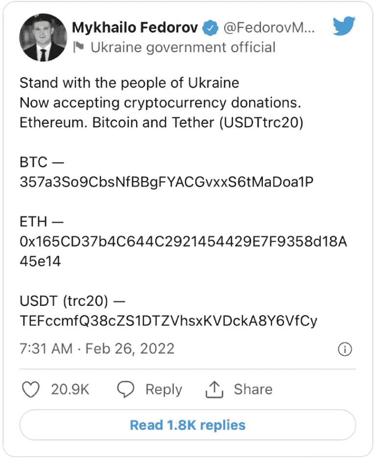

**图 1 乌克兰副总理发推特公布加密钱包地址以接收捐款**

关于基于加密货币的捐款，区块链分析公司 Elliptic 首席科学家 Tom Robinson 在 2022 年 3 月 CNBC 文章中指出，加密货币因其去中心化特性，也适合国际筹款：“加密货币特别适合国际筹款，因为它不受国家边界限制，且抗审查——没有中央权力机构可以阻挡交易，例如作为对制裁的回应。”

“没有中央权力机构”？也许吧。战争爆发后，美国财政部长珍妮特·耶伦宣布，美国将监控加密货币作为俄罗斯规避美国及西方国家制裁的渠道。国际货币基金组织在一份报告中警告称，比特币可能允许俄罗斯等国家将能源资源货币化，“其中一些因制裁无法出口。” 2022 年 4 月，美国财政部开始对俄罗斯虚拟货币挖矿行业的公司采取行动，因为“这些公司帮助俄罗斯将其自然资源货币化。”（据剑桥大学数据，俄罗斯是全球第三大比特币挖矿目的地。）

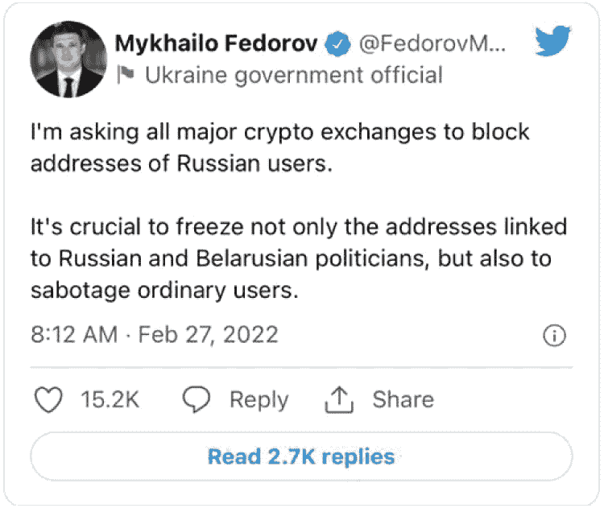

**图 2 乌克兰副总理敦促加密交易所破坏俄罗斯用户账户**

去中心化？我们拭目以待。（本书将在所有章节中探讨基于区块链的互联网究竟能有多“去中心化”。）乌克兰副总理在发推特公布加密钱包地址募捐的同时，也敦促加密交易所封锁俄罗斯用户的地址。“不仅要冻结与俄罗斯和白俄罗斯政客相关的地址，破坏普通用户账户也至关重要，”他在推特上写道（见图 2）。

一家加密交易所 DMarket 迅速响应了这一号召。据 Axios 报道，DMarket 是一家乌克兰初创公司，销售《反恐精英：全球攻势》等游戏的 NFT 和虚拟物品。作为抗议俄罗斯入侵的一种方式，DMarket 很快在其平台上禁止了俄罗斯和白俄罗斯的新用户注册，尽管其约 30% 的客户来自这两个国家。除了禁止新用户注册外，DMarket 还冻结了俄罗斯和白俄罗斯用户的资产，并禁止涉及俄罗斯卢布的交易。

然而，加密社区将此视为一项有争议的举措。许多人对 DMarket 的行为极为不满，通过 Twitter 表达称，俄罗斯用户已成为他们并未引发的战争中夹在中间的替罪羊。其他用户评论称，DMarket 在其平台上冻结俄罗斯和白俄罗斯用户的资产，是从仅因国籍而成为目标的无辜用户手中窃取价值。此外，Twitter 用户还评论称，DMarket 的举措违背了加密货币和 Web3 的理念，后者将去中心化视为核心价值。

随着俄乌战争的持续，它让加密货币及其用途成为了焦点。公众对加密资产的关注也因 2021 年成为区块链和加密货币有史以来最重要的一年而被点燃。比特币和以太坊创下历史新高，NFT 从默默无闻跃升为头版新闻，我们见证了比以往任何时候都多的技术创新、资本注入，以及来自大公司的机构入场。然而，这种加密辩论仅仅是围绕区块链和 Web3（下一代互联网）的困惑中的一小部分。

## 本书术语

Web3 拥护者认为，区块链和加密货币将在以去中心化为特征的未来互联网中发挥关键作用。对他们而言，这是一个改变世界的机会，可以打造一个更好的互联网版本，并将其从 Facebook 和 Amazon 等大型科技巨头手中夺回。与此同时，Web3 也遭遇了强烈的抵制，主要来自那些从根本上对加密货币整体持怀疑态度的声音。Web3 是未来，还是骗局……抑或两者皆是？

现实是，Web3 难以定义，区块链常被许多人与比特币混淆，而区块链与 Web3 的融合是一个初露头角的概念，由炒作、乐观、困惑、教条之争和纯粹的投机共同推动。正如电视节目主持人 John Oliver 所言，这些概念关乎“你不懂的货币知识与你不懂的计算机知识的结合”。

**Metaverse（元宇宙）** 一词最早出现于 1992 年 Neal Stephenson 的小说 *Snow Crash*（《雪崩》）中。比特币作为一种去中心化的点对点电子货币，于 2008 年问世，成为第一个也是目前最流行的加密货币。与许多“科技术语”一样，其大小写用法尚未稳定。在本书中，我们用 *Metaverse* 指代基于虚拟现实的互联网宏观继任者概念，用 *metaverse* 作为通用术语，类似于说“理论上任何人都能创建的一个虚拟宇宙”。我们用 *Bitcoin* 描述概念或整个比特币网络，用 *bitcoin* 描述货币单位。

我们编写此书旨在为读者提供全面且深入的探讨，剖析 Web3 元宇宙将如何在全球范围内生成与构建。我们深入探讨将影响我们生存本身的用例——艺术、银行、游戏、支付、交易、音乐、社交媒体等。本书旨在提供一份详尽指南，将区块链和 Web3 背后复杂、快速演变的理念提炼成一本易于消化的参考手册，展示其底层真实运作机制。

本书结构安排如下。

# 第一部分：元宇宙中的数字技术超级融合

要支撑像元宇宙这样大胆的概念，我们需要强大数个数量级的计算能力，且能在多种设备和屏幕上以更低的延迟访问。区块链作为 Web3 的骨干，对这个数据泛滥的世界至关重要。

## 第 1 章：元宇宙——技术与商业模式的融合

本章阐述元宇宙的未来由七层协议构建，类似 ISO 互联网标准，区块链技术位于每一层的核心，服务于多种功能，包括治理协议、激励机制、全球支付轨道、无需信任的参与，以及元宇宙中关键活动的全球不可篡改账本。数据的价值创造与分配正从中心化参与者（如大型科技公司和主权国家）手中转移到去中心化的个人群体手中。

## 第 2 章：区块链，Web3 的骨干

作为去中心化数据技术，区块链将成为下一代互联网——Web3 的基石。本章介绍区块链的四大核心组件：智能合约、公钥加密、共识算法和点对点网络。随后探讨区块链与物联网、去中心化存储、AI、云计算和网络安全等其他先进数字技术的融合。

# 第二部分：区块链突破

正如区块链远不止比特币，Web3 也正超越其金融起源，成为基于所有权和去中心化的新互联网。加密货币、DeFi、NFT、游戏和社交工作之间的相互作用，正在推动基于区块链的创作者经济中更多的技术创新和用户案例。

## 第 3 章：加密货币与代币经济学

如果 2021 年加密资产的增长迫使所有人关注加密世界数万亿美元的市值，那么加密货币超越货币属性的增长，则有可能在各行业产生深远回响。本章以比特币和以太坊作为加密货币的起源，随后深入探讨近年涌现的更多样化代币。多元化意味着更多用例，更多用例带来更广泛的采纳。因这种正向升级效应，加密行业正在拓展分支。

## 第 4 章：DeFi（去中心化金融）——无银行元宇宙

DeFi 是去中心化元宇宙金融领域的下一个前沿。本章解释 DeFi 的治理代币和收入来源、分层协议的安全问题，以及 DeFi 大规模采纳面临的挑战。除了与传统金融中的“中心化金融”竞争与合作，DeFi 还在向全新领域扩展，如 NFT、游戏和社交网络。

## 第 5 章：NFT、创作者经济与开放元宇宙

NFT 在将区块链推向主流方面发挥着重要作用。本章解释为何 NFT 引发了艺术和内容创作领域的数字文艺复兴。虽然 NFT 市场最初从数字艺术切入，但它将在创作者经济中拥有更广泛的应用。在物理与虚拟体验界限模糊之际，NFT 将成为消费类企业的新工具。但 NFT 市场要想未来成功，必须克服从投机到主流采纳的重大挑战。

## 第 6 章：元宇宙中的区块链游戏

本章考察游戏世界在加入区块链技术后，如何已展现出元宇宙可能演变的一些关键要素。区块链和数字资产代表了游戏领域基础设施层面的前沿革命。加密货币和区块链技术将以深刻方式颠覆游戏和数字娱乐空间，因为游戏内容创作和游戏内数字资产将大规模迁移至区块链上，这一点通过玩赚（P2E）NFT 模型得以说明。

## 第 7 章：元宇宙隐私——区块链 vs. 大型科技公司

消费者数据将成为元宇宙的核心，大型科技公司在元宇宙中的大规模数据收集将成为比今天更严重的数据隐私问题。本章讨论几种面向元宇宙应用的数据治理模型，以及可集成以提供更好隐私保护的新技术，包括零知识证明（ZKP）、安全多方计算、同态加密和联邦学习。

## 第 8 章：元宇宙安全

### 区块链在元宇宙中的角色与安全性

区块链的加密性、不可篡改性和去中心化属性使其成为保护数据安全的绝佳选择。然而，区块链本身并非没有安全风险。正如本章所述的身份安全问题及其他安全主题所示，任何元宇宙应用都面临两类基本安全问题：技术专家几十年来一直在应对的熟悉挑战，以及专为元宇宙环境量身打造的全新挑战。本章将详细考察最新的安全漏洞案例。

# 第三部分：开放元宇宙、大科技围墙花园与主权国家的三方博弈

正如在数字货币领域，加密货币、大科技代币和央行数字货币（CBDC）之间的三方竞争日益激烈一样，在 Web3 基础设施方面，开放元宇宙必须同时与大科技公司和政府支持的区块链网络竞争。

## 第 9 章：公共加密货币、政府央行数字货币与大科技代币

本章解释了为何加密生态系统必须在两条战线上进行货币战争。一方面，是对抗政府的金融体制，包括与加密货币争夺元宇宙交易份额的国家央行数字货币，以及限制加密资产使用和交易的加密监管。另一方面，Meta 等大科技公司试图在单一平台上提供前所未有的金融产品扩张，这由 Meta 自身的代币（Diem）和数字钱包（Novi）提供便利。

## 第 10 章：区块链上的 Web3 创作者经济

本章探讨了基于开放、无许可、区块链架构运行的“开放元宇宙”概念所面临的机遇与挑战。开放元宇宙正面临三方竞争：大科技公司（它们开始将 Web3 理念纳入其中心化平台），以及提供廉价便捷的许可制区块链基础设施的主权国家。在 Web3 世界中，加密货币、DeFi、NFT 及更多基于区块链的技术正在汇聚，形成一种以用户及其主权为中心的范式：他们的身份、数据、创作和财富。

# 第 1 章：元宇宙：技术与商业模式的融合

## 元宇宙、全真宇宙与人类共同体验

2021 年 10 月，全球最大（且深陷困境）社交网络的运营公司 Facebook 宣布，将其企业品牌重塑为“Meta”，以加倍押注“元宇宙”愿景。Meta 对元宇宙的描述是：“它是利用虚拟现实和增强现实等技术实现的相互连接的虚拟体验的新阶段。”随后，创始人扎克伯格以 Meta 首席执行官的新身份宣布，Instagram 很快将允许用户展示——并“希望”铸造——NFT，即区块链上的非同质化代币。

社交网络将不再定义 Facebook（Meta）的未来。元宇宙将定义。但究竟什么是*元宇宙*？

元宇宙是两个存在多年的概念的融合：虚拟现实和数字第二人生。听扎克伯格等科技 CEO 谈论它，元宇宙是互联网的未来。或者它关乎虚拟与增强现实。或者它是一款视频游戏。又或者它是 Zoom 的深度沉浸版（不确定那会不会更让人不适）？一个镜像我们物理世界的虚拟世界？

事实是，元宇宙可能包含以上所有，最好将其理解为一个涵盖互联网未来走向的广泛术语。除了 Facebook，新一代主要科技、互联网和游戏公司也已加入这股热潮，它们对元宇宙有自己的愿景（见图 1.1）。例如：

*   **英伟达**，这家加利福尼亚芯片制造商，将元宇宙称为全真宇宙。其平台将 3D 世界连接成一个共享的虚拟宇宙。全真宇宙可用于创建建筑和工厂的真实模拟等项目。它可能是元宇宙的基石。“我们浪费了大量东西来过度补偿我们不进行模拟这一事实。我们想在元宇宙中、在这个全真宇宙里模拟所有工厂，”英伟达 CEO 黄仁勋在接受 CNBC 采访时表示。

    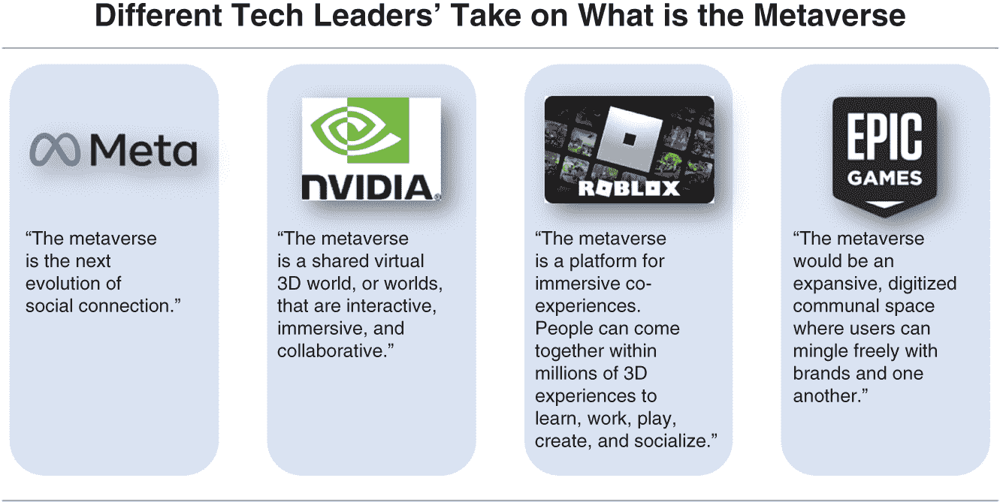

    **图 1.1 大科技对元宇宙的（不同）愿景** ¶ 来源：Meta、英伟达、Roblox 官方网站。[Decrypt.co](http://Decrypt.co)。华盛顿邮报

*   **Roblox 公司**是一个仅于 2021 年上市的视频游戏平台。但同年 11 月，它宣布了围绕其玩家构建元宇宙的计划。公司表示希望创建一个虚拟空间，人们可以“聚集在数百万个 3D 体验中学习、工作、娱乐、创作和社交”。Roblox 将其称为“人类共同体验”，这一术语表明元宇宙不仅仅是游戏。

*   **Epic Games** 早已深耕元宇宙。这家《堡垒之夜》背后的公司已超越单纯的射击游戏。Epic/《堡垒之夜》平台允许玩家参与舞会和虚拟演唱会，如为流行天后爱莉安娜·格兰德举办的一场。“我们不认为‘堡垒之夜’*就是*元宇宙，”Epic Games 一位高管表示，“而将其视为元宇宙中一个美好的角落。”

与此同时，传统大科技公司也在探索元宇宙世界，希望从现有互联网平台创造新的增长机遇，例如：

*   Google 通过其最新工具 Google Lens 发出了元宇宙宣言，该工具允许用户使用设备摄像头捕捉物体。该技术随后利用图像识别和 Google 的搜索系统描述物体并提供相关信息。这种系统未来有一天可配合头显在元宇宙中使用。


*   Microsoft 已开始开发一系列“元宇宙应用”，帮助其 Azure 云计算服务的企业用户融合虚拟与物理元素。“元宇宙本质上是关于创造游戏，”其 CEO 纳德拉表示，“它关乎将人、地点、事物置于物理引擎中，然后让物理引擎中的所有人、地点、事物相互关联。”

*   中国的社交媒体和游戏巨头腾讯据报道正进军元宇宙，专家称虚拟世界可能演变成 Meta 与腾讯之间的较量。腾讯拥有与 Epic Games 和 Roblox 游戏平台的战略合作伙伴关系。此外，腾讯的版图跨越虚拟办公和移动支付，因此在多个行业拥有庞大的受众群体。

*   华为，中国 5G 和智能硬件领导者，于 2021 年 11 月与中国文化娱乐集团完美世界达成战略合作。该合作伙伴关系将把元宇宙元素融入游戏行业。完美世界自研的 `ERA` 引擎将与华为的 `Hongmeng OS` (Operating System) 协同工作，应用分布式计算和着色技术打破单一设备的硬件限制，从而提供更好的游戏体验。

正如我们所言，Facebook、Google、Microsoft 等美国科技巨头，以及腾讯、阿里巴巴、小米等中国科技巨头，正在利用新兴数字技术的融合，如超高速蜂窝 5G 网络、物联网 (IoT)、人工智能 (AI)、区块链、云计算、大数据分析、AR/VR、游戏技术、去中心化存储 (如 `IPFS`)、去中心化和网状网络，甚至量子计算，来创建由物理和虚拟世界海量数据驱动的元宇宙。但一个重要问题出现了：我们是否渴望迁移到由大科技公司构建的元宇宙？

## Big Tech vs. Web3

大科技公司给了我们熟知的互联网，但也带来了沉重的包袱。仅仅少数巨型公司控制着网络，无论是 Google、Amazon、Microsoft、Apple 还是 Facebook (及其他主要“平台公司”)，它们乐于维持现状。尽管当前互联网扩展了社交连接和更多用户参与 (例如用户生成内容)，但我们见证了大规模的封闭平台，要求用户在各自的应用和设备内操作。用户被限制在这些大型平台各自的生态系统内运作。

同样重要的是，当前互联网由以服务换取个人数据的公司主导。因为数据已成为 AI 和数据驱动技术的关键资源，互联网巨头更常*主动*收集用户数据。因为普通用户使用这些流行的互联网平台处理日常生活中的一切，互联网巨头正在收集用户数据的方方面面，无论是身份数据、网络数据还是行为数据 (见 Figure 1.2)。以精准营销为例。用户数据可被分析并据此打上不同特征标签 (如“热衷旅行”、“化妆爱好者”)。然后，公司根据标签匹配向潜在客户展示特定广告信息。

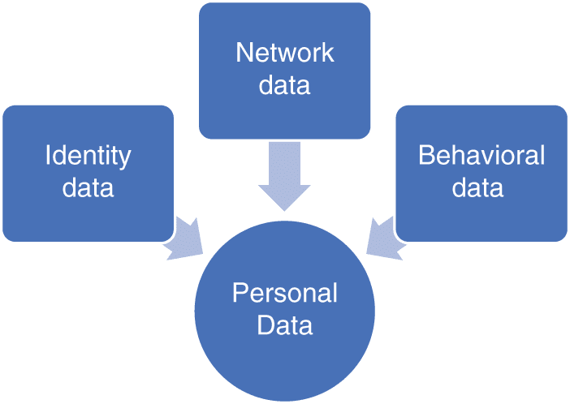

**Figure 1.2 Personal Data – Key Resource for the Digital Economy**

*   **Identity data (身份数据)。** 包括姓名、性别、手机号码、身份证号码等个人基本信息，主要用于认证用户身份。

*   **Network data (网络数据)。** 包含位置数据、日志数据和设备信息。例如，移动支付服务可能鼓励用户与他人共享位置数据以及个人信息和购买习惯。

*   **Behavior data (行为数据)。** 当用户浏览网站或 App 时，这些行为会被记录以提取用户行为习惯。例如，从 Facebook“点赞”的模式中，数据分析师可以预测用户的性取向、宗教信仰、烟酒毒品使用情况、恋爱状态、年龄、性别、种族、政治观点等。

这对竞相进入元宇宙的大科技公司意味着什么？元宇宙可能是互联网整合的下一个阶段，是大科技公司扩大触角和权力的营销话术。大科技公司可能会以新名称重新包装其庞大的产品线，并会有更多的用户数据收集，因为元宇宙旨在成为一个更“沉浸式”的互联网。如果是这样，元宇宙仍然是大科技的故事——正如现在一样问题重重——只是规模更大。

即便是“新”平台也无法解决“现任”平台的问题。例如，Epic Games CEO Tim Sweeney 曾公开谈论由 Apple 生态系统式运营的元宇宙的威胁，称其由“一家中央公司”治理，“比任何政府都更强大”，他在 VentureBeat 报道中曾如此评论。(Epic Games 于 2021 年起诉 Apple 违反反垄断法，挑战 Apple 对《堡垒之夜》等游戏内每笔交易收取 30% 费用的政策。我们将在 Chapter 10 中详细介绍该案件。)

他与《华盛顿邮报》分享的元宇宙愿景，是一个通过《堡垒之夜》作为游戏平台和 Epic Games 的 `Unreal Engine` 实现互操作的网络空间。毫不意外，`Epic v. Apple` 案的法官写道：“Epic Games 寻求系统性变革，这将带来巨大的金钱收益和财富……[该诉讼] 是挑战 Apple 和 Google 政策与做法的一种机制，这些政策和做法阻碍了 Sweeney 先生对即将到来的元宇宙的愿景。” 真扎心。

同样，竞争对手游戏引擎公司 Unity 的 CEO John Riccitiello 也同意大科技公司的元宇宙愿景是奥威尔式的。他的解决方案？大家都应该用 Unity。“它降低了围墙花园的围墙高度，”他说道。在互联网历史上，事物总是押韵的。从 1980 年代的 Microsoft 到 2010 年代的 Apple、Google、Facebook 和 Amazon，所有科技巨头最初都提供消费者喜爱的独特服务，并为反对现任者的更开放竞争而战。随着时间的推移，在赢得新互联网的领导地位后，他们的传教士热情减退了。他们成为了“新垄断”。

因此，依我们之见，元宇宙的实际承诺不应(也不将)仅由大科技公司实现。谁想要一个按 Web 2.0 方式构建的元宇宙？(当前智能手机上的移动互联网常被称为 Web 2.0，PC 电脑上的互联网开端是 Web 1.0。)大科技公司可能会构建一个 Web 2.0 元宇宙，因为它们不会放弃基于服务器的模式或数据收集。我们甚至可能看到建立在现有主要平台之上的 Web 2.0 元宇宙以更快的规模扩张。

但新的开源元宇宙项目正在寻求对抗大科技平台这种不可避免的下一代全方位服务环境互联网。真正的元宇宙爱好者认为，下一代网络应建立在开放协议和标准之上，包括区块链技术。元宇宙生态系统中公平、开放和社区建设的真正精神将来自区块链上的去中心化社区。开源开发者的快速创新将在 Web3 元宇宙经济中留下印记。

Figure 1.3 显示，从互联网用户的角度来看，Web1.0 是“只读”，Web2.0 平台经济是“读写”，而 Web3 或元宇宙将是“读、写、执行和拥有”。关键在于互联网本身的所有权应从大科技公司转移到个人用户手中。Web3 的终极愿景是不再有主导性的“超级大公司”。相反，元宇宙将由数百万创作者、程序员和设计师构建，他们每人获得的回报份额将比科技巨头目前允许的更大。

(在本书中，Web3 和元宇宙可互换使用，它们与当今互联网一刀两断。使用元宇宙一词作为独特描述符，让我们能理解这种变革的巨大性，进而理解颠覆的机遇。而 Web3 一词直接表达了我们需要构建一个更好的互联网。)

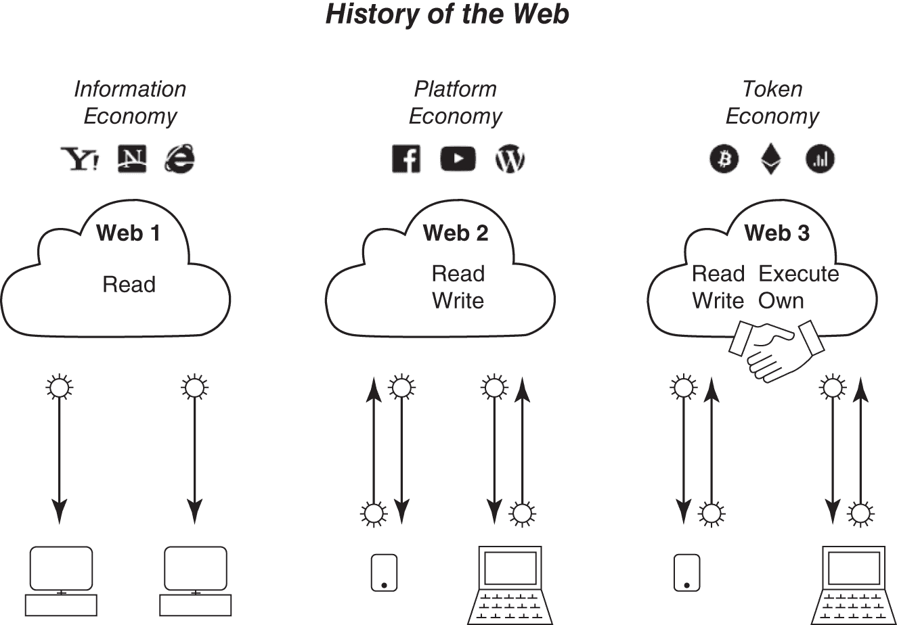

## 图 1.3 从基础互联网到 Web3（代币经济）

我们认为，元宇宙的未来将构建于七层协议之上，类似于 ISO 互联网标准，区块链技术位于每一层的核心，服务于多种功能，包括治理协议、激励机制、全球支付轨道、无需信任的参与，以及为元宇宙中的关键活动提供全球不可篡改的账本。在以下章节中，我们将定义这些层并描述区块链在所有层中的核心作用。

## 技术栈的七层架构

类似于 ISO 互联网标准，元宇宙互联网由七层组成，从底部的物理和网络层（第一层）到第七层的元宇宙数字经济（见图 1.4）。本节将深入探讨元宇宙的每一层。（对于更对元宇宙商业应用感兴趣的读者，可以跳过本节，稍后再回过头来阅读技术栈的讨论。）

### 第一层：物理和网络层

物理层包括物联网设备和 AR/VR 设备。网络层包括 5G/6G 网络和“网状网络”。得益于 5G 网络的速度和普及性，区块链交易可以更高效地传播，网络瓶颈得以减少，从而提升区块链的性能和可扩展性。从物联网设备和 AR/VR 设备收集的数据，可在去中心化身份保护数据隐私和主权的前提下，传播到上层，从而赋能元宇宙经济。

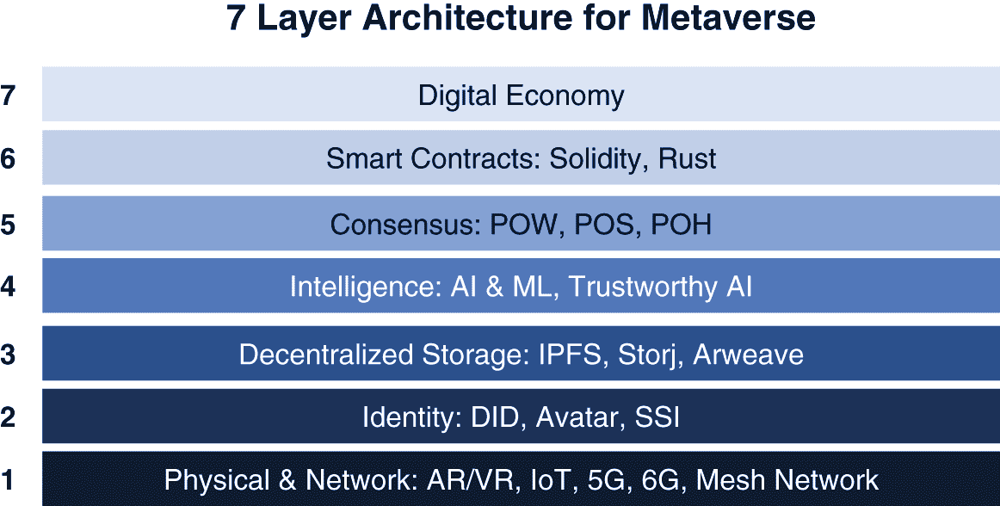

## 图 1.4 元宇宙的七层架构

网状网络允许网络节点直接、动态且非层级地连接到尽可能多的其他节点，并相互协作，高效地路由数据往返客户端。这种不依赖单一节点的特性，使得每个节点都能参与信息的中继。网状网络能动态地自我组织和自我配置，从而降低安装开销。

自我配置能力支持工作负载的动态分发，特别是在少数节点发生故障时。这进而有助于容错并降低维护成本。智能合约可部署在网状网络之上，以激励工作负载执行、带宽共享和数据共享，这些最终作为元宇宙互联网的基本构建模块。区块链技术可用于增强 5G 安全性，并通过其不可篡改性、激励机制和全球支付轨道，实现网状网络的连接和带宽共享。

### 第二层：去中心化数字身份层

去中心化身份（DID）或自主身份解决方案，如元宇宙 DNA 数字身份 Avatar、Serto、Sovrin 以及许多其他 DID 实现，是允许个人管理和控制自身身份的初步尝试。背景在于，传统互联网设计（如 ISO 的七层协议和四层 TCP/IP 协议栈）未将数字身份纳入考量。这是导致传统互联网安全问题频发的主要原因之一。这也是为什么数字身份现在被建议作为新的防火墙。

我们仍有时间以数字身份为底层核心技术和生态模块来构建 Web3。在 Web3 协议的第二层引入 DID 的益处包括：

1.  **提高安全性**，因为身份数据去中心化存储。不存在身份的中心化数据库，每个用户持有并控制自己的身份数据。黑客通常更有动力攻击中心化的身份数据存储，因为可以获取海量身份数据。对于 DID，黑客的动力较小，因为他们必须逐个攻击每个 DID。

2.  **将认证**和访问控制从中心化策略存储转移到最终用户的钱包应用中。这增强了访问控制，并提升了用户的安全和隐私意识。

3.  **支持经客户同意的 KYC/AML**（了解你的客户/反洗钱），以满足元宇宙应用的需求。绝大多数现实世界的元宇宙应用在大多数国家都需要 KYC/AML 以满足监管要求。DID 可用于关联来自 KYC/AML 工作流的可验证凭证，以满足监管要求。此外，它是一种“一次 KYC，到处可用”的机制，降低了元宇宙应用的合规成本。

4.  **为数据所有权认证提供基础模块**，这对数据共享经济至关重要。为了让元宇宙应用发挥潜力，数据必须拥有正确的所有权。在 Web2.0 中，数据共享意味着“复制粘贴”，数据所有者通常会失去数据所有权。在元宇宙应用中，数据可设定过期时间共享，且数据所有者不失去数据所有权。

5.  **认证链下数据**。对于链下数据馈送方或预言机，如果馈送方和预言机基于`去中心化`身份，则可以建立预言机或数据馈送方的声誉，这使得链上智能合约能为商业应用获取准确的数据输入。

### 第三层：分布式数据层

数据将以分布式和去中心化的方式存储，使用 IPFS、FileCoin 和 BigChainDB 等技术。去中心化点对点存储系统具有以下优势：

1.  **降低成本**。去中心化数据存储系统利用代币经济模型，激励利用闲置存储空间，减少存储浪费，从而降低整体存储成本。随着去中心化存储市场的成熟，整体存储成本将远低于 AWS S3 等中心化云存储系统或其他类型的云存储。我们预见去中心化存储将在未来十年逐渐夺取中心化云存储的市场份额。

2.  **更高可靠性**。数据在去中心化网络中分布存储于多个主机上。系统保存原始数据的副本（创建有意的数据冗余）。万一发生丢失或硬件故障，系统将提供备份副本。此外，所有共享数据的分片可使用唯一哈希分别加密。这一额外的安全层保护数据免受入侵者侵害。（区块链中的“哈希”概念将在后续章节详细解释。）

3.  **提升速度**。与中心化存储系统不同，去中心化存储系统使用点对点技术。数据传输不通过中心服务器，后者在高峰流量时会变慢。凭借先进的路由、负载均衡和缓存算法，未来速度可进一步提升。此外，由于数据的多个副本存储在多个位置，下载速度可变得更快。

4.  **良好的价格发现和公平的市场定价**。随着数百万节点的存在，去中心化存储系统的市场成为完全竞争市场。没有单个节点能收取溢价。这确保了整个市场良好的价格发现和公平定价。这种市场也保证了只有优质节点才能竞争和生存。

5.  **增强安全性和隐私**。最重要的是，去中心化数据存储系统提供高水平的安全性。它们将数据分割成更小的分片，制作原始数据的副本，然后使用哈希或公私钥分别加密每个部分。整个流程保护数据免受恶意行为者侵害。

### 第 4 层：分布式智能层

人工智能 (AI) 和机器学习 (ML) 目前是动态 Web2.0 技术栈中的核心组件。但当前 AI/ML 的主要问题在于其数据孤岛和专有算法。不同组织间的数据共享和算法共享引入了隐私噩梦以及标准化障碍。在 Web3 和元宇宙时代，我们看到利用区块链技术的 AI/ML 变得更加分布式和去中心化。

通过利用智能合约和代币经济，可以为 AI/ML 提供激励机制，以获取高质量的数据和算法。AI/ML 算法的哈希值可以发布在区块链上，这样在元宇宙应用内每次调用 AI/ML 之前，都可以计算并比对哈希值是否发生变化，这有助于判断算法是否被黑客篡改。您可以定义一个工作流流程来审核和发布高质量的数据及 AI/ML 算法，利用区块链技术对工作流任务进行签名和执行。

通过基于智能合约实施基于角色的访问控制 (RBAC)，可以管理数据共享的隐私，仅允许授权用户访问数据，从而将隐私顾虑降至最低，实现不同组织间的数据共享。标准应用程序编程接口 (API) 技术（如 REST API 和 GraphQL）可用于标准化访问优质数据和算法，包括来自不同数据提供者的激励参与。（例如，“The Graph”项目为区块链项目提供去中心化的链上数据。）

### 第 5 层：共识层

共识层由一种或多种混合共识算法组成，旨在确保所有参就元宇宙网络的状态达成一致。从区块链技术角度来看，共识算法是一种机制，通过它，区块链网络的所有对等节点可以就分布式账本的当前状态达成共同协议。通过这种方式，共识算法实现了区块链网络的可靠性，并在分布式计算环境中建立了未知对等节点之间的信任。

除了区块链算法中使用的技术共识外，我们还看到了所谓“社会共识”的重要性。在元宇宙中，“社会共识”是指个人或组织在元宇宙生态系统中的治理和积极参与。元宇宙中的社会共识需要满足以下要求：

*   **达成协议。** 生态系统中的每个人都致力于达成一项协议，这将有利于整个元宇宙生态系统。

*   **协作。** 生态系统中的每个人都旨在达成一项更好的协议，从而实现整个生态系统的利益。

*   **合作。** 生态系统中的每个人将作为一个团队工作，并将自身利益放在一边。

*   **平等权利。** 生态系统中的每个人仅基于其在系统中的权益拥有相同的投票权。必须利用二次投票等技术或其他机制来处理生态系统中权益的中心化或所谓的“巨鲸”问题。

*   **激励参与。** 需要建立激励机制以鼓励积极参与。

*   **无国界。** 社会共识需要是全球性的、无国界的。

### 第 6 层：智能合约层

智能合约层可被视为元宇宙经济的编排层。与关键交易相关的复杂业务逻辑和工作流流程通过智能合约执行。

智能合约与任何合同一样，确立了协议的条款。但与传统合同不同的是，智能合约的条款是由运行在以太坊、Polkadot、Solana 和 Hyperledger Fabric 等区块链上的代码执行的。智能合约允许开发者构建去中心化应用，利用区块链的安全性、不可篡改性、完整性和链上可验证性，同时提供复杂的点对点功能——涵盖从价值交换、保险和贷款，到贸易金融和游戏等一切内容。就像任何合同一样，智能合约规定了协议或交易的条款。然而，之所以称为“智能”合约，是因为条款是作为运行在区块链上的代码来确立和执行的，而不是放在律师桌面上的纸质文件。

智能合约使用多种编程语言编写（例如 Solidity、Rust、Java、C++ 和 Web Assembly）。在公链生态系统中，每个智能合约的代码都存储在区块链上，允许任何感兴趣的方检查合约代码及其当前状态以验证其功能。网络上的每台计算机（或“节点”）都存储所有现有智能合约及其当前状态的副本，以及区块链和交易数据。

由智能合约驱动的应用通常被称为“去中心化应用”或“DApps”——它们包括旨在变革银行业的去中心化金融 (DeFi) 技术。DeFi 应用允许来自世界各地的加密货币持有者进行复杂的金融交易——储蓄、贷款、保险——而无需银行或其他金融机构抽成。

除了 DeFi 应用外，智能合约还将在元宇宙的各种去中心化应用中发挥关键作用，包括游戏、教育、医疗、旅游、供应链管理、贸易金融和法律应用等众多行业领域。这些行业领域的业务流程和相关逻辑可以使用智能合约来实现。值得注意的是，对于现实世界的元宇宙应用，智能合约需要从第 3 层（数据层）和第 4 层（智能层）获取可靠输入，然后利用第 5 层（共识层）和第 6 层（智能合约层）执行相关业务逻辑。得益于巨大的生产力提升，其结果是为社会创造巨大的价值。

### 第 7 层：元宇宙经济层

第 7 层是元宇宙经济层。分层架构允许开放平台设计和组件复用。高层协议可以构建在低层协议之上。使用分层架构构建的不同产品和系统可以通过 API 相互通信。（然而，安全问题将是每一层的核心，并需要以“安全优先”的设计原则应用于每一层。）

元宇宙经济有四大核心要素：数字创作、数字资产、数字市场和数字货币。首先是数字创作，它是元宇宙经济的起点，没有它就没有可供交易的商品。在物理世界中，人们“创造”各种事物或服务。我们将其描述为*产品*；当它进入市场流通时，被称为*商品*。在元宇宙中，人们进行*数字创作*，创造*数字产品*。数字创作是数字化的，本质上是数据的集合。正如后续章节将阐述的，新的数字技术正使普通互联网用户成为数字内容的创作者。

其次是数字资产，它们由数据表示，拥有财产权，并可在元宇宙中用于交易。第三是数字市场，它代表数字世界的市场以及所有人必须遵守的交易规则。最后，第四是数字货币，它应以最低费用实现全球数字资产交易的实时结算和清算。因此，元宇宙经济本质上是“创作者经济”。

## 元宇宙中汇聚的商业模式


虽然 Web3 技术栈仍在演变中，但许多公司已纷纷跟进，宣称围绕元宇宙魔力构建了美好而模糊的商业构想。除了前文提到的大型科技公司外，阿迪达斯、可口可乐、杜嘉班纳、古驰、NBA 和耐克等主要品牌（仅举几例）也认为元宇宙为它们创造了一个无限可能的世界，让它们能够创造新体验，并以全新的关系建立方式与客户互动。

与此同时，众多 Web3 初创企业正涌现于此领域，致力于在去中心化语境下构建元宇宙。对于大型科技公司和初创企业而言，共同的信念是元宇宙是未来的社交网络，甚至不止于此。它将连接每个人，甚至可能连接万物。因此，元宇宙提供了一个商业模式汇聚的平台和生态系统。本节案例研究将从大型科技公司和早期初创企业的视角，阐释商业模式在元宇宙布局中的汇聚。

### 案例 1：Meta —— AI、AR/VR、大数据、社交网络与 UGC 的汇聚

Facebook 筹划进军元宇宙已有一段时间 —— 甚至可能长达数年。但将母公司更名为 Meta，或许是该公司所能做出的最大、最勇敢的意图声明。CEO 扎克伯格在宣布更名时表示：“下一个平台和媒介将是一个更具沉浸感和具身感的互联网，你将身临其境其中，而不仅仅是旁观，我们称之为元宇宙。”

扎克伯格认为，元宇宙为公司在现有概念框架内提供了有机发展路径，但元宇宙对 Facebook 而言合情合理的原因不止于此（见图 1.5）：

*   **提升用户粘性。** 虚拟现实有望增加用户在线时长，从而刺激内容消费。
*   **新内容市场。** 元宇宙为创作和销售虚拟 3D 内容提供了巨大机遇，远超 Instagram 或 TikTok。
*   **全新沟通层级。** 元宇宙将让相隔数千公里的人们能像坐在同一房间一样交流。
*   **新经济分支。** 根据扎克伯格的说法，元宇宙必须拥有自己的综合经济系统。

Meta Platforms 不仅拥有前六大社交媒体平台中的四个，还拥有制造 VR 硬件的 Oculus。虚拟现实“即将走向主流”这一说法已持续了十年，但距离普及仍遥不可及，导致公司始终试图从这笔 20 亿美元的收购中获利。比起元宇宙概念，什么能更有效地推销 VR 头显呢？尤其是当那个未来的互联网正是 Meta 自己的时？


**图 1.5 Meta —— AI、AR/VR、大数据、社交网络与 UGC 的汇聚**

### 案例 2：Roblox —— 3D 沟通、社交网络、AR/VR 与 NFT 的汇聚

“人类共同体验”是 Roblox CEO David Baszucki 使用的一个术语。在最近的一次演讲中，Baszucki 表示：“它如今被称为元宇宙。我们称之为人类共同体验。” Baszucki 将元宇宙定义为一个技术将高保真沟通与全新讲故事方式相结合的地方，汲取了移动游戏和娱乐产业的精华。根据 Baszucki 的说法，这一元宇宙或共同体验的新范畴建立在八大基石之上：身份、社交、沉浸、低摩擦、多样性、随地接入、经济和文明。

从本质上讲，“人类共同体验”可将 3D 沟通、社交网络，以及潜在的 AR/VR 和 NFT 等商业模式汇聚进元宇宙（见图 1.6）。Roblox 用户可以在文本、语音、视频和 3D 沉浸式沟通模式间无缝切换。事实上，对话中的不同参与者可根据语境选择最便捷的沟通模式。其结果是个性化的沉浸式共同体验，人们可汇聚于数百万个 3D 体验中，共同学习、工作、娱乐、创作和社交。

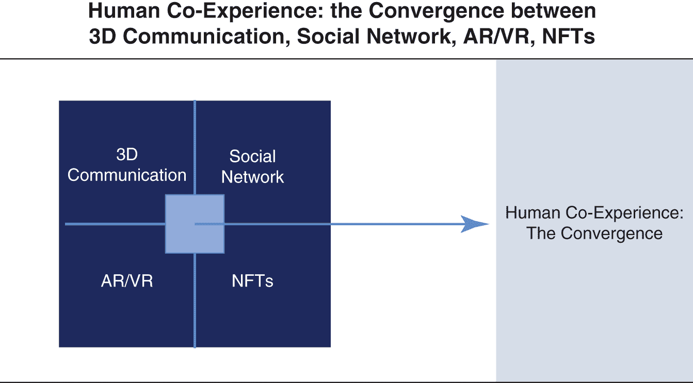

**图 1.6 Roblox —— 3D 沟通、社交网络、AR/VR 与 NFT 的汇聚**

### 案例 3：Soul —— 社交网络、AI 与数字币的汇聚

腾讯投资的中国 Soul App 将自己定位为面向年轻一代的“Soul”cial（"social" 的延伸）元宇宙。Soul App 于 2016 年 11 月上线，近期已拓展至北美、日本和韩国等海外市场。

据公司 CEO 张璐介绍，该应用旨在解决的问题是：“年轻人通常有某些情绪和观点，他们倾向于不与身边的人或在微信上分享。” 解决思路是构建一个匿名空间，基于兴趣爱好和价值观连接网民。Soul 将自己标榜为“社交元宇宙”，很可能是为了与 MOMO 和探探等约会软件区分开来 —— 这两者均被视为 Tinder 的本土模仿者。

Soul 背后的产品逻辑并不复杂：连接与内容是激发社交欲望的关键。例如，Facebook 吸引来自既有社交圈的个体，再利用亲友创作的内容提升粘性。同时，Twitter 和 Instagram 等内容型平台凭借原创且引人入胜的内容吸引并留住新用户。但 Soul 通过在两个层面应用其独特的基于 AI 和大数据的推荐算法（见图 1.7），成功化解了是优先内容还是优先既有社交圈的难题。

尽管 Soul 拥有未来感十足的设计和用户界面，但该产品距离真正的元宇宙仍有很大差距。它是基于在线社交模式构建的网络平台 —— 而非一个用户“创造内容和体验”的开放世界。虽然该应用拥有捏脸系统，但缺乏人机交互界面（HMI）或其他 AR/VR 工具赋能的互动。平台变现主要依赖 VIP 订阅和电商。

此外，代币经济系统尚未完全运转。类似元宇宙的要素在于其 AI 驱动的匹配算法和一种名为“Soul 币”的货币，用于购买装扮和赠送虚拟礼物。然而，这些礼物不可交易，也无法兑换回“Soul 币”。更不用说这种应用内货币并非去中心化。（下一节将讨论真正的 Web3 生态系统特性。）

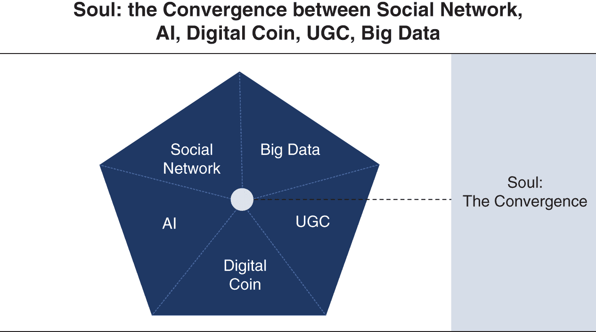

**图 1.7 Soul —— 社交网络、AI 与数字币的汇聚**

正如 Facebook 的 Meta 那样，Soul 并非因自称元宇宙公司而成为元宇宙公司。至于支持该项目的顶级游戏开发者，他们只是想获取其流量和用户行为模式数据。真正的元宇宙平台将由去中心化社区构建，在 Web3 新时代蓬勃发展，并满足我们下文定义的生态系统特性。

### 案例 4：Loot —— NFT、创意构想、艺术、衍生品与游戏的汇聚

2021 年 8 月下旬，Vine 联合创始多姆·霍夫曼（Dom Hofmann）临时拼凑出的一个 NFT（非同质化代币）实验项目 Loot 面向公众发布。短短一周内，该项目迅速走红。Twitter 上充斥着关于该项目的评论——怀疑论者、坚定的拥护者以及介于两者之间的所有人。从维塔利克·布特林到克里斯·迪克森等众多思想领袖，都将 Loot 定义为元宇宙、NFT 以及游戏概念本身的一次范式转移。约翰·帕尔默甚至断言：“我们已进入一个新时代；有了‘Loot 之前’，现在则是‘Loot 之后’。” 然而，也有人认为它不过是一场针对几乎没有内在价值的资产的投机性拉升。（**第 5 章**将深入探讨 NFT。）

Loot 的概念惊人地简单（参见 **图 1.8**）。共有 8,000 个“Loot 袋”，它们是包含八个短语的文本文件。每一件“物品”都类似于你在《龙与地下城》等游戏中会发现的物品——这也是霍夫曼称其为“冒险者装备”的原因。这些 Loot 袋是以太坊上的 NFT，具有可验证的稀有性、可交易性，且可与其他开放协议组合。Loot 将创作者经济、艺术、衍生品、游戏和去中心化自治组织（DAO）的商业模式融合进其自有的元宇宙版本中，并使用术语 `Lootverse`。

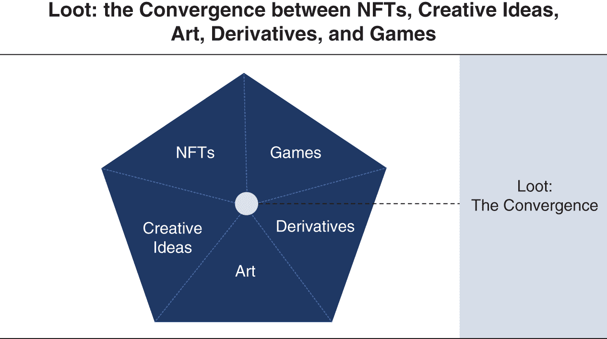

**图 1.8 Loot – NFT、创意、艺术、衍生品与游戏的融合**

但实际上你能用 Loot 袋做什么？答案非常简单，甚至可能让人感到不满意。根据项目描述：“Loot 是链上生成并存储的随机冒险者装备。属性、图像和其他功能被有意省略，留待他人解读。请随意以任何你想要的方式使用 Loot。”

换句话说，最初至少没有可供 Loot 使用的游戏。那么，“游戏”就是构建过程本身；人们寻找不同的方式来重混、集成并构建 Loot 生态系统。因此，Loot 是一组开源对象。它们的价值源于未来的使用方式。

换个说法，Loot 是首创的自下而上的游戏。没有人拥有或控制 Loot；原始合约密钥在一次治理投票后被销毁。相反，用户、建设者和所有者组成的社区决定 Loot 对他们意味着什么，以及他们想如何使用自己的物品。在 Loot 发布后的几周内，受该项目启发的艺术家、开发者和其他创作者掀起了一阵早期的热潮。

截至 2021 年底，Loot 的开发势头已放缓，社区规模依然较小，外界关注度也已消退。然而，Loot 已取得的成就不应因此被贬低。在合适的时机与合适的催化剂下，Lootverse 很可能再度流行起来。

### 案例 5：SocialFi —— 社交网络、游戏、金融、支付与 NFT 的融合

SocialFi 是社交网络、游戏、金融、支付与 NFT 融合于一体的平台。当前社交网络的商业模式本质上是榨取式的。平台获取用户数据并出售，同时向用户推送日益侵入式的广告。正如那句俗语所说：用户不是在为社交媒体付费；他们*就是*产品。现在，SocialFi 将创作的经济学权利交还给用户。

SocialFi 旨在通过社交影响力的金融化和代币化，为用户提供利益和回报（参见 **图 1.9**）。SocialFi 领域的早期采用者之一是 Monaco Planet。通过引入“写作即挖矿”的概念，内容创作本身成为一种挖矿形式。（“挖矿”指在区块链生态系统中“赚取”加密代币，将在 **第 3 章** 中详细解释。）Monaco Planet 上活跃的内容创作者和讨论参与者持续以原生代币的形式获得收益。大多数原生代币将分发给产生内容的用户，创造了一种可持续、包容且富有成效的“挖矿”形式。

真正的 SocialFi 平台属于其用户，而非互联网巨头。而且，由于 Monaco Planet 的绝大多数原生代币将作为内容创作奖励分发给用户，Monaco Planet 作为一个真正的去中心化自治组织（DAO）运作，由可以提交提案并投票的原生代币持有者治理。作为一个 SocialFi 平台，Monaco Planet 的所有权和治理由用户自己决定。此外，原生代币持有者将享受平台经济活动增长带来的币值增值。

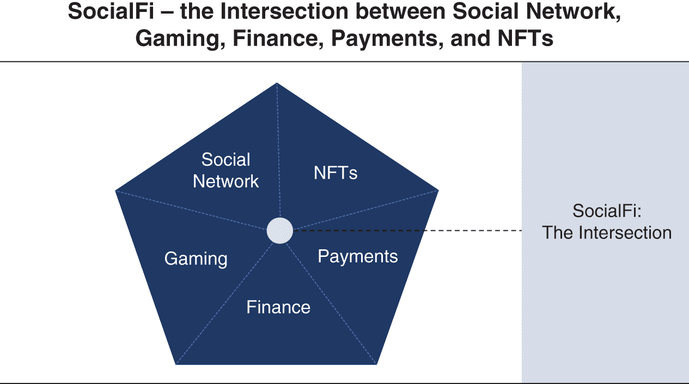

**图 1.9 SocialFi – 社交网络、游戏、金融、支付与 NFT 的融合**

## 为创作者经济构建更好的互联网

总之，2021—2022 年是元宇宙的盛大开幕之年。社交网络巨头 Facebook 更名为 Meta 以开发虚拟现实数字世界，图形芯片制造商 Nvidia 将重心转向“数字孪生”——现实世界物体或空间的虚拟版本——人们可以在计算机生成的世界中操作和研究它们，而 NFT（非同质化代币）则从默籍一跃成为头条新闻，生成数字资产以代表各种可能的现实世界物体，从艺术品和音乐到墨西哥玉米卷和卫生纸。

元宇宙——作为当今二维互联网的持久化、3D 化、交互式续作，用户在其中工作、娱乐、购买和出售，沉浸于虚拟世界——已成为互联网的“下一个大事件”（Web3）。作为定义了过去十年的移动互联网的继任者，Web3 代表了互联网的一次范式转移，一个你身处其中而非旁观的、物理与数字世界统一的具身互联网。

上述案例研究——尤其是 Monaco Planet 和 SocialFi 案例——让我们得以窥见初期元宇宙商业模式的雏形，以及它们如何赋能普通人，通过在多元元宇宙中开发或互动，享受沉浸式、有回报且盈利的体验。新技术，特别是区块链和其他分布式技术，将为互联网革命边缘的数十亿人释放机遇，使他们能成为即将到来的 `creator economy`（创作者经济）中的参与者（参见 **图 1.10**）。

相比之下，就 Facebook 而言，Meta 的推出因用户数据担忧而受到批评。考虑到 Facebook 的过往记录，人们有充分理由对该公司新聚焦的虚拟现实业务存在严重的隐私担忧。扎克伯格试图抢在担忧前面，承诺在公司转型更名为 Meta 的过程中提供多层隐私保护。Facebook 元宇宙的宣布迄今为止引发的怀疑和犹豫至少与热情相当，公众在想知道这家社交媒体巨头究竟计划做哪些（如果有的话）不同的事情。（Meta 股价在更改公司名称和战略后的几个月里大幅下跌。但这也可能归因于广泛的市场因素。）

因此，是时候构建一个更好的互联网了，在这个互联网中，用户而非大型科技平台掌控其数据价值、数据隐私和数据安全（参见图 1.11）。我们相信，下一波计算创新浪潮——连同全新的经济板块——将建立在去中心化技术之上。这就是 Web3——一组涵盖数字资产、去中心化金融、区块链、智能合约、代币、去中心化自治组织（DAO）等的技术群，未来还将包含更多内容。

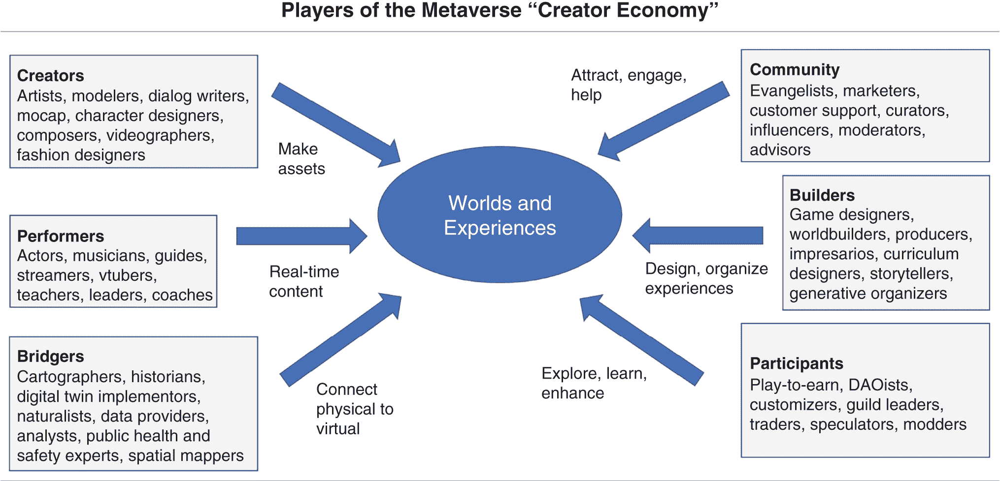

**图 1.10 元宇宙“创作者经济”** ¶ 来源：Jon Radoff，《*构建元宇宙*》

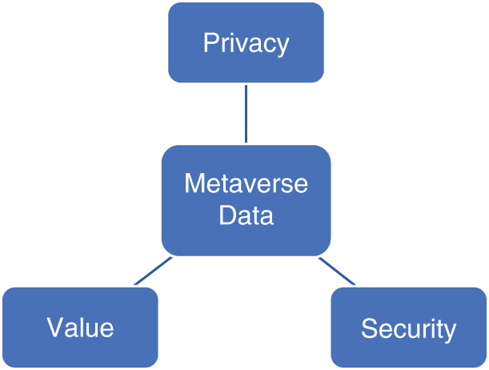

**图 1.11 用户在元宇宙中掌控数据隐私、安全与价值**

依我们之见，真正的元宇宙应由去中心化社区而非中心化的 IT 巨头来构建。用户在元宇宙平台内生成的数据应归用户所有，用户可决定与其他平台共享数据，并作为数据所有者获得货币化价值。同时，由于不存在中心化收集，用户数据隐私得以保护，用户数据可存储在由分布式账本技术（DLT）（如区块链）驱动的元宇宙平台上。（目前，用户数据被“困”在大型科技平台上，它们创建的元宇宙可能仍是围墙花园，并有可能造成反乌托邦社会。）

以下是元宇宙商业模式应满足的生态系统属性列表；前文的商业模式案例已展示了其中部分属性：

*   **公平性。** 生态系统应对每位参与者公平，不存在内幕交易或损害生态系统中其他参与者利益的秘密交易。SocialFi 平台 Monaco Planet 强调平台内每位参与者的公平性。
*   **点对点。** 将不存在中介机构；所有交互、交易及各类活动均点对点进行。生态系统解决方案提供方同时也是生态系统内其他解决方案的消费者或客户。几乎所有由去中心化社区开发的区块链项目，都试图将点对点交互/通信/交易作为平台的核心组件，这与科技巨头（如 Facebook）及其元宇宙布局（如腾讯的 Soul）截然相反。
*   **全球支付轨道。** 必须具备由加密货币赋能的全球实时即时结算与清算支付能力。
*   **去中心化自治组织（DAO）。** DAO 将管理并治理业务关系、交易及活动。
*   **可持续的代币经济。** 通过可持续的商业模式和实际价值创造融合物理与数字世界，元宇宙将能够蓬勃发展并惠及所有参与者。代币经济学必须鼓励并激励生态系统参与者的参与与贡献，奖励正向贡献、惩罚恶意行为。利用后到者资金支付早期参与者的庞氏骗局式系统只能维持短暂时间，不可持续。
*   **安全性。** 安全性应是元宇宙平台最重要的方面。必须实施纵深防御方法，以保护元宇宙生态系统中的每一个技术层和构建模块。除了网络与技术安全，生态系统还必须考量代币经济安全与合规监管。
*   **自主身份（SSI）。** SSI 意味着个人应拥有并控制自己的身份，无需第三方中介和中心化机构介入。个人数据以去中心化方式存储和管理，从而增强保护。所有者可访问与其身份关联的信息，并在共享前必须提供同意。SSI 是创作者经济的基础构建模块，因为用户都将成为数字资产的创作者。
*   **沉浸式体验。** “沉浸式体验”让人享受比当今二维屏幕更具吸引力、丰富度和回报感的体验。沉浸式技术通过融合物理世界与数字或模拟现实，创造独特体验。增强现实（AR）和虚拟现实（VR）是两大主要沉浸式技术类型。
*   **多维度体验。** 互联网体验可通过多重空间和时间维度得到增强，允许用户在毫秒级时间内传送至不同的 2D 或 3D 空间，并穿越至过去或未来。

在不远的将来，基于区块链的 Web3 将无处不在，我们的生活、劳动与休闲都将在其中进行。*区块链互联网*有望彻底变革每个行业和职能，从金融、医疗到媒体娱乐和房地产，创造数万亿美元的新价值——并从根本上重塑社会。在接下来的章节中，我们将讨论将赋能元宇宙应用的数字技术融合，并介绍 Web3 元宇宙的不同应用、安全与隐私层面。

元宇宙可能是万维网（Web1.0）和移动互联网（Web2.0）之后，计算领域的下一个主要平台。它将代表个人和社区使用技术方式的深刻变革。数据的价值创造与分配正从中心化参与者手中夺回，交到去中心化的个人群体手中。除了大型科技公司，主权国家也在积极投资元宇宙研究和下一代数字基础设施，包括国家支持的区块链网络。构建新的、去中心化的、区块链驱动的互联网——即 Web3——的竞赛已然开始。

## 第 2 章 区块链，Web3 的基石

*   基本区块链概念
*   区块链的四大关键组件
*   数据技术的超级融合
*   区块链与云计算
*   区块链与网络安全
*   区块链采用面临的五大挑战及可能的解决方案
*   为何区块链对元宇宙至关重要

## 基本区块链概念

互联网及其数字革命存在一个首要问题：数字数据可被复制。从本质上讲，这意味着任何数字系统都可能被攻破。因此，保护数字世界的完整性被证明是一项艰巨的任务。既然元宇宙意在将每个人甚至所有事物在数字层面连接起来，那么元宇宙经济（和社会）的核心，就是洞察、智能和信息——数据——的爆发式增长。因此，数据管理问题对新互联网而言比以往任何时候都更为关键。

这就是区块链成为元宇宙基石的原因。在深入探讨区块链应用的具体功能，并分析区块链与前沿数字技术——如人工智能（AI）、虚拟与增强现实（VR/AR）以及物联网（IoT）——如何融合以驱动元宇宙之前，让我们先从基本区块链概念入手。

那么，什么是区块链？

采用美国国家标准与技术研究院（NIST）的官方定义：


> 区块链是经过加密签名的交易的分布式数字账本，这些交易被分组到区块中。每个区块在验证并经过共识决策后，都会通过加密方式链接到前一个区块（使其具有防篡改显现性）。随着新区块的添加，旧区块变得更难修改（从而产生防篡改性）。新区块会在网络内的账本副本间复制，任何冲突都会使用既定规则自动解决。

维基百科有类似的定义：

> 区块链是一个不断增长的记录列表，称为区块，它们通过密码学链接在一起。每个区块包含前一个区块的加密哈希、时间戳和交易数据（通常以默克尔树表示）。时间戳证明交易数据在区块发布时已存在，以便将其纳入哈希中。由于每个区块都包含关于其前一个区块的信息，它们形成了一条链，每个额外的区块都会加强其前面区块的安全性。因此，区块链具有抗数据修改能力，因为一旦记录，任何给定区块中的数据都不能在不改变所有后续区块的情况下追溯修改。

简而言之，区块链是一个分布式账本或数据库，共享在公共或私有计算网络中。网络中的每个计算机节点都持有一份账本副本，因此不存在单点故障。每条信息都经过数学加密，并作为新“区块”添加到历史链记录中。在将新区块添加到链之前，会使用各种共识协议与其他参与者对其进行验证。这无需中央权威即可防止欺诈或双重支付。

除了“分布式数字账本”或“记录列表”的概念外，区块链技术的其他关键原则还包括智能合约、公钥加密、共识算法和点对点网络。这些技术协同工作，以实现区块链中的各种基础设施和应用。区块链包含许多不同的技术，包括博弈论、时间戳、交易排序和分布式计算。在下一节中，我们将详细讨论区块链的四个关键组件（参见图 2.1）。

# 区块链的四个关键组件

## 智能合约

NIST 对智能合约的定义如下：

> 一组代码和数据（有时称为函数和状态），通过区块链网络上经过加密签名的交易进行部署。智能合约由区块链网络内的节点执行；所有节点必须得出相同的执行结果，执行结果将记录在区块链上。

智能合约最初在以太坊区块链中引入，现在已在许多不同的区块链生态系统中广泛启用，例如 Avalanche、Binance Smart Chain（2022 年 2 月更名为 BNB Chain）、Polygon 和 Polkadot。早在 2016 年，智能合约编程逻辑就通过许多首次代币发行（ICO）展示了其威力，最近在 DeFi、NFT、GameFi 和元宇宙应用中被广泛使用。没有智能合约编程，区块链技术可能仅用于小规模的点对点支付应用。

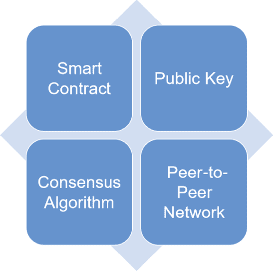

**图 2.1 区块链的四个关键组件**

### 公钥（加密）

公钥加密也称为非对称密钥加密。顾名思义，公钥加密使用两个非对称密钥（即两个不同的密钥）。一个密钥用于加密过程，另一个密钥用于解密过程。请参阅图 2.2，了解比特币交易中使用的公钥加密的高层示意图。（比特币是世界上第一个且可以说是最成功的去中心化数字货币，已获得广泛采用。用户可以通过点对点（P2P）网络发送或接收比特币支付，该网络由其底层区块链协议支持。详细讨论见第 3 章。）

在该图中，Bob 想给 Alice 发送一个比特币。他使用一个比特币钱包。比特币钱包将使用 Alice 的公钥加密交易，这样除了 Alice 没人能解锁交易中的比特币。Bob 还必须用他的私钥对交易进行签名。这是为了向 Alice 和整个网络证明他拥有该比特币的所有权。比特币在 P2P 网络中广播，并由称为“矿工节点”的网络节点进行验证，它们使用 Bob 的公钥来验证 Bob 的签名。如果一切顺利，将达成共识，交易将被记录在区块链网络中。Alice 是唯一能解锁该比特币的人，因为交易是用 Alice 的公钥加密的。最终，Alice 将使用她的私钥解锁交易并花费该比特币。（“矿工”和“挖矿”的概念将在第 3 章中解释。）

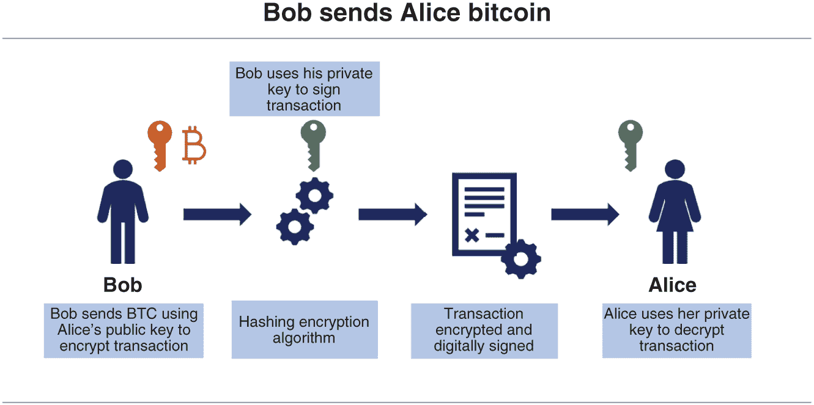

**图 2.2 比特币交易中的公钥加密**

### 共识算法

从最简单的定义来看，共识算法旨在让不同的分布式计算机就区块链的同一状态达成一致，并记录该一致性，而无需信任区块链网络中的任何参与计算机或“节点”。精心设计的共识算法必须考虑点对点网络不可靠和异步的特性。

一个好的共识算法允许某些节点处于故障状态，这意味着节点可以是恶意的，或者干脆停止参与共识过程，但区块链网络仍能与大多数诚实节点达成一致。例如，比特币的共识算法工作量证明利用博弈论和算力，在无需信任的网络环境中实现可靠的计算结果，可容忍高达 50% 的攻击。

不同的区块链网络还使用其他共识算法，如权益证明、经过时间证明、历史证明和复制证明。这些共识算法的关键思想是允许区块链节点以无需信任和分布式的方式就区块链交易和账本状态达成一致，而不对底层网络做过多假设和限制。任何共识算法的基本假设是大多数网络节点是诚实节点，因此网络可以容忍一些“坏苹果”或恶意节点。

共识算法可以从纯技术算法扩展到区块链生态系统中的社会行为，这被称为*社会共识*。区块链生态系统不仅由无生命的计算机节点组成；它还需要人类参与者、开发者、投资者、买家、玩家、创作者、钱包持有者、交易市场，甚至政府实体和监管机构。“社会共识”是指个人和组织就区块链网络的价值、区块链代币经济的公平性、参与意愿以及对区块链网络的贡献所达成的共识。

社会共识隐含在 DAO（去中心化自治组织）结构中，旨在促进区块链网络的共同利益和治理。技术共识和社会共识都将在元宇宙应用中发挥重要作用。因为 DAO 的“社会共识”创造了一种新的去中心化治理模式，DAO 可能会取代公司，成为元宇宙中流行的组织结构，这将在第 10 章中讨论。

### 点对点（P2P）网络

尽管这不是一个新概念，且在比特币网络出现很久之前就已存在，但 P2P 网络背离了传统的客户端/服务器架构，后者由独立的计算机充当服务器，为作为客户端的不同计算机集合提供服务。在 P2P 网络中，每个计算节点既可以是服务器，也可以是客户端。对等节点可以发现一组其他对等节点进行通信，而无需任何身份验证或授权。这使得信息能够自由流动，并使网络对潜在的系统崩溃更具韧性。

在区块链中，对等节点可以广播区块、参与共识算法、验证每笔点对点交易，并因其贡献获得奖励。P2P 网络的理念可以延伸至区块链，以倡导区块链网络中的每个个人或组织拥有平等的话语权和同等的权利。每个人的权力在某种程度上可以通过其在网络中的权益（从权益证明 `POS` 共识算法的角度来看）或他们可为网络使用的电力（从工作量证明 `POW` 共识算法的角度来看）来衡量。如果所有人在网络中拥有平等的权益，则无人凌驾于他人之上。（`POW` 和 `POS` 将结合比特币在第 3 章中讨论。）

# 数据技术的大融合

作为去中心化数据技术，区块链将成为下一代互联网——Web3 的基石。如前所述，我们今天所知的网络是从静态内容发布的 Web1.0 发展到当前中心化的 Web2.0。Web2.0 融合了 SoLoMoCo（社交、基于位置、移动应用和云计算）技术，并产生了巨大的经济效益，催生了亚马逊、谷歌、脸书、阿里巴巴和腾讯等互联网巨头。

Web3 是更多技术的大融合。为了支撑元宇宙这样大胆的概念，我们需要强大数个数量级的计算能力，且能以更低的延迟访问，覆盖多种设备和屏幕。除了 SoLoMoCo，我们看到 Web3 通过融合 AI、区块链、大数据、去中心化身份（化身）、金融科技、去中心化存储、物联网、AR/VR、视频渲染、游戏技术、量子计算等，进一步赋能元宇宙。

数据将在元宇宙中以前所未有的规模爆发。人类目前的数据创造速度使得世界数据量每两年翻一番，且这一速度预计将加快。到 2025 年，数据量将每 12 小时——甚至更短时间——翻一番。随着我们生活的进行，这些呈指数级增长的海量数据有可能改变我们的生活、工作和投资方式——但前提是我们拥有区块链等数字技术来管理、保护并妥善保护隐私地使用这些数据。（参见框：区块链与数字化转型。）

同时，COVID-19 大流行凸显了世界在数据方面的集体方法的不足。无法（有时甚至不愿）共享和使用数据来抗击 COVID-19，或防范数据的掠夺性使用，对全球的个人、私营企业、公民、研究机构和政府产生了负面影响。缺乏信任加上不对称的经济利益正在阻碍进展——尤其是在跨境背景下。2021 年勒索软件和软件供应链攻击的爆发，暴露了企业（无论大小）中心化数据存储的脆弱性。

当前的危机说明，如果没有适当的技术、协议和治理，社会面临的风险是：要么创造一个数据访问过度受限、阻碍人类进步和创新的世界；要么创造一个数据共享解决方案未能妥善尊重相关各方（包括企业）权利的世界。这就是区块链对元宇宙至关重要的原因。

当然，如果不与其他技术集成，区块链单独使用的用例有限。它们可以协同工作，解决元宇宙中链下数据真实性、网络安全、风险控制和数据治理的问题。不同技术可以相互融合，创造一个自动化生态系统——物联网设备在数百万设备上收集数据，这些数据被分布式存储、由区块链管理，随后在云端汇总，并用于训练和改进 AI 算法以用于现实生活应用（参见图 2.3）。

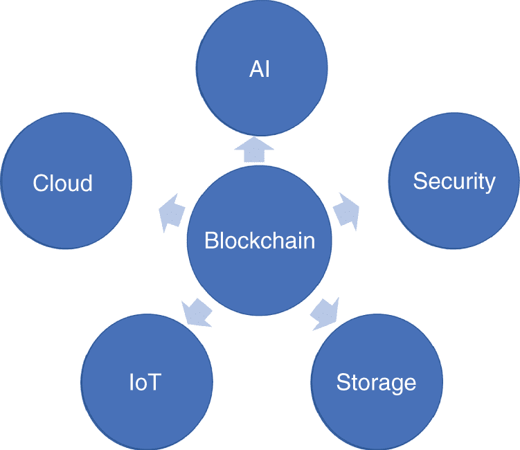

**图 2.3 区块链与 AI、云和物联网的融合**

## 区块链与物联网 (IoT)

虽然物联网侧重于改进用于各种目的的适当数据收集，但区块链侧重于确保数据完整性保持完好。物联网允许设备将数据传输到区块链网络，创建防篡改的共享交易记录。商业合作伙伴可以使用区块链交换和访问物联网数据，从而消除了对中心化控制和管理的需求。此外，所有交易都可被验证，以最大程度减少争议并建立网络参与者之间的信任。

将区块链用于物联网有几大优势：

*   降低篡改从物联网设备接收数据的风险，从而在物联网业务中建立各方之间的信任。
*   利用区块链的共识算法进行数据验证和完整性检查，减少中介的开销。
*   创建不可变的审计追踪以规避抵赖风险。
*   利用智能合约和代币经济实现机器对机器支付。
*   随着边缘计算对物联网变得重要，区块链技术可用于激励边缘计算参与者提供高质量数据，同时在上传至区块链账本前在边缘进行处理和验证。

货运是物联网与区块链融合的一个应用示例。货物运输是一个涉及多方且优先级不同的复杂程序。集装箱在运输过程中的温度、位置、到达时间和状态都可以存储在支持物联网的区块链上。不可变的区块链交易确保所有各方都能信任数据，并迅速高效地开展活动。

## 区块链与分布式存储

# 面向区块链开发的未来

对于区块链开发的未来而言，存储是一项不可或缺的功能。`AI` 和 `IoT` 等许多应用场景需要海量数据存储，这些技术与区块链的融合势必需要消耗大量分布式且始终可用的数据存储。目前，主流区块链无法直接存储大规模数据，因为全节点需要同步所有区块链数据。如果链上存在大量数据，节点负载将过重，区块链的效率也会变低。因此，将数据上链最流行的方式是将数据放在 `IPFS` 等去中心化存储中，而仅将哈希值、元数据和交易日志等少量数据存储在区块链上。

然而，仅靠 `IPFS` 技术无法激励参与网络的节点存储链下数据并使其始终可用。为了实现激励机制，`Filecoin` 项目提出了复制证明和时空证明。复制证明和时空证明通过激励机制，确保数据能够真正被复制、存储，并由矿工随时可用于检索。我们可以进一步利用 `IPFS` 和 `FileCoin` 等去中心化存储技术来提高数据可用性。不过，业界仍需验证该机制是否成熟稳定。

## 区块链与人工智能（AI）和机器学习（ML）

`AI`/`ML` 可以帮助区块链在现实应用中变得更智能。例如，在供应链金融中，为了控制风险，可以使用 `AI`/`ML` 为区块链提供经过 `AI`/`ML` 处理的数据。此外，`AI`/`ML` 可以分析异常行为，为链上交易提供欺诈检测，以提醒链运营商注意恶意活动。与传统 `AI` 应用相比，结合区块链技术时，共识机制确保 `AI`/`ML` 的训练数据和算法可被验证，`AI`/`ML` 算法的哈希值可存储并在链上验证，以确保 `AI`/`ML` 算法及其输出结果的准确性。

区块链还可以通过利用智能合约定义的激励机制，帮助 `AI` 提升数据共享能力。为缓解隐私担忧，可应用零知识证明（`ZKP`）、安全多方计算（`MPC`）和同态加密算法。通过使用智能合约和激励机制，可以实现数据权益验证和数据交换交易，以及数据定价。

此外，区块链可以帮助 `AI` 促进 `AI` 算法优化，为深度学习任务建立分布式计算能力，并有效利用闲置计算资源。区块链智能合约可用于管理 `AI` 算法的行为，避免因 `AI` 算法使用不当导致的安全问题。

## 区块链与云计算

云技术（也称为*云计算*）意味着服务器、数据存储、数据库、网络、软件和分析托管在互联网上，并存储在大型私有数据中心中。`AWS`（亚马逊云服务）、`Microsoft Azure` 和 `Google Cloud Platform` 等云计算平台提供三类云服务：

1.  **基础设施即服务（`IaaS`）**。`IaaS` 云服务包括面向云消费者的计算、网络和存储服务。
2.  **平台即服务（`PaaS`）**。`PaaS` 提供商提供中间件、数据库、运行时环境和开发工具。
3.  **软件即服务（`SaaS`）**。`SaaS` 向云消费者提供实际部署好的应用程序，因此云消费者无需安装任何软件或购买服务器、存储和网络设备等计算资源即可在云端使用应用程序。

云服务商让最终用户能够按“按量付费”制“租用”并远程访问云服务商的 IT 资源，这为本地托管和运营 IT 资源提供了一个高效的替代方案。企业订阅云服务并按月或按年付费，就像从电网购买电力一样。该费用由企业所需的数据量和用户数量决定——这使得公司更容易扩大或缩减其业务规模。总体而言，与传统 IT 基础设施相比，云计算提供了更好的系统可扩展性和成本节约。

总之，与单个公司托管的传统数据中心相比，云计算提供了许多优势，这对于必须应对数据爆发式增长的元宇宙参与者至关重要：

*   它消除了对昂贵 IT 基础设施的前期投资。
*   云计算提供商提供“按需付费”等定价模式，意味着消费者只为其使用的内容付费。
*   用户无需从事 IT 基础设施的供应和管理工作，因为云服务商会处理这些。

尽管如此，云计算提供商可能会遭遇服务中断，其负面影响通常比传统数据中心的中断更严重。例如，2021 年 12 月 7 日，亚马逊的网络托管平台遭遇重大故障，导致 `Facebook`、`Netflix`、`Disney+` 和 `Venmo` 等主要网站瘫痪。此外，亚马逊送货服务中断，司机无法获取路线或包裹，亚马逊与其依赖的数千名司机之间的通信中断。

该故障还波及多家加密货币交易所，如 `Coinbase`、`Binance`，以及许多将应用托管在亚马逊上的区块链相关服务。甚至去中心化衍生品交易所 `dYdX` 也受到影响，这引发了这样一个问题：如果去中心化交易所（`DEX`）的前端用户界面（`UI`）托管在中心化云上，那么它到底有多少去中心化程度。

利用 `IPFS`（星际文件系统）托管 `Web3` 应用的前端 `UI` 可能成为一种趋势，因为元宇宙应用寻求避免云服务中断的保护。与 `HTTP` 协议（现有互联网）通过 `URL` 根据对象（文本文件、图片、视频）存储在哪台服务器上来定位对象不同，`IPFS` 通过文件上的哈希值来定位对象。`IPFS` 根据文件内容创建文件哈希。因此，如果你想访问特定页面，`IPFS` 会询问整个网络是否有人拥有与该哈希对应的文件，拥有该哈希的 `IPFS` 节点会返回该文件，从而允许你访问它。

因此，`IPFS` 在 `HTTP` 层使用*内容寻址*。这意味着可以用内容来确定内容的地址。其机制是获取一个文件并对其进行加密哈希处理，从而得到该文件的安全表征。这确保了没有其他人能随意拿出另一个具有相同哈希值的文件并将其用作地址。此外，所有文件在全球范围内分布和复制，可通过由区块链技术驱动的激励机制永久存储。

这只是利用区块链解决云服务中断问题的一个例子。此外，区块链还可以被设计为以去中心化的方式利用闲置计算资源。地球上存在许多闲置的计算资源，如 `CPU`、`GPU`、存储和网络带宽，但由于中心化的本质，当前的云服务商无法利用它们。一种更好的云计算方法是利用区块链技术激励计算资源、存储和网络带宽共享，同时降低安全漏洞风险。

作为示例，我们将在本节其余部分分别讨论如何在 `IaaS`、`PaaS` 和 `SaaS` 服务中利用区块链。

### IaaS 服务

# 区块链云计算产品

## IaaS 产品

对于 IaaS 产品，我们可以参考（1）算力或中央处理器（CPU）共享；（2）存储共享；以及（3）网络带宽共享的示例。

### 1. CPU 共享

一个例子是 `SETI@home`，这是一个设在加州大学伯克利分校的科学实验，利用联网计算机搜寻地外文明（SETI）。您可以通过运行一个免费程序来参与，该程序会下载并分析射电望远镜数据。该程序目前处于休眠状态。这一优秀项目停止的主要原因之一，是缺乏针对拥有空闲 CPU 周期并参与其中的人员的激励机制和奖励方案。

`Three Fold` 和 `IEx` 等区块链项目正试图利用代币经济，在“去中心化云”中创建点对点算力共享。其目标是构建一个 P2P 公共覆盖网络，连接地球上的一切。连接采用端到端加密并走最短路径。团队还打算利用代币经济激励网络共享。

### 2. 存储共享

最好的例子是 `FileCoin`。Filecoin 是一个开源的公共加密货币和数字支付系统，旨在成为一种基于区块链的协作式数字存储和数据检索方法。它由 `Protocol Labs` 开发，构建在 `星际文件系统（IPFS）` 之上，允许用户出租闲置的硬盘空间。根据 Filecoin 作者的说法，它是一个去中心化存储系统，旨在“存储人类最重要的信息”。Filecoin 是一个开放协议，由区块链提供支持，该链记录网络参与者做出的承诺，交易使用 `FIL`（区块链的原生货币）进行。

与中心化存储方法相反，Filecoin 旨在以去中心化的方式存储数据，这能抵御中心化存储中出现的问题。得益于 Filecoin 的去中心化特性，它保护了数据位置的完整性，使数据易于检索且难以审查。它还允许网络上的人们成为他们所存储数据的自己的保管人。此外，Filecoin 奖励在其区块链网络上挖矿和存储数据的网络节点。类似的基于区块链的存储共享系统包括 `Sia`、`MaidSafe` 和 `Three Fold`。

### 3. 网络带宽共享


例如，`Helium` 是一个由热点组成的全球分布式网络，为支持 `LoRaWAN` 的物联网设备创建公共、长距离无线覆盖。热点生成并以 `HNT`（Helium 区块链的原生加密货币）获得补偿。Helium 区块链是一个全新的、开源的、公共区块链，完全是为了激励创建物理去中心化无线网络而诞生的。如今，Helium 区块链及其数十万个热点，提供了对世界上最大 LoRaWAN 网络的访问。

## PaaS 产品

对于 PaaS 产品，最好的例子是各种元宇宙、`DeFi` 和 `NFT` 应用，它们充当“元宇宙积木”，意味着它们可以被复用来开发新的元宇宙应用。对于开发工具，`Remix` 是一个用于开发智能合约 Solidity 代码的 PaaS 工具的好例子。另一个好例子是 `Infura API` 服务，它允许开发者与 `Ethereum` 或 `IPFS` 服务交互。Infura 是开发者中公认度最高的连接以太坊和 IPFS 的 PaaS 工具之一，它已经每天处理数十亿次 API 请求。

## SaaS 产品

有许多成功的 SaaS 产品案例。其中，最知名的是 `The Graph` 和 `Chainlink` 项目。随着 DeFi 和 NFT（将在接下来的两章讨论）的发展，在区块链上开发和部署的 Dapp 都可以被视为 SaaS 产品，并由去中心化节点提供支持。

### The Graph 网络

`The Graph 网络` 将互联网应用栈的 `GraphQL` API 和查询层去中心化。开发者可以在自己的基础设施上运行 `Graph 节点`，也可以构建在 The Graph 托管服务之上。在 The Graph 网络中，任何 `索引器` 都能质押 `Graph 代币 (GRT)` 以参与网络，并通过为子图建立索引和为这些子图上的查询提供服务来获得奖励和费用。消费者将能够通过为其计量使用付费来查询这一多样化的索引器集合，提供了一种由供需法则维持协议所提供服务的模式。

### Chainlink

`Chainlink` 是一个构建在 `Ethereum` 上的去中心化区块链预言机网络。该网络旨在促进从链下来源向链上智能合约传输防篡改数据。其创建者声称，它可以通过“将合约直接连接到现实世界的数据、事件、支付和其他输入”，以独立于合约任何利益相关方的方式，验证智能合约的参数是否得到满足。

Chainlink 采用 SaaS 模式运营。Chainlink 的消费者支付 `$Link`（Chainlink 的平台代币）以从该平台接收防篡改数据。Chainlink 节点通过提供可信数据以无信任方式赚取 `$Link`，而提供不准确数据的节点则会受到 `$Link` 的惩罚。

基于区块链的去中心化云计算技术目前仍处于起步阶段，但 `Google`、`Microsoft`、`Amazon` 和 `IBM` 等公司已经开始在这些领域进行研究。尽管具体细节尚未公开，但可以想象，未来的云计算将更加安全、稳定、高效、节能，并能更有效地利用个人计算资源。得益于区块链的赋能，云计算的商业模式和提供商的运营模式正在迅速演变。

## 区块链与网络安全

区块链的不可篡改性是其重要的安全属性，它有效地保证了数据的完整性。然而，在将区块链集成到元宇宙应用时，我们需要采取纵深防御方法。区块链的主要安全控制措施包括（但不限于）智能合约安全、共识算法安全、区块链节点加固、加密货币交易所安全、身份与访问管理、节点间流量加密，以及链上和链下数据加密。

## 智能合约安全

智能合约一旦部署在区块链 `主网` 上（该术语用于描述区块链协议完全开发并部署的状态）就无法修改，因此如果存在安全漏洞，往往会造成直接的经济损失且难以追回。一个经典案例是对 `DAO` 的攻击。

`DAO`（去中心化自治组织）是一个构建在 `Ethereum` 区块链网络上的程序，旨在成为最大的众包平台。DAO 旨在利用技术民主化方法取代中心化的管理结构，由投资者和利益相关者做出决策。DAO 智能合约部署在以太坊主网后，一名黑客发现了 DAO 代码中的缺陷，并设法窃取了约 5000 万美元价值的 `Ether`，这让以太坊社区陷入恐慌，并最终导致以太坊硬分叉。

另一个近期的智能合约攻击案例是 `Poly Network` 攻击。Poly Network 是一个跨链网络，本质上允许两个或多个区块链“相互通信”。更准确地说，它使用户能够在不同区块链之间进行交易，而无需在交易所转换数字货币。这个总部位于中国的平台具体建立在包括 `Bitcoin`、`Ethereum`、`Binance Smart Chain`、`Neo` 和 `Elrond` 在内的多个区块链之上。

2021 年 8 月 10 日，Poly Network 报告称，一组攻击者黑入了其网络的一个智能合约，转移了约 6.1 亿美元（主要为以太币、币安币和 USDC），并将其移至外部钱包地址。据网络安全公司 SlowMist 分析，此次黑客攻击之所以成为可能，是因为 Poly Network 两个关键智能合约之间的访问权限管理不善。尽管黑客最终因担心自身身份（如 IP 地址、电子邮件及其在中心化加密货币交易所的账户）被发现并面临起诉而将资金归还给 Poly Network，但如果黑客更加注意保护自身身份，同样的事情可能再次发生，且资金不会被追回。

确保智能合约开发安全的良策是建立健全的内部安全审查流程，以便在代码发生任何变更时对智能合约代码进行审查。此外，在智能合约部署到主网之前，聘请至少两家独立的外部智能合约审计公司进行审计至关重要。审计和验证智能合约的成本很高，即使经过审计，也难以完全规避安全风险。鉴于攻击的严重后果，用于审计的资金仍物有所值。

尽管市场上有许多静态代码分析和形式化证明验证工具（包括开源和商业工具），但审计智能合约代码的主要工作仍由经验丰富的智能合约安全审计师通过人工代码审查来完成。因此，任何元宇宙项目都必须聘请一名智能合约审计师作为内部员工，在代码开发期间进行持续的安全审查，并在项目上线前聘请第三方审计师。

## 共识算法安全

共识算法是区块链网络的根基。它使网络节点能够就账本状态达成一致。如果共识算法受到攻击，区块链就不再安全；如果链上存储着货币价值，经济损失将对区块链生态系统的参与者造成毁灭性打击。例如，2019 年，一种名为“Sync Hotstuff”的共识算法被发现存在一个关键安全漏洞，攻击者可利用所谓的“强制锁定攻击”进行双重支付或拒绝服务攻击。

另一个例子是对 `Gasper` 算法的攻击，该算法由 `Vitalik Buterin` 等人编写。Gasper 是一个抽象的权益证明共识层，由 `Beacon Chain` 协议实现，后者是即将推出的以太坊 2.0 网络的底层协议。Gasper 的一个关键组件是最终性机制，它确保交易的持久性（安全性）以及系统即使在受到攻击时也能持续运行（活性）。它将最终性工具 `Casper FFG` 与 `LMD GHOST` 分叉选择规则相结合，旨在实现安全性和活性。然而，斯坦福大学研究人员于 2020 年发表的一篇论文正式证明了可以针对 Casper 发起攻击，从而影响其安全性和活性。

## 节点安全

区块链节点也称为共识节点。它们分布在世界各地，用于验证交易签名并使用共识算法保持账本更新。节点由节点软件和硬件（或微服务环境）组成，后者为节点软件的运行提供执行环境。节点安全包括节点软件安全和节点执行环境的加固。

对于节点安全，一个很好的例子是 `EOS` 节点软件。EOS 区块链是由 `Block.One` 开发的知名区块链。中国互联网安全研究公司奇虎 360 发现了 EOS 出块节点上的一个关键漏洞，黑客可利用该漏洞远程管理节点上的代码。奇虎 360 官网的官方博文写道：

> 该漏洞可被利用，通过上传恶意合约到受害节点并让节点解析该恶意合约，从而在 `nodeos` 进程（操作系统）中实现远程代码执行。在真实攻击中，攻击者可能将恶意合约发布到 EOS 主网。

幸运的是，该漏洞在 EOS 上线前已修复，未造成资金损失。如果该漏洞未被修补且 EOS 上线，数十亿美元的资金将面临风险。

节点安全的另一个好例子是节点运行的执行环境和防火墙设置。在 2018 年的一个案例中，端口 8545 遭到攻击，这是以太坊客户端（包括 `Geth`）远程过程调用（RPC）接口的默认监听端口。背景信息：所有以太坊客户端都内置了 RPC 接口，可通过 API 提供第三方访问，从而可能暴露敏感信息和操作。

默认情况下，大多数以太坊客户端会禁用 RPC，但有兴趣启用远程以太坊区块链访问的用户可以激活 JSON-RPC 接口。虽然支持身份验证和访问控制列表（ACL），但如果连接到互联网，该接口可能会暴露用户的矿工信息和钱包详情。黑客通过向矿工的 8545 端口发起 JSON-RPC 调用，从矿工地址窃取了约 2000 万美元的 ETH，因为矿工错误配置了回环地址，将端口暴露在互联网上。

总之，对于节点安全，在节点软件用于生产环境（或主网）之前，进行安全测试以挖掘漏洞非常重要。对于节点执行环境，开发人员必须确保操作系统和微服务环境被锁定和加固，关闭不必要的服务，关闭开放端口以仅允许必要端口开放，并对端口应用访问控制。互联网安全中心（CIS）基准可作为主机环境加固的良好参考。

## 数据加密安全

区块链具备一定程度的数据加密以保护用户隐私。例如，区块链系统中的地址由用户生成，与用户身份信息无关。创建和使用地址无需中心化第三方参与。因此，与传统账户（如银行卡号）相比，区块链地址展现出更好的匿名性。

然而，用户在使用区块链时可能会泄露一些敏感信息。例如，区块链交易在网络层的广播可能被黑客利用，以推断用户的 IP 地址、公钥或在无关区块链交易中的钱包地址。大数据分析可被应用于发现用户的真实身份。此外，由于公有链上的数据任何人都可查看，因此重要的是不要将任何敏感信息（如个人身份信息、财务记录或医疗记录）上链。

出于交叉验证和数据完整性检查的目的，将敏感数据的哈希值上链是一个好方法，因为哈希是一种加密方式。获取数据的哈希值（也称为数字摘要）很容易，如果哈希算法足够强，从数学上讲不可能从哈希值反推明文数据。零知识证明、安全多方计算和同态加密等多种其他加密算法已作为新的数据加密工具获得关注。（第 7 章 和 8 章 将详细介绍数据隐私和数据安全主题。）

## 区块链采用面临的五大挑战及可能的解决方案

当前区块链技术面临五大主要挑战：隐私、可扩展性、共识算法、链上数据的真实性以及互操作性。

### 隐私问题

从隐私角度来看，当前的区块链项目尚不够成熟。在隐私保护领域，零知识证明、安全多方计算、同态加密、环签名、`BLS` 签名、`Schnorr` 签名、`Mimblewimble` 以及其他隐私算法值得深入研究。关于带有访问控制的状态通道和可信执行环境（`TEE`）的研究非常活跃，这也促进了隐私保护技术的发展。

研究人员面临的挑战是满足欧盟 GDPR（《通用数据保护条例》）、美国隐私法（如 HIPAA《健康保险流通与责任法案》）及其他法规的隐私要求，同时也要满足 KYC/AML（了解你的客户/反洗钱）的要求。隐私保护与 KYC/AML 监管要求之间需要取得平衡。

### 可扩展性

区块链——一种最初作为爱好者小众项目起步的技术——能否成功扩展到全球级别？这是一个大问题。我们可以将其比作互联网早期，当时技术正在应对激增的用户群以及随之而来的挑战和延迟。从可扩展性角度来看，存在三层解决方案。我们以以太坊扩展解决方案为例（参见图 2.4）。

#### Layer 2 技术

顶层（称为 Layer 2 技术）使用运行在以太坊主网或 Layer 1 之上的不同网络。以太坊 Layer 2 解决方案以智能合约的形式存在于以太坊网络上。Layer 2 解决方案在与主网交互时，不需要对基础层协议进行任何修改。以太坊 Layer 2 扩展解决方案可服务于不同功能，如链下计算和支付扩展性。

所有 Layer 2 解决方案的工作重点在于一个独特元素：将大部分交易移至链下。因此，Layer 2 解决方案能够在提高交易处理速度的同时，降低交易所需的 Gas 费用。许多以太坊 Layer 2 解决方案已成功获得关注。Layer 2 扩展的三个主要思路是：Rollups、状态通道和侧链。

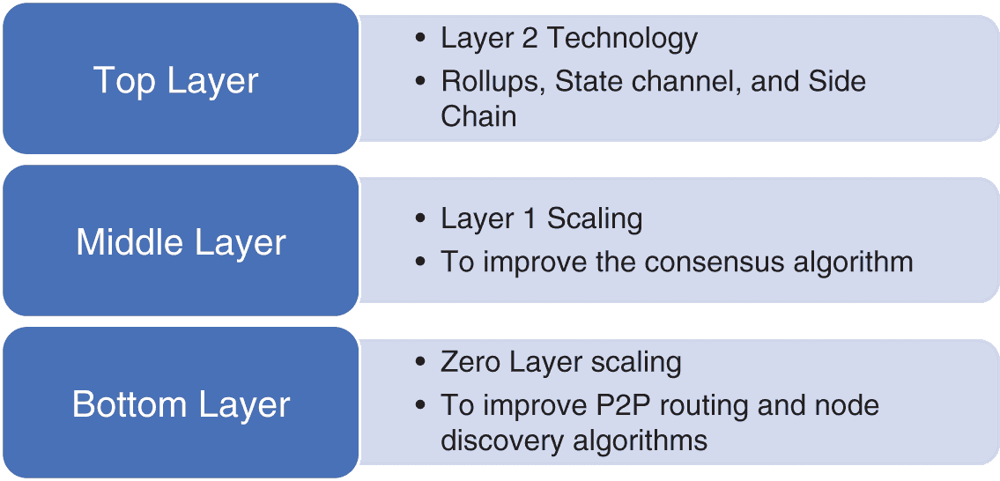

**图 2.4 Ethereum Scaling at Three Layers**

**Rollups。** Rollups 扩展解决方案在 Layer 1 区块链之外执行交易，并将交易数据发布到 Layer 1 上。由于数据位于基础层，这使得 Layer 1 能够保障 Rollups 的安全。Rollups 具有两种不同的安全模型：

*   **Optimistic Rollups（乐观 Rollups）。** 这些方案默认假设交易有效。因此，只有在受到挑战时，才会进行计算以检测欺诈。

*   **Zero-Knowledge Rollups（零知识 Rollups）。** 这些 Rollups 在链下运行计算。随后，它们向基础层或主链提交有效性证明。

以 `Polygon`（前身为 `Matic`）、`Arbitrum` 和 `Optimism` 为例，Rollups 有助于提高交易吞吐量和开放参与度，并降低用户的 Gas 费用。

**State Channels（状态通道）。** 状态通道允许区块链参与者之间进行双向通信。在此过程中，由于没有第三方（例如 Layer 1 链上的矿工）参与，参与者可以减少等待时间。其工作原理如下：

*   参与者使用智能合约，预先同意从基础层数字签名锁定一部分代币。
*   然后他们可以直接相互交互，无需涉及 Layer 1 链上的矿工。
*   完成整套交易后，他们可以关闭通道并将最终状态提交到基础层区块链。

**Sidechains（侧链）。** 侧链是一条独立的链，可处理大量交易。它拥有独立于 Layer 1 的共识机制。该机制可经过优化以提高可扩展性和处理速度。在这种情况下，主链必须确认交易记录、维护安全性并处理争议。侧链与状态通道的区别在于，它们在账本中公开记录所有交易。此外，如果侧链发生安全漏洞，不会影响其他侧链或 Layer 1 主链本身。

#### Layer 1 扩展

中间层称为 Layer 1 扩展。在这一层，思路是使用分片或隔离见证（`SegWit`）、增加区块大小（即增加每个区块包含的数据量）、减少区块确认时间、使用有向无环图（`DAG`），或改进基础链上的共识算法，以提高基础链的性能和可扩展性。

#### Zero Layer 扩展

底层也称为 Layer 0 扩展。在这一层，主要思路是改进 P2P 路由和节点发现算法以获得更好的可扩展性，或者在未来利用 5G 技术获得更好的网络带宽。总体而言，三层的改进都是必要的。所有三层技术都在积极研究中，以提高区块链的可扩展性。

### 共识算法

从共识算法角度来看，异步通信领域的 FLP 不可能性定理证明：在完全异步通信的分布式环境中，如果有一个节点故障，整个网络无法达成共识。因此，当共识算法研究人员试图绕过 FLP 不可能性时，大多数共识算法假设网络节点诚实占多数，并假设部分（或完全）同步。

例如，比特币工作量证明（`PoW`）算法假设 51%的诚实节点和响应时间上限（部分同步），各类权益证明（`PoS`）算法也假设诚实节点占多数以及不同程度的同步。

PoS 算法的关键问题是所谓的“无利害关系”攻击。“无利害关系”意味着由于 PoS 投票成本几乎为零，如果区块链出现多个分叉，每个验证者都会在所有分叉上投票，以在所有分叉上获取奖励。此外，PoS 还面临长程攻击等其他攻击。采用博弈论方法并为恶意 PoS 节点引入惩罚机制，可以在一定程度上缓解 PoS 漏洞。

目前在 PoS 领域仍有大量活跃的学术和产业研究，旨在使其更安全。此类研究的例子包括以太坊 2.0 权益证明算法和 `Cardano` 的 `Ouroboros` 权益证明。其他共识算法仍在积极研究中。我们将其视为区块链技术的主要挑战之一，因为很难同时实现安全性、可扩展性和去中心化。这被称为“区块链不可能三角”。

区块链不可能三角涉及三个相互竞争的概念。你总是可以通过牺牲其他属性来实现可扩展性、安全性和去中心化这三个主要属性，但无法同时最大化这三个属性。因此，共识算法设计需要根据实际业务用例，在安全性、可扩展性和去中心化之间找到平衡。因此，不会有单一区块链主导所有应用。将会有不同共识算法的不同链服务于不同的用例。

### 链上数据的真实性

**数据真实性**是指数据在创建后未被损坏，且必须代表真实世界的场景。数据真实性还意味着数字对象确实是其声称的样子，或被声称的样子。

为了使区块链技术对现实世界的应用有用，强烈需要向区块链提供真实数据。虽然区块链具有链上数据不可篡改的特性，但它仍然面临将现实世界物理对象的属性映射到链上的“首公里”问题。如果没有数据真实性，区块链上的智能合约可能会在虚假和垃圾数据上运行，因此执行智能合约的结果可能导致资产损失或其他严重后果。

有许多获取区块链认证数据的方法，包括以下几种：

1.  最常用的是所谓的“预言机”技术，主要用于为 DeFi 应用（详见**第 4 章**）提供可信数据，例如比特币的市场价格、股票的市场价格和美元汇率。该技术的主要缺点是没有有效的无信任预言机方案。引入惩罚机制和数字身份机制可能会带来更好的解决方案。使用去中心化身份作为预言机是一种潜在的解决方案，此外还包括针对错误预言机数据的惩罚机制。

2.  对于高端传感器或服务器，使用可信执行环境（`TEE`）对收集的数据进行数字签名。因为 `TEE` 从物理上保护用于签名的私钥，如果没有物理主体，私钥将失效。这确保了数据在传输过程中不被篡改。类似的技术包括安全元件（`Secure Element`）、物理不可克隆函数（`Physical Unclonable Function`）和其他技术。

3.  对于具有可测量的独特物理属性的资产，数据真实性解决方案更简单。例如，`Everledger` 利用钻石的独特物理属性将有价值的钻石数据记录在区块链上，使天然钻石行业足以应对合成替代品的增长。

4.  使用人工智能、机器学习算法来识别虚假数据并提高上链数据的真实性。

5.  通过视频监控和其他安全控制来监控物联网和其他数据收集资产。

6.  在物理对象的随机位置植入专用芯片（通常是具有 NFC 功能的安全元件芯片），以最大程度地减少物理对象的替换、篡改或伪造。

## 互操作性


# 区块链互操作性

区块链**互操作性**包括在不需要中介或中央权威机构的情况下，共享和调用来自不同区块链网络的智能合约的能力。元宇宙应用将使用具有不同特征（治理规则、区块链技术版本、共识算法、权限控制等）的不同区块链，但独立的区块链无法协同工作，目前也没有通用标准来实现不同网络之间的通信。

缺乏互操作性会使区块链在元宇宙平台上的大规模采用变得更加困难。好消息是，在过去几年里，我们看到了越来越多的互操作性项目致力于弥合不同区块链之间的差距。其中许多旨在将私有网络相互连接或连接到公共区块链。跨链项目的例子包括 `Polkadot`、`Cosmos` 等，它们取得了不同程度的成功。（在第 10 章中，我们将介绍互操作性的最新进展，这将使开放元宇宙能够与大型科技平台竞争。）

# 为什么区块链对元宇宙至关重要

本章讨论了区块链技术的特性以及区块链与其他数字技术融合在元宇宙应用中的情况。现在，我们可以理解为什么区块链是元宇宙的关键使能技术。如**图 2.5**所示，区块链技术可以在八个主要方面赋能元宇宙。

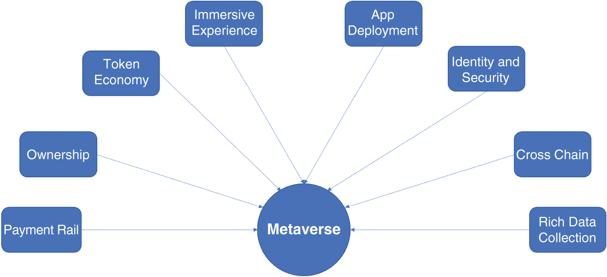

**图 2.5 区块链技术赋能元宇宙**

## 1：实时全球支付轨道

元宇宙经济将需要一个能够实时结算和清算交易的全球支付轨道。传统的支付系统（如 `SWIFT`）仍然依赖交易结算和清算的批处理，将无法满足元宇宙支付需求。区块链共识算法实现了实时结算，因为区块链网络的参与共识节点使用算法来结算金融交易，而不必等待批处理流程在不同金融机构之间执行对账和清算任务，这些机构拥有自己的财务记录副本。（详见**第 3 章**和**第 4 章**的详细讨论。）

## 2：数字资产的所有权验证

为了使元宇宙应用在系统中创造价值，数字资产的所有权至关重要，这些资产没有现实世界的存在或物理对应物。所有权验证可以通过利用区块链分布式账本系统的不可变性和 `NFT`（非同质化代币）来实现。一旦 `NFT` 被“铸造”，`NFT` 的转让或出售就会被记录在链上，并且可以使用链上交易和所有者的公钥来验证 `NFT` 的所有权。`NFT` 的所有权由所有者的私钥保护。（`NFT` 的详细解释见第 5 章。）

## 3：加密代币驱动创作者经济

我们如何激励 `UGC`（用户生成内容）、参与和元宇宙生态系统的治理？加密代币和相关的智能合约已被成功用于促进区块链协议的参与和治理。

在元宇宙应用中，代币设计将带来新的变量和维度，以鼓励可持续的价值创造和用户参与。一般来说，元宇宙经济设计需要考虑各种动态变量，例如用户数量、代币货币政策、系统中不同种类的代币（如 `ERC20`、`ERC721`、`ERC1155`）以及这些代币在元宇宙生态系统内的相互作用。

例如，在一个玩赚（`P2E`）游戏和元宇宙集成平台中，`NFT` 可用于奖励游戏中获得的技能和花费的时间。`ERC20` 代币可以作为元宇宙系统的基本货币，允许用户花费 `ERC20` 平台代币来铸造新的 `NFT` 或其他类型的代币。需要仔细的经济设计，以便平台代币能够达到可持续的通胀目标，以鼓励价值创造，但抑制过度发行或通胀。（区块链游戏的详细讨论见第 6 章。）

然而，纯通缩的平台代币会使代币过于昂贵，从而阻碍新用户参与元宇宙。因此，良好的代币设计需要良好的货币政策。元宇宙的经济设计团队类似于现实世界中的美联储，经济设计团队的使命是获得有针对性且受控的通胀水平，以鼓励用户参与和价值创造。代币经济设计还要求收入来自现有用户，而不仅仅来自新用户——以避免庞氏骗局。

## 4：区块链/AI 创造沉浸式体验

区块链可以通过智能合约中编写的激励机制，鼓励元宇宙参与者之间共享用于 AI（人工智能）/ML（机器学习）的高质量学习数据和算法，而 AI/ML 可以创造丰富且身临其境的体验。AI 可以创建类人的声音和独特的内容。通过利用激励机制共享的一些样本学习数据，数据可以自动转换为游戏、视频、新闻、广告和讲座材料。AI 有可能利用元宇宙世界中的海量数据，创建模仿人类行为的大量内容。（这与第 10 章中讨论的创作者经济人才瓶颈有关。）

## 5：用于应用部署的去中心化云

元宇宙应用可以部署在云端、IPFS 上，也可以部署在区块链上。UI（用户界面）内容，如视频和音频内容，可以存储在 IPFS 或高效的 AWS 或 Microsoft Azure 云中。智能合约可以部署在以太坊主网、Layer 2 Rollup 区块链或其他以太坊替代链上，如 BNB Smart Chain、Polygon 或 Avalanche。从长远来看，区块链驱动的云计算环境将为 AWS 和“大型科技云”提供更安全、更廉价的替代方案。（相关讨论见第 2 章。）

## 6：去中心化身份与网络安全

当前的互联网基于 TCP/IP，其中不包含身份安全和网络安全的规范与实现。元宇宙可以利用区块链实现数据完整性、智能合约执行安全保障，以及用于数据所有权的去中心化身份。常见的网络安全实践，如零信任、API 安全和访问管理，可以进一步利用区块链为元宇宙应用构建基础支持。（我们将在第 8 章中详细讨论元宇宙安全。）

## 7：跨链计算将“多元宇宙”变为元宇宙

为了让元宇宙繁荣发展，它必须是一个开放且可互操作的系统。Cosmos 和 Polkadot 等跨链项目可以进一步增强，以支持可互操作的元宇宙应用。为确保跨链元宇宙交易的数据隐私，隐私保护技术（我们将在第 7 章中详细讨论）也可以被利用。（互操作性将在第 10 章中进一步讨论。）

## 8：在元宇宙中开启新的数据经济

随着人们对元宇宙的兴趣日益浓厚，交换虚拟 3D 资产（如虚拟土地、宝可梦卡牌和游戏武器）的新型数字方法的开发和使用也呈爆发式增长。这一范式的关键在于区块链技术，它使用户能够验证所售数字资产的真实性。这最终将开始影响 AR 应用的开发方式，并将其转化为有利可图的商业项目。例如，Cappasity 是一个用于 3D 内容交换的去中心化 AR/VR 生态系统，它利用区块链允许 3D 内容创作者通过 Cappasity 市场制作、租赁和销售 AR/VR 内容。每个资产都被分配一个唯一的识别代码，以防止版权侵权。

在 3D 交互场景下，元宇宙是用户和行为数据的巨大新来源。除了浏览和交易数据外，元宇宙参与者还使用 AR/VR 头显和物联网设备等新硬件收集比以往更多的数据。如果缺乏数据治理，其中一些数据将非常有价值并产生隐私影响。区块链技术可用于定义数据所有权、实现数据价格发现，以及以保护隐私的方式促进数据交换。随着我们逐步构建元宇宙，实时数据分析成为各类组织的新范式。（相关讨论见第 6 章、第 7 章和第 8 章。）

总之，区块链是 Web3 的骨干。在本书的第二部分中，我们将讨论为这场数字经济奠定交易、隐私和安全基础的前沿区块链突破。

# 第二部分

区块链突破为数字经济奠定交易、隐私和安全基础

正如区块链（远不止）是比特币一样，Web3 正在超越其金融起源，成为基于所有权和去中心化的新互联网。加密货币、DeFi、NFT、游戏和社交工作之间的相互作用，正在推动基于区块链的创作者经济中更多的技术创新和用户案例。

# 第 3 章

加密货币与代币经济学

*   虚拟土地，虚拟货币
*   为什么元宇宙需要基于区块链的交易
*   比特币：加密货币与信任的开端
*   以太坊：智能合约执行平台
*   比特币对决 Web3（纯去中心化 vs. 改良型去中心化）
*   Visa 和 Mastercard：代币经济学走向主流
*   元宇宙展望：超越货币的加密技术

## 虚拟土地，虚拟货币

自 2021 年 Facebook 更名为 Meta 以来，元宇宙中的虚拟土地销售额飙升。根据 2021 年 12 月《Business Insider》的一篇文章，投资者现在将虚拟土地销售描述为“回到 19 世纪在第五大道买地”，各个元宇宙网站上的土地包正在被迅速抢购。

一些最昂贵的交易包括：Republic Realm 于 2021 年 11 月在 The Sandbox 元宇宙中以 430 万美元从视频游戏发行商 Atari SA 购买土地。同样，根据《海峡时报》报道，2021 年 11 月，Decentraland 在线元宇宙中的一块土地以创纪录的 240 万美元售予加拿大加密货币公司 [Tokens.com](http://tokens.com)。交易时，Decentraland 表示，迄今为止，这是该平台上虚拟房地产地块最昂贵的购买记录。[Tokens.com](http://tokens.com) 的子公司 Metaverse Group 使用 Decentraland 自身的加密货币 MANA 完成了购买，价格为 618,000 MANA（购买时相当于 2,428,740 美元）。

虚拟土地销售现象不仅限于上述平台。根据加密货币数据网站 [Dapp.com](http://dapp.com) 的数据，四大元宇宙网站——The Sandbox、Decentraland、Cryptovoxels 和 Somnium Space——在 2021 年 12 月第一周就售出了价值超过 1 亿美元的虚拟房地产。

投资者引用了无数理由来解释他们的购买行为，包括为客户构建沉浸式体验（类似于在现实中央商务区建设/租赁店铺），或对可能成为未来世界元首都的资产价值进行投机。有人认为，随着 Facebook 这一行业巨头更名为 Meta，投机者将此举理解为行业巨头确认元宇宙是其主要增长方向，并将其约 29 亿月活跃用户（截至 2021 年第二季度）带入其中。

因此，我们以区块链在元宇宙中最明显的用例——货币——来开启第二部分。区块链是比特币、以太币（以太坊区块链的代币）以及元宇宙爱好者在 Decentraland 在线现实中购买虚拟房地产地块所用的加密货币 MANA 等加密货币的基础（Decentralard 基础将在第 6 章中结合区块链游戏进行介绍）。除了土地，元宇宙还使购买现实世界中几乎所有东西的数字版本成为可能。

然而，在加密货币和区块链出现之前，像“第二人生”这样的在线社交空间不被视为*真正的*元宇宙，因为它们产生的所有价值都被锁在中心化的服务器内。对用户而言，他们无法将物品从“第二人生”中带出，并在穿梭于元宇宙的不同目的地时随身携带。得益于区块链作为一种通用语言来证明数字对象来源的能力，加密货币使这成为可能。废话不多说，让我们首先解释为什么区块链技术是元宇宙拼图中至关重要的一块。

## 为什么元宇宙需要加密货币和基于区块链的交易

区块链上的货币交易系统提供了哪些优势？可将区块链视为跨多个参与者共享的数据库，每个参与者拥有一台计算机。在任何时刻，区块链的每个成员都持有区块链数据库的完全相同副本，使所有参与者都能访问相同的信息。因此，所有区块链共享三个诱人的特性：

1.  **一个加密安全的数据库（也称为分布式账本）。** 这意味着从数据库读取或写入数据时，需要两个加密密钥：一个公钥（基本上是地址），它本质上是存储信息的地址和数据库；一个私钥，这是你的个人密钥，真正的安全提供者，防止他人在没有正确密钥的情况下更新信息。用户除非拥有正确的密钥，否则无法更新区块链。区块链的加密密钥提供了远超标准分布式账本的尖端安全性。该技术还消除了单点故障出现的可能性，因为区块链数据库是分布式和去中心化的。如果一个节点失效，信息仍可在别处获取。

2.  **一个支持共享数字交易日志的数字网络。** 交易信息可通过区块链网络实时获取。最著名的公共网络是比特币区块链，本章将详细讨论。区块链网络可以是“公共网络”，也可以是“私有网络”——任何人都可在无需明确许可的情况下加入或退出公共网络，而私有网络则仅限受邀者加入。在公链中，你可以反复加入和退出，没人真正知道是谁在加入和退出。

    例如，IDC 列出了一长串区块链可建立信任的行业，包括政府、医疗、物流、航运，当然还有发源地——金融。分析师预测，到 2022 年，医疗区块链数字身份标准将来自美国卫生与公众服务部，从而实现通用医疗数据互操作性、全面的客户/患者数据、患者“健康评分”以及 AI 应用。他们还预见区块链电子投票最终将涌现；到 2023 年，全球 8% 的司法管辖区将测试此类系统。

    在同一时间范围内，IDC 分析师预测 65% 的跨洲航运将被立法要求使用区块链，涵盖船员健康信息、燃油采购来源和货物产地数据。到第二年，15% 的供应链交易将使用区块链来追溯道德和可持续实践的来源，以增加数字信任。到 2025 年，这些分析师称 10% 的金融机构将使用区块链技术进行了解你的客户（KYC）合规，以创建实体的透明、可审计记录。

    为什么这对互联网发展——迈向 Web3.0——令人振奋？三十年来，大多数互联网应用一次仅连接两个点，即使在高连接速度下，这也是潜在用途的瓶颈。区块链的卖点在于最终允许交易中的多方同时交互，并通过网络安全地转移资产。例如，为了取代购房中的邮件链和文书工作，买方、卖方和经纪人将接入与律师、抵押银行家和产权审查员相同的区块链系统。

3.  **区块链网络创建的审计追踪。** 分布式账本技术在一个理论上不可篡改的链上记录多方之间的所有交易。只有当两件事发生时，数据库才能更新。首先，用户必须提供正确的公钥和私钥。其次，网络中的大多数参与者必须验证这些凭证。这降低了恶意用户非法访问网络并进行未授权更新的风险。

    由于链上的每个人都能立即看到所有数据（包括所有交易），这降低了欺诈风险。例如，在房地产交易中，用户可以回溯信息区块，轻松查看数据库中之前记录的信息，如某房产的前任所有者。此外，企业也更容易证明合规并避免昂贵的审计。

    简而言之，区块链——一种实现信息去中心化、安全存储和传输的技术——可能成为追踪和交易的强大工具，能最小化摩擦、减少腐败、增加信任并赋能用户。区块链是允许加密货币在无需银行或其他中介协助的情况下在线易手的技术。

    在由移动互联网和智能手机主导的过去十年“移动革命”中，互联网用户已习惯随时随地购买消费品。现在元宇宙正将这一趋势推向更深——从消费品延伸至新型数字资产，而基于区块链的加密货币是通往未来数万亿笔交易的入口。在下一节中，我们将从比特币——所有加密货币的起源——开始讨论加密货币。

## 比特币：加密货币与信任的开端

2011 年，1 枚比特币价值 1 美元。到 2021 年底，其交易价格约为 50,000 美元，而所有加密货币（比特币只是其中之一）的总价值高达 2.3 万亿美元。包括比特币、以太币（下一节将详细介绍）及各类小型代币在内的加密货币市场总值，在 2021 年 11 月的历史高点期间达到了 3 万亿美元。当时，比特币价格逼近 69,000 美元，以太币接近 4,900 美元（见图 3.1）。

简而言之，随着比特币和以太币在 2021 年创下历史新高，加密货币正式步入主流视野。这一涨势让许多人设想出一个截然不同的金融未来，并质疑关于价值的长期固有信念。比特币诞生（或称“挖矿”）的区块链，已成为审视价值的新方式，也是在无需第三方中介的情况下在各方间创建交易、追踪事物并真正建立信任的新方式。

比特币的简短历史或许能提供一个很好的概览。关于比特币起始日期的主流说法多为 2008 年 8 月 18 日，即域名 [bitcoin.org](http://bitcoin.org) 首次注册之日。2008 年 10 月 31 日，一位化名中本聪的开发者通过 [metzdowd.com](http://metzdowd.com) 的密码学邮件列表发布了比特币白皮书，标题为《比特币：一种点对点的电子现金系统》。多个主要网站开始接受比特币作为支付货币，如 WikiLeaks 于 2011 年，WordPress 于 2012 年。2013 年 2 月，Coinbase 报告称单月售出价值 100 万美元的比特币，价格超过 22 美元/枚。

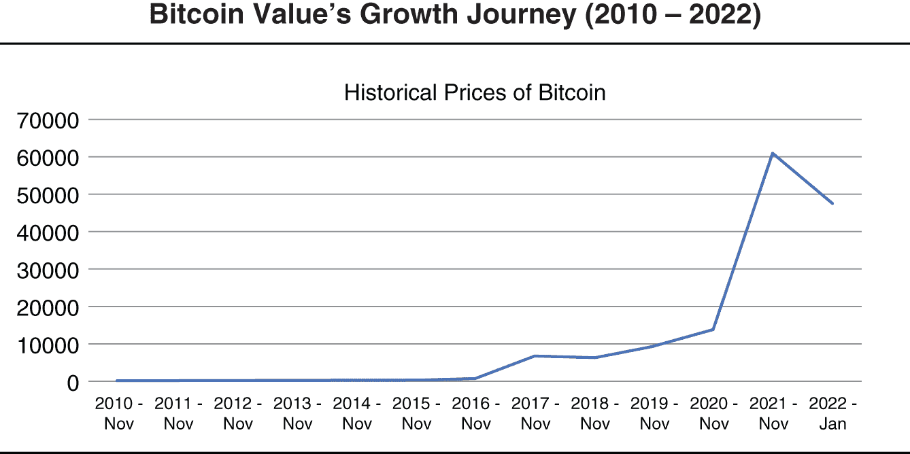

**图 3.1 比特币历史价格**

来源：in2013dollars

在过去十年中，随着比特币的普及，世界各国政府对比特币的看法发生了转变。2016 年，日本内阁批准了一揽子法案，旨在帮助银行拓展业务，并承认虚拟货币（如比特币）具有类似真实货币的功能。据《商业内幕》报道，俄罗斯同样在 2017 年采取行动，将加密货币的使用合法化，为比特币和以太坊等货币的交易建立了法律框架。（参见图 3.2。去中心化加密货币与政府监管之间的张力将在本书的第三部分中介绍。）

中本聪的论文将比特币作为一种去中心化货币进行推广，该货币不存在中央银行，且是“一种纯粹的点对点电子现金版本……运行在一个只需最小结构的网络上。”拉夫堡大学荣誉研究员 Dave Elder-Vass 将中本聪对比特币交易的愿景描述为：“匿名的，在一定程度上免受国家窥探的监视。”中本聪于 2009 年 1 月 3 日通过 SourceForge 平台发布了第一个创世区块（也称为区块 0），该原始区块包含前 50 个比特币。区块 1 于 2009 年 1 月 9 日被挖出，比区块 0 晚了六天。

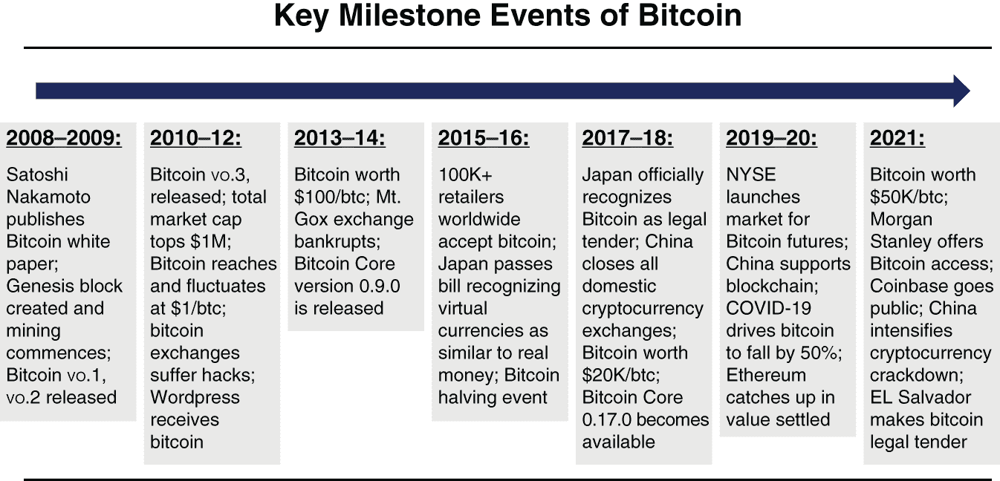

**图 3.2 比特币关键里程碑事件**

来源：Medium、TradingView、[HowMuch.net](http://howmuch.net)

正如比特币所展示的，区块链大幅减少了验证交易所需的时间和资源。区块链是一个公共数据库，可在网络中的许多计算机之间更新和共享。*区块* 指数据和状态以称为“区块”的连续组存储。*链* 指每个区块通过加密方式引用其父区块。换句话说，区块被链接在一起。网络中的每台计算机必须就每个新区块以及整个链达成一致。这些计算机被称为*节点*。节点确保与区块链交互的每个人都拥有相同的数据。

为了实现这种分布式共识，区块链需要一种共识机制。如果不改变所有后续区块，区块中的数据就无法更改，而这需要整个网络的共识。区块链的所有核心要素都是为了使协议无法伪造或复制而设计的。每个区块的时间戳标记了任何先前交易的日期，每个区块中的加密哈希映射到前一个区块，因此无法在不破坏所有其他区块的情况下更改任何单个区块（参见图 3.3）。

## 区块链：它是什么，有何用途

| 问题 | 现实 | 应用与用例 |
| --- | --- | --- |
| 1. 什么是区块链？区块链就是比特币吗？ | 区块链不是比特币，区块链技术可用于比特币之外的许多应用，并可进行相应配置。 | **记录保存 – 静态信息存储**<br>1. 静态注册表（如专利）<br>2. 身份（如身份记录）<br>3. 智能合约（如保险理赔支付） |
| 2. 区块链比传统数据库更好吗？ | 区块链不一定比传统数据库更好，但在参与者无法直接交易的低信任环境中，它很有价值。 | |


### 区块链迷思与现实

| 编号 | 迷思 | 现实 | 应用场景 |
| :--- | :--- | :--- | :--- |
| 3 | 区块链防篡改或 100% 安全吗？ | 如果某方控制了超过 50% 的网络算力并重写了所有先前的交易，区块链可能会被篡改——这在很大程度上是不可行的。 | **交易 – 可交易信息注册表**<br>1. 动态注册表（如药品供应链）<br>2. 支付基础设施（如跨境点对点支付）<br>3. 其他（如首次代币发行） |
| 4 | 区块链是“真相机器”吗？ | 区块链可以验证完全包含在区块链上且原生于区块链的所有交易和数据，但它无法评估外部输入是否准确或“真实”。 | |

**图 3.3 区块链迷思与现实**

来源：改编自麦肯锡公司，“区块链详解：它是什么和不是什么，以及为什么它很重要”

对于比特币而言，第一个验证交易并向数字账本添加新数据区块的参与者或“矿工”将获得一定数量的代币作为奖励。在这种被称为`PoW`（工作量证明）的模型下，矿工有动力快速行动。但验证交易不仅仅涉及核实比特币是否已从一个账户转移到另一个账户。相反，矿工必须通过正确识别与交易相关的字母数字系列来回答一个加密问题。

此活动需要大量的试错，使得哈希率——完成操作的计算速度——在比特币中极为重要。据加密货币交易所 `Gemini` 称，由于其去中心化特性以及要求矿工投入巨大的算力来验证交易，`PoW` 系统历史上为用户提供了更好的安全性。这将需要单个恶意行为者拥有天文数字般的算力和成本，才能尝试控制网络的大部分算力。（在第 8 章中，将详细讨论比特币和其他加密资产的安全性考量。）

因此，区块链技术作为一种验证任何交易的方式最为重要。这对企业的实际影响在于简化验证流程所节省的时间和金钱。然而，这背后存在一个重大的 ESG（环境、社会和治理）问题。

例如，2021 年 3 月，特斯拉 CEO 埃隆·马斯克在 Twitter 上宣布，这家汽车制造商将接受最流行、最大的加密货币比特币作为购买电动汽车的支付方式。然而，由于担心加密货币挖矿（需要强大的计算机集群）导致气候变化，这家电动汽车制造商于 5 月中旬叫停了比特币购车业务。在接受数字货币 49 天后，特斯拉于 2021 年 5 月 12 日反悔，表示由于担心“挖矿”加密货币助长了化石燃料消耗和气候变化，他们将不再接受比特币。

马斯克表示，一旦确认矿工合理使用清洁能源，公司将恢复比特币交易。“当确认矿工合理（约 50%）使用清洁能源且未来趋势向好时，特斯拉将恢复允许比特币交易，”马斯克在推文中写道。在 2021 年 7 月的一次比特币大会上，马斯克建议特斯拉未来可能帮助比特币矿工转向可再生能源，并表示如果比特币挖矿达到并呈趋势超过 50% 的可再生能源使用率，“特斯拉将恢复接受比特币。”

除了使用可再生能源外，减少碳排放的另一种方法是使用不同的算法来验证区块链上的交易。在幕后，随着参与者试图通过开发新算法（如 `PoS`）来降低算力的重要性，加密货币市场正在发生更微妙的变化。（参见框：`PoW` 对比 `PoS`。）

---

## 以太坊：智能合约执行平台

### 比特币之后：替代币与以太坊

比特币问世后，许多额外的加密货币——也称为“替代币”——被创建出来，旨在解决比特币的某些缺口或低效问题，并可通过各种网络获取。流行的替代币包括达世币、莱特币和 `XRP`（由 `Ripple` 提供）。在所有替代加密货币网络中，以太坊最受欢迎（参见图 3.4）。它是一个开源平台，允许用户构建和启动去中心化应用程序，包括加密货币或数字账本。用户必须花费一种特定的数字货币——以太币——才能在以太坊上运行应用程序。以太币也可作为普通货币的替代品，但其主要目的是促进以太坊的运行。

### 区块链作为分布式账本

正如比特币部分所示，区块链是一种分布式账本，或称数据库，共享在公共或私有计算网络中。网络中的每个计算机节点都持有一份账本副本，因此不存在单点故障。每条信息都经过数学加密，并作为新的“区块”添加到历史记录链中。在将新区块添加到链之前，会使用各种共识协议通过网络中的其他参与者对其进行验证。这在不需要中央权威机构的情况下防止了欺诈或双重支付。

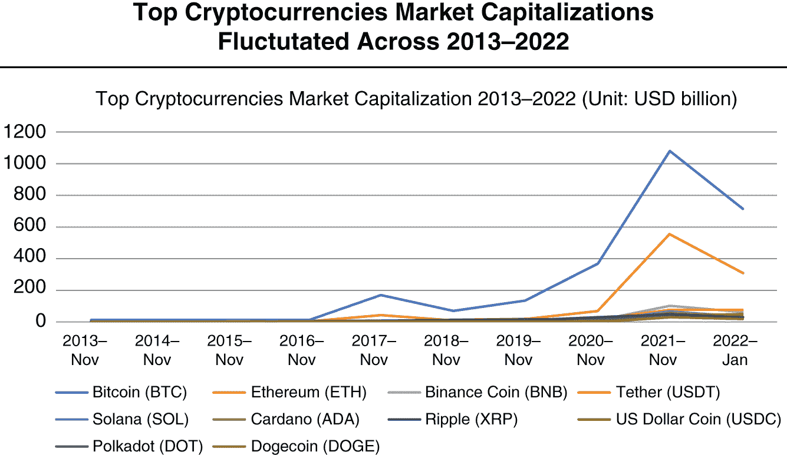

**图 3.4 主要加密货币市值 (2013–2022)**

来源：Forbes (2021 年 11 月 30 日)，CoinMarketCap (2014–2022，2014–2021 年为 11 月 30 日，2022 年为 1 月 30 日)，Statista (2013)

备注：`Polkadot` 于 2020 年 5 月推出，`Solana` 于 2020 年 3 月推出，`USDC` 于 2018 年 5 月推出，`Binance` 于 2017 年 7 月推出，`Cardano` 于 2017 年 9 月推出，以太坊于 2015 年 7 月推出，`Tether` 于 2014 年 7 月推出，狗狗币于 2013 年 12 月推出。其成立日期前无可用数据。

### 智能合约

以以太坊为代表，区块链账本还可以编程为“智能合约”，即记录在区块链上的一组条件，以便在满足条件时自动触发交易。例如，智能合约可用于自动执行保险理赔支付。它允许在无需律师或托管代理参与的情况下，使用计算机代码交换金融和其他资产。（正如将在第 8 章中讨论的那样，智能合约本身是一种新型编程，需要仔细的尽职调查和审查，以确保安全、Gas 高效的智能合约，从而降低漏洞风险，我们将在智能合约安全部分介绍这一点。）

### 以太坊与 EVM

2014 年，以太坊提出了一种构建去中心化应用的新方案。将存在一条单一的区块链，人们可以在上面部署任何类型的程序。以太坊通过将 `Application` 层转变为一个称为 `以太坊虚拟机 (EVM)` 的虚拟机来实现这一点。该虚拟机能够处理称为 `智能合约` 的程序，任何开发者都可以以无许可的方式将其部署到以太坊区块链上。这种新方法使成千上万的开发者能够开始构建去中心化应用程序 (`dApps`)。

智能合约只是一个运行在以太坊区块链上的程序。它是代码（其函数）和数据（其状态）的集合，位于以太坊区块链上的特定地址。从非常基础的层面来看，智能合约可以被视为一种自动售货机：一种脚本，当使用特定参数调用时，如果满足特定条件，则执行某些操作或计算。例如，一个简单的供应商智能合约可以在调用者向特定接收者发送以太币 (`ETH`) 时创建并分配数字资产的所有权。

智能合约是一种以太坊账户类型，其中账户被定义为网络中可以持有余额并发送交易的实体。这意味着它们拥有货币价值余额，并可以通过网络发送交易。然而，它们不受用户控制；相反，它们被部署到网络中并按程序运行。用户账户随后可以通过提交执行智能合约上定义函数的交易来与智能合约交互。智能合约可以像普通合约一样定义规则，并通过代码自动强制执行。默认情况下智能合约无法被删除，与它们的交互也是不可逆的。

### 共识与执行

以太坊目前使用 `PoW` 共识机制。`EVM` 本质上是一台单一的、规范的计算机，以太坊网络上的每个人都就其状态达成一致。每个参与以太坊网络的人（每个以太坊节点）都保存这台计算机状态的副本。此外，任何参与者都可以广播请求，要求这台计算机执行任意计算。每当广播此类请求时，网络上的其他参与者会验证、确认并执行（“执行”）该计算。这种执行会导致 `EVM` 发生状态变更，该变更会被提交并传播到整个网络。

计算请求称为交易请求；所有交易的记录和 `EVM` 的当前状态存储在区块链上，而区块链又由所有节点存储并达成共识。广播交易请求的任何参与者还必须向网络提供一定数量的以太币作为赏金。这笔赏金将授予最终完成验证交易、执行交易、将其提交到区块链并广播到网络工作的人。支付的以太币数量与进行计算所需的时间相对应。

### Gas 费用

以太币加密货币支持以太坊计算能力的定价机制。当用户想要进行交易时，必须支付以太币以使其交易在区块链上得到确认。这些使用成本称为 Gas 费用，Gas 费用取决于执行交易所需的计算能力数量以及当时网络范围内对计算能力的需求。由于 2021 年加密货币交易的繁荣，以太坊网络被推向了满负荷运行，以太坊上的 Gas 费用飙升。随着 Web3 的发展，对加密基础设施的需求也在增加。

### 比特币与 Web3（纯去中心化与改良去中心化）

正如图示所示，区块链代币化和智能合约技术可以作为一种高级软件形式，确保约定事项得到执行，从而实现数据权利、风险和回报的确认。在经济价值模型的创建中，区块链可能作为基于市场机制的推动者，为数据赋予价值和权限。

但哪种加密代币将成为元宇宙的*货币*？这是比特币和以太坊之间的战争吗？毫无疑问，比特币是最受认可的首个数字资产，但生态系统中还有数百甚至数千种其他数字资产。但也有人担心，作为首个数字资产，比特币可能容易受到以太坊等竞争对手的创新性破坏（就像 MySpace 和 Facebook 的故事）。

换句话说，是否会有一个明确的赢家被加冕为主要的元宇宙货币？还是说多种加密货币长期共存的可能性更大，每种服务于略有不同或完全不同的功能？

---

## Web3 与区块链技术演进

### 重新审视“Web3”概念

Web3 通过区块链技术，旨在让用户/消费者拥有并控制自己的数据，并通过授权使用数据来拥有平台，成为“股东”。Web3 中的“股份”是加密货币或代币，代表对网络/区块链的所有权。相比之下，当前的主流互联网由少数科技巨头决定，如 `Google`、`Facebook`、`Amazon`、`Twitter` 和 `Apple`。

自加密货币诞生以来，凭借为记录和转移价值提供去中心化平台的革命性可能性，无数雄心勃勃的人物一直在寻求去中心化和民主化互联网。Web3 的愿景是：与互联网不同，通过一种特定的加密货币（即特定加密平台的原生“货币”），人们实际上可以投资于平台本身（这在 Web 2.0 互联网中是不可能的），该平台将在特定平台上启用并支持所有价值记录和转移处理。

对于 Web3 的“纯粹主义者”而言，他们对未来互联网的愿景是*完全去中心化*的：

1.  **无信任**：绝不允许任何单一方或一小群方控制或对平台施加压倒性影响。
2.  **极致的数据安全**：比特币网络无法被黑客攻破。
3.  **抗审查**：任何人都可以使用比特币，没有人能通过技术手段阻止任何交易。
4.  **极致的隐私**：尽管不一定意味着保密性。

### 区块链故事的起点：比特币

第一个区块链是比特币，一种于 2008 年创建的点对点数字货币，使用了 `PoW` 这一新颖的共识机制。它是区块链上的第一个去中心化应用，同时也是一个*真正*去中心化的平台。促成比特币成功的因素包括：

*   **创始人匿名性**（可能是其他任何代币最难匹敌的）
*   **公平启动**（无“预挖矿”或给早期/任何投资者的代币分配）
*   **有限的发行总量**（“稀缺性”）
*   **PoW 支持**，这是一种比 `PoS` 更公平的分发方式，后者应用更广且能耗更低
*   **相对分散的投资者基础**

然而，比特币的“去中心化优先”本质是一把双刃剑。一方面，比特币从根本上区别于任何其他数字资产。没有其他数字资产有望在作为货币商品方面超越比特币，因为比特币是（相对于其他数字资产）最安全、最去中心化、最可靠的数字货币。换句话说，任何“改进”必然面临权衡。

另一方面，比特币是一个不易扩展的僵化生态系统。多年前这点就变得显而易见，当时人们开始意识到去中心化应用的潜力，社区中构建新应用的愿望应运而生。当时开发去中心化应用有两个选择：要么分叉比特币代码库，要么在其之上构建。然而，比特币代码库非常单体；网络层、共识层和应用层这三层混合在一起。此外，比特币脚本语言功能有限且不友好。因此需要更好的工具。

### 智能合约的出现

因此“智能合约”应运而生。任何开发者都可以创建智能合约并将其公开到网络，以区块链作为其数据层，并向网络支付费用。任何用户随后可以调用智能合约来执行其代码，同样需要向网络支付费用。因此，借助智能合约，开发者可以构建和部署任意复杂的面向用户的应用和服务，如市场和游戏等。在实践中，参与者并非每次想在 `EVM` 上请求计算时都编写新代码。相反，应用开发者将程序（可复用的代码片段）上传到 `EVM` 存储中，用户则请求执行这些代码片段并传入不同的参数。

由于 `ETH` 和智能合约推动了加密世界的传播，Web3 社区的一部分人主张在元宇宙中采用*基于智能合约区块链的平台*，如 `Ethereum`、`Solana`、`Cardano`、`Polkadot` 和 `Avalanche`，它们支持许多新的、多样化的加密货币功能，如：

*   **DeFi**（去中心化金融）
*   **NFTs**（非同质化代币）
*   **Play-to-earn (P2E) 游戏**，利用区块链技术

这些平台允许透明、不可逆和开放访问的交易，每一项都是去中心化的一个方面和目标（后续章节将详细讨论这些“新”加密功能）。然而，这些平台各自都有创始人、风投投资者，以及特定平台及其原生加密货币成功的资本主义动机。相比之下，比特币是去中心化的极致。如前所述，对比特币的任何“改进”必然面临权衡。

### 总结与展望

总而言之，截至目前，比特币是最纯粹、最去中心化的加密货币，拥有最广泛的持有量和最大的市值。然而，其他加密货币（“山寨币”或“替代币”）在价值和采用者数量上都在追赶比特币。因为技术更新和变更无法在完全去中心化的平台上轻松或快速部署，所以由活跃的创始人或开发者团队“控制”的山寨币可以被扩展、积极推广和广泛“销售”，这合情合理。

因此，比特币网络的成功与所有其他数字资产网络的成功之间不一定存在相互排斥性。相反，其余的数字资产生态系统可以满足不同的需求，或解决比特币无法解决的其他问题。在可预见的未来，随着 Web3 的演进，我们可能会看到比特币和智能合约代币共存并共同演化。在某个时刻，中心化项目的积极方面将超过消极方面，加密生态系统将向去中心化平台与特定中心化模型的动态组合迁移。为此，我们可以从后续关于 DeFi、NFT 和区块链游戏的章节中看到元宇宙的早期版本。

---

## Visa 和 Mastercard：Tokenomics 走向主流

元宇宙是虚拟世界，互联网用户可以在其中社交、购物、工作并体验各种活动。关于元宇宙如何演进有许多想法，但加密货币很可能会成为首选支付方式。此外，可以利用区块链确保支付自动化，从而全面管理元宇宙所需的微支付。例如，我们已经看到人们使用加密货币在各种虚拟世界中购买土地和商品（更多示例见后续章节）。（第 9 章将讨论公共加密货币、政府 `CBDC` 和大科技公司代币之间的三方竞争。）

元宇宙必须拥有全球支付轨道——由加密货币实现的全球实时即时结算和清算。在 Web1.0 时代，我们只有运行在台式电脑上的文本图像。在线购物罕见且令人恐惧。Web2.0 增加了视频和移动端。购物变成了一键完成。Web3.0 将包含 3D 世界、虚拟/增强/混合现实（XR）、人工智能以及去中心化商业，其采用速度将比前几代互联网更快。购物将像思维一样即时。

### 代币经济学的现实

现实情况是，我们仍处于代币经济学的早期阶段。区块链和加密交易仍受困于严重的技术短板，尤其是可扩展性和性能。目前，区块链无法处理中心化移动支付应用所能承载的巨额交易量；且由于技术原因，在区块链上保障一笔交易安全所需的能量（`PoW`）会随时间增加。

但基于区块链的数字金融未来是我们的愿景。新兴区块链公司（`Ripple`、`BlockFi`、`Coinbase` 等）正在普及传统金融产品（借贷、投资、跨境支付）的获取渠道，并让银行服务覆盖不足的人群（尤其是新兴市场）首次接触到金融工具。毫不奇怪，精通技术的千禧一代和 Z 世代正引领着加密革命；根据 `CNBC 2021` 的一项调查，加密货币是唯一一种青年参与度不成比例的投资类型：18 至 34 岁人群中有 15% 拥有加密货币，而 35 至 64 岁人群为 11%，65 岁及以上人群仅为 4%。

2021 年，加密货币已势不可挡，市值一度超过 3 万亿美元，部分原因在于加密货币和独特的数字资产已成为一代被传统金融体系拒之门外的人群的首选出口。除了加密社区对代币的使用外，真正将加密资产推向主流的是成熟的大型金融机构（如 `Visa`）日益增加的参与度。

### Visa 的加密整合

过去几年，`Visa` 与 `Coinbase` 和 `FTX` 等加密交易所建立了合作关系。2021 年，`Visa` 披露其已通过发卡计划与不少于 50 家加密平台合作，这些计划“让用户能轻松在全球 7000 万商户转换和消费数字货币”。为保持相关性并维持客户粘性，`Visa` 通过在其平台上提供加密货币选项来实现用户忠诚度。`Visa` 与首家联邦特许数字资产银行 `Anchorage` 合作——后者也是 `Visa` 独家的数字货币结算合作伙伴——推出了一项试点计划，允许 [Crypto.com](http://crypto.com) 向 `Visa` 发送 `USDC`（一种“稳定币”，详见 **第 4 章**）以结算 [Crypto.com](http://crypto.com) `Visa` 发卡计划的一部分债务。

`Visa` 的标准结算流程要求合作伙伴以传统法币（政府发行货币）结算，这会为基于数字货币构建的企业增加成本和复杂性。使用 `USDC` 结算的能力最终可以帮助 [Crypto.com](http://crypto.com) 和其他加密原生公司评估根本性的新商业模式，而无需在其资金管理和结算工作流中使用传统法币。（顺便提一下，`Visa` 的资金管理升级及与 `Anchorage` 的整合，也增强了 `Visa` 在未来直接支持新兴央行数字货币（`CBDC`）的能力。）

### Mastercard 的金融科技战略


`Visa` 的竞争对手 `Mastercard` 也在磨砺并采纳其金融科技战略，以纳入并利用加密货币。根据 `Coindesk` 2021 年的一份报告，`Mastercard` 宣布与五家初创公司合作，作为 `Mastercard`“Start Path Crypto”计划的一部分，共同解决区块链领域的全球性挑战。`Mastercard` 选定的合作伙伴初创公司包括：智能合约构建商 `Ava Labs`、专注 AI 的移动银行应用 `Envel`、点对点储蓄平台 `Kash`、比特币银行应用 `LVL` 以及加密奖励平台 `NiftyKey`。

与 `Visa` 采用基于加密的支付系统类似，`Mastercard` 拥抱区块链和加密货币，旨在为其日益对加密感兴趣的用户群提供更多支付选项和交易所、产品及服务。根据 `Mastercard Newsroom` 2021 年的一份报告，`Mastercard` 关于提供加密支付选项的理念，不一定是鼓励使用，而更多是关于给予用户“选择权”，如果他们愿意，可以使用加密货币：“`Mastercard` 不是来建议你开始使用加密货币的。但我们要让客户、商家和企业能够按其意愿移动数字价值——无论是传统的还是加密的。这应该是你的选择，这是你的钱。”

`Mastercard` 还将其甄选特定加密货币加入网络、而非向所有加密货币敞开大门这一做法作为卖点。一旦某种加密货币满足 `Mastercard` 的安全性、可靠性和风险要求，便会被考虑纳入 `Mastercard` 网络。对于那些对涉足加密领域的风险持怀疑态度的加密好奇者来说，通过 `Mastercard` 运作或许能成为新手更安全的尝试选择。

## 企业采用趋势

与 `Visa` 和 `Mastercard` 一样，许多面向消费者和工业领域的公司入局稍晚，因为在代币经济学的早期，大多数区块链应用都面向加密货币或金融交易。但随着更多由新元宇宙思维驱动的区块链商业应用从概念阶段走向现实，它们的参与度正在提高。传统企业和公众普遍对加密货币交易越来越适应，这可能会进一步提高使用率。

## 元宇宙展望：超越货币的加密世界

加密货币和代币不仅在改变金融和货币，还在改变创作者构建互联网原生组织以创造和共享价值的方式。`Web3` 已成为关于互联网应如何构架、个人应如何分享价值创造的新经济理念的代名词——加密资产将在其中发挥重要作用。

## 加密资产分类

根据主要功能，加密资产可分为两大类：原生币和加密代币。原生币（如 `bitcoin`）通常与传统货币形式竞争，既提供另一种货币工具，也提供支付基础设施。与原生币不同，实用代币是嵌入某种内在价值的代币，这种价值以某种方式与发行实体的商业模式质量及其生成的生态系统相关联。

换句话说，实用代币是加密资产的一个子类，但并非所有加密资产都是加密货币。加密资产通常具备加密货币的许多特征：存在一种作为价值存储的代币，并具备转移该价值的能力，但通常还增加了第二层功能。得益于区块链技术的普及，更多加密资产正涌入市场。

## 新经济中的实用代币

如果 2021 年加密资产的增长迫使所有人关注加密世界数万亿美元的市值，那么超越货币范畴的加密增长则有潜力在各行业产生深远回响。自 2021 年以来，元宇宙社区见证了不同加密板块的涌现，每个板块都有不同的价值驱动因素。在这个新时代，与 `bitcoin` 无关的加密用例——各类“实用代币”——终于得到了验证并实现了有意义的采用。

实用代币将在这一新体系中发挥积极且加速的作用。购买实用代币的消费者支持着网络的稳定性和流动性。网络中发生的服务或商品买卖越多，网络的效力就越强。新用户对实用代币的使用会提升代币价值，进而提高其他用户的投资价值。

更重要的是，网络中的用户越多，该网络的安全性就越好。这意味着使用实用代币的投资者也在为其他用户提供一个更好的网络。因此，利益相关者之间的界限将逐渐模糊：客户将成为投资者，反之亦然。基于实用代币的商业公司将有可能从正向反馈中受益，即代币的使用将使整个平台受益。

对于某些支付类型，分布式账本技术正在实现更具成本效益、更安全，且在大多数商业用例中完全可追溯的资金流转。在竞争激烈的跨境支付领域，区块链实现了近乎即时且透明的支付，消除了复杂且不透明的费用结构。由代币经济学驱动的商业模式变革的一个例子是“给农民小费项目”，区块链代币使咖啡饮用者能够追溯到原始农民，并直接向他们提供经济价值。（参见框：给农民小费。）

在另一个例子中，在第 5 章中，我们将看到非同质化代币（NFT）首先为艺术市场注入新的活力，随后扩展到艺术市场之外，成为新文化经济的基础。NFT 代币为未来的创作者经济提供了金融基础设施，资产随着围绕它们形成的社区而增值。

随着这些变化的同步发生，随着更多样化的代币涌现，以及 BaaS 软件开发简化了区块链实施，区块链商业应用市场正在升温。多样化意味着更多用例，而更多用例带来更广泛的采用。由于这种正向升级效应，加密行业正在拓展分支。加密不再仅仅是投资组合中的一篮子代币资产，而是开始渗透到日常生活中（例如融资活动，将在接下来的第 4 章中讨论）。这才是 Web3 应有的样子。

## 第 4 章：DeFi（去中心化金融）：无银行元宇宙

- 金融科技 2.0：DeFi 对比 CeFi
- 治理代币与收入来源
- 稳定币：连接 DeFi 与 CeFi 的桥梁
- 分层协议与 DeFi 安全
- DeFi 大规模采用面临的挑战
- 征服新疆域：DeFi + NFT、游戏与社交网络

## 金融科技 2.0：DeFi 对比 CeFi

去中心化金融，或称 DeFi，是去中心化元宇宙金融领域的下一个前沿。DeFi 利用现有区块链相关技术的组合——如数字资产、钱包、智能合约，以及包括预言机在内的辅助服务——来创造新形式的金融交易，并绕过低效笨重的传统机构，如商业银行。简单来说，DeFi 是通过去中心化区块链技术提供的金融产品，如抵押贷款和资产衍生品，而不是通过银行和交易所的传统中心化系统（可称为 CeFi）。

2020 年，DeFi 在大流行封锁、政府货币宽松政策和财政刺激政策期间，通过展示自我主权和点对点金融的力量，在金融科技领域掀起了一场风暴。根据 Statista 2022 年的一份最新报告，独立 DeFi 用户数量从 2017 年 12 月的仅 189 名增长到 2022 年 3 月的约 450 万名。尽管与拥有超过 6000 万客户的大型商业银行（如美国银行）相比，用户数量仍然很少，但过去两年的增长率现象级（参见图 4.1）。

DeFi 已开始重塑全球金融和电子商务，但对大多数人来说仍然神秘莫测。DeFi 的优势在哪里？如表 4.1 所示，DeFi 旨在从当今传统银行业务的交付方式中实现范式转变。

DeFi 的关键特性在于，即使没有银行账户的人也能接入现代金融系统。根据世界银行 2017 年的一项调查，全球有 17 亿人无法使用银行账户。在这 17 亿人中，约 4.6 亿生活在东南亚，3.5 亿在非洲，2.25 亿在中国。即使在最发达的资本主义国家美国，仍有约 5500 万人没有银行账户。

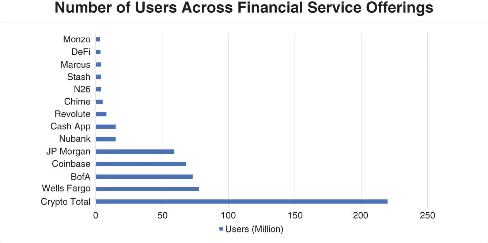

**图 4.1 DeFi 创新对比 CeFi 现状** ¶ 来源：改编自 Grayscale 2021 年报告

**表 4.1 DeFi 对比 CeFi**

来源：Grayscale 2021 年报告

| | 中心化金融 | 去中心化金融 |
| --- | --- | --- |
| **客户** | 仅限特定地区和特权客户偏见，需要反歧视法 | 面向任何拥有互联网连接的人提供非歧视性平等接入 |
| **结构** | 由传统公司或法人实体提供银行服务 | 由开源加密网络软件协议提供银行服务 |
| **参与** | 由指定公司及其员工提供服务 | 由任何人通过点对点方式向任何其他人提供服务 |
| **所有权** | 系统由公众或私人股东或政府实体拥有 | 系统由公众拥有，并向用户社区中的任何人开放 |
| **治理** | 决策由管理层、行业机构和监管机构制定 | 决策由协议、开发者和用户社区制定 |
| **资产托管** | 资产由机构或托管提供商持有 | 资产由用户直接持有或存放在非托管智能合约中 |
| **记账单位** | 以法定货币计价 | 以数字资产计价 |
| **交易** | 通过中介执行 | 通过智能合约执行 |
| **清算** | 通过清算所促成 | 通过协议促成 |
| **结算** | 3-5 个工作日，取决于周一至周五营业时间内的交易时间 | 几秒到几分钟，取决于区块链，全年无休、每天 24 小时运行 |
| **法律纠纷** | 纸质法律协议由缓慢且昂贵的传统地方法院系统解决 | 数字法律协议由软件自动解决，成本仅为典型交易费 |
| **可审计性** | 授权第三方审计，按季度出具 | 开源代码和公共账本，任何人均可按区块逐个审计 |
| **抵押品** | 在许多情况下借助中介呈现低抵押至无抵押状态；使系统面临风险 | 在大多数情况下呈现全抵押至超额抵押状态；降低系统性风险 |
| **风险** | 易受黑客攻击和数据泄露 | 易受智能合约黑客攻击和数据泄露 |

现在，他们可以轻松成为 DeFi 参与者。仅凭一部智能手机和基本的互联网连接，世界任何角落的任何人都可以访问 DeFi 协议，并享受广泛的金融服务选择。例如，去中心化借贷服务，如 `Compound Lending` 和 `AAVE`，或去中心化资产管理服务，如 `MetaMask`、`imToken`、`Agent Wallet`、`Enjin Wallet` 等。

此外，基于区块链技术，DeFi 还拥有几个独特优势：

## DeFi 核心特性

- **可控性。** 与 CeFi 将资产交由金融机构托管的方式相比，DeFi 的主要优势在于用户始终对其资产拥有绝对控制权。此外，在 DeFi 中，用户可以随意在金融交易中扮演客户或提供者的角色。他们既可以是服务方，也可以是被服务方，且没有准入门槛。
- **透明性。** DeFi 协议代码开源并运行在公共区块链上，因此任何人都可以验证其安全性、交互规则、交易历史和实际网络使用情况。
- **抗审查性。** 抗审查性是指网络防止各方篡改或阻断其上数据的特性。一旦数据被添加，几乎不可能将其移除或篡改，从而使其具有永久性。在 DeFi 中，区块链网络节点不会审查和篡改单个交易。
- **可编程性。** DeFi 通过智能合约实现，智能合约可根据功能需求进行编程和调整，以适配不同类型的金融逻辑。
- **可组合性。** 这也被称为 `Money Lego`（货币乐高），意指由智能合约实现的基础层 DeFi 协议可被其他 DeFi 项目利用，以组合出新的 DeFi 应用。例如，DEX 协议 `UniSwap` 和 DeFi 借贷协议 `Compound` 可被收益聚合协议利用，通过使用这两个协议进行借贷和资产交换来产生最优收益。
- **互操作性。** DeFi 允许数字资产价值与法币及实物资产进行代币化和交换。例如，`Synthetix` 项目是一个建立在以太坊上的去中心化合成资产发行协议。这些合成资产由 `Synthetix Network Token (SNX)` 抵押，当 SNX 被锁定在合约中时，即可发行合成资产。这种池化抵押模型使用户能直接与智能合约进行 Synths 之间的兑换，无需对手方。

## 治理代币与收入来源

正如其名称所示，DeFi 是一种更去中心化的交易方式。该系统的特点是由多台计算机维护透明的数字账本，因此不存在单点故障。其治理也是去中心化的——控制权掌握在网络成员手中，而非中央权威。信任通过公共共识实现：社区成员必须自行就交易的有效性达成一致，而非依赖第三方。

因此，DeFi 交易可能比传统金融更安全。例如，在借贷中，DeFi 使用超额抵押和自动清算机制来缓解借方的信用风险。对于衍生品交易，智能合约可用于从各种预言机来源获取价格喂价，并根据需要执行实时保证金追缴。所有这些功能都基于 DeFi 代币。

DeFi 应用构建在网络之上，每个网络都有其原生代币。DeFi 代币主要包含两种形式：治理代币和 LP（流动性提供者）代币。稳定币是特殊类别的代币，将在下一节单独讨论。

### DeFi 治理代币

DeFi 治理代币允许持有者管理区块链协议，并在某些情况下使他们能直接从 DeFi 应用的使用中捕获价值。其理想模式类似于传统股票：个人可对董事会决策进行投票，并在分红时获利。虽然传统金融的实现是标准化的，但 DeFi 中的实现可能截然不同，且每年都会发明新模型。

以下是几个治理代币示例：

- **Uniswap (UNI)。** Uniswap 是一个无需信任的去中心化加密货币交易所，利用智能合约提供流动性和自动做市商（AMM）。AMM 代表创建所谓代币流动性池的智能合约，这些代币由算法而非订单簿自动交易。AMM 基于预设数学公式确定代币价格。

    `UNI` 是 `Uniswap` 协议的治理代币。`UNI` 用于社区主导的增长、可持续性和发展。为实现所有这些目标，`Uniswap` 实现了共享社区所有权以及多元、充满活力且专注的治理系统。`UNI` 可通过向特定池提供流动性来获得，最终将用于治理，因为大部分供应量将被发行。

- **Aave (AAVE)。** `Aave` 是一个去中心化借贷系统，允许用户在无需中介服务的情况下借出、借入加密资产并赚取利息。`Aave` 协议运行在以太坊区块链上。`Aave` 是一个智能合约系统，允许资产由运行其软件的分布式计算机网络管理。

    这意味着 `Aave` 用户无需信任某人或机构来管理其资金。他们只需信任其代码将按编写方式执行。`AAVE` 代币是 `Aave` 的原生代币。`AAVE` 代币有两个关键用例：治理和安全。它允许质押代币的持有者参与平台的运营决策。

- **Maker (MKR)：** `Maker` 是一个基于以太坊的加密货币项目，负责 `DAI` 稳定币。持有 `MKR` 代币，用户可通过 `Maker Voting Dashboard` 在 `Maker DAO` 网络中对新变更进行投票或提出建议。

- **Compound (COMP)：** `Compound (COMP)` 代币是运行在以太坊网络上的 ERC-20 代币。`Compound` 是一个借贷协议。代币持有者可通过 `Compound Governance Dashboard` 对建议、辩论进行投票并实施网络变更。该代币通过允许借贷特定加密货币（如 `ETH`、`DAI` 和 `USDT`）发挥作用。现在，任何持有这些加密货币的用户都能即时借贷，无需花费时间、精力和成本与传统金融中介打交道。

- **Sushi (SUSHI)。** `SUSHI` 是在 `SushiSwap` 去中心化交易所上向流动性提供者发行的 ERC-20 代币。`SushiSwap` 是一个去中心化交易所，允许用户互换加密货币，类似于 `UniSwap`。`SUSHI` 代币通过在 `SushiSwap` 提供流动性池获得，也可质押以换取 `SLP` 代币，后者用于管理协议。`SUSHI` 代币的目标是奖励协议用户。为实现这一目标，协议允许用户即使不再向 `SushiSwap` 池提供流动性，也能通过质押 `SUSHI` 赚取更多 `SUSHI` 来获得 `SushiSwap` 费用的一部分。

### DeFi LP（流动性提供者）代币

LP 代币代表加密流动性提供者在资金池中的份额，且加密流动性提供者完全控制该代币。例如，如果您向总价值 $100 的 `Balancer` 池贡献价值 $10 的资产，您将获得该池 10% 的 LP 代币。持有 LP 代币赋予流动性提供者对其锁定流动性的完全控制权。大多数流动性池允许提供者随时赎回其 LP 代币且无干扰，尽管若赎回过早许多会收取少量罚金。

LP 代币与流动性池份额的比例关系主要用于两种情况：(1) 确定流动性提供者在提供流动性期间累积的交易费份额；(2) 确定当 LP 决定赎回其 LP 代币时，从流动性池返回给流动性提供者的流动性数量。

许多针对 LP 代币的新用例正在现代 DeFi 平台上涌现。这些包括：

## LP 代币用例

- 质押 LP 代币以赚取进一步奖励，激励 LP 将其流动性锁定在资金池中。这有时被称为“挖矿”。
- 将 LP 代币价值作为准入资格因素，以参与首次去中心化交易所发行（IDO）——即要参与某些 IDO，必须持有一定价值的 LP 代币。

以下是领先 DeFi 平台使用的 LP 代币的一些示例：

### 1inch

使用 `1inch` DeFi DEX 聚合器的加密流动性提供者，无论向哪个 `1inch` 资金池提供流动性，都会以 `1INCH` 代币的形式从平台交易费中累积利息。这些 `1INCH` 代币同时也是平台的治理代币，这意味着持有 `1INCH` 代币拥有 `1inch` 去中心化治理管理中成比例的投票权。

### Uniswap

`Uniswap` 流动性提供者获得同质化的 `ERC-20` LP 代币，这使得这些代币可在更广泛的基于以太坊的 DeFi 生态系统中组合使用。因此，尽管通常不存在直接买卖和交易 LP 代币本身的市场，但像 `Uniswap` 这样的 LP 代币可用作借贷协议（如 `Aave` 或 `MakerDAO`）中的抵押品。重要的是要注意，`Uniswap` 流动性提供者代币与 `UNI` 治理代币不同，后者用于对新提案和其他形式的去中心化决策进行投票。

### SushiSwap

`SushiSwap` 流动性提供者会收到与其存入的特定资产相关联的 `ERC-20` SushiSwap 流动性提供者（`SLP`）代币。例如，如果用户向资金池存入 `DAI` 和 `ETH`，他们将收到 `DAI-ETH SLP` 代币。然后，这些 `SLP` 代币可以存入指定的 `DAI-ETH SLP` 流动性池以生成 `SUSHI`，即 `SushiSwap` 的平台治理代币。

### Curve


`Curve` 是 `Ethereum` 上的一个去中心化交易所流动性池，专为极高效的稳定币交易而设计。于 2020 年 1 月推出，`Curve` 允许用户使用专为稳定币设计的低滑点、低费用算法在稳定币之间进行交易并赚取费用。在后台，流动性池持有的代币也被供应给 `Compound` 协议或 `iearn.finance`，以给流动性提供者产生更多收益。流动性提供者向资金池质押流动性，以接收特定代币的 LP 代币，而非与交易对绑定的 LP 代币。

例如，如果用户向 `Compound` DeFi 平台借出 `ETH`，它会被兑换为一种称为 `cETH` 的流动性代币，该代币会为持有者自动累积利息。除了允许 `Curve` 的加密流动性提供者有权从 `Compound` 提取其 `ETH` 及利息外，`Curve` 用户还能将其 `cETH` 质押在其他流动性池中，以产生被动收益和 `CRV`（`Curve` 的治理代币）。因此，这些 LP 代币使用户能够从其初始投资中实现额外一层效用和潜在利润。

### Balancer

`Balancer` 是一种 `AMM` 协议，支持由多个权重不均的资产组成的流动性池。与上述许多示例一样，`Balancer` 流动性代币——称为 Balancer 资金池代币（`BPT`）——是 `ERC-20` 代币，可在更广泛的以太坊 DeFi 生态系统中组合使用。然而，鉴于 `Balancer` 独特的多资产资金池配置，`BPT` 代币由一篮子加密资产作为支撑。一些建立在 `Balancer` 资金池之上的项目要求用户质押 `BPT` 代币以赚取奖励。

### Kyber Network

`Kyber Network` 将来自各种储备的流动性聚合到其网络上的单一流动性池中，这些储备包括代币持有者、做市商和 `DEX`。`Kyber` 动态做市商（`DMM`）协议中的流动性提供者接收代表其流动性池份额的 `DMM LP` 代币。然后，这些 `DMM` 代币可以质押在合格的流动性挖矿池中，在通过质押计划赚取的协议费之上，额外赚取 `KNC` 或 `MATIC`（分别是 `Kyber` 和 `Polygon` 的治理代码）。

**图 4.2** 显示 2022 年 3 月底 DeFi 生态系统中的总锁仓价值（TVL）约为 2270 亿美元。TVL 包括存入 DeFi 协议提供的所有功能中的所有代币，包括质押、借贷和流动性池。TVL 指标是衡量 DeFi 整体市场资产和流动性的重要指标。

总之，DeFi 协议及其相关 DeFi 代币可以从不同来源产生收入，例如：

*   **费用分红。** 协议可能会向代币持有者支付费用收入。

    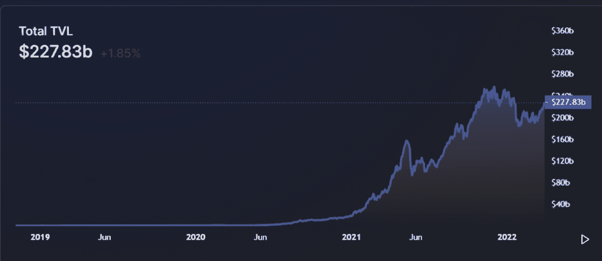

    **图 4.2 DeFi 系统总锁仓价值（2022 年 3 月）** ¶ 来源：DeFi Dashboard, [`defillama.com/`](https://defillama.com/)

*   **代币回购。** 协议可能会使用费用收入来注销（销毁）代币供应量。
*   **代币分红。** 协议可能会向持有者群体发行新代币。
*   **协议使用权。** 协议可能会为持有代币的用户提供费用折扣。
*   **质押奖励。** 示例包括 `ETH2.0` 质押或 `Polkadot` 的 `DOT` 代币质押奖励。
*   **治理投票。** 协议可能要求代币用于治理投票。

## 稳定币：连接 DeFi 与 CeFi 的桥梁

稳定币是一项关键创新，作为推动 DeFi 采用的催化剂。稳定币是一类加密代币，旨在提供价格稳定性，并可能由储备资产支持。历史上，加密货币被认为波动性太大，无法促除投机交易以外的金融交易。这一问题的答案以“稳定币”的形式出现，因为它们试图提供两全其美的方案——加密货币的实时支付清算和结算，以及法币的无波动稳定估值。

稳定币充当稳定的记账单位，使更复杂的金融交易和衍生品成为可能。它指明了将传统金融市场与快速发展的 DeFi 行业相结合的道路。作为市场稳定的一种力量，稳定币在贷款和信贷市场中成为加密货币采用的主要载体，同时继承了以前仅保留给法币的大部分效用。

根据四种底层抵押品结构，稳定币分为四种：法币抵押、加密货币抵押、大宗商品抵押或大宗商品抵押。虽然底层抵押品结构可能各不相同，但稳定币始终以同一个目标为旨：稳定性。

### 法币抵押（链下）

最流行的稳定币由法币 1:1 支持。因为底层抵押品不是另一种加密货币，这种类型的稳定币被视为链下资产。法币抵押品由中央发行机构或金融机构保管储备，且必须与流通中的稳定币代币数量保持成比例。

按市值计算，该类别中一些最大的稳定币包括 Tether（`USDT`）、Gemini Dollar（`GUSD`）、True USD（`TUSD`）和 Paxos Standard（`PAX`）。

### 加密货币抵押（链上）

顾名思义，加密抵押稳定币由其他类型的加密货币作为抵押品支持（通常是以太坊、比特币和其他主流加密货币）。此过程在链上进行，并采用智能合约，而非依赖中央发行机构。

## 稳定币类型与 DeFi 分层协议

## 加密货币抵押稳定币

购买此类稳定币时，您将加密货币锁定在智能合约中以获取等值代表价值的代币。随后，您可以将稳定币存回同一智能合约以提取原始抵押品数量。`DAI` 是该类别中最著名的稳定币。这是通过 `MakerDAO` 利用抵押债仓（`CDP`）在区块链上锁定资产作为抵押品来实现的。在 `MakerDAO` 的最新版本中，“`CDP`”一词被重命名为“`Vault`”（金库），以使其更易理解，因为加密货币常被比作黄金。

加密货币抵押稳定币也是超额抵押的，以缓冲所需加密货币抵押资产的价格波动。例如，如果您想购买价值 1,000 美元的 `DAI` 稳定币，可能需要存入价值 2,000 美元的 `ETH`——这相当于 200% 的抵押率。如果 `ETH` 的市场价格下跌但仍高于设定阈值，超额抵押品会缓冲 `DAI` 的价格以维持稳定。然而，如果 `ETH` 价格跌破设定阈值，抵押品将被偿还至智能合约以清算 `CDP`。

## 算法稳定币

算法稳定币不使用法币或加密货币作为抵押品。相反，其价格稳定性源于专用算法和智能合约对流通代币供应量的管理。当市场价格低于其追踪的法币价格时，算法稳定币系统会减少流通中的代币数量。反之，如果代币价格超过其追踪的法币价格，新代币将进入流通以向下调整稳定币价值。此类算法稳定币的示例包括 `Ampleforth` 或 `$AMPL` 代币、`$FEI` 和 `$FRAX`。

由于算法稳定币没有抵押品，此类代币的实际价值将取决于以下因素：

### 治理

许多基于算法的稳定币协议号称具有 `DAO` 结构。然而，只有少数精选协议拥有活跃的社区，负责持续批准改进提案。功能性的治理智能合约似乎是确保无抵押稳定币治理的理想选择。然而，确保公平的代币分配，并向所有利益相关者提供足够的治理特权也同样重要。各类算法稳定币协议遵循事实上的中心化治理方式。

### 激励

您会发现，某些算法稳定币协议选择再平衡机制（`rebase` 旨在根据代币价格波动自动调整流通代币供应量），用于在需要时主动修改用户钱包中的代币数量。另一方面，一些协议旨在为替代投资工具提供回报，例如用于移除或增加供应以匹配需求的优惠券。

因此，激励是决定最佳算法稳定币效率的最棘手方面之一。为什么？因为您面临着加密货币市场的不稳定性，以及人类心理和经济学中的波动因素。截至目前，稳定币唯一可见的激励就是稳定性。

### 代币采用

代币采用因素也是定义算法稳定币理想选择列表的重要方面。大多数协议仅被少量或特定数量的 `DeFi` 项目采用。无需合作伙伴协议批准的自动做市商（AMM）不在采用范围内。结果，基于算法的代币实用性下降，且接触新用户的机会受限。有限的代币采用水平可能会因流动性增长缓慢而给稳定性带来限制。

### 准确性

算法稳定币在维持锚定方面因多种复杂原因而举步维艰。某些协议可能失控到极有可能陷入*死亡螺旋*的程度。因此，主要协议需要一种机制来帮助协议走出“死亡螺旋”。

## 商品抵押稳定币

商品抵押稳定币使用贵金属、石油和房地产等实物资产作为抵押品。最流行的抵押商品是黄金；`Tether Gold (XAUT)` 和 `Paxos Gold (PAXG)` 是流动性最强的两种黄金抵押稳定币。然而，重要的是要记住，这些商品会且更有可能价格波动，因此有贬值的可能。

商品抵押稳定币促进了原本可能因地域限制而无法触及的资产投资。例如，在许多地区，获取金条并寻找安全的存储地点既复杂又昂贵。因此，持有黄金和白银等实物商品并不总是切合实际的选择。

然而，商品抵押稳定币也为那些想要将代币兑换为现金或取得底层代币化资产占有权的人提供了实用性。`Paxos Gold (PAXG)` 稳定币持有者可以将其出售换取现金，或取得底层黄金的占有权。然而，由于伦敦优质交割金条重量在 370 至 430 盎司/根之间，且每个代币代表 1 盎司，用户必须持有至少 430 `PAXG` 才能执行代币赎回。赎回后，代币持有者可在英国各地的金库提取其黄金。

同样，`Tether Gold` 持有者若完成 `TG Commodities Limited` 验证流程且持有至少 430 `XAUT`，可赎回 `XAUT` 代币兑换实物黄金。这一最低限额反映了标准 430 盎司 `伦敦金银市场协会 (LBMA)` 金条规格。`XAUT` 赎回后，持有者可在瑞士自选地点提取其黄金。

尽管跨活跃平台赎回黄金抵押稳定币换取实物黄金的功能是通用的，但其他商品抵押稳定币缺乏同等实用性。例如，委内瑞拉试验性的 `Petro` 稳定币不可兑换一桶石油。虽然由房地产等其他商品支持的稳定币近年来频登头条，但缺乏活跃项目使得进一步对比变得困难。

## 分层协议与 DeFi 安全

## DeFi 的“金钱乐高”层级

从技术和功能角度来看，`DeFi` 项目可划分为不同层级的“金钱乐高”（智能合约）。例如，公链和协议属于底层技术，`DEX` 和借贷属于不同层级的应用。同时，不同层级可组合构建新的 `DeFi` 应用：

1.  **底层技术。** 包括 `Ethereum`、`Solana`、`Polkadot` 和 `Cosmos` 等公链，以及 `Metamask`、`Enjin`、`Agent`、`imToken` 等不同钱包应用。
2.  **稳定币。** 它是实现价格数据和资产交换的关键金钱乐高。稳定币示例包括 `Tether USDT`、`USDC`、`DAI` 及一些基于算法的稳定币版本（例如：`Basis Cash`、`Ampleforth`、`Empty Set Dollar` 和 `Frax`）。
3.  **DEX（去中心化交易所）**，如 `Uniswap`、`0X` 和 `Kyber`。
4.  **借贷协议**。目前 `DeFi` 上最热门的应用类别，`MakerDAO`、`Compound`、`AAVE` 等均属于此类。
5.  **ETF、合成资产、ABS（资产支持证券代币）及其他金融衍生品。** 不仅衍生品可用数字资产形式表达，实物资产也可用数字资产形式表达。
6.  **DeFi 指数基金、保险产品与供应链金融**

目前，DeFi 尚不成熟，无法支持这些领域的复杂应用，但创新正在迅速涌现，尤其是在保险市场。

值得注意的是，从第二层到第六层，都需要区块链预言机（预言机将区块链连接到外部系统）的协助来提供真实数据。当不同层级组合时，请密切关注相关的安全问题。以下是 DeFi 系统中被广泛利用的安全漏洞列表。

### 流动性池计算错误

当对 DeFi 池中代币的价值进行定价时，DeFi 智能合约中被利用最多的攻击形式之一是黑客对价格进行操纵。

当 DeFi 参与者投资于资金池时，会获得代币份额，从而允许他们在未来提取价值。一些设计不佳的 DeFi 协议并不使用外部预言机，而是根据池子当前的构成频繁计算其持有代币的价值。闪电贷攻击利用这一点，在一笔交易的周期内剧烈打破池子的平衡。这种不均衡的池子导致代币价值计算错误，从而允许攻击者从池子中抽取价值。（Belt Finance、Rari Capital 和 BurgerSwap 就是以这种方式被攻击的协议示例。）

### 私钥被盗与泄露

为了管理对区块链账户的访问和控制，区块链技术采用公钥加密。区块链账户的地址源自与私钥关联的公钥。代表该账户进行的任何交易都必须使用正确的私钥进行数字签名。因此，私钥成为众多区块链攻击的焦点。密钥可能通过多种方式被盗或泄露，包括：

*   **加密货币钱包被攻破（如 `MetaMask`）。** `MetaMask` 常用于与以太坊区块链交互并执行交易。包括 Nexus Mutual 的 CEO 和 EasyFi 项目在内的多位 DeFi 用户和项目方，因在其机器上安装了恶意版本的 `MetaMask` 而损失了加密货币。
*   **助记词泄露/被盗。** 助记词是一种常见方式，旨在让私钥在恢复或设置新钱包时更容易记忆或输入。一些 DeFi 相关黑客事件涉及这些密钥的被盗或意外泄露。
*   **密钥生成不当。** 私钥应使用安全的随机数生成器生成。如果这些密钥因随机性来源不佳而生成不当，攻击者可能会猜出它们并控制区块链账户。
*   **针对私钥的网络钓鱼攻击。** 黑客通常以知名 DeFi 协议的开发者或高管为目标，实施网络钓鱼窃取私钥。例如，2021 年 11 月，BZX 协议开发者的私钥被盗，导致 5500 万美元损失。此次攻击使黑客获得了 bZx 开发者钱包内容的访问权限，以及 BSC 和 Polygon 上 bZx 协议部署的私钥。此类攻击可通过将开发职责与运营职责分离来轻松避免。运营团队应持有多重签名密钥，并使用安全工作站部署协议合约。

### 特权功能的访问控制薄弱

特权功能在每个 DeFi 智能合约中都很常见。这些函数仅设计为由合约所有者调用，因此必须建立访问控制以确保这一点。访问控制通常通过指定函数调用必须由地址列表中的一个或多个地址发出来实现。这些访问控制有时会被省略，或以允许攻击者绕过它们的方式构建。如果发生这种情况，攻击者将获得合约的特权访问权限，从而能够从中提取价值。

Poly Network 和 Punk Protocol 的黑客事件就是此类漏洞的两个近期案例，攻击者声称拥有项目合约的所有权，并利用该访问权限从中抽取价值。

### 抢跑攻击

区块链不会立即将交易添加到分布式账本中。交易一创建就被广播到区块链网络，但它们会存储在每个区块链节点的内存池中，直到作为区块的一部分被添加到账本中。

交易创建与其被纳入账本之间的时间差创造了抢跑攻击的机会。攻击者（通常是自主程序，即机器人）会寻找可利用的交易。如果发现一个，他们会创建自己的交易版本，设置更高的交易费，并将其广播到网络。由于区块链矿工通常根据交易费对区块中的交易进行排序，攻击者的交易会排在原始交易之前，从而获利。

抢跑攻击以不同方式影响 DeFi 安全。许多机器人利用抢跑，基于对用户交易的预知获利。在某些情况下这是恶意的，而在其他情况下（如 DODO DEX 和 Punk Protocol 黑客事件），机器人抢跑了尝试性的攻击，随后将被盗代币归还给被攻击的协议。

### 跑路

许多针对 DeFi 协议的攻击来自外部威胁，但并非总是如此。跑路是由 DeFi 协议的所有者和开发者自身实施的攻击。在跑路骗局中，拥有合约特权访问权限的公司内部人员利用此权限从协议中抽取价值。通常，项目及其背后的团队随即消失，留给受害者极少的追索手段。

Chainalysis 的一篇博客文章指出，跑路已成为 DeFi 生态系统中首选的骗局手段，2021 年占所有加密货币诈骗收入的 37%，而 2020 年仅为 1%。该博文还列举了 2021 年一些最大规模跑路案例的示例。（参见 **框：AnubisDAO 和 Up1 跑路事件**。）对于 DeFi 用户而言，当使用 `Metamask`、`Enjin` 或 `Agent wallet` 等自身钱包时，点击 web3 应用弹出的对话框中“批准”或其他提示信息至关重要，因为黑客的合约可能会获得您所有代币的访问权限，并将其从受影响的钱包地址中提走。

### DeFi 跨链桥攻击

2021 年 8 月，作为跨多条区块链交换代币的重要跨链协议，Poly Network 遭遇攻击。结果导致超过 6 亿美元被盗，成为最大的 DeFi 黑客事件。攻击次日，黑客通过以太坊交易中的备忘录发布了一系列问答。他称攻击是“为了好玩 :)”，因为“跨链黑客攻击很火”。这一事件真正凸显了保障跨链协议安全的重要性。

从某种意义上说，这些跨链攻击的高频次和巨大金额影响，是跨链协议日益增长的热情所导致的后果。跨链 DEX 的出现使 DeFi 用户能够简单快速地在不同链上交易资产。在传统的中心化交易所（CEX）中，跨链交易需要数十分钟甚至数天才能处理完毕，且可能涉及高额费用。因此，跨链 DEX（仅需两三步、几秒钟即可完成跨链交易）能提供更好的用户体验。然而，围绕跨链协议频繁发生的近期安全事件表明，如果没有强有力的安全保障，更快的速度、更高的效率和更优的汇率可能还不够。

以下是跨链 DeFi 交易潜在风险的简要概述，并附带过往攻击的具体案例。

#### 1. 假充值 – THORChain

当协议合约存在漏洞，使黑客能够欺骗网络误以为他们已将资金存入合约，而实际上并未存入时，就会发生此类攻击。这使得攻击者能够要求退还一笔从未存在过的存款。

THORChain 遭受了此类攻击。验证代币地址的函数检查接收到的代币的代号是否为 `ETH`。攻击者伪造了一个代号为 `ETH` 的 ERC-20 代币来欺骗跨链桥，随后将真实的 `ETH` 代币作为“退款”转给自己。

#### 2. 多签与额度漏洞 – ChainSwap

ChainSwap 资金第二次被盗，是因为某个节点增加了跨链桥白名单地址的额度。在检查白名单时，原本需要的多重签名因配置错误变成了单签。攻击者只需其中一个签名，即可通过在另一条链上调用 `Receive` 函数来转移资产。

#### 3. 赎回风险 – Anyswap

为了解释这一点，我们以 OKExChain (OEC) 上的 `BNB` 为例。Anyswap 在未获得币安官方授权的情况下在 OEC 上发行了 `BNB`。OEC 上的 `BNB` 不等同于币安智能链 (BSC) 上的 `BNB`（由币安交易所发行的加密货币）。它是由 Anyswap 发行并在 OEC 上流通的 `BNB` 债券。


### 4. 私钥泄露 – Anyswap 和 Axie Infinity

Anyswap 近期遭攻击的主要原因是签名使用了重复的 `R` 值。如果同一账户签名的两笔交易具有相同的 RSV 签名 `R` 值，黑客可以反向推导出该账户的私钥。由于该账户可在 BSC、ETH 和 FTM 上使用，该账户在多条链上的资产均被盗取。单一账户权限过大也是一个风险因素。

另一个例子是 2022 年 3 月 Axie Infinity NFT 游戏近 6.5 亿美元的黑客攻击。黑客窃取了五个验证者的私钥，以批准和验证从 Ronin 网络到以太坊网络的跨链交易。（Ronin 区块链网络是 Axie Infinity 的私有区块链，拥有九个验证者，但只需五个验证者即可批准跨链交易。）

### 5. 闪电贷套利 – bEarn Fi

攻击者通过闪电贷借入 `BUSD`，通过 Alpaca Finance 的借贷生成 `ibBUSD`，然后利用 bEarn Fi 的合约策略漏洞，在 `ibBUSD` 和 `BUSD` 之间实施套利攻击。

### 6. 合约访问控制 – Poly Network

攻击者通过伪装交易，将 `Keeper`（中继器）替换为普通跨链交易，从而将 Poly Network 中 `Keeper` 的地址替换为自己的地址。中继器的验证功能不够安全，仅检查了 4 字节。攻击者找到了符合要求的 4 字节，成功将自己的地址转换为 `Keeper` 地址并进行签名。随后，黑客调用 `LockProxy` 合约，掠夺了 Poly Network 所有的跨链资产。

### 7. 因供应链代码风险导致的签名验证绕过 – Wormhole

Wormhole —— 一个基于 Web 的区块链“桥”，允许用户转换加密货币，于 2022 年 2 月遭受攻击，损失超 3.2 亿美元。攻击发生的原因是 Wormhole 协议代码使用第三方库代码来验证存款人的签名。黑客利用恶意交易绕过了已弃用的签名验证算法，窃取了 120,000 枚以太币。

## 通往大规模采用的坎坷之路

虽然许多人认为 DeFi 将成为未来金融体系的基石，但散户消费者的广泛采用尚未发生。目前大多数 DeFi 交易来自“数字资产原生”机构和交易者。即使在加密货币社区内，只有极少数加密货币玩家活跃在 DeFi 领域。这似乎表明 DeFi 仍有大量增长空间。（再次参见图 4.1。）

但 DeFi 广泛采用也面临诸多挑战。对大多数人来说，DeFi 过于技术化、波动太大、太“极客”，难以理解和使用。一方面，存在许多与市场状况相关的非技术障碍，例如：

*   **需要用户教育。** 由于 DeFi 协议复杂且可组合的逻辑，需要大量的技术背景知识才能熟练地与 DeFi 协议进行交易。
*   **监管不确定性。** 美国监管机构，尤其是 SEC，正在制定 DeFi 相关法规。例如，某些 DeFi 代币是否应被视为证券？（详见第 9 章的详细讨论。）
*   **缺乏行业标准。** 全球最大加密货币交易所币安提出的“加密用户 10 大基本权利”是一个良好的开端。（参见框：加密用户权利法案。）
*   **缺乏全球触达能力。** DeFi 建设者难以触达全球市场并建立全球社区。

另一方面，也存在一些区块链和 DeFi 特有的挑战，因为加密网络和 DeFi 技术仍处于早期阶段。在 DeFi 能够服务于更大规模的全球金融市场之前，底层网络可扩展性、KYC/AML 以及 UI/UX 设计等多个方面仍需改进。

### 可扩展的基础区块链

DeFi 主流采用的主要障碍之一是基础区块链的可扩展性。在以太坊上进行 DeFi 交易的成本非常高昂，借出或借入代币可能需要数百美元，且每秒交易处理速度缓慢，平均仅 15 笔/秒。（有许多可扩展性解决方案，详见第 2 章。）

最有前景的解决方案是第 2 层协议，如以太坊上的 Rollup 协议，或其他第 1 层方案，如币安智能链、Solana 或 Terra。跨链解决方案如 Polkadot 和 Cosmos 对 DeFi 协议开发者也极具吸引力，可用于连接不同的 DeFi 协议以形成新的 DeFi 系统。重要的是要注意“区块链不可能三角”，即无法同时实现安全、可扩展和去中心化。同一时间只能满足其中两个要求。

例如，如果你需要满足安全性和可扩展性要求，必须牺牲去中心化。或者如果你要求安全性和去中心化，就必须在可扩展性上妥协。以太坊基础链具有强大的安全性和去中心化，但这是以牺牲可扩展性为代价的。同时，所有第 2 层解决方案或以太坊的其他第 1 层替代方案都实现了良好的可扩展性——但这是以牺牲去中心化为代价的。

### KYC/AML

由于 DeFi 业务的点对点性质，涉及原生数字资产的 DeFi 交易可能难以通过传统的 AML/KYC（反洗钱/了解你的客户）控制进行监管，因为用户默认使用化名，交易抗审查，资产抗没收，且许多交易涉及非托管钱包，不直接与个人身份绑定。

例如，如果个人向 DeFi 交易对池提供流动性，然后通过撤回流动性套现，DeFi 协议开发者如何才能确切知道流动性提供者是谁？如果用户通过智能合约利用自主钱包在 DeFi 上借贷加密货币，DeFi 借贷协议如何能知道用户的真实身份？如果 DeFi 平台不知道用户的真实身份，如何能提供准确的报告？如果用户通过智能合约质押 DeFi 代币，并因质押和保护 DeFi 平台或基础区块链的安全而获得奖励，质押的匿名性质如何满足报告要求？

一个有前景的解决方案是利用 W3C 和去中心化身份基金会目前正在大力开发的去中心化身份（DID）标准和可验证声明标准。随着 DID 标准的成熟，KYC/AML 可应用于 DeFi 协议，使 DeFi 协议与“可验证凭证”提供商集成，以对某些交易实施所需的 AML/KYC 流程，同时利用零知识证明保护用户隐私（更多内容见第 7 章）。

另一种可能的方法是中国主权数字货币（e-CNY；详见第 9 章）已实施的方案。e-CNY 允许在无需 KYC/AML 的情况下在个人之间转移智能金额。此外，在没有 KYC/AML 的情况下，可利用大数据和 AI 追踪恐怖融资和洗钱活动。

### UI/UX 设计

迄今为止开发的大多数 DeFi 应用程序 UI/UX 设计都非常糟糕。UI（用户界面）和 UX（用户体验）含义截然不同，但只有两者结合才能帮助创建适合主流采用的用户友好型 DeFi 产品。UI 直接关系到如何展示产品，而 UX 关系到应用程序与用户之间的整体交互。如果你想让你的 DeFi 产品在拥挤的市场中脱颖而出，你需要创新的 UI 设计，但 UI 只是产生和影响产品 UX 的生态系统中的一小部分。

UI 设计涉及管理和操作各种形式的内容（文本、图像、图形、视频）、字段、功能（按钮、标签、框、命令、下拉列表）和操作项（点击特定链接时会发生什么）。UI 需要一点艺术和情感的点缀，目标是创建一个引人入胜的界面，使 DeFi 产品对用户具有吸引力。UX 设计的范围广得多，包含更多元素（架构、交互、内容、用户研究），这些元素集成在一起以满足 DeFi 用户的需求。目前，UX 方面还有很大提升空间，以便对广大用户群体友好。

有趣的是，大规模采用最重要的催化剂可能来自 CeFi，即 DeFi 表面上的宿敌。由于其覆盖的客户群广泛得多，CeFi 的参与对于 DeFi 被主流投资者采纳至关重要。确实，富达、摩根大通和高盛等蓝筹金融机构都在尝试为其客户提供一定程度的 DeFi 服务（见图 4.3）。

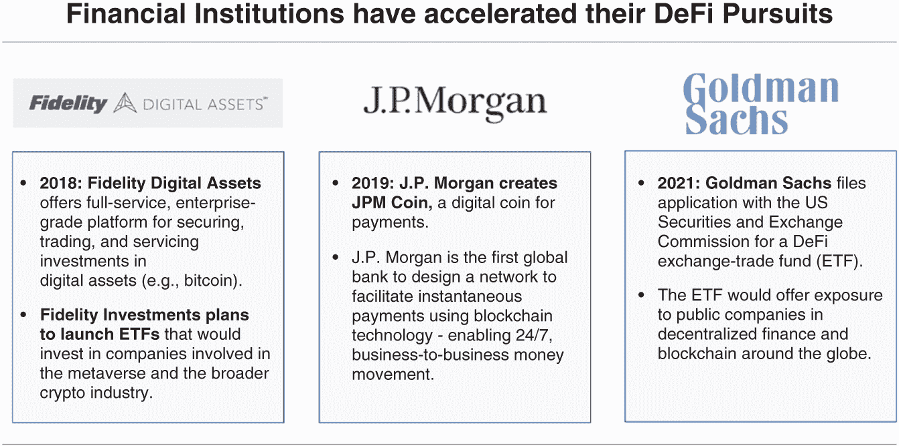

**图 4.3 华尔街拥抱 DeFi** ¶ 来源：摩根大通、路透社、Blockworks、CoinDesk

自 2018 年 10 月起，资产管理公司富达的数字资产服务部门开始为比特币等加密货币提供托管服务，并为对冲基金和家族办公室等投资者在多个交易所执行交易。在最近重申富达专注于将加密资产行业与传统金融板块连接起来时，富达首席执行官 Abby Johnson 称该公司的加密托管业务“非常成功”。

2021 年 7 月，据报道投资银行摩根大通已批准其顾问为客户提供五只加密货币基金的准入。其中四只来自 Grayscale Investments——比特币信托、比特币现金信托、以太坊信托和以太坊经典信托，第五只是 Osprey Funds 的比特币信托。这五只基金获批供所有寻求投资建议的摩根大通财富管理客户使用，摩根大通顾问可接受买卖这五种加密货币产品的订单。这五只基金可被视为通往 DeFi 基金的桥梁，尽管它们本身不是 DeFi 基金。

对于高盛，其于 2021 年 7 月向 SEC 申报的 DeFi ETF 基金将为投资者提供与区块链技术和“金融数字化”主题相关联的公司的投资敞口。在 2021 年 11 月接受彭博社采访时，高盛能源研究主管 Damian Courvalin 谈到了对黄金和加密货币的展望：“正如我们认为白银是穷人的黄金，黄金可能正在成为穷人的加密货币。”但由于高盛的 DeFi ETF 中不包含实际的 DeFi 公司和股票，加密社区批评了这一举措。

但 CeFi 机构对拥抱 DeFi 仍采取小步快跑的策略并不令人惊讶。机构投资者仍对托管服务、资产安全、合规问题以及加密资产的异常价格波动存有顾虑。此外，许多 DeFi 项目使用与协议相关的治理代币，但这些代币是否会积累与此类 DApp 项目基本面增长挂钩的长期可持续价值，仍有待观察。尽管如此，大趋势显而易见：CeFi 机构如何应对 DeFi 将影响其在未来全球金融体系演变中的角色，它们不可避免地拥抱 DeFi 将显著加速 DeFi 的普及。

## 攻克新疆域：DeFi + NFT、游戏与社交网络

除了在传统金融领域与 CeFi 竞争和合作外，DeFi 还正在向完全新的去中心化金融领域扩张，如下图所示，通过与 NFT、游戏和社交网络的整合。

## DeFi 与 NFT

DeFi 和 NFT 可以在区块链项目中结合利用，以提供以下价值：

*   **为 NFT 项目提供融资和流动性。** 假设一幅画价值 100 万美元，但除非有人愿意出资购买，否则它没有任何价值。在这种情况下，DeFi 和 NFT 共同发挥作用解决这一问题。一种方法是将 NFT 收藏品和艺术品作为抵押品用于 DeFi 贷款，为项目提供流动性。既然传统艺术品自古以来就在现实世界中被用作抵押品，将其带入加密世界和 NFT 艺术似乎是合乎逻辑的进步。另一种方法是利用 NFT 对艺术品进行代币化，然后使用 DeFi 智能合约将 NFT 代币分割成更小的份额，以便更多人可以参与并提供流动性来购买艺术品。
*   **NFT 所有权与 DeFi。** 利用 NFT 所有权机制，例如用 NFT 代表一首歌曲的数字版权，NFT 所有者（音乐人）可以在 DeFi 中将该 NFT 作为抵押品获取贷款，从而创办自己的录音业务。或者，他可以将其质押在 DeFi 平台上，除了获得 NFT 所有权的版税外，还能从 DeFi 生态系统中获得质押收益。（NFT 深度讨论见第 5 章。）

### 解决联合曲线问题

一些 DeFi 协议引入了“绑定曲线”，以将流动性分布在整条曲线上，从而鼓励早期参与 DeFi 生态系统。（绑定曲线是一种数学公式，用于设定代币价格与其供应量之间的关系。）绑定曲线的问题在于，随着参与系统的人越来越多，奖励会被稀释。在 NFT 的协助下，可以引入一种机制，让流动性提供者选择期望的自定义价格区间，这独立于绑定曲线，且专属于 NFT 持有者。

## Game + DeFi = GameFi

GameFi 是视频游戏（游戏）与去中心化金融（DeFi）的结合。此类视频游戏使用的技术是区块链技术，它允许玩家成为游戏虚拟元素的唯一且经过验证的所有者。在传统视频游戏中，主流模式是“付费制胜”，玩家必须付费以获得优势，例如升级、减少等待时间或购买虚拟物品。另一方面，GameFi 引入了“玩赚”（P2E）模式（参见框：付费制胜 v. 玩赚）。（关于区块链游戏的深度讨论，请参见第 6 章。）

## SocialFi 的兴起

社交金融（SocialFi）是社交媒体市场的最新发展，它结合了社交媒体平台、Web 3、NFT 和 DeFi。创建这些新型社交网络的目的是通过代币化社交影响力，为用户提供奖励和福利。SocialFi 的构想始于 2017 年。然而，直到 2021 年底，随着用户对 DeFi 理解的加深，这一想法才开始获得关注。

值得注意的是，SocialFi 正在构建一个完全去中心化且自洽的经济体系。SocialFi 旨在将控制权还给用户，让他们决定如何在平台上与他人互动。在新概念中，用户拥有并管理平台和创意内容。这意味着 Facebook、Instagram 和 Twitter 等巨头完全控制社交互动的日子一去不复返了。SocialFi 引发的热议在社区中创造了极高的期待，称其为“新出口”。

在元宇宙中，上述所有内容加上即将到来的 DeFi 创新，可以概括为“MetaFi”——元宇宙中的金融创新，它驱动着创作者经济，将在本书末尾进行讨论。如今，许多 DeFi 参与者或多或少仍然是中心化的，很快，更去中心化的 DeFi 参与者将在元宇宙应用中发挥主要作用（参见图 4.4）。

总之，当前的 DeFi 市场既极具前景，又极不成熟。虽然 DeFi 和 Web3 的大规模采用还为时过早，但 DeFi、NFT、游戏和社交领域的最新融合表明，更多技术创新和用户用例正在到来，而随着用户用例的增加，采用率也会随之提高。加密货币不再仅仅是投资组合中的一篮子资产，它开始通过 DeFi 应用渗透到日常生活中。

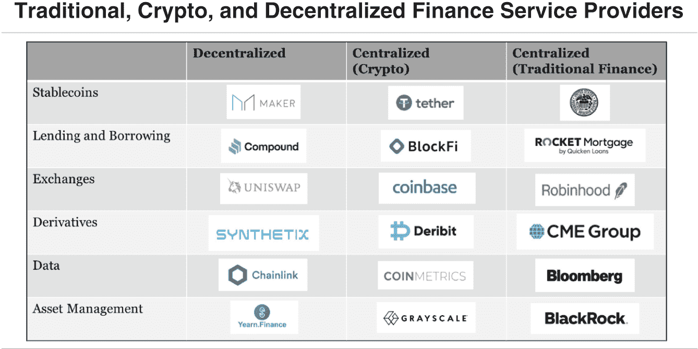

**图 4.4 去中心化 DeFi 参与者崛起** ¶ 来源：Grayscale 报告，2021

Web3 已成为关于互联网应如何构建以及个人应如何分享价值创造的新经济理念的代名词。在此背景下，DeFi 应用不仅正在改变金融和货币，还在改变创作者构建数字原生组织以创造和分享价值的方式。在下一章中，我们将把注意力转向 NFT 和游戏，它们正将区块链行业从其金融起源推向数字经济中更广泛的领域。

## 第 5 章：NFT、创作者经济与开放元宇宙

- 2021 年——NFT 元年
- 艺术与科技的协同演进
- NFT 与生成艺术
- 创作者经济：超越无聊猿
- 品牌与时尚推动主流化
- NFT 元宇宙面临的挑战

## 2021 年——NFT 元年

毫无疑问，2021 年是非同质化代币（NFT）元年，NFT 是在公共区块链上交换的数字文件的独特代币化表现形式。NFT 从默默无闻跃升为头版新闻，生成数字资产以代表各种可能的现实世界物品，从艺术品和音乐到墨西哥卷饼和卫生纸。从增加数字商品流动性的新机制出现，到在全球范围内引发讨论，你几乎无法访问任何在线空间而不读到关于 NFT 的内容。

NFT 是区块链上的一种代币，包含可将其与其他代币区分开来的唯一元数据。虽然加密货币是同质化且可轻松转移的，但 NFT 是非同质化的，意味着每个 NFT 都是独一无二的，不能与另一个 NFT 互换。换句话说，虽然一个比特币等同于另一个比特币，但没有两个 NFT 是相同的。（NFT 的对比请参见表 5.1。）

表 5.1 同质化代币与非同质化代币的区别

| 标准 | 同质化代币 (FT) | 非同质化代币 (NFT) |
| --- | --- | --- |
| **互换性** | 同质化代币可互换，但这种互换不附带额外价值。 | 非同质化代币不可互换，因为每个代币都代表独特的资产。 |
| **价值转移** | 价值转移取决于个人拥有的代币数量。 | NFT 所代表的独特资产的价值有助于其价值转移。 |
| **可分割性** | 同质化代币可分割成更小的部分，较小部分有助于支付较大金额。 | NFT 不可分割，作为一个整体实体拥有其价值。 |
| **代币标准** | 同质化代币依赖 ERC-20 标准。 | 非同质化代币利用 ERC-721 标准。 |

因此，NFT 可用于存储更复杂和个性化的信息（例如，“埃隆·马斯克首条推文的数字签名版”等稀有收藏品）。政府文件如结婚证、土地登记、食品等级评定和驾照都可以使用 NFT 进行代币化。在零售领域，消费者可以使用 NFT 验证奢侈品的真伪。当塔可钟等公司宣布推出 NFT 时，显然区块链世界正在发生一些特别的事情。

有趣的是，可以说是离区块链技术世界最远的艺术家群体，引发了 NFT 热潮。NFT 代表了稀缺数字艺术的可证明权利，并席卷全球。与此同时，世界各地的艺术家发现，通过出售 NFT，他们现在可以以比传统世界好得多的费率将其创意作品变现。到 2021 年 12 月，Cryptopunks 和无聊猿游艇俱乐部（BAYC）等系列已成为家喻户晓的名字，而 Beeple 等名人艺术家以超过 6900 万美元的价格出售了其部分数字创作，全球市场销售额达到 400 亿美元以上。（参见图 5.1：主要 NFT 项目。）

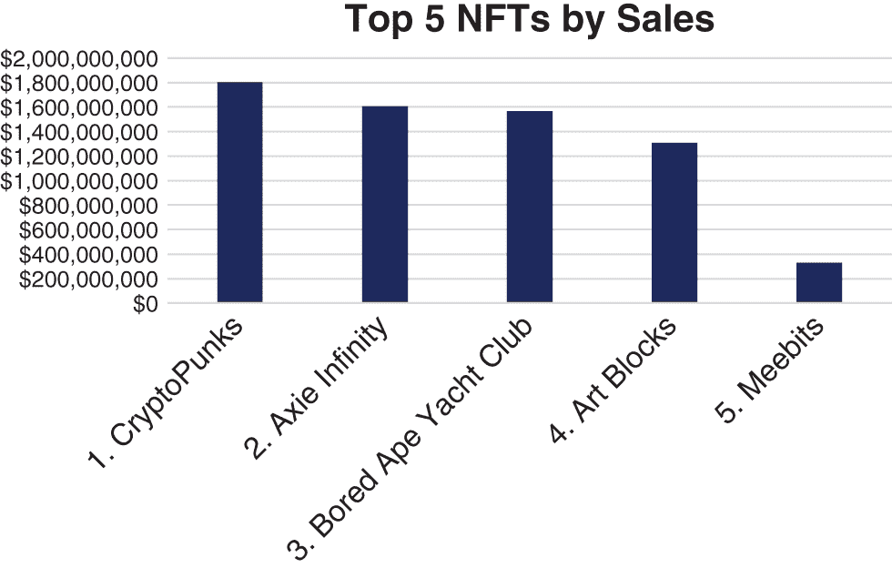

**图 5.1 主要 NFT 项目（截至 2021 年底）** ¶ 来源：[Blockchain101.com](http://blockchain101.com); [nonfungible.com](http://nonfungible.com)

NFT 不仅仅是 JPEG 格式的数字照片；游戏、音乐和体育等垂直领域也开始将 NFT 集成到其生态系统中，孵化出了像 Axie Infinity 这样的新项目（一种“玩赚”游戏，详见第 6 章）。总而言之，2021 年巩固了数字原语对可验证所有权的需求，NFT 市场继续以惊人的速度获取价值。

毫无疑问，NFT 在将区块链推向主流方面发挥了重要作用。NFT 为普通互联网用户提供了一个进入区块链的便捷切入点，即使存在高昂的交易费用（本章后面将介绍）。如今，全球各地的人们正在铸造自己的 NFT，代表艺术品、摄影作品、音乐、收藏品、游戏内物品以及几乎所有其他事物。简而言之，没有 NFT 的主流采用，Web3 和元宇宙就不会发展到今天的地步。

## 艺术与技术的协同演进


NFT 引发了一场发生在艺术和内容创作领域的数字文艺复兴——一个由艺术家、音乐家、作家、摄影师和策展人组成的繁荣生态系统，他们在文化与商业的交汇处构建社区。NFT 艺术提供了许多可能——一种让艺术家将作品变现的方式，一种让加密货币大户（“巨鲸”）像古典艺术赞助人一样奖励新晋艺术家的方法，以及一种创作艺术本身的新数字媒介。

但为什么是现在？让我们回顾一下文艺复兴以来人类历史上艺术与技术创新的发展历程。不同艺术史阶段及重大技术里程碑请参见表 5.2。

### 表 5.2：技术与艺术的协同演进

| 艺术与技术的四个阶段 | 近两个世纪影响艺术的技术 | 对艺术的影响 |
| --- | --- | --- |
| **手工艺** | * 现代化学技术合成颜料<br>* 人工照明技术 | * 合成颜料推动现代艺术发展<br>* 现代照明与文物保护技术推动博物馆发展 |
| **图像印刷** | * 摄影技术<br>* 照相制版后的现代印刷技术 | * 摄影艺术诞生，推动现代主义<br>* 大规模、精准的图像复制与传播出现 |
| **大众传媒** | * 电影技术<br>* 广播、电视与视频技术 | * 电影艺术诞生<br>* 广播电视推动“大众艺术”繁荣 |
| **数字艺术** | * 计算机技术<br>* 数字显示技术（含 AR/VR）<br>* 互联网/AI/区块链 | * 艺术创作的全新媒介与方法<br>* 艺术传播的新方式 |

### 第一阶段：手工艺

第一阶段可称为*手工艺阶段*。该阶段始于史前时代，延续至今。在此阶段，艺术家采用手工方式创作艺术品，可能是绘画、雕塑或书法。

在此阶段，创作出的艺术品是独一无二的。艺术品鉴赏强调在“原作”前凝视与沉思。收藏家可通过购买艺术品获得相关财产权，并朝夕相伴。可以说，当今艺术生态系统的核心机构，如博物馆、画廊、艺术博览会和拍卖行，皆为手工艺阶段的产物。对该阶段而言，艺术品的财产权与实物占有是关键。

### 第二阶段：图像印刷

达盖尔银版摄影法是 1839 年的一项里程碑式发明。自发明以来，摄影作为一个新艺术门类诞生了。摄影与其他技术的结合催生了许多新发明：例如，摄影与印刷的结合诞生了照相制版印刷技术。自此，精准复制大量图像成为可能。摄影与其他技术的结合创造了许多新艺术形式。自此，对许多消费者而言，可极低成本获得可靠的图像复制品。这一变革将艺术从少数人的专属资源转变为大众可获取的资源，极大地提升了艺术的普及度，并改变了艺术鉴赏或消费的行为。

随之而来的是艺术品传播商业模式的变革。在此阶段，画廊和拍卖行试图介入摄影这一新兴艺术领域，但其传统行业形态被证明与图像印刷阶段的艺术消费逻辑不匹配。至今，画廊和拍卖行仍难以有效销售摄影作品。新型连锁书店、杂志、报纸及整个出版体系已成为摄影艺术的新生态系统。

### 第三阶段：大众传媒

十九世纪末，摄影与动画技术结合，创造出一种革命性艺术形式——电影。1895 年，巴黎的大咖啡馆进行了首次电影放映。20 世纪 20 年代至 30 年代，广播技术和电视技术走向商用。*大众传媒阶段*自此繁荣发展。

在此阶段，受众消费艺术的逻辑发生根本性变化：在手工艺阶段，艺术消费是“获取原作财产权”；在图像印刷阶段，是购买欣赏“复制品”；在电影阶段，虽仍有消费者收藏喜爱电影的复制品（早期录像带、DVD，现为蓝光光盘），但对绝大多数顾客而言，他们购买的不是复制品（值得注意的是，无法购买“原作”），而是一种“体验”。他们需要的是一张凭证（电影票，有趣的是，这可以作为当今 NFT 访问艺术品的一个良好类比），为他们提供两小时的愉悦体验。

从受众视角对比这三个阶段也是一种方式。在手工艺阶段，能见到原作的人极少。在国际旅行这种奢侈行为流行之前，数量级可能只有数百至数千人。照相制版印刷普及后，能看到复制品的受众规模迅速扩大。在大众传媒阶段，一部电影能触达的受众往往达数百万、数千万甚至数亿量级。

### 第四阶段：数字艺术

随着计算机和芯片的飞速发展，短短几十年间，我们见证了一系列技术的发明与演进：计算机图形学、数字显示技术、3D 建模与打印、`VR`（虚拟现实）和 `AR`（增强现实）技术、人工智能、互联网和社交网络等。这些技术为艺术的创作、消费和传播带来了极其丰富的可能性，NFT 便是完美例证。

举另一个例子，电子游戏可能成为艺术发展的新疆域。2012 年 11 月，纽约顶尖艺术博物馆 MoMA 正式将 14 款电子游戏纳入馆藏。其中包括几年前玩家熟知的名字：《吃豆人》（1980）、《俄罗斯方块》（1984）、《模拟城市 2000》（1994）。主管此事的 MoMA 建筑与设计部高级总监 Paola Antonelli 表示：

> 电子游戏是艺术吗？它们当然是，但它们也是设计，而设计方法正是我们选择用于进军这一领域的新途径。这些游戏被选为交互设计的杰出范例——这是一个现代艺术博物馆（MoMA）已经广泛探索和收藏的领域，也是当代设计创造力最重要且讨论最多的表达形式之一。因此，我们的标准不仅强调每款游戏的视觉质量和审美体验，还强调与交互设计相关的许多其他方面——从代码的优雅到玩家行为的设计……

NFT 与游戏的融合将在第 6 章中讨论。

## NFT 与生成艺术

得益于 NFT，加密社区已成为一个表达性场所，用户通过个人资料图片用各种头像描绘自己。始于一个古怪艺术项目的事物，已发展成为一场完整的加密艺术运动。`CryptoPunks` 是一种互联网文物，它启发了当今支撑数字艺术和收藏品的 `ERC-721` 标准。你很可能见过这些像素化的朋克和无聊猿在网络空间中漂浮。共有 10,000 个独特的 CryptoPunks，每个都拥有随机生成的属性。这些像素化角色混合了男性、女性、稀有的僵尸、猿和外星人。

PFPs（个人资料图片 NFT）的激增也表明了一场更广泛的文化运动。（参见框：生成艺术。）从 Cryptopunks 开始，PFPs 已扩展到企鹅、猫、狗、猴子、老鼠等。交易这些 JPEG 文件似乎是由这些创造性互动中固有的文化和象征价值驱动，而非现实生活中的实用性。PFP NFT 让人们能够彰显地位、建立社区并鼓励艺术表达。拥有这些 NFT 之一，就是进入原生互联网社交俱乐部的虚拟入场券，这些俱乐部的规模每天都在增长。

如果说 PFPs 是面向业余爱好者的最简单的加密艺术品版本，那么也有致力于加密艺术世界的主要 NFT 艺术家。例如，Beeple（即美国艺术家 Michael Winkelmann）已跻身 NFT 艺术家巨星行列。他的代表作之一《Everydays: The First 5,000 Days》于 2021 年在佳士得拍卖会上以 6,934 万美元售出。据《印度快报》报道，Beeple 的作品引起极大关注，不仅因为它当时是**在世艺术家售出的第三昂贵艺术品**，还因为“……这也是一家大型拍卖行首次提供纯数字作品”，从某种程度上使 NFT 艺术在更传统的艺术界获得了合法地位。

Beeple 在成为职业艺术家前曾走过弯路。作为普渡大学的计算机科学专业学生，他成为了一名平面设计师，随后开始创作并发布自己的数字艺术。其中一件作品后来成为了“5,000 天”，Beeple 连续 5,000 天创作艺术作品，中间从未间断。在 Beeple 步入艺术界聚光灯下之前，他曾为超级碗等大型平台以及贾斯汀·比伯和 Childish Gambino 等名人表演艺术家设计艺术作品。

Fewocious（即美国艺术家 Victor Langlois）是另一位顶尖 NFT 艺术家，年仅 18 岁。在 Beeple 2021 年将 NFT 艺术品售予佳士得的同一个月，据报道 Fewocious 在在线艺术拍卖平台 Nifty Gateway 上售出了 400 万美元以上的 NFT 艺术品。就在 2020 年 3 月，他还以 90 美元将自己的第一幅画卖给了一位艺术收藏家，正是这位收藏家将 Fewocious 引入了 NFT 领域。Fewocious 开始在 NFT 平台 SuperRare 上出售艺术品，他的艺术品很快达到了每笔交易平均 5 个以太币（约 1 万美元，视 ETH 波动而定）的价格。随后，他开始与白金唱片音乐人 Two Feet 等更知名的艺术家合作。短短几年内，Fewocious 从一名中学生一跃成为 NFT 艺术巨星。

对于前美国职业棒球大联盟（MLB）球员 Micah Johnson 而言，NFT 成为了跳板。据 Visa 公司（Johnson 的技术合作伙伴）称，当 Micah 于 2018 年从职业棒球退役时，靠艺术谋生似乎是遥不可及的可能性。Micah 于 2019 年开始了解加密货币和 NFT——当时这是一个边缘概念。他在 2020 年的首次 NFT 销售是一次尝试，标志着他职业生涯的重大转折点，也是一种获得传统艺术世界之外受众的途径。Johnson 围绕其原生加密角色“Aku”建立了追随者群体和媒体业务，Aku 是一个梦想成为宇航员的年轻黑人男孩。自 Johnson 2020 年首次发布 NFT 以来，他的 Aku 系列已衍生出 Aku 角色的实体雕塑，并在 Nifty Gateway 等平台发布。据 Sporttechie 报道，Johnson 于 2020 年通过 Nifty Gateway 在 28 小时内售出了超过 200 万美元的 Aku NFT。

Johnson 创作的另一件 NFT “Why Not Me” 是最早被传输到国际空间站的两个 NFT 之一，也是首个被选中拍摄电影的 NFT 角色。据 NFT 策展市场 [Notables.co](http://Notables.co) 称，“Why Not Me”的 NFT 源文件被传输至太空，经卫星中继到国际空间站，再中继回地球任务控制中心并铸造为经过认证的 NFT，在太空中飞行了超过 125,000 英里。包含 NFT 飞行旅程详细信息的元数据被构建进其自身的智能合约中。

**表 5.3 艺术史不同阶段的不同行业生态系统**

| 艺术与技术的四个阶段 | 艺术消费关键词 | 对应的行业生态系统 |
| --- | --- | --- |
| **手工艺** | * 对原始实物的欣赏<br>* 财产权交易 | * 博物馆<br>* 艺术画廊、艺术博览会、拍卖行 |
| **图像印刷** | * 图像复制品<br>* 版权 | * 书店、杂志、报纸和出版系统 |
| **大众媒体** | * 体验而非拥有 | * 电影制作、发行和放映渠道<br>* 电视业务生态系统 |
| **数字艺术** | * 沉浸式体验、互动、分享 | * NFT 市场<br>* 游戏引擎和平台<br>* 结合加密货币和区块链技术的社交媒体 |

毫无疑问，由区块链和 NFT 驱动的生成艺术时代正在到来。NFT 为每个人解锁了一个机会，建立一个对支持其作品感兴趣的人群社区——其方式远超当前 Web2 中单纯的点赞或分享。作为创作者经济的一个新细分领域，据一些估算，NFT 艺术市场是增长最快的小型企业类型。正如艺术史早期阶段的博物馆、画廊和拍卖行一样，NFT 市场和更多数字基础设施（参见表 5.3）正在涌现，以加速加密艺术的传播。

## 创作者经济：超越无聊猿

虽然单个 NFT 的价格仍然波动较大，但 NFT 的创造性用例仍在不断涌现，NFT 长期效用的基础正在奠定。随着用户探索 NFT 的广泛应用，值得再次追问：什么是 NFT？与加密货币一样，NFT 发行于区块链上，用于指定特定资产的所有权。将媒体文件转换为非同质化代币的过程被称为“铸造”NFT。每个 NFT 都绑定一些唯一数据，通常是某种数字内容文件（或其引用），并由“智能合约”管理。（智能合约的介绍参见第 2 章和第 3 章。）

NFT 可用于存储复杂且特定于个人的信息。尽管现有法律法规如何适用于 NFT 仍存在不确定性（详见本章末尾的详细讨论），但 NFT 是独特内容创作者感兴趣的媒介。背景在于，互联网的当前版本并非为内容所有权而构建。如果你愿意，可以获取 YouTube 或 TikTok 上的任何视频，这很难被检测到。但智能合约改变了这一点。

以下是定义与创意作品相关的版税支付的智能合约示例：

### NFT 版税（EIP-2981：ERC-721 版税标准）

```solidity
function royaltyInfo(uint256 _tokenId) external returns (address receiver, uint256 amount);
```

```solidity
    /**
     *      @notice Called when royalty is transferred to the receiver. We wrap emitting
     *              the event as we want the NFT contract itself to contain the event.
     */
    function receivedRoyalties(address _royaltyRecipient, address _buyer, uint256 _tokenId, address _tokenPaid, uint256 _amount) external;
```

智能合约可以定义谁是该内容的所有者，以及谁是可以分享特定内容收入的利益相关者。首次，以 NFT 形式存在的互联网内容可以由特定个人明确拥有，而无需中心化中介，这为数字商业和互动释放了令人兴奋的机会。换句话说，NFT 将内容转化为可移植的数字资产，使创作者可以在互联网上的任何地方发布内容，更重要的是，管理来自独特内容的收入流。（参见图 5.2。）

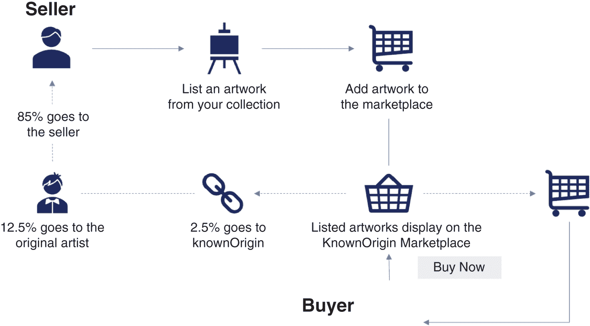

**图 5.2 共享数字艺术品收入示例**

因此，虽然 NFT 市场最初从数字艺术方面起步，但它将在创作者经济中拥有更广泛的应用。除了数百万美元数字艺术销售（如 BAYC 的无聊猿）的炒作之外，NFT 的意义可能在于基于自由市场、独立所有权和社会契约（针对商品、服务和理念），在元宇宙中开启一种社会的开端。NFT 将成为代表虚拟世界中任何类型数字资产的工具，应用前景巨大。

例如，得益于 NFT 引入的元宇宙所有权机会，NFT 为游戏（目前最大的全球媒体）提供了重大机遇。虽然人们在数字游戏资产上花费数十亿美元，如购买游戏皮肤或头像服装，但玩家并不一定拥有这些资产。NFT 将赋能他们玩基于加密的游戏并拥有资产、在游戏中赚取资产、将资产移出游戏，并在别处（如开放市场）出售资产，这将在第 6 章中进行说明。

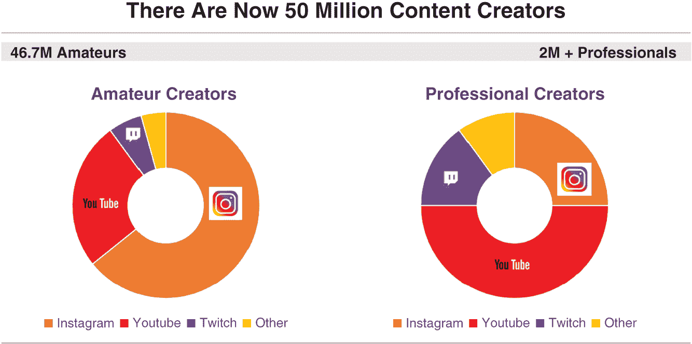

**图 5.3 业余创作者（而非专业人士）主导元宇宙** ¶ 来源：[signalfire.com/blog/creator-economy](http://signalfire.com/blog/creator-economy)，2021 年底

这对创作者经济影响巨大，后者由来自公众的业余创作者主导（而非专业人士，参见图 5.3），因为创作者有可能从“闭环”虚拟环境（如游戏或社交平台）转向“开放元宇宙”。NFT 提供的是将数字资产从围墙花园般的闭环环境中抽离出来，使其成为开环，且更加流动和自由。而我们今天才刚刚触及到可以在此基础上构建的能力表面。今天仅仅是交易游戏物品等资产；总有一天它将赋予我们在元宇宙中的自由移动。因此，一种由所有权和协作驱动的新社会准则，正从 NFT 文化的精神中涌现。（开放元宇宙将在第 10 章中讨论。）

## 品牌与时尚推动 NFT 走向主流

到 2022 年，NFT 已走向主流，并成为独立的资产类别，这与加密代币形成对比，证据是 2021 年底 NFT 的谷歌搜索兴趣超过了加密货币。由于 NFT 的易用性，NFT 和代币化社区吸引了刻板印象中“精通加密货币的人群”之外人士的关注。结果，NFT 将*加密货币领域之外*人士的领域专业知识带入应用创建，同时专注于*广泛相关的用例*。NFT 在内容和娱乐世界尤其拥有巨大潜力，代表了一种更深层、更动态的粉丝互动方式，以及为个人创作者和大公司带来潜在的新收入流。

正如本章前面所讨论的，艺术行业目前是 NFT 的聚光灯下焦点；但其他行业正积极跟进，创建和测试 NFT 产品，如音乐和体育、视频游戏，以及越来越多的消费品牌企业。在比加密资产更广泛的背景下，NFT 已成为组织、品牌、艺术家和名人与其客户和粉丝互动的新颖创新方式。（游戏行业为下一波 NFT 浪潮提供了完美环境，将在第 6 章中详细介绍。）

例如，近年来体育企业面临挑战，需寻找利用最新技术的方法，提供符合粉丝行为的体验。当 COVID-19 限制令迅速且明确地暂停了现场体育赛事时，运动员、球队和体育场转向数字技术，以重新定位业务寻求增长机会并吸引粉丝关注。因此，NFT 已成为粉丝互动的有前景媒介。例如，NFT 可以通过提供独家优惠、赚取奖励的能力，甚至球队决策的投票权，更好地将粉丝与他们喜爱的球队联系起来。

2021 年 4 月，NBA 篮球队金州勇士队推出了 NFT 收藏系列，成为美国职业体育界首个发布自己官方授权 NFT 的球队。在收藏品中，勇士队制作了一个特别版“勇士黄金门票”NFT，将 75 年历史性的球队时刻融合成一个独一无二的门票存根 NFT。勇士队认为，在任何人都可以创建和出售 NFT 的市场中，由 NBA 球队创建的东西具有合法性的真实价值。“NFT 能做的事情比静态体育卡多得多，”据一位勇士队高管透露。

同时，许多大型消费企业正进入该领域并尝试 NFT，无论用例是收藏、博彩、交易、游戏还是展示。这份多样化的名单包括 Adidas、Coca-Cola、Dolce & Gabbana、Gucci、Marvel、Mattel、NBA、Nike 和 TikTok 等。在零售领域，NFT 可用于证明现实世界物品的所有权，如名表、豪车和奢侈品。此外，通过提供独特物品并吸引核心粉丝，NFT 可成为消费品牌新的利润丰厚的收入流。（参见**框：NBA Top Shot 与篮球卡**。）

这些不仅仅是梗图或一次性尝试。例如，NFT 控制的访问权可跨越一系列用例，包括现实生活中大会和节日的 VIP 通道，以及元宇宙中发生的活动。它们还可用于空投品牌周边商品，或允许特殊访问仅限粉丝的内容，从而可能为粉丝互动开辟全新途径。

## NFT 在消费业务与元宇宙中的应用


# 运动品牌 Adidas 是一个绝佳案例

NFT 购买者将获得“数字与实体”Adidas 产品和体验的访问权。起初，实体商品将包括 Indigo 穿着的运动套装、印有区块链地址的连帽衫，以及一顶橙色针织帽。该产品与三方合作伙伴联名：备受追捧的 NFT 系列 Bored Ape Yacht Club（无聊猿游艇俱乐部）；最近让 Indigo 登上封面的 Punks Comics；以及化名加密爱好者 GMoney，他一直就如何以真实可信的方式切入 NFT 领域为 Adidas 提供咨询。这顶针织帽旨在还原 GMoney 的 CryptoPunks 头像所戴的那一顶。

# 另一个例子是 blanksoles

一个横跨 NFT 世界与实体时尚领域的在线时尚平台。据其官网介绍，blanksoles 是球鞋发烧友发布实体与数字系列的平台，将成为元宇宙时代时尚的未来。其核心价值主张在于：拥有 blanksoles（或 designsoles）NFT，买家不仅能获得一双实体设计师鞋履，还能获得 blanksoles 社群成员资格，该社群汇聚了标志性音乐人、艺术家、运动员及其他知名人士。

据 NFT 交易市场 Magic Eden 透露，blanksoles 社群成员将获得一双空白白鞋 NFT 及实体鞋，这将作为未来定制额外空投的模板。blanksoles 提供两种类型的 NFT：blanksoles 和 designsoles。持有 blanksoles 可免费铸造一双 designsoles，但用户必须销毁 blanksoles 方可进行；designsoles 则是由世界顶级艺术家和社群成员创作的设计师鞋履 NFT，购买 designsoles NFT 将附赠一双实体鞋。

blanksoles 的品牌战略是利用 NFT 与元宇宙的增长势头，以及设计师鞋履的传统模式，成为元宇宙时代引领时尚未来的领军者。创世限量版 blanksoles 铸造于 2021 年 12 月，面向早期社群成员；首批 designsoles 铸造则于 2022 年 1 月进行。

# 展望未来

随着实体与虚拟体验的界限日益模糊——融合实体与数字内容的空间与展览不断增长，消费者认为品牌的数字化存在感与其线下门店存在感同等重要——NFT 将成为消费企业的新工具。此外，消费者正越来越多地在完全数字化的环境中与公司和品牌互动，例如通过电子游戏中的“皮肤”及其他游戏内物品，NFT 在其中可发挥重要作用。每个品牌都可能需要一套 NFT 战略，否则将面临边缘化的风险。

# NFT 元宇宙面临的挑战

总之，NFT 代表了加密货币世界中最令人兴奋、增长最快的领域之一。当 Facebook 于 10 月更名为 Meta 时，元宇宙获得了极高关注度，以至于 2021 年被称为“元宇宙元年”。但我们也应将 2021 年视为“NFT：元年”——2021 年初，仅有一小圈加密爱好者知晓 NFT；但到年底，NFT 在散户投资者中变得格外流行，主要品牌和企业的日益参与将 NFT 推向了主流。

如今，我们已拥有一个初具规模的元宇宙版本，其中存在 NFT 等数字商品，代表流行艺术和数字纪念品。NFT 系列正在构建完整的生态系统，用户参与度也在不断提高。它们早已不仅仅是数字 JPEG 照片；游戏、音乐和体育周边等垂直领域越来越渴望将 NFT 整合进其生态系统。The Home Depot、Microsoft、Starbucks、Tesla 和 Whole Foods 等主要参与者的不断入场，仍是增长的关键驱动力。

尽管如此，NFT 市场要想成功发展，仍须克服从投机走向主流采纳的三大挑战：

## 首先，NFT 当前的铸造/Gas 费用构成了准入门槛，阻碍了 NFT 的主流采纳。

根据公开数据，Ethereum 是主导的智能合约平台，也是 NFT 发行和交易的首选区块链。但尽管 2021 年需求的大幅激增对行业是巨大的净利好，NFT 狂潮带来的网络活动激增将 Ethereum 网络推向了崩溃边缘，因高昂的 Gas 费和扩展性问题，导致许多散户用户无法使用，从而催生了对“Layer 2”扩容方案的需求，以降低 Ethereum 交易费用的同时保持安全性。

然而，随着 Ethereum 费用持续上涨，多个替代协议提供了更低费用的选择（如 Tezos、Near）。展望未来，来自其他 Layer 1 区块链和 Layer 2 扩容技术的竞争料将加剧。此外，互操作的区块链基础设施也将涌现（如致力于平行链解决方案的 Polkadot），以支持 NFT 的跨平台可用性，实现 NFT 跨平台（如社交媒体和视频游戏平台）的购买与转移。新区块链间的竞争应能带来更友好的用户基础设施，降低普通 NFT 参与者的准入门槛。

## 其次，当前 NFT 市场缺失关键基础设施，现有的基础设施也“高度中心化”。

尽管 NFT 市场价值近期显著上升（2021 年销售额超 400 亿美元），但用户实现 NFT 特殊价值的渠道仍极其有限。大多数 NFT 交易仅涉及在 OpenSea 等交易所交易 NFT 并从价格波动中获利。要充分实现 NFT 作为金融资产类别的价值，开发更多 DeFi 应用至关重要，以在持有者的投资组合中创造更多组合这些资产的方式。

此外，为了充分实现 NFT 创作者经济的愿景，仍缺少一些展示基础设施。例如，艺术家和市场需要更好地赋能“显性所有权”，因为公开展示是 NFT 所有者的重要价值来源，正如传统艺术品收藏家一样。所有者需要平台和工具向他人展示其购买的艺术品，而不仅仅是一个 OpenSea 页面的链接。

此外，NFT 背后算法的去中心化与 NFT 的商业运营完全不同，二者不应混淆。最典型的例子是 OpenSea，它是首个且最大的市场，类似于 NFT 界的 eBay，用户可在上面买卖几乎任何 NFT 系列的藏品。据 DefiLlama NFT 数据，截至 2022 年 2 月底，OpenSea 贡献了约 200 亿美元的 NFT 交易量，约占所有市场总交易量的 97%。（紧随其后的三个市场是 DefiKingdoms、MagicEden 和 ImmutableX，但它们各自的交易量仅略超 1 亿美元。）

OpenSea 市场完美诠释了传统艺术中介机构（如画廊和拍卖行）在艺术家和艺术品的发现、营销与交易中的职能，在数字时代依然重要。在数字艺术时代，顶级 NFT 交易平台必将成为新兴元宇宙中的新“中心力量”。这引发了关于“开放元宇宙”概念的重要治理问题，我们将在第 10 章讨论挑战 OpenSea 等中心化基础设施的新型去中心化自治组织（DAO）。

## 第三，NFT 面临的最大障碍是此类“数字资产”周围的法律不确定性。

事实上，许多消费者可能根本不知道自己在买什么。NFT 是虚拟货币吗？还是 NFT 是虚拟货币的凭证？更重要的是，NFT 是证券吗？（2021 年 5 月，美国的 NFT 参与者向 SEC 提交了规则制定请愿书，寻求 SEC 发布概念发布以消除监管不确定性。）这些都是任何主要数字经济体的立法机构从未回答过的问题。加密资产和 NFT 的无监管性质可能会吓退潜在的参与者和投资者。

正如本章前面所述，大多数非同质化代币是一个元数据文件，该文件使用一种作品进行编码，该作品可能受版权保护，也可能不受保护，甚至可能是公共领域的作品。任何可以数字化的东西都可以变成 NFT；原始作品仅在创建 tokenID 和合约地址的唯一组合的第一步过程中才需要。因此，原则上 NFT 与版权关系甚微。NFT 所有权并不直观。

此处的关键问题在于，围绕买家购买 NFT 时获得的权利，往往存在广泛的困惑。一些买家认为他们获得了底层艺术品及其所有附带权利。然而，实际上，他们只是购买了与作品相关的元数据，而不是作品本身。部分困惑可能源于购买 NFT 所花费的巨额资金。当生成艺术作品能以超过 100 万美元的价格售出时，人们很容易假设购买者获得的不仅仅是一串艺术价值存疑的数字和字母。（参见 Box: NFT Skybound。）

此外，当现有艺术品的 NFT 标出数百万美元的价格时，不太懂技术的人往往会认为售出的是作品本身，但事实并非如此。可以理解的是，很难理解 NFT 买家花费如此巨资购买的仅相当于一个元数据文件，且该文件与此类艺术品的版权没有任何关联，但这正是大多数 NFT 的真实情况。因此，普通用户需要清楚地认识到，购买 NFT 的主要理由与任何“收藏品”相同：拥有非流动性资产带来的潜在投资回报，以及拥有来自受人钦佩的艺术家、品牌、运动队等的独特事物所带来的愉悦感。除非条款允许，否则买家只能有限地在公共平台上分享创意作品，或复制并提供给他人。

现在，如果我们回到本章开头，在艺术与技术协同演化的背景下审视这一 NFT 现象，我们可能会发现 NFT 经济非常类似于传统的艺术资助赞助模式。但 NFT 可能会*好得多*。

历史上，赞助制涉及富有的赞助人直接资助个别艺术家，这类似于艺术家从富有的 NFT 投资者那里获得一笔大额一次性付款。赞助资助的缺点是艺术家沦为赞助人的俘虏，即社会中极少数的精英阶层。此外，虽然艺术界有一项拥有艺术品并将其借给博物馆（并适当署名）供公众欣赏的悠久传统，但大量由赞助人资助的艺术品被存放在私人仓储设施中作为私人收藏，极少甚至从未公开展示。

如今，NFT 提供了赞助制的益处，却没有其公认的成本。富人可以继续支持艺术并享受拥有权的体验。数字艺术家不再像文艺复兴时期的艺术家那样依赖佛罗伦萨的一个小型富人圈子，而是可以轻松触达全球范围内的赞助人群体。艺术品的所有权可以（通过区块链以加密方式证明）向赞助人想要以其无可挑剔的品味给谁留下印象的人展示。但同时，艺术品本身仍然对公众免费开放欣赏。这看起来像是旧的赞助经济，让创作者能将其作品金融化，但同时又让作品保持开放获取，供任何人观看、观赏或聆听。（Figure 5.4 中的 Phase 1。）

这对创作者经济意义重大，NFT 买卖双方可以在区块链上而非数据聚合平台上决定市场出清价格，创造新的资产变现形式。例如，在音乐人眼中，目前的音乐产业模式已然崩塌。问题始于 Napster 时代，早于 Apple 出现并决定一首 MP3 值 99 美分。但凭什么由 Apple 决定音乐值多少钱？此外，流媒体对大多数音乐人来说是不可持续的，因为收入倾向于按比例分配。据《滚石》报道，在 Spotify 等平台上，90% 的流媒体播放量流向了前 1% 的艺术家。在按比例分配模型中，这 1% 的人最终获得了这些平台决定留给艺术家的资金的 90%。

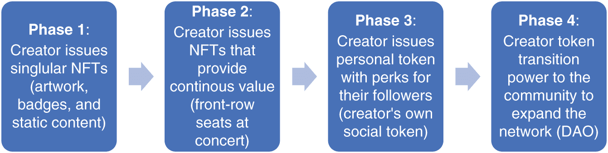

**Figure 5.4 NFT example – The Creator Evolution Timeline**

现在，音频 NFT 正开始解决这些问题。艺术家可以随心所欲地为音乐定价，因为 NFT 为音乐人提供了通往粉丝的直接链接，摆脱了超出其控制范围的平台（和唱片公司）。例如，Kings of Leon 最近宣布计划以 NFT 形式发行专辑，艺术家可以将 NFT 与现实世界的福利捆绑。据《滚石》报道，最独家的 NFT 将包含一张“金票”，因此代币持有者有保证“在每次巡演中获得 Kings of Leon 演唱会的四张前排座位，终身有效。”（Figure 5.4 中的 Phase 2。）

此外，NFT 本身也在演变。2022 年初，收藏品和数字艺术占以太坊上 NFT 销售额的 75% 以上。相比之下，The Sandbox 等虚拟世界和 Axie Infinity 等游戏中的 NFT 销售额占以太坊累计销售额的不足 25%。然而，正如将在 Chapter 6 中讨论的那样，随着视频游戏市场的蓬勃发展，基于区块链的游戏和虚拟世界对 NFT 的需求正在飙升，特别是当 NFT 收藏品开始在各种游戏中展现更多效用时。（Figure 5.4 中的 Phase 3 和 4。）

总之，2022 年的 NFT 正从数字艺术扩展到众多应用领域。随着公众对 NFT 感到适应，话题转向了进一步的虚拟化机遇。在元宇宙中，万物皆可且将拥有其 NFT，NFT 提供了一个流动性市场，消费者可以在其中投资不同的数字资产并进行点对点交易。

最终，NFT 将模糊消费（如游戏娱乐）与投资（如玩赚）之间的界限。NFT 与元宇宙的结合可能开启全功能经济的可能性，从而吸引更大的用户群，这将在下一章通过游戏行业进行阐述。

# Chapter 6: Blockchain Gaming in Metaverse

*   From Gaming into 3D Interactive Metaverse
*   Tech Convergence, Media Convergence
*   Epic Games and Fortnite UGC
*   Roblox Human Co-Experience
*   P2E Gaming – GameFi with NFT
*   Blockchain Gaming: Gaming First? Crypto First?
*   Gaming, the Foundation of Metaverse

# From Gaming into 3D Interactive Metaverse

# 游戏与元宇宙的演进

人类玩游戏已有数千年历史。早在公元前 3100 年，古埃及人就在玩一种名为“塞内特”的棋盘游戏，而中国是*围棋*的发源地，早在周朝（公元前 1046 年–公元前 256 年）就已出现。围棋的可能棋局数量甚至超过了可观测宇宙中的原子数量。人类似乎天生渴望通过“互动娱乐”来挑战智力与体能，社会也因此发展出精密的社会结构以满足这些基本需求。

进入 2022 年，互动娱乐——主要以智能手机上的视频游戏为代表——在古老游戏所需的核心人际互动基础上，叠加了数个世纪的技术进步。无论身处地球何处，得益于全球移动互联网络，人们都能以光速享受智力与技巧的挑战。参与者可以与他人、机器甚至自己对战，娱乐体验具有互动性、即时性和吸引力。

在游戏出现之前，在线娱乐内容的消费模式是“事后型”的。照片、推文、视频和电影都是先被记录，随后再被他人分享和消费。而游戏天生就是一种实时社交体验，无论是好友在线联机、主播直播，还是电竞战队同台竞技。当“元宇宙”指代一个持续在线、持续活跃的共享虚拟空间，在数字世界映射现实物理世界时，这个概念听起来与游戏高度相似。

正如元宇宙所预示的，娱乐的未来是互动的、实时的、3D 的。2D、异步、非互动、静态的内容正在失去年轻数字原住民一代的关注。世界正在改变。算力与带宽的飞跃推动了以游戏为主导的互动式实时 3D 内容爆发，并迅速蔓延至其他行业。

**如今，游戏已成为跨越人口统计学特征的大规模全球产业。** 随着移动互联网的兴起，游戏从小众爱好跃升为全球现象（见图 6.1），打破了“疯狂儿童与小众市场”这一狭隘过时的刻板印象。视频游戏市场规模巨大——已成为全球范围内规模超过电影和音乐总和的产业。游戏现为世界上最有价值的媒体品类、观看人数最多的体育项目，也是整整一代人（包括 Z 世代，令人惊讶的是还有成年人）首选的最活跃社交聚会空间。

根据 IDC 2021 年数据，2030 亿美元的游戏产业是全球媒体娱乐产业中增长最快的部分，2020 年增长了 19%。IDC 还报告称，移动游戏约占游戏品类的一半，同比增长 22%，增速快于主机游戏和 PC 游戏领域。全球近 40% 的玩家年龄超过 35 岁，这可能会震惊那些认为游戏全是“疯狂儿童”的非玩家群体。该用户群体也高度活跃。根据 ESA 和 Limelight Networks 的数据，多达 60% 的玩家每天游戏，平均每周游戏时长超过 6 小时。

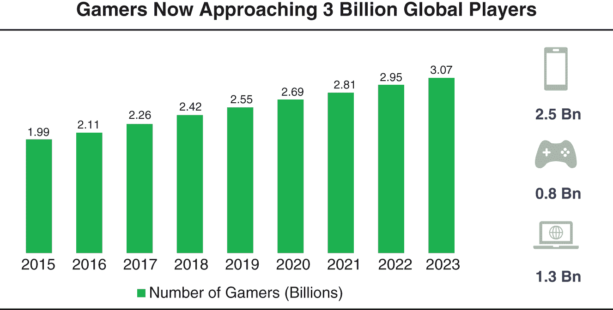

**Figure 6.1 1.3 Billion Gamers, Globally** ¶ Source: Newzoo

因此，游戏是社交网络的未来。游戏是人们与好友建立联系、获得丰富社交体验的场所——如同去博物馆、在公园闲逛或一起锻炼，这比坐在沙发上聊天要丰富得多。这将成为未来元宇宙的关键要素，并在数十种游戏类型中得到验证。例如，《英雄联盟》等热门游戏拥有超过 1 亿月活玩家，并举办自己的世界锦标赛，既在线上也在实体体育场馆举行，宛如足球世界杯。

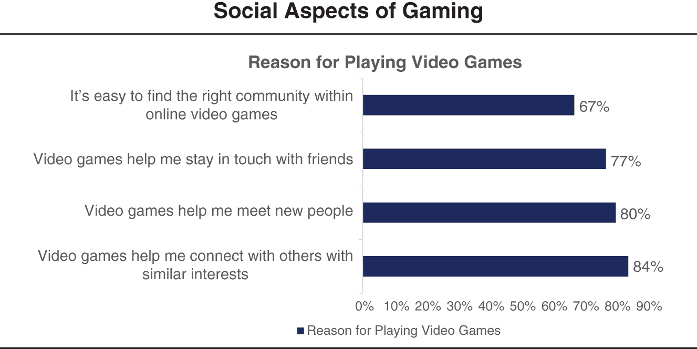

**Figure 6.2 Gaming Is the Next Social Network** ¶ Source: Adapted from Accenture, data complied by Goldman Sachs Investment Research, 2021

与之前的数字技术浪潮（包括在线搜索、社交、电商、移动互联、短视频）类似，游戏将从根本上改变人们相互交流以及与互联网整体交互的方式（见图 6.2）。对年轻一代而言，在 3D 环境中导航、在虚拟世界与好友闲逛已是司空见惯。在元宇宙中，社交体验与功能将在虚拟游戏世界中发生，例如：

*   即时通讯
*   直播
*   庆祝生活大事（婚礼、生日等）
*   社交（与好友共度时光或举办派对）
*   建立关系（基于共同兴趣结识新朋友）
*   约会

因此，游戏是文化创造与确立的场所，正演变为一种跨越线上线下的深度社交行为。本章将探讨游戏世界在区块链技术加持下，如何已展现出元宇宙演进的一些关键要素。

# 技术融合与媒体融合

数十年来，游戏已成为技术创新的催化剂。自 1970 年代微电子学突破催生首款电子游戏以来，游戏与技术形成了共生关系。更好的技术带来更沉浸的游戏体验，而游戏反过来又加速了指数级技术进步的时代。

例如，人工智能（AI）伴随机器与人类在各类棋类游戏中对弈而演进。数十年前（1997 年），IBM 的“深蓝”击败了国际象棋大师加里·卡斯帕罗夫。然而，本章开头提到的*围棋*对计算机而言是难度大得多的游戏。多年后，当谷歌 DeepMind 实验室设计的 AI 围棋程序 AlphaGo 在 2017 年击败人类最强棋手时，被视为 AI 研究的里程碑。（**参见 Box: Match Impossible。**）


再以 3D 内容为例。近百年来，照片和视频内容主要通过同一种方式创作——用 2D 镜头捕捉三维图像并投射到 2D 平面。即使使用最新数码相机，内容创作的基本流程仍围绕构建 2D、异步、非互动、静态内容。受游戏需求驱动，Unity 和 Epic Games 等公司开发了 3D 游戏引擎供开发者创作 3D 内容，这些技术随后被教育和房地产建筑行业采用。

游戏现处于先进技术的汇聚点。部分受新冠疫情推动（迫使人们宅居、紧盯屏幕），游戏在过去两年指数级扩张，得益于移动互联网与智能手机、5G 连接、云计算，当然还有区块链等最新技术：

### 移动互联网与智能手机

游戏正迅速走向主流，因为各种各样的游戏都可以在移动设备上玩到。即使是一些图形密集型游戏，现在也可以在最新的智能手机上运行，让用户无需昂贵的游戏主机或 PC 即可享受游戏体验。年轻一代用户跨越式地进入移动端，他们对互动娱乐的采用在智能手机上尤为增长。

### 5G 连接

5G 网络承诺提供快速流媒体和低延迟。大量消费者将升级到 5G 移动设备并享受更高的带宽速度。Epic Games、Unity 或 Niantic Labs 等视频游戏公司正在构建模拟软件和并发基础设施，这将允许数十亿人共同体验合成现实。处理和网络技术的进步正在实现更复杂、沉浸式和社交化的环境。

### 云游戏

云计算消除了支持内容所需的处理能力和存储限制。这些因素正在推动可用算力的显著增加，并促进沉浸式和互动内容的普及。云游戏正在推动用户群的快速增长。

区块链和数字资产代表了游戏领域前沿的基础设施级革命。加密货币和区块链技术将以深刻的方式颠覆游戏和数字娱乐领域，因为游戏内容创作和游戏内数字资产将广泛迁移到区块链上。这种新的数字所有权范式正在解锁新的体验、用户获取策略和商业模式，例如 Play-to-Earn（P2E，玩赚）模式。在讨论区块链游戏之前，让我们先看看按用户花费时间排名前两位的游戏应用——Fortnite（Epic Games）和 Roblox，它们正在演变为元宇宙平台，并开始向我们展示身处元宇宙是什么样的体验。

### Epic Games 与 Fortnite

Epic Games 总部位于北卡罗来纳州 Cary，由 Tim Sweeney 于 1991 年创立，他也是公司的首席执行官。Epic 最近一轮融资发生在 2021 年，筹集了 10 亿美元资金，公司估值达到 287 亿美元。PlayStation 游戏主机的创造者 Sony 投资了 2 亿美元，更有趣的是，Appaloosa Management、Baillie Gifford 和 Fidelity Management 等蓝筹机构投资者也在投资者之列。Epic 这轮巨额融资清楚地表明，资本市场看好游戏与元宇宙的融合。（中国互联网巨头腾讯持有该公司 40% 的股份。）

与 2004 年在丹麦成立的 Unity 类似，Epic Games 开发了一款成功的游戏引擎——Unreal Engine，这是一个游戏开发者可用来创建视频游戏的平台。Unreal Engine 与 Unity 的游戏引擎直接竞争，争夺最流行的游戏驱动软件地位。同时，两者都在推广其产品作为通用模拟软件，希望它们能成为构建 3D 世界的通用语言，就像 HTML 奠定了网站的基础一样。

Epic Games 的突破发生在 2017 年，当时它发布了 Fortnite。这款动画风格的大逃杀游戏 *Fortnite Battle Royale* 是一款免费游戏，最多 100 名玩家战斗以成为最后的幸存者。它已成为最受欢迎的视频游戏之一，并进一步催生了新一代直播。它让播放 Fortnite 实况的玩家（如 Tyler Blevins，人称 Ninja）成为一种新型的网络影响者和富有的名人，类似于 TikTok 上受欢迎的短视频影响者。

Fortnite 一直是互动技术的早期采用者，并与现实世界有跨界合作。例如，它组织了一系列主流艺人的游戏内互动表演，吸引了数千万观众。（参见 Box: Rapper inside Fortnite Game。）Fortnite 被视为元宇宙可能样子的早期范例。“我们不认为 ‘Fortnite’ 是 *the* Metaverse（元宇宙），”Epic Games 一位高管表示，“而是元宇宙中美好的一角。”

越来越多地，Epic Games/Fortnite 将自己定位为一个平台，为用户提供工具来创建和变现自己的游戏，以及在所谓的 *Multiverse*（多元宇宙，一个类似于元宇宙的术语）中穿梭于数千个世界之间。例如，Fortnite 的创意模式（称为 *Fortnite Creative*）赋予玩家完全的自由，设计可在线发布并与朋友分享的 Fortnite 游戏。*Fortnite Creative* 为用户提供了广泛的工具，用于在 Fortnite 中设计用户生成内容（UGC），用户可以在自己的 UGC “个人岛屿”上实施自己的规则。他们还可以通过进入现有的 “岛屿”，与朋友一起玩无数社区制作的游戏。

过去，UGC 通常被认为质量较差。然而，随着价格实惠且易于使用的硬件发展，如数字摄像机和配备高分辨率摄像头的移动设备，以及桌面编辑软件等软件技术的进步，制作优质内容的门槛正在迅速降低。今天的 UGC 也可以被视为专业（质量）用户生成内容（PUGC），它结合了用户生成内容（UGC）提供的内容广度和专业生成内容（PGC）提供的质量。

从 Epic Games/Fortnite 可以看出，流行文化正在转变——用户本身就是内容创作者，这使他们成为社交娱乐平台无可争议的中心（相对于提供大制作的娱乐公司）。成为 UGC “创作者”正成为一种越来越受追捧的职业，尤其是在年轻一代中。大量高质量创作者涌入该领域带来了生态系统的更多成功，反过来又增加了我们从个人而非大公司消费的新媒体供给。换句话说，UGC 趋势正在打破传统游戏行业的模式，这一点在下一节的 Roblox 案例中得到了进一步说明。

### Roblox 人类共同体验

Roblox 就像游戏界的 YouTube。Roblox 是一个大规模的用户生成社交游戏平台，允许儿童和青少年创建自定义游戏并与朋友一起玩。它既是一个游戏，也是一个平台。根据 Sensor Tower 的数据，该公司的同名游戏 “Roblox” 是 2020 年美国收入最高的手机游戏。它超越了连续三年霸榜首位的 “Candy Crush”（糖果粉碎传奇）。但让 Roblox 区别于其他在线游戏平台的是，它允许用户创建自己的游戏。“每一个体验都是由我们的社区构建的，”Roblox 表示。

正如第 5 章中看到的 NFT 开发带来的生成艺术兴起一样，在普通玩家中扩大 UGC 是 Roblox 的一大强劲趋势。该平台允许用户操作虚拟化身，创建和游玩其他用户构建的游戏。注册 Roblox 后，用户通过选择体型、服装和装备来个性化他们的化身。然后，用户可以自由沉浸在数百万开发者构建的体验中。该平台每年生产 2000 万款游戏，并拥有庞大的经济系统，创作者开发并出售配件、装备和物品以定制化身。

Roblox 首席执行官大卫·巴斯祖奇常将 Roblox 称为“人类共同体验”，这一术语表明元宇宙远不止于游戏，其基础在于：身份、社交、沉浸、低摩擦、多样性、随地接入、经济与文明。Roblox 认为，3D 数字世界中的人类共同体验，正是其创始人早在 2004 年就设想的新型社交互动形式。在“人类共同体验”空间里，用户可以一起做各种事情，例如工作、学习、玩耍、购物和体验娱乐——远超游戏本身。

该平台目前正致力于将其打造成为一个元宇宙，通过 VR 头显将游戏空间转变为虚拟世界。例如，Roblox 与 Gucci 合作，于 2021 年 5 月推出了 Gucci Garden（古驰花园），这是一个庆祝 Gucci 成立 100 周年的沉浸式体验，用户可以在 Roblox 平台上为其化身购买并穿戴限量版 Gucci 虚拟物品。一款带有蜜蜂图案的著名 Gucci Dionysus 包以 6 美元售出，随后却以超过 4000 美元的价格转手。Roblox 还利用其平台在疫情期间举办了多场虚拟演唱会，包括巴黎·希尔顿的跨年派对。（参见 Box: “Paris World” in Roblox。）

为了持续改进平台上的人类共同体验，Roblox 专注于开发支持沉浸式 3D 环境的幕后技术能力。Roblox 平台提供服务器空间和数字基础设施，以支持平均 3000 万日活跃用户的共同体验，涵盖从活跃开发者社区如何构建这些体验，到全球用户如何享受并安全访问这些体验。它由三个要素组成：

*   **Roblox Client（Roblox 客户端）：** 允许用户探索 3D 数字世界的应用程序。
*   **Roblox Studio（Roblox 工作室）：** 允许开发者和创作者构建、发布和运营 3D 体验及其他内容的工具集，这些内容通过 `Roblox Client` 访问。
*   **Roblox Cloud（Roblox 云）：** 为人类共同体验平台提供动力的服务和基础设施。

在 Roblox 语境下，体验指的是用户可以在平台上享受的各种标题/项目。创建体验的用户称为开发者，创建化身物品的用户称为创作者。开发者还可以构建并出售自定义工具和 3D 模型，以帮助其他开发者创建体验。正如 TikTok 等公司提供工具让普通用户在自制短视频中看起来像专业明星一样，Roblox 也附带了一套易于使用的程序，让新手能够构建并变现他们自己的 3D 游戏和体验。

总的来说，Roblox 的开发者和创作者以三种方式为平台做出贡献：为用户构建可享受的体验，为用户构建可获取并用于自我表达的化身物品，以及为其他开发者和创作者构建可利用的工具和 3D 模型。公司平台上的内容类型随着时间的推移而拓宽，这些虚拟物品的开发者可获得游戏产生收益的约 30%，例如虚拟服装和化身的销售。

Roblox 的商业模式主要围绕用户购买虚拟货币，以获取游戏内特权或化身虚拟物品。它拥有自己的货币，称为 `Robux`，需用真实现金购买。用户可以在一个实际上的应用商店中花费它，购买强化道具或衬衫、帽子、天使翅膀等装饰性物品，化身需要这些来脱颖而出。

根据 Newzoo 进行的一项调查，消费者认为选择化身外貌的能力是推动元宇宙整体愉悦感的关键功能，其次是由广告商和赞助商资助的免费内容，以及为其他玩家创建内容的能力。尽管化身仅占收入的一小部分，但它是 Roblox 体验的关键要素，因为据公司数据显示，20% 的用户每天都会更改他们的化身——化身越个性化，玩家的参与度越高，他们在平台上的投入就越多，花费的时间也就越长。

同时，主要消费品牌的广告收入也很可观。为了创建游戏内品牌活动，Roblox 经常将品牌合作伙伴与在平台内工作的开发者联系起来，这为开发者和创作者社区创造了更多收入渠道。随着 Roblox 平台的扩展，实现变现的开发者和创作者随着时间的推移获得了有意义的收益增长，这激励他们继续构建高质量内容。

这在平台上形成了一个正向反馈循环。随着开发者和创作者构建越来越高质量的内容，更多用户被吸引到 Roblox 平台。平台用户越多，参与度越高，Roblox 对开发者和创作者的吸引力就越大。用户越多，平台上花费的 `Robux`（Roblox 货币）就越多，这激励开发者和创作者设计越来越吸引人的内容，并鼓励新的开发者和创作者开始在平台上构建。

这个强大的生态系统吸引了消费品牌；例如，Nike 也与 Roblox 合作建立了一个名为 `Nikeland` 的虚拟世界。最近，发生了一些革命性的事情：一些具有元宇宙思维的品牌开始绕过 Roblox 这个中间商，直接与开发者合作，将他们的产品带入虚拟空间。这正在 Roblox 上催生一个充满活力且不断扩大的创作者经济，在品牌、平台和开发者之间定义新的关系并创造新的机会。

但考虑到创作者驱动的去中心化自治组织，即“创作者 DAO”（将在本书末尾的 Chapter 10 中讨论）的前景，所有这些发展仅触及了个体创作者在未来创作者经济中所能实现成就的表面。预计此类新商业实体将完全由创作者拥有，并与其支持者、消费者和协作者合作——他们的财务利益仅在创作业务上保持一致。Roblox 的持续发展表明，未来的元宇宙具有巨大潜力，能够大规模支持新的商业模式和内容类型。

### P2E 区块链游戏——带有 NFT 的 GameFi

游戏的一个主要问题，即使是在以用户为中心的 UGC 平台如 Roblox 或 Fortnite 上，也是玩家在停止游戏时无法将钱从游戏中取出。游戏很少允许玩家之间进行资产交易，尤其是在第三方网站上。此外，即使在允许交易的游戏中，用户也无法合法拥有资产，因为工作室没有动力将利润分给用户。

因此，如果玩家愿意在没有任何潜在投资回报的虚拟世界中花费那么多，从而推动游戏行业成为全球最大的媒体行业，那么当他们的游戏内购买变成可交易并可用于现实生活交易的资产时，游戏社区会大多少？这就是区块链游戏的潜力所在，也是游戏能够推动区块链更广泛采用的原因。

当前市场上最好的例子是玩赚（P2E）游戏，其中 DeFi 和 NFT（前几章已介绍）被整合进游戏。DeFi、NFT 和游戏的结合使玩家能因玩游戏而获得经济奖励，这也被称为 `GameFi`（见图 6.3）。游戏玩家可以使用各种方法将游戏中获得的 NFT 变现以获利。反之，NFT 从游戏中获得价值。

每一个 GameFi（游戏金融化）项目背后，都有一套精心设计的代币经济系统，该系统通过激励机制平衡 NFT（通常代表某种游戏内资产）和实用代币（代表某种内部货币）。通常以 NFT 形式存在的游戏资产包括游戏中使用的角色、虚拟地形以及武器等游戏道具。玩家利用这些 NFT 赚取实用代币，该代币具有市场价值，并可通过 DeFi（去中心化金融）基础设施兑换成其他加密货币或法币。

GameFi 协议代表了紧随元宇宙叙事之后 NFT 发展的关键分水岭时刻。在此之前，根据 [Nonfungible.com](http://nonfungible.com) 2022 年初的研究，最流行的 NFT 类别一直是收藏品。但像 CryptoPunks 和无聊猿游艇俱乐部 这样的收藏品，属于最基础类型的 NFT。（参见第 5 章中的相关讨论。）拥有热门收藏品意味着持有者是严肃的收藏家，将它们用作用户头像可以帮助用户进入一些更高阶的社区（相当于俱乐部会员卡），并且他们可能免费获得其他 NFT 的空投（如 Meebits）。

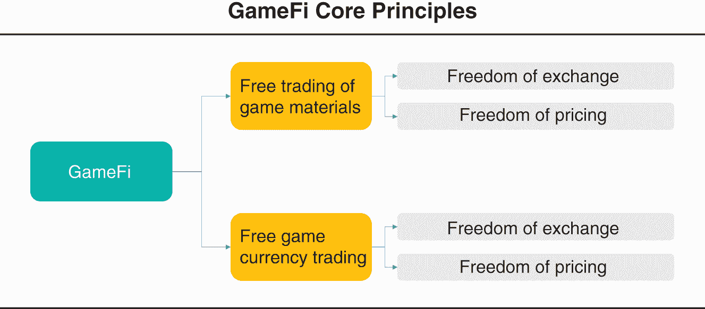

**图 6.3 GameFi 赋能游戏内加密资产的自由交易** ¶ 来源：CoinTelegraph, Medium, 2021

然而，除了投机和影响力之外，此类“收藏型 NFT”没有其他用途。通过与游戏结合，NFT 已演变为更复杂、更精密的交互型 NFT 版本。我们可以将这些 NFT 的发展划分为三个不同层级。

#### 第 1 层级：基础交互型 NFT（示例：CryptoKitties）

与简单的收藏型 NFT 相比，CryptoKitties（加密猫）提供了一个额外的游戏化组件：繁殖。这是一款收集、繁殖甚至出售虚拟猫咪以换取真钱的游戏。区块链是支撑该游戏运行的底层技术，其运行算法被称为*遗传算法*。该算法试图模拟真实的遗传学——存储在小猫体内的信息就像生物体的 DNA。由于不同的基因（DNA）数据，游戏中的每一只猫都是完全独一无二、无法复制的。

尽管如此，作为最早创建的区块链游戏之一，CryptoKitties 充其量只是一款“收藏类”游戏。用户收集具有特定特征的数字猫咪，这些特征可用于繁殖其他数字猫咪。玩家可以交易猫咪并尝试解锁一些稀有特征，但仅此而已。最重要的是，CryptoKitties 几乎没有真正的游戏玩法，玩家找不到他们收集的数字资产有任何有意义的用途。

#### 第 2 层级：探索（示例：Decentraland、The Sandbox）

Decentraland（去中心土地）和 The Sandbox 代表了第 2 层级游戏的发展：允许用户创建、体验和变现内容及应用的虚拟平台。这两个虚拟世界的相似之处在于，它们都是去中心化的虚拟世界平台，用户可以在其中买卖虚拟土地地块，并在土地上自由创建和设计虚拟世界或体验。两者均基于以太坊区块链。（受 Minecraft 启发的 Cryptovoxels 是另一个由以太坊区块链驱动的虚拟世界/元宇宙，允许玩家购买土地并建设商店和艺术画廊。）

Decentraland 是一款 NFT 游戏，为玩家呈现了一个有边界的 3D 虚拟世界，其中 LAND（土地）相互毗邻，它们是该游戏的 NFT。多块 LAND 可以组合形成称为“区域”的社区。具有共同兴趣的玩家会创建自己的区域，以实现彼此间的多边利益。

基于以太坊的 The Sandbox 实际上是元宇宙中可游玩的一块区域，提供了一个共享的在线世界，用户可在其中购买 NFT 土地地块，在其上创建自己的交互式游戏，甚至在与其他用户分享这些体验时将其变现。The Sandbox 由三大产品组成：(1) VoxEdit，允许用户在 The Sandbox 元宇宙中创建和制作 3D 物体动画，如人物、动物和工具（称为 ASSETS，可以是同质化或非同质化）；(2) The Sandbox Marketplace（市场），允许用户发布和出售他们的 ASSETS；(3) The Sandbox Game Maker（游戏制作工具），允许用户免费创建 3D 游戏。为了鼓励更广泛的用户群参与内容创作过程，无需编程经验，用户即可使用 The Sandbox 自有平台工具创建 ASSETS 和游戏。

相比之下，Decentralland 更侧重于建筑、花园、交通系统以及各种其他类型建筑等资产的创建和所有权。据 PrestigeOnline 报道，Decentraland 系统上有 90,601 个单独的虚拟土地地块。一旦使用 MANA 购买了一块虚拟土地，用户就可以用它来创建一个小花园或一整座城市。Decentraland 的房地产遵循的规则与实体房地产类似，即相似的土地群可以组合成一个区域，从而培育志同道合的社区。还有一个投票系统，其运作方式类似于住房委员会投票系统，用户可以投票并影响其社区的发展。（参见专栏：虚拟土地繁荣。）

#### 第 3 层级：P2E 游戏玩法（示例：Axie Infinity）


# Axie Infinity（Axie 无限）引领了 P2E（玩赚）游戏潮流

Axie Infinity 是一个数字宠物宇宙，玩家以 NFT 形式对战、培育和交易被称为 `Axies` 的幻想生物。Axie 用户通过投资 Axie NFT 和 AXS 原生代币开始游戏，随后他们可以收集、繁殖、战斗和交易 Axies 生物。玩家还可以通过出售赚取的 Axie 代币换取其他加密货币或法币来赚取游戏内货币（小爱心药水，即 SLP）（参见 **图 6.4**）。尽管仍处于早期阶段，Axie Infinity 已凭借在日度、周度和月度社区投票中排名以太坊游戏第 1 位而声名鹊起。

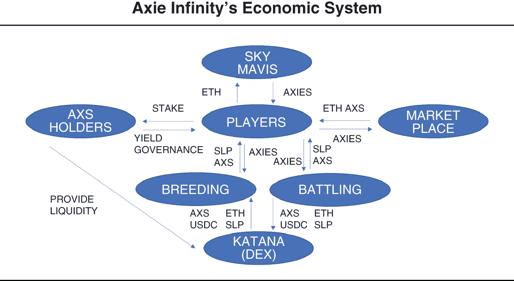

**图 6.4 Axie Infinity 的 P2E 生态系统** ¶ 来源：TeehFlow

Axie Infinity 现已成为全球增长最快的视频游戏之一，该游戏销售额已超过 10 亿美元，日活用户超过 100 万。有趣的是，这款 P2E 游戏在新兴市场尤为受欢迎。例如，在新冠疫情导致的经济困难时期，菲律宾的许多用户仅通过玩 Axie Infinity 赚取的收入就超过了他们平时的月薪，且 2021 年菲律宾在所有国家中为该游戏贡献了最多的用户流量（参见 **图 6.5**）。P2E 游戏可能成为推动区块链游戏行业走向全球下一个前沿所需的催化剂。

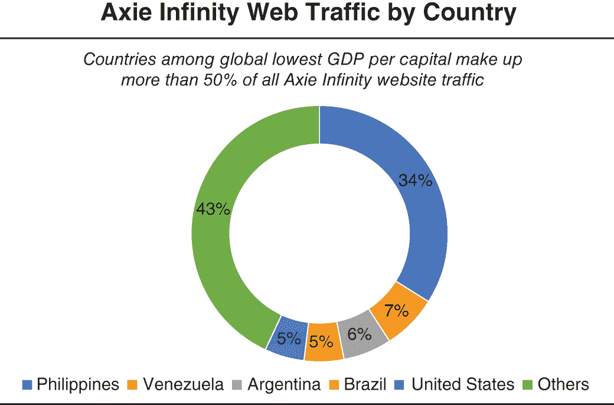

**图 6.5 Axie Infinity 在新兴市场广受欢迎** ¶ 来源：[SimilarWeb.com](http://similarweb.com)、[Ciypto.com](http://ciypto.com) Research；数据截止至 2021 年 11 月 23 日

## 区块链游戏：游戏优先？还是加密优先？

自 2021 年中以来，我们见证了加密游戏的第一次爆发。即使是知名主播和玩家也开始转向 NFT 游戏，游戏行业的大牌公司，如动视暴雪、EA Sports、育碧和史克威尔艾尼克斯，也已开始涉足区块链和基于 NFT 的游戏。然而，区块链游戏市场目前规模相对较小，且大多数开发工作由加密原生公司主导，而非游戏原生公司。

此外，传统游戏行业对这种创新的接受度并不高。随着游戏工作室宣布进军 NFT 领域的数量不断增加，玩家们变得越来越恼火，用户与育碧、史克威尔艾尼克斯、Zynga 等大型游戏工作室之间因加密货币问题引发的冲突也日益频繁。在许多交锋中，玩家占了上风——至少目前是这样。简而言之，电子游戏界因 NFT 问题而分裂。

例如，育碧（开发《刺客信条》等大作）是首家涉足加密领域的大型游戏发行商。2021 年 12 月，育碧推出了一个名为 `Quartz` 的平台，允许玩家以 NFT 形式拥有游戏内的装饰性物品（如头盔和枪支）。这些 NFT 在射击游戏《幽灵断点》中免费提供给达到特定等级的玩家。公司表示，玩家可以保留这些物品，或在第三方市场上出售。此举招致了玩家的普遍愤怒，他们抨击 `Quartz` 是一种收割韭菜的行为。关于此举的一个 YouTube 视频遭到了 90% 以上观众的踩。

此外，一些大型游戏公司公开反对加密货币。拥有在线游戏商店 `Steam` 的 `Valve` 于 2021 年底更新了其规则，禁止允许交换加密货币或 NFT 的区块链游戏。`Epic Games` 表示，由于该行业充斥着“难以解决的骗局混合体”，其公司将避免在自家游戏中引入 NFT。（但 `Epic` 仍将允许开发者在其在线商店出售区块链游戏。）

总之，公平地说，目前区块链游戏仍处于胚胎阶段。一方面，对于**创作者和开发者**而言，区块链游戏有望展现出以下关键优势：

*   **更好的游戏经济。** `P2E`（Play-to-Earn，玩赚）创造了一个让更多玩家实现变现的机会，而在免费游玩模式中，平均不到 2% 的玩家会购买游戏内物品（Appier 2020 年数据）。`P2E` 可能让游戏中的所有玩家都参与到经济交易中。

*   **更好的单位经济模型。** 在游戏经济中与玩家和创作者分享一部分经济收益，可以降低客户获取成本并提高留存率，从而使每位用户的 `LTV`（生命周期价值）高于传统免费游戏。

*   **更好的经济激励一致性。** 在 `Roblox` 等游戏平台上（见本章前文相关讨论），创作者仅能保留约 30% 的收入。而在区块链游戏中，用户通常能保留更多他们帮助创造的价值。此外，通过利用链上版税等机制，开发者可以通过收取二级市场交易费用来开辟新的收入来源。

另一方面，**玩家**担心加入 NFT 等加密资产会让游戏沦为单纯的商业交易平台。他们热爱游戏是因为其中的世界、故事和体验；他们不希望游戏中的事物变得充满交易感。

因此，就区块链游戏的质量而言，开发者的一个重要测试是：将一款区块链 `P2E` 游戏视作一款没有代币赚取潜力的传统免费游戏来审视。如果它能通过微交易成功变现（即玩家愿意为游戏内物品付费，且不期望获得财务回报），那么该游戏的玩法就足够吸引人。

然而，如果它通过微交易赚不了多少钱——玩家若无赚钱潜力就不愿为资产付费——那么他们选择 `P2E` 的唯一理由就是作为一种投资。如果是这种情况，它就不是独立的游戏。这使得游戏成为零和博弈，并导致拉高出货的局面。它更像是一个披着游戏外衣的投资工具，而非真正的游戏。换句话说，这是“加密优先”的游戏，这种玩法无法独立站稳脚跟。

结论是，区块链游戏首先应当是优质游戏，额外的加密玩法作为一种有价值的增强。如果未来的区块链游戏能做到“游戏优先”而非“加密优先”，`GameFi` 革命将必然在游戏社区中发生，并将下一个十亿用户带入加密领域。

## 游戏，元宇宙的基石

在结束本章之前，还有一个重要问题：为什么游戏革命对元宇宙发展至关重要？元宇宙既是对未来互联网的憧憬，也是对在线基础设施当前趋势（包括实时 3D 世界的增长）的一种巧妙概括。考虑到大多数数字活动正在向游戏迁移，且游戏也是新的社交网络，因此游戏是元宇宙的一个测试案例。

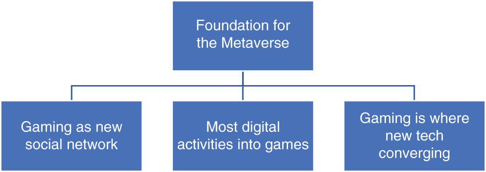

**图 6.6 游戏是新的技术范式**

自 2021 年以来，游戏产业——目前估值已超过 2000 亿美元——按收入计算已成为最大的媒体品类。游戏最近从长期霸主线性电视手中夺得榜首，如今其规模已超过全球音乐、电影和点播娱乐板块的总和。此外，根据多家行业研究机构的数据，在这些媒体品类中，游戏也是增长最快的。因此，游戏是*最佳*测试案例。

进一步考虑到游戏是新技术汇聚的地方，我们甚至可以说游戏是新的技术范式（参见 **图 6.6**）。简而言之，游戏是通往元宇宙的起点和最可行路径，因为：

*   许多游戏已具备规模效应（例如，庞大且活跃的用户群）。

*   `UGC`（用户生成内容）文化源于创作者端（例如，用户生成的活动、游戏、虚拟商品、环境/世界）。

*   从消费端来看，游戏已为消费者提供了参与类元宇宙活动的体验（例如，使用 NFT 管理数字资产、线上融合线下、物理与数字体验的实时连接）。

*   构建元宇宙所需的技术已在游戏领域得到开发和测试（例如，`AR/VR` 集成、多玩家并发、内容审核）。

在第二部分中，**第 3 章** **和** **第 4 章** 重点关注区块链技术作为用户在元宇宙中“交易”的基础设施；**第 5 章** **和** **第 6 章** 主要关注创作者经济，阐述区块链技术如何赋能数字内容和资产创作。在接下来的两章中，我们将重点关注元宇宙中用户数据隐私和加密资产安全的区块链基础。

# 第 7 章 元宇宙隐私：区块链 vs. 大科技公司

*   平行数字宇宙中的隐私
*   元宇宙中的未来数据隐私模型
*   WEF 数据治理模型
*   零知识证明和安全多方计算
*   同态加密和联邦学习
*   NFT “Cookies”：当 Web3 技术遇上 Web2.0 遗产
*   监控经济与反乌托邦社会

## 平行数字宇宙中的隐私

`Facebook` 2021 年的“Meta 转型”遭遇的质疑和犹豫，至少与其获得的热情相当，尤其是涉及数据隐私方面的担忧。吹哨人 `Frances Haugen` 在接受美联社采访时表示，元宇宙世界可能让 `Facebook` 获得另一个在线垄断地位，且具有成瘾性，还会从用户那里窃取更多个人信息。`Haugen` 称 `Facebook` 近期高调宣传元宇宙，是为了在其监管问题发酵时掩人耳目：“如果你不喜欢这场对话，你就试图改变话题，”她说。

与此同时，苹果的追踪物联网设备 AirTag 也暴露出一些隐私问题。尽管 AirTag 内置了隐私功能，但一些观察人士指出，苹果在保护人们免受不必要的追踪方面做得还不够。一位《华盛顿邮报》记者允许同事用 AirTag 追踪他一周——然后才叫停。2021 年 12 月，《纽约时报》的一份报告包含了至少七名女性的陈述，她们认为自己被 AirTag 追踪了。

同样在 2021 年 12 月，加拿大警方发出警告，称窃贼正在利用苹果追踪配件盗窃高端车辆。具体来说，他们收到了五起可能涉及 AirTag 的报告，而在总计 2,000 多起报告中。然而，AirTag 的这一特定怪癖并不是苹果追踪配件与其他产品之间的唯一区别。此外，一个更大的追踪平台是 LTE 电信网络本身，数百种独立产品利用该网络，价格与 AirTag 相似。

隐私与反垄断交织在一起。2022 年 1 月，微软宣布收购动视暴雪，这家游戏巨头负责《守望先锋》、《暗黑破坏神》、《使命召唤》、《魔兽世界》和《糖果粉碎传说》等大作。这笔近 700 亿美元收购这家近期陷入困境的游戏工作室，说明了大型科技公司收购并合并较小公司以巩固在科技行业权力的日益增长趋势。

虽然拜登政府许多高调成员呼吁加强对科技行业的监管以遏制反垄断和反竞争行为，但科技行业的集中化也构成了隐私问题。微软已经拥有流行的 Xbox 主机平台和《光环》、《极限竞速》、《帝国时代》和《我的世界》等盈利游戏系列。动视暴雪交易的影响可能更大，因为这是微软在不到一年内购买的第二家主要游戏工作室。

2021 年，微软以 70 亿美元收购了 ZeniMax，即热门游戏工作室 Bethesda Softworks 的母公司。显然，微软正致力于接管游戏市场的很大一部分，以打造一个用于游戏、工作和社交的通用元宇宙平台。微软的声明指出，此次收购将“为元宇宙提供构建模块”。动视暴雪交易也将意味着微软获得更多用户数据（它已经掌握了大量数据）。当一家公司能够从不同来源收集同一个人的大量数据时，与数据收集相关的隐私风险会加剧。这些数据更容易落入坏人之手，或导致私人数据被滥用。

例如，这些大型平台能够极其详细地为用户画像。正如“马赛克理论”所言，分散的信息项，虽然单独对所有者用处有限或毫无用处，但与其他信息项结合时可能具有额外意义。在网络空间中，有许多不同的信息，用户绝不会想到它们能识别个人身份。但当计算机将不同碎片组合在一起时，计算机能以人类无法做到的方式发现关联。当数字平台整合不同数据集时，无论这些数据来自同一平台的不同服务线，还是来自不同行业的第三方数据供应商，用户数据整合的力量都会呈指数级增长。

科技公司变得越大、越强大，就越能收集和使用私人个体的数据。同样，公司拥有的数据越多，其他公司就越难竞争。一方面，平台利用大数据分析为用户提供更个性化、更快捷的服务。如果一家公司拥有数十亿个用户行为和偏好的数据点，它比缺乏这些资源的小公司更有可能满足消费者需求。

另一方面，许多平台的数据力量也引发了公众担忧，即大数据可能被滥用。在“大数据杀熟”案例中，平台拥有的个人数据越多，用户付出的代价就越大。（参见**Box: Big Data Killing**。）同样，数据隐私与反垄断交织在一起。数据权力的集中损害了消费者和科技初创企业的利益。

展望未来，消费者数据将成为元宇宙的核心，大型科技公司在元宇宙中的大规模数据收集将成为一个更大的数据隐私问题。作为一个 3D、持久、沉浸式和交互式的互联网，元宇宙提供了一个机会，将日常活动——工作、参加音乐会、旅行、购物、社交——转化为一个平行的数字宇宙，这势必依赖于生物识别数据等新型潜在敏感信息。

元宇宙应用可能让科技公司追踪你的面部表情、血压、呼吸频率，甚至更多。对于电商企业来说，这是个好消息，因为品牌可以基于大量用户数据，创造沉浸式、个性化、基于价值的广告体验。但对于个人隐私而言，用户几乎无处遁形。例如，一副 VR/AR 头显就能充当家庭内部的摄像头和麦克风；更先进的 VR 系统可将其与心率、呼吸频率、身体动作和 3D 尺寸相结合，并利用所有这些信息的独特组合进行个体识别和追踪。

因此，随着元宇宙的到来，关于数据驱动广告和消费者数据保护的辩论已愈演愈烈。元宇宙可能助长大型科技公司对更多数据的渴求，它们集中存储和控制的数据将给隐私带来更多挑战，除非数据能去中心化，并将控制权和所有权归还给个人用户。在本章中，我们将讨论几种面向元宇宙应用的数据治理模型，以及可集成以提供更好隐私保护的新技术。

## 未来元宇宙中的数据隐私模型

元宇宙中有四种潜在的数据隐私治理模型，范围从严格的中心化控制所有权到个人所有权（参见**Figure 7.1**）。

### 集中式治理模型

在集中式治理模型中，该环境的所有者和运营商制定管控服务的政策。用户数据不会离开该运营商的元宇宙，除非在该元宇宙所有者和运营商的条款下启用连接，否则无法与其他元宇宙（例如由不同大型科技公司开发的元宇宙）互操作。

该模型最类似于 Meta、Amazon 和 Twitter 等大型科技公司采用的当前模型。在这种模型中，个人隐私保护最弱，因为大公司对数据拥有集中控制权，并拥有复杂的算法来利用个人用户数据。此外，黑客也可利用数据的集中化特性窃取数据。这当然不利于元宇宙应用。

### 个性化模型

元宇宙中基于个性化的治理模型是指：一旦技术更加商品化，任何人都能构建自己的元宇宙，并松散地连接到其他创作者的元宇宙。该模型最类似于数字出版的“开放网络”概念，即访问不受限制，发布标准极低（如果存在的话），数据可在元宇宙间自由流动。

## WEF 数据治理模型

世界经济论坛（WEF）在其题为“共同目的的数据：利用同意建立信任”的白皮书中（2021 年 11 月发布）提出了一种基于同意的隐私与信任模型，用于数据交换与治理。该模型可作为元宇宙平台的参考模型。该白皮书定义了 16 项属性（参见图 7.2），旨在通过数据交换中的同意机制为公共利益建立信任。我们可以将元宇宙视为数据交换的终极平台，WEF 模型也非常契合。

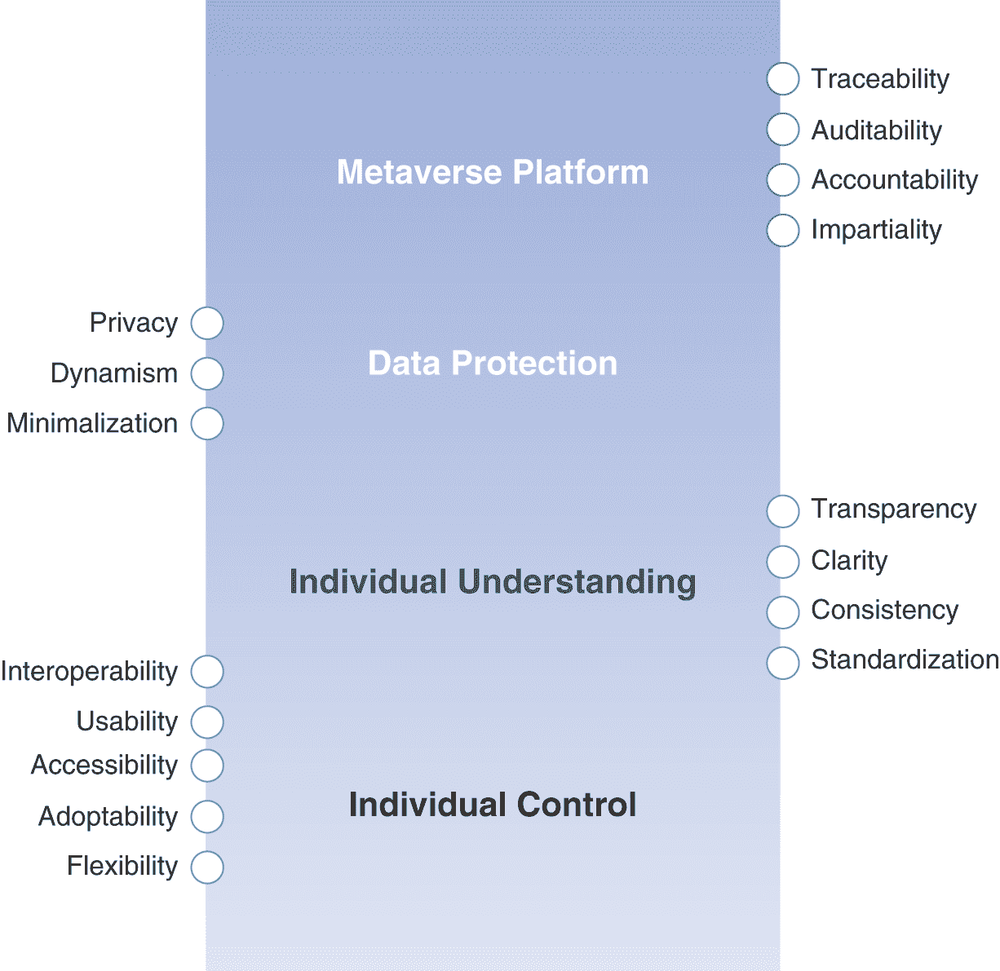

**图 7.2 元宇宙隐私与治理参考模型** ¶ 来源：世界经济论坛 (WEF)

这 16 项属性分为四个不同的组别：元宇宙平台问责制、数据保护、个人理解和个人控制。

## 元宇宙平台问责制

衡量、追踪并报告数据如何在数据交换或任何中心化数据平台内部及外部流动。定义了以下四项属性：

### 可追溯性

元宇宙平台利益相关者能够追踪其数据从同意、收集、使用、共享到终止的全过程——包括第一代和第 n 代消费层级。必须认识到当前的技术局限性，并设计治理框架以适应未来的方法。

### 可审计性

元宇宙平台运营商和参与者应保存记录，保存期限等于各司法管辖区针对数据滥用追索或其他要求的法定保留期限，记录内容包括：(1) 每一次数据收集、使用或共享的实例；以及 (2) 个人明确提供的数据使用同意选择，以支持审计。

### 问责制

任何参与者或元宇宙平台运营商均有责任保护个人隐私、提供追索方法，并仅在个人或合法代表个人行事的第三方（如父母、监护人、数据合作社、可信代理人）所选择的同意参数范围内使用其数据。在一切可能的情况下，这延伸至交换参与者之外的任何额外数据处理。

### 公正性

参与元宇宙平台的所有利益相关者，无论实体规模、地位或其他潜在偏见如何，均应对其在数据交换中采取的行为承担同等责任。

## 数据保护

保护数据和降低风险涉及存储在数据交换中的数据（即静态数据）、正在处理的数据（使用中的数据），以及在元宇宙平台内部、流向和流出的数据（即动态数据）。为数据保护定义了以下三项属性：

### 隐私

应为个人提供同意管理工具和体验，以控制可识别个人身份 (PI) 数据和个人来源数据的收集、使用和共享，这需与其司法管辖区内的数据隐私政策赋予个人的权利相协调。元宇宙平台运营商负责强制执行这些用户控制。

### 动态性

元宇宙平台运营商为参与者提供治理规则，并强制执行个人授予、修改和撤销数据收集、使用或共享同意的能力。在同意修改和撤销受限的场景中，此类限制会在初始权限体验之前提前告知用户。

### 最小化

个人数据的收集、使用和共享应根据其同意选择进行，确保严格相关且足以满足特定目的。元宇宙平台参与者启用必要的追踪和审计能力，供运营商确保合规性。

## 个人理解

该组专注于教育个人，使其能够就元宇宙平台如何收集、使用和共享数据做出知情选择。为个人理解定义了以下四个属性：

*   **透明度。** 个人可及时获取清晰信息，并持续了解实体如何收集、使用和共享其数据、服务的潜在风险和收益、源代码的可用性、所依据的规则和标准、其权利和义务，以及元宇宙平台的治理架构。

*   **清晰度。** 个人能够清楚理解数据为何以及如何被收集、使用和共享。同意选择以连贯且易懂的方式呈现。不允许存在暗模式行为。

*   **一致性。** 在数据交换的所有用户交互中，同意机制以相同格式呈现给个人（例如术语、图标、结构）。

*   **标准化。** 同意选择以通用、易懂的格式跨用例和参与者呈现给个人。参与者启用必要技术，以读取、解析并实施按标准格式接收的同意选择。运营商强制执行这些标准。

## 个人控制

该组旨在支持工具和界面，使个人能够就其数据如何通过元宇宙平台被收集、使用和共享行使知情选择。为个人控制定义了以下五个属性：

*   **互操作性。** 个人数据的传输能力，连同相关权利和许可，从一个运营商或参传输到另一个运营商或参与者，采用通用的机器可读格式，可在元宇宙平台的参与者间被解析和理解。


## 核心原则

*   **易用性。** 个人能够控制其数据如何被使用、收集或共享。他们通过数据交换同意机制，得以采取行动控制个人可识别数据以及个人来源的去标识化数据的收集、使用和共享。

*   **可访问性。** 个人能够通过简单的同意机制界面控制数据如何被收集、使用和共享，该界面在相关交互点可用。所有个人均应能访问，包括少数群体、残障人士和低社会经济地位人群。

*   **可采纳性。** 个人与同意机制交互的治理方法，应可由元宇宙平台的运营商和参与者实施和管理。

*   **灵活性。** 同意界面允许轻松修改，以应对运营商、参与者或个人的情况变化，以及治理规则、监管政策或技术发展的变化。

## 零知识证明和安全多方计算

为了保护用户在数据、身份、数字资产和交易方面的隐私，目前有几种隐私保护技术正处于活跃研究阶段。以下两节将介绍可被元宇宙平台大量利用的四种隐私技术（参见图 7.3）。

## 零知识证明

### 什么是零知识证明？

在不透露证明数据的情况下，是否可能证明某事为真？这正是零知识证明（ZKP）技术所主张的——一种方法，让一方能以密码学方式向另一方证明其拥有关于某信息的知识，而无需透露实际的底层信息。在区块链网络背景下，ZKP 在链上透露的唯一信息是：某隐藏信息有效且为证明者所知。

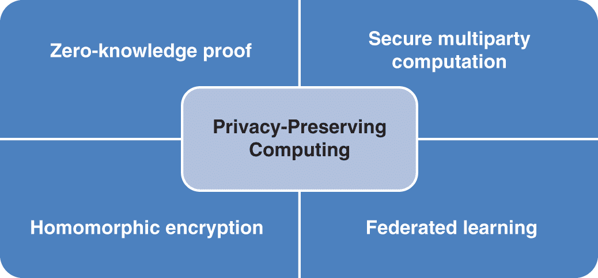

图 7.3 领先的隐私保护计算方法

ZKP 最早见于 1985 年麻省理工学院 Shafi Goldwasser 和 Silvio Micali 的论文《交互式证明系统的知识复杂性》。文中作者论证了：证明者有可能在不透露关于数据点的任何额外信息的情况下，使验证者信服某数据点的特定陈述为真。

### 零知识证明如何工作？

ZKP 可以是交互式的——证明者说服特定验证者，但需对每个验证者重复此过程；也可以是非交互式的——证明者生成一个证明，任何人均可使用同一证明进行验证。此外，目前存在多种 ZKP 实现，包括 `zk-SNARKS`、`zk-STARKS`、`PLONK` 和 `Bulletproofs`，各有其在证明大小、证明者时间、验证时间等方面的权衡。

定义 ZKP 的三个基本特征包括：

*   **完整性。** 若陈述为真，诚实的验证者可被诚实的证明者说服，相信其拥有关于正确输入的知识。

*   **可靠性。** 若陈述为假，不诚实的证明者无法单方面说服诚实的验证者，使其相信证明者拥有关于正确输入的知识。

*   **零知识性。** 若陈述为真，验证者从证明者处获得的信息仅限于“该陈述为真”，别无其他。

从高层来看，创建 ZKP 涉及验证者要求证明者执行一系列操作，只有知道底层信息才能准确完成这些操作。如果证明者只是猜测这些操作的结果，最终会以极高概率被验证者的测试证明是错误的。

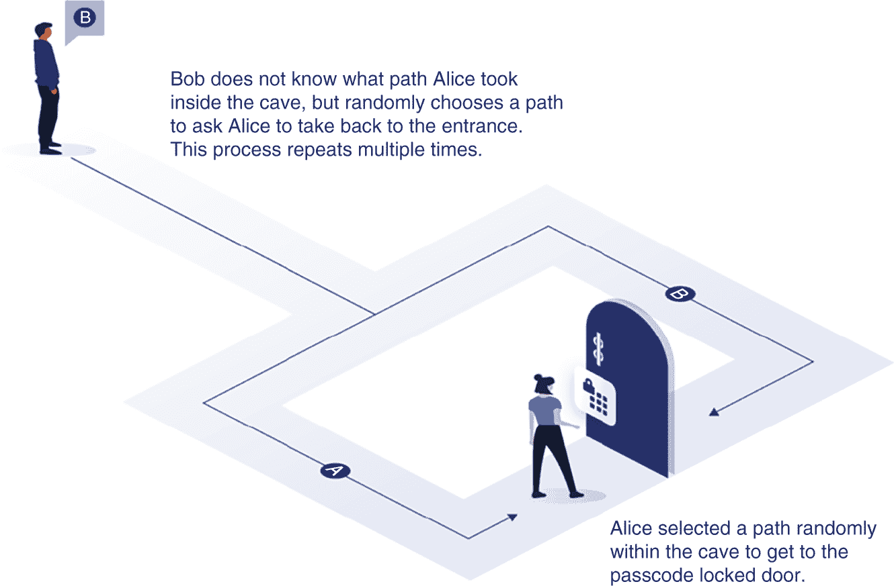

图 7.4 零知识证明算法示意

### ZKP 如何在不向另一方透露数据的情况下证明对数据的知识

一个理解零知识证明数据的概念性例子是：设想一个洞穴，只有一个入口但有两条通道（通道 A 和 B，如图 7.4 所示——你可能记得 Bob 和 Alice 曾在第 2 章中出现过进行比特币交易，见图 2.2），两条通道在一扇由口令锁住的共同门处相连。Alice 想向 Bob 证明她知道开门的密码，但不向 Bob 透露密码。为此，Bob 站在洞穴外，Alice 走进洞穴，选择两条通道中的一条（Bob 不知道选了哪条）。随后 Bob 要求 Alice 从两条通道中随机选一条返回洞穴入口。

如果 Alice 最初选择*通道 A* 走到门前，但 Bob 要求她走*通道 B* 返回，完成这一谜题的唯一方法是 Alice 掌握那扇锁门的密码。此过程可重复多次，以极高概率证明 Alice 知道门的密码，且非碰巧初始选择了正确通道。过程完成后，Bob 有极高信心确信 Alice 知道门的密码，而密码未向 Bob 泄露。

虽然上述只是一个概念性示例，但零知识证明（ZKP）采用了相同的策略，并利用密码学来证明对某个数据点的了解，而无需透露该数据点本身。在这个洞穴示例中，存在一个输入、一条路径和一个输出。在计算领域，也存在类似的电路系统，它们接收某些输入，让输入信号通过一条电气门电路路径，并生成一个输出。ZKP 利用此类电路来证明陈述。

想象一个计算电路，对于给定的输入，它会输出曲线上的一个值。如果用户能持续提供曲线上某点的正确答案，则可以确信该用户掌握关于该曲线的某些知识，因为随着每一轮连续挑战的进行，猜中正确答案的概率变得越来越小。可以将该电路想象成爱丽丝在洞穴中行走的路径；如果她能凭借自己的输入通过该电路，就以极高的概率证明她掌握某些知识，即该电路的“通行密码”。

#### ZKP 的优势

能够在不透露除数据知识之外的任何额外信息的情况下证明对数据点的了解，可提供多项关键优势，尤其是在区块链网络的背景下。ZKP 的主要优势在于能够在透明系统（如以太坊等公共区块链网络）中利用隐私保护型数据集。

虽然区块链的设计初衷是高度透明，即运行自己区块链节点的任何人都可以查看和下载存储在账本上的所有数据，但 ZKP 技术的引入允许用户和企业在执行智能合约时利用其私有数据集，而无需透露底层数据。确保区块链网络内的隐私对于维护各种元宇宙应用中的隐私至关重要。

## 安全多方计算

### 什么是安全多方计算？

安全多方计算（也称为多方计算、SMPC 或 MPC）是一种密码学技术，它使不同参与方能够使用其私有数据进行计算，而无需向彼此透露各自的私有数据。安全多方计算是一种可以帮助企业和个人确保其敏感数据隐私的方法，同时又不损害他们从中获取洞察的能力。

### 安全多方计算如何工作？

一个阐述 SMPC 基本思想的常用示例如下：假设一组员工想要知道他们的平均工资，以此判断自己是否薪资过低。然而，他们不想透露各自的个人薪资信息。SMPC 方法可以通过以下步骤解决此问题：

1.  每位员工按顺序从第一位编号到最后一位。

2.  第一位员工选择一个任意的大数，将自己的薪资加到该数上，并将结果告诉第二位员工。

3.  第二位员工将自己的数字加到该值上，并将结果告诉第三位员工，以此类推，直到最后一位员工。

4.  最后一位员工在将自己的薪资加到结果后，将结果告诉第一位员工。

5.  第一位员工减去他们最初选择的大数，并将结果除以组内员工人数，从而得出平均薪资。

在该示例中，第一位员工选择的大数对其他人隐藏了其薪资。同时，第一位员工从最后一位员工处收到的最终结果，未向第一位员工透露任何关于其他人薪资的信息。因此，由多方组成的群体可以在不透露各自薪资的情况下，安全地计算出平均薪资。

当然，这只是一个阐述 SMPC 工作原理的简单示例。在现实世界的用例中，SMPC 可在无需共享私有数据的前提下，利用私有数据实现机器学习模型等复杂计算。

### 安全多方计算有哪些特性？

SMPC 旨在确保针对对抗性攻击的两项基本特性：

1.  **输入隐私。** 任何一方都无法从输出中推断关于私有输入的信息。

2.  **正确性。** 对抗方不得能够阻止其他方接收其正确的输出。

此语境下的对抗方是指攻击计算过程的参与方。攻击目的可能是为了获取其他方的私有信息，或导致计算输出不正确。

### 安全多方计算有哪些优势？

*   **促进隐私与数据效用。** SMPC 可消除数据隐私与数据效用之间的权衡，因为私有或加密数据无需与第三方或模型所有者共享即可被利用。因此，它也消除了源于数据收集的数据泄露和滥用风险。

*   **仅揭示最终结果。** SMPC 仅揭示最终结果，在计算过程中不揭示中间信息。

### 安全多方计算面临哪些挑战？

*   **通信开销。** 如上例所示，SMPC 方法要求参与方之间进行通信，这可能导致高昂的通信成本。

*   **易受串通方攻击。** 例如，第二位员工和第四位员工可以串通，通过从第三位发送给第四位的值中减去第二位发送给第三位的值，来得知第三位员工的薪资。

## 同态加密与联邦学习

同态加密（HE）和联邦学习（FL）是两种不同但相关的技术，旨在解决同一个问题：如何能更私密、更安全地执行机器学习和区块链交易等计算任务？换句话说，IT 系统如何能在不看到数据的情况下使用数据？

## 同态加密

### 什么是同态加密？

同态加密（HE）是一种加密方法，它允许在加密数据上执行计算，而无需先使用密钥对其进行解密。计算结果也保持加密状态，只能由私钥所有者解密。同态加密使元宇宙平台能够在不解密用户数据的情况下，对用户的加密数据进行处理和交易。

### 它是如何工作的？

该过程始于解密形式的数据（即明文）。数据所有者希望另一方（如云服务或元宇宙服务提供商）对其执行数学运算（例如某个函数或机器学习模型），而不泄露其内容。

如图 7.5 所示，数据所有者（或云客户端）对数据进行加密并将其发送给另一方（云服务器）。云服务器接收加密数据，对其执行操作，并将加密结果发送给所有者。数据所有者使用私钥对其进行解密，从而揭示对数据执行预期数学运算的结果。

同态加密主要有三种类型：

1.  **部分同态加密（PHE）。** PHE 仅允许在加密数据上执行选定的数学函数。

2.  **某种同态加密（SHE）。** SHE 允许在一定复杂度范围内、有限次数地执行有限数量的数学运算。

3.  **全同态加密（FHE）。** FHE 允许无限次地执行任意类型的数学运算。

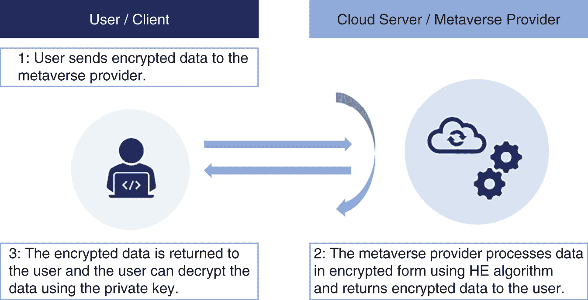

**图 7.5 同态加密的工作原理**

### 为什么同态加密现在很重要？

#### 与第三方共享私有数据

由于 `GDPR` 和 `CCPA`（加州消费者隐私法案）等数据隐私法规的存在，与云服务或元宇宙平台等第三方共享私有数据颇具挑战。未能遵守这些法规可能导致严重罚款并损害商业声誉。

传统加密方法提供了一种高效且安全的方式，以加密形式将私有数据存储在云端。然而，要对这些方法加密的数据执行计算，企业要么需要在云端解密数据（这可能导致安全问题），要么下载数据、解密并执行计算（这可能成本高昂且耗时）。同态加密使企业能够安全地与第三方共享私有数据以获取计算服务。借助 `HE`，云服务或元宇宙公司仅能访问加密数据并对其执行计算。这些服务随后将加密结果返回给所有者，所有者可使用私钥对其进行解密。

### 同态加密有哪些优势？

*   **允许在元宇宙中安全高效地使用。** 同态加密可让元宇宙企业安全地利用云计算和存储服务。它消除了数据安全与可用性之间的权衡。企业无需依赖云服务来保障其私有数据的安全，同时保留了对其执行计算的能力。

*   **促进协作。** `HE` 使组织能够与第三方共享敏感业务数据，而无需向其透露数据或计算结果。这可以在不冒敏感信息泄露风险的情况下加速协作与创新。

*   **确保合规。** `HE` 可让医疗和金融等受严格监管行业的企业，为研究和分析目的获取外包服务，而无需承担不合规的风险。

### 同态加密面临哪些挑战？

部分同态加密和近似同态加密系统自 20 世纪 70 年代末以来就已存在，但允许对加密数据执行所有数学运算的全同态系统首次建立于 2009 年。在目前的形式下，全同态加密速度慢得不切实际。可以说，全同态加密（`FHE`）仍是一项用于数据安全与效用的新兴技术。但它极具前景，我们有望看到可应用于多种用例的更快版本。

## 联邦学习

在机器学习领域，联邦学习的概念通过确保数据永不离开分布式节点设备，解决了数据所有权和隐私问题；同时，中央模型会被更新并共享给网络中的所有节点。机器学习模型的副本分发到数据所在的站点/设备，并在本地进行模型训练。更新后的神经网络权重被发送回主存储库。因此，多个节点通过随机中央模型共享、本地优化、本地更新共享和安全模型更新，迭代地共同构建一个通用的、稳健的机器学习模型。

用于训练深度网络的联邦学习方法最早由 Google 的 AI 研究人员于 2016 年阐述。鉴于对隐私的日益关注，主存储库或服务器被设计为对节点的本地数据和训练过程完全“不可见”。因此，数据保留在所有者手中，从而保护了数据机密性，这在隐私至关重要的工业、医疗 AI 和元宇宙应用中极具优势。联邦学习的拓扑结构可以是点对点或完全去中心化的。（图 7.6 提供了医院用例的联邦学习架构示例。）

## 联邦学习的类型

联邦学习模式通常分为两类：多方系统和单方系统。单方联邦学习系统之所以称为*单方*，是因为仅有一个实体负责监督学习网络中所有客户端设备的数据采集和流动。客户端设备上存在的模型是在具有相同结构的数据上训练的，尽管数据点通常因用户和设备而异。

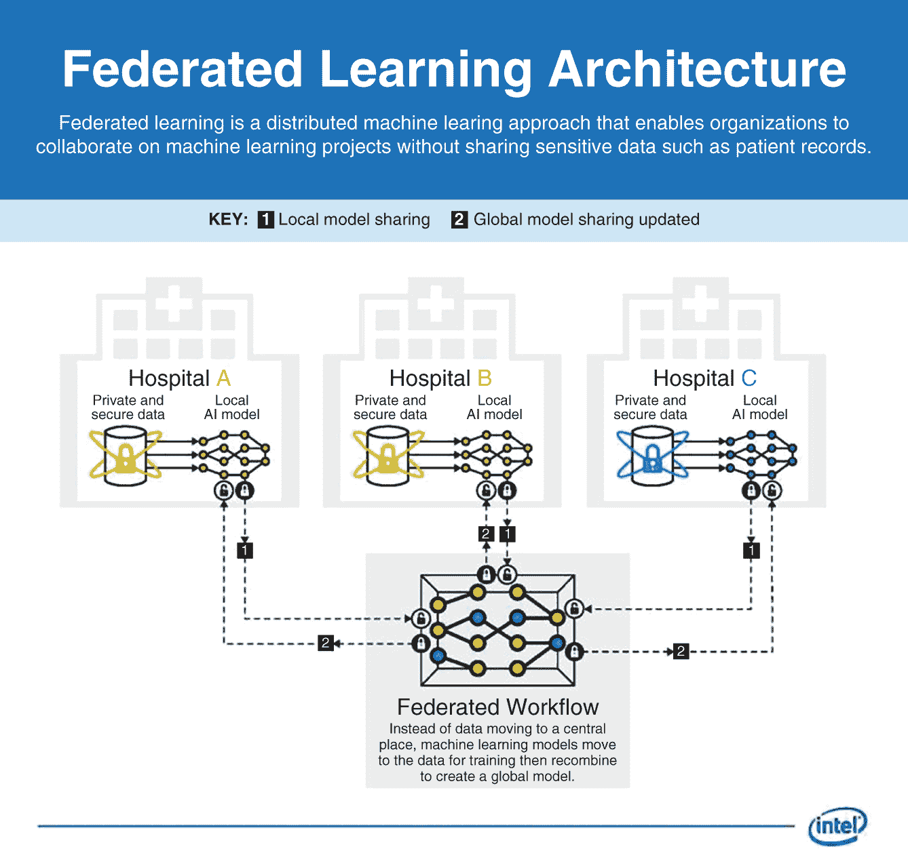

**图 7.6 联邦学习架构** ¶ 来源：intel

与单方系统相反，多方系统由两个或多个实体管理。这些实体通过利用其拥有的各种设备和数据集进行合作，以训练一个共享模型。属于多个实体的设备上的参数和数据结构通常相似，但不必完全相同。相反，会进行预处理以标准化模型的输入。可能会聘用一个中立实体来聚合不同实体特有设备建立的权重。

## 联邦学习面临的挑战

由于联邦学习仍处于起步阶段，要使其发挥全部潜力，必须解决若干挑战。边缘设备的训练能力、数据标注与标准化以及模型收敛，是联邦学习方法的潜在障碍。

在设计联邦学习方法时，需要考虑边缘设备在本地训练方面的计算能力。虽然大多数智能手机、平板电脑和其他兼容 `IoT` 的设备都能训练机器学习模型，但这通常会阻碍设备性能。必须在模型精度和设备性能之间做出妥协。利用 `CPU` 进行机器学习和训练算法的最新进展可能会提升设备性能。

标注和标准化数据是联邦学习系统必须克服的另一个挑战。监督学习模型需要清晰且一致标注的训练数据，但在系统中众多的客户端设备间做到这一点颇具难度。因此，基于事件和用户操作开发能以标准化方式自动应用标签的模型数据管道非常重要。

模型收敛时间是联邦学习的另一个挑战，因为联邦学习模型通常比本地训练模型收敛时间更长。参与训练的设备数量给模型训练增加了不可预测性，因为连接问题、不规则更新甚至不同的应用使用时间都可能导致收敛时间增加和可靠性降低。因此，联邦学习解决方案通常在能相较于集中式训练模型提供有意义优势时最为有用，例如数据集极其庞大且分布式的场景。

## 区块链与联邦学习

独立的“原生”联邦学习架构存在一些局限性。主要局限性包括：（1）单点故障（中央节点的存在）；（2）潜在的懒惰客户端可能会降低模型学习效果；（3）缺乏可信的模型交换记录。

借助区块链技术，我们可以做以下两件事：

### 1. 激励机制

构建激励/奖励机制，以敦促“懒惰”的客户端参与本地训练。我们可以编写名为 `Contribution` 的智能合约函数以及用于实现的流程。使用联邦学习的元宇宙平台的利益相关者都可以拥有明确定义的区块链地址，以签署交易并与智能合约交互。该合约部署在以太坊网络等区块链网络上，保证当中心节点消费更新后的本地模型时，用户能收到奖励。中心节点会考虑提供的数据量以及节点在规定会话期间参与的轮数。激励以数字代币的形式分配，通过将其转移到用户的地址。

### 2. 模型交换的可追溯性

保持联邦学习会话期间模型交换的不可篡改记录。完整性、安全性和透明度是使用联邦学习保障元宇宙应用安全的基础。因此，我们可以定义一个名为 `Federation` 的智能合约，用于规定学习会话期间网络利益相关者将遵循的聚合策略，内容包括：

*   轮数
*   客户端数量
*   算法名称

在客户端，一旦每个客户端使用其本地数据完成初始模型的训练，生成的权重将使用 `SHA-256` 算法进行哈希和加密，权重的哈希值将自动保存在区块链中，以确保其完整性和防篡改。每个客户的数据大小也将记录在区块中，以建立奖励机制。

现在让我们转到服务端，服务端在从客户端节点接收权重后，将确保全局模型的生成。`Federation` 智能合约也将确保全局模型的哈希处理及其在区块链上的登记。

## NFT “Cookies”：当 Web3 技术遇上 Web2.0 遗留问题

随着元宇宙应用在未来获得更多主流采用，关于 Web2 中的第三方 Cookie、反乌托邦社会和监控经济的辩论将成为持续讨论的话题。在本节中，我们从第三方 Cookie 在 NFT 市场中呈现新形式切入，在下一节中我们将讨论监控经济和反乌托邦社会的风险。

第三方 Cookie 是由当前访问网站以外的其他网站设置的 Cookie。例如，Facebook 网站上的“点赞”按钮可以在你的计算机上存储一个 Cookie，随后 Facebook 可以访问该 Cookie 来识别访问者并查看他们访问过哪些网站。这使得 Facebook 能够“跟踪”你，查看你访问过的任何网站。这就像 Facebook 在你体内植入了一个 GPS 追踪器，并在虚拟世界中跟踪你。如果我们在元宇宙中允许这种第三方 Cookie，那将是一个重大的隐私担忧，因为元宇宙旨在让我们“沉浸”其中。

与第三方 Cookie 问题类似，在 NFT 生态系统中，OpenSea（最大的 NFT 市场之一）和 MetaMask（最流行的加密钱包之一）中已演示了该问题。这与 `ERC1155` 和 `ERC721` NFT 标准有关，这些标准允许创作者将 NFT 元数据的 URL 设置为创作者或卖家的网站。卖家的网站随后可以追踪用户的 IP 地址。当然，像 OpenSea 这样的网站通常因其运作方式而收集并存储访问者的 IP 地址。OpenSea 本身很可能收集访问者的 IP 地址，就像许多其他网站、应用或服务一样。但在这里，外部第三方——NFT 卖家或创作者——也可以收集查看 NFT 的人员信息，且可能是在用户不知情的情况下。（参见 Box: IP Address Leak at OpenSea and MetaMask。）

我们可以将此问题视为 Web3 技术（NFT 及相关智能合约）遇上 Web2（托管在 Web2 中的 NFT URL 内容），从而产生新形式的隐私担忧。来自 Web2 世界现有第三方 Cookie 的持续隐私担忧，将因 NFT 暴露的新隐私担忧而加剧。

为超越 Web2 第三方 Cookie 问题，Google 于 2021 年 3 月宣布，将在 2022 年前停止在其 Chrome 浏览器中使用 Cookie。（后来截止日期延长至 2023 年。早在 2019 年，Mozilla 的 Firefox 浏览器就开始默认阻止第三方 Cookie。）这并不意味着广告商不会拥有工具在该国最流行的浏览器上定位你。事实上，Google 已经在测试第三方 Cookie 的替代方案。


Google 创建了名为“群组联邦学习”（`FLoC`）的提案。Google 称，这是关于寻找一种保护用户隐私的第三方 Cookie 替代方案。`FLoC` 系统（发音类似单词 *flock*）会根据相似的浏览行为将人们分组。这意味着广告商将仅使用群组 ID 而非个人用户 ID 来进行定位。用户的网页历史记录将保留在 Chrome 浏览器中，但 Chrome 只会向广告商提供由数千个单独网络冲浪者组成的群组信息。（这一概念类似于 Figure 7.6 中之前的联邦学习讨论。）

一个群组可能包含数千名浏览过另类音乐网站的用户。其他群组可能包含对漫画或动画感兴趣的用户。Google 称，这在保护个人 Chrome 用户隐私的同时，为广告商提供了强大的工具。简而言之，`FLoC` 是一种基于兴趣的追踪形式，根据你的“群组”——即一群拥有相似兴趣的人——来识别你。看来 `FLoC` 可能会让广告商更容易识别你。

随着 Google 开始开发 `FLoC`，各国政府颁布了立法，为未告知消费者其网站使用 Cookie 的公司、营销人员和其他人设立民事和刑事处罚。此类立法包括欧洲的《通用数据保护条例》（`GDPR`），该条例规范个人信息的收集、存储和删除。还包括旨在保护加州消费者隐私的《加州消费者隐私法案》（`CCPA`）。弗吉尼亚州也最近颁布了《弗吉尼亚消费者数据保护法案》。此外，《华盛顿隐私法案》和《伊利诺伊州生物识别信息隐私法案》也都接近颁布。

在监管压力和隐私倡导团体的批评下，Google 暂停了“`FLoC` 提案”的测试。2022 年初，这家搜索巨头提出了一种名为“Topics”的新方法，它允许广告商根据由用户浏览器活动决定的有限主题投放广告。Topics 应用程序编程接口（`API`）使用 Chrome 浏览器确定最多五个主题列表——如“书籍和文学”或“团队运动”——用户可能感兴趣，这基于他们访问的网站。“Topics”的功能包括：

*   主题按周确定。
*   它们排除敏感类别，如性别或种族。
*   用户可以查看并从列表中移除主题，或关闭整个 Topics `API`。
*   主题仅保留三周。
*   当用户访问支持用于广告目的的 Topics `API` 的网站时，浏览器将分享该用户感兴趣的三个主题——每个主题从用户过去三周的前五个主题中随机选择。该网站随后可将此信息与其广告合作伙伴共享，以确定展示哪些广告。

这种做法遭到了营销人员的抵制，因为“主题”无法反映消费者的目标需求。例如，主题可以是家用电器，这对营销人员来说是一个过大的品类，无法在用户身上投放有效广告。但对于关注隐私的倡导者来说，“主题”可能仍包含过多元数据，这些数据可被用于侵犯用户隐私。因此，第三方 Cookie 的替代方案仍将是一个持续的辩论话题。

对于 NFT，服务提供商（如 OpenSea、MetaMask 以及其他 NFT 市场和钱包提供商）可以通过从其控制的服务器下载 URL 内容，而不是让个人用户直接从 NFT 创作者的网站下载，来缓解隐私问题。这样，用户仅与 NFT 服务提供商交互，而不直接与 NFT 创作者交互以获取 URL 内容。当然，如果用户使用 Chrome 访问 OpenSea 或 MetaMask，Web2 的第三方 Cookie 跟踪仍是一个隐私顾虑——除非 Google 推出一个好的解决方案。

## 监控经济与反乌托邦社会

### MEV 与监控经济

数据具有商业价值。因为数据已成为新数字经济中的关键资源，互联网巨头更*主动地*收集用户数据。（参见框：购买面孔。）此外，他们收集用户数据的方方面面，无论是身份数据、网络数据还是行为数据。由于法律发展滞后于大数据时代，全球网络服务提供商在移动应用中收集和使用个人信息时都肆无忌惮。

例如，一款照片编辑应用无权要求用户的位置、身份证号或指纹。天气预报应用为何要请求访问用户的通讯录？随着我们与公司及其应用的交互从手中的屏幕转移到脸上的头显，侵入式数据收集的可能性与日俱增。这就是元宇宙中监控经济的风险。

根据维基百科：

> 监控资本主义是一个以个人数据商品化为中心、以牟利为核心目的的经济制度。正如秀莎娜·祖博夫所述，监控资本主义的概念源于以 Google AdWords 为首的广告公司看到了利用个人数据更精准地定位消费者的可能性。增加数据收集可能对个人和社会有各种优势，如自我优化、社会优化（如智慧城市）和服务优化（包括各种 Web 应用）。然而，在资本主义核心牟利动机的背景下收集和处理数据，可能会对人类自由、自主和福祉构成危险。

如果隐私不是元宇宙应用设计的首要任务，元宇宙建设者可能会重蹈 Web2.0 公司的覆辙。在 Web3 中，核心设计要素是数据的去中心化性质和用户对数据的自我控制。尽管如此，链上交易仍记录在分布式账本上。Chainalysis、Dune Analytics 和 CoinDesk 等公司拥有资源和人才进行链上和链下分析，并可能获取关于个人的更多信息。

例如，加密矿工可以查看内存池中的交易以获取矿工可提取价值（或**MEV**）。MEV 是衡量区块链矿工通过其任意包含、排除或重新排序交易的能力所能获得利润的指标。因为矿工（和验证者）处理和验证交易，他们对所有交易拥有完全可见性，因此能够随意重组交易并抢跑其他用户的交易。这样，这些矿工能以其他用户为代价获利。

本章介绍的隐私保护计算技术有助于保护数据隐私，并最大程度减少目前几乎所有主要公链中存在的 MEV 问题。需要对隐私保护计算和存储以及代币经济进行更多研究，以避免重蹈 Web2 技术的覆辙，即数据被用于破坏民主进程（例如剑桥分析公司利用 Facebook 用户数据干预选举），或影响数百万人的数据泄露（例如雅虎、Google、Facebook、领英和 Equifax 发生的泄露事件）。

### 反乌托邦社会

想象一个社会，你生活在由一小群特权精英控制的某个组织的规则之下。它可能是一个专制政府、一个宗教组织、一个全能的全球性公司，或一个由元宇宙社区创建的 DAO。该组织控制着你生活的许多方面。你被告知该想什么、如何行动，通过宣传和洗脑实施控制。不被允许的个人思想和行为不被容忍，一旦被当局发现将受到严厉惩罚。你的隐私得不到保护，而是由该组织控制。这只是反乌托邦社会的众多愿景之一。

反乌托邦社会常被描绘在科幻文学和电影中。反乌托邦小说的例子包括乔治·奥威尔的*《1984》*、安东尼·伯吉斯的*《发条橙》*、奥尔德斯·赫胥黎的*《美丽新世界》*和玛格丽特·阿特伍德的*《使女的故事》*。著名的反乌托邦电影包括近期的*《饥饿游戏》、《人类之子》*。这些小说和电影已作为警示，告诫我们技术失控导致的反乌托邦未来。

以下是元宇宙可能在反乌托邦社会噩梦中创造的一些场景：

*   大型科技公司构建元宇宙应用以积累更多数据，然后利用先进的 AI/ML 获取更多关于用户行为和隐私的洞察。大型科技公司的目标是利润最大化，这可能以牺牲用户隐私和用户自由为代价。此外，大型科技公司可以强加其自身的反乌托邦规则，或与压迫性政府合作以压制个人自由和隐私。
*   Web3 社区可以构建一个 DAO 来吸引全球元宇宙用户，而该 DAO 可能由少数拥有大多数投票权或股份的“加密鲸鱼”控制。鲸鱼们可以出于自身利益强加反乌托邦规则，代价是拥有极少投票权的全球用户。

大型科技公司、Web3 DAO 社区和政府的合作可能会串通一气，创建一个全能的元宇宙生态系统，该系统可能强加反乌托邦规则，侵犯个人隐私甚至基本人权。

总之，随着复杂、融合的元宇宙愿景成为现实，我们将不得不回答许多棘手的数据隐私问题。简单来说，元宇宙以从未有过的规模模糊了现实与虚拟的界限。因此，数据隐私和安全是元宇宙公司、开发者和用户共同关注的重大问题。虽然我们对元宇宙将如何成形仍有许多需要了解的地方，但我们已有足够的框架来思考数据隐私和数据安全（将在下一章讨论），以确保我们不再重蹈当前互联网中允许发生的错误。

## 第 8 章：元宇宙安全

*   区块链与元宇宙：天作之合？
*   元宇宙中的身份：无法无天的西部
*   元宇宙数据安全：慢性痛
*   智能合约安全：可能不那么聪明
*   元宇宙中的勒索软件攻击：可能吗？
*   供应链软件攻击：真正的危险？
*   量子计算：未来的挑战与机遇
*   扩展现实 (XR)：新颖的安全风险

## 区块链与元宇宙：天作之合？

区块链的加密、不可篡改和去中心化属性使其成为保护数据的绝佳选择。区块链赋能的数据安全方法有助于确保信息的机密性、完整性和可用性（参见图 8.1）。

### 机密性

公钥中使用的非对称加密机制为用户提供了伪匿名性。利用零知识证明、多方安全计算、环签名、混币和阈值签名的隐私币，为区块链交易提供了增强的机密性。以太坊的第二层技术、比特币的闪电网络以及 Hyperledger Fabric 中的通道，除了带来性能提升外，也是实现机密性的绝佳机制。

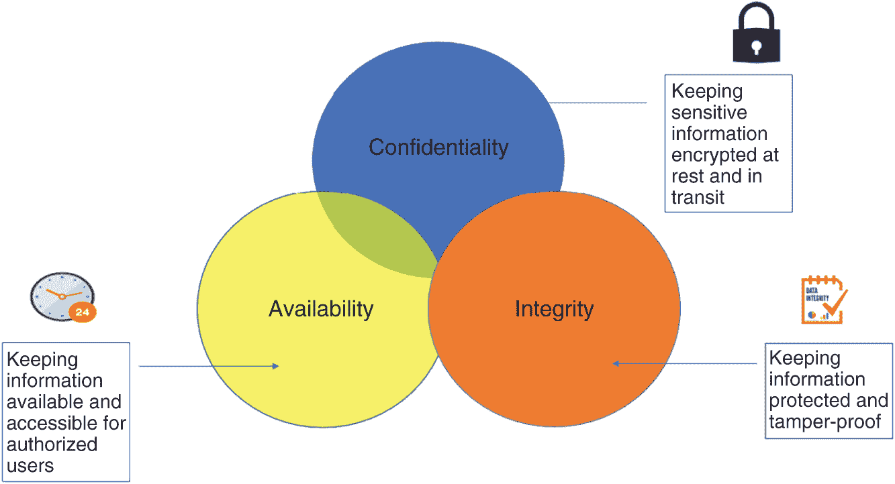

**图 8.1 区块链的 CIA 三要素**

例如，Hyperledger Fabric 可以被定义为一个逻辑实体，代表两个或多个区块链网络成员/参与者的分组，旨在在他们之间进行私密和保密的交易。其 `channels`（通道）是私有且需授权的，并满足以下要求以增强网络的机密性：

*   并非任何人都可以加入通道。
*   加入通道的每个节点都有其自己的身份。
*   该身份由成员服务提供商（`MSP`）颁发。
*   通道中的每个节点都必须经过身份验证和授权，才能在该通道上进行交易。

### 完整性

区块链数据或交易必须经过签名、达成共识并追加到账本中。账本在全球范围内分布，完整性在全球范围内得到保障，这与中心化数据库不同。

### 可用性

区块链上的数据由许多网络节点冗余托管；数据的可用性（如果不考虑数据查询中的响应时间）可以得到保障，因为节点是分布式的，并由网络参通过良好的激励机制进行控制。此外，智能合约以及关于数据（所有权、定价和交换）的协议鼓励并激励数据的可用性和共享。

尽管区块链技术给网络安全带来了新的挑战（我们也必须考虑区块链本身的网络安全），但区块链的安全特性可以被元宇宙应用利用，以实现数据机密性、数据完整性和数据可用性。如果区块链能在元宇宙应用中得到妥善使用，这无疑似乎是一桩天作之合。然而，正如本章将讨论的那样，Web3 中的数据安全问题比这桩婚姻本身更为复杂。

## 元宇宙中的身份：无法无天的西部世界？

在元宇宙中，用户的数字身份是入侵者首先攻击的目标。预计元宇宙将带来从登录 ID 和用户名向增强型数字化身的转变。您的元宇宙个人资料可能包含比您目前的 Google 或 Facebook 账户多得多的个人信息。如果您不小心，它可能会整合您的整个数字生活和个性——不仅是您独特的在线（和离线）身份，还包括您的银行账户和其他敏感数据。防范数字身份被盗将成为元宇宙应用的关键因素；同样重要的是，社区必须确保元宇宙用户无法伪造身份。

回顾历史，欺诈者曾声称自己是被废黜的王子，拥有巨额财富愿与人分享，或是拼命想联系您的抽奖主持人。随着互联网的发展，这些骗局通过电子邮件、短信和社交网络通信实现了数字化“加盟连锁”。顺推这一趋势，身份盗窃将在元宇宙中进一步升级。它不再是来自您银行的伪造电子邮件。它可能是虚拟银行大厅中一位出纳员的化身，向您索要个人身份信息。也可能是您社交网络好友的冒充者，邀请您进入一个恶意的虚拟房间进行多人游戏。

因此，解决元宇宙中的身份问题是重中之重。范式转移伴随着巨大的责任——但谁将担任守门人？您如何确保自己的信息安全？这个新环境的安全将落在涉足元宇宙的公司肩上，因为它们将不得不承担身份验证者的角色。它们必须找到一种方法来认证身份、保护身份，并防范身份的滥用和欺诈性使用。

然而，组织需要知道，采用元宇宙赋能的应用和体验不会颠覆其身份和访问控制。关于身份保护有许多悬而未决的问题，它们对元宇宙社区和网络安全提供商而言都是有趣的挑战。例如：

1.  **元宇宙会让游戏等行业的身份危机恶化吗？在这些行业中，黑客攻击、篡改、作弊和盗窃的企图已经非常突出。** 例如，“深度伪造”就是一大挑战。深度伪造利用深度学习系统，通过从多个角度研究目标人物的照片和视频，制作出令人信服的赝品，并模仿其行为和语言模式。一旦制作出初步的赝品，一种称为 `GANs`（生成对抗网络）的方法会使其更加逼真。`GANs` 过程旨在检测赝品中的缺陷，然后通过修正缺陷来改进赝品。市场上有许多深度伪造即服务提供商，可以通过语音、图像和视频数据模拟真实的身份呈现。随着越来越多的个人数据在 3D 沉浸式游戏中暴露（参见第 7 章中的相关数据隐私讨论），我们可能会见证深度伪造的爆发式增长。

2.  **元宇宙中所有权的模糊性将引发大量知识产权纠纷。** 游戏内物品或 `NFT` 物品究竟归发行商还是用户所有？谁推动内容销售？谁代表生成内容的用户？数字资产与个人身份之间的关联是元宇宙的一个重大议题。

3.  **元宇宙生态系统将处理海量个人数据。** 这将受到日益严格的数据法规约束，就像现有的社交网络所面临的那样。这对于科技初创公司，尤其是渴望构建元宇宙的小公司来说，可能是一个沉重的合规负担。我们必须让身份在这个新世界中对企业来说变得可管控。

再次以“深度伪造”为例。2022 年 1 月，中国监管机构提出草案规则，旨在打击多个平台上“深度伪造”的传播。根据草案规则，“深度合成服务提供者提供面部、人声等生物识别信息重要编辑功能的，应当提示（提供者）通知并取得被编辑个人信息主体的单独同意。”首次违反该同意规则者将被处以 1 万元至 10 万元人民币罚款。

令人鼓舞的是，许多研究人员和标准组织（如 `W3C` 和去中心化身份基金会）一直在努力定义去中心化身份的安全要求。新成立的组织“Trust over IP”（IP 信任层）也在努力为互联网规模的数字信任提供强大的通用标准和完整架构，可供元宇宙应用使用。建设性的措施还包括将多因素认证（`MFA`）和无密码认证等作为平台的组成部分。

正如身份安全问题所表明的那样，任何元宇宙应用都面临两类基本的安全问题：技术专家几十年来一直在应对的熟悉挑战，以及专门为元宇宙环境构建的全新挑战。强化用户身份安全是元宇宙数据安全工作的第一步，在接下来的章节中，我们将探讨更复杂的问题。

## 元宇宙数据安全：慢性顽疾

目前尚不清楚新命名的 Facebook 公司 Meta 是否会利用 Web3.0 技术。Web3.0 的核心原则是自主身份，这意味着平台用户将拥有数据的所有权，并可选择性地授权同意。元宇宙将产生海量新数据，数量级比过去大几个量级。如果由 Meta 或 LinkedIn 等中心化实体持有这些数据，那么这些平台过去发生的数据泄露事件将重演，且破坏性将更强。以下是 2021 年大型科技公司发生的一些数据泄露案例。

2021 年 4 月，5 亿 Facebook 用户的信息泄露。泄露详情在某些情况下包括全名、位置、生日、电子邮件地址、电话号码和恋爱状态。这些数据可用于实施社会工程学攻击，如网络钓鱼。通常，社会工程学攻击涉及不法分子冒充合法个人或组织（包括银行、公司或同事），以窃取登录凭证、信用卡号、社会安全号码和其他敏感信息等数据。

2021 年 6 月，与 7 亿 LinkedIn 用户相关的数据在暗网论坛上被挂牌出售。此次泄露影响了 LinkedIn 7.56 亿总用户基数的 92%。泄露的数据包括：电子邮件地址、全名、电话号码、地理位置记录、LinkedIn 用户名和个人资料 URL、个人和职业经历、性别、其他社交媒体账号及其他详细信息。黑客通过利用 LinkedIn 的 API 抓取了这些数据。LinkedIn 声称，由于个人信息未被泄露，此事件不属于“数据泄露，而只是通过禁止的数据抓取违反了其服务条款。”但泄露的数据足以针对受影响用户发动大量网络攻击。事实上，大多数网络安全专业人士将该事件归类为数据泄露。

2021 年 3 月，微软遭遇重大安全漏洞。其本地 Exchange 服务器遭受四个零日漏洞利用，导致全球 30,000 个组织中的 250,000 多名受害者受到影响。对微软的攻击登上了许多头条新闻，因为它泄露了受影响服务器上的用户登录凭证，并授予了攻击者管理员权限。微软表示，一种新型勒索软件渗透了其服务器，加密了所有数据并使其不可用，同时勒索赎金以换取更新。事发后，微软声称已修复了 90% 以上的服务器。

随着大型科技公司拥抱元宇宙技术和商业模式以构建下一代互联网，此类攻击将对使用该平台的个人用户或组织构成更大风险。从物联网设备、AR/VR 头显或其他可穿戴设备、虚拟工作空间、聊天记录、购物历史、加密货币交易、游戏和 NFT 交易中收集的数据，可能会被集中存储在大型科技公司的云环境中。存储在云端或大型科技公司数据中心的数据可能成为黑客的“甜蜜目标”，未来必然会有关于大规模数据泄露的头条新闻。

解决方案是什么？当然，采用零信任模型的传统纵深防御方法有助于缓解元宇宙安全风险（参见第 7 章中的相关讨论）。然而，大型科技公司对数据的中心化所有权，从安全、隐私和公平的角度来看，仍然是核心问题。更好的解决方案是将数据的所有权和存储权归还给平台的个人用户。这是 Web3 的核心理念。这包括自主身份（SSI）和基于用户同意的数据所有权。

在深入探讨 SSI 和数据所有权的概念之前，我们需要了解公钥密码学的概念及其在区块链中的应用。

## 公钥密码学

公钥密码学使用一对公钥和私钥来执行不同的任务。公钥广泛分发，而私钥严格保密。

使用一个人的公钥，可以加密消息，使得只有持有私钥的人才能解密并阅读。使用私钥，可以创建数字签名，以便任何持有相应公钥的人都能验证该消息是由私钥所有者创建的，且自创建以来未被篡改。

区块链广泛使用公钥密码学。比特币、以太坊和比特币现金等主要加密货币公司的运作依赖于三个基本信息：地址（与余额关联，用于发送和接收资金），以及与该地址对应的公钥和私钥。比特币地址的生成始于私钥的生成。随后，可通过已知算法推导出其对应的公钥。地址是公钥的一种较短的代表性形式，可用于交易。

私钥赋予加密货币用户对特定地址上资金的所有权。区块链钱包会自动为你生成并存储私钥。当你从区块链钱包发送交易时，软件会使用你的私钥对交易进行签名（而不实际泄露私钥），这向整个网络表明你有权转移该发送地址上的资金。

该系统的安全性源于从私钥到公共地址的“单向通道”特性。无法从地址推导出公钥；同样，也无法从公钥推导出私钥。在大多数加密钱包中，都有一个由 12 个或 24 个单词组成的助记词，它是私钥的种子。公钥密码学是自主身份和数据所有权的基础。

## 自主身份（SSI）与数据所有权

### 什么是 SSI？


自主身份系统使用区块链——分布式账本——以便在不涉及中央目录的情况下查找去中心化标识符。区块链本身并不能解决身份问题，但它确实提供了一个缺失的环节，使得我们几十年来了解但无法应用的密码学知识变得可用。区块链技术允许人们使用去中心化的、可验证的凭证来证明关于自己的事情，就像在线下世界所做的那样（参见图 8.2）。

### 谁是发行者？

发行者是颁发凭证的实体。例如，颁发患者记录（如新冠疫苗接种状态）的检测管理机构（如医院）。发行者有权撤销凭证。

### 谁是持有者？

持有者是对颁发的凭证拥有生命周期控制权（如共享和删除）的实体。例如，患者可以在其钱包中持有发行者颁发的凭证（钱包可以是本地存储用户凭证数据的应用程序，也可以是代表持有者托管的托管钱包）。

### 谁是验证者？

验证者是指验证持有者共享的凭证是否有效的实体（即该凭证来自受信任的发行者，且未被发行者吊销）。例如：安装在机场等设施中的访问管理系统，根据持有者是否完成了新冠疫苗接种来允许/拒绝访问。验证可以是业务逻辑的组合，如“凭证是否在过去 14 天内签发”以及“是否由受认可的发行者签发”。

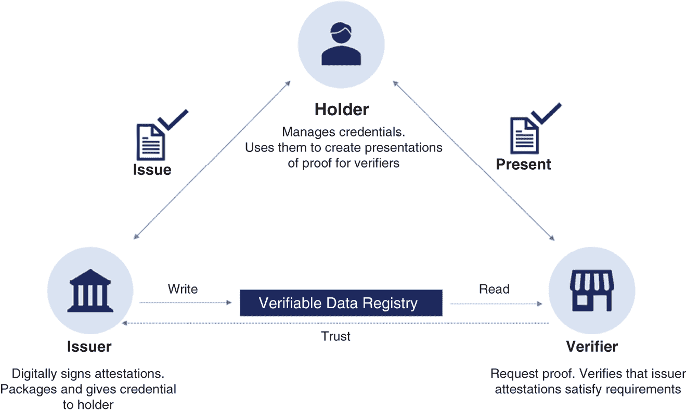

**图 8.2 自主身份 (SSI)** ¶ 来源：Affinidi

## 什么是可验证凭证 (VC)？

术语 `credential` 可以指代任何（防篡改的）信息集合，某个权威机构声称这些信息关于你是真实的，并且这些信息使你能够说服其他信任该权威机构的人这些事实是真实的。例如，大学颁发的文凭证明你拥有学位。一个国家政府颁发的护照证明你是该国公民。

每个凭证都包含一组关于凭证主体（即持有者）的声明。这些声明由发行者做出。要成为凭证，这些声明必须以某种方式可验证。这意味着验证者必须能够确定以下内容：

*   谁签发了该凭证
*   该凭证自签发以来未被篡改
*   该凭证未过期或被吊销

对于物理凭证，这是通过直接嵌入凭证本身的某种真实性证明来实现的，如芯片或全息图。也可以通过直接与发行者核对，确认凭证有效、准确且为最新状态。但这种人工验证过程可能既困难又耗时——这是全球存在伪造凭证黑市的主要原因。

这引出了可验证凭证的基本优势之一：利用密码学和区块链，它们可以在几秒钟内完成数字验证。此验证过程可以回答以下三个问题：

*   该凭证是否采用标准格式，且是否包含验证者所需的数据？
*   该凭证是否仍然有效——即未过期或被吊销？
*   如果适用，该凭证（或其签名）是否提供了密码学证明，证明凭证持有者就是凭证的主体。

SSI 将允许**图 8.2** 中的用户或持有者在多个平台上维护并拥有自己的数字身份所有权，同时选择他们希望在每个平台上共享的信息。这种交互模式将彻底改变当前将个人数据商品化的数字市场。身份将通过区块链归还给个人，使个人拥有自己的数据，并能根据对自己最有利的方式调度数据，而不是任由 Facebook 或 LinkedIn 或其他人想如何利用就如何利用。

有了 SSI，安全重心可以从中心化平台转移到钱包安全、SSI 安全，以及使用智能合约进行数据访问的访问控制。一个这样的例子是 `OpenZeppelin`，它提供用于安全数据访问的智能合约。SSI 的基本构建模块是公钥密码学。SSI 的所有者使用带有私钥的数字钱包来持有他们的数字身份，并使用该身份进行数据所有权验证、数据相关交易和元宇宙数据交换。用户可以加密数据并将数据存储在 `IPFS` 文件存储或 `NFT` 存储空间中，数据的所有权可以通过使用用户的私钥对数据进行数字签名来验证。数据可以通过使用公钥进行加密，因此只有用户可以使用相应的私钥解密数据。

在实践中，可以从私钥派生出一个加密密钥。然后，该加密密钥可用作对称密钥，既用于加密也用于解密数据，以提高数据加密的性能，因为使用公钥密码学进行加密通常仍然很慢，尤其是在数据量大的情况下。SSI 是欧盟标准。欧盟正在创建一个兼容 eIDAS 的欧洲自主身份框架 (`ESSIF`)。`ESSIF` 利用去中心化标识符 (`DIDs`) 和欧洲区块链服务基础设施 (`EBSI`)，(`eIDAS` 代表欧盟定义的电子识别、认证和信任服务)。

万维网联盟 (`W3C`) 的凭证社区组 (`CCG`) 与去中心化身份基金会 (`DIF`) 合作，正在积极构建一套 `DID` 标准，涵盖核心 `DID` 属性、`DID` 认证与发现、可验证声明、`DID` 安全通信、安全数据存储和钱包安全。这些标准套件将阐明身份和数据所有权在元宇宙平台中是如何定义的。当然，其最基本的组件仍然是公钥密码学中使用的私钥和公钥对。私钥的保护将成为元宇宙数据安全的一项非常重要的防御措施。

## NFT 项目中的数据泄露案例

如果黑客窃取了你的私钥或用于生成私钥的助记词，你将失去与该密钥关联的数据和资产。更糟糕的是，如果你是一家托管用户资金的元宇宙公司，黑客能够入侵存放私钥的服务器，那么财务损失可能是巨大的。

这就是 2021 年 12 月 Polygon 游戏平台 `Vulcan Forged`（NFT 市场）遭遇 1.4 亿美元黑客攻击的经过。根据公司 CEO Jamie Thomson 的说法，黑客攻击了 `Vulcan Forged` 协助管理的客户半托管钱包。问题不在于其钱包解决方案提供商 `Venly`，而在于 `Vulcan Forged` 自身的漏洞。“发生的情况是，有人利用了我们的服务器，获取了 `Venly` 凭证，并用它提取了 `MyForge` 用户的私钥，”Thomson 在袭击后分享在公司社交媒体账号上的视频中说道。(`MyForge` 是一个显示用户加密货币和 NFT 持仓的资产管理工具。) “展望未来，我们当然只会使用去中心化钱包，这样我们就再也不用遇到这个问题了。”

另一个例子是 2021 年 12 月一家总部位于香港的 NFT 项目遭遇黑客攻击。在那起案件中，黑客窃取了该项目在 `Discord`（一种流行的在线即时通讯服务）群聊的一个管理员账户。该项目 `Monkey Kingdom` 于 2021 年 11 月 27 日推出，包含 2,222 张身着不同风格的神话英雄齐天大圣的数字肖像，迅速成为亚洲最受关注的 NFT 项目之一，获得了包括 Steve Aoki、JJ Lin 和香港男子组合 `Mirror` 成员 Ian Chan 在内的名人背书。

就在项目正式开启新一轮销售之际，黑客在群聊中发布了一个“钓鱼”链接。买家因该诈骗损失了超过 7,000 个 `solana`（一种流行的加密货币），价值近 130 万美元。网络钓鱼是一种常见的在线欺诈形式，用于窃取用户数据，包括登录凭证和信用卡号。当攻击者伪装成受信任的实体，诱骗受害者打开电子邮件、即时消息或短信时，就会发生网络钓鱼。现在它被用于侵入用户的加密货币钱包。这个例子表明，如果黑客获得了 Web2.0 应用程序的管理员账户，即使用户完全控制自己的私钥，黑客也可以“钓鱼”诱使用户将资金发送给他。

因此，数据和身份的自我所有权只是元宇宙数据保护的第一步。传统的安全实践，如纵深防御和零信任方法，仍然是必要的。此外，用户必须知道如何保护元宇宙中用于交易的私钥。再者，仅保护私钥是不够的；钱包安全、安全数据存储和安全的去中心化身份通信将需要到位，以增强 Web3 领域的数据保护。

例如，W3C 和 DIF 的一项举措是为理解适用于钱包架构以及钱包到钱包、钱包到发行者/验证者协议的安全要求定义通用术语。钱包安全工作组将对钱包通用的安全架构（如风险、动机等）进行分类、规范和描述，并制定指南，说明如何对可验证凭证钱包的安全能力进行分类和规范，如密钥管理、凭证存储、设备绑定、凭证交换，以及钱包的备份、恢复和可移植性。

安全数据存储工作组的任务是创建一个或多个规范，以建立安全数据存储（包括个人数据）的基础层，具体包括存储和传输的数据模型、语法、静态数据保护、CRUD（创建、读取、更新、删除）API、访问控制、同步，以及至少一个与 W3C DID/VC 兼容的最小可行性 HTTP 接口。

DID 安全通信组正在致力于生成一个或多个高质量规范，这些规范体现了一种方法（“DIDComm”），用于安全、私密且（在适用时）经过认证的基于消息的通信，其中信任植根于 DID，并取决于消息本身，而不取决于所用传输层的外部属性。

展望未来，元宇宙数据安全将是一个持续的问题，将吸引研究人员和从业者致力于寻找对策，保护元宇宙生态系统参与者免受数据泄露的侵害。

## 智能合约安全：也许并不那么“智能”

大多数元宇宙平台将利用智能合约实现各种业务逻辑，如支付条件、激励机制、Play-to-Earn 逻辑、质押奖励以及许多创新的业务逻辑。确实，没有智能合约和底层基础区块链的元宇宙平台并没有太大意义。然而，智能合约面临的主要挑战是安全问题。

智能合约是每个区块链的核心，它们具有以下特征：

*   **可分发性。** 智能合约可以由网络中的每个参与者验证，类似于区块链上的常规交易。
*   **不可变性。** 根据设计，智能合约一旦发布就无法更改或篡改。
*   **透明性。** 智能合约中协议的所有条款和条件对网络参与者保持可见。
*   **成本效益。** 智能合约消除了对协议进行额外验证的必要性及额外开支。
*   **准确性。** 协议条款以代码形式编写，智能合约无一例外地遵循这些条款和条件。

智能合约协议的条款直接写入代码中。因此，智能合约可以在参与者之间安全高效地转移资金或信息，而无需相互信任。监管机构和中介的介入不再必要。因此，智能合约需要高度安全，其编程代码中不能有任何 Bug、漏洞或安全隐患。

在过去几年中，智能合约一直是攻击的主要目标，随着 DeFi 和 NFT 应用的兴起，这一趋势在过去两年（2020 年和 2021 年）加速了。一旦部署，智能合约中实现的业务逻辑将是永久的，除非有紧急停止或暂停逻辑。随着元宇宙应用的发展，我们将看到更多智能合约和更多针对智能合约的攻击。以下是一些因智能合约漏洞导致 NFT 和 GameFi 被黑的案例研究。

### CryptoPunks 智能合约 V1 错误

作为首个 NFT 项目于 2017 年推出，CryptoPunks 遭遇了一个严重的智能合约 Bug，导致 NFT 代币的卖家未收到任何款项（尽管销售已完成）。该 Bug 在所有 10,000 个 Punks 交易完毕、二级市场开始上架代币后被发现。智能合约本质上在买家付款购买 NFT 后将款项退还给买家，导致卖家无法获得出售 NFT 的任何款项。该 Bug 后来在智能合约的新版本中得到修复。

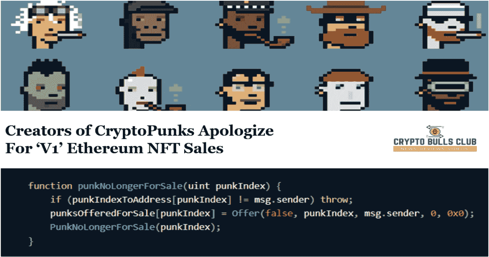

**图 8.3 CryptoPunks 创作者为 V1 NFT 销售道歉** ¶ 来源：CryptoBullsClub, EatTheBlock

**图 8.3** 显示了导致问题的代码。NFT 的索引在函数内部被覆盖，NFT 卖家的文件被更改为消息发送者（买家），因此支付给卖家的所有费用实际上都转回给了买家。

### Hashmasks 智能合约 Bug

安全研究员 Samczsun 在 Hashmasks 艺术品销售后期报告了一个 Bug，幸运的是没有造成损失，Hashmasks 能够及时采取补救措施。Samczsun 对 Hashmasks 的 `Masks.sol` 智能合约中与 `mintNFT` 函数相关的潜在 Bug 发出了警告。如果攻击者利用该 Bug，他们本可以铸造超过 16,384 个 Hashmasks。不知为何，该 Bug 在测试阶段未被发现，Hashmasks 奖励 Samczsun 12,500 美元 USDC（一种由 Coinbase 和 Circle 合资开发的稳定币）以表彰其发现该 Bug。

### Twitter 个人资料图片 (PFP) NFT 黑客攻击

2022 年 1 月，Twitter 宣布了一项功能，允许 Twitter Blue 订阅者将其个人资料图片指定为官方 NFT —— 理论上，这无可辩驳地“证明”了他们的 JPEG 只是一眼看去就属于 CryptoPunks 或 Bored Apes 等真品。这是终极的在线炫耀 —— 或是在我们这个痴迷地位的数字时代展示自我。不幸的是，对于 NFT 爱好者来说，这极易伪造。

同月，一位“白帽黑客”成功将一个类似 CryptoPunk 的 NFT 设为其官方 Twitter 个人资料图片 —— 六边形框和一切皆备。该黑客使用了以太坊主网上一个旧的智能合约，仅更改了代币 URI —— 将代币与图像及其他元数据关联以使其成为 NFT 的地方 —— 使其与另一个系列的代币 URI 匹配。在本例中，黑客使其代币看起来像 Bored Apes。

Twitter 的新功能将验证完全委托给了 OpenSea —— 这是阻止黑客制作与“真品”猿猴相同 PFP 的**唯一**检查点。Twitter 过度依赖一些微小的视觉信号来显示这两者中哪个来自实际的、经过验证的系列。将该功能限制为“Twitter Blue”订阅者似乎增加了额外的可信度。然而，既然六边形框和基于常规 NFT 的个人资料图片一样容易伪造，该功能并未按预期工作。

以下是该问题的潜在缓解策略：

*   始终验证用于铸造（或设置 URI）NFT 系列元数据的官方智能合约地址。
*   增加详细视图中验证信号的可见性。该功能最有价值的方面之一是真实所有权的证明。

## 关于 NFT 集合验证的去中心化建议

*   停止完全依赖 OpenSea 获取元数据。如果 OpenSea 宕机，该功能也会随之失效。这还使 OpenSea 成为 Twitter 上集合可信度的官方仲裁者 —— 我们真的想指定 OpenSea 为真实性的中央权威吗？
*   OpenSea 应禁止对集合使用相同的照片和逐字复制粘贴的描述。
*   **去中心化集合验证。** 随着更多平台开始支持 Web3 功能 —— 例如，来自精英集合的个人资料图片的经验证所有权 —— 它们将需要能够区分合法集合和虚假集合。目前，这仍由 OpenSea 等中心化实体决定。社交媒体平台要么依赖 OpenSea 等第三方进行验证，要么自行验证。

更好的解决方案是一种使集合合法化的去中心化方式 —— 一种作为单一事实来源（类似 Chainlink 的 NFT Oracle 解决方案）供所有平台核对的方式。这也将帮助鲜为人知（但非常合法）的集合获得验证。

## Solidity 智能合约安全设计模式

以下是 Solidity 智能合约的一些安全设计模式，它是元宇宙应用中最常用的智能合约：

*   **标记不受信任的合约。** 在与外部合约交互期间，必须指定变量、方法和合约接口。这适用于调用外部合约的函数。
*   **防止外部调用后的状态变更。** 使用原始调用或合约调用时，恶意代码可能会被执行。即使外部合约本身没有恶意，它调用的任何合约都可能执行恶意代码。恶意代码可劫持控制流，并因重入导致漏洞。因此，在调用不受信任的外部合约时，应在调用后立即防止状态变更。此模式称为检查-效果-交互模式。
*   **外部调用中的错误处理。** Solidity 中作用于原始地址的底层调用方法永远不会抛出异常，而是在遇到异常时返回 `false` 值。相反，合约调用在发现任何 `throw` 函数（如 `doSomething()`）时会自动传播抛出。因此，当你选择底层调用方法时，请确保通过监控返回值来处理调用失败的可能性。
*   **外部调用优先使用拉取而非推送。** 外部调用容易意外失败。这通常适用于支付场景，用户可以自动提取或拉取资金，而不是推送资金。这也能最大程度减少与 Gas 限制相关的问题。

    最好将每个外部调用隔离在其自己的事务中，由调用接收方发起。

*   **管理函数代码：条件、动作和交互。** 确保智能合约安全的一个好做法是更好地构建所有函数的结构。这包括检查所有前置条件、更改状态以及与其他智能合约交互。

OpenZeppelin、CertiK、Chainlink 和 KnownSec 等智能合约公司还使用或开发了许多其他智能合约安全设计模式。元宇宙应用开发者在编写智能合约时遵循安全设计模式非常重要，以避免资金损失并保护用户的数字资产。

归根结底，智能合约既不“智能”也不是“合约”。它不“智能”，因为它不是 AI 或 ML 算法，且可能导致安全问题。它不是“合约”，因为大多数司法管辖区没有管辖智能合约的法律。必须采取特别的关怀和安全审计，以防御觊觎智能合约中存入资金的黑客。

## 元宇宙中的勒索软件攻击：可能吗？

**什么是勒索软件？** 勒索软件或勒索恶意软件是一种恶意软件包，它阻止用户访问其系统或个人文件，并要求支付赎金以恢复访问。网络犯罪分子有时会针对高调人物、公司甚至政府机构。

如 **图 8.4** 所示，勒索软件通过加密数据和/或窃取敏感数据来锁定受害者的笔记本电脑或网络服务器，并威胁如果受害者不支付赎金就出售或泄露数据。赎金（用于解密密钥）有时以加密货币形式支付 —— 最常见的是比特币，因为比特币（及其他加密货币）允许网络犯罪分子以高度匿名的方式接收资金，使交易难以追踪。不遵守黑客的要求可能导致信息永久丢失。

勒索软件通过恶意电子邮件附件、受感染的应用程序、受感染的存储设备和受损网站传播。已出现攻击者使用远程桌面协议和其他无需任何用户交互的方法的案例。在过去十年中，勒索软件已成为世界上最繁盛的犯罪商业模式之一。（参见 **“专题：Colonial Pipeline 勒索事件”**。）

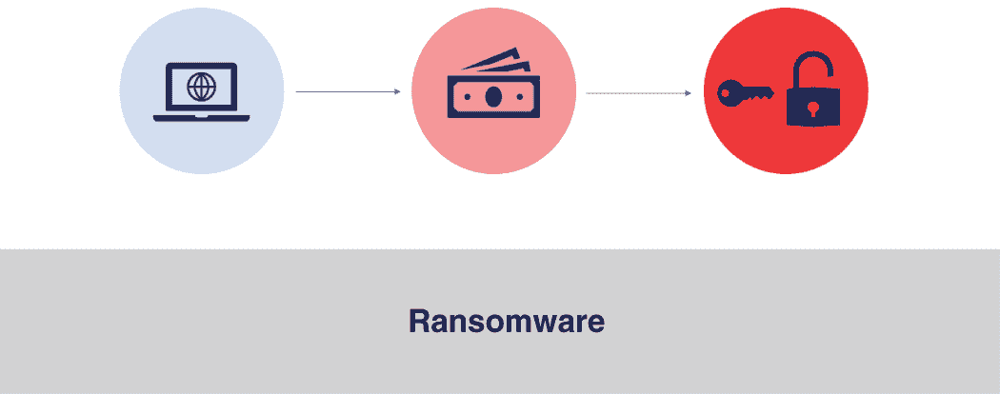

**图 8.4 勒索软件示意图**

在元宇宙中，由于各种新技术和积累的海量数据，“攻击面”将更大。因此，如果元宇宙应用的构建者和运营者不采用纵深防御 方法并监控新兴技术的安全风险，勒索软件风险将更难管理。元宇宙的去中心化特性可以在一定程度上降低风险，因为个人而非平台拥有数据和资产的所有权。黑客只会窃取数据或资产，而不必诉诸勒索软件。

与此同时，真正的风险将落在元宇宙运营者身上，他们存储着从 IoT 设备、AR/VR、用户浏览历史和用户交易数据收集的关于用户和企业的中心化数据。寻求缓解策略至关重要，区块链是应对勒索软件的潜在解决方案。


# 区块链的特点是不可变性和完整性

如果恶意行为者试图篡改数据，系统和所有其他网络参与者都会立即注意到每一次更改。这些设计选择使区块链成为数据存储的理想选择，因为它是仅追加结构，这意味着数据只能被引入系统，永远无法被完全删除。任何更改都存储在链的更下方，但网络节点始终可以看到更改发生的时间、更改者以及数据的先前版本。

可以安全地假设，区块链驱动的数据库可以成为应对勒索软件或其他类型数据劫持的理想解决方案。借助区块链，元宇宙平台可以让平台参与者成为其自身数据的真正所有者。可移植的用户自有数据的创建意味着每个参与者可以选择谁有权访问其数据，迁移到另一个元宇宙平台而不必担心丢失任何数据，并经同意即时授权访问方访问。同时，元宇宙平台可以从数据互操作性、完整性和安全性的提高中受益。

在 Colonial Pipeline（以及许多类似的勒索案件）中，基于区块链的系统只需将数据记录恢复到之前的版本，就能完全挽回损失。因此，尽管勒索软件可能仍会出现在元宇宙应用中，特别是在仍在使用 Web2.0 技术且大型科技公司不愿放弃对用户数据的控制和存储时，我们可以利用区块链技术来缓解勒索软件带来的风险。

# 供应链软件风险：真正的危险？

什么是供应链软件风险？用简化的定义来说，当你的应用程序使用第三方软件作为构建模块，而该第三方软件已被攻破并植入恶意代码，进而影响你的应用并引入风险时，就会发生供应链软件攻击风险。简而言之，威胁行为者可能将合法软件变成武器。

根据 Argon Security（近期被 Aqua Security 收购）的一项研究，2021 年软件供应链攻击增长了 300% 以上。报告发现，软件开发环境的安全水平依然很低，接受评估的每家公司都存在漏洞和错误配置，可能使其面临供应链攻击。在这些攻击中，SolarWinds 入侵事件是软件供应链攻击最著名的案例之一。（参见 框：SolarWinds 供应链攻击。）

SolarWinds 攻击给全球许多组织敲响了警钟，该攻击于 2021 年初向公众披露时是一起重大新事件。元宇宙应用会受到软件供应链攻击的影响吗？答案是肯定的，我们需要对此类攻击做好准备并保持警惕。

元宇宙依赖于嵌入 IoT/AR/VR 设备中的各种软件和固件。如果这些软件和固件得不到保护，很容易成为黑客的猎物，特别是当元宇宙应用依赖其供应链软件或服务组件来正常运行时。如果供应链软件或服务瘫痪，元宇宙应用也将无法正常运行。供应链风险不仅限于供应链攻击，因为除了由恶意行为者引起的供应链攻击外，供应链风险还包括因供应链服务提供商的无心之失或停机造成的风险。

此处列举了 OpenSea、MakerDAO 和 Lendf.Me 三个供应链风险案例，以更好地解释这些风险。

## OpenSea 宕机，影响钱包及其他 NFT 项目

2022 年 1 月，最流行的 NFT 市场之一 OpenSea 遭遇了“数据库中断”。结果，依赖 OpenSea API 的多个服务（包括流行的加密钱包 MetaMask）在显示 NFT 时出现故障。

MetaMask 联合创始人 Dan Finlay 在邮件中提到：“我们正在缓存这些数据，所以他们的中断不会清空钱包。我们在钱包中存储用户拥有的 NFT。OpenSea 的中断意味着我们目前无法自动检测发送到用户钱包的新 NFT，尽管用户始终可以通过手动输入地址的方式告知钱包他们拥有的 NFT。”

Finlay 表示：“我们使用 OpenSea 来检测新 NFT，此次中断只会影响中断期间新铸造的 NFT。用户仍可手动将 NFT 添加到我们的钱包，这仅影响 NFT 的自动检测。自动检测（目前失效的功能）本身就是我们打算改为选择加入的功能以提高用户隐私，因此从某种意义上说，隐私倡导者可能更倾向于当前的行为（即用户手动添加 NFT）。”

换句话说，因为 OpenSea 宕机，一些刚购买代币的 NFT 所有者甚至无法在他们的加密钱包中看到他们昂贵的 JPEG 图片。需要澄清的是，用户仍然“拥有”一个唯一的字符串——或哈希值——向世界证明他们“拥有”这些昂贵的 JPEG 图片，由于 MetaMask 的缓存变通方案，大多数用户都能正常查看他们的 NFT。但有些用户直到 OpenSea 恢复在线前，都无法在 MetaMask 中看到新的 NFT。

同样，2021 年 12 月，亚马逊网络服务 (AWS) 的一次中断表明，归根结底，现在的网络高度互依，根本谈不上去中心化。当 AWS 宕机时，以太坊上所谓的*去中心化交易所* dYdX 也随之瘫痪。

在 OpenSea 和 AWS 的案例中，我们可以将基于 Web2.0 的应用视为 Web3 应用的供应链软件或服务。基于 Web2.0 的服务器运营中由 DDoS 攻击或无心之失导致的安全漏洞、攻击或停机，都可能对 Web3 应用造成损害。然而，由于建立在区块链之上的 Web3 基础设施在计算能力和存储方面存在限制，目前尚无法将 Web2.0 转换为 Web3 或开发完全去中心化的 Web3 应用。

即使你能构建一个大部分逻辑通过智能合约在 Web3 基础设施上实现的元宇宙应用，如果一个智能合约无法调用另一个智能合约，或一个智能合约调用另一个智能合约（即建立在智能合约上的所谓“金钱乐高”或“元宇宙乐高”）导致用户资金意外丢失，你仍然面临供应链风险问题。以下两个例子确实表明这两种场景都是可能的。

## 2020 年“黑色星期四” MakerDAO 崩盘

去中心化金融借贷平台 Maker 像许多加密货币参与者一样，在 2020 年 3 月 12 日“黑色星期四”的价格崩盘中遭受了损失。以太币 (ETH) 价格在 24 小时内下跌约 50%，触发了机会主义牟利行为，因为 Maker 系统被大量清算淹没。

MakerDAO 在黑色星期四崩盘的原因是作为价格预言机的 Oracle 失效。以下是实际发生的情况：

1.  **以太坊网络不堪重负，Gas 价格飙升。** 2020 年 3 月 12 日，随着价格急剧下跌，以太坊网络因需求激增而不堪重负。交易队列随着网络容量达到上限而增长，Gas 价格飙升了一个数量级。

2.  **价格预言机失效。** 由于以太坊上异常高的 Gas 价格（可视为 MakerDAO 的供应链软件），包括 Maker “Medianizer” 在内的价格预言机未能更新其数据源。

3.  **保险箱（持有 ETH 币）清算滞后。** 当 Medianizer 数据源更新时，报告价格瞬间下跌 20% 以上，导致许多保险箱被立即清算。

4.  **ETH 通过 Maker 以零价格售出。** 同样由于高昂的 Gas 费和网络拥堵，当保险箱中的 ETH 抵押品被拍卖时，许多出价未能通过。这使得一些清算人通过支付高额 Gas 费，以零 DAI（DAI 是 MakerDAO 的稳定币加密货币）的出价赢得拍卖，几乎免费提取了价值超过 800 万美元的 ETH。

5.  **保险箱所有者蒙受数百万美元损失。** 这一漏洞导致 MakerDAO 系统中超过 450 万美元的 DAI 无资产支撑。此外，保险箱被清算（且其 ETH 被卖给零出价清算人）的用户损失了 100% 的抵押品，给 DeFi 社区造成了数百万美元的损失。

在黑色星期四事件发生后，Maker 社区寻求实施协议，以防止看守人无法参与拍卖出价的情况。零价格和半价出价漏洞之所以奏效，是因为那些拍卖只有一个出价者，从而能够以最低 DAI 出价清算 ETH。

不幸的是，在“黑色星期四”MakerDAO 事件的余波之后，MakerDAO 仅专注于限制零价格、限制竞价规模，以及要求大额竞价者拥有大额资本作为抵押品的方法。尽管这些是良好的措施，但仅凭这些措施无法防止未来的问题，即当价格预言机（作为供应链服务）停止向系统提供准确的价格报价时，将再次允许套利者利用闪电贷操纵系统，以低廉的清算价格获取抵押资产。更好的方法是为预言机价格报价提供故障转移和更多冗余解决方案，并在以太坊过于拥堵时改进基础区块链系统。

## Lendf.Me 供应链智能合约攻击

2020 年 4 月 19 日，dForce 网络中的借贷协议 Lendf.Me 遭到攻击，合约中约 2500 万美元的资产被耗尽。黑客利用 ERC777 代币中的漏洞，将其作为内置于 DeFi 智能合约中的供应链智能合约，执行了重入攻击。回调机制使黑客能够在余额更新之前反复供应和提取 ERC777 代币。

背景在于，DeFi 系统的承诺建立在所谓的“货币乐高”之上。在这种情况下，每个“乐高积木”是一个智能合约文件或多个“.Sol 扩展名”的智能合约文件。利用这些货币乐高作为基础协议或供应链智能合约，可以帮助项目团队构建非常有用且创新的 DeFi 系统。不幸的是，供应链风险在很大程度上被大多数 DeFi 系统所忽视。由于新构建的 DeFi 系统或利用 DeFi 应用的元宇宙系统中存在供应链智能合约或货币乐高漏洞，我们将继续看到越来越多的攻击。例如，Wormhole 案例说明了跨链技术上的供应链代码风险。

Wormhole 是一种允许用户在 Solana 和以太坊之间移动代币和 NFT 的协议。作为连接以太坊和 Solana 区块链最流行的桥梁之一，Wormhole 于 2022 年 2 月损失了超过 3.2 亿美元。这是 DeFi 世界历史上第二大漏洞利用事件，仅次于 6 亿美元的 Poly Network 黑客攻击，也是迄今为止针对 Solana 的最大规模攻击，Solana 是以太坊的竞争对手，在 NFT 和 DeFi 生态系统中日益获得关注。

加密货币持有者通常不局限于在单一区块链生态系统中操作，因此像 Wormhole 这样的开发者构建了跨链桥，让用户能将加密货币从一条链发送到另一条链。Wormhole 协议使用了第三方数字签名验证算法。作为供应链代码的第三方代码已被弃用，无法正确验证数字签名。黑客利用这一供应链代码风险绕过了签名验证要求，窃取了价值超过 3.2 亿美元的以太坊代币。

总之，无论应用中使用 Web2 还是 Web3 技术，供应链软件攻击和风险都是元宇宙应用面临的真实危险。

# 量子计算：挑战与机遇

元宇宙应用很可能运行在依赖其底层加密过程安全性的区块链上。如果没有可信的哈希函数和公钥签名，就没有“真正的”区块链。量子计算机能够执行经典计算机认为不可能的计算，威胁着区块链中使用的多种加密原语。攻击加密原语背后数学问题所需的通用、可扩展的量子计算机尚不可用。

然而，几家公司和各国政府已经构建了小规模量子计算机，它们具有受限的输入规模和受限的计算次数。其中一些甚至可以在互联网上访问，并可用于测试量子算法。量子霸权（描述量子计算机显性超越经典计算机的时间点）要么已经实现，要么即将实现。下面我们分析量子时代的关键加密原语。

## 随机数生成

随机数生成是大多数加密过程的核心。由于经典计算机是确定性的，生成高质量的随机性并不容易。有许多实例表明，劣质的随机性导致了灾难。这对于区块链尤其如此，因为随机数被应用于协议的各个层面。对于隔离服务器，问题更为严重，因为大多数计算是在没有任何人工干预的情况下执行的。

在这里，量子技术可以提供帮助。量子理论本质上是非确定性的。因此，基于量子生成随机数是提供高质量随机性的更安全方式。量子随机数生成器（QRNG）现在已以非常小的外形规格存在。（例如，参见 ID Quantique 的 Quantis QRNG 芯片。）这种小型 QRNG 可以轻松集成到维护区块链节点的服务器中，甚至集成到各种用户终端，如个人电脑和智能手机中。

## 哈希函数

加密哈希函数在区块链中被大量用于地址生成、工作量证明、数字摘要和默克尔证明。它们将任意长度的文本输入转换为固定长度的输出。输出与输入具有确定性关联，但除非通过暴力破解——尝试每一个可能的输入直到找到正确的输出——否则无法从输出中恢复输入。最常用的哈希函数 SHA256 具有 256 位输出。对该函数的暴力攻击将需要 `2²⁵⁶` 次操作，远超即使是最大型超级计算机的能力。利用 Grover 算法的量子攻击将其降低至 `2¹²⁸`，这对于暴力攻击而言仍然是不可行的。

量子计算机将无法摧毁由哈希函数部分保护的区块链不可篡改性，但可能需要将哈希函数的尺寸加倍。例如，在基于 PoW（工作量证明）的网络节点上，它们必须计算最小的 SHA256 以赢得区块奖励。在这里，量子计算机上实现的 Grover 算法将允许快得多的计算。

## 公钥签名

区块链中使用的公钥签名基于椭圆曲线密码学（ECC），它具有非常小的密钥尺寸，且易于在区块链环境中实现。不幸的是，现在已知在量子计算机上实现的 Shor 算法将摧毁当前的 ECC。

这意味着发布在区块链上的任何公钥都可能向配备量子计算机的对手泄露相应的私钥。这对某些区块链来说是一场灾难，例如即将推出的基于 POS（权益证明）的以太坊 2.0 新版本，其中要求发布公钥。对于其他类型的区块链，如比特币（公开可用的地址是公钥的哈希值）或联盟链（利用对称密钥密码学），情况则不那么严重。

## 从量子前到量子后区块链的过渡

量子计算的进步在区块链社区中引发了越来越紧迫的危机感，以识别既有效又切实可部署的后量子算法。从量子前区块链向量子后区块链的过渡是确保区块链在量子时代安全性的必要举措。

为支持区块链交易而广泛使用数字签名代表了一个主要漏洞。因此，人们非常关注适合区块链应用且可逐步分阶段引入的后量子数字签名算法的开发与选择。部分要求概述如下：

## 量子计算对区块链与元宇宙的影响

1.  **计算密集型后量子密码系统可能不适用于当前实现区块链节点的特定硬件。** 因此，后量子方案应在安全性和计算复杂性之间提供权衡，以免限制可能与区块链交互的潜在硬件。一种可能性是根据可用硬件提供密钥强度的梯度。

2.  **某些后量子加密系统会产生巨大的开销，可能影响区块链性能。** 为解决此问题，未来的后量子开发者必须最小化密文开销并考虑潜在的压缩技术。

3.  **为提高安全性，某些后量子方案可能会限制使用同一密钥签名的消息数量。** 因此，需要持续生成新密钥，这涉及投入计算资源并减慢特定区块链进程。因此，区块链开发者必须确定如何调整此类密钥生成机制，以优化速度和交易。（在选择合适的方案时，NIST 后量子密码标准化项目被广泛认为是将推动后量子算法选择和采用的权威机构。）

与安全风险并行的是，量子计算还可通过以下方式助力元宇宙：

*   **安全性。** 量子计算常被视为安全威胁，但如果我们更多的互动被记录在元宇宙中，则需要抗量子安全性来保障所有发生的交易和商业活动。可能需要采用抗量子技术，以确保交易免受 `Shor's algorithm` 等算法的威胁。

*   **快速计算。** 研究人员正在围绕优化等任务开发应用。鉴于元宇宙需要海量的计算和模拟，任何可利用的优势都可能被用于提升体验。

*   **随机性。** 为创造真实感，元宇宙需要随机性元素，以确保黑客及其算法无法“钻系统空子”。实现高度随机性的一种可能方式是利用量子随机性，即使用一组量子比特创建随机位，而非伪随机数。`Quantum Dice` 等公司活跃于 QRNG 领域。

总之，量子计算对元宇宙而言既是机遇也是挑战。

# Extended Reality (XR)：新型安全风险

Extended reality (XR) 是一个统称，指任何增强我们感官的技术，无论是提供关于现实世界的额外信息，还是构建完全虚拟的模拟世界供我们探索（参见**Figure 8.5**）。

*   **Augmented reality (AR)** 是真实环境的一种*交互式体验*，其中现实世界的物体通过计算机生成的感知信息得到增强，有时跨越多种感官模式，包括视觉、听觉、触觉、躯体感觉和嗅觉。`Snapchat glasses` 和游戏 `Pokémon Go` 是增强现实体验的两个例子。

    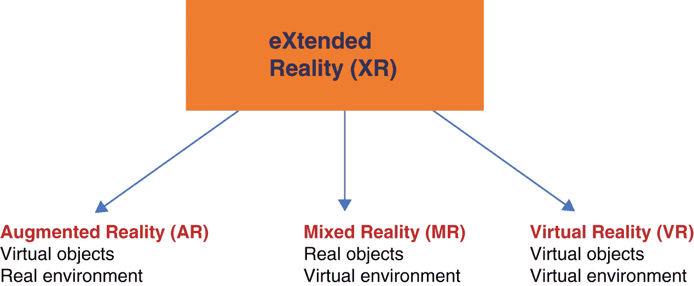

    **Figure 8.5 Illustration of AR/VA/MR/XR**

*   **Virtual reality (VR)** 意味着一种完全*沉浸式体验*，将用户与外部世界隔离。用户在虚拟环境中与虚拟对象交互。用户可通过 `HTC Vive`、`Oculus Rift` 或 `Google Cardboard` 等 VR 设备进入各种想象场景。

*   在 **mixed reality (MR)** 体验中，现实世界与虚拟数字物体相互作用，包含 AR 和 VR 的*特性*。

虚拟现实技术已存在数十年，但我们正处于 XR 可用性和采用率快速增长的时期，这归因于多种因素，包括硬件成本降低、高速优质连接的普及，以及最近由全球大流行引发的社会变革（参见**Figure 8.6**）。元宇宙跨越 XR 的全广度，将进一步模糊我们在线与物理世界的界限。

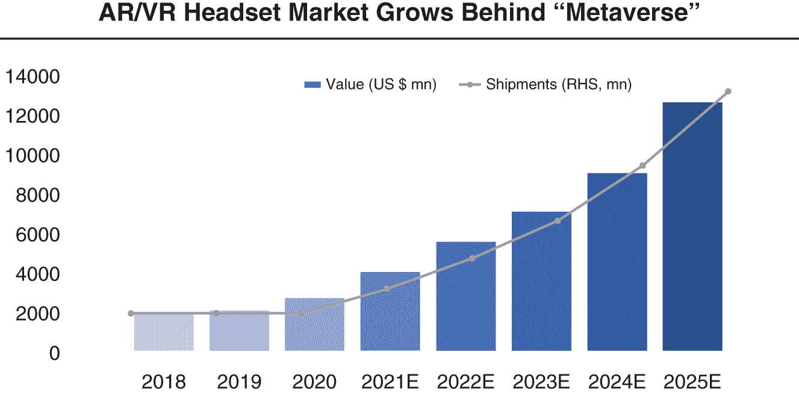

**Figure 8.6 XR Smart Hardware Market Grows Rapidly Post-Covid** ¶ Source: Credit Suisse, “Global TMT Sector Metaverse: A Guide to the Next Gen Internet,” February 2022.

元宇宙融合了两全其美的优势：我们可自由选择地点工作和创作，同时也能捕捉表达的细微之处及我们在现实世界中的存在方式。这是对我们有机交互方式的回归。但新型安全风险也随之出现，例如：

*   **“Human joystick” attack（人体操纵杆攻击）。** `Baggili` 和 `New Haven University` 的其他研究人员发现的一种潜在攻击形式，称为“human joystick” attack。研究利用 VR 系统发现，可在用户不知情的情况下“控制沉浸式用户并将其移动到物理空间中的某个位置”，根据他们 2019 年的相关论文。若发生此类恶意攻击，身体受伤的几率会增加。

*   **Chaperone attack（守护边界攻击）。** 同样，研究人员发现的相关威胁是“chaperone attack”，涉及修改用户虚拟环境的边界。这也可能用于造成用户身体伤害。这些沉浸式体验的核心在于完全接管你的视听。若由他人控制，则绝对可能诱骗你跌下真实楼梯、走出真实门扉或撞上真实壁炉。


## Overlay attack（覆盖攻击）
`New Haven University` 研究人员发现的其他潜在威胁包括“overlay attack”（在用户视野显示不需要的内容）和“disorientation attack”（使用户困惑/迷失方向）。

## Denial of service（拒绝服务）
此场景下，依赖 AR 显示工作的人员突然与数据流断开。这可发生在任何应用领域。但 AR 尤为令人担忧，因为许多专业人员可能利用该技术在关键场景下完成工作，此时缺乏信息可能导致毁灭性甚至致命的后果。

## Untrustworthy information（不可信信息）
不可信信息也是 AR/VR/XR 的另一主要担忧。在增强现实中，图形和信息叠加在真实环境之上。玩家、零售商、建筑师和专业人士将基于 AR 应用提供的信息做出现实决策。若黑客入侵应用并在受害者的 AR 显示器或眼镜上显示虚假信息和图形元素，可能造成伤害。想象一位医生使用 AR 显示器检查患者生命体征，却获得错误信息而错过需要立即治疗的患者。

## Theft of XR-related identity（XR 相关身份窃取）
犯罪分子可能窃取与真实人物关联的 AR/VR/XR 相关身份。对于利用增强现实和虚拟现实购物应用的零售商而言，黑客攻击可能是一个网络安全隐患。许多消费者的信用卡信息和移动支付方式已存储在用户档案中。因移动支付流程简便，黑客可能获取访问权并秘密窃取账户资金。

## 对于 AR/VR/MR/XR 而言，人类安全问题将是主要挑战
随着虚拟世界与物理世界的融合，XR 充当了连接器的角色，如果缺乏安全设计，代价可能是物理损伤甚至危及生命。想象一下未来可能出现的元宇宙体验：一个人乘坐自动驾驶汽车，在车内玩 NFT 游戏，黑客控制了汽车或 XR 头显，直接或间接导致汽车撞向另一辆车，引发危及生命的车祸。如果我们在由 XR 驱动的元宇宙应用中没有安全设计，这种情况就有可能发生。

总之，Web3 元宇宙带来的安全风险可能比 Web2.0 更严峻。当今的威胁依然存在，但也存在更新、新颖威胁的潜在可能。例如，欺诈和网络钓鱼攻击可能来自一个旨在冒充同事的虚拟形象，而不是误导性的域名或电子邮件地址。此外，包含眼球追踪和生物识别技术的元宇宙技术栈意味着我们的感官也正在被以越来越高的精度监控和分析。

因此，我们需要从 Web2.0 的错误中吸取教训，并主动应对 Web3 安全问题。在众多行业（无论是企业级还是消费级）已开始采用元宇宙以实现无处不在、全方位且完全沉浸式体验的当下，这一点至关重要。借助区块链技术，我们在该时代伊始有一个机会来确立具体的核心安全原则，从而为元宇宙体验建立信任和安心感。

## 第三部分：开放元宇宙、大科技围墙花园与主权国家的三方博弈
正如在数字货币背景下，加密货币、大科技代币和央行数字货币（CBDC）之间的三方竞争日益激烈一样，对于 Web3 基础设施而言，开放元宇宙必须同时与大科技公司和政府支持的区块链网络竞争。

## 第九章：公共加密货币、政府央行数字货币与大科技代币
*   元宇宙中的三方货币战争
*   中国在 2022 年冬奥会上的 e-CNY 推广
*   打击全球最大加密货币市场
*   数字卢比、数字卢布与不列颠币
*   美国风向标：央行数字货币研发与加密货币监管
*   中美共识：稳定币成监管焦点
*   大科技代币：Libra 的兴起（与陨落）

## 元宇宙中的三方货币战争
2022 年 1 月，波利尼西亚岛国汤加在一次巨大的火山冲击波引发的海啸中受灾。根据 *Cointelegraph* 的报道，海啸袭击了汤加主岛汤加塔普的居民，这一消息激励加密货币持有者希望捐赠比特币，用于海啸灾民的救灾。真正体现了比特币风格的是，Twitter 用户 Onair Blair 敦促汤加前议员 Fusitu'a 勋爵设立一个比特币钱包地址，供全球加密货币持有者为海啸救灾捐款。Fusitu'a 勋爵欣然应允。

在同一份 *Cointelegraph* 报道中，Fusitu'a 勋爵讨论了汤加利用汤加火山（共 21 座）的地热能源为比特币挖矿提供动力的计划。据 Fusitu'a 勋爵称，挖矿工作将有利于汤加财政：“每座[汤加]火山持续产生 95,000 兆瓦的电力，富余巨大，单座火山每天可产出价值 2000 美元的比特币，将分发给汤加家庭。”此外，作为比特币支持者和汤加政客，Fusitu'a 勋爵向 *Cointelegraph* 表示，他希望效仿萨尔瓦多，在汤加将比特币定为法定货币。

汤加的案例说明了公众对加密货币接受度的扩大——不仅在虚拟网络空间，也在物理世界。与我们当前将通信和商业中心化在 Google 和 Amazon 等专有平台内的 Web2.0 世界不同，Web3 预计将由其支持者构建为开放和去中心化的。同时，平台决策将通过 Web3 爱好者之间透明的智能合约（自主软件程序）来执行。在 Web3 中如何为一切付费？当然是用加密货币。Web3 用户社区预计将通过维护和运营应用程序及服务，来换取比特币、游戏代币或 NFT 等加密货币。

这就是为什么开发者正在区块链上构建各种金融应用，从而可能实现虚拟世界与物理世界之间基于加密货币的支付（参见图 9.1）。例如，2022 年初 Solana Labs 宣布推出 `Solana Pay`，这可能使商家能直接接受消费者的加密货币支付。重要的是要注意，这不仅仅是让消费者“用加密货币支付”。相反，这是一个愿景：所有货币——包括美元——都上链，并用于广泛的交易。

背景是商家多年来一直能够接受加密货币（例如，特斯拉曾接受比特币购车），但接受通常意味着用一个中介替换另一个中介。对于 `Solana Pay` 而言，它关乎一个愿景：所有货币——包括美元——都上链，并用于广泛的交易。`Solana Pay` 背后的核心前提是，支付及其底层技术将从一种必要的服务工具，转变为商家与消费者之间真正的点对点通信渠道。

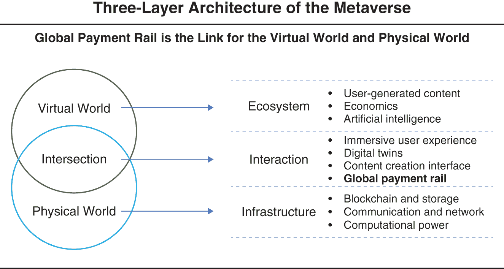

**图 9.1 基于加密货币的支付连接虚拟与物理世界** ¶ 来源：Duan 等，[Crypto.com](http://crypto.com) Research；数据截至 2021 年 11 月 18 日

然而，现有的金融体制带来了逆风。例如，中美洲国家萨尔瓦多于 2021 年 9 月成为首个采用比特币作为法定货币的国家，登上新闻头条，但其推行过程并不顺利。

这一举措得到了该国总统纳伊布·布克勒的大力倡导。据新闻报道，布克勒声称萨尔瓦多将比特币合法化有几个原因：增加对萨尔瓦多的投资，改善 70% 无法获得“传统金融服务”萨尔瓦多人的金融准入，并为侨居海外的萨尔瓦多人提供一种更便捷的方式汇款回国，汇款金额每年高达数十亿美元。萨尔瓦多唯一的另一种官方货币是美元。

可以认为，这一举措既创新又具争议。除了比特币业务上线时的技术实施问题外，世界上许多组织都质疑这一行为的合理性。因为比特币现在是法定货币，全国商家可能被迫接受比特币而非美元——后者在价格波动方面是一种更稳定的货币。国际货币基金组织（IMF）批评萨尔瓦多将比特币合法化，理由是使用这种波动性加密货币的风险（参考：比特币从 2021 年 11 月到 2022 年 1 月价值腰斩）将严重危及该国的金融稳定。

国际货币基金组织强调，如果布克勒不采取措施取消比特币的法定货币地位，鉴于其高风险的金融状况，萨尔瓦多将难以从国际货币基金组织获得贷款。此外，国际货币基金组织于 2022 年 1 月发布新闻稿，敦促萨尔瓦多当局缩小比特币法的适用范围，取消比特币的法定货币地位。

## 世界银行的批判立场
世界银行的反应同样具有批判性。2021 年，当萨尔瓦多向该金融机构寻求协助以实施比特币作为法定货币时，世界银行拒绝了其请求。2021 年 6 月 BBC 的一份报告援引世界银行的话称，其对“比特币挖矿的透明度和环境影响表示担忧”。世界银行提出的问题与萨尔瓦多比特币合法化面临的另一项风险不谋而合：加密货币挖矿。

萨尔瓦多也被称为“火山之国”，因其比特币合法化倡议，其火山可能获得另一种用途。根据 BBC 的一份报告，2021 年 11 月，布克尔总统宣布计划“在一座火山（Conchagua 火山）脚下建设一座比特币城市，利用比特币为该项目融资”。布克尔指出，该城市将利用 Conchagua 火山的地热能为比特币挖矿提供动力。萨尔瓦多能否在不严重破坏 Conchagua 火山周边环境的情况下实施加密货币挖矿计划，目前难以预测，国际观察机构如世界银行正焦急地等待着结果。

## 全球央行的回应：CBDC
此外，主要经济体的政府并没有坐视加密货币崛起而袖手旁观。全球央行通常是一个保守的堡垒，如今也在开拓新领域。随着更多经济活动转移到线上（尤其是在新冠疫情冲击之后），实体现金处于劣势，许多央行正在推出自己的数字货币——央行数字货币（CBDC）。2021 年国际清算银行（BIS）对央行的一项调查发现，86%的央行正在积极研究 CBDC 的潜力，60%正在尝试该技术，14%正在部署试点项目。

## 总结：双线货币战争
总之，现在断言加密货币将成为未来元宇宙中的“默认货币”还为时过早（参见图 9.2）。加密货币生态系统必须在两条战线上进行货币战争。一方面，是对抗包括国家 CBDC 在内的政府金融体制，它们与加密货币争夺元宇宙中的交易地位，以及限制加密资产使用和交易的加密货币法规。

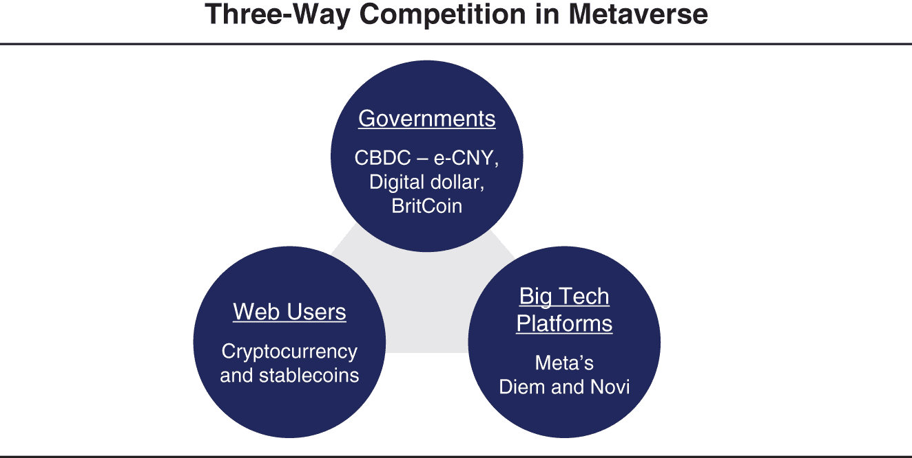

**图 9.2 元宇宙中的三方货币战争**

另一方面，Meta 等大型科技公司试图在单一平台上提供前所未有的金融产品扩展，这由 Meta 自有的代币（`Diem`）和数字钱包（`Novi`）提供便利。本章将首先讨论中国、美国、印度、俄罗斯等主要经济体的 CBDC 发展和加密货币监管，随后分析 Meta 等大型科技公司的代币。

## 中国在 2022 年冬奥会上的 e-CNY 推广
如今，中国和美国正在广泛领域竞争并提升其技术能力。美中技术战争的前沿在于谁将主导区块链和加密货币行业。

尽管中国打击了加密货币（详见下一节），关闭了所有国内加密货币交易所并禁止了所有 ICO（首次代币发行），但政府承认区块链技术本身是一项革命性发展。在 2019 年 10 月的一次演讲中，中国国家主席习近平宣布区块链将在“下一轮技术创新和产业变革中发挥重要作用”。这标志着首位主要世界领导人对这项备受炒作但仍未被证实的分布式账本技术（DLT）给予如此强有力的背书。（相比之下，大多数西方政府一直持谨慎态度。）

习近平主席呼吁将区块链作为国家创新的重点，其演讲详细阐述了中国政府将如何支持区块链的研究、开发和标准化。中国在全球央行数字货币（CBDC）竞争中的领先地位便是典型例证。与比特币等建立在“去中心化”热情之上的加密货币不同，中国的 CBDC（由中国人民银行（`PBOC`）称为`e-CNY`，`CNY`是中国货币人民币的英文同义词）运行在中心化数据库上；尽管如此，`e-CNY`采用区块链和密码学构建，并融合了区块链的关键概念，如点对点支付、可追溯性和防篡改性（参见图 9.3）。

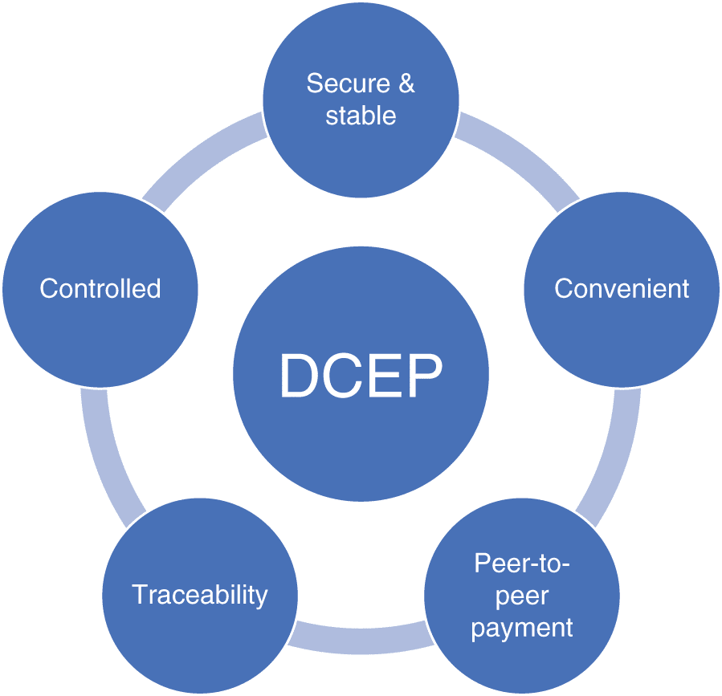

**图 9.3 DCEP 是如何设计的？** ¶ 来源：媒体报道，2020 年 4 月

`e-CNY`的时间线始于比特币和其他加密货币发展数年之后（参见图 9.4）。`PBOC`在数字货币上的首次公开努力发生在 2010 年 5 月首笔比特币交易四年后，形式是成立内部数字货币研究小组。从 2017 年起，`PBOC`加速了其努力，先于 2017 年 1 月成立数字货币研究所，随后在 2017 年 12 月呼吁中国商业银行和支付机构在数字货币方面开展合作。`e-CNY`测试的进一步加速被普遍视为对 Facebook 2019 年宣布拟推出`Libra`（Facebook 计划中的基于区块链的数字货币，详见本章后文讨论）的反应。

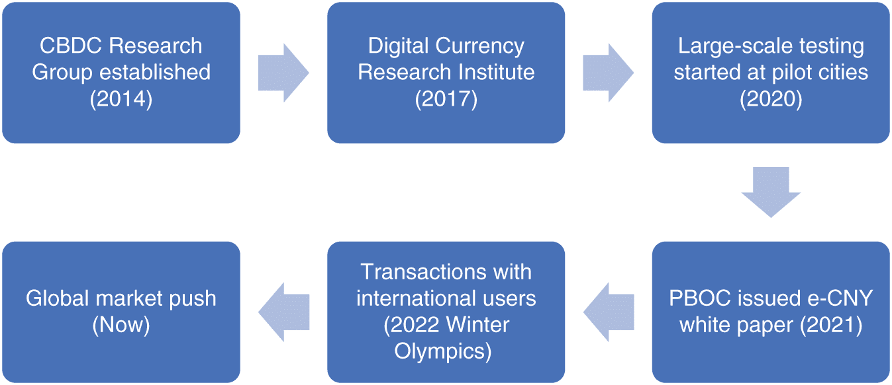

**图 9.4 中国数字人民币时间线**

大规模测试于 2020 年在众多主要城市展开，正值新冠疫情期间。在这些试点地区，`e-CNY`已正式纳入城市货币体系，自 2020 年 5 月起，部分公职人员以数字货币形式领取工资。人们可以在商业银行的手机 App 中创建`e-CNY`钱包，并使用国家数字货币支付交通、教育、医疗及其他消费品和服务。例如，中国的星巴克、麦当劳和赛百味连锁店被列入央行数字货币测试企业名单。

`e-CNY`的快速发展只是中国致力于数字化转型的必然结果。过去几年，移动支付在中国迅速增长，成为主导支付形式。（参考马尧 2016 年著作***《中国移动经济：最大且增长最快的信息消费爆发中的机遇》***。）自 2020 年以来，中国稳步扩大数字人民币试点项目（同时也在打击加密货币；详见下一节讨论），这得益于该国电商和社交网络平台等互联网产业的快速发展，提供了无数应用场景。

2021 年 7 月，`PBOC`发布白皮书，详细阐述了数字人民币（亦称`e-CNY`）的当前运作机制，这是其计划的首次全面披露。白皮书的发布可能标志着数字货币“2C”（面向个人）零售支付测试阶段接近尾声。数字人民币钱包支持多种功能，包括扫码支付、充值和转账。根据白皮书，截至 2021 年 6 月，试点参与者累计消费 345 亿数字人民币（约合 53 亿美元）。用途包括缴纳水电费、餐饮、交通、购物和政府服务。2022 年 1 月，`e-CNY`钱包正式上线仅一周，即成为苹果和小米应用商店下载量最大的应用。

新版数字人民币将允许用户在没有互联网连接的情况下进行消费，也将为外国人带来便利。白皮书指出：“暂时在中国旅行的外籍人士可以开立数字人民币钱包，满足日常支付需求，无需开立境内银行账户。”这意味着即使是在中国旅行的外国人，也无需境内银行账户即可使用数字人民币。考虑到外国人在使用微信支付（腾讯）和支付宝（阿里巴巴）等移动支付应用时遇到的困难——因为这些应用必须关联银行账户——这是一项特别的福利。

2022 年 2 月，北京冬奥会成为中国数字货币的一个重要里程碑，因为这是数字人民币面向国际用户的首次测试。这也像是对数字货币基础设施的一次压力测试，因为系统处理了来自众多国家的外币兑换。例如，全球运动员和游客可以将来自不同国家的自有资金存入 ATM 机，然后获得一张以数字人民币计价的借记卡，由外币兑换而来。凭借这张借记卡，他们可以去附近的餐厅用餐和购物，而无需在中国开立银行账户。

当然，e-CNY（数字人民币）的深远影响很可能不仅限于中国的零售市场。最有可能的是，e-CNY 将使中国成为首个采用原生数字货币的主要经济体。许多人认为，e-CNY 将增强中国货币的全球地位，并最终挑战美元作为世界储备货币的主导地位。例如，数字人民币可以绕过西方运营的跨境支付网络（如 SWIFT），而美国曾利用 SWIFT 实施制裁。

但 e-CNY 的前路漫漫。e-CNY 白皮书指出：“尽管在技术上已准备好用于跨境使用，但目前 e-CNY 主要仍设计用于国内零售支付。”对 e-CNY 而言，其真正的考验要等到 2022 年正式发行后才开始，而在全球背景下，e-CNY 的竞争对手正在崛起，因为其进展刺激了西方国家和发达经济体纷纷效仿，推动其金融体系现代化。本章后面我们将看到许多国家开始开发自己的央行数字货币（CBDC），如数字美元、数字卢比和数字卢布。

## 打击全球最大加密货币市场
在 2021 年 5 月中国国务院金融稳定发展委员会誓言打击加密货币挖矿和交易活动之前，鲜有人——即便是全球金融专业人士——意识到中国占据了全球比特币和其他加密货币供应量的 70% 以上。由于大多数全球加密货币都是在中国挖矿和交易的，中国对这一新兴行业的监管具有深远的全球影响。

2021 年的打击并非中国首次强化对加密货币的监管。中国最早于 2013 年发布类似禁令，随后又在 2017 年发布，当时中国占全球比特币交易量的 90%。2017 年，中国央行中国人民银行（PBOC）及其他部委发布的规定，实质上关闭了本地加密货币交易所，迫使币安和火币等主要交易所迁往海外。

尽管如此，境内中国投资者仍可在海外交易所拥有的平台上交易加密货币。自 2020 年底以来，随着比特币价格多次飙升，中国的交易活动也随之升温。

因此，2021 年 5 月的打击被加密货币市场视为又一次规则发布，并未认真执法。例如，香港比特币协会在推特上回应中国重申禁令时称：“对于比特币新手来说，中国人民银行在牛市周期中至少禁令比特币一次是惯例。”

但这一次不同。此次打击出自由副总理刘鹤领导的中国最高级别金融监管机构——国务院金融稳定发展委员会，标志着现有法规的重大升级。此外，这是国务院首次明确将加密货币挖矿活动作为打击目标，表明了从源头上打击加密货币交易的决心，因为中国是全球最大的加密货币挖矿基地。

中国政府表示，投资者保护、碳中和和金融稳定是新法规的三大关键因素。作为全球最大的加密货币挖矿基地和交易市场，中国的监管发展将成为其他国家开始制定加密货币挖矿和交易活动法规时的重要参考案例。

### 投资者保护
投资者保护——切断未受教育投资者与境外交易所之间的资金流动渠道——是新法规的动因之一。对中国监管层而言，比特币和其他加密货币不是投资工具；相反，它们是波动性极高的投机工具。中国有明确记录，因担心泡沫最终破裂导致散户投资者不满引发骚乱，而打击各类产品——无论是大蒜、大豆、茶叶，还是最近的 P2P（点对点）借贷。

自国务院 5 月做出决定以来，中国三大金融协会——中国互联网金融协会、中国银行业协会和中国支付清算协会——发布新规，禁止金融机构开展加密货币相关业务。该规则旨在使个人更难通过各种支付渠道购买加密货币。协会提醒投资者，虚拟货币“不具备真实价值支撑”。

为确保所有规则得到严格执行，中国人民银行约谈了多家机构代表，包括国有商业银行和支付宝，要求它们“严格落实”当局近期关于遏制加密货币交易风险的通知和指引。由于在海外注册的面向中国的交易所允许中国个人在线开户，且中国个人的加密货币交易可通过银行或支付宝、微信等在线支付渠道进行，金融机构还被指示排查其系统，识别在虚拟货币交易所开有账户的客户，一旦发现，机构必须切断相关账户用于交易的收付款功能。

### 碳中和


新加密货币法规的另一大动因是中国的碳中和目标。中国的新环保政策是打击挖矿的关键因素，这在之前的加密货币法规中并未体现。国家主席习近平在 2020 年 11 月向联合国大会发表讲话时——距离加密货币打击行动几个月前——承诺国家碳排放将于 2030 年前达到峰值，并于 2060 年实现碳中和。

碳中和政策削减了煤电，后者一直是该国主要能源来源之一。据伦敦气候数据提供商 TransitionZero 称，为实现该政策，中国需要到 2030 年将燃煤电厂的二氧化碳排放量减半。为达成气候目标，加密货币挖矿成为重点关注领域之一，因为它是中国众多高能耗行业之一。在中央政府于 5 月发起加密货币打击行动后，内蒙古和新疆等主要燃煤发电大省——此前是中国前两大加密货币挖矿中心——迅速成为最早出台地方规则清理挖矿业务的地区之一。

## 金融稳定

监管加密货币的第三个驱动因素是维护金融稳定，并推动中国央行数字货币的发展。如前所述，2021 年 7 月，中国人民银行（PBOC）发布了一份关于中国数字货币——数字人民币（e-CNY）发展的白皮书。在该白皮书中，央行引用加密货币的快速增长作为研发数字人民币的驱动力，并指出：“加密货币主要是投机工具，因此对金融安全和社会稳定构成潜在风险。”

这是央行首次在官方文件中将其主权数字货币的发行与加密货币对国际货币体系的潜在挑战联系起来。根据央行的说法，“加密货币缺乏内在价值、价格剧烈波动、交易效率低下以及巨大的能源消耗，使其不适合用于日常经济活动。”（有趣的是，这一观点与美联储主席杰罗姆·鲍威尔的看法并无二致，后者在国际清算银行[BIS]主办的一个小组讨论中认为，加密货币“更多是一种投机性资产，本质上是黄金的替代品，而非美元的替代品。”）

正如中国的数字货币 e-CNY 一样，中国的新加密货币法规已经对全球加密货币市场产生了重大影响。首先，中国对挖矿的打击迫使比特币挖矿模式发生了剧变。到 2021 年 7 月，比特币的网络算力——衡量其计算能力的指标——较 2021 年 5 月的峰值水平下降了约 50%。最终，中国大部分比特币挖矿产能将被关停，部分产能将转移至海外市场，如美国和哈萨克斯坦。其次，从加密货币交易的角度来看，中国收紧法规和执法导致比特币价格在几个月内从历史高点下跌了约 50%。

最后，或许也是最重要的一点，中国的新监管框架未来可能会影响许多国家的加密货币相关法规。自 5 月中国的打击行动以来，亚洲、欧洲和美洲各国已开始对加密货币交易及相关交易所采取监管行动。对许多国家而言，中国在考虑自身央行数字货币（CBDC）和加密货币法规时，已成为一个参考案例。

## 数字卢比、数字卢布和“英币”

中国的数字货币和加密货币监管框架影响了许多国家在同一领域的立法。例如，印度立法机构曾考虑像中国那样全面禁止加密货币挖矿和交易。最终，印度通过一种“迂回”的举措——征税——正式承认了加密货币在该国的作用。2022 年 2 月，印度财政部长尼尔马拉·西塔拉曼在 2022-23 财年联合预算中宣布，将对虚拟数字资产转让所得收入征收 30%的税，并对支付的数字资产转让款项在源头征收 1%的税。不允许对此税款进行任何扣除和豁免。

这 30%的税率意义重大，但印度的法规意味着政府计划至少将加密货币纳入法治框架下的金融生态系统，而不是将来某天将其作为非法工具予以打击。印度加密货币领域更值得关注的是政府关于印度央行数字货币的计划。印度财政部长还于 2022 年 2 月宣布，印度储备银行将在下一个财年正式推出该行的数字货币——数字卢比。数字卢比对印度加密货币未来的意义，以及它与纸币的共存情况，仍有待观察。正如中国所做的那样，当印度加速其央行数字货币的发展时，也很可能会进一步收紧对加密资产的监管。

俄罗斯是另一个相关案例。2022 年 1 月，俄罗斯央行发布了一份重要报告，提议在俄罗斯境内禁止加密货币的使用和挖矿，这震惊了全球加密货币界，因为俄罗斯是全球第三大加密货币挖矿国家（仅次于美国和哈萨克斯坦，在中国于 2021 年打击加密货币后不再是最大的挖矿国），甚至在 2020 年将加密货币合法化。然而，俄罗斯有着反对加密货币的悠久历史，理由包括比特币挖矿对环境的负面影响，以及对俄罗斯金融稳定的潜在和现实风险。

俄罗斯央行禁止加密货币挖矿、交易和存储的提议不仅具有国内影响，也具有国际影响。俄罗斯央行估计，俄罗斯公民使用去中心化加密货币进行的交易每年高达 50 亿美元。如果俄罗斯境内的挖矿活动和交易量完全逐步淘汰，将给全球市场造成巨大缺口。此外，该行还计划发行自己的央行数字货币（数字卢布），旨在维持对本国金融体系的控制。

然而，俄罗斯的加密货币或许仍有一线生机。据 Coindesk 报道，2022 年 1 月最后一周，俄罗斯总统弗拉基米尔·普京呼吁央行和俄罗斯财政部在前者呼吁全面禁止加密货币后达成共识。普京指出，虽然央行担心加密货币对俄罗斯公民的风险是正确的，但关于加密货币的政策决定应“抵消俄罗斯在挖矿方面拥有的特定竞争优势，得益于该国过剩的电力和‘训练有素的人员’。”

关于加密货币在俄罗斯是否已走到尽头，尘埃未定（2022 年 2 月爆发的俄乌战争打断了这一辩论），或许在政府机构进一步对话后，加密货币仍有可能与俄罗斯经济共存。此外，正如中国（和印度）一样，俄罗斯的央行数字货币（数字卢布）发展迟早可能会从“主权数字货币”的角度，除金融稳定和环境考量外，影响其加密货币政策考量。

鉴于加密货币的颠覆性及其规避官方机构的能力，大多数国家对逃税、洗钱、恐怖主义融资及其对货币政策的影响有着相似的担忧。然而，毫不奇怪，东方和西方国家在央行数字货币和加密货币方面的方法和策略截然不同，反映了不同的政治和金融体系以及对隐私和中央集权的看法。例如，在英国，英格兰银行和财政部计划推出一种名为“英币”的央行数字货币。英国财政大臣里希·苏纳克在 2021 年 4 月向金融行业会议发表声明时宣布，成立英格兰银行-财政部工作组，致力于“协调潜在央行数字货币的探索性工作”。

## 英国上议院否决“Britcoin”发行

然而，在 2022 年 1 月，英国上议院投票否决了 Britcoin 的发行，理由是存在多种担忧，包括“对家庭、企业和货币系统产生深远影响，将持续数十年之久。”据《City AM News》报道，上议院详细列举了 Britcoin 推出将包含诸多风险，例如英格兰银行对英国民众消费选择的监控、经济低迷时民众快速兑换 CBDC 可能引发的金融不稳定，以及英格兰银行权力过度集中，使其成为敌对势力攻击国家的集中靶点。尽管如此，此类投票不会阻止英格兰银行继续研究“Britcoin”，英国英镑的数字版本可能会在不久的将来推出。

## 美国风向标：CBDC 研发与加密货币监管

当然，美国在政策和监管方面的方向将成为西方国家的风向标。对于美国 CBDC 发展和加密货币监管而言，2022 年是一个重要的里程碑。

### 美国 CBDC（“数字美元”）

对于美国 CBDC（“数字美元”），2022 年 1 月，美联储发布了一份备受期待的报告，探讨美国 CBDC 发行的潜在可能。该文件讨论了美国 CBDC 的优缺点，发行的第一步是就数字美元问题与相关利益方展开广泛对话。然而，该文件并未承诺美联储采取任何具体政策或设计选择。

总体而言，美联储对待数字美元的态度极其审慎，这与英国上议院如出一辙。正如央行研究人员所指出的，美国 CBDC 的优势包括：“随着支付系统不断演进，为家庭和企业提供安全的数字支付选择，并可能带来更快的跨境支付选项。”与此同时，研究人员也指出，CBDC 部署伴随着大量重大风险，包括 CBDC 对以下方面的影响：“……金融部门、信贷成本和可获得性、金融系统的安全与稳定以及货币政策的有效性。”该文件为公众辩论做出了贡献，但明确表明美联储不太可能在近期或中期内推出数字美元。

### 加密货币监管

在加密货币监管方面，到 2022 年，美国决策者、监管机构和行业已达成共识，认为需要健全的监管来规范数字资产，以支持创新和普惠。过去几年，美国碎片化的金融监管环境以及跨多个联邦和州监管机构协调的需求，加上对某些类型数字资产活动缺乏明确的监管权限，导致这些活动的监管存在模糊地带。

尽管如此，考虑到国会的其他优先事项、加密货币行业日益强大的游说声音，以及制定前进路径的挑战，深思熟虑的立法在 2022 年短期内不太可能被提上日程。在美国碎片化的金融监管环境相关监管机构中——美联储、OCC 和 FDIC（三大银行监管机构），以及 CFTC（商品）和 SEC（证券），SEC 是加密货币交易市场最活跃的监管机构。到目前为止，现任主席 Gary Gensler 领导下的 SEC 在数字资产方面的早期行动主要集中在执法而非立法上。

#### DeFi 监管重点

例如，由于 DeFi 的惊人增长及其带来的特殊监管挑战，DeFi 是 SEC 2022 年监管的重中之重。根据 `defillama.com` 数据，DeFi 协议中的总锁仓价值 (TVL) 在 2021 年底增至约 3000 亿美元，而 2020 年底仅为约 200 亿美元。在缺乏针对 DeFi 的具体监管指导或立法的情况下，2022 年 DeFi 监管可能主要继续通过 SEC 执法来发展。例如，2021 年 8 月，SEC 宣布了其首个被定性为 DeFi 相关的执法行动，认定两名个人通过利用智能合约出售数字代币，非法提供和销售了未注册证券。

同时，SEC DeFi 执法行动的重点领域可能包括未注册的设施或市场。SEC 2021 年对 Uniswap（去中心化交易所）的调查是一个里程碑式的时刻，SEC 主席 Gensler 敦促加密货币交易所自愿向委员会注册。此外，SEC 可能会扩大交易所的定义，作为监管加密货币交易所的“后门”途径。

#### NFT 与市场结构

此外，随着非同质化代币 (NFT) 市场爆发式增长至 400 亿美元以上，SEC 也可能介入该领域，并发现其与证券法（NFT）和交易所法规（NFT 市场）存在潜在交集。去中心化交易所处于加密产品创造的核心地位，正如稳定币处于加密产品交易的核心地位一样。随着 SEC 盯上交易所、美国财政部盯上稳定币，美国加密货币行业可能很快将迎来一个全新的监管框架。

### 关于数字资产的行政命令

在总统 Joe Biden 于 2022 年 3 月 9 日签署行政命令，断言技术进步和加密市场的快速增长“使得有必要评估并协调美国政府对数字资产的方法”之后，美国政府在 CBDC 和监管方面的行动加速了。该命令要求多份报告和研究，并责成一系列政府机构（字母缩写机构）承担相应责任。（这可能让金融监管机构感到意外，该行动将直接由白宫牵头领导。）

根据该命令，拜登政府“高度重视对美国央行数字货币 (CBDC) 潜在设计和部署的研究和开发工作。”这是政府明确的支持声明，也是基调的转变——就在两个月前，美联储主席鲍威尔才发布了关于数字美元的讨论文件。（也许是巧合——当中国在 2022 年 2 月冬奥会上启动其 CBDC (e-CNY) 的国际测试时，波士顿联储和 MIT 发布了一份关于他们开发的开源代码的报告，这些代码可用作 CBDC 的基础。）

从监管角度来看，该命令的一个关键启示是，政府并未将国家加密政策的责任移交给银行、证券和其他金融服务监管机构。通过给予国务院、国内政策委员会、经济顾问委员会、科技政策办公室、信息与监管事务办公室和国家科学基金会等机构“一席之地”，该命令表明了一种观点：加密技术对美国经济、国家安全和全球领导地位的潜在影响意味着，遗留的监管结构需要在更广泛的框架内重新审视。（确实，总统国家安全事务助理和总统经济政策助理负责协调行政命令要求的行政机构工作。）

### 稳定币监管展望

在所有潜在的美国监管行动中，可能最先出台的是针对稳定币的新法规——即与美元等法币挂钩的加密货币。2021 年秋季，拜登政府责成国会制定稳定币监管框架。政府建议仅允许银行发行稳定币，同时指示监管机构利用现有职权尽力监管稳定币。这种稳定币监管方法很可能成为包括美国和中国在内的不同国家的共识。

## 中美共识：稳定币进入监管聚光灯下

如今，美国和中国在许多问题上意见不合。但有一个问题上，这两个超级大国却不谋而合：对稳定币的监管，稳定币是一种将其价值与传统货币挂钩的特殊加密资产。

2021 年 7 月 16 日，美国财政部长珍妮特·耶伦呼吁总统工作组（PWG）制定加密货币监管框架。具体而言，耶伦推动金融监管机构起草稳定币规则，理由是其存在“对最终用户、金融系统和国家安全的潜在风险”。PWG 会议于随后的周一（7 月 19 日）迅速召开，并宣布计划在未来几个月内发布关于稳定币监管的建议。“部长强调了迅速采取行动的必要性，以确保建立适当的美国监管框架，”财政部报告称。

这可能是巧合，但就在同一天（7 月 16 日），中国人民银行（PBOC，中国央行）发布了关于中国数字货币（e-CNY）发展的白皮书，其中央行援引加密货币的快速增长，尤其是全球稳定币，作为其研发 e-CNY 的驱动力。

> “一些商业机构甚至计划发行全球稳定币，这将给国际货币体系、支付清算体系、货币政策、跨境资本流动管理等带来风险和挑战，”央行在白皮书中表示。这是中国央行首次在官方文件中，将其主权数字货币发行与稳定币对国际货币体系的潜在风险和挑战联系起来。

为什么稳定币如此重要？作个比较，比特币令人兴奋：其价格大起大落。这种波动性使比特币为公众熟知。但稳定币恰恰相反，它们是与法币价值挂钩或联系的加密代币。正因为它们“枯燥无味”，所以同样实用：这些稳定币嵌入在加密货币交易和借贷平台中。人们如何用纸面美元兑换加密资产（或加密货币对加密货币）？通常，他们使用稳定币作为媒介。

2021 年 7 月，所有加密货币交易平台上近四分之三的交易发生在稳定币与其他代币之间。鲜为公众所知的是，现有稳定币市场价值超过 1100 亿美元，包括四大稳定币——其中一些已存在七年之久。

稳定币可以成为两个本不设计混合的世界——加密资产和传统金融——之间的桥梁。它们使得将传统货币资金转移到加密货币交易所变得更加容易。许多交易所没有与银行建立提供常规货币存取款所需的关系，但它们可以并且确实接受稳定币，例如`Tether`（也称为`USDT`，最流行的稳定币）。

因此，`Tether`在中国加密货币市场尤为有用，因为它是境内中国投资者的关键纽带，他们的人民币（CNY）资金受中国监管机构监管，与离岸美元市场分离，通过`Tether`在海外交易所拥有的平台上交易加密货币。

由于稳定币处于全球加密生态系统的核心地位，相应的监管同样重要。美国财政部的行动和中国央行的白皮书，在 2021 年 8 月美国证券交易委员会（SEC）主席加里·根斯勒在阿斯彭安全论坛上的讲话中得到了呼应。根斯勒主席表示，加密货币市场“充斥着欺诈、骗局和滥用行为”，并呼吁国会赋予其机构新的监管权力。他还单独点名了稳定币，并从金融安全和证券法的角度解释了监管的必要性（这也解释了为什么在阿斯彭安全论坛上会讨论加密货币话题）。

首先，从金融安全（和国家安全）的角度来看，“在这些平台上使用稳定币可能会助长那些试图规避与我们传统银行和金融体系相关的一系列公共政策目标的人：反洗钱、税务合规、制裁等，”根斯勒说。这里的担忧是，稳定币规模的不断扩大造成了一种局面：巨额美元等值代币在不接触美国金融体系的情况下进行交换。

其次，从证券监管的角度来看，“这些稳定币也可能是证券和投资公司。”只要它们属于此类，SEC“将适用《投资公司法》和其他联邦证券法的全部投资者保护条款来监管这些产品。”

第三个考量因素，更多涉及美国财政部和美联储，是这些稳定币发行资产负债表的稳定性（或缺乏稳定性）。立法者和监管机构表示担忧，如果稳定币公司没有其声称的储备支持，散户投资者将得不到充分保护。

一个有用的比较对象是货币市场基金，它创建于 20 世纪 70 年代，旨在规避限制银行向存款人支付利息的规定。在承诺将份额净值维持在 1 美元后，货币市场基金在 2008 年全球金融危机中崩盘。美国纳税人介入以防止其资产火灾式抛售和商业票据市场崩盘，而实体经济依赖于该市场。据银行业专家称，稳定币的崩溃可能呈现类似情况。

现实是，很少有稳定币详细披露其资产负债表情况。“它们像货币基金，又像银行存款，增长极其迅速，却缺乏适当的监管，”美联储主席鲍威尔在国会作证时表示。`Tether`最近公布了一份独立会计师的鉴证意见，确认所有`Tether`代币均由`Tether`储备全额支持，但其资产构成的披露远低于银行的预期标准。根据其公开披露，截至 3 月，支持`Tether`代币的资产中，只有约 5%是现金或国库券，而典型的货币市场基金通常将所有资产投资于“现金及现金等价物”，其中大部分资产风险较高——约一半是商业票据。

与此同时，`USD Coin`（`USDC`，第二大稳定币）的支持方`Circle`打算“成为当今市场上最公开、最透明的全额储备稳定币运营商”，根据`Circle`创始人杰里米·阿莱尔 2021 年夏季的推文所述。但`USDC`于 2021 年 7 月发布的公开披露，仍仅是一份简单的证明书，证明其储备资产状况仅限于早在 5 月的单一日。这仅仅是对发行人银行余额的月度验证。证明书发布几分钟后，稳定币发行人便可简单地将资金转移他处。

总之，稳定币可能轮到其处于监管聚光灯下。中国从 5 月开始的加密货币挖矿和交易打击，像是一个临界点，敦促全球监管机构加速在各自市场制定加密货币相关法律。央行 7 月发布的数字货币白皮书是中国正式开始稳定币监管的标志，并可能刺激世界其他地区出台类似监管。

在美国，2021 年 7 月底，美国众议员唐·拜尔开始推动“拖延已久”的更新加密货币法规进程，其中包括一项条款，可能授予美国财政部长允许或禁止美元及其他法币支持稳定币的权力。同时，新法案旨在赋予美联储发行美元数字版本的明确权力，这可能进一步刺激美国为加密资产建立“全面法律框架”。

鉴于美国财政部、美联储、证监会（SEC）和立法机构普遍关注稳定币，稳定币监管可能很快就会在美国出台。此外，随着 Circle 宣布计划通过 SPAC（特殊目的收购公司）交易上市，这将使该公司受制于 SEC 的披露规则，因此像 USDC 这样公开上市的稳定币可能会像最近上市的加密货币交易所 Coinbase 一样，带来对行业更好的市场理解。

虽然许多国家已经开始对加密货币交易和相关交易所采取监管行动，但它们很可能只会对主要加密货币参与者的去中心化业务产生有限的影响。但中国和美国的情况可能截然不同。就监管而言，对稳定币影响最大的将是中国和美国，这两个最大的加密货币市场，也是监管执法力度最强的两个国家。此外，中美新的监管框架可能会影响许多国家针对稳定币的监管行动。


但这对广泛的加密货币市场来说可能是一个建设性的发展。由于稳定币是整个数字资产行业的基础设施，其完整透明的披露至关重要。当该领域清理掉欺诈和操纵后，广泛的区块链行业才能实现作为智能合约“燃气费”所需代币的真实价值。

## 大科技公司代币：Libra 的兴衰

Facebook 的使命是“让世界更紧密地联系在一起”。越来越多地，这不仅关乎连接亲朋好友以分享信息，还关乎作为用户金融生活的平台。据负责公司金融服务的高管透露，近年来 Facebook 每年实现的支付额达 1000 亿美元。但这只是该社交网络在金融行业野心的开始。

自从其关于自有稳定币“Libra”（后因监管压力更名为“Diem”）的雄心勃勃计划以来，Facebook 一直致力于将世界上最大的社交网络转变为一个金融帝国（见图 9.5），而现在公司更名为“Meta”并全力进军元宇宙，这一推动只会加速。

在大肆宣传中，Facebook 于 2019 年宣布了一项计划，旨在基于一种加密货币和支付基础设施创建一个替代金融体系。根据其白皮书，其使命是创造“一种简单的全球货币和基础设施，赋能数十亿人”。它始于一种专为支付设计的新加密货币，适用于从微支付到汇款的各种场景，且无手续费（“汇款像发邮件一样简单”），同时还能实现更多奇特的“智能货币”用例，如动态合约，这可能支持基于区块链的贷款或保险。根据 Libra 白皮书，它将提供区块链轨道，实现低成本、安全且近乎即时的资金结算。

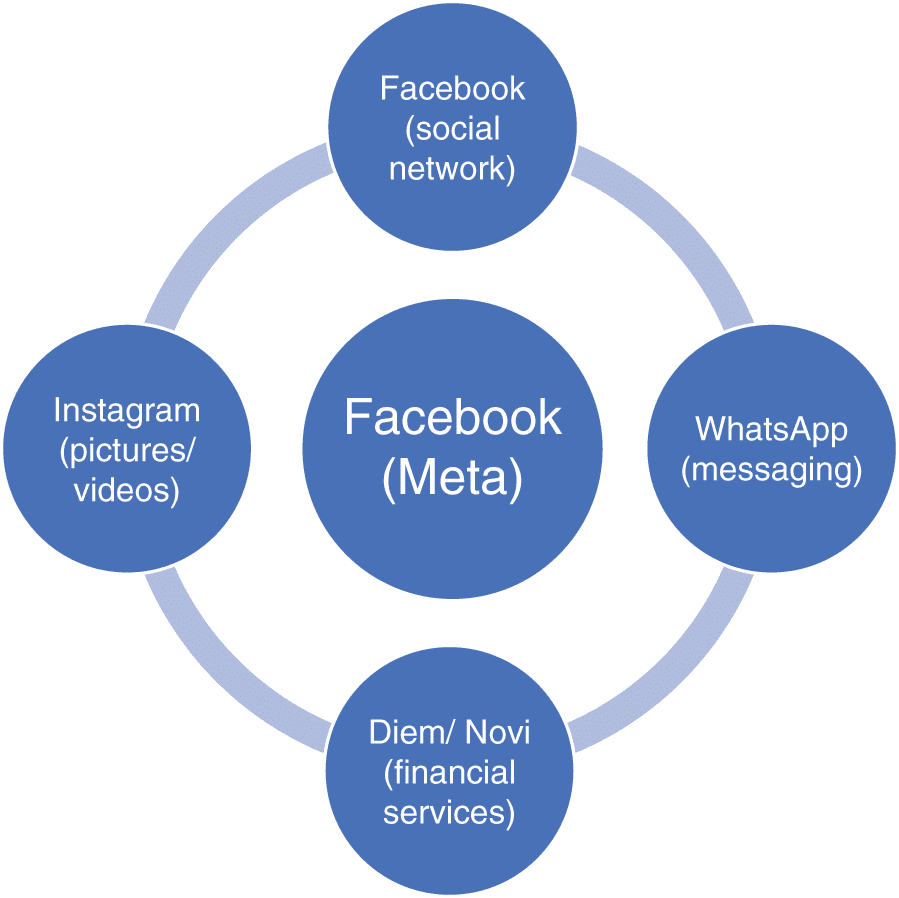

图 9.5 稳定币赋能 Meta 帝国

Libra，即该加密货币当时的名称，最初设计为由一篮子发达国家主权货币支持。该币的价值将挂钩数种可信货币的市场价值加权篮子，单个 Libra 价值约 1 美元。它迅速引来了监管审查，因为监管机构担心，一个独立的 Facebook 货币会从一个互联网平台创造出一个主权经济体和伪民族国家。（事实上，一些新闻文章甚至将其描述为“扎克币”和“脸书币”。）

此外，一些监管机构担心 Libra 可能会取代第二、第三世界国家的本国货币，因为这些国家的人口更倾向于使用一篮子第一世界货币而非本国货币。结果，Libra 难以获得认可，并更名为 Diem，后者将使用以用户本国货币计价的单一货币稳定币，由现金储备和短期国债支持每一枚稳定币。尽管如此，Diem 面临的监管障碍依然过高。最终，Facebook（现 Meta）放弃了该项目。（见专栏：“扎克币——从 Libra 到 Diem。”）

但 Meta 成为金融巨头的野心并未结束。现在，Facebook 进军支付领域的核心是 Novi，一个旨在让用户快速、廉价（在许多情况下免费）在全球范围内转账的数字钱包。Novi（前身为 Calibra）数字钱包将在用户通过借记卡和身份证确认身份后，自动集成到 Facebook 用户档案中。

对于全球超过 10 亿无法享受实体银行服务的人口来说，Novi 很可能成为收发款项的首选方案，尤其是当越来越多的新兴市场人口开始拥有手机并能轻松创建 Facebook 个人资料时。移动支付应用在时间和费用方面无法与稳定币的 Novi 钱包竞争，后者拥有一个巨大的内置分发平台作为依托（即使这种稳定币不是 Meta 自身的 Libra/Diem）。

同样，我们可能会发现更多大科技公司开发自己的数字钱包来处理加密货币和稳定币，尤其是当它们致力于基于现有的移动互联网平台构建自己的元宇宙时。例如，Twitter 决定向全球用户推出打赏功能，包括比特币支付。该新工具使用户能够链接支付平台，包括 `Cash App`、`Venmo` 等，因此关注者不仅可以通过点赞表示支持，还可以通过打赏来表达支持。

现在，加密货币行业正在等待 Elon Musk 揭晓即将推出的 Twitter Web3 版本，正如 Musk 所言，它是互联网的“事实上的广场”。在科技史上最大规模的收购案之一中，Musk 于 2022 年 4 月同意以 440 亿美元收购 Twitter，并计划将其私有化。Musk 浮想的一个潜在变革是使 Twitter 推送算法“开源”，因为开源编码是支撑许多区块链应用去中心化精神的关键。然而，在 2022 年 5 月，Musk 表示 Twitter 收购案“暂时搁置”，因为他寻求更多关于平台上虚假账户比例的信息。因此，Twitter 的变革何时以及是否会发生仍有待观察。

正如将在下一章讨论的那样，Web3 社区不仅要与大科技公司的数字钱包和支付系统（以及主权 CBDC）竞争，还要与大科技公司的“围墙花园式元宇宙”（以及主权数字基础设施）竞争，通过开发创作者自己的“开放元宇宙”来应对。

## 第 10 章：区块链上的 Web3 创作者经济

*   DAO 与 Web3 治理
*   在元宇宙中重塑公司
*   YGG 与开放元宇宙 vs. 大科技平台
*   挑战 1：互操作性与“区块链互联网”
*   挑战 2：国家支持的元宇宙
*   挑战 3：Web3 初创公司会成为新的“大科技公司”吗？
*   创作者宇宙：未来的创作者经济

## Constitution DAO 与 Web3 治理

2021 年 11 月，来自世界各地的数千名个人聚集在一起，组成一个去中心化自治组织（DAO），竞拍 13 份现存美国宪法原始副本之一。（DAO 是由一套透明规则定义的自我管理组织，这些规则被编码为计算机程序。DAO 成员通过这种相互商定的治理机制，并通常通过使用特定的加密货币或代币，使其激励保持一致。）

作为贡献的回报，“ConstitutionDAO”参与者获得了数字代币，该代币赋予了对文件相关决策的投票权。支持者围绕着利用民主决策机构来拥有世界上最著名的民主象征之一这一理念聚集在一起。该 DAO 通过众筹筹集了约 4700 万美元的加密货币，但最终在拍卖中败给了对冲基金 Citadel 的首席执行官肯·格里芬。尽管如此，这表明拥有共同信念的人们可以组织起来，在以前仅对最富有的个人开放的既定论坛中进行竞争。（参见框：Constitution DAO。）

虽然 ConstitutionDAO 最终被出价更高者击败，但这场运动将 DAO 推向了主流新闻头条，并激发了一波类似的项目，例如宣布计划购买高尔夫球场的 DAO（LinksDAO）、NBA 球队（Krause House DAO）以及怀俄明州的土地（CityDAO）。一些人可能将这些不成熟的尝试视为加密经济鲁莽的证据，但这些吸睛的故事只呈现了蓬勃发展的 DAO 现象的部分图景。DAO 不仅仅是为了购买花哨东西而进行的众筹；既然去中心化、透明度和共同所有权是 Web3 的基石，那么 DAO 结构或许将彻底改变人类社区未来的组织方式。

DAO 成立的目的多种多样（参见图 10.1）。目前由智能合约平台开发的 DAO 主要包括协议 DAO、投资 DAO、资助 DAO、服务 DAO、媒体 DAO、社交 DAO 和收藏 DAO。例如，许多 DeFi 应用，如 `Uniswap`、`Aave` 和 `MakerDAO`，都由 DAO 治理，它们通过区块链上的自执行智能合约，为协议开发和资金管理提供了一种机制。与传统资产管理业务相比，DAO 不需要受信任的投资经理；相反，其运营周期嵌入在区块链上的智能合约中。


**图 10.1 为各种目的而成立的 DAO** ¶ 来源：Coinbase，“DAOs: Social networks that can rewire the world”，2021 年

因此，更大的问题是：几个世纪以来，公司一直是私营部门组织人类活动的默认模式，但当公司演变解决的经济难题的性质发生转变时，Web3 上的最优治理模式应该是什么？DAO 使个人能够像传统组织一样协作、管理项目、拥有和投资资产，但它们能提供更高程度的透明度、开放性和民主治理。DAO 可能成为促进元宇宙中协作的默认机制。

## 在元宇宙中重塑公司

在将 DAO 与公司进行比较时，值得注意的是，当今世界上大多数公司的结构本质上与 17 世纪时相同：公司（由管理团队成立和运营）接受投资者的资金，投资者成为公司的股东，作为交换，公司承担以最大化股东价值为首要（有时也是唯一）使命的责任。

这种公司结构一直是资本主义的燃料——既有好的一面，也有坏的一面。好的一面促成了现代资本市场和商业效率的显著提高，而坏的一面则经常表现为不惜一切代价追求利润，甚至以牺牲 ESG（环境、社会和治理）因素为代价。此外，由于中心化的治理结构，公司的高管和大股东往往能掌握不成比例的控制权。

例如，在当前的互联网经济中，创作者，无论是 `Twitter` 上的作家还是 `TikTok` 上的短视频制作者，对这些平台如何运营几乎没有影响力，对其创作内容产生的收入也几乎没有主张权。对于数十亿用户来说，巨头对数据的垄断已引起社会关注。

由于其独特的结构，DAO 有望实现专注于社区而非仅仅关注利润，并可能提供一种更具社会意识的结构。DAO 有潜力改进一种数百年来没有发生实质性变化的公司组织形式，使创作者和用户能在数字世界中更广泛地参与全球协作（参见图 10.2）。

为什么 DAO 可能成为元宇宙的治理方式？简短的回答是：区块链和加密资产始于 DAO。回顾第 3 章开头关于加密货币的讨论，你可能会意识到 `Bitcoin` 网络是第一个也是最简单的 DAO。任何人都可以随时加入 `Bitcoin` 网络成为节点，提供算力以赚取比特币，同时确保账本的安全。例如，每当你购买一些比特币，该交易就会被记录在 `Bitcoin` 区块链上，这意味着记录被分发到世界各地成千上万台个人电脑上。同样重要的是，你可以随时轻松退出生态系统。


**图 10.2 创作者经济中的公司与 DAO 对比**

作为公共区块链，`Bitcoin` 也是透明的。与传统公司账目不同，互联网上任何人都可以查看所有交易。（许多人认为加密货币，尤其是比特币，是不可追踪的，主要用于非法目的，但这是一个巨大的误解。区块链是活动的公共账本。因此，可以追踪资金从一个账户到另一个账户的流向。）这种去中心化的记录系统非常难以控制或操纵。

从 `Bitcoin` 的例子中，我们可以看到 DAO 相比公司的一些独特优势，例如：

*   **生态系统管理的最大程度自动化和最低成本。** 从管理角度来看，除了 DAO 的存在本身外，不需要任何员工。
*   **灵活性。** 在创建角色的组织结构方面，贡献者可以自由加入和退出，来自社区和外部的承包商可以在世界各地工作，不一定局限于某一个或特定地点。
*   **透明度。** 所有类型的交易均可由所有授权方追踪和审计，从而实现更高的透明度和欺诈减少。

`Ethereum` 和新型区块链进一步支持智能合约，基于此衍生的各种应用都是基于代码规则的 DAO 来实现的（参见图 10.3）。区块链技术确保“代码即法律”，而 DAO 促进规则的有序制定和执行，两者都是元宇宙的基石。展望未来，由社区价值观和利益驱动的特定目的 DAO 将变得更加普遍，DAO 之间的协作也将更加普遍。

当然，DAO 也有其脆弱性。与传统实体不同，DAO 缺乏法律人格或中央责任主体。虽然公司有首席执行官和董事长，但从法律角度来看，DAO 基本上意味着“其所有参与者”。因此，在司法程序中由谁代表 DAO 以及为税法目的提交纳税申报表，目前尚不清楚。最终，很难确定负责 DAO 运营的实体或单个个人。


**图 10.3 智能合约拓展了 DAO 的实施** ¶ 来源：改编自 [CodeCentric.de](http://CodeCentric.de) 博客，2017

最重要的是，其结构的关键方面——智能合约——正是让 DAO 在虚拟世界中变得敏捷和自治的原因，但这同时也在现实世界中带来了挑战。DAO 的主要假设是，DAO 的运营规则完全基于区块链上智能合约的代码。然而，我们的实际生活并不完全发生在元宇宙中。我们依然身处物理世界。因此，DAO 的结构必须考虑到与现实世界活动的重要联系，而这一点在现有的 DAO 案例中尚未得到完全验证。

例如，如果 ConstitutionDAO 成功竞得美国宪法珍贵副本，它可能需要聘请律师、托管人和保险公司，而这些都是物理世界中的个人和机构。（他们是 **图 10.3** 中的“承包商”。）

因此，DAO 必须建立某种方法来处理现实世界的关系、保护、利益和责任，就像传统公司所做的那样。在 DAO 能够充分发挥其潜力以改变现实世界（除了虚拟世界）之前，必须解决这些棘手的挑战。

总之，目前 DAO 仍属于未知领域。要在现实世界中充分实现其潜在利益，DAO 还需跨越一些重大障碍。但 DAO 治理有望取代晦涩难懂的公司制度，开发出一个新的 Web3 系统，在该系统中，用户将拥有更多的数据控制权，个人创作者可以更直接地通过粉丝变现其内容，并且所有参与者都将拥有更灵活的支付机制。作为一个案例研究，在下一节中，我们将探讨游戏行业将如何随着更去中心化的治理而演变。（正如 **第 6 章** 所讨论的，游戏是元宇宙的早期版本。）

## YGG 与开放元宇宙 vs. 大科技平台

YGG 是区块链上稳健 DAO 的一个绝佳例子。YGG 是“玩赚”（P2E）游戏生态系统中的关键参与者，常与 Axie Infinity 一同被提及（见 **第 6 章** 介绍）。根据 YGG 官方网站，YGG 是一个全球性的 P2E 游戏社区，玩家可以通过玩 Axie Infinity、《The Sandbox》、《League of Kingdoms》等基于区块链的 NFT 游戏来赚取真钱。该公司 2021 年的白皮书将 YGG 定义为一个用于投资虚拟世界和基于区块链游戏中 NFT 的 DAO。YGG 的使命是创建世界上最大的虚拟经济，优化其社区拥有的资产以实现最大效用，并与代币持有者分享利润。

正如其名称“Yield Guild Games”（收益公会游戏）所暗示的，YGG 以 DAO 形式成立，并具有中世纪行会的特征。YGG 游戏玩家就像早期职业行会中的手工业者一样，受益于身处一个团结组织中的联合效应。YGG 公会为个人玩家（即“YGG 学者”）提供了一种租赁 NFT（如 Axie）以开始游戏和赚钱的途径，这类似于中世纪行会中的手工业者可以向行会成员申请工具或经济援助以开展自己的职业。YGG 的联合效应惠及其公会成员，因为每个成员若单独行动，可能很难接触到如此多样的游戏或同伴玩家，而在 YGG 生态系统中却能相对轻松地接触到他们。（见 **框：中世纪行会与 YGG 学者**。)

既然 YGG 是一个 DAO，它就具有 DAO 型组织的特征，YGG 成员可以就社区事务进行投票，例如应支持哪些类型的游戏、投资哪些类型的虚拟资产。YGG 联合创始人 Gabby Dizon 在《BusinessWorld》的一份报告中表示：“从本质上讲，YGG 是一个 P2E 玩家社区。可以把它想象成一个大型多人在线（MMO）公会，但它跨越多个游戏运营，投资这些游戏中产生收益的 NFT，并将这些游戏内资产和库存借给我们的玩家群体。”在后疫情时代，YGG 为其成员提供了一个元宇宙平台，让他们能够会面、组织、赚钱和动员，这正是一个公会应有的职责。

当然，现有互联网经济的大科技巨头不会在 YGG 等游戏 DAO 扩张时袖手旁观。它们也将游戏视为通往元宇宙的有前景的路径，并正积极进军视频游戏行业。2022 年，微软、索尼、Take Two、腾讯和华纳音乐集团等互联网和娱乐巨头宣布了前所未有的游戏公司并购及合作交易（见 **表 10.1**）。这一系列持续的大型收购交易总额已超过 700 亿美元，将加速大科技公司进军区块链游戏的步伐，并彻底重塑游戏格局。

其中，微软收购动视暴雪最为引人注目。2022 年初，微软宣布以 687 亿美元全现金收购动视暴雪。这是这家软件制造商有史以来最大的交易，规模几乎是 2016 年收购领英的三倍。如果该交易能获得监管批准，将使微软成为全球第三大游戏公司，仅次于中国的腾讯——全球最大的在线娱乐公司（《英雄联盟》发行商，持有 Epic Games 40% 股份和 Riot Games 100% 股份）以及 PlayStation 制造商索尼。

**表 10.1 2022 年前所未有的游戏并购与合作交易**

| 买方 | 目标 | 收购价格 | 区块链游戏举措 |
| --- | --- | --- | --- |
| **微软** | 动视暴雪 | 670 亿美元 | 凭借动视暴雪的更多资源，微软将加速其 NFT 游戏业务 |
| **Take Two** | Zynga | 127 亿美元 | Zynga 于 2021 年 12 月与区块链游戏巨头 Forte 结成合作伙伴关系 |
| **索尼** | Bungie | 36 亿美元 | Bungie 作为开发商正在探索区块链游戏 |
| **腾讯** | Sumo Group | 12.7 亿美元 | Sumo 与区块链公司 Dapper Labs 合作，自 2020 年起探索在 Flow 区块链上的游戏 |
| **华纳音乐集团** | Sandbox | 未披露 | Sandbox 是一个 P2E 游戏平台 |

幕后背景是，微软已经在游戏领域深耕了一段时间。对许多人来说，微软被称为一家软件公司。然而近年来，微软的企业战略一直围绕云、内容和创作者展开。例如，它负责开发和发行历史上一些最大的游戏系列：《帝国时代》、《极限竞速》、《战争机器》、《光环》、《我的世界》、《辐射》、《微软纸牌》、《微软模拟飞行》、《DOOM》、《上古卷轴》等。

游戏是微软两大元宇宙布局之一，且在这次大规模收购之前，微软就已经在从事 NFT 游戏。（另一个是 Office 和会议软件。微软正在将虚拟现实办公室和 3D 虚拟形象集成到其 Teams 远程协作软件中。）此次收购将提供更多忠诚的游戏社区来创建他们自己的游戏元宇宙。微软的目标是建立一个足够庞大的游戏帝国，让玩家直接前来，从而绕过苹果。（微软一直在与苹果和谷歌就应用商店向游戏收取的费用进行抗争。）


然而，当一个平台（如微软或 Meta）其主要商业模式是建立在中心化数据基础上的中介市场，却转型构建旨在开放、互操作且由用户拥有的事物时，二者之间存在根本性的冲突。大科技公司的元宇宙与 DAO 元宇宙之间最大的区别在于，后者运行在开放、无许可的区块链架构上——任何开发者都可以来在开放区块链上构建元宇宙应用，任何用户都可以获取并交易自己的虚拟资产。这就是“开放元宇宙”的愿景。

然而，在该愿景实现之前，开放元宇宙必须克服三大挑战，将在以下章节中讨论。

## 挑战 1：互操作性与“区块链互联网”

“开放元宇宙”演进的一个重要方面是此类计算格局的互联互通，这可能导致移动计算时代“围墙花园”要素的瓦解。现实情况是，尽管区块链在改进业务流程、创造新商业模式、为价值链提供交易透明度和数据安全性，以及降低数据管理和交换的运营成本方面的潜力对许多个人和企业显而易见，但预期的大规模采用至今仍未发生。是什么阻碍了区块链？缺乏统一的技术标准和互操作性。

主要挑战在于，由于区块链的传统架构不允许它们相互通信，许多有前景的区块链正在并行增长。单个区块链网络本质上并非开放，且具有不同的特征——例如交易类型、哈希算法或共识模型。每个区块链网络代表一套全新的记录，并托管不同的应用程序。这对每个主要区块链均适用，包括比特币和以太坊这两条领先链。这导致了一系列互不连接的区块链生态系统并行却又孤立地运行，每个系统仅由薄弱的节点网络支撑，易受攻击、操纵和中心化之害。

因此，Web3 开发解决方案以帮助这些区块链网络实现互操作至关重要。区块链网络相互通信和共享数据的能力被称为区块链互操作性。如今区块链的互操作性可比作互联网早期的手机和电子邮件互操作性。

试想——如果建立在两种不同基础设施上的两个电子邮件平台不具备互操作性，电子邮件将毫无用处。例如，如果你无法从 Gmail 账户发送邮件到 Microsoft Outlook 账户，会怎样？移动和计算机操作系统也是同理。如果你无法用 iPhone 给 Android 智能手机用户打电话，会怎样？或者，如果分别在 Windows 和 macOS 上使用 Zoom 的两个用户无法进行视频会议，会怎样？缺乏互操作性会让互联网极难使用。

互操作性不仅意味着不同区块链系统可以相互通信的可能性。最重要的是，它是指无需中介（如中心化交易所）即可跨不同区块链网络共享、查看和访问信息的能力。因此，越来越多的互操作性项目涌现，试图弥合各区块链之间的鸿沟。因此，可互操作区块链的愿景建立在若干功能和能力之上，包括与现有系统集成、跨多链交易、赋能应用以及轻松切换底层平台。

构建互操作性最高效且可扩展的方式，是通过共同努力建立行业标准，并确立一个行业网络可汇聚的“网络的网络”结构。这种区块链网络代表一个相互连接的网络“网”。这种架构将允许组织连接并与多种解决方案交易，不受限于单一网络，并开启跨解决方案的互操作性市场。用于互操作性的“网络的网络”模型持续获得动能，加密世界开始看到有前景的区块链枢纽涌现。

例如，Cosmos 是最著名的互操作性解决方案之一，旨在作为一个区块链生态系统，实现可扩展且相互互操作的区块链。Cosmos 是一个智能合约平台，在其区块链设计中优先考虑了互操作性。其架构基于“中心-辐射”系统，一系列“辐射”链通过区块链间通信连接到一个“中心”枢纽。Cosmos 的目标是创建一个“区块链互联网”——一个区块链网络，能以去中心化方式相互通信。

2021 年 4 月，Cosmos 通过推出区块链间通信协议（IBC）达到了历史性里程碑，该协议是 Cosmos 的区块链互操作性标准。IBC 使独立区块链能够连接、交易、交换代币和其他数据、扩展规模，并在互联网络中蓬勃发展。仅在八个月内，我们见证了一个强大新经济的增长。到 2021 年底，已有 25 条链正式加入 IBC。它们都能够连接到 Cosmos 生态系统中可用的各种去中心化交易所（DEX），如 Osmosis、Gravity DEX。

为解决互操作性问题，Cosmos 在 IBC 中提出了一种包含两类区块链的模块化架构：枢纽和分区（见图 10.4）。分区是常规异构区块链，而枢纽是专门设计用于将分区连接在一起的区块链。当一个分区与一个枢纽建立 IBC 连接时，它可以自动访问（即发送至和接收自）连接到该枢纽的所有其他分区。因此，每个分区只需与有限的一组枢纽建立有限数量的连接。枢纽还防止分区间的双重支付。这意味着，当一个分区从枢纽接收代币时，它只需信任该代币的源分区和该枢纽。


**图 10.4 区块链互联网 – Cosmos IBC 枢纽与分区** ¶ 来源：Cosmos

令人振奋的是，IBC 不止步于 Cosmos 构建的区块链。2022 年，Cosmos 正致力于连接许多其他主要生态系统，包括比特币、以太坊、Polkadot 和 Celo，有望释放将流经这“区块链互联网”的巨大流动性。同时，更多像 Cosmos 这样的互操作性项目也在构建类似的区块链生态系统，实现可扩展且相互互操作的区块链。

展望未来，互操作性解决方案的到来可能从根本上改变当前对区块链的态度。互操作性在任何软件系统中都至关重要——如果无法与其他软件协同工作，它根本无法发挥全部潜力。在过去，计算机科学家花费数十年构建我们现在所知的互联网，而互联网只有在美国开发的 TCP/IP 编程协议被广泛接受为使各种不同系统通信的方式后，才变得具有变革性。

### 互操作性：元宇宙的关键

今天，互操作性是实现元宇宙全部承诺的唯一途径，互操作性将实现更顺畅的数据和解决方案共享、更轻松的智能合约执行、更友好的用户体验，以及更多建立合作伙伴关系的机会。它有望成为区块链实现广泛接受和采用的重要颠覆性因素。只有当所有区块链都能整合成一个无缝的区块链互联网，以挑战现有的大型科技平台时，元宇宙才会到来。

## 挑战 2：国家支持的元宇宙

正如在数字货币背景下那样，加密货币、大型科技代币和央行数字货币（CBDC）三足鼎立，关联到 Web3 区块链基础设施，开放元宇宙必须同时与大型科技平台（参见前文关于 DAO 与公司的讨论）和政府驱动的元宇宙竞争。正如第 9 章所讨论的，中国对加密货币、NFT 和区块链技术的处理方式，符合政府为建设“具有中国特色的互联网”所做的更广泛努力的模式，元宇宙基础设施也是如此。（参考温斯顿·马 2021 年著作 *The Digital War: How China's Tech Power Shapes the Future of AI, Blockchain and Cyberspace*。）

中国在推广区块链技术（包括开发中国的主权数字货币 e-CNY）的同时限制加密货币交易，类似地，中国区分了元宇宙技术和元宇宙代币。2021 年 12 月，中国人口最多的城市上海宣布，元宇宙研发将成为该市“十四五”发展规划的组成部分。市政府将致力于在“公共服务、商务办公、社交娱乐、工业制造、生产安全和电子游戏”等领域利用元宇宙。北京、武汉、安徽等城市政府，以及浙江、合肥等省份政府，此后纷纷效仿上海的做法。

与此同时，进军元宇宙已成为中国互联网公司的热门趋势。腾讯、阿里巴巴和 TikTok 所有者字节跳动等大公司近期都宣布了开始开发相关技术的计划，这可能使它们成为元宇宙的关键参与者，这在其智能手机和移动互联网业务模式已成熟的当下至关重要。自 2021 年以来，中国与元宇宙相关的注册商标数量激增（参见图 10.5）。

然而，由于比特币和以太坊等公共区块链在中国属于非法，该国正在其国家支持的区块链服务网络（BSN）上构建一个新版本的元宇宙基础设施，该网络运行的实质上是中心化、私有、准入许可的区块链。此类基础设施面向开发者开放，因此在其上运营的公司可能会为监管目的收集用户身份数据。对于依赖加密货币的元宇宙应用，中国的数字货币可能会被用于元宇宙支付应用。（有关 BSN 背景，请参见专栏：开放区块链服务网络。）


**图 10.5 中国元宇宙相关商标呈井喷式增长** ¶ 来源：Quartz

根据其官方白皮书，BSN 是一个跨云、跨门户、跨框架的全球基础设施网络，用于部署和运行各类区块链应用。此前，传统联盟链应用中的每个参与者都必须构建和运营自己的专属节点及相应的共识机制。每个节点必须使用物理服务器或云服务，通过互联网或内网相互连接，从而形成一个类似于局域网的孤立区块链应用。

在这种孤立的区块链结构中，应用设计者需要为每个联盟链建立新的区块链运行环境，成本极高。例如，在阿里巴巴、华为等主要云服务商平台部署区块链应用，每年可能耗资数万美元。更糟糕的是，服务器资源往往得不到充分利用。据 BSN 背后的科技公司红枣科技称，只有 2%–3% 的企业用户需要每秒超过 1000 笔交易（TPS）的处理能力，这使得用户能够充分利用云服务。因此，部署和维护带来的高成本是区块链创业者的一大障碍。

BSN 对区块链应用开发者具有吸引力，因为：

1.  **BSN 的推出将使公司能够以超低成本获取区块链云计算服务，因为它使客户能够以更小的单位获取服务。** 用户可按需付费。目标定价为每年低于 400 美元，这将使任何中小企业或个人都能获得参与数字经济的关键工具，并推动采用和金融普惠机会。

2.  **BSN 旨在简化区块链应用开发。** 它以互联网的概念为开发者提供公共区块链资源环境。就像在互联网上构建一个简单的网站一样，开发者可以方便且低成本地部署和运行区块链和分布式账本应用。据红枣科技称，为 80% 的 BSN 用户构建应用就像在线填表一样简单。（“他们甚至不需要编写自己的智能合约；只需在我们的系统中选择一个即可。”）

3.  **BSN 计划增强不同区块链应用之间的连接性。** 在传统的孤立区块链环境中，不同技术标准的各种应用无法统一，因此业务数据无法相互交互，这限制了区块链技术的广泛采用（参见图 10.7）。BSN 白皮书表明，开发者可以使用单一私钥在多个框架上部署和管理应用，同时实现它们之间的互联互通和相互通信。（在此过程中，每个框架保留其智能合约和共识机制的独特特性。）


**图 10.7 BSN 框架的五大主要部分**

BSN 网络已建立起一个庞大的区块链经济体系，并于 2022 年扩展其基础设施以支持 NFT 业务。与美国一样，自 2021 年下半年以来，NFT 市场在中国迅速增长，谷歌搜索数据显示，中国消费者对 NFT 信息有着巨大的需求，在接受调查的 70 个国家中，中国对该词条的搜索频率最高。但中国并没有像对待加密货币那样直接禁止 NFT 发行，而是试图通过创建自己的 NFT 基础设施来控制市场，要求用户验证身份，并在监管机构怀疑存在非法活动（如洗钱和投资诈骗）时允许国家干预。

2022 年初，国家支持的 BSN 宣布正在开发面向中国市场的专用基础设施，以支持 NFT 发行。（世界上大多数 NFT 都是以太坊区块链的一部分。）为了与中国境外在公链上使用加密货币交易的 NFT（加密货币在中国被禁止）区分开来，BSN 将 NFT 重命名为“分布式数字证书”（DDC），BSN-DDC 网络是一个符合中国法规的构建 NFT 的结构。

### 合规解决方案：开放许可区块链

为解决法律合规问题，所有官方 DDC 将部署在开放许可区块链上，此类链结合了公链与许可链的特性。BSN 引入了开放许可区块链（OPB）技术，这是一种可由指定群体治理的区块链改良版本。（比特币、以太坊等公链属于“无许可”链，节点可自由加入和退出。）

据 BSN 介绍，其已在 BSN-DDC 上集成了 10 条开放许可区块链。这些是其无许可对应链的本地化版本，对网络治理参与者设限，并采用法币支付。这 10 条 OPB 包括以太坊改良版（基于以太坊的武汉链）、Corda 改良版（基于 Corda 的遵义链）、由基于 Cosmos 的 IRISnet 提供支持的文昌链、基于 EOS 的中怡链，以及国内区块链如基于 FISCO BCOS 的泰安链（由腾讯系金融科技公司微众银行发起）。

### DDC 与 NFT 的本质联系

从本质上讲，DDC 与 NFT 相同，更名旨在强调其在认证场景的用途。NFT/DDC 技术是一种数字认证与分布式数据库技术，适用于任何需要数字证明的场景。当前 NFT 主要用于数字艺术品认证，而在中国，最大的市场在于各类企业的证书与账户管理。以车牌为例，此类 DDC 系统可让车主、政府、保险方受控访问里程、发动机编号、维修历史等数据，各方均知晓彼此权限。

### BSN-DDC 基础设施优势

BSN 称 BSN-DDC 基础设施将为企业提供“多元、透明、可信、可靠”的一站式服务，支持铸造和管理自有 NFT，且无需依赖中国禁令禁止的加密货币。网络上所有支付均通过银行卡、支付宝、微信支付等传统非加密方式以法币结算，以符合本地法规。与 BSN 上 DApp 开发者的低云成本类似，NFT 铸造费用可低至 0.05 元人民币（约 0.007 美元），远低于公链成本。

这种廉价便捷的 BSN 基础设施可能吸引开发者和用户，尤其是更关注合规、较少在意“无许可”与“去中心化”的群体（参见**图 10.8**）。因此，BSN 与 BSN-DDC 网络代表了国家支持的元宇宙生态系统的崛起，随着中国（及更多国家）加速元宇宙监管，该生态或将快速扩张。


**图 10.8 国家支持的元宇宙基础设施具备“3C”优势**

## 挑战 3：Web3 初创公司会成为新的“大科技巨头”吗？

开放元宇宙的愿景是去中心化所有权与共享利益，这与当前数字经济中中心化的大科技平台形成鲜明对比。尽管距离终极元宇宙尚有数年，但我们已看到打破围墙花园的进展。Epic 诉 Apple 案即是典型案例。

### 游戏平台向大科技发起挑战

2021 年，Epic Games 以反垄断违规起诉 Apple，游戏平台由此向大科技发起挑战。此案是平台所有者与大型游戏公司之间的重要冲突，可能确立游戏成为最大媒体和社交网络时代的竞争规则。Epic Games 质疑 Apple 对《堡垒之夜》等游戏内交易抽取 30% 费用的政策。联邦法官裁定 Apple 违反加州反不正当竞争法，但在该复杂反垄断诉讼的其他重要诉求上判决 Apple 胜诉。

尽管 Epic 在反垄断指控中几乎全败，但赢得了一个关键点：有权在 Apple 商店外推广应用内替代支付方式。上诉法院已暂停该胜利判决执行，诉讼仍在继续，但这已是 Apple 帝国的一道裂痕。该裁决可能让替代支付提供商和游戏开发者更有希望获取其创造的收入，因为他们至少能在应用商店外的网站上推广更低的数字商品价格。

Epic 诉 Apple 案凸显了现代内容平台的权力集中，游戏开发者被平台“绑架”。该案胜诉可能足以激起游戏和应用开发者对应用商店现状的不满。此外，Epic 仍就 Google Play 商店做法对 Google 提起反垄断诉讼，该案 2022 年仍在进行中。据 Epic 高管透露，其目标是将《堡垒之夜》打造成为一个平台，让独立开发者分发游戏及其他娱乐内容并获取更多利润。

### 新旧巨头的讽刺更替

讽刺的是，Epic Games（《堡垒之夜》）和 Roblox 等游戏巨头可能成为新的大科技公司，尽管 Web3 愿景主张无超级企业主导。极有可能，游戏巨头终将在 3D 交互式互联网中拥有如同 Apple、Google 等大科技在现有二维互联网中的统治地位。更重要的是，即使对于更“纯粹”专注于“去中心化”服务的 Web3 初创公司，头部玩家也通过以熟悉的中心化方式拥有“轨道”而积累了垄断权力（参见**表 10.2**）。

例如，全球最大 NFT 市场 OpenSea 的集中度可能超过资本市场任何其他交易平台。OpenSea 捕获了全球超 90% 的 NFT 交易市场流量，并从每笔交易中抽取 2.5% 的费用（远高于“集中”的纳斯达克股票交易所股票交易费率）。市场上虽有许多 NFT 交易平台（如 SuperRare），但控制巨大流量的 OpenSea 早已超出其他平台触及范围。（OpenSea 背景信息见**第 5 章**。）在追求去中心化的进程中，OpenSea 却是 NFT 领域的主导存在。

**表 10.2 Web3 头部玩家的垄断权力**

来源：改编自 Wu Blockchain，2022 年 3 月报告

| 头部玩家 | 加密领域 | 垄断指数 |
| --- | --- | --- |
| **Gnosis Safe** | 加密资产多签管理 | 99% |
| **OpenSea** | NFT 市场 | 90% |
| **Chainalysis** | 加密安全与合规 | 90% |
| **Chainlink** | 预言机 | 90% |
| **Metamask** | 浏览器扩展加密钱包 | 85% |
| **Uniswap** | DeFi 交易所 | 80% |
| **Bitmain** | 加密挖矿设备 | 70% |

正如预想，DAO 兴起旨在去中心化 OpenSea 巨头。2021 年是“NFT 之年”，年底最大的 NFT 事件是 OpenDAO 向最大 NFT 市场 OpenSea（按用户数、交易量、在售艺术品数计）用户空投 $SOS 代币。催化剂可能是 OpenSea 潜在 IPO 传闻，这将使其成为政府注册公司（但平台上所有 NFT 创作者无分红）。因此，OpenDAO 作为原生数字社区 DAO 诞生，旨在为创作者和收藏家创造公平竞争环境。（参见**专栏：OpenDAO 向 OpenSea 用户空投 SOS**。）

OpenDAO 的空投介绍这样描述该活动：$SOS 感谢所有 NFT 创作者、收藏家和市场对整个 NFT 生态系统的培育。特别感谢 OpenSea 在推动 NFT 交易方面的领导地位。致敬之意，我们选择了 OpenSea 收藏家进行空投。然而，关键信息是所有 NFT 贡献者都应获得奖励。本质上，OpenDAO 试图基于 OpenSea 用户创建一个真正的“创作者驱动”平台，而 OpenSea 被视为一个“中心化”平台。这代表了 Web2.0 与 Web3 之间的较量。


尽管 OpenDAO 活动昙花一现，但社区已向 OpenSea 展示了他们在没有公司“认可”的情况下能做什么。SOS 可能会被遗忘，但它是关于“中心化”服务平台辩论的第一步。结果，LooksRare 这一新的 NFT 市场应运而生，其拥有更友好的创作者协议，以与 OpenSea 竞争。

然而事实是，Web3 建立在某些关键基础设施存在的前提上，因为并非每个用户都想为每笔交易编写代码、运行自己的服务器，或自行担心加密资产安全。因此，“中心化”服务必然会兴起，例如 `Moralis`（“构建、托管和扩展杀手级 DApps”）、`Alchemy`（“为全球区块链开发者赋能”）、`Infura`（“以太坊节点即服务”）等。当更多普通人加入元宇宙时，Web3 加密原住民面临的挑战将是找出“中心化”与“去中心化”基础设施之间的微妙平衡。

## Creator-Verse：未来创作者经济

尽管面临挑战，但以区块链互联网上的创作者经济为特征的 Web3，是一股强大的未来趋势。本章讨论的 DAO，包括 ConstitutionDAO、YGG 和 OpenDAO，都是其重要的实验。总的来说，它们标志着向元宇宙中运作的开放经济迈出的实质性一步，新型所有权共享和去中心化治理是其核心价值。

我们正进入一个由用户和建设者拥有、由代币编排、通过分布式和去中心化组织运作的网络空间——这就是面向创作者的 Web3。如今，数字创作者经济仅占主流数字经济的一小部分，但其核心领域正在增长——它们有潜力成为未来数字经济（即元宇宙）的核心。如前所述，该领域约有 5000 万内容创作者，其中大多为业余创作者（4670 万），专业创作者约 200 万（参见第 5 章 “NFT、创作者经济与开放元宇宙” 中的**图 5.4**）。这意味着更多普通用户正成为创作者。正如下文所述，通过考察创作者经济的三个阶段，这一趋势更加明显（参见**图 10.9**）。

### 阶段 1：被动互联网

过去，成为内容创作者的门槛高得令人沮丧。你必须签约唱片公司才能成为歌手，或签约出版社才能成为作家。如果你想进入演艺圈，可供选择的电视频道寥寥无几。电影方面？少数几家制片厂控制着所有业务线——从创意、剧本、人才到制作再到影院。


**图 10.9 “创作者经济”的三个浪潮**

早期互联网（Web1）对创意产业的行业结构影响甚微。Web1 互联网允许你发送电子邮件、浏览网站、从雅虎搜索信息。它也加速了内容数字化（如从纸质报纸），但无法帮助普通互联网用户成为在线内容创作者。随着 Web2（移动互联网）的兴起，这些瓶颈逐渐消解（参考 Winston Ma 2016 年著作 *China's Mobile Economy*）。

### 阶段 2：移动互联网

Web2 由少数庞大公司——大型科技公司控制。其特点是 Facebook（Meta）等社交媒体平台的增长，以及 Google、Amazon、Microsoft 和 Apple 等巨头日益将社交和媒体内容融入其软硬件业务。它们主动且刻意地构建“护城河”，以尽可能长久地锁定价值和用户，从而为平台（及其公司股东）榨取尽可能多的“终身价值”。如今创作者可用的平台不胜枚举，但这些现有平台与创作者所有权的趋势背道而驰；相反，它们（而非创作者）拿走了创意产品收入的大头。

### 阶段 3：区块链互联网

在加密货币、DeFi、NFT 及更多基于区块链技术的 Web3 世界中，正在汇聚一场以用户及其主权为中心的范式转变：他们的身份、数据、创作和财富。虽然仍有平台协助创作、发现或策展过程，但用户完全控制输出，并可在平台间自由、无许可地转移价值以进行转售、借贷。事实上，用户将拥有元宇宙中的网站和应用。

这意味着创作者和用户将从其创作和参与中获益最多。创作内容将产生财产权。充分参与在线社区，你将以数字代币形式获得其中一份份额。用户而非大公司，将定义和治理社区及相关服务。游戏世界中或许已有一些线索。

如前所述，游戏是元宇宙最相关的应用之一，并帮助开创了游戏内产生收入的数字市场。是的，存在类元宇宙市场和平台，如 Fortnite 和 Roblox，它们占据主导地位且中心化，游戏开发者仍自上而下地通过创作变现。但充满希望的趋势是自下而上地激活创作者并实现变现，如 P2E 游戏 Axie Infinity 及相关 DAO 如 YGG（参见**图 10.10**）。

或许对区块链游戏最常见的批评是，P2E 游戏无法让用户做一些用户在游戏中以某种方式早已能做的事。但这种批评未能认识到 NFT 可用于绕过传统分发机制，实现点对点交易，从而切断大型科技平台。此外，随着 DeFi 的发展，金融化程度提高，财务对齐更佳。开发者可通过发行代币与游戏支持者分享部分收入，玩家可像使用传统资产一样，将虚拟物品作为抵押品用于 DeFi。（例如，玩家可通过借出 NFT 剑来为下一张战斗通行证融资。）

为什么这对普通用户很重要？因为在未来的“创作者经济”中，每个人都是创作者——正如**图 10.10**中玩家也是创作者。即使在 Facebook 改名为 Meta 之前，大量既创作又消费的活跃社区已存在于 YouTube、TikTok 和 Twitch 等平台。展望未来，Web3 平台将推动该社区指数级增长，他们处于不断壮大的创作者经济中心。如今，这场运动正席卷每一种可能的媒介中的每一件“创意”事物。


**图 10.10 游戏价值转移——自上而下 vs. 自下而上** ¶ 来源：Nansen

## 元宇宙与 Web3：创作者经济与去中心化未来

同样，以游戏板块为例说明这种“创作者扩张”，游戏玩家消耗新游戏内容的速度总是快于游戏制作者创造内容的速度。因此，在游戏这种高风险、高回报的行业中，创造力难以规模化。人才是该行业最关键的瓶颈之一，而游戏制作成本持续上升。因此，UGC（用户生成内容）的兴起不仅关乎用户参与度，更多的是游戏发行商的必然选择。通过向游戏玩家开放创作流程，发行商实际上将创新外包给了大量充满热情的玩家。这极大地扩展了设计流程，而玩家（同时也是创作者）理应作为业务的部分所有者获得补偿。

总之，元宇宙拥有巨大潜力，可改变创作者开发内容和与受众互动的方式。Web3——互联网的第三代——是一组技术的集合，涵盖数字资产、去中心化金融、区块链、代币和 DAO（以及更多数字技术的融合），将实现人类协作的新形式（参见图 10.11）。一方面，新的数字工具将使他们能够轻松制作高质量的 UGC 内容；另一方面，区块链技术将帮助他们管理创作业务，包括安全支付和数据隐私。未来能够脱颖而出的创作者，将是那些懂得如何在元宇宙中提升自己技能的人。

通过这种方式，元宇宙提供了一种新的数字优先经济，基于去中心化账本，具有全球性、透明性和加密原生特性。是的，元宇宙正面临三方竞争：大科技公司（它们开始将 Web3 理念纳入其中心化平台），以及提供许可型区块链基础设施（廉价且便捷）的主权国家。加密货币世界也在与大科技公司的代币和各国的 CBDC 竞争。但这三方共存无疑将在未来十年推动前所未有的创新，构建一个更好的互联网——区块链互联网。


**图 10.11 去中心化网络的演进，从 Web1.0 到 Web3** ¶ 来源：高盛，《美洲科技：构建 Web 3.0 的未来》报告，2021 年

## 词汇表（按字母顺序）

## A

**空投（加密货币，NFT）**

: 空投是指将加密货币、代币或 NFT 免费发送到 Web3 钱包地址，作为推广手段，或作为参与体验或购买数字资产的增值福利。空投通常用于增加额外价值或吸引对品牌或体验的关注。

**反洗钱（AML）**

: 金融机构为遵守法律要求而执行的活动，旨在主动监控并报告可疑活动。

**原子交换**

: 双方在无需信任中心化交易所或第三方的情况下，完全交换资产的情况。在数字货币的“原子”交易中，如果涉及资产支付的交易一环失败，整笔交易就会失败。

**增强现实（AR）**

: 一种将计算机生成的图像叠加在用户现实世界视图上的技术，从而提供复合视图。

**逆向选择**

: 买卖双方信息不对称的市场情况。拥有更多信息的用户在认为有利可图时选择性地参与交易，从而降低所有人的市场质量。

**AMM（自动做市商）**

: 自动做市商使用由流动性提供者存入资金池的一对资产。交易者随后可以在资金池中用一种资产兑换另一种资产，并支付手续费。价格将沿流动性曲线随需求波动。流行的自动做市商示例包括 `Uniswap`、`Sushiswap` 和 `Pancakeswap`。

**API（应用程序编程接口）**

: API 为开发者提供连接端点，以便他们能够以编程方式访问数据并执行功能。交易所将为用户提供 API 访问权限和 API 密钥，以便他们使用交易机器人和脚本进行程序化交易。

**APR / APY（年化收益率 / 年化收益率含复利）**

: APR 代表借贷资金的年化百分比利率。然而，这不计算复利效应。如果利息按月支付，借出方将获得利息的利息。这种复利效应通过 APY 计算考虑在内，但 APR 不计算在内。

**地址（钱包地址）**

: 区块链钱包地址（如比特币和以太坊钱包地址）是公钥的同义词。这是你与他人分享的地址，以便他们向你的钱包发送资金。

**审计**

: 安全审计由外部组织对项目的智能合约代码执行。它提供了一定的保障，但绝不保证智能合约内资金的安全。并非所有审计机构都同等可靠；`Certik`、`KnowSec` 和 `Slowmist` 等领先机构的审计更具权重。

### B

**Beeple，即 Mike Winkelmann**

: 美国平面设计师，从事各种数字艺术创作，包括短片、Creative Commons VJ 循环素材、每日创作，以及 VR/AR 作品。他是 3D 图形领域当前“每日创作”运动的发起者之一，已连续 10 多年每天从头到尾创作一幅图片并发布在线，从未间断。

**比特币**

: 比特币是一种去中心化的数字货币，没有中央银行或单一管理员，用户可以在点对点的比特币网络上直接发送，无需中介。货币单位是比特币。

**区块**

: 区块是区块链数据库中的数据结构，加密货币区块链中的交易数据永久记录于此。一个区块记录网络尚未验证的部分或全部最新交易。数据验证通过后，区块即被封闭。

**区块链**

: 一种分布式账本技术（DLT），交易以点对点方式进行，然后广播给全体系统参与者，由所有或部分参与者以区块为批次进行验证。此类验证使用系统的共识协议（如工作量证明或权益证明）执行。验证通过的区块随后通过加密方式链接到主区块序列，称为区块链。

**区块确认**

: 交易所和支付协议通常要求最少区块确认数才能存入资金。每当矿工找到哈希值并最终确定区块，即算作一次区块确认。因此，如果一笔交易需要三次区块确认，则需包含该交易的区块再加上其上的两个区块才算完成。

**区块高度**

: 区块链内的区块数量。这常被智能合约用作事实上的计时机制，因为开发者可根据平均出块时间估算未来特定时间的区块高度。

**区块奖励**

: 区块奖励包括挖矿费以及矿工找到符合难度目标的哈希值时获得的交易费。每个区块都会携带奖励，以激励维护区块链安全，这也是许多加密货币分发代币供应的方式。

**出块节点**

: 出块节点（BP）是指其硬件被选中验证区块交易并在大多数权益证明（PoS）区块链上开启下一个区块的个人或群体。

**债券曲线**

: 一种用于定义资产价格与供应量之间关系的数学公式或曲线。债券曲线合约被某些项目用于在供应量增加时提高所售代币的价格。

**区块链服务网络 (BSN)**

: 由中国国家信息中心联合红枣科技、中国移动、中国银联发起的国家支持的多链托管网络。它是全球部署和运行区块链应用的通用基础设施。

## C

### 央行数字货币 (CBDC)

一种央行货币的数字形式，可能面向公众开放（通用或零售 `CBDC`），也可能面向特定的持牌参与者，如金融机构（批发 `CBDC`）。`CBDC` 以国家记账单位计价，由央行发行，是央行的直接负债。

### 中心化交易所

一种在交易交易中充当中介的商业服务，旨在实现特定资产或货币之间的相互兑换。

### 保密性

涉及将特定信息对非授权方保密的能力。在某些法律体系中，保密性受到接收方不得在未经披露方同意的情况下向第三方透露的义务保护。有时也通过披露方和接收方之间的协议来保护。

### 共识机制

共识机制（也称为共识协议或共识算法）允许分布式系统（计算机网络）协同工作并保持安全。

### 联盟链 (又称联邦区块链)

一种区块链技术，由多个组织而非单一组织共同治理平台。它不是公共平台，而是一个许可平台。

### 加密资产

一种大量涉及密码学使用且运行在分布式账本上的资产。比特币和以太币等加密货币即为例证。不过，“加密资产”是一个宽泛的术语，也可能包括存在于分布式账本上并可流转的其他资产。

### 加密代币

一种代表资产或特定用途并驻留在其自身区块链上的加密货币类型。代币可用于投资、价值存储或进行购买。

### 冷钱包 / 冷存储

冷钱包是一种将私钥离线保存来存储资金的方式。例如，早期采用比特币的 Winklevoss 兄弟购买了一台笔记本电脑，设置了一对私钥/公钥，将私钥分成三部分，每部分复制一份，然后将这六份分别放在全国各地不同的银行保险箱中。这是保护密钥安全的极端示例。核心思想是使黑客在密钥未以任何方式连接互联网时（几乎）无法获取密钥。

### 抵押品

在建立期货头寸或在借贷平台借款时，使用有价值的资产（抵押品）来担保贷款。

### 可组合性

在 `DeFi` 术语中，可组合性是指构成 `DeFi` 协议的智能合约相互交互的潜力。例如，一个合约可能连接到借贷平台借入闪电贷，然后使用这些资金与自动做市商交互以交换代币。

### 复利

当用户投资一笔资金时，通常会报出年利率。然而利息通常按更固定的间隔支付，有时甚至每个区块都支付。这意味着今天获得的利息明天就会开始产生利息本身。

### 合约地址

智能合约地址就像去中心化网络上智能合约的“邮政编码”。它映射到虚拟机上可执行代码的内存地址。当我们想要与合约交互时，通常需要合约地址。一个常见的例子是代币地址，它描述了在哪里可以找到该代币合约。

## D

### 去中心化自治组织 (DAO)

`DAO` 是加密领域的一种正式化社区类型，成员通过共同商定的治理机制（通常通过使用特定的加密货币或代币）来协调激励。

### 去中心化应用 (DApp)

存在并运行在区块链或点对点（`P2P`）计算机网络上的数字应用程序，而非单台计算机。`DApps`（也称为“dapps”）不受单一权威的管辖和控制。

### 去中心化金融 (DeFi)

一个统称，指旨在颠覆金融中介的以太坊和区块链应用。

### 货银对付 (DvP)

一种结算机制，确保资产（即投资证券）的最终转移仅在该资产的支付最终转移发生时才进行。`DvP` 转移可在司法管辖区内或跨境发生。

### 数字货币

通常指以电子形式存在且可能以物理形式存在也可能不存在的货币。数字货币通常具备货币的某些特征，即作为价值存储、记账单位或交换媒介，尽管该术语也可能使用得更宽泛。它们也可能具有商品或其他资产的特征。

### 数字身份

一组数字凭证，用于在电子或在线系统上代表和证明现实世界中的个人、组织或电子设备的身份，以及其访问权限（例如访问特定信息和服务的权利）。目前，这些通常采用使用公钥密码学创建的数字证书形式，将公钥与身份详情及其他细节（如私钥和所有者的数字 ID）绑定在一起。

### 去中心化标识符 (DID)

一种全局唯一、高可用性可解析且可加密验证的新型标识符。`DID` 通常与加密材料（如公钥和服务端点）相关联，用于建立安全通信通道。

### 数字丝绸之路 (DSR)

数字丝绸之路是中国“一带一路”倡议的技术维度。它在无线网络、监控摄像头、海底光缆和卫星等多个领域推进。

### 数字代币

数字且通常去中心化的账本上的一个单位，用于代表价值，如资产或一篮子资产，包括大宗商品、股票或房地产等现实资产。该代币可用于促进此类底层价值或资产的交易和所有权转移。

### 数字钱包

一种数字设备、基于软件的系统或在线应用程序，用于存储支付信息（如密码和私钥），配合支付系统使用可实现在线支付。当涉及加密货币时，数字钱包也用作存储用户私钥信息以访问其加密货币的机制。

### 分布式账本技术 (DLT)

一个统称，包含区块链技术，指允许不同位置的计算机在账本上提议和验证交易，并以同步方式跨网络更新账本记录的协议和支持基础设施。许多 `DLT` 设计为无需中心化可信机构即可运行，而是依赖分布式基于共识的验证程序结合加密签名。

### DEX (去中心化交易所)

#### 去中心化交易所

去中心化交易所包括基于订单簿的交易所（如 `IDEX`）和自动做市商（如 `Uniswap`）。订单簿交易所会列出买价和卖价，用户可以将订单放入订单簿，由撮合引擎进行撮合成交。自动做市商使用包含两种资产的流动性池，用户可以沿着价格曲线与资金池进行交易。

### 去中心化

整个区块链行业建立在**去中心化**的概念之上。这意味着网络没有单点故障，而是围绕平等的节点构建。去中心化并非非黑即白的二元概念；网络会随着时间的推移变得更加去中心化，或反之。

### 通缩代币

**通缩代币**是指流通供应量随时间减少的资产。通常通过销毁机制（将代币发送至无人控制的地址）使其变得更加稀缺。

### Degen（赌徒/激进玩家）

**Degen** 是 "degenerate" 的缩写，在 DeFi 语境下既可作为贬义词也可作为褒义词。通常指代采取高风险策略的交易者、收益农夫或 NFT 收藏家。例如，有人拿毕生积蓄加杠杆交易 Meme 币，就会被视为 Degen。

### 委托权益证明 (DPoS)

**委托权益证明 (DPoS)** 是一种共识算法，质押者可将其投票权委托给网络中的第三方节点。这省去了质押者自行运行节点的必要，他们只需通过节点运营商投票，信任该方为保障区块链安全而按其利益行事。

### 衍生品

**衍生品**是一种用于获取底层资产敞口的金融工具。在加密货币领域，最流行的例子是永续期货合约。季度期货和期权合约也是衍生品的形式。在加密市场，衍生品交易量大于底层现货市场。这意味着比特币期货的买卖量超过了实际比特币的交易量。

### 数字签名


# 交易签名

交易在发送至组成区块链网络的节点前必须经过签名。这通过私钥/公钥对实现，通常由数字钱包（如 `MetaMask`）在后台自动完成。交易数据会先进行哈希处理，再使用私钥和椭圆曲线加密进行签名。随后连同公钥一起发送给节点，以证明发送者批准了该交易。节点拥有加密函数来验证签名是否与账户的公钥匹配。

# 双重支付

`Bitcoin` 的初步突破在于解决了**双重支付**问题，确保用户无法在去中心化网络中将同一笔币发送给不同节点上的不同地址。共识机制确保只有一个区块会被确认，且该区块只能包含一次代币支出。

# E

## 电子货币 (E-money)

**电子货币 (E-money)** 是指存储在数字账户或物理设备（如芯片卡、个人电脑硬盘）中的价值，用作支付手段和价值储存。不同司法管辖区的电子货币体系各异，但通常由法币全额担保，以与央行货币或商业银行货币相同的货币单位计价，并可按面值兑换此类货币或兑换现金。

## 以太坊 (ETH)

**以太坊 (ETH)** 是一个区块链平台，拥有原生加密货币以太币（`ETH` 或 `Ethereum`）及自有编程语言 `Solidity`。

## ERC20 代币

**ERC20 代币** 是绝大多数加密代币采用的合约标准。在 `Uniswap` 或 `Sushiswap` 上交易的资产均为 ERC20 或基于其构建的变体。ERC20 代币包含创建、转账、授权支出、查询余额等函数。

## ERC777 代币

**ERC777 代币** 同属同质化代币标准，侧重于在代币交易时允许更复杂的交互。总体而言，它通过提供类似 `msg.value` 的字段（但用于代币），使代币与以太币的功能更加贴近。

## ERC721 代币

**ERC721 代币** 是 NFT 的行业标准代币。除包含标准 ERC20 函数外，还增加了声明和修改所有权、存储元数据的功能。元数据包含 NFT 所代表的数据，通常是数据的哈希值而非数据本身。

## ERC1155

**ERC1155** 是一种新型代币标准，旨在吸收前代标准的优点，创建一个不区分同质化/非同质化且 Gas 效率高的代币合约。`ERC1155` 融合了 `ERC20`、`ERC721` 和 `ERC777` 的设计思路。

## Etherscan

**区块浏览器** 为用户提供界面，以便在区块链网络上搜索交易、账户和区块。**Etherscan** 是以太坊的区块浏览器，是行业基石。用户发送交易后，通常会获得一个确认交易地址，可将其复制粘贴至 Etherscan 查看交易详情。

## 以太坊虚拟机 (EVM)

**以太坊虚拟机 (EVM)** 类似于笔记本电脑窗口中运行的一个 Windows 版本。可将其视为运行在主操作系统之上的应用层操作系统。以太坊的虚拟机设计为跨节点网络运行，各节点就网络上数据的持久状态达成共识。不仅以太坊使用 EVM，`Binance Smart Chain`、`Polygon` 和 `Avalanche` 等替代链也采用了 EVM。

# F

## 法币

**法币** 是由政府法令确立、通常由中央银行等货币当局发行的货币形式。法币的典型特征是不以黄金、白银等商品作为担保（这使其区别于历史上其他形式的政府发行货币）。法币可以实物钞票和现金的形式存在，也可以电子形式呈现，如银行存款、央行准备金或央行数字货币 (`CBDC`)。

## FOMO (错失恐惧症)

**FOMO** 即 "Fear of missing out"（错失恐惧症）。当你在行业深耕却发现优步司机因在 `TikTok` 上病毒式传播的 Meme 币获利超过了你的投资组合时，就会产生这种感觉。FOMO 可能导致我们在市场见顶、即将回调的最糟糕时机入场。

## 公平发射

**公平发射** 代币的概念由 `Yearn Finance` 推广。该项目在发布治理代币时，未保留团队份额，也无风投参与，而是直接分发给协议使用者。这造就了一个至今仍受益于该项目的强大社区。

## 金融基元

**金融基元** 指贷款、保险等简单金融产品。它们是协议可能提供的基础金融服务。在 DeFi 语境下，金融基元常用于描述代币经济体系所构建的完整生态系统。

## 闪电贷

**闪电贷** 的概念颇为抽象：它允许用户在无抵押的情况下借入数百万美元，但仅限几秒钟。闪电贷必须在借入的同一区块内偿还，否则交易将回滚失败。

## 分叉 (硬分叉 / 软分叉)

区块链行业以透明著称，绝大多数代码开源。这意味着代码可以被**分叉**——复制现有代码到自己的项目中并在此基础上修改。当推出重大变更时，部分节点可能拒绝接受并继续运行替代或原有代码。这种节点分裂称为**硬分叉**。例如 `Bitcoin` 曾因区块大小争议发生硬分叉，诞生了 `Bitcoin Cash`。

# G

## GameFi

在最常见的用法中，GameFi 指具有经济激励的去中心化应用程序（“dapps”）。这些应用通常涉及代币奖励，授予执行游戏相关任务的用户，例如赢得战斗、开采珍贵资源或种植数字作物。这种方法也被称为“玩赚”。

## 游戏玩法

视频游戏中专门为其提供给用户的游戏体验做出贡献的特性。

## Gas 费用

Gas 是指在以太坊区块链平台上成功进行交易或执行合约所需的费用或定价价值。

## 全球支付轨道

由加密货币实现的全球实时即时结算与清算支付系统。

## 创世区块

区块链上的第一个区块称为创世区块。比特币的创世区块著名地包含了一条编码信息：“The Times 03/Jan/2009 Chancellor on brink of second bailout for banks.”（泰晤士报 2009 年 1 月 3 日 大臣处于第二次拯救银行的边缘）。

## Gwei

以太坊的原生代币以太币 (ETH) 可以细分为十亿分之一的面额，称为 Gwei。这些单位在开发中使用较多，而非用户界面。1 以太币 = 1,000,000,000 Gwei。

# H

## 哈希

哈希是一种满足解决区块链计算所需加密要求的函数。哈希具有固定长度，因为这使得在有人试图破解区块链时，几乎不可能猜出哈希的长度。相同的数据将始终产生相同的哈希值。

## HODL

2013 年 12 月，BitcoinTalk 论坛用户 GameKyuubi 发布了一条略带醉意的消息，宣称“I AM HODLING.”（我正在 HODL）。由于拼写错误将 `holding` 写成了 `HODLING`，该帖子使该术语流传至今，并现已在社区中广泛使用。它仅意味着在涨跌中持有资产。常被引用为“hold on for dear life”（死死抱住/为生命而持有）。

## 减半

减半事件是指分配给矿工的代币新增供应量减半。这在比特币网络上大约每四年发生一次，下一次减半预计在 2024 年。

## 硬件钱包

一种小型 USB 类型设备，可安全地存储私钥及其关联的资金。它通常可以完全与互联网断开连接，使得黑客更难获得访问权限。

# I

## 物联网

嵌入了传感器、软件和其他技术的物理对象——“事物”——组成的网络，旨在通过互联网与其他设备和系统连接并交换数据。

## 互操作性

互操作性是指不同计算机化产品或系统能够轻松连接并相互交换信息的基本能力，无论是在实现还是访问层面，且不受限制。

## 不可变性

区块链具有不可变性，因为没有人能够更改现有数据。区块相互链接并堆叠在一起，每个新区块都包含其下方区块的哈希值。更改三天前的一个区块将意味着此后的每个区块都需要重新计算和重写。

## 无常损失

当流动性提供者向自动做市商存入资金时，他们将获得费用，以换取承担无常损失的风险。如果一种资产价格上涨而另一种下跌，资金池将充满低价值资产。流动性提供者始终处于价格波动的不利端。如果价格回归基准水平（稳定币常见这种情况），则不会遭受无常损失；然而，如果价格变动是永久性的，损失也是永久性的。

# K

## 了解你的客户 (KYC)

通常由法律规定的流程和协议，适用于特定的负责机构（如银行），要求其根据严格的全球或国家反洗钱、反恐怖主义及其他法律法规，验证并保存其客户的身份记录。

# L

## 第 2 层

第 2 层网络是基于智能合约形成共识的子链，这些智能合约存在于第 1 层主链上。乐观汇总是第 2 层扩容解决方案的一个例子，它承诺在拥有第 1 层安全性优势的前提下，实现更快、更便宜的交易。

## 杠杆

当交易者使用杠杆进行交易时，他们实际上是在借钱下注。如果交易方向与其相反，一旦亏损接近超出其抵押头寸，他们就面临被清算的风险。例如，用户可以向交易所存入 100 美元，用 20 倍杠杆购买价值 2000 美元的比特币期货头寸，但如果比特币价格下跌接近 5%，他们就面临被清算并损失存款的风险。

## 清算

使用杠杆时，协议或交易所防止亏损超过所抵押资产至关重要。因此，如果未满足保证金要求，清算引擎将自动出售头寸以追回资金。清算引擎在行业中的运作方式各异，但许多会市价抛售资产，这可能导致清算级联和高度波动的价格走势。

## 流动性挖矿

协议运行通常需要资金。例如，借贷平台需要准备金和借出方，才能开始放贷。DeFi 协议通常会通过流动性挖矿引导初始资金。这是激励用户向平台存入资金的机制。这可能采取向早期采用者分发治理代币，或为质押 ETH/原生代币 LP 代币（为治理代币提供流动性市场）提供高 APY 回报的形式。

## 流动性池

流动性池通常包含一对可互换的资产。例如，Uniswap 流动性池可能以 ETH 作为基础资产，以 ERC20 代币作为交易资产。价格根据池中资产数量沿曲线计算。如果有人开始用 ETH 购买 ERC20 代币，随着更多 ETH 被加入且 ERC20 代币从池中移除，价格将被推高。

## 流动性提供者

流动性提供者通常会按等权重向流动性池提供一对资产（如 ETH 和 ERC20 代币）。每当有人在该流动性池中交易时，他们都将获得费用。在提供流动性时，他们将收到 LP 代币作为回报（见下文）。

## LP 代币（流动性提供者代币）

LP 代币充当存入资金的收据，并将自动发送至存入资金的同一地址。LP 代币可转让，且通常可在 DeFi 平台上质押以换取质押奖励。

# M

## MakerDAO

MakerDAO 实现了 Dai 的生成，Dai 是世界上第一种无偏见的货币和领先的去中心化稳定币。

## 元数据

元数据被定义为提供关于数据一个或多个方面信息的数据；它用于总结关于数据的基本信息，这可以使跟踪和处理特定数据变得更容易。元数据主要有三种类型：描述性、管理性和结构性。文档元数据的一个简单示例可能包括作者、文件大小、文档创建日期以及描述文档的关键词等信息集合。音乐文件的元数据可能包括艺术家姓名、专辑和发行年份。

## 元宇宙

它是多种技术元素的结合，包括虚拟现实、增强现实和视频，用户在其中“生活”于一个数字宇宙中。元宇宙的支持者设想其用户通过从音乐会和会议到环球虚拟旅行等一切方式，工作、娱乐并与朋友保持联系。

# 术语表

## M

**Mainnet**  
: Mainnet 是真实区块链网络的术语，用于与测试网形成对比。与用于测试目的的其他网络不同，主网代币具有货币价值。

**Margin**  
: 保证金交易是指使用借入资金执行的交易。总交易价值的一定百分比将作为抵押品保留在账户中，以覆盖潜在损失。如果损失超过抵押品，将发生强制平仓事件，交易者将损失所抵押的资产。

**Market cap**  
: 加密货币的市值或市场资本化是通过将流通供应量乘以代币价格来计算的。这通常是一个有争议的问题，因为主流网站在计算流通供应量时通常不包括已归属代币和国库钱包。

**Market maker**  
: 做市商将为传统交易所的订单簿提供流动性。他们通常会同时挂出买单和卖单，以不同于当前市场价格的价差买卖同一资产。

**Maximalist**  
: 极大主义是一种心态，即某人认为单一代币或通证的价值高于一切。比特币极大主义兴起于 2017 年底，极大主义者宣称该领域的其他一切都毫无价值。最近我们看到更多以太坊极大主义，支持者认为替代链毫无意义。

**Merkle tree**  
: 默克尔树是一种使用哈希进行验证的数据结构。根哈希可用于验证跨不可信点对点网络提供的底层数据块。可以验证每个数据块是否包含来自根哈希的承诺。

**MEV**  
: 矿工可提取价值 (MEV) 是衡量矿工通过其任意包含、排除或重新排序其生成区块内交易的能力所能获得的利润。

**Money Lego**  
: 金钱乐高 是允许不同应用程序嵌入（或强行塞入）其他项目的技术栈。例如，您可以将以太币 (ETH) 存入 MakerDAO，获得稳定币 DAI，然后在 Compound 上将其借给交易者，以赚取网络的治理代币 COMP。

**Multi signature wallet (MultiSig)**  
: 多重签名钱包或多签钱包是一种需要多个签名才能转移资金的数字钱包。例如，一个团队可能会设置一个 Gnosis 多签钱包来保护他们的国库资金。可能有五名团队成员作为账户的签署人，并设置为交易至少需要三个签名。每位用户将通过 MetaMask 等数字钱包获得一对私钥/公钥。然后他们可以提议并签署任何转账交易，但交易不会执行，直到有三名团队成员签署批准。多签钱包用于降低盗窃、密钥丢失和资金被黑的风险。

## N

**Node**  
: 节点是连接到其他计算机、遵循规则并共享信息的计算机。全节点是比特币点对点网络中托管并同步整个比特币区块链副本的计算机。节点对于维持加密货币网络运行至关重要。

**Nonfungible token (NFT)**  
: 存储在数字账本上的独特且不可互换的数据单位。NFT 可与可复制的项目相关联，例如照片、视频、3D 模型、音频和其他类型的数字文件，作为独特的项目。NFT 利用区块链技术提供公开的所有权证明。

## O

**Oracle**  
: 智能合约无法连接到 API 等外部数据源。因此，要将信息引入合约，必须由预言机等服务提供。预言机可以提供任何类型的数据，但在 DeFi 中通常是来自中心化交易所的价格数据。这对开发者防止链上价格操纵风险很有用。

## P

**P2E (play to earn)**  
: 游戏公司的一种新商业模式，用户通过参与获得奖励，奖励形式为平台生成的游戏内货币或游戏内的独特物品。这两类资产的所有权均通过代币标准（同质化或非同质化）记录在链上。

**Payment versus payment (PvP)**  
: 一种结算机制，确保一种货币的最终支付转移仅在另一种货币或多种货币的最终支付转移发生时才进行。PvP 转账可以在一个司法管辖区内发生，也可以跨境发生。

**Peer-to-peer (P2P)**  
: 指系统中对等节点之间的交互，如交易或信息交换，无需中介即可进行。在区块链行业，这指代无需中介银行即可实现价值转移的系统，例如利用分布式账本技术。

**Professional generated content (PGC)**  
: 由品牌方自身生成的内容，旨在让人们了解其品牌及其通过图片、视频、博客文章等提供的更多内容。

**Proof-of-stake (PoS)**  
: 权益证明 是一种加密货币共识机制，用于处理交易并在区块链中创建新区块。

**Proof-of-work (PoW)**  
: 工作量证明 是一种生成需要大量计算但验证只需极少量计算即可确认其正确性的数据。比特币使用工作量证明来生成新区块。

**Protocol**  
: 协议 是允许计算机之间共享数据的基本规则集。对于加密货币，它们确立了区块链的结构——即允许在互联网上安全交换数字货币的分布式数据库。

**Privacy-enhancing technology (PET)**  
: 隐私增强技术 是指包含技术流程、方法或知识以实现特定隐私或数据保护功能，或实施数据保护法律的特定要求并降低处理个人身份信息相关风险（如数据泄露风险）的技术或系统。

**Public key infrastructure (PKI)**  
: 公钥基础设施 是创建、管理、分发、使用、存储和撤销公私钥对及数字证书所需的策略、程序、软件和硬件，这些密钥和证书用于加密和其他用途。公钥可以公开共享给相关方而不影响安全性，而私钥必须保密。私钥通常用于解密机密信息和消息。它们也可用于在消息或文档上创建数字签名。数字签名是一种数学方案，用于向接收者证明相关消息或文档源自私钥所有者，且未被伪造或篡改。

**Professional user-generated content (PUGC)**  
: 专业用户生成内容 专注于赋能影响者，使其能与受众建立亲密联系。营销团队维护影响者的原创视频内容，同时管理商务合作和产品植入。其核心在于团队营造出一种内容完全由影响者个人独立完成的假象。

**Private key**  
: 私钥 是一组 0 和 1，通常以十六进制字母数字格式表示。它作为加密货币账户创建的主要数据输入，因为公钥是从私钥派生的。顾名思义，私钥应保持私密，因为任何获得访问权限的人都可以签署交易并提取账户中的任何资金。

## Q

**Quantum computing**  
: 一种利用量子态的集体特性（如叠加态、干涉和纠缠）进行计算的计算类型。执行量子计算的设备称为量子计算机。

**Quantum supremacy** (量子霸权/量子优势)  
: 在量子计算中，量子霸权或量子优势是指证明可编程量子设备能够解决经典计算机在任何可行时间内都无法解决的问题这一目标。

**Quantum resistant blockchain** (抗量子区块链)  
: 抗量子区块链利用量子力学和密码学，使双方能够交换安全数据，并检测和防御第三方窃听交换的尝试。该技术被视为一种可行的防御手段，可抵御未来量子计算机可能实施的区块链黑客攻击。

## R

**Real-time gross settlement (RTGS)** (实时全额结算系统)  
: 在银行间结算背景下，RTGS 指按订单逐笔、连续且实时地传输资金或证券的系统，不进行净额结算。

**Retail CBDC** (零售型央行数字货币)


## 零售型 CBDC

: 一种面向公众开放的央行数字货币 (CBDC) 形式。零售型 CBDC 可能采用双层架构，公民通过商业银行或其他面向客户的金融实体（如私人支付服务提供商）持有 CBDC 余额，而非直接在央行持有。零售型 CBDC 可用于国内及跨境场景（即外国实体也可访问和使用）。零售型 CBDC 有时也被称为通用或普遍可用的 CBDC。

## Rollups (汇总/卷叠)

: 一种 Layer 2 扩展解决方案。交易经过汇总聚合后存储在 Layer 1 智能合约的收件箱中。交易通过 Layer 2 上的外部节点处理，承担了大量执行和计算工作，随后状态更新并回传至 Layer 1。争议机制用于防止 Layer 2 上验证者节点之间的滥用行为。

## S

### Self-sovereign identity (SSI) (自主身份)

: 一套主张个人应拥有并控制自身身份、无需第三方和中心化机构介入的原则集合。SSI 建立在三大支柱之上：安全性、可控性和可移植性。在此范式下，身份由其代表的实体拥有和控制。

### Smart contract (智能合约)

: 买卖双方协议条款直接写入代码行的自我执行合约。

### Stablecoin (稳定币)

: 一种与美元或黄金等“稳定”储备资产挂钩的数字货币。稳定币旨在降低相对于比特币等非锚定加密货币的波动性。

### Sustainable token economy (可持续代币经济)

: 利用后到者资金支付早期参与者的庞氏骗局式系统只能维持短时间，长期来看不可持续。

### Synthetic CBDC (合成型 CBDC)

: 指央行数字货币 (CBDC) 的一种替代框架，在此框架下，私人支付服务提供商在央行持有储备，完全支持其向客户发行的数字货币。监管框架旨在确保这些提供商的负债始终由央行资金全额匹配，从而为用户提供发行人违约保护。此类负债可能具有央行发行 CBDC 的某些特征，但不构成 CBDC，因为最终用户不持有对央行的直接债权。合成型 CBDC 既非由央行发行，也非央行直接负债。合成型 CBDC 被称为一种“窄银行”货币形式。

### Shard, sharding (分片, 分片技术)

: 分片是数据的一个子集，分片技术被数据管理软件用于将大型数据集分解为更易管理的包。到 2021 年底，以太坊区块链将超过 1TB，跨去中心化网络传输此类数据可能变得更加困难。分片将使节点能够处理整个区块链的子集，从而减轻历史交易的计算负担。

### Slippage (滑点)

: 由订单引起的价格变动。当资产在交易所交易时，报价通常是最高买价和最低卖价的中点。然而，当下市价单时，它可能吞噬不仅仅是最优价格，侵蚀订单簿深度并移除流动性。

### Solidity

: 在以太坊网络上创建智能合约的主要编程语言。它是一种围绕 JavaScript 语法设计的静态类型语言，使 Web 开发者感到熟悉。

### Staking (质押)

: DeFi 协议通常通过向质押资金分发治理代币来激励资金提供者和流动性提供者。用户可以使用协议，或在交易所购买治理代币并用于质押以赚取更多收益。

### Sub-chain / side-chain (子链/侧链)

: 以太坊是开源代码，意味着任何理解其工作原理的人都可以对其进行分叉和修改。像 Polygon 这样的子链是以太坊代码的修改副本，并行运行独立的链。某些协议会跨多条侧链部署智能合约。

### Synthetic assets (Synths) (合成资产)

: 合成资产是一种旨在跟踪标的资产的衍生品。用户可使用合成资产交易股票、指数基金、大宗商品和加密货币。它们由流动性池支持，流动性池作为协议的平衡和资金机制。如果所有合成资产同时上涨，流动性池价值将减少。实际上，资产的多样化特性有助于维持平衡。

## T

### Token (代币)

: “代币”通常指比特币和以太坊以外的任何加密货币。它也描述运行在另一条加密货币区块链之上的加密资产。

### Total value locked (TVL) (总锁仓价值)

: 游戏中锁定的抵押品或资产价值。

### Tokenomics (代币经济学)

: 代币价值上涨需要交易所上的需求超过供应。代币生态系统的经济学被称为代币经济学。有多种方法尝试增加需求和减少供应，例如质押、手续费销毁和持有者权益。

### Testnet (测试网)

: 开发者和最终用户使用无价值资金试验的游乐场。例如，开发者可从水龙头获取免费测试网 ETH 并用于部署智能合约。用户可使用免费 ETH 尝试新 DeFi 平台并试验最新创新，而无需冒资金风险。

### TradFi (传统金融)

: 传统金融或中心化金融。华尔街机构和中心化证券交易所属于 TradFi 范畴。

## U

### User-generated content (UGC) (用户生成内容)

: 由普通互联网用户而非行业专业人士创建的任何内容——文本、视频、图片、评论等。

## V

### Virtual reality (VR) (虚拟现实)

: VR 利用尖端图形、顶级硬件和艺术化渲染体验，创建一个计算机模拟环境，用户不仅是被动参与者，更是共谋者。

### Validator (验证者)

: 用户可在权益证明网络上质押代币并运行节点，主动参与区块链验证。验证者节点连接到 P2P 网络以处理交易和区块。

### Volatility (波动性)

: 许多加密货币资产被描述为高度波动。这意味着价格可在两个方向剧烈摆动。比特币常有 50%+ 的回撤，山寨币波动性更大。2018 年，许多代币损失了 95%+ 的美元价值，导致整个行业动荡。

## W

### Web2.0

Web2.0 是万维网发展的第二阶段，其特点尤在于从静态网页向动态或用户生成内容的转变，以及社交媒体的增长。

### Web3

Web3 代表了 Web/互联网演进的下一个迭代或阶段，其颠覆性潜力和范式转变的规模可能不亚于 Web2.0。Web3 建立在去中心化、开放性和更大的用户效用这些核心概念之上。

### 批发型 CBDC

一种央行数字货币（CBDC）形式，将用于持牌银行和其他通常在央行持有准备金存款以进行银行间支付和证券交易的金融机构之间。批发型 CBDC 可用于国内和跨境场景。国内批发型 CBDC 类似于或等同于商业银行目前在央行持有的准备金账户。

### 巨鲸

加密巨鲸是一个亲切的称呼，用来形容持有大量加密货币的人。这些通常是早期采用者、加密基金和高净值个人。

## Y

### 收益

我们通过质押或借贷获得的投资回报。这通常由平台以 APR 数值或 APY 数值（包含复利）的形式提供。

### 收益聚合器

收益聚合器将通过领取质押奖励并再质押以复利回报，实现部分收益耕作流程的自动化。

### 收益耕作

收益耕作者玩着一场“猫鼠游戏”，寻找新协议以便早早参与并赚取最佳奖励。通常，收益耕作者只会在单个矿池参与几天或几周，然后转向下一个想要引导流动性并为此提供激励的项目。

## Z

### 零知识证明（ZKPs）

零知识证明使用密码学方法在不共享实际数据的情况下验证数据。在加密货币中，ZKPs 可用于验证交易，而无需透露发送资金使用的是哪个钱包以及发送了多少金额。这为原本透明的区块链系统增加了潜在的隐私属性。

## 5G

5G 是第五代移动网络。它是继 1G、2G、3G 和 4G 网络之后的新全球无线标准。5G 实现了一种新型网络，旨在将几乎所有人和所有事物连接在一起，包括机器、物体和设备。5G 无线技术旨在提供更高的多 Gbps 峰值数据速度、超低延迟、更高可靠性、海量网络容量、更高可用性，并为更多用户提供更一致的用户体验。更高的性能和改进的效率赋能新的用户体验并连接新的行业。

## 索引

*   `1inch` (LP 代币), 104
*   `3D` 通信, 融合, 21–22, 22f
*   `3D` 交互式元宇宙, 157–161
*   `5G/6G` 网络, 使用, 11–12
*   `5G` 连接, 163
*   `5G`, 解释, 348
*   *1984* (奥威尔), 215
*   **A**
*   `Aave` (`AAVE`) (治理代币), 102–103
*   访问控制列表 (`ACLs`), 支持, 54–55
*   动视暴雪, 微软收购, 184–185, 298–299
*   地址 (钱包地址), 52, 55, 116–117, 257, 324
*   阿迪达斯, `NFT` 买家权限, 147
*   逆向选择, 323
*   空投, 323
*   `AirTag`, 隐私问题, 184
*   算法稳定币, 109–110
*   阿里巴巴, 进军元宇宙, 305
*   支付宝, 152–153, 265, 268, 311
*   Allaire, Jeremy, 280
*   `AlphaGo`, 161–162
*   替代币 (山寨币), 使用, 90
*   亚马逊云服务 (`AWS`), 宕机 (影响), 46–47, 242
*   年化收益率 (`APR`), 324
*   年化收益率 (`APY`), 324
*   反洗钱 (`AML`), 13, 123, 279, 323
*   Antonelli, Paola, 137
*   `AnubisDAO` 撤池跑路, 116
*   `Anyswap`, 私钥泄露, 118–119
*   Aoki, Steve, 229
*   苹果, `Epic Games` 诉讼. *参见* `Epic Games`
*   应用程序编程接口 (`API`), 324
    *   浏览器使用, 211–212
    *   技术, 使用, 16
*   艺术
    *   融合, 24–26, 25f
    *   数字艺术品, 收入分成 (示例), 143f
    *   历史阶段, 行业生态系统, 141t
    *   阶段, 135–137
    *   技术, 协同演化, 134–137, 134t
*   人工智能 (`AI`)
    *   融合, 20–24, 21f, 23f, 34, 42f
    *   数据资源, 7
    *   演进, 161
    *   问题, 15
    *   使用, 44–45, 62, 65, 124, 215
*   艺术品 `NFT`, 价格标签, 152
*   资产支持证券 (`ABS`) 代币, 112
*   `ASSETS` (`The Sandbox`), 175
*   原子交换, 323
*   Atwood, Margaret, 215
*   音频 `NFT`, 使用, 155
*   审计, 52–53, 75, 324
    *   能力, 193
    *   追踪, 创建, 43, 75
*   可审计性, 192
*   增强现实, 323
    *   交互体验, 250–251, 250f
*   增强现实/虚拟现实 (`AR/VR`), 32, 91, 250f
    *   融合, 20–22, 21f, 22f, 34
    *   设备, 11–12, 241
    *   生态系统, 66–67
    *   头显市场, 增长, 251f
    *   集成, 182
    *   工具, 赋能, 23
*   认证, 迁移, 13
*   自动检测, 242
*   自动做市商 (`AMM`), 102, 106, 110, 323
*   可用性 (数据托管), 219
*   `Axie Infinity`, 155
    *   `P2E` 生态系统, 177f
    *   `P2E` 层级, 176–177
    *   私钥泄露, 118–119
    *   项目, 开发, 133
    *   网络流量, 国家百分比, 178f

## 索引

## A

- `Azure` 云计算 (`Microsoft`)，元宇宙应用 (开发)，5–6

### B

- `Balancer` (`AMM` 协议)，106
- 国际清算银行 (`BIS`) 加密货币视角，270
- `Bankless Metaverse`，97
- Baszucki, David，21，167–168
- `bEarn Fi`，闪电贷套利，119
- `Beeple` (Winkelmann)，324
  - `NFT`，139–140
- 行为数据，8
- Beyer, Don，281
- Biden, Joe (加密货币市场评估)，276
- 大数据
  - 大数据杀熟，185–186
  - 法律发展，212
  - `Meta` 案例研究，20–21
  - 使用，124
- `BigIT`，云环境，223
- 大科技公司
  - 发币，257，282–287
  - 合作，215
  - 数据收集，186
  - 游戏平台，影响，312
  - `Web3`，对比，7–11
- 比特币，77–83，224，324
  - 去中心化，89
  - 里程碑事件，79f
  - 成功，要素，88
  - 技术实现问题，260
  - 透明度，294
  - 价值，增长，78f
  - `Web3`，对比，87–90
- 比特币现金 功能，224
- 比特币交易，公钥加密 (用法)，37f
- `Black Thursday`，价格崩盘，243–244
- Blevins, Tyler，165
- 区块，325
  - 确认，325
    - 时间，缩短，59
  - 数据，关系，79
  *   高度，325
  *   奖励，247，325
- 区块链，325
  - 采用，挑战/解决方案，56–62
  - 应用
    - 连接性，增强，308
    - 开发，简化，308
  - 优势，43
  - 大科技公司，对比，183
  - 特征描述，239
  - 云计算服务，访问，308
  - 组件，35–39，36f
  - 概念，33–35
  - 机密性、可用性、完整性 (`CIA`)，218f
  - 融合，42f
  - 数据真实性，60–62
  - 定义，34
  - 设计，198–199
  - 数字化转型，41
  - 解释，80f
  - 联邦学习，关系，207–208
  - 游戏，157，178–180
    - 批评，318
  - 重要性，63–67
  - 互联网，影响，32
  - 互操作性，含义，301
  - 互操作基础设施，149–150
  - 账本 (编程)，智能合约 (用法)，85
  - 局限性，42
  - 元宇宙，结合，217–219
  - 网络
    - 审计追踪，75
    - 表示，301
  - 并行增长，300–301
  - 前量子区块链，向后量子区块链过渡，248–250
  - 可扩展基础区块链，122–123
  - 安全性，17
  - 技术，影响，63f
  - 不可能三角，6，122
  - 用法，28，43–47，65，74
  - 钱包，用法，224
  - `Web3` 创作者经济，289
- 基于区块链的数字金融未来，91–92
- 区块链服务网络 (`BSN`)，326
- 基于区块链的存储共享系统，49
- 基于区块链的交易，73–77
- 区块链互联网 (第 3 阶段)，317–321
- 区块链驱动的数据库，用法，239
- 区块链服务网络开发联盟，启动，306
- 区块链服务网络 (`BSN`)
  - 吸引力，308–309
  - 框架，部分，309f
  - 特定市场基础设施，开发，310
- 区块链服务网络 (`BSN`)，影响，305–307，306f
- 出块节点 (`BP`)，325
- 绑定曲线，326
  - 问题，解决方案，127
- `Bored Ape Yacht Club` (`BAYC`)，133，138，141–144，147，173，234
- *Brave New World* (Huxley)，215
- `Britcoin` (英格兰银行)，271–273
- `Bungie`，299t
- Bukele, Nayib，259–260
- Burgess, Anthony，215
- 商业模式，技术模式 (融合)，3
- Buterin, Vitalik，24
- 购买面部数据，213
- 字节跳动，元宇宙布局，305

## C

- 加州消费者隐私法案 (`CCPA`)，203，211
- 碳中和，影响，269
- `Cash App`，用法，286
- 抗审查，100
- 央行数字货币 (`CBDC`)，27，91–92，304，326
  - 加密货币竞争，321
  - 全球竞争 (中国)，262–263
  - 政府 `CBDC`，257
  - 美国研发，273–277
- 集中式数据，企业关注点，300
- 中心化交易所 (`CEX`)，117，326
- 中心化金融 (`CeFi`)，124
  - `DeFi`，对比，97–101，98f，99t
- 集中式治理模式，187–188
- 中央处理器 (`CPU`) 共享，48
- `Chainlink` (区块链预言机网络)，50
- 链，引用，79
- `ChainSwap`，多签/配额漏洞，118
- Chan, Ian，229
- 通道，私有/许可 特征，218
- 伴随攻击，252
- 中国
  - 加密货币市场

## 索引

## C

*   `crackdown`（打击/严厉监管），266–271
*   `Tether`（泰达币），影响，278–279
*   `crypto regulation framework`（加密货币监管框架），271–273
*   `digital currency`（数字货币），影响，271–273
*   `digital RMB timeline`（数字人民币时间线），264f
*   `e-CNY` (`China digital currency`）（`e-CNY`/中国数字货币），123–124, 262–266
*   `Metaverse trademarks`（元宇宙商标），数量（增加），305f
*   *China's Mobile Economy*（《中国移动经济》）（Ma 著），265
*   `CityDAO`，291


## 索引

### A

*   *Clockwork Orange, A*（《发条橙》）（Burgess 著），215

### C

*   Cloud computing（云计算），45–47, 163
    *   convergence（融合），42f
    *   decentralization（去中心化），65–66
    *   services（服务），access（访问），308
*   Cloud gaming（云游戏），163
*   CoinDesk reports/resources（CoinDesk 报告/资源），138–139, 175, 214, 283–285, 307
*   Cold wallet/cold storage（冷钱包/冷存储），327
*   Collaboration（协作），enabling（赋能/实现），203
*   Collateral（抵押品），327
    *   assets（资产），liquidation assets（清算资产），244
*   Collateralized debt position (CDP)（抵押债仓），109
*   Collections（合集/系列），verification（验证）（decentralization/去中心化），235
*   Colonial Pipeline（科洛尼尔管道），ransomware（勒索软件），238–239
*   Commodity-backed stablecoins（大宗商品支持的稳定币），111–112
*   Commodity（商品），description（描述），19
*   Compound (COMP) (governance token)（Compound/COMP（治理代币）），103
*   Compound interest（复利），327
*   Confidentiality（机密性），326
    *   availability（可用性），integrity（完整性）（CIA），218f
    *   ensuring（确保），217–218
*   Consensus algorithm（共识算法），59–60
    *   improvement（改进），59
    *   security（安全性），53
    *   usage（用法/用途），37–39
*   Consensus layer (Layer 5)（共识层（第 5 层）），16–17
*   Consensus mechanism（共识机制），44, 58–59, 79, 307, 326
    *   PoW system consensus mechanism（PoW 系统共识机制），81–82, 86
    *   usage（用法/用途），88
*   Consortium Chain (Federated Blockchain)（联盟链（联邦区块链）），307, 326
*   ConstitutionDAO，289–292, 295, 315
*   Content（内容）
    *   addressing（寻址），usage（用法/用途），47
    *   creator development（创作者发展），metaverse（元宇宙）（impact/影响），320
    *   moderation（审核/内容治理），182
*   Contract address（合约地址），151, 328
*   Corda blockchains（Corda 区块链），310
*   Corporations（企业/公司）
    *   DAOs，contrast（对比），293f
    *   Metaverse redesign（元宇宙重塑/重新设计），292–296
*   Cosmos IBC hubs/zones（Cosmos IBC 中心/区域），303f
    *   proposal（提案），302–303
*   Courvalin, Damian，126
*   COVID-19 pandemic（COVID-19 大流行），163
    *   economic disruption（经济动荡/中断），261
    *   restrictions（限制措施），145
*   Create, Read, Update, Delete (CRUD) API，231
*   Creative ideas（创意想法），convergence（融合），24–26, 25f
*   Creator DAOs（创作者 DAO），171
*   Creator economy（创作者经济），19, 131, 141–144
    *   corporations（企业），DAOs（对比），293f
    *   crypto tokens（加密代币），impact（影响），64–65
    *   future（未来），315–321
    *   Internet（互联网），improvement（改进/提升），27–32
    *   players（参与者/主体），29f
    *   waves（浪潮/阶段），316f
    *   Web3 creator economy（Web3 创作者经济），289
*   Creators（创作者）
    *   creation/participation benefits（创作/参与收益），318
    *   evolution timeline（演变时间线），154f
    *   expansion（扩展），example（示例），319
    *   influence（影响力），292–293
*   Creator-Verse（创作者宇宙），315–321
*   Credential（凭证/证书），implication（含义/影响），226
*   Cross-chain bridge attack（跨链桥攻击），117–119
*   Cross-chain computing（跨链计算），impact（影响），66
*   Cross-chain DeFi transactions（跨链 DeFi 交易），risks（风险），117–119
*   Cross-chain transactions（跨链交易），117
*   Cross-verification（交叉验证），55–56
*   Crypto assets（加密资产），327
    *   classification（分类），94
    *   legal framework（法律框架），US development（美国发展），281
*   Crypto-based games（基于加密的游戏），playing（玩法/游玩），143–144
*   Crypto-based payments（基于加密的支付）
    *   systems（系统），Visa/Mastercard adoption（Visa/万事达卡采用），93
    *   virtual/physical world link（虚拟/物理世界链接），259f
*   Crypto collateral (on-chain)（链上加密抵押品），108
*   Cryptocurrencies（加密货币），71, 94, 224
    *   BIS perspective（BIS/国际清算银行视角），270
    *   China crackdown（中国打击/监管），262
    *   cryptocurrency-related businesses（加密货币相关业务），China ban（中国禁令），268
    *   growth（增长）（PBOC white paper/央行白皮书），277–278
    *   market capitalizations（市值），fluctuations（波动），84f
    *   Russia ban（俄罗斯禁令），proposal（提议），271–272
    *   wallets（钱包），compromise（被攻破/泄露），113–114
*   Crypto exchanges（加密货币交易所），Visa relationship（Visa 关系），92
*   Cryptographically secure database（加密安全数据库），73
*   CryptoKitties（加密猫），P2E level（P2E 等级/水平），173–174
*   CryptoPunks，132, 138, 147, 173, 234
    *   smart contract V1 error（智能合约 V1 错误），232–233
    *   V1 NFT Sales（V1 NFT 销售），creator apologies（创作者道歉），233f
*   Crypto regulation（加密监管），273–277
    *   update（更新），Beyer（影响），281
*   Crypto space（加密领域/圈子），145
*   Crypto tokens（加密代币），327
    *   impact（影响），64–65, 94
*   Crypto user (Bill of Rights)（加密用户（权利法案）），121–122
*   Crypto wallet（加密钱包），creation/funds addition（创建/添加资金），128
*   Curve (liquidity provider token)（Curve（流动性提供者代币）），105–106
*   Cybersecurity（网络安全），51–56
    *   DID，relationship（关系），66
*   Cyberspace（网络空间），user ownership（用户所有权），316

### D

*   DarkSide，impact（影响），238
*   Data（数据）
    *   authenticity（真实性/真实性验证），41, 60–62
    *   availability（可用性），219
    *   economy（经济），enabling（赋能/实现），66–67
    *   encryption security（加密安全），55–56
    *   exchange/governance（交换/治理），consent-based privacy/trust model（基于同意的隐私/信任模型）（proposal/提案），190
    *   growth（增长），handling（处理），46
    *   integrity（完整性），checking（检查/校验），55–56
    *   privacy（隐私）
        *   model（模型），187–190
        *   user control（用户控制），30f
    *   protection（保护），192–193
    *   self-ownership（自我所有权），230
    *   technologies（技术），convergence（融合），39–42
    *   usability（可用性），41
*   实用性，200
*   Davis, Joshua，138–139
*   DCEP，设计，263f
*   死亡循环，退出，110
*   Decentraland（P2E 层级），174–176
*   去中心化，46，60，263，311，330
    *   成就，122–123
    *   优势，217
    *   算法去中心化，150
    *   纯去中心化，修正去中心化（对比），87–90
    *   Web3 基石，291
*   去中心化应用（Dapps）（dApps），18，85，315，328
    *   项目，治理代币（用途），126
*   去中心化自治组织（DAO），151，328
    *   优势，实现，296
    *   类别排名，291f
    *   ConstitutionDAOs，289–292，295
    *   公司
        *   对比，292
        *   对照，293f
    *   创建，214–215
    *   创作者 DAO，171
    *   基于 DAO 的治理模型，188–189
    *   实施（扩展），智能合约（影响），295f
    *   程序，用法，51
    *   结构，38
    *   用法，25，26–28，31
    *   漏洞，294–295
*   去中心化货币，78–79
*   去中心化数字证书（DDC），NFT 替代品，310–311
*   去中心化数字身份层（第 2 层），12–14，57–59
*   去中心化交易所（DEX），112，242，330
    *   可用性，302
*   去中心化金融（DeFi），90，328
    *   采用，119–126
    *   优势，100–101
    *   应用，49，232
    *   中心化金融（CeFi）
        *   对比，107–112
        *   对照，97–101，98f，99t
        *   用法/响应，126
    *   跨链桥攻击，117–119
    *   去中心化参与者，涌现，129f
    *   金融对齐，改进，318
    *   金融机构追求，加速，125f
    *   治理代币，102–103
    *   指数基金，112
    *   非同质化代币（NFT），关系，126–127
    *   协议/代币，收入产生，106–107
    *   监管不确定性，120
    *   安全性（关系），分层协议（用法），112–119
    *   技术，影响，18
    *   总锁仓量（TVL），106–107，107f，275
    *   用法，28
    *   用户教育，要求，120
*   去中心化金融流动性提供者（DeFi LP）代币，104–107
*   去中心化标识符（DID），225，228，329
*   去中心化身份（DID）
    *   网络安全，关系，66
    *   DIDComm，231
    *   实施/基础，12–14
    *   标准，利用，123
    *   用法，228
*   去中心化身份基金会（DIF）
    *   影响，228–229
    *   计划，230
*   去中心化账本，数字优先经济（提供），320–321
*   去中心化点对点存储系统，优势，14–15
*   去中心化平台，交付，8
*   去中心化网络，演进，320f
*   深度伪造，220–221
*   深度防御方法，采用，51
*   通缩代币，330
*   赌徒（Degen），330
*   委托权益证明（DPoS），330
*   货银对付（DvP），328
*   拒绝服务（DoS），252–253
*   拒绝服务攻击，53
*   衍生品，331
    *   融合，24–26，25f
*   Diem（Meta），261f，262，282–287
    *   放缓，285
*   数字艺术阶段（第 4 阶段），137
*   数字艺术品，收入分成（示例），143f
*   数字资产
    *   法律不确定性，151
    *   原生机构/交易员，DeFi 交易起源，120
    *   所有权验证，64
    *   购买，128
*   数字货币，融合，22–24，23f
*   数字收藏品，153
*   数字创作/资产/市场/货币，18–19
*   数字货币，19，304，328。*另请参阅* 央行数字货币；数字人民币
    *   接受/使用，83–84
    *   转换/使用，92
    *   去中心化数字货币，采用，36
    *   引入（印度），271
    *   央行努力，263–266，280，285
    *   点对点数字货币，创建，88
    *   主权数字货币，270，273
*   数字身份，329
    *   保护，219
*   数字网络，影响，73–75
*   数字出版，开放网络概念，188
*   数字卢布，271–273
*   数字卢比，271–273
*   数字签名，41，331
    *   创建，224
    *   第三方数字签名验证算法，Wormhole 用法，245
    *   用法，248
*   数字丝绸之路（DSR），329
*   数字技术，160
    *   融合，利用，6
*   数字代币，207，289，318，329
    *   销售，275
*   数字钱包，82，228，238，262，329

### 索引

### B

*   Big Tech development（大型科技公司发展），286–287
*   *Digital War, The*（数字战争）（Ma 著），304
*   Directed acyclic graph (DAG)（有向无环图），用法，59
*   Distributed data layer (Layer 3)（分布式数据层（第 3 层）），14–15
*   Distributed intelligence layer (Layer 4)（分布式智能层（第 4 层）），15–16
*   Distributed ledger（分布式账本），73
    *   blockchain（区块链），关系，35
*   Distributed ledger technology (DLT)（分布式账本技术），用法，30、35、262、329–330


### D

*   **Distributed storage（分布式存储）**，44
*   **Distribution mechanisms（分发机制）**，绕过，318
*   **Dixon, Chris**，24
*   **Dizon, Gabby**，298
*   **Double spend (double spending)（双重支付/双花）**，35、53、85、331
    *   **prevention（防范）**，303
*   **Dynamic Market Maker (DMM)（动态做市商）**，106
*   **Dystopian fiction（反乌托邦小说）**，示例，215
*   **Dystopian society（反乌托邦社会）**，212、214–216

### E

*   **e-CNY（中国数字货币）**，123–124、262–266
    *   **development（发展）**，277–278、304
    *   **test（测试）**，276
*   **Economic alignment（经济激励一致性/经济对齐）**，改进，179–180
*   **Ecosystem（生态系统）**
    *   **administration（管理）**，自动化/成本，294
    *   **equal rights（平等权利）**，17
    *   **personal data processing（个人数据处理）**，221
    *   **properties（特性）**，**Metaverse achievement（元宇宙实现）**，30–32
*   **Edge devices（边缘设备）**，计算能力，206
*   **Elder-Vass, Dave**，79
*   **electronic Identification, Authentication and Trust Services (eIDAS)（电子识别、认证和信任服务）**，创建，228
*   **Electronic money (E-money)（电子货币）**，331
*   **Elliptic Curve Cryptography (ECG)（椭圆曲线密码学）**，用法，247
*   **El Salvador（萨尔瓦多）**，**Bitcoin legalization（比特币合法化）**，259–261
*   **Encryption methods（加密方法）**，私有数据存储，203
*   **Entertainment（娱乐）**，未来，158
*   **EOS blockchain（EOS 区块链）**，发展，54
*   **Epic Games**，163
    *   **Apple lawsuit（苹果诉讼）**，8
    *   **blockchain games（区块链游戏）**，销售，179
    *   **Fortnite（《堡垒之夜》）**，164–167
    *   **founding（创立）**，164
    *   **in-app alternative payment methods（应用内替代支付方式）**，诉讼允许，312
    *   **Metaverse involvement（元宇宙参与）**，5
    *   **Tencent strategic partnership/ownership（腾讯战略合作伙伴关系/持股）**，62、299
*   ***Epic v. Apple*（Epic 诉苹果案）**，9、312
*   **ERC20 token（ERC20 代币）**，64、332
*   **ERC721 token（ERC721 代币）**，64、209、332
*   **ERC777 token（ERC777 代币）**，244–245、332
*   **ERC1155**，64、209、332
*   **Ethereum (ETH)（以太坊）**，198、224、332
    *   **blockchain（区块链）**，174
    *   **decentralized exchange（去中心化交易所）**，242
    *   **network（网络）**，问题，243
    *   **OPB adoption（OPB 采用）**，310
    *   **PoW consensus mechanism（PoW 共识机制）**，用法，86
    *   **pricing mechanism（定价机制）**，86–87
    *   **proof of stake (POS)-based Ethereum 2.0（基于权益证明的以太坊 2.0）**，发布，248
    *   **scaling（扩容）**，57f
    *   **smart contracts（智能合约）**
        *   **execution platform（执行平台）**，83–87
        *   **support（支持）**，294
*   **Ethereum Virtual Machine (EVM)（以太坊虚拟机）**，85–86、89、332–333
*   **Etherscan**，332
*   **European Blockchain Services Infrastructure (EBSI)（欧洲区块链服务基础设施）**，228
*   **European Self-Sovereign Identity Framework (ESSIF)（欧洲自主身份框架）**，228
*   **Explore（探索）**（**P2E level/P2E 等级）**，174–176
*   **Extended reality (XR)（扩展现实）**，250f
    *   **security risks（安全风险）**，250–254
    *   **smart hardware market（智能硬件市场）**，**post-COVID growth（后疫情时代增长）**，251f
    *   **XR-related identity（XR 相关身份）**，**theft（盗窃）**，253
*   **External calls（外部调用）**，**error-handling（错误处理）**，236

### F

*   **Face-coin（面部币/人脸币）**，283–287
*   **Fair launch（公平发行）**，88、333
*   **Fair market pricing（公平市场定价）**，15
*   **Fear of missing out (FOMO)（错失恐惧症）**，333
*   **Federated Blockchain (Consortium Chain)（联盟链）**，307、326
*   **Federated learning (FL)（联邦学习）**，201、204–208
    *   **architecture（架构）**，205f
    *   **blockchain（区块链）**，关系，207–208
    *   **challenges（挑战）**，206–207
    *   **types（类型）**，205–206
*   **Federated Learning of Cohorts (FLoC) proposal（群组联邦学习提案）**，210–211
*   **Feedback（反馈）**，**positive loop（正向循环）**，171
*   **Fewocious NFT**，140
*   **Fiat collateral (off-chain)（法币抵押品（链下））**，108
*   **Fiat currency（法币）**，92、177、333
    *   **backing（支撑/抵押）**，108
    *   **cryptocurrencies（加密货币）**，关系，277
    *   **price（价格）**，**contrast（对比）**，109
    *   **usage（用途）**，310
    *   **valuations/value（估值/价值）**，107、278
*   **FileCoin**，**storage sharing（存储共享）**，48–49
*   **Finance（金融）**，**convergence（融合）**，26–27、27f
*   **Financial primitive（金融基元）**，333
*   **Financial stability（金融稳定）**，269–271
*   **Finlay, Dan**，241–242
*   **Fintech 2.0（金融科技 2.0）**，97–101
*   **Flash loan（闪电贷）**，113、333
    *   **arbitrage（套利）**，119
*   **FLP impossibility（FLP 不可能性）**，59
*   **Force-looking attack（强制查看攻击）**，53
*   **Fork（分叉）**，89、334. *See also* **Hard fork（硬分叉）**; **Soft fork（软分叉）**
    *   **choice（选择）**，53
    *   **rewards（奖励）**，60
*   **Formal proof verification tools（形式化证明验证工具）**，52–53
*   **Fortnite（《堡垒之夜》）**，164–167
*   **Fortnite Creative（《堡垒之夜》创意模式）**，166
*   **Foundational block（基础区块/基石）**，**providing（提供）**，13
*   **Free-to-play games/model（免费游戏/模式）**，179
*   **Frontrunning attacks（抢跑攻击/前置交易攻击）**，115
*   **Fully homomorphic encryption (FHE)（全同态加密）**，202
*   **Function code（函数代码）**，**management（管理）**，236
*   **Fungible tokens（同质化代币）**、**NFTs（对比）**，132t

### G

*   **GameFi (Game + DeFi)（游戏金融/游戏+DeFi）**，127–128、180、232、334
    *   **core principles（核心原则）**，173f
    *   **NFTs**，**usage（用法）**，172–177
    *   **protocols（协议）**、**presentation（呈现/介绍）**，172–173
*   **Gameplay（游戏玩法/游戏过程）**，180、334
    *   **earnings（收益）**，298
    *   **Level 3 P2E Gameplay（第 3 级 P2E 游戏玩法）**，176–177
*   **Gamers（玩家）**
    *   **crypto（加密货币）**、**impact（影响）**，180
    *   **global players（全球玩家）**、**growth（增长）**，159f
*   **Games（游戏）**

## 索引

### A

*   **收敛**，24–27, 25f, 27f
*   **经济，改进**，179
*   **行业，增长**，158–159

### G

*   **游戏**
    *   **区块链游戏**，157, 178–180
    *   **云游戏**，163
    *   **收敛**，163
    *   **基础设施级革命**，164
    *   **并购/合作伙伴交易**，299t
    *   **元宇宙基础**，180–182
    *   **社交层面**，160f
    *   **技术范式**，181f
    *   **价值转移**，319f
    *   **虚拟游戏，社交体验/功能**，160–161
*   **Gas 费**，86, 243–244, 334
    *   **准入门槛**，149
    *   **增加**，87
    *   **降低**，58
*   **通用数据保护条例 (GDPR)**，56, 203, 211
*   **生成对抗网络 (GANs)**，220–221
*   **生成艺术，NFT (关系)**，137–141
*   **创世区块 (区块 0)**，79, 334
*   **Gensler, Gary**，279
*   **全球支付轨道**，334
    *   **使用**，31
*   ***围棋***，157, 161–162
*   **黄金支持稳定币，赎回能力**，111–112
*   **金票，包含**，155
*   **Goldwasser, Shafi**，196
*   **Google，元宇宙声明**，5
*   **治理**
    *   **中心化模型**，187–188
    *   **基于 DAO 的模型**，188–189
    *   **混合模型**，189–190
    *   **个性化模型**，188
    *   **模型，隐私保护 (差异)**，188f
    *   **代币**，101–107
        *   **用法**，126
    *   **投票**，107
    *   **世界经济论坛 (WEF) 数据治理模型**，190–195
*   **政府央行数字货币 (政府 CBDC)**，257
*   **Grande, Ariana**，5
*   **图网络**，50
*   **Graph 代币 (GRT)，质押**，50
*   **Griffin, Ken**，290
*   **Gwei**，334

### H

*   **减半**，335
*   ***使女的故事* (Atwood)**，215
*   **硬分叉**，51, 334
*   **硬件钱包**，335
*   **哈希**，335
    *   **函数**，247
*   **Hashmasks，智能合约漏洞**，233
*   **Haugen, Frances**，183
*   **健康保险流通与责任法案 (HIPAA)**，56
*   **Heshan, Huang**，175–176
*   **HODL**，335
*   **Hoffman, Dom**，24
*   **持有者，定义**，225
*   **同态加密 (HE)**，201–204
    *   **算法**，45
    *   **优势**，203–204
    *   **挑战**，204
    *   **功能**，201–202, 202f
    *   **重要性**，203
    *   **类型**，202
*   **Huang, Jensen**，5
*   **华为**，307
    *   **完美世界，战略合作**，6
*   **人类共同体验**，3, 21, 167–171
*   **人类操纵杆攻击**，252
*   **人机界面 (HMIs)，赋能**，23
*   **Huxley, Aldous**，215
*   **混合治理模型**，189–190
*   **Hyperledger Fabric，定义**，218

### I

*   **身份数据**，8
    *   **存储，去中心化**，13
*   **身份，自我所有权**，230
*   **伊利诺伊州生物识别信息隐私法案**，211
*   **图像印刷艺术阶段 (第 2 阶段)**，135–136
*   **沉浸式体验**，32
    *   **创建，区块链/AI (用法)**，65
*   **不可篡改性**，17, 335–336
*   **无常损失**，336
*   **激励机制**，207
    *   **积极参与，鼓励**，17
*   **基础设施即服务 (IaaS)**，45, 47, 48–49
*   **首次代币发行 (ICOs)**，262
*   **输入隐私**，200
*   **完整性，确保**，218
*   **互动娱乐**，157
*   **跨链通信 (IBC) 协议，启动**，302
*   **互联网**
    *   **改进**，27–32
    *   **完全去中心化**，88
*   **区块链互联网**
    *   **挑战**，300–304
    *   **Cosmos IBC 枢纽/区域**，303f
*   **物联网 (IoT)**，43, 335
    *   **收敛**，34, 42f
    *   **设备**，11–12, 42, 223, 241
    *   **监控**，62
*   **互操作性**，335
    *   **区块链挑战**，62, 300–304
    *   **构建**，302
    *   **问题，解决方案**，302–304
*   **星际文件系统 (IPFS)**，6, 14, 44, 48
    *   **利用**，47
    *   **用法**，65
*   **投资公司法**，279
*   **投资者保护**，268
*   **发行人，定义**，225

### J

*   **Johnson, Micah**，140

### K

*   **Kathryn, Blake**，168
*   **密钥生成，问题**，114
*   **了解你的客户 (KYC)**，336
    *   **合规**，74
*   **了解你的客户/反洗钱 (KYC/AML)**，120, 123–124
    *   **赋能**，13, 56
*   **Krause House DAO**，291
*   **Kyber Network (流动性提供者代币)**，106

### L

*   **LANDs (The Sandbox)**，175
*   **Langlois, Victor**，140
*   **LaunchDAO**，189
*   **第 1 层扩容**，59
*   **第 2 层技术**，57–59, 336
*   **分层协议，DeFi 安全 (关系)**，112–119
*   **泄露/被盗助记词，用法**，114
*   **Lendf.Me，供应链**
    *   **风险**，241

### M

*   **智能合约攻击**，244–245
*   **杠杆**，41、43、47、66、336
    *   **云计算杠杆**，203
    *   **闪电贷杠杆**，244
    *   **治理代币杠杆**，189
    *   **隐私保护数据集杠杆**，198
    *   **智能合约杠杆**，231
*   **Libra (Facebook)**，264、282–287
    *   **设计**，283
    *   **失败**，284–285
*   **生命周期价值 (LTV)**，180
    *   **提取**，317
*   **Lin, J.J.**，229


## 索引

### M

*   **LinkedIn 用户数据，暗网出售**，222–223
*   **LinksDAO**，291
*   **清算**，337
    *   自动清算机制，用法，101
    *   价格，244
*   **流动性挖矿**，106，337
*   **流动性池**，337
    *   计算，问题，113
*   **流动性提供者 (LP)**，337
    *   代币，用法，101，104，337
*   **Li, Robin**，76
*   **刘鹤**，267
*   **Loot，融合**，24–26，25f
*   **Lootverse，术语 (用法)**，25
*   **LTE 电信网络，追踪**，184
*   **Lupascu, Alex**，209–210
*   **Lu, Zhang**，22
*   **机器学习 (ML)**
    *   问题，15
    *   用法，44–45，215
*   **Magic Eden**，148
*   **主网**，338
*   **Maker (MKR) (治理代币)**，103
*   **MakerDAO**，291，338
    *   “黑色星期四”崩盘，243–244
*   **MANA，用法**，176
*   **手工艺 (艺术) 阶段 (阶段 1)**，135
*   **保证金**，338–339
    *   追加保证金，101
*   **MarkDAO，供应链风险**，241
*   **做市商**，339
    *   自动做市商 (AMM)，102
    *   动态做市商 (DMM)，106
*   **特定市场基础设施，国家支持的 BSN 开发**，310
*   **大型多人在线 (MMO) 公会**，297
*   **大众媒体艺术阶段 (阶段 3)**，136
*   **万事达卡，代币经济学**，91–94
*   **Ma, Winston**，265，304
*   **极大主义者**，339
*   **媒体，融合**，161–164
*   **中世纪行会，YGG 学者 (关系)**，297–298
*   **成员服务提供商 (MSP)，用法**，218
*   **默克尔树**，339
    *   表示，34
*   **Mesh 网络**，12
*   **Meta (Facebook)**
    *   案例研究，20–21
    *   重塑品牌，27
    *   稳定币，影响，282f
    *   用户数据担忧，批评，28
*   **元数据**，131，141，338
    *   文件，151–152
    *   NFT 元数据，URL (设置)，209
    *   购买，152
    *   用法，212，234
*   **MetaMask**，113–114，212，241
    *   IP 地址泄露，209–210
*   **元宇宙**，338
    *   应用，187
        *   微软开发，5–6
    *   架构，11f
    *   大科技愿景，4f
    *   基于区块链的交易，73–77
    *   区块链，结合，217–219
    *   区块链游戏，157
    *   区块链，重要性，63–67
    *   商业模式，融合，19–27
    *   企业重塑，292–296
    *   创作者
        *   统治，144f
        *   经济，参与者，29f
    *   加密货币需求，73–77
    *   货币，87
    *   数据隐私模型，187–190
    *   数据隐私/安全/价值，用户控制，30f
    *   数据安全，慢性痛点，222–231
    *   定义，3–4
    *   经济层 (第 7 层)，18–19
    *   生态系统，个人数据处理，221
    *   演变，91
    *   基础，180–182
    *   治理，DAO (用法)，2923
    *   身份，219–222
        *   危机，220–221
    *   互联网层级，11–19
    *   乐高积木，49，243
    *   叙事，172–173
    *   展望，94–96
    *   所有权，模糊性，221
    *   平台问责制，191–192
    *   隐私，183
    *   隐私/治理参考模型，191f
    *   勒索软件攻击，可能性，237–239
    *   安全，217
    *   国家支持的元宇宙，挑战，304–311
    *   三层架构，259f
    *   三方竞争，261f
    *   三方货币战争，257–262，261f
    *   商标，数量 (增加)，305f
*   **MetaverseSociety，运营**，306–307
*   **“元宇宙之年”，** 148
*   **Micali, Silvio**，196
*   **微软，游戏目标**，299–300
*   **微交易，用法**，180
*   **矿工**
    *   节点，用法，37
    *   参与者，81
*   **矿工可提取价值 (MEV)**，214，339
*   **挖矿**，338
*   **马赛克理论**，185
*   **多因素认证 (MFA)**，221–222
*   **多玩家并发**，182
*   **多方计算 (MPC)**，199

### M (续)

*   多方计算 (MPC)，45
*   多方联邦系统，205–206
*   多维体验，32
*   多重签名钱包 (MultiSig)，340
*   多元宇宙，66，166
*   马斯克，埃隆，83，132，286

### N

*   中本聪，78–80
*   国家发展和改革委员会 (NDRC)，306
*   美国国家标准与技术研究院 (NIST)，后量子密码标准化，249
*   原生币，94
*   原生代币，26–27，101
*   NBA Top Shot，篮球卡（关系），146–147
*   纳德拉，萨提亚，6
*   网络带宽共享，49
*   网络数据，8
*   网络效应产品，影响，189
*   网络的网络结构，识别，302
*   Nifty Gateway，140
*   节点，79，340
    *   安全性，53–55
*   非同质化代币 (NFTs)，3，90，131，340
    *   访问，便利性，145
    *   应用，49，232
    *   音频 NFT，用法，155
    *   融合，21–22，22f，24–27，25f，27f
    *   Cookie，用法，208–212
    *   生态系统，第三方 Cookie 问题（关系），209
    *   准入门槛，149–150
    *   示例，154f
    *   粉丝连接，145
    *   同质化代币，对比，132t
    *   游戏，微软目标，299–300
    *   生成艺术，关系，137–141
    *   黄金门票，包含，155
    *   增长，275–276
    *   影响，95
    *   基础设施，缺失，150–151
    *   交互型 NFT，P2E 等级，173–174
    *   长期效用，141–142
    *   主流（品牌/时尚），144–148
    *   元宇宙，挑战，148–156
    *   预言机解决方案，235
    *   所有权，DeFi（关系），127
    *   赞助/资助，154
    *   项目
        *   数据库宕机，241–242
        *   数据泄露案例，229–231
        *   融资/流动性，提供，126–127
    *   租赁，297
    *   销售，排名，133f
    *   Skybound，152–153
    *   用法，64
*   无利害攻击，60
*   Novi（数字钱包），261f，262
*   英伟达，Omniverse 用法，4–5

### O

*   链下数据，认证，14
*   Omniverse，3
    *   英伟达描述，4–5
*   链上可验证性，17
*   开放访问交易，90
*   开放区块链服务网络 (BSN)，306–307，306f
    *   合作伙伴关系，扩展，307
*   OpenDAO
    *   实验，重要性，316
    *   SOS 代币认领，314–315
*   开放元宇宙，131，144，287
    *   演进/互联互通，300
*   开放许可区块链 (OPB)，BSN 用法，310
*   OpenSea，150–151，212，313
    *   数据库宕机，241–242
    *   去中心化，尝试，314
    *   IP 地址泄露，209–210
    *   依赖，234–235
    *   供应链风险，241
*   乐观汇总，58
*   预言机，340
    *   故障，243
    *   技术，61
*   奥威尔，乔治，215
*   过度抵押，用法，101
*   覆盖层攻击，252

### P

*   帕尔默，约翰，24
*   Pancakeswap，323
*   Panther Protocol，189
*   平行数字宇宙，隐私，183–187
*   “巴黎世界”（Roblox），168–169
*   部分同态加密 (PHE)，202
*   被动互联网（第一阶段），316–317
*   无密码认证，重要性，222
*   支付，融合，26–27，27f
*   支付对支付 (PvP)，341
*   点对点 (P2P)，341
*   点对点 (P2P) 数字货币，创建，88
*   点对点 (P2P) 功能，17
*   点对点 (P2P) 网络，用法，36–37，39
*   点对点 (P2P) 公共覆盖网络，构建，48
*   点对点 (P2P) 路由，59
*   点对点 (P2P) 拓扑，205
*   点对点 (P2P) 交易，参与，155
*   中国人民银行 (PBOC)
    *   影响，263–268
    *   白皮书，265，270，277–281
*   个人数据
    *   数字经济资源，7f
    *   处理，221
*   个人身份信息 (PI) 数据，共享，192–193
*   钓鱼链接，用法，230
*   摄影，技术（结合），135–136
*   物理凭证，227
*   物理/网络层（第 1 层），11–12
    *   扩展，59
*   平台即服务 (PaaS)，45，47，49
*   玩赚 (P2E)，341
    *   区块链游戏，172–177
    *   探索（第 2 级），174–176
    *   游戏玩法（第 3 级），176–177
    *   游戏生态系统，296
    *   游戏/模型，90，164
    *   交互（第 1 级），173–174
    *   等级，173–177
*   玩赢游戏，133
*   玩赢，玩赚（对比），128
*   Poly Network
    *   攻击，52，245
    *   合约控制，访问，119
*   后量子密码标准化 (NIST)，249

### P (续)

*   后量子密码系统，问题，248–249
*   鲍威尔，杰罗姆，270，280
*   前量子区块链，向后量子区块链过渡，248–250
*   隐私，192–193
    *   反垄断，关系，184
    *   区块链挑战，56
    *   增加，15
    *   输入隐私，200
    *   元宇宙隐私，183
    *   平行数字宇宙，隐私，183–187
    *   促进，200
    *   保护
        *   差异，188f
        *   扎克伯格承诺，28
*   隐私增强技术 (PET)，342
*   隐私保护计算方法论，195f
*   私钥，342
    *   泄露，118–119
    *   钓鱼攻击，114
*   专用网络，74
*   特权功能，访问控制（问题），114–115
*   产品，描述，19
*   专业生成内容 (PGC)，166，341
*   专业用户生成内容 (PUGC)，166，342
*   头像 NFT (PFPs)
    *   黑客攻击 (Twitter)，234–237
*   头像 NFT (PFPs)，增长，138–139
*   权益证明 (POS)，341
    *   共识算法，39，60
*   工作量证明 (POW)，341
*   工作量证明 (POW) 共识算法，39，60，86
    *   能耗，增加，91
    *   POS，对比，81–82
    *   使用，88
*   协议，341
*   公共加密，257
*   公钥 (加密)，36–37，37f
*   公钥密码学，224–225
*   公钥基础设施 (PKI)，342
*   公钥签名，247–248
*   公共网络，74
*   纯去中心化，修正去中心化 (对比)，87–90
*   普京，弗拉基米尔，272

### Q

*   量子计算，343
    *   挑战/机遇，246–250
    *   影响，249–250
*   量子随机数生成器 (QRNGs)，246–247
*   抗量子区块链，343
*   量子霸权，343

### R

*   随机数生成，246–247
*   勒索软件，237f
    *   攻击，可能性，237–239
    *   Colonial Pipeline，勒索软件，238–239
*   实时全球支付轨道，63
*   实时全额结算系统 (RTGS)，343
*   红枣科技，BSN 门户，307，308
*   远程过程调用 (RPC) 接口，54–55
*   零售 CBDC，343
*   收入来源，101–107
*   里奇蒂洛，约翰，9
*   Roblox 公司
    *   融合，21–22，22f
    *   人类共同体验，167–171
    *   元宇宙计划，5
    *   “巴黎世界”，168–169
    *   Roblox 客户端/工作室/云，169
    *   腾讯战略合作伙伴关系，6
*   Robux，170–171
*   Rollups，344
    *   扩容解决方案，58
*   鲁姆，卡特，169
*   撤销流动性攻击，115–117

### S

*   The Sandbox (P2E 层级)，174–176，296
*   可扩展性，区块链挑战，57–59
*   可扩展基础区块链，122–123
*   斯科特，特拉维斯 (描绘)，165–166
*   安全多方计算 (SMC) (SMPC)，195–201
    *   优势，200–201
    *   挑战，201
    *   功能，199–200
    *   属性，200
*   证券交易委员会 (SEC)，DeFi 行动 (影响)，275
*   安全性，344
    *   重心，变化，228
    *   重要性，31
    *   增加，13，15
    *   用户控制，30f
*   自主身份 (SSI)，31–32，224，226f，344
    *   数据所有权，关系，225–229
    *   使用，227–228
*   SHA256 (哈希函数)，用法，247
*   上海，元宇宙研发 (重要性)，304–305
*   分片，59，345
*   侧链，58–59，345
*   SINGLE 检查点，234
*   单方联邦系统，205–206
*   西塔拉曼，尼尔马拉，271
*   萧逸 (Yat Siu)，175
*   Skybound，152–153
*   滑点，345
*   基于智能合约区块链的平台，89–90
*   智能合约，142–143，344
    *   地址，234，328
    *   攻击，52
    *   区块链支持，294
    *   特征，231–232
    *   开发，52–53
    *   出现，89
    *   Hashmasks，智能合约漏洞，233
    *   层 (第 6 层)，17–18
    *   NIST 定义，35
    *   安全性，51–53，231–237
    *   Solidity 智能合约，安全设计模式，235–236
    *   用法，28，35–36，85
*   社会共识
    *   含义，38–39
    *   要求，16–17
*   SocialFi，融合，26–27，27f，28
*   社交金融，出现，128–130
*   社交、基于位置、移动应用和云计算 (SoLoMoCo) 技术，40
*   社交媒体平台，增长，317
*   社交网络，126–130
    *   融合，20–24，21f，22f，23f，26–27，27f
    *   好友，冒充，220
*   软分叉，334


# 索引

## S

*   **软件即服务 (SaaS)**，45，47，49–51
*   **软件供应链攻击**，增长，240
*   **Solana Pay**，前提，259
*   **SolarWinds**，漏洞，240–241
*   **Solidity**，345
*   **Solidity 智能合约**，安全设计模式，235–236
*   **部分同态加密 (SHE)**，202
*   **SOS 空投**，影响，314–315
*   **Soul**，融合，22–24，23f
*   **SPAC 交易**，用法，281
*   **稳定币**，107–112，344
    *   影响，282f
    *   重要性，278
    *   监管，中美共识，277–281
    *   类型，108–112
    *   用法，金融/国家安全视角，279
    *   价值，因素，109–110
*   **质押**，103–107，122，345
    *   共识机制模式，采用，82
    *   收益，获取，127
    *   奖励，123，231
*   **国家支持的元宇宙**
    *   挑战，304–311
    *   基础设施，3C 优势，311f
*   **状态变更**，预防，235–236
*   **状态通道**，双向通信，58
*   **国家信息中心 (SIC)**，306
*   **静态代码分析**，52–53
*   **被盗/泄露的私钥**，113–114
*   **存储共享**，48–49
*   **子链**，345
*   **Sumo Group**，299t
*   **苏纳克，里希**，273
*   **SuperRare**，313
*   **供应链**
    *   代码风险，119
    *   金融，112
    *   智能合约攻击（Lendf.Me），244
*   **监视经济**，212（治理代币），103
*   **Sushiswap**，323
*   **SushiSwap 流动性 (SLP)**（流动性提供者代币），105
*   **可持续代币经济**，31，344
*   **斯威尼，蒂姆**，8，164
*   **SWIFT**，用法，63，266
*   **Sync Hotstuff**，53
*   **合成资产**，101，112，345，101

## T

*   **泰安链**，310
*   **人才**，游戏瓶颈，319
*   **TCP/IP**
    *   编程协议，304
    *   协议栈，数字身份（缺失），12
*   **技术**
    *   艺术，协同演化，134
    *   融合，161
    *   技术栈，层级，11，305
*   **测试网**，346
*   **Tether**，影响，278
*   **THORChain**，假充值，117
    *   采用，110
    *   回购/分红，107
    *   经济，可持续性，31
*   **代币经济学**，71，91
*   **代币**，用法，28
*   **总锁仓量 (TVL)**，106，275，346
*   **传统金融**，346
*   **交易**
    *   创建/打包间隙，115
    *   数字日志，共享，73，活动，56，61
*   **土耳其中国商业匹配中心 (TUCEM)**，307
*   **推特**，个人资料图片 (PFP) NFT 黑客攻击，234
*   **Uniswap (UNI)**，323
    *   治理代币，102
    *   流动性提供者 (LP) 代币，105
*   **单位经济模型**，改进，179
*   **美国**，CBDC 研发，273
*   **不可信信息**，AR/VR/XR 担忧，253
*   **Up1 跑路**，116
*   **USD Coin (USDC)**，Circle（支持方），280
*   **基于用户同意的数据所有权**，224
*   **用户数据**，收集，7
*   **用户生成内容 (UGC)**，346
    *   融合，20
    *   文化，181
    *   设计，166
    *   平台，172
    *   生产，320
*   **用户界面/用户体验 (UI/UE) 设计**，120，124

## V

*   **价值**，用户控制，30f
*   **Venmo**，用法，286
*   **可验证凭证 (VC)**，226
*   **验证者**，定义，225
*   **虚拟游戏**，社交体验/功能，160，346。*另请参阅* 增强现实/虚拟现实
    *   沉浸式体验，250f，251
*   **Visa**，代币经济学，91

## W

*   **围墙花园元宇宙**，287
*   **钱包**，数据库宕机，241
*   **Web2.0**，347
    *   平台经济，读写特征，10
*   **Web2 第三方 Cookie 问题**，210，212
*   **Web3**，347
    *   大科技公司，对比，7
    *   创作者经济，289
    *   DAO 社区，协作，215
    *   数据隐私治理，190
    *   治理，289
    *   垄断权力，313t
*   **读取、写入、执行和拥有特性**，10
*   **初创公司**，大科技公司转型（挑战），312–315
*   **技术栈**，演进，19
*   **Web2.0 遗产**，关系，208–212
*   **文昌链**，310
*   **巨鲸**（生态系统中的存在），17，134，347
*   **白帽黑客**，影响，234
*   **批发型 CBDC**，347
*   **Winkelmann, Mike (Beeple)**，139–140，324
*   **世界经济论坛 (WEF) 数据治理模型**，190–195
    *   数据保护，192–193
    *   个人控制，194–195
    *   个人理解，193–194
    *   元宇宙平台问责制，191–192
*   **万维网联盟 (W3C)**
    *   凭证社区组 (CCG)，228
    *   倡议，230
*   **Wormhole**
    *   DeFi 损失，245
    *   供应链代码风险，119

## X

*   **Xbox 主机平台**，184
*   **习近平**，262

## Y

*   **耶伦，珍妮特**，277
*   **收益率**，347
*   **收益聚合器**，348
*   **收益耕作**，348
*   **Yield Guild Games (YGG)**，316
    *   DAO 示例，296–300
    *   学者，中世纪行会（关系），297–185

## Z

*   **零知识证明 (ZKP)**，45，195–201，348
    *   算法，197f
    *   优势，198–199
    *   特征，196
    *   定义，195–196
    *   功能，196–198
*   **零知识汇总**，58
*   **零层扩容**，59
*   **中仪链**，310
*   **Zuboff, Shoshana**，213
*   **扎克伯格，马克**，3–4，20
    *   隐私保护承诺，28
    *   扎克币，283–285
*   **Zynga**，299t

# WILEY 最终用户许可协议

请访问 `http://www.wiley.com/go/eula` 以获取 Wiley 的电子书最终用户许可协议 (EULA)。
