# 网络安全解决方案中的区块链应用

## 前言

目前，我们使用的社交媒体平台数量日益增多，其中大多数平台存在所谓的弱密码和不可靠的密码。在社交媒体互动过程中，大量元数据被收集，黑客可以利用这一点制造混乱。与端到端加密不同，区块链技术可用于开发标准的安全协议。作为统一API框架的一部分，它还可以通过保护私人消息来实现跨消息传递功能。

尽管区块链并非无懈可击，但它已发展成为数字网络世界中最万无一失的交易方式之一。由于该技术的设计和初衷是确保信息完整性，因此其有效性广受赞誉。如果使用得当，许多行业都可以从中受益。由于区块链在许多应用场景中都具有实用性，因此可以通过多种方式将其用于多种用途。这类系统最实际的用途是利用其完整性保证，为许多其他技术构建网络安全解决方案。本书正是朝这个方向迈出的良好一步。

由 Rashmi Agrawal 博士和 Neha Gupta 博士主编的《区块链在网络安全解决方案中的应用》是一本关于区块链技术的综合性著作。作者们竭尽全力全面阐述了相关概念和技术。区块链在网络安全中的实际应用也在某些章节中得到了很好的呈现。

Abhishek Kumar

副教授

印度Chitkara大学

## 前言

区块链的概念可以定义为在去中心化环境中维护的记录的链接集合。区块链中的记录是公开可访问的，但受到密码学保护。区块链的一个有趣特性是，一旦某些信息被记录，就无法在记录后更改该信息。区块链的示例可以看作是一串包含时间戳数字文档的区块链，以使其无法被追溯日期或以任何方式修改。带时间戳的数字文档作为记录集合保存，并被分组为一组区块，这些区块按日期和时间按时间顺序链接。

每次区块链需要更新时；都会创建一个新区块并附加到现有的区块链上。区块链中的每个区块都包含前一个区块的哈希值、自身的一组记录，以及与前一个区块对应的哈希值记录，也称为默克尔树。根据区块链的性质，每个区块内部的信息各不相同。例如，就比特币而言，区块链应存储有关交易的完整详细信息，即发送方、接收方和币的数量，而用于医疗记录的区块链应存储患者随时间的完整健康历史。由于区块链是分布式的，因此使用高效的哈希技术来确保其完整性和稳健性。本书的十一章专门用于展示区块链的益处和应用。

第一章“区块链技术导论”简要解释了区块链技术是什么。本章重点关注区块链技术的细微差别、协议栈以及最常用的共识机制。此外，本章还讨论了区块链的最新进展、挑战和未来趋势。

第二章讨论了网络安全与区块链之间的关系。区块链技术由于其去中心化特性，在加强各行业的网络安全方面发挥着至关重要的作用。通过本章，读者将了解区块链技术如何利用其优缺点为各行业的不同领域提供网络安全保障。作者还探讨了区块链在网络安全中的作用以及区块链技术加强网络安全的未来益处。

大多数专家正在致力于接受区块链以保护物联网（Internet of Things）设备、系统和信息。第三章将研究之前分析师提出的区块链如何承担安全成本的方法。本章将说明对支持信息的客观研究，以评估区块链创新在当前网络安全行业中的相关性。

第四章主题为“区块链中的攻击面”。据认为，攻击是由区块链密码学架构、底层架构以及它们所应用的实质造成的。据认为，渐进式防御研究是主要威胁。当前研究表明，其他针对区块链的攻击可以在无法抵御传统防御的情况下发起，其中一些可能被用来发动其他攻击。阐明这些攻击并检查其对策揭示了应追求的新研究方向，以促进更安全、更熟练地使用区块链。

区块链技术提供了一种内置安全的数据格式。它建立在密码学、去中心化和共识概念之上，以确保交易的信任。区块链技术实现了去中心化，允许成员参与分布式网络。由于所有交易对网络上的所有用户都是透明且可见的，因此单个用户无法更改交易。然而，就安全性而言，区块链与其它系统有显著不同。区块链如今容易受到许多攻击。第五章“区块链中防伪解决方案综述”的目的是检查区块链技术采取的有效防伪措施以及研究人员提供的补丁和相关漏洞，以减少这些攻击的影响。

由于连接数量的增加、云服务的普及以及物联网（IoT）的进步，去中心化的信任方法变得越来越普遍。在研究界，区块链技术因其提供分布式账本而受到 considerable attention。然而，该技术并不能完全提供网络安全。因此，本章的目的是全面概述实现基于区块链系统的网络安全所提出的方法和因素。

第六章“使用区块链保护可穿戴物联网设备数据的隐私”的目标是使用区块链技术为上述问题提供解决方案。

云环境是一种比使用私人计算机或本地服务器更方便地使用互联网上托管的远程服务器进行数据存储、数据控制和信息处理的方式。云环境中仍存在许多挑战，包括真实性、保密性和完整性。

第七章讨论基于区块链的访问控制系统。当与可扩展性和轻量级功能相结合时，克服集中实体单点故障问题的需求需要安全且分布式的访问控制架构，这成为一个巨大的挑战。这可以通过使用区块链技术来实现，区块链技术最近已被用于提供访问控制服务。物联网设备管理将用于在不久的将来以规模化方式管理物联网设备的分布、异构性、可扩展性、容错能力、安全性和隐私方面，因为它是有用的。

第八章涵盖“智能合约上的多链部署”。作为区块链的最大使能技术，智能合约被认为是最好的。因此，区块链生态系统变得自治、透明、基于共识且可信。由于智能合约的编译，区块链可以在没有人工干预的情况下运行。这些智能合约被设置成可以在预定义的区块链节点上部署。这可以通过区块链系统、其他智能合约甚至参与者的信息系统的回调来完成。作为智能合约，区块链上的操作以及管理应用程序的规则通常可以预先确定。虽然该技术的用例和现实世界功能各不相同，但一些原则保持不变：不可变性、透明性、冗余性和安全性。

第九章的标题是“区块链用于去中心化服务：提高基于分布式 IPFS 的 Web 应用的安全性和性能”。区块链技术及其相关的去中心化被用于开发去中心化应用平台。星际文件系统（IPFS）建立在由一组共享数据的节点组成的分布式系统之上，并利用区块链永久存储数据。IPFS 在传输远程数据方面非常有用。这项工作重点在于应用

## 贡献者名单

- **AR.G. Gokul**

  信息技术系，斯里文卡特什瓦拉工程学院，斯里普鲁姆布杜，印度

- **B.K.P. Madavi**

  GITAM大学，班加罗尔

- **D. Mantri**

  辛哈德工程学院，洛纳瓦拉，浦那

- **G. Thahniyath**

  达亚南达·萨加尔大学，班加罗尔

- **H. Saini**

  研究学者，IBM，GLA大学，马图拉，北方邦，印度

- **H. Bhatia**

  计算机科学、工程与应用学院，D Y Patil国际大学，浦那，印度

- **I. Chatterjee**

  计算机工程系，东明大学，釜山，韩国

- **K.K. Sowjanya**

  CMR理工学院，班加罗尔

- **M. Moh**

  圣何塞州立大学，圣何塞，CA 95192-0249，美国

- **N. Devi**

  信息技术系，斯里文卡特什瓦拉工程学院，斯里普鲁姆布杜，印度

- **N. Gupta**

  马纳夫·拉奇纳国际研究与研究学院，法里达巴德，哈里亚纳邦

- **P.L. Rani**

  信息技术系，斯里文卡特什瓦拉工程学院，斯里普鲁姆布杜，印度

- **R. Agrawal**

  马纳夫·拉奇纳国际研究与研究学院，法里达巴德，哈里亚纳邦

- **R. Deshmukh**

  计算机科学系，希瓦吉大学，科勒普尔，印度

- **R. Kamat**

  计算机科学系，希瓦吉大学，科勒普尔，印度

- **R. Moazeni**

  圣何塞州立大学，圣何塞，CA 95192-0249，美国

- **S. Zalte**

  计算机科学系，希瓦吉大学，科勒普尔，印度

- **V. Garg**

  阿米蒂大学北方邦，印度

- **V. Le**

  圣何塞州立大学，圣何塞，CA 95192-0249，美国

## 第1章：区块链技术导论

N. Devi¹*、P.L. Rani¹ 和 A.R.G. Gokul¹

信息技术系，斯里文卡特斯瓦拉工程学院，斯里佩伦布杜尔，印度

### 摘要

区块链是在去中心化环境中维护的一组关联记录。区块链中的记录是公开可用的，但经过密码学保护。区块链表现出的有趣特性是，一旦某些信息被记录，就不可能修改该信息。区块链由包含时间戳数字文档的区块组成，因此不可能对其追溯或篡改文档。这些带时间戳的数字文档作为记录的集合存储，并分组为一组区块，按时间顺序链接。

每当需要更新区块链时，就会创建一个新区块并附加到现有区块链上。区块链中的每个区块都包含前一个区块的哈希、自身的记录集合以及称为默克尔树的哈希值记录。区块内的信息根据区块链的性质而异。例如，当区块链的性质是比特币时，它们应存储交易的详细信息，即发送者、接收者和硬币数量；而用于医疗记录的区块链则存储患者随时间的完整健康史。由于区块链以分布式方式存储，因此使用高效的哈希技术来确保区块链的完整性和鲁棒性。本章描述了区块链技术的细微差别以及协议栈和最常用的共识机制。此外，还讨论了区块链的最新进展、挑战和未来趋势。

### 关键词

- 比特币

- 区块链

- 密码学

- 分布式

- 去中心化

- 哈希

- 默克尔树

- 鲁棒性

- 时间戳

- 交易

### 引言

区块链 [1] 是一种去中心化的分布式账本，通过密码学保护，可供所有人无限访问。它具有一个迷人的特性：当信息存储在区块链中后，就不可能修改所记录的信息。区块链由包含时间戳数字文档的区块链生成。这些带时间戳的数字文档作为记录的集合存储，并分组为一组区块。然后这些区块按时间顺序连续链接在一起。为了更新，创建一个新区块并附加到现有区块链，从而为区块链提供了一种非破坏性的方式来跟踪数据随时间的变化。区块链中的每个区块包含前一个区块的哈希、自身的记录集合以及称为默克尔树的哈希值记录。区块链中存储的信息取决于区块链的类型。例如，用于比特币的区块链记录交易信息，即货币数量、贡献方和接收方；而用于医疗记录的区块链则存储患者随时间的完整健康史。由于区块链以分布式方式存储，因此使用高效的哈希技术来确保区块链的完整性和鲁棒性。区块链的主要特征如图（1）所示。本节描述区块链技术的细微差别。

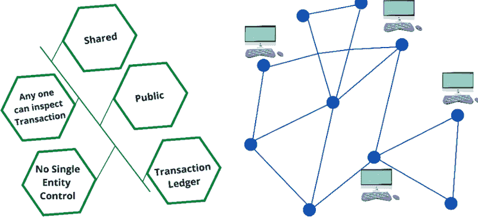

图（1）. 区块链的不同方面。

### 区块

区块链中的区块是各种条目的集合，如前一个区块的哈希、默克尔根以及自身的记录，如图（2）所示。区块的默克尔树是通过将该区块各条目的哈希作为叶节点，并将非叶节点作为其子节点的组合哈希来形成的。使用哈希可确保数据完整性，并有助于确保数据在任意给定时间的正确性。哈希函数接受任意长度的输入并将其转换为固定长度。哈希函数可能产生32位、64位、128位或256位的固定长度，称为哈希。哈希函数保护数据完整性。如果提供了数据的可信哈希，就可以计算数据哈希并验证这两个值。如果它们匹配，则说明数据自原始哈希形成以来没有被更改。

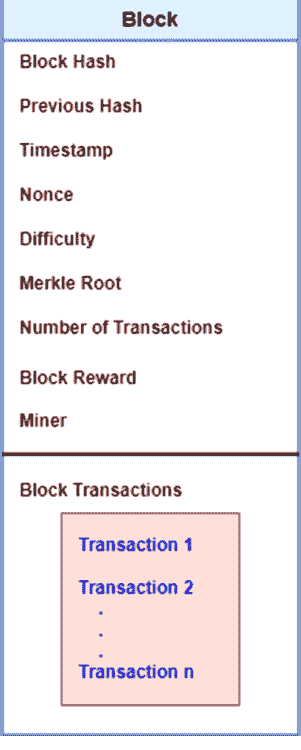

**图（2）.** 区块链中的区块。

第一个区块称为创世区块，是在开始时与记录集及其默克尔根一起创建的。

默克尔树是区块链技术的基本构件。它是一种允许以安全高效的方式验证内容一致性的结构。比特币和以太坊都使用默克尔树。默克尔树生成区块中所有交易摘要的指纹。它使用户能够验证某笔交易是否属于某个区块。如图（3）所示，从下到上对节点对重复进行哈希运算，直到只剩一个哈希。这个哈希就是

- Web/移动应用

- 支持系统

- 开源API

- 商业API

- 去中心化协议

- 社交

- 资产映射

- 验证证书

- 通信

- 共享协议层

  - 覆盖网络

  - 智能合约

  - 存储

  - 侧链

- 共享数据层

  - 区块链

图（5）. 区块链协议栈。

### 防篡改

在点对点网络节点上运行的区块链协议执行交易的验证过程，如图（6）所示，不涉及第三方代理[6]。验证过程通过多数投票共识完成。该协议负责通过一组预定义的治理规则管理所有节点参与交易验证。

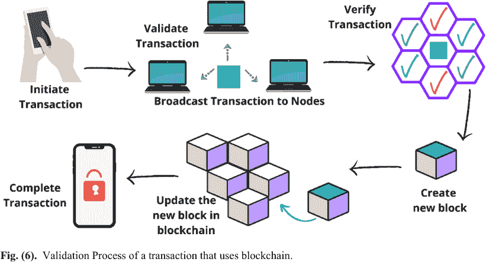

网络的预定义治理规则监督P2P网络中的节点如何相互协作来验证交易。这些规则阐明了：

- 判定交易有效所依据的标准。

- 交易期间产生的成本。

- 使用博弈论和密码学技术验证交易。

- 在必要时更新预定义规则的程序。

考虑一个比特币场景：财务交易借助比特币协议通过多数投票进行验证，而不是像传统银行应用那样通过存储在服务器中的账本手动验证。

### 共识协议

区块链中的共识机制是一种健壮的机制，用于在P2P网络中的节点之间就特定状态达成共同协议。该机制涉及一组预定义规则，用于在可信并记录在区块链中的交易期间同步节点。这些规则的目的是确保交易的有效性和合法性。本节将介绍一些广泛使用的共识机制[7]，即PoW、PoS、DPoS、pBFT、PoC、PoA、PoR、PoI、PoB、PoET、PoId和PoAu。

## 区块链在网络安全解决方案中的应用

### 权益证明（PoS）

PoS采用随机化程序来确定谁有可能产生下一个区块[9]。区块链用户可以将代币持有一定时间以成为验证者。节点不仅作为验证者参与验证过程，有时还会生成新区块并成为贡献者。充当验证者的节点会根据它们在维护区块链中的积极参与程度而不断更换。节点生成新区块的概率取决于它们拥有的硬币或权益数量。参与交易验证过程的验证节点会根据其在形成区块中的参与程度获得奖励。另一方面，由于通货膨胀，验证者可能会获得一定数量的硬币。这些奖励有助于留住区块链网络中的验证者。与其他共识机制相比，PoS在节能方面更高效。

### 委托权益证明（DPoS）

DPoS允许用户用自己的权益进行押注，在交易中向不同代表投票[10]。每个用户的投票在交易中具有不同的权重，这取决于他们用于向代表投票的权益数量。用户“X”的投票比用户“Y”的投票权重更大，因为用户“X”用了100个权益投票，而用户“Y”只用了25个。获得更多票数的代表有权生成新区块。与其他共识机制一样，代表们会获得一定数量的权益作为交易费奖励。DPoS速度更快，能处理更多交易。该机制被认为提供了数字民主，因为它采用了基于权益加权投票的投票系统。

### 实用拜占庭容错（pBFT）

在P2P网络中，可信且无故障节点之间的无争议共识有助于达成共识。BFT的基础可以在所有节点重复传入消息的情况中观察到[11]。如果某个节点不断重复传入消息，那么这明显表明该节点没有任何故障。或者，如果接收者复制传入消息，网络就能轻松排除拜占庭节点的存在。拜占庭节点指的是网络中故意撒谎或误导其他节点的叛徒节点。拜占庭节点也可能对参与共识协议的节点撒谎。一个完全正常运行的区块链网络将确保区块链中的拜占庭容错帮助其处理

故障。拜占庭节点或恶意节点会导致被认定为拜占庭故障的陷阱。用户可能遇到两种不同类型的拜占庭故障，其中第一种完全是技术性的。节点中的轻微技术错误可能会影响其功能，在某些情况下，它可能会停止响应或完全停止工作。另一种拜占庭故障与随机节点故障有关。在随机节点故障的情况下，节点可能表现出以下特征：

- 无法返回最终结果

- 返回错误结果

- 对查询返回故意含糊的结果

- 对单个查询向系统的不同组成部分返回不同的结果

BFT通过降低有害节点的影响，高效地克服了所有这些问题。它可以保护网络免受危险故障的影响，并确保网络以理想状态运行。从根本上说，诚实节点和恶意节点可以各自独立工作，而不会对网络性能产生任何影响。对拜占庭将军问题及优化的广泛研究，已成为在传统BFT基础上引入众多改进的垫脚石。

### 燃烧证明（PoB）

与其他共识机制相比，PoB所消耗的能量也最少[16]。PoB是一种去中心化机制，通过将质押币从流通中移除来表示矿工已达成协议。这一移除过程被称为燃烧。这有助于降低通货膨胀。基于PoB的区块链用于验证交易。PoB采用虚拟矿机来验证交易。PoB矿工通过燃烧代币来展示他们对网络的贡献，并获得挖矿许可。矿工燃烧的代币数量体现其虚拟挖矿能力。更高的挖矿算力会提高新区块确定的速度。因此，矿工会获得更多奖励。在PoB网络中，代币被发送到一个随机生成的销毁地址。该地址可公开验证，但无法访问。PoB在利用质押保护网络方面与PoS类似。需要考虑的主要问题是，被燃烧的质押在逻辑上被移除，而非永久移除，这允许用户通过将这些质押转售给他人来滥用它们，因为处理者仍可访问它们。PoB导致代币稀缺。PoB是一种尚未在更大规模网络上试验的新型共识算法。然而，PoB具有可持续性，且其挖矿高度去中心化。

### 运行时间证明（PoET）

在PoET中，每个用户被分配一个随机等待时间[17]。等待时间更长且更早结束等待的用户将有机会生成新区块。PoET依赖于分配给用户的随机等待时间，并且必须确保等待时间完全以随机方式分配。

### 身份证明（PoId）

在PoId中，用户的私钥会与合格身份进行比较[18]。这确保所有交易都嵌入参与该交易的用户的私钥。这样，每个经过认证的用户都可以生成新区块，并将其传播给网络中的所有其他用户。这有助于维护区块的真实性和完整性。PoId被广泛应用于智慧城市中，以验证公民身份。

### 权威证明（PoAu）

PoS被定制为以验证者身份作为质押[19]。验证者的身份将个人凭证与组织关联，然后组合后的凭证作为验证者身份来验证交易。这样，验证者的声誉在网络中面临风险。PoAu只允许验证者生成新区块。此外，验证者负责维护和保护区块链网络。验证者的数量通常限制在25个以内。

使用区块链的行业在其业务交易中使用不同的共识机制，因为单一机制无法满足区块链技术规定的所有规格。在当今数字世界中，区块链的规格频繁变化，因此任何特定的共识机制都只能适应较长一段时间。如今更高效的共识机制在未来不会有太大帮助。因此，在业务中采用区块链技术的组织必须不时升级其共识机制。

### 区块链的实现

本节介绍使用Python实现区块链，以帮助理解区块链在实际场景中的运作[20]。使用该代码创建的区块链类似于图(8)中的区块链。

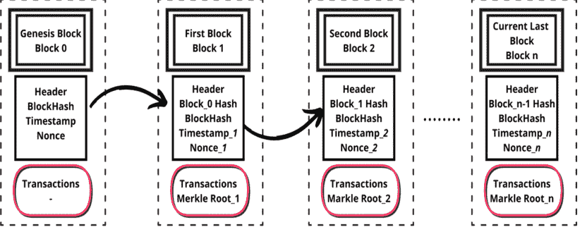

**图(8)。** 包含4个区块的示例区块链。

### 创建新区块

定义了一个`Block`类，其构造函数接受时间戳、一些数据和前一个区块的哈希值。用于表示区块的`Block`类如下所示：


```python
class Blockchain:

    def __init__(self,ts,record,prevHash):
        self.pHash = prevHash
        self.record = record
        self.ts = ts
        self.hash = self.compute_Hash()
```

在上述代码片段中，参数`ts`表示用于存储区块创建时间的时间戳，参数`record`表示存储在区块内的信息或交易详情，参数`pHash`表示包含前一个区块哈希值的字符串。

直观地说，哈希代表了主要文档的指纹。每个区块都包含一个唯一的哈希值。特定区块的哈希值是对该区块的所有内容应用哈希函数计算得出的。`compute_Hash()`方法用于计算新生成区块的哈希值。该方法使用`hashlib`库中可用的`SHA256`哈希函数，并按如下方式导入：

```python
import hashlib

strHash = compute_Hash(mes)

def compute_Hash(str):

sHash = hashlib.sha256(mes.encode())

return(sHash.hexdigest())
```

### 区块链的生成

使用`Blockchain`类生成区块链，如下所示：

```python
import time

class Blockchain:

    def __init__(self):

        self.unconfirmed_transactions = []

        self.chain = []

        self.create_genesis_block()

    def create_genesis_block(self):

        genesis_block = Block(0,[],time.time(),"0")

        genesis_block.hash=
genesis_block.compute_Hash()

        self.chain.append(genesis_block)

    @property

    def recent_block(self):

        return self.chain[-1]
```

`Blockchain`类被实例化为一个简单且易管理的对象，`chain`是其属性。`chain`属性是一个数组，其主要用途是存储区块链中的所有区块。使用`create_genesis_block()`方法为链中的第一个区块创建创世区块。`recent_block()`方法返回`chain`数组中的最后一个元素。`add_new_block()`方法用于向链中添加新区块，这包括通过`prevHash`属性分配前一个区块的哈希值，同时计算新生成区块的哈希值并分配给`hash`属性。

### 测试

基于以下方法，创建了一个包含三个区块的`Blockchain`实例用于测试。

### 验证区块链的完整性

区块链非常出色，因为一旦新区块被加入链中，在不使链中其余区块失效的情况下更改其内容在计算上是困难的。区块的完整性通过`Blockchain`类中包含的新方法`is_chain_valid()`进行验证。当链中的区块未被篡改时，该方法返回`true`值，否则返回`false`值。`is_chain_valid()`方法的代码如下：

```python
def is_chain_valid(self, blockchain):
    previous_block = blockchain[0]
    block_index = 1
    while block_index < len(blockchain):
        block = blockchain[block_index]
        if block['previous_hash'] != self.hash(previous_block):
            return False
        previous_proof = previous_block['proof']
        proof = block['proof']
        hash_operation = hashlib.sha256(
            str(proof**2 - previous_proof**2).encode()).hexdigest()
        if hash_operation[:4] != '000000':
            return False
        previous_block = block
        block_index += 1
    return True
```

考虑以下篡改链的场景语句：

```javascript
bc.chain[1].record = { amount: 50 };

bc.chain[1].hash = bc.chain[1].computeHash();
```

这里数据被更改并重新计算了哈希值，但系统仍会提示链已被篡改。上述代码实现了一个简单的区块链，包括新块的生成和验证。

### 工作量证明的实现

第3.3.1节描述了创建简单区块链的实现过程，还包括检测链中篡改内容所涉及的过程。计算机拥有更快、更高效的处理器，可以在短时间内轻松添加大量区块。这会导致链中区块的泛滥。此外，高效的算力资源也使篡改过程更加容易，攻击者可以修改区块内存储的数据，并重新计算所有后续区块的哈希值。在这种情况下，数据篡改不会被察觉，因为在验证过程中它显示为一条有效的链。在实现简单区块链时需要解决这些问题。这些问题通过第2节所述的共识机制得到解决。本节解释了如何使用称为“挖矿”的过程来实现PoW。挖矿增加了计算资源的使用量，从而增加了创建新区块所需的时间。在PoW中，挖矿过程从持续生成随机数据开始，直到区块哈希的前缀有足够数量的零为止。哈希中前缀零的个数称为挖矿过程的难度级别。随机数`nonce`与用户数据一起作为区块的一部分包含在内。比特币的主要目标是每10分钟创建一个新区块。得益于更快的计算资源，这是可行的。这要求挖矿过程更加复杂和困难。这通过提高难度级别来实现。

在区块链中实现挖矿过程的步骤

- 步骤1：向`Block`类添加一个`nonce`：

```python
class Block:

    def __init__(self,ts, record,prevHash):
        self.pHash = prevHash
        self.record = record
        self.ts = ts
        self.hash = self.compute_Hash()

        self.nonce = 0;
```

- 步骤2：创建一个`proof_of_work()`方法，该方法接收区块作为参数，将所需难度设置为一个值，并迭代生成哈希值，直到哈希值以足够数量的零为前缀。

```python
diff = 3

def proof_of_work(self, block):
    block.nonce = 0
    calculated_Hash = block.compute_Hash()
    while not calculated_Hash.startswith('0' * Blockchain.diff):
        block.nonce += 1
        calculated_Hash = block.compute_Hash()
    return calculated_Hash
```

- 步骤3：将`nonce`合并到计算哈希函数中。

```python
def calculateHash(self):
    newhash = self.index+ self.previousHash+ self.tmstamp+ str(data)+ self.nonce
    return hashlib.sha256(new_hash).hexdigest()
```

### 18 区块链在网络安全解决方案中的应用

Devi 等人

- 步骤4：在`Blockchain`类的构造函数内分配难度级别。

```python
def __init__(self,chain):
    self.chain = [self.create_genesis_block()];
    self.diff = 3;
```

- 步骤5：更新`add_new_block()`方法，以便在将区块插入链之前执行挖矿过程。

```python
def add_new_block(self, block, block_proof):
    prev_hash = self.recent_block.hash
    if prev_hash!= block.prev_hash:
        return False
    if not self.is_valid_proof(block, block_proof):
        return False
    block.hash = block_proof
    self.chain.append(block)
    return True
```

```python
def is_valid_proof(self, block, new_block_hash):
    return (new_block_hash.startswith('0' * 
    Blockchain.diff) and
    new_block_hash == block.compute_Hash())
```

```python
def add_new_transaction(self, new_transaction):
    self.transactions_to_confirm.append(new_transaction)
```

#### 步骤6：创建`Blockchain`实例并向链中添加两个区块，以理解PoW的工作方式

```python
bc = Blockchain()

bc.add_new_block(21/08/2020,{amount:15},
bc.chain[1].computeHash())

bc.add_new_block(22/08/2020,{amount:5},
bc.chain[2].computeHash())
```

执行上述代码片段时，可以观察到生成新区块所需的时间比第3.3.1节中所示的时间更长。这是因为挖矿过程的难度被配置为3，要求哈希值以三个零开头。当难度级别增加时，算法生成区块需要更多时间。

因此，PoW机制使区块链网络能够在规定时间内控制插入链中的区块数量。

## 区块链技术面临的挑战

许多组织和商业人士愿意采用这项技术。然而，存在一些阻碍区块链技术采用的挑战[21]。与该技术相关的关键问题如下。

### 可扩展性

可扩展性是阻碍区块链采用过程的主要因素。众所周知，这项技术每秒可以处理数千笔交易，然而，在比特币和以太坊中，交易速度分别为每秒3至7笔交易和15至20笔交易。这种交易处理缓慢的特性使区块链不适合大型应用。比特币闪电网络和以太坊Plasma被视为以名义费用提供交易即时性的解决方案。

### 网络互操作性

大多数区块链由于缺乏此功能而无法与对等网络通信。为了解决这第二个大问题，Ark使用智能桥梁架构来弥合网络之间的通信鸿沟。该项目提供全球互操作性。

**表1. 区块链特性及其相关后果。**

| 特性 | 积极影响 | 消极影响 |
|---|---|---|
| 不可变性 | 价值互联网，可追溯 | 不灵活 |
| 透明性 | 数据检索效率 | 隐私，信息泄露 |
| 可编程性 | 以确定性方式执行 | 源代码不可更改 |
| 去中心化 | 去中介化 | 去中介化 |
| 共识 | 最小化必要的信任 | 能源消耗，中心化权力 |
| 分布式信任 | 建立信任 | 无个人关系 |

区块链的实际实施需要与复杂的社会、经济、立法、组织和物理系统集成[25]。这种集成带来了大量问题，其中一些列于表2中。

**表2. 实施区块链时面临的问题。**

| 挑战 | 描述 |
|---|---|
| 吞吐量 | 在特定时间段内处理的交易数量。 |
| 延迟 | 交易在得到处理之前所需的时间。 |
| 大小和带宽 | 随着新区块不断添加，区块链会随时间增长。这也消耗了下载数据的大量带宽。 |
| 资源浪费 | 区块链固有的低效率，如冗余数据传输、存储和耗能的共识协议。 |
| 可用性 | 用户与区块链应用程序的交互。 |
| 版本控制、硬分叉、多链 | 多种区块链版本和分叉助长攻击并阻碍跨交易。 |
| 隐私 | 控制对（个人）信息的访问以及删除信息的权利。 |
| 证据质量、记录可信度 | 与区块链上内容的真实性相关的问题。 |
| 缺乏标准 | 在访问权限、数据结构和允许的交易方面尚未出现标准。 |
| 法规 | 立法落后于技术发展。 |
| 共同治理 | 区块链解决方案要求可能破坏现有治理的新结构。 |
| 可行生态 | 吸引足够数量的采用者。 |
| 攻击面 | 区块链是潜在攻击的目标。 |

### 研究展望

行业中区块链应用存在各种安全挑战。区块链使能设备必须设计为构建改进的用户中心数据赋能。仍需要在许多领域进行前瞻性研究 [26 - 32]，不限于：

- 特定区块链相关问题和攻击，如扣留区块攻击和挖矿激励。

- 区块链使能行业（如医疗保健）中的可扩展性问题。随着医疗保健成为一个日益增长的行业，随着越来越多的人步入老年，区块链使能的医疗保健应用将变得呈指数级困难，因为随着患者数量的增加，应用程序可能无法正常运行。

- 部署开源真实世界数据集的必要性，以使研究人员能够进行研究并验证其结果，从而传播其发现和观察。

- 与安全和密钥管理相关的问题，以便轻松恢复受损密钥。

- 身份认证方面的挑战。

- 需要适当的区块链测试方法。

- 控制区块链上基于人工智能的误行为方面的挑战。

### 结论

区块链因其点对点、去中心化的基础设施而日益流行。

然而，许多研究人员已经大量讨论了区块链技术，但仅限于比特币。然而，区块链也适用于其他各个领域。区块链凭借其审计性、去中心化、匿名性和持久性等特性，改变了传统行业。本章介绍了区块链的简要介绍。介绍了包括架构和特征在内的区块链技术的概述。接下来描述了可用于区块链的共识算法。区块创建和挖矿的过程也得到了解释。还讨论了会阻碍区块链发展的诸多问题以及一些研究视角。

### 发表许可

不适用。

### 利益冲突

作者声明不存在利益冲突，无论是财务上的还是其他方面的。

### 致谢

未声明。

### 参考文献

- 1. Swan Melanie, “区块链：新经济蓝图”, 第1版, O'Reilly Media, Inc., 2015.

- 2. D. Burkhardt, M. Werling, and H. Lasi, “分布式账本。” IEEE 工程、技术与创新国际会议。ICE/ITMC, 2018, pp. 1-9. `https://blockchainhub.net/blockchain-intro/`

- 3. L.W. Cong, Z. He, "区块链颠覆与智能合约", Rev. Finance. Stud., vol. 32, no. 5, pp. 1754-1797, 2019. [`http://dx.doi.org/10.1093/rfs/hhz007`]

- 4. Nelson, J. Scott, David Henderson, Glenn Jones, Micha Roon, Michael Zargham, Aleksandr Bulkin, Jake Brukhman, Kenny Rowe, Alex Felix, and Christian Crowley. "面向全球商业和供应链的基于区块链的协议栈." Sweetbridge White Paper (2017).

- 5. D. Ichikawa, M. Kashiyama, and T. Ueno, "使用区块链技术的防篡改移动健康", JMIR Mhealth, vol. 5, no. 7, 2017:e111 [`http://dx.doi.org/10.2196/mhealth.7938`] [`PMID: 28747296`]

- 6. Sankar, Lakshmi Siva, M. Sindhu, and M. Sethumadhavan, "区块链应用上的共识协议调查。", 4th International Conference on Advanced Computing and Communication Systems (ICACCS), IEEE, 2017.

- 7. Amitai Porat, "区块链共识：工作量证明及其应用分析", 2017.

- 8. A. Barhanpure, P. Belandor, and B. Das, "区块链网络的权益证明共识", In: International Symposium on Security in Computing and Communication Springer: Singapore, 2018, pp. 104-116.

- 9. S.M.S. Saad, and R.Z.R.R.M. Radzi, "权益证明 (POS) 与委托权益证明 (DPOS) 之间区块链共识算法的比较综述", Int. J. Innov. Comput., vol. 10, no. 2, 2020.

- 10. I. Abraham, "重新审视快速实用拜占庭容错", arXiv preprint `arXiv:1712.01367`, 2017.

- 11. P. Rasko, "区块链与民主", Soc. Econ., vol. 41, no. 3, pp. 353-369, 2019. [`http://dx.doi.org/10.1556/204.2019.007`]


- 12. I. Bentov, C. Lee, A. Mizrahi, and M. Rosenfeld, "活动证明", Perform. Eval. Rev., vol. 42, no. 3, pp. 34-37, 2014. [http://dx.doi.org/10.1145/2695533.2695545]
- 13. C.B. Tan, M.H.A. Hijazi, Y. Lim, and A. Gani, "关于云数据完整性和可用性可检索性证明的调查：云存储现状、问题、解决方案和未来趋势", J. Netw. Comput. Appl., vol. 110, pp. 75-86, 2018. [http://dx.doi.org/10.1016/j.jnca.2018.03.017]
- 14. H.T.M. Gamage, H.D. Weerasinghe, and N.G.J. Dias, "区块链技术概念、应用和问题的调查", SN Computer Science, vol. 1, no. 2, p. 114, 2020. [http://dx.doi.org/10.1007/s42979-020-00123-0]

受影响最大的行业。银行业受影响的领域是清算与结算、支付、贸易融资、身份和银团贷款 [7]。然而，各行业最重要的是将区块链技术的核心概念应用于其现有业务流程以实现网络安全解决方案，而 Guardtime Federal 专门为美国国防部、美国情报界以及美国政府其他部门提供网络安全解决方案 [8]。所有这些解决方案都提供保密性和经过身份验证的服务。

Rijmenam, 2016 指出，组织正在探索区块链系统的这一革命性技术，并寻找其如何有利于其业务。也有观察到，区块链有可能在几乎所有具有某种交易的行业中使用，许多行业将面临失业，因为中介的工作将不再需要或需求大大减少。区块链是一种技术，可以为信息和数据安全问题提供完善的网络安全解决方案，并为机密信息提供高水平的隐私保护工具 [9]。此外，多签名（multi-sig）或由多个密钥授权交易所提供的保护将更有效地提高安全性和隐私性。

区块链也是比特币背后的技术，它是一个开放的分布式账本，以非常高效的方式安全、永久、可靠地记录交易数据。股票转让过去需要一周时间，但有了区块链，可以在几秒钟内完成。区块链降低了交易成本，并消除了银行家和律师的中介参与。采用区块链技术需要数年时间，就像其他互联网技术在其采用过程中也花费了数年时间一样 [10]。从事金融服务的公司在采用区块链技术方面已经取得了良好的进展，并且很可能影响各种各样的企业和行业。Hsieh (2017) [11] 在一篇文章中指出，区块链安全问题在网络安全方面至关重要。在将其实施到系统中之前，安全专家需要仔细了解其影响、范围和挑战。

预计到 2027 年，身份盗窃将增加 25%，并造成 406.2 亿美元的损失 [12]。导致支付欺诈的网络犯罪的影响在图 (1) 中显示，该图描述了欺诈统计数据。网络安全教育在打击黑客的斗争中至关重要 [13]。

CIA（保密性、完整性和可用性）三元组模型被用作任何组织网络安全策略的网络安全评估的基础和标准。保密性、完整性和可用性是需要得到保障的三要素，而区块链技术允许用户保护这三者。

## 区块链在网络安全解决方案中的应用

与用户相关的信息与网络空间相连，容易受到许多攻击。例如在医疗系统中，患者的数据可能引发严重后果，甚至威胁到他们自身。物联网平台也可能给用户带来同样的威胁，因此为网络共享的信息和数据提供安全保障至关重要[15]，而区块链技术正是解决这一问题最合适的方法。区块链技术能够以其他技术无法做到的方式确保数据安全可靠。

区块链技术的最终目标是允许存储需要记录和分发的数字信息，但又不允许编辑已记录的信息；一旦数据被记录，就很难更改存储的内容。如果有人试图更改信息，哈希码将自动改变。哈希码是数字信息中以数字和字母形式存在的一小部分，由数学函数生成。哈希码的变化很容易被其他拥有相同信息的人发现。

网络安全是一种借助区块链技术提供更强安全性的新方法。这种方法能够最大限度地降低风险并提供强加密。该方法具备验证数据所有权的专长，并能消除对容易被黑客攻击的弱密码的需求。区块链使用分布式账本，这是区块链的基本优势。分布式账本上的交易记录在每个节点上，使黑客难以窃取或攻击数据。分布式账本可以使用公钥基础设施来保护通信安全并验证配置更改[16]。

区块链将给网络罪犯、数据操纵者以及其他意图滥用任何用户个人数据的人带来噩梦。区块链似乎是一项前景广阔的技术，产业界可以通过解决安全和隐私的多方面问题来预见一个安全可靠的未来。与云相关的挑战可以通过区块链的去中心化和自主能力来引导和解决。尤其是去中心化结构在网络规模扩大时能提供更安全的方法。政府和私营部门正在广泛投入开发区块链等新的变革性技术。为了鼓励和支持私营部门，政府应向那些致力于基于区块链的解决方案开发并加强网络安全以保护隐私的机构提供必要和所需的资金。在从隐私和安全角度比较云和区块链时，文中提到了各种加强网络安全的机制。在云系统中，数据完全加密，并通过持续监控可疑活动和实时响应来创建无风险区域[17]。此外，区块链技术的数据通过加密哈希函数完全加密，私钥和公钥密码学确保数据在预期用户之间传输。

如果物联网（IoT）设备遭到黑客攻击，用户可能会面临严重后果。这可能导致用户个人数据丢失，并可能被以任何非法方式利用。美国加利福尼亚州有20%的居民在家中安装智能水表。在推广智能水表时，应考虑与网络安全相关的风险，因为它会收集数据并发送漏水警报。区块链是解决此类设备隐私和安全问题的最合适、最有前景的工具。还有人指出，区块链技术可为物联网设备提供军事级安全[18]，这可以被视为一项有助于加强物联网设备安全和隐私的潜在举措。

随着区块链技术日益普及，对隐私保护和安全的新增需求正在成为所有人的要求。在区块链技术快速发展的初期，随着其使用量的增加，出现了各种攻击。内部参与者的外部入侵攻击可能导致安全风险。根据BCSEC的统计报告，2018年区块链安全事件造成的经济损失达21亿美元。区块链具有多层安全性，分为从上到下的安全等级。区块链结构分为六层：激励层、共识层、网络层和数据层[19]。

区块链结构的应用层包含矿机系统，矿机设备制造商的网络安全意识参差不齐，而且由于其闭源系统，公众无法检查安全代码。最顶层的安全层是应用层——它涵盖涉及大量资金交换交易的集中节点的安全和隐私问题。它可防止未经授权或非预期的访问交换服务器，因为它涉及的大量交易很容易成为黑客的目标。网络安全问题十分严重，可能造成重大损失[20]，区块链似乎非常适合处理与网络安全相关的问题。

区块链技术的特性提供了前景广阔的网络安全保障，并为企业和初创公司的各个领域提供了安全选项。从应用区块链加强网络安全中受益最大的领域包括金融、房地产、医疗、治理和供应链[21]。毫无疑问，区块链技术为保持高水平数据提供了机会，通过数据加密、可扩展性和网络弹性。对于几乎所有行业来说，转向基于区块链的系统比坚持传统系统更有益。每项技术都伴随着挑战和缺陷。因此，各组织在采用区块链技术时需要做好准备，以应对各种复杂情况[22]。

Peck（2017）[17]发现，根据调查结果和观察，区块链在网络安全中的某些领域需要进一步研究，其中面向物联网（IoT）网络的区块链是行业最迫切需要改进的方向。如果物联网（IoT）系统得到区块链技术的支持，其安全性可能会得到改善。此外，在现代计算系统中，不同来源捕获的数据可以通过人工智能（AI）技术得到有效保护。但有意或无意地，数据可能会被恶意第三方整合，这可能基于对抗性输入。作为一种流行的账本技术，区块链有潜力被应用于网络安全的各个领域，并减少金融欺诈的企图。Hasanova[23]还指出，区块链是一种能够为金融、物流、医疗和网络安全带来大量潜在解决方案的技术。

传统的弱点（如破坏性行为和误报错误）可以通过区块链的共识算法在不受中央机构任何干预的情况下消除和防范。身份验证和记录管理不会被黑客攻击所欺骗[24]。然而，区块链也有许多非传统特性，它利用了其重要的网络安全工具——加密。区块链系统可以为许多易受攻击的设备（如安全摄像头等）提供保护。Palo Alto Network的一份报告发现，98%的物联网设备流量未加密。

随着智能电网的发展，改善网络安全面临新的挑战。凭借尖端技术，智能电网也与智慧城市的其他服务（如交通、供水/供气等）一同兴起。人们提出了多种方法使智能电网能够灵活应对网络攻击，在这些方法中，区块链是最有希望保护智能电网网络安全的方法。研究还发现，区块链可以改善智能电网中数据收集和其他执行的网络安全，因为区块链是改善智能电网网络安全最有前景的解决方案。

区块链的采用在金融、云服务和供应链管理中最为明显，这些行业更侧重于存储海量数据、管理。加密有助于控制加密货币的创建数量。有些公司正在将区块链用作加密货币领域的网络安全手段。

### MobileCoin

为了安全地处理账本信息，MobileCoin 正在致力于开发一种可轻松用于资源受限企业的加密货币。它将保持双方之间所有交易数据的加密状态。它将取代交易中的第三方参与，并通过保存透明记录来帮助提升安全性。为了在行业中产生影响，MobileCoin 正在使其产品易于与 Facebook Messenger、Signal 和 WhatsApp 集成。

### Coinbase

Coinbase 作为一个中介平台，允许用户和买家交换数字货币。比特币、莱特币或以太坊的交易都可以在该公司安全的区块链平台上进行。Coinbase 的系统完全由加密安全提供支持。为了确保用户安全，该公司以高安全性保存钱包和密码的数据库。Coinbase 对行业的影响已扩展到超过 2000 万 Coinbase 用户，并已处理了超过 1500 亿美元的交易。

### Javvy

Javvy 构建了一个通用钱包，用于交易和存储代币及加密货币。Javvy 使用人工智能来检测欺诈活动。该公司的应用程序完全基于区块链去中心化技术，并采用生物识别登录。此应用程序允许用户更安全地管理他们的加密货币。2018 年 11 月 1 日，Javvy 的代币销售启动，所得资金用于增强加密货币钱包技术。

### 医疗行业如何在网络安全中使用区块链

医疗行业与其他任何行业一样，也遭受着大量的网络攻击。医疗行业面临的网络钓鱼电子邮件和恶意软件攻击数量翻了一番。患者信息对网络犯罪分子来说很重要，因为他们可以在黑市上索要更多的钱，因此不仅医疗公司，而且医院、医生和诊所存储的与银行相关的患者数据都需要得到保护 [25]。患者的银行卡信息不断被盗，但现在现代技术可以迅速解决这些问题。黑客可以威胁或敲诈勒索以泄露机密信息，因为他们已经从医院拿走了数百万美元，而且除非实施更安全的技术，否则他们将继续这样做。

Saini and Garg

在这种情况下，区块链可能是一种迫切需要的解决方案。分布式账本技术（DLT）去中心化技术允许个人拥有有限的信息，这些信息将构成患者的完整健康信息。一些医疗行业正在使用区块链网络安全技术来评估攻击。

- Hashed Health：Hashed Health 是医疗行业的一项创新，致力于实施区块链技术。Hashed Health 的系统涉及一个区块链医疗社区，包括 Hashed Labs、Hashed Collective 和 Hashed Enterprise，此外，该公司还在试验其他账本技术。Hashed Health 还与其他医疗公司合作，通过区块链网络保护患者的机密信息，并保护公司内部工作的通信渠道。美国的医院和医疗系统设有 Hashed 的基于价值的工作组，以提高支付效率和质量。

- 与 Hashed Health 类似，一些医疗行业正在利用区块链技术致力于患者数据安全。Health Linkage（加利福尼亚州）正在通过区块链技术实现透明的数据治理，Philips healthcare（Philips 研究公司的一部分，马萨诸塞州）正在将人工智能与区块链结合，以创建新的医疗生态系统。在与医院的合作中，人工智能被用于分析管理、医疗和运营数据，而区块链则被用于保护所收集的大量数据。

### 政府如何在网络安全中使用区块链？

许多国家的政府使用区块链来保护其数据和安全的记录存储。美国政府声称，只有 27% 的机构有可能发现大量数据，38% 的公司从未发现攻击者及其方法，84% 的所有政府机构未能实现基本的加密目标，美国管理和预算办公室（OMB）发布了相关报告。美国政府面临的问题可以通过区块链技术得到改善，因为其系统依赖加密运行，并为黑客设置了障碍。区块链的去中心化信息存储、加密数据和可见账本等特性，可以成为实施政府网络安全优先事项的合适解决方案。

2018 年 5 月，科罗拉多州参议院还通过了一项法案，要求政府考虑在网络安全中使用区块链，以保护重要数据和安全的数据存储。一份报告称，科罗拉多州每天面临数百万次攻击尝试，因此实施区块链技术的加密方法非常重要。

马耳他和澳大利亚政府正在实施区块链，并优先发展网络安全网络。

### 军事和国防如何在网络安全中使用区块链

各国的国防和军事部门与世界各地的分散组织共享重要的数据和信息。过去几年中，国防领域已经发生了巨大的创新技术变革，网络安全中的区块链可能成为国防和军事领域的下一项突破性技术。埃森哲发现，86% 的公司计划在未来几年采用区块链，尤其是在网络安全领域。区块链可以保护航空航天、国防和军事领域的机密数据和敏感信息的隐私，并将其最大化。

美国陆军的技术部门对区块链加密和安全数据传输非常感兴趣。工程师们还在致力于为美国军方创建基于区块链技术的消息传递系统。军事人员可以使用该系统共享信息，而无需担心黑客。

中国军方也认为区块链加密是提高效率的完美工具，并且可以抵御攻击者的企图。中国政府正在研究区块链网络安全，以保护其通信、数据和信息不被情报机构获取。

### 银行系统如何在网络安全中使用区块链

> 摩根大通董事长兼首席执行官杰米·戴蒙（Jamie Dimon）表示：“银行正在寻找区块链来解决网络安全问题。”数万亿美元的交易和现金流使银行成为黑客和欺诈的易攻击目标。传统银行过时的网络安全协议使黑客更容易得手，因此许多跨国银行遭受了多次网络攻击。美国货币监理署（OCC）的年度报告建议，像区块链这样多层安全的去中心化技术工具可以为银行提供安全保障。

一些银行已经采用了区块链技术，例如桑坦德银行（Santander），它是英国第一家采用区块链来确保国际级别交易支付安全的银行。区块链技术允许其用户安全地在欧洲和南美洲的账户之间进行支付。

摩根大通是美国最大的金融机构，它还开发了一个名为 Quorum 的以太坊版本，该版本使用区块链技术处理私人交易。

## 区块链增强网络安全的未来益处

使用数字网络平台的企业在防范网络攻击方面面临最大的挑战。网络攻击和在线活动的破坏可能导致巨大损失。尽管区块链已成为数字平台上可信赖的交易形式，其设计也旨在确保信息完整性。区块链有潜力在多个领域实施，其中最好的用途之一可以是确保和构建网络安全解决方案。区块链技术的关键特性是去中心化，它通过区块链技术提供网络安全，阻止未经授权的活动并防止网络攻击。区块链在加强网络安全方面有一些未来有益的用例。

### 物联网（IoT）安全

物联网设备已被黑客利用，它们很容易成为攻击目标，例如通过路由器，他们可以非常迅速地接入整个系统。对人工智能的痴迷使黑客更容易通过家庭自动化进入整个系统，因为边缘设备具有智能开关选项，而大多数物联网设备都具备这一功能。在这种情况下，通过将区块链的去中心化技术应用于设备管理，可以保护这些设备。这将使设备能够做出自动安全决策，并通过检测来自未知网络的可疑活动来保护自身。黑客会以设备的中央管理为目标，以获得完全控制权；而借助去中心化技术，这种设备管理权限不会受到损害，区块链可确保此类攻击不会得逞。

### 网络物理基础设施的验证

区块链技术在验证和信息完整性方面的能力可用于认证任何网络物理基础设施的状态。未知或未经授权的数据访问或系统错误配置会影响网络物理生成信息的完整性。因此，通过区块链生成的数据和信息可以提供更全面的保障。

### 减少网络攻击对人类安全的不利影响

创新的技术设备、自动驾驶汽车和武器有助于从传感器到远程控制数据库的数据传输，自动化军事设备和公共交通是创新技术进步的例证。控制器局域网（CAN）只需接入即可让黑客获得完全的控制访问权限，黑客一直在持续进行此类活动，以破坏并获取网络访问权限。这类活动影响人类安全，但通过数据验证，许多危害可以被阻止。在区块链上执行的数据验证可以防止此类活动。

### 计算机软件的起源

可以利用 MD5 哈希，并应用区块链来验证所下载软件的完整性，以防止外部入侵。对于固件更新、安装程序和补丁程序，可以使用 MD5 来阻止恶意软件进入计算机系统。新软件的身份与供应商网站上可用的哈希值进行比较。MD5 方案并非完全万无一失，因为哈希值可能已经被篡改。然而，对于区块链技术而言，哈希值会被永久记录，而且记录的信息不可更改。因此，区块链可能通过比较哈希值来更有效地验证软件完整性。

### 私密消息安全

社交应用是流行的平台，也是通过社交媒体平台上用户之间发生的互动收集大量数据的一个来源。随着互联网遍及各个角落，世界正在缩小为一个全球村，随着社交应用的增多，现在更多人开始加入社交媒体。为了保护隐私，大多数社交媒体平台用户使用弱且不可靠的密码。随着时代的变化和出于用户隐私的考虑，大多数消息公司现在正准备使用区块链技术，因为它提供端到端加密。为了形成一个集成的 API 框架，区块链可用于实现跨信使通信能力，因为它创建了一个标准的安全协议。

有若干针对社交平台攻击的记录，例如一些知名的社交媒体平台，如 Facebook 和 Twitter。如果区块链技术在社交媒体应用或其他消息系统中得到良好实施，它可能会在未来防止网络攻击。

### 保护域名系统（DNS）和分布式拒绝服务（DDoS）攻击

当目标用户资源（如网络、服务器或网站）被拒绝服务或访问时，就会发生诸如 DNS 和分布式拒绝服务（DDoS）之类的攻击。这类攻击可能导致系统变慢或关闭。域名系统（DNS）采用集中式技术，这使其容易成为希望入侵网站名称与 IP 地址之间连接的黑客的目标。区块链的去中心化解决方案可以通过去中心化域名系统（DNS）的条目来减少攻击，并且还可以消除容易被黑客攻击的风险点。

### 中等存储去中心化


组织现在面临与业务数据黑客入侵和窃取相关的主要担忧，大多数公司使用集中式存储形式，黑客可以轻易利用这种形式。为了访问存储在系统中的全部业务数据，黑客可以通过找到一个单一弱点来获取。这类网络攻击可能导致与业务相关的敏感数据（如财务数据记录等）的大量损失。区块链可以通过确保去中心化的存储形式来保护敏感数据。这种方法将使黑客无法进入系统并攻击存储。存储公司现在正在采用区块链方法来保护其数据免受黑客攻击。例如，Apollo Currency 团队已将区块链技术应用到其系统中，即 Apollo Data Cloud。

### 数据传输保护

区块链技术的加密功能可用于未来在数据传输期间阻止任何人的未授权访问。它使传输过程变得安全，并可增强通过区块链技术传输数据的信心[17]。

## 区块链用于网络安全的主要优点和缺点

区块链具有作为网络安全解决方案的能力，但它也带来了与网络安全相关的并行风险度量。

区块链在网络安全方面的优势在图（2）中作为区块链用于网络安全的主要优点进行了讨论。区块链记录数据，提供安全的数据存储和处理。它还支持安全可靠的数据传输。去中心化系统使其更具弹性，因此不存在单点故障。由于数据透明性和可追溯性特性，交易历史在区块链中可以轻松追踪。区块链网络还提供用户机密性，通过用户的签名验证用户来认证其身份。数据隐私和透明性增强了客户对不同业务的信任。

即使存在这些潜在障碍，在 Infosys 于 2020 年发布的研究报告中，受访者指出使用区块链是开发安全解决方案的首要网络安全趋势。

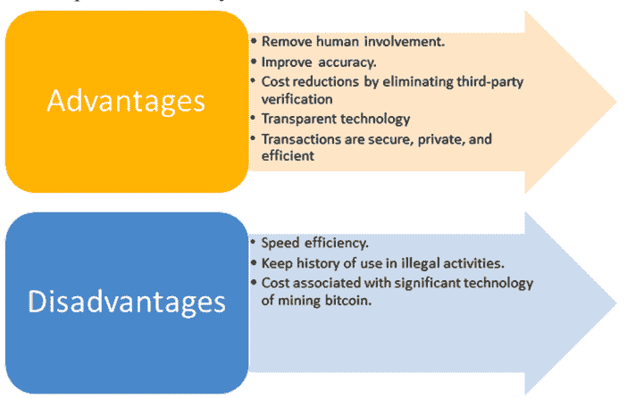

图（4）。区块链在网络安全中的优势与劣势。来源：自行开发。

### 区块链的优势

- 消除人为参与：区块链网络上的交易几乎消除了所有人为参与，因为交易由数千台计算机网络批准。

- 提高准确性：人为参与减少意味着信息记录更准确，因为它消除了人为错误。

- 降低成本：区块链去除了第三方验证以及相关成本。对于比特币而言，相关交易费用有限。

- 透明技术：区块链技术基于开源软件运作，这为用户提供了透明性，任何人都可以查看代码。审计人员也可以审查比特币等加密货币的安全性。

- 交易安全：每笔交易的真实性都由区块链网络验证。购买细节经过数千台计算机检查准确性；验证后，细节被添加到区块链区块中。

- 数据保护：区块链技术通过允许对信息和交易进行选择性访问来提供数据保护和隐私。它不允许黑客以任何级别破坏隐私。在区块链系统中很难修改信息。

- **公钥基础设施管理：** 数字签名是区块链技术提供安全性的核心方面之一。公钥定义数字身份，私钥授权操作。私钥包括交易验证、安全加密和登录。

### 区块链的劣势

- **速度效率：** 据估计，区块链网络每秒只能处理七笔交易。其他加密货币也可提供更好的性能，而传统品牌 Visa 每秒可处理 24,000 笔交易。

- **非法活动历史：** 在保护用户免受黑客攻击和维护隐私的同时，区块链网络允许一些可能以某种方式非法的活动，例如交易。有些网站允许在未被追踪的情况下浏览，用户可能利用这一点进行非法购买加密货币。

- **技术成本：** 在更高级别上消耗计算能力会导致高技术成本，尽管区块链通过节省交易费用为用户节省了资金。但技术并非免费，与之相关的费用使其成本高昂。

## 区块链面临的挑战

基于区块链的网络安全是跨国组织和政府组织适应新工具，但它们似乎很难顺利替换现有工具包。区块链和网络安全仍处于发展阶段，区块链技术的特性并未被所有类型的企业分类。区块链的实施并不容易，其去中心化存储、保护边缘设备等并不适合所有类型的业务需求，在考虑将区块链纳入网络安全战略时可能会出现障碍；下面提到其中一些。

### 法规

对组织来说，理解区块链结构将如何适应其数据隐私、合规性和法规是一个巨大挑战。区块链是一种防止用户在数据存储后编辑或删除数据的技术。在某些情况下，法律要求遗忘数据，在这种情况下，该技术将产生违反政府法律法规的风险。

### 数据隐私

公共区块链数据对企业来说是一个问题，因为任何人都可以查看并保存交易中的数据。那些希望控制与公众共享数据和信息的业务将面临这类隐私问题。但阻止并重复这些交易。非预期的分叉和链分裂攻击可能会导致未经授权方的参与。

- IV. 在私有和公共区块链中，应用程序编程接口（API）集成需要第三方参与。API集成会导致信息或敏感数据的意外泄露。

## 结论

区块链技术具有去中心化的能力，这使它能够高效地应对网络威胁。即使在未来的日子里，它也将成为一种可应用于每个企业的流行技术。虽然该技术面临一些挑战，但这些挑战将带来增长。在迈向数字化的过程中，企业需要保护其数据的安全性和隐私性，而区块链技术可以管理这些问题。它还提供了维护数据安全、网络弹性和可扩展性的机会。要实施区块链技术模型，应开发一个风险模型，以便评估与安全威胁相关的风险。在任何基础设施中启用私有区块链时，它都应当是安全且有弹性的。数据存储的自动化消除了人为错误，并能通过应对未授权方式和网络犯罪来保护数据。所有层的安全性都很重要，这样才能更战略性地实施它，并在将这些层投入运营时考虑所有层的漏洞。网络犯罪对世界上任何行业都构成威胁，而传统安全技术无法应对这些大规模的网络犯罪。区块链在许多行业中建立了信任，以保护数据并提供潜在强大的网络安全。许多行业正在使用区块链技术来防止其信息和数据遭到网络安全窃取。为了改善网络安全并使其更加安全，区块链技术是最可靠的技术，也几乎对所有行业都有益。

## 出版许可

不适用。

## 利益冲突

作者声明不存在财务或其他方面的利益冲突。

## 致谢

我要感谢我的导师在指导上给予我的帮助。我还要感谢我的家人对我的支持，以及我的姐姐Ritu Saini，她帮助我遵循本章的格式指南。

## 区块链在网络安全解决方案中的应用

Saini 和 Garg

- [1] Martin Arnold，“银行使用区块链的五个途径。”《金融时报》16（2017）。

- [2] S. Daily，《钱包、医院和中国军方：区块链网络安全应用的19个实例》，2020年。`https://builtin.com/blockchain/blockchain-cybersecurity-uses`

- [3] N. Kshetri，“区块链在加强网络安全和保护隐私中的作用”，《Telecom. Policy》，第41卷，第10期，第1027-1038页，2017年。[`http://dx.doi.org/10.1016/j.telpol.2017.09.003`]

- [4] J. Kehrli，《区块链详解》，2016年。`https://www.netguardians.ch/news/2016/11/17/blockchain-explained-part-1`

- [5] J. Coward，“遇见将区块链带入工业物联网的梦想家。”《IOT World News》14（2016）。

- [6] S. Das，“比特币在2017年可能被30万家日本商店接受”，2017年。`https://www.cryptocoinsnews.com/bitcoin-accepted-300000-japanese-stores-2017/`

- [7] A. Farion、O. Dluhopolskyi、S. Banakh、N. Moskal iuk、M. Farion和Y. Ivashuk，“使用区块链技术提升网络安全”，[`http://dx.doi.org/10.1109/ACITT.2019.8780019`]

- [8] R. Hackett，“区块链如何能够让我们免于另一场类似弗林特的水污染危机”。（2017年）。

- [9] M.V. Rijmenam，《什么是区块链？为什么它如此重要？》，2016年。`https://datafloq.com`；`https://datafloq.com/read/what-is-the-blockchain-and-why-is-it-so-important/2270`

- [10] G. Albeanu，“区块链技术与教育”，第12届国际虚拟学习会议ICVL，2017年，第271-275页

- [11] Hsieh, Michael, and Samantha Ravich，“利用区块链技术保护国家安全工业基础免受供应链攻击”，研究备忘录，保卫民主基金会（2017年）。

- [12] R. Marley，《年龄验证如何保护电子商务行业免受潜在风险》，2021年。`https://shuftipro.com/blog/how-age-verification-protects-the-e-commerce-industry-from-potential-risks/`

- [13] N. Dey，《区块链在网络安全中的作用》，2021年。`https://www.geeksforgeeks.org/`；`https://www.geeksforgeeks.org/role-of-blockchain-in-cybersecurity/`

- [14] T. Salman、M. Zolanvari、A. Erbad、R. Jain和M. Samaka，“使用区块链的安全服务：一项最新技术综述”，IEEE Commun. Surv. Tutor.，第21卷，第1期，第858-880页，2019年。[`http://dx.doi.org/10.1109/COMST.2018.2863956`]

- [15] J. Legrand，《区块链在网络安全中的未来用例》，2020年。`https://www.cm-alliance.com/cybersecurity-blog/the-future-use-cases-of-blockchain-for-cybersecurity`

- [16] P.J. Taylor、T. Dargahi、A. Dehghantanha、R.M. Parizi和K.K.R. Choo，“区块链网络安全的系统性文献综述”，Digital Communications and Networks，第6卷，第2期，第147-156页，2020年。[`http://dx.doi.org/10.1016/j.dcan.2019.01.005`]

- [17] M.E. Peck，“区块链：它们如何工作以及为什么它们将改变世界”，IEEE Spectr.，第54卷，第10期，第26-35页，2017年。[`http://dx.doi.org/10.1109/MSPEC.2017.8048836`]

- [18] D. Schutzer，“CTO专栏：什么是区块链？为什么重要？FSRoundtable”，FS Roundtable，美国华盛顿特区，技术报告16（2016年）。

- [19] Chia, Vincent, Pieter Hartel, Qingze Hum, Sebastian Ma, Georgios Piliouras, Daniël Reijsbergen, Mark Van Staalduinen, and Pawel Szalachowski，“重新思考区块链安全：立场论文”，载于2018年IEEE物联网国际会议（iThings）与IEEE绿色计算与通信国际会议（GreenCom）及IEEE网络、物理与社会计算国际会议（CPSCom）与IEEE智能数据国际会议（SmartData），第1273-1280页，IEEE，2018年。[`http://dx.doi.org/10.1109/Cybermatics_2018.2018.00222`]

- [20] S. Demirkan、I. Demirkan和A. McKee，“区块链技术在未来企业网络安全和会计中的应用”，*《管理分析期刊》*，第7卷，第2期，第189-208页，2020年。[`http://dx.doi.org/10.1080/23270012.2020.1731721`]

- [21] `https://www.ccn.com/south-korean-exchange-youbit-declares-bankruptcy-after-second-hack-this-year`

- [22] P. Zhuang、T. Zamir和H. Liang，“区块链在智能电网网络安全中的应用：一项综合综述”，*《IEEE工业信息学汇刊》*，第17卷，第1期，第3-19页，2021年。[`http://dx.doi.org/10.1109/TII.2020.2998479`]

- [23] H. Hasanova、U. Baek、M. Shin、K. Cho和M.S. Kim，“区块链网络安全漏洞及可能对策综述”，*《国际网络管理期刊》*，第29卷，第2期，2019年，e2060 [`http://dx.doi.org/10.1002/nem.2060`]

- [24] H. Wang、Y. Wang、Z. Cao、Z. Li和G. Xiong，“区块链安全分析综述”，*中国网络安全年度会议*，2018年，第55-72页

- [25] A. Razaque、A. Al Ajan、N. Melaoune、M. Alotaibi、B. Alotaibi、I. Dias、A. Oad、S. Hariri和C. Zhao，“通过部署基于网络的区块链网络安全意识系统规避网络安全威胁”，*《应用科学》（巴塞尔）*，第11卷，第17期，第7880页，2021年。[`http://dx.doi.org/10.3390/app11177880`]

## 区块链在网络安全产业中的应用

N. Gupta¹* 和 R. Agrawal¹

¹ 印度哈里亚纳邦法里达巴德，Manav Rachna国际研究与研究学院

> 区块链是一种去中心化的记录，用于安全地转移数字货币、达成协议和进行交易。系统中的每个人都会获取编码记录的最新副本，以授权另一笔交易。从根本上说，它是一个合适的数据库，维护着一个持续发展、高度组织化的区块信息结构，其中包含大量单独的交易。区块链创新正被各种组织采用，最显著的是在数字货币的使用方面。无论如何，创新在网络上是有用的。本章考察了区块链在网络安全行业中的几个应用案例。大多数专家正在致力于接受区块链，以保护物联网（IoT）设备、系统和信息。本章考察了先前分析者提出的方法，通过这些方法，区块链可以承担安全成本。最后，本章提出了未来单一区块链的前景，以构建网络安全应用，实现安全安排之间的协调与一致性。

关键词：比特币，区块链技术，网络安全。

区块链是一种前沿创新，有可能彻底改变处理的未来，并以更富想象力的安排挑战一些企业。它是开放的、不可更改的，并且实际上充分适用于各种相关场景[1]。数字货币的兴起增加了人们对这一概念的兴趣，尽管它在金融以外的各个领域也有用途。区块链大致等同于几个以加密方式连接的区块。一个区块指的是一种三部分信息结构：信息、前一个区块的哈希值，以及信息和过去哈希值的哈希。因此，区块之间需要有信任，这种信任可用于确保整个区块链的完整性。如果任何区块中的信息发生变化，

* 通讯作者 N. Gupta：印度哈里亚纳邦法里达巴德，Manav Rachna国际研究与研究学院，电子邮件：neha.fca@mriu.edu.in

哈希值也会随之改变 [2]。这将导致连锁影响，使得后续区块的哈希值变得无效。这就是区块链交易不可篡改的原因。这一基础特性在提供高风险领域的网络安全解决方案时极为有用，例如物联网设备、系统以及数据存储和传输。

### 研究目标

- 研究区块链在网络安全中的作用。

- 研究通过区块链技术实现的网络安全未来。

### 研究方法

本章将阐述对支持性信息的系统性调查，以评估区块链创新在当前网络安全行业中的相关性。重点将放在Taylor等人 [18] 最近的一份报告上，该报告调查了30项聚焦区块链网络安全用例的持续研究。

### 区块链在网络安全中的作用

当今对网络和创新的日益依赖为组织带来了新的收入来源和行动计划；然而，这也为攻击者创造了新的漏洞和可乘之机 [3]。网络犯罪分子已变得越来越老练，他们试图窃取金钱、健康记录、个人可识别信息（PII）和知识产权等关键信息，并依赖于极其有利的系统，例如通过DDoS攻击扰乱企业的整体运营，或利用尖端的勒索软件方法拒绝信息访问 [4]。

鉴于当前的事态，区块链创新对网络安全是助力还是障碍？采用分布式账本技术的区块链，从根本上说是一种去中心化的、数字化的、开放的所有加密货币交易记录 [5]。这可能有助于提升数字安全，因为该平台可以通过共识机制防止欺诈行为，并基于其操作灵活性、信息加密、可审计性、透明性和持久性等基本属性来检测信息篡改 [6]。

区块链在关键层面上解决了对手方之间的“缺乏信任”问题。区块链是一种分布式数据库，既用于私有应用也用于开放应用，而不是将所有数据存储在少数几个超大数据库中的中心化系统 [7]。每一组有效交易的信息都保存在自己的区块中；每个区块都与排列在其前一个位置的区块相关联，并随着新数据块的添加而持续发展。

### 从身份验证中消除人为因素

借助区块链创新，组织可以在不需要密码的情况下验证设备和客户端 [8]。这消除了身份验证过程中的人为干预，从而避免成为潜在的攻击载体。

使用组合设计和简单登录是标准框架的主要缺陷。无论一个组织在安全方面投入多少资金，如果员工和客户使用容易被窃取或破解的密码，所有这些努力都是徒劳的。区块链提供了可靠的验证，同时还解决了单点故障问题。组织使用的安全框架可以借助区块链，利用分布式公钥基础设施来验证设备和客户 [9]。该安全框架不采用密码，而是为每个设备分配一个唯一的SSL证书。由于证书信息的管理在区块链上进行，攻击者几乎不可能使用伪造证书。

### 去中心化存储

区块链用户可以将数据保存在自己系统的个人电脑上。通过这种方式，他们可以确保链条不会断裂。例如，如果某个不是信息所有者的人（例如攻击者）试图篡改某个区块，整个框架会检查每一个数据块，以找出与其余区块不同的那个 [10]。如果框架发现了这种类型的区块，它会直接将该区块从链中移除，并将其标记为欺诈区块。

区块链的设计方式使其没有中央存储区域或中央权威机构。在系统中，每个客户端在存储部分或全部区块链方面都有要执行的任务 [11]。区块链网络中的每个人都要负责验证传输的信息并维护它，以确保现有信息不被删除，虚假信息不被纳入。

### 可追溯性


上传到私有或公有区块链的每笔交易都被仔细地打上时间戳和标签。这意味着公司可以将每笔交易追溯到特定时间段，并使用其公开地址在区块链上找到交易对手 [12]。这一方面与不可否认性相关：即确保某人不能否认其文件上签名的真实性，或否认其发起了一笔交易。由于每笔交易都以密码学方式与客户端关联，当前区块链的实用性提高了框架的可靠性。任何添加到区块链的新交易都会改变记录的全局状态。这意味着框架每经历一个新周期，前一状态都会被保存，从而形成完全可观察的历史日志。

区块链的审计能力为企业提供了对每笔交易的一定程度的安全性和透明性。从网络安全的角度来看，这为实体提供了额外的保证，确保信息未被篡改且正确无误 [13]。

由于其去中心化的特性，区块链没有“可入侵”的入口或单点故障，因此与当前其他基于数据库的价值型结构相比，它们提供了更高的安全性 [14]。

首先，它将关注发展中区块链创新在网络安全中的最新应用。其次，它将研究部署区块链网络安全解决方案的可用方法。研究发现和分析论文中的主要观点将用于构建关于区块链如何在当前IT客户端环境中提供安全的讨论 [15]。

分布式记账形式是区块链的另一个重要组成部分。如有必要，区块链系统中的节点可以存储系统的所有信息。许多节点这样做是因为这要么是共识所需，要么是参考所需 [16]。这确保了不存在集中式数据存储。任何试图篡改区块链的对手方都必须破坏大量存储去中心化信息的节点。这是因为系统会检查存储在去中心化区域的数据块，以识别那些与众不同的块。区块链的高级特性使其非常适合当今的网络安全需求。将区块链整合到网络安全中的一种方式是通过开发能够防止虚假陈述和数据欺诈的设备 [17]。客户端始终面临未经授权访问和更改信息的风险。这是因为各种客户端都有集中式数据存储。因此，攻击者很容易入侵信息存储区域并恶意修改信息。通过其分布式数据存储，区块链可以防止此类事件。高度敏感的信息，例如选举结果，可以以这种方式存储在大量个人电脑上，每台电脑都有一份信息副本。

除非攻击者能够入侵大量拥有信息副本的个人电脑，否则仅入侵和修改几台个人电脑不会对系统中的其余信息产生影响。此外，区块链可用于防止数据盗窃 [11]。据纳斯达克称，当前的数据盗窃事件是数据管理不足的结果。

客户通常被要求提供超出必要的信息，以便从不同企业获得服务。这些组织承诺保护这些信息，但攻击者往往最终会发现可利用的安全漏洞并渗透到信息存储设施中。通过去中心化的身份架构，区块链可以通过确保客户是其所声称的人来防止欺诈 [12]。这可以通过利用一个综合框架来实现，在该框架中，所有组织都可以验证客户的身份，而不必要求他们共享敏感属性。这降低了泄露的可能性，并使攻击者的成本更高。

## 区块链如何提供网络安全？

由于区块链创新的复杂结构，它是最安全的。因此，先驱们已开始在多个领域实施区块链技术，以打击盗窃并提高信息安全性。比特币正在扩张，但区块链也在不断发展。比特币是区块链创新的持续灵感来源。然而，区块链远不止是比特币 [14]。在安全方面，区块链及其开放记录可以为大数据管理、端点安全软件、金融设备和供应链管理软件提供解决方案。区块链创新以多种方式影响了数字安全行业。HYPR Corp是一家总部位于纽约的公司，为企业提供去中心化认证解决方案，使客户和员工能够安全且一致地使用移动、Web和物联网（IoT）应用。它利用区块链技术去中心化凭证和生物识别数据，以实现基于风险的身份验证。它每年在这个平台上花费1000万美元。NuCypher是另一家区块链安全公司，采用中继区块链框架进行代理重加密 [15]。它还拥有一个访问控制平台，并使用公钥加密来安全地传输数据和授权访问要求。

区块链是近年来最突出的技术术语之一，这项创新被吹捧为包括数字安全在内的一切问题的解决方案。2018年3月，美国内务和通信部实施了一个基于区块链的框架来起草联邦招标。每个

区块链客户端拥有私钥和公钥。任何希望执行的客户端都会使用私钥和待传输信息创建数字标记。这个新建的数字标记与交易一起交给收集者。受益人拥有发送者的公钥，可用于验证客户端 [16]。

就我们所有的数字安全问题而言，区块链就像一把瑞士军刀。货币交易通常由可信的第三方（例如 PayPal）担保，而区块链可用于将这一过程计算机化，通过自主智能合约去除中间人，并在系统各方之间充当可信中间人，从而降低总体费用。

在区块链日益普及的过程中，美国国防高级研究计划局（DARPA）也在资助和支持使用区块链来保护与从原子弹到核电站等一切相关的极其敏感的信息。股票、共同基金、债券和年金也许有一天会存储在区块链中，许多金融机构正在研究这项新技术。

区块链创新正在对当今的数字安全业务产生重大影响。通过从信息存储中移除大部分人为因素，区块链从根本上降低了人为错误的风险，而人为错误是信息泄露的主要原因 [17]。它是一种去中心化的分布式记录架构，用于记录跨多台 PC 的信息交换。区块链技术可用于防止任何类型的数据泄露、数据欺诈、数字攻击或不利结果。

这确保了信息保持私密和安全。下面列举几个区块链如何帮助数字安全的示例：

- 带验证的保证边缘计算：区块链有助于加强身份验证、增强信息归因并重组执行记录。

- 改进的机密性和数据完整性。

- 保护私人信息。

- 改进的公钥框架。

完整的域名系统（DNS）：DNS 是恶意活动的明显目标，因为黑客可以关闭 Twitter、PayPal 等大型网站以及其他服务的 DNS 基础设施。使用区块链方法存储 DNS 记录可以通过消除这一单点故障来提高整体安全性。

减少 DDoS 攻击：分布式拒绝服务（DDoS）攻击是指多个受感染的 PC 系统攻击一个目标（例如服务器、网站或其他系统资产），并导致客户目标资产服务中断。这会使框架变慢甚至可能崩溃，从而拒绝向真实客户或系统提供服务。通过将区块链集成到去中心化方案中，可以解决这个问题，从而提供针对此类攻击的保护。

区块链不需要密码，因为它依赖生物识别信息或私钥以及众多验证步骤来确保客户的身份真实。这些框架提供了比客户名称、密码等更强大的数据安全性。智能设备和其他高度自主创新的兴起也导致了黑客攻击水平的上升。物联网为黑客攻击开辟了一条新途径，这种攻击不太容易被早期发现，因此可能提供一种替代网络钓鱼的方法。专家们现在依赖区块链创新来检测错误或可能退化的指令和输入，并防止系统功能被完全终止。

信息是通用货币。据一位消息人士称，单个买家信息每天至少价值 240 美元，可能还要多得多。如今，将信息保存在集中式数据库中很普遍，因为它很容易被黑客入侵。由于区块链天生是去中心化的，因此黑客没有单一的入侵点可供攻击。

我们生活在一个数字战斗时期，这比对公司的勒索软件破坏更危险。2017 年，美国政府成为 61,000 次数字攻击的目标，每次攻击的危险程度各不相同。企业级区块链以其卓越的安全特性以及限制数字破坏对基础设施造成损害的能力而闻名。基于区块链的数字防御安全框架将提供另一种数字屏障框架。

## 区块链技术在网络安全中的应用

### 带认证的保护边缘计算

边缘处理有利于 IT 性能、盈利能力和资源利用；然而，它给 CISO、CIO 和大型企业带来了安全隐患；因此，区块链为安全的物联网和工业物联网提供了选择。它将有助于加强身份验证、改善信息归因和流动，以及更新管理记录。

### 确保机密性和数据完整性

区块链最初创建时没有精确的访问限制，其开放分发的倾向就证明了这一点。然而，当这项发明开始为各种组织提供解决方案时，区块链的使用现在有了信息保密和访问控制的空间。区块链的完整加密确保信息在传输过程中不会被任何未经授权的个人或组织访问。

### 私密消息安全

大量公司正在研究区块链，以确保通过聊天、消息应用程序和互联网网络交换的个人和私人数据的安全。他们希望利用区块链将其变成一个不受远程攻击影响的安全平台。

### 改进的公钥基础设施（PKI）

PKI，即公钥基础设施，维护应用程序、消息、网站和各种通信的安全。然而，它们都依赖外部证书颁发机构来签发、撤销或存储密钥对。这些认证专家可能成为使用伪造身份试图破坏加密通信的黑客的明确目标。然而，当密钥在区块链上分发时，就没有了伪密钥生成或大规模欺诈的空间，因为应用程序会验证与你交易的人的身份。

### 完整的域名系统（DNS）

DNS 是恶意活动的明显目标，因为黑客可以关闭 Twitter、PayPal 和其他服务等主要网站的 DNS 专用服务。使用区块链方法存储这些 DNS 记录可以广泛提高安全性，因为它消除了可能被利用的单点故障。

### 拒绝服务攻击的减少

分布式拒绝服务（DDoS）攻击是指众多受感染的 PC 系统攻击一个目标（例如服务器、网站或其他系统资产），并对目标资产的客户造成拒绝服务。这会导致框架变慢甚至崩溃并关闭，从而拒绝向真实客户或系统提供服务。可以通过将区块链集成到提供针对此类攻击的安全性的去中心化方案中来解决这个问题。

我们可以设计和采用众多安全措施，但威胁也会以同样的方式进行适应和调整。尽管如此，有了区块链，我们仍有充分的把握确保信息是安全的。

随着更多人连接到互联网以及技术的进步，产生的数据越来越多，更多的黑客试图提取或破坏这些数据。区块链创新具有适应性，并且对互联网的未来有着惊人的帮助，使用户能够更轻松地确保其数据的准确性。

创新的区块链应用正逐渐成为数字货币之外领域的一部分，并且在协助网络安全方面尤其有用。通过在一个系统上实施全面的加密和信息传输规则，任何组织都可以确保其数据保持安全、不受损害且远离黑客。

## 区块链技术的未来：2030 年预测

十多年来，数字货币和区块链创新席卷全球。一些人认为这只是开始。随着多个行业垂直领域的众多企业迅速拥抱区块链，很明显，区块链正在演变成一种发展趋势，并稳步迈向下一阶段的区块链剧变。区块链正迅速成为不可避免的奇迹，因为它为数字企业提供了根本性强有力的改进和巨大的开放机遇。

### 区块链将被用于全球大部分贸易

全球供应链就是这样一个有前景的领域，区块链可能在其中提供显著的商业价值。目前，世界贸易中存在大量浪费、虚假陈述和错误，因为它是通过不可靠的商业连接的无序安排来进行的。以下是当前现实中应该了解的供应链问题清单：

- 假冒汽车零部件。

- 假药。

- 食品供应链中的腐败。

- 假冒名牌服装和奢侈品。

- 假冒电子设备，包括医疗设备。

这些供应链问题是危险的。这主要是因为

商业生态系统是碎片化的，仅部分实现了自动化，并且缺乏一个可靠的核心来确保可信度和监控来源。区块链正是这样一种突破性技术，它将抵御干扰，带来需求并起到统一力量的作用。区块链将在提高执行力、适应性、生产力和增长方面发挥关键作用。

### 无摩擦流动与数字资产

到2030年，价值万亿美元的代币数量将超过价值万亿美元的公司。目前，谷歌、苹果、微软和亚马逊这四家备受推崇的全球性企业正在展开竞争。它们的估值均达数万亿美元。区块链将对计算机化业务产生有利影响，并增加金融交易的激励。得益于区块链，交易和数据流的成本大幅降低。区块链以无摩擦的方式促进代币和其他资源的流动。万亿美元代币将在区块链技术的未来中发挥关键作用。这些代币支持一个去中心化的元素生态系统。

### 面向所有人的区块链身份

到2030年，每个人及其虚拟或实物资产都将拥有区块链身份，甚至可能更早。通过提供多种身份安排，区块链将有助于改进框架。由于现有的身份系统效率低下且不可信，区块链创新将成为个人和资产的单一验证来源。这将有助于：

- 提高保护性和生产力。

- 去中心化并验证所收集的信息。

- 将数据存储在单一记录中。

- 降低安全渗透的危险。

创建一个去中心化且不受中央机构约束的新身份系统。这建立了透明度。区块链在身份领域的一些用例包括商业记录、税务识别记录、政府记录、证书和医疗保健记录，以及声誉评分。

### 全球生活水平的显著提高

如今，贫困和工资欺诈是人类必须面对的最棘手的问题。超过10%的人口（即超过7.5亿人）每天生活费不足2美元。超过20亿人被视为无银行账户，因为他们不使用金融服务。区块链有潜力显著缩小贫困差距。这通过三种不同的方式实现，分别是：

- 减少腐败 – 区块链确保合法记录的完整性。包括土地在内的所有产权都将记录在永久（密封）、简洁且安全的数字记录中，这些记录将完全向公众开放。对任何利益的敏感性都会降低其可识别性和资源成本。创建一个去中心化的资产追踪框架将有助于全球财富的增长。梳理这一复杂局面将对全球经济产生巨大的积极货币影响。

- 金融包容性 – 这是比特币等数字货币的一个明显优势。无银行账户的人可以使用加密货币和区块链获得银行服务，从而收到付款。当使用区块链创新时，没有理由依赖银行或政府等中心化机构来批准开设金融账户。它将提供便捷的加密货币交易所访问渠道，用户可以通过智能手机买卖数字货币。随着全球大量商家接受加密货币，到2030年，数字货币将成为真正的标准，类似于现在被广泛接受的美元。

- 价值创造型资产的代币化 – 代币化是指使用数字代币来证明资产所有权。区块链促进了大规模资产的代币化。这意味着即使是来自农村地区的牧场主也可以成为旅馆或金矿等创收资产的部分所有者。与传统投资相比，这将有助于为潜在的金融投资者打开更大的市场，缩短交易时间，并提高流动性。

### 研究结果与建议

对30篇研究论文的结果显示，区块链在物联网、系统和数据存储安全方面正变得越来越实用。由于目前有90亿台物联网设备，关注区块链物联网安全是有道理的。这些设备的安全设计薄弱，其中许多被黑客入侵并加入僵尸网络。Mirai僵尸网络就是这样一个整合了物联网设备的僵尸网络，它曾成功攻击过大型目标，如互联网领先的域名服务公司之一Dyn DNS。因此，许多安全研究人员正在寻找利用区块链确保这些设备安全的方法。

区块链网络安全研究的第二个主要焦点是数据存储。这是因为数据泄露事件日益增多，攻击者能够从拥有数十亿客户的公司窃取信息。例如，2014年的雅虎数据泄露事件导致30亿用户的信息被盗。因此，安全研究人员正在研究数据存储的区块链安全解决方案，例如云平台。还可以注意到，科学家们正在研究使用区块链来确保系统的安全性。由于当前的系统安全措施（如通过WPA加密实现的安全）可能被颠覆，这些领域中绝大多数研究都集中在身份验证上。最后，人们对用于身份验证的区块链安全解决方案也有很大兴趣。绝大多数实验正在评估使用广泛采用的区块链认证机制来确保经过认证的数据的策略。客户将不再需要与组织共享数据；相反，组织将使用区块链验证客户。

### 结论

在前沿世界中，区块链创新不断发展并探索新的用例。网络安全是已经研究和应用区块链的合适领域之一。区块链基础使其在处理物联网设备、系统、数据传输和存储等领域的当代安全问题时非常实用。大多数区块链安全科学家似乎正集中精力在物联网设备上采用区块链安全。除此之外，区块链安全的其他重要领域是系统和数据。区块链技术可以通过利用日益强大的身份验证和数据传输机制来确保物联网设备的安全。这些机制可以防止攻击者入侵这些通常安全设计薄弱的设备。该创新还可以通过利用安全框架防止未经授权的连接和通信来确保系统的安全性[15]。最后，区块链通过加密区块确保数据传输和存储，这些区块只能由传输方打开，不受控制。尽管其他用例也在探索中，但这三个已成为主要焦点。未来的研究人员应研究使用单一区块链建立安全安排的可行性，因为目前绝大多数安排使用多个区块链，这使得集成变得困难。

### 同意发表

不适用。

### 利益冲突

作者声明不存在财务或其他方面的利益冲突。

### 致谢

声明无。

### 参考文献

- [1] W. Li、S. Andreina、J-M. Bohli 和 G. Karame，“保护权益证明区块链协议”，载于*数据隐私管理、加密货币与区块链技术*，施普林格：尚贝里，2017年，第297-315页。http://dx.doi.org/10.1007/978-3-319-67816-0_17

- [2] D. Li、W. Liu、L. Deng 和 B. Qin，“基于分布式可信通信的多媒体区块链隐私保护系统设计”，*新兴电信技术交易*，第32卷，第2期，第e3938页，2021年。http://dx.doi.org/10.1002/ett.3938

- [3] H.T.M. Gamage、H.D. Weerasinghe 和 N.G.J. Dias，“区块链技术概念、应用与问题综述”，*SN计算机科学*，第1卷，第2期，第114页，2020年。http://dx.doi.org/10.1007/s42979-020-00123-0

- [4] K. Karantias、A. Kiayias 和 D. Zindros，“燃烧证明”，载于*国际金融密码学与数据安全会议*，2020年，第523-540页，尚贝里。http://dx.doi.org/10.1007/978-3-030-51280-4_28

- [5] L. Chen、L. Xu、N. Shah、Z. Gao、Y. Lu 和 W. Shi，“关于流逝时间证明（PoET）的安全分析”，载于*分布式系统稳定化、安全与保障国际研讨会*，2017年，第282-297页，尚贝里。

- [6] N. Gupta，“区块链技术安全与隐私问题深度探讨”，载于*区块链技术研究手册*，学术出版社，2020年，第95-112页。http://dx.doi.org/10.1016/B978-0-12-819816-2.00004-6

- [7] N. Gupta，“区块链技术的安全与隐私问题”，载于*区块链技术的高级应用*，施普林格：新加坡，2020年，第207-226页。http://dx.doi.org/10.1007/978-981-13-8775-3_10

- [8] L. Kristian、J. Mattila 和 T. Seppala，“智能合约——区块链技术将如何影响合约实践？”，*Etla报告68*，2017年。http://dx.doi.org/10.2139/ssrn.3154043

- [9] D. Macrinici、C. Cartofanu 和 S. Gao，“区块链技术中的智能合约应用：一项系统性映射研究”，*电信信息学*，第35卷，第8期，第2337-2354页，2018年。http://dx.doi.org/10.1016/j.tele.2018.10.004

- [10] D. Efanov 和 P. Roschin，“区块链技术的无处不在”，*Procedia计算机科学*，第123卷，第116-121页，2018年。http://dx.doi.org/10.1016/j.procs.2018.01.019

- [11] Y. Lu，“区块链：最新进展与研究挑战”，*工业信息集成杂志*，第15卷，第80-90页，2019年。


[12] J. Truby, "Decarbonizing Bitcoin: Law and policy choices for reducing the energy consumption of blockchain technologies and digital currencies", Energy Res. Soc. Sci., vol. 44, pp. 399-410, 2018.

[http://dx.doi.org/10.1016/j.erss.2018.06.009]

[13] M. Niranjanamurthy, B.N. Nithya, and S. Jagannatha, "Analysis of blockchain technology: Pros, cons and SWOT", Cluster Comput., vol. 22, no. S6, pp. 14743-14757, 2019.

[http://dx.doi.org/10.1007/s10586-018-2387-5]

[14] X. Ling, Y. Le, J. Wang, Z. Ding, and X. Gao, "Practical modeling and analysis of blockchain radio access network", IEEE Trans. Commun., vol. 69, no. 2, p. 1, 2020.

[http://dx.doi.org/10.1109/TCOMM.2020.3029779]

[15] J. Bae, and H. Lim, "Random mining group selection to prevent 51% attacks on bitcoin", 2018 48th Annual IEEE/IFIP International Conference on Dependable Systems and Networks Workshops (DSN-W), 2018 pp. 81-82

[http://dx.doi.org/10.1109/DSN-W.2018.00040]

[16] M.R. Islam, M.M. Rahman, M. Mahmud, M.A. Rahman, and H.S.M. Muslim, "A review on blockchain security issues and challenges", 2021 IEEE 12th Control and System Graduate Research Colloquium (ICSGRC), 2021 pp. 227-232

[http://dx.doi.org/10.1109/ICSGRC53186.2021.9515276]

[17] C. Decker, and R. Wattenhofer, "Bitcoin transaction malleability and MtGox", European Symposium on Research in Computer Security, 2014 pp. 313-326 Cham

# 区块链攻击面概述

S. Zalte¹*, H. Bhatia², R. Deshmukh³, N. Gupta⁴ 和 R. Kamat⁵

¹ 印度戈尔哈布尔湿婆吉大学计算机科学系

² 印度浦那D Y帕蒂尔国际大学计算机科学、工程与应用学院

³ 印度戈尔哈布尔湿婆吉大学计算机科学系

⁴ 印度哈里亚纳邦法里达巴德马纳夫·拉赫纳国际研究学院

⁵ 印度戈尔哈布尔湿婆吉大学计算机科学系

## 摘要

在区块链技术中，网络犯罪分子为那些希望传播虚假信息、助长网络攻击、实施不道德行为等的非合法人员开发新的攻击面。攻击被认为归因于区块链的密码学架构、底层架构以及它们被应用的环境。主要威胁集中在渐进的防御研究活动上。目前认为，区块链上可以发起其他攻击而无需承受传统防御，其中一些攻击可能被用来实施任何其他攻击。通过描述这些攻击并研究其对策，它为更安全、更有效地使用区块链指明了应坚持的新研究方向。尽管存在漏洞和攻击，该技术仍提供了哈希、不可变性和数字签名等关键特性，这些特性丰富了区块链。研究人员还通过智能组合这些特性，为开发区块链的安全防护盾做出了贡献。基本上，这些特性是实现`CIA`（机密性、完整性、认证）所必需的。本文的贡献将是对区块链技术的攻击面进行系统性调查。攻击面是所有可能的安全风险暴露的总和。它也是所有已知和未知威胁、可能漏洞和控制措施的总和，包括所有资源。为此，我们针对攻击面上的各种攻击设定了攻击活力。

关键词：攻击面、区块链、`CIA`、防御研究活动、漏洞。

## 引言

区块链技术是一种开源的、去中心化的账本，基于点对点分布式网络，记录不可篡改且加密的交易，这些交易在两个实体之间验证，无需第三方参与。区块链技术是安全的，因为它基于密码学和点对点网络或分布式网络的概念。区块链技术中使用密码学能够通过数字签名在网络实体之间建立信任，通过哈希函数实现完整性和不可篡改性，并有助于公开验证且不被篡改的交易。另一方面，区块链中的点对点网络消除了单点故障和单点信任问题，并允许在不需要中心化机构的情况下进行交易账本验证[1]。

除此之外，区块链还支持其他重要特性，如分布式账本、共识、可用性和智能合约等，如表1所示。如今，区块链技术已被世界广泛采用，并正在新近和即将到来的新型应用中进行研究[2]。由于其广阔的应用可能性，区块链引起了学术界和工业界的极大兴趣。区块链技术正被应用于不同领域，如加密货币[5]、基于以太坊的智能合约平台和“去中心化自治组织（`DAO`）”如Dash和Bitshares[3,4,6]、医疗保健[7]、物联网[8,9]、金融系统[10]、车载自组网（`VANET`）和边缘计算[11,12]等等。

表1. 区块链的特性。

| 关键特性 | 描述 |

|---|---|

| 不可篡改性 | 允许永久存储交易，一旦进入系统，任何人都无法修改交易。 |

| 透明性 | 所有区块链用户都可以访问每个公共地址的交易，这些交易安全可靠。 |

| 点对点网络 | 允许在没有中央机构或第三方的情况下执行和验证交易。 |

| 共识 | 一种容错方法，用于在所有区块链参与者之间建立共识。 |

| 智能合约 | 自我执行的合约，允许在没有第三方的情况下进行交易。 |

| 分布式账本 | 一种去中心化数据库，多个用户可以访问，可在多个位置创建和更新单一的可信交易。 |

| 匿名性 | 网络中的节点能够在不透露身份的情况下执行交易或交换数据。 |

区块链的安全性非常重要，因为它的应用不仅限于加密货币和智能合约，还被用于大规模系统，这些系统用于保存敏感或用户特定的数据和信息。尽管区块链技术为应用带来了无懈可击的安全功能，但针对该技术已发起了多次攻击。例如，由于区块链加密货币系统的普及性和与其绑定的资金，它们面临多种欺诈活动。总部位于日本东京的比特币交易平台Mt. Gox遭到两名恶意攻击者入侵，他们窃取了价值4.6亿美元的比特币[13]。黑客从比特币区块链收集数据，并操纵伪造交易，导致市场价格飙升。由于此类活动，Mt. Gox蒙受了严重损失，最终倒闭。此外，比特币区块链被欺诈或垃圾交易超载，导致合法交易被延迟。2017年，比特币存储池被不道德交易淹没，导致交易验证锁定和延迟，从而增加了比特币挖矿费用[14]。此外，2016年6月，一名身份不明的攻击者设法从“The DAO”中提取了5000万美元。“The DAO”是一个基于区块链智能合约或预先编程规则运作的去中心化自治组织，这些规则管理着该组织[15]。2017年6月，Bitfinex因分布式拒绝服务（`DDoS`）攻击而暂时停机。一些比特币和以太坊（一种基于区块链的分布式计算平台）交易所定期遭受`DDoS`和`DNS`攻击，导致消费者服务中断。

区块链系统中的潜在漏洞可能会在意外攻击中被利用，从而危及系统的整体安全和隐私。因此，第一步是调查导致不道德活动的技术弱点。此外，本研究从系统角度审视了伪造解决方案。

## 区块链安全问题

以下是围绕区块链技术的五个最严重的安全问题，如图（1）所示。

### 交易延展性

由于区块链加密货币系统的受欢迎程度和投入其系统的财富，它们容易受到各种欺诈操作的攻击。总部位于东京的比特币交易平台Mt. Gox曾遭到两人的黑客攻击[16]。交易延展性是一种攻击形式，允许用户在该比特币交易在加密货币网络上得到确认之前更改其标识。这种修改使个人可以假装没有发生交易。它

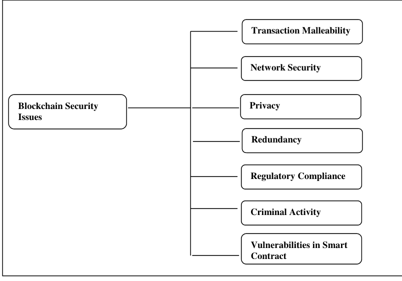

图(1). 区块链安全问题。

### 网络安全

`Eclipse` 攻击发生在攻击者控制部分网络并在逻辑上分割网络以增加同步延迟时，这是一种基本的拒绝服务攻击，旨在促进自私挖矿和双重支付。在 `Eclipse` 攻击中，攻击者选择信息并对一个或多个参与者隐藏，从而可能延迟区块向节点的传递[18]。

### 隐私

数据保护和保密是区块链交易的关键组成部分，因为每个节点都可以访问另一个节点的数据，任何查看区块链的人都能看到所有交易。多项研究已针对这一挑战提出了解决方案；然而，这些方案仅对有限数量的应用有用，并不能解决所有问题。由于传输的数据量巨大，攻击者可以将网络通信（包括敏感数据）作为攻击目标，例如在点对点结构中的中间人攻击（`MitM`）和拒绝服务/分布式拒绝服务（`DoS` / `DDoS`）攻击。

降低系统和软件程序的漏洞是增强系统安全的一种方式。许多安全项目旨在减少攻击面。涉及软件程序安全时，将软件程序环境的攻击面尽可能保持在最小是至关重要的。

你的程序的攻击面现在代表了它们对攻击的脆弱性，而不是对突袭的脆弱性。在数据系统中，攻击面指的是虚拟足迹，其中包含数百种资产、组件和控制器。在软件程序环境中，攻击面是所有众多攻击向量的总和，未经授权的用户或攻击者可以通过这些攻击向量尝试向环境输入或从环境中提取数据。

加密货币比非区块链软件包拥有更大的攻击面，这令人担忧。具有攻击面的区块链包对于加密货币、代币和智能合约至关重要。为了允许使用虚拟货币进行点对点交易并确保用户安全，区块链依赖于安全的软件程序代码。与它们特定于应用的规则和点对点（`P2P`）网络一样，区块链作为一种密码学构造在实际使用中是稳定的，然而容易受到多种攻击。

区块链社区由创建和运行交易并提供不同服务的节点组成。例如，网络由发送和接收交易的节点以及将已批准交易附加到区块的矿工组成。网络犯罪分子会寻找网络通信威胁，并通过以下类型的攻击加以利用。

区块链有五种攻击向量，如图(2)所示。

### a. 区块链网络攻击

#### 交易延展性攻击

针对交易延展性的攻击旨在让受害者支付两次。在区块链网络中，哈希摘要作为每笔交易的交易标识符。在提交原始交易之前，如果攻击者设法更改交易的 ID，就可以尝试使用修改后的哈希将交易发送到网络，并在原始交易之前对其进行验证[21]。如果成功，发送方会认为原始交易未成功，但资金仍会从发送方账户中扣除。如果发送方重复该交易，两次都会收取相同金额。一旦这两笔交易都被矿工验证，该攻击即告完成[22]。

#### 路由攻击

这种技术的目的是在将交易发送给对等节点之前对其进行修改。由于黑客将网络划分为无法相互连接的多个区域，其他节点几乎不可能注意到这种篡改。路由攻击实际上分为两种不同的攻击。

- i. 一种分区攻击，将网络节点分成不同的组。

- ii. 一种延迟攻击，中断消息的传播并将其传输到网络。

#### 女巫攻击

当多个标识符被分配给同一个节点时，就会发动女巫攻击。区块链网络中没有受信任的节点，每个请求都会发送到许多节点。在女巫攻击期间，黑客会控制许多网络节点。然后，受害者被虚假节点包围，这些节点会完成受害者的所有交易。过一段时间后，受害者就会面临双重贡献攻击的风险。女巫攻击难以检测和避免，但是，提高创建新身份的成本、维持一定水平的信任才能加入网络，以及确定用户声誉，都有助于防范[24]。

#### Eclipse 攻击

`Eclipse` 攻击需要黑客拥有大量 IP 地址或一个稀疏的僵尸网络。然后，攻击者会覆盖受害节点“已尝试”数据库中的地址，并等待受害节点恢复。目标节点重启后，所有出站连接都将被重定向到攻击者的 IP 地址。这会阻止受害者获取他们感兴趣的交易。波士顿大学的研究人员对以太坊网络发起了一次 `Eclipse` 攻击，他们仅用一两台工作站就实现了这一攻击[25]。

#### 长程攻击

这些攻击针对的是使用权益证明（`PoS`）共识方法的网络，该方法允许用户根据其持有的币资产来挖掘或验证区块交易。

可以区分三种类型的攻击：

1. 简单攻击——当节点不检查区块时间戳时，这是权益证明协议的一个简单版本。

2. 事后腐化——试图在特定时间范围内铸造比主链更多的区块。

3. 权益泄漏——从妥善保存的账本中复制交易。

发起长程攻击时，黑客会利用从大量代币余额中购买或窃取的私钥，这些私钥之前曾用于验证。黑客可以修改区块链的历史记录，并根据 `PoS` 验证获得奖励[26]。

### b. 用户钱包攻击

事实上，谈到区块链和网络安全，它们就像盐和胡椒一样密不可分。这可能令人惊讶，但区块链用户对安全的威胁最大。人们往往高估区块链的安全性，而忽视其缺陷。网络犯罪分子最感兴趣的是用户钱包凭证。

黑客尝试使用各种手段获取钱包凭证，既有老策略，如网络钓鱼和字典攻击，也有更复杂的手段，如识别密码学技术中的缺陷。以下是侵入他人钱包的常见方式概述[27]。

#### 网络钓鱼

2018 年，`iotaseed.io`（现已下线）——一个假冒的在线种子生成器——被用来对 IOTA 钱包发起攻击。黑客利用该服务实施网络钓鱼活动，并获取包括秘密种子在内的日志。结果，黑客于 2018 年 1 月从受害者钱包中窃取了价值超过 400 万美元的 IOTA[28]。

#### 字典攻击

在这些攻击中，黑客尝试使用常见密码（如 `password1`）的哈希值来解密受害者的加密摘要和盐。攻击者可以通过将明文密码转换为加密哈希来找到钱包凭证[29]。

#### 易受攻击的签名

区块链网络使用多种密码学算法来建立用户签名，但这些算法可能存在漏洞。例如，比特币采用 `ECDSA` 加密技术来自动生成唯一的私钥。然而，`ECDSA` 似乎没有足够的熵，导致相同的随机值出现在多个签名中。IOTA 以前的 `Curl` 哈希算法也存在密码学问题[30]。

### 有缺陷的密钥生成

2014年12月，一位名为Johoe的黑客利用密钥创建过程中的缺陷获取了秘密密钥。在代码升级期间，一个编码错误导致创建用户公钥的输入随机化不充分，从而引发攻击。尽管该漏洞很快被修补，但`ECDSA`算法仍然存在漏洞。

### 对冷钱包的攻击

这些钱包也可能被黑客攻击。例如，研究人员利用`Nano S Ledger`钱包的漏洞发起了一次“邪恶女佣”攻击。事件发生后，研究人员获得了受害者的秘密密钥、`PIN`码、恢复种子和密码。

加密货币交易所`UPbit`在2019年开始将资金转移到冷钱包，这是最近的一次冷钱包黑客攻击之一。当你预计到网络攻击时，这是一种冻结加密货币的标准方法。由于黑客知道交易时间[31]，他们得以盗取342,000 `ETH`。

### 对热钱包的攻击

热钱包是存储私有加密密钥的基于Web的应用程序。尽管加密货币交易所的所有者坚称其用户数据保存在未连接互联网的钱包中，但2018年对`Coincheck`的5亿美元攻击表明，情况并不总是如此[32]。

2019年6月对`GateHub`的一次攻击导致加密资产被盗，并导致数十个原生`XRP`钱包被未经授权访问。由于系统弱点，总部位于新加坡的加密货币交易所`Bitcoin`也在同一时期遭受了热钱包攻击。结果，黑客得以窃取价值超过450万美元的`XRP`和价值237,500美元的`ADA`。

### c. 智能合约攻击

智能合约开发和渗透测试是Apriorit拥有团队的两个领域。我们在检测和预防基于以太坊、`EOS`和`NEO`平台构建的智能合约问题方面拥有丰富经验。源代码错误、网络上的虚拟机、智能合约执行环境和区块链是与智能合约相关的最常见漏洞。让我们逐一分析这些攻击向量。

### 合约源代码中的漏洞

如果合约源代码有缺陷，则签署智能合约的各方将面临风险。例如，2016年以太坊DAO中发现的错误使其所有者损失了8000万美元。重入攻击是`Solidity`中最常见的漏洞之一，它允许来自其他智能合约的不可信函数将控制权委托给它们。合约A调用合约B的函数，而合约B在此期间的行为是未定义的。另一方面，合约B可能利用合约A的函数进行有害目的[33]。

### 虚拟机中的漏洞

以太坊虚拟机（`EVM`）是一台分布式堆栈计算机，所有基于以太坊区块链的智能合约都在其上执行。以下是一些最常见的`EVM`错误[34]。

### 不可变缺陷

由于区块链区块本质上不可变，一旦智能合约形成，就无法再更改。然而，如果智能合约代码中存在错误，也无法修复。与DAO攻击一样，存在黑客检测并窃取以太币，或创建新分叉并利用编程故障的风险。

### 转账中丢失的加密货币

当以太币被转移到没有所有者或合约的孤儿地址时，就会发生这种情况。

### 访问控制中的漏洞

在以太坊智能合约中，缺少修饰符的漏洞使黑客能够访问关键合约功能。

### 短地址攻击

这是可行的，因为`EVM`能够接受填充不当的参数。黑客可以利用这个漏洞，向潜在受害者发送专门设计的电子邮件。例如，在2017年对`Coindash ICO`的一次成功攻击中，对`Coindash`以太坊地址的修改导致受害者将以太币发送到黑客的地址。

### d. 交易验证机制攻击

### 双重支付攻击

与金融机构不同，区块链仅在网络中所有节点批准后才确认交易。在包含交易的区块被验证之前，该交易被视为未验证。另一方面，验证需要时间，这使其成为网络攻击的理想载体。使用交易验证机制的典型区块链攻击是双重支付。为了有效，所有区块链交易都需要由用户验证，而这需要时间。攻击者可以利用系统延迟来误导系统在重复交易中使用类似的加密货币或代币[35]。

### Finney攻击

当交易被打包进一个区块，而在该区块发布（网络传播）之前又执行了另一笔相同交易，那么后一笔相同交易将变为无效。

### 竞争攻击

当攻击者发起两笔不匹配的交易时，称为竞争攻击。在第一笔交易中，资金在交易被验证之前就被发送给受害者（例如，受害者随后寄出商品）。与此同时，冲突交易被发送到网络，使攻击者收回相同数量的比特币，实际上取消了原始交易。

### `Vector76`


Vector76是结合先前两种攻击的结果。在这种情况下，恶意矿工会构建两个节点；一个仅连接到交易所节点，另一个连接到区块链网络中连接良好的对等节点。之后，矿工创建两笔交易，一笔高价值，一笔低价值。攻击者进行抢占，然后持有来自交易所服务的包含高价值交易的锁。在发布公告后，攻击者迅速将预挖掘的区块交付给运营商服务。他和一些矿工将通过把预挖掘的区块视为主链来确认这笔交易。因此，这种攻击利用了网络的一部分看到了攻击者插入区块的交易，而另一部分未看到该交易这一事实[36]。

在交易所服务批准高价值交易后，攻击者向主网络发送低价值交易，该交易最终被拒绝。结果，高价值交易的金额被记入攻击者账户。尽管这种攻击形式成功可能性很高，但它并不普遍，因为它需要托管式电子钱包（在一次确认后即接受付款）以及接收传入交易的节点。

## 替代历史攻击

替代历史攻击，也称为区块链重组攻击，即使在多次确认后也可能发生，尽管它需要攻击者拥有大量计算能力。在此示例中，恶意用户向接收者发送一笔交易，同时挖掘包含另一笔产生相同货币的交易的分叉。即使接收者在n次确认后接受交易并交付产品，如果攻击者发布更长的链并收集币，接收者仍可能损失资金。

2020年8月，最近发生的区块链重组攻击之一发生在以太经典挖矿期间，当时一名矿工使用过时软件并在一段时间内失去互联网访问。当区块链的两个版本在网络节点间争夺合法性时，发生了一次重组，导致插入了约3000个区块。此事首次发布在[37]。

## 51%或多数攻击

当黑客获得网络51%的算力并启动一个新的分叉，最终取代现有分叉时，就会发生多数攻击。这种攻击是当时唯一已知的区块链漏洞，并且当时看来近期内难以实现。Verge、ZenCash、Monacoin、Bitcoin Gold和Litecoin Cash等加密货币此前都曾遭遇过51%攻击。在每种情况下，网络犯罪分子都积累了足够的算力来入侵网络并窃取数百万美元[38]。

2020年8月，对以太经典（ETC）的一次51%攻击导致约560万美元的ETC币被双重支付。黑客显然对ETC协议有深入了解，并在平台检测到攻击前的四天内挖掘了4,280个区块。ETC在第一次攻击后仅五天就遭到第二次51%攻击，一名矿工通过4,000个区块重组了网络。

## e. 矿池攻击

个体矿工已无法再通过大型加密货币（如比特币）获利，因此矿工们将各自的计算资源汇集起来，组成矿池。这使得他们能够挖出更多区块并均匀分配奖励。BTC.com、AntPool 和 ViaBTC 目前是比特币前三大矿池。据 Blockchain.com 称，它们占比特币网络总算力的 52% 以上。矿池是一个极具诱惑力的攻击目标。恶意矿工试图利用区块链共识系统中的漏洞，获取对矿池的内部和外部控制。以下是最常见的矿池攻击方式。

## 自私挖矿

恶意矿工试图通过在一段时间内不向网络提交区块，然后一次性释放多个区块，从而使其他矿工丢失他们的区块，以此提高自己获得的奖励份额。将矿工随机分配到矿池的不同分支、优先选择时间戳最新的区块，以及在允许的最大时间内创建区块，都是可能的应对措施。区块扣押（Block holding）是这种攻击的另一种叫法。

2014年，由于针对 Eligius 矿池的自私挖矿攻击，矿工损失了300 BTC。自私挖矿成功率很高，且可能发生在任何加密货币上。仅登记可信赖的矿工，以及修改现有比特币协议以隐藏部分工作量证明与完整工作量证明之间的区别，是两种可能的防范自私挖矿的方法[39]。

## 扣留后分叉

FAW（扣留后分叉，Fork After Withholding）是一种自私挖矿形式，对攻击者而言似乎更有利可图。在 FAW 攻击中，恶意矿工隐藏获胜区块并将其窃取，根据情况，要么丢弃该区块，要么稍后发布，从而造成分叉。由 Ugin Kwon 领导的研究团队详细阐述了这一攻击的概念[39]。

## 针对网络攻击的防护措施

在保护企业免受网络犯罪和网络攻击时，可能很难知道该从何处着手。相关信息如此之多，令人不知所措，尤其是当信息相互矛盾时。有必要采取一些预防性安全措施来抵御网络攻击，如图（3）所示。

- 通过实施安全策略来检查和分类你所管理的信息，以及你希望用何种安全类型来保护它，从而将网络安全作为首要任务。每天进行一次安全审计。

- 提高员工对网络安全和数据保护必要性的认识。

- 创建一个独一无二的密码以访问系统，确保密码组合安全，并配合使用双因素认证。

- 投资于网络安全解决方案，如防病毒软件、防火墙和其他隐私工具，以自动扫描威胁。安装并保持防病毒软件处于最新状态。

- 建立可靠的备份策略。它将保护你免受勒索软件的攻击。

- 可以使用端到端加密来保护敏感信息。

- 尝试攻击你自己！这可能有助于你发现系统的漏洞。

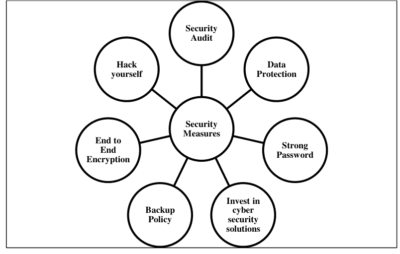

图（3）. 安全措施。

## 结论

区块链已成为分布式系统中的一种新范式，允许具有竞争利益的公司之间进行安全的资产交换。区块链技术正在迅速普及，尤其是以比特币和以太坊等加密货币的形式，两者合计市值超过8500亿美元。由于其巨大的市值，攻击者经常以基于区块链的加密货币为目标来牟利。本章深入探讨了区块链的攻击面。我们发现区块链的攻击面可以分为三类攻击。

身份验证和加密技术有助于防止攻击，但它们并非保障系统安全的唯一方法。过时的安全与防御方法无法应对复杂的新威胁，例如零日恶意软件活动，这些活动已经改变了网络犯罪的范围。

最后，本章通过揭示一系列与特定应用规则和区块链系统网络层复杂性相关的新型漏洞，为分布式系统的安全做出了贡献。我们的理论建模、测量、攻击和应对措施为评估区块链安全的新方法铺平了道路。

本文探讨了区块链技术的攻击面。考虑了对密码设计、点对点网络架构和区块链技术应用的攻击。该报告回顾了基于区块链技术的去中心化系统的最新安全研究，并指出了基于区块链的去中心化系统的主要弱点。尽管目前已有应对措施，一些攻击仍可能以很高的概率实施，但该工作也揭示了不同攻击序列之间的联系。

## 出版许可

不适用。

## 利益冲突

作者声明不存在财务或其他方面的利益冲突。

## 致谢

声明无。

## 参考文献

- 1. A. Back, M. Corallo, L. Dashjr, M. Friedenbach, G. Maxwell, A. Miller, A. Poelstra, J. Timón, 和 P. Wuille，*使用锚定侧链实现区块链创新*，2014年。http://www.opensourceview.com/papers/123/enablingblockchain-innovations-with-pegged-sidechains

- 2. S. Zalte，和 R. Kamat，“区块链技术：开发者培育造福社会的新应用”，*利用区块链变革网络安全解决方案*，215。[http://dx.doi.org/10.1007/978-981-33-6858-3_11]

- 19. C. Mann，和 D. Loebenberger，“比特币协议的双因素认证”，Int. J. Inf. Secur.，第16卷，第2期，第213-226页，2017年。[http://dx.doi.org/10.1007/s10207-016-0325-1]

- 21. K.M. Khan，J. Arshad，和 M.M. Khan，“基于区块链的电子投票中交易可变性攻击的模拟”，Comput. Electr. Eng.，第83卷，第106583页，2020年。[http://dx.doi.org/10.1016/j.compeleceng.2020.106583]

- 22. G. Ma，C. Ge，和 L. Zhou，“在比特币平台中实现可靠时间戳”，Peer-to-Peer Netw. Appl.，第13卷，第6期，第2251-2259页，2020年。[http://dx.doi.org/10.1007/s12083-020-00905-6]

- 23. P. Swathi，“利用矿工分布式行为监测防范区块链中的女巫攻击”，见：第十届计算、通信与网络技术国际会议（ICCCNT），IEEE，2019年，第1-6页。

- 24. S. Zhang，和 J-H. Lee，“PoS区块链系统中基于日食的权益流失攻击”，2019年ACM区块链与安全关键基础设施国际研讨会论文集，2019年，第67-72页。[http://dx.doi.org/10.1145/33227960.3332391]

- 25. P. Gazi，A. Kiayias，和 A. Russell，“针对权益证明区块链的权益流失攻击”，2018年加密货币谷区块链技术会议（CVCBT），2018年，第85-92页。[http://dx.doi.org/10.1109/CVCBT.2018.00015]

- 26. S. Jarecki，A. Kiayias，H. Krawczyk，和 J. Xu，“高效且可组合的密码保护秘密共享（或：如何在线保护你的比特币钱包）”，见：IEEE欧洲安全与隐私研讨会（EuroS&P）。IEEE，2016年，第276-291页。[http://dx.doi.org/10.1109/EuroSP.2016.30]

- 27. N. Bodziony，P. Jemiolo，K. Kluza，和 M.R. Ogiela，“基于区块链的地址别名系统”，J. Theor. Appl. Electron. Commer. Res.，第16卷，第5期，第1280-1296页，2021年。[http://dx.doi.org/10.3390/jtaer16050072]

- 28. “使用图像盐的消息摘要防御字典攻击的一种方法”，见：普适信息管理与通信国际会议，Springer：Cham，2019年，第769-777页。

- 29. O. Ajayi，M. Cherian，和 T. Saadawi，“使用区块链技术实现安全的网络攻击特征分发”，见：IEEE计算科学与工程国际会议（CSE）和IEEE嵌入式和普适计算国际会议（EUC），IEEE，2019年，第482-488页。[http://dx.doi.org/10.1109/CSE/EUC.2019.00095]

- 30. https://www.welivesecurity.com/2019/11/27/upbit-cryptocurrency-exchange-hack/

- 31. https://www.qredo.com/blog/proofofkeys-7-ways-private-keys-have-been-

- 32. P. Tantikul，和 S. Ngamsuriyaroj，*探索Solidity智能合约中的漏洞*，2020年。[http://dx.doi.org/10.5220/00089090803170324]

- 33. F. Ma，M. Ren，Y. Fu，M. Wang，H. Li，H. Song，和 Y. Jiang，“以太坊虚拟机安全加固”，Inf. Process. Manage.，第58卷，第4期，第102565页，2021年。[http://dx.doi.org/10.1016/j.ipm.2021.102565]

- 34. H. Lee，M. Shin，K.S. Kim，Y. Kang，和 J. Kim，“面向接收者的交易，用于防止私有区块链中的双重支付攻击”，见：第15届IEEE年度传感、通信与网络国际会议（SECON），IEEE，2018年，第1-2页。[http://dx.doi.org/10.1109/SAHCN.2018.8397151]

- 35. A. Panwar，和 V. Bhatnagar，*对区块链可能遭受的不同类型攻击的研究：最安全技术的脆弱性*。机器智能与智能系统。Springer：

新加坡，2021 年，第 537-551 页。

[http://dx.doi.org/10.1007/978-981-33-4893-6_46]

[36] X. Ling、Y. Le、J. Wang、Z. Ding 和 X. Gao，“区块链无线接入网的实用建模与分析”，*IEEE 通信汇刊*，第 69 卷，第 2 期，第 1 页，2020 年。

[http://dx.doi.org/10.1109/TCOMM.2020.3029779]

[37] J. Bae 和 H. Lim，“随机挖矿组选择以防止对比特币的 51% 攻击”，载于：第 48 届 IEEE/IFIP 可靠系统与网络研讨会国际会议（DSN-W），IEEE，2018 年，第 81-82 页。

[http://dx.doi.org/10.1109/DSN-W.2018.00040]

[38] I. Eyal 和 E.G. Sirer，“多数即不足：比特币挖矿存在漏洞”，*金融密码学与数据安全国际会议*，2014 年，第 436-454 页。

[http://dx.doi.org/10.1007/978-3-662-45472-5_28]

[39] S-Y. Chang、Y. Park、S. Wuthier 和 C-W. Chen，“叔块攻击：针对理性且不合作矿工的区块扣留之外的区块链挖矿威胁”，*应用密码学与网络安全国际会议*，2019 年，第 241-258 页。

[http://dx.doi.org/10.1007/978-3-030-21568-2_12]

## 区块链中的防伪解决方案综述

H. Bhatia¹,*、S. Zalte²、I. Chatterjee³ 和 D. Mantri⁴

¹ D Y Patil 国际大学计算机科学、工程与应用学院，印度浦那

² 希瓦吉大学计算机科学系，印度戈尔哈布尔

³ 东明大学计算机工程系，韩国釜山

⁴ Sinhgad 工程学院，印度浦那洛纳瓦拉

**摘要：**区块链技术提供了一种内置安全性的数据格式。它建立在密码学、去中心化和共识概念之上，以确保交易可信度。区块链技术实现了去中心化，允许成员参与分散的网络。没有哪个单一用户能够篡改交易，因为所有交易都是透明的，网络上的所有其他用户都可以看到。然而，区块链与其他系统之间存在一些显著的安全差异。如今，区块链上发现了许多潜在的攻击。本章的贡献在于匹配区块链技术采取的有效防御措施，或研究人员为减少这些攻击影响而提供的相关漏洞补丁。为了保持网络的安全性和弹性，概述针对各种漏洞和攻击的这些安全解决方案有助于减少区块链中的攻击面。

**关键词：**密码学、去中心化、共识、安全、防御、攻击。

## 引言

区块链是一种没有中央控制权威的去中心化技术类型，它基于安全、分布式的去中心化协议。网络中所有节点都负责生成、添加和确认数据块内的交易。区块链技术继承了去中心化、哈希函数、共识机制、数字签名和智能卡等若干安全特性，这些特性增强并保障了区块链技术的安全性。

它们的交易内存池积压严重，导致交易大量积压和更高的挖矿费用。

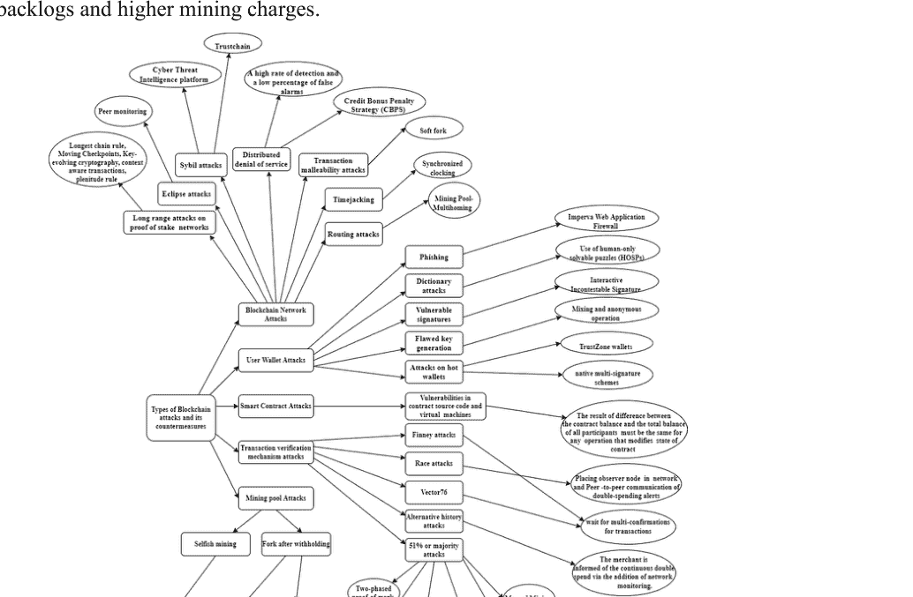

图（1）. 区块链攻击类型及其对策。[圆角矩形表示区块链攻击类型，椭圆表示其对策]。

## 针对交易可延展性攻击的对策

交易的可延展性给比特币社区造成了巨大损失和声誉损害。自这一问题出现以来，比特币的价值一直在下跌，数百万美元的比特币被盗。Rajput 等人 [4] 提出了一种稳健的解决方案，其中包含一个交易 ID，由无签名交易脚本的哈希与最终交易组合而成。这个最终的联合哈希既用于检查交易，也用于识别交易。该方法可行，并能识别任何企图篡改交易的行为。

## 针对时间劫持的对策

验证新的区块加入区块链时，会使用网络时间。当攻击者写入不正确的时间戳、篡改节点的时间钟，并诱骗其接受来自另一个区块链的区块而不是自己链上的区块时，就会发生时间劫持攻击。这是一种假设性的攻击。Boverman [5] 提供了以下解决方案：

- 不使用网络时间作为时间戳，而是使用节点的系统时间。

- 70 到 140 分钟是初始攻击的最大时间范围。

- 70 到 140 分钟是初始攻击的最大时间范围。该时间减半，缩短到 30 到 60 分钟，使网络节点时间减少到约 30 分钟。该策略无法完全消除攻击，但有助于减少攻击。

- 阻止不受信任的对等节点并建立安全节点有助于减小攻击范围，但这并不能解决与时间同步相关的全局问题。

- 为了接受一笔交易，所需的确认数量正在增加。

时间劫持攻击很少见，因此尚未设计出新的应对策略。由于它通常与双重支付相关，大多数双重支付安全措施也适用于时间劫持攻击。

## 针对路由攻击的对策

防御路由攻击的策略有很多 [6]。推荐使用多宿主比特币，因为连接越多，攻击的难度就越大。攻击者若要中断节点之间的链接，要么必须同时知道两个 IP 地址，要么必须中止所有加密通信，而这很容易被发现。在第二种方法中，攻击期间，被劫持目的地的往返时间（RTT）会增加。节点可以注意到与其对等节点之间 RTT 的突然变化。作为一种保护策略，节点会因异常值识别而进行随机连接。另一种方法是，节点之间的 UDP 数据包也可以定期更新，以识别流量是否部分被撤回，以及它是否连接到网络。

## 针对女巫攻击的对策

反女巫方法的发展更加强调应用环境。Gong 和 Lee [7] 提出的基于区块链的网络威胁情报（CTI）平台成功地削弱了女巫攻击的强度。当攻击者发动攻击时，他或她将遭受严重的财产损失，从而限制其向系统引入虚假或伪造数据的能力。Otte 等人 [8] 提出了 Trustchain，一种可扩展的区块链，具有独特的防御女巫攻击机制。

## 针对日蚀攻击的对策

### 随机节点选择

通过构建点对点网络，区块链架构师可以极大地限制节点连接到恶意节点的概率，即使该节点是最近加入的，每个节点连接到随机范围的 IP 地址并与网络同步，而不是固定连接一组可重复、可利用的节点。

### 确定性节点选择

当节点连接到网络时，该策略涉及将特定 IP 地址放入各自的固定插槽中。如果网络的连接是固定的，攻击者将更难在网络周围管理恶意节点并汇聚到目标周围。如果重复插入攻击者控制下的地址，日蚀攻击的企图将不会成功。类似地，区块链可以包含节点身份，以在网络连接要求中与具有更高信任度的真实节点重新连接。如果节点连接使用身份信息而不是诸如时间戳和可用性之类的上下文数据进行，区块链网络将更安全，更不易受外部干扰；这些上下文数据偏离了经授权的网络活动。然而，如果只能连接到其他对等节点授权的指定节点，网络可能会面临可扩展性问题。

### 增加节点连接


网络可以通过增加所需的节点到节点连接数量来提高节点连接到真正用户的可能性；一个节点可以连接到真正的用户。然而，带宽限制限制了网络在不牺牲速度的情况下可以增加的节点连接数量，这使得该策略作为独立应对日蚀攻击的解决方案无效。

### 关于新节点的限制

通过提高在网络内部构建新节点的成本或难度，区块链架构师可以提高恶意行为者用恶意节点充斥网络的门槛。这种策略通常需要限制可以连接到单个 IP 地址或设备的节点数量。攻击者可以构建一个由具有独特 IP 地址的设备组成的僵尸网络，从而规避这一预防措施。

### 针对权益证明网络远程攻击的应对措施

远程攻击是指 adversary 回到创世区块并分裂网络。新分支中充满了与主链历史不同的人。当 adversary 的分支增长得比主链更长并超越主链时，攻击即告成功。最长链规则、移动检查点、密钥演化密码学、上下文感知交易和充裕规则是针对远程攻击的应对措施 [10]。

### 针对用户钱包攻击的防御机制

### 针对网络钓鱼的应对措施

为了抵御网络钓鱼攻击，Imperva 提供了登录管理与在线应用安全解决方案的组合：Imperva Login Safeguard 提供双因素认证，以保护您网站或在线应用上的 URL 地址。这包括 URL 参数化地址和 AJAX 页面，这些通常是通过 2FA 进行保护的更大挑战。该解决方案只需点击几下鼠标即可在几秒钟内实施，无需额外的硬件或软件，并允许您直接从 Imperva 仪表板修改用户角色和权限 [11]。Imperva Web 应用防火墙（WAF）在云端运行，可在网络边缘阻止恶意请求。这包括防止内部人员注入已被渗透的恶意软件，以及复制由网络钓鱼活动引发的 XSS 攻击。

### 针对字典攻击的应对措施

字典攻击是一种暴力破解攻击，攻击者试图通过使用常用单词和短语的字典来猜测密码。为了防止离线字典攻击，Canetti 等人 [12] 提出使用许多仅由人类可解的谜题（HOSPs），这些谜题生成后保存在磁盘上而不附带答案。然后使用用户提供的密码从数据库中选择少量谜题。当合法用户完成这些谜题以获得密钥时，密钥从密码和谜题解答中提取出来。这部分经过加密，容易受到基于字典的攻击，攻击者会尝试解密大量流行密码，直到找到一个有效的密码 [15]。冷钱包是用于存储比特币的离线钱包。冷钱包涉及两个问题。

- 1. 至少一个冷设备中存在私钥；
- 2. 所有私钥都暴露给单一可信的冷钱包管理员。

为了解决这些挑战，Ebrahimi 等人 [16] 创建了一种利用原生多重签名方案来处理冷钱包资产的新系统。对于钱包创建和签名生成，所提出的冷钱包系统至少包含两个不同的设备及其各自的管理员。该策略确保任何设备上都不会存储最终的私钥。为了实现这一目标，任何单一权威机构都不能动用交易所资产。

### 针对智能合约攻击的机制

在提出的解决方案中，Alkhalifah 等人 [17] 计算合约余额与智能合约中所有参与者余额总和之间的差值（在交易前记为 `a1`，在交易后记为 `a1'`）。该结果通过计算智能合约交易中每个步骤前后的 `a1` 与 `b1` 以及 `a1'` 与 `b1'` 之间的差值来得出。交易记为 `T1`，交易前差值为 `x1`，交易后差值记为 `x1'`。如果差值相等（`x1 = x1'`），则操作是真实的；否则，操作是恶意的。该操作会被阻止，交易被视为恶意操作。

### 针对交易验证机制攻击的防御机制

### 针对 Finney 攻击的应对措施

Finney 攻击针对的是不等待交易确认的商家。为了应对这种攻击，供应商必须在向客户转移物品或提供服务之前获得多次确认。虽然等待多次确认并不能消除双重支付攻击的可能性，但它确实降低了风险，并使攻击者更难两次花费相同的币。

### 针对竞态攻击的应对措施

竞态攻击发生在供应商或接收方接受未经确认的交易作为付款时。在竞态攻击中，目标是接受交易而未完全确认区块真实性的供应商（V）。三种检测方法如下：

- **监听期：** 在这种方法中，每个收到的交易都与一个监听期相关联，在此期间供应商会监控所有收到的交易。只有当供应商在监听期内未观察到任何双重支付尝试时，他才会交付产品或提供服务。
- **插入观察节点：** 在这种情况下，供应商在网络中插入观察节点。观察节点的主要任务是将收到的所有交易传输给供应商。这使供应商或其观察者能够在几秒钟内注意到双重支付尝试。为了检测这种攻击，供应商必须部署大量能够连接众多节点的观察节点。供应商将因实施这一对策而产生成本。
- **发送警告或警报消息：** 为了应对快速比特币转账中的双重支付，已经开发出一种有效的防御策略。当比特币网络上的对等节点收到两笔具有相似输入但不同输出的额外交易时，它们会发出警报消息。

### 针对 Vector76 的应对措施

Vector76 攻击是攻击者试图使用无效交易从目标处欺诈性提取或窃取币的攻击。利用不接受单次确认交易的机制，网络中的用户节点应避免入站连接，这可以防止攻击者向网络注入虚假信息；还应监控出站节点连接，并且只允许知名节点加入，同时将正在进行的双重支付告知商家，这些都可以作为预防措施。

### 针对替代历史攻击的应对措施

在重复确认的情况下，替代历史攻击仍然可能发生，但它需要高哈希率，并且攻击矿工可能会浪费大量电力。不允许入站连接；实施到已知节点的显式出站连接、在网络中放置观察节点以及将正在进行的双重支付告知商家都是可行的防护措施 [11]。

### 针对 51% 攻击或多数攻击的应对措施

建议采取多种应对措施来减轻 51% 攻击或多数攻击。Miller 等人 [18] 建议调整比特币的 PoW 难题，以减少矿池联盟进行多数攻击的可能性。

PirlGuard 旨在防止 51% 的利用。其运作方式类似于罚金系统和 dPoW。因此，攻击者会面临惩罚。主节点参与公证。作为一种中心化技术，主节点对其进行了放大。这种安全方法完全依赖于 Ethash 算法。PirlGuard 可将 51% 攻击降低至约 0.03%。因此，罚金机制和主节点功能都属于低风险。

ChainLocks 是 Dash 特有的一种安全解决方案，旨在保护用户免受 51% 攻击。Dash 仅有 4100 个主节点，由于其哈希算力有限，是 51% 攻击的理想目标 [23]。针对低哈希算力货币的 51% 攻击很可能是通过简单地租用所需的哈希算力来实施的 [24]。因此，ChainLocks 的安全机制不足以阻止双重支付攻击。由于只需一次确认即可发布区块，这使得 Dash 区块链更容易受到攻击，因此攻击者可以使用低于 51% 的哈希算力实施双重支付攻击。因此，风险级别被认为很高。

合并挖矿是一种允许多种币同时挖矿的技术 [25]。合并挖矿本身并非一种安全的挖矿方式，但使用它可以有助于缓解 51% 攻击。该策略将两种加密币的哈希算力结合起来，从而增加了攻击成本。这种方法有可能极大地提升低质量币种。该方法的主要限制是，合并的加密币必须基于相同的共识机制。另一个问题是，如果两个低哈希算力的加密币合并，一旦攻击者拥有足够的哈希算力，它们仍然可能受到攻击。因此，合并挖矿仅仅是一种通过组合哈希算力来增加攻击成本的方法。因此，它并未提供切实可行的解决方案，风险级别被认为很高。

### 矿池攻击的防御机制

### 针对自私挖矿的应对措施

研究人员之前已经开展了研究，并提出了多种可行的解决方案来解决自私挖矿问题 [26 - 29]。Solat 和 Potop-Butucaru [30] 支持区块‘生命周期’，这阻止了贪婪矿工保留区块。网络会拒绝区块的预计生命周期（由诚实矿工衡量）。Heilman [27] 通过采用“偏好新鲜度”防御策略来阻碍贪婪矿工获利。Heilman [27] 在区块中加入了不可伪造的时间戳，并且与旧区块相比，它更偏好区块中较新的时间戳，这是在与 Eyal 和 Sirer [29] 先前工作的基础上进一步发展的。作者通过研究表明，长时间保留区块的矿工比机会主义矿工的动机更低。

## 针对扣块后分叉（FAW）攻击的应对措施

为了解决FAW攻击问题，Kwon等人[31]引入了定时控制信标，这些信标由矿池运营者分配给矿工。针对每次分配，矿工计算并确定其拥有的工作量证明，然后将答案连同信标值一起发送给矿池运营者。几秒钟后，信标值会被更新，以便在有效解被保留并随后在网络中传播时发现恶意矿工。然而，作者也指出，该技术在某些场景下可能并不可行，并认为研究界和学术界仍在努力解决FAW攻击问题。

Chang和Park[32]提出了静默时间戳（Silent Timestamping）作为抵御FAW攻击的防御机制，该机制确保份额排序，并从本质上消除了FAW的激励效应。对理想攻击者针对静默时间戳的行为进行了研究，发现最佳FAW攻击策略被迫下降为道德挖矿。静默时间戳无需网络连接，也无需对矿工代码进行任何修改。因此，静默时间戳提供了一种可行、向后兼容且有效的保护方案。表1总结了各种区块链攻击面及其应对措施。

表1. 区块链攻击面及其应对措施摘要

| 序号 | 攻击类别 | 每个类别下的攻击类型 | 每种攻击的应对方案 |
|---|---|---|---|
| 1 | 区块链网络攻击 | 分布式拒绝服务 | 高检测率和低误报率[1]<br>信用加分惩罚策略（CBPS）[2]<br>增加区块大小[3] |
| 1 | 区块链网络攻击 | 交易可变性攻击 | 软分叉[5] |
| 1 | 区块链网络攻击 | 时间劫持 | 同步时钟 |
| 1 | 区块链网络攻击 | 路由攻击 | 矿池多归属[6] |
| 1 | 区块链网络攻击 | 女巫攻击 | 网络威胁情报平台[7]<br>信任链（Trustchain）[8] |
| 1 | 区块链网络攻击 | 日食攻击 | 对等节点监控[9] |
| 1 | 区块链网络攻击 | 针对权益证明网络的长距离攻击 | 最长链规则、移动检查点、密钥演化密码学、上下文感知交易和充分性规则[10] |

无需中介的去中心化应用，也是互联网安全基础设施关键组件的基石。因此，识别现有研究中尤其与区块链应用于网络安全问题相关的内容，对于探讨新兴技术如何提供解决方案以减少新出现的风险至关重要。

理解和管理区块链网络风险对区块链安全非常重要。区块链安全模型是确保这些控制措施安全的蓝图。区块链安全模型的构建应确保所有基本安全防护措施都得到所有必要安全手段的保护。要执行区块链解决方案的安全模型，管理员必须建立一个能够管理所有行业、治理、技术和流程风险的风险模型。因此，应审查与区块链相关的风险。然后，管理员必须根据以下三类措施制定安全措施来限制风险和威胁：实施区块链特有的安全机制，采用标准安全措施，并确保区块链上设有业务控制。

### 发表同意书

不适用。

### 利益冲突

作者声明不存在财务或其他方面的利益冲突。

### 致谢

声明无。

### 参考文献

- [1] J. Cheng, R. Xu, X. Tang, V.S. Sheng, and C. Cai, "An abnormal network flow feature sequence prediction approach for DDoS attacks detection in big data environment", Comput. Mater. Continua, vol. 55, no. 1, pp. 95-119, 2018.
- [2] H. Yang, J. Yuan, H. Yao, Q. Yao, A. Yu, and J. Zhang, "Blockchain-based hierarchical trust networking for JointCloud", IEEE Internet Things J., vol. 7, no. 3, pp. 1667-1677, 2020. [http://dx.doi.org/10.1109/JIOT.2019.2961187]
- [3] M. Saad, M.T. Thai, and A. Mohaisen, "POSTER: deterring ddos attacks on blockchain-based cryptocurrencies through mempool optimization", Proceedings of the 2018 on Asia Conference on Computer and Communications Security, 2018 pp. 809-811 [http://dx.doi.org/10.1145/3196494.3201584]
- [4] U. Rajput, F. Abbas, and H. Oh, "A solution towards eliminating transaction malleability in bitcoin", Journal of Information Processing Systems, vol. 14, no. 4, pp. 837-850, 2018.
- [5] Alex Boverman, "Timejacking & bitcoin", Culubas blog, 2011.
- [6] M. Apostolaki, A. Zohar, and L. Vanbever, "Hijacking bitcoin: Routing attacks on cryptocurrencies", 2017 IEEE Symposium on Security and Privacy (SP), IEEE, pp. 375-392, 2017. [http://dx.doi.org/10.1109/SP.2017.29]
- [7] S. Gong, and C. Lee, "Blocs: blockchain-based cyber threat intelligence sharing framework for sybil-resistance", Electronics (Basel), vol. 9, no. 3, p. 521, 2020. [http://dx.doi.org/10.3390/electronics9030521]
- [8] M. Samaniego, U. Jamsrandorj, and R. Deters, "Blockchain as a Service for IoT." In 2016 IEEE international conference on internet of things (iThings) and IEEE green computing and communications (GreenCom) and IEEE cyber, physical and social computing (CPSCom) and IEEE smart data (SmartData). IEEE, 2016, pp. 433-436.
- [9] E. Heilman, A. Kendler, A. Zohar, and S. Goldberg, "Eclipse attacks on bitcoin's peer-to-peer network", In 24th {USENIX} Security Symposium ({USENIX} Security 15), pp. 129-144. 2015.
- [10] E. Deirmentzoglou, G. Papakyriakopoulos, and C. Patsakis, "A survey on long-range attacks for proof of stake protocols", IEEE Access, pp. 28712-28725, 2019.
- [11] P. Gaži, A. Kiayias, and A. Russell, "Stake-bleeding attacks on proof-of-stake blockchains", 2018 Crypto Valley Conference on Blockchain Technology (CVCBT), 2018 pp. 85-92 [http://dx.doi.org/10.1109/CVCBT.2018.00015]
- [12] R. Canetti, S. Halevi, and M. Steiner, "Mitigating dictionary attacks on password-protected local storage", Annual International Cryptology Conference, 2006 pp. 160-179 [http://dx.doi.org/10.1007/11818175_10]
- [13] Y. Zhu, R. Guo, G. Gan, and W-T. Tsai, "Interactive incontestable signature for transactions confirmation in bitcoin blockchain", In: 40th Annual Computer Software and Applications Conference (COMPSAC) vol. 1. IEEE, 2016, pp. 443-448. [http://dx.doi.org/10.1109/COMPSAC.2016.142]
- [14] Z. Zheng, S. Xie, H. Dai, X. Chen, and H. Wang, An overview of blockchain technology: Architecture, consensus, and future trends. In 2017 IEEE international congress on big data (BigData congress). IEEE, 2017, pp. 557-564. [http://dx.doi.org/10.1109/BigDataCongress.2017.85]
- [15] M. Gentilal, P. Martins, and L. Sousa, "TrustZone-backed bitcoin wallet", Proceedings of the Fourth Workshop on Cryptography and Security in Computing Systems, 2017 pp. 25-28 [http://dx.doi.org/10.1145/3031836.3031841]


- [16] Shahriar Ebrahimi, Parisa Hasanizadeh, Seyed Mohammad Aghamirmohammadali, and Amirali Akbari, "Enhancing Cold Wallet Security with Native Multi-Signature schemes in Centralized Exchanges", 2021.

- [17] Alkhafifah, Ayman, Alex Ng, Paul A. Watters, and A. S. M. Kayes. "A Mechanism to Detect and Prevent Ethereum Blockchain Smart Contract Reentrancy Attacks." Frontiers in Computer Science 3 2021. [`http://dx.doi.org/10.3389/fcomp.2021.598780`]

- [18] A. Miller, A. Kosba, J. Katz, and E. Shi, "Nonoutsourcable scratch-off puzzles to discourage bitcoin mining coalitions", Proceedings of the 22nd ACM SIGSAC Conference on Computer and Communications Security, 2015 pp. 680-691 [`http://dx.doi.org/10.1145/2810103.2813621`]

- [19] M. Saad, L. Njilla, C. Kamhoua, and A. Mohaisen, "Countering selfish mining in blockchains", 2019 International Conference on Computing, Networking and Communications (ICNC), 2019 pp. 360-364 [`http://dx.doi.org/10.1109/ICNC.2019.8685577`]

- [20] M. Bastiaan, Preventing the 51%-attack: a stochastic analysis of two phase proof of work in bitcoin., 2015. [`http://referaat.cs.utwente.nl/conference/22/paper/7473/preventingthe-51-attack-a-stochasticanalysis-o`]

`two-phase-proof-of-work-in-bitcoin.pdf`

[21] S. Sayeed, and H. Marco-Gisbert, "Assessing blockchain consensus and security mechanisms against the 51% attack", Appl. Sci. (Basel), vol. 9, no. 9, p. 1788, 2019.

[`http://dx.doi.org/10.3390/app9091788`]

[22] N.A. Akbar, A. Muneer, N. ElHakim, and S.M. Fati, "Distributed Hybrid Double-Spending Attack Prevention Mechanism for Proof-of-Work and Proof-of-Stake Blockchain Consensuses", Future Internet, vol. 13, no. 11, p. 285, 2021.

[`http://dx.doi.org/10.3390/fi13110285`]

[23] N. G. Edmund, A Dash to Mitigate 51% Attacks with ChainLocks. 2018.

[24] [`https://www.nicehash.com/`]

[25] [`https://www.cryptocompare.com/mining/guides/what-is-merged-mining-bitcoin-namecoinlitecoin-dogecoin/`]

[26] A. Sapirshtein, Y. Sompolinsky, and A. Zohar, "Optimal selfish mining strategies in bitcoin", International Conference on Financial Cryptography and Data Security, 2016 pp. 515-532

[27] E. Heilman, "One weird trick to stop selfish miners: Fresh bitcoins, a solution for the honest miner", International Conference on Financial Cryptography and Data Security, 2014 pp. 161-162

[`http://dx.doi.org/10.1007/978-3-662-44774-1_12`]

[28] N.T. Courtois, and L Bahack, "On subversive miner strategies and block withholding attack in bitcoin digital currency", arXiv preprint arXiv:1402.1718, 2014.

[29] I. Eyal, and E.G. Sirer, "Majority is not enough: Bitcoin mining is vulnerable", International conference on financial cryptography and data security, 2014 pp. 436-454

[`http://dx.doi.org/10.1007/978-3-662-45472-5_28`]

[30] S. Solat, and M. Potop-Butucaru, "Zeroblock: Timestamp-free prevention of block-withholding attack in bitcoin", arXiv preprint arXiv:1605.02435, 2016.

[31] Y. Kwon, D. Kim, Y. Son, E. Vasserman, and Y. Kim, "Be selfish and avoid dilemmas: Fork after withholding (faw) attacks on bitcoin", Proceedings of the 2017 ACM SIGSAC Conference on Computer and Communications Security, 2017 pp. 195-209

[`http://dx.doi.org/10.1145/3133956.3134019`]

[32] S-Y. Chang, and Y. Park, "Silent timestamping for blockchain mining pool security", 2019 International Conference on Computing, Networking and Communications (ICNC), 2019 pp. 1-5

[`http://dx.doi.org/10.1109/ICCNC.2019.8685563`]

# 使用区块链保护可穿戴物联网设备数据的隐私

K.K. Sowjanya¹,*, K.P.B. Madavi² and G. Thahniyath³

¹ 印度班加罗尔CMR技术学院

² 印度班加罗尔GITAM大学

³ 印度班加罗尔达亚南达·萨加尔大学

## 摘要

由于COVID-19大流行，个人医疗保健已成为当今人类生活中最重要的部分。通过采用物联网可穿戴设备（如Fitbit、智能手表、血氧仪等），人们可以轻松了解自己的健康状况。所有这些设备都会存储敏感信息，如心跳、血压、行进距离、消耗的卡路里、压力水平、位置详情等，并存储在第三方数据服务器中。这些服务器容易受到非法用户的攻击，并且还存在单点故障问题。个人数据及其完整性都应受到保护。同时，服务器中存储的数据应该去中心化，以克服单点攻击的问题。本文的目标是提供一个框架，使用`SHA-256`生成哈希码，并使用区块链技术存储数据，从而为数据提供隐私性、安全性和完整性。

## 关键词

区块链、Fitbit、Fitbit数据、加密、哈希、物联网、挖矿、隐私、安全、可穿戴设备。

## 引言

智能家居、智慧城市和智能设备正在物联网的帮助下推动着未来一代的发展。物联网因其异构形式和异构应用而广受欢迎。它正在将我们的普通世界转变为一个数字世界，在这个世界中，互联设备通过网络相互通信，无需人工交互[1]。采用物联网带来了许多技术进步，例如为房屋提供安全警报的智能安防系统、提供土地、土壤等信息的智能农业系统，以及提供个人健康状况的智能医疗系统[2]。由于物联网可用于日常活动，这些物联网设备在医疗保健、工业、农业、城市等各个领域的使用量巨大。2020年物联网设备在各个领域的使用统计如下图所示：

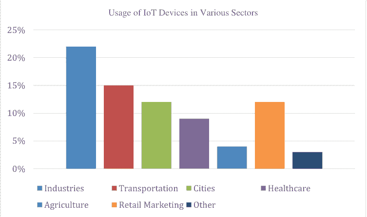

图(1). 物联网设备在各领域的应用[3]。

## 物联网架构

图(2)从每层所包含的设备和技术的角度描绘了物联网的核心三层架构。物联网中的每一层都有其执行的功能和使用的设备的特点。许多专家认为，物联网主要基于三层：感知层、网络层和应用层[4]。

### 感知层

它是架构的物理层。当传感器和连接设备根据项目需求收集不同数量的信息时，它们就汇聚在这里。可以使用与环境交互的边缘设备、传感器和执行器。

### 网络层

这些设备收集的所有数据都必须传输和处理。这就是网络层的职责。这些设备连接到其他智能物体、服务器和网络设备。所有数据的传输也由该层处理。云计算平台、互联网网关、交换和路由设备以及该层的其他设备使用包括Wi-Fi、LTE、蓝牙、3G和Zigbee在内的尖端技术。

### 应用层

用户与应用层交互。它负责为用户提供特定于应用的服务。例如，这可能是一个智能家居应用，用户点击应用中的按钮来打开咖啡机。数据的有效性、完整性和机密性都由应用层保证。物联网的目标，即建立智能环境，在这一层实现。

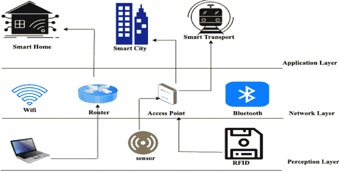

图(2). 三层物联网架构[5]。

## 物联网Fitbit简介

James Park和Eric Friedman于2007年创办了Fitbit公司，当时名为Healthy Metrics Research Incorporated。该公司的初始目标是将加速度计集成到可穿戴技术中。加速度计是测量加速度力的小型传感器。Fitbit Tracker是该公司的第一款产品，于2009年面向公众发布。第一款Fitbit是一款固定在穿戴者衣服上的腕带。这个小装置可以计算和追踪步数，随后又推出了一系列具有各种功能的Fitbit设备。Fitbit设备使用加速度计来追踪你的活动。Fitbit通过加速度计（将运动数据转换为数字度量）计算你的步数，并监测你行走的距离、消耗的卡路里和睡眠质量。健身追踪器包括触摸屏、智能手机通知、活动和医疗监测、自动运动检测以及可游泳的防水功能。它内置心率监测器和睡眠追踪功能。腕带上还可以显示来电、短信和日历提醒通知。白天，Fitbit Tracker可以固定在用户的衣服上。它还配有一根腕带，以便夜间佩戴。该设备链接到一个网站，用户可以在该网站上记录锻炼、饮食和体重追踪。它还配备了一个充电站，允许用户无线上传Fitbit中的数据。

Fitbit自2007年问世以来，已成为最知名的健身追踪器品牌。因此，它被视为市场上顶级产品之一。目前有多种替代产品可满足不同的预算和功能需求。我们在并排对比表中比较了最新的Fitbit型号。随着Fitbit版本的不断升级，它从用户处收集的数据也在不断增多。表1展示了物联网可穿戴设备生成的各种指标概览。

表1. 物联网可穿戴设备生成的各种指标概览。

| 基本功能 | ZIP 2012 | FLEX 2 2013 | ALTA 2016 | ALTA HR 2017 | CHARGE 3 2018 | VERSA 2019 | Sense 2020 |

|---|---|---|---|---|---|---|---|

| 步数与活动 | ✔ | ✔ | ✔ | ✔ | ✔ | ✔ | ✔ |

| 消耗卡路里 | ✔ | ✔ | ✔ | ✔ | ✔ | ✔ | ✔ |

| 爬楼 |  |  |  |  | ✔ | ✔ | ✔ |

| 时钟/时间 | ✔ |  | ✔ | ✔ | ✔ | ✔ | ✔ |

| 女性健康追踪 |  |  |  |  |  | ✔ | ✔ |

| 睡眠追踪 |  | ✔ | ✔ | ✔ | ✔ | ✔ | ✔ |

| 智能追踪 |  | ✔ | ✔ | ✔ | ✔ | ✔ | ✔ |

| 内置GPS |  |  |  |  | ✔ | ✔ | ✔ |

| 心率追踪 |  |  |  | ✔ | ✔ | ✔ | ✔ |

| 心肺健康等级 |  |  |  | ✔ | ✔ | ✔ | ✔ |

| 血氧 |  |  |  |  | ✔ | ✔ | ✔ |

| 压力追踪 |  |  |  |  |  |  | ✔ |

| 心电图 |  |  |  |  |  |  | ✔ |

## Fitbit架构

图(3)是健身可穿戴技术如何用于生活方式应用的一个示例，其架构包括体重、消耗的卡路里、心率、速度等。用户的活动将通过传感器进行追踪，并且用户能够自行输入部分数据，这些数据随后将传输到智能手机和提供商的云服务。数据随后被处理，使用户更容易理解。根据显示类型的不同，处理后的数据会传回配对的智能手机或可穿戴设备本身。

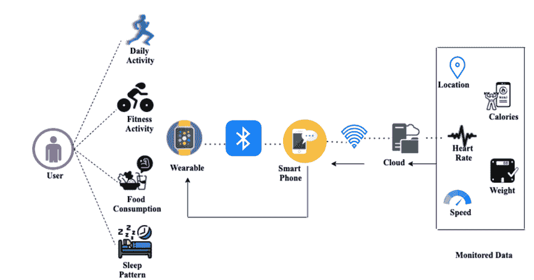

图 (3) Fitbit 架构。

## 物联网设备面临的挑战

物联网设备种类繁多。这些设备通过有线或无线通信等不同方式与其他设备通信，并根据终端通信设备使用不同的协议。由于设备的异构性，通信协议缺乏标准化。这引发了关于设备及其相关数据的安全性、完整性和机密性的担忧。而且，由于资源有限和计算能力不足，这些设备更容易受到安全攻击。由于设备种类繁多，物联网设备面临许多挑战，这些挑战在表 2 中列出。

## 表 2. 物联网设备的挑战。

| 序号 | 挑战 | 描述 |

|---|---|---|

| 1 | 机密性 | 由于设备维护着用户的敏感信息，因此需要保持数据的机密性。 |

| 2 | 完整性 | 由于设备与其他设备或服务器通信，数据通过网络传输。因此，数据的完整性是必要的。 |

| 3 | 身份验证 | 数据传输或接收发生在各种物联网设备之间，以增强功能。因此，在建立通信之前需要适当的身份验证机制。 |

| 4 | 功耗效率 | 许多小范围物联网设备缺乏维持计算和工作所需电力的资源。 |

| 5 | 单点攻击 | 从这些设备生成的所有数据将存储在各自集中式架构的设备数据中心中。这成为了一个非法用户访问数据的单点。 |

| 6 | 漏洞 | 由于端到端的无线通信，许多物联网设备容易受到攻击。 |

## 区块链简介

区块链是一种 P2P（点对点）安全分布式网络，无需第三方干预、中央服务器或可信代理即可维护网络交易记录和数字信息交换。它是一种以数据块形式保存信息的数据库结构。数据块通过给定的时间戳链接到前一个数据块。区块是在网络中的标准用户验证后，同时放入链中的一组交易。一个区块主要包含以下内容：

- 对前一个区块的引用

- 工作量证明：`nonce` 值（仅在特定时间生成一次的随机值）

- 时间戳

- 交易的 Merkle 树根：每笔交易都是树中的一个叶节点。每笔交易被哈希、合并并重新哈希，直到所有交易合并到一个根中。

每个节点都有一份区块的副本。因此，区块链是一个经过标准节点同意并分布在各节点之间的交易副本账本。

区块链有两种类型 [6]：公有区块链是无许可的，例如（比特币或以太坊），它是公开的，任何人都可以加入网络；还有许可区块链（Linux 基金会的 Hyperledger 项目）[7]。许可区块链需要有效节点对交易达成共识，并且在金融用例之外的应用中获得了广泛关注。

## 区块链的特性

- 数据的不可篡改性：一旦区块链形成，就很难篡改区块。

- 透明性：区块链中的所有交易都可以被任何参与者查看。

- 去中心化：区块链在多个站点之间进行管理，使其更加可靠。

- 安全性：区块链技术主要使用公钥基础设施和哈希技术，分别用于数据的身份验证和完整性。

## 区块链架构

区块链技术最初由作者中本聪 [8] 提出。其主要目的是在没有第三方服务器认证的情况下实现在线支付。这导致了当前热门的比特币和加密货币的发明。该技术使用户能够在线交换任何数字信息。由于区块链具有不可篡改性和安全性，它提供了高度的安全性、可靠性和可用性。由于这些特性，区块链技术被广泛应用于需要安全性的各种场景。区块链中的数据以节点的形式维护。每个节点代表一个交易或一条数字数据条目。每个条目都使用用户的私钥加密，并发送到链上；共识算法检查交易的有效性并将其添加到链中。因此，所有节点/交易都被添加到区块链中，形成一个链状结构。该技术遵循的架构中，每个节点都连接到网络中的其他每个节点。如图 (4) 所示。

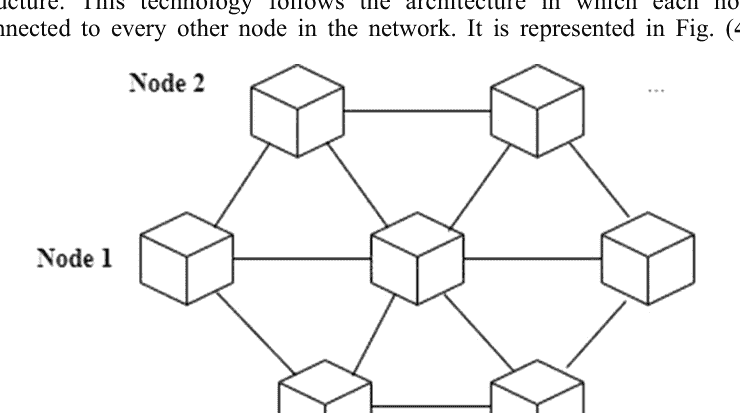

图 (4) 典型区块链的架构 [9]。

## 区块链的组成部分

区块链的功能基于基本的核心组件，如节点、交易、区块、挖矿和共识。

交易：交易是发送到节点进行有效性验证并添加到链中的基本数据。当新数据生成时，它被视为一项交易并广播到所有节点。


# 区块链基础概念

## 区块

一组交易称为一个区块。交易根据有效性进行分组，并分布在链上。该区块包含有关交易/数据的信息。添加到链上的每个区块都将包含前一个区块的哈希值。

## 节点

节点是验证新交易或数字条目的组件。区块链中的每个节点都拥有链中所有节点的副本。当新交易到来时，节点检查其先前历史并将其发送到其余节点以验证其有效性。如果交易有效，则将其添加到链中；否则，则拒绝。

## 挖矿

挖矿是区块链的核心功能。它是创建区块、验证区块并向其添加哈希值的过程。添加哈希值后，它会分布到整个网络。

## 共识

在网络上验证、添加和分发区块的整个过程称为共识。已经存在各种共识算法，如工作量证明和权益证明，它们定义了一套维护区块链的规则。

基于所有组件及其属性，区块链可以是私有的、公有的或混合的。区块链的整体工作流程及其组件如图 (5) 所示：

## 使用区块链确保安全

区块链的去中心化 [11] 和分布式流程在应用于物联网时，降低了与物联网设备数据管理和数据传输相关的成本和风险，因为没有数据中央存储库 [12]。通过区块链技术可以消除用于数据交换的物联网网关，从而降低与物联网网络相关的成本和延迟。

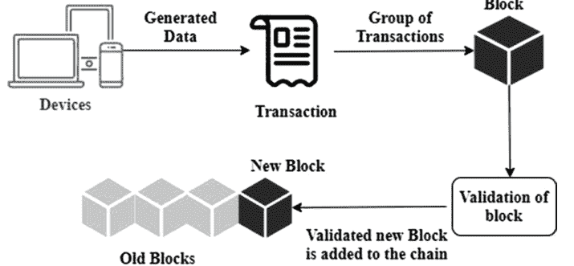

图 (5) 区块链的整体工作流程 [10]。

## 物联网设备的身份验证

应验证参与交易的物联网设备。身份验证过程可以通过硬件认证器完成，它可以是一个离线设备。硬件认证器（HA）具有重要功能，如创建初始区块、为物联网设备分配数字签名以及使用私钥创建新区块。

每个经过认证的设备都可以通过查看 HA 提供的区块数据库与其他经过认证的设备进行交易。该数据库包含所有经过认证的设备的标识和有效的先前交易记录。网络中其他已有的标准设备会验证新加入的设备。一旦网络中的标准用户中有 51% 确认验证通过，新认证的设备就可以使用其私钥参与交易。

## 完整性

区块的哈希值标识了特定的信息区块，这一特性使数据区块不可篡改。每个区块的哈希值引用前一个信息区块以形成链，并记录时间。因此，每个区块都包含前一个数据区块的哈希值，从而难以修改特定数据区块。区块的总哈希值是通过考虑前一个区块的哈希值、交易数据的哈希值和元数据形成的。如果任何数据区块被修改，就会破坏整条链。由于没有前一个区块，初始区块没有有效的前哈希值。这部分数据被称为创世区块，其前哈希值被设置为一个或多个零组成的字符串。为了保证数据安全，采用了两种方法。

### 方法一

在这种方法中，区块链的发明者制定了一套规则，使得在发生任何修改并尝试重新计算后续区块的哈希值时，哈希值的重新计算变得困难且耗时。每个区块中哈希计算更难所应遵循的规则是，哈希值应具有 X 个前导零。

### 方法二

第二种方法基于共识，其中遵循点对点网络[13]。任何参与者都可以加入网络。每个参与者都会获得区块链的完整副本。区块链分布在不同站点。每个经过认证的设备将数据块发送给网络中的所有对等节点。超过 51% 的对等节点应验证该交易，然后将该区块添加到链中。如果数据发生任何修改，重新计算哈希值并获得超过 50% 的标准设备的验证是非常困难的。

## 交易过程

图（6）给出了区块链的概述。

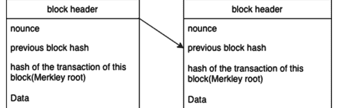

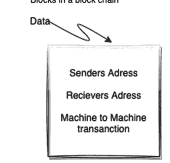

图（6）。区块链。

## 加密 [14]

区块链技术使用哈希。交易的哈希主要使用 SHA-256 算法来保护数据。发送方的公钥、交易信息和接收方地址通过 SHA-256 算法进行加密，以生成固定长度的加密信息。在区块链中完成的这种验证过程称为加密。区块链中的每个用户都有一个私钥和一个公钥。私钥用于验证用户身份并确认交易来源的合法性。用户的公钥是在对等网络中共享以用于验证交易的密钥。

## 发送者验证

一旦生成哈希密钥或消息摘要，就会创建数字签名，并且连同私钥一起，创建数字签名文档。原始消息、数字签名文档和公钥被发送给接收方。接收方从数字签名文档中提取哈希值，并将发送方共享的公钥与接收方根据原始消息生成的哈希值进行比较。

## 工作量证明

数据的验证通过一种称为挖矿[15]的方法完成。矿工确定随机数（nonce）值，即将随机值与前一区块的哈希值结合，重新计算哈希值，并将其与目标哈希值进行比较。如果矿工正确计算出哈希值，并且该值小于目标值，则该交易被视为已被用户验证，区块被添加到区块链中，交易得到处理。如果其中一位矿工能够确定随机数值并解密信息，其他用户只需验证交易，以便区块被添加到区块链中。找到满足要求的正确随机数值所需的数学难题（例如生成的哈希值必须小于目标值）需要巨大的计算能力，因为它必须通过暴力破解方法完成。如此巨大的计算量只能由标准用户尝试。由于随机数值是“仅使用一次的数字”，工作量证明用于确定用户进行的交易仅有一次，如图（7）所示。

## 智能合约

为了在物联网中实现更安全、自动化的机器对机器交易，在区块链之上构建了智能合约[16]。智能合约是一种可执行脚本，允许自动执行多个步骤：达成协议，并由网络中的所有对等节点进行交易。它支持由动作触发的自动交易。构建在区块链上的智能合约继承了区块链的特性，因此将验证、捕获并确保交易中涉及的多方达成协议，而无需第三方参与。物联网中的每个设备都会获得一份智能合约副本。当接收到发送到其地址的动作时，智能合约即被执行。以太坊提供了智能合约的概念和 Solidity（用于编写这些合约的编程语言），从而实现去中心化应用。研究人员已经研究了一种基于智能合约的低延迟、低计算消耗的保护模型[17]。网络中每个必须将区块作为交易发送的节点都必须在智能合约中注册。智能合约发出一个验证交易的令牌，并将其存储在区块中。该令牌作为有效性的证明，区块可以被视为已添加到区块链中。

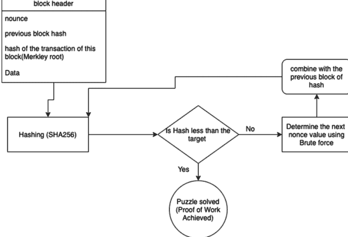

图（7）。工作量证明。

## 相关工作

为了保护物联网设备生成的数据的隐私，许多作者提出了许多算法和技术[18]，提出了一种混合方法，涉及在传输过程中使用同态加密来加密传感器数据，并使用区块链技术来维护隐私。然而，该技术存在存储开销，可以通过仅维护哈希值而不是整个链来解决。区块链不仅可以保护传感器数据，还可以用于保护医疗物联网数据的隐私[19]。提出了一种四层架构，为从物联网设备检索的医疗数据提供安全性。生成的数据使用区块链技术存储在数据库中；如果第三方想要检索数据，他们必须使用智能合约来提供用户的真实性。该模型可以提供安全性，但缺乏有效的图像检索系统，并且存在存储开销和计算复杂性。为了解决大量的计算复杂性和存储开销问题[20]，提出了一种改进的区块链框架，使用云来存储生成的区块，从而减少存储开销。属于同一区块链的所有区块都被赋予唯一标识符，这使得检索过程经过认证。想要访问数据的用户或医生可以通过智能合约和公钥发送请求。除了区块链之外，还实施了多种密码技术以提供针对不同类型攻击的安全性。与上述方法类似[21]，提出了一种四层架构，其中包含多种技术，例如用于存储的云、用于隐私的区块链以及用于监测个人健康的物联网。这些传感器生成的数据使用 NoSQL 数据库存储在云中，并使用区块链技术进行哈希处理，这使得检索过程更快[22]。扩展了区块链的使用范围，利用移动边缘计算为智慧城市提供安全性，因为每个人都拥有带有蜂窝网络区域的移动设备。该技术使用现有的移动计算来生成数据，并包含区块链以提供安全的点对点通信[22]。还提出了类似的智慧城市框架，将数据存储在区块链中以提供可靠性，使用某种同态加密来提供安全性，并使用机器学习算法对数据进行分类以用于预测。上述大多数技术为生成的数据提供安全性，而它们使用区块链技术来提供可靠、安全的平台，以在设备到设备以及人到设备之间交换数据。此外，许多作者使用机器学习算法在允许访问第三方服务器之前将数据分为两类：关键数据和非关键数据。通过使用不同的加密算法对关键或非关键数据进行加密来提供额外的安全性。

## 提出的方法

所提出的方法涉及实现区块链技术，以为物联网设备生成的数据提供安全性，如表 1 和表 3 所述。

每天，设备都会生成数据，每天的数据被视为一笔交易。初始数据，即第 1 天的数据，被视为一个区块，并使用 SHA- 与创世区块的哈希值进行哈希处理。

## 110 区块链在网络安全解决方案中的应用

Sowjanya 等人。

SHA-256算法。新生成的区块被添加到链中，然后上传到数据中心云。类似地，在第n天，该区块与区块n-1的哈希值进行哈希运算后添加到链中。每天生成的每个区块都被视为一个区块，链通过将哈希后的区块添加到链中来维护。维护链的过程如图8所示，算法见表4。

## 表3. 物联网生成的典型数据。

| 日期 | 活动 | 步数 | 距离（公里） | 时间 | 心率 | 压力水平 | 卡路里 |

|------|----------|-------|-------------|------|------------|---------------|----------|

| 06/01/2021 | 步行 | 10,000 | 7.62 | 6:00 AM | 85 | 高 | 409 |

| 06/02/2021 | 慢跑 | 7,500 | 5.7 | 6:15 AM | 84 | 中 | 261 |

| 06/03/2021 | 步行 | 3,000 | 2.2 | 6:05 AM | 77 | 低 | 153 |

| 06/04/2021 | 步行 | 9,000 | 6.8 | 6:00 AM | 85 | 低 | 334 |

| 06/05/2021 | 慢跑 | 9,000 | 6.8 | 6:20 AM | 88 | 低 | 334 |

| 06/06/2021 | 跑步 | 7,800 | 5.9 | 6:12 AM | 85 | 中 | 272 |

| 06/07/2021 | 步行 | 5,678 | 4.32 | 6:17 AM | 77 | 低 | 204 |

| 06/08/2021 | 步行 | 7,998 | 6.09 | 6:00 AM | 80 | 低 | 284 |

| 06/09/2021 | 步行 | 9,087 | 6.92 | 6:03 AM | 85 | 低 | 344 |

| 06/10/2021 | 慢跑 | 5,009 | 3.8 | 6:04 AM | 78 | 中 | 190 |

| 06/11/2021 | 步行 | 8,009 | 6.1 | 6:00 AM | 82 | 低 | 284 |

| 06/12/2021 | 步行 | 12,000 | 9.1 | 6:14 AM | 88 | 高 | 614 |

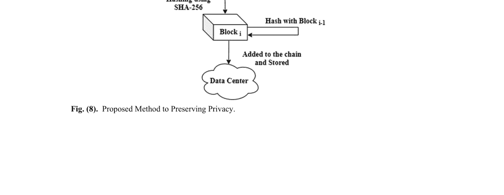

## 表4. 使用区块链的数据隐私提议算法

| 步骤 |

|------|

| 步骤1: 第 i 天的数据被生成并视为一个交易 |

| 步骤2: 区块 i 使用 SHA-256 与区块 i-1 的哈希值结合 |

| 步骤3: 带有哈希值的新生成区块被添加到链中并上传到服务器 |

## 链验证

区块链因其提供的高度安全性而广受欢迎。通过挖矿过程，区块链中数据的完整性得以保持高度。挖矿链包括通过重新计算现有区块的哈希值来向链中添加新区块，并检查新计算的哈希值与先前现有哈希值的有效性。如果哈希值存在任何差异，可以通过挖矿过程轻松识别。识别修改/篡改区块的过程可以通过两种方式进行。第一，使用当前区块哈希，通过将当前区块哈希与最近计算的当前区块哈希进行比较。如果这两个值相等，则数据未被修改/篡改。否则，数据已被篡改。第二，使用前一个区块哈希，通过将当前区块的前一个哈希与前一个区块的计算哈希进行比较。同样，如果这两个哈希值相同，则没有修改；否则，数据已被篡改。链验证的过程如图(9和10)所示如下。

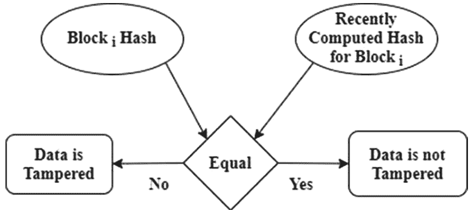

图(9). 使用当前区块哈希进行验证。

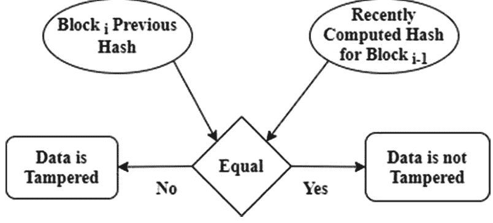

图(10). 使用前一个区块哈希进行验证。

## 结果

静态样本数据，如序号、心率、步数、血压、压力水平和日期，被考虑用于创建和维护区块链。创世块包含用户提供的初始信息，后续数据由物联网设备逐日生成，并通过使用 SHA-256 以 UTF-8 字符集进行哈希处理添加到链中，生成的结果见表5。

## 表5. 使用SHA-256生成区块链哈希

|  | 数据 | 前一个哈希 | 生成的哈希 |

|---|---|---|---|

| 创世块 | "0", "75", "10000", "120/75", "中等", 日期, | Null | C69/G6YCWFsrH7/dZsJjIJ2JdXB6 fgbr5ktcx1AYPbU= |

| 区块1 | "1", "75", "10000", "125/85", "高", 日期 | C69/G6YCWFsrH7/dZsJjIJ2JdXB6 fgbr5ktcx1AYPbU= | M0cAs1SA51+ZVXqV3wdDIaGHi j9v5KoNoGCwaDKNs3U= |

| 区块2 | "2", "80", "8000", "110/70", "低", 日期 | M0cAs1SA51+ZVXqV3wdDIaGHi j9v5KoNoGCwaDKNs3U= | pnkbcFsuEusZ1iR0uB8HRNznGenl rk+i6pBj7w+k0rE= |

| 区块3 | "3", "85", "7500", "120/90", "中等", 日期 | pnkbcFsuEusZ1iR0uB8HRNznGenl rk+i6pBj7w+k0rE= | j/BwMAnRRCq8hWfNoMdFXQV6 2sVP++ezHbQ2Odfedk= |

|  |  | 链有效 |  |

对于区块链验证，最新区块的前一个哈希已被篡改，在挖矿过程中被识别为无效链，如表6所示。

## 表6. 使用前一个哈希进行区块链验证

|  | 数据 | 前一个哈希 | 生成的哈希 |

|---|---|---|---|

| 创世块 | "0", "75", "10000", "120/75", "中等", 日期, | Null | C69/G6YCWFsrH7/dZsJjIJ2JdXB6 fgbr5ktcx1AYPbU= |

| 区块1 | "1", "75", "10000", "125/85", "高", 日期 | C69/G6YCWFsrH7/dZsJjIJ2JdXB6 fgbr5ktcx1AYPbU= | M0cAs1SA51+ZVXqV3wdDIaGHi j9v5KoNoGCwaDKNs3U= |

| 区块2 | "2", "80", "8000", "110/70", "低", 日期 | M0cAs1SA51+ZVXqV3wdDIaGHi j9v5KoNoGCwaDKNs3U= | pnkbcFsuEusZ1iR0uB8HRNznGenl rk+i6PbJ7w+k0rE= |

| 区块3 | "3", "85", "7500", "120/90", "中等", 日期 | ABCDEFG（被篡改的哈希） | j/BwMAnRRCq8hWfNoMdFXQV6 2sVP++ezHbQ2Odffcdk= |

| 该链无效 |  |  |  |

在数据篡改的情况下，生成的哈希值将随数据值的变化而改变。因此，即使数据被修改/篡改，也可以通过区块链技术轻松地点对点识别，如表7所示。

## 表7. 使用前一个哈希进行区块链验证（数据值被篡改）

|  | 数据 | 前一个哈希 | 生成的哈希 |  |

|---|---|---|---|---|

| 创世块 | "0", "75", "10000", "120/75", "中等", 日期, | Null | C69/G6YCWFsrH7/dZsJjIJ2JdXB6 fgbr5ktcx1AYPbU= | - |

| 区块1 | "1", "75", "10000", "125/85", "高", 日期 | C69/G6YCWFsrH7/dZsJjIJ2JdXB6 fgbr5ktcx1AYPbU= | M0cAs1SA51+ZVXqV3wdDIaGHi j9v5KoNoGCwaDKNs3U= | - |

| 区块2 | "2", "100", "8000", "150/120", "高", 日期（被篡改的数据） | M0cAs1SA51+ZVXqV3wdDlaGHi j9v5KoNoGCwaDKNs3U= | 98fLH2eG8qsnpo9F6s+Myaqo DsTfaiIGi4UJbcfDROg= | 当前哈希与前序哈希不匹配 |

| 区块3 | "3", "85", "7500", "120/90", "中等", 日期 | pnkbcFsuEusZ1iR0uB8HRNznGenl rk+i6pBj7w+k0rE= | j/BwMAnRRCq8hWfNoMdFXQV6 2sVP++ezHbQ2Odffcdk= | - |

因此，通过实施区块链，可以为物联网设备生成的敏感数据提供完整性和最大程度的隐私保护。结果表明，任何第三方服务器/第三方人员试图黑客攻击或修改数据的企图都可以通过该技术轻松识别。

## 结论与未来工作

当前数字世界中涌现出许多智能设备，如智能手表和智能家居设备。本文概述了Fitbit设备以及这些设备生成的数据类型。此外，还讨论了物联网安全的各种挑战。隐私和安全是与物联网设备相关的主要问题，因为设备存储了使用者的敏感数据。由于高计算单元的发展，如果服务器使用传统安全算法和集中式架构进行保护，它们可能会被黑客入侵。所提出的模型利用区块链技术为数据提供了安全性和隐私性，并防范了单点攻击，同时还可以检测任何异常。所提出的模型能耗较高，并不理想。这可以通过实现能耗较低的轻量级区块链来解决。在未来的工作中，所提出的模型可以用于实时数据。

## 发表同意书

不适用。

## 利益冲突

作者声明不存在任何财务或其他方面的利益冲突。

## 致谢

声明无。

## 参考文献


- [1] G. Aroganam, N. Manivannan, and D. Harrison, "用于消费运动应用的可穿戴技术传感器综述", *Sensors*, vol. 19, no. 9, pp. 1-26, 2019 1983.

- [`http://dx.doi.org/10.3390/s19091983`]

- [2] F. Loukil, C. Ghedira-Guegan, K. Boukadi, and A.N. Benharkat, "基于区块链和同态加密的隐私保护物联网数据聚合", *Sensors*, vol. 21, no. 7, p. 2452, 2021 2021.

- [`http://dx.doi.org/10.3390/s21072452`]

- [3] M. Shen, Y. Deng, L. Zhu, X. Du, and N. Guizani, "医疗物联网系统的隐私保护图像检索：一种基于区块链的方法", *IEEE Netw.*, vol. 33, no. 5, pp. 27-33, 2019.

- [`http://dx.doi.org/10.1109/MNET.001.1800503`]

- [4] A. D. Dwivedi, G. Srivastava, S. Dhar, and R. Singh, "面向物联网的去中心化隐私保护医疗区块链", *Sensors*, vol. 19, no. 2, p. 326, 2019.

- [`http://dx.doi.org/10.3390/s19020326`]

- [5] D.H. Wang, "基于区块链技术的物联网临床传感器数据管理与传输", *Journal of ISMAC*, vol. 2, no. 3, pp. 154-159, 2020.

- [`http://dx.doi.org/10.36548/jismac.2020.3.003`]

- [6] I. Makhdoom, I. Zhou, M. Abolhasan, J. Lipman, and W. Ni, "PrivySharing：智能城市中隐私保护和安全数据共享的基于区块链的框架", *Comput. Secur.*, vol. 88, no. 101653, p. 101653, 2020.

- [`http://dx.doi.org/10.1016/j.cose.2019.101653`]

- [7] M. Shen, X. Tang, L. Zhu, X. Du, and M. Guizani, "智能城市中基于区块链加密物联网数据上的隐私保护支持向量机训练", *IEEE Internet Things J.*, vol. 6, no. 5, pp. 7702-7712, 2019.

- [`http://dx.doi.org/10.1109/JIOT.2019.2901840`]

- [8] B. Le Nguyen, E.L. Lydia, M. Elhoseny, I. Pustokhina, D.A. Pustokhin, and M.M. Selim, "实现物联网数据安全可靠共享的隐私保护区块链技术", *Comput. Mater. Continua*, vol. 65, no. 1, pp. 87-107, 2020.

- [`http://dx.doi.org/10.32604/cmc.2020.011599`]

- [9] S. Nakamoto, "比特币点对点电子现金论文", In: *The Cryptography Mailing List* Nakamoto Institute, 2008, pp. 1-7.

- [10] R. Mahmoud, T. Yousuf, F. Aloul, and I. Zualkernan, "物联网安全：现状、挑战与前瞻性措施", *2015 10th International Conference for Internet Technology and Secured Transactions (ICITST)*, 2015 pp. 1-6

- [11] G.M. Gandhi, "人工智能融合区块链用于训练自动驾驶汽车", *2019 Fifth International Conference on Science Technology Engineering and Mathematics (ICONSTEM)*, 2019 pp. 1-5

- [`http://dx.doi.org/10.1109/ICONSTEM.2019.8918795`]

- [12] D. Puthal, N. Malik, S.P. Mohanty, E. Kougianos, and G. Das, "你想知道的关于区块链的一切：其前景、组成部分、过程和问题", *IEEE Consum. Electron. Mag.*, vol. 7, no. 4, pp. 6-14, 2018.

- [`http://dx.doi.org/10.1109/MCE.2018.2816299`]

- [13] C.H. Lau, K.H.Y. Alan, and F. Yan, "物联网网络中基于区块链的身份认证", *IEEE Conference on Dependable and Secure Computing (DSC)*, 2018 pp. 1-8

- [14] R. Zhang, R. Xue, and L. Liu, "区块链上的安全与隐私", ACM Comput. Surv., 第 52 卷, 第 3 期, 页码 1-34, 2020 年。 [CSUR]。 [`http://dx.doi.org/10.1145/3316481`]

- [15] S. Nakamoto, "比特币：点对点电子现金系统", Decentralized Business Review, 第 21260 卷, 页码 1-9, 2008 年。

- [16] A. Pinna, and W. Ruttenberg, "证券后交易中的分布式账本技术：革命还是演进？", ECB Occasional Paper, 第 172 卷, 页码 1-36, 2016 年。

- [17] A. Reyna, C. Martín, J. Chen, E. Soler, and M. Díaz, "关于区块链及其与物联网的集成。挑战与机遇", Future Gener. Comput. Syst., 第 88 卷, 页码 173-190, 2018 年。 [`http://dx.doi.org/10.1016/j.future.2018.05.046`]

- [18] H. Malviya, "区块链如何防御物联网", SSRN, 页码 2883711, 2016 年。

- [19] A. Maseleno, M. Othman, P. Deepalakshmi, K. Shankar, and M. Ilayaraja, 基于哈希函数的物联网（IoT）最优区块链模型。 Handbook of multimedia information security: Techniques and applications. Springer: Cham, 2019 年, 页码 289-300。 [`http://dx.doi.org/10.1007/978-3-030-15887-3_12`]

- [20] S. Ali, G. Wang, B. White, and R.L. Cottrell, "面向 PingER 的基于区块链的去中心化数据存储和访问框架", 2018 17th IEEE International Conference On Trust, Security And Privacy In Computing And Communications/ 12th IEEE International Conference On Big Data Science And Engineering (TrustCom/BigDataSE), 2018 年, 页码 1303-1308。

- [21] G. Schmitt, A. Mladenow, C. Strauss, and M. Schaffhauser-Linzatti, "智能合约与物联网：使用技术-组织-环境框架进行定性内容分析以识别关键决定因素", Procedia Comput. Sci., 第 160 卷, 页码 189-196, 2019 年。 [`http://dx.doi.org/10.1016/j.procs.2019.09.460`]

- [22] S. Zhang, and J.H. Lee, "基于智能合约的矿工注册和区块验证安全模型", IEEE Access, 第 7 卷, 页码 132087-132094, 2019 年。 [`http://dx.doi.org/10.1109/ACCESS.2019.2940551`]

## 基于区块链的访问控制系统

R. Agrawal¹,* 和 N. Gupta¹

¹ 马纳夫·拉奇纳国际研究所与研究中心，法里达巴德，哈里亚纳邦，印度

摘要：通过物联网（IoT）访问数据时，隐私和安全是最重要的特性。物联网开发者由于物联网环境中去中心化和异构性的复杂性，在开发过程中保护用户数据安全面临挑战。文献中存在多种面向物联网的访问控制模型，它们依赖于集中式架构，并因物联网设备能够自发动态交互而引发安全问题。当与可扩展性和轻量级特性相结合时，克服集中式实体单点故障问题的需求以及对安全且分布式访问控制架构的需求成为一大挑战。区块链技术最近被用于提供访问控制服务，通过使用区块链技术可以实现这一点。未来在可扩展的情况下，物联网设备管理将用于管理物联网设备在规模上的分发、异构性、可扩展性、容错能力、安全性和隐私方面的问题，因为它是有用的。

关键词：区块链，访问控制系统，策略创建交易，分布式访问管理，物联网。

### 引言

当前数字经济似乎依赖于受信任权威的存在。进行任何在线交易时，我们需要信任收到的信息是准确的。无论是电子邮件服务提供商告知我们投递情况，还是证书颁发机构告诉我们信任某个数字证书；另一方面，社交网络，例如 Facebook，可能会告诉我们关于生活的帖子仅与朋友分享，或银行可能会告诉我们可以在另一个国家的亲人身上建立信任。我们生活在一个不稳定的世界里，在这个世界里，我们必须依靠第三方机构来保护我们的安全并保持个人信息的私密。正如以往一样，第三方容易受到黑客攻击、操纵或破坏。区块链技术为这些问题提供了解决方案。借助该技术实现的分布式共识，可以随时验证涉及数字资产的任何在线交易，从而使数字世界发生革命性变化。

数字资产和各方身份在不损害隐私的情况下得到保护。区块链技术以其分布式共识和匿名性为特征。监管问题和技术挑战被区块链技术的益处所抵消。

区块链技术已被证明是一种高度透明且不可腐败的数据存储方法。去中心化技术确保端到端加密和安全，使其非常适合拥有大量用户的网络。区块链的去中心化特性消除了人为错误的可能性，并由于其分布式特性而完全提供对黑客攻击的保护。在访问控制的背景下，尤其是访问控制即服务，以上所有内容都至关重要。

加密货币和金融交易是区块链的第一个应用。智能合约有广泛的应用，例如医疗保健、物联网、供应链等。研究 [1] 对区块链和智能合约的许多研究进行了综述，显示出所介绍的许多应用旨在提供一种高效且安全的方式来控制访问。

访问控制系统用于控制公众认为关键或有价值的数据和服务的访问。此外，它还用于管理计算系统、存储空间和其他协处理器。访问控制策略一般用于表达主体访问资源的权利。这些策略根据请求时的上下文进行评估。ABAC（基于属性的访问控制）[2] 是一种访问控制形式，由一组条件组成，这些条件描述了访问请求中涉及的主体区域、资源、环境等的固有特征。作为主体属性的示例，可以找到他的 ID、公司的 ID、他在该组织内的职称、他正在从事的项目的名称、他当前正在使用的资源数量等等。

在某些情况下，由于某些情况，可能需要在主体之间转移访问权，原因各不相同。例如，拥有访问权的人可以将它卖给别人。同样适用于公司员工的示例，该员工本应在一台虚拟机上执行特定操作，但却选择将任务的责任委托给另一名也需要访问该虚拟机的员工。

### 背景

区块链是任何人随时都可以访问的数据数字账本。区块链是去中心化的数据库，安全、易于使用，任何人都可以访问。该系统基于无信任原则，这意味着用户接受数据并分析数据，无论其是否安全，都无需第三方干预。最初，它计划提供安全的加密货币，例如比特币，但如今，研究人员正在探索将该技术应用于广泛领域的可能性 [3]。作为该方法的一部分，代币以区块链上交易的形式交换以换取代币。区块链是使用加密协议的由多个节点组成的点对点网络的示例。通过验证交易并在这些节点之间传递，这些节点处理它们之间的通信。区块链具有许多有趣的功能，使其易于使用 [4]。基本上，它是一个只能追加的分布式账本。数据一旦插入数据库，就无法更改，也无法在添加后删除。在区块链上，任何人都可以加入网络，因此他们将能够看到本质上公开的所有交易，因为区块链交易本质上是公开的。

在区块链的帮助下，比特币像许多其他加密货币一样，将称为交易的值交换存储在公共账本上 [5]。该账本中的每个区块都是在该区块中进行的非冲突交易集合。为了在区块之间创建链接，前一个区块的头部的哈希值存储在链中下一个区块的头部中。从区块交易哈希派生的 Merkle 树的根作为其区块头部的函数包含在每个区块的区块头部中（因此它是哈希）。这是为了使区块头部依赖于该区块中包含的所有交易。在每一步中要将哪个区块添加到账本的决定是由一种称为“中本聪共识”的分布式共识算法做出的，该算法基于 HashCash 工作量证明 [6] 系统。

从数据角度来看比特币区块链的一种简单方法是将其视为交易列表。用户使用钱包地址交换资金，钱包地址充当其钱包的地址。从 ECDSA 密钥对 [7] 派生的公钥是通过双向哈希派生的（首先应用 SHA-256，然后将 RIPEMD-160 作为第二步应用）来建立地址。

在比特币的情况下，地址（因此公钥）由用户用于发送和接收付款，而私钥用于提供所有权证明（通过数字签名）。由于创建新的 ECDSA 密钥对是与创建新地址一样便宜，每个用户都可以创建和使用多个ECDSA密钥对。还鼓励用户使用不同的地址，因为即使不使用不同地址，也会使比特币成为一种不安全且非匿名的货币。

以区块链作为系统中追踪所有交易的唯一手段，管理资金的唯一方式就是追踪这些交易。分割或聚合资金的唯一途径是花费它们。一笔交易可以源自多个输入地址，并输出到多个地址，这意味着交易可以从多个地址提取资金，并向多个地址发送资金。此外，每个输入都由与资金花费地址对应的私钥所有者签名。

作为交易的一部分，还可以指定自愿支付的手续费，以覆盖与验证过程相关的成本。该手续费的作用是激励用户参与先前提到的共识协议。在交易的语境中，可以将每个输出看作一个对偶（金额，接收地址）。而输入则指明了资金的提取来源，即先前创建资金的交易（通过其哈希）以及资金将被提取的地方。除了比特币协议中用于指定资金赎回条件的脚本语言之外，比特币协议还使用了一种基于栈的脚本语言，该语言并非图灵完备。

尽管区块链技术最为人所知的是其在加密货币[8]（如比特币）中的应用，但它也可以用于货币领域之外，例如追踪供应链中产品的来源和转化。Huckle等人[9]讨论了区块链如何用于创建去中心化的共享经济应用，使人们能够以安全的方式将自己的物品货币化，从而变得更加富有。[10]进行的一项研究特别指出，拥有一个全球可用、可验证且不可篡改的数据源，将使任何希望提供可信第三方服务的人都能以经济高效且稳健的方式提供服务。

如今，大多数数字资源都暴露在互联网上，这就需要一个设计良好的安全框架来提供保护。用户拥有实际访问信息的权利。有些系统专门处理这类情况下的访问控制，它们负责通过策略来表达主体访问资源的权利，然后针对每个访问请求，根据当前的访问上下文对这些策略进行评估。有时，执行访问的授权会在访问过程中持续验证，因此一旦这些权利过期，先前已授权的访问会立即被中断。

在科学文献中，人们提出了不同类型的控制模型来定义不同类型的控制。最流行的ABAC方案之一通过一组属性来表示访问上下文，这些属性描述了与主体、资源和环境相关的相关特征，而访问控制策略则由关于这些属性的一组条件组成。访问控制系统可以部署、管理和运行在资源所有者的场所内，或由资源所有者信任的第三方来部署、管理和运行。

作为资源所有者，维护访问控制系统的成本可能是一个显著的制约因素。为了避免这种成本，可以将其安全策略的评估外包给外部系统。例如，在过去几年中，许多访问控制系统被提出并作为云上的独立服务实现，遵循软件即服务（SaaS）范式。这些服务通常使用开放平台API，这样用户就不会被锁定在某个特定实现上，并且可以使用这些服务进行统一配置，用相同的策略控制其所有资源。与其他云服务一样，每个用户按使用量支付访问控制服务的使用费用。

### 基于区块链的物联网访问控制

据作者[11]所述，区块链是用于生成和管理访问令牌的机制，这些令牌代表主体访问资源的权利。该模型引入了一种新的交易类型：PCT（策略创建交易）和RTT（权利转移交易）。当资源属性符合各个访问策略时，资源所有者必须首先执行一笔交易，以生成和转移访问令牌。访问请求可由两个不同的系统（资源所有者和外部授权系统）进行审批评估。这两个系统必须交互，流程才能成功。在第二种类型的交易中，访问令牌也可以从一个主体传递给另一个主体。这个过程称为访问委托。基于XACML标准，使用比特币平台实现了一个外部授权系统来管理用户访问令牌。

Novo[12]提供了一个设计，用于提供由遍布世界多个地区的传感器网络组成的去中心化访问控制系统。智能合约旨在减少节点之间的通信开销，以便为用户提供实时的、去中心化的访问控制。由于物联网设备能力有限，无法连接到区块链，该架构转而指定了一个名为管理枢纽（management hub）的新组件，它可以代表物联网设备向区块链请求访问控制信息。系统架构还定义了两种区块链节点，即管理节点（managers）和代理节点（agents）。管理节点不参与挖矿，被视为轻量级区块链节点。代理节点部署一个单一的智能合约来管理物联网设备的访问控制权限。这个特定的智能合约将访问管理系统的所有功能集于一体。一旦物联网设备收到访问请求，它就会将该请求发送到枢纽，枢纽直接连接到区块链节点，例如，与智能合约协同工作的矿工，以确定请求者是否有权访问该资源。在概念验证实现中，区块链技术已被用作物联网的分布式访问管理技术。


研究人员在[13]中指出了物联网访问控制的两个主要问题。第一个是中心化架构问题，第二个与处理静态策略有关。作者结合机器学习算法与区块链架构，提出了一个框架，在管理基于机器学习算法的动态访问策略的同时，确保完全分布式的访问控制。该框架利用智能合约概念，实现资源所有者（RO）的访问控制策略，以管理对其所拥有资源的访问。需要记住的是，为了让策略合约正确执行，请求者必须满足访问相关数据的策略，从而允许策略合约生成并签发授权令牌，使其能够访问该资源。每当策略合约与某事物交互时，就会生成一笔交易，并记录在区块链账本中。合约执行后，资源所有者还将通过强化学习（RL）算法收到关于系统当前状态的反馈信息。这些反馈信息可用于动态改进信任和完整性等安全参数。需要概念验证来验证所提出的模型。

IoT Chain是作者在[14]中提出的一种基于区块链的架构，用于保护对物联网资源的端到端访问管理。存储在资源服务器上的资源将被加密和签名，并存储在资源所有者所拥有的代理服务器上。因此，是客户端代表第三方请求访问受保护资源。在请求解密密钥时，它会先检查区块链，以验证客户端是否已被授权，然后再请求解密密钥。授权按以下方式进行：资源所有者为客户端创建智能合约并将其发布到区块链。在满足特定条件后，客户端调用相应的智能合约用于生成访问令牌。合约会将令牌存储在合约服务器的持久内存中，而不是将其传输给客户端。令牌存储在内部合约存储中，然后客户端从密钥服务器请求解密密钥，密钥服务器是一个维护区块链账本副本的区块链节点。密钥服务器在区块链上验证客户端的访问令牌，并在检查区块链上的智能合约存储后，通过DTLS通道传输密钥。客户端随后从代理服务器下载加密资源并解密。

文献[15]中的研究人员使用智能合约来解决与物联网认证相关的扩展问题。通常情况下，一个人拥有一台或多台物联网设备，每台设备都需要自己的一套凭证。因此，用户此后必须对每台设备逐一进行认证。因此，这种方法会造成认证开销，且难以扩展。智能合约主要用于认证用户，并向用户提供令牌，使其能够访问自己所拥有的物联网设备。用户使用其以太坊钱包地址向智能合约进行认证，这使智能合约能够验证用户的身份。随后，如果允许用户访问资源，则协商合约，然后将密钥传达给最终用户和物联网设备。用户随后使用其私钥对收到的令牌进行签名，将其发送给物联网设备；物联网设备获取令牌后，通过与之前从合约收到的实例进行比较来确认其完整性，然后授予访问权限。以太坊区块链已被用于实现和测试这种方法。图1展示了一种基于区块链的物联网访问控制通用方法。

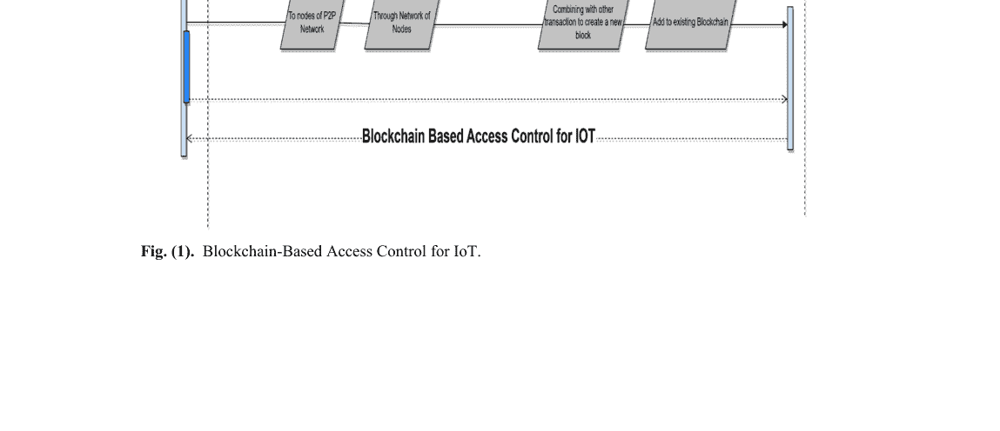

### 出版同意

不适用。

### 利益冲突

作者声明不存在财务或其他利益冲突。

### 致谢

声明无致谢。

### 参考文献

[1] S. Rouhani 和 R. Deters，“智能合约的安全性、性能和应用：系统综述”，*IEEE Access*，vol. 7, pp. 50759–50779, 2019. [http://dx.doi.org/10.1109/ACCESS.2019.2911031]

[2] Vincent C. Hu、David Ferraiolo、Rick Kuhn、Arthur R. Friedman、Alan J. Lang、Margaret M. Cogdell、Adam Schnitzer、Kenneth Sandlin、Robert Miller 和 Karen Scarfone，“基于属性的访问控制（ABAC）定义和注意事项指南（草案）”，*NIST special publication*, vol. 800, no. 162, pp. 1–54, 2013.

[3] R.C. Merkle，“基于传统加密函数的数字签名”，载于：*密码技术理论与应用会议*，Springer：柏林，海德堡，1987年，第369–378页。

[4] C. Dwork 和 M. Naor，“通过处理或对抗垃圾邮件进行定价”，载于：*年度国际密码学会议*，Springer：柏林，海德堡，1992年，第139–147页。

[5] NIST，美国，SHA-256、SHA-384 和 SHA-512 的描述，

[6] Preneel, Bart, Antoon Bosselaers 和 Hans Dobbertin.“密码哈希函数RIPEMD-160.”（1997年）：第9–14页。

[7] D. Johnson、A. Menezes 和 S. Vanstone，“椭圆曲线数字签名算法（ECDSA）”，*Int. J. Inf. Secur.*, vol. 1, no. 1, pp. 36–63, 2001.

[8] M. Pilkington，《区块链技术：原理与应用》。《数字化转型研究手册》，Edward Elgar Publishing，2016年。

[9] S. Huckle、R. Bhattacharya、M. White 和 N. Beloff，“物联网、区块链和共享经济应用”，*Procedia Comput. Sci.*, vol. 98, pp. 461–466, 2016.

[10] M. Michael 和 M. Smith，“共享经济的共享账本：对相互分布式账本（又称区块链技术）的探索”，*Journal of financial perspectives*, vol. 3, no. 3, 2015.

[11] D.D.F. Maesa、P. Mori 和 L. Ricci，《基于区块链的访问控制》。《IFIP分布式应用与可互操作系统国际会议》，Springer：Cham，2017年，第206–220页。

[12] O. Novo，“区块链遇见物联网：物联网中可扩展访问管理的架构”，*IEEE Internet Things J.*, vol. 5, no. 2, pp. 1184–1195, 2018.

[13] A. Outchakoucht、H. Es-Samaali 和 J. Philippe，“基于区块链和机器学习的物联网动态访问控制策略”，*Int. J. Adv. Comput. Sci. Appl.*, vol. 8, no. 7, pp. 417–424, 2017.

[14] O. Alphand、M. Amoretti、T. Claeys、S. Dall'Asta、A. Duda、G. Ferrari、F. Rousseau、B. Tourancheau、L. Veltri 和 F. Zanichelli，“IoTChain：物联网的区块链安全架构”，2018年IEEE无线通信与网络会议（WCNC），2018年，第1–6页

[15] A.Z. Ourad、B. Belgacem 和 K. Salah，“使用区块链进行物联网访问控制和认证管理”，载于：*物联网国际会议*，Springer：Cham，2018年，第150–164页。

### 引言

区块链是一个由区块组成的序列，每个区块都包含不受中央机构监管的宝贵数据。它不可篡改且具有密码学安全性。链表和指针是区块链中使用的两种重要数据结构。区块链正在重新定义处理可信交易的方式。互联网极其脆弱，区块链[1]正是因此应运而生。区块链将信任责任线定义为人工智能和物联网面临的一个挑战。大多数物联网设备在公共网络上相互通信，公共网络的脆弱性无需多言。区块链[2]通过允许用户创建线性且长期存在的索引记录来克服这一挑战。它们还可以通过提供支付机制和通信渠道来使业务流程更加顺畅。任何形式的黑客攻击和数据篡改，例如对设备和记录的恶意控制，都会因区块在区块链概要中以明确的数据库方式存储和守护而变得极为困难。每台物联网设备都是一个脆弱点，而且风险更高，因为即使是人工智能也在为用户做出决策。因此，区块链可以提供一个安全、可扩展且可认证的平台，并具有卓越的安全实现[3]。

## 区块链与智能合约

### 区块链的实现技术

要开发一个现实且有效的区块链应用环境，必须解决若干基本问题[4]。一个独特区块链生态系统的四个层面是智能合约、区块链、服务和用户界面。企业网络模型、参与者、生态系统设计、准入策略、节点、轮询系统、激励机制、智能合约和客户端都是区块链实现策略的示例。此外，还需要数据采集和数据处理方法来解决区块链应用中的问题。

目前大多数项目都在区块链网络概念[5]上苦苦挣扎。区块链技术仍在不断变化，尚不存在被广泛认可的技术模式。由于效率低下和高性能成本，某些基于比特币的项目未被认可。越来越多的应用正在使用自行设计的混合网络或替代网络架构。

典型的区块链生态系统包括区块链基础设施、参与者与区块链之间具有编程接口的信息系统，以及一组用于运行的智能合约。所有数据和通信都存储在由区块链系统提供的去中心化和自我调节的数据基础设施。

应根据参与者的功能以及区块链网络来识别他们。轮询技术和运营目标决定了节点数量和演化策略。网络模型用于在联盟区块链范式中建立准入策略和所需信息。为了构建区块链并建立有效的共识过程，应开发一个切实可行且高效的激励机制。

智能合约通常被认为是最先进的区块链支持技术。包含智能合约的区块链生态系统可以提高自主性、开放性、共识性和可信度。得益于智能合约的集合，区块链可以在无需人工干预的情况下运行。智能合约的创建目的是在预定的区块链节点上执行。区块链系统、其他智能合约或参与方信息系统的回调都可用来激活它们。智能合约通常可用于对区块链操作和应用相关规则进行编程。

### 面向参与者的区块链客户端

有三种不同类型的区块链客户端，每种都通过应用程序编程接口与区块链生态系统交互。第一种客户端构建于参与者的信息系统中，包括管理信息系统和嵌入式系统。第二种客户端是智能合约，或者是区块链操作系统（如区块链浏览器）所提供的客户端。区块链的第三种客户端形式是公共设施，它为参与者及潜在参与者提供公共用户界面。

为了支持基于区块链的企业，数据收集方法是不稳定的。区块链中的数据旨在由成员私有持有并自行管理，这带来了许多常见的数据收集困难，包括数据不足、数据稀缺和数据冗余。对于缺失的数据属性以及不相关或冗余的数据，必须开发定义明确的补偿方法。同时，应开发加权和交叉检查算法，以利用从区块链内外、链上和链下吸收的参与数据，这些算法可作为智能合约实现来整合数据。在管理数据时，还有其他一些考虑因素。例如，为了了解如何利用来自先前区块链生态系统的数据，该生态系统被构建为整合区块链内外的数据，请求者可能会受益于其他区块链生态系统。

### 区块链的应用开发环境

有数十种开源通用区块链开发环境。凭借比特币、矿工、工作量证明、交易和无需许可 [6] 的革命性原则，比特币区块链在 2008 年成为首个参与者。以太坊区块链是比特币的一个分叉，自诞生以来一直使用，使用以太币、以太坊矿工、权益证明、账户和无需许可等术语 [7]。超级账本区块链是一个面向业务的区块链。资产、链码（智能合约）、实用拜占庭容错（PBFT）、成员资格和审批等是其引入的主题 [8]。

针对特定应用或场景，已经开发了数百种区块链开发环境，包括供应链融资、金融清算、公司监管和监督。它们通过更好的基础设施、共识机制和设计模式得到增强，以便在通用区块链开发平台上实现更高的性能并最适合特定情况。因此，北航链（Beihangchain）——一个具有独特共识算法、接口和设计的许可制区块链——被建立起来。对于包括版权保护和数字支付在内的许多应用，该区块链采用了账户区块链和交易区块链 [9]。超级链（Hyper chain）是一个自包含、可控的区块链平台，支持企业级区块链网络开发。它允许企业利用现有云平台使用、扩展和完善区块链网络，并提供网络运行状况的实时可视化监控 [10]。

### 面向供应链的智能合约区块链

由于供应链中有多家企业需要一种可信机制来进行业务连接，因此供应链是区块链最适合的领域之一。为了避免欺诈或商业压制，可以增强区块链生态系统，为供应链成员提供可信、安全和完整的信息。可信数据使中小企业更容易获得金融服务，而这是传统行业的一个主要问题。同样，作者通过多次访谈和与行业伙伴的合作项目了解到，中国已经建立了多个区块链项目，以提高财务审计效率并解决小企业的财务问题。由于可信的买方汇款，金融机构可以向小型供应商和服务提供商提供资金，如图 (1) 所示。在信息门户网站上可以找到若干供应链金融区块链开发项目 [10]。

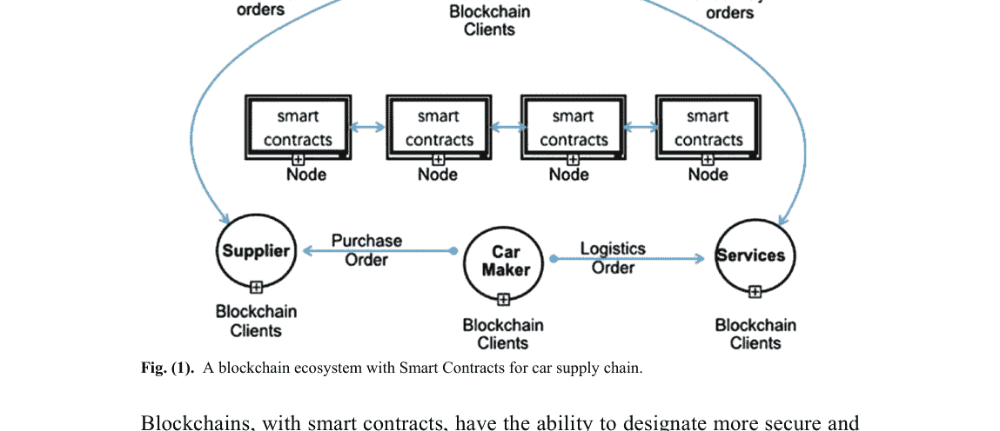

根据福斯特（Foster）的说法，区块链与智能合约相结合，能够实现跨供应链更安全、更可信的交易或协调业务。智能合约可用于自动化整个交易开发过程，同时保持成本效益、透明度和安全性。例如，为了规范混合产业资本之间的跨企业关系，一种基于区块链的工业服务生产信用机制（PCM）已投入服务，供其客户使用 [11]。

### 针对智能合约的安全攻击

尽管智能合约使用了外部资源，如当前库、其他智能合约功能、API 调用和第三方服务，它们仍然容易受到编程错误、人为失误和恶意黑客攻击的影响。研究人员已经发现了几种智能合约漏洞，并将其评为严重级。其中最严重的是可毁坏的智能合约、无限制的写操作、无限制的资金转移、整数溢出、整数下溢、重入和外部调用问题。近年来，这些缺陷已导致针对智能合约的真实黑客攻击，攻击者通过大量被窃取的数据获利。

鉴于智能合约是由人类编写的数字程序，编程错误和人为失误会带来严重风险。以太坊区块链的不可变性阻止了对已部署智能合约的恶意修改和操纵。然而，这一特性也阻止了智能合约所有者或真正的开发者在代码部署后对其进行编辑。在区块链上运行时，他们运行中的以太坊智能合约如果存在任何错误，则无法修复。为了确保智能合约精确且无错误，开发者必须仔细实现和测试它们。

有许多开源工具可用于分析区块链上的智能合约 Solidity 源代码、字节码或合约地址。由于并非所有智能合约应用都会公开其经过认证的 Solidity 代码，研究人员会将智能合约应用的字节码提交给选定的分析工具。在任何工具可用于扫描具有认证 Solidity 源代码的智能合约之前，许多编译问题必须得到修复。Oyente 是一种安全分析工具，可检测 Parity 多重签名问题。特别是 Osiris 可以发现各种算术缺陷，这些缺陷对于验证所有智能合约应用至关重要。Mythril 是一种强大的工具，可扫描与 Solidity 编程难题相关的 14 种不同漏洞。

### 多链与智能合约

多链（Multichain）技术 [12] 是一项让用户能够创建安全的私有区块链的技术，这些区块链可用于企业的金融交易。Multichain 为我们提供了简单的 API 和命令行界面。这有助于范围和链的配置。

智能合约不是人工智能；相反，它是使用 Solidity 编程语言开发的一系列代码，基于 IF/THEN 概念运行。但它能够自动化一组涉及价值转移的操作（在此上下文中，价值有点模糊，但主要是货币），将价值从一方/个人转移到另一方/个人。我们可以使用 Multichain 来构建任何节点，并开发一个定义流程的后端，然后使用该后端与智能合约区块链交互。

使用 Multi Chains [13]，可以在区块链上编写多个“智能合约”或“链码”，每个合约都有自己独立的数据库和代码。合约的数据库只能由其代码更改，而不能直接由区块链交易更改。

- 链的协议。

- 区块的目标时间。

- 活动权限类型。

- 挖矿多样性。

- 挖矿激励。

- 一种适当的交易类型。

- 最大区块大小。

- 每笔交易的最大元数据。

### 多链中智能合约如何重新定义价值交换

智能合约 [14] 是区块链上的自执行代码，可自动实施各方之间的协议条件，从而加快目前分散在多个数据库和 ERP 系统中的流程。

它们是软件程序的行，而不是法律意义上的合同，将区块链的效用扩展到不仅仅是跟踪金融交易条目，而是自动执行多方协议。这是通过共识协议实现的，该协议允许用户针对事件响应时就突出的行动线达成一致。

### 以下是智能合约的一些优势：

- **Speed:** 智能合约通过自动化手动流程，加快了各种业务流程的完成速度。

- **Accuracy:** 它们有助于手动开发的自动化以及减少错误。

- **Lower Execution Risk:** 去中心化和不可变的流程消除了操纵的可能性，错误执行的可能性也微乎其微。

- **Lower cost:** 与传统业务流程相比，由于人工参与减少且中间商更少，合同实施成本更低。

- **New business models:** 从值得信赖的点对点共享到在安全环境中交易等新颖商业模式的发展，得益于新的交易方式和合同执行方式。

- **Avoiding the use of third-party intermediaries:** 智能合约消除了或减少了对第三方中介的使用，并提供了替代的技术信任因素。

智能合约可用于多种用途，从确定贷款资格到完成贸易协议和转让协议，这得益于上述优势。由于需要维护单独的数据库，以前所有这些类型的智能合约都是不可行的。现在所有相关方都可以实时验证结果，而无需第三方介入。

**Smart contracts** 在网络参与者进行频繁交易且交易对手为每笔交易承担手动或冗余流程或职责时最有意义。简而言之，智能合约在合同事件发生时无需中介或人工干预即可自动交换各方之间的价值。

代理商在完成文书工作和其他法律要求方面严重依赖 **traditional contracts** 和协议。转移资金或其他有价值资产的主要信任标准是代理商和中间人。在区块链的帮助下，智能合约已取代了代理商，这些智能合约被编码到系统中，可根据各方之间预先确定的讨论集自动执行活动。信任是通过使用安全的区块链技术建立起来的。管理价值流动的费用大幅降低，完成协议所需的时间也大幅缩短。同样地，当使用区块链的分布式账本技术交换“价值”时，新的区块链链会被形成并永久保存，不存在被操纵的可能性。

### 下面给出了一些展示智能合约导致价值交换的示例：

### a). 自由职业工作交换

当客户决定扩大项目的范围或因不明原因延迟付款时，许多自由职业者束手无策。另一方面，雇用自由职业者的公司可能会感到被误导，如果他们意识到某人的专业经验是虚假的，并且他们无法执行被聘用的工作。智能合约鼓励自由职业者和客户之间更开放、更诚实的沟通，从而为双方带来更好的体验。

合同条件包括项目的范围、截止日期和付款安排。在任务开始时，款项被存放在智能合约的托管中，直至成功完成工作里程碑后才释放。这有助于自由职业者防止范围蔓延，确保任何新工作不会拖延付款，并使他们能够获得额外工作的合理报酬。

智能合约本质上是自导自受，通过消除人工管理的需要来降低风险。借助技术进步，合同现在可以编写成相互交互、交换关键信息、复制影响它们的内容并保持最新信息。


### 通过使用智能合约，企业将在2020年及以后变得更快、更灵活：

- 提供从旧合同中学习的能力。
- 提供对组织风险承受能力的理解。
- 形成随底层资产变化的可调整合同。

### EtherCore：

### 一个多链去中心化应用和智能合约平台

EtherCore [15] 是一个多链去中心化应用和智能合约平台，托管各种现实世界应用。EtherCore 是您区块链业务的网络基础，具有高度分布、容错和任务关键性。为解决公有区块链平台的悖论问题，EtherCore 包含 `ProgPoW`、`Proof-of-Authority` 和程序化工作量证明共识方法。用户和开发者可以通过使用安全、稳定和可扩展的共识规则，享受没有网络容量限制的去中心化互联网。EtherCore 主网 [15] 每秒可处理数千至数百万笔交易。

### EtherCore 功能：

### 安全

`Secure` – `ProgPoW` 是一种程序化工作量证明共识方法，被认为是最抗 ASIC 且最适合 GPU 的算法，是 EtherCore 主网的共识算法。得益于其强大的去中心化，由基层 GPU 矿工提供支持，EtherCore 是一个安全且不可逆转的平台。

### 快速

EtherCore 是一种快速的区块链技术，主网交易确认时间为 14 秒，侧链平均确认时间为 1 秒，可实现实时区块链解释。对于主网和侧链都具有动态区块容量是可行的，确保 `DApp` 开发者和用户按需拥有充足的网络容量。EtherCore 提供更快的存储选项用于实时存储数据，并且侧链可以作为主网的缓存，因为它具有原始以太坊区块链 1000 倍的处理能力。

### 稳定

EtherCore 设计用于抵御任何类型的第三方干预，特别是 51% 攻击或 `DoS` 交易部署以征服网络或非法利用任何 `DApp` 交易。任何对主网的承诺都将由 `ProgPoW` 算法无限期保障，并且侧链将能够处理某些类型的去中心化应用所需的任何更新，例如网络能力和实时合同变更。

### 合同供应商如何使前瞻性组织受益：

多个合同供应商平台为企业提供洞察力、速度和敏捷性，帮助他们管理并利用 2020 年将面临的困难。

该技术允许企业创建受业务和合规规则管理的合同，这些规则能够智能且动态地确定用于创建合同的条款、元数据和模板。它还具有简单、直接的用户界面，使任何一线员工都易于使用。它还将允许企业构建和运营联盟区块链以管理其智能合约。公司可以利用智能合约作为主要推动力来转变其商业基础，以确保合规、降低风险、提高用户生产力并改善其底线。

此外，区块链和分布式账本的进步只会增加拥有公司范围合同管理平台的价值。

### 多链环境中智能合约部署工具

a) `Remix`: `Remix` 是一套用于与以太坊区块链交互以调试交易的工具（直接引自此处）。有一个 `IDE` 版本（`Remix IDE`）和一个在线版本，我们将在此练习。

`Remix` 内部有许多工具，但以下工具是我们感兴趣的，

- `Solidity Compiler`: 这会产生大量有用的信息，我们将在另一个环境中使用。
- `Runtime Environment`. `Remix` provides three:

  - `Injected Web3`: to providers such as `Mist` or `Metamask`
  - `Web3 Provider`: to local host throughout `IPC`

### a) JavaScript 虚拟机：一个模拟环境

在运行时环境中，我们使用的是 `JavaScript` 虚拟机。在 `JavaScript` 虚拟机中，`Remix` 派生出五个以太坊账户，每个账户都有 100 个以太币。这对于分析我们的智能合约来说足够了。同样，挖矿不是必需的，因为它是自动完成的。

### b) 在 `TestRPC` 上的 `web3`

`TestRPC` 是以太坊区块链的一个模型，它预先定义了十个以太坊账户，并提供了助记词（也就是说，可以使用同一组助记词生成同一组账户）。它不像 `Remix` 那样带有用户界面，我们需要 `node` 控制台和 `web3` 库来与这个区块链进行交互。

### 结论与未来展望

区块链是技术的未来。它有潜力改变经济，并重塑我们看待运营的方式。当然，我们尚未完全理解这项技术，这就是为什么越来越多的印度州政府正在与来自世界各地的初创公司（如 `Chroma Way`）合作，在其管辖范围内进行概念验证测试。我们对区块链的理解极大地得益于 `Chroma Way` 的专业知识以及其之前在瑞典等国家的实施经验。

如你所见，区块链应用远不止加密货币，而且它们影响的行业也远不止金融。我们特意避免描述区块链对银行业的影响，以便尽可能保持列表的非金融科技性质。

智能合约几乎可以声明无限数量的业务用例，这些用例涉及多组织决策中数据的不可变性。智能合约开发者的工作是将当前业务流程（例如管理金融价格或交付条件的流程）转换为使用 `JavaScript`、`GOLANG` 或 `Java` 等编程语言编写的智能合约。智能合约审计师正在逐步练习必要的法律和技术技能，以将数十年的法律语言改编为编程语言。

在不可信的分布式生态系统中，区块链的主要用途是在独立成员之间建立一个可信赖的生态系统。点对点节点、基于共识的账本机制、链式区块、匿名账户、自治的数据所有权和可编程智能合约构成了一个安全自主的区块链系统。只有少数区块链项目是必要、可行、高效且持久的。此外，虽然区块链为数据级存储和活动提供了可信赖的框架，但开发可信赖的区块链系统需要严格的信用程序。

### 发布同意书

不适用。

### 利益冲突

作者声明不存在财务或其他方面的利益冲突。

### 致谢

声明无。

### 参考文献

- [1] N. Gupta，《区块链技术安全与隐私问题深度探讨》。`区块链技术研究手册`。`Academic Press`，2020年，第95-112页。

[http://dx.doi.org/10.1016/B978-0-12-819816-2.00004-6]

- [2] N. Gupta，`区块链技术安全与隐私问题`。`Springer`：新加坡，2020年，第207-226页。

[http://dx.doi.org/10.1007/978-981-13-8775-3_10]

- [3] K. Lauschlati、J. Mattila和T. Seppala，《智能合约——区块链技术将如何影响合约实践？》，`Etla报告`，第68卷，2017年。

[http://dx.doi.org/10.2139/ssrn.3154043]

- [4] D. Macrinici、C. Cartofeanu和S. Gao，《区块链技术中的智能合约应用：系统性映射研究》，`Telemat. Inform.`，第35卷，第8期，第2337-2354页，2018年。

[http://dx.doi.org/10.1016/j.tele.2018.10.004]

- [5] J. Liu、P. Jiang和J. Leng，《社会化制造环境下制造服务的信用保障机制框架》，2017年`第13届IEEE自动化科学与工程会议（CASE）`，2017年，第36-40页。

[http://dx.doi.org/10.1109/COASE.2017.8256072]

- [6] Eric Wall和Gustaf Malm，《使用区块链技术和智能合约创建分布式证券存管机构》，2016年。

- [7] Jonatan Bergquist，《区块链技术与智能合约：隐私保护工具》，2017年。

- [8] A. Barišić、E. Zhu和F. Mallet，《多链智能合约设计的模型驱动方法》，载于：`2021年第三届区块链创新网络与服务研究与应用会议（BRAINS）`，2021年，第37-38页。

[http://dx.doi.org/10.1109/BRAINS52497.2021.9569809]

- [9] Y. Li，《新兴的基于区块链的应用与技术》，`面向服务的计算应用`，第13卷，第4期，第279-285页，2019年。

[http://dx.doi.org/10.1007/s11761-019-00281-x]

- [10] R. Agrawal、N. Gupta主编，`使用区块链变革网络安全解决方案`。`Springer Singapore`，2021年。

[http://dx.doi.org/10.1007/978-981-33-6858-3]

- [11] S. Chawla和N. Gupta，《可撤销基于属性加密方案的分析视角》，2021年第二届电子与可持续通信系统国际会议（`ICESC`），2021年，第1-8页。

[http://dx.doi.org/10.1109/ICESC51422.2021.9532873]

- [12] G-H. Hwang，《`InfiniteChain`：面向公共区块链的具有侧链分布式审计的多链架构》，载于：区块链国际会议，`Springer`：`Cham`，2018年。

[http://dx.doi.org/10.1007/978-3-319-94478-4_4]

- [13] X. Fan、Q. Chai和Z. Zhong，《`Multav`：一种用于去中心化区块链治理的多链代币支持投票框架》，载于：区块链国际会议，`Springer`：`Cham`，2020年，第33-47页。

[http://dx.doi.org/10.1007/978-3-030-59638-5_3]

- [14] A. Ismailisufi、T. Popović、N. Gligorić、S. Radonjic和S. Šandi，《使用多链开源平台的私有区块链实现》，载于：2020年第24届信息技术国际会议（`IT`），`IEEE`，2020年，第1-4页。

[http://dx.doi.org/10.1109/IT48810.2020.9070689]

- [15] J. Ladleif、C. Friedow和M. Weske，《多链业务流程编排的架构》，载于：国际业务信息系统会议，`Springer`：`Cham`，2020年，第184-196页。

[http://dx.doi.org/10.1007/978-3-030-53337-3_14]

如今，中心化云资源日益增多。`Amazon AWS`、`Google Cloud` 和其他流行服务提供了高水平的安全性和可靠性[1]。然而，使用中心化云资源存在一些局限性，因为中心化云可能是单点故障，正如过去的许多例子所示。例如，云操作员的一个粗心错误可能导致云以及依赖该云资源的所有公司和组织（基本上是半个国家）停机长达一整天。同样，停电、数据丢失、针对这些服务的网络攻击都可能中断运营，对用户数据和业务活动造成巨大损害[2]。`Right Scale` 在2018年进行了一项调查；它询问了997名技术专业人员在采用云技术时面临的挑战。该调查显示了一些有趣的发现。77%的人提到安全性是首要关注点，55%的人在使用云技术时面临性能挑战[3]。

在 `Hassanzadeh-Nazarabadi` 等人（2019）的论文中，作者使用分布式哈希表概念设计了一种名为 `LightChain` 的区块链架构。`LightChain` 是一个无许可区块链，任何节点都可以加入网络。对该区块链的任何新交易或区块添加都将按需记录在对等节点的分布式哈希表中，因此每个对等节点不必在本地存储整个区块链[4]。尽管分布式哈希表提供了高效的数据查找，但当需要大量表搜索来检索数据时，它们可能会花费大量时间。

本章讨论了分布式系统的安全和性能挑战。基于区块链的解决方案可以减轻中心化云资源的缺点。由于区块链存储在网络上所有参与节点共享的账本上，它们具有合适的特性和功能，可以分散地、由多方处理这类计算。此外，区块链上发生的任何交易都需要所有节点的共识，因此也非常安全。因此，区块链技术被推荐用于实现分布式、容错共识，以及构建高效的基于公钥的安全基础设施。重要的是，没有单一实体控制区块链，因此它不像其他普通云存储那样存在单点故障问题[4]。

一种名为星际文件系统（`IPFS`）的新文件系统被设计用于去中心化且高效地处理大文件[5]。`IPFS`网络以点对点方式运行，每个对等节点提供自己的存储。它有助于防止数据丢失，因为相同的数据在多个对等节点上可用[6]。基于上述原因，`IPFS`与区块链技术相结合可以作为一种……

针对云技术的安全性和性能问题，是一种很好的解决方案。

本文描述了一种使用区块链和智能合约保护分布式 Web 应用的方法，其中包括使用智能合约控制对 `IPFS` 的访问 [7]。详细实现得以呈现，包括加密/解密方案、智能合约、远程应用程序迁移以及用于键值的内存缓存。提出了性能和安全分析，并讨论了两者之间的权衡。

本章是对早期工作的实质性扩展。本章其余部分组织如下。第二部分介绍了关于区块链技术、智能合约、`IPFS`、分布式哈希表和内存缓存的初步背景信息和相关工作 [8]。第三部分展示了 Web 应用的高层架构设计以及每个组件的设计方式。第四部分讨论了我们在应用程序中每种改进方法的实现。在第五部分，我们详细介绍了我们的实验并分析了应用程序的性能和安全方面。最后，第六部分提出了结论和未来工作。

## 背景与相关工作

### 区块链技术背景

区块链是一个去中心化的公共账本，用于跟踪在线交易。去中心化的区块链账本维护着分布在大型用户网络上的所有交易的共享记录。这是一个完全去中心化的网络，无需任何中介机制来交换服务。区块链是一系列数据块，每个块中存储一批用户生成的交易。这些数据块通过电子方式聚合并使用顶级加密技术 [9]。这些块共同构成网络上发生的每笔交易的永久且不可变的公共记录。用户以这样的方式连接到区块链，其数据可以在不向该区块链中的任何其他用户透露其身份的情况下访问。区块链为用户提供完全透明度以简化事物 [10]。通过加密和验证，区块链保证了交易的保密性、真实性和隐私性。通过向区块链添加新块，从前一个块的内容生成的加密哈希用于将其链接到前一个块。这意味着链条永远不会断裂，每个块都永久注册 [11]。因此，故意很难更改过去的区块链交易，因为必须先修改所有后续块。区块链数据库由许多节点组成，并且是去中心化的。管理包括节点：所有节点都会审查最近的区块链添加并可以向数据库添加新数据。必须在大多数节点上达成共识才能将添加内容添加到区块链。这种共识过程保证了网络稳定性，使其无法被利用。它们使区块链生态系统能够成为自治的、开放的、基于同意的和可信的。得益于智能合约的集合，区块链可以在没有人工干预的情况下运行。智能合约被设置在预定义的区块链节点上运行 [12]。它们可以由区块链系统、其他智能合约或参与者的信息系统发出的回调触发。作为智能合约，区块链流程和与应用程序相关的规则通常可以预先确定。用例和现实世界任务各不相同，但使用该技术的优势保持一致：不可变性、透明度、冗余性和安全性。

`Dragonchain` 说明了区块链技术如何以安全、可验证和值得信赖的方式促进两方之间的交易，展示了该技术的优势 [13]。区块链背后的底层系统是一个分布式点对点网络。没有中央机构控制网络。网络中的每个节点独立执行其工作。新节点在加入区块链网络之前需要由现有节点验证 [14]。在交易记录在所有参与节点之间共享的账本上之前，所有节点都必须就交易达成共识 [15]。为了达成共识，每个参与者必须解决一个复杂的难题并向服务器提供权益证明或工作量证明。服务器检查每个参与者的证明并奖励提供正确证明的人 [16]。一旦服务器批准了证明，交易即得到确认，并将包含哈希代码和交易的新的区块添加到账本中，如 `Tar` 所示 [17]。新区块创建过程称为挖矿。节点因首先成功挖掘区块而获得金钱奖励，因此所有竞争节点都争相处理交易并创建新区块；参见 `Salman et al.` (2019) [18]。区块链上的数据是不可变的，因此一旦写入账本就永远不会改变。区块链的一个局限性是它依赖于网络中节点之间的持续通信，因此在带宽低或连接缓慢的地区，其性能会受到很大影响，正如 `Zheng et al.` 所解释的那样 [19]。

尽管区块链是去中心化计算资源的绝佳解决方案，但在区块链上存储数据仍然很昂贵，因为数据需要推送到其他区块链节点并在那里处理。由于现在互联网上有大量数据，并且预计未来会增加，区块链节点需要更强大的 `CPU`、更高的总线速度、更多的带宽和更大的存储来处理所有数据，这将增加运营成本。

### 区块链类型

区块链可以根据客户端的参与方式分为公共区块链、联盟区块链或私有区块链，也可以根据链之间的关系分为主链或侧链。此外，一些区块链可以构成一个系统。系统的链条相互链接形成 `Interchain`。

### 开放

公共区块链的账本对互联网上的任何人都可访问，并且任何人都可以检查和修改区块链。公共开放的节奏较慢，对数据库的读写访问，安全性为工作量证明/权益证明，身份为匿名或假名，资产为原生资产。因此，`et al.`，`Bitcoin`、`Dash`、`Thatum` 和 `Factom`。

### 私有

对机构的所有访问都保持集中化。私有区块链只允许公司内部的特定个人验证和附加交易块，但基本上任何人都可以通过互联网访问它们。对数据库的访问允许读取和/或写入。速度更快。安全参与者预先批准。所有属性仅为已建立的身份和属性，`et al.`，`Blockstack` `Multichain`。

### 智能合约

智能合约本质上是一种计算机协议，用于执行交易双方之间的谈判。更准确地说，这构成了双方之间的合同协议。这立即验证了符合双方约定的条件的交易。`Ethereum` 是使用命令行生成无限智能合约的最大去中心化网络。当应用程序包含以下组件时将被称为去中心化：程序必须完全开源，自主运行且不管理其任何代币。为了防止任何中心化故障点，应用程序数据和操作记录必须以加密方式存储在透明的去中心化区块链中。显然，程序必须使用适当的加密令牌来访问代码。应用程序将基于标准加密算法生成代币，作为节点对应用程序贡献价值的证据。区块链交易由智能合约执行，智能合约是计算机程序。`Solidity` 用于编写智能合约的可执行代码。存在

`Solidity` 是一种静态类型语言，其中的变量、函数和结构体。代码基于交易双方之间的协议。当交易完成时，编译后的合约被部署到能够运行它们的环境中。例如，在以太坊区块链中，智能合约在以太坊虚拟机（`EVM`）[20] 中部署和执行。智能合约中的代码在区块链账本上是公开可用的，因此之后加入区块链的新节点将收到该智能合约的副本。没有集中式权威机构控制智能合约；相反，它们分布在网络中的多个节点上。这确保了任何由智能合约触发的操作的可信性和匿名性。在智能合约执行交易之前，需要支付交易费用；在以太坊的情况下，费用以以太币（也称为 `gas`）支付。逻辑越复杂的智能合约，其交易费用越高。

### 星际文件系统


星际文件系统是一个分布式文件系统，我们可以在其中存储任何计算机文件或数据以供日后访问。与计算机上的文件系统不同，IPFS 将文件分成多个数据块，并将这些数据块分布到 IPFS 上的不同节点。其他文件系统使用基于位置的地址来查找文件，而 IPFS 使用基于内容的地址，文件地址基于文件内容的哈希。IPFS 上的单个数据单元是一个区块。IPFS 构建有向无环图来链接文件中的所有区块，从而方便数据检索。IPFS 维护分布式哈希表，以了解在哪里找到数据或找到更接近数据的路径 [21]。

从 IPFS 下载的数据可以存储在该节点上，并作为新的数据提供者被访问。这样，当附近的计算机请求数据时，该节点可以像其他 IPFS 节点一样将数据发送给它。

## 分布式哈希表

分布式哈希表允许 IPFS 通过存储键值映射来定位持有特定数据的对等节点，或识别通向该节点的路径。IPFS 节点维护自己的分布式哈希表，并在请求键时使用这些表。键是数据的个体标识符、星际名称系统（IPNS）键或对等节点 ID。

## 相关工作

为了保护网络上用户数据的隐私，Rahulamathan 等人（2017）提出了一种基于属性的加密方法。数据所有者创建用户组，并为每个组分配一个由特定用户属性组成的访问策略。用户必须拥有满足该策略的所有指定属性才能访问数据 [22]。这种加密技术不关注用户身份，并且由于需要集中式访问策略服务器，因此无法在去中心化网络中工作。借助智能合约，可以通过使用去中心化网络并在每笔交易中自定义用户验证的实现逻辑来解决此问题。

此前已有研究提出在物联网（IoT）中的智能设备之间使用智能合约进行访问控制。Song 等人（2019）开发了一种基于属性的访问控制方案，该方案检查设备属性信息，并决定是否允许设备加入 IoT 网络。该方案使用区块链和智能合约来存储和管理访问控制策略 [23]。此外，Nakamura 等人（2020）[24] 提出了在物联网中使用智能合约的基于能力的访问控制。在该方案中，作者建议让智能合约管理能力令牌。每个能力或操作都有一个令牌，智能合约根据令牌的所有权和验证结果来授予或拒绝访问请求者。

Shen 等人（2019）[25] 的文章分析了 IPFS 的 I/O 性能，并注意到由于解析和下载操作，IPFS 数据检索存在瓶颈。当 IPFS 中的节点收到数据检索请求时，如果数据不在该节点本地，则需要执行查找以找到数据的存储节点。如果要下载的数据大小大于 256KB，IPFS 会将其拆分为多个 256KB 的区块。当所有区块到达请求节点时，它们会被重新聚合为原始大小的文件，因此区块大小也会影响 IPFS 的 I/O 性能 [26]。

## 应用设计

该应用由以下组件组成，如图（1）所示：

- Web 客户端：运行在浏览器上的用户界面，用户可以在其中与应用交互并执行操作。
- Web 服务器：Web 服务器拥有支持文件上传和下载的所有实现。
- IPFS 数据存储：一种分布式数据存储，用于存储和管理数据。
- 区块链：本地以太坊区块链，用于承载智能合约并记录来自应用的用户活动。

通过使用智能合约，用户身份得到验证，交易的哈希码被写入区块链。图（2）说明了区块链合约如何在网络上部署和运行。

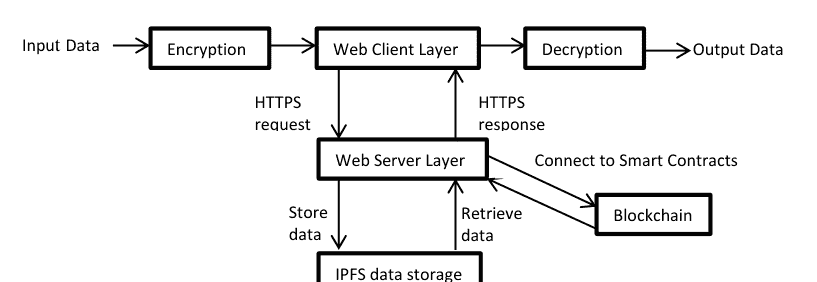

图（1）. 高层架构图。

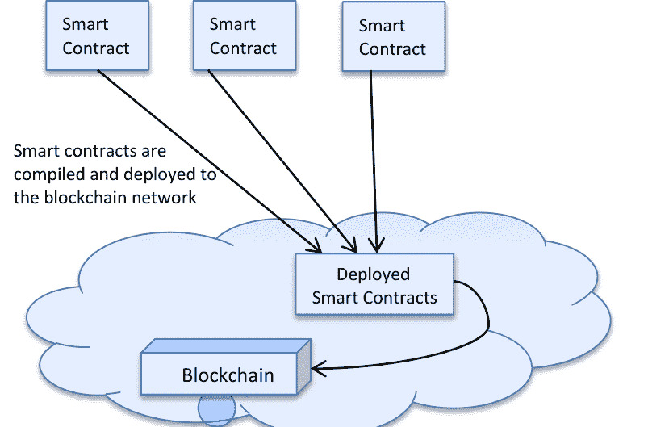

智能合约被编译并部署到区块链网络

图（2）. 以太坊区块链中的智能合约。

图（3）显示了 IPFS 中数据检索的序列图：Web 应用服务器使用 IPFS 客户端与远程 IPFS 节点网络或本地 IPFS 守护进程通信。为了测试为改进 IPFS 数据检索而在代码中做出的更改，我们在实验中本地运行 IPFS 守护进程。一个键值缓存被添加到 IPFS 中的两个 API。在一个 API 中，通过生成文件的哈希来找到根文件节点；在另一个 API 中，通过生成键来识别提供者节点。文件内容的标识符称为键。除了查询数据外，Web 应用还利用 IPFS 客户端的 `Add API` 向 IPFS 添加新数据。

图（3）. IPFS 中数据检索的序列图。

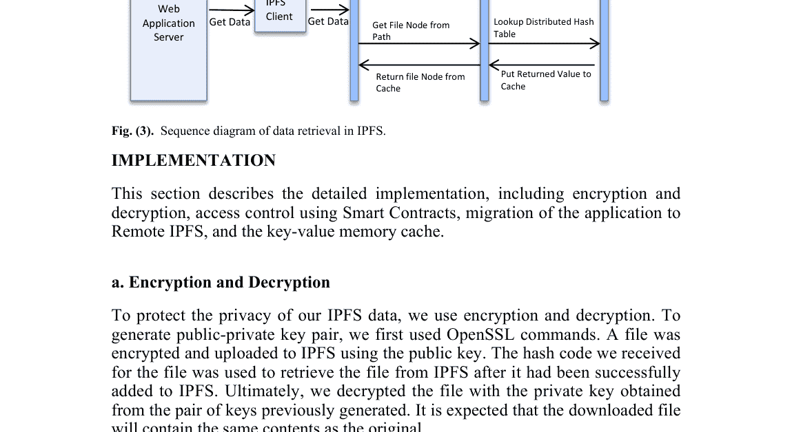

本节介绍详细实现，包括加密和解密、使用智能合约的访问控制、应用向远程 IPFS 的迁移以及键值内存缓存。

为了保护 IPFS 数据的隐私，我们使用加密和解密。为了生成公私钥对，我们首先使用了 `OpenSSL` 命令。使用公钥对文件进行加密并上传到 IPFS。文件成功添加到 IPFS 后，我们使用收到该文件的哈希码从 IPFS 中检索该文件。最后，我们使用从先前生成的密钥对中获得的私钥解密文件。预期下载的文件将包含与原始文件相同的内容。

我们已将智能合约集成到我们的应用中，以实现对 IPFS 上数据的访问控制。在我们的实验中，我们将逻辑编写在一个

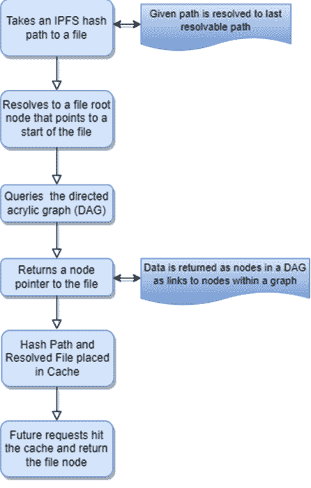

### 方法 `getFileNodeFromPath` 的流程图

图（4）. 流程图 1。

### 方法 `findProvidersAsync`

与`getFileNodeFromPath`返回特定给定哈希路径的文件根节点不同，`findProvidersAsync`方法搜索接近当前节点且能够提供给定键的对等节点。该方法接收一个内容寻址标识符和一个计数，然后返回一组拥有或知道在哪里获取所请求内容的对等节点。内容寻址标识符由版本、内容类型和内容哈希组成。计数指定我们想要获取的对等节点数量。如果计数为零，该方法返回无限制数量的对等节点。由于相同内容的内容标识符是唯一的，我们缓存内容标识符和对等提供者集合。因此，将来使用相同标识符调用此方法时，可以直接从缓存中获取提供者。

该方法在内部尝试从本地网络和广域网中查找提供者。在每个网络中，它创建一个通道，负责在找到对等节点时返回其地址。由于可以反复找到同一个对等节点，该方法维护一个本地映射，用于存储新发现的对等节点。对于已经发现并存在于映射中的对等节点，我们直接忽略。如果在方法结束时仍找不到任何新对等节点，我们就会向查询事件通道发布一个查询事件。该查询事件包含初始数据请求的上下文（图5）。

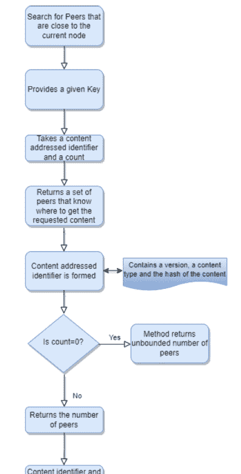

方法 `findProvidersAsync` 的流程图

图 (5). 流程图 2.

## 性能与安全分析

### 安全分析

借助加密机制，我们能够消除传统 IPFS 实现带来的隐私风险。通过查询黑名单，只有未被列入黑名单的用户才能从 IPFS 下载受保护的数据。这一 IPFS 实现将能够为新的 DDoS 缓解方案提供支撑。

在第二个实验中，我们使用基于智能合约的访问控制，在授予用户从 IPFS 下载文件的权限之前验证其身份。当我们从 IPFS 下载文件时，需要输入一个电子邮件地址供智能合约验证。出于实验目的，我们创建了一个电子邮件地址黑名单，这些地址应被阻止访问我们在 IPFS 上的数据。当输入的电子邮件地址通过验证时，我们向用户显示成功消息，并开始从 IPFS 下载文件。当我们故意输入一个位于电子邮件黑名单中的地址时，智能合约验证会失败。我们向用户显示失败消息，并拒绝其下载文件。

我们将 Web 应用从本地主机迁移到了远程 IPFS 网络，因此即使本地服务器不运行，也可以访问该 Web 应用。我们还设置了 SSL 连接和自定义 URL `https://sjsu-cs298.on.fleek.co`，以便安全、便捷地访问该应用。

### 性能分析

我们的测试包括上传和下载不同大小的文件，以观察从 IPFS 获取数据在无缓存和有缓存情况下各需要多长时间。每个文件运行十次，并计算平均延迟。结果如图 (6) 所示。

我们可以看到，在没有缓存的情况下，平均延迟在 300 ms 到 400 ms 之间波动。在我们的实验中，有时获取根文件节点可能需要几秒钟，因为这取决于查找算法何时找到该节点。

我们还测量了不同文件大小下的下载延迟，如图 (7) 所示。使用缓存时，获取根文件节点只需约 10 ms，而且延迟相当稳定。用户从应用下载文件时观察到的延迟会更高，因为互联网传输数据本身存在延迟。在我们的实验中，互联网下载速度约为 90 Mbps，对于 1 Mb 的文件，互联网延迟微不足道，不易察觉；随着文件增大，延迟也会增加。

无缓存延迟（ms）和有缓存延迟（ms）

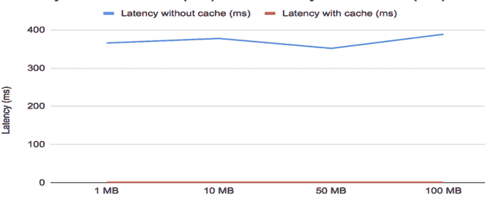

图 (6). 有缓存与无缓存时 IPFS 文件检索延迟对比。

互联网下载延迟（ms）与文件大小（Mb）

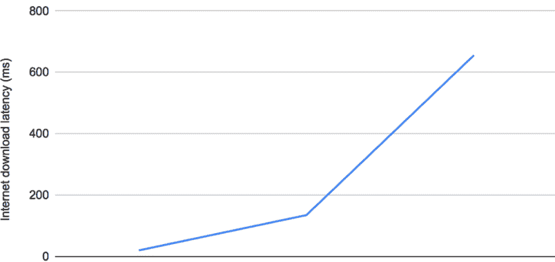

图 (7). 不同文件大小下的互联网下载延迟。

我们还尝试改变内存缓存的过期时间，结果如图 (8) 所示。我们预先向 IPFS 上传了 100 个大小约为 1 Mb 的不同文本文件。我们尝试将过期时间设置为 10 秒、30 秒、1 分钟和 5 分钟，并在每个过期时间下运行脚本，从 IPFS 上的预上传文件中持续下载随机文件并测量延迟。得到的延迟绘制在下图中。如图所示，当过期时间增加时，延迟会降低，因为缓存中保留了更多条目，下载操作中的缓存命中率更高。

延迟（ms）与过期时间（秒）

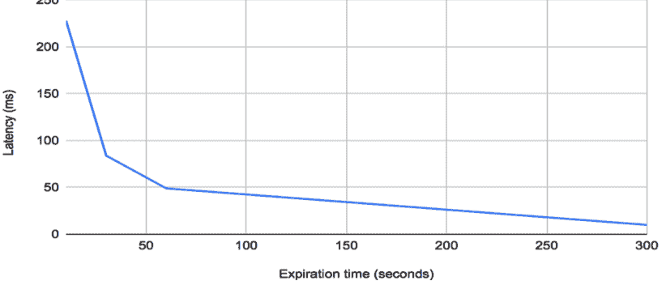

图 (8). 内存缓存延迟与过期时间的关系。

然而，我们不希望过期时间设置得过大，因为缓存会维护大量不常访问的条目。从我们的实验来看，合理的过期时间至少应为 1 分钟到 2-3 分钟，因为在 1 分钟时，延迟已能从 200 多毫秒显著降低到约 50 毫秒。从 1 分钟开始，延迟只是逐渐下降。

内存缓存由 Go 语言中的键值映射（key-value map）支持。由于映射的大小是动态的，当向映射添加更多数据时，其内部会获得更多槽位。因此，缓存中的最大数据量取决于可用的堆大小以及运行 IPFS 的操作系统。例如，32 位操作系统中的映射可以有 2³¹ - 1 个槽位，64 位操作系统中的映射可以有 2⁶³ - 1 个槽位。基于上述原因，为内存缓存初始化不同大小的映射，在获取数据的延迟方面不会产生任何差异。然而，缓存的大小受到堆大小和操作系统中可用内存的限制。

值得注意的是，使用内存缓存也有一些缺点。IPFS 中的数据过大时无法被缓存；请求的数据过大时会导致缓存未命中 [27]。当发生大量缓存未命中时，IPFS 的性能会下降。如果集成了内存缓存的 IPFS 看起来不适合应用的目标用例，可以考虑其他替代的分布式文件系统，例如 Ceph、GlusterFS 和 HDFS。Hadoop 被描述为一种分布式文件系统，是一个开源系统，可以存储和处理海量非结构化数据，支持高吞吐量的数据访问。Ceph 是一个符合 POSIX 标准的网络文件系统，提供高性能和大数据存储，并且与遗留应用程序高度兼容。GlusterFS 也是一个快速、可扩展的分布式文件系统，支持数据和元数据的缓存。GlusterFS 可以与 HDFS 集成，以处理大型数据用于数据分析。

### 性能与安全之间的权衡

应用每增加一种安全机制都会带来计算成本，因此需要在性能与安全之间进行权衡。当集成额外一层安全机制时，应用服务器必须在安全检查上做更多的计算工作，因此应用的运行速度可能会稍慢。如果安全性更重要，就需要牺牲应用的性能，反之亦然。因此，选择性能与安全之间的适当平衡以满足应用的要求和用例非常重要。

我们测量了每种安全方法对应用性能的影响。我们上传和下载大小为 1 Mb 的文件。使用 OpenSSL 进行加密和解密各需约 50 ms。调用智能合约验证用户身份需要 20 到 70 ms。由于智能合约的身份检查很简单，假设没有网络故障，所需时间足够短，可以接受，并且在上述 20 到 70 ms 范围内非常一致。简而言之，安全实现为文件上传流程增加了额外的 50 ms，为下载文件增加了额外的 70 ms 到 120 ms。

从实验中我们知道，带内存缓存的 IPFS 只需约 10 ms 即可解析根文件节点，因此安全防护带来的额外延迟平均约为文件下载时间的 7 到 12 倍。从用户体验来看，下载过程中增加约 100 ms 的延迟应该不会明显。然而，如果我们想上传非常大的文件，可能需要将其分成多个块并逐块加密，因为 OpenSSL 加密存在大小限制。这种大文件的分块和加密可能会显著增加上传文件的延迟，这是我们需要注意的。

## 披露

“本文的部分内容先前已发表于《网络安全进展》中的《利用区块链改善基于分布式IPFS的Web应用的安全性与性能》。《计算机与信息科学通讯》，2021年，第1487卷，第114-127页”。

## 发表同意书

不适用。

## 利益冲突

作者声明不存在财务或其他方面的利益冲突。

## 致谢

声明无。

## 参考文献

- 1. S. Voshmgir，《区块链与分布式账本技术》，可查阅：`https://blockchainhub.net/blockchains-and-distributed-ledger-technologies-in-general/` （访问于2019-08-31）

- 2. T. Koens 和 E. Poll，《你需要哪种区块链替代方案？》，数据隐私管理、加密货币与区块链技术。Springer：Cham，2018年，第113-129页。[`http://dx.doi.org/10.1007/978-3-030-00305-0_9`]

- 3. V. Le、R. Moazeni 和 M. Moh，《利用区块链改善基于分布式IPFS的Web应用的安全性与性能》，见：网络安全进展国际会议，新加坡，2021年，第114-127页。[`http://dx.doi.org/10.1007/978-981-16-8059-5_8`]

- 4. Y. Hassanzadeh-Nazarabadi, A. Küpçü, 和 Ö. Özkasap，《Lightchain：面向资源受限环境的基于DHT的区块链》，arXiv，. Hassanzadeh-Nazarabadi, Yahya, Alptekin Küpçü, and Özür Özkasap. 《Lightchain：面向资源受限环境的基于DHT的区块链》预印本 arXiv:1904.00375 (2019).

- 5. I. Zainab，《使用区块链保护资源受限物联网设备中的隐私——综述》，Electronics，第1732页，2021年。[`http://dx.doi.org/10.3390/electronics10141732`]

- 6. B.K. John, V.S. Ceph, V.S. GlusterFS, 和 V.S. MooseFS，《极客计算》，可查阅：`https://www.datapine.com/blog/cloud-computing-risks-and-challenges/` 访问时间：2021年6月4日.

- 7. N. Khudhur 和 S. Siva，《IPFS搜索引擎》，2019年第七届计算与网络国际研讨会（CANDAR），2019年，第150-156页。日本长崎。可查阅：`https://doi.ieeecomputersociety.org/10.1109/CANDAR.2019.00026` [`http://dx.doi.org/10.1109/CANDAR.2019.00026`]

- 8. L. Kohorst，《去中心化你的网站》，2020年。可查阅：`https://towardsdatascience.com/decentralizing-your-website-f5bca765f9ed`

- 9. A. Lipton 和 S. Levi，《智能合约及其潜在与固有局限性导论》，2018年。可查阅：`https://corpgov.law.harvard.edu/2018/05/26/an-introduction-to-smart-contracts-and-their-potential-and-inherent-limitations/`

- [10] Y. Nakamura、Y. Zhang、M. Sasabe 和 S. Kasahara，《利用智能合约实现物联网中基于能力的访问控制》，Sensors，第20卷，第6期，第1793-1793页，2020年。

  [`http://dx.doi.org/10.3390/s20061793`]

- [11] M. Naz、F.A. Al-zahrani、R. Khalid、N. Javaid、A.M. Qamar、M.K. Afzal 和 M. Shafiq，《使用区块链与星际文件系统的安全数据共享平台》，Sustainability (Basel)，第11卷，第24期，第7054页，2019年。

  [`http://dx.doi.org/10.3390/su11247054`]

- [12] Y. Rahulamathavan、R.C. Phan、M. Rajarajan、S. Misra 和 A. Kondoz，《使用基于属性的加密实现保护隐私的基于区块链的物联网生态系统》，Proc IEEE Int Conf Adv Netw Telecommun Syst，2017年，第1-6页。

  [`http://dx.doi.org/10.1109/ANTS.2017.8384164`]

- [13] T. Salman、M. Zolanvari、A. Erbad、R. Jain 和 M. Samaka，《使用区块链的安全服务：最新技术综述》，IEEE Communications Surveys & Tutorials，第21卷，第1期，第858-880页，2019年。

  [`http://dx.doi.org/10.1109/COMST.2018.2863956`]

- [14] J. Shen、Y. Li、Y. Zhou 和 X. Wang，《理解IPFS存储的I/O性能：客户端视角》，IEEE Access，第24-24页，2019年。

- [15] L. Song、M. Li、Z. Zhu、P. Yuan 和 Y. He，《使用智能合约的物联网基于属性的访问控制》。ScienceDirect，2019年，第2019-2019页。


- [16] M. Steichen、B. Fiz、R. Norvill、W. Shbair 和 R. State，《基于区块链的IPFS去中心化访问控制》，IEEE Access，第15-15页，2019年。
- [17] A. Tar，可查阅：`https://cointelegraph.com/explained/proof-of-work-explained`
- [18] S. Wang、Y. Zhang 和 Y. Zhang，《去中心化存储系统中基于区块链的细粒度访问控制数据共享框架》，IEEE Access，第6卷，第38437-38450页，2018年。
  [`http://dx.doi.org/10.1109/ACCESS.2018.2851611`]
- [19] W Zheng、Z Zheng、X Chen、K Dai、P Li 和 R Chen，《NutBaaS：区块链即服务平台》，IEEE Access，第7卷，第10期，第134422-134433页，2019年。
  [`http://dx.doi.org/10.1109/ACCESS.2019.2941905`]
- [20] V. Le、R. Moazeni 和 M. Moh，《利用区块链改善基于分布式IPFS的Web应用的安全性与性能》，见：第三届网络安全进展国际会议（ACeS2021），Springer，2021年。
- [21] M. Moh、D. Nguyen、T-S. Moh 和 B. Khieu，《用于高效公钥基础设施和容错分布式共识的区块链》。《区块链网络安全、信任与隐私》，Springer，2020年，第69-97页。
  [`http://dx.doi.org/10.1007/978-3-030-38181-3_5`]
- [22] B. Khieu 和 M. Moh，《大数据应用的云中心区块链公钥基础设施》。《大数据中的安全、隐私与取证问题》，R.C. Joshi、B.B. Gupta 编，IGI Global，2019年，第125-140页。
- [23] B. Khieu 和 M. Moh，《CBPKI：基于云区块链的公钥基础设施》，2019年ACM东南会议论文集，2019年，美国佐治亚州肯尼索。
  [`http://dx.doi.org/10.1145/3299815.3314433`]
- [24] N. Gupta，《深度剖析区块链技术的安全与隐私问题》。《区块链技术研究手册》。Academic Press，2020年，第95-112页。
  [`http://dx.doi.org/10.1016/B978-0-12-819816-2.00004-6`]
- [25] N. Gupta，《区块链技术的安全与隐私问题》。《区块链技术的高级应用》，Springer：新加坡，2020年，第207-226页。
- [26] J. Shen、Y. Li、Y. Zhou 和 X. Wang，《理解IPFS存储的I/O性能：客户端视角》，2019年IEEE/ACM第27届服务质量国际研讨会（IWQoS），2019年，第1-10页。
  [`http://dx.doi.org/10.1145/3326285.3329052`]
- [27] Y. Chen、H. Li、K. Li 和 J. Zhang，《基于IPFS和区块链的改进P2P文件系统方案》，*2017年IEEE国际大数据会议（Big Data）*，2017年，第2652-2657页。
  [`http://dx.doi.org/10.1109/BigData.2017.8258226`]

## 主题索引

### A

加速度计 99

访问控制 44, 55, 72, 117, 118, 120, 121,

  122, 123, 124, 148, 150, 158

  基于区块链的 121, 123

  策略 118, 121, 122, 148

  服务 117, 121

  系统 117, 118, 121

访问管理系统 122

访问策略 121, 122, 147

  管理动态 122

采用 53, 82

  延迟采用 82

  不断增长 53

算法 19, 44, 70, 71, 108, 109, 110, 111,

  114, 122, 137, 146

  密码学算法 44, 70

  机器学习算法 109, 122

  标准密码学算法 146

  传统安全算法 114

应用程序 6, 44, 45, 129, 131, 144, 150,

  154

  编程接口（API）6, 44, 45,

    129, 131, 150

  Web应用 144, 150, 154

架构，区块链密码学 62

ASIC挖矿 9

攻击 34, 54, 55, 67, 74, 77, 88, 91

  区块链重组 74

攻击 70, 73, 82, 88

  远程攻击 70

  交易验证机制 73, 82, 88

基于属性的加密方法 147

认证 101, 105

  机制 101

  物联网设备的认证 105

  过程 105

自动驾驶汽车 38

### B

银行系统在网络安全中使用区块链 37

大数据 52

比特币 27, 64, 75, 87, 88, 89, 90, 119, 121,

  130

  比特币区块链 64, 90, 119, 130

  比特币网络 27, 75, 87, 89

  比特币平台 121

  比特币交易 64

  存储比特币 88

区块链 10, 12, 19, 20, 29, 31, 32, 34, 37,

  40, 41, 42, 43, 67, 69, 70, 73, 75, 82,

  122, 123, 127, 128, 129, 130, 131, 133,

  145

  与网络安全结合 41

  应用 31

  认证设备 34

  面向业务的 130

  社区 67

  共识系统 75

  网络安全 29, 37

  开发环境 130

  生态系统 127, 128, 129, 130, 131, 145

  加密 29, 37

  在网络安全中 34

  网络 10, 12, 19, 20, 40, 41, 42, 43, 67,

    69, 70, 73, 82, 129, 130

  节点 82, 122, 123, 133, 145

  流行账本技术 32

  过程 145

  用于供应链 130

区块链系统 26, 28, 32, 42, 51, 77, 87,

  127, 129, 140, 145

基于区块链的 29, 32, 43, 84, 122

  架构 122

  网络安全 43

  网络威胁情报 84

  系统 29, 32

区块链赋能 22

### C

医疗保健应用 22

行业 22

区块链技术 37, 40, 142

采用 37, 40

应用 142

区块链交易 49, 65, 73, 82, 119, 132, 144, 146

暴力破解方法 107

拜占庭将军问题 11

链分裂攻击 45

云 30, 66, 30, 86, 109, 110, 121, 143, 144

存储 66

系统 30

技术 143, 144

云计算 98, 142

平台 98

CNAME 记录 151

冷钱包系统 88

计算复杂性 109

进行概念验证测试 139

共识 8, 10, 11, 12, 16, 69, 81, 145

机制 8, 10, 11, 12, 16, 81

方法 69

过程 145

共识算法 22, 32, 82, 103, 104

区块链的 32

连续时间马尔可夫链（CTMC）90

COVID-19 大流行 97

CPU 挖矿 9

凭证 12, 123

组合的 12

信用良好的生态系统 139

加密货币与金融交易 118

密码学的 8, 67, 70, 77, 81, 84, 109, 119, 124

通信 84

设计 77

协议 119

技术 8, 70, 109

网络威胁情报（CTI）84, 92

网络罪犯 30, 49, 62, 70, 74

网络安全 31, 32, 33

区块链驱动的 33

区块链技术的 31

工具 32

### D

### E

DAO 攻击 72

DApp 137, 138

开发者 137

交易 138

去中心化的 6, 54, 56, 63, 64, 144, 148

安排 54, 56

自治组织（DAO）6, 63, 64

网络 144, 148

国防 53, 62

高级研究计划局（DARPA）53

研究活动 62

委托权益证明（DPoS）8, 10

设计 38, 56, 59, 82, 90, 121, 128, 130, 142, 143

生态系统 128

不安全的安全性 59

设备 27, 31, 33, 38, 50, 51, 58, 59, 86, 88, 98, 99, 101, 109, 123

冷 88

通信 101

数字安全业务 52, 53

分布式 34, 36, 49, 63, 127, 135, 136, 158

账本技术（DLT）34, 36, 49, 135, 136

网络 63, 127, 158

双重支付 73, 84

攻击 73

安全措施 84

ECDSA 密码技术 70

加密 36, 108, 109

区块链技术 36

同态 108, 109

能源消耗 20

环境，软件程序 67

ERP 系统 134

以太坊 63, 72, 123, 130, 138, 139, 147, 149

账户 139

基于以太坊的智能合约平台 63

区块链 72, 123, 130, 138, 139, 147, 149

虚拟机（EVM）72, 147

机制 5, 8, 10, 30, 88, 89, 121, 124, 131, 139

基于区块链的生产信用 131

基于共识的账本 139

矿工解密 9

挖矿 9, 16, 18, 19, 31, 111, 113, 133

机器系统 31

过程 9, 16, 18, 19, 111, 113, 133

货币 35, 49, 50, 56, 58, 67, 73, 74, 77, 130, 132, 133, 135, 142, 145

数字 56

转账 135

虚拟外国（货币）67

多链技术 132, 133

### F

- FAW 攻击问题 92

- 费用，比特币挖矿 64

- 扣留后分叉（FAW）75, 92, 93

### H

- 握手过程 133

- 硬件钱包信息 87

- 哈希健康系统 36

- 哈希技术 103

- 医疗保健公司 35, 36

- 仅人类可解的谜题（HOSPs）86, 93

- 超级账本 102, 130

  - 区块链 130

  - 项目 102

- HYPR 公司 52

### I

- 信息 52, 53, 59

  - 安全 52, 59

  - 存储 53

  - 传输 59

- 基础设施，信息物理 38

- 互联网安全基础设施 94

- 星际文件系统（IPFS）142, 143, 144, 147, 148, 150, 151, 154, 156, 157, 158

- 物联网 49, 104, 148

  - 小工具 49

  - 网络 104, 148

- 物联网设备 104, 117

  - 数据管理和数据传输 104

  - 管理 117

- IPFS 143, 148, 154

  - 数据存储 148

  - 实现 154

  - 网络 143

### M

- 管理信息系统 129

### N

- 本质 1, 11, 51, 119

  - 通信 51

- NEO 平台 71

- 网络 5, 8, 10, 11, 12, 20, 33, 64, 65, 67, 68, 69, 73, 74, 81, 85, 86, 89, 93, 98, 102, 145

  - 通信威胁 67

  - 加密货币 64

  - 设备 98

  - 边缘 86

### O

- 货币监理署（OCC）37

- OpenSSL 加密 157

### P

- 点对点 63, 85, 93, 106, 119

  - 通信 93

  - 网络 63, 85, 106, 119

- 工作量证明（PoW）9, 90

  - 基于（PoW）的安全技术 90

  - 共识机制 9

### R

- 减少网络攻击造成的人类安全困境 38

- 强化学习（RL）122

### S

安全性，软件程序 67

安全交易 42

安全性 27, 30, 31, 34, 51, 55, 59, 64, 70, 76, 81, 94, 97, 103, 109, 114, 117, 142, 143, 144, 157, 158

  安排，传输区块链网络 51

  区块链的 70

  当代的 59

  措施 76, 94

服务器 109, 122, 123, 148

  代理 122, 123

  第三方 109

  Web 148

服务 32, 39, 40, 55, 64, 65, 66, 67, 70, 82, 88, 89, 92, 118, 121, 128, 131, 158

  攻击 55, 65, 82

  基于区块链的 158

  重复经纪服务 66

智能 38, 97, 150

  农业系统 97

  合约，集成的 150

  医疗保健系统 97

  家居 97

  安全家居系统 97

  开关选项 38

  手表 97

智能家居 99, 114

  应用 99

  设备 114

软件 44, 66, 76, 86, 121

  防病毒 76

供应链 32, 33

  活动 33

  管理 32

### T

目标网络通信 65

攻击面分类 66

技术 69, 90, 92, 108, 109

  安全保护 90

技术的 134, 139

  技能 139

  信任因素 134

技术 27, 30, 34, 35, 36, 45, 49, 99, 100, 122, 124, 135, 136,

区块链网络安全 27, 36

加密货币钱包 35

分布式访问管理 122

分布式账本 34, 36, 49, 135, 136

记录保存 124

安全 35

传统安全 45

变革性的 30

可穿戴技术 99, 100

威胁，网络 41, 45

传统银行应用 8

交易数据 105

交易 5, 8, 10, 19, 42, 43, 44, 63, 64, 67, 73, 82, 87, 88, 89, 102, 104, 107, 108, 117, 119, 120, 121, 131, 133, 145, 147

  自动的 108

  开发过程 131

  手续费 10, 133, 147

  合法的 64

  策略制定 117, 121

  公共地址的 63

### V

验证小工具 50

验证过程 5, 7, 8, 16, 44, 120

价值生成资产 58

车载自组网（VANET）63

违反政府法律 43

虚拟 67, 71, 72, 93, 118, 147

  足迹 67

  虚拟机 71, 72, 93, 118, 147

可视化监控，实时 130

投票系统 10

漏洞 45, 62, 66, 67, 71, 76, 81, 82, 102, 128, 132

### Z

基于区域的钱包加密数据 87


### R. Agrawal

拉什米·阿格拉瓦尔博士拥有博士学位，并通过UGC-NET资格认证，在教学和研究领域拥有22年经验，现任印度法里达巴德马纳夫·拉赫纳国际研究与教育学院计算机应用系教授。她是印度计算机学会终身会员和IEEE高级会员，是Wiley和CRC出版社等多个知名出版社系列丛书的编辑。她在同行评审的国家/国际期刊和会议上撰写/合著了80多篇研究论文，这些论文被SCI/SCIE/ESCI/SCOPUS索引。她还与国内/国际出版商（Springer、Elsevier、IGI Global、Apple Academic Press和CRC Press）合作编辑/撰写了书籍，并贡献了书籍章节。


### N. Gupta


尼哈·古普塔博士从马纳夫·拉赫纳国际大学获得博士学位，拥有超过17年的教学和研究经验。她是ACM CSTA和Tech Republic的终身会员，也是IEEE的专业会员。她在Web内容挖掘、移动计算和云计算等领域，在SCI/SCOPUS/同行评审期刊（被Scopus索引）和IEEE/IET会议论文集中撰写和合著了80篇研究论文。她与Springer、Taylor & Francis、IGI Global和Pacific Book International等出版商合作出版了书籍，并与Elsevier、Springer、CRC Press和IGI Global USA合作撰写了书籍章节。她是全球多个会议的技术程序委员会（TPC）成员。
