# 医疗保健区块链应用：创新与实践 第1卷


谭娜普里娅·乔杜里博士谨将本书献给印度军队，感谢他们对祖国印度的奉献、牺牲和卓越，也谨将本书献给他的父母斯里·米格伦德拉·乔杜里和斯姆特·米纳克希·乔杜里，以及他深爱的妻子里图帕尔娜·乔杜里和爱子拉杰鲁普·乔杜里，感谢他们在这项工作中的巨大支持。他还想将本书献给他的研究导师维韦克·库马尔教授（博士）、V·西里尔·拉杰教授（博士）、萨马蒂·埃斯瓦兰教授和达尔希卡·尼加姆博士，他们在他的硕士和博士研究期间一直指导他。

阿比鲁普·卡纳先生谨将本书献给他的父母拉维·卡纳先生和阿布哈·卡纳女士，感谢他们的祝福、爱与支持。阿比鲁普·卡纳先生还想将本书献给萨普娜·贾因博士、阿努什里·萨博士和迪娅·斯里瓦斯塔娃博士，感谢他们的温暖、同情和宝贵建议。

阿比谢克·巴塔查里亚先生谨将本书献给他的家人。

郑晙燮教授（博士）谨将本书献给他的家人和工作单位。

普拉森吉特·查特吉博士谨将本书献给他的祖父母、已故父亲迪帕克·库马尔·查特吉、母亲卡拉尼·查特吉女士、深爱的妻子阿米莉塔和小天使阿赫利。

# 前言

由于与健康相关的数据量巨大，区块链技术为医疗保健相关应用提供了重要解决方案。在对等网络的帮助下，区块链技术记录每笔加密货币交易。区块链的基本目标是提供高端安全性，以便更有效地解决处理医疗保健数据时出现的问题。许多学者致力于此主题，旨在对区块链入门、其平台及不同共识算法进行广泛研究。其在医疗保健和医疗相关数据方面的应用趋势也吸引了研究人员的关注。除了提及区块链技术，作者们还提到了物联网（IoT）和人工智能（AI）的应用，二者共同定义了下一个技术时代。编者出色地将若干章节与自治计算相结合，从医疗保健相关应用的角度进行了编排。编者还很好地对区块链技术在医疗保健中的应用进行了全面综述。本书帮助读者更了解区块链技术如何用于医疗保健相关应用，例如维护患者监测系统。为了结合两种技术的优势，它还详细阐述了区块链和物联网如何协同工作。我们坚信本书探讨了区块链和医疗保健研究人员。

普拉文·库马尔 博士
副教授
阿米蒂大学，塔什干，乌兹别克斯坦

鲁希·西列 博士
助理教授
石油与能源研究大学（UPES）
德哈拉敦，北阿坎德邦，印度

# 序言

医疗保健部门一直是社会的重要组成部分。随着最近疫情的爆发，强大、高效、安全且以患者为中心的医疗保健行业的重要性从未如此凸显。区块链是一项新技术，它记录在对等网络中相连的服务器计算机上使用加密货币进行的每笔交易。区块链使交易安全、透明和可靠。革新医疗保健行业的问题正在世界各国得到关注，区块链可能在实现这一目标中起关键作用。全球研究人员和科学家将区块链在医疗保健领域的适用性视为解决涉及患者记录、医疗供应链、可穿戴诊断工具和远程医疗会议等相关现实问题的一个显著机遇。本书侧重于区块链技术的基础知识，以及其与医疗保健行业集成的手段和方法。它探讨了医疗保健部门的当前挑战以及区块链技术如何为这些问题提供解决方案。它深入探讨了可以在医疗保健行业采用区块链技术的特定领域，例如患者数据隐私保护、制药供应链、临床试验和基因组学。本书为读者提供了一种资源，以了解医疗保健各个应用领域中区块链和物联网（IoT）的基础知识，并识别由技术融合产生的未来问题领域。它还探讨了医疗保健行业的未来研究领域，区块链及其相关技术在其中可能有所裨益。不过，需要注意的是，这些只是潜在的好处，无法对其有效性作出任何保证。本书共有11章。

第1章提出了一种使用区块链技术管理和运营医疗保健系统的框架。该框架旨在详细概述医疗保健生态系统中所有参与者、其工作原理和运作方式的


通信。此外，作者们将物联网（IoT）和机器学习等其他技术与所提框架进行了全面集成。

第 2 章阐述了智能合约的概念。本章讨论了智能合约在确保各中介之间无缝交易中的作用。本章说明了智能合约的创建和运作及其带来的一系列好处。此外，我们讨论了涉及实施智能合约以简化复杂流程的具体用例。

第 3 章讨论了用于实施区块链技术的各种平台。本章旨在对以太坊（Ethereum）、Hyperledger Fabric、Multichain 等知名区块链平台进行详细分析。

第 4 章探讨了在医疗保健中实施区块链技术相关技术时面临的各种挑战。这可能包括数据保护和数据共享挑战、跨境信息共享挑战、数据安全挑战、使用适当许可网络进行利益相关者管理的挑战，以及研究挑战。

第 5 章讨论了在线生态系统中关于医疗数据安全的日益增长的担忧。本章探讨了当今关于医疗记录管理的数据所有权法律和合规性法规。它说明了创建可互操作的去中心化区块链支持的健康记录系统的手段和方法。此外，作者们阐述了许多人在医疗保健系统中使用的设备数量以及所生成的大量各类数据的可管理性方面所面临的问题。

第 6 章介绍了所提系统，该系统通过链上和链下通信模式等方法，允许患者和医疗专业人员共享个人健康记录。本章提出了一种方案，强调在不涉及可信第三方的情况下转移医疗记录时保持真正的公平交换策略的重要性。

第 7 章探讨了区块链如何帮助防止第三方中介访问和滥用患者数据。作者们说明了通过使用智能合约和共识算法严格且高效地实施数据隐私法律的手段。数据控制者的识别以及关于匿名性和化名性的观点在本章后面部分进行了讨论。

第 8 章描述了一个基于区块链的分散式个人健身事实生态系统，它能够实现独特的药物发现、生物标志物开发和预防性医疗程序，以及使用区块链和深度学习技术保护个人记录，以连接个人记录用户和提供者与医疗记录。

第 9 章通过基于组件的软件工程方法讨论了软件开发生命周期。此外，我们讨论了如何创建基于区块链的存储库来存储软件组件，并讨论了区块链技术如何帮助在医疗保健应用中保护我们的数据。所提软件开发生命周期模型确保了用户数据的安全，并提高了医疗保健应用的质量。

第 10 章讨论了智能合约和区块链技术在医疗保健及其他用例中的作用。智能合约是计算机协议，用于促进、验证或强制执行合同的谈判或履行。智能合约最早由 Nick Szabo 于 1996 年提出。他将智能合约定义为“以数字形式规定的一组承诺，包括各方履行这些承诺的协议”。自那以后，关于智能合约及其潜在应用的大量研究已经开展。已识别的一些挑战包括可扩展性问题以及对更加用户友好界面的需求。尽管存在这些挑战，许多公司已经以各种方式使用智能合约。例如，一些公司使用它们来创建数字钱包或简化供应链管理流程。

第 11 章讨论了区块链和医疗保健行业的未来方面。区块链技术有潜力通过为存储和共享数据提供安全、去中心化的平台来彻底改变医疗保健研究。这可能允许更高效、更准确的临床试验，以及更好地跟踪患者结局。虽然仍有一些需要克服的挑战，例如确保数据质量和隐私，但区块链在医疗保健中的未来潜力非常令人兴奋。这些观点将在本章中讨论。

我们希望我们的努力得到赞赏，并且读者能从本书中获益。

Tanupriya CHOUDHURY
Abhirup KHANNA
Prasenjit CHATTERJEE
Jung-Sup UM
Abhishek BHATTACHARYA
2022 年 11 月

# 致谢

Tanupriya Choudhury 博士和 Abhirup Khanna 先生谨感谢他们的工作单位——印度德瓦尔敦的石油与能源大学（University of Petroleum and Energy Studies），感谢其为开展这项提案营造了积极的研究环境。他们要感谢来自不同国家的所有贡献者，特别是全球各地帮助审阅章节以提升图书质量的审稿人。他们还感谢 UPES 高层领导及行政部门，感谢他们提供参与 BAHIP 2022 项目的机会并给予各方面支持。他们感谢 Sh. Sharad Mehra（GUS-Asia 首席执行官）的“随时鼎力相助”的祝福与工作自由。尊敬的校长 Sunil Rai 博士始终如一地支持我们，充当领路人，非常感谢您，先生，感谢您的指导。他们要感谢每个人的参与以及愿意承担超出舒适区任务的意愿。下一版图书见。我们还感谢 Roohi Sille 博士在出版最终阶段对章节编辑的支持。

Abhishek Bhattacharya 先生谨感谢家人给予的所有支持。

Jung-Sup Um 博士感谢其工作单位——韩国庆北国立大学（Kyungpook National University）的支持，并感谢其提供这样一个工作环境，使他能够投入时间从事此类项目。

Prasenjit Chatterjee 博士希望感谢家人给予的所有支持。

# 医疗保健中的区块链框架

区块链技术可被视为近年来吸引研究人员和学者关注的数字化领域成果之一。区块链是一个带有不可更改的已提交块的分布式数据库，可提供透明性和鲁棒性，这是区块链架构的固有特征。区块链也可以理解为一组相互互连的连接，用于在整个架构中提供连接。区块链已被公认为解决信息分布问题的一项发展，在数据隐私和信息安全方面具有重要特征。因此，此处的重点是强调医疗保健领域内区块链开发、个性化、应用和局限性方面的最新进展。

区块链是技术世界中最具创新性和关键性的进步之一。它属于专业领域，将分布式账本技术及其在医学领域的架构与应用结合起来。本框架将包括区块链在医疗保健生态系统中的演变和所有权方面，以及工作原理和不同方法。由于区块链是用于改进现行数据共享、处理和安全标准的技术之一，因此将讨论日益增长的区块链期望，其数据管理范围从传统到其扩展。强调区块链在医疗保健中的益处，本章还将回顾区块链的挑战和局限性。本社论还将努力解决医疗保健中区块链的挑战。将描述区块链及其公开问题和未来趋势的全面可解释性。这


医疗领域的提升也为变革医疗保健行业各个领域铺平了新的革命之路。因此，重点一直放在揭示持续革命的方向，以挖掘区块链技术的潜力，努力在医疗保健行业建立创新。

## 1.1. 区块链概念

区块链是一种以特定方式存储数据的系统，使得对系统的攻击或篡改变得不可能或极其困难。区块链通常是一本数字交易账本，这些交易首先被复制并在区块链架构中存在的完整系统网络中流通。链中存在的所有区块都由许多完整的交易组成，包括每当区块链系统发生任何新交易时，新输入的交易都会被记录到每个参与者的账本中。而且，每当存在多个参与者时，多参与者架构由去中心化数据库管理，该数据库通常被称为分布式账本技术（DLT）。区块链可以被视为一本公共且永久的账本，通过输入交易、新插入和资产跟踪来组织区块网络中的记录保存活动。根据 Ahram et al. (2017)，区块链提供了一种更安全的服务和信息交易交换方式。

资产可能是有形的（例如汽车）或无形的（例如土地），也可能是物理数据（患者治疗）或知识产权数据（创意财产、专利、版权、品牌）或医疗记录（个人信息、实验室结果、医学发现、疾病史、医生处方）。有价值的事物可以在虚拟环境中跟踪，也可以在区块链网络上进行交换，通过降低成本，同时减少所有相关用户的风险。区块链是一种 DLT，其中所有交易都通过一种称为哈希的持久加密签名进行记录。

区块链提供了一个平台，可以提高医疗数据的透明度和真实性，维护权限，并简化索赔流程（Angraal et al. 2017）。

区块链是一种经过哈希处理的信息形式。接收得越快，保留的准确性就越高。区块链会立即提供每个共享的数据片段以及存储在账本上的所有完全透明数据，但只有拥有访问权限的网络成员才能查看。因此，根据研究人员的说法，区块链被认为是传递信息的理想方式，尽管区块链一直面临延迟和吞吐量的限制问题，许多研究人员（例如 Xu et al. (2017) 开发的 ECBC）已经给出了解决方案。区块链可以追踪处方、记录、临床数据、付款、药物、患者账户等更多内容，人们可以相信每一条数据都是真实的，用户可以查看交易的所有细节，从而获得更大的信心、端到端通信、新的效率和更大的机会。但是，由于这是一项新兴技术，它仍然只有非常有限的用户数量（Aru 2017），并且在区块链应用的发展方面面临某些挑战和局限性，包括安全性、可扩展性、速度、隐私性、互操作性和患者管理（Agbo et al. 2018）。

### 区块链如何启动？

区块链基于三个主要概念：**区块、矿工和节点。**

### 区块

每个区块链由各种数量的区块组成，每个区块包含三个主要元素，即：

- data：充当区块的输入；
- nonce：一种基于 32 位实体的数字，称为 **nonce**。当创建任何区块时，nonce 会被随机生成，进而获得作为区块头的 "hash"；
- hash：一个 256 位数字，与 nonce 相关联，并出现大量的 0。

每当区块链的初始（第一个）区块出现时，nonce 就会生成加密哈希。然后，除非被挖出，否则对区块中的数据进行签名并与 nonce 和 hash 连接进行确认。

### 矿工关联

链中的新开发区块通过称为挖矿的开发程序生成。区块链中每个区块的挖矿并不明显，尤其是对于较大的链，因为每个区块都有其唯一的 nonce 和 hash，以及链中前一个区块的 hash。矿工是特殊的软件，用于解决生成可接受 hash 的奇怪复杂的数学 nonce 查找问题。因为 hash 是 256 位，而 nonce 只有 32 位，所以存在大约四十亿种 nonce-hash 可能组合，需要在找到正确的组合后进行挖矿。然后将此区块添加到链中，当它出现时，矿工将其称为 "golden nonce"。

链中更改先前存在的区块后出现的所有区块都需要重新挖矿；因此，操纵区块链技术始终被视为一项艰巨的工作。因此，作为一种"数学安全性"，寻找黄金 nonce 需要很长时间和大量计算能力。这种修改必须获得系统中所有现有设备的批准，如果成功挖出一个区块，矿工将获得经济补偿。

### 节点

节点是任何有助于保持网络运行并维护区块链副本的电子设备类型。任何新引入的区块链挖出的区块都需要验证、信任，并使用每个节点自身的区块链副本进行更新，网络还必须经过算法批准。由于区块链的透明性，账本中执行的每个操作都易于检查和查看，其中每个成员都通过不同的字母数字识别号进行标识，显示其交易。

区块链还维护其完整性并在用户中建立信任，从而通过高效利用技术，将公共信息与可靠的可信任扩展性以及一种制衡系统相结合。

### 基本区块链组件

分布式账本技术（DLT）被所有参与区块链并拥有访问分布式账本及其交易记录维护权限的网络参与者使用。共享账本允许交易仅记录一次，并丢弃任何重复的努力，这与典型的经典网络中一直存在的情况一样。分布式账本技术的不同属性如图 1.1 所示。

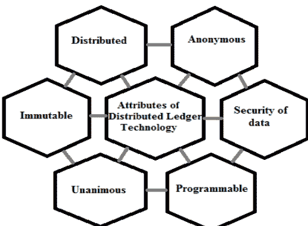

### 不可更改的记录

在区块链技术中，在交易记录到共享账本后，不允许任何成员更改输入，也不能修改或篡改它。但是，它确实提供了以下机会：如果交易记录包含错误，则需要添加一笔新交易来撤销该错误；然后这两笔交易都会被清算。

### 智能合约

智能合约是用于快速完成交易的一组规则，收录在区块链中以实现自动执行。智能合约描述了用于纳入数据、合并数据条款、保证服务等方面的条件和规定。

### 区块链的优势

运营通常在重复记录和第三方验证上浪费时间和金钱。记录系统也可能容易受到网络攻击和欺诈；因此，定义的数据验证可能因透明度而减慢。由于物联网（IoT），交易量急剧增加。结果，每个流程都需要更长的时间才能产出最终结果，这会导致资源耗竭——或者需要更好的举措，即进入区块链。


作为仅限会员系统的一员，我们可以确信获得的是正确且及时的数据，因为机密的区块链文档只会与获授权访问的网络成员共享。根据 Dey et al. (2017)，所有网络成员必须同意数据效率，随后所有经过验证的交易均被固定，因为它们始终被存储。任何人（甚至系统管理员）都无法删除交易。耗时的记录协议常常因共享于网络参与者之间的消失账本而被拒绝。一组用于加速交易的规则，称为智能合约，会自动执行并可存储在区块链上。例如，区块链最著名（也许也是最具争议）的应用之一是加密货币，如比特币、以太坊或莱特币，可用于购买商品和服务。加密货币是数字货币（或代币）。加密货币可以像数字现金一样，用于从购买午餐到下一套房子的一切。在线交易始终被记录和保护，因此，无论货币如何，密码学都采用区块链作为公共账本以及数据加密系统。研究人员也举出了将区块链用于能源交易的示例，如 Park et al. (2018)。

就医疗保健而言，与物联网相关的设备使用患者的实时数据，这些数据会被处理并进一步分析。因此，区块链与物联网相结合是电子医疗保健系统的合理选择之一（Ray et al. 2020）。

## 区块链网络

区块链网络可能是公共、私有、联盟或由财团开发，以及其他选项。

### 向公众开放的区块链网络

公共区块链（如比特币）是任何人都可以注册和贡献的网络。公共区块链的缺点包括交易隐私无或很少、安全性不足以及对处理能力的高要求。

### 私有区块链网络

私有区块链在外观上类似于分布式指导或公共区块链网络。但是，如果由一个实体管理网络、实现共享账本、维护公共数据库，并根据使用案例控制谁被允许参与，那么参与者之间的信任和信心将大幅提升。区块链通常在公司安全体系下运行，并可能在本地处理。

### 具有权限的区块链网络

发现特定链的企业通常会发现一个高度安全的区块链网络。值得注意的是，公共区块链网络也可以被描述为具有限制性，即只有被允许加入网络和特定交易的人才能参与。参与者必须获得相关参与权或加入许可。

### 联盟中的区块链

多个实体可以分担维护区块链架构的负担。这是在实体决定谁有权访问信息以及谁被允许进行交易之前进行的。当所有参与者都必须获得许可并共同承担区块链责任时，联盟区块链是首选方案。在此类别中，需要大量处理能力，但只有一小部分可用。

## 1.2. 作为分布式数据库的区块链

尽管比特币和区块链技术（DLT）这两个术语常被互换使用，但它们并不互换。为了支持区块链技术，比特币采用了多种技术，包括分布式账本技术。数字签名、分布式（点对点）网络和编码技术是区块链技术中用于链接数据库记录（块）的其他技术和计算/数学技术。区块链技术可能被归类为分布式账本。

区块链是一个去中心化且永久的账本，可用于在各种电子资产交易中获取所有权、交易数据、评估效果，并确保可见性、安全性、信任和货币转移。

分布式账本技术基于区块链技术，用于分布式数据库中，该数据库既作为账本，也作为存储交易记录的编码数据库。DLT 是一种前沿的数据库解决方案，其知识库中每笔事务更新都使用加密，并且可在特定公共区块链上进行确认，这取决于平台的目标和利益相关者。区块链技术已从热门词汇发展为现实。

尽管目前被过度炒作，区块链只是在包括数字化转型在内的诸多情境下极为相关的解决方案清单中的一种（但许多应用处于炒作周期的早期阶段）。它并非解决所有问题的万能药（远非如此），因为正如炒作所言，它在特定适用场景中也非常有用。（多种）区块链技术正在工业领域、加密货币内部及跨领域以及作为提供数字世界信任的合同基础，在各种数字信任和交换使用场景中被使用和测试。未来几年，DLT 预计将成为发展最快的数字化趋势之一，并在多种方法和行业的数字化中发挥关键作用，覆盖众多相关应用案例。

围绕加密货币的炒作也造成了技术可能实现的目标与实际能做到的目标之间的巨大差距。而且，不可否认的是，分布式账本技术正在商业界（尤其是金融领域）获得关注。预计 DLT 采用将在所有用例和行业中加速，原因有很多，尽管在许多情况下它可能无法达到预期或毫无必要。

### 推动区块链技术的商业项目

许多企业（无论是全球领导者还是其特定国家或地区的领导者）在众多领域于 2017 年或 2018 年启动了关键的比特币和 DLT 计划。仅查看少数关键计划的客户，我们就可以注意到一些项目，例如 IBM 的跨境交易比特币行动计划，该计划也将主要由亚洲地区的行业参与。项目始于此，并在 2017 年 10 月确认仍接近覆盖 100 个行业。与此同时，这些项目中的大多数将无法实现目标，而其他项目则将日益重要。因此，尽管研究人员提出的各种用例和倡议已得到更深入的研究，DLT 已被引入企业。出于多种原因，区块链技术非常新，尤其是在比特币和加密货币范围之外，而大多数商业项目希望使用 DLT 的领域便超出了此范围。

根据 Zhou et al. (2020)，区块链也广泛应用于健康记录管理系统，该系统使用区块链作为存储工具。现代临床系统面临的最突出问题之一是数据处理，这反过来严重阻碍了医疗系统及其进一步发展过程的效率。此外，至今仍在发生的数据泄露只是用于窃取医疗数据的常规任务之一，方式与窃取银行数据相似。已启动了一些项目，包括医疗链。该项目的目标是开发患者数据的单一版本，从而使他们能够与其网络中的任何人共享数据。医疗链通过基于区块链的应用 myclinic.com，将药房研究、治疗、运营、处方和保险数据统一起来。Medibloc 是另一个基于区块链的医疗保健项目，致力于大数据结构化。Medibloc 通过名为 Medipass 的应用程序提供服务。2020 年另一个最有前景的基于区块链的项目是 Dentacoin，它将牙科行业与区块链行业结合起来。该应用程序在单一平台上容纳了约 2,000 名牙医和 100 个地点。自 2017 年推出以来，Dentacoin 提供了许多平台，从而带来进一步改进。DentaVox 也是用于收集信息和开展研究调查的应用程序之一。Dentacare 是另一个提供与牙科护理相关的教育辅助工具的应用程序。还有一个是 Robomed Network；该项目旨在帮助医疗保健生态系统繁荣，从而提供通用护理解决方案。Robomed Network 已生产出一系列不同的 EMR/CRM 解决方案。

## 1.3. 医疗保健领域的区块链架构

作为账本技术，区块链拥有持续的交易和数据记录列表。它简化并加快了医疗保健及其相关流程。互操作性特性与供应链验证属性相结合，使我们能够大幅降低后台负担、数据管理和维护成本。区块链技术正在迅速推动医疗保健领域的五个关键领域。

- 1) 在线访问 – 区块链允许患者在线访问其纵向医疗记录，为其提供安全密钥，从而实现数据的互操作性。

- 2) 健康记录维护 – 区块链允许以纵向方式维护医疗保健记录。它还在多个医疗机构和患者之间维护安全的医疗记录。这使得区块链具有前瞻性方法。

- 3) 健康索赔裁决自动化 – 区块链的智能架构允许执行合同交易，这有助于通过业务规则支持合规性审计并完成索赔。因此，它还遵循去中介化的概念。

- 4) 供应链管理 – 使用供应链，我们可以改善业务效率。区块链通过实时健康跟踪和执行实现合同医疗保健。区块链管理的这种架构特性也有助于合同管理，从而降低其成本。这


该方法还涵盖了已满足且已完成的合同，这些合同向消费者提供所提供设施（包括药品）的质量和来源信息。

- 可互操作性 – 该区块链特性通过促进和封装大量患者数据来提升区块链效率，从而支持更多健康计划。它推动了患者数据交易量的进一步增长，并结合医疗专家联盟的观点对链数据进行协商。如图 1.2 所示，区块链架构由两个主要块组成：交易块和维护块。交易块由不同网络来源的若干块组成，倾向于在不同时间槽向区块链传输数据。每当发生新交易时，数据将传输到全球连接的计算机网络中。随后，网络会检查并确认已发生交易的有效性，从而允许其在块内聚集。所有这些块随后相互链接，整个交易即被视为完成。

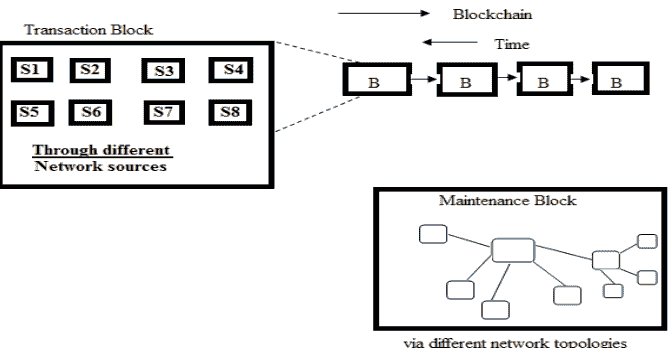

图 1.2 区块链架构

图 1.3 展示了数据块的示意图。

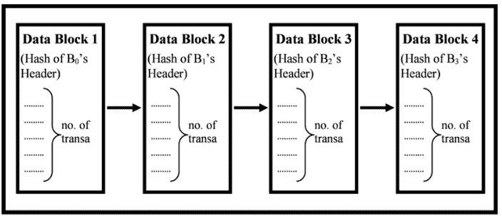

图 1.3 数据块示意图

区块链架构是一种去中心化的 P2P 架构，其中不同的数字交易记录在共享账本的分布式网络中。这些数字交易是加密信号数据的副本，以块格式结构化，索引指向先前的块。成员存储共享账本的副本，对共享账本所做的更改会反映给所有人。所有原始大小的原始数据作为流向数据，使得医疗领域的区块链实现成为可能，如图 1.4 所示。

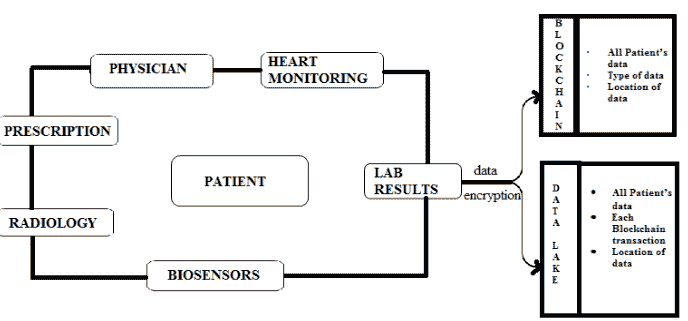

图 1.4 区块链在医疗领域的实现

区块链是一种共享且分布式的基础设施，解决了互操作性问题，从而提供健康数据及医疗实体的全面视图。通过这种方式，区块链提供了通向互操作性的高效途径，并构建了医疗 IT 架构，其中患者被包含在一条链中，该链已完成多项活动，如处方、监测、放射学、实验室和生物传感器，具体适用哪些取决于患者，加密数据以块形式存在，指向区块链和数据湖。每次输入数据时，账本中就会生成一个新块，同时它也作为数据湖中的一个条目。

由于其庞大的架构和广泛的技术使用，患者数据仍然无法访问；因此，许多研究已针对区块链的这一缺陷及其安全限制进行了探讨。因此，研究已解决了安全问题（Dagher et al. 2018），并设计了诸如 Medlock（Fan et al. 2018）之类的信息管理系统，以处理患者数据。通过在制药行业应用区块链，一个与医疗保健相关的区块链独立领域也已生效，由 Haq 和 Esuka（2018）提出，其中一个许可区块链被应用于追踪药物从制造到交付的流动，并记录其后续影响。

## 1.4. 区块链的发展：技术现状

区块链是一个分布式块链，用于跟踪全球多台计算机上的所有交易，防止其被篡改，随后以这种方式记录，使区块链在改善数据安全性（Kuo et al. 2017）的同时，也使数据交换更具成本效益和公开性。它还指派第三方，其主要功能是在交易和信任之间提供认证方面（如银行和公证处）。

许多研究人员已讨论加密货币的重要性，这引起了各行业企业的兴趣，银行业当前成为最突出的领域之一。通过医疗应用程序进行数字支付应用，人人皆有所获，并出现了成千上万个新职位，区块链已以这种方式出现，推动新企业的发展。

技术团队对加密货币的广泛了解（无论是作为原型甚至制造系统、虚拟化计算还是数据分析）有助于利用区块链的优势，从而在以太坊、Tezos、Hyperledger、EOS、NEO 和 Qtum 等项目中找出最佳区块链，并确定何时采用像 Quorum 这样的私有许可区块链技术。关于区块链的几项能力和可能性总结如下：

- 利用 web3、solidity、cakeshop 和 Truffle 等工程能力启动和开发区块链应用；
- OpenZeppelin 和智能合约是两个定制 dapp 框架的示例；
- Python 用于应用程序和数据科学工程；
- Swift 和 Objective-C 用于创建企业原生移动应用；
- 基于 Phoenix/Elixir 的无服务器架构 Web 应用程序；
- 区块链技术案例研究；
- 区块链基础设施；
- 区块链与移动银行；
- 区块链与点对点转账；
- 区块链与数字货币；
- 市场与区块链；
- 市场平台与区块链；
- 医疗保健与区块链；
- 区块链上的应用；
- 电子政务与区块链；
- 区块链与银行业；
- 金融技术（fintech）应用；
- 监管框架与区块链；
- 区块链采纳受多种障碍阻碍；
- 智能合约；
- 区块链技术正在进步；
- 区块链提供隐私、安全性和身份。

区块链因其能够建立一个庞大的、全球性的共享账本来记录一切有价值的事物而迅速声名鹊起，这最初是作为支撑比特币的技术的一部分而创建的。区块链是一种数字、公共的分布式日志，保留每个渠道用户计算机的精确副本。任何各方都可以创建新条目，先前的条目也可以审阅。

在区块链中，活动被记录并一个接一个地传输（因此得名“区块链”）。由于先前的交易无法被擦除或伪造，加密保护了块及其内容之间的链接。这意味着交易网络和账本中不存在中央机构或中介。区块链技术能够以去中心化、自动化的方式即时存储、保留和流通每种形式的资产，这引起了企业家以及整个金融服务行业的好奇心，他们真正期待在各种领域中出现可能的用途和应用。研究人员通过 Risius 等人（2017）等各种实证研究评估区块链的效率及其实际影响，并证明了区块链的多学科方法。

### 区块链在市场中的应用

区块链技术有望简化并优化整个市场流程，同时创建业务资产生命周期，使所有参与交易的实体都能访问信息。在这种情况下，系统将在基础设施上节省大量资金，提高透明度，加快处理周期，便于访问数据，甚至消除某些中介（如交易商）。Nasdaq 是开发区块链支持产品的最早金融服务公司之一。私人公司使用 Nasdaq Linq 来处理其公司股份，它利用加密货币支持资本化表。

### 区块链用于跨境活动

区块链有潜力通过加速和减缓流程、削减开支并消除不必要步骤（包括多个传统中介）来增强跨境交易。同时，它可能降低汇款成本。迄今为止，汇款成本在 5% 到 20% 之间。区块链是一种使降低整个价值 2 个百分点到 3 个百分点并提供安全、实际的跨境支付成为可能的技术。Santander 是首家采用区块链技术的公司，通过智能手机应用程序在英国进行实时外币支付。该解决方案使用 Ripple 的技术，创建了一个比特币 Ripple 支付系统和交换网络。区块链还被用于改进数字身份识别，用户可以在其在线身份转移到支持区块链的基础设施后，选择如何展示自己或向谁披露其身份，从而仍可在区块链上注册其身份；但是，当需要时，客户无需向每个网络运营商重新注册，只要这些供应商也连接到区块链。

此区块链应用常被用作理解需求的示例，其中数字化的单一可识别详情来源可以实现更顺畅的银行账户、减少资源和开支，同时保留隐私。


## 1.5. 区块链中的信息分布

随着物联网（IoT）和 5G 的兴起，针对数据分布与问责制的分析中，正在收集越来越多的关键数据，特别是电力管理系统，其总体稳定运行取决于数据共享和传输的安全性。Firdaus et al. (2018) 研究了安全问题及其解决方案，例如 InterPlanetary File System（IPFS）（Dey et al. 2017），用于智能可穿戴系统数据传输架构中的隐私保护，以在性能和资源优化之间取得平衡。研究人员还提出了相关的 CCTV 数据保护系统以及私有保护视频编码和存储技术。

拟议模型中的每个用户都能够与其他用户通信并接收数据。信息不会在用户之间立即通信（例如 A 和 B），而是通过以下三个过程：

- 1) 通过用户 A，敏感数据最初被编码并保存在 IPFS 中。任何人都可以根据哈希函数接收加密材料，但只有拥有密钥的人才能读取它。

- 2) 如果 A 希望向 B 发送数据，他们会在区块链中创建一条记录，表明数据 D 已发送给 B。该文档还包含对数据 D 的访问权限，该权限由分布式块链编码，用于跟踪 B 的公钥，仅允许 B 获取密钥并检索 A 的信息 D。

- 3) 共识算法用于确保信息转移记录不可否认。为了改进系统，采用了实用拜占庭容错（PBFT）共识算法。与常用的 PoW 或 PoS 共识协议不同，PBFT 可以在不需要代币或货币的情况下运行，而在电气数据管理场景中也不需要这些。

## 1.6. 对区块链日益增长的期待

区块链是一种不可篡改的账本，由对等节点共享，交易记录始终以连续方式追加。与集中式机构无关的分布式去中心化更适合在医疗保健应用中实施。分布式账本技术和区块链这两个概念经常被互换使用。总体技术类型是分布式账本，而区块链是具有更多技术细节的特定形式。两者都涉及账本概念，账本是记录谁拥有什么的文件。根据 Dey et al. (2017) 的研究结果，分布式账本有四个关键特征：i) 由网络成员共享的支付数据，ii) 基于共识的更新，iii) 带有加密签名的带时间戳的记录，以及 iv) 包含所有交易的防篡改记录。区块链提供了使用链式加密哈希链接的块按顺序更新数据库条目的能力（每个步骤对前一个块执行哈希运算，从而通过不可破坏的字符串将交易块连接起来，因此称为“区块链”）。区块链有两种形式：公共区块链和私有区块链。

对公众开放的区块链可由任何人使用，例如比特币和以太坊，且无人知晓其身份。私有区块链由政府和行业联盟使用，类似于企业内联网，用户身份已知并经过凭证验证。采用 ICT 的最关键动机之一可能是网络安全。最近的数据泄露事件——Equifax 信用丑闻中约 1.455 亿美国人的个人信息因该事件泄露，以及 25 亿个 Yahoo 用户配置文件的身份、电子邮件和密码被盗——凸显了加强安全措施的迫切必要性。区块链系统是窃贼的诱人目标，但基于区块链技术并由加密签名支持的去中心化记录存储可显著提高网络安全。去中心化解决方案应当提供对私有数据的更强用户控制和权限管理。分布式账本被称为“无信任”，因为它们在私人信息交换过程中消除了依赖任何第三方机构（如 Equifax 或 Yahoo）的需求。区块链是无需第三方中介即可验证和传输价值的智能网络。一种能够在网络内识别、验证、确认和分发交易的复杂协议将智能直接融入网络的流程中。

在医疗保健领域，区块链不可篡改特性（不允许区块链用户更改或修改任何已追加到区块链的记录）已应用于区块链。区块链确保患者记录的有效性和完整性。然而，由区块链支持的智能合约是控制患者记录流动的规则。根据欧洲规则，GDPR（一般数据保护条例）在没有明确同意的情况下拒绝处理任何患者的个人或敏感数据。因此，根据日益增长的期待，区块链可以与符合 GDPR 的基于 EMR 的临床管理系统开发相关联。结果，出现了一种无需信任的系统，其中人类对手和组织无需被知晓或授权。相反，计算智能网络受到信任，这可能有助于下一代数字解决方案的开发。

### 1.6.1. 区块链面临的挑战

医疗保健领域的区块链解决了包括数据安全、护理规范性问题、协调和互操作性在内的多个问题，因为该行业定期有多种数据输入，例如病历、检测结果、处方等。因此，潜在益处如下。

### 可扩展性

第一个也是最重要的问题是采用和可扩展性。尽管交易网络能够毫无失败地每秒处理数百笔交易，但处理过程中可能会出现异常延迟。

### 互操作性

必须解决的第二个主要问题是互操作性，这经常被引用为这些技术尚未实施的主要原因之一。由于无法向某些其他基于区块链的系统发送和接收数据，许多区块链会形成信息孤岛，不与其他对等群体交互。

为解决这一问题，已建立了多个项目来处理该问题。例如，Smart Bridges 设计用于弥合 Ark 网络之间的通信差距。该技术旨在提供全球兼容性以及全球通信和传输。

### 能耗

该技术使用工作量证明技术来验证交易并确保其足够可信，可以添加到系统中。这种技术需要大量计算能力来解决复杂的数学谜题、处理、验证，更重要的是，保护整个系统。

为解决此问题，以太坊联合创始人提出将工作量证明更改为权益证明的解决方案。采用此方法时，参与者无需回答复杂谜题，从而节省大量能源。

### 人才短缺

对专家的需求稳步增长，但在考虑部署数字技术时，寻找高素质人才通常被视为重大障碍。

许多企业高管、组织和政策制定者无疑可以从这项技术中受益。不过，仍有几个挫折导致该技术接受缓慢。同样，截至 2019 年，全球加密货币开发者市场较上年增长了超过 517%。尽管取得了巨大进步，但大多数人仍将比特币视为一个知名领域。尽管对区块链开发者的需求增加，但仍存在严重短缺。

### 标准化是否仍然缺失？

这只是一个尚未得到回答的问题：区块链遵循什么标准化？尽管存在众多网络，但确实没有统一标准。由于缺乏标准化，会出现兼容性、价格上涨和流程复杂等问题，使广泛采用变得不可行。由于缺乏标准版本的区块链技术，它将成为新公司和用户的障碍。除上述问题外，大规模部署面临的相关问题包括成本、隐私条款和安全问题。

## 1.7. 区块链在医疗保健中的益处

区块链以五种不同的方式有益于医疗保健。

- 1) 以纵向方式管理患者记录

通过区块链定期汇编病历、疾病登记册、实验室结果、住院门诊数据和治疗来管理患者记录。可穿戴数据提供商也正在涌现多种改进方法来提供护理。

- 2) 主患者索引

在处理医疗数据时，记录经常不匹配或重复。此外，每个不同的 EHR 都为每个字段准备了不同的架构，因此出现了输入和操作知识集的替代方式。但在区块链处理中，完整的数据集（而不仅仅是初始键）被加密到日志账本中。

用户可以搜索不同地址，因为有众多位置和密钥可用，从而形成单一的患者身份。


### 3) 索赔裁决

由于区块链基于确认交互运行，所有声明都易于知晓，合同在网络达成一致后执行。由于区块链设计中没有中心化实体，出现错误或作弊的风险较低。

### 4) 供应链管理

基于区块链的合同设计可通过供应链管理跟踪供需周期，从而使医疗保健企业受益。整个管理包括监控交易的进行情况、检查合同是否成功，以及报告任何交易或延迟是否不正确。

### 5) 连接性

连接性是链条的一项承诺，通常通过使用复杂的API来实现EHR兼容性和安全数据存储。

以安全且标准化的方式与批准的服务提供商共享的区块链网络，以消除区块链中数据对账的负担而闻名。区块链通过互操作性解决的其他复杂活动包括药品供应管理、欺诈根除、临床研究或收入周期管理转型。

## 1.8. 与区块链相关的公开问题

与区块链应用相关的问题多种多样。其中一些问题如下所述。

### 区块链伴随着环境支出

加密是区块链用于提供安全性并从分布式网络获得共识的机制。其实际含义只是为了证明某人是否有权在链条应执行的复杂程序中写入内容，每个程序都需要大量的处理能力。毕竟，当然，这会带来成本。以最广泛使用的加密货币为例，估计去年维持系统运行所需的计算能耗相当于159个国家的能耗。

因此，它需要精密且计算成本高昂的保护。主要由公司私下用于记录和维护商业活动的较小型区块链技术将使用这些精密区块链的一部分。尽管如此，这仍是一个重要方面，其自然后果也是如此，因为能源价格不可忽视。

### 缺乏监管会创造危险环境

由于处理各个层面的数据被黑客攻击的风险日益增加，未经监管的环境通常成为基于价值的账本系统的一大障碍。这可能是因为可用网络数量庞大、市场场景高度不稳定，或由于缺乏政府监管、诈骗和市场操纵。用户存储代币/宝贵信息的交换所或互联网块始终存在被黑客攻击、因欺诈交易被政府机构关闭，乃至完全消失的风险。此外，这通常是全球缺乏政府监管的结果。由于其复杂性，最终用户难以理解其带来的好处。

尽管人们预期区块链的革命性应用与加密和共享账本等概念一起实施起来容易且更安全，但在“普通人”认识到区块链技术始终如此有用之前，还需要大量的时间和学习。

首个区块链技术——加密货币——在2008年经济危机后崭露头角，这并不令人意外，当时媒体和公众舆论对现有金融机构和工具表达了广泛的不满和日益增长的怀疑。10年后，在没有重演威胁的情况下，是否真的有意愿摧毁储蓄计划并从零开始重建？谁知道接下来会发生什么？当然，过去的经济衰退大多未被预料到，世界事件可能会推动变革的需求，但即便如此，区块链对某些人来说可能仍是一项难以推销的技术。

### 区块链确实可能使用缓慢或不便

区块链交易（Zhou et al. 2020）因其复杂性、加密和灵活架构可以快速处理，尤其是与需要数小时的“传统”方法相比，表明该概念存在缺陷。总体而言，该方法可用于用于除存储数据以外目的的区块链网络，例如物联网环境中的内部交互、记录付款等。即使计算机访问和发布到网络的增长，这些链条——本质上只是计算机文件——可能会变得笨拙和复杂。理想情况下，这确实是一个可以通过工程和计算速度的发展来解决的问题。

因此，人们认为，尽管这些困难可能带来重大挑战，区块链技术在不久的将来无疑会得到发展。此外，技术进步如同自然界一样，有办法自行穿越人为设置的障碍。

## 1.9. 区块链的未来趋势

随着新兴初创企业的大力增强，区块链技术正在接近成熟阶段。此外，区块链还可以保证输入的医疗记录的完整性和不可篡改性，这反过来可能对跟踪结果和更好地记录医疗错误产生影响。然而，制药供应链中结果的跟踪也旨在保证药品和其他药品的完整性。医疗保健提供者目录的创建和更新也是区块链获得支持的领域。然而，如今，满足区块链的能源需求也是主要关切之一，同时还要考虑有利的速度和可扩展性。

区块链未来趋势的主要主题包括同意管理。在同意管理任务中，患者同意数据交换，治疗和隐私偏好被标记，以推动行业进一步改进，从而朝着医疗结果的精准方向发展，以保障和改善医疗数据管理。

## 1.10. 参考文献

Agbo, C.C., Mahmoud, Q.H., Eklund, J.M. (2018). 区块链技术在医疗保健中的应用：系统综述. MDPI Journal, Healthcare, 7(56), 1–30.

Ahram, T., Sargolzaei, A., Sargolzaei, S., Daniels, J., Amaba, B. (2017). 区块链技术创新. 2017 IEEE技术与工程管理会议 (TEMSCON), doi: 10.1109/TEMSCON.2017.7998367.

Angraal, S., Krumholz, H.M., Schulz, W.L. (2017). 区块链技术：医疗保健中的应用. 循环：心血管质量与结果, 10(9), e003800.

Aru, I. (2017). 降低区块链入门门槛的全栈开发工具. Cointelegraph [在线]. 可查阅: https://cointelegraph.com/news/full-stack-development-tools-lowering-blockchain-entry-barriers.

Dagher, G.G., Mohler, J., Milojkovic, M., Marella, P.B. (2018). Ancile：使用区块链技术的电子健康记录访问控制和互操作性隐私保护框架. 可持续城市与社会, 39(1), 283–297.

Dey, T., Jaiswal, S., Sunderkrishnan, S., Katre, N. (2017). 物联网与区块链的一个医疗用例. 2017年智能可持续系统国际会议 (ICISS) 论文集, 帕拉达姆, 印度.

Fan, K., Wang, S., Ren, Y., Li, H., Yang, Y. (2018). Medblock：通过区块链实现高效安全的医疗数据共享. 医学系统杂志, 42(8), 136.

Firdaus, A., Anuar, N.B., Ab Razak, M.F., Hashem, I.A.T., Bachok, S., Sangaiah, A.K. (2018). 移动设备和基于区块链的医疗数据管理中的根漏洞检测与特征优化. 医学系统杂志, 42, 112.

Haq, I. and Esuka, O.M. (2018). 医药行业中用于防止假药的区块链技术. 计算机应用国际杂志, 180(25), 8–12.

Kuo Ting, T., Kim, H.E., Machado, L.O. (2017). 生物医学和医疗保健应用的区块链分布式账本技术. 美国医学信息学协会杂志, 24(6), 1211–1220.

Park, L.W., Lee, S., Chang, H. (2018). 基于区块链的带能量标签的可持续家庭能源 prosumer-chain 方法论. 可持续性, MDPI, 10(3), 658.

Ray, P.P., Dash, D., Salah, K., Kumar, N. (2020). 基于物联网的医疗保健区块链：背景、共识、平台和用例. IEEE系统杂志, 99, 1–10.

Risius, M. and Spohrer, K. (2017). 区块链研究框架. 商业与信息系统工程, 59(6), 385–409.

Wong, M.C., Yee, K.C., Nohr, C. (2018). 医疗保健中使用区块链技术的社会技术考量. 健康技术与信息学研究, 247, 636–640.

Xu, Y., Zhao, S., Kong, L., Zheng, Y., Zhang, S., Li, Q. (2017). ECBC：具有高效查询的高性能教育证书区块链. 计算理论方面 – ICTAC 2017, D. Van Hung 和 D. Kapur (编). Springer, Cham.

Zhou, L., Wang, L., Sun, Y. (2020). MIStore：基于区块链的医疗保险存储系统. 医学系统杂志, 42(8), 149.


# 智能合约在区块链中的作用

区块链提供了多项优势，包括去中心化、持久性、匿名性和可审计性。加密货币、银行业、风险评估、物联网 (IoT) 以及个人和公共服务都是区块链应用的示例。由于加密货币的迅速扩张，以及其基础区块链技术，Hyperledger 和 Ethereum 等框架应运而生，以实现广泛的智能合约。智能合约是旨在数字化地简化、验证或控制新合同实施的计算系统。智能合约在不同领域有广泛应用，包括投资银行经济模型和物联网等。本章介绍了区块链技术及其特性和类型。它提供了关于智能合约、其工作原理、平台、编程语言及应用领域的详细信息。它还介绍了区块链技术在不同领域的应用，并以实施智能合约面临的挑战作为结论。

## 2.1. 区块链简介

最近，加密货币引起了从业者和学者的广泛关注。比特币通常被称为最初的加密货币。2016年，资本市场超过100亿美元，取得了成就（CoinDesk 2016a）。区块链是比特币的核心机制。区块链技术最初于2008年提出，并于2009年部署（Bitcoin n.d.）。

区块链类似于分布式账本，所有已完成的事件都记录在区块链中。随着更多区块进入系统，它将持续增长。去中心化、持久性、匿名性和可审计性是区块链技术的重要属性。区块链可以通过结合密码学哈希、数字签名和分布式共识过程等多种基础技术，在去中心化环境中运行。因此，区块链有潜力在显著降低成本的同时提高效率。此外，随着提供商用户信息和易受攻击设备数量的增加，部署安全、可靠且经过验证的服务至关重要。殊不知，随着巨头科技公司信息盗窃事件的增多，大量私人数据泄露，信任变得日益稀缺。集中化是许多软件架构中的根本缺陷，它在用户和供应商之间形成不平等的关系，使得电子信息的个性化安全无法实现，同时为黑客攻击提供了单点故障。

区块链是一个去中心化、不可逆的交易账本，其中每笔交易都与前一笔交易紧密相连。在非可信分布式环境中工作，可以通过信息账本和对交易真实性的分布式共识来保障安全，这是区块链技术的根本目的。此外，交易包含操作代码，允许在非可信用户之间提供软件服务。自最初应用于加密货币以来，工业界和学术界对区块链技术的兴趣日益浓厚，他们正在评估底层区块链技术的适用性和运作方式。

为实现区块链去中心化，参与交易和区块生成的节点应能够验证添加到链上的新更新区块的有效性。在这种情况下，节点应达成共识，因为没有可信的集中化方法来做出此类判断。已使用各种共识技术来达成此类一致（Katal et al. 2021）。这些版本都必须朝着同一目标努力：通过验证引入链中的每个新区块的活动，来识别区块链内的交易是否合法。差异在于谁可以添加区块以及添加速度，以及用于达成一致的问题。共识通常用于描述“挖矿”，即解决一个易于验证但难以推翻的复杂问题。

矿工向网络贡献额外区块的方法称为挖矿。链中每个区块都有其独特的 nonce 和哈希，并连接到网络中前一个区块的哈希，这使得区块挖矿变得具有挑战性，尤其是在大型链中。矿工使用复杂程序来解决创建有效哈希这一极其困难的数学问题。对链中任何先前区块进行更改不仅需要重新挖矿被更改的区块，还需要重新挖矿所有后续区块。因此，操纵区块链非常困难。可以将其视为“数学安全”，因为找到黄金 nonce 需要大量的努力和计算能力。每当一个区块被正确处理时，该更改会被系统中所有节点接受，矿工将获得经济奖励。图 2.1 展示了区块链技术的工作原理。

| 步骤 1: 交易请求 | 步骤 2: 交易的第一个区块包含哈希、所有权、修改历史记录等 | 步骤 3: 区块广播到网络中的所有其他节点 | 步骤 4: 网络中的节点批准交易的有效性 |
| --- | --- | --- | --- |
| 步骤 VIII: 交易完成 | 步骤 VII: 更新分布到整个网络 | 步骤 VI: 区块添加到现有区块链中 | 步骤 V: 节点获得挖矿奖励 |

图 2.1. 区块链的工作原理。如需此图的彩色版本，请访问 www.iste.co.uk/choudhury/blockchain.zip

### 2.1.1. 区块链类型

公共区块链：任何具有 Internet 连接的人都可以使用公共区块链中的区块链技术（Idelberger et al. 2016）。每个人都可以访问交易详细信息及其验证。公共区块链的成员可以参与共识协议的整个过程。比特币和以太坊是两种使用公共区块链技术的机制。

- 混合区块链：混合区块链的信息可以是私有的或公开的。存在部分去中心化的混合区块链系统。Hyperledger 是采用混合区块链系统的方法的主要示例之一。

- 私有区块链：私有区块链中区块的写权限由特定机构管理，而读取权限可以是公开的或受限的。可以加入此区块链的节点范围受到限制（Pilkington 2016）。区块链的交易信息不对每个节点开放。此区块链非常安全。

### 2.1.2. 区块链特性

- 去中心化：在典型的集中式交易处理系统中，每个操作都应由受信任的集中式机构（例如中央银行）验证。区块链交易可以在任何两个身份（P2P）之间执行，无需中央机构验证。因此，区块链有潜力显著降低托管支出（包括规划和生产成本），同时消除集中式计算机中的兼容性问题。

- 持久性：由于网络中传播的每笔交易都必须经过验证并存储在分布在整个系统中的区块里，每笔传输的交易也将由许多其他对等节点验证和检查。因此，任何篡改都可以被迅速识别。

- 匿名性：任何实体都可以使用创建的地址加入区块链系统。此外，为了避免泄露身份，一个人可以创建大量地址。不再存在保护用户机密信息的集中式实体。此方法为区块链交易提供了一定程度的匿名性。应注意的是，区块链无法确保完全匿名。

- 可审计性：由于区块链上的每笔交易都经过验证并加上时间戳，用户可以通过连接到去中心化系统中的节点，轻松跟踪和审计先前的记录。区块链网络中的每个操作都可以反复回溯到先前的交易。它优化了区块链中存储数据的透明度和可追溯性。

## 2.2. 智能合约

Nick Szabo 提出，可以将一系列合同要求编码到软件和硬件中，以使合同违规变得昂贵（Wang et al. 2019）。根据 Nick Szabo 的说法，智能合约 (SC) 是一种用于交易的电子协议，用于执行合同条款。与商业采购相比，使用智能合约的主要优势是控制层的速度；例如，采用智能合约可以更轻松地保留合同合作伙伴先前行为的记录。合同措辞可以引用法律合同，并且是自动执行的。智能合约减少了故意和无意异常的风险，以及对受信任中介的需求。智能代理就是一种智能合约。换句话说，它是一种计算机软件，可以


当满足特定标准时进行选择。代理的智能程度由其设计用来完成的交易的复杂性决定。合同可以是几秒钟或几分钟内完成的极其简单的交易，也可以是包含谈判和几十页特定权利和义务的书面语言、可能需要数小时或数月才能完成的非常复杂且冗长的交易。智能合约目前被归类为相对基础的交易。作者将(CoinDesk 2016b)中的所有描述分为两大类：智能法律合约和SC代码。SC代码定义为“在区块链上验证、存储和实现的代码”(CoinDesk 2016b)。SC的运作完全依赖于用于显示协议的编程语言以及区块链的功能。术语“智能法律合约”指可用于补充或替代法律合同的代码。此SC的功能由法律、政治和商业机构决定，而非技术。余额、安全存储和程序代码均是智能合约的特征。合同条件由存储和余额组成。合同履行后，信息会在区块链上保存并更改。每个合同都会获得一个独特的20字节地址。合同代码一旦发布到区块链上就无法修改。只需向合同地址提交交易即可执行合同。系统上的每个协议节点（也称为矿工）都会执行此操作，以就其结论达成一致。合同状态将根据需要进行修订。它可以理解其个人存储，向其账户注入资金，通过用户配置交易发送订单或付款，甚至根据其接收到的活动创建新合同。

### 2.2.1. 智能合约的运行机制

SCs由一组称为场景响应逻辑的程序规则和逻辑组成。换句话说，它们是在区块链上实现的分布式、可靠的共享程序。签订合同的参与者必须决定合同协议、合同条款中的漏洞、违约义务以及外部验证信息来源（预言机），并将其作为智能合约放置在系统上，以自行执行合同实现。

图2.2描绘了智能合约的工作机制。即使参与者接受了智能合约，这些合约通常也以机器代码的形式链接到区块链上。

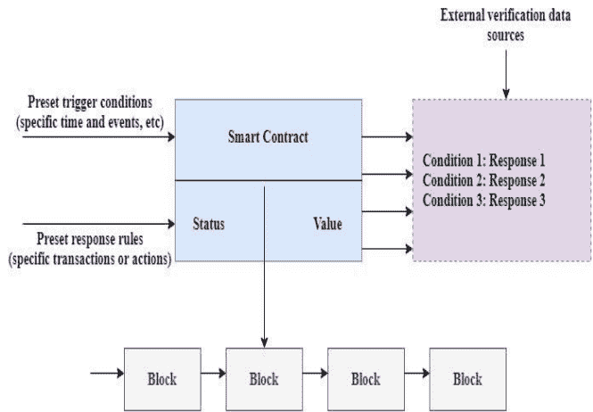

图2.2. 智能合约的运行机制。如需查看此图的彩色版本，请访问 www.iste.co.uk/choudhury/blockchain.zip

### 2.2.2. 智能合约的应用

#### 2.2.2.1. 金融

智能合约和区块链增强了参与者之间的透明度和信任，同时降低了基础设施、交易和行政费用。以下是金融领域智能合约应用的几个示例(Ojetunde et al. 2019)。

- 安全：证券行业涉及耗时、浪费、不便且风险高的复杂操作。智能合约可以避免在证券托管链中使用中间人。集中清算过程需要耗时的操作，以及复杂的内外部对账。

- 保险：每年，保险行业在理赔处理上投入数百万美元，同时因欺诈性索赔损失数百万美元。它们可用于自动化保险索赔、验证和付款，提高理赔处理速度，同时减少欺诈并尽量降低潜在风险(Gatteschi et al. 2018)。

- 贸易金融：目前，贸易金融效率低下，该业务特别容易遭受盗窃。此外，基于纸质金融的交易程序必须现代化或被数字化活动取代。它们使组织能够根据预设标准自主启动商业活动，通过简化程序、降低欺诈和合规费用来提高生产力。

#### 2.2.2.2. 管理(Lutz Maicher et al. 2016)

区块链提供的智能合约可以为管理角色、职责和决策程序提供充分的问责制。以下是一些用例示例。

- 数字资产和权利管理：Maicher et al. (2016)主张使用智能合约来验证知识产权的存在和著作权。智能合约也可用于控制数字权利。例如，一旦音乐家的作品被商业使用，名为Ujo Music的dApp将强制执行版税支付(ConsenSys Mesh n.d.)。

- 组织管理：大多数企业目前由董事会管理和关注，董事会做出大部分决策。组织管理的未来预计将扁平化和去中心化。智能合约可以消除对施加虚假约束和过度复杂法律的中介的需求。

- 电子政务：智能合约可以通过简化官僚流程来帮助提高电子政务的效率和权威性。其他智能合约应用包括劳动和养老金的创新支付方式、电子投票(Ayed 2017; McCorry et al. 2017)等。

#### 2.2.2.3. 物联网

物联网生态系统包括联网的物理小工具、汽车、家用电器和其他物体。物联网可以融入智能电网和其他领域。现有的集中式互联网基础设施使得无法实现物联网发展目标，例如敏感信息的保密性和多设备之间交互的可信度。因此，物联网与区块链的集成已成为不可避免的趋势，智能合约将有助于自动化复杂的工作流程，鼓励资源共享，节省资金，并确保安全性和效率(Ayed 2017)。

#### 2.2.2.4. 能源

区块链可以支持去中心化的能源系统，并为电力生成和交易实施智能合约，以发展去中心化的能源交易市场，提高能源和消费效率。Exergy(Exergy n.d.)是一个区块链联盟平台，通过现有电网为电力交易提供合适的能源市场。Sun Exchange(Sun Exchange n.d.)是一个基于区块链的市场，允许客户购买太阳能电池，然后将其出租给世界上日照最充足地区（主要是非洲）的组织和社区。其成员的收入基于其太阳能电池产生的电力。Sun Exchange将负责每月租金的收取和分配。Knirsch et al. (2018) 为电动汽车提供了一系列可信、自主且匿名的充电点，涵盖可负担性和续航能力。

### 2.2.3. 编程语言和平台

智能合约可以在多种区块链平台上创建和部署。平台的功能各不相同。本节将讨论两个常见平台：以太坊和Hyperledger Fabric。

- 以太坊：在以太坊平台上，应用程序严格按照设计执行，没有停机、审查或欺诈等问题，也没有第三方干预。以太坊虚拟机(EVM)是一个图灵完备的VM，用于实现字节码(如前所述，Solidity编译字节码)。以太坊应用由以太币驱动，以太币是该平台专有的加密资产代币。以太币的用途如下：它作为类似比特币的电子资产进行交换，也用于奖励节点完成的计算(ConsenSys 2016)。

- Hyperledger Fabric：这是一种分布式账本技术。Linux基金会托管Hyperledger Fabric。它提供高度的保密性、稳健性、可定制性和可持续性。它的创建旨在允许对特定部分进行可配置的解决方案，同时解决经济生态系统的复杂性和错综复杂性。Hyperledger Fabric使用容器技术来存储名为“链码”的智能合约。

如前文第2.1节所述，以太坊智能合约脚本是用基于栈并在EVM中实现的字节码语言创建的。以太坊智能合约可以使用多种高级编程语言创建。随后，程序将被编译成EVM字节码。


将被执行。Hyperledger Fabric 生成多种语言的智能合约，包括 Go 和 Java。

## 2.3. 定量分析

定量研究基于科学探究，依赖已观察或测量的数据来回答关于样本总体的问题。定量研究的结果说明了什么与某个人口相关或影响什么，什么不相关或不影响。它还提供了关于现象频率或其影响样本程度的问题的解答，并为产品设计提供了有用数据，例如关于用户需求、行为模式和用例的信息。

我们检索了 Scopus 数据库中截至 2021 年 11 月 1 日发表的研究。关于区块链智能合约的研究不仅发表在医学出版物中，还发表在 IT、法律、工程、经济学和工商管理等其他领域的期刊上。因此，鉴于其对自然科学和社会科学期刊的全面覆盖，我们选择 Scopus 数据库作为本研究论文的来源。

我们采用四个流程来进行全面的定量综述：发现可能的研究、筛选出无关研究、确认相关研究和评估所选论文。

在选择合适研究的第一阶段，我们对标题、摘要或关键词中包含类似“区块链智能合约”术语的论文进行了初步搜索。该阶段共筛选出 5,873 项候选研究。在另一次搜索中，我们将这些研究限制为标题、摘要或关键词中包含类似“区块链智能合约医疗”关键词的研究。这共得出 373 项候选研究。

在第二阶段，应用过滤器移除待出版文章，从 373 篇文档中得出了 356 篇文档。Scopus 数据库也显示待出版文章，这意味着这些文章尚未在线发表，而是处于制作阶段。

在第三阶段的验证中，我们调查了文档类型、标题、摘要和关键词，并筛选出 354 项符合我们仅搜索英语文档标准的研究。

在第四阶段的评估中，我们研究了这 354 篇文章按出版年份、语言、来源地、期刊和年均被引次数的分布。通过确定作者所属组织的国籍来调查文章的来源国。如果一篇文章的两位作者分别属于两个不同国家的组织，则来源国被确定为两个国家。利用这 354 篇文章的年均被引次数确定了前 10 篇文章。通过调整出版后时间的影响，年均被引次数比总被引次数更能有效地代表每篇文章对其他研究的影响程度。例如，2016 年发表的文章比 2019 年发表的文章更有可能被引用。因此，我们使用年均被引次数对这 354 篇论文进行了排名。

### 2.3.1. 结果

首先，自 2016 年以来，文章数量剧增。这些文章始于 2016 年发表。2016 年只发表了一篇文章。从 2017 年起，基于区块链的医疗智能合约领域的文章数量持续增加。图 2.3 显示了 2016 年至 2021 年文章数量的上升情况。

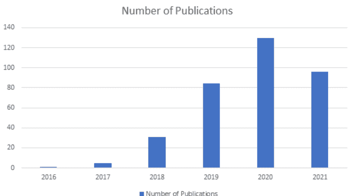

**图 2.3.** _出版物数量_

印度、美国、中国、英国和澳大利亚是按发表文章数量排名的前 5 个国家。印度拥有最多数量的文章，即 82 篇，约占所选审查文章的 23.1%。图 2.4 显示了前 5 个国家。

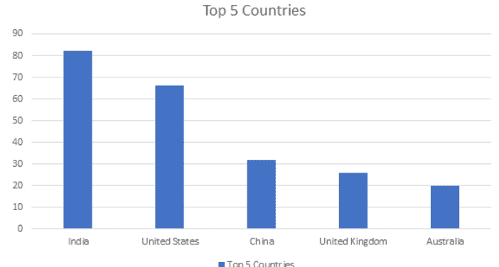

图 2.4. 按出版物数量排名的前 5 个国家

IEEE Access、PervasiveHealth: Pervasive Computing Technologies for Healthcare、Lecture Notes in Computer Science（包括子系列 Lecture Notes in Artificial Intelligence 和 Lecture Notes in Bioinformatics）、Lecture Notes in Networks and Systems、Advances in Intelligent Systems and Computing 是按出版物数量排名的前 5 个来源。IEEE Access 拥有最多数量的文档，即 22 份。图 2.5 显示了前 5 个来源。

定量研究的目标是发展对社会世界的信息和理解。社会科学家，尤其是传播学者，使用定量研究来考察影响人类的事件或发生的事情。上述定量分析使研究人员能够开展基础或复杂的研究，例如展示数据关联、计算平均值或百分比，或使用推断统计对庞大人群得出广泛的概括。本文将对有兴趣利用区块链技术构建智能合约，并通过仔细收集、分类和评估与基于区块链的智能合约相关的研究出版物来寻求与其他学者和研究机构合作机会的学者和从业者有所帮助。

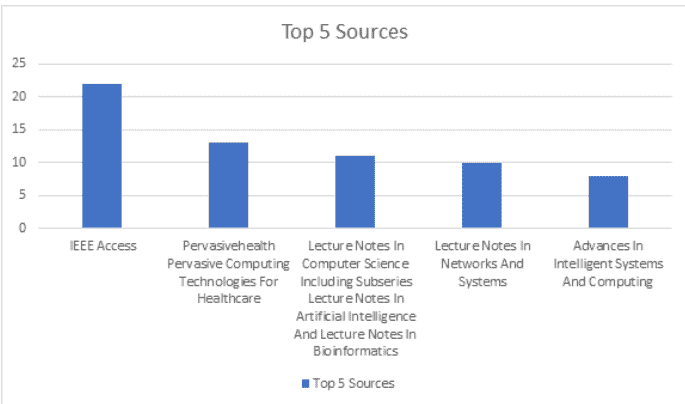

图 2.5. 按出版物数量排名的前 5 个来源

## 2.4. 智能合约在医疗保健中的作用

### 2.4.1. 健康保险

智能合约有能力消除当前设置中的各种不一致，并可常规用于医疗保险。当用户使用智能合约获取保险时，所有保单详情会迅速记录在用户身份中。此内容会再次记录在区块链上。

它们可能减少理赔流程中文书工作所带来的负担。如果投保人需要接受医疗政策覆盖的临床程序，智能合约将立即激活。因此，资金将通过保险组织的钱包转移到医疗机构。这种机制避免了任何低效和不便，同时仍能实现对健康服务的正确报销。因此，参与者之间的所有活动都将加快，操作将按时完成。

### 2.4.2. 医疗保健

智能合约允许数据和文档记录在区块链系统上。这意味着，如果一个人需要从一个诊所转到另一个诊所，他们可以快速完成，而无需填写多份表格。在区块链网络上，患者选择的医师可以查看记录。

医疗机构和医疗服务机构使用多份包含健康信息的记录。不过，这些记录可能过于有限，无法实现可能存在的信息的全球分发。此数据可能需要一段时间才能找到合法所有者，如果不使用智能合约和区块链，还可能被攻击。

如果患者详情保存在智能合约中并在区块链上维护，这些记录可以被全世界的诊所和学术机构访问。在获得足够接受的情况下，用户可以进入世界上任何诊所就医，只要出示他们的密钥，机构就能快速访问个人记录。

### 2.4.3. 远程医疗

远程健康是一个快速增长的医疗保健职业。它允许临床医生和护理人员使用手机以及其他 IoT 设备等数字设备与他们的患者联系。其主要功能是为慢性病患者提供治疗。执业者可以使用视频会议来跟踪治疗依从性并获取其患者健康的实际信息。这些技术进步通过增强连接性和降低运营成本来帮助改善患者的治疗结果。

远程医疗有缺点，因为其中涉及的程序经常成为网络犯罪分子的目标。智能合约保护健康记录和其他重要患者文档的安全性和保密性。为了交换和维护数据，智能合约可以在广泛层面应用并保存在区块链上。它们还可以帮助记录维护，并确保关键医疗详情安全且公开地保存。

## 2.5. 智能合约示例

### 2.5.1. 简单公开拍卖

下面 Solidity 简单拍卖合同背后的基本原则是，每个人都可以在拍卖期间提交出价。出价已经涉及资金/以太币的转移，以将投标者与其出价绑定。如果最高出价增加，之前的最高出价者将收到退款。拍卖结束后，必须明确联系合同，以便接收者领取他们的资金 –


```solidity
pragma solidity >=0.4.22 <0.6.0;

contract AuctionSimple {

    address payable public beneficiary;
    uint public AuctionCompleteTime;
    address public LargestBidder;
    uint public LargestBid;
    mapping(address => uint) pendingReturns;
    bool ended;
    event LargestBidIncreased(uint amount, address bidder);
    event CompleteAuction(uint amount, address winner);
    constructor(
    uint _biddingTime,
    address payable _beneficiary
    ) public {
    beneficiary = _beneficiary;
    AuctionCompleteTime = now + _biddingTime;
    }

function bid() public payable {
    require(
    now <= AuctionCompleteTime,
    "Auction already ended."
    );
    require(
    msg.value > LargestBid,
    "There already is a higher bid."
    );

    if (LargestBid != 0) {
        pendingReturns[LargestBidder] += LargestBid;
    }

    LargestBidder = msg.sender;
    LargestBid = msg.value;

    emit LargestBidIncreased(msg.sender, msg.value);
}

function withdraw() public returns (bool) {
    uint amount = pendingReturns[msg.sender];

    if (amount > 0) {
        pendingReturns[msg.sender] = 0;

        if (!msg.sender.send(amount)) {
            pendingReturns[msg.sender] = amount;

            return false;
        }

    }

    return true;
}

function auctionEnd() public {
    require(now >= AuctionCompleteTime);
    require(!ended);
    ended = true;
    emit CompleteAuction(LargestBidder, LargestBid);
    beneficiary.transfer(LargestBid);
}
}
```

## 智能合约 2.1.

函数 bid() 使用提供的价值对拍卖出价。如果拍卖未赢得，该价值将被退还。方法 withdraw() 移除超额出价，而函数 auctionEnd() 关闭拍卖并将最高出价交付给接收者。

### 2.5.2. 投票

```solidity
pragma solidity ^0.4.22;

contract Ballot {
  struct Balloter {
    bool castedcastvote;
    uint weight;
    address delegate;
    uint castvote;
  }

  struct Selection {
    bytes32 name;
    uint countCastvote;
  }

  address public chief;
  mapping(address => Balloter) public balloter;
  Selection[] public Selections;

  constructor(bytes32[] NameSelection) public {
    chief = msg.sender;
    balloter[chief].weight = 1;
    for (uint i = 0; i < NameSelection.length; i++) {
      Selections.push(Selection({
        name: NameSelection[i],
        countCastvote: 0
      }));
    }
  }

  function Balloterights(address balloter) public {
    require(
      msg.sender == chief,
      "only chief has access to give the castvote."
    );
    require(
      !balloter[balloter].castedcastvote,
      "already castedcastvote."
    );
    require(balloter[balloter].weight == 0);
    balloter[balloter].weight = 1;
  }

  function delegate(address to) public {
    Balloter storage messenger = balloter[msg.sender];
    require(!messenger.castedcastvote, "finish voting.");
    require(to != msg.sender, "Self-delegation is not permitted.");
    to = balloter[to].delegate;
    require(to != msg.sender, "Delegation loop discovered.");
    messenger.castedcastvote = true;
    messenger.delegate = to;
    Balloter storage delegate_ = balloter[to];
    if (delegate_.castedcastvote) {
      Selections[delegate_.castvote].countCastvote += messenger.weight;
    } else {
      delegate_.weight += messenger.weight;
    }
  }

  function castvote(uint Selection) public {
    Balloter storage messenger = balloter[msg.sender];
    require(!messenger.castedcastvote, "finish voting.");
    messenger.castedcastvote = true;
    messenger.castvote = Selection;
    Selections[Selection].countCastvote += messenger.weight;
  }

  function SelectionWin() public view returns (uint SelectionWin_) {
    uint winningCountCastvote = 0;
    for (uint p = 0; p < Selections.length; p++) {
      if (Selections[p].countCastvote > winningCountCastvote) {
        winningCountCastvote = Selections[p].countCastvote;
        SelectionWin_ = p;
      }
    }
  }

  function NameWinner() public view returns (bytes32 NameWinner_) {
    NameWinner_ = Selections[SelectionWin()].name;
  }
}
```

## 智能合约 2.2.

函数 contract ballot 为变量声明一种新的复杂类型。它象征着一个投票者。单个 Selection 是 struct Selection 的一种类型。Mapping(address => Balloter) 定义一个状态变量，为每个地址保存一个 Balloter 结构体。函数 Balloterights(address balloter) 执行以下操作：如果 require 的初始参数返回 false，则操作终止，对配置和 Ether 金额的所有修改都会回滚。这可以用于在以前的 EVM 迭代中耗尽所有 gas，但现在不再这样做。为确保服务被正确调用，使用 require 通常是一种好的策略。我们也可以将第二个参数作为错误原因说明。函数 delegate() 用于为投票者分配 castvote。函数 castvote() 返回 Selection Selections[Selection].name 的 castvote（包括已投出的 castvotes）。函数 SelectionWin() 通过考虑所有之前 castvotes 的数量来计算获胜 Selection。函数 NameWinner() 运行 SelectionWin() 函数，从 Selections 数组中检索获胜者的索引并回调获胜者的名称。

### 2.5.3. 患者记录

```solidity
pragma solidity ^0.4.19;

contract RecordPatientData {

// Part 1 Enums
enum Gender { Male, Female }

// Part 2 Structs
struct Patient {
    uint age;
    bytes32 name;
    Gender gender;
}

// Part 3 State Variables
uint id;
Patient private patient;
address public ownerData;

// ** Part 4 ** Events **
event GetNamePatient(address sender);

// Part 5 Modifiers
modifier onlyOwner() {
    require(msg.sender == ownerData);
    _;
}

// Part 6 Functions
function RecordPatientData() public {
    ownerData = msg.sender;
}

function getDataPatient() public returns (bytes32) {
    GetNamePatient(msg.sender);
    return patient.name;
}
function setPatientName(bytes32 name) public onlyOwner {
    patient.name = name;
}
}
```

## 智能合约 2.3.

第 1 部分讨论了用于声明患者性别的枚举，第 2 部分描述了结构体。第 3 部分讨论了状态变量。状态变量仅指示患者某个记录的状态。在上述程序中，有三个状态变量：唯一 id、数据对应的患者以及拥有此患者历史记录的智能合约地址的状态变量。函数 RecordPatientData() 将生成智能合约的地址提供给 dataOwner，这是一个以后可使用的状态变量。第 4 部分描述事件，第 5 部分描述修饰符。第 6 部分讨论函数，它们无非是构造函数、getter 和 setter。

## 2.6. 与智能合约相关的挑战

智能合约作为一项尚处于早期阶段的新兴技术，目前面临着众多困难和障碍。本节将描述智能合约的问题，以及当前的研究进展。

### 2.6.1. 合约漏洞

- 事务顺序依赖 (TOD)：每个区块包含众多活动，矿工决定它们完成的顺序。当大量依赖动作以矿工能够影响交易执行顺序的方式执行同一合同时，就会发生 TOD。

- 时间戳依赖：矿工计算生成的交易的日期和时间。如果其他矿工批准他们提供的交易，他们可能会更改几秒钟的时间戳。问题在于某些智能合约将时间作为触发事件（例如支付系统），因此攻击者可能利用这一点。

- 异常处理不当：当合约与另一合约通信时，当前操作会暂停并等待调用完成后才继续。调用者可能会或可能不会收到此异常的通知。为验证调用是否完成，响应者应明确检查被调用方的回调函数。然而，如果客户端不恰当地检查回调函数，可能会导致潜在风险。

- 重入漏洞：当合约与另一合约通信时，当前操作会暂停并等待调用完成后才继续。此外，由于回退方法使入侵者能够重新进入调用方的方法，入侵者可能利用发送方的初始点进行重复调用，最终导致多次报销并耗尽余额的调用循环。最著名的重入漏洞之一是分散式自治组织（DAO）攻击（CoinDesk n.d.）。

为解决合约问题，正在开发一些安全分析工具。由于许多合约问题是由开发者对智能合约底层执行语义理解不一致所导致的词汇不匹配引起的，Luu 等人（2016）开发了 Oyente，一种符号处理工具，用于识别以太坊智能合约中的潜在安全漏洞。Oyente 将 19366 个以太坊智能合约中的 8,833 个识别为易受攻击的合约，其中包括 DAO 漏洞。其分析分为两个步骤：首先，它对合约的依赖结构进行符号检查，以从程序中获取精确的语言元数据。之后，它分析违规和不同活动，以查看它们是否捕获了足够的标准来确定某个属性是否有效。Securify 可以分析许多缺陷，例如交易重排、重复调用、不安全的代码模式等。Manticore (GitHub n.d.) 似乎是另一种用于评估二进制文件和智能合约的正则表达式技术。它能够为每个生成的输入捕获程序执行轨迹。


### 2.6.2. 隐私与法律问题

智能合约隐私问题主要有两类：1) 合约数据隐私；2) 可靠数据源隐私。不仅事件，而且与合约相关的元数据（尤其是公共区块链上的内容），包括字节码、激活参数等，现在都公开可访问。因此，保持基本函数/方法隐藏、使用密码学并防止不应公开的数据被泄露，是一项重要任务。合约层主要负责智能合约的法律问题。

除上述问题外，基于架构层和合约层还有许多其他问题。智能合约设计机制不良会导致合约运行费用增加，并降低操作层的运行效率。智能层上的恶意智能代理可能会从其恶意行为中获利，等等。

### 2.6.3. 不可变性问题

不可变性属性是智能合约的一个关键方面。确实，一旦智能合约启动，没有人可以修改代码。但是，智能合约中不可变性概念的缺点是，如果代码中存在任何缺陷，智能合约的不可变性特征将禁止对其进行修正。同样，如果情况发生变化（例如，各方已共同决定修改其商业交易的条件，或者立法发生变化等），则没有简单的方法来修改智能合约。要克服不可变性问题，在将智能合约实现到区块链之前，需要专家进行冗长且可能昂贵的评估。

## 2.7. 结论

由于区块链技术的飞速发展，创建智能合约已成为研究和商业界的突出主题。智能合约的不可变性和不可逆性可以鼓励用户以清晰、无冲突的方式交换货币、股票和专有信息以及其他商品，而无需外部实体的参与。本章介绍了区块链技术，以及一些特征和应用。它还详细介绍了区块链智能合约、其运行机制以及在不同领域的应用。它提供了关于不同智能合约平台的详细信息，并以实施智能合约的研究挑战作为结论。

## 2.8. 参考文献

Ayed, A. (2017). 一种基于区块链的概念安全电子投票系统。*国际网络安全及其应用期刊（IJNSA）*, 9. DOI: 10.5121/ijnsa.2017.9301.

Bitcoin (n.d.). 比特币：一种点对点电子现金系统 [在线]。可获取：https://bitcoin.org/en/bitcoin-paper [访问于 2022年7月12日]。

CoinDesk (n.d.). 什么是 DAO？ [在线]。可获取：https://www.coindesk.com/learn/what-is-a-dao/ [访问于 2022年7月12日]。

CoinDesk (2016a). 2016年第一季度区块链现状：区块链资金超越比特币 [在线]。可获取：https://www.coindesk.com/markets/2016/05/11/state-of-blockchain-q1-2016-blockchain-funding-overtakes-bitcoin/ [访问于 2022年7月12日]。

CoinDesk (2016b). 理解区块链智能合约 [在线]。可获取：https://www.coindesk.com/markets/2016/06/04/making-sense-of-blockchain-smart-contracts/ [访问于 2022年7月12日]。

ConsenSys (2016). 以太坊、gas、燃料与费用 [在线]。可获取：https://media.consensys.net/ethereum-gas-fuel-and-fees-3333e17fe1dc [访问于 2022年7月12日]。

ConsenSys Mesh (n.d.). 以太坊投资、研究与协议 [在线]。可获取：https://mesh.xyz/ [访问于 2022年7月12日]。

Exergy (n.d.). Exergy [在线]。可获取：https://exergy.energy/ [访问于 2022年7月12日]。

Gatteschi, V., Lamberti, F., Demartini, C., Prantedra, C., Santamaría, V. (2018). 保险中的区块链与智能合约：技术是否足够成熟？*未来互联网*, 10(2), 20. DOI: 10.3390/FI10020020.

GitHub (n.d.). Manticore：符号执行工具 [在线]。可获取：https://github.com/trailofbits/manticore [访问于 2022年7月12日]。

Idelberger, F., Governatori, G., Riveret, R., Sartor, G. (2016). 区块链系统中基于逻辑的智能合约评估。*计算机科学讲义（包括人工智能与生物信息学讲义子系列）*, 9718, 167–183. DOI: 10.1007/978-3-319-42019-6_11/COVER.

Katal, A., Sethi, V., Lamba, S. (2021). 区块链共识算法：研究与挑战。*EAI/Springer 通信与计算创新*, 45–64. DOI: 10.1007/978-3-030-65691-1_4/COVER/.

Knirsch, F., Unterweger, A., Engel, D. (2018). 基于区块链的电动汽车充电动态定价决策的隐私保护。*计算机科学 – 研究与开发*, 33, 71–79. DOI: 10.1007/S00450-017-0348-5/TABLES/2.

Luu, L., Chu, D.H., Olickel, H., Saxena, P., Hobor, A. (2016). 让智能合约更智能。*ACM计算机与通信安全会议论文集*, 24–28 October, 254–269. DOI: 10.1145/2976749.2978309.

Maicher, L., de la Rosa, J.L., Gibovic, D. (2016). 通过区块链与智能合约进行在线开放创新中的知识产权。*世界开放创新大会（WOIC 2016）*, 巴塞罗那。

McCorry, P., Shahandashti, S.F., Hao, F. (2017). 一种具有最大选民隐私的董事会投票智能合约。*计算机科学讲义（包括人工智能与生物信息学讲义子系列）*, 10322 LNCS, 357–375. DOI: 10.1007/978-3-319-70972-7_20.

Ojetunde, B., Shibata, N., Gao, J. (2019). 利用 MANET 的灾难地区安全支付系统。*IEEE 系统、人与控制论汇刊：系统*, 49, 2651–2663. DOI: 10.1109/TSMC.2017.2752203.

Pilkington, M. (2016). 区块链技术：原理与应用。*数字化转型研究手册*, 225–253. DOI: 10.4337/9781784717766.00019.

Sun Exchange (n.d.). Sun Exchange [在线]。可获取：https://thesunexchange.com/ [访问于 2022年7月12日]。

Wang, S., Ouyang, L., Yuan, Y., Ni, X., Han, X., Wang, F.Y. (2019). 支持智能合约的区块链：架构、应用及未来趋势。*IEEE 系统、人与控制论汇刊：系统*, 49, 2266–2277. DOI: 10.1109/TSMC.2019.2895123.

# 基于区块链的医疗健康行业平台

区块链技术是一项新兴且有前景的技术，对区块链技术的研究已呈现出井喷态势。区块链的一些特征，包括数据处理的透明度、更好的安全保障、开源、可追溯性和去中心化，使其成为解决个人利益披露交易中数据不平衡问题的合适创新。已有少量努力尝试将区块链技术融入众多商业应用。区块链技术承诺提供去中心化信任，作为计算机化或数字环境中集中式数据管理和存储的替代方案。通过更好的先进模型，对支付系统等进行存储、跟踪和管理，可以在各行业和服务中带来显著变革。然而，除了去中心化存储特性外，区块链技术还提供了更有价值的主张，例如更先进和创新的投资模式以及加密经济货币，以及在数字平台和业务交互具有多方利益相关者的时代中能够带来进一步发展的全新类型先进治理模式。区块链技术是一种去中心化的分布式数字账本，能够转型将决定我们未来城市运作方式的底层操作系统。区块链目前正在金融、医疗保健、供应链、保险、登记以及物联网（IoT）等众多行业带来革命。众多行业将区块链与其框架集成，以获益于区块链的优势。

## 3.1. 引言

医疗保健行业有其安全性和隐私要求，以保护患者的个人和医疗信息。我们生活在一个记录和数据存储在云平台上，而且移动健康服务因其更易访问而普及的世界，因此导致风险

患者信息在通过互联网共享时面临被泄露或窃取的风险。因此，医疗部门需要的需求形式为“身份验证、互操作性、医疗记录数据传输以及移动医疗系统的考量”。根据印度品牌股权基金会（IBEF）的数据，从营收和就业角度来看，医疗保健行业已成为最大的行业之一。医疗行业正在以惊人的速度增长，不仅局限于医院，还涵盖医疗设备、医疗旅游、健康保险、诊所以及更多领域。因此，随着医疗保健行业的扩张，市场出现了显著增长。

到2022年，医疗行业规模将达到3270亿美元。以16%–17%的复合年增长率（CAGR）增长，医院行业到2023年将达到1334.4亿美元的三倍规模。人们生活方式的改变，以及人均收入、政府政策和保险政策的提升，增强了公众的健康意识，从而推动了医疗行业的大幅增长（Gul et al. 2020）。

## 3.2. 文献综述

Tripathi 等人（2019）的论文讨论了医疗部门相关的问题，主要包括安全顾虑以及区块链技术如何显著帮助解决此类问题。随着使用电子病历（EMR，Electronic Medical Records）和信息通信技术（ICT）的医疗记录激增，区块链正在许多医疗组织中得到应用。该论文探讨了区块链技术，以及SHS-智能医疗系统及其面临的挑战，进一步提出了一种基于区块链的SHS框架，用于分析并解决安全性和完整性问题。

A. Islam 和 Shin（2020）的论文提出了一种方案：无人飞行器（UAV）收集医疗数据并将其存储在最近的服务器上。首先，UAV通过令牌与身体传感器蜂巢（BSHs）建立关系，随后与BSHs生成共享密钥，从而建立低功耗安全通信。UAV收集所有数据后，对所有加密数据进行解密（使用共享密钥加密），并实施两阶段方案。经过验证后，UAV将数据发送到服务器，服务器将其存储在区块链网络中。论文还提出了公平性分析，以展示所提方案的可行性和可实现性。

一种智能医疗商业模式将客户置于业务核心，随着区块链技术的发展而演进。Gul 等人（2020）的论文确立，所提模型可以分析客户等级，并根据参与组织制定的规章制度提供奖励。该模型从医疗物联网（Internet of Medical Things）获取数据，然后应用任何相关奖励系统脚本。该模型侧重于客户和业务，同时利用技术管理所有涉及的利益相关方。

Ferrer-Gomila 等人（2019）的论文提供了一个可运行的混合平台，采用共识机制解决了数字法医医疗证据敏感信息共享的问题。该机制记录案件的透明历史，防止未经授权的用户篡改数据。首先，在将数字证据存储在区块链网络中的在线文件存储系统之前，先对其进行加密。会应用动态协议工具来处理区块链中的数据。密码学确保对存储在各个区块链节点上的数字数据进行安全访问。

现代医疗系统复杂的特性使其成本更高。如Tanwar 等人（2020）所讨论，通过合理应用保险公司、改进记录管理以及采用区块链技术，可以降低医疗系统成本。区块链技术的突破指导并推动了涉及保险账单、智能合约和医疗记录的交易发展。在医疗领域使用区块链有许多优势，其中之一是能够重构数据（医疗和处方）、设备追踪等方面的互操作性。在开具药物时，了解患者的病史至关重要，而区块链在此方面帮助改善了医疗行业的框架。在这里，通过区块链探索了许多解决方案，以扩大医疗系统的边界。为了实现基于Hyperledger的电子健康记录（EHR）共享，在采用链码的系统中，为纠正医疗服务提供者之间的数据可访问性、帮助环境刺激，访问控制策略算法（Access Control Policy Algorithm）被研究。所提方案采用区块链技术提高效率和安全性，而非使用客户端-服务器架构的传统系统。

Abd-alrazaq 等人（2020）的论文讨论了当前世界上新冠肺炎疫情的情况，以及如何利用区块链技术缓解因病毒而面临的挑战。论文展示了区块链在医疗领域普遍使用的各种属性，以及可帮助政府机构应对病毒带来挑战的应用。在对抗新冠病毒的斗争中，区块链技术预计将发挥重要作用。

Huang 等人（2020）的论文提出了一种基于区块链技术的隐私保护方案，以确保患者与医学研究机构之间安全地共享数据。该方案不仅实现了数据可用性，还确保了患者与机构之间的一致性。提供了零知识证明，以确保患者的医疗信息满足研究机构的要求，并进一步由机构使用代理再加密技术解密中间密文。该方案还可以基于PBFT算法实现患者与机构之间交易目的的分布式共识。

在讨论传统医疗管理系统时，云辅助电子健康系统的进步可以解决某些缺点。但同时，确保电子健康记录（EHR）的完整性，并在共享时保障EHR的隐私，并非易事。因此，Huang 等人（2020）的论文提出了一种基于区块链的电子健康系统BCES，用于检查医疗记录的篡改。在该预期系统中，数据消费者的每一次处理以及医院的每一次外包控制，都将以区块链中交易的形式记录为存储，以确保可追溯性。此外，用于获取医疗数据访问控制的代理再加密系统，审计人员将识别任何可能威胁EHR完整性的行为或活动。由于其安全性分析和性能评估，该方案已被证明是安全且高效的。

Negi 等人（2021）的论文提出了一种以患者为中心（patient-centric）的医疗数据管理系统，利用区块链技术作为存储，以帮助保护隐私。在当今世界，网络攻击已成为司空见惯的事情，尤其是在云端。存储在云端的数据始终是攻击者的目标，医疗数据也不例外。对医疗数据的攻击可能对医疗领域的组织造成严重破坏。由对等网络实现的去中心化使得医疗数据在云端的存储和运行成为可能。区块链因其去中心化的特性，保证了可追责性和完整性。加密函数对患者数据进行加密，并确保假名匿名性。采用智能合约的成本效率和数据处理策略。

基于区块链的架构是解决当代电子医疗网络相关众多问题的潜在方案，由Choudhury 等人（2021）讨论。在现代电子医疗系统中，人类识别活动（HRA）可以被认为是最具挑战性的任务之一，特别是在监测受残疾或精神疾病影响并需要协助的患者时，同时保护多个连接到互联网的不同设备——即物联网（Internet of Things）——是一个主要问题。此外，在多样化的医疗环境中，人类同时执行的众多活动会降低这些活动的质量。


我们很清楚，电子健康记录（EHRs）在电子医疗系统中一直发挥着重要作用，患者的医疗记录通过门户交换由医疗专业人员分配，但由于缺乏完整性和机密性，存在安全问题。Benil 和 Jasper (2020) 的论文提出了椭圆曲线无证书聚合加密签名方案（EC-ACS），利用区块链技术对医疗服务器云（MSC）中的信息进行验证和审查，以保护 EHRs。在医疗云存储中共享和存储数据时，椭圆曲线加密（ECC）用于加密医疗数据，无证书聚合签名（CAS）用于生成数字签名。该方案保证安全性和隐私性，并能保护机密信息免受云健康存储中恶意活动的侵害。

当敏感医疗数据在机构范围之外共享时，其隐私可能会受到破坏。Hussein 等人 (2018) 提出了一种基于区块链的解决方案，以解决与访问控制和数据处理相关的挑战。为了提高安全性，该系统配备了离散小波变换，并部署了遗传算法以升级排队优化技术。使用这种加密密钥生成器，用户验证变得更快，因为它提高了系统的免疫力和访问控制。这种设计允许问责制，因为用户数量已知，且区块链保留了用户操作的记录。只有在已知加密密钥和身份的情况下，才允许共享数据。

在 Nguyen 等人 (2020) 的论文中，介绍了使用区块链技术加密的患者数据分析。如今，随着技术的进步，数据共享已成为一项挑战；一方面，使用异构数据可能会损害兼容性，另一方面，医学术语的独特使用限制了数据理解。我们看到，授权用户和集中式数据存储已成为攻击者的目标，在数据共享网络上建立健康记录可能会很棘手。对于数据发现和访问，一致机制被用来证明工作量证明和互操作性。“该论文提供的方法为网络共识和计算语义及结构互操作性的共识证明提供了一个基于信任的集中式来源。”

在 Dagher 等人 (2018) 的论文中，提出了一种基于区块链的框架，旨在为授权用户提供可互操作、安全且高效的数据访问，同时保护患者信息。提出该框架是因为，尽管提高了 EHR 的安全性，全球各城市也在努力构建“智能城市基础设施”，但个人信息仍面临泄露风险。此前提供的解决方案导致信息无法被患者获取。现有的数据管理系统难以在数据机密性与患者和提供者定期与数据交互的需求之间取得平衡。为了提供同等的安全性，Ancile 在基于以太坊的区块链上使用智能合约来进行访问控制和数据处理。该论文探讨了 Ancile 如何满足患者、专业人员和第三方的多样化需求，以及该框架如何解决长期存在的隐私和安全问题。

Chen 等人 (2019) 的论文介绍了一种基于区块链的 EHR 加密方案。EHR 中的数据泄露可能会危及患者信息，而且由于这些记录上传后大多不会更改，因此区块链技术有望用于实现数据共享。在区块链网络中，EHR 的索引以复杂逻辑表达式的形式存储，供用户以后使用这些表达式并查找索引。此外，用户可以完全控制其 EHR 对谁可见，因为只有索引被迁移到区块链以实现传播。性能方案从两个方面进行评估：一个是从 EHR 中提取文档 ID，另一个是在以太坊的智能合约中生成事务。

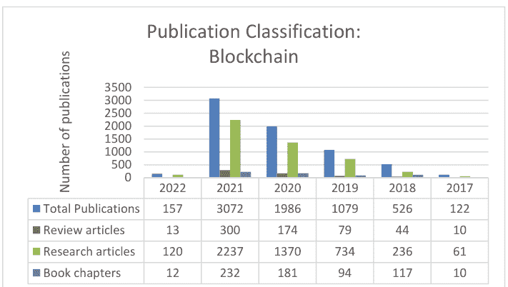

图 3.1. 区块链的出版分类。如需此图的彩色版本，请参见 www.iste.co.uk/choudhury/blockchain.zip

Comput 等人 (2020) 论文中讨论的 GuardHealth 是一种用于数据共享和隐私保护的安全、去中心化且高效的区块链系统。在管理敏感健康记录时，GuardHealth 旨在实现数据共享、数据保存、身份验证和保密性。在此系统中，未经许可的数据共享无法进行，因为它利用智能合约和区块链来保障数据共享和存储的安全性。采用一种模型来准确维护用户信任，并实施最先进的图神经网络（GNN）来检测非法行为。对于智能医疗系统，所提方案在安全性分析和实验中已被证明是理想的。图 3.1 显示了区块链技术的出版分类。该图显示该技术正日益受到关注，未来几年，区块链将出现在 IT 行业的许多垂直领域。

## 3.3. 区块链技术

区块链被描述为一种分布式数字账本系统，体现了透明度和用户隐私的概念。区块链的概念最初是为金融和商业行业引入的，但现在由于其特性，它也被应用到其他领域，而安全性在这些领域已成为一个问题（Rawat 和 Sah 2012）。区块链技术依赖于对等体系结构，其中数据（以块的形式）使用密码学技术（链）连接起来。图 3.2 显示了 2017 年至 2022 年医疗保健领域区块链的出版分类。下图显示，区块链技术即将在医疗保健行业大规模采用。

出版分类：医疗保健领域的区块链

| | 2022 | 2021 | 2020 | 2019 | 2018 | 2017 |
|---|---|---|---|---|---|---|
| 总出版物数 | 37 | 925 | 548 | 250 | 104 | 29 |
| 综述文章 | 7 | 141 | 76 | 29 | 16 | 3 |
| 研究文章 | 26 | 596 | 331 | 140 | 47 | 14 |
| 书籍章节 | 2 | 108 | 72 | 40 | 19 | 3 |

图 3.2. 医疗保健行业区块链的出版分类。如需此图的彩色版本，请参见 www.iste.co.uk/choudhury/blockchain.zip

### 3.3.1. 医疗保健领域中区块链的用途

由于区块链技术已得到广泛研究和探索，因此其特性可以用于为医疗保健行业中的相关问题提供解决方案。

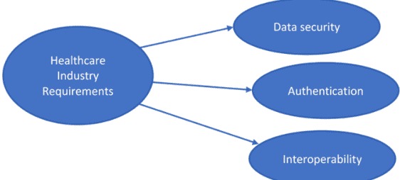

图 3.3. 医疗保健行业

#### 3.3.1.1. 安全性

我们需要一种适当的技术或网络来保护和保障记录的安全，而目前使用的方法并不有效。“数据安全性、完整性和不可篡改性”是区块链技术的主要特征。区块链通过使用安全的去中心化账本，可以提供安全性，因为它将数据存储在多台计算机上，而不是单台计算机上。通过在整个区块链网络上分发数据，同一数据会存储在许多计算机上。现在，任何第三方或恶意行为者都无法更改信息或数据，因为数据必须在网络上的所有计算机中进行更改。此外，当应用于智能设备和云基础设施时，数据安全性和完整性成为主要关注点。通过提供“面向基于云的服务器的数据来源、审计和控制”，区块链技术可以允许设备之间以及通过互联网安全地共享医疗数据，这些设备通过智能合约和访问协议实现来存储医疗数据。

#### 3.3.1.2. 互操作性

互操作性可以定义为在不同来源之间转移和共享数据的操作。由于医疗领域使用集中式数据存储，因此无法使用医疗保健行业所需的互操作性功能。“集中式数据存储”对提供者来说可能存在问题，因为这意味着将数据存储在单个中心数据库中，从而阻碍了


医疗数据及其研究的质量和数量、对患者数据的缓慢访问，以及医疗数据的分散化（Sah et al. 2018）。

区块链的去中心化存储特性对提升系统中存储数据的安全性和身份验证非常有用（Khanna et al. 2020a）。去中心化存储是指通过区块链账本将存储中的记录从单服务器分解到众多服务器的过程。这样一来，我们可以获得更高质量和数量的数据，并更快地访问患者信息。

#### 3.3.1.3. 身份验证

区块链利用其去中心化特性，确保了区块链区块中存在的患者记录的身份验证。身份验证过程通过私钥实现，私钥又连接到公钥，以初始化区块链中信息的创建、修改和检查操作。在软件中，比特币钱包与比特币地址关联并存储这些密钥。通过使用加密方案，通常用于比特币和加密货币的软件应用程序可以用于身份验证目的。

## 3.4. 可用于治疗医疗领域问题的区块链应用

### 3.4.1. 智能合约

使用智能合约，用户可以利用区块链技术在买方和卖方之间形成或创建协议。存储在区块链网络中的智能合约会对交易进行加密，并将其转换为法律服务的法律文件。这些智能合约由存在于区块链网络中的脚本组成，可以通过其唯一地址进行追踪或识别。通过这些智能合约，我们可以在去中心化的方式下，在各方之间建立公平交易，同时最大限度地减少它们之间的通信。因此，用户无需法律代表即可形成自己的文件，从而消除包括财务和时间在内的挑战，并实现资源或交易的更好转移。

### 3.4.2. 欺诈检测

这是验证系统中文档或数据的过程，用于检查是否存在任何信息篡改或恶意行为，例如在线评论系统中以诽谤形式给出的虚假评论和评分，以及金融行业中以贷款申请形式发生的诈骗等。欺诈检测的理念也可以应用于众筹概念，其中有一群人正在向公司投资或购买股票。区块链技术可以用作注册股票和股份的低成本平台，从而使交易变得安全、有效、高效且便捷。

### 3.4.3. 身份验证

政府系统使用护照和个人指纹来识别人员，但区块链技术可以为这些身份识别方法提供替代方案（Khanna et al. 2020）。区块链可以识别用户，例如，利用区块链对婚姻、出生证明和商业合同进行公证。为了证明某人在特定时间点的存在，区块链将使用其“分布式账本”属性，并进一步由一群人基于区块链技术的分布式特性进行验证。例如，我们可以使用区块链技术来验证婚姻、出生证明和商业合同。

## 3.5. 使用区块链的医疗平台示例

### 3.5.1. 使用 Gem Health Network 进行数据共享

如前所述，医疗领域包含患者记录并将其存储在集中式数据库中，这可能导致数据安全性和互操作性等问题。如果患者在另一家医院、跨州或国外接受专科治疗时需要记录，那么数据共享就会成为问题。每次一个人看另一位医生时，都需要形成一组新记录并更新几个现有记录，改变医生之间的通信协议，并且还有非常耗时的 IT 干扰。因此，Gem Health Network 为该问题提供了一种解决方案，它使用以太坊区块链技术并创建共享网络基础设施。这个网络帮助医疗领域的不同专业人员访问相同的患者信息和记录，不同于集中式数据库。最新治疗信息（透明且相关）的访问权限仅授予授权用户。这有助于降低因信息错误或过时的健康记录而忽视个人健康问题的风险。

例如，爱沙尼亚与 Guardtime 合作，该公司使用区块链技术。因此，所有医疗专业人员、保险公司和公民都可以借助这项技术访问在爱沙尼亚进行的健康记录和治疗，这表明区块链可以像上述所述以类似的方式应用。

### 3.5.2. MeDshare

MeDshare 是一个专为在不可信环境中存储数据和记录的医疗专业人员之间共享数据和记录而设计的平台。该系统关注医疗领域的基本要求，例如维护患者隐私以及医疗记录中恶意活动的风险。MeDshare 系统使用区块链技术，在公司之间的云环境中提供数据管理、审计和数据溯源。该系统的设计方式是使用智能合约和访问控制机制来跟踪数据，并在发现系统中任何不当行为时撤销任何恶意实体。MeDshare 的主要目标是为存储医疗记录的云服务提供商提供数据管理、审计和数据共享的能力，以面向医疗行业，而不会泄露患者的私人信息。该系统分为四个层。

第一层由为获准访问医疗记录的用户所做的安排组成。

第二层（数据查询层）由用于访问、处理、转发和响应请求的某些查询组成。在此，流程分解为两个组件——第一个组件是由控制生成请求的查询组成的系统，第二个组件是解读与智能合约之间事务的触发器。

第三层（数据结构化和溯源层）涉及处理访问现有数据库中信息或数据的请求，这些数据库存在于各种实体之中，如智能合约、处理、身份验证器、智能合约、共识节点和区块链系统。

第四层（现有数据库基础设施）由个人执行以完成其任务的数据库组成。

### 3.5.3. OmniPHR

OmniPHR 是一个用于处理患者健康记录和信息的模型，让患者能够清晰查看跨多个健康服务提供商存储的记录。它有助于在数据存储在另一系统中或由另一提供商修改时保持数据的最新状态。OmniPHR 解决了 EHR 与 PHR 之间的差异。EHR 是根据政府标准建立的，有助于在全国范围内拥有统一记录；这使记录准确且及时。EHR 由医疗专业人员定期更新，无需患者参与，而 PHR 则由患者自行跟踪其记录。在这里，OmniPHR 创建了一个框架来解决这个问题，患者可以全面查看自己的记录，同时医疗社区也可以获得记录所需的准确性。它使用区块链技术，重点是统一分布在多个组织中的数据。PHR 将以有组织的分层方式存储，加密并分布在网络上的数据块中。用户可以从任何地方（家、工作或医院）访问 OmniPHR 记录。模型中包含的云计算功能包括可扩展性、弹性、中间件、加密协议、开放标准等。该模型的数据流是将数据提供给开放标准，然后由中间件技术进行更改，并由隐私和安全模块加密和授权，之后再存储在一系列存储库中。

## 3.6. Covid-19 大流行期间的区块链

在当今这个被称为“地球村”的世界里，由于人们的久坐生活方式以及包括生态和环境因素在内的许多因素，健康疾病和健康问题大幅增加。最近，自 2019 年 12 月以来，Covid-19 病毒在全球范围内肆虐，导致超过 5400 万人受影响，超过 130 万人死亡。这场大流行病使全世界的医疗系统不堪重负。由于区块链具有去中心化、不可篡改性、透明性和可审计性等显著特点，它在技术方面已被证明非常有用。

> 欧洲议会研究服务处认为，区块链技术是缓解 Covid-19 挑战的 10 大关键技术之一。

使用区块链技术缓解 Covid-19 挑战的应用已在 Abd-alrazaq et al. (2020) 的论文中讨论。该论文列举了 10 个区块链技术案例，以应对由冠状病毒引发的情况，其中六项研究讨论接触者追踪，即追踪与 Covid-19 检测呈阳性的人员密切接触者的过程，其余四项研究讨论免疫护照的应用，该护照将显示某人未患该疾病。


因为他们可能已经感染了该疾病，或已接种了Covid-19疫苗。

对社区中Covid-19阳性病例的追踪是当局控制病毒爆发的首要要求。了解或拥有检测出Covid-19阳性人员及其密切接触者的记录，我们可以识别“热点”区域，并努力防止病毒进一步传播。所使用的技术无法保证隐私保护，因为其集中化设计使政府有能力进行大规模监控。现在，拥有去中心化系统的区块链正被用于为政府文件提供更好的保护。同样，免疫护照（也称为免疫认证或康复证明）发放给在感染和Covid-19诊断后完全康复的阳性患者，利用区块链技术将患者信息仅存储和共享给授权用户。对于访问敏感文档，智能合约也以额外层的形式被使用。区块链的一般属性，包括远程监控、状态跟踪和身份验证等应用，现在正在被使用。

## 3.7. 结论

对健康日益增长的需求推动了医院和医疗机构的发展，进而导致医疗数据增加以及对数据管理的需求。因此，我们讨论了与医疗领域相关的区块链技术。包括患者个人详细信息在内的健康记录应保持机密。这些记录保存在“医疗云”中，但可能被其他方滥用，例如删除原始数据或修改数据。本章还讨论了与医疗行业相关的问题，以及它们如何阻碍行业的技术进步，阻止其发展。区块链因其多种属性可以成为这些问题的解决方案，基于区块链的系统似乎表现出更高的鲁棒性、可扩展性和免疫力，从而实现安全的数据共享和数据隐私。区块链技术现在已在世界各国的众多国家和公司中备受关注。

## 3.8. 参考文献

Abd-Alrazaq, A.A., Alajlani, M., Alhuwail, D., Erbad, A., Giannicchi, A., Shah, Z., Housch, M., Hamdi, M. (2020). 用于缓解Covid-19挑战的区块链技术：一项范围综述. 计算机方法和生物医学更新, (11月), 100001. DOI: 10.1016/j.cmpbup.2020.100001.

Benil, T. and Jasper, J. (2020). 利用区块链在电子健康系统外包中的基于云的安全. *计算机网络*, 178(6月), 107344. DOI: 10.1016/j.comnet.2020.107344.

Chen, L., Lee, W.-K., Chang, C.-C., Choo, K.-K.R., Zhang, N. (2019). 用于电子健康记录共享的基于区块链的可搜索加密. *未来世代计算机系统*, 95, 420–429. DOI: 10.1016/j.future.2019.01.018.

Choudhury, T., Khanna, A., Toe, T.T., Khurana, M., Nhu, N.G. (eds) (2021). *物联网生态系统中的区块链应用*. Springer, Cham.

Dagher, G.G., Mohler, J., Milojkovic, M., Marella, P.B. (2018). Ancile：利用区块链技术实现电子健康记录访问控制和互操作性的隐私保护框架. *可持续城市和社会*, 39(2月), 283–297. DOI: 10.1016/j.scs.2018.02.014.

Ferrer-Gomila, J.L., Francisca Hinarejos, M., Isern-Deyà, A.P. (2019). 一种带有区块链支持的公平合同签署协议. *电子商务研究与应用*, 36(1月), 100869. DOI: 10.1016/j.elerap.2019.100869.

Gul, M.J., Subramanian, B., Paul, A., Kim, J. (2020). 面向智慧社会公共医疗保健的区块链. *微处理器和微系统*, 103524. DOI: 10.1016/j.micpro.2020.103524.

Huang, H., Zhu, P., Xiao, F., Sun, X., Huang, Q. (2020). 一种用于医疗隐私保护和安全共享的基于区块链的方案. *计算机与安全*, 99. DOI: 10.1016/j.cose.2020.102010.

Huang, H., Sun, X., Xiao, F., Zhu, P., Wang, W. (2021). 用于云环境中可审计电子健康记录操作的基于区块链的电子健康系统. *并行与分布式计算杂志*, 148, 46–57. DOI: 10.1016/j.jpdc.2020.10.002.

Hussein, A.F., ArunKumar, N., Ramirez-González, G., Abdulhay, E., Tavares, J.M.R.S., De Albuquerque, V.H.C. (2018). 一种由遗传算法和离散小波变换支持的医疗记录管理和保护的基于区块链的系统. *认知系统研究*, 52, 1–11. DOI: 10.1016/j.cogsys.2018.05.004.

Islam, A. and Young Shin, S. (2020). 一种在物联网中借助无人机的基于区块链的安全医疗方案. *计算机与电气工程*, 84, 106627. DOI: 10.1016/j.compeleceng.2020.106627.

Khanna, A., Sah, A., Choudhury, T. (2020a). 智能移动边缘计算：一种基于深度学习的方法. 计算与数据科学进展国际会议, 107–116. Springer, Singapore. DOI: 10.1007/978-981-15-6634-9_11.

Khanna, A., Sah, A., Choudhury T., Maheshwari, P. (2020b). 面向酒店业的区块链技术. 东地中海和中东信息系统会议, 99–112. DOI: 10.1007/978-3-030-63396-7_7.

Negi, D., Sah, A., Rawat, S., Choudhury, T., Khanna, A. (2021). 区块链平台和智能合约. 在 *物联网生态系统中的区块链应用* 中，Choudhury, T., Khanna, A., Toe, T.T., Khurana, M., Nhu, N.G. (编). Springer, Cham.

Nguyen, D.C., Pathirana, P.N., Ding, M., Seneviratne, A. (2020). 面向5G及其以后网络的区块链：一项最新综述. 网络与计算机应用杂志, 166, 102693. DOI: 10.1016/j.jnca.2020.102693.

Rawat, S. and Sah, A. (2012). 提升医疗中心软件和服务的方法. 计算机工程与智能系统, 3(7), 126–137.

Sah, A., Dumka, A., Rawat, S. (2018). 使用SOA和Web服务进行Web技术系统集成. 在 *基于Web系统当代视角研究手册* 中，Elçi, A. (编). IGI Global, Hershey, PA [在线]. 可从以下网址获取: https://doi.org/10.4018/978-1-5225-5384-7.ch002.

Tanwar, S., Parekh, K., Evans, R. (2020). 面向医疗4.0应用的基于区块链的电子健康记录系统. 信息安全与应用杂志, 50, 102407. DOI: 10.1016/j.jisa.2019.102407.

Tripathi, G., Ahad, M.A., Paiva, S. (2019). 一种用于智能医疗系统的基于区块链的方法. 医疗保健, 8(1), 100391. DOI: 10.1016/j.jhdsj.2019.100391.

Wang, Z., Luo, N., Zhou, P. (2020). GuardHealth：面向智能医疗的区块链赋能安全数据管理和图卷积网络启用的异常检测. 并行与分布式计算杂志, 142, 1–12. DOI: 10.1016/j.jpdc.2020.03.004.

# 分析与建模医疗行业在采用区块链技术过程中面临的挑战

利用区块链技术，信息可以在社区中记录和共享。本研究旨在识别医疗组织在采用区块链技术以改善患者护理时面临的挑战。通过选取三个自变量和一个因变量，提出了三个假设。目标人群主要是医院工作的IT人员。受访者从了解其个体医疗机构当前和未来任务IT信息的员工中选取。共发放了536份问卷进行调查，其中仅计算了350份有效回复，其余大多未作答或填写不完整。研究结果表明，所提出的假设均被接受。本研究将帮助区块链提供商和医疗行业了解问题并找到可能的解决方案。进一步分析可以扩展，以找到研究中指出的挑战的解决方案。

## 4.1. 引言

区块链（BC）是最新的创新技术之一，最初引入于2009年。BC通过在具有BC基础设施的去中心化记录账本设备中存储数据来运行（Beck et al. 2017）。组织的基础是共享的，它通过同时拥有组织客户端（参与交易者）和BC


挖矿节点（与分布式记录中的企业协作）。该文档由组织中所有矿工使用密码学过程生成的去中心化节点网络存储（Coita et al. 2019）。由于采用共识机制、数字签名和哈希链构建，BC记录具有极高的安全存储能力（Kshetri 2017）。由于这些高级功能，BC提供可追溯性、可信度、保密性和不可否认性等不同服务，同时以公开且去中心化的方式存储所有数据，采用安全保障措施（Rios et al. 2018）。银行、保险、房地产和政府只是BC可应用的几个行业。多位研究人员已强调BC在医疗保健行业的应用，以及BC如何为医疗保健领域带来变革（Mukherjee et al. 2021a, 2022b）。

此外，这项技术有潜力惠及健康信息交换（HIEs）（Mazlan et al. 2020; Hussien et al. 2021）。然而，该技术尚未完全成熟，不能作为医疗保健行业的万能药（McGhin et al. 2019b; Khatri et al. 2021）。BC技术允许医疗保健利益相关者在不危及安全性或完整性的前提下共享网络访问权限（Saranya and Murugan 2021）。对公钥和私钥、工作量证明以及密码学中的分布式数据的访问，为医疗保健信息提供了新的完整性水平（Siyal et al. 2019）。使用BC技术，药品在从制造商流向患者的过程中可以轻松追踪。它们在通过供应链流动时也可以更快地被追踪，这有助于防止药品欺诈（Mukherjee et al. 2022）。

就收入和就业而言，医疗保健现在是印度最大的行业之一。医疗保健涵盖医院、医生、临床试验、外包、远程医疗、医疗旅游、健康保险和医疗设备。随着该国人口、服务以及公共和私人支出的增加，印度医疗保健行业正在增长（Rout et al. 2019）。印度医疗保健系统分为两大主要组成部分：公共和私营（Mukherjee et al. 2022a）。政府在主要城市提供少量的二级和三级医疗保健机构。它通过初级卫生保健中心（PHCs）为农村地区提供基础医疗保健。私营部门在大都市及一级和二级城市提供大部分二级、三级和四级医疗服务。

连接众多医疗保健信息孤岛的IT创新可以显著提高质量并降低成本，例如，通过让不同服务提供者保持知情，从而减少遗漏或误操作错误（Zhang et al. 2018）。借助本研究，医疗保健公司可以识别在其系统中实施BC时面临的挑战。文献综述确定了技术、社会和组织挑战。

本章余部分布如下。第4.2节讨论文献综述。第4.3节讨论研究方法。第4.4节讨论数据分析。第4.5节强调讨论。第4.6节给出研究结论。

## 4.2. 文献综述

### 4.2.1. 医疗保健中的区块链

BC技术是一种基于社区的去中心化数字账本，允许人们记录和交换信息（Hathaliya et al. 2019）。第三方中介在BC密码学中被取代为信任保管者（Shahnaz et al. 2019）。通过尝试去中心化EHR，这项技术将为HIE提供新范式，提升设备效率和保护（Shahnaz et al. 2019）。BC至关重要，因为它在点对点网络中建立信任。共识过程、分布式账本和公钥密码学是BC技术的关键组成部分（McGhin et al. 2019a; Tanwar et al. 2020）。BC平台采用去中心化架构，以确保所有网络参与者满足应用程序的要求。

由于额外的法规条款用于保护患者医疗记录，医疗保健行业对隐私和保护有特殊要求。在互联网时期，随着分布式存储和多功能健康设备的普及增加报告和信息的交换，恶意攻击的危险以及私人数据在交换过程中被泄露的危险也随之增加（Yaqoob et al. 2021）。随着健康数据变得更加开放，患者就诊多位医生，此信息的共享和安全性变得令人担忧。验证、互操作性、信息共享、临床数据交换以及针对移动健康的考量是医疗保健行业面临的部分特定准则（Gökalp et al. 2018; Zhang et al. 2018; Khezr et al. 2019）。BC在医疗保健中的应用如下：

- 临床数据共享：框架中不同元素间临床信息的共享对于医疗服务中的BC至关重要。电子健康记录（EHR）和电子病历（EMR）包含高度机密且关键的患者临床数据，应安全地存储、交换、处理和访问。

- 全球数据共享：有时患者会因旅行或其他原因飞往其原籍国以外的地方。同样，有时他们需要寻求治疗疾病的临床指南（Pirtle and Ehrenfeld 2018; Kassab et al. 2019）。其他国家的特定专家/医院应了解患者的医疗详情，以提供更好的健康服务。

- 维护病史：BC创新同样可以存储和保存患者的病史（Pandey and Litoriya 2020; Yaqoob et al. 2021）。例如，患者可以前往不同的诊所，而其病史的完整链条可能无法访问或维护（由于记录的不一致性和不可访问性）。

- 医疗保健数据访问控制：由于持续的技术进步，客户对其信息的控制/掌控正在削弱（Shah et al. 2018; Onik et al. 2019）。客户通常不知道哪些机构可以访问其临床知识、出于何种目的，以及是否可以这样做。这尤其适用于医疗保健信息。

- 药品供应链管理：临床药品供应管理在当今医疗行业至关重要，但由于伪造者和窃贼，它也面临复杂性和损失的困扰。BC将保持此类供应链操作的可追溯性，并提高整体流程的可信度（Hussien et al. 2019; Yaqoob et al. 2021）。

## 4.3. 医疗保健中区块链的挑战

### 4.3.1. 技术挑战（TC）

“技术困难”指信息技术基础设施的硬件和软件问题。BC技术的可扩展性问题源于网络每秒处理交易的速率较低。授权和保护问题、高能耗和低处理费用是发现的更多技术挑战中的两个（Dutta et al. 2020; Kumar and Krishnamoorthy 2020; Alazab et al. 2021; Mikalef et al. 2021）。

H1: TC影响BCH。

### 4.3.2. 社会挑战（SC）

企业面临各种社会问题，最常见的是监管。BC监管框架因国家而异。尽管存在合法的隐私顾虑，但由于去中心化医疗数据和缺乏中介，法律机构难以授予医疗记录的访问权限（Francisco and Swanson 2018; Verhoeven et al. 2018; Di Vaio and Varriale 2020; Koh et al. 2020; Orji et al. 2020）。医疗保健领域的BC实施可能因缺乏政府立法和指南而受阻。

H2: SC影响BCH。

### 4.3.3. 组织挑战（OC）

在大多数组织中，必须解决设置和交换成本、互操作性问题以及技能短缺，才能取得成功。各方之间缺乏确定性和封闭的开放原则被指责为互操作性问题，使得医疗保健机构之间进行大量健康数据交易变得困难（Clohessy et al. 2019; Kamble et al. 2019; Queiroz and Fosso Wamba 2019; Sheel and Nath 2019; Gölkalp et al. 2020; Wamba and Queiroz 2020; Kouhizadeh et al. 2021）。需要基础技术能力和在该技术运行方面是专家的IT专业人员，以维持BC合作伙伴之间的集成药品供应网络。虽然BC从长远来看节省了资金，但初始设置成本很高。

H3: OC影响BCH。

## 4.4. 研究方法

采用初级和次级数据收集方法。为收集初步数据，使用问卷调查目标人群（Mukherjee et al. 2021）。次级数据收集方法包括发表在期刊、杂志、报告等上的文章（Mukherjee et al. 2021b）。进行基于调查的研究有必要准备一份结构化问卷。此次调查针对熟悉BC技术并知道如何使用它的医院员工。本研究将简单随机抽样作为抽样技术（Baral and Verma 2021）。问卷发送给536名选定的受访者，其中350名受访者返回了填写完整的问卷，且填写得当且正确。在收集共同方法后，对收集的数据进行了偏差检查（Mukherjee and Chittipaka 2021）。为此，进行了Harman检验，结果为33.451%，低于50%的阈值水平（Mukherjee et al. 2022b）。使用探索性因子分析（EFA）、确认性因子分析（CFA）和结构方程建模（SEM）进行进一步的数据分析。


| 项目 | 频数 | 百分比 |
|---|---|---|
| 性别 | | |
| 男性 | 226 | 64.57 |
| 女性 | 124 | 35.43 |
| 使用在线服务的年限 | | |
| < 3 年 | 142 | 40.57 |
| 3-5 年 | 81 | 23.14 |
| > 5 年 | 127 | 36.29 |

表 4.1. 受访者人口统计学信息。来源：调查数据输出结果

## 4.5. 数据分析

CA（即 Cronbach's alpha）用于衡量数据的信度和效度。推荐值应大于 0.70（Kline 1999）。TC 变量的 CA 值为 0.951；SC 变量的 CA 值为 0.849；OC 变量的 CA 值为 0.843。EFA 用于将部分构念中的变量进行分组。为检验因子之间的相关性，执行了 Bartlett 的球形检验（Moss and Hendry 2002）。EFA 遵循主轴因子法和正交旋转法（Mukherjee et al. 2022a）。

| | | |
|---|---|---|
| Kaiser-Meyer-Olkin 抽样适检度 | | 0.866 |
| Bartlett 的球形检验 | 近似卡方值 | 3314.042 |
| | 自由度 | 91 |
| | 显著性 | 0.000 |

表 4.2. KMO 和 Bartlett 球形检验。来源：SPSS 20.0 输出结果。作者研究结果

特征值应大于 1，以解释最大方差（Tabachnick et al. 2007）。三个分量提取的总方差（TVE）分别为 36.511%、20.066% 和 15.763。TVE 的累积百分比为 72.340%。旋转后的分量矩阵如表 4.3 所示。所有指标均分为三个构念（Mukherjee et al. 2022c）。

| | 分量 | | |
|---|---|---|---|
| | 1 | 2 | 3 |
| TC1 | 0.854 | | |
| TC2 | 0.920 | | |
| TC3 | 0.923 | | |
| TC4 | 0.886 | | |
| TC5 | 0.896 | | |
| SC1 | | 0.865 | |
| SC2 | | 0.819 | |
| SC3 | | 0.828 | |
| SC4 | | 0.889 | |
| SC5 | | 0.494 | |
| OC1 | | | 0.794 |
| OC2 | | | 0.836 |
| OC3 | | | 0.790 |
| OC4 | | | 0.853 |

表 4.3. 旋转后的因子矩阵。来源：SPSS 20.0 输出结果。作者研究结果

执行 CFA 以检验聚合效度和区分效度（Nunnally 1978）。三个构念及其指标如图 4.1 所示。

| 拟合优度指数 | 默认模型 | 基准 |
|---|---|---|
| 绝对拟合优度指标 | | |
| χ2/df (CMIN/DF) | 1.848 | 下限:1.0 上限 2.0/3.0 或 5.0 |
| GFI | 0.948 | >0.90 |
| 增量拟合指标 | | |
| CFI | 0.981 | ≥0.90 |
| IFI | 0.981 | ≥0.90 |
| TLI | 0.976 | ≥0.90 |
| 简约拟合指标 | | |
| PCFI | 0.798 | ≥0.50 |
| PNFI | 0.780 | ≥0.50 |

表 4.4. 确认性因子分析的模型拟合指标。来源：AMOS 22.0 输出结果。作者研究结果

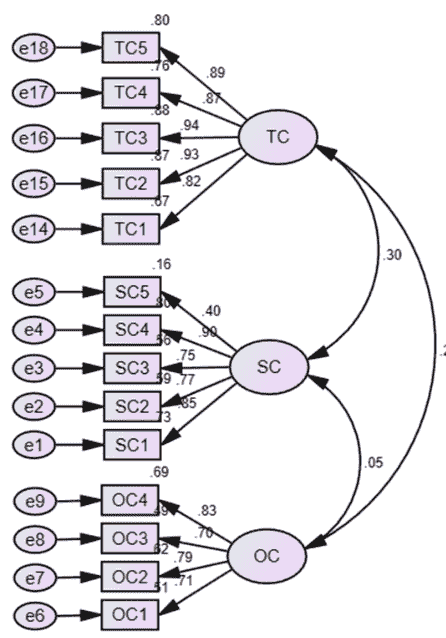

图 4.1. 潜在变量的确认性因子分析。来源：AMOS 22.0 输出结果。作者研究结果

数值的平均方差提取值（AVE）如表 4.5 所示。

| | AVE | 因子间方差提取值 | | |
|---|---|---|---|---|
| | | TC | SC | OC |
| TC | 0.911 | 1 | | |
| SC | 0.785 | 0.723 | 1 | |
| OC | 0.823 | 0.754 | 0.754 | 1 |

表 4.5. 构念相关性和 AVE。来源：AMOS 22.0 输出结果。作者研究结果

| | 估计值 | SE | CR | P |
|---|---|---|---|---|
| SC1<---SC | 0.852 | | | |
| SC2<---SC | 0.769 | 0.056 | 13.73 | 0.000 |
| SC3<---SC | 0.751 | 0.054 | 13.90 | 0.000 |
| SC4<---SC | 0.895 | 0.053 | 16.88 | 0.000 |
| SC5<---SC | 0.399 | 0.068 | 5.86 | 0.000 |
| OC1<---OC | 0.711 | | | |
| OC2<---OC | 0.787 | 0.088 | 8.94 | 0.000 |
| OC3<---OC | 0.701 | 0.086 | 8.15 | 0.000 |
| OC4<---OC | 0.828 | 0.089 | 9.30 | 0.000 |
| TC1<---TC | 0.821 | | | |
| TC2<---TC | 0.930 | 0.055 | 16.91 | 0.000 |
| TC3<---TC | 0.937 | 0.056 | 16.73 | 0.000 |
| TC4<---TC | 0.874 | 0.056 | 15.61 | 0.000 |
| TC5<---TC | 0.892 | 0.055 | 15.78 | 0.000 |

表 4.6. 确认性因子分析的路径分析结果。来源：AMOS 22.0 输出结果。作者研究结果

| 拟合优度指数 | 默认模型 | 基准 |
|---|---|---|
| 绝对拟合优度指标 | | |
| CMIN/Df | 1.551 | ≤3 |
| 绝对拟合差度指标 | | |
| RMSEA | 0.040 | ≤0.08 |
| 增量拟合指标 | | |
| CFI | 0.982 | ≥0.90 |
| IFI | 0.982 | ≥0.90 |
| TLI | 0.979 | ≥0.90 |
| 简约拟合指标 | | |
| PCFI | 0.828 | ≥0.50 |
| PNFI | 0.803 | ≥0.50 |

表 4.7. 结构模型的模型参数。来源：AMOS 22.0 输出结果。作者研究结果

表 4.6 显示了 CFA 模型的路径分析结果。指标的 P 值为 0.000，因此它们满足测量项目（Baral et al. 2022）。图 4.2 显示了最终模型。TC：技术挑战有五个指标 TC1、TC2、TC3、TC4 和 TC5；OC：组织挑战有五个指标 OC1、OC2、OC3、OC4 和 OC5；SC：社会挑战有四个指标 SC1、SC2、SC3 和 SC4（Mukherjee et al. 2021）。表 4.7 显示了 SEM 模型的模型拟合指标。

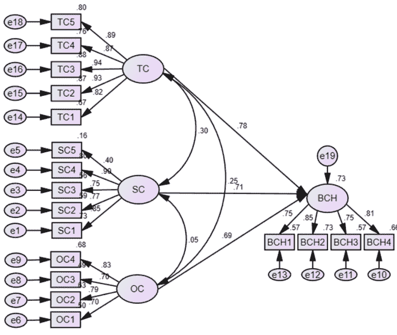

图 4.2. 最终模型。来源：AMOS 22.0 输出结果。作者研究结果

| | 估计值 | SE | CR | P | 假设 |
|---|---|---|---|---|---|
| BCH <---TC | 0.78 | 0.062 | 12.58 | 0.000 | 接受 |
| BCH <---SC | 0.71 | 0.054 | 13.15 | 0.000 | 接受 |
| BCH<---OC | 0.61 | 0.078 | 7.82 | 0.000 | 接受 |

表 4.8. 结构模型结果。来源：AMOS 22.0 输出结果。作者研究结果

## 4.6. 讨论

全球范围内，由于疫情的影响，医疗保健系统承受着巨大压力，导致供应链中断、医药产品造假、健康数据管理和安全等问题。区块链等新兴技术（即加密货币背后的技术）可以解决这些问题（Saranya and Murugan 2021）。本研究将识别医疗保健部门在实施 BC 系统时将面临的挑战。识别出的三个挑战主要是技术挑战、社会挑战和组织挑战。TC 代表 BC 采用者面临的技术挑战。这些挑战在以往研究中已被识别（Sadhy and Sadhya 2018; Onik et al. 2019; Pandey and Litoriya 2020; Saranya and Murugan 2021）。SC 代表 BC 采用者面临的社会挑战。这些挑战和结果在以往研究中已被识别（Shah et al. 2018; Shahnaz et al. 2019; Siyal et al. 2019; Wamba and Queiroz 2020; Wong et al. 2020）。OC 代表 BC 采用者面临的组织挑战。这些挑战和结果在以往研究中已被识别（Zhang et al. 2018; Zhao et al. 2019; Wong et al. 2020; Yaqoob et al. 2021）。医疗保健领域采用区块链面临多种挑战，包括技术问题和所有权问题（Kant Pal et al. 2021）。随着技术的发展，处理速度和大量数据重复等技术挑战将得到解决（Zhang et al. 2018）。得益于其在支付完整性、数据互操作性和安全性方面的优势，区块链可以改变医疗保健生态系统。例如，耗时且劳动密集的药物研究过程将转变为更高效、数据驱动的过程（Tanwar et al. 2020）。使用区块链解决方案分配患者对患者数据的控制权、所有权和访问权，将使这成为可能。

## 4.7. 结论

作为本研究的一部分，将要求医疗保健公司描述其在系统中实施 BC 时面临的挑战。许多工业部门使用 BC 来提高透明度和可追踪性。在完成结构性文献综述后，为研究项目整理了医疗保健组织面临的问题清单。一家印度医院目前正在开展基于调查的研究问卷。对于数据分析和建模，使用探索性因子分析和结构方程模型。因此，通过将本研究扩展到其他领域，可以识别更多挑战。


## 4.8. 参考文献

Alazab, M., Alhyari, S., Awajan, A., Abdallah, A.B. (2021). 供应链管理中的区块链技术：影响用户采纳/接受因素的实证研究. Cluster Computing, 24(1), 83–101. DOI: 10.1007/s10586-020-03200-4.

Baral, M.M. 和 Verma, A. (2021). 医疗保健领域的云计算采纳：采用 SEM 方法的实证研究. FIIB Business Review, 10(3), 255–275. DOI: 10.1177/23197145211012505.

Baral, M.M., Mukherjee, S., Nagariya, R., Singh Patel, B., Pathak, A., Chittipaka, V. (2022). 影响中小企业绩效的因素分析：从 COVID-19 中汲取的教训. Benchmarking: An International Journal, (提前出版). DOI: 10.1108/BIJ-11-2021-0660.

Beck, R., Avital, M., Rossi, M., Thatcher, J.B. (2017). 商业与信息系统研究中的区块链技术. Business & Information Systems Engineering, 59(6), 381–384. DOI: 10.1007/s12599-017-0505-1.

Clohessy, T., Acton, T., Rogers, N. (2019). 区块链采纳：技术、组织与环境考量. 区块链驱动的商业转型, 47–76. DOI: 10.1007/978-3-319-98911-2_2.

Coita, D.C., Abrudan, M.M., Matei, M.C. (2019). 区块链技术对人力资源和营销的影响：一项探索性研究. 载于：战略创新营销与旅游，Kavoura, A., Kefallonitis, E., Giovanis, A. (编). Springer, Cham. DOI: 10.1007/978-3-030-12453-3_79.

Di Vaio, A. 和 Varriale, L. (2020). 面向可持续绩效的供应链管理区块链技术：机场行业的证据. International Journal of Information Management, 52(3月), 0–1. DOI: 10.1016/j.ijinfomgt.2019.09.010.

Dutta, P., Choi, T.M., Somani, S., Butala, R. (2020). 供应链运营中的区块链技术：应用、挑战与研究机遇. Transportation Research Part E: Logistics and Transportation Review, 142, 102067. DOI: 10.1016/J.TRE.2020.102067.

Francisco, K. 和 Swanson, D. (2018). 供应链没有衣裳：用于供应链透明度的区块链技术采纳. Logistics, 2(1), 2. DOI: 10.3390/logistics2010002.

Gökalp, E., Gökalp, M.O., Çoban, S., Eren, P.E. (2018). 医疗保健中集成区块链技术的机遇与挑战分析. Lecture Notes in Business Information Processing, 333, 174–183. DOI: 10.1007/978-3-030-00060-8_13.

Gökalp, E., Gökalp, M.O., Çoban, S. (2020). 基于区块链的供应链管理：理解组织情境中的采纳决定因素. Information Systems Management, 39(3), 1–22. DOI: 10.1080/10580530.2020.1812014.

Hathaliya, J., Sharma, P., Tanwar, S., Gupta, R. (2019). 医疗保健 4.0 中基于区块链的远程患者监测. 2019 年 IEEE 第 9 届先进计算国际会议论文集，IACC 2019, 87–91. DOI: 10.1109/IACC48062.2019.8971593.

Hussien, H.M., Yasin, S.M., Udzir, S.N.I., Zaidan, A.A., Zaidan, B.B. (2019). 为医疗保健应用中区块链技术的发展提供支持的系统综述：分类法、实质性分析、动机、挑战、建议及未来方向. Journal of Medical Systems, 43(10). DOI: 10.1007/s10916-019-1445-8.

Hussien, H.M., Yasin, S.M., Udzir, N.I., Ninggal, M.I.H., Salman, S. (2021). 医疗保健行业中的区块链技术：趋势与机遇. Journal of Industrial Information Integration, 22, 100217. DOI: 10.1016/J.JII.2021.100217.

Kamble, S., Gunasekaran, A., Arha, H. (2019). 理解供应链中区块链技术的采纳——印度背景. International Journal of Production Research, 57(7), 2009–2033. DOI: 10.1080/00207543.2018.1518610.

Kant Pal, S., Mukherjee, S., Baral, M.M., Aggarwal, S. (2021). 医疗保健行业中大数据采纳的问题. Asia Pacific Journal of Health Management, 16(4), 282–287. DOI: 10.24083/apjhm.v16i4.1359.

Kassab, M.H., DeFranco, J., Malas, T., Laplante, P., Destefanis, G., Graciano Neto, V.V. (2019). 探索医疗保健领域的区块链研究及未来路线图. IEEE Transactions on Emerging Topics in Computing. DOI: 10.1109/TETC.2019.2936881.

Khatri, S., Alzahrani, F.A., Ansari, M.T.J., Agrawal, A., Kumar, R., Khan, R.A. (2021). 区块链与医疗保健领域集成的系统分析：范围与挑战. IEEE Access, 9, 84666–84687. DOI: 10.1109/ACCESS.2021.3087608.

Khezr, S., Moniruzzaman, M., Yassine, A., Benlamri, R. (2019). 医疗保健中的区块链技术：全面综述及未来研究方向. Applied Sciences (Switzerland), 9(9). DOI: 10.3390/app9091736.

Kline, R.B. (1999). 书评：心理测量理论（第 3 版）. Journal of Psychoeducational Assessment, 17(3), 275–280. DOI: 10.1177/073428299901700307.

Koh, L., Dolgui, A., Sarkis, J. (2020). 运输与物流中的区块链——范式与转型. International Journal of Production Research, 58(7), 2054–2062. DOI: 10.1080/00207543.2020.1736428.

Kouhizadeh, M., Saberi, S., Sarkis, J. (2021). 区块链技术与可持续供应链：采纳障碍的理论探索. International Journal of Production Economics, 231, 107831. DOI: 10.1016/j.ijpe.2020.107831.

Kshetri, N. (2017). 区块链在加强网络安全和保护隐私中的作用. Telecommunications Policy, 41(10), 1027–1038. DOI: 10.1016/j.telpol.2017.09.003.

Kumar, A. 和 Krishnamoorthy, B. (2020). 企业中商业分析的采纳：印度 TOE 框架的质性研究. International Journal of Global Business and Competitiveness, 15(2), 80–93. DOI: 10.1007/s42943-020-00013-5.

Mazlan, A.A., Daud, S.M., Sam, S.M., Abas, H., Rasid, S.Z.A., Yusuf, M.F. (2020). 医疗保健区块链系统的可扩展性挑战——一项系统综述. IEEE Access, 8, 23663–23673. DOI: 10.1109/ACCESS.2020.2969230.

McGhin, T., Choo, K.K.R., Liu, C.Z., He, D. (2019). 医疗保健应用中的区块链：研究挑战与机遇. Journal of Network and Computer Applications, 135(2018 年 9 月), 62–75. DOI: 10.1016/j.jnca.2019.02.027.

Mikalef, P., Lemmer, K., Schaefer, C., Ylinen, M., Fjortoft, S.O., Torvatn, H.Y., Gupta, M., Niehaves, B. (2021). 使政府机构具备人工智能能力：欧洲市镇决定因素研究. Government Information Quarterly, 101596. DOI: 10.1016/j.giq.2021.101596.

Moss, J. 和 Hendry, G. (2002). 课程评估中的电子调查使用. British Journal of Educational Technology, 33(5), 583–592. DOI: 10.1111/1467-8535.00293.

Mukherjee, S. 和 Chittipaka, V. (2021). 食品供应链管理中智能代理技术采纳分析：实证证据. FIIB Business Review, 231971452110592. DOI: 10.1177/23197145211059243.

Mukherjee, S., Baral, M.M., Venkataiah, C., Pal, S.K., Nagariya, R. (2021a). 由于 COVID-19 大流行，服务机器人是酒店非接触式服务的一种选择. Decision, 48(4), 445–460. DOI: 10.1007/s40622-021-00300-x.

Mukherjee, S., Chittipaka, V., Baral, M.M. (2021b). 开发一种模型以突出区块链技术中数字信任与隐私和安全的关系. 载于：数字营销的区块链技术及其应用，Bansal, R., Malyadri, P., Singh, A., Pervez, A. (编). IGI Global, Hershey, PA. DOI: 10.4018/978-1-7998-8081-3.ch007.

Mukherjee, S., Mohan Baral, M., Srivastava, S.C., Jana, B. (2021c). 分析时尚零售商店因 Covid-19 爆发所面临的问题. Parikalpana-KIIT Journal of Management, 17(1). DOI: 10.23862/kiit-parikalpana/2021/v17/i1/209031.

Mukherjee, S., Baral, M.M., Chittipaka, V. (2022a). 如何利用大数据提升酒店的组织绩效. 载于：将区块链技术融入循环经济，Khan, S.A.R. (编). IGI Global, Hershey, PA. DOI: 10.4018/978-1-7998-7642-7.ch002.

Mukherjee, S., Baral, M.M., Chittipaka, V. (2022b). 制造企业中区块链技术采纳研究. 载于：制造与物流管理中的区块链技术应用，Goyal, S.B., Praddeep, N., Shukla, P.K., Ghonge, M.M., Ravi, R.V. (编). IGI Global, Hershey, PA. DOI: 10.4018/978-1-7998-8697-6.ch004.

Mukherjee, S., Baral, M.M., Chittipaka, V., Pal, S.K., Nagariya, R. (2022c). COVID-19 疫苗供应链可持续发展研究：结构方程模型方法. Journal of Humanitarian Logistics and Supply Chain Management (提前出版). DOI: 10.1108/JHLSCM-08-2021-0079.

Mukherjee, S., Chittipaka, V., Baral, M.M. (2022d). 食品和农业供应链中区块链技术实施所面临挑战的应对与建模. 载于：数字治理的区块链技术及其应用，Nijalingappa, P. 和 Ghonge, M.M. (编). IGI Global, Hershey, PA. DOI: 10.4018/978-1-7998-8493-4.ch007.


- Mukherjee, S., Venkataiah, C., Baral, M.M., Pal, S.K. (2022e). 分析影响 COVID-19 疫苗供应链的因素：一种结构方程建模方法。*统计与管理系统杂志*，1–16。DOI: 10.1080/09720510.2021.1966955.

- Nunnally, J.C. (1978). 心理测量概述。载于 *精神障碍临床诊断*，Wolman, B.B. (编)。Springer，纽约。

- Onik, Md. M.H., Aich, S., Yang, J., Kim, C.-S., Kim, H.-C. (2019). 医疗保健中的区块链：挑战与解决方案。载于 *智能医疗管理大数据分析*，Dey, N. (编)。Elsevier，伦敦。DOI: 10.1016/b978-0-12-818146-1.00008-8.

- Orji, I.J., Kusi-Sarpong, S., Huang, S., Vazquez-Brust, D. (2020). 评估影响货运物流行业区块链采用的因素。*交通运输研究部分 E：物流与运输评论*，141，102025。DOI: 10.1016/j.tre.2020.102025.

- Pandey, P. 和 Litoriya, R. (2020). 大规模实施医疗服务：基于区块链技术的挑战与补救措施。*健康政策与技术*，9(1)，69–78。DOI: 10.1016/j.hlpt.2020.01.004.

- Pirtle, C. 和 Ehrenfeld, J. (2018). 医疗保健的区块链：医疗记录的下一代？*医学系统杂志*，42(9)，1–3，Springer，纽约。DOI: 10.1007/s10916-018-1025-3.

- Queiroz, M.M. 和 Fosso Wamba, S. (2019). 供应链中区块链采用的挑战：对印度和美国主要驱动因素的实证调查。*国际信息管理杂志*，46，70–82。DOI: 10.1016/j.ijinfomgt.2018.11.021.

- Rios, R., Fernandez-Gago, C., Lopez, J. (2018). 隐私感知信任协商建模。*计算机与安全*，77，773–789。DOI: 10.1016/j.cose.2017.09.015.

- Rout, S.K., Sahu, K.S., Mahapatra, S. (2019). 印度公共和私立医疗保健中医疗服务的利用：原因和决定因素。*国际医疗管理杂志*，14(2)，509–516。DOI: 10.1080/20479700.2019.1665882.

- Sadhya, V. 和 Sadhya, H. (2018). 区块链技术采用的障碍。*第 24 届美洲信息系统会议论文集*，1–10。

- Saranya, R. 和 Murugan, A. (2021). 医疗保健系统中启用区块链的系统综述：分析、现状、挑战与未来方向。*材料今日：会议*。DOI: 10.1016/j.MATPR.2021.07.105.

- Shah, B., Shah, N., Shakhla, S., Sawant, V. (2018). 通过采用区块链技术重塑医疗行业。*2018 年数字企业技术电路与系统国际会议，ICCSDET 2018*。DOI: 10.1109/ICCSDET.2018.8821113.

- Shahnaz, A., Qamar, U., Khalid, A. (2019). 使用区块链处理电子健康记录。*IEEE Access*，7，147782–147795。DOI: 10.1109/ACCESS.2019.2946373.

- Sheel, A. 和 Nath, V. (2019). 区块链技术采用对供应链适应性、敏捷性、对齐和绩效的影响。*管理研究评论*，42(12)，1353–1374。DOI: 10.1108/MRR-12-2018-0490.

- Siyal, A.A., Junejo, A.Z., Zawish, M., Ahmed, K., Khalil, A., Soursou, G. (2019). 区块链技术在医学和医疗保健中的应用：挑战与未来展望。*密码学 2019*，3(1)，3。DOI: 10.3390/CRYPTOGRAPHY3010003.

- Tabachnick, B.G., Fidell, L.S., Ullman, J.B. (2007). *使用多元统计方法*，第 5 版。Pearson，波士顿，马萨诸塞州。

- Tanwar, S., Parekh, K., Evans, R. (2020). 面向医疗 4.0 应用的基于区块链的电子医疗记录系统。*信息安全与应用杂志*，50，102407。DOI: 10.1016/j.jisa.2019.102407.

- Verhoeven, P., Sinn, F., Herden, T.T. (2018). 物流和供应链管理中区块链实施案例：探索新技术的审慎使用。*物流 2018*，2(3)，20。DOI: 10.3390/LOGISTICS2030020.

- Wamba, S.F. 和 Queiroz, M.M. (2020). 运营和供应链管理中的区块链：益处、挑战和未来研究机会。*国际信息管理杂志*，52，102064，Elsevier。DOI: 10.1016/j.ijinfomgt.2019.102064.

- Wong, L.W., Leong, L.Y., Hew, J.J., Tan, G.W.H., Ooi, K.B. (2020). 抓住数字演进的时机：马来西亚中小企业运营和供应链管理中区块链的采用。*国际信息管理杂志*，52，101997。DOI: 10.1016/j.ijinfomgt.2019.08.005.

- Yaqoob, I., Salah, K., Jayaraman, R., Al-Hammadi, Y. (2021). 医疗保健数据管理的区块链：机遇、挑战和未来建议。载于 *神经计算与应用*，MacIntyre, J. (编)。Springer Science and Business Media Deutschland GmbH。DOI: 10.1007/s00521-020-05519-w.

- Zhang, P., Schmidt, D.C., White, J., Lenz, G. (2018). 医疗保健中区块链技术的用例。*计算机进展*，111，1–41。DOI: 10.1016/bs.adcom.2018.03.006.

- Zhao, G., Liu, S., Lopez, C., Lu, H., Elgueta, S., Chen, H., Boshkoska, B.M. (2019). 农业食品价值链管理中的区块链技术：应用、挑战和未来研究方向的综合。*工业计算机*，109，83–99。DOI: 10.1016/j.compind.2019.04.002.

# 作为维护电子健康记录系统的有效技术的区块链

区块链技术是当今专业世界中最重要的创新之一。它是一个由有序节点和连接列表组成的分布式网络，节点负责存储信息，链将它们连接起来。正是区块链构成了数据，并有助于在个人之间维持信任。区块链技术正处于不断变革和革命的道路上。近年来区块链技术的使用日益增加，迫使专家和学者寻找在各个领域实施区块链的创新方法。医疗保健是数据和销售方面增长最显著的领域。随着电子健康记录（EHRs）数量的增加，安全性变得越来越重要。一直在推动使用区块链技术来使 EHRs 更加安全。区块链技术使用量的增加为包括医疗保健在内的许多新应用领域提供了机会。EHRs 是区块链最有前景的应用。它可以定义为通过网络以数字方式存储的患者健康信息。区块链技术有潜力通过将用户置于临床系统的中心并改善健康信息的透明度、隐私性和保密性来彻底改变医疗保健。本章不仅介绍了区块链技术及其背景概念，还阐述了区块链在医疗保健领域的重要性。还提出了基于区块链的 EHR 模型。本章以区块链领域的各种研究挑战及一个案例研究结束。

## 5.1. 引言

数据是最宝贵的资源之一。随着网络犯罪分子在窃取敏感数据方面变得越来越熟练，网络安全已成为最紧迫的全球挑战之一，迫使人们加强网络保护。过去曾提出过各种方法来满足不同组织的安全需求，但安全攻击没有界限，导致这些技术要么被攻破，要么变得无效。区块链技术是保护有用记录的最新解决方案。它被描述为一种分布式账本，用于保存通过称为链的连接相互连接的各种有序项目列表（Katal 等人，2021b）。这些区块中包含的与金融操作相关的内容仅对订阅者开放。一套复杂的自主管理加密密钥链维护用户授权：每个授权用户提供一个时效敏感的秘密标识符，如果解密计时器用尽，它会自动阻止（Zhang 等人，2018）。区块链是一个允许更自主计算的现代平台。它基于公共账本的原则，该账本充当围绕这些代理人的先前交易的档案。它由代理人组的定期审计（选择根据软件领域的不同策略进行），他们定期对其进行审计。每次审计的结果都保存在一个区块中，并呈现给整个网络。在密码学链接的序列中，区块被依次添加到账本中。区块链技术允许在保持保密性的同时共享数据。以下是区块链技术如此普遍并被应用于各个领域的几个原因：

- 与受营业时间和规则限制的传统银行不同，区块链技术允许更快的交易结算。相反，它没有此类限制。它允许更快的合同结算。

- 由于区块链存储数据并防止其被损坏，因此消除了人为错误。当记录在从一个节点移动到下一个节点时被检查，即可确保准确性。

- 数据客观性是区块链技术的产物。它不仅保证数据保密性，还警告用户警惕任何数据更改。如果组织的数据被黑客攻击，则无法被利用，从而确保保密性与治理之间的平衡。

- 如果发现异常，仍可将其追溯到源头，从而简化调查和必要措施的执行。因此，实现了质量保证。

## 5.2. 区块链技术背景概念

### 5.2.1. 共识算法

共识算法是区块链技术的重要组成部分，有助于创建防篡改网络。它只接受一个真理来源，该来源由所有网络成员同意。该技术依赖于


节点间共识进程用于验证数据，消除了对中介的需求。该网络中的任何节点都应就区块链的当前版本达成一致。这通过使黑客生成伪造区块并将其注入分布式网络变得更加复杂，从而提高了系统的可靠性。

区块链共识算法分为两类：基于证明的共识算法和基于投票的共识算法（Katal et al. 2021a）。

#### 5.2.1.1. 基于证明的共识算法

基于证明的共识算法的基本思想是：在加入网络的众多节点中，拥有最大证明的节点占主导地位，并获得网络批准，以添加新节点并获得付款。已应用了多种基于证明的共识算法，包括基于工作量证明（PoW）、权益证明（PoS）或两者的混合，以及多种不同的版本。

#### 5.2.1.2. 基于投票的共识算法

为了执行基于投票的共识算法，验证网络中的节点必须是可自定义的。这使它们能够更轻松地交换消息。这是与基于证明的共识算法最显著的区别，在后者中，节点通常可以进入和离开验证网络。此外，使用基于投票的共识机制时，网络中的所有节点必须同时批准操作或区块，这与维护账簿形成对比。在决定是否将其建议的区块添加到链中之前，他们会先与其他节点协商。使用基于投票的共识算法与使用标准分布式系统容错方法有些接近（Andreev et al. 2018）。因此，基于投票的共识应构建为能够承受以下场景：任何节点失败、任何节点被颠覆或任何节点崩溃。

### 5.2.2. 区块链的类型

区块链的两种基本类型是私有区块链和公有区块链。然而，还有各种变体，包括联盟区块链和混合区块链。每个区块链都由通过对等（P2P）机制相互链接的节点组成。每个系统节点都拥有共享账簿的最新版本。每个节点都可以确认操作、传输和接收数据以及构建区块。首先，用户在网络中发起交易。交易发起后，区块创建过程开始，该过程包括前一个区块的哈希值、所有权和修改历史记录。当链的第一个区块被创建时，nonce 生成加密哈希值。区块中的内容在被挖出之前是加密的，并与 nonce 和哈希值不可分割地关联。当区块形成后，它会被发送到平台的所有对等节点以供批准。矿工使用复杂的算法来解决使用 nonce 生成批准哈希值的极其困难的数学问题。由于 nonce 仅 32 位长，而哈希值为 256 位长，因此在找到正确的哈希值之前，大约需要挖出 40 亿个 nonce-hash 组合。当这种情况发生时，矿工被认为已发现“黄金 nonce”，并且该区块被包含在链中。当区块被正确挖出后，更新将由平台上的所有服务器授权，矿工将获得经济奖励。接受后，当前链会使用新创建的区块进行修改。区块被添加到链中后，更新会在系统中传播，操作完成。图 5.1 描绘了区块链中交易的详细流程。

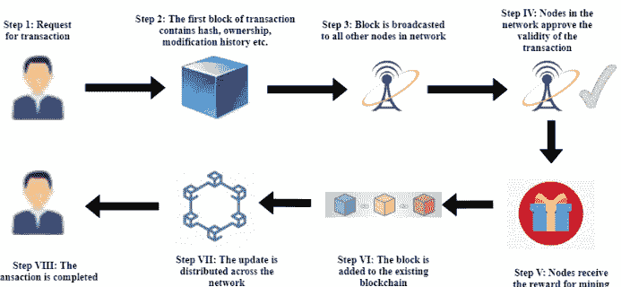

图 5.1. 区块链中交易的详细流程。如需此图的彩色版本，请参见 www.iste.co.uk/choudhury/blockchain.zip

- **公有区块链**：它是一种无需许可的分布式账簿方案。任何拥有互联网连接的人都可以加入区块链网络。公有区块链的成员（也称为节点）被允许获取数据、验证交易并为下一个区块挖矿。加密货币的共享是共享区块链最流行的应用之一。大多数情况下，如果用户遵守安全协议，公有区块链是安全的。然而，如果用户不遵守安全协议，则可能很危险。比特币、以太坊和莱特币是其中一些最著名的示例（Andreev et al. 2018; Aggarwal et al. 2019）。

- **私有区块链**：它是一种许可区块链，只能在封闭网络中使用。它们主要用于仅少数人参与的协会或企业内部。保护、授权和可用性只是受管辖实体管辖的几项基本资源。可以使用私有区块链执行任何基本操作（例如投票、供应链管理和资产所有权）。Multichain 和 Hyperledger 项目是私有区块链的示例（即 fabric 和 sawtooth）（Aggarwal et al. 2019）。

- **联盟区块链**：它是一种由多个实体运营的有些去中心化的区块链网络。这种类型的区块链使多个组织能够协作，并充当挖矿和知识交流的监管者。能源网络基金会（Energy Web Foundation）和 R3 是这种区块链的两个示例（Aggarwal et al. 2019）。

- **混合区块链**：它是一种结合私有区块链和公有区块链平台的混合区块链网络。在此情况下，所有区块链的功能都被使用。混合网络上的用户可以记录谁有权访问哪些区块链信息。仅允许区块链的部分选定文档公开，而其他文档则保持在私有网络中。但是，用户应将其发布到公有区块链上以进行身份验证。公有区块链增强哈希处理，并在验证过程中引入更多节点。这提高了区块链网络的可见性和可信度。混合区块链“Dragonchain”就是一个示例（Aggarwal et al. 2019）。

### 5.2.3. 智能合约

Szabo 在 20 世纪 90 年代中期创造了“智能合约”一词，将其定义为“以电子格式定义的一系列担保，包括各方履行信任的规则”（Jani 2020）。它是基于区块链的软件的一部分，有助于启用、实施和监控合同安排。其主要目标是在满足某些标准之前尽快履行协议条款。因此，智能合约的结算成本低于传统方案，后者依赖可信第三方来实施和处理合同条款。在文献中，已经探讨了智能合约的几种常见含义。在区块链上注册、检查和实现的代码即为智能合约代码。智能法律合约几乎肯定将是智能合约代码和传统法律术语的混合体。考虑产品卖方与制造商签订智能法律协议的案例。付款条款应以代码形式编写，并在产品交付时立即执行。但是，制造商可能会坚持在协议中加入赔偿条款，卖方承诺就因产品缺陷而引发的诉讼向零售商提供赔偿。将此条款写入代码中毫无意义，因为它不是自动执行的；相反，在发生诉讼时，它仍需由法官阅读和实施。

### 5.2.4. 区块链的特征

图 5.2 描绘了区块链技术的特征。

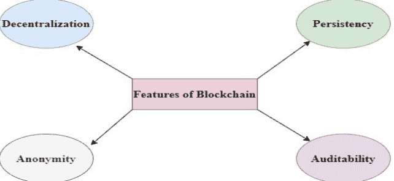

图 5.2. 区块链的特征。如需此图的彩色版本，请参见 www.iste.co.uk/choudhury/blockchain.zip

- **去中心化**：在典型的集中式交易系统中，每个操作都必须由单一授权组织验证。因此，去中心化需要信任，这是最紧迫的问题，同时还涉及可持续性、可用性和故障转移，对于这些问题，去中心化的 P2P 区块链框架可能是更合适的选择（Bhushan et al. 2020）。在区块链网络中，任何两个对等点（P2P）都可以进行交易，而无需中央代理的许可。通过使用各种共识程序，区块链可以帮助缓解信任问题。此外，它将具有更低的处理成本（包括生产和运营成本）并消除核心服务器性能中的瓶颈。相反，区块链在多方面存在一些权衡。在 PoW 场景中，例如比特币和以太坊，基础设施和电力费用高出几个数量级，但吞吐量通常也差好几个数量级。

- **持久性**：区块链为分析事实提供了一个平台，使供应商和消费者能够确定数据是可信且未被篡改的。例如，如果区块链有 10 个区块，则第 10 个区块包含前一个匹配区块的哈希值，并且前一个区块的内容被用来


构建一个新块。因此，当前链中的所有块都已连接并加入。此外，交易与前一笔交易相关联。对每笔交易的简单更改现在将显著修改块的哈希值。此外，当矿工生成一个块时，它必须得到更多网络参与者的接受。因此，任何信息篡改或伪造都将被系统检测到。

- 匿名性：要连接到区块链网络，可以使用动态生成的地址。区块链网络中的用户可以拥有多个地址以确保其身份。由于它是一种去中心化结构，没有单一机构监控或记录用户的个人信息。由于其无需信任的环境，区块链提供了一定的隐私性。

- 可审计性：软件公共登记表存储区块链网络中的所有事件，并使用数字时间戳对其进行验证。因此，任何网络节点都可以被访问以查看和跟踪过去的记录。

### 5.2.5. 区块链技术的应用

区块链平台在几乎每个领域都有应用。值得记住的是，比特币与区块链不同；相反，它是该技术更常见的用途之一（Memori et al. 2019）。区块链技术的常见应用如下。

- 医疗保健：分布式账本技术可以改变医疗保健（McGhin et al. 2019）。区块链还将有助于药品追踪和临床信息保护。药品盗版是医疗保健公司的一大难题。假药是指为欺骗其来源、合法性或有效性而制造和销售的药物或药剂师物品。伪劣药物可能含有不足的活性成分，或者根本不含，并且可能在体内被不当代谢。根据健康研究资助署（Glass 2014），假药占欠发达国家所有合法药物的10%–30%。医疗保健领域另一个重大挑战是维护患者数据的机密性。由于所有交互都记录在区块链上，它有可能成为解决这一问题的可持续方案。不可更改的操作被添加到分布式账本并以电子方式加上时间戳，从而可以追踪物品的进展，并通过保护信息使物品防篡改。由于每个患者在生理特征方面都不同，常见病症的治疗方案因情况而异。因此，为了获得个性化护理，为患者症状提供链接至关重要。相比之下，医疗数据易受损害，需要一个稳定的共享网络。区块链技术凭借其不可更改的账本，可以为多家医疗机构之间患者病史的统一以及数据安全措施提供一个框架。区块链能够为存储数字医疗记录提供一个稳定且开放的系统，从而改善患者护理并降低治疗成本。

- 能源行业：微电网是能源行业中应用最广泛的区块链解决方案之一。微电网是一个本地集成和受控的电力来源网络，旨在提高能源生成和消费的效率和稳定性。微电网技术最重要的好处之一是，它使消费者和其他电力客户（如零售商）不仅可以获取所需的电力，还可以向电网出售和生产多余的能源。在微电网中，它被用于简化、注册和验证电力销售和购买交易。同样，在更大规模上，区块链可用于在智能电网中实现电力共享。区块链可用于促进安全且保护隐私的使用控制和电力共享，而不需要中央机构（Saxena et al. 2021）。

- 股票市场：互操作性、信任和开放性都是分散化业务流程面临的所有问题。区块链技术可能能够解决这些问题。它将通过去中心化和自动化来提高股票交易所的效率。区块链将通过取代中介并加快合同结算进一步降低成本。此外，该技术有望在合同清算和结算以及交易和合法所有权转移相关的繁琐文书工作方面提供帮助，并确保安全的交易后机制。

- 投票：区块链技术有多种应用可以解决传统数据库可能存在的问题。投票就是这种困境的一个例子。最近宣布，美国一家主要的投票机制造商在其部分机器上实现了远程控制工具。在统计总数时，该程序允许修改选票。由于此类事件，人们对美国选举系统失去了信心：“独家民调：大多数人预计中期选举将受到国际干预”。由于选民的账本与用于计票的账本相同，区块链可以通过创建确保选票被记录的公共账本来解决这一问题。

- 保险：区块链将被用于在保险业务中促进客户、保险人和健康保险人之间的交换。保险公司可能会使用区块链技术来获取和记录合同、提交和评估投诉以及支付保费操作。智能合约将简化各种保险计划，大幅降低管理成本（Gatteschi et al. 2018）。

例如，撰写保险索赔会带来巨大的行政成本。由于对术语的误解和误读，在多种情况下，诉讼管理可能是一个相当复杂的程序。通过将保险计划结构化为更精确的 if-then 伙伴关系，智能合约将避免这些问题。这些政策允许通过数字协议自动执行条款。因此，保险公司将降低其保险费率并变得更具吸引力，吸引更多买家。

## 5.3. 医疗保健中的区块链

区块链技术最初是为其在经济学和加密货币中最著名的应用而创建的，但其应用正在不同领域增加，包括生物医学。通过稳定和保护消费者可以通过各种形式的交易进行沟通的数据集合，药物、生物技术、远程医疗、远程监测、电子健康、遗传学和定制医疗保健应用都已显示出区块链技术的前景。以下部分将讨论区块链技术拥有巨大潜力的医疗保健和医疗服务特定领域。

- 临床研究：在临床试验中，可能会出现数据保护、数据完整性、数据共享、患者入组等各种问题。作为下一代互联网，区块链有望解决这些问题。在区块链技术的协助下，医疗专家正在努力解决这些问题。许可以太坊是一种具有智能合约功能的区块链平台，用于与以诊所为中心的数据计算系统配合使用。这些研究的主要目的是克服患者入组难题。

- 欺诈检测：区块链系统在医疗行业最重要的用途之一是控制药品供应链。供应链管理在许多行业中都是一个关键主题，但在医疗保健中尤其重要，因为其日益复杂。因此，医疗保健供应链中的每一次中断都会影响患者的健康。由于涉及许多环节和个人，供应链不稳定且存在恶意攻击的漏洞。区块链提供了一种安全稳定的机制来根除这一问题，并在某些情况下避免欺诈发生。

- 神经科学：专门用于区块链技术的材料和研究数量不断增长，神经学无疑也在涵盖范围内。先进脑技术的目标是开发一种现代系统，消除

环境中的机械干扰，并允许人们使用心智指令而非物理指令来操作设备和数据。此类神经系统能够解读与大脑活动相关的信号，并将其转换为操纵第三方设备的指令，同时根据大脑活动证据预测一个人当前的情绪状态。大致在同一时期，该设备将“确保个人信息的保护与保密”，因此任何异常行为都将易于追踪。

制药研究与行业：它是全球发展最快的领域之一，也是医疗保健提供中的重要参与者。在生产和研发阶段，区块链被用于测试、监控和保障药物的潜在制造。Hyperledger，一个研究基金会，最近宣布启动一项打击假药计划，该计划将使用区块链技术作为检查和应对此问题的主要方法。

## 5.4. 使用区块链的电子健康记录

在过去十年中，医疗从业者、诊所和医疗产品也推动了医疗健康记录数字化的增长，因为该数据的数字化提供了更便捷的访问和协作，以及更安全、更快速决策的基础。在医疗保健领域，目前最常见的区块链解决方案集中在电子健康记录（EHR）领域。由于生活经历导致患者在不同提供方之间数据孤立，患者数据分散在不同组织中，他们失去了对先前数据的简单访问。名为“MedRec”（Azaria et al. 2016）的原型利用区块链的独特特性来管理身份验证、匿名性、诚实性和数据共享。它基于一个用于记录管理的去中心化系统，声称能为患者提供详细、永久的病史，并便捷地访问来自各种提供方和治疗设施的医疗详情。对于 MedRec，无需维护患者记录或等待调整时间。它创建一个区块链归档并通知客户端，客户端对记录的流转完全负责。该标签确保获得了记录的完美副本。Xia 等人（2017）开发了 MeDShare，这是一种安全可靠的区块链架构，用于陌生个体之间的医疗数据交换。

电子健康记录（EHR）通常包含高度敏感和关键的患者数据，这些数据由医生、放射学家、医院员工、化学家和科学家定期交换，以便给出正确的诊断和治疗。将这些非常个人的患者信息收集并分发给各种实体，可能会危及患者的护理，对患者的健康以及保持最新患者记录的能力构成重大威胁。因此，保持患者最新的病史已成为确保有效护理的关键。为克服这些挑战，应开发一个基于区块链的网络，用于保存、维护和转移癌症患者的电子医疗信息。为了查看、处理和归档安全的患者数据，他们使用了许可型区块链技术。这些拟议的解决方案将用于在医疗保健实践中引入区块链技术，以维护患者及其背景信息的安全性和保密性。或许，全球医学领域迅速采用区块链技术的原因在于，它向患者做出了明确承诺：使用此技术可以使其医疗数据永久且不可篡改。通过区块链，任何访问或修改行为都可以轻松地被标记和识别。这不仅对医疗完整性有价值，还能标记出一些欺诈活动，例如大规模贿赂或记录篡改。此外，发布和审查授权的医药服务记录将更加容易。当患者就诊时，其余的供应商很可能立即注意到。使用合适的患者护理算法，可以将药物错误、过敏性和药物解决方案在所有区块链记录中无缝关联，从而消除耗时的处方同意表格的需求。因此，区块链技术的应用将改善治疗可及性、医疗记录管理、快速临床证据验证、更大程度的监控以及更有效的医疗保健管理。

Al-Karaki 等人（2019）提出了一种名为 DASS-CARE 的基于区块链的系统，该系统可实现与医疗中心（特别是医疗信息）的开放连接，并具有可扩展性和安全性。该拟议系统将显著简化实时访问和通知的过程，而不会危及患者数据的保护、完整性或保密性。

Vora 等人（2019）开发了一种基于区块链的电子健康记录存储与维护系统，该系统既高效又安全。该建议系统还使客户、提供方和其他组织能够以安全便捷的方式连接到医疗数据，同时保持患者保密性。

Dagher 等人（2018）开发了一种基于区块链的系统，为患者、保险公司和第三方提供安全、可访问且可靠的健康数据连接，同时保护患者的个人信息。

## 5.5. 定量分析

定量分析关注以统计和定量的方式描述和理解事物。定量分析的目的是通过使用数值变量和分析来理解为现象收集的数据。定量分析包括统计和分析性的分析方法。

我们检索了 Scopus 数据库，涵盖截至 2021 年 11 月 1 日发表的研究。基于区块链的电子健康记录（EHR）研究不仅发表在医学出版物上，还发表在信息技术、法律、工程、经济学和工商管理等其他领域的期刊上。因此，鉴于 Scopus 数据库对自然科学和社会科学期刊的全面覆盖，我们选择它作为本研究论文的来源。

我们采用了四个流程来进行全面的定量综述：发现潜在研究、移除不必要的研究、验证重要研究以及评估选定的文章。

在选择合适研究的第一阶段，我们在标题、摘要或关键词中包含类似“电子健康记录”术语的论文进行了初步搜索。该阶段共得出 70,616 份潜在调查。在另一次搜索中，我们将这些研究限制为在标题、摘要或关键词中包含类似“基于区块链的电子健康记录”关键短语的研究。这共得出 500 份潜在研究。

在第二阶段，应用过滤器移除在刊文章，从 500 份文档中得到 484 份文档。Scopus 数据库也显示在刊文章，这意味着这些文章尚未在线发表，但正处于制作阶段。

在验证 484 份可用研究重要性的第三阶段，我们检查了它们的文档类型、标题、摘要和关键词，并筛选出 464 份满足我们搜索标准且仅以英文出版的研究。该阶段共批准 464 篇文章。

在分析 464 篇文章的第四阶段，我们查看了它们按出版年份、语言、来源地、期刊和年平均引用次数分布的情况。通过识别作者所属组织的国家，研究了出版物的来源国。如果一篇文章有两位作者分别为两个不同国家的组织工作，则来源国被确定为两个国家。前 10 篇文章是根据 464 篇文章的年平均引用次数确定的。在修正了出版后时间影响的情况下，年平均引用次数比总引用次数能更精确地表明每篇文章对其他研究的影响程度。例如，2016 年的文章比 2019 年制作的文章更可能被提及。因此，我们使用年平均引用次数对 464 篇出版物进行了排名。


### 5.5.1. 结果

自2016年以来，文章数量激增。在这些文章中，只有两篇发表于2016年。从2017年起，基于区块链的电子健康记录（EHRs）领域的文章数量持续增加。图5.3展示了从2016年至今2021年文章数量的上升情况。

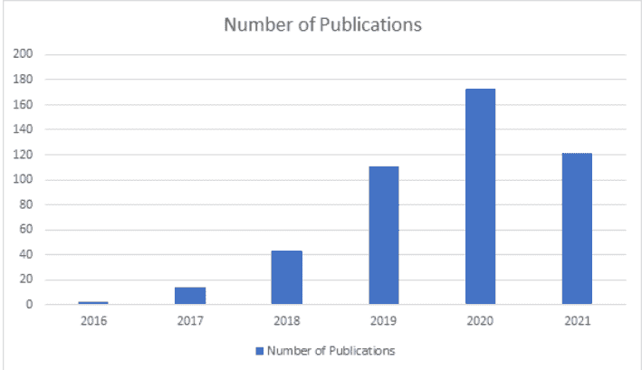

图5.3. 发表物数量

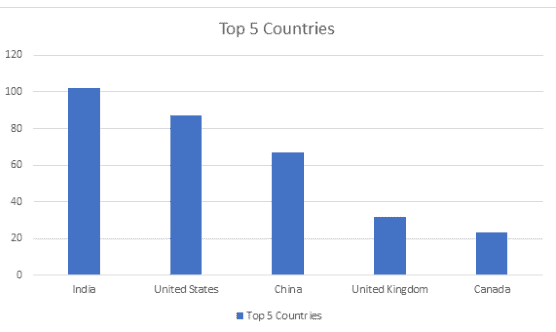

图5.4. 按发表物数量计的前五个国家

印度、美国、中国、英国和加拿大是按已发表文章数量计的前五个国家。印度的文章数量最多，为102篇，约占所选评审文章的21.9%。图5.4展示了前五个国家。

IEEE Access、《医学互联网研究杂志》、《医学系统杂志》、《智能系统与计算进展》以及《计算机科学讲义（包括人工智能讲义和生物信息学讲议子系列）》是按发表物数量计的前五个来源。IEEE Access的文档数量最多，为26篇。图5.5展示了前五个来源。

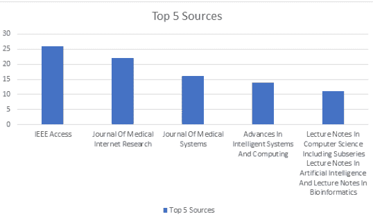

图5.5. 按发表物数量计的前五个来源

定量研究的目的是了解和理解社会世界。社会科学家，尤其是传播学研究人员，采用定量分析来分析影响人类的事件或现象。上述定量分析使研究人员能够进行简单或复杂的调查，例如展示数据关联、计算平均值或百分比，或使用推断统计来对大量人群得出广泛的概括性结论。这项研究将对有兴趣利用区块链技术维护电子健康记录（EHR）的研究人员和从业者，以及那些希望通过仔细收集、分类和评估与基于区块链的电子健康记录相关的研究出版物，与其他研究人员和研究机构寻求合作机会的人士有所帮助。

## 5.6. 使用区块链的电子健康记录拟议框架

本节介绍了基于区块链网络构建的电子健康记录共享拟议方案。对于网络中的区块事务，采用了各种方法和配置。本节描述了基于区块链的电子健康记录系统架构。拟议方案有六个成员。涉及的实体包括：患者、医生、行政人员、保险公司、实验室技术员和药房。

- 行政人员：行政人员负责将用户注册到区块链中。他们在区块链上注册用户并向用户提供权限。
- 医生：医生负责将患者的医疗详细信息添加到区块链中。医生也有权查看患者的详细信息。
- 患者：患者负责添加之前的医疗详细信息。患者也有权插入新的医疗记录。
- 实验室技术员：实验室技术员负责添加患者的检验报告。他们不能访问患者的医疗详细信息。
- 药房：药房所有者负责将所需药物送达患者。他能够查看医生上传的处方。药房所有者不能访问患者的医疗详细信息。
- 保险公司：保险公司负责结算患者的医院账单。保险公司只能查看由医院行政人员上传的患者医院账单。

### 5.6.1. 系统工作流

图5.6展示了拟议模型的运作方式。

首先，行政人员通过注册智能合约在区块链上注册患者。患者注册完成后，行政人员注册特定医生并通过智能合约授予权限。注册流程完成后，医生为患者提供治疗，并持续在区块链网络上更新记录。医生无法删除区块链上的特定记录。初始用药完成后，医生向患者推荐实验室检查。患者将实验室信息传达给行政人员，以便只有授权的实验室技术员能够在区块链上更新记录。检查完成后，授权的实验室技术员能够上传报告，授权医生可以访问这些报告。治疗完成后，医生将在区块链网络上上传处方。患者将药房所有者的详细信息传达给行政人员，以便只有授权人员能够获得处方详情。医疗商店老板获取用药史并将药物送到医疗中心。所有治疗完成后，行政人员在区块链网络上上传账单，患者无法修改该账单。患者将所有保险详情传达给行政人员，以便合法的保险公司能够查看患者的账单并处理索赔。保险公司无权查看患者的医疗详细信息。这样一来，索赔流程将在没有任何欺诈的情况下得到结算。

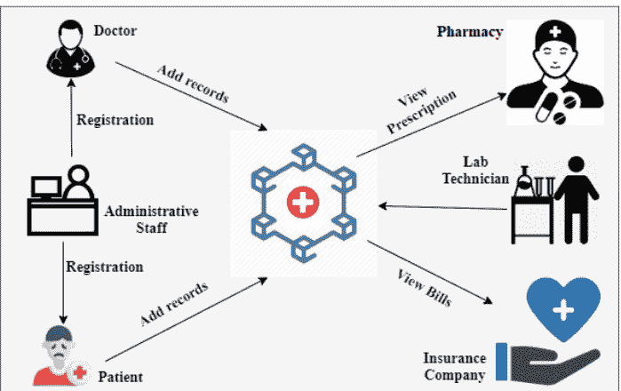

图5.6. 拟议模型。要查看本图的彩色版本，请访问 www.iste.co.uk/choudhury/blockchain.zip

## 5.7. 基于区块链的电子健康记录中的问题

基于区块链的电子健康记录文献已将互操作性、匿名性和授权（访问控制）描述为主要问题和挑战。

保险公司与医疗网络之间的互操作性问题导致有效交换数据变得困难（Monrat et al. 2019）。由于数据管理和共享的组织性不足，健康报告是分散的而非连贯的。许多研究对数据互操作性和碎片化提出了疑问。

由于电子健康记录数据（包括照片）体积可能非常大，通过区块链传输电子健康记录数据时，可扩展性是一项主要挑战。由于区块链网络具有分布式复制的特性，在网络上保存和复制电子健康记录数据以供重新分发，由于数据量巨大而变得困难。

当前的电子健康记录患者管理权限非常有限，患者通常无法自由地与研究人员或提供者交换他们的数据。尽管医学取得了所有进步，但多种电子健康记录机制仍然无法高效交互。

## 5.8. 案例研究

### 5.8.1. MedRec

MedRec是一个框架，通过提供直接和开放的医疗体验访问权限来促进患者主动性，从而将社会需求与技术赋能者相连接。为了扩展银行模式，金融系统可能拥有各种货币存储设施，例如为每个提供者网络设置一个。问题是医疗文件不可互换；每个文件都带有个人的签名。不存在等值货币交换的情况。尽管竞争和多样性可能会降低市场定价，但它们通常会因创造不合适或无法访问的交换和控制障碍的连锁反应而带来风险。为了规避任意中介，开发者开发了一种利用区块链的分布式访问和验证方法。

专有P2P网络的成员共享数据控制和查看权限，这些权限体现在MedRec的区块内容中。由区块链技术实现的智能合约协助用户自动化和监控特定的状态转换。开发者在以太坊区块链上使用智能合约来监控提供者与患者的关系，这些关系将医疗记录与访问权限和信息检索方向关联起来，以便在区块链上实施。患者可以同意跨提供者共享信息。在所有情况下，收集新数据的个人都会收到自动更新，并在接受或拒绝之前有机会审查建议的输入。这使用户能够了解其文件的最新进展。MedRec通过提供一份合同来优先考虑可访问性，该合同收集收件人客户交互的任何变化，并作为查找健康记录更新的中心联系来源。图5.7展示了MedRec系统的运作方式。


MedRec 的块信息代表了私有 P2P 系统用户维护的所有权和查看权限。科学家使用以太坊智能合约来注册患者交互，方法是将健康文件与读取权限和数据检索命令（本质上是数据指针）相关联，以便在其他系统上实现。为确保数据完整性，调查人员将项目的加密哈希上传到区块链，以避免篡改。消费者可以授权在医生之间共享记录，供应商可以创建链接到特定客户的新记录。研究人员使用公钥加密和类似 DNS 的解决方案来验证身份，将真实且广泛接受的 ID 与个人的以太坊地址关联。

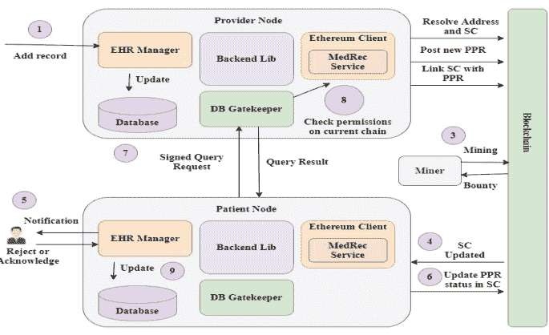

图 5.7. MedRec 的工作原理（Xia et al. 2017）。此图的彩色版本，请参见 www.iste.co.uk/choudhury/blockchain.zip

### 5.8.2. 基于 AI 的 EHR 解决方案

启用人工智能（AI）并由区块链驱动的 EHR 管理平台具有巨大潜力，可支持可信、安全且具有弹性的 EHR 存储服务。此类 EHR 系统还将使学者、医生和官员更容易获取数据以进行研究、执行分析并做出明智决策。

Mistry 等人（2021）提出了 MedBlock，这是一种基于 AI 和区块链的安全 EHR 解决方案，用于保护 Covid-19 阳性患者的隐私。它涉及多个组织，包括医生、员工、公职人员、医院和消费者。仅当数据传输符合智能合约参数时，MedBlock 中的数据传输才允许使用以太坊网络。MedBlock 还确保 EHR 不会被篡改或用于恶意目的。由于在疫情期间 Covid-19 患者的信息传输至关重要，所提系统使用了 6G 网络通信信道，将信息传输延迟降低至 10–100 秒，可靠性为 99.99999%。MedBlock 的层结构如下：（i）数据收集与汇总，（ii）AI，（iii）区块链和（iv）可访问性。前一层收集和汇总的数据被发送到 AI 层。AI 根据提供的数据做出决策。人工神经网络（ANN）接收患者的 Covid-19 实验室和 CT 扫描结果。它根据输入参数充当二进制分类器。ANN 模型用于确定患者是 Covid-19 阳性还是阴性。EHR（可能是阳性或阴性）作为下一层的输入。算法 5.1 描述了基于 AI 的 Covid-19 患者分类的逐步方法。

**Input:** \(\alpha\) 是数据集 \(\Pi\) 中的数据条目数量，最多 \(\delta\) 个条目。\(\Pi_X\) 和 \(\Pi_Y\) 分别是用于训练目的的 \(X_{train}\)（输入）和 \(Y_{train}\)（所需输出）。

**Output:** 分类器训练

```
procedure CLASSIFIERTRAINING(X_train, Y_train)
while (True) do
applyPCA(\(\alpha\), ncomponents = optimalnumber)
Choose the best number for the main components.
if (isNull(\(\Pi\))) then
Return (“Enter the trainingdata.”);
else if (\(\alpha > \delta\)) then
EndTraining();
ModelTestonTestData();
else
\(\alpha = \alpha + 1\);
trainingANNonTrainingData(Xtrain, ytrain);

ρ = ΠRecord   //Here the ρ is the record
ObtainNextData(Π, ρ);

Continue;

end if

end if

end while

end procedure
```

### 算法 5.1. 基于 AI 的训练程序（Mistry 等人，2021）：

### 5.8.3. 利用区块链改进医疗记录保存

phrOS（phrOS – 医疗区块链操作系统）最近由台北医学大学医院和数字金库公司（DTCO）推出（参见 DTCO n.d.）。它试图通过将患者的所有医疗记录存储在区块链上，来促进医疗组织之间的开放性。它包含照片以及关于患者病情的大量信息。智能手机应用程序允许临床医生和患者查看信息。它还通过去中心化账本技术（DLT）提高了医疗数据的安全性。开放框架允许自主和安全的解决方案，使智慧医疗成为现实。它为患者生成匿名数字身份，以帮助患者验证和识别，以及患者数据记录和查询，涵盖治疗和用药规划。智能合约可用于临床试验中的方案更改、试验入组延迟等。患者授权的索赔，包括时间戳和医疗记录，以及所有授权文件，都带有数字签名，可以随时评估，而无需第三方服务来解决冲突。

## 5.9. 结论

区块链在应用领域的使用在当今的医疗业务中至关重要。它可能导致自主的数据收集和身份验证程序，以及来自多个来源的可信和集成信息，该信息持久、防篡改且安全，盗窃风险较低。在本章中，提出了基于区块链的 EHR 框架。其主要目的是应用区块链技术于 EHR，通过解决其关键属性，提供防篡改、分布式、不可撤销、透明、可靠且可供审查的远程医疗服务。此外，本章讨论了区块链技术在医疗系统中的潜在好处。它还包括关于医生用于存储健康数据的当前基于区块链的电子健康记录的讨论。本章最后列出了必须解决的一系列挑战，以便通过即将到来的基于区块链的网络改进电子健康记录系统。

## 5.10. 参考文献

- Aggarwal, S., Chaudhary, R., AuJla, G.S., Kumar, N., Choo, K.K.R., Zomaya, A.Y. (2019). 面向智能社区的区块链：应用、挑战与机遇. 网络与计算机应用期刊, 144, 13–48. DOI: 10.1016/J.JNCA.2019.06.018.
- Al-Karaki, J.N., Gawanmeh, A., Ayache, M., Mashaleh, A. (2019). DASS-CARE：一种基于区块链的分布式、可访问、可扩展且安全的医疗框架. 2019 年第 15 届国际无线通信与移动计算会议，IWCMC 2019，330–335. DOI: 10.1109/IWCMC.2019.8766714.
- Andreev, R.A., Andreeva, P.A., Krotov, L.N., Krotova, E.L. (2018). 区块链技术综述、区块链类型及其应用. 生产中的智能系统, 16, 11. DOI: 10.22213/2410-9304-2018-1-11-14.
- Azaria, A., Ekblaw, A., Vieira, T., Lippman, A. (2016). MedRec：使用区块链进行医疗数据访问和权限管理. 2016 年第 2 届开放与大数据国际会议论文集，OBD 2016，25–30. DOI: 10.1109/OBD.2016.11.
- Bhushan, B., Khamparia, A., Sagayam, K.M., Sharma, S.K., Ahad, M.A., Debnath, N.C. (2020). 面向智慧城市的区块链：架构、集成趋势和未来研究方向综述. 可持续城市与社会, 61, 102360. DOI: 10.1016/J.SCS.2020.102360.
- Dagher, G.G., Mohler, J., Milojkovic, M., Marella, P.B. (2018). Ancile：使用区块链技术的电子健康记录访问控制和互操作性隐私保护框架. 可持续城市与社会, 39, 283–297. DOI: 10.1016/J.SCS.2018.02.014.
- DTCO (n.d.) phrOS – 医疗区块链操作系统 [在线]. 可用网址：https://phros.io/ [访问日期：2022 年 7 月 12 日].
- Gatteschi, V., Lamperti, F., Demartini, C., Prantedo, C., Santamaria, V. (2018). 保险领域的区块链与智能合约：技术是否足够成熟? 未来互联网, 10(2), 20. DOI: 10.3390/FI10020020.
- Glass, B.D. (2014). 发展中国家的假药和医疗器械. 热带医学研究与报告, 5, 11. DOI: 10.2147/RRTM.S39354.


Jani, S. (2020). 智能合约：数字化转型的基石。DOI: 10.13140/RG.2.2.33316.83847.

Katal, A., Sethi, V., Lamba, S. (2021a). 区块链共识算法：研究与挑战。EAI/Springer Innovations in Communication and Computing, 45–64。DOI: 10.1007/978-3-030-65691-1_4/COVER/。

Katal, A., Singh, J., Kundnani, Y. (2021b). 利用区块链和机器学习减轻假新闻的影响。2021年第2届新兴技术国际会议，INCET 2021。DOI: 10.1109/INCET51464.2021.9456205。

McGhin, T., Choo, K.K.R., Liu, C.Z., He, D. (2019). 区块链在医疗保健应用中的应用：研究挑战与机遇。网络与计算机应用期刊，135, 62–75。DOI: 10.1016/J.JNCA.2019.02.027。

Memon, M., Hussain, S.S., Bajwa, U.A., Ikhlas, A. (2019). 超越比特币的区块链：区块链技术挑战与现实世界应用。2018年计算、电子和通信工程国际会议论文集，iCCECE 2018, 29–34。DOI: 10.1109/ICCECOME.2018.8658518。

Mistry, C., Thakker, U., Gupta, M.S., Tanwar, S., Kumar, N., Rodrigues, J.J.P.C. (2021). MedBlock：一种基于人工智能和区块链的Covid-19医疗保健系统。IEEE国际通信会议。DOI: 10.1109/ICC42927.2021.9500397。

Monrat, A.A., Schelén, O., Andersson, K. (2019). 从应用、挑战和机遇的角度对区块链的调查。IEEE Access, 7, 117134–117151。DOI: 10.1109/ACCESS.2019.2936094。

Saxena, S., Bhushan, B., Ahad, M.A. (2021). 基于区块链的安全物联网解决方案：背景、集成趋势与前进方向。网络与计算机应用期刊，181, 103050。DOI: 10.1016/J.JNCA.2021.103050。

Vora, J., Nayyar, A., Tanwar, S., Tyagi, S., Kumar, N., Obaidat, M.S., Rodrigues, J.J.P.C. (2019). BHEEM：一种用于保护电子健康记录的区块链框架。2018年IEEE Globecom研讨会，GC Wkshps 2018 – 论文集。DOI: 10.1109/GLOCOMW.2018.8644088。

Xia, Q., Sifah, E.B., Asamoah, K.O., Gao, J., Du, X., Guizani, M. (2017). MedDShare：通过区块链在云服务提供商之间进行无需信任的医疗数据共享。IEEE Access, 5, 14757–14767。DOI: 10.1109/ACCESS.2017.2730843。

Zhang, Y., Deng, R.H., Liu, X., Zheng, D. (2018). 基于区块链的云计算中外包服务高效稳健的公平支付。信息科学，462, 262–77。DOI: 10.1016/J.INS.2018.06.018。

# 利用区块链技术共享私人健康记录的乐观方法

当今，生成的数字健康数据量正在增加。具有保密性和安全性问题的旧系统被用于存储和共享这些数据。保险数据、银行信息和电子健康记录（EHR）都是必须以数字方式交换的敏感数据或文档的示例。由于EHR包含重要信息，并且经常在医院、患者和政府机构等多方之间交换，因此它们既关键又敏感。私人诊所或药店维护这些信息，以保持其准确、最新、保密，并使其对授权用户可访问。在许多情况下，交易发生在匿名且不可靠的人之间。因此，使用公平不可否认协议实现数据交换至关重要。区块链不再专门与比特币等加密货币相关联。区块链现在广泛用于需要不可更改和可追溯数据的应用，以及加密的分布式账本，并且最常用于安全交易。在分布式账本中，记录以链式块序列维护，称为区块链。所提系统连接到链上和链下通信模式等方法，以允许患者和医疗专业人员共享个人健康记录。提出了一种方案，强调在不涉及受信任第三方的情况下转移医疗记录时保持真正的公平交换政策的重要性。这种分布式技术在医疗保健等不同领域的新应用中具有巨大潜力，涉及利益相关者。

## 6.1. 引言

根据当前研究，区块链有可能取代当今医疗保健系统中大多用于执行信息共享的可信业务模型（Ethereum n.d.; Esposito et al. 2018）。鉴于交易量（信息共享），包括各种医疗对象以及医院维护系统（HIE）中产生的成本，使用在各种公共账本中民主维持的区块链技术，在医疗保健行业被记录为具有各种新颖和鼓舞人心的前景。区块链技术有能力建立一种电子环境，人们在其中通过分散社区而非中央机构执行各种业务交易（信息共享）。这可能会对系统的透明度以及每个机构的功能产生重大影响（Dias et al. 2018; Ravi Kumar et al. 2019）。通过改善信息交换并与各种医疗团体协调，区块链还可以帮助个人在与临床医生共享医疗记录方面变得更加自给自足。根据规模，大多数主流HIE服务器由巨大的企业或医疗机构协调。由于权力滥用，集中式管理可能会引入隐私和安全问题，例如医疗记录的附带用途及其未经批准的访问，甚至黑客攻击。相反，区块链技术可能支持分散化等一系列特征。

大多数研究基于区块链的分布式账本技术对医疗实践影响的研究引起了广泛关注（Dai et al. 2020; Feng et al. 2020）。然而，关于HIE使用区块链技术的定量研究很少。患者对启用基于区块链的HIE网络部署的意见未知，患者（HIE利益相关者）是否会支持其使用尚不清楚。因此，大部分评估医疗保健行业区块链技术主要实施所需的研究都来自患者的角度。本章的研究结果可以帮助医疗保健组织或社区及政治家清楚了解在医疗实践中识别各种潜在利益和风险时使用区块链技术（Blum et al. 1988; Crameri et al. 2020）。

## 6.2. 相关工作

在基于区块链的EHR系统中，作为隐私保护方法来改进复杂健康记录隐私保护的大部分步骤可以分为加密和非加密类别，例如加密或匿名化以及访问控制机制（Praveen and Jayanth Babu 2019）。

例如，公钥加密（PKE）、对称密钥加密（SKE）、安全多方计算（MPC）等加密方案相当普遍。在所提系统中，基于医疗网络的区块链包含一种公钥加密技术，例如椭圆曲线密码学（ECC）。这用于通过安全通道对私人数据进行加密，这些数据对应于各种传感器生成的数据，将通过一对独占的私钥和公钥上传到区块链网络，以确保生物特征数据的隐私和安全性（Daemen and Rijmen 2002; Dai et al. 2020）。

Al Omar et al. (2017)主张，数据在上传到云服务之前应使用带有阈值加密方案的对称密钥技术进行加密。Shamir秘密共享（SSS）过程将对称密钥分为许多份，并进一步分发给不同的密钥保管者。当数据请求者接受足够的密钥段时，可以执行解密加密文本的过程。当某些密钥保管者协商（最小阈值）值时，可能不会发生数据泄露。智能手机是一种基于区块链构建的医疗数据网关（HDG），它使用MPC技术，使系统能够通过在私有区块链云上直接对加密数据进行计算来得出最终结果，而无需揭示原始数据（Azaria et al. 2016; Ahsan et al. 2020）。

更改加密密钥是医疗系统中的常见做法，也是避免恶意统计攻击的常见方法。但它会随着大量历史密钥的出现而增加存储和管理成本，这些密钥应按顺序妥善存储，以便在不久的将来解密某些历史数据。这一过程导致存储成本增加，具体原因是部分计算手段和存储过程，用于解决诸如：作为传感器网络（BSN）实体的网页开发的简单备份和恢复密钥管理系统，通过减少秘密密钥存储费用来保护个人的传感器数据隐私。在不存储任何加密密钥的情况下，使用模糊保管技术生成、备份和恢复密钥，由BSN执行使用对称加密技术（AES或3DES）加密的传感器数据的密钥恢复（Blum et al. 1988; Rama et al. 2017）。因此，攻击者在没有对称密钥的情况下将很难解密它。

### 6.2.1. 存储较大医疗数据的流程

通过使用EHR系统，医疗记录和其他数据可以根据块大小轻松上传，块大小是固定且受限的，就像区块链中的数据一样。


在执行计算开销时，网络会被提升，以保护存储主体免受隐私泄露。

在一段时间内，可从向区块链发送交易的不同可用设备获得的健康数据上的持续加密动态数据的云存储最大频率，可用于机器学习数据。当买方允许我们共享密钥时，同样可以进一步解密，因为该架构通过允许带有增强误报率的精确回滚来提升区块链的限制。离线数据库也被用作医疗数据的缓存，由数据库守门员管理，在请求时获得许可，因为他们可以返回查询结果（Benchoufi and Ravaud 2017）。

这是一种系统，其中基本材料保障经 EHR 验证和签名的数据的安全与隐私，该医疗保健通过信任第三方数据库提供基于属性的签名（Rama et al. 2017; Praveen and Jayanth Babu 2019）。

## 6.3. 基于区块链的 EHR 系统

在基于 EHR 方案部署安全区块链时，定义了进一步的重要目标，要求为受保护的 EHR 系统提供新版本，并涉及前述的各种区块链特性：

- 保密性：个人数据将以私有方式使用，只有授权人员才能访问所需信息。

- 安全性（CIA）：就保密性、完整性和可用性而言：
  - 1) 保密性：数据只能由授权个人访问。
  - 2) 完整性：数据在传输过程中必须准确，且不得被未经授权的第三方篡改。
  - 3) 可用性：合法用户要访问的信息和资源不得被不当拒绝。

- 可审计性：安全性的一个关键方面。例如，审计日志主要包含谁在生命周期内的任何过程中出于何种目的访问 EHR（PHR）的统计证据及时间戳。

- 问责性：个人或组织将对其行为接受评估并承担责任。

- 真实性：在授予复杂数据访问权限之前验证请求者身份的能力。

- 匿名性：出于隐私考虑，实体不采用明显身份，因为绝对匿名难以实现。假名匿名性更为普遍，会使用实际身份。医疗保健领域现有的基于区块链的研究涉及以下基本特征，以实现上述目标。

- 数据归档：区块链是一个相当可靠的账本数据库，通过保障存储安全并保证数据隐私，用于积累多样化的私有医疗信息。

- 数据协作：在大多数现有医疗保健系统中，几乎所有包贡献者通常都是主要数据托管人。自主主权方面将医疗保健数据的所有权赋予每个想要共享个人数据的用户，这种做法当今已普遍，因此在不同企业和领域之间实现安全数据共享至关重要。

- 冲突出现时的数据审计：审计日志可作为文档，用于追究对 EHR 交互负责的请求者。广泛的系统倾向于使用区块链和智能合约，通过记录所有交易并保留可随时访问的区块链账本的可审计性来进行跟踪。

- 身份管理：在系统中，必须确保每个用户身份的合法性，以保护系统安全并避免恶意攻击，从而使合法用户能够提出进一步的适当请求。

本节余下部分将探讨数据存储、数据共享、数据审计和身份管理的现有方法。

然而，完全依赖第三方保存敏感信息是有风险的。目前，这可能与去中心化原则不兼容，为了加速 IPFS 等分布式存储系统在现实世界中的实现，需要更多研究。下一阶段是设计具有增强存储能力的区块链存储架构。

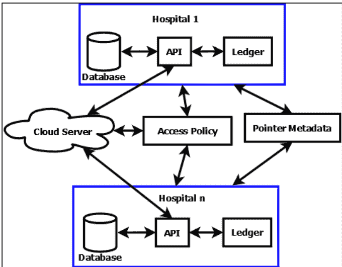

图 6.1. 架构图

### 6.3.1. 数据共享

医院、诊所、实验室和其他医疗机构依赖于多种系统中维护的各种数据源，因为医疗数据需要通过各种医疗参与者为了医疗目标（包括医疗数据交换）来保存、恢复和修改。由于不同机构之间存在多样的数据架构，所采用的技术存在问题。在共享数据之前，确保不同实体之间的数据互操作性至关重要。

### 6.3.2. 互操作性

在当今时代，大多数不同的参与者在诵读每一份额外数据时都会假设并实施 EHR 的级别。这被称为互操作性，其过程可以通过标准化和改进医疗优势来有效应用，并进一步分为三类：

- 句法互操作性：允许一种 EHR 格式系统与其他系统关联的适当过程。

- 语义互操作性：在不同系统的数据字段级别进行适当数据翻译的数据共享过程。

- 跨域互操作性：当我们考虑不同组织合作以确保受保护且适当的数据通信，即在不同组织和个人之间使用的有效数据时。

### 6.3.3. 分布式网络

区块链中实施的架构是一种对等（P2P）架构，由各种网络参与者组成的不同节点构成，网络中的每个参与者存储一份区块链的副本，并提供协作程序以进一步验证和认证网络中的所有数字交易。

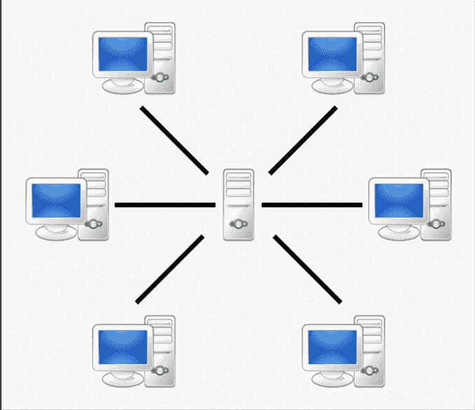

图 6.2. 区块链 P2P 架构

### 6.3.4. 共享账本

分布式网络中的各种成员倾向于通过实施各种算法来评估和验证拟议的交易，从而在共享账本中记录所有数字交易。在该过程中，当大多数网络参与者接受有效交易时，每个新交易都会补充到集体账本中。在大多数发生的情况下，集体账本的修改会在可接受的时间内复制到所有区块链副本中。根据定义，每笔交易都是不可更改的，并与账本结合，无法再被修改或撤销，因为网络中的每个成员都对区块链拥有广泛而清晰的模型，且没有特定人有能力损坏或修改此技术中的数据。

### 6.3.5. 数字交易

在区块链中，可以记录任何类型的信息或数字属性，配备区块链的网络定义了交易中受控的信息类型，以确保加密和数字合同数据的有效性和正确性。交易被组织成不同的区块，每个区块包含区块链中前一个区块的加密哈希，因为区块以线性和时间顺序添加。

## 6.4. 医疗保健中的区块链

在本章中，该提案涉及使用公共区块链，其中包含用于维护链下健康记录的访问控制管理器，且不存在使用这些方法的开放区块链标准或可能的实现，因为研究支持拟议解决方案可行性的实现。在当今时代，比特币此前已证明其在计算中是可信且可审计的，而这仅在包含共享账本的分布式网络中才有可能。此外，存在许多加密技术。本研究在很大程度上参考了 MIT 的已发表研究工作，该工作使用公共区块链来管理和控制数据存储访问，进而涉及安全和加密。

### 6.4.1. 链上存储

在区块链上存储数据的最基本方法之一，非常简单地是将数据本身作为二进制数据进行链式存储，它可以作为一个片段保留在


随后传播到社区中可能且可用交易的交易。这一过程引发了关于在单个区块链交易中可存储数据最大量的两难困境。比特币是具有固定块大小区块链中最具价值的加密货币。比特币由1兆字节组成的半固定块大小概念本身受到了广泛关注。理论上，块的确切大小（介于1兆字节到稍大之间）将是半固定的，而不是硬编码的。在单个块大小中，将存储到特定块中的交易数量不足，且存在单一争议源；当最终用户被迫支付高额交易费用时，可能会因比特币配对的当前流行程度而产生巨大影响。

### 6.4.2. 链外存储

链上存储在经济性和精确性方面均不可行，因为大部分区块链优势可用于链外存储解决方案。例如，一小段数据的哈希可以放在链上。由于哈希大小很小，存储成本也会较低。任务随后变为在链的哈希与物理存储位置之间建立链接。智能合约和分布式哈希表（DHT）是在此方面被审查的双重解决方案。在此示例中，数据也会丢失，且无法恢复。哈希表和分布式哈希表有几种方法可以绕过使用聪明协议进行简陋对等存储的缺点，并在存储网络中使用多种文件模型，这样即使唯一存储站点变得不可访问，数据也能随处可用。这消除了位置作为数据独特失望点的问题，因为散乱哈希表的主要关注点是（DHT）的结果。

### 6.4.3. 健康信息交换（HIE）背景下的信任问题

在基于互联网的环境中消费者和卖家分离的情况下，信任方面至关重要（Carvalho et al. 2016）。大多数HIE网络倾向于以电子方式与大多数需要数据的护理提供者共享患者健康信息，以便准确实施护理协调和患者安全。HIE程序包含允许在没有患者直接控制和监督的情况下共享大多数健康信息的机制。在此情况下，可能会出现许多安全问题和隐私风险，根据HIE，患者的信任非常重要。从患者处获得的反馈可以根据对技术的信念彻底预测，以在不威胁个人健康信息或在披露信息前错误处理敏感医疗记录的情况下，对HIE网络寻求保证。

在HIE模型中获得的独特信任基于对分布式机制的信念，这些机制具有不同的能力和完整性，因为患者HIE能力倾向于确定对HIE技术的依赖程度，以实现称职的性能并高效地将健康信息转移到广泛的医疗机构。对HIE的信念倾向于整合可信赖的HIE患者之间的协议概念，因为特定患者与确定用户之间的距离缺乏HIE模型中各患者之间的直接交互。医疗保健组织中行使的集中控制在处理HIE系统用于以电子方式共享医疗记录的机制时是不熟悉的，这些机制包含导致缺乏信任的因素。几乎所有特征都产生一种更为虚无的环境，该环境使用传真或邮件等传统共享方法执行任务，并且存在上述动机可能使患者充满信心，因为使用直接、基于查询和患者中介沟通等常见方法交换应用修改至关重要。

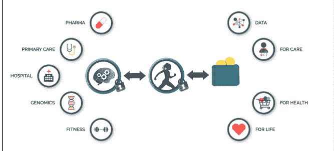

**Figure 6.3. 医疗保健区块链**

HIE计划旨在构建跨组织网络，其中患者的医疗记录在多个地理位置分离的医疗保健组织之间共享，包含通过网络技术共享的敏感数据，由于隐私问题几乎恶化，患者隐私影响HIE患者数据库的完整性与准确性。大部分结果丢失，因为存在由错误护理计划组成的无效疗法，具有最高死亡率；HIE网络必须保证患者，其医疗记录在交换过程中保持安全，基于随时可用的隐私政策，以突出组织中敏感健康信息如何通过提供未经授权的访问和二次使用来访问。

#### 6.4.3.1. 基于区块链的HIE替代方案

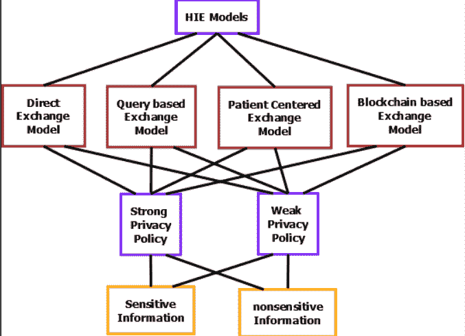

Figure 6.4. HIE模型

区块链技术日益流行，因为它是通过动态共享账本来管理业务和商业交易的一种新颖流程。区块链可以使直接或间接参与各方之间的经济交易记录更加容易。此外，由于区块链基于不同节点的点对点网络，它必须消除中介交易以及第三方对公司运营的直接控制的需要。大部分区块链研究集中于加密货币的技术方面。相反，区块链技术比虚拟货币拥有更广泛和更深入的应用集，可以用于各种经济交易以外的用途。区块链的兴趣因来自多个行业的许多努力而吸引了大量关注和融资而上升。区块链技术正在改变几乎所有行业和医疗保健。由于其基础技术，区块链最可接受的流程之一是在网络化企业（如医院）之间协调及协调沟通中建立信任。

其他组织活动，例如连接和非关联医疗公司之间的信息传输，也可能从区块链技术中受益（涉及或与医疗程序、医生、医院或诊所相关的各方）。有建议称，以区块链为中心的模型分配利用区块链的不可变性和固有自主性，可以有效地跟踪记录以访问存储在云中的敏感医疗数据。基于区块链的准入控制架构有望帮助促进与不同机构进行医疗数据分配的医疗保健组织。

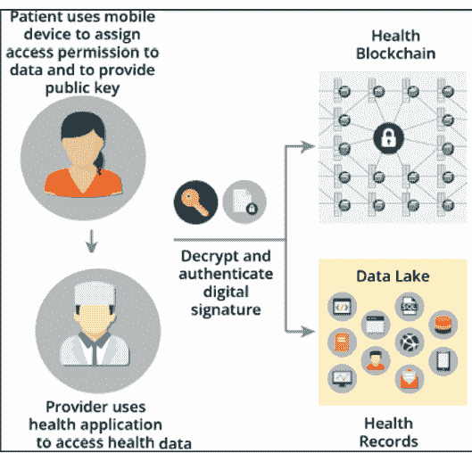

Figure 6.5. 模型流程

该技术由各种受保护的加密算法组成，这些算法受到严格控制，以访问存储在云平台上并进行处理的患者医疗记录。系统架构中实施的复杂安全性有可能检测和验证各种倾向于通过跟踪各种共享实现来访问关键医疗记录的用户。

## 6.5. 结论与未来展望

在本章中，区块链技术基于开放标准解决了互操作性问题，这些标准提供医疗保健数据的共享分布式解释，预计将在所有医疗保健相关行业中广泛采用和使用。基于本研究中概述的拟议健康区块链，大多数医疗保健贡献者和机构以及医学研究人员通过传递大量遗传、营养、生活方式、环境或医疗保健数据（保证保密性和匿名性）来启发他们的研究。HIE网络需要向持有医疗记录的患者保证，其记录在交换过程中保持安全，根据隐私政策，强调敏感健康信息仅用于其治疗以实现更好的健康和疾病预防。在创建行业就绪解决方案之前，战略领域需要更多工作，因为实施数据安全和知识产权保护存在增加的成本和激励措施。

## 6.6. 参考文献

- Ahram, T., Sargolzaei, A., Sargolzaei, S., Daniels, J., Amaba, B. (2017). 区块链技术创新. IEEE Technology & Engineering Management Conference (TEMSCON), 137–141.

- Ahsan, M.M., Wahab, A.W.A., Idris, M.Y.I., Khan, S., Bachura, E., Choo, K.-K.R. (2020). CLASS：用于云取证的云日志保障健全性与保密性方案. IEEE Trans. Sustain. Comput., 6(2), 184–196.

- Al Omar, A., Rahman, M.S., Basu, A., Kiyomoto, S. (2017). Medibchain：用于医疗保健数据的基于区块链的隐私保护平台. International Conference on Security, Privacy and Anonymity in Computation, Communication and Storage, 534–543. Springer.

- Azaria, A., Ekblaw, A., Vieira, T., Lippman, A. (2016). Medrec：使用区块链进行医疗数据访问和权限管理. 2nd International Conference on Open and Big Data (OBD), IEEE, 25–30.

- Bagha, A. and Madisetti, V.K. (2013). 用于互操作电子健康记录（EHR）的云端方法. IEEE J. Biomed. Health Inform., 17(5), 894–906.

- Begoyan, A. (2007). 电子健康记录互操作性标准概述. USA Society for Design and Process Science.

- Benchoufi, M. and Ravaud, P. (2017). 用于改善临床研究质量的区块链技术. Trials, 18(1), 335.

- Blum, M., Feldman, P., Micali, S. (1988). 非交互式零知识及其应用（扩展摘要）. Proceedings of the 20th Annual ACM Symposium on Theory of Computing, 2–4 May, Chicago, IL.

- Boonstra, A., Versluis, A., Vos, J.F. (2014). 在医院中实施电子健康记录：系统文献综述. BMC Health Serv. Res., 14(1), 370.

- Carvalho, J.V., Rocha, Á., Abreu, A. (2016). 医疗保健信息系统和技术成熟度模型：文献综述. J. Med. Syst., 40(6), 131.


Castro, M. and Liskov, B. (1999). 实用拜占庭容错. *操作系统设计与实现研讨会*, New Orleans, LA.

Crameri, K.-A., Maher, L., Van Dam, P., Prior, S. (2020). 个人电子健康记录：什么影响消费者在线参与其临床数据？文献综述. *健康信息管理杂志*, 1833358319895369.

Daemen, J. and Rijmen, V. (2002). *Rijndael设计：AES——高级加密标准*. Springer, 柏林, 海德堡.

Dai, W., Dai, C., Choo, K.R., Cui, C., Zou, D., Jin, H. (2020). SDTE：基于区块链的安全数据交易生态系统. *IEEE信息取证与安全期刊*, 15, 725–737.

Dias, J.P., Reis, L., Ferreira, H.S., Martins, Á. (2018). 电子健康场景中的区块链访问控制. arXiv:1805.12267.

Esposito, C., Santis, A.D., Tortora, G., Chang, H., Choo, K.R. (2018). 区块链：医疗云端数据安全与隐私的万能药？*IEEE云计算*, 5(1), 31–37.

Ethereum (无日期). 以太坊 [在线]. 可获取于: https://www.ethereum.org/.

Feng, Q., He, D., Liu, Z., Wang, D., Choo, K.-R. (2020). 基于身份的签名方案在IEEE p1363标准中的多方签名协议. *IET信息安全*, 1(99), 1–10. DOI: 10.1049/iet-ifs.2019.0559.

Kumar, R.R., Reddy, B., Pappula, P. (2019). 机器学习中特征选择算法的评估. *科学与技术研究国际杂志*, 8(12), 2071–2074.

Praveen, P. and Jayanth Babu, C. (2019). 大数据聚类：在大数据环境中应用常规数据挖掘技术. *计算机科学与工程创新，网络与系统讲义系列*, 74. DOI: 10.1007/978-981-13-7082-3_58.

Praveen, P., Shaik, M.A., Kumar, T.S., Choudhury, T. (2021). 智能农业：使用区块链技术和物联网保障农民安全. In *物联网生态系统中的区块链应用*, Chowdhury, T., Khanna, A., Toe, T.T., Khurana, M., Gia Nhu, N. (eds). Springer, Cham. DOI: 10.1007/978-3-030-65691-1_15.

Rama, B., Praveen, P., Sinha, H., Choudhury, T. (2017). 基于PC算法的因果规则发现研究. *2017年Infocom技术与无人系统国际会议（趋势与未来方向）（ICTUS）*, 迪拜, 616–621. DOI: 10.1109/ICTUS.2017.8286083.

# 使用区块链保护患者数据隐私

随着医疗保健行业的快速转变，信息技术的普及和医疗服务的数字化使电子健康记录（EHRs）的使用呈指数级增长。硬币的一面是，这带来了许多优势，例如改善患者护理、更高效的记录管理、研究进步等；但硬币的另一面警告我们，维护患者数据匿名性以及遵守隐私法律法规存在复杂性。黑客的兴趣已经转向医疗保健行业，过去几年中已经发生过多起事件，大量患者数据被泄露和滥用。医疗实体正在努力保护患者数据；然而，仍有如此多的泄露事件，其原因在于大多数控制措施侧重于数据安全，并且有许多时候我们可能认为安全控制也能保障隐私，但事实并非如此，这造成了差距。多项数据隐私法律以及一些特定于医疗数据的法律/标准，例如2009年《经济和临床健康信息技术（HITECH）法案》、1996年《健康保险可移植性和责任法案（HIPAA）》、《一般数据保护条例（GDPR）》等，为所有医疗实体需要遵守的各种安全和数据隐私要求提供了依据。这些法律还为患者提供了各种权利，例如同意权、控制权、处置权等。因此，现在的真正问题是如何实施数据隐私控制，以保持患者数据去标识化，同时确保医疗实体遵守隐私法律法规，并保留患者对其数据的所有权利：因此，答案是区块链。区块链的主要特性，即去中心化、透明性和安全性，使其成为隐私保护的完美选择。借助区块链，可以创建一个环境，所有患者在数据成为记录一部分之前都可以审查其数据，许可区块链可以解决患者数据访问和控制问题，共识算法和智能合约将防止患者数据篡改和未经授权的访问。众所周知，比特币是假名的，但借助区块链的隐私保护协议，可以实现匿名性。同样，区块链可以为患者数据隐私提供的最佳功能之一是其作为数据控制者的角色。数据控制者和数据处理者是多项定义数据保护责任的法律中规定的两个重要角色，因此，实施区块链用于数据隐私可以通过更好的透明性来弥补数据控制者的责任。通过将区块链集成到医疗服务或创建医疗应用程序中，我们可以实现隐私设计。

## 7.1. 引言

福祉是快乐生活的基础，当前一代人是临床创新重大进步的最幸运受益者。随着每一项创新，更多信息片段变得可用，以解读困扰我们福祉的问题。这些信息高度敏感，因为它是电子健康记录（EHR）。EHR是患者的敏感私人信息，通常在患者、诊所/医院、制药公司、健康保险公司、检验实验室等之间共享。复杂的部分是追踪这些数据，因为多个实体在存储和维护数据。医疗互操作性专注于信息交换，广泛可访问的互操作性在安全性、匿名性和管理方面带来了新的困难和要求（Magyar 2018; Guimarães et al. 2020; Huang and Lee 2020）。

有四个主要关注领域解决EHR管理中的挑战（Engelhardt 2017; Rejeb et al. 2021）：

- a) 以患者为中心：通常患者与各种医疗实体互动，并将其数据提供给多个EHR管理工具。此过程增强了共识，即不同实体的所有数据都应随时可供患者使用，以便患者可以随时掌控其信息并随时访问。

- b) 数据隐私：作为敏感个人数据，EHR要求隐私，并且仅在适当的时间由授权方访问。这仍然是一个相当复杂的领域，因为有许多法律法规要求收集、处理或传输医疗数据的实体以隐私控制的形式实施不同的数据隐私原则。

- c) 数据完整性：数据完整性关乎数据的完整性、一致性和准确性。通过确保完整的健康信息在正确的时间可供正确的人使用，以患者为中心的信息交换应赋予患者更多控制权和更好的结果。

- d) 成本：过去几十年来，全球卫生支出有所增加；然而，医疗成本仍面临危机。已有许多案例，大量资金投入EHR但因某些年龄段人群（特别是老龄化国家）接受度低而付诸东流。还有其他因素，如安全问题、使用EHR的用户友好性和舒适度等。

## 7.2. 威胁建模——医疗保健行业的数字化

医疗保健行业的数字化不仅涉及数字化核心基础设施、使医疗仪器具备IT功能或增加医疗治疗/手术中的自动化/机器人技术（Sharma et al. 2021），还涉及如何将这种数字化扩展到最终用户，这是自动化的主要部分；然而，将数字化扩展到最终用户也有其代价，这种代价不仅是金钱上的，还需要平衡最终用户希望其尽可能用户友好、强健和可靠的事实，同时服务/产品需要从设计之初就安全（Singh and Talapula 2019）。这意味着，在数字化过程中，我们不能依赖最终用户来保障安全，因为那是最脆弱的环节；服务和产品应按安全设计原则开发，即从根基上确保安全。

大约十年前，从最终用户角度来看，数字化完全依赖于通过计算机、笔记本电脑等访问的Web应用程序；但随着智能手机技术的最新进步，智能移动设备以低成本提供，一切都已改变。现在这意味着，对于最终用户，对计算机或笔记本电脑等硬件要求的依赖已不复存在，这可能增加了愿意通过手机使用医疗应用程序的最终用户数量。

这些手机之所以智能，是因为它们不仅为最终用户提供具有用户友好界面的应用程序来访问健康记录、通过语音和视频与医生聊天，还能够感知温度、人体测量值等的变化（Papageorgiou et al. 2018）。由于智能手机先进的处理能力，移动应用不仅提供存储健康记录的平台，还能访问实时位置以及照片、视频、联系人等敏感数据。

因此，在使用健康应用程序时，敏感数据面临风险，因此所有健康应用服务提供商都需要遵循许多法律法规和要求以确保数据隐私和安全。因此，实际挑战在于提供数字化医疗服务，并实施与所有法律要求相一致或满足所有法律要求的安全和隐私控制。为了更好地理解这一点，在本节中，我们将以一个通用的医疗应用程序为例，尝试了解数据流、威胁表面和可能的攻击场景。


下面两个部分的目的是先了解医疗保健中数据流的基础，然后了解当前系统中的真实安全挑战，以便在进入后续部分讨论使用区块链的安全和隐私控制时，我们可以轻松地将其与问题陈述相关联。

### 7.2.1. 数据流图（DFD）

医疗应用程序可能因服务类型而异（例如在线医生咨询、在线订购药品、病理检测、针对其患者的任何特定医院等）。因此，详细的数据流也会因应用程序类型及其中涉及的实体而异。

但是，在本节中，采用了一个通用示例，该示例在高层面上对所有类型的医疗应用程序都是相同的。本节后续将使用此 DFD 来分析威胁和安全控制。图 7.1 帮助我们展示一个高层级 DFD，其中左侧包括一位最终用户，其将使用智能手机或计算机访问应用程序用户界面。然后，根据服务类型，用户交互将连接到服务提供商端的 Health Application Service。在此期间，数据也将双向流动。此 DFD 的中间部分，即 Health Application Service 是最复杂的部分，其中将根据应用程序类型及其功能进行所有数据处理和数据存储，由于这是高层级 DFD，因此此部分显示在一个框中，否则这本身实际上将具有多个层，例如 Web 服务器、应用服务器、数据库服务器、云服务等。此部分的层级越低，威胁分析就会越好、越详细。

最后部分也非常重要，即涉及第三方，由于市场在增长，已注意到不同的应用提供商正在合作以扩展其业务。让我们举个例子，医疗应用程序 HA1 的主要功能是为患者提供医生在线咨询。后来，HA1 决定与另一家公司开展业务，并创建了 HA2，其功能是在线销售药品。如今，HA2 作为第三方集成在 HA1 上。因此，一旦患者咨询完成，应用程序 HA1 就会尝试从其平台自动将患者重定向到 HA2，以便他们从 HA2 购买药品。这意味着患者不需要在 HA2 上创建任何数据，但应用程序 HA1 将通过 API 将患者详细信息和处方传输到 HA2。整个过程对患者来说非常方便，双方业务也得到了增加，但与此同时，将患者数据传输到第三方时的安全控制问题也随之而来。不仅如此，隐私控制问题也随之而来，因为现在存在对第三方的依赖，该第三方正在访问患者的敏感个人数据。

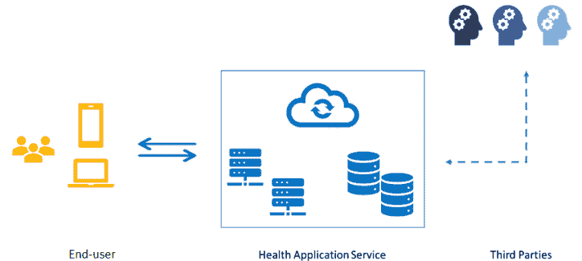

Figure 7.1. 通用医疗应用程序——高级别 DFD

现在让我们讨论一下著名术语“互联健康”（Papageorgiou et al. 2018）。随着医疗服务自动化和数字化的增加，这不仅以患者为中心，而且还在整个医疗行业中使用。在整个医疗行业中，有各种相互依赖的实体。数字化对所有实体都是一大福音，因为现在它们可以相互连接，一个实体中收集/生成的数据可以非常容易地与另一个实体共享，因此它被称为“互联健康”，其目标是实现智慧健康范式。上面已为两个应用程序 HA1 和 HA2 讨论了一个简单示例。

图 7.2 展示了“互联健康”的一个较不复杂的示例；然而，在现实中，它可能变得更加复杂。此处的目的是可视化和理解安全和隐私挑战的深度，因为健康记录正在跨这么多实体共享。图 7.1 中显示的高层级 DFD 是针对一个实体的，图 7.2 可以帮助我们理解，当此数据流在互联健康模型中扩展时，复杂性也将呈指数级增加。

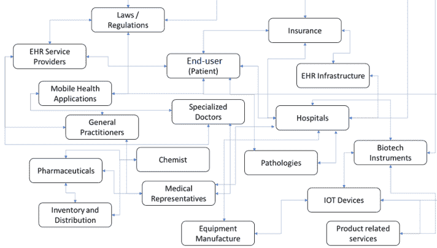

Figure 7.2. 医疗行业数字化——互联健康和服务模型

### 7.2.2. 威胁分析

在延续图 7.1 中讨论的上述 DFD 的基础上，让我们开始在其上绘制威胁面。首先，让我们了解威胁面：这些是完整系统中攻击者可以尝试利用漏洞的点集合。图 7.3 帮助我们识别上述高层级 DFD 中的威胁面；所有攻击面均用点状椭圆/圆表示。

这些攻击面可以根据其位置细分为各种漏洞和可能的攻击，例如 DoS、欺骗、中间人攻击、数据嗅探或篡改等。让我们详细阐述攻击面，并通过图 7.1 所示的一些示例来理解它们。

请始终记住，DFD 的层级越低，威胁分析就会越好、越详细。

| 序号 | 攻击面 | 攻击场景（威胁–漏洞配对） |
| :--- | :--- | :--- |
| 1 | AS1 | 最终用户设备中使用过时/未打补丁的操作系统 |
| 2 | AS1 | 未经授权访问非必需图片，即医疗应用程序中的权限提升 |
| 3 | AS2 | 例如数据包嗅探的中间人攻击 |
| 4 | AS2 | 例如会话劫持的中间人攻击 |
| 5 | AS3 | 对服务器的拒绝服务 (DoS)/分布式拒绝服务 (DDoS) 攻击 |
| 6 | AS3 | 应用程序代码中的漏洞可能帮助攻击者篡改服务、擦除所有内容等 |
| 7 | AS3 | 未打补丁的服务器/安全配置错误可能帮助攻击者获得对服务器的未经授权的远程访问 |
| 8 | AS3 | 日志记录和监控不足 |
| 9 | AS4 | 第三方应用程序未经授权访问敏感数据 |
| 10 | AS4 | 例如数据包嗅探的中间人攻击 |

Table 7.1. 图 7.1 和 7.2 所示 DFD 的威胁分析

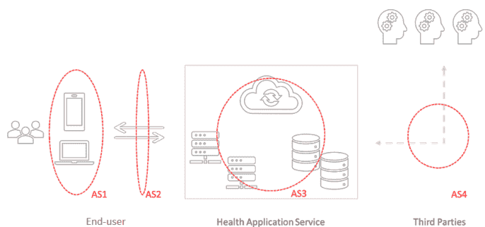

Figure 7.3. 通用健康应用程序中威胁面映射——高级别 DFD

## 7.3. 隐私与安全

在深入探讨之前，了解安全与隐私之间的区别很重要。这是因为，在许多组织和许多安全工程师/经理中，已观察到一旦实施安全控制，就认为隐私也会得到保障；然而情况并非如此。人们容易混淆，因为他们互换使用这两个词，并认为两者都意味着数据保护；然而，事实是安全与隐私不同，但具有相似的组件，这造成了歧义。

信息安全关乎保密性、完整性和可用性的保存。保密性意味着保护数据免受未经授权的访问，完整性意味着保持数据的准确性并使其可靠，可用性意味着在需要时授权用户/服务应能够访问数据。然而，隐私始于对个人数据收集的控制，以及对个人数据使用的控制，并延伸至对数据销毁/处置的控制。

重要的是要理解，安全可以在没有隐私的情况下实现，但隐私不能在没有安全的情况下实现。安全控制关注所有信息，而隐私控制关注 PII，即个人身份可识别信息、个人数据或敏感个人数据。

为了简单起见，安全保护数据的完整性、保密性和可用性，而隐私保护在数据处理方面的隐私权以及数据匿名性。

### 7.3.1. 区块链中的隐私

在深入了解区块链中的隐私之前，让我们回顾一些基本术语。分布式账本是一种分布在各种计算机设备（通常位于不同地理位置）上的数据库。分布式账本技术是指任何有助于存储和更新分布式账本的技术（Belotti et al. 2019; Ul Hassan et al. 2020）。区块链是一种分布式账本系统，允许共享经过验证的交易账本，这些交易保存在块中并通过链连接。创世块是区块链上的第一个块，所有后续块都按顺序添加到其上。区块链中的隐私通过三个关键原则实现，即密码学、去中心化和共识算法（Tian et al. 2019; Sharma and Balamurugan 2020）：

- **密码学：** 哈希是一种众所周知的密码学术语；哈希是一种数学函数，用于为此处的任何数据（块）创建特定大小的值，如果此数据（块）发生任何更改，哈希值将改变。这意味着哈希值保证了数据（块）的完整性。区块链上的每个块都包含前一个块的哈希值，并且除了哈希值外，每个块还包含一个时间戳、一个 nonce 和一条记录，即交易数据。在《区块链》这一术语中，链是哈希值，因为它是对前一个块的引用。


每个区块。图 7.4 展示了区块如何连接并借助哈希值引用前序区块的表示方式。

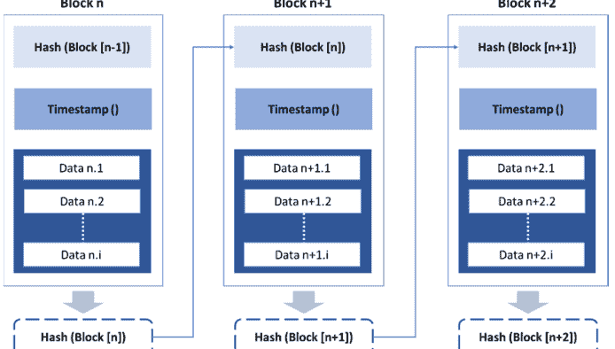

## 图 7.4. 区块链结构

密码学世界中另一个广为人知的术语是数字签名。网络中的每个参与者都有自己的私钥，用于对区块进行签名，即为每个区块创建数字签名。图 7.5 演示了数字签名的传统工作方式。

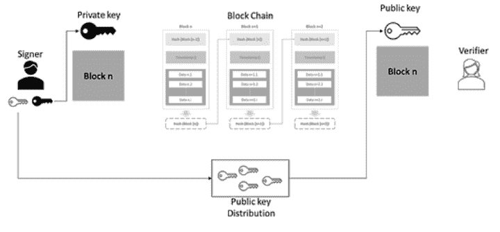

## 图 7.5. 数字签名的工作方式

- 去中心化：借助数字签名，可以清楚地看出，如果区块有任何篡改，数字签名将变得非法，网络中的对等节点将被告知已发生操纵。在去中心化期间，区块链中不会存在单一权威机构，整个过程变得更加高效，系统也变得更公平。

去中心化的美妙之处在于，没有任何节点可以操纵账本，但每个节点都持有账本的副本，因此，要对账本中的任何交易进行任何更改，都需要所有节点达成共识。这使得区块链成为一种 P2P DLT（Peer-to-Peer，分布式账本技术）。图 7.6 提供了 P2P DLT 的可视化表示。

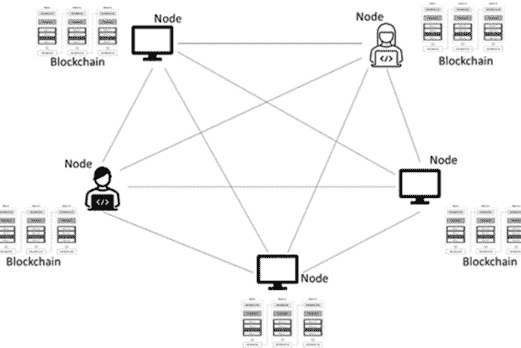

## 图 7.6. 区块链——一种 P2P DLT

- 共识算法：共识算法在之前的章节中已详细讨论。这里的目的不是要再次浏览所有不同类型的共识算法，例如工作量证明、权益证明、智能合约等，而是要了解共识算法如何帮助保护区块链中的隐私。在 7.3 节的讨论中，很明显，隐私也是关于权利保护（隐私权）和共识算法的，因此这有助于该部分。共识算法的目的是确保账本中的数据对所有节点都相同，并且每个节点都同意达成数据正确状态的过程，这意味着所有节点之间存在一致协议。这种协议因区块链的功能和目的而异。

要与现实生活中的例子相关联，可以将共识算法比作一项数据隐私法规/法律，该法规/法律要求所有各方遵守某些原则以保护数据隐私。

### 7.3.2. 流程

让我们举一些例子，以了解使用区块链技术的医疗应用程序的流程（Li et al. 2018; Belotti et al. 2019; Clim and Zota 2019; Usman and Qamar 2020; Dash et al. 2021）。在这里，我们将考虑不同类型的医疗应用程序，并解释当同一应用程序使用区块链技术设计时的系统。

第一个示例是一个简单的在线咨询医疗应用程序，患者通过医疗门户使用它在线咨询医生；为了方便参考，我们将其命名为 HealthConsult。考虑到 HealthConsult 是使用区块链技术开发的，其高层架构在图 7.7 中可视化。图 7.7 只是显示该应用程序使用了区块链，而图 7.8 显示了更详细的低级架构，清楚地说明了患者和医生如何通过区块链进行交互的流程。隐私和安全的一个重要方面是理解，这个区块链将是一个许可型区块链，即网络中只有注册节点可以访问或向区块链追加记录。除了许可型区块链之外，它还将具有区块链的所有标准功能，即哈希、数字签名、加密、去中心化、共识算法和智能合约。

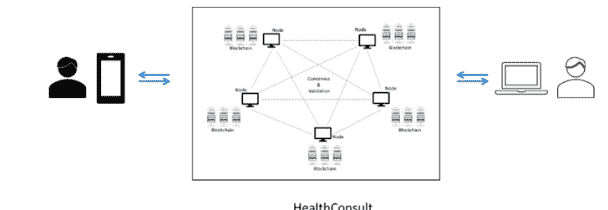

## 图 7.7. 流程 – 示例 1（高层架构）

让我们举另一个例子，假设有一家医院 HP1，它为在那里接受治疗的患者拥有自己的私有区块链。HP1 将其患者数据存储在私有区块链中。现在考虑一个场景，即一名患者被转诊到另一家医院 HP2，而 HP2 想要在开始任何治疗之前访问患者数据以查看患者的病史。可以向第三方（在本例中即 HP2）提供数据，但我们在这里需要理解的是，数据共享不是通过电子邮件或实体文档手动进行的。相反，我们在这里考虑一个场景，即 HP2 的 IT 赋能系统将与 HP1 的系统连接，并在适当验证后访问数据。但是，在这个整个过程中，存在许多安全挑战，例如未授权访问、特权提升、中间人攻击、数据泄露等。需要实施安全控制措施，有些在边界层，有些在代码层，以修复不同的安全威胁，但这会使系统过于复杂。联盟区块链是这里的解决方案，这意味着将有一个医院网络。每家医院都将拥有自己的私有区块链，同时，将创建一个由网络中授权医院管理的许可型区块链，这个区块链也被称为联盟区块链。所有医院都可以使用搜索索引访问联盟区块链，并查找患者记录。图 7.9 提供了该示例的可视化。重要的是要理解，图 7.9 是高层架构；此外，低级架构将提供共识机制、基于区块链的共享、搜索索引的工作方式以及最重要的是请求验证的工作原理。

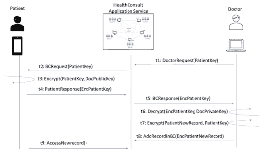

## 图 7.8. 流程 – 示例 1（低级架构）

在上一个示例中，我们刚刚了解到多家医院如何借助联盟区块链连接。同样，不同的卫生机构可以协作训练疾病分类模型。这可以使用许可型区块链实现，该区块链将使用集中式分布式机器学习协作训练模型，每家医院将使用自己的患者健康记录。在此训练期间，每家医疗机构首先会使用内部计算，随后进行跨机构聚合。这类工作最近在各种研究中以健康链、训练后的健康链等名称被提出，因为该模型保护隐私，并允许医疗机构使用广泛的数据集协作训练疾病模型（Chen et al. 2018, 2019; Li et al. 2018）。

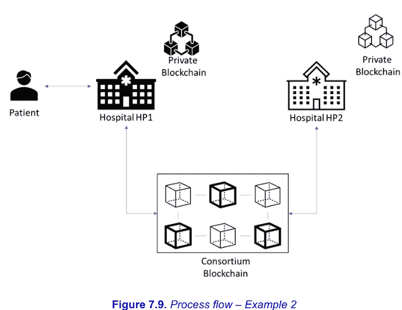

## 7.4. 监管合规要求

随着数据量的增加以及物联网、云、大数据等新兴技术的出现，数据泄露事件也有所增加。当涉及健康记录等敏感数据时，任何数据泄露的影响都非常大。PHI（受保护的健康信息）面临更大的风险。在过去十年中，发生过许多 PHI 泄露事件，要么是由医院电子健康记录管理系统造成的，要么是由保险服务提供商造成的，要么是由移动医疗应用造成的，例如在线医生咨询、在线购药应用等。因此，为了加强医疗数据隐私和安全治理，许多国家已经出台了 HIPAA、HITECH 等法规，即使 GDPR（一般数据保护条例）并非专门针对医疗数据，但它涵盖一般数据，这意味着欧盟内的任何医疗数据泄露也在 GDPR 范围之内（Jin et al. 2019）。

### 7.4.1. HIPAA、HITRUST、HITECH 和 GDPR（Shu and Jahankhani 2017; Magyar 2018; Jin et al. 2019）

HIPAA 是美国的一项法规，是 Health Insurance Portability and Accountability Act 的缩写。HIPAA 于 1996 年生效，自那以后有以下四项主要修正案：

- 2003 年安全规则修正案：
  - 技术防护措施，
  - 物理防护措施，
  - 管理防护措施；
- 2003 年隐私规则修正案；
- 2009 年违规通知规则；
- 2013 年最终综合规则。

在本节中，我们将介绍前三项修正案（不包括物理和管理防护措施，因为这与本章无关），因为我们在这里试图理解区块链作为一种技术在符合监管要求方面的帮助，而第四项修正案与受 HIPAA 影响的业务伙伴有关。因此，在讨论区块链如何帮助符合监管要求之前，让我们首先了解前三项修正案中包含的技术要求。为了简单起见，可以使用图 7.10 来可视化这些要求的轮廓。

相比之下，HITRUST 是一家私营公司，与医疗保健、技术和信息安全组织合作开发了一名为 HITRUST CSF 的全球安全与隐私框架。HITRUST 最初是 Health Information Trust Alliance 的缩写。

HITECH Act 是美国法规，其目的是强制执行 HIPAA 安全和隐私规则，并鼓励医疗服务提供者采用 EHR。

GDPR 也称为 EU-GDPR，是 European General Data Protection Regulation 的缩写，是欧洲的数据保护和隐私法规。但是，GDPR 加强了患者对其 PHI 的权利，并在同


time已提高医疗实体保护PHI的安全性和隐私要求。

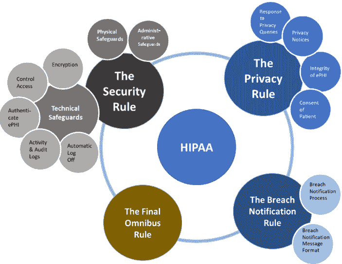

图 7.10. HIPAA要求

### 7.4.2. 区块链作为救星

区块链的基本支柱可以在不同监管要求需要以技术控制形式实施时，支持安全性/隐私控制（Yue et al. 2016；Kuo et al. 2017；Shu and Jahankhani 2017；Jin et al. 2019）：

- 让我们从去中心化开始。在传统的医疗应用中使用DBMS，而区块链提供去中心化，使不同的医疗实体能够在没有任何中央管理实体的情况下进行协作。使用DBMS不太容易实现这一点。
- 借助区块链，PHI免受任何篡改，更加安全，因为账本无法被修改，区块链仅支持账本的创建和读取。
- 在区块链中，由于密码学和数字签名，所有记录都由来源进行数字签名，因此所有记录均可验证来源。
- 由于去中心化，数据不存储在单一节点上，因此永远不会遭受单点故障问题，这使得数据始终可用。
- 由于区块链中每个区块默认都经过加密，因此确保了数据的机密性不受损害。
- 区块链使能并加强了患者拥有、共享和控制其数据的权利。
- 许可型区块链确保恶意节点无法参与网络。
- 最重要的是，许多与医疗实体和患者之间合规性及协议相关的监管要求可以使用智能合约和共识算法来实现。

## 7.5. 差分隐私

差分隐私的概念由C. Dwork于2006年首次提出，用于统计数据集（Ul Hassan et al. 2020）。从数学角度理解，差分隐私是在数据中添加噪声以保护其隐私。考虑一个分析数据集并计算均值、中位数和方差等统计结果的函数。现在，如果该函数的算法经过增强，使得通过查看输出无法判断某个个体的数据是否作为输入用于数据集，在这种情况下，该算法将被视为差分私有（Ul Hassan et al. 2020）。

让我们举一个简单的例子：在市场调研期间，一个团队想知道“有多少人看过《老友记》系列”、“有多少人看过《西装暴徒》”和“有多少人看过《小丑》”。现在，如果回答这些问题的系统拥有差分隐私算法，它会先向真实值添加噪声，然后向市场调研团队提供近似数据。这些近似数据将得出与实际数据相同的结论，因此不会过度影响市场调研团队。这就是差分隐私的主要好处，即数据可用于分析，同时保证保护个人隐私。

让我们举另一个例子：一名策展人要求医疗数据所有者检查特定城市过去五年内去世患者的数据集，并回答每位患者是否死于癌症。医疗数据所有者同意基于算法提供近似计数，而不是提供实际数据。该算法已在图7.11中可视化。对于每个患者行，首先医疗数据所有者会掷一枚硬币，如果是正面，则他们会向策展人说出真相。如果是反面，他们会再次掷硬币，如果是正面，则回答“是”，如果是反面，则向策展人回答“否”。根据概率，策展人将在一半的时间知道真相，而在另一半时间，会有一个随机答案，该答案也包含一些“真相”，因此策展人将得到一个近似答案。

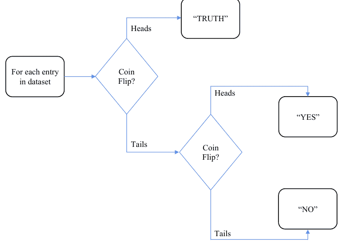

图 7.11. 差分隐私算法示例

### 7.5.1. 本地差分隐私与全局差分隐私（Ul Hassan et al. 2020）

考虑一个场景：研究人员向多个数据生成器请求某种数据进行分析。在本地私有系统中，每个数据生成器将生成原始数据，向其中添加噪声并将数据发送给研究人员。而在全局隐私系统中，每个数据生成器首先将数据发送给可信策展人，策展人将汇总数据（或对数据进行分组），然后添加噪声并将其提供给研究人员。这两种系统如图7.12所示。

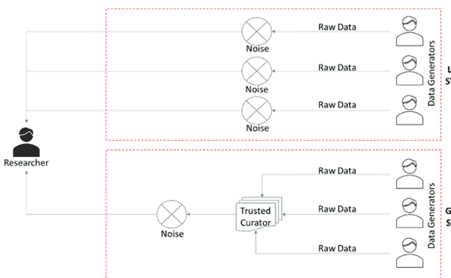

图 7.12. 本地系统和全局系统

### 7.5.2. 隐私量化及差分隐私的数学形式（Sun et al. 2019；Ul Hassan et al. 2020）

差分隐私对隐私进行量化。它不将隐私定义为二元值，例如数据是否已泄露，而是将隐私量化为“隐私损失”，即面临暴露风险。“隐私损失”的值会随数据处理次数增加而增加。方程[7.1]中使用的术语如下：

- 参数 ε 表示隐私损失；
- D1 和 D2 表示相邻数据集；
- F 是差分隐私的随机函数，F 的范围是 D1 × D2；
- P 是概率，当且仅当（O ∈ F）时满足，其中 O 是 F 的输出。我们得到以下：

```
P[F (D1) ∈ O] ≤ exp(ε) × P[F (D2) ∈ O]      [7.1]
```

在这里，Range(F) 是函数 F 的最大值，ε 是隐私损失参数，有助于控制隐私级别。

### 7.5.3. 在区块链中使用差分隐私的优势

既然我们已经解释了差分隐私的概念，理解它在区块链中的用途就会更容易。区块链的基本特性使其成为下一代安全存储，而在区块链中使用差分隐私将增强区块链的隐私性。以下是一些示例：

- 保护发送者和接收者地址免受惩罚性和羽毛分叉攻击以及关联攻击；
- 保护网络范围内的隐私免受去匿名化攻击；
- 在共识过程中保护数据；
- 防御三位一体攻击。

## 7.6. 隐私即设计

“隐私即设计”和“隐私即默认”是常用术语，特别是在新的隐私法规开始出台以来。“隐私即设计”旨在将隐私要求和控制集成到所有涉及个人信息的新系统中。这意味着“隐私即设计”建议从产品/系统开发的最初阶段就应考虑隐私要求，并将其集成到系统的设计和架构中，以便在系统开发完成后，所有隐私控制都嵌入系统。另一方面，“隐私即默认”讨论的是开发后阶段，即产品/系统部署到生产环境后，隐私设置应默认启用。

“隐私即设计”概念最初由加拿大前信息与隐私专员Ann Cavoukian讨论，她创立了几项原则作为“隐私即设计”的基础。这些原则的目的是将隐私作为组织优先事项、项目目标和设计过程不可或缺的一部分。“隐私即设计”的七项原则在图7.13中讨论（Kurtz et al. 2018；Romanou 2018；Wahlstrom et al. 2020）。

从区块链的角度来看，由于区块链的基本特性，许多原则可以轻松遵循。然而，强烈建议在使用区块链创建任何系统/应用程序时，首先列出所有隐私要求，然后创建一个映射，划分为以下三类：由区块链特性自动满足的部分；需要在共识算法和智能合约中覆盖的部分；最后，需要将附加安全/隐私功能集成到区块链中以增强其安全性和隐私能力（例如差分隐私和代理再加密）的部分。


**原则 1 主动而非被动——预防而非补救**
- 在隐私问题和风险发生前预见它们
- 建立隐私意识文化

**原则 2 以隐私为默认设置**
- 个人数据应始终在系统中自动受到保护
- 用户无需采取额外操作

**原则 3 将隐私嵌入设计**
- 隐私控制不应添加到系统上，而应嵌入系统中
- 数据保护应是任何系统的核心功能

**原则 4 保留完整功能（正和，而非零和）**
- 双赢局面，无需权衡
- 在实现隐私和安全的同时无需妥协或权衡

**原则 5 确保端到端安全**
- 数据全生命周期安全
- 从数据创建/收集至数据销毁

**原则 6 保持可见性和透明度——保持开放**
- 确保数据所有者的可见性和透明度
- 利益相关者在独立验证后应拥有可见性

**原则 7 尊重用户隐私——以用户为中心**
- 为用户提供强大的隐私默认设置
- 适当的隐私通知

图 7.13. 隐私融入式设计原则

## 7.7. 结论

区块链技术被视为一种颠覆性技术，这就是为什么银行等行业正在采用它，以实现更快的交易、降低成本、提高安全性和记录保存。在医疗保健行业，区块链可以成为医疗实体的宝贵推动因素，因为它可以允许不同的医疗实体共享其网络，而不会损害数据安全性和完整性，同时仍然允许他们追踪来源和变更。随着医疗领域数字化程度的提高，信任与安全性一起变得重要，而区块链因其提供信任、安全性和隐私性的基本原则而受到重视。随着物联网（IoT）在医疗保健中的介入，通信过程中的安全需求增加，导致相互依赖性也随之增加。当前的迫切需求是开展更多基于区块链作为骨干的医疗应用程序原型开发研究，根据服务类型进行分类。这将有助于在医疗领域扩展区块链。

## 7.8. 参考文献

Belotti, M., Božić, N., Pujolle, G., Secci, S. (2019). 区块链技术指南：何时、哪种、如何. IEEE Commun. Surv. Tutorials, 21, 3796–3838. DOI: 10.1109/COMST.2019.2928178.

Chen, Y., Ding, S., Xu, Z., Zheng, H., Yang, S. (2018). 基于区块链的医疗记录安全存储和医疗服务框架. J. Med. Syst., 43. DOI: 10.1007/s10916-018-1121-4.

Chen, X., Wang, X., Yang, K. (2019). 用于疾病诊断的异步基于区块链的隐私保护训练框架. 2019 IEEE International Conference on Big Data (Big Data), 5469–5473. DOI: 10.1109/BigData47090.2019.9006173.

Clim, A., Zota, R.D., Constantinescu, R. (2019). m-健康应用中基于区块链的数据交换. Procedia Comput. Sci., 160, 281–288. DOI: 10.1016/j.procs.2019.11.088.

Dash, S., Gantayat, P.K., Das, R.K. (2021). 医疗保健中的区块链技术：机遇与挑战. In Intelligent Systems Reference Library, Panda, S.K., Jena, A.K., Swain, S.K., Satapathy, S.C. (eds). Springer International Publishing, Cham. DOI: 10.1007/978-3-030-69395-4_6.

Engelhardt, M.A. (2017). 将医疗保健与区块链相连：医疗保健领域区块链技术简介. Technol. Innov. Manag. Rev., 7, 22–34. DOI: 10.22215/timreview/1111.

Guimarães, T., Silva, H., Peixoto, H., Santos, M. (2020). 重症医学中模块化区块链实现. Procedia Comput. Sci., 170, 1059–1064. DOI: 10.1016/j.procs.2020.03.073.

Huang, L. and Lee, H.H. (2020). 基于区块链和云计算的医疗数据隐私保护方案. Wireless Communications and Mobile Computing, 8859961. DOI: 10.1155/2020/8859961.

Jin, H., Luo, Y., Li, P., Mathew, J. (2019). 安全和隐私保护医疗数据共享综述. IEEE Access., 7, 61656–61669. DOI: 10.1109/ACCESS.2019.2916503.

Kuo, T.T., Kim, H.E., Ohno-Machado, L. (2017). 面向生物医学和医疗保健应用的区块链分布式账本技术. J. Am. Med. Informatics Assoc., 24, 1211–1220. DOI: 10.1093/jamia/ocx068.

Kurtz, C., Semmann, M., Böhmann, T. (2018). 为遵守 GDPR 的隐私设计：第三方数据处理商综述. Am. Conf. Inf. Syst., Digit. Disruption, AMCIS, 1–10.

Li, H., Zhu, L., Shen, M., Gao, F., Tao, X., Liu, S. (2018). 医疗数据基于区块链的数据保存系统. J. Med. Syst., 42, 1–13. DOI: 10.1007/s10916-018-0997-3.

Magyar, G. (2017). 区块链：解决电子健康记录数据中隐私与研究可用性权衡的新颠覆性健康数据管理技术. IEEE 30th Jubil. Neumann Colloquium, 135–140. DOI: 10.1109/NC.2017.8263269.

Papageorgiou, A., Strigkos, M., Politou, E., Alepis, E., Solanas, A., Patsakis, C. (2018). 移动健康应用的安全与隐私分析：实践中的警告状态. IEEE Access., 6, 9390–9403. DOI: 10.1109/ACCESS.2018.2799522.

Rejeb, A., Treiblmaier, H., Rejeb, K., Zailani, S. (2021). 医疗保健领域的区块链研究：文献计量学回顾与当前研究趋势. J. Data Inf. Manag., 3, 109–124. DOI: 10.1007/s42488-021-00046-2.

Romanou, A. (2018). 在出现数据保护问题的领域实施隐私设计的必要性. Comput. Law Secur. Rev., 34, 99–110. DOI: 10.1016/j.clsr.2017.05.021.

Sharma, Y. and Balamurugan, B. (2020). 使用区块链保护电子健康记录的隐私. Procedia Comput. Sci., 173, 171–180. DOI: 10.1016/j.procs.2020.06.021.

Sharma, K., Singh, H., Sharma, D.K., Kumar, A., Nayyar, A., Krishnamurthi, R. (2021). COVID-19 热点地区无人机药品和其他医疗物品配送的动态模型与控制技术. DOI: 10.1007/978-3-030-60039-6_1.

Shu, I.N. and Jahankhani, H. (2017). 新《欧盟通用数据保护条例》（GDPR）对医疗保健和社会护理信息治理工具包的影响——以英格兰初级保健为特别参考. 2017 Cybersecurity and Cyberforensics Conference (CCC), 31–37. DOI: 10.1109/CCC.2017.16.

Singh, H., Talapula, D.K., Alind. (2019). 基于物联网的丘陵地区实时道路交通监测与追踪系统. Int. J. Eng. Adv. Technol., 8(5), 2199–2205.

Sun, Z., Wang, Y., Shu, M., Liu, R., Zhao, H. (2019). 医疗数据数据和模型发布的差分隐私. IEEE Access., 7, 152103–152114. DOI: 10.1109/ACCESS.2019.2947295.

Tian, H., He, J., Ding, Y. (2019). 具有隐私性的区块链医疗数据管理. J. Med. Syst., 43. DOI: 10.1007/s10916-018-1144-x.

Ul Hassan, M., Rehmani, M.H., Chen, J. (2020). 区块链技术中的差分隐私：一种面向未来的方法. J. Parallel Distrib. Comput., 145, 50–74. DOI: 10.1016/j.jpdc.2020.06.003.

Usman, M. and Qamar, U. (2020). 使用区块链技术进行安全的电子病历存储和共享. Procedia Comput. Sci., 174, 321–327. DOI: 10.1016/j.procs.2020.06.093.

Wahlstrom, K., Ulhaq, A., Burmeister, O. (2020). 隐私设计：全息链探索. Australas. J. Inf. Syst., 24, 1–9. DOI: 10.3127/AJIS.V24I0.2801.

Yue, X., Wang, H., Jin, D., Li, M., Jiang, W. (2016). 医疗数据网关：基于区块链和新颖隐私风险控制的医疗智能基础. J. Med. Syst., 40. DOI: 10.1007/s10916-016-0574-6.

Zhang, A. and Lin, X. (2018). 通过联盟区块链实现电子健康系统中安全和隐私保护的数据共享. J. Med. Syst., 42. DOI: 10.1007/s10916-018-0995-5.

# 使用区块链和 AI 的去中心化智能医疗保健系统

患者、开发者、供应商和立法者都因医疗保健领域数据可用性增加和智能机器快速创新而面临重大挑战。简单的人脸照片或视频正被转化为用于预测建模的有效记录，借助独特的深度学习或迁移学习算法，将更多关于人类的统计数据转化为医学科学。患者现在对谁能访问其医疗记录几乎没有控制权，并且对其所持数据的总成本一无所知。这种革命性的区块链技术将使社会更接近这样的理念：每条患者记录都能够将变更传达给一个开源的、社区广泛信任的分类账，该分类账在企业间可用且可理解，并保证完整性。本文描述了一个基于区块链的碎片化个人健康数据生态系统，支持独特的药物发现、生物标志物开发和预防性医疗程序，以及使用区块链和深度学习技术来连接个人记录的用户和提供者与医疗记录的安全个人记录。

## 8.1. 医疗保健系统简介

医院、药房和初级保健部门都是各自不同的工作环境。医疗保健非常复杂，人们必须了解广泛的主题，包括医院表格、患者护理、福利、医疗保健提供者和法律困难。本指南将帮助人们学习基本的医疗保健概念，以便他们能够提高员工绩效并理解系统。


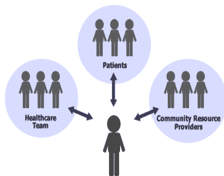

### 图 8.1. 医疗保健系统关系

要在工作中有效，人们非常了解医疗保健系统。用户可以以多种分组方式协作，如下图所示。当人们主要与医疗专业人员打交道时，用户需要了解医疗中心、可能的治疗方案以及每个团队的角色。与患者打交道的人现在必须熟悉不同类型的保险、如何帮助无保险人群以及如何保护患者隐私和权利。人们需要知道社区中有哪些可用资源以及如何与之联系。

### 8.1.1. AI简介

专家系统最近也在医疗领域引起头条新闻，引发了关于AI医生是否能取代人类医生的激烈讨论。计算机不会立即取代人类医生，但AI肯定会帮助医生做出良好的临床决策，并可能在医疗保健的某些领域（例如放射学）取代人类判断。医疗保健领域最近成功的AI应用得益于医疗数据的日益可用性或高级分析算法的大规模发展。有效的AI工具可以从海量数据中提取具有临床意义的知识，协助临床决策制定（Al-Megren et al. 2018; Grishin et al. 2019; Han et al. 2019; Alsalamah and Nuzzolese 2020; Efremova and Teichmann 2020）。AI的优势在学术文献中已得到广泛研究。AI可以使用有效的方法从大量医疗数据中“学习”特征，然后应用结果来改进现代医学。它还可以从反馈中学习并自我纠正以提高准确性。智能机器可以通过以文章、教科书和临床程序的形式提供最新的医学信息来支持医生，使他们能够提供适当的患者护理。此外，任何智能设备都有助于减少诊断和治疗错误，这在人类医学中是必不可少的。此外，AI设备从大量患者中收集有用数据，以帮助为健康风险警报和预测创建实时推断。

#### 8.1.1.1. 医疗数据

为了了解类似人群，了解患者特征与预期结果之间的联系，AI系统必须使用由临床操作（如筛查、诊断或治疗分配）提供的数据进行“训练”。人口统计学、医疗报告、医疗仪器的电子记录、体检、临床实验室检查和照片，以及许多其他事物，都是医疗数据的样本（Alsalamah and Nuzzolese 2020）。

### 8.1.2. 区块链简介

根据美国国家标准与技术研究院（NIST）的说法（例如银行、公司或政府），“区块链是以分布式方式（即没有中央存储库）且通常没有中央机构应用的防篡改和抗篡改数字账本”。这使得任何数量的参与者可以在团队中以类似智能合约的方式存储交易，这在其最基本的层面上。当区块链网络正常运行时，少量交易在发布前可能会被更改。虽然存在重要区别，但区块链和分布式账本技术（DLT）这两个术语经常互换使用，尤其是在确定解决方案的商业价值方面。数据或交易链被定义为一组情境相关的加密签名，它们通过哈希相关联，或保存在共享账本上，借助一系列称为节点的互连进程。节点在其计算机上保存整个链的副本，并定期更新和维护。

传统编程、网络、数据库和在线应用程序均构建在包括网络、哈希和加密在内的知名且经过验证的底层技术之上。它将从独特的角度探讨架构、趋势、数据交换和实施。虽然医疗保健领域的区块链仍处于起步阶段，但早期解决方案已显示出降低医疗成本、加速业务流程以及增加朝着同一目标努力的不同且多样化的利益相关者之间的知识获取的潜力。

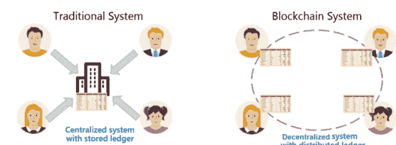

### 图 8.2. 集中式系统和去中心化区块链系统

没有中央机构控制添加到区块链的内容，这是该技术的一个关键特征。相反，在这样一个点对点网络中，通过采用多种共识算法，自主添加被选定。区块链的另一个关键属性是持久性。一旦数据被批准加入区块链，就不可行地删除数据，因为它分布在多个账本上并由多个存储库处理（Salah et al. 2019）。此外，多种区块链技术将匿名性（或匿名化）作为一个可取功能的选项。

关于所有最新和先前的块，并利用作者的哈希，区块链实现了审计和可追溯性。这形成了一系列块。块中的连接被排列成默克尔树（Chen et al. 2018），每个叶子的重要性都针对可信源进行了验证。决策层次结构可以通过将图的根放在这个区块链上来确保其信息的安全。

## 8.2. 医疗保健系统中的人工智能应用

电子健康记录支持了医疗行业的数字化，但该过程带来了许多挑战，包括认知疲劳、重复性文书工作和用户倦怠。EHR开发人员已使用人工智能来创建更直观的界面，并自动化以前占用用户大量时间的某些重复性任务。根据Adam Landman（医学博士，Brigham Healthcare副总裁兼首席信息官）的说法，客户花大量时间在三件事上：临床分析、条形码以及扫描收件箱（Azaria et al. 2016; Destefans et al. 2018; Kiktenko et al. 2018; Maxmen 2018; Tikhomirov et al. 2018）。自然语言处理（NLP）方法不足；尽管语音搜索和转录可以协助和增强医疗报告。“我们应该更有创意，并考虑像录制临床会话这样的调整，类似于警察佩戴执法记录仪，”该数据科学家声称。“之后，你可以使用人工智能对这些录音进行编目，以便可能的信息检索。”展望未来，包含智能传感器的软件系统将被带到病床边，供医生下单时使用，类似于在家中使用Siri和Alexa。

人工智能甚至可以从其收件箱中管理日常任务，例如结果更新后的麻醉药处方。根据Landman的说法，它还可以通过强调需要临床医生关注的事项，帮助用户完成待办事项列表。医疗保健高管正面临前所未有的销售、成本和质量挑战。他们认为，人工智能是更好决策的关键，因为它可以提供更快的观察或更低的容错率。

这些努力可能包括增强智能，它超越人工智能，允许人类做出尽可能明智的决策，即使偶尔失败。

因此，越来越多的商业和分析专业人士努力将人工智能（AI）纳入其预测流程，以更好地解决这些紧迫问题。这些努力往往以惨败告终。领导者一直在努力将分析整合到当前系统中，整合或更改工作流程，并传达AI的好处。

Medical Catalyst的Healthcare第一个版本主要关注涉及步骤和服务预测模型的用例。但是，在没有专家指导（自助服务）的情况下使用时，上述方法几乎总是低效的，且范围太有限，限制了其在医疗保健中的实用性（Medicine Catalyst的新医疗服务）（Yaji et al. 2018; Salah et al. 2019; Mattos et al. 2020）。AI提供了积极的、颠覆性的产品系列或可访问的目的地，以解决更广泛的市场关切（医疗保健）。智能大大拓宽了其应用多样性，但在工作场景中使用。

## 8.3. 医疗保健系统中区块链的应用

区块链网络可能有助于数据隐私、多样性和交易成本降低。它们还可以帮助提高用药准确性，通过结果改善患者护理，并整合跨境健康记录。在紧急情况下这可能很有利，因为医院可以立即访问数据，而不是必须获取单个患者信息（Woods 2018; Kumar Singh et al. 2020）。


区块链网络可通过整合这些功能，提供实时医疗监督或知识升级，同时使用机器学习来评估传感器节点 (IoT)。当链接到数据库时，它可以被医疗保健提供者以及一系列企业使用。因此，医疗保健工作者现在可以轻松访问患者记录，这既节省了成本，又改善了医院之间的协作。

区块链仍可惠及健康信息交换 (HIE) 以及医疗保健企业集成。通过保险提供者、财务和运营服务、收益周期以及供应商等功能集成系统，仍可显著降低后台数据输入和维护费用 (Karafilotos and Mishev 2017; Kumar Singh et al. 2020)。其他好处包括数据准确性和安全性。基于持续的统计汇总，各地可能会发展出统一的医疗保健系统。扩展医疗保健系统的多种好处最终可能导致成本降低；存在一系列案例和在线医疗保健系统。最后，区块链技术有潜力在多种数据驱动的医疗保健领域中应用，包括健康记录、索赔、互操作性、患者访问和供应链。

## 8.4. 医疗护理历史

使用区块链可以编纂患者的病史。这种纵向数据可以在区块中维护，不仅提供关于个别患者的有用信息，也为其他人口细分群体提供信息。分布式网络有助于多个服务提供者之间的护理协调。例如，在假设性情境中，为了获取患者的病史，医生可能会扫描他们的智能手腕。在医疗环境中，这尤其重要，因为患者信息会实时发送给医院和医生，然后他们使用链来访问医疗账户，包括主管技术人员输入的数据。可穿戴设备依赖 IoT，它可以从任何地方提供基于医院的诊断和治疗。此外，将移动应用中的健康数据与基因组合并，可以提供关于易患某些疾病或对特定药物有反应的亚人群的有用信息。

### 8.4.1. 健康索赔

模块化设计还可使另一个领域受益，即健康索赔和保险。当连接到区块链时，此类索赔能迅速获批，节省时间和金钱。因为患者的银行存款和医疗存款将通过使用区块链而互连，数据交换方法以及网络设备可以实现纠纷的快速结算。

### 8.4.2. 互操作性

医疗记录传统上一直不连通，并存储在服务提供商的孤岛中。这是因为电子健康记录 (EHRs) 是按病例设计的，未考虑终身记录或多个服务提供者所需的关联，因此缺乏关联、共同设计和标准。没有现成的系统用于与利益相关方甚至患者共享医疗数据。因此，如果竞争性医疗服务仍然可用，患者的常规经认证记录无法在其他时期转换为此类记录。患者和医疗服务提供者都从互操作性中获益良多。数据互操作性使人口健康项目成为可能，链也可用于收集大量健康信息，以帮助这些大规模倡议。

### 8.4.3. 医疗保健可及性

患者可以访问其医疗记录，这是数据采集协议的另一个优势。这取决于医疗数据的可移植性，如果监管和法律标准已完成，则可以实现这一点。如果医疗区块链技术已与更相关的临床研究关联，医院会提供最相关的药物。患者将更加了解情况，并能够基于研究而非传统知识，与医疗医生讨论最佳治疗方案。去中心化系统用于医疗数据集成，通过提供安全可靠的医疗数据信息、同步记录并授予患者访问权限，同时检查用户合规性。

### 8.4.4. 供应链

区块链还用于连接供应链中的患者、网络运营商或企业，以便实时跟踪或处理请求。消费者应了解其处方药中成分的功效、来源和副作用。因此，供应链效率和质量控制可能会提高。一种称为区块链的制造流程可以将产品追溯到制造商，并管理供应商或客户付款，从而降低成本并消除人为错误。区块链在医疗保健领域提供了巨大潜力。它可能带来整合的医疗数据，这将帮助政府建立国家医疗保健系统。就医疗保健而言，区块链几乎可以应用于广泛的领域。我们相信，区块链将对医疗系统产生与互联网对媒体相同的影响。

## 8.5. 文献综述

在医疗保健领域，目前没有可用的 AI 模型。人工智能通过执行以前由人类以极低成本完成的任务，改善了患者、临床医生和医疗管理人员的生活。AI 在医疗行业有多种应用。美国的医疗系统急需彻底改革。从慢性疾病和癌症到放射摄影和质量保证，几乎有无限的机会利用技术，在客户治疗过程中恰到好处地提供越来越精确、高效和有影响力的治疗。人工智能有望成为推动整个系统变革的火花，随着支付方式的增长、客户对医疗保健提供者的要求不断提高，或数据可用性持续提升。

与 AI 相比，使用分析系统进行诊断决策存在多种缺点。当学习算法相互通信时，它们可以变得更加精确和准确，为人类提供关于诊断、治疗方案差异和患者预后的独特见解。领先的学者和临床教师讨论了 12 项创新以及医疗保健领域的其他方面；在同一周，2018 年世界医疗创新论坛 (WMIF) 上关于机器学习的活动举行，并由 Members Healthcare 专题报道，人们几乎可以肯定会看到机器学习在未来四分之一世纪内产生重大影响。

尽管电子健康记录 (EHRs) 使医疗行业的数字化工作受益，但这一变化导致了大量问题，包括认知疲劳、无休止的文书工作和用户倦怠。医疗架构师已经在使用人工智能来创建更易于使用的界面并自动化一些耗时的重复性任务。临床报告、患者注册以及住院和门诊分诊似乎是某些个人花费大量时间的三项活动。

NLP 技术对于临床文档来说是不够的，尽管语音识别或合成可以辅助它。在倡导在临床接触中使用摄像头之后，兰德曼继续说道：“用户随后可以使用 AI 和机器学习对类似录音进行分类，以便进行可能的信息检索。未来，虚拟医疗助理将被带到医院，类似于我们在家中使用 Siri 和 Alexa，并能够使用嵌入式智能提交订单。”人工智能随后可以处理收件箱中的日常需求，例如结果更新后的糖尿病用品。它还可以通过强调需要医生立即关注的事项，帮助用户完成待办事项清单。

抗生素耐药性正成为全世界人们日益关注的问题，尽管过度使用这些挽救生命的治疗方法刺激了抗生素耐药超级细菌的产生。多重耐药细菌可能在医院中造成破坏，每年杀死数千人。美国医疗服务每年花费 50 亿美元，并使超过 30,000 人的生命处于危险之中。电子健康记录的数据可以帮助检测感染模式，并在患者出现症状之前识别处于危险中的人。使用机器学习和人工智能驱动这些分析将提高其准确性，并为健康公司提供更容易、更准确的通知。

“人工智能技术将应对传染并掌控抗生素冲突预期，”MGH 感染控制部门副主管 Erica Shenoy 医学博士、哲学博士说。“如果不这样做，我们就完蛋了。”如果医院对大量的 EHR 数据置之不理，如果行业不开发更好、更快的临床试验设计，如果 EHRs 不使用它们产生的数据，那将是一场悲剧。

使病理视觉分析更加精确，“EHR 的病理结果占数据的 70%–75%。我们越具体，越快能够做出准确诊断，效果越好。AI 和数字病理学可以在这方面提供帮助。”供应商可能能够发现原本会被遗漏的东西，主要是通过感官系统，这些系统可以通过在极其巨大的数字照片中深入挖掘输入图像的程序来实现。“我们终于可以预测癌症会迅速还是缓慢进展，以及这将如何通过算法而非临床分期或组织病理学分级影响患者的治疗方式，”Golden 说。“这将是巨大的进步。”人工智能将在人类医生评估材料之前检测切片中的感兴趣特征，从而提高效率。“AI 将扫描展示内容并为我们指出重要信息，以便我们可以弄清楚什么重要、什么不重要，”这位研究员解释道。这降低了病理学家的成本，同时提高了他们在每位患者身上花费时间的价值。

## 8.6. 为医疗设备和机器引入智能

智能设备正在席卷消费领域，从冰箱内部的实时图像到汽车，可以识别驾驶员是否专注。


智能设备在医疗业务中至关重要，可用于追踪 ICU 和其他场所的患者。人工智能可以提高预测病情恶化、检测脓毒症迅速发展或识别并发症开始的能力，从而降低与医院获得性疾病相关的成本。“我们正在讨论从整个医疗系统聚合零散数据，将其合并，并生成一个简单的警示，提示 ICU 医生尽早干预，”MGH & BWH 临床数据科学中心执行主任马克·米查斯基医学博士指出。将智能系统集成到特定设备中可能会让专业人士的感知更容易，患者也能尽快接受治疗。

在监控系统、可穿戴技术或便携式工具中，几乎每个消费者很快都将能够使用配备可记录相关健康数据传感器的设备。当人们在户外时，他们会产生额外的医疗数据，从带有步数追踪器的手机到可以检测全球脉搏的可穿戴设备。研究人员可能能够通过分析结果，以及将其与使用应用程序或其他个人监测设备的个人提供的信息合并，从而对健康促进获得独特的视角。人工智能 (AI) 可以协助从如此庞大且多样的数据源中提取重要事实。根据奥马尔·阿尔努特医学博士（该认知神经学健康中心联合主任，但为 BWH 的附属外科医生）的说法，劝说患者分享如此密切且持续监测的统计数据可能需要付出一些额外努力。

“我们作为一个国家，在没有这些电子数据的情况下已经相当进步了。”当剑桥分析公司以及 Facebook 等公司发展壮大时，人们可能会更加谨慎选择合作对象。与此同时，据他介绍，患者更愿意信任自己的医生，而不是像 Facebook 这样的全球公司，这有助于缓解向大型研究项目提供数据的任何顾虑。据阿尔努特介绍，由于我们的治疗通常具有时效性，客户获得的记录又如此不精确，因此（个人统计数据）很有可能产生重大影响。“频繁收集详细数据通常会增加数据帮助我们提供更好患者护理的可能性。”

专家一致认为，使用手机和其他消费级设备拍摄的照片将是临床质量成像的极好补充，尤其是对发展中国家弱势群体而言。据专家介绍，这是利用便携技术潜力的一部分。每年，手机摄像头的分辨率都在提高，现在可以生成人工智能算法可评估的照片。皮肤科和眼科是首先从这项创新中受益的专科。

英国的研究人员还开发了一种系统，该系统除了识别脑部疾病外，还能分析语言表现。该方法可以检测儿童下颌线、眼睛和鼻子的排列以及其他可能暗示颅面畸形的独特特征。该软件目前能够将普通图片与 90 多种疾病相匹配，帮助临床医生做出更好的选择。“大多数人都拥有口袋大小、功能强大且内置各种传感器的设备，”BWH 微纳米医学与数字健康实验室主任哈迪·沙菲伊博士说。

这是我们千载难逢的机会。几乎每个主要行业参与者都已开始将人工智能 (AI) 软件和技术集成到其服务中。这并非巧合。在这个虚拟时代，研究人员每天获取超过 250 万千兆字节的数据。手机制造商表示，通过将这项技术与 AI 相结合，人们将能够提供更加便捷、快速、智能的解决方案。

## 8.7. 使用人工智能转变医院临床决策

就像医疗行业正在摆脱按服务付费模式一样，反应性治疗也在逐渐淘汰。与避免慢性疾病、高昂急性事件和意外恶化相关的每一种正面感受，以及报销系统，最终都在帮助开发能够实现主动性、预测性疗法的机制。

预测模型或医疗数据收集系统——这些系统能在临床医生注意到干预需求之前很久就提醒他们存在问题——将得到人工智能的支持，人工智能可能为这类进步提供大部分基础。

人工智能还将提供癫痫发作等疾病的早期迹象，因为脓毒症通常需要对大型数据集进行大量分析。根据布兰登·韦斯特弗医学博士/哲学博士（MGH 临床数据动画中心主任）的说法，计算机经验已帮助临床医生确定是否继续照顾在心脏骤停后最近陷入昏迷的患者。该研究指出，通常临床医生必须对这些人的脑电图数据进行视觉评估。该过程耗时且具有主观性，结果因临床医生的能力和经验而异。

> “这些患者中可能已经出现了趋势，”他推测道。“当我们等着看其他人是否康复时，人类会采集 10 分钟的跟踪数据。试图弄清楚这比 24 小时前收集的十秒钟数据更好，就像试图判断你的头发是否在变长一样。但是，如果你拥有一个人工智能系统和大量来自大量患者的数据，那么将你所看到的与长期趋势关联起来，并识别可能影响治疗决策的小变化，就要容易得多。”

AI 在数据分析中的关键应用领域包括临床治疗、风险评估和高级警报。自动化必须通过医疗服务促进研究群体和迷人科学进步新时代的诞生，同时提升一代创新产品。此外，系统可以让医生更加关注细微之处，在提供医疗服务时更具影响力，从而更有意图地领先于即将到来的趋势，同时激发一代创新或组件，让临床医生更加了解复杂性，更成功地提供治疗，从而更有能力应对当前威胁。

### 8.7.1. 区块链在医疗系统中的优势

区块链是一项颠覆性的商业信息传输系统，已席卷全球，尤其是在金融领域。它在各种组织中取得的巨大成功在医疗领域引起了警觉。“将处理医疗即将面临的问题的当前工具”被称为“迈向兼容性的行动计划”，但如果谜团持续存在，将花费更长时间。然而，区块链确实有可能在普遍医疗保健的提供方面产生巨大影响。化名个人（或团体）中本聪于 2008 年发明了区块链，作为数字货币比特币的主要组成部分。

撇开技术术语不谈，区块链仅仅是一个用于交换记录的点对点系统，并按数字顺序归档所有图像检索。它以转移或交换的形式保存记录，这些记录可以在授权个人之间传输和交易，授权个人可以根据需要添加记录。这难道不言自明吗？然而，区块链之所以出色，正在于此：这些授权人员无法删除或编辑任何记录，且在确认之前无法完成任何转移。

区块链是一种三部分的点对点分布式账本技术：

- 1) 去中心化的点对点框架：在这种去中心化模型中，网络成员创建的节点存储相同的区块链副本，并可为网络验证和认证数字交易。


- 2) 共享账本：所有电子转账均由网络参与者记录在共享账本中。他们运行算法验证拟议交易，随后将其添加到共享账本，直至多数公民批准。

- 3) 数字交易：可在区块链上处理的层级为数据或移动平台。每笔交易被分组到一个“块”中，该块包含一个加密哈希，允许按顺序插入交易。在医疗 AI 的大多数场景中，敏感数据分散在多个网络上，并且在最需要时可能无法获取。为维持信息共享，已建议对当前医疗服务进行变更。

区块链已经经历了其“现代化阶段”，根据最新的 Gartner 炒作周期，目前正处于“放大前景的高峰期”，因为它有潜力改变我们对医疗和数据的看法。就我们而言，区块链在医疗领域最关键的优势之一是没有固定网络。数据库始终由比特和字节组成。如果数据库的内容仅保存在某个网络的硬盘上，每个看到它的人都可能损坏数据。

区块链技术不需要中央管理员，因为先进的加密技术将消除对其的需求。此外，所有客户都能完全掌控个人信息和交易。区块链可以帮助简化医疗记录并实现安全共享，尽管医疗领域需要处理要求快速访问信息的敏感患者数据。区块链可一举实现访问控制、可扩展性或数据保护。尽管区块链在医疗领域的概念具有创新性，但它并非数据管理问题的万能药。

相反，区块链将以如此系统化的方式引入。区块链也仅出现在 5% 的 CIO 和 12% 的行业领导者的待办事项清单中。因此，尽管存在大量宣传，我们必须了解区块链在医疗领域的实际适用性：

- 1) 单个患者的医疗数据，将终身保留

可利用区块链建立纵向患者记录，如住院、门诊或可穿戴设备数据，使医生能够通过汇总病例、疾病登记、化验和治疗来更好地提供护理。

- 2) 参与者主索引

通常情况下，健康数据绝不应错位或重复。此外，每个 EHR 对每个地区都有不同的架构，导致即使是最基本的数据集也有多种输入和修改方法。完整的数据集被编码到区块链或区块链上的比特币中，用户名和密码除外。用户应查找地址；可能存在多个地址和密钥，但它们都将指向同一个患者标识。

- 3) 索赔评估

由于区块链建立在验证之上，索赔可以持续分析，网络可以判断合同如何执行。会有简单的设计或伪造，尽管当时可能不需要。

- 4) 管理供应链

医疗系统可使用基于区块链的合同跟踪库存阶段的全生命周期，包括交易进展情况、合同是否正常运行以及是否出现任何延误。

- 5) 互操作性

区块链的承诺，即互操作性，可通过认知 API 得以实现，以保护 EHR 互操作性和数据存储。当区块链网络以安全且系统化的方式向外部授权供应商开放时，数据恢复的复杂性和职责将被消除。

除了这些应用，区块链技术还有潜力改善销售周期管理、药品供应管理、临床试验和欺诈预防。区块链在医疗领域的每项能力在很大程度上取决于医疗服务提供者投资适当技术基础设施的意愿程度。区块链的成本很高；对其如何与当前技术交互存在疑问，但关于其文化采用有很多讨论。然而，有一点是肯定的：到目前为止，今年区块链已经席卷全球医疗行业，并进行了大量区块链投资。鉴于众多可能性，区块链有望成为虚拟环境中最大的关键基础之一，这并不令人惊讶。谁知道呢，它甚至可能在未来改变大数据格局。

## 8.8. 现有模型的结果

医疗行业将能够通过将这些技术融入其尖端技术，提供更高质量的治疗、降低价格并实现医疗现代化。AI 需要数据，而区块链支持加密数据的存储。此计算决策阶段中涉及的所有推理都将使用区块链技术来确定。“近期”有望就指控、数据保护过渡以及从提供方-付方角度了解下一代模型达成普遍共识。除了必要的保密性，根据德克萨斯大学麦考姆斯商学院的 TejAnand 的说法，区块链可以通过消除不必要的工作、返工和核对来帮助医疗领域。如果 AI 被用于预测性医疗环境，用户可以控制操作以达到正确的服务强度水平。信息将以尽可能高效的方式与相应人员（临床医生、患者或护理人员）共享。区块链对于 Covid 安全医疗至关重要。区块链与 AI 能力的集成使更好地诊断和治疗 Covid-19 患者以及基于大流行目标制定临床指南变得更加容易。

区块链网络可用于共享来自临床实验室、医院、初级保健提供者、医生及其他来源的数据，同时保持隐私和安全。数据将使用人工智能 (AI) 解决方案进行分析。这一概念对于风险管理有效，同时也促进新药的研发。

## 8.9. 结论

在未来几年中，区块链和 AI 技术将加速并改变该行业。苹果、亚马逊和谷歌等其他科技巨头也正涉足医疗领域。总之，医疗行业正在快速增长，后果将很快显现。

## 8.10. 参考文献

Al-Megren, S., Alsalamah, S., Altoaimy, L., Alsalamah, H., Soltanisehat, L. (2018). 数字领域的区块链应用案例：文献综述. 2018 IEEE 物联网国际会议 (iThings) 和 IEEE 绿色计算与通信 (GreenCom) 以及 IEEE 网络、物理和社会计算 (CPSCom) 和 IEEE 智能数据 (SmartData), 1417–1424. doi:10.1109/cybermatics2018.2018.00242.

Alsalamah, S. 和 Nuzzolese, E. (2020). 用于识别大规模灾难中跨国受害者的有前景的区块链技术应用和用例设计. Frontiers in Blockchain, 3, 34. doi:10.3389/fbloc.2020.00034.

Azaria, A., Eklaw, A., Vieira, T., Lippman, A. (2016). Medrec: 使用区块链进行医疗数据访问和权限管理. 2016 年第 2 届开放与大数据国际会议 (OBD), 25–30.

Chen, J., Ma, X., Du, M., Wang, Z. (2018). 用于医疗信息共享的区块链应用. 2018 IEEE 创新与创业国际研讨会 (TEMS-ISIE), 1–7.

Destephanis, G., Marchesi, M., Ortu, M., Tonelli, R., Bracciali, A., Hierons, R. (2018). 智能合约漏洞：呼吁进行区块链软件工程？区块链导向软件工程国际研讨会论文集 (IWBOSE), 19–25.

Efremova, M. 和 Teichmann, S.A. (2020). 跨模态单细胞组学计算方法. Nat. Methods, 17, 14–17. doi: 10.1038/s41592-019-0692-4.

Grishin, D., Obbad, K., Church, G.M. (2019). 个人基因组时代的数据隐私. Nat. Biotechnol., 37, 1115–1117. doi: 10.1038/s41587-019-0271-3.

Han, X., Wang, Y., Wei, J., Han, W. (2019). 用于癌症治疗的多靶点嵌合抗原受体 T 细胞. J. Hematol. Oncol., 12, 128. doi: 10.1186/s13045-019-0813-7.

Karafiloski, E. 和 Mishev, A. (2017). 大数据挑战的区块链解决方案：文献综述. IEEE EUROCON 2017 – 第 17 届智能技术国际会议论文集，Piscataway, NJ, 763–768.

Kitkенко, E.O., Pozhar, N.O., Anfriev, M.N., Trushechkin, A.S., Yunusov, R.R., Kurochkin, Y.V., Lvovsky, A.I., Fedorov, A.K. (2018). 量子安全区块链. Quantum Sci. Technol., 3(3), 035004. doi: 10.1088/2058-9565/aabc6b.

Kumar Singh, S., Rathore, S., Park, J.H. (2020). Block IoT 智能：一种具有区块链支持的人工智能智能 IoT 架构. Future Generation Comput. Syst., 110, 721–743. doi: 10.1016/j.future.2019.09.002.

Mattos, D.M.F., Krief, F., Rueda, S.J. (2020). 网络安全的区块链与人工智能. Ann. Telecommun., 75, 101–102. doi: 10.1007/s12243-020-00754-7.

Maxmen, A. (2018). AI 研究人员拥抱比特币技术以共享医疗数据. Nature [在线]. 可用网址: www.nature.com/articles/d41586-018-02641-7.

Salah, K., Rehman, M.H.U., Nizamuddin, N., Al-Fuqaha, A. (2019). 面向 AI 的区块链：综述与开放研究挑战. IEEE Access, 7, 10127–10149. doi: 10.1109/ACCESS.2018.2890507.

Sharath, Y., Kajal, B., Neelima, B. (2018). 基于部分同态加密系统的 AI 应用区块链隐私保护. 2018 IEEE 第 25 届高性能计算研讨会 (HiPCW), 81–85.

Tikhomirov, S., Voskresenskaya, E., Ivanitskiy, I., Takhaviev, R., Marchenko, E., Alexandrov, Y. (2018). Smartcheck: 以太坊智能合约静态分析. IEEE/ACM 第 1 届新兴软件工程区块链国际研讨会论文集 (WETSEB), 5 月/6 月, 9–16.

Woods, J. (2018) 区块链：重新平衡与放大 AI 和机器学习 (ML) 的力量 [在线]. 可用网址: http://medium.com/crypto-oracle/blockchain-rebalancing-amplifying-the-power-of-ai-and-machine-learning-mla95616e9ad9.


# 基于区块链的组件化医疗软件应用

软件技术在我们的生活方式中发挥着重要作用。这项技术影响着教育、汽车工业、行政、游戏、医疗保健等许多领域的活动。软件行业的主要目标是及时生产高质量、低成本的软件系统。为了实现这一目标，许多软件公司采用基于组件的软件工程方法来开发软件，而不是传统方法。基于组件的方法是软件开发的一项新兴技术。其主要目标是根据需求规范从存储库中选择适当的软件组件，并使用定义良好的软件架构组装所有组件，从而开发软件系统。医疗软件系统正在越来越多地应用于日常生活，从而引起软件开发者的关注。在当前场景中，监测我们的健康已成为许多人生活方式的一部分。这意味着客户需要搜索可靠且安全的医疗软件。健康应用的主要挑战是安全地管理数据。因此，我们需要一种为医疗信息提供保密性和安全性的技术。区块链是可用于保护我们的数据并增强我们对应用程序信任的技术之一。此外，由于其安全性、去中心化、不可篡改性和透明度等特性，它正在变得越来越流行。许多医疗标准（如生命周期模型和设计方法）为保护我们的应用程序提供了最佳的软件实践和设计原则。在本章中，我们通过基于组件的软件工程方法讨论软件开发生命周期。此外，我们讨论如何创建基于区块链的存储库来存储软件组件，并讨论区块链技术如何帮助保护医疗应用程序中的数据。所提出的软件开发生命周期模型确保用户数据的安全，并提高医疗应用程序的质量。

## 9.1. 引言

今天，软件被应用到处处，例如教育、医疗、交通、银行、体育和通信等领域。软件用于操作计算机、飞机、手机、电视、汽车甚至儿童玩具。它对我们的日常生活和社会产生巨大影响。它支持舒适的生活，并提供监测设施。近年来，医疗保健领域迅速发展，并开始采用软件技术。软件技术确保数字化记录在需要时能够更有效地访问。恰当使用医疗软件将证明对医疗行业是一大福音。它为患者记录提供更好的可访问性，方便医生之间的协作，并便于跟踪患者健康记录，所有这些都有助于提供最佳治疗（Katuwal et al. 2018; Ullah et al. 2020）。因此，这些应用程序的效果是缩短患者的治疗时间，节省金钱和精力，解决不必要就诊的问题，并维护和更新患者的病史。然而，实施医疗软件面临各种挑战，例如如何选择更好的软件方法、如何将用户需求融入设计、如何信任医疗软件、如何轻松采用技术和文化的变化，以及如何解决安全问题。医疗解决方案提供不同类型的软件服务，例如电子健康记录服务、执业管理软件、医院管理系统、计费软件、实验室信息管理软件等，并试图满足患者需求。但是，所有这些软件服务都没有增加患者和医生之间的信任和透明度。

软件工程方法在构建大型复杂医疗应用程序中发挥着重要作用。软件工程可以定义为在任何实际软件开发场景中应用的软件过程、原则和方法的研究（Lalband et al. 2019）。它有助于减少大型软件开发的复杂性，降低软件成本，按时交付，处理错误，并满足用户期望和需求。一个合适的软件模型（即软件开发生命周期模型）在软件开发中起着至关重要的作用。软件工程中的有效软件模型有助于系统地构建、设计、开发、测试、维护和演进任何软件。它是一个有助于预先规划的框架。软件行业告诉我们如何创建软件产品。软件开发生命周期（SDLC）是各种阶段的集合，帮助我们理解构建软件的过程。它帮助开发者理解项目背景和用户需求。因此，项目的成功始终需要根据其需求选择最佳的 SDLC 模型。一个有效的 SDLC 模型在特定时间内、以较低成本、更少精力且不超支的情况下提供一个好的软件项目。

在20世纪60年代，没有用于开发软件过程模型的方法或框架。开发者以文本形式收集所有与软件相关的信息。因此，无法正确理解用户究竟想要什么。由于此原因，软件开发耗时且需要更多精力。但今天，软件开发过程的定义已不同。他们遵循标准和方法来创建各种项目。SDLC 使用这些标准系统地收集和分析与开发过程相关的需求。存在多种 SDLC 方法，例如瀑布模型、迭代模型、原型模型、螺旋模型、敏捷模型等，用于软件开发。每个 SDLC 模型彼此不同。但这些模型较老旧，不能为用户提供更多功能或支持快速变化的需求。今天，由于对用户需求的期望更高，开发者被迫创建大型复杂软件。这些传统模型不适合开发大型复杂软件，也无法提供更好的质量和准确性。因此，开发者需要选择另一种高级 SDLC 模型技术，以消除上述问题，并用更少的时间、成本和精力开发软件。它还确保开发者之间保持透明度，提升开发速度，并将风险因素最小化。最终，用户获得满足其需求的高质量产品。这种高级 SDLC 模型技术基于基于组件的软件工程（CBSE）。

CBSE 是一种高级开发方法，通过选择可靠且可重用的组件来开发软件产品，并使用适当的软件架构进行组装（Mahmood et al. 2007; Vale et al. 2016）。在这里，组件是各种可独立执行、验证和部署的软件模块、包和自包含代码单元。采用此技术的主要目标是提高生产力，降低成本和上市时间，并提高性能和质量。这一新概念与传统方法不同，传统方法中软件不是从头开始开发的。CBSE 方法包含两个并行工作的生命周期：一个是基于组件的开发生命周期，另一个是通过组件进行的系统开发生命周期。当开发者想要使用 CBSE 方法创建任何软件时，他们会在软件存储库中搜索所需组件。如果所需组件存在于存储库中，则他们将组装这些组件并构建软件产品。如果所需组件不存在于存储库中，则他们从头开始创建它。基于 CBSE 开发 SDLC 在提供更好质量和成本效益的软件方面发挥着重要作用（Aoyama 1998; Cai et al. 2000）。更好的开发生命周期模型有助于减少时间、成本和精力，并提高软件的性能和质量。尽管这种方法提高了软件的生产力和性能，但并未增加对其的可靠性和信任，因为开发软件所选的预期软件组件并不总是可信和可靠的。因此，开发者需要借助先进技术改进我们的软件开发生命周期

诸如区块链、云计算、人工智能（AI）和物联网（IoT）等技术，增强了对它们的可靠性和信任。图 9.1 展示了基于 CBSE 的软件开发构建方式。

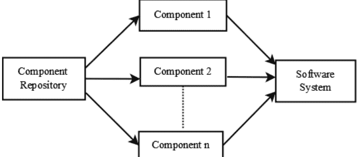

图 9.1. 基于组件的软件开发（Cai et al. 2000）

许多研究组织正在尝试使用最新技术开发软件系统，以增强我们的信任并保障数据交换的安全性。区块链技术是一种具有上述特征的系统。区块链被定义为分布式数字账本。它包含若干区块。这些区块在点对点网络中通过哈希密码学相互关联。区块链中的每个区块包含区块号、时间戳、随机数、以梅克尔根形式的数据以及前一个区块的哈希值，如图 9.2 所示。每个区块都是不可更改的，因此未来不存在恶意攻击的可能性。该技术最早由 Haber 和 Stornetta 于 1991 年提出，首个应用则由中本聪于 2008 年以加密货币形式推出，用于点对点交易，即比特币（Nakamoto 2009）。在区块链中，数据可以作为区块存储，该区块可包含任何类型的数据，例如文本、视频和任何类型的交易。当新区块想要加入此区块链时，其信息会在整个点对点网络中广播，矿工随时准备挖掘这个新区块。挖矿后，有效区块会被添加到区块链中。每个区块链都包含一套称为共识算法（PoW, PoS）的规则。借助共识算法，矿工验证新区块并决定哪个区块被添加到区块链中或从中丢弃。由于其安全性、去中心化、不可更改性和透明度等特性，这项技术正变得越来越流行。区块链有望解决许多与医疗应用相关的问题，例如缺乏过渡能力、信任及患者记录的安全性问题。它在无需任何中介的情况下提升了信任，并提供了一种新的商业模式。由于其潜力，区块链技术已吸引医疗行业利用其开发医疗应用。它可用于医疗的不同领域，例如医疗用品的供应链管理、患者记录管理、制药研究、远程医疗等（Katuwal et al. 2018; De Aguiar et al. 2020）。在区块链技术中，数据以不可更改的形式存储，不能被删除或更改。因此，在医疗软件中使用区块链技术可提升患者记录的信任度、可靠性、可追溯性和安全性。

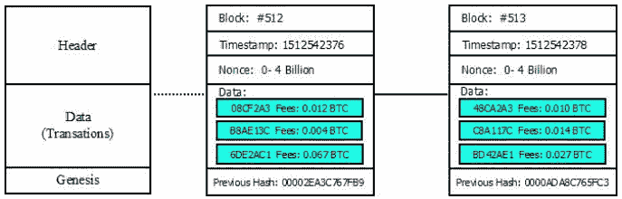

图 9.2. 区块链结构

近年来，医疗行业已开始采用新技术，以提升护理质量和疾病快速康复率。云计算、AI、区块链和物联网等即将到来的新技术正在医疗领域使用，为开发医疗应用提供了更多益处。医疗 IT 解决方案承诺改善患者与医生之间的互操作性，降低医疗交付的总体成本，并根据需求提高患者记录的可访问性。本章的主要重点是确定影响医疗质量的因素。许多医疗政策提供了保障应用程序安全的最佳软件实践和设计原则。在开发任何医疗软件系统时，成本、时间、精力、信任和安全性是影响开发过程的主要因素。有效的 SDLC 有助于减少此类困难。SDLC 被定义为基于项目上下文的工具，有助于生产高质量软件。更好的生命周期能改善患者的护理质量。它减少了人工工时、治疗成本，并支持及时轻松访问患者信息。在本章中，我们已通过基于组件的软件工程方法讨论了软件开发生命周期。此外，我们讨论了如何创建基于区块链的仓库，以区块形式存储软件组件，并讨论了区块链技术如何帮助在医疗应用中保障患者的健康相关数据安全，并提升对患者记录的信任。提出的基于区块链的组件式软件开发生命周期确保我们的数据安全，并提升了医疗应用的质量。

本章其余部分的组织安排如下：第 9.2 节提供文献综述。第 9.3 节详细探讨软件开发模型。第 9.4 节描述使用区块链技术的拟议模型。第 9.5 节对不同软件开发生命周期模型进行比较研究，第 9.6 节总结拟议工作并提供未来研究方向。

## 9.2. 文献综述

每一项新技术都有助于提高人类的生产力、绩效和繁荣。许多行业都被这项新技术所吸引，医疗行业便是其中之一。技术当今为医疗行业带来了巨大变化。因此，用户现在可以根据自身需求选择最佳的医疗设备。与医疗应用相关的软件需求增加，为患者和医生带来了诸多益处。借助这些应用，医院可以轻松建立与患者病历和治疗记录相关的数据库；医生可以轻松研究疾病并快速、准确地进行诊断。使用医疗软件及其应用，我们可以轻松进行各种活动，例如血液检测、脑部检测、身体扫描、Covid-19 检测等。远程问诊和不同移动应用也改善了患者护理，并为患者带来更好的结果。实施医疗应用的主要目的是降低成本、最大限度地减少错误、改善患者体验、轻松更新记录，并对这些敏感的患者记录建立信任。然而，技术创新和患者的高期望为医疗组织带来了新挑战，例如患者数据的质量、隐私、安全性和信任。因此，用户寻求更高品质的产品和服务。

医疗应用始终需要最佳技术、方法论和软件开发模型来解决上述问题。适当的软件开发生命周期模型对于任何软件取得成功都是必不可少的。SDLC 模型是一种软件工程过程，用于设计、开发、测试和部署任何软件系统。换句话说，我们可以说 SDLC 被视为一个框架，为系统开发人员和系统设计人员提供一系列活动。SDLC 包含开发任何软件系统所必需的不同阶段，例如需求分析、设计、编码和测试。不同的 SDLC 模型适用于特定项目，取决于一些条件，例如哪个组织使用它、需求的稳定性、风险因素、项目的预算和持续时间（Rastogi 2015; Gajalaksmi 2016）。它提供了视角特征，以提出如何开发软件系统的建议。

寻找合适的 SDLC 模型是一项非常具有挑战性的任务。高效的 SDLC 模型有助于在降低成本和时间的同时提升软件产品质量。Kneuper (2017) 讨论了各种软件开发生命周期模型，并对这些模型的发展提供了详细概述。本文描述了 SDLC 如何影响软件流程的兴起。根据作者的观点，有效的生命周期模型解决了软件开发时间中的生产力和可扩展性问题。作者还讨论了一种新型的生命周期模型，即看板和 DevOps。这种新型生命周期模型有助于缩短过程时间并改善软件流程的质量。Ragnarath et al. (2010) 展示了各种生命周期模型，并对它们进行了比较分析。根据作者观点，事件管理、变更管理和发布管理是任何 SDLC 模型的关键问题。为解决这些问题，作者提出了一种名为 SDLC 模型 2010 的假设模型。该模型基于三维模型概念，将传统 SDLC 模型的用户-开发人员交互概念转变为包含开发人员、用户和所有者的三维模型。Bhuvaneswari 和 Prabaharan (2013) 讨论了各种 SDLC 模型，并就特定情况下在开发项目中最佳使用哪种 SDLC 提出了建议。他们讨论了各种模型的优缺点，例如瀑布模型、原型模型、敏捷模型、螺旋模型、迭代模型、V 模型、快速应用开发模型和大爆炸模型。

Despa et al. (2014) 讨论了各种软件开发特性，并给出了各种软件开发模型的优缺点。根据作者观点，在任何软件开发方法中，适当的开发阶段是软件成功的主要方面。它提供了一种正式的软件开发方法论，有助于推动软件行业的创新。本文展示了不同开发方法论的比较研究，并突出了它们的主要特征。Dora 和 Dubey (2013) 以及 Barjtya et al. (2017) 详细讨论了各种软件开发生命周期模型，例如瀑布模型、螺旋模型、敏捷模型和 V 模型。在这些论文中，作者讨论了上述模型的一些优缺点。他们还对敏捷模型与其他现有模型进行了比较研究。作者表示，敏捷模型有助于提高生产力和绩效，并降低时间复杂度和风险分析。作者还介绍了敏捷模型的概述，并讨论了不同的敏捷开发方法，如特性驱动开发、极限编程和晶体方法等。

传统模型主要关注软件系统的文档和设计概念。它遵循一种软件开发具有预测性和可重复性的纪律。因此，开发人员需要更多时间

和努力来开发软件，但它无法有效地解决客户需求。这就是开发者被吸引到构建软件的另一种方法的原因，这种高级方法基于适应性。CBSE 是一种高级方法，通过选择适当的可重用组件来开发软件。传统方法不关注软件的复用。软件总是从头开始构建。而在 CBSE 中，开发者只需编写一次代码，并在需要时多次复用组件代码。因此，使用这种方法构建大型和复杂软件的开发成本和时间被最小化。

Chaudron 等人（2005 年）讨论了基于组件的开发过程及其生命周期。根据作者的观点，组件的软件开发生命周期模型与传统的生命周期模型不同。它包含两个同时运行的生命周期。他们还讨论了另外三种基于组件的开发过程，例如产品线开发、架构驱动的组件开发和产品线开发。在本文中，作者对这三种基于组件的开发过程进行了比较研究。借助与软件行业相关的案例研究，它介绍了这三种开发过程，并根据需要使用不同的技术和方法。Capretz 等人（2004 年）讨论了基于基于组件开发的生命周期模型，并讨论了任何软件产品开发过程中发生的各种可重用性问题。他们详细讨论了基于组件的过程模型。这种过程模型有助于在软件开发期间提高可重用性、演进性和生产力。作者还讨论了一些可重用性技术，例如组合和继承，这些技术有助于提高软件的生产力。

Fahmi 和 Choi（2008 年）讨论了基于基于组件的软件开发（CBSD）的一些生命周期模型，例如 Y 模型和 V 模型。他们还讨论了软件开发过程中的一些问题，例如 CBSE 生命周期相关问题、CBSE 管理问题以及组件信任和可靠性问题。作者提供了有效解决上述问题的宝贵建议。Negi 等人（2015 年）和 Gulia（2017 年）讨论了各种基于组件的软件工程模型。他们还根据各种参数（例如领域分析、组件选择技术、风险分析以及为开发任何软件进行的组件演进）比较了所有组件模型。根据作者的观点，在 SDLC 中，阶段的系统安排有助于按时交付高质量软件。作者还讨论了这些不同过程模型的优缺点。Talukder 和 Rahman（2015 年）介绍了不同 CBSD 生命周期模型之间的比较研究。他们提出了一种称为 CROM（以客户需求为导向的 CBSE 生命周期模型）的新生命周期模型。所提模型处理与客户相关的问题。它有助于识别开发软件系统中的实际客户问题，并通过反馈分析维护所有客户需求。该模型提高了客户和供应商之间在开发任何软件时的理解。

Khan 等人（2012 年）介绍了 CBSD 生命周期模型的各种特征，并提出了一种称为改进复用模型的新模型。这种新模型涵盖了基于组件的过程和软件开发过程。在本文中，作者对现有模型与其所提模型进行了比较分析，并讨论了它们的优缺点。Garg 和 Jha（2019 年）比较了各种基于组件的生命周期模型，并讨论了一种使组件选择过程更加容易的新提议模型。所提模型为任何现有组件的选择提供了最佳匹配机制。它包含三种类型的存储库，即黑存储库、白存储库和灰存储库。要构建任何软件，开发者可以并行访问每个存储库并选择适当的组件。Kaushik 和 Dulawat（2012 年）以及 Kumar 和 Bhatia（2014 年）讨论了传统生命周期模型与 CBSD 生命周期模型之间的比较分析，并描述了它们的优缺点。根据作者的观点，传统方法仅具有有限功能的有限需求，但基于组件的方法需求经常变化，并支持设计灵活性和可重用性。根据作者的观点，组件可重用性是软件工程社区的一个新兴话题。可重用性节省了时间和精力，并减少了软件的开发时间和成本。

CBSE 提出了一种可用于构建任何软件应用的有吸引力的方法。该方法支持设计灵活性、快速变更需求、提高质量和性能，并能轻松检测实现中的故障（Nautiyal 等人，2012 年）。因此，由于这些特性，人们能够在时间和预算内获得更高质量的产品。由于上述便利，许多 IT 行业正在采用这项技术来开发医疗保健软件。在许多医疗保健应用中，基于组件的方法被视为一种面向服务的方法，它处理复杂环境软件并提供对患者记录的更好分析（Chu，2005 年）。医疗保健应用始终坚持采用最佳实践和软件开发过程模型，该模型有助于提高护理质量和从疾病中快速康复的速度。医疗 IT 解决方案有助于改善医生与患者之间的互操作性，降低医疗保健交付的总成本，并根据需求提高患者记录的可访问性。

McMurtry 等人（2013 年）讨论了基于组件的软件开发生命周期模型对医疗保健应用的影响。作者还讨论了开发医疗保健应用的各种因素，例如需求分析、设计、风险分析和选择组件。在本文中，使用有效的 SDLC 模型，作者借助教学工具设计并实现了一个家庭健康组件，该组件可以在任何地方使用。根据作者的观点，这个家庭健康软件包提供区域医院服务的功能。

用户的期望与日俱增，复杂系统的成本也因这一期望而持续上升。因此，开发者感到压力，需要以更低的成本、更好的质量，为患者记录提供更有效的医疗保健应用程序以及安全可靠的医疗服务。这就是开发者转向使用特定的先进技术（例如 Blockchain）来开发医疗保健软件应用程序的原因，该技术解决了与医疗保健应用相关的问题。医疗软件提供安全数据，并增强医生和患者之间的信任。Carroll 等人（2018 年）讨论了医疗保健行业中使用的软件工程的各种挑战，例如设计、动态处理、测试和部署。根据作者的观点，软件工程在许多领域都发挥着重要作用，医疗保健应用就是其中之一。在本文中，作者介绍了一种与医疗软件相关的新软件工程理论。他们指出，更好的规划和精力平衡能够交付安全且高质量的医疗保健应用。Lalband 等人（2019 年）讨论了各种现代软件生命周期模型，并展示了如何使用该模型实现智能医疗保健应用。根据作者的观点，系统的 SDLC 阶段有助于提供高质量的医疗保健应用。因此，医疗保健始终需要最佳方法和软件开发模型。他们还讨论了构建智能医疗保健应用的软件工程研究挑战。

Angraal 等人（2017 年）、Bell 等人（2018 年）、Katuwal 等人（2018 年）、Ben Fekih 等人（2020 年）和 De Aguiar 等人（2020 年）介绍了基于 Blockchain 的医疗保健应用调查。他们详细讨论了许多应用，例如电子媒体记录、医药供应链管理、远程患者监护、健康保险索赔、账单管理等。他们还讨论了基于 Blockchain 的医疗保健应用的局限性。他们还指出了一些增强医疗服务自动化的技术。根据作者的观点，医疗保健应用中的 Blockchain 技术可以解决可扩展性、安全性和隐私问题。Blockchain 技术消除了对多个中介的依赖，降低了成本，并保持了信任和透明度。Siyal 等人（2019 年）、Hasselgren 等人（2020 年）以及 Zhang 和 Boulos（2020 年）讨论了使用 Blockchain 技术开发不同医疗保健应用的问题。他们指出了一些关键要素，例如互操作性、不可更改性、透明度和 Blockchain 的去中心化。他们还讨论了一些用例的


各公司使用的区块链。根据作者所述，区块链为医疗数据管理提供安全可靠的保障，并提高了可靠性。Alla 等人（2018）利用区块链技术讨论了电子医疗系统的各种功能。他们对使用区块链的医疗软件进行了系统性回顾，并找出了医疗领域的研究差距。在本文中，作者还讨论了在医疗领域采用区块链技术的一些优缺点。

## 9.3. 软件开发模型

软件开发过程通常需要一个用于分析、规划、控制和管理软件开发过程的框架。此框架称为软件开发生命周期模型（SDLC）。SDLC 模型是从开始阶段到完成阶段开发和设计项目的一种系统过程（McMurtrey et al. 2013; Kneuper et al. 2017）。优秀的软件开发人员始终根据项目背景和用户需求选择最佳的 SDLC 模型来开发软件。它提供一系列活动，有助于以更高质量和可靠性处理、开发和维护软件产品。不同的软件生命周期模型可能根据用户需求、成本、开发时间和项目风险适合某个项目。在本章中，我们讨论了传统软件开发生命周期模型以及基于组件开发的现代软件开发生命周期模型的对比研究。传统模型不支持需求的快速变更。它们只关注文档，而非可靠性或可信度。相比之下，现代模型能够成功处理这些不想要的需求变更。它们在更短的时间内生产高质量软件，并保持可靠性和可信度。

基本软件开发模型包含五个阶段：需求分析、设计、实现、测试和部署，如图 9.3 所示。

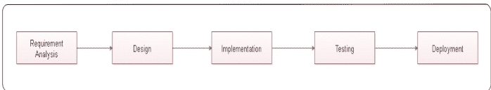

图 9.3. 软件开发的基本模型

- 需求分析：软件开发的第一阶段是需求分析阶段，开发人员在此阶段根据客户需求分析软件产品的需求。本阶段从客户处收集关于所需产品的详细信息，并分析其功能、开发成本、技术问题等。在分析所需产品需求后，开发人员为软件产品准备一份文档，称为软件需求规格说明书（SRS）。

- 设计：在此阶段，开发人员设计软件系统的基本结构框架。开发人员决定哪些架构和编程语言最适合产品开发，应使用哪种技术，项目的约束条件，以及开发软件应使用多少时间和预算。本阶段还决定架构的不同模块如何相互通信。

- 实现：在实现阶段，开发人员根据 SRS 实际启动开发过程。本阶段也称为构建阶段。在此阶段，开发人员遵循所有编码的标准准则。

- 测试：此阶段是在向客户交付最终软件产品之前 SDLC 的最后一个阶段。在此阶段，开发人员测试最终产品，跟踪实现代码中存在错误的位置并报告。测试阶段确认最终产品是否满足客户的要求。

- 部署：一旦软件系统准备就绪，开发人员即为用户部署该产品。在此阶段，开发人员在适当的市场发布经过测试的软件产品。开发人员在有限的细分市场中发布其软件产品，并分析其接受率。在分析接受率后，根据产品的反馈，该产品将在特定市场中发布。

在本章中，我们对各种软件开发生命周期模型进行了简要的比较研究，并将软件开发生命周期模型分为两类。第一类是传统软件开发模型，第二类是基于 CBSE 的现代软件开发模型。

### 9.3.1. 传统软件开发方法

在本节中，我们尝试说明一些传统软件开发模型（Kaushik et al. 2012）。

#### 9.3.1.1. 瀑布模型

瀑布模型是第一个模型，由 Royce 于 1970 年引入（Despa 2014）。该模型的另一个名称是线性顺序生命周期模型，因为所有阶段都按顺序逐一执行，如图 9.4 所示。因此，只有在前一阶段完全执行后，下一阶段才开始。它不允许我们返回到上一步。它包含各种阶段，如需求分析、系统设计、实现、测试、部署和维护（Kumar et al. 2014）。该模型中的第一阶段是对项目需求进行分析。分析后，下一阶段是设计阶段，开发人员在此阶段根据需求设计系统框架并指定总体系统架构。设计后，下一阶段是实现阶段，在此阶段将设计结构转换为编程语言。在开发出最终产品后，开发人员应用测试机制，验证产品是否满足所有用户要求，并检测故障和失败。下一步是部署阶段，在此阶段将产品部署到市场上供客户使用。最后一个阶段是维护阶段。在此阶段，开发人员在将产品部署到客户环境后检查一些问题。如果出现问题，他们会解决该问题，提高生产力并发布产品。该模型仅用于小型项目，并作为其他模型的基准。

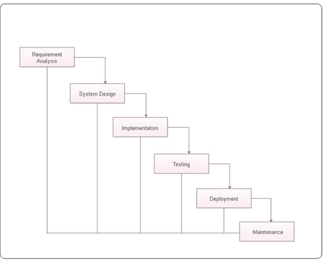

**图 9.4. 软件开发的瀑布模型**

#### 9.3.1.2. 迭代模型

迭代模型与传统瀑布模型大致相似，如图 9.5 所示。传统模型遵循逐步开发项目的过程，而迭代模型遵循循环过程。迭代模型在前一阶段提供反馈路径。在完成项目后，开发人员可以轻松返回到发生错误的特定阶段。反馈路径允许重新处理检测到错误的阶段。该模型包含各种阶段，如需求分析、系统设计、实现、测试、部署和维护（Despa et al. 2014）。开发项目的过程从需求阶段开始。在从客户处收集产品需求后，开发人员开始设计项目，并最终根据收集到的需求实现软件产品代码。完成编码后，开发人员应用一些测试方法来查找错误。一旦检测到错误，开发人员会返回到发生错误的特定阶段并纠正该错误。最后，将产品部署到客户的工作环境中。部署产品后，如果软件中存在任何错误或缺陷，开发人员会借助调试过程更新产品。该模型适用于小型软件应用程序。

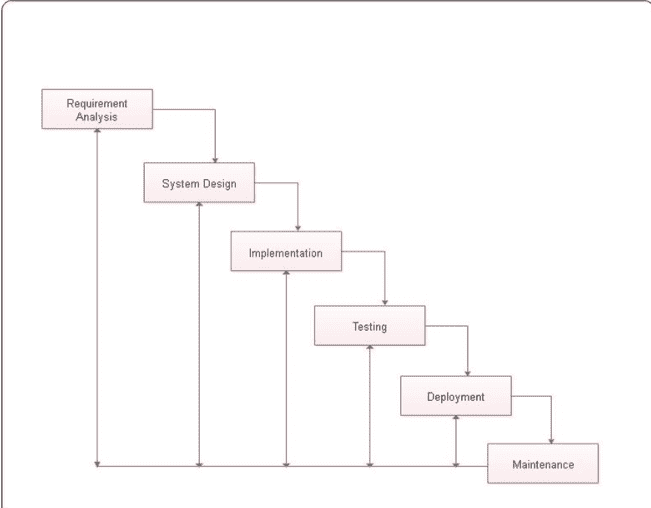

图 9.5. 软件开发的迭代模型

#### 9.3.1.3. 原型模型

原型模型建议，在开发实际产品之前，开发人员提出软件系统的一个可用原型（Despa et al. 2014）。当客户不知道产品的准确需求且技术解决方案对开发人员不明确时，使用此模型。在此模型中，开发人员首先开发产品的一个原型，然后根据客户反馈对其进行测试和改进。他们重复此过程，直到实现最终可接受的原型。接受原型后，开发人员设计、实现和测试最终产品。该模型包含各种阶段，如图 9.6 所示，例如需求收集、快速决策、构建原型、客户对原型的评估、根据客户建议优化需求、设计、实现、测试和维护。当缺乏有关最终产品的详细信息时，此模型很有用。

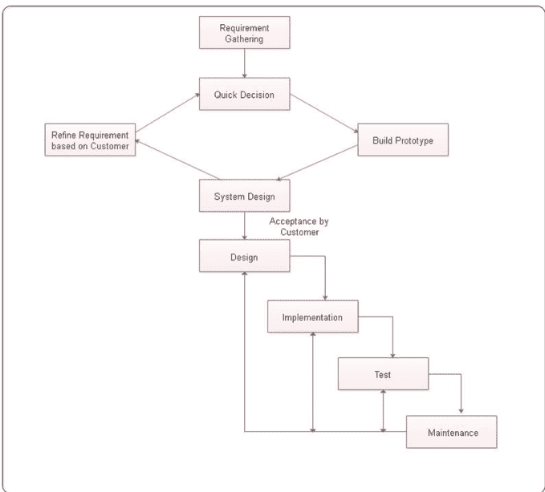

图 9.6. 软件开发的原型模型


#### 9.3.1.4. 螺旋模型

螺旋模型是软件开发生命周期（SDLC）中最著名的模型之一，如图 9.7 所示。螺旋模型看起来像一个有多个环的螺旋。每个环代表软件过程的一个阶段，例如确定目标、识别和解决风险、开发与测试，以及规划下一次迭代（Kumar et al. 2014）。为开发大型和复杂软件，螺旋模型用于实时应用。该模型有助于降低项目的风险因素，因为它在任何阶段都应用风险降低机制来分析风险。这就是它被称为风险驱动过程模型的原因。该模型用于构建高质量产品。

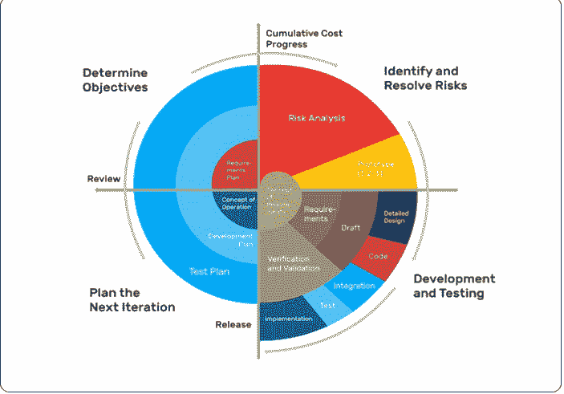

Figure 9.7. 软件开发的螺旋模型 (Kumar et al. 2014)

#### 9.3.1.5. 敏捷模型

敏捷模型基于迭代开发方法（Barjtya et al. 2017）。在敏捷模型中，整个软件项目被分割为较小的迭代，每个迭代被视为一个框架，如图 9.8 所示。这种划分有助于我们将项目的风险因素降至最低，并减少时间和成本。

每个迭代都经过敏捷模型的各个阶段，例如分析、规划、设计、开发、部署和维护。当客户需要在更少时间和精力下获得更多功能需求时，使用这种类型的模型。因此，它提供了更准确、高质量、灵活和可靠的软件产品。

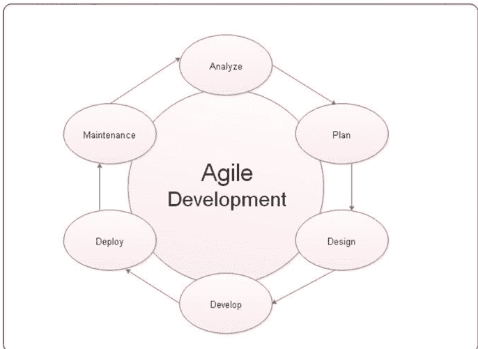

Figure 9.8. 软件开发的敏捷模型

### 9.3.2. 现代软件开发方法论

一些传统模型基于预测方法，但用户需要使用基于自适应方法的软件生命周期。它必须足够灵活以适应客户不断变化的需求。因此，开发者转而选择另一种支持自适应方法的现代软件模型。在本节中，我们讨论了各种基于组件的软件开发生命周期模型（Kaushik et al. 2012; Kumar et al. 2014）。

#### 9.3.2.1. V 模型

V 模型是瀑布模型的改进模型，也称为验证与确认模型（Chaudron et al. 2005）。验证阶段位于一侧，确认阶段位于另一侧，如图 9.9 所示。验证阶段在需求分析的帮助下定位模型设计。另一方面，确认阶段借助测试检查功能和缺陷。当测试和部署阶段并行运行时，这种类型的模型适用。该模型非常有用，但面临着开发者任务完成后永不返回的困难。在开发软件之前，有必要创建系统测试计划。该测试计划基于项目的功能需求。该模型适用于涉及大量规划的大型项目。

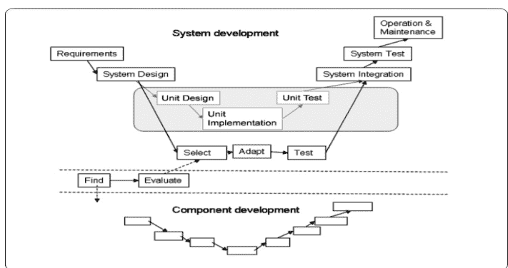

Figure 9.9. 软件开发的 V 模型 (Chaudron et al. 2005)

#### 9.3.2.2. Y 模型

Capretz et al. (2005) 提出了 Y 模型。该模型基于基于组件的开发方法，如图 9.10 所示。模型的 Y 形结构使得在适当位置更容易进行迭代和重叠。领域工程、框架、组装、归档、系统分析、设计、实现、测试、部署和维护是一些预期的阶段。该模型支持变更不稳定性以及开发任何软件产品的可重用性概念。该模型主要关注基于组件开发过程中的软件可重用性，并强调在软件开发、演进过程中以及基于假设构建所需可重用组件时的可重用性。

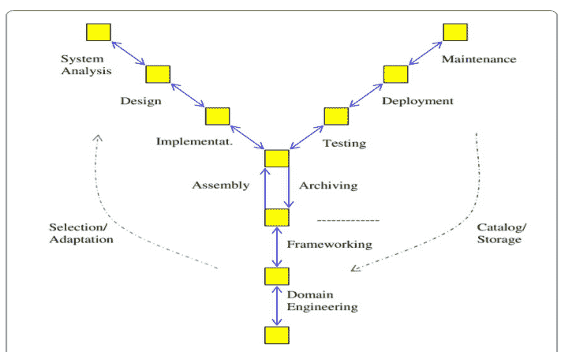

Figure 9.10. 软件开发的 Y 模型 (Capretz et al. 2005)

#### 9.3.2.3. W 模型

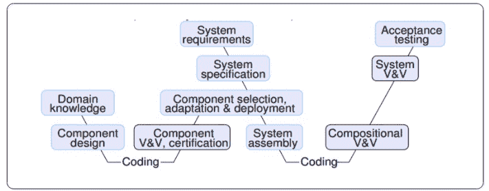

Figure 9.11. 软件开发的 W 模型 (Lau et al. 2011)

该模型基于 V 模型，其中两个 V 模型连接并协同工作，如图 9.11 所示。第一个 V 模型描绘组件生命周期，而第二个描绘系统生命周期（Lau et al. 2011）。该模型分为两个阶段，一个用于组件设计，另一个用于组件部署。在设计阶段，根据领域工程，软件组件被识别、设计和实现。构建组件后，它被存储在存储库中，而在部署阶段，产品使用这些已开发的组件构建和部署。

#### 9.3.2.4. X 模型

Tomar and Gill (2010) 提出了 X 模型，该模型描绘了可重用组件在复杂和大型软件项目中的使用情况。该模型主要关注通过使用可重用组件开发软件的可重用性。如图 9.12 所示，X 模型的生命周期分为四个子周期：基于组件的软件开发、面向复用的开发、修改后的开发以及无修改的开发。该模型支持不同阶段的重叠以及开发任何软件时的复杂性增加。

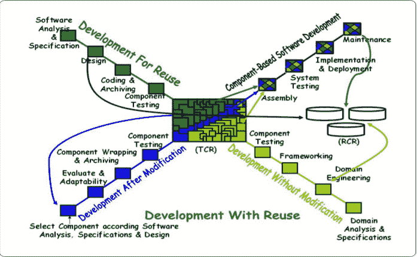

Figure 9.12. 软件开发的 X 模型 (Tomar et al. 2010)

#### 9.3.2.5. 改进模型

Irshad and Noor 于 2012 年提出该模型（Khan and Khan 2012）。在该模型中，组件开发生命周期和基于组件的系统开发生命周期并行工作，如图 9.13 所示。在该模型中，作者讨论了一些与基于组件开发相关的问题，并试图通过合并传统软件开发生命周期模型和基于组件的软件开发生命周期模型来减少此问题。该模型帮助我们解决与需求不满足、存储库管理和组件版本处理相关的问题。


Figure 9.13. 软件开发的改进模型 (Khan et al. 2012)

表 9.1 表示不同软件开发生命周期模型及其优缺点之间的比较。

| Categories | Models | Advantages | Disadvantages |
| :--- | :--- | :--- | :--- |
| 传统软件开发模型 | 瀑布模型 | - 简单且易于理解<br>- 易于管理<br>- 逻辑顺序<br>- 简单规划且文档齐全 | - 风险介入高<br>- 完成后无法回到任何阶段<br>- 缺乏可接受的变更灵活性<br>- 不支持长期项目 |
| 传统软件开发模型 | 迭代模型 | - 当需求不明确时允许用户提供反馈<br>- 与瀑布模型相比更具灵活性<br>- 强调设计而非项目文档 | - 迭代成本高<br>- 需要更多管理<br>- 不支持长期项目<br>- 缺乏适当文档 |
| 传统软件开发模型 | 原型模型 | - 快速接受需求变更<br>- 降低风险因素<br>- 能够构建软件的演示版本<br>- 轻松识别缺失功能 | - 开发人员工作量增加<br>- 项目复杂度增加<br>- 原型实现成本高 |
| 传统软件开发模型 | 螺旋模型 | - 易于规划且谈判良好<br>- 支持风险管理<br>- 支持长期项目<br>- 文档完善 | - 与其他模型相比更复杂<br>- 需要高技能开发人员进行分析和规划<br>- 可能是昂贵的模型<br>- 不支持小型项目 |
| 传统软件开发模型 | 敏捷模型 | - 需求文档易于理解<br>- 降低风险因素<br>- 支持小型项目<br>- 促进可维护性 | - 昂贵模型<br>- 项目最终需求不明确<br>- 需要经验丰富的人员<br>- 缺乏适当文档 |


| 类别 | 模型 | 优点 | 缺点 |
|---|---|---|---|
| 现代软件开发模型 | V 模型 | - 支持组件搜索和检索方法<br>- 支持组件的可重用性<br>- 非常简单且易于理解<br>- 风险介入程度低 | - 项目需求不明确且含糊不清<br>- 由于需求不明确，测试阶段不清晰<br>- 这是一种昂贵的模型<br>- 非常僵硬且灵活性较差 |
| 现代软件开发模型 | Y 模型 | - 支持可重用性<br>- 支持自顶向下和自底向上方法<br>- 支持组件适应 | - 过程中会出现重叠和迭代<br>- 选择组件需要付出大量努力<br>- 无法进行组件演化 |
| 现代软件开发模型 | W 模型 | - 可重用性是关键因素<br>- 易于构建长期项目<br>- 项目更具可行性 | - 无法进行组件演化<br>- 维护成本高<br>- 组件搜索技术效果不佳 |
| 现代软件开发模型 | X 模型 | - 支持可重用性<br>- 为大型项目提供清晰的需求<br>- 降低成本和工作量<br>- 降低风险因素 | - 开发过程的复杂性增加<br>- 开发时间和成本增加<br>- 无法进行组件演化<br>- 缺乏适当的风险分析 |
| 现代软件开发模型 | 一种改进模型 | - 支持可重用性<br>- 组件演化成为可能<br>- 组件适应和选择易于实现 | - 不支持认证流程<br>- 不支持可信性属性<br>- 缺乏可扩展性 |

## 9.4. 拟议模型

医疗保健行业在过去几年中不断发展，软件技术在医疗保健领域的演变中发挥着重要作用。医疗保健是当今增长最快的行业之一，它在多个领域直接、生理上、情感上、精神上和财务上建立联系。与医疗保健相关的技术面临许多挑战：需要先进的医疗设备；尚未采用适当的方法论来开发软件系统；需要诊所；医疗成本上升等。所有这些挑战都影响医疗质量。因此，需要一种先进的商业模式用于医疗保健技术，以便在开发人们可以信赖支持的任何软件时保持适当的标准。许多医疗保健政策有助于采用最佳的软件实践和设计原则来保障其安全性（Lalband et al. 2019）。在开发任何医疗保健软件系统时，成本、时间、工作量、信任和安全是影响开发过程的主要因素。有效的SDLC有助于减少这类困难。SDLC被定义为基于项目上下文的框架，有助于生产高质量的软件。基于更好生命周期模型的软件能改善患者记录的护理质量。因此，为更好地质量地使用医疗保健软件来有效跟踪和处理患者信息。它减少了人力需求和治疗成本，并能及时轻松访问患者信息（Katuwal et al. 2018; De Aguiar et al. 2020）。

传统模型无法更好地支持开发大型和复杂的软件，因此无法提供更好的质量和准确性。因此，开发者选择另一种先进的SDLC模型技术来解决上述问题。这种先进的SDLC模型技术基于CBSE，在其中，通过选择可靠和可重用的组件并将它们与合适的软件架构组装在一起来开发软件系统。这种新方法不同于传统方法，在传统方法中，软件不是从头开始开发的。它包含两个并行工作的生命周期，一个是基于组件的开发生命周期，另一个是通过组件的系统开发生命周期（Kaushik et al. 2012; Kumar et al. 2014）。这种方法提高了软件的生产力和性能，但并未因软件组件的选择而增加其可靠性和信任度，因为这些组件并不总是可信和可靠的。因此，开发者需要利用区块链、云计算、AI和IoT等先进技术来构建更好的软件开发生命周期，以提高其中的可靠性和信任度（Angraal et al. 2017; Bell et al. 2018）。

在拟议方法中，我们研究了使用一种名为区块链的新技术对医疗保健领域的影响。区块链是可用于保护我们的数据并增加我们对任何应用程序信任的技术之一。由于其安全性、去中心化、不可变性和透明度等特性，这项技术正变得流行。在本章中，我们使用区块链技术开发了基于组件的生命周期模型，并创建了一个基于区块链的仓库，以块的形式存储软件组件。使用基于区块链的软件，我们尝试将患者记录保存为一个块，该块可以安全地提供，并且仅向授权用户提供。医生可以随时随地轻松访问和存储患者的病历。因此，这种软件产品增加了患者的信任，并且这些数据不会被未经授权的人滥用。图9.14展示了我们拟议生命周期模型的详细概述。基于区块链技术的基于组件的软件工程拟议模型的详细描述如下。

CBSE的生命周期与传统的软件开发方式不同。它通过两个开发生命周期同时工作，即组件开发生命周期和基于组件的软件开发生命周期。

### 9.4.1. 基于组件的软件开发生命周期

基于组件的软件开发生命周期包括软件系统生产的所有活动。在这个周期中，软件系统是通过使用存储在仓库中的预先存在的组件来构建的。软件开发者根据其应用程序的需求重用这些组件。它包含以下阶段：需求、系统规格说明、组件搜索和选择、组件识别、组件适应、通过组件组装进行系统实现、系统测试和验证以及系统部署，如图9.14所示。第一阶段是需求阶段，在该阶段识别用户的所有初始需求。开发者为特定应用程序理解和识别这些需求。在收集需求后，开发者根据需求分析组件的可行性。在此阶段，开发者还研究软件应用程序的约束、功能和非功能需求，并为系统的需求规格说明准备一份文档。

在下一步中，开发者使用各种搜索技术（如基于关键字、分面、枚举、属性值、基于签名的技术等）在内部可重用仓库中搜索和选择所需的组件。如果所需的组件在仓库中不可用，则开发者需要通过区块链技术实现组件。使用组件开发生命周期，开发者以块的形式创建一个组件，将其存储在基于区块链的组件仓库中并提供适当的索引。在此阶段，开发者根据构建软件系统的系统需求，决定哪些组件应重用，哪些应从头开始构建。下一个阶段是组件识别阶段，在该阶段，开发者识别目标组件并选择满足正在开发的软件系统需求的组件。领域工程（产品线工程）在此阶段很有帮助。下一个阶段是组件适应阶段。在选择候选组件后，所选组件中的一些可能不符合软件所需的规格。组件功能与系统架构师从组件所需的功能之间可能存在差距。组件适应技术（如组件封装、坐标、适应模式）有助于最大限度地减少所需组件与可用组件之间的这些不匹配。在下一阶段，如果经过验证的组件符合其特定的系统需求，则开发者通过这些经过验证的组件构建软件。在通过组件组合构建系统后，下一个阶段是系统测试和验证。在此阶段，系统需求应与最终实现的系统相匹配。在此步骤中，开发者遵循一些标准的测试和验证技术。开发者还检查软件应用程序中的不良影响和错误。在最后阶段，最终软件产品交付给客户使用。在到达客户之前，该产品已得到充分检查并修复了故障，并确认了系统在变化环境中的适应性。

### 9.4.2. 组件开发生命周期

当在仓库中找不到组件时，开发者从头开始创建一个新组件，如图9.14所示。组件开发生命周期包含以下阶段：组件的领域规格说明、将组件实现为块、通过共识算法进行测试和验证、组件的部署、组件代码存储和索引。第一阶段是组件的领域规格说明。它提供来自新组件的领域知识的信息，以构建软件系统。此阶段帮助开发者理解应用程序的领域知识和系统性组件重用。在理解组件的领域规格说明后，开发者根据系统需求开发组件。此阶段旨在通过区块链技术以块的形式开发组件。开发者将每个组件视为区块链中的一个块，并且该块通过加密哈希链接。要创建一个组件，开发者首先初始化创世块。它是区块链中的第一个块，其他块连接到该块。然后，它创建一个与创世块保持连接的新块。这个新块分为两部分。第一部分是头部，存储块的索引、时间戳和工作量证明。第二部分存储组件的数据。在这里，数据以JSON格式存储。数据部分包含各种属性，如


组件的语言、处理器、操作系统、功能、版本、域和哈希码文件。这些属性有助于从区块链仓库中选择和存储组件。组件开发者编写组件代码的文件的哈希码是使用星际文件系统（IPFS）生成的。


图 9.14. 提议的方法

将组件实现为区块后，下一阶段是验证和测试阶段。在此阶段，开发者使用共识算法对新创建的区块进行挖矿。区块挖矿是验证新区块（组件）的过程。开发者使用一种称为工作量证明的共识算法，该算法由所有参与者维护，用于区块的验证和确认。共识算法用于选举一名领导者（矿工），由其决定下一区块的内容。验证后，新区块被添加到区块链中。下一步是组件的部署。在此阶段，新组件被组装成一个可分发和安装的软件包。这些组件已经过测试，并且可以部署到任何环境中。在最终阶段，新组件被存储在仓库中，以便将来通过组件组合构建软件。开发者为组件分配一些索引，以便从仓库中轻松检索。

## 9.5. 不同软件开发生命周期模型的比较

本节对不同的软件开发生命周期模型进行了比较。表 9.2 列出了各种软件模型与我们提出的模型的比较分析。这清楚地表明，通过使用我们为开发医疗软件而提出的软件开发生命周期模型，开发者可以确保健康相关数据的安全性，增强对数据的信任，并提高医疗应用的质量。因此，更高质量的医疗软件被用于有效跟踪和处理患者信息。它减少了人工工时和治疗成本，并且可以轻松、及时地访问患者信息。

## 9.6. 结论与未来工作

本章讨论了软件系统如何影响医疗应用。医疗软件改变了人类的生活方式，并在人类生活和行为中发挥着重要作用。它提供了许多便利，例如高效学习、实用性、节省资金、提高生产率及其控制。系统化的软件开发已被用于有效改善患者护理和保护健康记录。它为软件构建处理提供了共同的理解。因此，医疗应用需要采用基于区块链的高效生命周期模型等先进技术。它改善了护理质量，降低了处理成本，最重要的是，提高了护理效率，并增强了对数据的信任。它还能有效维护和更新医疗记录。本章的主要目标是提供一种基于组件的系统化生命周期模型，并结合区块链等先进技术。它提供了完善的开发流程和理解，这些影响着医疗服务的质量。基于组件的医疗软件能够消除各种医疗低效和问题。在未来工作中，我们将致力于所提出模型的正式化方面。

| 特征 | 瀑布模型 | 迭代模型 | 原型模型 | 螺旋模型 | 敏捷模型 | V 模型 | Y 模型 | W 模型 | X 模型 | 改进模型 | 提议模型 |
|---|---|---|---|---|---|---|---|---|---|---|---|
| 需求分析与规格说明 | 初期 | 初期 | 初期 | 初期 | 经常变更 | 经常变更 | 经常变更 | 经常变更 | 经常变更 | 经常变更 | 经常变更 |
| 项目成本 | 高 | 高 | 高 | 高 | 高 | 低 | 低 | 低 | 低 | 非常低 | 非常低 |
| 项目开发周期 | 长 | 长 | 长 | 长 | 长 | 短 | 短 | 短 | 短 | 非常短 | 非常短 |
| 系统验证与确认 | 结束时 | 结束时 | 结束时 | 某些阶段 | 某些阶段 | 某些阶段 | 每个阶段 | 每个阶段 | 每个阶段 | 每个阶段 | 每个阶段 |
| 文档 | 非常简单 | 非常简单 | 非常简单 | 简单 | 可理解 | 可理解 | 易于理解 | 易于理解 | 易于理解 | 易于理解 | 易于理解 |
| 长期项目管理支持 | 不支持 | 不支持 | 部分支持 | 部分支持 | 支持 | 部分支持 | 支持 | 支持 | 支持 | 支持 | 支持 |
| 可扩展性支持 | 不支持 | 不支持 | 不支持 | 不支持 | 部分支持 | 支持 | 支持 | 支持 | 支持 | 支持 | 支持 |
| 阶段重叠 | 不支持 | 不支持 | 支持 | 不支持 | 不支持 | 支持 | 支持 | 支持 | 不支持 | 不支持 | 不支持 |
| 维护 | 较少 | 较少 | 较少 | 较少 | 相当多 | 较少 | 相当多 | 相当多 | 相当多 | 支持可维护性 | 支持可维护性 |
| 风险分析 | 不支持 | 有限 | 有限 | 支持 | 支持 | 有限 | 支持 | 支持 | 支持 | 支持 | 支持 |
| 可靠性 | 不支持 | 不支持 | 不支持 | 有限 | 支持 | 支持 | 支持 | 支持 | 支持 | 支持 | 支持 |
| 可重用性 | 不支持 | 不支持 | 不支持 | 不支持 | 不支持 | 有限 | 支持 | 支持 | 支持 | 易于实现 | 易于实现 |
| 演化支持 | 不支持 | 不支持 | 不支持 | 不支持 | 不支持 | 不支持 | 不支持 | 不支持 | 不支持 | 部分支持 | 支持 |
| 认证支持 | 不支持 | 不支持 | 不支持 | 不支持 | 不支持 | 不支持 | 不支持 | 不支持 | 不支持 | 部分支持 | 支持 |
| 可信性支持 | 不支持 | 不支持 | 不支持 | 不支持 | 不支持 | 不支持 | 不支持 | 不支持 | 不支持 | 部分支持 | 支持 |

表 9.2. 各种软件模型与我们提出的模型的比较分析

## 9.7. 参考文献

Alla, S., Soltanisahat, L., Tatar, U., Keskin, O. (2018). 电子医疗系统中的区块链技术. IIE 年度会议论文集, 901–906. 工业与系统工程师学会 (IISE).

Angraal, S., Krumholz, H.M., Schulz, W.L. (2017). 区块链技术：医疗保健中的应用. 循环：心血管质量与结局, 10(9), e003800.

Aoyama, M. (1998). 软件开发新时代：基于组件的软件工程如何改变软件开发方式. 1998 年 CBSE 国际研讨会, 1–5.

Barjyta, S., Sharma, A., Rani, U. (2017). 软件开发生命周期（SDLC）模型详细研究. 工程与计算机科学国际期刊, 6(7), 22097–22100.

Bell, L., Buchanan, W.J., Cameron, J., Lo, O. (2018). 医疗保健中的区块链应用. 区块链在医疗保健中的应用, 1. DOI: 10.30953/bhty.v1.8.

Ben Fekih, R. 和 Lahami, M. (2020). 区块链技术在医疗保健中的应用：一项综合研究. 智能家居与健康远程信息处理国际会议, 268–276. Springer, Cham.

Bhuvaneswari, T. 和 Prabaharan, S. (2013). 软件开发生命周期模型综述. 计算机科学与移动计算国际期刊, 2(5), 262–267.

Cai, X., Lyu, M.R., Wong, K.F., Ko, R. (2000). 基于组件的软件工程：技术、开发框架和质量保证方案. 第七届亚太软件工程会议论文集, APSEC 2000, 372–379, IEEE.

Capretz, L.F. (2004). 基于组件开发的软件过程模型. 信息技术期刊, 3(2), 176.

Capretz, L.F. (2005). Y：一种新的基于组件的软件生命周期模型. 计算机科学期刊, 1(1), 76.

Carroll, N., Kuziemsky, C., Richardson, I. (2018). 面向互联健康的软件工程专题：挑战与研究路线图. 软件期刊：演化与过程, 30(7), e1941.

Chaudron, M., Larsson, S., Crnkovic, I. (2005). 基于组件的开发过程与组件生命周期. 计算与信息技术期刊, 13(4), 321–327.

Chu, S.C. (2005). 从基于组件到面向服务的医疗软件架构. 第七届企业网络与医疗行业计算国际研讨会论文集, HEALTHCOM 2005, 96–100, IEEE.

De Aguiar, E.J., Faical, B.S., Krishnamachari, B., Ueyama, J. (2020). 基于区块链的医疗策略综述. ACM 计算机调查 (CSUR), 53(2), 1–27.


Despa, M.L. (2014). 软件开发方法论比较研究. 数据库系统期刊, 5(3), 37–56.

Dora, S.K. 和 Dubey, P. (2013). 软件开发生命周期（SDLC）分析比较及传统和敏捷方法学调查. 科学与技术研究全国月刊评议期刊, 2(8), 22–30.

Fahmi, S.A. 和 Choi, H.J. (2008). 基于组件的软件开发生命周期. 2008 IEEE 第 8 届计算机与信息技术研讨会, 637–642.

Gajalakshmi, P. (2016). 融入发布管理的软件开发生命周期模型（SDLC）. 工程与技术国际研究期刊, 3(4), 1536–1543.

Garg, K. 和 Jha, S.K. (2019). 基于组件的生命周期模型比较调查. 2019 第 2 届电力能源、环境与智能控制国际会议（PEEIC）, 23–26, IEEE.

Gulia, P. (2017). 基于组件的软件开发生命周期模型：比较性综述. 东方计算机科学与技术期刊, 10(2), 467–473.

Hasselgren, A., Kralevska, K., Gligoroski, D., Pedersen, S.A., Faxvaag, A. (2020). 医疗保健与健康科学中的区块链：范围性综述. 医学信息学国际期刊, 134, 104040.

Katuwal, G.J., Pandey, S., Henessey, M., Lamichhane, B. (2018). 医疗保健中区块链的应用：现状与挑战. arXiv 预印本 arXiv:1812.02776.

Kaushik, M. 和 Dulawat, M.S. (2012). 传统与基于组件的软件开发过程模型比较. 计算机与数学科学期刊, 3(3), 248–421.

Khan, A.I. 和 Khan, U.A. (2012). 基于组件的软件开发改进模型. 软件工程, 2(4), 138–146.

Kneuper, R. (2017). 软件开发生命周期模型六十年. IEEE 计算机史年鉴, 39(3), 41–54.

Kumar, G. 和 Bhatia, P.K. (2014). 从传统到现代方法学的软件工程模型比较分析. 2014 第四届先进计算与通信技术国际会议, 189–196, IEEE.

Lalband, N. 和 Kavitha, D. (2019). 智慧医疗应用的软件工程. 创新技术与探索工程国际期刊, 8(6S4), 325–331.

Lau, K.K., Taweel, F.M., Tran, C.M. (2011). 基于组件的软件开发的 W 模型. 2011 第 37 届 EUROMICRO 软件工程与高级应用会议, 47–50, IEEE.

Mahmood, S., Lai, R., Kim, Y.S. (2007). 基于组件的软件开发调查. *IET软件*, 1(2), 57–66.

McMurtrey, M. (2013). 21 世纪医疗保健中系统开发生命周期（SDLC）应用的个案研究：旧事重提还是创新? *南方信息系统协会期刊*, 1(1).

Nakamoto, S. (2009). 比特币：一种点对点电子现金系统 [在线]. 可从以下网址获取: https://bitcoin.org/en/bitcoin-paper.

Nautiyal, L., Tiwari, U.K., Dimri, S.C., Koolagudi, S.G. (2012). 基于组件的软件开发 – 软件开发创新的新时代. *计算机应用国际期刊*, 51(19), 5–9.

Negi, D., Chauhan, Y.S., Dimri, P., Harbola, A. (2015). 基于组件的生命周期模型分析研究：调查. *2015 年计算智能与通信网络国际会议（CICN）*, 746–750, IEEE.

Ragnuth, P.K., Velmourougan, S., Davachelvan, P., Kayalvizhi, S., Ravimohan, R. (2010). 为软件开发生命周期（SDLC）演进一种新模型（SDLC 模型-2010）. *计算机科学与网络安全国际期刊*, 10(1), 112–119.

Rastogi, V. (2015). 软件开发生命周期模型–比较与后果. *计算机科学与信息技术国际期刊*, 6(1), 168–172.

Siyal, A.A., Junejo, A.Z., Zawish, M., Ahmed, K., Khalil, A., Soursou, G. (2019). 区块链技术在医学和医疗保健中的应用：挑战与未来展望. *密码学*, 3(1), 3.

Talukder, S.C. 和 Rahman, M.M. (2015). 面向客户需求的基于组件的软件开发生命周期模型. *2015 年计算机、通信与系统国际会议（ICCCS）*, 61–68, IEEE.

Tomar, P. 和 Gill, N.S. (2010). 带有新 x 组件模型的组件验证与确认. *2010 年第 2 届软件技术与工程国际会议*, 2, V2–365, IEEE.

Ullah, H.S., Aslam, S., Arjomand, N. (2020). 区块链在医疗保健与医学中的应用：应用、挑战和未来展望的当代研究. arXiv 预印本 arXiv:2004.06795.

Vale, T., Crnkovic, I., De Almeida, E.S., Neto, P.A.D.M.S., Cavalcanti, Y.C., de Lemos Meira, S.R. (2016). 组件化软件工程二十八年. *系统与软件期刊*, 111, 128–148.

Zhang, P. 和 Boulos, M.N.K. (2020). 医疗保健的区块链解决方案. *研究人员、执业者和提供者精准医学*, 519–524. Academic Press.

# 智能合约与区块链技术在医疗保健及其他应用场景中的作用

新兴技术鼓励各行业采用这些技术以提高生产力。传统技术已被数字技术取代，以克服人们面临的局限性。区块链技术是新兴技术之一，它为商业企业提供了多种好处。智能合约是一种基于区块链的技术，克服了传统合同中经历的局限性。本章详细解释了智能合约的概念及其在不同领域的作用。研究始于对智能合约的介绍，接着阐述其挑战、使用智能合约的实时公司以及一些过去的历史攻击。总体而言，本章的研究包括关于智能合约、其平台和实时应用的更深入知识。

## 10.1. 引言

技术的发展揭示了极其简单便捷的应用程序。这些应用程序将传统方法转变为更智能的方法。类似的例子是一种基于区块链的技术，称为“智能合约”（Rouhani and Deters 2018）。新兴技术减少了所需精力并节省了大量时间。“智能合约”一词产生是为了克服传统合同中面临的局限性。传统合同定义为双方之间经过验证并由双方签署的一套约定条款。智能合约取代了传统合同中出现的问题。智能合约与传统合同之间存在一些相似之处和差异（Toshev & Boteva 2020）。传统合同系统由法律强制执行，并由双方彻底同意。但主要区别在于，传统合同基于自然人类语言，而智能合约基于数字签名的法律（IBM n.d.; Infosys n.d.; Investopedia 2022）。存在多个区别因素。这些差异如下。

### 10.1.1. 传统合同与智能合约的比较

#### 10.1.1.1. 自动化合同

准备、起草和拟定传统合同需要更多时间。通常，准备合同大约需要一到三天。智能合约需要更多时间来编码合同。智能合约开发耗时，但一旦部署，合同即实现自动化。存在现成的平台，如 Ethereum、Hyperledger Fabric 等，可实现合同自动化。

#### 10.1.1.2. 合同汇款与执行

在传统合同中，会对各方施加一些义务，要求在分配的时间内作为组织努力支付逾期款项。而在智能合约中，一旦合同履行，合同汇款将自动执行。这些值和语句以代码形式记录（Toshev & Boteva 2020）。

#### 10.1.1.3. 低成本

在传统合同中，由于涉及律师、合同制定者和其他第三方，程序费用略高。智能合约通常需要较少成本。

#### 10.1.1.4. 数据安全与保密性

传统方法可能无法维护数据的安全性和保密性。传统合同需要文书工作，这为威胁入侵敞开了大门。然而，智能合约为数据安全和保密性提供了严格的路径。它们使用基于区块链的加密保护来维护数据的保密性和完整性。

#### 10.1.1.5. 实体存在

在传统合同中，双方必须实体到场；如果没有他们的到场，合同无法签署且无法进行。在这个不断变化的世界中，智能合约可以在任何地方以数字方式签署，合同随时可访问。


#### 10.1.1.6. 归档

传统合同需要更多的空间、时间、管理和监督，导致流程冗长。智能合约遵循安全且自动化的流程，避免了时间消耗和自然资源的使用 (Toshev & Boteva 2021)。

上述要点以明确参数区分了传统合同和智能合约。在下一节中，我们将提供关于区块链第二代——以太坊的详细信息。

## 10.2. 以太坊：区块链技术的第二代

区块链 (Khanna et al. 2021; Sah et al. 2021) 开发者曾考虑为智能合约创建比现有系统更简单的界面。新兴的区块链第二代 (Khanna et al. 2020a, 2020b)，即以太坊，应运而生，旨在构思能为区块链技术带来更多益处的资产。最初，定义以太坊：它是一个去中心化的开源平台，支持智能合约功能。比特币之后，市场上的第二大加密货币演进是以太坊。其演进于2013年由程序员 Vitalik Buterin 完成。这项区块链技术在2014年获得推动，初始供应量为7200万枚代币。该平台允许开发者构建和运行用户用于交互的任务 (Corporate Finance Institute n.d.; NTU 2020)。

以太坊被定义为公共开源区块链平台，支持智能合约功能，是加密货币市场中另一个具备安全环境的领先平台 (Corporate Finance Institute n.d.; NTU 2020)。以太坊特指拥有两种账户，一种是外部拥有的账户，另一种是合约账户。外部拥有的账户可以通过私钥进行控制。

### 10.2.1. 以太坊的历史

以太坊的创始人 Vitalik Buterin 最初是2011年的比特币程序员；他最初为《比特币杂志》工作。后来，他意识到有一些其他平台能为区块链技术带来不同视角。2013年，以太坊作为一种通用脚本语言被建立 (NTU 2020; Corporate Finance Institute n.d.)。2014年，以太坊团队发起了一场活动，出售以太币以检验其对世界的影响。同时，他们筹集了8000万美元 (Corporate Finance Institute n.d.; NTU 2020)。

## 10.3. 智能合约

1996年，智能合约被定义为以代码行形式结构化并以同样的方式执行的数字合同。它是各方之间为履行预期承诺而形成的一套协议。智能合约执行合同，确保没有恶意内容以及不可预见的情况。它减少了第三方的使用，从而降低交易成本，并降低潜在的串通和反制风险。智能合约因区块链技术而出现 (Wang et al. 2019)。它们采用通用编程形式。这些代码行和协议存储在被称为区块链的分布式去中心化技术上。

智能合约的特点在于它们可靠且值得信赖，并允许在没有第三方或法律系统参与或干预的情况下加快流程。智能合约存储在基于首选条件运行的区块链技术上 (Wang et al. 2019)。智能合约仅专注于自动化协议的执行，不损失时间或特定参与。用户开发其代码并在区块链网络上形成图灵完备程序。

智能合约在以太坊平台上开发。以太坊上的文本执行包括链上的堆、栈和确定的内存。一旦合约开发完成，下一步是部署合约。合约部署后，合约内容不能更改或修改，即使合约创建者也不行。合约执行需要执行一组操作和指定函数。一旦这组函数执行完毕，程序即可通过 gas 耗尽完成。在下一节中，我们将详细解释 gas 术语。

### 10.3.1. 智能合约的工作原理

智能合约遵循规定模型，完全在区块链上执行。合同被转换为代码行，然后在特定条件下执行。广泛的网络执行经过验证和确认的一组协议上的操作。与智能合约相关的操作被执行和完成。这些操作涉及车辆登记、通知用户、提交工单以及向相关各方转账。这些操作块一旦执行，就会在区块链上更新，并将交易标记为完成。要深入了解，智能合约不仅仅是存储在去中心化区块链网络上的普通脚本或代码片段。它在两方之间保持透明度。重要的是，智能合约以代码形式包含条款和条件，帮助参与者清楚地理解数字合同签署过程，而无需法律或任何法律机制的强制执行 (Kemmoe et al. 2016)。

智能合约受到加密保护。加密保护的存在确保合同内容无论如何都不能被更改。它遵循严格的安全路径，确保合同备份。智能合约具有多种好处，具体如下。

### 10.3.2. 智能合约的好处

- 1) 速度：智能合约是数字合同，这意味着一旦操作执行，任务将自动化。它加快了流程，因为它减少了文书工作 (IBM n.d.; Infosys n.d.; Investopedia 2022)。

- 2) 效率：智能合约既有效又高效。这是因为它们被包装在安全环境中，不涉及繁琐的法律程序。最好的一点是，在签署协议时无需实体出席 (IBM n.d.; Infosys n.d.; Investopedia 2022)。

- 3) 准确性：智能合约保持内容的准确性，确保无论采取什么操作，相同任务都能在没有任何误解或错误的情况下执行 (IBM n.d.; Infosys n.d.; Investopedia 2022)。

- 4) 可信且透明：人们通常因为不安全和缺乏信任而避免数字技术。但智能合约并非如此。严格的加密保护将合同锁定在安全网络中，没有威胁或更改的可能性。合同对连接到网络的各方可见且可访问 (IBM n.d.; Infosys n.d.; Investopedia 2022)。

- 5) 安全性：安全性是基于区块链技术的智能合约的优势。首先，存储在区块链网络上的任何合同内容都已加密。黑客无法攻击网络。如果黑客攻击网络，则需要更改整个记录链，因为内容存储在分布式账本上 (Investopedia 2022)。

- 6) 成本效益：智能合约是一种自动化流程，无需使用纸张即可执行操作。这降低了在文书工作及其整体程序费用上花费的成本 (IBM n.d.; Infosys n.d.; Investopedia 2022)。

### 10.3.3. 智能合约的角色

智能合约可能会改变以处理各种活动，如交易或其他法律工作。对于企业、组织和机构来说，处理如此多的合同、将它们存储在文件中并相应行动可能很困难。智能合约在各个领域发挥着至关重要的作用，为它们提供独立处理合同的灵活性，无需承受存储负担，也无需在文书工作上花费时间和金钱 (Salmerón-Manzano and Manzano-Agugliaro 2019)。

智能合约使企业和贸易能够匿名识别各方，无需中介干预。智能合约在不影响真实性和完整性的前提下，降低了传统合同通常所需的成本 (Salmerón-Manzano and Manzano-Agugliaro 2019)。因此，智能合约在各个领域很有用，例如旅游公司、供应链交易、物流交易及其他许多领域。智能合约使双方能够在隔离的安全环境中轻松开展工作。

## 10.4. 智能合约在医疗保健、患者监护及其他用例中的应用

到目前为止，我们深知当涉及某些功能时，智能合约可能变得多么关键——其中许多完全将去中心化作为核心概念（或者说是缺乏中心化），适用于某些流程、程序和用例。智能合约的概念，尽管最初由以太坊引入，并标志着区块链技术第二代的开始，但实际上帮助塑造了跨其他平台和产品的类似技术的发展。目前，有许多公共及联盟区块链实现支持编写和部署智能合约，并且很多时候使用的语言不同于以太坊支持的语言。这促使许多开发者能够使用他们在进入区块链技术领域之前就熟悉的语言编写智能合约，例如 Java、JavaScript、Rust 等。

随着越来越多的工程师能够编写智能合约，可以使用智能合约的用例总数正在不断增加。当这种情况在持续大流行之前和期间发生时，会带来几个与医疗保健领域相关的用例。这可以具体涵盖患者监护、疫苗接种活动、小瓶信息、医疗设备、疫苗、药品和电子健康记录 (EHRs) 的供应链管理，进一步保护受保护的健康数据/信息 (PHI) 以及对患者信息和疾病数据的受监管访问。由于医疗保健本身是一个庞大的行业，其涵盖的用例通常非常复杂。同样，基于智能合约技术的部署也是如此。


虽然在名为区块链的新一代技术上利用智能合约等更先进的概念来构建新应用、平台和功能听起来可能很复杂，但实现某些用例（至少以PoC（概念验证）的形式）确实非常简单。以下是全球多家组织正在实施和部署的一些实现方式，无论是作为PoC、基于SaaS（软件即服务）的产品，还是连接到旧系统的成熟部署。

### 10.4.1. 供应链透明度

在医疗保健领域，一项重大挑战是确认医疗器械的真实性。当公司试图精简其供应链，以便自身和客户能够追踪整个链条中的物品时，区块链成为核心。这使得价值链上的全过程完全透明。

假药每年导致数以万计的严重疾病甚至死亡，这一直是令人担忧的主要原因之一。

在此类用例中，区块链的主要优势：

- 合规性：能够记录和报告供应链中的要素至关重要。将供应链数据整合到单一系统中有助于优化合规性。

- 客户信任：医疗器械和药品制造商与客户建立信任非常重要。通过使用区块链追踪产品，包括与制造商、分销商等的第三方集成，这正变得越来越可能。

### 10.4.2. 区块链上的电子健康记录

全球卫生系统面临信息被限制在数据孤岛中的问题，导致患者和医院对构成其病历的健康记录只有不完整的了解。

一个有效的解决方案是将这些EHR（电子健康记录）放入基于区块链的系统中，从而最终根据访问权限的类型，提供患者的完整画像。此类访问以及数据添加可以通过插入区块链中的哈希来管理，患者通常可以通过在区块链网络上签署这些交易来批准共享此类数据。

在这种情况下，对记录的每一次更改以及患者批准共享其医疗记录的每个实例都会作为交易提交到区块链上。

基于区块链的EHR具有许多优势。健康保险公司可以直接且即时地从患者处获得经过验证的健康服务确认，而无需承担中介费用。例如，Medicalchain正在开发一个平台，其他数字健康解决方案可以构建在该平台上，这些解决方案包括虚拟咨询服务和医疗数据交换，使患者能够出售其匿名化的医疗记录和数据，以换取MED代币，帮助他们开发数字健康应用程序。

### 10.4.3. 供应链管理中用于保险和账单的智能合约

许多供应商提供基于区块链的系统，允许各种医疗参与者（如制药公司、批发商、保险公司和医疗保健提供者）验证其企业身份、记录合同数据以及跟踪商品和服务交易和相关支付处理数据。通过在制造商、零售商和医疗组织之间共享数字合同，而不是让每个参与者都拥有自己的合同版本，他们可以显著减少在质量检查、退款、索赔和其他问题上的争议。

### 10.4.4. 医疗人员身份卡验证

验证背景信息一直是各领域的重要事项。在医疗保健领域，机构需要确信医疗专业人员的经验。

总部位于美国的公司ProCredEx开发了这样一套系统，用于利用R3 Corda区块链协议验证医疗证书。

在此类用例中，区块链系统的主要优势是：

- 招聘过程中，来自医疗机构和医院的更快审批；

- 合作伙伴和供应商的透明度和安全性，例如，外包代表的组织，或在新的虚拟护理模式中向患者告知医疗人员经验的情况。

### 10.4.5. 远程患者监护的物联网安全

如今我们周围也可以看到使用智能设备监测健康的情况——健身手环、体重追踪器，甚至是一枚可以监测您的健康、睡眠和活动模式的戒指，例如Oura戒指。就医疗设备而言，医院和机构已经开始采用多种基于物联网的设备来持续跟踪患者的健康状况。这可能包括需要持续监护的老年人，即使他们已出院。

在此类场景中，这些设备遵循的安全协议成为高优先级，使用区块链成功追踪任何入侵是一个良好的起点。此外，许可区块链将确保只有经过批准的节点（设备）才能与系统交互。

## 10.5. 在以太坊区块链上构建智能合约

以太坊区块链是比特币之后市场上第二大的加密货币。自2015年成立以来，以太坊的发展带来了巨大的成功。一位俄罗斯程序员的发明方便地促成了新的去中心化应用程序的开发。对于去中心化应用程序的开发，以太坊是推荐的最佳区块链平台。要创建您的合同，您可以可靠地使用以太坊区块链平台。以太坊是一种分布式基础设施，潜在地有助于完成项目。可以使用以太坊区块链（NTU 2020）创建、开发和部署智能合约。您可以在以太坊平台上创建智能合约，因此让我们详细了解执行过程中涉及的程序。

### 10.5.1. 以太坊虚拟机（EVM）

EVM是一种充当在以太坊平台上构建智能合约运行时环境的虚拟机。EVM与主机操作系统隔离。每次执行单个合同时，EVM都会运行。智能合约因其更高的抽象层而偏好将以太坊平台用于部署。它是推动每个动作执行的全球超级计算机。EVM不会进行任何延迟的Internet调用或传递任何随机数，因为它仅仅是一个虚拟机。与汇编语言相比，EVM更偏好使用编程语言编码（NTU 2020; SitePen 2020）。在平台上实现智能合约时，有些组件会参与其中。下面详细解释每个组件。

在此之前，我们已经简要介绍了以太坊上智能合约的工作原理。在以太坊上需要开发的智能合约偏好使用Solidity编程语言编写代码。程序编写完成后，会被编译为字节码，因为EVM可以轻松理解字节码。然后，此字节码会部署在以太坊网络交易中。以太坊描述了一种名为Ether的代币的价值（Yuan et al. 2018）。以太坊提供包括计算和数据传输在内的固定价格操作。此外，仅消耗执行操作所需的gas量。交易包含一个名为gas limit的术语，用于定义最大gas消耗量。合约调用函数后，需要指定gas的下限。执行期间存在一些适用条件（Yuan et al. 2018）。如果函数正常执行，则它会使用相应的gas并返回剩余gas（Yuan et al. 2018）。这是在以太坊上部署智能合约的标准程序。

### 10.5.2. Gas

Gas是EVM中存在的一种计量单位，用于为智能合约中的每个交易分配特定费用。每个计算操作都需要一定量的gas。计算越多，使用的gas越多。现在，要在以太坊上编程，需要一种称为Solidity的特定编程语言。

### 10.5.3. Solidity

Solidity是为在以太坊上开发的智能合约定义的编程语言。在以太坊的顶层，使用Solidity开发智能合约，它是一种简单的面向对象编程语言，使用类或语言。Solidity没有难以理解的困难语法（SitePen 2020）。这种编程语言受到开发者偏好的流行语言的影响。这些语言是C++、Python、JavaScript。它可以执行多种任意计算活动，例如提交工单、发送和获取代币以及核心操作。

要在以太坊上构建智能合约，已提及初始先决条件。例如，让我们创建一个手机合同（SitePen 2020）。该合同仅存在于公司和订阅者之间。步骤遵循创建手机合同的程序（SitePen 2020）：

- 1) 使用Solidity创建基于理论的手机合同；

- 2) 使用函数定义合同结构；

- 3) 在代码中添加公司函数以及订阅者函数。


- 4) 编译并运行代码；

- 5) 最后，测试代码以检查合约是否正常工作。

## 10.6. 智能合约的实时用例

智能合约在各行各业都有多种用例，但下文列出的最终用例体现了智能合约的作用。

### 10.6.1. 智能合约与保险

对保险公司而言，管理客户与公司之间签订的多份合约具有挑战性。这些合约包含双方需签署的条款和条件。核心要求聚焦于保险理赔、费用报销和保单续保。这些行业正在寻求一种能减少文书工作、触发事件并激活协议的自动化解决方案。保险行业的智能合约处理整个保险流程，从保单索赔开始，或根据协议执行自动化操作。智能合约能高效结算赔付。这些保险合约属于硬编码合约，由于严格的安全性要求，之后无法更改（Grosso 2019；ONIXX 2018）。

### 10.6.2. 电动汽车中的智能合约

迟早，智能合约将应用于交通或汽车行业。由于燃油价格高昂，电动汽车将更受青睐。这些电动汽车关联了物联网传感器和智能合约，从而使电动汽车充电更加快速。智能合约为业务流程提供灵活性，让用户可以安全地支付电动汽车充电费用（Grosso 2019）。

### 10.6.3. 能源领域的智能合约

能源流动取决于去中心化、脱碳和数字化。能源消费者和生产者都需要能够升级更多资源的转换能源。因此，能源行业甚至在寻求进步以保障其资源并提高效率。智能合约在根据约定条款定义分布式能源方面发挥着关键作用。智能合约还能促进与物联网设备的轻松集成（Grosso 2019）。

### 10.6.4. 知识产权

智能合约在多个领域发挥着关键作用。其中之一是知识产权。利用智能合约，艺术家、音乐导演和电视节目可以轻松保护其内容并为其申请版权。例如，一位音乐导演与需要重新改编其歌曲的一方打交道。在这种情况下，音乐导演可以创建某些协议，支付高额版税，并保护项目信息。这些条款可以使用智能合约一起设置。因此，智能合约保护知识产权（Grasso 2019；ONIXX 2018）。

### 10.6.5. 股票交易

市场每时每刻都在波动；因此，交易者正在寻找成本更低、更省时的自主交易。智能合约在各个领域都有贡献，旨在自动化任务。同样，智能合约还有助于记录股票的每一次变动，或在其转移给所有者后进行跟踪。交易者可以快速买卖股票，因为智能合约会更新交易。在更新交易之前，它会自动记录并验证交易（IONIXX 2018）。

一些公司倾向于使用智能合约来跟踪记录并为其业务带来积极成果。下文详细介绍了一些正在实时使用智能合约的具体公司。

## 10.7. 在现实世界应用中使用智能合约的六家公司

### 10.7.1. Slock.it

Slock.It 改变了共享经济的面貌及其运作方式。这仅归功于智能合约。它自动化了付款或共享文档和租赁的流程。最近，公司 Slock.It 与 Share & Change 合作，充当助手提供共享租赁支付服务。因此，公司 Share & Change 使用智能合约来支付租金以使用电动汽车。根据要求，Slock.It 构建了通用网络共享，这是一个部署区块链模块的开源网络。部署完成后，第三方公司可以将其服务或产品添加到此网络中（PolySwarm 2018）。

### 10.7.2. Fizzy AXA

法国航空公司 AXA 在区块链平台上构建了航班保险。AXA 构思了一种惠及广泛旅行保险公司的简单方法。与为延误航班提供赔偿的航空公司合作具有挑战性。无论是航班旅行保险还是航班延误的原因，没有任何延误地获得赔偿都是最大的挑战。Fizzy AXA 正是为了解决这一问题而启动的。它外包了可用于赔偿的特定条件。Fizzy 表示，如果航班延误超过两小时，该信息将加载到应用程序中，然后所需的赔偿将直接记入银行账户。这一当代功能仅因智能合约而成为可能。在这里，通过设置参数保险来使用智能合约，用户不得针对全损索取赔偿，而是补偿传统损失。此航班保险基于触发操作，即航班延误两小时。此条件仅适用于美国和巴黎之间的航班，即使计划延长至 2018 年。要使用这些产品，必须支付订阅费（PolySwarm 2018）。

### 10.7.3. Etherparty

Etherparty 是领先的初创公司之一。他们被称为“智能制造者”。这家科技初创公司允许用户在平台上构建智能合约。Etherparty 包含合约向导，并拥有约 500 名预注册用户，他们可以访问无数合约模板。它精心设计了模板，以便用户无需事先了解智能编程即可创建合约。用户有灵活性创建多种类型的合约，例如点对点托管合约、代币、房地产协议、供应链承包商协议，以及基于任何领域的任何其他合约。Etherparty 向公司保证产品质量。它确保公司轻松采用技术，提升流程并降低风险（PolySwarm 2018）。

### 10.7.4. Propy

智能合约在房地产领域发挥着关键作用，买卖双方在那里讨论多种房产。一家公司通过引入智能合约，主动架起买卖双方之间的桥梁。Propy 是率先在房地产领域采用智能合约技术的领先企业之一。它于 2017 年 9 月发起了首笔交易，金额约为 6 万美元，地点在乌克兰。这个大型市场为买卖双方以及经纪人跨境列出房产提供了灵活性。在房产最终确定后，买卖双方积极参与智能合约，以确保公平和合法的规范。例如，买家选择一处房产并有意购买。因此，买家决定支付一定数额的初始代币来预订房产。但随后如果卖家拒绝出售房产，则由于智能合约，代币金额会退回到买家的账户中。智能合约简化了整个文书手续流程，签名可以通过应用程序远程提供（PolySwarm 2018）。

### 10.7.5. Populous

企业通过未付发票的形式获得发票融资资金。该流程始于发票购买者为企业的发票付款，然后在债务人偿还后归还原始金额。Populous 抓住机会取代这一当前场景，改为使用智能合约。Populous 使得可以在区块链平台上使用智能合约购买和出售所需的未结清发票。智能合约在各个领域为企业带来益处，解决了其局限性。它加快了流程，但会考虑降低风险、人工错误参与以及发票融资复制等因素。Populous 克服了上述因素，自动执行任务。例如，一旦卖家上传发票并附带条款和条件，买家需要选择融资金额选项，其余交易将自动完成。这些惊人的功能鼓励领先企业和初创公司采用智能合约（PolySwarm 2018）。

### 10.7.6. PolySwarm

在众多市场中，PolySwarm 是领先的去中心化威胁情报市场之一。智能合约的参与甚至促进了威胁情报市场。企业组织发布需要解决的安全问题。他们奖励准确解决安全问题的人。智能合约的角色增加了一些自动化。准确解决威胁的安全专家将自动获得奖励，无需任何手动操作。因此，智能合约在网络安全领域带来了创新，提供了更有效的解决方案。

总而言之，上述列表描述了在现实生活中与智能合约合作并获得积极成果的公司。智能合约承诺


实现所有交易的自动化，无需人工参与。尽管智能合约在开发阶段耗时，但一旦部署，活动就会转变为更快的自动化（Medium 2021）。

## 10.8. 挑战

构建智能合约带来诸多益处，但同时，在使用基于区块链技术的智能合约时，也存在一些需要解决的挑战：

- 机密性：尽管以太坊承诺提供透明度，但企业仍因竞争策略而犹豫是否将其合同公开存储。以太坊不支持私有智能合约区块链平台，这可能会损害机密性。

- 易受人为错误影响：智能合约以代码行形式编写，但可能存在因遗漏代码而导致与交易数据相关的条款和条件受影响的可能性。这会降低准确性和可靠性。

- 通过漏洞或错误的威胁：2016年，由于DAO智能合约存在漏洞，黑客窃取了5000万枚ETH。这导致ETH分叉为ETC（以太坊经典）。

- 可预测性：智能合约根据触发的事件进行自动化。根据设定的参数，智能合约执行特定操作。例如，假设股价的乘数因子波动，而这不在智能合约的控制范围内；这可能会导致合同代码的非计划执行。

- 正确性：使用智能合约时面临的主要挑战之一是，一旦智能合约开发并部署，就无法更改。任何错误都可能被利用。

- 诈骗：由于区块链是新兴技术，可能容易受到恶意攻击和威胁。因此，这些漏洞攻击可以通过诈骗或蜜罐发起。

## 10.9. 历史攻击与智能合约问题

之前，智能合约容易出现各种安全问题和攻击。最受讨论的攻击是DAO攻击和Parity Wallet黑客攻击。这是发生过的两起历史攻击，对智能合约产生了负面影响。DAO是一种智能合约，允许人们交换代币并赢得奖励。2016年，DAO筹集了1.5亿美元资金。参与者可以购买代币并对提案进行投票，以获得奖励。后来，它受到多种威胁的影响，这些威胁创造了漏洞并移除了资金。黑客攻击了智能合约，为漏洞以代码中的漏洞或错误的形式进入提供了途径（Sayeed et al. 2019）。

另一起著名的历史攻击发生在Parity Multisig Wallet。当黑客有机会利用版本1.5+使钱包变得脆弱时，这一问题被发现。这个缺陷允许黑客汇出超过3000万美元（约合1.5亿枚以太币）。一旦Parity Wallet启动智能合约，两起黑客攻击接连发生。攻击者执行了一个利用漏洞的脚本。因此，发起了两起攻击；在第一次攻击中，攻击者发起了一次调用以更新钱包状态。这意味着攻击者可以充当所有者并从钱包中移除所有资金（Sayeed et al. 2019）。

## 10.10. 结论

智能合约是无需第三方律师或法律执行介入的便捷数字合约。这种无缝技术可以使用以太坊区块链平台构建，该平台通过加密和加密算法提供安全性。网络攻击无法直接攻击单个记录，因为区块链是一系列与全球超级计算机网络相连的记录链。本章描述了智能合约的用例、优势和挑战。智能合约具有多种优势，可以最大限度地减少在处理传统合同时面临的所有劣势。但由于该技术既是福音也是诅咒，智能合约同样会导致网络威胁和网络攻击，这些威胁和攻击可能会创建漏洞和弱点，从而造成危害。在本章中，我们提到了六家在实时基础上实施了智能合约的公司。结果表明，这些公司使用智能合约产生了积极影响。智能合约不涉及中间人或任何法人的介入。相反，智能合约降低了交易成本和人工工作。实施智能合约需要时间，但一旦部署，它们就会自动履行智能合约中提及的一系列承诺。除了智能合约的众多优势和特性之外，开发人员可能还会遇到其他一些挑战。总而言之，智能合约具有多种优势，但同时需要回答一些具有挑战性的问题。不过，如果企业更倾向于采用严格安全协议的智能合约，那么它是最推荐的基于区块链的技术之一。

## 10.11. 参考文献

Alharby, M. and van Moorsel, A. (2017). 基于区块链的智能合约：一项系统映射研究. AIS, CSIT, IPPR, IPDCA, 125–140.

Agarwal, A. (2021). 智能合约：挑战、进展、平台和应用 [在线]. 可用网址: https://www.linkedin.com/pulse/smart-contracts-challenges-advancements-platforms-ankit-agarwal/ [访问日期: 2021年8月17日].

Arc Touch (2018). 关于在Solidity中开发智能合约的更明智方法 [在线]. 可用网址: https://arctouch.com/blog/how-to-develop-smart-contracts/ [访问日期: 2021年8月17日].

Choudhury, T., Khanna, A., Toe, T.T., Khurana, M., Nhu, N.G. (eds) (2021). 物联网生态系统中的区块链应用. Springer International Publishing, Cham.

Clack, C.D., Bakshi, V.A., Brain, L. (2016). 智能合约模板：基础、设计、前景与研究方向. arXiv:1608.00771v3.

Corporate Finance Institute (n.d.). 什么是智能合约？[在线]. 可用网址: https://corporatefinanceinstitute.com/resources/knowledge/deals/smart-contract/ [访问日期: 2021年8月17日].

Grasso, A. (2019). 智能合约：现实生活中的用例 [在线]. 可用网址: https://antgrasso.medium.com/smart-contracts-real-life-use-cases-f1dd03a76d5 [访问日期: 2021年8月17日].

Hu, Y., Liyanage, M., Manzoor, A., Thilakarathna, K., Jourjon, G. (2019). 基于区块链的智能合约 – 应用与挑战. arXiv:1810.04699v2.

IBM (n.d.). 区块链上的智能合约是什么？[在线]. 可用网址: https://www.ibm.com/in-en/topics/smart-contracts [访问日期: 2021年8月17日]

Infosys (n.d.). 智能合约：引入一种透明的商业方式 [在线]. 可用网址: https://www.infosys.com/insights/digital-future/smart-contracts.html [访问日期: 2021年8月17日].

Investopedia (2022). 智能合约 [在线]. 可用网址: https://www.investopedia.com/terms/s/smart-contracts.asp [访问日期: 2021年8月17日].

IONIXX (2018). 现实世界中的智能合约示例 [在线]. 可用网址: https://blog.ionixxtech.com/4-examples-of-smart-contracts-in-the-real-world/ [访问日期: 2021年8月17日].

Kemmoe, V., Stone, W., Kim, J., Kim, D., Son, J. (2016). 智能合约的最新进展：技术概述与现状. IEEE Access.

Khanna, A., Sah, A., Choudhury, T. (2020a). 基于深度学习的智能移动边缘计算. 计算与数据科学前沿国际会议, 四月, 107–116. Springer, Singapore. DOI: 10.1007/978-981-15-6634-9_11.

Khanna, A., Sah, A., Choudhury, T., Maheshwari, P. (2020b). 款待行业的区块链技术. 欧洲、地中海和中东信息系统会议, 十一月, 99–112. Springer, Cham. DOI: 10.1007/978-3-030-63396-7_7.

Leeway Hertz (n.d.). 创建、测试和部署以太坊智能合约的步骤 [在线]. 可用网址: https://www.leewayhertz.com/ethereum-smart-contract-tutorial/ [访问日期: 2021年8月17日].

NTU (2020). 在以太坊区块链中编写智能合约 [在线]. 可用网址: https://www3.ntu.edu.sg/home/ehchua/programming/blockchain/ethereum.html [访问日期: 2021年8月17日].

PolySwarm (2018). 已出色使用智能合约的公司 [在线]. 可用网址: https://medium.com/polyswarm/5-companies-already-brilliantly-using-smart-contracts-ac49f3d5c431 [访问日期: 2021年8月17日].

Rouhani, S. and Deters, R. (2018). 智能合约的安全性、性能与应用：系统综述. IEEE Access.

Sah, A., Negi, D., Rawat, S., Choudhury, T., Khanna, A. (2021). 区块链平台与智能合约. 物联网生态系统中的区块链应用, 65–76. Springer, Cham. DOI: 10.1007/978-3-030-65691-1_5.

Salmerón-Manzano, E. and Manzano-Agugliaro, F. (2019). 智能合约在可持续发展中的作用：全球研究趋势. MDPI, 11(11), 3049.

Sayeed, S., Marco-Gisbert, H., Caira, T. (2019). 智能合约：攻击与防护. IEEE Access.

SitePen (2020). 智能合约：教程 [在线]. 可用网址: https://www.sitepen.com/blog/smart-contracts-a-tutorial [访问日期: 2021年8月17日].

Toshev & Boteva (2020). 传统合同与智能合约的主要区别 [在线]. 可用网址: https://www.toshevboteva.com/publications/main-differences-between-traditional-contracts-and-smart-contracts [访问日期: 2021年8月17日].

Wang, S., Ouyang, L., Yuan, Y., Ni, X., Han, X., Wang, F.-Y. (2019). 基于区块链的智能合约：架构、应用与未来趋势. IEEE Transactions on Systems, Man, and Cybernetics: Systems, 49(11), 2266–2277.

Yuan, R., Chen, H.-B., Zang, B.-Y. (2018). ShadowEth：公共区块链上的私有智能合约. Journal of Computer Science and Technology, 33(3), 542–556. DOI 10.1007/s11390-018-1839-y.


# 使用区块链技术进行医疗保健研究：未来视角

区块链已从加密货币领域扩展到医疗领域。除安全性外，该技术还解决了医疗行业处理海量数据所面临的重大问题。处理大量数据和安全性是该行业的两大挑战。在处理电子健康记录、医务人员资质认证、物联网医疗监控、假冒药品、管理医药供应链等方面，区块链提供了一个绝佳的解决方案。在每个这些领域，区块链都能为医疗行业提供很大帮助。本研究探讨了区块链技术在医疗行业上述类别中的应用以及所遇到的困难。

## 11.1. 引言

处理数据处理、分析及其他数据相关活动的庞大经济领域是医疗保健行业。由于区块链技术能够处理海量数据并有效分析，因此极大地改善了医疗行业。处理大量数据和患者数据安全性是医疗数据必须解决的两个问题。由一组不属于单一公司的计算机管理的带时间戳的永久数据记录集合称为区块链。这些数据被组织成相互连接并受密码学原理（例如链）保护的区块。区块链技术因其为数据分发提供密码学安全性而备受关注，这意味着数据在网络中传播后，无人能够解密加密数据。由于医疗行业需要大量工作来维护数据保密性，因此将医疗行业与区块链相结合可以处理和传输海量数据。区块链不仅可以帮助医务人员保护电子健康信息，还可以跟踪患者进展并实时监测其健康状况。区块链与 AI 的结合可以快速帮助医生和放射科医生全面分析患者身体并为患者做出健康预测。

在电子病历安全性、维护数据透明度的性能（这是处理医疗健康记录时最关键的因素）以及以数据集群形式进行的安全数据传输方面，医疗保健行业从区块链中获益匪浅。

## 11.2. 在医疗行业使用区块链的好处

区块链可能对医疗行业产生重大影响。就患者数据透明度和未来发展执行而言，该技术可以帮助医疗专家和其他行业专业人士（Dagher 等人，2018 年）。各种区块链设置也可以专门定制，以服务于医疗领域的各种用例。此外，该列表包括电子健康记录（EHR）的安全管理、药品可追溯性、患者同意管理、临床前研究中的数据安全性（Benchoufi 等人，2017 年）以及通过微支付提供支持。得益于区块链在医疗领域的前景，现有中介的联系和成本可以降低。为了改善护理的可及性并细分价值，环境利益相关方已与创新携手合作。更快地访问临床记录可带来更持久的健康改善。

- 能够完全保护每位患者的 EHR。在医疗行业，对分类且受严格监管的大量记录和报告进行管理是常见做法。其中一项法规是 1996 年《健康保险可携性和责任法案》（HIPAA）。通常，这些条目存储在单一数据库中，可能导致互操作性和安全性问题（如第一部分所述）（Cai 和 Zhu 2016；Kiyomoto 等人 2017）。
- 通过跟踪患者记录，轻松追踪患者健康状况。在这里，我们利用智能合约创新，通过弹出消息实现持续、一致的可追溯性，以限制人为干预和随后不必要的延迟。
- 在传输瞬间保持医疗数据安全性。开发确保安全性和保护性的系统对区块链创新至关重要，就像对其他可以存储数据的创新类型一样。由于区块链数据公开存储并由所有成员共享，大多数密码学操作都需要密钥来启用这些加密过程；这需要一定程度的加密/访问控制。

## 11.3. 区块链在医疗行业中的应用

让我们来谈谈区块链在医疗行业的各种用例。从制药行业开始，安全性和稳定性被赋予最高优先级。实施区块链可以通过减少人为错误和延误的空间来改进供应链管理的监控和记录。通过跟踪产品以防止假药在市场上流通（这可能导致高达 2000 亿美元的损失），可以对产品进行验证。许多大公司已经利用这项技术获得更有效的解决方案。这些公司包括 Blockpharma、Chronicles 和 Modum。所提议的解决方案是创建一个传感器，用于跟踪产品经历的物理条件。这些记录将永久存储在区块链上以供将来参考。

DNA 数据（也称为基因组数据）是一个需要区块链安全性的全新市场。在区块链组织的协助下，可以增强基因组数据的安全交换。由于这是一个正在发展的业务领域，使用区块链进行分类、存储和检查可能会出现许多用例。仅这个市场就可能价值数十亿美元。使区块链在这里成为合适选择的是其去中心化、永久性和透明度属性。临床记录和数据既重要又清晰，获批客户可以持续访问最新治疗数据（Mettler 2016）。此外，还有数据避免方法可以为共享数据提供保护、可追溯性和完整性。此外，患者通常知道谁在访问他们的数据（Yue 等人 2016）。

医疗保健领域和金融领域在医疗领域应付款事项上存在冲突。为患者及其家属支付的手术费用、临床设备交易费用和赔偿款只是医疗相关费用的几个例子。不得不说，我们的医疗行业正经历着过时的医疗付款流程，其中数千美元因付款框架故障而被浪费。区块链具有去中心化属性；它允许金融交易和资产追踪记录每一笔价值。具有去中心化属性的区块链还保证了存储在区块链区块中其他机密数据和记录的验证（Sullivan 和 Burger 2017）。普通列表允许个人从头到尾逐步筛选和分析涉及的资产（Pouraghily 和 Wolf 2019）。当前的关键问题领域是能够保障整个系统安全性的流程，即预授权流程，其中包括一些保险机构，这些机构预期要提前决定是否为特定机构付款。确定某个金额是否被某人的保险合同覆盖会进入一个迟缓的循环，原因可能多种多样，例如不同合作伙伴在覆盖总额调整中的承诺。考虑到付款人–提供者关系，这些流程通常令人困惑，包含一些手动步骤，并可能是因为悲惨的通信和发展造成的。使用区块链，在临床护理成就之间共享的单个记录包含患者的权益和精妙安排，用于预授权流程。这实现了数据合并和交易的自动化，以便持续确认福利。整合区块链的一些好处包括进一步实现更快的交易结算付款、有益的患者治疗、向提供者精确付款、降低行政成本和双重记录保存。鉴于医疗交易数量巨大，需要区块链的特殊发展。最后的测试是 51% 攻击。虽然这只是一个假设性的赌博，但应提出明确的方案（Ahram 等人 2017）。

被称为“智能合约”的独立专家存储在区块链技术中，并致力于加密并将交易转换为合同或权威文件，以提供合法的各种帮助（Anjum 等人 2017）。这些智能合约包括存储在区块链开发中的脚本，并具有突出位置，以便可以跟踪和验证。智能合约提供了一种在去中心化方式下防止各方协调的同时分配公平交易的方法。能够独立于真实代表或法律代表准备报告的能力消除了时间和金钱相关的麻烦，同时使货物和服务的交换更加有效。

它可以为健康数据交换提供一个更安全、简单且可追溯的支持框架。该创新可以连接多个在仓库中运行的数据管理系统，并提供一个关联且互操作的电子健康记录框架。医疗数据如何放置在区块链上并由患者和医疗服务提供商无缝访问，涉及以下几个步骤：

- 1) 医疗专家为患者治疗，并将包含检验结果、处方和重要备注的患者报告存储在当前健康信息系统中。然后，分配给患者公开 ID 的信息字段通过 API 被转移到区块链。在此过程中，会创建一笔交易。
- 2) 区块链上的每笔交易都会被检查，并赋予一个唯一标识符（公钥），该公钥会被放置在区块链上。
- 3) 医疗专家和医疗机构可以通过 API 发起查询，并使用患者的公钥来恢复加密的患者信息。


- 患者可以通过分享机密密钥（类似于一个秘密词）来授权专家或医疗机构，以解码其信息。随后，对于没有机密密钥的人来说，信息仍然保持加密状态。

从 2009 年到 2017 年，医疗记录泄露事件超过 1.76 亿起。与区块链技术相关的安全系统可以帮助更好地保护健康数据。每个个人都有一个公共标识符或密钥以及一个机密密钥，该密钥仅在关键期间可打开。此外，黑客攻击将受到限制，因为需要分别跟踪每个客户端才能获取私人数据。从这个角度看，区块链可以提供健康数据的永久审计跟踪。

## 11.4. 区块链与医疗保健中人工智能的融合

区块链结合高级数据分析和 AI，可用于从供应链网络中清除假药并实现更显著的效率。生产商、仓库、运输和协调运营组织将被纳入诊所或药店。每包药品都可以在区块链上追踪。客户可以使用便携式应用程序检查药物是否可以认证，这提供了关键益处。假药不会进入药店网络。人工智能和数据分析使交付框架更有效。它还将通过药品的高效流通帮助防止成本扭曲。将允许跨生产网络的自动化行政报告和与自动付款的协作。AI 和区块链创新可以在医疗保健框架中的护理质量方面协同工作，降低临床业务成本，因此医疗领域将变得更加开放和合理。区块链为 AI 需要的数据提供加密支持。区块链创新使决定与算法独立方向相关的原理成为可能。

## 11.5. 在医疗保健行业使用区块链的缺点

区块链无法回退，因为数据是不可变的。数据永久性一直是区块链潜在的最显著缺点。各种结构都从中受益，包括供应链网络、货币框架等。然而，如果我们了解协会的运作方式，就需要认识到这种永久性应当是可访问的，前提是关键节点在协会中流动。这意味着，如果区块链协会拥有半数或更多节点，就可能被某个组件控制，这使其易受攻击。

与区块链相关的风险包括管辖权困难、加密资产、安全和数据保险、双重花费以及分布式拒绝服务（DDoS）攻击。一些危险在近期类似的创新飞跃中已被识别和克服，包括互联网和云处理的商业化。基本项目看到了区块链系统中固有的所有危害，包括有能力识别谁负责并真正有能力。区块链同样容易受到某些广泛编程缺陷的影响，这些缺陷可能导致恶意攻击。这些恶意攻击随后可用于实施各种犯罪，如大规模欺诈和数据外泄（Xu 2016）。

完成和管理设计和实施不佳的区块链项目随后需要大量关于关系的既定数据才能完成整个过程。早在 2019 年初，Deloitte 进行了一项全球区块链调查，将缺乏对区块链创新的理解列为采用该创新的重要障碍（Griggs 2018）。还需要在该领域挑选多名专业人员，这也是一个重大问题，为区块链的缺点增添了另一点。同样，目前参与的专业人员也需要精通这项技术的使用，并确保管理团队能够完全理解和接受区块链控制业务的复杂性和后果。如果做得恰当并理解所有需求和缺点，它可以帮助改变我们的业务周期以使用区块链。此外，区块链组织者和专家更急于发现更多，因此成本会更高，这与基于其常规市场水平的标准设计者相对应的。

## 11.6. 结论与未来展望

综合来看，区块链的发展有多种应用，对医疗保健行业面临的困难有着严重的影响。区块链改进最坚实的能力是未来的研究应用，即可访问性、安全性、去中心化特性、可信性和确认标准，这得益于通用账本和与块相关的基础。

需要对与区块链相关的攻击和问题进行研究，例如块保持攻击和区块链挖矿冲动。为了改善为患者和医疗专业人员提供的设施，研究在医疗保健中实施区块链方面发挥着至关重要的作用。适应性是一个巨大的问题，因为医疗领域在技术进步方面仍是一个成长型行业。区块链用例将证明在随设计增量而增加的个人或患者数量方面运行更加有效。应进行进一步评估，并结合开源的真实全球数据集，以便不同的专家可以查看结果并传播发现。各种评估都涉及概念验证，我们需要共同探索来自医疗协会和分析师的预期开放入口，以使用实际医疗数据来评估所提议的结构（例如灵活性、安全性、执行以及其他基本属性，如身份验证保护）。

## 11.7. 参考文献

Ahram, T., Sargolzaei, A., Sargolzaei, S., Daniels, J., Amaba, B. (2017). 区块链技术创新. 2017 IEEE 技术与工程管理会议 (TEMSCON), 137–141.

Anjum, A., Sporny, M., Sill, A. (2017). 用于合规性和信任的区块链标准. IEEE 云计算, 4(4), 84–90.

Benchoufi, M., Porcher, R., Ravaud, P. (2017). 临床试验中的区块链协议：同意的透明度和可追溯性. F1000Research, 6.

Cai, Y. and Zhu, D. (2016). 在线业务欺诈检测：来自区块链技术的视角. 金融创新, 2(1), 1–10.

Dagher, G.G., Mohler, J., Milojkovic, M., Marella, P.B. (2018). Ancile：使用区块链技术的电子健康记录访问控制和互操作性的隐私保护框架. 可持续城市与社会, 39, 283–297.

Griggs, K.N., Ossipova, O., Kohlios, C.P., Baccarini, A.N., Howson, E.A., Hayajneh, T. (2018). 使用智能合约进行安全自动化远程患者监测的医疗保健区块链系统. 医学系统杂志, 42(7), 1–7.

Kiyomoto, S., Rahman, M.S., Basu, A. (2017). 基于区块链的匿名数据集分发平台. 2017 IEEE 第 15 届软件工程研究、管理与应用国际会议 (SERA), 85–92.

Mamun, Q. (2022). 医疗保健未来的区块链技术. 智能健康, 23, 100223.

Mettler, M. (2016). 医疗保健中的区块链技术：革命从这里开始. IEEE 第 18 届电子健康网络、应用与服务国际会议 (Healthcom), 1–3.

Pouraghily, A. and Wolf, T. (2019). IoT 设备上区块链交易的轻量级支付验证协议. 2019 IEEE 计算、网络与通信国际会议 (ICNC), 617–623.

Sullivan, C. and Burger, E. (2017). 电子居留与区块链. 计算机法律与安全评论, 33(4), 470–481.

Xu, J.J. (2016). 区块链对所有恶意攻击免疫吗？. 金融创新, 2(1), 1–9.

Yue, X., Wang, H., Jin, D., Li, M., Jiang, W. (2016). 医疗保健数据网关：基于区块链和新颖隐私风险控制的医疗保健智能. 医学系统杂志, 40(10), 1–8.


## 作者列表

- Jyoti AHLAWAT
  电子与通信工程系
  SGT University
  古尔冈
  哈里亚纳邦
  印度

- Manish Mohan BARAL
  运营部
  GITAM商学院
  GITAM（被认可大学）
  维沙卡帕特南
  安得拉邦
  印度

- ALIND
  虚拟化部
  计算机科学学院
  石油与能源研究大学 (UPES)
  德赫拉敦
  北阿坎德邦
  印度

- Abhishek BHATTACHARYA
  联合创始人
  Whirl
  加尔各答
  西孟加拉邦
  印度

- V. ANITHA
  卡卡提亚大学
  瓦朗加尔
  特伦甘纳邦
  印度

- Prasenjit CHATTERJEE
  MCKV工程学院
  利卢阿
  西孟加拉邦
  印度

- Leena ARYA
  电子与通信工程系
  ITS工程学院
  大诺伊达
  北方邦
  印度

- Venkataiah CHITTIPAKA
  管理研究学院
  英迪拉·甘地国家开放大学
  德里
  印度

- Tanupriya CHOUDHURY
  计算机科学学院
  石油与能源研究大学 (UPES)
  德赫拉敦
  北阿坎德邦
  印度

- Neha MEHTA
  工程顾问
  CSVTU
  比勒
  恰蒂斯加尔邦
  印度

- Arepalli Peda GOPI
  维尼亚恩·尼鲁拉女子技术科学学院
  甘图尔
  安得拉邦
  印度

- Subhodeep MUKHERJEE
  运营部
  GITAM商学院
  GITAM（被认可大学）
  维沙卡帕特南
  安得拉邦
  印度

- Avita KATAL
  计算机科学学院
  石油与能源研究大学 (UPES)
  德赫拉敦
  北阿坎德邦
  印度

- V. Lakshman NARAYANA
  维尼亚恩·尼鲁拉女子技术科学学院
  甘图尔
  安得拉邦
  印度

- Abhirup KHANNA
  计算机科学学院
  石油与能源研究大学 (UPES)
  德赫拉敦
  北阿坎德邦
  印度

- Dakshita NEGI
  石油与能源研究大学 (UPES)
  德赫拉敦
  北阿坎德邦
  印度

- Praveen KUMAR
  阿姆蒂大学
  塔什干
  乌兹别克斯坦

- Nisha PAL
  CSED
  莫蒂拉尔·尼赫鲁国家技术大学阿拉哈巴德
  普拉亚格拉杰
  北方邦
  印度

- Hussain Falih MAHDI
  计算机与软件工程系
  迪亚拉大学
  巴库巴
  伊拉克

- R.S.M. Lakshmi PATIBANDLA
  维尼亚恩科学技术与研究基金会
  瓦德拉穆迪
  安得拉邦
  印度

- P. PRAVEEN
  SR大学
  瓦朗加尔
  特伦甘纳邦
  印度

- Mohammed Ali SHAIK
  SR大学
  瓦朗加尔
  特伦甘纳邦
  印度

- B. RAMA
  卡卡提亚大学
  瓦朗加尔
  特伦甘纳邦
  印度

- Bhumika SHARMA
  石油与能源研究大学 (UPES)
  德赫拉敦
  北阿坎德邦
  印度

- B. Tarakeswara RAO
  卡拉姆·哈拉纳达雷迪技术学院
  甘图尔
  安得拉邦
  印度

- Roohi SILLE
  石油与能源研究大学 (UPES)
  德赫拉敦
  北阿坎德邦
  印度

- Saurabh RAWAT
  图里克大学
  德赫拉敦
  北阿坎德邦
  印度

- Teoh Teik TOE
  南洋理工大学
  新加坡

- Jatin SETHI
  BNY Mellon Technology
  普内
  马哈拉施特拉邦
  印度

- Jung-Sup UM
  地理学系
  社会科学学院
  庆尚国立大学
  北区
  大邱
  韩国

- Vitesh SETHI
  石油与能源研究大学 (UPES)
  德赫拉敦
  北阿坎德邦
  印度

- Dharmendra Kumar YADAV
  CSED
  莫蒂拉尔·尼赫鲁国家技术大学阿拉哈巴德
  普拉亚格拉杰
  北方邦
  印度

- Anushree SHAH
  石油与能源研究大学 (UPES)
  德赫拉敦
  北阿坎德邦
  印度

### A, B

人工智能 (AI), 208, 211
区块链 (BC), 65–69, 75, 139, 141–146, 150–153, 155, 158–160, 164, 165, 178–182
- 联盟链, 83, 85
- 私有链, 84, 85
- 公有链, 83–85
- 技术, 189, 191–194, 203

分布式账本技术 (DLT), 1, 2, 4, 5, 7, 8, 15
系统, 52, 55, 58

### C, D

挑战, 65, 66, 68, 69, 74, 75
基于组件的软件工程 (CBSE), 155, 157–159, 162, 163, 166, 178, 179
共识算法, 82, 83
合约漏洞, 44
数据
- 匿名性, 117, 124
- 隐私, 1, 3, 6, 13–15, 18, 21, 49, 51–55, 59–61
深度学习, 139
数字分类账系统, 49, 55
数字化, 1, 2, 6–8, 10, 12–14, 16, 17
分布式
- 数据库, 1, 7

### E, G

电子健康记录 (EHR), 81, 90–99, 101, 207, 208
加密, 104–106, 110
以太坊, 23, 25, 30, 45, 190–192, 194, 197, 198, 203, 204
一般数据保护条例 (GDPR), 117, 129, 130

### H, M

健康
- 数据, 103, 105–108, 115
- 记录, 156, 182, 195
- 系统, 52

医疗保健, 65–69, 75, 189, 194–196, 207–212
- 数据隐私, 117–119, 127, 129
- 软件, 155, 156, 159, 160, 163–165, 178, 182

健康保险可携性和责任法案 (HIPAA), 117, 129–131
经济与临床健康信息技术法案 (HITECH), 117, 129, 130
超级账本, 23, 25, 30, 31
假设, 65, 74
医学, 139–153

### P, S, T

患者数据, 117, 121, 128
监测, 194, 197
对等网络 (P2P), 109, 111, 113

个人记录, 139
隐私, 104–107, 111, 112, 115
使用区块链, 117, 118, 120, 124–128, 130–132, 135, 136
安全数据共享, 107
智能合约, 23, 26–46, 51, 52, 54–57, 59, 61
软件开发模型, 160, 161, 164–166, 176, 177
结构方程模型 (SEM), 69, 74, 75
调查, 65, 69, 70, 75
可信第三方, 103, 106, 107, 113

## ISTE计算机工程系列其他书目

### 2022

HOMÈS Bernard
系统-of-系统高级测试 1：理论方面
系统-of-系统高级测试 2：实践方面

MEHTA Shikha, TIWARI Sanju, SIARRY Patrick, JABBAR M.A.
万物网络语义表示的工具、语言与方法

SIDHOM Sahbi, KADDOUR Amira
知识组织的数字科学系统与应用
（数字工具与应用系列 – 第9卷）

ZAIDOUN Ameur Salem
计算机科学安全：概念与工具

### 2021

DELHAYE Jean-Loic
计算机世界内部：技术、应用与挑战

DUVAUT Patrick, DALLOZ Xavier, MENGA David, KOEHL François,
CHRIQUI Vidal, BRILL Joerg
增强自我物联网，I.AM：为新的可持续未来赋能创新

HARDIN Thérèse, JAUME Mathieu, PESSAUX François,
VIGUIÉ DONZEAU-GOUGE Véronique
编程语言概念与语义 1：使用OCaml和Python的语义方法
编程语言概念与语义 2：使用OCaml、Python、C++、Ada和Java的模块化与面向对象构造

MKADMI Abderrazak
数字时代的档案：保存与被遗忘权
（数字工具与应用系列 – 第8卷）

TOKLU Yusuf Cengiz, BEKDAS Gebrail, NIGDELI Sinan Melih
结构设计与分析元启发式
（优化启发式系列 – 第3卷）

### 2020

DARCHE Philippe
微处理器 1：前言 – 计算与存储功能 – 计算模型与计算机体系结构
微处理器 2：核心概念 – 数字系统中的通信
微处理器 3：核心概念 – 硬件方面
微处理器 4：核心概念 – 软件方面
微处理器 5：开发、调试与测试的软件和硬件方面 – 微型计算机

LAFFLY Dominique
TORUS 1 – 面向使用服务的开放资源：环境数据的云计算
TORUS 2 – 面向使用服务的开放资源：环境数据的云计算
TORUS 3 – 面向使用服务的开放资源：环境数据的云计算

LAURENT Anne, LAURENT Dominique, MADERA Cédrine
数据湖
（数据库与大数据系列 – 第2卷）

OULHADJI Hamouche, DAACHI Boubaker, MENASRI Riad
机器人元启发式
（优化启发式系列 – 第2卷）

SADIQUI Ali
计算机网络安全

VENTRE Daniel
人工智能、网络安全与网络防御

### 2019

BESBES Walid, DHOUIB Diala, WASSAN Niaz, MARREKCHI Emma
解决运输问题：迈向绿色物流

CLERC Maurice
迭代优化器：难度度量与基准

GHLALA Riadh
SQL Server 2014/2016中的分析型SQL

TOUNSI Wiem
网络警惕与数字信任：云计算和物联网时代的网络安全

### 2018

ANDRO Mathieu
数字图书馆与众包
（数字工具与应用系列 – 第5卷）

ARNALDI Bruno, GUITTON Pascal, MOREAU Guillaume
虚拟现实与增强现实：神话与现实

BERTHIER Thierry, TEBOUL Bruno
从数字痕迹到算法投影

CARDON Alain
超越人工智能：从人类意识到人工意识


- HOMAYOUNI S. Mahdi, FONTES Dalila B.M.M.
  海事运营元启发式
  (优化启发式系列 – 第1卷)

- JEANSOULIN Robert
  JavaScript 与开放数据

- PIVERT Olivier
  NoSQL 数据模型：趋势与挑战
  (数据库与大数据系列 – 第1卷)

- SEDKAOUI Soraya
  数据分析与大数据

- SALEH Imad, AMMI Mehdi, SZONIECKY Samuel
  物联网挑战：技术、应用与伦理
  (数字工具与应用系列 – 第7卷)

- SZONIECKY Samuel
  生态系统知识：面向信息与通信的建模与分析方法
  (数字工具与应用系列 – 第6卷)

## 2017

- BENMAMMAR Badr
  Java 中的并发、实时与分布式编程

- HÉLIODORE Frédéric, NAKIB Amir, ISMAIL BOUSSAAD, OUCHRAA Salma,
  SCHMITT Laurent
  智能电网元启发式
  (元启发式系列 – 第10卷)

- MA Haiping, SIMON Dan
  基于生物地理学的进化计算优化
  (元启发式系列 – 第8卷)

- PÉTROWSKI Alain, BEN-HAMIDA Sana
  进化算法
  (元启发式系列 – 第9卷)

## 2016

- PAI G A Vijayalakshmi
  投资组合优化元启发式
  (元启发式系列 – 第11卷)

- BLUM Christian, FESTA Paola
  生物信息学中字符串问题的元启发式
  (元启发式系列 – 第6卷)

- DEROUSSI Laurent
  物流元启发式
  (元启发式系列 – 第4卷)

- DHAENENS Clarisse and JOURDAN Laetitia
  大数据元启发式
  (元启发式系列 – 第5卷)

- LABADIE Nacima, PRINS Christian, PRODHON Caroline
  车辆路径问题元启发式
  (元启发式系列 – 第3卷)

- LEROY Laure
  立体视觉中的视觉疲劳减轻

- LUTTON Evelyne, PERROT Nathalie, TONDA Albert
  食品科学与技术的进化算法
  (元启发式系列 – 第7卷)

- MAGOULÈS Frédéric, ZHAO Hai-Xiang
  建筑能源分析中的数据挖掘与机器学习

- RIGO Michel
  高级图论与组合数学

## 2015

- BARBIER Franck, RECOUSSINE Jean-Luc
  COBOL 软件现代化：从原则到使用 BLU AGE® 方法的实现

- CHEN Ken
  *面向计算机网络应用的基于仿真与分析的性能评估*

- CLERC Maurice
  *优化中的引导随机性*
  *(元启发式系列 – 第1卷)*

- DURAND Nicolas, GIANAZZA David, GOTTELAND Jean-Baptiste, ALLIOT Jean-Marc
  *空中交通管理元启发式*
  *(元启发式系列 – 第2卷)*

- MAGOULÈS Frédéric, ROUX François-Xavier, HOUZEAUX Guillaume
  *并行科学计算*

- MUNEESAWANG Paisarn, YAMMEN Suchart
  *硬盘驱动器行业中的目视检测技术*

## 2014

- BOULANGER Jean-Louis
  *应用于工业复杂系统的形式方法*

- BOULANGER Jean-Louis
  *应用于复杂系统的形式方法：B 方法的实现*

- GARDI Frédéric, BENOIST Thierry, DARLAY Julien, ESTELLON Bertrand, MEGEL Romain
  *基于局部搜索的数学规划求解器*

- KRICHEN Saoussen, CHAOUACHI Jouhaina
  *与图相关的优化与决策支持系统*

- LARRIEU Nicolas, VARET Antoine
  *航空电子系统软件快速原型设计：面向复杂系统认证的模型导向方法*

- OUSSALAH Mourad Chabane
  软件架构 1
  软件架构 2

- PASCHOS Vangelis Th
  组合优化 – 三卷本系列，第2版
  组合优化概念 – 第1卷，第2版
  问题与新方法 – 第2卷，第2版
  组合优化应用 – 第3卷，第2版

- QUESNEL Flavien
  大规模虚拟化基础设施调度：走向协作式管理

- RIGO Michel
  形式语言、自动机与计数系统 1：词组合数学导论
  形式语言、自动机与计数系统 2：可识别性与可判定性应用

- SAINT-DIZIER Patrick
  音乐修辞：基础与标注方案

- TOUATI Sid, DE DINECHIN Benoit
  高级后端优化

## 2013

- ANDRÉ Etienne, SOULAT Romain
  逆方法：实时嵌入式系统的参数化验证

- BOULANGER Jean-Louis
  基于软件设备的安全管理

- DELAHAYE Daniel, PUECHMOREL Stéphane
  航空交通建模与优化

- FRANCOPOULO Gil
  LMF — 词汇标记框架

- GHÉDIRA Khaled
  约束满足问题

- ROCHANGE Christine, UHRIG Sascha, SAINRAT Pascal
  可时间预测体系结构

- WAHBI Mohamed
  分布式约束满足问题的算法与排序启发式

- ZELM Martin et al.
  企业互操作性

## 2012

- ARBOLEDA Hugo, ROYER Jean-Claude
  模型驱动与软件产品线工程

- BLANCHET Gérard, DUPOUY Bertrand
  计算机体系结构

- BOULANGER Jean-Louis
  形式方法的工业应用：形式验证

- BOULANGER Jean-Louis
  形式方法：从模型到代码的工业应用

- CALVARY Gaëlle, DELOT Thierry, SÈDES Florence, TIGLI Jean-Yves
  计算机科学与环境智能

- MAHOUT Vincent
  汇编语言程序设计：ARM Cortex-M3 2.0：组织、创新与领域

- MARLET Renaud
  程序专用化

- SOTO Maria, SEVAUX Marc, ROSSI André, LAURENT Johann
  嵌入式系统中的内存分配问题：优化方法

## 2011

- **BICHOT Charles-Edmond, SIARRY Patrick**
  *图划分*

- **BOULANGER Jean-Louis**
  *软件静态分析：抽象解释*

- **CAFERRA Ricardo**
  *面向计算机科学与人工智能的逻辑*

- **HOMÈS Bernard**
  *软件测试基础*

- **KORDON Fabrice, HADDAD Serge, PAUTET Laurent, PETRUCCI Laure**
  *分布式系统：设计与算法*

- **KORDON Fabrice, HADDAD Serge, PAUTET Laurent, PETRUCCI Laure**
  *分布式系统中的模型与分析*

- **LORCA Xavier**
  *基于树的图划分约束*

- **TRUCHET Charlotte, ASSAYAG Gerard**
  *音乐中的约束编程*

- **VICAT-BLANC PRIMET Pascale et al.**
  *计算网络：从集群到云计算*

## 2010

- **AUDIBERT Pierre**
  *面向信息学与计算机科学的数学*

- **BABAU Jean-Philippe et al.**
  *面向分布式实时嵌入式系统的模型驱动工程*

- **BOULANGER Jean-Louis**
  *计算机体系结构安全*

- **MONMARCHE Nicolas et al.**
  *人蚁*

- PANETTO Hervé, BOUDJLIDA Nacer
  2010 年企业软件与应用的互操作性

- SIGAUD Olivier et al.
  人工智能中的马尔可夫决策过程

- SOLNON Christine
  蚁群优化与约束编程

- AUBRUN Christophe, SIMON Daniel, SONG Ye-Qiong et al.
  可靠网络控制系统的协同设计方法

## 2009

- FOURNIER Jean-Claude
  图论与应用

- GUEDON Jeanpierre
  莫杰特变换 / 理论与应用

- JARD Claude, ROUX Olivier
  通信嵌入式系统 / 软件与设计

- LECOUTRE Christophe
  约束网络 / 面向技术与算法的简约性目标

## 2008

- BANATTRE Michel, MARRÓN Pedro José, OLLERO Hannibal, WOLITZ Adam
  协作嵌入式系统与无线传感器网络

- MERZ Stephan, NAVET Nicolas
  实时系统建模与验证

- PASCHOS Vangelis Th
  组合优化与理论计算机科学：接口与前景

- WALDNER Jean-Baptiste
  纳米计算机与群体智能

## 2007

- BENHAMOU Frédéric, JUSSIEN Narendra, O'SULLIVAN Barry
  约束编程的趋势

- JUSSIEN Narendra
  数独从 A 到 Z

## 2006

- BABAU Jean-Philippe et al.
  从 MDD 概念到实验与示例 – DRES 2006

- HABRIAS Henri, FRAPPIER Marc
  软件规格说明方法

- MURAT Cecile, PASCHOS Vangelis Th
  图上的概率组合优化

- PANETTO Hervé, BOUDJLIDA Nacer
  2006 年企业软件与应用的互操作性 / IFAC-IFIP I-ESA ’2006

## 2005

- GÉRARD Sébastien et al.
  面向分布式实时嵌入式系统的模型驱动工程

- PANETTO Hervé
  2005 年企业软件与应用的互操作性

