# 物联网安全中的区块链应用


---

---

---

## 丛书介绍


# Advances in Information Security, Privacy, and Ethics (AISPE) 丛书

**Manish Gupta** (纽约州立大学，美国)  
**ISSN：** 1948-9730

## 使命

随着数字技术在日常生活中变得更加普及，以及私营和公共实体以越来越多的方式利用互联网，对数字威胁的担忧变得更加普遍。

**Advances in Information Security, Privacy, & Ethics (AISPE) 丛书** 提供了关于跨各行业和环境保护和滥用信息与技术的前沿研究。该丛书汇集了关于身份管理、密码学、系统安全、认证和数据保护等主题的学术研究，是 IT 专业人士、学者和高年级学生的理想参考资料。

## 涵盖领域

*   互联网治理
*   安全信息管理
*   隐私增强技术
*   电子邮件安全
*   技术伦理
*   风险管理
*   网络安全服务
*   计算机伦理
*   设备指纹识别
*   信息安全标准

> IGI Global 目前正接受本系列出版的稿件。如需提交本系列卷册的出版建议，请联系我们的采购编辑 `Acquisitions@igi-global.com` 或访问 `http://www.igi-global.com/publish/`。

---

**Advances in Information Security, Privacy, and Ethics (AISPE) 丛书** (ISSN 1948-9730) 由 IGI Global 出版，地址：701 E. Chocolate Avenue, Hershey, PA 17033-1240, USA，网址：www.igi-global.com。本系列由可单独购买的书名组成；每个书名均经过编辑，使其在内容上与系列中的任何其他书名互不重叠。定价和订购信息请访问 `http://www.igi-global.com/book-series/advances-information-security-privacy-ethics/37157`。邮政局长：请将所有地址变更发送至上述地址。版权所有 © 2021 IGI Global。保留所有权利，包括翻译成其他语言的权利。未经出版商书面许可，不得以任何形式或任何方式（图形、电子或机械方式，包括复印、录音、录像或信息存储检索系统）复制或使用本系列的任何部分，但非商业性、教育性使用（包括课堂教学目的）除外。本系列表达的观点属于作者，不一定代表 IGI Global 的观点。

## 丛书书目

*   **大规模数据流、处理与区块链安全**  
    Hemraj Saini (Jaypee 信息技术大学，印度)、Geetanjali Rathee (Jaypee 信息技术大学，印度) 和 Dinesh Kumar Saini (Sohar 大学，阿曼)  
    Information Science Reference • 版权 2021 • 285 页 • 精装 (ISBN: 9781799834441) • 定价 US $225.00 (我方价格)

*   **健康与健身移动应用中个人信息共享引发的隐私担忧**  
    Devjani Sen (Algonquin 学院，加拿大) 和 Rukhsana Ahmed (奥尔巴尼大学，纽约州立大学，美国)  
    Information Science Reference • 版权 2021 • 300 页 • 精装 (ISBN: 9781799834878) • 定价 US $215.00 (我方价格)

*   **通过社区网络安全成熟度模型 (CCSMM) 建立网络安全计划**  
    Gregory B. White (CIAS, 德克萨斯大学圣安东尼奥分校，美国) 和 Natalie Sjelin (CIAS, 德克萨斯大学圣安东尼奥分校，美国)  
    Information Science Reference • 版权 2021 • 221 页 • 精装 (ISBN: 9781799844716) • 定价 US $195.00 (我方价格)

*   **物联网隐私与安全的应用方法**  
    Parag Chatterjee (国家技术大学，阿根廷 & 乌拉圭共和国大学)、Emmanuel Benoist (伯尔尼应用科学大学，瑞士) 和 Asoke Nath (圣泽维尔学院，加尔各答，印度)  
    Information Science Reference • 版权 2020 • 295 页 • 精装 (ISBN: 9781799824442) • 定价 US $235.00 (我方价格)

*   **无线传感器网络高级定位算法**  
    M. Vasim Babu (Institute of Technology and Sciences，印度)  
    Information Science Reference • 版权 2020 • 300 页 • 精装 (ISBN: 9781799837336) • 定价 US $195.00 (我方价格)

*   **物联网、云计算与边缘计算技术的社会、法律与伦理影响**  
    Gianluca Cornetta (CEU San Pablo 大学，西班牙)、Abdellah Touhafi (布鲁塞尔自由大学，比利时) 和 Gabriel-Miro Muntean (都柏林城市大学，爱尔兰)  
    Information Science Reference • 版权 2020 • 333 页 • 精装 (ISBN: 9781799838173) • 定价 US $215.00 (我方价格)

*   **数字时代伦理的多学科方法**  
    Meliha Nurdan Taskiran (伊斯坦布尔 Medipol 大学，土耳其) 和 Fatih Pinarbaşi (伊斯坦布尔 Medipol 大学，土耳其)  
    Information Science Reference • 版权 2020 • 300 页 • 精装 (ISBN: 9781799841173) • 定价 US $195.00 (我方价格)

*   **面向智能应用的传感器网络方法论**  
    Salahddine Krit (Ibn Zohr 大学，摩洛哥)、Valentina Emilia Bălaș (Arad Aurel Vlaicu 大学，罗马尼亚)、Mohamed Elhoseny (Mansoura 大学，埃及)、Rachid Benlamri (Lakehead 大学，加拿大) 和 Marius M. Bălaș (Arad Aurel Vlaicu 大学，罗马尼亚)  
    Information Science Reference • 版权 2020 • 279 页 • 精装 (ISBN: 9781799843818) • 定价 US $195.00 (我方价格)


## 书籍列表

## *Security Issues and Privacy Threats in Ubiquitous Computing*

**作者**：Parikshit Narendra Mahalle (Savitribai Phule Pune University, Pune, India) and Gitanjali Rahul Shinde (Savitribai Phule Pune University, Pune, India)

**出版信息**：Information Science Reference • copyright 2020 • 300pp • H/C (ISBN: 9781799831044) • US $225.00 (our price)

---

## *Personal Data Protection and Legal Developments in the European Union*

**作者**：Maria Tzanou (Keele University, UK)

**出版信息**：Information Science Reference • copyright 2020 • 375pp • H/C (ISBN: 9781522594895) • US $225.00 (our price)

---

## *Legal Regulations, Implications, and Issues Surrounding Digital Data*

**作者**：Margaret Jackson (RMIT University, Australia) and Marita Shelly (RMIT University, Australia)

**出版信息**：Information Science Reference • copyright 2020 • 240pp • H/C (ISBN: 9781799831303) • US $195.00 (our price)

---

## *Deep Learning Strategies for Security Enhancement in Wireless Sensor Networks*

**作者**：K. Martin Sagayam (Karunya Institute of Technology and Sciences, India) Bharat Bhushan (HMR Institute of Technology and Management, New Delhi, India) A. Diana Andrushia (Karunya Institute of Technology and Sciences, India) and Victor Hugo C. de Albuquerque (Universidade de Fortaleza, Brazil)

**出版信息**：Information Science Reference • copyright 2020 • 405pp • H/C (ISBN: 9781799850687) • US $195.00 (our price)

---

## *Advanced Security Strategies in Next Generation Computing Models*

**作者**：Shafi'i Muhammad Abdulhamid (Federal University of Technology Minna, Nigeria) and Muhammad Shafie Abd Latiff (Universiti Teknologi, Malaysia)

**出版信息**：Information Science Reference • copyright 2020 • 300pp • H/C (ISBN: 9781799850809) • US $215.00 (our price)

---

## *Cyber Security and Safety of Nuclear Power Plant Instrumentation and Control Systems*

**作者**：Michael A. Yastrebenetsky (State Scientific and Technical Centre for Nuclear and Radiation Safety, Ukraine) and Vyacheslav S. Kharchenko (National Aerospace University KhAI, Ukraine)

**出版信息**：Information Science Reference • copyright 2020 • 501pp • H/C (ISBN: 9781799832775) • US $195.00 (our price)

---

## *Internet Censorship and Regulation Systems in Democracies Emerging Research and Opportunities*

**作者**：Nikolaos Koumartzis (Aristotle University of Thessaloniki, Greece) and Andreas Veglis (Aristotle University of Thessaloniki, Greece)

**出版信息**：Information Science Reference • copyright 2020 • 272pp • H/C (ISBN: 9781522599739) • US $185.00 (our price)

---

## *Safety and Security Issues in Technical Infrastructures*

**作者**：David Rehak (VSB – Technical University of Ostrava, Czech Republic) Ales Bernatik (VSB – Technical University of Ostrava, Czech Republic) Zdenek Dvorak (University of Zilina, Slovakia) and Martin Hromada (Tomas Bata University in Zlin, Czech Republic)

**出版信息**：Information Science Reference • copyright 2020 • 499pp • H/C (ISBN: 9781799830597) • US $195.00 (our price)

---

## *Cybersecurity Incident Planning and Preparation for Organizations*

**作者**：Akashdeep Bhardwaj (University of Petroleum and Energy Studies, Dehradun, India) and Varun Sapra (University of Petroleum and Energy Studies, India)

**出版信息**：Information Science Reference • copyright 2020 • 300pp • H/C (ISBN: 9781799834915) • US $215.00 (our price)

---

## *Modern Theories and Practices for Cyber Ethics and Security Compliance*

**作者**：Winfred Yaokumah (University of Ghana, Ghana) Muttukrishnan Rajarajan (City University of London, UK) Jamal-Deen Abdulai (University of Ghana, Ghana) Isaac Wiafe (University of Ghana, Ghana) and Ferdinand Apietu Katsriku (University of Ghana, Ghana)

**出版信息**：Information Science Reference • copyright 2020 • 302pp • H/C (ISBN: 9781799831495) • US $200.00 (our price)

---

## *Handbook of Research on Multimedia Cyber Security*

**作者**：Brij B. Gupta (National Institute of Technology, Kurukshetra, India) and Deepak Gupta (LoginRadius Inc., Canada)

**出版信息**：Information Science Reference • copyright 2020 • 372pp • H/C (ISBN: 9781799827016) • US $265.00 (our price)

---

## *Security and Privacy Applications for Smart City Development*

**作者**：Sharvari C. Tamane (MGM's Jawaharlal Nehru Engineering College, India)

**出版信息**：Information Science Reference • copyright 2020 • 300pp • H/C (ISBN: 9781799824985) • US $215.00 (our price)

---

## *Cyber Security of Industrial Control Systems in the Future Internet Environment*

**作者**：Mirjana D. Stojanović (University of Belgrade, Serbia) and Slavica V. Boštjančič Rakas (University of Belgrade, Serbia)

**出版信息**：Information Science Reference • copyright 2020 • 374pp • H/C (ISBN: 9781799829102) • US $195.00 (our price)

---

## *Digital Investigation and Intrusion Detection in Biometrics and Embedded Sensors*

**作者**：Asaad Abdulrahman Nayyef (Sultan Qaboos University, Iraq)

**出版信息**：Information Science Reference • copyright 2020 • 320pp • H/C (ISBN: 9781799819448) • US $235.00 (our price)

---

## *Handbook of Research on Intrusion Detection Systems*

**作者**：Brij B. Gupta (National Institute of Technology, Kurukshetra, India) and Srivathsan Srinivasagopalan (AT&T, USA)

**出版信息**：Information Science Reference • copyright 2020 • 407pp • H/C (ISBN: 9781799822424) • US $265.00 (our price)

---

## *Quantum Cryptography and the Future of Cyber Security*

**作者**：Nirbhay Kumar Chaubey (Gujarat Technological University, India) and Bhavesh B. Prajapati (Education Department, Government of Gujarat, India)

**出版信息**：Information Science Reference • copyright 2020 • 343pp • H/C (ISBN: 9781799822530) • US $235.00 (our price)

---

## *Impact of Digital Transformation on Security Policies and Standards*

**作者**：Sam Goundar (The University of the South Pacific, Fiji) Bharath Bhushan (Sree Vidyanikethan Engineering College, India) and Vaishali Ravindra Thakare (Atria Institute of Technology, India)

**出版信息**：Information Science Reference • copyright 2020 • 215pp • H/C (ISBN: 9781799823674) • US $215.00 (our price)

---

## *Handbook of Research on Intelligent Data Processing and Information Security Systems*

**作者**：Stepan Mykolayovych Bilan (State University of Infrastructure and Technology, Ukraine) and Saleem Issa Al-Zoubi (Irbid National University, Jordan)

**出版信息**：Engineering Science Reference • copyright 2020 • 434pp • H/C (ISBN: 9781799812906) • US $345.00 (our price)

---

## *Security and Privacy Issues in Sensor Networks and IoT*

**作者**：Priyanka Ahlawat (National Institute of Technology, Kurukshetra, India) and Mayank Dave (National Institute of Technology, Kurukshetra, India)

**出版信息**：Information Science Reference • copyright 2020 • 323pp • H/C (ISBN: 9781799803737) • US $195.00 (our price)

---

## *Modern Principles, Practices, and Algorithms for Cloud Security*

**作者**：Brij B. Gupta (National Institute of Technology, Kurukshetra, India)

**出版信息**：Information Science Reference • copyright 2020 • 344pp • H/C (ISBN: 9781799810827) • US $195.00 (our price)

---

## *Security, Privacy, and Forensics Issues in Big Data*

**作者**：Ramesh C. Joshi (Graphic Era University, Dehradun, India) and Brij B. Gupta (National Institute of Technology, Kurukshetra, India)

**出版信息**：Information Science Reference • copyright 2020 • 456pp • H/C (ISBN: 9781522597421) • US $235.00 (our price)

---

## *Handbook of Research on Machine and Deep Learning Applications for Cyber Security*

**作者**：Padmavathi Ganapathi (Avinashilingam Institute for Home Science and Higher Education for Women, India) and D. Shanmugapriya (Avinashilingam Institute for Home Science and Higher Education for Women, India)

**出版信息**：Information Science Reference • copyright 2020 • 482pp • H/C (ISBN: 9781522596110) • US $295.00 (our price)

---

## *Advanced Digital Image Steganography Using LSB, PVD, and EMD Emerging Research and Opportunities*

**作者**：Gandharba Swain (Koneru Lakshmaiah Education Foundation, India)

**出版信息**：Information Science Reference • copyright 2019 • 201pp • H/C (ISBN: 9781522575160) • US $165.00 (our price)

---

## *Developments in Information Security and Cybernetic Wars*

**作者**：Muhammad Sarfraz (Kuwait University, Kuwait)

**出版信息**：Information Science Reference • copyright 2019 • 351pp • H/C (ISBN: 9781522583042) • US $225.00 (our price)

---

## *Cybersecurity Education for Awareness and Compliance*

**作者**：Ismini Vasileiou (University of Plymouth, UK) and Steven Furnell (University of Plymouth, UK)

**出版信息**：Information Science Reference


701 E. Chocolate Ave., Hershey, PA 17033

在线订购请访问 [`www.igi-global.com`](http://www.igi-global.com/) 或致电 717-533-8845 x100

如需订购本系列新书，请联系：Acquisitions@igi-global.com

周一至周五 8:30 - 5:00 pm (est) 或 24 小时传真 717-533-8661

## 正文内容

`Blockchain` 和 `internet of things` 是两个非常流行且强大的技术名词，它们已在各个领域证明了自身的重要性。`Blockchain` 因保障一种神奇的加密货币“比特币”安全而诞生，而 `internet of things` 则名副其实。`Internet of Things` 是一项快速发展、易于使用的技术，也在极短时间内获得了极高关注度；它几乎涵盖了生活的方方面面。`Internet of things` 现已从日常生活延伸至高端技术场景，因此安全成为关键问题。这一安全问题是一个扩展概念，涉及所有利益相关者的安全与隐私、设备安全、防黑客攻击与故障预防等。如今没有任何技术能脱离数据而存在，因此数据安全显然是一个必须重视的重要问题。本书旨在探讨 `blockchain` 在保障 `Internet of things` 安全方面的应用。为阅读方便，我们将使用通用的替代词 ‘`IoT`’ 来指代 `Internet of Things`。我们收到了学术界的积极投稿。本书章节作者来自科研与学术界，其工作展现了扎实的知识功底。本书收录的章节写作精良、通俗易懂且技术含量丰富。它们展示了关于这两项技术的知识，并从不同角度进行了阐释。现将各章概览如下。

## 第 1 章：区块链概念与兴起

本章作者展示了对 `blockchain` 技术现有知识的敏锐洞察。他们按时间顺序梳理了 `blockchain` 的兴起历程，并进行了系统的理论探讨。在详细描述了 `blockchain` 的类型与版本后，作者还介绍了 `blockchain` 的各种应用，如金融、医疗等。此外，他们还讨论了 `blockchain` 的优势与安全问题。

## 第 2 章：区块链及其问题的整体视角

顾名思义，本章提供了对 `block chain` 技术的整体视角。作者从兴起到当前场景的兼容性，透彻探讨了该技术。他们详细描述了 `blockchain` 的特征、类型及不同共识机制。在建立起对 `blockchain` 运作更好的理解后，作者以极具描述性的方式呈现了各种挑战。本章之美在于其行文流畅且图文并茂。研读本章本身即是深入该技术的入门之径。

## 第 3 章：区块链赋能的安全物联网

本章顾名思义，从 `Internet of Things` 的探讨切入，作者逐一深入所有关键方面。在奠定对 `IoT` 概念、设备及其应用部署的深入理解后，他们给出了 `blockchain` 技术的必要概览，并论证了 `blockchain` 如何助力解决 `IoT` 的安全问题。

## 第 4 章：利用区块链保障物联网应用安全


## 第 1 章

*   Padmavathi U.  
    印度本地治里国家理工学院
*   Narendran Rajagopalan  
    印度本地治里国家理工学院

## 摘要

`Blockchain`（区块链）是指一种分布式账本技术，它帮助人们在没有任何中介的情况下监管和管理其信息。这项技术作为一种极具前景的良方，用于身份认证和授权，并有潜力应用于包括金融、制造、教育机构在内的各个可能领域。`Blockchain` 通过 `Bitcoin`（比特币）的概念诞生，比特币是中本聪创建的一种数字加密货币，被称为 `Blockchain 1.0`（区块链 1.0）。`Blockchain 2.0`（区块链 2.0）于 2014 年随着 `Ethereum`（以太坊）和智能合约的出现而诞生。可扩展性、互操作性、可持续性和治理等挑战催生了下一代 `Blockchain`，也称为 `IOTA`，一种面向物联网的无区块链加密货币，运行在其自有的名为 `Tangle`（缠结）的账本之上，该账本可抵御量子计算机攻击。这种颠覆性技术进一步演进，通过 `Blockchain 4.0`（区块链 4.0）提供跨链支持和更高的安全性。最后，本章通过讨论该技术的各种应用及其优势和安全问题来作结。

## 区块链的涌现

`Blockchain`，作为加密货币背后的底层技术，其起源源于 1980 年代末和 1990 年代初期数字验证时间戳的问题。1990 年，Haber 与 Stornetta 发表了一篇题为“如何给数字文档加时间戳”的论文。在该论文中，他们提议通过将发布的时间戳链接在一起来创建哈希链，从而防止文档被设定为远期日期或回溯日期。随后在 1992 年，Haber、Stornetta 和 Dave Bayer 在该设计中加入了 `Merkle Trees`（默克尔树）的概念。`Merkle trees` 通过将多个带时间戳的文档汇集到一个受密码学保护的区块链中，提高了系统的效率。该链中的每条记录都与其前一条记录相连。这有助于最新记录了解整条链的历史。接着，著名研究人员 Wei Dai 引入了 `b-money` 的概念，该概念用于通过解决计算谜题和去中心化共识来创造货币。但该提案缺乏实现细节。（Blockchain, an emerging technology for the future - Data Driven Investor - Medium n.d.）（The Exponential Guide to Blockchain - Singularity University n.d.）（History of blockchain | Technology | ICAEW n.d.）

(A brief history in the evolution of blockchain technology platforms - By n.d.)2005 年，密码学活动家 Hal Finney 引入了一种称为“可重复工作量证明”（`RPoW`）的概念。该概念结合了 `b-money` 和 Adam Back 提出的计算困难 `Hashcash` 谜题这两个想法，用于创建加密货币。`RPoW` 在受信任的服务器上注册代币的所有权。这些服务器允许用户检查用户的正确性和完整性，进而有助于解决双重支付问题。（History of Blockchain | Binance Academy n.d.）


## 区块链：起源、概念与类型

### 区块链的历史

2008 年，有远见的中本聪发表了一篇神秘的白皮书，题为“比特币：一种点对点的电子现金系统”，从而诞生了区块链的概念。在该文中，中本聪结合了密码学、计算机科学和博弈论来描述数字现金“比特币”。这有助于参与者在没有中央权威机构或银行等中介帮助的情况下，从一个账户向另一个账户进行交易（《区块链简史：ConsenSys 学院区块链基础教程》无日期）。下表给出了区块链出现的简要时间线说明。

**表 1. 区块链出现的时间线**

| 年份 | 区块链的出现 |
| :--- | :--- |
| 1990 | Stuart Haber 和 Stornetta 引入了数字文档时间戳技术，使其无法被篡改。 |
| 1992 | 提出了 Merkle 树（默克尔树）的概念，用于将多个文档收集在一个区块中。 |
| 2000 | Stefen Konst 提出了加密安全链的理论和想法。 |
| 2005 | Hal Finney 引入了“可重复工作量证明”（RPoW），帮助用户解决加密货币创建过程中的双重支付问题。 |
| 2008 | 中本聪提出了比特币，一种将区块链作为底层概念的数字货币。 |

## 区块链的概念

随着世界对现代化和数字化的需求日益增长，每个人都准备好接受并适应新技术（《区块链技术详解：介绍、含义与应用》无日期）。区块链作为一种新的颠覆性技术，伴随着其首个现代应用——比特币而被引入。区块链一词简单定义为：包含加密信息的区块链，存储在去中心化的分布式网络上。这项蓬勃发展的技术以神奇的方式影响着各个行业，其应用也日益增多。

区块链是一种共享账本，其中所有数据均以数字形式记录，拥有共同的历史记录，并对网络中的所有参与者可见。这消除了任何欺诈活动或交易重复（《交通运输行业的区块链技术：未来由此开始》无日期）。

区块链是一个区块链（链式结构）。每个区块包含加密信息和指向前一个区块的哈希指针，这使得在不修改整条链的情况下难以追溯篡改（《区块链区块内部有什么？》无日期）。第一个区块被称为**创世区块**。每个区块包含两个组成部分：

*   **区块头**
*   **区块体**

### 区块头

它是关于区块的元数据集合。区块头中存在的各个组成部分包括：

*   **版本**：区块版本号。
*   **前一个区块的哈希值**：用于建立区块之间的连接。
*   **Merkle 根（默克尔根）**：区块内所有交易的哈希值。
*   **时间**：区块的时间戳。
*   **目标或难度**：一个用于调节区块的值。
*   **Nonce（随机数）**：一个仅使用一次的任意数字，用于解决加密谜题。

区块头如下所示：

**图 1. 区块链中的区块头**（《什么是哈希？[分步指南-区块链引擎盖下]》无日期）

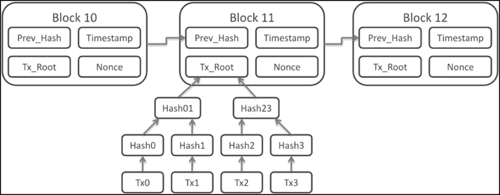

### 区块体

它包含区块中确认的所有交易。每笔交易包含一组条目和一个交易头，后者引用交易中的其他条目。交易中的每个条目均由其唯一 ID 标识。

## 区块链如何工作？

1.  必须发生一笔交易。
2.  必须验证该交易。
3.  必须将交易存储在一个区块中。
4.  必须给区块一个哈希值。哈希后，该区块即可添加到区块链中。

例如，假设我们要将一笔购买交易添加到区块链中；操作如下。首先，必须进行一次购买。购买完成后，必须验证交易详情，如交易时间、金额和参与者。验证通过的交易现存储在区块中。然后，给区块一个唯一的哈希值，并将其添加到区块链中（《区块链：你需要知道的一切》无日期）。

## 区块链的类型与版本

为了解决依赖大型服务器、需要可信第三方、具有成本效益的交易处理等问题，需要更多类型的区块链。一般来说，区块链有三种不同类型（《你需要知道的 6 个基本区块链技术概念》无日期）：

1.  **公有链**
2.  **私有链**
3.  **联盟链或联邦链**

### 公有链

它是一个完全去中心化的网络，其中只有交易信息完全对公众可见。在这种类型的区块链中，任何用户都可以随时加入网络，并可以随时随地存储、发送和接收数据。公有链网络的这一特性使其被称为**无许可网络**。网络中的参与者通过与其关联的代币获得激励和奖励。使用各种去中心化共识机制，如`PoW`、`PoS`来进行决策（《区块链有哪些不同类型？》无日期）。

公有链网络提供自我治理和更高级别的安全性，因为所有交易信息都存在于网络中的所有节点上，这使得攻击特定节点成为不可能。

**示例**：`Bitcoin`、`Litecoin`。

### 私有链

私有链通常称为**许可链**，用于组织内部，参与者需要获得许可才能加入网络。私有链更加中心化，交易是私有的。希望协作和共享数据的企业可以使用私有链，因为它们提供更高的效率和更快的交易速度。这种类型区块链中的代码严格保密且隐藏，这导致去中心化和去中介化被消除（《3 种区块链类型详解 - HedgeTrade 博客》无日期）。在这里，中央权威机构通过授予网络中任何人挖矿权来达成共识。

**示例**：`Bankchain`。

### 联盟链或联邦链

一种介于公有链和私有链之间的混合模型，其中若干经批准的用户对网络拥有控制权。联盟一词被定义为：为整个网络的最佳利益共同做决策的一组公司或一组代表个人。联盟链只允许少数选定的预定方验证交易并参与共识过程，而不是允许网络中的任何用户（如公有链）或单一组织（如私有链）（《不同类型的区块链 - ALTCOIN MAGAZINE - Medium》无日期）。

**示例**：`r3`、`EWF`。

简而言之，我们可以得出结论：公有链是需要开放性和抗审查场景的良好选择，而私有链和联盟链适用于需要隐私和控制的场景。

## 区块链版本

**图 2. 区块链版本**（《ICO InterValue - 世界首个实用区块链 4.0 项目 — Steemit》无日期）

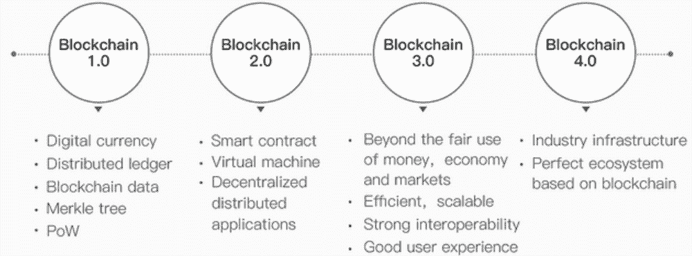

## 区块链 1.0


## 区块链演进：从 1.0 到 4.0 及物联网融合

## 区块链 1.0：比特币与加密货币

区块链诞生于比特币的概念之中。区块链 1.0 代表分布式账本技术在加密货币上的应用，用于价值转移和交易确认。比特币作为一个去中心化的点对点数字现金系统，是 20 年加密货币研究和 40 年密码学研究的成果。计算机科学的一项核心突破在于长期解决了与数字现金相关的问题。有了比特币，用户能够立即在数字钱包中收到资金，而无需等待数天进行转账。区块链货币确保任何交易都可以直接溯源和完成，无需任何第三方中介的介入。

## 区块链 2.0：智能合约与以太坊

为了克服比特币带来的浪费性挖矿、网络可扩展性不足等问题，先知维塔利克·布特林将这一概念扩展到了货币之外，并提出了一个名为“智能合约”的平台，开发者社区可以在区块链网络上构建分布式应用（DApps）。智能合约是部署在区块链上的小型计算机程序，通常由事件触发。这些智能合约可以自动执行任务，从而消除了管理耗时且昂贵的手动业务流程的需求。最著名的例子是以太坊区块链网络。智能合约无法被篡改或黑客攻击。它降低了验证和执行的成本，并允许透明的定义，克服了道德风险问题。这个版本的区块链成功处理的交易数量比 1.0 版本多得多。

## 区块链 3.0：可扩展性、互操作性与 IOTA

许多新技术（如 NEO、IOTA 和 EOS）旨在改进区块链 1.0 和 2.0 的能力。这催生了区块链 3.0，其重点是解决前几个版本相关的问题。为此，区块链 3.0 采用了不同的协议、技术和框架。它避免了中心化架构，采用去中心化存储和通信。从第一代持续到第二代的可扩展性问题，在该版本中通过称为 Tangle 的概念得以解决。区块链 3.0 与早期版本的区别特征包括高可扩展性、互操作性、适应性和可持续性。

区块链 3.0 主要专注于将物联网设备与区块链技术集成。IOTA 通常被称为无区块链，专为要求苛刻的物联网生态系统而设计。下表 2 展示了区块链 1.0、2.0 和 3.0 的对比。

### 表 2. 区块链 1.0、2.0、3.0 各属性对比

| 属性 | 版本 1.0 (比特币) | 版本 2.0 (以太坊) | 版本 3.0 (IOTA) |
| :--- | :--- | :--- | :--- |
| 挖矿 | 矿工 | 矿工 | 每个节点 |
| 速度 | 7 TPS | 15 到 20 TPS | 随节点数量增加而增加 |
| 语言 | 基于栈 | 图灵完备 | 图灵完备 |
| 哈希技术 | SHA-256 | Ethash | Curl |
| 缘由 | 作为常规货币的替代品而创建 | 作为促进点对点合约应用的平台而开发 | 作为物联网通信协议而设计 |
| 数据结构 | 链表 | 链表 | DAG (有向无环图) |
| 区块验证时间 | 10 分钟 | 14 到 15 秒 | 无区块 |
| 漏洞 | 易受暴力攻击和量子计算机攻击 | 易受量子计算机攻击 | 抗量子 |

## 区块链 4.0：面向商业的基础设施

除了可扩展性和安全性问题，区块链 3.0 缺乏商业级基础设施，因此无法用于现实世界的业务。此外，DApp 开发者必须在设计和编程上投入大量精力，因为一切都必须从头开始，基础层账本上没有面向服务的框架。下一代区块链的设计旨在解决与区块链 3.0 相关的问题。

区块链 4.0 作为一项新兴技术，带来了更低的成本和更短的开发周期，鼓励公司采用这项技术。在区块链演进史上，区块链 4.0 将成为适应业务的优越公共链，能够执行各种用例和应用。

以下是各区块链 4.0 项目的亮点：

### Seele
*   旨在为区块链平台提供统一性。
*   使用户能够进行跨链通信。
*   矩阵工作量证明共识算法。
*   链上和链下共享。
*   异构森林网络。
*   价值互联网。
*   2000+ TPS。

### Top Network
*   完全无许可。
*   双层分片、双层格 DAG、三层网络。
*   PBFT-DPoS 共识算法。
*   高达 300,000 TPS。

### Multiversum
*   基于 SQL 的短语结构。
*   完整性证明共识算法。
*   高达 6400 TPS。

### Metahash
*   提供任何资产的可靠快速交易。
*   多重权益证明共识算法。
*   100,000 TPS。

### InterValue
*   为区块链 4.0 创建基础设施。
*   HashNet 数据结构。
*   抗量子攻击。
*   支持图灵和非图灵语言。
*   基于 HashNet 与 BA-VRF 确认机制交互的双层共识。
*   高达 100 万 TPS。

## 物联网设备与区块链的融合

根据各类研究报告，目前约有 50 亿个物联网连接设备，预计到 2022 年将增加到 500 亿台。物联网设备在将当前世界转变为智能世界方面发挥着重要作用。随着物联网设备的持续激增，数据验证、交易验证、访问控制变得至关重要。此外，由于从不同设备在一处收集数据、黑客远程控制设备、设备管理、缺乏发现受损节点的能力、敏感数据泄露等活动，物联网的安全漏洞不断增加。克服物联网设备面临的安全问题是一项艰巨的任务。如果物联网设备去中心化，其问题和安全隐患将迎刃而解。

许多安全专家认为，区块链可能是物联网设备解决其问题所需的“银弹”。区块链与物联网集成后，可以提高物联网设备的安全性和分布式处理能力，还能解决基于云的数据垄断问题。此外，区块链能够追踪和处理来自无数物联网设备的海量数据流。区块链和物联网被视为完美搭档，因为区块链可以解决许多与物联网设备相关的问题。

尽管快速发展的区块链技术解决了物联网设备的许多问题，但这两种蓬勃发展技术的融合仍面临一些问题。由于物联网设备被设计为轻量级且具有低处理能力，在这些设备中集成区块链构成了挑战。此外，区块链还伴随着可扩展性问题和飙升的费用。因此，许多公司将这两种技术的融合列入议程并开始着手研究。


## IOTA：面向物联网的无区块链加密货币

(Elsts, Mitskas, and Oikonomou 2018) IOTA 是专为物联网设备与区块链技术集成而设计的无区块链加密货币。它是一种抗量子的有向无环图（DAG），运行在其自有的名为 Tangle 的账本之上。在该图中，节点代表 IOTA 交易，验证对应边。每笔交易在加入网络前必须验证其他两笔交易。验证过程采用工作量证明（Proof-of-Work）机制。IOTA 旨在提供零手续费交易和独特的验证流程，以解决区块链的可扩展性问题。

## DAG 与传统区块链的区别

DAG 与其他区块链的区别在于：DAG 基于“水平”方案运行，而区块链基于“垂直”方案；且 DAG 中没有矿工和区块，因此得名“区块链 3.0”（Blockchain 3.0 and COTI - Next Generation Technology Without Mining? n.d.）。图的本质是无环的，且沿特定方向流动。IOTA 中的交易不会重复，也无需等待区块确认，从而降低了飙升的交易费用。尽管 IOTA 试图成为完美解决方案，但将物联网设备与 IOTA 区块链集成仍存在通信开销。

## 区块链的应用

区块链技术已打破枷锁，其应用栈从加密货币持续扩展至物联网中的数字身份，并进入各行业的主流业务运营（Top 10 Blockchain Technology Applications Explained In-Depth n.d.）（20 Real-World Uses for Blockchain Technology | The Motley Fool n.d.）（Blockchain Applications That Are Changing The World | Edureka n.d.）。

以下是区块链的一些实际应用：

1.  金融
2.  医疗保健
3.  土地注册
4.  保险
5.  数字投票
6.  全球贸易
7.  版权与版税保护
8.  继承
9.  药品溯源
10. 政府
11. 供应链监控

### 银行业

银行业容易出现错误和欺诈，因为它涉及资金处理且高度依赖人工网络。每年有超过 40% 的金融机构遭受严重的经济犯罪。为保障资金安全，金融机构需要大量中介。中介的介入导致费用增加和人工流程增多，进而增加错误和欺诈。区块链技术为这些问题提供了解决方案，通过仅允许授权参与者访问数据来改善银行服务。它记录所有登录交易的日志，从而防止错误和欺诈。区块链助力银行业的主要领域包括：更快的跨境支付、更廉价的 KYC（了解你的客户）和贸易融资（Blockchain and Finance: Two Peas in a Pod - Blockgeeks n.d.）（How is Blockchain Revolutionizing Banking and Financial Markets - By n.d.）。

### 医疗保健

患者数据在医疗保健领域起关键作用，但分散在医院的不同部门。因此，在需要时数据难以轻松获取。此外，患者还需花费时间收集这些数据。为解决这些问题，医疗保健可配备区块链技术。当健康数据存储在区块链上时，医疗服务提供者和患者可随时随地访问。

### 土地注册

土地注册涉及土地所有权从卖方向买方的转移。因该流程基于纸质处理，导致大量欺诈和混乱。区块链旨在通过提供 100% 基于计算机的解决方案而非纸质权证，给出法律所有权的清晰视图。

### 保险

现有保险理赔流程复杂且欺诈多发。客户理赔耗时漫长。区块链可解决这些问题并简化流程。利用该技术，付款方能自动收集所需信息，客户能无延迟地获得理赔。

### 数字投票

单张选票可改变国家命运。投票在国家未来中起关键作用。区块链技术若与投票结合，可使投票过程透明，其不可篡改特性确保选票真实有效。

### 全球贸易

全球贸易指跨国商品、资本和服务的交换。约 1/5 的运输成本主要用于贸易文档。因不同系统处理供应链参与者间的不同交易。区块链技术可降低此成本，因为所有需记录的信息存储在区块链上并由网络中所有人共享。

### 遗嘱与继承

纸质遗嘱可能落入错手并被非法使用。将遗嘱以数字形式存储在区块链网络上可避免此情况。借助智能合约，遗嘱变得清晰明确且具法律约束力，不留欺诈空间。

### 版权与版税保护

在互联网普及的今天，对数字内容拥有版权和所有权法律至关重要。区块链技术可提供实时透明的版税保护。它确保艺术家和内容创作者在内容被他人购买时获得公平份额。

### 药品溯源

假冒药品每年导致全球数百万人死亡。区块链技术通过追踪药品从原料起源到最终到达消费者手中的终端产品，证明了其作为解决方案的有效性。药品追踪基于序列号和/或批次号，确保流程透明，消费者买到正品。

### 供应链监控

这是查看产品从原产地到零售商的绩效过程。区块链以安全共享的方式协助该过程。若有人试图在产品送达客户途中篡改，区块链易于识别并在产品到达客户前向生产商报告。

### 政府

各部门孤岛式工作的政府部门面临大量数据交易挑战。区块链技术拥有转变这些挑战的力量，实现更轻松、更好的数据管理。因使用区块链技术，数据变得透明，交易监控和审计变得更容易。

## 区块链的优势

区块链相关的各项优势如下（The Top Advantages Of Blockchain For Businesses n.d.）（5 Big Advantages of Blockchain, and 1 Reason to Be Very Worried | The Motley Fool n.d.）（Top five blockchain benefits transforming your industry - Blockchain Pulse: IBM Blockchain Blog n.d.）（Advantages and Disadvantages Of Blockchain Technology - DataFlair n.d.）（Blockchain Applications and Its Future - By Roger James n.d.）：

1.  **去中心化**

    区块链缺乏中心化数据存储，这是一项令人振奋的特性，避免了为验证交易而运行大规模数据中心。它还确保即使网络落入坏人之手，整个网络也不会受到威胁。

2.  **降低交易成本**


## 区块链技术的优势与安全问题

### 区块链技术的优势

区块链网络中发生的企业对企业（B2B）交易和点对点（P2P）交易，允许在无需中介参与的情况下进行验证和完成。这从长远来看降低了用户和企业的成本。

### 3. 效率

使用传统文书流程完成交易既耗时又费力，且消耗大量人力。此外，还存在人为错误的可能性。区块链技术通过简化和自动化交易流程，帮助我们更快地完成处理。此外，网络参与者无需维护多份文档，而是共享同一份数字账本，这使得建立信任变得更加容易。

### 4. 可追溯性

从源头监控和追踪产品的供应链是一个复杂且繁琐的过程。但有了区块链，从源头沿链追踪账本变得更加容易。这有助于我们了解产品的来源，也有助于定位并纠正产品路径中出现的任何问题。

### 5. 安全性

区块链技术提供高级别的安全性，因为所有交易只有在经过最大程度的信任验证后才会被添加到区块链中，且网络中的每个参与者都会获得一个与其账户关联的唯一身份密钥。此外，数据账本受密码学保护，且账本依赖于相邻区块来完成这一密码学过程。再者，交易按时间顺序记录，使区块链带有时间戳。这使得黑客更难入侵或破坏链。

### 6. 更快的处理速度

在传统银行中，发起和处理交易需要大量时间，甚至数天到数月。这是因为全球金融机构处于不同时区，且仅在工作日运营。但自区块链技术发明以来，其全天候（24/7）运行的特性使得交易处理更快完成，即流程可在几分钟甚至几秒内完成。

## 区块链技术的安全问题

*   **1. 多数派攻击（51% 攻击）**
*   **2. 社会工程学攻击**
*   **3. 软件缺陷**
*   **4. 恶意软件**
*   **5. 日食攻击**

### 51% 攻击

如果区块链超过 50% 的算力由黑客控制，则称为 51% 攻击。在此攻击中，如果网络中超过一半的节点宣称谎言，谎言就可能变成真相。黑客控制整个网络，双重支付代币，阻止其他人创建区块和交易。这种攻击类型最早由中本聪在比特币中提出。较小的区块链面临遭受此类攻击的高风险。

### 社会工程学攻击

这种攻击几乎存在于所有领域。其主要目标是窃取用户的私钥或登录信息。网络钓鱼是最流行的社会工程学攻击之一。在网络钓鱼中，恶意行为者向受害者发送邮件或消息，或建立网站/社交媒体，要求立即发送凭证。如果我们提供所有凭证，几乎无法阻止他们清空账户。

通过不向恶意行为者发送凭证或私钥，并让区块链网络参与者意识到此类攻击，可以预防社会工程学攻击。

### 软件缺陷

区块链已被证明能抵御几乎所有类型的攻击，但建立在其之上的去中心化应用（`DApps`）不可避免地存在漏洞。报告称，因软件漏洞导致区块链网络损失超过 2400 万美元。为防止此类缺陷，区块链网络使用的软件必须经过严格测试和审查。

### 恶意软件

许多类型的恶意软件可能给区块链网络带来安全问题，范围从恶意加密挖矿软件到能关闭公司服务器的代码。与区块链网络关联最著名的恶意软件是隐秘挖矿（`cryptojacking`）。它主要涉及加密货币。在此攻击中，计算机资源被未经授权的人（称为隐秘挖矿者）接管。这会导致性能问题和电力使用量增加，为其他敌对代码铺平道路，并给受害者造成数百万美元损失。通过警惕性，我们可以阻止恶意软件的破坏。

### 日食攻击

这种攻击发生在去中心化网络中，攻击者旨在将特定节点或一组特定节点从整个网络中隔离。简单来说，就是垄断节点与其他节点的连接，使受害节点无法从攻击节点以外的任何节点接收信息。恶意行为者利用受害节点，使其仅从恶意节点接收信息，从而相信区块链的错误状态。日食攻击还可通过劫持被隔离节点的挖矿算力来攻击整个区块链网络。攻击者可轻松获得受害节点的足够支持，建立真实账本的分叉。日食攻击的发生取决于网络数据结构、每用户连接数以及每节点分配的唯一 IP 地址等因素。

## 结论

本章总结：作为一个备受争议的话题，区块链可能是解决当前技术面临的许多问题和漏洞的潜在方案。这项开创性技术弥补了当前技术的空白，确保了个人信息的安全。本文讨论了区块链的各种类型和版本。还得出结论：如果物联网（`IoT`）与区块链集成，可称作“天作之合”，将帮助用户处理大量数据、分配和分发处理能力、在全球范围内高效改善连接性。文中讨论了一些有趣的区块链实际应用，但仍存在更多应用，如不可变数据备份、分布式云存储、股权交易等。尽管区块链固有多项优势和安全特性，使其记录具有抗攻击性，但仍存在一些必须识别和缓解的安全风险，以确保区块链的光明未来。

## 参考文献

*   20 Real-World Uses for Blockchain Technology. (n.d.). https://www.fool.com/investing/2018/04/11/20-real-world-uses-for-blockchain-technology.aspx
*   3 Types of Blockchain Explained. (n.d.). https://hedgetrade.com/3-types-of-blockchain-explained/
*   5 Big Advantages of Blockchain, and 1 Reason to Be Very Worried. (n.d.). https://www.fool.com/investing/2017/12/11/5-big-advantages-of-blockchain-and-1-reason-to-be.aspx
*   5 Problems, B. Security, Privacy, Legal, Regulatory, and Ethical Issues - Blocks Decoded. (n.d.). https://blocksdecoded.com/blockchain-issues-security-privacy-legal-regulatory-ethical/
*   6 Essential B. T. C. Y. N. T. K. (n.d.). https://tradeix.com/essential-blockchain-technology-concepts/
*   A Brief History in the Evolution of Blockchain Technology Platforms. (n.d.). https://hackernoon.com/a-brief-history-in-the-evolution-of-blockchain-technology-platforms-1bb2bad8960a


## 第 2 章

*   **Mohd Azeem Faizi Noor**
    
    印度贾米亚·米利亚·伊斯兰尼亚大学

*   **Saba Khanum**
    印度贾米亚·米利亚·伊斯兰尼亚大学

*   **Taushif Anwar**
    
    印度本地治里大学

*   **Manzoor Ansari**
    印度贾米亚·米利亚·伊斯兰尼亚大学

## 摘要

区块链，作为最流行的加密货币比特币和以太坊背后的技术，最近引起了广泛关注。它是最新兴的技术，改变了金融和非金融交易系统。它无处不在。目前，这项技术正迫使银行、工业界和各国在其金融、工业和政府部门采用它。早期，它成功解决了中心化和双重支付问题。在本章中，作者呈现了区块链安全问题及其挑战的研究。他们将整章分为两部分。第一部分涵盖了区块链的整体概述，随后的后半部分论述了基本操作、51% 攻击、可扩展性问题、分叉、分片、闪电网络等。最后，他们简要介绍了其在我们 24/7 生活中的应用（金融或非金融）以及与物联网等领域的协作。

## 绪论

区块链是一项崭新的技术，它承诺将日常活动从中心化方转移给实际用户（去中心化方）。它被视为使系统更加透明和去中心化的重要手段，通过点对点架构和加密方法进行创新，这应该会使中间商变得不再必要，并赋予个人权力。账本中的所有条目都是不可篡改的。区块链的优势迫使企业、银行和各个其他领域走向去中心化。此外，区块链的潜力远超任何炒作，它将通过在人们之间建立信任来改变社会。

与中心化和分布式系统相比，去中心化具有多方面的积极优势。中心化系统存在中心依赖，如果中心枢纽故障，会影响整个系统。为了摆脱对单点故障的依赖，不同的节点被赋能并实现了自主。这些系统的参与者或节点共同参与并协作，以在整个系统中共享、验证并建立信任（Yli-Huumo, Ko, Choi, Park, & Scotlander, 2016）。

本研究的目的是探索区块链的各个方面。我们试图通过涵盖区块链的关键部分（如不同的共识机制、问题和挑战）来提供整体视角。

本章分为四个主要部分。第一部分介绍基本特征及与相关术语的区别。第二部分阐述工作原理、类型和共识机制。第三部分详述问题和挑战。最后，提及针对区块链应用的具体问题。

### 1.1 区块链的特征


## 区块链特性

### a) 信任
信任是区块链的主要特征之一，主要由系统的去中心化架构调用。信任因素意味着在系统中不信任任何人。它消除了系统中第三方的角色，只有相关用户有权移动其资产，并使系统透明。互联网的演进未能解决信任因素，但区块链成功做到了。

### b) 共享与公开
为确保透明度，账本被公开保存。每个利益相关者都拥有账本的副本。账本交易中的篡改可被轻易识别。单个条目的更改不仅会改变当前区块的哈希值，还会改变前一个区块的哈希值。例如，在银行系统中，完整账本由银行或政府机构维护并私密保存。现在由于区块链，该账本不涉及任何银行或政府机构。所有条目公开保存，任何节点可直接连接账本并检查交易有效性。

### c) 节点验证
首先，通过认证流程验证新用户身份。节点成为系统一部分后，即可访问查看区块链。发起的任何交易由交易中的另一个对等节点检查验证，随后才添加到账本。毕竟，参与者被授权检查交易验证，因为系统的分布式账本在所有节点间共享。

### d) 不可篡改性
保存在区块链中的交易或数据保持不可更改和永久保存。这一特性使系统极具可信度。区块链不依赖中央权威，而是借助对等节点确保交易。验证过程包含挖矿过程，每个对等节点验证交易有效性。若交易未获大多数对等用户批准，则不添加到账本。一旦交易添加到区块，无人有权操纵、更改、删除或更新该交易。

### e) 去中心化与民主化
去中心化概念旨在使系统独立。即整个网络不受任何治理机构控制。节点群组自身调节网络。因此，区块链用户可直接从网络访问相关数据并存储资产。资产可以是加密货币、重要文档、合同或任何其他数字资产。去中心化赋予普通人对其资产的掌控权。此外，无需担心单点故障和数据安全。数据不由单一中心维护，网络中每个节点都有账本副本。这避免了系统全面崩溃。最后，系统运行在特定算法上，控制系统中的欺诈和骗局。

### f) 冗余性
授权使用系统的每个人都持有账本。区块链这一特性增加了所有未知参与者间的可用性和信任。结果是不存在单点故障。

### g) 增强安全性
区块链中无第三方控制，因此无人可更改账本上存储的信息。此特性通过“密码学”增强安全性。密码学包含通过复杂数学算法（如 `SHA256`、`HMAC` 等）进行加密，有助于保护网络免受攻击。区块中每条信息先哈希后存入账本。每个区块数据经哈希后与前一区块数据链接。这使所有区块形成链，故名“区块链”。当前区块的更改会改变前序区块的哈希值。攻击者极难更改区块链中所有区块的哈希值。因此，利用哈希 ID 篡改数据几乎不可能。

### h) 共识
此特性对区块链平稳运行极其重要。它是任何区块链架构的核心部分。每个区块链都有共识机制，如 `PoW`（工作量证明）、`PoS`（权益证明）、`DPoS`（委托权益证明）等。

## 1.2 区块链与相关术语的区别

与任何新技术一样，存在大量炒作和误导信息。区块链也发生了类似情况，各种误导信息和误解使用户困惑，无法区分与区块链相关的术语。图 2 展示了各术语与区块链的关系。

### 1.2.1 比特币
“比特币”一词比“区块链”更早流行，大多数人无法区分两者。比特币是建立在区块链框架上的首个应用。加密货币建立在区块链之上，比特币是其中一种加密货币（Vujičić, Jagodić, & Ranđić, 2018）。比特币离不开区块链。以太坊是另一个运行在区块链之上的加密货币示例。

### 1.2.2 加密货币
S. Nakamoto 提出了点对点货币交换框架（Nakamoto, 2008）。其目标是发明去中心化数字现金系统。该系统的副产品是加密货币。甚至 Nakamoto 也显著忽略了这一术语。

Jan Lansky (2018) 定义了被视为加密货币的系统的六个条件：

1.  不需要银行或国家等中介机构。
2.  跟踪加密货币单位及其各自所有者。
3.  系统应定义创建新加密货币的过程及这些新建单位的所有权。
4.  可专门通过密码学证明加密货币单位的所有权。
5.  执行交易后加密单位会发生变化。此类交易记录可由实体通过声明这些单位的当前所有权来证明。
6.  若同时为同一加密单位指示两笔独立交易，则至多只有一笔会生效。

因此，加密货币是基于分布式账本理念的代币，此功能通过区块链提供。加密货币被称为数字货币平台，而区块链应用于存储交易记录。两者相互关联但角色不同。

### 1.2.3 密码学
比特币交易由密码学支持，区块链记录基于密码学的比特币交易（Crosby, Nachiappan, Pattanayak, Verma, & Kalyanaraman, 2016）。比特币协议使用公钥密码学进行加密哈希函数和数字签名（Gaurav, Kumar, Kumar, & Thakur 2020）。椭圆曲线密码学（非对称性质）是比特币使用的加密算法（Lu, 2018）。与 `RSA` 算法相比，它以更小的密钥尺寸需要更少计算量并提供更多保护。

因此，密码学算法用于金融区块链中的交易，它不是区块链，而是一种更安全的机制。

### 1.2.4 链表
区块链类似链表但有差异。区块链是区块链。这些区块互连，如链表中节点相连。每个区块通过哈希函数与前一区块链接，而链表使用指针实现相同功能。链表是线性排列和存储记录或数据的方式，而区块链遵循 `Merkle Tree` 存储所有交易相关信息。区块链中数据操纵和篡改几乎不可能，而链表允许此类活动。区块链仅遵循链表结构，并伴随哈希函数、挖矿和共识协议（Gupta & Sadoghi, 2018）。


# 1.2.5. 分布式账本技术

DLT 是一种自动化系统，它以分布式方式跨多个站点记录交易及其详细信息。与传统数据库不同，DLT 没有中央权威机构（Alketbi, Nasir, & Talib, 2018）。根据可用性，DLT 有不同的类型。其中一些包括 `DAG`、`Tempo`、`Holochain` 等。`blockchain`（区块链）是其中最流行的一种。一些使用 `blockchain` DLT 的知名加密货币包括 `Ethereum`、`Bitcoin`、`Dash`、`Dogecoin` 等。

总之，`blockchain` 是 `DLT` 的一个子集和类型。所有区块链都是 `DLT`，但并非所有 `DLT` 都是 `blockchain`。

**图 1. 与区块链相关的各种术语可视化**

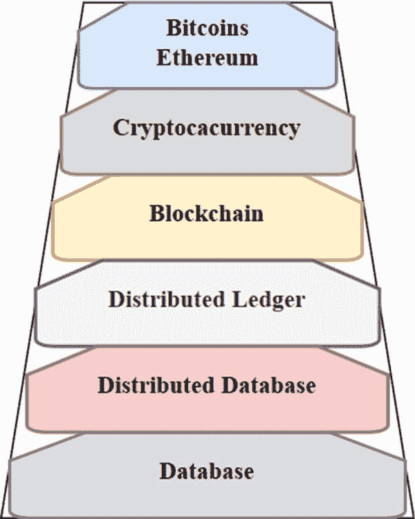

# 1.3. 当前趋势与实践

如今，`blockchain` 已获得全球认可，近年来已完成大量研究工作，它仍然是全球研究人员的热门话题。这之所以成为可能，是因为 `blockchain` 目前正在不同领域取得巨大成功。`HealthCare`（医疗保健）、`e-voting`（电子投票）、`Land-registration`（土地登记）、`Assets-registrations`（资产登记）、保障货物供应链安全等，都是使用 `blockchain` 的现实案例。这些应用涵盖了去中心化、不可篡改性和透明度，使其与其他技术截然不同。

英国、丹麦、洪都拉斯、澳大利亚、沙特阿拉伯、瑞士等许多国家已迈出步伐，释放 `blockchain` 技术的隐藏潜能。`Estonia`（爱沙尼亚）是第一个实施基于 `blockchain` 的 `e-voting` 的国家。`Dubai`（迪拜），这座未来之城，旨在到 2020 年以无纸化方式在其所有交易中采用 `blockchain`。瑞士全球项目 `Health bank` 是该领域的里程碑。同样，美国有 `Gem`，爱沙尼亚有 `Guard time`，作为基于 `blockchain` 平台的医疗保健项目（Mettler, 2016）。由于马耳他对 `blockchain` 和加密货币拥有无限制和开放的法规，专家将其称为“区块链的麦加”。许多其他国家已投入巨资用于其经济、数据管理安全、透明度，以及在本国民众中建立信任。

## 2. 区块链工作原理、类型与共识

本节通过详细讨论其工作原理，探讨 `blockchain` 技术的深度知识。重点介绍其类型及各类型的优缺点。此外，还详细阐述了 `blockchain` 核心“共识”机制的类型及其优缺点。

### 2.1 区块链的工作原理

`blockchain` 包含一个区块链，其中每个区块包含许多详细信息，如数据、区块哈希值、其链接的前一个区块的哈希值以及交易日志。没有父区块的节点称为 `genesis block`（创世区块），被视为区块链中的第一个区块。节点存储关于区块的基本数据，如发送方、接收方、时间戳和电子现金。`blockchain` 充当一个数据库，在社区之间记录和共享信息。组内每个成员都拥有所有交易的真实副本，所有成员共同参与验证和更新过程。在 `blockchain` 中不存在中央权威机构或管理员。

假设 `Alice` 想要向 `Bob` 发送一些代币。她会将此消息广播到网络。现在 `Miner`（矿工，即挖掘区块的人）将选择该交易并检查其有效性。如果交易有效，矿工将解决一个复杂的数学难题并广播解决方案。验证解决方案后，区块将被添加到链中。图 1 描绘了 `blockchain` 的工作原理。

**图 2. 区块链技术工作原理 (Nadeem, Rizwan, Ahmad, & Manzoor, 2019)。**

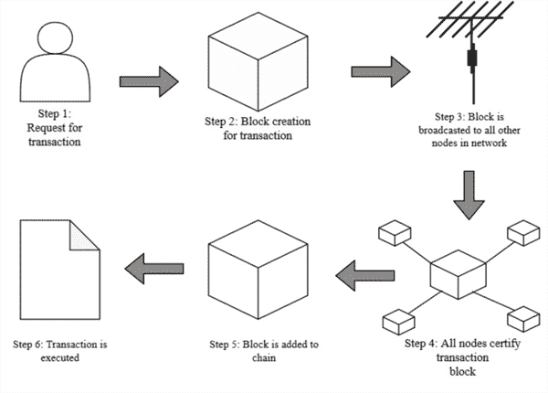

### 2.2 区块链的类型

`Blockchain` 可根据应用类型（金融或非金融）、演进类型（`1.0 Bitcoin`、`2.0 Ethereum`、`3.0 EOS`）进行分类。基于可用性，有三种 `blockchain`（表 1）：

*   **a.) 公有链：** 任何人都可以在验证过程后加入网络。每个人都可以访问整个账本。每个对等节点拥有平等的权利，没有节点可以支配其他节点。由 `Satoshi Nakamoto`（中本聪）引入的第一条 `blockchain`、`Bitcoin` 是公开且面向所有人的。加密货币的直接转账发生在对等节点之间。由于拥有赋权节点，这种公有链有许多优势，但同时，如果系统中以任何方式发生盗窃，对等节点无处申诉。

*   **b.) 联盟链：** 在这种类型的 `blockchain` 中，对等节点拥有平等的权利，但有一些监管者协助决策。根据研究人员的说法，这是最受关注且最有前景的 `blockchain`。

*   **c.) 私有链：** 这种 `blockchain` 更像是一个中心化系统。特定利益相关者拥有所有访问权限。并非所有人都能成为 `blockchain` 的一部分，因此只有相关利益相关者有权访问账本。共识机制与公有链和联盟链中使用的不同。决策权掌握在特定所有者手中，就像以前掌握在银行手中一样。

**表 1. 区块链类型**

| 特征 | 公有链 | 联盟链 | 私有链 |
| :--- | :--- | :--- | :--- |
| 读取权限 | 任何人 | 已知用户 | 已知用户 |
| 写入权限 | 任何人 | 多选组织 | 单一组织 |
| 共识 | `PoW` (Proof of Work，工作量证明)、`PoS` (Proof of Stake，权益证明) | `PoW` (Proof of Work，工作量证明)、`PoS` (Proof of Stake，权益证明) | `PoA` (Proof of Authority，权威证明) |
| 不可篡改性 | 几乎不可能 | 可被篡改 | 可被篡改 |
| 交易速度 | 慢 | 更轻量且更快 | 更轻量且更快 |
| 能源消耗 | 高 | 相对较低 | 相当低 |
| 示例 | `Bitcoin`、`Ethereum` | `Ripple`、`R3` | `Multichain`、`Blockstack` |

使用公有链，任何人都可以下载数据、参与并读取数据。公有链是开源的，并使用密码学和共识协议提供高安全性。联盟链由一组成员运行。私有链本质上是中心化的，用户需要许可才能加入或离开群组。想要创建自己货币的公司开始使用这种类型的 `blockchain`。此外，这些区块链在传输速率、节点权利和使用范围上有所不同。公有链的示例包括 `Bitcoin`、`Ethereum`，私有链类型包括 `Multichain` 和 `Blockstack`，联盟链包括 `Ripple` 和 `R3`。

### 2.3 不同的共识机制

共识机制是将合法交易添加到 `blockchain` 的协议。通过此协议，`blockchain` 网络在全球范围内就一笔交易达成一致。不同类型的加密货币使用不同的共识机制。例如，`Bitcoin`、`Ethereum` 使用 `Proof of Work (PoW)`（工作量证明），`Peercoin`、`Ethereum`（未来可能）使用 `Proof of Stake (PoS)`（权益证明），`EOS`、`Bitshares` 使用 `Delegated Proof Of Stake (DPOS)`（委托权益证明），`Hyperledger` 使用 `Practical Byzantine Fault Tolerance (PBFT)`（实用拜占庭容错）等。表 2 强调了它们之间的比较。

*   **a) 工作量证明 (PoW)**


## PoW 由中本聪提出，被视为首个区块链共识机制

共识过程被称为挖矿，参与的节点被称为矿工。矿工挖掘区块。矿工将内存池中的交易打包为区块，并检查区块内所有交易的准确性。随后，他们尝试解决一个需要巨大算力的困难数学难题。该难题难以求解但易于验证。可通过“试错法”求解。通过调整 `nonce` 的随机值以获得所需的哈希值。最先解出该难题者将发布区块的哈希值，并获得区块奖励及手续费奖励。该区块将被追加到链上。

PoW 需耗费大量资源，不可持续且未来难以行得通。因此许多区块链正转向新的或不同的共识算法。

## 权益证明

这是一种环保的方法，因为它不像 PoW 那样求解高难度难题。因此，验证交易消耗的电力极少。这是一个随机选择验证者以验证交易的过程。验证者类似于生产区块的矿工。验证者必须质押其代币一段时间才有资格生产区块。质押权益较高的验证者拥有最高的验证区块机会。完成流程后，验证者将因其工作获得奖励。

其主要劣势在于：富有的验证者拥有更多验证区块的机会，导致富者愈富，其余验证者难以获得足够的验证机会并赢取奖励。

## 委托权益证明

这是一种极快的共识机制，广泛应用于 EOS。该流程引入了“委托人”或“见证人”概念。委托人可以是生产区块的个人或组织。用户质押代币为特定委托人投票。质押越多，投票权重越高。根据得票百分比选出若干委托人。随后，他们按轮询方式获得生产新区块的机会并因工作获奖。该奖励将按其各自选举人代币投票比例分配给选举人。

## 实用拜占庭容错

该共识机制设计为一种“容错”算法，可在异步和分布式系统中运行。即使部分恶意节点传播错误信息或无响应，该网络仍能达成共识。该算法确保正确信息在节点间流动，并减轻恶意节点的影响。若恶意节点数量少于总节点数的三分之一，则可容忍。

该网络中所有节点按序排列。其中一节点被选为领导者或主节点，其余称为备份节点。主节点接收客户端消息并广播给备份节点。随后，备份节点互相发送消息（含主节点）。每个节点确保自身收到 `2F+1`（F = 最大故障节点数）条包含自身在内的有效“准备消息”。最终，主节点和备份节点达成一致并回复客户端。若客户端从不同节点收到 `F+1` 条结果相同的回复，则视为成功回复。

### 表 2. 共识算法对比

| 属性 | PoW | PoS | DPoS | PBFT |
| --- | --- | --- | --- | --- |
| 资源消耗 | 高 | 低 | 极低 | 极低 |
| 性质 | 去中心化 | 去中心化 | 中心化 | 去中心化 |
| 类型 | 无许可 | 无许可 | 无许可 | 有许可 |
| 吞吐量 | 低 <10 tps | 一般 <20 tps | 高 >5000tps | 高 >1000 tps |
| 容忍算力 | <50% 算力 | < 50% 权益 | <50% 验证者 | <33.33% 恶意副本 |
| 交易手续费 | 高 | 低 | 低 | 极低 |
| 示例 | Bitcoin | DoS | EOS | Hyperledger |

## 区块链的挑战与问题

### 51% 攻击

51% 攻击是指一组矿工控制超过 50% 的网络挖矿哈希率或算力，从而对区块链发起的攻击 (Chanti, Anwar, Chithralekha, & Uma 2020)。这将阻止新交易发生并逆转交易。51% 攻击还可能导致双重支付问题。攻击者虽无法创造新币，但会危及区块链安全 (Apostolaki, 2017)。

#### 挖矿垄断的危害

比特币（底层技术——区块链）的目标是运行一个支持无许可点对点交易的分布式账本。51% 攻击不仅危险在于可制造双重支付导致商家损失资金，更在于其能终结整个系统。凭借持续的多数算力，入侵者可持续（或定期）触发区块链重组，破坏网络可靠性。极端情况下，他们可永远挖掘空块，仅在自身区块上延长链，将其他人拒之门外，导致链完全失去实用性。

#### 以往的解决尝试

*   **使区块失效：** 矿工用此逻辑方法使可疑区块失效。失效过程触发彻底中断，链延伸至空或无效区块。
*   **阈值悖论：** 关键在于判定何种区块行为可疑以及何时使其失效。设定时间限制（阈值）是一种选择，但因网络和传播问题，很快时间限制理论被摒弃，因为一半区块可能被判定在失效区。悖论在于无论时间限制设多大；断层线都不随时间限制而保持。
*   **区块重组深度（“自动检查点”）：** 利用区块高度监控并禁止超出重组深度的重组。此法也未达预期。因任何比设定深度更深的区块，因阈值时间问题可能是有效或无效的。
*   **中本聪共识与拜占庭将军问题：** “中本聪共识”是区块链首个应用（比特币）所用的原始共识。原始工作量证明的妙处在于识别账本的正确版本。

拜占庭将军问题描述一群将军欲攻城却无法协调进攻。在比特币中，每个被解出的区块作为一位“将军”供其余军队跟随。完成工作从而指定一名矿工拥有扮演将军角色的轮次。人们意识到，将工作量证明用作分布式时间戳机制的天才之处在于其极难被篡改。

#### 部分解决方案

*   **i) 非完全分布式解决方案：** 若考虑不允许 > 6 个区块重组这一简单方案，则同时伴随新区块到来的 6 区块重组可能分裂链。虽留心的矿工易察觉分裂并重置，但此举无法完全自动化，需诚实矿工的人工干预与协调。这虽可作为权宜之计，但非完全分布式方案。
*   **ii) 非分布式解决方案：** 允许一组可靠矿池（5 个签名中的 3 个）使区块失效。这可通过节点必须观察正在发生的重组来完成；矿池不能随意指挥链。


#### 折中方案

有可能会在中间受到一定的惩罚，例如 20%、30%、50%……这可能会产生竞争条件，但仅限于较浅的重组深度。竞争很快就会结束，同样重要的是，攻击者无法欺骗诚实节点相互争斗，因为它们看到的惩罚是相似的。

## 3.2. 最终性

这是一种确认，即如果在区块链中输入了错误数据，区块链中所有已提交的区块都不会被撤销。因为一旦交易被添加到区块链，就无法被篡改。最终性回归到中本聪共识。当竞争结束，最长链工作量证明最终超越攻击者链（无论需要多长时间），它就从最纯粹的意义上实现了最终性。中本聪在其首篇白皮书中讨论了 51% 攻击，详细阐述了通过获得 51% 的算力可以接管区块链特性。为确保区块链正常运行，最终性变得至关重要。区块链中有三种类型的最终性：

*   **概率性最终性**
*   **绝对最终性**
*   **经济最终性**

在概率性最终性中，使用基于链的协议。比特币的中本聪共识是概率性最终性的一个例子，建议至少等待 6 个区块来确认一笔交易。这确保了交易被回滚的可能性较小。在绝对最终性的情况下，交易由基于 PBFT 的协议确认，例如 Tendermint。一组验证者批准交易。经济最终性对区块被回滚施加货币成本。Casper FFG 采用了这种类型的最终性。

根据 Eric Brewer 的 CAP 定理，在发生分区时，分布式系统只能保持一致性或可用性中的一种。一致性确保系统的正确状态，可通过概率性最终性实现；而可用性则倾向于绝对最终性。

## 3.3. 可扩展性

可扩展性是与区块链相关的主要根本问题之一。研究人员从初期阶段就开始尝试解决可扩展性问题。可扩展性定义了每秒交易数。区块链的第一个应用是比特币，每秒最多提供 6-7 笔交易；第二个应用是以太坊，提供 20 笔交易/秒，与其他应用的交易处理能力相比非常低。例如，Visa 每秒处理 1667 笔交易，PayPal 每秒处理 170 笔交易等（Conti, Kumar, Lal, & Ruj, 2018）。

可扩展性取决于许多因素，如区块大小、网络延迟、共识算法、复杂计算等。随着这些因素的进步，我们不得不在安全性上妥协，并更倾向于中心化。每个因素都有其优缺点。可扩展性取决于许多因素，如区块大小、网络延迟、共识算法、复杂计算等。随着这些因素的进步，我们不得不在安全性上妥协，且更倾向于中心化。现在，我们将讨论在可扩展性问题中起重要作用的区块大小和中位确认时间。

### 3.3.1 区块大小

中本聪建议比特币的区块大小为 1 MB。这些区块包含大量交易。通常，在 1 MB 限制下，一个区块包含大约 1500-3500 笔交易，具体取决于交易详情的大小。矿工需要 10 分钟生成一个新区块（Conti et al., 2018）。让我们考虑一些通过调整区块大小来提高可扩展性的情况。

第一种是将区块大小增加到可容忍的限度，这将容纳更多交易。在这种情况下，所有节点都需要执行所有必需的计算。由于大小增加，节点处理所有交易将变得更难。为了验证交易，矿工需要更先进的资源，这将淘汰装备较差的矿工，赋能装备更好的矿工。因此，这将导致更严重的中心化。此外，还会导致诸如 51% 攻击之类的安全威胁。

第二种情况是将区块大小增加到无限大。这是最糟糕的情况。对矿工来说，处理交易将变得非常困难，且资源永远不够用。最后一种情况是小幅增加区块大小。它将积累稍多一点的交易，但这不是一个最优且可行的解决方案。

另一种情况是我们拥有多条区块链，并在不同的区块链上运行不同的应用程序，即无需在单条区块链上运行所有计算；而是将其分发。这种方法将单条区块链的负载分散到多条链中。因此，它提高了性能，但会以安全性为代价。这种方法会将算力分散到不同的区块链上，为了避免 51% 攻击，我们需要一条拥有所有算力的大链。因此，分散算力可能导致安全问题。

### 3.3.2 中位确认时间：可扩展性的另一个原因

这是导致交易延迟和区块生成延迟的另一个原因。中位确认时间是指用户等待交易被接受进已挖出区块所需的时间段。这发生的原因是交易费较低。交易费越高，被接受挖矿的机会就越大。目前（2020-05-19），等待确认的交易总大小为 71,141,960 字节，这被称为内存池大小。

为了解决可扩展性问题，已经尝试了许多方法，并引入了一些新技术和方法。分片和闪电网络是尝试解决可扩展性问题的方法。现在，我们将对它们进行了解。

### 3.3.3 分片

分片是一种使数据库更高效的概念。在区块链中，分片将计算开销分散到多组分片/节点中。这些分片保存区块链的一部分，而非完整的区块链信息。这些分片并行工作以提高效率，使网络能够增强可扩展性。基于分片的项目有以太坊、Zilliqa 和 Cardano，旨在获得可扩展性解决方案。然而，就区块链而言，分片仍是一项未经验证的技术（Moubarak, Filiol, & Chamoun, 2018）。

### 3.3.4 闪电网络

这种技术也称为链下方法。在这个网络中，无需将每条记录都保存在区块链上；而是在区块链之上增加另一层，并在这一额外层上在任意两方之间创建一个支付通道。

这两方需要创建一个多签钱包，并可用各自的私钥访问。他们中至少有一人必须向该钱包存入一定数量的加密货币。每笔支付后，如果双方都用私钥签名，金额将从钱包中扣除。他们可以在该通道上进行任意数量的交易。他们可以使用该通道直到不再需要。任何一方都可以关闭通道。关闭后，双方签名的最新钱包余额表将广播到网络。矿工将检查余额表，如果一切无误，将向相应方释放资金。这将在区块链上被视为单笔交易。这样，闪电网络可以减轻区块链的负载（Poon, Dryja, 2016）。

上述讨论总结出：中本聪于 2008 年提出了 1 MB 限制的区块大小。James A. Donald 是第一个在论坛上与中本聪互动的人，他评论道：“按我对你提案的理解，它似乎无法扩展到所需的规模。”十年后，可扩展性对比特币和其他加密货币而言仍是一个严重问题。专家们正试图寻找最优且永久的解决方案，但尚未实现。区块大小与安全性是一种权衡。许多最新实现仍未经验证。


## 可扩展性三难困境

可扩展性三难困境（图 3）指出，三个重要属性之间存在权衡：去中心化、可扩展性和安全性。区块链最多只能同时拥有其中两个属性（Tssandor, 2019）。

**图 3. 可扩展性三难困境：同时满足这三者非常困难。**

```
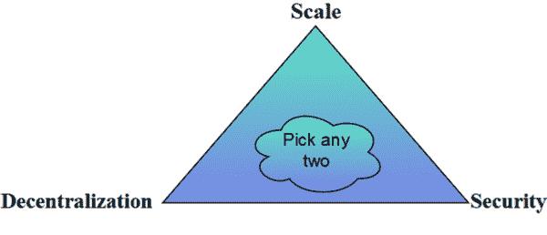
```

## 3.4 分叉

分叉基本上有两种类型：软分叉和硬分叉。链中任何支持链上先前区块的更新称为软分叉，而不支持先前区块并生成另一条链的更新称为硬分叉。图 4 说明了这两个概念。用户无需在软分叉时升级节点，因为它与早期版本兼容；而硬分叉必须更新，因为它与早期版本不兼容。硬分叉是专家或用户之间分歧的结果。硬分叉破坏了用户之间的和谐（Hamida, Brousmiche, Levard, & Thea, 2017）。

**图 4. 软分叉和硬分叉**

```
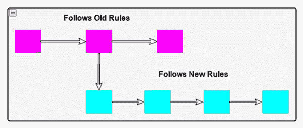
```

许多研究人员对区块链受限的区块大小感到不满。他们希望增加区块大小。为了实现这一目标，他们对区块链进行了硬分叉，并于 2017 年 8 月将其命名为比特币现金（BCH），区块大小为 8MB（图 5）。后来，在 2018 年 5 月，其大小增加了四倍，达到 32 MB。因此，它每秒可处理 61 笔交易（tps）。令人担忧的是，它每天将产生 4.5 GB 的数据，这需要巨大的存储空间，资源成本将超出普通矿工的财力承受范围。最终，它将面临中心化的风险。

**图 5. BCH 分叉（在区块 478558 处）**

```
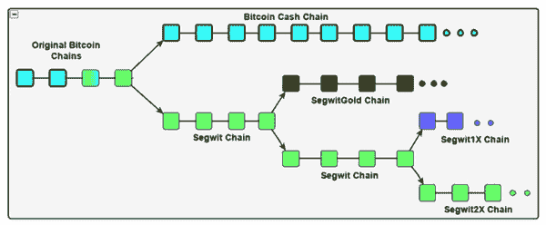
```

隔离见证是软分叉的结果。该协议代码于 2015 年发布，并于 2017 年 8 月在比特币上更新。最初，比特币遭受一个称为交易延展性的漏洞困扰。该漏洞以一种改变交易标识符（`txid`）但不改变签名和内容的方式突变 `scriptSig`。签名被称为见证。隔离见证修复了此漏洞。它在计算交易数据的 `txid` 时，将数字签名详情保留在外部并移至扩展区块。因此，如果攻击者试图更改 `ScriptSig`，将不会影响 `txid`。签名占交易数据的 50% 以上。如果省略签名，我们可以在一个区块内处理更多交易。实施隔离见证后，最大区块大小约为 4MB，从而实现了更好的吞吐量（Conti et al, 2018; Wuille, 2019）。

## 3.5 缺乏标准化

随着区块链的普及，用户数量不断增加。因此，我们在不同平台上拥有数千个区块链项目，它们使用不同的编码语言、共识机制、协议和标准。因此，这些项目如何相互交互成为一个关注的问题。缺乏互操作为用户和投资者带来了问题。用户必须为 n 个平台创建 n 个账户。理想的解决方案是为 n 个平台创建一个统一账户。标准化可以团结企业在应用开发和共识机制上进行协作。

## 4. 针对特定应用探讨区块链问题

区块链存在各种金融和非金融应用，预示着区块链正在接管世界。从金融类的 BFSI、外汇、金融科技等，到非金融类的医疗、土地注册、身份识别，皆是区块链应用统治力的体现。起初，银行和其他行业对采用区块链持怀疑态度，但随着时间的推移，情况已发生改变。如今，许多金融和非金融组织及个人正在将资源投入到基于区块链的应用中。然而，由于基础设施、知识匮乏、资金等多种原因，此类应用面临各种问题。在本节中，将讨论一些基本金融和非金融应用的问题与挑战。

### 4.1 投票系统

区块链与投票的结合听起来像是一个绝佳的解决方案。FollowMyVote、Votebook、VoteWatcher、Votem、Voatz、Agora 等是基于区块链平台旨在解决投票系统安全性和透明度的项目。这些项目也许有一天会成为常态，但就目前而言，仍有许多担忧和漏洞需要克服（Osgood, 2016）。

首要问题是公民缺乏知识和认知。另一个问题是胁迫。密码学家和安全技术专家 M Green 对此提出了质疑。有人可能会被恐吓而以特定方式投票，且无法证明自己没有按对方意愿行事。

下一个问题是，它处于胚胎阶段，因此政府和民众对此持怀疑态度，不愿做第一个“吃螃蟹的人”。尽管区块链提供匿名性并维护身份，但公众的信心和信任是区块链赋能投票成功的必要要素。由于其开源投票平台的性质，任何人都可以审计其记录的投票。

### 4.2 医疗卫生

医疗卫生是区块链的另一项非金融应用。Gem Health Network、Guardtime、healthbank、healthureum 是一些基于区块链的主要且新兴的健康相关项目。首要问题是财政危机。医疗支出持续无序增长，医院和诊所无法获得足够的资金来维护基础设施和优质服务。许多医院和诊所无法启动或负担此类先进技术的功能。

此类项目遍布全球，可从任何地方访问。障碍在于各个国家制定的法律。一些国家支持它，另一些则持反对态度。主要关注点是医疗服务提供者和医院遵循多项法规和法律。这些法规和法律应支持患者隐私（Mettler, 2016; Ahram, T., Sargolzaei, Sargolzaei, Daniels, & Amaba, 2017）。患者使用私钥访问健康记录。如果一个人不幸遭遇事故而昏迷或处于植物人状态，临床医生如何获知其健康记录。

药品造假问题已达高峰。根据一份报告，制药企业因全球假药损失 2 亿美元。每年全球有数以亿计的人因假药死亡。区块链能在很大程度上减少这些死亡。这就引出一个问题：为什么政府和制药企业对采用区块链漠不关心？

### 4.3 供应链

尽管供应链是区块链的天然应用场景，但目前应用仍不广泛。供应链有潜力开拓新市场并主导市场。存在数千种电子服务，它们拥有各自绑定的配送服务。区块链对它们而言将是一大福音。

同样，区块链可以追踪食品和饮食，并分析饮食的影响。这种分析可以揭示疾病的原因。通过食品追踪，可以知晓生病前他/她吃了什么食物（Niranjanamurthy, Nithya, & Jagannatha, 2018）。此外，还可以注意到饮食的营养及其对患者的影响。

商贩或推销员可以追踪他们的产品，从而知晓谁在使用他们的产品。基于各类此类信息，他们可以做出决策并构建市场。消费者可以直接验证产品的真伪。例如，最近雀巢推出了开放区块链以追踪牛奶。同样，许多其他公司也推出了自己的区块链平台来追踪产品。尽管如此，这在大众层面仍未普及实践。

### 4.4 银行业


## 金融行业与区块链采用

金融行业已拥有完善的基础设施，企业界转向区块链是一项宏大的挑战。毫无疑问，它将大幅降低成本（Nakamoto, 2008）并提供足够的安全性，但这需要熟练的员工和新的基础设施。建立初始区块链基础设施需要足够的资金。在将其应用于遗留系统时，仍面临一些挑战。由于基础设施是新的，维护价值较高。适应新环境需要一些时间。许多金融机构对其采用持怀疑态度。然而，如果它们早有规划，那么采用区块链显然更有成效（Zheng, Xie, Dai, Chen, & Wang, 2017）。

尽管区块链在金融应用中拥有丰富的优势，但也存在一些障碍和挑战。这些挑战需要在全球实施前得到解决。这些挑战包括安全性、可扩展性、互操作性、成本、效率等。

## 4.5 法规与治理

许多国家将区块链视为国家的重要资产，而另一些国家则不这么认为。各国经济依赖于一套政策和法规。法规因国家而异。日本是第一个将比特币作为加密货币使用的国家，目前市场上约有 2k 种加密货币。与此相反，在许多国家，加密货币业务被视为非法。总之，各国的规则和法规阻碍了区块链的全球采用（Conti et al., 2018）。

由于缺乏标准的规则和法规，诈骗和市场操纵在加密货币世界中司空见惯。结果，我们看到了无数诈骗，如庞氏骗局、BitKRX、Mt. Gox 等，它们从投资者那里窃取了数百万资金（Conti et al., 2018; Lansky, 2018）。投资者既无法向网站所有者索赔，也无法向政府索赔。

## 4.7 区块链与物联网的融合

区块链和物联网都是重要领域，两者的融合为未来开启了大量可能性。在此方向上，推出了 **IOTA**，这是一个新的基于区块链的物联网平台。**IOTA** 具备克服区块链缺陷的能力。通过维护一个共同账本，实现了互联网不同事物/节点之间的可扩展性和低成本通信。事物间的低成本通信增强了区块链物联网平台光明未来的前景。

节点间的互操作性仍是区块链和物联网领域的一个主要缺陷。大量研究人员正在开展渐进式工作以克服这些缺陷（Makhdoom, Abolhasan, Abbas, & Ni, 2018）。新技术的进步在最近几十年取得了巨大飞跃。它给人类生活的各个阶段带来了剧变，使其具备执行智能任务的能力。区块链和物联网（IoT）都是颠覆性技术，受到了工业界、学术界和金融科技的广泛关注（Shrestha & Kim, 2019）。

在中心化的物联网系统中，存在敏感信息隐私丢失的风险，因为中心化服务器可以从各种物联网设备访问明文数据。人们极有兴趣在物联网系统中实施区块链，以确保物联网数据的隐私和去中心化访问模型（Reyna, Martín, Chen, Soler, & Díaz, 2018）。区块链技术用于从不同物联网设备检索信息并将其存储在区块中，以确保全球用户间的透明度（Rathee, Sharma, Kumar, & Iqbal, 2019）。在过去十年中，强调了许多安全技术和方法。区块链在保障许多物联网应用安全方面发挥着重要作用（Minoli & Occhiogrosso, 2018）。

基于区块链的物联网系统的去中心化架构可以提供安全性和许多其他优势。物联网与区块链融合的优势包括数据完整性、透明性、安全性、去中心化、自主性、身份管理、不可篡改性、弹性、匿名性和成本降低。物联网系统主要面临安全方面的问题。区块链在缓解与安全相关的挑战中发挥着关键作用。利用智能合约，区块链可以轻松处理和监控物联网系统的安全方面。

## 5. 结论

本章阐述了区块链的基础知识、51% 攻击和可扩展性问题。接着，描述了区块链在特定应用中的适配问题。区块链蕴含大量可能性，拥有非常光明的未来。该领域的用例数不胜数，其他技术和行业采纳它的方式是超物理的（指超越常规/极其迅猛）。这项技术未来有潜力创造奇迹。区块链提供了大量机会，但同时也面临着可扩展性、安全性、隐私、合规和治理等各种挑战和局限。这些问题和挑战需要被彻底探索和解决。

## 参考文献

Ahram, T., Sargolzaei, A., Sargolzaei, S., Daniels, J., & Amaba, B. (2017, June). Blockchain technology innovations. In *2017 IEEE Technology & Engineering Management Conference (TEMSCON)* (pp. 137-141). IEEE. doi:10.1109/TEMSCON.2017.7998367

Alketbi, A., Nasir, Q., & Talib, M. A. (2018, February). Blockchain for government services—Use cases, security benefits and challenges. In *2018 15th Learning and Technology Conference (L&T)* (pp. 112-119). IEEE.

Apostolaki, M., Zohar, A., & Vanbever, L. (2017, May). Hijacking bitcoin: Routing attacks on cryptocurrencies. In *2017 IEEE Symposium on Security and Privacy (SP)* (pp. 375-392). IEEE. doi:10.1109/SP.2017.29

Chanti, S., Anwar, T., Chithralekha, T., & Uma, V. (2020). Global Naming and Storage System Using Blockchain. In *Transforming Businesses With Bitcoin Mining and Blockchain Applications* (pp. 146–165). IGI Global. doi:10.4018/978-1-7998-0186-3.ch008

Conti, M., Kumar, E. S., Lal, C., & Ruj, S. (2018). A survey on security and privacy issues of bitcoin. *IEEE Communications Surveys and Tutorials*, 20(4), 3416–3452. doi:10.1109/COMST.2018.2842460

Crosby, M., Nachiappan, Pattanayak, P., Verma, S., & Kalyanaraman, V. (2016). Blockchain technology: Beyond bitcoin. *Applied Innovation Review*, 2(6-10), 71.

Gaurav, A. B., Kumar, P., Kumar, V., & Thakur, R. S. (2020). Conceptual Insights in Blockchain Technology: Security and Applications. In *Transforming Businesses With Bitcoin Mining and Blockchain Applications* (pp. 221-233). IGI Global.

Gupta, S., & Sadoghi, M. (2018). Blockchain transaction processing. In *Encyclopedia of Big Data Technologies* (pp. 1–11). doi:10.1007/978-3-319-63962-8_333-1

Hamida, E. B., Brousmiche, K. L., Levard, H., & Thea, E. (2017, July). Blockchain for enterprise: overview, opportunities and challenges. Academic Press.

Lansky, J. (2018). Possible state approaches to cryptocurrencies. *Journal of Systems Integration*, 9(1), 19–31. doi:10.20470/jsi.v9i1.335

Lu, Y. (2018). Blockchain: A survey on functions, applications and open issues. *Journal of Industrial Integration and Management*, 3(04), 1850015. doi:10.1142/S242486221850015X

Makhdoom, I., Abolhasan, M., Abbas, H., & Ni, W. (2018). Blockchain's adoption in IoT: The challenges, and a way forward. *Journal of Network and Computer Applications*.

Mettler, M. (2016, September). Blockchain technology in healthcare: The revolution starts here. In *2016 IEEE 18th International Conference on e-Health Networking, Applications and Services (Healthcom)* (pp. 1-3). IEEE.

Minoli, D., & Occhiogrosso, B. (2018). Blockchain mechanisms for IoT security. *Internet of Things*, 1-2, 1–13. doi:10.1016/j.iot.2018.05.002


## 参考文献

Moubarak, J., Filiol, E., & Chamoun, M. (2018, April). On blockchain security and relevant attacks. In *2018 IEEE Middle East and North Africa Communications Conference (MENACOMM)* (pp. 1-6). IEEE. doi:10.1109/MENACOMM.2018.8371010

Nadeem, S., Rizwan, M., Ahmad, F., & Manzoor, J. (2019). Securing Cognitive Radio Vehicular Ad Hoc Network with Fog Node based Distributed Blockchain Cloud Architecture. *International Journal of Advanced Computer Science and Applications*, 10(1), 288–295. doi:10.14569/IJACSA.2019.0100138

Nakamoto, S. (2008). *Bitcoin: A peer-to-peer electronic cash system*. Retrieved from https://bitcoin.org/bitcoin.pdf

Niranjanamurthy, M., Nithya, B. N., & Jagannatha, S. (2018). Analysis of Blockchain technology: Pros, cons and SWOT. *Cluster Computing*, •••, 1–15.

Osgood, R. (2016). The future of democracy: Blockchain voting. *COMP116: Information Security*, 1-21.

Poon, J., & Dryja, T. (2016). *The bitcoin lightning network: Scalable off-chain instant payments*. Academic Press.

Rathee, G., Sharma, A., Kumar, R., & Iqbal, R. (2019). A Secure Communicating Things Network Framework for Industrial IoT using Blockchain Technology. *Ad Hoc Networks*, 94, 94. doi:10.1016/j.adhoc.2019.101933

Reyna, A., Martín, C., Chen, J., Soler, E., & Díaz, M. (2018). On blockchain and its integration with IoT. Challenges and opportunities. *Future Generation Computer Systems*, 88, 173–190. doi:10.1016/j.future.2018.05.046

Shrestha, R., & Kim, S. (2019). Integration of IoT with blockchain and homomorphic encryption: Challenging issues and opportunities. *Role of Blockchain Technology in IoT Applications*, 115, 293–331. doi:10.1016/bs.adcom.2019.06.002

Tssandor (.2019). Retrieved 24 July 2019, from https://steemit.com/blockchain/@tssandor/a-gentle-introduction-to-blockchain-scalability-part-i

Vujičić, D., Jagodić, D., & Ranđić, S. (2018). Blockchain technology, bitcoin, and Ethereum: A brief overview. In *2018 17th International Symposium Infoteh-Jahorina (INFOTEH)*. IEEE. doi:10.1109/INFOTEH.2018.8345547.

Wuille, P. (2019). *Segregated-witness-and-its-impact-on-scalability*. Retrieved 24 July 2019, from https://diyhpl.us/wiki/transcripts/scalingbitcoin/hong-kong/segregated-witness-and-its-impact-on-scalability/

Yli-Huumo, J., Ko, D., Choi, S., Park, S., & Smolander, K. (2016). Where is current research on blockchain technology?—A systematic review. *PLoS One*, 11(10), e0163477. doi:10.1371/journal.pone.0163477 PubMed

Zheng, Z., Xie, S., Dai, H., Chen, X., & Wang, H. (2017, June). An overview of blockchain technology: Architecture, consensus, and future trends. In *2017 IEEE International Congress on Big Data (BigData Congress)* (pp. 557-564). IEEE. doi:10.1109/BigDataCongress.2017.85

## 第 3 章

**Vinod Kumar**  
Madanapalle Institute of Technology and Science, India

**Gotam Singh Lalotra**  
Government Degree College for Women, Kathua, India

## 摘要

本世纪是无处不在的、智能的和智慧设备的时代。这些设备在商业、制造、医疗、零售、教育、安全、交通等不同领域拥有广泛的应用。物联网现在正成为所有这些领域不可或缺的一部分。但在拥抱这些技术时，安全始终是一个主要关注点。区块链技术是保障物联网安全的下一个前沿领域。它将在保障物联网生态系统中的通信安全方面发挥关键作用。本章讨论了基于区块链的安全物联网。

## 1. 介绍

IoT 是一种互联网技术，它通过无线技术将设备、机器和工具连接到互联网。IoT 是本世纪最伟大的现象之一。

> "根据 Gartner 研究，物联网 (IoT) 是包含嵌入式技术的物理对象网络，用于通信和感知或与其内部状态或外部环境进行交互。" (Gartner, 2019)

IoT 为商业市场提供了新的机遇并提供了竞争优势。它触及一切——不仅是数据，还有如何、何时、何地以及为何收集数据。连接到互联网的事物正因创造了物联网的技术而发生改变。服务由网络边缘的设备在不同层级上无需人工干预地提供。

由于数据生成和分析对 IoT 至关重要，管理和处理数据在其整个生命周期内是一项多方面的工作，因为数据必须经过许多管理边界。必须认真考虑数据在其整个生命周期内的保护。

将 IoT 视为系统的系统是一种良好的实践，因为不同的物理和技术组件共同构成了 IoT 生态系统。作为这些系统的架构师，为任何组织提供商业价值并非易事。企业架构师旨在设计集成解决方案，包括协议、应用、传输、边缘设备和分析能力，以构建功能完善的 IoT 系统。随着复杂性的增加，在不影响其他系统的前提下保持 IoT 安全面临挑战。(Internet of things beyond-bitcoin, 2019)

数据安全至关重要，国际数据公司 (IDC) 声称，实施 IoT 的组织中有 90% 在未来几年内将不得不遭受基于 IoT 的后端 IT 系统泄露。

## 2. 背景

区块链是一种分布式账本，维护着不断增长的数据记录和交易。由于交易与网络参与者相关，它们被记录在区块中。它们按正确顺序排列，并在添加时被分配记录时间戳。它是一种去中心化技术，通过去除中介，繁琐不便的银行流程可以被绕过，从而实现成本和时间效率。加密算法支持区块链技术，确保防止数据篡改并保障高安全性。数据库上的中间区块无法被替换，因为每个区块都包含指向前一个区块的哈希值。区块可以被扩展但不能被更改。

一般来说，区块链技术可分为两大核心类型：公有链和私有链。(Z Zheng, et al. 2017)

*   **公有链**：任何人都可以读取或写入数据。一些公有链将访问限制为仅读取或仅写入。例如，比特币采用一种任何人都可以写入的方法。
*   **私有链**：所有参与者都是已知且受信任的。当区块链用于属于同一法律母实体的公司之间时，这很有用。

### 2.1. 当前中心化模型的问题

现有的 IoT 生态系统依赖于中心化的、经纪式的通信模型，也称为服务器/客户端范式。所有设备都通过支持巨大处理和存储能力的云服务器进行识别、认证和连接。设备之间的连接必须通过互联网建立，无论它们之间的距离如何。

虽然该模型已连接通用计算设备多年，并将在未来几年支持小规模 IoT 网络，但它将无法满足未来不断增长的大规模 IoT 生态系统的需求。

当前的 IoT 解决方案面临许多挑战，因为网络设备、大型服务器场和中心化云涉及极高的基础设施建设和维护支出。随着 IoT 设备增长到数十亿，将涉及巨额投资。


#### 云服务器作为瓶颈

即使克服了经济工程和经济挑战，云服务器仍将是整个网络的瓶颈和故障点。没有单一平台能够支持物联网。设备所有权的多样性及其辅助云基础设施使得机器对机器（M2M）通信变得困难。

### 2.2 物联网网络去中心化

要构建更可靠的网络，去中心化网络是解决上述挑战的方案。一种用于处理设备间数十亿笔交易的标准化点对点通信架构，将通过将计算和存储负载分散到数十亿设备上，从而显著降低成本。

尽管如此，点对点通信也将解决其自身的问题；主要问题是安全。物联网安全不仅仅关乎敏感数据的保护。所提供的解决方案必须维护安全和隐私，为交易提出某种形式的验证和共识，以防止欺诈和盗窃。

去中心化方法必须支持三项基本功能：

*   点对点消息传递
*   分布式文件共享
*   自主设备协调

物联网系统去中心化方法的示意图如图 1 所示。

| 图 1. 物联网中的去中心化方法 (Datafloq, 2019) |
| --- |
| 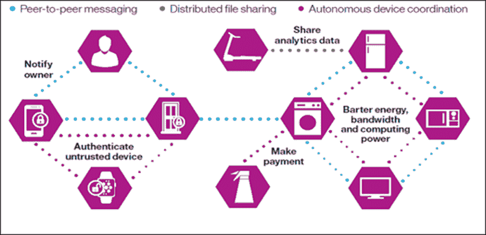 |

## 3. 区块链方法

**区块链**——支撑比特币的“分布式账本”——已成为技术行业深度关注的对象。这项技术提出了一种记录交易的方式，该方式安全、透明、可审计且高效；因此，它具有颠覆行业和实现新商业模式的潜力。该技术尚处于早期阶段且变化极快。为了避免麻烦的意外，各行业和企业的决策者应专注于调查该技术的应用。(A. B. Gaurav, et al., 2020)

区块链技术的主要组件列举如下：

*   **节点网络**
    区块链网络上进行的交易由网络节点共同维护，并由协议进行检查。`挖矿` 将新交易添加到账本中，网络上的其他节点验证工作量证明。
*   **共识**
    共识提出工作量证明（PoW）并在网络中验证操作。
*   **密码学**
    它使得未经授权的用户难以访问或篡改受加密机制约束的数据。
*   **共享账本**
    账本公开可用且不可篡改，每当发生一笔交易就会更新一次。
*   **分布式数据库系统**
    数据库由信息块组成，并复制到系统的每个节点。每个块包含交易列表、时间戳以及链接到前一个块的信息。
*   **智能合约**
    它用于验证和确认网络参与者。

## 4. 安全物联网部署面临的挑战

无论您的业务在网络中扮演何种角色，您都需要知道如何从这项提供高度多样化且快速变化机遇的新技术中获益。

管理大量现有和拟议数据是一项复杂的任务。由于面临诸多挑战，将海量数据转化为有价值信息的目标既繁琐又复杂。仅靠现有安全技术缓解物联网风险是不够的。目标是在正确的地点、正确的时间、以正确的格式保障数据安全。图 2 展示了物联网基础设施中从中心化模型向去中心化模型的转变方法 (Datafloq, 2019)。

### a. 应对挑战与威胁

预计未来将有更多企业部署安全解决方案以保护物联网设备和服务。随着在线设备数量的增加，相关企业必须扩大其安全范围。

企业必须根据涉及设备的能力和相关风险采用安全措施。商业智能预测，未来四年物联网设备安全解决方案的支出将增加五倍。

### b. 最佳平台

为物联网需求提供解决方案，要求系统中每个组件之间拥有无与伦比的协作、协调和连接。虽然这在理论上是可能的，但成本和时间参数使其变得困难，除非采用新方法。

| 图 2. 从中心化模型向去中心化模型的转变 |
| --- |
| 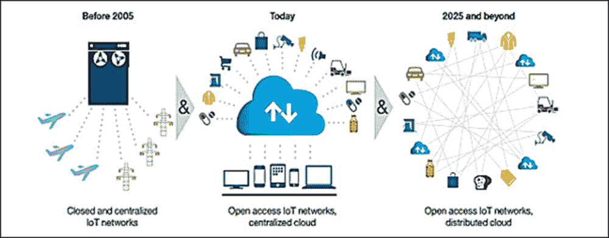 |

## 5. 区块链是物联网安全的答案吗？

安全是物联网持续面临的问题。巨大的市场为不受监管市场中的设备黑客攻击提供了充足的风险。我们谈论智能汽车和智能家居；那么个人的隐私和安全就是真正的担忧。在网络上物联网设备间收集、处理和传递的数据使安全成为一个巨大的担忧 (V. Kumar, et al., 2017)。

在针对物联网设备的众多安全建议中，如生物识别和双因素授权，一个潜在的答案是区块链物联网安全。区块链因比特币和以太坊而广为人知，为物联网安全提供了解决方案。它提供防篡改保护、锁定物联网设备访问权限，并允许在物联网网络中关闭受损设备。现代汽车最近支持 HDAC（现代数字访问货币），这是一家专门为物联网安全设计的初创公司。它帮助创建了一个许可的私有网络。

> “HDAC 的一些显著特征如下：(a) 减少挖矿垄断的 PoW 挖矿算法；(b) 三分钟出块；(c) 拥有私有/公有/许可区块链” —— @ecurrencyholder。

MIT Connection Science 首席技术官 Thomas Hardjono 建议，需要开发基础设施来管理设备和数据访问。他在其出版物之一中提出了一个基于区块链的物联网框架，称为 `ChainAnchor`。该框架通过由制造商、数据提供商和第三方支持的激活层和安全层来处理设备安全。该框架中的访问层将未经授权的设备或恶意行为者拒之门外。它还包含了在区块链上安全出售和移除设备的案例。

除了区块链物联网安全之外，还有许多问题，比如算力问题。许多物联网设备缺乏所需的算力。如果一组矿工控制了网络超过 50% 的算力哈希率，现有的区块链无法控制这种情况。区块链中广泛的节点网络使这非常困难，但家庭物联网区块链的算力很容易被黑客攻击。

是的，物联网安全肯定将随着其发展法规而继续演进。但在当前形势下，区块链物联网安全系统的可能性蕴藏着巨大潜力。

## 6. 区块链与物联网

区块链技术为解决物联网中的隐私、可靠性和可扩展性问题提供了方案。区块链技术可能是当前时代物联网行业所需的唯一技术。因为这项技术可以处理数十亿笔交易，追踪网络上的数十亿设备，并能在大规模设备网络中实现协调，从而为物联网行业节省大量成本。此外，去中心化方法将消除单点故障，为网络上的设备构建更可靠的生态系统。由于区块链技术使用加密算法，用户数据在网络上将更加安全。(Choi, S. et. al., 2018 & Kumar, V., & Thakur, R. S. 2017)


## 利用区块链技术解决物联网安全问题

由于账本不存储在单一位置，且不存在可被拦截的单一通信线路，恶意用户无法轻易篡改和修改账本。此外，区块链已通过比特币等加密货币在金融服务领域证明了其价值，在无需第三方干预的情况下实现了无信任的点对点消息传递。

企业物联网技术迅速拥抱区块链技术并不令人惊讶。这完全归功于去中心化、无信任和自主性等能力，使其成为物联网解决方案的基本要素。

**图 3** 描述了分布式交易账本中针对各种物联网交易的通用数字账本 (Datafloq, 2019)。

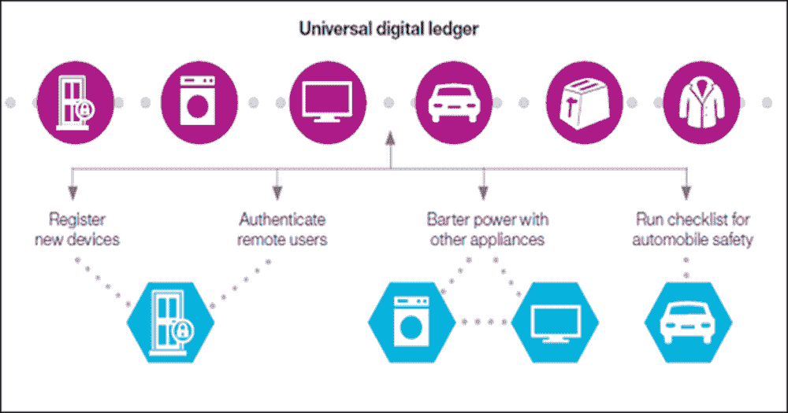

区块链可以创建一份不可争议的记录，追溯物联网网络中智能设备的历史。自主设备的运行无需中心化的控制或权威机构。这为一系列物联网设置打开了大门，而这些设置以前实现起来非常困难，甚至超出想象。

充分发挥区块链的最大能力，物联网解决方案可以赋能物联网网络中设备之间的无信任和安全消息传递。在此框架中，消息被视为比特币网络中的金融交易。在双方达成协议后，使用智能合约进行消息交换。

这种条件可提供远程控制；为了根据作物状况控制水流，可以直接与灌溉系统建立通信。同理，数据交换可根据不同田地的天气状况进行调整。

实施区块链将使真正自主的智能设备能够在无需中心化方干预的情况下进行金融交换和数据传输。区块链提供这种自主性，是因为网络中的节点自行验证和确认交易，而不依赖中心化权威机构。

在此背景下，可以设想智能设备在无人或第三方干预的情况下自行下单维修零件。同样，智能车辆在抵达修理厂后，将能提供关于核心部件更换的完整报告。

区块链最令人兴奋的能力之一，是维护网络中所有交易的精确、可信且去中心化账本的能力。这种能力对于满足工业物联网应用的诸多协议和监管要求至关重要，且无需依赖中心化权威机构。

### 7.1 集中式物联网网络的问题

当前的物联网生态系统遵循集中式模型。在该模型中，不同设备通过提供高计算和存储能力的云服务进行连接、识别和验证。互联网是信息传递的基本要求。集中式模型涉及极高的基础设施成本和集成物联网解决方案的维护成本 (Zhao, S., et al., 2019)。

物联网设备的数量也是亟待解决的重要问题之一。当联网设备数量达到数百万时，所涉及的成本将导致通信通道增加，从而引发可扩展性、经济性和工程方面的问题。

即使这些问题得到解决，还有一个问题在于云服务可能会扰乱整个网络。因此，物联网设备安全将变得更加困难。

将集中式模型应用于小规模物联网可以成功节省成本，因为不会存在可扩展性和维护问题。然而，大型物联网生态系统将遇到这些相关问题，这呼吁采用去中心化框架。

经济的不同领域正在大量投资区块链技术。各国、企业和高校都找到了投资该技术的理由。

### 7.2 利用去中心化区块链方法保护物联网

最重要的新兴趋势是区块链与物联网的融合。为了解决大多数安全问题，物联网网络的去中心化是解决方案。通过去中心化，自主性、可信度和可扩展性潜在地使其成为整个物联网生态系统的一个组成部分 (Bahga, A., & Madisetti, V. K., 2016)。

在考虑物联网时，可以实施区块链技术，以成功连接、追踪和协调数百万智能设备。物联网行业对区块链技术的投资可以保证在各个层面对数据进行适当管理。

将区块链技术集成到物联网网络中可以提供更多的安全性和隐私，因为该技术基于加密算法。交易被有序且严谨地记录，从而可以记录连接设备的历史。

结合实施区块链技术无需中心化权威机构这一事实，你将看到集成的潜力和益处确实是无限的。

### 7.3 两种基本设置

利用区块链技术提供物联网网络安全主要有两种方案。在第一种方案中，公司集成其连接设备以获取和传输数据，然后将它们连接到区块链网络。在此技术中，智能设备交换消息、下达订单并完成交易。在第二种方案中，公司采用以太坊智能合约实现流程自动化。这为连接设备之间提供了无限且安全的消息交换，类似于基于区块链的金融交易。

## 8. 结论

在整个物联网网络中实施区块链技术去中心化方法，可以从不同方面帮助保障物联网基础设施安全。它将通过确保各层级数据的隐私和保护来保证适当的安全性。此外，区块链技术有助于解决可扩展性问题，提供系统的有效运行，并能解决世界性的经济问题。

## 参考文献

Bahga, A., & Madisetti, V. K. (2016). Blockchain platform for industrial internet of things. *Journal of Software Engineering and Applications*, 9(10), 533–546. doi:10.4236/jsea.2016.910036

Choi, S. S., Burm, J. W., Sung, W., Jang, J. W., & Reo, Y. J. (2018). A blockchain-based secure IoT control scheme. In *2018 International Conference on Advances in Computing and Communication Engineering (ICACCE)* (pp. 74-78). IEEE. 10.1109/ICACCE.2018.8441717

Datafloq. (n.d.). https://datafloq.com/read/securing-internet-of-things-iot-with-blockchain/2228

Gartner Research. (n.d.). https://www.gartner.com/it-glossary/internet-of-things/

Gaurav, A. B., Kumar, P., Kumar, V., & Thakur, R. S. (2020). Conceptual Insights in Blockchain Technology: Security and Applications. In *Transforming Businesses with Bitcoin Mining and Blockchain Applications* (pp. 221-233). IGI Global.

Internet of things beyond-bitcoin. (n.d.). https://www.cio.com/article/3027522/internet-of-things/beyond-bitcoin-can-the-blockchain-power-industrial-iot.html

Kumar, & Thakur. (2017). A brief Investigation on Data Security Tools and Techniques for Big Data. *International Journal of Engineering Science Invention*, 6(9), 20–27.

Kumar, V., & Thakur, R. S. (2017). Jaccard Similarity based Mining for High Utility Webpage Sets from Weblog Database. *International Journal of Intelligent Engineering and Systems*, 10(6), 211–220. doi:10.22266/ijies2017.1231.23


## 参考文献

Zhao, S., Li, S., & Yao, Y. (2019). Blockchain enabled industrial Internet of Things technology. *IEEE Transactions on Computational Social Systems*, 6(6), 1442–1453. doi:10.1109/TCSS.2019.2924054

Zheng, Z., Xie, S., Dai, H., Chen, X., & Wang, H. (2017). An Overview of Blockchain Technology: Architecture, Consensus, and Future Trends. *2017 IEEE International Congress on Big Data (BigData Congress)*, 557–564.

## 关键术语与定义

**区块**：它是一种容器数据结构，包含一系列交易。区块内的每笔交易均经过区块链网络对等节点的数字签名、加密和验证。

**区块链**：它是一个去中心化的计算与信息共享平台，使多个互不信任的权威域能够在理性的决策过程中进行合作、协调与协作。

**物联网**：通过无线技术将设备、机器和工具连接到互联网的互联网技术。

**私有区块链**：所有参与者均为已知且受信任的实体。当区块链用于属于同一法律母实体的公司之间时，这非常有用。

**公有区块链**：所有人均可读取或写入数据。某些公有区块链将访问权限限制为仅读取或仅写入。例如，比特币采用的方法允许任何人写入。

## 第 4 章

## 作者

*   **Sreelakshmi K. K.**  
    计算机科学与信息系统系，比拉理工学院与科学学院，皮拉尼，印度

*   **Ashutosh Bhatia**  
    计算机科学与信息系统系，比拉理工学院与科学学院，皮拉尼，印度

*   **Ankit Agrawal**  
    计算机科学与信息系统系，比拉理工学院与科学学院，皮拉尼，印度

## 摘要

物联网已成为自动化和智能计算背后的指导性技术。物联网系统的主要担忧之一是缺乏用于控制访问和确保数据安全的隐私与安全保护方案。大多数安全问题源于物联网系统的中心化架构。另一个担忧是缺乏适当的认证和访问控制方案来调节对物联网设备生成信息的访问。因此产生的问题是：如何确保设备或通信节点的身份？在无信任环境中确保安全操作的答案，将我们引向了区块链的去中心化解决方案。关于物联网与区块链融合领域的研究正在大量开展，并已在解决物联网领域的一些重大问题上取得了显著进展。本文综述了物联网环境中的挑战与威胁，以及与区块链的集成如何解决其中部分问题。

## I. 引言

网络技术的快速发展使得能够连接到互联网的设备或物品数量激增，从而形成了通常被称为物联网的网络。主要的物联网应用包括智能电网、智能家居、工业物联网、智慧医疗等。从宏观层面来看，典型的物联网生态系统由收集数据的传感器等设备、执行器以及执行特定应用领域控制与监控的其他设备、由网络协议指导的通信基础设施，以及收集来自不同设备的数据并对其进行处理以供进一步分析的本地或中心化存储（云）组成。各类物联网设备生成的数据具有海量体量、异构性和动态性的特征。物联网环境中的每个设备都有一个与之关联的唯一标识符。Colakovic 和 Hadialic (2018) 的一篇综述著作对物联网及其使能技术进行了详细且技术性的描述。构建一个能够适应特定应用领域并表现良好的可持续物联网生态系统是一项极具挑战性的任务。随着利用大量设备的各种智能解决方案的出现，在中心化云存储中维护私有或用户数据安全的问题变得非常繁琐，需要高度关注。如果私有数据落入恶意实体手中，风险极高。另一个引人关注的问题是设备的资源和能量限制，这使得运行大规模加密算法以增强数据生成安全性变得困难。在灾难等特定情况下需要处理的其他挑战包括位于偏远位置的设备的容错与恢复。此外，物联网应用领域的多样性以及对技术和所提供解决方案的不确定性，导致了对这些解决方案缺乏信任。因此，去中心化解决方案以确保物联网生态系统的安全，是任何物联网应用的基本要求。

自 2008 年问世以来，区块链的概念在密码学和安全领域一直非常活跃。区块链研究取得的显著进展使得加密货币通过比特币成为现实。比特币目前价值 5431.43 美元，拥有约 570 万个区块，在更多算力和矿池的帮助下正以快速速度持续增长。Linux 基金会等软件巨头已经在通过研究 HyperLedger 等应用来利用区块链的潜力。随着软件行业预测区块链技术拥有光明的未来，我们必须详细调查区块链在物联网中的适用性，以解决主要安全问题，并评估其解决这些问题的成功程度。

当区块链遇上物联网，这种融合预期带来的益处包括：实体间建立信任、存储数据的完整性、一致性与完整性、私有数据的不可篡改性或防篡改保存、降低成本从而提供更廉价的解决方案、增强安全性，以及大数据的更快处理。

本文所呈现的综述工作的主要目标有：

*   调查物联网应用中目前存在的安全问题与挑战。
*   强调在物联网中应用区块链的决策标准。
*   调研通过区块链与物联网融合可实现的解决方案范围。
*   划清物联网应用的需求与分布式账本技术（DLT）所能提供的能力之间的界限。
*   展示区块链与物联网集成的最新研究现状。
*   根据区块链在特定应用领域解决的问题，识别并分类物联网应用。

本文其余部分安排如下：第 2 节讨论物联网中的安全挑战，第 3 节阐述区块链的运作机制，第 4 节描述在物联网中使用区块链的必要性。第 5 节讨论最新研究现状以及致力于融合区块链与物联网的现有综述与研究；它通过分析区块链应用成功在不同参与方间建立信任与安全的一些物联网应用领域来进行论述。

## II. 物联网生态系统中的挑战与安全威胁


## 物联网安全挑战与区块链概念

## 分层架构中的物联网安全问题

图 1 显示了物联网分层架构不同层级的主要安全问题。考虑到所有物联网资产及其可能存在的漏洞，保障物联网对象的设备级安全是一项繁琐的工作。开发物联网应用时，应牢记存储空间、计算能力、物理安全、通信带宽、成本和延迟等设计考量因素。已安装设备完全缺乏或缺少定期固件更新，使得攻击者易于利用其中的弱点。设备生成的数据在传输过程中可能会泄露。

最近发生的 Mirai 僵尸网络攻击是最大的分布式拒绝服务 (DDoS) 攻击之一，恶意攻击者通过操控安全防护薄弱的物联网设备入侵网络，这凸显了加强物联网领域设备级安全的必要性 (Fruhlinger, 2018)。设备间安全级别低且连接性高，使得攻击者易于操控部分设备以获取数据并使其瘫痪。一种名为 Mirai 的恶意软件通过 Telnet 和基本的字典攻击程序，利用“僵尸网络”的网络数据安装在物联网设备中。安全受损的设备成为僵尸网络的一部分，随后被利用以持续发动 DDoS 攻击。

**图 1. 物联网分层架构不同层级的安全挑战**

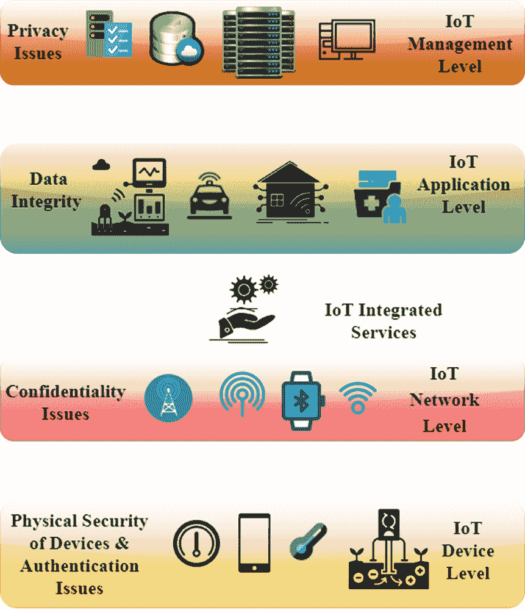

## 传输层与应用层安全

为在传输层提供端到端的主机安全，可使用传输层安全性 (TLS) 和数据报传输层安全性 (DTLS)，从而确保主机匿名性。然而，TLS 和 VPN 等解决方案的问题在于，它们不具备可扩展性，因此不适用于许多应用 (Miraz, 2019)。现有解决方案建议使用安全套接字层 (SSL) 协议在将用户数据中继至云存储时进行加密。这可用于确保设备与云之间的安全通信。

在应用层，随着来自不同设备的数据不断聚合，确保完整性成为一个重大问题。然而，在物联网管理层（如图 1 所示），当用户数据驻留在云服务器上时，存在在不同公司间共享甚至出售数据的可能性，这侵犯了用户的隐私和安全权利，并进一步加剧了公众的不信任。在大多数情况下，设备可能需要最终用户的私人数据，如姓名、位置、手机号码等，或社交媒体账户信息，一旦落入恶意攻击者手中，这些信息会暴露用户的大量隐私。因此，中心化基础设施（如云）所提供的隐私保护级度缺乏信任。

Ferrag 等人 (2018) 调查了一些隐私保护方案，并指出了其中的技术缺陷。Elrawy 等人 (2018) 建议在用户到设备和机器到机器的通信中使用隐私感知 ID，以避免敏感信息被追踪。

## 安全模型与威胁分析

许多研究人员为物联网提出了多种安全风险模型和威胁模型。Abdul-Ghani 等人 (2018) 对物联网攻击进行了系统建模，并分析了安全目标。文中列出了攻击分类法及相应的应对措施。物联网环境中的攻击大致可归类为：基于物理设备的攻击、基于协议的攻击、基于静态数据的攻击和基于应用的攻击。

Pongle 和 Chavan (2015) 的工作调查了针对 RPL 和 6LoWPAN（低功耗无线个人区域网络上的 IPv6）的攻击。Kouicem 等人 (2018) 强调了在不同物联网应用中部署现代加密机制面临的重大挑战，包括移动性、异构性、资源限制、缺乏适当的标准化和可扩展性。

Elrawy 等人 (2018) 调查了基于物联网系统的入侵检测系统 (IDS)。他们声称 IDS 可以成为减少针对 RPL（低功耗损耗网络路由协议）的网络层攻击的潜在解决方案。研究表明，IDS 还可以降低 DoS 或 DDoS 攻击的发生几率，此类攻击旨在通过轰炸式请求来破坏系统。

Bassi 等人 (2013) 将信任因素描述为任何物联网系统的基本素质，这主要取决于 M2M 通信中的性能，以及物联网系统的计算性能和互操作性。

创建安全物联网环境的综合解决方案应是一个自动数据处理实时平台，涵盖数据加密和认证等服务，从而保证数据完整性、访问控制、隐私，并应具备可扩展性和低成本。及时检测并隔离安全受损设备的能力，是确保任何物联网应用中设备级安全的迫切需求。区块链的出现为探索其在物联网系统中提供部分或全部这些安全服务的潜力铺平了道路。

## III. 区块链概念

尽管大量论文已详细阐述了区块链和智能合约的技术与概念，但我们必须重点介绍基础知识。Fernandez-Caramez 和 Fraga-Lamas (2018) 对区块链的运作进行了很好的描述。

区块链是一个由点对点网络管理的、包含不可篡改记录的分布式账本。网络中的所有节点通过共识算法确保区块链的完整性和正确性。这种将信任置于节点网络中的方法增强了区块链的安全性。

根据成员资格是否需要许可，区块链可分为公有链、私有链或联盟链。在公有链中，任何用户均可成为成员。没有成员限制，且仅具有伪匿名性。比特币和以太坊是公有链的典型例子。然而，私有链由公司或组织拥有和运营，任何想要加入网络的用户都必须通过相关人员申请成员资格。

因此，私有链仅提供部分不可篡改性。由于成员数量受限，私有链和联盟链的交易处理速度比公有链更快。一些许可链的例子包括 HyperLedger (Fabric Blummer 等人, 2018, Hyperledger, 2017) 和 R3 Corda (Brown 等人, 2016)。一些私有链对区块内的数据施加读取限制。联盟链由一组组织或私有社区拥有和运营。

区块链用户使用非对称密钥加密对交易进行签名。分布式账本技术 (DLT) 中信任因素的维护，归功于共识算法及其由此实现的关键理想属性。Wüst 和 Gervais (2018) 对这些属性进行了很好的描述。其中一些包括：公开可验证性、透明性、完整性。

### A. 区块链术语


#### I. 区块链基础

##### 1. 区块
与区块链相关的点对点网络中发生的交易，会从交易池中被选取并分组到一个区块中。一旦交易经过验证，就无法撤销。交易具有假名性，因为它们仅与用户的公钥相关联，而非用户的真实身份。一个区块可能包含数百笔交易。区块大小限制了可包含在区块中的交易数量。图 2 展示了区块链中区块的一般结构。一个区块由版本号、前一个区块的哈希值、用于追踪区块内交易的默克尔根树、当前区块的哈希值、时间戳和随机数值组成。区块链始于创世区块。

##### 2. 挖矿
挖矿是一个过程，其中区块链网络中被称为矿工的指定节点从未处理交易池中收集交易并将它们组合到一个区块中。在挖矿过程中，每个矿工竞争解决一个难度相同的计算问题，即寻找一个具有特定数量前导零且低于特定目标值的有效哈希值。在比特币挖矿中，零的数量表示计算的难度。会尝试许多随机数值，以找到在当前难度级别下哈希为有效哈希值的“黄金随机数”。当矿工找到这个随机数值时，我们可以说他已成功挖出一个区块。该区块随后会被更新到链上。

##### 3. 共识
正如 Jesus 等人 (2018) 所述，共识机制主要服务于两个目的：区块验证和最长链选择。工作量证明是比特币区块链使用的共识算法。权益证明算法比工作量证明快得多，且所需的计算资源更少。以太坊区块链使用纯权益证明算法来确保共识。除了工作量证明，还有其他共识算法，如实用拜占庭容错算法 (PBFT)、活动证明等。Anwar (2018) 提供了不同共识算法的综合视图。工作量证明是一种签名，表明该区块是在执行了所需难度级别的计算后被挖出的。网络中的节点可以轻松验证此签名，以确保区块的有效性。最长链始终被选为用于追加新区块的一致链。

##### 4. 智能合约
它们是部署在区块链网络中的预定义规则，参与结算的双方必须事先同意。智能合约的设计旨在避免参与方之间的分歧、抵赖或违反规则。当规则中提到的特定事件发生时，它们会在区块链中自动触发。

**图 2. 区块链中区块的结构**

```
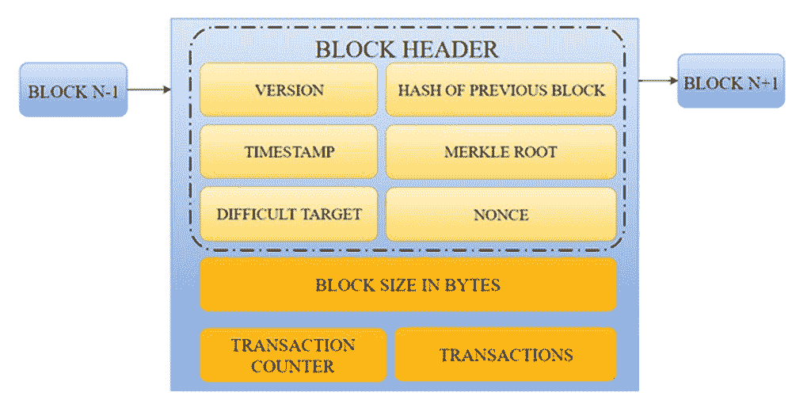
```

#### B. 整体运作
用户连接到区块链并发起一笔用其私钥签名的交易。该交易被发送到交易池，驻留其中直到被矿工提取打包进区块。矿工随后从池中收集交易并计算区块的有效哈希值，从而生成一个新区块。当矿工成功生成一个新区块时，该新区块会被广播到 P2P 网络中的节点。网络中的所有节点使用共识算法验证该区块，验证成功后，将其更新到各自的链副本中，交易即告完成。

### IV. 为什么物联网需要区块链？

根据 Agrawal 等人 (2018) 的研究，物联网去中心化环境中的主要障碍是，当连接设备相互通信或与云通信时，所传输敏感数据缺乏隐私和安全保护。由于缺乏运行加密算法的计算能力和能量，共享的数据无法被安全加密。因此，确保数据隐私和安全是任何物联网应用的要求。Agrawal 等人 (2018) 的作者利用智能合约和区块链建模了一种安全解决方案，以确保在智慧城市和智能家居场景中持续安全的用户-设备通信。通过使用使受限设备能够连接到区块链的物联网枢纽或边缘节点 (Agrawal 等人, 2018)，从而消除了成为全节点的必要性，他们解决了资源和能源约束的问题。此外，在区块链这种分布式环境中，由于在节点间达成共识是必要条件，因此检测攻击和限制进一步损害变得容易。在物联网中引入区块链将消除 DDoS 攻击、设备欺骗、冒充、注入恶意代码、侧信道攻击等攻击的可能性。另一个原因是，当我们使用区块链来确保物联网数据的信任时，急需的安全服务（如机密性、问责性、完整性和可用性）也随之而来。物联网设备之间的 M2M 通信可以被认证。恶意节点可以被识别和隔离。最近，旧金山的 Chronicle 等公司已开始在其制药供应链中使用区块链来交付基因疗法药物。使用安全的物联网平台，他们可以确认药物质量，并确保药物在运输过程中不受损坏或出错。在 Miraz (2019) 中，作者强调了这样一个观点：“物联网常被视为运营技术 (OT) 和信息技术 (IT) 的融合，分布式账本技术 (DLT) 作为物联网赋能者的角色，在于其能够建立信任，不仅是在产品层面，而且跨越不信任参与方的整个生态系统。”

为了确定区块链在特定物联网应用领域是否必不可少，Ferrag 等人 (2018) 提供了一个流程图。其综合思想可简述如下：如果一个需要去中心化安全框架的物联网应用，要求多方在彼此不信任、也不信任中心化第三方的情况下验证记录，且文档需要在这些实体间同步，则可以应用区块链以达成推定共识。然而，应注意到，尽管民主化的区块链平台可通过促进更容易的检测来限制攻击的影响，但不能将其视为确保物联网安全的终极解决方案。

如果仅仅是为了执行交易处理，或作为复制数据库需求的替代品，则不应在物联网中应用区块链。如果传统数据库能解决问题，或者所有参与方都信任一个中心化权威，则此类场景无需区块链。在需要实时收集原始数据的应用中不应使用区块链，因为这些应用会产生高延迟开销。

### V. 基于区块链的物联网 (BIoT) 的现状与现有研究


大量研究论文探讨了区块链与物联网的融合。目前形式下的区块链技术无法直接应用于物联网领域，因为大多数物联网应用实时运行，而引入区块链会增加延迟，并要求高算力和带宽。然而，一些早期的实际实现（Gundersen, 2011；Hanada 等, 2018）展示了通过融合这两种技术所能实现的充满希望的未来。因此，研究持续深入其用例，例如智能合约在解决大多数现有业务问题（如违规或绕过策略、伪造、欺诈等）方面的适用性。许多物联网应用可能需要跟踪并让参与实体了解系统中发生的关键活动。在采购产品和服务的业务交易中会出现大量差异，例如销售假冒产品，或在完成所需服务前要求付款以欺骗制造商等。这些差异可利用与智能合约关联的传感数据来解决。有了智能合约，组织可以安全地为当前和未来的运营确定资金，信任因素得以保障。Bodkhe 等 (2020) 调查了各种共识算法及其在网络物理系统中的适用性，并探讨了各类 CPS 应用领域的挑战与安全问题。

Dai 等 (2019) 讨论了物联网生态系统与区块链融合后产生的主要机遇，即：增强的互操作性、提升的安全性、物联网数据的可追溯性与可靠性、物联网系统中实体的自主交互。文中还描述了万物区块链的架构，包含数据子层、网络子层、共识子层、激励子层和服务子层。Makhdoom 等 (2019) 讨论了克服区块链与物联网集成相关挑战的方法，如分片以减少交易处理时间。

Hang 和 Kim (2019) 提出了一个物联网平台，以保证物联网设备感知数据的完整性。该平台结合 `HyperLedger Fabric` 与一种共识证明方法来达成共识，适用于资源受限环境。Rejeb 等 (2019) 强调了物联网与区块链集成所产生的新兴研究领域：可扩展性、安全性、不可篡改性与审计性、信息流的有效性与效率、可追溯性与互操作性以及质量。

Maroufi 等 (2019) 讨论了区块链与物联网集成的主要挑战。其引入有助于构建去中心化、可扩展、安全、不可篡改的账本。物联网解决方案的异构性是两种技术融合面临的主要挑战之一。Panarello 等 (2018) 将区块链在智能环境中的效用分为两类：设备操控和数据操控。数据操控将区块链用作历史保存系统，设备操控则利用智能合约根据业务逻辑做出自主决策。

Atlam 等 (2018) 描述了区块链与物联网的对比，并详述了融合两种技术的益处，如公开性、去中心化、弹性、安全性、速度、成本最小化、不可篡改性和匿名性。Yu 等 (2018) 讨论了物联网与区块链集成的各种应用领域，以及其在物联网生态系统中解决的主要安全挑战，并给出了区块链与物联网集成框架的视图，详细阐述了物联网架构的各层。

Minoli 和 Occhiogrosso (2018) 将物联网区块链集成的不同框架分类为端到端区块链、分析/存储层、网关层、站点层和设备层。Hao 等 (2018) 提出了一种面向区块链支持的边缘物联网系统的快速支付系统，确保安全性和可靠性。文中描述了协议的不同阶段，如准备阶段、存款阶段、快速支付阶段、转账阶段。为防止双重支付问题，指定了一名拥有存款池的经纪人。经纪人负责系统确保安全并惩罚违规的经纪人。

| Figure 3. 区块链提供的功能与安全需求的关系 |
| --- |
| 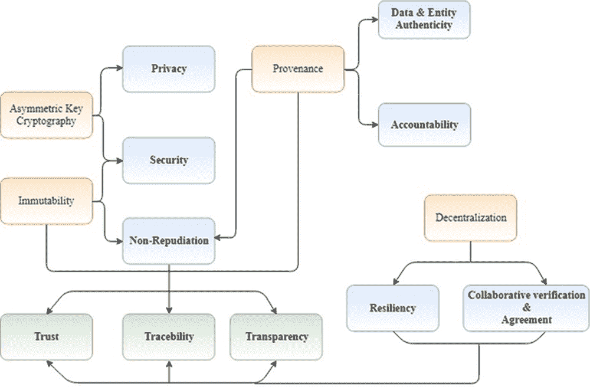 |

区块链在解决医疗行业临床试验信任保障问题方面的潜力已在许多论文中被讨论。区块链不仅能提供自动化解决方案，还能在患者、药商、医院和实验室工作人员等不同利益相关者间建立信任，并保护数据隐私。据 Benchoufi 和 Ravaud (2017) 称，区块链通过访问控制策略使患者能确保其私人数据的可信度。文中解释了一种收集相关人员同意的概念验证方法，以实现差分隐私。目前致力于融合区块链与物联网技术的公司有：

*   **Robonomics** (Lonshakov 等, 2018)：`Robonomics` 平台为智慧城市和工业实现 `DApp`。
*   **IoTeX** (Dagher 和 Adhikari, 2018)：面向物联网的区块链平台，提供可扩展性、节点隔离、应用部署等特定应用服务。
*   **IoT Chain** (Alphand 等, 2018)：使用轻量级操作系统、实用拜占庭容错算法 (`PBFT`) 和 `CPS` 技术。
*   **Filament** (2018)：致力于构建智能经济的初创公司，其区块链解决方案套件包含可集成到边缘节点和物联网设备的软硬件技术，通过 `Ethereum` 或 `HyperLedger` 区块链确保安全的可信执行环境 (`TEE`)。已构建硬件即插即用设备，以实现自动驾驶汽车事件的跟踪，如车辆追踪、充电和 `M2M` 支付。其主要功能方面包括：为物联网设备分配秘密身份、硬件加速以减少计算延迟、管理 `M2M` 交易、内置质量评估和合规审计系统、用于连接区块链并获取碳信用的密钥管理系统、支持 `ECDSA` (椭圆曲线数字签名认证)、`ECDH` (椭圆曲线迪菲-赫尔曼) 和带 `HMAC` 选项的 `SHA-256` 加密。利用此技术，物联网设备可安全通信有效的证明数据，并可被验证。
*   **Xage**：成立于 2016 年的加州网络安全初创公司，利用区块链连接从油井到智能电表的工业机器。去中心化带来的优势是，必须攻破每个连接设备的安全性才能控制区块链中的数据。网络层和传输层的 `M2M` 通信安全通过区块链得到保障。`Xage Security Fabric` 为现代工业运营提供全面解决方案。Fabric 的主要功能包括：保护从最新物联网设备到脆弱遗留系统的所有设备、身份管理、单点登录和访问控制。公司提供两种创新机制以确保安全：分层树系统和超级多数共识 (Xage, 2019)。
*   **Grid+** (Daley, 2019)：利用 `Ethereum` 区块链，授权消费者访问低功耗、节能的物联网设备。


## 区块链与物联网集成的公司案例

*   **Hypr** (Daley, 2019)：作为一家总部位于纽约的公司，它将独特的生物识别登录信息（如掌纹、面部、虹膜、声音）存储在区块链中，并实施了 `DLT` 数字密钥，使房主能够单点访问智能门锁和智能娱乐中心。
*   **ShipChain** (Lawrence, 2020)：该公司将基于区块链的货运追踪平台与近场通信（`NFC`）标签的信息相结合，可在整个供应链中观察和共享货物温度，从而在生产者、运输商和消费者之间提供可见性和信任。
*   **Chronicled** (Daley, 2019)：这家总部位于旧金山的公司专注于利用区块链追踪和管理药品及食品供应链。它为此使用了支持物联网的集装箱和传感器。
*   **Netobjex** (Daley, 2019)：该公司为物联网设备创建了 `M2M` 通信的标准机制。它使用 `IoToken` 使餐厅顾客能够支付账单，在无人机配送中，它标记配送地点和支付交易。
*   像 **BIMCHAIN**、**Briq**、**ULedger**、**Hunter Roberts OEG & Gartner Builders**、**Probuild**、**Tata Steel**、**Lifechain by Costain** 等公司正致力于在建筑领域整合区块链与物联网，以改进身份验证并跟踪工作进度 (Mazhanda, 2019)。
*   国家网络安全卓越中心（`NCCoE`）选定了八家公司——**Cisco**、**Asterix**、**Radiflow**、**Xage Security**、**Sumo Logic**、**BlackRidge Technology**、**TDi Technologies**、**Spherical Analytics**——致力于保障工业物联网（`IIoT`）安全。在 `IIoT` 中引入区块链的主要原因是为了保障 `M2M` 通信安全、认证和授权交易。

Ellervee 等人 (2017) 对一些区块链进行了很好的比较，并描述了区块链的范围，明确定义了区块链能做什么和不能做什么。用户和区块验证者或矿工代表区块链中的参与者。文中还描述了系统中发生的过程，如网络发现、创建交易、签名、资产发行、挖矿和分配权限、平台（许可型或非许可型）以及数据模型。图 3 展示了我们如何操纵区块链以确保安全的大纲。该图有助于理解不可变性、溯源等特性之间的关系，以及哪个方面能满足用户应用中特定的安全需求。

在下文中，我们将介绍一些用例，概述区块链如何集成到物联网中。我们根据它们利用的区块链功能方面对其进行分类，并在必要时展示示例系统模型。各种研究论文中提到了一些通用问题，例如将区块链用于授权、访问控制、设备识别、数据安全、安全 `M2M` 通信等。然而，它们的实际实施仍存疑问。因此，这些用例不再详细讨论。

## A. 区块链确保隐私、安全、不可抵赖、识别及隔离恶意节点

一般来说，隐私是任何物联网应用的首要关注点。在此，我们介绍一些主要的物联网应用，在这些应用中机密性的丧失可能导致灾难性后果，并描述区块链如何帮助避免此类情况。我们已在第二节中详细强调了物联网中缺乏隐私的问题及其原因。

### 1) 智能交通系统

在智能交通系统（`ITS`）中，车辆之间相互通信，实时交换安全消息和导航信息，如路况、导航信息、交通拥堵、事故案例等。当车辆相互通信时，它们会共享位置和用户个人信息以相互识别。因此，需要隐私保护方案来保护此类敏感数据。同样，网络中传播的消息也可能被伪造。为了避免这种情况并改善 `VANETs` 中的可信通信，我们探讨了区块链在 `ITS` 中的适用性，以及它在解决隐私、安全和信任问题方面的成功程度。

#### a) 系统模型

系统模型是根据 Singh 和 Kim (2017) 提到的框架解释的。这里的参与者是车辆。在这项工作中，区块链被用于自动驾驶车辆的车辆网络中，作为一个安全的数据共享框架。这里的不信任存在于传播信息的车辆和接收信息并利用其执行动作（如变道）的车辆之间。根据车辆为网络做贡献的意愿，某些车辆被指定为矿工节点。区块链中达成的共识有助于确保导航消息传播的可信度，并决定哪辆自动驾驶车辆可以通过路口。实施的框架具有可忽略不计的延迟。

区块链在 `ITS` 中的其他用例包括车辆租赁、零部件溯源、车辆税费支付、共享出行、在停车场和加油站（或电动汽车充电站）自动支付。

Li 等人 (2018)、Singh 和 Kim (2017) 以及 Huang 等人 (2018) 的作品展示了区块链在 `VANETs` 和智能交通系统中用于安全通信和交易处理的不同方法。在 Singh 和 Kim (2017) 中，确定的智能车辆通信问题包括缺乏信任、可靠性和数据隐私。作者引入了一种称为智能信任点（`IV-TP`）的唯一标识符，类似于比特币 ID，以确保车际通信中的隐私。他们还提出了一种驾驶证明共识协议来维持共识。在 Yuan 和 Wang (2016) 中，作者详细阐述了基于区块链的 `ITS` 框架设计。他们提出了一个七层概念模型，并考虑了区块链与 `ITS` 的集成，以创建并行交通管理系统（`PTMS`）。一个名为 La'zooz 的共享出行 `Dapp` 也被作为例子。Lu 等人 (2018) 的作者研究了可应用于 `VANETs` 以确保信任和匿名性的隐私保护方案。他们验证了基于声誉机制判断车辆可信度的实体中心模型，以及通过各种指标计算传播消息可信度的数据中心模型。最后，他们使用了一种结合这两种技术的协议来信任消息。他们制定了出席证明以达成共识。然而，他们提出的模型假设路侧单元拥有足够的计算能力。Hanada 等人 (2018) 研究了一个使用区块链和智能合约在智能交通系统中进行自动汽油购买的去中心化应用（`DApp`）。

### 表 1. 区块链在物联网各种应用中提供的解决方案

| 序号 | 物联网应用领域 | 识别与隔离恶意节点 | 溯源 | 安全性 | 隐私 | 可追溯性 | 信任 | 透明度 | 不可抵赖 | 问责制 |
| :--- | :--- | :---: | :---: | :---: | :---: | :---: | :---: | :---: | :---: | :---: |
| 1 | 智慧城市 | ✓ | ✓ | ✓ | | | ✓ | ✓ | | |
| 2 | 智能电网 | | ✓ | | | ✓ | ✓ | ✓ | ✓ | ✓ |
| 3 | 智慧医疗 | | ✓ | ✓ | ✓ | ✓ | ✓ | ✓ | ✓ | ✓ |
| 4 | 供应链管理 | | ✓ | ✓ | | ✓ | ✓ | ✓ | ✓ | ✓ |
| 5 | 智能交通系统 | ✓ | ✓ | ✓ | ✓ | | ✓ | ✓ | ✓ | ✓ |
| 6 | 智能家居与建筑 | ✓ | ✓ | | ✓ | | ✓ | | ✓ | |


| 7 || 工业物联网与智能制造 ||  || ✓ ||  ||  ||  || ✓ ||  || ✓ ||  |

他们利用智能合约来解决影响物联网应用所提供服务中信任和透明度方面的问题。

为了更清楚地说明这一点，让我们以一个基于智能合约和物联网提供服务的加油站为例。考虑加油枪与顾客汽车之间的接口。物联网生态系统中涉及的实体包括：感知汽车油量的传感器，以及在加满油时停止工作的加油枪。一个用于在物联网节点间执行交易的 DApp 可以部署在车载套件和加油枪上。加油站随后可以验证已存入的付款，并基于此将燃油消费详情传递给智能合约。用户可以在 DApp 中查看基于其当前位置的加油站列表以加注燃油。

在 Li 等人 (2018) 的研究中，提出了 CreditCoin，一种基于区块链的隐私保护激励公告网络，用于利用车载自组网 (VANET) 报告交通问题和事故。它包含两个组件：公告协议和激励机制。在该系统中，完成成功任务的用户将获得信用币奖励，这能积极地促使持续的交通事件被上报和验证。

Hîrţan 等人 (2020) 提出了一种声誉系统，该系统专注于在旧金山、北京和罗马等城市的智能交通系统中保护用户隐私。它引入了一种用于交通数据共享的共识机制，该机制利用节点的声誉以及从集群中每个节点接收到的验证过的回答，在不可靠节点系统中达成共识。

区块链在智能交通系统 (ITS) 中的引入，通过引入匿名性和动态异构密钥管理方案，有助于解决隐私问题，确保传输中消息的安全。

### 2) 智能家居与智能建筑

#### 系统模型

未来智能家居中的典型家庭网络由智能门、智能灯、智能墙、可穿戴设备、智能通风系统、智能家用电器（如冰箱、空调、洗衣机等）、智能园艺系统、智能监控与入侵检测系统 (IDS)、智能车库、智能洗手间和厕所、智能婴儿和老人追踪器以及各种其他智能设备组成。这些设备相互通信并与用户通信，以提升舒适度和生活体验。通常，家庭网络中的智能设备可能拥有共享用户，为了个性化体验，设备可配置为当前用户的用户档案，并将此数据与其他设备共享以了解用户的选择。然而，家庭网络中这种协作式数据收集和决策是以牺牲隐私为代价的。因此，我们使用区块链来保护物联网设备之间的通信。区块中的数据包含设备间交换的数据，以及设备与外部世界进行交易时的交易信息。

攻击者入侵这些设备进行恶意活动，可能会篡改用户的私人细节。风险极高，包括探测家中是否有人。除了这种危险的隐私妥协外，我们还需要照顾设备的安全性，因为它们为各种应用目的传递智能家居的位置信息。确保设备安全是智能家居生态系统中的另一个主要挑战。大多数供应商不为智能设备中的固件提供定期安全更新，这留下了漏洞。因此，有必要坚定地确认智能家居中安装的设备连接网络的安全性。在众多员工工作的智能建筑中，确保设备的安全性和隐私甚至更为关键。

为此，Dorri 等人 (2017) 提出了一种使用具有特定生命周期的共享密钥的方案，仅允许受信设备在智能家居网络中通信。家庭网络中的每个设备都向一个家庭矿工注册。智能家居连接到一个覆盖网络，该网络支持分层和分布式处理。Leiding 等人 (2016) 提出了一种可应用于基于区块链的家庭网络的访问控制机制，其中使用安全访问管理器 (SAM) 来识别恶意节点并防止它们在网络中生成任何进一步的交易。该策略对于在智能家居和智能建筑中实现设备级的可信互操作性非常有用，通常也适用于智能交通系统 (ITS) 等其他用例场景。Zhou 等人 (2018) 和 Bastos 等人 (2018) 的作者利用智能合约和区块链，为保障家庭网络中的通信安全带来了一个安全的解决方案。

### 3) 智能医疗

#### 系统模型

当我们谈论智能医疗时，其特点是来自异构来源的海量数据，范围从追踪用户个人健康状况的可穿戴设备，到医生的诊断评估数据和处方。电子健康记录 (EHR) 用于整合和以数字形式存储所有这些数据。然而，由于患者可能因不同类型的疾病和治疗而前往不同的医院，这些数据变得碎片化且不一致。如果我们使用中心化数据库来存储和访问这些数据，会引来安全和隐私问题，因为数据可能被未经授权的方访问或修改。许多论文中都陈述了此类案例，即患者数据被出售给他人以换取金钱和个人利益。因此，有必要控制对这类重要信息的访问，以确保患者获得适当的医疗服务。

已经在区块链上提出了许多技术，以促进可信的医疗数据共享平台。大多数解决方案在通信实体之间定义了发布者-订阅者或患者-请求者关系 (Rifi 等人, 2018; Shen 等人, 2019)。在 Rifi 等人 (2018) 的研究中，作者提出并实现了一种利用边缘服务器克服智能医疗数据收集网络中计算能力约束的方法。他们将网络中的主要参与者定义为：发布者，即使用传感器监测健康状况的患者；以及订阅者，即需要发布者数据以执行健康监测和诊断的实体。发布者将可以访问健康数据的订阅者添加到其对应的地址中。因此，只有经过发布者授权的订阅者才能获得健康数据的访问权。患者在其智能家居内接受监测。智能家居拥有一个连接到边缘服务器的本地网关，用于执行计算密集型任务。利用三种类型的智能合约，即：发布者合约、客户端合约和订阅者合约，他们定义了系统中每个参与者的条款和权限。为确保隐私，会验证订阅者 ID 和发布者 ID。在 MedChain 中，引入了一种基于区块链的健康数据共享系统，该系统使用会话密钥来保护隐私 (Rifi 等人, 2018)。在此系统中，医疗服务提供者从传感器设备收集数据并执行挖矿过程。会话被用于授予数据请求者访问权限。


## Ray 等人 (2020) 讨论区块链在医疗保健中的用例

Ray 等人 (2020) 讨论了区块链在医疗保健中的用例，如访问医疗记录、电子健康记录 (EHR) 理赔与账单评估、临床研究、药品供应链管理、IoBHealth。提出了一种将区块链和物联网 (IoT) 结合的数据流架构，用于访问、存储和管理电子医疗 (EHR) 数据。Uddin 等人 (2020) 提出了一种利用区块链实现电子健康服务的三层架构，包含感知层、边缘处理层、云层。患者代理 (PA) 软件实现了一种轻量级区块链共识机制，并使用任务卸载算法来保护隐私。

### 4) 智能制造与工业物联网

#### 系统模型

工业物联网 (IIoT) 和智能认知及自主机器人、制造业中增强现实技术的演进，催生了第四次工业革命。这对制造业产生了巨大影响。随着 Ubirch 等公司通过“机器即服务”、预测性维护和制造产品状况验证等智能策略实现自动化，智能工厂正成为现实。智能设备辅助产品的设计、制造维护和供应。借助物联网，工厂可转型为一个万物互联、全程监控、安全可靠且可变现的生态系统。这种互联环境的优势在于：可确保产品质量，并可共享机器和服务。在这个共享的互联生态系统中，当机器进行 M2M 通信时，信任、安全和隐私面临风险。黑客可能以监控系统或机器为目标，以破坏工厂运营。

区块链可用于执行可信通信，并确保分布式制造中交易的隐私和安全。Xu 等人 (2019) 和 Liu 等人 (2019) 描述了基于区块链为 IIoT 开发的安全框架。在 Xu 等人 (2019) 中，提出了一种基于区块链的服务方案。该方案提出了一种不可抵赖方案，基于同态哈希函数工作，以确保承诺的特定服务是否已交付。在 Wan 等人 (2019) 中，提出了一种基于区块链的安全框架，用于确保智能工厂的隐私和安全。他们为框架给出了分层划分：感知层、固件层、管理中心层、存储层和应用层。他们使用了黑白名单机制来追踪和隔离恶意节点并确保隐私。他们展示了如何使用轻量级私有区块链来追踪机器操作和 M2M 通信。他们结合了两种模型：Bell-La Padula (BLP) 模型和 Biba 模型，利用动态身份验证机制构建数据安全模型。

## B. 区块链用于溯源、问责、追踪与透明化

### 1) 区块链用于智能电网

区块链用于智能电网网络中，以实现可持续能源的安全交易。微电网和智能电网的演进实现了小规模电力的生产和销售。溯源和问责是需要引入能源交易微电网网络交易中的指导因素，以实现高效的互操作性。

#### 系统模型

城市中智能电网网络的工作原理可如下解释。家庭产生的多余可再生能源（如太阳能或风能）可存储在电池中，稍后出售给邻里的其他家庭或公司。安装的智能电表实时记录生产或消耗的能源单位，并将此信息传递给能源分销商以进行监控和计费。随着智能电网成为现实，迫切需要一个安全的能源交易平台，以建立信任并追踪智能电网网络中发生的交易。

将区块链应用于微电网和智能电网的最新技术成果带我们了解 LO3 Energy 提供的布鲁克林微电网解决方案 (Gundersen, 2011)。与本地电网关联的智能合约用于将多余能源代币化，并决定从何处购买电力。能源共享市场包含四个主要概念：代币化、点对点 (P2P) 市场、产消者、社区微电网和能源服务公司 (CMESC)。代币化涉及将剩余能源转换为能源积分。P2P 市场是在邻里、产消者与发电公司之间建立的智能电网节点网络。之所以称为产消者，是因为他们在能源交易系统中扮演生产者和消费者的双重角色。在 Pieroni 等人 (2018) 中，区块链被应用于保障通信、交易和能源代币化的安全。该项工作实现了一个智能能源区块链应用原型，该原型连接到 P2P 网络中的区块链。Li 等人 (2017) 详细演示了智能电网，详述了涉及的实体：智能电表、能源节点和能源聚合商。利用联盟链，提出了一个用于转移能源积分的统一区块链，可部署于工业物联网生态系统中。这使用户能够追踪其交易历史，并高效地与可信的产消者或公司进行交易。Daghmehchi Firoozjaei 等人 (2020) 提出了一种名为 Hy-Bridge 的隐私保护混合区块链框架，该框架使用子网络来保护微电网中物联网用户的隐私。它将电网交易与微电网交易分离开来。它包含三层：物联网用户层、平台层和企业层。

### 2) 智慧城市

Lamichhane 等人 (2017) 展示了一个面向未来智慧城市的废物管理系统，其特点是智能垃圾桶 (SGB)，涉及传感器检测垃圾桶满溢并提醒垃圾收集服务、执行器和智能锁以锁定 SGB。系统涉及的不同实体包括：市民、市政部门、调度无人驾驶车辆执行垃圾收集的废物管理运营商、将废物回收以获取奖励的回收商。区块链可用于记录操作并追踪与垃圾收集和回收相关的交易。在 Nagothu 等人 (2018) 中，提出了协作式智能监控，它使用智能合约中指定的访问控制规则，限制雾层级未经授权的节点连接到包含区块链的云节点，该区块链存储智慧城市各处的监控数据。在 Nikouei 等人 (2018) 中，作者提出了一种集成到区块链中的认证方案，用于在边缘层和雾层这两个无信任域中共享和聚合监控数据。

### 3) 智能供应链管理

#### 系统模型

智能供应链由具有唯一身份并通过无线技术连接的智能对象组成。它们可以存储关于其状况（如温度、湿度等）的信息，并通过无线技术与互联网通信。然后是供应商、分销商、运输服务和消费者。在传统供应链环境中，产品状况在每个检查点均未被追踪。因此买家遭遇巨大损失。有时运输中的产品被篡改或替换。因此，为确保制造产品在整个供应链中的安全，我们需要一个自动化的去中心化系统，帮助实时追踪和评估产品质量。


## 区块链在食品供应链中的应用

区块链已被应用于食品供应链系统以解决这一问题。在 Lin 等人 (2018) 的研究中，提出了基于区块链的食品溯源方案。该系统通过追踪食品产品并在每个阶段存储其状况，从而确保食品安全。通过在买卖双方之间建立的智能合约，它为买方提供了一个透明的系统，使他们能够验证并确保所购食品的质量。区块链和物联网传感器共同为双方提供溯源、可追溯性、信任和透明度。通过该系统，卖方还可以确定产品在供应链的哪个环节遭受了损坏，以便采取补救措施避免未来再次发生。他们还可以通过扫描 RFID 并追踪采集到的传感器数值（这些数值作为元数据存储在区块中）来判断产品是否被篡改。表 I 总结了迄今为止讨论的每个物联网应用中区块链提供的最相关安全服务。

## VI. 未来工作

前一节讨论的应用描绘了区块链与物联网融合的光明前景。然而，引入区块链始终伴随着 51% 攻击漏洞的可能性。所调研的文献预测这种情况发生的可能性极小。正在被广泛研究的轻量级算法可能有助于解决物联网环境中的能源和功耗限制。然而，迫切需要为物联网应用开发一个统一的区块链框架。此外，尽管许多早期研究声称区块链坚不可摧，但已经发生了许多区块链安全漏洞事件，如密钥篡改攻击、女巫攻击等，这些在 (Ferrag 等人, 2018) 中进行了详细阐述。由于当前形式的区块链无法保证终极安全，研究需要专注于缺陷的识别和解决，以便开发者能够构建更成功、更安全的区块链版本，这些版本在与物联网集成后，能为应用用户提供安全可靠的环境。

## VII. 结论

物联网应用在安全方面面临诸多挑战，这些挑战可以通过区块链来解决。我们讨论了物联网中的主要安全问题，并举例说明了区块链的应用如何帮助解决这些问题。许多被调研的研究文献在未实际确认必要性的情况下，就将区块链应用于物联网应用。在为特定应用采用区块链之前，需要进行仔细评估。我们分析了在特定应用领域使用区块链的必要性。我们提出了决策标准，并说明了它可以在哪里使用、能提供什么服务以及不能提供什么。此外，我们还解释了一个通用系统模型和支持性用例，这些可以帮助基于区块链的安全物联网解决方案的集成与开发。

## 参考文献

Abdul-Ghani, H. A., Konstantas, D., & Mahyoub, M. (2018). A comprehensive IoT attacks survey based on a building-blocked reference model. *International Journal of Advanced Computer Science and Applications*, 355-373.

Agrawal, R., Verma, P., Sonanis, R., Goel, U., De, A., Kondaveeti, S., A. Shekhar, S. (2018, April). Continuous security in IoT using blockchain. In *2018 IEEE International Conference on Acoustics, Speech and Signal Processing (ICASSP)* (pp. 6423-6427). IEEE. 10.1109/ICASSP.2018.8462513

Alphand, O., Amoretti, M., Claeys, T., Dall'Asta, S., Duda, A., Ferrari, G., ... Zanichelli, F. (2018, April). IoTChain: A blockchain security architecture for the Internet of Things. In *2018 IEEE Wireless Communications and Networking Conference (WCNC)* (pp. 1-6). IEEE. doi:10.1109/WCNC.2018.8377385

Anchor, B. I. S. T. (2019). Taraxa White Paper.

Anwar, H. (2018). Consensus Algorithms: The Root Of The Blockchain Technology. Retrieved from https://101blockchains.com/consensus-algorithms-blockchain

Atlam, H. F., Alenezi, A., Alassafi, M. O., & Wills, G. (2018). Blockchain with Internet of Things: Benefits, challenges, and future directions. *International Journal of Intelligent Systems and Applications*, 10(6), 40–48. doi:10.5815/ijisa.2018.06.05

Bassi, A., Bauer, M., Fiedler, M., & Kranenburg, R. V. (2013). *Enabling things to talk*. Springer-Verlag GmbH. doi:10.1007/978-3-642-40403-0

Bastos, D., Shackleton, M., & El-Moussa, F. (2018). Internet of Things: A survey of technologies and security risks in smart home and city environments. Academic Press.

Benchoufi, M., & Ravaud, P. (2017). Blockchain technology for improving clinical research quality. *Trials*, 18(1), 335. doi:10.1186/s13063-017-2035-z

Bodkhe, U., Mehta, D., Tanwar, S., Bhattacharya, P., Singh, P. K., & Hong, W. C. (2020). A Survey on Decentralized Consensus Mechanisms for Cyber Physical Systems. *IEEE Access: Practical Innovations, Open Solutions*, 8, 54371–54401. doi:10.1109/ACCESS.2020.2981415

Brown, R. G., Carlyle, J., Grigg, I., & Hearn, M. (2016). Corda: an introduction. R3 CEV, 1, 15.

Čolaković, A., & Hadžialić, M. (2018). Internet of Things (IoT): A review of enabling technologies, challenges, and open research issues. *Computer Networks*, 144, 17–39. doi:10.1016/j.comnet.2018.07.017

Dagher, T. G. G., & Adhikari, C. L. (2018). Iotex: A decentralized network for internet of things powered by a privacy-centric blockchain. White Paper: https://whitepaper.io/document/131/iotexwhitepaper

Daghmehchi Firoozjaei, M., Ghorbani, A., Kim, H., & Song, J. (2020). Hy-Bridge: A hybrid blockchain for privacy-preserving and trustful energy transactions in Internet-of-Things platforms. *Sensors (Basel)*, 20(3), 928. doi:10.3390/s20030928

Dai, H. N., Zheng, Z., & Zhang, Y. (2019). Blockchain for internet of things: A survey. *IEEE Internet of Things Journal*, 6(5), 8076–8094. doi:10.1109/JIOT.2019.2920987

Daley, S. (2019). Blockchain and IoT: 8 examples making our future smarter. Retrieved from https://builtin.com/blockchain/blockchain-iot-examples

Dorri, A., Kanhere, S. S., Jurdak, R., & Gauravaram, P. (2017, March). Blockchain for IoT security and privacy: The case study of a smart home. In *2017 IEEE international conference on pervasive computing and communications workshops (PerCom workshops)*. IEEE.

Ellervee, A., Matulevicius, R., & Mayer, N. (2017). A Comprehensive Reference Model for Blockchain-based Distributed Ledger Technology. In *ER Forum/Demos* (pp. 306-319). Academic Press.

Elrawy, M. F., Awad, A. I., & Hamed, H. F. (2018). Intrusion detection systems for IoT-based smart environments: A survey. *Journal of Cloud Computing*, 7(1), 21. doi:10.1186/s13677-018-0123-6

Fernández-Caramés, T. M., & Fraga-Lamas, P. (2018). A Review on the Use of Blockchain for the Internet of Things. *IEEE Access: Practical Innovations, Open Solutions*, 6, 32979–33001. doi:10.1109/ACCESS.2018.2842685

Ferrag, M. A., Derdour, M., Mukherjee, M., Derhab, A., Maglaras, L., & Janicke, H. (2018). Blockchain technologies for the internet of things: Research issues and challenges. *IEEE Internet of Things Journal*, 6(2), 2188–2204. doi:10.1109/JIOT.2018.2882794

Filament. (2018). Blocklet USB Enclave Data Sheet. Academic Press.

Fruhlinger, J. (2018). The Mirai botnet explained: How teen scammers and CCTV cameras almost brought down the internet. Retrieved from https://www.csoonline.com/article/3258748/the-mirai-botnet-explained-how-teen-scammers-and-cctv-cameras-almost-brought-down-the-internet.html

GSMAs Internet of Things Programme. (2018). Opportunities and Use Cases for Distributed Ledger Technologies in IoT. Academic Press.

Gundersen, T. (2011). An introduction to the concept of exergy and energy quality. Department of Energy and Process Engineering Norwegian University of Science and Technology, Version, 4.


## 参考文献

Hanada, Y., Hsiao, L., & Levis, P. (2018, November). Smart contracts for machine-to-machine communication: Possibilities and limitations. In *2018 IEEE International Conference on Internet of Things and Intelligence System (IOTAIS)* (pp. 130-136). IEEE. doi:10.1109/IOTAIS.2018.8600854

Hang, L., & Kim, D. H. (2019). Design and implementation of an integrated IoT blockchain platform for sensing data integrity. *Sensors (Basel)*, 19(10), 2228. doi:10.3390/s19102228

Hao, Z., Ji, R., & Li, Q. (2018, October). FastPay: A Secure Fast Payment Method for Edge-IoT Platforms using Blockchain. In *2018 IEEE/ACM Symposium on Edge Computing (SEC)* (pp. 410-415). IEEE. doi:10.1109/SEC.2018.00055

Hîrţan, L. A., Dobre, C., & González-Vélez, H. (2020). Blockchain-based reputation for intelligent transportation systems. *Sensors (Basel)*, 20(3), 791. doi:10.3390/s20030791

Huang, X., Xu, C., Wang, P., & Liu, H. (2018). LNSC: A security model for electric vehicle and charging pile management based on blockchain ecosystem. *IEEE Access: Practical Innovations, Open Solutions*, 6, 13565–13574. doi:10.1109/ACCESS.2018.2812176

Hyperledger Architecture Working Group. (2017). *Hyperledger Architecture* (Vol. 1). Introduction to Hyperledger Business Blockchain Design Philosophy and Consensus.

Jesus, E. F., Chicarino, V. R., de Albuquerque, C. V., & Rocha, A. A. D. A. (2018). A survey of how to use blockchain to secure internet of things and the stalker attack. *Security and Communication Networks*, 2018, 2018. doi:10.1155/2018/9675050

Kouicem, D. E., Bouabdallah, A., & Lakhlef, H. (2018). Internet of things security: A top-down survey. *Computer Networks*, 141, 199–221. doi:10.1016/j.comnet.2018.03.012

Lamichhane, Sadov, & Zaslavsky. (2017). Smart Waste Management: An IoT and Blockchain based approach. Academic Press.

Lawrence, C. (2020). The Convergence of IoT and Blockchain is Transforming Industries. Retrieved from https://www.codemotion.com/magazine/dev-hub/blockchain-dev/blockchain-and-iot-in-industry-use-cases/

Leiding, B., Memarmoshrefi, P., & Hogrefe, D. (2016, September). Self-managed and blockchain-based vehicular ad-hoc networks. In *Proceedings of the 2016 ACM International Joint Conference on Pervasive and Ubiquitous Computing: Adjunct* (pp. 137-140). ACM.

Li, L., Liu, J., Cheng, L., Qiu, S., Wang, W., Zhang, X., & Zhang, Z. (2018). Creditcoin: A privacy-preserving blockchain-based incentive announcement network for communications of smart vehicles. *IEEE Transactions on Intelligent Transportation Systems*, 19(7), 2204–2220. doi:10.1109/TITS.2017.2777990

Li, Z., Kang, J., Yu, R., Ye, D., Deng, Q., & Zhang, Y. (2017). Consortium blockchain for secure energy trading in industrial internet of things. *IEEE Transactions on Industrial Informatics*, 14(8), 3690–3700. doi:10.1109/TII.2017.2786307

Lin, J., Shen, Z., Zhang, A., & Chai, Y. (2018). Blockchain and IoT based Food Traceability System. *International Journal of Information Technology*, 24(1), 1–16.

Liu, D., Alahmadi, A., Ni, J., Lin, X., & Shen, X. (2019). Anonymous reputation system for iiot-enabled retail marketing atop pos blockchain. *IEEE Transactions on Industrial Informatics*, 15(6), 3527–3537. doi:10.1109/TII.2019.2898900

Lonshakov, S., Krupenkin, A., Kapitonov, A., Radchenko, E., Khassanov, A., & Starostin, A. (2018). Robonomics: platform for integration of cyber physical systems into human economy. White Paper.

Lu, Z., Liu, W., Wang, Q., Qu, G., & Liu, Z. (2018). A privacy-preserving trust model based on blockchain for VANETs. *IEEE Access: Practical Innovations, Open Solutions*, 6, 45655–45664. doi:10.1109/ACCESS.2018.2864189

Makhdoom, I., Abolhasan, M., Abbas, H., & Ni, W. (2019). Blockchain’s adoption in IoT: The challenges, and a way forward. *Journal of Network and Computer Applications*, 125, 251–279. doi:10.1016/j.jnca.2018.10.019

Maroufi, M., Abdolee, R., & Tazekand, B. M. (2019). On the convergence of blockchain and internet of things (iot) technologies. arXiv preprint arXiv:1904.01936

Mazhanda, F. (2019). How Blockchain and IoT Are Opening New Capabilities in the Construction Industry. Retrieved from https://www.iotforall.com/iot-in-construction/

Minoli, D., & Occhiogrosso, B. (2018). Blockchain mechanisms for IoT security. *Internet of Things*, 1, 1–13. doi:10.1016/j.iot.2018.05.002

Miraz, M. H. (2019). Blockchain of Things (BCoT): The Fusion of Blockchain and IoT Technologies. Cuhk Law.

Nagothu, D., Xu, R., Nikouei, S. Y., & Chen, Y. (2018, September). A microservice-enabled architecture for smart surveillance using blockchain technology. In *2018 IEEE International Smart Cities Conference (ISC2)* (pp. 1-4). IEEE. doi:10.1109/ISC2.2018.8656968

Nikouei, S. Y., Xu, R., Nagothu, D., Chen, Y., Aved, A., & Blasch, E. (2018, September). Real-time index authentication for event-oriented surveillance video query using blockchain. In *2018 IEEE International Smart Cities Conference (ISC2)* (pp. 1-8). IEEE. doi:10.1109/ISC2.2018.8656668

Panarello, A., Tapas, N., Merlino, G., Longo, F., & Puliafito, A. (2018). Blockchain and iot integration: A systematic survey. *Sensors (Basel)*, 18(8), 2575.

Pieroni, A., Scarpato, N., Di Nunzio, L., Fallucchi, F., & Raso, M. (2018). Smarter city: Smart energy grid based on blockchain technology. *Int. J. Adv. Sci. Eng. Inf. Technol*, 8(1), 298–306. doi:10.18517/ijaseit.8.1.4954

Pongle, P., & Chavan, G. (2015, January). A survey: Attacks on RPL and 6LoWPAN in IoT. In *2015 International conference on pervasive computing (ICPC)* (pp. 1-6). IEEE. doi:10.1109/PERVASIVE.2015.7087034

Ray, P. P., Dash, D., Salah, K., & Kumar, N. (2020). Blockchain for IoT-Based Healthcare: Background, Consensus, Platforms, and Use Cases. *IEEE Systems Journal*, 1–10. doi:10.1109/JSYST.2020.2963840

Rejeb, A., Keogh, J. G., & Treiblmaier, H. (2019). Leveraging the Internet of Things and Blockchain Technology in Supply Chain Management. *Future Internet*, 11(7), 161. doi:10.3390/fi11070161

Rifi, N., Agoulmine, N., Chendeb Taher, N., & Rachkidi, E. (2018). Blockchain technology: Is it a good candidate for securing iot sensitive medical data? *Wireless Communications and Mobile Computing*, 2018, 2018. doi:10.1155/2018/9763937

Security, X. (2019). Next-Generation Industrial Cybersecurity Introduces Hierarchical-Tree and Conditional Consensus in Blockchain for the First Time. https://www.globenewswire.com/news-release/2019/10/10/1928089/0/en/Xage-Security-Reveals-New-Blockchain-Innovation-to-Protect-Trillions-of-Industrial-Devices-and-Interactions.html

Shen, B., Guo, J., & Yang, Y. (2019). MedChain: Efficient healthcare data sharing via blockchain. *Applied Sciences (Basel, Switzerland)*, 9(6), 1207. doi:10.3390/app9061207

Singh, M., & Kim, S. (2017). Intelligent vehicle-trust point: Reward based intelligent vehicle communication using blockchain. arXiv preprint arXiv:1707.07442

Uddin, M. A., Stranieri, A., Gondal, I., & Balasubramanian, V. (2020). Blockchain Leveraged Decentralized IoT eHealth Framework. *Internet of Things*.

Wan, J., Li, J., Imran, M., Li, D., & Fazal-e-Amin. (2019). A blockchain-based solution for enhancing security and privacy in smart factory. *IEEE Transactions on Industrial Informatics*, 15(6), 3652–3660. doi:10.1109/TII.2019.2894573

Wüst, K., & Gervais, A. (2018, June). Do you need a blockchain? In *2018 Crypto Valley Conference on Blockchain Technology (CVCBT)* (pp. 45-54). IEEE. doi:10.1109/CVCBT.2018.00011

Xu, R., Nikouei, S. Y., Chen, Y., Blasch, E., & Aved, A. (2019, July). Blendmas: A blockchain-enabled decentralized microservices architecture for smart public safety. In *2019 IEEE International Conference on Blockchain (Blockchain)* (pp. 564-571). IEEE. doi:10.1109/Blockchain.2019.00082

Xu, Y., Ren, J., Wang, G., Zhang, C., Yang, J., & Zhang, Y. (2019). A blockchain-based nonrepudiation network computing service scheme for industrial IoT. *IEEE Transactions on Industrial Informatics*, 15(6), 3632–3641. doi:10.1109/TII.2019.2897133


## 参考文献

Yu, Y., Li, Y., Tian, J., & Liu, J. (2018). Blockchain-based solutions to security and privacy issues in the Internet of Things. *IEEE Wireless Communications*, 25(6), 12–18. doi:10.1109/MWC.2017.1800116

Yuan, Y., & Wang, F. Y. (2016, November). Towards blockchain-based intelligent transportation systems. In *2016 IEEE 19th International Conference on Intelligent Transportation Systems (ITSC)* (pp. 2663-2668). IEEE. doi:10.1109/ITSC.2016.7795984

Zhou, Y., Han, M., Liu, L., Wang, Y., Liang, Y., & Tian, L. (2018). Improving IoT Services in Smart-Home Using Blockchain Smart Contract. *IEEE International Conference on Internet of Things (iThings) and IEEE Green Computing and Communications (GreenCom) and IEEE Cyber, Physical and Social Computing (CPSCom) and IEEE Smart Data (SmartData)*, 81-87. doi:10.1109/Cybermatics_2018.2018.00047

## 第 5 章：比特币与区块链

**作者**

*   Dharmendra Singh Rajput — 印度维洛尔理工学院
*   Pankaj Shukla — 印度维洛尔理工学院
*   Thippa Reddy G. — 印度维洛尔理工学院
*   Rajesh Kaluri — 印度维洛尔理工学院
*   Kuruva Lakshmanna — 印度维洛尔理工学院
*   Praveen Kumar Reddy Kumar Maddikunta — [ORCID](https://orcid.org/0000-0003-4209-2495)，印度维洛尔理工学院
*   Harshita Patel — 印度维洛尔理工学院

## 摘要

在当今世界，安全已成为我们生活中的主要问题，在这个时代，人们无法信任政府来处理他们的毕生积蓄。比特币便由此走入我们的生活。在本章中，作者们试图了解一种著名的创新支付方式（比特币）、它是如何被使用的，以及其中使用的数据结构（默克尔树）。此外，他们还讨论了涉及比特币使用的最近一次最著名攻击（WannaCry）。进一步地，他们试图了解这起黑客攻击如何在比特币的帮助下，从医院窃取了 10,800 欧元（₹8,74,290）。他们还讨论了现已涌现的各种比特币公司及其针对此类黑客攻击采取的安全措施。

## 1. 简介

在当今世界，安全已成为我们生活中的主要问题，在这个时代，人们无法信任政府来处理他们的毕生积蓄。比特币便由此走入我们的生活。这是一种不受任何政府或银行控制的货币，因此是进行交易最安全的方式。通过本章，我们将解释比特币的总体方面：它是如何实施的、它有多安全，以及它的未来前景如何。

### 1.1 加密货币

| 图 1. 比特币标志 [1] |
| :---: |
|  |
| *https://en.bitcoin.it/w/images/en/2/29/BC_Logo.png* |

让我们将上述单词拆分为两个简单的单词：“Crypto”（加密）和 “Currency”（货币）。*Crypto* 是一个源自希腊语的单词，意为*秘密*，而 *currency*（我们都知道！）。现在，如果我们将它们结合起来，它就变成了*秘密货币*。那么秘密货币意味着什么？这里的秘密货币被视为一种以近乎不可追踪且安全的方式完成交易的数字手段。比特币通常被认为是第一种加密货币 (Nakamoto, 2008; Gord, 2016)。

### 1.2 为什么要使用加密货币？

加密货币与其他货币一样，可用于进行交易，但使加密货币与众不同的是它是去中心化的。现在你可能会想这意味着什么。简单来说，我们可以将其称为一种不由任何政府发行且经过加密的货币。但它为什么比其他货币更好？答案是：既然加密货币不由任何政府发行，政府就无权将其从你手中夺走。这是加密货币的主要优势。此外，就安全性而言，这些货币比其他货币安全得多，因为它们非常难以追踪。

### 1.3 区块链

在进入比特币主题之前，我们首先需要了解什么是区块链 (Zheng et al., 2017)。简单来说，区块链可以比作正在进行的交易的记录或账本，但采用的是复杂得多的方法。区块链是共识算法、网络实施的协议以及运行该协议的一组节点的组合。因此，这必须与数据库区分开来，因为*数据库*只是一段软件，而区块链是一种由算法组成的在线加密传输方法 (Pilkington, 2016)。

使区块链更具真实性的是，区块链中的每个条目都是不可变的。这意味着一旦任何记录条目被放入账本，就无法被移除、替换或重新录入。区块链遵循非常严格的协议，以便其用户无法打破规则或利用它谋取私利。

让我们看看它是如何工作的：

1.  进行交易的每个系统都被视为一个**节点**。
2.  节点可以比作银行的账户持有人。
3.  每当添加一个新节点时，大多数节点首先会验证该新节点。
4.  一旦新节点通过验证，它需要下载整个数字账本并与之同步。
5.  现在，每当一笔交易被追加到一个区块（随后该区块被追加到区块链），新添加的节点将拥有一份副本，并与整个网络保持同步。

区块链可以简单地解释为一种数据结构，其中每个区块像**双向链表**一样相互链接。现在，对于那些不知道什么是双向链表的人来说，它只是一个简单的信件邮寄记录数组，其中包含发件地址和收件地址。每个区块链解决方案都有其级别的加密算法。这取决于使用它的网络和领域 (Dhillon V., 2016; Dhillon V. et al., 2017)。

### 1.4 比特币

区块链系统使用数字货币或兑换码等激励机制进行交易。它确保参与者中没有人能背叛或欺骗其他参与者。比特币是最早实施区块链方法的数字货币之一。现在，如果你对链表有一点了解，那么你就会知道链表中元素的节点结构保持不变。比特币也由节点组成，通常称为**区块**。这些区块通常包含前一个单元和后一个单元的地址以及数字指纹等其他数据。

| 图 2. 比特币区块结构 |
| :---: |
| 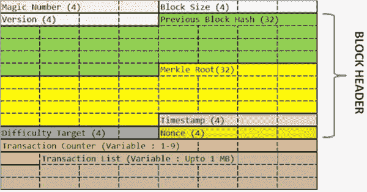 |
| *https://cdn-images-1.medium.com/max/1600/1*7hIidBDLF8bKpIlI0Pp2Rg.jpeg* |

#### 比特币区块结构

上图让我们对比特币区块结构有了一个大致了解。让我们简要了解一下各个部分：

**魔数：** 该魔数的内存分配为 4 字节。现在你可能会想它包含什么内容。魔数包含区块链网络的标识符，用通俗的话说，你可以认为它是一条记录的索引。

**区块大小：** 顾名思义，它表示区块的大小；通常其最大尺寸固定为 1 MB。但也有提议将大小增加到 2 MB。由于比特币在开发时考虑了可扩展性因素，因此在增加区块大小时不会出现任何问题。

**版本：** 同样，顾名思义，比特币的每个节点都遵循典型的比特币协议版本，版本信息即记录在此字段中。此外，存储版本所分配的内存为 4 字节。

**前一区块哈希：** 让我们再次拆解“Previous Block”（前一区块）和“Hash”（哈希）这两个术语。现在我们都知道*前一区块*是什么意思。但*哈希*是什么意思？


## 哈希

简单来说，哈希就是为特定数据创建并分配一个索引。对于了解时间复杂度可达大 O (1) 的人来说，哈希分配索引的方式使得在数据库中搜索数据变得快得多。

要弄清楚其含义，你会问它存储什么数据？

前一个区块的哈希存储了前一个区块的数字指纹（哈希）。与其他所有哈希一样，它涉及一个哈希函数，该函数将版本、区块大小、魔数等作为输入，以生成数字指纹。我们不会深入探讨，但你可以参考参考链接以了解更多相关内容。

## 默克尔根

| 图 3. 默克尔树图示 |
| --- |
| 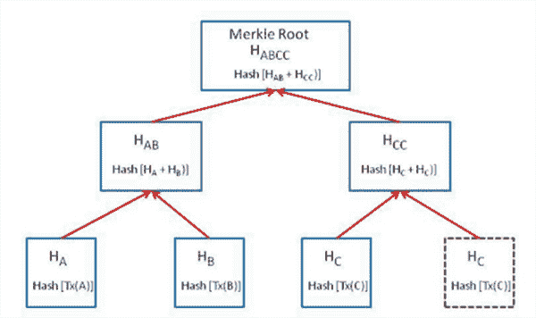 |
| --- |
| *https://cdn-images-1.medium.com/max/800/1\*is44KCZhz3HXcPGgp8JERw.jpeg* |

现在我们来到比特币最重要的部分，即数据结构。我们永远不应忘记，在每一个复杂的程序中，总有一个数据结构在发挥关键作用。对于那些学过数据结构的人来说，它是二叉树的哈希形式。如果我们要用一句话解释默克尔树，它可以被定义为**所有哈希的哈希**。

每笔交易的摘要都存储在区块（节点）中。这些区块随后成为我们之前学习的区块链的一部分。这也确保了一旦一个区块连接到区块链，它就变得像字符串一样不可变，这意味着任何人都无法更改它。这就是为什么区块链被认为是可靠的。区块链的去中心化始终确保发生的任何交易都是透明的。

我们应该记住的一点是，默克尔树**不**存储数据（所有交易的列表），而是以树结构存储所有交易的哈希（数字指纹）。这使得交易搜索变得更容易，因为我们使用了哈希。此外，算法生成的哈希值是加密的，这确保了没有人可以黑客攻击或渗透交易。

现在既然我们对比特币的实现有了一点了解，让我们讨论一些与之相关的术语。正如我们所知，比特币是一种数字货币，因此在同一时间可能有许多人进行交易。现在的问题是，如果两个人在同一时间进行交易，系统如何决定下一步做什么？为了回答这些问题，我们转向下一个术语：分叉。

## 分叉

在加密货币中，有一条规则始终存在：从最后添加的区块到第一个区块（创世区块）永远只有一条路径。当两个区块几乎在同一时间创建时，只有一个区块会被接受，另一个区块被视为孤儿区块。稍后，当其中一个区块链接到区块链时，剩余的区块（孤儿区块）会被另一个区块拾取，从而使每笔交易都成功包含在网络中。

## 2. 文献综述

一种纯粹的点对点版本的电子现金将允许在线支付直接从一方发送给另一方，而无需通过金融机构。数字签名提供了部分解决方案，但如果仍然需要受信任的第三方来防止双重支付，则主要优势将丧失。作者提出了一种利用点对点网络解决双重支付问题的方案。网络通过将交易哈希到一个持续的基于哈希的工作量证明链中来为交易加上时间戳，形成了一条无需重做工作量证明就无法更改的记录。最长链不仅作为所见事件序列的证明，而且证明它来自最大的 CPU 算力池。只要大多数 CPU 算力由不合作攻击网络的节点控制，它们就会生成最长链并超越攻击者。网络本身只需要最小的结构。消息以尽力而为的方式广播，节点可以离开并重新加入网络，接受最长的工作量证明链作为它们离开期间发生事件的证明（Nakamoto, 2008）。

在进入下一个主题之前，让我们讨论一下比特币的历史。你可能会问为什么历史在这里很重要。最可能的答案是，历史告诉我们技术演进的必要性是什么。

比特币和加密货币出现的时间不长。比特币并非首创的加密货币，曾有许多尝试试图开发加密货币，但都因系统不完善而失败。比特币之前的加密货币某种程度上是中心化的，这就是为什么大多数人要么害怕购买，要么不信任它们（Antonopoulos, 2014）。

| 图 4. 著名的电子支付系统 |
| --- |
|  |
| --- |
| *https://www.valuewalk.com/wp-content/uploads/2016/02/Bitcoin-And-Cryptocurrency-Technologies-1.jpg* |

比特币通过使其去中心化解决了这个问题，因此变得著名。

现在你可能也想问，加密货币本身的需求是什么？答案非常简单：人们想要一种不受政府控制的货币。受严格银行规则和政府监管之苦的受害者想要一种银行无法干预、政府也无法干预的货币。此外，加密货币在暗网世界中需求旺盛，这在一定程度上最初降低了它的知名度。

### 中本聪——比特币的创始人

如果我们在讨论比特币历史时不谈论其创始人，那将是不妥的。关于比特币创始人中本聪（Nakamoto, 2008）知之甚少，甚至不确定背后是一个人还是一群人。我们所知道的只是一个化名，根据媒体报道，这指向不同的人。即使经过这么多加密货币的演变，仍没有直接的答案。难以追踪创始人的原因之一是，所有参与比特币讨论的人都使用匿名邮箱，这使得弄清这些人是谁几乎不可能。他们保持匿名的原因之一可能是，他们可能为自己保留了大量比特币，不希望任何政府或私人组织获得他们的资金。无论原因是什么，比特币创始人就像货币本身一样难以追踪！

## 动机

我们撰写本章的动机在于，即使在今天，许多人仍不了解加密货币。我们希望让读者意识到加密货币在其财务生活中的力量。此外，令我们兴奋的是比特币创始人的理念以及他们如何在其加密货币中实施它。一个主要原因也是让读者意识到加密货币如何被用于非法途径，以便他们在投入毕生积蓄购买加密货币时始终采取预防措施。在技术部分，激励我们的是加密货币数据结构的实现和区块链的概念。

| 图 5. 全球匿名性 |
| --- |
|  |
| --- |
| *https://cdn-images-1.medium.com/max/800/1\*k9EH4bSrWvJ0s-w0igB0yg.jpeg* |

## 比特币与暗网


## 比特币、暗网与 WannaCry

### 暗网与比特币

比特币一面世，便成为暗网上极度抢手的货币。但在深入探讨之前，先为初学者解释一下**暗网**这一术语。暗网构成了我们无法通过普通网页浏览器直接访问的那 96% 的网络空间（为什么？）。因为它是“暗”的！意味着其中存在涉及非法活动的网站，如贩卖毒品、可卡因、假护照，甚至人口贩卖。没错！人们甚至通过网络进行人口贩卖。暗网之所以青睐比特币，是因为比特币几乎无法追踪。这也是比特币早期流行主要与非法用途挂钩的原因。

一个著名的例子是**丝绸之路**，它因贩卖毒品和假护照等非法活动而臭名昭著。甚至还有近期的链接，支付一些比特币就能保证 GRE、托福和 SAT 考高分！但这些无法直接访问；你需要特定的浏览器（`TOR browser`）才能进入。我们不会深入探讨这个话题，但可以得出结论：暗网是加密货币最大的市场之一。请记住，有很多东西对你是隐藏的；如果你开始探索暗网，你会发现它们，但我并不推荐这样做——至少在你有足够经验之前不要尝试。下图是丝绸之路的截图。

| 图 6. 丝绸之路网站 |
| --- |
| 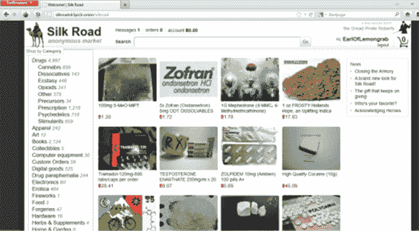 |
| --- |
| *https://theearloflemongrab.files.wordpress.com/2013/01/silk-road3.png?w=549* |

既然我们对暗网有了一点了解，接下来进入下一部分。

### WannaCry 与比特币

首先来谈谈什么是**WannaCry**。这是一场大规模的勒索软件攻击，给企业、医院和其他个人造成了高达 40 亿美元的损失。让我们试着理解这场攻击为何能在如此大规模上取得成功。

该勒索软件攻击利用了 Windows 服务器消息块（`SMB`）的漏洞，其漏洞利用代码由 `NSA`（美国国家安全局）创建。`NSA` 将该漏洞命名为**永恒之蓝**。`NSA` 没有向微软报告该漏洞，而是想将其据为己用谋取利益。后来，一个名为**影子经纪人**的黑客组织公开了该漏洞利用代码。该漏洞引起了 WannaCry 开发者的注意。WannaCry 使用 `Microsoft Visual C++` 编写，以确保攻击时不出现任何兼容性问题。

WannaCry 病毒首先会尝试寻找**杀毒开关**（一种强制关闭的简单方式）；如果未找到，勒索软件会加密你的数据，然后尝试利用 `SMB`（服务器消息块）漏洞将自身传播到其他网络。WannaCry 病毒自带自我传播机制。当它找到宿主后，会利用 `EternalBlue` 漏洞和 `DoublePulsar` 工具获取访问权限以安装并执行自身。WannaCry 病毒会弹出一个如下所示的显示窗口，要求受害者通过比特币支付，这才是我们关注的重点。下图是遭受勒索软件攻击后会出现的显示窗口截图。

| 图 7. NSA 徽标 |
| --- |
|  |
| --- |
| *https://upload.wikimedia.org/wikipedia/commons/8/8d/Seal_of_the_U.S._National_Security_Agency.svg* |

| 图 8. WannaCry 解密受影响计算机屏幕示例 |
| --- |
|  |
| --- |
| *https://upload.wikimedia.org/wikipedia/en/1/18/Wana_Decrypt0r_screenshot.png* |

在微软最终通过补丁阻止 WannaCry 之前，它已迅速蔓延，我们都知道它造成了多大的破坏。现在的主要问题是，WannaCry 不仅攻击私营组织，还攻击医院。如果医院丢失了患者的用药记录，将给患者带来生死攸关的局面；这也是大多数医院选择支付赎金的原因。

WannaCry 勒索软件要求用户通过比特币支付。问题在于比特币账本是公开的，但交易的双方（从谁到谁）无法追踪。这意味着，假设受害者向攻击者支付了赎金，我们可以看到交换了多少比特币，但既无法追踪攻击者，也无法追踪受害者。

攻击者利用了比特币的这一优势，这也是勒索软件能完全得逞的原因。归根结底，是比特币确保了攻击者身份的安全。这就像钱就漂浮在你面前，却看不出它从哪来、到哪去。

尽管勒索软件最终被微软的紧急补丁阻止，但它仍造成了巨大损失。讨论完这些，你可能会问继续发展加密货币是否明智。答案依然是响亮的**是的！** 因为在初期，是 `NSA` 和相关公司未能妥善应对。如果 `NSA` 向微软报告了漏洞，本可阻止攻击；如果医院和公司持续更新软件，本可预防攻击。至少我仍然相信加密货币是好的。你有权持不同意见 :)。

下图显示了最初受勒索软件攻击的国家。

| 图 9. 最初受勒索软件攻击的国家 |
| --- |
| 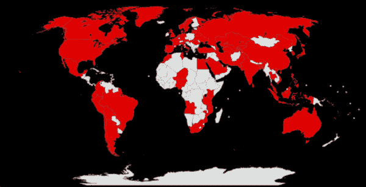 |
| --- |
| *https://upload.wikimedia.org/wikipedia/commons/thumb/2/20/Countries_initially_affected_in_WannaCry_ransomware_attack.svg/300px-Countries_initially_affected_in_WannaCry_ransomware_attack.svg.png* |

无论攻击造成多大代价，这都不是最后一次攻击。随后针对大型组织的攻击接连不断——有的只索要 1 个比特币，有的索要巨额赎金以至于公司不得不停止防护。无论发生什么，有趣的是，在 2017 年这些勒索软件攻击持续期间，无论是好是坏，比特币价格都以更高的速率上涨。

| 图 10. 比特币股价 |
| --- |
|  |
| --- |
| *https://static.coindesk.com/wp-content/uploads/2017/12/coindesk-bpi-chart-22.png* |

上图显示了 2017 年比特币的股价。

| 图 11. 2009-2017 年比特币股价 |
| --- |
| 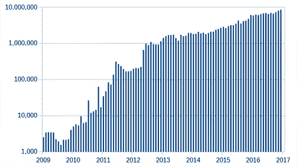 |
| --- |
| *https://en.bitcoinwiki.org/upload/en/images/thumb/e/e0/Transactions_per_month.png/450px-Transactions_per_month.png* |

上图显示了比特币股价与其他年份的对比。

## 结论

最后，我们通过探讨比特币的未来来结束本章。比特币无疑是最安全的加密货币之一，但它能否大规模应用？目前或许可以。为什么？答案很简单：因为下载比特币每一笔交易所需的系统成本通常很高，且随着比特币挖矿成本增加，可能导致挖矿系统冻结。

第二个重要原因是缺乏合适的机构来防止比特币被滥用。这也是比特币通常为暗网所青睐的原因。此外，暗网需要匿名性，而比特币在某种程度上提供了这一点；你可以说比特币正在帮助犯罪分子作案。最大的例子莫过于前文提到的丝绸之路。这也是比特币在公众心中形象不佳的原因。

第三个重要原因是匿名的创始人自己。没人知道比特币创始人的太多信息；没人能估算他们拥有多少比特币。任何创始人可能突然现身，抛售他们的比特币，从而导致价格剧烈通胀。


第四个原因是比特币并不便宜。在撰写本章时，一个比特币的价值高达 3,963.78 美元或 2,74,176.64 印度卢比；因此，并非人人都能购买比特币。

因此我们可以说，也许在未来比特币可以成为一种主要货币，但就目前而言，它还不是。希望通过本章，您能对比特币和安全性有所了解。

## 参考文献

Antonopoulos, A. M. (2014). *Mastering Bitcoin* (1st ed.). O’Reilly Media.

Dhillon, V. (2016). Blockchain-Enabled Open Science Framework. *O'Reilly Media*. https://www.oreilly.com/ideas/blockchain-enabled-open-science-framework

Dhillon, V., Metcalf, D., & Hooper, M. (2017). Blockchain in science. *Blockchain Enabled Applications* (1st ed.). Apress. doi:10.1007/978-1-4842-3081-7

Gord, M. (2016). Smart Contracts Described by Nick Szabo 20 Years ago now becoming Reality. *Bitcoin Magazine*.

Nakamoto, S. (2008). Bitcoin: A Peer to Peer electronic cash system. https://bitcoin.org/bitcoin.pdf

Pilkington, M. (2016). Blockchain technology: Principle and applications. *Research Handbook on Digital Transformations*.

Zheng, Z., Xie, S., Dai, H., Chen, X., & Wang, H. (2017). An overview of blockchain technology: Architecture, consensus and future trends. *IEEE International Congress on Big Data (Big Data Congress)*.

## 第 6 章

**Neha Gupta**  
Symbiosis University of Applied Sciences, Indore, India

## 摘要

无线通信网络极易受到安全威胁。无线通信网络的主要应用领域包括军事、商业、医疗、零售和交通。这些系统使用有线、蜂窝或自组网络。无线传感器网络、执行器网络和车辆网络在社会和工业界受到了极大关注。近年来，物联网 (IoT) 受到了相当多的研究关注。物联网被认为是互联网的未来。在未来，物联网将发挥至关重要的作用，并将改变我们的生活方式、标准以及商业模式。物联网在不同应用中的使用预计将在未来几年迅速增长。物联网允许数十亿设备、人员和服务相互连接并交换信息。由于物联网设备使用量的增加，物联网网络容易遭受各种安全攻击。

## 物联网 – 安全

每一个连接的设备都为攻击者创造了机会。这些漏洞范围广泛，即使对于单个微小设备也是如此。风险包括数据传输、设备访问、设备故障以及始终在线/始终连接的设备。安全性的主要挑战依然是与生产低成本设备相关的安全局限性，以及设备数量不断增长给攻击创造了更多机会。

**安全频谱：** 安全设备的定义跨度从最简单的措施到复杂的设计。安全应被视为一个随威胁演变而随时间变化的脆弱性频谱。安全必须基于用户需求和实施情况进行评估。用户必须认识到安全措施的影响，因为设计不良的安全措施造成的问题比解决的问题更多。示例：一份德国报告披露，黑客攻破了一家钢铁厂的安全系统。他们破坏了控制系统，导致高炉无法正常关闭，造成巨大损失。因此，用户在决定采取适当防护之前，必须了解攻击的影响。

### 1.1 挑战

除了成本和设备的普及性，其他安全问题也困扰着物联网：

*   **i. 不可预测的行为** – 部署设备的巨大数量及其漫长的赋能技术清单，意味着它们在现场的行为可能是不可预测的。特定系统可能设计良好且在管理控制之下，但无法保证它将如何与其他系统交互。
*   **ii. 设备相似性** – 物联网设备相当统一。它们使用相同的连接技术和组件。如果一个系统或设备存在漏洞，许多其他设备也会有相同的问题。
*   **iii. 部署困难** – 物联网的主要目标之一，仍然是将先进网络和分析放置在以前无法到达的地方。不幸的是，这造成了在这些陌生或易于接近的地方对设备进行物理安全保护的问题。
*   **iv. 设备寿命长与支持过期** – 物联网设备的优势之一是寿命长；然而，漫长的寿命也意味着它们可能比设备支持的寿命更长。将其与传统系统相比，后者通常在许多人停止使用后很长一段时间内仍拥有支持和升级。孤儿设备和弃用软件缺乏其他系统同等的安全加固，这是由于技术随时间演变所致 (Weyrich & Ebert, 2015)。
*   **v. 无升级支持** – 许多物联网设备，像许多移动和小型设备一样，并非设计为允许升级或任何修改。其他设备提供的升级方式不便，许多所有者忽略或未察觉。
*   **vi. 透明度差或无透明度** – 许多物联网设备未能在功能方面提供透明度。用户无法观察或访问其进程，只能假设设备如何行为。他们无法控制不需要的功能或数据收集；此外，当制造商更新设备时，可能会带来更多不需要的功能 (Weyrich & Ebert, 2015)。
*   **vii. 无警报** – 物联网的另一个目标，仍然是在不显眼的情况下提供其令人难以置信的功能。这引入了用户感知的问题。用户不监控设备，也不知道何时出错。安全漏洞可能在长时间内持续存在而不被发现。

## 2. 物联网中的安全需求

所有设备和人员相互连接，以便随时随地提供服务。大多数连接到互联网的设备未配备高效的安全机制，容易受到各种隐私和安全问题的影响（例如机密性、完整性和真实性）。对于物联网，必须满足某些安全需求，以防止网络遭受恶意攻击。在此简要讨论安全网络所需的一些最关键能力。

**抗攻击性：** 系统应有足够的能力在数据传输过程中崩溃时自行恢复。例如，在多用户环境中工作的服务器必须足够智能和强大，以保护自己免受入侵者或窃听者的侵害 (Evans, 2011)。如果它宕机，它会在不通知用户其宕机状态的情况下自行恢复。

*   **数据认证：** 数据及其相关信息必须经过认证。认证机制用于仅允许来自真实设备的数据传输。
*   **访问控制：** 仅授权人员获得访问控制。系统管理员必须通过管理用户名和密码以及定义其访问权限来控制用户访问，以便不同用户只能访问数据库或程序的相关部分。
*   **客户隐私：** 数据和信息应掌握在安全的手中。个人数据只能由授权人员访问，以维护客户隐私 (Evans, 2011)。这意味着系统中无关的已认证用户或任何其他类型的客户都无法访问客户的私人信息。

## 2.1 物联网安全、隐私、威胁与挑战


## 物联网安全威胁与挑战

物联网时代改变了我们的生活方式。尽管物联网提供了巨大的效益，但它在日常生活中容易受到各种安全威胁。大多数安全威胁与信息泄露和服务中断有关。在物联网中，安全威胁直接影响物理安全风险。物联网由具有不同凭证的不同设备和平台组成，每个系统都需要根据其特性满足安全要求。用户隐私也是最重要的部分，因为大量个人信息在各类设备间共享。因此，需要一种安全机制来保护个人信息。此外，对于物联网服务，存在多种类型的设备，它们使用不同的网络进行通信。这意味着在用户隐私和网络层方面存在大量安全问题。用户隐私也可能通过不同途径被泄露。物联网中的一些安全威胁如下：

### 1. 端到端数据生命周期保护
为确保物联网环境中数据的安全，需在完整网络中提供端到端的数据保护。数据从相互连接的不同设备收集，并即时共享给其他设备。因此，需要一个框架来保护数据、数据机密性，并在完整的数据生命周期中管理信息隐私。

### 2. 安全事物规划
物联网中设备间的互联和通信因情况而异。因此，设备必须具备维持安全级别的能力。例如，当基于家庭的网络中使用的本地设备和传感器相互安全通信时，它们与外部设备的通信也应在相同的安全策略下工作。

### 3. 可见/可用的安全与隐私
大多数安全和隐私问题源于用户的错误配置。用户执行此类隐私策略和复杂的安全机制非常困难且不切实际。需要选择可自动应用的安全和隐私策略。

## 2.2 智能家居中的安全威胁

智能家居服务可能面临网络攻击，因为大多数服务提供商在早期阶段不考虑安全参数。智能家居中可能的安全威胁包括窃听、分布式拒绝服务（`DDoS`）攻击和信息泄露等。智能家居网络受到未授权访问的威胁。智能家居可能面临的安全威胁讨论如下（见图 3）。

### 1. 非法闯入
如果智能门锁受恶意代码影响或被未授权方访问，攻击者可在不破坏门道的情况下非法闯入智能家居，如图 4 所示。这种影响的后果可能表现为生命或财产损失。为避免此类攻击，应频繁更改密码且必须包含至少十个字符，因为攻击者很难破解长密码。同样，也可应用认证机制和访问控制。

### 2. 监控与个人信息泄露
安全是智能家居的重要目的之一。因此，有大量传感器用于火灾监控、婴儿监控和防盗等。如果这些传感器被入侵者黑客攻击，则入侵者可监控家庭并访问个人信息，如图 5 所示。为避免此类攻击，必须在网关和传感器之间应用数据加密，或应用用户认证以检测未授权方。

### 3. DoS/DDoS
攻击者可能访问智能家居网络并向智能设备发送大量消息，如清除发送（`CTS`）/ 请求发送（`RTS`）。他们也可利用恶意代码攻击目标设备，以对智能家居中连接的其他设备执行 `DoS` 攻击，如图 6 所示。结果，智能设备因此类攻击耗尽资源而无法执行正常功能。为避免此类攻击，应用认证以阻止和检测未授权访问非常重要。

### 4. 篡改
当智能家居中的设备与应用服务器通信时，攻击者可通过更改网关中的路由表来收集数据包，如图 7 所示。尽管应用了 `SSL`（安全套接层）技术，攻击者仍可绕过伪造的证书。这样，攻击者可曲解数据内容或泄露数据机密性。为保护智能家居网络免受此类攻击，应应用带有适当认证机制的 `SSL` 技术。阻止可能尝试访问智能家居网络的未授权设备也很重要。

物联网是一个概念，描绘了一个未来：连接互联网的物理对象相互通信并向其他设备标识自身。物联网系统由智能对象、智能手机、平板电脑和智能设备等组成，如图 3 所示。此类系统使用 `RFID`、快速响应（`QR`）码或无线技术在不同设备间通信。物联网有助于建立人与人、人与物理对象、物理对象与其他物理对象之间的连接。根据 IDC 的评估，到 2020 年将有 300 亿台联网设备。互联网数据的这种快速增长需要更有价值和更安全的网络。

| 图 1. |
| --- |
| 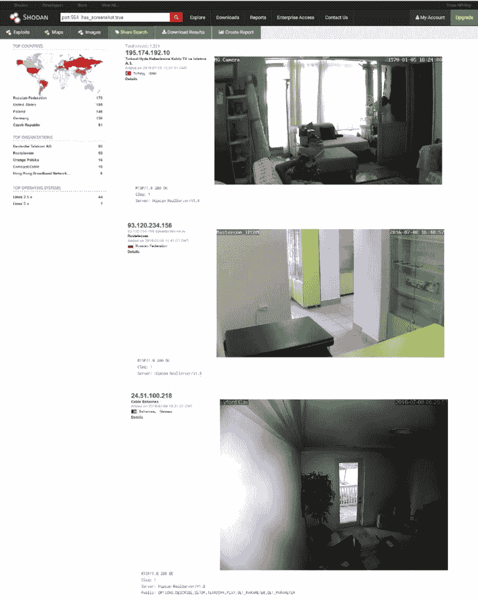 |

| 图 2. |
| --- |
| 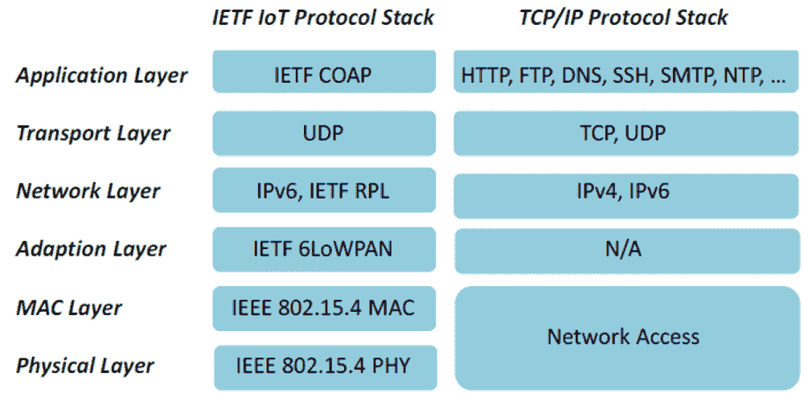 |

| 图 3. 物联网示例 |
| --- |
| 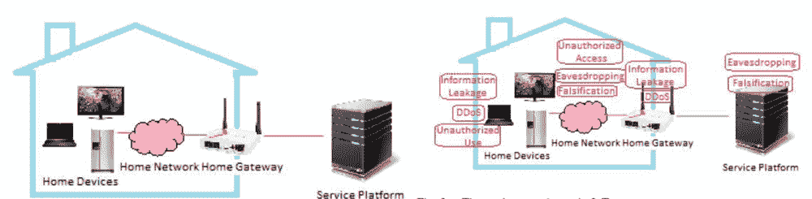 |

| 图 4. |
| --- |
| 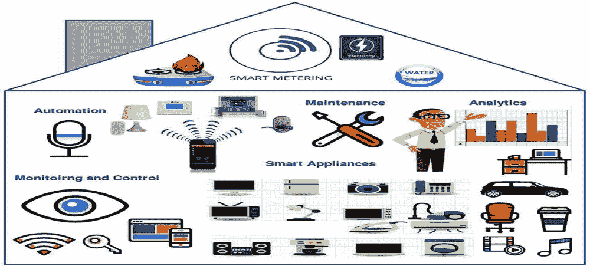 |

## 2.3 物联网挑战

安全问题是物联网面临的最大挑战。物联网的应用数据可能是工业、企业、消费或个人类的。这些应用数据应得到保护，并必须防止被盗和篡改而保持机密。例如，物联网应用可能存储患者的健康结果或购物商店数据。物联网改善了设备间的通信，但仍存在与可扩展性、可用性和响应时间相关的问题。安全是一个关注点，即数据在互联网上安全传输。在跨国传输数据时，政府法规可能适用安全措施法案，如《健康保险流通与责任法案》（`HIPA`）。在不同的安全挑战中，与物联网最相关的重要挑战讨论如下。

### 1. 数据隐私
一些智能电视制造商收集客户数据以分析其观看习惯，因此智能电视收集的数据在传输过程中可能面临数据隐私挑战。

### 2. 数据安全
数据安全也是一个巨大挑战。在无缝传输数据时，重要的是要对互联网上的观察设备隐藏数据。

### 3. 保险顾虑
在车辆上安装物联网设备的保险公司收集健康和驾驶状态数据，以做出保险决策。

### 4. 缺乏通用标准
由于物联网设备和物联网制造行业存在许多标准，因此区分连接到互联网的许可设备和非许可设备是一个巨大挑战。

### 5. 技术顾虑
由于物联网设备使用量增加，这些设备产生的流量也在增加。因此，需要增加网络容量；因此，存储海量数据以供分析和进一步最终存储也是一个挑战。


### 6) 安全攻击与系统漏洞

到目前为止，在物联网安全场景方面已经完成了大量工作。相关工作可分为系统安全、应用安全和网络安全（Ackoff, 1971）。

#### a) 系统安全

系统安全主要关注整体物联网系统，以识别不同的安全挑战、设计不同的安全框架并提供适当的安全指南，从而维护网络的安全。

#### b) 应用安全

应用安全针对物联网应用，根据场景需求处理安全问题。

#### c) 网络安全

网络安全致力于保障物联网通信网络的安全，以实现不同物联网设备的通信。在下一节中，将讨论关于物联网的安全顾虑。安全攻击被归纳为四大类。

## 2.4 不同类型攻击及可能解决方案的分析

物联网面临各种类型的攻击，包括主动攻击和被动攻击，这些攻击可能轻易干扰功能并抵消其服务的效益。在被动攻击中，入侵者仅感知节点或可能窃取信息，但从不进行物理攻击。然而，主动攻击会在物理上干扰性能。这些主动攻击进一步分为两类：内部攻击和外部攻击。此类脆弱攻击会阻止设备进行智能通信（Fan, Wang, Zhang & Lin, 2014）。因此，必须应用安全约束以防止设备遭受恶意攻击。本节讨论了不同类型的攻击、攻击的性质/行为以及攻击的威胁等级。根据其行为，不同等级的攻击被分为四类，并针对威胁/攻击提出了可能的解决方案。

*   **1) 低级攻击：** 攻击者试图攻击网络，但其攻击未成功。
*   **2) 中级攻击：** 攻击者/入侵者或窃听者仅监听介质，但不破坏数据的完整性。
*   **3) 高级攻击：** 对网络发起攻击，且破坏了数据的完整性或修改了数据。
*   **4) 极高级攻击：** 入侵者/攻击者通过获取未授权访问并执行非法操作来攻击网络，导致网络不可用、发送大量消息或干扰网络（Fan, Wang, Zhang & Lin, 2014）。

表 1 展示了不同类型的攻击、其威胁等级、其性质/行为以及应对这些攻击的可能解决方案。

### 表 1. 不同类型的攻击与威胁

```
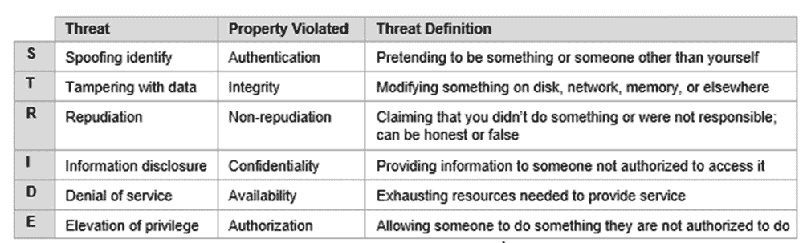
```

## 3. 网络安全与隐私中的关键问题

互联网已从高校的有用研究工具发展成为一种基础公用设施，其重要性不亚于电力、水和天然气。凡是有宝贵资源的地方，就会有犯罪行为，企图通过非法使用该技术获取价值，或剥夺他人对该资源的使用权。互联网的互联特性意味着互联网资源可能遭受来自世界任何位置的攻击，这使得网络安全成为一个关键问题。网络安全围绕三大核心主题展开。

**机密性** 是指保持数据私密，以便只有授权用户（包括人和机器）才能访问该数据。**密码学** 是实现机密性的关键技术。

**认证** 是指验证数据未被篡改，并能验证数据确实由声称的发送方发送。**抗抵赖性**（即发送方无法否认其发送过消息）有时被单独考量，但我们将其作为认证的一个子集包含在内（Fleisch, 2010）。

**访问控制** 是指仅允许合适的授权用户访问数据、通信基础设施和计算资源，并确保这些授权用户不被阻止进行此类访问。

信息安全漏洞调查是一份年度网络威胁报告，由英国商业、创新和技能部委托，普华永道执行。2015 年的最新调查显示，安全漏洞呈上升趋势；2015 年 90% 的大型组织经历了网络入侵，而 2014 年为 81%，74% 的小型企业也遭受了安全漏洞，表明同比增长率达到了两位数的 14%。

如今，互联网已成为现代业务中关键任务的关键组成部分，网络安全已成为信息系统中不可或缺的组成部分（Gubbi, Buyya, Marusic & Palaniswami, 2013）。然而，随着网络安全的加强，网络犯罪正演变得更加广泛、破坏性更强、手段更加复杂。在智能家居中，住户安全管理其系统的能力需要值得信赖且直观的自动化系统来协助网络管理（Fleisch, 2010）。若无此类系统，智能家居的安全和隐私威胁很可能超过其优势。

### 物联网应用领域

许多应用领域特别适合通过部署物联网技术来提高生产力。工厂和工厂自动化应用常被归类为工业物联网。Xu 等人综述了这一应用领域。可靠性（包括通过冗余实现）、安全性以及对恶劣环境的适应性是其中一些关键问题。

医院内生物医学仪器和数据库的联网有可能显著提高诊断和治疗决策的数量和可用性。这对农村和偏远诊所也有重大影响，可提供便捷的专家意见获取渠道。将医疗仪器延伸至家庭，提高了生活质量并减少了再入院率。

过去二十年来，基于数十个联网微处理器，汽车电子的使用激增。下一阶段的发展将是车与车之间、车与基础设施之间的通信。标准化、安全性和成本是主要驱动因素。

运输和物流已是 RFID 标签的重度用户，用于追踪货物、托盘甚至单个物品。此处的研究方向是智能标签，可记录和报告运输条件，如冲击、倾斜、温度、湿度和压力。此处的关键驱动因素是低成本，以及与数百或数千个标签同时进行有序通信。

物联网技术正在对包括娱乐、餐饮、公共交通、体育健身、电信、制造、酒店、教育、环境科学、机器人技术和零售在内的极广泛行业产生颠覆性影响。在许多行业中，物联网正成为创新和成功的关键推动者（Fleisch, 2010），各行业愿投资新技术。专业的 IT 支持可由内部员工或外部供应商提供，以确保其系统的安全性和可用性足以满足业务需求。

## 3.1 物联网与智能家居


## 智能家居物联网安全

本章探讨的是一个截然不同的环境——智能家居。当智能电子设备作为新建住宅的一部分时，可能会提供专业的系统设计、安装和配置服务。然而，在大多数情况下，智能家居物联网技术很可能是随着需求的出现，逐件改装到现有住宅中的。无论是在物联网部署的设计阶段还是运行阶段，智能家居通常都缺乏持续的专业支持。虽然存在一些应用相对广泛的专用智能家居标准，例如 `X.10` 电力线载波通信，但这些标准缺乏任何类型的安全性，且是在家庭控制网络连接互联网之前设计的。如今，有大量网络标准可用于家庭（`Zwave`、`Insteon`、`Bluetooth`、`Zigbee`、`Ethernet`、`Wifi`、`RS232`、`RS485`、`C-bus`、`UPB`、`KNX`、`EnOcean`、`Thread`）。每种标准都有其优缺点，指望非专家能高效且安全地管理一个包含多种不同协议的异构网络，面临着巨大的挑战。

智能家居有望提供额外的舒适度和安全性，以及增强的生态可持续性。例如，智能空调系统可以利用各种家庭传感器和基于网络的数据源来做出智能运行决策（Fleisch, 2010），而非简单的手动或固定时间表控制方案。智能空调系统可以通过追踪位置数据来预测预期的房屋占用情况，确保在房屋有人时空调达到所需的舒适度，在无人时节省能源。

除了增强舒适度，智能家居还能协助老年人独立生活。智能家居可以协助完成清洁、烹饪、购物和洗衣等日常任务。轻度认知衰退可通过智能家居系统提供及时的服药提醒来应对。家庭健康监测可在需要昂贵且破坏性的住院治疗之前，向护理人员发出信号以便其做出响应。然而，如果智能家居系统不安全且不可信，这些益处恐怕都难以实现。

## 3.2 智能家居中的安全威胁

尽管智能家居是一个截然不同的环境，但安全威胁的总体性质与其他领域相似。

**机密性威胁**是指导致敏感信息意外泄露的威胁。例如，家庭监控系统中的机密性泄露可能导致敏感医疗数据的无意泄露。即使是看似无害的数据，例如室内温度，结合空调系统运行参数的知识，也可用于判断房屋是否有人居住，从而作为入室盗窃的前兆。钥匙和密码等丢失机密性将导致未经授权的系统访问威胁。

**认证威胁**可能导致传感或控制信息被篡改。例如，未经认证的系统状态警报可能会误导房屋控制器认为发生了紧急情况，从而打开门窗以允许紧急疏散，实际上却允许了非法入侵（Bauk, Dlabač, & Škurić, 2018）。稍后将提到的一个问题是自动软件更新——如果这些更新未经过适当认证，就会出现问题。

**访问威胁**可能是最大的威胁。未经授权访问系统控制器，特别是管理员级别的访问，会使整个系统变得不安全。这可能是由于不当的密码和密钥管理，也可能是由于未经授权的设备连接到网络。即使无法获得控制权，未经授权的网络连接也可能窃取网络带宽，或导致合法用户遭遇拒绝服务。由于许多智能家居设备可能由电池供电，并以低占空比无线组网，向网络发送大量请求会导致能量耗尽攻击——一种拒绝服务形式。

## 3.3 漏洞

一个重大漏洞是**网络系统可访问性**。由于现代智能家居系统连接到了互联网，攻击可以远程进行，要么通过直接访问网络控制接口，要么通过向设备下载恶意软件（Bauk, Dlabač, & Škurić, 2018）。

**系统物理可访问性**也是一个问题。对于无线和电力线载波技术，即使房屋本身上锁很严实，网络也可以从房屋外部进行物理访问。

下一个漏洞是**受限的系统资源**。设备控制器传统上是资源极其有限的小型 8 位微控制器，计算和存储资源非常有限，这限制了它们实现复杂安全算法的能力。

**系统异构性**是一个漏洞。设备来自许多制造商，具有不同的网络标准和不同的软件更新能力。这些设备通常几乎没有关于其内部软件、操作系统和已安装安全机制的文档。

**固定固件**是另一个问题。极少有智能家居电器提供定期软件更新服务来修补安全漏洞。人们怀疑，对于成本仅几美元的设备，目前几乎没有动力持续修补软件以领先于安全漏洞。

**标准采纳缓慢**是一个漏洞。虽然一些专有系统（如健康监测子系统）可能拥有设计良好、符合标准的安全性，但大多数当前的智能家居设备实现的安全方法寥寥无几，甚至根本没有（Bauk, Dlabač, & Škurić, 2018）。

我们认为最大的漏洞是**缺乏专职安全专业人员**来管理智能家居网络的复杂性。鲜有家庭用户能负担得起专业的持续家庭网络管理协助。相反，业余的家庭用户需要能够简单、安全、可靠地自我管理他们的系统。

## 3.4 漏洞示例

例如，房主可能会认为他们的网络摄像头只能由获得其主机名和端口号的用户访问。然而，在互联网设备扫描搜索引擎（如 `Shodan` (`https://www.shodan.io`) 和 `Censys` (`https://censys.io`)）的帮助下，这些引擎合法地搜索可访问的传感器，许多设备突然变得为人所知且可见。

传统搜索引擎（如 `Google` 和 `Bing`）通过检索网页并遵循这些页面中的超链接来爬取互联网，以索引网页、图片或某些流行的文件类型。另一方面，互联网设备扫描搜索引擎的工作原理类似于网络扫描器，扫描互联网节点的开放端口，并索引连接设备返回的头部或横幅信息；回复的头部或横幅通常包括设备类型、型号、供应商、固件版本和其他信息。除了 `HTTP` 和 `HTTPS` 协议，互联网设备扫描搜索引擎还使用多种协议（`FTP`、`SSH`、`DNS`、`SIP` 和 `RTSP` 等）连接到节点的开放端口。为了方便访问，这些搜索引擎还提供**应用程序编程接口 (API)** 以编程方式访问其搜索结果。攻击者可以利用这些搜索引擎在互联网上查找易受攻击的设备。例如，在 `Shodan` 中使用搜索关键词 `has_screenshot:true port:554` 将返回一份家用监控摄像头列表，包含其 IP 地址、地理位置和截图，如图 1 所示。

## 3.5 物联网现有的一些安全支持


## 物联网安全协议与智能家居架构

### 3.6 LoWPAN 与安全

由于成本低廉，物联网计算设备通常不如传统台式机和笔记本电脑强大。大多数物联网设备功耗低，使用低端微控制器且内存有限。此类控制器非常适合洗衣机或空调中独立控制器的需求。

然而，这些特性使得向网络化物联网控制器的过渡更具挑战性，因为现有的互联网协议通常并非为这些嵌入式设备设计。互联网工程任务组（IETF）已成立多个工作组来解决这些问题。IETF 在物联网方面的标准化工作，在为现有 IP 网络上的受限环境建立必要的轻量级通信协议方面发挥了至关重要的作用。这些协议包括低功耗无线个人域网上的 IPv6（`6LoWPAN`：RFC 6282）、低功耗损耗网络的 IPv6 路由协议（`RPL`：RFC 6550）和受限应用协议（`CoAP`：RFC 7252）（Ackoff, 1971）。图 2 展示了 IETF 物联网协议栈与 TCP/IP 协议栈的对比。一旦设备连接到互联网，互联网上的任何安全威胁也可能危及物联网的安全性和隐私。在以下章节中，我们将回顾这些标准物联网协议当前的安全实现。

电气和电子工程师协会（IEEE）已为无线个人域网（WPAN）定义了 `802.15.4` 标准。IEEE `802.15.4` 定义了物理层和媒体访问控制层如何在低带宽、低成本、低速率和低能耗等典型网络条件下运行。因此，`6LoWPAN` 是由 IETF 设计的一种轻量级协议，旨在允许 IPv6 数据包通过 IEEE `802.15.4` 无线网络传输。

互联网协议安全（`IPsec`）套件定义了认证头（`AH`）和封装安全载荷（`ESP`），以实现 IPv6 数据包的数据完整性、机密性、源认证和抗重放保护（Fan, Wang, Zhang & Lin, 2014）。文献 [ ] 中的作者为 `6LoWPAN` 提出了压缩的 `AH` 和 `ESP` 特性以实现 `IPsec`，从而提供无线设备之间的端到端安全通信。

文献 [ ] 中的作者提出了一种用于 `6LoWPAN` 网络的增强认证与密钥建立方案（`EAKES6Lo`）。`EAKES6Lo` 分为两个阶段以提高 `6LoWPAN` 网络的安全性。这两个阶段是：（1）系统建立；和（2）认证与密钥建立。在第 1 阶段，使用对称加密机制高级加密标准（`AES`）来加密网络中的数据传输。为验证数据完整性，采用哈希函数消息摘要算法 5（`MD5`）或安全哈希算法（`SHA`）。在第 2 阶段，将交换六条消息以完成认证和密钥建立过程，并建立相互认证。因此，`6LoWPAN` 为安全无线通信提供了模板，即使是资源受限的设备也适用。

### 3.7 RPL 与安全

路由协议是传统网络的核心组件，这同样适用于 `6LoWPAN` 网络。`RPL` 是由 IETF 专门为低功耗损耗网络（`LLNs`）设计的一种优化 IPv6 路由协议，主要用于 `6LoWPAN` 网络。`RPL` 是一种距离矢量路由协议，其映射拓扑基于面向目的地的有向无环图（`DODAG`）结构。文献（Fan, Wang, Zhang & Lin, 2014）中提出了一种称为信任锚互连环（`TRAIL`）的通用拓扑认证方案用于 `RPL`。`TRAIL` 可以通过发现和隔离伪造节点，防止来自虚假节点的拓扑不一致攻击。`TRAIL` 使用往返消息来验证到根节点的向上路径完整性，并帮助树中的节点获取真实的秩信息。`TRAIL` 的创新之处在于，树中的每个节点都可以验证其到根节点的向上路径，并检测任何虚假秩攻击。在 `DODAG` 树中，节点选择正确的父节点至关重要，因为除根节点外，每个节点都必须有一个父节点。`RPL` 秩用于描述节点在树拓扑中的位置。文献 [ ] 中提出了一种安全选择方案，帮助子节点选择真实的父节点。在其选择算法中，将根据其邻居节点的平均和最大秩值计算节点的阈值，以排除欺骗节点成为其父节点。

### 3.8 CoAP 与安全

`CoAP` 是一种为受限设备网络设计的类 HTTP 应用层协议。由于物联网网络中存在组通信等特殊需求，`CoAP` 提供了 HTTP 不具备的多播支持。为了更好地适应低带宽连接和低算力设备环境，`CoAP` 采用了用户数据报协议（`UDP`）。与传输控制协议（`TCP`）相比，`UDP` 是一种更简单、低延迟且无连接的传输层协议。`CoAP` 是一种无状态协议，基于客户端-服务器架构模型。它使用请求/响应风格的操作在客户端和服务器之间交换消息。与 HTTP 类似，`CoAP` 也基于表述性状态转移（`REST`）模型，服务器上的每个资源都有其自己的统一资源标识符（`URI`），客户端可以通过向服务器发起请求来访问资源，请求可以是以下四种方法之一：`GET`、`POST`、`PUT` 和 `DELETE`。

如今，传输层安全（`TLS`：RFC 5246）是 HTTP 的主要加密协议，但 `TLS` 的实现对于资源受限的物联网设备来说过于复杂。为了保障通信安全，`CoAP` 采用数据报传输层安全（`DTLS`：RFC 6347）（Fleisch, 2010）作为其安全协议。`DTLS` 提供与 `TLS` 相同的安全服务。`TLS` 和 `DTLS` 的主要区别在于 `TLS` 基于 `TCP` 协议，而 `DTLS` 基于 `UDP` 协议。`CoAP` 规范定义了四种不同的安全模式。设备可以处于四种安全模式之一：`NoSec`、`PreSharedKey`、`RawPublicKey` 和 `Certificate`。同样，IETF 标准为受限网络内安全的基于 Web 的通信提供了安全机制。

### 3.9 未来物联网安全方向

正如上述三个示例所示，保障任务关键型物联网应用安全的重要工作已经大量开展。人们投入了大量精力开发适合资源受限设备、采用最先进安全技术的 IP 兼容安全通信网络。然而，这些技术中的许多都需要仔细、统一的系统级设计，以及经验丰富的网络工程师来设计和维护安全的物联网系统。我们工作的重点不在于这种“技术性”安全，而在于智能家居安全的系统管理方面，即如何正确安装和维护这些强大工具所提供的安全性。

### 3.10 适合安全的智能家居架构

针对智能家居架构有许多不同的提案，每种都有其特定的安全问题。其中三种最重要且最流行的架构是中间件、云和网关架构。接下来的章节将调查这些架构风格的安全问题和实现难度（Bauk, Dlabač, & Škurić, 2018）。

### 3.11 中间件架构与安全


## 中间件

中间件是位于设备底层与高层应用层之间的软件层。它通常提供通用接口和标准数据交换结构，以抽象硬件复杂多变的底层细节。当中间件接收到来自高层应用的请求时，它会将高层标准化的资源访问请求转换为相应的设备特定方法。当设备向应用响应时，中间件处理底层方法和数据转换，然后将相关的抽象命令和数据发送回应用。应用无需了解硬件不同实现的底层细节；只需简单调用中间件提供的命令和函数即可。安全性和隐私保护应在中间件的所有层级中予以考量，从底层硬件交互层到高层通用接口层均是如此。

### VIRTUS 中间件

**VIRTUS 中间件** 是一种基于开放的 **可扩展消息与状态表示协议** 的中间件解决方案。它采用 **简单认证与安全层** 协议进行认证，采用 **传输层安全** 协议保障数据安全与隐私。

### 嵌入式点对点系统安全中间件 (SMEPP)

**嵌入式点对点系统安全中间件** (Atzori, Iera & Morabito, 2010) 是一种专注于为智能节点提供点对点安全通信的中间件。设备在与其他设备通信前，需通过提供有效凭据加入群组。共有三个不同的安全级别，但只有 1 级和 2 级采用了安全机制。0 级不实施任何安全措施。SMEPP 在 1 级下实现预共享密钥加密，在 2 级下实现公钥加密，用于群组准入。另一方面，SMEPP 在 1 级采用认证，在 2 级采用认证结合加密的方式来保护数据安全。

### 物联网中间件的局限性

虽然中间件已在配备桌面级机器的企业系统中广泛用于管理复杂的异构网络，但目前提出的物联网中间件解决方案要求在设备上实现大量额外的复杂软件层和加密例程，而这些设备既没有内存也没有算力来承载它们。除了性能问题外，中间件架构的另一个顾虑是开发者无意中引入的中间件编码缺陷可能会对物联网设备构成潜在安全威胁。因此，我们认为在目前情况下，中间件解决方案对于许多物联网级设备而言是不可行的。

## 3.12 云架构与安全

设备间的协作是物联网的一个重要方面。此类互操作功能需要高处理能力，而大多数物联网设备不具备此能力。为解决物联网设备的性能问题，研究人员提出了面向物联网的基于云的解决方案。云拥有监控、收集、存储和处理来自物联网设备数据的资源 (Adolphs et al. 2015)。通过分析这些数据，云可根据用户定义的策略触发动作，以实现复杂的智能家居控制。物联网的基于云的架构也称为 **万物云** 。

### 基于 CoAP 的云架构

文献 [reference missing] 的作者提出了一种基于 **IETF 受限应用协议** 的物联网云架构。该架构包含三个解耦阶段：网络阶段、协议阶段和业务逻辑阶段。每个阶段均包含一个传入事件队列、一个线程池和一个处理阶段逻辑的事件处理器。该架构使用轻量级的 **数据报传输层安全** 作为其用于认证和通信的安全协议。

### 基于云的家庭区域网 (HAN) 方案

文献 [reference missing] 介绍了一种基于云计算的 **家庭区域网** 安全方案。 **家庭管理系统** 管理设备和策略，并为用户提供接入点。在该文献中，作者在云端实现 HMS 功能，并使 HMS 与云服务对接 (Fan, Wang, Zhang & Lin, 2014)。该方案采用对称密钥加密以实现端到端通信的机密性，并为每个智能对象分配一个唯一密钥。

### 基于云的解决方案面临的挑战

基于云的解决方案消除了对独立家庭控制器的需求，并为物联网的连接与协作提供了良好途径；然而，它用对大量互联网通信的需求取代了对本地计算的需求。鉴于物联网资源受限的特性，物联网设备产生的大量原始数据必须在未经预处理的情况下传输到云端；因此，家庭中的设备需要高速、低延迟、始终在线的互联网连接，但这种始终在线的高速互联网连接并非随时随地都可用，特别是在农村或偏远地区。控制延迟会增加，特别是当服务器位于海外或网络拥塞时。

所有设备必须可通过互联网访问，这呈现了广泛的攻击面，且每个设备都需要拥有足够资源来实现完整的网络安全协议。基于限制对更广泛互联网访问的拒绝服务攻击，或偶发的网络中断，可能导致家庭医疗和物理安全系统等关键任务失败。此外，由于用户无法完全控制其云服务，他们必须信任云服务提供商为其数据实施适当且充分的安全措施，但实际情况并不总是如此。因为基于云的系统在没有始终在线的网络连接时就会失效，我们认为它们无法单独提供安全且可用的智能家居系统，而且它们还将所有网络设备暴露在网络攻击之下 (Fan, Wang, Zhang & Lin, 2014)。

## 3.13 网关架构

**物联网网关** 是一种资源相对丰富的网络处理器，与其他物联网终端工作在同一局域网中。它不仅可以作为中心管理点来处理物联网设备的协调，还可以改善不同制造商智能设备之间的互联与互操作性。此外，它还可充当桥梁，将本地物联网基础设施连接到云端。由于网关拥有更强的算力和资源，高计算量和内存密集型任务可从物联网设备卸载到网关。在安全方面，网关可集中用户认证并实施访问控制，以防止未经授权的访问或受限数据的篡改。它还充当防火墙，保护智能设备和隐私免受网络威胁，并减少攻击面。

### 集成接入网关 (IAGW) 架构

文献 [reference missing] 的作者提出了一种 **集成接入网关** 架构，通过标准接口支持智能家居环境中的各类应用节点。该架构由普适传感器网络层、网络层和服务层组成。IAGW 包含一个安全模块，用于实现认证、授权和加密。该架构的优势之一是拥有 **服务质量** 模块，可对流量进行优先级排序并为关键任务操作保障资源。


一个名为基于服务器的物联网架构（SBIOTA）的系统概念被提出作为一种网关服务器，旨在为物联网提供有效、高效、安全且协作的集成解决方案。该概念架构在网关上包含一项新颖的自动配置服务，以促进设备的部署和管理流程，使设备能够插入网络并仅需极少的手动配置即可在该网络上全面运行。其初始方法是网关与设备之间的认证和通信通过一个单独的网络端口或物理上靠近服务器的短距离天线进行。在将设备连接到网络之前，用户需要将它们放置在靠近网关的物理位置，以便进行认证和交换相关信息，确保仅允许合法设备连接到网络。

## 4. 物联网——身份保护

物联网设备收集关于其环境的数据，其中包括人员信息。这些益处带来了沉重的风险。数据本身并不构成危险，但其深度却构成了危险。高度详细的数据收集勾勒出个人非常清晰的画像，为犯罪分子提供了利用他人所需的所有信息。

人们可能也未意识到隐私泄露的程度；例如，娱乐设备可能收集音视频数据，或“监视”消费者，并分享私密信息。考虑到对敏感数据感兴趣的各方数量众多且多样化，该数据的需求和价格加剧了这一问题。

物联网技术特有的问题导致了许多隐私问题，这些问题主要源于用户无法建立和控制隐私。

### 4.1 知情同意

连接系统中传统的“通知与同意”模型通常强制执行现有的隐私保护。它允许用户与隐私机制交互，并通常通过接受协议或限制操作来设置偏好。许多物联网设备不提供此类便利。用户不仅没有控制权，而且也无法获得关于设备活动的任何透明度。

### 4.2 被独处的权利

用户在特定情境下对隐私有正常的期望。这源于公共空间与私人空间这一普遍接受的概念；例如，个人不会对商业空间中的监控摄像头感到惊讶（Fleisch, 2010），但他们不期望在私家车中出现摄像头。物联网设备挑战了人们所认可的“被独处的权利”规范。即使在公共空间，由于其强大的能力，物联网也超出了预期隐私的界限。

### 4.3 不可区分的数据

物联网以多种方式部署。许多物联网实施仍以群体为目标而非个人。即使用户为每项操作授予物联网设备同意，也并非每个系统都能合理处理每一组偏好；例如，复杂组件中的小型设备无法满足其仅遇到几秒钟的成千上万用户的请求。

### 4.4 粒度

现代大数据对隐私构成重大威胁，但物联网凭借其规模和亲密性加剧了这一问题。它不仅能到达被动系统无法到达的地方，还能无处不在地收集数据。这支持创建高度详细的用户画像，从而助长歧视，并使个人面临身体、财务和声誉损害的风险。

### 4.5 舒适度

物联网的增长使其常态化。用户对其认为安全的技术变得麻木。物联网还缺乏传统连接系统中警示用户的透明度；因此，许多人在行动时未考虑潜在后果（Fleisch, 2010）。

## 参考文献

Ackoff, R. L. (1971). Towards a system of systems concepts. *Management Science*, 17(11), 661–671. doi:10.1287/mnsc.17.11.661

Adolphs, P., Bedenbender, H., Dirzus, D., Ehlich, M., Epple, U., Hankel, M., ... Koziolek, H. (2015). Status report-reference architecture model industrie 4.0 (rami4. 0). *VDI-Verein Deutscher Ingenieure eV and ZVEI-German Electrical and Electronic Manufacturers Association, Tech. Rep.*

Atzori, L., Iera, A., & Morabito, G. (2010). The Internet of Things: A Survey. *Computer Networks*, 54(15), 2787–2805. doi:10.1016/j.comnet.2010.05.010

Atzori, L., Iera, A., & Morabito, G. (2010). The internet of things: A survey. *Computer Networks*, 54(15), 2787–2805. doi:10.1016/j.comnet.2010.05.010

Bauk, S., Dlabač, T., & Škurić, M. (2018, February). Internet of Things, high resolution management and new business models. In *2018 23rd International Scientific-Professional Conference on Information Technology (IT)* (pp. 1-4). IEEE. 10.1109/SPIT.2018.8350850

Evans, D. (2011). The internet of things: How the next evolution of the internet is changing everything. *CISCO White Paper*, 1(2011), 1-11.

Evans, D. (2011). The Internet of Things: How the Next Evolution of the Internet Is Changing Everything. *Cisco*. www.cisco.com/web/about/ac79/docs/innov/IoT_IBSG_0411FINAL.pdf

Fan, P. F., Wang, L. L., Zhang, S. Y., & Lin, T. T. (2014). The Research on the Internet of Things Industry Chain for Barriers and Solutions. *Applied Mechanics and Materials*, 441, 1030–1035. doi:10.4028/www.scientific.net/AMM.441.1030

Fleisch, E. (2010). What is the internet of things? An economic perspective. *Economics, Management, and Financial Markets*, 5(2), 125-157.

Gubbi, J., Buyya, R., Marusic, S., & Palaniswami, M. (2013). Internet of Things (IoT): A vision, architectural elements, and future directions. *Future Generation Computer Systems*, 29(7), 1645-1660.

Howells, R. (2015). The Business Case for IoT. *SAP*. http://scn.sap.com/community/business-trends/blog/2015/06/18/the-business-case-for-iot

Report, S. (2015). Reference Architecture Model Industrie 4.0 (RAMI4.0), VDI/VDE Society Measurement and Automatic Control. www.vdi.de/fileadmin/vdi_de/redakteur_dateien/gma_dateien/5305_Publikation_GMA_Status_Report_ZVEI_Reference_Architecture_Model.pdf

Weyrich, M., & Ebert, C. (2015). Reference architectures for the internet of things. *IEEE Software*, 33(1), 112–116. doi:10.1109/MS.2016.20

## 第 7 章

*   **Manjula Josephine Bollarapu**  
    Koneru Lakshmaiah Education Foundation, India

*   **Ruth Ramya Kalangi**  
    Koneru Lakshmaiah Education Foundation, India

*   **K. V. S. N. Rama Rao**  
    Koneru Lakshmaiah Education Foundation, India

## 摘要

近年来，区块链技术引起了广泛关注。作为一项革命性技术，区块链凭借其去中心化、透明化和极高安全性的独特特性，正在影响市场上的各个行业。区块链技术可用于任何需要以安全方式记录交易的场景。在本章中，作者调查了区块链技术的重要性以及基于区块链技术在物联网和安全领域开发的应用。

## 区块链在物联网中的应用

用于高效调查的物联网数字取证去中心化框架：基于区块链的


## Jung Hyun Ryu 等人 (2019) 为 IoT 环境提出先进的法律科学系统

Jung Hyun Ryu 等人 (2019) 提出的 **图 2** 概述了为 IoT 环境提出的先进法律科学系统的图示。所提结构分为三层：云；区块链；和 IoT 设备。在很大程度上，在 IoT 领域，设备与云通信。到 2020 年，IoT 设备的数量预计将增加到 260 亿。在这种情况下，使用现有的先进可测量策略来检查无数 IoT 设备实际上是困难的。**图 2** 显示了本文中为 IoT 环境提出的计算机犯罪学结构的综述。每个 IoT 设备将与其他设备通信过程中产生的信息作为交易存储在区块链中。IoT 环境包括使用 IoT 设备的每一个小环境：传感器；智能车辆；智能建筑；智能工业；智能家居；智能电网。在这些环境中，网络犯罪可能随时发生，必须建立合法的犯罪学系统来应对。在 IoT 设备分类中，设备具有不同的用途、服务、制造商、技术和数据类型。无论设备用户的意愿如何，IoT 设备都会发送和接收大量信息。在这种情况下，如果当前的犯罪学策略应用于形成大量连接的每个设备，调查将变得非常困难。因此，在所提结构中，每个 IoT 设备在通信过程中产生的信息作为交易存储在区块链中。计算机科学调查员利用存储的区块可信度和简化的监管链流程。

## 基于区块链的 IoT 环境中嵌入式设备的安全固件更新

Boohyung Lee 等人 (2017) 在本文中，我们围绕一个安全固件更新问题展开，这是 IoT 领域嵌入式设备的一个基本安全挑战。提出了一种利用区块链创新的新固件更新计划，以安全地检查固件版本、批准固件的准确性，并为嵌入式设备下载最新固件。在所提计划中，嵌入式设备向区块链网络中的节点请求其固件更新，并收到响应以决定其固件是否为现代。如果不是最新，嵌入式设备将从节点的分布式固件共享系统下载最新固件。即使固件版本是最新的，其完整性，即固件的准确性，也会被检查。所提计划确保嵌入式设备的固件是最新的，同时未被篡改。因此，针对嵌入式设备固件已知漏洞的攻击得到了缓解。

## 用于 IoT 安全的区块链机制

Matevž Pustišek (2018) 等人展示了三种用于 IoT 前端 BC 应用程序的潜在设计。它们在 `Ethereum` 区块链客户端（本地设备、远程服务器）的定位以及用于活动交易管理所需的密钥存储的定位上有所不同。这些使用 `Ethereum` 网络进行可信交易交换的结构的功能限制是数据量、完整区块链节点的位置和同步，以及 `Ethereum` 密钥存储的位置和访问。这些测试的结果表明，完整的 `Ethereum` 节点不太可能在受限的 IoT 设备上可靠运行。因此，带有远程 `Ethereum` 客户端的设计似乎是一种可行的方法，其中存在两个子选项，它们在密钥存储位置/管理上有所不同。同样，我们提议使用 IoT 设备与远程区块链客户端之间具有专有通信的设计，以进一步减少系统流量并提高安全性。我们预计它也能在低功耗、低比特率的移动技术上运行。我们的研究解释了组合方法的差异，但特定记录协议和前端应用程序设计的最终结论强烈取决于特定的预期用例。

## 通过区块链保护学术证书

区块链创新的一个巨大的有前景的应用是，它可以作为一个去中心化的、不可篡改的、完全安全的存储库，用于存储各种资产，而不仅仅是货币。这也是它对公共部门使用感兴趣的原因。大学可以使用区块链技术安全地存储其学术档案。在将学术证书放到区块链上的项目开始之前，建立了以下基本要求：

a) 该过程不应涉及除 `Bitcoin` 区块链之外的任何其他服务或产品，
b) 该过程应允许某人在无需联系尼科西亚大学的情况下验证尼科西亚大学的证书，并且
c) 即使尼科西亚大学，或更有可能是他们的网站，不再存在，该过程也应允许某人完成该过程。

尼科西亚大学是一所私立大学，但这个用例对于公立大学同样适用。将学术证书存储在区块链上的过程遵循以下步骤：

### 单个证书的哈希值

证书的哈希值是该程序的核心。哈希函数是一个单一函数，它接受任意信息作为输入并生成一个具有固定字符数的字符串。包含所有单个声明哈希值的索引文档发布在尼科西亚大学主页上。但如果仅此而已，区块链就没有用处了。为了使该程序真正去中心化，个人应该能够在网络上的任何地方找到索引文档的副本，并将其与区块链上的索引文档进行比较。

### 在网络上的任何地方发现索引文档的副本并将其与区块链上的索引文档进行比较

检查过程分两个阶段进行；一个用于确认索引文档，第二个用于确认特定证书：

#### 验证索引文档

确保使用来自尼科西亚大学的合法索引文档。索引文档的哈希值应等于在预定义时间段内存储在区块链上的哈希值。

#### 检查证书

索引文档验证后，证书（PDF 格式）的 `SHA-256` 哈希值应与索引文档中记录的相同证书的哈希值进行比较。如果哈希值相似，则证书是真实的。显然，哈希值的比较只能确保证书的合法性，而不能确保发送证书的人与证书上的人是同一个人。


## 区块链在公共部门、电子投票与教育中的应用

### 区块链在公共部门的应用

上述利用案例展示了比特币区块链创新在公共部门的一种潜在用途。所有颁发声明、许可证等的协会均可从这项新创新中获益。尼科西亚大学的利用案例凸显了一些困难，这些问题应被更深入地研究，以便为在区块链上存储声明和许可证的最佳实践提供依据。

比特币创新符合先进阶段的定义，且数据框架的属性也可在该创新中找到（见表 3）。其分散和分布式的“所有权”符合 II 类的核心特征。引入基础是数据框架中的另一个关键组成部分，它指明了决定基础设施改进的系统影响的技术和非技术组件。本案例中的引入基础是管理当前公共服务 II 的授权、货币和法律组件。法律因素具有特殊意义，这在第三部分记录的大量出版物中也有探讨。然而，这些文件中探讨的法律和监管因素主要涉及控制货币和支付框架。上述利用案例及比特币的类似用途避开了这些担忧，因为支付部分仅是基本响应，而非唯一目标。这适用于所有属于所谓“智能合约”比特币用途的利用案例。在这些案例中，货币仅被用作代币。

对于公共部门而言，没有直接政府控制的数据框架可能显得令人不安。在考虑比特币作为电子政务中一项有趣的创新时，我们需要回顾历史，铭记 1980 年代末、1990 年代初全球系统标准之间的“斗争”。政府在受控的 OSI 协议和互联网协议之间做出选择，其中大多数选择了 OSI 协议。美国政府的 OSI 概况 —— `GOSIP` —— 成为许多其他国家 OSI 概况的标准，例如 `NOSIP` —— 挪威 OSI 概况。互联网的普及使其成为事实标准，并很快取代了 OSI 协议，这在一定程度上是因为 OSI 标准试图提供可运行和可互操作的服务。互联网成为国家和全球通信的国家及全球标准，并非由于国家需求，而是尽管存在这些需求。在考虑采用与互联网本身相同的分布式模型的创新时，应牢记这一点。

### 电子投票系统

在每个民主国家，选举的安全性关乎国家安全。计算机安全领域已研究电子投票系统的可能性长达 10 年，旨在降低国家选举的成本，同时满足并提高选举的安全条件。从最初以笔和纸为基础的候选人选举开始，投票系统一直建立在笔和纸之上。用新的选举框架取代传统的笔和纸方案，对于限制欺诈、使投票过程可识别和透明化至关重要。安全社区主要基于物理安全顾虑，认为电子投票机存在缺陷。任何拥有此类机器物理访问权限的人都可能破坏该机器，从而影响在该机器上投出的所有选票。以下是电子投票系统已识别的角色和组件。

### 区块链在教育中的应用

#### BLOCK CHAIN FOR EDUCATION

**Patrick Ocheja et al., (2019)**：通常做法是以成绩单或认证的形式提供学生学习成就的摘要。然而，成绩单中缺乏关于学习深度以及如何进行学习或授课的详细信息。该工作展示了一个新阶段的首个务实用法，用于跟踪成绩单和认证之外的学习成就。这是通过维护学习练习的高级哈希值，并利用区块链上的智能合约管理访问权限来实现的。学习日志区块链（`BOLL`）是一个阶段，它使学生能够以安全且可验证的方式将学习记录从一个组织转移到另一个组织。这主要解决了学习数据逻辑阶段在尝试为新学生提供定制理解时面临的冷启动问题。`BOLL` 使现有的学习数据逻辑阶段能够在学生和/或最初拥有日志所有权的机构授权下，访问来自不同组织的学习日志。本文的根本贡献是探讨如何利用 `BOLL` 跨机构关联学习记录。我们展示了用法实现的图表，探讨了资产需求，并分析了 `BOLL` 相较于其他类似工具的优势。

**Guang Chen et al. (2018)**：区块链是创建加密货币（如比特币）的核心创新。作为蒸汽机、电力和数据创新发明以来的第四次工业革命的一部分，区块链创新已应用于货币、法律和贸易等众多领域。本文重点关注其潜在的教育应用，并探讨了区块链创新如何用于解决一些教育问题。文章首先介绍了区块链创新的特点和优势，随后探讨了一些当前的区块链教育应用。文中提出了一些利用区块链创新的创新性用法，并讨论了将区块链创新用于教育的优势和困难。

## 参考文献

- Anand, Conti, Kaliyar, & Lal. (2019). TARE: Topology Adaptive Re-kEying scheme for secure group communication in IoT networks. Springer Science+Business Media, LLC.
- Bistarelli, S., Mercanti, I., Santancini, P., & Santini, F. (2019). End-to-End Voting with Non-Permissioned and Permissioned Ledgers. Springer Nature B.V. doi:10.1007/s10723-019-09478-y
- Chen, G., Xu, B., Lu, M., & Chen, N.-S. (2018). Exploring blockchain technology and its potential applications for education. Smart Learning Environments, 5(1), 1–10. doi:10.1186/s40561-017-0050-x
- Huh & Seo. (2018). Blockchain-based mobile fingerprint verification and automatic log-in platform for future computing. Springer Science+Business Media, LLC.
- Karaarslan & Adiguzel. (n.d.). Blockchain Based DNS and PKI Solutions. In Standards for Major Internet Disrutors: Blockchain, Intents and Related Paradigm. Academic Press.
- Kshetri & Voas. (2018). Blockchain-Enabled E-Voting. IEEE Software, 95-99.
- Lee, B., & Lee, J.-H. (2017). Blockchain-based secure firmware update for embedded devices in an Internet of Things environment. The Journal of Supercomputing, 73(3), pp1152–pp1167. doi:10.1007/s11227-016-1870-0
- Li, H., Tian, H., Zhang, F., & He, J. (2019). Blockchain-based searchable symmetric encryption scheme. Computers & Electrical Engineering, 73, 32–45. doi:10.1016/j.compeleceng.2018.10.015
- Liu, J., Jager, T., Kakvi, S. A., & Warinschi, B. (2018). How to build time-lock encryption. Designs, Codes and Cryptography, 86(11), 2549–2586. doi:10.1007/s10623-018-0461-x


## 参考文献

Minoli, D., & Occhiogrosso, B. (2018). Blockchain mechanisms for IoT security. *Internet of Things*, 1-2, 1–13. doi:10.1016/j.iot.2018.05.002

Ocheja, P., Flanagan, B., Ueda, H., & Ogata, H. (2019). Managing lifelong learning records through blockchain. *Research and Practice in Technology Enhanced Learning*. doi:10.1186/s41039-019-0097-0

Pustišeka. (2018). Approaches to Front-End IoT Application Development for the Ethereum Blockchain. *Procedia Computer Science*, 129, 410–419.

Ryu, Sharma, Jo, & Park. (2019). A blockchain-based decentralized efficient investigation framework for IoT digital forensics. *Springer Science+Business Media, LLC*.

Shahzad. (2019). Trustworthy Electronic Voting Using Adjusted Blockchain Technology. *IEEE Access: Practical Innovations, Open Solutions*, 7, 24477–24488.

Turkanovic. (2018, January 5). EduCTX: A Blockchain-Based Higher Education Credit Platform. *IEEE Access: Practical Innovations, Open Solutions*, 5112–5127.

Wang, B., Sun, J., He, Y., Pang, D., & Lu, N. (2018). Large-scale Election Based On Blockchain. *Procedia Computer Science*, 129, 234–237. doi:10.1016/j.procs.2018.03.063

Zhou, L., Wang, L., Sun, Y., & Lv, P. (2018). BeeKeeper: A Blockchain-Based IoT System With Secure Storage and Homomorphic Computation. *IEEE Access: Practical Innovations, Open Solutions*, 6, 43472–43488. doi:10.1109/ACCESS.2018.2847632

## 第 8 章

**Harsha Kundan Patil**


Ashoka Center for Business and Computer Studies, Nashik, India

## 摘要

“Blockchain”（区块链）顾名思义即区块的链条。它是通过公共数据库（链）连接的数字信息块（区块）组成的片段。这无非是文件组织的新版本。区块存储数字信息，如交易的实际记录、交易涉及实体的详细信息、时间戳以及交易的其他元数据。区块还拥有唯一标识符，称为哈希值。

区块链技术基于点对点网络构建。网络上的任何人都可以访问区块。不存在控制区块链的中心化社区。它由矿工运营，即那些将其计算能力借给网络以解决复杂计算算法问题的人。这些区块存储在多台计算机中。由于其分布式和去中心化特性，验证过程具有广播性质，这赋予了它“可信方法”的特性。区块链为数据存储和智能合约提供了安全性和防篡改能力。节点或用户在区块中尝试的任何数据篡改都会改变该区块的哈希值。区块链技术有能力应对在线风险和安全顾虑问题并提供解决方案。2008 年，有远见的中本聪发表了一篇神秘的白皮书《比特币：一种点对点的电子现金系统》，从而诞生了区块链的概念。本章详细解释了区块链技术的结构，并阐述了使区块链技术成为当今世界安全概念的各个方面。

## 引言

“Blockchain”（区块链）顾名思义即区块的链条。通过公共数据库（链）连接的数字信息块（区块）。这无非是文件组织的新版本。区块存储数字信息，如交易的实际记录、交易涉及实体的详细信息、时间戳以及交易的其他元数据。区块还拥有称为哈希值的唯一标识符。

区块链技术基于点对点网络构建。网络上的任何人都可以访问区块。不存在控制区块链的中心化社区。它由矿工运营；即那些将其计算能力借给网络以解决复杂计算算法问题的人。这些区块存储在多台计算机中。图 1 展示了区块链的逐步工作原理。

*   **步骤 1：** 当发生任何在线交易（如通过 Amazon 购买）并成功完成时，会记录交易详情。
*   **步骤 2：** 下一步是验证。通过计算机网络验证交易详情。成千上万台通过全球网络连接的计算机被用于验证过程。这涉及对购买商品详情、交易时间戳、成本及涉及各方的验证。
*   **步骤 3：** 交易详情验证后，连同相关方的数字签名一起存储在区块中。一个区块可包含多笔已验证交易。该区块还拥有赋予其唯一标识的哈希键。随后该区块被添加到现有的区块链中。就这样区块链不断增长。一旦区块被添加到区块链，它将公开可用。

| 图 1. 区块链生成 |
| --- |
| 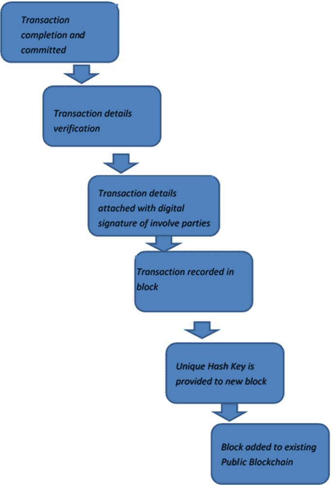 |
| --- |

连接到区块链网络的每台计算机都拥有自己的区块链副本，每当新区块被添加时，每台计算机的副本都会更新。这意味着区块链网络中所有计算机拥有相同的网络副本，每当访问或添加任何区块时，所有连接的计算机都会进行验证。众所周知，瞒过一双眼睛容易，但瞒过所有人的眼睛却很难。公共网络这种 360 度的验证使区块链非常安全。

## 区块链技术的概念及其出现

作为加密货币底层技术的区块链，其起源可追溯至 20 世纪 80 年代末和 90 年代初数字时间戳验证问题。1990 年，Haber & Stornetta 发表了题为《如何为数字文档加盖时间戳》的论文。在该论文中，他们提出通过将发布的时间戳链接在一起创建哈希链，从而防止文档被前向或后向加盖日期。

随后，著名研究者 Wei Dai 引入了 b-money 的概念，该概念通过解决计算谜题和去中心化共识来创造货币。但该提案缺乏实现细节。Hal Finney 引入了“可重复使用的工作量证明”概念。该概念结合了 b-money 的思想和 Adam Back 计算困难的哈希现金谜题，用于创建加密货币。

由于无需中介即可交换价值单元的特性，区块链技术受到电子商务开发者的关注。它允许我们在市场上保护数字资产（如艺术品或传感器数字数据），或允许财产所有者在无需公证人的情况下转让土地。该技术还被用于解决其他几个科学问题，如同行评审过程中恶意行为形式的信任问题、研究设计缺乏质量和冗余，以及科学出版物自由获取受限等问题。

## 区块链概念


## 区块链与物联网：安全综述

随着世界对转型和数字化需求的增加，每个人都准备接受并适应新技术 (Dorri et. al. 2016)。区块链作为一种颠覆性新技术，随其首个现代应用比特币一同被引入。区块链一词简单定义为：包含加密材料的区块链，存储在去中心化分布式网络上。这项新兴技术极大地影响着各个行业，其应用也日益增长。区块链是一种共享账本，其中所有数据均以数字形式记录，拥有共同历史，且对网络中所有参与者可见。这消除了任何欺诈活动或交易重复。区块链是区块的链条。每个区块涵盖加密信息，并通过哈希值链接至前一区块，使得在不更改整条链的情况下难以追溯修改。第一个区块称为创世区块。每个区块包含两个组件：区块头和区块体。

### 区块头

区块头中存在的各种组件包括：版本、前一区块的哈希值、梅克尔根、时间戳、目标值、Nonce。

### 公有链

公有链是一种去中心化网络，其中交易信息完全对公众公开。在该类型区块链中，任何用户可随时加入网络，并可在任何时间、任何地点堆叠、发送和接收数据。这一特性使公有链网络类型被称为无许可网络。网络参与者通过与其关联的代币获得激励和奖励。许多去中心化共识机制（如 `PoW`、`PoS`）被用于决策。公有链网络提供自我治理和更高级别的安全性，因为所有交易信息都存在于网络中的所有节点上，这使得攻击特定节点成为不可能。

### 私有链

私有链通常称为许可链，在机构内部运行，成员需要获得许可才能加入网络。私有链更加中心化，交易是私有的。希望协作和共享数据的组织可以利用私有链，因为它提供更高的效率和更快的交易速度。此类区块链中的代码严格保密且隐藏，这导致去中心化和去中介化被消除。在此，中央负责人通过向网络中任何人授予挖矿权来帮助达成共识。

### 联盟链或联邦链

联盟链是公有链和私有链之间的混合模型，其中若干经批准的用户对网络拥有控制权。联盟一词定义为：为整个网络的最佳利益共同决策的公司集团或代表性个人群体。联盟链仅允许少数选定的预定方验证交易并参与共识过程，这与公有链允许网络中任何用户参与、私有链由单一组织控制形成对比 (Pilkington, 2016)。

### 安全框架

通常，数据冗余是产生数据不一致问题的主要来源和原因。但这一特性在区块链中得到了良好利用。由冗余产生的不一致作为区块数据被篡改的指示器。每当任意区块数据发生变化，哈希键会自动改变，进而递归地与后续区块产生不一致。

因此，若有人想要编辑区块数据，间接上需要更改与区块链相连的所有区块的哈希细节，这可能涉及修改数百万台计算机上的区块链，极难实现。最长的区块链（即大多数用户达成一致的区块链）被接受为有效区块链。这种技术称为共识，当存在多份区块链副本时，接受最长的那条。

通过跨网络存储数据，区块链消除了中心化持有数据带来的风险。区块链部署加密方法以增强数据安全性。在用户名密码之后，OTP 方法也无法保护用户数据安全。在区块链中，现有方法被以一种整体提升区块链安全性的方式加以利用。公钥和私钥的组合在区块链上协同工作，以实施区块链的安全策略。任何想查看区块的人都可以公开查看，但从区块检索数据仅凭私钥才可能。如果所有者忘记其区块的私钥，包括他自己在内，任何人都将永远无法访问。

## 区块链与物联网：安全综述

在智能时代，智能手机、智能基础设施、智能设备和智能机器是名为物联网的大树上的叶子。物联网领域的广泛采用和发展也吸引了黑客，因为数字数据的漏洞增加。物联网生态系统以去中心化方式运行 (Atzori et.al., 2010)。数据在整个网络中生成和共享，不受任何特定设备控制。由于这种分布式数据方法，数据可用性和连接设备服务的效率变得更快、更有序、更合理。如今，物联网设备倾向于通过区块链概念使用分布式数据库技术，而非云计算或其他存储解决方案 (Giusto et. al. 2014)。

根据各类研究报告，约有 50 亿物联网连接设备，预计到 2022 年将激增至 500 亿台。物联网设备在将当前世界转变为智能世界方面发挥着重要作用。随着物联网设备数量持续激增，数据和交易验证、访问控制变得愈发重要 (Christidis et al., 2016)。此外，由于在一处收集来自各种设备的数据、黑客远程控制设备、设备处理、缺乏发现受损节点的能力、敏感数据泄露及其他活动，物联网的安全漏洞激增。克服物联网设备面临的安全问题是一项艰巨的任务。如果物联网设备去中心化，其问题和安全隐患便可得到解决。

许多安全专家认为，区块链可能是物联网设备解决其问题所需的“银弹”。区块链与物联网集成可提升物联网设备的安全性和分布式处理能力，并解决基于云的数据垄断问题。此外，区块链能够追踪和处理来自无数物联网设备的海量数据流。区块链与物联网被视为完美搭档，因为区块链能解决许多与物联网设备相关的问题。

即使快速发展的区块链技术解决了物联网设备的许多问题，这两项蓬勃发展技术的融合仍面临若干难题。由于物联网设备设计为轻量级且具有低处理能力，在其中集成区块链构成挑战。此外，区块链还伴随可扩展性问题和飙升的费用。因此，许多公司将这两项技术的融合列入议程并开始着手研究。


## IOTA：面向物联网的无区块链加密货币

(Elsts, Mitskas, and Oikonomou 2018) IOTA 是一种专为物联网设计的无区块链加密货币，旨在将物联网设备与区块链技术相结合。它是一种抗量子的有向无环图（DAG），运行在其自有的名为 Tangle 的账本之上。在该图中，节点代表 IOTA 交易，验证对应于边。每笔交易在加入网络前必须验证其他两笔交易。验证过程采用工作量证明机制。IOTA 旨在提供零手续费交易和独特的验证流程，以解决区块链的可扩展性问题。

### DAG 与区块链的区别

DAG 与其他区块链的区别在于：DAG 基于“水平”方案运行，而区块链基于“垂直”方案；此外，DAG 中没有矿工和区块，因此得名“blocklesschain”（无区块链）。该图的本质是无环的，且沿特定方向流动。IOTA 中的交易不会重复，也没有等待区块确认的时间，这反过来降低了飙升的交易费用。尽管 IOTA 试图成为完美解决方案，但将物联网设备与 IOTA 区块链集成仍存在通信开销。

## 区块链技术增强物联网效率的特性

以下区块链技术特性使其在物联网中应用更高效，如图 2 所示：

| Figure 2. Features of Blockchain, enhancing efficiency of IoT |
| --- |
| 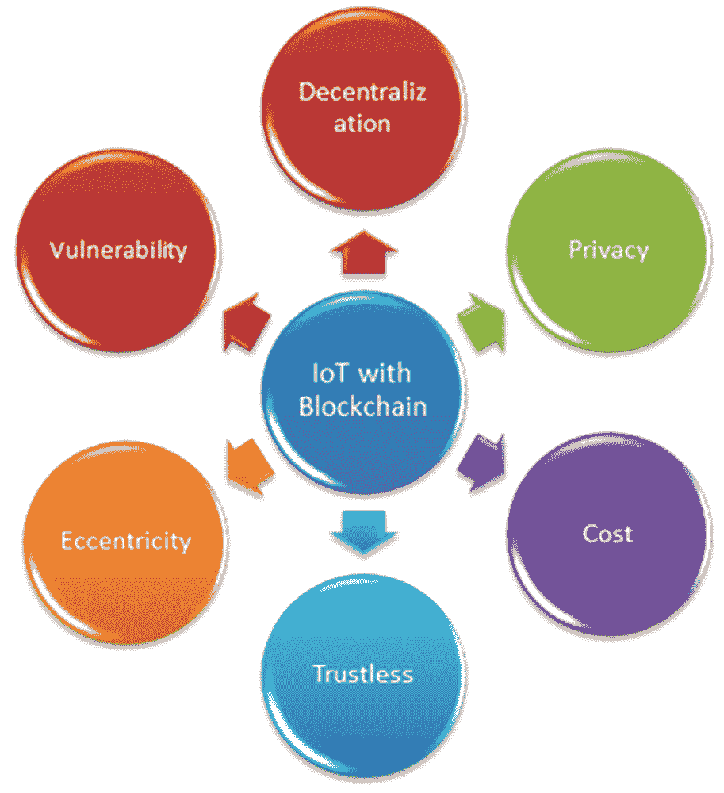 |

### 去中心化

由于物联网和区块链的架构非常相似，区块链的去中心化概念促进了其在物联网中的应用。区块链为物联网提供了解决方案，无需第三方即可管理所有连接设备的数据和运行。因此，网络中任一设备的故障永远不会导致数据不可用。

### 隐私

在物联网中部署区块链网络概念，增强了单个设备数据的隐私。由于设备连接在互联网上，任何黑客都可以轻松访问设备并篡改数据，但由于使用了区块链技术，其共识协议防止了此类数据记录的篡改。

### 成本

使用区块链数据库是使物联网设备更实惠的主要原因。由于成本降低，物联网设备和技术已轻松应用于许多其他领域。因为不需要第三方来维护和验证数据，成本有效降低。连接的节点本身参与验证数据。

### 无需信任

区块链的无需信任特性使物联网更安全。去中心化数据库允许通过其连接的智能节点进行验证，防止设备和数据被恶意分子攻击。

### 离心性/自主性

传统上，网络中连接的设备或传感器由某个中心设备控制。但区块链允许网络中设备的离心行为，设备可以在没有第三方干扰的情况下自动响应并与其他设备交互。

### 可追溯性/漏洞暴露性

由于区块链中的数据对所有人公开。数据和设备的可追溯性有助于防止物联网设备被盗。通过区块链连接的物联网设备可以被轻松识别和追踪，因为设备的位置和管理数据始终可以被保存并通过分布式数据库访问。

## 结论

权力和数据的去中心化是区块链最大的特性。区块链背后的多功能技术赋予了物联网和其他基于网络的应用更强大、高效和安全的能力。如今，研究人员和工程师正在许多领域部署区块链以增强数据安全。上述讨论的区块链特性不仅使物联网应用强大，也有助于加强各领域应用的能力。

## 参考文献

Ali M. S., Dolui K., Antonelli F. (2017). IoT data privacy via blockchains and IPFS. In *International Conference on the Internet of Things*. ACM. 10.1145/3131542.3131563

Androulaki, E., Barger, A., Bortnikov, V., Cachin, C., Christidis, K., De Caro, A., . . . (2018). Hyperledger fabric: a distributed operating system for permissioned blockchains. In *EuroSys '18 - Proceedings of the Thirteenth EuroSys Conference*. Porto: ACM. 10.1145/3190508.3190538

Antonopoulos, A. M. (2014). *Mastering Bitcoin* (1st ed.). O’Reilly Media.

Atzori, L., Iera, A., & Morabito, G. (2010). The Internet of Things: A survey. *Computer Networks*, 54(15), 2787–2805. doi:10.1016/j.comnet.2010.05.010

Banerjee, M., Lee, J., & Choo, K.-K. R. (2017). A blockchain future to Internet of Things security: A position paper. *Digital Communications and Networks*. doi:10.1016/j.dcan.2017.10.006

Banerjee, M., Lee, J., & Choo, K. K. R. (2018). A Blockchain future for internet of things security: A position paper. *Digit. Commun. Networks*, 4(3), 149–160. doi:10.1016/j.dcan.2017.10.006

Belluz, J., & Hoffman, S. (2015). The One Chart You Need to Understand Any Health Study. *Vox*. Available online at: https://www.vox.com/2015/1/5/7482871/types-of-study-design

Chollet, Castiaux, Bruneton, & Sainlez. (2013). Continuous interconnected supply chain using blockchain and internet of things supply chain traceability. Deloitte Blockchain.

Christidis, K., & Devetsikiotis, M. (2016). Blockchains and Smart Contracts for the Internet of Things. *IEEE Access: Practical Innovations, Open Solutions*, 4, 2292–2303. doi:10.1109/ACCESS.2016.2566339

Conoscenti, M., Torino, D., Vetr, A., Torino, D., & De Martin, J. C. (2016). Blockchain for the Internet of Things: a Systematic Literature Review. *IEEE/ACS 13th International Conference of Computer Systems and Applications (AICCSA)*. 10.1109/AICCSA.2016.7945805

Dai, W. (1998). B-money. http://www.weidai.com/bmoney.txt

Dhillon, V. (2016). Blockchain-Enabled Open Science Framework. O'Reilly Media. Available online at: https://www.oreilly.com/ideas/blockchain-enabled-open-science-framework

Dhillon, V., Metcalf, D., & Hooper, M. (2017). “Blockchain in science,” in *Blockchain Enabled Applications* (1st ed.). Apress. doi:10.1007/978-1-4842-3081-7

Dorri, A., Kanhere, S., & Jurdak, R. (2016). Blockchain in internet of things: challenges and solutions. arXiv: 1608.05187

Draskovic, D., & Saleh, G. (2017). Datapace - Decentralized Data Marketplace Based on Blockchain. Available online at: https://www.datapace.io/datapace_whitepaper.pdf

Elsts, Mitskas, & Oikonomou. (2018). Distributed Ledger Technology and the Internet of Things: A Feasibility Study. In *BlockSys*, Shenzhen, China.

Giusto D., Iera A., Morabito G., Atzori L. (2014). The Internet of Things. In *20th Tyrrhenian Workshop on Digital Communication*. Springer Publishing Company, Incorporated.

Golem. (2016). The Golem Project - Global Market for Idle Computer Power. Available online at: https://golem.network/crowdfunding

Gord, M. (2016). Smart Contracts Described by Nick Szabo 20 Years ago now becoming Reality. *Bitcoin Magazine*.

Haber, S., & Stometta, W. S. (1991). How to time stamp a digital documents. *Journal of Cryptography*, 3(2), 99-111. doi:10.1007/3-540-38424-3_32

Huh, Cho, & Kim. (2017). Managing IoT Devices using Blockchain Platform. *ICACT2017*.

Janowicz, K., Regalia, B., Hitzler, P., Mai, G., Delbecque, S., Fröhlich, M., Martinent, P., & Lazarus, T. (2018). On the prospects of blockchain and distributed ledger technologies for open science and academic publishing. *Semantic Web*, 9(5), 545–555. doi:10.3233/SW-180322

Khan & Salah. (2017). IoT security: Review, blockchain solutions, and open challenges. *Future Generation Computer Systems*.

Kombe, C., Manyilizu, M., & Mvuma, A. (2017). Design of land administration and title registration model based on blockchain technology. *Journal of Information Engineering and Applications*, 7, 8–15.

Liang X., Zhao J., Shetty S., Li D. (2017). Towards data assurance and resilience in IoT using blockchain. *Conference Paper*. 10.1109/MILCOM.2017.8170858


## 第 9 章：局限性与未来可能性

**Suvarna Sharma**  
Maulana Azad National Institute of Technology, India

**Puneeta Rosmin**  
Kamla Raja Girls Government Post Graduate College, India

**Amit Bhagat**  
Maulana Azad National Institute of Technology, India

## 摘要

顾名思义，区块链是区块的线性链。它是一种数字账本，记录网络上发生的交易信息。因此，每个区块都以编码形式包含按时间顺序组织的数据。2004 年，Hal Finney 提出了“可重复使用的工作量证明”概念。2009 年，有远见的中本聪发表了一篇神秘的白皮书《比特币：一种点对点的电子现金系统》，从而诞生了区块链的概念。本文对区块链技术进行了综述，首先简要介绍了区块链，讨论了其优势，随后探讨了可能的局限性及其未来的可能性。

## 1. 引言

### 1.1 区块链

不同作者对区块链有许多定义，正如(V. L. Lemieux, 2016)所指出的，并没有单一的、国际公认的定义；因此，理解区块链的主要组成部分非常重要。

Don & Alex Tapscott 在 2016 年给出了区块链的定义：“区块链是一种不可篡改的经济交易数字账本，它可以被编程来记录不仅仅是金融交易，而是几乎所有有价值的事物”。

区块链是一项新技术，常被称为价值互联网。区块链技术被称为包含数据的“区块”链。它利用分布式数据库系统容纳一个不断增长的、不可变的区块列表。区块链允许最终用户和提供者以透明的方式进行通信和交易，直接连接而无需代理。区块链已成为 IT 界最受关注的技术之一。从几年前的一个单纯概念，区块链技术已被公司用于大规模工业实施。尽管该创造本身是革命性的，但区块链也出现了一定的边界。这些区块链限制并不使该技术减少革命性；然而，它们引发了关于其有效性和可靠性的问题。

| 图 1. 区块链技术 |
| --- |
| 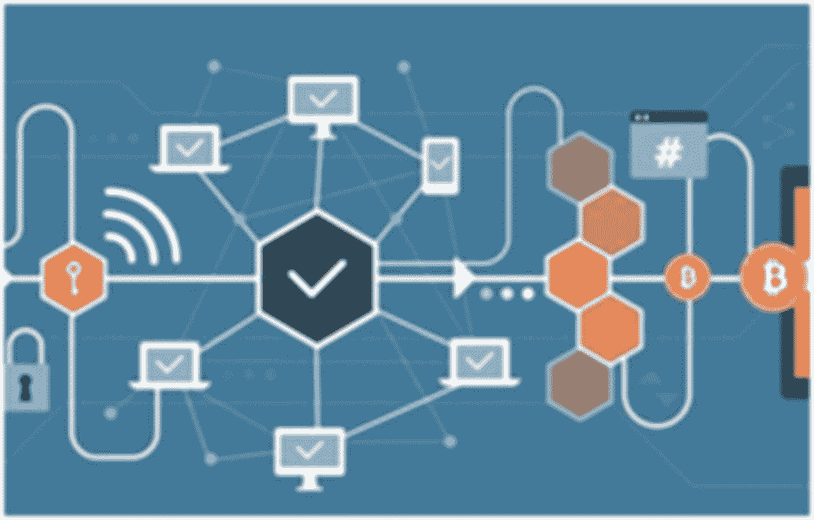 |

| 图 2. 区块链 |
| --- |
| 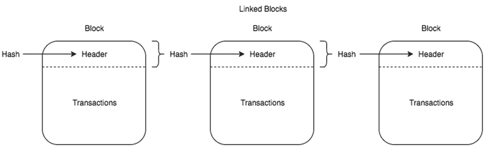 |

区块链在区块链网络的节点间进行复制。网络中的任何节点都可以读取交易。图 2 展示了区块链的结构。

区块链技术的结构由按特定顺序包含交易的区块列表来表示。区块链中使用的两个关键数据结构包括：

*   **指针** — 保存另一个变量位置信息的变量
*   **链表** — 一个区块序列，其中每个区块都有特定数据，并借助指针链接到下一个区块

#### 区块链类型详解

区块链可为组织和企业服务于以下目的：

*   成本降低
*   数据历史
*   数据有效性与安全性

### 区块链技术的优势

*   **去中介化与无信任交易** — 双方无需第三方的监管或中介即可进行交换，大幅降低甚至消除了对手方风险。
*   **赋能客户** — 客户对其所有信息和交易负责。
*   **高质量信息** — 区块链信息完整、可靠、及时、准确且广泛可访问。
*   **流程完整性** — 客户可以信任交易将严格按协议命令执行，消除了对可信外部方的需求。
*   **透明性与不可变性** — 无论是修改还是撤销，任何类型的交易都可向客户展示，因为所有交易都是永久的，这意味着它们无法被篡改或擦除。
*   **更快的交易** — 银行间交易可能需要数天来清算支票和汇票，特别是在非工作时间。使用区块链，所有银行间交易都在短时间内完成。客户可以使用电子银行、移动银行和 UPI 等进行任何类型的交易，甚至在家中即可完成。
*   **更低的交易成本** — 通过消除第三方中间人和交易资源的间接费用，区块链有可能大幅降低交易费用。

### 1.2 区块链局限性

区块链技术已在包括资产管理、零售、货币用例、数字货币、电子合约、去中心化交易所等在内的各个行业和领域扎根。然而，像其他任何技术一样，区块链并不完美。存在某些实施、运营和维护相关的障碍，限制了区块链技术的有效性。

以下是一些明确指向区块链局限性的当前问题：

1.  **性能薄弱** — 由于其分布式本质，区块链技术将永远比中心化数据库慢。每当新区块添加到区块链时，它必须执行常规数据库的所有流程。然而，它还必须执行影响其性能的额外流程。
2.  **签名验证**


## 区块链的局限性

### 3. 冗余

在区块链网络中，要处理每个节点，必须独立遍历并处理每个中间节点才能到达目标节点。相比之下，中心化数据库系统可以并行处理节点，无需依赖其他节点。因此，区块链技术中涉及的冗余会影响其性能。

### 4. 能源与资源消耗

区块链网络以空前的速度增长，这将消耗大量资源。区块链网络中的每个区块都需要由矿工彻底验证和挖掘。随着区块链网络的增长，需要验证网络中区块的矿工数量也需要增加。每个矿工都需要超级计算机或类似强大的硬件资源来挖掘区块链。所有这些都导致了巨大的能源消耗。

### 5. 安全隐患

随着区块链技术中节点或区块数量的增加，与整个区块链相关的漏洞也随之增加。在所有可能影响区块链网络的安全缺陷中，有一个不可避免的安全缺陷。如果区块链网络中超过一半作为节点工作的计算机验证某事，则该事被视为真理。由此可知，如果网络中超过一半的节点撒谎，则该谎言将被整个区块链网络视为真理。这被称为 **51% 攻击**，这是区块链及其应用中不可避免的安全缺陷，很可能是所有区块链局限性中最严重的。

| Figure 3. Blockchain pitfall |
| --- |
|  |

### 6. 系统故障

人为错误也是系统故障的常见原因。这同样适用于区块链技术。区块链整体可视为一个数据库，每个区块可视为一个存储容器，但输入区块链网络的数据仍由人类提供。这些数据需要具有良好的质量，因为没有实际机制监控区块链网络中传输的数据。存储在区块链中的数据本质上不可信，并可能污染整个网络的数据。

### 7. 达成共识

在区块链这种去中心化技术中，每笔交易都必须确保区块链网络中的每个区块达成共同共识。根据网络规模和区块链中涉及的区块或节点数量，为达成共识所涉及的来回通信可能消耗大量时间和资源。

### 8. 扩展性受限与存储问题

如前所述，区块链具有共识机制，强制要求每个参与节点验证交易。这限制了在给定时间内可以进行的交易数量。尽管存在分布式账本技术（`DLT`）等解决方案来提高每秒交易数，但区块链网络的交易速率必须有上限。因为区块链是一个不可变的分布式区块链，其规模增长极快，这会导致严重的存储问题。

### 9. 缺乏技术知识

尽管区块链日益普及，但许多投资者仍不了解所有技术术语，也没有适当的文档帮助用户获取详细知识。因此，投资者无法直接提问或解决疑虑。

### 10. 人为错误

人为错误可能导致日志信息过时，甚至在将数据录入数据库时产生不匹配的数据。为确保录入数据正确，需要对数据进行验证。因此，在区块链背景下使用了“垃圾进，垃圾出”这一短语。

### 11. 无与伦比的能源需求

运行区块链的程序需要进行大量数学计算，如果没有强大计算机所需的巨大能源消耗，这是根本不可能的。

## 1.3 区块链的未来可能性

区块链技术是一项不断发展的发明，包含一串区块。区块链是一种分布式或数字账本，主要用于记录每笔金融和非金融交易的详细信息。绝对且永久的数据存储在分布式数据库中。整个记录完全透明，这意味着连接到网络的任何人都能查看交易。从根本上说，区块链技术是三种技术的结合，即私钥加密、`P2P` 网络和程序。区块链技术在信息登记和分发领域展现了革命性，消除了对中介专家的需求，从而实现数字关系。

区块链技术提供了最受欢迎的产品——比特币，这是一种加密货币，充当网络上所有交易的公共账本。它解决了双重支付、未经授权支付的问题，从而提高了安全性。它还有助于消除对中介专家的需求。由于最近网络攻击大幅增加，区块链技术有助于吸引多样化的受众。

### 金融行业中区块链的未来

区块链技术在全球拥有广阔前景。在金融领域观察到区块链技术的惊人应用范围。金融机构在去货币化后无法充分处理繁重工作量，从而暴露出由中心化专家处理金融交易的问题。因此，印度储备银行（`RBI`）正激励银行推动数字化。他们还发布声明，强调区块链打击造假的可能性，以及在金融市场运作、抵押品识别和支付系统方面带来特定变革的机会。将区块链融入金融交易带来惊人收益，如节省大量时间和金钱，包括大幅减少处理和验证交易所需的时间。区块链基于分布式数据库运行，使操作顺畅，确保严密安全，并使其免受网络攻击。

| Figure 4. Blockchain in Finance Industry |
| --- |
|  |

在认识到区块链技术的优势后，多家金融机构已开始在该领域投入巨资。区块链还能帮助缩短黑钱流动，应对经济中的大规模洗钱，因为用于交易的每个地址永久存储在数据库中，使所有交易可证明且可追责。政府正将区块链视为一种探索多种选项的方式，可能有助于对国家经济实施更有效的控制。

当需要跟踪金融资产时，区块链技术是最可靠的技术之一。区块链技术吸引了许多希望将其独特功能添加到安全架构中的公司。许多研究针对数字货币和区块链技术进行，表明这两种技术将持续颠覆世界。


## 区块链技术在各领域的未来应用前景

除了金融行业，区块链技术在其他领域也拥有光明的未来。让我们看看区块链技术在不同领域的未来应用范围：

### I. 区块链在数字广告中的应用

目前，数字广告面临诸多挑战，如域名欺诈、机器人流量、缺乏透明度和漫长的支付模式，这是由于激励机制不挂钩导致的。因此，推广者和发布者感觉交易告吹。区块链提供了一种解决方案，为供应链带来透明度，因为它在无信任环境中建立了信任。区块链通过减少供应链中的不良参与者，让合适的公司脱颖而出。发布者还可以获得生态系统中流入的总广告资金的很大一部分。区块链技术仍处于起步阶段；然而，这项技术将长期存在，所有广告公司都在观察区块链将如何帮助提升其业务。

| Figure 5. 区块链在数字广告中的应用 |
| --- |
|  |

### II. 区块链在网络安全中的应用

尽管区块链是一个公共账本，但数据通过创新的加密技术进行验证和加密。因此，信息或数据不太可能在未经授权的情况下被攻击或篡改。

### III. 区块链将消除对第三方的需求

借助区块链技术，基本上可以影响各种流程和技术。它消除了交易中对可信第三方的需求。如今，世界上最著名的组织主要作为可信第三方运作，例如 `SWIFT` 和 `Depository Trust Cleaning Company`。对于能够构建针对特定交易的应用区块链技术的公司来说，商业机会蓬勃发展，例如抵押贷款行业。现有的抵押贷款需要复杂的权属调查、权属保险和无数笔维持系统运行所需的小额交易费用。这些系统之所以存在，是因为传统上土地转让一直是一个需要对旧记录有高度信任的过程。区块链技术将解决所有这些问题，特定财产的账本包含可验证和已验证的交易历史，降低了机构提供风险调整和信任服务的必要性。

### IV. 政府将发行其数字货币

可以确定纸币处于最后阶段，但也发现法定货币面临加密货币的激烈竞争。2017 年，观察到 `Bitcoin` 价格飙升，这是世界上任何单一服务或货币从未见过的。该货币仍然是市场上最受青睐的资产之一，国家也注意到了这一点，因为 `Bitcoin` 的价格被需求和供给的基本理念所否定。随着 `Bitcoin` 固定 2100 万枚的上限，对 `Bitcoin` 的需求将在某个时刻再次攀升。因此，一些政府将有机会创建自己的数字货币，以避免在独立且不受监管的资产面前丢脸，并参与公开市场。

### V. 超越计算世界的区块链

2017 年，世界见证了区块链技术应用的无限可能。目前，大多数国家正在制定其区块链战略以把握未来。此外，其他发达欧洲国家极有可能效仿，采用区块链技术创造一个稳定的金融环境，帮助像希腊和西班牙这样陷入困境的国家。存在与财务安全相关的具体问题，区块链将用于解决这类问题。区块链还将用于生成用于医疗目的的注册表、管理保险单，并打破无用的数据存储模式。

### VI. 借助区块链技术管理世界贸易

区块链对商业很有价值，特别是它使任何人都能轻松追踪使用该技术提供的所有事物的供应链。追踪数字将过时，没有公司希望因人为失误而丢失货物。在区块链中登记货物运输很容易，这使得参与作业操作的各方能够从 A 点到 B 点跟踪交付过程。借助区块链技术，海关人员可以轻松追踪违禁产品，如假药、篡改的食品、假冒服装、假汽车零件、电子设备和其他试图在不提及内部法律的情况下向任何国家提供低质量商品的盗版代理。

### VII. 供应链管理

借助区块链技术，可以在永久分布式记录中记录交易，并更稳健、透明地监督交易。这也有助于减少人为错误和时间延迟。它还用于监控供应链每个环节的成本、就业和排放。但这对理解和监控产品的实际生态影响有严重影响。不仅如此，去中心化账本还可用于通过从源头追踪来检查产品的合法性或公平贸易地位。

### VIII. 区块链在预测中的应用

区块链技术将改变研究、咨询、分析和预测的完整方法论。借助在线平台创建了全球分布式预测市场。

### IX. 区块链在物联网和网络中的应用

`Samsung` 和 `IBM` 等不同公司正在利用区块链技术实现一个称为 `ADEPT` 的新概念，这将有助于创建 `IoT` 设备的分布式网络。区块链技术将消除管理它们之间通信的中心位置的需求；这将作为海量设备的公共账本。设备可以相互通信以升级软件、处理错误和监控能源实践。

### X. 区块链在云存储中的应用

集中式服务器上的数据面临黑客攻击、数据丢失或人为错误的风险。借助区块链技术，可以使云存储更安全、更强健，以抵御黑客攻击。

## 结论

区块链技术是一个分布式数据库，记录了系统中发生过的所有交易。区块链的主要组成部分是它允许不受信任的双方在不需要可信第三方的情况下相互通信。区块链技术中，每笔交易都被记录在一个对所有人透明的公共账本中，是一个用于交易的去中心化领域（S. Nakamoto, 2019）。区块链的目的是为其每一位客户提供隐私、安全、安全性和透明度。总之，区块链技术不仅似乎改进了当前行业的任务，而且还有潜力通过一个无限改进的、透明的记录系统，改变那些追踪文物历史的系统。在本章中，我们进行了一项分析，展示开放科学如何从这项技术及其特性中受益。

## 参考文献

Finney, H. (2004). Reusable proofs of work (rpow). http://web.archive.org/web/20071222072154/http://rpow.net/

Lemieux, V. L. (2016). Blockchain technology for recordkeeping: Help or hype. Unpublished report. Available: https://www.researchgate.net/profile/Victoria_Lemieux


## 第 10 章

**Kamalendu Pal**


伦敦城市大学，英国

## 参考文献

Nakamoto, S. (2019). *Bitcoin: A peer-to-peer electronic cash system*. Manubot.

Tapscott & Tapscott. (2016). *Blockchain Revolution: How the Technology Behind Bitcoin Is Changing Money, Business, and the World*. Penguin Random House.

## 摘要

物联网（IoT）和区块链技术的采用为服装供应链管理中的业务流程自动化开辟了新机遇。物联网技术通过使用射频识别（RFID）标签和传感器，有助于从服装制造活动的不同方面获取实时信息。区块链技术是一种新兴的计算概念，能够实现业务交易的去中心化和不可篡改存储。结合物联网，区块链技术可以实现广泛的应用场景，以增强商业价值和信任。本章介绍了基于区块链的物联网技术在服装业务流程中的一些应用。此外，本章提供了威胁模型的分类，这些模型是区块链协议在物联网网络中所考虑的。最后，本章提供了分类法以及最先进方法的并列比较，这些方法针对安全和隐私保护区块链技术，涉及区块链模型、特定安全目标、性能和局限性。

## 引言

服装（即纺织和服饰）行业是世界经济和社会不可或缺的一部分（Pal & Ul-Haque, 2020; Pal, 2020）。在最近几十年里，全球服装制造企业倾向于开展全球性活动，这是由于产品设计和开发全球化带来的经济优势（Pal, 2020a）。在典型的纺织和服装供应链中，是一系列组织——其设施、职能和活动——参与生产和开发产品或服务。该序列始于从选定供应商处采购原材料，产品在一个或多个制造工厂生产（Pal, 2019）。然后这些产品被移至中间收集点（如仓库、配送中心）暂存，以移至供应链的下一阶段，并最终将产品交付给中间用户、零售商或客户（Pal, 2017; Pal, 2019）。从供应商到客户的路径可能包括多个中介机构——如批发商、仓库和零售商，具体取决于产品和市场。此外，由于对组织间和组织内互联互通的需求不断增长，全球服装供应链变得日益异质化和复杂化，这种互联互通由现代技术的进步和紧密耦合的业务流程所实现。因此，信息已成为服装业务运营管理中的重要战略资产。服装业务网络也正在使用信息系统来监控供应链活动（Pal & Ul-Haque, 2020）。

因此，许多全球纺织和服装企业正在投资新的信息和通信技术（ICT），以利用供应链运营中顺畅的信息共享能力（Pal & Ul-Haque, 2020）。随着射频识别（RFID）技术、低成本无线传感器硬件和万维网技术的最新进展，物联网（IoT）的发展引起了人们对连接全球服装业务活动和共享运营业务信息的关注。这些技术有望通过增强协作供应链利益相关者之间的数据收集、信息共享和分析，重塑现代供应链的运作模式。通过这种方式，物联网技术支持连接和整合数字与物理业务世界的能力。该过程非常简单：(i) 从现实世界的物体收集数据，(ii) 通信并聚合这些数据为信息，(iii) 向系统或用户呈现清晰的结果，以便做出决策或调整物体行为。

不同研究小组分析了物联网技术在供应链管理和物流中的部署相关问题（Atzori et al., 2018; Gubbi et al., 2013）。特别是，一组研究人员回顾了智能工厂的能源管理，并得出结论：物联网驱动的制造可以通过更有效地跟踪物料流动，提高供应链竞争力，从而提高重要业务流程的有效性和效率（Shrouf et al., 2014）。基于物联网的系统的其他重要特征（例如共享与生产、质量保证、分销和物流相关的精确及时信息）也在多方供应链的背景下有所报道（Chen et al., 2014; Cui, 2018; Yan-e, 2011）。此外，在生产工厂内部使用物联网应用可以增加零部件和流程的可见性，延伸而言，沿供应链使用物联网设备有助于提高生产率、降低运营成本并提升客户满意度（Deloitte, 2017）。

尽管物联网应用在供应链中的适用性日益增加，但使用该技术仍面临许多挑战。例如，在生态系统层面运行时遇到的物联网相关技术问题，如所有利益相关者的安全性、真实性、机密性和隐私（Tzounis et al., 2017）。学术界和业界认为隐私和安全问题主要与物联网系统应用的脆弱性有关。现有的安全解决方案并不完全适用，因为当前的物联网设备可能消耗大量能源，且这些设备通常需要巨大的信息处理开销（Dorri et al., 2017）。此外，物理篡改、黑客攻击和数据窃取等问题可能会增加服装网络信息交换业务合作伙伴之间的信任相关问题（Kshetri, 2017）。因此，物联网应用必须能够抵御感知层的外部安全攻击，保障网络层数据聚合的安全，并提供特定保护，确保只有授权实体才能在应用层访问和修改数据。

此外，大多数物联网设备因体积小、固有设计成本低，而在电源、数据处理能力和内存资源方面受到限制。学术界和业界敦促以资源高效的方式设计物联网设备及其协议，同时执行实时数据处理（Pal, 2020），保持连接并利用物联网数据通信网络保护传输数据的安全性和隐私。此外，可以通过使用分布式信息处理方法来实现物联网数据的可靠性，这些方法在所有参与者中执行验证过程，以确保数据保持不可变和未被篡改。考虑到这些技术问题并认识到当今区块链技术的基本特征，现在提供了几种潜在解决方案，以解决服装业务网络中物联网应用的已知劣势。


## 区块链与物联网在服装行业的应用

区块链是一个用于协调交易、价值和资产在对等节点之间流转的分布式网络，无需中介协助。它通常被称为“账本”，用于记录交易。区块链技术有助于记录交易或任何数字交互，其设计旨在实现安全、透明、高抗中断性、可审计和高效。这些特性为基于区块链的物联网架构在分布式环境中的安全数据处理提供了动力。换句话说，基于物联网的信息系统通过区块链互补技术改善其物联网网络基础设施。它是一个由对等（P2P）网络管理的分布式账本，提供节点间通信和新区块验证。一旦数据记录在区块链中，若不修改所有后续区块且获得网络大多数共识，就无法篡改。物联网与区块链技术的融合，可为智能连接设备处理的数据存储和管理提供可验证、安全且稳健的机制。这个连接设备网络将能够与环境交互并自主决策，无需人工干预。然而，在基于物联网的信息系统中集成区块链技术虽能增强安全性、数据隐私和物联网设备的可靠性，但也带来了一系列新挑战。

本章阐述服装企业如何利用物联网应用结合区块链技术，优化服装业务供应链的业务信息。二者结合将帮助全球纺织服装企业克服数据获取与完整性相关问题，应对安全挑战，并减少信息不对称。本章将演示区块链技术在安全性和隐私方面的劣势领域。其余部分安排如下：第 2 节介绍物联网及其在服装行业的应用，包括物联网在服装供应链管理中的应用及其缺点。第 3 节描述区块链技术在服装供应链管理中的应用。第 4 节解释区块链在物联网中的应用。第 5 节描述企业计算中安全与隐私的背景及研究挑战。第 6 节回顾区块链技术的部分威胁模型。最后，第 7 节通过讨论相关研究问题总结本章。

## 物联网及其在服装行业的应用

物联网的概念最早由 Kevin Ashton 于 1999 年提出 (Keertikumar et al., 2015)。物联网技术已被用于服装行业的各种业务流程自动化目的。感知企业 (SE) 是企业或网络的一种属性，使其能够对源自互联网的业务刺激做出反应。该计算领域近期在企业自动化方面受到关注，且有少量证据表明该技术在供应链运营中成功应用。基于物联网的信息系统旨在改善组织沟通与协作活动。近几十年来，万维网技术在商业用途上日益突出，面向供应链社区的基于互联网的物联网服务数量快速增长。人类用户可使用设备访问这些服务。主要通信形式是人与人之间。物联网不仅试图让人类通过互联网通信，还让物体或设备通信。这些事物能自行通过互联网交换信息，从而形成新的互联网通信形式：人与物、物与物。因此，物联网指的是一个信息网络，它连接物理对象（“事物”）上的或内部的传感器，范围涵盖消费品、货物托盘、日常工具和工业机械。

简单来说，物联网技术具有三种愿景类型：

1.  **事物导向愿景**：该愿景基于该技术可利用传感器追踪任何事物这一事实。微电子系统技术、无线通信和数字电子技术的进步与融合，促成了微型设备的开发，这些设备能有效地进行感知、计算和无线通信。基本理念是使用电子产品代码 (EPC) 规范唯一标识对象。值得注意的是，“事物导向愿景”的未来将取决于传感器技术的演进，以实现无误差的精确感知，并满足其他“事物”导向问题的需求。

2.  **互联网导向愿景**：该愿景基于使智能对象互联的需求。为充分利用现有互联网技术，需要部署大规模、平台无关的无线传感器网络基础设施，包括数据管理与处理、执行和分析。云计算承诺提供高可靠性、可扩展性和自主性，以提供下一代物联网应用所需的普遍访问、动态资源发现和可组合性。

3.  **语义导向愿景**：该愿景基于服装行业使用的传感器数量巨大，且这些物联网基础设施收集的数据海量这一事实。因此，行业需要利用语义技术（如本体、基于知识的推理）以有意义的方式处理这些数据，形成增值服务，这些技术具有高效、安全、可扩展和面向市场的计算特性。

因此，物联网应用建立在三大支柱之上，涉及智能对象的能力：（i）可识别性（任何事物均可自我识别），（ii）通信性（任何事物均可通信），以及（iii）交互性（任何事物均可交互）——无论是它们之间构建互联对象网络，还是与网络中的最终用户或其他实体交互。

此外，云计算和较新的雾计算概念（即一种分散式计算结构，通过在所谓的“边缘设备”上本地执行计算、存储和通信，扩展了云计算概念）为连接、存储和分析从连接设备和源（包括 WSN、全球定位系统 (GPS)、GPRS 和地理信息系统 (GIS)）接收的物联网数据（常称为大数据）提供计算资源和可扩展性。物联网数据分析可帮助企业实时感知并响应情况，可能带来自动化或创造价值的预测分析能力 (Tzounis et al., 2017)。此外，通过连接一组异构硬件设备（如传感器），物联网通过捕获数据（如人员识别和环境变量，例如温度、湿度、振动、气流）来简化关键业务流程。物联网设备常被部署用于感知物理世界、通过无线信号通信，并根据预定义条件执行操作。


## 服装供应链管理中的物联网

### 物联网的显著特征

根据 Barreto 等人的研究，物联网的三个显著特征是情境感知、无所不在和优化。

*   **情境感知** 描述了物联网提供实时监控、交互以及针对受控特定情况实现即时响应的能力。
*   **无所不在** 体现在技术的普及性及其广泛的适用性上。
*   **优化** 是指每个物理对象所拥有的特定功能和特性。

这些特征为简单和复杂供应链中交换合作伙伴之间新颖且创新的物联网用例铺平了道路，并开辟了新的商业机会。

### 物联网在服装供应链管理中的应用

物联网的应用有望在供应链绩效和运营效率方面带来显著提升。这些益处主要源于实时信息交换，可减少由牛鞭效应导致的时间浪费。此外，物联网通过提高运营效率和创造收入机会，有助于彻底变革供应链。

可从物联网部署中受益的三个领域包括：

1.  库存管理与仓储作业
2.  生产与制造作业
3.  运输作业（见表 1）

#### 库存管理与仓储作业

例如，智能叉车和货架、智能眼镜的新颖用法（即配备传感器和摄像头技术以定位仓库中物体的可穿戴设备）、监控摄像头及其他智能仓储管理软件。

此外，在仓储作业中，可重复使用的资产（如库存周转箱和托盘）可附着支持物联网的标签或设备，帮助引导和指引拣货员前往其存储位置。通过这种方式，物联网技术不仅有助于实现仓库运营活动的自动化，还能减少与人工存储管理相关的人为干预（及错误）。这一优势源于使用工业级 RFID 标签和 RFID 读写器，它们发射无线电信号以正确识别嵌入托盘、周转箱或产品纸箱上的标签，从而减少收集、记录和检索业务运营数据所花费的时间。

#### 生产与制造作业

物联网技术也用于服装生产和制造活动。服装制造工艺包含纺纱和针织。

*   **纺纱** 是将纤维转化为纱线的过程。
*   **针织** 是通过将一根或多根纱线的线圈相互套结来制造织物的过程。

它通常包含三个主要阶段：生产原材料、加工材料和制造服装。嵌入式传感器的工业机器可通过智能仪器（如微型计算机、微控制器、微处理器和智能传感器）进行实时监控和控制。基于物联网的解决方案可增强对加工能力、准备时间和产出率的运营控制。因此，使用基于物联网的技术可带来更高效的机器利用率、减少生产瓶颈，并有助于在服装企业的不同层面优化生产计划和排程。因此，对关键制造流程的这种增强洞察将促进与供应商的更强协作和价值共创，以及改善机器与机器、机器与人之间的交互。

#### 运输作业

此外，就服装供应链管理中的运输活动而言，基于物联网的技术也能提供潜在优势。例如，**GPS（全球定位系统）** 有助于从远程配送中心定位车辆（如卡车），并优化路线和交付时间。在更大程度上，GPS、RFID 技术和附着的传感器通过大规模测绘、交通数据收集和分析，精确定位公共道路或航运码头上的车辆，从而提高在途可视性。从这些物联网设备收集的数据将有助于改善交付时间预测、车队可用性和路线效率。此外，这些设备可用于增强停车场或道路上车辆之间闲置资源的共享。

### 表 1. 服装供应链业务中的物联网杠杆

#### 库存管理与仓储作业

| 赋能器 | 流程 |
| :--- | :--- |
| • 智能货架<br>• 智能眼镜<br>• 监控摄像头<br>• 智能叉车<br>• 智能仓储管理系统 (SWMS) | • 路线优化，消除在途碰撞<br>• 快速、高成本效益且灵活的作业<br>• 更好地处理难以触及的物品（即货架或货架上难以检测到的物品）<br>• 库存水平的实时可视性<br>• 避免缺货<br>• 对不足之处（如物品错位）的敏捷性和快速响应能力<br>• 工作空间监控（如用于安全目的）<br>• 库存单位（如托盘）识别<br>• 同步威胁检测和瑕疵扫描 |

#### 生产与制造作业

| 赋能器 | 流程 |
| :--- | :--- |
| • 嵌入式机器传感器<br>• 机器分析 | • 实时状态监控<br>• 预测性维护：检测物理应力水平、堆积，并预防故障<br>• 改进对产出率、准备时间和整体生产力的测量<br>• 增强机器与机器、机器与人之间的交互 |

#### 运输作业

| 赋能器 | 流程 |
| :--- | :--- |
| • GPRS 传感器<br>• RFID 标签<br>• 路由器<br>• GPS 卫星 | • 供应链上产品的持续可视性<br>• 实时货运跟踪<br>• 远程感知（如温度、湿度、振动）<br>• 改善活动瓶颈和户外交通、运输流动性、道路及驾驶员安全<br>• 最大化燃油效率并优化路由策略 |

### 物联网在服装供应链中的应用缺陷与威胁

服装制造工艺包含纺纱和针织。纺纱是将纤维转化为纱线的过程，而针织是通过将一根或多根纱线的线圈相互套结来制造织物的过程。在服装供应链中使用基于物联网的应用已被证明在运营效率方面行之有效。物联网技术解决了服装制造链面临的各种挑战，包括日益增长的业务需求：提高供应链信息透明度，改善生产数据的完整性和产品身份识别（即正确的产品、在正确的时间、在正确的地点、正确的数量和正确的价格）。通过这种方式，随着物联网系统在服装网络商业环境中产生海量数据，而这些数据往往孤立地存在于数据孤岛中，这往往成为安全和隐私相关风险的潜在源头。


## 服装供应链中的物联网安全问题

需要解决不同类型的物联网安全问题，包括物联网设备信任、访问控制、数据完整性、物理篡改和用户隐私。一项物联网技术部署调查得出结论，70%的物联网设备因加密相关问题、无保护接口和不当授权而存在漏洏（Lee & Lee, 2015）。在强调不同的隐私和安全问题时，一组研究人员（Cam-Winget et al., 2016）指出，由于在处理和分析来自庞大的异构物联网设备网络生成的数据时存在可扩展性问题，以及满足实时需求的需要，最近的系统安全解决方案是不充分的。由于动态拓扑和分布式特性，适当的安全和隐私方法被认为在基于物联网的信息系统环境中不可用。此外，当前基于服务器计算平台的互联网架构可能无法应对海量设备和海量数据，因为单个服务器可能成为网络攻击和物理损坏的单点故障。例如，物联网设备面临 DDoS 攻击、数据窃取和远程劫持的风险。此外，Marjani 及其同事（Marjani et al., 2017）认为，一些基于物联网的应用缺乏服务级别协议（SLA）来保护隐私法要求的“个人身份信息”（PII）。因此，这可能对数据完整性产生负面影响。因此，系统安全在个人和企业的隐私保护方面可能受损（Suresh et al., 2014）。

此外，服装供应链业务合作伙伴可能对产品信息在企业价值链流动过程中的物理安全性和机密性存有顾虑。尽管基于物联网的信息系统帮助供应链交换合作伙伴验证供应链中物品的真实性，但仍然存在对物联网设备易受伪造、克隆和欺诈行为（如未经授权的访问、篡改和内容操纵）影响的担忧。例如，如果 RFID 标签被攻破，可能会绕过安全措施，并在自动验证过程中引入新的漏洞（Kumar & Iyengar, 2017）。此外，在集中式数据库中手动检索和存储有关唯一标签身份的信息，使得随时复制或伪造这些信息成为可能（Lin et al., 2017）。因此，很难识别伴随误导性溯源历史的假冒产品（Hua et al., 2018）。

最后，集中式系统可能给服装制造业中基于物联网的系统部署用于溯源操作带来劣势。集中式商业组织的存在可能导致不信任，从而阻碍供应链的未来发展（Tse et al., 2017）。用于数据存储和处理的集中式方法可能导致与数据完整性、安全性和隐私相关的多种商业风险和运营问题。例如，用于监控物联网数据的基于云的解决方案可能面临操纵风险，以及将大量机密和高度敏感信息导出到其他司法管辖区的外部服务时产生的隐私立法问题（Khetri, 2017; Kamilaris et al., 2019）。此外，这些解决方案可能造成不透明性，并加剧供应链交换合作伙伴之间的信息不对称。另一个因素是集中式信息系统充当黑箱，协作业务节点不知道其数据如何被存储、管理、利用和保护（Galvez et al., 2018）。区块链技术可以帮助缓解其中的几个问题。

## 区块链技术在服装业务中的应用

自 2008 年比特币这一数字加密货币的创新以来（Nakamoto, 2008），区块链技术已将自己置于各类研究人员和从业者的关注焦点。区块链是一个去中心化账本，它以安全、可验证和透明的方式，在点对点（P2P）网络上存储所有已发生的交易。区块链相较于现有技术的主要优势在于，它使双方能够在没有任何中介方干预的情况下，通过互联网安全地进行交易。省去第三方可以降低处理成本，同时提高交易的安全性和效率。

鉴于区块链给信息处理带来的显著效益，这项技术正将其适用性扩展到供应链管理和物流管理等新领域。如今，区块链也作为新兴“信任经济”中的守门人而屹立不倒，全球服装供应链在此运作以服务其供应商和客户。全球服装供应链的效率依赖于不同利益相关者之间的信任，而区块链与物联网技术的交互可以帮助提高业务网络中信息的可追溯性和可靠性。为实现这一战略目标，物联网技术应与服装企业的企业资源规划（ERP）和销售点（POS）系统集成，以在每个阶段共享和监控实时信息，如图 1 所示。

全球范围内，区块链技术提供了一种记录交易或任何数字交互的方式，其设计旨在安全、透明、高度抗中断、可审计且高效。换句话说，区块链技术为基于物联网的信息系统安全引入了一个有效的解决方案。区块链增强了物联网设备发送数据以纳入共享交易存储库的能力，该存储库具有防篡改记录，并使业务合作伙伴能够在无需中央控制和管理干预的情况下访问和提供物联网数据，从而创建了数字融合。

| 图 1. 服装制造网络不同阶段的 RFID 标签级别 |
| --- |
| 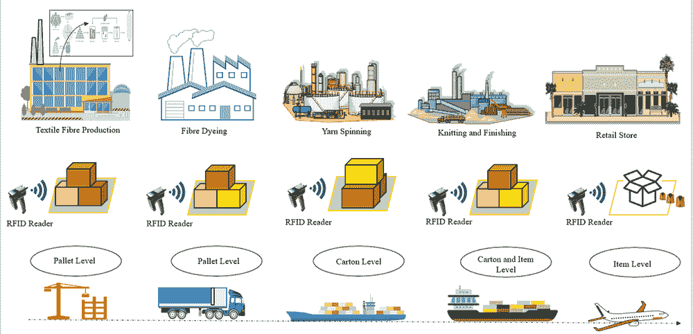 |

因此，区块链现在是服装业务中不同企业应用的关键且重要的技术。简单来说，“区块链”是一种以分布式方式使用的特定数据结构（称为“分布式账本” - DL），它将数据以称为“区块”的包形式存储和传输，这些区块在数字“链”中相连。分布式账本的概念源于“共享账本”的概念。共享账本可以是一个具有分层权限的单一账本，也可以是一个分布式账本，后者由分布式节点网络（或业务活动）维护的多个账本组成。分布式账本技术（DLT）是指一种跨多个数据存储（或账本）记录和共享数据的新颖且快速发展的方法。该技术允许在不同网络参与者的分布式网络中记录、共享和同步交易和数据。区块链采用“加密”和算法方法，以“不可变的方式”在网络中记录和同步数据。区块链的简单图示表示如图 2 所示。

| 图 2. 基本区块链表示 |
| --- |
| 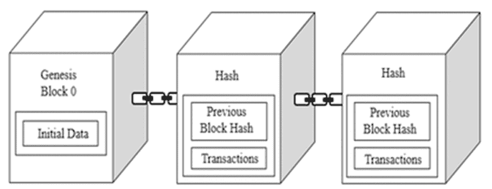 |


## 区块链技术与应用

### 区块链基础架构

区块链在真正意义上是一个链表，因为链中的每个区块都存储了前一个区块的哈希值。每个区块还通过在区块内部存储其内容的哈希值，对其内容进行数字签名。这些哈希值提供了加密完整性，因为任何企图修改区块的对手都需要同时修改链中的所有前序区块，这使得攻击在密码学上不可行。一个关键的设计策略是构建默克尔树以高效地存储和验证哈希值。因此，每个区块仅存储默克尔树的根节点，因为给定根节点，很容易验证不可变性。

**图 3. 去中心化区块链应用的设计步骤**

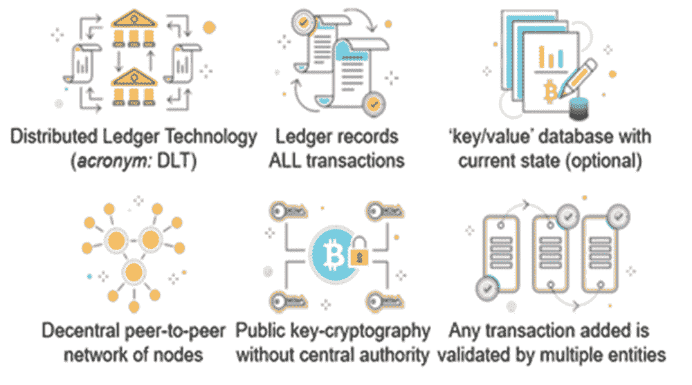

分布式账本根据网络参与者（节点）是否需要获得任何实体的许可才能更改账本，分为“许可型”和“非许可型”。此外，根据账本是否可被任何人访问，还是仅可被网络中的参与节点访问，分布式账本分为“公有”和“私有”。“公钥加密”技术常用于基于区块链技术的实现中。PKC 是一种非对称加密方案，使用两组密钥：广泛传播的公钥和仅所有者知道的私钥。PKC 可用于创建数字签名，并广泛应用于互联网运行中使用的“超文本传输协议安全”（HTTPS）、关键应用中的身份验证以及基于芯片的支付卡中。

区块链系统中的交易与其传统数据库对应物相同。这些交易由客户端发送给区块链系统的服务器。这些交易作用于存储在所有参与服务器上的数据。在其基本形式中，区块链交易可以被视为在复制分布式数据库的每个节点上执行的一组读/写操作。为了确定所有传入交易的顺序，每个区块链应用都采用一种共识协议，区块链技术中的一些重要步骤如图 3 所示。

在基于区块链的基础设施中，链的每个节点都维护一份交易信息的本地副本。该副本与原始副本相同，并随着其在具有完善一致性支持的数据库中分发，在全局信息表中更新。在此数据库中，一旦数据被录入区块链账本，则没有人能够在未来更改该数据，这种机制被称为防篡改。然而，构建可靠的基于区块链的信息基础设施需要系统性的努力。这些系统性努力的主要特征如下：

1. **区块链承诺协议**：承诺协议确保来自服装业务流程的有效交易经过适当的验证机制，在规定时间内被提交并存储在区块链信息存储中；
2. **共识**：共识包含两个功能：第一，它允许在确保链中每个区块都有效且保持参与者激励的前提下更新区块链；第二，它防止任何单一实体控制或瘫痪整个区块链系统。共识的目标是创建一个无需中央权威、参与者之间不必相互信任的分布式网络。共识是区块链技术的重要组成部分。每个节点运行一个称为共识的编程机制。共识是节点就如何因一组交易而更新区块链达成一致的过程。达成共识可确保网络中大多数节点已验证同一组交易；
3. **安全性**：安全性是基于区块链的交易流程的重要方面。区块链生态系统内的所有数据都需要得到保护，且防篡改。这确保了基于区块链的企业生态系统中不存在恶意节点；
4. **隐私性与真实性**：区块链中的隐私性使客户/用户能够在不泄露其网络身份信息的情况下执行交易；
5. **智能合约**：1994 年，Nick Szabo 提出了智能合约的基本概念。它是运行在区块链上的自执行代码，用于促进、执行和强制执行协议条款。因此，与需要受信任的第三方来强制执行和执行协议条款的传统系统相比，智能合约保证了低交易费用、高速度、精确性、效率和透明度。

近年来，区块链技术开启了广泛的工业应用，并为不同类型的工业业务流程自动化开发了许多可比较的信息交换方案。

### 物联网的区块链应用

区块链技术被用于供应链管理的不同应用领域。本节将介绍其中一些应用。

#### 供应链中的应用

学者和从业者指出，工业业务流程，特别是供应链和物流管理，是部署基于物联网的信息系统应用的重要领域。基于物联网的工业信息系统可以通过更有效地跟踪原材料流动，增强企业的竞争力，从而提高业务流程的有效性和效率。在全球化商业实践背景下，拥有多个合作伙伴的供应链中，基于物联网的应用增强了促进共享与生产、质量控制、分销和物流相关的更精确、及时信息的能力。然而，研究人员对独立的基于物联网的应用以及全球供应链管理表示担忧。主要担忧集中在独立物联网系统的安全性和隐私性问题上。

研究界提出了不同的混合信息系统架构（例如物联网与区块链、基于云的物联网和区块链技术）。区块链增强了基于物联网的应用的防篡改特性。近年来，研究人员报告了不同的基于区块链的信息管理系统。例如，IBM 开发了一项新的基于区块链的服务，旨在通过安全的基于云的应用系统跟踪复杂供应链中的高价值物品。另一个典型的工业应用是名为 Chai Wine Vault 的优质葡萄酒产地追踪服务，由总部位于伦敦的 Everledger 公司与优质葡萄酒专家 Maureen Downey 合作开发。一种名为 Block Verify 的创新防伪应用被设计并部署用于追踪防伪产品，以创造一个可持续的商业世界。来自芬兰的初创公司 Kouvola 与 IBM 合作，为供应链管理开发了一个智能招标应用。据报道，该应用建立在自动化的基于区块链的智能合约之上。另一个名为 SmartLog 的基于区块链的智能合约应用由 Kouvola 公司在近期推出。


## 区块链在制造业供应链与物联网应用中的应用

### 简介

近几十年来，由于全球化，制造业供应链网络正通过业务实践的持续数字化经历演变式的变革。这些全球制造链正在演变为价值创造网络，其中价值链本身成为重要的竞争优势来源。同时，将区块链技术与其他创新技术解决方案（例如基于物联网的应用、基于云的解决方案和基于雾计算的自动化）相集成的发展正在进行中，这导致了现代制造业供应链的新结构、新型合作伙伴关系、全面的协作机制以及面向全球业务的增值应用的出现。

### 车辆管理中的应用

基于物联网的车辆（或运输）管理是一个新兴应用领域，物联网与区块链技术的融合在其中发挥着重要作用。此类应用允许将车辆集成到物联网的新时代，以建立车辆与异构网络（如车车互联、车路互联、车人互联和车物互联）之间的智能通信。

近年来，研究人员一直在尝试将区块链技术用于车联网应用。一组研究人员（Huang 等人，2018）利用去中心化安全模型，设计了一个区块链生态系统模型，称为 **LNSC**（闪电网络与智能合约），用于电动汽车和充电桩管理。**LNSC** 模型使用椭圆曲线密码学来计算电动汽车和充电桩的哈希函数。

为避免车联网中的位置追踪，一组研究人员（Dorri 等人，2017）提出了一种去中心化的隐私保护架构，其中覆盖节点管理区块链。此外，备份存储的哈希值存储在区块链中。

Lei 及其同事（Lei 等人，2017）报告了一个研究项目，该项目将基于区块链的动态密钥管理用于车载通信系统。该系统基于去中心化的区块链结构；移除了第三方权威机构，密钥传输过程由安全管理器网络验证和认证。这样，随着物联网和嵌入式技术的快速发展，驾驶员可以访问各种服务。然而，这些服务容易受到潜在攻击，如重放攻击、冒充攻击和会话密钥泄露攻击，因为它们是通过公共信道提供的。许多传统加密算法（如 **RSA**）也适用于车载网络，因为车辆配备了资源受限的传感器。

### 物联网设备管理中的应用

在物联网中，设备管理涉及物理设备、嵌入式软件以及驻留在设备上的数据的安全解决方案。物联网由“事物”（或物联网设备）组成，它们具有远程感知和/或执行能力，并能与其他连接的设备和应用程序交换数据（直接或间接）。物联网设备可以收集数据并在本地处理，或将其发送到中心化服务器或基于云的应用程序后端进行处理。

一种利用物联网技术的按需制造新模式称为 **云制造**；它能够普遍、便捷、按需地通过网络访问可配置制造资源的共享池，这些资源可在极少的管理工作或服务提供商交互下快速配置和释放。

然而，攻击者试图通过在恶意软件中使用恶意代码来窃取物联网设备的数据，尤其是在开源的 Android 平台上。Gu 等人（Gu 等人，2018）引入了一种基于联盟链的恶意软件检测系统，称为 **CB-MDEE**，它由测试成员组成的检测联盟链和用户组成的公共链构成。**CB-MDEE** 系统使用基于软计算的比较技术和多个标记函数，以最小化误报率并提高对恶意软件变种的识别能力。

一个研究小组（Lee 等人，2017）使用基于区块链技术的固件更新方案，以保护物联网系统中的嵌入式设备。

### 物联网访问管理中的应用

访问控制是计算机安全中的一种机制，用于管控对系统资源的访问。当前的访问控制系统面临许多问题，例如第三方的存在、效率低下和缺乏隐私。这些问题可以通过区块链来解决，区块链是一种近年来受到广泛关注且具有巨大潜力的技术。

Jemel 和其他研究人员（Jemel & Serhrouchni，2017）报告了中心化访问控制系统中的几个问题。由于存在有权访问数据的第三方，隐私泄露的风险存在。此外，中央方控制访问，因此存在单点故障的风险。该研究提出了一种带有时间维度的访问控制机制来解决这些问题，并采用基于区块链的解决方案来验证访问权限。

**基于属性的加密** 方法（Sahai & Waters，2005）也存在一些问题，例如来自私钥生成器（**PKG**）的隐私泄露（Hur & Noh，2011）以及前述的单点故障。Wang 及其同事（Wang 等人，2018）通过实施去中心化存储，引入了一个数据共享和访问控制框架来解决这一问题。

基于数据管理和应用类型，区块链可分为私有链（许可链）或公有链（无许可链）。这两类都是去中心化的，并为区块链技术提供了一定程度的免疫能力，以抵御错误或恶意用户。私有链和公有链的主要区别在于共识协议的执行、账本的维护以及加入分布式网络的授权机制。

最近，工业界投入了大量资金，学术界也表现出极大兴趣，以解决区块链技术中的主要研究挑战。例如，共识协议是区块链技术的主要构建模块；因此，针对共识协议的威胁已成为区块链中的一个重要研究课题。

## 区块链安全与隐私问题

区块链技术提供了一种在网络环境中无需中心化权威机构，即可存储信息、执行交易、执行功能并建立安全计算信任的方法。从数据管理的角度来看，区块链是一种分布式数据库，它通过将不断增长的交易记录列表组织成分层的区块链来记录这些记录。从安全角度来看，区块链是通过点对点覆盖网络创建和维护的，并通过对密码学技术的智能和去中心化利用来保障安全。

许多人认为区块链是密码学和网络安全领域的技术突破，其用例范围涵盖从纺织服装行业全球部署的采购系统到智能合约，再到基于物联网的全球产品运输管理等。尽管区块链近年来在学术界和工业界受到越来越多的关注，但在将区块链部署于不同工业应用时，区块链的安全性和隐私性仍然是争论的焦点。

### 区块链的关键安全风险领域

区块链技术的主要安全领域包括：

1.  **账本**
2.  **共识机制**
3.  **网络基础设施**
4.  **身份访问管理**
5.  **密码学**

这些风险领域的示意图如图 4 所示。


### 账本

账本用于记录所有交易和数据状态的变更。账本通过智能设计实现分布式部署，并在区块链参与节点间共享。通常有两个棘手的问题（或隐患）威胁着账本技术在区块链应用中的适用性：（a）未经授权的账本录入；以及（b）对已记录账本数据的未经授权（或不当、或非法）操作。

### 共识机制

共识机制是一种协议（即一组规则），旨在确保区块链网络中的所有参与者遵守日常运营的既定规则。它通过让每个参与者同意分布式账本的状态，确保交易源自合法来源。公有链是一种去中心化技术，没有中央权威机构来监管所需行为。因此，网络需要网络参与者的授权，以验证和认证区块链网络中发生的任何活动。整个过程基于网络参与者的共识进行，这使得区块链成为数字交易中无需信任、安全且可靠的技术。不同的共识机制遵循不同的原则，使网络参与者能够遵守这些规则。考虑到安全数字交易的需求，已经引入了多种共识机制。然而，`工作量证明 (PoW)`、`权益证明 (PoS)` 和 `委托权益证明 (DPoS)` 是工业界使用的少数共识协议。通过这种方式，区块链依赖分布式共识机制来建立相互信任。然而，共识机制本身存在漏洞，攻击者可利用该漏洞控制整个区块链。尽管已在区块链中引入了一些方法（例如 Muhammad 等人，2018）来威慑和防止攻击，但由于开放性的固有特征，基于 `PoW` 的无许可区块链网络可能并不完全安全。

#### 图 4. 区块链的各类安全风险领域

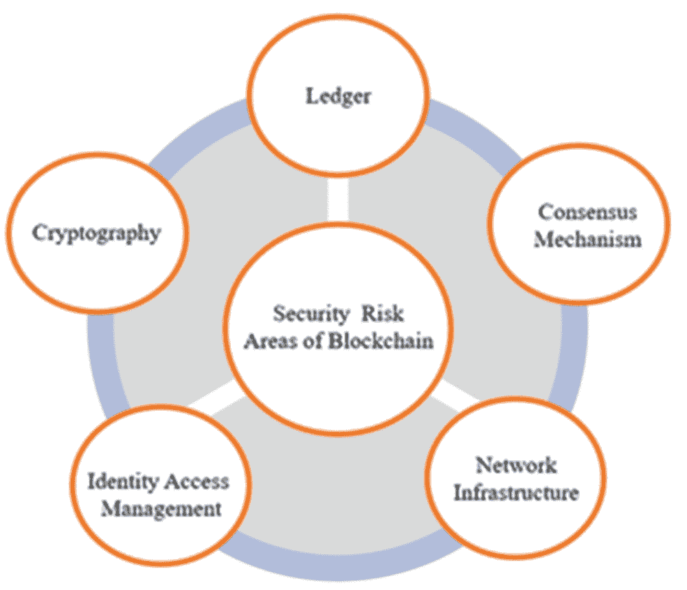

### 网络基础设施

区块链和分布式账本技术（DLT）都需要网络基础设施。通过良好的预判机制，可以在节点被恶意攻击者停止的情况下检测到网络基础设施威胁。2016 年 8 月，近 120,000 个比特币（当时价值超过 6000 万美元）从 Bitfinex 被盗（Nagaraj & Maguire, 2017）。Bitfinex 总部位于香港，是世界上最大的数字货币和加密货币交易所之一。该事件利用了个别组织内部的安全漏洞。区块链网络本身保持完全功能正常，并按预期运行。如果当时进行了基于场景的详细端到端安全审查，该事件本可以避免，这意味着会有更高的机会提前识别风险，并能在当时加以缓解。

### 身份访问管理

区块链中的隐私保护使客户/用户能够在不向网络泄露其身份信息的情况下执行交易。尽管交易与个人没有直接关系，但区块链的透明性仍会损害数据隐私。通过检查、审计和追溯从系统最初交易开始的每一笔交易，可以揭示用户身份。此外，区块链技术采用多种技术来实现交易的最高级别隐私性和真实性。由于信息来自区块链产业生态系统中的不同用户，基础设施需要确保每个用户的隐私和真实性。基于区块链的信息系统通常采用公钥和私钥的组合来安全地加密和解密数据。

### 密码学

区块链上的记录通过密码学进行保护。网络参与者拥有自己的私钥，这些私钥分配给他们发起的交易，并充当个人数字签名。如果记录被篡改，签名将变为无效，对等网络会立即知晓发生了异常。然而，密码学编码中可能存在软件漏洞和故障。这些问题可能包括开发人员的编码错误、底层密码学例程缺陷的不良实现等。即使是经验丰富的程序员，在组装经过验证的密码学工具时也可能出错，导致它们不再安全。黑客可以利用这一弱点。

安全性是基于区块链的交易流程的重要方面。区块链生态系统内的所有数据都需要得到保护，且防篡改。这确保了基于区块链的企业生态系统中不存在恶意节点。这是因为，如前所述，插入公共账本或区块链内部的数据现在分发给了各个用户，每个人都维护着区块链的本地副本。在该本地副本中，个人无法篡改数据，只能升级数据并在网络中重新传输。但要使交易得到验证，其他节点必须确信广播的信息不是恶意的，并确保系统安全。

## 区块链威胁模型

本节解释区块链协议在物联网网络中考虑的威胁模型。威胁主体主要是恶意用户，其意图是窃取资产、破坏功能或中断服务。然而，威胁主体也可能是无意的实体，例如无意中制造漏洞的智能合约开发者，或在设计中犯错、忽视某些问题的区块链应用设计者。

威胁助长了对资产的各种攻击。威胁源于网络中的漏洞、智能合约中的漏洞、共识协议的偏离或违反共识协议假设，或特定应用的漏洞。对抗措施保护所有者免受威胁。它们涉及各种安全解决方案和工具、激励机制、信誉技术、最佳实践等。风险由威胁及其主体引起，可能导致货币资产损失、隐私丧失、声誉受损、服务故障以及服务和应用中断（即可用性问题）。

基于区块链的信息系统所有者希望将威胁主体引起的威胁导致的风险降至最低。本节介绍五种攻击类型：基于身份的攻击、基于操纵的攻击、密码分析攻击、基于信誉的攻击和基于服务的攻击。图 5 展示了这些攻击的示意图。

### 基于身份的攻击

基于区块链数据结构的分布式账本技术（DLT）的出现，催生了新的身份管理方法，旨在颠覆提供和使用数字身份的主流模式。这些新的身份管理（IdM）方法旨在增强涉及身份信息的交易中的去中心化、透明度和用户控制。在基于身份的攻击中，攻击者伪造身份以伪装成授权用户，从而获取系统访问权并对其进行操纵。此外，基于身份的攻击大致可分为四种不同类型，分别是：密钥攻击、重放攻击、冒充攻击和女巫攻击。


## 区块链攻击分类与防御机制

### 基于密钥的攻击

#### 密钥攻击
在区块链技术中，证书和身份通过非对称密码学在 Hyperledger Fabric 中得到验证和保护。每个参与者如何选择存储和保护其私钥由其自行决定。由于 Hyperledger Fabric 不要求统一的管理方案，因此有各种钱包和管理方法可用。外部攻击者获取私钥可能导致各种攻击。本节以结合电动汽车和充电桩的系统为例进行说明：“如果长期使用的电动汽车的私钥泄露，攻击者可以冒充该电动汽车欺骗他人”（Huang et al., 2018）。为应对该攻击，LNSC（闪电网络与智能合约）协议（Huang et al., 2018）提供了电动汽车和充电桩之间的相互认证机制。为此，它采用椭圆曲线加密计算哈希函数，从而确保对密钥泄露攻击的抵御能力。

#### 重放攻击
重放攻击通常是在区块链分叉期间利用的一种方案。例如，攻击者可能复制现有交易，然后尝试将其作为新交易重新提交给区块链。如果黑客拥有你的数字签名，且你的原始交易有效，黑客也可能尝试重新提交交易。如果攻击者成功重新提交此恶意交易，他们将收到两次钱包交易。该攻击旨在欺骗双方身份，拦截其数据包，并在不修改的情况下将其中继到目的地。为抵抗此攻击，LNSC（Huang et al., 2018）使用椭圆曲线加密计算哈希函数的思路。另一方面，BStein（基于区块链的安全相互认证系统）（Lin et al., 2018）为每个请求生成新的一次性公钥/私钥对，用于加密消息和计算消息认证码（MAC）。通过这种方式，可以检测到重放攻击。

#### 冒充攻击
对手试图伪装成合法用户执行未授权操作。如表 II 所示，提出了三种方法来防范此攻击。LNSC 协议（Huang et al., 2018）提出了利用椭圆曲线加密计算哈希函数的思路。Wang et al.（Wang et al., 2018）提出了一种基于激励的分布式合作机制，该机制在保护用户隐私的同时，也提供了节点合作的交易验证方法。该机制将用户隐私信息隐藏在群组中，确保其免受冒充攻击。另一方面，BStein（Lin et al., 2018）采用基于属性的签名思路，即只有合法终端才能生成有效签名，因此当其相应的认证操作失败时，任何冒充尝试都会被检测到。

#### 女巫攻击
女巫攻击是指攻击者在区块链上创建多个账户以欺骗其他区块链参与者。这种行为类似于人们在社交媒体上通过创建多个账户进行恶搞。女巫攻击类似于网络钓鱼攻击，冒充者假装成他人（如你的老板）向你索要网络密码。防止女巫攻击被认为相对简单，关键在于注意你的钱包资金发送给谁。由于成员身份明确且通常不使用钱包，这类攻击在许可链上不应成为问题。在此攻击下，对手创建大量虚假身份。通过在网络中执行大量交互，对手可在社区中获得巨大影响力，即增加/减少某些代理的声誉。TrustChain（即无需中央控制即可在陌生人之间创建可信交易）（Otte et al., 2017）通过为每个代理创建按时间顺序排列的不可变交互链来解决此问题。它利用先前交易作为输入，通过抗女巫攻击方式计算在线社区中代理的可信度。它确保使用社区资源的代理也能回馈贡献。

### 基于篡改的攻击

此类攻击涉及未授权访问和数据篡改。本类别分类了四种攻击：虚假数据注入攻击、篡改攻击、覆盖攻击和修改攻击。

#### 虚假数据注入攻击
此攻击旨在破坏控制系统的数据完整性，使其做出错误的控制决策。Liang et al.（Liang et al., 2018）将电表节点视为私有区块链网络。此外，节点间的交互基于共识机制，包含执行分布式投票算法。每个节点可验证接收数据的完整性。当达成肯定一致时，数据被视为正确。

#### 篡改攻击
对手可能在签名后篡改比特币交易的比特币地址、金额及其他信息。为防止此攻击，Wang et al.（Wang et al., 2017）使用与现有比特币系统兼容的公钥密码系统。他们提出增加同态 Paillier 加密系统以覆盖交易中的明文金额，加密后的金额将由承诺证明进行检查。

#### 覆盖攻击
指攻击者在接收方公钥下向原始加密金额添加伪造的加密金额。在（Wang et al., 2017）中，由于每笔交易嵌入时间戳以标记其唯一性，可检测到此攻击。同一交易者的不同输入可被区分并关联到不同交易，从而确保对覆盖攻击的抵抗力。

#### 修改攻击
指修改广播交易或响应消息。为应对该攻击，LNSC（Huang et al., 2018）使用椭圆曲线加密计算哈希函数的思路。另一方面，BSeIN（Lin et al., 2018）采用属性签名和 MAC。

#### 中间人攻击
攻击者通过欺骗双方身份，可秘密中继甚至修改双方间的通信。双方自以为直接通信，实则整个对话受攻击者控制。为抵抗此攻击，BSeIn（Lin et al., 2018）提供安全相互认证。在（Huang et al., 2018）中，LNSC 通过使用椭圆曲线加密（Kumanduri & Romero, 1998; Washington, 2008）计算哈希函数提供相互认证。

### 密码分析攻击

此类攻击旨在破解加密算法并暴露其密钥。在（Yin et al., 2018）中，研究了区块链中的量子攻击。该攻击旨在解决椭圆曲线离散对数问题，即从椭圆曲线公钥推导私钥。这样，对手可签署未授权交易并伪造用户的有效签名。为解决此问题，Yin et al.（Yin et al., 2018）采用基于格的签名方案思路，该方案允许从区块链确定性钱包的种子中派生出许多子私钥。

### 基于声誉的攻击

代理通过将声誉改为正面来操纵其声誉。本类别包含以下攻击：隐藏区块攻击和洗白攻击。


### 隐藏区块攻击

在这种攻击下，代理仅暴露对其声誉有正面影响的交易，并隐藏那些声誉负面的交易。在(Otte 等人，2017)中，提出了每个代理按时间顺序排列的不可变交互链。由于每条记录都有序列号，网络中的任何代理都可以请求其他代理的特定记录。被请求的代理无法拒绝提供其记录。否则，其他代理将停止与其交互。

#### 图 5. 区块链威胁模型分类

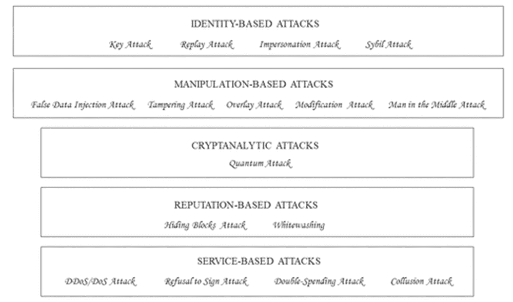

### 漂白攻击

当代理拥有负面声誉时，它可以摆脱其身份并创建一个新身份。无法阻止这种行为。然而，(Otte 等人，2017)建议在应用分配策略时，给予新身份代理较低的优先级。

### 基于服务的攻击

此类攻击旨在使服务不可用，或使其行为偏离其规范。在此类别下，我们可以发现以下攻击：

#### DDoS/DoS 攻击

分布式拒绝服务（DDoS）攻击是一种针对网站、网络节点，甚至成员服务提供商极为常见的网络攻击类型。这种 DDoS 攻击本质上由许多（可能成千上万个）远程节点发起，随后利用协调机制启动攻击。从本质上讲，当多个系统用所谓的连接请求、消息或其他类型的通信数据包淹没网络资源时，就会发生 DDoS 攻击。此类攻击的目标是拖慢或瘫痪系统。集中的攻击和随后的系统关闭导致合法用户遭遇“拒绝服务”。拒绝服务（DoS）和 DDoS 是常见的安全问题。针对共识节点连接的 DoS 攻击可能导致共识算力损失，从而阻止共识节点获得奖励。对于验证节点，此攻击会导致某些依赖区块链的服务中断。它涉及发送大量请求以导致区块链系统故障。分布式 SDN 架构的思想由 DistBlockNet 协议在(Sharma 等人，2017)中提出。CoinParty (Ziegeldorf 等人，2018) 提出了去中心化混币服务的思想。Liu 等人 (Liu 等人，2018) 采用基于椭圆曲线数字签名算法（ECDSA）的环签名。BSeIn (Lin 等人，2018) 通过限制区块大小、检查交易输入的最大属性签名数量，并使用“多接收者”加密技术为授权参与者提供机密性，实现了对 DoS 的弹性。

#### 拒绝签名攻击

恶意代理可以决定不签署对其不利的交易。虽然无法防止此攻击，但可以对拒绝签名的代理采取惩罚措施。(Otte 等人，2017)提出不与恶意代理交互，或将交易拆分为较小的金额。如果代理拒绝签署交易，则中止该交互。

#### 双重支付攻击

这意味着攻击者花费同一笔比特币两次以获取额外金额。在(Wang 等人，2017)中，使用了时间戳和工作量证明机制。在(Aitzhan & Svetinovic，2016)中，采用了多重签名交易，其中必须由最少数量的密钥签署交易才能花费代币。

#### 串谋攻击

节点可以相互串通并表现出自私行为以最大化其利润。在(He 等人，2018)中，提出了激励机制和定价策略以挫败自私行为。

## 结论

当今的纺织和服装供应链面临着动态商业环境带来的显著波动性、不确定性和复杂性。客户购买模式的变化——对更低价格、更高服务水平、移动商务等的需求——使得客户情报和多样化的履约模式成为必要。这些给服装制造供应链网络带来了巨大压力，迫使服装企业重新审视其供应链设计策略。这包括部署能够增强供应链执行力的适当信息系统。在这样的场景下，企业信息系统架构发挥着非常重要的作用。

本章解释并总结了服装制造供应链管理系统的一些主要问题。物联网是一个由互联对象组成的智能全球网络，它通过唯一的寻址方案相互交互，并与邻居协作以达成共同目标。从服装业务流程中的物联网应用获得的数据可以使运营决策变得更加容易。然而，独立的物联网应用系统面临安全和隐私相关问题。

由于高能耗和处理开销，现有的安全解决方案不一定适合物联网。随着连接的物联网设备数量快速增长，出现了许多可能减缓物联网在不同服装业务流程自动化中采用的障碍。首先，物联网设备和平台的市场是碎片化的，存在许多标准和许多供应商。其次，存在互操作性方面的担忧，因为实施的解决方案往往倾向于创建新的数据孤岛。物联网设备数据通常安全地存储在云端，但它们无法防范完整性受损的设备或源头篡改。相比之下，区块链是一项新兴技术，可以帮助提高物联网系统的弹性。区块链在物联网设备之间建立信任，并通过加密技术降低篡改风险。

安全和业务组织问题往往加剧了利用区块链账本技术构建服装制造供应链管理系统的必要性。无论特定纺织制造供应链相关应用的特殊性如何，区块链都能提供广泛的优势。通过在制造供应链节点上登记和记录产品（如棉花、纤维、纺织布料）的生命周期，可以增加参与业务合作伙伴的透明度和信任度。

最后，本章试图强调基于区块链技术部署的安全和隐私相关问题。然后，本章在区块链技术背景下，通过展示五种不同类型的威胁模型——基于身份的攻击、基于操纵的攻击、密码分析攻击、基于声誉的攻击和基于服务的攻击——作为总结。

许可区块链的理念为智能服装供应链运营的开发和集成提供了许多充满希望的解决方案。然而在实践中，在许可区块链成为现实的实施之前，还需要做更多的工作来保障其安全性。未来，当前的研究将转向对许可区块链安全性的更深入研究，无论是分析性还是实验性分析。需要对成员服务提供商（MSP）的攻击面进行比较分析，并建立严格的证明，以数值量化伴随许可区块链的威胁。鼓励进一步开展密钥管理系统的比较分析工作，以找到最适合许可区块链的系统。此外，仍存在几个具有挑战性的研究领域，例如针对组合攻击的弹性、动态和自适应安全框架、遵守 GDPR（通用数据保护条例）以及节能挖矿相关问题。


## GDPR 可执行性与区块链身份解决方案

2018 年 5 月 25 日，**GDPR**（通用数据保护条例）在**欧洲联盟（EU）**地区正式生效。这对区块链数据产生了悖论性的影响，在欧盟地区实施任何区块链身份解决方案时都应予以高度重视。因此，在欧洲，强制执行数据隐私和保护用户数据不再是可选项。然而，值得注意的是，GDPR 文档正文中缺乏实现 GDPR 合规性所必需的技术和非技术实施细节。这构成了一个重大的研究空白，本研究旨在未来填补这一空白。

## 参考文献

AhIman, R. (2016). 芬兰城市与 IBM 合作验证区块链在物流中的应用。https://cointelegraph.com/news/finish-city-partners-with-ibm-to-validate-blockchain-application-in-logistics

Aitzhan, N. Z., & Svetinovic, D. (2016). 通过多重签名、区块链和匿名消息流实现去中心化能源交易中的安全与隐私。*IEEE 可靠与安全计算汇刊*, 1.

Atzori, L., Iera, A., & Morabito, G. (2018). 物联网：综述。*计算机网络*, 54(15), 2787–2805. doi:10.1016/j.comnet.2010.05.010

Banker, S. (2016). 区块链技术将彻底改变供应链应用吗？https://logisticsviewpoints.com/2016/06/20/will-block-chain-technology-revolutionize-supply-chain-applications/

Barreto, L., Amaral, A., & Pereira, T. (2017). 工业 4.0 对物流的影响：概述。*制造业会议录*, 2017(13), 1245–1252. doi:10.1016/j.promfg.2017.09.045

Cam-Winget, N., Sadeghi, A.-R., & Jin, Y. (2016). 特邀：物联网能否被保护：连接未连接设备的新兴挑战。*第 53 届设计自动化会议论文集 (DAC ’16)*。10.1145/2744769.2905004

Chen, R., Guo, J., & Bao, F. (2014). 基于 SOA 的物联网系统中服务组合的信任管理。*2014 IEEE 无线通信与网络会议论文集 (WCNC)*, 3444–3449. 10.1109/WCNC.2014.6953138

Cui, Y. (2018). 物联网驱动的供应链创新。载于 *《多准则方法与技术在供应链管理中的应用》*。Intech Open。doi:10.5772/intechopen.74155

Deloitte. (2017). *数字采购：颠覆性技术带来的新能力*。Deloitte Development LLC。

Dorri, A., Kanhere, S. S., Jurdak, R., & Gauravaram, P. (2017). 面向物联网安全与隐私的区块链：智能家居案例研究。*2017 IEEE 国际普适计算与通信会议研讨会论文集 (PerCom Workshops)*。

Finextra. (2016). Everledger 将首瓶葡萄酒上链保护。https://www.finextra.com/pressarticle/67381/everledger-secures-the-first-bottle-of-wine-on-the-blockchain

Galvez, J. F., Mejuto, J. C., & Gandara, J. S. (2018). 区块链用于食品溯源分析的未来挑战。*分析化学趋势*, 107, 222–232. doi:10.1016/j.trac.2018.08.011

Garg, S., Gentry, C., Halevi, S., Sahai, A., & Waters, W. (2013). 基于多重线性映射的电路属性加密。*Academic Press*。doi:10.1007/978-3-642-40084-1_27

Gu, J., Sum, B., Du, X., Wang, J., Zhuang, Y., & Wang, Z. (2018). 基于联盟区块链的移动设备恶意软件检测。*IEEE Access: 实用创新，开放解决方案*, 6, 12118–12128. doi:10.1109/ACCESS.2018.2805783

Gubbi, J., Buyya, R., Marusic, S., & Palaniswami, M. (2013). 物联网：愿景、架构要素与未来方向。*未来世代计算机系统*, 29(7), 1645–1660. doi:10.1016/j.future.2013.01.010

He, Y., Li, H., Cheng, X., Liu, Y., Yang, C., & Sun, L. (2018). 基于区块链的分布式 P2P 应用真实激励机制。*IEEE Access: 实用创新，开放解决方案*, 6, 1–1. doi:10.1109/ACCESS.2018.2821705

Hua, J., Wang, X., Kang, M., Wang, H., & Wang, F. (2018). 基于区块链的农产品溯源：具有复式与共享记账的分布式平台。*IEEE 智能车辆研讨会论文集 (IV)*。10.1109/IVS.2018.8500647

Huang, X., Xu, C., Wang, P., & Liu, H. (2018). LNSC：基于区块链生态系统的电动汽车与充电桩管理安全模型。*IEEE Access: 实用创新，开放解决方案*, 6, 13565–13574. doi:10.1109/ACCESS.2018.2812176

Hulse Apple, C. (2015). Block Verify 利用区块链终结假冒伪劣，让世界更诚实。https://cointelegraph.com/news/block-verify-uses-blockchains-to-end-counterfeiting-and-make-world-more-honest

Hur, J., & Noh, D. K. (2011). 数据外包系统中具有高效撤销功能的基于属性的访问控制。*IEEE 并行与分布式系统汇刊*, 22(7), 1214–1221. doi:10.1109/TPDS.2010.203

Jemel, M., & Serhrouchni, A. (2017). 基于区块链的带时间维度的去中心化访问控制机制。载于 *2017 IEEE 第 14 届电子商务工程国际会议 (ICEBE)*。IEEE。

Kamilaris, A., Fonts, A., & Prenafeta-Boldv, F. X. (2019). 区块链技术在农业与食品供应链中的崛起。*食品科学与技术趋势*, 91, 640–652. doi:10.1016/j.tifs.2019.07.034

Katz, J., & Lindell, Y. (2007). 数字签名方案。载于 *《现代密码学导论》*。Chapman & Hall/ CBC Press。doi:10.1201/9781420010756

Keertikumar, M., Shubham, M., & Banakar, R. M. (2015). 智能汽车中物联网的演进：概述。*国际绿色计算与物联网会议论文集 (ICGCIoT)*, 804–809. 10.1109/ICGCIoT.2015.7380573

Kim, N. (2016, July). IBM 推动区块链进入供应链。*华尔街日报*。

Kshetri, N. (2017). 区块链能强化物联网吗？*IEEE IT Professional*, 19(4), 68–72. doi:10.1109/MITP.2017.3051335

Kumanduri, R., & Romero, C. (1998). *计算机应用数论*。Prentice Hall。

Kumar, M. V., & Iyengar, N. C. S. N. (2017). 稻米供应链管理中区块链技术的框架。*先进科学与技术快报*, 146, 125–130. doi:10.14257/astl.2017.146.22

Lee, B., & Lee, J. H. (2017). 物联网环境下嵌入式设备基于区块链的安全固件更新。*超级计算期刊*, 73(3), 1152–1167. doi:10.1007/s11227-016-1870-0

Lee, I., & Lee, K. (2015). 物联网：企业的应用、投资与挑战。*商业展望*, 58(4), 431–440. doi:10.1016/j.bushor.2015.03.008

Liang, G., Weller, S. R., Luo, F., Zhao, J., & Dong, Z. Y. (2018). 面向现代电力系统抵御网络攻击的分布式区块链数据保护框架。*IEEE 智能电网汇刊*, 1–1.

Lin, C., He, D., Huang, X., Choo, K. K. R., & Vasilakos, A. V. (2018). Bsein：面向工业 4.0 的基于区块链的安全互认证与细粒度访问控制系统。*网络与计算机应用期刊*, 116, 42–52. doi:10.1016/j.jnca.2018.05.005

Lin, I. C., Shin, H., Liu, J. C., & Jie, Y. X. (2017). 使用区块链的食品溯源系统。*第 79 届 IASTEM 国际会议论文集*。

Liu, Y., Liu, X., Tang, C., Wang, J., & Zhang, L. (2018). 用于增强比特币交易隐私的不可链接混币方案。*IEEE Access: 实用创新，开放解决方案*, 6, 23261–23270. doi:10.1109/ACCESS.2018.2827163

Mahjabin, T., Xiao, Y., Sun, G., & Jiang, W. (2017). 分布式拒绝服务攻击、预防与缓解技术综述。*国际分布式传感器网络期刊*, 13(12), 155014771774146. doi:10.1177/1550147717741463

Muhammad, S., Aziz, M., Charles, K., Kevin, H., & Laurent, N. (2018). 遏制下一代区块链中的双重支付。*IEEE ICC 2018*。

Nakamoto, S. (2008). 比特币：一种点对点的电子现金系统, 2008。

Nagaraj, K., & Maguire, E. (2017). 保障链安全。*KPMG 国际*。https://assets.kpmg.com/content/dam/kpmg/xx/pdf/2017/05/securing-the-chain.pdf


## 参考文献

Otte, P., de Vos, M., & Pouwelse, J. (2017, Sept.). TrustChain: A Sybil-resistant scalable blockchain. *Future Generation Computer Systems*.

Paillisse, J., Subira, J., Lopez, L., Rodriguez-Natal, A., Ermagan, V., Maino, F., & Cabellos, A. (2019). Distributed Access Control with Blockchain. *Academic Press*.

Pal, K. (2017). Supply Chain Coordination Based on Web Services. In Chan, H. K., Subramanian, N., & Abdulrahman, M. D. (Eds.), *Supply Chain Management in the Big Data Era* (pp. 137–171). IGI Global Publication. doi:10.4018/978-1-5225-0956-1.ch009

Pal, K. (2019). Algorithmic Solutions for RFID Tag Anti-Collision Problem in Supply Chain Management. *Procedia Computer Science*, 929-934.

Pal, K. (2020). Information Sharing for Manufacturing Supply Chain Management Based on Blockchain Technology. In *Cross-industry Use of Blockchain Technology and Opportunities for the Future*. IGI Global.

Pal, K. (2020a). Ontology-Assisted Enterprise Information Systems Integration in Manufacturing Supply Chain. In *Handbook of Research on Developments and Trends in Industrial and Material Engineering*. IGI Global.

Pal, K., & Ul-Haque, A. (2020). Internet of Things and Blockchain Technology in Apparel Manufacturing Supply Chain Data Management. *Proceeding of 11th International Conference on Ambient Systems, Networks and Technologies (ANT-2020)*.

Rejeb, A. (2018). Blockchain Potential in Tilapia Supply Chain in Ghana. *Acta Tech. Jaurinensis*, 11(2), 104–118. doi:10.14513/actatechjaur.v11.n2.462

Sahai, A., & Waters, B. (2005). Fuzzy identity-based encryption. In *Annual International Conference on the Theory and Applications of Cryptographic Techniques*. Springer.

Sharma, P. K., Singh, S., Jeong, Y. S., & Park, J. H. (2017). DistBlockNet: A Distributed Blockchains-Based Secure SDN Architecture for IoT Networks. *IEEE Communication Management*, 55(9), 78–85. doi:10.1109/MCOM.2017.1700041

Shrouf, F., Ordieres, J., & Miragliotta, G. (2014). Smart factories in Industry 4.0: A review of the concept and of energy management approached in production based on the Internet of Things paradigm. *Proceedings of the IEEE International Conference on Industrial Engineering and Engineering Management*, 679–701. doi:10.1109/IEEM.2014.7058728

Szabo, N. (1994). Smart Contracts. Available online: https://archive.is/zQ1p8

Tse, D., Zhang, B., Yang, Y., Cheng, C., & My, H. (2017). Blockchain application in food supply information security. *Proceedings of the IEEE International Conference on Industrial Engineering and Engineering Management (IEEM 2017)*, 1357–1361. doi:10.1109/IEEM.2017.8290114

Tzounis, A., Katsoulas, N., Bartzanas, T., & Kittas, C. (2017). Internet of things in agriculture, recent advances and future challenges. *Biosystems Engineering*, 164, 31–48. doi:10.1016/j.biosystemseng.2017.09.007

Waller, M. A., & Fawcett, S. E. (2013). Data science, predictive analytics, and big data: A revolution that will transform supply chain design and management. *Journal of Business Logistics*, 34(2), 77–84. doi:10.1111/jbl.12010

Wang, Q., Qin, B., Hu, J., & Xiao, F. (2017, Sept.). Preserving transaction privacy in bitcoin. *Future Generation Computer Systems*.

Wang, S., Zhang, Y., & Zhang, Y. (2018). A blockchain-based framework for data sharing with fine-grained access control in decentralized storage systems. *IEEE Access: Practical Innovations, Open Solutions*, 6, 38437–38450. doi:10.1109/ACCESS.2018.2851611

Wang, S. J., Liu, S. F., & Wang, W. L. (2008). The simulated impact of RFID-enabled supply chain on pull-based inventory replenishment in TFT-LCD industry. *International Journal of Production Economics*, 112(2), 570–586. doi:10.1016/j.ijpe.2007.05.002

Washington, L. C. (2008). *Elliptic Curves: Number Theory and Cryptography* (2nd ed.). Chapman & Hall/CRC. doi:10.1201/9781420071474

Witkowski, K. (2017). Internet of Things, Big Data, Industry 4.0 - Innovative Solutions in Logistics and Supply Chains Management. *Procedia Engineering*, 2017(182), 763–769. doi:10.1016/j.proeng.2017.03.197

Yan-e, D. (2011). Design of intelligent agriculture management information system based on IoT. *Proceedings of the 2011 Fourth International Conference on Intelligent Computation Technology and Automation*, 1, 1045–1049. doi:10.1109/ICICTA.2011.262

Yin, W., Wen, Q., Li, W., Zhang, H., & Jin, Z. (2018). An Anti-Quantum Transaction Authentication Approach in Blockchain. *IEEE Access: Practical Innovations, Open Solutions*, 6, 5393–5401. doi:10.1109/ACCESS.2017.2788411

Zhou, Z. (2012). Applying RFID to reduce bullwhip effect in a FMCG supply chain. In *Proceedings of the Advances in Computational Environment Science* (pp. 193-199). Springer.

Ziegeldorf, J. H., Matzutt, R., Henze, M., Grossmann, F., & Wehrle, K. (2018). Secure and anonymous decentralized Bitcoin mixing. *Future Generation Computer Systems*, 80, 448–466. doi:10.1016/j.future.2016.05.018

## 关键术语与定义

## 区块
`Block` 是一种数据结构，用于传达节点本地状态的增量变更。它由交易列表、对前一个区块的引用和一个随机数组成。

## 区块链
简单来说，`Blockchain` 只是一种数据结构，可以通过计算数据通信网络（例如点对点或 P2P）由不同用户共享。`Blockchain` 是一种由区块链组成的分布式数据结构。它可以充当全球账本，维护区块链网络上所有交易的记录。交易带有时间戳并被打包进区块，每个区块由其加密哈希值标识。

## 区块链区块头
`Blockchain Headers`（区块头）取决于区块中消息的组合。它列出了交易、生成列表的时间，以及对最近一个区块哈希值的引用。

### 密码学
`Cryptography` 是保持通信私密性的科学。它是研究以伪装形式发送消息的方法，以便只有预期的接收者才能去除伪装并阅读消息。`Blockchain` 的交易基于加密证明以及各交易伙伴之间潜在的数学计算，实现了有效性、信任和终局性。

## 去中心化计算基础设施
`Decentralized Computing Infrastructure` 的特点是计算节点可以独立做出处理和计算决策，而不管其他对等计算节点可能做出什么决定。

## 哈希
软件使区块头进行“哈希运算”。`Hashing` 是将一组数字数据转换为单个数字（称为 `hash`）的过程。该数字是唯一的（实际上是源数据的“数字指纹”），且无法从中反向工程和恢复源数据。

## 不可篡改性
`Immutability` 是指区块链交易无法被删除或篡改。

## 物联网
`Internet of Things (IoT)`，也称为万物互联或工业互联网，现在是一种技术范式，设想为一个由能够相互交互的机器和设备组成的全球网络。`IoT` 被公认为未来技术最重要的领域之一，并受到广泛行业的高度关注。

## 来源/溯源
在区块链账本中，`Provenance` 是一种追踪每笔交易起源的方式，确保账本中交易的起源和顺序无可争议。

## 智能合约
`Smart Contract`（智能合约）由软件代码编写而成，可自主自动执行。视一系列因素而定，它们有时在法律意义上相当于具有约束力的合同，或以其他方式影响当事方之间的法律关系。


## 第 11 章

*   **Dipti Chauhan**  
    计算机科学与工程系，Prestige Institute of Engineering Management and Research，印度印多尔

*   **Jay Kumar Jain**  
    信息技术系，Sagar Institute of Research and Technology，印度博帕尔

## 摘要

**物联网** 是一系列创建智能世界的智能设备的集合。它不仅改变了我们与重要设备交互的方式，还增强了这些设备的潜力。**物联网** 的一个主要局限性在于其依赖于中心化通信模型。传统的 **物联网** 解决方案需要高昂的基础设施和维护成本，从而导致可扩展性问题。此外，云服务器的脆弱性及其故障可能会影响 **物联网** 系统。目前仍没有一个平台能够连接所有设备。点对点通信模型取代标准的服务器/客户端模型，可能是 **物联网** 行业正在寻找的可持续解决方案。点对点网络的主要挑战是安全性。这就是 **区块链** 在 **物联网** 中的应用可以帮助 **物联网** 行业以可持续方式扩展的地方。确实，**区块链** 和 **物联网** 结合在一起可以解决 **物联网** 面临的一些最大难题。本章的主要目的是从印度视角提供 **物联网** 和 **区块链** 的概述。

## 介绍

小型化、小工具和无线通信技术的快速发展为我们的社会带来了显著的进步。这导致适用于某些领域的电子设备数量增加、其生产成本降低，并实现了从现实世界向数字世界的范式转移。因此，我们利用现代技术相互连接并与外部世界连接的方式发生了改变，从而更好地理解世界。Díaz, M. 等人 (2016) 指出，**物联网** 已从 **无线传感器网络** 发展为 **射频识别** 等一系列技术，这些技术提供了通过互联网进行感知、驱动和通信的能力。

如今，**物联网** 设备可以是从可穿戴设备到硬件开发平台的各类电子设备，其应用范围涵盖社会的许多领域。根据 Rivera, J. 等人 (2014) 的研究，**物联网** 在将现有城市转变为智慧城市、电网转变为智能电网、房屋转变为智能家居等方面发挥着核心作用。根据各类研究报告，预计到 2020 年，联网设备的数量将达到 200 亿到 500 亿，这主要归因于 **物联网** 可投入使用的海量设备。通常，这些 **物联网** 设备在计算、存储和网络能力方面受到限制，因此它们比智能手机、平板电脑或 PC 等其他终端设备更容易受到攻击。

**物联网** 的概念是与 **无线传感器网络** 并行产生的。**物联网** 一词由 Ashton, K. (2009) 提出。目前没有一个被全球用户社区广泛接受的、唯一的 **物联网** 定义。事实上，包括学者、专家、专业人士、创新者、设计师和企业人士在内的各种群体都对该术语进行了定义。大多数定义几乎都共享这样一个观点：互联网的最初形式关乎由人创造的信息，而下一个版本关乎由物创造的信息。

**物联网** 是 IT 领域的一个新兴范式。“**物联网**”这一表达也简称为 **IoT**，由两个众所周知的词组成：第一个是“**互联网**”，第二个是“**物**”。**互联网** 是一个全球性的互联计算机系统，它使用标准的互联网协议套件（**TCP/IP**）为全球数十亿用户提供服务。根据 Nunberg, G. (2012) 的说法，它是一个网络的网络，由数百万个私有、公共、学术、商业和政府网络组成，范围从本地到全球，通过种类繁多的电子、无线和光网络技术连接在一起。

根据 Evangelos A, K. 等人 (2011) 的说法，关于**物**，可以是现实世界中任何可识别的物品或个体。日常物品不仅包括我们日常接触和使用的电子设备以及技术先进的产品（如硬件和装备），还包括我们通常根本不认为是电子产品的“**物**”，例如食品、服装和家具；材料、零件和设备、库存和重点物品；地标、纪念碑和艺术品，以及商业、文化和创新的所有多样性。

**区块链** 是一种革新 **互联网** 并取代常规中心化客户端-服务器方案的新架构。**区块链** 在节点链上存储数据。它是一个共享的公共账本，整个去中心化分布式点对点网络都依赖于此。每个节点都拥有账本的一个副本。当发起一笔交易时，每个节点都会收到交易请求消息，更新其自身的账本副本，并将消息传递给附近的节点。每笔交易都经过数字签名以证明其有效性。如果一条消息使用特定公钥加密，只有匹配的私钥所有者才能解密并读取该消息。反之，如果你用你的私钥加密一条消息，只有匹配的公钥可用于解密。一旦达成共识，数字签名可防止交易被任何人篡改。正如上文所述，**区块链** 不仅用于加密货币。我们看到金融机构、政府、电力公司和许多其他行业纷纷加入这一行列。

## 区块链

**供应链管理**：供应链由关键业务流程和设施的网络组成，涉及提供产品、服务和信息的最终用户和供应商。在该链管理中，提高整体链的效率是一个有影响力的因素；并且需要至少考虑四个重要的战略问题：供应链网络设计、产能规划、风险评估和管理、以及绩效监控和测量。

**时间戳**：每个区块都关联一个时间戳，这使得所有参与者都知道 **区块链** 记录的交易发生的时间。当需要证明交易历史时（例如——法律或监管原因），这可能特别有用。

**透明性**：在完全无许可的 **区块链** 中，参与者发送的所有消息（包括——达成共识后——它们作为区块被包含在 **区块链** 上时）对所有其他参与者都是可见的。

**仓库**：仓库也可称为存储区，是一个商业建筑，供应商、出口商、制造商或批发商在其中存储原材料或货物。根据其用途的不同，它们按照特殊标准建造并配备相应工具。


## 区块链：历史、架构与应用

### 区块链的历史

1991 年，Stuart Haber 和 W. Scott Stornetta 描述了对加密验证的区块链（原文为“chain of squares”，即区块链前身）的主要研究工作。他们需要实现一个文档时间戳无法被篡改的框架。1992 年，Bayer、Haber 和 Stornetta 将 Merkle 树合并到该结构中，通过允许将多个文档证明收集到一个区块中，提高了其效率。第一个区块链是由中本聪（Satoshi Nakamoto，可能是个人或团体）于 2008 年构想的。中本聪以一种重要方式改进了设计，利用类 Hashcash 的策略向链中添加区块，而无需受信任方签名。该结构于次年由中本聪作为数字货币比特币的核心组件实现，在该系统中它充当网络上所有交易的公共账本。在中本聪的原始论文中，“block”（区块）和“chain”（链）两词是分开使用的，但到 2016 年已被推广为单个词“blockchain”。术语“区块链 2.0”指的是分布式区块链数据库的新应用，最早出现于 2014 年。

### 什么是区块链？

区块链是一种去中心化、分布式且公开的数字账本，用于跨多个网络记录交易，使得任何已包含的记录在事后无法被篡改，除非修改所有后续区块。这使得参与者能够独立且相对廉价地验证和审计交易。区块链数据库通过点对点网络和分布式时间戳服务器进行独立管理。它们由大规模协作验证，该协作由集体利益驱动。这种设计促进了稳健的工作流程，使参与者对数据安全性的不确定性降至最低。基于区块链的价值交换比传统系统更快、更安全、成本更低。另一方面，区块链是一种公开的分布式账本，能够高效、可验证且永久地记录两方或多方之间的交易。

#### 图 1. 区块链节点概览

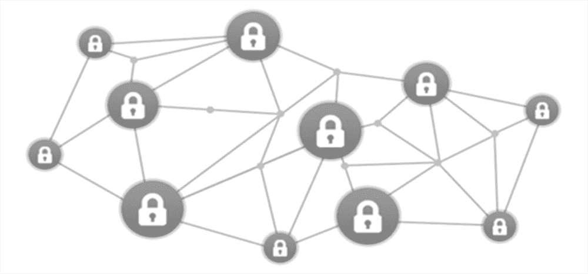

每个节点维护全局数据表的一个本地副本。系统确保本地副本之间的一致性：

*   每个节点的本地副本是相同的。
*   本地副本始终基于全局信息进行更新。

### 分布式账本

分布式账本可被定义为一种数据库，它以共识方式共享并同步跨越多个站点、机构或地理区域的网络。

分布式账本可被描述为以去中心化形式跨不同区域和人员维护的任何交易或合同的记录，消除了对中央权威机构进行监管防篡改的需求。其上的所有信息均使用加密技术安全准确地存储，并可使用密钥和加密签名进行访问。一旦信息被存储，它就成为一个不可变的数据库，并由网络规则进行治理。虽然中心化账本容易遭受网络攻击，但分布式账本天生更难被攻击，因为攻击要想成功，需要同时攻击所有分布式副本。此外，这些记录不受单方恶意篡改的影响。

#### 图 2. 分布式账本/公共账本

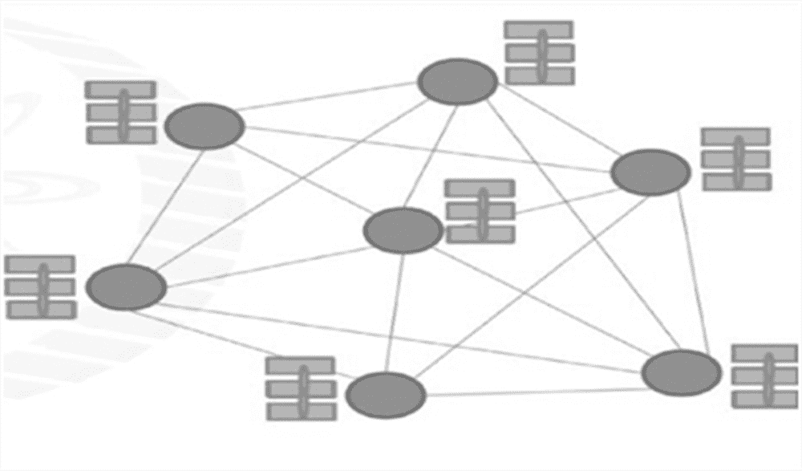

### 区块链的关键方面

区块链的不同方面：

1.  **承诺协议**：确保来自客户端的每笔有效交易都在有限时间内被提交并包含在区块链中。
2.  **共识**：确保本地副本保持一致并更新。
3.  **安全性**：数据需要防篡改，因为客户端可能表现恶意或被攻破。
4.  **隐私与真实性**：数据（或交易）属于不同客户端；需确保隐私和真实性。

### 区块链架构

以下是区块链的简化结构；

#### 图 3. 区块链中区块的简化结构

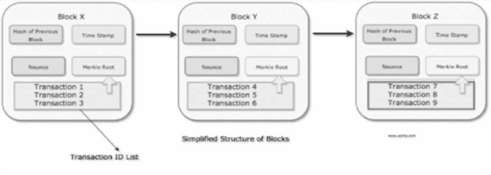

简化区块链架构中的每个区块必须包含以下组件：

1.  **前一区块的哈希值**：区块链架构中的每个区块通过加密哈希函数与其前一区块相连。这确保了篡改区块链变得极其困难且不可能。对于恶意节点（或节点组），篡改区块链将需要修改目标区块所有前序区块的哈希内容。此类哈希函数的示例包括 `SHA256`、`RIPEMD160` 等。
2.  **时间戳**：每个区块包含其被添加到区块链时的时间戳。时间戳确保分布式账本的透明度和完整性，并使区块链审计变得更容易。
3.  **Nonce（随机数）**：Nonce 指用于通过 `PoW`（工作量证明）向区块链添加区块的随机数字数组序列，适用于无许可区块链模型。Nonce 开头所需零的数量决定了向区块链添加区块的难度等级。确定用于将区块添加到链中的 nonce 值的唯一方法是暴力破解法。
4.  **Merkle 根**：Merkle 树结构（也称为哈希树）由一种树数据结构组成，其中所有叶子节点包含数据元素的哈希，所有非叶子节点包含其子节点的哈希。任何数据元素的变化都会反映在连续节点的哈希中，并最终反映在树根节点中。这确保了区块中包含的数据元素不被篡改，并保持其完整性和一致性。Merkle 根也用于构建区块哈希。

#### 图 4. Merkle 树

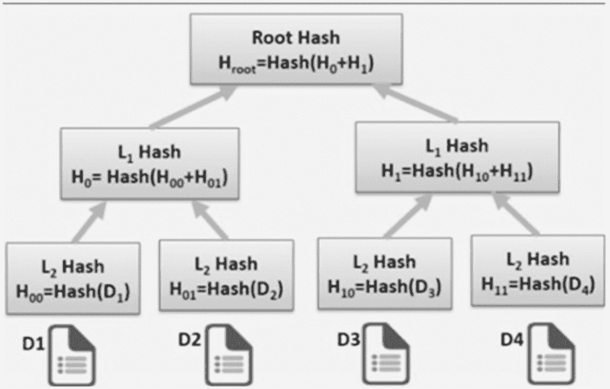

### 区块链的应用领域

1.  **供应链管理**：区块链可用于追踪货物的流向、来源、数量等。这为 B2B 生态系统带来了新的透明度——简化了所有权转移、生产流程验证和支付等程序。
2.  **智能合约**：借助智能合约，协议可通过区块链结构自动验证、签署和执行。这消除了对中介的需求，从而为组织节省时间和金钱。
3.  **数字投票**：利用区块链，选民可以在对外界保持匿名的同时，核实其选票是否成功传输。2014 年，丹麦政党自由联盟成为首个利用区块链进行投票的组织。
4.  **股票交易**：由于区块链系统能极快地验证和结算交易，它可以消除投资者在出售股票并寻求获取资金以进行再投资或提取时所经历的数天等待时间。
5.  **代理行银行业务**：全球支付领域容易出错、成本高昂，且敞口洗钱风险。资金跨越全球需要数天甚至更久。区块链目前正为结算机构提供解决方案，例如 Abra、Align Commerce 和 Bitspark，它们提供端到端的区块链驱动结算服务。


### 6. 许可区块链

在许可区块链模型中，客户端不需要完全匿名，而是伪匿名或彼此已知。在许可区块链中，证书颁发机构提供电子证书（Hyperledger Composer 中的公共证书为 x.509），成员服务提供商管理区块链的成员资格。许可区块链维护一个访问控制层，仅允许特定的可识别参与者执行某些操作。

## 相关工作

物联网（IoT）有能力使家庭和我们的生活更加智能。正如 Ning, H. 等人（2012）所述，这些创新性进步为日常活动提供了便利、活力效率、安全性和舒适性。例如，向家庭等不同场景添加洞察能力，可以为残障人士和老年人提供更高的生活质量。研究的很大一部分关注支持远程数据控制、感知和传输的无线技术，例如蜂窝系统、RFID、Wi-Fi 和蓝牙，这些技术已被用于将智能植入环境中。

Kranz, M. 等人（2009）对一种基于蓝牙的系统进行了研究，该系统利用智能手机实现无需互联网的可控性，其中设备与蓝牙子控制器的物理连接已完成，随后通过内置的蓝牙网络对智能手机进行控制。然而，该系统任务范围的限制意味着它无法应对移动性，因此只能在设备区域内唯一控制。科学家们还努力提供远程访问和系统互操作性，以利用家庭网关控制家庭中的机器和设备，这见证了基于 Wi-Fi 的系统的引入，这些系统利用基于 PC 的 Web 服务器管理家庭中的连接设备。

Karimi, K. 等人（2013）认为，世界正进入一个物联网计算技术时代，具有巨大的潜力实现机器与机器、机器与基础设施、机器与自然之间的通信。他的研究将物联网展示为一个基于云技术的通用全球神经网络，将渗透人类生活的所有方面，这将建立在嵌入式处理提供的洞察力之上。智能机器与其他机器、环境、基础设施和对象的通信和关联，将产生海量数据，这些数据将被处理成可控制和指挥物品的活动，使生活更安全、更简单。

Jankowski, S. 等人（2014）委托了一份关于物联网的考察报告，报告推断物联网计算浪潮将比过去两次计算浪潮——固定互联网浪潮和移动浪潮——更大。报告假设物联网将导致新技术赢家和输家的形成，这将基于组织适应日益融合和互联世界的能力。技术采用和改进的方向将倾向于报告提出的 S-E-N-S-E 结构：感知、高效、网络化、专业化和无处不在。

Evans, D.（2011）发现物联网已达到这样一个阶段：大量传感器和独特系统必须在通用标准下集成和互操作，建议这种努力需要学术界、标准组织、政府和企业成对合作。该报告还考虑了物联网要获得公众广泛认可必须发生什么，探讨了服务提供商交付增加人们生活价值的应用程序的影响。在结束报告时，分析师探讨了提供人文价值的重要性，而不仅仅是代表技术进步。

Porter, M. E. 等人（2014），参数技术公司（PTC）结合制造业调查了物联网，重点关注其兴起及影响，以及其他赋能技术和市场力量的并行发展。报告中探讨了纯物理产品向结合数字用户界面、软件、传感器和处理器的复杂系统演变，以及这与产品能力提升和价值创造的关系。此外，报告还回顾了物联网的影响如何改变了制造商创造价值并与客户交换价值的能力，特别是当物联网将差异化和价值来源转向服务、云和软件时，从而创造了新的商业模式。

Miorandi, D. 等人（2012）将物联网称为一个通用术语，涵盖互联网和网络渗透物理领域的整个程度，其中空间部署的设备广泛分布并嵌入物理对象中，通过改进的激活/检测能力进行识别。物联网概念设想了一个物理实体和数字化实体全部互联的世界，利用相关和适当的 ICT 框架提供新一代服务和应用的访问。

Tan, L. 等人（2010 年 8 月）主张未来所有物体都将拥有用于识别的独特特征，这些特征可以互联以构成物联网。因此，通信将从仅在人与人之间转变为人与物之间的通信，这将通过普适通信和计算时代的发展，改变我们所知的生活。RFID 和其他用于重要识别目的的检测技术普遍被认为是即将到来的物联网时代的基石。

Murthy, D. N. 等人（2015）给出了理由，描述新兴的“物联网”（IoT）将如何为将创新和自动化引入我们所做的一切提供前所未有的机会，同时为组织提供一个巨大的舞台，以开发更新的商业计划来获取市场份额。如今互联网上可用的数据在很大程度上受限于生成内容的用户数量。互联网用户从几年前的几千人增长到 2014 年的 28 亿，预计到 2020 年将增长到 65 亿。

Queiroz, M. M. 等人（2019）提出了解决方案，旨在改变和翻新物流和供应链系统所有成员之间的联系。他们提出了连接这一鸿沟的方法，具体是通过理解印度和美国物流及供应链领域的个人区块链采用行为。借助区块链、供应链和系统理论的新兴文献，以及技术接受模型（TAMs），建立了一个基于经修改的传统统一技术接受和使用理论（UTAUT）的模型。该模型随后使用偏最小二乘结构方程建模（PLS-SEM）进行评估。随着模型最终得到支持，获得的结果揭示了印度专家和美国专家之间存在明显的采用行为差异。同时，这些发现为 IT 采用、SCM 和区块链文献做出了有价值的贡献，并指示了其发展方向。


## Pappalardo, G. et al. (2018) 研究

Pappalardo, G. 等人 (2018) 探索了 Bitcoin 系统，监视了 2016 年 5 月 4 日起七天内传入系统的交易，并随后观察了它们在随后七个月内被纳入区块链的情况。研究显示，42% 的交易在出现 1 小时后仍未被纳入区块链，20% 的交易在 30 天后仍未被纳入，从而揭示了 Bitcoin 框架的惊人低效性。然而，我们看到大多数这些“被忽略”的交易价值较低，就移动框架而言，93% 的交易价值在 3 小时内被纳入区块链，98.8% 在一天内被纳入，因此低效性较小。大量交易未能被及时处理这一事实，对 Bitcoin 区块链用于可靠时间戳记目的的易用性提出了严重质疑。

## 印度的物联网

政府活动、支持条件、良好的生活标准以及智能应用的日益普及，在市场发展中发挥着基础作用。根据 Kumaran, V. (2015) 的 COMSNETS 报告，政府考虑投资物联网以建设约 100 个智慧城市，预估拟议成本为 7060 亿卢比。尽管根据印度需求，物联网产品在各个领域都很有用，且各组织已在许多领域投入资源，这一比例日益增加 (Dhote S., 2017)，但重点集中在智慧水务管理、智慧环境、医疗保健、智慧农业、智慧废物管理、智慧安全、智慧供应链等。然而，根据印度经济因素，对十亿人口的可负担性很困难。支持条件和印度基础设施如电力供应、严重污染、极端温度、高湿度和灰尘、无清洁和差的电信覆盖。下表 1 显示了全球和印度的物联网市场。

### 表 1. 全球和印度的物联网市场

| S.No. | IoT Global | IoT India |
| --- | --- | --- |
| 1. | 全球物联网市场将从 2015 年的 154 亿台设备增长到 2020 年的 307 亿台，到 2025 年达到 754 亿台。 | 预计到 2020 年，印度物联网市场将增长至 150 亿美元，拥有 27 亿台设备，从目前的 56 亿美元和 2 亿台连接设备增长而来。 |
| 2. | 在 2016-2021 年期间，基于活动的物联网产品和服务的全球支出预计将达到 1200 亿至 2530 亿美元，实现 16% 的复合年增长率 (CAGR)。 | 在 2015-2020 年期间，印度物联网市场预计将以超过 28% 的复合年增长率增长，业务预计到 2020 年将达到 3000 亿美元。 |
| 3. | 物联网将在未来 20 年为全球 GDP 增加 10 万亿至 15 万亿美元。 | 印度政府的目标是到 2020 年在印度产生 150 亿美元的物联网产值。 |
| 4. | 2020 年，自动驾驶和物联网赋能的车辆将在国际上增加。 | 在印度，公用事业领域和石油部门逐渐跻身前五大板块，如电子和电信，两者均为创收部门。 |

## 物联网在不同行业的应用

物联网将使各行业的协会能够提供新服务或彻底改变其行动计划。表 2 简要展示了“网络物理系统”在各行业中可实现的新商业模式。

### 表 2. 物联网应用——不同行业示例

| Industry | Equipments | Interface | Solution or service | Analytics | Outcome |
| --- | --- | --- | --- | --- | --- |
| Consumer goods and retail | 可捕获最终用户和库存上下文的传感器：例如 RFID、位置传感器、摄像头、带传感器的机器人、专用设备 | 来自用户设备的建议和推荐；最终用户移动设备上的定向广告 | 准确的实时消费者上下文知识（存在、位置、偏好等）；供应链库存监控 | 上下文辅助的实时用户画像；从原始传感器数据提取上下文的分析；由实时数据增强的整个供应链分析范围 | 为消费者创造新颖的增值应用，如过期日期提醒、虚拟检查产品的化身等；定向广告 |
| Manufacturing | 监控与数据采集 (SCADA) 系统 / 可编程逻辑控制器 (PLCs)、控制器或网关、摄像头、安装在资产上的物联网设备、嵌入机器中的物联网设备 | 主要在中央控制台；可连接到专家的移动终端进行远程咨询 | 远程监控和诊断、生产线自动化、通过位于生产车间的传感器进行设备处理和诊断、故障时的远程专家诊断 | 设备使用和运行中的异常检测、预测性维护、生产线自动质量监控 | 降低现场支持成本、减少故障、提高运营效率、生产线最佳调度、异常检测和排放检测、提高质量和降低能源成本 |
| Healthcare | 可穿戴和个人医疗设备、移动电话 | 借助临床决策支持系统，在医疗超级专家移动终端上进行远程咨询 | 远程专家医生咨询/监控、慢性病管理、老年护理、健康和健身计划 | 记录的医疗数据异常检测、历史相关性 | 降低护理成本、改善患者结果、实时疾病管理、提高患者生活质量 |
| Insurance | 描述受保实体状况/使用情况的传感器 | 移动应用——基于使用的增值汽车保险应用，根据驾驶行为和使用情况计算保费 | 收集用户数据（如家庭设备状况用于家庭保险、驾驶习惯用于汽车保险）；财产损失预测；损害和事故的远程检查和评估 | 使用模式检测、异常检测、自动评估 | 创建更新的保险模型，如基于财产状况的动态保费定价、基于使用的保费定价等 |
| Transportation | 车载网关设备、RFID 标签、传感器 | 向驾驶员/操作员发送实时警报；指挥控制中心的仪表板/控制面板；公共显示/标牌；基于 Web 的查询和报告 | 物流和公共交通系统的实时车辆跟踪和优化、资产管理和跟踪 | 关联运输系统的可视化、预测、优化和决策支持系统 | 提高服务水平、降低成本和降低碳足迹 |
| Utilities (energy, water, gas) | 能源、水或燃气表 | 可在任何联网设备上访问 | 实时收集使用数据、供需预测、负载平衡、动态关税生成 | 历史使用分析、使用预测、供需预测 | 连接到这些智能网络的消费者已看到显著的成本和资源节约 [12] |


## 物联网中的技术挑战

当您准备部署基于传感器的服务时，仍可能会遇到一些实际困难。

### 1. 设备管理
传感器、网关和设备的数量将非常庞大，且分布在广阔的陆地面积上——通常位于偏远、难以到达或私人区域。确保设备完全自动化且可远程管理是一项挑战。

### 2. 设备多样性与互操作性
以城市电网为例，该电网已启用传感器，并需要在近实时状态下持续监控。如此复杂系统中的发电、输电和配电功能需要来自不同供应商的各类传感器设备。由于许多供应商的产品不支持任何标准，互操作性问题在所难免。

### 3. 来自各种来源的数据集成
当您部署物联网应用时，将从各种来源获得大量信息，例如传感器、来自手机数据的逻辑信息、社交网络源和其他网络资源。请注意，信息的语义必须是信息本身的一部分，而不应锁定在各个应用存储库的应用逻辑内部。

### 4. 规模、数据量与性能
准备您的业务以应对物联网应用的规模、数据量和速度。随着设备和用户数量的扩大，需要摄取、存储和分析的信息量也将随之增加。您将面临大数据问题，标准架构和平台可能显得不足。此外，在需要严格实时性能的情况下，网络和应用层面的延迟可能成为问题。

### 5. 应用的灵活性与开发
您将看到传感器和设备不断进化，拥有更强的能力。这将催生新的分析技术和算法，以及新的用例和商业模式。您必须以最小的工作量快速开发应用程序。您将需要能够赋能并支撑这一点的生态系统和平台。

### 6. 数据安全
从设备收集的大量信息将是敏感的个人信息，必须防止未经授权的访问，且仅用于客户授权收集该信息的特定目的。必须为客户提供基本工具，使其能够定义向授权人员和应用程序共享其个人信息的策略。

### 7. 另一项挑战，但非技术层面
您必须与各种利益相关者合作。物联网运行在一个复杂的环境中，端到端的物联网应用涉及多种技术、建设活动和不同主体。您作为协作参与者的成长变得至关重要，因为您需要与各类实体和组织合作，例如硅芯片组供应商、嵌入式板卡和设备供应商。

物联网平台供应商、通信服务提供商、系统集成商、应用开发商、行业联盟以及专业技术公司和初创企业。

## 研究方向

在这项变革性技术中，创新从未停止。TCS 创新实验室正在多个领域开展研究，以应对本文讨论的挑战。具体研究领域包括：

*   **a) 网络、存储和计算中的可扩展性**，以应对来自传感器的数据量指数级增长
*   **b) “传输中数据”和“静止数据”的安全性**，且不牺牲可扩展性
*   **c) 用户数据隐私的保护**，并在隐私与效用之间实现恰当平衡
*   **d) 琳琅满目的传感器数据源之间的互操作性**（物理通信层面、网络层面、数据语法层面和数据语义层面）
*   **e) 丰富的分析与可视化**（通用、特定传感器和特定领域），按需实时提供

## 结论

正如互联网在过去二十年里改变了商业和生活方式，物联网将颠覆您组织与其利益相关者的关系。虽然它复杂、带来一些风险且仍在演进，但许多先行者已开始采用这项技术。一个创新的合理化平台，能够赋能设备管理、应用管理以及带有分析功能的传感器数据管理，将开启您与数字物理系统的互动。这有助于您创新新流程和举措以提升组织的业务绩效，并通过新产品和服务创造客户惊喜。颠覆性进步总会引发非凡的辩论，在未充分确保其运作或将其应用于成本无法弥补改进的场景中，都是极易陷入的陷阱。因此，将区块链应用于物联网的优势应被仔细分析并谨慎对待。在本章中，我们分析了区块链和物联网要有效协同必须解决的基本困难。我们还确定了区块链技术可帮助改进物联网应用的关键点。区块链极有可能改造物联网。这两项技术的结合应在考虑本章确定的困难的前提下进行。标准的选择对于将区块链和物联网作为政府框架的一部分进行融合至关重要。这种选择将加速居民、政府和组织之间的沟通。共识在将物联网作为挖矿过程的一部分进行融合并传递更多区块链方面也将发挥关键作用。

## 参考文献

Ashton, K. (2009). That ‘internet of things’ thing. RFID Journal, 22(7), 97-114.

Dhote, S. (2017). Internet of Things (IoT) . Market in India.

Díaz, M., Martín, C., & Rubio, B. (2016). State-of-the-art, challenges, and open issues in the integration of Internet of things and cloud computing. Journal of Network and Computer Applications , 67, 99–117. doi:10.1016/j.jnca.2016.01.010

Evangelos A, K., Nikolaos D, T., & Anthony C, B. (2011). Integrating RFIDs and smart objects into a Unified Internet of Things architecture. Advances in Internet of Things.

Evans, D. (2011). The internet of things: How the next evolution of the internet is changing everything. CISCO White Paper, 1(2011), 1-11.

Jankowski, S., Covello, J., Bellini, H., Ritchie, J., & Costa, D. (2014). The Internet of Things: Making sense of the next mega-trend . Goldman Sachs.

Karimi, K., & Atkinson, G. (2013). What the Internet of Things (IoT) needs to become a reality. White Paper, FreeScale and ARM.

Kranz, M., Holleis, P., & Schmidt, A. (2009). Embedded interaction: Interacting with the internet of things. IEEE Internet Computing , 14(2), 46–53. doi:10.1109/MIC.2009.141

Kumaran, V. (2015). IoT-Challenges and Opportunities in Indian Market . IESA COMSNETS.

Miorandi, D., Sicari, S., De Pellegrini, F., & Chlamtac, I. (2012). Internet of things: Vision, applications and research challenges. Ad Hoc Networks , 10(7), 1497–1516. doi:10.1016/j.adhoc.2012.02.016


## 参考文献

Murthy, D. N., & Kumar, B. V. (2015). 物联网：它是一项颠覆性技术还是一种颠覆性商业模式？*Indian Journal of Marketing*, 45(8), 18–27. doi:10.17010/ijom/2015/v45/i8/79915

Ning, H., & Hu, S. (2012). 面向未来物联网的技术分类、产业与教育。*International Journal of Communication Systems*, 25(9), 1230–1241. doi:10.1002/dac.2373

Nunberg, G. (2012). *互联网的到来*。Academic Press.

Pappalardo, G., Di Matteo, T., Caldarelli, G., & Aste, T. (2018). 比特币对等网络中的区块链低效性。*EPJ Data Science*, 7(1), 30. doi:10.1140/epjds/s13688-018-0159-3

Porter, M. E., & Heppelmann, J. E. (2014). 智能互联产品如何改变竞争。*Harvard Business Review*, 92(11), 64–88.

Queiroz, M. M., & Wamba, S. F. (2019). 供应链中的区块链采用挑战：对印度和美国主要驱动因素的实证调查。*International Journal of Information Management*, 46, 70–82. doi:10.1016/j.ijinfomgt.2018.11.021

Rivera, J., & van der Meulen, R. (2014). 预测警报：物联网——终端及相关服务。*Technical Report*.

Tan, L., & Wang, N. (2010, 8 月). 未来互联网：物联网。载于 *2010 年第 3 届先进计算机理论与工程国际会议 (ICACTE)* (第 5 卷, pp. V5-376). IEEE.

## 第 12 章

## 作者

*   **Rohit Sansiya**  
      
    印度毛拉纳·阿扎德国家理工学院

*   **Pushpendra Kumar**  
    印度贾坎德中央大学

*   **Ramjeevan Singh Thakur**  
    印度毛拉纳·阿扎德国家理工学院

*   **Abdulhai Mohammadi**  
    印度毛拉纳·阿扎德国家理工学院

## 摘要

区块链也被用于比特币交易，作为一种在云端累积数据文件以实现密钥分发和分布式文件操作的技术。它是一种云服务，用于管理计算云的弹性、存储以及网络安全技术（即通过提供分布式账本服务来存储和共享信息的安全解决方案）。在分布式系统中，遗弃事件比在集中式系统中频繁得多。这一概念导致了许多问题，包括数据可靠性、高昂的经济成本和信息系统安全。在本章中，作者提出了一个区块链新框架，用于监管区块链管理的云服务器，该框架在对等网络中验证了以集中方式共享数据文件的交易可靠性。每笔交易都可以生成密钥，用于服务器认证，以验证所有连接成员从而监控 Web 服务器。

## 1. 引言


## 区块链技术概述

在二十世纪，云计算与面向服务的架构在金融领域、ICT 计算环境和计算云等不同领域存在协作。它可以成功应用于区块链网络。最近，它已在分布式账本上被访问。分布式账本是一个独立的账本。分布式账本的所有节点都对该账本拥有某种级别的访问权限，并同意遵循一种协议及其应用，这有时被称为达成共识。它决定了账本在任何时间点的“真实状态”。分布式账本作为行业协作工具非常有用。分布式账本的数据库存在于不同区域或不同参与者之间 (Belin, O.)。然而，去中心化分布式账本消除了对中心化权威机构验证交易的需求 (The World Bank, 2018)。分布式账本中给定时间戳的每一个文件都是一个唯一的加密签名。分布式账本的每个参与者都可以查看所有记录。尽管金融和金融科技群体中存在令人困惑的首字母缩略词，例如 DLT（即分布式账本技术），但它正在重塑那些希望通过区块链即服务 (BaaS) 的去中心化视角来影响其在线交易的企业 (Reiff, N., 2020)。例如区块链的分布式账本对金融交易非常有帮助。它们减少了运营低效。区块链是一种独特类型的分布式账本。它概述了记录交易或数字交互，并为组织带来了急需的透明度、效能和附加安全性。这意味着没有用于云文件存储的中心服务器，而是提供基于解决方案的方法。区块链即服务 (BaaS) 是面向组织在区块链应用中基于云的网络管理的第三方建模。区块链应用远不止加密货币和比特币。凭借其在创造更多透明度和公平性的同时为企业节省时间和金钱的能力，该技术正以多种方式影响着各个领域，范围从协议如何被强制执行到使政府工作更具盈利能力。区块链应用领域广泛，例如加密货币、金融、公共服务、医疗领域、风险管理等。区块链即服务 (BaaS) 是面向公司建立和运行区块链应用的基于云的基础设施管理第三方服务 (Gaurav, A. B., et.al, 2020)。它的角色类似于网络主机。它为应用运行后端操作。区块链即服务 (BaaS) 可能是引导区块链技术广泛采用的推动力。区块链服务利用混合云服务器来强化云服务的安全性。在区块链即服务中，可防止区块链服务中的分片攻击。当解决一个数学问题时，交易由云服务器进行验证 (Singh, S., & Singh, N., 2016)。区块链交易流程由区块链网络实施，以独立获取一个记录交易数据或其他信息的分布式数据库系统。人们很快发现，只要加密货币和区块链的基础设施存在，就能在成本和效能方面带来商业优势。区块链在提高交易透明度方面也扮演着新兴角色，而这可能是一个棘手的问题。区块链提供了一个不可变的分布式文档跟踪系统。换句话说，在需要交易文档的地方，区块链可以确保所有参与者对同一信息拥有相同的访问权限。用另一种说法，没有参与者可以更改记录。每个人都确信文档是准确且安全的。本质上需要非中心化数据安全存储的许多应用，都可以从在区块链上存储数据中受益。区块链的分布式特性意味着所有各方都得到统一通知，因为存在“单一事实来源” (Rosic, A., 2017)。因此，合约得以更精确地完善。它允许在没有延迟的情况下达成结论和付款。区块链的弹性及其相关技术使其适用于多种尚未被发明的应用。区块链应用的另一个缺点是，一旦数据被添加到区块链，就很难修改它。虽然透明度是区块链的优势之一，但传输区块链数据或代码并不总是好事，即通常非常寻求且往往需要硬分叉，即放弃一条链并采用一条新链。特别是使用“工作量证明”的区块链应用，效率特别低下 (John Rampton, The Economist)。由于挖矿主要是竞争性的，且每十分钟只有一个赢家，其他所有矿工的努力都被浪费了。由于矿工经常试图增加其算力，因此他们有很大机会找到有效的区块哈希。比特币网络使用的资源显著增加。近年来，其消耗的能源超过许多国家，例如丹麦、爱尔兰和尼日利亚 (Bauerle, N., 2017)。当网络上用户过多时，区块链流程较慢，会变得更慢。由于其共识机制，区块链更难扩展。它消耗过高的能源。区块链无法回滚，因为数据不可变。由于其运作方式，区块链有时效率低下。用户必须维护自己的钱包，否则会失去访问权。区块链实施是一个昂贵的过程。在成熟和标准化之前，它仍有很长的路要走。区块链目前不提供互操作性。很难集成到遗留系统中。有各种风险和安全挑战需要关注 (Ahram, T. et al., 2017; Chanti, S., 2020)。区块链交易的类似过程涉及集成混合云服务器并授权使用区块链服务。本章提出了一种区块链架构，可轻松与大规模中心化计算环境相结合。我们简要讨论了将区块链与云平台集成的概念，以提高数据存储和资源的安全性。每笔区块链交易都在节点之间连接并经过验证，以确保针对攻击的安全性。由于云计算的一致性和可访问性，区块链服务需要云计算。因为它允许基础设施以一致的方式扩展，这更侧重于扩展服务，而两种技术的集成可以确保一致的性能和安全性。它为增强对许多信息资源的可访问性提供了机会，这些资源或锁定在专有应用中，或锁定在不可访问的桌面应用中，因为对云中信息的访问主要通过 Web 界面完成。我们方法的核心是以少量的延迟和交易开销为代价，换取潜在的大量经济效用。区块链即服务在云上使用自动远程监控。它连接到区块链网络以测试区块链应用。这使得它们将 IT 系统放置在互联平台上变得有利，该平台拥有密集、全球分布的区块链提供商生态系统，用于在多个区块链提供商账本及其遗留 IT 系统之间传输数据。”每笔区块链交易在两种环境中都是数据和用户管理的重大责任。

### 2. 区块链技术概述


### 区块链即服务

区块链是首个记录所有实际数据的点对点去中心化服务。每个区块通过加密哈希与前一个区块相链接。比特币的区块大小限制为 1 MB。在区块链交易中，由数据文件组成以将交易作为服务保留在区块链中。比特币逐渐声名鹊起，在凭借引人入胜且真实可靠的网络空间运营资产体系后，被认可为一种有效的加密货币。例如，区块链交易可在区块链网络中安全地以数字货币交换数据存储。区块链是一种跨组织网络的哈希值去中心化技术。因此，网络中区块大小与区块安全性之间的权衡一直是一个棘手的挑战。比特币网络每秒的最小交易量受到限制，无法处理大量高频业务。然而，巨大的区块意味着海量的存储空间和区块链网络中适度的传播速度。在集成云服务器开发的区块链模块中，图 1 形象地展示了区块链即服务的功能表示。

| 图 1. 区块链即服务 |
| --- |
| 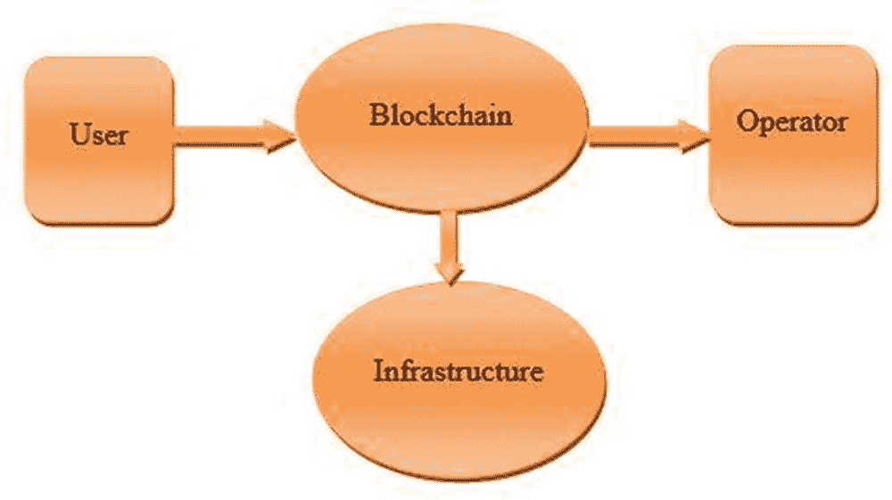 |

众所周知，将服务器与区块链云集成是一项测试工作，或者是支持附加区块链应用的一种方式。显然，区块链即服务旨在促进云中的便捷访问。区块链即服务是否将在更多应用中发挥作用尚不清楚。随后，我们利用区块链技术作为一种交易模式，连接需要云服务存储数据文件的用户和提供所有存储空间的用户。区块链服务需要去中心化的控制系统来维护信息。它可以在云平台上通过区块链服务实现，即服务提供商仅被授权访问用于服务的数据文件。基于数据中心的存储之外，去中心化的区块链云存储网络已启动，并具有诸多优势。这类似于传统的校正，中心化云存储系统抵制客户端加密过程将适用于区块链即服务。

这接近于后续备选方案，并侧重于中心化需求。

## 3. 系统概述

区块链技术还致力于为集成混合云服务器提供框架，以应对发展中国家金融领域的远程监控挑战。这将允许它们非常快速地生成私有、公有和基于群组的区块链技术。区块链应用于去中心化系统，配合全球中心化平台。混合云计算的中心化系统管理协助联盟根据其需求自动扩展框架。为了减少工作量和精力，中心化云服务器可能是首要选择。但一旦数据文件被积累并集中保存，用于调查和识别多种类型的威胁和攻击模型（Liang, X. et al., 2017）。区块链使用非对称密码学方法来证明和验证交易。

### 3.1 数字签名

数字签名是对手与模拟器之间的博弈。模拟器运行设置算法生成验证密钥给对手，并保留签名密钥。基于公钥加密的数字签名用于欺骗性环境（Kumar, M. et al., 2018 and Bernstein, A. J. 1966）。对手查询模拟器对其选择的消息进行签名，并收到使用秘密签名密钥生成的有效签名作为回复。经过数字签名的交易在整个网络中传输（Kirkman, S., 2018）。旨在为电子数据文件提供有效性、完整性和不可否认性。因此，一个人的数字签名因记录而异，从而验证文档中每一条款的真实性。

### 3.2 远程监控

区块链的远程监控是多层云的同一集成框架，用于以中心化方式对区块链交易进行负载均衡。这种观点过于直白而简化了问题，它直接映射到传统的中心化交易系统，其中每笔交易都需要由中央可信机构维护。此处步骤在一个循环中执行：

*   检索后一个区块
*   如果这是一个新区块，保留它并记录这是我们见到的最后一个区块
*   如果这是一个我们之前处理过的区块，等待 x 秒。
*   重复

现有的大多数关于云服务联盟的研究，都是针对利用区块链即服务的所有详细 SLA 监管。它要么以安全的方式维护攻击，要么远程检索控制结构监控系统。云必须请求授权以执行活动，如漂移数据以获取（Keenan, T. P., 2017）。

### 3.3 去中心化区块链服务的优势

由于中心化系统在区块链系统中并不足以确定保护网络的能力。去中心化在云计算中发挥着巨大作用，在云网络中执行点对点区块链网络服务，服务于云存储。

该网络基于区块链技术非常安全且经过验证（Xu, R., et al., 2018）。区块链创建了一个去中心化和分布式的存储市场，足以弥补远程监控服务器存储的不足。作为入侵者监控区块链交易可能会直觉出任何组织的建设性信息。采用混合云方法，去中心化能源将数据同时维护在公有云和私有云上。去中心化区块链网络是云计算中一个全新的概念。

### 3.4 集成混合云服务以支持区块链交易

该解决方案的首要目的是了解区块链交易如何工作，以及它如何与区块链交易中现有的联合应用程序保持一致。区块链交易正处于成为一种颠覆性技术的前沿。存在一个激烈的市场，用于区块链与现有遗留和 ERP 技术的系统集成，将区块链解决方案变为可投产的追踪系统、现有强化服务。在本提案工作中，我们致力于在混合云服务器中集成区块链交易。它是简单且彻底去中心化的区块链（Xu, R. et al., 2018）。也曾有类似尝试将访问控制与某些加密古董（如基于属性的加密）相集成。因此，当利用这些方案支持您的数据文件进行受限控制时。它可以为组织数据的可靠性增加一层信任。从内在角度来看，区块链技术对中心化数据库结构没有优势。两者都可以使用先进的加密算法。此外，中心化数据库可以完全与网络断开。因此，在区块链交易中，有必要获得严格的指令以获取所有必需的编码数据文件，并加密发送数据文件到云服务器（Bendiab, K., et al., 2018）。

## 4. 实现

在本节中，我们首先描述整个系统的设置，然后讨论集成混合云服务器与远程监控以实现区块链即服务的实现，将按如下所示进行说明。

### 4.1 系统设置


## 在下图 2 中，一笔交易修改了一个或多个实体的状态

每个实体维护一个包含有序交易列表的账本。所有正确的实体就交易的相同顺序达成一致。数百到数千个实体；每秒数千笔交易。交易数据及元数据的保密性。实体集合、交易处理逻辑可演进。互操作性、检查点等。改编自去中心化加密货币：比特币、以太坊等。

| 图 2. 仅追加日志 |
| --- |
| 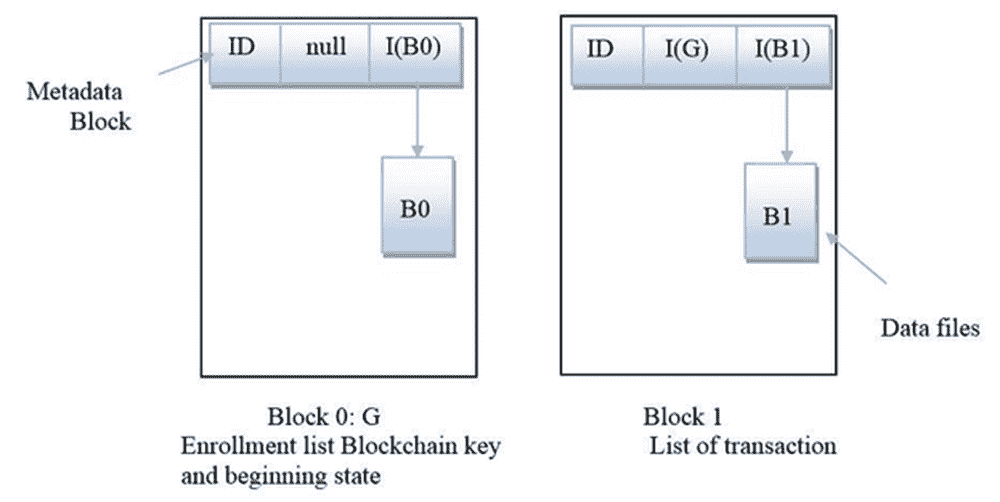 |

每一对正确的成员共享一致的批准前缀，即使 BSP 是恶意的，即使任意数量的成员是恶意的。依赖批准交易的语义：(`memi`, hash, len, sig)。一种成员就单一、一致账本达成一致的简单协议。它不需要任何显式的点对点协调，且批准交易可随时发送。批准交易很小：<256 字节。该协议大多是无状态的：所有状态均保存在账本上。它要求所有人参与：每个成员必须定期发送其批准交易。每个成员节点必须验证所有交易。交易无机密性。基于网络假设，我们有其他机制让成员怀疑潜在的活性和公平性违规。通过改编复制状态机的思想，有两种放宽方式：

*   假设只有阈值数量的节点会出现故障（即 `f < n/3`）
*   防止成员产生歧义（通过飞地/可信执行环境）

## 4.2. 步骤 1-8

### 步骤 1

这结合了不可变存储、电子签名和加密。任何格式的信息大致都可以保存在区块链中。它可以生成公私钥对，也可用于生成和验证数字签名。根据图 3，在特定假设下使用 `Merkle-tree` 以确保程序表现良好（Perugini, S. 2018 & Romero Laorden, D. et. al., 2016）。

| 图 3. 用于数据审计的默克尔树 |
| --- |
| 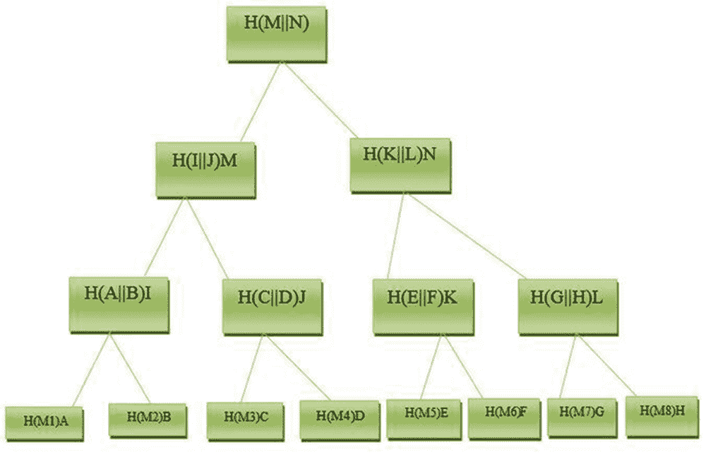 |

证明的大小为 `O (l*log n)`，其中 `n = 数据块数量`，`l` 为挑战查询的数量。无需检索数据即可允许验证者（即客户端）验证 CPS 仍持有客户的原始数据。客户端（验证者）运行高效的数据审计证明。

### 步骤 2

发送者在记录上写入数据文件的哈希值。用户使用接收者的公钥加密记录，并将加密密钥渲染到记录中（Sukhodolskiy, I. et al., 2018 and Wang, K., Kulkarni, 2015）。根据测试用例，需要选择使极端知识成为可能的去中心化共识问题。擦除码的预处理如下：

*   有限字母表 `Σ` 上的 `(n,f,d)Σ` 消除码是一种故障标记密钥，包含
*   `Enc: Σf?Σn` 编码算法
*   `Dec: Σn?Σf` 解码算法 `d` 是该密钥的最小距离（任意两个码字之间的汉明距离至多为 `d`）。
*   `(n,f,d)` 消除码可容忍高达 `d-1` 个擦除。
*   若 `d=n-f + 1`，我们称该码为最大距离可分码。
*   对于最大距离可分码，原始信息可从该码字的任意 `f` 个符号（共 `n` 个）中恢复。

### 步骤 3

所有区块和认证器均上传至云服务器。当进行修改时，云端知晓位置。因为验证应当快速。执行审计的第三方不应知晓数据内容（隐私保护）。

| 图 4. 比特币交易 |
| --- |
| 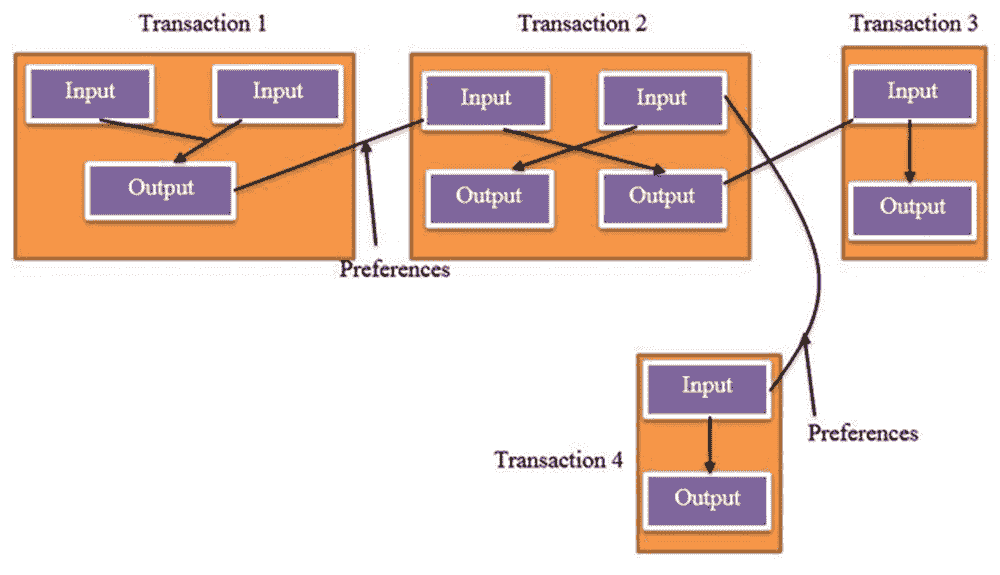 |

根据图 4，发送者可通过控制区块验证交易完全由接收者指示。每笔交易后，偏好仅确认比特币交易。

### 步骤 4

此步骤在于节点是否将传递给云服务器以集成区块链服务，或两者兼有。在此过程中执行发送区块链交易的过程。

### 步骤 5-6

矿工数量不影响交易。交易可被撤销。区块链交易在云服务器上针对区块链交易进行断言。某些交易在去中心化的基于交易的账本中，因具有众多输入而尚不可避免。所有对等节点应就交易序列达成一致。交易最成功的用例是具有点对点系统的去中心化比特币。

### 步骤 7

每一次区块链存根的提交，均创建用于认证数据文件的记录。自动合约，在满足特定条件时触发。区块链交易被放入区块，通过 `SHA 256` 哈希链接。对比特币上的交易进行分析，判断系统是否安全可用。其中中心化服务器的成本通常是中心化区块链交易的先前输出。

### 步骤 8

当前变革中非结构化稳健网络的清晰度。节点以微小的团结同时工作。单纯的区块链交易应充分知晓所有关于交易的信息。它仅保留与其关注点相关的那些接受。

## 5. 分析

在本节中，我们将根据实现和安全性研究首选实现。

### 5.1 混合云服务器存储

分布在多地的用户通过高效的数据共享，将在随机性能和耐久性方面提供大幅提升。它具有独特的 I/O 访问特征。稍后，混合云服务器可在交易后证明其存储。数据文件的哈希键长度为 `(920 # n u) 32 字节`。我们假设存储磁盘长度为 `1 TB`，可存储超过 5 亿份接受文档（Wang, S., Zhang, Y., & Zhang, Y. 2018）。区块链应用的披露使我们能够关联存储容量、带宽、CPU 功率等（Zhang, Y., Wu, S., Jin, B., & Du, J., 2017）。例如，每个节点上 `1TB` 的存储磁盘已足够。

### 5.2 安全性

“随着云计算的出现，混合云服务器可能适合那些希望在数据安全与数据文件的可扩展处理之间取得平衡的用户”（Khadilkar, V. et al., 2011）。数据可能仍需保留在云端。在云计算安全不断扩大的解决方案中，远程监控以识别障碍和前景。它可以被可靠地验证，且很难被阻碍（Shih, W. C, et al., 2010 & Park, S. J. 2009）。

## 6. 结论

在本工作中，我们设计了面向服务的去中心化溯源，支持完整的交易完成。用于付款的无效交易将不被接受，也永远不会获得区块。以中心化方式集成混合云服务，将区块链作为服务模型进行操作。客户可专注于任务和区块链的功能，而无需担心表示相关的问题。了解正在进行的交易数据，并知晓交易已完成。数据隐私是一个日益增长的担忧，阻碍了数据共享。我们必须为未来工作表达增强场景的方向。

## 参考文献

Ahram, T., Sargolzaei, A., Sargolzaei, S., Daniels, J., & Amaba, B. (2017). Blockchain technology innovations. In 2017 IEEE Technology & Engineering Management Conference (TEMSCON) (pp. 137-141). IEEE. doi:10.1109/TEMSCON.2017.7998367

Barenji, A. V., Guo, H., Tian, Z., Li, Z., Wang, W. M., & Huang, G. Q. (2019). Blockchain-Based Cloud Manufacturing: Decentralization. Transdisciplinary Engineering Methods for Social Innovation of Industry 4.0., 1003 – 1011. doi: 10.3233/978-1-61499-898-3-1003


## 参考文献

Bauerle, N. (2017). What is Blockchain Technology? Blockchain 101. https://www.coindesk.com/learn/blockchain-101/what-is-blockchain-technology

Belin, O. (n.d.). The Difference Between Blockchain & Distributed Ledger Technology. https://tradeix.com/distributed-ledger-technology/

Bendiab, K., Kolokotronis, N., Shiaeles, S., & Boucherkha, S. (2018). WiP: A novel blockchain-based trust model for cloud identity management. In *2018 IEEE 16th Intl Conf on Dependable, Autonomic and Secure Computing, 16th Intl Conf on Pervasive Intelligence and Computing, 4th Intl Conf on Big Data Intelligence and Computing and Cyber Science and Technology Congress (DASC/PiCom/DataCom/CyberSciTech)* (pp. 724-729). IEEE. 10.1109/DASC/PiCom/DataCom/CyberSciTec.2018.00126

Bernstein, A. J. (1966). Analysis of programs for parallel processing. *IEEE Transactions on Electronic Computers*, EC-15(5), 757–763. doi:10.1109/PGEC.1966.264565

Biswas, R., Das, S. K., Harvey, D., & Oliker, L. (1999). Portable parallel programming for the dynamic load balancing of unstructured grid applications. In *Proceedings 13th International Parallel Processing Symposium and 10th Symposium on Parallel and Distributed Processing. IPPS/SPDP 1999* (pp. 338-342). IEEE. 10.1109/IPPS.1999.760497

Blockchain & Distributed Ledger Technology (DLT). (2018). The World Bank. https://www.worldbank.org/en/topic/financialsector/brief/blockchain-dlt

Chanti, S., Anwar, T., Chithralekha, T., & Uma, V. (2020). Global Naming and Storage System Using Blockchain. In *Transforming Businesses With Bitcoin Mining and Blockchain Applications* (pp. 146–165). IGI Global. doi:10.4018/978-1-7998-0186-3.ch008

Do, H., & Ng, W. K. (2017). Blockchain-based system for secure data storage with private keyword search. In *2017 IEEE World Congress on Services (SERVICES)* (pp. 90-93). IEEE. 10.1109/SERVICES.2017.23

Eldredge, M., Hughes, T. J., Ferencz, R. M., Rifai, S. M., Raefsky, A., & Herndon, B. (1997). High-performance parallel computing in industry. *Parallel Computing*, 23(9), 1217–1233. doi:10.1016/S0167-8191(97)00049-5

Gaurav, A. B., Kumar, P., Kumar, V., & Thakur, R. S. (2020). Conceptual Insights in Blockchain Technology: Security and Applications. In *Transforming Businesses With Bitcoin Mining and Blockchain Applications* (pp. 221-233). IGI Global.

Keenan, T. P. (2017). Alice in Blockchains: Surprising Security Pitfalls in PoW and PoS Blockchain Systems. In *2017 15th Annual Conference on Privacy, Security and Trust (PST)* (pp. 400-4002). IEEE.

Khadilkar, V., Kantarcioglu, M., Thuraisingham, B., & Mehrotra, S. (2011). Secure data processing in a hybrid cloud. *arXiv preprint arXiv:1105-1982*

Kirkman, S. (2018). A data movement policy framework for improving trust in the cloud using smart contracts and blockchains. In *2018 IEEE International Conference on Cloud Engineering (IC2E)* (pp. 270-273). IEEE. 10.1109/IC2E.2018.00054

Kumar, M., Singh, A. K., & Kumar, T. S. (2018). Secure Log Storage Using Blockchain and Cloud Infrastructure. In *2018 9th International Conference on Computing, Communication and Networking Technologies (ICCCNT)* (pp. 1-4). IEEE. 10.1109/ICCCNT.2018.8494085

Li, C., & Hains, G. (2011). A simple bridging model for high-performance computing. In *2011 International Conference on High Performance Computing & Simulation* (pp. 249-256). IEEE. 10.1109/HPCSim.2011.5999831

Li, J., Liu, Z., Chen, L., Chen, P., & Wu, J. (2017). Blockchain-based security architecture for distributed cloud storage. In *2017 IEEE International Symposium on Parallel and Distributed Processing with Applications and 2017 IEEE International Conference on Ubiquitous Computing and Communications (ISPA/IUCC)* (pp. 408-411). IEEE. 10.1109/ISPA/IUCC.2017.00065

Liang, X., Shetty, S., Tosh, D., Kamhoua, C., Kwiat, K., & Njilla, L. (2017). Provchain: A blockchain-based data provenance architecture in cloud environment with enhanced privacy and availability. In *Proceedings of the 17th IEEE/ACM international symposium on cluster, cloud and grid computing* (pp. 468-477). IEEE Press. 10.1109/CCGRID.2017.8

Maggs, B. M., Matheson, L. R., & Tarjan, R. E. (1995). Models of parallel computation: A survey and synthesis. In *Proceedings of the Twenty-Eighth Annual Hawaii International Conference on System Sciences* (Vol. 2, pp. 61-70). IEEE. 10.1109/HICSS.1995.375476

Park, S. J. (2009). An Analysis of GPU Parallel Computing. In *2009 DoD High Performance Computing Modernization Program Users Group Conference* (pp. 365-369). IEEE. doi: 10.1109/HPCMP-UGC.2009.59

Perugini, S. (2018). The design of an emerging/multi-paradigm programming languages course. *Journal of Computing Sciences in Colleges*, 34(1), 52–59.

Rampton, J. (n.d.). 5 applications for blockchain in your business. *The Economist*. https://execed.economist.com/blog/industry-trends/5-applications-blockchain-your-business

Reiff, N. (2020). Blockchain Explained. *Investopedia*. https://www.investopedia.com/terms/b/blockchain.asp

Romero-Laorden, D., Villazón-Terrazas, J., Martinez-Graullera, O., Ibanez, A., Parrilla, M., & Penas, M. S. (2016). Analysis of parallel computing strategies to accelerate ultrasound imaging processes. *IEEE Transactions on Parallel and Distributed Systems*, 27(12), 3429–3440. doi:10.1109/TPDS.2016.2544312

Rosic, A. (2017). 17 Blockchain Applications That Are Transforming Society. *Blockgeeks*. https://blockgeeks.com/guides/blockchain-applications/

Shih, W. C., Tseng, S. S., & Yang, C. T. (2010). Performance study of parallel programming on cloud computing environments using mapreduce. In *2010 International Conference on Information Science and Applications* (pp. 1-8). IEEE. 10.1109/ICISA.2010.5480515

Singh, S., & Singh, N. (2016). Blockchain: Future of financial and cyber security. In *2016 2nd International Conference on Contemporary Computing and Informatics (IC3I)* (pp. 463-467). IEEE.

Sukhodolskiy, I., & Zapechnikov, S. (2018). A blockchain-based access control system for cloud storage. In *2018 IEEE Conference of Russian Young Researchers in Electrical and Electronic Engineering (EIConRus)* (pp. 1575-1578). IEEE. 10.1109/EIConRus.2018.8317400

Wang, K., Kulkarni, A., Lang, M., Arnold, D., & Raicu, I. (2015). Exploring the design tradeoffs for extreme-scale high-performance computing system software. *IEEE Transactions on Parallel and Distributed Systems*, 27(4), 1070–1084. doi:10.1109/TPDS.2015.2430852

Wang, S., Zhang, Y., & Zhang, Y. (2018). A blockchain-based framework for data sharing with fine-grained access control in decentralized storage systems. *IEEE Access: Practical Innovations, Open Solutions*, 6, 38437–38450. doi:10.1109/ACCESS.2018.2851611

Xu, R., Chen, Y., Blasch, E., & Chen, G. (2018). Blendcac: A blockchain-enabled decentralized capability-based access control for iots. In *2018 IEEE International Conference on Internet of Things (iThings) and IEEE Green Computing and Communications (GreenCom) and IEEE Cyber, Physical and Social Computing (CPSCom) and IEEE Smart Data (SmartData)* (pp. 1027-1034). IEEE. 10.1109/Cybermatics_2018.2018.00191

Zhang, Y., Wu, S., Jin, B., & Du, J. (2017). A blockchain-based process provenance for cloud forensics. In *2017 3rd IEEE International Conference on Computer and Communications (ICCC)* (pp. 2470-2473). IEEE. 10.1109/CompComm.2017.8322979

Zheng, Z., Xie, S., Dai, H., Chen, X., & Wang, H. (2017). An overview of blockchain technology: Architecture, consensus, and future trends. In *2017 IEEE International Congress on Big Data (BigData Congress)* (pp. 557-564). IEEE. 10.1109/BigDataCongress.2017.85

## 关键术语与定义


## 术语定义

### Bitcoin
比特币是一种加密货币，一种电子现金的形式。纯粹的点对点版本电子现金将允许在线支付直接从一方发送给另一方，而无需通过金融机构。

### Block
区块是一种容器数据结构，包含一系列交易。区块内的每笔交易都经过数字签名、加密，并由区块链网络的对等节点验证。

### Blockchain
区块链是一个去中心化的计算和信息共享平台，使多个互不信任的权威域能够在理性的决策过程中进行合作、协调与协作。

### Cloud Computing
云计算是计算资源的按需可获得性，特别是计算能力和数据存储，无需用户进行直接的主动管理。

### Cryptocurrency
加密货币是一种利用密码学为在线安全支付系统而设计的机制。

## 参考文献

Abdul-Ghani, H. A., Konstantas, D., & Mahyoub, M. (2018). A comprehensive IoT attacks survey based on a building-blocked reference model. *International Journal of Advanced Computer Science and Applications*, 355-373.

Ackoff, R. L. (1971). Towards a system of systems concepts. *Management Science*, 17(11), 661–671. doi:10.1287/mnsc.17.11.661

Adolphs, P., Bedenbender, H., Dirzus, D., Ehlich, M., Epple, U., Hankel, M., ... Koziolek, H. (2015). Status report-reference architecture model industrie 4.0 (rami4.0). *VDI-Verein Deutscher Ingenieure eV and ZVEI-German Electrical and Electronic Manufacturers Association, Tech. Rep.*

Agrawal R. Verma P. Sonanis R. Goel U. De A. Kondaveeti S. A. Shekhar S. (2018, April). Continuous security in IoT using blockchain. In *2018 IEEE International Conference on Acoustics, Speech and Signal Processing (ICASSP)* (pp. 6423-6427). IEEE. 10.1109/ICASSP.2018.8462513

AhIman, R. (2016). Finish city partners with IBM to validate blockchain application in logistics. https://cointelegraph.com/news/finish-city-partners-with-ibm-to-validate-blockchain-application-in-logistics

Ahram, T., Sargolzaei, A., Sargolzaei, S., Daniels, J., & Amaba, B. (2017). Blockchain technology innovations. In *2017 IEEE Technology & Engineering Management Conference (TEMSCON)* (pp. 137-141). IEEE. doi:10.1109/TEMSCON.2017.7998367

Ahram, T., Sargolzaei, A., Sargolzaei, S., Daniels, J., & Amaba, B. (2017, June). Blockchain technology innovations. In *2017 IEEE Technology & Engineering Management Conference (TEMSCON)* (pp. 137-141). IEEE. doi:10.1109/TEMSCON.2017.7998367

Aitzhan, N. Z., & Svetinovic, D. (2016). Security and Privacy in Decentralized Energy Trading through Multi-signatures, Blockchain and Anonymous Messaging Streams. *IEEE Transaction on Dependable and Secure Computing*, 1.

Ali M. S. Dolui K. Antonelli F. (2017). IoT data privacy via blockchains and IPFS. In *International Conference on the Internet of Things*. ACM. 10.1145/3131542.3131563

Alketbi, A., Nasir, Q., & Talib, M. A. (2018, February). Blockchain for government services—Use cases, security benefits and challenges. In *2018 15th Learning and Technology Conference (L&T)* (pp. 112-119). IEEE.

Alphand, O., Amoretti, M., Claeys, T., Dall’Asta, S., Duda, A., Ferrari, G., . . . Zanichelli, F. (2018, April). IoTChain: A blockchain security architecture for the Internet of Things. In *2018 IEEE Wireless Communications and Networking Conference (WCNC)* (pp. 1-6). IEEE. doi:10.1109/WCNC.2018.8377385

Anand, Conti, Kaliyar, & Lal. (2019). TARE: Topology Adaptive Re-kEying scheme for secure group communication in IoT networks. *Springer Science+Business Media, LLC*.

Anchor, B. I. S. T. (2019). Taraxa White Paper.

Androulaki, E., Barger, A., Bortnikov, V., Cachin, C., Christidis, K., De Caro, A., . . .. (2018). Hyperledger fabric: a distributed operating system for permissioned blockchains. In *EuroSys '18 - Proceedings of the Thirteenth EuroSys Conference*. Porto: ACM. 10.1145/3190508.3190538

Antonopoulos, A. M. (2014). *Mastering Bitcoin* (1st ed.). O’Reilly Media.

Anwar, H. (2018). Consensus Algorithms: The Root Of The Blockchain Technology. Retrieved from https://101blockchains.com/consensus-algorithms-blockchain

Apostolaki, M., Zohar, A., & Vanbever, L. (2017, May). Hijacking bitcoin: Routing attacks on cryptocurrencies. In *2017 IEEE Symposium on Security and Privacy (SP)* (pp. 375-392). IEEE. doi:10.1109/SP.2017.29

Ashton, K. (2009). That ‘internet of things’ thing. *RFID Journal*, 22(7), 97-114.

Atlam, H. F., Alenezi, A., Alassafi, M. O., & Wills, G. (2018). Blockchain with Internet of Things: Benefits, challenges, and future directions. *International Journal of Intelligent Systems and Applications*, 10(6), 40–48. doi:10.5815/ijisa.2018.06.05

Atzori, L., Iera, A., & Morabito, G. (2010). The Internet of Things: A Survey. *Computer Networks*, 54(15), 2787–2805. doi:10.1016/j.comnet.2010.05.010

Bahga, A., & Madisetti, V. K. (2016). Blockchain platform for industrial internet of things. *Journal of Software Engineering and Applications*, 9(10), 533–546. doi:10.4236/jsea.2016.910036

Banerjee, M., Lee, J., & Choo, K.-K. R. (2017). A blockchain future to Internet of Things security: A position paper. *Digital Communications and Networks*. doi:10.1016/j.dcan.2017.10.006

Banker, S. (2016). Will blockchain technology revolutionize supply chain applications? https://logisticsviewpoints.com/2016/06/20/will-block-chain-technology-revolutionize-supply-chain-applications/

Barenji, A. V., Guo, H., Tian, Z., Li, Z., Wang, W. M., & Huang, G. Q. (2019). Blockchain-Based Cloud Manufacturing: Decentralization. *Transdisciplinary Engineering Methods for Social Innovation of Industry 4.0.*, 1003 – 1011. doi: 10.3233/978-1-61499-898-3-1003

Barreto, L., Amaral, A., & Pereira, T. (2017). Industry 4.0 implications in logistics: An overview. *Procedia Manufacturing*, 2017(13), 1245–1252. doi:10.1016/j.promfg.2017.09.045

Bassi, A., Bauer, M., Fiedler, M., & Kranenburg, R. V. (2013). *Enabling things to talk*. Springer-Verlag GmbH. doi:10.1007/978-3-642-40403-0

Bastos, D., Shackleton, M., & El-Moussa, F. (2018). Internet of Things: A survey of technologies and security risks in smart home and city environments. *Academic Press*.

Bauerle, N. (2017). What is Blockchain Technology? Blockchain 101. https://www.coindesk.com/learn/blockchain-101/what-is-blockchain-technology

Bauk, S., Dlabač, T., & Škurić, M. (2018, February). Internet of Things, high resolution management and new business models. In *2018 23rd International Scientific-Professional Conference on Information Technology (IT)* (pp. 1-4). IEEE. 10.1109/SPIT.2018.8350850

Belin, O. (n.d.). The Difference Between Blockchain & Distributed Ledger Technology. https://tradeix.com/distributed-ledger-technology/

Belluz, J., & Hoffman, S. (2015). The One Chart You Need to Understand Any Health Study. *Vox*. Available online at: https://www.vox.com/2015/1/5/7482871/types-of-study-design

Benchoufi, M., & Ravaud, P. (2017). Blockchain technology for improving clinical research quality. *Trials*, 18(1), 335. doi:10.1186/s13063-017-2035-z

Bendiab, K., Kolokotronis, N., Shiaeles, S., & Boucherkha, S. (2018). WiP: A novel blockchain-based trust model for cloud identity management. In *2018 IEEE 16th Intl Conf on Dependable, Autonomic and Secure Computing, 16th Intl Conf on Pervasive Intelligence and Computing, 4th Intl Conf on Big Data Intelligence and Computing and Cyber Science and Technology Congress (DASC/PiCom/DataCom/CyberSciTech)* (pp. 724-729). IEEE. 10.1109/DASC/PiCom/DataCom/CyberSciTec.2018.00126

Bernstein, A. J. (1966). Analysis of programs for parallel processing. *IEEE Transactions on Electronic Computers*, EC-15(5), 757–763. doi:10.1109/PGEC.1966.264565

Bistarelli, S., Mercanti, I., Santancini, P., & Santini, F. (2019). End-to-End Voting with Non-Permissioned and Permissioned Ledgers. *Springer Nature B.V.* doi:10.1007/s10723-019-09478-y


## 参考文献

Biswas, R., Das, S. K., Harvey, D., & Oliker, L. (1999). 非结构化网格应用动态负载均衡的可移植并行编程。载于 *第 13 届国际并行处理研讨会暨第 10 届并行与分布式处理研讨会论文集. IPPS/SPDP 1999* (pp. 338-342). IEEE. doi:10.1109/IPPS.1999.760497

区块链与分布式账本技术 (DLT)。(2018)。*世界银行*。https://www.worldbank.org/en/topic/financialsector/brief/blockchain-dlt

Bodkhe, U., Mehta, D., Tanwar, S., Bhattacharya, P., Singh, P. K., & Hong, W. C. (2020). 面向网络物理系统的去中心化共识机制综述。 *IEEE Access: Practical Innovations, Open Solutions*, 8, 54371–54401. doi:10.1109/ACCESS.2020.2981415

Brown, R. G., Carlyle, J., Grigg, I., & Hearn, M. (2016). Corda: 简介。 *R3 CEV*, 1, 15.

Cam-Winget, N., Sadeghi, A.-R., & Jin, Y. (2016). 特邀：物联网能否被保护：连接未连接事物的新兴挑战。 *第 53 届年度设计自动化会议论文集 (DAC ’16)*。 doi:10.1145/2744769.2905004

Chanti, S., Anwar, T., Chithralekha, T., & Uma, V. (2020). 基于区块链的全局命名与存储系统。载于 *利用比特币挖矿与区块链应用变革商业* (pp. 146–165)。IGI Global。 doi:10.4018/978-1-7998-0186-3.ch008

Chen, G., Xu, B., Lu, M., & Chen, N.-S. (2018). 探索区块链技术及其在教育领域的潜在应用。 *智能学习环境*, 5(1), 1–10. doi:10.1186/s40561-017-0050-x

Chen, R., Guo, J., & Bao, F. (2014). 基于 SOA 的物联网系统中服务组合的信任管理。 *2014 IEEE 无线通信与网络会议论文集 (WCNC)*, 3444–3449. doi:10.1109/WCNC.2014.6953138

Choi, S. S., Burm, J. W., Sung, W., Jang, J. W., & Reo, Y. J. (2018). 一种基于区块链的安全物联网控制方案。载于 *2018 年计算与通信工程进展国际会议 (ICACCE)* (pp. 74-78)。 IEEE。 doi:10.1109/ICACCE.2018.8441717

Chollet, Castiaux, Bruneton, & Sainlez. (2013). 利用区块链与物联网实现供应链溯源的持续互联供应链。 *德勤区块链*。

Christidis, K., & Devetsikiotis, M. (2016). 面向物联网的区块链与智能合约。 *IEEE Access: Practical Innovations, Open Solutions*, 4, 2292–2303. doi:10.1109/ACCESS.2016.2566339

Čolaković, A., & Hadžialić, M. (2018). 物联网：使能技术、挑战与开放研究问题综述。 *计算机网络*, 144, 17–39. doi:10.1016/j.comnet.2018.07.017

Conoscenti, M., Torino, D., Vetr, A., Torino, D., & De Martin, J. C. (2016). 面向物联网的区块链：系统性文献综述。 *IEEE/ACS 第 13 届计算机系统与应用国际会议 (AICCSA)*。 doi:10.1109/AICCSA.2016.7945805

Conti, M., Kumar, E. S., Lal, C., & Ruj, S. (2018). 比特币安全与隐私问题综述。 *IEEE Communications Surveys and Tutorials*, 20(4), 3416–3452. doi:10.1109/COMST.2018.2842460

Crosby, M., Nachiappan, Pattanayak, P., Verma, S., & Kalyanaraman, V. (2016). 区块链技术：超越比特币。 *应用创新评论*, 2(6-10), 71.

Cui, Y. (2018). 物联网驱动的供应链创新。载于 *应用于供应链管理的多准则方法与技术*。Intech Open。 doi:10.5772/intechopen.74155

Dagher, T. G. G., & Adhikari, C. L. (2018). Iotex：由以隐私为中心的区块链驱动的物联网去中心化网络。 *白皮书*： https://whitepaper.io/document/131/iotexwhitepaper

Daghmehchi Firoozjaei, M., Ghorbani, A., Kim, H., & Song, J. (2020). Hy-Bridge：一种用于物联网平台中隐私保护与可信能源交易的混合区块链。 *Sensors (Basel)*, 20(3), 928. doi:10.3390/s20030928

Dai, W. (1998). B-money。 http://www.weidai.com/bmoney.txt

Dai, H. N., Zheng, Z., & Zhang, Y. (2019). 面向物联网的区块链：综述。 *IEEE Internet of Things Journal*, 6(5), 8076–8094. doi:10.1109/JIOT.2019.2920987

Daley, S. (2019). 区块链与物联网：让未来更智能的 8 个案例。 来源： https://builtin.com/blockchain/blockchain-iot-examples

Datafloq. (n.d.)。 https://datafloq.com/read/securing-internet-of-things-iot-with-blockchain/2228

Deloitte. (2017)。 数字采购：颠覆性技术带来的新能力。 *Deloitte Development LLC*。

Dhillon, V. (2016)。 区块链赋能的开放科学框架。 *O'Reilly Media*。 https://www.oreilly.com/ideas/blockchain-enabled-open-science-framework

Dhillon, V., Metcalf, D., & Hooper, M. (2017)。 科学领域的区块链。 *区块链赋能的应用* (第 1 版)。 Apress。 doi:10.1007/978-1-4842-3081-7

Dhote, S. (2017)。 物联网。 *印度市场*。

Díaz, M., Martín, C., & Rubio, B. (2016)。 物联网与云计算融合的最新进展、挑战与开放问题。 *Journal of Network and Computer Applications*, 67, 99–117. doi:10.1016/j.jnca.2016.01.010

Do, H. G., & Ng, W. K. (2017)。 支持私有关键词搜索的基于区块链的安全数据存储系统。载于 *2017 IEEE 世界服务大会 (SERVICES)* (pp. 90-93)。 IEEE。 doi:10.1109/SERVICES.2017.23

Dorri, A., Kanhere, S. S., Jurdak, R., & Gauravaram, P. (2017)。 物联网安全与隐私的区块链方案：智能家居案例研究。 *2017 IEEE 国际普适计算与通信会议研讨会论文集 (PerCom Workshops)*。

Dorri, A., Kanhere, S., & Jurdak, R. (2016)。 物联网中的区块链：挑战与解决方案。 *arXiv: 1608.05187*。

Dorri, A., Kanhere, S. S., Jurdak, R., & Gauravaram, P. (2017 年 3 月)。 物联网安全与隐私的区块链方案：智能家居案例研究。载于 *2017 IEEE 国际普适计算与通信会议研讨会 (PerCom workshops)*。 IEEE。

Draskovic, D., & Saleh, G. (2017)。 Datapace - 基于区块链的去中心化数据市场。 在线获取： https://www.datapace.io/datapace_whitepaper.pdf

Eldredge, M., Hughes, T. J., Ferencz, R. M., Rifai, S. M., Raefsky, A., & Herndon, B. (1997)。 工业界的高性能并行计算。 *Parallel Computing*, 23(9), 1217–1233. doi:10.1016/S0167-8191(97)00049-5

Ellervee, A., Matulevicius, R., & Mayer, N. (2017)。 基于区块链的分布式账本技术综合参考模型。载于 *ER Forum/Demos* (pp. 306-319)。 Academic Press。

Elrawy, M. F., Awad, A. I., & Hamed, H. F. (2018)。 面向基于物联网的智能环境的入侵检测系统：综述。 *Journal of Cloud Computing*, 7(1), 21. doi:10.1186/s13677-018-0123-6

Elsts, Mitskas, & Oikonomou. (2018)。 分布式账本技术与物联网：可行性研究。载于 *BlockSys, 中国深圳*。

Evangelos A, K., Nikolaos D, T., & Anthony C, B. (2011)。 将 RFID 与智能对象集成到统一的物联网架构中。 *物联网进展*。

Evans, D. (2011)。 物联网：互联网的下一次演进如何改变一切。 *CISCO 白皮书*, 1(2011), 1-11。

Evans, D. (2011)。 物联网：互联网的下一次演进如何改变一切。 *Cisco*。 www.cisco.com/web/about/ac79/docs/innov/IoT_IBSG_0411FINAL.pdf

Fan, P. F., Wang, L. L., Zhang, S. Y., & Lin, T. T. (2014)。 物联网产业链障碍与对策研究。 *应用力学与材料*, 441, 1030–1035. doi:10.4028/www.scientific.net/AMM.441.1030


## 参考文献

Fernández-Caramés, T. M., & Fraga-Lamas, P. (2018). A Review on the Use of Blockchain for the Internet of Things. *IEEE Access: Practical Innovations, Open Solutions*, 6, 32979–33001. doi:10.1109/ACCESS.2018.2842685

Ferrag, M. A., Derdour, M., Mukherjee, M., Derhab, A., Maglaras, L., & Janicke, H. (2018). Blockchain technologies for the internet of things: Research issues and challenges. *IEEE Internet of Things Journal*, 6(2), 2188–2204. doi:10.1109/JIOT.2018.2882794

Filament. (2018). *Blocklet USB Enclave Data Sheet*. Academic Press.

Finextra. (2016). Everledger secures the first bottle of wine on the blockchain. https://www.finextra.com/pressaritcle/67381/everledger-secures-the-first-bottle-of-wine-on-the-blockchain

Finney, H. (2004). Reusable proofs of work (rpow). http://web.archive.org/web/20071222072154/http://rpow.net/

Fleisch, E. (2010). What is the internet of things? An economic perspective. *Economics, Management, and Financial Markets*, 5(2), 125-157.

Fruhlinger, J. (2018). The Mirai botnet explained: How teen scammers and CCTV cameras almost brought down the internet. Retrieved from https://www.csoonline.com/article/3258748/the-mirai-botnet-explained-how-teen-scammers-and-cctv-cameras-almost-brought-down-the-internet.html

Galvez, J. F., Mejuto, J. C., & Gandara, J. S. (2018). Future challenges on the use of blockchain for food traceability analysis. *Trends in Analytical Chemistry*, 107, 222–232. doi:10.1016/j.trac.2018.08.011

Garg, S., Gentry, C., Halevi, S., Sahai, A., & Waters, W. (2013). Attribute-Based Encryption for Circuits from Multilinear Maps. Academic Press. doi:10.1007/978-3-642-40084-1_27

Gartner Research. (n.d.). https://www.gartner.com/it-glossary/internet-of-things/

Gaurav, A. B., Kumar, P., Kumar, V., & Thakur, R. S. (2020). Conceptual Insights in Blockchain Technology: Security and Applications. In *Transforming Businesses with Bitcoin Mining and Blockchain Applications* (pp. 221-233). IGI Global.

Gaurav, A. B., Kumar, P., Kumar, V., & Thakur, R. S. (2020). Conceptual Insights in Blockchain Technology: Security and Applications. In *Transforming Businesses With Bitcoin Mining and Blockchain Applications* (pp. 221-233). IGI Global.

Giusto D., Iera A., Morabito G., & Atzori L. (2014). The Internet of Things. In *20th Tyrrhenian Workshop on Digital Communication*. Springer Publishing Company, Incorporated.

Golem. (2016). The Golem Project - Global Market for Idle Computer Power. Available online at: https://golem.network/crowdfunding

Gord, M. (2016). Smart Contracts Described by Nick Szabo 20 Years ago now becoming Reality. *Bitcoin Magazine*.

GSMAs Internet of Things Programme. (2018). *Opportunities and Use Cases for Distributed Ledger Technologies in IoT*. Academic Press.

Gubbi, J., Buyya, R., Marusic, S., & Palaniswami, M. (2013). Internet of Things (IoT): A vision, architectural elements, and future directions. *Future Generation Computer Systems*, 29(7), 1645-1660.

Gubbi, J., Buyya, R., Marusic, S., & Palaniswami, M. (2013). Internet of Things (IoT): A vision, architectural elements, and future directions. *Future Generation Computer Systems*, 29(7), 1645–1660. doi:10.1016/j.future.2013.01.010

Gu, J., Sum, B., Du, X., Wang, J., Zhuang, Y., & Wang, Z. (2018). Consortium Blockchain-Based Malware Detection in Mobile Devices. *IEEE Access: Practical Innovations, Open Solutions*, 6, 12118–12128. doi:10.1109/ACCESS.2018.2805783

Gundersen, T. (2011). An introduction to the concept of exergy and energy quality. *Department of Energy and Process Engineering Norwegian University of Science and Technology*, Version, 4.

Gupta, S., & Sadoghi, M. (2018). Blockchain transaction processing. In *Encyclopedia of big data technologies* (pp. 1–11). doi:10.1007/978-3-319-63962-8_333-1

Haber, S., & Stometta, W. S. (1991). How to time stamp a digital documents. *Journal of Cryptography*, 3(2), 99-111. doi:10.1007/3-540-38424-3_32

Hamida, E. B., Brousmiche, K. L., Levard, H., & Thea, E. (2017, July). Blockchain for enterprise: overview, opportunities and challenges. Academic Press.

Hanada Y., Hsiao L., & Levis P. (2018, November). Smart contracts for machine-to-machine communication: Possibilities and limitations. In *2018 IEEE International Conference on Internet of Things and Intelligence System (IOTAIS)* (pp. 130-136). IEEE. doi:10.1109/IOTAIS.2018.8600854

Hang, L., & Kim, D. H. (2019). Design and implementation of an integrated IoT blockchain platform for sensing data integrity. *Sensors (Basel)*, 19(10), 2228. doi:10.3390/s19102228

Hao Z., Ji R., & Li Q. (2018, October). FastPay: A Secure Fast Payment Method for Edge-IoT Platforms using Blockchain. In *2018 IEEE/ACM Symposium on Edge Computing (SEC)* (pp. 410-415). IEEE. doi:10.1109/SEC.2018.00055

He, Y., Li, H., Cheng, X., Liu, Y., Yang, C., & Sun, L. (2018). A Blockchain based Truthful Incentive Mechanism for Distributed P2P Applications. *IEEE Access: Practical Innovations, Open Solutions*, 6, 1–1. doi:10.1109/ACCESS.2018.2821705

Hîrţan, L. A., Dobre, C., & González-Vélez, H. (2020). Blockchain-based reputation for intelligent transportation systems. *Sensors (Basel)*, 20(3), 791. doi:10.3390/s20030791

Howells, R. (2015). The Business Case for IoT. SAP. http://scn.sap.com/community/business-trends/blog/2015/06/18/the-business-case-for-iot

Hua J., Wang X., Kang M., Wang H., & Wang F. (2018). Blockchain based Provenance for Agricultural Products: A Distributed Platform with Duplicated and Shared Bookkeeping. *Proceedings of the IEEE Intelligent Vehicles Symposium (IV)*. doi:10.1109/IVS.2018.8500647

Huang, X., Xu, C., Wang, P., & Liu, H. (2018). LNSC: A security model for electric vehicle and charging pile management based on blockchain ecosystem. *IEEE Access: Practical Innovations, Open Solutions*, 6, 13565–13574. doi:10.1109/ACCESS.2018.2812176

Huh & Seo. (2018). Blockchain-based mobile fingerprint verification and automatic log-in platform for future computing. Springer Science+Business Media, LLC.

Huh, Cho, & Kim. (2017). Managing IoT Devices using Blockchain Platform. *ICACT2017*.

Hulse Apple, C. (2015). Block Verify uses blockchains to end counterfeiting and making world more honest. https://cointelegraph.com/news/block-verify-uses-blockchains-to-end-counterfeiting-and-make-world-more-honest

Hur, J., & Noh, D. K. (2011). Attribute-based access control with efficient revocation in data outsourcing systems. *IEEE Transactions on Parallel and Distributed Systems*, 22(7), 1214–1221. doi:10.1109/TPDS.2010.203

Hyperledger Architecture Working Group. (2017). *Hyperledger Architecture* (Vol. 1). Introduction to Hyperledger Business Blockchain Design Philosophy and Consensus.

Internet of things beyond-bitcoin. (n.d.). https://www.cio.com/article/3027522/internet-of-things/beyond-bitcoin-can-the-blockchain-power-industrial-iot.html

Jankowski, S., Covello, J., Bellini, H., Ritchie, J., & Costa, D. (2014). *The Internet of Things: Making sense of the next mega-trend*. Goldman Sachs.

Janowicz, K., Regalia, B., Hitzler, P., Mai, G., Delbecque, S., Fröhlich, M., Martinent, P., & Lazarus, T. (2018). On the prospects of blockchain and distributed ledger technologies for open science and academic publishing. *Semantic Web*, 9(5), 545–555. doi:10.3233/SW-180322

Jemel, M., & Serhrouchni, A. (2017). Decentralized access control mechanism with temporal dimension based on blockchain. In *2017 IEEE 14th International Conference on e-Business Engineering (ICEBE)*. IEEE.

Jesus, E. F., Chicarino, V. R., de Albuquerque, C. V., & Rocha, A. A. D. A. (2018). A survey of how to use blockchain to secure internet of things and the stalker attack. *Security and Communication Networks*, 2018, 2018. doi:10.1155/2018/9675050

Kamilaris, A., Fonts, A., & Prenafeta-Boldv, F. X. (2019). The rise of blockchain technology in agriculture and food supply chain. *Trends in Food Science & Technology*, 91, 640–652. doi:10.1016/j.tifs.2019.07.034


## 参考文献

Karaarslan & Adiguzel. (n.d.). Blockchain Based DNS and PKI Solutions. In *Standards for Major Internet Disrutors: Blockchain, Intents and Related Paradigm*. Academic Press.

Karimi, K., & Atkinson, G. (2013). What the Internet of Things (IoT) needs to become a reality. *White Paper*, FreeScale and ARM.

Katz, J., & Lindell, Y. (2007). Digital Signature Schemes. In *Introduction to Modern Cryptography*. Chapman & Hall/ CBC Press. doi:10.1201/9781420010756

Keenan, T. P. (2017). Alice in Blockchains: Surprising Security Pitfalls in PoW and PoSBlockchain Systems. In *2017 15th Annual Conference on Privacy, Security and Trust (PST)* (pp. 400-4002). IEEE.

Keertikumar M. Shubham M. Banakar R. M. (2015). Evolution of IoT in smart vehicles: An overview. *Proceedings of the International Conference on Green Computing and Internet of Things (ICGCIoT)*, 804–809. 10.1109/ICGCIoT.2015.7380573

Khadilkar, V., Kantarcioglu, M., Thuraisingham, B., & Mehrotra, S. (2011). Secure data processing in a hybrid cloud. *arXiv preprint arXiv:1105-1982*

Khan & Salah. (2017). IoT security: Review, blockchain solutions, and open challenges. *Future Generation Computer Systems*.

Kim, N. (2016, July). IBM pushes blockchain into the supply chain. *Wall Street Journal*.

Kirkman S. (2018). A data movement policy framework for improving trust in the cloud using smart contracts and blockchains. In *2018 IEEE International Conference on Cloud Engineering (IC2E)* (pp. 270-273). IEEE. 10.1109/IC2E.2018.00054

Kombe, C., Manyilizu, M., & Mvuma, A. (2017). Design of land administration and title registration model based on blockchain technology. *Journal of Information Engineering and Applications*, 7, 8–15.

Kouicem, D. E., Bouabdallah, A., & Lakhlef, H. (2018). Internet of things security: A top-down survey. *Computer Networks*, 141, 199–221. doi:10.1016/j.comnet.2018.03.012

Kranz, M., Holleis, P., & Schmidt, A. (2009). Embedded interaction: Interacting with the internet of things. *IEEE Internet Computing*, 14(2), 46–53. doi:10.1109/MIC.2009.141

Kshetri & Voas. (2018). Blockchain-Enabled E-Voting. *IEEE Software*, 95-99.

Kshetri, N. (2017). Can Blockchain Strengthen the Internet of Things? *IEEE IT Professional*, 19(4), 68–72. doi:10.1109/MITP.2017.3051335

Kumanduri, R., & Romero, C. (1998). *Number Theory with Computer Applications*. Prentice Hall.

Kumar, & Thakur. (2017). A brief Investigation on Data Security Tools and Techniques for Big Data. *International Journal of Engineering Science Invention*, 6(9), 20–27.

Kumar, M., Singh, A. K., & Kumar, T. S. (2018). Secure Log Storage Using Blockchain and Cloud Infrastructure. In *2018 9th International Conference on Computing, Communication and Networking Technologies (ICCCNT)* (pp. 1-4). IEEE. 10.1109/ICCCNT.2018.8494085

Kumaran, V. (2015). IoT-Challenges and Opportunities in Indian Market. *IESA COMSNETS*.

Kumar, M. V., & Iyengar, N. C. S. N. (2017). A Framework for blockchain technology in rice supply chain management. *Advanced Science and Technology Letters*, 146, 125–130. doi:10.14257/astl.2017.146.22

Kumar, V., & Thakur, R. S. (2017). Jaccard Similarity based Mining for High Utility Webpage Sets from Weblog Database. *International Journal of Intelligent Engineering and Systems*, 10(6), 211–220. doi:10.22266/ijies2017.1231.23

Lamichhane, Sadov, & Zaslavsky. (2017). Smart Waste Management: An IoT and Blockchain based approach. Academic Press.

Lansky, J. (2018). Possible state approaches to cryptocurrencies. *Journal of Systems Integration*, 9(1), 19–31. doi:10.20470/jsi.v9i1.335

Lawrence, C. (2020). The Convergence of IoT and Blockchain is Transforming Industries. Retrieved from https://www.codemotion.com/magazine/dev-hub/blockchain-dev/blockchain-and-iot-in-industry-use-cases/

Lee, B., & Lee, J.-H. (2017). Blockchain-based secure firmware update for embedded devices in an Internet of Things environment. *The Journal of Supercomputing*, 73(3), pp1152–pp1167. doi:10.1007/s11227-016-1870-0

Lee, I., & Lee, K. (2015). The Internet of Things (IoT): Applications, investments, and challenges for enterprises. *Business Horizons*, 58(4), 431–440. doi:10.1016/j.bushor.2015.03.008

Leiding B. Memarmoshrefi P. Hogrefe D. (2016, September). Self-managed and blockchain-based vehicular ad-hoc networks. In *Proceedings of the 2016 ACM International Joint Conference on Pervasive and Ubiquitous Computing: Adjunct* (pp. 137-140). ACM.

Lemieux, V. L. (2016). Blockchain technology for recordkeeping: Help or hype. *Unpublished report*. Available: https://www.researchgate.net/profile/Victoria_Lemieux

Liang, G., Weller, S. R., Luo, F., Zhao, J., & Dong, Z. Y. (2018). Distributed Blockchain-Based Data Protection Framework for Modern Power Systems against Cyber Attacks. *IEEE Transactions on Smart Grid*, 1–1.

Liang X. Shetty S. Tosh D. Kamhoua C. Kwiat K. Njilla L. (2017). Provchain: A blockchain-based data provenance architecture in cloud environment with enhanced privacy and availability. In *Proceedings of the 17th IEEE/ACM international symposium on cluster, cloud and grid computing* (pp. 468-477). IEEE Press. 10.1109/CCGRID.2017.8

Liang X. Zhao J. Shetty S. Li D. (2017). Towards data assurance and resilience in IoT using blockchain. *Conference Paper*. 10.1109/MILCOM.2017.8170858

Li C. Hains G. (2011). A simple bridging model for high-performance computing. In *2011 International Conference on High Performance Computing & Simulation* (pp. 249-256). IEEE. 10.1109/HPCSim.2011.5999831

Li, H., Tian, H., Zhang, F., & He, J. (2019). Blockchain-based searchable symmetric encryption scheme. *Computers & Electrical Engineering*, 73, 32–45. doi:10.1016/j.compeleceng.2018.10.015

Li J. Liu Z. Chen L. Chen P. Wu J. (2017). Blockchain-based security architecture for distributed cloud storage. In *2017 IEEE International Symposium on Parallel and Distributed Processing with Applications and 2017 IEEE International Conference on Ubiquitous Computing and Communications (ISPA/IUCC)* (pp. 408-411). IEEE. 10.1109/ISPA/IUCC.2017.00065

Li, L., Liu, J., Cheng, L., Qiu, S., Wang, W., Zhang, X., & Zhang, Z. (2018). Creditcoin: A privacy-preserving blockchain-based incentive announcement network for communications of smart vehicles. *IEEE Transactions on Intelligent Transportation Systems*, 19(7), 2204–2220. doi:10.1109/TITS.2017.2777990

Lin, C., He, D., Huang, X., Choo, K. K. R., & Vasilakos, A. V. (2018). Bsein: A blockchain-based secure mutual authentication with fine-grained access control system for industry 4.0. *Journal of Network and Computer Applications*, 116, 42–52. doi:10.1016/j.jnca.2018.05.005

Lin I. C. Shin H. Liu J. C. Jie Y. X. (2017). Food traceability system using blockchain. *Proceedings of the 79th IASTEM International Conference*.

Lin, J., Shen, Z., Zhang, A., & Chai, Y. (2018). Blockchain and IoT based Food Traceability System. *International Journal of Information Technology*, 24(1), 1–16.

Liu, D., Alahmadi, A., Ni, J., Lin, X., & Shen, X. (2019). Anonymous reputation system for iiot-enabled retail marketing atop pos blockchain. *IEEE Transactions on Industrial Informatics*, 15(6), 3527–3537. doi:10.1109/TII.2019.2898900

Liu, J., Jager, T., Kakvi, S. A., & Warinschi, B. (2018). How to build time-lock encryption. *Designs, Codes and Cryptography*, 86(11), 2549–2586. doi:10.1007/s10623-018-0461-x

Liu, Y., Liu, X., Tang, C., Wang, J., & Zhang, L. (2018). Unlinkable Coin Mixing Scheme for Transaction Privacy Enhancement of Bitcoin. *IEEE Access: Practical Innovations, Open Solutions*, 6, 23261–23270. doi:10.1109/ACCESS.2018.2827163

Li, Z., Kang, J., Yu, R., Ye, D., Deng, Q., & Zhang, Y. (2017). Consortium blockchain for secure energy trading in industrial internet of things. *IEEE Transactions on Industrial Informatics*, 14(8), 3690–3700. doi:10.1109/TII.2017.2786307

Lonshakov, S., Krupenkin, A., Kapitonov, A., Radchenko, E., Khassanov, A., & Starostin, A. (2018). Robonomics: platform for integration of cyber physical systems into human economy. *White Paper*.


## 参考文献

Lu, Y. (2018). Blockchain: A survey on functions, applications and open issues. *Journal of Industrial Integration and Management*, 3(04), 1850015. doi:10.1142/S242486221850015X

Lu, Z., Liu, W., Wang, Q., Qu, G., & Liu, Z. (2018). A privacy-preserving trust model based on blockchain for VANETs. *IEEE Access: Practical Innovations, Open Solutions*, 6, 45655–45664. doi:10.1109/ACCESS.2018.2864189

Macleod, M. R., Michie, S., Roberts, I., Dirnagl, U., Chalmers, I., Ioannidis, J. P., Salman, R. A.-S., Chan, A.-W., & Glasziou, P. (2014). Biomedical research: Increasing value, reducing waste. *Lancet*, 383(9912), 101–104. doi:10.1016/S0140-6736(13)62329-6

Maggs, B. M., Matheson, L. R., & Tarjan, R. E. (1995). Models of parallel computation: A survey and synthesis. In *Proceedings of the Twenty-Eighth Annual Hawaii International Conference on System Sciences* (Vol. 2, pp. 61-70). IEEE. doi:10.1109/HICSS.1995.375476

Mahjabin, T., Xiao, Y., Sun, G., & Jiang, W. (2017). A survey of distributed denial-of-service attack, prevention, and mitigation techniques. *International Journal of Distributed Sensor Networks*, 13(12), 155014771774146. doi:10.1177/1550147717741463

Makhdoom, I., Abolhasan, M., Abbas, H., & Ni, W. (2018). Blockchain’s adoption in IoT: The challenges, and a way forward. *Journal of Network and Computer Applications*.

Maroufi, M., Abdolee, R., & Tazekand, B. M. (2019). On the convergence of blockchain and internet of things (iot) technologies. *arXiv preprint arXiv:1904.01936*.

Mazhanda, F. (2019). How Blockchain and IoT Are Opening New Capabilities in the Construction Industry. Retrieved from https://www.iotforall.com/iot-in-construction/

Mettler, M. (2016, September). Blockchain technology in healthcare: The revolution starts here. In *2016 IEEE 18th International Conference on e-Health Networking, Applications and Services (Healthcom)* (pp. 1-3). IEEE.

Minoli, D., & Occhiogrosso, B. (2018). Blockchain mechanisms for IoT security. *Internet of Things*, 1-2, 1–13. doi:10.1016/j.iot.2018.05.002

Minoli, D., & Occhiogrosso, B. (2018). Blockchain mechanisms for IoT security. *Internet of Things*, 1, 1–13. doi:10.1016/j.iot.2018.05.002

Miorandi, D., Sicari, S., De Pellegrini, F., & Chlamtac, I. (2012). Internet of things: Vision, applications and research challenges. *Ad Hoc Networks*, 10(7), 1497–1516. doi:10.1016/j.adhoc.2012.02.016

Miraz, M. H. (2019). Blockchain of Things (BCoT): The Fusion of Blockchain and IoT Technologies. *Cuhk Law*.

Moubarak, J., Filiol, E., & Chamoun, M. (2018, April). On blockchain security and relevant attacks. In *2018 IEEE Middle East and North Africa Communications Conference (MENACOMM)* (pp. 1-6). IEEE. doi:10.1109/MENACOMM.2018.8371010

Muhammad, S., Aziz, M., Charles, K., Kevin, H., & Laurent, N. (2018). Countering double spending in next-generation blockchains. *IEEE ICC 2018*.

Murthy, D. N., & Kumar, B. V. (2015). Internet of things (IoT): Is IoT a disruptive technology or a disruptive business model? *Indian Journal of Marketing*, 45(8), 18–27. doi:10.17010/ijom/2015/v45/i8/79915

Myllylahti, M. (2014). Newspaper paywalls–the hype and the reality. *Digit. Journal.*, 2(2), 179–194. doi:10.1080/21670811.2013.813214

Nadeem, S., Rizwan, M., Ahmad, F., & Manzoor, J. (2019). Securing Cognitive Radio Vehicular Ad Hoc Network with Fog Node based Distributed Blockchain Cloud Architecture. *International Journal of Advanced Computer Science and Applications*, 10(1), 288–295. doi:10.14569/IJACSA.2019.0100138

Nagaraj, K., & Maguire, E. (2017). *Securing the Chain*. KPMG International. https://assets.kpmg.com/content/dam/kpmg/xx/pdf/2017/05/securing-the-chain.pdf

Nagothu, D., Xu, R., Nikouei, S. Y., & Chen, Y. (2018, September). A microservice-enabled architecture for smart surveillance using blockchain technology. In *2018 IEEE International Smart Cities Conference (ISC2)* (pp. 1-4). IEEE. doi:10.1109/ISC2.2018.8656968

Nakamoto, S. (2008). Bitcoin: A Peer to Peer electronic cash system. https://bitcoin.org/bitcoin.pdf

Nakamoto, S. (2008). Bitcoin: A peer-to-peer electronic cash system. Retrieved from https://bitcoin.org/bitcoin.pdf

Nakamoto, S. (2008). Bitcoin: A Peer-to-Peer Electronoic Cash Aystem, 2008.

Nakamoto, S. (2008). Bitcoin: A. Peer to Peer. Electronic cash system. https://bitcoin.org/bitcoin.pdf

Nakamoto, S. (2019). Bitcoin: A peer-to-peer electronic cash system. *Manubot*.

Nikouei, S. Y., Xu, R., Nagothu, D., Chen, Y., Aved, A., & Blasch, E. (2018, September). Real-time index authentication for event-oriented surveillance video query using blockchain. In *2018 IEEE International Smart Cities Conference (ISC2)* (pp. 1-8). IEEE. doi:10.1109/ISC2.2018.8656668

Ning, H., & Hu, S. (2012). Technology classification, industry, and education for Future Internet of Things. *International Journal of Communication Systems*, 25(9), 1230–1241. doi:10.1002/dac.2373

Niranjanamurthy, M., Nithya, B. N., & Jagannatha, S. (2018). Analysis of Blockchain technology: Pros, cons and SWOT. *Cluster Computing*, •••, 1–15.

Nunberg, G. (2012). *The advent of the internet*. Academic Press.

Ocheja, P., Flanagan, B., Ueda, H., & Ogata, H. (2019). Managing lifelong learning records through blockchain. *Research and Practice in Technology Enhanced Learning*. doi:10.1186/s41039-019-0097-0

Osgood, R. (2016). The future of democracy: Blockchain voting. *COMP116: Information Security*, 1-21.

Otte, P., de Vos, M., & Pouwelse, J. (2017, Sept.). TrustChain: A Sybil-resistant scalable blockchain. *Future Generation Computer Systems*.

Paillisse, J., Subira, J., Lopez, L., Rodriguez-Natal, A., Ermagan, V., Maino, F., & Cabellos, A. (2019). *Distributed Access Control with Blockchain*. Academic Press.

Pal, K. (2019). Algorithmic Solutions for RFID Tag Anti-Collision Problem in Supply Chain Management. *Procedia Computer Science*, 929-934.

Pal, K. (2020). Information Sharing for Manufacturing Supply Chain Management Based on Blockchain Technology. In *Cross-industry Use of Blockchain Technology and Opportunities for the Future*. IGI Global.

Pal, K. (2020a). Ontology-Assisted Enterprise Information Systems Integration in Manufacturing Supply Chain. In *Handbook of Research on Developments and Trends in Industrial and Material Engineering*. IGI Global.

Pal, K., & Ul-Haque, A. (2020). Internet of Things and Blockchain Technology in Apparel Manufacturing Supply Chain Data Management. *Proceeding of 11th International Conference on Ambient Systems, Networks and Technologies (ANT-2020)*.

Pal, K. (2017). Supply Chain Coordination Based on Web Services. In Chan, H. K., Subramanian, N., & Abdulrahman, M. D. (Eds.), *Supply Chain Management in the Big Data Era* (pp. 137–171). IGI Global Publication. doi:10.4018/978-1-5225-0956-1.ch009

Panarello, A., Tapas, N., Merlino, G., Longo, F., & Puliafito, A. (2018). Blockchain and iot integration: A systematic survey. *Sensors (Basel)*, 18(8), 2575.

Pappalardo, G., Di Matteo, T., Caldarelli, G., & Aste, T. (2018). Blockchain inefficiency in the bitcoin peers network. *EPJ Data Science*, 7(1), 30. doi:10.1140/epjds/s13688-018-0159-3

Park, S. J. (2009). An Analysis of GPU Parallel Computing. In *2009 DoD High Performance Computing Modernization Program Users Group Conference* (pp. 365-369). IEEE. doi:10.1109/HPCMP-UGC.2009.59

Perugini, S. (2018). The design of an emerging/multi-paradigm programming languages course. *Journal of Computing Sciences in Colleges*, 34(1), 52–59.

Pieroni, A., Scarpato, N., Di Nunzio, L., Fallucchi, F., & Raso, M. (2018). Smarter city: Smart energy grid based on blockchain technology. *Int. J. Adv. Sci. Eng. Inf. Technol*, 8(1), 298–306. doi:10.18517/ijaseit.8.1.4954

Pilkington. (2016). Blockchain technology: Principle and applications. *Research Handbook on Digital Transformations*.

Pilkington, M. (2016). Blockchain technology: Principle and applications. *Research Handbook on Digital Transformations*.


## 参考文献

Pongle, P., & Chavan, G. (2015, January). A survey: Attacks on RPL and 6LoWPAN in IoT. In *2015 International conference on pervasive computing (ICPC)* (pp. 1–6). IEEE. https://doi.org/10.1109/PERVASIVE.2015.7087034

Poon, J., & Dryja, T. (2016). The bitcoin lightning network: Scalable off-chain instant payments. Academic Press.

Porter, M. E., & Heppelmann, J. E. (2014). How smart, connected products are transforming competition. *Harvard Business Review*, 92(11), 64–88.

Pustišeka. (2018). Approaches to Front-End IoT Application Development for the Ethereum Blockchain. *Procedia Computer Science*, 129, 410–419.

Queiroz, M. M., & Wamba, S. F. (2019). Blockchain adoption challenges in supply chain: An empirical investigation of the main drivers in India and the USA. *International Journal of Information Management*, 46, 70–82. https://doi.org/10.1016/j.ijinfomgt.2018.11.021

Rampton, J. (n.d.). 5 applications for blockchain in your business. *The Economist*. https://execed.economist.com/blog/industry-trends/5-applications-blockchain-your-business

Rathee, G., Sharma, A., Kumar, R., & Iqbal, R. (2019). A Secure Communicating Things Network Framework for Industrial IoT using Blockchain Technology. *Ad Hoc Networks*, 94, 101933. https://doi.org/10.1016/j.adhoc.2019.101933

Ray, P. P., Dash, D., Salah, K., & Kumar, N. (2020). Blockchain for IoT-Based Healthcare: Background, Consensus, Platforms, and Use Cases. *IEEE Systems Journal*, 1–10. https://doi.org/10.1109/JSYST.2020.2963840

Reiff, N. (2020). Blockchain Explained. *Investopedia*. https://www.investopedia.com/terms/b/blockchain.asp

Rejeb, A. (2018). Blockchain Potential in Tilapia Supply Chain in Ghana. *Acta Tech. Jaurinensis*, 11(2), 104–118. https://doi.org/10.14513/actatechjaur.v11.n2.462

Rejeb, A., Keogh, J. G., & Treiblmaier, H. (2019). Leveraging the Internet of Things and Blockchain Technology in Supply Chain Management. *Future Internet*, 11(7), 161. https://doi.org/10.3390/fi11070161

Report, S. (2015). Reference Architecture Model Industrie 4.0 (RAMI4.0), VDI/VDE Society Measurement and Automatic Control. Retrieved from www.vdi.de/fileadmin/vdi_de/redakteur_dateien/gma_dateien/5305_Publikation_GMA_Status_Report_ZVEI_Reference_Architecture_Model.pdf

Reyna, A., Martín, C., Chen, J., Soler, E., & Díaz, M. (2018). On blockchain and its integration with IoT. Challenges and opportunities. *Future Generation Computer Systems*, 88, 173–190. https://doi.org/10.1016/j.future.2018.05.046

Rifi, N., Agoulmine, N., Chendeb Taher, N., & Rachkidi, E. (2018). Blockchain technology: Is it a good candidate for securing iot sensitive medical data? *Wireless Communications and Mobile Computing*, 2018, 9763937. https://doi.org/10.1155/2018/9763937

Rivera, J., & van der Meulen, R. (2014). Forecast alert: Internet of things—endpoints and associated services. Technical Report.

Romero-Laorden, D., Villazón-Terrazas, J., Martinez-Graullera, O., Ibanez, A., Parrilla, M., & Penas, M. S. (2016). Analysis of parallel computing strategies to accelerate ultrasound imaging processes. *IEEE Transactions on Parallel and Distributed Systems*, 27(12), 3429–3440. https://doi.org/10.1109/TPDS.2016.2544312

Rosic, A. (2017). 17 Blockchain Applications That Are Transforming Society. *Blockgeeks*. https://blockgeeks.com/guides/blockchain-applications/

Ryu, Sharma, Jo, & Park. (2019). A blockchain-based decentralized efficient investigation framework for IoT digital forensics. Springer Science+Business Media, LLC.

Sahai, A., & Waters, B. (2005). Fuzzy identity-based encryption. In *Annual International Conference on the Theory and Applications of Cryptographic Techniques*. Springer.

Schiltz, M. (2018). Science without publication paywalls: cOAlition S for the realisation of full and immediate open access. *PLoS Medicine*, 15(9), e1002663. https://doi.org/10.1371/journal.pmed.1002663

Security, X. (2019). Next-Generation Industrial Cybersecurity Introduces Hierarchical-Tree and Conditional Consensus in Blockchain for the First Time. https://www.globenewswire.com/news-release/2019/10/10/1928089/0/en/Xage-Security-Reveals-New-Blockchain-Innovation-to-Protect-Trillions-of-Industrial-Devices-and-Interactions.html

Shahzad. (2019). Trustworthy Electronic Voting Using Adjusted Blockchain Technology. *IEEE Access: Practical Innovations, Open Solutions*, 7, 24477–24488.

Sharma, P. K., Singh, S., Jeong, Y. S., & Park, J. H. (2017). DistBlockNet: A Distributed Blockchains-Based Secure SDN Architecture for IoT Networks. *IEEE Communication Management*, 55(9), 78–85. https://doi.org/10.1109/MCOM.2017.1700041

Shen, B., Guo, J., & Yang, Y. (2019). MedChain: Efficient healthcare data sharing via blockchain. *Applied Sciences (Basel, Switzerland)*, 9(6), 1207. https://doi.org/10.3390/app9061207

Shih, W. C., Tseng, S. S., & Yang, C. T. (2010). Performance study of parallel programming on cloud computing environments using mapreduce. In *2010 International Conference on Information Science and Applications* (pp. 1–8). IEEE. https://doi.org/10.1109/ICISA.2010.5480515

Shrestha, R., & Kim, S. (2019). Integration of IoT with blockchain and homomorphic encryption: Challenging issues and opportunities. *Role of Blockchain Technology in IoT Applications*, 115, 293–331. https://doi.org/10.1016/bs.adcom.2019.06.002

Shrouf, F., Ordieres, J., & Miragliotta, G. (2014). Smart factories in Industry 4.0: A review of the concept and of energy management approached in production based on the Internet of Things paradigm. *Proceedings of the IEEE International Conference on Industrial Engineering and Engineering Management*, 679–701. https://doi.org/10.1109/IEEM.2014.7058728

Singh, M., & Kim, S. (2017). Intelligent vehicle-trust point: Reward based intelligent vehicle communication using blockchain. *arXiv preprint arXiv:1707.07442*.

Singh, S., & Singh, N. (2016). Blockchain: Future of financial and cyber security. In *2016 2nd International Conference on Contemporary Computing and Informatics (IC3I)* (pp. 463–467). IEEE.

Stahel, P. F., & Moore, E. E. (2014). Peer review for biomedical publications: We can improve the system. *BMC Medicine*, 12(1), 179. https://doi.org/10.1186/s12916-014-0179-1

Sukhodolskiy, I., & Zapechnikov, S. (2018). A blockchain-based access control system for cloud storage. In *2018 IEEE Conference of Russian Young Researchers in Electrical and Electronic Engineering (EIConRus)* (pp. 1575–1578). IEEE. https://doi.org/10.1109/EIConRus.2018.8317400

Swan. (2015). *Blockchain Blue Print for a new economy*. O’Reilly Media.

Szabo, N. (1994). Smart Contracts. Available online: https://archive.is/zQ1p8

Tan, L., & Wang, N. (2010, August). Future internet: The internet of things. In *2010 3rd international conference on advanced computer theory and engineering (ICACTE)* (Vol. 5, pp. V5-376). IEEE.

Tapscott & Tapscott. (2016). *Blockchain Revolution: How the Technology Behind Bitcoin Is Changing Money, Business, and the World*. Penguin Random House.

Teplitskiy, M., Lu, G., & Duede, E. (2017). Amplifying the impact of open access: Wikipedia and the diffusion of science. *Journal of the Association for Information Science and Technology*, 68(9), 2116–2127. https://doi.org/10.1002/asi.23687

Tse, D., Zhang, B., Yang, Y., Cheng, C., & My, H. (2017). Blockchain application in food supply information security. *Proceedings of the IEEE International Conference on Industrial Engineering and Engineering Management (IEEM 2017)*, 1357–1361. https://doi.org/10.1109/IEEM.2017.8290114

Tssandor. (2019). Retrieved 24 July 2019, from https://steemit.com/blockchain/@tssandor/a-gentle-introduction-to-blockchain-scalability-part-i

Turkanovic. (2018, January 5). EduCTX: A Blockchain-Based Higher Education Credit Platform. *IEEE Access: Practical Innovations, Open Solutions*, 5112–5127.

Tzounis, A., Katsoulas, N., Bartzanas, T., & Kittas, C. (2017). Internet of things in agriculture, recent advances and future challenges. *Biosystems Engineering*, 164, 31–48. https://doi.org/10.1016/j.biosystemseng.2017.09.007

Uddin, M. A., Stranieri, A., Gondal, I., & Balasubramanian, V. (2020). Blockchain Leveraged Decentralized IoT eHealth Framework. *Internet of Things*.


## 参考文献

van Rossum, J. (2017). Blockchain for Research - Perspectives on a New Paradigm for Scholarly Communication. Technical report. Digital Science. doi:10.6084/m9.figshare.5607778

Vujičić, D., Jagodić, D., & Ranđić, S. (2018). Blockchain technology, bitcoin, and Ethereum: A brief overview. In *2018 17th International Symposium Infoteh-Jahorina (INFOTEH)*. IEEE. doi:10.1109/INFOTEH.2018.8345547

Waller, M. A., & Fawcett, S. E. (2013). Data science, predictive analytics, and big data: A revolution that will transform supply chain design and management. *Journal of Business Logistics*, 34(2), 77–84. doi:10.1111/jbl.12010

Wang, Q., Qin, B., Hu, J., & Xiao, F. (2017, Sept.). Preserving transaction privacy in bitcoin. *Future Generation Computer Systems*.

Wang, B., Sun, J., He, Y., Pang, D., & Lu, N. (2018). Large-scale Election Based On Blockchain. *Procedia Computer Science*, 129, 234–237. doi:10.1016/j.procs.2018.03.063

Wang, K., Kulkarni, A., Lang, M., Arnold, D., & Raicu, I. (2015). Exploring the design tradeoffs for extreme-scale high-performance computing system software. *IEEE Transactions on Parallel and Distributed Systems*, 27(4), 1070–1084. doi:10.1109/TPDS.2015.2430852

Wang, S. J., Liu, S. F., & Wang, W. L. (2008). The simulated impact of RFID-enabled supply chain on pull-based inventory replenishment in TFT-LCD industry. *International Journal of Production Economics*, 112(2), 570–586. doi:10.1016/j.ijpe.2007.05.002

Wang, S., Zhang, Y., & Zhang, Y. (2018). A blockchain-based framework for data sharing with fine-grained access control in decentralized storage systems. *IEEE Access: Practical Innovations, Open Solutions*, 6, 38437–38450. doi:10.1109/ACCESS.2018.2851611

Wan, J., Li, J., Imran, M., Li, D., & Fazal-e-Amin. (2019). A blockchain-based solution for enhancing security and privacy in smart factory. *IEEE Transactions on Industrial Informatics*, 15(6), 3652–3660. doi:10.1109/TII.2019.2894573

Washington, L. C. (2008). *Elliptic Curves: Number Theory and Cryptography* (2nd ed.). Chapman & Hall/CRC. doi:10.1201/9781420071474

Weyrich, M., & Ebert, C. (2015). Reference architectures for the internet of things. *IEEE Software*, 33(1), 112–116. doi:10.1109/MS.2016.20

Witkowski, K. (2017). Internet of Things, Big Data, Industry 4.0 - Innovative Solutions in Logistics and Supply Chains Management. *Procedia Engineering*, 2017(182), 763–769. doi:10.1016/j.proeng.2017.03.197

Wolf, M., Wiegand, M., & Drichel, A. (2016). PEvO (Publish and Evaluate Onchain). Available online at: https://pevo.science/files/pevo_whitepaper.pdf

Wortner, P., Schubotz, M., Breitinger, C., Leible, S., & Gipp, B. (2019). Securing the integrity of time series data in open science projects using blockchain-based trusted timestamping. *Proceedings of the Workshop on Web Archiving and Digital Libraries (WADL ’19)*, 1–3.

Wuille, P. (2019). Segregated-witness-and-its-impact-on-scalability. Retrieved 24 July 2019, from https://diyhpl.us/wiki/transcripts/scalingbitcoin/hong-kong/segregated-witness-and-its-impact-on-scalability/

Wüst, K. & Gervais, A. (2018, June). Do you need a blockchain? In *2018 Crypto Valley Conference on Blockchain Technology (CVCBT)* (pp. 45-54). IEEE. doi:10.1109/CVCBT.2018.00011

Xu, R., Chen, Y., Blasch, E., & Chen, G. (2018). Blendcac: A blockchain-enabled decentralized capability-based access control for iots. In *2018 IEEE International Conference on Internet of Things (iThings) and IEEE Green Computing and Communications (GreenCom) and IEEE Cyber, Physical and Social Computing (CPSCom) and IEEE Smart Data (SmartData)* (pp. 1027-1034). IEEE. doi:10.1109/Cybermatics_2018.2018.00191

Xu, R., Nikouei, S. Y., Chen, Y., Blasch, E., & Aved, A. (2019, July). Blendmas: A blockchain-enabled decentralized microservices architecture for smart public safety. In *2019 IEEE International Conference on Blockchain (Blockchain)* (pp. 564-571). IEEE. doi:10.1109/Blockchain.2019.00082

Xu, Y., Ren, J., Wang, G., Zhang, C., Yang, J., & Zhang, Y. (2019). A blockchain-based nonrepudiation network computing service scheme for industrial IoT. *IEEE Transactions on Industrial Informatics*, 15(6), 3632–3641. doi:10.1109/TII.2019.2897133

Yan-e, D. (2011). Design of intelligent agriculture management information system based on IoT. *Proceedings of the 2011 Fourth International Conference on Intelligent Computation Technology and Automation*, 1, 1045–1049. doi:10.1109/ICICTA.2011.262

Yin, W., Wen, Q., Li, W., Zhang, H., & Jin, Z. (2018). An Anti-Quantum Transaction Authentication Approach in Blockchain. *IEEE Access: Practical Innovations, Open Solutions*, 6, 5393–5401. doi:10.1109/ACCESS.2017.2788411

Yli-Huumo, J., Ko, D., Choi, S., Park, S., & Smolander, K. (2016). Where is current research on blockchain technology?—A systematic review. *PLoS One*, 11(10), e0163477. doi:10.1371/journal.pone.0163477 PubMed

Yuan, Y., & Wang, F. Y. (2016, November). Towards blockchain-based intelligent transportation systems. In *2016 IEEE 19th International Conference on Intelligent Transportation Systems (ITSC)* (pp. 2663-2668). IEEE. doi:10.1109/ITSC.2016.7795984

Yu, Y., Li, Y., Tian, J., & Liu, J. (2018). Blockchain-based solutions to security and privacy issues in the Internet of Things. *IEEE Wireless Communications*, 25(6), 12–18. doi:10.1109/MWC.2017.1800116

Zhang, Y., Wu, S., Jin, B., & Du, J. (2017). A blockchain-based process provenance for cloud forensics. In *2017 3rd IEEE International Conference on Computer and Communications (ICCC)* (pp. 2470-2473). IEEE. doi:10.1109/CompComm.2017.8322979

Zhang, Y., & Wen, J. (2015). An IoT electric business model based on the protocol of bitcoin. In *ICIN*. IEEE.

Zhao, S., Li, S., & Yao, Y. (2019). Blockchain enabled industrial Internet of Things technology. *IEEE Transactions on Computational Social Systems*, 6(6), 1442–1453. doi:10.1109/TCSS.2019.2924054

Zheng, Z., Xie, S., Dai, H., Chen, X., & Wang, H. (2017). An overview of blockchain technology: Architecture, consensus and future trends. *IEEE International Congress on Big Data (Big Data Congress)*.

Zheng, Z., Xie, S., Dai, H., Chen, X., & Wang, H. (2017). An Overview of Blockchain Technology: Architecture, Consensus, and Future Trends. *2017 IEEE International Congress on Big Data (BigData Congress)*, 557–564.

Zheng, Z., Xie, S., Dai, H., Chen, X., & Wang, H. (2017, June). An overview of blockchain technology: Architecture, consensus, and future trends. In *2017 IEEE International Congress on Big Data (BigData Congress)* (pp. 557-564). IEEE. doi:10.1109/BigDataCongress.2017.85

Zheng, Z., Xie, S., Dai, H., Chen, X., & Wang, H. (2017). An overview of blockchain technology: Architecture, consensus, and future trends. In *2017 IEEE International Congress on Big Data (BigData Congress)* (pp. 557-564). IEEE. doi:10.1109/BigDataCongress.2017.85

Zheng, Z., Xie, S., Dai, H., Chen, X., & Wang, H. (2017). An overview of blockchain technology: Architecture, consensus, and future trends. In *Big Data (Big DataCongress)*. IEEE International.

Zhou, Z. (2012). Applying RFID to reduce bullwhip effect in a FMCG supply chain. In *Proceedings of the Advances in Computational Environment Science* (pp. 193-199). Springer.

Zhou, L., Wang, L., Sun, Y., & Lv, P. (2018). BeeKeeper: A Blockchain-Based IoT System With Secure Storage and Homomorphic Computation. *IEEE Access: Practical Innovations, Open Solutions*, 6, 43472–43488. doi:10.1109/ACCESS.2018.2847632

Zhou, Y., Han, M., Liu, L., Wang, Y., Liang, Y., & Tian, L. (2018). Improving IoT Services in Smart-Home Using Blockchain Smart Contract. *IEEE International Conference on Internet of Things (iThings) and IEEE Green Computing and Communications (GreenCom) and IEEE Cyber, Physical and Social Computing (CPSCom) and IEEE Smart Data (SmartData)*, 81-87. doi:10.1109/Cybermatics_2018.2018.00047

Ziegeldorf, J. H., Matzutt, R., Henze, M., Grossmann, F., & Wehrle, K. (2018). Secure and anonymous decentralized Bitcoin mixing. *Future Generation Computer Systems*, 80, 448–466. doi:10.1016/j.future.2016.05.018


## IGI Global 推荐阅读书目

为延续我们推动信息科学与技术研究的传统，我们编制了一份 IGI Global 推荐阅读书目。这些参考文献将提供额外的信息与指导，进一步丰富您的知识，并助力您开展自身研究及未来的出版工作。

## 参考文献

Aasi, P., Rusu, L., & Vieru, D. (2017). The Role of Culture in IT Governance Five Focus Areas: A Literature Review. *International Journal of IT/Business Alignment and Governance*, 8(2), 42-61. doi:10.4018/IJITBAG.2017070103

Abdrabo, A. A. (2018). Egypt’s Knowledge-Based Development: Opportunities, Challenges, and Future Possibilities. In Alraouf, A. (Ed.), *Knowledge-Based Urban Development in the Middle East* (pp. 80–101). Hershey, PA: IGI Global. doi:10.4018/978-1-5225-3734-2.ch005

Abu Doush, I., & Alhami, I. (2018). Evaluating the Accessibility of Computer Laboratories, Libraries, and Websites in Jordanian Universities and Colleges. *International Journal of Information Systems and Social Change*, 9(2), 44–60. doi:10.4018/IJISSC.2018040104

Adeboye, A. (2016). Perceived Use and Acceptance of Cloud Enterprise Resource Planning (ERP) Implementation in the Manufacturing Industries. *International Journal of Strategic Information Technology and Applications*, 7(3), 24–40. doi:10.4018/IJSITA.2016070102

Adegbore, A. M., Quadri, M. O., & Oyewo, O. R. (2018). A Theoretical Approach to the Adoption of Electronic Resource Management Systems (ERMS) in Nigerian University Libraries. In Tella, A., & Kwanya, T. (Eds.), *Handbook of Research on Managing Intellectual Property in Digital Libraries* (pp. 292–311). Hershey, PA: IGI Global. doi:10.4018/978-1-5225-3093-0.ch015

Adhikari, M., & Roy, D. (2016). Green Computing. In Deka, G., Siddesh, G., Srinivasa, K., & Patnaik, L. (Eds.), *Emerging Research Surrounding Power Consumption and Performance Issues in Utility Computing* (pp. 84–108). Hershey, PA: IGI Global. doi:10.4018/978-1-4666-8853-7.ch005

Afolabi, O. A. (2018). Myths and Challenges of Building an Effective Digital Library in Developing Nations: An African Perspective. In Tella, A., & Kwanya, T. (Eds.), *Handbook of Research on Managing Intellectual Property in Digital Libraries* (pp. 51–79). Hershey, PA: IGI Global. doi:10.4018/978-1-5225-3093-0.ch004

Agarwal, R., Singh, A., & Sen, S. (2016). Role of Molecular Docking in Computer-Aided Drug Design and Development. In Dastmalchi, S., Hamzeh-Mivehroud, M., & Sokouti, B. (Eds.), *Applied Case Studies and Solutions in Molecular Docking-Based Drug Design* (pp. 1–28). Hershey, PA: IGI Global. doi:10.4018/978-1-5225-0362-0.ch001

Ali, O., & Soar, J. (2016). Technology Innovation Adoption Theories. In Al-Hakim, L., Wu, X., Koronios, A., & Shou, Y. (Eds.), *Handbook of Research on Driving Competitive Advantage through Sustainable, Lean, and Disruptive Innovation* (pp. 1–38). Hershey, PA: IGI Global. doi:10.4018/978-1-5225-0135-0.ch001

Alsharo, M. (2017). Attitudes Towards Cloud Computing Adoption in Emerging Economies. *International Journal of Cloud Applications and Computing*, 7(3), 44–58. doi:10.4018/IJCAC.2017070102

Amer, T. S., & Johnson, T. L. (2016). Information Technology Progress Indicators: Temporal Expectancy, User Preference, and the Perception of Process Duration. *International Journal of Technology and Human Interaction*, 12(4), 1–14. doi:10.4018/IJTHI.2016100101

Amer, T. S., & Johnson, T. L. (2017). Information Technology Progress Indicators: Research Employing Psychological Frameworks. In Mesquita, A. (Ed.), *Research Paradigms and Contemporary Perspectives on Human-Technology Interaction* (pp. 168–186). Hershey, PA: IGI Global. doi:10.4018/978-1-5225-1868-6.ch008

Anchugam, C. V., & Thangadurai, K. (2016). Introduction to Network Security. In D. G., M. Singh, & M. Jayanthi (Eds.), *Network Security Attacks and Countermeasures* (pp. 1-48). Hershey, PA: IGI Global. doi:10.4018/978-1-4666-8761-5.ch001

Anchugam, C. V., & Thangadurai, K. (2016). Classification of Network Attacks and Countermeasures of Different Attacks. In D. G., M. Singh, & M. Jayanthi (Eds.), *Network Security Attacks and Countermeasures* (pp. 115-156). Hershey, PA: IGI Global. doi:10.4018/978-1-4666-8761-5.ch004

Anohah, E. (2016). Pedagogy and Design of Online Learning Environment in Computer Science Education for High Schools. *International Journal of Online Pedagogy and Course Design*, 6(3), 39–51. doi:10.4018/IJOPCD.2016070104

Anohah, E. (2017). Paradigm and Architecture of Computing Augmented Learning Management System for Computer Science Education. *International Journal of Online Pedagogy and Course Design*, 7(2), 60–70. doi:10.4018/IJOPCD.2017040105

Anohah, E., & Suhonen, J. (2017). Trends of Mobile Learning in Computing Education from 2006 to 2014: A Systematic Review of Research Publications. *International Journal of Mobile and Blended Learning*, 9(1), 16–33. doi:10.4018/IJMBL.2017010102

Assis-Hassid, S., Heart, T., Reychav, I., & Pliskin, J. S. (2016). Modelling Factors Affecting Patient-Doctor-Computer Communication in Primary Care. *International Journal of Reliable and Quality E-Healthcare*, 5(1), 1–17. doi:10.4018/IJRQEH.2016010101

Bailey, E. K. (2017). Applying Learning Theories to Computer Technology Supported Instruction. In Grassetti, M., & Brookby, S. (Eds.), *Advancing Next-Generation Teacher Education through Digital Tools and Applications* (pp. 61–81). Hershey, PA: IGI Global. doi:10.4018/978-1-5225-0965-3.ch004

Balasubramanian, K. (2016). Attacks on Online Banking and Commerce. In Balasubramanian, K., Mala, K., & Rajakani, M. (Eds.), *Cryptographic Solutions for Secure Online Banking and Commerce* (pp. 1–19). Hershey, PA: IGI Global. doi:10.4018/978-1-5225-0273-9.ch001

Baldwin, S., Opoku-Agyemang, K., & Roy, D. (2016). Games People Play: A Trilateral Collaboration Researching Computer Gaming across Cultures. In Valentine, K., & Jensen, L. (Eds.), *Examining the Evolution of Gaming and Its Impact on Social, Cultural, and Political Perspectives* (pp. 364–376). Hershey, PA: IGI Global. doi:10.4018/978-1-5225-0261-6.ch017

Banerjee, S., Sing, T. Y., Chowdhury, A. R., & Anwar, H. (2018). Let’s Go Green: Towards a Taxonomy of Green Computing Enablers for Business Sustainability. In Khosrow-Pour, M. (Ed.), *Green Computing Strategies for Competitive Advantage and Business Sustainability* (pp. 89–109). Hershey, PA: IGI Global. doi:10.4018/978-1-5225-5017-4.ch005

Basham, R. (2018). Information Science and Technology in Crisis Response and Management. In M. Khosrow-Pour, D.B.A. (Ed.), *Encyclopedia of Information Science and Technology, Fourth Edition* (pp. 1407-1418). Hershey, PA: IGI Global. doi:10.4018/978-1-5225-2255-3.ch121

Batyashe, T., & Iyamu, T. (2018). Architectural Framework for the Implementation of Information Technology Governance in Organisations. In M. Khosrow-Pour, D.B.A. (Ed.), *Encyclopedia of Information Science and Technology, Fourth Edition* (pp. 810-819). Hershey, PA: IGI Global. doi:10.4018/978-1-5225-2255-3.ch070

Bekleyen, N., & Çelik, S. (2017). Attitudes of Adult EFL Learners towards Preparing for a Language Test via CALL. In Tafazoli, D., & Romero, M. (Eds.), *Multiculturalism and Technology-Enhanced Language Learning* (pp. 214–229). Hershey, PA: IGI Global. doi:10.4018/978-1-5225-1882-2.ch013

Bennett, A., Eglash, R., Lachney, M., & Babbitt, W. (2016). Design Agency: Diversifying Computer Science at the Intersections of Creativity and Culture. In Raisinghani, M. (Ed.), *Revolutionizing Education through Web-Based Instruction* (pp. 35–56). Hershey, PA: IGI Global. doi:10.4018/978-1-4666-9932-8.ch003

Bergeron, F., Croteau, A., Uwizeyemungu, S., & Raymond, L. (2017). A Framework for Research on Information Technology Governance in SMEs. In De Haes, S., & Van Grembergen, W. (Eds.), *Strategic IT Governance and Alignment in Business Settings* (pp. 53–81). Hershey, PA: IGI Global. doi:10.4018/978-1-5225-0861-8.ch003


## 参考文献

Bhatt, G. D., Wang, Z., & Rodger, J. A. (2017). 信息系统能力及其对竞争优势的影响：中国企业研究。*信息资源管理期刊*，30(3)，41–57。doi:10.4018/IRMJ.2017070103

Bogdanoski, M., Stoilkovski, M., & Risteski, A. (2016). 面向执法部门的新型第一响应者数字取证工具。载 Hadji-Janev, M., & Bogdanoski, M. (编)，《网络战时代公民社会与国家安全研究手册》（第 352–376 页）。宾夕法尼亚州赫尔希：IGI Global。doi:10.4018/978-1-4666-8793-6.ch016

Boontarig, W., Papasratorn, B., & Chutimaskul, W. (2016). 在线社交网络上健康信息接受与使用的统一模型：来自泰国的证据。*国际电子健康与医疗传播期刊*，7(1)，31–47。doi:10.4018/IJEHMC.2016010102

Brown, S., & Yuan, X. (2016). 历史上的黑人学院和大学留住计算机科学学生的技术。载 Prince, C., & Ford, R. (编)，《为历史上的黑人学院和大学的学生参与与留存设定新议程》（第 251–268 页）。宾夕法尼亚州赫尔希：IGI Global。doi:10.4018/978-1-5225-0308-8.ch014

Burcoff, A., & Shamir, L. (2017). 巴勃罗·毕加索艺术风格的计算机分析。*国际艺术、文化与设计技术期刊*，6(1)，1–18。doi:10.4018/IJACDT.2017010101

Byker, E. J. (2017). 我玩我学：技术游戏理论导论。载 Martin, C., & Polly, D. (编)，《教师教育与专业发展研究手册》（第 297–306 页）。宾夕法尼亚州赫尔希：IGI Global。doi:10.4018/978-1-5225-1067-3.ch016

Calongne, C. M., Stricker, A. G., Truman, B., & Arenas, F. J. (2017). 网络空间中的认知学徒制与计算机科学教育：重塑过去。载 Stricker, A., Calongne, C., Truman, B., & Arenas, F. (编)，《将自我与社会意识融入虚拟学习》（第 180–197 页）。宾夕法尼亚州赫尔希：IGI Global。doi:10.4018/978-1-5225-2182-2.ch013

Carlton, E. L., Holsinger, J. W. Jr, & Anunobi, N. (2016). 医生对健康信息技术的参与：对实践与职业精神的启示。*国际临床实践计算机期刊*，1(2)，51–73。doi:10.4018/IJCCP.2016070103

Carneiro, A. D. (2017). 网络空间中的信息网络防御：关于安全需求的若干说明。载 M. Dawson, D. Kisku, P. Gupta, J. Sing, & W. Li (编)，《开发下一代反制措施以防范国土安全威胁》（第 354-375 页）。宾夕法尼亚州赫尔希：IGI Global。doi:10.4018/978-1-5225-0703-1.ch016

Cavalcanti, J. C. (2016). ICT 的新“ABC”（分析 + 大数据 + 云计算）：IT 与 CT 成本之间的复杂权衡。载 Martins, J., & Molnar, A. (编)，《信息检索、分析与管理创新研究手册》（第 152–186 页）。宾夕法尼亚州赫尔希：IGI Global。doi:10.4018/978-1-4666-8833-9.ch006

Chase, J. P., & Yan, Z. (2017). 统计认知中的情感。载《高等教育在线环境中统计认知的评估与测量：新兴研究与机遇》（第 144–187 页）。宾夕法尼亚州赫尔希：IGI Global。doi:10.4018/978-1-5225-2420-5.ch005

Chen, C. (2016). 21 世纪的有效学习策略：对电子学习的启示。载 Anderson, M., & Gavan, C. (编)，《通过学习分析开发有效的教育体验》（第 143–169 页）。宾夕法尼亚州赫尔希：IGI Global。doi:10.4018/978-1-4666-9983-0.ch006

Chen, E. T. (2016). 考察信息技术对现代医疗保健的影响。载 Manolitzas, P., Grigoroudis, E., Matsatsinis, N., & Yannacopoulos, D. (编)，《现代医疗服务质量与评价的有效方法》（第 110–136 页）。宾夕法尼亚州赫尔希：IGI Global。doi:10.4018/978-1-4666-9961-8.ch006

Cimermanova, I. (2017). 斯洛伐克的计算机辅助学习。载 Tafazoli, D., & Romero, M. (编)，《多元文化主义与技术增强语言学习》（第 252–270 页）。宾夕法尼亚州赫尔希：IGI Global。doi:10.4018/978-1-5225-1882-2.ch015

Cipolla-Ficarra, F. V., & Cipolla-Ficarra, M. (2018). 用于独创复兴的计算机动画。载 Cipolla-Ficarra, F., Ficarra, M., Cipolla-Ficarra, M., Quiroga, A., Alma, J., & Carré, J. (编)，《现代社会中技术增强的人机交互》（第 159–181 页）。宾夕法尼亚州赫尔希：IGI Global。doi:10.4018/978-1-5225-3437-2.ch008

Cockrell, S., Damron, T. S., Melton, A. M., & Smith, A. D. (2018). IT 离岸外包。载 M. Khosrow-Pour, D.B.A. (编)，《信息科学与技术百科全书 第四版》（第 5476-5489 页）。宾夕法尼亚州赫尔希：IGI Global。doi:10.4018/978-1-5225-2255-3.ch476

Coffey, J. W. (2018). 计算机科学中的逻辑与证明：证明技术的类别与局限。载 Horne, J. (编)，《关于逻辑与秩序的哲学感知》（第 218–240 页）。宾夕法尼亚州赫尔希：IGI Global。doi:10.4018/978-1-5225-2443-4.ch007

Dale, M. (2017). 重新思考企业架构实施的挑战。载 Tavana, M. (编)，《企业信息系统与业务职能数字化》（第 205–221 页）。宾夕法尼亚州赫尔希：IGI Global。doi:10.4018/978-1-5225-2382-6.ch009

Das, A., Dasgupta, R., & Bagchi, A. (2016). 蜂窝计算概述——基本原理与应用。载 Mandal, J., Mukhopadhyay, S., & Pal, T. (编)，《用于优化问题的自然计算研究手册》（第 637–662 页）。宾夕法尼亚州赫尔希：IGI Global。doi:10.4018/978-1-5225-0058-2.ch026

De Maere, K., De Haes, S., & von Kutzschenbach, M. (2017). IT 治理背景下的组织学习：CIO 视角。*国际 IT/业务对齐与治理期刊*，8(1)，32-47。doi:10.4018/IJITBAG.2017010103

Demir, K., Çaka, C., Yaman, N. D., İslamoğlu, H., & Kuzu, A. (2018). 考察计算思维的现有定义。载 Ozcinar, H., Wong, G., & Ozturk, H. (编)，《小学教育中的计算思维教学》（第 36–64 页）。宾夕法尼亚州赫尔希：IGI Global。doi:10.4018/978-1-5225-3200-2.ch003

Deng, X., Hung, Y., & Lin, C. D. (2017). 计算机实验的设计与分析。载 S. Saha, A. Mandal, A. Narasimhamurthy, S. V, & S. Sangam (编)，《应用控制论与系统科学研究手册》（第 264-279 页）。宾夕法尼亚州赫尔希：IGI Global。doi:10.4018/978-1-5225-2498-4.ch013

Denner, J., Martinez, J., & Thiry, H. (2017). 让美国西班牙裔/拉丁裔青年参与计算机科学的策略。载 Rankin, Y., & Thomas, J. (编)，《让有色人种学生从技术消费者转变为生产者》（第 24–48 页）。宾夕法尼亚州赫尔希：IGI Global。doi:10.4018/978-1-5225-2005-4.ch002

Devi, A. (2017). 网络犯罪与网络安全：快速一瞥。载 Kumar, R., Pattnaik, P., & Pandey, P. (编)，《检测与缓解机器人网络安全风险》（第 160–171 页）。宾夕法尼亚州赫尔希：IGI Global。doi:10.4018/978-1-5225-2154-9.ch011

Dores, A. R., Barbosa, F., Guerreiro, S., Almeida, I., & Carvalho, I. P. (2016). 基于计算机的神经心理康复：虚拟现实与严肃游戏。载 Cruz-Cunha, M., Miranda, I., Martinho, R., & Rijo, R. (编)，《电子健康与远程医疗百科全书》（第 473–485 页）。宾夕法尼亚州赫尔希：IGI Global。doi:10.4018/978-1-4666-9978-6.ch037

Doshi, N., & Schaefer, G. (2016). 指甲皱襞毛细血管镜图像的计算机辅助分析。载 Fotiadis, D. (编)，《慢性病诊断与治疗趋势研究手册》（第 146–158 页）。宾夕法尼亚州赫尔希：IGI Global。doi:10.4018/978-1-4666-8828-5.ch007

Doyle, D. J., & Fahy, P. J. (2018). 远程教育与计算机辅助学习中的互动性，附医学教育案例。载 M. Khosrow-Pour, D.B.A. (编)，《信息科学与技术百科全书 第四版》（第 5829-5840 页）。宾夕法尼亚州赫尔希：IGI Global。doi:10.4018/978-1-5225-2255-3.ch507


# 参考文献列表

Elias, N. I., & Walker, T. W. (2017). 影响医疗专业人员持续使用电子培训的因素。载 Topor, F. (编)，《全球化数字时代个人主义与身份认同研究手册》（第 403–429 页）。Hershey, PA: IGI Global. doi:10.4018/978-1-5225-0522-8.ch018

Eloy, S., Dias, M. S., Lopes, P. F., & Vilar, E. (2016). 建筑与工程中的数字技术：探索课程内的深度互动。载 Fonseca, D., & Redondo, E. (编)，《工程与建筑教育中应用电子学习研究手册》（第 368–402 页）。Hershey, PA: IGI Global. doi:10.4018/978-1-4666-8803-2.ch017

Estrela, V. V., Magalhães, H. A., & Saotome, O. (2016). 全变分在计算机视觉中的应用。载 Kamila, N. (编)，《智能模式识别、分析与图像处理新视角研究手册》（第 41–64 页）。Hershey, PA: IGI Global. doi:10.4018/978-1-4666-8654-0.ch002

Filipovic, N., Radovic, M., Nikolic, D. D., Saveljic, I., Milosevic, Z., Exarchos, T. P., & Parodi, O. (2016). 动脉斑块形成与进展的计算机预测模型。载 Fotiadis, D. (编)，《慢性病诊断与治疗趋势研究手册》（第 279–300 页）。Hershey, PA: IGI Global. doi:10.4018/978-1-4666-8828-5.ch013

Fisher, R. L. (2018). 计算机辅助印度婚姻服务。载 M. Khosrow-Pour, D.B.A. (编)，《信息科学与技术百科全书 第四版》（第 4136-4145 页）。Hershey, PA: IGI Global. doi:10.4018/978-1-5225-2255-3.ch358

Fleenor, H. G., & Hodhod, R. (2016). 学习与技术评估：计算机科学教育。载 Wang, V. (编)，《数字时代学习成果与机遇研究手册》（第 51–78 页）。Hershey, PA: IGI Global. doi:10.4018/978-1-4666-9577-1.ch003

García-Valcárcel, A., & Mena, J. (2016). 信息技术作为支持协作学习的途径：在职教师的看法、认知与实践。《信息技术研究期刊》，9(1)，1–17。doi:10.4018/JITR.2016010101

Gardner-McCune, C., & Jimenez, Y. (2017). 历史应用开发者：通过跨学科项目将计算机科学融入 K-12 教育。载 Rankin, Y., & Thomas, J. (编)，《让有色人种学生从技术消费者转变为技术生产者》（第 85–112 页）。Hershey, PA: IGI Global. doi:10.4018/978-1-5225-2005-4.ch005

Garvey, G. P. (2016). 探索立体视觉的感知、认知与神经通路及裂脑人机界面。载 Ursyn, A. (编)，《科学教育中的知识可视化与视觉素养》（第 28–76 页）。Hershey, PA: IGI Global. doi:10.4018/978-1-5225-0480-1.ch002

Ghafele, R., & Gibert, B. (2018). 开放增长：开源软件在美国的经济影响。载 Khosrow-Pour, M. (编)，《优化开源软件中的当代应用与流程》（第 164–197 页）。Hershey, PA: IGI Global. doi:10.4018/978-1-5225-5314-4.ch007

Ghobakhloo, M., & Azar, A. (2018). 信息技术资源、精益敏捷制造的组织能力与商业绩效。《信息资源管理期刊》，31(2)，47–74。doi:10.4018/IRMJ.2018040103

Gianni, M., & Gotzamani, K. (2016). 集成管理体系与信息管理体系：共同主线。载 Papajorgji, P., Pinet, F., Guimarães, A., & Papathanasiou, J. (编)，《用于最大化商业绩效的自动化企业系统》（第 195–214 页）。Hershey, PA: IGI Global. doi:10.4018/978-1-4666-8841-4.ch011

Gikandi, J. W. (2017). 计算机支持的协作学习与评估：在继续教育中发展在线学习社区的策略。载 Keengwe, J., & Onchwari, G. (编)，《以学习者为中心的教学法在教师教育与专业发展中的应用研究手册》（第 309–333 页）。Hershey, PA: IGI Global. doi:10.4018/978-1-5225-0892-2.ch017

Gokhale, A. A., & Machina, K. F. (2017). 测量对信息技术态度量表的开发。载 Tomei, L. (编)，《探索技术渗透教育的新时代》（第 49–64 页）。Hershey, PA: IGI Global. doi:10.4018/978-1-5225-1709-2.ch004

Grace, A., O’Donoghue, J., Mahony, C., Heffernan, T., Molony, D., & Carroll, T. (2016). 面向多病共存护理的计算机化决策支持系统：对研究与开发的紧迫呼吁。载 Cruz-Cunha, M., Miranda, I., Martinho, R., & Rijo, R. (编)，《电子健康与远程医疗百科全书》（第 486–494 页）。Hershey, PA: IGI Global. doi:10.4018/978-1-4666-9978-6.ch038

Gupta, A., & Singh, O. (2016). 人体肘关节的计算机辅助建模与有限元分析。《国际生物医学与临床工程期刊》，5(1)，31–38。doi:10.4018/IJBCE.2016010104

H., S. K. (2016). 2000 年《信息技术法》下的网络犯罪分类与惩罚。载 S. Geetha, & A. Phamila (编)，《打击数字领域的安全漏洞与犯罪活动》（第 57-66 页）。Hershey, PA: IGI Global. doi:10.4018/978-1-5225-0193-0.ch004

Hafeez-Baig, A., Gururajan, R., & Wickramasinghe, N. (2017). 作为无线手持技术就绪接受模型 (RAM) 新构念的就绪度。载 Wickramasinghe, N. (编)，《医疗管理与行政研究手册》（第 578–595 页）。Hershey, PA: IGI Global. doi:10.4018/978-1-5225-0920-2.ch035

Hanafizadeh, P., Ghandchi, S., & Asgarimehr, M. (2017). 信息技术对生活方式的影响：文献综述与分类。《国际虚拟社区与社交网络期刊》，9(2)，1–23。doi:10.4018/IJVCSN.2017040101

Harlow, D. B., Dwyer, H., Hansen, A. K., Hill, C., Iveland, A., Leak, A. E., & Franklin, D. M. (2016). 中小学计算机编程：跨学科关联。载 Urban, M., & Falvo, D. (编)，《通过技术融合改善 K-12 STEM 教育成果》（第 337–361 页）。Hershey, PA: IGI Global. doi:10.4018/978-1-4666-9616-7.ch015

Haseski, H. İ., Ilic, U., & Tuğtekin, U. (2018). 教育数字游戏中的计算思维：一种评估工具提案。载 Ozcinar, H., Wong, G., & Ozturk, H. (编)，《小学教育中的计算思维教学》（第 256–287 页）。Hershey, PA: IGI Global. doi:10.4018/978-1-5225-3200-2.ch013

Hee, W. J., Jalleh, G., Lai, H., & Lin, C. (2017). 电子商务与 IT 项目：澳大利亚和台湾医院的评估与管理问题。《国际公共卫生管理与伦理期刊》，2(1)，69–90。doi:10.4018/IJPHME.2017010104

Hernandez, A. A. (2017). 绿色信息技术使用：菲律宾 IT 专业人员的意识与实践。《国际企业信息系统期刊》，13(4)，90–103。doi:10.4018/IJEIS.2017100106

Hernandez, A. A., & Ona, S. E. (2016). 绿色 IT 采纳：来自菲律宾业务流程外包行业的经验教训。《国际社会生态与可持续发展期刊》，7(1)，1–34。doi:10.4018/IJSESD.2016010101

Hernandez, M. A., Marin, E. C., Garcia-Rodriguez, J., Azorin-Lopez, J., & Cazorla, M. (2017). 自动学习改善生产环境中的人机交互：综述。《国际计算机视觉与图像处理期刊》，7(3)，65–75。doi:10.4018/IJCVIP.2017070106

Horne-Popp, L. M., Tessone, E. B., & Welker, J. (2018). 如果你建好了，他们就会来：创建用于决策的图书馆统计仪表板。载 Costello, L., & Powers, M. (编)，《图书馆空间内部数字工具开发》（第 177–203 页）。Hershey, PA: IGI Global. doi:10.4018/978-1-5225-2676-6.ch009

Hossan, C. G., & Ryan, J. C. (2016). 自愿环境下影响电子政府技术采纳行为的因素。《国际电子政府研究期刊》，12(1)，24–49。doi:10.4018/IJEGR.2016010102


## 参考文献

Hu, H., Hu, P. J., & Al-Gahtani, S. S. (2017). User Acceptance of Computer Technology at Work in Arabian Culture: A Model Comparison Approach. In Khosrow-Pour, M. (Ed.), *Handbook of Research on Technology Adoption, Social Policy, and Global Integration* (pp. 205–228). Hershey, PA: IGI Global. doi:10.4018/978-1-5225-2668-1.ch011

Huie, C. P. (2016). Perceptions of Business Intelligence Professionals about Factors Related to Business Intelligence input in Decision Making. *International Journal of Business Analytics*, 3(3), 1–24. doi:10.4018/IJBAN.2016070101

Hung, S., Huang, W., Yen, D. C., Chang, S., & Lu, C. (2016). Effect of Information Service Competence and Contextual Factors on the Effectiveness of Strategic Information Systems Planning in Hospitals. *Journal of Global Information Management*, 24(1), 14–36. doi:10.4018/JGIM.2016010102

Ifinedo, P. (2017). Using an Extended Theory of Planned Behavior to Study Nurses’ Adoption of Healthcare Information Systems in Nova Scotia. *International Journal of Technology Diffusion*, 8(1), 1–17. doi:10.4018/IJTD.2017010101

Ilie, V., & Sneha, S. (2018). A Three Country Study for Understanding Physicians’ Engagement With Electronic Information Resources Pre and Post System Implementation. *Journal of Global Information Management*, 26(2), 48–73. doi:10.4018/JGIM.2018040103

Inoue-Smith, Y. (2017). Perceived Ease in Using Technology Predicts Teacher Candidates’ Preferences for Online Resources. *International Journal of Online Pedagogy and Course Design*, 7(3), 17–28. doi:10.4018/IJOPCD.2017070102

Islam, A. A. (2016). Development and Validation of the Technology Adoption and Gratification (TAG) Model in Higher Education: A Cross-Cultural Study Between Malaysia and China. *International Journal of Technology and Human Interaction*, 12(3), 78–105. doi:10.4018/IJTHI.2016070106

Islam, A. Y. (2017). Technology Satisfaction in an Academic Context: Moderating Effect of Gender. In Mesquita, A. (Ed.), *Research Paradigms and Contemporary Perspectives on Human-Technology Interaction* (pp. 187–211). Hershey, PA: IGI Global. doi:10.4018/978-1-5225-1868-6.ch009

Jamil, G. L., & Jamil, C. C. (2017). Information and Knowledge Management Perspective Contributions for Fashion Studies: Observing Logistics and Supply Chain Management Processes. In Jamil, G., Soares, A., & Pessoa, C. (Eds.), *Handbook of Research on Information Management for Effective Logistics and Supply Chains* (pp. 199–221). Hershey, PA: IGI Global. doi:10.4018/978-1-5225-0973-8.ch011

Jamil, G. L., Jamil, L. C., Vieira, A. A., & Xavier, A. J. (2016). Challenges in Modelling Healthcare Services: A Study Case of Information Architecture Perspectives. In Jamil, G., Poças Rascão, J., Ribeiro, F., & Malheiro da Silva, A. (Eds.), *Handbook of Research on Information Architecture and Management in Modern Organizations* (pp. 1–23). Hershey, PA: IGI Global. doi:10.4018/978-1-4666-8637-3.ch001

Janakova, M. (2018). Big Data and Simulations for the Solution of Controversies in Small Businesses. In M. Khosrow-Pour, D.B.A. (Ed.), *Encyclopedia of Information Science and Technology, Fourth Edition* (pp. 6907-6915). Hershey, PA: IGI Global. doi:10.4018/978-1-5225-2255-3.ch598

Jha, D. G. (2016). Preparing for Information Technology Driven Changes. In Tiwari, S., & Nafees, L. (Eds.), *Innovative Management Education Pedagogies for Preparing Next-Generation Leaders* (pp. 258–274). Hershey, PA: IGI Global. doi:10.4018/978-1-4666-9691-4.ch015

Jhawar, A., & Garg, S. K. (2018). Logistics Improvement by Investment in Information Technology Using System Dynamics. In Azar, A., & Vaidyanathan, S. (Eds.), *Advances in System Dynamics and Control* (pp. 528–567). Hershey, PA: IGI Global. doi:10.4018/978-1-5225-4077-9.ch017

Kalelioğlu, F., Gülbahar, Y., & Doğan, D. (2018). Teaching How to Think Like a Programmer: Emerging Insights. In Ozcinar, H., Wong, G., & Ozturk, H. (Eds.), *Teaching Computational Thinking in Primary Education* (pp. 18–35). Hershey, PA: IGI Global. doi:10.4018/978-1-5225-3200-2.ch002

Kamberi, S. (2017). A Girls-Only Online Virtual World Environment and its Implications for Game-Based Learning. In Stricker, A., Calongne, C., Truman, B., & Arenas, F. (Eds.), *Integrating an Awareness of Selfhood and Society into Virtual Learning* (pp. 74–95). Hershey, PA: IGI Global. doi:10.4018/978-1-5225-2182-2.ch006

Kamel, S., & Rizk, N. (2017). ICT Strategy Development: From Design to Implementation – Case of Egypt. In Howard, C., & Hargiss, K. (Eds.), *Strategic Information Systems and Technologies in Modern Organizations* (pp. 239–257). Hershey, PA: IGI Global. doi:10.4018/978-1-5225-1680-4.ch010

Kamel, S. H. (2018). The Potential Role of the Software Industry in Supporting Economic Development. In M. Khosrow-Pour, D.B.A. (Ed.), *Encyclopedia of Information Science and Technology, Fourth Edition* (pp. 7259-7269). Hershey, PA: IGI Global. doi:10.4018/978-1-5225-2255-3.ch631

Karon, R. (2016). Utilisation of Health Information Systems for Service Delivery in the Namibian Environment. In Iyamu, T., & Tatnall, A. (Eds.), *Maximizing Healthcare Delivery and Management through Technology Integration* (pp. 169–183). Hershey, PA: IGI Global. doi:10.4018/978-1-4666-9446-0.ch011

Kawata, S. (2018). Computer-Assisted Parallel Program Generation. In M. Khosrow-Pour, D.B.A. (Ed.), *Encyclopedia of Information Science and Technology, Fourth Edition* (pp. 4583-4593). Hershey, PA: IGI Global. doi:10.4018/978-1-5225-2255-3.ch398

Khanam, S., Siddiqui, J., & Talib, F. (2016). A DEMATEL Approach for Prioritizing the TQM Enablers and IT Resources in the Indian ICT Industry. *International Journal of Applied Management Sciences and Engineering*, 3(1), 11–29. doi:10.4018/IJAMSE.2016010102

Khari, M., Shrivastava, G., Gupta, S., & Gupta, R. (2017). Role of Cyber Security in Today’s Scenario. In Kumar, R., Pattnaik, P., & Pandey, P. (Eds.), *Detecting and Mitigating Robotic Cyber Security Risks* (pp. 177–191). Hershey, PA: IGI Global. doi:10.4018/978-1-5225-2154-9.ch013

Khouja, M., Rodriguez, I. B., Ben Halima, Y., & Moalla, S. (2018). IT Governance in Higher Education Institutions: A Systematic Literature Review. *International Journal of Human Capital and Information Technology Professionals*, 9(2), 52–67. doi:10.4018/IJHCITP.2018040104

Kim, S., Chang, M., Choi, N., Park, J., & Kim, H. (2016). The Direct and Indirect Effects of Computer Uses on Student Success in Math. *International Journal of Cyber Behavior, Psychology and Learning*, 6(3), 48–64. doi:10.4018/IJCBPL.2016070104

Kiourt, C., Pavlidis, G., Koutsoudis, A., & Kalles, D. (2017). Realistic Simulation of Cultural Heritage. *International Journal of Computational Methods in Heritage Science*, 1(1), 10–40. doi:10.4018/IJCMHS.2017010102

Korikov, A., & Krivtsov, O. (2016). System of People-Computer: On the Way of Creation of Human-Oriented Interface. In Mkrttchian, V., Bershadsky, A., Bozhday, A., Kataev, M., & Kataev, S. (Eds.), *Handbook of Research on Estimation and Control Techniques in E-Learning Systems* (pp. 458–470). Hershey, PA: IGI Global. doi:10.4018/978-1-4666-9489-7.ch032

Köse, U. (2017). An Augmented-Reality-Based Intelligent Mobile Application for Open Computer Education. In Kurubacak, G., & Altinpulluk, H. (Eds.), *Mobile Technologies and Augmented Reality in Open Education* (pp. 154–174). Hershey, PA: IGI Global. doi:10.4018/978-1-5225-2110-5.ch008

Lahmiri, S. (2018). Information Technology Outsourcing Risk Factors and Provider Selection. In Gupta, M., Sharman, R., Walp, J., & Mulgund, P. (Eds.), *Information Technology Risk Management and Compliance in Modern Organizations* (pp. 214–228). Hershey, PA: IGI Global. doi:10.4018/978-1-5225-2604-9.ch008


## 参考文献

Landriscina, F. (2017). Computer-Supported Imagination: The Interplay Between Computer and Mental Simulation in Understanding Scientific Concepts. In Levin, I., & Tsybulsky, D. (Eds.), *Digital Tools and Solutions for Inquiry-Based STEM Learning* (pp. 33–60). Hershey, PA: IGI Global. doi:10.4018/978-1-5225-2525-7.ch002

Lau, S. K., Winley, G. K., Leung, N. K., Tsang, N., & Lau, S. Y. (2016). An Exploratory Study of Expectation in IT Skills in a Developing Nation: Vietnam. *Journal of Global Information Management*, 24(1), 1–13. doi:10.4018/JGIM.2016010101

Lavranos, C., Kostagiolas, P., & Papadatos, J. (2016). Information Retrieval Technologies and the “Realities” of Music Information Seeking. In Deliyannis, I., Kostagiolas, P., & Banou, C. (Eds.), *Experimental Multimedia Systems for Interactivity and Strategic Innovation* (pp. 102–121). Hershey, PA: IGI Global. doi:10.4018/978-1-4666-8659-5.ch005

Lee, W. W. (2018). Ethical Computing Continues From Problem to Solution. In M. Khosrow-Pour, D.B.A. (Ed.), *Encyclopedia of Information Science and Technology, Fourth Edition* (pp. 4884-4897). Hershey, PA: IGI Global. doi:10.4018/978-1-5225-2255-3.ch423

Lehto, M. (2016). Cyber Security Education and Research in the Finland’s Universities and Universities of Applied Sciences. *International Journal of Cyber Warfare & Terrorism*, 6(2), 15–31. doi:10.4018/IJCWT.2016040102

Lin, C., Jalleh, G., & Huang, Y. (2016). Evaluating and Managing Electronic Commerce and Outsourcing Projects in Hospitals. In Dwivedi, A. (Ed.), *Reshaping Medical Practice and Care with Health Information Systems* (pp. 132–172). Hershey, PA: IGI Global. doi:10.4018/978-1-4666-9870-3.ch005

Lin, S., Chen, S., & Chuang, S. (2017). Perceived Innovation and Quick Response Codes in an Online-to-Offline E-Commerce Service Model. *International Journal of E-Adoption*, 9(2), 1–16. doi:10.4018/IJEA.2017070101

Liu, M., Wang, Y., Xu, W., & Liu, L. (2017). Automated Scoring of Chinese Engineering Students’ English Essays. *International Journal of Distance Education Technologies*, 15(1), 52–68. doi:10.4018/IJDET.2017010104

Luciano, E. M., Wiedenhöft, G. C., Macadar, M. A., & Pinheiro dos Santos, F. (2016). Information Technology Governance Adoption: Understanding its Expectations Through the Lens of Organizational Citizenship. *International Journal of IT/Business Alignment and Governance*, 7(2), 22-32. doi:10.4018/IJITBAG.2016070102

Mabe, L. K., & Oladele, O. I. (2017). Application of Information Communication Technologies for Agricultural Development through Extension Services: A Review. In Tossy, T. (Ed.), *Information Technology Integration for Socio-Economic Development* (pp. 52–101). Hershey, PA: IGI Global. doi:10.4018/978-1-5225-0539-6.ch003

Manogaran, G., Thota, C., & Lopez, D. (2018). Human-Computer Interaction With Big Data Analytics. In Lopez, D., & Durai, M. (Eds.), *HCI Challenges and Privacy Preservation in Big Data Security* (pp. 1–22). Hershey, PA: IGI Global. doi:10.4018/978-1-5225-2863-0.ch001

Margolis, J., Goode, J., & Flapan, J. (2017). A Critical Crossroads for Computer Science for All: “Identifying Talent” or “Building Talent,” and What Difference Does It Make? In Rankin, Y., & Thomas, J. (Eds.), *Moving Students of Color from Consumers to Producers of Technology* (pp. 1–23). Hershey, PA: IGI Global. doi:10.4018/978-1-5225-2005-4.ch001

Mbale, J. (2018). Computer Centres Resource Cloud Elasticity-Scalability (CRECES): Copperbelt University Case Study. In Aljawarneh, S., & Malhotra, M. (Eds.), *Critical Research on Scalability and Security Issues in Virtual Cloud Environments* (pp. 48–70). Hershey, PA: IGI Global. doi:10.4018/978-1-5225-3029-9.ch003

McKee, J. (2018). The Right Information: The Key to Effective Business Planning. In *Business Architectures for Risk Assessment and Strategic Planning: Emerging Research and Opportunities* (pp. 38–52). Hershey, PA: IGI Global. doi:10.4018/978-1-5225-3392-4.ch003

Mensah, I. K., & Mi, J. (2018). Determinants of Intention to Use Local E-Government Services in Ghana: The Perspective of Local Government Workers. *International Journal of Technology Diffusion*, 9(2), 41–60. doi:10.4018/IJTD.2018040103

Mohamed, J. H. (2018). Scientograph-Based Visualization of Computer Forensics Research Literature. In Jeyasekar, J., & Saravanan, P. (Eds.), *Innovations in Measuring and Evaluating Scientific Information* (pp. 148–162). Hershey, PA: IGI Global. doi:10.4018/978-1-5225-3457-0.ch010

Moore, R. L., & Johnson, N. (2017). Earning a Seat at the Table: How IT Departments Can Partner in Organizational Change and Innovation. *International Journal of Knowledge-Based Organizations*, 7(2), 1–12. doi:10.4018/IJKBO.2017040101

Mtebe, J. S., & Kissaka, M. M. (2016). Enhancing the Quality of Computer Science Education with MOOCs in Sub-Saharan Africa. In Keengwe, J., & Onchwari, G. (Eds.), *Handbook of Research on Active Learning and the Flipped Classroom Model in the Digital Age* (pp. 366–377). Hershey, PA: IGI Global. doi:10.4018/978-1-4666-9680-8.ch019

Mukul, M. K., & Bhattaharyya, S. (2017). Brain-Machine Interface: Human-Computer Interaction. In Noughabi, E., Raahemi, B., Albadvi, A., & Far, B. (Eds.), *Handbook of Research on Data Science for Effective Healthcare Practice and Administration* (pp. 417–443). Hershey, PA: IGI Global. doi:10.4018/978-1-5225-2515-8.ch018

Na, L. (2017). Library and Information Science Education and Graduate Programs in Academic Libraries. In Ruan, L., Zhu, Q., & Ye, Y. (Eds.), *Academic Library Development and Administration in China* (pp. 218–229). Hershey, PA: IGI Global. doi:10.4018/978-1-5225-0550-1.ch013

Nabavi, A., Taghavi-Fard, M. T., Hanafizadeh, P., & Taghva, M. R. (2016). Information Technology Continuance Intention: A Systematic Literature Review. *International Journal of E-Business Research*, 12(1), 58–95. doi:10.4018/IJEBR.2016010104

Nath, R., & Murthy, V. N. (2018). What Accounts for the Differences in Internet Diffusion Rates Around the World? In M. Khosrow-Pour, D.B.A. (Ed.), *Encyclopedia of Information Science and Technology, Fourth Edition* (pp. 8095-8104). Hershey, PA: IGI Global. doi:10.4018/978-1-5225-2255-3.ch705

Nedelko, Z., & Potocan, V. (2018). The Role of Emerging Information Technologies for Supporting Supply Chain Management. In M. Khosrow-Pour, D.B.A. (Ed.), *Encyclopedia of Information Science and Technology, Fourth Edition* (pp. 5559-5569). Hershey, PA: IGI Global. doi:10.4018/978-1-5225-2255-3.ch483

Ngafeeson, M. N. (2018). User Resistance to Health Information Technology. In M. Khosrow-Pour, D.B.A. (Ed.), *Encyclopedia of Information Science and Technology, Fourth Edition* (pp. 3816-3825). Hershey, PA: IGI Global. doi:10.4018/978-1-5225-2255-3.ch331

Nozari, H., Najafi, S. E., Jafari-Eskandari, M., & Aliahmadi, A. (2016). Providing a Model for Virtual Project Management with an Emphasis on IT Projects. In Graham, C. (Ed.), *Strategic Management and Leadership for Systems Development in Virtual Spaces* (pp. 43–63). Hershey, PA: IGI Global. doi:10.4018/978-1-4666-9688-4.ch003

Nurdin, N., Stockdale, R., & Scheepers, H. (2016). Influence of Organizational Factors in the Sustainability of E-Government: A Case Study of Local E-Government in Indonesia. In Sodhi, I. (Ed.), *Trends, Prospects, and Challenges in Asian E-Governance* (pp. 281–323). Hershey, PA: IGI Global. doi:10.4018/978-1-4666-9536-8.ch014

Odagiri, K. (2017). Introduction of Individual Technology to Constitute the Current Internet. In *Strategic Policy-Based Network Management in Contemporary Organizations* (pp. 20–96). Hershey, PA: IGI Global. doi:10.4018/978-1-68318-003-6.ch003

Okike, E. U. (2018). Computer Science and Prison Education. In Biao, I. (Ed.), *Strategic Learning Ideologies in Prison Education Programs* (pp. 246–264). Hershey, PA: IGI Global. doi:10.4018/978-1-5225-2909-5.ch012


## 参考文献

Olelewe, C. J., & Nwafor, I. P. (2017). 尼日利亚恩古尼州恩苏卡地方政府区中学生为可持续发展所获计算机鉴赏技能水平。载 Ayo, C., & Mbarika, V. (编)，《*可持续 ICT 采纳与整合促进社会经济发展*》（第 214–233 页）。宾夕法尼亚州赫尔希：IGI Global。doi:10.4018/978-1-5225-2565-3.ch010

Oliveira, M., Maçada, A. C., Curado, C., & Nodari, F. (2017). 基础设施概况与知识共享。《*国际技术与人类互动期刊*》，13(3)，1–12。doi:10.4018/IJTHI.2017070101

Otarkhani, A., Shokouhyar, S., & Pour, S. S. (2017). 分析企业 IT 治理对医院绩效的影响：德黑兰（伊朗）医院案例研究。《*国际医疗信息系统与信息学期刊*》，12(3)，1–20。doi:10.4018/IJHISI.2017070101

Otunla, A. O., & Amuda, C. O. (2018). 尼日利亚本科生的计算机胜任力及利用信息技术工具和资源提升学习技能与习惯。载 M. Khosrow-Pour, D.B.A. (编)，《*信息科学与技术百科全书 第四版*》（第 2303-2313 页）。宾夕法尼亚州赫尔希：IGI Global。doi:10.4018/978-1-5225-2255-3.ch200

Özçınar, H. (2018). 关于计算思维教育激励因素与障碍的简要探讨。载 Ozcinar, H., Wong, G., & Ozturk, H. (编)，《*小学教育中的计算思维教学*》（第 1–17 页）。宾夕法尼亚州赫尔希：IGI Global。doi:10.4018/978-1-5225-3200-2.ch001

Pandey, J. M., Garg, S., Mishra, P., & Mishra, B. P. (2017). 基于计算机的心理干预：取决于心理服务的功效。《*国际临床实践计算机期刊*》，2(1)，25–33。doi:10.4018/IJCCP.2017010102

Parry, V. K., & Lind, M. L. (2016). 考虑信息技术治理、项目组合控制与风险管理的业务战略与信息技术对齐。《*国际信息技术项目管理期刊*》，7(4)，21–37。doi:10.4018/IJITPM.2016100102

Patro, C. (2017). 信息技术对人力资源实践的推动。载 Ordóñez de Pablos, P. (编)，《*亚洲商业成功的管理策略与解决方案*》（第 231–254 页）。宾夕法尼亚州赫尔希：IGI Global。doi:10.4018/978-1-5225-1886-0.ch013

Patro, C. S., & Raghunath, K. M. (2017). 供应链管理决策的信息技术装备。载 Tavana, M. (编)，《*企业信息系统与业务职能数字化*》（第 294–320 页）。宾夕法尼亚州赫尔希：IGI Global。doi:10.4018/978-1-5225-2382-6.ch014

Paul, P. K. (2016)。云计算：促进跨学科科学（特别是信息科学与 I-Schools）的推动者——新兴技术教育场景。载 Chao, L. (编)，《*基于云的 STEM 教育改善学习成果研究手册*》（第 247–258 页）。宾夕法尼亚州赫尔希：IGI Global。doi:10.4018/978-1-4666-9924-3.ch016

Paul, P. K. (2018)。IST 在可靠信息检索与基础设施建设中的背景：发展中国家研究。《*国际信息检索研究期刊*》，8(1)，86–100。doi:10.4018/IJIRR.2018010106

Paul, P. K., & Chatterjee, D. (2018)。iSchools 面向社区、商业与社会推广“信息科学与技术”(IST) 领域：结合当代全球趋势与印度的新兴潜力。载 M. Khosrow-Pour, D.B.A. (编)，《*信息科学与技术百科全书 第四版*》（第 4723-4735 页）。宾夕法尼亚州赫尔希：IGI Global。doi:10.4018/978-1-5225-2255-3.ch410

Pessoa, C. R., & Marques, M. E. (2017)。供应链管理中的信息技术与通信管理。载 Jamil, G., Soares, A., & Pessoa, C. (编)，《*高效物流与供应链信息管理研究手册*》（第 23–33 页）。宾夕法尼亚州赫尔希：IGI Global。doi:10.4018/978-1-5225-0973-8.ch002

Pineda, R. G. (2016)。互动不在之处：对人机交互哲学的反思。《*国际艺术、文化与设计技术期刊*》，5(1)，1–12。doi:10.4018/IJACDT.2016010101

Pineda, R. G. (2018)。补救互动：走向人机关系哲学。载 Khosrow-Pour, M. (编)，《*技术融合提升艺术、文化与设计*》（第 75–98 页）。宾夕法尼亚州赫尔希：IGI Global。doi:10.4018/978-1-5225-5023-5.ch004

Poikela, P., & Vuojärvi, H. (2016)。通过基于计算机的仿真学习 ICT 中介沟通。载 Cruz-Cunha, M., Miranda, I., Martinho, R., & Rijo, R. (编)，《*电子健康与远程医疗百科全书*》（第 674–687 页）。宾夕法尼亚州赫尔希：IGI Global。doi:10.4018/978-1-4666-9978-6.ch052

Qian, Y. (2017)。高等教育中的计算机仿真：可供性、机遇与成果。载 Vu, P., Fredrickson, S., & Moore, C. (编)，《*高等教育在线学习创新教学法与技术研究手册*》（第 236–262 页）。宾夕法尼亚州赫尔希：IGI Global。doi:10.4018/978-1-5225-1851-8.ch011

Radant, O., Colomo-Palacios, R., & Stantchev, V. (2016)。IT 部门稀缺人力资源与高技能员工管理因素：系统性综述。《*信息技术研究期刊*》，9(1)，65–82。doi:10.4018/JITR.2016010105

Rahman, N. (2016)。走向计算机行业的环境可持续性。《*国际绿色计算期刊*》，7(1)，37–54。doi:10.4018/IJGC.2016010103

Rahman, N. (2017)。成功数据仓库项目管理的经验教训。《*国际信息技术项目管理期刊*》，8(4)，30–45。doi:10.4018/IJITPM.2017100103

Rahman, N. (2018)。计算机行业为竞争优势实现的环境可持续性。载 Khosrow-Pour, M. (编)，《*竞争优势与商业可持续性的绿色计算策略*》（第 110–130 页）。宾夕法尼亚州赫尔希：IGI Global。doi:10.4018/978-1-5225-5017-4.ch006

Rajh, A., & Pavetic, T. (2017)。计算机生成描述作为档案职业所需的数字胜任力。《*国际数字素养与数字胜任力期刊*》，8(1)，36–49。doi:10.4018/IJDLDC.2017010103

Raman, A., & Goyal, D. P. (2017)。扩展 IMPLEMENT 框架，从企业信息系统实施延伸至信息系统创新。载 Tavana, M. (编)，《*企业信息系统与业务职能数字化*》（第 137–177 页）。宾夕法尼亚州赫尔希：IGI Global。doi:10.4018/978-1-5225-2382-6.ch007

Rao, Y. S., Rauta, A. K., Saini, H., & Panda, T. C. (2017)。计算机网络中网络攻击的数学模型。《*国际商业数据通信与网络期刊*》，13(1)，58–65。doi:10.4018/IJBDCN.2017010105

Rapaport, W. J. (2018)。句法语义学与计算主义的适当处理。载 Danesi, M. (编)，《*符号学与视觉修辞实证研究*》（第 128–176 页）。宾夕法尼亚州赫尔希：IGI Global。doi:10.4018/978-1-5225-5622-0.ch007

Raut, R., Priyadarshinee, P., & Jha, M. (2017)。理解云计算采纳在印度组织中的中介效应：整合 TAM-TOE-风险模型。《*国际服务科学、管理、工程与技术期刊*》，8(3)，40–59。doi:10.4018/IJSSMET.2017070103

Regan, E. A., & Wang, J. (2016)。实现 EHR 系统关键成功因素的价值。《*国际医疗信息系统与信息学期刊*》，11(3)，1–18。doi:10.4018/IJHISI.2016070101

Rezaie, S., Mirabedini, S. J., & Abtahi, A. (2018)。为银行业设计商业智能实施模型。《*国际企业信息系统期刊*》，14(1)，77–103。doi:10.4018/IJEIS.2018010105

Rezende, D. A. (2016)。数字城市项目：芝加哥（美国）和库里蒂巴（巴西）提供的信息与公共服务。《*国际知识社会研究期刊*》，7(3)，16–30。doi:10.4018/IJKSR.2016070102


## 参考文献

Rezende, D. A. (2018). Strategic Digital City Projects: Innovative Information and Public Services Offered by Chicago (USA) and Curitiba (Brazil). In Lytras, M., Daniela, L., & Visvizi, A. (Eds.), *Enhancing Knowledge Discovery and Innovation in the Digital Era* (pp. 204–223). Hershey, PA: IGI Global. doi:10.4018/978-1-5225-4191-2.ch012

Riabov, V. V. (2016). Teaching Online Computer-Science Courses in LMS and Cloud Environment. *International Journal of Quality Assurance in Engineering and Technology Education*, 5(4), 12–41. doi:10.4018/IJQAETE.2016100102

Ricordel, V., Wang, J., Da Silva, M. P., & Le Callet, P. (2016). 2D and 3D Visual Attention for Computer Vision: Concepts, Measurement, and Modeling. In Pal, R. (Ed.), *Innovative Research in Attention Modeling and Computer Vision Applications* (pp. 1–44). Hershey, PA: IGI Global. doi:10.4018/978-1-4666-8723-3.ch001

Rodriguez, A., Rico-Diaz, A. J., Rabuñal, J. R., & Gestal, M. (2017). Fish Tracking with Computer Vision Techniques: An Application to Vertical Slot Fishways. In M. S., & V. V. (Eds.), *Multi-Core Computer Vision and Image Processing for Intelligent Applications* (pp. 74-104). Hershey, PA: IGI Global. doi:10.4018/978-1-5225-0889-2.ch003

Romero, J. A. (2018). Sustainable Advantages of Business Value of Information Technology. In M. Khosrow-Pour, D.B.A. (Ed.), *Encyclopedia of Information Science and Technology, Fourth Edition* (pp. 923-929). Hershey, PA: IGI Global. doi:10.4018/978-1-5225-2255-3.ch079

Romero, J. A. (2018). The Always-On Business Model and Competitive Advantage. In Bajgoric, N. (Ed.), *Always-On Enterprise Information Systems for Modern Organizations* (pp. 23–40). Hershey, PA: IGI Global. doi:10.4018/978-1-5225-3704-5.ch002

Rosen, Y. (2018). Computer Agent Technologies in Collaborative Learning and Assessment. In M. Khosrow-Pour, D.B.A. (Ed.), *Encyclopedia of Information Science and Technology, Fourth Edition* (pp. 2402-2410). Hershey, PA: IGI Global. doi:10.4018/978-1-5225-2255-3.ch209

Rosen, Y., & Mosharraf, M. (2016). Computer Agent Technologies in Collaborative Assessments. In Rosen, Y., Ferrara, S., & Mosharraf, M. (Eds.), *Handbook of Research on Technology Tools for Real-World Skill Development* (pp. 319–343). Hershey, PA: IGI Global. doi:10.4018/978-1-4666-9441-5.ch012

Roy, D. (2018). Success Factors of Adoption of Mobile Applications in Rural India: Effect of Service Characteristics on Conceptual Model. In Khosrow-Pour, M. (Ed.), *Green Computing Strategies for Competitive Advantage and Business Sustainability* (pp. 211–238). Hershey, PA: IGI Global. doi:10.4018/978-1-5225-5017-4.ch010

Ruffin, T. R. (2016). Health Information Technology and Change. In Wang, V. (Ed.), *Handbook of Research on Advancing Health Education through Technology* (pp. 259–285). Hershey, PA: IGI Global. doi:10.4018/978-1-4666-9494-1.ch012

Ruffin, T. R. (2016). Health Information Technology and Quality Management. *International Journal of Information Communication Technologies and Human Development*, 8(4), 56–72. doi:10.4018/IJICTHD.2016100105

Ruffin, T. R., & Hawkins, D. P. (2018). Trends in Health Care Information Technology and Informatics. In M. Khosrow-Pour, D.B.A. (Ed.), *Encyclopedia of Information Science and Technology, Fourth Edition* (pp. 3805-3815). Hershey, PA: IGI Global. doi:10.4018/978-1-5225-2255-3.ch330

Safari, M. R., & Jiang, Q. (2018). The Theory and Practice of IT Governance Maturity and Strategies Alignment: Evidence From Banking Industry. *Journal of Global Information Management*, 26(2), 127–146. doi:10.4018/JGIM.2018040106

Sahin, H. B., & Anagun, S. S. (2018). Educational Computer Games in Math Teaching: A Learning Culture. In Toprak, E., & Kumtepe, E. (Eds.), *Supporting Multiculturalism in Open and Distance Learning Spaces* (pp. 249–280). Hershey, PA: IGI Global. doi:10.4018/978-1-5225-3076-3.ch013

Sanna, A., & Valpreda, F. (2017). An Assessment of the Impact of a Collaborative Didactic Approach and Students’ Background in Teaching Computer Animation. *International Journal of Information and Communication Technology Education*, 13(4), 1–16. doi:10.4018/IJICTE.2017100101

Savita, K., Dominic, P., & Ramayah, T. (2016). The Drivers, Practices and Outcomes of Green Supply Chain Management: Insights from ISO14001 Manufacturing Firms in Malaysia. *International Journal of Information Systems and Supply Chain Management*, 9(2), 35–60. doi:10.4018/IJISSCM.2016040103

Scott, A., Martin, A., & McAlear, F. (2017). Enhancing Participation in Computer Science among Girls of Color: An Examination of a Preparatory AP Computer Science Intervention. In Rankin, Y., & Thomas, J. (Eds.), *Moving Students of Color from Consumers to Producers of Technology* (pp. 62–84). Hershey, PA: IGI Global. doi:10.4018/978-1-5225-2005-4.ch004

Shahsavandi, E., Mayah, G., & Rahbari, H. (2016). Impact of E-Government on Transparency and Corruption in Iran. In Sodhi, I. (Ed.), *Trends, Prospects, and Challenges in Asian E-Governance* (pp. 75–94). Hershey, PA: IGI Global. doi:10.4018/978-1-4666-9536-8.ch004

Siddoo, V., & Wongsai, N. (2017). Factors Influencing the Adoption of ISO/IEC 29110 in Thai Government Projects: A Case Study. *International Journal of Information Technologies and Systems Approach*, 10(1), 22–44. doi:10.4018/IJITSA.2017010102

Sidorkina, I., & Rybakov, A. (2016). Computer-Aided Design as Carrier of Set Development Changes System in E-Course Engineering. In Mkrttchian, V., Bershadsky, A., Bozhday, A., Kataev, M., & Kataev, S. (Eds.), *Handbook of Research on Estimation and Control Techniques in E-Learning Systems* (pp. 500–515). Hershey, PA: IGI Global. doi:10.4018/978-1-4666-9489-7.ch035

Sidorkina, I., & Rybakov, A. (2016). Creating Model of E-Course: As an Object of Computer-Aided Design. In Mkrttchian, V., Bershadsky, A., Bozhday, A., Kataev, M., & Kataev, S. (Eds.), *Handbook of Research on Estimation and Control Techniques in E-Learning Systems* (pp. 286–297). Hershey, PA: IGI Global. doi:10.4018/978-1-4666-9489-7.ch019

Simões, A. (2017). Using Game Frameworks to Teach Computer Programming. In Alexandre Peixoto de Queirós, R., & Pinto, M. (Eds.), *Gamification-Based E-Learning Strategies for Computer Programming Education* (pp. 221–236). Hershey, PA: IGI Global. doi:10.4018/978-1-5225-1034-5.ch010

Sllame, A. M. (2017). Integrating LAB Work With Classes in Computer Network Courses. In Alphin, H. Jr, Chan, R., & Lavine, J. (Eds.), *The Future of Accessibility in International Higher Education* (pp. 253–275). Hershey, PA: IGI Global. doi:10.4018/978-1-5225-2560-8.ch015

Smirnov, A., Ponomarev, A., Shilov, N., Kashevnik, A., & Teslya, N. (2018). Ontology-Based Human-Computer Cloud for Decision Support: Architecture and Applications in Tourism. *International Journal of Embedded and Real-Time Communication Systems*, 9(1), 1–19. doi:10.4018/IJERTCS.2018010101

Smith-Ditizio, A. A., & Smith, A. D. (2018). Computer Fraud Challenges and Its Legal Implications. In M. Khosrow-Pour, D.B.A. (Ed.), *Encyclopedia of Information Science and Technology, Fourth Edition* (pp. 4837-4848). Hershey, PA: IGI Global. doi:10.4018/978-1-5225-2255-3.ch419

Sohani, S. S. (2016). Job Shadowing in Information Technology Projects: A Source of Competitive Advantage. *International Journal of Information Technology Project Management*, 7(1), 47–57. doi:10.4018/IJITPM.2016010104

Sosnin, P. (2018). Figuratively Semantic Support of Human-Computer Interactions. In *Experience-Based Human-Computer Interactions: Emerging Research and Opportunities* (pp. 244–272). Hershey, PA: IGI Global. doi:10.4018/978-1-5225-2987-3.ch008

Spinelli, R., & Benevolo, C. (2016). From Healthcare Services to E-Health Applications: A Delivery System-Based Taxonomy. In Dwivedi, A. (Ed.), *Reshaping Medical Practice and Care with Health Information Systems* (pp. 205–245). Hershey, PA: IGI Global. doi:10.4018/978-1-4666-9870-3.ch007


## 参考文献

Srinivasan, S. (2016). 临床试验和药物警戒流程及计算机系统应用领域概述。载于 Chakraborty, P., & Nagal, A. (Eds.)，*临床药物开发与安全中的软件创新*（第 1–13 页）。Hershey, PA: IGI Global. doi:10.4018/978-1-4666-8726-4.ch001

Srisawasdi, N. (2016). 通过高中科学中物理与虚拟计算机实验室实验的结合激发探究式学习。载于 Urban, M., & Falvo, D. (Eds.)，*通过技术融合改善 K-12 STEM 教育成果*（第 108–134 页）。Hershey, PA: IGI Global. doi:10.4018/978-1-4666-9616-7.ch006

Stavridi, S. V., & Hamada, D. R. (2016). 儿童与青少年图书馆员：基于技术环境所需的胜任力。载于 Yap, J., Perez, M., Ayson, M., & Entico, G. (Eds.)，*特种图书馆管理、标准化与技术融合*（第 25–50 页）。Hershey, PA: IGI Global. doi:10.4018/978-1-4666-9542-9.ch002

Sung, W., Ahn, J., Kai, S. M., Choi, A., & Black, J. B. (2016). 将基于触控的平板电脑融入课堂活动：通过 iPad 融合教学培养儿童的计算思维。载于 Mentor, D. (Ed.)，*当代课堂移动学习研究手册*（第 378–406 页）。Hershey, PA: IGI Global. doi:10.4018/978-1-5225-0251-7.ch019

Syväjärvi, A., Leinonen, J., Kivivirta, V., & Kesti, M. (2017). 地方政府信息管理的自由度：地方政府管理者的观点。*国际电子政务研究期刊*, 13(1), 69–85. doi:10.4018/IJEGR.2017010105

Tanque, M., & Foxwell, H. J. (2018). 大数据与云计算：供应链能力与挑战综述。载于 Prasad, A. (Ed.)，*探索大数据与物联网的融合*（第 1–28 页）。Hershey, PA: IGI Global. doi:10.4018/978-1-5225-2947-7.ch001

Teixeira, A., Gomes, A., & Orvalho, J. G. (2017). 面向盲人的计算机游戏中的听觉反馈。载于 Issa, T., Kommers, P., Issa, T., Isaías, P., & Issa, T. (Eds.)，*商业环境中的智能技术应用*（第 134–158 页）。Hershey, PA: IGI Global. doi:10.4018/978-1-5225-2492-2.ch007

Thompson, N., McGill, T., & Murray, D. (2018). 情感敏感计算机系统。载于 M. Khosrow-Pour, D.B.A. (Ed.)，*信息科学与技术百科全书 第四版*（第 4124-4135 页）。Hershey, PA: IGI Global. doi:10.4018/978-1-5225-2255-3.ch357

Trad, A., & Kalpić, D. (2016). 用于电子商务控制与监控模式的电子商务转型框架。载于 Lee, I. (Ed.)，*电子商务开发、实施与管理百科全书*（第 754–777 页）。Hershey, PA: IGI Global. doi:10.4018/978-1-4666-9787-4.ch053

Triberti, S., Brivio, E., & Galimberti, C. (2018). 论社会临场感：计算机中介学习创新情境下的理论、方法论与指南。载于 Marmon, M. (Ed.)，*增强在线学习环境中的社会临场感*（第 20–41 页）。Hershey, PA: IGI Global. doi:10.4018/978-1-5225-3229-3.ch002

Tripathy, B. K. T. R., S., & Mohanty, R. K. (2018). 模因算法及其在计算机科学中的应用。载于 S. Dash, B. Tripathy, & A. Rahman (Eds.)，*自然启发元启发式算法建模、分析与应用研究手册*（第 73-93 页）。Hershey, PA: IGI Global. doi:10.4018/978-1-5225-2857-9.ch004

Turulja, L., & Bajgoric, N. (2017). 人力资源管理 IT 与全球经济视角：全球人力资源信息系统。载于 Khosrow-Pour, M. (Ed.)，*技术采纳、社会政策与全球融合研究手册*（第 377–394 页）。Hershey, PA: IGI Global. doi:10.4018/978-1-5225-2668-1.ch018

Unwin, D. W., Sanzogni, L., & Sandhu, K. (2017). 开发和衡量健康信息技术的商业论证。载于 Moahi, K., Bwalya, K., & Sebina, P. (Eds.)，*发展中国家健康信息系统与医疗实践进步*（第 262–290 页）。Hershey, PA: IGI Global. doi:10.4018/978-1-5225-2262-1.ch015

Vadhanam, B. R. S., M., Sugumaran, V., V., V., & Ramalingam, V. V. (2017). 基于计算机视觉的商业视频分类。载于 M. S., & V. V. (Eds.)，*面向智能应用的多核计算机视觉与图像处理*（第 105-135 页）。Hershey, PA: IGI Global. doi:10.4018/978-1-5225-0889-2.ch004

Valverde, R., Torres, B., & Motaghi, H. (2018). 一种用于学习管理系统可用性评估的量子神经信息系统数据分析架构。载于 Bhattacharyya, S. (Ed.)，*用于多媒体数据分析的量子启发智能系统*（第 277–299 页）。Hershey, PA: IGI Global. doi:10.4018/978-1-5225-5219-2.ch009

Vassilis, E. (2018). 学习与教学方法论：“1:1 教育计算。载于 Koutsopoulos, K., Doukas, K., & Kotsanis, Y. (Eds.)，*现代课堂环境中教育设计与云计算研究手册*（第 122–155 页）。Hershey, PA: IGI Global. doi:10.4018/978-1-5225-3053-4.ch007

Wadhwani, A. K., Wadhwani, S., & Singh, T. (2016). 乳腺癌检测计算机辅助诊断系统。载于 Morsi, Y., Shukla, A., & Rathore, C. (Eds.)，*优化面向老龄化人群的辅助技术*（第 378–395 页）。Hershey, PA: IGI Global. doi:10.4018/978-1-4666-9530-6.ch015

Wang, L., Wu, Y., & Hu, C. (2016). 英语教师在 EIL 语境下使用教育计算机游戏的实践与观点。*国际技术与人类互动期刊*, 12(3), 33–46. doi:10.4018/IJTHI.2016070103

Watfa, M. K., Majeed, H., & Salahuddin, T. (2016). 基于计算机的电子医疗临床系统：综合综述。*国际隐私与健康信息管理期刊*, 4(1), 50–69. doi:10.4018/IJPHIM.2016010104

Weeger, A., & Haase, U. (2016). 通过活动理论的应用应对业务-IT 对齐研究的三大挑战。*国际 IT/业务对齐与治理期刊*, 7(2), 1-21. doi:10.4018/IJITBAG.2016070101

Wexler, B. E. (2017). 面向学龄儿童的计算机呈现与实体脑力训练练习：改善执行功能与学习。载于 Dubbels, B. (Ed.)，*跨行业变革游戏与计算机仿真技术*（第 206–224 页）。Hershey, PA: IGI Global. doi:10.4018/978-1-5225-1817-4.ch012

Williams, D. M., Gani, M. O., Addo, I. D., Majumder, A. J., Tamma, C. P., Wang, M., & Chu, C. (2016). 为老龄化人群开发应用程序面临的挑战。载于 Morsi, Y., Shukla, A., & Rathore, C. (Eds.)，*优化面向老龄化人群的辅助技术*（第 1–21 页）。Hershey, PA: IGI Global. doi:10.4018/978-1-4666-9530-6.ch001

Wimble, M., Singh, H., & Phillips, B. (2018). 理解企业级信息技术与行业环境的跨层级交互作用：商业价值的多层模型。*信息资源管理期刊*, 31(1), 1–20. doi:10.4018/IRMJ.2018010101

Wimmer, H., Powell, L., Kilgus, L., & Force, C. (2017). 通过基于 Web 的作业改进课程评估。*国际在线教学法与课程设计期刊*, 7(2), 1–19. doi:10.4018/IJOPCD.2017040101

Wong, Y. L., & Siu, K. W. (2018). 计算机辅助设计技能评估。载于 M. Khosrow-Pour, D.B.A. (Ed.)，*信息科学与技术百科全书 第四版*（第 7382-7391 页）。Hershey, PA: IGI Global. doi:10.4018/978-1-5225-2255-3.ch642

Wongsurawat, W., & Shrestha, V. (2018). 信息技术、全球化与本地条件：对东南亚企业家的启示。载于 Ordóñez de Pablos, P. (Ed.)，*亚洲商业部门的管理策略与技术流动性*（第 163–176 页）。Hershey, PA: IGI Global. doi:10.4018/978-1-5225-4056-4.ch010


## 参考文献

Yang, Y., Zhu, X., Jin, C., & Li, J. J. (2018). 通过 QQ 群改革课堂教学：上海一所小学的试点实验。载 Spires, H.（编），《中国教育的数字化转型与创新》（第 211–231 页）。宾夕法尼亚州赫尔希：IGI Global。doi:10.4018/978-1-5225-2924-8.ch012

Yilmaz, R., Sezgin, A., Kurnaz, S., & Arslan, Y. Z. (2018). 计算机科学中的面向对象程序设计。载 M. Khosrow-Pour, D.B.A.（编），《信息科学与技术百科全书 第四版》（第 7470-7480 页）。宾夕法尼亚州赫尔希：IGI Global。doi:10.4018/978-1-5225-2255-3.ch650

Yu, L. (2018). 从本地与全球的软件工程教学到设计国际化计算机科学课程。载 Dikli, S., Etheridge, B., & Rawls, R.（编），《课程国际化与教育的未来》（第 293–320 页）。宾夕法尼亚州赫尔希：IGI Global。doi:10.4018/978-1-5225-2791-6.ch016

Yuhua, F. (2018). 计算机信息库集群。载 M. Khosrow-Pour, D.B.A.（编），《信息科学与技术百科全书 第四版》（第 4399-4403 页）。宾夕法尼亚州赫尔希：IGI Global。doi:10.4018/978-1-5225-2255-3.ch382

Zare, M. A., Taghavi Fard, M. T., & Hanafizadeh, P. (2016). 利用 DEA 技术评估 IT 服务外包：研究中心应用外包研究。《国际运筹学与信息系统期刊》，7(1)，45–57。doi:10.4018/IJORIS.2016010104

Zhao, J., Wang, Q., Guo, J., Gao, L., & Yang, F. (2016). 用于自动计算机伪造检测的被动图像取证技术综述。《国际数字犯罪与取证期刊》，8(4)，14–25。doi:10.4018/IJDCF.2016100102

Zimeras, S. (2016). M-Health IT 系统中的计算机病毒模型与分析：计算机病毒模型。载 Moumtzoglou, A.（编），《面向以患者为中心护理的 M-Health 创新》（第 284–297 页）。宾夕法尼亚州赫尔希：IGI Global。doi:10.4018/978-1-4666-9861-1.ch014

Zlatanovska, K. (2016). 黑客行为与黑客行动主义作为信息通信系统威胁。载 Hadji-Janev, M., & Bogdanoski, M.（编），《网络战时代公民社会与国家安全研究手册》（第 68–101 页）。宾夕法尼亚州赫尔希：IGI Global。doi:10.4018/978-1-4666-8793-6.ch004

---

## 作者简介

### Harshita Patel

Harshita Patel 于 2017 年 11 月在 Maulana Azad National Institute of Technology Bhopal (M.P.) 计算机应用系获得博士学位，论文题目为“面向不平衡数据分类的高效计算模型”。作为一名自我驱动的学习者，她强调概念教学和基础知识。她通过激励、创造性思维、积极思维及“能行”的态度，以及良好的口头和沟通技巧，激发学生对学科的兴趣。她在传授理论知识的同时注重实验室学习相关的应用知识，采用实验性和创新性的教学方法，教学成果显著。

### Ankit Agrawal

Ankit Agrawal 于 2009 年在印度勒克瑙 Uttar Pradesh Technical University 获得计算机科学与工程 B.Tech. 学位。2010-2013 年，他在非政府组织担任 IT 程序员。2016 年，他在印度巴蒂亚拉 Thapar University 获得信息安全 M.E. 学位。2016-2019 年，他在一所隶属于 AKTU 的工程学院（PSIT kanpur）担任助理教授。目前，他在 Dr. Ashutosh Bhatia（BITS Pilani 计算机科学与信息系统系助理教授）指导下，在 BITS Pilani 攻读全日制博士学位。他的主要研究兴趣包括计算机网络、信息安全、密码学和物联网安全。

### Taushif Anwar

Taushif Anwar 是印度本地治里大学计算机科学系的博士研究生。他拥有 Punjab Technical University 的 MCA 学位和印度新德里 Jamia Hamdard University 的 B.C.A 学位。他的研究兴趣包括机器学习、数据挖掘和推荐系统。

### Amit Bhagat

Amit Bhagat 于 2000 年和 2003 年分别在 Makhanlal Chaturvedi National University of Journalism 获得计算机应用 B.C.A 和 MCA 学位。他于 2013 年在 MANIT Bhopal 获得博士学位。目前，他在印度中央邦 Maulana Azad National Institute of Technology 数学与计算机应用系担任助理教授。他的研究兴趣包括数据挖掘、神经网络、情感分析、Web 挖掘和大数据。

### Ashutosh Bhatia

Ashutosh Bhatia 于 2000 年在印度 Barkatullah University 获得计算机科学 B.E. 学位。2001-2005 年，他在印度国防研究与发展组织 (DRDO) 担任科学家。2007 年，他在印度班加罗尔 Indian Institute of Science (IISc) 获得计算机科学 M.E. 学位。2007-2010 年，他在 Samsung India Software Operations (SISO) 担任研究工程师。2016 年，他在印度班加罗尔 Indian Institute of Science 获得计算机科学博士学位。目前，他在印度 BITS Pilani 计算机科学与信息系统系担任助理教授。他的研究兴趣包括构建新设计、协议、算法和理论，以提高计算机网络的鲁棒性和性能。

### Manjula Bollarapu

Manjula Bollarapu 于 2013 年完成 JNTU Kakinada 计算机科学与工程 B.Tech. 学业，并于 2016 年在该校获得计算机科学与技术 M.Tech. 学位。目前，她在印度 K. L University Guntur 计算机科学与工程系担任助理教授。她已在网络与云计算领域发表了研究生毕业论文相关论文。她的研究兴趣还包括机器学习和数据挖掘。

### Dipti Chauhan

Dipti Chauhan 在 Prestige Institute of Engineering Management & Research, Indore 计算机科学与工程系担任副教授。她于 2016 年在 Maulana Azad National Institute of Technology, Bhopal 完成博士学位。她拥有 14.5 年的教学与研究经验。她是下一代网络与 IPv6、物联网等领域的活跃研究者。她是来自 IPv6 Forum、University Sains Malaysia 的 IPv6 认证金牌和银牌网络工程师。

### Mohd Azeem Faizi Noor

Mohd Azeem Faizi Noor 是印度新德里 Jamia Millia Islamia 计算机科学系的研究学者。他在印度本地治里 Pondicherry Central University 完成了 M.C.A. 和 M.Tech. (NIE) 双学位。他在印度阿扎姆加尔 Shibli National PG College 获得 PCM 理学学士学位。他通过了 JRF-NET 和 UGC-NET（三次）。他的研究兴趣包括区块链和隐写术。

### Thippa Reddy Gadekallu

Thippa Reddy Gadekallu 于 2003 年在印度 Nagarjuna University 获得计算机科学与工程 B-Tech 学位，2010 年在印度 Anna University 获得计算机科学与工程 M-Tech 学位，2017 年在印度 VIT University 获得博士学位。他在印度 VIT University 担任助理教授（高级）。他的研究兴趣包括医疗健康数据挖掘、自然语言处理、知识挖掘、大数据分析、物联网。

### Jay Kumar Jain

Jay Kumar Jain 在印度博帕尔 Sagar Institute of Research & Technology 信息技术系担任副教授。他于 2015 年在 Maulana Azad National Institute of Technology Bhopal 获得博士学位。他拥有约 13 年的研究和教学经验。他在国际/国家期刊和会议上发表了多篇研究论文。他的研究兴趣包括无线传感器网络、物联网和 MANETs。


## 作者简介

### Sreelakshmi K. K.

Sreelakshmi K. K. 于 2017 年在印度喀拉拉邦 Cochin University of Science and Technology (CUSAT) 获得计算机科学与工程 B.Tech 学位。目前正在 BITS Pilani 攻读计算机科学与工程硕士学位。她的研究领域包括人工智能与深度学习、物联网和网络安全。

### Rama Rao K. V. S. N.

Rama Rao K. V. S. N. 现任 Koneru Lakshmaiah Education Foundation 计算机科学与工程系教授。拥有 20 余年的学术界和工业界经验，并在澳大利亚大学拥有国际研究经历。他的研究兴趣包括网络安全、机器学习和生物声学。

### Ruth Ramya Kalangi

Ruth Ramya Kalangi 是印度安得拉邦贡图尔 Koneru Lakshmaiah Education Foundation 计算机科学与工程系助理教授。拥有 15 年教学经验，在网络安全和云计算领域发表了 22 篇研究论文。她的研究兴趣包括云计算、网络安全、生物识别、网络安全和无线传感器网络。

### Rajesh Kaluri

Rajesh Kaluri 于 2008 年在印度海得拉巴 JNTU 的 St. Johns College of Engineering and Technology 获得计算机科学与工程 B.Tech 学位，2010 年在印度贡图尔 ANU 完成计算机科学与工程 M.Tech 学位，2017 年在印度泰米尔纳德邦 VIT University 获得博士学位。拥有 8 年以上教学经验，现任 Vellore Institute of Technology 信息技术与工程学院助理教授（高级）。他从事计算机视觉、人机交互和可视化研究。其重点是探讨认知设计原则如何用于提高印度手语的有效性。该工作的目标是发现设计原则，然后在交互式和自动化设计工具中将其实例化。他曾担任中国 Guangdong University of Technology 访问教授。他是多个国际期刊的审稿人，目前的研究领域是计算机视觉和物联网。

### Pushpendra Kumar

Pushpendra Kumar 是印度贾坎德邦 Ranchi Central University of Jharkhand 计算机科学与技术系助理教授。他分别于 2011 年和 2014 年在印度比哈尔邦 B.N.M.U Madhepura 和印度中央邦 R.G.P.V Bhopal 获得计算机应用学士和硕士学位。他的研究兴趣包括数据挖掘和机器学习。

### Vinod Kumar

Vinod Kumar 于 2008 年在印度北方邦 University of Allahabad 获得理学学士 (PCM) 学位，2011 年获得计算机应用硕士学位，2013 年获得技术硕士 (IT) 学位。2013 年通过 UGC-NET（计算机科学与应用）资格考试。曾在印度 Indian Institute of Information Technology-Allahabad (U.P.) 与 Military College of Telecommunication Engineering (MCTE), Mhow (MP) 合作、由 Army Technology Board 资助的项目“Network Simulation Testbed at MCTE, MHOW(MP)”中担任 Project Fellow。2013 年加入印度 Chhattisgarh 邦 Raipur MATS University 信息技术学院担任助理教授，任职两年。在印度中央邦 Bhopal Maulana Azad National Institute of Technology (MANIT) 计算机应用系获得计算机应用博士学位。目前在 Madanapalle Institute of Technology & Science 计算机应用系担任助理教授。他是 Web Usage Mining、Machine Learning、Internet of Things、Big Data Analytics 领域的活跃研究者。

### Kuruva Lakshmanna

Kuruva Lakshmanna 于 2017 年在印度 VIT Vellore 获得博士学位，2006 年在印度 Tirupathi Sri Venkateswara University College of Engineering 获得计算机科学与工程 B-Tech 学位，2009 年在印度喀拉拉邦 National Institute of Technology Calicut 获得计算机科学与工程（信息安全）M-Tech 学位。现任印度 VIT University 助理教授（高级）。他的研究兴趣包括 DNA 序列数据挖掘、算法、知识挖掘等。

### Kamalendu Pal

Kamalendu Pal 就职于英国伦敦 City University London 数学、计算机科学与工程学院计算机科学系。Kamalendu 于 19xx 年在印度 Calcutta University 获得物理学 BSc (Hons) 学位，在印度 Pune 获得计算机科学研究生文凭，在英国 Sheffield University 获得软件系统技术 MSc 学位，在英国 Kingston University 获得人工智能研究生文凭，在英国 University College London 获得计算机科学 MPhil 学位，在英国 University of Hull 获得 MBA 学位。他在国际期刊和会议上发表了数十篇研究论文。他的研究兴趣包括基于知识的系统、决策支持系统、计算机集成设计、软件工程和面向服务的计算。他是国际计算机科学期刊编委会成员。他是 British Computer Society、Institution of Engineering and Technology 和 IEEE Computer Society 成员。

### Harsha Patil

Harsha Patil 现任 Ashoka center for business and computer studies 计算机科学系主任。她的研究领域是分布式数据库、数据科学、机器学习。

### Narendran Rajagopalan

Narendran Rajagopalan 于 2007 年在印度 Mysore Sri Jayachamarajendra College of Engineering 获得硕士学位。2013 年在印度 Trichy National Institute of Technology 计算机科学与工程系完成博士学位，目前在印度 Puducherry National Institute of Technology 计算机科学与工程系担任助理教授。他的研究兴趣包括无线网络、安全、服务质量和软计算。

### Praveen Kumar Reddy M.

Praveen Kumar Reddy M. 是 VIT University 信息技术与工程学院教授。他在印度安得拉邦 JNT University 获得计算机科学与工程 BTech 学位，在印度泰米尔纳德邦 Vellore VIT University 获得计算机科学与工程 MTech 学位。发表了 15 篇以上国际/国内出版物。目前，Praveen Kumar Reddy 正在从事面向物联网的节能应用和面向多核架构的高性能应用研究。

### Puneeta Rosmin

Puneeta Rosmin 于 2005 年在印度中央邦 Gwalior Jiwaji University 获得计算机科学 B.Sc. 学位。2007 年在同校获得 M.Sc. 学位，并从 Jiwaji University 获得 M.Phil. 学位。

### Suvarna Sharma

Suvarna Sharma 于 2005 年在印度中央邦 Gwalior Jiwaji University 获得计算机科学 B.Sc. 学位。2007 年在同校获得 M.Sc. 学位，2013 年在印度中央邦 Indore Davv 获得 M.Tech. 学位。目前正在印度中央邦 Bhopal Maulana Azad National Institute of Technology 数学与计算机应用系攻读博士学位。她的研究兴趣包括 Web Mining、Web Structure Mining 和 Web Crawling from Web Data。

### Gotam Singh Lalotra

Gotam Singh Lalotra 现任隶属于印度 University of Jammu 的 Govt. Degree College for Women 助理教授。他是数据挖掘领域的活跃研究者。

### Padmavathi U.

Padmavathi U. 于 2009 年和 2011 年分别在印度 Annamalai University 获得计算机科学与工程工学学士和工学硕士学位。目前正在印度 Puducherry National Institute of Technology 计算机科学与工程系攻读博士学位。她的研究兴趣包括安全、云计算和区块链技术。

