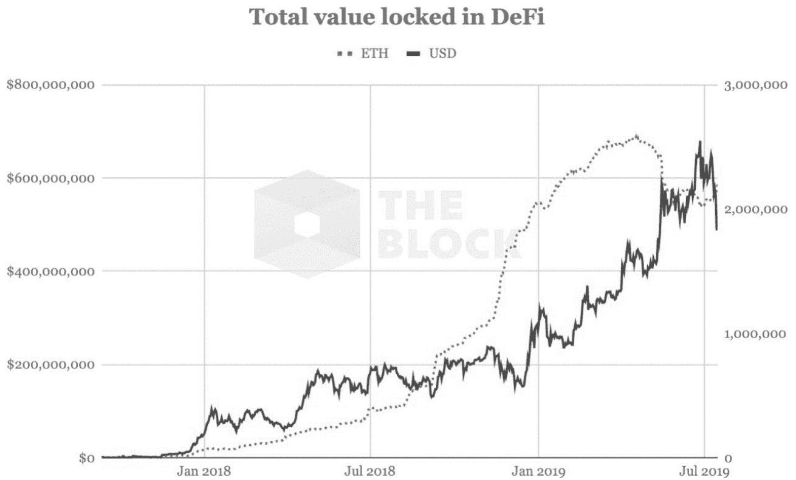

# 区块链、加密货币与去中心化金融投资指南

## 引言

加密货币行业是新的，并且不断演变。过去几年的加密经验创造了新的想法、新的技术和新的应用。只要投入足够的时间、精、投入和奉献，加密加密货币成功并非不可能。

加密资产是卓越的，因为它是金融界人士的一场革命。金融领域几乎每种技术都是由大银行引入的，它们获取大部分利润，留给零售交易者（包括你和我）的只是残渣。然而，在当今这个世界上，你我可以轻松地获得巨额利润，因为大银行无法控制比特币和其他加密货币。

比特币的基础技术之一是加密学，它涉及使用代码对消息或信息进行加密，使其对拥有访问权限的人以外的其他人隐藏起来。如果你是比特币的新手，且没有任何技术知识或交易经验，这本书将帮助你掌握如何获利地进行买卖、加密货币交易、比特币和以太坊。本书将逐步解释比特币、区块链、以太坊和加密货币交易的基础知识，并引导新手从全球任何地方购买他们的第一笔比特币。

此外，你将学习如何设置 `Bitcoin` 钱包、在投资代币之前进行技术和基本面分析、交易山寨币、投资组合管理、技术分析工具，以及在交易加密货币时需要避免的错误。这本书将指导你如何从全球增长最快的市场中获利。只要不断学习和实践，你很快就能收获辛水的回报。

# 第一章：区块链：泡沫还是革命？

正如你在整本书中所看到的，得益于区块链，金融领域已经发生了翻天覆地的变化。在处理财务事务时，区块链让人们变得更加高效和安全，这让他们感到更安心，因为他们不希望任何人拿他们的钱。因此，当你观察金融领域时，你会发现当谈论加密货币的优势甚至其缺点时，它经常被提及。大约有十家机构正尝试推出区块链，以提高其客户业务的效率。

由于区块链系统运行在具有公共账本的去中心化系统上，每笔交易一旦启动就会完成。而且，在所有现有协议的支持下，区块链账本将是完全安全且百分之百准确的。这意味着外部人员无法更改它，对于使用区块链的人来说，这是一个巨大的加分，因为这意味着它几乎能够免疫黑客的攻击。

根据区块链的构建方式，黑客必须同时攻入多个地方，这对于任何人来说都几乎是不可能的，因此黑客想要攻破区块链要困难得多。但并不意味着他们无法攻破你的区块链账户，所以你想要确保那些账户是安全的！

在区块链技术真正变得火的那个点，它已经有一套处理文档以及处理放置在区块中的数字资产的协议。当资产需要传输时，你会希望部署一个 `Smart Contract`（智能合约），因为它将重新排列流程并使其自动化。这意味着这项技术将被应用，组织能够以比以前更廉的成本运营。这是一件极好的事情，因为小组省下的钱可以用于其他地方。

据估计，在 2022 年的任何时候区块链都会更加流行，这将导致银行业缩减 200 亿美元。尽管如此，有几个金融行业正在研究区块链能提供什么以及它将如何改变他们提供的服务。

## 什么是区块链？

<https://www.shutterstock.com/it/image-vector/bitcoin-cryptocurrency-blockchain-technology-money-transfer-773006551>

区块链技术使得安全地执行交易（如支付）和传输信息（合同、销售）成为可能，且不需要中间环节（银行、信贷机构等）。产生的信息按时间顺序存储并加盖时间戳。当一组操作被保存时，前一组操作将变得不可更改，以此此类推。因此，所有记录在区块链上的交易在流转过程中都会被保留、供所有网络参与者可见，并且不可篡改。

区块链有许多类型。其中两种特别为流行：一种是具有所谓的“工作量证明”（`proof of work`）共识的，另一种是“权益证明”（`proof of stake`）共识。为了运行，区块链需要验证者，也就是说，检查网络上发生操作的实体。

区块链可以应用于加密货币之外的其他行业。

## 区块链简介

当你深入加密货币世界时，听到的第一个术语就是“区块链”。要理解比特币、通用加密货币以及去中心化计算的未来，理解区块链的原理至关重要。区块链是比特币运行的框架或“协议”。区块链可以被称为分布在世界许多计算机上的公共账本。每笔发生的 `Bitcoin` 交易都会被记录并添加到区块链中作为一个新的“区块”，并与之前的交易通过特殊时间戳链接，就像长链中的链环一样。

## 区块链的应用

区块链已被证明在各个行业都是非常有帮助的，最重要的是具有革命性。首先是金融领域，但也进入了医学、保险或教育领域。通过以下示例，你将看到区块链如何改变我们所知的世界：

### 保险领域的区块链

不久后，保险行业使用区块链存储数据将成为新标准。这项技术的高安全性以及消除欺诈和信息冗余的能力，使区块链成为保险行业的自然选择。

区块链最令人兴奋的点之一是生成 `Smart Contracts` 来自动批准或拒绝任何理赔。

### 金融/银行业的区块链

确实，最流行的应用是在这个领域，因为区块链技术可以管理许多真正改变我们所知银行业的流程。在这里你可以阅读 Alex Tapscott 和 Don Tapscott 为《哈佛商业评论》写的关于金融演变的精彩摘要。

随着加密货币的流行，像中国这样的经济大国将采取措施采用数字货币。简而言之，区块链可以改变我们的金融体系，并消除对许多中间公司的需求。

### 医学领域的区块链

它在一个决定生死的行业中帮助管理数据并自动化流程。在美国，医疗错误是常见的死亡原因之一。将记录存储在区块链上可以减少导致死亡的冗余和错误。区块链还能为药物药物提供更高的精确度，从而帮助患者防止阿片类流向非法市场。

### 物流领域的区块链

在供应链和物流行业，区块链使得更容易追踪商品从生产、包装一直到分发到各个销售点的位置。`Smart Contracts` 允许通过产品的 GPS 位置进行支付和授权；这一方面将提高该行业的效率，价值约为 150 亿美元。

### 房地产领域的区块链

在这个行业中，区块链正在提高房地产交易的效率，缩短了检查每个参与方财务信息所需的时间，从而提升了行业透明度。这一切将帮助使伪造造据或租金诈骗几乎不再可能，使所有与物业相关的交易变得不可篡改。

## 区块链与教育

在教育领域，区块链技术将帮助规范学习机构颁发的证书核实。它还可以确保所有教育工作者的资质都是有效的。这将消除冗余，并避免学生表现数据中的错误。

## 区块链在营销中的应用

在这种情况下，应用非常多样化，因此该行业在选择目标消费者时将提高精准度。对于消费者自身而言，透明度将大幅增加。

区块链将确保人们不会过度暴露在某些广告内容中，甚至可以让人们在使用数据时自动获得报酬。验证品牌粉丝是真人而非机器人将成为可能的。赞助比赛的合法性可以得到保障。

## 区块链与业务

在业务领域，区块链的应用是极其丰富的，它缩短了检查参与方财务信息的时间，提高了透明度。正如你可以想象的，区块链技术的应用是无限的，但由于某些技术限制，它尚未完全普及。

## 区块链的传言

由于区块链仍在完善，许多关于它的传言是可以被证伪的。这些信息会导致人们不愿投资。但是，这些传言可以被揭穿，让你更放心。

### 区块链是去中心化的且可以自我分裂

这并非事实！当你观察现实时，你会发现区块链已经具有了很强的去中心化特征。

由于加密技术的应用，区块链系统是去中心化的。此外通过网络上的算法和协议，矿工可以决定是否验证某笔交易。

`ethereum` 等其他比特币平台正在开发类似于比特币的区块链。然而，由于 `ethereum` 仍然很新，它正在不断进化以满足需求，同时保持系统的去中心化。

### 数万商户在使用比特币

有数万人使用比特币将太棒了！但遗憾的是，还没有多少商户接受比特币支付。大约 80%的加密货币被用于囤积而非实际支出。如果商户允许你使用加密货币支付商品或服务，那么他们将通过合作伙伴提取货币，这意味着他们将把数字货币转换为实际资金，以便他们购买维持业务运营所需的物品。但是，在使用时将会面临风险和费用。

虽然很多人在使用比特币，但还没有多少商户接受比特币支付。

### 交易是实时完成的

错误！交易之间存在 10 分钟的延迟。

### 在比特币上进行的交易“几乎免费”

再次，这是错误的！交易存在处理费用，这并不是矿工将获得的收入。这些交易将在网络中处理，并获得少量的奖励。

### 比特币拥有最安全的货币

这是真实的，因为比特币对攻击具有很强的韧性，但与其他任何交易系统一样，也会由于人为错误或欺诈而出现安全漏洞。仅在 2015 年就发生了：

- 香港某比特币交易所的客户欺诈消失了 3.87 亿美元。
- 由于网络钓鱼攻击，损失了 200 万美元的比特币。
- 加拿大的交易所因数据库入侵被关闭。

### 比特币的生态系统是去中心化的

区块链上的矿池数量有所增加。但，前四大矿池中至少有一个在中国。较大的矿池将受到人工限制，以确保民主化不会产生任何偏袒。但是，与较小矿池合作的那些会被较大的矿池挤出市场。

你应该回想起校园时光，当时有一个霸凌者，而且他们输掉了比赛。因为他们一直输输，他们不想表现出自己的落后，因此规则不断发生变化，以便他们最终获胜。虽然这看起来并不公平，但你无法在规则上与霸凌者争论，因为他们比你强壮，从长远来看会伤害你。大型农场也是如此。因为他们拥有更多的资金，他们能够利用这些资金导致你破产。这就是为什么顺应自然流和那些不断变化的规则，要比与他们争论要容易得多。

## 比特币是理想主义且非营利的

有数百万美元正在投资于比特币。已经有五十亿美元累积到比特币系统中，用于启动和运行系统。此外，还会有数十亿美元投资到比特币钱包、交易所和矿工操作中。以下是证明示例：

- `Coinbase` 已筹集了一亿美元，用于区块链运营。
- `Circle`（一家高盛的初创公司）投资了五千万美元。
- 硅谷的 `VC` 筹集了 1 亿 600 万美元，以便在区块链上进行隐身模式操作。

## 区块链是安全的

由于区块链上必须有 `Proof of Work`（工作量证明），写入数据时将实施某些机制。每当交易通过验证时，就会添加到链中，以确保链上不会出现重复计算。由于区块链上的区块将被所有用户使用，如果你尝试挖掘自己的链，将是非常昂贵的。

将存在私有区块链，其中必须替换工作量证明的机制，这导致其他人向创建的链中添加的内容受到限制。换句话说，最终将构建区块验证者。

规则使得区块将由一个签署的签署人列表指定。该列表将受到限制，以便系统确保条目轮替写入区块，从而有足够的份额。不良行为受到高度抵制，并将由于轮询的工作模式而受到限制。

## 区块链是加密的

比特币使用了不同的加密方法，以及要加密并放置在区块链上的数据。正因如此，许多人认为放在区块链上的所有信息都是加密的，但事实并非如此。

位于区块链上的大部分数据将是非加密的，因为这些信息不需要验证。这是因为没有方法可以解密那些应该通过的信息。

每当你使用私有区块链时，节点将能够通过解密密钥解密数据。但是，如果你这样做，你就会知道你最初为什么要尝试加密数据了。

密码学领域已经进行了研究，并揭出的解决方案表明，没有任何底层证据的数据将没有任何证明知识。因此，每当你观察这项技术时，你会发现它并不具备任何证明知识。

## 区块链是如何工作的

为了更容易理解，我们需要给出一个具体的例子：当我通过银行转账时，银行会立即追踪每笔交易，并对任何其他移动进行同样的操作；而在区块链中，各种用户进行的操作被“合并”并插入区块中。以比特币为例，每 10 分钟生成一个区块。

此时提出的第一个问题是，由于注册表不仅由网络上的所有计算机共享，而且是公开的（也就是说，所有人都可以通过名为 `explorers` 的特殊网站访问），任何人都可以访问并处理我的账户，从而损害我的隐私。事实上，地址（我们在银行中称为 `活期账户`）不是以姓注册的，而是由 26 个到 35 个数字字母字符组成的 `strings`。

由于这个原因，比特币交易被认为是匿名的。比特币并不是匿名的，而是“伪匿名的”。这意味着虽然地址无法归属于真实的自然人，但仍然可能（尽管并不容易）追踪这些交易在网络上留下的计算机轨迹，直到用户（即用户连接互联网的点或其连接的设备），从而确定该特定地址的自然人的身份。

## 理解区块链

区块链与实物货物盘点非常相似。当我们进行盘点时，所做的只是将库存中的所有货物拿出来，放在一些箱子里（按升序编号），并在登记簿上记录每个箱子的内容。通过对不同的箱子进行仔细排序，一旦盘点完成，我们还将拥有一张纸质地图”，来说明仓库中每件物品所在的位置。例如，如果我们想象对一家即将结业的餐厅进行盘点，我们会找到所有的厨房用具（刀子、餐具、盘子、锅、玻璃杯等），它们被储存在仓库里并放在箱子里。由于箱子是有编号的，而且我已经在登记簿上记录了每个箱子的内容，每当我需要（例如需要漏勺）时，通过查阅登记簿就能知道它的确切位置。因此，区块链可以被视为所有已交易的盘点。在实践中，它无非一个巨大的登记簿，记录了网络自诞生以来执行的所有区块的轨迹。

当你阅读这段文字时，例如，网络正在处理一个新区块，并将其添加到随时间推移的所有区块处理簿中。这一方面对于理解为什么这项技术如此可靠至关重要。如果攻击者试图操纵网络已处理的区块之一包含的信息，这种修改将导致所有区块上出现一系列链异常。网络上的其他计算机发现自己处理的文档与它们拥有的文档不同，将能够定义该操作的恶意本质，从而立即将其拦截。当区块被网络验证后，它就再也被修改。因此，区块链不仅是一个装甲且分布式的登记簿（或数据库），它还是不可篡改的。

当用户想要向另一个用户转账资金时，他们所做是将金额从他们的地址发送到接收者的地址。这笔单一交易的信息将与过去十分分钟内排序的所有交易信息一起输入区块中。然后，网络负责该区块，对其进行处理、验证，并将其记录在区块链上。

从那一刻起，区块中包含的信息变得不可篡改，不能再被修改。很简单，对吧？好，接下来我们将说明网络如何验证和处理区块，我们将有机会理解为什么网络中的节点无法以任何方式操纵它们正在处理的区块包含的信息。换句话说，我们将定义什么是矿工，他们扮演着什么样的角色，以及为什么他们在区块链的运行中如此重要。

<https://www.shutterstock.com/it/image-vector/block-validation-blockchain-digital-ledger-1943335789>

## 使用区块链投资

有很多商业模式因为区块链而发生了变化。每当你查看区块链时，你会发现它看起来像一个你在做预算时可能会使用的电子表格；然而，它将由在一个去中心化网络上工作的组织成员使用。

许多投资者已经研究了区块链，并试图找到一种能够利用区块链背后的技术获利的方法。但是，由于区块链最初编写的方式，会有一些与区块链相关的因素，导致你在学习其运行的基础技术之前，必须先理解区块链是如何运作的。如果你曾经接触过股票市场的传统交易，那么你将不会习惯你在区块链上将要要做的事情。你会发现，你至少可以通过五种不同的方式通过区块链进行投资。

### 积蓄硬币

很多人在等待价格上涨时会积蓄黄金。然而，也有一些人一直在存储加密货币。积蓄黄金和积蓄加密货币各自都有优势，但在面对你注意到的价格波动时，它们需要遵循不同的技巧。

黄金和加密货币都是稀缺资产，但加密货币的产生速度更快，而且当技术达到对加密货币所设定的限制时，加密货币的速率将会降低。归根结底，取决于供需。每当供应增加时，需求就会增加，最终导致价值增长。

### 廉价股

这些是能够抵御加密货币的标准积蓄品。加密货币是一种数字货币，你不会局限于仅使用 `bitcoin`，你也可以使用 `ether`。唯一的区别在于货币运行的系统，而且它们都在相互竞争。某些加密货币能够满足用户的需求，而其他货币无法满足这些需求。

例如，有一些加密货币正在开发中，以便协助那些必须注册的数字资产，通过托管服务提供安全性提升。

### 众筹

众筹是一种主流方法，每当你尝试为投资筹集资金时就会被使用。在参与众筹时，并不总是会使用这些硬币。然而，每当你使用比特币时，它们是可以使用的。当你使用这种方法时，在开始挖掘之前会获得一些硬币。一旦你拥有这些硬币，它们将作为发行进行出售，以在发布之前修复系统。

比特币份额是另一种可以与区块链配合的方法。当你试图筹集资金而处理预售业务时，应用程序和其他服务将得到利用。一些投资者将获得购买硬币的期权，预期在服务变得流行时价格会会上。

### 天使投资

天使使投资并不是新事物，就像初创企业并不新一样。已经有多种变体采用了在使用区块链技术时拥有投资者的想法。区块链在许多创业者中变得越来越流行，这导致了对区块链兴趣的增加。一个新的初创公司需要资金，这种资金被称为天使使投资。这种融资方式已经成为区块链未来的下一步。

# 第 3 章：什么是加密货币？

加密货币是一种虚拟或数字货币，使用加密学和去中心化的在线账本进行安全加密。这些货币运行在名为区块链的去中心化网络和账本上。

加密货币通过互联网实现安全支付。交易通过包含账目条目的去中心化账本来表示。“加密”指的是虚拟货币加密的各种手段，以及用于保护每个账目条目的的技术。这些技术可能包括椭圆加密曲线、哈希函数以及公钥/私钥对。

截至 2021 年 3 月，已有超过 8000 种不同的加密货币。这一数量仍在增加，各种个人、企业和组织正在创建代币并通过首次代币发行（ICO）筹集资金。

## 为什么加密货币如此流行？

加密货币热潮的一个主要原因是网络收取的名义交易费用较低。大多数支持者认为这些货币非常有效，以至于将其誉为“货币的未来”。此外，加密货币不受中央机构的分发或监管。因此，与货币不同，加密货币的供应无法被中央银行和政府操纵。大多数投资者认为数字货币是合适的财富存储手段，因为尽管国家面临经济或政治动荡，其价值往往能够保持稳定。以下是加密货币如此流行的几个原因：

### 低交易费用

区块链在处理加密货币转账时收取的交易费用非常低。例如，PayPal 发送超过 10 美元的费用可能收取 1.5 美元，而加密货币相同金额的费用在 0.1 到 0.5 美元之间。

### 无中央权威机构

加密货币没有中央治理机构。与中央银行控制货币供应的传统金融不同，加密货币存储在去中心化的账本中。只有通过交易验证，更多的货币才会释放到现有供应中。

### 盈利潜力

加密货币具有高波动性，其价格历史表明人们能够通过投资数字货币获利。大多数交易者在价格低时买入，价格高时卖出。持有加密货币（`hodling`）的投资者在保存数字货币一段时间后，并在价格高时变现也能获利。

### 安全且隐私

与传统金融不同，没有人会主动追踪你的交易。交易还通过加密技术保护保护并具有匿名性。某些加密货币通过使区块链上的交易变得无法追踪，将隐私提升到了更高的水平。此类加密货币被称为隐私币，包括 `Monero`、`Zcash` 和 `Dash`。

### 普及率增加

近年来，数字货币的普及率不断增长，是因为整体兴趣的提高、机构投资、比特币等领先货币的网络活动日益活跃，以及加密借记卡等选项的出现，这些选项弥合了传统金融与数字货币之间的差距。

## 加密货币与传统金融的区别

我们将建立加密货币与传统金融之间的主要区别。我们将观察每种技术的独特特征，以将其与其他区分开来。

### 加密货币提供匿名性，而传统金融则没有

通常，传统金融与刷入信用卡/借记卡上的个人信息有关。支付处理商收集这些数据，并可能将其交给银行、情报机构、未经授权的人员和政府以追踪你的财务状况。金融中的匿名性确保人们无法利用他人的个人信息参与身份盗窃或冒充。

### 防止欺诈

没有人可以伪造加密货币。此外，由于故意撤销通过数字货币进行的交易是不可能的。

### 无限制

传统金融账户可能会受到限制或关闭。但对于加密钱包，你可以随时随地进行访问。

### 全球广泛接受

加密货币几乎正在成为全球标准货币。它们在处处都被接受，随着比特币 ATM、加密支付卡和加密支付网关的出现，虚拟货币的普及率正在增长。

## 加密货币的优势与挑战

2021 年，比特币价格飙升并突破了 50,000 美元的心理阻力。大多数区块链专家认为，价格飙升可能是特斯拉首席执行官埃隆·马斯克向该货币投资 15 亿美元的结果。对整个加密行业兴趣的提高正使许多投资者权衡对数字货币的观点。

为了帮助衡量加密货币，这里有一份优缺点列表。需要注意的是，与任何具有可能的技术一样，加密货币也有缺点。然而，金融专家已经承认数字货币的优点以及它们将如何改变货币的未来。

## 加密货币的优势

### 去中心化

加密货币运行在分布式和去中心化的网络上。没有治理机构或中央权威，主要由开发者池/支持者社区组织特定硬币的发展方向。去中心化确保了数字货币不受中央银行的操纵和垄断。因此，这确保了硬币的稳定安全，不受人为通胀的影响。

### 快速快捷

加密货币是一种快速、方便且可靠的支付手段。交易在几秒钟内完成。验证非常简单，国内和跨境交易都以极快的速度处理。万事达/Visa 等传统支付处理商提供即时交易，但是以高昂费用为代价的。然而，对于加密货币来说，交易在几秒钟内完成，且成本几乎可以不计。

区块链内部进行的交易是完全匿名且私密的。传统的金融交易与个人信息挂钩，而比特币交易则挂钩到公共地址。只有使用复杂的加密密码学技术才可能将加密货币交易追踪到特定个人，而普通人是无法获得这种技术的。这意味着你的交易和信息是安全且私密的。某些硬币将这种隐私性提升到了更高的水平，使得即使通过复杂的加密技术也无法追踪交易。我们之前提到过这些硬币，并称它们为隐私币。例如 `Monero` 和 `Zcash`。

### 支付自由

尼日利亚的抗议活动帮助我们看到了加密货币作为解放工具的巨大潜力。政府封禁并限制了人权活动团的财务，使得这些团体难以对警察对尼日利亚人的大规模屠杀进行抗议。尽管传统银行账户被关闭，这些团体仍然通过加密货币向公众筹集资金。加密确保了你可以随时随地进行支付或接受支付。没有限制，没有边界，也没有中央机构干预交易。

### 保护投资者免受通货膨胀的影响

津巴布韦的通货膨胀导致该国的年轻一代转向加密货币。大多数面临通货膨胀的国家都是其政府印钞和供应过度货币的结果。对于加密货币来说，通胀通过向市场供应指定数量的硬币来抑制。例如，世界上永远只有 2100 万个 `Bitcoins`。硬币的稀缺性意味着需求将不断增长，从而提高价格。

## 加密货币的缺点

### 高波动性

加密货币具有高波动性。价格波动是正常现象且变化非常快。价格波动使得硬币对投资者来说具有风险，因此让大多数感兴趣的人担心遭受损失。通常，投资者需要一个健全可靠的风险管理计划来投资数字资产。

### 监管机构的干预

由于多个国家尚未对加密货币定义法律合规性，导致了政府干预。政府的介入不必要地阻碍了行业的创新，并可能导致具有革命性的数字资产产品关闭。

### 易受黑客攻击

由于稳健的加密协议，加密货币在设计上是非常安全的。然而，加密货币在交易所进行交易或存储。加密交易所并不十分安全，黑客曾成功渗透它们——例如 `Bitfinex` 或 `Mt Gox` 攻击事件。虽然交易所试图提高安全标准，但社区对另一次网络攻击仍保持警惕。

### 无法退款或取消

加密货币不允许取消或自动退回错误发送的资金。要求退款的唯一方法是认识接收者并与其协商将硬币还给你。否则，如果钱被发送到了错误的地址，是不可能恢复的。

## 如何使用加密货币

使用加密货币的最佳方式是先将你的加密钱包与借记卡/信用卡连接。2021 年，已有几公司提供加密货币作为支付方式来购买其产品或服务。

让我们考虑有人从 `Amazon` 购买一台电视。他们可以通过 `Purse` 等第三方加密集成平台支付产品费用。使用 `Purse` 的 `Amazon` 客户通常会选择他们从 `Amazon` 市场购买的商品。他们复制该产品的 `URL` 并将其粘贴到 `Purse` 的用户界面中。加密平台主要利用想要通过礼品卡获得加密货币的人来处理交易。`Purse` 还为所有 `Amazon` 产品提供 5%的折扣，并提供将此折扣谈判至 15%的选项。

其他零售商，例如 `Overstock` 也接受 `bitcoin` 支付。这家零售巨头通过 `Coinbase API` 接受支付，并允许你从私钱包支付。`Microsoft` 也允许消费者向账户充值 `Bitcoin` 并在 `Xbox` 和 `Windows` 在线商店中使用资金。电子商务平台也开始了一种趋势，允许企业在其商店中集成 `bitcoin` 支付。例如，`Shopify` 为开发者和企业提供了让客户通过加密货币支付的选项。

`Square`、`PayPal` 和 `Stripe` 等支付平台也正在推出加密功能。这将允许用户和商户以加密货币发送或接收支付。

## 安全吗？

加密货币的安全性在技术仍然很新的早期主要是一个问题。今天，创新者拥有了强大的安全标准、监管要求和加密协议，确保了资金的安全。同样，技术已获得了广泛接受；公司已经引入了 `KYC`（了解您的客户）和 `AML`（反洗钱）要求。使用加密货币也变得越来越容易，硬币正获得个人、企业和机构投资者的主流采用。

但是，它们安全吗？加密货币是安全的投资或支付手段吗？如今，加密货币不再像最初几年那样容易受到黑客攻击。尽管如此，与数字币相关的风险主要有两个。这些风险包括：

- 可能丢失私钥并随后失去对加密货币的访问权限。
- 未经授权的人访问你的私钥并盗取你的加密货币。

`https://www.shutterstock.com/it/image-vector/bitcoin-cryptocurrency-coin-private-key-lock-1933530938`

## 高波动性导致硬币贬值

让我们逐一分析风险因素，从由于波动导致加密货币贬值开始。像所有资产一样，即使在传统金融中，价值损失也是一种常见的风险。所有的投资形式都可能增加或减少价值；你只需要良好的风险管理机制来抑制损失。

丢失私钥是加密货币常见的风险之一。`private key` 让你对硬币拥有所有。这意味着通过 `private key` 你可以访问、花费或转移你的 `Bitcoins` 或任何其他代币。私钥丢失会导致失去对加密货币的访问。保护私钥有助于投资或加密资金的安全。这与保护密码和个人身份信息同步。通常，加密货币是保护财务投资的安全方式。

## 去中心化加密货币交易所（DEX）的优势

去中心化交易所是加密领域最受欢迎的交易所。考虑到去中心化交易所的所有优势，它们每天变得越来越受欢迎并不意外。即使像 `Coinbase` 和 `Binance` 这样的大品牌也开始开发它们名称的去中心化版本。去中心化交易所最大的优势包括：

- 账户信息不会与 `DEX` 交易所运营者共享。因此，它比中心化交易所更能抵抗攻击和操纵。相反，你可以将钱存在账户中，你是唯一拥有账户访问权限的人。
- 理论上，国家或监管机构无法关闭 `DEX`，因为它们通过区块链网络上的各种节点运行。当然，政府可以通过恶意软件关闭 `DEX`。
- `DEX` 通过遍布云端的各个节点运行。这意味着即使某些服务器出现访问问题或受到攻击，它仍将能够继续运行。
- 它具有更高的隐私性，因为你不需要与第三方共享数据。大多数 `DEX` 都不具备 `KYC`（实名认证）要求。这意味着你可以保持完全的匿名性。
- 由于 `DEX` 允许你保留自己的私钥，因此你保留了对自己账户中资金的控制权。

## 去中心化加密货币交易所（DEX）的缺点

去中心化交易所并不适合所有人，因为它们存在一些严重的缺点——尤其是对于新手而言。以下是每个人都应该知道的 `DEX` 缺点：

- 工作量更大，因为通常情况下，交易和转账等交易由中心化加密货币交易所承担。
- 它们不受监管或没有保险。中心化交易所拥有资金可以随时退还货币。这就是为什么他们保留了托管资金以便快速提现。
- 大多数 `DEX` 不允许通过信用卡、借记卡或银行转账支付。
- 价格较低且交易量有限，这可能导致手续费较高。
- 去中心化交易所提供的服务有限。通常不提供止损服务，包括保证金交易和法币货币。

# 第 4 章：比特币

[`www.shutterstock.com/it/image-illustration/bitcoin-blockchain-cryptocurrency-digital-encryption-money-2063418779`](https://www.shutterstock.com/it/image-illustration/bitcoin-blockchain-cryptocurrency-digital-encryption-money-2063418779)

比特币区块链上的每笔交易都可以在公共记录中供公众查看。通过这种方式不需要任何中心机构，这意味着任何必须进行的维护都将由系统完成，以保持软件以最大潜力运行。例如，一个发送给另一个比特币用户的交易；它将在网络上广播某人向人 b 传输了 x 数量的币。

在网络上完成的交易在添加到账本之前将进行验证，这意味着节点在尝试验证购买时也会广播该交易。为了实现独立验证，区块链上必须有一个分布式数据库，该数据库与节点协同工作，并负责将所有数据存储在适当的位置。这意味着每一比特比特币都会在区块链上保存其数据。

随着交易被验证和接受，区块每小时被创建六次。当这种情况发生时，软件将能够识别比特币金额何时被花费，以防止发生双重支付。这在创建一个没有任何东西被中心机构监控的环境时非常有帮助。

使用比特币你会发现的最显著优势是它更加成熟，这意味着你不需要担心服务器为了应用更新而频繁关闭。这对于用户是有好处的，因为它让他们觉得系统更加稳定，并且对它不会因为平台仍处于测试阶段而崩溃更有信心。

## 什么是以太坊？

以太坊是一个公开的、可编程的围绕交易的区块链平台。正如你可能知道的，以太坊是一个去中心化平台，通过使用 `ether` 提供点对点合约。维特里克·布特林（Vitalik Buterin）是在 2013 年提出以太坊并在 2014 年为其筹集资金的人。

以太坊直到 2015 年才由瑞士以太坊有限公司推出。第二年，以太坊的价值代币价值十亿美元。据说 `ether` 能够挑战比特币，因为它拥有比特币未提供的服务。

开发者和 `dapp` 用户需要以太坊币来支付手续费用。

## 什么驱动了以太坊？

`https://www.shutterstock.com/it/image-illustration/bitcoin-blockchain-cryptocurrency-digital-encryption-money-2063418779`

基本上有四种类别构成了以太坊生态系统，每种类别都影响着价格。这些类别包括交易者、投资者、开发者以及最终的用户。投机性交易者是价格波动的主要原因，因为他们频繁进出，并使用杠杆。另一方面，投资者是技术的忠实支持者，他们持有以太坊代币的时间可能持续几年。投资者在下跌期间倾向于加仓。

深入研究以太坊生态系统，[Dapps 状态数据](https://www.stateofthedapps.com/stats/platform/ethereum#new) 显示目前以太坊网络上共有 2778 个去中心化应用程序。以太坊网络 `Gas` 费的上涨驱动开发者寻求低手续费的替代平台，如币安智能链。

其他驱动 `ETH` 价值的重要因素包括：

- 广泛采用。
- 接受度提高。
- 政府监管。
- 主流媒体报道。
- 市场操纵，交易者通过大量买卖来影响价格走势。

如果你致力于投资以太坊，你需要三个主要物品，即：

- 交易所账户。
- 经纪账户。
- 钱包。

## 交易所账户

要投资以太坊，你需要一个交易所账户。正如上一章提到的，交易所是买卖加密货币的数字市场。由于今天网上有很多交易所平台，选择最好的平台可能会很疲惫。以下是选择购买以太坊最佳交易所的一些关键因素：

- **安全可靠性**：安全性是许多加密货币交易者最关心的问题。在加入之前审查交易所的安全水平非常重要。某些交易所在此保护客户资产方面的安全措施很差。
- **支持的支付方式**：支付方式在不同的交易所之间不同。在注册之前，确保你对支持的支付方式感到满意。
- **费用和佣金**：每笔交易的手续费和佣金随交易所的不同而异。某些平台可能会收取高额费用，这可能会影响利润率或扩大亏损。
- **用户界面**：新交易者倾向于操作简单、没有太多复杂功能的加密货币交易所。在具有针对专业交易者的高级工具的复杂平台上进行交易可能会导致资金损失。

你应该注意的其他关键因素包括地理限制、流动性、隐私政策等因素。如果能向专业交易员寻求关于加入哪个加密货币交易所的建议，将非常有帮助。这些经验丰富的交易者可以在你学习交易时帮助你避免许多错误。现在让我们来看看我们高度推荐给新交易者的最佳以太坊交易所：

## Coinbase

Coinbase 于 2020 年 6 月成为美国成立的第一家加密相关业务。Coinbase 是一个数字市场，方便买卖以太坊及其他 20 多种加密货币。此外，你可以使用 Coinbase 在不同加密货币之间进行兑换或将加密货币发送到各种地址。

这些要求是为了遵守联邦法律法规。要在 Coinbase 上购买以太坊，你需要在 Android 的 Play 商店和 iOS 的 Apple Store 下载移动应用。打开应用并点击“开始使用”。使用你的电子邮件地址注册 Coinbase 账户，现在你可以验证你的账户并输入所需的 KYC 详情。成功创建账户并验证后，你现在就可以继续购买以太坊了。在屏幕顶部，你可以查看平台上购买的加密货币列表。选择以太坊并选择你想要购买的金额。然后继续预览购买，在检查订单后点击“立即购买”。

### 为什么选择 Coinbase？

- 低汇率。
- 安全可靠。
- 支持使用法币购买。

## Kraken

Kraken 是最早建立的加密交易所之一，支持包括以太坊在内的 70 多种不同加密货币的交易。Kraken 用户享有多项收益，包括提高安全性、法律合规、限价单和止损单，以及超过 50 种交易对的选择。该平台拥有大量用户且交易量巨大，使其具有高流动性。

### 为什么选择 Kraken？

- 巨大的流动性。
- 你可以用十种以上的其他加密货币交易以太坊。
- 低交易手续费。
- Kraken 可用于 90 多个国家。

## Bittrex

Bittrex 被认为是最安全的加密交易所之一。这家位于内华达州的交易所由一组拥有超过 50 年总经验的专业交易员于 2014 年创立。尽管 Bittrex 采取了仅列出安全数字资产的主题，但它支持近 200 种不同加密货币的交易。

### 为什么选择 Bittrex？

- 低交易手续费。
- 稳固的安全。
- 仅列出可靠的加密资产。
- 拥有近 200 种支持的币种。

## 以太坊钱包

目前市场上流通有很多以太坊钱包。为你的以太坊代币选择正确的钱包取决于其他几个因素，即：

- 你需要的存储类型。
- 你频繁交易吗？
- 你打算从哪个平台访问钱包（桌面、智能手机、网页等）。

### 以太坊钱包的类型

建议从下面列出的不同钱包类型中选择适合你的方法：

- 软件钱包：易于访问且获取廉价。最适合经常交易的人。
- 硬件钱包：使用物理芯片离线存储以太坊。例如 `Ledger Nano`。
- 纸钱包：这些是印有私钥的纸。

### 以太坊热钱包

热钱包是指需要连接互联网的钱包。存储在热钱包中的以太坊代币可以在全球任何地方轻松访问。除了方便之外，热钱包并非最安全，如果恶意攻击者获取了你的登录详情，它们可能会被破解。它们是免费的，任何人都可以从世界上任何地方访问它们。一些最佳以太坊钱包包括：

- `Metamask`。
- `Exodus`。
- `Trust wallet`。
- `Mist`。

### 以太坊冷钱包

冷钱包是指使用物理设备离线存储以太坊的设备。使用冷钱包的主要优点是安全性，它们是离线的，因此不易受到黑客攻击。然而，与免费的热钱包相比，冷钱包通常较为昂贵。此外，它们支持一些资产。市场上一些最好的冷钱包包括：

- `Ledger nano`
- `Trezor`

## 以太坊经纪

以太坊经纪可以描述为市场中买家和卖家之间的中间人。主要有两类以太坊经纪：以固定价格买卖以太坊代币的简单平台，以及允许实时买卖数字资产的复杂平台。

以太坊经纪的主要功能实际上是匹配市场的买家和卖家。例如，如果你有一笔现金并想购买以太坊代币，经纪会找到愿意出售的卖家并完成交易。在某些情况下，取决于交易平台，经纪充当买家和卖家。

复杂的经纪平台采用差价合约（CFD）交易的概念。交易 `ETH` CFD 允许你即时开启和关闭并应用杠杆交易。然而，值得注意的是，当你交易 `ETH` CFD 时，你并不拥有真正的以太坊代币，而是对以太坊的价值波动进行投机。

### 交易所和经纪的区别是什么

以太坊经纪和以太坊交易所让很多人感到困惑，特别是在引入保证金交易等经纪功能之后。两者的主要区别在于运作方式。以太坊经纪定义他们愿意出售以太坊的价格和佣金。他们可以是 `ETH` 代币的持有者，也可以与其他平台或经纪合作以确保有足够的供应。

另一方面，以太坊交易所涉及许多交易者以当时的市场价格同时买卖以太坊对。然而，在卖家同意交易之前，订单是不完成的。

经纪和交易所都存在于传统的金融系统中。

## 如何交易以太坊

那些具有交易基础知识的人可以开发交易以太坊的策略。在交易所交易以太坊其实非常简单。以下是如何使用法币购买 `ETH` 代币的步骤指南：

### 打开账户和交易所平台

选择一个适合你交易需求的交易所平台。有很多很好的加密货币交易所可以直接购买以太坊，而其他较小的山币需要先购买比特币然后进行转换。

注册后，许多交易所平台要求你提交 KYC 详情以符合监管要求。可能会被要求提交身份证明和居住证明。然而，也有少数交易所不需要这些细节，例如 `Changelly` 和 `Shapeshift`。

### 充值

随后，你可以使用任何支持的方法为新账户注，例如使用信用卡/借记卡、银行转账或其他任何方法。强烈建议使用信用卡，因为它们更方便、快速。银行转账可能需要 5 个工作日才能反映你的账户中。在账户加载资金后，你现在可以继续购买以坊代币。

交易以太坊有两种主要的策略，即：

- 持有或“HOD”
- 活跃交易

### 买入并持有 (Buy and Hodl)

正如之前提到的，以太坊具有巨大的潜力，许多投资者选择购买尽可能多的以坊代币并长期持有。长期加密货币持有者需要数字钱包或硬件钱包来存储财富。从交易所购买以太坊后，你现在可以将它们转移到外部钱包妥保存，因为交易所平台并非完全安全。

硬件钱包对于长期以太坊持有者来说是最安全的。对于愿意采用这种策略的投资者，强烈推荐使用如 `Trezor` 或 `Ledger Nano` 等硬件钱包。它们不受在线黑客的攻击，但可能会被损坏甚至丢失。

### 活跃/投机性交易

这种交易策略有点复杂，要求交易者具备交易基础知识。不同的交易者在投机以太坊未来价格时有不同的方法。

### 日内交易

以太坊的巨大普及意味着它具有很高的交易量和流动性。以太坊日内交易者依赖波动的以太坊市场并对短期价格波动进行投机。他们利用短期价格波动获利，并在一天结束前关闭所有仓位。

## 以太坊交易带有风险

适当风险管理的第一步是了解与交易以太坊相关的风险、其概率和强度。风险可能来自不同的来源，以不同的方式出现。以下我们分析了一些与以太坊相关的常见风险：

### 监管风险

在开创性加密货币引入多年后，在大多数国家对其进行监管仍然是一个巨大的挑战。当局不确定 `Bitcoin` 和 `Ethereum` 这样的加密货币是资产、商品、支付手段还是金融工具。此外，在以太坊的情况下，当局可能会打击 IPO 或众筹，从而影响网络的发展。

### 竞争风险

以太坊面临的最大风险之一是可能出现更快、更高效的对手并取代它。鉴于该项目代码是开源的，这种情况发生的非常高。由于以太坊 Gas 费上涨，`Binance smart chain` 已经成为以太坊网络的强劲对手。一些开发者选择迁移到更高效、更廉价的平台，如 `Binance smart chain`。

### 技术风险

区块链的分片和扩展不能 100% 保证可行。未来可能会发现代码漏洞。以太坊向 `2.0` 的过渡可能会失败，从而影响市场。

### 可变性

以太坊网络面临的另一个主要风险是其代码相比 `Bitcoin` 的可变性。鉴于以太坊网络多年来的开发，对其功能进行有意义的调整将困难。

## 给以太坊交易初者的两个建议

### 结合技术分析和基本面分析

为了提高你预测 `Ether` 未来价格走动的准确性，你应该学习如何进行技术分析以识别市场趋势和波动。大多数热门交易平台为用户提供了多种用于技术分析的工具和指标。

另一方面，以太坊由区块链技术支撑。因此，它的发展和增长取决于许多其他因素，包括区块链活动、开发者更改、公众对以太坊的情绪以及平台上新产品的发布。因此，作为一名新交易者，你应该始终关注可能推动或压低以太坊价格的基本面因素。

### 风险管理至关重要

尽管以太坊具有巨大的潜力，但它仍然是一种波动剧烈的加密货币。因此，新交易者培养纪律并学习风险管理技能以避免产生不损失至关重要。对于初学者来说，从小开始并在加密交易领域获得更多经验时增加资金是有帮助的。随着你技能的增加，你可以开始使用杠杆并投入更多资金。

## 智能合约

<https://www.shutterstock.com/it/image-vector/smart-contract-illustration-on-subject-financial-1290304843>

智能合约将是自我验证和自动执行的。这意味着一旦满足协议条款，付款将发送给履行协议条款的人。交易将在节点网络上运行，这些网络可以由交易参与者控制，这样他们既可以确保合约编写得正确，合约创建者不必担心合约是否会按照他们的意愿执行。

由于智能合约可以自我验证，所有数据都将实时记录，然后发送到预定义的数据馈中。智能合约的重要点是它们防篡改的，这意味着交易将不会有人为影响。唯一可以改变的是协议中列出的义务，它们必须由交易所有者更换。归根结底，所有者将满意于他们的合约将按照他们的要求执行，而对方不会偏离计划。

合约将是非常高效的，并将使加密货币技术受益，因为智能合约的低成本确保了大型公司意识到他们拥有更多资金。

由于智能合约能够自我验证，人类被排除在方程之外，这将导致人为错误减少！不会有许多人尝试在合约中加入不属于的数据，通过限制访问合约的人数，合约将更加高效，工作将进行得更快。

你可能会引用私有系统，甚至是创建智能合约的公司。由于智能合约是防篡改的，你对依赖触发器付款感到满意，这意味着你不必担心是否能收到钱。预言机（oracle）将作为智能合约与外部世界之间的缓冲，提供合约证明其性能所需的数据，同时向外部系统发送指令。

在操作以太坊网络时，你会注意到由于安全限制，存在输入输出限制，从而限制了未放置在网络上的信息。

由于合约无法包含所有信息，当涉及到非网络上的支付时，将会有合约层面的执行。因此，将有一个安全点将合约连接到任何所需的外部端点。

当系统无法自行获取信息时，预言机（oracles）将拥有从外部源获取数据的权力。预言机将作为入站和出站运行，使得合约可以释放支付并执行合约之外的签名。

入站预言机将向合约提供所需的外部数据，以便它们能够判断合约之外发生的事件是真实的还是浪费时间的。

## 什么是非同质化代币？

[非同质化代币](https://www.shutterstock.com/image-vector/nonfungible-tokens-digital-items-19531603)

非同质化代币，或 `NFT`，是一种允许数字产品具有唯一性或真实性的加密代币。它允许追踪谁拥有该资产以及其价值。

`NFTs` 是通过区块链技术验证的数字资产，可以代表从数字艺术到 GIF 的任何内容。无论该 `NFT` 是唯一的还是系列中的一个，使用区块链进行“铸造”都为其提供了真实性及其所有权的证明。

非同质化代币是一种独特且不可复制的加密符号。然而，这种不可分割的代币可用于代表现实世界中的物体，在维护其属性和所有者的同时，确认其真实性。

`NFT` 的真实示例是一个收藏品。一个具有限制存在且极其独特的标记的数字卡片是 `NFT` 的完美例子。尽管如此，如果卡片是真实的，这种情况也会在区块链上发生。在这种情况下，真实卡片拥有数字表示，但这种表示仅用于我们追踪其真实性、所有权历史，并确认它确实是某一个。

## 为什么 NFT 如此特别？

与加密货币不同，`NFTs` 无法互换，因为没有两个 `NFTs` 是相同的。来自 `CryptoKitty` 的资产是独特的，为单一物品提供价值且无法进行比较。

许多此类“代币”（例如硬币、艺术品或加密猫咪）都依赖于以太坊网络的区块链标准。这使得 `MetaMask` 或 `MyEtherWallet` 等钱包在买卖它们时变得简单。此外，`NFTs` 具有一些实用特性：

- **独特性**：这些资源拥有许多艺术品的副本（制作副本品要简单得多），但此处的所有者可以确认他们是作品的唯一且真实的。这是我们在看待数字艺术和数字作品时的一种独特现象。
- **非互操作性**：一个 `CryptoPunk` 不能作为 `CryptoKitties` 游戏中的角色，反之亦然。同样的，`Blockchain Heroes` 可以在 `Gods Unchained` 游戏中使用。
- **不可分割性**：`NFTs` 无法拆分成类似 `bitcoin` 的更小部分。它们仅作为完整的单元存在。这与数字货币不同。它们具有不可分割的价值，你无法拥有 1/1000 个 `Crypto Kitty`。
- **不可破坏性**：由于所有 `NFT` 信息都通过合约存储在区块链上，任何代币都不会被删除、移除或复制。
- **可追溯性**：在区块链上记录官方信息的额外处在于，物品（例如数字艺术）可以追溯到原始创作者，无需外部验证即可确认其真实性。区块链使得追踪比艺术品或邮章更复杂的内容变得可行。例如，区块链记录了谁购买或出售了 `NFT`，谁是其目前的（最高）所有者，以及从哪里购买了该数字资产。
- **完全所有权**：所有权的转移是永久的，这意味着玩家和作者保留了他们购买的 `NFTs`，而不是制作它们的机构。这与在 iTunes 商店购买音乐不同，那里客户并不拥有所购买物品的所有权——他们购买的是听音乐的许可。通过合约（合约）存储在区块链中的 `NFT` 信息很难删除或伪造。

## 如何使用非同质化代币？

非同质化代币用于确认独特的数字属性、所有权以及跨平台的资源协作机会。`NFTs` 用于一些特定的应用，需要独特的数字组件，如加密（稀有艺术）、加密收藏品和加密游戏。

加密游戏是游戏相关 `NFT` 的最新用途。例如，`Age of Chains` 和 `Rare Pepes` 等公司利用 `Counterparty` 协议在 2016 年提供了基于 `Bitcoin` 的区块链交易卡 NFT。

艺术是 2017 年 6 月 `CryptoPunks Launch` 的主要用途之一。这为以太坊区块链上的加密领域铺平了道路。`DADA.art` 源自 `CryptoPunks` 模型，并在 2017 年 10 月为加密艺术开启了主要市场。

随后，著名的区块链游戏如 `CryptoKitties` 使用了以太坊区块链上的不可性令牌。`NFTs` 用于代表游戏资产，并由客户端而非游戏工程师管理。这允许在没有游戏设计师授权的情况下在外部市场进行交易。加密平台包括 `Nifty Gateway`、`Rarible`、`Super Rare`、`Famous Origins` 和 `MakerPlace`。

`NFTs` 可以代表数字艺术、游戏组件和音乐文件的销售。创建和发行 `NFTs` 有不同的结构。其中最著名的是 `ERC-721`，它是以太坊区块链上发行和交易非同质化资源的标准。

后期改进的标准是 `ERC-1155`。它允许单一合约同时包含同质化代币（Fungible）和非同质化代币（Non-Fungible），开启了完全不同的结果领域。

NFT 可以在开放商业中心进行交易，例如 `OpenSea`。这些业务领域将买家与商家连接起来，并且每个代币的估值都是独特的。通常情况下，NFT 的价值会因为市场兴趣的波动而发生变化。

NFT 的活动取决于其执行的区块链阶段。每个区块链阶段都有一系列功能特性，使得 NFT 能够以某种方式运行。因此，例如，`Ethereum` 中的 NFT 与 `TRON` 或 `EOS` 的 NFT 相比可能有不同的内部活动。

尽管如此，这些差异与所做的更改有关，因此合约的行为会根据其执行的区块链框架进行调整——例如，所使用的编程语言、访问的处理方式，以及在组织内部使用的界限和资源。除此之外，NFT 的行为遵循某些我们可以称之为标准的边界，并且在很大程度上遵循由 `Ethereum` 及其 `ERC-721` 和最新的 `ERC-1155` 标准所主导的结构。

随着 `ERC-721` 和 `ERC-1155` 的诞生，`Ethereum` 发现如何利用几种极大地促进了 `Ethereum` 内部 NFT 发展的工具。为了做到这一点，它提供了一系列具有功能和能力的标准智能合约，所有 NFT 在其控制和开发中可能都需要。随后，例如，`ERC-721` 和 `ERC-1155` 允许你创建、移动、更改甚至删除 NFT。

当你购买一个 NFT 时，你购买的是一个代币和一个与该代币关联的艺术品。售出的艺术品可以是独特的作品或某个作品的副本，但每个代币都是独特且不可重复的。NFT 的另一个非常重要的特征是它们不可分割的。这意味着你不能将非同质化代币的一部分发送给某人（与 `Bitcoin` 不同）。

买卖交易使用加密货币进行并在 `Blockchain` 中注册，这允许对该购买行为进行永久记录并提供所有权证明。

## 以太坊 2.0 发生了什么变化（可扩展性与安全性）

今天的 `Ethereum` / `Ethereum 2.0` - 游戏改变者 / 它对矿工的影响

每当我谈到某些替代货币（例如这种特定的货币）时，我感到纯粹的喜悦和快乐。我很清楚它是一种运行非常快且已经爬上梯子进入激烈竞争地位的替代货币，我喜欢它。关于这个美物，我能说什么才能让你同意进行加密货币投资呢？

稍微回顾一下如何？`Ethereum` 是一种加密货币（替代货币），它作为去中心化网络之一引起了更多关注，其一个支持不同形式智能合约的平台在疫情期间引起了更多关注，许多人使用这些智能合约收集了大量这种加密货币。`Forsage`、`Million Money` 和 `Lion Share` 仅举几个，就是构建在加密货币 `Ethereum` 区块链上的智能合约部分，因为它网络是在没有任何任何外部人士干预或控制的情况下创建并运行的，并且具有防止任何欺诈活动的安全性。

`Ethereum` 是仅次于 `Bitcoin`（`BTC`）的第二大加密货币，而且市值非常大。本月早些时候，我们一直在等待的加密货币另一个版本，即 `Ethereum` 的升级版（`Ethereum 2.0`）变为了现实。加密货币创始人 `Vitalik Buterin` 已经发布了一项更新。

你不应该忘记这种加密货币所扮演的关键角色，因为它更多地充当了智能合约讨论的障碍清除者，并为任何或许多开发者利用其平台奠定了坚实的基础。

`Ethereum`（`ETH`）是 `Ethereum 1.0`，不要忘记我说它使用 `proof-of-work` 共识机制来完成所有要求或需要完成的工作。至少我们都知道，那是该加密货币区块链网络的首个和初始算法。总结来说，就是必须有一些特定的区块链参与者。

现在待使用的共识已被修改，现在是 `proof-of-stake`，这是一个足以改变规则的大符号或信号。`Proof-of-stake` 的运行方式是某些参与者（也称为验证者）保护整个对下一个哪个区块将是有效的押注，谁获得正确押注的人将获得奖励，而那些没有获得正确押注的人将受到惩罚。

`Proof-of-stake` 意外地更加节能，因为不需要使用巨大的计算来解开整个谜题。`Ethereum`（`ETH`）`2.0` 凭借其新共识将带来许多吸引力，因为它具有更坚固或更高的安全水平，并具有改变规模或大小的能力。

据高度预测，随着这种新修改的共识，将节省更多的能量。但问题是，矿工也是交易（如 `crypto-staking`）的参与者和验证者，他们被赋予了检查交易、金额以及任何持有者持有资产的实际时间的责任，这为他们提供了一个看似难以被撼动的、有意义且安全的位置，以及市场中一种不俗的价值，凭借如此大的权力和意识，足以向集中或中心化系统提供含蓄建议。

目前有一种争论，认为质押（staking）除了对网络产生中心化影响外不会产生任何好处，尽管导致了关于 `proof-of-work`（`PoW`）说法的问题是：“矿场越大，由于规模经济效应，回报越高。”

与早期的预期相反，在 `proof-of-stake`（`PoS`）中，不存在规模经济效应，使得质押成本无论是一个质押 40 `Ethereum` 还是 40000 `Ethereum` 都非常相似。

此外，对于我的美物 `Ethereum`（`ETH`）`2.0` 的最新预测，公共网络应该接受 1000 到 5000 `TPS`，而你无法尝试将这种加密货币（`Ethereum 2.0`）修改共识与 `Ethereum 1.0` 进行比较，因为它至少可以允许 30 `TPS`。

通过许多人对对此的看法，有一个我很喜欢且无法挥之的想法。`Zipmex` 说：“这还需要几年时间，因为极可能到那时，人们已经在使用层 2 解决方案（如 rollups）来解决可扩展性问题。”

疫情留下的遗产不仅是死亡或经济衰退，它还开启了人们发现新机会的大门。我们面临的这种不便触发了我们内心的渴望，许多人将业务搬到了线上。同样，这种趋势促进了区块链以及许多智能合约的发展，它之所以取得进步，不仅是因为最显而易见的原因——疫情，而是因为加密货币网络 `Ethereum`（`ETH`）的去中心化本质，使其赢得了显赫地位。

`Ethereum` `2.0` 行动计划的构建已经让许多人起了一身皮疙瘩。这是区块链社区的未来。关于先进的加密货币 `Ethereum`（`ETH`）`2.0`，我们绝对会有很多惊喜。

我并不是什么大师——事实上，在说出“我搞定了”之前，我会在事情上投入大量的精力。我也不是什么预言家，但我真的认为 `Ethereum` 在过去几周的稳定增长率并非上帝的奇迹，而是因为即将到来的、具有前景的加密货币——`Ethereum`（`ETH`）`2.0`，它已经从以前的工作量证明（`PoW`）共识转向了权益证明（`PoS`）共识。

没有人应该夺走丛林之王的地位，或阻止它的咆哮，我们也不能说母狮作为猎人应该保持沉默或停止狩猎。`Bitcoin`（`BTC`）拥有最高的市值和价值，但作为一种代币，`Ethereum` 过去做得且目前做得很好。

作为一种代币，这种加密货币可能是最有计划性的一项尝试，它在区块链虚拟世界中通过几个步骤或阶段实现了实际目标和成就。毫无疑问，加密货币（`ETH`）`Ethereum` 在我们拥有的加密货币中市值第二，仅次于 `Bitcoin`（`BTC`），它就像一艘载着其他较小船只的容器。

我想说的是，`Ethereum` 允许其他区块链项目和应用（如 `Defi` 应用）进步。这种加密货币正张开双臂，准备好向我们展示它的第二代，以及在其第一代为我们提供的一切基础上，它在增长、发展或进步方面又取得了多少成就。

`Ethereum`（`ETH`）`2.0` 令人担忧的是，尽管它喜欢用其区块链承载较小的船只，但在这个区块链上的应用越多，成本就会增加，其速度水平也会受到影响。

我记得之前用过 `TPS` 这个缩写，很抱歉我没有解释它。每秒交易数，就是该缩写的意思。每当加密货币（`ETH` `1.0`）发生拥堵时，每秒交易数就已达到极限，这会对任何 `Ethereum`（`ETH`）`1.0` 应用的设计或编程造成严重阻。

当涉及到加密货币 `Ethereum`（`ETH`）`2.0` 概念背后的愿景时，需要修饰 `Ethereum`，直到它完全具备能力或成熟到足以承担协助人类的责任。

在修饰阶段（目前仍处于这一阶段），迫切需要进行许多合理且创意的修改，以改进其特性，如安全性、可持续性和规模。为了让 `Ethereum`（`ETH`）被充分利用，它需要将其共识算法从工作量证明（`PoW`）转向权益证明（`PoS`）。

该计划甚至不是使用电子设备（计算机）作为矿工节点，它基本上是用户通过质押他们的 `Ethereum`（`ETH`）来成为验证者，并承担类似于工作量证明（`PoW`）共识算法中矿工的那种责任。

矿工也进行质押，但他们需要质押 32 个 `Ethereum`（`ETH`）才能真正成为验证者。我们期望能源效率达到极高水平（至少比以前好），降低准入门槛，大幅减少所需的硬件，并加强一切，对任何形式或迹象的中心化具有更好或更高的免疫力。

`Ethereum`（`ETH`）`2.0` 的设计旨在增加其之前的分片链，这将显著提高每秒交易数（`TPS`）的速度。

分片是一种谨慎的逐步程序，意在对数据库进行水平拆分，以对负载产生扩散影响，这被认为可以减少 `Ethereum`（`ETH`）网络的拥堵，并通过创建新链最终增加每秒交易数（`TPS`）。

`Ethereum`（`ETH`）`2.0` 的这个问题还涉及另一链；该链被称为“信标链”（Beacon Chain），在 `Ethereum` 复杂的路线图中被称为“0 阶段”，它是 `Ethereum` `2.0` 的基础组成部分。

预期的计划是让成为 `Ethereum` 系统权益证明（`Pos`）的先驱，并承担协调者的角色。这条特定的链从分片链（64 条分片链）接收状态详情，并确保系统中其他分片链的可用性，以确保网络的完全同步。它还承担了管理验证者的额外责任，从质押注册到发放奖励和惩罚。

验证者恰好是 `Ethereum`（`ETH`）`2.0` 的主要参与者，负责全年 7x24 小时的网络保护。

保持 `Ethereum`（`ETH`）`2.0` 网络始终在线且活跃的整个数字程序中，很大比例属于验证者。他们主要且最大的责任仅仅是保证他们个人的网络连接不会波动，并且他们负责的所有设备都连接到稳定的电源。

## 加密货币与代币的区别

非同质化代币（`NFT`）是一种基于区块链的单一资产加密令牌。它可以是完全数字资产，也可以是物理资产的代币副本。由于 NFT 不是相同的，它们可以作为合法性和所有权的证明。加密货币的每个单元都是相同的且不可区分，这被称为同质性。例如，法定货币就是同质的，一张百元钞可以被任何其他实际的百元钞取代。

## 你需要了解

NFT 是一种独特的加密令牌，在区块链上无法复制。艺术、音乐、身份证、活动和房地产等都可以使用 NFT 表示。

收藏品，如数字绘画、体育门票和版权，占据了当前 NFT 需求的很大比例。`NBA Top Shot` 是一个以数字卡形式获取非同质化代币 NBA 体验的，可能是最受赞誉的地方。其中一些卡片在拍卖中拍出了高价。Twitter 首席执行官 Jack Dorsey 最近发布了一个指向他第一条推文代币化副本的链接，他在推文中写道：“正在设置我的 Twitter。”这首条推文的 NFT 版本拍卖价已达到 250 万美元。

## 理解 NFT

加密货币与物理货币类似，具有同质化性，这意味着它们可以相互替代或交换。例如，英国的 `Bitcoin` 价值与美国的另一个 `Bitcoin` 相同。单单位的 `Ether` 通常等同于世界上任何地方的相同单位 `Ether`。由于其同质化性，加密货币是作为数字世界稳定交换媒介的理想选择。

NFT 与加密货币一样，拥有所有权信息，使得在所有者之间识别和传递代币变得简单。在 NFT 中，持有者还可以添加与资产相关的元数据或特性。例如，公平交换代币可以用于描绘咖啡豆。艺术家还可以在元数据中用个人签名标记他们的数字作品。

`Cryptokitties` 可能是 NFT 最著名的应用。`Cryptokitties` 于 2017 年 11 月推出，是 `Ethereum` 区块链上带有唯一标识的数字猫。每只猫都是独一无二的，并具有 `ether` 的货币价值。它们之间相互繁殖，产生比父母具有特定特征和价值的新后代。在推出后的几周内，加密猫聚集了大量粉丝，他们在购买、喂养和照顾这些猫上投入了超过 2000 万美元的 `ether`。一些信徒在该项目上投入了超过 10 万美元。

尽管加密猫的首个用例看起来微不足道，但随后的用例具有更重大的商业影响。例如，NFT 已应用于私募和房地产投资。将从活动门票到版权的各种形式 NFT 的托管能力整合到单一金融交易中，是允许合同中使用多种形式代币的结果之一。

## 非同质化代币的重要性

业务效率可能是 NFT 最明显的优势。将有形资产转换为虚拟资产可以简化程序并消除中间人。在区块链上，NFT 反映了虚拟或物理艺术品，消除了对代理的需求，并允许艺术家直接与其粉丝群体互动。它们还可以帮助企业发展其流程。例如，啤酒瓶的 NFT 将使供应链中的各种参与者更容易与其通信，并在过程中监控其真实性、开发和销售情况。咨询公司安永永道已经为其其中一个客户创建了类似的解决方案。

非同质化代币在管理身份方面也同样出色。看看物理护照的案例，它们在任何出入境点都必须出示。通过将每个护照转换为 `NFTs`（每份护照都有自己的特殊识别特征），可以简化国家的出入境系统。NFT 还可以用于数字世界中的身份管理，扩展了这一用例。

新机会和投资形式的出现是 NFT 最有前景的可能性。想象一块土地被分成几部分，每部分都有自己的特征和属性类型。其中一个区域可能位于海滩附近，另一个是购物中心，另一个是住宅区。每块土地都是独特的，价值独立评估，并根据其特征由 NFT 描述。通过将必要的元数据集成到每个特定的 NFT 中，房地产交易可以变得简化，这是一个复杂且繁琐的过程。

# 第 5 章：`Defi`（去中心化金融）

## 什么是 `DeFi`？

人们可以很容易地认为，`Ethereum` 的流行是因为它开启并促进了去中心化金融（`DeFi`）。加密货币行业正见证一场名为去中心化金融（`DeFi`）的新运动的力量。它是区块链上若干种旨在颠覆金融中间人的金融应用的通用术语。`DeFi` 的独特之处在于，它成功地大幅扩展了分布式账本技术的使用，从最初简单的资金转账（通过 `Bitcoin` 和一些第一代加密货币）扩展到更复杂的金融用例。

去中心化金融涉及利用 `Smart Contracts`（智能合约）和区块链技术提供多种金融服务，而不是使用律师和银行作为中间人。

专家认为，`DeFi` 将帮助以无许可的方式重建银行系统。在传统的无抵押贷款中，贷人和借款人在法律上都必须了解对方的身份。法律要求债贷人评估借款人的还债能力。然而，此类要求在 `DeFi` 中并不存在；相反，它完全关乎保护隐私和相互信任。监管机构目前面临着在抑制创新与无法保护人们免受此类投资可能风险之间取得微妙平衡的挑战。例如，这是一个不受监管的空间，人们最终可能会损失金钱。

`www.shutterstock.com/it/image-photo/defi-decentralized-finance-on-dark-blue-1942079839`

## `DeFi` 的成功通过智能合约实现

毫无疑问，`Smart Contracts` 具备颠覆电信、音乐、银行、电影、保险、教育等许多行业的实力。“智能合约”一词在加密领域被通用，用于描述一种可以促进财产、金钱或其他贵物品交换的计算机代码。

只要相关方符合预定义的规则，协议将自动执行。这无疑是去中心化自动化最智能的形式。由于它们运行在区块链上，`Smart Contracts` 按照其程序设定的方式运行，不存在停机、欺诈、审查或第三方干预的可能性。

事实是，所有的区块链都可以处理代码；然而，其中许多仍然受到限制，这正是 `Ethereum` 的不同之处。`Ethereum` 平台不是提供有限的操作，而是为开发者提供了构建任何应用程序的资源。

以下是关于 `Smart Contracts` 能做什么的简单解释：个人可以交换股票、金钱、财产和其他资产，而不需要聘请律师。这显著减少了在此类交易期间经常产生的昂贵第三方成本。这是许多人认为 `Ethereum` 优于 `Bitcoin` 的原因之一。

## 智能合约是如何工作的？

它始于预定义合同。在此时，所有的合作条款都由所有利益相关者建立。这可以是用于支付的特定货币、可变利率或汇率。此外，执行条款在预定义合同时设定，这可以是日期、时间或若干其他标准。

- **事件**：这是在事件（如接收到的信息和交易的启动）立即触发合约实施的地方。
- **执行与交付**：它们决定了价值的移动。它还根据设定条件的履行情况决定合同条款。
- **合约结算**：这是该流程的最后阶段，可以通过两种方式进行。第一种是离链资产，意味着法币和股票等物理资产。在这种情况下，分布式账本上账户的更改将必须与离链结算指令相匹配。第二种合约结算是链上结算，涉及数字资产。对于数字货币等虚拟资产，账户会自动进行结算。

通过 `Smart Contracts`（智能合约），要获得所需的特定产品，你只需要存所需的加密货币。整个过程是自动化的，因此如果买方或卖方未能履行其约定，交易将无法完成。`Ethereum Smart Contract`（以太坊智能合约）将根据“你不遵守”原则立即取消交易。

事实是，`Smart Contracts` 可以是复杂的，也可以是简单的合约。简单 `Smart Contracts` 的一个极佳例子是艺术注册的时间戳服务。它也可以用于非营利组织、政府机构和半政府组织来维护记录。这些可以是学校、土地所有权、大学学位和出生证明的记录。

另一方面，几个监管方面构成了复杂的合约。一个卓越例子是 `Decentralized Autonomous Organization`（去中心化自治组织），它也是最复杂的 `Smart Contracts` 之一。

## 智能合约的优势

### 信任

通过 `Smart Contracts`，你不会丢失文档，也没有人能偷它们，因为它们被加密并安全地存储在共享的安全账本上。此外，通过 `Smart Contracts`，你不需要信任与你在全球任何地方交易的个人，也不应该期望他们信任你。该系统是不偏不倚的并有效地取代了信任。

### 自主性

不需要第三方或协调人，这让你对协议拥有完全的控制权。

### 安全性

如果 `Smart Contracts` 实施得当，它们很难被破解。此外，你的文档将由 `Smart Contracts` 环境安全地存储，这些环境受到了复杂密码学的有效保护。

### 节省成本

不需要顾问、房地产经纪人、助理、公证员和其他中间人。这也意味着大大减少了随其服务而来的高昂费用。

### 效率

当你使用 `Smart Contracts` 时，你通常浪费在处理文档和将其发送到特定地点的时间被节省了。

### 透明度

所有相关方都可以轻松访问合约的条款和条件。一旦达成协议，将不再产生争议。

### 准确性

每个 `Smart Contract` 的基本要求是合约的所有条款和条件都应详细记录。其原因是任何一个遗漏都会导致交易错误。这有助于自动化合约避免手动填写的表单中常见的陷阱。

### 清晰的沟通

我之前提到过需要详细记录一切。这确保了没有误解或沟通不畅。清晰的沟通也有助于消除与沟通差距相关的低效问题。

### 存储与备份

在每笔交易期间，`Smart Contracts` 也用于记录重要的交易。因此，当在合约中使用时，所有利益相关者的细节都会被永久存储。这有助于未来的参考，在发生数据丢失的情况下，相关方可以检索合约的属性。

### 结果保障

大多数参与交易的人诉诸法庭的原因之一是因为一个或多个人未能遵守协议的规则和条款。但 `Smart Contracts` 可以显著降低甚至消除诉讼需求。在使用自执行合约时，各方将始终致力于按照代码的规则运行。

## 如何购买加密货币

交易加密货币的核心在于买卖的重复过程。然而，你不能只是随机买卖加密货币。你提出的每一个买卖订单都应该是具有策略性的，并以坚实的研究为支持。在买卖加密货币时，……

当你从未知卖家处购买代币时，面临着风险。尤其是当你使用法币进行购买时。有一种可能，一旦你付款，他们并不会转移代币。因此，当你寻找经纪人购买代币并开始交易时，这是必须面对的风险。有两种策略可以克服这一点。第一种是从信誉良好的卖家处购买代币。这样你存入资金后，代币一定会到达你的钱包。从那里，你将钱包的内容转移到交易经纪人处的托管钱包中。然后你就可以进行任何你想做的交易。这消除了购买风险。但在交易方面，你仍然面临最后一个风险。

大多数人没有理解的是，市场上有很多在边缘运营的交易平台。他们做的是获取你的代币（无论是`BTC`、`Ethereum`还是`Monero`），然后在市场上购买或替你进行购买。有时，他们并没有进行实际购买，只是在账本上记录为已购买。这在所有经纪商中都会发生，因为传统金融经纪人的工作方式之一就是大量购买热门资产，保留一部分给自己和他们的裁量账户，然后将其余分配给其他购买了这些资产的客户。

这种风险发生在试图在短期内做大的新经纪商身上。对于经纪商，你必须足够聪明。要么选择一个运营了很久的经纪商，要么选择一个能提供你所需保障的经纪商。

购买风险和交易对手风险在所有交易环境中都是真实的，在在线加密货币经纪商中程度也如此。经验法是，如果你把钱亏给了一个倒闭的经纪商，你永远无法拿回钱。接受这个事实，并在任何时候只向他们投入你需要的资金。如果你打算成为频繁交易者，那么你需要建立必要的设施来冷存储未参与交易的代币。由于你任何时候最多应该投资一半的代币，或者投资在两个互不相关的经纪商处，那么花时间建立一个物理隔离且安全的离线存储是值得的。

# 第 6 章：如何解读加密货币市场

投资加密货币起初可能会让人困惑，因为从远处看它可能与买股票相似，但过程实际上非常不同。当你购买加密货币而不是购买股票时，你是从第三方处购买数字代币，以换法币或你自己的数字代币。为了使问题更加复杂，不同类型的加密货币具有不同的交易目的，即使是那些不作为传统意义上的货币运营的货币，仍然被纯粹出于投机目的而投资。

此外，尽管围绕加密货币话题的讨论让你似乎每个人都在购买某种类型，但现实是，目前只有极小比例的人以任何有意义的方式使用它们。这对你来说，意味着你仍然有机会进入加密货币整体的底层。当然，有些币的单价已经超过了 1,000 美元甚至 10,000 美元，但这些是例外，而非常态。

当这种使用率与其市值以及目前围绕它们的热度进行比较时，它描绘了加密货币整体极其光明的未来。因此，虽然加密货币整体的波动水平仍然很高，但未来的预计波动率将低得多。当然，这在达到大规模饱和点之前都是如此。当使用加密货币的人多于不使用的人时，自诞生以来注入市场的价格泡沫将最后一次破灭。

当这种情况发生时，市场上绝大多数加密货币很可能会崩溃，类似于 20 世纪 90 年代末泡沫危机发生的情况。建议选择具有证明价值的加密货币，因为它比那些基于投机价值的货币更有可能在即将到来的崩溃中生存。

## 选择加密货币和交易所

[`www.shutterstock.com/it/image-vector/dashboard-forex-market-cryptocurrency-app-online-1506130973`](https://www.shutterstock.com/it/image-vector/dashboard-forex-market-cryptocurrency-app-online-1506130973)

在进行其他操作之前，你将决定哪种加密货币对你有意义，为了做到这一点，你首先需要考虑每种加密货币带来了什么。例如，如果你只有 1,000 美元用于投资，但仍然想趁热打铁，那么购买一个`ether`可能不是你资金的最优用途。相反，从大约 500 单位的`Ripple`或 1,500 单位的`Lumens`开始更有意义，`Lumens`是一种针对第三国家的较小加密货币，它在 2017 年 10 月至 12 月之间单价从 0.02 美元跳到了 0.62 美元。

在之前的示例中，`ether`、`Ripple`和`Lumens`都有明确且引人入胜的现实应用案例，使它们在投机者目前认为的价值之外具有价值。`Ether`用于运行在`Ethereum`平台上的`Smart Contract`交易和应用程序。`Ripple`用于企业间的交易，而`Lumens`专门针对市场的一个领域，到目前为止，该领域对大多数人理所当然的传统银行服务获取有限。选择具有明确存在理由的加密货币对你的长期投资成功至关重要。记住，越有用越好。

在心里有一一两个加密货币后，你想做的下一步是考虑提供你感兴趣的加密货币的各种交易所。如果你计划进行多次小额交易，那么你会想要一个根据交易总额百分比收取费率的交易所。如果你将进行较少的大额交易，那么你会想要一个提供固定费率的交易所。

在投资加密货币时，查看历史价格数据也很重要，以确保你对其经常运行的模式有一个大致了解。每种加密货币都有自己的内部波动，了解你所选的那种货币的特性对于在价格突然下跌时做出正确决策是关键。如果你计划长期投资，那么这种下跌是可以预期的，而且在很大程度上是不必担心的。然而，不时时候，它可能仅仅代表了更剧烈下跌的开端，这就是你需要准备好识别的，因为没有哪种投资是永远正确的选择。

## ICO

如今日益流行的另一种投资加密货币的方法是所谓的`ICO`（首次代币发行）。事实上，2017 年通过这种方式筹集了超过十亿美元，其中著名的`Bancor`和`Status.im`分别在进入市场的前 24 小时内筹集了 1.5 亿美元和 7500 万美元。

尽管这个名字源自首次公开募股（`IPO`）的概念，但代币首次发行（`ICO`）与其名称相比，除了名称外几乎没有共同之处。`ICOs`本质上只是加密货币和区块链公司为自己的新想法进行众筹的一种新方式。这是通过发行早期的加密货币来实现的，这些货币（理论上）将是这项新事业的核心，其发行价格（理论上）将远低于其投入运行后的价值。

作为换取轻而获利的机会，如果一切按计划进行，投资者可以获得入场机会，而相关公司则获得了他们最初创建产品或服务时所需的资金。虽然这在本质上比投资其他成熟的加密货币更具风险，但它实际上只需要该货币经历一次非常强劲的上涨，最终就能证明是盈利的。然而，这远非保证。到为止，`ICO`领域的大部分活动都是基于`Ethereum`平台的。

虽然早期的`ICO`资金大部分来自中国（中国长期以来证明对区块链和加密货币技术的发展投入巨大），但世界各地的投资者只要价格合适，就都会打开钱包。尽管如此，在你效仿他人之前，记住投资`ICO`自然也会伴随着许多不同的警告。

其中第一点是，美国证券交易委员会（`SEC`）已经对几个`ICOs`进行了调查，涉及规避监管的行为，包括对公司基本面和可行商业计划的批准。虽然它们执行的标准与`IPO`相同的标准，但该领域极少的监管已经正被规避。此外，许多分析师指出，该领域的最初飙升可能只是自加密货币诞生以来困扰该行业的定价泡沫现象的另一种表现。

此外，重要的是记住，购买`ICO`绝不能为你提供任何通常与`IPO`相关的收益。因此，你不会获得公司的任何股份，这意味着你对公司未来的发展没有发言权。由于没有像股票这样的实体资产，你还失去了`IPOs`运行所属的监管和义务，包括信托责任和认证要求。你得到的只是一个新加密货币的冒险交易，这意味着对你来说必须是一个极其划算的交易，才值得承担那种水平的额外风险。

此外，在处理`ICO`时，在许多情况下，你可以预期获得最终产品甚至是原型。事实上，如果你能同时从他们那里获得白皮书、网站和商业计划，你可以认为你的`ICO`投资是非常明光的。因为你通常没有太多可以依据，所以对这类项目的投资绝不要超过你能够承受损失的范围比比任何时候都重要。

此外，重要的是不要让`ICO`期间围绕公司的任何炒作影响你的决定。总而言之，目前将钱放在其他地方可能是更好的选择，至少要等到第一批`ICOs`上市，并清楚这些早期投资是否有任何能产生有意义的回报为止。

## 投资加密货币

投资加密货币是一个相当简单的过程。它不像股票市场甚至`Forex`（外汇）市场那样受到严格监管。这种监管的缺乏赋予了它一种旧西部的氛围，而这正是你可以在没有新兴监管侵入和干扰的情况下赚钱的地方。

虽然`Bitcoin`和`Ethereum`被认为是目前你可以投资的一些最大的数字货币，但你还有许多其他选择。选择其中一种数字货币可以对你的获利金额产生巨大影响。例如，`Bitcoin`已经存在了一段时间，现在的价值非常高。但选择其他选项，例如下面的选项之一，可以更容易进入市场，因为目前的价值要低得多。

让我们来看看其他你可以投资的一些主要数字货币以及如何开始投资它们。

### 投资比特币

在过去的几年里，有很多关于`Bitcoin`的投诉。原始的`Bitcoin`开发时仅有 2100 万个币可用。随着矿工完成他们的代码以保持区块链链的安全，这些硬币将缓慢地加入市场。许多人担心这些币的数量是不够的，特别是考虑到全球有多少人开始使用这些数字货币。`Bitcoin`的速度也存在一些问题。`Bitcoin Cash`旨在作为`Bitcoin`的替代方案，旨在解决我们之前讨论的一些问题。

### 投资莱币

你也可以选择投资`Litecoin`。事实上，这是通过名为`Coinbase`的流行交易所网站提供的选项之一。`Litecoin`是一种点对点货币，使你能够向世界各地的任何人发送即时、低成本的支付。它是完全去中心化且开源的，在这些方面与`Bitcoin`相似。它是顶级数字货币之一，仅次`Ethereum`和`Bitcoin`，通常与`Ripple`挂钩。

那么，`Litecoin`与`Bitcoin`以及其他数字货币有什么不同？首先，`Litecoin`将使用软件算法来开矿单位。这可以防止个人使用客户计算机来挖掘该货币。此外，`Litecoin`的交易时间是所有货币中最快的之一。目前，`Litecoin`的交易可以在三分钟内完成，而`Bitcoin`通常需要十分钟。

`Litecoin`是一种像`Bitcoin`一样的货币，因此你可以使用许多相同的投资选项来运作。你可以将法币货币兑换到`Coinbase`，然后使用日内交易、投资公司甚至买持有策略来盈利。由于较低的入门门槛和`Litecoin`的日益增长，在价格大幅上涨之前这是一个很好的选择。

### 投资 Dash

有些人选择使用一种名为`Dash`的货币。`Dash`是一种加密货币，其使命是解决`Bitcoin`出现的一些问题。它被称为开源加密货币，于 2014 年从`Litecoin`分离出来。最大的问题是购买`Dash`并不容易，这可能会减慢它普及的速度。要购买这些币，你首先需要去`Coinbase`购买一些`Bitcoin`。然后你可以使用你的`Bitcoin`去`Bitsane`购买你想要的`Dash`。在解决该问题之前，`Dash`可能很难取得突破。

### 投资狗狗币

`Dogecoin`是一种与`Bitcoin`类似的数字货币，于 2013 年 12 月推出。这种货币已经历了熊市和牛市，通常被认为一种小费货币。这意味着你可以用`Dogecoin`给别人小费，而不是使用社交媒体上的点赞和回复。

目前，狗狗币（`Dogecoin`）的价值并不高，但这使其成为一个极佳的投资选择，因为入场价格非常低。这种市场的运作方式是：当你访问某个特定网站或社交媒体页面时，你可以为对方付出的辛勤工作打赏。这不会给他们带来巨额财富，但作为一种小费，如果很多人同时进行打赏，所有者就能赚到一些钱。

## 投资 Ripple（Ripple）

另一种你可以参与的流行数字货币被称为`Ripple`。`Ripple`被认为是一个结算网络，用于向无论位于世界何处的人转账任何货币。你不需要使用像西大储（Western Union）或`SWIFT`等系统，并等待数日让资金到达正确的地方（在此过程中还要处理高额费用），而是可以在几秒内完成交易。

目前，`Ripple`将重点放在与银行合作上。这种效果很好，因为`Ripple`为客户在全球范围内发送付款提供了一种成本效益且高效的方式。

# 第 7 章：基本面分析

![基本面分析 [图表]](Images/image0012.jpeg)

基本面分析被称为“投资的命脉”。使用它的关键是尽可能多地收集信息和真实事实。它的基础是：你对某种加密货币越越了解，你就越可能预测其在市场上的价格走势。因此，当你使用基本面分析时，应该关注最新的新闻。新闻对加密货币的价格具有强大的影响。

为了让你有个直观的认识：当`CNN`报道当时比特币价格增长得有多快时，它进一步推高了比特币的价格。当中国宣布将关闭其所有的加密货币交易所时，比特币和其他加密货币的价格下跌了。当俄罗斯取消对比特币和其他加密货币使用的禁令时，比特币的价格经历了大幅增值。正如你所看到的，通过关注最新新闻并分析其对市场的影响，你可以很好地了解某些加密货币的价格最可能受到何种影响。

你还应该加入相关的在线群组和论坛。许多开发者活跃在这些地方，这让你不仅能从开发者那里获得信息，如果你想的话，甚至可以联系他们。不言而喻，你也可以从加密货币社区的其他成员那里学习。你经常会遇到一些有趣的观点，以及你可以用来在加密货币市场中获利的有用策略。

这个工具非常重要，因为它处理的是基础知识。如果你不理解基础，你认为自己还能如何做出正确的投资决策？因此，务必对市场上的不同加密货币进行研究和分析。不要偷懒。

基本面分析可以与其他工具结合使用。人们通常将此工具与技术分析结合起来。如果你认为自己是一个真实且专业的加密货币投资者/交易员，那么无论你可能想使用其他工具，使用基本面分析都是必不可少的。毕竟，如果你不了解基本面，很难认为自己是一个真正的投资者/交易员。

`https://www.shutterstock.com/it/image-vector/fundamental-analysis-stock-investment-by-looking-1844327332`

## 如何分析加密货币市场

好了，到目前为止，我们已经讨论了什么是加密货币币、如何评估它以及你可以使用什么策略来投资它们。但你如何知道何时投资呢？你如何识别买入的时机和卖出的最佳时？在加密货币领域，时机就是一切。如果不能在正确的时刻买卖，如果不知道如何解读市场，那么正确的策略、正确的方法、充分的研究都是徒劳功。

### 你如何解读市场？

嗯，这就是传统教科书充斥着令人困惑的定义、图表和奇怪的蜡烛图的地方。基本面分析以一种宏观系统方法进入市场。它试图回答这个问题：“这枚币的真实价值是什么？它如何能最好地解决当前的问题？”

假设这句话听起来让你有些眼熟——做得好。你一直在关注，因为这与`DYOR`（自我研究）系统遵循的原则相同。

在许多方面，这与此是有联系的。它不是使用市场数据或历史，而是调查它所带来的“真实”价值或解决方案，以及它在未来几年中具有多大的相关。

因此，基本面分析师在价格出现剧烈波动和反转时，往往坚持持有他们的币，他们相信这枚币在未来最终会被证明比现在价值得多。

基本面分析师还会关注加密货币领域之外的宏观经济新闻，并考虑它们如何影响市场。例如，一个政府关闭某国`Crypto`的决定，或者主要矿矿池电费的普遍上涨，将以任何技术分析无法预测的方式影响硬币价格。

### 基本面 vs 技术分析

现在你已经知道如何解读市场了，是时候考虑大问题了：你应该选择哪种分析？为什么不两者兼顾呢？

技术评估是日内交易者和剥头皮者等短线交易者非常青睐工具，因为大多数日内交易通常遵循正常的趋势模式。它有时也用于中长期业务。

通常，在进行交易时，大多数商人喜欢犯的最严重错误就是过度依赖数据。是的，历史会重演，但并非总是如此。背景尤为重要。事实上，有时导致上涨趋势的同一事件在考虑到新闻的情况下，可能会导致熊市趋势。

同样，过度依赖硬币的内在价值有时是有害的。在某些情况下，在更好的项目出现竞争并取代它之前，硬币的利润可能永远无法达到其真实价格。此外，基本面分析是一个长期计划。最好的交易员会结合使用两种策略。

首先，他们选择具有强大内在效用的币，并在做出改变之前查看其历史市场价值。操作总是简单的：低买高卖。

在参与`ICO`时，你购买的是区块链公司提供的加密货币。这在任何情况下都不意味着你拥有该业务的所有权。拥有`XRP`并不意味着你对`Ripple`的运营拥有投票权。购买`ether`并不让你对`Ethereum`的下一次升级有发言权。相反，你只是购买了这种货币，并可以决定何时出售它。

这与`IPO`（公开募股）有显著区别。持有上市公司的股票你确实拥有投票权。如果你有三十股，你就有三十票。虽然这并不一定能让你拥有决策权，但它确实让你对投资的运营拥有一定的话权。它还为你提供了一些投资者保护，在公司发生欺诈行为时提供法律追诉途径。

## 你无法了解公司内部情况

自从`ICO`成为欺骗投资者的主要手段以来，它一直是加密投资体验中一个臭名昭著的缩影。这导致了对`ICO`监管的许多批评，因为发行币的公司不需要提供太多关于其运营方式、增长策略以及未来计划的信息。他们不需要分享资产负债表，不需要提供已完成销售的文件，也不需要展示利润数据。从本质上说，除了他们独立选择向潜在买家分享的信息外，这些公司就像幽灵一样。

当你投资`IPO`时，情况并非如此。在`IPO`发行之前，公司必须向`SEC`提供详细的财务信息。这些信息会在`IPO`日期之前公开，因此对公司的投资者可以衡量公司的健康状况。

## 发行 ICO 的初创公司

发行`ICO`的公司都是相当年轻的企业。它们没有长期的成功历史、多年的利润，甚至没有大量的投资者（尽管有些公司确实有天使投资人或 A 轮投资者）。通常，发行`IPO`的公司已经表现出了一段时间收入或利润增长的能力。由于公司的财务信息将在`IPO`过程中公开，机构投资者和零售投资者将对公司的表现进行判断，对其过去的经历和未来去向进行严苛的审视。这过滤掉了那些除了快钱之财之外没有真正理由上市的公司。而这些坏分子在`ICO`过程中更难发现。

投资`ICO`的吸引力在于能够以极低的价格进入新币种，这让你有机会拥有该币种更大份额份额。另一个原因是？尽早进入一个随后爆发的币种可以作为炫耀的资本。这两者都是持有`ICO`项目的正当理由。只需知道，如果你选择走这条路线，你所花的钱极可能再也见不到了。

## 你无法预知哪些币会涨

`Ethereum`的`ether`花了近两年时间才稳定高于每币 20 美元。`ether`的早期投资者在 2017 年之前并不认为这是一项特别兴奋的投资。很可能许多早期投资者因为厌倦等待而离开了。点在于，投资`ICO`是极具风险的，因为你不知道哪些币会大涨，因为关于支持该币的区块链信息非常少，而且你的初始投资假设可能需要多年才能实现。

因此，在 ICO 之后卖掉你的加密货币之前等一会儿并无害。`ether` 故事的另一面（花费两年才达到 20 美元）是，它为任何投资者提供了更多的时间来购买该币，随着更多关于技术的信息被为人知。在 `ether` 几乎没有进展的两年里，世界认识了创始人 `Vitalik Buterin`，而且 `Ethereum` 开始接触对区块链技术表现兴趣的大公司。这给了你时间去识别哪些看起来是正规业务。诚然，你持有的股份可能会更少，但你没有把钱投在糟糕业务上的机会大大增加了。

### 1. 它们是挖矿出来的

这是 `Bitcoin` 普及的过程。在区块链代码的深处，存在特定数量的币，矿工寻找这些币以发现新币。一旦被发现，矿工就可以将币卖给市场，就像你卖它们一样。区别在于，矿工不需要支付市场价格来获得这些宝藏。如果有像 `Bitcoin` 这样的市场，这些币会被迅速抢光。

### 2. 它们是被控制的

`Ripple` 公司在发行其加密货币 `XRP` 时使用了具有争议的策略。他们没有通过 ICO，而是挖了所有的币，并将大部分赠给了其高管。然后他们根据公司设定的能够驱动需求并确保供应的数量定期释放币。社区由于这种设置而反对 `XRP`，因此公司决定将总数 `XRP` 的约一半放在托管账户中。该账户每月流出 10 亿个 `XRP`。如果当月有任何币未被认领，这些 `XRP` 将返回托管账户，直到所有的 `XRP` 都进入流通。这是一种独特的设置，对其他公司可能具有吸引力，因为它确实对币种提供了一些控制。

### 3. 它们会分叉（Fork）

区块链（通常）是开源软件，社区有时可以对系统进行调整、测试、更改和改进，寻求运营方式的升级。由于原始区块链存在缺陷（特别是在谈到 `Bitcoin` 时），社区有时想要调整运行该加密货币的区块链。如果社区大多数人批准了该调整，则不会产生新币。但有时，社区对解决方案存在分歧。在这种情况下，少数群体会产生所谓的“硬分叉”（hard fork），即产生一个全新的币。分为“硬分叉”和“软分叉”。

虽然创建硬分叉和软分叉的机制可能很复杂，但通常来说，如果一个区块链的用户和开发者社区决定进行一项大多数社区成员或开发者同意的改进，那么就会创建一个“软分叉”（soft fork），即代码中的一种切换，原始加密货币将遵循该切换。这意味着货币在新规则下继续运行，而不改变币的组成。

但有时，这种变化并没有得到加密社区中一个声音响大的少数派的批准，导致了对加密货币未来发展的分歧。当少数群体认为区块链应该通过某种方式改变来改进币时，或者当大多数认为必须发生变化而少数群体不同意时，就会产生这些分歧。少数群体并没有劫持同意该变化的绝大多数社区的意愿，而是强制进行“硬分叉”，大部分开发者将跟随原始币。那些与大多数社区意见一致的人将创建一个新的加密货币，以考虑那个不受欢迎的决定。

选择交易所的一个方面是个人喜好。某些交易所提供的功能和用户界面可能让你认为更具吸引力，而其他交易所则缺乏这些功能。选择交易所的另一个方面与安全有关。由于对交易所的监管才开始收紧，你会希望确保所使用的任何平台都通过了最新的监管审查。选择交易所的最后一个考虑因素是你是否能为你的加密货币获得最佳价格。由于不同交易所的价格可能有所不同，当你开始考虑出售硬币时，监控多个交易所是值得的。

## 检查他们的保险政策

你从交易所最需要的比任何事情都重要的是：如果你将其作为购买和交易加密货币的常规方式，即使被黑，你也不会损失所有投资。然而，由于加密货币交易所缺乏监管，目前还没有此类承诺保证交易所在遭受攻击时会向你赔偿。

交易所是否赔偿损失取决于交易所本身以及黑客盗取的金额。无论你选择哪个交易所，这都是一种风险，这也是为什么使用多种方式存储你的硬币（从多个钱包到不同的交易所）是好事；这样，你所有的加密货币鸡蛋就不会放在同一个篮子里。

## 留存在本地

留在你所在国家的交易所是一个相对容易的建议。由于有很多选择，你可以轻松找到一个符合你审美需求并能消除你某些安全顾虑的美国交易所。居住在日本、韩国或香港的人来说也是如此。由于这些地区在加密货币领域拥有高额利益，他们拥有当地交易所，这些交易所已经完成了加密货币生命周期现阶段的尽职调查，并会适应任何变化的法规。

如果发生黑客攻击，你可能还会面临语言障碍。此外，你必须更加熟悉日本政府和司法系统才能尝试追回资金。

## 监控其他交易所

由于全球有成百上千个交易所，为套利交易者创造了梦想，因为有很多种方法可以让一个交易所对某种硬币的比其他交易所显著低或高。这是一个交易所试图抑制的问题，旨在为每种加密货币创建统一价格。然而，这尚未完全实现。由于某些代币（altcoins）受到某些国家的欢迎，而其他国家对同样的名称并不那么热衷，价格差异可能会变得更加剧。

虽然交易所已经采取措施减少通过套利的机会，但监控至少一个韩国、日本和香港的交易所是好事，因为你将开始注意到哪些代币在当地地区比在美国更具吸引力。

如果你决定走套利路线，请确保价格差足以抵消你可能支付的任何费用，无论是区块链支付费用还是支付交易所的服务费。如果你尝试套利，你可能希望在不同的交易所持有不同的硬币。在交易所之间传输硬币可能需要时间（长达几天），这意味着价格波动可能会错失机会。最后，不要忘记计算所有买卖的税务影响，因为这也会影响你的收益。

## 检查其是否已注册

如果你在美国并主要使用美国交易所，务必检查它是否已在证券交易委员会（SEC）注册。SEC 是一个获得授权监控投资市场以保护投资者的联邦机构。由于 SEC 对交易所进行了严打，声誉良好的交易所都会向该机构注册。

## 如果你不知道，请提问

加密货币投资者有很多论坛可用，既针对新投资者也针对该领域的资深人士。如果你不确定某个交易所，可以在论坛提问，以了解该内在加密社区中的声誉。虽然这并非万无一失，但如果你选择一个社区压倒性支持的交易所，你会感到安心。

## 代币的类型

尽管代币的主要功能是作为交易手段（作为加密货币），除了交易价值外，它们还具有多样的功能。市场上的成千上万种代币可以根据它们执行的功能进一步分类。以下是不同类型的代币：

### 稳定币

比特币目前面临的两个严峻挑战是可扩展性和波动性。创建稳定币的主要原因是减少波动性。大多数商家和企业不愿意接受加密货币支付，因为它们极具波动。为了解决这个问题，稳定币应而生，通过将数字货币的价值与现有法货币挂钩来提供价格稳定性。在稳定币支撑的最常用的法货币中，美元是其中。

### 基于挖矿的代币

名称已经解释了它们是什么。产生这类代币的主要来源是通过涉及解决区块的挖矿过程。这类硬币与比特币更相似，查看 2020 年 9 月的热币显示，大多数代币都属于这一类。例如，`Litecoin` 就是基于挖矿的代币示例。

### 安全令牌

这些代币通常在 ICO 中发行并与业务相关。它们与传统股票有许多相似之处，并向持有者提供一些股息，例如业务所有权或收益。当你观察市场上更多的 7000 多种加密货币时，你会发现它们都可以被归类为这些代币类型中的至少一种。例如，`Filecoin` 是一个实用令牌。

科学解释背后的核心哲学是：没有新事。历史总在重演。

正如其名称所示，技术分析关注的是使用市场数据、成交量、指标等工具，纯粹从以往趋势中分析并尝试预测未来将如何持续发展。

技术分析主要关注根据类似的过去模式在当前波动中寻找模式，并对事物下一步将走向何方做出明智的推测，以及在面对此类情况下过去曾向何方发展。这是一种经过计算且细致的观察方法。其原则的核心在于：一切并非随机。

科学分析的重点是特定币种相对于市场情绪的供需曲线。这是通过尝试捕捉波动来实现的。技术分析师通常致力于寻找币种何时即将开启或突破趋势，然后尝试顺着趋势一直运行到顶部或跌底。

例如，假设某种处于看市区域的币种需求远高于供应所提供的。这会自动会导致价值上升，从而产生高位波动。尽管如此，当持有该币种的交易者开始达到预设目标价格时，他们将卖出币种并获利。币种数量的增加可能会满足甚至克服其吸引力，导致波动中断或出现下降趋势。技术分析师试图捕捉这种情况即将发生的时刻并进行防范。

当然，当价格跌得足够时，看过该币种历史的其他分析师会买入一些，希望也能追随趋势，需求逐渐超过了供应能力。于是，循环再次开始。

技术分析基于以下假设：

- 价格波动遵循某些趋势。比特币价格不会随机变化，而是倾向于遵循短期或长期的特定趋势。它利用过去的表现来预测未来的价格。

- 比特币价格由多个变量决定。币种的价格波动取决于该币种过去和未来的需求、当前市场价格以及监管加密货币市场的法规。

- 历史倾向于重演。过去发生的事情被用于预测未来将发生的事情。过去的变化很容易预测未来的市场变化。交易者在面对相似的市场条件时，行为往往是相同的。

## 技术分析类型

<https://www.shutterstock.com/it/image-photo/charts-financial-instruments-various-type-indicators-279995282>

技术分析使用了三种组件：

- 图线线：图线用于指示价格变化的点。通过使用历史价格数据、当前价格和成交量数据，分析师可以绘制图线来显示价格倾向于变化的准确位点。

- 模式：图表模式预测价格波动。它们显示价格方向并向外推显示价格将向何处发展。

- 指标震器：这种分析工具使用统计学方法来确定买卖信号。

分析师和加密货币投资者依赖图表来获取价格趋势和市场动能的可视化数据。

### 技术指标

技术指标用于计算和解释市场趋势的投资分析工具。交易者依靠这些工具来确定投资加密货币的时机。投资者可以接收任何新投资机会和价格变化的警报。

交易者可以了解加密货币资产的价格波动是上涨、下跌还是横盘。价格波动是通过历史价格数据、当前价格和成交量数据计算的。

技术指标在分析加密货币投资时非常重要。它们帮助投资者：

- 预测价格波动和未来的价格方向。

- 确认加密货币（如比特币）价格波动中的市场趋势。

- 提醒投资者价格是在上涨、下跌还是横盘，以便交易者为交易做好计划。

加密货币投资者依赖这些指标来确定短期价格波动。他们还会评估资产的长期价格变化，以决定何时进入或退出市场。

一些常用的技术指标包括计算移动平均线（`MA`）和相对强度指数（`RSI`）。例如，你可以绘制图表分别显示 12 天和 26 天的比特币价格价格方向。

在分析特定的加密货币资产时，有几个指标需要观察。要选择正确的指标，你需要首先理解每个指标的工作原理，以及每个指标将如何影响你的投资策略。

由于加密货币资产的波动性，监控价格方向或比特币价格图有助于投资者评估高位和低位交易模式。如果图表假设上升趋势，这将指示较高的趋势线；下降趋势则表示一系列较低的趋势线。

有时，加密货币会横盘移动。在这种情况下，它完全没有向任何特定的垂直方向移动。投资者在仅使用单一指标（如趋势线）预测未来价格时应非常小心，因为趋势可以向任何方向移动。使用两个或多个指标作为上涨或下跌波动的确认要好得多。

根据历史价格和成交量数据绘制的技术分析图，代表了投资者过去在买卖加密货币资产方面做出的决策。作为投资者，我们利用过去的数据来预测未来的投资。例如，一个购买比特币的典型投资者会监控比特币的价格。如果价格与初始购买价格相比下跌，投资者可能会等到价格达到收支点再卖出加密货币。作为精明的投资者，我们将其识别为支撑/阻力（本书稍后会解释），并能借此创造竞争优势。

价格波动受到内部和外部限制的影响。包括恐惧、恐慌、贪婪、焦虑、希望和歇斯底里在内的人类情绪影响着加密货币的价格。这些情绪导致加密货币资产价格剧剧波动。因此，价格波动不仅基于事实，还基于预期。

### 趋势分析

趋势分析使用技术工具来确定价格波动；它帮助交易者知道何时购买、卖出或持有加密货币资产。这种技术分析过去的加密货币价格来预测未来的价格波动。当资产价格持续上涨时，它确定上升趋势；当价格连续几天持续下降时，它检测下降趋势。

趋势线、移动平均线和极性分析是确定价格趋势的主要工具。它们用于显示价格向上、向下或横盘的一致移动。价格波动随时间范围以及投资者是按日、周、月还是季度进行观察而异。

### 绘制趋势线

直线的绘制在价格线的上下下方。趋势线也显示支撑和阻力区域，这可以决定何时进入或退出交易。趋势线可以显示供应或需求的增加。

下降趋势线绘制在绘图表价格上方，而上升趋势线绘制在价格下方。上升趋势线用于估计支撑，而下降趋势线用于估计阻力。

### 趋势线的经验法则

至少要有两个高点或低点才能形成有效的趋势线（最好有 3 个点）。如果趋势线第三次与价格线交叉，则该趋势将得到进一步验证。比特币的波动性极大，可能很难找到第三个点的验证。时间周期越长，趋势线越越好。从周线图或日线图开始，然后检查较短的时间周期以确认。

有时，趋势线会穿过蜡烛的低点或高点部分。尽量不要穿过蜡烛的实体。如果趋势线在不强行拟合的情况下无法匹配，那么它可能不是一条有效的趋势。

## 如何绘制趋势线

打开 TradingView 网站，然后选择 `BTC/USD` 图表。这显示了美元计价的比特币实时趋势价格。你可以自定义图表并在其上绘制趋势线。要这样做，请点击全功能图表图标，打开高级图表工具来自定义你的图表。你可以将图表周期更改为每日、每周或每月，然后从可用工具中绘制趋势线。在图表左侧选择 `Trend Line Tool`（趋势线工具）。

## 交易通道

通道由一对直线组成，其中一条线画在上升趋势的顶部，另一条线在底部平行绘制，连接价格系列图的波谷。

通道用于数据可视化，以确定在何时买卖加密货币资产。绘制顶部和底部线条是为了显示交易图表上的支撑位和阻力位。

交易通道显示了价格可能在何时反转方向。如果一种资产在一段时间内于两条趋势线的边界之间交易，那么它就在通道内交易。如果交易价格处于上升趋势，那么它就是上升通道。如果价格在趋势线之间移动，则被称为下降通道。当价格水平移动时，就会形成一个水平通道。

可以使用趋势线绘制两条线来绘制通道，也可以使用软件中提供的通道工具来绘制通道。

让我们回顾一下上述发生的情况。

当比特币处于 `$274`（通道的左下角）时，许多人购买了它。结果是价格上涨到了 `$400`。在 `$274` 买入的投资者想以增加的价格卖出比特币并获利。这导致供应增加而需求减少，使比特币价格跌至 `$320`。

在那个点，投资者可能开始购买比特币，预计价格将回升到 `$400`。这次的上涨没有以前那么迅速，但最终达到了 `$452`，然后卖方接管控制权并将价格压回 `$360`。

买方和卖方反复交易，价格没有太大涨跌，直到 2016 年 5 月底，此时比特币变得更具吸引力，并在 6 月中旬从 `$450` 快速上涨到 `$750`。

## 使用通道做出交易决策

交易者依赖通道进行交易，假设是价格通常会保持在通道内。如果得到其他信号的确认，交易者在价格触及趋势线的上边界时卖出比特币，在价格触及下边界时买入比特币。

注意，当价格触及右上通道时，卖出并不是一个明智的决定，因为比特币继续上涨。这是一个优秀的交易者会意识到错误并买回的例子。

有时，你可能会遇到虚假突破，这是当价格突破通道之外时发生的。在这种情况下，某些投资者可能会立即买入，认为加密货币正在飙升。最好的做法是等待价格在通道外收盘之后再进行交易。很多时候，价格会立即回到通道内部，这种额外的谨慎为了获得确认是值得的。

## 成交量分析与价格行为

成交量分析是交易中一个非常强大的工具。它确定了加密货币资产在特定期间的次数。它还衡量了在特定时间范围内售出或买入的单位。交易者将此工具作为确定资产流动性水平的关键指标。

该工具还让交易者了解进出市场有多容易。如果利用得当，交易者和投资者可以最大化利润并减少相关风险。

如果资产成交量较高，那么很容易交易大量或较少量的资产，因为有很多交易者可用。

## 交易所的虚假成交量

遗憾的是，加密货币交易所内部成交量可能是虚假的。由于交易所是自己的生态系统，某些交易所报告的成交量大于其实交易量。他们这样做是为了宣传，因为成交量大的交易所能够更好地匹配买卖双方，从而吸引更多交易者。

你可以查看加密货币区块链来确定实际交易数量。这仍然无法捕捉实际需求，因为人们在交易所进行买卖。如果交易所需要更多流动性，它们只需要与区块链结算交易。查看几个交易所的图表并比较成交量是有帮助的。

## 买入与卖出成交量

成交量决定了价格趋势的强度，并警告投资者价格波动的弱性。买方需要增加资产成交量来推高价格。如果价格上涨但单位减少，则说明市场缺乏兴趣，这可能导致价格反转。

另一方面，如果价格没有变化，但发生了不影响价格的大量成交，这被称为“换手”（churn）。如果买方和卖方不匹配，交易的大量资产可能会导致价格下跌或上涨。这表明市场发生了重大的基本面变化。

让我们回到供需图。当价格上涨时，是因为买方在控制价格波动。市场中更多的买方将价格推得更高。

## 如何掌握加密货币投资的艺术

为了确保你从经验中获得最大收益，并帮助你真正掌握加密的艺术，我们将讨论一些你可以用来掌握加密投资艺术的技巧。

特别是在刚开始时，你应该只投入你不需要的资金。如果你认为你可能在加密货币中投入关键资金并中大奖，请重新考虑。投资，尤其是加密货币，是一个需要时间来积累和建立财富的过程。虽然你可能运气在较短时间内赚到一些钱，但你不应该预期这种情况发生。通常情况下，当你投资加密货币时，你应该预期你的投资将闲置相当长的时间。

## 先研究，后买入和交易

在购买加密货币之前，对其进行研究是至关重要的。阅读这本书说明你有一个非常好的开端。现在，你对最流行的加密货币形式、如何获取它们、如何存储它们以及如何交易它们有了坚实的的认识。这很重要。然而，你不应该让学习止于此。

当你投资任何东西（包括加密货币）时，在研究之后进行投资是非常重要的。你不想发现自己投资了某种你不完全理解的东西，结果因为你不清楚自己在做什么而损失了投资。花时间研究你将使用的交易所网络、你想投资的加密货币形式，以及该特定币的近期和历史市场数据是非常重要的。

研究加密货币的一种极方法是通过基础的互联网搜索，但如果你想做出明智的决策，也应该比得深入。网上有很多加密货币论坛和小组你可以加入，这些地方将你与已经在加密货币领域交易相当长时间的人联系起来。参与这些论坛让你有机会与其他交易者交流，并帮助你发现作为初学者你应该采取的最佳行动是什么。市场在不断变化，可用的货币也是如此。由于这个原因，我们在本书中现在向你推荐的任何内容都可能迅速失效。这就是为什么我们没有向你推荐任何特定的币种来入门，而是在写本书时向你介绍了当时流行的币种。

除了在第一次交易之前进行研究外，还要确保在每笔大交易之前继续研究，并在整个投资期间保持关注。正如我们刚刚讨论的，市场在不断变化，可用的加密货币范围也在变化。随着新技术或加密货币的引入，可能会在任何时候发生变化，所以你想确保自己保持领先并关注。你先研究得越充分，就越可能做出明智、有根据的投资决策。这可以保护你做出长远来看可能付出代价的盲目决策，并帮助你从投资中获得更多回报。

## 仅在理解的情况下进行多元化

为了进一步说明先研究的重要性，请确保只有在你理解自己正在对什么进行多元化时才这样做。有些人建议你买入目前提供的每种加密货币的小部分。这实际上是一个非常糟糕的投资选择。你可以明显看出，有些币种不会带来丰厚回报，如果你做些研究，你就会知道。有些加密货币是实验性项目，旨在学习新技术并观察哪些可以改进。另一些则被揭示为新开发者进入加密货币热潮的机会，但实际上并没有开发得很好，对你来说几乎毫无用处。既然你可以简单地研究它们并投资更有可能成功的币种，那么在这些类型的加密货币上浪费资金是毫无意义的。

## 除非情况变化，否则不要急于获利

许多人认为你应该立即提取资金的利润。当然，这完全取决于你。大多数人会说你应该尽快快速卖出，这样就可以获得巨额利润。如果这种方式对你有效并且这是你所寻找的，那么请务必这样做。例如，如果你的收入发生了变化且你真的需要这笔资金，你可以卖掉它们并获利。否则，你可以选择撤出资金并投资到其他地方。当然，你可能有其他个人理由想要提取利润，这完全取决于你。然而，值得注意的是，资金存放得越久，增长得越大。与其动用它们，除非绝对必要，可能更好的主意是让它们保持现状，让它们继续积累，这样某一天当你真正需要它们时，它们可以供你使用。

## 加密货币不适合日内交易者

许多现代交易者倾向于每天扫视市场。他们早晨以低价买入，傍晚以高额回报卖出。这种策略在许多市场是完全没问题的，但在加密货币领域并不是一种可行的做法。涉及到加密货币时，你应该尽可能长地持有它。快速买卖资金可能会导致你错失宝贵的增长机会。

如果你想投资加密货币，你应该将其视为长期投资，而不是一种你可以在短时间内进进出出的东西。虽然有些人选择获利了并在短时间内获得巨额回报，但真正的奖励在于让它静置并增值。人们用 `$1,000` 买入并带着 `$80,000` 离开并不是屡见不鲜。

## 低买高卖

所以，自然地，这对加密货币也适用。然而，由于加密货币市场波动性非常大，这并不总是实际可行。很难预测峰值和低谷何时发生，因为加密货币在任何时候都往往呈现出波动的趋势。与其担心低买高卖，不如专注于低位买入，尽可能长时间持有代币，然后在高位时卖出。由于市场的波动性，你可能无法预测值值，所以你可能需要确保自己关注的是长期收益而不是短期收益。试图在短时间内预测市场可能会变得压力很大，这可能导致你错失潜在的大收益。相反，要观察大局并关注它。目光跨越 24 小时的跨度，看向几周、几个月甚至几年。

## 现在买

许多人担心何时进入市场。他们不确定应该什么时候买入，不知道现在是否是时机，并且他们想确保获得最多的回报。这完全正常且自然。显然，这可能就是你投资加密货币的原因：为了回报。然而，并没有最佳买入时间。你等得越久，价格越高，你的买入价格就越高。

不要等待时机，或尝试预测何时会出现低谷以便你买入。相反，现在就用你负担得起的资金立即买入。从那时起，在它触及低点时关注购买更多。这让你更容易真正开始，并让你在加密货币世界中不再那么畏惧。在第一周两周，重点放在学习市场。然后，一旦你这样做，你就可以开始关注正确的动作并获得你的低买入和高回报。

### 买入传闻，卖出事实

虽然这有时会导致你无法总是做出最佳交易或错失机会，但它也让你拥有获得巨大收益的机会。由于整个理念的核心是尽可能赚取更多资金，因此你掌握的知识越多越好。当然，你不希望做出缺乏判断的决策，所以请确保你所听到的传闻来自可靠来源。关注其他交易者、与交易和投资相关的媒体以及其他类似的来源。只要传闻来自可信来源，并且有很多人在讨论，那么它就很有可能实现。然而，如果你担心它不会实现，你也可以一直投入较少的金额。

## 练习并变得熟悉

在加密货币交易和投资方面，最终目标是让你花时间、练习并变得熟悉。如果你使用即使丢失也不会对你产生重大影响的非批判性资金进行练习，那么你早期犯的任何错误都是容易原谅的。

开始任何新事物，尤其是交易和投资，可能会让人困惑。初期，你正在学习如何操作新软件、存储硬币并理解市场。给自己一些时间去练习来弄懂这一切，一旦它开始对你产生意义，你就可以投入更多资金。你越擅长操作软件、越习惯转账和存储资金，并越清楚何时买入和卖出硬币，事情就变得越容易。此外，这将给你时间学习如何保持耐心并积累整体市场收益，而不是变得焦虑并频繁交易。一旦你习惯了整个过程，对你来说将变得简单，你可能会发现通过这种投资和交易形式产生惊人的回报。

你的风险应该被明智地管理。不要将所有资金投入单笔交易或一种硬币中。寻找可以累积的小额利润，但不要寻找币价的峰值。

# 最流行的加密货币交易所

如果你在网上进行搜索，你会发现许多不同的加密货币交易所。作为投资者，与值得信赖的交易所平台合作至关重要。让我们来看看最流行的加密货币交易所：

## Coinbase

Coinbase 在全球拥有数百万投资者和客户。它可能是世界上最流行的交易所平台。Coinbase 让买卖特定的加密货币变得非常简单。Coinbase 目前仅提供三种加密货币：比特币（Bitcoin）、以太坊（Ether）和莱币（Litecoin）。它拥有良好的声誉，深受专业投资者的信任。

## Kraken

Kraken 起于 2011 年。它提供多种加密货币，包括瑞波（Ripple）、门罗币（Monero）、ICONOMI 以及其他山币。它不仅允许你买卖加密货币，你还可以用法币（如美元、日元等）交易比特币。

## Cex.io

Cex.io 也提供了不同的加密货币供你选择。与 Kraken 一样，它也允许使用法币交易加密货币。它还提供冷存储，并提供了一种以接近实际市场价格购买比特币的简单方法。这对于刚起步的交易者和投资者非常友好。

## Poloniex

Poloniex 提供了许多加密货币选择。它于 2014 年推出，现在是最流行的加密货币交易所之一。它拥有 100 多对加密货币交易，交易环境看起来专业且安全。

## Binance

币安是另一个著名的交易所。它也有一个移动应用程序。虽然它的应用设计可能不那么专业，但你可以确保在币安进行交易会让过程变得简单快捷。

## Bitfinex

这被认为是市场上规模最大的交易所之一。尽管受到了许多投资者的信任，但 Bitfinex 曾被黑客攻击，导致了约 `72,000,000` 个比特币的损失。

让我们把 DApp 称为 `dAirbnb`。这个应用构建在区块链上，由一系列连接的智能合约组成。首先，该应用将包含一个评价系统，允许所有用户验证彼此的行为和记录。房主的房产物划算吗？租客是一个值得租住的好人吗？每个人都可以上传房产的照片，但如果他们不想上传，就不必上传自己的照片。我稍后会解释原因。

你在 Airbnb 上能找到关于 Wi-Fi、适合电脑的工作空间和洗衣机的筛选条件，在这里同样存在。事实上，其界面看起来和 Airbnb 的一模一样。区别完全在于底层逻辑。当你在应用上进行通信时，消息和交互并不存储在数据库中，而是存储在区块链账本上。消息本身经过了加密签名，这使得它们无法被黑客。

你和房东是唯一可以阅读这些消息的人。此外，你们可以轻松地交换联系信息。Airbnb 不允许用户这样做，因为这会导致双方在线下达成交易，从而损害了平台的收入。然而，DApp 并不担心这一点，因为在上面进行互动的激励远大于线下互动。

## 信誉

去中心化应用没有单一的权威机构负责。这意味着评价系统比以往任何时候都更重要。用户拥有的评价越多，他们的体验就会越好。现在让我们更进一步。如果 `dAirbnb` 只是运行在区块链上的一个应用，而这个区块链包含了几个其他应用呢？

可能会有 `dGrocery` 允许你在线订购杂货、`dUber` 用于交通、`dStylist` 用于任何个人理容等等。这是一个整个应用生态系统，它们从其他其他用户那里收集评价，这些用户在与你互动后可以对你的品格提供证明。如果你以前从未在 `dAirbnb` 上租过房，房东可以查看你在生态系统中其他互动产生的评价。

如果由中心化系统负责，那将是一场乌托邦式的噩梦。然而，一切都在区块链上，因此，用户完全控制自己的数据和交互。展示你想展示的内容，并保留其他所有内容。如果另一个用户需要敏感信息（由你定义），你可以安全地将其发送给他们，并知道他们无法利用这些信息。这些信息不会存储在某个容易受到黑客攻击的数据库中。因此，在 `dAirbnb` 上管理和建立信誉比选择线下这样做要容易得多。

## 身份验证

谈到区块链，人们第一个反对意见是没有任何人的身份可以被验证。正如你已经学到的，这并不是正确的。区块链的反对者将其框架描述为一个允许任何人冒充任何身份的系统。然而，这并不是区块链的运作方式。用户可以根据自己的需求验证另一个人的身份。

只是身份从关注中心被移除了，而这是一个难以接受的实实。此外，区块链应用验证身份的方式与中心化应用不同。例如，Airbnb 允许你查看他人的名字和其他信息。通常情况下，这是无害的，因为人们不会分享敏感信息。然而，为了验证你的身份，Airbnb 会从护照和身份证等敏感文件中收集信息。区块链上的身份验证协议工作方式则不同。本质上，它是双方之间签署的一份智能合约。合约位于双方之间，并验证双方都是他们所声称的人。任何一方都不会提供敏感信息，或提供任何超出对方愿意披露范围的信息。

假设你正在 `dAirbnb` 上预订房间，房东想知道你是否如你所说的那样。`dAirbnb` 调用了 `SmartID` 协议，这是区块链上一个独立的应用，用于安全地验证你的身份。同样，不存在被攻击或遭受网络攻击的危险。你与房东分享你的照片和名字，仅此而已。

作为回报，你可以验证房东是否为你准备好了物理空间，以及他们没有复制他人的列表或做某些不正行为。结果是一个比传统 Airbnb 安全得多的系统。这个去中心化应用完全是由用户驱动的，尽管披露了极少的个人信息，但增强了人与之间的信任。

与线下交易相比，在那种交易中你需要交出实体身份证件并让别人验证。区块链提供了更安全的体验，这是一个强有激励。

## 风险管理

区块链上的风险与其说是管理，不如说是消除。中心化数据库可能会被泄露、攻击并出售给出价最高者。去中心化应用不将信息存储在一个地方。因此，区块链的安全性与任何其他解决方案相比是无可比拟的。

## 保险

Airbnb 为房主提供 100 万美元的针对损坏和盗窃的保险。这是平台提供的少数价值驱动之一。愤俗者可能会说这只是他们推卸责任的另一种方式；然而，保险的存在让房东感到安心。

去中心化应用将提供相同程度的保护，但效率更高。`dAirbnb` 只需调用另一个协议，称之为 `dInsurance`，其中多个保险公司可以查看租客和房东的数据，并根据个人情况定制报价。

因此，良好的租客将支付较低的保费，而信誉不佳的租客将支付更多。房东可以放心他们的独特需求得到了保障。请注意，风险评估并不取决于某人的身份。它完全取决于他们在 `dAirbnb` 上的交易历史。

保险公司不需要身份证明或其他任何敏感数据来验证你的身份。相关信息已经存在于网络上，他们需要做的只是访问公开的交易数据。保险合约可以作为另一个智能合约发送，涉及所有方并由 `multi-sig` 保护。

因此，整个体验是用户驱动的，`dAirbnb` 促进了这种连接。它并没有坐在中间为你们提供与另一方的连接而收取租金。

## 支付

这是使用 dApp 的最大优势之一。房主不需要等待很长时间才能收到资金，因为他们可以立即拿到钱。租客经常抱怨押金被无故扣留。那么，一个将押金放在托管账户中的智能合约解决了这个问题。事实上，在长期租赁安排中将不再需要押金。

租约本身将是一个智能合约。如果租客违反条款，合约将自动向房主补偿损失。任何支持主张的数据和记录原始状况的证据都可以上传到合约，所有方都可以进行验证。

如果发生纠纷，可以给予中立第三方访问权限并解决问题。如果纠纷进入法庭，任何一方都无法修改或操纵局面，因为一切都记录在案。结果是为参与者提供了更安全、更无缝的体验。

## 接入

在 Airbnb 上实现房产变现的障碍之一是，客人很少可以自助入住。IT 技术已经进步到日常设备现在可以自动运行，或者可以通过应用程序控制。智能锁是可用的，但其功能的自动化是困难的。例如，房主可以激活智能锁让客人进入，但他们必须实地核实访客的信息是否与平台上的信息匹配。

得益于 `Smart Contracts`，区块链可以实现整个过程。一个 `Smart Contract` 的条款可以与智能锁关联。一旦访客靠近锁具，他们就可以出示编码在 `Smart Contract` 中的电电子密钥。如果密钥匹配，门就会解锁，访客即可完成自助入住。

通过这种方式，一个 `Smart Contract` 就可以管理整个租赁流程。所有者可以远程管理他们的物业，并知道自己的物业是安全的，且无法被任何操纵。这减少了物业管理公司对业主可收取的费用和利润的影响。

## 开放网络公司

正如 `dAirbnb` 平台的案例所示，由同伴驱动的网络可以完全改变组织的性质。未来的组织不再假设一种中心化的形态，而是简单地转变为一个互联的应用网络。你刚刚看到的 `dAirbnb` 平台使用了一个身份验证应用和一个保险应用。这些实体之间是相互独立的，不必由同一家公司所有。

组织结构的去中心化还会产生其他影响。首先，在市场中竞争所需的资金量大幅减少。如果有人想创建一个比 `dAirbnb` 功能更强大的平台，他们需要做的只是与生态系统中的应用建立连接，并尽所能开发自己的应用。

鉴于区块链的开源性质，它为所有人开启了竞争机会，大公司无法通过买买获得领先。例如，`Google` 目前会购买任何在某种远程度上能开发出比他们更好的搜索算法的公司。这是为了遏制竞争。大多数所有者选择卖给 `Google`，因为与一个实际上控制着互联网的万亿美元巨头作对，是一个注定会失败的前景。

类似的模式在社交媒体网络和技术领域也在上演。例如，`Apple` 以安全为名将其应用商店与其他网络完全隔离开，并将开发者圈禁在它的要求之下。互联网本应是一个开放的市场，供所有人自由竞争，但大公司已经占据了它们的一角阵地，并且永远不会放手。

得益于去中心化，区块链为市场带来了更高的效率。公司可以像之前描述那样降低内部搜索成本，这导致了新型业务模式的产生。以下是我们在未来可能看到的一些投机项目。

### 准时制采购

准时 `JIT` 交付为制造企业提供了效率与成本控制的最佳结合。目前，建立 `JIT` 采购需要大量资源，只有大公司才能负担得起。`JIT` 的核心思想是原材料在生产需要时正好到达。这减少了存储成本，并使货运运输更加高效。

为了确保这一点发生，公司必须建立自己的大型供应商数据库和交货跟踪系统。这允许他们监控每一个动作并预测其系统的效率。讽刺的是，增加控制并没有并没有给他们带来优势，因为 `JIT` 的建立比以往任何时候都困难。

区块链通过使整个供应商网络透明化，极大地简化了 `JIT`。此外，每个供应商的记录都可以被时验证，并且对系统有着完全的信任。因此，较小的组织可以创建更好的流程，并进一步减少对流动资金的需求。结果是为所有人带来了更高的效率、更低的成本和更佳的商业实践。

### 自主代理

当谈到公司时，我们想的是拥有员工、办公室、服务器等的法人。如果公司可以通过一个在去中心化网络中漫游的智能代理来实现完全自动化呢？这个代理可以进行有利于组织的交易，更新自身以应对竞争，并整合新产品以更好地服务客户。

`Smart Contracts` 不仅仅是几行代码。它们可以被教导字面上的任何事情。目前，技术限制了我们将其自动化到几个简单任务之外的能力。很多自动化是以对现有条件进行验证的形式出现的。然而，没有任何东西能阻止 `Smart Contracts` 与一个更大的生态系统进行学习和交互。

例如，`Amazon` 一段时间以核心业务一直是其 `AWS` 或云计算业务。该公司允许其他组织租赁服务器空间，消除了对物理服务器基础设施的需求。如果 `AWS` 被开放区块链上的一个 `Smart Contract` 取代呢？

该合同将在网络中寻找同伴计算机，并评估可用空闲存储空间量。合同将与同伴计算机签署另一份合同并租赁存储空间。然后，它会转而将该空间列给可以租赁该服务器空间的用户。

人类只需要做的就是监控管理合同的规则。他们需要确保它没有违反任何同伴规则，并且服务器需求得到了正确满足。因此，公司可以变得比现在精简得多，并成为由 `dApps` 和 `Smart Contracts` 相互作用的网络。

如果你已经听到了要领，这听起来与 AI 开发诡异地相似。目前 AI 开发的问题在于，它完全掌握在少数公司手中。如果它的开发能够民主化呢？无疑，开发速度会快得多，结果将是一个由 `Smart Contracts` 运行的公司，并由人类操作员确保该系统的边界得到充分保护。

我们所熟知的公司本质上是为了盈利。然而，这种开源公司并不是为了赚钱。毕竟，机器人不需要工资。服务费可以保持在低水平，价值成为主要的驱动力。结果是，资源成本降低了。

这将如何与资本主义社会产生作用？嗯，现在说还为时尚早。然而，毫无疑问，我们理所当然的范式将受到挑战。`Smart Contracts` 的不断发展会导致人类完全不再需要吗？如果一个 `Smart Contract` 可以监控另一个，从而消除对人类操作员的需求呢？

在这样的社会中，人类的功能变成了什么？再次，现在说还为时尚早。存在最好和最坏的情况。无论发生什么，毫无疑问，将 AI 这样的力量从中心化控制中释放出来对整个社会只能有利。

### 艺术创作

互联网在向大众传递信息方面做出了巨大努力，但它从未补偿创作这些信息的人。报纸和出版公司的衰落以及像 BuzzFeed 这类网站的接管是影响媒体消费的众多方式之一。

此外，这些媒体机构对报道内容仍然行使着巨大的控制权。如今，除了这些点击党网站外，我们还要应对像 `Facebook` 这样的社交媒体平台。虽然区块链不能复活已经的报纸，但它确实可以确保创作原创内容的人获得回报。

目前，内容创作者必须使用中心化平台来传播他们的信息。例如，一个有抱负的记者必须维护博客、`Twitter` 账户和 `Facebook` 配置文件来获取和报道故事。此外，他们的故事出现在一个对输出有进一步控制的网站上。在大多数情况下，内容创作者失去了他们作品的权利，并且无法根据其分享或消费的频率获得补偿。

区块链允许创作者对艺术品进行数字签名，并将其作品租给其他消费者。非同质化代币或`NFTs`最近变得非常热门，投机者纷纷涌入推高了一切的价格。虽然投机热潮表明人们对区块链技术的了解非常有限，但`NFT`本身是一个`Smart Contract`（智能合约），它可以改变创作者收取版税的方式。

在去中心化平台上，艺术家可以创作一件艺术品（或任何类型的内容）并对其签名，从而验证他们对作品的权利。`NFT`可以被编码为以代币换将艺术品租给其他用户，从而实现版税收取的自动化。如果任何人想分享该作品或向公众展示它，`NFT`将确保艺术家获得相应的补偿。

目前，任何人都可以对艺术品拍照或下载数字艺术品并重新发布到网站上。Google 选取这些图片并显示在它的图片结果中，而不向创作者支付费用，也不承认是他人创作的。Facebook 和 Google 在其平台上展示了数百万件内容，增加了它们在互联网流量中的份额，并由于这些流量从广告商那里获得了广告收入，却没有补偿最初驱动流量的人。

如果一天没有人在互联网上发布任何内容，Google 和 Facebook 的业务模式会发生什么？区块链允许人们随心所欲地分享和使用内容，但也会确保创作者获得公平的补偿。Google 可以将艺术图片上传到搜索结果中，但必须向艺术家支付版税。

与`NFT`绑定的`Smart Contract`可以解决艺术品显示的所有场景。在图片搜索结果中显示所需的版税比在网站上显示的要少。如果图片是为了教育目的或艺术家不希望从中收取版税的目的而显示，`Smart Contract`可以规定这些条件。

这对音乐创作者、艺术家和数字内容创作者等的影响是无限的。唱片公司、像 Apple 和 Google 这样的封闭式应用商店以及中心化平台将面临清算，这是理所应当的。他们收取租金的日子将进入计时。

除了帮助艺术家之外，区块链还将消除欺诈。目前，艺术界充斥着伪造品，需要大量的资源来验证和揭穿。保险公司建立了整个业务线来为艺术品提供保险并验证真伪。区块链将简化这一切，因为艺术品的记录将不可篡改地存储在网络上。

验证其来源和创作将变得简单。即使丢失了一条记录，它的存在也存储在整个网络上，因此可以轻松恢复。

### 合作公司

`sharing`（共享）一词已被 Uber 和类 Airbnb 平台所滥用。根据这些平台的说法，它们是“共享”经济的参与者，并把自己定位为点对点公司。然而，正如你已经读过的，这些公司并没有提供任何可以共享的东西。它们仅仅是聚合器，在自己的平台上托管大量流量，而不承担任何责任。

`sharing`一词意味着商品和服务的免费交换。想想孩子们分享玩具。Uber 和 Airbnb 并没有给人们分享任何东西的机会。归根结底，Uber 司机是一个经营者，为了获得特权必须向 Uber 支付其收入的一部分。

区块链可以通过将今天的所谓共享经济转变为真正的点驱动网络，来重发明当下的共享经济。你已经读过此类去中心化平台是如何运作的，所以我不再再次深入探讨细节。毫无疑问，此类`dApps`让用户对自己的数据和业务模型有更大的控制权。因此，如果这种控制的代价是中心化平台的过时，那么它是值得的。

区块链的副作用是它可以将共享经济转变为计费经济。例如，现在你租车时，很难只租几个小时。无论你多小需要这辆车，可能都要按整天计费。原因是很难在当天的剩余时间里找到租用者，并且在短时间内执行租赁条款也很困难。这还增加了大量的成本。例如，汽车公司需要多次检查车辆，运行同样频繁的文书工作，并协调取车和还车。这一切意味着更多的员工和流程。出错的概率很高。

Zipcar 在允许人们按小时租车时引起了轰动。然而，这个平台并没有真正增加任何价值。它仅仅是聚合了那些愿意在车辆闲置时租出自己汽车的人。区块链虽然没有十亿美元的估值，但它交付的价值比 Zipcar 声称的要多得多。

通过将租赁条款与`Smart Contracts`绑定并与去中心化评论应用连接起来，公司可以创建一个系统，让人们在车辆闲置时轻松地租出汽车。身份将由网络验证，合约条款将自动执行。当然，所有主需要物理检查车辆的损坏；这是无法通过自动化的。

然而，这种业务模式显著降低了成本并改善了每个人的体验。不仅仅是车辆可以被租赁。Airbnb 的种子源于一种想法：人们拥有各种并不总是使用的资源。例如，许多人的车库里有工具，但很少使用所有的工具。大多数工具的购买的意图是为了在需要时拥有它们。

如果建筑工人需要某种工具并可以从去中心化工具租赁应用中租用会怎样？人们可以指定他们想要租工具的精确小时数，工具所有可以通过`Smart Contracts`执行租赁期。在信任验证网络和保险应用的驱动下，资源使用计费的点对点经济现在已成为现实。

可能性是无限的。我们可以转租自己的 Wifi 热点、存储容量，甚至是计算机产生的热量。唯一的问题是，在资产变现方面，我们能发挥多大的创意？

### 重发明平台

区块链可以完全消除这些费用，因为信任是建立在系统中的。然而，这并不一定会杀死它们的业务。它们可以利用数据使用的补偿来让自己有利。以 Airbnb 等公司为例，目前，该平台监控你的使用情况并免费收集有关你所做的一切的数据。

如果 Airbnb 让你获得分享特定数据的自由并为此提供补偿会怎样？公司随后可以使用这些数据并让其平台变得更好。健康科技是另一个例子。可穿戴技术允许人们跟踪他们所的一切，但他们也将这些数据与公司共享。

区块链可以改变这种不平衡。如果你买了一个带有芯片的鞋子，芯片将数据传输给制造商会怎样？如果这些数据在区块链上，你可以选择分享哪些数据以及保留哪些数据？此外，如果制造商为你的数据分享付费会怎样？

对于平台来说，可以缩小规模并为用户提供更多价值。Airbnb 不需要庞大的安全功能，也不需要担心存储，因为整个网络都在为它们做。相反，它们可以使用它们收集的数据（将其数据供应商作为原材料）并让其平台变成更好的地方（产品）。

### 透明的供应链

食品行业面临着巨大的问题。每年都有数以十亿的食物由于存储不当、采购缺陷或仅仅是运气不好而浪费。令人沮丧的是，这些公司花费了大量资金来加强其供应链。

以不当状况到达食品是不安全的，无法挽救。再加上消费者对可持续性的关注，你就得到了一个每个人都投入巨额资金却无法完全如预期的系统。如今，制造商在产品上贴上`QR codes`，以帮助消费者查看食物的来源。

这个系统在许多方面都存在问题。什么能防止制造商欺骗该系统并创建他们自己的可持续性数据呢？他们可能从农场采购金枪鱼，但可能告诉消费者金枪鱼是在可持续环境下野生捕捞的。消费者无办法得知真相。

如果行业中的每一件原材料都可以标记一个代币（如`NFT`）并在区块链上进行追踪会怎样？当一条鱼从海里被捕起的那一刻，就会创建一个代币，这个代币可以被分成子代币。这样，处理成其他商品的鱼的每一部分都可以被追踪，消费者可以快速查阅食物的来源。不需要任何花哨的`QR codes`或此类物品。

在产品追踪方面，区块链不会消除昂贵的产品追踪基础设施。然而，它将帮助公司创建更强大的审计追踪，帮助识别故障发生的准确时刻。结果是一个透明的社区，他们知道自己的产品的来源。

这种用例不仅适用于食品，还适用于其他所有行业——工业制造、医疗保健、精密电子，任何你能想到的。所有这些行业都花费数十亿美元使用大型中心化系统来追踪他们的产品。开放区块链消除了大部分这些成本并为消费者传递价值。区块链还极很大程度上开放了合作。

如果制造商希望寻找物流合作伙伴，他们可以信任区块链上的这些服务供应商是经过验证的。如果他们的货物太小，无法满一辆卡车怎么办？目前，这些制造商必须支付额外的运费。如果有一个`dApp`列出该地区所有车辆的剩余货容量会怎样？

如果他们可以在遵循安全协议的前提下，通过普通车辆而不是卡车发送包裹会怎样？这将彻底改变供应链，并在这个臭名昭字的低利润行业中增加利润。

## 去中心化系统与中心化系统对比 FDIC 传统银行对比

我一直在提到“去中心化网络”和“中心化网络”。很好，我一直在努力用一种更清晰的方式来描述这些事情。而且，我不想说得太多，但这不是我在说话，是我的手想写这么多。

去中心化网络是所谓的“无信任环境”，没有单点故障。网络中链接的所有节点甚至不依赖于单一服务器点，每个节点无疑持有网络配置的完整副本。但我们谈论的是去中心化系统。

`FDIC`意味着联邦存款保险公司（Federal Deposit Insurance Corporation）。它是一个联邦机构，而且是独立的。这个机构是做什么的？他们总是为美国的存款和储蓄银行提供保险，如果发生任何银行倒闭的事件的话。

联邦存款保险公司创建于 1933 年，目的是维护公众信心，并能够通过促进良好的银行业务来接受和鼓励体系财务稳定性。

联邦存款保险公司为每位存款人提供高达 25 万美元的存款保险，前提是该机构是`FDIC`保险的。

联邦存款保险公司的唯一目的是规避“银行挤兑”事件，因为这曾是导致许多银行遭受严重破坏的因素，特别是在大萧条时期。例如，每当银行面临关闭威胁时，一小群担忧的客户会突然迅速冲去提款。恐惧蔓延后，担忧的客户为了和之前的群体做同样的事，发生了足群性冲击，在没有更多细节的情况下，导致银行无法支持任何提款请求。

## 结论

你是否投资加密货币，这完全取决于你。但请记住，虽然加密货币可以让你赚钱，它也可能让你惨重损失。不要气馁！只要你使用得当，你就可以避免在加密货币中亏钱。

在投资更传统的资产时，对几项对你适用的策略达到通用的熟悉程度，并且在不学习其他任何知识的情况下获得成功，是完全可行的。遗憾的是，加密货币市场并非如此运作，仅仅因为市场上有许多内容是新的，并且容易在不通知的情况下发生变化。因此，如果你希望在投资加密货币方面获得成功，投入自己尽可能学习该主题的知识并坚持下去是非常关重要的。

虽然某些加密货币总是倾向于出现突然且显著的价格波动，但它们无疑是例外，而非规律。如果你带着“一夜之间成为百万富翁”的假设进入加密货币投资，你不仅会感到失望，而且更有可能基于这种假设中心的方法犯错。相反，将投资加密货币视为一场马拉松而非冲刺要好得多，慢而稳胜胜。

享受加密货币交易员的生活吧。在那种生活中，即使你瞬间损失了所有投资，也没有人安慰你。你研究了这么多的市场甚至不在乎你。事实上，它甚至不知道你的存在。只需享受并玩得开心。享受作为交易员的福利，例如做自己的老板，能够管理自己的时间，不需要与困难的人打道道，或者旅行到不同的地方。这是你对一切拥有完全控制的生活。当然，你也应该足够负责，因为你必须对自己决定和行动的所有后果负责。尽管如此，加密货币交易员的生活可能是非常棒的生活，特别是如果你成功的话。保持强大；保持专注并享受生活。

下一步是应用你学到的一切并开始获得持续的利润。交易加密货币可以是一场有趣的冒险。世界上已经有许多人仅仅通过投资和交易加密货币赚了数百万的利润。轮到你通过努力通往财务自由了。

