# 区块链数据分析傻学者指南

要查看本书的快速上手表（Cheat Sheet），请访问 [www.dummies.com](http://www.dummies.com)

### 3. 研究区块链客户端语言与方法

### 3. 利用他人的成果

### 3. 使用 Jupyter 进行分析模型的原型设计

## 10. 广告页

## 第 11 章

1. 图 18-1: Google Cloud 可视化。
2. 图 18-2: Stack Overflow 搜索。
3. 图 18-3: Reddit 搜索数据。
4. 图 18-4: Kaggle。
5. 图 18-5: 图形示例。
6. 图 18-6: 技术。
7. 图 18-7: `us`。
8. 图 18-8: `web`。
9. 图 18-9: `ethereum`。

1. 图 19-1: Chainalysis Reactor。
2. 图 19-2: 移动自主物联网。
3. 图 19-3: DocStamp。
4. 图 19-4: Ethviewer 以太坊监控。

# 引言

数据是新的石油，驱动着世界的创新。然而，原始数据只有在经过处理和分析后才有价值。在本书中，我们将探索区块链与分析的交叉领域，帮助你应对这一复杂的领域。

## 核心假设

为了充分利用本书的内容，我们假设：

- 你拥有一台连接完备的电脑。
- 你熟悉操作系统和文件管理。
- 你知道如何使用网络浏览器下载和安装软件。
- 你是区块链和高级数据建模的新手。

## 本书中使用的图标

- **提示**：此图标标记了你可以用来节省时间的技巧和快捷方法。
- **记忆**：此图标标记了特别需要记忆的信息。
- **技术内容**：此图标标记了通常可以跳过的高度技术性信息。
- **警告**：此图标提醒你注意！它标记了可能会避免麻烦的重要信息。

## 拓展

除了你正在阅读的纸质书或电子书内容，该产品还提供了网络上的额外资源。请访问 `www.dummies.com/cheatsheet/blockchainanalyticsfd` 获取有关区块链和数据分析的免费速表。

速表是你可以在积累经验时反复参考的资料。

此外，如果你愿意直接下载书中的代码而不是手动输入，请访问 `http://www.dummies.com/go/blockchainanalyticsfd`。你可以下载你创建的每个项目的压缩包。

在二十一世纪，个性化是王道——而数据让个性化成为可能。好朋友可以比陌生人为你挑选出更具个性的礼物，因为那个朋友了解你喜欢和不喜欢什么。营销年来一直以来，与某人建立联系可以显著增加该人成为客户的概率。机构吸引客户和增加销售额的愿望驱动了对满足消费者需求的追求。

消费者追求个性化的关注，并开始期望在线或在实体店购物时获得高水平的个性化客户服务。由于消费者互动复杂性的提高，所有类型的机构都面临着高标准。例如，网络搜索仅返回一个通用的响应列表是不够的。消费者期望搜索结果能够根据他们的偏好进行个性化和过滤。今天的搜索引擎以及大多数购物网站在你完成输入之前就会给出建议结果。这几乎就像是搜索功能了解你，并知道你正准备问什么。

预测用户可能问什么或对什么感兴趣的能力是基于数据的。人类是习惯性生物，大多数过程（甚至是自然事件）往往是循环的。行为的重复性意味着，如果你有足够的历史数据，你就能预测接下来会发生什么。投入精力收集、维护和分析与组织运营相关的数据，有助于降低成本、减少罚款和诉讼风险，并增加收入。

简而言之，学习如何使用你的数据有助于你学习如何让组织更加盈利。在本章中，你将学习数据如何为组织提供价值。

## 从数据中获取价值

个性化产品日益增长的既依赖数据，也暴露了数据对业务运营的重要性。数据不再仅仅是参与交易的结果——数据是增加交易量所必需。组织正在学习数据对于其开展和扩大运营的能力有多大价值。如果你想在当今经济中保持竞争力，就必须提供一种响应迅速且个性化的体验。以往交易数据使得预测后续活动并根据客户合作伙伴的偏好定制产品成为可能。

例如，你过去在网上购买的物品让 `Amazon.com` 等在线购物网站拥有足够的背景信息来对额外购买提供建议。使用过去的数据推荐未来的购买或行为是从数据获取价值的常用方法。在本节中，我将介绍机构识别具有最大价值数据的三方法。

## 数据变现

在过去的二十年里，许多机构已将数据视为信息时代的主要燃料。自二十世纪开启以来，许多以数据为核心业务驱动力的组织要么开始，要么迅速扩张。`Amazon` 依靠客户数据来提供额外的购买建议，而 `Facebook` 和 `Google` 等公司则依靠数据作为主要产品来驱动广告收入。所有组织都找到了将数据转化为收入的方法。

随着数据与收入的直接关联，数据巨头 `Google`、`Facebook` 和 `Amazon` 控制了对这些数据日益增长的需求。长期以来，用户一直被鼓励分享个人数据和活动，而几乎没有补偿。起初，人们认为分享个人数据是无害的，价值很小。

然而，越来越多的消费者和业务合作伙伴意识到他们的数据有价值。立法机构已经意识到个人数据的重要性，并每年通过新层次的隐私保护法律。数据本身具有价值，但当与其他相关的个人数据关联时，还能提供关于个人行为的价值洞察。

对个人数据有价值的认识导致了一种博弈。重视消费者数据的组织试图尽可能获取更多数据，而消费者变得越来越愿意拒绝免费访问其个人数据或要求补偿。补偿的这种通常不是直接的货币支付，而是其他优惠或折扣。

### 数据交换

随着机构意识到消费者和合作伙伴数据价值的增加，他们会越来越多地探索利用这些价值的方法。当消费者与任何机构互动，或机构与合作伙伴互动时，就会留下一系列数据痕迹。记录交易时间、内容以及数据任何变化的痕迹，描述了实体是如何与机构互动的。随着与所有类型机构的互动变得更加自动化，数据痕迹的数量和频率之增加。

收集数据痕迹的机构发现，并非所有痕迹都有用——至少对该机构而言不是。然而，随着数据变得越来越珍贵，许多机构扩大了收集的数据范围，意图将这些数据出售给其他机构。随着数据成为直接和间接收入的来源，数据收集和管理已从支持角色转向战略规划考虑的问题。

例如，政治竞选活动经常花费巨资购买购买过特定类型产品客户的人口统计信息。强烈支持环境问题的政治候选人发现在购买绿色产品的人群中具有价值，因为这些客户可能是潜在的支持者。这些身份随后可以被用于征集竞选捐款。


过度售卖数据导致了对个人隐私的担忧和沮丧。大多数人最终意识到，在线活动是有后果的。每当你向任何人提供电子邮件地址或电话号码时，你的数据很可能会被其他机构（或可能是多个机构）使用。始终对你允许他人使用的数据保持谨慎。

共享和交换数据并不总是坏。在某些情况下，你希望你的数据在企业和机构之间共享。例如，共享汽车的完整服务记录可以让获取服务变得更容易、更可靠。有了共享的服务数据，你可以将车开到任何服务商处，而无需记得上次换油或换轮胎的时间。支持机构之间有益且负责任的数据共享的技术对业务和消费者都有价值。

### 验证数据

实现数据全部价值的障碍之一是对质量的依赖。高质量数据是有价值的，而不完整或不可信的数据通常毫无价值。更糟糕的是，低质量数据清洗所需的预算可能比其潜在产生的收入还要多。实现数据真实价值的唯一方法是确保数据是有效的并代表现实世界中的实体。

验证数据长期以来收集和使用数据相关的最高成本之一。依赖物理地址或电子邮件地址的活动活动，如果目标地址大部分错误，效果将微乎其微。

在分布式环境中验证数据的一种简单方法是在源头进行简单验证，并在数据存储到存储库时在服务器端再次进行验证。虽然对数据进行两次验证似乎有些过度，但这种做法使得用户错误更容易发现，并确保服务器接收到的数据是干净的。

双重验证使得客户端应用程序能够快速捕获错误（例如电话号码中的位数过多或字段缺失），而服务器则处理更复杂的验证任务。服务器可能需要访问其他相关数据，以确保数据在存储到存储库之前是有效的。服务器验证可能包括：验证订单数量在仓库中是否有货，以及确保数据在从客户端传输过程中没有被恶意代理篡改。

数据验证之所以如此重要的原因之一是，机构日益依赖数据来指导业务工作。如果基于错误的数据将业务活动与预期对齐，会导致不如人意的结果。换句话之，决策的优劣取决于其决策所依据的数据质量。“垃圾进，垃圾出”这句格言仍然适用。

# 理解并满足监管要求

信息时代提供了许多新机会，也带来了同样（甚至更多）的挑战。各种类型机构所拥的海量数据为高级决策提供了支持，并对隐私和伦理提出了新问题。消费者保护小组长期以来对个人数据的使用方式表示关注。针对已发现的滥用行为以及对未来潜在滥用的认知，全球监管机构已通过了法规和法律来限制数据的收集和使用方式。

尽管收集客户的几条信息看起来可能无害，但积累的数据很快就能描绘出个人特质和行为的画像。了解某人过去的行为，使得预测该人的未来行为和选择变得相对容易。预测行为对营销具有价值，但对个人隐私构成威胁。

## 对个人进行分类

担忧在于，个人数据过去和未来都一直被根据过去的行为对个人进行分类。对个人分类对于营销和销售非常有益。例如，任何能够识别出订婚夫妇的零售商都可以针对他们投放婚礼相关的广告和优惠券。

## 识别犯罪分子

担忧在于，个人数据过去和未来都一直被根据过去的行为对个人进行分类。对个人分类对于营销和销售非常有益。例如，任何能够识别出订婚夫妇的零售商都可以针对他们投放广告和券。

## 常见法律

以下是你可能会遇到的几项最重要的法律：

**《儿童在线隐私保护法》** (`COPPA`）：于 1998 年通过，`COPPA` 要求在收集或使用儿童信息之前必须获得父母同意。

**《健康保险流通性与责任法案》** (`HIPAA`）：于 1996 年通过，`HIPAA` 使医疗保健信息的流动实现了现代化。

**《家庭教育权利与隐私法案》** (`FERPA`）：于 1974 年通过，`FERPA` 保护对教育信息的访问。

**《通用数据保护条例》** (`GDPR`）：于 2016 年通过（并于 2018 年实施），`GDPR` 是来自欧盟 (`EU`) 的一项综合性法规。无论位于何处，每个机构都必须遵守 `GDPR`。

**《加州消费者隐私法》** (`CCPA`）：于 2018 年通过，`CCPA` 被称为“轻版 GDPR”，意味着它包含了 `GDPR` 的许多要求。

**《反洗钱法》** (`AML`）：`AML` 是一系列法律法规，通过要求金融交易必须与身份相关来协助执法部门。

**“了解客户”** (`KYC`)：`KYC` 法律法规与 `AML` 配合，确保企业付出合理努力来验证每位客户的身份。

# 使用数据预测未来结果

数据可以开启许多秘密。你通过与客户和业务伙伴的定期互动收集的数据可以帮助你了解他们，并更好地满足他们的需求和欲望。假设你采取了保护个人隐私的措施，并拥有收集和使用数据的许可，分析这些数据将有利于你的机构和客户。

## 实体分类

实体是你数据所描述的任何对象，例如客户、供应商、产品、订单或任何具有数据项可以描述的特征的对象。在传统的数据库术语中，实体对应于记录或行。“行”的概念也可以映射到电子表格的概念中。想象一个客户电子表格，每一行都包含描述单个客户的所有数据。图 1-1 显示了表格格式的客户集合。

这些客户存储在一个名为 `customer.csv` 的逗号分隔值 (CSV)文本文件中，并使用 Edit as CSV 扩展程序在 Visual Studio Code 中显示。要了解更多关于 Visual Studio Code 及其扩展，请参阅第 4 章。

注意，每个客户都有一组特征，例如名称、地址和联系方式，存储在不同的列中。数据分析模型使用这些不同的特征（也称为 `features`）来检查不同实体之间的关系。

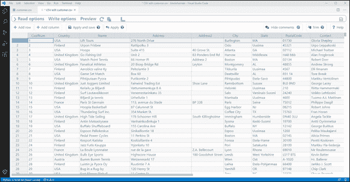

图 1-1: 以表格形式呈现客户实体。

一种分析方法是检查不同实体的特征，看看某些特征是否可以帮助对实体分组或暗示某些关系。例如，假设你要求人们说出他们最喜欢的棒球球队。你可能会认为大多数回答“科罗拉多洛岩山队”的人可能住在科罗拉多附近。然而，你并不能总是做出这种简单的关联。如果你在 20 世纪 90 年代问同样的问题，并不是所有回答“亚特兰大勇士队”的人都住在佐治亚州。在 20 世纪 90 年代，电缆电视变得流行，所有者拥有勇士队的特纳广播系统在全国范围内直播了所有勇士队的比赛。许多不住住在佐治亚州的人变成了勇士队的粉丝。

勇士队的例子说明，分析模型不能无条件地信任。数据分析可以提供巨大的价值，但需要细心和努力来构建模型，以产生随时间有效的结果。

假设你投入了足够的资金来构建良好的模型，分类模型可以帮助识别相似的实体。相似性信息有助于组织制定针对性的营销活动和服务，让客户和合作伙伴产生被个体化对待的感觉。你将在第 7 章中学习了几种分类模型，并在第 10 章中构建几个。

### 预测行为

虽然对实体进行分类以识别相似组的能力非常有价值，但分析也可以做出预测。过去的行为是未来行为的强有力指示。人类倾向于重复动作和决策，因此你可以使用识别模式的模型来预测未来的行动。预测未来行动的能力对组织具有巨大的价值。如果一个组织能够确定经常被一起购买的物品，它就可以利用这些信息提供额外的购买建议。

你无疑在网上购物时见过频繁条目分析的结果。当你喜爱的网站建议你购买另一件物品时，且该物品很合理，那是因为其他人在过去买过这组相同的物品。网站是如何知道的呢？它使用了分析技术。

你在第 7 章中学习并在第 11 章中构建的常见分析模型之一是回归分析。现在不要担心这个名称（或数学原理）。回归有点像是计算一个“加强版”的直线斜率。`regression model` 基本上是检查你的数据，并找出一条匹配你所看到的数据的直线（或曲线）。在你能够对数据绘制图表后，你可以使用该图表根据新的输入数据来猜测将发生什么。

让我们来看看这能有什么帮助。图 1-2 显示了基于试镜数据和结果得分数据构建的线性回归模型。这个示例来自你在第 11 章中用于构建此模型的一个示例。

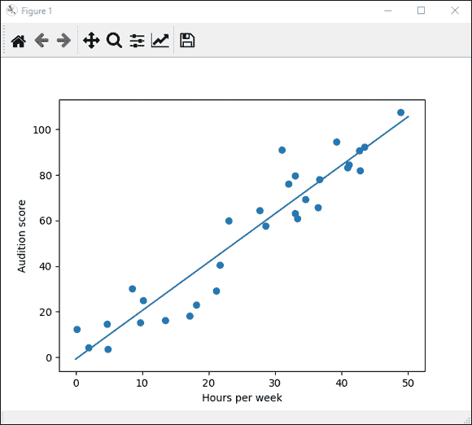

图 1-2: 使用练习小时数和试镜数据的线性回归模型。

这是你在第 11 章中再次看到的解释：假设你正在帮助学生音乐准备荣誉乐队团的试选。你收集了历史数据，关于每个学生每周练习多少小时、该学生是否被录取荣誉乐队团，以及每个学生获得的试镜分。正如你预期的那样，练习时长与试镜得分之间存在线性相关性：学生每周练习的时间越久，他在试镜中获得的得分就越高。如果你知道某个学生每周练习多少小时，线性回归模型就可以预测任何学生的试镜分。如果你有一个每周练习 30 小时的学生，你可以预计该学生在试镜中将获得约 60 分。

回归模型可以帮助准确预测未来行动。使用数据来预知下一步是非常有用的。

规范性分析略有不同。规范性分析问的问题是：“如果我选择一个 `y` 的值，那么什么 `x` 值能让我达到那个目标？”换句话说，你选择一个 `y` 的值（可能是你下周销售额的目标），然后解出 `x`。当你知道 `x` 后（可能 `x` 代表你需要拨打的潜在客户电话），你就知道达到 `y`（你的销售目标）需要什么。从本质上讲，它仍然是代数。

尽管代数很简单，但将规范性分析付诸实践可能会困难。在代数中，等式具有自反性，这意味着你可以从左到右或从右到左读取。从技术上讲，模型应该以相同的方式运行，但它们并不总是如此简单。规范性分析可以为实现目标提供一些指导，但你必须对这些指导保留。尝试模型的建议，然后评估结果。微调你的调整，然后再次尝试。规范性分析最好的用法是良好的建议，而不是实现目标的万无一策。

## 构建用于模拟的模型

规范性分析的挑战之一是以这种方式使用模型时具有的迭代性和灵活性。预测性分析非常直接。你可以在已知的误差范围内确定未来的结果。当将该模型反转并用于规范性目的时，你永远无法确定模型是否考虑了所有影响结果的因素。你的预测模型衡量的结果可能包括未抽样的特征（属性），这些特征即使在你们没有测量它们时也会发生。如果是如此的话，仅仅改变一个特征可能不会产生你预期的效果。

由于规范性分析不仅仅是反向运行预测性模型，你将不得不对你的数据集运行多次模型，一次更改一个特征。构建一个足够灵活以响应多个特征变化的模型是模拟的基础。你正在模拟现实的本质，它包含了多个不断变化的特征以及某种程度的未测量不确定性。

投入精力构建一个良好的模拟可能会远超价值。一个稳健的模拟足够灵活，可以随着新输入显示出不同趋势而改变，并仍然提供你可以信任的输出。一个告诉如何达到目标的模拟甚至比知道未来更好。

## 同步运营和评估结果

拥有良好的分析模型的最佳反应是根据模型输出更改运营。无论你的关注点是理解业务、预测明天的环境，还是使用模型来指导决策，只有当你根据所学的内容进行更改时，分析才会产生价值。

使用分析模型，特别是基于区块链数据构建的模型，是本书的目的。当你学习每一章时，你应该对你可以获得的丰富数据有所理解，以及你如何使用这些数据来增强你的组织。享受这段旅程。

# 第 2 章

## 深入研究区块链技术

### 本章内容

-  调查区块链生态系统
-  检查区块链类型
-  使用区块链解决问题
-  与区块链同步运营

区块链是时代讨论最多的技术之一。它通常有许多描述方式，包括“破坏性技术”、“分布式账本”和“新技术”。尽管这些描述不同，但没有一个能捕捉到区块链的本质。哇，这可真绕口！你可能听过区块链支持参与者之间的交易。简而言之，它是一种不依赖第三方来交付价值的激进方法。例如，当你向供应商付款时，你会使用银行或支付处理器。当然，你也可以用现金支付，但即使现金交易也依赖政府来保证价值。区块链让你能够从你不认识的人那里购买东西，并仍然信任交易将完成。在本章中，你将学习区块链技术的本质、一些可用选项以及如何最好使用区块链来解决问题。

## 探索区块链格局

根据你在书籍和文章中读到的，区块链技术打破了一切并解决了每一个业务问题——而且是同时进行！这种对区块链全能的观点赋予了区块链所能做的过多的权力。区块链可以破坏许多业务交易的执行方式，但它不会改变一切。同样，这项新技术可以解决长期存在的一些业务问题，但它并不适用于所有地方。技巧在于理解区块链可以做什么，以及它非常擅长做什么。


# 管理所有权转移

当有价值的东西从一个所有者转移给另一个所有者时，被称为`所有权转移`。区块链擅长的事情之一是管理有价值物品的所有权转移，而不依赖中间人或中介来管理转移。你可以通过向某人交付或出售某物来转移所有权。当你卖出某东西时，你用卖掉的东西交换某种支付。能够在没有中间人的情况下转移所有权可以破坏许多商业模式。例如，当你乘坐网约车服务并用信用卡或借记卡支付时，网约车公司通常支付每笔交易费用，但你可以确定它会将该成本转嫁给你！绕过支付卡处理器意味着你的出行可能会更便宜。

在还没有进入太具体的细节之前，区块链技术让你和网约车提供者能够信任行程支付的转移，而不需要相互信任。在司机或乘客互不信任的情况下支付行程费的能力对支付卡处理器可能具有破坏性。许多中间人，如银行、支付处理器、经纪人、国际汇款公司甚至音乐分销商，可能会因区块链失去收入。所有这些中间人都通过管理区块链技术可以简化的转移来收取费用。

## 利用区块链做更多事情

区块链的功能不仅仅是处理支付——它可以管理任何资产从一个所有者转移到另一个所有者。该资产可以是加密货币、房地产、汽车、优质橄榄油，或现实或虚拟世界中的任何有价值的东西。很棒的是，所有关于这些转移如何发生的信息都将留在区块链上供日后审查。

区块链最初是作为一种在去信任环境中管理加密货币交易的方法。从那时起，它成熟到可以处理许多类型的价值转移，并成为集成化企业基础设施中不可或缺的组件。企业依赖于许多软件和硬件组件，这些组件共同工作以向客户和合作伙伴提供服务。区块链技术不再仅仅是一个酷炫的想法——现在它拥有了改进业务流程的能力。你可能会看到越来越多的企业依赖区块链来帮助运行其业务。在你研究利用区块链及其处理数据的新方法之前，探索现有的区块链格局会有帮助，能让你了解区块链在何处可能产生益处。

# 理解区块链技术

在最基础的层，`blockchain`是一个相互连接的区块列表，其中整个列表的副本分布在组称为`network nodes`的参与者之间。每个区块包含一组交易，并与紧接其之前的区块连接。每笔交易都描述了某些金额从一个所有者到另一个所有者的转移。每笔交易可能包含更多信息，但重点是价值的转移。

新区块添加到链中的方式确保了区块链的所有副本（这就是为什么它被称为区块链）都是相同的。向不同位置分配数据副本一直是一件困难的事情。向多个接收者发送数据副本并不难，但保持所有副本相同非常困难。保持分布式数据同步是区块链技术做得非常好的另一件事。

## 将区块链与你熟悉的事物进行比较

思考区块链的一种方式是它是在许多节点之间共享的大型电子表格。电子表格中的每一行代表一次交易，记录金额、所有者列和接收所有者列，有时还包含带有额外数据的列。定期地，一组被称为`block of rows`的行会被添加到每个电子表格副本的底部。你不能回溯并编辑电子表格中的任何行，但你可以添加新行。这个类比很简单，但它让你了解了区块链交易与熟悉的电子表格有多相似之处。

维护电子表格副本的最初困难点之一是如何控制添加新行并保护现有行免受更改。关于区块链完整性的全面讨论超出了本书的范围，但以下是关于区块链如何确保完整性的高层概述。

## 在区块链中使用密码学

区块链技术基于使用加密哈希值将区块连接在一起的概念。`cryptographic hash`函数接受任何字符作为输入，并创建一个代表输入的固定长度输出。计算哈希值很容易，但从哈希值找到原始输入是极其困难的。如果输入发生任何变化，哈希函数将计算出不同的哈希值。

区块链节点计算区块的哈希值并将其存储在链上的下一个区块中。该过程连接了区块并检测了区块中的变化。如果任何区块中的任何数据被更改，该区块的哈希值就会改变，导致下一个区块的链接（记住它是原始区块的哈希值）失效。任何更改都会破坏链。

## 网络节点之间达成共识

区块链网络节点提交交易，然后称为`miners`的特殊节点将交易组装成区块，然后与其他矿工竞争，第一个解决数学题，使得区块可以被所有其他节点轻松验证。第一个解决谜的矿工将获得一份小小的工作奖励。

每个区块链都可以定义其节点用于验证区块的不同方法，但特定区块链网络中的所有节点都使用相同的区块验证方法。区块链用于验证新区块有效的方法被称为`consensus algorithms`。常见的共识算法是`Proof of Work (PoW)`算法，它要求矿工花费能量解决数学题以换取奖金。

无论区块链使用哪种类型的共识，必须超过 50%的节点同意新提交的区块是所谓的真理。当大多数人同意时，所有节点将新区块添加到他们的区块链中。通过共识和对以前数据未更改的保证，区块链技术确保了区块链的所有副本都是相同的且是可以信任的。

# 回顾区块链的家族树

区块链技术只有十年的历史，但它的影响已经在许多类型的企业中得到体现。在短短几年内，区块链实现通过三代演变得成熟。按代划分区块链开发有助于揭示区块链简短的历史以及它可能向何处发展。但注意，某些开发是重叠的，另一些可能适用于一个以上的类别。

## 引入区块链的第一代

区块链技术随着 2008 年中本聪（Satoshi Nakamoto）论文《比特币：一种点源电子现金系统》的发布而引入。该论文提出了一种处理电子货币的完全新方法。它描述了一个结构化数据存储库，由特殊区块链组成，被称为`block chain`。这种新方法使得许多互不信任的节点能够在不依赖中心权威的情况下交换货币。区块链第一代的目标侧重于管理互不信任的节点之间的交易。信任而非性能，是核心问题。

## 在第二代中添加区块链功能

比特币确实做了它应该做的事，提供了一种交换价值的新方法。通过比特币，许多个人和小微企业可以直接与客户或相互互动，而无需涉及银行或支付处理程序。其他区块链实现很快出现，每种都有自己的加密货币。随着区块链变得越来越流行，开发者和研究人员开始寻找使用这种新技术的其他方法。他们发现，只需少量更改，区块链技术就能完成比交易加密货币更多的事情。

在中本聪论文发布后短短五年，《比特币杂志》的联合创始人维塔利·布特林（Vitalik Buterin）发表了一份白皮书，建议使用以太坊（Ethereum），这是一种新的、功能强大的区块链实现，可以做比交换加密货币更多的事情。布特林对以太坊有一个计划，并为这一代建立了兴趣和资金支持。以太坊基金会这一瑞士非营利组织成立，布特林成为了以太坊的主要开发者。

以太坊的设计与之前的区块链实现不同。两个主要区别是以太坊的智能合约和原生加密货币`ether`。在以太坊中，你只能通过执行智能合约访问区块链数据。智能合约提供了丰富的功能和区块链数据完整性，使得区块链技术能够完成比第一代实现更多的事情。随着以太坊的发布，区块链可以执行超出支付之外的广泛业务交易，例如自动化许多业务决策，甚至自动执行整个交易。想象一个共享出行应用程序，它发送一辆自动（无驾驶）汽车将你送往目的地，然后自动从你的账户将支付费用转到它自己的账户中——全自动完成！这只是以太坊中可能性的例子之一。

## 在第三代区块链中扩展到企业级

以太坊是迈向通用业务接受的一个重要区块链进展。尽管区块链具有更广泛的吸引力和潜在应用，但其核心技术仍然缺乏许多企业功能。大多数区块链实现都假设开放访问、无身份验证并侧重信任。而企业则依赖于对敏感信息的访问限制、与现有应用程序的集成以及性能目标的实现。

企业 IT 基础设施可能极其复杂，无法快速改变以适应全新的技术。要良好地集成到企业中，新技术必须足够灵活，能够与旧应用程序和组件“良好相处”。第一代和第二代区块链实现往往缺乏灵活性且难以修改。例如，大多数区块链并不容易替换共识算法。某些旧的区块链实现仅允许你使用开发者构建在区块链中的共识算法。例如，`PoW`算法在公共区块链实现中可能流行，但它并不适合企业级区块链。`PoW`为了解决无信任环境对计算资源有极高要求，但参与者之间通常存在某种信任。当企业区块链环境中存在有限信任时，其他共识算法可能更合适。然而，旧的区块链可能不提供轻松切换到更合适共识算法的方法。

第三代区块链都已尝试解决性能、扩展性以及与其他区块链、旧应用程序和数据集成的问题。第三代区块链并非起始于任何单篇论文或新的实现。它是随着多个供应商开始解决企业和集成需求而缓慢形成的。这些区块链实现包括`Cardano`、`Nano`、`IOTA`、`Hyperledger Fabric`和企业级以太坊。

### 展望未来

下一代区块链（即第四代）正在快速到来。许多区块链专家认为，区块链增长的下一步是将其与`人工智能 (AI)`结合。由于各种规模的组织都开始利用区块链进行交易和价值交换存储，存在着大量未被开发的缓存数据。这些数据包含了交易活动的宝贵痕迹。区块链的下一个大动作是利用存储在链上数据的价值，这正是本书的关注所在。

### 将区块链融入当今业务

区块链技术因其消除中间环节和改变业务运营方式的承诺而被视为一种破坏性技术。这一承诺是巨大的，但是可能的。即使只是移除现有业务流程中的部分中间环节，也有潜力在各个层面上简化工作流并节省效益。

另一方面，将业务流程转变为区块链技术并不是简单的切换。为了实现区块链技术的广泛应用，需要与现有软件和数据集成的新业务和软件产品。

#### 寻找合适的场景

成功实施区块链的第一步是从明确的目标开始的。尝试将区块链强行用于不合适的用例会导致挫败和最终失败。区块链有很多优点，但最常见的三个是数据透明度、去中间化（消除中间人）和持久历史。

如果你正在创建一个产品，你的新应用程序如何将旧身份与区块链账户关联？如果你的应用程序支持回滚交易，你的区块链将如何做到？最后，区块链的集成会保持足够的性能，还是会减慢旧应用程序？

旧应用程序的用户必须等待区块链交易吗，还是他们可以像实施区块链之前那样进行工作？你必须确定它如何与你的组织对齐。我发现最成功的区块链实现都是那些从明确目标开始的。

#### 与遗留资产集成

在你确定区块链是合适的之后，下一步是确定它在工作流中的位置。除非你正在构建新东西，否则你必须与现有的软件和基础设施集成。在许多情况下，唯一的考虑因素围绕着你的应用程序如何存储它需要的数据。你会将所有内容存储在区块链上吗？这样做可能没有意义。你可能会发现只有部分应用程序数据应该存储在区块链上。将支持数据存储在链下数据仓库中可能更有意义。（既然我们已经进入了区块链时代，遗留数据库被称为`off-chain repositories`。）如果是这样，你的应用程序将不得不与区块链和链下存储库集成。

#### 扩展到企业级

上一节的最后一个问题引出了目前阻碍区块链采用的最大障碍之一。将性能扩展到企业级规模是一个尚未完全解决的持续追求。大多数企业应用程序使用遗留数据库管理系统来存储和检索数据。这些数据库已经存在了几十年，并在处理海量数据方面变得高效。

根据赵长鹏（加密货币交易所 Binance 的首席执行官）的说法，区块链实现必须能够支持每秒 40,000 次交易，才能作为全球加密货币交易所的核心技术存在。目前，只有四种流行的区块链实现声称每秒处理超过 1,000 次交易（`Futurepia`、`EOS`、`Ripple`和`NEO`）。最流行的公共区块链`Ethereum`目前每秒可以处理约 25 次交易。然而，`Ethereum`的未来版本重点关注大幅提高交易吞吐量。技术正在改进，但要达到企业所需的容量仍有很长的路要走。

在评估企业级区块链时，性能并不是唯一的限制因素。与遗留资产的集成，以及区块链基础设施融入现有企业 IT 基础设施的难易程度也是考虑的问题。所有的区块链节点都需要新的虚拟或物理硬件吗？新节点可以在现有的服务器上运行吗？网络连接如何？现有的网络基础设施能够支持新的区块链网络吗？这些只是企业在部署区块链集成项目之前回答的众多问题中的少数几个。

# 理解主要的区块链类型

2008 年，`Bitcoin`是唯一的区块链实现。在那个时代，`Bitcoin`和`blockchain`是同义词。现在存在数百种不同的区块链实现。每种新区块链实现的出现都是为了解决特定的需求，且每一个都是独特的。然而，区块链倾向于与其他区块链共享许多特征。在检查区块链应用和数据之前，查看它们的相似之处是有帮助的。

## 对区块链实现进行分类

评估区块链的最常见方法之一是考虑底层的`data visibility`（数据可见性），即谁可以查看和访问区块链数据。同样重要的是，谁可以参与决策（共识）来向区块链添加新区块？三种主要的区块链模型是公有的、私有的和混合的。

### 向所有人开放区块链

Nakamoto 原始的区块链提案描述了一种公共区块链。毕竟，区块链技术的核心在于在不互信的参与者之间提供可信的交易。在公共网络中的节点之间共享交易账本提供了一个经典的不互信网络。如果任何人都可以加入网络，你就没有标准来建立你的信任。这几乎就像从窗户外扔出一张 20 美元的钞票并相信只有你打算捡它的人会去捡。

`Public blockchain`实现（包括`Bitcoin`和`Ethereum`）依赖于一种共识算法，使挖掘区块变得困难但验证变得容易。`PoW`是今天公共区块链最常用的共识算法，但这可能会改变。`Ethereum`正在向`Proof of Stake (PoS)`共识算法过渡过程中，该算法需要较少的计算，并取决于节点持有多少区块链货币。其理念是，如果持有更多区块链货币的节点参与不道德行为，它将受到负面影响。你对某事的投入越高，你关乎其完整性的机会就越大。

由于公共区块链对任何人开放的（任何人都可以成为网络上的节点），因此加入时不需要许可。由于这个原因，公共区块链也被称为`permissionless blockchain`（无许可区块链）。`Public (permissionless)`区块链通常用于与普通公众交互的新型应用。公共区块链就像一家零售店，任何人都可以进入商店并购物。

### 限制区块链的访问

公共区块链的对立面是私有区块链，例如`Hyperledger Fabric`。在`private blockchain`（也称为`permissioned blockchain`，许可区块链）中，拥有并控制区块链的实体授予并撤销对区块链数据的访问权限。由于大多数企业管理敏感或私有数据，私有区块链被广泛使用，因为它们可以限制对数据的访问。

区块链数据仍然是透明且易于获取的，但受所有实体访问要求的限制。有人认为私有区块链违反了数据透明性，即区块链技术的初衷。尽管私有区块链可以限制数据访问（并违背了`Bitcoin`中原始区块链的哲学），但有限的透明度也允许企业在私有环境中为新应用考虑区块链技术。如果没有私有区块链选项，企业可能不会在私有环境中考虑区块链。

### 结合两者的优点

区块链的结合方案是混合区块链，它涵盖了从生产到消费整个过程中的最佳方案。一个经典的区块链用例是供应链应用，它管理产品从生产到消费的所有过程。供应链的起点是产品制造、捕获或以其他方式供应给最终客户。区块链随后在产品到达消费者购买的物理位置之前管理所有权的转移。供应链应用管理产品生命周期中每个阶段的支付，并创建一个用于调查供应链上所有者的审计追踪。许多供应链非常复杂，由多个组织组成。在这种情况下，数据从一个参与者处导出到下一个参与者，然后导入他们的数据系统。单一区块链将简化导出/传输/导入循环。区块链技术在供应链应用中的另一个益处是`provenance`（追溯到其起源的来源）易于获取。

今天许多供应链由几个为了共同利益而达成协议的企业组成。尽管供应链中的参与者是业务伙伴，但他们并不完全信任对方。区块链可以提供企业所需的交易和数据信任。最佳解决方案是半私有区块链——即区块链对供应链参与者是开放的，但对其他人不是。这种由一组实体拥有的区块链被称为`hybrid`或`consortium, blockchain`（联盟链区块链）。参与者共同拥有区块链，并就访问策略达成一致。

## 描述基本的区块链类型特征

每种类型的区块链都有特定的优缺点。使用哪种取决于目标和目标环境。在做出关于哪种区块链最好的明智决定之前，你必须知道你为什么需要区块链以及期望从中获得什么。对于一个组织最好的解决方案可能对另一个组织并不是最佳的。表 2-1 显示了各种区块链类型如何比较以及为什么你可能会选择一种而不是另一种。

每种区块链之间的主要区别在于所使用的共识算法以及参与者是已知还是匿名。这两个概念是关联的。未知的（因此完全不互信的）参与者将需要一个更严谨共识算法的环境。相反，如果你认识交易参与者，就可以使用不严谨的共识算法。

| 特性 | 公有区块链 | 私有区块链 | 联盟链（企业级） |
| :--- | :--- | :--- | :--- |
| 共识机制 | `PoW`、`PoS`等 | 授权参与者 | 各不相同；可以使用任何方法 |
| 性能 | 慢（由于共识机制） | 快（相对而言） | 通常很快 |
| 身份 | 几乎匿名 | 身份经过验证 | 身份经过验证 |

## 对比流行的企业区块链实现

如今已有数十种区块链实现方案，很快将会有数百种。每个新的区块链实现方案都针对特定的市场并提供独特的特性。书中没有空间涵盖相当数量的区块链实现，但你应该了解一些最流行的方案。

请记住，你将在本书中学习区块链分析。尽管各种规模的组织都开始利用分析的力量，但企业是早期的采用者，并且从数据中提取价值拥有最成熟的方法。

What Matrix 网站提供了顶级企业区块链的全面比较。访问[`www.whatmatrix.com/comparison/Blockchain-for-Enterprise`](https://www.whatmatrix.com/comparison/Blockchain-for-Enterprise)获取最新的区块链信息。

以下是顶级的企业区块链实现方案及其一些优缺点（排名基于 What Matrix 网站）：

* **Hyperledger Fabric**：来自 Linux 基金会的旗舰区块链实现方案。`Hyperledger`是一个由大型企业组成的财团支持的开源项目。`Hyperledger`基于模块的架构和丰富的支持使其成为评分企业区块链。
* **VeChain**：目前比`Hyperledger`更流行，在 What Matrix 评审的产品中其企业用例数量最多。`VeChain`包含了对两种原生加密货币的支持，并声称其重点是高效的企业协作。
* **Ripple 交易协议 (Ripple Transaction Protocol)**：一种专注于金融市场的区块链。`Ripple`并不是为了通用用例，而是服务想要实现金融交易区块链应用的组织。`Ripple`是第一个专注于金融解决方案的商业区块链。


**Ethereum (以坊)**：最流行的通用公有区块链实现方案。尽管`Ethereum`在技术上并不是一种企业解决方案，但它已用于多个概念验证项目。

上述列表只是区块链实现方案的一个小样本的简要概述。如果你刚刚开始学习通用的区块链技术，请从`Ethereum`开始，它是最容易学习的区块链实现之一。之后，你可以进展到可能与你的组织更匹配的区块链。

## 将区块链特性与业务需求对齐

区块链技术是革命性的，因为它提供了其他技术不具备的特性。它不能解决你所有的计算问题，也不应该是每个应用程序的一部分。事实上，区块链的独特特性只解决了大多数企业面临的众多问题中的小部分。遗憾的是，太多的组织选择采用区块链技术，然后试图寻找放置它的位置。好得多的方法是理解区块链擅长什么，然后识别出区块链技术适合的未解决的企业问题。

## 回顾区块链核心特性

在本节中，你将查看区块链提供的一些特性。

### 无需信任的价值传输

区块链技术的独特优势之一是它支持在互不信任的实体之间传输价值物品。事实上，这是区块链的主要吸引力。你只需要信任共识协议，而不是任何其他用户。你的交易以一种可验证且稳定的方式执行，因此你可以信任它们正在被妥当且安全地处理。这种能力消除了对第三方作为交易经纪人的需求。在当今的经济中，大多数价值传输都包含至少一个中间环节（如银行）来处理传输细节。

### 通过消除中间人降低交易成本

由于区块链允许互不信任的实体直接交互，它消除了大多数中间人。无论你是考虑将资金从一方转移到另一方，还是提供产品进行支付，几乎所有的交易都需要中间人。中间人是如银行家、进口商、批发商甚至媒体出版商之类的实体。

区块链让生产者直接与消费者互动成为可能。例如，艺术家可以直接向买家提供他们的艺术品，而不需要经纪或出版商。消除中间人要么消除了支付给其服务的费用，要么用自动化流程取代这些费用从而大幅降低成本，这些节省的费用可以直接传递给消费者。虽然区块链交易处理会产生小额成本，但通常远少于中间人收取的费用。这对生产者和消费者都是有利的。

### 通过直接交互提高效率

降低费用并不是消除中间人的唯一好处。每当你能够移除流程中的一个或多个步骤时，你就提高了效率。更高的效率通常意味着完成过程所需的时间减少。例如，假设一位音乐家决定使用区块链交付模型直接向粉丝发布她的最新单曲。她的粉丝可以在单曲发布的一刻就消费新单曲。如果有出版商，内容必须经过交付、批准、包装，最后才发布。虽然数字媒体的延迟可能是微不足道的，但区块链可以消除中间人引入的任何延迟。

在通过区块链交付实体货物时，这种对比变得更加清晰。如果你从加利福尼亚购买草莓，你是否想过在拿到它们之前它们被处理了多少次？许多加工商站在你和种植者之间。区块链可以减少几乎任何产品参与供应链的人数。

### 维护完整的交易历史

区块链的另一个设计特性是其不可变性。因为无法更改任何数据，写入区块链的任何内容将永远在那里。“区块链中发生的事，留在区块链中。”对于任何受益于随时可用交易历史的应用程序来说，这是一个好消息。

让我们回到草莓的例子。你今天可能会去超市购买贴有“加州新鲜产”标签的草莓。你真的不知道这些草莓是来自加州还是来自西班牙（草莓第二大出口国）。但通过区块链，你可以追踪一盒草莓直到种植者。你将确切知道草莓来自哪里以及何时采摘的。这种级别的交易历史存在于区块链中的每一次交易。你可以随时找到任何交易的完整历史。

### 通过复制增加韧性

区块链网络中的每个全节点必须维护整个区块链的副本。因此，区块链上的所有数据都会复制到每个全节点，没有任何节点依赖于另一个节点存储的数据。如果几个节点崩溃或在其他不可用，应用程序的其他用户将不受影响。这种韧性意味着容错性构建在区块链架构中。此外，通过将整个区块链分发到不同组织拥有的许多节点，你实际上消除了一个组织控制数据的可能性。

任何受益于高可用性和所有权自由的应用程序都可能适用于区块链。许多数据库应用程序付出了巨大精力进行数据复制，以提供容错能力，而区块链已经内置了这一功能！

## 提供透明度

区块链功能的最后一类大类与整个区块链被复制到每个全节点这一事实直接相关。每个全节点都能看到整个区块链，提供了无与伦比的透明度。虽然存储在块中的数据通常是加密的，但数据本身对任何节点的用户都是可见的。如果数据未加密，任何访问节点的人都可以看到它。如果数据已加密，拥有正确解密密钥的用户可以从任何节点访问区块链数据并进行解密。

区块链的透明度使得信任数据的完整性成为可能。任何节点都可以（并且确实会）定期验证每个块以及整个区块链的完整性。对“不可篡改”区块链数据的任何修改都会变得显而易见且易于修复。

## 审查主要的业务需求

现在你已经了解了一些区块链的核心功能，但对你的主要业务需求有一个清晰的认识也同样重要。只有当区块链功能与业务需求对齐时，区块链的使用才是合理的。虽然许多业务需求在不同企业之间有所不同，但存在一些共同需求：

*   **控制和记录交易：** 这一需求是指使用应用程序和数据系统来促进、控制和记录执行业务运营所需的活动的过程。记录活动的行为记录了某些改变企业存储数据状态的动作。

*   **减少或消除过度成本：** 想要维持经营的企业持续追求的目标是监控运营成本并识别和减少（或消除）浪费。

*   **追求效率：** 流程效率可以带来降低成本和提高质量的双重结果。这两个结果对于盈利的业务运营都是理想的。

*   **保留以供分析：** 合规、事件调查和分析需要历史交易数据的存在。收集、管理和归档此类数据需要规划和持续的资源。

*   **通过冗余保护可用性：** 企业的信息系统资产只有在授权人员可以根据需要访问时才有价值。组织必须实施计划，存储并维护关键数据的冗余副本，以防主数据变得无法访问。

*   **在不保护隐私的情况下暴露数据：** 企业的信息系统资产只有在授权人员可以根据需要访问时才有价值。组织必须实施计划，存储并维护关键数据的冗余副本，以防主数据变得无法访问。

## 将区块链功能与业务需求匹配

现在你已经了解了一些区块链的核心功能，但对你的主要业务需求有一个清晰的认识也同样重要。只有当区块链功能与业务需求对齐时，区块链的使用才是合理的。虽然许多业务需求在不同企业之间有所不同，但存在一些共同需求：

| 业务需求 | 区块链功能 |
| :--- | :--- |
| 控制和记录交易 | 透明度 |
| 减少或消除过度成本 | 透明度 |
| 追求效率 | 透明度 |
| 保留以供分析 | 透明度 |
| 通过冗余保护可用性 | 透明度 |
| 在不保护隐私的情况下暴露数据 | 透明度 |

## 审查用例

有很多很好的用例示例。在本节中，你将查看几个。看看你能想出一个好的例子。

### 在网络空间管理物理物品

最早的大规模用例之一是供应链管理。从原始生产者到消费者的整个产品管理过程既昂贵又耗时。有了如今的产品追踪应用程序，消费者很难了解很多关于产品的信息。某些产品（如电子产品和家电）可能有识别身份的描述性标签，但我们消费的大多数产品并不提供这些信息。

实施供应链管理提供了多处好处。首先是透明度。生产者、消费者以及之间的任何人都可以看到产品如何从制造或获取地到达最终购买地，以及所需的时间。检查员和监管审计员可以确保供应链中的每个参与者都符合标准。

这种透明度的提高同时也消除了不必要的中间人。过程中的每次传输发生在活动参与者之间，而不是经纪人。


在区块链中正确跟踪物理产品取决于将物理产品与数字标识符准确关联。例如，我最近乘坐商业航空公司办理了行李。代理正忙于与另一位代理聊天，将我的标签与另一位旅行者的标签换了。他的标签贴在了我的行李上，反之亦然。当我到达时，航空公司发现我的行李（贴着别人的标签）飞到了墨西哥。始终记住，区块链只是*代表*物理世界——它并不是物理世界。

### 处理敏感信息

医疗保健已成为从政治、研究到支出等讨论中最热门的话题之一。似乎每个人都对提高医疗质量的同时降低成本感兴趣。大量数字数据的可用使得医疗领域的进步成为可能。研究人员可以分析大量数据以探索新的治疗方案，增加现有药物和程序的整体有效性，并识别节省成本的机会。这种分析只有在访问大量的患者病史时才是可能的。研究人员面临的主要问题是，患者的`电子健康记录 (EHR)`可能碎片化存储在多个诊所和数据库中。尽管存在合并这些记录的努力，但隐私问题日益受到关注且进展缓慢。

电子健康记录（EHR）管理非常适合区块链应用。将患者的EHR存储在以太坊区块链上可以消除碎片化数据带来的孤岛问题，而无需信任提供或修改EHR部分内容的实体。以这种方式存储EHR还有助于明确医疗服务的计费和支付。由于所有全面的医疗程序历史都集中在了同一处，医疗服务提供者和保险公司可以查看患者治疗的相同视图。完整的历史记录更容易确定哪些项目应该计费。

区块链应用在医疗领域提供的另一个优势是药品管理。区块链EHR为医疗执业人员提供了信息，使其查看患者处方药的完整历史和当前快照。它还允许研究人员、审计师甚至药品制造商检查其产品的效果和可能的真实副作用。在保护隐私的前提下提供可用EHR可以提供有价值的信息，以提高医疗服务的质量。

## 执行金融交易

金融服务是涉及某些货币交换的交互。货币可以是法定货币（也称为`fiat`货币），也可以是加密货币，例如`Bitcoin`或以太坊的默认货币`ether`（`ETH`）。区块链应用在处理纯货币交换或将某些货币兑换产品或服务方面表现出色。金融服务可能集中在处理支付上，但涉及资金的许多交易还有更多细微差别。

区块链在金融服务领域的另一个富集领域是房地产交易。与银行交易一样，`Ethereum`使在没有经纪人的情况下进行交易成为可能。买卖双方可以直接用货币兑换合法所有权。智能合约可以在交易发生时验证交易的所有方面。通常需要律师或贷款处理人员的步骤可以自动完成。在满足法律要求（例如验证所有权的可用性以及提交必需的政府文件）后，买方可以转移资金购买物业。卖方在所有权转移给买方的同时收到物业的款项。

# 第 3 章：识别具有价值的区块链数据

### 本章将涉及

-  **描述区块链数据**
-  **检查区块中的常见数据**
-  **将区块链数据与常见应用数据关联**
-  **将区块链数据映射到业务流程**

许多对区块链技术的描述都将其与为人的数据存储技术联系起来。其中一种较流行的描述是，区块链本质上是一个交易的分布式账本。这种描述在某种程度上是正确的，但过于简单了。区块链确实像账本一样存储交易并且是分布式的，但它包含了更多有趣的信息。如果区块链只存储交易，那么它将非常无趣，因为它无非是一个分布式的电子表格。

区块链远不仅仅是一个分布式电子表格——它包含了数据当前状态（当前值）的不可篡改记录，以及数据如何变为当前状态的完整历史记录。传统数据仓库通常只存储数据的最终状态。当你进行更改时，这些更改会覆盖任何之前的值。更高级的数据仓库会维护审计记录，这些记录通常是记录数据值更改的外部备注。

此外，区块链应用可以创建日志条目，记录智能合约执行时发生的事件。记录活动的能力可以提供数据变化的视图，而不仅仅是数据发生了变化的事实。最后，区块链中的每个区块都存储了应用程序调用的智能合约中的函数——以及输入参数的信息。

在本章中，你将学习区块链环境中可用的不同类型的数据，以及你如何识别可能对分析有用的数据。

## 探索区块链数据

在本节中，你将发现区块链区块中存储了哪些数据。尽管每个区块链实现在底层细节上有所不同，但概念在不同区块链类型之间通常是一致的。

由于本书的目的是向你介绍区块链分析最重要的概念，我将不会涵盖每种区块链的具体技术细节。相反，你将学习最流行的公共区块链实现`Ethereum`的特定特征。如果你不使用`Ethereum`，不要担心——你在这里学习的概念可以很容易应用到任何其他区块链实现上。

 最常见的区块链类型之间的主要区别在于它们处理交易的方式。`Bitcoin`使用`未花费交易输出模型 (UTXO model)`，在该模型中，每笔交易都花费上一笔交易留下的部分，然后创建一个新的输出，作为处理交易后的剩余（未花费）余额。处理交易的另一种主要方法是`账户/余额模型 (Account/Balance model)`，`Ethereum`使用这种模型。在`账户/余额模型`中，每个账户都有一个记录的余额，交易增加或减少该余额。`账户/余额模型`类似于传统的账本。我在书中重点关注`Ethereum`和`账户/余额模型`。

### 了解区块链区块中存储了什么

如第 2 章所述，区块链仅仅是一组特殊构建的区块，它们彼此链接或链联在一起。每个区块头都包含前一个区块的哈希值，形成了创建链的链接。从许多描述中来，区块链中的区块似乎与数据库或其他数据仓库中的数据几乎相同。然而，这种观点是不准确的。区块链存储的内容远多于数据项的值，这就是为什么区块链分析如此有趣的原因。区块链中包含大量信息，但你需要知道如何获取它们。

每个区块由一些区块头信息和一组交易组成。在大多数区块链实现中，矿工选择他们想要包含在区块中的交易。在`Ethereum`中，如果矿工是第一个挖掘该区块的人，他或她将根据潜在收益选择交易。其他区块链实现使用不同的方法创建区块。例如，`Hyperledger Fabric`使用排序节点而不是矿工。由于`Hyperledger Fabric`使用不同的共识机制，它不依赖竞争性的矿工来创建区块。`Hyperledger Fabric`基于模块化设计，使得替换组件（包括共识机制）变得简单。`Hyperledger Fabric`默认使用名为`Kafka`的共识机制，但根据需要可以更改。`Kafka`取决于当前选举出一个领导者，而该领导者有权构建交易区块。

### 记录交易数据

无论使用什么方法创建区块，区块通常包含交易或智能合约代码。由于区块链技术是为了管理加密货币而引入的，交易数据关注从一个地址到另一个地址的所有权转移。在本节中，你将查看一个区块以获取头部信息和交易列表。

`Etherscan`是一个允许你检查以太坊主网`mainnet`的流行网站。图 3-1 显示了 Etherscan 区块视图的一部分。我们将检查的区块号为`8976776`。注意此区块包含`95`笔交易。

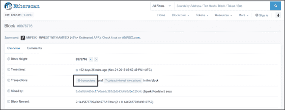

# 图 3-1: 在 Etherscan 中查看区块头信息。

要在 Etherscan 中查找区块 8976776，请访问`https://etherscan.io/`，在 All Filters 字段中输入区块号。然后点击或触摸搜索图标（放大镜）。

Etherscan 的功能远不止提供查看以太坊主网数据的方法。你可以检查并检索来自主网的数据；包括 Ropsten、Kovan、Rinkeby 和 Goerli 在内的流行测试网；以及能源网基金会（EWF）链。如果你创建一个账户并请求免费 API 密钥，可以使用该密钥来提取区块链数据。

要查看区块 8976776 中的交易列表，请点击 95 Transactions 链接。图 3-2 显示了区块 8976776 中的前 5 笔交易。可以看到每笔交易都有一个`From`账户、一个`To`账户和一个`amount`。简单来说，每笔交易都记录了`Value`列中从一个以太坊账户转移到另一个的金额。

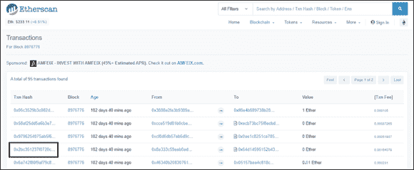

图 3-2: 在 Etherscan 中列出区块中的交易。

点击或触摸图 3-2 中的第四笔交易，以打开图 3-3 所示的 Etherscan 交易详情页。此初始页面显示了以太坊交易的通用信息。`To`字段显示目标地址为 Contract，这意味着该交易是调用智能合约的结果。

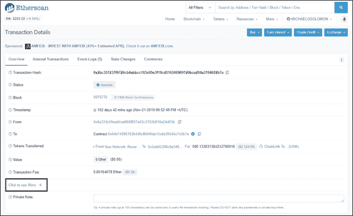

图 3-3: 在 Etherscan 中检查交易。

在以太坊中，访问存储在区块链中的数据的唯一方法是通过智能合约。你使用智能合约地址（智能合约代码存储在区块链中）来运行或调用其函数。智能合约函数包含了访问区块链数据的指令。

点击或触摸左下角的 See More，以显示图 3-4 所示的关于智能合约调用的扩展交易详情页。你可以看到这笔交易是调用此智能合约`cancel()`函数的结果。你将在后面的章节学习更多关于智能合约和交易详情的内容，但请注意，区块链技术保留了区块链数据的每一次记录，这是获取数据的绝佳之处。

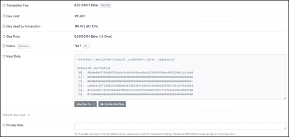

图 3-4: 在 Etherscan 中探索交易详情。

## 分析区块的组成部分

在你开始从区块链提取数据进行分析之前，你需要稍微了解你想要的数据是如何存储的。大部分数据存储在区块中，这就是接下来我要讨论的内容。

是的，没错！你想要分析的大部分数据存储在区块中。包括以太坊在内的某些区块链会将数据存储在外部（离链）数据库中。别担心，也会描述离链数据。

我只描述基础的以太坊区块。以太坊内部机制的权威参考是以太坊黄皮书：https://ethereum.github.io/yellowpaper/paper.pdf。你也可以在 https://ethereum.stackexchange.com/questions/268/ethereum-block 找到区块结构的第三方讨论。`block`是一个包含两个部分的数据结构：头和主体。交易被添加到主体并提交到区块链网络。`矿工`获取区块并尝试解决数学难题来赢得奖励。矿工只是节点或节点池，拥有足够的计算能力来多次计算哈希值以解决难题。


在以太坊中，挖掘过程使用提交的区块头和一个被称为`nonce`（一次性数字）的任意数字。矿工为区块头选择一个`nonce`值，并使用区块头的哈希函数计算哈希值。结果必须匹配规定的模式，随着矿工区块的速度加快，这种模式变得越来越困难。如果第一次挖掘结果不匹配模式，矿工会选择另一个`nonce`并在新区块头上计算哈希。这个过程一直持续，直到矿工找到一个哈希匹配模式的`nonce`。

找到解决方案的矿工会将该方案广播到网络的其他部分。该矿工因验证区块的工作而获得 ETH 奖励。由于许多矿工同时处理区块，多个矿工几乎在同一时间解决哈希难题的情况很常见。在其他区块链中，这些区块被视为孤区块。在以太坊中，这些区块被称为叔区块（uncles）。叔区块是在该区块已被接受后到达的任何成功挖掘的区块。以太坊接受叔区块并为矿工提供奖励，但奖励小于接受区块。

以太坊奖励解决叔区块的矿工，以减少挖矿中心化并增加区块链的安全性。叔奖励为小型矿工的参与提供了激励。否则，挖矿将对可能接管所有挖矿的大池有利。鼓励更多矿工参与通过增加整个区块链的总工作量提高安全性。

区块的`header`包含描述区块的数据，`body`包含区块中的所有交易。图 3-5 显示了太坊区块头的内容。

以太坊使用 Keccak-256 算法产生所有哈希值。美国标准与技术研究院（NIST）的安全哈希算法 3 (SHA-3) 是 Keccak 算法的子集。以太坊是在 SHA-3 标准确定之前引入的，Keccak-256 并不遵循 SHA-3 标准。

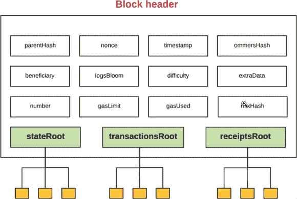

图 3-5: 以太坊区块头。

每个以太坊区块头都包含定义和描述区块的信息，并记录其在区块链中的位置。区块头包含以下字段：

* `Previous hash`：上一个区块头的哈希值，其中`previous block`是当前区块被添加时区块链上的最后一个区块。
* `Nonce`：一个使得当前区块头哈希值符合特定模式的数字。如果你更改此值（或任何区块头值），区块头的哈希就会改变。
* `Timestamp`：当前区块创建的日期和时间。
* `Uncles hash`：当前区块叔区块列表的哈希值，这些叔区块是成功挖掘但在接受区块添加到区块链后才到达的陈旧区块。
* `Beneficiary`：接收挖掘此区块奖励的矿工账户。
* `Logs bloom`：日志信息，存储在布隆过滤器中（一种用于快速判断元素是否属于某个集合的数据结构）。
* `Difficulty`：挖掘此区块的难度等级。
* `Extra data`：用于描述此区块的任何额外数据。矿工可以在此处放入他们想要的任何数据，也可以将其留空。例如，某些矿工会写入一些用于识别其所挖掘的区块的数据。
* `Block number`：该区块的唯一编号（顺序分配）。
* `Gas limit`：该区块的 gas 限制。（你将在本章的稍后部分学习关于 gas 的知识。）
* `Gas used`：该区块中交易使用的 gas 数量。
* `Mix hash`：与 nonce 值结合的哈希值，用于证明所挖掘的 nonce 满足难度要求。该哈希值增加了攻击者修改区块的难度。
* `State root`：区块状态字典树（trie）根节点的哈希值。`trie`是一种用于高效存储数据以进行快速检索的数据结构。`state trie`表达了区块中交易状态的信息，而无需查看具体的交易细节。
* `Transaction root`：存储该区块所有交易的字典树根节点的哈希值。
* `Receipt root`：存储该区块所有交易收据的字典树根节点的哈希值。

以太坊区块的主体仅仅是交易列表。与其他区块链实现不同，交易的数量（因此导致区块的大小）并不是固定的。每笔交易都有与其相关的处理成本，而每个区块都有有限的预算。以太坊区块可以包含许多廉价交易，也可以只包含少数几个昂贵的交易，或者介于两者之间的任何组合。以太坊在区块包含的内容上设计了极大的灵活性。图 3-6 显示了以太坊交易的内容。

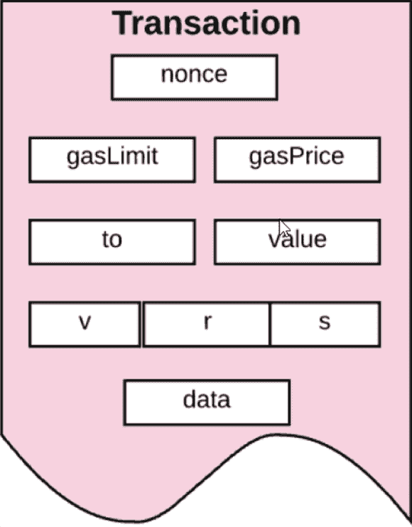

FIGURE 3-6： 以太坊交易的内容。

以太坊交易包含以下字段：

* `Nonce`：每个以太坊账户都会跟踪其执行的交易数量。该字段是基于账户计数器的最新交易。网络使用交易 nonce 来确保交易按正确的顺序执行。
* `Signature`：账户所有者的数字签名，用于证明请求此交易的账户身份。
* `Gas price`：你愿意为执行此交易支付的单价。
* `Gas limit`：你愿意为执行此交易支付的最高总量。
* `To`：该交易的接收者地址。对于转账，`To`地址是接收转账的账户。对于调用函数，`To`地址是智能合约的地址。
* `Value`：你想要发送给接收者的 ether 总额。
* `Data`：作为交易主体中提交的实际数据。根据其功能，每种类型的交易可能具有不同的数据。对于调用函数，数据可能包含参数。

当用户向节点提交交易请求时，节点会创建交易并将其提交到交易池。然后，矿工从池中选取交易并构建新区块。当以太坊挖矿节点构建好区块后，它会开始挖掘过程。第一个完成挖掘过程的矿工会将区块添加到区块链，并向网络的其余部分广播新区块。

你可以随时通过访问`https://etherscan.io/`的 Etherscan 查看公共以太坊区块链。Etherscan 让你看到区块链统计数据以及区块和交易详情。

## 解码区块数据

Etherscan 以可读的格式呈现区块链数据。但通过这样做，它隐藏了一些重要的细节。区块链数据并不总是以易读的格式存储的，至少对大多数人来说如此。由于本书范围之外的原因，区块链实现将某些数据存储为哈希值，而不是原始格式。将数据存储为哈希值使得常见的查询和分析操作变得比与数据库交互更加困难。

每种区块链数据在格式化和存储方式上都有细微差别。例如，图 3-7 所示的原始格式交易输入数据值并没有帮助。你可以通过点击或触摸“查看输入为”（View Input As）看到这一点。

区块链允许你通过账户追踪交易的灵活性，但并不总是能轻松地查询单个值。例如，假设你想知道特定账户在特定日期的余额。查找当前账户余额是很容易，但要查找特定日期（和时间）的余额，则需要对该账户的交易进行序列化，并计算截至该日期和时间的账户余额增加和减少情况。

如果你熟悉数据库以及访问数据库数据的应用程序，那么搜索交易听起来似乎不是什么坏事。然而，请记住，区块链并不是数据库。区块链中的数据存储方式并不是为了让通用查询变得简单且快速。你可以获取你想要的信息，但你必须以不同的方式来考虑获取这些数据所付出的精力。

区块链数据的序列化交易存储确实提供了以多种方式追踪和检索活动数据的灵活性。以下是你可以通过追踪区块链交易来满足的几类查询：

* 找到所有特定账户发送资金的交易。
* 找到所有导致特定账户接收资金的交易。
* 找到两个特定账户之间发生的所有交易。
* 找到所有调用了特定智能合约函数的交易。

在获取所需数据后，你可以追踪交易，通过计算值变化（即跟踪`Value`和`Transaction Fee`字段）来找到你寻找的信息，例如特定时间点的余额。

## 在区块链上记录事件

区块链数据较感兴趣的方面之一扩展了你可以从交易中获得的信息。如所述，交易是由于智能合约函数的执行而产生的某些价值转移。因为创建交易的唯一方法是调用智能合约函数，所以你可以确定交易是函数的结果。

上述陈听起来可能多余，但它极其重要。智能合约函数可以是简单的也可以是复杂的。随着智能合约变得越来越复杂，仅仅知道交易调用的函数及其输入参数值，并不总是足以以描述正在发生的情况。你需要一种方法来记录交易内部发生了什么。

以太坊以及大多数流行的第二代及之后的区块链支持复杂的智能合约语言。以太坊的`EVM`（以太坊虚拟机）是一个图完备机器，因此只要资源足够，以太坊智能合约就可以计算任何内容。当然，在现实世界中，交易会耗尽 Gas，但点在于，你的智能合约函数可以像你希望的那样复杂。

回到 Etherscan 深入研究区块`8976776`的交易。检查图 3-4 中的同一交易（区块`8976776` -> 交易列表 -> 列表详情中的第四个交易）。点击页面顶部的 Event Logs（事件日志）标签。Event Logs 页面显示了智能合约函数执行期间发生的事件列表。图 3-9 显示了当前交易最后两个事件。

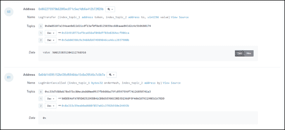

FIGURE 3-9: Etherscan 中的以太坊事件。

注意这些事件具有名称——`LogTransfer()`和`LogOrderCancelled()`以及参数。智能合约程序员使用事件来创建以太坊记录并保存的消息。事件可以轻松地通知客户端应用程序智能合约中发生了某些操作，并存储与交易相关的重要信息。

智能合约程序员使用事件来记录智能合约运行的内部细节。程序员定义事件以及调用事件时传递的参数。然后，在运行时，当代码中发生重要情况时，智能合约会调用事件。例如，在使用流行的语言 Solidity 编写智能合约代码时，`emit`命令会调用事件。每当程序员想要向客户端发送消息或记录操作时，`emit`语句就会调用事件来实现这一目的。

大多数智能合约程序员使用描述操作的事件名称。因此，我们预期的`LogOrderCancelled()`事件之所以存在，是因为交易中取消了订单。智能合约程序员可以在代码的任何地方创建事件。事件最常见的用途是记录操作发生，例如取消订单。事件参数`orderHash`和`by`提供了被取消订单的识别信息以及是谁取消了该订单。分析事件需要耗费一些精力，但它们可以产生有趣的分析数据。

## 使用智能合约存储价值

与区块链关联的最后一类大类数据是状态数据。*状态数据*（State data）是最像传统数据库数据的数据。每个智能合约都可以定义一个或多个变量或结构来存储数据值。这些值可以包括诸如最高订单号（对于订单输入合约）或产品列表（对于供应链合约）等内容。状态数据使得合约在每次调用其函数时存储使用的数据成为可能。

虽然交易数据存储在区块链的区块中，但以太坊并不将状态数据存储在区块中，而是存储在外部（链外）数据库中。每个区块存储一个哈希值，指向链外数据库中该区块状态树（state trie）的根，该数据库存储了区块的状态数据。使用树结构存储数据使得可以查询树中的某个值并验证该值的完整性，而无需读取整棵树。

参考图 3-5，它显示了区块头的内容，包括指向链外数据库中区块状态值的状态根哈希。

与交易数据不同，状态数据可以更改。每当智能合约中的函数运行时，它可能会更改一个或多个状态数据项的值。引起更改的交易存储在区块链的区块中，事件可能会创建日志，但状态数据的更改存储在链外数据库中。

每个以太坊客户端都可以选择自己的数据库来存储状态数据。例如，Geth 客户端使用`LevelDB`，而 Parity 客户端使用`RocksDB`。每个数据库的访问方法不同，因此用于分析的区块链客户端应该支持你熟悉的数据库。

# 审查具有价值的区块链类型

现在你已经了解区块链存储的基本类别，可以开始深入研究你发现的每类型数据可能意味着什么。存储数据并没有硬性规定。每个智能合约都为定义和维护其工作所需的数据设置了自己的规则。

## 探索基础交易数据

每个交易都包含有关加密资产所有权成本的基本信息。`From`、`To`和`Value`字段分别记录交易开始时拥有价值的账户、接收价值的账户以及通过交易转移的资产金额或成本。

`Input Data`字段可能包含有关交易的额外信息。此数据字段在不同交易之间往往有很大差异。当交易的`To`字段指向普通的以太坊账户时，`Input Data`字段可能包含支持性或额外的交易详情。在这种情况下，交易主要用于记录从一个账户到另一个账户的加密货币转移。如果`To`字段包含智能合约的地址，则`Input Data`字段将包含有关交易调用的函数以及发送到该函数的数据。

提取区块链数据进行分析时面临的挑战之一在于对输入数据进行分类和理解。区块链分析过程不仅仅是读取数据和构建模型。

## 为事件关联现实世界的意义

虽然交易数据可以揭示请求了什么以及转移了什么价值，但它并不总是提供交易执行过程的细节。换句话说，交易数据提供的仅是摘要信息。如果你想探索交易期间发生的具体细节，将必须去其他地方查看。

由于智能合约代码可能包含复杂的计算和数据，在交易的某些点存储消息和数据通常是有益的，有时也是必要的。大多数复杂的业务交易涉及多个步骤，在代码中镜像现实世界的流程是有意义的。例如，如果你想从国外进口木材来制造家具，你将遵循以下通用步骤：

1. 进口商向出口商请求产品。
2. 进口商代表出口商向当地银行申请信用证。
3. 进口商银行开具信用证并发送给出口商银行。
4. 出口商发运产品。
5. 根据信用证条款，出口商可以在货物运输期间收到部分付款。如果执行了部分付款，出口商银行索取应付款，进口银行转移指定的款项。
6. 当进口商收到产品时，进口商通知银行，进口银行将剩余资金转给出口商银行。

信不信，这个过程被简化了！我甚至没有提到出口许可证或提单。即使在这个简单的场景中，你也可以看到过程有许多步骤。在实际应用中，某些步骤可能在不同的时间发生，而某些可能同时发生（例如第 5 步）。如果区块链能够存储有关交易如何执行的状态信息，而不是仅仅存储从一个账户到另一个账户的金额，将会非常有帮助。

事件日志（Event logs）提供了这种功能。默认情况下不会发生事件；智能合约程序员必须请求每一个事件。大多数智能合约代码至少包含最基本的事件调用。开发智能合约的最佳实践是，每当完成一个应用程序用户感兴趣的工作包时就调用事件。这种关于何时使用事件的描述是松散的，并且有解释的空间。

了解为你的分析项目提供数据的智能合约代码如何运作是非常重要的。在第 5 章和 6 章中，你将学习如何获取智能合约源代码以及如何使用它来构建数据采集计划。但在之前请记住，在区块链环境中分析数据需要熟悉比区块链数据多多的内容。

# 将区块链数据与现实流程对齐

虽然理解通过交易、事件和智能合约获得的数据很重要，但在你理解它们之前，必须先确定数据代表了什么。要启动任何分析项目，你必须将数据与现实世界对齐。

## 理解智能合约函数

理解智能合约的一种方法是将数据视为名词，将函数视为动词。函数提供了应用程序所执行的操作，例如`createOrder()`、`shipProduct()`或`requestLoC()`。理解数据是如何被添加以及它代表了什么是重要的。

## 评估智能合约事件日志

设定分析目标可以帮助你避免在不符合业务需求的数据上浪费时间和精力的。查看事件的一种方法是将其视为内部操作的文档。任何分析项目早期的流程之一是评估可用数据。在区块链环境中，这一步骤应该检查事件。这些微交易产物通常能提供你在其他任何地方无法获得的细粒度数据。

## 按影响对交易和事件数据进行排序

在你拥有了可用数据目录后，根据其影响对每个数据项的重要性进行排序。当一个数据项对应现实世界中的某些实体属性或操作时，它的影响就更大。代表信用证批准状态的数据可能比记录信用证页码的字段更重要。并非所有数据都是平等的。关注重要数据取决于你这个分析师的决定，不要在低价值的数据上花费过多时间。

单凭区块链技术无法提供丰富的分析结果。无论区块链本身如何，它无法像魔法般地提供比其他技术更多的数据。在为任何新开发或分析项目选择区块链技术之前，请清楚地说明为什么做出这样的决定是合理的。

如果你已经依赖区块链技术来存储数据，那么使用这些数据进行分析的决定将更容易证明其性。在本节中，你将探讨一些原因，说明为什么区块链支持的分析可能允许你以有趣的方式利用你的数据。

# 利用新获取的去中心化工具

本书的大部分内容集中于手动访问和分析区块链数据。虽然理解如何在整个分析过程中对数据进行细粒度控制非常重要，但高级别的工具会让任务变得更容易。日益增多的去中心化数据分析解决方案意味着有更多机会以更少的精力构建分析模型。第三方工具可能会减少你对所部署的模型的控制力，但它们可以极大地提高分析效率。

以下区块链分析解决方案列表并非详尽，并且可能会迅速变化。请花几分钟在互联网上自行搜索区块链分析工具。你可能会发现更多的软件和服务：

* `Endor`：一个基于区块链的 AI 预测平台，目标是让各种规模的组织都能使用该技术。Endor 既是一种区块链分析协议，也是一个预测引擎，整合了链上和链下数据进行分析。
* `Crystal`：一个区块链分析平台，它与比特币和以太坊区块链集成，专注于加密货币交易分析。不同的 Crystal 产品服务于小型组织、企业和执法机构。
* `OXT`：在列出的三个产品中最专一，OXT 是一个针对比特币区块链的分析和可视化探索工具。尽管 OXT 不为各种区块链提供分析支持，但它尝试为比特币提供广泛的分析选项。

# 数据变现

如今的经济由数据驱动，关于个人及其行为收集的数据量是惊人的。想想你上一次访问喜爱的购物网站的时候。很可能你看到了一条你认为相关的广告。这些精准广告似乎变得越来越擅长识别你对什么感兴趣。将广告与用户偏好匹配的能力取决于分析引擎是否获取了足够的用户数据，以可靠地预测用户感兴趣的产品或服务。

区块链数据可以代表数据对企业价值的下一个逻辑阶段。随着越来越多的消费者意识到个人数据的价值，他们对控制这些数据的兴趣日益增长。消费者现在希望控制其数据如何被使用，并要求对数据的使用获得激励或补偿。


区块链技术可以为个人数据提供中心接入点，并允许数据所有者授权访问这些数据。从 Google 和 Facebook 等常见的中心数据存储中移除个人数据，具有彻底改变营销和广告的潜力。小型组织可以通过请求数据所有者的许可，而不是通过大型数据聚合器，来获取价值营销信息。绕过 Google 和 Facebook 等巨头可以降低营销成本，并让激励直接流向个人。

要离开目前的个人数据使用习惯还有很长的路要走，但区块链技术使其成为可能。这一过程可能会受到保护个人控制隐私数据权利的新法规的加速。例如，欧盟的《通用数据保护条例》（`GDPR`）和加州《消费者隐私法》（`CCPA`）都加强了个人控制访问和使用其个人数据的能力。

## 有效交换和整合数据

到此为止，你主要学习了存储在区块链环境中的数据。虽然区块链数据是本书的重点，但区块链数据的大部分价值在于其与链下数据关联的能力。大多数区块链应用都会引用存储在链外仓库中的某些数据。在区块链中存储每类型的数据是没有意义的。参考数据（通常是随环境条件变化而更新的数据）可能不是存储在区块链中的良好候选者。

记住，区块链技术擅长记录所有者之间的价值转移。所有应用程序都会定义并维护额外的信息，以支持并提供交易细节，但不直接参与交易。此类信息（如产品描述或客户备注）存储在链下仓库中可能更有意义。

只要区块链应用依赖链上和链下数据，整合方法就会成为关注点。即使你的应用只使用链上数据，分析模型也可能与链下数据集成。例如，区块链环境中的所有者通过地址识别。这些地址在区块链之外没有上下文。任何地址与真实世界身份之间的关联都可能存储在链下仓库中。另一个需要链下数据的例子是分析飞机安全趋势。也许你的分析将基于区块链的事件和事故数据与天气状况相关起来。尽管每条区块链交易都包含一个时间戳，但你必须查询外部气象数据库来确定交易时的盛行天气。

将链下数据与链上交易整合的例子随处可见。任何分析项目的数据获取阶段之一都是识别数据源和访问方法。在区块链分析项目中，该过程意味着识别为了实现项目目标所需的链下数据，以及如何获取这些数据。

## 为你的分析实验室调研选项

在开始从区块链获取数据进行分析之前，你必须为数据建立一条访问路径。你可以使用第三方分析工具，但你会失去对分析过程的部分控制。在本书中，你将学习如何从零构建简单模型，因此你将能够通过与智能合约函数交互直接访问区块链数据。

在本节中，你将构建一个实验室，允许你编写软件来构建访问存储在以太坊区块链中的数据的模型。

构建以太坊开发环境时可能会注意到的第一点是你有很多选择。总的来说，许多选择是一件好事，但它们让入门变得有些混乱。记住，以太坊是一个完整的区块链环境。运行区块链是一回事——为区块链开发代码是项更大的工程，需要更多的工具。

开源社区是一个全球性的用户和开发者群体，他们为自己拥有利益的项目做出贡献。以太坊的用户和开发者经常就如何最好地推进产品进行激烈的辩论。这些辩论通常会导致对实现目标最佳方式产生不同意见。最常见的辩论之一是关于哪种用户界面更好。一种观点认为，`命令行界面 (CLI)` 最灵活且最易于编写脚本。这类用户界面通常对于底层的实用型工具效果最好。另一方面，集成的`图形化用户界面 (GUI)` 更符合用户习惯，并让软件开发等任务变得更容易。这只是为什么你可能会看到工具同时拥有 CLI 和 GUI 版本的其中一个例子。

由于不同背景的人士对社区的贡献，你会发现有多种满足开发过程中每一步需求的软件产品。目前存在多个测试网络实现，因为以太坊社区的一个小组认为，让测试网络的搭建变得更容易吸引更多开发者加入以太坊平台。另一些人则专注于集成测试工具，或者决定通过支持 Solidity 的扩展来扩展他们喜欢的编辑器和集成开发环境 (IDE)。

当你查看工具类别中的可可用选项时，请记住，每一个选项的出现都是因为一组以太坊爱好者看到了填补功能空白的机会。你可能想仔细阅读一些竞争产品的特性和优势，以了解它们之间的差异。

如果你想参与以太坊社区，请访问以太坊官网：`https://ethereum.org/`。在首页底部，你会看到一个“社区 (Community)”部分，其中有指向各种参与方式的链接。

你在本章中安装和配置的工具将是你经常看到其他以太坊开发者使用的工具。你可以在网上找到许多关于使用这些工具进行以太坊开发的在线提示、技巧和教程。你在本章中构建的环境将允许你完成书中的示例，并从其他在线资源中学习——而无需重新安装新工具。

## 安装区块链客户端

现在你已经准备好构建你的以太坊分析实验室了，让我们直接开始吧。你将学习如何设置一台运行 Microsoft Windows 的 PC 成为以太坊开发平台。尽管你不会开发智能合约和区块链应用程序，但你确实需要一个开发环境来开发访问你区块链的分析模型。

Windows 并不是支持以太坊的唯一操作系统。你同样可以设置一台 macOS 或 Linux 计算机来支持以太坊。如果你运行 macOS 或 Linux，本章中的每个工具也可以在你的计算机上运行，尽管安装步骤可能会有些不同。每个工具的网站都会为每个操作系统提供详细说明。

首先从安装以太坊客户端开始。我选择了 Go Ethereum (Geth) 作为你在书中使用的以太坊客户端。Geth 用 Go 语言编写，允许你运行一个全以太坊节点，这意味着你可以访问完整的以太坊区块链，并运行本地 EVM。Geth 赋予了你挖掘 ETH、创建交易和智能合约，以及检查区块链上任何区块的能力。你在本章中安装的所有其余工具都将依赖 Geth 提供本地 EVM 并允许访问区块链上的区块。

Geth 网站为 Microsoft Windows、macOS 和 Linux 操作系统提供了预包形式的安装程序。你也可以下载 Geth 源码并为自己的自定义环境进行编译。如果你感兴趣玩电脑以外的设备，可以进行互联网搜索，并轻松找到在智能手机或树莓派（Raspberry Pi）上设置 Geth 的说明。这就是使用开源工具的魅力。

按照以下步骤开始下载并安装 Geth：

1. **启动浏览器并导航至** `https://ethereum.github.io/go-ethereum`，然后点击或触摸页面顶部的 Downloads（下载）链接。

   你的网页浏览器看起来类似于图 4-1。

2. **点击或触摸适用于你操作系统的 Geth 按钮。**

   因为我在教程中正在设置一台 Microsoft Windows 计算机，所以我选择了 Windows 版的 Geth `1.9.7`。（当你设置计算机时，可能会有更新版本的 Geth。你应该下载并安装每个工具的最新稳定版本。）

3. **启动你刚刚下载的可执行文件。**

4. **点击或触摸 I Agree 以同意 GNU 通用许可协议。**

   在同意其内容之前，请务必阅读任何许可协议。

5. **勾选开发工具 (Development Tools) 复选框，如图 4-2 所示，然后点击或触摸 Next（下一步）按钮。**

   在继续之前，确保你已在该窗口中选择了安装开发工具。

   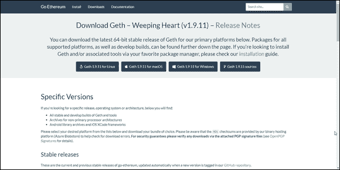

   FIGURE 4-1: Go Ethereum (Geth) 下载网页页。

   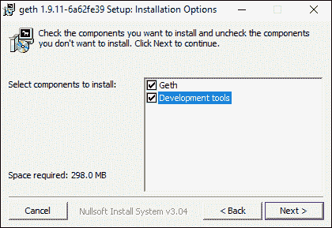

   FIGURE 4-2: 安装选项窗口。

6. **如果你想将 Geth 安装到与显示不同的文件夹，请将其更改为目标文件夹。**

7. **要开始安装，点击或触摸 Install（安装）按钮。**

8. **安装完成后，点击或触摸 Close（关闭）按钮。**

在安装好 Geth 后，你可以启动它以启动 EVM 并与公共区块链同步。

有许多 Geth 启动选项可用，但你现在只需要的选项是 `syncmode`，它告诉 Geth 需要下载多少内容的区块链。`syncmode` 选项具有以下值：

* `full`: 下载并验证整个区块链。此选项需要最的时间和磁盘空间，但可以提供最快的响应，因为全节点不需要向其他节点请求缺失的区块。

* `fast`: 下载并验证最近 1000 笔交易的区块头和数据。当你想要节省磁盘空间但又想在本地存储最新区块时，此选项是一个很好的选择。

* `light`: 仅下载区块链当前状态，并根据需要从其他节点请求任何缺失的区块。此选项允许你以最小的磁盘需求运行以太坊。

目前，你将在 Geth 中轻量级 `syncmode`。要在轻量模式下启动 Geth，请遵循以下步骤：

1. **启动命令提示符或 PowerShell 提示符。**

   在桌面左下角的搜索栏中输入 `cmd`，然后或点击命令提示符选项。在搜索栏中输入 `PowerShell` 并选择或触摸 PowerShell 选项。

2. **将当前工作目录更改 Geth 安装目录。**

   如果你将 Geth 安装在默认位置，输入以下内容并按回车：

   `cd 'C:\Program Files\Geth\'`

3. **输入以下内容，然后按回车：**

   ```
   .\geth --syncmode "light"
   ```

此命令以轻量模式启动 Geth。确保你在 `syncmode` 之前输入两个连字符。图 4-3 显示了启动轻量级以太坊节点的 `Geth` 命令。

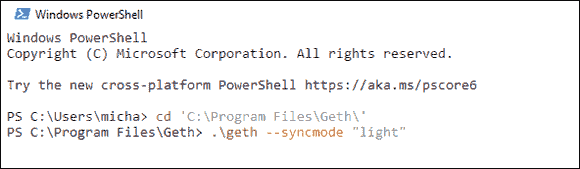

Geth 启动时，它会与以太坊网络建立连接并同步当前区块链。Geth 在启动过程的每个阶段都会提供消息，让你看到正在发生什么。图 4-4 显示了 Geth 消息的内容。

Geth 同步区块链后，你就可以使用 Geth 区块链客户端获取并分析实时区块链数据了。

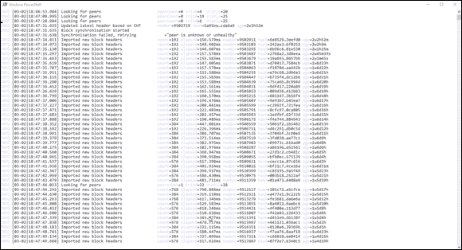

FIGURE 4-4: Geth 消息。

## 安装测试区块链

在构建和评估分析模型时，在确定一切都运行正常之前，你不希望将任何代码部署到主链或启动长时间运行程序。你必须先在某些非实时环境中测试代码。在开发和测试过程中你需要一个区块链。以太坊客户端（包括 Geth）默认连接到以太坊主公网区块链，但你也可以连接到其他区块链。你可以轻松地为开发和测试更改连接设置。

一些工具可以方便地创建和管理测试区块链。我选择了 Ganache 作为我们的测试区块链环境。根据 Ganache 网站（[`https://truffleframework.com/ganache`](https://truffleframework.com/ganache)），“Ganache 是用于以太坊开发的个人区块链，你可以用它部署合约、开发应用程序以及运行测试。”Ganache 包含了一套探索区块链内容的方便工具。

你不局限于预构建的 Ganache 可执行文件。由于 Ganache 是开源产品，你也可以下载 Ganache 源码并为自己的自定义环境进行构建。

要下载并安装 Ganache，请遵循以下步骤：

1. **启动浏览器并导航到** [`https://truffleframework.com/ganache`](https://truffleframework.com/ganache)。

   你的网页浏览器将看起来像图 4-5。

   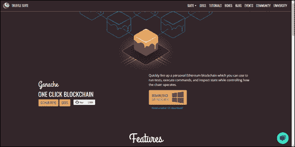

   FIGURE 4-5: Ganache 下载页面。

2. **点击或触摸 Download (Windows) 按钮下载 Windows 安装程序。**

3. **启动你刚刚下载的可执行文件。**

4. **要开始安装过程，点击或触摸 Install 按钮。**

   安装完成后，Ganache 会启动。

5. **决定是否启用分析功能，然后点击或触摸 Continue 按钮。**

   由于这是你第一次启动 Ganache，系统会要求允许 Google Analytics 跟踪，如图 4-6 所示。你不需要这样做，但允许分析有助于 Ganache 开发团队了解不同用户如何使用 Ganache。

   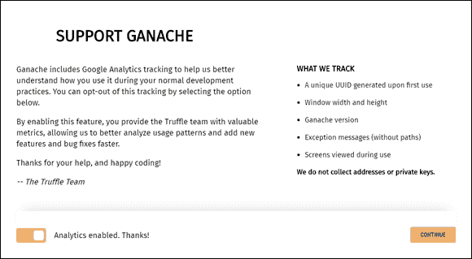

   FIGURE 4-6: 支持 Ganache 分析的窗口。

6. **当 Ganache 启动时，点击或触摸 Quickstart。**

   你会看到主 Accounts 窗口，带有基本服务器信息和账户列表，如图 4-7 所示。因为安装 Ganache 的目的是创建自己的区块链，你需要至少一个账户来访问区块链。Ganache 为你创建了十个账户，每个账户的余额为 100.0 ETH。你可以创建更多账户并为它们测试你编写的任何智能合约所需的 ETH。

   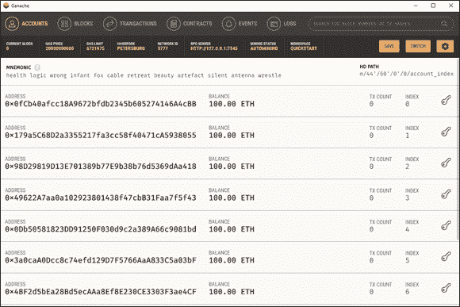

   FIGURE 4-7: Ganache 账户窗口。

在 Ganache 中创建自己的以太坊区块链只需这些步骤。当然，这个区块链是你计算机上本地的，不会分发到任何其他节点。由于此网络上没有其他节点，因此没有矿工。该区块链被设置为 `automining`（自动挖掘），这意味着任何新交易都会被立即处理。该设置让你能够轻松测试智能合约以及访问其他智能合约的模型，而无需支付矿工来处理你的交易。

当你准备好为以太坊开发软件时，你需要告诉你的客户端和其他工具使用哪种区块链。让我们看看你新的 Ganache 区块链在哪里。在 Ganache 中，点击右上角的设置（齿轮）图标以启动 Ganache 设置窗口。图 4-8 显示了 Ganache 设置窗口的 Server 标签页。

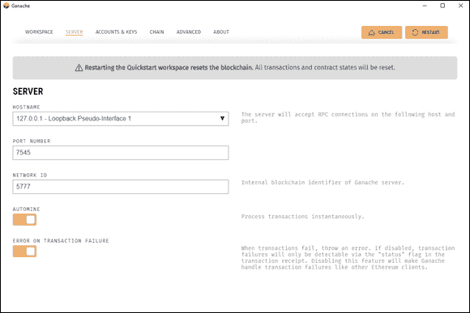

FIGURE 4-8: Ganache 设置窗口的 Server 标签页。

检查是否安装了 NodeJS 非常简单。打开命令提示符或 PowerShell 窗口，输入 `node` 命令并按回车。你会看到一个简单的 `>` 提示符，或者一条提示你未安装 NodeJS 的错误信息。图 4-10 显示了如果你没有安装 NodeJS，在 Windows PowerShell 中会看到的错误信息。

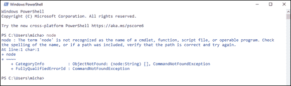

图 4-10： 未安装 NodeJS 时 PowerShell 中的错误信息。

如果你已经安装了 NodeJS，请跳到下一节“下载和安装 Truffle”。如果你没有安装 NodeJS，请按照以下步骤下载并安装它：

1. **启动浏览器并导航到** `https://nodejs.org/en/`。

你的网页浏览器将如 图 4-11 所示。NodeJS 网站会检测你的操作系统并为该操作系统建议版本。由于我使用的是 Windows，我看到了 Windows 的下载链接。

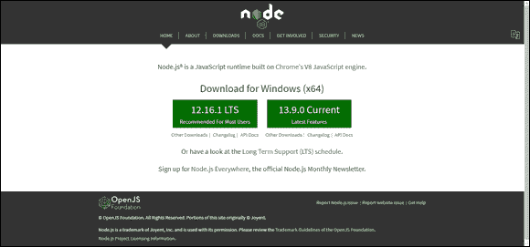

图 4-11： NodeJS 下载页面。

2. **点击或触碰想要安装的版本按钮以下载 Windows 安装程序。**

你可以下载最新版本或最新的稳定版（长期支持，或 LTS）版本。我在本书的示例中选择了 LTS 版本。当你设置计算机时，可能会有更新版本的 NodeJS 可用。你应该下载并安装最新的 LTS 版本。

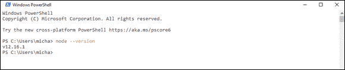

图 4-12： NodeJS 版本消息。

### 下载和安装 Truffle

NodeJS 环境让你能够查找和下载新包，包括 Truffle。Truffle 的安装过程只需要你输入一个命令。要安装 Truffle，打开命令提示符或 PowerShell 窗口，输入以下命令并按回车：

```
npm install -g truffle
```

图 4-13 显示了此命令及其结果。Truffle 已安装并几乎准备就绪可以使用。

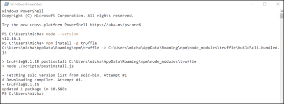

图 4-13： 安装 Truffle。

Truffle 将开发活动组织成项目。这样你就可以处理多个具有不同配置要求的项目。例如，你可以为几个项目中的每个项目设置不同的测试区块链。让我们来看看在 Truffle 中设置项目的基础知识。

每个 Truffle 项目都必须有自己的文件夹。设置 Truffle 项目的第一步是创建一个项目文件夹。如果你更倾向于下载项目文件而不是创建一个新的空项目，请访问 `www.dummies.com/go/blockchaindafd` 并项目压缩文件解压到你选择的目录。例如，要创建一个名为 `bcAnalytics` 的新空项目，打开命令提示符或 PowerShell 窗口，输入以下命令并按回车：

```
mkdir bcAnalytics
```

通过输入以下命令并按回车，将新项目文件夹设置为当前目录：

```
cd bcAnalytics
```

然后，初始化你的新 Truffle 项目，输入此命令并按回车：

```
truffle init
```

图 4-14 显示了初始化新 Truffle 项目的命令。

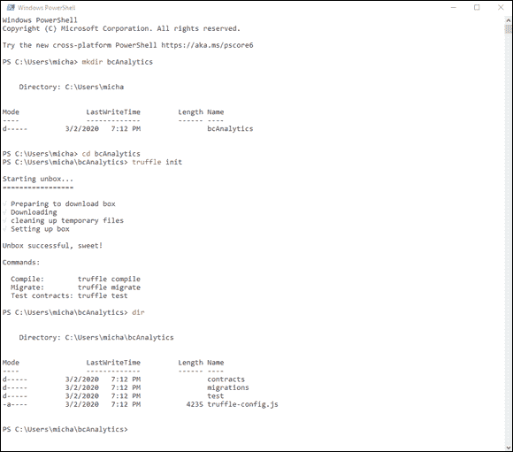

图 4-14： 初始化新的 Truffle 项目。

搞定！你现在有一个名为 `bcAnalytics` 的新 Truffle 项目。这就是目前你需要做的所有事情。你可以使用资源管理器或 `dir` 命令查看 `bcAnalytics` 文件夹。

## 安装 IDE


现在所有基础部分都已就绪，你即将开始编写代码。软件开发中最直可见的部分是编写源代码。许多开发者认为编写代码是软件开发过程中第一个有效步骤，但事实并非如此。在开始编写代码之前，你应该仔细完整地规划你的应用程序。提前投入规划可以为你节省更多时间。规划将减少当你第一次编写的代码无法满足所有需求时重工的次数。

在你有了详尽的计划并知道实现所有应用程序目标所需的代码后，你就可以开始编写源代码了。虽然你可以使用任何文本编辑器来编写 Solidity 代码，但有很多工具可以让你开发活动变得更容易。集成开发环境（IDE）就像一个超级编辑器，它不仅允许你创建和编辑代码，还能在你输入时提供许多支持功能，例如自动代码补全和语法帮助。一个好的 IDE 可以节省大量时间并帮助你写出更好的代码。

 Code IDE 现在已安装完毕。图 4-17 显示了默认的 Visual Studio Code 桌面和欢迎窗口。欢迎窗口包含了许多入门使用 VS Code IDE 的有用信息。

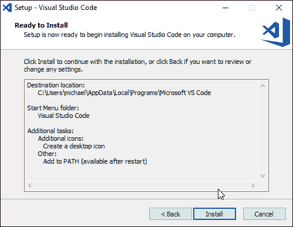

FIGURE 4-16: Visual Studio Code 安装选项窗口。

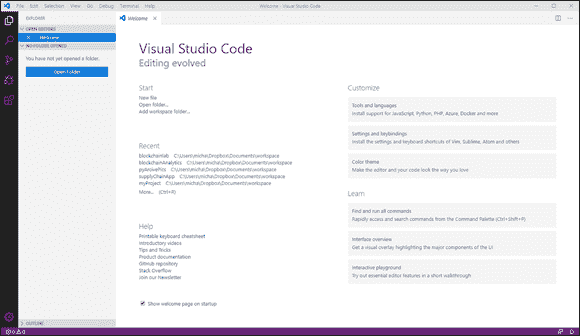

FIGURE 4-17: Visual Studio Code IDE 桌面。

如果你关闭了欢迎窗口，可以随时从“帮助”菜单重新打开它。它是帮助菜单中的第一个选项。

你还有最后一步来完成以太坊开发环境的安装。为了利用 VS Code 的语法高亮、代码补全等功能的优势，你需要添加一个扩展让 VS Code 理解 Solidity。在 VS Code 中添加扩展最简单的方法是直接在 IDE 中进行。

在 VS Code 桌面的左侧，点击或触摸 `Extensions` 图标（正方形中的正方形）。在 `Search Extensions in Marketplace` 文本框中输入 `Solidity`。会出现一个与你的搜索词匹配的扩展列表。找到标题为“Ethereum Solidity Language for Visual Studio Code by Juan Blanco”的扩展，并点击该扩展对应的绿色 `Install` 按钮。成功安装扩展后，你的设置应该与图 4-16 中的所示，目标位置除外。

你可能在好奇现在可以用你的区块链实验室做什么，以及为什么需要添加更多工具来为构建分析模型做好准备。你目前拥有的的一切已经提供了在本地或远程区块链上开发、测试和部署智能合约的工具和生态系统。这意味着你既可以创建自己的区块链，也可以连接到他人的网络，并通过你自己的智能合约创建交易。

你还没有一种方便的方法与智能合约进行交互。虽然 `Truffle` 允许你从 `Truffle console` 调用智能合约函数，但它的体验并不优美。提供命令行界面是为了它的简单性和实用价值，而不是为了用户界面的优雅。要与区块链数据进行交互，你需要一种更方便的方法来获取数据并创建最终进入新区块的新交易。

你的区块链实验室需要添加的唯一额外组件是分析客户端。我将其称为分析客户端，以便与以太坊客户端区分来。你的以太坊客户端 `Geth` 实现了 `EVM`，使你的计算机或设备成为以太坊网络节点并运行智能合约代码。从区块链的角度来看，以太坊客户端是客户端；但从终端用户的角度来看，也可以被视为服务器组件。

### 识别分析客户端选项

有许多分析客户端选项可供选择。主要要求是客户端提供访问区块链数据的权限。这是一个很模糊的要求，你可以通过许多方式满足它。通常，在选择客户端选项时，在用户友好性和灵活性之间存在权衡。对用户最友好的选项通常提供的选项最少、灵活性也最低。这是合理的，因为提供更多选项几乎总是会让事情变得复杂。但如果你想要获得允许你构建详细模型的最大灵活性，你通常必须放弃一些易用性。

在任何环境中执行分析时，你通常有三个选项，每个选项都有其自己的优缺点和成本：

* **雇人完成工作。** 这种选项目前是最贵的，也是最简单的。通过外包你的分析，你避免了大量的生态系统和时间投入。如果你与执行分析的人或公司合作良好，并且能够创建详细的规范（且有预算），这个选项可能对你来说很好。
* **使用现有的区块链分析工具。** 越来越多的工具和其他软件产品支持区块链分析。许多工具针对特定的区块链实现（比特币专用或以太坊专用），并且通常关注于一种类型的数据。可能值得检查其中的一些工具，看看是否有的能满足你的需求。表 5-1 提供了可用区块链分析工具的部分列表。
* **从零开始开发自己的模型。** 最后一个选项是我本书关注的重点。编写代码来开发自己的模型几乎是最慢的选项（从设计到部署投入的时间而言），但提供了无与伦比的灵活性。当你编写自己的代码时，你可以构建根据你的需求定制的模型。即使使用这种最后的方法，也有几种选项可供。正确的决定取决于你选择的语言以及对所提供功能的熟悉程度。表 5-2 列出了你可以用于编写与区块链交互的自定义代码时可以使用的的几个流行的库。

#### 表 5-1 区块链分析工具

| **产品** | **描述** | **获取地址** |
| --- | --- | --- |
| Chainalysis | 提供多种产品的公司，专注于将现实世界中的身份与区块链活动关联 | [`www.chainalysis.com`](https://www.chainalysis.com/) |
| CipherTrace | 支持区块链取证调查的解决方案 | [`https://ciphertrace.com/`](https://ciphertrace.com/) |
| Crystal | 支持尽职调查和合规需求的分析解决方案 | [`https://crystalblockchain.com/`](https://crystalblockchain.com/) |
| Neutrino | 以比特币为中心的分析服务提供商（2019 年被 Coinbase 收购） | [`https://neutrino.global/`](https://neutrino.global/) |
| OXT | 以比特币为中心的分析工具，支持金融合规性要求 | [`https://oxt.me/`](https://oxt.me/) |
| SAS Visual Investigator | 支持取证调查和合规性要求的通用分析工具 | [`www.sas.com/en_us/software/intelligence-analytics-visual-investigator.html`](https://www.sas.com/en_us/software/intelligence-analytics-visual-investigator.html) |

#### 表 5-2 以太坊访问库

| **库** | **描述** | **获取地址** |
| --- | --- | --- |
| web3.js | 最流行的用于与以太坊交互的 JavaScript 库 | [`https://github.com/ethereum/web3.js`](https://github.com/ethereum/web3.js) |
| ethers.js | web3.js 的 JavaScript 替代方案，基于以太坊部署的经验 | [`https://github.com/ethers-io/ethers.js`](https://github.com/ethers-io/ethers.js) |
| ethjs | 轻量级 JavaScript 库，提供了更小的 web3.js 子集 | [`https://github.com/ethjs/ethjs`](https://github.com/ethjs/ethjs) |
| web3.py | 流行的 web3.js 的 Python 实现；我选择使用这个库是因为 Python 是一种流行的语言 | [`https://github.com/ethereum/web3.py`](https://github.com/ethereum/web3.py) |

### 选择最佳分析客户端

不要被所有可用选项搞乱。最佳的分析客户端取决于你的需求。在查看可能的解决方案范围之前，花些时间清晰地记录你的目标。写下一个简短的目标列表，描述你最初追求分析的原因。如果你不能清楚地解释分析数据的原因，很可能你还没有考虑得充分。在在此之后，你就可以根据你的情况对最佳分析客户端做出更好的决定。

因为本书的目的是探索分析基础，你将使用来自分析库的函数来构建分析模型。稍后，你可能会决定使用专门的产品，甚至从零开始编写，但通过完成书中的练习，你将对这些工具在为你做什么有更广泛的理解。

如果你有分析背景，你可能具有 R 统计包或 Python 语言或两者的经验。由于 Python 是数据分析非常流行的语言，而且流行的以太坊区块链库之一是用 Python 编写的，我选择使用 Python 库 `web3.py` 作为本书示例中使用的以太坊客户端。你还将使用几个 Python 分析库，以避免从零编写每个模型。我将教你如何安装名为 `Anaconda` 的分析平台，它带有你所需的大多数 Python 库。

如果你熟悉 Python，你可以直接进入我提供的代码。如果你不知道 Python，有很多资源可以帮助你快速掌握这种强大的语言。以下是五个免费和付费的资源，可以帮助你入门：

* **A Byte of Python:** 一本关于 Python 编程的免费在线书籍，位于 [`https://python.swaroopch.com/`](https://python.swaroopch.com/)。
* **Codecademy:** 一门设计良好、结构分明的 25 小时 Python 课程。需要 Codecademy 订阅。访问 [`www.codecademy.com/learn/learn-python-3`](https://www.codecademy.com/learn/learn-python-3)。
* **Google's Python Class:** 一个 Google 的教育课程，包含学习 Python 的视频。访问 [`https://developers.google.com/edu/python/`](https://developers.google.com/edu/python/)。
* **Learn Python the Hard Way:** 一本经典的 Python 编程书籍。该资源并非免费，但非常值回。访问 [`https://learnpythonthehardway.org/book/`](https://learnpythonthehardway.org/book/)。
* **Envato Tuts+:** 一篇 Python 教程，其中包含许多指向额外资源的链接，位于 [`https://code.tutsplus.com/articles/the-best-way-to-learn-python--net-26288`](https://code.tutsplus.com/articles/the-best-way-to-learn-python--net-26288)。

## 在你的实验室中添加 Anaconda 和 Web3.js

在本节中，你将向你的区块链分析实验室添加 Anaconda 平台和 `web3.py` 库。Anaconda 平台让你能够轻松访问示例中所需的软件工具集和 Python 库集合。`web3.py` 库允许你编写 Python 脚本来调用智能合约函数并与区块链数据进行交互。

如果你还没有构建实验室，请返回到 第 4 章 并按照说明先构建基础实验室。本节假设你至少已安装 VS Code 和 Ganache。

## 验证平台先决条件

安装区块链分析实验室所需的少数额外组件是很容易的。但是，你必须已经在电脑上预安装了 Python。在本节中，你首先检查是否已安装了 Python，然后在必要时进行安装。

你可能会看到关于 Python 2 和 Python 3 的引用。这些是 Python 语言的主要版本。请记住，Python 2.7 已于 2020 年 1 月 1 日弃用（重新分类为不再使用）。这意味着除非你有特定的遗留软件需要它，否则你不应该安装低于 3.0 的任何 Python 版本。对于所有新项目，你应该只安装 Python 3.0 及更高版本。

### 检查安装的 Python 版本

要查看电脑是否已安装 Python，请按照以下步骤操作：

1. **启动命令提示符或 PowerShell 提示符。**

要启动命令提示符，在桌面左下角的搜索栏中输入 `cmd`，然后点击命令提示符选项。要启动 PowerShell 提示符，在搜索栏中输入 `PowerShell` 并选择或点击 PowerShell。

2. **输入以下内容并回车：**

```bash
python --version
```

此命令将显示已安装的 Python 版本，或显示指示找不到 Python 的错误信息。图 5-1 显示我的电脑上安装了 Python 3.8.0 版本。

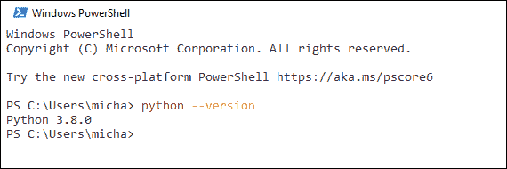

FIGURE 5-1: Python 版本命令。

如果没有安装 Python，你必须按照下一节中的说明进行安装后才能继续。如果安装了低于 3.0 的 Python 版本，你应该安装更高版本。

你可以在同一台电脑上安装多个版本的 Python。在许多情况下，你可以在单台电脑上安装 Python 2.7 和 Python `3.x`（其中 `x` 是大于 0 的某个次版本号）。你可以根据想要运行的版本更改系统的 `PATH`，或者使用 `python` 命令运行 Python 2.7，并使用 `python3` 命令运行 Python 3.x。

### 安装 Python（如果需要）

按照以下步骤在你的电脑上下载并安装 Python 语言：

1. **启动浏览器，导航至** [`https://www.python.org`](https://www.python.org)，然后点击或点击页面顶部的 Downloads（下载）链接。**

你的网络浏览器将看起来像图 5-2。

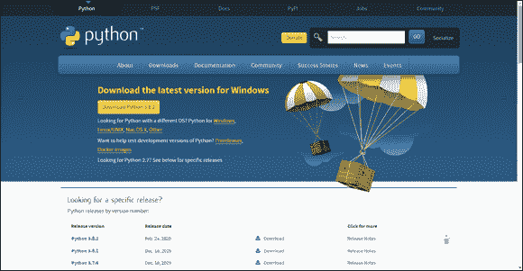

FIGURE 5-2: Python 下载网页。

2. **点击或点击 Download Python（下载 Python）按钮。**

我选择了 Python 3.8.0。（当你设置电脑时，可能会有更新版本的 Python。请下载并安装最新的可用版本。）

3. **启动你刚刚下载的可执行文件。**

出现 Python Setup 窗口。

4. **勾选 Add Python to PATH（将 Python 添加到路径）复选框（见图 5-3），然后点击 Install Now（立即安装）。**
5. **当安装完成后，点击 Close（关闭）按钮。**

## 安装 Anaconda 平台

Anaconda 平台是一个流行的环境，用于使用 Python 和 R 语言进行数据科学和管理。安装 Anaconda 时，会自动安装 250 多个包，包括书中所需的几乎所有库。安装 Anaconda 很容易。除了获得大量的包，Anaconda 还提供了 GUI 和命令行界面、许多工具的轻松集成以及强大的 Conda 包管理器来安装你可能需要的任何内容。

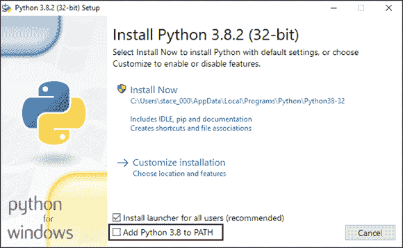

FIGURE 5-3: Setup 窗口。


要下载并安装 Anaconda Distribution，请遵循以下步骤：

1. **启动浏览器，导航至** [`www.anaconda.com/distribution/`](https://www.anaconda.com/distribution/)。

   你的网络浏览器将看起来像图 5-4。

   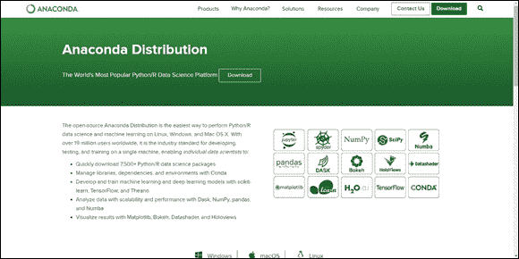

   FIGURE 5-4: Anaconda 网页。

2. **点击 Download（下载）按钮，在下一页点击 Python 3.x 下方的 Download。**

3. **启动你刚刚下载的可执行文件，然后点击 Setup 窗口上的 Next（下一步）按钮。**

4. **阅读并接受许可协议。**

5. **在接下来的三个窗口中选择 Anaconda 安装选项。**

   - 选择将 Anaconda 安装为当前用户（Just Me）还是所有用户（All Users），然后点击 Next。
   - 输入安装目标（或接受默认值），然后点击 Next。
   - 选择 Register Anaconda as My Default Python 3.x 选项。然后点击 Install。

6. **当 Anaconda 安装完成后，在接下来两个窗口中点击 Next，然后点击 Finish 完成安装过程并启动 Anaconda。**

Anaconda 现已安装。图 5-5 显示默认的 Anaconda Navigator 桌面。桌面窗口包含常用工具的链接和关于开始使用 Anaconda 的有用信息。

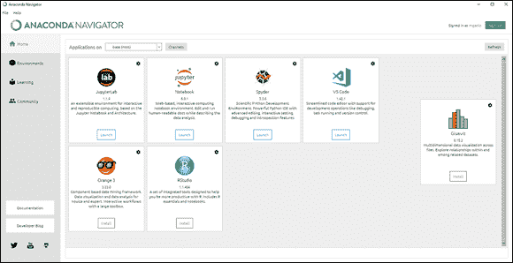

FIGURE 5-5: Navigator 桌面。

设置 Anaconda Cloud 账户是一个好主意。在你创建并登录 Anaconda Cloud 账户后，你将能够与其他用户共享包、笔记本和完整环境（甚至在你自己的电脑间共享）。访问 [`https://anaconda.org/`](https://anaconda.org/) 创建你的 Anaconda Cloud 账户并了解更多其优势。

`Anaconda` 未包含的库之一就是你将作为区块链客户端使用的 `web3.js`。安装 `web3.py` 库非常简单，只需要一条命令 `pip`（PIP Installs Packages）。遗憾的是，Anaconda 默认也没有安装 `pip` 实用，因此你必须先安装它。

要让你的 Python 以太坊区块链库可用，下一个任务是安装 Python 的包安装程序 `pip`，然后使用 `pip` 安装 `web3.py` 包。请按照以下步骤安装 `pip` 和 `web3.py`：

1. **启动 Anaconda Navigator。在 Anaconda 中，点击或触摸 VS Code 下方的 Launch（启动）按钮以启动 VS Code。**

   要启动命令提示符，在桌面左下角的搜索栏中输入 `cmd`，然后选择或点击 Command Prompt（命令提示符）。要启动 PowerShell 提示符，在搜索栏中输入 `PowerShell` 并选择或点击 PowerShell 选项。

2. **点击 VS Code 菜单栏中的 Terminal（终端），然后点击 New Terminal（新终端）以打开一个新的终端窗口。**

3. **在终端窗口的提示符处输入以下内容，然后按回车：**

   ```
   conda install pip
   ```

   图 5-6 显示了 `conda install pip` 命令的结果。现在你已经安装了 `pip` 命令，可以使用它来安装 `web3.py` 库。

   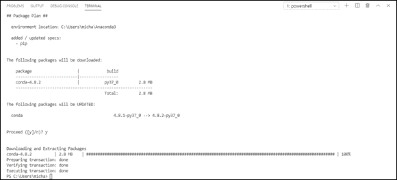

   图 5-6： `conda install pip` 命令。

4. **在终端窗口的提示符处输入以下内容，然后按回车：**

   ```bash
   pip install web3
   ```

   图 5-7 显示了安装 `web3.py` 的 `pip` 命令。

   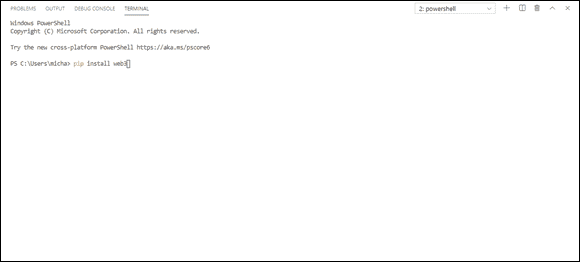

   图 5-7： `pip install web3` 命令。

### 设置你的区块链分析项目

在准备好编写 Python 代码访问区块链之前，最后几个步骤是在 VS Code 中设置项目。请按照以下步骤创建新项目并为你的分析代码配置 VS Code：

1. **启动命令提示符或 PowerShell 提示符（或在 VS Code 中打开新终端）。**

2. **要创建一个新项目目录，输入以下内容，然后按回车：**

   ```bash
   mkdir blockchainlab
   ```

3. **要进入项目目录，输入以下内容，然后按回车：**

   ```bash
   cd blockchainlab
   ```

4. **如果你还没有打开 VS Code，请从 Anaconda Navigator 启动 VS Code。**

5. **打开 `blockchainlab` 文件夹：**

   1. 点击 Open Folder（打开文件夹）按钮，或从菜单栏选择 `File`（文件）⇒ `Open Folder`（打开文件夹）。
   2. 导航到你创建的 `blockchainlab` 文件夹，并点击 Select Folder（选择文件夹）在 VS Code 中打开它。

   图 5-8 显示了步骤 1-3 的命令。

   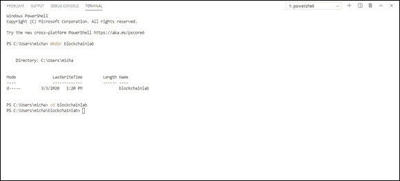

   图 5-8： 创建新项目目录的命令。

进入 VS Code 后，你应该再执行一步来完成分析实验的设置。最后一步不是必须的，但它扩展了 VS Code 以支持你编写任何 Python 代码。

许多 VS Code 扩展提供了集成的 Python 语言支持，但你现在将安装默认扩展。如果你发现另一个提供你更偏好功能的扩展，可以随时替换它。

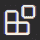点击 VS Code 桌面左侧边缘（显示所示）的扩展图标。在 Search Extensions in Marketplace（在市场中搜索扩展）文本框中输入 `Python`。你会看到与搜索词匹配的扩展列表。找到来自 Microsoft 的 `Python` 扩展并点击其绿色 Install（安装）按钮。当你成功安装 Python 扩展并点击扩展列表中的 Python 扩展时，你的 VS Code 窗口应该像图 5-9。

恭喜！你已经扩展了你的以太坊区块链分析实验，使其能够与区块链数据交互。

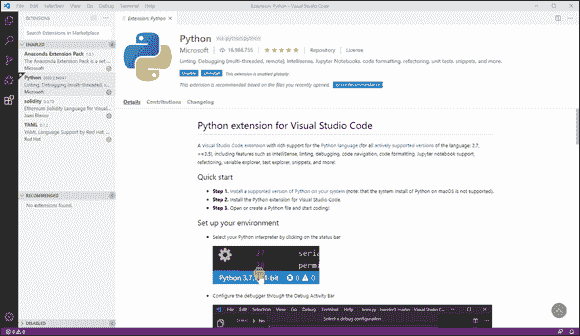

图 5-9： 带有 Python 扩展的 Visual Studio Code IDE。

## 编写访问区块链的 Python 脚本

在使用 Python（或任何语言）访问区块链之前，必须设置一些内容。首先，你必须建立与区块链的连接。这个简单的过程只需要两个步骤。在开始之前，你必须确保有一个可用的连接。为了我们的目的，我们将使用 Ganache，它运行在端口 7545 上。（你可以在 Ganache 设置中更改端口。）

在 Ganache 运行后，在 VS Code 中创建一个名为 `showChain.py` 的新文件并输入以下内容：

```python
import json
from web3 import Web3

ganache_url = "http://127.0.0.1:7545"
web3 = Web3(Web3.HTTPProvider(ganache_url))

with open('SupplyChain.abi') as f:
    abi = json.load(f)

address = web3.toChecksumAddress('ADDRESS')
```

前两行导入了 `json` 和 `web3` 库，并让你的 Python 脚本可以使用这些功能。接两行定义了 Ganache 实例的主机和端口号（你可以在 Ganache 主窗口中找到这些值），然后创建到 Ganache 的连接。接下来的两行从文件加载智能合约的 ABI（详细信息见下文）。最后，最后一行将智能合约所在的区块链地址赋值，这提供了 `web3` 与区块链交互所需的其余信息。

你可以通过多种方法找到 ABI（详细信息见下文）和合约地址。为了保持简单，我们将使用 Remix IDE。你可以使用 Truffle 或其他方法，包括 `web3.py`，但那些方法更复杂。

### 与智能合约交互

以太坊中存储的大多数有趣数据都是合约函数的结果。与关注账户价值转移的比特币不同，以太坊支持的数据远超账户间的金额转移。智能合约允许用户调用存储状态数据并生成存储在日志中的事件。访问智能合约信息是访问存储在区块链上的数据的基础。

基本上有两种区块链：未花费区块链和智能合约区块链。对每种类型的完整描述超本书的范围，但*未花费区块链*（如比特币）仅随时间累加交易来计算任何账户的当前余额。相反，*智能合约区块链*（如以太坊）在记录单独交易之外还存储状态值和其他复杂数据。你关注的是以太坊模型。

由于你的大部分区块链交互将取决于智能合约的数据状态和事件，因此你需要一种方法来向 Python 定义你可以在区块链上访问的哪些数据。以太坊编译器在将智能合约源代码编译为字节码时，会创建一个 `application binary interface (ABI)`。`ABI` 是一个 JSON 数据结构，定义了智能合约的函数签名、状态变量以及它支持的任何事件。简而言之，`ABI` 描述了智能合约的所有数据和功能。通过智能合约的 `ABI`，你可以编写代码与任何由智能合约创建并管理的数据进行交互。你还需要知道智能合约代码存储在区块链上的地址。当你将 `ABI` 和合约地址提供给 `web3.py` 后，它就拥有定位并与智能合约数据交互所需的所有信息。

这种智能合约上下文的数据处理方法可能与你习惯的不同。在大多数传统的数据库应用程序中，模式（schema）定义了数据布局。通过模式，你可以编写查询来获取和更新数据库中的任何数据。区块链状态存储则完全不同。每个智能合约存储和管理数据的方式可能与其他智能合约不同。这意味着对于你想要分析的每一个智能合约，你都需要对应的 `ABI`。

如果 `ABIs` 很容易获得，那么在分析工作中需要 `ABI` 就不是大问题。在你自己的智能合约数据上进行分析不应出现 ABI 可用性问题。然而，如果你想通过他人的智能合约访问数据，你就需要向智能合约作者请求 `ABIs`，或者使用已注册智能合约发布的 `ABI`。否则，你解码区块数据将非常困难。在本书中，你将关注通过 `ABIs` 访问数据。

在任何访问区块链数据的 Python 脚本中，下一步都是定义智能合约的 `ABI` 及其地址。你将使用智能合约的地址来调用其函数（获取其数据）并解析其日志。

### 寻找智能合约的 ABI

如果你可以访问智能合约的源代码，寻找 `ABI` 并不困难。虽然你可以使用 `Truffle` 来编译智能合约并提供 `ABI`，但我将向你展示一种更简单的方法获取所需信息。

此讨论侧重于自有的智能合约——即你或你的组织开发了该智能合约，并且源代码对你可用。如果你想使用的智能合约不是自己的且源代码不可用，下一步是确定它是否发布在共享仓库中。在后面的章节中，你将发现如何使用发布的智能合约 `ABIs` 而不是自己编译它们。

`Remix` 是一个基于 Web 的以太坊智能合约 IDE，提供了与 `Truffle` 和 `VS Code` 相同的功能。它没有实现 `Truffle` 和 `VS Code` 的所有功能，但它确实让部署智能合约代码变得简单。由于 `Remix` 可以轻松获取智能合约的 `ABI` 和部署地址，我们在这里使用它来部署 `SupplyChain.sol` 合约。

如果你阅读过*Ethereum Forummies*，你会认识 `SupplyChain.sol` 合约。本书中使用的 `SupplyChain.sol` 合约是 *Ethereum Forummies* 中介绍合约的增强版本。

`SupplyChain.sol` 合约实现了一个简单的供应链应用。你将使用该合约与数据进行交互并分析。按照以下步骤使用 `Remix` 将 `SupplyChain.sol` 合约部署到你的 Ganache 区块链，并使用 Python 调用合约函数：

1. **启动浏览器并导航到** `https://remix.ethereum.org/`，**然后点击 Solidity 按钮选择 Solidity 环境。**

   你的浏览器将看起来像图 5-10。

   

   FIGURE 5-10: Remix 页面。

2. **点击文件图标创建新文件，输入 `SupplyChain.sol`，然后点击 OK。**

   

   如果你没有看到 `File Explorers` 格，请点击左侧菜单中的 `File Explorers` 图标。

3. **在 VS Code 中打开 `SupplyChain.sol` 文件，复制文件中的所有文本，然后将 `SupplyChain.sol` 的内容粘贴到 Remix 的空白编辑器中。**

   你可以从 `www.dummies.com/` 下载本书的所有代码。现在你已经在 IDE 中有了 `SupplyChain.sol` 的代码，`Remix` 可以将其编译并部署到你的 Ganache 区块链。

4. **如果 Solidity 编译器格不可见，点击左侧菜单中的 Solidity 编译器图标（见图 5-11）。**

   

   FIGURE 5-11: Remix 页面。

5. **点击 `SupplyChain.sol` 按钮编译你的智能合约。**

6. **点击 Compilation Details 按钮下的 `ABI` 按钮将生成的 `ABI` 复制到剪贴板，如图 5-12 所示。**

   

   FIGURE 5-12: 在 Remix 中复制 SupplyChain.sol 合约 ABI。

7. **打开或启动 VS Code，然后创建一个名为 `SupplyChain.abi` 的新文件。**

   如果 `SupplyChain.abi` 文件已存在，打开文件并按 `Ctrl+A` 选择所有文本。（你准备覆盖任何现有文本。）

8. **将剪贴板中的内容（从 Remix 复制的 ABI）粘贴到 VS Code 的 `SupplyChain.abi` 编辑器中并保存文件，如图 5-13 所示。**

   

   FIGURE 5-13: SupplyChain.abi 文件中的 ABI 值。

9. **在 VS Code 中打开 `showSupplyChain.py`。或者，如果你仍打开文件，只需切换到 `showSupplyChain.py` 标签。**

   注意在 `showSupplyChain.py` 中，第 9 和第 10 行打开你刚刚创建的 `SupplyChain.abi` 文件并将内容读取到 `abi` 变量。你的 Python 文件应该像图 5-14。

10. **确保你的 Ganache 区块链正在运行。**

11. **在 Remix 中，点击 deploy & run transaction 图标（边边所示），然后点击 Environment 下拉并选择 Web3 Provider。**

    

    FIGURE 5-14: VS Code `showSupplyChain.py`。

12. **在 External Node Request 窗口中，将 Web3 Provider Endpoint 值更改为 `http://localhost:7545`。**

    步骤 11 和 12 配置了 Remix 连接到你的 Ganache 区块链。你的浏览器将看起来像图 5-15。

    

    FIGURE 5-15: 将 Remix 连接到 Ganache 区块链。


13. **点击 OK 关闭 External Node Request 窗口。**

14. **点击或触摸 Deploy 按钮将 `SupplyChain.sol` 智能合约部署到你的 Ganache 区块链。**

15. **点击或触摸 `supplyChain` Deployed Contracts 条目旁的 Value to Clipboard 按钮，将合约的部署地址复制到剪贴板。**

你的网页浏览器将看起来像图 5-16。

如果你多次部署了合约，请使用最后一个部署的合约地址（列表底部的那个）。

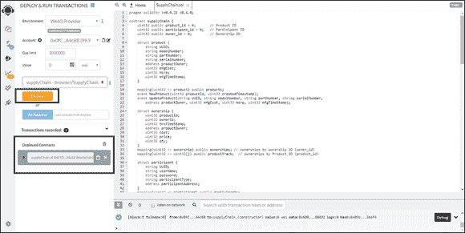

图 5-16： 复制已部署合约的地址。

16. **返回 VS Code，将第 12 行中的 `ADDRESS` 字符串替换为你刚刚从 Remix 复制的合约部署地址。**

当你将第 12 行的 `ADDRESS` 字符串替换为来自 Remix 的合约部署地址值后，你的 Python 文件应该看起来像图 5-17。

现在你已经在 Python 脚本中准备好了所有基础组件，可以运行它了！它目前还没有执行任何操作，但应该不会产生任何错误。

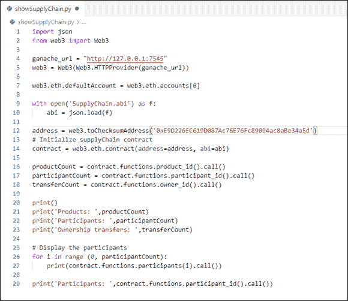

图 5-17： VS Code `showSupplyChain.py`（带有合约地址）。

17. **要运行 Python 文件，点击或触摸 VS Code 窗口右上角的右箭头。**

从 VS Code 运行代码会启动 Python 解释器并执行当前脚本。此时，你的脚本还没有做任何有趣的事情——很快就会出现。你的 VS Code 窗口应该看起来像图 5-18。

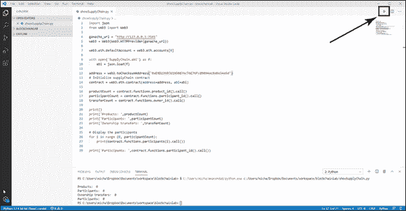

图 5-18： 首次运行 `showSupplyChain.py` 后的 VS Code。

如果遇到任何错误，请仔细检查你的 Python 代码是否有拼写错误。VS Code 会尝试用红色波浪线标记错误来帮助你。如果你看到它，将光标悬停在错误上以获取有关错误的更多信息。

只有在你从 Remix 复制了 ABI 和当前合约地址后，你的代码才能工作。如果你从书籍网站下载代码并在不提供 ABI 的情况下尝试运行。

## 构建本地区块链进行分析

在你从 Remix 复制了 ABI 和当前合约地址后，你的代码才能工作。如果你从书籍网站下载代码并在不提供 ABI 的情况下尝试运行。

## 连接到区块链

只有在你从 Remix 复制了 ABI 和当前合约地址后，你的代码才能工作。如果你从书籍网站下载代码并在不提供 ABI 的情况下尝试运行。

## 调用合约函数

只有在你从 Remix 复制了 ABI 和当前合约地址后，你的代码才能工作。如果你从书籍网站下载代码并在不提供 ABI 的情况下尝试运行。

## 获取区块链数据

只有在你从 Remix 复制了 ABI 和当前合约地址后，你的代码才能工作。如果你从书籍网站下载代码并在不提供 ABI 的情况下尝试运行。

完整的 `showSupplyChain.py` Python 脚本（在下载站点提供）展示了如何使用智能合约函数来获取区块链数据。我为每种类型的数据使用了一个简单的 Python 循环，并迭代调用返回所需数据的 `get()` 函数。添加数据和获取数据的主要区别在于，在仅获取数据时，你不需要创建事务。这就是为什么代码在每次函数调用的最后使用了 `call()` 方法而不是 `transact()` 方法。

请注意，我对参与者和产品使用了简单的循环，然后使用嵌套循环结构来遍历每个产品的所有所有权转移。图 5-19 显示了完整的 `showSupplyChain.py` Python 脚本。如果你已经运行了 `buildSupplyChain.py` 脚本，现在就可以运行 `showSupplyChain.py` 脚本来查看来自你区块链的数据了。

在本书的其余部分，你将学习如何扩展此基础功能，以构建并执行自己的区块链分析模型。

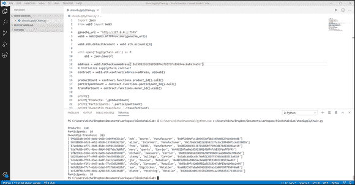

图 5-19： 完整的 `showSupplyChain.py` Python 脚本。

# 第二部分：获取区块链链

在本部分中……

* 从区块链数据构建分析数据集

* 探索热门的分析模型

* 检查为你的区块链吸引高质量数据的技术

# 第 6 章：解析区块链数据并构建分析数据集

在本章中

**比较内置分析与外部数据分析**

**关联外部数据**

**决定你需要哪些数据**

**组装模型将需要的数据**

在第 5 章中，你学习了如何连接到以太坊区块链并读取智能合约管理的数据。区块链数据不仅包含智能合约状态数据，在接下来的几章中，你还将学习如何识别和访问事务详情以及日志。访问分析目的的区块链数据没有硬性规定；每个项目可能有不同的需求，并需要不同类型的数据。

理解区块链分析的一个重要方面是区块链应用和数据的本质。区块链技术不仅仅是一种新类型的数据库。事实上，在区块链中存储不需要的数据是非常昂贵的。因为在区块链中存储数据需要费用，唯一应该存储的数据是那些从透明性、完整性和不可变性受益的数据。

在本章中，你将学习如何获取区块链数据并与外部存储的数据（未存储在区块链中的数据）相结合，以为你的分析模型提供完整的输入。

## 比较链上与外部分析选项

当你构建分析模型时，有两种基本选择：实时解析或两步分析。通过实时解析，你从区块链读取数据，从其他源获取你需要的任何相关数据，然后将完整数据集提供给分析数据的代码。另一方面，两步分析（可能包含两个两个步骤）首先从区块链获取数据并存储在某些离链仓库中。第二步使用传统方法寻找相关数据，以完成分析模型的输入需求。

例如，假设你正在分析供应链数据以识别低效的承运（运输）参与者。你可以读取所有所有权数据，以确定承运商取货和交付产品的时间戳。你可以比较不同承运商在相似取货和送货地点的性能，以查看一个承运商是否优于另一个。

这种简单比较的一个问题是它没有考虑异常情况。如果由于天气延迟了交付，这不应该负面影响承运商的性能结果。在这种情况下，你可以查询天气数据库中路线上的日期和时间，以识别任何重大天气事件。消费天气数据需要查询外部数据仓库。大多数提供可操作结果（你可以用于做出决策的结果）的分析模型可能需要比仅在区块链中找到的更多的数据。整合外部数据是构建有效模型的重要部分。

### 考虑访问速度

确定访问方法和数据需求是一个过程。你应该考虑是多次执行这种分析还是一次，以及是否需要外部数据。你还应该考虑区块链和外部数据的波动性。如果任何数据频繁变化，你可能需要经常查看。

一旦你对数据需求有了良好的理解，你就需要评估平台。

你不必遵循特定的顺序，但一次性或重复分析

你决定何时处理数据的一个重要驱动因素是该模型是否用于一次性分析。

永远不要相信“这仅仅是一次性查询”。在你交付该“一次性查询”的结果后，你通常会收到再次使用新数据再次运行的后续请求。

由于任何区块链数据收集过程都需要至少遍历一次区块链（你必须至少访问一次你的数据），你可以将第一次遍历视为模型的 `sunk cost`（沉没成本）。这意味着，无论你对数据进行何种处理，都必须投入时间和精力至少遍历一次你的区块链数据。当你进行第一次遍历时，你可能只是在当时对其进行处理（分析），也可能决定将其存储在其他地方以备日后分析。无论哪种情况，你的方法都取决于第一次遍历。

可变性能成本从第一次遍历之后开始。当你开始考虑为分析模型收集数据时，考虑“下一步是什么？”这个问题非常重要。尽量避免多次“去井水”。你可能认为我是在建议你始终将数据保存在外部仓库中，但事实并非如此。如果你只需要访问一次数据，那么就不需要为了以后而存储它。

到此时，你可能在想，我在建议你总是假设自己会运行多次模型，但我刚刚说了有时你只需要访问一次数据。如果你想知道这两者如何可能都是好的建议，请考虑你数据的波动性。如果你的数据频繁变化，且每次模型运行的结果都取决于当前数据，那么即使你运行多次模型，你也希望每次都使用最新数据。这意味着你将频繁访问区块链。

在分析数据时，你将学会做的许多妥协之一，是在性能、可重用性和结果产时间（截止日期）之间做出抉择。通常情况下，你应该努力满足项目截止日期。如果你能够构建一个易于重用、执行高效且仍然满足项目截止日的模型，那么你就走在了构建有效模型的道路上！

### 评估数据完整性

在任何数据分析项目的早期，最困难的部分之一是评估你的数据清单。第一步是简单地列出你可以获取的区块链数据。起初，你可以直接获取的数据列表来自智能合约暴露的 `state variables`（状态变量）。你可以从智能合约文档或查看源代码找到这些信息。进一步的探索可能会带来更多你可以使用的数据宝。关键在于要看到第一次遍历之外显而易见的内容。


如果你擅长阅读 `JSON`（调用许多区块链函数时的一种常用数据格式），你可以使用智能合约的 `ABI` 来提供有关可用数据的信息。我更倾向于查看智能合约源代码，因为它不仅向我展示了有什么数据，还展示了智能合约是如何使用这些数据的。

虽然我还没有专门介绍过从区块链获取所有形式数据的技术，但表 6-1 列出了从区块链可以获取的数据形式。你很快就会学会如何编写 Python 代码来获取你在表中看到的每类数据。

TABLE 6-1 存储在区块链中的数据形式

| **数据** | **描述** | **示例** |
| --- | --- | --- |
| 交易 | 存储在交易中的信息，包括来源账户、目标账户、金额和函数（带有参数）——如果交易调用了智能合约函数。 | 在第 3 章中，图 3-4](#c03.xhtml#c03-fig-0004)显示了一个调用 `cancelOrder()` 智能合约函数的交易，并显示了传递给函数的参数。 |
|  | 在智能合约中定义的变量。你可以从区块链上的任何区块获取当前值或该区块的值。 | `SupplyChain.sol` 智能合约（在 [`www.dummies.com/go/blockchaindafd`](https://www.dummies.com/go/blockchaindafd) 提供）包含了存储参与者列表、产品和所有权记录的状态变量。 |
| 事件日志 | 在智能合约执行期间发生事件时的事件名称和任何提供的参数。 | 在 `SupplyChain.sol` 智能合约（在 [`www.dummies.com/go/blockchaindafd`](https://www.dummies.com/go/blockchaindafd) 提供）中，`newOwner()` 函数触发 `TransferOwnership` 事件，提供了 `productId`、`fromOwner` 地址和 `toOwner` 地址。 |

在了解从区块链查询获取的数据后，你将确定还需要哪些额外数据。例如，如果你想根据取货和送货地点以及运输时长分析运输效率，你需要参与者的地址信息。`SupplyChain.sol` 智能合约没有存储任何物理地址信息，你需要从其他地方获取这些信息。在下一节中，你将学习识别和获取外部数据的技术。

### 集成外部数据

良好的区块链应用设计应该限制存储在区块中的数据。区块链技术专注于数据透明性和完整性，而不是批量数据存储或性能。如果你只是想存储大量数据，区块链可能不是最佳用技术。许多现有的数据库管理产品都能做到。当应用需要存储直接与价值从一个所有者转移到另一个所有者的信息时，区块链技术就会大放异彩。

所有权转移交易通常少量数据来记录交易。可能有很多辅助数据，例如人口统计或其他描述性数据，但只有定义交易所需的数据才存储在区块链上。事实上，在区块链区块中存储过多数据会增加使用区块链技术的整体成本。


某些要求（例如欧盟的通用数据保护条例 GDPR）规定组织必须尊重消费者删除其隐私数据的请求。为了支持“被遗忘权”，组织必须能够从其数据系统（包括区块链）中删除任何隐私信息。目前的方法是将存储在区块链区块中的数据限制为外部数据库中标识符的哈希（离链数据的指针），而不是直接在区块链上存储任何`个人身份信息 (PII)`。虽然你不能从区块链上删除哈希值，但你可以删除它所指向的数据。删除离链 PII 即使区块链数据（指针）仍然存在，也满足了“被遗忘权”。在这种情况下，区块链数据将不再指向任何有效的离链数据。删除区块链数据项所指向的离链数据实际上创建了孤儿状态。孤儿区块链指针的妥协只是区块链数据可能不完整的又一个案例。

由于设计目标或强制要求，区块链数据的范围可能很窄，因此通常从从区块链获取的数据开始，然后寻找相关数据来完成整个故事。例如，`SupplyChain.sol` 智能合约定义了参与者 `UUID`。`UUID` 是一个在所有应用程序和用例中都应该是唯一的标识符。这个 `UUID` 可以用作传统数据库应用程序中某条记录的键。当你通过智能合约 `getParticipant()` 函数从区块链检索到参与者 `struct`（结构化数据项或字段的结构化集合）后，你可以使用简单的 `SQL` 语句从数据库中获取相应的详细信息。

### 确定你需要的数据

弄清楚你需要什么数据（请原谅，这里用了一个数据库的双关语）的关键在于理解你拥有哪些数据以及缺少了哪些数据。如果你想确定一个承运商是否高效，你需要取货地、送货地以及性能指标。`SupplyChain.sol` 智能合约并没有存储上述任何这些数据。一个记录所有权从一个参与者转移到另一个参与者的所有权结构体（ownership struct）仅包含了对每个参与者的引用以及转移发生的时间戳。你可以找到每个参与者的 `UUID`，但这基本上就是你能获取的全部内容了。

 在区块链上存储真实世界数据的常用策略是在区块链的区块中存储该数据的唯一标识符，通常称为 `key`（键）。这个键值与存储在离链数据库中的数据记录的主键相同。这种做法允许应用程序透明地将链上数据和离链数据关联起来。只要离链数据可以在不影响链上数据完整性的情况下发生变化，这种方法就是结合区块链和非区块链数据的绝佳方式。如果离链数据的完整性至关重要，那么离链数据仓库（通常是数据库管理系统）必须确保其数据维护完整性。这就是区块链数据的一个明显优势之一——完整性是区块链的“中间名”（好吧，其实不真的是它的中间名，但它是它最好的特征之一）。

假设 `UUID` 指的是在离链数据库中定义得更完整的参与者，你可以使用 `UUID` 来查找额外数据以完善数据图谱。务要假设你在区块链上找到的数据能够满足你的分析需求。尽管事实往往并非如此，但假设它是可以的，意味着你偶尔会发现一些不需要外部数据的简单案例。然而，大多数情况下，你将需要咨询某些外部数据源以获取你真正需要的数据。

确定你将需要数据的一种行之有效的方法是创建一个原型（mock-up）。在理解了分析需求后，构建一个能够满足这些要求的模型，并定义你的模型所需的输入。然后，将这些输入映射到你可以从区块链上找到的数据。未映射的输入代表了你可能需要从其他地方寻找的数据。这些未映射的输入就成了你数据“寻宝之旅”的起点。

### 将身份扩展到离链数据

思考链上和离链数据关联的一种方法，是从身份和所有权的角度来看数据。假设区块链存储了关于你的某些数据。它可能是支持去中心化购物应用、医疗管理应用，甚至是家庭节约能源应用的数据。无论数据是什么类型类型，你都希望你的个人数据保持私密，并仅与你本人关联。你不希望你的数据与任何其他人混淆，反之亦然。

当你通过首先确定链上数据的身份来将离链数据与链上数据关联时，会获得最佳结果。如果区块链的智能合约设计目标是为了支持离链集成，那么每个数据项都应该有一个永久识别的标识符。简单来说，应该有一些智能合约状态数据，能够方便地将链上数据与离链数据关联起来。如果你熟悉传统的关系型数据库系统，你就会知道将身份扩展到区块链之外类似于跨表关联数据。

例如，在数据库系统中，通常将产品订单存储在至少两个表中：`orderHeader`（订单头）和 `orderDetails`（订单详情）。`orderHeader` 表包含描述整个订单的信息，例如下单的客户和发货地址。`orderDetails` 表对每个订单包含多条记录，每条记录描述订单中的某一行。这两个表都包含一个 `orderNumber` 字段，数据库管理系统使用该字段来确定哪些 `orderDetails` 记录属于哪个 `orderHeader` 记录。

 在这个示例中，`orderNumber` 字段是 `orderHeader` 表的主键，也是 `orderDetails` 表的外键。

当你在为模型寻找最佳数据存储库时，请注意访问方法以及对数据使用的限制。如果获取数据缓慢或困难，或者其使用被限制到你无法合法使用的程度，那么一个优秀的存储库也无用处。提前了解如何获取数据以及相关的限制和成本，将避免日后遇到困扰。

## 识别特征

在数据分析中，`features` 是算法分析的变量。例如，在分析收入和教育对贷款违约概率的影响时，一个人的收入和教育水平——而不是他的性别——是主要特征。考虑是否应该包含性别特征可能是合理的，但分析收入和教育的原始目标并没有考虑性别。

分析师做出的最重要的决定之一是确定模型中包含哪些特征。你应该包含所有对产生结果有贡献的特征，并排除所有未能贡献有效结果的特征。这听起来很容易，但执行起来可能。深入评估特征选择和评估技术超出了本书的范围，但你将学习选择最佳特征的最常用方法。

### 描述特征如何影响结果


关注特征选择的主要原因是，选择错误的特征会导致产生糟糕的结果。记住，特征是你分析中考虑的变量。每个特征都提供了影响输出的输入。如果你正在尝试确定竞争承运商在地点之间运输货物的效率，那么每辆卡车的颜色特征可能对你的分析没有任何价值。

尽管卡车颜色可能对此分析没有贡献，但它对于回答其他问题可能很重要。如今的许多货车都有白色车顶，因为分析显示这可以大幅降低夏季的内部温度。内部温度降低意味着能耗减少，并有助于保护货车内的包裹。任何特征重要性取决于你所提出的问题。

确定为模型选择最佳特征有两种主要方法。尝试每种方法并使用产生最佳结果的那一种。随着使用每种方法的经验增加，你将更加从容，并更好地准备好减少模型考虑的特征数量。通过减少特征，你可以提高准确性、缩短训练时间并提供更清晰的结果。

## 过滤与包装方法

选择特征的两种主要方法是过滤（filter methods）和包装方法（wrapper methods）。它们的目标相同：识别最有意义的特征以产生最佳分析结果。让我们简单查看每种方法。

### 过滤特征

`Filtering methods` 依赖对每个特征进行评分，然后只使用高分特征。存在多种评分方法，包括皮尔逊相关系数、LDA、ANOVA 和卡方检验。主要的评估选择取决于特征所包含的数据以及模型的预期结果是连续的还是类别的。`Continuous data` 指在最小值和最大值之间范围内变化的开放式数据。`Categorical data` 只能是预定义值列表中的某一个（例如真/假、是/否或年份中的某个月）。

在`feature filtering process` 中，你根据所选的评分机制为每个特征分配一个特定分数。你按分数对特征进行排序，并只使用高分特征。不存在神奇的分阈值；你必须查看每个评分列表，以确定高低分之间的界限划在哪里。

### 包装特征

选择特征的另一种常用方法是`wrapping method`。包装方法的强度更大，但可以提供更好的结果。

设置数据库连接或网络服务并没有太大区别。在这个示例中，你创建了三个连接：以太坊区块链、一个包含参与者详情的输入 CSV 文件以及一个供你存储的输出 CSV 文件。（如果你无法判断结果是否有效，该方法可能没有帮助。）

## 构建分析数据集

虽然进行分析是可能的，有时也是有利的，但让我们来看看如何构建数据集。在本节中，你将学习如何获取数据。你从区块链读取数据，将其与外部数据关联，并创建一个新的存储库。你从简单开始。

### 连接多个数据源

每个数据源都需要从你的 Python 脚本建立唯一连接。你已经见过如何连接到文本文件和区块链。设置数据库连接或网络服务并没有太大区别。在这个示例中，你创建了三个连接：以太坊区块链、一个包含参与者详情的输入 CSV 文件以及一个供你存储的输出 CSV 文件。

以下是创建连接的 Python 代码（你可以在下载下载找到 `buildDataset.py` 的完整代码）：

```python
from web3 import Web3 # 设置到区块链的连接
ganache_url = "http://127.0.0.1:7545"
web3 = Web3(Web3.HTTPProvider(ganache_url)) # 打开 participantDetails.csv 文件读取参与者详情
fileHandleIN = open('participantDetails.csv', 'r') # 打开 dataSet.csv 文件存储我们构建的数据集
fileHandleOUT = open('dataSet.csv', 'w')
```

现在你可以从区块链读取数据，将其与`participantDetails.csv`文件中的数据关联，并将完整的数据项列表存储在`dataset.csv`文件中。

### 构建交叉引用数据集

构建交叉引用数据集的过程涉及上一节提到的三个步骤：

1. 使用`getParticipant()`智能合约函数从区块链读取参与者。
2. 从`participantDetails.csv`文件中查找参与者的详情。
3. 将完整的参与者数据写入`dataset.csv`文件。

### 清洗数据

你在前一个示例中使用的数据是基于清洁的数据。`clean input dataset` 意味着你需要的所有数据都存在且格式正确。在现实生活中，你可能找不到一个或多个参与者的详情。而且某些个人详情可能会缺失或数据格式不正确。例如，邮政编码可能包含字母而不只是数字。

在其他情况下，你会发现从不同来源读取的数据使用了不同的尺度或基准单位。一个常见的例子是查询天气数据。温度可能用华氏度或摄氏度表示。你使用哪一种并不重要，但你必须保持一致。你无法轻易比较和分析使用不同尺度表示的数字。

另一个例子是课程的评分信息。如果不同的班级使用不同的评分标准，你可能会发现很难比较和分析多个班级的成绩。尺度不匹配的常见解决办法是选择一个公共尺度并将所有数据转换为该尺度，这一过程被称为`normalization`（规范化）。

除了尺度问题外，你必须确定如何处理缺失或格式错误的数据。每一种都是独特的，你必须根据每个数据项的状态及其对模型的重要性来做出决策。你所选模型对缺失或格式错误数据的敏感性将很大程度上帮助你决定如何处理不符合理想标准的数据。在开发获取和同化分析数据集的程序时，尝试根据实际情况将数据转换为用于分析的标准格式。

虽然在获取数据时进行清洗是一个好主意，但要避免在此过程中丢失原始数据的粒度。你不希望任何清洗过程降低原始数据包含的细节水平。清洗应该让你的模型更准确，而不是不准确。

现在你已经知道如何读取智能合约状态数据，将其与链外数据关联，然后创建一个更完整的数据集进行分析。在下一章中，你将开始在区块链数据上构建分析模型。

# 第 7 章 构建基础区块链分析模型

## 本章

 **发现数据项之间的相互关系**

 **发现数据中有趣的模式**

 **预测将发生什么**

 **检查跨时间段的数据**

## 引言：释放数据分析的力量

在之前的章节中，你学习了区块链数据、它是如何存储的，以及如何获取它。当然，在开始理解它之前，你首先需要了解你的数据。在知道如何识别并获取所需的数据后，逻辑上的下一步是设弄清楚它可能隐藏着什么秘密。这就是数据分析的核心思想。

你可以从许多角度查看数据。你只需要决定想采用什么种方法，然后建立一个模型来执行你选择的方法。听起来很简单，对吧？如果你审慎地处理问题，它可以非常简单。

明确你数据分析的目标将驱动你在选择正确模型时的决策。记得刘易斯·卡罗尔书籍《爱丽丝漫游仙仙境》中爱丽丝的困境，当她和猫对话时：

> “请告诉我，我从这里应该走哪条路呢？”

> “这在很大程度上取决于你想去哪里，”猫说。

> “我并不在乎去哪——”爱丽丝说。

> “那么你走哪条路都无所谓，”猫说。

就像爱丽丝一样，如果你不知道想从数据中发现什么，那么分析就无非是搜寻和猜测。你不需要确切知道自己在寻找什么，但你得有一些想法。

## 识别相关数据

分析的第一类型类型之一是识别相关数据。例如，营销人员在分析现有客户的特征后，使用分类来帮助识别潜在客户。他们发现大类数据（如准准妈妈或大学生）倾向于购买相似物品。他们利用这些信息为额外购买做出明智的有针对推荐。

在本章的剩余部分中，你将学习识别相关数据的最常见分析技术。

### 基于特征（属性）对数据进行分组

在数据分析中，数据属性被称为 `features`（特征），我从现在起将使用该术语。分组的一种方法是检查特征，并根据相似的特征确定哪些对象（数据项）是相似的。例如，价格较低的电视在特定零售商处卖得更好吗？或者特定地区（邮政编码范围）的零售商售出的较大或较小电视更多？这些问题都是聚类模型可能回答的问题。

不要期望你尝试每一个模型都能揭示有意义的数据。许多模型并不会产生可操作的信息。随着你数据分析经验的增加，你将更好地判断何时该为你遇到的数据使用特定的模型。即便如此，你可能仍需要从多个角度查看你的数据，以找到能给你带来有趣结果的正确视角。不要气馁——继续寻找。

### 聚类技术

聚类技术通常被称为`unsupervised analysis`（无监督分析，甚至是 `unsupervised learning` 无监督学习技术）。这些技术被称为“无监督”是因为它们不施加任何预设。换句话说，你让数据告诉你存在哪些类，而不是将数据拟合到预定义的类中。无监督技术通过观察你的数据并提供隐藏结构的线索。

某些数据非常适合聚类，而另一些数据在视觉上并没有组织成定义良好的类。图 7-1 和图 7-2 展示了代表对某零售商评分的数据。x 轴显示每个客户给出的评分，范围从 –3（平均水平以下）到 3（平均水平以上）。y 轴显示每个客户在该零售商处购物时长（月月）。

图 7-1

FIGURE 7-1: 聚类的客户评分数据。

虽然明显的聚类易于观察，但将聚类进行数学化表示以使用模型预测未来行为至关重要。其中一种技术 `k-means clustering`（k-均值聚类）计算每个类最可能的中心点，称为 `centroid`（质心）。数学模型使分析师能够观察到可能并不明显的相似行为。在这种情况下，零售商可以进一步探索评分如何根据客户时长的变化而变化，更重要的是，他们可以做什么来提高整体评分。图 7-2 显示了相同的数据，但为每个识别出的类分配了质心和不同的颜色。

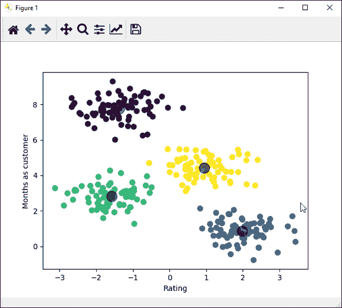

FIGURE 7-2: 带有质心和颜色的聚类客户评分数据。

在其他时候，数据似乎并没有清晰分组。图 7-3 显示了客户评分（x 轴）和客户发布评论相对数量（y 轴）的散点图。在该图中很难看到清晰的类，这表明评分与发布的评论数量之间可能不存在强相关性。发布评论数量低于平均水平的客户通常评分较低，但很难预测以平均或高于平均频率发布评论的客户将如何给零售商打分。

无论如何，`k-means clustering` 算法可以识别出三个不同的类，如图 7-4 所示。

聚类技术通常不孤立使用。它们要么用于分析的早期阶段，要么与其他技术结合使用。聚类有助于识别最初可能并不明显的分组。在识别出此类类后，可以对其的因果关系或预测用途进行进一步研究。

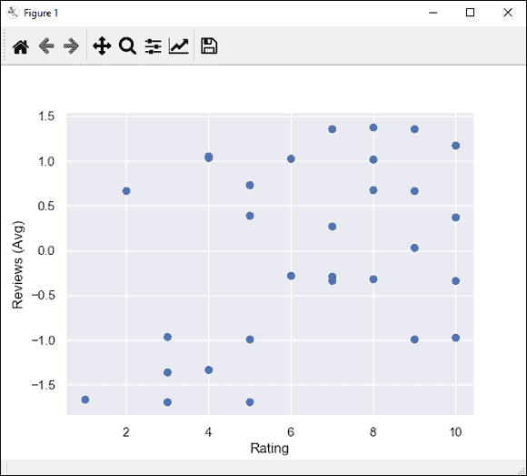

FIGURE 7-3: 弱聚类的客户评分数据。

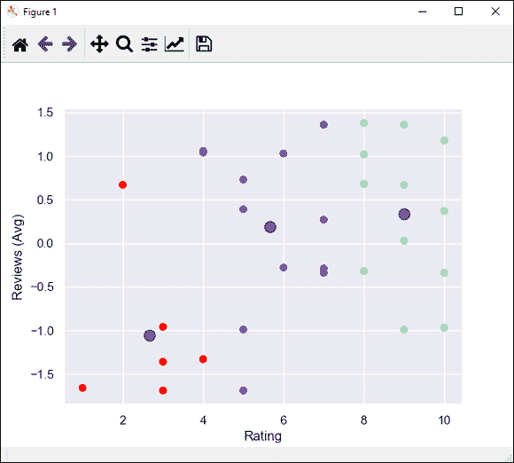

FIGURE 7-4: 带有质心和颜色的弱聚类客户评分数据。

### 确定成员身份

你刚刚学习了聚类技术可以揭示数据的分组，这在最初检查你的数据时可能是无价的。然而，许多分析项目需要某些利用过去数据预测未来行为的能力。`Classification analysis`（分类分析）技术提供了一种基于已知特征确定结果的数学方法。例如，你可以使用分类根据一个人的当前收入和信用历史来预测其是否可能违约。分类是一种监督学习技术。在`supervised learning` 中，你定义一组标签或类，由模型为新数据分配标签。

你构建的分类模型完全关注数据而非人。然而，因为模型是由人类构建的，偏见很容易影响此类模型的创建和使用。你使用分析结果可能会影响他人。分类与画像分析之间存在微妙的界限。根据分类结果做出决策时要非常小心。带有大量人类偏见的分类模型（例如基于种族或宗教）可能会产生歧视性结果并导致非法决策。

分类是分析预测的方法。构建监督学习模型的通用方法是使用带有标签的数据集来 `train` 模型，然后提供无标签数据让模型建议标签。简单来说，模型通过研究已知特征和结果学习如何得出答案，然后通过提供具有不同属性的对象对其进行测试。

你在第 10 章中学习了多种分类方法，但现在让我们坚持使用最简单的方法之一：`decision tree`（决策树）。表 7-1](#c07.xhtml#c07-tbl-0001)展示了一份简短的历史贷款违约数据。在这个简单的示例中，你只查看少数特征，即人的性别、婚姻状况、工作状况、所在州和贷款违约状态。你工作的金融公司希望你使用这些数据来预测贷款申请人是否可能违约。

使用表 7-1 中的数据，唯一能很好预测一个人是否可能违约的特征是该人是否有工作。由于每个人都住在不同的州，因此该特征无法帮助我们预测任何内容，而其余特征在结果方面的分布均匀。即使是性别和婚姻状况的组合也无法帮助我们做出预测。只有个人的工作状态是判断其是否会违约贷款的可靠指标——这是有道理的。

现实世界中的分析很少是这样显而易见的。在大多数情况下，你不能仅仅通过观察数据表格来预测未来的结果。相反，你必须费力构建模型，根据历史数据预测未来的结果。如前提到的，最简单的分类模型之一是决策树。你将在第 10 章中学习如何构建基于区块链的`decision tree`，但该模型本质上是根据你提供的数据构建一棵树，然后用它来做决策。如果你从表 7-1 中的数据构建决策树，它应该像图 7-5 中的那棵树。

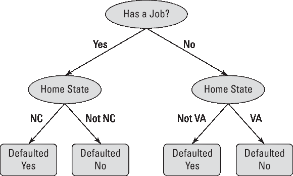

FIGURE 7-5： 贷款违约预测决策树。

通过图 7-5，很容易看出唯一的意义特征是工作状态。在确定申请人是否有工作之后，关于该人的所有其他信息在判断其是否可能违约贷款时具有相同的权重。

在刻描述结果时要小心。这个简单的贷款违约分类器只能根据非常有限的信息，确定贷款申请是否可能违约（或不会）。没有任何分析模型是完美的。你永远不要只根据分析模型做出决策；你应该始终通过其他可用输入来验证模型的输出。换句话说，分析结果应该与其他数据一致。

使用任何分析模型最困难的部分之一是识别能够产生高质量结果的最优特征。你可以在第 9 章到第 12 章了解更多关于基础特征选择的内容。目前，始终确保你选择的特征是合理的。例如，包含贷款申请人驾驶的汽车类型可能表明该人的生活方式，但考虑汽车内饰颜色可能不是一个重要特征。

不要过快丢弃任何特征。尽管汽车内饰颜色似乎无关紧要，但如果你最初的数据调查显示汽车内饰颜色与贷款表现之间存在强相关性，请再次查看它。意外的结果可能是由于糟糕的数据、不恰的模型选择，或者只是你之前不理解的动态。数据分析可能是困难的，因为许多相关性最初并不显而易见，但投入在寻找不明显事物的工作是可以很有成果的。

### 发现项目之间的关系

最后一类主要的关联数据分析是观察不同对象如何关联。之前的方法检查了单个对象的特征如何使该对象与其他变得相似。`Association analytics`技术有助于识别对象在特定情境下（通常在同一笔交易中）何时一起出现。例如，假设你在一家超市连锁店工作。一种常见的关联分析技术是`market basket analysis`，它能识别客户经常一起购买的物品。

超市购物篮分析最早的惊人结果之一，是发现周四和周日晚上婴儿尿布和啤酒之间存在强相关性。进一步的研究发现，年轻父亲经常被要求在周四买尿布以为周末做准备，并在周日再次为即将到来的的一周做准备。这些年轻父亲在商店里通常还会顺便带一六瓶装啤酒。精明的零售商开始在尿布过道和结银台之间放置啤酒展示（以提醒爸爸们不要忘记啤酒）。忽略这个例子中显而易见的刻板印象，零售商因此增加了他们的啤酒销售量。

最常见的算法简单但枯燥。`apriori technique`只需统计交易中的物品，并报告任何物品出现在交易中的概率。它从单个物品开始，然后使用成对物品重新计算整个数据集。它不断向交易集中添加物品，直到数据用尽。额外的规则有助于该过程避免重新计算没有意义的项目集。该算法很枯燥，但实现它的先进技术使其成为一种有价值的技术。（apriori 算法还有很多内容，但目前这样足够了。）

无论使用什么类型的技术，关联的目标都是帮助识别一种选择极有可能伴随另一种选择的情况。关联选择的能力是`recommender engines`（查看过去的选择并预测你下一步可能选择什么的软件）的基础。像 Netflix、Amazon、Google 等大型机构以及几乎任何其他试图向你推销东西的企业都使用推荐引擎来促使你购买更多。

暗示性销售并不新鲜。很久以前，快餐提供者就发现薯条是三明治的常见补充（而且是高利润产品）。他们让餐厅收银员询问客户：“您要加薯条吗？”随后，他们开始提供套餐，以便更容易实施他们的购物篮分析告诉他们的建议。

今天，你访问的几乎每个网站都提供了你应该采取的进一步行动的建议。“点击此处了解更多关于这一史无级优惠的信息！”推荐引擎使用关联技术来分析你的在线活动（通常是实时的），为你挑选一个你可以遵循的常见操作。推荐引擎不可思议的准确性就是为什么感觉它们就像在你脑子里一样。因为人类基本上是习惯性生物，观察一般规范并预测下一步并不那么困难。这就是关联技术的力量。

## 对未来结果做出预测

组织转向数据分析有许多原因。虽然更好地了解你的数据是使用分析的一个很吸引人的理由，但除非你能根据所学到的知识做出可操作的决策，否则它没什么大用。你的目标可能是识别产品或客户特征之间的相似特征。这种发现可能会引导你添加、更改或删除服务以迎合客户偏好。此外，你还可以识别产品或服务之间之前未知的关系，并利用此向客户提供建议。


尽管发现可以是数据分析的一个有价值的结果，但它最常用的用途是预测。正如你在前一节中学到的，人类倾向于习惯性生物。事实上，大自然通常倾向于可重复和可预测的结果。例如，很久以前天气被认为是一系列难以理解的不断变化的情况。然后，随着初级气象学家开始研究过去的天气以及导致特定天气事件的原因，可靠预报变得可能。今天的天气预报无非根据历史数据构建模型，提供当前状况，并让模型预测会发生什么。

如果你是一个天气爱好者，你可能听过气象学家提到不同的模型预测，例如欧洲模型或天气研究预报模型（Weather Research and Forecast model）。每个模型指的是一种数据分析模型（某种数学公式），它利用历史天气数据来预测未来事件。每个模型的输出略有不同，因为它们看待输入数据的方式略有不同。就像向朋友寻求建议一样，没有哪个模型是完美的，某些模型在特定情况下效果比其他模型更好。

你已经见过一种类型的预测模型了：决策树。决策树是一种简单的模型，适用于分类数据。`Categorical data`（分类数据）的数据值范围有限，例如是/否、`true/false` 或小型列表（例如星期几或一年月份）。你会遇到的另一种类型的数据是连续数据。`Continuous data`（连续数据）几乎都是数值，并且可以取很广泛的值。连续数据的示例包括温度读取、工资、测量值以及任何具有范围限制的数值。

某些值（如产品评分）可以解释为分类数据或连续数据。由于大多数评分被限制在 1、2、3、4 或 5，你可以将此类数据解释为一个范围，也可以解释为离散的值。不同的模型处理数据类型的方式不同，因此将数据解释为不同类型的能力让你在选择模型时具有更大的灵活性。

`prediction analytics`（预测分析）的目标是构建并训练一个模型，根据可用信息准确预测未来的结果。你必须分析现有的历史数据，对这些数据建立假设创建一个公式，然后将你的公式应用于新数据以预测某些结果。该过程从检查你拥有的数据开始。这就是为什么你开始研究聚类技术。如果你能识别出任何数据簇，你可能就可以利用这些信息来识别有趣的特征。

在确定模型的特征后，你将进入寻找最能代表现有（历史）数据的公式的阶段。这个过程被称为`training your model`（训练你的模型）。在这个阶段，你不断调整公式以最好拟合你的训练数据。模型训练完成后，你就可以准备好输入新数据，以看看它预测未来结果的效果如何。

在接下来的章节中，你将学习如何常见的陷阱并构建更准确的模型。

## 选择影响结果的特征

构建良好的分析模型的主要因素之一是选择所有最直接影响结果的特征，并排除任何不影响结果的特征。在实践中，这是一个很难实现的平衡。数据分析侧重于研究历史数据如何帮助预测未来结果，而单个特征对结果的影响程度并不总是显而易见的。仅凭直觉评估特征重要性是不够的。你需要一种更可靠的方法。

你可以通过两种主要方式选择特征：过滤方法（filter methods）和包装方法（wrapper methods）。`Filter methods`（过滤方法）更快，但可能不是最的，因此当快速构建模型比模型准确性更重要时，它们是一个很好的选择。`Wrapper methods`（包装方法）迭代构建模型，结合机器学习技术来确定哪些特征对结果的影响最大。包装方法较慢且计算成本更高，但能产生更准确的特征选择集。

### 快速过滤特征

特征选择过滤方法（例如 `chi-squared` /卡方检验和 `information gain` 信息增益）会评估每个特征对结果的影响。`Filtering feature selection methods`（过滤特征选择方法）通常快速且易于计算；只需要访问数据。例如，如果所在州本身可能并不显著，但在与婚姻状况结合考虑时可能会变得显著。过滤方法的变缺点是它们通常不评估复合特征。

### 用于高精度的特征包装

包装特征选择方法（例如 `forward feature selection` 前向特征选择和 `backward feature elimination` 后向特征消除）利用机器学习来确定哪些特征最影响结果。`wrapping feature selection`（包装特征选择）的主要方法是从空特征集开始构建一个最有影响力的特征集，或者从所有特征开始迭代消除那些不影响结果的特征。无论哪种方式，目标都是获得一组对模型预测影响最大的特征。包装方法需要更多的时间和精力，但通常能提供更准确的选择。

## 胜过最佳猜测

大多数问题都有最佳猜测答案，商业环境中的预测也不例外。当数据分析的模型预测结果的概率比最佳猜测更高时，数据分析就是成功的。假设对于任何平均一天，访问在线购物网站的人中有 25% 会至少购买一件产品。（顺便说一下，这是一个非常棒的平均值！）这意味着你为每个客户分配了 `0.25` 的购买概率。

然而，通过数据分析，你发现登录你的网站并在过去一个月内购买过三次以上的客户有 80% 的概率进行购买。这才是你应该关注的客户。

超越最佳猜测的背后的目的是证明你的模型更好。实现这一点的常用方法是建立`null hypothesis`（零假设）和`alternative hypothesis`（备择假设）。假设你的模型正在检查工作状态对贷款申请人是否可能违约的影响。零假设认为，工作状态对贷款违约没有影响。备择假设认为，工作状态是预测某人是否会违约的良好指标。要确定工作状态是否是一个良好的判别器，简单地分别评估每个假设并查看结果是否不同。显然，工作职位确实影响贷款违约（参见表 7-1），因此你必须拒绝零假设。因此，接受备择假设，工作职位是你模型的一个良好潜在特征。

最好的分析模型不仅能超越最佳猜测，而且以可能的最高准确做到。通常会有多个模型可以超越最佳猜测。尽可能检查大量的模型和选项以找到最佳解决方案是非常重要的。

 最佳解决方案几乎总是目前的最佳解决方案。监督学习模型依赖于训练数据。随着数据随时间推移，模型的准确性可能会发生变化，变好或变差均有可能。使用当前数据重新训练模型以确保最高的持续准确性非常重要。

## 构建置信度

数据分析模型提供结果，但总是带有前提条件。预测是无法保证的。在预测任何结果时，始终存在某种程度的不确定性。你对预测的信任程度就是该预测的`confidence`（置信度）。

当你评估任何数据时，可能会看到一些似乎不符合的数据。与数据集中大部分其他数据点不符的数据点被称为`outliers`（离群值）。离群值的存在可能有许多原因。也许测量有误，对象的行为异常，或者发生了其他奇怪的事情。无论离群值的原因是什么，它们的存在都会对模型的构建和使用产生负面影响。置信度可以帮助你处理离群值和模型精度偏差。由于现实世界的数据并非完美且对称，任何模型对结果预测的偏差将始终存在。声明置信值使得模型即使在提供的预测没有被证明是真实的情况下仍然可能是准确的。

`Confidence levels`（置信水平）或`intervals`（区间）通常以百分比的形式表示。95%的置信水平意味着模型预计在 95%的时间内提供正确的结果。这并不坏，但优选 99%（甚至更高，如 99.99%）的置信水平。构建和训练一个预测置信水平高于 99%的模型需要大量工作，但这样的模型可以成为一个非常有价值的业务工具。

对于正态分布的数据，大多数数据集中在一个`mean`（均值，也称为`average`（平均值）上，随着远离均值值，数据点逐渐减少。插图 7-6 显示了一组正态分布的数据，其中平均值为红色（中心线），置信区间边界为蓝色（两条外侧线）。置信区间之外的值（在正端和负端两端）是分布的`tails`（尾部）。由于分布曲线尾部的某些数据落在置信区间之外，置信度[原文在此处提示中似乎截断或重复了]。

时间序列分析的总体目标是为取决于发生时间的数据提供时间及日期敏感的信息和预测。许多现实业务应用依赖于当前预测，而时间序列分析将预测投放到特定的时间段。

## 探索增长与成熟度

时间序列分析的应用之一是处理产品、服务或实体随时间发生变化的情况。许多内部和外部因素可能会影响分析模型结果的准确性。最准确的模型会根据需要考虑时间影响，以计算预测值。

尽管并非所有数据都对时间敏感，但许多金融模型必须考虑时机问题。一个预测 2001 年股票价格的模型无法准确地预测明天的价格。同样，如果不考虑季节性，预测 3 月份航班的客运量准确性将低得多。时间序列分析允许分析师纳入季节性、时间相关的环境因素以及其他已知的影响，以构建尽可能准确的模型。

## 识别季节性趋势

玩具制造商几十年来一直知道季节性的影响。随着圣诞节的到来，玩具需求往往会增加，有时速度快得惊人。对这种趋势的意识驱动了满足预期需求所需的必要业务决策。如果缺乏基于季节性变化的复杂模型，对供应链、制造和分销所有方面的规划将是不够的。

玩具制造的采购计划在 2 月和 9 月非常不同。正如你预期的那样，2 月的规划重点是获取原材料以进行积极制造，而 9 月的重点是分销。时间序列分析技术帮助分析师构建符合发起组织需求的模型，无论考虑的是哪个时间段。

## 描述结果周期

你之前学习过可以使用趋势线来平滑原始数据中观察到的波动。趋势线更容易看到长期趋势（我希望增长趋势），但会隐藏周期性标准之间的任何周期波动。在许多情况下，包括图 7-8 和图 7-9 中的航空公司乘客数据图，数据往往每年循环。如果对年内周期感兴趣，季节性和残差视图可能会有所帮助。这四种标准时间序列分析视图中的最后两种有助于放大周期中观察到的波动。在选择特征时，残差中的高观测变异可能意味着发生了某些未解释的现象，你应该考虑额外的特征。

尽管时间序列分析比其他类型的分析更复杂，但它可以就你的数据如何随时间变化提供价值的见解，以及你如何从中发现及时的价值金矿。

现在你已经了解了主要的分析类型，已经准备好学习如何使用 Python 实现分析模型，然后将这些模型应用于区块链数据。

# 第 8 章

# 利用高级区块链分析模型

本章内容

- **激励参与者贡献数据**

- **激励参与区块链活动**

- **通过相关数据增加分析价值**

- **为了更大利益组建团队**

一个成功且高效的数据分析项目不仅仅是对统计学的理解。你在上一章中已经学习了一些基础模型，但仅涵盖模型是不够的。上世中有许多资源可以帮助你学习如何构建基础和复杂的数据分析模型。此书的独特之处在于，我涵盖了如何在区块链环境中使用这些模型。但即使将区块链数据与分析模型对齐也不足以证明这些努力的价值。

在任何环境中，数据分析的真正价值在于将所选模型与数据正确对齐，以满足业务目标。如果没有高质量的当前数据，即使是优秀的模型也无法提供最佳结果。即使你构建了提供最高准确性的完美模型，它也会随着时间的推移而退化。你必须使用新数据不断重新训练模型以保持有价值的结果。如果不这样做，你将根据日益旧的数据做出决策。

这种对相关和新鲜数据的需求意味着你必须为提供模型数据的参与者提供留下的理由。为参与者持续提供数据提供激励、降低参与成本以及营造协作环境，应该是健康联盟的目标。

你的区块链环境（或公共区块链环境内的社区）如果没有精心的维护和投入，可能不会蓬勃发展。促进一个不断增长和成熟的健康区块链数据环境的最佳方法，是提供持续贡献的激励，尽可能使其变得容易，并鼓励所有参与者之间的协作。在本章中，你将学习专门针对区块链和分析的方法方法来追求这些目标。

## 识别参与激励机制

许多数据分析项目在完全公开或隔离的环境中进行。对公开数据进行分析以获得宏观结果，然后使用内部数据孤岛获得微观结果，这很常见。这种方法通常能提供价值的见解，但有时无法阐明中间地带的活动。宏观结果可以解释整个行业的趋势，甚至在大规模上指导战略决策。另一方面，微观结果可以帮助企业了解自身环境中发生了什么。

通常缺失的是对特定企业市场细分领域活动的视图。例如，汽车制造领域有大量数据。如果一个组织参与了汽车制造供应链，它可能能够访问并分析通用供应链信息，以及自身的内部数据。然而，它可能无法获取专注于其在供应链某部分背景下的特定产品线的丰富数据。

中大型组织通常参与信息共享联盟，但限制了它们共享的数据以避免泄露不必要的知识产权。这些数据共享限制导致了数据不必要的泛化。构建有效分析模型的诀窍在于确保你拥有模型所需的数据，以提供满足其目标的结果。你可以通过为数据提供者提供激励使其贡献丰富的数据来实现。

### 遵循强制性要求

在激励参与者贡献数据时，最明显的方法是强制要求贡献。这种方法看起来最直接，但并不总是能产生高质量的数据。`强制性要求`有多种形式，包括立法、法规、行业标准、专业组织标准甚至是联盟参与协议的要求。无论何种类型的强制性要求，组织最终都会视为必须满足的负债，并仅通过达到最低要求来满足。除非存在其他激励，否则大多数组织不会付出努力和成本去超过最低强制要求。

针对单个用户的强制指令可能会导致观察到的合规水平最低。用户倾向于在不完全阅读用户协议的情况下同意条款，并且只有在这些活动是完成所需功能的必要条件时，才会执行强制要求的最低活动。换句话之，许多用户只有在必须这样做才能获取他们想要的信息时才会费尽周折。强迫用户为了功能或数据而表现是一场危险的游戏。他们可能会对额外的精力感到疲倦，并简单选择不参与。

强制要求良好的行为和参与通常会导致整体参与度降低。即使你的使用条款明确规定参与取决于贡献，用户可能也可能会感到沮丧并离开。当用户撤出时，他们会带走你的组织繁荣所需的可能具有高价值的数据。

由于仅依靠强制指令存在许多缺点，建议组织不要使用这种一刀切的方法来强迫参与区块链网络。更好的解决方案是告知参与者参与对他们带来的益处，然后为优秀的贡献者提供有趣的激励措施。

在区块链环境中工作的好处之一是，区块链倾向于吸引那些重视去中心化和缺乏中央控制的参与者。这种态度通常伴随着更高的社区参与感和为更大的利益做出贡献的意愿。尽管你不能假设所有区块链参与者都是利他主义，但一些组织发现，区块链环境中的参与者比传统环境中的用户更容易被激励。在接下来的章节中，你将学习强制良好行为这种强硬手段的几种替代方案。

### 与伙伴玩游戏

激励行为最成功的方法之一是将待激励的活动变成游戏。教育者长期以来就知道，减少学习的枯燥本质并增加整体留存率的有效方法是在教学过程中使用游戏。将学习过程视为游戏，并赋予获得积分或身份的能力，可以增加学生的兴趣和参与度。

`Gamification`（游戏化）描述的是将游戏设计应用于现实世界。大多数人喜欢玩某些类型的游戏。游戏涉及挑战、一个解决这些挑战且不会产生长期长期负面影响的安全环境，以及成功的奖励潜力。许多游戏系统通过有趣的角色和故事情吸引参与者，并提供了一条获得奖励和角色成长的路径。将游戏元素应用于现实世界在鼓励参与小组项目方面已显示出积极的成果。

不要将游戏化和游戏论混淆。`Game theory`（游戏论）是一种研究复杂系统代理之间交互的数学方法。换句话说，游戏论寻求将解释竞争参与者（或玩家）之间社会状况的过程形式化。`Gamification` 是将游戏设计元素应用于非游戏语境（例如项目或区块链应用），以增强参与度。

航空公司、酒店和杂货店是利用这一概念的业务三个三个例子。许多行业的许多组织都有忠诚度计划，通过积分、徽章甚至折扣价格来奖励参与者。参与者提供他们的身份识别信息以及活动数据。作为参与者所提供的丰富数据的交换，他们获得了不断提高的身份和特权。

并不难看出忠诚度计划和身份的力量。乘坐商业航空公司飞行，你可以看到航空公司对其身份客户的对待与普通客户不同。看到那些有身份的飞行者炫耀他们的身份，有时是很有幽默感的，这恰恰证明了游戏化的力量。

游戏化可能是激励你的区块链环境中参与者持续贡献优质数据的一种方法。如果你能开发出一个以提供数据来交换真实（或感知）价值的程序，你就可以从实质上提高你的分析模型的寿命。

### 奖励和惩罚参与者

另一种激励参与者的方法更直接。你不是通过游戏化微妙地提供增加的身份，而是做出相应的反应。你的应用程序可以监控数据提交行为，并根据参与质量提供奖励或惩罚。虽然这听起来有点像游戏化，但不同之处在于奖励和惩罚是由某些中央实体驱动，而游戏化通常由个体参与者驱动。

通过游戏化，每个参与者都可以按照自己的意愿参与。那些想要达到更高身份级别的人必须卷起袖子，努力赚取它。奖励/惩罚系统更像学校学期。每个参与者根据对行为的定期审查获得或失去有价值的东西。

由于数据质量比数量更重要，应该对好数据和坏数据的定义达成共识。在区块链环境中，你可以将定义嵌入到收集数据的智能合约中。只要智能合约设计者定义了特定的指标来收集和存储所需质量的数据，区块链共识就会为确定参与者对区块链数据集质量的贡献提供权威。

与成功的矿工类似，贡献高质量数据并持续这样做的参与者可以获得加密货币或其他价值衡量标准。提供低质量数据的参与者可能会在惩罚中失去价值。这种机制只要被认为对所有参与者都是公平的，就可以帮助维持可用数据的整体高质量。

## 管理部署和维护成本

上一节侧重于确保参与者继续提供当前的高质量数据。然而，在参与者进入持续交互阶段之前，他们必须加入网络并提供初始参与所需的资源。这一步骤可能涉及配置基础设施、构建区块链镜像以及为应用程序用户提供连接。

有时初始参与区块链环境所需的成本和精力超过了新组织可以合理的范围。让我们看看一些问题以及你如何降低准入门槛并增加你区块链环境的整体价值。

### 降低准入门槛

区块链应用程序开发并不便宜。它需要与传统应用程序开发一致的所有努力、人员和项目结构，此外还需要新技术所需的独特技能。一些早期的区块链采用者错误地认为去中心化环境意味着更低的整体成本。虽然可以认为去中心化减少了任何参与实体的基础设施投资，但这些传统的成本往往被重新分配到其他领域。

传统的软件开发活动依赖于本地或云端的应用程序足迹。应用程序开发者设计并编写他们的软件以运行在特定的服务器或设备上。尽管应用程序可能由各种设备类型上的许多组件（服务、中间件、接口、客户端等）组成，但应用程序的功能通常集中在一个核心功能平台上。

## 架构概述


这种传统的应用程序架构描述是通用的，为许多解释留下了很大空间。其核心思想是，传统的应用程序（即使是分布式应用）也运行在某些中心化的足迹内。你通常可以画出一幅传统应用程序图，描绘所有的组件以及由谁拥有（并维护）哪些组件。

数据存储库架构与应用架构相似，因为在传统上它以中心化组件的形式存在。企业应用中最常用的数据存储库是中心式数据库。数据库可以是关系型数据库，也可以由任何数量的新技术支持。过去几年中，越来越多的大型数据存储库开始从传统的关系模型向键值对架构转变。无论存储架构如何，大多数当前的数据存储库在很大程度上都是中心化的。

中心化的数据存储库或应用程序架构并不严格意味着在单一位置存在单一副本。应用程序分发很常见，应用程序所有者可能会在跨越地理位置不同的数据中心的多个服务器上运行应用程序软件的副本。同样，大多数企业数据存储库都跨多个服务器进行副本复制，以实现容错和负载均衡。我所讨论的`去中心化`（Decentralization）是指在等点网络中的每个节点上透明地分布数据和功能的底层属性。

## 区块链参与

成为区块链网络的参与者不仅仅是连接到网络。目前以太坊主网区块链的大小在 2 TB 左右。因此，如果你想运行一个以太坊存档节点，你必须至少分配 2 TB 的磁盘空间来存储现有的区块链。由于区块链只会增长，存储需求永远不会减少。你可以设置全节点，或者如果你想使用显著较少的本地磁盘空间，可以设置轻量节点。轻量节点最初只下载必要的区块头，并在你需要它们时下载区块内容。

不要假设所有区块链的大小都是相等的。2 TB 的估计大小仅适用于以太坊主网区块链。私有（或联盟）以太坊区块链以及任何非以太坊区块链将具有不同的大小，并需要不同数量的磁盘空间。

更糟糕的是，使用区块链数据进行数据分析几乎总是需要大量的离链存储。由于区块链技术的处理开销，建议你通过区块链数据创建一个离链存储库，然后使用该离链存储库进行分析。直接从区块链中提取和分析数据是可能的，你将在第 9 章到第 12 章中看到两种技术。无论你使用哪种方法，你可能都需要离链存储一些数据。

出于这些以及许多其他原因，加入区块链网络带有不菲的入门成本。如果你的目标是鼓励参与者加入并持续为你的网络和可用数据做出贡献，那么尽可能消除参与障碍是重要的。

## 虚拟化

虚拟化是降低入门成本的一种很有前景的方法。你不需要提供物理基础设施来创建区块链网络节点。商业云服务（如 Amazon Web Services, AWS）可能是启动区块链节点的良好选择。成本与处理和网络流量相关，但这些成本通常低于建立物理节点的投资。探索虚拟化方案可能让更多组织考虑参与你的区块链环境。

## 利用参与度

### 利用参与度产生价值

任何投资（无论是个人还是业务）的性能都取决于你参与所获得的价值。尽管你可能降低了准入门槛，额外的成本仍然存在。决定投资是否明智的关键因素之一是你所获得的回报。本章的重点是讨论如何利用分析模型，这通过为模型提供高质量的数据来实现。

我经常使用*你*这个词。这个词可以指你个人，也可以指你的整个组织。数据分析很少是单打独斗。在几乎所有情况下，区块链技术都是构建在网络之上的，理所当然你将与其他节点合作，并需要他们的参与来保持你的数据更新。

利用参与度和分析模型归根结底为你的数据提供者一个继续玩下去的理由。当然，这个游戏不仅仅是你在空闲时间做的事情。我所说的游戏是你的组织的追求目标。数据分析可以为你做出战略决策提供信息。拥有这种优势是你投入大量精力和资源激励你的合作伙伴和客户持续提供高质量数据的主要原因。

由于你已经知道良好数据的价值，获取这些数据的关键在于与你的合作伙伴和客户保持关系。只要你让他们感到开心并继续为他们提供良好的激励，他们的大多数可能都会继续贡献你所需的数据。通过提供这些激励，你正在通过收集比你提供的激励更有价值的数据，从而利用了他们参与的价值。

### 将投资回报率与分析对齐

到目前为止，我仅用通用的术语讨论了数据价值。在某个时刻，你必须为数据的价值设定真实的数字。确定对区块链数据分析的投资是否值得的最佳策略是衡量你的模型的性能。

确定你的分析投资回报率的关键非常简单。第一步是创建一个基准。例如，如果你的分析项目目标是找到增加销售额的方法，在采取由分析结果指示的任何行动之前，记录你的销售额。如果组织想要减少最终违约的贷款数量，请记录贷款的来源和终止数据。组织往往未能从基准开始。如果你不知道什么是正常的，就很难判断你所做的改变是变还是变坏。

另一个与基准数据一起收集的重要信息是与行为改变相关的机会成本。例如，你的组织应该知道销售额的增长如何影响利润。同样，在贷款违约的情况下，组织应该知道每笔贷款违约的成本。

接下来，请跟踪你在定义问题、收集数据和构建模型方面投入的成本。这一步是基础的项目管理。任何分析项目的大部分投入都是人力投入，尽管可能存在某些不可忽视的基础设施和其他技术成本。

当你的模型提供可操作的结果后，下一个逻辑上的步骤是根据这些结果实施变更。例如，如果你的分析模型显示，拥有研究生学位的贷款申请人的违约率远低于教育程度较低的人，你的组织可能希望针对这一发现采取行动。他们可能会更改核保流程，以偏好高教育水平。虽然更改现有程序会产生成本，但这种成本应该是微乎其微的。

一段时间后，应该将当前数据与行动前数据（即在基于分析结果采取任何行动之前收集的数据）进行比较。因为你应该已经知道任何行为改变的成本或收益，因此计算分析模型输出的影响应该是显而易见的。模型输出的价值就是模型的`货币`，而利用这种收益正是数据分析的目标的目标。

## 协作创建更好的模型

到目前，你已经看到了数据质量对于构建成功模型的重要性。要实现你的区块链数据分析目标，你最好的（可能也是唯一的）希望在于你能够在你的组织与其合作伙伴及客户之间建立并维护协作精神。尽管这听起来很无私且有些显而易见，但请记住，区块链技术建立在互不信任的参与者之间交换价值的基础上。

因此，从哲学的角度来看，你的目标是与你不信任的实体协作。等一下，这不对。从纯粹者的观点来看，区块链网络中的每个节点与其他节点之间缺乏信任。然而，这并不意味着你必须不信任网络中的每个人。不信任的环境实际上意味着与其他区块链节点之间不存在信任关系。你信任你的银行（我希望如此），但你不信任存储你银行余额的匿名区块链节点。然而，你信任区块链技术保护你的加密银行余额。

从技术上说，你并不信任区块链技术保护你的加密银行余额。你信任该技术能够正确验证影响你加密货币余额的所有交易。如果每笔交易都是有效的，生成的账户余额就是有效的。这种对区块链环境中信任定义的差异微妙但至关重要。

随着时间从数据分析中实现价值的理念，取决于识别你的数据价值中心并让他们足够满意以保持数据流动。做到这一点最简单的方法是与你的数据提供者建立互利的关系并培养这种关系。

### 从群体中收集数据

从历史上看，商业组织一直追求作为单一实体的盈利。与客户甚至竞争对手合作以增加利润的模式相当新。在适当的情况下，与客户、竞争对手或两者合作可能对所有方都有利。一个稳健的数据分析伙伴关系可能就是这种情况。

假设你的组织已决定开发持续的数据分析以提高盈利。这样的项目只有通过明确的目标、复杂的模型和不会过时的高质量数据才能成功。最后一个要求——当前的、高质量的数据——是持续关注的问题。确保你的数据保持相关和新鲜的最佳方法是让数据提供者参与你的事业。

团队成员通常更愿意为任何事业贡献。寻求客户或合作伙伴帮助的方法之一是建立一个团队群体环境。这一步需要花费精力，但可以使你的组织获得丰富的数据，并将其转化为利润的增长。过程可能从几个客户或合作伙伴开始，但随着结果转化为利润（或关于如何追求利润更清晰的信息）而增长。无论如何，分析都能帮助提供当前现状更清晰的描述，这种清晰度值得投入。

### 协作构建模型

协作不仅是收集数据的目标。因为选择、构建和训练模型的过程是迭代的，并且需要大量的资源，所以合作伙伴也可以帮助分担投资。如果你将合作伙伴（包括业务伙伴和客户）纳入模型构建过程中，你可能可以在减少自己组织资源投入的同时，增加设计输入的质量。

由于分析协作的总体目标是创建一个群体环境，因此将潜在的群体成员纳入设计阶段可能是一个良好的开始。与任何软件开发过程一样，在设计阶段早期让利益相关者参与通常会增加所有权感并减少设计后的异议。如果你的业务伙伴和客户从一开始就理解了你分析项目的整体目标，他们更有可能支持它，这从与产物互动的角度，以及从更乐意提供你模型所需的数据的角度来看都是如此。

在多个合作伙伴之间建立协作的首要任务之一是让合作伙伴了解参与的益处。这正是前几节中的技术派上用场的地方。除非你有一个持续的教育活动来宣传这些益处，否则为合作伙伴参与提供激励是没有有效的。这些努力可以很大程度上让合作伙伴感到他们是团队的一员，而不是仅仅为别人赚钱提供数据。

赞助数据分析活动的组织建立共识和团队精神的另一种方法是强化“每个人都在同一个团队中”的观点。当合作伙伴相信他们的贡献有利于更广泛的社区时，他们会有更大的动力来贡献。在某些情况下，贡献超过了要求的最低限。当你建立并维护团队环境时，其收益往往远比最初感知到的多。合作良好的团队大于个体参与者的总和。

### 团队评估模型质量

鼓励团队参与是一个很好的开始，但它并不是终点。在任何模型投入运行（生产）之后，它不可避免地会随着时间的推移而化。即使是优秀的模型也取决于相关数据。如果你不用更新的数据更新模型，它的准确性就会下降。质量保证对于任何分析模型的生命力至关重要。记住，任何模型的目的是提供可操作的信息，并改进一个或多个指标。

模型可能有助于解释以前未被理解的现象、预测未来的行为，甚至建议采取行动以鼓励期望的行为。无论模型的具体目的是什么，其设计者只有在预期有利润的情况下才会投入精力创建模型。

利润并不总是直接指钱。分析结果可能被用于增加特定情境下的参与度，这可能不会直接导致资金增加，或者根本不会。例如，假设一个非营利性行业的营销组织由来自同一行业的成员组成，在这种情况下是奶制品农场。他们决定成立一个营销组织，以向公众介绍乳制品的健康益处。成功的标准是认知度和情感倾向，而不是直接收入。当然，他们希望公众对他们产品认知的提升能带来收入的增长，但这并非所追求的直接结果。

由于任何模型结果的质量与其构建的基础数据质量直接相关，运营工作的首要重点应放在数据质量上。有些组织通过精细的激励计划来吸引大量数据，然后对获取的数据进行仔细的评估和清洗。这种方法提供了更广泛的数据范围，但它存在缺点。使用这种方法，评估质量和清洗数据的责任落在单一的权威机构手中。持续的数据处理需要人员和预算。此外，尽管该机构在处理数据时可能尽力客观，但要从数据准备过程中消除所有偏见几乎是不可能的。

另一种分配工作量并最小化中心偏置的方法是让参与者在提交数据到你的模型之前考虑质量。这种方法在前期需要投入更多工作，但可以尽量减少部署后维护模型所需的工作量。在为合作伙伴的贡献设计激励措施时，考虑为更高质量的数据提供越来越多的收益。

在本章中，我将大量讨论高质量数据。任何数据的质量都取决于它在多大程度上符合用途设计目标。在数据分析中，高质量数据通常意味着没有特征值缺失、所有值都在可理解的格式并处于定义的范围内，并且数据准确代表了它应该代表的内容。此外，数据代表了对模型有用的样本。

# 第 3 部分

## 分析与可视化区块链分析数据

在本部分……

* 发现区块链数据中的隐藏关系

* 使用区块链数据分配类别标签

* 基于历史区块链数据进行未来预测

* 尽管存在时间敏感性波动，仍检查趋势

# 第 9 章

## 识别聚类和相关数据

在本章中

`发现数据聚类`

`揭示数据集项目之间的关系`

`为你的数据选择正确的算法`

`通过诊断评估你的模型价值`

`编写 Python 代码以寻找数据聚类`

你可以在第 7 章中了解一些最常见的分析模型，并在第 8 章中学习如何帮助确保你拥有模型所需的数据。现在，你准备好深入研究特定的模型，以发现如何为你的目标选择最佳模型，编写 Python 代码来实现该模型，并评估其准确性和相关性。

分析任何数据集的首要步骤之一是确定数据项目之间的结构和关系。让你的数据讲述那些隐藏在表面之下的任何故事。其中一些故事需要通过努力才能揭示，但另一些发现几乎会跳入你的视野。

聚类分析和关联规则分析都是让数据“开口说话”的简单方法。你可能会发现你的数据显示了内部关系（特征之间）或外部关系（不同数据项目之间），这些关系是你以前可能没有意识到的。例如，可能会发现你的特大型货商店在飓风来临时，草莓吐司点心售罄（是的，这确实发生过）。聚类分析和关联规则分析可以揭示与观察行为一致的特征或条件。

聚类分析可以帮助所有类型的组织识别正反面行为的指标。他们可以使用这些知识来预测行为，甚至通过改变相关条件来激励（或抑制）行为。零售商可以提供激励来增加销售，或者利用聚类分析提供的知识比竞争对手更早发现欺诈。关联规则分析可以发现不同数据项目之间的相关性，例如经常一起购买的项目。在本章中，你将学习如何为目标选择正确的聚类和关联规则算法，并使用 Python 实现你选择的模型。

### 使用流行模型分析数据聚类

分析师寻找数据中隐藏结构的常用技术之一是聚类。其思路很简单：你画出两个或多个特征之间的关系图，然后识别对象的`聚类`（clusters）或组。图中靠近的对象通常以某种方式相关。`聚类`（Clustering）可以帮助你可视化数据中可能并不明显的分组，并导致对你的数据进行`细分`（segmenting）或分类以进行进一步分析。

聚类通常是一种`无监督技术`，这意味着没有预定义的聚类标签。与算法已经知道目标类别的`监督技术`不同，在你执行分析之前，不知道存在哪些聚类（甚至不知道有多少个聚类）。聚类通常是分析过程中的一个初步步骤，可以指导进一步的分析活动。

### 通过聚类分析提供价值知识

`聚类分析`（cluster analysis）的主要益处是它可以帮助识别相似的项目。紧密的聚类（对象非常靠近聚类中心的聚类）表示强相似性，而较稀疏的聚类表示对象之间的相似性较弱。聚类技术的一个常见应用是医学成像和诊断。聚类可以比较细胞或其他组织的图像，并识别出一个对象（患者）的特征与另一个对象或一组对象的特征相似的区域。细胞或组织图像的相似性有助于研究人员和医生识别多个患者之间共同行为的趋势。

识别趋势和相似性是数据分析的基础目标。在项目管理中，我们努力重复成功，但不重复错误。重复成功的关键因素是能够识别某些事情为什么有效并导致成功。数据分析，特别是聚类，可以提供研究项目活动许多特征的能力，并识别不同的特征值如何影响结果。识别成功的活动之间如何相似以及与失败活动何不同，是重复成功的第一步。聚类可以揭示任何此类相似性。

## 检查流行的聚类技术

有很多聚类算法正在使用，但最流行的算法之一是`k-means`技术，它基于计算数据点之间的距离，对数值数据效果良好。`k-means`方法返回一组簇以及每个簇的中心点。所发现簇的中心被称为`centroids`（质心），它们可能与观测到的数据点并不对应。`roids`用于近似观测数据簇的相对中心。如果你想评估多个特征定义对象间相似性的效果如何，`k-means`是一个极佳的起点。


数据分析提供了检查数据的方法，数据通常以表格形式组织。虽然不是严格要求的，但大多数数据集都有多行数据，每行都有一组特征（或属性）。大多数分析技术假设数据是以表格格式组织的。我将数据集中的不同行称为`unique objects`（唯一对象），将对象的不同属性称为`features`（特征）。某些分析关注特征，而另一些则关注对象。

如果你的数据包含类别数据，`k-modes`技术通过计算特征集之间的差异效果更好。在检查调查答案的相似性时，如果答案为是/否或有限选项列表，`k-modes`技术会帮助。`k-means`的另一个替代方案是`partitioning around medoids (PAM)`技术。`PAM`方法选择距离簇真实中心最近的数据点，并通过计算每个点到`medoid`（中心点）的距离来确定簇成员。`medoid`与`k-means`方法中的`centroid`相似，区别在于`medoid`必须是观测数据中的值。如果你的模型处理的是类别数据，你希望所有簇都围绕实际的类别数据值中心，而不是对于连续数据可以接受的近似值。有许多学习聚类技术的资源，包括《Python for Data Science For Dummies》第 2 版和《Data Science Programming All-in-One For Dummies》（Wiley）。

## 理解 k-means 分析

`k-means`聚类分析技术有助于识别对象相关的方式。虽然`k-means`可以适用于任意数量的特征，但在比较两个特征时最容易可视化。你通过创建一个点的散点图来开始`k-means`过程，每个点代表一个对象。对于每个对象，将一个特征的值分配给 x 坐标，将另一个特征的值分配给 y 坐标，然后在图上绘制该点。重复此过程，直到数据集中的每个对象都由图上的点表示。

为了展示聚类良好的散点图是什么样的，请运行此处所示`genscatterPlot.py`文件中的 Python 代码：

```
import matplotlib.pyplot as plt
import numpy as np
from sklearn.datasets.samples_generator import make_blobs 
X, y_true = make_blobs(n_samples=300, centers=4,
  plt.scatter(X[:, 0], X[:, 1], c=y_true, cmap='viridis', s=50)
plt.xlabel('Feature 1')
plt.ylabel('Feature 2')
plt.show()
```

`genscatterPlot.py`文件展示了聚类良好的散点图是什么样的。


以下 Python 代码来自`wss.py`文件，将`k`值从 2 到 8 应用于 k-means 算法。代码随后存储了当前的`k`值和对应的 WSS 值（`k, km.intertia_`），然后绘制结果以显示相对 WSS 值。

```python
from sklearn.cluster import KMeans
k = [2, 3, 4, 5, 6, 7, 8]
X, y_true = make_blobs(n_samples=300, centers=4, cluster_std=0.60, random_state=0)
wss = []
for i in k:
    km = KMeans(n_clusters=i, max_iter=1000, random_state=47)
    km.fit(X)
    wss.append(km.inertia_)
plt.plot(k, wss)
plt.xlabel("Value for k")
plt.ylabel("WSS")
plt.show()
```

图 9-3 显示了惯性（或 WSS）图，该图显示聚类数量超过四个后，WSS 仅略有下降。因此，四是该数据的最佳聚类数量。

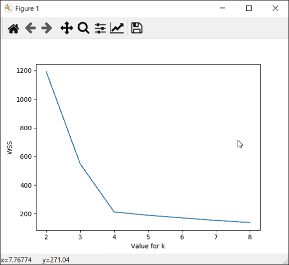

图 9-3：显示最佳聚类数量（四个）的 WSS 图。

前面的示例展示了针对生成数据的 k-means 算法，但你可能想将这些技术应用于区块链数据。好消息是，数据分析技术对任何类型的数据都有效，无论其来源如何。下一节将引导你如何将 k-means 算法应用于区块链数据。

 在大多数情况下，在从区块链中提取数据集后，对其进行分析是最容易的。你可能会发现，一次性从区块链中提取所需数据，然后将结果数据作为分析脚本的输入会容易得多。

## 使用诊断评估模型有效性

你将学到的某些模型具有评估其有效性的特定方法。聚类的有效性通常通过视觉方式确定。在应用所选算法并创建可视化结果后，你可以通过观察来判断算法的效果。尽管仅仅看图可能看起来不是一种准确的方法，但请记住，聚类通常是学习数据之间关系的早期活动。

当你查看聚类可视化图（如图 9-2 所示）时，请问自己以下问题：

* 类之间是否足够分离，以便彼此区分？

* 是否有任何类的点数远少于大多数其他类？

* 是否有某些类彼此太近，以看起来像一个更大的类？

这些问题可以帮助你判断聚类算法和参数是否揭示了关于你数据的信息。缺乏明显的类并不意味着失败——仅仅意味着你应该从数据的其他地方寻找有趣的内容。如果在此早期没有发现“黄金”，请不要气馁。大多数分析项目发现的结果比惊人的发现多。但请坚持下去。在数据中发现隐藏的价值知识是值得付出的努力。

## 在 Python 中实现区块链数据聚类

你已经知道如何在生成的数据上实现 k-means，但现在是时候查看区块链数据了。在本节中，你将检查供应链数据。在之前的章节中，你学习了如何访问交易事件并将其存储在平文件中。你可以将区块链数据存储在任何仓库中，但为了简单起见，将使用平文件。你将使用`transfers.csv`文件（逗号分隔数据的文本文件）作为输入。如果你检查`transfers.csv`文件，你会发现它包含了你尚不需要的信息。你最感兴趣的是查看数据代表的活动之间可能存在什么关联。

由于你不知道在寻找什么，最好的起点是创建数据的散点图矩阵。散点图矩阵创建一组散点图，显示每对特征之间的关系。创建散点图矩阵是选择最优特征的常用第一步。查看`scatterplotMatrix.py`中的 Python 代码。该代码读取`transfers.csv`文件，创建一个具有特征`cost`、`price`、`qty`、`month`和`day`的类表格结构（dataframe）。然后它会创建一个散点图，显示 dataframe 中每对特征如何相互关联：

```python
import pandas as pd
import matplotlib.pyplot as plt
from pandas.plotting import scatter_matrix
df = pd.read_csv('transfers.csv', usecols=['cost', 'price', 'qty', 'month', 'day'])
scatter_matrix(df, alpha=0.2, figsize=(6, 6))
plt.show()
```

图 9-4 显示了`scatterplotMatrix.py`脚本的输出。散点图显示大多数特征没有表现有趣的关系。任何类型的直线都意味着存在关系。与日期相比，成本或价格的散点图稍微有趣。

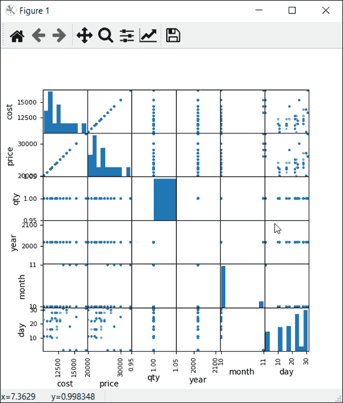

图 9-4：区块链传输数据的散点图矩阵。

`cost`与`day`以及`price`与`day`之间的关系显示数据点更加分散而非线性。根据这一发现，在`cost`和`day`特征上尝试 k-means。因为`cost`和`price`之间存在线性关系，你可以预计无论将`cost`还是`price`与`day`特征比较，聚类的效果都是相同的。

`kMeansBlockchain.py`中的代码展示了如何将所有部分整合。该脚本假设你已经从区块链中提取了所需数据（如第 6 章所述），并将输出存储在`transfers.csv`文件中。脚本从`transfers.csv`文件读取数据到 dataframe，然后对 dataframe 中的数据应用 k-means 算法：

```python
from sklearn.cluster import KMeans
import pandas as pd
import matplotlib.pyplot as plt
df = pd.read_csv('transfers.csv', usecols=['cost', 'day'])
kmeans = KMeans(n_clusters=4)
kmeans.fit(df)
y_kmeans = kmeans.predict(df)
df.plot.scatter(0, 1, c=y_kmeans, s=50, cmap='viridis')
centers = kmeans.cluster_centers_
plt.scatter(centers[:, 0], centers[:, 1], c='black', s=200, alpha=0.5)
plt.xlabel('Cost')
plt.ylabel('Day')
plt.show()
```

图 9-5 显示了使用`cost`和`day`数据进行 k-means 分析的结果。虽然分析识别了四个不同的类，但它并没有告诉你太多，因为这些类只是垂直划分。为了使聚类分析具有意义，它应该产生在所有方向上都有限制且通常符合圆形模式。

 陈述类在所有方向上都有限制并不意味着所有类都应该是圆形的。圆形类很好，但不均匀但独特的类仍然具有价值。记住，聚类的核心思想是揭示数据之间隐藏的关系方式。

## 在数据中发现关联规则

在前面的节中，你学习了聚类以及如何实现 k-means 算法。聚类分析可以显示相似的特征如何意味着对象之间的关系。例如，聚类分析可以显示，年收入在 140,000 到 175,000 美元之间的人倾向于某种类型的汽车，而收入低于 50,000 美元的人则不然。聚类依赖于比较特征的选择。

关联规则分析是一种揭示对象之间关系的不同方法。关联规则分析不是比较不同对象的特征，而是检查多个对象在不同交易中的出现情况。这种分析有时被称为`market basket analysis`（购物篮分析），因为它试图确定特定物品在市场购物篮（无论是实体店的还是在线的）中共同出现的概率。

## 通过关联规则分析交付有价值知识

关联规则分析通过查看现有的交易，根据一个或多个对象的出现情况，确定添加新对象的概率。交易可以是任何对象的集合，例如购物篮中的物品，或从一个地点运送到另一个地点的箱子里的内容。使用关联规则进行交易分析可以让我们检查某笔交易，并根据相似交易中出现的对象，为添加额外的对象提供建议。

无论你是否意识到，你已经成为过成千万次关联规则分析的对象。推荐引擎依赖关联规则来工作。每当你看到在线购物购物车中推荐添加另一个产品的建议时，你都看到了关联规则分析的结果。这就是在线零售商如何能够以惊人的准确性提供额外的购买建议的原因。他们并不是在读你的心思，而是在使用良好的分析工具！假设分析显示，高比例购买手电筒的购物者也会在同一交易中购买电池。如果你的购物车里有一个手电筒但没有电池，那么零售商建议你也购买电池是有的。在许多情况下，这样简单的建议就能增加销售额。

## 描述 apriori 关联规则算法

检测关联规则常用的算法之一是`apriori`算法。`apriori`算法是一种识别经常一起出现的对象的结构化方法，也称为`frequent itemsets`（频繁项集）。例如，如果超市的购物篮包含面包，那么同一个篮子包含鸡蛋的概率是多少？`apriori`算法定义了计算频繁项集出现概率的技术。

`apriori`算法是一种自底上的方法，用于识别出现频率高于预期最小概率（或`support`，支持度）的对象集合。如果你有一个杂货店的交易数据集，并想找到最小支持为 0.25 的物品，你将接受所有出现在 250 笔或更多交易中的物品。如果某个物品只出现在 150 笔交易中，它就低于最小支持度（`150/1000 < 0.25`），将不会包含在结果中。

`Apriori`是一个迭代算法。它首先检查所有仅包含单个物品的项集，只选择那些满足或超过最小支持度的项目。从选定的候选中，它接着考虑所有的双物品项集，并选择那些满足或超过支持度阈值的项目。算法继续处理三物品项集、四物品项集，以此类推，直到没有项集满足或超过支持阈值。

下表列出了来自杂货店的六笔交易。就像真实交易一样，每个购物篮可以有不同数量的物品。分析交易内容的目的是利用现有的购物篮在结账前为额外购买提供建议：

* 鸡蛋、培根、面包、牛奶

* 鸡蛋、面包、牛奶

* 牛奶

* 培根

* 鸡蛋、培根、牛奶

* 鸡蛋、培根、牛奶

### Apriori 步骤 1：统计单项项集的频率

`apriori`算法的第一步是统计单项项集的频率。`apriori`算法的第一步是统计单项项集的频率。结果如下：

| Itemset | Frequency |
| :--- | :--- |
| Eggs | 4 |
| Bacon | 3 |
| Bread | 2 |
| Milk | 4 |

### Apriori 步骤 2：根据支持度裁剪项集

`apriori`算法的下一步是统计双物品项集，并剪掉不满足支持阈值的项集。`apriori`算法的下一步是统计双物品项集，并剪掉不满足支持阈值的项集。结果如下：

| Itemset | Frequency |
| :--- | :--- |
| Eggs, Bacon | 3 |
| Eggs, Bread | 2 |
| Eggs, Milk | 4 |
| Bacon, Milk | 3 |
| Bacon, Milk | 3 |

### Apriori 步骤 3：统计三物品项集的频率

`apriori`算法的第三步是统计三物品项集的频率。`apriori`算法的第三步是统计三物品项集的频率。结果如下：

| Itemset | Frequency |
| :--- | :--- |
| Eggs, Bacon, Milk | 3 |

### Apriori 步骤 4：根据支持度裁剪项集

`apriori`算法的下一步是剪掉不满足支持阈值的项集。

### Apriori 步骤 5：统计四物品项集的频率

`apriori`算法的下一步是统计四物品项集的频率。结果如下：

| Itemset | Frequency |
| :--- | :--- |
| Eggs, Bacon, Milk | 3 |

`apriori.py`文件中的代码显示了如何将这些步骤整合。以下 Python 脚本定义了交易并应用了 apriori 算法：

```python
transactions = [
    ('eggs', 'bacon', 'bread', 'milk'),
    ('eggs', 'bread', 'milk'),
    ('milk'),
    ('bacon'),
    ('eggs', 'bacon', 'milk'),
    ('eggs', 'bacon', 'milk')
]
itemsets, rules = apriori(transactions, min_support=0.5, min_confidence=1)
print(itemsets)
```

运行上述脚本会产生以下输出：

`{1: {('bacon',): 3, ('eggs',): 4, ('milk',): 4}, 2: {('bacon', 'eggs'): 3, ('bacon', 'milk'): 3, ('eggs', 'milk'): 4}, 3: {('bacon', 'eggs', 'milk'): 3}}`

## 通过诊断评估模型有效性

在从 apriori 算法获得项集集合后，你可以构建一组规则并计算一些额外值，以确定哪些规则最能描述交易。关联规则表述为`X -> Y`（X 意味着 Y）。这条规则意味着如果你观察到 X（篮中包含某些物品），那么 Y（向篮中添加物品）可能会发生。

你可以利用规则为可能的购买提供建议。关联规则允许零售商检查客户当前篮中的物品，然后为客户可能想要购买的额外物品提供建议。

你根据应用`apriori`算法结果中的每个项集构建了一组候选规则。下表列出了我们示例中的候选规则：

- `{eggs} -> {bacon}`

- `{eggs} -> {milk}`

- `{bacon} -> {milk}`

- `{bacon} -> {eggs}`

- `{milk} -> {eggs}`

- `{milk} -> {bacon}`

- `{eggs,bacon} -> {milk}`

- `{eggs,milk} -> {bacon}`

- `{bacon,milk} -> {eggs}`

使用两个主要指标来评估关联规则：`confidence`（置信度）和`lift`（提升度）。`confidence`是衡量规则可靠性的的指标。换句话说，高`confidence`规则是你可以依赖的强力推荐；而较弱的规则则是低`confidence`规则。`lift`衡量观察到`X`和`Y`同时出现的次数是它们相互独立时预期次数的几倍。换句话说，`lift`有助于确定`X`和`Y`是否相关以及是否存在相互影响。

要计算规则`(X -> Y)`的置信度，使用此公式：

`Confidence(X -> Y) = support(X AND Y) / support(X)`

要计算规则`(X -> Y)`的提升度，使用此公式：

`Lift(X -> Y) = support(X AND Y) / support(X) * support(Y)`

Python 的`efficient_apriori`库可以轻松计算关联规则的`confidence`和`lift`。只需向`apriori.py`文件添加以下三行 Python 代码并再次运行：

```python
rules_rhs = filter(lambda rule: len(rule.lhs) == 2 and len(rule.rhs) == 1, rules)
for rule in sorted(rules_rhs, key=lambda rule: rule.lift): print(rule)
```

除了项集列表，你现在还会看到为你计算好的置信度、支持度和提升度的三项集规则：

`{bacon, milk} -> {eggs} (conf: 1.000, supp: 0.500, lift: 1.500, conv: 333333333.333){bacon, eggs} -> {milk} (conf: 1.000, supp: 0.500, lift: 1.500, conv: 333333333.333)`

## 确定何时使用聚类和关联规则

任何数据分析项目的早期阶段之一都是查看数据以确定存在哪些关系。数据中的关系意味着能够学习过去的行为、甚至预测未来行为的能力。聚类是一种常见的早期分析步骤，用于学习具有相似特征相似性的对象之间的关系。尽管你只在两个特征中看到了聚类分析，但使用更多特征来搜索关系是常见的。`聚类分析`可以揭示仅通过可视化无法显现的关系。

在检查数据以寻找对象之间具有相似的特征值后，下一个逻辑步骤是寻找其他未解释的关系。在许多情况下，对象之间的关系是由记录特征未捕捉到的特征定义的。例如，尽管我们知道鸡蛋和牛奶是许多餐点和食谱中的常见，但没有任何描述数据可以解释为什么鸡蛋和牛奶经常被一起购买。对象消费方式的外部影响会让关系的发现变得困难。`关联规则分析`可以帮助识别这些关系的存在，即使关系的原因并不明确。

聚类和关联规则分析的主要原目的是学习你数据中对象之间的关系。这些关系可能有清晰的解释，也可能让解释努力失效。无论如何，数据中的关系描述了行为，而行为揭示了价值。理解过去的客户或伙伴行为可能有助于预测未来行为。这种知识在规划未来的业务活动时可能非常有益。你对预期行为越越了解，就越能为该行为做好准备。

每个组织都应该评估其目标并理解哪些目标的优先级最高。数据分析工作应该集中在理解和影响优先级的目标上。例如，如果追求利润是最重要的，那么理解如何增加销售和降低成本应该占据首位。另一方面，如果与客户建立长期的积极关系被认为对长期收入最重要，那么你应该关注客户情绪的影响并让他们保持开心。

最有效的分析项目是那些专注于直接与组织首要目标对齐结果的项目。理解你组织的目标，学习其数据，并使用分析来开启其可能包含的秘密。

第 10 章

# 分类区块链数据

### 本章内容

- 识别常见的数据特征

- 为数据分配标签

- 为你的数据选择合适的算法

- 使用诊断工具评估模型的价值


编写 Python 代码通过分类对数据进行标记

`第 9 章`介绍了聚类和关联规则分析，这些分析帮助分析师发现数据中的模式和关系。通过检查现有数据中存在的特征，你可以发现关系并利用这些关系更好地理解你的数据，更重要的是理解这些数据代表了什么。理解你的客户数据是好的，但更清楚地了解产生这些数据的客户好得多。通过了解你的客户，你可能能够调整服务和产品供应，以更好地满足他们的需求。这种方法可以带来更多的销售、更低的成本或你组织追求的任何目标。

代表过去行为的数据通常对于预测未来行为很有用。这种分析被称为`预测分析`。通过检查现有数据中存在的特征，你可以发现关系并利用这些关系更好地理解你的数据，更重要的是理解这些数据代表了什么。理解你的客户数据是好的，但更清楚地了解产生这些数据的客户要好得多。通过了解你的客户，你可能能够调整服务和产品供应，以更好地满足他们的需求。这种方法可以带来更多的销售、更低的成本或你组织追求的任何目标。

## 使用流行模型分析数据分类

分析最常见的用途之一是预测未来行为，以便在预测行为发生时做好充分准备。例如，如果你的模型显示由于飓风临近，发电机的销量将会增加，你可以备货并准备应对增加的需求。

聚类和关联规则模型通过对对象分组来帮助识别数据中隐藏的模式和关系。分类模型建立在先发现的基础上，帮助预测将对象放入已识别组的结果。分类模型大多是监督学习模型。`监督模型`是指你提供一组标签或组的模型，由模型决定放置对象的位置。

### 通过分类分析交付价值知识

分类模型在使用它们进行预测之前必须经过训练。但在训练分类模型之前，你必须定义类别标签。`类别标签`可以是任何对你的数据有意义且描述不同对象的标签。某些类别标签可以是通过和失败、高、中、低，以及优质、标准和经济。特征值应该指示每个对象应被分配到哪个类别中。

在定义了类别标签后，你通过提供带标签的输入数据来训练模型，这些数据包含了特征值和正确的类别标签。为了训练你的模型，你需要提供描述某些对象（例如客户）的输入数据，以及一个告诉模型该数据属于哪一类的类别标签。当模型检查输入数据并将数据与某个类别关联时，它就在“学习”关于这些数据。提供给模型的训练数据越多，它在未来识别相似数据并将其分配到正确类别的概率就越大。

训练完模型后，你通过提供没有分配类别的未标记输入数据来测试模型的性能。一个完美的模型会检查这些未标记的输入数据，并始终正确地为数据确定正确的类别。然而，没有任何模型是完美的。目标是最大化正确预测的频率，并在当该频率低于预期目标时调整模型的参数。

### 检查流行的分类技术

与所有类型的分析一样，有多个模型可以用于执行分类，每种模型都有自己的优缺点。在本章中，你将学习两种最流行的模型——决策树和朴素贝叶斯——但不要止于此。关于其他模型的信息，请参阅《*Python for Data Science For Dummies*》第二版和《*Data Science Programming All-in-One For Dummies*》（Wiley）。适用于任何应用的最佳模型取决于你可以获得的数据类型、你需要生成的输出类型，以及该技术与你组织目标的匹配程度。每当你进入模型构建阶段时，都探索多个模型以确定最适合你项目的模型。

 有时，非技术目标在模型选择中也发挥作用。例如，某些模型比其他模型更容易向非技术人员解释。如果你需要向非技术受众解释模型是如何得出答案的，请选择更简单的模型。在这种情况下，决策树模型可能比支持向量机更容易解释。

在概念层，决策树和朴素贝叶斯算法是相似的。它们都查看每个对象的特征，并利用这些值根据与其他对象的相似性做出分类预测。决策树方法很容易通过视觉化方式展示和解释，即使对于非技术人员也是如此。它通过基于问题的方法得出预测。朴素贝叶斯技术观察特征值的概率，并确定与相似对象最匹配的项。当训练数据为所有分类提供足够的覆盖时，这两种技术都最强大。

### 理解决策树算法的工作原理

`decision tree` 是一种分类算法，由决策节点和叶子节点组成，工作方式类似于流程图。`decision node` 是树中包含决策标准的节点，例如 `weight > 2 oz.` 或 `color = 'red'`。你通过回答节点中的问题并根据答案遵循其中一个向下的箭头，沿着树向下移动找到解决方案（对象的分类）。

图 10-1 显示了为鸢尾花数据集（iris dataset）创建的决策树，这是一个常用数据集，包含了生物学家罗纳德·费舍在 1936 年发表的论文中提供的描述数据。鸢尾花数据集中的数据描述了三个相关鸢尾花品种的变种。你可以通过测量花瓣和花萼的长度与宽度，然后将这些测量值与其他进行比较来确定花的品种。

 有时，非技术目标在模型选择中也发挥作用。例如，某些模型比其他模型更容易向非技术人员解释。如果你需要向非技术受众解释模型是如何得出答案的，请选择更简单的模型。在这种情况下，决策树模型可能比支持向量机更容易解释。

在概念层，决策树和朴素贝叶斯算法是相似的。它们都查看每个对象的特征，并利用这些值根据与其他对象的相似性做出分类预测。决策树方法很容易通过视觉化方式展示和解释，即使对于非技术人员也是如此。它通过基于问题的方法得出预测。朴素贝叶斯技术观察特征值的概率，并确定与相似对象最匹配的项。当训练数据为所有分类提供足够的覆盖时，这两种技术都最强大。

`decision tree` 是一种分类算法，由决策节点和叶子节点组成，工作方式类似于流程图。`decision node` 是树中包含决策标准的节点，例如 `weight > 2 oz.` 或 `color = 'red'`。你通过回答节点中的问题并根据答案遵循其中一个向下的箭头，沿着树向下移动找到解决方案（对象的分类）。

图 10-1 显示了为鸢尾花数据集（iris dataset）创建的决策树，这是一个常用数据集，包含了生物学家罗纳德·费舍在 1936 年发表的论文中提供的描述数据。鸢尾花数据集中的数据描述了三个相关鸢尾花品种的变种。你可以通过测量花瓣和花萼的长度与宽度，然后将这些测量值与其他进行比较来确定花的品种。

通常，树的顶部是 `root node`，它包含决策标准。如果决策标准为真（true），你跟随左子节点；如果为假（false），你遵循右连接。

```python
from sklearn.datasets import load_iris
from sklearn import tree
import matplotlib.pyplot as plt

iris = load_iris()
clf = tree.DecisionTreeClassifier(random_state=0).fit(iris.data, iris.target)
plt.figure(figsize=(12,10))
tree.plot_tree(clf, feature_names=iris.feature_names, class_names=iris.target_names, filled=True)
plt.savefig('decisiontree.png')
plt.show()
```

一种目前常用的现代决策树学习算法是 `CART`（分类与回归树）。`CART` 使用基尼指数（Gini method）来计算树中每个节点 `impurity`（属性数据随机性的度量）的加权和。`Gini index` 代表该不纯度值。在比较两对待划分属性的 Gini 指数时，算法会选择 `Gini index` 较小的属性。虽然这些技术背后的数学原理超出了本书的讨论范围，但观察你在代码中使用的 Python 库是如何工作的是非常有意思的。

在决策树学习算法识别出最佳划分点后，它会创建树的节点。树构建完成后，你通过使用每个节点上的决策准则评估新对象的特征值来进行类别预测。最终，你将到达一个叶子节点，并将对象的类别分配给该叶子节点的类别。

### 理解朴素贝叶斯算法的工作原理

另一种常见的分类算法是朴素贝叶斯（naive Bayes）算法。`naïve Bayes` 算法基于贝叶斯定理，适用于文本和图像等对象的分类。许多垃圾邮件检测引擎使用朴素贝叶斯算法或其变体。朴素贝叶斯之所以流行是因为它简单且快速。该技术通过考虑先验状态（特征值）来确定结果（属于某个类别的）的条件概率。

如果一个事件的发生对另一个事件的发生没有影响，则这两个事件是相互独立的。例如，如果你掷一次硬币，硬币正面朝上的概率是 ½（0.5）。如果你再次掷硬币，无论之前的投掷结果如何，硬币正面朝上的概率仍然是 0.5。你每次掷硬币的结果都与任何其他投掷结果相互独立。

某些事件取决于先验事件的发生。假设你有一个满是螺丝刀的工具箱，其中有 10 把十字螺丝刀和 10 把一字螺丝刀。如果你向工具箱里随机抓一把螺丝刀，抓到一字螺丝刀的概率是 20 分 10，即 0.5。如果你需要一字螺丝刀但第一次尝试抓的是十字螺丝刀，你就需要再次伸进去抓另一把。由于现在工具箱里只剩下 19 把螺丝刀，抓到一字螺丝刀的新概率变为 19 分 10，即 0.526。随着工具箱中十字螺丝刀减少，你抓到一字螺丝刀的概率略有提高。第二个概率依赖于先验事件。

对于大型数据集，计算条件概率可能会非常繁琐。幸运的是，贝叶斯定理中一些有趣的数学方法可以提供帮助。图 10-2 显示了计算条件概率的贝叶斯定理公式。

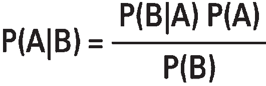

图 10-2： 贝叶斯定理计算条件概率。

为了在先验事件 B 已经发生的情况下计算事件 A 的概率（也称为给定 B 的 A 概率），请遵循以下步骤：

1. **计算 A（在 B 条件）和 B 同时发生的概率。**

2. **将步骤 1 的结果除以 B 的概率。**

训练过程统计每个特征值的出现次数，并计算每个值发生的概率。在计算所有概率后，你可以通过确定所提供的特征值符合特定类别的概率来预测新对象的类别。换句话说，朴素贝叶斯算法返回对象应分配给特定类别的相对概率。

在 Python 中实现朴素贝叶斯比实现决策树多几个步骤，但这些步骤仍然非常简单。以下代码来自 `naiveBayes.py` 文件，展示了使用鸢尾花（iris）数据集实现朴素贝叶斯的示例：

```python
from sklearn import datasets
import matplotlib.pyplot as plt
import pandas as pd
from sklearn.model_selection import train_test_split
from sklearn.naive_bayes import GaussianNB
from sklearn.metrics import accuracy_score
iris = datasets.load_iris()
class_names = iris.target_names
iris_df=pd.DataFrame(iris.data, columns=iris.feature_names)
iris_df['target']=iris.target
X_train, X_test, y_train, y_test = train_test_split(iris_df[['sepal length (cm)', 'sepal width (cm)', 'petal length (cm)', 'petal width (cm)']], iris_df['target'], random_state=0)
nbClass = GaussianNB()
nbClass.fit(X_train, y_train)
y_predict = nbClass.predict(X_test)
print("Accuracy: {:.2f}".format(accuracy_score(y_test, y_predict)))
```

加载鸢尾花数据集并分配特征标签后，你调用 `train_test_split()` 方法将数据集分为训练部分和测试部分。你使用部分数据训练模型，使用部分数据进行测试。划分数据集后，调用 `GaussianNB()` 方法，然后调用 `fit()` 方法创建并训练朴素贝叶斯模型。最后，`predict()` 方法使用数据集的测试部分来测试模型。`score()` 方法返回你刚训练的朴素贝叶斯模型的准确率。你训练的朴素贝叶斯模型的准确率为：

```python
Accuracy: 1.00
```

### 使用诊断评估模型有效性

决策树很容易可视化，并向技术人员和非技术人员展示。评估新构建的决策树的最佳方法之一是让领域专家（SME）查看它，看它是否符合逻辑。一个好的决策树应该是清晰易于理解的，至少对于专家而言是如此。树的路径应该是唯一的，并指向明确的叶子节点。歧义应降到最低，任何错误预测应该是可解释的。

朴素贝叶斯算法没有默认的诊断方法。朴素贝叶斯是一种简单且计算高效的算法，适用于连续或分类类型的数据。它的主要缺点是依赖于每个特征之间是条件独立的。如果两个或多个特征相互依赖，朴素贝叶斯算法可能会重复计算特征的影响，导致对某些特征集的过度依赖。结果将产生偏差，模型的准确性也会受到影响。在使用朴素贝叶斯时，仅考虑独立特征很重要。

## 在 Python 中实现区块链分类算法

本章之前的 Python 模型实现是基于鸢尾花数据集构建的。你可以轻松扩展分类模型以处理区块链数据。对于任何分析模型处理区块链数据，唯一需要的实际更改是获取所需的数据并将其作为输入提供给模型。对于每个新模型，你可以按需获取区块链数据，也可以提前提取所需的内容。

对于书中的示例，我假设你已经执行了某个流程来获取区块链数据并将其存放在外部存储库中。对于我们的简单示例，我们将使用 `CSV` 文件作为分析模型的输入。对于你的项目，你可能选择使用更复杂的存储库（例如数据库）来存储提取的区块链数据。无论你采用哪种方法，最重要的第一步都是理解你的区块链数据，并识别出你的模型所需的输入数据。

在本节中，你将学习如何使用你的供应链区块链数据来实现决策树和朴素贝叶斯算法。你会发现，这些示例比你之前在本章中其他部分看到的要复杂一些，但仍然很简单。当你熟悉了每个模型的基础知识后，应该深入研究其细节，学习如何利用每个模型的优势来实现你所在组织的目标。

## 定义模型输入数据需求

在每一个数据分析项目中，你都必须首先识别并收集输入数据，然后对其进行清洗。由于分类模型是基于监督学习算法的，因此你需要训练数据来构建模型。训练数据包括对象的特征数据，以及分配给该对象的类别。模型通过检查所提供的训练数据以及特征与分类之间的关系来学习。训练良好的模型能够识别出你提供的新数据，并预测出新对象所属的正确类别。

虽然从开始就获得清洁的数据是可能的，但并非常态。数据分析中最耗费时间的步骤之一就是清洗输入数据。你获得的数据可能存在多个问题，每个问题都必须得到解决。以下是输入数据可能不完美的几个常见原因：

* **数据缺失**：缺少特征值或相关对象。例如，参与者定义缺少参与者的地址，或者缺少产品所引用的整个参与者定义。无论何种情况，模型所需的依赖数据都缺失。

* **重复数据**：数据集中的多个对象（行）不应指向同一个唯一实体。数据过多会偏倚模型的有效性。许多模型指标依赖于模型知道输入数据集中存在多少个唯一对象。

* **错误**：错误或不准确的特征值会负面影响模型的准确性。有时并不容易修正数据错误，但在可能的情况下，你应该修复错误或排除带有错误数据的对象。

* **超出范围**：数据错误的一个子集是特征存储的数据落在定义的范围或有效值列表之外。所有数据采集软件都应该在数据存储前激进地验证输入数据，但这种情况并非总是发生。由于各种原因，无效数据可能会进入各种类型的数据存储库。

* **格式错误**：存储在不支持格式中的数据会导致分析模型出现问题。你在此类别中可能遇到的最常见问题之一是存储在定义为存储数值数据的特征中的字符数据。如果你遇到这类问题，你需要将数据映射到正确的格式，或者排除该对象。

* **格式不一致**：从多个数据源获取数据时的一个常见问题是，每个源可能使用不同的格式存储数据。假设一个日期特征存储日期为八位数字（02042020）和十位字符串（“02/04/2020”）。虽然很容易看出这两个值指的是同一个日期，但你仍然需要对齐输入数据以使用单一数据格式，以便你的模型能够正常工作。

清洗数据基本上有两种方法。你可以提取数据、清洗数据，然后将清洗后的数据作为模型的输入；或者你可以将清洗阶段构建到你的模型中。下一节中的两个示例将向你展示如何在你的模型中清洗输入数据。无论你使用哪种方法，目标都是确保你的模型拥有有效数据，以提供最高质量的输出。

## 构建你的分类模型数据集

分类模型根据现有特征做出预测。对于本章的示例，你查看了有关电视的信息并尝试确定买家想要哪些特征。因为区块链数据并非免费（你必须支付费用将数据存储在区块链上），你通常无法在区块中找到模型所需的所有信息，因此你将使用每台电视的评论信息来决定买家最喜欢哪种电视。分类模型将尝试根据电视特征确定买者的评论评分。

许多描述性的电视特征并没有存储在区块链上。我们假设大多数电视描述性属性存储在链外存储库中。你需要从区块链中找到电视评分信息，找到相关的链外电视特征数据，合并相关数据并将其存储在一个新的存储库中。你已经执行了这一初步并将合并后的数据存储在 `products.csv` 文件中，因此你将使用 `products.csv` 文件作为分类模型的输入。

### 读取和清洗输入数据

将数据从 csv 文件读取到 Pandas 数据集的一种简单方法是使用 `pandas.read_csv()` 方法。然而，你必须对数据进行一些处理，以获得模型所需的内容。你在本章使用的分类模型需要数值型输入数据。如果你的某些输入数据不是数值，一种解决方案是将现有数据映射为数值数据。这就是你在本章中学习的方法。

图 10-3 显示了 `products.csv` 文件的部分。注意 `screenType` 和 `resolution` 列中的值是字符数据，而不是数值数据。在使用数据作为模型输入之前，你需要将这两列的数据类型更改为数值。

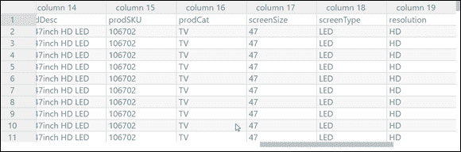

图 10-3：电视产品数据。

处理类别类型问题最简单的方法之一是将字符标签映射到数值索引。也就是说，为源数据中的所有值创建一个列表并为每个值编号。然后将对应特定标签的数字分配给对象。


例如，假设 `products.csv` 文件中的每台电视的 `screenType` 列都有 LED、QLED 或 OLED。为了将 `screenType` 列转换为数值类型，你可以为所有 `screenType` 为 LED 的电视分配 0，为所有 QLED 电视分配 1，为所有 OLED 电视分配 2。

Python 让清洗数据变得非常简单。为了完成将输入数据映射为模型可以使用格式的任务，请遵循以下步骤：

1. 将 `products.csv` 文件读取到临时 dataframe。
2. 将 `screenType` 和 `resolution` 特征转换为 Python 列表。
3. 定义将字符特征值映射到整数的函数。
4. 将 `products.csv` 文件读取到分析 dataframe，并将 `screenType` 和 `resolution` 特征转换为索引值。

以下是来自 `decisionTreeBlockchain.py` 文件的 Python 代码，用于执行映射到分析 dataframe 的每一个步骤：

```python
import pandas as pd
dfpreprocess = pd.read_csv('products.csv', usecols=['screenType','resolution'])
screenTypeList = dfpreprocess.screenType.unique().tolist()
resolutionList = dfpreprocess.resolution.unique().tolist()
fscreen = lambda x : screenTypeList.index(x)
fresolution = lambda x : resolutionList.index(x)
converter = {'screenType':fscreen,'resolution':fresolution}
df = pd.read_csv('products.csv', usecols=['screenSize','screenType','resolution','hdmiPorts','usbPorts','reviewRating'],converters=converter)
```

导入 `pandas` 库后，将 `products.csv` 文件读取到 `dfpreprocess` 数据框中。（因为你只需要两个特征，所以你只读取了 `screenType` 和 `resolution` 列。）在读取 csv 文件后，将输入数据转换为两个列表：`screenTypeList`（唯一屏幕类型列表）和 `resolutionList`（唯一电视分辨率值列表）。你将使用这两个列表将你的输入字符数据映射到整数值。

在准备好将数据读入分析数据框之前，你必须定义相关函数，将 `screenType` 和 `resolution` 列中的原始字符数据映射到整数数据。你将定义两个 `lambda` 函数来执行简单的映射，然后将这两个函数合并为一个名为 `converter` 的集合。


注意前述 Python 代码，我们使用 `lambda` 函数来为 `fscreen` 和 `fresolution` 赋值。`lambda function` 是 Python 中的一种小型匿名函数，它没有名称，可以接受多个输入参数，并由单个表达式组成。当你想要评估一个表达式并将其结果赋值，而无需定义正式的具名函数时，`lambda` 函数非常有用。在此程序中，在你将数据读入 `df` 数据框时，调用 `lambda` 函数处理字符到整数的数据映射非常方便。

最后一步是从 `products.csv` 文件中读取所需的特征到数据集 `df` 中，并将 `screenType` 和 `resolution` 特征值映射为整数。

### 将数据划分为训练集和测试集

为分类模型准备数据的下一步是将你的数据集划分为训练集和测试集。训练集将是你的模型用于学习特征数据如何决定对象分类（`reviewRating`）的数据。测试集则用于评估模型的准确性。换句话说，你使用训练数据集划分构建模型，然后使用测试集数据来查看模型是否预测了正确的分类。测试集中正确预测的百分比就是模型的准确率。

以下是来自 `decisionTreeBlockchain.py` 文件的 Python 代码，用于将 `df` 数据框划分为训练集和测试集：

```python
from sklearn.model_selection import train_test_split
y = df.reviewRating
X = df.drop('reviewRating', axis=1)
X_train, X_test, y_train, y_test = train_test_split(X, y, test_size=0.2)
```

第一行从 `sklearn.model_selection` 导入 `train_test_split`。（这行代码通常位于 Python 程序的顶部。）接下来的两行将 `df` 数据框拆分为输入特征集 `X` 和包含每个对象分类的特征 `y`。`y` 数据框仅包含 `reviewRating` 特征，而 `X` 数据框包含所有其他特征。

最后，`train_test_split()` 方法将数据框分为四个部分：`X_train`、`X_test`、`y_train` 和 `y_test`。`train_test_split()` 方法将原始数据的 20% 放在测试分区，将 80% 放在训练分区。现在你准备好训练和测试你的模型了。

### 开发你的分类模型代码

我刚刚展示的 Python 代码加载了用于决策树或朴素贝叶分析模型的区块链数据。在本节中，你将学习如何使用已加载的数据来构建两种类型的模型，并确定哪一种最适合你的供应链数据。

### 编写决策树模型代码

决策树模型的优势之一是，构建模型后会产生一个易可视化的模型。出于教学和文档目的，决策树可以轻松地传达模型的意图。构建和可视化决策树的主要方法是 `tree.DecisionsTreeClassifier()` 和 `tree.plot_tree()` 方法，它们都是从 `sklearn` 库导入的。除了调用这些方法外，你只需要做的就是设置输出参数并渲染图形。

以下是来自 `decisionTreeBlockchain.py` 文件的 Python 代码，用于基于供应链区块链数据构建并可视化决策树（该代码接了上一节的 Python 程序）：

```python
from sklearn import tree
import matplotlib.pyplot as plt
plt.figure(dpi = 300)
clf = tree.DecisionTreeClassifier(random_state=0).fit(X_train, y_train)
tree.plot_tree(clf, feature_names=['screenSize','screenType','resolution','hdmiPorts','usbPorts'], filled=True)
plt.tight_layout()
plt.savefig('decisiontree.png', dpi = 300)
plt.show()
score = clf.score(X_test, y_test)
print(score)
```

在导入所需的库后，此段的第一条可执行代码是 `plt.figure()` 方法。该方法将生成图形的分辨率设置为 300 dpi。如果没有该方法，库将使用 100 dpi 的默认值并生成一个难以阅读的图形。


将所有 `import` 语句放在 Python 程序的顶部是最佳实践。我将它们包含在这里是为了显示你此部分代码部分所需的库。

设置好图形分辨率后，`tree.DecisionTreeClassifier().fit()` 方法会检查你传递给方法的数据 `X_train` 和 `y_train`，并构建决策树。在你构建完决策树 `clf` 后，可以通过调用 `tree.plot_tree()` 方法创建树的可视化表示。

接下来的三行 Python 代码指定了图形的布局类型，将渲染后的图形保存为 PNG 文件，然后在窗口中显示决策树。关闭图形后，最后两行代码计算了你刚刚构建的决策树的准确率。图 10-4](#c10.xhtml#c10-fig-0004) 显示了基于你的供应链数据的决策树。

你在本章中学的第二个分类模型是朴素贝叶斯（naive Bayes）模型。朴素贝叶斯模型的目的与决策树模型相同：根据所选特征准确预测对象的类别。然而，朴素贝叶斯方法与决策树不同。朴素贝叶斯模型使用概率计算预测结果，而不是一系列决策。

朴素贝叶斯模型的数学特性使得模型的可视化变得更加困难。你始终可以创建结果图，但构建过程图比决策树要困难得多。由于可视化不是朴素贝叶斯模型的主要关注点，实现该模型的代码行数比决策树少。初始设置和数据导入与决策树模型相同。

将数据加载到数据框并创建训练和测试数据集后，你只需要构建模型并显示其准确率即可。以下是来自 `naiveBayesBlockchain.py` 文件的剩余 Python 代码，用于在供应链区块链数据上构建朴素贝叶斯模型：

```python
from sklearn.naive_bayes import GaussianNB
from sklearn.metrics import accuracy_score
nbClass = GaussianNB()
nbClass.fit(X_train, y_train)
y_predict = nbClass.predict(X_test)
print("Accuracy: {:.2f}".format(accuracy_score(y_test,y_predict)))
```

导入所需的库后，你实例化了一个新的 `GaussianNB` 对象 `nbClass`。朴素贝叶斯可以通过多种方式实现；我选择了基于高斯（Gaussian）或正态分布的实现方式。呈正态分布并符合钟形曲线的数据被称为高斯分布数据集。图 10-6 显示了高斯分布。注意，数据点百分比最高处——即占所有读取数的 0.4（40%）出现在曲线的中间。随着你远离中间值，高于或低于中间值的出现频率就会越低。如果你的数据很好地映射到高斯分布，那么高斯朴素贝叶斯模型可能是一个很好的选择。如果你的数据不是正态分布的，高斯朴素贝叶斯模型可能难以做出准确的预测。

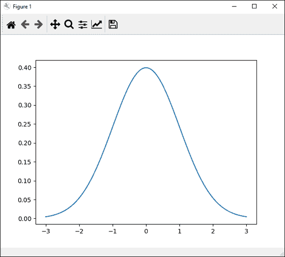

图 10-6：高斯（正态）分布。

实例化 `nbClass` 对象后，你调用 `nbClass.fit()` 方法来训练模型，并向其传递 `X_train` 和 `y_train`。

回归模型构建算法将检查训练数据并创建一个能够最好表示因变量与自变量之间关系的函数。训练完成后，你将使用另一部分数据进行测试。你通过输入测试数据运行回归函数，将预测结果与测试数据中的观测结果进行比较。你可以使用测试数据来评估你的回归模型与测试数据集分区中观测结果的匹配程度（无论是好是是差）。

任何回归模型的准确性都取决于：对结果影响最大的特征进行仔细筛选的平衡，以及基于合理分布的数据来构建模型。回归模型对于紧密符合正态分布的数据通常效果良好。虽然正态分布不是使用回归模型的必要条件，但包含许多离群值和其他异常的数据集会使构建任何类型的模型变得更具挑战性。

## 常见的回归技术

常见的回归模型类型是线性回归和逻辑回归。`Linear regression` 是预测连续结果的常用模型。当你有一个或多个 `features`（特征），即独立输入变量时，线性回归模型可以根据你所选特征的值来预测结果。

例如，假设你正在帮助学生音乐家准备荣誉乐队的选拔。你收集了历史数据，包括每个学生每周练习的小时数、该学生是否被荣誉乐队录取，以及每个学生获得的试拔分。正如你预期的那样，练习小时数与试拔分之间存在线性相关；学生每周练习的时间越长，其在选拔中获得的分就越高。如果你知道某个学生每周练习多少小时，线性回归模型就可以预测该学生的试拔分。


练习小时数与荣誉乐队试拔分之间的相关性是基础且过于简单的，无法用于现实生活。在真实场景中，其他因素（如经验、天赋、教育质量甚至性格）对获得的试拔分也起着作用。回归模型可以通过将这些因素纳入回归函数来考虑所有这些因素。我们的简单示例只有一个因变量和一个自变量，但真实模型几乎总是有更多的自变量。

另一种常见的回归模型类型是逻辑回归。你可能不想预测最终的试拔分（这是一种连续结果预测），而只想知道根据每周练习的小时数，一个学生是否可能被荣誉乐队录取。该结果是分类的，因为模型只需要预测“是”或“否”的值。`Logistic regression models` 经过优化，可以返回预测结果类别的结果。分类结果的确定只是分类的另一种描述。在是/否预测的情况下，你是在确定一个新对象可能属于两个类别中的哪一个。


你可以在第十章中看到朴素贝叶斯和决策树分类模型。逻辑回归是你可以使用的另一种分类模型。最佳方法是评估多种类型的模型，并选择提供最准确结果的模型。

### 线性数据可视化

线性回归模型建立在这样一个基础上：随着数据集观测数量的增加，因变量的结果往往趋于（或回归）某个相对平均值。当均值图在图表中显示为一条线时，因变量和自变量值之间存在线性关系。线性回归模型中的平均值不是单一值，而是一系列值，表示为一条穿过一组绘制数据的线，该线能够最好地代表这些数据。图 11-1 显示了因变量与自变量 `x` 和 `y` 之间的线性关系。

```python
import numpy as np
import matplotlib.pyplot as plt
x = 50 * np.random.random(30)
y = 0.5 * x + 1.0 + np.random.normal(size=x)
plt.scatter(x, y)
plt.show()
```

## 回归线

`回归线`（regression line）是线性回归模型的视觉化表示，它代表了观测因变量数据与预测因变量数据之间最小距离的平均值。换句话之，当你提供 `x` 的值时，你的回归模型函数 `f(x)` 将返回 `y` 的预测值。每对值（`x`, `y`）都提供单个点的坐标。

你在图表上绘制的大多数点都应该靠近回归线。完美的数据点将全部落在回归线上，但在现实生活中，大多数数据点略偏离回归线，但处于距离回归线的范围内，这种距离被称为误差（error）或残差（residual）。`残差`是观测值（`x`, `y`）与模型预测值（`x`, `f(x)`）之间的差异。其核心思想是建立一个模型，使得累计残差尽可能小。


## 回归模型

在本书中，你关注的是 `x` 的单值。实际上，线性回归模型（或任何分析模型）可以处理 `x` 的多个值或特征。考虑多个特征的模型比关注两个特征之间简单关系的模型要有用得多。因此，将 `x` 视为一个值数组，而不是一个只持有单个特征值的简单变量。基于单个变量的回归模型称为`线性回归`（simple linear regression），结果是回归线。包含多个独立变量的回归模型称为`多元回归`（multiple linear regression），结果是不同的可视化，例如抛物线。

由于回归线只是对数据样本的估计，它很少是完美的。最佳线性回归模型将一条使其预测结果比任何其他线都更接近实际观测直线。构建线性回归模型常用的方法之一是`普通最小二法`（Ordinary Least Squares, OLS），这是一种基于提供的独立变量评估函数的迭代方法。对于每个选定的函数，该过程会在提供的 `x` 值上对该函数进行评估，并将结果与提供的结果（提供的 `y` 值）进行比较。该过程计算观测点与预测点（即函数值 `f(x)`）之间距离的平方。

## 回归函数

良好回归模型的关键在于回归函数。从简单来说，回归模型的表达式如下：

> y = β[0] + β[1]x + ε

其中 `β` 是某个常数，`ε` 是误差项。这个方程看起来可能很熟悉。如果你忽略误差项，可以将前面的方程重述为直线的点斜形式：

> y = mx + b

在直线的点斜公式中，`m` 是斜率（与线性方程中的 `β[1]` 是同一术），`b` 是 y 截距（与线性方程中的独立常数 `β[0]` 相同）。`OLS` 方法将产生一组形成线的点。当你知道该线上的至少两个点后，你就可以将线表示为可以用点斜形式表示的方程。一旦你有了直线的点斜形式，你就有了回归函数。但别担心——你不需要手动完成所有这些工作。Python 库会为你完成！

## Python 实现

这里是 Python 代码（`linearRegression.py`），它基于你在章节早之前看到的代码（`linearData.py`），该代码仅显示了以线性方式组织的数据。`linearRegression.py` 中的代码通过对数据拟合直线来构建线性回归模型，然后对回归线进行视觉化：

```python
import numpy as np
import matplotlib.pyplot as plt
from sklearn.linear_model import LinearRegression
x = 50 * np.random.random((30, 1))
y = 2 * x + 10.0 * np.random.normal(size=x.shape)
model = LinearRegression().fit(x, y)
x_new = np.linspace(0, 50, 100)
y_new = model.predict(x_new[:, np.newaxis])
ax = plt.axes()
ax.scatter(x, y)
ax.plot(x_new, y_new)
ax.set_xlabel('Hours per week')
ax.set_ylabel('Audition score')
plt.show()
```


Python 代码的前三行导入了`numpy`、`matplotlib.pyplot`和`sklearn.linear_model`库。接下来的两行用 0 到 50 之间的随机值填充`x`数组，并用相应的值填充`y`数组，其中包含一些“噪声”，这些噪声使得每个点距离完美直线一段小的随机距离。

下一行代码实例化了一个名为`model`的新线性回归模型，并将回归函数拟合到测试数据上。代码随后创建两个数组：一个（`x_new`）包含数字 1 到 50，另一个（`y_new`）包含对应于每个`x_new`值的预测分数。剩余行设置了轴、设置标签，然后为`x`、`y`、`x_new`和`y_new`数据渲染图表。图 11-3 显示了线性数据和拟合到提供数据的回归线的可视化。

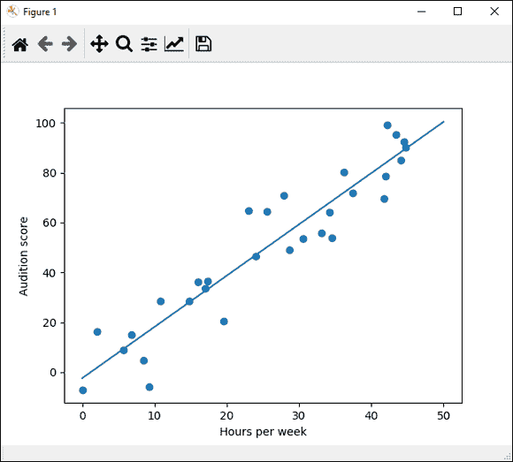

图 11-3：回归模型可视化。

注意，这种可视化无非只是在数据中添加了一条线。

## 多元回归

刚刚显示的回归方程用于单个独立变量的（即评估单个特征对某些结果的影响）。在现实生活中，你可能希望检查多个特征如何影响结果。线性回归可以处理多个因变量。多元回归方程的一般形式如下：

> y = β[0] + β[1]x[1] + β[2]x[2] + … + β[p-1]x[p-1] + ε

可视化多个因变量比仅绘制`x`和`y`值更困难。在本章的后面，你将看到如何在没有简单可视化的情况下处理多元回归模型。

### 描述逻辑回归的工作原理

简单线性回归的可视化是直线，而逻辑模型可视化是一个像阶梯一样的曲线。每个阶梯代表不同的类别。逻辑回归是一种分类方法，你可以结合第 10 章中的方法来预测对象的类别。与用于插值和有限外推的线性回归不同，逻辑回归不能在定义的类别之外进行外推。`逻辑回归模型`预测对象所属的类别，以及预测的相对概率。

逻辑回归的最简单实现是预测两个类别中的一个成员身份。简单的逻辑回归模型（或二元逻辑回归模型）预测对象属于两个类别之一的概率，然后将对象分配给概率较高的类别。

逻辑回归涉及两个主要部分：回归方程和事件的概率计算。回归方程等同于线性回归中使用的方程：

> y = β[0] + β[1]x[1] + β[2]x[2] + … + β[p-1]x[p-1] + ε

区别在于，在线性回归中，该方程产生一个明确的预测值。在逻辑回归的情况下，你不希望输出表示为连续范围内的一个值。你希望结果是一个类别标签。为了实现二元（或其他分类）输出，回归方程的输出最常见是在 sigmoid 函数（sigmoid function）下进行评估的。

`sigmoid function`根据高于或低于阈值值的方差，迅速取 0 或 1 的值。在图 11-4 所示的通用 sigmoid 函数中，输入值`> 0.0`返回`1.0`的类别概率（真），而输入值`< 0.0`返回`0.0`的类别概率（假）。当输入值接近`0.0`时，sigmoid 函数返回一个类别概率，表示其与最可能类别的接近程度。

由于逻辑回归具有比线性回归模型更具基础性的组件，因此构建逻辑回归模型需要更多精力。当你使用库或工具来构建模型时，更多的精力通常意味着构建更复杂模型需要更多时间。

线性回归和逻辑回归模型之间的另一个区别是，在线性回归中，你可以直接观测到`y`的结果值。相比之下，逻辑回归模型无法直接观测到结果值。相反，结果是以间接方式的，即自变量导致特定类别分配的概率。

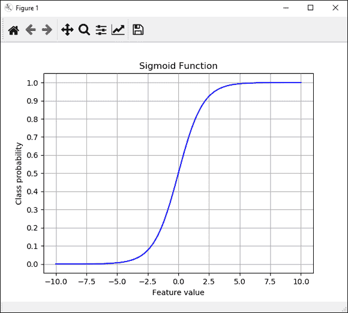

图 11-4：Sigmoid 函数。

逻辑回归模型的构建通常使用极大似然估计 (MLE) 等技术来计算自变量值的概率结果。MLE 很有很有价值，但超出了本书的范围。

只需记住，线性回归返回预测值，而逻辑回归返回的是提供的特征将特征集与特定类别对齐的概率。

以下是 Python 代码（`logisticRegression.py`），它通过对数据拟合阶梯线来构建逻辑回归模型，然后可视化回归线：

```python
import numpy as np
import matplotlib.pyplot as plt
from sklearn.linear_model import LogisticRegression
from sklearn.metrics import confusion_matrix
X = 50 * np.random.random((30, 1))
y = np.where(X<25,0,1)
model = LogisticRegression(solver='lbfgs', random_state=0).fit(X, y.ravel())
X_new = np.linspace(0, 50, 100)
y_new = model.predict(X_new[:, np.newaxis])
ax = plt.axes()
ax.scatter(X, y)
ax.plot(X_new, y_new)
ax.set_xlabel('Hours per week')
ax.set_ylabel('Audition score')
plt.show()
print('Classes: ',model.classes_)
print ('Coefficient of determination:', model.score(X,y))
print ('Coefficients:', model.coef_)
print ('Intercept:', model.intercept_)
```

Python 代码的前四行导入了`numpy`、`matplotlib.pyplot`、`sklearn.linear_model`和`sklearn.metrics`库。接下来两行用 0 到 50 之间的随机值填充`x`数组，并根据`x`值是否大于 25 为`y`数组填充相应的值。根据`x`值计算出的`y`值是人为地将每周练习 25 小时或更多与成功联系起来。

下一行代码实例化`model`并拟合数据。接下来的行创建`X_new`和`y_new`。随后的行创建轴、散点数据点、绘制回归线、设置标签并显示图表。最后，它打印类别、决定系数、系数和截距。

# 在 Python 中实现回归算法

将回归模型应用于区块链数据是非常简单的。你只需要从区块链中识别并提取所需的数据，然后使用 Python 库进行分析即可。在第 9 章和第 10 章中，你将看到如何使用区块链数据进行分析。在输入要求方面，回归模型也并无不同。在你识别并提取了所需的数据后，分析阶段就是非常直观的。

定义 定义模型输入数据需求

在第 9 章和第 10 章中，你识别区块链数据、提取这些数据并进行清洗，以便为你的分析模型做好准备。记住，清洁且完整的数据是任何模型的前提——而不仅仅是回归模型。在确保数据适用于你的模型上花费的时间，在解释分析模型输出时将产生丰厚的回报。

请密切关注第 10 章中关于数据输入要求的讨论。清单中的项目将帮助你判断数据是否已准备好进行分析，或者是否需要某些预处理。模型的准确性取决于数据的清洁程度。尽管这看起来可能是多余的，但其重要性不容忽视。

### 构建你的回归模型数据集

为了在区块链数据上评估回归模型，你将使用第 5 章中生成的产品数据集，该数据集包含连续和类别结果。该数据集将用于线性回归，以根据产品标准预测最佳制造商建议零售价（MSRP），再次用于逻辑回归，以根据产品特征预测客户满意度评分。

### 开发你的回归模型代码

你已经学习了如何使用生成的数据创建线性和逻辑回归模型。在本节，你将了解如何使用 Python 在你的产品数据集上构建线性和逻辑回归模型。

#### 编写线性回归模型代码

简单线性回归模型的优点之一是它可以产生易于可视化的模型。出于教学和文档目的，简单线性回归模型可以易于传达模型的意图和用途。构建和可视化简单线性回归模型的主要方法是`LinearRegression()`、`predict()`和`plot()`方法。除了调用这些方法外，你只需要设置输出参数并渲染图表。

以下是 Python 代码（`linearRegressionBlockchain.py`），用于基于供应链区块链数据构建并可视化线性回归模型。这段代码延续了上一节的 Python 程序：

```python
from sklearn.linear_model import LinearRegression
import pandas as pd
import numpy as np
import matplotlib.pyplot as plt
df = pd.read_csv('products.csv', usecols=['screenSize','msrp'])
y = df.msrp
X = df.drop('msrp', axis=1)
model = LinearRegression().fit(X, y)
X_new = np.linspace(40, 70, 60)
y_new = model.predict(X_new[:, np.newaxis])
ax = plt.axes()
ax.scatter(X, y)
ax.plot(X_new, y_new)
ax.set_xlabel('Screen Size')
ax.set_ylabel('MSRP')
plt.show()
print ('Coefficient of determination:', model.score(X,y))
print ('Coefficients:', model.coef_)
print ('Intercept:', model.intercept_)
```

Python 代码的前四行导入了该模型所需的库。下一行将`products.csv`数据集文件（仅包含`'screenSize'`和`'msrp'`特征）读入 dataframe 中。接下来的两行将特征分为`X`和`y`数组。下一行代码实例化了一个名为`model`的新线性回归模型，并将回归函数拟合到数据。

代码的后续两行创建了两个数组：`X_new`包含 40 到 70 的数字，`y_new`包含每个`X_new`值的预测分。剩余代码设置轴和标签，为`x`、`y`、`x_new`和`y_new`数据渲染图形，并显示模型诊断结果。

图 11-7 显示线性数据以及拟合到提供数据的回归线的可视化。


#### 编写逻辑回归模型代码

逻辑回归模型提供了易于解释的可视化，就像它的表兄弟——线性回归模型一样。出于教学和文档目的，逻辑回归模型可以易于传达模型的意图和用途。构建和可视化逻辑回归模型的主要方法是`LogisticRegression()`、`predict()`和`plot()`方法。除了调用这些方法外，你只需要设置输出参数并渲染图表。

以下是 Python 代码（`logisticRegressionBlockchain.py`），用于基于供应链数据构建并可视化逻辑回归模型：

```python
from sklearn.linear_model import LogisticRegression
from sklearn.metrics import confusion_matrix
import pandas as pd
import numpy as np
import matplotlib.pyplot as plt
preprocess = pd.read_csv('products.csv', usecols=['screenType','resolution'])
screenTypeList = preprocess.screenType.unique().tolist()
fscreen = lambda x: screenTypeList.index(x)
converter = {'screenType':fscreen}
df = pd.read_csv('products.csv', usecols=['screenType','reviewRating']) # 注意：原文代码逻辑可能有误，此处按逻辑翻译
y = df.reviewRating
X = df.drop('reviewRating', axis=1)
model = LogisticRegression(solver='lbfgs', random_state=0).fit(X, y)
X_new = np.linspace(40, 70, 60)
y_new = model.predict(X_new[:, np.newaxis])
ax = plt.axes()
ax.scatter(X, y)
ax.plot(X_new, y_new)
ax.set_xlabel('Screen Type')
ax.set_ylabel('review Rating')
plt.show()
print ('Coefficient of determination:', model.score(X,y))
print ('Coefficients:', model.coef_)
print ('Intercept:', model.intercept_)
```

*（注：提供的原文示例代码中存在多处语法错误，如括号未闭合，在翻译时已根据上下文逻辑修正了代码结构以保持可读性）*

Python 代码的前五行导入了该模型所需的库。下一行将`products.csv`数据集文件（仅包含`'screenType'`和`'resolution'`特征）读入 dataframe。接下来的五行定义了转换器功能，将`'resolution'`标签映射到整数值。后续三行读取`products.csv`数据，在此过程中转换分辨率数据，然后将 dataframe 分为两个数组`X`和`y`。

下一行代码实例化了一个名为`model`的新逻辑回归模型，并将回归函数拟合到数据。代码的后续两行创建了两个数组：一个（`X_new`）包含 40 到 70 的数字，另一个（`y_new`）包含每个`X_new`值的预测分。剩余代码设置轴和标签，为`x`、`y`、`x_new`和`y_new`数据渲染图形，并显示模型诊断结果。

图 11-8 显示类别数据以及拟合到提供数据的回归线的可视化。


回归模型在适当的情况下可以提供丰富的预测。在现有数据上对模型进行评估并定期测试你的断言至关重要。`流体准确率`（随输入数据变化而变化的准确率）可能由于多种原因存在。在实际项目中，你会在进入模型构建阶段之前评估特征之间的相关性，然后尽可能频繁地再次进行评估。目标是足够频繁地评估模型，以证明当输入数据变化时，模型的准确率保持为零或极小变化。只要你评估的频率足够，能够证明准确率差异极小，你就很好地监控了变化。

学习许多类型的分析模型是重要的，即使它们并不都能为你提供 99% 的准确率。检查那些并非明显最佳选择的模型，有时会让你发现在其他情况下无法看到的数据方面。探索替代模型是整个分析过程的一部分。在这种情况下，分类没有提供太多有价值的见解。在下一章中，你将学习另一种分析方法，它可能更适合对你的数据进行预测。

 上段文字应该很熟悉。它与第 10 章结尾的文字相似。它在这里的意义与在另一个章节中一样。记住，数据分析的核心在于提供价值。你不需要重新发明轮子——你只需要展示它滚得有多好。

# 第 12 章

# 分析随时间变化的区块链数据

### 本章内容

 **研究行为随时间的变化**

 **超越季节性趋势观察**

 **从数据周期中学习**

 **尽管波动也能识别趋势**

 **编写 Python 代码分析时间序列数据**

你将在第 9 章中学习如何识别数据聚类，在第 10 章中学习如何预测对象的分类，并在第 11 章中学习如何使用回归预测未来活动。这三个章节都将数据视为整体的数据集。这并不坏，但将数据视为同质的并不总是有助于讲述完整的故事。在许多情况下，你的数据依赖于时间。例如，销售发生在特定日期的特定时间。每个交易的时间戳可能隐藏着理解你数据的自身密钥。

如果你曾将咖啡馆当作备用办公室，你可能注意到那里有时很忙，而其他时候很闲。对于任何零售业务来说，时间都会影响员工的工作量，并应该影响业务的容量规划。如果你不考虑日期和时间，你可能会错过数据中的重要信息。例如，哪天什么时间最适合接收产品和补货商店？大多数情况下，接收和补货应该与客户活动低峰时间对应。将随时间变化的活动可视化为活动周期，有助于安排配置。

另一方面，检查基于时间的活动及其相关变化会使趋势识别变得更加困难。为了对随时间收集的数据进行建模，你可以使用`time 序列分析`。这类分析试图预测未来的行为，尽管特征依赖于时间且存在季节性变化。在本章中，你将学习时间序列分析技术以及如何在 Python 中实现它们。

## 使用流行模型分析时间序列数据

`时间序列`是按等时间间隔分隔的数据点（特征值）的有序序列。时间序列的标准表示形式是方程：

> Y = a + bX

 如果你觉得这个方程看起来像第 11 章中的回归方程，那么你是对的！这个方程与简单回归方程相同，只是时间变成了因变量。

时间序列与回归分析之间的主要区别在于包含了时间特征。时间序列分析模型的结果取决于时间以及可能的其他特征。时间依赖性具有将观测值按时间顺序推开的影响，这可能会掩盖数据中的趋势或季节性方面。时间序列分析帮助你穿透时间影响，从而获取数据中具有意义的信息。

分析时间序列数据的较困难的方面之一是分离数据的各个成分。时间序列数据由四个主要部分组成：

* **趋势 (Trend)：** 依赖特征值随时间的一致移动。趋势表示向单一方向的稳定移动，例如销售额增加或成本降低。


**季节性（Seasonality）：** 相关数据中以规律模式发生的任何周期性波动。季节性通常按每年、每月、每周或某些其他易于识别的规律发生。

**周期性（Cyclic）：** 无法解释为周期性的周期性波动。周期变化通常源于不可预见的事件，例如经济变化或自然灾害。

**随机性（Random）：** 在过滤掉趋势、季节性和其他周期变化后的行为。时间序列分析的目标是清除任何噪声，并使其更容易可视化和分析随机影响。

分析时间序列数据遵循与其他分析方法相同的基本步骤，不同之处在于选择最佳模型之前平滑化非随机影响。

## 通过时间序列分析提供有价值的知识

要构建时间序列模型，你从原始数据开始并检查它以识别任何趋势、季节性和周期变化。在大多数情况下，你将寻找上述特定顺序中的任何变化。在通过消除变化影响来平滑数据后，你的结果可能看起来像基础回归模型的输入。

此时，你将遵循一个类似于构建回归模型的过程，通过确定一个最能代表你数据的函数。为了最好评估模型的准确性，你应该将数据集分为训练集和测试集。模型的准确性直接取决于训练数据的质量以及你选择平滑变化的方式。

正如构建回归模型（参见第 11 章），在构建时间序列模型的过程中，你检查训练数据并创建一个最能表示依赖变量和自变量关系的函数。训练完成后，使用数据的另一部分进行测试。使用测试数据运行时间序列函数，将预测结果与测试数据中的观测结果进行比较。你可以使用测试数据来评估你的时间序列模型与测试数据集中的观测结果匹配程度的好坏。

任何时间序列模型的用处取决于仔细平衡：选择对结果（输出）影响最大的特征，为模型提供合理分布的数据，并应用平滑技术来处理已知变化。尽管正态分布不是使用回归模型的前提，但包含许多离群值和其他异常的数据集会使构建任何类型的模型变得更具挑战性。

## 检查流行的时间序列技术

大多数时间序列分析技术都基于`ARIMA (自回归整合移动平均)`模型。ARIMA 包含多个部分，深入探讨该模型的基础超出了本书的范围。由于你正在学习如何构建和使用分析模型，我们将关注基础知识。

如果你想学习更多关于 ARIMA 模型或一般的时间序列模型，可以参阅*Python for Data Science For Dummies*第 2 版，以及*Data Science Programming All-in-One For Dummies*（Wiley 出版）。

ARIMA 包含了三个核心思想：差分、自回归和移动平均。*差分*（Differencing）是指从当前值中减去一个或多个之前的值，以使你的结果平稳化。*自回归*（Autoregression）是指在系列数据点中，任何点（观测数据）都依赖于之前的数据和某些定义的修正因子。自回归意味着你可以将一组观测值描述为随变量（如时间）变化的线性趋势。观察自回归的另一种方式是它将数据映射到线性回归模型，该模型使用时间作为主要的水平轴进行可视化。

ARIMA 的另一个核心思想是移动平均。*移动平均*（moving average）有助于平滑时间序列数据中常见的周期性波动。例如，图 12-1 显示了 2011 年前七个月 AXP（美国运通）的收盘股价。

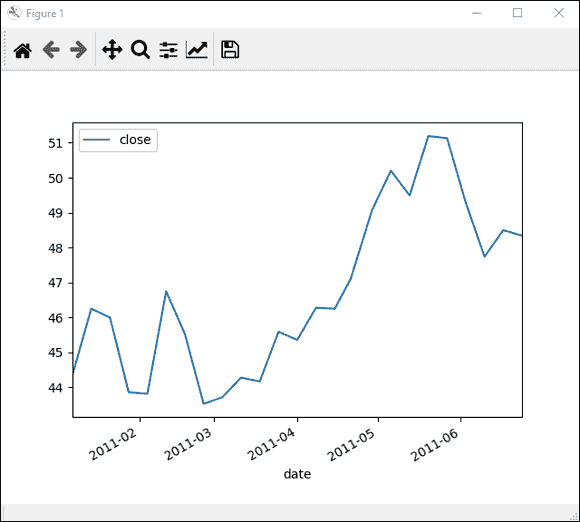

图 12-1：AXP 收盘价。

网上提供了许多你可以用于自己项目的数据集。去你最喜欢的互联网搜索引擎搜索*免费数据集*（free datasets）。你可以在此处获取我在图 12-1 中使用的历史股价数据集，地址为[`https://archive.ics.uci.edu/ml/datasets/Dow+Jones+Index`](https://archive.ics.uci.edu/ml/datasets/Dow+Jones+Index)。

当你在本章后半部分构建 ARIMA 模型时，你需要提供三个参数：

* `p`：自回归项
* `d`：使时间序列平稳所需的差分值
* `q`：移动平均项

这些术语中的每一个对于每个数据集和特征选择都可能不同。你通常需要通过实验来找到正确的值。

你可以从图 12-1 中看到股价上升趋势，但存在相当的波动。你可能怀疑上升趋势是否会持续。帮助回答这个问题的方法是查看自相关图。

Pandas Python 库提供了创建自相关可视化的简单方法。图 12-2 显示了 2011 年前七个月 AXP 股价的简单自相关图。


图 12-2：AXP 股价自相关。

图 12-2 中的两组平行线表示收盘价与日期的相关性程度。自相关图有助于确定在处理时间因素后，你的数据看起来有多随机性。两条虚线显示了 99% 置信水平的边界。两条实线显示了 95% 置信水平的边界。如果绘制的线保持在两条平行线之内，说明你的底层数据是随机的，这是很好的。接近 0 的自相关意味着原始图的方差可以在很大程度上通过时间的推移来解释。如果你的自相关图大部分落在置信区间之外，可能是其他因素影响了你的结果。在图 12-2 的情况下，2011 年 2 月之后的观测值与日期具有良好的相关性。事实上，随着时间的推移，收盘价数据变得更加稳定。

## 可视化时间序列结果

访问`https://archive.ics.uci.edu/ml/datasets/Dow+Jones+Index`。在 UCI 机器学习仓库页面上，点击或触摸`Data Folder`链接打开下载数据文件列表。点击或触摸`dow_jones_index.zip`下载 zip 文件。你刚刚下载的文件包含两个文件：`dow_jones_index.data`和`dow_jones_index.names`。将`dow_jones_index.data`文件解压到你的工作项目文件夹。（在我的电脑上，文件夹是`C:\Users\micha\Dropbox\Documents\workspace\blockchainlab`；你的会有所不同。只需确保`dow_jones_index.data`文件被复制到与你的 Python 代码相同的文件夹中。）

以下是 Python 代码（`importTimeSeriesData.py`），它导入了所需的库并初步读取了道琼斯指数数据：

```python
import matplotlib.pyplot as plt
import pandas as pd
from statsmodels.tsa.arima_model import ARIMA # Dataset source: https://archive.ics.uci.edu/ml/datasets/Dow+Jones+Index 
def convert_currency(val):
    new_val = val.replace(',','').replace('$', '')
    return float(new_val) # Import data 
df = pd.read_csv('dow_jones_index.data', usecols=['stock','date','close'], index_col='date', header=0, parse_dates=True) 
print(df.head())
print(df.dtypes)
```

图 12-5 显示了此代码的输出。Python 代码`print(df.head())`列出了`df`数据框的前五行，代码`print(df.dtypes)`显示了`df`数据框中每列的数据类型。注意，收盘价带有美元符号，且`close`列的类型为`object`。美元符号表示`close`列中的数据不是数值，`close`列的数据类型也证实了这一点。尽管数据看起来正常，但你仍需要将`close`列数据转换为数值类型，以便分析收盘价值。


FIGURE 12-5: 从文件加载后的初始道琼斯指数数据框。

### 定义模型输入数据需求

通常你会发现，可用的数据并不是你的模型所需要的。在构建时间序列模型时，你需要一个由特定股票 AXP（美国运通）的日期和收盘价组成的数据。如果你查看道琼斯指数数据文本文件，你会发现价格数据是以字符串形式存储的，该文件包含的股票比 AXP 多得多，而且你不需要大多数列。

数据分析中一个非常重要的早期步骤是清晰地定义你需要的数据。在你能够描述模型需要什么之后，你就可以开发代码和程序，将现有的数据转换为你需要的。某些解决方案并不像看起来那么简单。例如，你的时间序列模型不需要`stock`列。初看之下，你可能计划简单地不从输入文件中读取任何数据——即不在`read_csv()`方法中包含`stock`列。然而，你需要股票值来确定哪些价格对应于 AXP。在过滤股票数据后，你可以删除`stock`列。

你可能会奇怪，为什么要费力将价格数据转换为数值格式。这是因为比较字符串和数字会得到不同的结果。当你将 12 和 4 视为数字时，很容易看出 12 > 4，但如果你比较字符串“12”和“4”，你无异于比较字符串“hello”和“world”。虽然我们有字母顺序的概念，但比较字符串没有比较数字那样的直观。更糟糕的是，对字符串进行算术运算与对数字进行运算的意义并不相同。如果你想分析数值数据，就必须确保你的数据是数值型的。

`read_csv()`方法包含一个在读取数据时执行转换函数的选项。在读取数据时将其转换为数据框通常是预处理输入数据最简单的方法，以确保你的数据符合模型所需的格式。使用`read_csv()`方法在读取时转换数据需要两个步骤：首先，你定义一个转换函数，然后将该函数绑定到输入数据项。`read_csv()`方法在每次读取新行时都会执行该转换函数。

这是一个简单的 Python 函数`convert_currency()`，用于从价格字符串中删除美元符号和任何逗号，将剥离后的字符串转换为小数值，然后返回数值：

```python
def convert_currency(val):
    new_val = val.replace(',','').replace('$', '')
    return float(new_val)
```

定义转换函数后，为`read_csv()`方法添加`converters`选项。更新后的`read_csv()`方法如下所示。（注意，你定义了一个名为`raw_df`的数据框来存储临时数据，因为你还有一些数据清洗工作要做。）

```python
raw_df = pd.read_csv('dow_jones_index.data', usecols=['stock','date','close'], index_col='date', header=0, parse_dates=True, converters={'close': convert_currency})
```

`read_csv()`方法在读取每个新行时都会执行`convert_currency`函数，并将`close`项传递给该函数。`read_csv()`方法将`convert_currency()`返回的值存储在`close`列中。图 12-6 显示了`importTimeSeriesData.py`导入并转换道琼斯指数数据的输出。`close`值不再带有美元符号，其类型为`float64`。


FIGURE 12-6: 转换后的道琼斯指数

剩下的两个清洗步骤是过滤数据（行）并删除任何不需要的列。你需要过滤掉 AXP（美国运通）股票以外的所有行。然后从数据框中删除`stock`列。这将留下仅包含`date`和`close`列的 AXP 股票数据框。为了完成这些任务，你只需要在读取文件后添加以下两行代码。（更新后的代码在`importTimeSeriesFiltered.py`中。）

```python
df = raw_df[raw_df['stock'] == 'AXP']
del df['stock']
```

第一行代码从`raw_df`中提取所有`stock`列值为 AXP 的数据框行，并将这些行存储在新的数据框`df`中。第二行代码从`df`数据框中删除`stock`列。

### 开发你的时间序列模型代码

当你数据集中有了模型所需的数据后，就可以开始构建你的时间序列模型了。首先，探索所选模型的构建参数，以为你的数据构建最准确的模型。ARIMA 模型的构建过程包括确定`p`（自相关）、`d`（差分）和`q`（移动平均）的值，然后将模型拟合到你的数据中。

在图 12-2 中，你可以看到道琼斯 AXP 股票收盘价数据的自相关结果。在图 12-3 中，你可以看到使用差分值 1、2 和 3 的结果。在查看了每种可视化结果后，我选择使用值`p = 1`、`d = 0`和`q = 2`构建模型。以下 Python 代码来自完整文件（`timeSeries.py`），展示了创建图 12-2、12-3 和 12-4 中每张图表的语句。

以下是用于图 12-2 的 Python 代码：

```python
# Step 2 Autocorrelation: Figure 12-2
df_ar = pd.plotting.autocorrelation_plot(df)
```

以下是用于图 12-3 的 Python 代码：

```python
# Step 3 Differencing: Figure 12-3
diff = df.diff(1)
plt.plot(diff)
diff2 = df.diff(2)
plt.plot(diff2)
diff3 = df.diff(3)
plt.plot(diff3)
```

你还没有见过移动平均线与原始数据的对比图。图 12-8 展示了移动平均如何平滑原始数据中的波动，并使趋势更容易可见。以下 Python 代码绘制了原始数据，然后添加了一条红色的移动平均线：

```python
df.plot()
rollmean = df.rolling(6).mean()
plt.plot(rollmean, color='red', label='Rolling Mean')
plt.show()
```


图 12-8：道琼斯数据集原始数据和移动平均线。

在查看了数据的多种视图并选择了你想使用的 ARIMA 参数值后，最后一步是构建模型。以下是构建图 12-4 中总结的 ARIMA Python 代码（并结合原始数据和移动平均线显示 ARIMA 模型）：

```python
# 1,0,3 ARIMA Model
model = ARIMA(df.close, order=(1,0,3))
model_fit = model.fit(disp=0)
plt.plot(model_fit.fittedvalues, color='green')
print(model_fit.summary())
```

图 12-9 道琼斯数据集原始数据和移动平均线。图 12-9：道琼斯数据集原始数据和移动平均线。

连接到区块链仅仅是调用一个函数来建立连接，或者实例化一个提供连接的对象。你可以建立直接连接、使用第三方 API，或使用通用库（例如`web3.py`）。你并不是实际上连接到区块链，而是连接到区块链节点。尽管每种区块链实现处理连接和数据 I/O 的方式略有不同，但其概念是相同的。让我们来看每种连接方法。

### 直接连接到区块链节点

连接到区块链节点最直接的方法是与节点的运行进程建立基础网络连接。在以太坊环境中，节点软件被称为以太坊虚拟机（EVM）。`EVMs`以及针对非以太坊区块链的类似节点会监控一个或多个端口的连接请求。当进程接收到请求时，它会建立连接并远程进程交换消息。


这种对建立远程连接的描述过于简化了。安全控制可能会阻止你连接到区块链节点。然而，许多公共区块链节点允许在很少先决条件的情况下进行连接。

例如，如果你想连接到比特币节点，可以使用如下所示的代码。请注意，这仅是用于演示连接到比特币节点概念的 Python 代码示例：

```python
import http.clientimport base64
 def connect(self):
    hostName = '127.0.0.1'
    portNumber = 8332
    authCredentials = "%s:%s" % ('myUsername', 'myPassword')
    self.authhdr = b"Basic %s" % (base64.b64encode(authCredentials.encode('utf-8')))
    self.conn = http.client.HTTPConnection(hostName, portNumber, False, 30)
```

在导入两个所需的库后，`connect()`函数将`hostname`分配给你的本地计算机，将`portNumber`分配给比特币的默认端口 8332，并使用提供的用户名和密码构建`authCredentials`字符串。最后两行 Python 代码编码并构建`authhdr`（授权头），并与本地比特币节点建立连接。

与其它区块链实现节点建立直接连接的基本步骤相似。只要你有必要的访问权限，连接到节点并不困难。复杂性出现在连接之后。如果你建立了自己的连接，就必须管理与节点的所有通信，这涉及构建消息、将它们发送到节点，然后解释每个响应。


许多当前的区块链实现使用 JavaScript 对象表示（JSON）。JSON 是一种用于在程序之间交换数据的开放标准格式。JSON 数据易于人类阅读，也易于程序使用，无论创建数据的是什么类型的程序。由于 JSON 格式使得不同程序之间交换自文档数据变得简单，它已成为分布式和去中心化系统的首选，包括许多区块链实现。

尽管 JSON 易于学习和使用，但你仍有很多工作要做。你的程序必须构建你想发送到区块链客户端的每个 JSON 消息，然后解码并响应区块链客户端发给你的所有 JSON 消息。虽然直接与区块链节点交互是可行的，但使用抽象通常更好。

你已经见过仅连接到比特币和以太坊区块链节点的示例，但还有许多可用选项。每种区块链实现都提供了连接并与其存储的数据进行交互的技术。针对你所选择的区块链其数据访问方法，进行基础的互联网搜索很可能会返回许多选项。

虽然`web3.py`是以太坊区块链的一个流行库，但它并不是唯一选择。其他流行的选项包括 JavaScript 语言的`web3.js`和`ethers.js`，Java 的`web3j`，以及 PHP 的`web3.php`和`Ethereum-php`。由于通过 web3 方法访问区块链非常流行，你甚至可以找到诸如`fab3.js`这样的库，这是一个使用 web3 规范访问 Hyperledger Fabric 区块链的 JavaScript 库。许多流行语言和区块链都有相应的库，这使得通过库访问区块链成为开发者的一种流行选择。

## 从区块链读取数据

在上一节中，你学习了连接到区块链的不同方法。在选择了一个选项并连接到区块链后，你只能做两件事：读取现有数据和创建新交易。因为你在本书中感兴趣的是分析，所以你并不关心创建新交易。因此，你需要学习的就是如何读取现有的区块链数据。

在第三章中，你将了解到区块链存储的不同类型的数据。根据你的分析模型的需求，你可能需要读取区块链状态数据、事件日志数据，甚至是原始区块数据。每种类型的数据都需要稍微不同的方法来获取数据并解码返回的结果。在本节中，你将学习每种类型的数据以及如何获取你需要的数据。

### 获取区块链状态数据

当你寻找分析模型的输入数据时，智能合约源代码是一个极佳的起点。除了交易信息（来自源账户、到目的账户、金额、时间戳）外，你感兴趣几乎所有数据都将以合约状态数据的形式存储。`合约状态数据`是智能合约存储在区块链区块中的数据。你可以请求任何合约数据变量的最新值（某些实现将其存储在链下仓库中），也可以请求该变量在任何区块中的值。按区块浏览变量值意味着可以轻松地查看任何状态变量的所有历史值。

你可以通过两种简单的方法获取状态变量。在以太坊中，编译器会自动创建一个函数，用于返回定义为`public`的任何状态变量的当前值。如果状态变量没有被定义为`public`，你将依靠智能合约开发者提供的函数来返回你想要的值。考虑以下来自`SupplyChain.sol`智能合约的片段（用 Solidity 语言编写）：

```python
pragma solidity >=0.4.21 <0.6.0; contract supplyChain {  uint32 public participant_id = 0; // Participant ID   struct participant {    string UUID;    string userName;    string password;    string participantType;    address participantAddress;  }mapping(uint32 => participant) public participants;   function getParticipant(uint32 _participant_id) public view returns (string memory,string memory,string memory,address) {    return (participants[_participant_id].UUID, participants[_participant_ id].userName,     participants[_participant_id].participantType,participants [_participant_id].participantAddress);  }}
```

这段代码段定义了`participant_id`状态变量、`participant`状态结构、`participants`映射以及`getParticipant()`函数。由于`participant_id`、`participants`和`getParticipant()`被定义为`public`，你可以通过`web3.py`库（或任何提供以太坊区块链访问的库）从客户端访问它们。每个状态数据项会自动获得一个同名的访问器函数（返回当前值的函数）。如果你想获取`participant_id`状态变量的当前值，只需调用`supplyChain`智能合约中的`participant_id()`函数即可。你可以使用 Python 和`web3.py`库通过此代码显示`participant_id`的连接值：

```python
print('Participants: ',contract.functions.participant_id().call())
```

同样，你可以通过向映射的命名函数提供映射键来获取映射中的元素。如果你想要第二个参与者`participants(1)`，此代码将返回并显示它：

```python
print(contract.functions.participant(1).call())
```

另一种获取状态变量内容的方法是调用返回所需数据的智能合约函数。在`SupplyChain.sol`智能合约中，提供了`getParticipant()`函数来返回参与者信息。在某些智能合约中，状态变量不是公共的，但提供了其他访问器函数来访问状态变量。你可以使用以下 Python 代码使用`getParticipant()`函数来返回第二个参与者的信息：

```python
print(contract.functions.getParticipant(1).call())
```

这就是从你的区块链中获取参与者数据的两种方法。在这种情况下，你可以选择想要使用的方法。在许多现实情况下，你将不得不使用提供的函数，因为重要的状态变量没有暴露。虽然从区块链获取数据很容易，但真正的工作在于识别你真正需要的。花时间理解合约存储的数据以及你如何获取模型。

### 解析事件日志

很多时候你需要的不仅仅是变量的最终状态。尽管你可以追踪多个区块的状态变化，但这个过程并不简单（也不快速）。如果你真的想看值随时间的变化，请查找智能合约中定义的事件。在以太坊中，智能合约程序员使用事件创建活动日志。由于以太坊存储日志和状态变量的方式，使用事件日志的成本较低，有时用于存储状态数据。

当你检查智能合约源码时，请注意定义的事件以及开发者如何使用这些事件。在用 Solidity 编写的智能合约中，可以通过查找以`event`关键字开头的行来寻找事件。Solidity 智能合约通过执行`emit eventName()`语句触发事件，从而在区块链上写入日志。以下来自`SupplyChain.sol`的`TransferOwnership()`事件定义以及智能合约如何触发事件：

```solidity
 event TransferOwnership(uint32 productId, address fromOwner, address toOwner);  function newOwner(uint32 _prodId, uint32 _user1Id, uint32 _user2Id, uint32 _ cost, uint32 _price, uint32 _qty, uint32 _timestamp)   // Code to transfer owndership here   emit TransferOwnership(_prodId, p1.participantAddress, p2.participantAddress);   return (true); }
```

代码的第一行定义了`TransferOwnership()`事件。注意事件接受参数。当代码触发事件时，提供的参数将写入区块链中的事件日志文件中。在`newOwner()`函数中，在函数执行所有权转移过程后，它触发了`TransferOwnership()`事件并传递所传输的产品 ID、原所有者地址以及新所有者的地址，从而记录刚刚发生的事件（所有权转移）。

获取事件日志非常简单。在确定了所需的事件名称并连接到区块链后，你可以定义所需的事件并获取该事件日志的条目。以下 Python 代码（`showEvents.py`）展示了获取`TransferOwnership()`事件所有记录情况的完整程序。不要忘记将合约地址替换为你在 Ganache 区块链上部署`SupplyChain.sol`合约的地址：

```python
import json
from web3 import Web3
ganache_url = "http://127.0.0.1:7545"
web3 = Web3(Web3.HTTPProvider(ganache_url))
with open('SupplyChain.abi') as f:
    abi = json.load(f)
address = web3.toChecksumAddress('0xE9D226EC619D087Ac76E76Fc89094ac8aBe34a5dyou ') # 请填写
contract = web3.eth.contract(address=address, abi=abi)
myfilter = contract.events.TransferOwnership.createFilter(fromBlock=0, toBlock='latest')
eventlist = myfilter.get_all_entries()
print(eventlist)
```

获取所需的事件日志条目后，你可以解析该列表以获取事件数据，包括每个事件的区块和交易哈希。你可以使用区块和交易信息来获取时间/日期信息，并创建详细的按顺序事件日志。

### 在不使用 ABI 的情况下检查合约存储

区块链数据的最后一个来源可能是你的最后退手段。与其通过智能合约或事件日志获取区块链数据，不如获取原始合约存储并尝试解码数据。在大多数情况下，获取原始合约存储的工作量比使用其他方法要得多。

你在本章中目前看到的技巧都假设你可以访问智能合约源代码（或至少有 ABI）。如果没有源代码或 ABI，你将无法轻松地获取状态数据、调用智能合约函数或访问事件日志。然而，你仍然可以获取合约存储，并且可能会发现这些信息足够有用并有所帮助。

获取原始合约存储的设置要求你只需要知道部署的合约地址。确定合约地址后，你可以遍历 16 字节的存储条目，查看状态数据是如何存储的。解码和解释这些数据取决于你。读取原始合约存储数据是一个高级主题，因此我在这里不会涵盖它。不过，来自`contractStoratge.py`文件的后续代码将让你了解返回原始存储数据的`getStorageAt()`函数：

```python
from web3 import Web3
ganache_url = "http://127.0.0.1:7545"
web3 = Web3(Web3.HTTPProvider(ganache_url))
web3.eth.defaultAccount = web3.eth.accounts[0]
# supplyChain contract address - 转换为校验和地址
address = web3.toChecksumAddress('0xE9D226EC619D087Ac76E76Fc89094ac8aBe34a5d') # 请填写
for i in range (0, 10):
    print('i: ',web3.eth.getStorageAt(address, i))
```

因为如果你有智能合约源代码或 ABI 或两者都有，访问所需数据要容易得多，因此从已知的智能合约开始。只有在你确实需要时，才挖掘未知领域。

### 更新之前读取过的区块链数据

读取区块链数据的最后操作涉及后续的读取。用于分析的读取区块链数据的两种主要方法是：每次解析区块链以填充模型，以及通过单次通过将区块链数据提取到离线存储中。除非你计划只执行一次模型，否则通常单次通过将区块链数据提取到离线存储中并使用离线数据进行你的分析模型是合理的。与每次解析区块链相比，使用离线存储可以更快速地重新运行模型。

当你第一次读取存储在区块链中的数据时，你本质上是对某个时间点的数据拍摄了快照。由于区块链随着时间的推移而增长，添加到区块链的每个新区块都意味着你在之前某个时间点提取的数据集越来越过时。幸运的是，一个相对简单的修复方法可以确定自你上次提取以来发生了什么，帮助保持你的离线存储更加新颖。

你可以随时查询任何区块链以找到其最后一个区块。对于以太坊，你可以使用`web3.eth.getBlock()`方法返回当前（最新）区块号。以下来自`currentBlockNumber.py`文件的 Python 代码显示了当前区块号：

```python
from web3 import Web3
ganache_url = "http://127.0.0.1:7545"
web3 = Web3(Web3.HTTPProvider(ganache_url))
print('Current block number: ',web3.eth.blockNumber)
```

当你运行初始（或任何）区块链提取过程时，记录当前的区块链区块号是容易的。然后你可以过滤事件日志，以仅返回在某个范围内发生的事件。要获取自你上次数据提取以来发生的事件，请使用过滤器`{fromBlock: lastExtract, toBlock: 'latest; }`。假设上一节的`showEvents.py` Python 代码将当前区块号存储在名为`lastExtract`的变量中，你只需要更改一行代码即可过滤掉旧的（已读取的）事件，并仅返回自上次提取过程以来发生的事件：

```python
myfilter = contract.events.TransferOwnership.createFilter(fromBlock=lastExtract, toBlock='latest')
```


你可以随时查询任何区块链以找到其最后一个区块。对于以，你可以使用`web3.eth.getBlock()`方法返回当前（最新）区块号。以下来自`currentBlockNumber.py`文件的 Python 代码显示了当前区块号：

```python
from web3 import Web3
ganache_url = "http://127.0.0.1:7545"
web3 = Web3(Web3.HTTPProvider(ganache_url))
print('Current block number: ',web3.eth.blockNumber)
```

当你运行初始（或任何）区块链提取过程时，记录当前的区块链区块号是容易的。然后你可以过滤事件日志，以仅返回在某个范围内发生的事件。要获取自你上次数据提取以来发生的事件，请使用过滤器`{fromBlock: lastExtract, toBlock: 'latest; }`。假设上一节的`showEvents.py` Python 代码将当前区块号存储在名为`lastExtract`的变量中，你只需要更改一行代码即可过滤掉旧的（已读取的）事件，并仅返回自上次提取过程以来发生的事件：

```python
myfilter = contract.events.TransferOwnership.createFilter(fromBlock=lastExtract, toBlock='latest')
```

获取事件日志非常简单。在确定了所需的事件名称并连接到区块链后，你可以定义所需的事件并获取该事件日志的条目。以下 Python 代码（`showEvents.py`）展示了获取`TransferOwnership()`事件所有记录情况的完整程序。不要忘记将合约地址替换为你在 Ganache 区块链上部署`SupplyChain.sol`合约的地址：

```python
import json
from web3 import Web3
ganache_url = "http://127.0.0.1:7545"
web3 = Web3(Web3.HTTPProvider(ganache_url))
with open('SupplyChain.abi') as f:
    abi = json.load(f)
address = web3.toChecksumAddress('0xE9D226EC619D087Ac76E76Fc89094ac8aBe34a5dyou ') # 请填写
contract = web3.eth.contract(address=address, abi=abi)
myfilter = contract.events.TransferOwnership.createFilter(fromBlock=0, toBlock='latest')
eventlist = myfilter.get_all_entries()
print(eventlist)
```

获取所需的事件日志条目后，你可以解析该列表以获取事件数据，包括每个事件的区块和交易哈希。你可以使用区块和交易信息来获取时间/日期信息，并创建详细的按顺序事件日志。

### 在不使用 ABI 的情况下检查合约存储

区块链数据的最后一个来源可能是你的最后退手段。与其通过智能合约或事件日志获取区块链数据，不如获取原始合约存储并尝试解码数据。在大多数情况下，获取原始合约存储的工作量比使用其他方法要得多。

你在本章中目前看到的技巧都假设你可以访问智能合约源代码（或至少有 ABI）。如果没有源代码或 ABI，你将无法轻松地获取状态数据、调用智能合约函数或访问事件日志。然而，你仍然可以获取合约存储，并且可能会发现这些信息足够有用并有所帮助。

获取原始合约存储的设置要求你只需要知道部署的合约地址。确定合约地址后，你可以遍历 16 字节的存储条目，查看状态数据是如何存储的。解码和解释这些数据取决于你。读取原始合约存储数据是一个高级主题，因此我在这里不会涵盖它。不过，来自`contractStoratge.py`文件的后续代码将让你了解返回原始存储数据的`getStorageAt()`函数：

```python
from web3 import Web3
ganache_url = "http://127.0.0.1:7545"
web3 = Web3(Web3.HTTPProvider(ganache_url))
web3.eth.defaultAccount = web3.eth.accounts[0]
# supplyChain contract address - 转换为校验和地址
address = web3.toChecksumAddress('0xE9D226EC619D087Ac76E76Fc89094ac8aBe34a5d') # 请填写
for i in range (0, 10):
    print('i: ',web3.eth.getStorageAt(address, i))
```

因为如果你有智能合约源代码或 ABI 或两者都有，访问所需数据要容易得多，因此从已知的智能合约开始。只有在你确实需要时，才挖掘未知领域。

### 更新之前读取过的区块链数据

读取区块链数据的最后操作涉及后续的读取。用于分析的读取区块链数据的两种主要方法是：每次解析区块链以填充模型，以及通过单次通过将区块链数据提取到离线存储中。除非你计划只执行一次模型，否则通常单次通过将区块链数据提取到离线存储中并使用离线数据进行你的分析模型是合理的。与每次解析区块链相比，使用离线存储可以更快速地重新运行模型。

当你第一次读取存储在区块链中的数据时，你本质上是对某个时间点的数据拍摄了快照。由于区块链随着时间的推移而增长，添加到区块链的每个新区块都意味着你在之前某个时间点提取的数据集越来越过时。幸运的是，一个相对简单的修复方法可以确定自你上次提取以来发生了什么，帮助保持你的离线存储更加新颖。

当你自己构建分析模型时，并不局限于某种特定语言。只要你选择的语言支持与你的区块链连接并交互，你就可以用它来构建模型。在本节中，你将学习一些可用于构建各种类型分析模型的语言。

## 介绍流行的区块链客户端编程语言

大多数开发者和分析师都有自己喜爱的语言。在大多数情况下，最喜欢的语言是他们最熟悉、最用用的那种。选择一种熟悉的语言有很多好处。在你探索本节列出的语言时，请选择最适合你的一种种。在很多情况下，它将是你已经掌握的语言。

尽管几乎任何编程语言都可以成为构建区块链环境分析模型的候选者，但三种语言的使用频率最高。它们需要满足以下主要特性：

*   该语言轻松支持分析库。

*   该语言支持便捷的区块链交互。

考虑到这两个简单的标准，最常用于区块链客户端的语言如下：

*   `C++`：本节介绍的三种语言中最老老的。`C++` 是极其受欢迎的`C`语言的面向对象扩展。`C++` 支持非常底层的控制和快速的执行。

*   `JavaScript`：一种常用于网页内容创建的高级脚本语言。随着 Web 的增长，`JavaScript` 在 Web 开发者中流行，因为 Web 需要一种易于学习、易用且灵活以适应不断的用户需求的语言。

*   `Python`：本节介绍的三种语言中最新的语言。`Python` 是一种设计为简单、可扩展且在许多类型环境中均具有良好功能的语言。

你可以用其他语言开发分析模型，但选择此处列出的三种语言之一将让你更快地上手，并利用大量现有的模型和模板。

## 比较流行语言的优缺点

每种语言都有其自身的优缺点。表 13-1 列出了前一节提到的三种语言最显著的优势和劣势。

## 决定合适的语言

没有一种语言适用于适用于所有情况。对于你的组织和分析项目来说，最佳语言取决于你对特定语言的现有熟练程度以及其完成任务的能力。如果你的分析师喜欢表 13-1 中列出的语言之一，那可能是最佳选择。如果你没有偏好，请尝试`Python`。`Python` 并不是所有情况的最佳选择，但如果你刚刚开始接触区块链分析，它是一个很棒的选择。

### 表 13-1 (#c13.xhtml#c13-tbl-0001) 流行语言的优缺点

| 语言 | 优点 | 缺点 |
| :--- | :--- | :--- |
| `C++` | 执行极快；支持过程和面向对象模型 | 需要编译；学习曲线陡峭 |
| `JavaScript` | 易于编写；提供跨平台支持 | 弱类型；支持有限 |
| `Python` | 易于学习；支持过程和面向对象模型；提供许多数据类型 | 执行速度慢；未编译 |

---

# 第 14 章：调用现有框架

在本章中，你将学习使用第三方框架的某些优缺点。你将发现框架的主要优势以及不选择框架的一些原因。取决于你认为最重要什么，框架可能是一个极佳的选择，也可能是一个障碍。

## 从标准化中获益

当你调用框架来构建模型时，你依赖于代码库和初始决策来返回一个符合设计标准的模型。虽然框架可能会限制选择，但它也强制了一 set 标准的选择。在没有具体示例的情况下，你可能会好奇框架和库之间的区别。快速的回答是，库为你提供了大量的底层函数，而框架提供了较少的复杂功能。

例如，在第 11 章中，你学习了构建线性回归模型。在第 11 章的示例中，你使用了`LinearRegression`库（从`sklearn.linear_model`导入）。该库提供了创建基于线性回归模型的 Python 对象的原语（基本函数）。你创建模型，然后调用其他 Python 库的功能来显示模型的属性并可视化模型的输出。库承担了大部分计算工作，但你仍然需要自己对模型进行解释、输出和可视化。

另一方面，框架将许多显示和可视化函数封装到了模型构建过程中。当你使用框架时，你通常调用一个函数来构建模型，并自动获得返回的模型输出和可视化。你不需要做那么多工作，例如显示输出参数或绘制图表。

自己编写模型和使用框架的主要区别在于，使用框架更容易且所需的代码更少，但从零开始编写带给你更大的灵活性。从零开始构建模型并不是你唯一的选择。使用框架提供了。

## 减轻合规负担

合规性长期以来所有 IT 任务关注的问题。IT 支持业务运营并处理数据以提供关键的组织支持。IT 对组织数据的访问和影响意味着，管理 IT 和相关活动的政策和程序通常受到许多合规性要求的约束。

例如，任何影响公有组织财务数据的软件开发都可能受到《萨班斯-奥克斯莱法案》（SOX）的约束，即使你的模型仅读取（而不写入）数据。从更广泛的意义上说，你必须审查所有的分析模型以发现隐私漏洞。因为分析背后的核心思想聚合和检查数据，你可能会在数据链接过程中重新识别出个人身份。重识别只是可能让你在合规性要求方面陷入麻烦的一个领域，例如欧盟的《通用数据保护条例》（`GDPR`）或加利福尼亚州的《消费者隐私法》（`CCPA`）。`SOX`、`GDPR` 和 `CCPA` 只是可能影响你分析项目的各种合规性要求的示例。

使用分析框架不会自动让你变得合规，但框架确实提供了结构以及以定义定义的方式重复任务的能力。由于框架为构建分析模型提供了更有限的入口，如果审计人员要求你证明你的方法的合理性，将更容易证明模型构建的一致性。

此外，通用框架可能会被一个组织社区使用。框架用户社区通常通过社交媒体或框架提供者支持的资源进行交流，这种氛围鼓励分享经验。如果你想了解他人是如何保持合规的，只需询问即可。

探索合规的第一步是评估影响你组织数据分析项目的现有要求。列出所有生效要求的清单可能是一项艰巨的任务，但它可以帮助你以后避免昂贵的违规行为。由于组织性质、使用的软件、处理的数据类型以及所追求的分析类型，每个组织都属于不同的要求集。

以下是可能影响合规性活动的通用类别列表：

*   **组织类型：** 企业和政府机构各有非常不同的管理结构、报告要求和监督结构，这些影响了现行的合规性要求。即使在企业内部，公有和私有组织也有不同的要求。而中小型企业（以及非营利组织）必须遵守完全不同的要求集。

*   **组织管辖权：** 尽管全球经济使某些管辖权边界变得透明，但位置仍然重要。位于加利福尼亚州的组织拥有的合规法规比美国其他州的更多。此外，法规的管辖权可能取决于客户的位置，而非组织的位置，如`GDPR`的情况所示。

*   **软件许可：** 软件许可规定了受涵盖软件的适当使用条款。在匆忙进入数据分析项目之前，请检查你将使用的软件许可，以确保提取、清洗、聚合和分析数据在范围内，且不违反许可限制。

*   **受保护数据的存在：** 现今许多影响数据分析项目的法规与隐私和受保护数据的处理有关。每个组织都应该进行数据审计，以识别所有个人身份信息（`PII`）和个人健康信息（`PHI`）。了解你处理的受保护数据（以及管理这些数据的特定合规要求）将帮助你更好地准备以保持合规。

*   **分析结果接收者：** 识别你分析结果的接收者将影响合规性。组织内部的内部发布通常比公开结果更少关注。请明确定义每个分析项目的目标受众。

框架有助于标准化分析过程，使其更具可重复性且更容易记录。良好的文档是提供合规证明的基本需求。由于框架可以帮助你通过合规审计，因此花时间探索框架是否是你组织的良好选择是值得的。你可以在第 15 章中了解几种流行的分析框架。

### 避免低效代码

如果你曾经写过别人必须使用的软件，你就知道写出运行不良好的丑代码是多么容易。所有开发者在某个时候都会这样做。在大多数情况下，糟糕的代码出现在你新接触某门语言或环境时。你通过犯错来学习——然后找出如何纠正它们。

避免编写混乱或运行不佳代码的最佳方法之一是利用人的经验。由于不可能在所有方面都成为专家，将其他架构师、设计师和开发者辛苦获得的经验纳入你自己的项目中是合理的。实现此的一种方便方法是使用框架。

一个良好的框架将包含库（你已经用过这些）、模板、文档和示例，帮助你入门。框架资源不仅提供了学习新环境极极方法，还提供了一种分析的规范方法。如果你遵循所选框架的建议，就不需要完全从零开发分析模型。你可以从推荐的核心模型开始，并根据环境需要对其进行扩展。


虽然暗示所有框架代码都比你写的任何代码更高效有些牵强，但确实有一些这方面的保证。任何被广泛使用的框架都有多个（有时是很多）人使用它。框架的用户通常向框架提供者报告错误或其他问题。特别是在开源产品的情况下，用于错误修复和功能增强的贡献可能来自世界各地的贡献者。

在几乎所有情况下，多个组织和用户使用的软件工具和框架经过的测试比组织构建的任何分析模型都要多。软件必须为实施它的每个组织运行，因此会进行正式测试（我希望包括所有功能的回归测试），以确保功能符合广告。

除了框架提供者的正式测试外，每个使用框架的组织基本上都会定期对其进行测试。通过发布前测试的软件缺陷和性能问题通常由用户报告。这些缺陷报告变成了框架提供者可以在后续版本中修复的问题或请求。并不是所有的缺陷和性能问题都能立即修复，但此类问题得到了解决和缓解。

让提供者不断评估其发布的软件几乎总是会导致代码随着时间的推移变得更加高效。低效的框架阻碍多于收益，并最终会被淘汰。

## 提高质量标准

除了前两节提到的使用框架构建分析模型的优点外，使用框架另一个最有说服力的理由是，它能更容易实现高质量。框架建立在库以及使用这些库生成模型的预定义方法之上。框架的核心思想是将复杂的功能封装在易于使用的包中。一个设计良好的框架应该允许分析师比自己编写代码更轻松地构建模型。

框架让模型开发变得简单的一种方法是减少模型构建者的可选范围。框架可能简单地限制选择，或者根据上下文确定其他选项。无论何种方式，使用框架的效果都是减少模型构建方式的变异性。

只要你能够减少任何过程中的变异性，你就可以专注于消除过程中运行不良好的部分，并对运行良好的部分投入更多精力。将精力重新集中在能产生更好输出的模型方面，本质上就是对质量的追求。不要认为仅仅将一个分析框架丢到你的系统中并用它来构建模型就会魔术般地提高质量——事实可能不会。但使用框架允许你的组织将更多精力投入到模型的创建过程中，而不是编写代码。

专注于任何系列任务的过程，有助于更容易衡量你在这些任务中执行得好坏（好不好）。当你主要的注意力在任务的低级步骤上时，很难关注整体质量。随着任何工作变得更加细粒化，你会花费更多时间让各个部分单独以及协同地工作。使用一个提供捆绑功能以执行许多低级操作的框架，让你有能力关注整个过程的质量。

经典的项目管理为每个项目定义了三个主要约束：进度、预算和质量。传统的回答是，你只能同时管理两个约束，因此请选择你最喜欢的两个。（当然，项目经理被要求管理所有三个。）你可以管理质量约束的一种方法是依靠可靠的组件，你不需要在每次使用时都对其进行评估和测试。框架可以提供可靠代码的保证，这些代码经过了正确性和效率的测试评估。

## 专注于分析，而非实用工具

框架的存在是为了让事情变得简单。具体来说，一个好的框架让执行重复性任务变得更容易。优秀框架的许多优点之一是，它应该通过简单的接口提供执行任务所需的基本功能。接口是你与框架组件交互的方式。在我们的语境下，框架看起来非常像库。你将其功能导入到你的代码中，然后调用它的函数来构建并与分析模型进行交互。

框架与库的主要区别在于框架组件的范围以及这些组件的功能。库通常由执行低级操作的函数组成。框架倾向于提供函数和数据结构，旨在执行高级任务，这些任务通常是多个低级任务的聚合。例如，库需要单独的步骤来划分用于训练和测试数据集、为数据集拟合模型、计算预测和诊断，最后对模型进行可视化处理。相比之下，框架更有可能通过更少的步骤提供与库相同的功能，甚至通过单个调用完成所有操作。

### 避免功能膨胀

使用标准技术和框架提供的优势之一是限制可用选项的范围。虽然限制选项可能被认为是负面的，但它可以通过消除在评估长待备方案列表上花费的时间来提高整体生产力。处理任何系列任务的有效方法是避免花费过多的时间来评估每个潜在选项。虽然完全探索所有选项可能很有吸引力，但这样做很少值得投入的时间。限制选择可以加速决策过程。

 有时，有限的可用选项中没有一个能足够满足你的分析目标。在这种情况下，探索任何框架提供之外的内容是可以接受的。你可能最终从零开始构建模型。这没关系。拥有少量从零构建的模型，而其他模型遵循标准，是更好的。

如果你发现现有的库不足以满足需求，可以编写底层代码来构建你需要的任何类型的模型。从零开始构建模型需要投入更多工作，但也能让你对整个过程拥有完全的控制权。当然，编写自己的代码意味着你必须对设计及其正确性负责，需要测试代码以确保其准确性和效率，并修复在测试期间或部署后遇到的任何问题。换句话说，你不能依赖他人来提供质量。

无论你选择从零开始构建模型时采用何种方法，你花在确保模型正确性上的时间都会比使用框架时要多。框架提供了一个基础，让你能够专注于分析目标，而不是软件开发的质量。专注于你的分析目标可以让你更清晰地定义细粒度目标（即：每个模型应该提供什么内容），并使结果与业务需求保持一致。

## 运行后模型管理

在上一节中，我提到了在部署后管理模型的必要。在构建、训练和测试模型之后，在大多数情况下，下一个逻辑步骤是将其运行化。`Operationalizing`一个模型意味着将其发布给更广泛的用户社区以供其使用。将模型发布或部署到运行环境中意味着该模型已准备好投入使用，并已达到你设定的质量和效率目标。

尽管你在测试期间可能非常细心，模型的运行化仍使其面临各种数据和输入，这些可能与开发期间的人工环境不同。运行环境通常比开发环境更不容错，软件缺陷并不常见。任何软件产品的开发生命周期的一部分都是监控部署后（运行）性能并对任何缺陷做出响应。

缺陷通常分为两类：准确效率。无法提供符合或超过准确性要求的结果的模型价值有限。同样，提供了足够准确性但运行耗时过长的模型也无法发挥其全部价值。在这两种情况下，开发团队都可能参与进来，以探索准确性不足或性能不佳的原因。

这里`performance`（性能）一词的使用比较微妙。性能可以指模型执行的速度快慢，也可以指模型满足其设计目标的程度。在本文的语境下，这两种定义都是有效的。在大多数情况下，软件程序的性能指的是它响应用户输入的速度快慢，但请也注意`performance`一词的另一个含义。

寻找任何缺陷的根源是一门艺术。这项任务需要耐心、对你的数据以及用于构建模型的工具的熟悉，以及对相关模型理论基础的熟悉。某些缺陷与数据质量有关，而另一些源于编程问题。

使用库或全面的框架可以减轻根源分析的负担。与其花费大部分时间筛选源代码，不如库和框架允许你关注你的数据和用于构建模型的方法，而无需调试你模型代码的每一个部分。使用导入的代码组件使得管理已部署的模型变得简单得多。你可以更容易地发现缺陷，并针对问题或不断的用户需求更快地进行必要的代码更改。

## 利用他人的成果

在考虑使用分析框架时，主要的决策是在失去控制权和灵活性与利用他人成果的优势之间取得平衡。基于库或框架构建模型意味着你可以依靠其他开发者的努力，他们提供底层函数，你可以利用这些函数来构建模型以满足你的分析需求。

正如你在上一节中学到的，库和框架允许你的组织从他人的开发、测试和维护工作中获益。利用他人的成果可以起到力量倍增的作用。使用库和框架可以将你的分析师和开发者解放出来，将时间花在高级别的分析模型实现上，而不是为你计划使用的每种模型编码。简而言之，框架可以防止你反复重复地造轮子。

## 自制还是购买的决策

制造商通常必须决定如何获取创建成品所需的零件。例如，一台烤面包机由许多部分组成，包括一个调节旋钮。从零开始构建模型让你拥有最大的控制权。选择设备所需的温度，制造烤面包机的组织可以从供应商处购买旋钮，也可以自己自制。正确的答案取决于成本以及制造与购买的收益。最终产品的每个部分都必须经过这种“自制或购买”分析。

数据分析项目也考虑与烤面包机制造商相同的选项。自制或购买的决策涉及到用于构建模型的库和框架。这取决于是从零开始编写模型还是使用购买或获取的框架更有效。

从零开始构建自己的模型让你拥有最大的控制权。然而，你必须平衡这种控制权与成本。自制任何东西的成本远高于生产过程相关的成本。在从零构建模型的情况下，你投入的时间远超编写代码的时间。

你写的代码越多，必须测试的代码就越多。这听起来似乎显而易见，但许多机构未能意识到软件开发的这一基本需求。测试往往变成了一种为了完成任务而仓忙进行的应付活动。如果你的组织选择完全从零开始构建分析模型，那么你的测试需求将比引入第三方库和框架要广泛得多。无论你写了多少代码（无论多还是少），你都必须测试自己编写的代码，但如果你不需要自己编写所有内容，你的测试范围可以大大缩小。

认为你不需要测试第三方库和框架是一个错误。然而，你并不需要像测试从零开始编写的代码那样以同样的强度对其进行测试。

在本章中，我多次使用了`from scratch`（从零开始）这个词。从零开始编写代码之所以是软件开发中如此重要的一个方面，是因为开发者承担了对质量的所有责任。购买或收购的软件产品带有生产者提供的某种保证，确保软件符合陈述的质量标准。而当你根据自己的规范开发代码时，是你（或者更具体地说，是你的组织）承担了确保质量的责任。接受这种责任绝不能草率，因为这伴随着非凡的成本。

### 使人员专业知识与任务匹配

决定是否使用第三方库和框架时，最后一个主要的考虑类别是你组织的人员专业知识。如果唯一可以构建模型的人是编程技能有限的分析师，那么你可能会从选择一个尽可能抽象编程的框架中获益。当避免编写大量代码具有吸引力时，框架和广泛的库可以帮助减少创建分析模型所需的编码量。

另一方面，如果你的分析项目人员包括几位喜欢通过编写代码来实现分析模型的、经验丰富的软件开发人员，那么考虑从零开始编写一切可能是值得的。经验丰富的开发者很可能拥有他们过去的一些源代码并进行借鉴，因此他们在技术上可能不会完全从零开始编写。而且经验丰富的软件开发人员应该精通软件开发周期，并准备好执行每个阶段，包括测试和部署后维护。

决定制作还是购买分析模型取决于你组织的文化、资源和目标。本章向你介绍了在为模型选择合适基础时需要考虑的一些更重要的方面。你不局限于单一选择。对你和你的组织来说，最佳选择可能是一种混合方法。无论你决定采用哪种方式，整个选择过程都将帮助你更多地了解构建有效的分析模型需要什么。

# 第 15 章：使用第三方工具集和框架

### 本章内容

- 介绍第三方框架
- 探索框架功能
- 描述框架之间的差异
- 比较分析框架

在第 14 章中，你学习了为什么框架和其他第三方工具可以帮助你的分析模型的几个原因。你还学习了为什么你可能仍然需要从零开始构建模型。如果你选择使用第三方工具集来启动你的模型构建过程，你有几种替代方案可用。与模型构建过程中的几乎所有选择一样，没有适用于所有组织和项目的最佳选择。

我经常交替使用`toolset`（工具集）、`library`（库）和`framework`（框架）这些术语。虽然这些术语是不同的，但它们之间也有很多重叠。这三个术语都可以指代包含在你的程序中的预写代码，以及便于将预写代码与你编写的内容集成在一起的工具。对于这次讨论，我侧重于使用`framework`一词。

为你的独特情况选择正确的第三方框架，关键在于对可用内容的认知。然而，不要犯选择一个工具集并永远固执不化的错误。品牌忠诚是一件好事，但始终要在每个新项目中对工具集的决策保持重新评估的开放态度。

从一个框架切换到另一个框架需要时间来学习新的或不同的功能，但可能并不困难。当你调查不同的第三方产品时，你会发现一些共同点，这使得将一个产品替换为另一个产品成为一个合理的决定。熟悉现有工具意味着你准备好应对新的项目需求。

## 调查工具集和框架

在第 7 章和第 9 章到第 12 章中，你使用了几个提供帮助你构建模型的库。在使用 Python 语言的库时，你将它们导入代码中，以便它们提供的函数对你的程序可用。例如，在第 7 章中，你导入了`pandas`库并使用它的`read_table()`函数从文本文件中读取数据。在第 10 章中，你从`sklearn`库导入`tree`包来构建决策树模型。库很容易地将相关函数分组到包中，你的 Python 程序可以轻松使用它们，而无需自己编写所有代码。

框架就像是一个“超级库”。在很多情况下，你只是像使用库一样导入框架。主要的区别在于，框架关注的是比许多库更高级的功能。很难反驳框架仅仅是一个综合性的库，而一个满足许多分析需求的库实际上是一个轻量级框架。这种区别在这里并不重要。要点是，你可以使用预写（且预先测试的）代码存储库来构建你的模型。

以下是最常用的分析框架列表：

- `TensorFlow`源自 Google，是一系列开源产品，支持关注于高性能的可扩展机器学习模型开发。
- `Keras`是一个用 Python 编写的高层级框架，它让开发人员免受`TensorFlow`低级功能的影响，为`TensorFlow`提供了一个易于使用的接口。
- `PyTorch`是流行的 Torch 机器学习库的 Python 实现。`PyTorch`为 Python 程序员提供了高性能的机器学习模型。
- `fast.ai`在`PyTorch`之上提供了一个易于使用的接口，使得 Python 程序员能够更容易利用`PyTorch`的优势。（`PyTorch`为开发者提供了极大的性能和灵活性，但是以复杂性为代价。）
- `MXNet`是一个基于 Python 的框架，支持许多平台和语言。`MXNet`建立了稳固框架的声誉，并被 Amazon Web Services 选择为框架。
- `Caffe`是一个用于高性能图像处理的特殊框架，是加州大学伯克分校博士项目的一部分。
- `Deeplearning4j`是 Java 环境下的机器学习框架。`Deeplearning4j`提供了其他框架的许多功能，但专为 Java 开发者和环境设计。

你应该熟悉这些框架的基础知识。了解现状是为你的项目选择合适框架的第一步。在接下来的章节中，你学习每个框架的功能以及分析师为什么使用它们。

### 描述 TensorFlow

Google 是数据之王，拥有关于几乎所有可以想象的事物和每个人的海量数据。随着他们庞大的数据库增长速度超过了他们的消化的速度，Google Brain 团队开发了一系列机器学习算法库，以支持神经网络模型。Google 的主要目标是提供准确的结果，同时也产生能够处理其海量数据的模型。可扩展性是其核心设计特性。

Google 的专利产品`DistBelief`取得了巨大成功，并迅速应用到 Google 母公司 Alphabet 集团内部跨越多个业务部门的机器学习项目中。Google 认可了该库的价值，并将`DistBelief`转换为一个开源、改进且扩展的通用机器学习框架，并重命名为`TensorFlow`（[`www.tensorflow.org`](https://www.tensorflow.org/)）。在次转型过程中，许多模型被添加了进来，使得`TensorFlow`成为一个强大的通用机器学习框架。

`TensorFlow`从一开始就被设计成可扩展的，并可以运行在多个 CPU 和 GPU 上。图 15-1 显示了`TensorFlow`网页，其中包含了产品文档、学习资源以及与`TensorFlow`社区联系的方式。该产品的命名源于它的工作机制。`TensorFlow`执行一个有序的操作列表，称为`Graph`（图），这些操作作用于存储为多维数组类型的输入上，这种类型正式称为`tensor`（张量）。`TensorFlow`是本章介绍的最流行的框架之一，这在很大程度上是因为它源于 Google 并被 Google 使用。


FIGURE 15-1： TensorFlow 网站。

其他 Python 库也支持多维数组，例如`numpy`库中的`ndarray`。张量（Tensors）的不同之处在于，它们支持在 GPU 上执行的操作。通过张量，你可以构建出极高性能的模型。

`TensorFlow`存在多个版本，允许其运行在传统计算机、云端甚至移动设备上。其平台的灵活性加上对多种模型类型的支持，使得`TensorFlow`能支持广泛的应用。`TensorFlow`提供了 Python 和 JavaScript 库，并对 C++ 和 R 提供支持，使得在多种语言中构建分析模型变得简单。

`TensorFlow`是一个细粒度的框架，这意味着你需要至少编写几十行代码来构建模型。该框架非常灵活，能够支持各种需求。其他框架的代码更紧凑，但很少有框架能比拟`TensorFlow`的可扩展性和灵活性。

你使用`TensorFlow`构建的大多数程序遵循一个通用结构：

1. 构建图。添加执行你所需算法的顺序`TensorFlow`操作。
2. 向模型馈送数据。向模型中填充训练数据和测试数据。
3. 运行图。执行你在步骤 1 中定义的操作。
4. 更新并返回结果。捕获图输出，更新内部数据并返回结果。

由于`TensorFlow`目前是最流行的机器学习框架，网上有大量的教程和示例可以帮助你上手。

## 检查 Keras

对于初接触机器学习和分析的程序员来说，可能会觉得一次性吸收`TensorFlow`的内容压力很大。它的细粒度特性导致了陡峭的初始学习曲线。换句话说，学习`TensorFlow`需要花费努力，并且你在每一步中提供特定的输入来构建和使用它支持的高级模型。如果你的主要重点是构建神经网络模型，`Keras`（[`https://keras.io/`](https://keras.io/)）框架可以提供`TensorFlow`的优势，但界面要简单得多。图 15-2 显示了`Keras`网站，你可以在那里了解`Keras`以及如何如何在你的环境中安装它。


FIGURE 15-2： Keras 网站。

`Keras`是一个用 Python 编写的神经网络模型构建组件的开源库。`Keras`是一个运行在`TensorFlow`、`Microsoft Cognitive Toolkit`等其他产品之上的高级层库。


```python
from numpy import loadtxt
from keras.models import Sequential
from keras.layers import Dense

# 加载你的数据
mydata = loadtxt('your-data.csv', delimiter=',')

# 将数据划分为输入 (X) 和输出 (y)
X = mydata[:,0]
y = mydata[:,8]

# 定义神经网络模型
nn = Sequential()
nn.add(Dense(12, input_dim=8, activation='relu'))
nn.add(Dense(8, activation='relu'))

# 编译模型
nn.compile(loss='binary_crossentropy', optimizer='adam', metrics=['accuracy'])

# 将模型拟合到你的数据
nn.fit(X, y, epochs=150, batch_size=10, verbose=0)

# 使用你的模型预测类别
predict = nn.predict(X)

# 总结前 5 个用例
for i in range(5):
    print('%s => %d (predicted %d)' % (X[i].tolist(), predict[i], y[i]))
```

如果你对使用`Keras`的 Python 代码不理解，不要担心。正如前面提到的，这个示例构建了一个神经网络，而我在书中没有介绍它。这是你熟悉了我们在第 9 章](#c09.xhtml 和第 12 章](#c12.xhtml 的模型之后应该研究的模型类型。

我不会解释这段代码。重点是，如果你用`TensorFlow`而不是`Keras`来开发相同的网络，你的代码量会翻倍。虽然这并不坏，但在原型设计或探索模型时，更短的代码更好。`Keras`可以帮你快速上手。

## 查看 PyTorch

Google 不是关注分析和高级机器学习模型的唯一巨头。Facebook AI 研究实验室开发了自己的框架。该产品演变为`PyTorch`（[`https://pytorch.org/`](https://pytorch.org/)），一个面向 Python 开发者的开源框架。`PyTorch`与`TensorFlow`和`Keras`一样专注于神经网络模型，但它支持许多用于分析的多维数组函数。图 15-3 显示了`PyTorch`网页，你可以在那里学习如何开始使用框架，并找到许多帮助你了解`PyTorch`特性和最佳实践的资源。


FIGURE 15-3： PyTorch 网站。

`PyTorch`是经典`Torch`库的适配。`Torch`用 Lua 语言编写并于 2002 年引入，因此已经存在了很长时间。`Torch`不再接受开发，但它的分支`PyTorch`（用 Python 语言编写）目前正在不断增加新功能。

`PyTorch`的主要数据结构是`tensor`，它允许许多操作在 GPU 和 CPU 上运行。`PyTorch`的一些常见用途是图像处理和自然语言处理。神经网络是图像处理和自然语言处理中常用的模型，因此`PyTorch`是许多机构的自然选择。当你看到`PyTorch`表现如此出色时，就不难看出 Facebook 为什么如此关注它了。

`PyTorch`实现了几个不同的模块来支持构建模型。虽然神经网络是你在`PyTorch`中使用的核心模型类型，但你也可以用它们来实现其他类型的模型。以下是你在`PyTorch`中发现的主要模块：

*   `Autograd`模块：`Autograd`模块实现了自动微分，它会跟踪你执行的操作，并自动按反顺序重放这些操作，以为你计算梯度（`Gradients`用于估计误差和训练模型）。`Autograd`模块执行了许多过去需要手动完成的工作。

*   `Optim`模块：`Optim`模块提供了一系列优化算法，帮助为许多平台构建可扩展的模型。

*   `nn`模块：`nn`模块可以被认为是一个封装库，它为程序员提供了一个更高层次的接口来构建模型，而无需显式地调用多个`Autograd`函数。`nn`模块将许多低级函数封装进更简单的接口中。

构建神经网络可能是复杂且枯燥的。我在这里不会展示完整的 Python 程序，但观察如何使用`PyTorch`是很有趣的。这里是一个使用`PyTorch`定义线性回归模型的 Python 程序段：

```python
import torch # define linear regression model
regressModel = torch.nn.Sequential(
  torch.nn.Linear(inputUnits, hiddenUnits),
  torch.nn.ReLU(),
  torch.nn.Linear(hiddenUnits, outputUnits),
)
loss_fn = torch.nn.CrossEntropyLoss() # define optimization algorithm
optimizer = torch.optim.Adam(regressModel.parameters(), lr=learning_rate)
```

在这段代码中，你可以看到如何使用`nn`和`optim`模块来调用`PyTorch`的功能。

### 使用 fast.ai 增强 PyTorch

如果你觉得`PyTorch`的语法有点太复杂，你还有另一种选择。正就像`Keras`让使用`TensorFlow`变得简单一样，fast.ai（[`www.fast.ai`](https://www.fast.ai/)）让`PyTorch`变得更容易、更易上手。fast.ai 不仅仅是一个机器学习框架。它还是一个实验室，创建了一个易于使用的框架和课程，教你分析、数据科学以及如何利用 fast.ai 的资源成为一名更优秀的分析师。

图 15-4 显示了 fast.ai 网站。你可能会注意到该网页看起来更像博客而不是软件产品网站。你很快就会发现，fast.ai 既是一个运动和教育项目，也是一个软件产品。fast.ai 的创建者希望机器学习能够尽可能的普及。fast.ai 网站上的许多优秀课程和资源将帮助你学习分析。

Caffe 支持高吞吐量，其表达力丰富的语法允许通过配置进行架构更改，而无需重写代码。例如，你可以通过更改配置标志将算法从 CPU 移动到 GPU，而无需编写代码来移动目标处理器。

当你使用 Caffe 编写代码来构建模型时，可以使用 Python、`C`、`C++`或`MATLAB`。对于原型设计和初始模型比较，你还可以使用传统的命令行快速构建模型。

Caffe 的一个非常有价值的方面是贡献社区直接带来的——Caffe Model Zoo（模型动物园）框架，它是来自多个来源的预训练模型集合。BAIR 提供了几个模型仓库，社区贡献者维护了一个 wiki 页面，你可以在那里下载并使用不断增加的预训练模型。预训练模型的可用性意味着你可以比其他大多数其他框架更快地学习 Caffe 并更高效地使用它。

为了展示与模型交互有多简单，这里有一个来自 Caffe 网站的在命令行中使用命令行训练模型的简单示例：

```bash
# train LeNetcaffe train -solver examples/mnist/lenet_solver.prototxt
# train on GPU 2caffe train -solver examples/mnist/lenet_solver.prototxt -gpu 2
# resume training from the half-way point snapshotcaffe train -solver examples/mnist/lenet_solver.prototxt -snapshot examples/ mnist/lenet_iter_5000.solverstate
```

使用命令行时，Caffe 依赖于存储在文件中的模型设置和许多配置设置。尽管你在这个示例中看不到模型细节，但你可以看到使用 GPU 训练模型是多么简单。你只需要提供一个命令行参数。如果你想在图像处理中享受极高的吞吐量，Caffe 是你下一个项目的良好选择。

## 描述 Deeplearning4j

在本章中介绍的框架都支持 Python 语言，大多数还支持额外的语言。尽管 Python 在构建分析模型方面非常流行，但 Java 是另一种非常流行的通用语言。由于许多开发者拥有 Java 经验，对于他们来说，想要一个基于他们最熟悉的语言的框架是合理的。

Deeplearning4j 框架是一个为`Java`和`Scala`语言编写的开源机器学习框架。Deeplearning4j（[`deeplearning4j.org/`](https://deeplearning4j.org/)）与其他框架和库集成，包括`ND4J`（一个张量库）、`Hadoop`和`Apache Spark`。利用其他库和框架使得 Deeplearning4j 能够提供简化的 Java 接口，同时提供高性能、可移植的分析模型。

图 15-7 显示了 Deeplearning4j 网站，包含了入门和使用 Deeplearning4j Java 深度学习框架的资源。


FIGURE 15-7: Deeplearning4j 网站。

如果你是一个 Python 开发者并且喜欢 Deeplearning4j 提供的功能，别担心！`Keras`框架可以与 Deeplearning4j 配合工作。

在本书中，你将发现区块链分析的许多方面。学习任何跨学科的主题都意味着你必须理解许多概念和技术，有时这些单独的组件似乎无法契合在一起。然而，无论你是否意识到，你已经学习了启动和管理一个区块链分析项目所需的大部分概念和技能。剩下的只是从细节中抽身出来，从更通俗的视角审视你的项目。

卷起袖子开始构建模型并不是启动区块链分析项目的最佳起点。相反，你应该先识别感兴趣的区块链数据（参见第 3 章），然后获取这些数据（参见第 5 章）。但从区块链数据开始其实是起得太晚了。最成功的分析项目，无论数据源如何，都始于提出与业务相关的问题，而不是数据本身。

在本章中，你将把之前章节中涵盖的内容整合起来，形成一个连贯的行动计划。没有一种“一模一样”的分析计划适用于所有组织。为了获得最大程度的成功，你的组织必须评估自身的需求——这是本章的主题。你将从组织需求的角度来看区块链分析项目，然后做出能给你带来最佳结果的选择。

## 评估你的分析需求

任何类型项目的一个共同错误是跳过早期阶段，直接开始工作。然而，为了获得最佳结果，你必须从头开始。任何项目（包括数据分析项目）的起点都是首先定义项目需求，然后对项目进行计划。管理你的分析项目需要一种结构化的方法，但现在，你将学习如何评估你的需求，并定义你的区块链分析项目应该实现的目标。

评估项目需求并不困难。你只需要花时间思考问题以及解决问题的方法。当你的组织花时间深入问题和潜在解决方案时，有时你会发现简单的解决方案，而有时你可能会发现某个解决方案并不值得投入。无论在何种情况下，审视问题和解决方案的过程都能为你的组织节省时间和金钱。

目标是为你的问题找到合理且提供积极投资回报率（`ROI`）的解决方案。让我们来看看区块链分析项目可能解决的需求分析启动方法。

### 描述项目目的

在决定要做什么之前，你需要决定你起初为什么要考虑数据分析。换句话说，定义项目的目的至关重要。每一个数据分析项目——无论是否面向区块链——其存在仅仅是为了回答某些问题。如果你不知道自己想要回答什么问题，你永远无法找到正确的解决方案。尽管提取和分析大量数据可能很有趣，但除非这样做是为了满足业务需求并产生投资回报，否则你基本上是在浪费时间。

定义你的项目目的的第一步是记录对数据分析的需求，并列出你正试图回答的问题。这些问题可能包括询问过去发生了什么、现在正在发生什么，以及未来将发生什么。在知道你试图回答的问题后，你就可以开始寻找这些问题的解决方案或答案。

了解你的结果对你的组织为何有价值也有帮助。有时，仅仅知道你将回答的问题是不够的。了解你的结果将如何被使用通常会影响你进行分析的方式以及随后展示结果的方式。

在明确你想要回答的问题后，下一个逻辑步骤是询问你的结果将展示给谁。向高管展示分析结果与向技术人员展示结果是不同的。执行摘要可能会关注于直接影响组织核心目标的汇总数据。技术演示可能会包含更多细节和对细微差别的解释。无论观众如何，你都需要了解他们如何定义`ROI`。每个观众群体对价值的定义可能不同，以及你的结果如何用于实现这种价值。

最后，你还必须理解你的结果预期如何被使用。分析结果的预期用途可以驱动你选择的模型、你在模型中使用到的指标、模型产生的输出类型以及你向观众展示结果的方式。分析用途的示例包括解释事件、预测事件以及对一个或多个事件进行根因分析。理解赞助者想要什么会让你的工作容易得多，并增加项目成功的概率。

发现项目目的的任务也是查看高层潜在障碍的好起点。你越早发现潜在障碍，就越容易处理它们。一种导致项目失败的方法是在后期遇到你意料之外的障碍。尽管存在许多类型的障碍，但以下是你在任何新项目开始时应该检查的几个：

- **缺乏高管信心**：除非你的组织高层普遍接受数据分析，否则即使是令人满意的结果对他们来说也意义不大。

- **协作薄弱**：所有分析项目（特别是涉及区块链技术的项目）都依赖于不同技能团队成员之间的协作。缺乏协作几乎会导致在整个过程中遇到更多困难。

- **缺乏投入**：为了获得合理的成功机会，所有管理层必须致力于完成项目。你的赞助人、组织领导层、与项目相关的经理以及各级别的利益相关者必须致力于确保项目成功。任何层级的缺乏投入都是项目困难的常见原因。

- **数据质量低**：所有数据分析工作都基于高质量的数据。虽然遇到缺失数据或需要清洗的数据很常见，但大规模的数据质量问题会让分析项目难以产生高质量的结果。

如果你预见到会遇到这里列出的任何限制，请尝试与你的项目赞助人和其他领导合作，在继续之前解决问题。到此时，你应该已经知道项目为什么存在，你需要做什么来产生组织所需的分析结果，以及观众将如何使用你的结果来追求积极的`ROI`。当你对区块链数据分析项目有了清晰的高层蓝图后，就可以开始定义这个项目的真实面貌了。

### 定义流程

在上一节中，你学习了如何找到你区块链分析项目的目的。在明确了你思考分析的原因后，你就准备好开始定义实现该目的所需的流程了。在简单范围内，任何数据分析项目都由获取数据、分析数据以及报告结果组成。然而，正如你在整本书中所看到的，真实的流程远比一个简单的三项列表要复杂得多。在你的分析项目处于流程构建阶段时，永远不要忘记项目的整体目的以及你需要回答的问题。

当你始终牢记高层目标时，你需要开始考虑构成分析拼图各个部分的低级组件。你分析拼图的第一块碎片是你的数据。对数据进行盘点和评估是分析过程早期的步骤之一，它们对你的结果质量产生巨大影响。你将在第 6 章中学习如何从区块链中识别并提取数据以用于你的模型。我之前没有讨论的一点是，你可能会遇到特殊的数据类别。例如，你的模型所需的数据是否会包含受保护的数据，如个人身份信息（PII）和个人健康信息（PHI）？如果你的任何数据属于受保护数据类别，你必须调整你的模型以及可能的结果报告，以避免违反隐私法律法规。

 我在流程章节中提到隐私，是因为任何妥善处理隐私数据的流程都非常重要。隐私关乎个人，而机密性关乎数据。你可能可以通过加密等控制执行机密性，但隐私更多是一个流程控制问题。为了保护隐私，你可能需要使用稍微不同的方法来获取和分析数据。隐私保护分析超出本书的范围，但这是一个值得额外研究的迷人话题。

在你明确了是否预期处理受保护的数据之后，你必须开始对当前可用的数据进行盘点。数据盘点的结果将帮助你确定获取额外数据的任务规模。在流程定义的这部分，你需要向自己和团队提出几个问题。以下是几个帮助你开始的问题：

*   目前可用的所需数据有多少？

*   我们是否需要额外的外部数据？

*   我们是否需要在新的离线存储库中存储任何数据？

*   由谁来开发`ETL`代码（为我们的模型提取、转换和加载数据的代码）？

*   模型部署后，由谁来更新和维护它？

这些问题只是在规划构建模型流程时需要考虑的起点。在第 9 章到第 12 章中，你将学习如何构建不同类型的分析模型。然而，在整合所有部分时，除了简单遵循构建单个模型的步骤，你还需要注意构建这些模型的流程。

构建稳健流程的关键在于，让该流程成为初始需求与交付产品之间的桥梁。在整个流程规划阶段，请关注你的业务目标。在构建从目标到结果的路线图时，始终将分析与你的业务目标挂钩。换句话说，你在分析项目结束时报告的所有结果都应该直接支持一个或多个业务目标。让这种关联清晰化。当你能够展示结果如何支持业务目标时，你的听众就会理解你通过数据分析所提供的价值。

### 资源盘点

在仔细检查分析项目目的并花时间考虑项目产生结果将采取的流程后，开始寻找产生这些结果所需的资源。然而，在开始组建项目团队之前，请考虑你组织的财务状况和政治文化。

例如，如果你的组织非常获利且状况良好，你可能更容易获得所需的资源。相反，如果你的组织正经历紧缩时期且即将进行裁员，那么为新项目请求资源时就必须小心。

 注意组织的稳定性似乎显而易见，但有许多项目经理无论环境如何变化，都以同样的方式推进所有项目。观察周围环境以确定最佳进展方式。了解局限性可以使你的请求更有可能被满足。

政治格局是另一个可以帮助或阻碍任何项目的领域。一些组织运作没有明显的政治色彩，而另一些组织则鼓励那些政治影响力更大的人。你可能无法对赞助人或其他团队成员的政治地位做什么，但在规划期间意识到其对你项目的潜在影响（正面或负面）是有帮助的。了解组织的现状对于成功获得项目所需的资源至关重要。


在本章较早之前，我提到了你结果演示的听众。你的听众与项目利益相关者密切相关。利益相关者是指任何受你的项目影响或影响项目的个人或群体。在任何项目中，你都需要关注利益相关者，因为他们可以帮助你的项目顺利进展，也可能成为威胁项目脱离轨道的障碍。首先在纸上或电子表格中列出所有的利益相关者，并描述他们以及对项目的影响。了解哪些利益相关者可能对你的项目影响更大，对于确保结果符合既定目标非常重要。

 在正式的项目管理中，利益相关者管理是一个独立的流程。了解利益相关者并确保他们的需求得到满足对于项目的成功至关重要。利益相关者管理包括识别利益相关者、分析每个利益相关者对你项目的影响、与利益相关者沟通以及确保他们满意。

在了解你的利益相关者是谁以及哪些需要更积极的管理之后，你可以开始考虑你的项目团队。除非你计划自己获取所有数据并构建所有模型，否则你需要其他同事的帮助。组团队涉及识别可能的资源、确定它们的可用性并批准将这些资源分配给你的团队。团队成员可以是全职或兼职资源。他们也可以是外部资源。

这里的关键是简单列出你区块链分析项目所需的资源清单。不要忘记资源可能不仅仅是人员。除了团队成员外，你可能还需要访问基础设施，如计算机、在线账户和其他服务提供来获取数据。资源分析的另一部分是将已知资源的能力与项目需求相匹配。例如，如果你的项目要求使用`Python`语言构建模型，你将希望团队中有理解`Python`的资源。能力与项目需求匹配的过程有时是双向的。

假设你的项目有三位经验丰富的数据分析师可用。其中一个人员具有区块链技术经验，另外两个对该技术也有一定了解。这些人员中没有人会`Python`，但他们都精通`R`语言。这并不成为问题。在这种情况下，具有特定技能集的资源的可用性可能会影响你对项目工具选择的决策。只要`R`语言能够让你的项目实现目标，那么拟定的资源可能最适合你的分析项目。关键不在于寻找完美的资源，而在于找到能够最有效地帮助实现项目目标的资源。

## 选择最合适的方案

在第 15 章中，你将学习构建分析模型有帮助的不同框架。当你的项目有了明确的目标和定义的流程后，就是时候开始组建团队构建模型所需的工具集了。为你的特定团队选择最合适的工具有时是一项挑战。这要求你对项目、其目标、你的组织以及你的团队有深入的了解。正如我在第 15 章中所说的，没有适用于所有情况的最解决方案。每个项目都是不同的，每个团队带来的专业知识也不同。

无论你有多喜欢为上一个项目选择的框架和工具集，都要为每个新项目重新审视你的决策过程。你不需要从头开始，但至少应该回顾为之前的项目所做的决策。最重要的是，注意从这些项目中汲取的教训。如果某个框架或工具集效果良好，也许你应该继续使用它。另一方面，如果某些东西并不太合适，请尝试另一个框架。无论你是坚持现有解决方案还是使用新方案，都要花时间确保你的选择与你的项目完美匹配。

### 理解人员技能和偏好

在有效确定哪些框架、工具集和环境组件最适合你的项目之前，你应该了解你项目所需的资源。资源包括人员和基础设施组件。从基础设施组件的角度来看，如果你的组织完全基于`Windows`操作系统，那么你的解决方案应该在`Windows`中运行。如果你可以访问`Linux`和`Windows`计算机，你可能会有更多选择。

人员能力的评估不像基础设施能力那样容易。在你组建项目团队后，请尝试确定每个团队成员的技能集。由于技能随时间推移而变化，请为每个项目更新你的人员信息。不要仅仅根据现有的技能集做决策。相反，还要问问每个团队成员喜欢做什么。你经常发现，当你根据团队成员的偏好以及技能集分配职责时，你会培养更高的生产力。

在分析框架中选择开发工具时，两个最重要的决定性因素是框架运行的操作系统以及框架所基于的语言。对于框架来说，最简单的选择可能是大多数开发团队成员通用的语言。如果所有团队成员都能熟练使用`Python`语言，那么支持`Python`的框架可能是最合适的。然而，如果你核心开发团队成员正变得精通`R`语言，并希望在该领域获得更多经验，那么基于`R`的解决方案可能是一个很好的选择。当然，没有技能的偏好可能无法提供最高效的结果。你需要在团队成员的技能集与他们兴趣领域之间取得平衡。

在可能的情况下，让团队成员参与到直接影响他们的决策中。工具集和框架的选择将影响影响开发团队成员的日常运营。在适当的情况下，就使用何种最佳工具集和框架征求意见。此外，在适当的情况下允许个人选择。尽管项目可能规定了特定的框架，但你可以允许个人开发者使用他们选择的编辑器来编写代码。一些开发者可能偏好`Eclipse`，而另一些人可能更偏好`Visual Studio Code`（或其他集成开发环境）。

 注意不要给开发者过多的选择。虽然选择自己的代码开发环境是很好，但你必须确保满足组织和项目的要求。这一个常见的例子是源代码管理。只要每个开发者对`IDE`的选择整合到组织的代码版本控制和管理要求中，你就没有问题。避免允许开发者构建自己的孤立沙箱。当这种情况发生时，你就失去了管理项目的能力。

在考虑了团队成员的技能集和偏好后，利用这些信息来选择与你的团队最契合的开发环境组件。

### 利用基础设施

考虑团队技能和偏好的同时，同样重要的部分是了解你组织的基础设施。你必须运行的基础设施可能是是一种限制，但也可能为你的项目提供丰富的环境。例如，如果你的项目依赖于大量的离线存储数据，你必须将这些数据存储在某处。如果你的组织已经拥有数据库管理系统的企业级许可，并且在该数据库方面拥有内部知识，那么选择熟悉的数据库可能比获取、安装、配置和使用新的数据库管理系统是更好的选择。

同样，探索你的组织如何支持现有的开发活动。你的开发者是在自己的电脑上孤立地工作吗？还是在共享的、云环境中工作？或者使用了其他方法为开发者提供开发环境？这些都是你需要问的问题，以便更好地了解组织提供的开发支持。答案可能会为你的项目提供方向。你可能不受组织现有开发环境的限制，但了解已存在的内容可以节省你大量时间。

除了需要开发提取和模型代码的基础设施以及存储提取数据的仓库软件外，你还需要计算资源来执行你的模型。项目资源规划的一个重要方面是获取计算资源。你需要确定你的模型在哪里执行。你的模型可能在数据中心、云环境中、甚至在本地计算平台上执行。

 如果你阅读了[第 15 章]中介绍的一些框架的产品描述，你可能会注意到几个平台强调了它们的模型可以在低功率硬件上运行的事实。然而，这并不意味着你应该让你的项目运行在廉价笔记本电脑上。虽然模型可以在低功率硬件上运行，但它们在分析的数据量和返回结果的速度上受到限制。

在了解了项目需求和可用人员资源后，探索你的组织基础设施现在提供以及未来可以提供什么。了解你拥有的基础将有助于你为项目匹配正确的框架、工具集和开发环境。

### 融入到组织文化

无论你如何构建项目团队以及做出什么样的软件选择，你的项目及其结果都必须整合到你组织的文化中。建立一个与你现有文化相冲突的项目团队是不明智的。如果你的组织侧重于职能管理（这意味着管理通常在部门层面），那么你应该避免以跨多个部门调配资源的方式让管理层感到沮丧。同样，如果你组织的哲学是依赖开放式办公空间，就不要为你的项目团队租用带有封闭式办公室的新工作空间。企业文化的表达还有许多其他例子。核心思想不是拥抱一种文化而拒绝另一种文化，而是拥抱你组织的文化，并不要试图改变它。


关注组织的文化并不是你只在构建团队时才需要的事情。该团队最终必须重新整合到组织中。项目是一项临时性。它有开始日期和结束日期。结束日期意味着在某个时刻，项目团队将停止从事该项目，并回到之前的任务或转向新任务。无论如何，所有团队成员最终都会离开。如果你的项目以任何方式与组织的文化发生冲突，你将使你的团队成员与组织其他部分的重新整合变得更加困难。参与项目绝不应该是一种牺牲。它应该始终是一个机会。关注项目团队在组织文化背景下的运行情况，避免项目团队、其赞助人与赞助组织之间的摩擦和紧张关系。

### 拥抱迭代

我一直关注于启动分析项目、建立团队以及选择框架和工具集，但选择正确的流程同样重要。你应该认为所有的数据分析任务都是迭代的——而不是线性的。`linear process`（线性过程）是指从开始、经过一组预定义的步骤，并在已知的终点结束的过程。相反，`iterative process`（迭代过程）是指步骤被重复多次的过程。这就是数据分析工作的方式。

尽管经验丰富的数据分析师可能迭代次数较少，但几乎每个分析项目都涉及频繁的迭代。你检查数据、建立模型、评估模型，然后根据评估结果返回去进一步清洗数据或微调你的模型。当你第一次运行完这个循环时，你的结果可能是是粗糙且不可靠的。随着你对之前的结果进行评估，并在必要时清洗数据或微调模型，你的数据将变得越来越准确。

记住，迭代的不是为了追求完美，而是为了让你的输出变得有用。有用的数据是指你的观众可以使用它来做出满足业务目标的决策的数据。如果你的输出不能赋予个人实现业务目标的能力，那么很难认为该输出是有用的。始终密切关注这一目标。

## 管理区块链项目

我在本章中讨论了很多项目，并想通过考虑如何管理你的项目来结束讨论。对于项目管理建议，没有比`PMI`（项目管理协会）更好的地方了，它是一个致力于推进项目管理实践的国际组织。

`PMI`引入并维护了项目管理专业人员认证。`PMI`还出版了`PMBOK`（项目管理知识体系）。`PMBOK`被许多项目经理认为是项目管理知识和实践的权威资源。尽管存在竞争性的哲学观点，但我将重点关注`PMBOK`规定的项目管理方法。

项目管理最重要的方面是在赞助组织内部无缝地管理每个项目。无缝的项目管理仅意味着将组织的项目管理哲学采纳并实施到你的项目中。管理项目并不复杂，但执行起来可能困难。通过遵循经过实践和测试的方法论，你可以增加成功的机会。

`PMBOK`将项目分为五个不同的阶段。每个阶段都与其他阶段相互独立，某些阶段是迭代的。但每个阶段都包含特定的活动，使其与其他项目阶段与不同之处。

`PMI`定义了以下五个项目阶段：

1. **启动 (Initiating):** 最初定义项目并正式授权其活动的过程。此阶段通常包括制定项目章程，这是一份描述项目目标的高级文档。

2. **规划 (Planning):** 产生资源、预算、进度和任务详细计划的过程。规划阶段的交付物为所有项目计划活动提供了详细蓝图。

3. **执行 (Executing):** 执行规划阶段计划的过程。

4. **监控和控制 (Monitoring and controlling):** 将实际绩效与计划活动进行比较以识别任何偏差的过程。对偏差进行处理，希望能使项目性能回到计划预期。

5. **收尾 (Closing):** 管理项目（或项目阶段）井然结束的过程。活动可能包括正式将活动移交给客户或运营部门、完成与外部实体的协议，以及收集教训数据。

并不持有`PMP`证书也可以遵循`PMBOK`关于项目管理的指导。`PMI`出版大量适用于各种经验水平项目经理的资源。访问`PMI`的网站[`www.pmi.org`](https://www.pmi.org/)获取更多关于项目管理的资源。

你可能疑惑为什么我在这章中没有提到敏捷项目管理。虽然`PMBOK`是使用传统的瀑布模型开发的，但它已经与敏捷方法对齐，并很好地对应短冲刺迭代方法。比较不同的项目管理方法是一个有趣的话题，但超出了本书的范围。更多信息，请查看`PMI`网站上关于传统和敏捷项目管理的资源页面。你可能还想看看《Agile Project Management For Dummies》，第 2 版（Wiley）。

现在你已经了解如何与区块链交互、提取和分析数据，并将所有活动组织成可重复的项目，你准备好开始自己的区块链数据分析之旅了。祝你好运！

第 5 部分

# 十的部分

在本部分 ……

调研区块链分析开发工具

数据可视化技巧

探索流行的区块链用途

第 17 章

# 开发区块链分析模型的十种工具

在本章

**发现生产力工具**

**探索开发模型的 IDE**

**大规模访问和提取区块链数据**

**对区块链数据进行检查**

**保护个人隐私**

了解如何访问区块链数据并将其用于分析模型只是创建有用结果的第一步。每一步是实际执行这些任务。虽然你可以使用简单的文本编辑器开发模型，但拥有正确的工具会加快进程并极大提高你的生产力。为分析项目的每个部分选择正确的工具可以大大增加你的结果对组织产生价值的概率。

正如你在第 14 章](#c14.xhtml)和第 15 章](#c15.xhtml)中所学到的，没有哪种单一的工具、框架或包适用于所有情况。你必须定义项目的需求，考虑你可用的资源，然后为你的分析项目工具箱选择最合适的工具组合。在本章中，你将学习分析师用于区块链分析项目的 10 种常用工具。我包含了一系列满足广泛种要求的工具。这些工具将帮助你在交付高质量区块链分析结果方面取得一个良好的开始。

## 使用 Anaconda 开发分析模型

在第 5 章](#c05.xhtml)中，我建议你下载并安装 Anaconda 环境，因为它在任何分析项目中都非常有价值。Anaconda ([`www.anaconda.com`](https://www.anaconda.com/))是我推荐的首个工具，因为它通过许多方式让分析变得更加简单。

我在第 5 章](#c05.xhtml)中介绍了 Anaconda 个人版，但你也可以为小团队或企业级分析开发与部署获取 Anaconda。团队和企业 Anaconda 许可不是免费的，但作为许可费的交换，你将获得大量的协作功能，这将使团队分析开发变得更加容易，包括提取和组织数据、原型建模、开发分析解决方案以及部署这些解决方案的工具。

Anaconda 环境促进了“集成的端到端数据体验”，分析项目团队成员可以轻松地协作并共享项目产物。Anaconda Navigator 如图 17-1](#c17.xhtml#c17-fig-0001)所示是默认的用户界面，但如果你更喜欢基于文本的界面，可以使用`conda`命令行界面。

在图 17-1](#c17.xhtml#c17-fig-0001)中，请注意只安装了部分工具。当你安装 Anaconda 时，安装程序会搜索你的电脑，查看 Anaconda Navigator 中的任何工具是否已经安装。任何作为 Anaconda 环境部分推荐但尚未安装的工具，其图标下方都有“安装”（Install）按钮。要安装任何新工具，只需点击或触摸“安装”按钮即可。


FIGURE 17-1: Anaconda Navigator。

Anaconda 不仅仅是工具的集合。Anaconda 最价值的方面之一是它会自动安装许多你在构建模型时会用到的分析库。例如，你不需要安装在第 9 章](#c09.xhtml)至第 12 章](#c12.xhtml)中使用的许多库，因为 Anaconda 已经为你完成了这些工作。

如果高效的工具和预装库还不够，Anaconda 还提供了许多产品文档和教程的入口，帮助你以最快的速度上手。如果你只选择一个工具进行安装来为你的分析项目注入强大动力，请选择 Anaconda。

## 在 Visual Studio Code 中编写代码

在为几乎任何环境（使用几乎任何语言）编写软件时，我推荐使用 Visual Studio Code 集成开发环境（IDE）([`https://code.visualstudio.com/`](https://code.visualstudio.com/))。Visual Studio Code 通称为 VS Code 是微软提供的一款免费代码编辑器和 IDE，包含对调试、任务执行和版本控制的支持。微软为 Windows、Linux 和 MacOS 提供了 VS Code。

虽然在技术上它是旗舰产品 Visual Studio IDE 的轻量级替代方案，VS Code 带来了大量功能。VS Code 个人使用和商业用途均免费，并为开发者为开发代码提供了极佳的环境。

除了免费之外，VS Code 功能极其强大且对开发者友好。VS Code 拥有自己的扩展市场，提供数百个免费扩展。VS Code 扩展提供了对多种语言的支持（语法检查和内联帮助）、处理不同类型的文件格式，以及与其他工具的集成。如果你选择只安装一个工具来增强你的分析项目威力，请选择 VS Code。VS Code 扩展提供了对多种语言的支持（语法检查和内联帮助）、处理不同类型的文件格式，以及与其他工具的集成。如果你在图 17-1](#c17.xhtml#c17-fig-0001)中看到 VS Code 提供了的部分工具（此处此处逻辑重复，修正为：在图 17-1](#c17.xhtml#c17-fig-0001)中看到 VS Code 扩展的部分工具）。（此处原文存在重复重复，按意逻辑翻译）：

VS Code 扩展提供了对多种语言的支持（语法检查和内联帮助）、处理不同类型的文件格式，以及与其他工具的集成。如果你在图 17-1](#c17.xhtml#c17-fig-0001)中看到 VS Code 提供的部分工具……（注：原文此段有逻辑重复，翻译时已遵循原文结构）。


正如你在第 14 章和第 15 章中所学的，没有哪种单一的工具、框架或包适用于所有情况。你必须定义项目的需求，考虑你可用的资源，然后为你的分析项目工具箱选择最合适的工具组合。在本章中，你将学习分析师用于区块链分析项目的 10 种常用工具。我包含了一系列满足广泛种要求的工具。这些工具将帮助你在交付高质量区块链分析结果方面取得一个良好的开始。

## 使用 Anaconda 开发分析模型

在第 5 章中，我建议你下载并安装 Anaconda 环境，因为它在任何分析项目中都非常有价值。Anaconda（[`www.anaconda.com`](https://www.anaconda.com/)）是我推荐的首个工具，因为它通过许多方式让分析变得更加简单。

我在第 5 章中介绍了 Anaconda 个人版，但你也可以为小团队或企业级分析开发与部署获取 Anaconda。团队和企业 Anaconda 许可不是免费的，但作为许可费的交换，你将获得大量的协作功能，这将使团队分析开发变得更加容易，包括提取和组织数据、原型建模、开发分析解决方案以及部署这些解决方案的工具。

Anaconda 环境促进了“集成的端到端数据体验”，分析项目团队成员可以轻松地协作并共享项目产物。Anaconda Navigator 如图 17-1 所示是默认的用户界面，但如果你更喜欢基于文本的界面，可以使用 `conda` 命令行界面。

在图 17-1 中，请注意只安装了部分工具。当你安装 Anaconda 时，安装程序会搜索你的电脑，查看 Anaconda Navigator 中的任何工具是否已经安装。任何作为 Anaconda 环境部分推荐但尚未安装的工具，其图标下方都有“安装”（Install）按钮。要安装任何新工具，只需点击或触摸“安装”按钮即可。


FIGURE 17-1: Anaconda Navigator。

Anaconda 不仅仅是工具的集合。Anaconda 最价值的方面之一是它会自动安装许多你在构建模型时会用到的分析库。例如，你不需要安装在第 9 章至第 12 章中使用的许多库，因为 Anaconda 已经为你完成了这些工作。

如果高效的工具和预装库还不够，Anaconda 还提供了许多产品文档和教程的入口，帮助你以最快的速度上手。如果你只选择一个工具进行安装来增强你的分析项目威力，请选择 Anaconda。

## 在 Visual Studio Code 中编写代码

在为几乎任何环境（使用几乎任何语言）编写软件时，我推荐使用 Visual Studio Code 集成开发环境（IDE）（[`https://code.visualstudio.com/`](https://code.visualstudio.com/)）。Visual Studio Code 通称为 VS Code 是微软提供的一款免费代码编辑器和 IDE，包含对调试、任务执行和版本控制的支持。微软为 Windows、Linux 和 MacOS 提供了 VS Code。

虽然在技术上它是旗舰产品 Visual Studio IDE 的轻量级替代方案，VS Code 带来了大量功能。VS Code 个人使用和商业用途均免费，并为开发者为开发代码提供了极佳的环境。

除了免费之外，VS Code 功能极其强大且对开发者友好。VS Code 拥有自己的市场，提供数百个免费扩展。VS Code 扩展提供了对多种语言的支持（语法检查和内联帮助）、处理不同类型的文件格式，以及与其他工具的集成。如果你只选择一个工具进行安装来增强你的分析项目威力，请选择 Anaconda。

在安装 RStudio 之前，你必须从 [`https://cran.r-project.org/bin/windows/base/`](https://cran.r-project.org/bin/windows/base/) 安装 R 语言。如果你尝试安装并启动 RStudio，但收到需要安装 R 的消息，说明你忘记先安装 R 语言了。

# 使用 web3.py 与区块链数据交互

你需要一个区块链客户端来与存储在区块链中的数据进行交互。在本书中，我专注于以太坊区块链。每个区块链的实现都不同，但整体概念是相似的。在你学习如何访问和分析某个区块链实现的数据后，将这些知识映射到另一个环境相对容易。

在第 5 章中，你将学习如何安装并开始使用 `web3.py` 以太坊区块链客户端（[`https://pypi.org/project/web3/`](https://pypi.org/project/web3/)）来访问区块链数据。你需要这个关键库来检查并提取分析模型所需的区块链数据。

图 17-6 显示了 `web3.py` 项目网站以及你可以用于安装 `web3.py` 库的几种选项。


图 17-6： web3.py 网站。

但 `web3.py` 并不是唯一的选择。第 5 章列出了以太坊区块链的几个选项，在互联网上快速搜索就能看到其他区块链的多个选项。

# 将区块链数据提取到数据库

在整本书中，你将学习如何识别感兴趣的区块链数据并提取这些数据用于分析模型。在某些情况下，你可能需要先提取区块链数据，稍后对其进行探索。因为你可能无法预先知道哪些数据，你可能会发现将区块链数据提取到离链存储库中进行后续分析更为高效。通过提取区块链数据并将其存储在高性能数据库管理系统中，你可以缩短数据访问时间。

你可以编写自己的提取代码，但已经有一些通用产品可以提取区块链数据并将其存储在数据库中。

## 使用 EthereumDB 提取区块链数据

EthereumDB（[`https://github.com/validitylabs/EthereumDB`](https://github.com/validitylabs/EthereumDB)）是一个开源产品，它可以提取以太坊区块链数据并存储在 SQLite 数据库中。EthereumDB 是一种快速简单的方法，可以将摘要数据、交易详情和区块信息提取到单独的关系数据库表中。你可以直接使用 EthereumDB，也可以将其作为提取以太坊区块链数据的教程。

## 使用 Ethereum-etl 在数据库中存储区块链数据

Ethereum-etl（[`https://github.com/blockchain-etl/ethereum-etl`](https://github.com/blockchain-etl/ethereum-etl)）是另一个你可以用于提取以太坊区块链数据的开源产品。Ethereum-etl 比 EthereumDB 更复杂且灵活。使用 `Ethereum-etl`，你可以将提取的数据输出到文件或数据库表中。

你还可以提取更广泛的区块链数据，包括区块数据、代币传输和事件日志。如果你希望自定义从以太坊区块链中提取的数据，Ethereum-etl 是一个值得探索的良好选择。

# 使用 Infura 大规模访问以太坊网络

书中的所有示例都使用 Ganache 提供的本地区块链。虽然 Ganache 是学习区块链概念和开发自己区块链代码 Great 工具，但它并不是真实的区块链网络。真实的分析项目需要与真实的区块链网络交互。你的组织可能会实现自己的区块链网络；如果没有，你需要与以太坊主网或其他公共区块链交互。

与公共区块链交互会有一些限制和障碍。首先，为了获取区块链的所有数据，你需要连接到全节点。运行全区块链节点需要基础设施投入。具体来说，你需要专用磁盘空间来存储区块链数据、一个运行区块链客户端的设备，以及足够的网络访问来初始下载所有区块链数据并处理新区块。

与一个区块链交互可能是，但当你向数据宇宙中添加更多公共区块链时，基础设施需求可能会变得难以负担。增加基础设施投资的一种常见解决方案是使用别人的基础设施，而 Infura 是以太坊区块链最流行的的服务之一。

Infura（[`https://infura.io/`](https://infura.io/)）通过 HTTPS 和 WebSockets 提供对多个网络的访问。使用 Infura 账户可以消除一个障碍。Infura 也提供了对以太坊网络的访问。图 17-7 显示了 Infura 的架构。


图 17-7： Infura 的架构。

# 使用 Vaex 在 Python 中分析超大型数据集

无论你从哪里获取数据，很可能都有大量数据。但在某些时刻，数据集变得非常大，以至于难以管理。即使你组织的基础设施有大量内存，这也是另一个选择。

Vaex（[`https://github.com/vaexio/vaex`](https://github.com/vaexio/vaex)）是一个实现了核心数据框（out-core dataframes）的开源库，允许你编写代码来探索和可视化远大于计算机内存的数据集。通过 Vaex（如图 17-8 所示），你可以在笔记本电脑上对数百 GB 的的数据集运行分析模型。


图 17-8： Vaex 网站。

# 检查区块链数据

任何分析项目早期最重要的步骤之一是识别你的模型所需的数据。你必须对现可用数据进行盘点，然后寻找模型所需其他数据的来源。在区块链环境中工作时，用于检查可用数据的常用工具是区块链浏览器。大多数区块链浏览器都是 Web 应用，为访问存储在区块链中的数据提供了简单的界面。

有很多区块链浏览器可用，每个区块链实现都有自己的。在本节中，我描述了探索以太坊和比特币区块链数据的三个流行选项。

## 使用 Etherscan.io 探索以太坊

Etherscan.io（[`https://etherscan.io/`](https://etherscan.io/)）是以太坊网络最流行的区块链浏览器。使用 Etherscan.io，你可以探索以太坊主网或任何最流行的以太坊测试网络的区块链数据。你可以查看区块、交易、事件日志或与所选网络相关的任何数据。

Etherscan.io 让你易于检查你的区块链数据，以识别模型所需的源数据。图 17-9 显示了 Etherscan.io 的主页。

图 17-9： Etherscan.io。

### 使用 Blockchain.com 查看多个区块链


某些区块链浏览器支持访问多个区块链网络。例如，来自 `Blockchain.com` 的区块浏览器（[`www.blockchain.com/explorer?view=btc_blocks`](https://www.blockchain.com/explorer?view=btc_blocks)）实现了与 `Etherscan.io` 相似的可见性，但支持更多类型的区块链网络。

`Block Explorer` 提供了一个获取比特币、比特币现金和以太坊主网区块数据的接口，以及比特币和比特币现金的测试网数据。图 17-10 显示了比特币网络的主区块浏览器界面。


图 17-10： `Blockchain.com` 区块浏览器。

### 使用 ColossusXT 查看加密货币详情

某些区块链浏览器（如 `ColossusXT`（[`chainz.cryptoid.info/colx/`](https://chainz.cryptoid.info/colx/)））专注于加密货币交易。`ColossusXT` 不是提供通用的区块访问，而是识别包含特定加密货币交易的区块。如果你的分析查询专注于加密货币交易，`ColossusXT` 可以帮助你找到所需的数据。图 17-11 显示了用于比特币加密货币交易的 `ColossusXT` 主界面。


图 17-11： `ColossusXT` 加密货币区块浏览器。

### 使用 MADANA 在区块链分析中保护隐私

处理数据（包括在分析项目背景下）的核心关注点是保持对隐私法规的合规。隐私是治理机构日益关注的问题。过去认为加密就能强制执行隐私的旧简单观念已被证明是错误的。隐私并不关乎数据——隐私关乎个人。数据分析查询通常提供聚合结果，从而简化分类或预测。如果你的模型让观众能够将个人与其结果联系起来，你就侵犯了该个人的隐私。

为了避免发布任何可能无意中泄露可用于识别个人的细粒度数据，你有两个主要选择。第一个选择是对你的模型应用良好的隐私保护技术。你必须学习 k-匿名性（`k-anonymity`）、l-多样性（`l-diversity`）、t-接近性（`t-closeness`）和差分隐私（`differential privacy`）。或者，你可以使用如 `MADANA`（[`www.madana.io`](https://www.madana.io)）这样的框架，它可以为你完成这些。

`MADANA` 提供了一个帮助你保护机密性和隐私的框架。如果合规性是你组织的关注点，像 `MADANA` 这样的框架可以帮助你保持合规，而无需自己设计隐私保护模型。图 17-12 显示了 `MADANA` 网站及其部分优势。


图 17-12： `MADANA` 网站。

# 第 18 章：数据可视化的十建议

本章内容

- 考虑你的环境和资源
- 评估你的数据故事
- 选择合适的范围和比例
- 保持合规
- 产生最大的影响

数据分析的主要目的是在数据中发现意义。如果查看原始数据并解释其含义是那么容易，那么就不需要复杂的分析了。尽管训练有良好的分析师可以查看模型的输出并对数据进行推断，但这些推断并不总是容易向他人解释的。为了清楚地解释模型输出的结果，你需要画一张图。数据可视化不仅仅是一件好事；它对于向人们传递意义至关重要。技术人员和非技术人员都能从良好的数据可视化中受益。有时，柱图能最清楚地解释数据；其他时候，饼图更好。知道如何可视化你的数据以产生最大的效果是一项随着经验增长而提高的重要技能。任何分析项目最关键的部分之一就是展示结果。为展示结果选择正确的可视化可能会决定你的演示成败。在本章中，你将发现数据可视化的十个建议。这些建议将帮助你评估数据并选择一种能够清晰传达数据想要讲述的故事的可视化技术。

### 观察现状

就像我们时代的伟大科学家站在前辈的肩膀上一样，你也应该利用机会从现有的可视化中学习。在互联网上对数据可视化进行快速搜索将为你提供许多想法，关于他人使用了哪些类型的可视化、如何做的提示，甚至是一些陷阱。在许多情况下，你可以用多种方式可视化特定类型的数据，看看他人是如何做的可能会给你一些灵感。如果你已经创建了数据的可视化，看到他人的方法可能会启发你改进工作。

要开始，看一个来自 `Google` 的数据示例。图 18-1 显示了 `BigQuery` 的可视化。


图 18-1： `Google BigQuery` 的可视化。

你可以在 [`www.coindesk.com/google-now-provides-big-data-view-of-blockchain`](https://www.coindesk.com/google-now-provides-big-data-view-of-blockchain) 阅读关于它及其区块链可视化。

## 利用社区

许多不同水平的分析师和数据科学家在线，并愿意帮助可视化者找到合适的数据和工具。`Stack Overflow`、`Reddit`（以及相应的板块，如 [`www.reddit.com/r/dataviz`](https://www.reddit.com/r/dataviz/) 或 [`www.reddit.com/r/predictiveanalytics`](https://www.reddit.com/r/predictiveanalytics/)）以及 `Kaggle` 都是在线社交、提问和快速构建高质量可视化的良好场所。


你在第 17 章中学习的许多工具（`c17.xhtml`）都有活跃的社区。不要忽视向经验丰富的人提问的价值。他们过去某时候可能也有过很多问题。用户社区是学习的好地方。

图 18-2 显示了在 `Stack Overflow` 上搜索技术的结果。


图 18-2： `Stack Overflow` 搜索可视化技术的结果。

图 18-3 显示了在 `Reddit` 上搜索可视化的社区和板块结果。

图 18-4 显示了 `Kaggle` 网站。你会在 `Stack Overflow`、`Reddit` 和 `Kaggle` 上找到大量资源，它们都值得收藏以便以后参考。


图 18-3： `Reddit` 搜索可视化的结果。

图 18-4： `Kaggle` 网站。

## 与网络可视化结交

计算机科学中的许多数据可视化方法之一是有向无环图（`DAG`）。`DAG` 有许多用途和启示，而且很容易在短时间内进行深入研究。为了我们的使用，我将对 `DAG` 进行一个简单的解释。`DAG`（有时也称为网络图）是由顶点和边组成的有向图。顶点通常表示状态，而边表示从一个状态到另一个状态的转换。

如果你在想 `DAG` 与区块链数据有何微的联系，请记住区块链技术擅长处理所有权的转移。你可以将一次区块链交易表示为两个顶点（源账户和目的方账户）以及一条边（转移金额）。使用 `DAG`（网络图），你可以直观地展示资产如何从一个账户转移到另一个账户。网络图使得任何转账变得可视化，例如供应链区块链中的转账。图 18-5 显示了从 `Excel` 表格中的表格化数据生成的网络图示例。


图 18-5： 从 `Excel` 表格数据生成的 `GIGRAPH` 网络图示例。

## 识别主观性

只要你参与加密货币或其他区块链数据分析和可视化，你就应该意识到旧系统的价值计算方式不同，特别是结合了加密货币交易的新系统。交易价值和货币本身在某种程度上具有主观性。例如，解释区块链交易费用比它们应该取代的现实处理费用便宜得多是非常常见的。这在今天可能是真实的，但如果加密货币价值相对于法定货币发生剧烈变化，相对价值也可能发生变化。今天的区块链交易费用看起来非常低，但全球金融动荡加之全球对加密货币信任度的增强，可能会反转今天的价值认知。

当你进行分析，*尤其是在*进行可视化时，请确保处理相对估值可能引起的任何歧义，并清晰地将其传达给可视化图的观众。同样，如果你的可视化是基于任何假设或约束构建的，请务必也注明这些内容。你希望你的可视化尽可能地独立存在，而不是让观众产生截然不同的解释。

## 使用比例尺、文本和你所需的信息

区块链分析是一个数据丰富的环境，因此你需要确保不要用过多的信息让观众应接压力。提供过多的节点、颜色或过度具体的视觉标记可能会导致可视化变得混乱，这违背了可视化的初衷。确定什么是“过多”有点像门艺术。通常情况下，请根据你的最佳判断，并确保只包含你需要的信息，并清晰地呈现它们。

`Tableau Gurus` 发表了一篇关于如何避免可视化中出现杂乱的好文章。文中的建议（请访问 `https://tableaugurus.blogspot.com/2016/03/visualization-best-practises.html`）是永恒的，值得纳入你自己的工作之中。这些建议简单而直观。图 18-6 显示了 `Tableau Gurus` 提供的一个简化可视化的示例建议。


图 18-6： 来自 `Tableau Gurus` 的可视化最佳实践示例。

如果你的数据仅局限于可视化中的狭窄范围内，或者变化很大，请考虑更改比例。缩小比例可以使狭窄的数据显示出更多变异，而对数比例可以更清楚地显示相对变化。如果你的数据没有清晰地讲述故事，尝试更改其比例，看看是否能揭示有趣的信息。

## 针对波动性区块链数据考虑频繁更新

虽然区块中的数据永远不会改变，但每隔几分钟或几秒就会添加新区块。无论你何时对区块链数据执行分析模型，区块链的波动性都会让你的分析几乎立即失效。新交易以近乎流的形式提交，任何一项交易都可能影响你的模型。

你的选择是经常更新你的模型及其相关数据集，以与实时区块链保持同步，要么明确说明模型中所代表的最高区块。后者方法往往更容易，但更令人困惑。仅仅提醒你的观众模型是基于过时的数据，通常并不能传达依赖旧数据的潜在风险。在大多数情况下，频繁更新意味着更准确的结果。

为了了解区块链的动态性质，请访问 `Ethviewer` (`http://ethviewer.live/`)，这是图 18-7 所示的实时以太坊监控器。


图 18-7： `Ethviewer` 实时区块链监控器。

- **D3.js** (`https://d3js.org/`): 数据驱动文档 `JavaScript` 库（`D3.js`）提供了在 `JavaScript` 程序中使用许多技术进行大数据可视化的能力。如果你正在使用 `JavaScript` 构建分析模型，`D3.js` 应该出现在你的评估清单上。

## 保护隐私

在当今高度监管且对隐私敏感的业务环境中，你必须确保使用足够大的数据集或分区，以避免将你的观众所看到的数据与任何唯一个人进行关联的可能。更糟糕的是，即使是大型数据集或分区也可能不足以保护隐私。复杂的重新识别能力可以根据看似极少的数据推断出唯一身份。在构建数据集时注意保护隐私之外，你的模型也必须设计成能够在其产生的结果中保护隐私。

区块链看起来似乎对隐私问题是免疫的，因为交易没有与现实世界的身份关联。但以太坊核心开发者 `Peter Szilagyi` 提到，某些网站能够在用户的 `IP` 地址与以太坊交易地址之间建立链接（[`www.coindesk.com/the-little-known-ways-ethereum-reveals-user-location-data`](https://www.coindesk.com/the-little-known-ways-ethereum-reveals-user-location-data)）。尽管他描述的能力在许多应用中通常被屏蔽，但其他针对隐私的攻击将会出现。正如所有的数据分析和可视化工作一样，防患胜于治疗。在构建数据集和分析你数据的模型时，请务必关注隐私。

## 讲述你的故事

当你尝试消化大量数据并展示结果时，很容易因为过多的信息和复杂的可视化而让你的观众无所适从。创建易于理解的可视化图同样重要的是，要确保它们有助于你想要表达的内容。这一点适用于任何可视化方案，而不仅仅是与区块链相关的。请记住你正在创建的整体蓝。

回到分析项目的起点。提醒自己项目的原始目标。然后，当你努力为每个模型构建可视化图时，重新审每个模型的目标。只要每个可视化图都传达了你想传达的信息并满足了项目的一个或多个目标，你就创建了一个有用的可视化工具。只包含有用的视觉效果。多余的视觉效果无论看起来多么华丽，都会分散项目的主要目标。专注于你被要求完成的事情。

## 挑战自我！

区块链是一项新兴技术，其用途仍在不断被发现和完善。关注 `Kaggle` 等网站上的最新研究、论文和竞赛，以保持你的分析和可视化技巧的敏锐。参加关于可视化主题和工具的在线课程，不断学习！

记住，如果一图确实胜过千言，请努力在每个新项目中都更好地使用那“千言言”。

## 第 19 章

# 区块链分析的十种用途

### 本章内容

- **检查财务交易和产品移动**
- **整合物联网**
- **做出实时预测**
- **共享数据**
- **管理文档完整性**

管理层在首次考虑数据分析以及在区块链的特定背景下，一个常见的问题是：“我们需要这个做什么？”你的组织必须回答这个问题，你需要解释为什么在你的区块链数据上构建和执行分析模型将对你的组织有利。如果没有预期的 `ROI`（投资回报），管理层可能不会授权并资任何分析工作。

好消息是，你并不是区块链分析的先驱。各种规模的其他组织已经看到了区块链数据进行正式分析的价值。研究其他组织所做的事情可以鼓人心并提供启发。当你熟悉他人在区块链分析项目中取得的成就时，你可能会发现一些新鲜的想法。

在本章中，你将学习区块链分析对今天（以及明天）组织有用的十种方法。区块链分析侧重于分析过去发生了什么，解释正在发生什么，甚至为未来的预期做好准备。分析可以帮助任何组织做出反应、理解、准备并降低整体风险。

## 获取公共财务交易数据

第一个区块链实现——比特币，完全是加密货币的，因此检查财务交易是区块链分析的一个显而易见的用途。如果跟踪交易是你关于如何使用区块链分析的首要想法，那么你是正确的。比特币和其他区块链加密货币曾被视为执行财务交易的完全匿名的方法。这种对完全匿名的错误认知吸引了犯罪分子使用这种新型货币进行非法业务。由于加密货币账户与现实世界身份没有直接关联（至少在区块链上），任何想要进行秘密业务的用户都对比特币和其他加密货币产生了兴趣。

当执法部门注意到加密货币交易的增长时，他们开始寻找重新识别感兴趣交易的方法。事实证明，只要花一点努力并获得适当法律授权，弄清楚谁拥有加密货币账户并不困难。当加密货币账户转换并转移到传统账户时，许多罪分子就会现形。执法部门是区块链分析的早期采用者，至今仍在使用模型来帮助识别可疑犯罪和欺诈活动。

`Chainalysis` 是一家专门从事加密货币调查的公司。其产品 `Chainalysis Reactor` ([`www.chainalysis.com/chainalysis-reactor/`](https://www.chainalysis.com/chainalysis-reactor/))允许用户进行加密货币取证，将交易与现实身份联系起来。图 19-1 显示了 `Chainalysis Reactor` 工具。

```

```

图 19-1：`Chainalysis Reactor`。

但区块链技术不仅仅是为了犯罪分子，区块链分析也不是为了抓坏人。区块链和加密货币的日益普及可以带来新的方法，通过这一新的分析领域来评估整个行业以及其他市场价值。例如，以太坊已成为科技初创公司主要的融资渠道，它的分析可以为该行业提供更深入的观察。

目前，传统物联网系统的中心化特性降低了其可扩展性，并可能产生瓶颈。中央管理实体只能处理有限数量的设备。许多从事物联网领域的公司正寻求利用区块链网络中的智能合约，让物联网设备能够更安全、更自主地工作。随着 2020 年全球物联网设备数量超过 200 亿，这些智能合约正变得越来越具有吸引力。

图 19-2 展示了物联网如何从过去的纯中心化网络演变为分布式网络（尽管其中仍包含一些中心枢纽），再演变为一个不需要中央管理器的未来愿景。

物联网数据的应用是无止尽的，如果行业确实朝着这个方向转变，那么了解并理解区块链分析对于真正释放其潜力将是必须的。使用区块链技术管理物联网设备仅仅是一个开始。如果不通过分析应用来真正理解物联网设备将产生海量数据，那么拥有这么多自主设备的大部分价值将会丢失。


图 19-2：向分布式、自主的物联网迈进。

## 确保数据和文档的真实性

联想集团是一家制造和销售消费电子跨国科技公司。在业务流程审查期间，联想识别了其供应链中的若干低效领域。在分析问题后，联想决定引入区块链技术以增加可见性、一致性和自主性，并减少浪费和流程延迟。联想发布了一篇名为《业务区块链技术：联想观点》的文章（[`lenovopress.com/lp1221.pdf`](https://lenovopress.com/lp1221.pdf)），详细介绍了其努力和成果。

联想在论文中描述其区块链技术在供应链中的应用外，还引用了《纽约时报》如何使用区块链证明照片真实性的案例。它还描述了迪拜市正努力在 2020 年底之前将其所有政府文件都放到区块链上，以打击腐败和资金滥用。


在深度伪造（deep fakes）、照片篡改以及不断演变的腐败和资金挪用手段时代，区块链可以帮助识别数据欺诈和滥用案件。区块链固有的透明性和不可篡改性意味着数据无法被追溯操纵以支持某种叙述。区块链中的事实被记录为不可更改的事实。分析模型可以帮助研究人员理解任何类型的数据来源、原始所有者是谁、数据随时间推移如何被修改以及是否存在任何协调一致的修改。

## 控制安全文档的完整性

正如刚才提到的，区块链技术可以用于确保文档的真实性，也可以用于确保文档的完整性。在文档不应被更改的领域（例如法律和医疗保健行业），区块链可以帮助文档及其变更变得透明且不可篡改，并增加数据所有者控制和管理数据的权限。

文档并不需要存储在区块链中才能从该技术中受益。文档可以存储在链外存储中，而在区块链的区块中存储一个`hash`。每个交易（写入新区块所需的交易）都包含所有者的账户和操作的时间戳。通过通过比较链上`hash`与计算得的文档`hash`值，即可验证特定时间点任何文档的完整性。如果`hash`值匹配，则说明自区块链交易创建以来文档未发生变化。

`DocStamp`公司（[`docstamp.io/`](https://docstamp.io/)）实施了一种新颖的区块链文档管理。使用图 19-3 所示的`DocStamp`，任何人都可以对任何文档进行公证。文档所有者在保持文档控制权的同时，在`Ethereum`区块链上存储文档的`hash`。


图 19-3：DocStamp 网站。

`DocStamp`等服务提供了使用区块链技术确保文档完整性的功能。然而，评估文档完整性及其用途取决于分析模型。`DocStamp`模型通常不被法院认可具有传统公证同等的强度。要改变这一点，分析师需要提供模型结果，展示该方法如何工作，以及区块链如何帮助提供证据证明文档完整性已确保。

## 追踪供应链物品

在联想的区块链论文（在前述章节中提到）中，作者描述了联想如何通过智能合约管理的流程取代了其供应链中的打印纸质文件。转向基于区块链的流程管理极大地减少了人为错误的可能性，并消除了许多与人为相关的流程延迟。将人工交互替换为电子交易增加了可审计性，并让所有方在货物移动方面具有更高的透明度。联想供应链变得更加高效且易于调查。

基于区块链的供应链解决方案是实施区块链技术最流行的方式之一。区块链技术使得沿着供应链向前和向后追踪物品变得简单。追踪物品的能力可以轻松确定物品位于何处以及该物品去过哪里。追踪物品的来源（或起源）使得根源分析成为可能。因为区块链保留了通过供应链的所有历史记录，与可以覆盖数据的传统存储相比，许多类型的分析变得更容易了。

美国食品药品管理局（FDA）正与几家私营公司合作，评估使用区块链技术供应链应用来识别、追踪和追溯处方药。区块链数据的分析为识别假药以及犯罪分子将其引入市场的路径提供证据。

## 赋能预测分析

在第 10 章和第 11 章中，你学习了如何构建多种模型，根据过去的观察预测未来的行为。预测分析通常是分析项目的目标之一。大型组织可能已经拥有支持预测的数据集。然而，小型组织可能缺乏足够的数据来进行准确预测。即使是大型组织，也会从超出自身客户和合作伙伴范围的数据集中受益。

过去，获取足够有效分析数据的常用方法是从聚合器购买数据。每次数据获取请求都需要费用，而且你收到的数据范围可能有限。使用公共区块链的前景有望改变我们所有人访问公共数据的方式。例如，如果大多数供应链交互使用公共区块链，那么这些数据对任何人都是免费的。

随着越来越多的组织将区块链纳入运营，分析师可以利用额外数据赋能更多公司使用预测分析，而减少对本地数据的依赖。

区块链交易是实时发生的，跨越了国内和国际边界。不仅金融科技领域的银行和创新者正在追求区块链以其为交易提供的速度，数据科学家和分析师正在实时观察区块链数据的变化和增加，这大大提升了快速决策的潜力。

要查看动态区块链数据的真实情况，请访问 Ethviewer 以太坊区块链监控网站，地址为`http://ethviewer.live`。图 19-4 显示了 Ethviewer 网站。


图 19-4： Ethviewer 以太坊区块链监控。

网页左下角附近区块图中每个小圆圈都是等待进入新区块的独立交易。你可以看到以太坊区块链是多么动态——它在不断变化。当区块链变化时，你的模型用于提供准确结果的区块链数据也会随之变化。

## 强化业务策略

无论大小公司——营销公司、金融科技巨头、小型本地零售商等——都可以精细调整策略，以跟上甚至领先市场、经济和客户群体的变化。如何做到呢？通过利用构建在组织区块链数据之上的分析模型的结果。

任何分析项目的最终目标都是为赞助机构提供投资回报率（ROI）。区块链分析项目提供了提供价值的独特机会。区块链的应用最近才在组织中变得普遍，现在是将这些数据源视为提供价值新机会的时机。分析可以帮助识别潜在的 ROI 来源。

## 管理数据共享

区块链技术通常被认为是颠覆性技术，这种描述是有道理的。区块链确实颠覆了许多事物。在数据分析背景下，区块链改变了分析师获取其部分数据的方式。

如果公链或联盟链是分析模型的来源，那么几乎可以确定赞助机构并不拥有所有数据。非私有区块链中的大部分数据来自决定将数据放在共享仓库（区块链）的其他实体。

区块链可以帮助在分布式网络中存储数据，并让项目团队轻松访问这些数据。数据的易访问让整个分析过程变得更加简单。可能仍有很多工作要做，但你始终可以依靠区块链数据是可访问的且自写入以来未发生改变这一事实。区块链让数据分析师与其他数据消费者之间的协作比使用传统的数据仓库变得更容易。

## 标准化协作形式

区块链技术对分析的赋能远不止提供更多数据访问。无论区块链技术部署在医疗保健、法律、政府或其他组织领域，区块链都能带来更高效的流程自动化。此外，区块链在各方之间生成和共享数据的革命性方法，可以导致终端用户填写表单以及其他数据收集方式实现更好、更全面的标准化。区块链可以帮助鼓励遵守约定的数据处理标准。

数据处理标准的使用将大幅减少数据清洗和管理所需的时间。因为清洗数据在分析过程中通常需要投入大量时间，通过区块链进行标准化可以更容易构建和修改模型，并缩短上市时间。

# 索引

### A

- ABI（应用二进制接口）。*参见*应用二进制接口 (ABI)

- 访问速度，108–109

- 访问

    - 大规模以太坊网络，289–290

    - 公共金融交易数据，306–307

- `/余额`模型，40

- `addParticipant()` 函数，102

- `addProduct()` 函数，102

- 《傻瓜学敏捷项目管理》，第二版（Layton and Ostermiller），278

- AI（人工智能），24

- 对齐

    - 分析与业务目标对齐，58–60

    - 功能与业务需求匹配，31–35

    - 操作，18

    - 人员专业知识与任务匹配，250

    - 分析货币与 ROI 对齐，146–147

    - 替代方案，133

    - 亚马逊，8

    - 亚马逊云 (AWS)，145

    - AML（反洗钱法），12

    - Anaconda

    - 关于，282–283

    - 添加到分析，84–92

    - 安装，86

    - Anaconda Cloud，88

    - 分析

    - 关于区块链的时间分析，209–222

    - 数据分类，172–179

    - Python 中的大型数据集，290–291

    - 预测，190–203

    - 保留的制品，34, 35

    - 实时数据分析，311

    - 关系，190–203

    - 时间序列数据分析，135–138

    - 数据集构建，107–119

    - 分析

    - 关于，8

    - 与业务目标对齐，58–60

    - 评估需求，268–273

    - 分析货币与 ROI 对齐，146–147

    - 分析实验

    - 添加 Anaconda 和 Web.js，84–92

    - 选项，60–61

    - 审查，80–81

    - 分析模型

    - 开发，282–283

    - 决策支持，16

    - 原型制作，284–285

    - 分析结果对合规性的影响，242

    - 匿名参与者，29–30

    - 反洗钱法 (AML)，12–13

    - Apache MXNet，253, 260–61, 265

    - 应用二进制接口 (ABI)

    - 关于，48, 93–94

    - 查找智能合约，94–100

    - 应用编程接口 (API)，与区块链交互，228–230

    - 关联规则算法，129, 164–167

    - ARIMA（自回归积分移动平均）模型，211–214

    - 制品，用于分析，34, 35

    - 人工智能 (AI)，24

    - 评估

    - 分析需求，268–273

    - 数据完整性，110–111

    - 组归属，126–129

    - 模型有效性诊断，160, 167–168, 178–179, 201–203

    - 团队模型质量，149–150

* 智能合约事件日志，55

* 用于分类分析，188

* 用于回归分析，207–208

* 用于时间序列分析，221–222

* 关联分析技术，129

* 关联规则

    * 语法，167

    * 何时使用，168–169

* 关联规则分析

    * 关于，123, 129–130, 153–154, 163

    * 通过...传递知识，163–164

* 亚特兰大勇士，14

* 属性，基于数据进行分组，123–126

* `Autograd` 模块 (PyTorch)，257–258

* 自动挖掘，67–68

* 自回归，212

* 自回归积分移动平均 (ARIMA) 模型，211–214

* 可用性，通过冗余进行保护，34, 35

* 平均值，134

* AWS (Amazon Web Services)，145

## B

* 后向特征消除，132

* BAIR (伯克利人工智能研究)小组，261

* 行为，预测，14–16

* 收益人，在区块头中，45

* 伯克利人工智能研究 (BAIR) 组，261

* 最佳拟合 

    * 选择，273–277

    * 用用案例，25

* 最佳猜测，133

* 大数据，302

* BigQuery，296

* 币安，27

* 比特币

    * 关于，23

    * 起源，27

    * 作为公共区块链实现，28

* “比特币：一种点对点的电子现金系统”(中本聪)，23

* *比特币杂志*,23

* 区块数据，解码，47–49

* 区块号，在区块头中，45

* 行块，21

* 区块链分析模型 

    * 构建，121–138

    * 选择客户端，83–84

    * 在业务中实施，57–77

    * 利用高级的，139–150

    * 项目管理，277–278

    * 推荐的工具，281–294

    * 项目设置，90–92

    * 工具，82–83

    * 用于，305–313

* 区块链区块

    * 关于，44

    * 组成，40–41

    * 记录事件，50–52

* 区块链客户端

    * 安装，61–65

    * 语言，236–238

* 区块链数据。参考 *data*

* 区块链技术

    * 关于，1, 19–20

    * 与需求对齐，31–35

    * 优势，25

    * 第一代，23

    * 第四代，24

    * 历史，22–24

    * 实施，25–27

    * 景观，20–27

    * 主要类型，27–31

    * 第二代，23

    * 第三代，24

    * 用用案例，35–37

    * 使用密码学，22

* “商业化区块链技术：联想视角”，308

* Blockchain.com，292

* 区块链

    * 对其中的数据进行分类，49–52

    * 连接到，101, 226

    * 交互，226, 228–230

    * 从...读取，230–234

    * 编写 Python 脚本访问，92–100

    * 构建

    * 分析数据集，107–119

    * 分析模型，282–283

    * 区块链分析模型，121–138

    * 分类模型代码，184–188

    * 分类模型数据集，181–183

    * 置信度，134–135

    * 交叉引用数据集，118

    * 预期结果，16–18

    * 分析本地区块链，100–103

    * 仿真模型，17–18

    * R 语言中的模型，285–287

    * 回归模型代码，204–207

    * 回归模型数据集，203

    * 时间序列模型代码，219–221

* 合规负担，240–242

* 业务

    * 与...的需求对齐区块链，31–35

    * 用于策略的区块链分析，312

    * 在...中实施区块链分析，57–77

* Buterin, Vitalik，23

* *A Byte of Python* (在线书籍)，84

## C

* C++,237

* C4.5 决策树，176

* Caffe，253, 261, 265

* Cardano，24

* CART (分类与回归)，176

* 分类数据

    * 关于，116, 131

    * 可视化，193–194

* 分类结果，189

* 分类

    * 区块链实现，27–29

    * 区块链中的共同数据，49–52

* CCPA (加州消费者隐私法案),12, 59, 241

* 中心化数据存储/应用架构，144

* 质心，125, 155

* Chainalysis，82

* Chainalysis Reactor，306

* 备忘录 (网站)，2–3

* 儿童在线隐私保护法 (COPPA)，12

* 卡方检验，132

* CIA 世界事实库，115

* CipherTrace，82

* 圆形聚类，162

* 类标签，172

* 经典区块链，28–29

* 分类，171

* 分类分析技术 

    * 关于，123, 126–129, 171

* 构建数据集, 181–183

* 传递知识, 172–173

* 确定用途, 188

* 开发代码, 184–188

* 在 Python 中实现, 179–188

* 分类与回归树 (CART), 176

* 分类

    * 区块链数据, 171–188

    * 实体, 13–14

    * 个人, 11

* 清洁输入数据集, 118

* 清洁数据, 118–119, 181–183

* CLI (命令行界面), 61

* 客户端语言, 236–238

* 聚类分析

    * 关于, 153–154

    * 优势, 154

    * 识别聚类数据, 153–169

    * 在 Python 中实现聚类算法, 160–163

    * 用于模型, 123, 124–126, 154–160

    * 何时使用, 168–169

* 聚类, 154

* 代码与编码

    * 避免低效代码, 242–243

    * 决策树, 184–186

    * 线性回归模型, 204–205

    * 逻辑回归模型, 205–207

    * 朴贝叶斯模型, 186–188

    * 本本书, 3

    * 编写代码, 283–284

* Codeacademy, 84

* 判定系数, 201

* 队列组, 从中收集数据, 148

* Coinbase 数字货币交易所, 228

* CoinMarketCap API, 228

* 协作

    * 创建模型, 147–150

    * 标准化形式, 312–313

* Colossus, 293

* 启动命令提示符, 89

* 命令行界面 (CLI), 61

* 逗号分隔值 (CSV) 文件, 13

* 社区利用, 297–298

* 合规负担, 240–242

* `conda install pip` 命令, 89

* 置信

    * 构建, 134–135

    * 定义, 168

    * 置信水平/区间, 134

    * 混淆矩阵, 202

    * `connect()` 函数, 227

* 连接

    * 连接到区块链, 101, 226

    * 连接物联网 (IoT), 307

    * 连接到多个源, 118

    * 节点间的共识, 22

    * 共识算法, 29

    * 联盟链, 29

    * 连续数据, 116, 131, 189

    * 合约状态数据, 230–232

    * 合约存储, 234

    * `convert_currency()` 方法, 218

* COPPA (儿童在线隐私保护法), 12

* 成本减少/消除, 34, 35

* `createOrder()` 函数, 55

* 识别罪犯, 11

* 交叉引用数据集, 118

* 加密货币

    * 关于, 37

    * 查看详情, 293

    * 加密哈希函数, 22

    * 加密学, 在区块链中使用, 22

* Crystal 平台, 58, 82

* CSV (逗号分隔值) 文件, 13

* 结果周期, 138

* 时间序列数据的周期性组件, 220

## D

* D3.js, 用于大数据分析, 302


# D

* DAG（有向无环图），298–299
* 数据
  * 关于，7–8, 40
  * 与现实流程对齐，54–55
  * 随时间分析，209–222
  * 评估完整性，110–111
  * 在区块块中，40–41, 43–47
  * 类别的，116–117, 131, 193–194
  * 在区块链中分类，49–52
  * 分类，171
  * 清洁，118–119, 181–183
  * 从队列组收集，148
  * 连接到多个源，118
  * 连续的，116, 131, 189
  * 解码区块数据，47–49
  * 确定需求，112–113
  * 确保真实性，308
  * 在以太坊交易中，47
  * 查看，293
  * 查看类型，52
  * 交换，9, 59
  * 泄露隐私，34, 35
  * 外部，111
  * 获取，102
  * 形式，111
  * 获取价值，8
  * 根据特征分组，123
  * 识别相关的，122
  * 价值价值，39
  * 交互，79, 287
  * 管理共享，312
  * 变现，8, 59
* 数据集条，109, 122
* 数据集
  * 在 Python 中分析，290–291
  * 已定义，109
* 去中心化，143, 144
* 去中心化工具，58
* 决策节点，173–174
* 决策树
  * 关于，127–128, 131
  * 编码，184–186
  * 工作原理，173–176
* 决策，基于模型进行，16
* `DecisionTreeClassifier().fit()` 方法，174–175
* 解码区块数据，47–49
* Deeplearning4j，253, 262–264, 265
* 传递知识
  * 通过分类分析，172–173
  * 通过回归分析，190–191
  * 通过时间序列分析，211
* 因变量，190
* 部署成本，管理，143–147
* 已弃用，85
* 差分，212
* 难度，在区块头中，45
* `dir` 命令，74
* 有向无环图（DAG），298–299
* 辨别数据，175–176
* 剖析数据块，43–47
* DistBelief，253
* DocStamp，309
* 文真实性/完整性，308–309
* 下载
  * Ganache，65–67
  * Microsoft Visual Studio Code IDE，74–75
  * NodeJS，70–72
  * Truffle，72–74
* 重复数据，180

# E

* 效率
  * 通过直接交互提高，32
  * 追求，34, 35
* 电子健康记录（EHR），36
* 消除
  * 过高的成本，34, 35
  * 中间人，32
* `emit` 语句，51
* Endor 平台，58
* Energy Web Foundation（EWF）链，41
* 企业级以太坊（Enterprise Ethereum），24
* 企业 IT 基础设施，24
* 企业，扩展至，26–27
* 实体，13–14
* Envato Tuts，84
* 错误，180, 195
* ether（ETH），37, 44
* 以太坊（Ethereum）
  * 关于，23, 31
  * 区块结构，43
  * 使用 Etherscan.io 探索，291–292
  * 挖矿过程中的，44
  * 网络，289–290
  * 性能统计，27
  * 作为公共区块链，28
  * 叔父（uncles），44
  * 网站，47, 61
* 以太坊入门（Ethereum For Dummies（Solomon）），95
* 以太坊虚拟机（EVM），60–61, 227
* 以太坊黄皮（Ethereum yellow paper），43
* EthereumDB，288
* Ethereum-etl，288–289
* 以太坊基金（The Ethereum Foundation），23
* Etherscan，41–42, 47–49, 291
* `ethers.js`，83, 230
* ethjs，83
* Ethviewer，301, 311
* 欧洲模型，131
* 欧盟通用数据保护条例（GDPR），12, 59, 112, 241
* 事件日志
  * 针对智能合约的，55
  * 数据中的，111
  * 事件页面，51
* 事件
  * 将现实世界的意义关联，53–54
  * 在区块链上记录，50–52
  * 解析日志的，232–233
  * 排名数据，55
* EVM（以太坊虚拟机），60–61, 227
* EWF（Energy Web Foundation）链，41
* 数据交换，9–10, 59–60
* 扩展
  * VS Code，91
  * 图标的，91
* 外部分析，与链上对比，108–111
* 外部数据整合，111–115
* 区块头中的额外数据，45
* 将区块链数据提取到数据库，288–289

# F

* `fab3.js` 库，230
* Facebook，8
* 教育权利法（FERPA），12
* fast.ai，252, 258, 265
* 特征膨胀，245–246
* 特征处理，117
* 特征值，171
* 特征
  * 核心，31–33
  * 定义，122, 155, 191
  * 过滤，132
  * 对数据分组，123–126
  * 识别，115
  * 选择，132
  * 包装，132
* FERPA（教育权利法），12
* 法定货币，37
* 过滤器方法，132
* 特征过滤，132
* 过滤方法，116–117
* 金融交易执行，37
* 第一代，23
* Fisher, Ronald（生物学家），174
* `fit()` 方法，178, 185
* 前向特征选择，132
* 第四代，24
* 框架。参见 库; 工具集
  * 关于，239–240
  * 分析，245
  * 借助他人的努力，248–250
  * 标准化，240–244
* 欺诈，11–12
* 免费数据集，212
* 频率
  * 在 Apriori 算法中，165–167
  * 更新频率，301
* 频繁项集，164
* “从零开始，” 250
* 智能合约的函数，55, 101–102

# G

* 游戏论，142
* 游戏化，141–143
* Ganache，65–68, 80, 92
* Gas 限制
  * 在区块头中，45
  * 在以太坊交易中，47
* 燃料价格，在以太坊交易中，47
* 燃料消耗，在区块头中，46
* `GaussianNB()` 方法，178
* 通用数据保护条例（GDPR），12, 59, 112, 241
* `get()` 函数，103
* Geth（Go Ethereum），52, 62–65, 80
* `getParticipant()` 函数，112, 118, 231, 232
* `getStorageAt()` 函数，234
* GIGRAPH 应用，299
* 基尼指数，176
* Go Ethereum（Geth），52, 62–65, 80
* 目标
  * 使分析与业务对齐，58–60
  * ……的粒度，246–247
* Goerli，41
* Golang，236
* 拟合优度，201
* Google 对数据的控制，8
* 用于大数据分析的 Google Charts，302
* Google 数据集搜索，115
* 图形用户界面（GUI），61
* 组成员身份，126–129
* 基于特征对数据分组，123–126
* 增长，137
* GUI（图形界面），61

# H

* Hadoop，302
* 哈希值，计算，22
* 区块头，44
* 健康健康流动性与责任法（HIPAA），12
* HealthData.gov，115
* 混合区块链，29
* Hyperledger Fabric
  * 关于，24, 30, 236
  * 区块中的区块链，40
  * 作为私有链，28

# I

* 图标
  * 解释，2
  * 扩展，91
* ID3 决策树算法，176
* IDE（集成开发环境），74
* 识别
  * 分析客户端，81
  * 带有价值的区块链数据，39
  * 聚类数据，153–169
  * 犯罪分子，11
  * 特征，115–17
  * 参与激励机制，140–143
  * 相关数据，122–130, 153
  * 季节性趋势，138
* 实现，分类，27
* 实现
  * 业务中的区块链分析，57–77
  * Python 中的区块链分类算法，179–188
  * Python 中的区块链数据聚类算法，160–163
  * 区块链技术，25–27
  * Python 中的回归算法，203–207
  * Python 中的时间序列算法，216–221
* `import` 语句，184
* 不一致格式，180
* 错误格式，180
* 独立变量，190
* 个人，分类，11
* 信息增益，132, 176
* 基础设施，利用，275
* Infura，289–290
* 输入数据，181–183
* 输入数据字段，53
* 安装
  * Anaconda Platform，86–88
  * 区块链客户端，61–65
  * Ganache，65–67
  * IDE，74–77
  * Microsoft Studio Code IDE，74–75
  * NodeJS，70–72
  * Python，86
  * 测试区块链，65–68
  * 测试环境，68–74
  * Truffle，72
  * `Web3.py` 库，89–90
* 集成开发环境（IDE），74–77
* 集成
  * 数据，59–60
  * 外部数据，111–115
  * 与制品集成，26
  * 整合到组织文化，276
  * 第三代技术和，24
* 交互
  * 与区块链数据交互，79–103, 287
  * 与区块链交互，226, 228
  * 直接提高效率，32
* 与智能合约交互，93–94
* 物联网（IoT），307–308
* 互联网资源
  * Anaconda，87, 282
  * Anaconda Cloud，88
  * Apache MXNet，260
  * “商务区块链: Lenovo 视角”，308
  * Blockchain.com，292
  * *Byte of Python*（在线书籍），84
  * Caffe，261
  * Chainalysis，82
  * Chainalysis Reactor，306
  * 备查表，2
  * CIA 世界事实，115
  * CipherTrace，82
  * Codeacademy，84
  * Coinbase API，228
  * Coinbase 数字货币交易所，228
  * CoinMarketCap API，228
  * ColossusXT，293
  * Crystal platform，82
  * D3.js，302
  * Data.gov，115
  * Deeplearning4j，263
  * DocStamp，309
  * Envato Tuts+，84
  * 以太坊，61
  * 以太坊区块结构内部，43
  * 以太坊区块链，47
  * 以太坊黄皮，43
  * EthereumDB，288
  * Ethereum-etl，288
  * Etherscan，47
  * Etherscan.io，291
  * ethers.js，83
  * ethjs，83
  * Ethviewer，301, 311
  * fast.ai，258
  * Ganache，65
  * Geth，62
  * GIGRAPH 应用，299
  * Google Charts，302
  * Google 数据集搜索，115
  * Google 的 Python 类，84
  * HealthData.gov，115
  * Infura，289–290
  * Jupyter，284, 302
  * Keras，255
  * *Byte of Python*（在线书籍），84
  * MADANA，294
  * Microsoft `Visual Studio Code` `IDE`，74
  * Neutrino，82
  * NodeJS，70
  * OXT tool，82
  * Python，86
  * PyTorch，256–257
  * R `language`，287
  * Reddit，297
  * 亚马逊云服务（AWS）开放数据注册，115
  * RStudio，286
  * SAS Visual Investigator，82
  * Tableau，302
  * TensorFlow，253
  * 美国人口调查局，115
  * Vaex，290
  * Visual `Studio Code`（VS Code），283
  * `web3.js`，83
  * `web3.py`，83, 287
  * What Matrix，30
  * 星际化文件系统（IPFS），289
* 资源库存，271–273
* 物联网（IoT），307–308
* IOTA，24
* IPFS（星际化文件系统），289
* 迭代，276–277
* 迭代二分分类树 3（ID3），176

# J

* JavaScript，237
* JavaScript 对象表示法（JSON），110, 228
* Jupyter，284–285, 302

# K

* Kafka，41
* Keccak-256 算法，44
* Keras，252, 255–256, 265
* 密钥，113
* k-means 算法，157
* k-means 聚类，125, 155–159
* k-modes 技巧，155
* 您的客户（KYC），13
* 已知参与者，29–30
* Kovan，41
* KYC（您的客户），13

# L

* lambda 函数，183
* Layton, Mark C.（作者）
  * 《傻瓜敏捷项目管理》，第 2 版，278
  * 《从头学 Python》，84
* 与遗留产物的集成，26
* 隐私保护立法，9
* 联想集团，308, 310
* LevelDB，52
* 利用
  * 高级区块链分析，139–150
  * 社区，297–298
  * 他人的努力，248–250
  * 基础设施，275
  * 参与价值，145–146
  * 库，229–230。另见 `toolset` #b01.xhtml#ind06
* lift，168
* 可视化数据，192–193
* 线性过程，276
* 线性回归，191, 195
* 线性回归模型
  * 代码实现，204–205
  * 确定有效性，202–203
* `LinearRegression()` 方法，204
* Linux，62
* Lloyd 算法，157
* 构建分析本地区块链，100–103
* 块链上的日志事件，50–52
* 逻辑回归，198–200
* 逻辑回归模型
  * 关于，191–192
  * 代码实现，205–207
  * 确定有效性，202–203
* `LogisticRegression()` 方法，205
* `LogOrderCancelled()` 事件，51
* 事件解析日志，232–233
* 块头中的日志，45
* `LogTransfer()` 事件，51
* Lua 语言，257

# M

* macOS，62
* MADANA，293–294
* 主网，41
* 维护成本，143–147
* 管理
  * 区块链项目，277–278
  * 完整交易历史，32–33
  * 数据共享，312
  * 部署成本，143–147
  * 维护成本，143–147
  * 所有权转移，20


* 运行后模型, 247–248

* 安全文档完整性, 308–309

* 敏感信息, 36

* 供应链, 35–36

* 交易, 34, 35

* 遵守的指令, 141

* 市场篮子分析. 另见 `关联规则分析` #b01.xhtml#ind77

* Massaron, Luca (作者)

    * 《数据科学编程全能指南》，155, 173, 212

    * 《傻瓜数据科学 Python》，第 2 版，155, 173, 212

* 成熟度, 137

* 极大似然估计 (MLE), 199

* 均值, 134

* 混合, 155

* Microsoft Studio Code, 74

* 中间人, 32

* 混合, 44

* 缺失数据, 180

* 块头中的日志, 45

* MLE (极大似然估计), 199

* 模型. 特定类型

    * 分类, 172

    * 团队评估, 149–150

    * 构建模拟, 17

    * 聚类分析, 154

    * 协作创建, 147–150

    * 使用 R 语言开发, 285–287

    * 诊断有效性评估, 160, 167–168

    * 输入数据, 179–180, 203

    * 据此做决策, 16

    * 用于时间序列分析, 210–215

    * 编写, 225–238

* 变现数据, 8–9, 59

* 洗钱, 11–12

* 移动平均, 212

* Mueller, John Paul (作者)

    * 《数据科学编程全能指南》，155, 173, 212

    * 《傻瓜数据科学 Python》，第 2 版，155, 173, 212

* 多重线性回归, 195

* MXNet, 253, 260–261, 265

## N

* 朴贝叶斯

    * 关于, 173

    * 代码实现, 186–188

* 工作原理，176–178

* 朴素 k-means 算法，157

* 中本聪 (Nakamoto, Satoshi)

    * “比特币：一种点对电子现金系统”，23

* Nano，24

* 美国标准与技术研究院 (NIST)，44

* `nbClass.fit()` 方法，187

* `nbClass.predict()` 方法，187

* 网络节点，21

* 网络

    * 在之间达成共识，22

    * 可视化，298–299

* 中微子 (Neutrino)，82

* `newOwner()` 函数，102, 111

* NIST (美国标准与技术研究院)，44

* `nn` 模块 (PyTorch)，258

* `node` 命令，71

* NodeJS，69–72

* Nonce (随机数)

    * 在区块头中，45

    * 定义，44

    * 在以太坊交易中，46–47

* 归一化 (normalization)，119

* 笔记本 (notebooks)，284

* 零假设 (null hypothesis)，133

## O

* 链下数据，113–114, 145

* 链外仓库，26

* OLS (普通最小二法)，195

* 链上分析，与外部分析的对比，108–111

* 链上数据，113–114

* 单次分析，与重复分析的对比，109–110

* 开放区块链，27–28

* 开源社区，61

* 操作，对齐，18

* `Optim` 模块 (PyTorch)，258

* 普通最小二法 (OLS)，195

* 组织管辖权，作为影响合规性的一个类别，241–242

* 组织类型，作为影响合规性的一个类别，241

* 组织文化，整合，276

* 孤儿节点 (orphans)，44

* Ostermiller, Steven J.

    * 《敏捷项目管理入门》(Agile Project Management For Dummies)，第二版，278

* 范围外，180

* 结果

    * 预期的，16–18

    * 特征的影响，116

    * 关于未来的预测，130–135

* 离群值 (outliers)，134

* 所有权转移，管理，20

* OXT 工具，58, 82

## P

* `PAM` 技术 (围绕质心聚类)，155

* Pandas 库，213

* Parity 客户端，52

* 解析

    * 区块链数据，107–119

    * 事件日志，232–233

* 参与者结构 (participant struct)，112

* `participant_id()` 函数，231

* 参与者

    * 与匿名，29–30

    * 惩罚，142–143

    * 奖励，142–143

* 参与激励机制，140–143

* 参与价值，利用，145–146

* 围绕质心聚类 (PAM) 技术，155

* 性能，24, 247

* 许可链（私有）区块链，28

* 无许可（公有）区块链，27–28, 30

* 持久化交易历史，作为区块链的优势，25

* 个人身份信息 (PII)，112

* 人员

    * 专业知识与任务的匹配，250

    * 倾向性，273–274

* 物理产品，追踪，36

* PII (个人身份信息)，112

* 平台，验证，84–86

* `plot()` 方法，204, 205

* `plt.figure()` 方法，184

* PMBOK (项目管理知识体系)，277–278

* PMI (项目管理协会)，277–278

* 点斜式公式，196

* PoS (权益证明) 算法，28, 30

* 运行后模型，管理，247–248

* PoW (工作证明) 算法，22, 24, 30

* `predict()` 方法，178, 204, 205

* 预测分析，131

* 预测

    * 分析，190–203

    * 行为，14–16

    * 带有未来结果，13–16

    * 做出，130

* 预测性分析 (predictive analytics)

    * 关于，16, 133

    * 挑战，17–18

    * 预期的结果，17

    * 赋能，310–311

* 规范性分析 (prescriptive analytics)

    * 关于，16–17, 133

    * 挑战，17–18

    * 预期的结果，17

* 受保护数据的存在，作为影响合规性的一个类别，242

* 保留

    * 用于分析的制品，34, 35

    * 隐私，293–294

    * 区块头中的上一个哈希，45

* 原语 (primitives)，240

* 隐私

    * 在不损害隐私的情况下泄露数据，34, 35

    * 保护，293–294, 302–303

* 隐私法，9, 12–13

* 私有区块链，28

* 概率，计算，177

* 过程，定义，270–271

* 流程去中间化，作为区块链的优势，25

* 产品溯源，29

* 项目管理知识体系 (PMBOK)，277–278

* 项目管理协会 (PMI)，277–278

* 权益证明 (PoS) 算法，28, 30

* 工作证明 (PoW) 算法，22, 24, 30

* 保护

    * 通过冗余实现可用性，34, 35

    * 隐私，293–294, 302–303

* 原型分析模型，284–285

* 产品溯源，29

* Apriori 算法中的剪枝，165, 166

* 公有区块链，27–28, 30

* 公共财务交易数据，访问，306–307

* 惩罚参与者，142–143

* 分析大型数据集，290–291

* 检查已安装版本，85

* 在区块链中实现分类算法，179–188

* 在区块链中实现聚类算法，160–163

* 在区块链中实现回归算法，203–207

* 在区块链中实现时间序列算法，216–21

* 安装，86

* 版本，84–85

* 编写访问区块链的脚本，92–100

* Python 类，84

* `python` 命令，85

* 《Python For Data Science For Dummies》，第 2 版（Mueller and Massaron），155, 173, 212

* PyTorch，252, 256–258, 265

## Q

* 质量

    * 数据质量，150

    * 增加，244

## R

* R 语言，285–287

* 随机性，作为时间序列数据的组件，220

* 对交易/事件数据排序，55

* 原始可视化，137

* `read_csv()` 方法，181, 217–218

* 读取

    * 从区块链，230–234

    * 输入数据，181–183

* 实时数据，分析，311

* 区块头中的收根根，46

* 推荐引擎，130

* 记录交易，34, 35, 41–43

* Reddit，297

* 降低成本，32, 34, 35

* 冗余，通过...保护可用性，34, 35

* 注册智能合约，48

* 亚马逊云服务 (AWS) 开放数据注册，115

* 回归算法

    * 确定用途，207–208

    * 在 Python 中实现，203–207

* 回归线，193, 195

* 回归模型

    * 关于，15–16, 189–190

    * 用于分析预测和关系，190–203

    * 构建数据集，203

    * 开发代码，204–207

* 满足监管要求，11–13

* 识别相关数据，153–169

* 关系

    * 分析，190–203

    * 项目间的发现，129–130

* 记忆图标，2

* Remix IDE，93

* 重复分析，与一次性分析相比，109–110

* 复制，通过...增加韧性，33

* `requestLoC()` 函数，55

* 残差，1377, 195

* 通过...增加韧性，33

* 资源

    * Python，84

    * 库存情况，271–273

* 结果结果，18

* 投资回报率 (ROI)，与...对齐，146–147

* 参与者，142–143

* “被遗忘的权利”，112

* Ripple，41

* Ripple 协议，31

* RocksDB，52

* 投资回报率 (ROI)，与...对齐，146

* 根节点，174

* RStudio，41

## S

* 萨班斯-奥莱法案 (SOX)，241

* SAS 可可视化，82

* 可扩展性

    * 针对企业，26–27

    * 第三代技术，24

    * 使用，300

* 散点矩阵，160–161

* 范围蠕变，245

* `score()` 方法，178, 201

* 季节性

    * 作为时间数据的组件，220

    * 识别，138

    * 季节性可视化，137

* 第二代，23

* 半私有区块链，29

* 敏感信息，36

* 序列化数据，49–50

* SHA-3 标准，44

* `shipProduct()` 函数，55

* sigmoid 函数，198

* 以太坊中的签名，47

* 简单线性回归，195

* 模拟，用于构建模型，17–18

* 区块链的大小，144

* 智能合约区块链，93, 101–102

* 智能合约

    * 关于，23, 226

    * 评估事件日志，55

    * 查找...的接口 (ABI)，94

    * ...函数，55

    * 交互，93

    * 程序员，51

    * 注册，48

    * 存储价值，52

* 领域专家 (SME)，178

* 任务，将人员知识与对齐，242

* 软件项目，249

* Solidity，236

* 张量，253

* TensorFlow，252, 253–255, 265

* 测试区块链，安装，65–68

* 测试工作，249–250

* 测试环境，安装，68–74

* 测试分区，数据，183

* 文本，使用，300

* 第三代，24

* 第三方工具集/框架

    * 关于，251–252

    * Apache MXNet, 253, 260–261, 265

    * Caffe, 253, 261–262, 265

    * 比较，264–265

    * Deeplearning4j, 253, 262–264, 265

    * fast.ai, 252, 258–259, 265

    * Keras, 252, 255–256, 265

    * PyTorch, 252, 256–258, 265

    * 推荐，252–264

    * TensorFlow, 252, 253–255, 265

* 抖动，214

* 时间序列分析

    * 关于，209–210

    * 分析数据，135–138

    * 确定用途，221–222

    * 开发代码，219–221

    * 在 Python 中实现算法，216–221

    * 用于的模型，210–215

* 时间戳，在区块头中，45

* 提示图标，2

* To 字段，53

* 工具。另请参见 第三方工具集/框架

    * 用于区块链分析，82–83

    * 去中心化，58

    * 用于开发分析模型，281–294

* 工具集。参见 框架, 库, 第三方工具集/框架

* 跟踪

    * 物理产品，36

    * 供应链项目，310

* 传统架构，144

* 训练分区，数据，183

* 训练你的模型，127, 131

* `train_test_split()` 方法，178, 183

* `transact()` 方法，103

* 交易成本，降低，32

* 交易数据

    * 关于，111

    * 基础，53

    * 控制，34, 35

    * 维护完整历史，32–33

    * 排名，55

    * 记录，34, 35, 41–33

    * 序列化，49–50

* 交易根节点，在区块头中，46

* `TransferOwnership()` 事件，232–233

* 价值转账，31

* 透明度，提供，33

* `tree.DecTreeClassifier()` 方法，184, 185

* `tree.plot_tree()` 方法，184, 185

* 趋势，作为时间序列数据，220

* 趋势可视化，137

* Truffle，68–74, 81

* 图灵机，50–51

* Turner 广播，14

* 双尾分析，134

## U

* 叔节点，44

* 叔节点哈希，在区块头中，45

* 唯一对象，155

* 通用标识符 (`UUID`)，12–13

* 未花费交易，93

* 未花费输出 (`UTXO`)，40

* 无监督分析技术，124, 154

* 无监督学习技术，124, 154

* 更新

    * 区块链数据，234–236

    * 频率，301

* 美国人口普查局，15

* 用例

    * 最佳拟合，25

    * 区块链，35

* 未花费输出 (`UTXO`) 模型，40

## V

* Vaex，290–91

* 价值

    * 以太坊交易中，47

    * 检查区块链类型，52–54

    * 从数据获取，8–10

    * 识别区块链，39–55

    * 使用智能合约存储，52

    * 转账，31

* VeChain，30

* 验证

    * 数据，10

    * 平台前提，84–86

* 虚拟化，145

* Visual Studio Code (`VS Code`)，81, 283–284

* 可视化

    * 分类数据，193–194

    * 数据，295–303

    * 线性数据，192–193

    * 网络，298–299

    * 时间序列结果，214–215

* `VS Code`，91, 283–284

## W

* 警告图标，2

* WCSS（类内平方和），158

* 气象研究与预测模型，131

* `web3.eth.getBlock()` 方法，235

* `web3.js` 库，83, 84–92, 230

* `web3.py` 库，83, 89–90, 229–230, 287–288

* 网站

    * Anaconda，87, 282

    * Anaconda Cloud，88

    * Apache MXNet, 260

    * “企业区块链技术：联想观点”，308

    * Blockchain.com,292

    * `A Byte of Python`（在线书籍），84

    * Caffe, 261

    * Chainalysis,82

* `EthereumDB`, 288

* `Ethereum-etl`, 288

* `Etherscan`, 47

* `Etherscan.io`, 291

* `ethers.js`, 83

* `ethjs`, 83

* `Ethviewer`, 301, 311

* `fast.ai`, 258


# 索引

- `Ganache`, 65
- `Geth`, 62
- `GIGRAPH application`, 299
- `Google Charts`, 302
- `Google Dataset Search`, 115
- `Google's Python Class`, 84
- `HealthData.gov`, 115
- `Infura`, 289
- `Jupyter`, 284, 302
- `Keras`, 255
- `Learn Python the Hard Way`, 84
- `MADANA`, 294
- `Microsoft Visual Studio Code IDE`, 74
- `Neutrino`, 82
- `NodeJS`, 70
- `OXT tool`, 82
- `Python`, 86
- `PyTorch`, 256–257
- `R language`, 287
- `Reddit`, 297
- `Registry of Open Data on Amazon Web Services (AWS)`, 115
- `RStudio`, 286
- `SAS Visual Investigator`, 82
- `Tableau`, 302
- `TensorFlow`, 253
- `U.S. Census Bureau`, 115
- `Vaex`, 290
- `Visual Studio Code (VS Code)`, 283
- `web3.js`, 83
- `web3.py`, 83, 287
- `What Matrix`, 30
- `What Matrix`, 31
- `within cluster of squares (WCSS)`, 158
- `within sum of squares (WSS)`, 158
- `wrapper methods`, 132
- `wrapping feature selection`, 132
- `wrapping features`, 117, 132
- `writing code`, 283–284
- `models`, 225–238
- `Python scripts to access blockchains`, 92–100
- `WSS (within sum of squares)`, 158–159

## Z

`Zhao, Chengpeng (CEO)`, 27

## 关于作者

`Zhao, Chengpeng (CEO)` 是一位深耕区块链领域的资深工程师。他拥有丰富的以太坊开发、数据分析以及机器学习经验。

## 致谢

感谢所有在本书编写过程中提供支持和建议的朋友。特别感谢开源社区的贡献，他们的工具和库使得本项目成为可能。

## 参考文献

- `EthereumDB`, 288
- `Ethereum-etl`, 288
- `Etherscan`, 47
- `Etherscan.io`, 291
- `ethers.js`, 83
- `ethjs`, 83
- `Ethviewer`, 301, 311
- `fast.ai`, 258
- `Ganache`, 65
- `Geth`, 62
- `GIGRAPH application`, 299
- `Google Charts`, 302
- `Google Dataset Search`, 115
- `Google's Python Class`, 84
- `HealthData.gov`, 115
- `Infura`, 289
- `Jupyter`, 284, 302
- `Keras`, 255
- `Learn Python the Hard Way`, 84
- `MADANA`, 294
- `Microsoft Visual Studio Code IDE`, 74
- `Neutrino`, 82
- `NodeJS`, 70
- `OXT tool`, 82
- `Python`, 86
- `PyTorch`, 256–257
- `R language`, 287
- `Reddit`, 297
- `Registry of Open Data on Amazon Web Services (AWS)`, 115
- `RStudio`, 286
- `SAS Visual Investigator`, 82
- `Tableau`, 302
- `TensorFlow`, 253
- `U.S. Census Bureau`, 115
- `Vaex`, 290
- `Visual Studio Code (VS Code)`, 283
- `web3.js`, 83
- `web3.py`, 83, 287
- `What Matrix`, 30
- `What Matrix`, 31
- `within cluster of squares (WCSS)`, 158
- `within sum of squares (WSS)`, 158
- `wrapper methods`, 132
- `wrapping feature selection`, 132
- `wrapping features`, 117, 132
- `writing code`, 283–284
- `models`, 225–238
- `Python scripts to access blockchains`, 92–100
- `WSS (within sum of squares)`, 158–159

# WILEY 最终用户许可协议

访问 [www.wiley.com/go/eula](http://www.wiley.com/go/eula) 获取 Wiley 电子书最终用户许可协议。
