# 区块链：赋能数字经济

这是中国机械工业中文版扉页上的书籍简介。

本书系统地描述了区块链与数字经济之间的关系，介绍了数字经济和区块链。

## 编辑信息

## 出版委员会

图书编辑：Balasubramanian Shanmugam/Steven Patt

编委会委员会：Balasubramanian Shanmugam/Steven Patt

## 顾问委员会

杨岩，王斌，邹军，中国中关村大数据产业联盟，中国，极经信科技集团

## 系列委员会

杨岩，中国大学金融科技研究中心主任

## 评审委员会

郑子斌，华为技术有限公司战略部副总裁

张岩德，华为技术有限公司

张军，汇华基金管理有限公司规划研究部总经理

李文康，中国行政改革协会秘书助理

沈杰

## 推荐语

（根据中文版翻译）

**推荐语一**

社会即将进入数字经济时代，新时代需要新的网络应用体系。区块链应运而生。《区块链+赋能数字经济》书中许多信息和独特见解对于理解区块链及其应用具有重要意义。区块链技术、应用和管理仍处于发展过程中，有很大的创新空间。希望这本书能为区块链技术的发展应用提供重要的参考价值。

**吴和全**

*中国互联网协会主席，中国工程院院士*

**推荐语二**

区块链、人工智能等新一代信息技术正在快速发展。这将带来一个由数字经济主导的经济发展新时期。有必要探索如何引导区块链产业健康发展，建立“产学研”一体的生态系统，突破区块链的前沿技术和关键核心技术，推动“区块链+行业”的创新与应用，并赋能数字经济。这些都是重要问题，也是区块链行业发展的关键。

由中信 CICC 智库专家编写的《区块链+赋能数字经济》一书，对其“区块链+”创新体系及其成果进行了研究。该书系统地阐述了区块链技术应用的原理和发展趋势，揭示了区块链、大数据与数字经济之间紧密的关系与发展关系，特别是对“区块链+”金融、农业、医疗、房产等应用场景、存在的问题及发展模式进行了详尽介绍。它将为区块链产业的健康发展发挥重要作用。

**尼光南**

中国工程院院士，中关村数字媒体产业联盟专家委员会副主席

## 前言

以大数据、大连接、大带宽、大计算和大智能为特征的网络具有前所未有的能力，并扩大了互联网的渗透范围。政府互联网和消费互联网现在有了更多的应用，互联网与实体经济的融合促进了实体经济的增长。社会将进入数字经济时代，新时代需要新的网络应用体系。区块链应运而生。区块链巧妙地结合了点对点网络、分布式账本、数字签名和智能合约等多种技术。它引领了接入认证、交易溯源、数据加密、隐私保护和公证等领域新方法的发展。这些创新可以认为发生在贸易、生产、政务及全链领域，为数据的流通和保护提供了更安全的保障。

《区块链+赋能数字经济》一书首先介绍了区块链的技术架构及其演进的来龙。书中还讨论了区块链在支持大数据共享交易合规性管理方面的作用。重点关注了区块链的应用，包括在金融、保险、医疗、农业、商业、供应链、房产、文化创新、政务、公证等领域的应用。最后，讨论了与区块链相关的法律问题和挑战。本书的作者是在中关村大数据联盟工作多年的多年的专家，以及在国家科研机构工作多年的研究人员。他们长期关注区块链，花费了大量时间调研大量企业并理解区块链在各个领域的应用。他们利用自己的专业知识编写了本书。

数据和唯一分析对于理解区块链及其应用至关重要。区块链技术、应用和管理仍处于发展过程中，存在很大的创新空间。我希望本书能为区块链的发展和应用提供重要的参考价值。

**吴晓全**

中国互联网协会主席，中国工程院院士

在中共党的十九次全国会议报告和 2018 年“两会”精神中，提出要建设网络强国、数字中国和智慧社会，加强信息基础设施建设，推动互联网、大数据、人工智能与实体经济的融合，发展数字经济和共享经济，培育新增长点，形成新动能。

随着人工智能、区块链、大数据等新新技术新模式的快速发展，数字经济已成为新时代具有新动能的新引擎。

区块链是 2018 年的一个重要概念。有人称之为一股新风。然而，我认为区块链技术仍处于早期阶段，需要正确的发展。有必要抓住机遇刺激发展，但要避免制造“虚热”。希望相关部门能积极引导区块链技术应用，坚决抵制虚热、空气炒作和 ICO，为区块链的健康发展提供科学监管。

“区块链+”行业模式的积极探索开启了新一轮技术和产业革命。这不仅为经济和社会发展注入了强劲动力，也帮助传统产业开展了数字化转型和升级。区块链、大数据和人工智能是传统产业升级的新引擎。

让区块链赋能数字经济的发展。在数字经济领域，中国正逐渐成为领先者。

**何家正**

中关村数字媒体产业联盟主席

2014 年下半年，我代表中关村大数据产业联盟，承接了国家发展和改革委员会的一项关键研究课题。我所主导的课题是“信息化（大数据）提升政府治理能力研究”，重点关注“大数据技术”和“应用开发策略需求研究”。在项目研究报告中，我们提出了以顶层设计为牵引的大数据投融资策略。投融资策略将用于推动其发展，而社区组织将将是其中一个重要因素。

关于利用大数据提升政府治理能力，我们提出了五个重要方面：战略层面、组织体系、法律法规、政府发展以及数据交易市场。我们认为，数据交易市场是一个尤为重要的方面。我们建议建立并完善中国的大数据交易市场体系，建立大数据交易中心体系，鼓励合规中心开展大数据交易中心试点，并推动大数据交易市场的建设。这种涵盖场外与场内、公有与私有、标准与非标准大数据产品的多级大数据交易市场模式，为大数据投融资市场开辟了更多空间。同时，它从根本上解决了大数据开放性、数据知识产权及治理问题。我们特别强调了场景应用在数据交换和交易中的重要性与作用。

### 研究演进与标准

随着大数据应用的不断深化，我在 2016 年 10 月继续主持了国家发改委的研究课题。此时，我正在进行大数据交易标准的研究。国内大数据交易市场正处于发展过程中，市场的瓶颈问题通过数据沙盒、数据箱和数据托管得到了解决。然而，比特币世界的交易市场与我们原子世界的交易市场非常不同。区块链的加密机制、共识机制、智能合约、激励机制等，对大数据的应用和数据融合产生了巨大影响。

### 区块链书籍出版计划

去年，中关村数字媒体产业联盟王斌主席和我开始计划写一本关于区块链技术应用与发展的。我们之前通过“众筹”出版了《互联网金融+：中国经济的新引擎》一书，而且奇迹地在三个月内出版了《VR+：融合与创新》。京东线上也取得了良好的销售业绩。

为了准备这本书的出版，我们在 2018 年 1 月 27 日和 3 月 11 日组织了两场闭门研讨会。两次闭门会议的参与人数超出预期，一些地方政府和监管机构也派人参加。我们在两次闭门会议期间的深入讨论变成了面对面的辩论。我们都认为，必须尽快编写并出版这本书。

大数据在中国的应用已变得日益精细。各行业和地方经济都在寻找大数据应用的业务模式，以促进中国数字经济的发展。创新生产关系的建立有助于解决近年来数字经济发展中的一些瓶颈问题。

去年，币圈的兴起（区块链领域的一个进一步发展）也引发了许多法律和监管问题。有一种观点认为，区块链将让之前所有的技术积累、资源储备和管理概念变得清晰，每个人都站在同一起点。在 2018 年，我们也看到投资圈对区块链技术的青睐几乎是单方面的。

区块链产生的发展越多，我们越要理性地看待区块链的炒作。王斌主席和我一致认为，`区块链+`是中国区块链行业发展的道路，原因如下：

1. **首先**，区块链在中国的应用仍处于碎片化阶段。它仍处于与产业融合的过程中。存在法律法规问题、产业基础性问题，以及更多的社会和经济问题。这是一个理论性转变的问题。

2. **其次**，互联网、云计算、大数据、物联网和人工智能等新兴技术的发展，使我们看到先进生产力与生产手段相互促进对地方经济发展的显着作用。

因此，就像互联网和其他行业一样，技术首先遵循`互联网+`的发展路径。当行业内的共识达到一定水平时，它就会进入一个相对成熟的阶段，即行业因互联网所引发的发展而不断扩张的阶段。

在这个阶段，数字经济已经达成共识，因为我们目前处于大数据发展的相对成熟期。然而，区块链的应用基本上与上述由互联网所引发的发展相似：技术技术突进、行业观望、地方意愿、市场混乱、法律法规以及许多空白或模糊的边界。`区块链+`意味着技术依然处于领先地位，业务紧随其后。当分散的应用达到一定规模时，它们将迎来`+区块链`的阶段，数字经济将进入一个新的跨越式发展阶段。

根据摩尔定律，区块链的应用周期在理论上可能会加速，但根据社会经济理论，它必须适应生产关系和生产力的发展（详情请参见第 3 章），因此其发展速度也具有某种特殊的确定性。但毫无疑问，2018 年是区块链的元年，在产业界的参与下，也成为了`区块链+`的元年。

在 2018 年的“两会”期间，区块链应用得到了关注。区块链技术服务于实体经济，人们寄希望区块链将成为常态。

我特别怀念与王斌主席共同规划这本书期间的那些充实时光。我要感谢邹军博士在百忙之中抽空提供的技术支持。感谢赵国东精辟且具有创新的思维。特别感谢陈君希女士，她细致、周到的服务和辛勤工作，这为本书在今年数字中国论坛上的出版做出了重要贡献。我也感谢张锦浪教授对本书做出的贡献。

最后，我想将这本书献给作者的家人以及给予我们支持的朋友们。

## 关于作者

`严阳`毕业于天津大学，获得管理学博士学位。他是中国互联网协会金融委员会高级工程师，中关村大数据产业联盟副秘书长，中国人民大学首席信息官（CIO）研究中心研究员，“区块链+百人峰”联合创始人，以及数据研究中心（万维网）专家工作委员会全球成员。他曾担任民生证券技术总监、国家证券信息技术部总经理以及光大证券信息技术部业务技术总监。他曾参与了中国证券业协会协会的《证券公司在线证券信息系统技术指南》的编写。在证券 IT 开发、建设和管理方面拥有近 23 年的经验，是中国证券 IT 领域的早期从业人员。在 2009 年和 2011 年，连续两次获得证券期货行业科技奖。他曾主持过大型项目，如证券行业的云计算项目和本地化示范项目。近年来，他曾被媒体授予“优秀 CIO”称号。

`王斌`是普中资本主席、CIFC 金融联盟创始人、中关村数字媒体产业联盟执行副秘书长。他是一个新经济、新金融、新媒体的创始和积极推动者，与经济平台、互联网专业人士、新经济专家和投资者分享他的见解。1997 年，他开始从事互联网。2007 年，他创立了新媒体产业联盟和新媒体网络。2011 年，他成立了中关村企业联盟新媒体孵化器。2013 年，CIFC 金融联盟成立；2014–2017 年间，CIFC 智库、CIFC 领航器、CIFC 金融咖啡、CIFC 乌镇普中创客空间、VR 工厂、普中区块链研究院等领先机构相继成立。他对于本书的贡献是重要的。

10. 安全与隐私保护

### 2.4. 存证领域的现状](#chap4.xhtml#c4sc2-4)

### 1.3. 基于区块链的政府创新是政府适应新发展的客观要求](#chap5.xhtml#c5sc1-3)

## 4. 促进区块链应用健康发展的建议措施](#chap5.xhtml#c5sc4)

### 1.2. 区块链在大数据产业中的应用](#chap6.xhtml#c6sc1-2)

### 2.2. 物联网的发展现状](#chap6.xhtml#c6sc2-2)

### 2.4. 应用场景](#chap6.xhtml#c6sc2-4)

### 1.2. 应用场景](#chap7.xhtml#c7sc1-2)

### 1.4. 区块链+托管](#chap7.xhtml#c7sc1-4)

### 2.2. 区块链+媒体](#chap7.xhtml#c7sc2-2)

### 2.4. 文创意产业的建议](#chap7.xhtml#c7sc2-4)

### 3.2. 应用场景](#chap7.xhtml#c7sc3-2)

### 3.4. 行业趋势](#chap7.xhtml#c7sc3-4)

### 4.2. 房地产的新机遇](#chap7.xhtml#c7sc4-2)

### 4.4. 区块链应用价值](#chap7.xhtml#c7sc4-4)

## 5. 区块链+农业

### 5.2. 区块链应用场景的实施](#chap7.xhtml#c7sc5-2)

### 5.4. 区块链+溯源](#chap7.xhtml#c7sc5-4)

尽管区块链的概念已在全球范围内流行，但有许多人对区块链仅有初步的了解。如果你随机询问一个路人他们喜欢哪种颜色的区块链，你可能会得到红、橙、黄、绿、蓝、紫等答案。回到现实，无论使用何种技术作为实现区块链的手段，它都提供了一种新的记账方式，帮助业务网络中的双方增强相互信任，从而提高执行效率并降低交易成本。

商业是一个历史悠久的行业。在人类社会的早期，在几千年前的商品贸易时代，商业的原形就已经形成。经过数千年的技术发展和社会演变，今天的人们成功构建了一个全球互联的庞大业务网络，但这个演化的千年业务网络仍然面临着千年前商业交易中存在的问题。每个参与者都维护着自己的专属账本。当交易发生时，每个参与者都会将交易细节记录在自己的账上。为了保持各参与者的账目一致，需要大量的额外工作，而中间人的加入增加了交易的额外成本，并影响了整个业务流程的效率。

区块链技术的提出旨在解决上述问题。区块链，也称为分布式账本技术，允许业务中的多个参与者通过计算机网络（根据业务需求可以是公网或私网）共享同一个加密账本。虽然每个参与者都获得了分布式账本的完整副本，但账户页面只有在先解密后才允许查看。分布式记账工作也只有在双方达成共识后才进行。通过区块链技术，可以实现分布式账本的一性和不可破坏性修改，从而进一步确保账本的权威性。建立在此类可靠账本上的业务网络具有较低的信任成本，因此将拥有更低的交易成本和更高效的交易。区块链技术是支持从信息互联网向价值互联网转变的重要基石。基于加密机制，价值转移交易可以完整记录，并通过基于数学的“共识”防止任何人篡改。区块链涉及的底层技术是多种科学创新的混合，包括密码学、共识算法、点对点（P2P）通信等。

区块链作为一项独立技术，出现并不久，记载的最早的区块链应用是`BitCoin`，它至今仍存在争议。比特币的概念最早由中本聪（Satoshi Nakamoto）提出，这是一个从未在现实中出现过的神秘人物。2009 年，中本聪利用点对点通信构建了比特币，这是一种基于共享账本网络的虚拟货币系统，并实现了一种基于工作量证明的共识算法。工作量证明机制通常被称为“挖掘”。它通过大量的密集的哈希计算，寻找一个哈希值小于特定值的数字。随着计算能力的增加，这个特定值变得越来越小。比特币程序代码动态控制着寻找该数字的难度，并使得满足上述条件的数字成为可能。在整个比特币网络中，平均每 10 分钟会找到这样一个数字。虽然寻找这个数字的成本很高，但一旦发现了这个数字，验证是否符合条件的方法是非常简单的。在匿的比特币网络中，找到数字的参与者需要通过大量的高强度计算来证明其有能力为所有参与者记账，而其他参与者只需验证该数字并相信它确实存在记录。同时，记账方将获得一定数量的比特币作为记录奖励。这就是工作量证明共识机制背后的简单经济原理。

2014 年，以太坊创始人维塔林·布特林（Vitalik Buterin）首次引入了带有智能合约的区块链概念，区块链进入了 2.0 时代。所谓的智能合约是以数字形式定义的系列承诺，以及关于合约参与者如何执行这些承诺的协议。智能合约中的业务规则可以嵌入到区块链系统中，并在交易期间根据先前的协议自动执行。智能合约使用编程语言实现，并在相关双方进行电子签名后通过验证。

比特币和以太坊都是基于匿名身份的区块链网络。区块链的匿名性不会阻碍互联网普通用户，但对于企业来说，这种匿名网络无法保证交易的真实性，也无法保护交易的隐私。虽然有很多开源软件爱好者或初创公司基于比特币或以太坊提供了某种程度的安全和隐私保护，但缺乏架构支持。2015 年，世界著名的开源软件组织 Linux 基金会会同一些世界知名公司，甚至启动了一个名为`Hyperledger`的企业级区块链协作项目，旨在创建领先的企业级区块链技术。超级账本支持基于权威机构机构证书（`CA`）的实名认证系统。同时，它们提供了针对性的隐私保护，并满足监管和审计要求。通过这种方式，它们为企业间区块链智能合约的业务交易提供了强有支持。与原始虚拟货币相关的比特币和以太坊技术不同，超级账本在架构层面与任何虚拟货币无关。相反，它们专注于企业级智能合约的设计和实现，并日益加强了各国对虚拟货币的监管。目前，超级账本避开了这些非技术争议因素。由于实名系统的多方参与，超级账本还避开了匿名网络中不可避免的计费权竞争，从而避免了由于工作量证明机制消耗大量能量或其他资源。实用拜占庭容错（`PBFT`）通过三轮投票来确认分布式记账，它是超级账本使用的共识算法。从那时起，大型企业和政府开始开展大量的区块链试点。

作为一种新兴技术，区块链在创造真正的业务价值方面是不可缺的。为什么要使用区块链？区块链解决了什么问题？简之，区块链技术通过加强信任机制，使其像传统合同中的信任机制一样强大，解决了相互信任的问题。具体来说，区块链应用有两个主要特征：

这些特性第一个是跨组织协作。在区块链网络中，所有参与者都记录并验证链上的信息。链上几乎所有的数据记录（如密钥、哈希值和键值）都由所有参与者复制并分布，以实现全生命周期保护。只要存在网络互操作性，参与者可以广泛分布在全球范围内。

这些特性第二个是集体力量。区块链参与者具有动态同步机制。参与者通过技术手段相互连接，因此，区块链上的信息可以快速分给所有参与者，区块链网络不会受到少数参与者的控制。即使某些参与者退出区块链网络或对其进行恶意攻击，网络的正常运行也不会受到影响。网络永远不会停止，信用将持续存在。

就目前的研究而言，区块链技术在至少五个领域具有重大的业务价值：

#### (1) 它降低了信任风险

`blockchain` 是一项开源透明的技术。许多参与者了解区块链网络的运行规则。区块链技术确保每个参与者都能通过数学和加密方法验证账本内容及历史的真实完整性。这确保了交易历史是可靠且未被篡改的，等同于系统地增加了问责制并降低了信任风险。

#### (2) 交易流程扁平化，降低复杂性和成本

在 `blockchain` 中，确认交易的过程涉及清算、结算和审计，与传统的业务模式相比，可以节省大量的人力和物力。对于优化业务流程和提高企业竞争力具有重要意义。

#### (3) 共同实施信任流程是实现共享经济的有力工具

共享经济的通过减少信息不对称来优化资源配置，通过严格的第三方认证和监督机制确保交易双方权益的实现，并高效地完成交易。通过使用 `blockchain` 技术，信息和价值可以得到更严格的保护，实现更高效、低成本的信息共享和价值流动。

#### (4) 新业务模式的诞生

利用`blockchain`技术的优势实施某些业务模型要容易得多。例如，在物联网（`IoT`）行业中，一些组织提议利用`blockchain`技术管理数十亿个`IoT`设备的身份、支付和维护任务。有了这项技术，`IoT`设备制造商可以大幅延长其产品生命周期并降低`IoT`维护成本。

#### 5. 区块链技术的开放性促进了创新与协作

通过源代码的开放，`blockchain`技术可以促进不同开发者、研究人员和组织之间的协作，允许他们相互学习并更高效、安全地解决问题。现在，`blockchain`技术被视为支持下一代全球信用认证和价值互联网的基础技术之一。区块链技术对中国产业升级的重要性不容忽视。

具体来说，哪类业务最适合`blockchain`技术？简单来说，最适合`blockchain`技术的业务具有多方参与、流程长、信息不透明、存在摩擦或纠纷，以及由于缺乏互信机制而需要强大信用控制的资金相关业务交易。

当然，必须认识到`blockchain`仍处于发展的早期阶段，在应用`blockchain`技术时可以考虑以下指南：

1. 选择正确的应用领域需要多方参与，但参与者不能过多。多方共同实施`smart contracts`以解决摩擦带来的实质性收益，这必须结合各方承担的主要风险共同考虑。
2. 全面保证技术可行性并避免引入新风险，例如数学和加密算法的完整性、安全性和可靠性。
3. 兼考虑开放创新与监管之间的平衡。
4. 考虑每个参与者在`blockchain`应用和推广中的利益和时间表。

作为一种技术，`blockchain`在全球范围内受到了广泛关注。然而，作为`blockchain`技术的一种应用，虚拟货币近期受到了严厉的政策监管。2017 年 9 月 4 日，中国人民银行、中央网络信息办公室、工业和信息化部、国家工商总局、中国银行监督管理委员会、中国证券监督管理委员会和中国保险监督管理委员会联合发布了《防范代币发行融资风险的公告》。公告指出，代币发行融资是指代币的非法销售和流通，本质上是未经授权的公开融资行为。其他非法公开融资行为还包括金融欺诈、传销等非法犯罪活动。相关部门将密切监测发展，加强与司法部门和地方政府的协调。同时，他们将根据现行工作机制严格执法，坚决控制市场乱象。一旦发现有人涉嫌犯罪，将移交司法机关。用于代币融资的`bitcoins`、`ethers`等或“虚拟货币”并非货币发行机构发行，不具有法律强制性的货币属性。此外，它们不具有等同于实体货币的法律地位，不应作为货币在市场上流通。

2018 年初，美国国会从技术、金融和司法三个角度就`blockchain`相关内容举行了三次听证会。总体而言，美国也从金融角度对`blockchain`相关活动进行了严格监管。事实上，技术、金融和司法反映了区块链应用的三个潜在属性。总结来说，技术属性得到强力支持，金融属性在严格监管下审慎探索。相关立法工作也在逐步推进。

### 区块链与架构创新

1844 年 5 月 24 日，在美国国会大厦的联邦最高法院会议厅内，摩尔斯向 40 英里（约 64 公里）外的巴尔的发送了人类历史上第一条电报。他传输的信息是：“上帝所造的奇迹啊！”从那时起，人类进入了信息和通信时代。100 多年后，第一台通用计算机“ENIAC”出现在宾夕法尼亚大学的电气工程学院，标志着信息处理时代的开始。随着信息技术的发展，基于不同介质的存储技术也从早期的打孔机发展到磁带、磁软盘、硬盘、光盘以及如今的电子固态硬盘。

大多数人倾向于将社会的进步和时代的变迁归功于某项发明，而忽视了架构创新往往起着关键作用。一个显而易见的例子是今天无处不在的 IT 基础设施。互联网和云计算基于一组结合了通信、计算和存储的融合架构。仅仅做这些中的某一项已经不再够了。

回顾 IT 领域的发展史，人类发展的每一次重大变化都归因于新能力的出现，或是驱动变革的新应用。架构与技术之间的关系有点像交响团指挥与音乐家之间的关系。就像一位出色的指挥引导各种不同的音乐家演奏出一首宏伟的乐曲一样，良好的架构可以通过技术模块的组合、通过这些模块之间的信息通信与协调，形成具有特定功能的完整计算系统。

区块链也是如此。如果将区块链涉及的技术拆分，实际上，无论是加密货币、密码学、共识算法还是 P2P 通信，大多数技术在比特币发明之前就已经存在了。区块链之所以重要，是因为它有机地结合了这些技术，形成了一种去中心化的不可篡改的账本架构，能够在执行自主交易和自主管理架构时，在陌生双方之间建立信任。因此，与其说它是一种技术创新，不如说将其描述为一种架构创新。

“架构”（Architecture）一词源于建筑业，即建筑和其他物理结构的设计风格和施工方法，这些结构由建筑材料组成，用于承受各种载荷或作用作为骨架。在 IT 领域，架构有两个含义：一个是静态方面，主要用于勾勒系统的边界、结构、组件的组成以及组件之间的关系；另一个是动态方面，主要用于规范组件的行为以及组件之间的交互协议。IT 系统的架构可以被视为系统的功能特征和某些非功能特性。

### 区块链架构的发展阶段

目前对区块链还没有统一的定义。美国国家标准与技术研究院（NIST）正致力于为我们提供一个定义。目前流行的观点是将区块链架构的发展分为三个阶段。

第一阶段是区块链 1.0，以`Bitcoin`为代表，它通过脚本引擎提供可编程的虚拟货币。在这个阶段，区块链平台的使用场景相对简单，主要用于虚拟货币的发行和流通，提供去中心化的防伪和防篡改机制，并防止“双花费”问题。`Bitcoin`的脚本引擎用于自动化交易验证，不具备图灵完备性。`Bitcoin`的区块链平台只能为每笔交易不超过 83 字节的数据提供存储。

自从`Bitcoin`引入以来，它的区块链架构引起了广泛关注，特别是它在非中心化环境中建立信任的能力。这种能力导致了一个新概念：“去中心化应用（`DApp`）”。

`DApps`与传统应用不同。传统应用属于所有者并运行在节点或集群上；而且它不需要对结果达成共识。`DApp`通常不属于特定的所有者，它同时在去中心化网络上运行。操作结果在最终确定前需要在网络中达成一致。`DApp`的去中心化使其特别适合涉及多方的弱信任环境，因为它提供的是防伪、防篡改、公平、透明且基于算法的交易，而不是基于信任个人或组织的交易。

金融行业以及所有与数据真实性相关的领域都有极其广泛的应用场景。巨大的需求驱动了区块链架构从 1.0 演进到 2.0，其中最显著的升级是图灵完备的智能合约平台，这是支持`DApp`应用的基础。在许多标榜为区块链 2.0 架构的区块链平台中，`Ethereum`拥有着“永不终结的世界计算机”的宏伟愿景。其分布式、流通，特别是对账户系统和“世界状态”状态机的支持，以及对智能合约的高级语言支持，使得`Ethereum`作为区块链 2.0 架构的典型代表脱颖而出。在`ERC20`标准发布后，`Ethereum`成为了事实上的虚拟货币和数字资产发行分发平台。区块链 2.0 时代也被称为“可编程金融”时代。

随着围绕区块链的热度不断增加，许多人对区块链的预期迅速上升。区块链 2.0 已无法满足这些人的想象，区块链 3.0 的概念应运而生。

区块链 3.0 指的是利用区块链技术将组织结构转变为“可编程组织、可编程社会”。这意味着未来的组织（如公司或其他社会团体）可以由区块链上的智能合约组成。智能合约可以自动管理组织活动、开展业务、分配责任、权利和利益，并自动记处理纠纷和仲裁。这一概念的实际执行在目前似乎像乌托邦一样遥远，因为无论是目前的技术还是法律体系都不支持它。

因此，目前大多数人将“区块链 3.0”视为“区块链 2.0”的延伸，具体在概念化上是为了构建一个真正支持`DApp`的区块链平台，并解决“区块链 2.0”的问题，其典型代表是`Ethereum`。产生的问题从性能不足到可扩展性，甚至是安全性。

### 区块链的不可能三角

完全去中心化的区块链架构可能会带来性能和安全问题。传统的分布式架构（如云计算）通过将任务切分并分配到多个节点进行并行计算来执行其功能。最终结果被聚合回单个节点，因此效率很高，但中心化程度也高。

在完全去中心化的区块链架构中，同一任务被同时放置在多个节点上，且所有节点的执行结果需要通过共识算法达成共识，而该共识的结果将成为需要在所有节点间同步的最终状态。可以想象，其效率远低于更传统的方法。但是，使用完全去中心化的区块链所实现的安全性和信任度远高于通过传统方法实现的程度。

人们生活的现实世界并非完美，它包含了许多“不可能的三角”。例如，经济学中存在蒙德尔“不可能三角”。据说，一个国家无法同时兼顾货币政策自主性、固定汇率和资本自由流动。三者只能使用其二。

在分布式计算领域，著名的`CAP`理论指出，`Consistency`（一致性）、`Availability`（可用性）和`Partition Tolerance`（分区性）无法同时实现。在区块链中，目前公认的不可能三角，即所谓的“三难境”，具有去中心化、安全性和可扩展性三个竞争特性。

根据区块链的不可能三角理论，显而易见，目前的以太架构是以牺牲扩展性为代价选择了去中心化和安全性。目前，以太每秒平均处理约 15 笔交易，因此对于以太而言，除了数字资产发行等应用外，很难扩展。2017 年，区块链游戏“CryptoKitties”导致了以太网络的拥堵。

因此，许多标榜区块链 3.0 的新型区块链项目提出了自己的解决方案来改进以太的性能。然而，目前区块链项目的部署大多不如人意。让我们先来看看区块链平台的痛点以及行业客户的典型需求。

### 区块链平台的痛点与典型需求

比特币的理论每秒交易数（`TPS`）限制为 7，但在实践中，每秒通常只有 1–2 次交易。以太坊每秒允许约 10–20 次交易。由于比特币区块链交易需要超过六次确认才能高概率地保证其最终确定性，因此交易确认时间也较慢。

目前，大多数区块链平台都是独立的系统，不支持不同链之间的资产转移。缺乏实现跨链集成的标准。

区块链对数据的存储能力有限，尤其是随着需要存储的数据量不断增加。迫切需要低成本、更高效的存储解决方案。

随着链上数据不断增长，网络的数据同步负担变得越来越大，同步速度也越来越慢。

智能合约一旦部署就无法修改，因此如果它包含漏洞和缺陷，可能会给黑客利用的机会。在部署之前，需要对合约代码进行形式化证明以证明执行是正确的。为了完成这种形式化证明，通常需要具有严格逻辑完性和自动推理能力的编程语言。目前，以太坊的`Solidity`语言不具备这种能力，某些形式化证明工具和语言尚未有效应用于区块链。

许多区块链平台使用的共识算法并没有提供严谨的数学证明，证明其能够在假设的网络环境中有限时间内达成共识，或确保在存在有限故障节点的情况下共识结果是正确的。特别是在公链中，许多共识算法（特别是基于代币质押的`POS`（`Proof of Stake`）算法）缺乏严格的数学证明。

区块链应用根据不同的场景有不同维度的需求。

交易参与者的细节和交易内容不能向无关方公开。目前，比特币、以太坊等仅提供半匿名机制，无法保证隐私交易信息在大数据分析下不会泄露。

在区块链网络中，尤其是公链场景下，了解如何容忍故障节点（尤其是拜庭故障）并防止女巫攻击、重放攻击和`DDoS`（分布式拒绝服务）等安全攻击非常重要。

当大规模`P2P`系统面临攻击节点的威胁时，如果恶意实体模仿多个身份，就可以控制系统的大部分并破坏系统的冗余策略。这种模仿多个身份的攻击被定义为`Sybil Attack`（女巫攻击）。在`Sybil Attack`中，攻击者通过创建大量伪造标识来破坏点对网络的声誉系统，造成严重的安全影响。

`replay attack`是指攻击者发送目标主机接收过的数据包以实现欺骗系统的目的。它主要用于身份验证过程并破坏验证的正确性。重放攻击可以由发起者或拦截并重发数据的敌人实施。攻击者利用网络嗅探或其他手段获取身份凭据，然后重新发送到认证服务器。

虽然区块链上的数据无法被篡改，但还无法防止人为造假。确保数据链是真实的，并且不回归中心化的 Oracle（预言机，真理来源）机制，也是一个非常关键的要求。预言机（Oracle）是区块链上数据真实性的保障机制。通常需要一个权威机构来当预言机，但如何防止预言机的中心化呢？

比特币挖掘导致了巨大的能源浪费。据估计，目前比特币挖矿消耗的电力等同于爱尔兰一年的用电量。如果我们检查比特币的工作负载会发现它只是在进行哈希运算，而且其结果是无用的。如果它能提供有用的工作负载并提供更稳定的共识机制，将极具吸引力，但这也是一个困难的研究方向。

尽管量子计算仍处于起步阶段，但要实现商业化可能还需要 20 年。然而，量子计算的 Shor 算法在理论上已经破解了公钥加密系统。区块链使用的公钥签名系统面临着被量子计算破解的威胁。虽然量子计算的 Grover 算法无法将哈希算法的破解难度从指数级降低到多项式时间级，但它可以减少相当于原始计算量平方根的。因此，抗量子加密算法也成为了密码研究人员感兴趣的研究方向。

#### 3.2.6 治理与监管

智能合约一旦部署就无法更改，但传统的软件需要不断改进和升级。此外，在许多场景下，智能合约的逻辑也需要适应需求的变化。因此，如何升级智能合约以及如何监控智能合约的运行也是共同的需求，尤其是对于企业客户。

随着比特币价格的上涨，利益驱动比特币挖矿成为一个算力“军备竞赛”领域。比特币挖矿的算力正在不断中心化。目前，五大矿池的算力已超过网络总算力的 70%。为了防止算力集中，设计了一种需要大量存储的工作量证明机制，使得制造专用集成电路（`ASIC`）的成本变得更高，普通人仍然可以使用像`GPU`这样的通用处理器参与矿。

许多区块链应用，尤其是企业级联盟链应用，需要识别用户并根据其身份授予不同的权限。安全且高效的身份（ID）管理、身份认证和访问控制是重要需求。

### 区块链 3.0 的技术发展方向

上述区块链存在的问题以及用户需求驱动了区块链从 2.0 进化到 3.0。具体技术正沿着以下方向发展：

区块链的操作系统类似于计算机操作系统，它为应用开发提供底层服务。这些功能包括认证、访问控制、合约编译和部署等支持性功能。

类似于传统的中间件，区块链中间件屏蔽了不同区块链平台之间的接口差异，使得应用易开发。

与比特币或以太坊的单链不同，区块链网络提供了多条链，每条链都可以发行自己的虚拟资产。跨链互通通过中枢或中继实现。

侧链源于不需要更改主链的概念，可以通过建立侧链来扩展主链。主链资产可以安全地转移到侧链进行流通，最后返回主链。

区块容量与打包交易的数量有关。由于区块链的区块频率相对固定，区块扩展后每秒交易量（t/s）将相应增加。

虽然主链上的交易负载安全可靠，但共识开销很大，因此将部分工作负载转移到链外是提高吞吐量的自然选择。

以太坊的性能问题让以太坊社区意识到，当每笔交易和每一步智能合约执行步骤都需要所有共识节点完成时，其扩展性无法支持应用。因此，不可避免使用局部共识。

区块链的存储空间有限。通常只有交易数据和存储数据的哈希值（即数据的指纹）可以存储。因此，如何存储日益增长的区块链数据，尤其是代码或状态数据，是今天区块链平台面临的问题。

区块链的核心是其共识机制。不同的共识机制具有不同的共识属性，并决定了每秒交易量。因此，共识机制的设计已区块链平台的关键任务。

区块链平台需要支持应用部署。在实践中，应用根据所属行业有不同的需求。因此，未来许多垂直细分领域都需要相应的区块链平台。

链上数据是不易篡改的，但在数据上链之前，伪造数据并不困难。因此，需要分布式 Oracle 系统来保证数据的真实性。

安全是区块链平台的生命线。有必要通过加密技术确保区块链平台的安全，并防止隐私交易信息的泄露。

当使用形式化证明验证智能合约时，可以在合约部署之前发现 bug 和漏洞，从而增强合约的健壮性和安全性。

### 典型区块链项目

目前，我们正在经历从区块链 2.0 到区块链 3.0 的过渡。新的区块链项目层出不穷，都声称自己代表了下一代区块链。然而，其中大多数尚未正式上线。各家公司白皮书中描述的项目是否会实现仍有待观察。以下是对包含上述各个方面的一些典型代表项目的简要介绍。

#### EOS

EOS 项目最初作为一种区块链操作系统提出的。它提供了 DApp 开发和运行所需的类似操作系统的功能和服务，包括账户系统、用户认证、授权、数据库、异步通信、调度和云存储。同时，EOS 还支持垂直和水平扩展。它特别支持智能合约运行中的并行处理，因此交易可以并行处理。其设计目标是实现每秒数千次的交易处理（TPS）。EOS 对用户不收取交易费用，使用户可以轻松部署 DApp。EOS 于 2018 年 6 月正式发布。

EOS 修改了其原始白皮书并发布了 2.0 版本的 EOS 白皮书。在 Github 上更新的 EOS 白皮书中，EOS 表示它已将之前的 DPoS（委托权益证明）共识算法替换为可以执行拜占庭容错的 BFT-DPoS 共识算法。区块时间也从过去的 3s 缩短到了 0.5s。

在原始的 1.0 版本白皮书中，21 个见证人（witness）出一个区块。新算法改为每个见证人六个区块，总共 126 个区块。EOS 的利益相关者将根据币持有量的大小选出 21 个见证人。21 个见证人之间的区块顺序由共识调度算法决定，该算法在 21 个情况中需获得不少于 15 个同意。

新的 BFT-DPoS 共识算法禁止见证人同时出现在分叉的两个链上。除了一个通过投票识别恶意见证人的系统外，它还实现了一种基于加密证据的机制来自动消除违规见证人。

EOS 区块链最终可以在 1s 内确认区块链上的交易，确认后交易不可撤销。EOS 将使用分片进行并行执行并支持延迟交易，这意味着你可以计划一个未来启动的交易来支持长时间交易。

EOS 的另一个重大变化是放弃了最初对以太坊虚拟机（EVM）的支持意图。EOS 的智能合约将在 WebAssembly（WASM）虚拟机上运行。

在治理方面，EOS 可以在至少 15 个见证人的同意下冻结账户并更改智能合约代码。

EOS 于 2018 年 6 月上线，成为比特币和以太坊之后的主流区块链平台。

#### Ontology 网络与 ArcBlock

两个中间件导型项目的例子是 Ontology 网络和 ArcBlock。

根据 Ontology 的白皮书，它是一个多链、多系统的融合链集群结构。除了 Ontology 网络自身的分布式网络外，分布式账本框架可以支持不同治理模式下的区块链系统，并且可以来自不同的业务领域。不同区域的链通过 Ontology 网络的各种协议协作，形成各种异构区块链和传统信息系统的跨链、跨系统交互映射，从而创建区块链中间件。

ArcBlock 是一个用于构建去中心化应用的生态系统。它提供了将区块链能力集成到现有系统中所需的底层区块链服务组件。它包含 Pub/Sub Gateway 适配器（发布/订阅网关）和 OpenChain Access 层（支持不同区块链的通用层），并提供不同的区块链，也是一个典型的区块链中间件项目。

广义而言，区块链网络的主要设计目标是提供可扩展性，并实现区块链网络的互联互通、跨链资产移动和信息交换。在具体实现中，侧重点不同。以下是几个区块链网络项目的简要介绍。

基于比特币的闪电网络实际上在主链之外构建了一个点对点的支付通道网络，可以将点对点交易从主链移动到支付通道中，从而将主链变为结算系统，以此减轻主链负载并提高整体吞吐量。与主链结合，它可以支持每秒数万次的交易。具体的支付过程是双方首先在闪电网络上建立支付通道，然后就可以通过支付通道实现即时确认的微支付。交易的最终结算将记录在主链上。如果双方之间没有直接的点对点支付通道，双方可以通过多个支付通道间接连接。闪电网络还可以利用此支付路径实现双方之间资金的可靠传输。

闪电网络可以通过点对点支付通道扩展为网络。例如，如果 Alice 和 Bob 之间有一个支付通道，Bob 和 Eva 之间有一个支付通道，那么 Alice 和 Eva 就可以通过前两个支付通道实现点对点支付。目前，闪电网络已于 2017 年 12 月 25 日在比特币主网上启动。目前比特币主网上 14000 多个节点在运行。

Raiden 网络是一个基于以太坊闪电网络理念的链下支付通道网络。它利用智能合约来实现双方的支付，包括条件支付。Raiden 网络通过向链上合约提交 `Update Transaction` 消息来实现支付。智能条件（Smart Condition）可用于提供比闪电网络更丰富的 HTLC 条件支付功能。Raiden 网络于 2017 年发布了预览版，并计划于 2018 年发布正式版。然而，它经历了近两年的延迟；Raiden 网络 1.0 版本直到 2020 年 5 月才在以太坊上线。

与连接比特币或以太坊的 Raiden 网络不同，Tendermint Cosmos 构建了一个原生区块链网络，从根本上解决了跨链互联的问题。Tendermint Cosmos 使用 Tendermint Cosmos 的 BFT POS 共识算法。Tendermint Cosmos 共识是第一个支持拜占庭容错的 POS 共识机制。传统的 POS 共识机制可能会降低犯罪成本；换句话说，见证人可以在多个分叉上生成区块以赚取记账费而没有任何惩罚。Tendermint Cosmos 首次提出了“质金”概念。如果发现见证人在多个分叉上生成了区块，其质金将被没收。相反，通过超过 2/3 的见证人节点投票确认区块，可以有效容忍少于 1/3 的拜占庭节点。Tendermint Cosmos 的 BFT POS 共识机制受到了后期以太坊 Casper 和 EOS 的启发，两者都具有类似的机制。

## 5.4 基于侧链的区块链项目

侧链的概念最早由 Blockstream 提出，其目的是通过侧链在不改变主链结构和参数的情况下扩展主链的功能。出现了许多基于侧链的项目，其中最典型的是 Rootstock。

Rootstock 支持与比特币的双向挂钩。当资产从比特币主链转移到 Rootstock 时，相应的比特币在主链上锁定，等值的 Rootstock 原生代币 `RTC` 在 Rootstock 区块链上解锁。当 `RTC` 资产转回比特币主链时，相应的 `RTC` 将在 Rootstock 上锁定，之前在比特币主链上锁定的相应 `BTC` 将解锁。

Rootstock 的侧链技术在不改变比特币骨干架构的情况下扩展了对图灵完备智能合约的支持，并与以太坊虚拟机兼容。

另一个非常著名的项目是 Polkadot。Polkadot 由 Gavin Woods 领导的 Web3 基金开发。它的目的是实现连接到中继链的并行链（Parachain）。Polkadot 的设计是为了在无信任的环境中保证拜占庭容错。一旦检查者传输了错误消息，就会生成操作证明，随后检查者可能会受到惩罚或清除。同时，验证者受到捕鱼者（phishers）的监视；为了维护 DOT，提名者将倾向于提名良好的验证者。

Polkadot 如何支持从一条链到另一条链的交易？这是一个简单的工作流：

1. 用户在并行链 A 上创建发送到并行链 B 的交易。
2. 交易发送给并行链 A 的收集者（collator）。
3. 检查者（checker）确保交易有效并包含在区块中。
4. 收集者将区块和状态转换证明提交给并行链 A 的验证者（verifier）。
5. 验证者验证区块并质押。
6. 当有足够的提名者质押 DOT 并提名验证者时，其中继链区块将获得授权。
7. 执行交易并将来自 A 的数据发送到 B。

Polkadot 可用于桥接现有区块链。Polkadot 能够通过所谓的接入合约（Break-in Contracts）和出站合约（Break-out Contracts）将以太坊主网与 Polkadot 网络连接起来。为了将数据从以太坊传输到 Polkadot 并行链，某些验证者需要运行以太坊全节点并监听特定合约的日志，或者它们需要一种机制从绑定的第三方全节点接收交易证书。在后一种情况下，验证者不需要运行整个区块链，而是依赖 Merkle 证明来验证交易。为了保证交易的规范性，验证者在广播中继链上交易之前需要等待最小数量的区块确认。

为了从 Polkadot 发送信息到以太坊，可以赋予某些验证者对传输交易质押 DOT 的权利。已知授权验证者列表的接入合约在收集到指定数量验证者的签名后可以创建交易。

总而言之，大多数现有区块链可以通过特定的桥接连接到 Polkadot 网络。为通用区块链构建桥接可能不像为以太坊构建它那么简单，但也是可能的。在与 Polkadot 的并行链交换信息时，这些区块链保留了它们现有的共识类型和安全参与者。是否应该开发桥接取决于用户的用例和需求。Parity Technologies 开源了一个桥，可以通过权威证明将区块链连接到任何其他 Parity 链。

Polkadot 使用 `Substrate` 作为底层框架进行编写。`Substrate` 是由 Parity 提供的区块链开发框架。`Parity Substrate` 能够快速方便地根据你的需求构建自定义区块链。基于 `Rust` 和 `WebAssembly (WASM)` 构建，你可以选择 `Substrate` 来快速构建自定义区块链平台。

`sender` 和 `receiver` 都较容易理解，而 `connector` 连接 `sender` 和 `receiver` 以完成 `ILP`。`Connectors` 也可以连接到其他连接器，以便连接更多的发送者和接收者。`ledger` 用于记录每个账户的资产余额。在现实世界中，`ledger` 可以是传统银行或第三方支付机构的账本，也可以是区块链上的一个区块。如果 `sender` 和 `receiver` 在同一个账本上，那么它们之间就不需要连接器，它们可以直接进行传输。

类互联网的架构有四层（应用层、传输层、跨网络层和网络层），而 Interledger 架构也有四层（应用层、传输层、跨账本层和账本层）。简单来说，`Interledger` 将互联网的概念应用于跨账本的互连，以实现不同区块链之间、区块链与传统账本之间、甚至传统账本与其他传统账本之间的互连。`Interledger` 可以解决金融行业中的信息孤岛问题，提供安全高效的跨账本互连，这将具有广泛的应用场景。

以太坊目前是部署最广泛、最成熟的区块链平台之一。以太坊本身也在不断进化，并努力升级到区块链 3.0 架构。除了上述的 `Raiden` 网络外，以下是以太坊的五种升级。

`Plasma` 是由 Joseph Poon 和 Vitalik Buterin 提出的区块链扩展方案。其理念在很大程度上类似于闪电网络，主要在主网中冻结资金并将其用于链下结算，而交易则在链下进行。主链是 `Plasma`。根链是以太坊区块链。此外，底层链在主链创建的子链上进行交易，并与交易参与者相关。如果交易双方发现另一方实施了不当行为（例如违反了预定的交易协议），可以将违规的证据提交到主网，导致违规方被罚款。子链中的共识协议以及参与者行为和功能的执行由主网中的智能合约控制。子链交易数据使用 `Merkle tree` 组织，其 `Merkle certificate` 被上传到主链，允许外部观察者监控子链的状态。

`Plasma` 使用子链来减轻根链（`Ethereum`）的负担以增加交易流量，同时利用根链的安全性来确保子链的安全性。`Plasma` 的扩展性甚至可以达到每秒数十亿交易。这是因为通过类似于 `Map-Reduce` 的方式，子链可以在子链上构建并以树形结构扩展。`Plasma` 由以下组件组成：

(i) `Client` —— 监控以太坊并运行子链，检测到欺诈时立即离开。

(ii) `Child Chain` —— 监控以太坊上的 `Deposit` 行为，并执行所有与子链当前状态相关的计算。

(iii) `Parent Chain` —— 保护子链。父链等同于最小可行性产品（`MVP`）中的根链。但在最终版本中，子链上可能有多个父链，但只有一个根链。

在所有当前的区块链协议中，每个全节点都持有所有状态，包括账户余额、智能合约代码和智能合约的“世界状态”存储。这提供了高水平的安全性，但扩展性受到了极大限制。因为区块链交易处理速度不能超过任何一个节点的处理速度，`Bitcoin` 和 `Ethereum` 中的交易将非常缓慢，且每秒交易数不会超过 `20` 次。解决方案是什么？根据区块链，不可能在牺牲部分安全性或去中心化的情况下增加扩展性。以太坊的分片正是基于这一理念的。

### Truebit 项目

Truebit 项目将大型计算任务移动到链上，这扩展了智能合约的计算能力，且不受以太坊“燃料限制”的制约。与其他扩展项目的理念类似，Truebit 在区块链之上使用分层技术来解决这个问题。但它的特殊之处在于外包计算的执行和验证。链外节点可以执行计算任务，而不是在链上的每个节点上计算每一个智能合约。这些参与者被称为“求解者（solvers）”，他们通过提出解决方案来获得奖励，而“验证者（certifiers）”则检查他们的工作。Truebit 项目开发团队包括网络智能合约语言 `Solidity` 的创建者 Christian Reitwiessner，因此许多人对其寄予了厚望。

### 状态通道（Status Channel）

状态通道是一种用于执行交易和其他状态更新的“链外”技术。像闪电网络（lightning networks）这样的支付通道也是状态通道的一种，区别在于支付通道只关注支付状态，而不是其他智能合约的状态。状态通道不仅可以用于支付，还可以用于区块链上的任何状态更新，包括智能合约的变化。状态通道通过在区块链上部署规则合约将最终状态提交到链上。状态通道最适合具有明确参与者的应用程序，特别是当需要长期交换或大量的状态更新时。状态通道具有很强的隐私属性，因为一切都发生在参与者之间的通道“内部”，而不是记录在链上的公共广播。只有开启和关闭交易必须公开。状态通道的权威性是即时性的，这意味着只要双方都签署了状态更新，它就可以被视为最终状态。双方都有明确的保证，在必要时可以将该状态“执行”到链上。

### Casper 共识机制

PoW 共识机制将始终是以太坊性能的瓶颈。因此，从以太坊最早设计的路线图开始，就计划在未来采用 Casper PoS 共识机制，但由于安全性等各种原因被不断推迟。从 Casper 白皮书的第一草稿开始，决定在第一阶段 Casper 将是 PoW 和 PoS 的混合机制。具体而言，每隔 100 个区块完成一次最终确认。前 99 个区块使用 PoW 机制，第 100 个使用 PoS 机制。同时，前 100 个区块的交易数据将得到最终确认且不可翻转。以太坊的 PoS 机制借鉴了 Tendermint 的 BFT 设计，利用质押和投票来确保证人不会作恶。

许多区块链平台使用了改进的共识机制来增加交易频率，例如 NXT（PoS 共识）、Ripple（使用 UNL 本地共识而非全局共识）、Stellar（联邦 BFT 共识）以及 Bitshares/EOS（DPoS 共识）。

越来越多的人意识到，“可编程组织、可编程社会”的区块链 3.0 梦想非常遥远，他们逐渐回到在性能和安全性方面支持 DApp 应用的区块链 3.0 架构。以此为起点并展望未来，行业已经将区块链 4.0 定位为支持大规模工业应用的区块链平台，特别是与工业 4.0 结合。如果说区块链 3.0 关注性能和安全性，那么区块链 4.0 则关注工业应用和可扩展性。区块链 4.0 时代将是大规模工业应用的时代，特别是与工业 4.0 结合。区块链 4.0 的状态通道将用于区块链上的任何状态更新，包括智能合约的变化。区块链 4.0 的共识机制将基于监管。虽然区块链 4.0 的概念仍然相对先进，但预计智能合约将与法律条款和价值监管挂钩。

如何在区块链上存储大量数据是一个问题。引入了以下存储方案：

IPFS（星际文件系统）设计用于将数据分段并以去中心化的方式存储。它结合了分布式哈希（DHT）、分布式版本管理（Git）和 P2P 协议 BitTorrent。许多人期望 IPFS 使用内容寻址代替 HTTP。它使用 Merkle DAG 来组织数据。

Swarm 在以太坊 P2P 协议下提供分布式存储和分布式内容分发（CDN）功能。代码和数据存储在 Swarm 节点中。Swarm 节点连接到链上。

Sia 支持智能合约以定义存储规则和需求，用户可以买卖存储空间。

MaidSafe 定位于众包互联网，提供市场和代币交易。用户存储的数据可以以彩票的形式随机获得 SafeCoin 代币。SafeCoin 代币的数量与提供的资源和启动时间有关。

Storj 文件和数据碎片被加密并存储在多个节点上。Storj 不支持智能合约，其代币 SC 支付给提供存储的节点。

BurstCoin 基于 NXT 区块链支持智能合约，使用容量证明（Proof-of-Capacity）共识算法，该算法由每个矿工为每个新区块生成大型数据集。矿工将读取数据集的一小部分（0.024%）并返回时间（截止日期），即从上一个区块生成到新区块生成的时间。

### R3 Corda

### DAG 有向无环图系统

DAG（有向无环图）区块链代表了 IOTA 和 Byteball。它的特点是不将交易打包成区块，而是每笔交易都可以在网络上单独进行确认。

每笔交易都是单元，不使用区块结构。随后，共识节点验证过去的交易并形成以交易为中心的有向无环图。Spectre Protocol 项目将 DAG 与区块结合，可用于打包区块，但使用的是无环图而非传统的链式结构。DAG 的主要特征是极大地提高了交易频率。一方面，它不需要等待打包；另一方面，它不需要在主链上连接交易。DAG 的难点在于共识机制以及使用主链防止双重花费的选择。此外，当交易频率较低时等待验证的问题也需要解决。

Hashgraph 是一种由 Swirls 专利的快速、安全且公平的数据结构和共识算法。它也是一种 DAG 结构，但与同样采用 DAG 结构的 IOTA 和 Byteball 相比，其区别在于交易的最终确认。Hashgraph 的方法实现了异步拜占庭容错，安全性更高。

使用 Hashgraph 技术的 Hedera (Ivy) 项目于 2018 年下半年启动，它使用虚拟投票共识算法来实现诚实和透明，同时节省了 PoW 算法的资源。通过使用名为“关于流传的 gossip”（Gossip about Gossip）的协议（记录 Gossip 传播的顺序和对象），创建了一种网络交互式分布式账本，使网络能够以极快的速度和效率进行扩展。目前 Hashgraph 技术的交易速度高达 250,000+ t/s。

Gossip（流传）是分布式系统中广泛使用的协议，主要用于实现分布式节点或进程之间的信息交换。当一台计算机交易时，它会随机告诉另外两台计算机。Hashgraph 创新了“关于流传的 gossip”协议，它调用任何随机节点并告诉该节点自己知道的内容，同时在该 Gossip 中附带一段包含刚刚交换的信息（Gossip）。这两台计算机会告诉其他四台计算机，数量将指数级增长，直到网络上的所有计算机都知道这笔交易。“Gossip”在网络中起着重要作用。每个网络参与者都会“传播”他们学到的信息，允许数据通过每个成员进行传播，因为每个成员都会随机向其他成员传播信息。与现有的区块链协议不同，该协议占用的带宽开销极小，防止了网络膨胀。

安全和隐私一直是区块链核心技术中重要的一部分。该领域的一些创新虚拟货币包括：Monero（门罗币），它使用环签名保护对方的隐私；Dash，它使用 X11 哈希算法保证密码强度；以及 Zero Coin (ZCash)，它使用非交互式零知识证明（zk-SNARKs），提供匿名性并隐藏交易细节。其他安全隐私方法包括代码混淆以及使用 ECDHM（椭圆曲线迪菲-赫尔曼-梅克尔）地址来隐藏真实地址。此外，它还提供了具有全隐私保护的完全同态加密。开发抗量子攻击算法也是研究社区和区块链社区的研究方向之一。

未来的区块链开发将与互联网基础设施深度融合。基于共识算法和 Merkle 树证明的区块链协议将成为网络协议层的信任机器。区块链还将与法律深度结合，构建具有法律意义的智能合约，同时利用区块链的可追溯和透明特性，创建监管技术背后的核心技术。

未来，区块链更广泛的发展方向将涉及与物联网和人工智能的深度融合。未来的物联网智能设备将成为分布式预言机（Oracle）节点，为区块链提供可靠的数据源。同时，人工智能与区块链的将在物联网智能设备的管理和协调中发挥巨大作用。可以预见，在数字经济时代，区块链作为价值互联网的基础平台，将改进与数字经济时代生产力发展不适应的生产关系，促进经济发展和社会进步。

也许我们仍在此回味着被称为“人类最后希望”的柯洁与 AlphaGo 之间的三局大战。最终比分是 0:3。柯洁败给了 AlphaGo —— 那个令人难忘的人工智能首年的杰作。2017 年底和 2018 年初，主流媒体开始关注来年的热点新闻。

最引人注目的是，2018 年 2 月 26 日，《人民日报》以整版版面报道了区块链，在其中解释了区块链技术的定义、功能和前景。他们还发表了《抓住区块链机遇》和《做数字经济的领导者》等文章。2018 年 1 月 23 日，《人民日报》（海外版）发表了题为《区块链如此火热》的文章，再次报道了区块链技术。在这两次关于区块链的报道中，一些人大代表和政协委员也发表了观点。这两篇专题报道中包含的马化腾、周洪毅和雷磊的言论引发了大量讨论，他们对区块链技术的关注也成为许多媒体竞争的原因。“区块链+”成为 2018 年的热点，或者我们可以说 2018 年是“区块链+”的第一年。

区块链离我们更近，我们需要更多地了解它。

今天，生产、生活、消费等领域与互联网密不可分。恐怕互联网将成为这些领域的“标准”。例如，移动终端的普及使得`UGC`（用户生成内容）变得随处可见。当我们看到美丽的风景时，总是会和朋友分享，因此我们将照片、视频和声音上传到云端。

（云）—— 互联网让这一切变得简单。

## 1. 工业数字化

城市中的立交桥使得城市从各个方向都可以通行。如果我们通过立交桥从`a`走到`b`，但从`b`回到`a`却非常困难，那么这种设计就是失败的。可以说，互联网世界的连通性非常重要。即使由于某些因素（如安全需求）导致连接不存在，消除了这些因素，就可以快速建立。交付的便利性增强了竞争优势和获胜概率。

其次，“链接”指的是连接的状态，代表了协同与自律。这是一种生态状态，而不仅仅是人机之间狭窄的。广泛的关联包括联盟、协会等社会组织。连接的路径越有效，可用的资源就越多，在竞争过程中胜出的概率也越大。

最后，“网络”指的是可用的物理和物质资源，包含了物质和精神内容（当然也包括法律法规）。连接中传递的内容和效率形成了其自身的业务模式，这是最终价值链的关键。

因此，物质世界中所提到的互联网应该是“互联”、“联合”和“网络”这三个层面的叠加。

随着互联网的广泛应用，越来越多的人开始理解 WiKi（`wiki`）这个术语，但`WiKIT`这个词可能让人陌生。用百度搜索这个词，只有一个搜索结果，是一个小程序；用 Google 搜索`wiki`的含义（不是`WiKIT`）。是的，`WikIT`这个词的主要含义是指互联网技术的发展，使人们能够在开放环境中进行协作，获取娱乐和通信渠道并进行交易，这些是具有新关系潜力的新型连接。互联网技术巨大的社会价值正是我们所忽视的。`WikIT`是我们尚未开发的“金矿”。这些是互联网发展带来的变化，其中一些变化实际上是革命性的。在现实世界中，我们往往信奉某些教条。事实上，互联网的影响让我们能够参与了“共享主义”。这里的共享是开放的，但它是有序的。开放性将产生价值。

`WikIT`在提供更好的用户体验（实际上实际上包含了个人欲望）的同时，支持适应性（协作、共享）。所有符合这些特质的事将会增长或失败。通过这种方式，其边际成本将大大降低。

在过去的几年里，推进智慧城市的过程中出现了一些问题。它们可以被描述为“产业扩张脱节、学术界缺乏人才、研究没有结论、投资失败、地方控制困难以及应用不尽人意”。这怎么会发生？

情况是这样的。以 IT 项目建设为起点来推进智慧城市，固然会导致产业扩张的脱节，但在解决问题时可能会获得更快的性能。随着智慧城市的发展，其缺点已经显现。目前的创新太快了，以至于人才的培养自然滞后了。因此，可用的人才并不理想。许多公司在获得项目权后，其创建的顶层设计与实际执行之间存在巨大鸿沟，这也是一个系统性问题。

如今的应用结果导致了这种局面：建设者更难获利，用户体验糟糕，地方政府陷入了困境——因此人们经常问：“告诉我智慧城市到底好在哪里？” 事实上，这个问题很难回答。

早在“第十八次全国会议”报告中，就明确指出，我们必须坚持中国特色新型工业化、信息化、城镇化和农业现代化的道路。现在，城镇化不再仅仅是“城镇化”，还强调消费升级、信息化城市和智能化城市。因此，建设智慧城市已成为推动新型城镇化和建设新农村的重要任务。从这里可以看出，智慧城市不再是过去的概念了。城镇化是一个复杂的系统性工程，将给经济和社会带来深远的变化，这需要各种支持性的改革来推进。

为此，让我们来看一下地方政府智慧城市的顶层设计。`PSR`（压力–状态–响应）模型最初由加拿大统计学家 David J. Rapport 和 Tony Friend 于 1979 年提出。基于该模型，结合中国实际情况，提出了一种基于大数据的反馈经济模型`WSS`（工作–感知–智能），这是智慧城市的顶层模型。

如图 3.1 所示，人类活动对环境和资源施加了各种压力。这些压力被各种组织（有形和无形机构）以某种方式感知，从而产生社会反应。影响各种活动的配置，以共享的形式构成了反馈反馈经济。

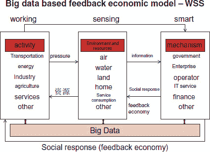

**图 3.1.** 共享形式的反馈经济

从近年来中国城市信息进展的角度来看，许多城市已基本完成了工业信息化（数字化的初始阶段）。之前的问题是，这三个垂直领域（运行、感知、智慧）的大数据在智慧城市中无法贯通。

那么，智慧城市问题的解决方案是什么？（详见下文。）其中之一是推进数字工业化——大数据的发展。

如图 3.2 所示，消费领域的创新已进入“竞争时代”，其特征是“社区经济”，它可以通过特定的场景体验通过长尾效应进行传递，依靠流量来实现。然而，图 3.2 左侧农业和工业的业务模式已变为通过数据“精炼”过程、销售和其他环节开发非标准产品，以实现个性化定制、网络化协作实现和社会生产。这种从生活服务业向生产性服务业的转变正在重写传统服务业。去中间化的特征非常明显。生产性服务的崛起不太可能从原来的传统企业发展而来。由于新模式，其产业边界已经模糊，生产链被分解，组织形式也完全从原来的公司形式转变为网络化、平台化的生产形式。我们称之为`EOP`（生态操作系统平台或生态运营平台，后将详细介绍）。目前，我们称之为数字工业化时代。

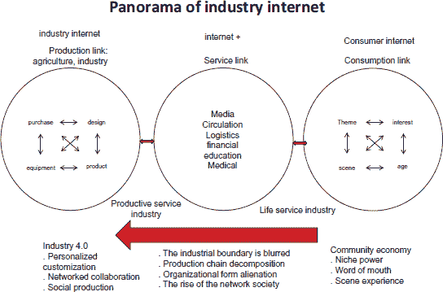

**图 3.2.** 工业互联网全景图

图 3.3 显示了大数据生命周期中与各个领域之间的交织关系。从技术角度来看，数字产业包括：数据收集（包括物联网等）、数据存储（包括云计算、数据清洗等）、数据处理（包括数据脱敏、数据迁移、预处理等）、数据分析（包括数据挖掘、数据建模、数据预测等）、数据可视化（包括 VR、AR、MR 等）以及数据决策和数据服务。数据生命周期的各个节点构成了大数据技术市场的各个环节。当这些环节与各种行业（如图 3.3 中的行业）叠加时，促进了数字产业的发展。

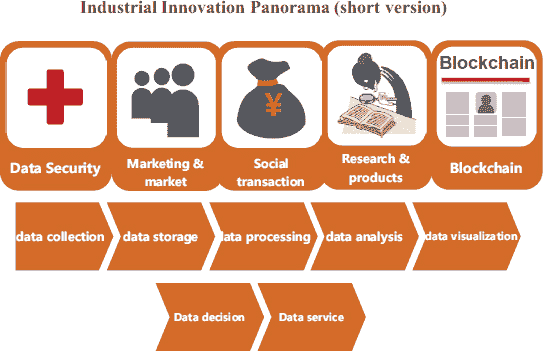

在过去的几年里，推动数字工业化过程中的误区是过度关注数字轻工业。根据结果，从物联网到云计算再到大数据的演进，那些做得好的公司实际上是依赖项目制的公司。表面上看，我们似乎回到了工业数字化时代，项目至上，但其实际原因是什么？主要有七点：(1) 人从服务中获得的利益（竞争模式）；(2) 服务简化；(3) 地方政府功能的社会化；(4) 生态链的分配（零边际成本共享经济）；(5) 数据开放；(6) 金融通用以及(7) 试错容错规范（政策）。

具体的解释如下：

学习出租车软件的本质。智能城市平台设计中自动提供的服务不应由用户去搜索，而应该由服务方来“抢”。这是一种真正以用户为中心的服务竞争模式，就像出租车服务一样。但也有如补贴和奖励等市场调整机制。

人们常说用户体验非常重要（去年一家互联网公司告诉作者，他们聘佣了一名用户体验官）。

为了简化用户端，平台的市场空间被确定了。我们最近接触到一种“陪伴机器人”（我们无法透露生产公司的名称）。一个 App 允许用户直接控制机器人来观察儿童和老人的情况并与他们交流，这稍微复杂一些。使用同一个 App，儿童或老人可以通过直接与机器人语音交流获得一些服务。虽然原理简单，但此类家庭服务是有市场的。

地方政府功能的转型也导致了政策的转变。最新的政策不再是智能城市，而是新城镇化。通过推广按照传统行政功能运行的智能城市，很难适应上述共享经济时代的要求。

只有逐渐将之前的行政功能转变为“社会和服务为导向的功能”，才能提高政府的管理效率和社会满意度，只有如此，才能真正塑造出生产者服务业在区域经济市场中的地位。

平台化的发展也惠及了很多人。生态链方法似乎是从农业时代向圈地运动的过渡，而过度圈地违反了上述提到的`WiKIT`趋势。因此，生态链的发展也可能被分配。

能源互联网的发展使得未来每个家庭都能将太阳能和风能纳入新的能源生态系统中。大型且完整的圈地模式可能会改变，极大地降低边际成本。

这个问题得到了各方的认可，但仍需采取行动以取得成果。根据上述提出的`WSS`模型，在推广智能城市时，必须考虑在进行大数据分析之前先让数据变得可用。从前四点可以看出，实现数据可用是困难的。大数据交易市场也是解决方案，但此处未涵盖。

如前所述，过去几年个别公司与金融企业合作，这是非常有远见的。金融的通用化要求我们对智能城市有一套全面的投融资策略。

智能城市向新服务的转型需要创新。创新过程不可避免地涉及相关方的利益，并对一些旧制度产生影响。

遗憾的是，有一个不跨越国家法律法规限制的普遍原则。如果你为创新设定了上限，创新实际上将失去意义。例如，最近备热讨论的“网约车”问题并没有得到很多人的认可。出租车市场挑战了管理权威，而网约车市场也挑战了出租车市场。然而，这降低了新城镇化的边际成本，并适应了共享经济的发展。

“两害相轻，两利相重”。试错创新方法应该是规范化的。这种这种只会增加边际成本并扼杀创新。

中共中央政治局于 2017 年 12 月 8 日下午举行了关于落实“国家大数据战略”的第二次集体学习。在学习期间，习近平总书记强调，大数据的发展每天都在发生变化。我们应当审视形势，进行周密规划，力求主动了解大数据的现状和趋势及其对经济社会发展的影响，分析中国大数据的发展情况。通过总结我们在大数据方面取得的成就和存在的问题，我们能够为落实国家大数据战略贡献力量，加速数字基础设施的完善，促进数据资源的整合与开放共享，确保数据安全，加速数字中国建设，更好地服务中国经济社会发展。这将提高人民的生活水平。

“数字中国”是一个雄心勃勃的目标。这显示了数字经济在我国当今社会发展阶段具有多么重要的意义。从媒体的相关报道中，我们也可以看到工业数字化和数字产业化正在发生，并最终走向数据资产化和资源化的路径。

根据百度百科的定义，数字经济是指数字技术被广泛应用的经济体系，从而给整体经济环境和经济活动带来根本性变化。这与我们工业数字化中提出的`WSS`模型的运行机制一致，也符合社会经济的基本理论。

在社会经济中，有三个基本要素：

### 2. 生产力

根据恩格斯的观点，生产力是把劳动者和生产资料相结合改造自然的能力。人工智能的出现增强了人类利用各种工具的能力。因此，我们可以利用人工智能来提高生产力。

### 3. 生产关系

这是指人们在物质数据生产过程中形成的社会关系。它是生产的社会形式，包括生产资料的所有权、人们在生产中的地位和相互关系以及产品分配。其中，生产资料的所有权是最基础且具有决定性的。

区块链本质上是一本账。当一个商品、行为或交易开始时，就会创建一个区块，并详细记录其整个生命周期形成一条链。这本账本在互联网上由多方备份，因此被称为分布式账本，它不属于任何个人、组织或机构。因此，比特世界中“大数据”的所有权就得到了有效的保护和继承。

网络约车发明的初衷是解决出租车用户面临的问题，其参与者包括乘客、司机和平台。网络约车平台实际上提供了两种服务：一个是基于大数据自动生成乘客与司机之间的匹配；另一个提供一个每个人都可以信任并必须尊重的支付系统。此前司机与出租车公司之间的关系已经转变为与平台以及乘客体验的关系。乘客也可以转变为司机（被称为“产销者”Prosumers，既是消费者也是生产者）。它已经流行起来，这种生产关系的改变给出租行业带来了颠覆性的变化。

然而，在实际操作过程中存在许多问题。例如，网络约车司机利用插件进行欺诈，导致许多乘客无法获得应有的服务。同时，由于运营压力（补贴、风险控制等技术成本），网络约车平台在实际运行中也面临挑战。当新的生产关系无法匹配生产力的快速发展时，平台需要进行改变。

当然，这种状态是一种理想状态。事实上，在演进过程中可能会出现许多中心。当不同的中心融合时，某些中心将被逐渐消除。这种变化的优点显而易见：首先，交易成本将降低；其次，欺诈风险将降低；第三，去中心化的方法也增加了技术保护数据隐私的可能性。

从农业时代的个体化管理到工业时代的规模化、专业化和公司化，其核心在于挖掘公司的业务潜力，通过开展企业结构性转型、区域扩张和跨行业的产业重构，有利于公司（或集团）的利益。在企业发展过程中，存在股权控制和话语权竞争，这增加了企业的摩擦成本。即使核心企业构建了生态平台（如上述的网络平台）并重塑了供应链，仍然无法解决这种摩擦成本。企业之间的协同源于参与感和存在感。而集权化的原因也会降低运营效率。

### 生产侧

互联网、大数据、人工智能和物联网技术被应用于行业，以实现行业的数字化，使数据资源能够在企业间流动并提高协同效率。反之，当观察工业互联网相关的流程和产品全景时，我们发现部分或全部非标准生产流程和产品实现了标准化，然后是个性化和社会化。

### 流通端

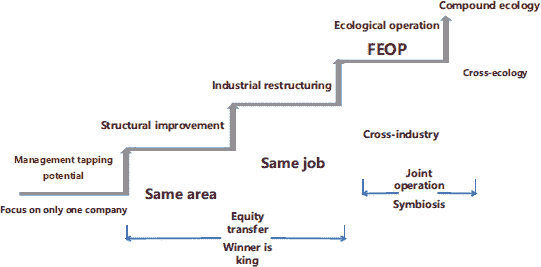

示例 1：一家电子产品制造商将其生产的电子产品与个性化金融理财产品相结合。用户购买某款电子产品并支付全额后，全额可以在一段时间内退还，从而刺激消费者购买渴望的商品。这种方法与产品众筹类似，极大地增强了流通过程中“粉丝”的吸引力，并提高了转化率。

示例 2：“猪网”项目是一个由上市公司发起的项目。生产端的养殖场和农民出售猪只以获得“资金池”的份额，这些份额可以在“猪网”中使用。资金在平台上循环，用于购买养殖猪、饲料和兽医服务等物品和服务。当然，如果你需要现金，可以轻松地兑现。事实上，由于使用的便利性以及增加信用分等激励，这些受众仍然不愿兑现，因此资金池变得越来越大。业内的一些人称之为“猪”银行。看着这个模型，与传统方法相比，参与者在“猪网”平台的粘性得到了极大提高。

为了实现从生产到消费的快速高效转换，仅依靠上述方法是不够的。我们知道生产端产品的生产周期可能与需求侧的需求周期并不完全匹配。这需要通过“交易中心”进行对接：在对不同生产周期的产品进行包装后，我们在交易中心进行大交易并解决问题。这就是不连续、离散生产周期带来的风险。

因此，由生产、配送和交易聚合构成的工业运营平台是`EOP`，它也是上述`WikIT`的落地版本。金融科技在这里发挥了重要作用，我们也可以称之为`FEOP`。

当每个环节的`FEOPs`成熟后，每个集中的`FEOP`就可以整合形成一个`CFOP`（复合 FEOP）。这是一个完美的生态。

如果利用区块链技术结合`FEOP`形成点对智能合约交易，并在其中嵌入令牌（时间戳），可以在遵守当前法律法规的同时扩展现有的货币交换模型。需求范围和升级激励可以简化交易侧的成本。

在接下来的章节中，我们将观察区块链在几个子领域的应用，看看它是如何影响数字经济的各个方面的。

法律监管是指通过法律手段对事物进行管理、规范和监督。广义的法律监管包括针对性的指南和规范，如法律、法规和政策。对于区块链技术，尽管对“去中心化”（或“多中心”和“分布式”）有许多不同甚至相反的解释，但不可否认，它与人类社会存在着长期存在的中心组织。与结构、匹配技术和思维模式相比，基于区块链构建的去中心化网络在人们如何思考以及制定业务模式和组织形式方面开始产生重要影响。这种冲突的根源在于法律对区块链技术监管的内在内在。

技术本身是否应该由法律进行调整在现实中是一个具有争议的话题。例如，经常提到的“技术无罪”指的是技术本身的研究开发不应由法律直接评价，而应根据技术的具体使用情况进行评价。

同时，技术对当前及未来的潜在社会影响是法律监管的逻辑起点，如图 4.1 所示。例如，包括中国在内的许多国家目前已经制定或出台了许多针对大数据、人工智能和虚拟现实等技术研发的法律法规或政策。上述法律法规是基于此类技术对社会的当前或未来影响，旨在标准化和促进这些技术的发展。相反，考虑到对人类社会可能产生的负面影响，在核技术、生物化学技术和基因技术等领域也有相关的限制或禁止性法律。中国及其他地区对区块链技术密切相关的数字加密技术有许多限制，特别是在其开发和应用方面，在创建之初严禁该技术应用于民用领域。

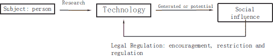

**图 4.1.** 技术与社会影响

## 1.2 区块链法律监管的维度

当人们谈论区块链技术监管时，相关概念往往会混淆或模糊。这主要体现在区块链技术与区块链衍生品（代币）之间。两者之间没有做出区分，就像区块链技术及其相关行为没有被区分开一样。这种情况经常导致双方无法达成共识并进行辩论，因为他们最终并没有真正讨论问题。此外，许多人将区块链架构的发展分为几个关键阶段：区块链 1.0、区块链 2.0、区块链 3.0 等，但法律监管并不一定对应于架构的发展阶段。相反，它对应于区块链的性质以及它的行为方式。在宏观层面，与区块链技术相关的法律监管实际上是多维的，至少应包含以下三个方面：

(1) 区块链技术本身的研究。这包括对适用于区块链技术的监管和政策的态度，以及对技术本身的法律监管，特别是涉及智能合约、网络安全和隐私保护等问题。

(2) 区块链代币以及发行、交易和流通的相关问题。基于代币和与代币相关的行为识别和监管，以及税收和安全问题。

(3) 对区块链技术所实现的业务模式重构的法律监管。这主要涉及业务模式重构或组织结构重构，这些是在当前法律规范体系下通过区块链技术实现的，以及当前法律如何基于区块链技术处理上述场景。

## 1.3 区块链法律监管的现状

### (1) 受高度重视的区块链技术

受各国对代币发行和交易不同态度的影响，很多人谈论区块链相关的法律监管时，往往会考虑到谈判、破解、观察等负面或不确定的词汇。事实上，如果你仔细研究，你会发现从宏观角度来看，包括中国在内的世界上许多国家对区块链技术的研发和应用持有明确且积极的态度。

区块链技术具有安全性、稳定性、透明性、高效性和自给自足等优点。这是许多中心化组织或业务模式的缺点。尽管目前来看，某些行业对区块链技术上述缺点的实现尚未广泛普及和赞誉，但这种潜力仍然被世界上各国重视和欢迎。

例如英国，英国政府于 2016 年 1 月 19 日发布了一份题为《分布式账本技术：超越区块链》的报告，并将区块链纳入英国的国家战略。该报告提到，英国政府正在分析区块链在传统金融业、所有权登记和知识产权方面的应用潜力，借此减少欺诈和成本。同时，英国政府还在考虑开发基于区块链的公共平台，以连接政府、机构和公众，从而更好地提供社会服务。

与英国一样，世界上大多数国家实际上鼓励区块链技术，并没有限制区块链技术的监管或政策。相关的限制性监管政策主要集中在代币交易等行为上，而这些行为大部分属于受国家法律专门监管的金融和证券等领域，不能完全等同于对区块链技术的法律监管。

在中国，区块链技术也得到了政府的大力支持。目前，广州、贵阳、重庆、苏州、杭州等地已发布了相关的支持政策。以广州市黄浦区为例，当地政府发布了《广州市黄浦开发区促进区块链产业发展措施》（简称`区块链十条`），从区块链企业或机构的应用、培养、增长、平台、应用、技术、金融活动等方面开展关键政策支持，同时侧重于区块链技术与传统工业系统的结合。

### (2) 区块链技术的法律挑战

从技术而非行为的角度来看，区块链对当前的法律体系确实带来了许多挑战。以智能合约为例，此前提到的概念并非区块链技术所有，但高度稳定且不可篡改的区块链系统是智能合约实践的“天然港湾”。区块链 2.0 是智能合约的引入具有代表性。许多人将智能合约视为合同，但它们并不相同。前者本质上是执行代码，当满足条件时，程序按照预设路径运行。后者属于法律概念，包括主体、客体、权利、义务和责任。正因为这种差异，智能合约带来的挑战不在于改革法律服务模式，而更多在于如何监管智能自动化执行引发权利归属、侵权认定和责任划分。这也是未来的一个方向。此类问题应该引起关注和研究。

### 代币的法律属性

代币（`Token`）是区块链技术的产物。自区块链技术应用以来，`bitcoin`是为了解决特定的支付问题而创建，人们通常将区块链应用中的代币称为“虚拟货币”。从法律角度来看，两者并非货币。由于代币可以绕过中心化机构进行点对点交易，它们也具有作为介质或资产的属性。因此，如何界定代币的属性是各国法律监管的主题之一。目前对代币有三种定性观点：

#### 支付介质

认为代币具有支付属性并等同于货币（尽管这种情况并不罕见）。德国财政部表示，`bitcoin` 作为支付方式应被视为法律等同。但这里需要澄清的是，即使代币等同于货币，也不意味着代币就是货币。显然，在当前状态，市场主体没有强制接受这种支付形式。相关法律或政策通常强调，使用代币支付时不需要像缴纳税那样。

当然，这并没有排除利用区块链技术直接发行虚拟货币的可能性。但至少目前，广泛基于区块链技术的虚拟货币尚未出现，因为它们预计伴随着许多风险和挑战。目前的通用方法是基于特定目的发行区块链代币以解决某些领域的问题。例如，委内拉发行的币属于期货的变体。

#### 虚拟商品

以中国为代表，将代币特征为虚拟商品。这种定性具有两层含义：第一，代币不属于货币；第二，代币应受虚拟商品相关的法律政策监管。具体而言，2013 年，中国人民银行等五部共同发布《关于防范比特币风险的通知》，明确规定“从本质上说，`bitcoin`应视为特定的虚拟商品，而非货币。`bitcoin`没有法律地位，不得在市场上作为货币使用”。同时，“所有金融机构、支付机构不得使用`bitcoin`作为商品或定价，不得作为中心对手买卖或交易`bitcoin`，不得承保与`bitcoin`相关的保险业务（包括保险范围），不得直接或间接向客户提供与`bitcoin`的服务”。

此外，根据文化部和商务部《加强网络游戏虚拟货币通知》的相关规定，市场主体必须定期向行政部门报告游戏的“虚拟货币”。同时，相应的“虚拟货币”只能在游戏系统内流通，不能兑换实物或在现实中流动。例如，腾讯发行的`Q 币`除了需要定期报告发行外，只能在腾讯内部生态中使用，不能直接兑换实物或从腾讯内部系统转移。此类监管的起点实际上是防止虚拟空间中的数字代币在发行、流通和使用中挑战货币的地位，或演变为货币功能的一部分。

区块链代币并不一定基于游戏发行，但事实上它们与游戏“虚拟货币”具有相同的特征，在发行和使用领域都具有挑战货币系统的潜力。另一方面，对于区块链代币，实际转账已经突破，不同实体之间代币本身的交换和交易可以实现。因此，在虚拟商品未实际变更的前提下，市场主体公开发代币。即使不是通过公开发，可能仍然违反中国的相关规定，因为它实际上挑战了中心化的货币发行体系。“虚拟货币”类别需要限制，可能导致资金池、欺诈和非法经营等风险。

#### 证券化证书

区块链技术生成的代币可以实现数量和状态的稳定，即使发生变化也会严格遵守既定规则。这种高度的稳定性使得代币能够实物和权利对应挂钩。许多人认为代币本身不能分红，也不代表股权以及权利（如投票权等），这实际上是一种误解。从技术上讲，代币与股权或实物并不难联系。原因是因为证券在全球范围内都是严格监管的。区块链代币发行者很少选择这种路线。区块链的监管（许多人所称）实际上是指当前的监管体系。

## ICO 的定义与概述

ICO 是“代币首次发行”（`Initial Coin Offering`）的缩写。也就是说，发行者以现有的数字代币作为项目的运营资金，换取未来发行的区块链代币。从上述定义可以看出，与 ICO 现有法律密切相关的两种活动是招募行为和发行行为。与区块链技术的去中心化相比，区块链项目的 ICO 必须有发起者和项目方。因此，大多数 ICO 是中心化的，更容易受到现行法律体系的监管。大多数 ICO 的形式与众筹非常相似，或者说是一种众筹。但与普通众筹相比，ICO 给参与者的回报并非真实的物价产品，而是区块链代币。根据对应 ICO 的代币的具体功能，ICO 代币可分为以下三类：

- 支付型代币。此类标记没有特殊权利，仅用于支付、结算、交换等功能，通常以`bitcoin`代表。
- 功能型代币。此类标记不用于流通结算，而是用于服务或直接消费的商品。此外，某些代币类似于会员券。
- 资产型代币。此类代币可以作为股票、期权等的证据。在经济功能方面，此类代币类似于证券、债券或衍生品。

## 募资行为与法律风险

对于 ICO 而言，募资行为特指“虚拟货币”的收集，即市场上流通的现有区块链代币。虽然“虚拟货币”不是法币，但在收集和使用的整个过程中，募集的代币本质上被用作法币，而非功能性消费品。

在世界上大多数国家，募集资金是严格限制的行为。并且对主体的资质、用途和审计有相应的监管措施。显然，如果募资行为被认定为变相集资（非法货币），在现有的法律评价体系下，ICO 面临许多法律风险。以中国为例，即使不考虑 ICO 对应的项目是否实际失败，ICO 仍会被怀疑为非法吸收公众存款。《中国刑法》第 176 条规定的非法吸收公众存款罪，是指非法吸收公众存款或伪装成公众存款并扰乱金融秩序的行为。在刑法评价体系中，实质比形式更重要。虽然“虚拟货币”不是真实的货币，但结合整个募资的目的和用途，并非不能识别出变相的公众存款。当项目无法落地时，更有可能被怀疑为集资等犯罪。

## 发行行为与证券监管

关于 ICO 的发行行为，关键点在于对代币性质的认定，例如区块链代币作为证券的属性，或者 ICO 项目本身在代币功能设定上实现了证券化，那么相关的发行行为将受到当地证券法的约束。例如，美国证券交易委员会（`SEC`）曾将“The DAO”项目中的代币定义为证券并对其进行了相应的监管。在中国，股票和其他证券的发行需要经过国家相关主管部门的批准，并按照法律程序在法定范围内发行。如果市场主体任意发行，可能违反《中国刑法》第 179 条规定的发行股票或公司债券罪。除了证券外，当当代代币被认定为虚拟商品或其他属性时，也需要遵循国家或地区的独特法律监管。

## ICO 在中国的现状

ICO 在中国是被禁止的，因为许多 ICO 项目代币几乎没有真实的应用场景。即使在国外，虚拟货币的交易等场景也非常少，且大部分是不正当的暗网交易。为了退出盈利，投资者只能希望投机代币，让后者接盘。初始投资者和入局的参与者对此非常清楚，但他们无法逃脱`Ponzi scheme`。因此，如何结合实际应用场景设计有价值的应用场景代币原型或模型，是衡量 ICO 是否合法合规的重要标准。

除了招募和分配活动外，ICO 还有一些值得考虑的法律问题。虽然大多数 ICO 项目仅给予参与者一定数量的代币回报，而不承诺价值的波动，但客观上，如果 ICO 项目方没有按照既定的白皮书实施项目，甚至欺诈性招募，那么用户手中代币贬值的概率将很大。从民事责任的角度来看，项目方是否承担民事责任，或确定损失过错，在法律界值得讨论。

## 虚拟货币交易所的法律问题

虽然基于区块链技术的代币可以实现点对点交易，但它们操作不便且无法实现与法币的直接交换。在这种情况下，虚拟货币交易所应运而生。“虚拟货币交易所是一个流行术。从法律角度来看，此类机构既不是“虚拟货币”也不是“交易所”。区块链代币不属于真实的货币（法币），这一点人人都清楚。在过去的语境下，“交易所”通常是指权威设立的证券交易所、期货交易所等。

以中国为例，全国范围内有八处交易场所，包括三个证券交易所（上海证券交易所、深圳证券交易所、国家性股权股权交易系统，即新交所）、四家期货交易所（中国期货交易所、上海期货交易所、大连商品交易所、郑州商品交易所）和一个贵金属交易所（上海黄金交易所）。目前，上述交易所的设立根据相关规定经国务院批准。非法设立证券、期货和贵金属交易所不仅将面临相应的行政处罚，还可能涉嫌触法和非法经营罪。

同时，根据 2013 年由中国人民银行等五个部委联合发布的《关于防范比特币风险的通知》等相关规定，金融机构和支付机构不得开展与比特币相关的业务。在现阶段，它们不得直接或间接提供其他比特币相关的服务。更为直接和严谨的是，在人民银行于 2017 年 9 月 4 日发布的《关于防范代币发行风险的公告》中明确规定，任何所谓的代币融资交易平台均不得从事法货币的发行。法货币与“虚拟货币”在双方的交易业务中不得买卖，或作为中央交易方买卖代币或“虚拟货币”，亦不得为代币或“虚拟货币”提供定价、信息中介等服务。换句话之，中国的虚拟货币交易所是完全被禁止且违法的，不允许进行基于虚拟货币的期货交易。

日本、新加坡等国家并未禁止虚拟货币交易所的存在，但会产生许多新的法律问题，主要集中在反洗钱、税务、用户隐私、资产安全等方面。这些也属于虚拟货币。交易所的主要风险点在于，任何问题都可能引发连锁反应，并决定交易所的生存。

可以预见，尽管全球范围内虚拟货币交易所的监管差异很大且仍处于探索阶段，但考虑到虚拟货币交易的资产属性，未来许多国家可能会引入针对性的监管政策。

### 区块链业务模式重的法律问题

基于区块链技术的业务模式重构是许多人乐观的区块链具体应用方向。当新业务模式出现时，通常意味着与现有业务模式产生冲突，例如 Uber 和滴滴出行的出现导致了与旧法律体系的冲突。区块链是一种去中心化技术。在强调中心化管理的法律体系下，通过区块链技术重构的业务模式也需要仔细考虑。

一个值得介绍的例子是柯达（`Kodak`）。柯达是一家知名公司，主要从事胶片、数码相机等业务。在 2018 年初于拉斯维加斯举行的 CES 消费电子展会（`CES`）上，柯达宣布进入区块链领域并发行了区块链代币，也称为`KodakCoin`。对很多人来说，柯达关注的是一个热门的新炒概念，而没有关注柯达基于区块链技术构建的整套全新业务模式。事实上，在柯达的模式下，柯达销售的数码等等与其开发的区块链平台相关，用户在拍照时提取照片的时间戳信息，版权生成记录自动附加到区块链上。在全球范围内，版权在作品完成的瞬间即适用。柯达利用其设备生成的照片的天然优势来记录版权信息。这种生成可以通过区块链的不可篡改技术直接确认归属。这种版权确认方式非常可靠。如果照片脱离了时间或版权信息从设备本身被移除，很难恢复版权的实际元素，甚至会产生不必要的争议。

版权记录完成后，摄影师可以在柯达自建平台上进行版权转让。由于版权可靠可靠，可以避免对来源的担忧。除了与柯达进行版权转让交易外，柯达的原始版权信息还可以帮助摄影师反侵权或防盗，收益由柯达平台和摄影师共享。结果，柯达的主营业务不再仅仅销售数码相机等实体商品，而是重心转向了数字版权认证、流转和维权等领域。在这些领域，通过柯达进行支付。去旧迎新，实现了业务模式的变革与重构。

柯达模式是在现有的法律框架内实现的，实现了版权的保护和利用。尽管对于柯达是否真实执行上述模式还有许多疑问，但该模式对于寻求通过区块链重构业务模式的人来说是一个非常经典的案例。与柯达模式类似，`Ripple`系统和发行的`Ripple`币也是在现有的法律框架内进行的，避免了对法货币铸权的挑战，但仅为银行间不同货币的汇款和流通提供技术支持。即许多金融机构实际的应用。

并不是所有业务模式的重构都能像柯达模式那样被现有法律体系认可。例如，如果柯达在中国开展`ICO`或类似的代币，显然存在法律困境。这产生产生了新问题，即如何平衡监管与创新的边界、开发潜在的区块链项目以及打击投机行为，这在未来几年都是许多国家面临的问题。

区块链系统本身是一个闭环系统。例如，`bitcoin` 只能在 `bitcoin chain` 中循环，这是一个纯粹的在线虚拟世界。与 `bitcoin chain` 一样，许多其他新的区块链系统也属于虚拟世界。在区块链系统中，只有私钥（`private key`）了比特币的归属，这意味着 `private key` 代表了一切。当 `private key` 丢失或被盗时，本质上意味着所有者失去了对 `bitcoin` 的所有权。这就像丢失了房屋钥匙，所有者失去了对房屋的所有权，这在现实世界中是不可不可或或不可接受的。可以看出，当区块链系统或应用缺乏与现实世界法律主体连接的机制时，只能使用系统内的元素（如 `private key`）作为判断标准，难以实现与现实世界法律意义的连接。在法律主体的解决方案中，将虚拟世界连接到现实世界的技术被统称为身份认证。因此，如何将身份认证技术应用于区块链系统，以实现身份与 `private key` 之间的绑定或对应，是一项区块链技术。其中进一步改进的关键点对于权利认定、数字资产安全和侵权判定至关重要。同样，在区块链应用上意义表示的实现和表达可以使人类在虚拟世界中的行为合法，并赋予人们处理交易、规定权利义务以及在线改变法律关系的能力。这取决于数字签名技术的支持以及基于数字签名的电子合同等技术应用。

## 对区块链法律监管的反思

总之，可见与区块链技术相关的法律监管并不能一概而论。全球范围内与区块链技术及相关的法律法规在法律监管上存在巨大差异。但可以肯定的是，在当今全球化背景下，一方面，技术进步有助于解决现有技术无法解决的困难；另一方面，技术的开发和应用应当对人类有益。如果越了这两条底线，仅仅为了放在区块链上，那么区块链技术将成为投机或乌托邦理想的工具，被现有的法律体系否定。

## 区块链技术在存证领域的应用

### 存证问题的本质

公证（`Notary`），其词源源于拉丁语 `Nata`，原意指的是记录的意思。2000 多年前，由于商品经济的发展，罗马已经有了公证制度。现代公证制度始于法国在 1802 年颁布的《公证法》。从那时以后，世界各国相继制定了现代公证制度。公证是一种认证活动。法律认可的公证机构根据法律程序，证明申请人记录中存在的客观事实和文件的真实性。

本质上，公证解决方案是为了解决“存证”（`Proof-of-Existence`）问题。在法律术语中，它与证据的三个方面“真实性”、“一致性”、“事后性”相关的完整性（`integrity`）保持一致。基于这一逻辑起点，支撑性的公证制度由国家信誉背书，由经授权的公证机构执行，并建立了严格的公证流程。

### 存证的价值

存证（`existence-proof`）是信用体系的基石。随着市场经济的快速发展，信用体系逐渐成为现代社会的“基础设施”。安全、可靠且可信的信息对于减少资源成本和建立良好秩序至关重要。现代社会所需的信用体系不仅必须以全面、可验证和系统的方式解决问题，还必须包括合法性、高效性、经济性和可靠性等要素。上述大部分内容必须通过“存证”（`existence proof`）来实现。在某种意义上，存证的实施、程度、效率和成本决定了一个国家或地区信用体系的发展水平。

### 存证的宏观困境

从宏观角度来看，国务院发布的《社会信用建设规划纲要（2014—2020 年）》对信用体系存在的问题进行了深刻总结：

“我国社会信用体系建设取得了一定进展，但经济发展水平与社会发展阶段不匹配、不协调。主要问题包括：信用服务市场不健全，服务体系不成熟；服务行为不规范，服务机构信誉不足，信用信息主体保护机制缺失；严重生产安全事故、食品药品安全事件时有发生，商业欺诈、虚假销售、偷逃税、虚假报告、学术不端等现象屡禁屡试，政府诚信与群众期待之间仍存在一定差距”。

### 存证领域的现状

包括公证、认证、鉴定在内的存证制度在维护社会秩序和规范市场运行方面发挥着关键作用。其价值和优点是不可灭的，从客观角度进行单方面的否定或评价是不恰当的。然而，也要注意到上述体系存在一些值得关注的共性或局部问题。随着科学科技的发展，许多问题已经开始出现更可靠的解决方案。

#### 存证效率低下的

直观上看，效率低下是传统存证中的一个常见问题，主要体现在流程复杂、程序繁琐，但这并不是问题的关键。作为存证的重要防线，相关程序是不可或的，也是从流程角度确保真实性的必要过程，但上述程序在许多人为设置的环节降低了整体效率。

以公证流程为例。主要环节包括本人到场、书面确认、人工审核、纸质归档和申请验证。上述每个环节实际上都是相对独立的，很难在空间和时间上完美契合。在申请公证时是否需要本人到场的问题，以及由于个人时间或空间限制难以满足条件等问题，可能会导致长时间的延迟，从而延误整个公证流程。虽然这种担忧本身并不属于公证机构的范畴，但客观上降低了整个流程的效率。此外，当公证进入人工审核阶段时，还需要一定的时间，甚至会受到公证员熟练程度、业务量等因素的影响。

#### 存证证明的高成本

存储证书的成本不仅包括经济成本，还包括制度成本和时间成本。制度成本是隐藏成本。当一个系统建立时，不可避免地需要许多“配套设施”，如人员培训、资质认证、监管标准和文件管理。以文件管理为例，书面文件的管理有严格的流程，需要大量的人力、空间和设施。此外，检查和追溯还需要多个步骤和流程。这种制度成本实际上反映在许多系统中，且没有改进空间。

自然，经济成本无需多言。事实上，传统公证和存证的成本并非一小数字。通常，在交易（如民事诉讼）中，用于公证和存证的公证费仅几百元到几千元不等，有时甚至超过万元。另一方面，上述支出并非更多用于改进系统环节，或为了产生更大的经济效益，而是更多地花费在劳动力、文件管理等环节上。

此外，时间成本问题也是常见问题。现代社会经济发展迅速，在空间和时间上产生的成本可能远高于公证和存证本身。

### 存证证明面临真实困境

无论是公证还是认可、认证等系统，都是为了解决真实性问题。同时，验证和追溯是上述存证过程中不可或缺的环节。如果缺乏透明、快速且可靠的验证，说明整个存证系统存在漏洞和缺陷。但客观来说，目前仍然存在许多学术造假、婚姻欺骗、身份伪造、商业欺骗、假冒等。

此外，传统的公证、认证和验证依赖人工审核，很难避免主观判断因素。在上述过程中，它并不是防止欺诈的可靠技术解决方案，而是国家监管体系的一种震慑。也就是说，从理论上讲，存证造假部分并没有技术问题。以中华人民共和国司法部官网发布的行政处罚和行业惩戒公告为例，过去六个月内已有近 50 名公证员受到处罚，其中“公证虚假违法事项”占绝大多数（见图 4.2）。

另一个关注点是，随着互联网技术的发展，更多数据和现实物品可以进行数字化处理，这将极大扩展利用区块链技术进行存证的空间。

# 图 4.2 公证员处罚

*来源*：中华人民共和国司法部。

在公证案例中，在线存证验证可以实现主体的真实性，极大节省申请人的时间和经济成本。

## 2.6 区块链技术在存证领域的应用可行性

区块链技术具有不可篡改、时间序列不可逆和高度透明的特点。对于证书而言，其目的是确保元素未被篡改。时间是确定的，便于检查。可以说，存证证明比其他行业或应用具有更高的适配度。因此，将区块链技术应用于存证领域一直是区块链技术发展的重要方向。

通过区块链技术，需要验证的文档、协议、视听材料和数据材料可以进行哈希处理，获取相应的数据指纹，并以交易或状态的形式永久写入区块链中。这形成了不可篡改、高度安全且可准确识别的证明。这种在线存证操作可以在极短时间内完成。同时，结合电子签名技术，在线存证验证可以实现主体的真实性，极大节省申请人的时间和经济成本。

## 2.7 区块链技术在存证证书领域应用的必要性

通过区块链存证区块将解决许多问题。由于区块链具有不可篡改和时间序列不可逆的特点，存证上游发生非法存证和验证的可能性将大大降低。凭借区块链准确追溯的特点，欺诈和权力寻租也能得到有效的遏制和约束。此外，由于区块链本身高度透明，企业和个人可以更容易地对存证下游进行信息验证，学术造假、身份欺诈和虚假证明将难以生存。

开放性、透明性和可靠性是许多领域共同的追求。区块链技术的特性让许多行业跃跃欲试，它被称为“颠覆所有行业的潜能技术”。然而，需要注意的是，可行性和必要性是两个不同的概念。俗话说，“杀鸡不能用牛刀”是对可行性和必要性最好的诠释。由于区块链技术本身具有很高的技术门槛，并且在能量消耗和交易确认时间方面备受批评，因此有必要考虑那些现有技术难以解决且必须通过区块链技术完成的情况。存证就是其中之一。

传统的存证方法是中心化的方法，由第三方独立进行。从技术上讲，只要有足够的服务器和数据库权限，对于机构来说，更改存证结果并不困难。当利益或压力足够大时，篡改是不可避免的。这意味着传统的存证方法无法实现绝对意义上的不可篡改性，即所谓的“相对可信”。区块链的出现为存证方法带来了新的可能性。链上存证可以实现真正的不可篡改性，因为改变区块链需要大量的精力和专业知识。这种可能性极低且可以忽略不计，从而实现了“严格可信”或“绝对可信”。

## 2.8 区块链技术在存在性证明领域的应用案例

由于技术壁垒、上链成本、市场化应用等因素，在中国能够真正实现的区块链存证应用极其稀少。北京丰宇科技有限公司自成立以来一直进行不懈的探索，最终开发并完成了可用于市场应用的区块链存储产品。

“存证宝 BAOBAO”从目前来看运行最久、最可靠的比特币链。作为链载体，结合自身的专利技术，它可以为个人或企业提供低成本、高效的链存储服务。身份中心配合，在证据收集、验证和认证方面确保存证信息的合法性和可靠性。此外，“存证宝”为不同的存证场景提供了不同的解决方案，如图 4.3 所示。

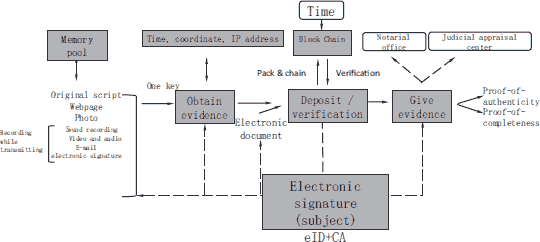

**图 4.3.** “存证宝”区块链证书的完整流程图

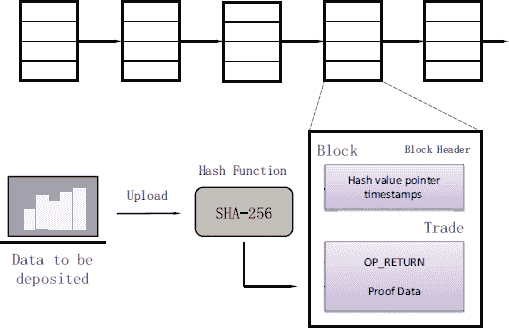

**图 4.4.** 数据上链的原理

### (1) 常规数据的存在性证明

常规数据的验证是指网页、照片、音频录音、视频和文档等电子数据的完整性和一致性。除了典型的传统公证方法外，还有一种为电子数据存时间戳的方法。然而，无论是传统的公证还是第三方的时间戳，都是一种中心化的存证方式，无法确保数据完全不被篡改。与上述方法不同，通过服务器获取的`timestamp¹ (data fingerprint)` 可以通过交易或状态，对永久嵌入比特币交易记录的电子数据进行哈希处理，从而实现上链的目的。得益于区块链的去中心化存储和强时间戳的不可逆特性，即使是操作者也无法篡改。

### (2) 特殊数据的存在性证明

常规数据的验证是指网页、照片、音频录音、视频和文档等电子数据的完整性和一致性。除了典型的传统公证方法外，还有一种为电子数据存时间戳的方法。然而，无论是传统的公证还是第三方的时间戳，都是一种中心化的存证方式，无法确保数据完全不被篡改。与上述方法不同，通过服务器获取的`timestamp¹ (data fingerprint)` 可以通过交易或状态，对永久嵌入比特币交易记录的电子数据进行哈希处理，从而实现上链的目的。得益于区块链的去中心化存储和强时间戳的不可逆特性，即使是操作者也无法篡改。

（注：原文中第 (2) 和 (3) 部分的内容似乎存在重复，此处已完全按照提供的原文内容进行格式化翻译。）

## 2.9 区块链在公证和存在性证明领域的发展趋势

判断一个领域的发展方向总是要让人们回到整个领域的起点。存在性证明的起点是确保主体的完整性和一致性。从古代至今，存在性证明经历了真实性的相对阶段，例如权威人士的背书和国家信誉背书。随着信息技术的发展和区块链技术的成熟应用，存在性证明将最终接近绝对意义上的真实性。这种真实性不依赖于第三方背书，不存在被第三方篡改的可能性。它是真正意义上的可靠存证。

可以预见，随着大数据、物联网、云计算等信息技术的发展，数据将连接万物，区块链存证的应用场景将逐渐扩大。存证将不再局限于法律公证，而是作为各行各业整个社会信用的基石。此外，不排除出现一种由多个机构、多个政府和企业参与的新型区块链载体，能够满足更高效、更经济的认证需求。

¹ 时间戳（又称为数据指纹）是完整且可验证的数据，证明某项数据在特定时间之前存在。每条电子数据都有独特的时间戳。当现有数据的时间戳与存证的时间戳一致时，即可证明该数据在某一时间点确实存在，且完整、防篡改。

# 第 5 章 区块链 + 地方政府创新

## 1. 政府在区块链创新发展中的核心作用

### 1.1 基于区块链的政府创新是占据竞争高地的关键

“错过互联网不要错过区块链”是 IT 行业的流行语，反映了区块链的重要地位和意义。区块链与大数据、人工智能和物联网（IoT）相结合，可以极大增强国家的创新能力。作为推动经济社会发展的重要力量，中国政府对区块链技术的理解和应用能力，将直接影响该技术在各行业的应用与推广，以及产业生态系统的构建与发展，从而影响中国的全球战略。其地位就在其中。

目前，全球许多国家已经意识到区块链技术本身及其与其他技术的融合可以为经济社会发展带来巨大价值。他们制定了相关的战略规范，支持本区块链技术的研发与应用，以占据未来国家竞争的高地。例如，澳大利亚政府希望通过区块链技术领域的努力来增强其国际竞争力。为此，已采取多项措施加速区块链在不同行业的应用，并逐渐提高其相关性。在制度标准等方面，早在 2016 年就明确投入超过 30 万美元资助区块链标准研究，以实现“巩固并增强其作为全球分布式账本技术（DLT）中心地位”的目标。中国也高度重视区块链技术的发展。2016 年 12 月，中国首次在“十三五”国家信息化规划中将区块链技术纳入国家信息化规划。一方面，将其定位为未来五年提供数字化、网络化智能化服务的关键技术之一；另一方面，将其定位为长期战略前沿技术。

### 1.2 基于区块链的政府创新是数字经济发展的有力保障

近年来，随着数字经济的快速发展，它在发展规模、增长率以及贡献和影响力方面已成为现代经济体系中最重要的组成部分之一。同时，数字经济发展中存在的问题也日益凸显。例如，在数字经济交易过程中，由于缺乏合理的信任机制，交易成本增加。如何确保交易中产生的大量交易数据和行为数据的安全性和有效性？这些问题的解决离不开区块链技术的支持。整体而言，区块链在中国实践中的应用仍处于探索阶段。相关的法律制度和标准体系尚不完善，行业应用较浅，产业生态系统尚未形成。其未来发展与社会共同努力不可分，其中政府发挥着特殊作用。政府必须加快完善与区块链相关的法律制度和标准体系，全面加强对区块链技术应用产生的新形态、新事物的监管，从而为数字经济的健康有序发展奠定良好的市场环境。

### 1.3 基于区块链的政府创新是政府适应新发展的客观要求

一方面，创新是现代政府发展的动力源泉。作为现代社会经济管理者，政府治理理念的先进性及其治理方法的创新将直接影响其治理能力。近年来，随着以大数据、物联网、人工智能等代表的新一代信息技术的快速发展，政府现有的治理能力和公共服务能力发现难以适应新时代的发展需求。如何利用这些技术改进政府创新并适应新时代的发展，已成为政府面临的客观问题。随着区块链技术在行业内的扩展，政府部门发现该技术可以有效防篡改和可追溯，从而有效解决政府行政效率低、监管弱、缺乏创新和透明度不足的问题。另一方面，在新一代科技的驱动下，数字化的新经济蓬勃发展，在其影响下涌现出许多新形态新事物。传统的政府治理模式和监管模式发现难以适应现状。经济和新业务发展的新要求必须根据实际需求转型政府功能并创新政府治理模式。

## 2. 政府创新的应用场景与实践

### 2.1 区块链 + 精准扶贫

#### 2.1.1 引言

脱贫工作一直是政府工作的重点，正如习近平总书记在 2018 年新年贺辞中所说：“距离 2020 年只有三年了。全社会必须行动起来，拼力奋斗，做出精准决策，不断取得新的胜利。三年后，我们应该按计划打胜脱贫攻战，这将是中华民族几年来首次彻底消除绝对贫。让我们共同努力完成这项对中华民族和全人类都具有重大意义的‘伟业’。让贫困户真正脱贫并不容易。脱贫是一项系统性工程。在政府的支持下，多方协同才能真正实现脱贫目标。脱贫不仅要支持经济，还要支持精神。政府的脱贫工作需要从制度上建立良好的脱贫导向，并在全社会形成积极的氛围。通过反馈机制使困难户的劳动能力得到有效培养，就业环境得到建设。脱贫后的勤劳农户精神将得到振奋，实现‘脱贫后不再返贫’。”

脱贫是一项大任务。本节介绍了“区块链+精准扶贫”，利用区块链技术帮助贫困牧户脱贫。

#### 2.1.2 背景知识

水产业是增加农民收入的支柱产业之一，政府高度重视。然而，水产业面临着“农民没钱投、银行不敢投、政府在帮扶贫”的困境。对于“农民没钱投”，以肉牛养殖为例，进口牛的价格为 1 万元。肉牛的饲殖周期接近一年，投资回报期约为两年。由于农民通常面临财务压力，他们无法凭一己之力产生此类资金。为了最大限度地利用有限的脱贫资金，可以通过适当的金融杠杆帮助农户向金融机构申请贷款支持，使其获得充足资金购买肉牛进行饲殖。

另一方面，由于肉牛养殖风险较为集中，且农民抗风险能力较弱，信用违约风险较高。肉牛作为抵押物用于动产资产融资，但由于缺乏有效的贷后跟踪方法，金融机构难以控制风险。这导致了“银行不敢投、政府在帮扶贫”的说法。为了满足银行的风控要求，还邀请保险公司加入扶贫项目，提供项目急需的农业保险。政府支持的准商业化保险模式是农业保险的常见模式。该模式由商业财产保险公司在经营自主性财产保险的基础上，设立专门的农业保险部门，实行内部会计，并向当地政府寻求资金支持。这种模式的特点是商业保险公司主动开展农业保险业务承担承担责任。在经营农业“风险险”的过程中，公司应通过其他保险业务的利润弥补农险的潜在损失，并争取政府为农户提供保费补贴和税收优惠。

肉牛行业价值链如图 5.1 所示。在整个价值链中，肉牛饲殖过程中的风险监控是前进的关键。

#### 2.1.3 解决方案

基于脱贫过程中的风险监控目标，以区块链作为底层平台，`APP`作为水产产业链的前端显示。结合`IoT`设备，记录肉牛饲殖的全过程以及饲牛的贷款融资情况。饲殖保险的防灾减损和固定损失理赔结算提供了可靠依据。区块链平台收集的数据项涉及融资方、保险方、农场、兽医局等相关方。区块链平台的主要业务功能包括：

(1) 融资方的贷前风险评估：提供水产项目的基础信息，如农场资产、规模、历史财务报表、土地证明等的更新与审核，协助融资方进行风险评估。

(2) 融资方的贷后风险跟踪：设计过程和规则主要侧重于抵押活畜数量和价值的实时或准实时跟踪，用于完成贷款后的风险跟踪和预警。

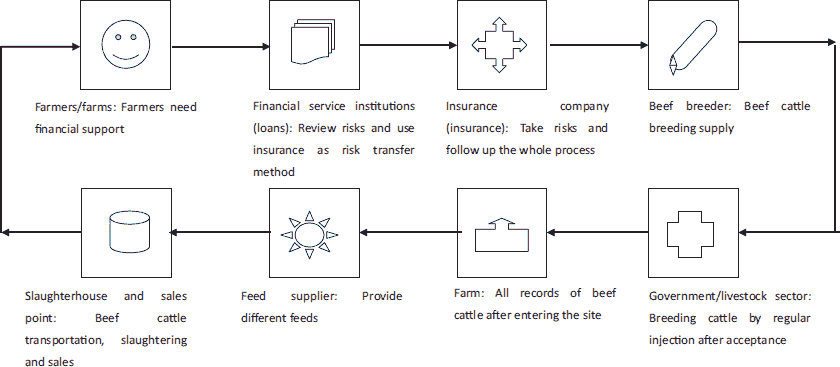

**图 5.1.** 肉牛行业价值链

(3) 保险人的现场检查与协助：为保险人的现场检查提供信息查询、保险单核对及状态服务。

(4) 保险人的业务风险预警：对饲殖或保险服务过程中的风险提供预警（如保险人数与存数的匹配、风险数量与死亡数量等）。

(5) 相关政府部门的脱贫成效：收集区域农民脱贫信息和农场驱动的饲殖收益，供相关政府部门检查。

(6) 政府相关部门的`现状`查看：收集区域农场规模等信息供相关政府部门查看。

(7) 辅助功能：提供养殖状态更新和贷款业务审核。多方区块链联盟如图 5.2 所示。

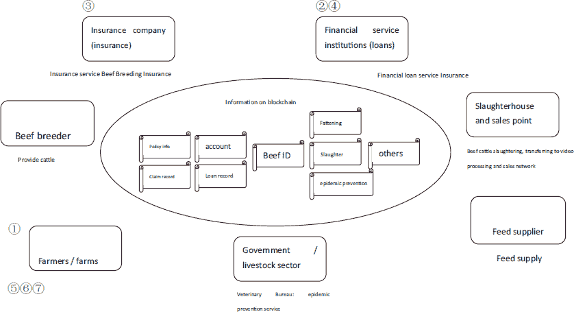

**图 5.2.** 多方区块链联盟

#### 2.1.4 揭示与意义

基于区块链技术的特性，应用于脱贫场景，预计将为各方带来四个方面的价值：

(1) 汇聚扶贫项目中的利益相关方，构建安全开放、可靠的信息网络，扩大信息共享，减少相关方之间的信息单向传递。

(2) 区块链记录的信息（如养殖信息、贷款信息、保险信息等）不可篡改且可追溯，减少因信息不对称或道德风险导致的纠纷或误解。

(3) 各方信息的相互校验确保信息高度可信，抑制金融风险的产生。

(4) 通过区块链上的智能合约为相关方提供实时监控和预警，确保预先约定的得到及时准确的履行。

*注：* (1) 入栏；(2) 尽调；(3) 保险；(4) 贷款；(5) 死亡；(6) 出栏；(7) 出生。

综之，通过政府、银行和保险机构代表的多方协作，借助区块链技术构建的信任平台有望解决“农民没钱投资、银行不敢投资、政府助扶贫困”的困境。汇聚力量。

### 2.2 区块链 + 食品药品监管

#### 2.2.1 引言

食品药品安全关系到国民经济和民生。人类对任何涉及食品药品的安全问题都高度关注。随着社会的发展生活水平的提高，人们对食品药品安全有效提出了更高要求。为了提高食品监管水平，国家实施了食品药品统一监管。

食品药品造假等安全问题可能存在于从生产、流通到最终销售的各个环节。这些环节分布广泛，涉及许多参与者。与普通食品、药品、中药、疫苗和新鲜食品的生产线相比，过程中涉及的安全更为复杂，或者在生产过程中涉及农业生产活动，或者在流通或销售过程中涉及冷链。这涉及到特殊的存储要求和严格的时间限制。所有这些环节和参与者都在食品药品监管范围内。

食品监管是一个大问题。本节介绍了主粮产区的区块链+食品监管案例，通过区块链技术对大米的全生命周期流通销售进行溯源。

#### 2.2.2 背景知识

食品药品监管面临全方位的压力和挑战。以农业生产为例，上下游建立互信的成本很高。例如，在购买特定地区生产农产品时，由于下游流通销售环节的影响，物流公司的信息记录与农产品的来源信息记录可能一致，就像物流公司与超市的信息记录并不一样。各方之间缺乏互联互通，使得难以克服不一致性。以花卉贸易为例，全球花卉贸易量每年高达 105 亿美元，70 万吨花卉通过物流配送。从产地到销售终端的完整配送过程需要约 30 个组织在一个多月内通信多 200 次。虽然花卉不是食品药品，但通过花卉整个物流过程，我们可以感受到食品监管所面临的压力和挑战。黑龙江五仓稻是中国著名的米。产地数据显示，五仓稻年产量超过 100 万吨。然而，如果将全国各商店和超市五仓稻的总销量加起来，总量将超过 1000 万吨。这些凭空出来的数百万绿色有机米反映了当前食品监管面临的巨大挑战。

综之，在食品药品生产和配送的全过程中，全生命周期信息记录的完整真实溯源已成为食品药品监管的重要要求。只要保证信息的完整性和真实性，造假、欺诈和销售假品的行为就会很大程度上受到抑制，监管初衷也得以实现。

#### 2.2.3 解决方案

很多人认为农业的技术含量很低。事实上，随着农业的发展，农田的数据采集经过初步处理并以大米的形式装袋，每袋大米都会贴上电子防伪签。这个一次性封签就成了大米的身份。识别信息记录在区块链上。在大米拥有了和……面对物流过程中的众多参与者和不同方的各种信息系统，各种信息系统的互联互通通过区块链完成。凭借区块链的共识特性，所有方在区块链上都有流通信息，技术实力较强的参与者持有分布式账本的完整副本，技术实力较弱的参与者通过可靠的区块链服务平台持有分布式账本的完整副本，确保没有任何能够篡改、隐藏或伪造数据。这确保了整个环节的过程信息是真实的。客户在应用程序上可以查看来源和信息信息。

#### 2.2.4 揭示与意义

目前利用技术手段的食品药品溯源方法主要有三种：

1. 交易平台本身，不参与具体的溯源工作。而是平台上的供应商提供相关的溯源数据。

2. 传统方法本身，其流程涉及盖章和进入双方的信息系统，并查询多个信息系统以获取溯源相关数据。

3. 纯线区块链溯源平台追踪数据，线上的区块链记录显示其来源、销售和转移过程。每个环节由线下工作人员手动记录。

### 2.3 区块链 + 数字身份

#### 2.3.1 引言

作为社会公共服务的提供者、社会公共利益的代表以及社会公共秩序的维护者，政府致力于构建成本最低、效率最高且摩擦最小的社会秩序。构建这种秩序并非易事。为了实现这一目标，必须在人与人、企业与企业以及团体之间建立一个真实可靠、全面的信用体系。

例如，在简政放和去中心化的案例中，传统流程要求企业和群众根据流程寻找审批节点，寻找不同的部门、机构和人员。这不仅导致工作效率相对较低，还导致社会感触极低。随着行政服务中心的建立，政府多个委员会办公室的外部窗口服务集中在一个服务大厅，使群众只要来到行政服务中心，就能一次性完成所有事项。这种从原有的“多门、多口、多人”向“一站式”的简易放权，是为了实现高效良好的社会响应。

为了进一步提高效率和社会体验，“一”被进一步简化为“零”，行政审批工作也从线下转为在线。为公民构建可靠的数字身份是向前迈的关键一步。

#### 2.3.2 背景知识

要实现从“一”到“零”的转变，需要满足以下两个基本条件：

(1) 考虑到办事人员无需亲自访问行政服务中心，我们如何确认所提交的服务信息是由其本人提供的？

在真实性保护方面，大多数行政服务要求办事人员或其授权的代理人提供身份证明（身份证、军官证、户口本或护照等），企业服务则通常要求提供企业执照（营业执照、开户许可证和法人法人身份证等）。由办事人员现场核实工作人员身份的真实性。当这一流程转为在线时，真实性保护问题就变得凸显。

(2) 在现有网络条件下，挑战在于如何维护信息安全以及如何保护个人隐私？

政府有责任维护这些私有数据的数据安全。

信息安全和隐私保护是互联网空间中的重要问题。行政服务中心的计算机接入专网，提供行政服务的公职人员根据服务内容进行信息的录入、修改和提取。某些专网未连接互联网，而连接互联网的专网也通过防火墙对互联网上流通的木马、病毒和恶意程序提供严格防护，使其难以访问。此外，当流程转为在线时，个人隐私数据的录入、修改和提取发生在互联网上，安全维护变得困难。

只有满足信息的真实性要求，在线流程才具有法律和合规保障。只有保护了信息安全，人们才能放心地使用服务。然而，真实性和安全性挑战在各个方面普遍存在。

## 2.3.3 解决方案

所谓的数字身份是脱离虚拟互联网世界实体身份证明的信息技术。由于如今桌面式电脑、笔记本电脑或智能手机的硬件配置已经非常丰富，摄像头和指纹识别模块已在终端设备上普及，利用人脸识别技术和指纹识别技术构建数字身份的时间已经成熟。通过将个人终端设备采集的人脸识别信息或指纹识别信息与政府持有的信息进行对比，即可确认数字身份，解决真实性问题。

考虑到上述信息涉及个人隐私数据，为了确保信息安全，可以考虑引入区块链技术。政府下属部门作为参与者形成点对点的联盟区块链网络。每个行政服务流程对应区块链网络中的一个智能合约，该合约由工作人员在家或任何可以访问网络的地方发起，基于数字身份执行。智能合约确保了流程的严谨规范，区块链平台保护了隐私不泄露。

## 2.3.4 启示与意义

基于数字身份认证平台，政府各部门可以协同工作，基于区块链构建“个人信息档案”。“档案”以个人主体为对象，围绕个人基础信息、业务办理记录和隐私信息安全三个维度，构建个人相关信息及其历史记录的加密数据集。个人信息文件被称为“档案”，关键在于私有数据的保护和授权访问。提供高水平的个人信息管理能力、高安全的私有数据保护能力和高质量的多维度数据共享能力，将推动社会公共服务的现代化和数字化。

## 2.4 区块链 + 税务管理

### 2.4.1 引言

2017 年，国家税务总局科技发展司成立了区块链研究小组，并举办了“区块链技术与税收管理”论坛，分析了区块链技术对税收管理和政策的影响。区块链技术的发展为税收管理带来了机遇与挑战。两份研究报告显示，中央高度重视并在国家税务服务中使用区块链技术。

随着“营改增”的实现，国税、地税乃至工商等其他相关部门与金融机构的协调已成为一种不可避免的趋势。“营改增”最大的变化在于避免了重复征税、不可抵扣和退税困难等缺点，有效减轻了企业税负担，并形成了增值税进项与销项之间的抵扣关系。同时，“营改增”对税源监控和征税提出了更高水平的精细化要求。协同工作时对数据隐私保护提出了更高要求，甚至相关法规的立法也提出了更高要求。

### 2.4.2 背景知识

面对日益增长的需求，与“营改增”同步推进的纸质发票电子化已成为财税技术的重要研究方向。在国家大数据战略稳步推进的背景下，电子发票与传统纸质发票相比，具有大数据分析的天然便利。分析所需的数据来自国税和地税征收管理系统，也分布在工商部门和金融机构等外部系统中，形成了分散的数据孤岛。跨系统大数据分析需要不同部门之间的紧密协作。简单将纸质发票转换为电子计算机并不能解决困扰税务机关的协同征税问题。税务机关迫切需要更智能的数字化手段来更好地服务税收治理。

实施协同税收治理并非易事。国税、地税、工商及金融机构属于互不隶属的并行实体。目前，对税相关数据的定义及税相关数据的提供流程缺乏法律要求。另一方面，金融机构的各类规定也约束着金融机构外部数据的行为。在传统技术条件下，精细化管理与隐私保护往往表现为矛盾的两个方面：管理精细了，隐私往往被侵犯；隐私保护提高了，导致的管理粒度就变得粗放。

在相关法规完善之前，如何利用更先进的技术协调和补偿多个政府实体与金融机构，在满足精细化管理粒度要求的同时不侵犯或暴露隐私信息，是一个亟需解决的问题。

### 2.4.3 解决方案

基于区块链技术的分布式加密账本天然适用于多个并行政府实体与金融机构之间的数据共享。通过授权访问，在保护隐私的同时，极大增强了税相关数据的共享程度和精细程度，从而提升了管理。

定义税相关数据的范围是整个工作的第一步。工作的开展需要政府牵头建立国税、地税、国土、发展、财政、市、住建、工商等部门的联合会议机制。在联合会议上，各方确认税相关数据的范围，双方提供数据的在线审批流程基于现行法律法规。

接下来，各方建立点对点联盟区块链网络。每个参与者都是区块链中的节点。根据联合会议的确认，各方将其掌握的税相关数据进行加密并记录在区块链上。得益于区块链固有的技术特性，一旦税相关数据注册在区块链上，就具有追溯性和不可篡改性，数据质量大大提高。同时，根据联合会议协议，各方在区块链上开发并部署智能合约，通过智能合约完成数据获取的审批流程。当流程通过后，申请人可以在解密数据后获得高质量可靠的数据。这不仅保护了用户隐私，还极大提升了管理的精细水平。

以此类推，相同的机制也适用于其他政府部门的数据共享机制。例如，金融数据、国土信息、业务信息等需要跨部门查询的数据，可以通过建立联合工作组来确认数据范围和在线审批流程，然后依靠区块链技术实现对共享加密数据的授权访问。

## 2.4.4 启示与意义

基于区块链技术的税相关数据共享机制具有数据可追踪、不可伪造和主体身份真实的特点。在确保数据隐私和安全的同时，区块链进一步确保了流程的合法性和合规性。其实际意义不仅限于税务部门的税相关数据共享，对整个政府信息公开体系也具有重要意义。

此外，随着系统的逐渐完善，通过互联互通的优势，这些方形成的联盟链可以真正整合原本分布在各方信息孤岛的数据。同时，它为区块链中的所有数据提供了一种安全的分布式存储解决方案。此外，这些链上的数据随时间推移积累了越来越多的统计信息。授权后，可以进行税大数据分析和未来的税源趋势预测，实现区块链与大数据的深度融合。两者共同发挥更大的作用。

## 2.5 区块链 + 城市管理

### 2.5.1 引言

联合国人居署（UN-Habitat）在其官方中文网站的“城市话题”板块中对城市管理给出了一些参考：“城市治理是帮助城市硬件运行的软件。城市治理可以定义为制度和个人组织。城市日常管理有多种方式，实现城市发展短期和长期议程的过程多样。良好的治理可以营造一种支持性环境，这需要适当的法律框架、有效的政治、管理和行政流程及机制、指导原则和工具，以使地方政府能够满足市民的需求”。

结合中国国情，过去几十年快速的城市化进程使得大多数城市的硬件设施（基础设施建设）进展迅速，但配套的软实力（城市管理水平）往往未能跟上。如何在加强城市专业化管理的同时，加强城市综合管理与综合协调，以及如何处理城市管理的碎片化与集中化问题，以及专业线与整体体系之间的关系，已成为城市管理者面临的棘手问题。

### 2.5.2 背景知识

随着经济水平的稳步发展，中国城市建成区逐渐扩大，常住人口和流动人口大幅增加。城市管理工作变得日益复杂。城市日益依赖专业的城市管理机构来处理城市运行涉及的各个方面。随着城市管理、城市运营及其治理方法的进一步复杂化，用于科学管理的专业子系统日益反映出涉及多个方和多个过程的复杂巨型系统的特征。传统方法强调分解与简化，将复杂庞大的城市系统人为地划分为几个独立的子系统。这种以单一专业线为基本单位加强专业化运行管理的方式，已日益无法适应时代的发展。以城市水务系统的运行为例，它与城市基础设施系统、城市河流湖生态系统、公用事业系统以及电力、通信、热力等各种地下管线，道路以及供水排水系统相连。交通是有机集成的，仅通过分解和简化来解决复杂的城市管理问题已变得日益徒劳且无目的。

此外，城市管理相关部门迫切需要合理化管理、执法与服务之间的关系。在城市管理过程中，对行政管理、行政执法和公共服务的综合监督，明确了各方执行的责任边界。有必要避免“多龙治水”、无人负责等问题，以及管理方法简单、执法行为泛化、服务意识薄弱等问题。结束这些现象对于防止混乱和不作为是必要的。如何利用科学技术手段做好多方协调，提高工作效率和人民满意度，已成为城市管理中的一个重要课题。

### 2.5.3 解决方案

考虑到城市管理工作的多样性，本节以一个看似微小的交易为例，展示了背后可能涉及的复杂部门协同，试图通过区块链技术提高协作效率。例如，由中心城市管理委员会发布并实施的社区周边停车管理规定，是基于“政府引导、多管齐下、因地制宜、协商民主”的原则，针对中心城区小区停车位严重短缺的问题提出的。该规定允许利用小区周边道路为居民设置临时停车位。

在实际操作中，涉及四个方面：小区周边停车区域的定义；临时停车用户的资质；申请审批流程；收费标准和收费单位。涉及的单位包括：街道办、社区工作站、停车管理公司、区发改委、区交通大队、区城管执法局和区市政委员会。以传统方式申请停车位需要居民前往多个部门完成流程。这种对个人便利的追求却因为复杂的流程而大大降低了群众的满意度。

结合前述的数字身份和多方协作系统，构建了一个多参与的联盟区块链网络，并通过政府网站为居民提供在线服务。在数字身份尚未完成的区域，政务大厅也可以提供站点提供服务。在随后的执法管理过程中，停车管理公司、交通大队或市政委可以根据`smart contract`约定的程序，从区块链上自动获取相关部门注册的数据。这有利于执法和管理，也减少了因信息不对称而在执法中引起的误解和矛盾。它提升了城市管理水平，增加了群众的满意度。

## 2.6 区块链 + 教育

### 2.6.1 引言

Internet + 教育是全球教育发展和转型的大趋势。随着教育体制的改革、科技革命的深入推进以及新一代科技对教育行业影响力的不断增强，现代教育管理、教学模式和教育资源发生了深刻变化。特别是近年来，随着“互联网+教育”和智慧教育理念的深入推动，教学环境的信息化程度得到了显著提高。教学管理模式的个性化和互动性被显著增强，教育资源的形式也变得更加多样化和去中心化。在线教育产业的规模持续扩大。区块链技术有望在“互联网+教育”教育生态的构建中发挥重要作用。由工业和信息化部发布的《中国区块链技术应用发展白皮书（2016 年）》明确指出：“区块链系统的透明性和数据的不可篡改性完全适用于学生信誉管理、职业与就业。学术、学历证书、产学研合作等方面，对教育和就业的健康发展具有重要价值”。

### 2.6.2 背景知识

作为国家发展战略的重要组成部分，教育面临着教育管理僵化、教师分配不均、教育信息不对称、学术造假现象以及教育信息化成本高昂等历史性难题。在教学过程中，高水平与在线教育资源整合程度低、互动性差等新问题也存在。

具体而言，目前中国大多数教育资源仍然分散在不同的实体或平台之间。由于缺乏合理的交换和共享机制，获取教育资源的成本较高。受教育体制、技术条件和安全隐私等许多因素的影响，全国范围内更标准化的学生档案尚未完成，这为学术造假等问题提供了机会，无形中增加了教育管理成本。在这种情况下，如何有效处理教育发展问题和创新教育管理，已成为各国教育发展面临的重要议题。

### 2.6.3 解决方案

(1) 基于区块链增强的教育资源整合与共享：可以基于区块链去中心化模型发布更多的教育资源，这将有助于降低学习者学习资源相关的成本并提高学习资源的效率。基于其分布式账本技术，用户与资源之间的直接连接可以简化操作流程并提高资源共享效率，从而促进教育资源的开放共享，解决“资源孤岛”问题。此外，区块链是一项全球技术，可以更好地实现国内外优质教育资源的跨界共享。例如，代尔夫特理工、洛桑联邦理工学院、波士顿大学、澳洲国立和英属哥伦比亚大学已形成了一种基于区块链技术的代码共享认证协议，在不同大学之间共享教育学习资源。

(2) 基于区块链构建学生信誉档案：首先是基于区块链的可追溯性和匿名性，建立覆盖全生命周期的学习档案。政府教育部门可以将每个学生每个阶段的信息（包括基础个人信息、学术成就和学术证书）存储在区块链中，防止信息丢失或恶意篡改，构建安全、可靠且不可更改的学生信誉。该系统有助于解决当前缺乏学生信誉体系和全球性学术造假等问题。目前，已有如`MIT`、`Hobart School`和`肯尼亚信息技术部`等许多国家教育部门和大学尝试引入区块链技术，建立新的学位证书体系以实现学术信息的完整性，并保持可靠记录以有效应对学术造假。例如，肯尼亚政府尝试建立一个基于区块链的学术证书发布和管理平台，使所有学校和培训机构可以在区块链网络上发放学术证书，实现证书透明化的生产、传输和检查。

(3) 基于区块链增强对知识成果的保护：教育资产和知识成果的侵权是数字时代许多国家面临的共同问题。非对称加密算法保护的版权信息具有更高的安全性和可靠性。同时，鉴于区块链技术的开放透明特性，它可以从源头上解决知识产权争议，实现教育资产和知识成果的版权保护。任何基于区块的资源信息（包括资源创建者、创建时间、资源类型等）都可以由用户查询、追踪、获取和验证，从而帮助从源头上解决版权归属问题。

(4) 基于区块链降低学习者的学习成本：目前，中国的优质教育资源仍然匮乏。由于信息不对称，学生和家长往往需要更高的信息成本和交易成本才能获得优质教育资源。为此，相关政府部门可以鼓励教育学习平台和教育资源交换平台引入区块链技术。基于该技术，用户可以通过点对点通信共享资源，从而减少对大量中间平台的研发管理和维护成本。此外，各种学习资源可以基于智能合约机制完成。各种服务的购买、使用、支付等工作均由系统自动完成，无需人工操作，且由于购买记录不可被篡改，因此是可靠有效的，所有交易和合同数据将永久保存。

## 2.6.4 启示与意义

区块链技术凭借其独特的去中心化、可追溯性、不可篡改性和匿名性，在教育行业将拥有非常广阔的未来。政府、企业和各类学校可以根据实际需求构建联盟链，为其业务发展提供更完善的区块链底层架构系统。基于该框架，可以实现区域内不同学科或不同平台上基础信息、教育学习资源等的加密传输、安全共享和永久存储，并通过授权让更多人员进行查询和获取。

同时，在去中心化机制和智能合约机制下，分散在不同手和平台的各种教育数据资源将得到充分共享，在线教育资源的共享与交互变得更加便利、可追溯且不可篡改等。在机制的影响下，学生在教育过程中产生的数据将不会被随意修改，从而有效控制学生的学术造假行为。对学生学术水平的记录和评估将更加准确有效，有助于教学方法的创新和学生综合素质的提高。同时，也有助于降低教育管理成本。未来，随着区块链技术在教学领域的深度应用，以及与大数据、人工智能等技术的有机融合，将不可避免地给学校管理和教学模式带来革命性的影响。

## 2.7 区块链 + 海关口检

### 2.7.1 简介

根据新华社 2018 年 4 月初的报道，中化集团成功完成了从泉州到新加坡的汽油出口业务区块链应用试点出口贸易。这是全球首个涉及政府部门的能源贸易区块链应用项目，也是全球首个涵盖商品交易过程中所有关键参与者的区块链应用。

据中化集团相关负责人的介绍，试点参与方包括泉州石化石油公司、厦门海关、中国检验检集团、汇丰银行以及中化集团旗下的船东和货运公司。现货市场完成了销售招标。

该试点将跨境贸易中关键环节的核心文件进行了数字化，并记录了贸易过程中的合同签署、付款汇款、提单、海关监管等交易信息，改进了合同执行、检验、清关、结算和货物交付。每个环节的效率提高都降低了交易风险。与传统方法相比，区块链应用使时间效率提高了 50%以上，融资成本降低了 30%以上。厦门海关的参与表明区块链在该领域的应用已进入更高阶段，未来将有助于能源化工贸易企业提高交易执行效率。

### 2.7.2 背景知识

2014 年 7 月，中化泉州项目完成投产。投产当年，中化泉州项目进口原油 650 万吨。2015 年，原油进口量达到 1000 万吨，增长 53.8%。中化泉州项目的投产使得泉州海关小屿港原油进口量创造了新记录。

对于海关、检验检疫、口岸等进出口贸易监管单位来说，贸易量的激增也意味着工作量剧增，工作难度日益增加。油轮船的靠泊时间不固定，业务工作的衔接极其困难。为了确保企业的正常生产，港口办公室应主动跟进并协调监管单位，逐一解决困难问题。在港口办公室的协调下，海事局召开了预备会议制定方案，派出了海逻船和执法人员参与现场护送，并在船舶靠泊期间实施了现场安全监管。

另一方面，为了保证精油的出口，检验检疫局专门制定了检验监管方案，并对整个项目进行了快速测试，单是这一项就耗了 4 天时间。海关尚未能通过到达系统发送报关单，而载有出口货船舶已经到达锚地。为了确保加工贸易精油能按计划出口，海关必须派专人全程跟踪，并预先审核报关单材料。这样海关就可以首次利用“现场审”的特殊通道帮助完成出口报关。经过持续努力，如今，一艘 30 万吨级大型油轮从靠港卸货到正常离港仅需 48 小时，为港口和船舶节省了大量成本。

如何通过科技力量进一步加强监管单位间的协同效率，缩短报关时间并节省企业成本，已成为化工贸易领域海关面临的重要问题。

### 2.7.3 解决方案

在上述多方区块链试点项目中，参与方包括实体企业（如中化集团）、金融机构（如汇丰银行）以及政府部门（如厦门海关）。这种场景天然适用于基于区块链技术的分布式账本。各方通过链上加密数据共享关键数据，通过授权访问和隐私保护极大提高了海关监管的效率和水平。

业务建模是整个工作的第一步，基于当前的精油出口流程构建区块链智能合约的基础逻辑。同时，根据数据的敏感程度和规模，综合评估是在环节后直接对数据进行加密，还是对数据进行哈希处理。然后设计各方的数据库结构，确保解密后的数据存储在各方独立运行的数据库中，同时通过链上数据或哈希值进行验证。数据层设计完成后，将各方的内部业务流程和智能合约有机结合，完成业务逻辑层的设计。最后完成展示层的设计。

作为一项试点项目，某些业务流程和操作需求被适度简化，以便尽快实现概念验证。中化集团基于其自身的云平台，基于 Linux 基金会的开源区块链项目 Hyperledger fabric，构建了一个供各方使用的区块链即服务（BaaS）平台。根据未来的正式投产计划，跨机房、跨区域甚至跨国的区块链网络部署将成为常态。没有单一的中心节点是区块链的核心概念之一。在未来将正式投入运行的区块链网络，中化集团和部分托管机构将继续在位于北京的 BaaS 平台上部署区块链节点；海关等政府机构可能会在福建政府数据中心部署自己的区块链节点；汇丰（HSBC）及一些外国机构可能会在新加坡的数据中心部署区块链节点。

在跨国部署环境中，需要考虑信息安全和链上交易吞吐量等技术问题。不同国家的法律和法规也是需要考虑的因素。该试点项目证明了区块链在政府创新中的重要价值，同时也为未来海关、企业和银行完成更多操作预留了空间。作为一种新兴技术，区块链预计在未来的电子政务中将发挥日益重要的作用。

### 2.7.4 启示与意义

在本次试点中，海关、检等政府机构以及银行检验等商业机构均深度参与。各方均表示，此次应用试点为该领域带来了更多帮助。

厦门海关表示，区块链技术在监管方面为海关带来了以下三个优势：

第一，数字文件通过点对点传输通过整个网络的方式，使海关能够更快地收到报关单据，从而提高清关效率；

第二，进出口双方及其他相关实体最初在区块链系统上进行合同、租单和信用证的操作，确保了材料源头可溯，且区块链技术中使用的材料无法被篡改，从而使其更加安全可靠；

第三，每个交易实体通过数字签名在系统中传输数据。通过非对称加密，交易主体的认证更加有效，降低了海关对相关主体的监管难度。

汇丰银行（HSBC）表示，区块链技术在国际结算和贸易金融方面为银行带来了巨大的优势：

第一，进出口双方在区块链系统上进行业务合同环节和海关物流操作，使单据更加真实，从而降低了银行审单的风险；

第二，区块链网络的广播和双方的确认极大提高了信用证的开立和交付效率。与传统的修改和对比流程相比，速度更快，成本更低；

第三，单据数字化的方式允许银行更快、更准确地确认货物所有权，并降低银行经常担心的重复质押和单据造假风险。

中国检验认证集团（`CCIC`）表示，区块链技术可以为国际贸易中的第三方检验带来许多优势。例如，装运指示单所需的单据真实性得到了提高，信任机制可以有效形成数字化的货物检验报告，从而缩短了单据的流转时间，链记录使得伪造货物检验单据变得更加困难。

中化集团表示，通过与厦门海关、海检、汇丰、中国检验集团及各机构的合作，未来他们将推动区块链技术在行业内的应用。

## 3. 政府已发布区块链相关政策

区块链技术和行业的发展离不开政策的支持和保障。近年来，中国政府高度重视区块链的发展，并出台了相关政策。许多省市（包括贵州、重庆等省市）已为“十三五”规划制定了区块链技术发展规划。还出台了促进区块链发展的专项政策。

总体来看，自 2016 年以来，各省对区块链技术和产业发展的重视程度增加，并发布了相关政策。从区域政策发布的角度来看，东北地区仅黑龙江省在国家经济“十三五”规划中增加了区块链技术的发展要求，但尚未发布具体的指导。天津是四个直辖市中唯一未在相关政策文件中明确提出发展区块链的城市；上海、浙江等中国华东省市是中国区块链创新和发展的汇聚地，虽然没有制定专项指导，但在多份政策文件中提到了相关主题，并大力推动区块链的发展和应用，且相关政策措施更具操作性；西南地区的贵州和重庆已发布了关于区块链技术的专项指导，力争在区块链发展方面处于全国领先。

以下是国家和地方省市促进区块链的政策汇总（见表 5.1 和表 5.2）。

### 表 5.1 国家级政策文件

| 政策发布日期 | 政策文件内容 |
| --- | --- |
| 2016 年 10 月 | 工业信息化部正式发布了《中国区块链技术发展趋势白皮书（2016）》。 |
| 2016 年 12 月 | 区块链技术首次在国务院关于印发《国家信息化“十三五”规划》的通知中作为战略前沿和颠覆性技术被提及。 |

### 表 5.2 省级政策文献

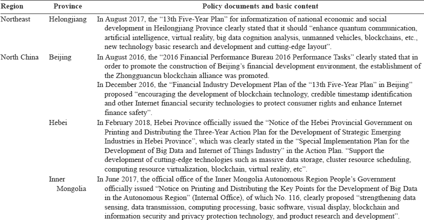

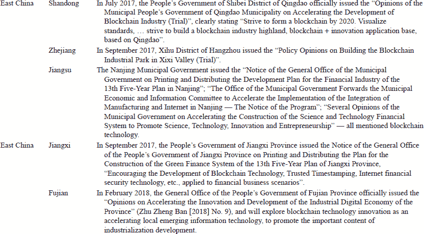

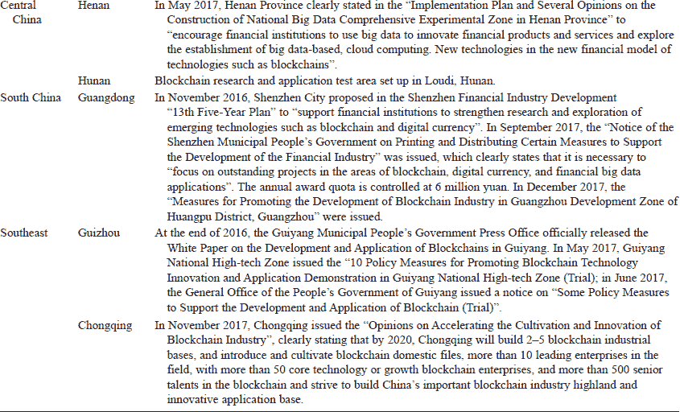

从政策发布方式来看，出台促进区块链发展专项政策的省市数量较少。出台专门政策促进区块链发展的城市包括重庆和贵阳。部分省市认为，区块链是互联网金融领域发展的核心内容，并在相关政策中明确规定要大力发展区块链技术。具有代表性的城市包括北京、深圳和南京；在一些省市，区块链被作为大数据建设与应用的内容或支撑性技术进行推广。例如，河北省或内蒙古自治区在大数据专项推广政策中提到应加速区块链的发展。部分省市在“点带面、试点示范”发展模式的推动下，探索并采取了区域内区块链的发展。广东、浙江、山东等地将根据地级市和开发区出台专项区块链发展政策，例如青岛市人民政府正式发布的《青岛市人民政府关于加速区块链产业发展的意见（试行）》专项政策。

从政策的操作性来看，北京、深圳等城市在政策中对区块链的发展提供了更多务实支持，并明确了对区块链企业发展的具体支持金额。例如，北京可以为企业提供 500 万元资金支持；深圳则通过金融科技专项资金支持企业。

从未来政策趋势来看，2018 年 2 月，河北、福建两省在发布的政策文件中提到加强区块链产业的发展。预计地方政府将继续加大对区块链产业发展的政策支持，政策出台力度将大于以往。同时，随着区块链技术的日趋成熟以及与其他行业融合的加深，出台专项指导意见的可能性增加，以更好地引导本地技术及相关行业的发展。尽管区块链技术在政府管理和服务中的创新与应用具有广阔前景，但在科学监管和标准制定方面仍有很长的路要走。

## 4. 促进区块链应用健康发展的建议措施

### 4.1. 加强区块链发展的顶层设计

区块链技术被认为是继大型计算机、个人电脑、互联网和移动技术之后的第五大颠覆性创新，也是人类信用演进史上继血缘信用、贵金属信用、中央银行信用之后的第四个里程碑。预计它将像互联网一样彻底重塑人类社会活动。为了遵循当前信息互联网向价值互联网的转型：首先，制定区块链技术和产业发展专项战略规划，形成促进区块链发展的顶层设计，推动区块链与大数据、人工智能等国家战略的融合；其次，明确区块链技术和产业发展的关键任务、关键方向和保障措施，支持区块链基础软硬件、存储管理和计算平台等关键技术的发展；第三，加速区块链基础设施建设，培养一批区块链骨干企业和专精特新中小微企业；第四，制定和完善相关法律法规，从法律层面引导和约束区块链的底层技术和应用层面，结合区块链整体系统实现从软件安全、存储安全、业务安全等方面的运行特征。

### 4.2. 加强对核心技术研究的支持

目前，区块链领域已显示出技术和产业创新驱动的明显发展趋势，但区块链技术仍处于初期阶段。相关学术研究严重滞后，迫切需要跟进：首先，建立产学研联动机制，推动国内企业、科研机构、大学和用户单位加强联盟，加速共识机制、智能合约、分布式存储、数字签名等关键技术的发展。其次，推动区块链开源社区的建立，通过论坛成员加强合作，提高支持中小企业发展的区块链技术安全可靠水平。第三，推动区块链与大数据等新技术的融合，完善风险防控。第四，促进国内外产业深度融合与合作，加强各国机构技术交流平台合作，建立各种形式的非政府交流合作机制，积极推动我国区块链技术竞争力。

### 4.3. 选取重点行业先行示范

中国高铁的成功经验告诉我们，技术的应用有利于技术的成熟和行业领先，以及区块链技术的发展：首先，立足典型应用需求，围绕数字资产管理领域的智能制造、新能源和供应链管理。区块链技术将引领供给侧结构改革，支持龙头企业牵头，产研结合，开发区块链应用示范，探索形成区块链应用推广模式，营造应用环境。其次，在基础良好的地区建设区块链综合试验区和区块链产业集群，鼓励当地结合自身优势促进区块链产业集群发展。第三，建设区块链通用开发平台，降低区块链技术研发和应用成本，为中小企业提供创业创新服务。第四，结合国家重大项目建设，打造一批示范项目，带动区块链技术的产业应用。

### 4.4. 加强产业发展与应用监管

区块链的过度使用或滥用不仅不利于产业应用，也不利于国家抢占未来信息战略。这需要相关政府部门高度重视，加强对区块链产业和应用的监管。

首先，加强与区块链技术开发应用相关的监管政策文件的制定，为其监管提供必要的法律依据。作为一项新技术，区块链在法律体系和支持性文件方面处于缺失或滞后状态。从目前大多数政策文件可以确定，目前仍处于部分鼓励阶段。对于如何有效监管区块链行业的开发应用，尚未提出相关措施。为此，相关部委可以发挥牵头作用，制定专门的区块链行业监管试点政策。

其次，加强对区块链技术应用中关键重点领域的监管。有必要组织相关部门，对社会高度关注、与公共生活安全及国家信息安全密切相关的行业中的区块链技术应用加强监管。中央和地方部门应根据其业务范围进行分类管理，加强对区块链行业应用开发的监管，确保区块链行业应用的标准化和有序发展。第三，探索监管新模式，积极借鉴国外经验，尝试实施功能性监管或“沙盒”监管，将被动监管变为主动监管，将事后监管转为事前和事中监管，全面提升监管效率，有效规避行业发展中的风险。

## 5. 积极推进标准和规范的建设

区块链行业的开发和应用离不开相关技术标准和规范体系的建立与完善。为此，要求相关政府部门组织相关力量，加速区块链标准化体系建设，促进中国区块链技术的标准化和可持续发展。

### 发展方向：

首先，加速区块链标准化体系建设，加快与区块链技术相关的数据标准、应用标准和算法机制标准的建立与完善；积极参与区块链领域国际标准化组织工作；争取获得更多话语权；加快参考标准、区块数据格式等基础标准的制定；主导或实质性参与区块链国际标准的制定，推动中国优势技术转化为国际标准。

其次，充分发挥行业协会、行业联盟等社会力量的作用。各地应根据地区区块链行业的发展需求，建立行业协会和行业联盟，在加强与主管部门沟通的同时，充分发挥这些社会组织在专业和技术上的优势。并协助政府部门制定当地行业政策、行业标准和行业规范。

## 6. 促进产业链和生态系统建设

一个典型的区块链系统由数据层、网络层、共识层、激励层、合约层和应用层组成。目前区块链技术的重点是应用。中国应加速推进区块链产业链的发展。可以通过以下措施实现生态系统的完善和建设：

首先，完善区块链行业支持体系，合理布局区块链基础设施建设，加速区块链行业发展公共服务平台建设；

其次，结合实际应用场景和需求，促进公链（`Public Blockchain`）、联盟链（`Consortium Blockchain`）和私链（`Private Blockchain`）的建设与应用；

第三，加速专业人才培养，鼓励并支持重点大学开设区块链专业课程，推动重点企业与高校联合，建立区块链人才培养基地，加速区块链专业人才的培养。

# 第六章

# 推动大数据、物联网与人工智能行业

## 1. 区块链在大数据行业的应用

### 1.1 大数据发展中遇到的问题

随着大数据行业的快速发展，数据本身的价值正受到人们越来越多的关注。金融、物流和互联网等拥有丰富数据资源且信息化程度较高的行业，已经利用大数据实现了更显著的应用效果。在人们大力鼓励大数据行业发展的同时，也受到数据本身带来的一些问题的制约。

（1）“数据孤岛”问题突出，数据信息不全面

由于机制不完善，目前的数据开放和共享程度较低。拥有大量数据的政府机构担心数据泄露和信息安全，对数据共享受到一定限制；企业为了保护商业利益和竞争优势，担心数据开放；个人担心隐私泄露，在公共机构或机构收集个人数据时往往不愿意主动配合。同时，政府机构、行业领先企业，尤其是少数互联网公司掌握了大部分数据资源，但由于定义不明确，归属和法律规定不清晰。政府与企业数据资源的双向共享率低，数据所代表的信息不全面，导致数据分析结果参考价值不大。

（2）数据标准不统一，质量参差不齐

一方面，政府机构和企业拥有大量数据资源。但由于数据格式不统一，无法直接整合使用，需要进行转换和清洗。此外，单条数据的信息格式不统一，除了不全面外，导致数据信息无法使用。另一方面，由于数据采集标准不统一，不同数据源采集的数据在格式、语义和量衡上存在巨大差异。数据融合时无法实现快速准确的解读。同时，我们也发现主流媒体、微信、微博等平台传播的数据可靠性无法考量，在一定程度上影响了数据的质量。

（3）数据安全和隐私问题未得到有效保护

通过数据分析，我们不仅可以理解个人的行为习惯和公司的运营状况，还能预测未来的行为和决策。在这种情况下，在未获得生产实体同意的情况下，被收集、使用甚至流入数据黑市的数据，可能会对个人、企业乃至国家造成严重的安全和财产损害。随着大数据应用的深入，一些法外分子为了获取数据带来的巨大价值，沉溺于私自售卖隐私数据、信息泄露，损害了国家、企业或个人的利益，阻碍了大数据的发展。

（4）数据所有权不明确，流通与利用混乱

如果数据权属不明确，数据所有者就无法保护自己的利益。在流通过程中，数据通过“查看、复制和粘贴”转化为信息所有者的信息，无法定义谁是数据的真正所有者。在数据使用过程中，信息传输会出现偏差和误读。这些问题的出现损害了信息所有者的利益，极大地削弱了数据共享的能力。此外，在数据流通管理生态系统中，数据所有者产生的数据、负责数据云访问管理的云计算服务提供商、数据法律及行政监管机构在物产权、产权定义和安全保护方面存在着不同的法律权利和责任。权责划分不清晰。

（5）数据价值无法准确衡量，数据交易定价困难

数据是一种已获得广泛共识的无形资产。目前，数据交易体系仍然不完善。作为虚拟化的数字资源，其定价标准需要参考数据的普及程度、数据效用、数据稀缺性以及数据特定应用场景产生价值的估计。此外，具有信息属性的数据还需要考虑时间衰减问题，数据定价系统的困难性显而易见。尽管数据交易市场上已经实现了大量不同类型的数据，但数据价格与价值之间的偏差较大，大数据交易市场的规范性仍需加强，这影响了数据交易的发展。

### 1.2 区块链在大数据行业中的应用

尽管大数据仍处于发展的早期阶段，但其技术经过一段时间的沉淀已演变为相对成熟的互联网技术。因此，将新兴的区块链技术整合到以数据为载体的大数据中，将对目前面临发展瓶颈的大数据行业产生积极影响。

#### （1）区块链去中心化和自主解决信息孤岛问题

数据流通是大数据行业发展的关键。区块链不依赖第三方管理机构或硬件设施的去中心化特性，将“人”的信任问题转化为机器信任的自主特性，有效解决了大数据信息孤岛问题。信息可以透明化地进行。区块链可以监管数据使用，明确数据授权范围。数据脱敏将在一定程度上减少数据所有者的顾虑，从而使数据更容易被开放。

#### （2）区块链多方共识的账本特性增强了数据存储质量

区块链是一个多方共同记录和维护的分布式数据库。数据的记录和存储由每个交易节点共同维护。所有参与者的一致共识意味着信息通过网络中的验证得到了核实。区块链的去中心化使得单个节点无法随意修改和调整数据，降低了制造错误数据的可能性。区块链为数据质量提供了前所未有的强信任背书，极大地提高了数据分析结果的准确性和数据挖掘的效果，使得大数据的预测和分析能力能够得到充分利用。

#### （3）区块链利用密码学和分布式技术保护用户隐私

一方面，区块链可信、安全、不可篡改的特性允许更多数据被释放且更加安全。另一方面，基于区块链的数据脱敏技术可以保障数据隐私。数据脱敏技术主要利用加密算法等手段保护个人隐私，防止核心数据泄露。此外，区块链的分布式数据库统一存储数据，并在不访问原始数据的情况下进行数据分析，从而保护数据安全并供相关机构和人员研究使用。

#### （4）区块链的链结构的可追溯性有效解决了数据所有权问题

让数据连接流通产生价值，资产化是大数据发展的目标。数据资产本质上与其他资产不同。数据复制的潜在威胁使得所有权不明确，成为大数据流动的主要障碍。基于去中心化的区块链可以破解复制数据的威胁。数据一旦上链，将永远带有生产者的印记。即使经过多次复制和打印，数据接收方也能通过记录追溯数据本身。保护数据生产者或所有者的合法权益有利于构建可信的数据资产交易环境。区块链用于注册和认证，使交易记录在网络中可识别、透明且可追溯，从而明确大数据资产的来源、所有权、使用权和流路径，为数据提供保障。

#### （5）区块链的可追溯性和不可篡改性有助于准确衡量数据价值

区块链定价模型需要综合考虑数据的多个要素，如基础价值、数据时间、使用历史、使用频率以及特定用途的价值。区块链的可追溯性和不可篡改性可以清晰记录每条数据的产生、流通、交易和使用的整个历史过程。各方贡献的大小和使用情况清晰可见。通过区块链记录数据的多维度标签有助于设计更灵活的数据定价模型。此外，如果数据源更多，可以根据交易市场中每个数据的活跃度和总价值进行加权分布式定价。

#### （6）应用场景

区块链溯源平台可以解决数据交易过程中信息透明度低、数据伪造或篡改以及数据交易非法转卖的问题。基于区块链技术的京东维源数据交易溯源平台如图 6.1（`chap6.xhtml#fig6-1`）所示。

在数据交易过程中，经常引发许多法律纠纷，例如数据的非法转售和数据的知识产权纠纷。在解决问题的过程中，由于数据交易信息不透明，甚至存在虚假信息，参与实体往往难以准确了解相关事项的状态，导致难以取证和追责。区块链的功能是不可造假的，由于时间戳等特性的存在，这些特性正是为了解决此类问题而存在。

区块链技术的应用可以实现交易双方之间的数据透明化。任何个人或机构的价值数据资产都可以通过区块链进行注册，其交易记录在整个网络中被认可、透明且可追溯。利用区块链技术，京东万链商家发布的每条数据都可以发布在区块链上，并成为交易的虚拟货币。在数据丢失时，可以在区块链上找到。区块链中数据资产的发行和流通如图 6.2 所示。

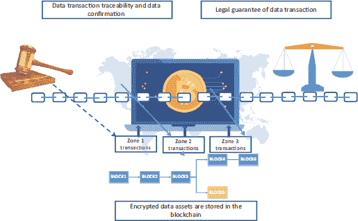

**图 6.1.** 京东万链 — 基于区块链的数据交易追溯平台

*来源：* 京东云官方网站。

基于区块链技术开发的数据交易追溯平台将帮助用户解决数据追溯和确认的问题。用户可以使用该平台明确数据资产的源头、所有权、使用权和流通路径，实现易取证和问责，从而维护其合法权益。

### 1.3. 区块链与大数据融合的发展

#### （1）大数据是生产要素的转化，区块链是生产关系的转化

大数据、区块链以及云计算、人工智能等新兴技术是互相关联、相辅相成的。大数据是基础资源。云计算是基础设施。人工智能依赖云计算和大数据，并推动行业逐渐向智能化时代迈进。区块链为各种业务的基础设施和交易机制的转型创造了条件，其实现离不开数据资源和计算分析能力的支持。从未来发展趋势的角度来看，大数据和区块链在实际应用过程中正变得越来越紧密。各者的技术边界正在稳步弱化。未来的技术创新将日益关注技术的交汇点和融合领域。特别是在行业的具体应用中，区块链和大数据将实现新的社会融合，推动行业科学技术的发展进入新阶段。

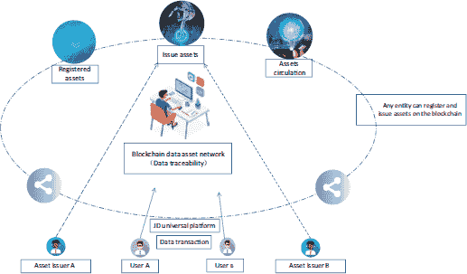

**图 6.2.** 京东万链 — 区块链中数据资产的分布与流通

*来源：* 京东云官方网站。

#### （2）区块链作为一种技术在一定程度上改进大数据的发展问题

作为一种分布式数据库技术，区块链利用去中心化、防篡改、可追溯、安全和隐私等特性，解决了大数据发展过程中遇到的许多问题。区块链与大数据的融合打破了数据孤岛，确保了数据的真实可靠性，并通过私钥签名验证利用区块链技术确保数据安全，而这正是数据流通的痛点之一。它发挥了显著的改进作用，极大提高了数据流通的效率。

#### （3）大数据作为资产更好地发挥区块链的价值链

区块链技术的使用预示着价值时代的到来。区块链是自比特币诞生以来人们逐渐熟悉的技术。任何资产都可以在区块链上进行注册、认证和交易。大数据作为资产也可以用于处理与交易相关的服务。

#### （4）区块链与大数据的融合驱动共享经济的发展

共享经济依赖大数据、云计算、物联网和区块链等新兴技术来重新组合并高效利用社会资源和要素，打破时空限制，从而实现社会效益的最大化。它解决了大数据的发展瓶颈，同时也让社会资源的分配更加合理，信用体系更加完善。

## 2. 区块链+物联网

物联网基于互联网实现万物互联。它是计算机和互联网之后信息产业发展的第三次浪潮。物联网是一个跨云计算、机器学习、人工智能、安全和隐私的领域。从智能家居到智能制造到智能互联网和公用事业，物联网将带来巨大的社会效益。全球范围内已使用的传感器和智能控制器达到数十，未来几年将呈指数级增长。物联网在爆发的同时也面临许多问题和挑战，区块链技术为解决这些问题提供了可能。同时，由于物联网提供了广泛的应用空间，区块链将越来越多应用于成熟场景，推动行业生态完善。

## 2.1 区块链护航物联网

物联网中的工业机器设备、传感器、控制器、基础设施、汽车、家电和人员通过网络连接，产生海量数据。结合强大的数据分析能力，能够更好地管理网络中的机器和人员，提升资源利用效率和水平，为人类社会带来巨大的商业价值。然而，物联网在带来机遇的同时也带来了巨大的挑战。如何确保数据安全已成为物联网发展的薄弱环节。如何利用物联网行业加强业务创新、加速生态体系建设也是一个重要问题。

### (1) 物联网去中心化与资源合理配置

随着物联网技术的快速发展，物联网设备数量呈几何级数增长。这些设备的管理和维护将带来巨大的成本压力。中心化服务的计算、存储和带宽成本可能会增加到无法负担的水平。区块链技术为物联网的数据传输提供了点对点的直接连接。整个物联网解决方案不需要引入大型数据中心来进行数据同步和管理控制（包括数据采集、指令传递和软件更新）。通过区块链网络进行传输，极大降低了物联网的运行成本，并合理配置了物联网资源。

### (2) 使物联网中的用户隐私等数据更安全

在物联网领域，中心化服务系统的所有监控数据和控制信号都由中央服务器存储和转发。中央服务器存在安全违规和隐私泄露的风险。区块链技术采用非对称加密方法，数据具有不可逆性，有效解决了物联网中心化隐私泄露的可能性，用户的数据和隐私将更加安全。

### (3) 设备更加智能化，新的业务场景随之而来

区块链技术可以为受信任的中介机构提供直接交易，而不仅仅是物联网设备的简单连接。区块链智能合约的应用实现了设备之间的直接交易。自主去中心化点对点测量（`ADEPT`）是 IBM 和三星联合开发的概念验证系统，它利用区块链技术构建了智能设备的分布式网络，验证了物联网架构去中心化的可行性。`ADEPT` 使连接的设备能够直接、安全且高效地与复杂的业务逻辑进行通信。

## 2.2 开发与应用现状

国内外一些企业已布局区块链。目前，区块链在物联网中的应用已有一些案例。但总体而言，该行业的发展仍处于早期阶段，可能在未来几年进入关键发展期。

区块链在物联网中的应用主要集中在物联网平台、设备管理和安全，包括智能制造、车辆网络、农业、供应链管理、能源管理等领域。目前，国内外在智能制造和供应链管理领域已有一些成熟项目。其他领域的多数项目仍处于研发阶段。

IBM、微软、亚马逊和 SAP 都在各自的云平台上提供“区块链即服务”（`Blockchain-as-a-Service`），为未来的物联网设备接入和高级布局提供弹性资源池。2016 年 10 月，IBM 启动的 `Bluemix` 平台区块链项目基于物联网云平台增加了区块链服务，从而可以根据用户需求实现不同的功能。

初创公司从分布式能源系统、新交易模型、认证和交易市场等不同角度切入区块链领域，并最初涉及相关的物联网硬件制造。例如，瑞典国营电力公司 `VattenFall (Water Falls)` 投资了荷兰阿姆斯特丹的 `PowerPeers`，建立了一个允许消费者自由选择电源通道的能源共享平台；德国 `RWE` 与初创公司 `Slock.it` 合作启动了 `BlockCharge` 电动汽车充电项目；`RWE` 的子公司 `Innogy SE` 推出了区块链交易平台 `Share&Charge`。

2016 年 9 月，万信控股“万信能源”项目实现了利用区块链技术的物联网去中心化。2017 年 3 月，阿里巴巴、中兴和中国移动宣布联合创建物联网。2017 年 5 月，京东和霍齐林进行了可溯溯溯源。2017 年 6 月，中安科技推出了相关产品项目。

`SDChain` 是全球首个物联网顶层架构国际标准。它是世界上第一个物联网顶层架构国际标准，已被 33 个国家采纳（标准号为 `ISO/IEC 30144:2018`）。2017 年 12 月，物链（`CPChain`）正式发布，构建了物联网系统基础数据平台，以最大化发挥物联网的数据价值。物联网的其他区块链应用包括 `UCT`、`DATA`、`INT`。

## 2.3 技术原理

区块链为物联网的应用实践提供了完整的技术解决方案，为物联网的建立和完善提供了重要支持。通过设备身份权限管理、智能合约机制、数据安全和隐私保护、数据资源交易信任机制等概念，应用区块链的概念和技术，使物联网实体与金融保险资源相互融合，增加信任，保护隐私并重构线上线下价值信用体系，极大扩展了物联网的增值服务和工业增量空间。

区块链与物联网的融合应用框架分为三层，从下到上分别是：通信与基础设施、区块链、物联网。通信与基础设施为区块链和物联网提供基础设施硬件和通信设备。作为中间层，区块链利用通信和基础设施的硬件资源为物联网层提供信任或共识支持机制或服务。

## 2.4 应用场景

区块链和物联网都被广泛使用，两者的融合可以促进许多领域的创新。图 6.3（`chap6.xhtml#fig6-3`）展示了区块链与物联网融合应用的全景。

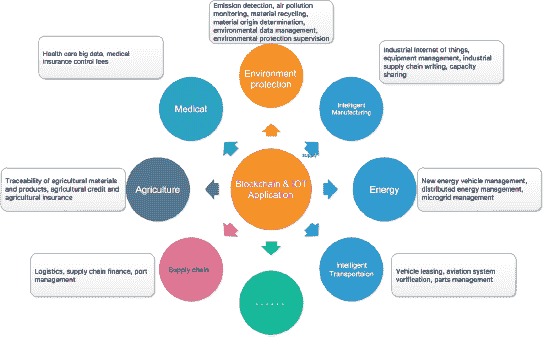

图 6.3 区块链与物联网集成应用全景，其他应用领域将在其他章节描述。

以下是区块链在环境保护领域的应用。

### (1) 环境保护领域面临的问题

在重点污染源自动监控和环境质量在线监测等系统的构建中，通常使用传感器、`RFID` 以及其他相关设备和技术。这些设备和数据存储在企业内部，存在实际问题。企业可能会直接更改设备状态并篡改相关数据。此外，环境数据的开放共享也是一个问题。一方面，某些地区和企业不发布或披露污染数据，以避免暴露污染问题，导致监管机构和公众难以进行监督；另一方面，由于缺乏合理的解决方案，环保、气象等相关部门无法实现数据共享。数据共享增加了环境管理的成本。

### (2) 区块链提供的解决方案

区块链与物联网的融合可以解决环保业务监管的问题。首先，区块链技术的应用可以使每个环保物联网设备的身份具有可信度且数据不可篡改。其次，在区块链与物联网融合的应用中，存储在区块链中的交易信息是公开的，而账户身份信息经过高度加密，只有在数据所有者授权的情况下才能访问，从而保护了企业和机构的隐私，并实现了环境数据的必要共享。第三，基于区块链技术的物联网平台可以实现不同厂家、协议和型号设备的统一接入，建立一个可信的环保数据资源交易环境，帮助实施环保税政策。

### (3) 应用案例

`NewBchain` 项目基于区块链技术，它彻底改变了废水处理和环保的业务生态，并为创新的区块链废水处理创建了分布式经济业务生态系统。

`NewBchain` 项目将记录水污染处理的整个生命周期。项目创建者、参与者和消费者可以参与 `NewBchain` 投资环保和废水管理，并通过 `NewBchain` 对其各种消费、交易和管理获得回报。以此，`NewBchain` 每一个环节的参与者都有动力促进 `NewBchain` 和水污染环保的发展。

## 2.5 展望

区块链技术为解决物联网行业的发展问题和拓展物联网的产业发展空间提供了新思路。物联网向区块链网络转换的速度可能会远超目前的通用预期。当物联网真正实现万物互联时，区块链的价值将得到进一步发挥。

## 3. 大数据、人工智能与区块链的关系

2014 年，本书作者严岩主持了国家发展改革委员会的“信息化（大数据）增强政府治理能力研究”项目，聚焦于“大数据技术与应用发展的战略需求”。在项目推进期间，组织了活跃在数据交易领域的课题开展研究工作。在提交给国家发展改革委员会的研究报告中，研究小组提出大数据策略的应用层（特别是大数据交易市场）包括四个方面：交互、集成、交换和交易。

交互是大数据的第一层，例如用户的 Web 访问，通过与网站交互产生数据；当运营初步集成生产中形成的数据时，可以对数据进行处理和服务。这是数据应用的第二层；不同的数据生产者或供应商根据共同约定的规则交换数据并获取自己的数据，这是第三层应用；当参与者不一定以使用数据为单一原则，而是进入数据市场进行交易时，数据市场的定价在价格发现中发挥了作用，这是第四层。今天，在各地的数十个大数据交易中心（站）中，交易状态处于混乱状态。为什么会出现这种情况？

当我们进入大数据时代，会有意识或无意识地穿梭于原子世界（现实世界）和比特世界（虚拟世界）。当原子世界交易市场中的交易主体可以被感知时，其复制成本也是很高的。我们可以称之为竞争性资源。但比特世界中的交易主体是虚拟的，在某些情况下它可以进行高成本复制，几乎是无限成本的，因此此类资源可能变成非竞争性资源。

幸运的是，区块链的应用可以识别并为比特世界添加时间戳资源，利用区块链加密技术保护产权，并通过智能合约进行交易。这是解决上述问题的更好方案。

同时，人工智能（包括计算能力、算法等）的突破，使得大数据应用过程中的各个步骤，特别是人工智能建模能力的突破，解决了多年来的瓶颈。

# 第 7 章 区块链与实体产业结合的应用案例

## 1. 区块链 + 金融

### 1.1 金融科技的新动力——区块链

区块链技术被认为是具有引发第五波颠覆性革命潜力的核心技术，继蒸汽机、电力、信息和互联网技术之后。“区块链技术”已成为科学和金融界最时尚的词汇。观察国内外，各领域的专家（尤其是金融人士）都对此感兴趣。作为 `Bitcoin` 的底层技术，区块链不仅像 `Bitcoin` 一样具有争议，而且正在更大范围内被接受和扩展。未来，区块链无疑将为金融科技带来新的发展。

#### (1) 区块链 + 金融

“区块链+金融”是金融领域前所未有的颠覆和创新。区块链可以为金融业带来巨大价值，主要体现在以下两个方面：

(a) 降低成本并提高效率

(i) 降低通信成本：以证券交易为例，证券交易市场往往需要中央结算系统、证券公司、交易所和银行的参与和协调，这将导致过度成本。然而，区块链可以通过多签名等技术实现一站式服务，信息可以共享，从而有效提高整个业务的协作效率。

(ii) 减少人工增加自动化。

(iii) 缩短结算周期：确认区块链交易的过程实际上是清算、结算和审计的过程。

(iv) 保留监管记录和审计追踪，便于监管和审计。

(b) 降低风险

(i) 随着交易确认完成结算，交易方的风险大大降低。

(ii) 区块链使交易数字化处理并执行完整的记录，可以有效控制由欺诈和人工输入等人为因素导致的运营风险。

(iii) 由于区块链存在分布式网络和共识机制，金融企业面临的黑客攻击等系统性风险也随之降低。

#### (2) 驱动新业务模式的诞生

区块链技术的特点是能够实现在中心化模式下难以实现的业务模式。目前，在物联网行业，相关机构已提议使用区块链技术来管理数百个物联网设备的身份、支付和维护任务。

#### (3) 促进去中心化

金融去中心化的驱动力在于技术的转型。去中心化可能直接影响金融活动的规则。这些规则涵盖了法律层面、业务文化和金融文化等各个方面。值得注意的是，金融中介的出现已经去中心化，且去中心化有效解决了金融信息不对称，以及搜索成本、匹配效率、交易成本等问题。区块链促进了金融区的中心化，使得金融行业的新信息匹配成为可能。

区块链金融去中心化对金融业将产生三种影响：

(i) 区块链去中心化技术应用于金融领域，可以提高资源配置的效率。

(ii) 区块链去中心化技术对实体经济有一定影响，并也会影响金融的发展方向，导致“小而美”型行业和企业的出现，使去中心化更加及时和智能化。以合作和共赢的心态实施新的金融服务已变得更加必要。

(iii) 在制度层面实施，基于程序算法等，创建一套开放透明的公共“游戏规则”。

### 1.2 区块链 + 金融场景

根据麦肯锡公司的数据，区块链技术对金融的影响最可能发生在支付领域以及交易银行、资本市场和投资银行的主要应用场景，即数字货币、跨境支付与结算、汇票和供应链金融、证券发行与交易以及客户信誉和反欺诈。

区块链技术本身是比特币的底层技术，也是一种人人参与记账的技术，可以被视为共享大型账本的数据库。从技术角度来看，区块链与金融注定有着密切的关系。基于去中心化的特征，即不可篡改性、共识机制和匿名性，区块链在金融领域的应用也将成为推动金融向更高阶段转型的重要起点。

#### (1) 数字货币

作为一种数字货币，比特币彻底颠覆了人类观念中的货币概念。从过去人类使用实物交易到目前的物理货币交易，再到未来的信用货币，这一发展过程随着人类商业活动和社会的不断发展而演变。随着电子金融和电子商务的兴起，数字货币变得越来越安全、便利且交易成本低廉，已应用于基于网络的业务实践中，并将逐渐取代目前的物理货币，成为主流的流通手段。

具体而言，基于区块链技术的数字货币包括以下三类：

(a) 社区代数字“币”

社区数字“币”由社区的认可背书。作为数字货币的代表，比特币可以说是首个去中心化的社区数字“币”。

(b) 内部虚拟“币”

目前，企业内部虚拟“币”的使用落后于货币类“币”。企业内部存在的虚拟“币”主要形式有游戏虚拟货币、积分、Q 币、储值卡等。但这些数字货币往往无法与区块链技术形成真正的生态系统。未来，如果数字货币的发行能够遵循某些规则，我相信将更多公司进入数字虚拟“币”领域。届时，全球企业将在数字虚拟“币”的连接下形成跨国生产和金融活动，实现全球企业之间的互联互通。

(c) 国家数字货币

2018 年 4 月，委内瑞拉总统尼古拉斯·马杜罗·莫洛斯表示，面对日益恶化的流动性危机，政府将通过出售石油这一新型加密货币获得 10 亿美元收入。此举目的是增加国家的国际储备和外汇储备，防止黑市美元升值。

在委内瑞拉发行国家数字货币“Petro”后，瑞典也决定推出自己的加密货币 `E-Krona`，旨在全球市场上与私有加密货币竞争。随着瑞典逐渐成为一个无现金社会，瑞典银行（`Sveriges Riksbank`）认为，对于渴望使用数字货币的人应该有一个替代方案。瑞典央行计划推出 `E-Krona` 作为该法定货币，用于消费者、企业和政府机构之间的小额交易。

事实上，许多国家正在探索国家加密货币的潜力。2016 年，中国银行也举办了数字货币研讨会，对数字货币的早期实施进行了深入讨论。

目前，全球央行普遍认为数字货币可以取代现金，减少纸钞的发行和流通成本，极大有助于提高支付结算的便利性。同时，数字货币的使用可以增加交易的透明度，在以下三个方面发挥重要作用：

(i) 反伪造；

(ii) 减少洗钱和逃税等犯罪行为；

(iii) 金融服务自动化。

#### (2) 银行信贷

基于社会分工，银行拥有庞大的金融客户群，该群体包含的客户属性几乎涵盖了所有的经济和社会个体。对于银行而言，个人银行账户数据对于银行信用信息体系的构建至关重要，包含了判断客户信用风险的数据信息。因此，银行账户数据是构建银行信用信息体系不可或缺的优势。此外，银行客户数据具有一定的历史意义，对于那些不参与数据追溯的科技公司或新兴“互联网+”公司来说也很难找到替代资源。

#### (b) 提高监管门槛和法律合规成本

目前，国家对社会信用的监管非常严格，这提高了该领域的准入门槛并增加了法律合规成本。然而，作为金融领域的传统运营机构，与试图进入信用评估领域的科技公司和互联网平台相比，银行实际上处于独特的优势地位。

#### (c) 反诈行为以预防金融犯罪

过去几年，为了满足日益严苛的监管需求，全球商业银行选择增加信贷审查和客户信用投入，以有效促进反诈行为的发生，从而减少金融犯罪的发生。区块链上记录的数据（包括客户数据信息和客户交易记录）对银行有效识别异常和防止欺诈有很大帮助。基于区块链技术的信用特性，银行在区分客户信用时可以将坏客户信息数据存储在区块链上，这样存储的客户数据和交易记录不仅可以实时更新，还能得到更好的保护。银行通过分析和监控共享分布式账本中客户交易行为的异常情况，及时判断并消除欺诈。

`Chainalysis` 是一家旨在打击数字货币洗钱和欺诈的瑞士初创公司，它为银行设计了一套反诈监控系统。该系统旨在帮助银行监控和分析区块链中的异常交易行为，从而有效控制交易中的非法活动，最终帮助银行实现反洗钱和反诈的目标。

#### (3) 数字票据

票据本身是一种集成了支付和融资功能的工具，近年来深受银行和企业的青睐。目前的票据市场已成为货币市场的重要组成部分，并受到了金融机构的高度关注。票据业务为实体经济的发展提供了重要的支撑作用，促进了货币市场的进一步扩张，丰富了金融市场的产品种类。

自 2015 年 5 月以来，中国国内票据业务发生了多次信用风暴。虽然票据业务创造了大量的流动性，但相关市场也滋生了非法经营，并发生了多起商业银行票据业务事件。

所谓的数字票据实际上并不是一种物理票据，但也并非单纯的虚拟票据。它是基于现有票据属性、法律和市场，通过区块链技术产生的新型票据展现形式。基于区块链技术的结合，它形成了一种更安全、更智能、更便利且更有前景的票据形式。数字票据的出现为货币市场的发展和整个金融行业带来了另一个新气象。

具体而言，构建在区块链技术上的数字票据具有以下三个优势：

##### (a) 系统设置和数据存储跨越中心化服务器，不需要中心级应用。这将带来以下四个优势：

- (i) 消除了中心化应用和干预系统的开发成本。

- (ii) 降低了传统模式下系统的维护和优化成本，包括设备投入成本、数据备份成本和应急管理成本。

- (iii) 降低了系统中心化的风险，避免因过度中心化导致服务器崩溃或被黑客控制，因为分布式数据库具有强大的容错能力。

- (iv) 减少了中心化模式下重复记录和存储数据导致的成本浪费。每位参与者记录的数据簿可以被视为子账本，实际上是总账本的一部分。

##### (b) 由于数字票据的数据具有完整性、透明性和通过时间戳的可验证性，任何交易都可以被追踪和查询。数据不仅保存在服务器或一个参与者中。在机器中，与贸易秘密的内容也可以通过相应的技术进行屏蔽，从而实现保护隐私的目的。

##### (c) `smart contract` 的形式使得数字票据的全生命周期具有一定的编程性，即它是限制且可控的。

基于这些优势，数字票据中三个环节的应用场景如下：

- (i) 承兑环节；

- (ii) 流通环节；

- (iii) 回收环节。

#### (4) 跨境支付与结算

目前，跨境电子商务处于起步阶段，对进口食品、日用品、饮料、婴儿奶粉等的需求促进了跨境电商的发展。但在为各国提供更多业务机会的同时，跨境支付也表现出许多痛点。

具体而言，这些痛点体现在以下三个方面：

- (i) 手续费极高且周转期长。

### (ii) 跨境支付欺诈日益严重，导致了跨境资金风险和其他法律业务风险。

### (iii) 间接环节多。

然而，区块链的出现并被应用于跨境支付和结算场景中。它消除了中介银行的角色，实现了点对点的快速、低成本跨境支付。具体而言，区块链在跨境支付和结算场景中的应用优势主要体现在以下三个方面：

#### (i) 减少运营成本和其他成本

首先，区块链消除了转账行，意味着去除了中间费用。其次，因为不需要与代理行建立银行关系，竞争将加剧，从而对费用和外汇业务产生压力，导致更低的整体成本。最后，过程更加透明。

#### (ii) 更安全

区块链的分布式账本技术使得跨境支付和结算的安全性得到更好的保护。

#### (iii) 交易整体速度加快

未来，银行将不再需要第三方，而是采用区块链技术创建的点对点支付方式，从而节省传统的中间环节，实现实时支付和对账，且取现方便快捷。它满足了跨境电商结算的及时性和便利性要求，提升了整体交易速度。

`Ripple` 是一家位于美国旧金山的新兴金融公司，旨在利用类区块链技术概念开发跨境支付和结算业务。`Ripple` 构建了一个没有中心节点的分布式数字支付网络，使用分布式身份验证技术，从而帮助全球范围内的中小型银行以低成本完成即时跨境转账业务。

`Ripple` 只是利用区块链技术为银行等金融机构提供解决方案的典型例子。目前，`Chain`、`Ethereum`、`IBM` 和 `Microsoft` 等知名公司也开始使用区块链技术开发跨境支付结算服务。可以预测，在不久的将来，金融系统现有的传统交易模式将被高性能、高安全和低成本的区块链技术所取代。

## (5) 证券交易

证券的发行和交易在正常运行过程中非常复杂，效率相对较低。在正常情况下，发行证券之前，公司会寻找一家经纪公司与证券发行中介机构签署委托征集协议，然后进行一系列申请程序，最后寻找投资者认购。这一繁琐的过程需要很长时间才能完成，通常需要三天时间。

基于这种情况，有必要寻找一种能够简化证券发行基础并提高交易效率的有效技术。使用区块链技术是一个很好的解决方案。基于区块链本身的特性，区块链技术使得金融交易市场的所有参与者能够平等地共享和使用数据信息，使交易过程更加开放透明，从而大大提高了交易的及时性。双方使用共享网络参与证券交易活动，这使得高度依赖中介完成操作过程的传统交易模式进一步转变为去中心化的扁平网络交易模式。这种基于区块链的交易模式在金融市场的应用呈现出了一些独特的优势。

### (a) 降低证券交易成本

它具有很大程度上降低证券交易成本的能力。区块链技术的应用可以使证券交易过程更加简单、透明、快速和高效。

### (b) 提高业务决策效率并减少黑箱操作的可能性

区块链技术可以记录关于两个或多个双方身份和交易量的实时准确信息，这对于证券发行人更有利。能够快速清晰地了解所有权结构，从而提高业务决策的效率。区块链的开放透明性和追溯性使得证券交易过程中的电子记录减少了黑箱操作和内幕交易的可能性。这有利于证券发行人和监管机构维护证券市场的稳定和安全。

### (c) 缩短交割时间并降低交易风险

在证券交易过程中使用区块链技术将之前的交易时间从 1 到 3 天缩短到了 10 分钟。只需 10 分钟即可完成整个交割过程，降低了交易风险并提高了交易的效率和可控性。

在证券交易场景中使用区块链技术大大提高了效率。结果，越来越多的证券公司开始关注并尝试，例如美国证券交易员自动报价报价（`NASDAQ`）、芝加哥商品交易所、迪拜多商品交易中心等。在中国，这由上海证券交易所带头。组织良好的 `ChinaLedger Alliance` 也在此方面进行了尝试。事实证明，大多数取得了良好的效果。

澳大利亚证券交易所（`ASX`）希望在 2020 年前实施区块链技术。

2017 年 12 月 13 日，`BTCManager` 报道了 `ASX` 使用区块链技术改进其股票交易平台。此前，该交易所对 `DLT` 进行了为期两年的测试，包括建立概念验证、允许潜在用户测试平台以及在实时交易环境中进行基础版本的成品运行。该交易所已成为历史上第一个开始实施区块链交易匹配系统的大型交易所。在新闻发布会上，`ASX` 总裁兼首席执行官 Dominic Stevens 表示：“我们相信使用 `DLT` 替代 `CHESS` 将使我们的客户开发新服务并降低成本，并将推推金融市场创新的前沿。尽管我们还有很多工作要做，但今天宣布的消息是这段旅程中的里程碑”。

## 1.3. 区块链 + 银行业金融应用

### (1) 区块链 + 信贷贷款

在金融系统中，贷款最重要的目的是调查和评估借人的信用，以确保信贷业务的安全，以及信用企业能够盈利。因此，“信用”一词对于贷款至关重要。

目前，除了银行贷款外，`P2P lending`、小贷公司、提供贷款业务的担保公司、金融公司、金融租赁公司、典当公司、经营贷款业务的保险公司以及专门贷款公司层出不穷。特别是 `P2P lending` 作为互联网金融的重要部分，近年来呈现出野蛮式增长。然而，由于技术因素、管理能力、法律环境和信用环境的影响，`P2P lending` 的信贷风险变得日益突出。

显然，信用报告问题已成为许多信贷机构当前业务的焦点。通常在贷款之前，相关的贷款公司会预测贷款可能面临的风险，评估借人的还款意愿和能力，并采取有效措施减少或避免信贷风险。对借人的信用评估通常通过其个人道德（是否诚实可靠）、资本（自有财产状况）、能力（及时还款的能力）和抵押品（审查抵押品的价值和变现难度）来进行。还会对业务环境环境（是否适应变化的环境、业务的稳定性和可持续性）以及连续性（预测公司产品的生命周期和市场份额，以及公司的市场前景）进行评估。然而，目前信贷贷款业务的发展主要考虑借人自身的还款能力。

贷款人的信用调查和分析是通过一系列流程完成的。这一过程不仅工作量大，而且存在信息不全、数据不准确、效率低下和易于篡改等问题。

然而，区块链技术在信贷业务中的应用通过在其程序算法中自动记录海量信息并将海量信息存储在区块链网络的每台计算机上，使得这些信息更加透明。开放性增加了信息篡改的难度，同时也大大降低了使用成本。每家贷款机构都以加密的形式存储和共享客户的信用状态。此时，客户可以自己申请贷款，而无需去央行申请信信查询，这意味着实现了去中心化。利用区块链相应的数据信息，可以快速完成所有的信用调查和分析工作。

此外，基于区块链的智能资产可以建立无信用的贷款关系，且已在区块链上注册的数据资产可以通过私钥随时使用。当贷款机构向借款人贷款时，可以使用智能资产作为抵押，然后利用智能合约约束自动执行可定位为抵押品的智能资产。当所有支付流程完成后（即贷款全额偿后后可以通过智能合约的条件自动解锁，这可以很好地解决借贷双方之间可能存在的问题和争议。

2017 年 1 月，中国邮储银行与国际商业机器（中国）有限公司（`IBM`）联合推出了基于区块链的资产管理系统。

2017 年 1 月，浙商银行也发布了基于区块链的移动数字钞票平台，为移动客户企业和个人提供了发行、签名、转账、交易和兑换移动数字钞票的功能。

2017 年 2 月 4 日，由中国人民银行推广的基于区块链的数字票交易平台成功通过测试。

2017 年 5 月，银联与京东金融共同宣布双方已合作开放了区块链技术底层并成功完成测试。作为双方战略合作协议的一部分，该区块链平台的落地意味着双方都有条件在底层平台的基础上实施更多商业应用。

2017 年 6 月，中国农业银行招标了区块链平台项目，计划将许多银行核心系统应用及其他创新业务基于区块链底层平台和数字票（`digital bills`）落地。

2017 年 7 月，中信银行与中国民生银行联合启动了银行间国内信用证区块链应用。

此外，在 2017 年 7 月，包括中国建设银行在内的 22 家国际银行加入了 `SWIFT` 区块链试点计划 `PoC`。

目前，中国许多银行都在探索区块链的应用，并认识到在一定范围内它可以提高某些方面的效率。区块链技术给银行业带来的变化正在从概念走向广泛应用。这种区块链的应用将能够取代低的银行系统。

当然，区块链技术也可以应用于企业与企业之间以及个人与个人之间的贷款，特别是在陌生人之间的借贷情况下，可以很好地解决信任问题，使贷款业务能够为借款人和贷款人创造更友好的贷款环境，并有效降低贷款违约风险。

除了上述贷款场景外，区块链技术还可以应用于数字企业债券。发行人在区块链上进行自主注册。如果进行抵押或使用第三方进行担保，相关资产或担保也需要通过注册方式进行锁定。债券投资者通过各自的端口接入自动发行系统。认购后，当发行人偿还本息时，可以通过智能合约中的条件自动解锁，债券债务关系也将自动解除。

### (2) 区块链 + 可信电子凭证应用

目前的电子凭证依赖于第三方机构提供的存储平台。它基于中心化架构，利用该机构的信用提供电子凭证的存储、安全、可追溯和验证等服务。电子凭证容易被篡改、删除或丢失，导致电子凭证的有效性不强，从而限制了无纸化记录的推广和发展。

针对上述问题，银联提出了一种可信电子凭证解决方案。以电子采购订单为例，银联、商户、机构和监管机构构成底层区块链平台，用户在商户侧获取的电子采购订单的特征值（`hash value`）被自动存储在区块链平台中。区块链不可篡改的特性确保了数据的真实性和可靠性，后续参与者可以验证凭证的真实性，有效促进了凭证的无纸化发展，如图`Figure 7.1`所示。

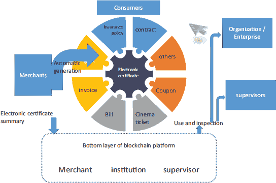

**图 7.1.** 区块链 + 可信电子凭证应用

### (3) 区块链 + 数字整合应用

目前，银行积分存在三个方面的问题：积分感较弱、积分接受度有限以及积分过于碎片化。

针对上述问题，2016 年 9 月，银联与`IBM`联合发布了报价与兑换的原型 `PoC`，即行间积分可以兑换，甚至跨行业兑换，例如航空积分、超市积分等。但由于每家银行的积分价值不同，每家银行对积分兑换的观点并不一致。

在此阶段，在与万达集团重新梳理积分场景的过程中，发现了一个新场景——积分收集，即直接通过积分消费的场景。随后，银联、银联商务和万达集团计划构建一个用于数字整合实践的区块链底层平台。银联负责整合平台业务方案（积分结算）的设计与运营。早期将寻求银行接入网络作为积分。发行方万达集团提供资源，银联通过业务转型 `POS` 机进行积分采集。希望从接收积分开始，逐渐扩大积分业务，如积分营销、积分兑换、电子凭证等，如图`Figure 7.2`所示。

资产托管行业实际上是委托人对受托人资产委托的认可，包括实体资产和无形资产，以及相关资产的托管与保护。资产托管业务的主要步骤包括签署托管合同、开户、估值会计、资金结算、投资监督、信息披露、对账等。这一过程相当复杂，参与托管业务的门槛被认为极高。托管业务面临的主要风险点包括法律风险、操作风险和声誉风险。面对许多风险问题，可以说区块链技术的应用为托管行业链的组织、交易方式和业务流程变革提供了创新的技术支持。

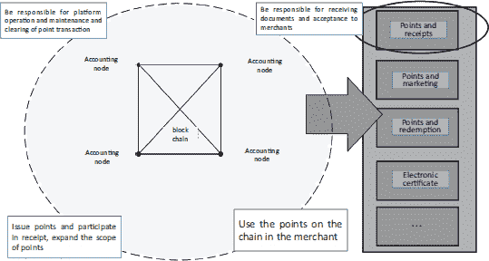

**图 7.2.** 区块链+数字融合应用

虽然没有明确规定区块链技术不能解决托管业务中的许多风险问题，但从托管业务本身来看，采用区块链技术可以实现托管合同的上限并符合投资监督指标。可以通过智能合约对托管资产进行运行、控制和跟踪，并对估值数据和凭证数据的存储与更新进行结构化自动化处理。从这个角度来看，区块链在托管业务中的应用将通过简化安全和效率流程极大提高资产托管水平。

区块链在托管应用中的具体实施步骤如下：

### (1) 构建联盟链

由于客户类型相对固定，结合组织协作和业务流程交互的特点，资产托管托客户与资产托管人之间的合作模式应是业务运营过程中的最优。基于联盟链，托管行业或管理方需要通过合作构建一条区块链。

举一个简单的例子，以资产证券化为例。纳斯达克交易所实现了资产的数字化。在功能分工中，专门设计了用于资产数字化的发行人节点，负责托管下资产的发行。同时，联盟链中的资产管理业务区块链还引入了加密数字货币，可以实现从资产发行、交易、托管、流通到监管的全过程区块链化，最终实现资产和资金的可追溯。

### (2) 双方设置密钥

在资产托管业务中，涉及三类人员，包括资产管理者、资产托管人、交易所或注册结算公司。基于托管业务，还包括监管信息报告和监管信息查询。因此，区块链节点类型可以分为资产管理者节点、资产托管节点、交易所及注册结算公司节点以及监管节点，所有这些都可以视为区块链上的方。在数据安全问题上，每种节点在发送交易过程中，需要使用接收节点（即资产托管人）的公钥进行加密，并由发送节点（即资产托管托客户）的私钥进行签名。

### (3) 流程转型

在业务流程转的过程中，托管业务最复杂的部分是托管产品的估值，托管产品账户和主体账户需要实时更新。

### (4) 构建共识机制

当资产托管业务进行记账时，考虑到业务的连续性，托管业务区块链的区块生成节点仍是资产托管人，但在哪个资产托管节点生成区块，仍需要根据当前的业务状况开发和选择算法及共识机制。

### (5) 智能合约约束

使用智能合约时，必须考虑区块链技术的发展现状，还要考虑托管业务区块链的实时效率，根据业务需求进行区块链的技术转型。智能合约的使用有助于委托人、管理者和托管人之间合同或协议的自动化执行，同时实现在线交易和披露。

#### 1.5 区块链+保险

数字资产中区块链的转型：在金融服务领域，区块链技术的真正革命是资产在整个环境中交易、处理和流转的数字化，这将根本上改变金融服务的运营方式。

无论哪个行业，战略目标始终是维护客户和企业利益最大化，保险业也如此。从金融领域互联网之初，保险业一直是一个节奏缓慢的行业。在现状，传统保险业由从报价到保险申请的一系列人工操作驱动。从承保到合规审查，或从账单到首次理赔报案，涉及的每一个环节都无法离开“人”。这种状况使得低效蔓延到保险公司价值链的各个部分，同时也带来了某些风险问题。区块链技术的到位使用也是一种事实。

区块链本质上是由一系列分布式账本组成的，它的存在使得同时拥有信任交互和不可篡改的审计追踪成为可能。通过这样，区块链在保险行业的应用可以产生以下三个效果：

### (1) 去中心化

纵观历史，人类的发展和行业的形成始终是通过渐进的中心化实现的。保险业也是如此。保险公司实际上是由政府和监管机构授权的风险转移和分配中心。正是这些中心严格控制并影响着保险业的未来运营和发展。长期以来，人们习惯于通过这些中心完成保险相关业务。

区块链具有去中心化的特点。区块链技术在保险行业的应用可以帮助其去中心化。因此，不再需要将银行视为不可动摇的第三方中间机构结构。保险业务中使用区块链完成比传统保险业务更高效、更安全。

### (2) 走向信任

目前，当监管机构批准一家保险公司的成立时，实际上已经为该保险公司的所有业务贴上了基础信任标签。此外，保险公司提高资本和偿付能力，其目的是提高自我信任标签水平。此外，所有广告和品牌推广的最终目标是通过沟通来提升人们的信任。

区块链技术可以通过算法、密码和数据验证来确保金融交易的执行。随着区块链技术在保险行业的应用，买卖双方都可以安全地进行投保并完成交易，而无需基于诚信系统的背书和担保。此外，基于区块链技术的使用，保险行业所有订单的维护都是通过算法、密码和代码实现的。

### (3) 去人性化

如前所述，人类在传统保险行业中的作用和影响非常显著。几乎每一个环节都无法脱离人的操作，但区块链技术的应用将安全地实现无人化运营。这是因为基于区块链的智能合约技术使得保险业务能够运行，即使没有保单人申请理赔，或者即使保险公司批准了理赔，只要触发了相关的理赔条件，保单就会自动为用户申请理赔并在短时间内完成理赔金额的支付。这将极大地缩短承保期，相关的承保产品也可以进行定制。整个过程不涉及人工干预，避免了欺诈。最终结果是降低了成本和风险，并为保险公司带来了更低的保费和更创新的体验。

这里有一个简单的例子。当乘客的航班延误时，将触发原本存储在区块链技术中的智能航班延误保险合同，然后通过互联网的连接，航班延误成为一条公开记录，通过相关数据的披露，系统将该事件判定为理赔时间，因此乘客的理赔将获得自动且及时的支付。基于这种智能合约技术，任何公共数据都无法被任意伪造，可以实现高效理赔，降低理赔处理的成本，提高客户和保险公司的满意度。

在车险方面，主要为了帮助保单人承担因事故导致的维修费用。通过区块链技术的存储条件，车辆连接到互联网，因此当发生交通事故时，并根据存储的条件确定事故原因后，智能车险合同会被触发，然后进入理赔阶段。在智能合约中，理赔的维修地点也是预先指定的，这可以很好地避免被保险人选择昂贵维修店的可能性，并能有效控制理赔费用。

当然，除了航空意外险和车险外，区块链智能合约技术还可以用于许多保险场景，如租车险、旅游险、智能家庭财产险、农业保险理赔和医疗保险理赔。

简而言之，区块链技术已成为传统保险行业发展的转折点。未来希望通过区块链技术的使用，保险行业能够释放出更多的行业潜力，保险行业的发展能够得得远。

## 1.6 区块链+ 开启金融科技新时代

### (1) 区块链助力金融科技实现

2018 年 4 月 8 日至 11 日，博鳌亚洲论坛年会在海南举行，区块链成为 2018 年博鳌亚洲论坛的设会主题之一。针对媒体对区块链的关注，中国人民银行行长易刚表示，他正在研究如何利用数字货币的正能量来更好地服务实体经济。他说：“对于全球范围内数字货币的研究，中国的研究处于领先地位……我们也在研究如何让数字货币以最好的形式服务实体经济，以最好的形式安全地发展，避免一些可能产生的负面影响，从而让数字货币更好地服务经济。研究内容包括区块链技术以及金融科技。总的来说，我们对虚拟货币的监管非常严格，我们也在研究如何发挥数字货币的正能量，更好地服务实体经济。”易刚如是说。

2018 年 4 月 19 日，金融科技上海峰会和区块链世界论坛举行。在闭幕式上，来自区块链领域的 500 名人士和行业投资者参加了会议。

区块链专业媒体金财经和许多公司荣得了 2018 年度金融科技与区块链创新奖，获得了评审团和行业的一致认可。

无论是博鳌亚洲论坛还是上海金融科技峰会，实际上都表明当前的区块链金融已成为金融行业发展的重要驱动力。

在讨论共享金融之前，首先要谈的是共享经济。过去，解决公平问题往往是通过平均分配的方式实现的。然而，随着时代的变化，平均分配不再具有说服力，因此“更多工作”成为解决问题的另一种途径。然而，这种方案是在形势形势下实现的。在负面经济下，我们如何实现公平公正？随着经济体系的不断变化发展，原来的“平均分配”和“更多工作”已无法适应新问题。因此，旧理论无法解决新问题，创新是不可避免的。共享经济是一个很好的方式。因为共享经济是基础性的，从准入层面解决了人人参与并享受经济发展成果的机制。

`blockchain`与`Internet`的结合为`Internet finance`向`shared finance`的转型提供了有效支撑。`Blockchain`作为一种结合`Internet`分布式技术与`financial 制造`的新兴技术，其发展已超越了`financial models`的发展。

在现有的系统和规则下，金融活动中的更多话语权掌握在中介机构手中，如`banks`、`第三方支付机构`等。`finance`的核心是实现资本资源的合理配置并有效控制金融风险。因此，这对`financial intermediaries`提出了更高的要求，即它们必须具备专业化水平。

`Internet`是一个可以对`financial intermediaries`进行电子化金融支持的工具。`Blockchain technology`可以帮助`financial industry`有效控制电子转型过程中可能出现的风险。`financial model`的实现要求在业务运营模式中实现供需平衡，以便使与`financial industry`相关的信任、信息、评级和金融技术处于对称阶段。

`blockchain`的特点是其去中心化。`Sharing finance`为每个人共享`finance`奠定了坚实的基础。

### （ii）区块链是实现共享金融的工具

在某种程度上，`blockchain`可以被看作实现`shared finance`的工具。通过`blockchain`，能够充分揭示`finance`作为信息产业的本质。到目前为止，特别在中国，`finance`尚未在信息产业中有效且充分地展现其特征。事实上，`finance`本质上是一个信息产业。

原因在于，有些人研究了金融利润的来源，发现`90%`的利润源于信息的收集、分析和处理过程。在过去，即使产生了大量数据，但由于缺乏创新技术，这些数据信息是无法利用的。然而，基于`blockchain technology`，现在更多信息变得可用，可以通过收集`financial transaction`过程中的数据信息来判断`user`信用。`user`可以提供定制化的金融产品和服务。

此外，`blockchain`和`Internet`在`financial sector`中的应用极大降低了`sharing finance`的成本，每个人都可以共享金融资源。因此，`crowdfunding`、`online lending`、`insurance`和`supply chain finance`等金融活动应运而出，让更多人从享受共享金融服务的过程中获益。

### （iii）区块链使共享金融成本趋于零

`Sharing finance`能够让更多人享受金融服务，不仅是因为`Internet`带来的便利，还因为`blockchain`本身就具有降低交易成本、提高交易效率甚至将成本降为零的特点。

`Financial services`无非是满足大多数用户对投资、`financing`和`payment`的需求。对于`traditional finance`来说，这三个业务通常有较高的门槛，因为如果没有门槛或低门槛，`financial institutions`将会亏损。

但如果你使用`blockchain technology`来开发`shared finance`，问题就解决了。`blockchain`允许拥有每个节点权限的参与者通过多签名共享相关的金融信息，减少了额外的人力成本，并有效提高了整个业务的协作效率。

尽管基于`blockchain technology`的`sharing finance`目前在`investment`、`financing`和`payment`领域处于发展的初期，但值得承认的是`shared finance`已成为`financial sector`发展的趋势，并超出了预期。

为此，预测到`2020`年，`shared finance`将发展出一个更丰富的生态系统，届时将大量业务被细分，总规模达到数万亿人民币；更多人大胆地预测，未来可能大部分`banks`将从`financial sector`中消失，许多专业的金融机构也会如此。

剩余的`financial institutions`大部分将附属于各种商业活动，以解决交易过程中遇到的问题。简而言之，`blockchain technology`深刻地影响并改变了人们的生活，特别是在`financial sector`，推动了金融资源向更加公平、公正和普及的方向发展。

## （2）区块链开启金融 3.0 时代

根据`IBM`的最新数据，`2017`年，全球`14%`的`financial market institutions`进入了区块链领域；`2018`年，预计`91%`的`banks`将投资`blockchain solutions`，其中`80%–90%`正在采用`blockchain`来节省成本。

观察全球，各大`banks`正在加速布局`blockchain`。

`US banking industry`目前正积极部署`blockchain technology`。例如，根据《2017 年全球区块链企业专利排名》，`Bank of America`的专利申请位列世界第二。

此外，包括`JPMorgan Chase`、`Citigroup`和`Goldman Sachs`在内的银行已参与，这些银行加入了`R3 Blockchain Alliance`（现在`Morgan`和`Goldman Sachs`已退出）。据了解，该联盟主要致力于为`banks`提供探索`blockchain technology`的通道并构建区块链概念产品。

越来越多的具有权威性的金融机构发现，随着`blockchain technology`在人们生活中出现，它对`traditional financial institutions`的影响不容低估。可以说`blockchain`将为`traditional finance`开启大门。

迈向`financial 3.0 era`，特别是银行业重构和结构调整带来的颠覆性结果，已经超越了`Internet technology`的作用。

### (a) 降低金融交易成本

作为`financial field`中的一家`financial institution`，`banks`通常需要投入大量人力、物力、资金等来建立`customer database`。同时，他们需要花费大量资金频繁维护和更新数据系统。

然而，随着系统规模的扩大，维护成本变得沉重且超出想象。`blockchain technology`的出现可以帮助`banks`实现去中心化。通过分布式记账和集体数据维护，`banking industry`的成本将大幅下降。

西班牙最大的银行`Santander`发布的一份报告称：“如果全球`banks`在`2020`年前内部使用`blockchain technology`，每年将节省约`200 亿美元`。”`blockchain`将为`traditional financial sector`带来巨大的变化和突破。

### (b) 提高金融交易效率

在许多金融交易中，银行可以提供电子交易、资产托管等第三方服务功能，但在区块链技术下，财富所有者对自己的账户拥有完全控制权，他们往往选择跳过银行。

这种中介模式直接实现了点对点的转账交易，这足以说明在区块链技术应用于转账交易的过程中，银行的中介价值已不存在。

此外，现代银行还承担着非常复杂的监管功能，如贷款审核，贷款过程中需要通过的程序非常复杂，交付时间很长，而且涉及多个方。

然而，在区块链技术的基础上，银行不仅能够更好地、更准确地识别借款人的资质、信用状况和还款能力，还能及时获取与借款人相关的所有担保人信息，这非常有益。

银行制定了贷款计划和安排，这使得贷款业务比传统模式更加高效。

### (c) 提高金融交易的安全性

在传统模式下，银行数据管理通常是由银行内部管理的集中式管理方法。这往往导致了数据孤岛，使得每家银行的内部数据只能由自己享受和使用，结果最终无法尽可能快地扩大自身的数据量。

区块链技术的应用将银行的集中式数据管理转变为更加分布式的管理，并具有不可篡改的特性，使得银行的数据系统比传统模型更加安全可靠。

不仅如此，区块链技术下的数据可以分布式且自动生成，这不仅节省了银行的数据采集成本，还减少或完全避免了数据采集过程中由主观因素或疏忽导致的错误，从而有效降低了银行的道德风险。

此外，区块链本身是一个分布式的、通用的、可追溯的不可篡改的分布式通用账本系统。银行可以使用区块链技术实时监控和查询资金流状态，从而有效防止和消除非法资金转账、洗钱和资金诈骗等非法活动。

银行只是金融领域区块链的应用场景之一。除了银行之外，还有证券交易、P2P 在线贷款和保险等金融交易。

高盛做过了一项估计：“区块链技术每年可为美国证券交易节省 20 亿亿美元，因此在全球范围内，假设年度成本与股市市值成比例，每年的成本节省可能超过 60 亿美元。”

同样，在保险行业，可以实现对每笔交易的可追溯性，区块链技术可以帮助保险行业有效解决保险欺诈问题。它还能激活许多传统保险模式，如互助保险。

在 P2P 在线贷款领域，区块链的应用使得双方无需直接通过点对点的方式完成资金的供需配置。这避免了平台反水和跑路等风险。

区块链在金融领域的应用具有许多优势。可以说，区块链即将开启金融 3.0 时代，这使得许多国内外金融机构将区块链视为自身的市场竞争工具。在发展过程中，国际巨头也都在争抢领先，开始在区块链领域进行提前布局。

## 2. 区块链 + 文化创意产业：创造无限空间

“区块链+文化创意产业”将成为数字经济发展的新引擎。区块链技术在文化、娱乐、游戏、影视、媒体、内容、知识产权等领域的应用，将为文创产业和数字经济的发展创造无限的空间。

根据 2018 年政府工作报告，过去五年中国文化产业的年均增长率超过了 13%。国家统计局 2017 年发布的统计数据中，2016 年文化产业增加值首次突破 3 万亿元，占 GDP 的 4.07%。根据《“十三五”期间国家文化改革规划纲要》，在“十三五”期间文化产业将成为国民经济的支柱产业。

区块链具有去中心化、通用化、可追溯和不可篡改等特点，可以解决现有业务的痛点。区块链技术的广泛应用正在改变文创产业的形式。

“区块链+文化创意产业”将为商业模式、流程、组织形式和生态系统带来新的变化。区块链技术整合了文化产业链的所有环节，缩短了价值创造周期。

通过区块链技术，文字、视频、音频等作品可以在区块链上进行认证，后续交易实时记录，实现文化产业的全生命周期管理。

利用区块链技术，可以通过时间戳和哈希算法确认工作，从而证明文本、视频和音频的真实性、真实性和唯一性。一旦在区块链上确认，该作品的后续交易将实时记录。

文娱行业的全生命周期可以被追溯和追踪，这为司法鉴定提供了强有的技术保障和结论性证据。

此外，文娱的起点是创意，核心是内容，而区块链技术可以有效整合文娱价值链的所有方面，加速流通并缩短价值创造周期。

其次，使用区块链技术可以实现数字内容的价值转移，并确保转移过程的可信、可审计和透明。

最后，基于区块链的政策监管、行业自律以及个人多级信任共识和激励机制，通过安全验证节点、并行通信节点、交易市场节点、消费者终端制造等基础设施建设，不断增强文娱产业的存储和计算能力，帮助文娱行业进入数字时代。

### （3）区块链 + 文娱行业应用场景

#### (a) 区块链改变音乐市场

音乐市场巨大。但在传统模式下，音乐人很难获得合理的版税。使用区块链技术，使音乐在制作和传播过程中的费用和使用变得透明且真实，可以有效确保音乐人直接从作品销售中获益。

此外，音乐人可以跳过出版商，通过区块链平台发布和推广自己的作品，而不必担心侵权问题，并更好地管理自己的作品。

#### (b) 构建文化 IP

利用区块链技术创建文化 IP，基于区块链的特性和虚拟市场规则，使用户可以参与文化 IP 创作、生产、投资、传播和消费的全过程，而无需依赖第三方平台。

同时，利用区块链技术，增加信任确认节点、IP 及相关权利交易、股权分配等功能，可以解决交易不透明和内容开放的问题，还能通过区块链实现跨区域互动，建立人与信任关系。

### （4）应用案例

#### (a) 区块链 + 音乐

在音乐领域，区块链技术被视为“一旦广泛使用，将成为颠覆现有音乐行业结构的强大力量”。它能最大化“粉丝”经济并解决数字音乐版权管理问题。同时，它还将帮助音乐人实现全额收益化。

**阿里音乐 (Ali Music)**：2018 年 3 月，阿里音乐正式宣布与独立音乐数字版权机构`Merlin`签署战略合作协议。阿里音乐表示，将坚持“开放合作”的互联网开放精神，研究人工智能和区块链技术，为独立音乐公司、音乐人及音乐作品的合法权益提供全面保护，进一步规范行业和市场，促进音乐产业的健康增长。

**Spotify**，全球最大的音乐流媒体平台，于去年收购了区块链初创公司`Mediachain`。通过提供开源点对点数据库和协议，该公司允许创作者将其身份与其作品相关联，确保所有歌曲都能追溯到创作者和版权所有者。`Spotify`以合理的方式支付版税费用，缓解了流媒体平台与版权所有者之间的冲突。

#### (b) 区块链 + 游戏

`CryptoKitties`尝试结合游戏元素，利用了区块链技术的一些特性。例如，通过区块链技术的加密优势，`CryptoKitties`让用户能够安全地持有“猫宠物”资产。同时，配对和繁殖可以产生新猫。

基于区块链的运行机制，只猫具有独特且不可复制的属性，使得此类资产在某些组合下产生高稀有结果，从而以高价出售。

这也是此类区块链游戏的基本形式。

“CryptoKitties”上线前三个月的销售额达到近 40,000 Ether（约合超过 1 亿人民币）。一旦产品需求高涨，国内公司也相效仿。网易推出了“网易幸运猫”。百度公司推出了“比特豆”。`Blueport`宣布与美国公司合作开发“狗”。

除了不涉及直接法定货币交易外，上述产品与`CryptoKitties`类似。宠物是独特的，价值与稀有度相关。通过配对可以产生新的个体。

据统计，目前世界上已经出现了至少 100 款区块链游戏。这些游戏主要分为宠物开发、房地产、商业、购买和游戏类。

## 2.2. 区块链 + 媒体

区块链技术的广泛应用正在改变传统的媒体格式，并引发了业务流程、组织、治理体系和业务模式的新一轮变革。区块链将在媒体 IP、区块链生态系统、智能社区、社会信用体系等领域产生特定应用，并为媒体融合探索新路径。

### (1) 媒体行业的痛点

自 2016 年以来，西方政坛的“黑天鹅”事件频发，社会共识和文化认同遭受损害，导致了严重的撕裂，这证实了虚假新闻泛滥所产生的惊人破坏力。

2017 年 3 月 12 日，发明者蒂姆·伯纳斯·李发表了一封公开信，打击如野火蔓延的虚假新闻和个人信息，并将其传播到互联网。“喷射式”操纵被列为互联网给人类社会带来的三大挑战之一。

如何减少网络谣言并净化新闻传播环境已成为中外媒体监管的一项难题。

### (2) 区块链 + 媒体解决方案思路

“区块链+媒体”的技术应用创新预计将构建一个高效的价值传递系统，以信用信息的记录、共享和应用为主线，推动媒体成为社会信用体系建设的基石，拓展新产业和公共服务。

该模式进一步增强了新闻传播效率，降低了信任成本，并强化了实时监管。媒体区块链在知识产权、区块链生态系统、智能社区、社会信用体系中的应用将为媒体融合开辟新路径。

### (3) 区块链 + 媒体应用场景

#### (a) 新闻源认证与新闻审核

区块链技术可以为媒体来源溯源提供完整的解决方案。同时，区块链技术可以构建开放分布的新闻数据库，建立公民新闻审核机制，解决传统媒体审核过程中的主观性和滥用编辑权限的问题，还能提高审核质量。

在审核过程中，作者的原始稿、修订历史、审稿意见和读者评论都可以追溯。

#### (b) 区块链 + 新媒体

目前，在线媒体、视频媒体、社交媒体、直播、社区和自媒体等新形式不断增加。随着新媒体的繁荣，它也带来了一系列管理问题。

监管部门可以利用区块链技术为每种合法媒体注册唯一的数字身份，通过共同维护的账本记录数字身份的所有信息，实现对新闻发布资质的验证。

它能够自动遵循智能合约和人工智能技术，对媒体平台上的团体和个人报道进行评分，并验证其信誉分。区块链网络上的所有用户都参与评分，通过特定算法动态管理各种媒体的信誉分。

全网公示后，信誉分成为衡量新媒体公共信任指数的重要评价标准，并提高了违规成本；通过智能合约，信誉分低于阈值的自媒体账户将被直接关停。

区块链技术将促进新媒体治理体系，通过建立中心信誉机制或双边互信机制来建立社会共识机制。

#### (c) 区块链 + 内容订阅

在类媒体时代，作者只能从媒体平台获得稿费。通过区块链技术，贡献者和自媒体可以通过智能合约对内容进行独立定价，无需媒体平台，并可以直接与“粉丝”互动以获得奖励和订阅费。

例如，美国`DECENT`平台为创作者、作者、博客作者和出版者及其“粉丝”构建了一个安全可靠的数字内容共享平台。用户可以使用时间戳支付，并首次获取所需的内容。

#### (d) 媒体传播效果统计

区块链技术可以解决媒体行业广告营销效果不透明和偏差的问题，例如点击造假。

例如，小米公司提出了`Ad Tech Consortium Blockchain`，以数据协作、防欺诈和效果监控为主要场景。美国广告技术公司`MetaX`发布了第一个追踪数字广告供应链的协议`adChain`，帮助广告商和媒体提高运营效率和准确性。

### （4）应用案例

#### (a) 欧盟委员会将使用区块链打击虚假新闻

欧盟委员会宣布将使用区块链技术打击虚假新闻。欧盟委员会表示，区块链等技术有助于维护内容的完整性，验证信息及其来源的可靠性，增强透明度和可追溯性，并提高对网络新闻的信任。这还可以与可靠的电子身份、认证和伪匿名验证相结合。

#### (b) 新一代维基百科将引入区块链技术

维基百科创始人拉里·桑格（Larry Sanger）表示，新一代维基百科将应用区块链技术，让世界知识属于全世界，使知识得到更充分的共享。

新的“区块链+百科全”被称为`Everipedia`，区块链技术带来的智能和效率是拉里增加这项创新的原因。

#### (c) Facebook 计划使用区块链防止过度中心化

`Facebook`创始人之一马克·扎克伯格（Mark Zuckerberg）正在考虑使用区块链技术以防止`Facebook`变得过度中心化，而去中心化是其 2018 年的目标。

## 2.3. 区块链 + 数字版权保护

### （1）行业痛点

随着互联网和数字经济的兴起，知识产权已成为市场竞争力的核心元素。用户希望他们的数字内容得到保护。然而，在目前的互联网生态环境中，数字版权被侵权且版权保护困难。许多追责问题涉及生产、复制、流通和传播等多个环节。

目前的社交网络是中心化结构，用户创建内容，社交平台制定规则并存储和分发内容。用户之间的互动通过中心化网络实现。服务方可以从收集用户数据进行分析中获益，实现广告推荐。对隐私和安全敏感的用户对这种模式表现出极大的不满。

## (2) 解决方案与应用场景

区块链技术可以准确追踪数字作品的版权，从确认、权利使用和保护三个方面，完整记录新作品的版权流通过程。价值交换活动的记录、传输和存储结果都是可信的。

通过区块链技术，可以实现点对点的信息交互。节点可以实时互联。当需要存储信息时，用户信息可以加密形式存储在节点上。维护内容的用户可以获得奖励。用户自己的数据可以通过自己的私钥访问。当不需要存储信息时，用户生成的信息将被加密并传输，但不会记录在区块链中，它可能存储在用户的手机缓存中。

对于作品的注册，区块链技术可以将时间戳与作者信息、原始内容等元数据方便地存入区块链。在内容领域使用区块链技术后，内容的创作信息和使用信息可以通过具有不可篡改特征的时间戳进行记录。添加智能合约后，创作者每次内容被使用都能获得奖励。

## (3) 应用案例

风语科技是一家以`LawTech`为切入点的区块链应用公司。它已发布多款产品，并构建了法律数字基础设施体系，为企业、机构和个人提供证据、证书和电子签名等基础服务。

十亿级区块链上注册的作品信息已达到数万条。主要用户是一些专业作家、自媒体人以及对新事物充满好奇的创作者。除了保护版权外，`Yishu`区块链的基础功能还是知识的组合与分发。一方面，区块链利用加密技术和电子签名技术对原始信息进行处理，以在技术上进一步验证版权信息，为证据收集提供了更有效的技术手段。另一方面，通过`Yishu`用户之间的深度合作，作者可以设定作品销售价格，并与合作者、转发者甚至编辑和出版商共享利润。这意味着内容创作者可以直接触达用户。每当作者的内容被分享时，他们就能获得收益。区块链上发生的每笔支付交易都是通过`smart contract`完成的。同时，每次充值都是一次授权并写入区块链。即使被翻印多次，也会忠实地记录原始贡献。这种开放透明的交易过程，记录了每个环节的贡献，并通过区块链分配收益，让原作者能够更专注于创作并创造更大的价值。

一系列围绕数字版权保护的应用平台已相继推出。2018 年 3 月推出的“幸福全家桶”应用平台利用人工智能和区块链强化技术，提供版权注册、转让授权注册、版权查询、版权交易、版税结算、侵权报告和维权申诉等服务。

“仙女购物街”与百万用户和数万名艺术家资源共享“仙女衣橱”。与区块链结合的方向是将设计评审过程众包给玩家，极大实现了防抄袭和评分的效率；通过将设计图的业务流信息上链，对图案的二次交易具有参考作用：执行项目的整体结算系统，增加分成比例，提高设计师和运营者的积极性，并解决跨境结算问题。

英特尔公司基于区块链技术申请了数字版权专利。根据美国专利商标局于 2018 年 3 月 8 日提交的一项专利申请，英特尔表示他们找到了一种使用区块链下载、编辑和存储数字图像的方法。英特尔公司声称，区块链的属性可以辅助版权保护相关的数字内容记录和验证，例如指示内容创建的时间以及检测内容的重复和修改。

## 2.4 区块链 + 文化创意产业的发展与建议

区块链技术的广泛应用将改变文化创意产业的传统模式，引发业务流程、组织、治理体系和商业模式的新一轮变革。

### (1) 区块链 + 文化创意产业的发展模式

**区块链文化创意产业的发展模式：** 在业务流程中，区块链技术可以通过不可篡改的数字签名和信任时间戳，为文化作品提供跨平台交易和数据增值服务，构建全网侵权监控系统和电子证据保护系统，建立一个大众化、共享且可靠的文化产业区块链业务体系。

在组织结构方面，“去中间化”区块链技术将有效促进企业角色和功能的转变，推动组织结构的扁平化，从而创建一个“去中间化”平台。在商业模式方面，它体现为共享经济。

### (2) 区块链 + 文化创意产业的发展思路

迫切需要促进政府部门、行业协会、研究机构和企业家形成合作共享机制，实现政企联动和协同创新，打造文化链区块链生态系统。文化产业区块链社区以企业家为中心，促进文化产业引导基金的发展；建立`blockchain`文化创意产品体系，为政府、行业和社会提供服务。

### (3) 区块链 + 文化创意产业中存在的问题

#### (a) 技术成熟度不足

目前，区块链技术在性能、扩展性、易用性、功能完整性、运维成本等许多方面仍需改进。应当由应用层业务系统进行积极引导，并辅助底层的改进与优化。

#### (b) 行业专业人才匮乏

区块链是一项多学科交叉的集成解决方案，包括分布式存储、密码学、网络通信、芯片技术、经济学、法律等，对专业技术要求高，技术学习历史长，对人员培养和实践经验积累有较高要求。特别是区块链技术与文化产业的专业人才处于短缺，有必要加强专业人才培养。

### (4) 区块链 + 文化创意产业的发展建议

#### (a) 建立良好的政策和产业环境

“区块链+创业产业”的规模化应用需要良好的政策和产业环境。文化产业是国家支持的重要产业。相关国家部门和地方政府可以积极引入支持性政策，利用区块链技术加速文化产业发展。聚焦“区块链+文创产业”发展的关键环节，大力支持核心关键技术研究、行业应用解决方案研发、重大应用示范项目以及公共服务平台建设等，研究并制定文化产业区块链技术和应用标准体系。

#### (b) 加快区块链技术在关键领域的应用

需要积极支持文娱、数字媒体、游戏、内容版权、电影等行业的典型应用需求，建立行业联盟，研究并提出区块链行业应用解决方案。

从长远来看，高等教育机构应该加速相关课程和专业的培养。在不久的将来，应该鼓励大学和社会力量积极以培训、讲座等形式开展区块链技术的教育。同时，建议利用互联网新媒体平台普及区块链应用。

## (d) 加强交流与合作

要鼓励和支持区块链企业和文化企业积极参与国内外相关的区块链社区、论坛、活动等，向国际领先“区块链+文化”行业创新模式学习，重点关注核心关键技术研究、行业应用解决方案研发、重大应用演示、标准制定等方面开展交流与合作。

## 3. 区块链 + 医疗行业

全球医疗保健行业正经历着重大的数字化变革。许多国家都有针对数字健康的政策和战略。作为一种新兴计算机技术，区块链已逐渐渗透到医疗行业的发展应用中。凭借其分布式、去中心化、信息安全和可追溯性等特点，它可以突破传统医疗的许多缺点。例如，过去组织模式是中心化的，信息不对称、低透明度和网络内交易完整性由中心统一维护。因此，存在安全疏忽和产生漏洞的可能性。区块链的出现恰恰弥补了之前的缺陷，改进了传统模式的脆弱性等问题，这也是区块链最吸引人的部分。

可以说，区块链技术为医疗治疗的潜在应用提供了新的解决方案。2017 年，IBM 发布了一份关于医疗与区块链的报告，称国外医疗机构已采用区块链技术，甚至比金融行业更为先进。报告显示，区块链技术将在临床试验记录、监管合规和医疗/健康监测记录，以及健康管理、医疗设备数据日志、药物、账单与理赔、不良事件安全、医疗资产管理和医疗合同管理等方面提供巨大价值。

放眼国际市场，许多外国公司已开始布局区块链的技术应用，例如发行医疗行业专用的代币进行支付。在交易过程中，患者的数据可以安全地记录以备未来查询；并引入了区块链关联。APP 还扩展了应用场景，包括简化医疗流程、计算和控制医疗费用、为健康保险公司提供保险和理赔支持；区块链技术还可以与可穿戴设备或其他健康数字平台整合以接触患者。实时数据采集、准确监测和自身数据及时反馈的目的，甚至催生了“机器人医生”，取代实体医生进行初诊等医疗服务。由于存在三种区块链技术，即公有链、联盟链和私有链，它可以适应不同范围和层次的需求，从而推导出不同类型的应用，包括企业级区块链和政府管辖区区块链应用等。总之，区块链在医疗领域的应用仍处于起步阶段。我相信未来将充满前景。

### 3.1 数字医疗的背景

传统医学一直受到批评。我们深感医院的医疗治疗过程繁琐且低效，这是对时间和经济成本的极大浪费。医患之间缺乏深度沟通和相互信任导致医患关系紧张、冲突升级，医疗服务质量令人担忧。日益增长的医疗数据滞留在不同的医院中，由于存储闲置，大部分未得到充分的开发和利用。医院之间的数据也是孤立且不共享，导致传播不完全。

在互联网和信息技术的影响下，医疗已进入数字时代。数字医疗技术包括远程医疗、AI 医疗、个性化医疗、体征感知与追踪技术等，极大地扩展了医生在定量基础上提供治疗的能力。区块链被视为数字经济时代的创新技术，数字医疗健康自然不会忽视这一热门新技术。随着世界人口的增长，特别是印度和中国等人口大国，医疗资源的短缺将是长期的常态。因此，需要数字医疗等创新技术来改变现状，而区块链的引入可以为数字医疗带来新的维度。随着近年来精准医疗概念的兴起，医疗对个人数据的准确获取、实时传输和安全存储提出了更高要求。医生的诊断和治疗行为也更加依赖高端医疗设备和智能数据分析，医院的综合管理也无法离开医疗信息化。如今的医疗已经与信息技术、自动化等计算机科学深度融合。

医疗是一项全球支柱产业。到目前为止，英国、美国、日本、德国、加拿大、澳大利亚等国已经看到了区块链技术的巨大前景。它们已开始增加布局并探索许多行业，扩展和深化医疗保健等领域的应用场景。

### 3.2 区块链应用场景概述

根据《中国区块链技术与应用发展白皮书》，区块链的基本概念是利用区块链数据结构来验证和存储数据，利用分布式节点共识算法生成和更新数据，利用密码确保数据传输和访问的安全，以及由自动化脚本代码组成的智能合约在新的分布式基础设施和计算范式下对数据进行编程和操作。

简单来说，区块链是一种去中心化的分布式账本数据库，将数据块连接成有序的链结构，并利用密码学确保数据防被篡改和伪造的高安全性。

就医疗行业而言，区块链可以构建一个更可靠的互联网系统，解决价值交易中的欺诈现象，使医疗护理中的经济行为更加透明和公平。同时，它还可以简化流程并降低成本，对改善行业环境具有实际意义。

在`EHR`（电子健康记录）中，个人的完整健康历史（包括每项生命体征、药物使用的高效准确记录、医生诊断、患者疾病、手术相关信息、医护人员、位置以及事件相关的历史数据）对于精准治疗和疾病预防具有重要价值，而区块链可以存储并共享个人及社区的数据。

在区块链中，每个事件和交易都有时间戳，该时间戳成为永久记录长链的一部分，一旦生成便无法被篡改。在没有权限限制的区块链上，所有方都可以查看所有记录。在权限限制的区块链上，各方可以通过约定决定哪些方可以查看交易，从而维护隐私并允许成员在需要时隐藏身份。通过这种方式，区块链实现了资产整个生命周期的完整记录。当资产流过供应链，无论是患者健康记录还是一瓶药，所有记录都清晰可见。

IBM 对医疗高管认为区块链的价值进行了调查。高管们普遍认为区块链能最有效地消除医疗信息摩擦，包括不完全信息、信息风险和无法获取的信息。例如，计算机记录可以确保信息输入的准确性，而区块链本身的属性（如将最快、最好的信息筛选进数据库以及高机密性的安全性）将突破过去医疗信息化的障碍，并最大化地利用一切优势。

区块链应用中智能合约的标准化是一个环节，在医疗行为监管方面具有巨大价值。当发生不合规事件时，智能合约会自动跟踪合规情况并实时向相关方发送通知，有效去除了抽检环节，简化了执行过程并降低了监管成本。如果患者在就医时签署“智能合约”，就可以消除冗余信息，并通过区块链的自动验证和授权功能优化医疗流程。

在数据保密和可靠质量的基础上，组织、机构和企业可以加入系统并利用数据进行合作。利用个人健康数据、医疗设备数据和医疗人员收集的数据，区块链可用于开发新的医疗应用或提供服务，实施健康管理并创建新的数据源，从而构建更大的区块链生态系统并良好运行。

在账单和理赔方面，区块链还能有效防止欺诈保护等不当行为，减少医疗资源的浪费。`PokitDok`、`Capital One` 和 `Gem` 提出了一种基于区块链的平台，旨在帮助患者在治疗前确定自付金额，并提供预付服务以避免患者产生意外支出。医疗机构也可以减少未收款项。

区块链的可追溯性还包括医疗事故的可追溯以及药物的回溯与监管。因此，它可以实现药品追踪，简化药品开发、测试和分销流程，在供应链管理中发挥作用。各种类型的假药每年给全球造成高达 2000 亿美元的损失。然而，如果建立与药品一致的物流配送管理系统（包括基于区块链的监管日志系统），允许相关人员跟踪药品或产品供应链的每一步，将对假药产生致命打击。

目前复杂且过时的中心化系统阻碍了供应链实现最优效率。因为区块链数据是实时更新并广泛共享，药店、供应商、监管机构等可以实时查看数据流，使供应链管理更加灵活、透明和安全，从而加强药品监管并防止假药进入市场。据报道，英国的`Blockverify`是开展药源试点项目的机构之一，帮助医疗人员通过扫描验证真实性。2016 年，`Johnson & Johnson` 警告患者其`OneTouch Ping`胰素泵易受黑客攻击；不仅如此，`FDA` 还报告了`St. Jude’s`医疗设备存在网络漏洞。

## 3. 全球区块链案例

由于区块链技术具有去中心化、透明和安全的优势，许多公司在 2017 年加入了区块链应用的行列。

#### 案例 1：代币交易

2017 年 4 月，Patientory 宣布启动`PTY`代币销售计划，并在一个月后正式开启销售业务。这是医疗健康领域的第一个加密货币。其原理类似于`比特币`，帮助医疗机构享受智能合约和交易的信息存储空间，并在提供高质量医疗服务时获得相应的代币奖励。这就是`PTY`代币。

Patientory 的网络是一个安全的闭环分布式账本系统，连接了医疗生态系统中的所有方，在高度安全的健康信息交换（HIE）平台上无缝交换健康数据。`PTY`代币就像“燃料”，为网络提供动力。

此外，包括美国保险公司 The Guardian Life Insurance Company of America 在内的多家公司对`PokitDok`进行了战略投资，以扩大`PokitDok API`解决方案的范围，例如简化患者注册、自动化健康保险管理以及计算超出预算的支出。此外，它还可以简化各种医疗冗余流程（如医疗支付和报销），最终帮助患者节省时间和精力，获得更好的医疗体验。

### (3) 案例 3：政府数字化转型

在政府事务中，区块链的应用与医疗领域相似。2017 年 8 月，美国伊利诺伊州政府与`Hashed Healthcare`合作，开发了一个基于分布式账本和区块链技术的医疗试点项目。该项目将优化医疗证明数据的共享和智能合约，帮助自动化伊利诺伊州及跨州相关的许可工作流。

该项目使用的区块链框架以一种安全、可验证且可扩展的方式识别医疗保健提供者。资质机构可以进行查看和认证，医疗服务提供者可以验证并维护单一记录，所有参与者都可以信任中心化的记录是有效、经过认证且唯一的。

当地政府认为，区块链技术可以从数据透明性的角度加强与公民的信任关系，并为州的数字化改革和转型做出贡献。

### (4) 案例 4：基于区块链的自然语言处理（NLP）平台

今天，数字医疗技术非常流行，通过可穿戴设备监控人类健康数据。连接 AI 学习平台以实现精准护理已成为现实。2017 年 8 月，数字健康初创公司`doc.ai Incorporated`（`doc.ai`）宣布引入基于区块链的`NLP`定量生物学平台。区块链上的数据集带有时间戳，大量的医疗数据通过 AI 分析处理，为用户提供个性化的健康反馈。患者可以随时与 AI 机器人医生聊天，获取其健康信息。

随后，该公司还计划为医疗服务和支付引入三个基于人工智能的`NLP`模块，包括一个理解遗传数据并为用户提供决策支持的机器人基因组平台。机器人血液学平台可以根据用户的年龄、性别和病史回答超过 400 个血液生物标志物问题，并使用包括身高、体重和各种解剖特征（包括性别）的脸部预测。

基于这些平台，患者无需去医院看医生，只需向 AI 医生咨询他们的健康问题，这在很大程度上解决了目前医生资源短缺的问题，并为患者带来了更多便利。

### (5) 案例 5：企业级医疗区块链

2017 年 9 月，美国最大的独立医疗 IT 公司之一`ChangeHealthcare`宣布推出首个针对企业医疗的区块链解决方案。该公司使用由`Linux Foundation`发起的开源区块链架构`HyperledgerFabric 1.0`来创建分布式账本，使支付方和供应商的理赔处理和安全支付交易更加高效。

`ChangeHealthcare`首次引入区块链技术来创建分布式账本。所有医疗保健利益相关者都能更高效地处理理赔并进行安全的支付交易。这项技术将使许多企业级医疗机构能够避免许多理赔和支付问题，提高医疗服务和收入循环效率。

### (6) 案例 6：医疗区块链应用

2017 年 9 月，利用软件促进临床研究的公司`Florence`和区块链资产担保公司`Verady`宣布合作开发一种医疗区块链应用 APP，以推进医疗和临床研究。`Verady`的应用程序接口（`API`）将提供一个易用的、标准化的表述状态转移（`ReST`）接口，降低`Florence`客户区块链的复杂性。`Florence`和`Verady`将与多家药公司合作，开发一个管理患者和临床试验数据的开源区块链 APP。

据报道，`Florence`是临床研究领域增长最快的工作流工具，为数千临床研究人员和研究赞助者管理患者和试验数据，而`Verady`可以开发区块链确保资产安全的技术。

### (7) 案例 7：智能监控设备

2017 年 10 月，通信巨头`Nokia`与芬兰最大的金融服务集团之一 OPFinancialGroup 合作启动了一个新的医疗区块链试点项目。该医疗区块链试点项目将重点让消费者能够安全地控制其个人健康数据，包括通过区块链技术共享、访问和使用用户的个人健康数据。

试点项目将选择 100 名参与者，通过可穿戴智能监控手表`NokiaSteelHR`分享每日步数和睡眠时间，并将相关数据保存在区块链上。区块链会对通过应用程序的共享数据进行加密，这些数据只能由`OPFinancialGroup`读取。此外，并将用户的表现与其健身目标进行比较，并为达到目标的用户提供奖励。该项目希望在健康保险和医疗计划中创建一种激励模型，使用户能够追求健康的生活，这也是`Nokia`全球数字健康生态系统的目标。

### (8) 案例 8：电子病历

全球范围内，电子病历面临数据泄露等问题。随着患者消费意识的提高，他们希望随时随地获取自己的健康数据。2017 年 11 月，`HealthWizz` 宣布了一个利用区块链、移动和数据管理技术的移动平台，帮助患者整理医疗记录，让患者随时随地访问其数据库。`HealthWizz` 还发布了加密的数字以太币 `OmCoin`，允许用户通过区块链安全地交换他们的健康信息。

`HealthWizz` 移动平台利用区块链技术为消费者提供所需的工具，以汇总、管理和与包括研究机构和药公司在内的利益者共享医疗数据，同时确保数据完整性并保护患者隐私，真正将患者健康护理信息的所有权还给患者自己。

### (9) 案例 9：加密钱包

`BurstIQ` 是一家符合 HIPAA 标准的医疗区块链数据日志集成与安全公司。它于 2017 年 11 月与 `UnifiedSignal` 建立了战略合作伙伴关系，两公司共同推出了世界上首款捆绑手机服务的区块链加密钱包。

该加密钱包被用作 `UnitedSignal` 移动网络自动更新的电子钱包。通过这个电子钱包，人们可以使用手机在任何支持 Android 和 iPhone 移动支付的零售店中进行消费。目前，它可以支持医院、护理提供者、保险公司、生物技术公司、数字医疗公司、增值服务提供商和政府机构的某些支付场景。

### (10) 案例 10：医疗工会加区块链

在中国，阿里健康与常州开展的“医链+区块链”试点项目引人注目。2017 年 8 月，阿里健康联合常州医学协会，帮助对接医疗业务数据。据报道，该技术将首先在常州武靖医院和镇路镇卫生中心落地，并将逐步推广到常州天宁区医学协会。所有三级医院和基层医院将形成快速部署的信息网络。

## 3.4 区块链医疗行业趋势

根据 IBM 的数据，到 2020 年，全球 56%的医疗机构将投资区块链技术。但专家也提醒道，区块链狂热背后的隐藏风险值得警惕。某些公司的区块链业务并不成熟，可能仅停留在概念层面，而没有实质性的应用。这可能与技术的整体发展水平有关，因为区块链技术仍处于探索和研究阶段。

此外，区块链行业尚未形成统一的标准。标准的缺失使得其无法在全球范围内推广，只能在国家内部自成一体系。2016 年，如前所述，中国工信部发布了《中国区块链技术及应用发展白皮书（2016 年）》，明确定义了中国区块链标准化的路线图，并对行业的发展具有重要的指导意义。

其次，尽管区块链不是新事物，但它在近年来比以往任何时候都要受欢迎。因此，政策监管相对滞后，需要时间逐步实现监管合规，以及大型金融机构对区块链的认可和支持。

最后，区块链技术的特性（如去中心化和完全透明）不仅打破了过去的中心化束缚，形成了新的生产关系和社会习惯，还对传统业务产生了巨大影响，不可避免地会遇到旧势力和旧观念。然而，对于新技术是否能够顺畅通过，仍然存在一些怀疑。

## 4. 区块链 + 房地产

2018 年 2 月，雄安区的区块链租赁成为媒体热点。这很可能是中国首个将区块链技术应用于租赁领域的实践。在基于区块链技术的房屋租赁管理平台上，房屋挂源信息、房东和租客的身份信息以及房屋租赁合同信息将经过多方验证，且不可被篡改。这有望解决租赁场景中最重要的“人真、房真、证真”问题。

根据区块链租赁平台的建设者之一阿里巴巴的数据，房屋是雄安新区市民的基础，信用体系是雄安新区的基础。基于“区块链+”的科技创新将保护住房租赁市场的“真、善、美”。

区块链重塑了社会信用体系，将节省因信用问题导致的巨大社会成本。房地产未来可能是区块链最大的应用场景。德勤发布的《区块链与商业地产》报告指出，区块链技术通过消除现有关键流程中的许多缺点，在提高商业地产透明度和效率以及节省成本方面具有巨大潜力。

### 4.1 区块链 + 房地产应用场景

#### (1) 加速可靠房地产信息的改进

房地产买卖双方或中介大多在交易平台上根据位置、租金、房价或某些特征进行匹配。平台向用户收取部分费用。然而，由于缺乏统一的流程和数据标准，平台往往具有主观性，导致信息过时、不完整、不准确等。双方将花费大量资金来验证数据和具体情况。这些搜索过程本质上是低效的，因为它们在不同平台上变得碎片化，导致房东和租客的决策效率低下，因此人们并不信任这种方法。

区块链技术可以提高这一过程的效率和信用。区块链可以详细记录位置、地址甚至入住率、房价、之前的房东和租客信息，让市场参与者能够以更低的成本获得更可靠的数据。

根据德勤的报告，308 名受访者中有 36%认为提高效率和降低成本是区块链技术的核心优势之一。

#### (2) 提高房屋尽职调查的效率

在房屋交易过程中，通常需要花费大量精力进行财务、环境、法律等调查，以评估租金和价格。很大一部分是对物理文件真实性和合规性的验证。这种验证增加了政府的行政工作，而且在验证过程中容易出现错误和损失。同时，第三方服务提供商在漫长的调查过程中会收取大量佣。

区块链可以提高这一过程的效率和准确性。商业地产参与者可以为房地产开发数字身份，并将参与者的信息和特征添加到数字身份中。凭借区块链技术的特性，这些记录将不会被篡改，从而简化财务和法律信息，并缩短尽职调查流程。

#### (3) 优化租售后资产管理

由于房东、租客、物业和供应商之间的依赖关系，管理开发商的物业是一项相当复杂的工作。自合同签署以来，会有许多付款和服务交易需要执行、跟踪和记录。因此，房地产公司需要在财务、法律等管理环节支付成本。

区块链可以以“智能合约”的形式让物业和现金管理变得更简单、透明且高效。智能合约是一系列数字承诺。如果在区块链平台上使用智能租赁合同，就可以实现租期和交易透明化，并由合同自动向房东、物业和其他利益者支付租金。

#### (4) 帮助开发商做出准确决策

目前，房地产行业的“信息不对称”不仅体现在个体交易者之间，也体现在商业地产机构之间。价值信息大多分散在不同的节点。这种模式导致数据冗余、重复、不透明。管理者的决策基于此类相对单方面、静态的数据，而不是更准确的动态数据。

区块链技术允许这些数据关联，从而提高决策和分析的质量。

#### (5) 实现更有效的融资和支付处理

长期以来，缓慢、昂贵且不透明的融资和退出一直困扰着房地产开发商。这种现象在跨境交易中尤为明显，外汇费用和多个中介的参与往往会增加支付交付所需的时间交易成本。如果一个美国买家想购买英国房产，资金需要先通过美国和英国的四家银行，最终转账给卖方。整个支付和传输模型通常是不透明的。

区块链可以将买卖双方详情、交易成本、汇率、交易时间等包含在智能合约中。双方之间的交易通过网络完成，因此结算过程可以更加无缝。通过验证资金可用性并促进资金同步传输来提高资金的可用性，可以最大限度地减少结算风险和支付延迟。

### 4.2 区块链 + 房地产的新机会

在《区块链——商业地产的新机会》报告中，DTZ 列出了商业房地产使用区块链的三大优势：

(1) 商业物业将拥有包含建筑信息、执行信息（如租金和空置信息）以及法律信息的电子签名。授权方能够通过网络快速访问这些信息。

(2) 商业房地产交易可以在几秒钟内完成，而不是花费几天、几周甚至几个月。

(3) 商业物业的销售或租赁、支付方式等将从中受益。

在 DTZ 的报告中，以办公租赁管理为例，主要分为以下步骤：

办公所有者通过输入所有相关的租赁条件来启动智能办公租赁合同。这些租赁包含物业详情和租赁细节，包括租金、物业费、支付频率和维修细节。当完成这一步后，租赁方将收到通知并审阅租赁合同的内容。

如果管理方没有公共实体来运营和管理此类账户，那么触发这些智能办公租赁合同将需要租户将指定金额的资金存入指定的安全账户。

在每个指定的支付周期内，`Smart Office Leasing Contract`（智能办公租赁合约）将从指定账户中扣除资金。此时，资金将立即存入办公所有者的账户。

当智能办公租赁合同到期时，指定账户中的剩余资金将分配给业主和租户账户。分配到各自账户的金额将根据租赁条款决定，包括双方在 `Smart Office Leasing Contract` 中协商的合理折旧。

如今，区块链技术处于发展的早期，特别是在商业房地产领域。许多应用仍处于实验阶段。区块链技术并不能解决所有的低效率问题。房地产行业的专业人士应该理解，实现完全自动化的交易是不可能的，因为某些中介必须干预，例如评估建筑以了解其创新需求。

事实上，如果区块链技术设计不当，将会增加成本。考虑到这一点，德勤认为，区块链技术被应用于租赁领域。短期租赁比长期租赁更受欢迎，因为短期租赁有更多的租户、更多的合同和成本。我们可以看到区块链技术在不同房地产领域的应用。区块链似乎在短租或共享空间中用得最广泛，因为与办公室和仓库等传统模式相比，这里的租赁更具灵活性。例如，更多的租户选择和更短的租期。

### 4.3 区块链 + 房地产的应用案例

#### (1) 雄安新区区块链租赁平台

雄安新区建立了一个区块链租赁应用平台。蚂蚁金是该平台核心区块链技术的提供者。中国银行和链公司通过该平台提供租赁信息和挂牌等服务。来源信息、房东租户的身份信息以及租赁合同信息将由多方进行验证。这些信息具有不可篡改的特点。这样一来，租户不必担心遇到虚假房东或租到假房子。

据报道，雄安新区的“1+1+1”住房租赁管理平台模型主要由三个平台组成：租赁管理平台、信用集成系统和区块链统一平台。其中，租赁管理平台并不是所有人都能登录的公共平台，而是确保租赁数据真实性的内部平台。

阿里巴巴希望通过区块链技术为雄安市民提供便利、可靠和舒适的租赁服务。这将促进人口落户雄安，增强社会稳定性，并实现城市的数字化治理。

#### (2) 美国 Rentberry

美国有一个去中心化的租赁平台 Rentberry，它最近在一个月内筹集了 2500 万美元。Rentberry 实际上是首个将区块链技术应用于租赁市场的公司。Rentberry 使用租赁双方之间的智能合约，消除了对昂贵中介的需求。

Rentberry 还想出了一个解决方案，解决了租户在签署新合同时需要支付大量押金的问题。个人租户可以选择向 Rentberry 社区筹押金。通过这种方案，租户只需预付 10%的押金，然后每月偿还。

这本质上是一个去中心化的微金融系统，每个参与者都能获利。由于所有费用都使用 `BERRY` 代币（Rentberry 的原生虚拟货币）支付，欺诈风险大大降低，因为一切都记录在区块链账本上。

#### (3) 瑞典 ChromaWay

瑞典去年开始探索将区块链和智能合约技术应用于房地产。瑞典土地测量局 `Lantmäteriet` 与区块链公司 ChromaWay 合作，测试如何通过区块链跟踪交易进度。该数据库中的会计并非由某个人或中心实体控制，而是由所有节点共同维护和记录，任何节点都无法篡改。也就是说，单个节点无法修改，但当所有节点达成共识时，区块链信息仍然可以修改。

`Lantmäteriet` 的开发负责人表示，瑞典在立法和物业处理方面一直是先驱。注册处最初是纸质的，在 20 世纪 70 年代随着 `EDP`（电子数据处理）进入了数字领域。我相信区块链是工作领域的新时代技术，这个项目强化了这一理念。

#### (4) 易居（中国）有限公司的“房链”

2018 年 3 月 9 日，易居（中国）有限公司宣布已建立了一条“房链”。根据易居（中国）的理念，有房产需求的人都拥有时间戳、产权、管理权、有效的合同条款和交易。价格等关键性信息被输入“房链”，并在易居家（E-House）将拥有的 5000 多家中介门店的库存中共享。所有用户在“房链”上进行的任何操作都会通过时间戳、租赁、物业交易、违约等进行记录。

易居（中国）有限公司董事长、总裁周伟表示：作为中国第一个“开源”房地产区块链场景应用研究中心，我希望用“区块链思维”为中国房地产创造技术，在链式系统模型中作为中介赋能。在该模型中，一切都可以基于时间戳的链块结构、分布式节点共识机制、基于共识的经济激励以及灵活的可编程智能合约进行记录和交付。这是区块链技术和思维最具代表性的创新点。

通过将房链资产数字化，未来，房地产的投资收益可以支持“一房两权”，即房地产的产权收益和经营权收益的合理分配。进行产权交易的投资者获得物业市场的增值，而物业管理权将通过区块链技术实现资产数字化，可以进行细分和交易，价格由市场供需决定。

### 4.4 区块链 + 房产的应用价值

#### (1) 减少和消除欺诈

通过完全透明的房地产所有权体系以及追溯市场上每笔房地产交易历史数据的能力，欺诈风险得以降低。目前有巨额资金投入到房地产交易中以检查所有权、所有权转移等权利。如果区块链能够做出准确记录，确定当前所有者并提供其确实为所有者的证据，将使房产买卖更加安全、可靠。

#### (2) 提高房地产开发效率

加速房地产开发进程，区块链技术不可篡改的特性可以保证智能合约的执行，并为运行智能合约提供平台。使用基于区块链的智能合约，资产交换被编码为交易的一部分，在完成约定标准后立即执行，该网络中所有参与者的计算机都可以验证每笔交易。这避免了开发过程中的复杂程序和问题，能够极大加快项目开发的进度。

#### (3) 房地产交易的透明化

区块链可以使这一过程透明化，增加各方的信任，并减少官僚主义。合同的自动执行（或“智能合约”）确保了在完成所有必要步骤后，资金进行转移、从托管中释放或归还银行，并完成任何所有权的转移。区块链的分布将不再依赖交易中任何单一来源（通常是律师）的真实性。同时，它将增加各方的信任，降低成本并加速交易。不想象，如果买卖双方能够更清楚地看到并批准对方的操作，中介将不再是唯一掌握关键信息的人，因此他们的获利润空间将会减少甚至消失。

#### (4) 增加租客的所有权

英国政府的“阶梯式持股”计划旨在帮助首次购买者购买部分物业，剩余部分以租金的形式支付，以便公众负担得起。如果租客负担得起，可以购买额外的物业。这一过程被称为“阶梯式”（staircasing）。

区块链可以为这种所有权模型开启大门。目前，“阶梯式持股”仅适用于少数物业。只有符合严格标准的买家才能获得。区块链的应用可能让这种产权模型向所有买家开放，打破传统的“要么拥有，要么租赁”的产权模式。不难理解交易双方都将被吸引：原业主享有稳定的租金收入，而无需担心“空置”、租金问题或物业管理费；租客可以拥有自己的房子并对物业进行装修，拥有改进权，并根据他们认为合适的进行调整。智能合约可以做到这一点：每笔付款都会根据区块链账本中记录的所有权水平自动调整，额外的收益可以自动且持续地估值。

#### (5) 明确产权和资本自由化

拥有不可质疑、永恒不变的物业所有权至关重要。这使得抵押变得可行，从而向经济生态系统释放大量资金。区块链本身的特性包含了强大的制衡机制。由于其去中心化的本质，在缺乏市场机构信任的情况下，区块链成为了理想选择。

#### (6) 智能合约使交易更便利、高效

智能合约可以像多重签名账户一样高效工作，只有在人员同意条款时，才能发放特定比例的资金。这意味着用户之间的协议可以得到有效管理，增加了人们购买保险和其他用户特定保险的可能性。以太坊智能合约有潜力改变特定的房地产合同。例如，一份典型的租赁合同可以变成智能租赁合同，使租赁条款和后续交易透明化。

## 5 区块链 + 农业

目前，以信息技术为代表的新一轮科技革命正处于上升阶段。互联网已日益成为创新驱动型发展的领先力量，代表了新的生产力和新的发展方向。中国共产党中央委员会和国家高度重视互联网、大数据、人工智能与实体经济的深度融合。根据“四化”战略规划，他们相继实施了一系列重大战略，如“互联网+”、网络强和国家大数据。他们对农业农村信息化做了相应安排，促进了现代信息技术与农业各领域的深度融合，提高了农民了解世界和改变世界的能力。现在他们正在深刻地改变农民的生产生活方式，并在生产力方面带来飞跃变化，并引发了生产关系的重大变化。区块链技术是互联网发展史上的重大创新，具有非常重要的战略意义。中国区块链的发展基本上国际同步，技术创新和应用探索日益活跃，存在着巨大的创新机遇。

### 5.1 把握区块链 + 农业的机遇与挑战

信息化与农业现代化已形成了一个历史性的交汇。信息化与农业生产、管理及服务的融合在广度和深度上不断扩展，为传统农业的转型升级、实现农业现代化提供了难得的历史机遇。自中国共产党第十八届大会以来，农业农村信息化取得了巨大进展。`物联网`、`大数据`、`空间信息`和`移动互联网`等信息技术已不同程度地应用于农业领域。生产信息化迈出了坚实的一步，业务信息化发展迅速。管理信息化的发展得到进一步推进。服务信息化得到了全面提升。基础支撑能力显著增强。信息化已成为驱动现代化的领先力量，为`区块链`在农业领域的广泛应用奠定了坚实基础。然而，农业`区块链`技术远未完全实现，农业农村地区固有的短板远落后于农业的化学化、水利和机械化问题。因此，在促进“区块链农业”发展方面仍存在许多问题和困难。

### 区块链农业面临的挑战

首先是思考和理解不足。由于`大数据`、`物联网`和`人工智能`等现代信息技术在农业中的应用不够显著，且目前的`区块链`技术在农业领域仍处于婴儿阶段，人们很难理解`区块链`技术。它能给农业带来的变化难以被理解和重视。

其次是`区块链`在农业农村地区的应用具有特殊性。农业不同于工业，其对象都是活体。农村也不同于城市。在实践中，将使用工业和城市区块链的开发模式和实践，必然会出现土壤和水质问题，影响`区块链`在农业推广中的应用。

第三是`区块链`技术本身还需要优化。许多人认为区块链是高大、无不在且高度互联的。但从目前的应用角度来看，在`区块链`初期，其底层技术仍存在某些限制。目前`区块链`最大的技术挑战是吞吐量、延迟、容量、带宽和安全性。农业是一个生存产业，需要进一步突破`区块链`的技术限制并实现农业的融合。

第四是`区块链`技术准入门槛较高。`区块链`技术非常复杂，涉及密码学、计算数学、`人工智能`等许多跨学科、跨领域技术。普通工程师短期内可能难以掌握。在国家信息化建设，农业农村信息化的发展较为薄弱。目前最缺乏的是农业信息化人才。懂农业的人不懂信息化，懂信息的人不懂农业。作为一种新沿技术，`区块链`在农业领域的应用比工业领域慢了几倍。因此，`区块链`技术进入农业的门槛极高。目前`互联网`上关于涉及区块链在农业应用的文章较少。

第五是`区块链`应用场景需要继续扩大。目前，大多数`区块链`应用场景可以分为虚拟货币类、记录公证、智能合约、证券、社会事务等。这些场景目前与农业并不紧密，缺乏农业农村特点和落地，因为`区块链`是基于`互联网`的。在开放农村`互联网`市场的过程中，企业必须不断扩大`区块链`的应用。只有拥有大量的用户参与区块链，其价值才能体现。

### 5.2 区块链农业应用场景的实现

#### (1) 区块链农业物联网

目前，限制农业`物联网`大规模推广的主要因素应用成本高、维护成本高和性能差。此外，物联网是集中式管理。随着`IoT`设备的激增，数据中心的基础设施投资和维护成本难以估量。`物联网`与`区块链`相结合将使这些设备适用于自管理和维护，从而消除以云控制为中心的高昂维护成本，降低网络设备的维护成本，帮助从智能化和规模化水平提升农业`物联网`。

### (2) 区块链农业农村大数据

传统数据库的三大成就就是关系模型、事务处理和查询优化。直到`互联网`普及后`NoSQL`数据库崛起，数据库技术一直在不断发展变化。随着`5G`时代的到来，`物联网`将在未来 10 到 20 年内像今天的`互联网`一样发达。传感器和`物联网`将成为农业农村数字资源的重要通道。如何规模化解决数据的真实性和有效性？这将是整个社会面临的紧问题。`区块链`代表的技术要求数据真实有效，且数据不可伪造、不可篡改。与目前的数据库相比，这绝对是一个具有新要求的新起点。

### (3) 区块链农产品质量安全溯源

2018 年，中央农村一号文件明确指出，要实施以农促农战略，推动农业生产从数量导向向质量导向转变，加强农业绿色生态、提质增效技术研究与应用，加强农资投入品质量及安全溯源体系建设。

在农业产业化过程中，生产地与消费地之间的距离巨大。消费者无法了解运输加工过程中使用的农药、化肥和添加剂信息，消费者对生产者的信任降低。基于农产品溯源系统的`区块链`技术，数据一旦记录在`区块链`账上无法更改。基于非对称加密和数学算法的先进技术从根本上消除了人为因素的影响，使信息更加透明。

### (4) 区块链+农村金融

对于乡村振兴，资金从何而来？这是一个亟待解决的关键问题。目前，农民贷款总体上仍然较难获得。主要原因是缺乏有效的押物。归根结底是缺乏信用抵押机制。由于区块链基于去中心化的 P2P 信用，它打破了国家和区域的限制。在全球互联网市场中，它可以发挥传统金融机构无法取代的高效、低成本价值传输作用。当一个新的农业经营实体申请贷款时，需要提供相应的信用信息，这需要依靠银行、保险或征信机构记录相应的信息数据。然而，存在信息不完整、数据不准确和使用成本高等问题。区块链的使用依赖程序算法自动记录海量信息，并将其存储在区块链网络的每台计算机上。信息透明且造假困难，使用成本低。因此，在申请贷款时，农民不再需要依赖银行、征信公司和其他中介提供信用证明，因为贷款机构可以从区块链上检索相应的信息数据。

### (5) 区块链+农业保险

长期以来，我国农业保险产品大多处于成本物化阶段。农险种类少、覆盖率低，而且可能发生保险欺诈事件。利用区块链技术进行农险将极大提高农业知识产权保护和农权交易，并进一步简化农险流程。此外，由于智能合约是区块链中的重要概念，将智能合约概念引入农业保险领域将使农险理赔更加智能化。过去，如果发生大自然灾害，相应的理赔周期会较长。将智能合约应用于区块链后一旦检测到农业灾害，赔付流程会自动启动，使得赔付更加高效。通过区块链技术，可以解决农险服务“准、精、快、好”的问题，即对户精准赔付、全过程精细化管理、快速高效的补偿操作以及良好的用户体验。

### (6) 区块链+农产品供应链

供应链基于客户需求，目标是提高质量和效率，并将资源整合作为产品设计、采购、生产、销售和服务的高效协调组织手段。随着信息技术的发展，供应链已发展到与互联网和物联网深度融合的智能供应链新阶段。目前，供应链可能涉及数百个加工环节和数十个不同地点，这给供应链的追踪管理带来了巨大困难。区块链技术可以在不同的账本上记录供应链过程中涉及的所有信息，包括责任公司名称、价格、日期、地址、质量、产品状态等。交易将以去中心化的方式永久记录，减少了时间延迟、成本和人为错误。

### 5.3 推进区块链农业的政策建议

#### (1) 完善法律法规，加强市场监管

区块链是一把“双刃剑”。如果利用良好，可以极大促进现代农业的发展；如果利用不当，可能会吹破“区块链农业”的泡沫，严重损害农业农村的信息化进程。随着区块链的到来，必须坚持审慎监管原则，尽快完善相关法律法规，防止以区块链为噱头进入农村开展非法集资，损害农民利益。农业部门必须加强事后监管，确保区块链技术与相关农业环节和领域相融合，增强现代农业的数字化、网络化和智能化。

#### (2) 创新制度机制，完善标准体系

通过区块链，为“区块链农业”领域的市场主体建立准入信用承诺体系成为可能，促进行业监管标准的制定，建立有利于创新业务发展的行业监管模式，实施企业信息披露、社会监督和联合惩戒，加速“区块链农业”标准体系的建立完善，优化标准布局，增强参与国际标准的权利，加强知识产权的使用和保护，鼓励企业开展知识产权战略储备和布局。

#### (3) 聚焦团队建设，加强人才支持

要采用区块链，必须努力从国外“区块链农业”项目中积极引入前沿技术人才，积极参与并了解最新的行业趋势。联合研究机构和相关公司已建立实验室，开展“区块链农业”的核心技术研究并开发相关的应用程序。建立和完善科研成果、知识产权和利益分配机制也至关重要，并增加科研人员（尤其是主要贡献者）在“区块链农业”科技成果转化中的比例。需要建立一个产业性技术创新联盟，对“区块链农业”的前瞻性和整体性问题进行研究。

#### (4) 坚持以市场为主体，开展试点示范

区块链技术源于开源社区，从一开始就带有市场化的基因。在“区块链农业”的发展过程中，必须充分发挥市场参与者的热情，积极引导和支持农业农村企业增加对区块链领域的研发投入，开展软件创新、技术突破和产品开发。政府也必须加速“区块链农业”的试点示范工作，建设一批基础好、效果佳、具有驱动力和推动作用的示范项目。并加大宣传示范力度，加速区块链在农业中点、面结合的发展应用。

### 5.4 区块链+农业溯源

如今，食品安全备受关注。如何利用新技术确保食品安全已成为农业领域企业关注的问题。在火热的区块链技术中，区块链原理和技术在农业中的应用已使农产品安全成为新趋势。

众所周知，食品安全存在两个最重要的问题：第一是农用投入（农药）的使用；第二是生产、流通到循环过程中的问题。在现有的溯源系统中，数据采用集中化存储，可以由授权方单方面修改或事后进行修改。这可以解决信息的“信任”问题。

溯源的源头本身可能是伪造的源头。虽然可以通过授权等手段解决数据修改问题，但信息的不可信性依然存在，因此为了确保数据的真实性，区块链的去中心化原则运而生。解决溯源和防伪是我们区块链技术在农业领域应用的第一步。

传统的农业溯源平台通常是集中化的数据管理平台。为了实现农业产业链的溯源，需要生产企业、流通企业、销售企业提供供应链，并将数据上传到集中式数据中心。集中化带来了易用性和高性能，但也产生了一系列问题，如复杂性、业务数据垄断、数据所有权和数据安全。区块链系统是由大量节点组成的点对点网络，没有集化的硬件或管理机构。节点之间的权利和义务是平等的。系统中的数据块都是系统中具有维护功能的节点。任何节点的共同维护、损坏或丢失都不会影响整个系统的运行。因此，区块链技术可以有效解决第三方机构对监管数据的垄断。

### (1) 区块链 + 农业溯源应用

由于农业生产的特殊属性，无论是从企业数据业务安全、社会公共安全还是个人隐私安全的角度考虑，公链都不适用于农业领域的溯源应用或供应链应用。现阶段，为了实现农业生产过程的溯源和防伪应用，主要使用基于区块链原理的“私有链”。

区块链对去中心化和分布式特征的要求是每个接入节点都是一个有责任的账本，我们要求企业作为基础参与者并提供唯一的身份标识。从参与者的角度来看，首先，所有参与者在注册时都会创建一个相应的信息文件，文件中应包含必要信息，如公司信息、功能、地址和资质。注册成功后，参与者将获得一个公钥和一个私钥。公钥暴露给区块链的所有成员，私钥则是交易过程中验证身份和信息的密钥。每个参与者可以使用唯一身份标识 ID 进入指定的区块链网络。根据溯源需求，不再需要通过 `PoW` 和 `PoS` 来降低去中心化程度。维护溯源系统是区块链中每个参与节点的责任。因此，区块链系统的运行不需要激励机制。它可以简化账本记录并降低运行系统的成本，而无需依赖数字货币。

### (2) 区块链 + 农业溯源应用案例

民源链是由民源鸿源公司定义的私有链，由该公司授权的节点使用，如图图 7.3 所示。

#### (a) 使用范围

授权加入的企业、机构和监管单位被称为组织。

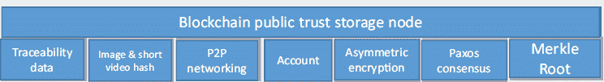

**图 7.3.** 区块链信任存储节点

#### (b) 组织节点

这允许组织服务器加入私有链节点，实现由组织唯一标识的子区块源，并创建账本来接收或发布交易广播。如果没有硬件接入，在私有链服务器集群中，根据交易位置在最近的服务器上创建节点并账户，通过浏览器或 APP 进行用户验证，然后在服务器上读取组织节点的账本记录。

#### (c) 交易操作

交易定义了用户转移区块的操作记录。当交易发生时，对方和交易双方会自动生成智能合约，并将合约广播到所有节点。无论广播节点是否能根据权限查看合约内容或部分内容，交易双方都拥有合约的所有信息，并锁定交易者交易的项目数量，同时将交易商品的所有区块信息传递给对方，并包括交易者的资产。

### (3) 区块链 + 农业溯源应用场景

有以下几个基于农业（种植）的特征：

(a) 农用投入（农药、肥料等）等，农用投入的使用（监管要求、允许的药剂剂量、不同肥料要求的不同生长过程、不同地区对病虫害的相应药剂需求）。

(b) 生产过程中频繁耕作操作的正规与不正规性记录要求。

(c) 为了企业或组织检测结果的公平性。

(d) 基于品牌保护（产地、产量等）。

#### 5.4.1. 投入品生产企业使用场景

(1) 添加农药二维码管理系统，分配分配唯一的用户标识序列号。

(2) 生产公司创建一个生产批次。生产批次根据（用户标识序列号、创建区块信息、位置信息、负责人、时间戳、商品属性、数量）创建一个资产块。资产块包含最小物品单位和包装单位。生产完成的资产块根据定义的最小资产单位划分资产，划分后的资产通过二维码编码，编码后的信息包含当前资产的区块索引信息。

(3) 投入品制造企业和流通企业根据订单数量生成智能合约。合约生成后，将广播到私有链内部的所有节点，交易在经过共识机制批准后生效。

#### 5.4.2. 投入品流通企业场景

(1) 这涉及首先加入投入品监管平台以获取唯一的用户标识序列号。

(2) 向投入品厂家发起订单申请。在投入品厂家确定订单申请后，系统生成智能合约，并将合约广播到私有链的所有节点。

(3) 当智能合约交易生效时，扫描包装上的二维码进行资产划分。划分后的资产属于流通企业，流通企业将用户身份添加到所属资产中，并根据创建的区块数据开始资产的运输、仓储和销售。

(3)通过制造业分配的 `QR code` 接收制造业的资产，并在资产所在的区块中添加时间戳、用户序列号等信息。

(4)此外，流通企业在获取资产后，在运输、仓储等环境中添加时间、地理位置等信息，创建区块数据。

(5)流通公司在与投入用户交易时，创建一个 `smart contract` 并向私有链广播。

(6)流通企业通过 `QR code` 识别要转让给投入产品用户的资产，并在交易资产区块中添加双方的用户和时间戳。

#### 5.4.3 农业生产企业场景

(1)用户加入农产品生产过程追溯监控系统，并创建一个由用户唯一标识的序列号。

(2) 用户创建一个包裹，系统为该包裹分配一个唯一的识别号。

(3) 根据用户序列号和包裹号在区块上存储信息，以及子创建级的生产计划（包括生产品种和生产数量）。

(4)基于生产计划区块以及农业作业过程中根据标准化生产建模创建的生产计划，由负责人执行智能提醒操作内容，并确认操作是否执行。如果在提醒操作的时间范围内未确认，则默认无操作。

(5)当区块信息被创建时，会自动添加具有相同地理、地块和时间属性的 `IOT` 数据（如大气、土壤、温度湿度、水分等）。

(6)当在区块创建中使用农业投入品时，相应的 `QR code` 资产会自动添加到区块信息中。

(7)当创建区块时，将根据地块和时间自动添加检测机构和企业检测的相关操作，以检测检测结果。

(8)当农业生产结束时，收获区块数据（包括时间、数量和检测结果）创建结束。

(9)包装过程确定最小包装单位并贴上 `QR code`。

# 附录 A：CIFC 区块 + 百人峰

区块链 + 百人峰基于 `CIFC` 智库、`普中研究院`、`中关村数字媒体产业联盟`区块链实验室，由 `CIFC` 智库成员、`中关村大数据产业联盟`副秘书长`严阳`、`CIFC` 智库创始人、`中金资本`董事长、`中关村数字媒体产业联盟`执行董事`王斌`、《区块链技术指南》作者、区块链技术知名专家`邹军`、`丰宇科技`创始人、`CIFC 金融联盟法律中心`执行董事、知名律师`王云佳`。`国家信息中心``中国国家智慧城市发展中心`副秘书长以及`国家新型智慧城市建设有限公司`部际协调工作小组秘书处副秘书长共同发起了区块链交流学习与研究合作平台的联合建设与共享。

## A.1 倡议

2018 年 1 月 27 日，由 `CIFC 智库` 主主的“CIFC 区块链技术与应用实践闭门会议及 CIFC 区块+百人峰会倡议”在北京举行。会议上发布了区块链+赋能人物，同时也发布了《经济出版计划》和《CIFC 区块链+百人峰会计划》，并启动了“CIFC 区块链+百人峰会及 CIFC 区块链联盟”。

会议围绕区块链技术和应用趋势、区块链的应用领域和应用价值、政策监管与健康发展、人工智能、云计算、大数据和数字经济展开。区域经济和区块链行业进行了深入的交流和讨论。

## A.2 核心定位：区块链+

区块链、人工智能和虚拟现实被誉为互联网之后的下一代颠覆性核心技术，是工业经济时代向数字经济时代转型的新动动力。

2018 年被认为是区块链+的元年，`CIFC` 区块链+百人峰会探索了区块链技术和行业应用，如金融、能源、文化、媒体、娱乐、工业、农业、知识产权、旅游和房地产。还包括法医和追溯等行业和领域的深入研究、讨论、交流和合作。

## A.3 核心价值

1. 研究区块链技术和应用，建立区块链+系统，赋能数字经济。

2. 建立区块链+工业体系，帮助传统产业升级，赋能实体经济。

3. 建立区块链+社区，引导区块链行业的健康发展。

4.开展区块链+项目研究，出版与区块链和数字经济相关的专著。

5. 区块链+闭门交流会、论坛、会议、国际考察等活动，促进区块链交流与合作。

6. 开发区块链技术应用培训，培养区块链技术应用专业人才。

7. 为政府和工业园区提供区块链+相关研究和咨询服务。

8. 为企业提供技术、人才、项目、投资、市场和品牌等增值服务。

## A.4 业务

*CIFC 区块链+百人峰会联合创始人（创始人）*

`严阳`，`CIFC 智库`成员、`中关村大数据产业联盟`副秘书长。

`王斌`，`CIFC`创始人、`普中资本`董事长、`中关村数字媒体产业联盟`执行董事长。

`邹军`，《区块链技术指南》作者、区块链技术知名专家、`国家信息中心``中国国家智慧城市发展中心`副秘书长、`国家新型智慧城市建设有限公司`部际协调工作小组秘书处副秘书长。

`王云佳`，`丰宇科技`创始人、`CIFC 金融联盟法律中心`执行董事、知名律师。

*首批创始（无顺序）*

`张军`，`汇华基金管理`规划部经理。

`陈小华`，`北优在线投资集团`执行董事兼`北优在线金融研究院`院长。

`潘高峰`，`泰康在线`助理总裁兼首席技术官。

`韩汉`，`中国信息研究院`高级工程师、大数据发展委员会办公室主任。

`杨学成`，`北京邮电大学经济管理学院副院长、教授、博士导师。

`格振斌`，`新华网`互联网总监。

`马兆林`，《人工智能时代：区块链金融》作者。

`王建宇`，`蓝盾信托东方阳光科技`创始人、产品总监。

`张小晨`，`FinTech4Good`创始人。

`李胜`，`上海网通通信开发有限公司`董事长。

`李建军`，农业部农村产业发展中心主任。

# 李立宏，广州中关村“电子谷”大数据（区块链）工业园总经理。

## CIFC 区块链+百人峰会自律公约

2018 年 3 月 31 日，由 CIFC 区块链+百人峰会主办的“首届区块链+百人峰会暨 CIFC 区块链与数字经济论坛”在北京中关村创新中心成功举行，旨在促进区块链发展。为了行业的健康发展，会议上发布了《CIFC 区块链+百人峰会自律公约》。全文如下：

总纲：区块链+百人峰会将自觉遵守国家关于区块链应用的法律、法规和政策，促进区块链+行业应用健康规范化发展。

三十字原则：坚持合规导向，落实国家战略，规范规范化应用，信息公开透明，构建健康生态系统。

1. **坚持合规导向**：峰会成员应深入学习国家政策，加强风险意识和合规评估，严格遵守监管机构的法律法规。

2. **落实国家战略**：发挥智库作用，为区域经济和产业升级提供建议；以发展为导向，做到诚信、客观、可控。

3. **规范化应用**：立足实体经济发展，使应用可信、客观、可控。

4. **信息披露与透明度**：峰将在保护知识产权的前提下，本着公开透明原则，实现技术、管理和业务探索的共享。

5. **构建健康生态**：加强风险教育，不诱导、不发起、不参与 ICO。

此类融资活动促进了产业生态的健康协调发展。

**区块链+，第 100 届峰会联合创始人及首批创始成员**

**北京中关村创新中心**

**2018 年 3 月 31 日**

## 附录 B：区块链事件

1991 年，S. Haber 和 W.S. Stornetta 发表了一篇名为`How to Time-Stamp a Digital Document`的论文。

1998 年，代奇（Wei Dai）发表了一篇名为`A Scheme for a Group of Untraceable Digital Pseudonyms to Pay Each Other with Money and to Enforce Contracts among Themselves Without Help`（一种在小组内使用电子匿名身份支付的能力），其中包括关于相互支付和强制个人在没有外部帮助的情况下遵守规则的电子现金机制论文。

1999 年，H. Massias 等人发表了一篇名为`Design of a Secure Timestamping Service with Minimal Trust Requirements`的论文（设计一种基于最小信任需求的时间戳服务器）。

2002 年，A. Back 发表了一篇名为`Hashcash-a Denial of Service Counter-Measure`的论文。

2008 年 11 月 1 日，Nakamoto 发表了一篇名为`Bitcoin: A Peer-to-Peer Electronic Cash System`的论文。

2009 年，Nakamoto 发布了第一个比特币软件，并正式启动了比特币金融系统。

2009 年 1 月 3 日，Satoshi Nakamoto 在芬兰赫尔辛基的一台小型服务器上挖出了第一 50 个比特币，被称为“创世区块”。

2010 年 5 月 22 日，Laszlo Hanyecz 用 10,000 个比特币买了两块披萨。

至于披萨，如果按每个比特币 400 美元计算，每块披萨就值两万美元。

2010 年 7 月 17 日，第一个比特币交易平台 MT.GOX 成立。

2011 年 2 月 9 日，比特币首次等值于美元，每个比特币价格达到 1 美元。在媒体报道这一消息后，人们的注意力被激发，比特币新用户激增。在接下来的两个月里，比特币与英镑、巴西货币、波兰货币的交换交易平台相继开放。

2011 年 3 月 6 日，比特币整个网络的算力为 900G Hash/s，但很快下降了 40%。显卡“挖矿”变得流行。

2011 年 8 月，常用的比特币交易处理中心之一 MyBitcoin 被黑客攻击导致关闭。49%的客户存款，超过 78,000 个比特币（当时约价值 80 万美元）无迹可寻。

2011 年 8 月 20 日，首届比特币会议和世界博览会在纽约举行。比特币在 Google 趋势中的关注度达到了新水平。当时，每个比特币的价格为 11 美元。

2012 年 11 月 25 日，首届欧洲比特币会议在捷克共和国布格举行。

2012 年 12 月 6 日，世界上第一个官方认可的比特币交易所——法国比特币中央交易所（French Bitcoin Central Exchange）诞生，这是第一个在欧盟法律框架下运营的比特币交易所，此时比特币的价格为 13.69 美元。

2013 年 5 月 14 日，美国国土安全部获得法院许可，冻结了全球最大交易所 MT.GOX 的两个账户，此时每个比特币的价格为 119.4 美元。

2013 年 5 月 28 日，美国国土安全部以位于哥斯达黎的货币交易所公司 Liberty Reserve 涉嫌洗钱和无证经营资金转移为由，禁止其虚拟货币服务。美国检察官表示这将是历史上最大的案件。在国际洗钱诉讼中，洗钱规模达到 60 亿美元包括中国在内的大量用户损失了资金。此时每个比特币的价格为 128 美元。

2013 年 7 月 30 日，泰国成为世界上第一个禁止比特币的地方。泰国银行禁止买卖比特币以及任何涉及比特币交易的商品和服务。禁止向境外人士转移比特币。

2013 年 8 月 19 日，德国成为世界上第一个承认比特币的国家。德国政府正式承认比特币的法货币地位。货币持有者可以使用比特币缴纳税款或其他用途。

2013 年 10 月，GBL 比特币交易平台在中国注册，当时用户持有的比特币价值 410 万美元。

2013 年 10 月，世界上第一台比特币 ATM 在加拿大上线，通过该自动取款机可以加加元和比特币的交换。

2014 年 3 月 21 日，比特币投资者将其称为“3.21 事件”。一个关于中国央行禁止比特币交易的传言在微博上迅速传开，引发了市场的恐慌。

2014 年 5 月，美国卫视网络（Dish Network Inc.）宣布支持比特币支付。

2014 年 7 月，美国戴尔（Dell Inc.）宣布支持比特币支付方式。

2014 年 9 月，美国 eBay 公司宣布其支付子公司`Braintree`接受比特币交易。

2014 年 12 月，美国微软公司（Microsoft Corporation）宣布支持比特币支付方式。

2015 年，比特币全网算力突破`1P Hash/s`。

2015 年，IBM 宣布参与`Open Ledger Project`（开放账本项目）。2015 年，微软宣布支持区块链服务（`Blockchain as a Service`）。

2015 年 1 月，比特币获得了当时最大规模的融资，`Bitcoin Coinbase` C 轮融资了 7500 万美元。`BBVA`（西班牙银行）通过其子公司通过股权投资参与了融资，帮助他们熟悉区块链技术并理解其工作原理。

2015 年 3 月，摩根大通高管布莱德·马斯特斯（Blythe Masters）辞职并加入区块链公司`Digital Assets Holdings`（`Digital Asset Holdings`）担任 CEO。

2015 年 5 月，高盛在报告中表示数字货币是市场的“大趋势”并将参与。同时，高盛对区块链技术进行了技术储备和探索，并与其他投资公司一起向`Bitcoin Circle`注资 5000 万美元。

2015 年 6 月，桑坦德银行（Santander）宣布通过金融科技投资基金`InnoVentures`进行区块链测试。

2015 年 6 月，英国第二大银行巴克莱银行（Barclays Bank）与比特币交易所`Safello`达成协议，探索区块链技术如何应用于金融服务业。

2015 年 6 月，美国 Overstock 公司（Overstock Corporation）宣布利用区块链技术发行加密数字债券。

2015 年 7 月，德勤启动了`Rubix`，这是一个软件平台，允许客户基于区块链基础设施创建应用程序，其中最重要的是财务审计（德勤的主营业务）。

2015 年 8 月，以太坊平台发布新版本，宣布任何基于区块链的应用程序都可以实现。

2015 年 8 月，总部位于中国的`Bitfinex`交易所突然关闭了一些账户，导致比特币价格在 24 小时内从 250 美元跌至 211 美元，而比特币在`Bitfinex`上的最低价格为 162 美元。

2015 年 9 月，分布式账本初创公司`R3CEV, LLC`宣布包括汇丰、摩根大通和瑞银在内的九大银行组成联盟，为金融业寻找基于区块链的解决方案，共享数据、研究、想法和技术。

2015 年 9 月 30 日，`R3CEV`宣布新增了 13 家新银行合作伙伴。参与其区块链项目的银行数量达到 22 家。

2016 年 1 月 5 日，全球共享金融 100 人论坛（`GSF100`）宣布成立“中国区块链研究联盟”。

2016 年 1 月 25 日，全球共享金融 100 人论坛（`GSF100`）宣布成立“中国区块链研究联盟”。

2016 年 1 月 26 日，全球共享金融 100 人论坛（`GSF100`）宣布成立“中国区块链研究联盟”。

2016 年 1 月 27 日，全球共享金融 100 人论坛（`GSF100`）宣布成立“中国区块链研究联盟”。

2016 年 1 月 28 日，全球共享金融 100 人论坛（`GSF100`）宣布成立“中国区块链研究联盟”。

2016 年 1 月 29 日，全球共享金融 100 人论坛（`GSF100`）宣布成立“中国区块链研究联盟”。

2016 年 1 月 30 日，全球共享金融 100 人论坛（`GSF100`）宣布成立“中国区块链研究联盟”。

2016 年 1 月 31 日，全球共享金融 100 人论坛（`GSF100`）宣布成立“中国区块链研究联盟”。

2016 年 1 月 21 日，全球共享金融 100 人论坛（`GSF100`）宣布成立“中国区块链研究联盟”。

2016 年 1 月 22 日，全球共享金融 100 人论坛（`GSF100`）宣布成立“中国区块链研究联盟”。

2016 年 1 月 23 日，全球共享金融 100 人论坛（`GSF100`）宣布成立“中国区块链研究联盟”。

2016 年 1 月 24 日，全球共享金融 100 人论坛（`GSF100`）宣布成立“中国区块链研究联盟”。

2016 年 1 月 25 日，全球共享金融 100 人论坛（`GSF100`）宣布成立“中国区块链研究联盟”。

2016 年 1 月 26 日，全球共享金融 100 人论坛（`GSF100`）宣布成立“中国区块链研究联盟”。

2016 年 1 月 27 日，全球共享金融 100 人论坛（`GSF100`）宣布成立“中国区块链研究联盟”。

2016 年 1 月 28 日，全球共享金融 100 人论坛（`GSF100`）宣布成立“中国区块链研究联盟”。

2016 年 1 月 29 日，全球共享金融 100 人论坛（`GSF100`）宣布成立“中国区块链研究联盟”。

2016 年 1 月 30 日，全球共享金融 100 人论坛（`GSF100`）宣布成立“中国区块链研究联盟”。

2016 年 1 月 31 日，全球共享金融 100 人论坛（`GSF100`）宣布成立“中国区块链研究联盟”。

（注：由于原文中后续日期及内容存在大量重复，已根据要求按原文翻译并保持格式逻辑一致。）

2018 年 5 月 12 日，“区块链+”百人峰乌镇论坛及 2018 年 CIFC 由 CIFC 区块链+百人峰、浦中研究院、中关村数字媒体产业联盟区块链委员会共同举办。浦中（乌镇）全球区块链创业赛的启动仪式在乌镇成功举行。乌镇浦中区区块链研究院在会议上正式挂牌。

2018 年 5 月 27 日，《区块链赋能数字经济》（中文版）在贵阳中国国际大数据博览会上正式发布。

## 附录 C：数字经济产业园区的设计

近年来，中国大力发展战略性新兴产业。集群化已成为地方政府的重要任务，而园区是这项任务的主要载体。经过近 30 年的快速发展，中国园区经济已成为国家经济不可或缺的一部分，推动了全国范围内的改革和科技创新。互联网、物联网、云计算和大数据的创新随处可见，竞争也日益加剧。园区之间的同质化愈发明显。不同地区园区的效果也大不相同。政府政策、土地资产、税收等投资方式的差距正在越来越小。同时，“调整结构、促进增长”的新国家经济发展战略也要求各级园区适应形势，促进产业生态转型。关键在于“从外生性产业集群向内生性创新经济引擎的产业形态转变”。

在这个发展过程中，各种产业园区的结构变得日益复杂，业务不断壮大。技术飞速发展的速度令人震撼，且已大幅加快。

园区内增加投资和运营管理较为困难。

根据本文提出的 WSS 大数据反馈经济模型，在园区内探索生态运营平台（`EOP`）。

新产业生态中的`EOP`加速了科技创新，促进了转型升级，完善了安全体系，基于数字经济产业园区提出了新的经济建设和运营模式，通过数字化重组和建立新的激励机制，创建了新的创新园区。这一独特品牌具有实际意义。

### C.1. 数字经济产业园区的设计

“信任是区块链技术背后最大的价值，”被誉为“数字经济之父”的经济学家唐·塔斯科（Don Tapscott）在 2017 年 IEBE（国际电子商务博览会）上如是说。区块链技术将给互联网世界带来深远的第二次革命。过去的第一场革命是信息革命，是互联网的信息时代，而现在正进入互联网时代。在唐看来，Uber 和 Airbnb 只是一种聚合服务，而区块链带来了真正的共享经济。例如，假设没有 Airbnb 这样的公司，但存在一个基于区块链的分布式应用程序，它从本质上属于任何想要租房的人。当有人想租房时，他可以登录区块链数据库并筛选以找到合适的房间。之后，区块链将帮助他们签署智能合同。智能合同将确定双方的身份并进行交易。支付通过系统自身的数字货币进行处理。交易结束后，住户可以给房间评分，且评分是更改的。没有人能篡改它，从而利用区块链完成交易。唐认为，房东和租客参与区块链，就像加入一个合作社一样，房东真正地将他们的物品分享到相应的领域，他们的利润只归房东所有，不存在所谓的中心化组织，这被称为真正的共享经济。

因此，在数字经济产业园区的设计中，我们必须从顶层设计上嵌入共享经济理念，通过“区块链+”架构体系创建新的产业生态模型。

本文提出的 WSS 模型结合工业互联网全景，设计了基于区块链的数字经济创新产业园区模型，以促进当地数字经济的稳健、精准和快速发展。

### C.2. 数字经济产业园区与 EOP

产业园区是实施城市功能空间的重要形式。园区在改善区域投资环境、吸引外资、促进产业结构调整和发展经济方面发挥了积极作用，已成为城市经济腾飞的助器。随着产业园区领先产业持续从传统产业向高科技产业转型，这也是未来园区规划和建设中需要关注的内容。

园区规划处于园区建设的前沿，规划决定了园区的规模、方向和品位。因此，新模式正在打破传统格局。

数字经济产业园区的设计路径包括几个阶段：项目总体规划、园区产业规划、资金规划、建设规划和运营规划。

项目总体规划：当地建设数字经济产业园区一般设定 3–5 年的目标。在区域乃至整个国家的最终目标和地位应通过自然生态、产业生态和园区生态体现出来。这一目标符合当地生产发展，并逐步从产业聚集阶段（1–2 年）、产业成熟阶段（3–4 年）以及 5 年后实现最终目标。

在园区的产业规划中（见图 C.1），有四个主要步骤：

(1)创建产业基地。我们将选择大数据等相关核心产业为方向，整合国内高质量产业的引入，有针对地开展“区块链+”融合，形成像硅谷一样的核心“产业人口”。例如，智能制造也是如此，有些地区选择将汽车中的家用车作为核心产业，进而助力未来汽车市场；而其他地区则选择重型车辆助力物流服务业。

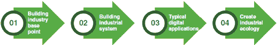

**图 C.1** 园区产业规划

(2)构建产业体系。产业体系包括产业设计、研发、生产、制造和销售的集群。为了实现这一目标，需要建立“产、研、投、用”的闭环，实现“人才高地”和“创新”。科研高地的目标是创建“产业孵化和升华的合作中心”。

### (3) 数字化化的典型应用

这一阶段是推动数字经济产业园区建设中的重要节点，也是反映区域产业特征的标志性阶段。在此阶段，将通过产业集群实现产业集聚和数字产业化。也就是说，凭借某些数据资源，可以开展一定规模的数据驱动型产业服务。

### (4) 构建产业生态系统

在此阶段，为了建立`EOP`的数字生态系统，必须进行数字化的生态重构设计。每个行业聚落都成为`WikIT`共享经济的某个“区块”，而连接这些“区块”的方式需要依赖`financial ecologicalization`的落实。`financial ecologicalization`的实现为数据资产化奠定了坚实基础。

例如，根据文中提出的`WSS`模型，开放“运营、感知与智慧”的大数据，将非标准化的生产（`operation`）过程标准化（`segmented`）处理，以实现园区内外企业的生态链接目标。要素市场（如交易中心）使得生产周期能够有效与消费周期对接，从而规避时间风险，同时最大限度地缩短从生产到消费的实现路径，加速资金流动（如上述的“猪联网”）。

为了实现数字经济产业生态系统的可持续发展，有必要有效整合园区内`blockchain +`产业的发展，并逐步完善生态的“生产关系”。

具体方法是建立“联盟链”，让园区内企业逐步开展`blockchain +`产业的孵化与升级。在金融创新方面，可以建立`financial supervision sandbox`，并在其成熟后进行推广。

从整个园区的顶层设计出发，需要将`G2B`（前期设计、后期运营）转变为高效的`B2G`（设计即投资、建设或运营）模式，缩短数字经济产业园区投入到产出的周期。

例如，某地区数字经济产业园区的九大产业进口如下：

`sandbox`（也称为“沙箱”）主要用于为不可信、具有破坏性或无法判断程序意图的程序提供测试环境。

产品供应链，196

农村金融，195

可追溯平台，98–202, 194

交易业务，200

阿里健康与常州，182

阿里音乐，164

区块链的匿名性，3

反欺行为，140

专用集成电路 (ASIC),17

ArcBlock，22

区块链架构，10

区块容量与扩展，19

共识机制，19–20

数据真实性保障，20

开发，10–12

形式化，20

中间件，18

网络，18

操作系统，18, 21–22

支持应用部署的平台，20

问题与挑战，12–17

安全与隐私，20

分片，19

侧链技术，18–19

存储，19, 32–33

人工智能，132–133

资产托管，149–152

自主去中心化点对遥测 (ADEPT)，128

## B

银行信贷系统，139–140

肉牛养殖，82–85

伯纳斯-李，蒂姆 (Tim Berners-Lee)，165

BFT-DPoS 共识算法，21

### 大数据

农业与农村，194

区块链在...的应用，121–124

在中国，46

区块链与...的，124–126

与其的问题，119–121

大数据投资策略，44

比特币，3, 10, 15, 25, 29, 135

挖矿，16

负载，16

Bitshares/EOS，31

“黑天鹅”事件，165

区块链（参见区块链架构）

优势，56

应用、特征（参见文化与创意产业，区块链的应用；数字版权保护，区块链的应用；金融行业，区块链的应用；医疗与健康行业，区块链的应用；媒体行业，区块链的应用），4–5

业务价值，5–6

定义，1–2

...的发展，2–4

指南，6

开放性，6

与...相关的监管，7

区块链 +，37

区块链应用

访问控制，17

计算中心化，17

链安全，15–16

数据真实性，16

治理与监管系统，17

身份认证，17

隐私，15

公钥安全，16

智能合约升级与监控，17

有用的工作，16

区块链即服务 (BaaS)，106

区块链共识机制，31

区块链事件，209–216

区块链 + 百人，203

业务，205–207

核心价值，204–205

倡议，203–204

区块链相关开发，107–113

区块链代币（参见区块链的监管），57–63

支付介质，57–58

证券化证书，59–60

链内合约，26

链外合约，26

Burst，33

布特林，维里克 (Vitalik Buterin)，3

拜尔庭容错 (BFT)，13, 21, 24

## C

CAP 理论，13

Casper 共识机制，31

CDN（内容交付网络）功能，32

计算中心化，17

权威证书 (CA)，4

Chainalysis，140

链安全，15–16

ChangeHealthcare，180

常州医学协会，182

中国检验认证集团 (CCIC)，107

中国检验集团，103

中国高铁，114

城市管理，96–99

中国的国情与城市化，96–97

停车管理规则，98

代码混淆，35

竞争力，79

共识机制，19–20

核心技术研究，113–114

跨境电子商务，142–143

跨链互联，18

加密机制，2

`CryptoKitties`，13, 164

文化与创意产业，161–162

文化与娱乐行业，162–163

文化知识产权（IP），163

开发与建议，170–172

游戏行业，164

音乐行业，163–164

海关边检，103–107

## D

`DAG` 无向环图系统，33–34

`DApps`，18, 21

数据真实性，16

`DDoS`（分布式拒绝服务），15

去中间化，42

托管证书，71–73

### 区块链技术的发展

- 107–113
- 演示，114–115
- 工业发展与应用，115–116
- 政策文件，108–111

## 索引

- 产业链与生态系统建设，117
- 标准与规范化体系，116
- 数字票据，141
- 数字中国，46
- 数字版权保护，167–170
- 数字经济，45–51, 80
- 数字经济工业园区，217–225
- 数字身份，90–93
- 数字工业化，41–45
- 工业数字化，30–41
- 数字医疗技术，174
- 数字门票，141–142
- 丁磊，37
- 分布式哈希（DHT），32
- 分布式账本技术（DLT），2, 80
- `DOT`（中继链令牌），25

## E

- `ECDHM`（椭圆曲线迪菲-赫尔曼-梅克尔），35, 35
- 教育治理，99–103
- 学习者成本，102
- 教育资源的整合与共享，100–101
- 知识成果保护，101–102
- 基于区块链的学生信信档案，101
- `E-Krona`，138
- 加密钱包，181
- `ENIAC computer`（电子管计算机计算机），9
- 企业级医疗区块链，180
- 环保，131
- `EOP`（生态系统平台或生态操作平台），42
- `EOS blockchain`，21–22
- `Ethereum`（以太坊），3, 15, 19, 24, 27–31
- 架构，13
- `Ethereum EVM`，25
- `Ethereum Virtual Machine (EVM)` 支持（以太坊虚拟机），22
- 欧洲委员会，167

## F

- `Facebook`，167
- 反馈经济，40
- `FEOP`，49–51
- `FileCoin`，32
- 金融行业，区块链在托管托管，149–152
- 银行信贷系统，139–140
- 成本与效率，135–136
- 贷款贷款，145–148
- 跨境电子商务，142–143
- 去中心化，136–137
- 数字票据，141
- 数字货币，137–138
- 数字钞票，140–142
- 数字门票，141–142
- 金融交易效率，159–160
- 电子凭证，148
- 保险业务，152–155
- 整合平台，148–149
- 金融技术实现，155–161
- 交易成本降低，157–159
- 证券交易，143–145
- 金融交易安全，160
- 交易透明度，139
- 虚拟“币”的使用，138
- 代币发行融资，7
- 罗罗伦萨，180
- 食品与药品监管，87–90
- 追溯方法，89–90
- 碎片化机制，30

## G

- 高盛，160
- `Gossip about protocol`，34
- 治理与监管体系，17
- 政府数字化改革，179
- 政府对区块链技术的理解与应用，79–81
- 城市管理，96–99
- 创建个人档案，93
- 海关边境检查，103–107
- 数字身份，90–93
- 教育治理，99–103
- 食品与药品监管，87–90
- 减贫，81
- 老年人福利，92–93
- 税务管理，93–96
- 卫人寿保险，178

## H

- `Hashgraph`，34
- 健康与医疗行业，区块链应用，173–182
- 区块链趋势，182
- 电子记录，175, 181
- 加密钱包，181
- 企业级区块链，180
- 智能设备，180–181
- `medical Application Interface (API)`，178
- 区块链应用，180
- 自然语言处理（NLP）平台，179
- 代币交易，178
- 健康信息交换（HIE），178
- `HealthWizz` 平台，181
- `Hedera (Ivy)`，34
- 汇丰，103, 105
- `HTLC (Hash Timock Contract)` 融资，23
- `Hyperledger`，4

## I

- 身份认证，17
- 违法融资，7
- `ILP`，27
- 工业数字化，41–45
- 数据可用性，44
- 生态链，44
- 容错性，45
- 金融泛用化，44–45
- 人性化服务，43
- 试错规范化，45
- 服务简化，43
- （地方）政府职能社会化，43–44
- 工业创新愿景，42
- 工业互联网，41
- 跨账本，28
- 物联网（IoT），5–6, 79, 81, 88, 126–127, 136, 193–194
- 资源分配，127–128
- 应用场景，130–132

## 索引

- 未来前景，132
- 隐私，128
- 安全性能，127
- 与应用现状，128–130
- 技术原理，130
- `IPFS`（星际文件系统），32
- `IT` 发展，9–10

## L

### 区块链技术的法律监管

- 应用方面，65–66
- 在中国，56
- 维度，55
- `ICO` 相关的法律问题，60–62
- 法律挑战，56–57
- 业务模式重构，63–65
- 的现状，55–56
- 技术与，53–54
- 代币的，57–63
- 在英国，56
- 虚拟货币交易所，62–63
- 闪电网络（Lightning Network），23
- Linux 基金会（Linux Foundation），3

## M

- 马化腾，37
- `MaidSafe`，33
- 媒体行业，区块链在其中的应用，165–167
- 内容订阅，166
- 新闻传播效率，165
- 在线媒体的新形式，166
- 新闻源认证与新闻审核，165–166
- 医疗区块链应用，180
- “医疗链+区块链”试点项目，182
- `Merkle` 有向无环图，32
- `Merkle proof`（Merkle 证明），26
- `MetaX`，167
- 微支付通道，23
- 莫罗斯，尼古拉斯·马德杜罗（Moros, Nicolás Maduro），138
- 多参与联盟网络，98

## N

- 中本聪（Nakamoto, Satoshi），3
- 美国国家标准与技术研究院（NIST），10
- 网络项目，22
- 闪电（Lightning），23
- `Raiden`，24
- `Tendermint Cosmos`，24
- 新链项目（Newchain project），132
- `NXT (PoS)`，31

## O

- 职业生成内容（OGC），38
- 链外计算，“一泵”泵，177
- 本体论网络（Ontology network），22
- `OpenChain` 层（OpenChain Layer），22
- 区块链技术的开放性，6
- 预言机（理理来源）机制，16

## P

- `Parity Substrate`，27
- `Parity` 技术公司（Parity Technologies），27
- 人民日报，37
- 石物货币，138 “盘币网”项目，50
- 等离子（Plasma），28–29
- `PokitDok`，177–178
- 分身（Polkadot），25–27
- `POS`（权益证明）共识算法，15
- 扶贫贫，81–87
- 区块链技术的特性，85–87
- 解决方案，83–87
- `P2P` 通信，10
- `P2P` 超媒体协议，32
- `P2P BitTorrent`（P2P Bit 协议），32
- 实用拜庭容错（PBFT），4
- 隐私，15, 35
- 区块链平台支持，14
- 兼容性，14
- 共识机制数学证明，15
- 数据同步性能限制，14
- 易用性，14
- 可扩展性，13
- 互操作性，14
- 智能合约形式验证，14
- 存储限制，14
- 交易性能限制，13
- 专业生成内容（PGC），38
- 专业产出内容（PPC），38
- 存在证明，75–76
- `BAO` 区块链，73–74
- 传统数据，74
- 成本，69
- 困境，69–71
- 宏观困境，68
- 性质，67
- 公证化，76–77
- 现状，68–69
- 贸易秘密，75
- 价值，67
- `PSR`（压力状态）模型，40
- 公共融资，10
- 公钥，16
- `Pub/Sub` 适配器，22

## Q

- 泉州石化，103

## R

- `Raiden` 网络，24
- `Corda`，33
- 房地产行业，区块链应用，185–186
- `Chroma`，188
- 租赁方法，186
- 决策，184–185
- 房地产开发，184–189
- 融资与支付，185
- 消除欺诈，189
- 财产所有权，190
- 可靠房地产信息，183–184
- `Rentberry` 去中心化平台，177–188
- 智能合约，190–191
- 阶梯持股计划，190
- 交易透明度，190
- 西庆新区区块链平台，177
- 精炼过程，41
- `Reitwiner, Christian`，30
- 重放攻击，15–16
- 表述状态转移（ReST）接口，180
- `Ripple`，31
- `Rootstock` 原生代，25
- `RSMC`（可恢复序列到期合约），23

## S

- `Sanger, Larry`，167
- 证券交易，143–145
- 分片，19, 29–30
- `Sia`，32
- 侧链技术，18–19
- 项目，24–28
- 中国中化集团，103
- 中化化泉州项目，104
- 智能合约升级与监控，17

### S

社会经济，46–47

`Spotify`，164

状态通道（State Channel），30–31

状态机复制（SMR）共识算法，13

`Stellar`，31

存储空间，19

`Storj` 文件与数据碎片，33

区块链监管，7

`Swarm`，32

女巫攻击（Sybil attack），15

### T

税收管理，93–96

税收相关数据共享机制，95–96

`Tendermint Cosmos`，24

“十三五”信息化规划，1, 80, 108

代币交易，178

区块链开发的顶层设计，113

区块链的可溯性，69–71, 88–90, 95, 101–102, 122–125, 129–130, 140, 144, 148, 151, 160–161, 167, 173, 175, 177

交易流程，5

`Truebit` 项目，30

信任机制，4

### U

`UGC`（用户生成内容）常见，37

银联（UnionPay），148–149

城市化，40

`US DECENT` 平台，166

### V

`Verady`，180

虚拟货币，57

监管（参见区块链技术的监管）

虚拟商品，58–59

虚拟投票共识算法，34

### W

万达集团，148–149

`WebAssembly (WASM)` 虚拟机，22

`Web3` 基金会，25

`Wikipedia`，167

`WiKIT`，39, 48

`WiKi`（百科），39

`Woods, Gavin`，25

`WSS`（工作-感知-智能）模型，40

### X

厦门海关，103, 106

小米公司，167

习近平，46

### Z

零币（ZCash），35

零知识证明（zk-SNARKs），35

周鸿祎，37

`Zuckerberg, Mark`，167
