## 区块链赋能的雾计算与边缘计算：概念、架构与应用


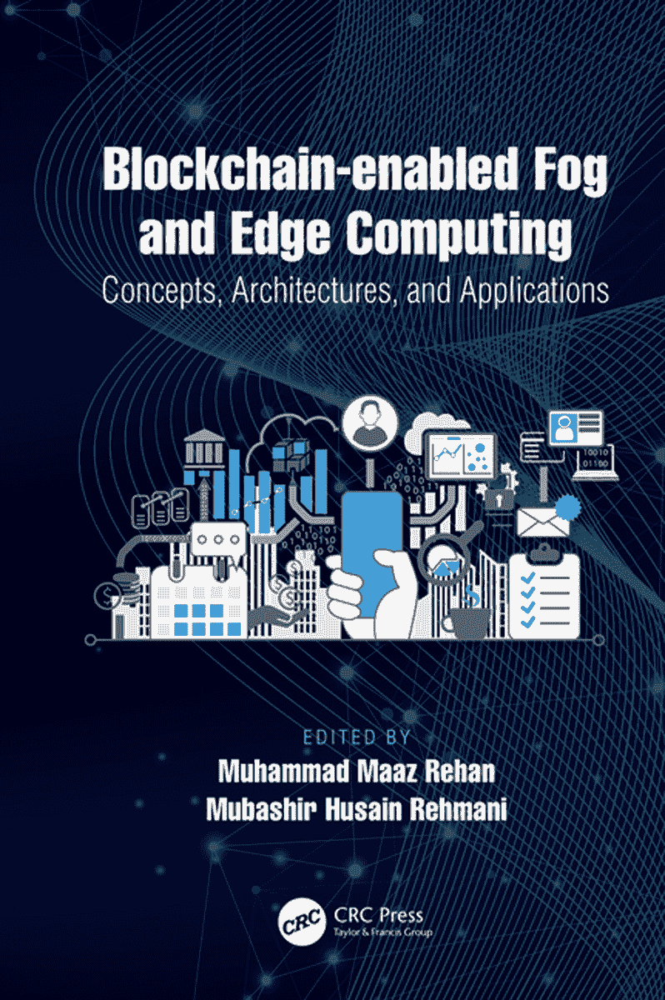


## 前言

区块链由参与者形成的点对点 (P2P) 网络中发生的每一笔交易的去中心化账本组成。区块链可以是许可型（公有）、无许可型（私有）或混合型。如果区块链是公有的，交易验证者可以是任何参与者。如果区块链是私有的，交易验证者必须经过区块链所有者的授权。该区块链所有者可以是验证交易并批准区块添加到区块链的单一实体，也可以是一组实体，从而形成联盟链。潜在的区块链应用包括电子投票系统、资金转账、生产、供应链管理、制药行业、金融部门等。

区块链中的交易流程按以下方式运行。如果参与者“A”请求某笔交易，该交易将广播至由计算机组成的相关 P2P 区块链网络。交易由区块链参与者根据智能合约进行验证，智能合约是系统所有利益相关者商定的预定义数字规则。一经验证，交易即视为完成。区块链应用最著名的例子是比特币数字加密货币。在分布式区块链模型中，用于建立共识的两种最流行的交易验证算法是工作量证明 (PoW) 和权益证明 (PoS)。在 PoW 中，每个新添加的区块必须生成一个哈希值，该值应小于给定的目标值。这需要多次重试，称为“挖矿”。完成后，新添加的区块将追加到区块链中，并将前一个区块的哈希值添加到其中以构建链。挖矿重试使其成为一个耗时且高能耗的过程。比特币加密货币使用 PoW 验证。PoS 用户不是通过挖矿，而是根据其在货币中现有的份额（称为“权益”）来验证区块链并进行更改。拥有 `x%` 份额的参与者可以验证 `x%` 的交易。这种方法在能源和运营成本上提供了巨大的节省。像以太坊这样的新区块链系统使用 PoS 验证。简而言之，由于账本的分布式特性以及区块的验证和确认过程，区块链系统提供了固有的安全性，这使得篡改交易变得极其困难。

“雾计算”这一术语由思科于 2014 年 1 月提出，其目的是使计算可在网络内部进行，而不是将数据发送到云端进行计算，然后从云端获取反馈。根据思科的说法，雾是标准，边缘是概念。雾设备配备了计算、存储和网络连接资源，当它被放置在边缘时，实时数据的处理或分析将在最接近生成数据的节点处执行。因此，交换机、路由器、嵌入式服务器、视频监控摄像头和工业控制器都可以是雾节点。当成千上万或数百万个跨大型地理区域的设备正在生成数据，且决策和建议行动需要在毫秒级完成时，就需要雾计算。雾计算的一些应用包括：(i) 锁门，(ii) 启动列车或汽车刹车，(iii) 视频监控摄像头变焦，(iv) 当压力读数达到阈值时打开阀门，以及 (v) 提醒技术人员进行预防性维修。得益于雾计算，敏感情况下的决策变得快速；敏感流量保留在网络内部进行处理和决策；非敏感信息可发送到云端进行大数据分析，并以最新的策略规则形式反馈给雾节点，同时将大量不必要的流量从核心网卸载到云端。

在雾计算这一新兴范式中，靠近数据生产者的网络内计算正在兴起，区块链赋能的雾节点交易似乎是一个有前景的解决方案。例如，如果投票系统基于区块链，那么雾节点和边缘节点将是投票站，数据生产者将是选民、投票工作人员和选举委员会软件。在此及许多其他场景中，共识方法和智能合约可由区块链所有者定义，以便在雾节点上透明地记录所有内容，随后将其保存到中央云端以供长期使用和分析。然而，此场景存在许多集成问题。例如，政府可能认为使用第三方开发的区块链构成威胁或漏洞，从而开发具有专有共识机制和智能合约的自有区块链。针对不同的需求和环境（如工厂、大学、银行、投票），共识和智能合约都会有所不同。

考虑到上述区块链与新兴雾计算范式集成的重要性，本书旨在揭示区块链与雾/边缘计算的协作关系，以解决不同的日常问题。本书的编排旨在让读者不仅理解区块链和雾/边缘计算，还能理解它们的共存及其解决不同问题的协作力量。我们特别关注了与区块链赋能的边缘计算范式相关的隐私和安全问题。总体而言，本书包含九章，分为两部分。第一部分涵盖区块链的所有基本概念以及区块链与边缘计算结合的应用，第二部分涵盖区块链赋能的边缘计算的安全和隐私问题。


---


---

## 读者对象与致谢

本书面向希望在区块链和雾计算领域工作的学生、计算机科学家、研究人员和开发人员。本书的独特特性之一是强调了与区块链赋能的雾计算范式相关的问题、挑战和未来研究方向。希望读者喜欢阅读本书！

**Muhammad Maaz Rehan and Mubashir Husain Rehmani**

### 致谢

我们要衷心感谢真主（ALLAH Subhanahu Wa-ta’ala），凭借祂的恩典和赏赐，我们得以编辑此书。我们将此作品献给最后的先知穆罕默德（S.A.W.W.）。

Maaz 想感谢他的父母、妻子和孩子们（Aamnah Murvareed, Muhammad Bin Maaz, and Ahmad Bin Maaz）一直以来的祈祷和支持。

Mubashir 想向巴基斯坦海得拉巴的 Sheikh, Mufti Mohammad Naeem Memon 表达感激。没有他的祈祷、精神指导和道德支持，他无法编辑此书。他也想感谢家人的持续支持。

**Muhammad Maaz Rehan and Mubashir Husain Rehmani**

## 编辑


**Muhammad Maaz Rehan** **(M’16, SM’17)** 是巴基斯坦 COMSATS University Islamabad, Wah Campus 的助理教授（任期制），在学术界和工业界工作了 15 年。他领导 COMSATS University 的电信与网络研究组 ([`sites.google.com/view/telnet-rg/`](https://sites.google.com))。他于 2016 年在马来西亚 Universiti Teknologi PETRONAS (UTP) 获得博士学位，其博士研究成果获得两枚铜牌。他是 IEEE Softwarization Newsletter 的编辑，以及 IEEE Access 和 Springer Human-centric Computing and Information Sciences 期刊的副编辑。Maaz 博士曾两次担任 Internet Society (ISOC) 的 Internet Engineering Task Force (IETF) 研究员。他是著作 *Blockchain-Enabled Fog and Edge Computing: Concepts, Architectures and Applications* 的第一作者。他在 COMSATS 指导了 13 名硕士生和 2 名海外论文撰写学生。Maaz 博士的研究兴趣领域包括区块链、物联网和车联网、ICN、面向网络的机器学习，以及雾计算和边缘计算。


**Mubashir Husain Rehmani** **(M’14-SM’15)** 于 2004 年在巴基斯坦 Jamshoro 的 Mehran University of Engineering and Technology 获得计算机系统工程学士学位，2008 年在法国巴黎的 University of Paris XI 获得硕士学位，2011 年在巴黎的 University Pierre and Marie Curie 获得博士学位。他目前在爱尔兰 Cork Institute of Technology 计算机科学系担任助理讲师。在此之前，他在爱尔兰 Waterford Institute of Technology (WIT) 的电信软件与系统组 (TSSG) 担任博士后研究员。他还曾在巴基斯坦 Wah Cantt 的 COMSATS Institute of Information Technology 担任助理教授 5 年。他目前是 *IEEE Communications Surveys and Tutorial* 的领域编辑，并曾于 2015 年至 2017 年担任 *IEEE Communications Surveys and Tutorials* 的副编辑。他还担任 *IEEE Communications Magazine* 书评栏目的专栏编辑，以及 *IEEE Communications Magazine*、Elsevier *Journal of Network and Computer Applications (JNCA)* 和 *Journal of Communications and Networks (JCN)* 的副编辑。他还担任 Elsevier *Ad Hoc Networks* 期刊、Elsevier *Future Generation Computer Systems* 期刊、*IEEE Transactions on Industrial Informatics* 和 Elsevier *Pervasive and Mobile Computing* 期刊的客座编辑。他撰写或编辑了两本由 IGI Global 出版的书籍、一本由 CRC Press 出版的书籍和一本由 Wiley, UK 出版的书籍。他于 2015 年获得“COMSATS Wah 2015 年度最佳研究员”奖，并从 IEEE Communications Society 获得“2015 年 IEEE Communications Surveys and Tutorials 杰出编辑”感谢证书。他在 IEEE ICC 2017 上获得 IEEE ComSoc Technical Committee on Communications Systems Integration and Modeling (CSIM) 最佳论文奖。他在 2016-2017 年连续获得研究生产力奖，并由巴基斯坦科学技术委员会 (PCST)、巴基斯坦政府评为所有工程学科排名第一。他于 2017 年获得巴基斯坦高等教育委员会 (HEC)、巴基斯坦政府颁发的最佳论文奖。他是 2018 年 Elsevier *Journal of Network and Computer Applications* 最佳论文奖获得者。

## 贡献者

**Ali Nawaz Abbasi**

**Moayad Aloqaily**

Al Ain University

阿联酋和 xAnalytics Inc

加拿大安大略省渥太华

**Muhammad Naveed Aman**

计算机科学系

新加坡国立大学

新加坡

**Imane Ameli**

Moulay Ismail 大学

摩洛哥梅克内斯

**Tashjia Anfal**

**Samiha Ayed**

Charles Delaunay 研究所

ERA 团队 特鲁瓦技术大学

法国特鲁瓦

**Nabil Benamar**

Moulay Ismail 大学

摩洛哥梅克内斯

**Abdeljalil Beniiche**

Optical Zeitgeist 实验室

能源、材料与电信中心

加拿大国家科学研究院 (INRS)

加拿大魁北克省蒙特利尔

**Ouns Bouachir**

Zayed University, UAE

**Jinjun Chen**

斯威本科技大学

澳大利亚维多利亚州霍索恩

**Amin Ebrahimzadeh**

Optical Zeitgeist 实验室

能源、材料与电信中心

加拿大国家科学研究院 (INRS)

加拿大魁北克省蒙特利尔

**Moez Esseghir**

Charles Delaunay 研究所

ERA 团队 特鲁瓦技术大学

法国特鲁瓦

**Rima Grati**

Zayed University, UAE

**Abdelhakim Senhaji Hafid**

蒙特利尔大学

加拿大魁北克省蒙特利尔

**Muneeb Ul Hassan**

斯威本科技大学

澳大利亚维多利亚州霍索恩

**Uzair Javaid**

电气与计算机工程系

**Alejandro Jurnet**

高级网络架构实验室, CRAAX

加泰罗尼亚理工大学, UPC

西班牙巴塞罗那

**Chaima Khalfaoui**

Charles Delaunay 研究所

ERA 团队 特鲁瓦技术大学

法国特鲁瓦

**Martin Maier**

Optical Zeitgeist 实验室

能源、材料与电信中心

加拿大国家科学研究院 (INRS)

加拿大魁北克省蒙特利尔

**Pau Marcer**

高级网络架构实验室, CRAAX

加泰罗尼亚理工大学, UPC

西班牙巴塞罗那

**Eva Marin**

高级网络架构实验室, CRAAX

加泰罗尼亚理工大学, UPC

西班牙巴塞罗那

**Xavier Masip**

高级网络架构实验室, CRAAX

加泰罗尼亚理工大学, UPC

西班牙巴塞罗那

**Daniel Minoli**

**Adel Ben Mnaouer**

Canadian University Dubai, UAE

**Benedict Occhiogrosso**

DVI Communications Inc.

纽约

**Muhammad Maaz Rehan**

**Mubashir Husain Rehmani**

计算机科学系

Cork Institute of Technology

爱尔兰科克

**Biplab Sikdar**

电气与计算机工程系


### 1.1 简介

互联网一直在不断演进，从移动互联网到新兴的物联网，再到未来的触觉互联网。同样，未来 5G 网络的能力将远远超越前几代移动通信。除了区域容量提升 1000 倍、10 Gb/s 的峰值数据速率、以及至少 1000 亿设备的连接外，5G 愿景的一个重要方面是*去中心化*。虽然 2G、3G 和 4G 蜂窝网络是在基础设施侧拥有完全控制权的设计前提下构建的，但 5G 系统可能会放弃这一设计假设，并将以小区为中心的架构演进为更以设备为中心的架构。尽管 5G、物联网和触觉互联网在设计目标上有显著重叠——最著名的是超可靠低时延通信（URLLC）——但它们各自在底层通信范式和赋能终端设备方面表现出独特的特征 [[1]](#11_Chapter01.xhtml#ref1_1)。

当今的互联网正在开启一个新时代。虽然数字革命的第一代带给我们了信息互联网，但由去中心化区块链技术驱动的第二代正在带给我们价值互联网，这是一个真正的点对点（P2P）平台，有潜力远远超越数字货币，以分布式的方式记录人类几乎所有有价值的事物，而无需强大的中介机构 [[2]](#11_Chapter01.xhtml#ref1_2)。有人将去中心化区块链技术称为“21 世纪的炼金术”，因为它可能利用最终用户设备将算力转化为数字黄金。更重要的是，根据 Don 和 Alex Tapscott 的观点，区块链技术实现了可信协作，这可以开始改变财富分配的方式，因为人们可以更充分地分享他们创造的财富，而不仅仅试图通过财富再分配来解决日益增长的社会不平等问题。因此，去中心化区块链技术有助于创建分布式资本主义和平台，以及一个更具包容性的经济，当它为所有人服务时效果最好，因为这是繁荣的基础。此外，文献 [[3]](#11_Chapter01.xhtml#ref1_3) 的作者指出了区块链和分布式账本技术（DLT）应用作为 6G 驱动应用的下一代分布式感知服务的重要作用，这些应用对连接性的需求将需要 URLLC 和大规模机器类通信（mMTC）的协同组合，以保证低时延、可靠连接和可扩展性。此外，区块链和智能合约可以通过确保数据不被损坏、窃取或丢失，来提高广泛业务的安全性。在文献 [[4]](#11_Chapter01.xhtml#ref1_4) 中，作者对利用区块链技术提供分布式安全服务进行了全面综述。这些服务包括实体认证、机密性、隐私、溯源和完整性保证。

一个备受关注的区块链技术是以太坊，它于 2015 年 7 月上线。当 Microsoft Azure 于 2015 年 11 月开始将其作为一项服务提供时，以太坊在其技术被接受为区块链标准方面迈出了巨大步伐。¹ 以太坊由加拿大人 Vitalik Buterin 创立，此前他请求创建一种更广泛、更通用的脚本语言，用于开发不限于加密货币的去中心化应用（DApps）——这是比特币所不具备的能力——但被比特币社区拒绝 [[5]](#11_Chapter01.xhtml#ref1_5)。以太坊实现了新形式的经济组织和公司、企业及所有权的分布式模式（例如，自我组织的全权制和成员所有的合作社）。正如 Buterin 所言，虽然大多数技术倾向于自动化外围从事琐碎任务的工人，但以太坊自动化掉的是中心。例如，以太坊不是让出租车司机失业，而是让 Uber 失业，让出租车司机直接与客户合作（在 Uber 的自动驾驶汽车最终消灭他们的工作之前）。因此，以太坊的目的不在于消除工作，而在于改变工作的定义。事实上，它催生了以太坊项目中构建的第一个去中心化自治组织（DAO）。DAO 是一个开源的分布式软件，“同时不存在于任何地方，又无处不在”，从而创造了一种范式转变，为实现业务民主化提供了新机会，并使未来的企业家能够设计自己的虚拟组织，根据其使命、愿景和改变世界的战略的最佳需求进行定制 [[6]](#11_Chapter01.xhtml#ref1_6)。

关于比特币和其他去中心化数字货币，存在优秀的综述（例如 [[7]](#11_Chapter01.xhtml#ref1_7)）。同样，区块链技术对社会和工业的基本概念和潜力已在各种现有教程中得到全面描述（例如 [[8]](#11_Chapter01.xhtml#ref1_8)）。在本章中，我们通过提供关于新兴区块链物联网（B-IoT）的最新进展和开放挑战的最新综述，重点关注区块链技术如何用于物联网背景。与物联网在其底层机器对机器（M2M）通信中无需任何人工参与不同，触觉互联网预计将通过提供触觉信息（即触摸和致动）的实时传输，让人类保持在（而不是脱离）回路中，以通过互联网远程控制物理或虚拟对象。为此，我们详细阐述了以太坊区块链技术，特别是 DAO，如何被利用来实现未来的技术-社会系统，尤其是触觉互联网，后者在究竟如何工作方面目前尚不清晰 [[8]](#11_Chapter01.xhtml#ref1_8)。

本章其余部分结构如下。在第 1.2.1 节中，我们首先更详细地解释以太坊和比特币区块链的共性和具体差异。第 1.3.1 节随后回顾新兴 B-IoT 的最新进展和开放挑战。在第 1.4 节中，在简要回顾新兴触觉互联网的关键概念后，我们介绍了所谓的人-智能体-机器人团队协作（HART）设计方法，以及我们提出的基于嵌入式人工智能（AI）能力的先进多接入边缘计算的低时延 FiWi 增强 LTE-A 异构网络。在第 1.5 节中，我们详细阐述以太坊，特别是 DAO，在帮助去中心化触觉互联网方面的潜在作用。第 1.6 节更详细地讨论区块链、AI 和增强智能的共生关系，第 1.7 节提出未来研究领域。最后，第 1.8 节总结全章。

### 1.2 区块链技术


#### 1.2.1 以太坊与比特币区块链的对比

随着公共组织和私营企业都在寻求利用区块链技术的潜力，该技术已历经多次迭代。典型的区块链网络本质上是一个分布式数据库（也称为“账本”），包含参与方执行或共享的所有交易或数字事件的记录。区块链可分为公有链（即无许可链）和私有链（即有许可链）两类。在前者中，任何人均可加入并参与区块链。反之，私有链则采用特定的访问控制机制来决定谁可以加入网络。公有链具有不可篡改性，因为其交易无法被篡改或更改。此外，它具有伪匿名性，因为交易参与者的身份由随机字符串形式的地址密钥表示。表 1.1 列出了公有链与私有链的主要差异，将在后文进一步详述。请注意，`Ethereum` 和 `Bitcoin` 均属于公有链。

图 1.1 展示了 `Bitcoin` 和 `Ethereum` 区块链的主要共性与差异。`Bitcoin` 区块链主要设计用于促进 `Bitcoin` 交易。它是世界上第一个完全去中心化、开源且抗审查的全功能数字货币。`Bitcoin` 采用基于 `SHA-256` 哈希函数和数字签名的加密工作量证明（`PoW`）共识机制。达成共识提供了极高的容错能力，确保零停机时间，并使存储在区块链上的数据永远不可更改且抗审查，因为每个人都可以查看区块链历史，包括任何数据或消息。主要有两类不同的参与者，其角色定义如下：

**表 1.1** 公有链与私有链对比

| | 公有链 | 私有链 |
| --- | --- | --- |
| 网络类型 | 完全去中心化 | 部分去中心化 |
| 访问权限 | 无许可读/写 | 有许可读/写 |
| 用户身份 | 伪匿名 | 已知参与者 |
| 共识机制 | 工作量证明/权益证明 | 预批准参与者 |
| 共识确定 | 由所有矿工决定 | 由单一组织决定 |
| 不可篡改性 | 几乎不可能篡改 | 可能被篡改 |
| 用途 | 任何去中心化应用 | 业务应用 |

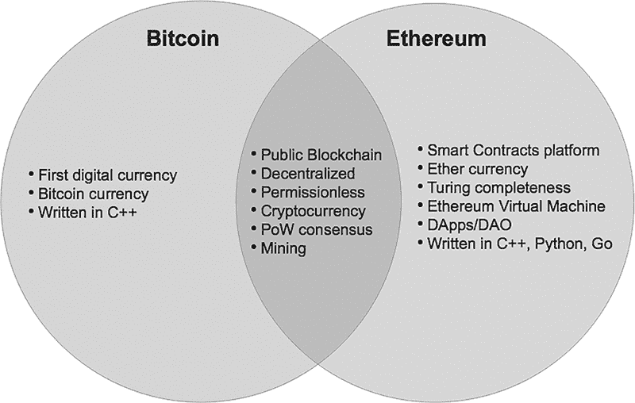

**图 1.1** Bitcoin 和 Ethereum 区块链：共性与差异。

* **普通节点**：普通节点是常规参与者，仅持有区块链副本，并利用区块链网络发送或接收 `Bitcoins`。
* **矿工**：矿工是具有特定角色的参与者，通过验证交易创建区块并将其提交至区块链网络以作为区块包含在内，从而构建区块链。矿工充当网络的守护者，只要具备足够的挖矿流程知识、所需的软硬件条件以及互联网连接，即可在世界任何地方运行。

在 `Bitcoin` 区块链中，大约每 10 分钟挖出一个区块，区块大小限制为 1 MByte。请注意，`Bitcoin` 区块链的交易速率限制为每秒七笔交易，这使其不适合高频交易。`Bitcoin` 区块链的其他弱点包括其脚本语言，该语言仅提供有限的少量指令且非图灵完备。此外，使用 `Bitcoin` 脚本语言开发应用需要高超的编程和密码学技能。

`Ethereum` 目前是仅次于 `Bitcoin` 的第二大流行公有链。它由瑞士非营利组织 `Ethereum Foundation` 开发，并汇聚了全球贡献者的力量。`Ethereum` 拥有自己的加密货币“Ether（以太币）”，它提供了主要的流动性形式，允许在网络中进行价值交换。`Ether` 还提供了支付和赚取因支持和使用网络而产生的交易费用的机制。与 `Bitcoin` 一样，`Ether` 也曾因投机而经历剧烈波动。`Ethereum` 非常适合开发需要快速构建并通过区块链平台高效、安全交互的 `DApps`。与 `Bitcoin` 类似，`Ethereum` 使用 `PoW` 共识方法来验证交易并证明完成了特定工作量。`PoW` 机制使用的哈希算法称为“Ethash”。与 `Bitcoin` 不同，`Ethereum` 开发者预期将用所谓的“权益证明”（`PoS`）共识取代 `PoW`。`PoS` 将要求 `Ether` 矿工持有一定数量的 `Ether`，若矿工试图攻击区块链网络，这些 `Ether` 将被没收。`Ethereum` 平台常被称为建立在底层区块链之上的“图灵完备 `Ethereum virtual machine (EVM)`（以太坊虚拟机）”。图灵完备意味着任何系统或编程语言只要拥有足够资源，就能计算任何可计算的内容。请注意，`EVM` 执行交易需要少量费用。这些费用称为“gas（燃料）”，所需 gas 数量取决于给定指令的大小。指令越长，所需 gas 越多。

`Bitcoin` 区块链仅包含交易列表，而 `Ethereum` 的基本单位是“账户”。`Ethereum` 区块链跟踪每个账户的状态，其中所有状态转换都是账户之间的价值和信息转移。账户概念被视为 `Ethereum` 区块链的核心组件和数据模型，因为用户必须通过交易与 `Ethereum` 网络交互。账户代表外部代理的身份（例如人类或自动化代理、挖矿节点）。账户使用公钥加密对每笔交易进行签名，以便 `EVM` 能够安全地验证交易发送者的身份。


# 除了 C++，以太坊还支持多种基于 JavaScript 和 Python 的编程语言（例如 Solidity、Serpent、Mutan 或 LLL），其中 Solidity 是编写所谓“智能合约”最流行的语言

智能合约是一种严格按照编程方式运行、无需任何第三方干预的协议。它使用自己任意的所有权规则、交易格式和状态转换逻辑。智能合约的每个方法均可通过交易或另一个方法进行调用。智能合约使 DApps 的实现成为可能，就应用程序编程接口 (API) 而言，DApps 看起来可能与传统应用程序完全相同，尽管中心化的后端服务已被运行在去中心化以太坊网络上的智能合约所取代，且不依赖任何中心化服务器。现有 DApps 的有趣示例包括 Augur（去中心化预测市场）、Weifund（众筹开放平台）、Golem（超级计算）和 Ethlance（去中心化就业市场平台）等。为了提供 DApps 之间有效的通信手段，以太坊使用 Whisper P2P 协议，这是一种用于秘密消息传递和数字加密的完全去中心化中间件。Whisper 支持在无需受信任第三方的情况下创建机密通信路由。它构建在一种对等采样服务之上，该服务考虑了网络地址转换 (NAT) 和防火墙等网络限制。一般来说，任何中心化服务均可通过使用以太坊区块链转换为 DApp。

#### 1.2.2 去中心化自治组织 (DAO)

关于加密货币和区块链最引人注目的一点，或许在于它们如何使全球范围内的人们和组织——所有这些主体都在追求自身利益——能够创造出巨大的共享价值。许多观察家断言，这是对现有公司制度的一种真正替代。加密货币、分布式账本、分布式共识和智能合约的去中心化、基于众包的技术，提供了从根本上改变人们组织事务方式的可能性，并为企业设计提供了一种新范式。最近有两项尝试用群体取代公司，分别是区块链技术和 DAO。DAO 是没有中央权威或领导者的去中心化组织。它们运行在编码在以太坊区块链上的程序代码上。与区块链一样，DAO 的代码通过消除对中心化控制的需求，摆脱了传统组织。甚至连 DAO 的原始开发者也没有任何额外权限，因为它独立运行，无需任何人工干预。它可以由一群承担其基本成本的个人提供资金，赋予资助者投票权，而非任何形式的所有权或股权份额。这创造了一个自主且透明的系统，只要它继续为其客户提供有用的服务，就会在网络上持续运行。

将 DAO 概念部署用于自动化智能合约操作的成功案例是 Storj，这是一个去中心化、安全、私密且加密的云存储平台，可作为 Dropbox 或 Google Drive 等中心化存储提供商的替代方案。DAO 可以由一群承担其基本成本的个人提供资金，赋予资助者投票权，而非任何形式的所有权或股权份额。这创造了一个自主且透明的系统，只要它继续为其客户提供有用的服务，就会在网络上持续运行。DAO 作为开源分布式软件存在，执行智能合约并根据指定的治理规则和准则运行。Buterin 在以太坊博客中对 DAO 的理想描述如下：“它是一个存在于互联网上并自主运行的实体，但也严重依赖雇佣个人来执行自动化本身无法完成的特定任务。”与完全自主的基于 AI 的代理不同，DAO 仍然需要人类的大量参与，具体而言是根据 DAO 定义的协议进行交互以维持运行。为了说明 DAO 与 AI 的区别，图 1.2 展示了一个象限图，根据自动化程度以及人类在边缘和中心的参与度，对 DAO、AI、传统组织以及机器人（在装配线等场景中已广泛部署）进行分类。我们将在第 1.5 节详细阐述 DAO 的这一特定特征（即中心自动化、边缘人工）如何被利用来实现触觉互联网的去中心化。为此，我们还简要指出，根据 Buterin 的说法，DAO 是非营利性的，尽管人们可以在 DAO 中赚钱，但不是通过投资 DAO 本身，而是通过参与其生态系统（例如通过会员资格）来实现。

为便于参考，表 1.2 总结了我们对比特币和以太坊区块链进行比较的技术细节。

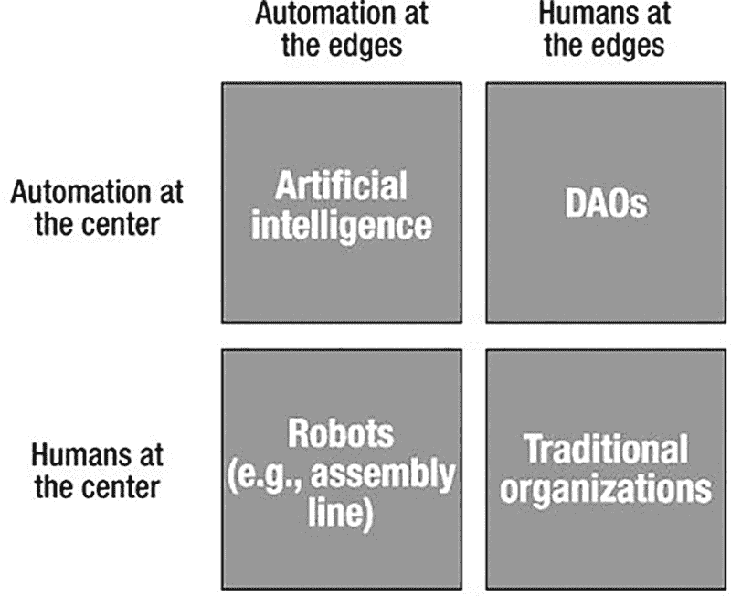

*图 1.2 DAO 与人工智能、传统组织和机器人（在装配线等场景中广泛部署）的对比：边缘和中心的自动化与人类参与。（来源：以太坊博客）。*

*表 1.2 比特币与以太坊区块链的比较*

| | 比特币 | 以太坊 |
| --- | --- | --- |
| 货币 | 比特币 | 以太币 |
| 应用 | 加密货币 | 加密货币、智能合约、DApps/DAO |
| 编写语言 | C++ | C++、Go、Python |
| 共识机制 | 工作量证明 (基于 SHA-256) | 工作量证明、计划采用权益证明 |
| 图灵完备性 | 否 | 是 |
| 匿名机制 | 否 | 是（配合 Whisper 协议） |
| 抗审查性 | 否 | 是 |
| 交易限制 | 7 笔/秒 | 20 笔/秒 |
| 状态概念 | 否 | 数据 |
| 智能合约语言 | 否 | Solidity、Serpent、Mutan、LLL |
| 智能合约执行 | 否 | 以太坊虚拟机 (EVM) |
| 出块时间 | 10 分钟 | 15 秒 |
| 数据模型 | 基于交易 | 基于账户 |
| 客户端 P2P 连接 | 否 | 是（配合 Whisper 协议） |
| 路由 | 否 | 是（Whisper 协议） |

### 1.3 区块链物联网与边缘计算

在本节中，在定义区块链与物联网的集成 (B-IoT) 之后，我们将讨论此类集成的动机，随后描述集成区块链与边缘计算所面临的挑战。

#### 1.3.1 区块链物联网 (B-IoT)：近期进展与相关工作

回顾第 1.1 节，物联网旨在实现机器间通信，而无需依赖任何人工介入。因此，其底层的 M2M 通信对于实现工业和其他以机器为中心的流程自动化非常有用。新兴的 B-IoT 代表了两项大规模技术——区块链和 M2M 通信——的强强结合，它允许我们自动化复杂的多步骤物联网流程（例如通过智能合约）。随着物联网设备间通信协议种类日益增多，迫切需要透明且高度安全可靠的物联网设备管理系统。本节综述了新兴 B-IoT 的最新技术现状，描述了近期进展和开放性挑战。


大多数物联网设备资源受限，这限制了它们成为区块链网络的一部分。为了应对这些限制，文献[[9]](#11_Chapter01.xhtml#ref1_9)的作者提出了一种去中心化访问管理系统，其中除物联网设备以及所谓的“管理中心”节点外，所有实体都是以太坊区块链的一部分；这些管理中心节点代表属于不同无线传感器网络的物联网设备向区块链请求权限。此外，被称为“管理者”的实体与区块链中特定“代理节点”托管的智能合约进行交互，以定义或修改其关联物联网设备资源的访问控制策略。概念验证实现评估了不属于以太坊网络的新系统架构组件（即管理中心和物联网设备），并从延迟和可扩展性方面证明了所提访问管理架构的可行性。另一个有趣的以太坊案例研究见于文献[[10]](#11_Chapter01.xhtml#ref1_10)，该文回顾了现成的以太坊区块链包，以利用其智能合约特性（处理访问控制策略、数据存储和数据流管理）来实现智能家居系统。

文献[[11]](#11_Chapter01.xhtml#ref1_11)更详细地研究了实现区块链驱动物联网服务的架构问题。在一项以智能物品租赁服务为例的 B-IoT 服务初步研究中，作者基于以太坊比较了以下四种不同的架构风格：(i) 完全中心化（无区块链的云），(ii) 伪分布式物品（物理上位于中心云），(iii) 分布式物品（直接由智能合约控制），以及 (iv) 完全分布式。初步结果表明，完全分布式架构（其中区块链端点部署在最终用户设备上）在鲁棒性和安全性方面更优。

文献[[12]](#11_Chapter01.xhtml#ref1_12)讨论了在以太坊交易中集成安全元件的各种视角。文中提出了一种新架构，用于建立智能物品间交换的以太坊交易的信任。为了防止用于签名的密钥被窃取或黑客攻击，作者提议使用 `javacard` 安全元件和一种所谓的“加密货币智能卡”（CCSC）。文中讨论了两个 CCSC 用例。在第一个用例中，CCSC 集成在一个由 `Arduino` 处理器供电的低成本 B-IoT 设备中，其中传感器数据被集成到以太坊交易中。第二个用例涉及在远程 APDU 调用安全（RACS）服务器中部署 CCSC，以通过广为人知的椭圆曲线数字签名算法（ECDSA）实现远程和安全的数字签名。

区块链交易需要公钥加密操作，如数字签名。然而，并非所有 B-IoT 设备都能支持这种计算密集型任务。因此，在文献[[13]](#11_Chapter01.xhtml#ref1_13)中，作者提出了一种面向网关的初步设计方法，将所有区块链相关操作卸载到网关。作者指出，他们的方法与以太坊客户端架构兼容。

鉴于物联网应用和服务的大规模和分布式特性，区块链技术可被利用来提供一个安全、防篡改的 B-IoT 网络。更具体地说，防篡改和去中心化信任这一关键特性使我们能够构建一个没有单点故障的安全认证和授权服务。为此，文献[[14]](#11_Chapter01.xhtml#ref1_14)的作者初步尝试开发了一种由区块链支持的安全模型，为 B-IoT 网络中节点发送和接收的数据提供机密性、完整性和可用性。所提解决方案包含位于 TCP/IP 传输层之上的区块链协议层和区块链应用层。前者包含用于 B-IoT 节点的分布式共识算法，而后者定义了针对高层协议的物联网安全专用交易及其语义。为了评估所提分层架构的可行性和性能，采用树拓扑连接的 B-IoT 节点通过 1 Gbps 以太网或 54 Mbps WiFi 链路进行了仿真。仿真结果表明，当用无线 WiFi 链路替代有线以太网时，由于区块难度调整能动态适应网络条件，区块到达率不受延迟增加和带宽减少的太大影响。

在各种低功耗广域（LPWA）技术中，长距离（LoRa）无线射频（RF）被认为是实现大规模物联网部署最有前景的使能技术之一。在文献[[15]](#11_Chapter01.xhtml#ref1_15)中，作者展示了一个概念验证演示器，使低功耗、资源受限的 LoRa 物联网终端设备能够通过充当完整区块链节点的中间网关访问以太坊区块链网络。更具体地说，电池供电的物联网终端设备将位置数据发送给 LoRa 网关，后者再通过基于 Go 语言的标准以太坊客户端 `Geth` 利用智能合约将其转发至区块链网络。LoRa 网关与后端应用服务器之间基于事件的通信机制作为概念验证演示器得以实现。

物联网中对象识别的基本挑战之一源于传统域名系统（DNS）。通常，DNS 由中心化模块管理，因此可能因单方面的高级持续性威胁（APT）攻击以及大型系统中的区域文件同步延迟而导致大规模故障。显然，需要一个更稳健、分布式的名称管理系统，以支持 DNS 的平滑演进，并使其总体上对物联网和未来互联网更高效。为此，文献[[16]](#11_Chapter01.xhtml#ref1_16)引入了一种名为“DNSLedger”的去中心化基于区块链的域名系统。为了重建 DNS 的层级结构，DNSLedger 包含两种区块链：(i) 存储所有顶级域信息的单一根链，以及 (ii) 多个顶级域（TLD）链，每个链负责其各自域名的信息。在 DNSLedger 中，域名服务器充当区块链节点，而每个 TLD 链可选择一个或多个服务器加入根链。DNSLedger 客户端可执行常见的 DNS 功能，如域名查找、申请和修改。

上述许多研究都将以太坊作为首选区块链。研究表明，完全分布式的以太坊架构能够同时增强鲁棒性和安全性。此外，面向网关的设计方法常被用于将计算密集型任务从低功耗、资源受限的物联网终端设备卸载到中间网关，从而使它们能够访问以太坊区块链网络。同时也表明，由于区块难度调整能动态适应网络条件，WiFi 接入链路的延迟增加和带宽减少不会显著恶化区块到达率。

尽管近期取得了进展，但以太坊区别于其他区块链的显著特征（见第 1.2.1 节）仍有待更深入地探索，包括它们与人工智能和机器人等其他新兴关键技术以及被称为“边缘计算”的去中心化云计算解决方案的共生关系。


一个特别感兴趣的问题是，如何利用去中心化的区块链机制，让个体间新的混合协作形式涌现出来 [8]，而这些形式在由企业而非个体主导的传统市场导向经济中是不曾被设想的。

#### 1.3.2 区块链赋能的边缘计算

云计算面临的关键挑战之一是移动设备与相关云之间的端到端响应性。为应对这一挑战，提出了多接入边缘计算（MEC），它是一种移动性增强的小规模云数据中心，位于互联网边缘（例如无线接入网 [RAN]），且靠近移动用户。MEC 实体是一种可信的、资源丰富的计算机或计算机集群，能够良好地连接互联网，并可供附近的移动设备使用。根据 ETSI 发布的白皮书，MEC 被视为一项关键新兴技术，将成为下一代网络的重要组成部分。基于上述论点，将区块链与边缘计算集成为一个统一实体成为一种自然趋势。一方面，通过将区块链融入边缘计算网络，系统可以为去中心化节点提供可靠的网络、计算和存储访问与控制。另一方面，边缘计算使得功率受限的设备能够进行区块链存储和挖矿计算。此外，边缘的链下存储和链下计算实现了区块链上的可扩展存储和计算 [17]。

近期已开展多项关于区块链与边缘计算的研究。文献 [18] 通过将区块链共识过程和数据处理任务卸载到更强大的边缘计算资源上，使资源受限的物联网设备从计算密集型任务中解脱出来。所提议的 EdgeChain 构建在以太坊平台之上，并利用智能合约根据物联网设备的行为和资源使用情况来监控和规范其行为。文献 [19] 提出了另一种名为“BeCome”的、具备边缘计算能力的物联网区块链赋能计算卸载方案。该研究旨在减少边缘计算设备的任务卸载时间和能耗，同时实现负载均衡和数据完整性。

文献 [20] 为边缘计算提出了一种名为“BlockTDM”的基于区块链的可信数据管理方案，以解决边缘计算环境中的数据信任和安全问题。具体而言，作者提出了一种灵活可配置的区块链架构，包括相互认证协议、灵活共识、智能合约、区块与交易数据管理，以及区块链节点管理和部署。BlockTDM 方案能够支持基于矩阵的多通道数据分段和隔离，用于敏感或隐私数据保护。此外，作者设计了用户定义的敏感数据加密，在交易载荷存储到区块链系统之前进行。他们通过适当的智能合约实现了对受保护的区块链数据和交易的条件访问和解密查询。他们的分析和评估表明，所提议的 BlockTDM 方案为具有高可信度的可信数据管理提供了一种通用、灵活且可配置的基于区块链的范式。

总之，区块链赋能的边缘计算已成为一个重要概念，它利用去中心化管理和分布式服务来满足下一代通信网络的安全性、可扩展性和性能要求，这将在 1.5 节 中进行更详细的技术讨论。

### 1.4 IEEE P1918.1 触觉互联网

本节简要概述触觉互联网的基本概念、特征、结构和分类。随后，将更详细地介绍一些典型的触觉互联网应用和网络基础设施要求。

#### 1.4.1 触觉互联网：关键原则

“触觉互联网” 一词最早由 Fettweis 于 2014 年提出。在其开创性论文 [21] 中，触觉互联网被定义为一种突破性技术，它通过要求 1–10 ms 的往返时延，实现了前所未有的移动应用，用于对真实和虚拟物体进行触觉转向和控制。随后在 2014 年，ITU-T 发布了关于触觉互联网的技术观察报告，强调扩大有线和无线接入网领域的研究至关重要，这将带来新的理念和概念，以提升接入网的冗余度和多样性，满足触觉互联网应用严格的时延和载波级可靠性要求 [22]。触觉互联网为实时远程物理交互提供了一种媒介，这要求在虚拟或真实物体（即人、机器和流程）之间交换闭环信息。这种强制性的端到端设计方法充分体现在新兴的 IEEE P1918.1 标准工作组（成立于 2016 年 3 月）的参考架构关键原则中，该工作组旨在为触觉互联网定义一个框架 [23]。其中，关键原则设想要（i）开发通用的触觉互联网参考架构，（ii）支持通过无线（如蜂窝、WiFi）或混合无线和有线网络的局域和广域连接，以及（iii）利用网络边缘云变体的计算资源。该工作组将触觉互联网定义为“一种网络或网络的网络，用于人或机器以感知实时的方式远程访问、感知、操纵或控制真实或虚拟的物体或过程”。IEEE P1918.1 中考虑的一些关键用例包括远程操作、触觉通信、沉浸式虚拟现实和汽车控制。

为了赋予其更多以 5G 为中心的特性，触觉互联网最近也被称为 5G 赋能的触觉互联网 [24,25]。回顾一下，与前四代蜂窝技术不同，未来的 5G 网络将导致蜂窝和 WiFi 技术及标准的日益融合 [26]。此外，还必须认识到所谓回传瓶颈的重要性，这呼吁采用端到端的设计方法，利用无线前端和有线回传技术。或者正如 [26] 的首位作者 Andrews 精辟地指出：“在各处部署基站有利于为移动站提供高速接入，但这难道不只是把包袱甩给了基站，它们现在必须以某种方式将这些数据传送到有线核心网并从中获取数据吗？” [27]。


显然，触觉互联网开启了大量令人振奋的研究方向，旨在通过互联网为人机交互增添新的维度。根据上述 ITU-T 技术观察报告，触觉互联网被视为当今物联网演进的下一次飞跃，尽管 5G、物联网和触觉互联网之间存在显著重叠。为便于说明，图 1.3 通过物联网、5G 和触觉互联网这三个视角，展示了上述共性与差异。主要差异或许最好用底层通信范式和使能设备来表达。物联网依赖 M2M 通信，侧重于智能设备（如传感器和执行器）。在与新兴 MTC 共存的情况下，5G 将维持其传统的人与人之间（H2H）通信范式，用于传统的三重播业务（语音、视频和数据），并日益聚焦于与其他无线技术（最著名的是 WiFi）的融合以及去中心化。相反，触觉互联网将以人与机器之间（H2M）通信为中心，利用触觉和力反馈设备。更重要的是，尽管存在差异，物联网、5G 和触觉互联网似乎都在向一组共同的重要设计目标汇聚：

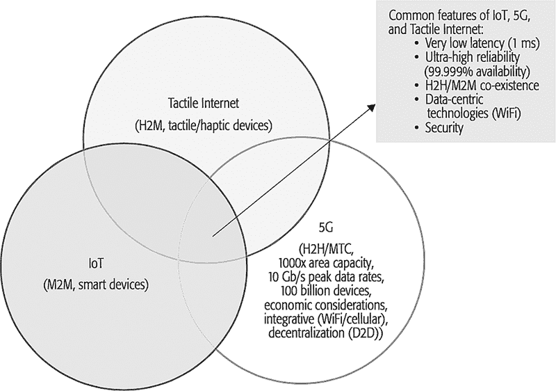

*图 1.3* 物联网、5G 和触觉互联网的三个视角：共性与差异。

- 极低时延，量级为 1 ms
- 超高可靠性，可用性几乎有保证地达到 99.999%
- H2H 与 M2M 共存
- 以数据为中心的技术融合，特别聚焦于 WiFi
- 安全性

重要的是，触觉互联网涉及 H2M 交互固有的“人在回路中”（HITL）特性，这与新兴物联网形成对比，后者的底层 M2M 通信不涉及任何人工介入。虽然 M2M 通信有利于工业及其他以机器为中心的流程自动化，但触觉互联网将以人与机器/机器人（H2M/R）通信为中心，从而允许采用以人为本的设计方法，创造新颖的沉浸式体验，并通过互联网扩展人的能力（即增强人而非实现人的自动化）[28]。

#### 1.4.2 人-智能体-机器人团队协作

一种通过优越流程灵活编排人机协同活动来实现先进人机协调的有前景方法，或许可以在仍处于起步阶段的人-智能体-机器人团队协作（HART）研究领域中找到 [29]。与早期的自动化研究不同，HART 超越了对完全自主性（即完全的独立性和自给自足）以及自主系统之间协作/合作自主性的单一关注，后者旨在将人类排除在潜在队友之外，以设计“人脱离回路”的解决方案。在 HART 中，人与机器之间功能和任务的动态分配（可能随时间变化，或在不同情境下不可预测）起着核心作用。特别是，随着日益智能化的机器崛起，历史上用于决定哪些任务最适合由人执行、哪些由机器执行、而非协同工作的“人擅长/机器擅长”（HABA/MABA）方法已显过时。为了更好地理解当前智能机器的潜力与局限，T. H. Davenport 和 J. Kirby 在其著作《*Only Humans Need Apply: Winners and Losers in the Age of Smart Machines*》（仅人类适用：智能机器时代的赢家与输家）中，沿两个维度对智能机器的能力进行了分类，即其行动能力和学习能力。行动能力包含四个任务层级，范围从最基础的任务（如分析数字）到执行数字任务（由智能体完成），甚至物理任务（由机器人完成）。另一方面，学习能力通过四个层级递进，跨越从不具备内在智能的人类辅助机器，到具备情境感知、学习能力，甚至自我意识智能的机器。

根据 [29]，在 HART 研究的其他挑战中，开发使自主系统不仅能为人类做事，还能与人类及其他系统协同工作的能力，代表了一个重要的开放性议题，即将人类视为智能行动者团队的“成员”，而非继续将其视为传统的“用户”。在下文中，我们将引入并扩展光纤无线（FiWi）增强的 LTE-Advanced（LTE-A）异构网络（HetNets）概念，通过利用 AI 增强的 MEC 能力，实现本地和非本地遥操作，以达成低往返时延和低抖动。

#### 1.4.3 具有 AI 增强 MEC 的低时延 FiWi 增强型 LTE-A HetNets

##### 1.4.3.1 低时延 FiWi 增强型 LTE-A HetNets

FiWi 接入网，也称为“无线光宽带接入网”（WOBANs），结合了光纤网络的可靠性、鲁棒性和高容量，以及无线网络的灵活性、普遍性和成本节约 [30]。要实现每用户高达 200 Mbps 的峰值数据速率并实现完全固移融合的愿景，至关重要的是用集成的 FiWi 宽带接入网取代当今传统的有线和微波回传技术。

在 [31] 中，我们研究了将以覆盖为中心的 4G 移动网络与以容量为中心的 FiWi 宽带接入网（基于以数据为中心的以太网技术，具备光纤回传共享和 WiFi 卸载能力）统一所获得的性能增益，以应对移动数据流量的前所未有的增长。我们通过概率分析和仿真验证，评估了 FiWi 增强型 LTE-A HetNets 的最大聚合吞吐量、卸载效率，特别是时延性能，包括各种局部化的精简光纤回传冗余和无线保护技术的有益影响。在我们的研究中，我们密切关注源于以太网无源光网络（EPON）光纤故障导致的光纤回传可靠性问题，以及由 WiFi 网格节点故障以及时域和空域 WiFi 覆盖约束导致的 WiFi 卸载局限性。


为了进行说明，图 1.4 描绘了 FiWi 增强型 LTE-A 异构网的平均端到端时延性能与不同 WiFi 卸载比 (WOR) 值下的聚合吞吐量的关系，其中 `0 ≤ WOR ≤ 1` 表示卸载到 WiFi 的移动用户流量百分比。所呈现的分析和验证仿真结果是在假设真实的 LTE-A 和 FiWi 网络配置、均匀业务负载以及应用最小（光和无线）跳路由的条件下获得的。更多细节请感兴趣的读者参考 [31]。目前，让我们假设 EPON 的可靠性是理想的（即不发生光纤回程故障）。然而，与 EPON 不同，WiFi 组网网络可能会以 `10^(−6)` 的概率遭受无线服务中断。我们从 图 1.4 中观察到，随着 WOR 的增加，FiWi 增强型 LTE-A 异构网的吞吐量-时延性能得到了显著改善。更确切地说，通过将 WOR 从 0.1 变为 0.57，最大可达聚合吞吐量从约 61 Mbps 增加到大约 126 Mbps（即最大可达聚合吞吐量翻了一倍多）。更重要的是，进一步将 WOR 增加到 0.9 不会导致最大可达聚合吞吐量显著进一步增加，但它对于降低平均端到端时延并使其在广泛的业务负载范围内保持在 `10^(−3)` 秒（1 ms）的极低水平起着关键作用。因此，这一结果表明，将 4G 移动网络中大部分数据流量卸载到 WiFi 是一种获得 1 ms 量级超低时延的有前途的方法。

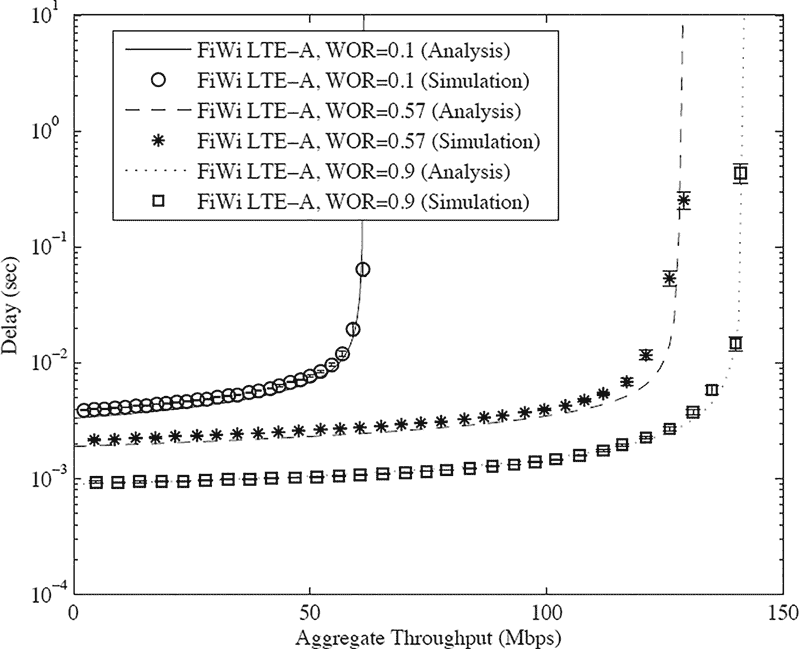

*图 1.4*  不同 WiFi 卸载比 (WOR) 下的平均端到端时延与聚合吞吐量关系图。

### 1.4.3.2  AI 增强型 MEC：将 AI 推向边缘

图 1.5 描绘了具有 AI 增强型 MEC 服务器的 FiWi 增强型 LTE-A 异构网的通用网络架构。光纤回程由分时或波分复用 (TDM/WDM) IEEE 802.3ah/av 1/10 Gb/s EPON 组成，中心光线路终端 (OLT) 与远端光网络单元 (ONU) 之间的典型光纤范围为 20 km。EPON 可能包含多个级联级，每级由波长广播分路器和合路器或波分复用器和解复用器分隔。ONU 分为三个不同的子集。ONU 可以服务于固定（有线）用户。或者，它可以连接到蜂窝网络基站 (BS) 或 IEEE 802.11n/ac/s WLAN 组网门户点 (MPP)，从而分别形成共址 ONU-BS 或 ONU-MPP。根据移动轨迹，移动用户 (MU) 可以通过蜂窝网络或 WLAN 组网前端进行通信，后者由 ONU-MPP、中间网格点 (MP) 和网格接入点 (MAP) 组成 [32]。

假设人类操作员 (HO) 和远程操作机器人 (TOR) 仅通过 WLAN 通信，这与使用双模 4G/WiFi 智能手机的 MU 不同。远程操作根据涉及的 HO 和 TOR 的接近程度，在本地或非本地进行，如 图 1.5 所示。在本地远程操作中，HO 和相应的 TOR 关联到同一个 MAP，并通过该 MAP 交换命令和反馈采样，而无需穿越光纤回程。相反，如果 HO 和 TOR 关联到不同的 MAP，非本地远程操作通常通过回程 EPON 和中心 OLT 进行通信。尽管近期对利用机器学习进行光通信和网络研究的兴趣日益浓厚，但用于为 HO 实现沉浸式和透明化远程操作体验的边缘智能尚未被探索。在 [32] 中，我们在所考虑通信网络的边缘应用机器学习，以实现沉浸式和无摩擦的触觉互联网体验。为了实现边缘智能，选定的 ONU-BS/MPP 配备了 AI 增强型 MEC 服务器。这些服务器依赖于光无线接口共址的云微数据中心的计算能力（见 图 1.5）来预测反馈路径中延迟的触觉采样。因此，HO 能够以 1 ms 的粒度实时感知远程任务环境，从而实现更紧密的协同、改进的安全控制和远程操作系统的更高可靠性。

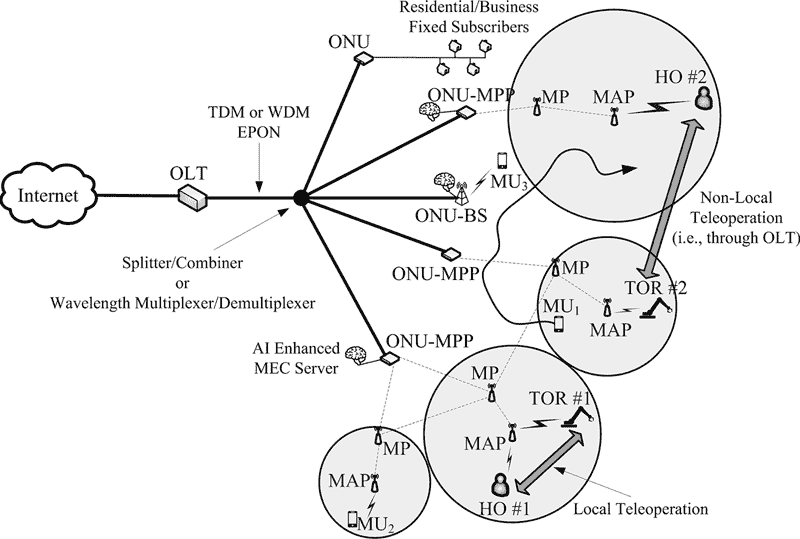

*图 1.5*  基于 FiWi 的触觉互联网架构，具有用于本地和非本地远程操作的人工智能 (AI) 增强型 MEC。

## 1.5  触觉互联网的去中心化

回顾 1.1 节，触觉互联网将涉及 H2M 交互固有的“人在回路”(HITL) 特性，这与新兴的物联网 (IoT) 形成对比。因此，它允许采用以人为中心的设计方法，通过互联网扩展人的能力，以实现人的**增强**而非**自动化**。最近，在 [28] 中，我们提出了这样一个观点：触觉互联网可能是当代和早期互联网先驱所设想的人类增强和人机共生的先兆。更具体地说，我们详细阐述了 AI 增强型代理在支持人类进行人机任务协调方面可能发挥的作用。为了实现先进的人机协调，我们开发了一种计算和物理任务的分布式分配算法，用于流畅地编排 HART 协同活动（例如，用户拥有和/或网络拥有的机器人的共享使用）。在我们的设计方法中，所有 HART 成员通过通信建立了集体自我意识，旨在最小化任务完成时间。

在下文中，我们寻找上述 HART 成员资格与 DAO、AI 和机器人的互补优势（见 图 1.2）之间的协同效应，以通过去中心化触觉互联网来促进本地人机协同活动集群。为此，更好地理解 AI 的优点和局限性非常重要。最近，斯坦福大学启动了其“百年人工智能研究 (AI100)”。在首份报告《2030 年的人工智能与生活》中，作者将 AI 定义为一组计算技术，这些技术受到人们利用神经系统和身体进行感知、学习、推理和采取行动方式的启发。他们还指出，AI 在短期内可能会取代**任务**而非**工作**，并强调了众包人类专业知识以解决计算机单独难以解决的问题的重要性。

### 1.5.1  去中心化边缘智能


首先，让我们探讨通过部分或完全去中心化 MEC（多接入边缘计算）来利用移动终端用户设备的潜力。我们介绍了在融合光纤-无线移动网络的光-无线接口处使用 AI 增强型 MEC 服务器进行计算卸载。假设与文献 [28] 相同的默认网络参数设置和仿真设置，我们考虑 `1 ≤ N[Edge] ≤ 4` 个 AI 增强型 MEC 服务器，每个服务器关联 8 个终端用户，其中 `1 ≤ N[PD] ≤ 8` 个部分去中心化的终端用户可以通过改变其计算卸载概率来灵活控制卸载任务的数量。剩余的 `8 − N[PD]` 个为完全中心化的终端用户，它们仅依赖边缘计算（即其计算卸载概率等于 1）。注意，当 `N[Edge] = 4` 时，所有终端用户均可将计算任务卸载到边缘节点。反之，当 `N[Edge] < 4` 时，一个或多个边缘节点不可用于计算卸载，其关联的终端用户将退回使用本地计算资源（即完全去中心化）。图 1.6 展示了不同 `N[Edge]` 和 `N[PD]` 下部分去中心化终端用户的平均任务完成时间随计算卸载概率的变化。我们从 图 1.6 中观察到，对于给定的 `N[Edge]`，增加 `N[PD]`（即更高程度的去中心化）能有效降低平均任务完成时间。具体而言，对于 `N[Edge] = 4`，高去中心化程度（`N[PD] = 8`）允许终端用户通过将计算卸载概率最优调整为 0.7，使平均任务完成时间最多减少 89.5%。

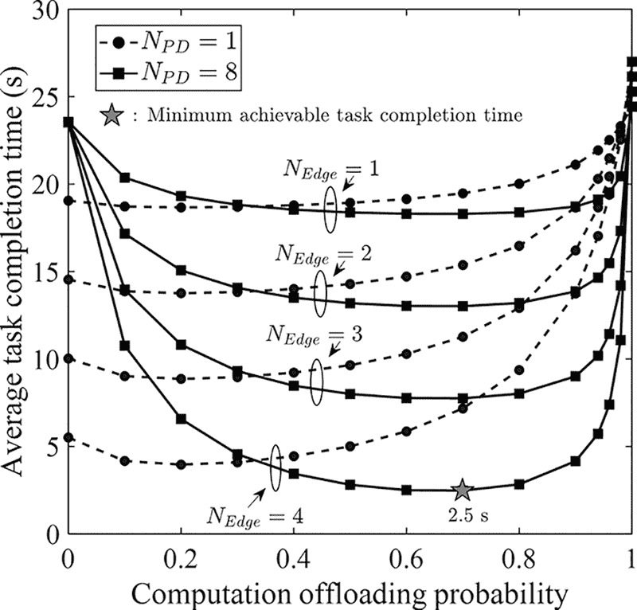

*图 1.6 不同数量的部分去中心化终端用户 (N[PD]) 和人工智能 (AI) 增强型 MEC 服务器 (N[Edge]) 下的平均任务完成时间（单位：秒）与计算卸载概率的关系。*

随着互联算力在全球范围内的普及，以及实用平台在其之上构建完成，大众已成为一个切实可行且极具价值的资源。根据文献 [6]，对于处于现代资本主义核心地位的公司而言，有许多方式可以利用技术赋能的大众（如 DAO）中那些无资质认证且按常规标准缺乏经验的成员的专业知识。在文献 [28] 中，我们基于用户拥有和网络拥有的机器人的共享使用，开发了一种面向 HART 中心任务协调的物理任务自感知分配算法。回顾 第 1.4.3.2 节，通过将我们的 AI 增强型 MEC 服务器作为自主代理使用，我们展示了来自 TOR（远程操作机器人）的延迟力反馈样本可以在本地生成并传递给附近的 HO（人类操作员）。然而请注意，基于样本预测的远程操作系统的性能在很大程度上依赖于预测算法的准确性。

#### 1.5.2 众包：扩展 HO 劳动力

为了在去中心化触觉互联网中实现 DAO，可利用以太坊建立用于远程物理任务执行的 HO-TOR 会话，其中智能合约有助于建立和维护可信的 HART 成员资格，并允许每个 HART 成员全局知晓所有参与的 HO、TOR 以及充当遵循广泛使用的网关导向方法（见 第 1.3.1 节）的自主代理的 MEC 服务器。HO 远程执行给定的物理任务，直到最近的 `n` 个触觉反馈样本中有 `k` 个被误预测。此时，HO 立即停止远程操作并通知代理。代理将中断的任务分配给附近的可用 HO，后者随前往任务点并完成物理任务。对于 `n = 5`，图 1.7 描绘了不同 `k` 和 `f[human]/f[robot]` 下的平均任务完成时间随样本误预测概率的变化，其中 `f[human]` 和 `f[robot]` 分别表示人类和机器人执行物理任务的能力（以每秒操作数为单位）。我们观察到，对于 `k = 1`，随着样本误预测概率从 0 增长到 0.25，任务完成时间增加；而对于 `k = 3`，任务完成时间几乎保持不变。此外，请注意，随着人类能力增强（即 `f[human]/f[robot]` 增加），由此产生的任务完成时间会减少，直到触及平台期，因为移动会产生额外延迟。

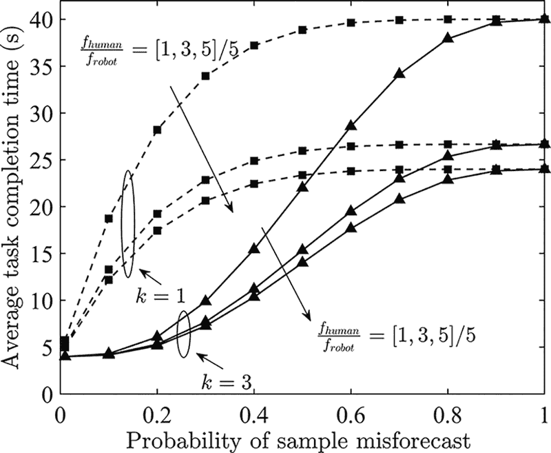

*图 1.7 不同误预测次数 (k) 和人机操作能力比率 (f[human]/f[robot]) 下的平均任务完成时间（单位：秒）与样本误预测概率的关系。*

### 1.6 区块链、AI 与人类智能：前行之路

如今，AI、机器学习、机器人和物联网正在融合，创造出一波新的变革浪潮，因为它们开始利用加密货币、首次代币发行 (ICO)、虚拟资产以及万物代币化。这种创新融合与人类事业的结合引发了对失业、机器人统治者以及未来整体的担忧 [33]。

在文献 [28] 中，我们涉及了将研究重点从 AI 转移到智能放大 (IA) 的重要性，即利用信息技术增强人类决策。然而请注意，在不确定性增加的动态任务环境和复杂度极高的现实情境中，IA 变得困难。IA 也称为“认知增强”或“机器增强智能”，将在增强人类的创造力、理解力、效率和智能方面发挥关键作用。

#### 1.6.1 基于认知辅助的智能放大

边缘计算是一种广泛研究的方法，可增加众包的实用性，可用于通过提供认知辅助，逐步指导人类完成物理任务执行过程。从技术上讲，这可以通过为非专业 DAO 成员配备增强现实 (AR) 头显（例如具有 WiFi 连接功能的 HoloLens 2）来轻松实现，该头显可实时从其最近的 AI 增强型 MEC 服务器接收工单信息。

#### 1.6.2 HITL 混合增强智能

人类面临的许多问题往往具有高不确定性、高复杂性和开放性。为解决此类问题，可引入人类交互和参与。因此，这催生了用于先进人机协作的 HITL（人在回路）混合增强智能概念 [34]。HITL 混合增强智能被定义为一种需要人类交互的智能模型，允许解决那些难以通过机器学习轻松训练或分类的问题和需求。总体而言，机器学习在理解非结构化现实环境和处理不完整信息及复杂时空相关任务方面不如人脑。因此，机器无法独自完成人类社会中的所有任务。相反，AI 与人类智能更应被视为高度互补的关系。


根据文献[34]，互联网为 HITL 混合增强智能提供了巨大的创新空间。具体而言，云机器人技术和 AR 是增强多机器人协作系统中个体智能的增长最快的商业应用之一。HITL 混合增强智能的主要研究课题之一是开发方法，使机器不仅能从海量训练样本中学习，还能从人类知识中学习，通过不同机器人和人类之间的共享智能来完成高智能任务。

#### 1.6.3 去中心化自组织合作社的兴起

一个极具吸引力的例子是所谓的 SingularityNET²，它能催化人类和机器智能，跨越互联网形成一种新型的自组织通用人工智能（AGI）。可以将 SingularityNet 视为一个去中心化自组织合作社（DSOC），这一概念类似于前述的 DAO。DSOC 本质上是一种用于创建新型智能合约的分布式计算架构。执行这些智能合约的实体被称为“代理”，它们可以在云端、手机、机器人或其他嵌入式设备上运行。服务通过智能合约启用的 API 提供给任何客户，并且可能需要多个代理利用其集体智能组合行动来完成。一般来说，可能有多个代理能以不同方式和程度完成给定的任务请求。网络中的每个任务请求都需要代理的独特组合，从而形成所谓的“相互依赖的报价网络”，代理之间通过报价-请求对交换服务。每当有人想让代理执行服务时，就会为该特定任务签署一份智能合约。为此，DSOC 旨在通过寻找有用代理并引导其成为贡献者的优越发现机制，利用尽可能广泛种类的代理的贡献。

#### 1.6.4 走向人类增强的助推

在 DSOC 概念的基础上，我们主张利用助推理论来增强 DAO 中非技术性群体成员的人类能力。根据 2017 年诺贝尔经济学奖得主理查德·H·塞勒的观点，助推理论主张积极强化和间接建议可以影响群体和个体的行为。一种合适的助推机制旨在通过向远程熟练 DAO 成员学习来完成被中断的本地物理任务，该成员能够通过嵌入智能合约中的安全区块链交易将其知识作为数据传输，并为每个子任务提供适当的奖励。该智能合约将最初增强本地 HO 的能力，从而允许通过故障机器人和熟练人类之间的共享智能成功完成给定任务。

### 1.7 开放挑战与未来工作

互联网一直在不断演进，从移动互联网到新兴的物联网，再到未来的触觉互联网。同样，未来 5G 网络的能力将远远超越前几代移动通信。正如文献[22]所设想的，通过提升接入网络的冗余度和多样性，嵌入 AI 的 FiWi 增强型 4G LTE-A 异构网络极有希望满足沉浸式触觉互联网应用严格的延迟和可靠性要求。在文献[35]中，我们最近概述了一些研究思路，有助于挖掘触觉互联网的全部潜力。然而，其他概念如所讨论的所有权分散、DAO 和 HART 成员资格，将在引入新思想和概念方面发挥关键作用，通过新兴的以太坊区块链技术彻底去中心化边缘计算，促进本地人机协同活动集群的形成，以实现未来的技术-社会系统，如触觉互联网，其设计初衷仍要求网络边缘的人类深度参与，而非将其自动化替代。未来仍需大量工作，将基于以太网的 FiWi 增强型移动网络与以太坊区块链技术相集成。尽管区块链技术是增强当今物联网的有前景技术，但在将区块链与物联网集成之前，尤其是在未来移动网络（即 6G 及以后）中，仍有许多研究问题有待解决，这些网络在构建区块链的底层基础设施中起着首要作用。

### 1.8 结论

在本章中，我们表明许多新兴的 B-IoT 研究都选择以太坊作为区块链，并采用面向网关的设计方法，将计算密集型任务从资源受限的终端设备卸载到中间网关，从而使它们能够访问以太坊区块链网络。基于我们最近关于编排混合 HART 协同活动的触觉互联网工作，我们表明更高层级的去中心化 AI 增强型 MEC 能有效减少计算任务的平均完成时间。此外，针对去中心化触觉互联网中的远程物理任务执行，我们探讨了如何利用以太坊的 DAO 和智能合约建立可信的 HART 成员资格，以及在远程操作机器人触觉反馈样本预测不可靠的情况下，人类众包如何帮助减少物理任务完成时间。我们概述了未来的技术融合研究途径，旨在通过利用大众的共享智能，成功完成混合机器-人类任务。

### 参考文献

1. M. Maier, M. Chowdhury, B. P. Rimal and D. P. Van, ‘The Tactile Internet: Vision, Recent Progress, and Open Challenges,’ *IEEE Communications Magazine*, vol. 54, no. 5, pp. 138–145, 2016.

2. D. Tapscott and A. Tapscott, *Blockchain Revolution: How the Technology Behind Bitcoin Is Changing Money, Business, and the World*, Portfolio, Toronto, Canada, 2016.

3. W. Saad, M. Bennis and M. Chen, ‘A Vision of 6G Wireless Systems: Applications, Trends, Technologies, and Open Research Problems,’ *IEEE Network*, vol. 34, no. 3, pp. 134–142, May/June 2020.

4. T. Salman, M. Zolanvari, A. Erbad, R. Jain and M. Samaka, ‘Security Services Using Blockchains: A State of the Art Survey,’ *IEEE Communications Surveys & Tutorials*, vol. 21, no. 1, pp. 858–880, 2019.

5. V. Buterin, ‘A Next-Generation Smart Contract and Decentralized Application Platform,’ *Ethereum White Paper*, [www.ethereum.org](http://www.ethereum.org).

6. A. McAfee and E. Brynjolfsson, *Machine, Platform, Crowd: Harnessing Our Digital Future*, W. W. Norton, New York, 2017.

7. F. Tschorsch and B. Scheuermann, ‘Bitcoin and Beyond: A Technical Survey on Decentralized Digital Currencies,’ *IEEE Communications Surveys & Tutorials*, vol. 18, no. 3, pp. 2084–2123, 2016.

8. R. Beck, ‘Beyond Bitcoin: The Rise of Blockchain World,’ *IEEE Computer*, vol. 51, no. 2, pp. 54–58, 2018.

9. O. Novo, ‘Blockchain Meets IoT: An Architecture for Scalable Access Management in IoT,’ *IEEE Internet of Things Journal*, vol. 5, no. 2, pp. 1184–1195, 2018.

10. Y. N. Aung and T. Tantidham, ‘Review of Ethereum: Smart Home Case Study,’ *Proceedings of the 2nd International Conference on Information Technology (INCIT)*, Nakhon Pathom, Thailand, 2017, pp. 1–4.


### 参考文献

[11] C.-F. Liao, S.-W. Bao, C.-J. Cheng and K. Chen, ‘On Design Issues and Architectural Styles for Blockchain-Driven IoT Services,’ *Proceedings of the IEEE International Conference on Consumer Electronics-Taiwan (ICCE-TW)*, Taipei, 2017, pp. 351–352.

[12] P. Urien, ‘Towards Secure Elements for Trusted Transactions in Blockchain and Blockchain IoT (BIoT) Platforms,’ *Proceedings of the Fourth International Conference on Mobile and Secure Services (MobiSecServ)*, Miami Beach, FL, 2018, pp. 1–5.

[13] G. C. Polyzos and N. Fotiou, ‘Blockchain-Assisted Information Distribution for the Internet of Things,’ *Proceedings of the IEEE International Conference on Information Reuse and Integration (IRI)*, San Diego, CA, 2017, pp. 75–78.

[14] Y. Gupta, R. Shorey, D. Kulkarni and J. Tew, ‘The Applicability of Blockchain in the Internet of Things,’ *Proceedings of the 10th International Conference on Communication Systems & Networks (COMSNETS)*, Bengaluru, India, 2018, pp. 561–564.

[15] K. R. Özyilmaz and A. Yurdakul, ‘Work-in-Progress: Integrating Low-Power IoT Devices to a Blockchain-Based Infrastructure,’ *Proceedings of the International Conference on Embedded Software (EMSOFT)*, Seoul, South Korea, 2017, pp. 1–2.

[16] X. Duan, Z. Yan, G. Geng and B. Yan, ‘DNSLedger: Decentralized and Distributed Name Resolution for Ubiquitous IoT,’ *Proceedings of the IEEE International Conference on Consumer Electronics (ICCE)*, Las Vegas, NV, 2018, pp. 1–3.

[17] R. Yang, F. R. Yu, P. Si, Z. Yang and Y. Zhang, ‘Integrated Blockchain and Edge Computing Systems: A Survey, Some Research Issues and Challenges,’ *IEEE Communications Surveys & Tutorials*, vol. 21, no. 2, pp. 1508–1532, 2019.

[18] J. Pan, J. Wang, A. Hester, I. Alqerm, Y. Liu and Y. Zhao, ‘EdgeChain: An Edge-IoT Framework and Prototype Based on Blockchain and Smart Contracts,’ *IEEE Internet of Things Journal*, vol. 6, no. 3, pp. 4719–4732, 2019.

[19] X. Xu, X. Zhang, H. Gao, Y. Xue, L. Qi and W. Dou, ‘BeCome: Blockchain-Enabled Computation Offloading for IoT in Mobile Edge Computing,’ *IEEE Transactions on Industrial Informatics*, vol. 16, no. 6, pp. 4187–4195, 2020, doi: 10.1109/TII.2019.2936869.

[20] M. Zhaofeng, W. Xiaochang, D. K. Jain, H. Khan, G. Hongmin and W. Zhen, ‘A Blockchain-Based Trusted Data Management Scheme in Edge Computing,’ *IEEE Transactions on Industrial Informatics*, vol. 16, no. 3, pp. 2013–2021, 2020, doi: 10.1109/TII.2019.2933482.

[21] G. P. Fettweis, ‘The Tactile Internet: Applications and Challenges,’ *IEEE Vehicular Technology Magazine*, vol. 9, no. 1, pp. 64–70, 2014.

[22] ‘ITU-T, ‘The Tactile Internet,’ International Telecommunication Union (ITU), Technology Watch Report, August 2014. [Online]. Available: `https://www.itu.int/dms pub/itu-t/oth/23/01/T23010000230001PDFE.pdf`.

[23] A. Aijaz, Z. Dawy, N. Pappas, M. Simsek, S. Oteafy and O. Holland, ‘Toward a Tactile Internet Reference Architecture: Vision and Progress of the IEEE P1918.1 Standard,’ *arXiv:1807.11915*, 2018.

[24] M. Simsek, A. Aijaz, M. Dohler, J. Sachs and G. Fettweis, ‘5G-enabled Tactile Internet,’ *IEEE Journal of Selected Areas in Communications*, vol. 34, no. 3, pp. 460–473, 2016.

[25] A. Aijaz, M. Dohler, A. H. Aghvami, V. Friderikos and M. Frodigh, ‘Realizing the Tactile Internet: Haptic Communications Over Next Generation 5G Cellular Networks,’ *IEEE Wireless Communications*, vol. 24, no. 2, pp. 82–89, 2017.

[26] J. G. Andrews, S. Buzzi, W. Choi, S. V. Hanley, A. Lozano, A. C. K. Soong and J. C. Zhang, ‘What Will 5G Be?’ *IEEE Journal of Selected Areas in Communications*, vol. 32, no. 6, pp. 1065–1082, 2014.

[27] J. G. Andrews, ‘Seven Ways that HetNets Are a Cellular Paradigm Shift,’ *IEEE Communications Magazine*, vol. 51, no. 3, pp. 136–144, 2013.

[28] M. Maier, A. Ebrahimzadeh and M. Chowdhury, ‘The Tactile Internet: Automation or Augmentation of the Human?’ *IEEE Access*, vol. 6, pp. 41607–41618, 2018.

[29] J. M. Bradshaw, V. Dignum, C. Jonker and M. Sierhuis, ‘Human-Agent-Robot Teamwork,’ *IEEE Intelligent Systems*, vol. 27, no. 2, pp. 8–13, 2012.

[30] F. Aurzada, M. Lévesque, M. Maier and M. Reisslein, ‘FiWi Access Networks Based on Next-Generation PON and Gigabit-Class WLAN Technologies: A Capacity and Delay Analysis,’ *IEEE/ACM Transactions on Networking*, vol. 22, no. 4, pp. 1176–1189, 2014.

[31] H. Beyranvand, M. Lévesque, M. Maier and J. A. Salehi, ‘FiWi Enhanced LTE-A HetNets with Unreliable Fiber Backhaul Sharing and WiFi Offloading,’ *Proceedings of the IEEE INFOCOM*, Hong Kong, 2015, pp. 1275–1283.

[32] M. Maier and A. Ebrahimzadeh, ‘Towards Immersive Tactile Internet Experiences: Low-Latency FiWi Enhanced Mobile Networks with Edge Intelligence [Invited],’ *IEEE/OSA Journal of Optical Communications and Networking, Special Issue on Latency in Edge Optical Networks*, vol. 11, no. 4, pp. B10–B25, 2019.

[33] A. Pentland, J. Werner and C. Bishop, ‘Blockchain+AI+Human: Whitepaper and Invitation,’ MIT Press, 2018. [Online]. Available: `https://connection.mit.edu/sites/default/files/publicationpdfs/blockchain%2BAI%2BHumans.pdf`.

[34] N. Zheng, Z. Liu, P. Ren, Y. Ma, S. Chen, S. Yu, J. Xue, B. Chen and F. Wang, ‘Hybrid-Augmented Intelligence: Collaboration and Cognition,’ *Frontiers of Information Technology & Electronic Engineering*, vol. 18, no. 2, pp. 153–179, 2017.

[35] M. Maier, ‘The Tactile Internet: Where Do We Go from Here? (Invited Paper),’ *IEEE/OSA/SPIE Asia Communications and Photonics (ACP) Conference*, Hangzhou, China, 2018.

[1] M. Gray, ‘Ethereum Blockchain as a Service now on Azure,’ `https://azure.microsoft.com`.

[2] SingularityNET Whitepaper, ‘SingularityNET: A decentralized, open market and inter-network for AIs,’ November 2017. `https://singularitynet.io`.


### 2.1 简介与概述

有三种不断演进的网络技术将在 2020 年代不可避免地在全球发挥关键作用：(i) 面向大量终端和物体的物联网能力；(ii) 高容量 5G 蜂窝连接，特别是在城市和郊区环境中；(iii) 总体上增强的网络安全机制，特别是受区块链保护的交易。许多不断演进的环境将包含这三种技术。另一个趋势是智慧城市的出现。本章讨论了这一新工具和服务组合对不断扩大的商业和个人应用集合（特别是在智慧城市环境中）的协同价值。纽约市通常被认为是一流的智慧城市，作为在该地理区域工作的专业人士，作者根据参与的多个项目，对这些不断发展的学科提供了一些务实的见解。本章的重点是 IoT 和 5G 具体如何相互配合和交互，以及 IoT 应用如何使用区块链技术。

在动机部分（第 2.2 节）之后，本章简要评估了 IoT 架构，重点关注边缘结构（第 2.3 节）。随后简要讨论了适用的无线通信技术，包括新兴的 5G 蜂窝服务（第 2.4 节）。许多 IoT 应用将最初专注于智慧城市环境；因此，提供了智慧城市概念和常见智慧城市应用的描述（第 2.5 节）。随后简要总结了适用的区块链概念（第 2.6 节）。接下来，详细综述了受益于区块链的智慧城市 IoT 应用（现有或未来），重点关注边缘功能，重点介绍了以下应用领域：电子医疗、物流与供应链、监控、“钢铁环线”、市政智能服务、保险和银行业（第 2.7 节）。还提供了未来研究领域的评估（第 2.8 节）。

### 2.2 背景与动机

#### 2.2.1 IoT 生态系统

IoT 应用跨越许多领域，范围从支持任务关键型环境（例如智能交通系统 [ITS]、智能电网、工业过程控制、视频监控和电子医疗），到促进面向业务的交易（例如合同、保险、银行业务和各种物流）。为了支持这些应用，各类传感器被分散在环境中；这些传感器可以是固定的，但更典型的是移动的。传感器通常（但不总是）依赖（有限的）车载电源，以旨在持续长达 10 年的小型电池形式存在。传感器非常频繁（但不总是）使用无线技术将其数据转发到聚合点，或者可能转发到最终目的地点，例如分析引擎；通常使用低功耗广域网 (LPWAN) 技术。路由点或交换节点形式的边缘聚合，可能还执行计算和处理——例如数据关联、缩减或累积——经常被使用；这种分层模型不仅减少了直接访问云驻留分析的节点数量，从而减少了网络流量，而且通过仅需足够的传输功率即可到达邻域（或相邻）节点，支持了低功耗传输（延长电池寿命）[1][2]。

#### 2.2.2 IoT 生态系统中的边缘计算

就本文而言，雾计算和雾网络意味着本地枢纽设备处的面向内容的计算和通信能力，包括将这些能力直接嵌入智能对象本身的情况。边缘网络和计算意味着一组支持雾计算的本地或分散设备的大规模网络聚合，以及可能的额外面向内容的计算。雾网络也被称为“一个雾”。实际上，雾计算意味着在云软件计算资源和 IoT 设备之间“插入”一个新层 [3]。雾计算是一种范式，它使用一组位于边缘、靠近终端节点的雾节点，以卸载原本由云中驻留的数据中心提供的部分功能。在某些情况下，这些边缘和网关节点本地可用的计算能力相对较低；在其他情况下，边缘设备能够支持大量的计算、存储和本地通信。可以将雾网络称为允许远程分散的 IoT 节点与雾节点通信的面向设备的通信链路集合 [4][5][6][7][8][9][10][11][12][13]。在某些环境或实现中，雾功能和边缘功能是共置的或逻辑上合并的；然而，在其他环境中，它们显然是截然不同的。

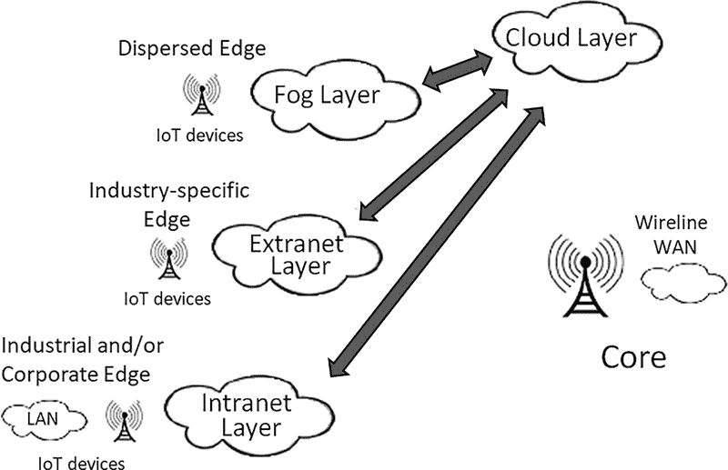

*图 2.1 各种边缘和雾的布置。*


图 2.1 示意性地描绘了一些边缘环境和雾计算环境的示例。某些物联网应用需要完全分布式的物联网设备，这些设备广泛分散在开放环境中；这些系统通常包含一个显式的雾层，在数据经过广域网 (WAN) 到达服务丰富的云端之前，可在该层进行聚合、协议转换、处理、暂存及其他功能。某些物联网应用涉及特定行业的物联网设备集合，例如智能电网或交通铁路系统；这些系统可能在边缘侧聚合，但通常使用特定行业的传统网络（图中显示为“外部网络”）。其他应用则在地理上或管理上更为局部化，例如工业物联网环境或企业物联网环境——如楼宇管理系统 (BMS)；这些系统可能采用局部的有线或无线局域网进行聚合，并接入广域网和云端，且可能原生使用雾层机制。

图 2.2 描绘了智慧城市物联网生态系统面向雾计算和边缘计算的物理拓扑示例，这实际上通常涉及一组完全分布式的物联网设备。在该示例中，展示了九个雾网络或边缘网络。对于若干雾网络（如雾 1、雾 2、雾 3、雾 4 等），其通信直接与附近的（蜂窝）基站相连（例如用于 LTE-M 或 NB-IoT 服务）；雾计算功能位于接入网络深处，例如可能位于移动中心局 (MCO)。在雾 2 中，附近的基站通过光纤链路连接到 MCO；在雾 3 中，附近的基站通过微波链路连接到 MCO。若干雾网络（如雾 5、雾 6、雾 8）使用严格的本地聚合或网关功能，在到达核心网或云网络的内层之前，这些功能可提供网络处理（如复用或防火墙）或数据处理功能（如数据汇总、平均、临时存储）。

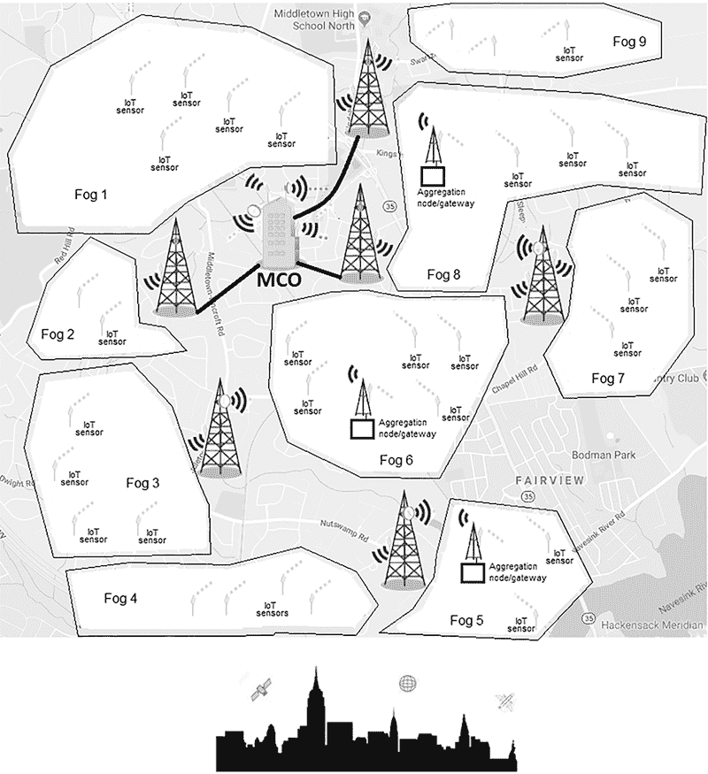

*图 2.2 智慧城市物联网面向雾计算和边缘计算的物理拓扑示例。*

#### 2.2.3 物联网安全概念

在物联网和智慧城市环境中考虑区块链机制 (BCM) 有一些基本驱动因素：鉴于涌现的物联网应用浪潮，人们现在清楚地认识到网络安全在物联网中至关重要。正如在信息技术 (IT) 领域的情况一样，物联网中也需要检测和修复针对物联网设备或系统的常规威胁以及高级持续性威胁 (APT)。鉴于其分布式、动态和高度互联的范式，物联网系统呈现出扩大的网络攻击面。物联网赋能应用中的安全和隐私威胁包括但不限于：伪造、篡改、数据隐私、女巫攻击、窃听、干扰、拒绝服务、中间人攻击、冒充、身份隐私泄露、使用隐私泄露、位置隐私泄露，以及操作系统和应用软件上传被损坏。

因此，物联网需要全面的安全支持，特别是对于任务关键型应用，还包括位于传感器下游的关联业务分析。物联网安全 (IoTSec) 领域现在开始融合发展（例如参见 [14,15,16,17,18,19,20,21,22,23,24,25]）。已经开发出大量技术来应对网络安全风险，尽管这些方法和技术往往复杂且“多维度”（例如但不限于 [26,27,28,29,30,31,32,33,34,35,36,37,38,39])。安全通常从完整性（确保通过网络接收或静止存储的信息正如其所应有的那样，未遭受恶意操纵）、系统可用性（授权用户对数据的访问应无阻碍且可靠）和机密性（信息的可理解性应限制并保护给授权方）方面来定义。在完整性的语境下，区块链是一种按时间顺序将交易——信息或数据——存储在一组原则上对恶意实体防篡改的计算机存储设施中的数据库。这些交易反过来可以由系统中的所有用户共享。信息作为公共账本发布或存储，无法被秘密修改。生态系统中的每个节点维护的账本信息与网络中所有其他用户或节点相同。因此，BCM 可用于解决伪造、篡改和软件分发问题。

虽然组织的 IT 基础设施事实上已经脆弱，但在物联网旗帜下引入广泛分散、物理可访问、低复杂度的设备，必然会导致整体攻击面扩大，如果不加控制，这可能会为黑客和入侵者提供一个不受监控的后门，以窃取组织 IT 领域的关键信息；这在广为人知的案例中已经发生。这种扩大的攻击面迫切需要端到端的安全缓解措施。此外，物联网应用所创造的环境可能增加经历 IT 基础设施入侵的总体风险。另外，如前所述，许多高密度应用——例如智慧城市环境中的应用——利用物理网关聚合本地流量；这些网关或雾节点可能代表易于被利用进行渗透的“触手可及的目标”。例如，近年来人们对发电厂和电网的渗透与破坏，以及因监控与数据采集 (SCADA) 管理和控制系统潜在妥协导致的燃气管网渗透与破坏，存在重大担忧。网络摄像头和其他摄像头仍然特别脆弱 [40]。


除了许多物联网端点拥有有限的计算、内存和电源资源这一事实外，限制了与安全相关的处理量，一些不断发展的技术可能会进一步加剧保护物联网生态系统的任务。例如，5G 蜂窝系统可能会增加小区的数量和类型，范围从微小区、宏小区到云无线接入网络（`C-RAN`）。在 `C-RAN` 中，许多小区的基带处理被汇集并集中化。`C-RAN` 预计将体现虚拟化的概念，遵循运营商向网络功能虚拟化（`NFV`）网络元素（`NE`）迁移的计划。`NFV` 由减少硬件占用空间和电力需求、改进配置间隔以及降低成本的需求驱动。然而，`NFV` 将使额外的 `NE` 面临潜在渗透和违规的风险，因此需要一些（新的）重型安全保护机制。

最近为物联网环境提出或使用了许多相对较新的安全方法和技术。至少这可能意味着一些简单直接的端点防火墙机制（尽管这些机制通常是“轻量级的”）、加密数据流、雾-骨干网交接（或云交接）处的防火墙功能、数据聚合点的防火墙功能、专门设计的安全中间件，以及保护云中分析引擎的安全机制。需要安全地识别端点设备、支持安全软件更新、提供信息流机密性、保证流完整性，并针对许多应用优化资源可用性 [[41]](#12_Chapter02.xhtml#ref2_41)[[42]](#12_Chapter02.xhtml#ref2_42)[[43]](#12_Chapter02.xhtml#ref2_43)[[44]](#12_Chapter02.xhtml#ref2_44)[[45]](#12_Chapter02.xhtml#ref2_45)[[46]](#12_Chapter02.xhtml#ref2_46)[[47]](#12_Chapter02.xhtml#ref2_47)。

如前所述，区块链共识机制（`BCM`）可以通过成为纵深防御方法背景下安全生态系统的一部分，在保护许多面向物联网的环境方面发挥作用 [[16]](#12_Chapter02.xhtml#ref2_16)[[48]](#12_Chapter02.xhtml#ref2_48)[[49]](#12_Chapter02.xhtml#ref2_49)[[50]](#12_Chapter02.xhtml#ref2_50)[[51]](#12_Chapter02.xhtml#ref2_51)[[52]](#12_Chapter02.xhtml#ref2_52)。然而，最近黑客利用智能合约和加密货币系统中的一些安全漏洞，试图攻破此类系统 [[53]](#12_Chapter02.xhtml#ref2_53)。必须妥善评估并解决这些漏洞，以避免未来繁重且昂贵的违规行为。此背景下的区块链应用将在 2.6 节 和 2.7 节 中讨论。

### 2.3 物联网架构（重点关注边缘结构）

#### 2.3.1 架构概念

物联网（`IoT`）生态系统由许多功能元素组成。最好能从各种供应商处获得这些元素，并确保它们能够互操作。参考架构（`RA`）在此背景下非常重要。架构简化了对系统组成功能块的描述，以及这些功能块相互关联的方式。`RA` 促进了功能的有序划分，通常以分层方式进行。这种划分不仅减少了功能冗余，还促进了标准化，可能定义了成熟的层间接口（也可能包括应用程序编程接口 [`API`]），同时也允许来自开放供应商集合的产品相互混合，以实现层功能成本优化或每层使用最佳技术。`RA` 通常包含多种环境视图：功能视图采用功能分解视角，通过指定接口、交互和功能；信息视图采用信息结构视角，通过定义语义和信息流。总的来说，`RA`、框架和随之而来的标准促进了无缝连接和即插即用操作。

参考架构的早期示例之一是开放系统互连参考模型，它在各类无缝电子通信的发展中发挥了关键作用。IT 领域还开发了许多 `RA`，称为企业架构框架（`EAF`），但由于计算的多维性质，没有单一架构成为规范架构。出现的一些架构包括但不限于：开放组架构框架（`TOGAF`）、Zachman 国际模型、美国国防部架构框架（`DoDAF`）、联邦企业架构框架（`FEAF`）、NIST 企业架构模型、`EA3` 立方体框架、加拿大国防部/加拿大军队架构框架（`DNDAF`）、北约架构框架（`NAF`）、统一建模语言（`UML`）和决策模型与符号（`DMN`），以及由供应商或大学赞助的架构，如 IBM 或 Gartner 推广的架构。其中一些 `RA` 也可能适用于全组织范围的物联网环境。

反过来，最近出现了一些特定的物联网 `RA` 和架构框架，每个都专注于物联网生态系统的某些特定抽象 [[54]](#12_Chapter02.xhtml#ref2_54)[[55]](#12_Chapter02.xhtml#ref2_55)[[56]](#12_Chapter02.xhtml#ref2_56)[[57]](#12_Chapter02.xhtml#ref2_57)[[58]](#12_Chapter02.xhtml#ref2_58)[[59]](#12_Chapter02.xhtml#ref2_59)[[60]](#12_Chapter02.xhtml#ref2_60)。一些物联网 `RA` 由标准化机构开发，而其他架构则由供应商推进。目前尚无广泛接受的物联网 `RA`，尽管预期会有一些融合。与一般情况一样，物联网 `RA` 假设了几个不同的视角，例如网络/互联连接视角、数据级/数据交换级语义视角，以及物理级视角，即获取和收集端点信息并将其向上传输所需的硬件或软件。考虑到大量的应用场景（也称为“用例”），单一 `RA` 可能不足够，利益相关者可能需要使用一个或多个架构。一些开放的物联网架构如 表 2.1 所示。这些架构各有优劣 [[61]](#12_Chapter02.xhtml#ref2_61)。

**表 2.1** 关键物联网参考架构部分列表

| Model/RA | Description |
| --- | --- |
| Industrial Internet Reference Architecture (IIRA) | 专注于功能域的通用 RA |
| Internet of Things Architecture (IoT-A) | 具有功能和数据视角重点的 RA |
| Reference Architecture Model Industries 4.0 (RAMI 4.0) | 适用于智能工厂的 RA |
| Standard for an Architectural Framework for the IoT | IEEE P2413 WG 推进的 RA，专注于安全和防护 |
| Arrowhead Framework | 欧盟为嵌入式设备网络自动化推进的 RA |
| ETSI High level architecture for M2M | 知名 RA 但主要专注于 M2M，集中于网络和通信 |
| IoT RA | ISO/IEC WD 30141 开发的 RA，旨在定义物联网域以促进物联网实体间的互操作性 |
| Open Systems IoT Reference Model (OSiRM) | 具有物理层级并允许逐层安全的 RA |

缩写：`EU`，欧洲联盟；`IoT`，物联网；`M2M`，机器对机器；`RA`，参考架构。

#### 2.3.2 开放系统物联网参考模型


# 开放系统物联网参考模型 (OSiRM)

最近，这些作者定义了一个基本的七层开放系统物联网参考模型 (OSiRM)，该模型在物联网参考架构 (RA) 环境中识别了雾和边缘功能 [62]。OSiRM 的各层如下（另见 图 2.3）：

*   **第 1 层**：可参与物联网提供的自动化的“近乎无限”的“事物”世界。示例包括但不限于智能手机、可穿戴设备、医疗监测设备、家用电器、家庭安防设备；住宅和建筑机械系统（例如照明、暖通空调、占用检测）；摄像头、车辆和公用事业电网元件。
*   **第 2 层**：由传感器、嵌入式微处理器、嵌入式电子元件以及基于各种短距离（现场）传输技术（无论无线还是有线）的相应传感器中枢所支持的“数据采集”能力。采集的信息包括环境数据、视频和定位数据。第 1 层和第 2 层处于共生状态，因为配备传感器的事物成为物联网客户端或中枢的端点（并最终成为整个系统的端点）。
*   **第 3 层**：“雾网络”/“设备云”机制，具体指邻域网 (NAN)、校园网 (CAN) 或本地站点网络，它是物联网设备端到端连接的第一环。雾网络最好针对物联网运行环境进行优化，并可能使用专用轻量级协议。它通常是无线网络（例如在 900 MHz、2.5 GHz、5 GHz、毫米波或红外/Li-Fi 频段），但也可以是有线链路（例如支持过程控制或机器人应用的工厂局域网）。
*   **第 4 层**：该层支持一个（可选的）“数据聚合”功能。它可能涉及网内处理，例如某种类型的协议转换（如将轻量级、低复杂度协议转换为更传统的网络协议）、数据汇总，或与传统网络外层/接入层相关的其他边缘网络功能，使用知名通信协议。此功能通常由“网关”设备处理。
*   **第 5 层**：这是一个“数据中心化”功能，对应经典的核心网络功能。它涵盖组织自有（核心）网络、公有、私有、混合云类型的连接以及互联网路径（隧道）。这些网络通常由运营商提供的电信服务组成，可以是有线或无线的。
*   **第 6 层**：该层跨越各种“数据分析和存储功能”。数据分析功能通常是特定于应用的。
*   **第 7 层**：“应用”层跨越大量水平或垂直应用领域（例如用例）。实际上，应用列表的范围实际上是“无限的”。

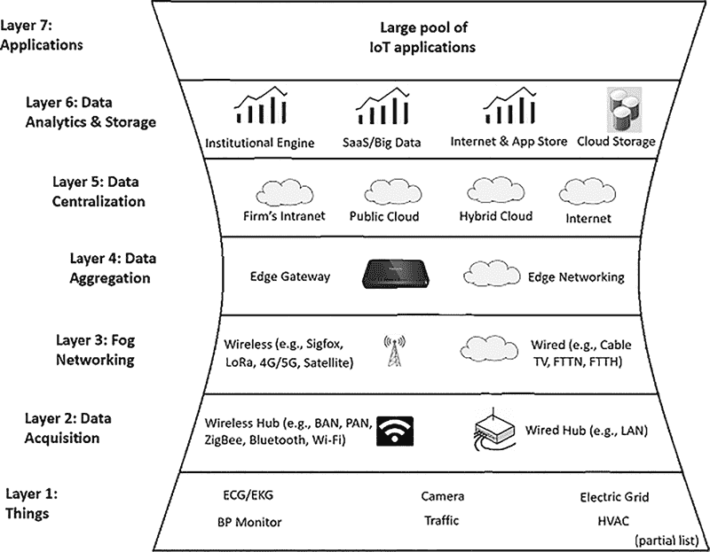

*图 2.3 开放系统物联网 (IoT) 参考模型（事务栈）。*

### 2.4 5G 物联网通信技术

#### 2.4.1 面向物联网的无线技术

无线技术是大量物联网应用的基础，而且正如其同义反复的性质，这些技术本质上是无线传感器网络 (WSN) 的内在组成部分 [17,41,63]。无线接入既适用于建筑或校园环境，也适用于城市或区域环境（也存在利用各类卫星服务的全球物联网应用）。短距离面向局域网的技术，如 `Wi-Fi`，已被使用；面向广域网的城市级和区域级技术，如 `2G`、`3G` 和 `4G` 蜂窝系统（以及其他 LPWAN 服务）也在使用中。

“5G”（第 5 代）是下一代蜂窝和无线服务提供商网络的术语，旨在提供更高的数据速率——比当前的 `4G` 长期演进 (`LTE`) 技术快 100 倍——更低的延迟和高可靠性连接。从实际角度来看，它是前几代蜂窝技术的演进。`5G IoT` 是基于授权蜂窝网络的物联网。`5G` 系统包含连接到 `5G` 接入网络的设备，后者又连接到 `5G` 核心网络。`5G` 系统包含了重要的 `4G` 系统概念，例如窄带物联网 (`NB-IoT`) 无线电的节能能力；面向低功耗设备的安全、低延迟小数据传输——低延迟是使自动驾驶汽车安全的要求；以及设备在可能时使用节能休眠状态。智慧城市应用的带宽需求是移动宽带 `5G` 服务总体上以及新一代 `5G IoT` 应用特别是主要驱动力。根据 GSMA 数据，`5G` 有望在 2025 年占全球移动连接数的 15%（14 亿）。到 2019 年初，全球已有 11 家运营商宣布推出初始 `5G` 服务，另有多家运营商已激活新基站，`5G` 商用服务随之而来 [64]。

#### 2.4.2 面向物联网的 5G 无线技术

近年来，多个国际机构开展了 `5G` 系统的标准化工作，目标是建立一个统一的全球标准。主要标准化机构包括国际电信联盟无线电通信部门 (`ITU-R`) 和第三代合作伙伴计划 (`3GPP`)。`ITU-R` 从三类评估了使用场景：超可靠低延迟通信 (`URLLC`)、海量机器类通信 (`mMTC`) 和增强移动宽带 (`eMBB`)。为每一类确定了关键性能指标，例如频谱效率、区域流量容量、连接密度、用户体验数据速率、峰值数据速率和延迟等。高效处理设备移动性的能力也至关重要。`eMBB` 用例示例包括智能手机、家庭、企业和场馆应用、超高清 (4K 和 8K) 广播、虚拟现实和增强现实。`eMBB` 可能不会立即用于通用物联网应用，因为传统物联网应用往往处于带宽范围的低端。`mMTC` 用例包括智能建筑、物流、追踪和车队管理以及智能电表。`URLLC` 用例包括交通安全与控制、远程手术和工业控制。广义上讲，预计 `5G` 系统将支持以下功能 [65]：

*   单位区域移动数据量比当前系统高 1000 倍（下行峰值数据速率：20 Gbps；上行峰值数据速率：10 Gbps）；
*   设备数量比当前系统高 10 到 100 倍（连接密度为每平方公里 1,000,000 个设备）；
*   用户数据速率比当前系统高 10 到 100 倍（下行“用户体验数据速率”：100 Mbps；上行“用户体验数据速率”：50 Mbps）；
*   低功耗物联网设备电池寿命比当前系统长 10 倍（`mMTC` 电池寿命长达 10 年）；以及
*   端到端延迟比当前系统降低 5 倍（`eMBB` 延迟为 4 ms，`URLLC` 延迟为 1 ms）。

`5G` 系统通过增加新空口 (`NR`) 能力来扩展 `4G` 环境，但采用的方式使得 `LTE` 和 `NR` 能够以互补方式演进。`5G` 接入网络可能包含第三代合作伙伴计划 (`3GPP`) 无线基站或非 `3GPP` 接入网络。既可以使用现有的传统 `LTE` 演进分组核心 (`EPC`)（作为过渡机制）来支持 `5G NR`，也可以部署新的 `5G` 核心网 (`5GC`)。


# 5G 物联网技术：NB-IoT 和 LTE-M

在短期内，“5G 物联网”实际上等同于 **NB-IoT** 和 **LTE-M** 技术。2019 年初，全球已有近 100 个 **LTE-M** 和 **NB-IoT** 的商用部署。目前，**NB-IoT** 和 **LTE-M** 正为智能计量、智能物流、智慧城市应用提供移动物联网解决方案，但迄今为止部署规模仍较小（截至 2018 年，全球约有 50 个商用 **NB-IoT** 和 **LTE-M** 网络 [66]）。

## NB-IoT

**NB-IoT** 是一种持牌低功耗 **LPWAN** 技术，旨在与现有 **LTE** 规范共存，并为物联网设备提供蜂窝级 **QoS** 连接。**NB-IoT** 由 **3GPP** 在 **LTE Release 13** 中标准化。拥有 **GSM** 部署的全球地区短期内可能会提供 **NB-IoT**。**NB-IoT** 获得 **Qualcomm**、**Ericsson** 和 **Huawei** 等众多供应商和服务提供商的支持。**NB-IoT** 基于 **200-kHz** 信道中的 **直接序列扩频 (DSSS)** 调制。存在多个未充分利用的 **200-kHz GSM** 频谱信道，以及其他可能的频段，如保护带。**NB-IoT** 旨在作为长距离 (**LoRa**) 和 **Sigfox** 的替代方案。**NB-IoT** 服务目标包括：

1.  低复杂度终端节点
2.  设备成本低于 5 美元
3.  如果每天传输 **200 字节** 数据，设备电池寿命预计可达 10 年
4.  上行链路延迟小于 **10s**（因此并非真正的实时服务）

**NB-IoT** 在 **900- 至 1800-MHz** 频段上运行，覆盖范围可达约 **20 英里**；支持上行高达 **250 Kbps**、下行高达 **230 Kbps** 的数据速率。请参见 表 2.2 了解适用于物联网的地铁级无线技术对比。

## LTE-M

**LTE-M** 支持低节点复杂度、低节点功耗、高部署密度、低延迟和扩展的地理覆盖范围，同时允许服务运营商复用 **LTE** 安装基础。**LTE-M** 是一种能效系统，拥有两项支持电池效率的创新：**LTE 扩展不连续接收** 和 **LTE 省电模式 (PSM)**。**LTE-M** 允许每天上传 **10 字节** 数据（**LTE-M** 消息与 **NB-IoT** 消息相比相当短），但也允许接入 **Mbps** 速率。因此，**LTE-M** 可支持多种用例。在美国，**Verizon** 和 **AT&T** 等主要运营商提供 **LTE-M** 服务（**Verizon** 也宣布支持 **NB-IoT** —— **T-Mobile** 和 **Sprint** 似乎倾向于 **NB-IoT** 方向）。

## 用于边缘和雾网络的无线技术

某些无线技术比其他技术更适合边缘和雾网络。例如，**LoRa** 和 **Sigfox** 倾向于成为全市范围、县级或区域级技术，可能由少数中心化天线服务广阔区域；信号在这些分散的、略显偏远的天线处接收，然后直接传输到互联网 [67]。其他无线技术允许更分层的网络分级，数据沿途在各点聚合（并可能汇总）；**LTE-M** 和 **NB-IoT** 可根据实现方式在这两种模式下运行。低功耗无线电系统往往更适合基于雾和边缘的网络设计。

### 表 2.2：适用于物联网的关键雾、边缘和核心无线技术对比

| 物联网技术 | 基本特性 |
| :--- | :--- |
| **NB-IoT** | • 主要用于边缘，但也可作为小地理范围核心<br>• 室外可用性：最多约 20 英里<br>• 多个频段，持牌频谱<br>• 属于 5G “保护伞”范畴；基于 **LTE**<br>• **0.1–0.2 Mbps** 数据速率，电池 ~10+ 年<br>• 低成本、低调制解调器复杂度、低功耗、节能机制（高电池寿命）<br>• 不需要网关：传感器数据直接发送至目标服务器（其他物联网系统通常有聚合传感器数据的网关，再由网关与目标服务器通信）<br>• 较好的建筑穿透力（改进的室内覆盖）<br>• 大量低吞吐量设备（每小区多达 **150,000 个设备**） |
| **LTE-M Rel 13 (Cat M1/Cat M)** | • 主要用于边缘，但也可作为小地理范围核心<br>• 室外可用性：最多约 20 英里<br>• 蜂窝网络架构，兼容 **LTE**，易于部署，无需新建蜂窝天线<br>• 属于 5G “保护伞”范畴；使用 **1 GHz** 以下的 **4G-LTE** 频段，持牌频谱<br>• 被视为面向物联网应用的第二代 **LTE** 芯片<br>• 最大系统带宽限制为 **1.4 MHz**<br>• 适用于仅传输少量数据的 **LPWAN** 应用（如智能计量），具有成本效益<br>• **1 Mbps** 上传/下载，电池 ~10 年<br>• 相对低复杂度和低功耗调制解调器<br>• 可用于追踪移动物体（通过基站机制提供定位服务） |
| **LoRa** | • 端到端（边缘和核心）<br>• 不属于 5G “保护伞”范畴<br>• 室外可用性：视距 (**LOS**) 下 **6–15 英里**<br>• **1 GHz** 以下频段<br>• 从一开始就专注于物联网<br>• 专有<br>• 低功耗 |
| **Sigfox** | • 端到端（边缘和核心）<br>• 不属于 5G “保护伞”范畴<br>• 室外可用性：农村环境 **30 英里**；城市环境 **1–6 英里**<br>• **1 GHz** 以下频段<br>• 窄带<br>• 低功耗<br>• 专有<br>• 星型拓扑 |

**缩略语：** **IoT**，物联网；**LoRa**，长距离；**LTE**，长期演进；**LTE-M**，长期演进机器类型通信；**NB**，窄带；**LOS**，视距；**LPWAN**，低功耗广域网。

# 智慧城市概念与常见智慧城市应用

## 城市与都市趋势

目前全球 **55%** 人口居住在城市地区，联合国预测到 **2050** 年，全球 **68%** 人口将居住在城市地区 [68]（顺便观察一下，世界人口在过去 100 年中增加了七倍）。在美国，**83.9%** 人口为城市人口（**276,062,331** 人，在 **2019** 年，总人口 **329,093,110**） [69]。考虑到城市人口预期的增加——城市往往已在物理和财力资源双重约束下——迫切需要考虑基于 IT 的资源管理和优化，特别是基于物联网的解决方案。预计 **2022** 年智慧城市市场支出将达 **1580 亿美元**，使该市场成为技术开发者（尤其是物联网开发者）的一个极具吸引力的目标 [70]。从 **2020** 年的视角来看，一些人认为由于 **Covid-19** 及类似大流行，城市化趋势短期内可能逆转；但对此结论仍未定论。

近期发生了社会变革，特别是在 **Covid-19** 之前，主要由“千禧一代”驱动，人们倾向于居住在城市而非搬往（更远的）郊区。这源于减少通勤时间的愿望（通勤时间每年轻松可达 **500+ 小时**），以及享受城市的文化设施（如剧院、芭蕾、歌剧、学术讨论会）。人们现在希望能多走路、骑自行车或使用公共交通。这对城市的任期和城市服务有诸多影响。

## 物联网的智慧城市应用


表 2.3 列举了若干关键的基于物联网的智慧城市应用，并将这些应用与技术要求及 5G 支持相关联，同时也将应用与广泛的安全要求及可能的 BCM 适用性相关联。图 2.4 以图形方式描绘了若干关键的物联网支持的智慧城市应用——但请注意，多个不同的应用可以在每个边缘网络中同时共存。

典型的智慧城市服务包括但不限于：
- 基础设施与房地产管理
- 物理安全
- 电力及其他城市支撑公用设施
- 电力及其他公用设施井盖监测
- 交通、运输与出行
- 污染监测
- 环境监测
- 防洪治理
- 宜居性与智慧服务
- 物流
- 智慧城市照明

在 表 2.3 的语境下，带宽指南如下：
- **低带宽**：200 kbps 或更低
- **中等带宽**：200 kbps 至 2 Mbps
- **高带宽**：超过 2 Mbps

延迟指南如下：
- **低延迟**：实时
- **中等延迟**：1–5 秒

可靠性指南如下：
- **高可靠性**：99.999% 可用性
- **中等可靠性**：99.99% 可用性

安全性指南如下：
- **高安全性**：不受国家资助的黑客活动侵害
- **中等安全性**：不受专业“黑帽”黑客侵害

BCM 机制指南如下：
- **高可用性**：使用此类技术具有显著的技术和财务优势
- **中等可用性**：使用此类技术具有合理的技术和财务优势

请参见 图 2.5。

#### 表 2.3 关键智慧城市挑战及物联网、5G 和 BCM 支持

| 智慧城市问题与需求 | 物联网支持/解决方案 | 5G 适用性 | 带宽需求 | 延迟 | 可靠性 | 安全性 | BCM 可用性 |
| :--- | :--- | :--- | :--- | :--- | :--- | :--- | :--- |
| **基础设施与房地产管理。**<br>需求：监测空间、建筑物、道路、桥梁、隧道、铁路道口和街道信号灯的状态与占用情况。 | 网络化传感器提供实时和历史趋势数据，使城市机构能增强对资源性能的可见性，促进环境与安全感知、智慧停车和智能停车计费器、智能电表以及智能建筑功能。 | 高 | 低 | 低 | 中到高 | 中 | 中 |
| **物理安全。**<br>需求：街道、公园、车站、隧道、桥梁、火车、公交车、轮渡的安全。 | 网络化传感器（可能包括无人机和枪声探测系统）支持监控视频、车牌识别、枪声探测、生物危害和放射性污染监测、人脸识别以及人群监测与控制。 | 高 | 高 | 低 | 高 | 高 | 高 |
| **电力及其他城市支撑公用设施。**<br>需求：电力、燃气和水的可靠输送；优化废物管理和下水道；汽油的安全储存。 | 智能电网解决方案和传感器丰富的公用设施基础设施 | 高 | 低 | 中 | 高 | 高 | 高 |
| **电力及其他公用设施井盖监测。**<br>需求：电力井盖需要监测以避免或防止危险情况。 | 需要具有成本效益且可靠的传感器。康爱迪生公司在纽约市部署的技术 | 高 | 低 | 中 | 高 | 中 | 中 |
| **交通、运输与出行。**<br>需求：优化交通流、低拥堵、低延迟和高效率、低噪音、最小化燃料浪费和二氧化碳排放、安全。 | 网络化传感器支持交通流、无人驾驶车辆（包括无人驾驶公交）和多模式交通系统。对于无人驾驶车辆，传感器将实现高分辨率测绘、遥测数据、交通和危险规避机制。 | 高 | 中到高 | 低 | 高 | 中到高 | 中 |
| **污染监测。**<br>需求：监测工厂、焚烧炉、城市火葬场排放的二恶英、汞蒸气、纳米颗粒、辐射，特别是当这些源头靠近铁路轨道或其他风湍流要素（如峡谷）时。 | 城镇内的网络化传感器（或点源 10 公里范围内）监测来自工厂、发电厂（如有）和火葬场（如有）等点源的有毒、影响健康的排放物。 | 高 | 中 | 中 | 高 | 中 | 中 |
| **环境监测。**<br>需求：监测室外温度、湿度和其他环境气体。 | 可部署在易于部署位置的传感器（例如，安装在现有智慧城市路灯杆顶部，持续监测温度、湿度和其他环境气体）。 | 高 | 低 | 中 | 中 | 中 | 中 |
| **防洪治理。**<br>需求：洪水和雨水排水控制。 | 分布式加固传感器监测洪水和雨水排水，提供预警和故障检测。 | 高 | 低 | 中 | 高 | 中 | 中 |
| **宜居性与智慧服务。**<br>需求：生活质量、便捷获取智慧服务、高效交通、低延迟、安全。 | 网络化传感器（可能包括无人机）促进智慧多模式交通、信息丰富的环境、智慧停车、基于位置的服务、实时连接健康监测资源（如空气质量）。 | 高 | 中 | 中 | 中 | 中 | 中 |
| **物流。**<br>需求：为城市居民提供新鲜食品、物资、货物和其他材料。 | 网络化传感器（可能包括无人机）实现仓储、运输和货物分发的流程化。交通管理是此类物流支持的一个侧面。 | 高 | 中 | 中 | 高 | 中到高 | 中到高 |
| **智慧城市照明。**<br>需求：转换为 LED 照明，并通过物联网根据天气状况、月相、季节、交通占用情况等进行相关控制。 | 城市每年在路灯照明上花费大量资金（通常每 1 万居民约 1000 盏路灯）。LED 照明仅需三分之一的功率即可提供相同亮度。需要传感器用于物联网导向的光照管理，以应对天气状况、月相、季节、交通占用情况等。 | 高 | 中 | 中 | 中 | 中 | 中 |

**缩略语：** BCM，区块链机制；IoT，物联网；LED，发光二极管。

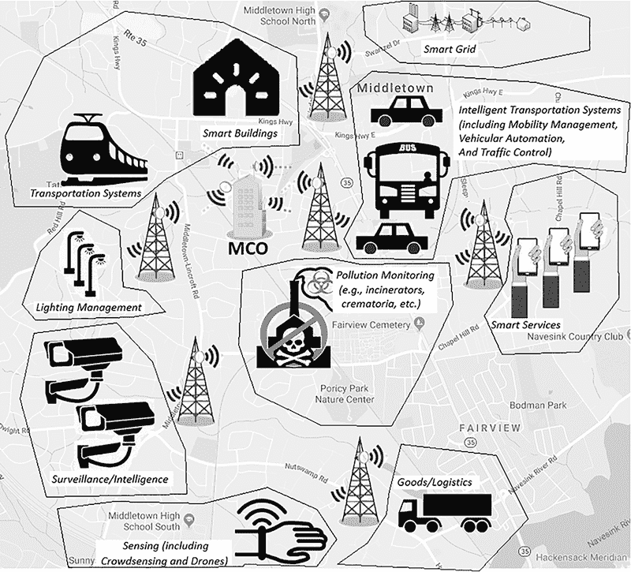

*图 2.4 关键智慧城市物联网支持应用的示例。*


当研究人员试图根据智慧城市指数对城市进行排名时，通常会评估一些参数，包括社会凝聚力、人力资本、经济、治理、移动性与交通、环境、城市规划、国际交流以及技术 [71]。物联网原则和 BCM 机制支持所有这些方面。例如，2019 年 IESE 运动中的城市指数 (CIMI) 将纽约、伦敦、巴黎、东京、雷克雅未克、新加坡、首尔、多伦多、香港和阿姆斯特丹列为“最聪明城市榜单”中的佼佼者。更正式地说，国际标准化组织 (ISO) 发布了一项标准，`ISO 37120-2018`，“社区可持续发展——城市服务和生活质量指标”(QoL)（最初于 2014 年作为 `ISO 37120-2014` 发布），该标准为一组标准化指标定义并描述了方法论，以指导和衡量城市服务和生活质量的绩效；这组指标为测量什么以及如何进行测量提供了统一的范式，并为报告、比较和基准测试建立了共同基础；它促进了可持续智慧城市治理和发展的综合方法（ISO 要求对数据来源和质量进行第三方验证，以获得 ISO 认证）。`ISO 37120` 适用于任何城市、市政当局或地方政府。该标准定义了城市服务和生活质量的关键城市主题。它定义了城市提供的 19 个部门和服务：经济、教育、能源、环境与气候变化、财政、治理、健康、住房、人口与社会状况、娱乐、安全、固体废物、体育与文化、电信、交通、城市与地方农业及粮食安全、城市规划、废水和水。请参见 图 2.6。对于这些部门中的每一个，该标准都给出了实施该标准的管理者应报告的关键指标。`ISO 37120-2018` 还为每个部门确定了一个概况指标和一组支持性指标 [72]。例如，对于经济部门，核心指标是城市的失业率 [73]。同样，物联网原则和 BCM 机制支持所有这些方面。

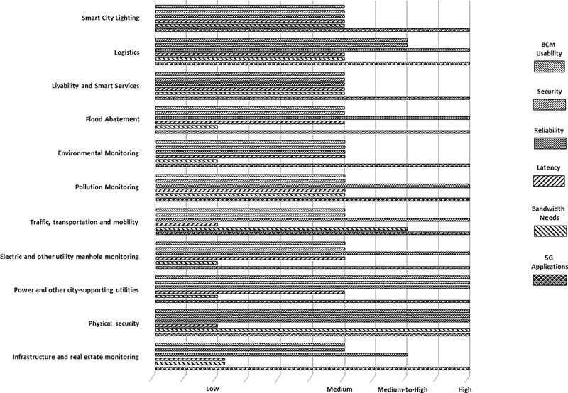

*图 2.5* 智慧城市需求，也包括安全性。

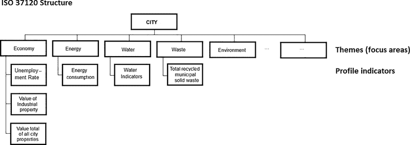

*图 2.6* ISO 37120 架构。

实施 `ISO 37120` 规范的工具通常包含三个模块 [74]：

• 城市模型模块，涵盖标准中定义的所有主要城市流程和典型基础设施，结合图示主题与指标；

• 城市数据模块，允许负责的城市部门和组织生成符合标准要求的月度或周度数据文件；以及，

• 智慧城市监测模块，通常是一个高级 AI 驱动的物联网技术平台，用于从大量数据源自动收集大数据，并将这些数据映射为可操作的定制化信息。

### 2.6 适用区块链概念摘要

#### 2.6.1 基本区块链概念

正如本书其他地方所讨论的，区块链支持数据信息系统中的信任，而无需制度化的第三方验证或审计机制。区块链使参与者能够在没有中央信任机构的分布式网络中达成一致。

区块链是由网络（具体为点对点 (P2P) 网络）维护的加密保护数据库，网络中的主机称为“节点”。网络中的节点通常（但不总是）匿名实体（进程、个人或用户）。每个主机（计算机、对等节点）都存储一份最新版本的数据库副本。区块链区块是有效交易的集合；区块链是由节点生成的加密链接的区块组。每个区块由区块头、待保护的相关数据以及相关安全数据（例如创建者身份、创建者签名、上一个区块编号、区块链中前一个区块的哈希值）组成。链接的区块形成一条链。区块链协议（共识机制）是一组规则，编纂了网络中的主机如何验证新交易并将其添加到数据库 [75]；该协议利用加密机制（特别是哈希）、博弈论原则和激励措施，创造动力促使节点致力于保护网络中的数据，而不是为了个人利益而破坏数据（例如，参见 [76,77,78,79,80,81,82,83,84,85,86]）。不同的节点根据其角色执行不同的功能。为了支持和使用区块链，对等节点必须支持许多关键功能，包括路由、存储、钱包服务和挖矿（参见 图 2.7）。“矿工”是可以添加或验证交易的节点；交易验证（挖矿）是分布式共识协议的基本要素：P2P 网络中的节点需要验证每个区块的每笔交易。交易验证所需的工作量证明 (PoW) 由一个计算复杂的算法组成，生成区块时必须执行该算法；根据设计，这项工作活动必须是一项计算要求高、难以求解但完成后易于验证的任务。通常，共识机制包括三个阶段：交易背书过程、排序过程以及验证和提交过程。矿工完成 PoW 后——执行 PoW 算法的活动也称为“挖矿”——矿工会在 P2P 网络中发布新区块；P2P 网络中的其他节点在将该区块添加到它们自己存储的链之前，会验证该区块的有效性。

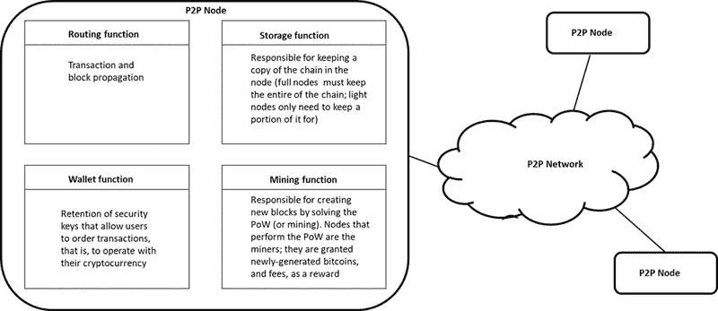

*图 2.7* 节点功能。

#### 2.6.2 使用区块链实现数据完整性


## 区块链的弱点

区块链通过作为分布式“开放平台”账本（数据库）来促进“去中心化共识”，该账本保留一份不断增长的记录列表，同时事后防止对这些记录的修改。区块链通过为生态系统中的所有用户提供去中介化信任的证明，实现了跨多方的数据完整性；传统上，这种完整性保证必须由独立的可信第三方来完成。区块链在设计上提供了开放性、不可篡改性、可访问性，以及安全存储和传输数据的能力；它为互不相识或互不信任的实体提供了一种机制，以生成通用的共享记录或资产所有权的共享记录。区块链上存储的信息是一个共享数据库，能够持续且自动地进行对账；该数据库不存储在任何单一的离散主机或计算机上，而是以信息分组（区块）的形式存储在 P2P 网络中所有节点上相同的数据副本中；因此，原则上区块链无法被任何单个节点删除、篡改或控制。区块链可以是公有、私有或联盟链：公有链的账本对网络中的所有人可见，任何人都可以验证并添加交易区块（例如加密货币）；私有链仅允许私有组织中的特定节点验证并添加交易区块，但网络上的所有人通常都可以查看链；在联盟链中，仅有一组组织（如金融机构）可以验证并添加交易，但账本可以对所有人可见，也可以限制为特定社区可见 [[87]](#12_Chapter02.xhtml#ref2_87)[[88]](#12_Chapter02.xhtml#ref2_88)。

因此，节点可以创建包含各类数据（待保护数据）的新交易区块；它们可以验证并对交易进行数字签名；并可以通过共识协议进行“挖矿”以达成共识（节点还可支持其他辅助功能）。任何节点通常都可以生成一笔交易并将其广播给 P2P 网络中的所有节点。网络节点使用采用现有交易的共识算法来验证该交易。交易验证通过后，该交易及其相关元数据将与其他交易合并，生成一个新区块并添加到现有区块链中。当节点生成一笔交易时，该交易会被放入本地的未确认交易池中。网络中的矿工从这些池中收集并选择交易以组成一个交易区块。其他矿工致力于验证该交易，如果他们能单独验证通过，该区块将被添加到他们的区块链副本中（矿工达成共识）。要将此交易添加到区块链，矿工需要通过执行 `PoW` 算法来寻找一个复杂的、计算密集型数学问题的解。当某矿工找到解时，该解（连同其区块）会被广播给网络上的其他矿工；其他矿工能够验证它，如果区块内的所有交易均有效，且与区块链上现有的交易记录一致 [[76]](#12_Chapter02.xhtml#ref2_76)。图 2.8 总结了矿工的关键高层活动。区块中的交易数量与运行共识协议所需的计算工作量相关；而这计算工作量直接影响确认时间——即交易的有效性与否。由此可见，共识协议对基于区块链的环境的可扩展性有重大影响。

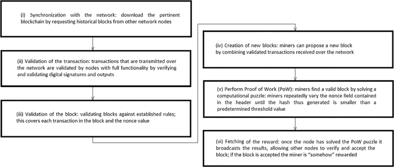

*图 2.8 矿工的高层活动。*

如果实施得当，这种区块链安排会使添加欺诈性交易变得昂贵且计算上困难，但同时使验证给定交易是否有效变得相对容易。因为区块链原则上抵抗底层数据的修改，所以它们被考虑用于支持涵盖任何有价值事物的交易登记；区块链中的信息可以代表各种各样的事实、文档、金融交易、协议、合同、签名、文本元素，或仅仅是数据包 [[50]](#12_Chapter02.xhtml#ref2_50)[[51]](#12_Chapter02.xhtml#ref2_51)[[52]](#12_Chapter02.xhtml#ref2_52)[[89]](#12_Chapter02.xhtml#ref2_89)[[90]](#12_Chapter02.xhtml#ref2_90)[[91]](#12_Chapter02.xhtml#ref2_91)。事实上，许多金融公司、证券交易所，甚至一些央行都计划将区块链作为其运营的一部分。区块链的最初应用是比特币加密货币；目前市场上已有超过 1,000 种加密货币。

总之，区块链中所含信息的完整性由共识机制保护，最长的区块分支被视为有效分支。`PoW` 的设计使得恶意代理修改区块在计算上极其复杂（代价高昂）：其他 P2P 矿工有能力使恶意代理失效，因为受信的区块集合会质疑恶意代理可能生成的区块；要使受损区块成功添加到链上，要求恶意代理解 `PoW` 的速度快于 P2P 网络中其余节点，但这在计算上极具挑战，要求控制 P2P 网络中至少 51% 的计算资源。

#### 2.6.3 区块链的潜在弱点

尽管区块链通常被认为是“不可黑客攻击”的，但存在微妙的弱点，尽管漏洞可能更多与实现有关，而非区块链概念本身。区块链系统越复杂，从业者在搭建系统时不可避免地犯错的几率就越高。举个例子，虽然解密数据流可能非常困难，但却有可能在执行加密的设备中植入木马或恶意软件，从而暴露所使用的密钥或算法。具体而言，已有文档记录了“无意中内置于加密货币协议中的微妙加密缺陷”；泄露或设计不良的客户端（节点）软件也是潜在风险。


许多商业区块链实现使用 PoW（工作量证明）流程作为验证交易的标准协议。如前所述，该协议基于这样一个概念：网络上大多数（例如 51% 或更高阈值）参与者（矿工）决定哪个版本的区块链代表权威链（数据库）。节点需要投入大量算力，以证明它们是值得信赖的对等节点，能够将新交易的信息添加到数据库中。然而，一个可能秘密获得大量、特别是网络大多数 PoW 算力控制权的矿工，可以通过制造区块链的一个替代版本（称为“分叉”）来编造谎言并欺诈其他节点。一个能够控制大多数挖矿算力的恶意代理，可以将该分叉确立为相关区块链的权威版本。这被称为“51% 攻击”；这些攻击最近出现在加密货币领域，因为通过对加密货币区块链执行 51% 攻击，可以逆转加密货币转账，并实现双重支付。这些近期攻击之所以针对加密货币，是因为犯罪者可获得经济利益——据报道，黑客已窃取约 20 亿美元（截至目前，其他应用受影响较小）；然而，预计未来 51% 攻击将在频率和严重程度上增长 [43]。ASIC 挖矿是另一个威胁；它使挖矿公司能够增强挖矿硬件的原始算力，极大地提升其计算能力。基于区块链的智能合约正在各行各业中被创建 [92]；这些合约自动执行面向金融的活动（转账、销售、租赁等）和其他活动（如投票、在线赌博）的移动、执行和归档，符合既定规则和条件。不幸的是，已有基于软件缺陷的违规行为被记录在案，在试图纠正问题并遏制传播问题时引发了棘手的困境。另一个问题是面临女巫攻击，这是一种通过创建多个虚假身份来控制 P2P 网络的尝试；尽管这些虚假身份在外部观察者看来似乎是独特的用户，但单个恶意实体一次性控制多个身份，使该恶意实体能够通过在民主网络中增强的投票权（或通过社交网络中的回声室效应消息传递）来影响网络 [93]。

### 2.7 受益于区块链的智慧城市物联网应用调查

#### 2.7.1 物联网区块链应用示例

文献中记录了相对较多的区块链应用：这些应用不一定本身就处于物联网背景下，而更多是“通用”性质的。

“通用”应用包括但不限于金融交易（如微支付，[94,95,96,97,98,99]）、物联网环境下的移动商务、医疗保健和医疗系统（如 [100,101,102,103,104,105,106]）、智能合约、智能物流（如通过多阶段或跨国供应验证物品真实性、追踪受控物品如药品、医疗器械、武器、可流通债券，[107]）、保险理赔申报和处理（如监控或防止理赔欺诈检测）、智能服务（如停车、公交或火车实时到站监控）以及网络安全管理（如数据完整性）。文献中记录了多个溯源系统和应用。例如，3TG 矿产（钽、锡、钨和金）在高科技行业中很重要，但可能（偶尔）来源可疑；许多大公司现在开始使用区块链机制来促进 3TG 金属和其他大宗商品的追踪 [108]。

IBM 近年来一直是物联网和区块链技术的关键倡导者；沃尔玛和 IBM 在 2019 年测试了一个食品供应链项目，而马士基航运已在其航运流程中使用区块链 [109,110]。更广泛地，参考文献 [111] 列出了以下领域的 41 个记录在案的区块链应用：加密货币、新支付基础设施、身份验证、电子政务、所有权或来源验证、产品溯源、电子健康、能源、保险和抵押、房地产（租赁、共享和销售）、赌博和博彩、云存储、教育和音乐版税支付。

原则上，区块链可用于物联网架构 RA 的应用层，以验证各种交易；本质上，物联网可以利用区块链来保障业务逻辑数据的完整性 [112]。然而，并非所有物联网应用和所有智慧城市物联网应用都能在此时（具有成本效益地）利用区块链。

#### 2.7.2 智慧城市物联网区块链应用示例

在智慧城市环境中，物联网的特点是具有高度分布式和去中心化的物理足迹。智慧城市区块链应用实际上已经出现（如 [16,113,114,115,116,117,118] 所述，但不限于此）。一些智慧城市应用（但非全部）基于物联网。已有针对城市生活双轮出行的探索，包括带电机和电池的电动自行车；这些车辆很可能配备物联网传感器，并可能采用区块链技术。参考文献 [111] 还列出了 11 个物联网区块链应用，其中一些可能适用于智慧城市：能源微网；涉及物联网设备的智能合约；智能物联网对象的租赁、销售或共享；物联网资产保险；物联网设备投资；用于基于物联网的无人机导航的空域共享；身份、安全和互操作性；数据溯源和自动化；供应链数据完整性；共享和机器经济；以及物联网设备间的安全连接。

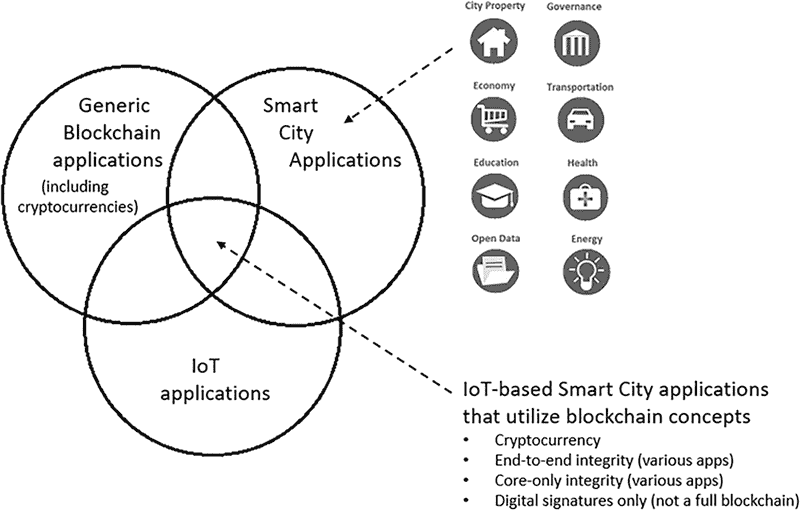

*图 2.9* 物联网应用的 Venn 图。

图 2.9 提供了应用重叠分类的图形视图。面向物联网的智慧城市基于区块链的应用可分类如下（本章重点关注项目 2 和 3）：

1. 加密货币（用于移动商务交易的各种支付）；

2. 端到端完整性，例如物流和供应链、监控和“钢铁环”、V2V（车车通信）和 V2I（车路通信）交通、智能电网、电子健康、保险和银行、安全以及物联网设备管理。在某些情况下，这也可能包括一些加密；


#### 2.7.3 物联网安全区块链应用

在物联网背景下，区块链可以成为安全措施库的一部分，特别是针对完整性。完整性是交易的关键安全要求之一；其他要求通常包括机密性、认证、授权以及（服务/资产）可用性。为了提高机密性和隐私级别，区块链中的数据可以加密 [[50]](#12_Chapter02.xhtml#ref2_50)。然而，物联网传感器的某些特性对可采用的安全措施、具有成本效益的安全措施或使方法具有可扩展性的安全措施施加了若干限制。设备的低复杂性和有限的板载能量限制了可在源点进行的计算类型，例如用于加密、防火墙或 `PoW` 活动的计算。与物联网设备相关的有限资源往往使其不适合直接支持共识机制和 `PoW`。安全领域的一条著名法则是：受保护的数据或资产的价值必须超过安全措施的成本，最好超过相当大的数量。某些物联网数据流不一定需要高完整性，因为数据可能是易腐的（仅具有即时或近即时价值）、会被更新的数据快速取代，或仅代表某种附带监测。智慧城市背景下此类示例可能包括环境监测生成的数据（如室外温度、湿度、花粉计数等）；房地产管理相关数据（如监控空间、建筑物、道路、桥梁、隧道等的状态和占用情况）；或宜居性相关数据（城市活动访问权、普通网络摄像头、火车或公交时刻表及下一班到达时间）。某些物联网数据流可能需要高完整性、指挥链和防篡改保证。智慧城市背景下此类示例可能包括物理安全相关数据（如街道、公园、车站、桥梁的监控）；或电力及其他城市支撑公用设施相关数据（如智能电网、电能/燃气/水的可靠可用性；优化的废物管理和下水道；危险化学品的安全存储等）。在需要高完整性和数据持久性的情况下，区块链的使用将更为理想。请参考 表 2.3 了解更多适用性示例。

具体而言，节点处理开销和网络延迟可能成为限制因素，因为物联网设备通常具有有限的存储、计算和通信能力。许多区块链机制（包括对适当 `P2P` 协议的支持、共识算法、`PoW` 及其他相关机制的支持，以及通用节点和对等节点功能）都意味着一定程度的整体处理复杂性，尤其是当区块链机制在整个物联网生态系统中实施时。考虑到在通用物联网端点（计算和存储能力有限）中实施各种 `P2P` 节点角色以管理分布式账本的技术限制，`BCM` 可能必须在网络中的选定节点（如网关和雾到核心的交接点）中得到支持 [[119]](#12_Chapter02.xhtml#ref2_119)。图 2.11 将架构层、应用类型、事物和节点类型（或网络节点[网关]类型）与区块链解决方案在完整性方面的适用性相关联。现实情况下，不合理指望低端外层物联网节点（如远程执行器或传感器）为全球生态系统数据的完整性背书。鉴于物联网节点的典型限制，在全球物联网背景下使用基于 `BCM` 的完整性可能不可行，但特定的关键或任务关键型应用（如智能电网、`ITS` 以及某些电子健康和保险数据流）可能部署在具备支持必要 `P2P` `BCM` 功能能力的节点环境中。

一种替代方案是设计范围局部受限的 `P2P` 物联网网络；在这种方法中，待处理和存储的区块或交易量将较小，同时后台 `P2P` 消息（发现、查询、调用、同步和共识构建）涉及的聚合处理也较少。另一种替代方案是使用基本账本，其中区块由发起者或雾计算中的某个中间节点进行数字签名，但在雾中不实施完整的共识过程；完整的区块链机制可在数据通过更接近核心或云的节点，或位于核心或云中的节点时实施。此外，并非所有类型的数据都需要绝对完整性，因为其具有易腐性。

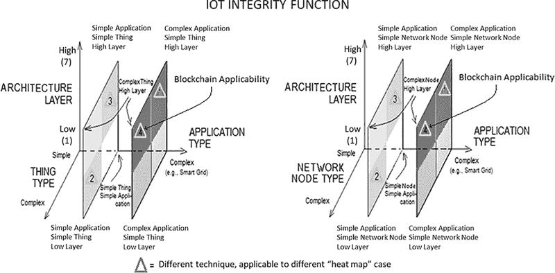

*图 2.11 区块链解决方案的适用性。*

#### 2.7.4 物联网中的区块链实施模式

事实证明，在物联网环境中，区块链有多种可能的实施模式。实施方式包括端到端区块链、分析和存储层区块链、网关层区块链、站点层区块链和设备层区块链。请参见 图 2.12。在端到端方法中，终端节点将创建 `BC` 区块，但考虑到廉价且相对“被动”的终端节点的相对简单性，这种设计对于典型终端节点通常是不切实际的（尽管在某些特定环境中，这可能是可行的）。另一种方法是终端传感器不创建新的交易区块，而只是将数据传递给边缘网关或雾节点；然后由边缘网关创建或添加区块，并从那时起保护数据。应注意，全参与节点还需要支持 `P2P` 消息以处理：(i) 在区块链保护的 `P2P` 网络中发现其他对等节点；(ii) 交易管理，如交易查询、调用和部署；(iii) 同步以保持所有 `P2P` 节点上的区块链更新；以及 (iv) 共识管理，如背书交易。所有这些活动和消息传递都需要非微量的计算、内存存储和物理电力。并非所有物联网用例都有能够支持这些活动的节点。

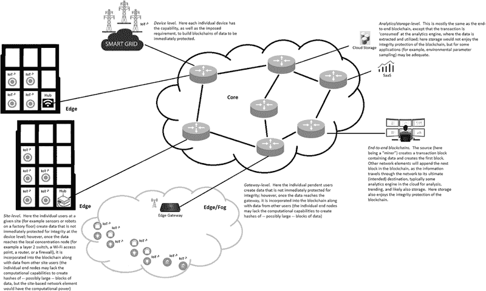

*图 2.12 物联网 (IoT) 区块链的实施模式。*


#### 2.7.5 特定智慧城市区块链应用

接下来简要讨论几个具体应用。

##### 2.7.5.1 电子健康

电子健康在医院和开放环境中均拥有重要的物联网应用 [[100]](#12_Chapter02.xhtml#ref2_100)[[101]](#12_Chapter02.xhtml#ref2_101)[[102]](#12_Chapter02.xhtml#ref2_102)[[103]](#12_Chapter02.xhtml#ref2_103)[[104]](#12_Chapter02.xhtml#ref2_104)[[105]](#12_Chapter02.xhtml#ref2_105)[[106]](#12_Chapter02.xhtml#ref2_106)。医院属于城市资源集合的一部分，大城市拥有许多医院，尤其是专业的三级中心。例如，美国有 5,262 家社区医院；其中 3,387 家位于城市环境中。关于医疗保健的一些基本统计数据包括以下内容 [[120]](#12_Chapter02.xhtml#ref2_120)[[121]](#12_Chapter02.xhtml#ref2_121)[[122]](#12_Chapter02.xhtml#ref2_122)[[123]](#12_Chapter02.xhtml#ref2_123)：

- 纽约市 25 英里范围内有 77 家医院；芝加哥地区有 51 家；洛杉矶地区有 68 家；相比之下，伊利诺伊州皮奥里亚 50 英里范围内仅有 11 家医院，爱荷华州苏城中心 50 英里范围内仅有 10 家医院（来源：Medicare）。
- 平均每家医院约有 200 张床位（来源：美国医院名录）。
- 平均每 1,000 人口拥有床位数为 2.8 张。
- 平均而言，拥有 100 万居民的城市将拥有 2,800 张床位或 14 家医院。拥有 1,000 万居民的城市将拥有 28,000 张床位或 140 家医院。
- 根据 2019 年社区医院入院统计：34,305,620 人次；全国平均住院日数 (ALOS) 为 4.5 天（平均每天费用 $10,400）。
- 根据美国医院协会数据，医院每年以约 30 家的速度关闭。
- 2017 年美国医疗支出增长 3.9%，达到 3.5 万亿美元，人均 $10,739。医疗支出占国民生产总值的 17.9%（来源：国家卫生支出账户 [NHEA]）。

院内应用包括患者身份识别；实验室报告管理；药物管理与追踪；以及医疗资产追踪。医疗保健行业受到严格监管，特别是在患者记录方面。例如，如果平均住院天数为 4.5 天，每天产生 10 份记录、实验室结果或文件，那么每次住院相当于产生约 50 份记录，仅在美国每年就约产生 17 亿份记录。仅在美国，就适用以下法规：`42 Code of Federal Regulations (CFR) Part 2`；《联邦信息安全管理法案》(FISMA)；第 164 部分通用条款——安全、违规通知和隐私规则（第 164 部分，子部分 A）；2008 年《遗传信息非歧视法案》(GINA)；1996 年《健康保险流通与责任法案》(HIPAA)；医疗补助（社会保障法案第十九编）；《患者保护与平价医疗法案》；拟议的实施 HITECH 的 HIPAA 法规；违规通知规则表（第 164 部分，子部分 D）；通用规则；执行规则表（第 160 部分，子部分 C、D 和 E）；《家庭教育权利和隐私法案》(FERPA)；《促进经济与临床健康健康信息技术法案》(HITECH)；隐私规则表（第 164 部分，子部分 E）；安全规则表（第 164 部分，子部分 C）。因此，记录保存、追踪、存储和传输对该行业至关重要，这显而易见。此外，未来节省资金的能力取决于是否能在各个医院、实验室中心、诊所、家庭医生和药房之间共享文档。另外，还有许多居家和户外电子健康应用，其中使用移动监测设备（物联网类型）实时收集医疗状态信息，并通过云端传输以进行评估和存储。BCM 在未来几年将在该领域发挥重要作用；例如，网关、雾节点级或站点级设备可作为矿工运行，创建包含待传输至远程医疗机构的健康数据的区块链（通常也会对数据进行加密）。

最近，多种技术被用于抗击 COVID-19 大流行，包括用于医学研究的人工智能、用于提高居家办公应用信息传输速度的 5G 系统，以及用于管理医疗和食品供应链的 BCM。具体而言，BCM 被用于监控大流行物资分发、追踪捐赠、追踪救济分发、危机管理，以及在遵守强制性医疗数据法规的前提下支持接触者追踪并保持适当的匿名性。2020 年初，美国国土安全部 (DHS) 发布了冠状病毒大流行指南，将食品和农业分发领域的区块链管理人员列为“关键基础设施工人”。组织可以利用 BCM 协作研究对抗冠状病毒的最佳途径，通过提供透明且不可篡改的医疗数据。BCM 可用于追踪病毒传播、感染公民数量和康复公民数量。BCM 还可用于在筹款和捐赠活动中促进透明度，同时提供追踪资金来源的手段，并检测资金是否用于正当目的。利用 BCM，公司可以通过加密货币收款，避免通过现金传播病毒的风险——例如，Covir 区块链项目 (covir.io) 与 Octopus Robots 合作，为消毒商业建筑的机器人提供生物安全许可资金 [[124]](#12_Chapter02.xhtml#ref2_124)[[125]](#12_Chapter02.xhtml#ref2_125)。

##### 2.7.5.2 智能电网

智能电网包含输电和配电 (T&D) 组件——通常位于农村地区——以及消费组件——通常位于人口稠密地区。城市的生存和可持续发展严重依赖电力（及其他公用设施）。BCM 在这一领域也能发挥重要作用，特别是在追踪环境参数和能源数据方面。

##### 2.7.5.3 物流


# 物流与供应链应用广泛存在

城市对货物、食品及其他消费品的到达与分发有着关键依赖；若缺乏上述供应，城市将迅速陷入混乱。利用 BCM 进行食品溯源正成为物联网/区块链早期实施的重要领域（全球或基于卫星的物联网的一个例子是在货物跨国运输途中对卡车制冷系统的管理——近期已出台了相对严格的相关法规）。溯源对许多商品都很重要，但对食品尤为重要。例如，欧盟（EU）法规要求食品生产商追踪并识别食品生产或加工中使用的所有组成材料（例如：用于牛、猪、鱼养殖的饲料；货物流动等）。食品的可追溯性是食品安全的关键要素，特别是考虑到世界卫生组织（WHO）估计，每年全球约有 6 亿人因食用受污染食品而患病，42 万人死于其后果 [[111]](#12_Chapter02.xhtml#ref2_111)，[[126]](#12_Chapter02.xhtml#ref2_126)。大型食品公司或零售企业（如美国的沃尔玛）通常拥有数千家供应商和数百万客户；在欧盟，相关信息必须实现计算机化以符合法规。物联网监控和基于 BCM 的完整性验证将在未来几年在该领域发挥关键作用。如前所述，其他溯源应用也已涌现；道德采购对包括钻石在内的许多大宗商品变得愈发重要。在这些应用中，引入物联网传感设备可实现产品追踪，并在其运输、转移和分发过程中提供信息。文档管理，特别是在进出口应用中，可通过 BCM 得到极大便利。在某些情况下，溯源可与智能合约结合，由区块链强制执行合法、合法且可靠的合约执行。

##### 2.7.5.4 监控

一般监控以及全市范围的“钢铁环”应用可通过 BCM 得到增强，尤其是在记录保管对后续法律程序至关重要的场合。例如，下曼哈顿安全倡议旨在在下曼哈顿建立全面监控体系。截至发稿时，18,000 个私营部门和执法摄像头在纽约市实时记录人员和车辆活动（见图 2.13——约 2,700 个摄像头连接至纽约市警察局网络，部分为固定视角，许多为云台变焦（PTZ）甚至 360 度摄像头；警方仅在下曼哈顿就可访问 9,000 多个摄像头）。宏观构想最初受伦敦金融区“钢铁环”的启发，该体系建于 20 世纪 90 年代，如今大伦敦地区有 50 万个摄像头监控公共空间，平均每 16 人拥有 1 个摄像头。BCM、物联网和 AI 正在（或可）以共生方式协同增强安全性，并捕获和保护重要城市数据。此外，领域感知系统（与微软合作开发）收集并分析来自警用摄像头、交通摄像头、EZ-Pass 扫描器、雷达传感器、车牌识别器和信号控制箱的信息，以便追踪车辆和人员移动、提供监控并调节交通信号灯。纽约市的 LinkNYC 信息亭提供免费无线网络，每个信息亭配有两个监控摄像头。此外，纽约市警察部门拥有面部识别算法，可分析摄像头收集的视频。IBM 提供的软件在其视频分析软件中使用 AI，除面部识别外，还能利用年龄、种族等特征搜寻个体。将纽约市警方和政府对摄像头网络的访问权限与大型人脸数据库（如驾照数据库）相结合，即可在大都市区实时追踪市民。监控技术已在美国各地使用，包括例如沿美国 1 号公路全长 2,369 英里的路段，该公路贯穿东海岸主要城市 [[127]](#12_Chapter02.xhtml#ref2_127)，[[128]](#12_Chapter02.xhtml#ref2_128)，[[129]](#12_Chapter02.xhtml#ref2_129)，[[130]](#12_Chapter02.xhtml#ref2_130)，[[131]](#12_Chapter02.xhtml#ref2_131)，[[132]](#12_Chapter02.xhtml#ref2_132)。在中国，平安城市计划声称 2018 年已在全国连接 1.7 亿个摄像头（约每 7 位公民拥有 1 个监控摄像头），计划到 2020 年再安装 4 亿台；据报道目标是能在 3 秒内识别出在中国公共场所的任何人、任何时间、任何地点 [[131]](#12_Chapter02.xhtml#ref2_131)。在监控数据旨在用于法律程序的情况下，区块链技术大有用处，例如保证图形、照片、图像、视频或数据的保管链内容。

##### 2.7.5.5 市政智慧服务

市政智慧服务属于电子政务范畴，也可使用 BCM。应用包括许可证的申请与检索、建设申请、执照、出生证明、市政费用缴纳和公共停车管理。城市共享单车的自动租赁与追踪也是有据可查的应用。巡逻区域（如停车场或城市街道）以向违规停车或超时停车的车辆开罚单的过程，预计将通过物联网手段进一步实现自动化（也可能结合 BCM）；例如，美国劳工统计局指出，预计到 2026 年停车执法工作人员的就业增长率将达 -35% [[133]](#12_Chapter02.xhtml#ref2_133)。

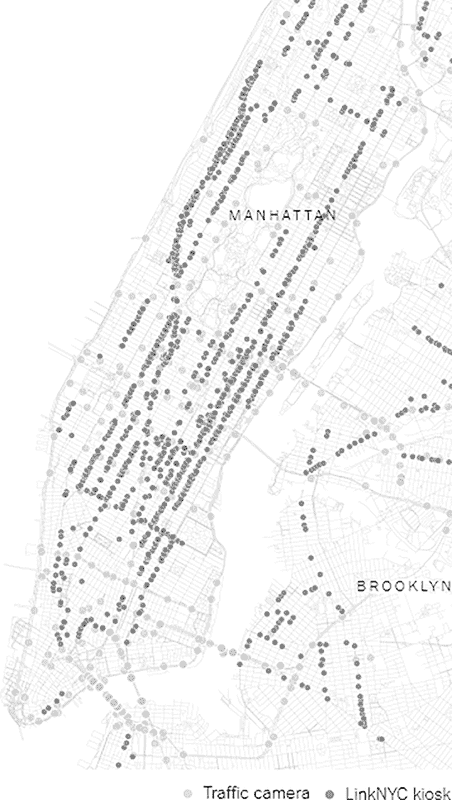

*图 2.13 纽约市监控摄像头。*

##### 2.7.5.6 经济发展

支持去中心化、共享经济的经济发展应用旨在让市民将资产变现以创造财富，这一目标也可由智能合约支持 [[94]](#12_Chapter02.xhtml#ref2_94)，[[95]](#12_Chapter02.xhtml#ref2_95)，[[96]](#12_Chapter02.xhtml#ref2_96)，[[97]](#12_Chapter02.xhtml#ref2_97)，[[98]](#12_Chapter02.xhtml#ref2_98)，[[99]](#12_Chapter02.xhtml#ref2_99)。除了 Uber、Lyft 和 Airbnb，数字经济中还有大量机会，包括共享应用、点对点自动支付和数字版权管理 [[134]](#12_Chapter02.xhtml#ref2_134)，[[135]](#12_Chapter02.xhtml#ref2_135)。另一个例子是为支持面向网络空间的交易而实现微支付。

##### 2.7.5.7 车辆应用


##### 2.7.5.8 保险与银行业务

还存在保险和银行业务应用。物联网机制用于保险的一个有据可查的用例是 UBI（基于使用的保险）。在这种环境中，也称为“随行随付”或“随行付费”，保费基于行驶距离、驾驶发生的时段、驾驶发生的地点，以及重要的是，驾驶员在速度、加速和变道方面的行为表现。一种设备嵌入汽车中，收集驾驶数据并发送回云端（使用雾和边缘网络或核心网络）进行分析和评估。在一般情况下，这些数据可能需要区块链机制提供的完整性保证，但当涉及市政车辆、公交车、校车、警车或救护车、Uber/Lyft 网约车、自动驾驶车辆，或 FedEx 或 UPS 卡车等商用车辆时，可能确实需要这种保证。在后一种情况下，区块链可能始于网关——同样是因为在汽车本身的远程设备中启动区块链可能要求过高；另一方面，一些高端车辆（如公交车）可能拥有具备足够算力和电力的物联网设备，可在雾层本身充当实际的区块链节点。

##### 2.7.5.9 设备管理

物联网安全和物联网设备管理也能从 BCM（区块链管理/机制）中受益。BCM 允许机密共享物联网数据集 [137, 138, 139]。物联网设备需要相互通信和同步。使用 BCM 可以妥善控制和配置物联网设备（例如，管理加密密钥）[140]。安全的软件推送到远程物联网设备也可以通过 BCM 实现，尽管其他方法也是可能的或已被使用 [141, 142]。

### 2.8 未来研究领域

诸如此类的断言很好地概括了本章的主题：“有史以来最大的行业变革之一（也许是最大的）涉及物联网，以及使物联网成为现实所需的基础设施和服务。简而言之，通过使我们日常生活中的各种物品兼容技术，我们可以获取有价值的信息，从而改变我们的生活方式和公司的运营方式。…… 要实现物联网世界，5G 的推出将至关重要，云的采用也同样重要。” [143]。BCM 在这一新兴的全包式生态系统中发挥着作用。正如本章所讨论的，区块链在物联网中有许多潜在应用。然而，区块链对处理和存储的巨大需求，以及对低成本、高寿命节点（从电力角度）的渴望，使得在此节点采用此类完整性方案颇具挑战性。

因此，有许多技术领域将受益于对区块链在物联网应用中应用的持续研究，包括可扩展性（例如，存储容量可扩展性）、节点处理优化、P2P 节点功能的细化评估（例如，哪些节点是 PoW 功能的理想实现者、轻量级共识机制）、相关安全机制（例如，机密性、匿名性和数据隐私、端点认证、可信执行环境，以及不可抵赖背景下的服务可用性）。应进一步探索避免陷入 51% 攻击的设计原则，以及针对双花攻击、竞争攻击、女巫攻击、拒绝服务攻击、日蚀攻击和中间人问题的防护，因为许多（如果不是大多数）P2P 协议和物联网环境都容易受到这些类型的攻击。

应研究和评估区块链技术应用于物联网环境的务实局限性（例如，设备性能、通信复杂性）。物联网环境下移动商务相关的加密货币问题，也是一个可能需要理论、技术和实践评估的领域。

最后，一个研究问题是 BCM 能否用于缓解物联网环境中的基于协议的攻击，例如自组网络中基于雾和边缘的物联网路由的内部攻击；基于协议的攻击包括蜂窝攻击、黑洞攻击（恶意节点介入路由发现以成为路径一部分）、灰洞攻击、选择性转发、通过发送虚假链路信息进行的本地修复攻击、路由缓存投毒、女巫攻击、黑洞攻击、Hello 洪泛攻击、使用面向目的地的有向无环图信息对象（DIO）消息的邻居攻击、DIO 消息版本号篡改、“无信任等级”的修改、信息伪造、制造环路的拜占庭攻击，以及通过声称是最近的目标节点进行的位置欺骗 [116, 144]。

### 参考文献

1. Hassan, Q. Editor, 2018. *Internet of Things A to Z: Technologies and Applications*. IEEE Press/Wiley, Hoboken, NJ.

2. Hassan, Q. Editor, 2018. *Internet of Things: Challenges, Advances and Applications*. CRC Press, Taylor & Francis Group, Boca Raton, FL.

3. Aazam, M. and E.-N. Huh. 2014. Fog computing and smart gateway-based communication for cloud of things. *Proceedings 2nd International Conference on Future Internet of Things and Cloud*, Barcelona, Spain.

4. Alrawais, A., Alhothaily, A., et al. 2017. Fog computing for the Internet of Things: Security and privacy issues. *IEEE Internet Computing*, 21, 34–42.

5. Byers, C. C. 2017. Architectural imperatives for fog computing: Use cases, requirements, and architectural techniques for fog-enabled IoT networks. *IEEE Communications Magazine*, 55, 14–20.

6. Mushunuri, V., Kattepur, A., et al. 2017. Resource optimization in fog-enabled IoT deployments. *Proceedings of the 2017 Second International Conference on Fog and Mobile Edge Computing (FMEC)*, Valencia, Spain, May 8–11, 2017, pp. 6–13.


### 参考文献

7. Charalampidis, P., Tragos, E., et al. 2017. A Fog-enabled IoT platform for efficient management and data collection. *Proceedings of the 2017 IEEE 22nd International Workshop on Computer Aided Modeling and Design of Communication Links and Networks (CAMAD)*, Lund, Sweden, June 19–21, 2017, pp. 1–6.

8. Azimi, I., Anzanpour, A., et al. 2017. HiCH: Hierarchical fog-assisted computing architecture for healthcare IoT. *ACM Transactions on Embedded Computing Systems (TECS)*, 16, 174.

9. Baker, T., Asim, M., et al. 2019. A secure fog-based platform for SCADA-based IoT critical infrastructure. *Software: Practice and Experience*. doi:10.1002/spe.2688.

10. Ni, J., Zhang, K., et al. 2018. Securing fog computing for Internet of Things applications: Challenges and solutions. *IEEE Communication Surveys Tutor*, 20, 601–628.

11. Abbas, N., Asim, M., et al. 2019. A Mechanism for securing IoT-enabled applications at the fog layer. *Journal of Sensor and Actuator Networks*, 8, 16.

12. Liang, K., Zhao, L., et al. 2017. An integrated architecture for software defined and virtualized radio access networks with fog computing. *IEEE Networks*, 31, 80–87.

13. Roman, R., Lopez, J., et al. 2018. Mobile edge computing, fog etc.: A survey and analysis of security threats and challenges. *Future Generation Computer Systems*, 78, 680–698.

14. A. Dehghantanha. Editor. 2018. *Handbook of Big Data and IoT Security*. Springer Nature, Cham, Switzerland. Part of Springer Nature. doi:10.1007/978-3-030-10543-3.

15. Zhou, J., Cao, Z., et al. 2017. Security and privacy for cloud-based IoT: Challenges. *IEEE Communications Magazine*, 55(1), 26–33. doi:10.1109/MCOM.2017.1600363CM.

16. Dorri, A., Kanhere, S. S., et al. 2017. Blockchain for IoT Security and Privacy: The Case Study of a Smart Home. *IEEE International Conference on Pervasive Computing and Communications Workshops*.

17. Sedjelmaci, H., Senouci, S. M. and M. Feham. 2012. Intrusion detection framework of cluster-based wireless sensor network. *2012 IEEE Symposium on Computers and Communications (ISCC)*, Cappadocia, Turkey, July 1–4, 2012.

18. Chakrabarty, S. and D. W. Engels. 2016. A secure IoT architecture for smart cities. *Consumer Communications & Networking Conference (CCNC), 2016 13th IEEE Annual*, January 9–12, 2016. doi:10.1109/CCNC.2016.7444889.

19. Li, X., Wang, Q., et al. 2019. Enhancing cloud-based IoT security through trustworthy cloud service: An Integration of security and reputation approach. *IEEE Access*, 7. doi:10.1109/ACCESS.2018.2890432.

20. Stergiou, C. Psannis, K. E., et al. 2018. Secure integration of IoT and cloud computing. *Future Generation Computing Systems*, 78, 964–975.

21. Minoli, D. and B. Occhiogrosso. 2018. Blockchain mechanisms for IoT security. *Elsevier IoT Journal*, 1–2(1), 1–13.

22. Minoli, D., Kouns, J. and K. Sohraby. 2017. IoT Security (IoTSec) considerations, requirements, and architectures. *14th Annual IEEE Consumer Communications & Networking Conference (CCNC)*, IEEE, Las Vegas, NV, January 8–11, 2017.

23. Minoli, D. and B. Occhiogrosso. 2018. Security considerations for IoT support of e-health applications. In *Internet of Things: Challenges, Advances and Applications*, Q. Hassan, Editor. CRC Press, Taylor & Francis Group, Boca Raton, FL.

24. Arsi, S., Inukollu, V. N. and S. R. Ravuri. 2014. Security issues associated with big data in cloud computing. *IJNSA*, 6, 3.

25. Lai, C., Lu, R., et al. 2015. Toward secure large-scale machine-to-machine communications in 3GPP networks. *IEEE Communications Magazine Supplement*, 53(12), 12–19.

26. U.S. Patent 9129108. 2012. Systems, Methods and computer programs providing impact mitigation of cyber-security failures.

27. U.S. Patent 9118702. 2011. System and method for generating and refining cyber threat intelligence data.

28. U.S. Patent 9094288. 2011. Automated discovery, attribution, analysis, and risk assessment of security threats.

29. U.S. Patent 9086793. 2006. Methods and systems for assessing security risks.

30. U.S. Patent 9083741. 2012. Network defense system and framework for detecting and geolocating botnet cyber attacks.

31. U.S. Patent 9054873. 2009. Compact security device with transaction risk level approval capability.

32. U.S. Patent 9032318. 2006. Widget security.

33. U.S. Patent 9555772. 2017. Embedded security system for environment-controlled transportation containers and method for detecting a security risk for environment-controlled transportation containers.

34. U.S. Patent 8997230. 2013. Hierarchical data security measures for a mobile device.

35. U.S. Patent 8966640. 2014. Security risk aggregation and analysis.

36. U.S. Patent 8955111. 2011. Instruction set adapted for security risk monitoring.

37. U.S. Patent 8914880. 2012. Mechanism to calculate probability of a cyber security incident.

38. U.S. Patent 8856936. 2012. Pervasive, domain and situational-aware, adaptive, automated, and coordinated analysis and control of enterprise-wide computers, networks, and applications for mitigation of business and operational risks and enhancement of cyber security.

39. Application US 62/284,983. 2017. Method for a uniform measure and assessment of an institution’s aggregate cyber security risk and of the institution’s cybersecurity confidence index. D. Minoli and B. Occhiogrosso Inventors.

40. Shodan. Available at [www.shodan.io](http://www.shodan.io).

41. Komal, K. and T. Mohasin. 2015. Secure and economical information transmission for clustered wireless sensor network. *International Journal of Science and Research (IJSR)*, 4(12), 1033–1035.

42. Chen, G., Gong, Y., et al. 2015. Physical layer network security in the full duplex relay system. *IEEE Transactions on Information Forensics and Security*, 10(3), 574–583.

43. Esser, B. and T. Kiesling. 2016. Keynote 1: Today’s cyber security threats and challenges for telco providers; Keynote 2: Cyber resilience of complex interdependent infrastructures. *10th International Conference on Autonomous Infrastructure, Management and Security (AIMS 2016)*, June 20–June 23, 2016, Munich, Germany. Available at [www.aims-conference.org/2016/](http://www.aims-conference.org).

44. Kennedy, D. 2014. Bug exposes IP cameras, baby monitors. January 14, 2014. Available at [`krebsonsecurity.com/2014/01/bug-exposes-ip-cameras-baby-monitors/`](http://krebsonsecurity.com).

45. Notopoulos, K. 2012. Somebody’s watching: How a simple exploit lets strangers tap into private security cameras. *The Verge*, February 3, 2012. Available at [www.theverge.com/2012/2/3/2767453/trendnet-ip-camera-exploit-4chan](http://www.theverge.com).


### 参考文献

46. Granjal, J., Monteiro, E. and J. Sá Silva. 2015. Security for the Internet of Things: A survey of existing protocols and open research issues. *IEEE Communication Surveys & Tutorials*, 17(3), 1294ff.

47. Zhou, L. and H.-C. Chao. 2011. Multimedia traffic security architecture for the Internet of Things. *IEEE Network*, 25(3), 35–40. doi:10.1109/MNET.2011.5772059.

48. Gault, M. 2016. Rethinking security for the Internet of Things. Available at [`techcrunch.com/2016/05/06/rethinking-security-for-the-internet-of-things/`](http://techcrunch.com).

49. Ouaddah, A., Elkalam, A. A. and A. A. Ouahman. 2016. FairAccess: A new blockchain-based access control framework for the Internet of Things. *Security and Communication Networks*. doi:10.1002/sec.1748.

50. Kosba, A., Miller, A., et al. 2016. Hawk: The blockchain model of cryptography and privacy-preserving smart contracts. *Security and Privacy (SP), 2016 IEEE Symposium on*, San Jose, CA, May 22–26, 2016.

51. Pilkington, M. 2016. Blockchain technology: Principles and applications. In *Research Handbook on Digital Transformations*, F. X. Olleros and M. Zhegu Editors. Edward Elger Publishing, Northampton, MA.

52. Tapscott D. and A. Tapscott. 2016. *Blockchain Revolution: How the Technology Behind Bitcoin Is Changing Money*, Penguin Random House LLC, New York.

53. Orcutt, M. 2019. Once hailed as unhackable, blockchains are now getting hacked. *Technology Review*, February 19, 2019. Available at [www.technologyreview.com/s/612974/once-hailed-as-unhackable-blockchains-are-now-getting-hacked/](http://www.technologyreview.com).

54. Tiburski, R. T., Amaral, L. A., et al. 2015. The importance of a standard security architecture for SOA-based IoT middleware. *IEEE Communications Magazine*.

55. ISO/IEC. 2014. Study Report on IoT Reference Architectures/Frameworks, 2014.

56. Weyrich, M. and C. Ebert. 2016. Reference architectures for the Internet of Things. *IEEE Software*, IEEE Computer Society, pages 112 ff.

57. Cisco Systems. 2014. Cisco white paper: The Internet of Things reference model. Cisco Systems, San Jose, CA.

58. Intel. 2015. White paper: The Intel IoT platform, architecture specification. Santa Clara, CA.

59. Walewski, J. W. Editor. 2013. Internet of Things Architecture (IoT-A), Project Deliverable D1.2–Initial architectural reference model for IoT. Available at [`cocoa.ethz.ch/downloads/2014/01/1360_D1%202_Initial_architectural_reference_model_for_IoT.pdf`](https://cocoa.ethz.ch).

60. ETSI. 2012. ETSI TS 102 690: Machine-to-machine communications (M2M); Functional architecture. October 2011.

61. Bauer, M., Boussard, M., et al. 2013. IoT reference architecture. In *Enabling Things to Talk*, A. Bassi, et al., Editors. doi:10.1007/978-3-642-40403-0_8, 2013.

62. Minoli, D., Occhiogrosso, B., et al. 2017. IoT Security (IoTSec): Mechanisms for e-health and ambient assisted living applications–A big data role. *The Second IEEE/ACM International Workshop on Safe, Energy-Aware, & Reliable Connected Health (SEARCH 2017)* (collocated with CHASE 2017, Conference on Connected Health: Applications, Systems, and Engineering Technologies), Philadelphia, PA, July 17–19, 2017.

63. Sohraby, K. and D. Minoli. 2007. *Wireless Sensor Networks*. Wiley, Hoboken, NJ.

64. GOS World Staff. 2019. Skyworks unveils Sky5 Ultra platform for 5G architecture. February 27, 2019. Available at [www.gpsworld.com/skyworks-unveils-sky5-ultra-platform-for-5g-architecture/](http://www.gpsworld.com).

65. ITU-R SG05 Contribution 40. 2017. Minimum requirements related to technical performance for IMT-2020 radio interface(s).

66. GSMA. 2018. Mobile IoT in the 5G future: NB-IoT and LTE-M in the context of 5G. Available at [www.gsma.com/iot/wp-content/uploads/2018/05/GSMAIoT_MobileIoT_5G_Future_May2018.pdf](http://www.gsma.com).

67. Lin, J., Shen, Z., et al. 2017. Using blockchain technology to build trust in sharing LoRaWAN IoT. *Proceedings of the 2nd International Conference on Crowd Science and Engineering*, Beijing, China, July 6–9, 2017. doi:10.1145/3126973.3126980.

68. United Nations Department of Economic and Social Affairs. 2018. Available at [www.un.org/development/desa/en/news/population/2018-revision-of-world-urbanization-prospects.html](http://www.un.org).

69. Worldometer Staff. US Population. 2019. Available at [www.worldometers.info/world-population/us-population/](http://www.worldometers.info).

70. World Economic Forum Staff. 2019. Smart cities must pay more attention to the people who live in them. April 16, 2019. Available at [www.weforum.org/agenda/2019/04/why-smart-cities-should-listen-to-residents](http://www.weforum.org).

71. Berrone, P., Ricart, J.-E., et al. 2019. New York, London and Paris firmly established as the smartest cities. *IESE Insight*. Available at [www.ieseinsight.com/doc.aspx?id=2124&ar=&idi=2&idioma=2](http://www.ieseinsight.com).

72. ISO 37120. 2018. Sustainable development of communities—indicators for city services and quality of life.

73. Kelechava, B. 2018. Indicators for city services and quality of life in sustainable cities and communities in ISO 37120:2018. August 13, 2018. Available at [`blog.ansi.org/2018/08/indicators-sustainable-city-iso-37120-2018/#gref`](https://blog.ansi.org).

74. Pharos Navigator Staff, ISO 37120 standard as template for Smart City development, Available at [`smartcity.pharosnavigator.com/static/content/en/626/`](https://smartcity.pharosnavigator.com).

75. Sankar L. S., Sindhu, M. and M. Sethumadhavan. 2017. Survey of consensus protocols on blockchain applications. *Advanced Computing and Communication Systems (ICACCS), 2017 4th IEEE International Conference*, IEEE.

76. Bashir, I. 2017. *Mastering Blockchain*. Packt Publishing, Birmingham, UK.

77. Atzei, N., Bartoletti, M., et al. 2017. A formal model of bitcoin transactions. Available at [`eprint.iacr.org/2017/1124.pdf`](https://eprint.iacr.org).

78. Brünnler, K., Flumini, D. and T. Studer. 2018. A Logic of blockchain updates. In *Logical Foundations of Computer Science*, S. Artemov and A. Nerode, Editors. LFCS 2018. Lecture Notes in Computer Science, vol. 10703. Springer, Cham, Switzerland.

79. Artemov, S. N. 2001. Explicit provability and constructive semantics. *Bulletin of Symbolic Logic*, 7(1), 1–36.

80. Decker. C. and R. Wattenhofer. 2013. Information propagation in the Bitcoin network. *13th IEEE International Conference on Peer-to-Peer Computing*, pp. 1–10.

81. Matsuo, S. I. 2017. How formal analysis and verification add security to blockchain-based systems. *Formal Methods in Computer Aided Design (FMCAD)*, Vienna, Austria, October 2–6, 2017.


### 参考文献

82. Garay, J., Kiayias, A. and N. Leonardos. 2015. The Bitcoin backbone protocol: Analysis and applications. *Advances in Cryptology. EUROCRYPT 2015: 34th Annual International Conference on the Theory and Applications of Cryptographic Techniques*, Sofia, Bulgaria, April 26–30, 2015, Proceedings, Part II, pp. 281–310. doi:10.1007/978-3-662-46803-6_10.

83. Dennis, R., Owenson, G. and B. Aziz. 2016. A temporal blockchain: A formal analysis. *International Conference on Collaboration Technologies and Systems (CTS)*, October 31–November 4, 2016, Orlando, FL.

84. Huang, B., Liu, Z., Chen, J. et al. 2017. Behavior pattern clustering in blockchain networks. *Multimedia Tools and Applications*, 76, 20099–20110. doi:10.1007/s11042-017-4396-4.

85. Awan, M. K. and A. Cortesi. 2017. Blockchain Transaction Analysis Using Dominant Sets. In *Computer Information Systems and Industrial Management*, K. Saeed, W. Homenda and R. Chaki. Editors. CISIM 2017. Lecture Notes in Computer Science, Vol. 10244. Springer, Cham, Switzerland.

86. Ouaddah, A., Elkalam, A. A. and A. A. Ouahman. 2017. *Towards a Novel Privacy-Preserving Access Control Model Based on Blockchain Technology in IoT, Cooperation Advances in Information and Communication Technologies*. Springer International Publishing, New York City, 523–533.

87. Xu, L., Shah, N., et al. 2017. Enabling the sharing economy: Privacy respecting contract based on public blockchain. *Proceedings of the ACM Workshop on Blockchain, Cryptocurrencies and Contracts*, ACM.

88. Dinh, T. T. A., Wang, J., et al. 2017. Blockbench: A framework for analyzing private blockchains. *Proceedings of the 2017 ACM International Conference on Management of Data*, ACM, 2017.

89. Wright, A. and P. De Filippi. 2015. Decentralized blockchain technology and the rise of lex cryptographia. March 10, 2015. Available at [`ssrn.com/abstract=2580664`](https://ssrn.com).

90. Xu, X., Pautasso, C., et al. 2016. The blockchain as a software connector. *Software Architecture (WICSA), 2016 13th Working IEEE/IFIP Conference on*, Venice, Italy, April 5–8, 2016. doi:10.1109/WICSA.2016.21.

91. Merkle, R. C. 1988. A digital signature based on a conventional encryption function. In *Advances in Cryptology, CRYPTO ‘87*. Pomerance C., Editor. Lecture Notes in Computer Science. Vol. 293. p. 369. doi:10.1007/3-540-48184-2_32. Springer, Berlin, Germany.

92. Christidis, K. and M. Devetsikiotis. 2016. Blockchains and smart contracts for the Internet of Things. *IEEE Access*, 4, 2292–2303.

93. Garner, B. 2018. What’s a Sybil attack and how do blockchains mitigate them? August 31, 2018. Available at [`coincentral.com/sybil-attack-blockchain/`](https://coincentral.com).

94. Eyal, I. 2017. Blockchain technology: Transforming libertarian cryptocurrency dreams to finance and banking realities. *Computer*, 50(9), 38–49.

95. Treleaven, P., Brown, R. G., et al. 2017. Blockchain technology in finance. *Computer*, 50(9), 14–17. doi:10.1109/MC.2017.3571047.

96. Nordrum, A. 2017. Wall Street occupies the blockchain-financial firms plan to move trillions in assets to blockchains in 2018. *IEEE Spectrum*, 54(10), 40–45.

97. Mukhopadhyay, U., Skjellum, A., et al. 2016. A brief survey of cryptocurrency systems. *14th IEEE Annual Conference on Privacy, Security and Trust*, IEEE.

98. Oudejans, J., Erkin, Z., et al. 2017. A framework for preventing double-financing using blockchain technology. *Proceedings of the ACM Workshop on Blockchain, Cryptocurrencies and Contracts*, ACM.

99. Samaniego, M. and R. Deters. 2016. Blockchain as a service for IoT. *Internet of Things (iThings) and IEEE Green Computing and Communications (GreenCom) and IEEE Cyber, Physical and Social Computing (CPSCom) and IEEE Smart Data (SmartData), 2016 IEEE International Conference on*, December 15–18, 2016, Chengdu, China.

100. Mettler, M. 2016. Blockchain technology in healthcare: The revolution starts here. *18th IEEE International Conference on e-Health Networking, Applications and Services (Healthcom)*.

101. Angraal, S., Krumholz, H. M., et al. 2017. Blockchain technology: Applications in health care. *Cardiovascular Quality and Outcomes*, 10(9), e003800. doi:10.1161/CIRCOUTCOMES.117.003800.

102. Azaria, A. Ekblaw, A., et al. 2016. Using blockchain for medical data access and permission management. *IEEE International Conference Open and Big Data (OBD)*.

103. Kuo, T.-T., Kim, H.-E., et al. 2017. Blockchain distributed ledger technologies for biomedical and health care applications. *Journal of the American Medical Informatics Association*, 24(6), 1211–1220. doi:10.1093/jamia/ocx068.

104. Zhang, J., Xue, N., et al. 2016. A Secure system for pervasive social network-based healthcare. *IEEE Access*, 4, 9239–9250. doi:10.1109/ACCESS.2016.2645904.

105. Zhao, H. Zhang, Y., et al. 2017. Lightweight backup and efficient recovery scheme for health blockchain keys. *13th IEEE International Symposium on Autonomous Decentralized Systems*.

106. Xia, Q., Sifah, E. B., et al. 2017. Trustless medical data sharing among cloud service providers via blockchain. *IEEE Access*, 5.

107. Kim, H. M. and M. Laskowski. 2018. Toward an ontology‐driven blockchain design for supply‐chain provenance. *Wiley Online Library*, March 28, 2018. doi:10.1002/isaf.1424.

108. Nicola, S. 2019. Using blockchain to help fight conflict minerals, *Bloomberg*, April 24, 2019. Available at [www.bloomberg.com/news/articles/2019-04-24/using-blockchain-to-help-fight-conflict-minerals?srnd=premium](http://www.bloomberg.com).

109. Sun, L. 2018. IBM and Microsoft are upgrading Walmart’s digital supply chain. *The Motley Fool*, September 30, 2018. Available at [www.fool.com/investing/2018/09/30/ibm-and-microsoft-are-upgrading-walmarts-digital-s.aspx](http://www.fool.com).

110. Li, C. 2018. Maersk—Reinventing the shipping industry using IoT and blockchain. *HBS Digital Initiative*, June 28, 2018. Available at [`medium.com/harvard-business-school-digital-initiative/maersk-reinventing-the-shipping-industry-using-iot-and-blockchain-f84f74fe84f9`](https://medium.com).

111. Reyna, A., Martín, C., et al. 2018. On blockchain and its integration with IoT: Challenges and opportunities. *Future Generation Computer Systems*, 88, 173–190. doi:10.1016/j.future.2018.05.046.

112. Ferrag, M. A., Derdour, M., et al. 2018. Blockchain technologies for the Internet of Things: Research issues and challenges. *IEEE Internet of Things Journal*. doi:10.1109/JIOT.2018.2882794.

113. Sun, J., Yan, J. and K. Z. K. Zhang. 2016. Blockchain-based sharing services: What blockchain technology can contribute to smart cities. *Financial Innovation*. Springer. doi:10.1186/s40854-016-0040-y.


### 参考文献

114. Ibba, S., Pinna, A., et al. 2017. Citysense: Blockchain-oriented smart cities. *XP ’17 Proceedings of the XP2017 Scientific Workshops*, Cologne, Germany. May 22–26, 2017. ACM, New York. doi:10.1145/3120459.3120472.

115. Biswas, K. and V. Muthukkumarasamy. 2016. Securing Smart cities using blockchain technology. *IEEE 14th International Conference on Smart City*, Sydney, NSW, Australia, December 12–14, 2016. doi:10.1109/HPCC-SmartCity-DSS.2016.0198.

116. Tariq, N., Asim, M., et al. 2019. The security of big data in fog-enabled IoT applications including blockchain: A survey. *Sensors*, 19, 1788. doi:10.3390/s19081788.

117. Junfeng, X., Tang, H., et al. 2019. A survey of blockchain technology applied to Smart cities: Research issues and challenges. *IEEE Communications Surveys & Tutorials*.

118. Ruizhe, Y., Yu, F. R., et al. 2019. Integrated blockchain and edge computing systems: A survey, some research issues and challenges. *IEEE Communications Surveys & Tutorials*.

119. Zhang, H. Xiao, Y., et al. 2017. Computing resource allocation in three-tier IoT fog networks: A joint optimization approach combining Stackelberg game and matching. *IEEE Internet of Things Journal*, 4(5). doi:10.1109/JIOT.2017.2688925.

120. American Hospital Association. 2019. Fast facts on U.S. hospitals. Available at [www.aha.org/statistics/fast-facts-us-hospitals](http://www.aha.org).

121. Medicate.gov. 2019. Hospital results. Available at [www.medicare.gov/hospitalcompare/search.html](http://www.medicare.gov).

122. American Hospital Directory. 2019. Available at [www.ahd.com/state_statistics.html](http://www.ahd.com).

123. Center for Medicare and Medicaid Services. 2019. Available at [www.cms.gov/research-statistics-data-and-systems/statistics-trends-and-reports/nationalhealthexpenddata/nationalhealthaccountshistorical.html](http://www.cms.gov).

124. Oluwatobi, J. 2020. How blockchain technology can help fighting against COVID-19. Cointelegraph, June 7, 2020. Available at [`cointelegraph.com/news/how-blockchain-technology-can-help-fighting-against-covid-19`](https://cointelegraph.com).

125. Banafa, A. 2020. Blockchain technology and COVID-19. bbvaopenmind.com, June 22, 2020. Available at [`www.bbvaopenmind.com/en/technology/digital-world/blockchain-technology-and-covid-19/`](https://www.bbvaopenmind.com).

126. World Health Organization. 2017. Food safety fact sheet. Available at [www.who.int/mediacentre/factsheets/fs399/en/](http://www.who.int).

127. Shepard, S. 2018. New surveillance cameras to bolster security in NYC. *Security Today*, October 29, 2018. Available at [`securitytoday.com/articles/2018/10/29/new-surveillance-cameras-to-bolster-security-in-nyc.aspx`](https://securitytoday.com).

128. Alm, D. 2017. Somebody’s watching you: AI Weiwei’s New York installation explores surveillance in 2017. *Forbes*, June 15, 2017. Available at [www.forbes.com/sites/davidalm/2017/06/15/somebodys-watching-you-ai-weiweis-new-york-installation-explores-surveillance-in-2017/#5d7cfbdc4d0a](http://www.forbes.com).

129. Vincent, J. 2018. IBM secretly used New York’s CCTV cameras to train its surveillance software, *The Verge*, September 6, 2018. Available at [www.theverge.com/2018/9/6/17826446/ibm-video-surveillance-nypd-cctv-cameras-search-skin-tone](http://www.theverge.com).

130. Currier, C. 2016. A walking tour of New York’s massive surveillance network. *The Intercept*, September 24, 2016. Available at [`theintercept.com/2016/09/24/a-walking-tour-of-new-yorks-massive-surveillance-network/`](https://theintercept.com).

131. Chen, S. 2019. The Chinese technology helping New York police keep a closer eye on the United States’ biggest city. *South China Morning Post*, January 11, 2019. Available at [www.scmp.com/news/china/science/article/2181749/chinese-technology-helping-new-york-police-keep-closer-eye-united](http://www.scmp.com).

132. Chinoy, S. 2019. We Built an ‘unbelievable’ (but legal) facial recognition machine. *New York Times*, April 16, 2019. Available at [www.nytimes.com/interactive/2019/04/16/opinion/facial-recognition-new-york-city.html](http://www.nytimes.com).

133. Renzulli, K. A. 2019. Here are the 15 jobs disappearing the fastest in the US. *CNBC*, April 28, 2019. Available at [www.cnbc.com/2019/04/26/the-15-us-jobs-disappearing-the-fastest.html](http://www.cnbc.com).

134. Huckle, S., Bhattacharya, R., et al. 2016. Internet of Things, blockchain and shared economy applications. *Procedia Computer Science*, 98, 461–466.

135. Zhang, Y. and J. Wen. 2017. The IoT electric business model: Using blockchain technology for the Internet of Things. *Peer-to-Peer Networking and Applications*, 10(4). doi:10.1007/s12083-016-0456-1.

136. Detwiler, B., 2019. Autonomous cars as a service: How Panasonic is preparing for a future where most drivers don’t own cars. *Tech Republic*, January 28, 2019. Available at [www.techrepublic.com](http://www.techrepublic.com).

137. Kshetri, N. 2017. Can blockchains strengthen the Internet of Things? *IT Professional*, 19(4), 68–72.

138. Li, C. and L.-J. Zhang. 2017. A blockchain based new secure multi-layer network model for Internet of Things. *Internet of Things (ICIOT), 2017 IEEE International Congress on*, IEEE, pp. 33–41.

139. Kravitz, D. W. and J. Cooper. 2017. Securing user identity and transactions symbiotically: IoT meets blockchain. *Global Internet of Things Summit (GIoTS)*, IEEE, pp. 1–6.

140. Huh, S., Cho, S. and S. Kim. 2017. Managing IoT devices using blockchain platform. *Advanced Communication Technology (ICACT), 2017 19th International Conference on*, February 19–22, 2017, Bongpyeong, South Korea.

141. Samaniego, M. and R. Deters. 2016. Using blockchain to push software-defined IoT components onto edge hosts. *BDAW ’16 Proceedings of the International Conference on Big Data and Advanced Wireless Technologies*. Article No. 58, Blagoevgrad, Bulgaria—November 10–11, 2016. ACM, New York. doi:10.1145/3010089.3016027.

142. Lee, B. and J.-H. Lee. 2017. Blockchain-based secure firmware update for embedded devices in an Internet of Things environment. *The Journal of Supercomputing*, 73, 1152. doi:10.1007/s11227-016-1870-0.

143. Jones, D. 2019. AT&T and IBM: Tackling A $1 trillion opportunity. *Seeking Alpha*, July 17, 2019. Available at [`seekingalpha.com/article/4275521-t-ibm-tackling-1-trillion-opportunity`](https://seekingalpha.com).

144. Jeyanthi, N. and R. Thandeeswaran. 2017. *Security Breaches and Threat Prevention in the Internet of Things*, IGI Global, Hershey, PA.

# 第 3 章

# 面向内容中心的车联网的区块链赋能边缘支持电子罚单机制

## Ali Nawaz Abbasi, Tashjia Anfal, and Muhammad Maaz Rehan

**目录**

3.1 简介

3.1.1 VANETs 与 IoV 的对比


### 3.1 简介

车载自组网（VANETs）正受到研究人员的关注，旨在为构建智能交通系统做出贡献，改善道路安全以确保行车安全，传播交通状况以确保驾驶者能顺利抵达目的地，最重要的是，推动自动驾驶汽车的发展 [[1]](#13_Chapter03.xhtml#ref3_1)。为实现这些里程碑，研究者们提出了若干协议、解决方案和应用，如专用短程通信（DSRC）[[2]](#13_Chapter03.xhtml#ref3_2)和车载无线接入环境（WAVE）[[3]](#13_Chapter03.xhtml#ref3_3)。物联网（IoT）正在将家庭重塑为智能家居，将医疗服务重塑为智慧医疗，将 VANET 重塑为车联网（IoV）。从 VANET 到 IoV 的演变源于将车辆与互联网相连，这改变了范式，不再仅将通信局限于为道路安全而与基础设施进行的交互，还确保了信息娱乐、支付服务及其他相关应用的提供 [[4]](#13_Chapter03.xhtml#ref3_4)。

#### 3.1.1 VANETs 与 IoV 的对比

让我们讨论一下 IoT 是如何将 VANET 重塑为 IoV 的，以及 IoV 有哪些额外特性。文献 [[5]](#13_Chapter03.xhtml#ref3_5)、[[6]](#13_Chapter03.xhtml#ref3_6) 中展示了全面的对比细节，描绘了 VANETs 的局限性。在 VANETs 中，通信仅以车车（V2V）、车路（V2R）侧单元和车基础设施（V2I）的形式存在，而 IoV 将车辆通信扩展到了传感器（V2S）、人/个人设备（V2H/V2P）以及万物（V2X）。通过研究对比研究可以观察到，新增了传感器，它们协同传输车辆感知数据以监测健康状况和违规行为；新增了个人设备，用于通信交通和运输信息；还引入了云服务，以管理应用和服务的异构性。由于通信架构有限，VANETs 是由车辆和路侧单元（RSU）组成的小型网络。尽管 IoV 涉及具备通信能力的设备，但它使这种架构变得可扩展且异构。VANETs 在小型网络中提供有限数量的服务，而 IoV 能够在大规模设备间承载大量应用和服务。所有这些皆因作为骨干的通信技术而成为可能。如果谈论 VANETs，除了 DSRC 和 WAVE，远距离和中距离连续空中接口（CALM）也属于 VANETs 网络技术。IoV 则在 VANETs 网络技术的伴随下，构建在蓝牙、ZigBee、4G/LTE 和 WiMax 之上。

#### 3.1.2 面向内容的 IoV

上述技术进步是“互联网”的公平成果，它迅速导向了基于互联网协议（IP）地址的客户端-服务器连接，且数据包的传输依赖于稳定的通信链路。随着时间的推移，车辆增长率的提高也将影响数据流量，其大部分目前在于上述基于 IP 的连接。根据思科视觉网络指数的预测：IP 流量增量将在 2022 年达到 396 EB（Exabytes）[[7]](#13_Chapter03.xhtml#ref3_7)，这将因以主机为中心的网络而引入高延迟和拥塞。因此，未来最终需要从以主机为中心的通信转型。现有的基于 IP 的连接需要先在节点间建立稳定连接以成功传输数据，这可能会受到车辆快速移动性的影响。由于这种路由建立和维护，开发可靠的车载网络是一项困难且复杂的任务 [[8]](#13_Chapter03.xhtml#ref3_8)。为解决所有这些差异，面向内容的网络（CCN）正作为一种有前景的未来互联网架构涌现，被多位研究者用于最小化内容供给延迟，并有效应对因车辆移动性带来的动态链路连接需求 [[9]](#13_Chapter03.xhtml#ref3_9)、[[10]](#13_Chapter03.xhtml#ref3_10)、[[11]](#13_Chapter03.xhtml#ref3_11)。由于 CCN 的分布式特性，内容可被缓存在网络中的任意节点，这为基于 IP 的互联网架构中仅向内容持有者泛洪 Interest 包的问题提供了终极替代方案。CCN 在提供者、源和路由器之间采用 Interest-Data 拓扑 [[12]](#13_Chapter03.xhtml#ref3_12)，消费者通过发布 Interest 包来请求内容，而无需关心内容的位置，且内容可被缓存在网络的任何位置。

**图 3.1** 描绘了面向内容的车联网（CC-IoV）的操作流程。消费者发送一个带有内容名称的 Interest 包；在接收到 Interest 包时，节点将在其内容存储（CS）中搜索内容。这消除了建立连接的必要性，但问题随之而来：所提供的内容是否可信？是否由恶意节点提供以误导消费者？这表明在此范式下，内容的正确性和原创性是至关重要的要求，并要求部署某种可审计且可信的内容及内容提供者账本（即区块链）。

#### 3.1.3 区块链与边缘计算


# 区块链

区块链[13]最初由中本聪为加密货币比特币引入。作为一种不可篡改且可审计的分布式仅追加账本，区块链证明了其作为可信数据库的价值。复杂的计算、硬件资源的详尽消耗以及数据的分布式副本，在区块链的迅速崛起中发挥了重要作用。基于这些特性，区块链吸引了相关领域的研究人员，将其用于防篡改和可信的数据组织。若干经验证的交易被累积形成一个区块，随后计算该区块的哈希值。每个区块通过前一个区块的哈希值相连，从而形成区块链。

图 3.2 展示了区块链中交易验证、区块创建和区块添加的工作概览。区块并非直接添加到区块链中；它首先由“节点组——区块链网络”、矿工遵循“共识机制”进行验证。区块链网络可以是许可型（私有）或非许可型（公有）；许可型区块链部署在一组授权节点上，这些节点参与区块链网络中的区块挖掘和验证；而另一方面，任何节点都可以参与非许可型区块链[14]。

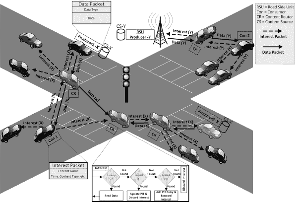

*图 3.1 面向内容的车联网中的兴趣-数据操作。*

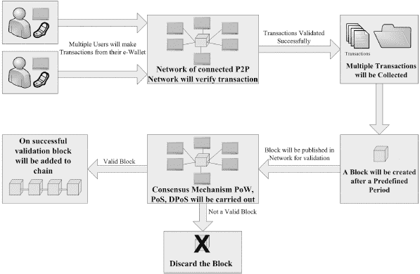

*图 3.2 区块链操作概览。*

区块链是一种去中心化账本，需要在每个区块链节点上进行详尽的计算。在 CC-IoV 中，RSU 可具备边缘计算功能，为服务/应用提供者与车辆之间的服务请求和数据供给提供服务。在 RSU 上部署分布式区块链可实现频繁的计算和数据存储。在区块链赋能的边缘计算中，RSU 作为边缘计算节点，接收数据或服务请求并相应处理。另一项活动是收集交易并通过计算哈希值将其组装成区块形式，经区块链节点成功验证后合并入区块链。图 3.3 描绘了区块链赋能的 CC-IoV，其中 RSU 配备了边缘计算功能，最终成为区块链赋能边缘节点（BEN）。

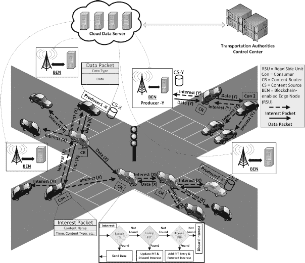

*图 3.3 具有区块链赋能边缘计算节点的面向内容的车联网 (CC-IoV) 操作概览。*

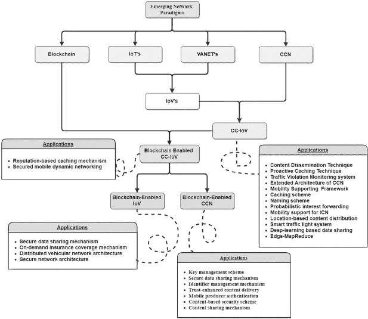

*图 3.4 新兴网络范式。*

由于数据传输对所有接收实体开放访问，且具备不可篡改性和可审计性，区块链被证明是一种极具潜力的技术，可用于车联网实体之间，以确保不发生恶意数据活动；若发生，也会因区块链特性而被轻易察觉。图 3.4 阐述了新兴网络技术及其应用。本章稍后将讨论 CCN 和区块链在 IoV 中的应用（参考相关研究），随后基于文献研究讨论研究动机，并提出我们的工作以解决现有工作中未涉及的问题。在结果与讨论部分，我们将基于通过运行仿真并设置一组参数所收集的结果来验证我们的解决方案。

### 3.2 文献综述

本节讨论该领域的现有工作，并将其分为两部分。第一部分涉及基于 CCN 的 IoV。第二部分涉及区块链赋能技术，进一步细分为三部分：第一小节讨论区块链赋能的 CCN，第二小节涉及区块链赋能的 IoV，最后一小节聚焦于区块链赋能的 CC-IoV。

#### 3.2.1 面向内容的车联网 (CC-IoV)

文献[15]中，作者提出了一种基于 CCN 的 VANET 交通违章监控系统。兴趣包和数据包在警车 (CV) 与普通车辆 (OV) 之间传输。OV 根据车载单元 (OBU) 的传感器数据维护违章历史记录。每当 OV 经过 CV 时，数据包会响应 CV 的兴趣包被卸载给 CV。这使得在无巡逻和无覆盖区域监控和管控违章成为可能。但这留下了 CV 与 OV 之间的信任管理、用于交叉验证的违章记录管理，以及因同一违章被另一 CV 重复开具罚单等问题。

文献[16]中，作者提出了一种结合车载 CCN 概念的主动缓存技术，以最小化时延并应对移动性导致的动态连接需求。汽车通过 RSU 向数据存储 (DS) 发送兴趣包；DS 将请求的数据分割成块，并找出 RSU 及其到消费者的距离。经过这些计算后，DS 将数据块放置在汽车行驶方向上即将到达的 RSU 上。该技术专注于个人数据和 V2I 通信，仍保持中心化模式，且未考虑 DS 的移动性，而这对于智能车辆系统是必要的。

文献[17]中，作者提出了控制广播风暴和洪泛的内容分发技术。该技术利用地理位置来抑制冗余兴趣包的转发。收到兴趣包后，车辆计算与请求者的距离，距离最远的车辆将设置最低的延迟定时器并优先转发兴趣包。接收到转发节点的兴趣包后，节点将计算转发节点的方向；若朝向请求者移动则停止转发兴趣包的定时器，否则转发兴趣包。这将抑制其他节点转发兴趣包。然而，文中未讨论用于最小化时延和跳数的缓存策略。

文献[18]中，作者提出了一种面向内容的车载网络缓存方案。车辆根据在某区域停留最长时间形成群组，称为“热点区域”。车辆向 RSU 共享包含其坐标和时间戳的内容。特定热点区域内的车辆缓存邻居车辆的内容，并按需从其内容存储提供内容。同时遵循一种基于内容流行度的缓存替换策略：低流行度内容被新内容替换或更新流行度。这确保了时延最小化并减少了从内容提供者的跳数，但缺乏提供者的信任等级，且可能通过女巫攻击实现缓存污染。


文献[[19]](#13_Chapter03.xhtml#ref3_19)中，作者提出了一种利用地理位置进行命名的方案，用于面向内容的车载网络，以最小化网络中的广播风暴。兴趣包的命名方案旨在通知那些正在移向兴趣点或处于其附近的节点。兴趣点的坐标被集成到兴趣包的内容名称中，只有上述实体才会转发兴趣包。这有助于避免广播风暴，但延迟问题仍未解决，因为数据可能距离消费者数跳之遥。

文献[[20]](#13_Chapter03.xhtml#ref3_20)中，作者提出了一种 CCN 的扩展架构，以应对车载网络的动态连接需求。一种名为“邻居内容存储”的额外数据存储被用于在生产者的几跳邻居车辆中缓存邻居的关键消息。这种存储内容的缓存策略是通过使用“生存时间”字段来实现的。CCN 的这一扩展在生产者的几跳范围内引入了数据和内容的存在性，从而最小化了延迟。但未采用内容安全机制以避免恶意节点的干扰。

文献[[21]](#13_Chapter03.xhtml#ref3_21)中，作者提出了一种面向车载命名数据网络（VNDN）的移动性支持框架。该技术专注于 V2V 通信，引入了内容源的移动性。通过让每个节点计算与发送者的距离并设置定时器，以及在接收到转发包时每个接收节点检查其他转发节点，从而抑制冗余兴趣包和数据包的转发。设计包括锚区（AZ），AZ 中的任意节点在 CS 中复制内容，节点在加入新 AZ 时用新内容替换旧内容，这确保了内容在更少的跳数上可用并最小化延迟。但节点间的信任问题仍未解决。

文献[[22]](#13_Chapter03.xhtml#ref3_22)中，作者提出了一种用于 CCVN 中兴趣转发的概率技术，以缓解广播风暴。在所提技术中，每辆车根据其当前邻居的密度动态计算概率。车辆不向邻居或内容生产者告知其地理位置，且不具备任何关于网络拓扑的先验信息。通过修改传统 CCN 现有的 PIT，可以利用局部密度近似技术获取局部信息并推测周围当前邻居的数量。此外，还给出了一种兴趣重广播机制，其中采用基于时间的方案，根据与发送者的距离对潜在转发者进行优先级排序。

文献[[23]](#13_Chapter03.xhtml#ref3_23)中，作者通过雾计算结合面向信息的车联网（IC-IoV）提供移动性辅助服务。所提供的支持利用数据特征，并进一步将其分类为用户可共享和不可共享数据。这些定义的数据特征连同雾计算的计算和地理信息，被用于设计通信和数据共享方案，同时利用所提供的 IoV 应用，如危险报警以及在 V2V 场景中更新交通和通信信息。所提方案分别为消费者移动性和生产者移动性提供了截然不同的移动车辆移动性支持，以处理两个完全不同的相关移动性问题。此外，还讨论了 FIB 持续更新的缺点，这会导致在请求和检索所需数据时出现丢包和更高延迟。然而，所提机制在更高性能与雾节点的缓存或存储部署成本之间面临权衡。

文献[[24]](#13_Chapter03.xhtml#ref3_24)中，作者提出了一种基于位置的内容分发机制，称为 LoICen，可缓解广播风暴。所提 LoICen 机制保存了机会式收集的、拥有缓存内容的车辆的位置和移动性信息，以实现更好的内容分发。获得的地理信息可随时用于通过在每一跳选择最合适的邻居节点或车辆来进行更好的内容搜索。基于位置的信息可用于将兴趣包路由至缓存内容的区域，也可用于内容发现。此外，还提出了针对请求内容的基于位置的兴趣包转发。其中，任何缓存有请求内容的中间节点或车辆均可通过向请求者回复请求的内容块来停止兴趣包的转发。此外，所提方案最小化了检索内容的延迟和内容搜索的兴趣包传输次数。

文献[[25]](#13_Chapter03.xhtml#ref3_25)中，作者为 VNDN 提出了一种智能交通灯系统，其中包传播基于地理位置机制。所提机制在最小化道路上等待车辆数量的同时，以去中心化方式解决了交通拥堵问题。现有的传统交通灯系统被虚拟交通灯（VTL）所取代。其中，RSU 充当路口控制器，控制路口而非典型的道路信号。RSU 仅服务其定义区域内的车辆，根据到达或即将到达路口的优先级机制累积车辆顺序。之后，RSU 向每辆车转发即时消息，告知车辆在路口等待一段时间（红灯）或通行（绿灯）。此外，RSU 与邻近 RSU 共享可能到达其附近的车辆信息；这将有助于及时做出关于道路交通管理的决策。该系统更适合自动驾驶车辆，因为它们仅从 RSU 获取消息，而无需处理图像。

文献[[26]](#13_Chapter03.xhtml#ref3_26)中，介绍了一种边缘 MapReduce 方法，用于在自动驾驶车辆中执行路径规划。该架构分析在 IC-IoV 中获取的大数据。在所提模型中，路径序列利用智能交通系统（ITS）节点、边缘节点、映射器和归约器。边缘节点在兴趣包中反复请求实时交通信息，并由网络中的智能节点应答。数据包进一步被导向映射器；响应拓扑结构，权重映射兴趣包被转发向边缘节点。归约器也向映射器寻求拓扑权重映射数据，这在返回数据包响应时得到处理。边缘节点随后在兴趣包中查询实时用户需求请求，并从智能节点收集数据。归约器在向边缘节点发送兴趣包后，进一步收集用户需求数据包。最后，归约器通过边缘节点向 ITS 中的智能节点提供路径分配信息。


在文献[27]中，介绍了一种基于深度学习机制的数据传播方案，用于 CC-IoV（云中心互联网车辆）。该机制包含三个阶段，综合考虑了车辆移动性和可共享数据类型。第一阶段基于能量估算机制，规定了可参与数据分发的车辆标准。在下一阶段，利用维纳过程模型通过计算车辆连接概率来发现稳定且真实的连接。在最后阶段，定义了基于卷积神经网络（CNN）的评估设计，对车辆对之间的社会关系进行评级。此外，利用 CNN 识别最合适的车辆对，确保以最小延迟和更高的可用数据率进行数据共享。

#### 3.2.2 基于区块链的 CC-IoV

本部分分为三个小节，说明如下。

##### 3.2.2.1 基于区块链的 IoV

在文献[28]中，作者提出了一种半自动化的按需保险覆盖机制，利用区块链作为分布式账本，用于保险公司与消费者之间保险单智能合约的管理。用户只需使用移动应用程序即可激活、停用或修改盗窃、意外、乘客或天气等保险覆盖类型，与每种覆盖类型相关的所有状态数据通过电子设备传输至服务器，该设备负责收集传感器数据。修改保险或取消保险索赔时，传感器数据起着至关重要的作用。所有这些修改均依据智能合约进行，并存储在区块链上，提供不可篡改且可审计的记录。

在文献[29]中，作者提出了一种解决方案，以应对车辆通信中的安全数据共享问题。通过集成区块链来记录交通状况、处罚或奖励的消息交易，建立了一个信任等级。交通管理局（TMA）是负责维护车辆身份隐私的关键角色。信任等级通过签名阈值构建；如果签署消息的车辆数量超过阈值，则该消息被视为可信。同时引入了激励机制，以促使贡献者保持诚实。周期性广播消息且无转发策略会导致网络拥塞和延迟。

在文献[30]中，作者提出了一种基于区块链的车辆网络架构，以获取去中心化网络的优势。在网络中启用区块链可实现用户间的可信数据共享。由于应用中的数据种类繁多，区块链被分类为不同的区块链。车辆与其他网络设备协作生成区块，其密钥对嵌入交易中。这导致频繁的区块生成，进而引发网络中的数据流量泛滥；此外，该架构对于“谁来以及如何验证交易和区块”这一问题仍未给出答案。

在文献[31]中，作者为 IoV 提出了一种基于区块链的安全网络架构，车辆可在其中安全地通信、共享网络资源及信息。所提出的算法允许在分布式存储系统上存储多份数据副本，使数据比传统的中心化机制更安全。该方案包含初始化、加密及数据迁移。此外，算法还包含带有解密和数据上传的区块构建过程。在初始化阶段，IoV 网络为每个用户生成唯一 ID 以实现安全通信。之后，当用户想要传输数据时，IoV 网络启用加密过程。然后网络构建区块，该区块具有与主键关联的哈希值，并在哈希值验证通过后广播该区块。IoV 网络的所有节点将新区块添加到其区块链中。最后，用户遵循基于公共区块链账本方法的解密过程，可检索其所需数据。然而，该框架增加了数据检索延迟，但它提供了安全性、可靠性及连接车辆间的信任，并通过分布式控制系统利用 IoV 应用辅助其决策。

##### 3.2.2.2 基于区块链的 CCN

在文献[32]中，作者提出了一种密钥管理方案，通过将密钥存储在区块链上，对命名数据网络（NDN）中的角色进行认证。这确保了真实性，并建立了对内容生产者的信任等级。每个节点（包括设备和应用）均使用其名称前缀和公钥以交易形式注册，该交易由一组私有区块链节点验证，随后交易被添加到区块链中。用户通过其区块高度、交易哈希及有效/无效状态进行认证。每次认证都必须与站点管理员建立链接，这既耗时又会引入延迟。

在文献[33]中，作者提出了一种 CCN 中的安全数据共享机制，同时也保护隐私。区块链被集成以建立信任等级和可审计账本。网络中的每个用户均凭其唯一 ID 和密钥对注册。节点将内容指针放入交易中，这些交易经由通过具有共同社交兴趣的用户群投票选出的一组矿工节点验证后，被放置在区块链上。验证区块的矿工可从提供者处获得内容作为奖励。消费者可通过“通过”提供者设定的访问控制策略来获取内容，这会引入额外的网络开销和延迟。

在文献[34]中，作者提出了一种由区块链保障的标识符管理机制。区块链以混合方式使用，同时采用公有链和私有链。新节点可凭其密钥对在私有链上注册，并可参与交易验证以及区块的创建或验证。在 NDN 环境中，内容可在不暴露生产者 ID 的情况下传递给消费者，使实体免受拒绝服务（DoS）攻击。但无法检查恶意节点或一组恶意节点加入网络，因为任何节点均可凭密钥对注册。

在文献[35]中，作者提出了一种基于区块链的内容分发机制，增强了面向信息中心网络（ICN）的信任。内容提供者通过名称解析执行器（NRE）在逻辑区块链主机（LBH）上以交易形式注册其内容对象，并针对交易 ID 在 LBH 上获得已注册的有效载荷。消费者通过发现消息请求内容对象，该消息经过 NRE 然后是父 NRE，直到到达注册交易的 NRE。通过内容路由器建立一条反向路径，内容被发送给消费者。采取了一种对抗措施以确保交易是区块链的一部分，这得益于不可篡改且可审计的分布式账本（即区块链）而确保了信任。仅存储通往内容提供者的路由，这导致了内容分发延迟。


在文献[36]中，介绍了一种基于区块链的分布式移动生产者认证机制“BlockAuth”，用于 ICN。该方案解决了导致安全挑战的 ICN 移动性管理问题，并提供了安全且高速的移动用户认证。BlockAuth 利用加权聚类算法（WCA），根据移动性、传输能力和电池电量选择移动节点的簇头。该方案将网络分类为簇（如微小区）和核心路由器的形式。每个簇有一个簇头（CH）和若干接入网关，例如 ICN 的 Wi-Fi 接入点或基站。CH 管理簇成员与连接到其特定簇的移动生产者之间发生的所有事务。在网络中，管理区块链的核心路由器被称为“全局区块链管理员”（GBA）。这些路由器缓存簇完成的所有事务，用于簇间切换。此外，这些路由器协同监督参与路由器（包括 CH）的进出数据包交换，同时处理由不同簇完成的移动生产者事务流程。

在文献[37]中，作者提出了一种基于内容的安全方案，称为“去中心化公钥基础设施”（DPKI），它利用区块链机制用于 CCN。该方案通过消除对中心化权威机构（CA）的依赖，克服了公钥基础设施（PKI）现有模型的局限性。DPKI 包含两步注册和验证。在注册阶段，内容所有者用相应的公钥注册其身份，然后连同其加密的私钥向区块链发送消息。区块链矿工验证身份，节点验证事务，然后将该身份添加到下一个区块中。在验证阶段，当内容所有者注册时，其身份和公钥变为公开。因此，用户可以通过遍历区块链查找，针对每笔事务验证其身份和公钥。此外，事务经验证后进行数字签名并登记，这使得公钥难以被篡改。

在文献[38]中，作者提出了一种通过在 VNDN 中启用区块链实现的内容共享机制。在该方案中，数据共享基于包含双层的区块链。第一层节点在 NDN 范式上宣布其需求并请求服务。而在另一层，节点提交请求并将其转发给最近的 RSU 以获取更多数据。此外，还构建了一对多的相似性博弈模型，连同合理的信誉评估方案（RES）模型，防止恶意节点传播虚假数据。然而，该技术促进了节点间数据的安全传播，但增加了计算开销。

##### 3.2.2.3 支持区块链的 CC-IoV

在文献[39]中，作者提出了一种基于内容提供者信誉的 VANET 缓存方案。该缓存方案取决于内容提供者的信誉；现有的低信誉值内容将被高信誉值内容提供者的内容所替换。网络节点的信誉值维护在使用工作量证明（PoW）共识机制的区块链网络上。消费者在接收到有效或无效内容时，可以增加或减少生产者的信誉值。未采取任何机制限制恶意节点加入网络，这使得网络容易受到信誉污染的攻击。

在文献[40]中，作者提出将区块链与车载 CCN 集成，以实现去中心化、安全和移动动态连接。来自车辆的协作感知消息（CAM）等内容应被封装并列入事务，这些事务将成为区块的一部分。随后将区块添加到区块链，以获得分布式可信账本。将所有 CAM 作为事务添加会带来传输开销，使矿工忙于区块链管理，且未明确采用共识机制。

### 3.3 研究动机与问题陈述

文献调查引出了一些主要问题：

- 在一天中的任何时间，在没有交通协管员和摄像头的情况下，如何记录交通违章？
- 如何为 CC-IoV 开发这样一个分布式可信环境，使其也能保持违章者的信任？
- 如何上报违章事件并加以证明？

基于文献调查中报告的文献综述，得出了以下结论（表 A1.1）。

基于区块链的可审计且可信的内容共享账本在 CC-IoV 中几乎不存在。

CC-IoV [16, 17, 18, 19, 20, 21] 的工作未提供内容的可审计账本。文献[15] 的工作提出了违章数据库以及巡逻交警车辆。基于区块链的方案 [32, 33, 34] 未记录实体间共享的内容，这在面向内容的场景中浪费了区块链的有效用途。文献[35] 提出在区块链中记录内容对象指针，但因生产者端数据丢失而缺乏信任保障。

文献[28, 29, 30] 中的提出机制基于 IP，需要先建立稳定连接。尽管文献[39, 40] 中的提出方案遗漏了区块链在 CC-IoV 中的本质，即提供共享内容的可审计账本，以推动实体在网络中诚实参与内容共享。

拟提出的基于区块链的 CC-IoV 边缘计算协作事务验证机制旨在实现以下目标：

- 开发一种协作方案，通过让 BEN 和车辆参与来检测违章，并针对违章者发起上报。
- 在分布式 CC-IoV 环境中开发一种可信事务验证方案，该方案以最小延迟和最少控制开销执行验证。

### 3.4 面向 CC-IoV 的基于区块链的边缘机制

本节介绍从事件验证到事务形成的拟提出方案。首先，值得一提并铭记的是，实体间的数据传输借助数据包传输进行；每个数据包包含来自发送者的特定信息，而接收者根据数据包类型做出决策并采取后续步骤。本节将讨论数据包的形成与内容，这将使接收者能够在完成从事件发生到区块链事务验证的过程中做出决策。然后，我们将分步骤提供该方案的概述。

#### 3.4.1 生成数据包


在 CCN 中，内容共享通过`interest`或`data`数据包在生产者和消费者之间进行传输。在我们的方案中，我们将超速违规作为违规事件，关键利益相关者的生产者是“违规节点”，因为它在收集感官数据后生成超速违规信息；消费者是“处理机构或 TMA”，它们获取边缘计算节点提示的信息并消费该信息以记录违规事件并为违规者生成电子罚单。为实现公平可信的工作方案，共享数据包的详细信息和数据共享步骤如下。

##### 3.4.1.1 超速车辆信息传递

我们假设车辆配备了连接到其`OBU`的速度传感器。如果车辆超过超速阈值，`OBU`将开始广播其车辆信息数据包，直到违规者的速度回到主管部门规定的限制内；最初数据包包含车辆标识和速度。由于数据包广播仅在发生超速违规后启动，除非违规者违规，否则网络上不会产生开销。单跳邻居将是该数据包的接收方。接收车辆将开始计算车辆信息数据包的数量。如果接收计数在指定限制内，它将不采取任何行动，将其视为超车活动或其他紧急情况；但它将生成并发送违规上报数据包。图 3.5 展示了用于传递违规车辆信息的数据包形成和内容，这有助于计算和分配数据传输的带宽。

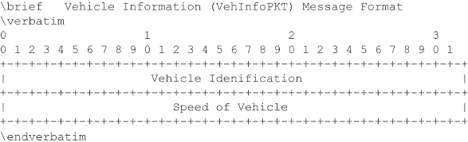

*图 3.5* VehInfoPKT 的数据包形成。

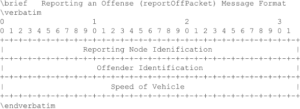

*图 3.6* reportOffPacket 的数据包形成。

##### 3.4.1.2 上报违规

随着`VehInfoPkt`接收计数的增加，如果接收计数超过阈值，则确保车辆持续违反主管部门设定的速度法规，或者数据包发送者正在进行超车等其他活动。在通过数据包计数确认超速违规后，接收邻居将为其传输范围内的`BEN`生成违规上报数据包，如图 3.6 所示。该数据包包含上报车辆标识、违规者标识以及违规时的速度。数据包形成、内容及其数据长度如下图所示。

##### 3.4.1.3 违规验证

由于违规上报数据包仅面向`BEN`，因此只有`BEN`会在接收违规上报数据包时采取行动，其余接收节点将丢弃该数据包。`BEN`将维护一个本地数据库，以保存上报车辆标识、违规者 ID 和违规者速度的部分信息，这些将成为验证过程后交易的一部分。交易验证将通过询问`BEN`的邻居节点来执行，这些邻居节点已在其本地数据库中记录了上报违规者的违规行为。`BEN`将生成并广播一个验证违规的`interest`数据包。图 3.7 描述了违规验证的数据包形成和内容数据长度。

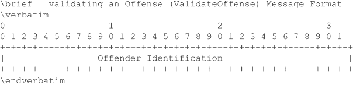

*图 3.7* ValidateOffense 的数据包形成。

##### 3.4.1.4 违规验证回复

接收到违规验证数据包后，车辆将在其本地数据存储中查找违规者详细信息是否存在。成功检索到匹配记录后，车辆将生成违规验证回复数据包，确认违规者违反了主管部门设定的超速法规，并将该数据包广播给`BEN`。接收到违规验证回复数据包后，警官节点将把确认车辆的信息合并到违规者的部分填充交易中。验证回复数据包的形成如图 3.8 所示。

最后，当边缘计算节点收集到`m`数量的交易时，它将生成一个区块并在网络中广播该区块以进行验证，验证成功后将合并到区块链中。

#### 3.4.2 系统工作流程

针对超速违规的方案工作流程总结如下，也如图 3.9 所示：

**步骤 01：** 车辆将持续监控其速度传感器数据。违反限速时，车辆将通过`VehInfoPkt`定期广播其标识和速度数据。

**步骤 02：** 接收`VehInfoPkt`时，车辆将维护接收数据包计数的记录。如果接收数据包计数达到阈值，将通过生成并广播`reportOffPacket`向`BEN`上报违规，该数据包包含违规者标识、违规速度和上报者标识，供将来参考。

**步骤 03：** `BEN`将利用从违规上报数据包中提取的部分信息编译新交易，并通过生成并发送违规验证数据包来验证违规上报，以验证交易。

**步骤 04：** 验证请求和接收`interest`的车辆将通过在其数据表中搜索违规者详细信息的存在性，生成并发送违规验证回复。

**步骤 05：** `BEN`将把确认车辆 ID 添加到交易中，以匹配违规者 ID。

**步骤 06：** 最后，在`m`数量的交易后，边缘计算节点将生成一个区块，并在区块链网络成功验证同意后合并到区块链中。

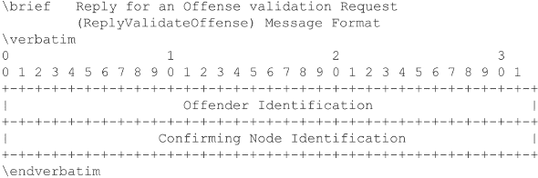

*图 3.8* ReplyValidateOffense 的数据包形成。

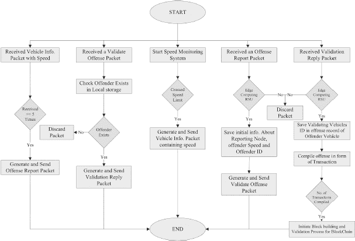

*图 3.9* 拟议系统的工作模式。

### 3.5 结果与讨论

这里我们将简要讨论我们方案的仿真环境细节和结果。首先，我们将讨论用于验证我们工作正确性的仿真环境细节和参数。然后我们将把我们提出的工作与文献[[15]](#13_Chapter03.xhtml#ref3_15)中的技术进行比较，以验证我们提出的方案在 CC-IoV 的性能和利益相关者信任问题上优于参考技术。

#### 3.5.1 仿真环境

我们使用网络仿真器 3（`ns-3`）[[41]](#13_Chapter03.xhtml#ref3_41)在`Ubuntu 16.04 LTS`[[42]](#13_Chapter03.xhtml#ref3_42)上评估我们提出的工作。使用城市交通仿真（`SUMO`）[[43]](#13_Chapter03.xhtml#ref3_43)生成真实的 VANET 移动模式。对于这项工作，选择了伊斯兰堡的 26 号区域来生成 VANET 移动模式。图 3.10 是从 Google Maps 获取的伊斯兰堡 26 号区域的屏幕截图。通过`SUMO`生成移动模式的下一步是从 OpenStreetMaps（`OSM`）以“.osm”格式导出路网图。


然后使用 SUMO `.tcl` 脚本生成了包含 30、60 和 90 个节点移动模式的场景，这些场景进一步在 NS-3 中用于模拟 VANET 的实时环境。以下是伊斯兰堡 26 号区域导出的 `.osm` 文件生成的 SUMO 地图。然后将生成的移动模式输入到我们编译的仿真中，以评估我们提出的工作。我们使用了按需距离矢量路由协议（AODV）进行仿真，其余仿真参数列在 表 A1.2 中。

#### 3.5.2 结果与分析

在本节中，我们将以图形形式提供我们提出的方案与交通违章罚单（TVT）的比较分析。

##### 3.5.2.1 从违章发生到区块链交易的时间

从违章发生到区块链交易的时间被定义为从违章发生到数据存储记录违章的延迟。我们在 30、60 和 90 辆车的设置下，按五次违章的平均时间计算此值。随着车辆数量的增加，报告和验证违章的参与度也随之增加，这会影响延迟的增加。

图 3.11 展示了我们提出的工作与 TVT 的比较延迟。TVT 依赖最近的 CV 来共享其违章信息，而在我们提出的工作中，车辆协同工作，无需等待特定实体来卸载其违章记录，从而将延迟降至最低。图表显示，即使车辆增加，我们提出的工作延迟也比 TVT 低。

##### 3.5.2.2 数据包开销

数据包开销被定义为为识别违章、上报、验证，最后从记录了同一违章者违章行为的不同节点收集验证回复而创建和使用的额外数据包。我们设计的方法让车辆以协作方式共享记录，这增加了网络中的数据包数量。

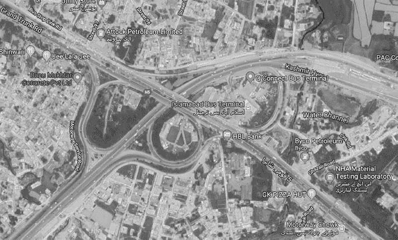

*图 3.10* 巴基斯坦伊斯兰堡 26 号区域的谷歌地图。

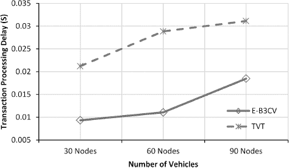

*图 3.11* 从违章到交易处理的延迟。

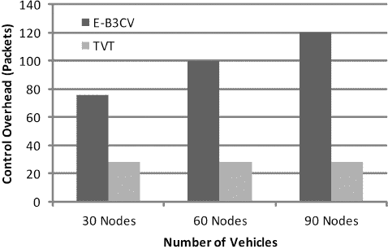

*图 3.12* 控制开销的影响。

图 3.12 显示，随着车辆数量增加，我们提出的工作比 TVT 产生了更多的网络数据包。我们设定了邻居表中将参与违章上报和验证过程的邻居百分比，这直接导致数据包开销增加。

##### 3.5.2.3 违章处理中的信任

违章处理中的信任被定义为如何确保在利益相关者之间建立信任，以便不产生任何质疑。在我们提出的工作中，我们让设定百分比的车辆参与上报和验证过程，而在 TVT 中，违章车辆和 CV 将相互通信以共享违章信息。纳入多辆车辆可确保在接收到违章者数据包后，对违章行为达成共同同意并计入收费依据。图 3.13 展示了参与违章上报和验证的车辆数量比较。报告者或验证者越多，建立的信任度越高。

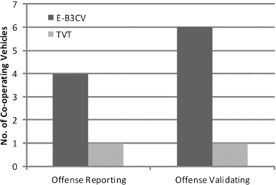

*图 3.13* 用于建立信任的协作车辆。

##### 3.5.2.4 经济收益

经济收益被定义为提出的技术和竞争技术所用资源的经济影响。在我们提出的工作中，无需额外的硬件或人力来覆盖无巡逻区域，因为它利用现有安装的硬件即可工作，而 TVT 需要多辆 CV 在道路上巡逻并配备多名警官。

图 3.14 描绘了覆盖伊斯兰堡 26 号区域 6 公里直线道路（如 图 3.15 所示）的年度汽油消耗量计算。这仅是汽油的计算，目前不包括汽车成本、人力及其支出。通过利用现有资源，预计仅会产生包含维护和修理假设在内的轻微经济影响。

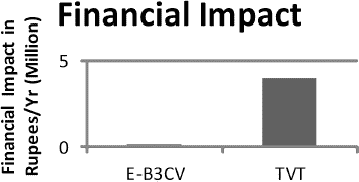

*图 3.14* 资源的经济影响。

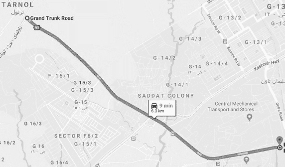

*图 3.15* 伊斯兰堡 26 号区域 6 公里直线道路地图。

### 3.6 结论

在本章中，我们提出了一种基于区块链的 CC-IoV 违章事件电子罚单系统，该系统可显著减少因人为错误导致的数据处理不当。此外，区块链是一种在处理系统中直接或间接涉及的利益相关者之间的信任问题方面广为人知的技术。除了开发不可篡改且防篡改的可信数据结构外，我们还考虑了将从违章发生到当局数据库的时间最小化。此外，除非确属违章，否则有必要记录并开具违章罚单，为此我们引入了一种验证机制，确保当违章者提出筛查请求时，当局能提供违章的所有充分数据。对于该验证机制，我们需要引入一些额外的数据包，但它们对控制开销的影响有限。我们在 NS-3 中仿真了我们提出的工作，根据提供的结果，我们系统的性能优于 TVT。

### 3.7 未来工作

我们刚刚将超速违章记录在区块链中；未来可将其扩展以记录道路用户的所有可审计活动，而不影响信息娱乐活动，以最大限度地减少人为错误，并增强利益相关者之间的信任。

### 附录

*表 A1.1* 文献调查比较表

| 技术 | 网络 | 仿真工具 | 优势 | 劣势 |
| --- | --- | --- | --- | --- |
| 基于区块链的公钥基础设施 (PKI) | CCN | 未指定 | 真实内容分发 | 计算延迟 |
| GeoZone | CCVN | ndnSIM | 更高的内容分发率和更低的延迟 | 转发兴趣包的静态传播区域 |
| 密度感知概率兴趣转发 | CCVN | ns-2.35 | 更高的可达性和更低的网络负载 | 修改后的 PIT 导致处理延迟 |
| LoICen | ICVN | Veins (OMNET++, SUMO) | 更低的网络开销 | 更高的延迟 |
| 移动性支持 | 基于雾计算的 IC-IoV | ndnSIM | 更低的消费者延迟和丢包率 | 雾节点较低的存储/缓存容量 |
| 智能交通灯系统 | VNDN | ndnSIM | 有助于低能见度、低功耗 | RSU 覆盖区域有限。 |
| 认知路径规划 | IC-IoV | 实际真实世界实验 | 通过获取交通数据，提出的方案根据用户需求基于实时情况探索替代驾驶路线 | 缺乏用户隐私和边缘信息保护 |


## 表 A1.1：相关工作对比

| 方案 | 网络架构 | 仿真工具 | 优势 | 局限性 |
| :--- | :--- | :--- | :--- | :--- |
| 基于深度学习的数据传播 | CC-IoV | 未指定 | 在高交通密度环境下数据传播率高，且最大化社会评分 | 在低交通密度环境、低传输率及最小社会评分低于阈值时传播率低。高移动性 |
| BlockAuth | 基于区块链的 ICN | 未指定 | 分布式机制提供更高安全性 | 计算开销增加，需要额外存储，传输次数增加 |
| 去中心化公钥基础设施 (DPKI) | 基于区块链的 CCN | 未指定 | 安全的内容检索，公钥难以篡改 | 计算开销增加，需要更多存储 |
| 安全网络架构 | 基于区块链的 IoVs | Cooja | 提供数据完整性、机密性 | 导致计算和数据包开销 |
| 安全内容共享方案 | 基于区块链的 VNDN | 未指定 | 连接车辆间的安全通信 | 更高的计算开销 |
| 交通违章监控系统 | 基于 VANETs 的 CCN | 未指定 | 可控制和监控无巡逻区域的交通违章 | 连接车辆间缺乏信任 |
| 主动缓存 | VCCN | `ns-3` 版本 3.2.3 | 能管理因移动性产生的动态连接需求 | 缺少数据存储 (DS) 移动性支持 |
| 内容传播 | 基于 ICN 的 VANETs | `ns-3` | 缓解广播风暴和泛洪 | 无缓存机制以减少时延和跳数 |
| 缓存方案 | CCVN | ONE | 从内容提供者处减少跳数及最小时延 | 缓存污染可能由女巫攻击导致 |
| 扩展架构 | CCN | `Omnet++` | 通过提供几跳外的数据最小时延 | 缺乏安全机制以防止恶意生产者 |
| 移动性支持 | VNDN | `Omnet++`、`SUMO` | 提供几跳外的内容并最小时延 | 节点间存在信任问题 |
| 半自动化按需保险 | 安装在客户车辆上的移动 App | 未指定 | 基于智能合约的保险 | 计算开销增加 |
| 安全数据共享解决方案 | 基于区块链的 IoVs | 密码学库 `MIRACL` | 车辆间安全数据传播 | 增加网络拥塞及时延 |
| 基于区块链的车辆网络架构 | 基于区块链的 IoVs | `Matlab` | 用户间可信数据传播 | 频繁生成区块导致流量泛洪，缺乏区块验证机制 |
| 密钥管理方案 | 基于区块链的 NDN | 未指定 | 确保真实性，对提供者内容有更高信任度 | 认证耗时，引入时延 |
| 安全数据共享机制 | 基于区块链的 CCN | 未指定 | 在保护用户隐私前提下安全共享数据 | 过度的网络使用和时延 |
| 标识符管理机制 | 基于区块链的 NDN | 未指定 | 安全的标识符管理 | 缺乏防止恶意节点的安全机制 |
| 基于区块链的内容分发 | 基于区块链的 ICN | `Python 3.6` | 安全内容分发 | 内容检索引入时延 |
| 基于信誉的缓存 | VANETs 中的 NDN | 未指定 | 低信誉值内容不被缓存 | 缺乏限制恶意节点的安全机制 |
| 集成区块链 | VCCN | 未指定 | 安全且动态的连接 | 计算开销增加 |

**缩略语**：

*   **CCN**：Content-Centric Networks（面向内容的网络）
*   **CCVN**：Content-Centric Vehicular Networks（面向内容的车辆网络）
*   **ICVN**：Information-Centric Vehicular Networks（面向信息的车辆网络）
*   **IC-IoV**：Information-Centric Internet of Vehicles（面向信息的车联网）
*   **VNDN**：Vehicular Named Data Networks（车辆命名数据网络）
*   **VCCN**：Vehicular Content-Centric Networks（车辆面向内容网络）
*   **CC-IoV**：Content-Centric Internet of Vehicles（面向内容的车联网）
*   **ICN**：Information-Centric Networks（面向信息的网络）
*   **NDN**：Named Data Networks（命名数据网络）

**注**：请按照作者注释设置为脚注。

---

## 表 A1.2：仿真参数

| 参数 | 值 |
| :--- | :--- |
| 操作系统 | Ubuntu 16.04 LTS |
| 仿真器 | Network Simulator-3 (`NS3`) |
| 仿真模式 | `SUMO` 生成的实时地图 |
| 路由协议 | `AODV` |
| MAC/PHY 标准 | `WIFI_PHY_STANDARD_80211p` |
| MAC 类型 | Adhoc WiFi MAC |
| 传播损耗模型 | `TwoRayGroundPropagationLossModel` |
| 频率 | 5.9 GHz |
| 发射起始功率 | 20 dBm |
| 发射结束功率 | 20 dBm |
| 数据包 | `VehInfoPkt` (8 Bytes), `ReportOffPacket` (12 Bytes), `ValidateOffense` (4 Bytes), `ReplyValidateOffense` (8 Bytes) |
| 车辆数量 | 30, 60, 90 |
| 仿真时间 | 300 秒 |

---

### 参考文献

[1] H. Khelifi, S. Luo, B. Nour, H. Moungla, Y. Faheem, R. Hussain, et al., “Named data networking in vehicular ad hoc networks: State-of-the-art and challenges,” *IEEE Communications Surveys & Tutorials*, vol. 22, pp. 320–351, 2019.

[2] A. S. T. M. Intl, “*Standard Specification for Telecommunications and Information Exchange Between Roadside and Vehicle Systems-5 GHz Band Dedicated Short Range Communications (DSRC)*,” ASTM E2213-03, West Conshohocken, PA, 2003.

[3] D. Jiang and L. Delgrossi, “IEEE 802.11p: Towards an international standard for wireless access in vehicular environments,” in *VTC Spring 2008-IEEE Vehicular Technology Conference*, pp. 2036–2040.

[4] F. Sakiz and S. Sen, “A survey of attacks and detection mechanisms on intelligent transportation systems: VANETs and IoV,” *Ad Hoc Networks*, vol. 61, pp. 33–50, 2017.

[5] R. Gasmi and M. Aliouat, “Vehicular Ad Hoc NETworks versus Internet of Vehicles—A comparative view,” in *2019 International Conference on Networking and Advanced Systems (ICNAS)*, Annaba, Algeria, pp. 1–6.

[6] I. Bhardwaj and S. Khara, “Research trends in architecture, security, services and applications of Internet of Vehicles (IoV),” in *2018 International Conference on Computing, Power and Communication Technologies (GUCON)*, Greater Noida, India, pp. 91–95.

[7] C. V. N. I. Forecast, “Cisco visual networking index: Forecast and trends, 2017–2022,” *White paper, Cisco Public Information*, 2019.

[8] W. Chen, R. K. Guha, T. J. Kwon, J. Lee, and Y.-Y. Hsu, “A survey and challenges in routing and data dissemination in vehicular ad hoc networks,” *Wireless Communications and Mobile Computing*, vol. 11, pp. 787–795, 2011.

[9] M. Amadeo, C. Campolo, and A. Molinaro, “Enhancing content-centric networking for vehicular environments,” *Computer Networks*, vol. 57, pp. 3222–3234, 2013.

[10] C. Bian, T. Zhao, X. Li, and W. Yan, “Boosting named data networking for data dissemination in urban VANET scenarios,” *Vehicular Communications*, vol. 2, pp. 195–207, 2015.

[11] M. Chen, D. O. Mau, Y. Zhang, T. Taleb, and V. C. M. Leung, “Vendnet: Vehicular named data network,” *Vehicular Communications*, vol. 1, pp. 208–213, 2014.

[12] Y. Yu, Y. Li, X. Du, R. Chen, and B. Yang, “Content protection in named data networking: Challenges and potential solutions,” *IEEE Communications Magazine*, vol. 56, pp. 82–87, 2018.

[13] A. Reyna, C. Martín, J. Chen, E. Soler, and M. Díaz, “On blockchain and its integration with IoT. Challenges and opportunities,” *Future Generation Computer Systems*, vol. 88, pp. 173–190, 2018.

[14] N. Kshetri, “Blockchain’s roles in strengthening cybersecurity and protecting privacy,” *Telecommunications Policy*, vol. 41, pp. 1027–1038, 2017.


15. S. H. Ahmed, M. A. Yaqub, S. H. Bouk, and D. Kim, ‘Towards content-centric traffic ticketing in VANETs: An application perspective,’ in *2015 Seventh International Conference on Ubiquitous and Future Networks*, Sapporo, Japan, pp. 237–239.

16. D. Grewe, M. Wagner, and H. Frey, ‘PeRCeIVE: Proactive caching in ICN-based VANETs,’ in *2016 IEEE Vehicular Networking Conference (VNC)*, pp. 1–8.

17. Y. Li, X. Su, A. Lindgren, X. Shi, X. Cai, J. Riekki, et al., ‘Distance assisted information dissemination with broadcast suppression for ICN-based VANET,’ in *International Conference on Internet of Vehicles*, Nadi, Fiji, pp. 179–193.

18. L. Yao, A. Chen, J. Deng, J. Wang, and G. Wu, ‘A cooperative caching scheme based on mobility prediction in vehicular content centric networks,’ *IEEE Transactions on Vehicular Technology*, vol. 67, pp. 5435–5444, 2017.

19. A. A. Prates, I. V. Bastos, and I. M. Moraes, ‘GeoZone: An interest-packet forwarding mechanism based on dissemination zone for content-centric vehicular networks,’ *Computers & Electrical Engineering*, vol. 73, pp. 155–166, 2019.

20. A. K. Niari, R. Berangi, and M. Fathy, ‘ECCN: An extended CCN architecture to improve data access in vehicular content-centric network,’ *The Journal of Supercomputing*, vol. 74, pp. 205–221, 2018.

21. J. M. Duarte, T. Braun, and L. A. Villas, ‘MobiVNDN: A distributed framework to support mobility in vehicular named-data networking,’ *Ad Hoc Networks*, vol. 82, pp. 77–90, 2019.

22. R. Tizvar and M. Abbaspour, ‘A density-aware probabilistic interest forwarding method for content-centric vehicular networks,’ *Vehicular Communications*, vol. 23, pp. 100216–100216, 2019.

23. M. Wang, J. Wu, G. Li, J. Li, Q. Li, and S. Wang, ‘Toward mobility support for information-centric IoV in smart city using fog computing,’ in *2017 IEEE International Conference on Smart Energy Grid Engineering (SEGE)*, pp. 357–361.

24. A. Boukerche and R. W. L. Coutinho, ‘LoICen: A novel location-based and information-centric architecture for content distribution in vehicular networks,’ *Ad Hoc Networks*, vol. 93, pp. 101899–101899, 2019.

25. M. Al-qutwani and X. Wang, ‘Smart traffic lights over vehicular named data networking,’ *Information*, vol. 10, pp. 83–83, 2019.

26. C. Zhao, M. Dong, K. Ota, J. Li, and J. Wu, ‘Edge-MapReduce-Based intelligent information-centric IoV: Cognitive route planning,’ *IEEE Access*, vol. 7, pp. 50549–50560, 2019.

27. A. Gulati, G. S. Aujla, R. Chaudhary, N. Kumar, and M. S. Obaidat, ‘Deep learning-based content centric data dissemination scheme for Internet of Vehicles,’ in *2018 IEEE International Conference on Communications (ICC)*, pp. 1–6.

28. F. Lamberti, V. Gatteschi, C. Demartini, M. Pelissier, A. Gomez, and V. Santamaria, ‘Blockchains can work for car insurance: Using smart contracts and sensors to provide on-demand coverage,’ *IEEE Consumer Electronics Magazine*, vol. 7, pp. 72–81, 2018.

29. L. Zhang, M. Luo, J. Li, M. H. Au, K.-K. R. Choo, T. Chen, et al., ‘Blockchain based secure data sharing system for Internet of Vehicles: A position paper,’ *Vehicular Communications*, vol. 16, pp. 85–93, 2019.

30. T. Jiang, H. Fang, and H. Wang, ‘Blockchain-based Internet of Vehicles: Distributed network architecture and performance analysis,’ *IEEE Internet of Things Journal*, vol. 6, pp. 4640–4649 2018.

31. S. Sharma, K. K. Ghanshala, and S. Mohan, ‘Blockchain-based Internet of Vehicles (IoV): An efficient secure ad hoc vehicular networking architecture,’ in *2019 IEEE 2nd 5G World Forum (5GWF)*, pp. 452–457.

32. J. Lou, Q. Zhang, Z. Qi, and K. Lei, ‘A blockchain-based key management scheme for named data networking,’ in *2018 1st IEEE International Conference on Hot Information-Centric Networking (HotICN)*, pp. 141–146.

33. K. Fan, Y. Ren, Y. Wang, H. Li, and Y. Yang, ‘Blockchain-based efficient privacy preserving and data sharing scheme of content-centric network in 5G,’ *IET Communications*, vol. 12, pp. 527–532, 2017.

34. H.-K. Yang, H.-J. Cha, and Y.-J. Song, ‘Secure identifier management based on Blockchain technology in NDN environment,’ *IEEE Access*, vol. 7, pp. 6262–6268, 2018.

35. H. Li, K. Wang, T. Miyazaki, C. Xu, S. Guo, and Y. Sun, ‘Trust-enhanced content delivery in blockchain-based information-centric networking,’ *IEEE Network*, vol. 33, pp. 183–189 2019.

36. M. Conti, M. Hassan, and C. Lal, ‘BlockAuth: BlockChain based distributed producer authentication in ICN,’ *Computer Networks*, vol. 164, pp. 106888–106888, 2019.

37. M. Labbi, N. Kannouf, Y. Chahid, M. Benabdellah, and A. Azizi, ‘Blockchain-based PKI for content-centric networking,’ in *The Proceedings of the Third International Conference on Smart City Applications*, Tetouan, Morocco, pp. 656–667.

38. C. Chen, C. Wang, T. Qiu, N. Lv, and Q. Pei, ‘A secure content sharing scheme based on consortium blockchain in vehicular named data networks,’ *IEEE Transactions on Industrial Informatics*, vol. 16, pp. 3278–3289 2019.

39. H. Khelifi, S. Luo, B. Nour, H. Moungla, and S. H. Ahmed, ‘Reputation-based blockchain for secure NDN caching in vehicular networks,’ in *2018 IEEE Conference on Standards for Communications and Networking (CSCN)*, Paris, France, pp. 1–6.

40. V. Ortega, F. Bouchmal, and J. F. Monserrat, ‘Trusted 5G vehicular networks: Blockchains and content-centric networking,’ *IEEE Vehicular Technology Magazine*, vol. 13, pp. 121–127, 2018.

41. ‘Network Simulator—3. Available: [www.nsnam.org](http://www.nsnam.org),’ ed.

42. ‘Ubuntu 16.04.6 LTS. Available: [`releases.ubuntu.com/16.04`](http://releases.ubuntu.com),’ ed.

43. ‘Simulation of Urban Mobility (SUMO). Available: [www.dlr.de/ts/en/desktopdefault.aspx/tabid-9883/16931_read-41000](http://www.dlr.de),’ ed.

# 第二部分

# 区块链赋能的雾计算和边缘计算中的安全与隐私问题

# 第 4 章

# 面向雾计算和边缘计算中物联网的基于硬件原语的区块链

## Uzair Javaid, Muhammad Naveed Aman, and Biplab Sikdar

**目录**

4.1 简介

4.1.1 物联网

4.1.2 区块链

4.1.2.1 交易

4.1.2.2 交易签名

4.1.2.3 达成共识：工作量证明

4.1.3 物理不可克隆函数

4.2 面向雾计算和边缘计算中物联网的基于 PUF 的区块链协议

4.2.1 数据溯源协议

4.2.1.1 初始化阶段

4.2.1.2 数据传输阶段

4.2.2 性能分析


### 4.1 简介

安全性在雾计算和边缘计算中仍然是主要关注点之一。由于边缘计算已成为物联网设备的一种有效卸载机制，因此必须保障设备安全，以确保资源可用性和计算可靠性。随着城市化、智慧城市以及互联网所实现的全球互联系统的发展，网络攻击和威胁日益严峻。由于工程系统设计和网络架构的复杂性不断增加，必须实施新的解决方案。

对整合云、雾和边缘基础设施的需求，始终因支持对延迟敏感和计算密集型物联网应用的要求而被凸显。对于这种整合而言，保障基于物联网的环境及其运行安全是必不可少的。本章主要侧重于保障物联网环境及其相关设备的安全。

#### 4.1.1 物联网

物联网是当今时代最重要的新兴技术之一，旨在实现物理设备在广泛应用中的集成。这种集成是在互联网的帮助下实现的。2016 年连接到互联网的物联网设备数量已超过 60 亿，预计到 2020 年将达到 200 亿以上。设备类型涵盖从车辆到自行车、智能家居到智慧城市、闭路电视（CCTV）到智能摄像头、传感器到射频识别（RFID）标签等。这些设备可以在无需任何人工干预的情况下相互通信和共享信息。随着下一代系统设计的持续发展，物联网有望促进并协助资源管理、智能空间、智慧城市和工业自动化 [[1]](#15_Chapter04.xhtml#ref4_1),[[2]](#15_Chapter04.xhtml#ref4_2)。

大多数传统金融、物联网和边缘计算基础设施本质上是中心化的，并依赖第三方来建立其系统的信任。第三方可能处理账户和交易、处理和分析数据以及提供安全性。这种中心化架构容易产生以下安全隐患：

1. **单点故障：** 如果中心化架构中的一台服务器发生故障，可能会破坏整个系统，并导致其安全服务失效。
2. **缺乏用户隐私：** 由于中心化系统依赖第三方进行运行，一旦被攻破，可能会泄露机密信息或预测数据习惯。数据习惯是用户数据使用的模式。泄露此类敏感信息可能会产生严重后果 [[3]](#15_Chapter04.xhtml#ref4_3)。
3. **物联网设备不安全：** 物联网设备是边缘计算基础设施不可或缺的一部分。它可能是自给自足的，能够在提供持续监控和数据服务的同时自主与其他设备通信。如果被攻破，它可能会泄露私人和机密信息，使用户面临风险。
4. **计算能力有限：** 物联网设备体积小巧。其处理能力受资源限制，这使其无法执行计算密集型任务。
5. **知识产权保护：** 物联网设备是用户可访问的设备，容易遭受知识产权（IP）盗窃。因此，物联网设备需要防范知识产权盗窃、篡改、克隆和逆向工程。
6. **缺乏物理防护：** 当代安全协议通常假设设备受到物理保护。虽然这一假设对台式机和个人电脑（PC）可能有效，但对物联网设备等受限实体则无效。因此，必须设计新协议以保护物联网设备免受物理攻击。

图 4.1 展示了传统物联网网络的概览，其中不同种类的传感器和设备通过通信通道与中央服务器交互。值得注意的是，网络威胁存在于从设备（物理）层到通信和网络层的各个层面。此外，物联网设备资源受限的特性加剧了安全挑战 [[1]](#15_Chapter04.xhtml#ref4_1),[[5]](#15_Chapter04.xhtml#ref4_5),[[6]](#15_Chapter04.xhtml#ref4_6)。这使得将经典安全技术应用于受限物联网设备变得不切实际。因此，需要新的协议和框架。

本章提议将物理不可克隆函数（PUF）与区块链和智能合约结合使用，以建立数字溯源并保持数据完整性。PUF 可以正式描述为一种系统，它根据设备的物理微观结构，将一组挑战映射到一组响应。这样一来，几乎不可能修改、克隆或篡改 PUF [[7]](#15_Chapter04.xhtml#ref4_7)，从而为每个物联网设备提供唯一的硬件指纹（参见 1.3 节）。

![图 4.1 传统物联网架构。由 [[4]](#15_Chapter04.xhtml#ref4_4) 提出（出自 Javaid, U. 等人，BlockPro：面向安全物联网环境的基于区块链的数据溯源与完整性，载于第 1 届区块链赋能网络传感器系统研讨会论文集，BlockSys'18。深圳，ACM，中国，13–18，2018。）](images/fig4_1_B.jpg)

*图 4.1 传统物联网架构。由 [[4]](#15_Chapter04.xhtml#ref4_4) 提出（出自 Javaid, U. 等人，BlockPro：面向安全物联网环境的基于区块链的数据溯源与完整性，载于第 1 届区块链赋能网络传感器系统研讨会论文集，BlockSys'18。深圳，ACM，中国，13–18，2018。）*

#### 4.1.2 区块链

区块链是一个由加密保护的区块组成的在线分布式账本 [[8]](#15_Chapter04.xhtml#ref4_8)。区块是一个实例，它将特定时间间隔内的交易元组汇总在一起。区块链中的第一个区块称为“创世”区块。所有后续区块都按时间顺序添加到其中。创世区块 `B[i]` 被哈希并存储在第二个区块 `B[i+1]` 中。`B[i+1]` 的哈希被存储到 `B[i+2]` 中，以此类推。这样，每个区块 `B[j]` 都包含前一个区块 `B[j-1]` 的哈希。这构成了区块链的基础，可以简单地表述为：

```
B = (B[0], B[1], B[2], ...)  (4.1)
```

```
B_i = Σ_{j=0}^{m} (tx, payload)_{ij}  (4.2)
```

其中 `B` 代表区块链，`B` 代表其中按时间顺序追加的区块。此处 Payload 代表关注的数据及应用特定信息。为参考起见，索引 0 被视为创世区块和第一个区块。根据 公式 4.2，一个区块可包含 `m` 个交易实例、数据和其他信息，具体取决于其设计所面向的应用性质。


# 区块链在 P2P 网络中的应用

区块链以点对点（P2P）方式运行（即，它依赖其网络成员获取资源和计算能力）。此处不存在中央权威机构，而是在其成员——节点——之上采用了一种集体机制。这是为了让系统节点能够协同工作，并保护区块链免受对手攻击。尽管双重支付一直是集中式和去中心化支付协议中长期存在的问题，但区块链使其变得不可行，除非对手或一群对手获得了网络 51% 的算力控制权 [9]。

在创世区块之后，后续区块必须由矿工挖掘。挖矿是将新区块添加到区块链的过程，从而增加其规模。矿工是为区块链运行提供资源的志愿者。为了挖掘每个区块，矿工必须解决一个密码学难题并找到期望的目标值。他们通过遵循一种分布式共识算法——工作量证明——来实现这一点。

区块链最广泛的用例是加密货币，例如比特币 [10]。然而，许多应用已采用区块链来提供去中心化和无需信任的解决方案 [11]。区块链的另一个用途是与计算机程序（智能合约）结合，例如以太坊 [12]。在物联网环境中使用区块链的优势之一是，它允许物联网设备在不依赖第三方的情况下自由交易。然而，物联网和区块链的可扩展性以及标准化仍然是关键的发展挑战 [13]。

##### 4.1.2.1 交易

交易 `tx` 是一组指令，用于将代币或数字资产的所有权从一个用户转移给另一个用户。代币是一种虚拟价值货币。通过使用唯一的私钥对包含这些代币或资产的交易进行数字签名，然后在网络中广播，可以改变这些代币或资产的所有权。网络随后可以使用相应的公钥验证此交易签名。从数学上讲，交易可以表述为：

```
tx = t[in]Num || t[in] || t[out]Num || t[out] || nonce || data || t
```
(4.3)

其中 `t[in]` 和 `t[out]` 分别是交易的输入和输出向量，代表发送方和接收方。它们由元组组成，用于在用户之间以数字方式转移代币所有权。此处，`t[in]Num` 和 `t[out]Num` 分别代表相对于时间戳 `t` 的传入和传出交易总数。`nonce` 字段包含矿工挖掘交易并对其进行验证的挑战，而 `data` 字段包含信息。

所有相对于某一时间戳的交易被汇总在一起，形成待挖掘的交易元组。当一笔交易发生并成功在网络中广播时，代币或资产的所有权发生变更，并由发送方宣布新所有者。网络参与者在挖掘前追踪交易历史并验证其签名。

##### 4.1.2.2 交易签名

在交易 `tx` 被存储之前，必须对其进行验证以证明其真实性。交易 `tx` 的真实性是通过使用私钥对其进行数字签名以加密，然后使用相应的公钥解密验证来实现的。对于用户 `i`，其数学表述如下：

```
sign[i] = f(private[key[i]], payload)
```
(4.4)

```
verify[i] = f(public[key[i]], payload)
```
(4.5)

其中 `sign[i]` 代表用户 `i` 的签名，是 `private[key[i]]` 和 `payload` 的函数，它们分别是用户 `i` 的私钥和待签名的数据。类似地，`verify` 是 `public[key[i]]` 和相同 `payload` 的函数。用户验证签名 `sign[i]` 的唯一方法是借助用户 `i` 的相应公钥。

##### 4.1.2.3 达成共识：工作量证明

工作量证明（PoW）是一种分布式共识机制，其主要功能是在每次验证区块时向矿工提出一个难题（一个极其困难的数学问题）。该难题有一个目标值 `v`，这是一个 256 位数字，具有特定数量 `n` 个作为有效数字的零。`n` 的选择决定了难题的难度。PoW 是一个指数函数，这意味着较低的目标值将需要更多的哈希尝试次数。寻找解决方案的过程是概率性的，因为为了找到目标值，矿工必须迭代地更改其哈希输入。这是因为每个输入都会产生唯一的哈希值，需要不同的哈希尝试来解决挑战。正是由于这一属性，区块链使得双重支付攻击变得不可行。

例如，比特币的 PoW 函数可以表述为：

```
pr(h ≤ υ) = υ / 2²⁵⁶
```
(4.6)

其中，找到目标 `υ` 的证明（挖矿）`h` 的概率为 `pr(h ≤ υ)`。当矿工找到目标值时，它会在网络中广播其证明。其他矿工随后重新运行此证明并验证区块。一旦区块被网络大多数节点验证并接受，最终将被添加到区块链中。

#### 4.1.3 物理不可克隆函数

物理不可克隆函数（PUF）是一种“硬件指纹”，可为半导体器件（如微处理器、集成电路 [IC] 等）提供唯一身份。PUF 可替代密钥或密码，用于为物联网设备分配硬件指纹 [14]。其特性基于半导体器件制造过程中自然发生的变异。这提供了一种区分其他方面完全相同的半导体器件的方法。PUF 通常用于密码学及对安全性要求极高的应用中。

PUF 通过其对挑战的响应，为设备提供独特且唯一的硬件指纹。例如，如果向 PUF 多次输入一个挑战，它将以高概率始终产生相同的输出（响应）。类似地，在另一个 PUF 中，如果给予相同的挑战作为输入，它将以高概率始终产生不同的输出 [15]。通过这种方式，PUF 为设备提供物理安全，赋予其无法被篡改或伪造的唯一指纹。PUF 的一个常见例子是蜂窝网络中使用的用户身份识别模块（SIM）卡。

本章中数据溯源的建立基于 PUF。PUF 由一个质询-响应对（CRP）表征，可表示为：

```
R^(i) = pr(C^(i)).
```
(4.7)

其中 `R^i` 是由质询 `C^i` 生成的响应。

### 4.2 面向雾计算和边缘计算中物联网的基于 PUF 的区块链协议


# 传统物联网环境及安全挑战

传统物联网环境涉及各异的安全特性，并依赖于设备、服务器及与网络相关的其他组件的计算能力。物联网设备容易遭受物理攻击，且因其低层架构而极易被黑客攻破。此外，在物联网环境中保持数据完整性和安全传输数据也被证明容易受到攻击，因为一旦攻击者获得访问权限，数据就很容易被黑客攻破和篡改。

本章将 PUF 与区块链相结合，构建一个安全可靠的物联网环境，该环境不仅确保数据溯源，还通过提供不可篡改的存储平台来强制保证数据完整性。该框架提供以下安全特性：

1.  基于硬件原语的区块链，用于阻断未注册设备、建立数据溯源和保持数据完整性。
2.  用于物联网环境无需信任的控制与运行的去中心化网络。
3.  物联网设备的唯一硬件指纹。

#### 4.2.1 数据溯源协议

关于在物联网系统中利用硬件原语建立数据溯源的现有文献有限，尤其是采用区块链和 PUF 的协议方面。文献 [[16]](#15_Chapter04.xhtml#ref4_16) 提出了一种基于区块链的协议 BlockCloud，用于云计算中的数据溯源。其系统设计采用带有权益证明（`PoS`）共识机制的区块链，并包含两个验证过程以建立数据溯源：区块插入前的交易验证，以及在用共识获胜者的区块更新区块链前，为评估数据篡改而进行的区块验证。尽管它们在保持数据完整性的同时建立了针对多种攻击的稳健防御机制，但无法防御针对云计算系统组成部分的物理攻击。

此外，文献 [[17]](#15_Chapter04.xhtml#ref4_17) 提出了传感器 PUF。与普通 PUF 不同，传感器 PUF 的响应不仅基于质询，还基于感测量。因此，传感器 PUF 的特征是质询-量-响应，而非 `CRP`，从而提供认证、不可克隆性和感测值验证。提出传感器 PUF 是为了解决欺骗性测量问题，即攻击者篡改从传感器实体传往嵌入式微控制器的模拟信号。因此，传感器 PUF 可用于验证完整性并为特定传感器建立数据溯源。

本章讨论文献 [[4]](#15_Chapter04.xhtml#ref4_4) 提出的一种协议，该协议利用基于 PUF 的区块链协议在基于物联网的环境中建立数据溯源并保持数据完整性。该协议包含两个阶段：用于物联网设备注册的设置阶段，以及用于设备间通信的数据传输阶段。

##### 4.2.1.1 设置阶段

设置阶段由区块链网络中的智能合约启用。该合约为物联网设备与区块链网络用户之间提供安全通信。图 4.2 整体展示了物联网设备与区块链网络的信息流布局。设备与合约交互，合约进而与网络的目标用户或功能交互。设备在传输数据前，必须先完成注册。函数 `reg.iot device(addr)` 和 `del.iot device(addr)` 分别负责根据 IP 地址注册和删除设备。此外，`list.reg iot devices` 维护网络中所有受信注册设备的列表。`CR.iot dev PUF` 维护已注册设备的 PUF CRP 列表。


*图 4.2 设置阶段的信息流布局。（来源：Javaid, U. 等，BlockPro：面向安全物联网环境的基于区块链的数据溯源与完整性，载于第 1 届区块链赋能网络传感器系统研讨会论文集，BlockSys'18。深圳，ACM，中国，13–18，2018。）*

合约可使用 `Solidity` 编码；其接口示意可见 图 4.3。此外，合约的运行包含两个阶段：

1.  **初始化**：为初始化合约，一台 `server` 节点（如由物联网设备所有者或基于云的服务提供商运行）部署智能合约。这将使该设备/提供商被合约识别为 `server` 变量。合约初始化后，合约的 IP 地址将在网络中广播，以便设备和用户与其交互。
2.  **交互**：在此阶段，物联网设备与合约交互以进行注册，因为合约提供设备注册功能。注册时，设备首先在网络中注册其 PUF-CRP。该 CRP 由合约存储，用于建立数据溯源。此外，除了 PUF-CRP，设备的 IP 地址也由合约存储。当设备传输某些数据时，合约会检查其是否在已注册设备列表中。如果不在，则终止请求。否则，向设备发送 PUF 质询；若其对该质询生成有效响应，则受理该请求。

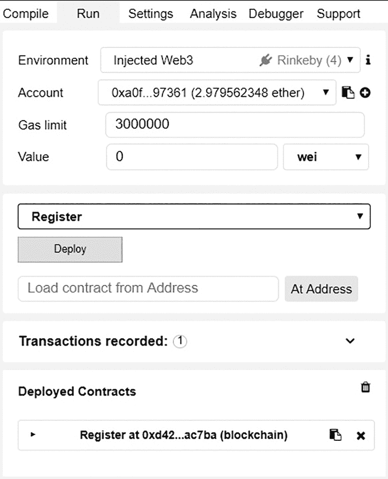

*图 4.3 Solidity IDE 的用户界面。*

##### 4.2.1.2 数据传输阶段

设备注册后，需要与网络中的其他设备或用户交互。这要求它们传输数据和请求。为此，它们必须通过 PUF-CRP 测试。本章假设每个物联网设备都配备一个 PUF，且对特定质询的响应仅可通过两种方式获得（即由设备使用其 PUF 获得，或由操作员从其内存中保存的副本获取）。当某设备 `d[i]` 待注册时，其 PUF 的 CRP 已由操作员通过智能合约记录在网络中。这样，每个设备拥有自己的唯一 ID，以及存储在合约中的唯一 CRP。

数据溯源通过 PUF 实现。设备 `d[i]` 生成请求后，合约使用 算法 4.1 详述的算法检查其有效性。在该算法中，函数 `PUFCR` 用于检查来自设备 `d[i]` 的数据溯源。当 `d[i]` 传输数据时，算法首先检查数据是否来自受信设备。若已注册，则算法检查其 PUF 质询-响应是否有效。它通过调用 图 4.4 所示的 PUF 质询-响应协议来实现。该协议步骤如下：

**算法 4.1：PUF 质询-响应验证**

```
1 function: PUFCR
2 Input : tx(d[i])
3 Output: pass, fail
4 if (tx(d[i]) is uploaded and tx(d[i]) is valid) then
5   // Check d[i] is registered/not
6   if (d[i] is in the trusted list) then
7     // Check d[i] has positive PUF[d]i
8     // invoke PUF challenge-response protocol
9     if (PUF[d]i response = true) then
10       return pass
11     else
12       return fail
13     end
14   else
15     return fail
16   end
17 else
18   return fail
19 end
```


## 14 结束

## 15 结束函数

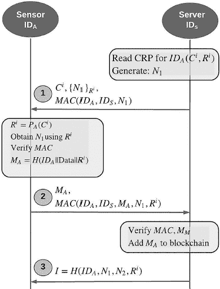

*图 4.4* 基于物理不可克隆函数 (PUF) 的质询-响应协议。

1. 网络中标识为 `ID[S]` 的服务器读取设备 `ID[A]` 的 CRP（`C^i`，`R^i`），并为其生成一个随机数 `N[1]`。

2. 服务器 `ID[S]` 随后发送使用 `R` 加密的随机数 `N[1]`（即 `{N[1]} R^i`）以及质询 `C^i` 给消息 1 中的物联网设备 `ID[A]`。

3. 物联网设备 `ID[A]` 从服务器 `ID[S]` 获取随机数后，在其 PUF 的帮助下获得质询 `C^i` 对应的响应 `R^i`。

4. 获得响应 `R^i` 后，`ID[A]` 执行以下步骤：

   a. 使用 `R^i` 作为密钥获取 `N[1]`。生成一个随机随机数 `N[2]`。

   b. 使用其内存中的参数验证消息认证码 (MAC)，以保持数据完整性。

   c. 一旦验证通过 MAC，它便生成一个哈希值：`H(ID[A], data, N[1], N[2], R^i)` 并在消息 2 中将其发送给服务器。

5. 一旦服务器 `ID[S]` 从物联网设备 `ID[A]` 接收到消息 2，它会检查并验证 MAC 和哈希值。如果两者均有效，则接受该设备的请求。否则，丢弃该请求。随后，服务器以认证参数 `I = H(ID[A], N[1], N[2], R^i)` 的形式向物联网设备 `ID[A]` 发送确认。

#### 4.2.2 性能分析

通过使用基于硬件原语的区块链，实现了物联网设备的去中心化和无信任操作。它能够防御冒充和数据篡改攻击。不同于图 4.1 所示拥有单一服务器的传统中心化物联网架构，区块链具有去中心化架构。此外，部署智能合约的能力确保了运行的设备是受信任的。采用此类架构的优势体现在以下各节所述的方面中。

##### 4.2.2.1 中心化架构与去中心化架构

图 4.1 展示了一个传统的中心化物联网架构及其安全缺陷。让我们考虑 `n` 个物联网设备，每个设备具有归一化资源需求 `r[i]`。如果可用服务器的最大数量为 `S`，可用资源为 `r`，则我们可以将传统物联网架构在数学上表述为：

```
∑_{i=1}^{n} r_i ≤ S_r
```
(4.8)

中心化架构设计容易出现单点故障，可能导致整个系统瘫痪。此外，计算并非分布式的，而是主要以中心化方式集中在网络中。本章通过提供一个去中心化平台来解决这些问题。通过使用区块链作为平台，计算分布在网络的各个组成部分中。这消除了单点故障，赋予了系统抵御故障并继续运行的能力，即使部分组成部分停止工作。

##### 4.2.2.2 数据溯源与数据完整性

基于硬件原语的区块链使用 PUF 来验证数据来源。由于每个 PUF 都会产生唯一的响应，因此通过将 PUF 与每个物联网设备结合使用，建立了数据溯源。此外，区块链平台的使用强制保证了数据完整性。区块链提供了一条不可变的记录链（即从第一个区块开始，后续区块按时间顺序添加）。要篡改一个区块，必须追溯到第一个区块，这在实际上是不可行的。通过使用基于硬件原语的区块链，可以获得以下显著特性：

1. 每个物联网设备拥有相对于其 PUF 的唯一 ID。这提供了对冒充攻击的免疫力，从而提供了一种建立数据溯源的方法。

2. 智能合约为请求和数据的传输、认证和存储分别提供了安全可靠的机制。

3. 随着不断增长的记录链，所有数据首先经过验证，然后汇总在一起形成与特定时间戳相关的区块。随后该区块由矿工验证并永久存储在区块链上，此后无法被篡改，从而提供并保持了数据完整性。

##### 4.2.2.3 分布式共识

传统物联网系统设计极度依赖信任，因为它是系统运行的关键因素之一。通常，由于中心化结构，物联网设备和服务器之间会涉及第三方。该第三方可能是存储解决方案、提供算力的实体或其他形式的服务。尽管服务的概念很诱人，但并非免费。引入第三方涉及额外的时间和人力，以及相关的货币成本。

基于硬件原语的区块链通过将计算和共识分发给网络参与者，消除了对第三方的需求。它们不仅负责为网络运行提供必要的算力，还通过分布式共识协议提供无信任环境。本章使用的分布式共识协议是 PoW。这削减了与第三方相关的额外成本、时间和人力，并将控制权交还给网络组成部分。

#### 4.2.3 安全分析

本节对本章进行形式化安全分析。做出以下假设集并描述威胁模型。

##### 4.2.3.1 假设

1. 每个物联网设备均配备一个 PUF。

2. PUF 和物联网设备构成一个片上系统 (SoC)，任何形式的篡改都将导致 PUF 失效 [18, 19]。

3. 鉴于 SoC 假设，PUF 和微控制器通过安全通道通信 [18, 19]。

4. 关于 PUF 的标准假设：每个 PUF 都是唯一且不可克隆的（即对手无法预测其行为 [20]）。PUF 可建模为 `PUF: {0,1}^(l[1]) → {0,1}^(l[2])`，即当输入长度为 `l[1]` 的激励时，PUF 将产生长度为 `l[2]` 的输出。本章使用挑战者 `C` 和对手 `A` 之间的安全博弈 `Exp[PUF, A]^(Sec)` 来建模 PUF 安全性：

   a. `A` 随机选择一个质询 `C^(i)` 并发送给 `C`。

   b. `C` 使用 PUF 获得响应 `R^i` 并向 `A` 揭示 `R^(i)`。

   c. `C` 选择一个之前未使用过的随机质询 `C^(x)`，并使用 PUF 获得响应 `R^(x)`，即 `R^(x) = PUF(C^(x))`。

   d. `A` 可以对除 `C^(x)` 以外的质询查询 PUF 多项式次数。

   e. `A` 输出其对质询 `C^(x)` 的猜测 `R^(x')`。

   f. 若 `R^(x') = R^(x)`，则 `A` 获胜。

对手 `A` 在此博弈中的优势可建模为 `Adv[A]^(PUF) = Pr[R^(x') = R^(x)]`。

##### 4.2.3.2 威胁模型


一组 IoT 设备 `M` = `M[1]`、`M[2]`、…、`M[n]` 与安全区块链 `S` 交互。设备通过不安全网络与 `S` 通信。在认证阶段结束时，实体要么在网络中注册，要么被拒绝。如果认证成功，设备可以通过与智能合约交互开始传输数据。假设对手 `A` 完全控制设备与区块链中矿工之间的通信信道。这可能包括窃听、篡改、重放和在网络中注入数据包等攻击。以下查询集用于对这些攻击建模：

*   `SendS(S, m0, r0, m1)` 用于对 `A` 充当合法设备并向 `S` 发送消息 `m0` 并接收 `r0` 的查询建模。设备随后用 `m1` 回复 `S`。
*   `SendM(ID, m0, r0)` 用于对 `A` 充当区块链并向设备发送消息 `m0` 并接收 `r0` 的查询建模。
*   `Monitor(M, S)` 对 `A` 持续窃听设备 `M` 与 `S` 之间无线信道的能力建模。
*   `Drop(A)` 对 `A` 在 `M` 和 `S` 之间丢弃数据包的能力建模。

对手 `A` 可以多项式次数调用 `SendS`、`SendM`、`Monitor` 和 `Drop`。

##### 4.2.3.3 安全性证明

**引理 1.** *对手无法篡改区块链中的数据。*

*证明。* 区块链由从创世区块开始直到最新区块按时间顺序哈希在一起的区块组成。因此，要篡改单个区块中的数据，对手需要成功地为该区块以及区块链中所有前面的区块重做 PoW。然而，要实现这一点，对手需要拥有区块链网络总算力的至少 51% [[10]](#15_Chapter04.xhtml#ref4_10)。给定一个规模适当的区块链网络，此类攻击极其困难，甚至不可能。

**引理 2.** *无法泄露 IoT 设备的秘密响应。*

*证明。* 每个 IoT 设备都有自己的 PUF。在认证阶段，矿工向设备发送挑战 `C^i`，设备使用此挑战生成秘密响应 `R^i`。因此，设备不在其内存中存储秘密响应 `R^i`，仅在需要时生成。因此，即使对手对 IoT 设备发起物理攻击，也无法获得秘密响应 `R^i`。这表明对手无法提取或泄露智能电表的秘密响应。

**定理 3.** *PUF 实现了 IoT 设备与区块链的相互认证。*

*证明。* 对手 `A` 可能试图将自己认证为合法的 IoT 设备。我们可以通过挑战者 `C` 和对手 `A` 之间的以下博弈来对其建模。

1.  `C` 选择一个合法设备 `M[1]`，并将其向区块链中的一个矿工注册。
2.  `A` 在矿工和设备 `M[1]` 上多项式次数调用 `SendS`、`SendM`、`Monitor` 和 `Drop`。
3.  `A` 调用 `SendS` 预言机将自己认证为合法设备给矿工。
4.  如果 `A` 能成功完成认证阶段，则 `A` 获胜。

在认证阶段，IoT 设备需要生成秘密响应 `R^i` 才能成功地与矿工认证自己，即要通过验证过程，设备需要成功创建认证参数 `MAC(ID[A], ID[S], M[A], N[1], R^i)`。因此，当 `A` 尝试与矿工认证自己时，也需要生成有效的认证参数。然而，要构造有效的认证参数，对手需要秘密响应 `R^i`。根据引理 2，这是不可能的。因此，对手无法成功将自己认证为合法的 IoT 设备。

证明的第二部分考虑对手 `A` 试图充当矿工并欺骗设备将其认证为矿工的情况。这可以通过类似于前一个的安全博弈建模，不同之处在于步骤 3 中，`A` 调用 `SendM` 来冒充合法矿工，而不是调用 `SendS` 预言机。要成功冒充矿工，对手需要向设备发送有效的认证参数 `MAC(ID[A], ID[S], N[1], R^i)`。然而，根据引理 2，`A` 无法获得 `R^i`。因此，我们可以得出结论，矿工和设备的成功认证得以实现。

**定理 4.** *数据溯源：所提协议成功建立了数据来源的真实性。*

*证明。* 对手可能试图冒充合法的 IoT 设备并向矿工发送篡改的数据。我们可以通过以下安全博弈对此建模：

1.  `C` 选择设备 `M[1]` 并用它执行一笔交易。
2.  `A` 在矿工和设备上多项式次数调用 `SendS`、`SendM`、`Monitor` 和 `Drop`。
3.  `A` 调用 `SendS` 预言机冒充智能电表。
4.  如果 `A` 能成功认证其发送给矿工的篡改数据，则 `A` 获胜。

为了证明其合法性并成功篡改 IoT 设备的数据，`A` 有两种选择：第一，篡改区块链；第二，篡改认证阶段消息 2 中的哈希数据参数（即 `M[m] = H(ID[A]∥Data∥R^(i))`）。然而，根据引理 1，篡改区块链是不可能的。此外，根据引理 2，对手无法获得 `R^i`，因此也无法篡改哈希数据参数。这表明实现了数据溯源，避免了数据篡改攻击。

**引理 5.** *PUF 能抵御物理攻击和克隆攻击。*

*证明。* 对手可利用物理攻击从 IoT 设备的内存中提取密钥。然而，如引理 2 所示，IoT 设备不在其内存中存储用于建立各种安全属性的秘密响应 `R^i`。此外，由于 SoC 假设，PUF 无法与设备分离，对手也无法窃听 PUF 与 IoT 设备之间的通信。这提供了一种针对物理攻击的防御机制。

##### 4.2.3.4 形式化证明

本节使用 Mao 和 Boyd 逻辑 [[21]](#15_Chapter04.xhtml#ref4_21) 提出所提协议的形式化安全性证明。此类形式化证明对于建立协议的安全属性（如保密性、认证等）非常重要。BAN 逻辑常用于安全协议的安全性分析 [[22]](#15_Chapter04.xhtml#ref4_22)。然而，[[21]](#15_Chapter04.xhtml#ref4_21) 发现了 BAN 逻辑的几个弱点。因此，本节使用 Mao 和 Boyd 逻辑进行安全性证明，它是 BAN 逻辑的改进扩展。为便于表示，我们用 `A` 表示 IoT 设备 `ID[A]`，用 `S` 表示服务器，用 `Δ` 表示 IoT 设备发送的数据。

使用 Mao 和 Boyd 逻辑分析协议的第一步是理想化协议消息。协议消息理想化的详细信息见本章末尾的附录。数据传输阶段 PUF 质询-响应协议期间交换的消息的理想化版本如下：

1.  `S` → `A` : `A`, `{N[1]}[R^(i)]`。
2.  `A` → `S` : `{A, Δ R N[1] R N[2]}[R^(i)]`。
3.  `S` → `A` : `{A, N[1] R N[2]}[R^(i)]`。


# Mao 和 Boyd 逻辑分析

Mao 和 Boyd 逻辑的前提是一种有效的数据完整性和来源验证方法。所提出的协议使用 MAC 和哈希操作来建立数据完整性和来源验证。Mao 和 Boyd 逻辑依赖一组推理规则来证明安全属性。本分析中使用的推理规则集见附录。所提出协议的初始信念集如下：

1.  `$A| \\equiv A\\overset{R^{i}}{\\leftrightarrow}S$` 和 `$S| \\equiv A\\overset{R^{i}}{\\leftrightarrow}S$`：`S` 在其内存中为每个 IoT 设备保存一个 CRP，而 `A` 可以通过使用相应的挑战来生成 `R^i`。
2.  `A| ≡ S^(c) ⊲ ∥N[2]` 和 `S|≡A|≡{S}^(c)⊲∥N[2]`：`N[2]` 由 `A` 生成。
3.  `$A\\overset{R^{i}}{| \\sim} N\_{2}$`：理想化协议中的消息 2。
4.  `A| ≡ #(N[2])`：`A` 每次都生成一个新的 `N[2]`。
5.  `S| ≡ #(N[1])`：`S` 每次都生成一个新的 `N[1]`。
6.  `A| ≡ sup(S)`：关于 `N[1]`，`S` 是超级主体。
7.  `S| ≡ sup(A)`：关于 `N[2]`，`A` 是超级主体。
8.  `$A\\overset{R^{i}}{\\vartriangleleft}N\_{1}{R~} N\_{2}$`：理想化协议中的消息 3。
9.  `$S\\overset{R^{i}}{\\vartriangleleft}N\_{1}{R~} N\_{2}$`：理想化协议中的消息 2。
10. `A| ≡ S| ≡ {A}^(c) ⊲ ∥N[1]` 和 `S|≡A^(c)⊲∥N[1]`：`S` 每次都生成一个新的 `N[1]`。
11. `$S\\overset{R^{i}}{| \\sim} N\_{1}$`：理想化协议中的消息 1。
12. `$A\\overset{R^{i}}{| \\sim} N\_{2}$`：理想化协议中的消息 2。
13. `A| ≡ #(Δ)`：`A` 生成数据。
14. `$A\\overset{R^{i}}{| \\sim}\\Delta$`：理想化协议中的消息 2。
15. `A| ≡ S^(c) ⊲ ∥Δ`：`A` 生成数据。
16. `$S\\overset{R^{i}}{\\vartriangleleft}N\_{1}{R~}\\Delta$`：理想化协议中的消息 2。

图 4.5 的表格证明了这样一个事实：`A` 相信 `N[2]` 是 `A` 和 `S` 之间的一个良好共享密钥（即 `$A| \\equiv A\\overset{N\_{A}}{\\leftrightarrow}S$`）。现在可以应用来自 (5) 的良好密钥规则。该规则指出，如果 `A` 确信除 `A` 和 `S` 之外没有其他人见过 `N[2]`（`A| ≡ {A, S}^(c) ⊲ ∥N[2]`）且 `N[2]` 是一个新鲜的随机数（`A| ≡ #(N[2])`），那么 `N[2]` 就是 `A` 和 `S` 之间的良好密钥。反过来，可以使用来自 (2) 的保密性规则来证明 `A| ≡ {A, S}^(c) ⊲ ∥N[A]`，为此需要证明 `A` 和 `S` 共享一个良好的密钥 `$R^{i}(A| \\equiv A\\overset{R^{i}}{\\leftrightarrow}S)$`，并且 `A` 将 `N[2]` 发送给 `S` 并用 `R^i` 对其加密 `$(A\\overset{R^{i}}{| \\sim} N\_{2})$`。我们可以在初始信念集中找到这些陈述以及 `A| ≡ #(N[2])`。因此，初始陈述（即 `$A| \\equiv A\\overset{N\_{A}}{\\leftrightarrow}S)$`）得以证明。同样，图 4.6 确立了 `N[1]` 是 `A` 和 `S` 之间的良好共享密钥这一事实。图 4.7 和 4.8 的表格分别展示了主体 `S` 侧关于 `N[2]` 和 `N[1]` 的保密性证明。这些表格也证明了认证属性 [[20]](#15_Chapter04.xhtml#ref4_20)。为了证明数据的来源，对数据 `Δ` 进行了类似的分析，分别见 图 4.9 和 4.10 的表格。

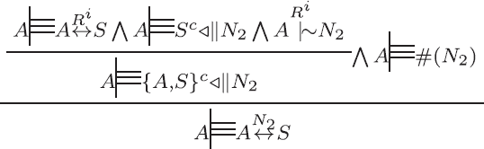

*图 4.5* **A** 相信 *N[2]* 是 **A** 和 **S** 的良好共享密钥的证明。

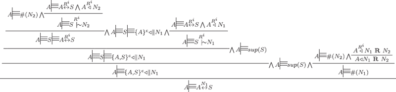

*图 4.6* **A** 相信 *N[1]* 是 **A** 和 **S** 的良好共享密钥的证明。

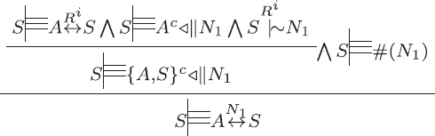

*图 4.7* **S** 相信 *N[1]* 是 **A** 和 **S** 的良好共享密钥的证明。

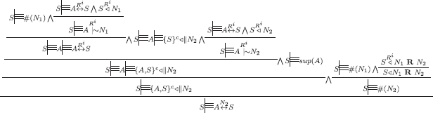

*图 4.8* **S** 相信 *N[2]* 是 **A** 和 **S** 的良好共享密钥的证明。

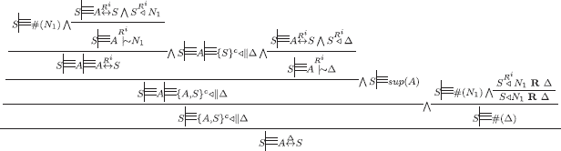

*图 4.9* **S** 相信 *Δ* 是 **A** 和 **S** 的良好秘密的证明。


*图 4.10* **A** 相信 *Δ* 是 **A** 和 **S** 的良好秘密的证明。

### 4.3 结论

IoT 无疑将在不久的将来在全球范围内普及，并在雾计算和边缘计算的发展中发挥关键作用。尽管 IoT 为雾、边缘和云基础设施的集成展示了潜在的好处，但主要关注点之一是其安全性（即如何保护 IoT 环境及其运行）。由于资源限制和硬件局限（即这些协议关注网络层面的威胁而忽略硬件层面的威胁），传统安全技术不适用于广泛的 IoT 设备。因此，必须提出新的协议来保护 IoT 设备。本章提出了一种基于硬件原语的区块链，用于在 IoT 环境中建立数据溯源并保持数据完整性。所使用的硬件原语是 PUF。PUF 的使用赋予每个 IoT 设备一个独特的硬件指纹，该指纹被用于建立溯源。此外，使用区块链进行数据存储和检索的去中心化范式构成了保持完整性的基础。通过结合智能合约使用基于 PUF 的区块链，可以实现一种针对冒充和篡改攻击的防御机制。安全分析表明，基于硬件原语的区块链安全协议不仅能抵御网络层面的威胁，还能抵御物理攻击。然而，区块链技术的一个担忧在于其扩展能力。区块链中链的大小必然会随时间增长；如何有效且高效地对其进行扩展是一个开放的研究问题。解决此问题的一种方法是使用有向无环图（DAG），如 IOTA。¹ IOTA 使用基于 DAG 的区块链，其中新的传入交易可以随时验证其他交易。它使用 `Tangle` [[22]](#15_Chapter04.xhtml#ref4_22)，其操作相对于传入交易的到达率（即，更多的新交易将产生更低的验证时间和更高的吞吐量）。这一想法前景广阔，可被利用来为 IoT 开发可扩展的区块链解决方案，并帮助将雾、边缘和云计算基础设施集成在一起。

### 附录

本节简要介绍了使用 Mao 和 Boyd 逻辑 [[20]](#15_Chapter04.xhtml#ref4_20) 对所提议安全协议的形式化分析。要理解他们的技术，首先需要将协议消息理想化。构造逻辑公式使用三种类型的信息：`M`：消息，`P`：主体，和 `F`：公式。大写字母 `A`、`B`、`P`、`Q`、……的表示法用于表示主体，字母 `K`、`M`、`N`、……用于表示消息，`X`、`Y`、`Z`、……用于表示公式。对于分析，使用以下谓词构造：

- `P| ≡ X`：`P` 相信 `X` 为真并可据此行动。
- `$P\\overset{K}{| \\sim}X$`：`P` 使用密钥 `K` 加密 `X`。
- `$P\\overset{K}{\\vartriangleleft}X$`：`P` 使用解密密钥 `K` 看到 `X`。在没有加密的情况下，我们使用 `P ⊲ X`。
- `$P\\overset{K}{\\leftrightarrow}Q$`：`K` 是 `P` 和 `Q` 的良好共享密钥。
- `#(M)`：`M` 是新鲜的（以前未使用过）。
- `sup(S)`：主体 `S` 是受信任方。
- `P ⊲ ∥M`：消息 `M` 对主体 `P` 不可用。


### 定义与规则

以下定义有助于理解协议消息理想化的规则。

*   **原子消息**：未使用符号 `,`、`|`、`R` 或 `{}` 构造的消息中的一段数据称为原子消息。符号 `,` 用于分隔消息中的字段，`{}` 用于加密。符号 `|` 和 `R` 的用途定义如下。
*   **挑战**：由同一主体（发起者）在单独的行中发送并接收的原子消息。时间戳不被视为原子消息。
*   **已回复挑战**：发送给发起者的消息中出现的挑战。
*   **响应**：响应发送者发送的原子消息（时间戳除外）和已回复挑战。
*   **无意义消息**：如果原子消息不是挑战、响应或时间戳，则它是无意义消息。

#### 协议消息理想化规则

1.  移除任何无意义消息。
2.  如果原子消息在某一行中同时充当挑战和响应，则将其视为响应。
3.  使用操作符 `|` 组合由逗号分隔的挑战。
4.  使用操作符 `|` 组合由逗号分隔的响应，形成组合响应。
5.  使用 `R` 将挑战及其响应组合为 `响应 R 已回复挑战`。
6.  使用 `R` 将消息及其对应的时间戳组合为 `消息 R 时间戳`。

#### 推理规则

##### 1. 认证规则

如果 `K` 是 `P` 和 `Q` 之间的共享密钥，且 `P` 使用 `K` 解密了接收到的消息 `M`，则 `P` 可以相信 `Q` 发送了 `M`。规则如下：

```
\frac{\left. P \middle| \equiv P\overset{K}{\leftrightarrow}Q \land P\overset{K}{\vartriangleleft}M \right.}{\left. P \middle| \equiv Q\overset{K}{\left| \sim \right.}M \right.}. \quad (A.1)
```

##### 2. 保密性规则

如果 `K` 是 `P` 和 `Q` 之间的共享密钥，且 `P` 使用 `K` 加密了 `M` 并发送，未与其他任何人共享，则 `P` 可以相信 `M` 仅对 `P` 和 `Q` 可用。规则表示为：

```
\frac{\left. P \middle| \equiv P\overset{K}{\leftrightarrow}Q \land P \middle| \equiv S^{c} \vartriangleleft \left\| {M \land P\overset{K}{\left| \sim \right.}} \right.M \right.}{\left. P \middle| \equiv {({S \cup {\{ Q\}}})}^{c} \vartriangleleft \left\| M \right. \right.}. \quad (A.2)
```

##### 3. 超级主体规则

如果 `P` 相信 `Q` 相信 `X`，且 `P` 相信 `Q` 是受信任的服务器，则 `P` 相信 `X`。规则如下：

```
\frac{\left. P \middle| \equiv Q \middle| \equiv X \land P \middle| \equiv sup{(Q)} \right.}{\left. P \middle| \equiv X \right.}. \quad (A.3)
```

该规则可解释为 `P` 可以信任 `Q` 关于 `X` 的判断。这意味着 IoT 设备可以成为其生成的随机数的超级主体。例如，在协议 1 中 IoT 设备 `ID[A]` 生成了 `N[A]`。因此，我们可以将 `ID[A]` 视为关于 `N[A]` 的超级主体。这一事实已用于 图 4.7 和 图 4.8 的列证中。

##### 4. 新鲜性规则

如果 `P` 相信 `M` 是新鲜的，且 `P` 在一条消息中同时接收了 `N` 和 `M`，则 `P` 可以相信 `N` 是新鲜的。规则如下：

```
\frac{\left. P \middle| \equiv \#{(M)} \land P \vartriangleleft NRM \right.}{\left. P \middle| \equiv \#{(N)} \right.}. \quad (A.4)
```

##### 5. 良密钥规则

此规则有两种变体：

**(i)** 如果 `P` 相信 `K` 仅对 `P` 和 `Q` 可用，且 `P` 知道 `K` 是新鲜的，则 `P` 可以相信 `K` 是 `P` 和 `Q` 之间的良密钥。

```
\frac{\left. P \middle| \equiv {\{P,Q\}}^{c} \vartriangleleft \left\| {K \land P} \right. \middle| \equiv \#{(K)} \right.}{\left. P \middle| \equiv P\overset{K}{\leftrightarrow}Q \right.} \quad (A.5)
```

**(ii)** 如果 `P` 相信 `K` 仅对 `P`、`Q` 和 `R` 可用，且 `P` 信任 `R`，且 `P` 知道 `K` 是新鲜的，则 `P` 可以相信 `K` 是 `P` 和 `Q` 之间的良密钥。

```
\frac{\left. P \middle| \equiv {\{P,Q,R\}}^{c} \vartriangleleft \left\| {K \land P} \right. \middle| \equiv sup{(R)} \land P \middle| \equiv \#{(K)} \right.}{\left. P \middle| \equiv P\overset{K}{\leftrightarrow}Q \right.}. \quad (A.6)
```

##### 6. 直觉规则

如果 `P` 能使用 `K` 解密消息 `M`，则 `P` 已见过消息 `M`。规则如下：

```
\frac{P\overset{K}{\vartriangleleft}M}{P \vartriangleleft M}. \quad (A.7)
```

##### 7. 推导规则

该规则通过将信念公理

```
P|≡(X ∧ Y) 当且仅当 P|≡X ∧ P|≡Y \quad (A.8)
```

与保密性规则结合获得。规则表示为：

```
\frac{\left. P \middle| \equiv Q \middle| \equiv P\overset{K}{\leftrightarrow}Q \land P \middle| \equiv Q \middle| \equiv S^{c} \vartriangleleft \left\| {M \land} \right.P \middle| \equiv Q\overset{K}{\left| \sim \right.}M \right.}{\left. P \middle| \equiv Q \middle| \equiv {({S \cup {\{ P\}}})}^{c} \vartriangleleft \left\| M \right. \right.}. \quad (A.9)
```

### 参考文献

[1] Stankovic, J. A. ‘Research directions for the Internet of Things.’ *IEEE Internet of Things Journal* 1, no. 1 (February 2014): 3–9. ISSN: 2327-4662. doi:10.1109/JIOT.2014.2312291.

[2] Verma, S., Y. Kawamoto, Z. M. Fadlullah, H. Nishiyama, and N. Kato. ‘A survey on network methodologies for real-time analytics of massive IoT data and open research issues.’ *IEEE Communications Surveys Tutorials* 19, no. 3 (third quarter 2017): 1457–1477. doi:10.1109/COMST.2017.2694469.

[3] Anderson, R., and S. Fuloria. ‘Who controls the off switch?’ In *2010 First IEEE International Conference on Smart Grid Communications*, 96–101. October 2010. doi:10.1109/SMARTGRID.2010.5622026.

[4] Javaid, U., M. N. Aman, and B. Sikdar. ‘BlockPro: Blockchain based data provenance and integrity for secure IoT environments.’ In *Proceedings of the 1st Workshop on Blockchain-enabled Networked Sensor Systems*, 13–18. BlockSys’18. Shenzhen, China: ACM, 2018. ISBN: 978-1-4503-6050-0. doi:10.1145/3282278.3282281.

[5] Suo, H., J. Wan, C. Zou, and J. Liu. ‘Security in the Internet of Things: A review.’ In *2012 International Conference on Computer Science and Electronics Engineering*, Vol. 3, pp. 648–651. March 2012. doi:10.1109/ICCSEE.2012.373.

[6] Xu, T., J. B. Wendt, and M. Potkonjak. ‘Security of IoT systems: Design challenges and opportunities.’ In *2014 IEEE/ACM International Conference on Computer-Aided Design (ICCAD)*, 417–423. November 2014. doi:10.1109/ICCAD.2014.7001385.

[7] Aman, M. N., K. C. Chua, and B. Sikdar. ‘Mutual authentication in IoT systems using physical unclonable functions.’ *IEEE Internet of Things Journal* 4, no. 5 (October 2017): 1327–1340. ISSN: 2327-4662. doi:10.1109/JIOT.2017.2703088.

[8] Wood, D. D. Ethereum: A secure decentralised generalised transaction ledger, 2014. [`github.com/ethereum/yellowpaper`](https://github.com/ethereum/yellowpaper)

[9] Karame, G. O., E. Androulaki, and S. Capkun. ‘Double-spending fast payments in bitcoin.’ In *Proceedings of the 2012 ACM Conference on Computer and Communications Security*, 906–917. CCS’12. Raleigh, North Carolina: ACM, 2012. ISBN: 978-1-4503-1651-4. doi:10.1145/2382196.2382292.

[10] Nakamoto, S. ‘Bitcoin: A peer-to-peer electronic cash system,’ March 2009.


# 参考文献（第 4 章）

[11] Beck, R., J. S. Czepluch, N. Lollike, and S. Malone. "Blockchain the gateway to trust-free cryptographic transactions" [in English]. In *Twenty-Fourth European Conference on Information Systems (ECIS), Istanbul, Turkey, 2016*, 1–14. Springer Publishing Company, Istanbul, 2016. https://www.tib.eu/en/search/id/TIBKAT%3A875848443/24th-European-Conference-on-Information-Systems/

[12] Buterin, V. *Ethereum: A Next-Generation Smart Contract and Decentralized Application Platform*. https://github.com/ethereum/wiki/wiki/White-Paper. Accessed: August 22, 2016, 2014.

[13] Croman, K., C. Decker, I. Eyal, A. E. Gencer, A. Juels, A. Kosba, A. Miller et al. "On scaling decentralized blockchains." *Financial Cryptography and Data Security* 9604 (February 2016): 106–125. doi:10.1007/978-3-662-53357-4_8.

[14] Aman, M. N., M. H. Basheer, and B. Sikdar. "Two-factor authentication for IoT with location information." *IEEE Internet of Things Journal* 6, no. 2 (April 2019): 3335–3351. ISSN: 2327-4662. doi:10.1109/JIOT.2018.2882610.

[15] Aman, M. N., K. C. Chua, and B. Sikdar. "Physical unclonable functions for IoT security." In *Proceedings of the 2nd ACM International Workshop on IoT Privacy, Trust, and Security*, 10–13. IoTPTS'16. Xi'an, China: ACM, 2016. ISBN: 978-1-4503-4283-4. doi:10.1145/2899007.2899013.

[16] Tosh, D., S. Shetty, X. Liang, C. Kamhoua, and L. L. Njilla. "Data provenance in the cloud: A blockchain-based approach." *IEEE Consumer Electronics Magazine* 8, no. 4 (July 2019): 38–44. ISSN: 2162-2248. doi:10.1109/MCE.2019.2892222.

[17] Rosenfeld, K., E. Gavas, and R. Karri. "Sensor physical unclonable functions" [in English (US)]. In *Proceedings of the 2010 IEEE International Symposium on Hardware-Oriented Security and Trust, HOST 2010*, 112–117. 2010. ISBN: 9781424478101. doi:10.1109/HST.2010.5513103.

[18] Guilley, S., and R. Pacalet. "SoCs security: A war against side-channels." *Annals of Telecommun*., 59, no. 7 (2004): 998–1009.

[19] Kirkpatrick, M., S. Kerr, and E. Bertino. System on chip and method for cryptography using a physically unclonable function. Patent US 8750502 B2 (US), filed issued March 22, 2012.

[20] Bohm, C., and M. Hofer. *Physical Unclonable Functions in Theory and Practice*. Springer-Verlag, New York, 2012. ISBN: 146145039X, 9781461450399. https://www.springer.com/gp/book/9781461450399

[21] Mao, W., and C. Boyd. "Towards formal analysis of security protocols." In *Proceedings Computer Security Foundations Workshop VI*, 147–158. June 1993. doi:10.1109/CSFW.1993.246631.

[22] Abadi, and Needham. "A logic of authentication." *ACM Transactions on Computer Systems*, no. 8 (February 1990): 18–36. doi:10.1145/77648.77649.

[23] Popov, S. "The tangle." 2015. https://www.iota.org/research/academic-papers

[¹]: https://www.iota.org

# 第 5 章：区块链及其与雾计算的互补性以保障管理系统安全

**Chaima Khalfaoui, Samiha Ayed, and Moez Esseghir**

## 目录

- 5.1 简介
- 5.2 IoT 背景
- 5.3 雾计算
  - 5.3.1 雾计算的优势与劣势
- 5.4 区块链
  - 5.4.1 什么是区块链结构？
  - 5.4.2 区块链如何工作？
  - 5.4.3 区块链的关键特性是什么？
  - 5.4.4 区块链的性能和安全弱点是什么？
  - 5.4.5 什么是智能合约？
- 5.5 区块链与雾计算的互补性
- 5.6 提议方案
- 5.7 结论
- 参考文献

### 5.1 简介

物联网（`IoT`）使数十亿功率受限的设备能够每天互联，旨在增强数据交换并实现日常服务自动化。然而，要管理这些海量数据，必须解决许多安全和性能挑战。此类挑战需要一种具备高效决策、短时延和数据保护能力的解决方案。我们提出了一种基于区块链技术并结合雾计算的架构，以在最短时延下提高数据安全性和用户隐私。雾计算范式的使用可支持`IoT`应用的高计算需求。因此，该基础设施的安全性仍是一个悬而未决的问题，主要是因为缺乏能够在如此不可信环境中保护信息的机制。在此背景下，我们提出区块链与雾计算的协作，以填补安全空白并确保服务有效性。近期有研究[[1]](#16_Chapter05.xhtml#ref5_1)、[[2]](#16_Chapter05.xhtml#ref5_2)分别探讨了雾计算或区块链的使用，以提升计算性能或安全性。然而，对于同时结合雾计算和区块链两种范式的研究，隐私和安全问题尚未得到解决。在本文中，我们提出通过三层架构实现区块链技术与雾计算的协作，旨在安全有效地交换和管理数据。

### 5.2 IoT 背景

`IoT`是“嵌入了电子设备、软件、传感器和网络连接的物理对象、设备、车辆、建筑物和其他物品的网络，允许这些对象收集和交换数据”[[3]](#16_Chapter05.xhtml#ref5_3)，[[4]](#16_Chapter05.xhtml#ref5_4)，[[5]](#16_Chapter05.xhtml#ref5_5)。毫无疑问，`IoT`网络通过在交通、医疗保健、智能环境或辅助系统等不同领域开发大量应用，在用户的日常生活中发挥着重要作用。得益于`IoT`，可以通过与远程服务交换数据的温度传感器远程监控家庭和企业，甚至保持家庭中的适宜气候。实时数据感知功能以及自动数据收集和传输，为提升服务质量提供了无数益处。

尽管有上述益处，`IoT`场景需要特定的架构和措施。更准确地说，必须解决网络和安全问题。让我们首先确定`IoT`设备的主要属性：

- **缺乏安全性**：`IoT`设备容易受到安全威胁，因为它们能量低、计算能力弱，无法支持强健的安全算法。
- **异构性**：系统中部署的`IoT`设备具有异构性，且大多基于多个网络。因此，关键需求是部署一种支持异构直接连接的架构。
- **设备数量持续大幅增长**：预计到 2022 年将达到 180 亿台[[6]](#16_Chapter05.xhtml#ref5_6)。需要设计一个可扩展的平台来满足需求。


# 医疗领域的数据特征与安全挑战

在医疗领域，大多数处理敏感数据的现有系统仍面临缺乏高效安全机制保护患者医疗信息，或因性能低下导致物联网设备无法实现低延迟工作的问题。除了存储和共享的挑战外，为了有效检测和修复现有系统中的困境，必须深入研究医疗数据的特征。主要特征如下：

*   **数据完整性**：临床数据需要值得信赖、可靠且无矛盾；数据精度和准确性是医生提供有效治疗的两个基本特征。此外，数据源必须可被确定（认证）。
*   **数据隐私与机密性**：保护患者隐私、身份和医疗记录是首要要求。必须考虑敏感数据的保护，以提供可靠的服务。

然而，大多数医疗机构仍存在安全问题。一方面，破坏医疗系统或网络的安全可能导致灾难性后果。另一方面，患者隐私信息存在于数据收集、数据传输、云存储和数据再发布的所有阶段。

如前所述，包括缺乏安全性、能力有限和可扩展性在内的多个挑战可能阻碍物联网组件的成功部署。然而，与数据管理和安全相关的传统可用机制无法满足当前的物联网需求。为了实现对智能对象的高效访问和使用，多项关于物联网技术的相关工作考虑了云计算技术。云计算是一种基于互联网的计算范式，它为其他计算机或设备提供对可配置资源共享池（如处理器、存储、服务和应用程序）的普遍且按需的访问。云计算范式能够处理来自物联网集群的海量数据，即向云计算机传输和从云计算机传输海量数据。Tyagi 等人构想了一个物联网-云医疗系统，旨在改善不同医疗实体（医生、患者、医务人员等）之间的通信与协作，并为患者提供更好的医疗服务。然而，结果表明，此类系统仍需要一个完整的模型来解决安全、隐私和信任问题。另一项关于云计算与物联网集成的研究分析了此类集成可能带来的挑战，并总结如下：

1.  必须解决数据所有权和隐私问题。
2.  能源管理是一个主要问题。
3.  需要大数据等新技术来快速优化和处理大量异构数据。
4.  安全需求在双方都是主要问题，因为很难在计算受限设备上实现安全机制，且云服务质量和管理算法必须得到增强。

总之，云计算在确保安全高效的服务方面面临诸多问题，特别是实时应用，这是因为物联网的特定需求，如资源和能源限制以及云服务器遥远的地理位置。

### 5.3 雾计算

正如之前详述的，云计算具有管理、存储和处理数据等多种优势。通过提供廉价且快速扩展的性能，它使企业免于关注所需资源数量或存储限制等不必要的细节。然而，它**并非**另一种确保低延迟的范式。

#### 5.3.1 雾计算的优势与劣势

雾计算作为云计算服务向网络边缘延伸的扩展而出现。该范式旨在支持用于延迟敏感型和实时应用中的异构、密集和分布式数据。由于以下技术概念标准，它是处理物联网环境的一种有利方法：

*   **提供低延迟**：将处理放置在网络边缘，即用户更近的物理位置，可加速计算和数据传输，从而缩短响应时间并降低延迟。
*   **节省带宽使用**：仅在必要时将部分数据传输到云端，其余数据在本地进行分析和处理。
*   **具备高处理能力**：雾网络由大量节点组成，它们通信并互操作，以提供高效的分布式监控和计算服务。

此外，由于货币原因，云层的高网络和硬件可扩展性具有挑战性，而在物联网设备中则因其有限的计算能力和容量而具有挑战性。相反，雾节点更有可能满足大规模应用的需求。文献 [12] 中作者指出，每个雾节点只需满足这一需求的一小部分。随着物联网设备数量的增长，增加的网络带宽和计算能力需求可通过在雾计算中增加雾节点来轻松满足。

然而，多项综述研究了雾计算部署在不同领域的影响。在《医疗保健中的雾计算——综述与讨论》中，作者展示了医疗应用如何从这些技术原则中受益。通过具体例子，他们解释了终端设备因能源受限，无法处理家庭治疗或数据监控和控制等计算任务。另一方面，云计算因可靠性和集中化顾虑，不适合此类任务。雾计算凭借将计算作为网络基础设施一部分的灵活性，成为满足医疗需求的合适概念。雾计算任务可过滤数据以帮助保护隐私或减轻网络负载。执行位置可根据当前部署场景、法规和其他要求进行调整。

雾计算中的主要安全问题之一是设备各层级（服务器、网关等）的认证。每个节点都有自己的地址，攻击者可能篡改或欺骗该地址。正如文献 [14, 15] 所述，中间人攻击有可能成为雾计算中的典型攻击。基于公钥基础设施的方法和入侵检测技术等一些认证协议可被视为解决方案。此外，隐私问题和用户信息（如个人数据、位置）泄露风险必须被研究。雾计算可采用隐私保护算法，例如利用密码学保护数据，因为它们拥有足够的计算能力。

无论是认证、访问控制还是隐私问题，保护雾计算的主要挑战在于如何在到达雾节点之前保护源头（设备）和路径。如前所述，物联网设备资源受限；因此，为它们设计算法很难。就我们所知，目前没有基础设施能够在不改变雾计算能力的情况下解决所有上述安全问题。

### 5.4 区块链


# 区块链技术概述

区块链是通信和网络安全领域的一项新兴创新技术。2008 年，在其萌芽状态下，区块链被提议为一种名为“比特币”的点对点加密货币。随着其概念和组件的发展，区块链可被定义为一种去中心化的分布式公共账本，能够在无需第三方的情况下，以高度安全且可验证的方式确保数据交换和管理。区块链可以存储任何有价值的东西，从原始数据到金融交易。该技术已成功取代各类组织中的经济交易系统，并有潜力在不同行业中重塑异构业务模型。它承诺提供一个安全的分布式框架，以促进所有用户和第三方之间的信息共享、交换和集成 16。根据谁有权访问账本，区块链主要分为三种类型，如 图 5.1 所示：

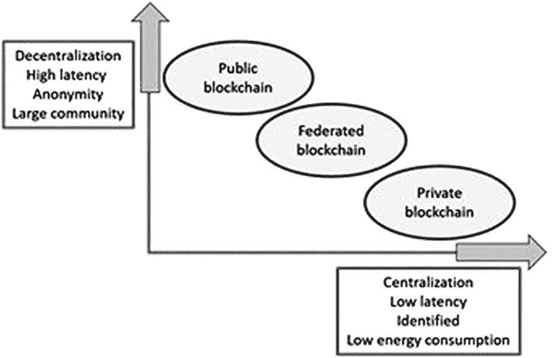

*图 5.1 区块链分类架构。*

* **公有链**：因比特币和以太坊的兴起而最为人所知。公有链完全去中心化、公开可用，且可免费下载和使用，因此任何人都可以参与其中。例如：比特币¹加密货币、莱特币²、以太坊³。
* **私有链**：属于个人或组织的私有财产。所有权利和权限由单一实体掌控，例如希望保持其数据私密性的公司（如用于商业和数字合约的 Monax⁴）。
* **混合链、联盟链或联邦链**：具有部分去中心化的特征，因为参与节点是预先选定的，决策由授权节点集合定义。它们主要用于银行业（如用于商业的 R3⁵ 和用于保险的 B3i⁶）。

在实践中，区块链实际上是一个数据库，因为它是一个存储带时间戳和结构化数据（称为“区块”）的数字链。一旦数据被记录在区块链中，它就变得不可破坏。由于区块链结构本身的特性，很难篡改或删除已记录的数据。区块相互链接，形成一条连续的链。同样，数据库也在称为“表”的数据结构中存储信息。然而，虽然区块链是一个数据库，但数据库不一定是区块链。它们不能互换使用，因为尽管它们都存储信息，但它们的设计不同⁷。

#### 5.4.1 什么是区块链结构？

区块链是一个有序的反向链接列表，由携带称为“交易”数据集的区块组成，这些交易由称为“矿工节点”的实体创建并提交。例如，在临床数据管理领域，一笔交易可能是向数据库添加新患者、登记下一次预约或记录新的临床处方。每个区块通过其区块头的哈希值进行标识，并包含其他信息，这些信息对于其他节点轻松验证其正确性至关重要 17。此外，每个区块在“前一区块哈希”字段中引用前一个区块，也称为“父区块”。因此，前一区块哈希代表指向前一区块的指针。

如 图 5.2 所示，标准交易是一种包含可验证值和元数据的结构：用于指示创建时间的时间戳、一个或多个作为发送方地址引用的输入、一个或多个作为接收方地址引用的输出、交易大小，以及发送方的签名以证明发送方是交易的创建者。

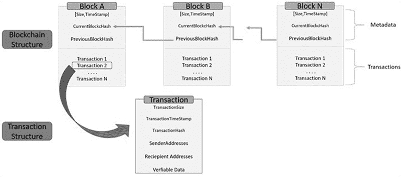

*图 5.2 区块链结构。*

#### 5.4.2 区块链如何工作？

矿工是区块链的主要用户；他们使用唯一地址访问链上的账户。每个矿工拥有账本的共享副本，并拥有根据区块链规则（挖矿共识算法）添加区块、从而丰富分布式数据库的权利。共识是固定的，并根据区块链的性质及其用户需求而不断丰富。典型算法可定义如下：

1. 矿工创建的新交易被广播给所有网络节点。
2. 每个连接的节点持续监听网络，将新交易收集到一个区块中。
3. 在每一轮中，根据系统定义的选定共识协议，一个节点获得广播其区块的权利。
4. 其他节点仅在交易有效（例如：未花费、合法、具有有效签名等）时才接受新区块。
5. 节点通过在其创建的下一个区块中包含当前区块哈希来验证并表示接受。

如步骤 3 所述，区块不是随机广播的；矿工遵循通常硬编码在系统中的共识协议。在实践中，**工作量证明** 是最流行且稳定的算法。在 **PoW** 算法中，矿工计算一个哈希值，该值根据网络环境（如节点数量、添加区块所需时间）不断变化。算法要求该哈希值必须等于或小于系统固定的某个给定值。

参与者使用称为“随机数”的随机值持续寻找该值，直到达到目标。一旦找到所需的随机数，他们就可以发布结果。该协议的关键在于：搜索过程对于构建区块的矿工必须是适度困难的，但对于验证区块的矿工来说必须易于检查。

然而，最近也提出了其他几种共识算法，例如**权益证明**、**认证证明**和**概念证明** 18，19，20。

前述算法是简化的；在实际的区块链使用中，交易不会被直接处理，等待在池中的过程称为“交易池”。因此，每个节点的未确认交易池由合法和不一致的交易组成。分布式交易随后在队列或交易池中等待，直到被挖矿节点添加到区块链中 21，22。

#### 5.4.3 区块链的关键特性是什么？

区块链具有以下属性：不可篡改（共识机制）、可追溯（共享账本）、去中心化（点对点网络）和伪匿名（伪身份）。在 23，24 中，作者详述了每个特性并解释了其背后的发展机制。

* **去中心化**：没有中央权威机构来制定规则。相反，所有经过认证的节点根据其权限访问账本。由于共识机制，信息透明且按时间顺序保存在区块中。
* **不可篡改**：区块链系统可被视为可信的，因为账本内容经所有方同意，且更新后的副本在节点间扩散。这种机制使得恶意用户极难篡改或操纵，除非他们控制了大多数节点。


• **可追溯**：在区块链中，可以追踪所有交易的历史记录。正如所述，得益于不可篡改的特性，这一功能得以实现。因为用户无法修改链的内容，所以所有历史记录都是可用的。

• **假名化**：区块链使用公钥作为唯一标识符，并隐藏真实用户的身份，从而提供相对的用户匿名性。此外，所用的假名不包含关于其用户的任何指示或可识别信息。因此，该机制提供了相对的用户隐私。

#### 5.4.4 区块链的性能和安全弱点有哪些？

不幸的是，作为任何一种技术，区块链仍然存在重要的弱点，阻碍了其在真实场景中的采用，尤其是在物联网环境中。主要弱点之一是能源消耗。

由于计算密集型的 POW 算法，挖矿过程消耗大量能源。一些研究试图消除、替换或改进 POW 机制。据我们了解，这些尝试只能部分解决问题，因为它们总是以放松其他特性为代价，最常见的是以牺牲安全属性（如匿名性、不可篡改性等）为代价。相比之下，物联网资源受限的架构使得部署该技术变得困难。适配的机制必须是轻量级的，才能在这些约束下高效工作。

第二个关键缺点是交易确认的高延迟，特别是因为我们处于物联网环境中，且大多数最新应用旨在提供实时服务（如交通、工业物联网等）：与传统在线信用卡交易通常需要两三天来确认交易相比，比特币交易只需约一小时即可验证；这比常规方式好得多，但仍不足以满足需求 [[25]](#16_Chapter05.xhtml#ref5_25)。

一些近期的研究讨论了将区块链与其他技术结合以解决性能问题的可能性。Seitz 等人 [[1]](#16_Chapter05.xhtml#ref5_1) 利用云和雾计算范式设计了一个基于区块链的应用。在他们的原型中，他们在云层部署了区块链用于防篡改存储，并使用一个雾节点作为云和设备之间的代理。然而，发现了几个局限性，其中最显著的是即使他们使用了授权证明而非 POW，确认时间仍然很高。Dorri 等人 [[26]](#16_Chapter05.xhtml#ref5_26) 引入了一种轻量级区块链，通过消除挖矿协议来降低处理开销。

我们还需要指出，区块链存在各种安全漏洞。默认情况下，它们不包含访问控制策略或认证策略。此外，私钥的保护是所有者的责任。如果密钥被盗，窃贼可能获得对链的访问权，并发起嗅探攻击，甚至发起分布式拒绝服务（DDoS）攻击，发送大量无用但有效的交易，旨在拖垮网络。

然而，区块链在不断发展，智能合约是最具革命性的进步之一。

#### 5.4.5 什么是智能合约？

在 [[27]](#16_Chapter05.xhtml#ref5_27) 中，智能合约被定义为旨在自动促进、验证和强制执行数字合约的谈判与实施的计算机协议，且无需中央权威机构。Cong 等人 [[28]](#16_Chapter05.xhtml#ref5_28) 将其视为一种自动化且自我强制执行的数字程序，依赖于对或有结果的防篡改共识，并通过首次代币发行进行融资。这两种定义都意味着：智能合约是在区块链网络中开发和部署的微小程序，其唯一目的是允许在无需中介的情况下执行可信协议。多个领域正在测试基于区块链的智能合约。为了说明这一点，医疗保健领域 [[24]](#16_Chapter05.xhtml#ref5_24)、[[29]](#16_Chapter05.xhtml#ref5_29)、[[30]](#16_Chapter05.xhtml#ref5_30) 部署了智能合约以协助数据管理、交换和监控。以太坊平台现在是智能合约的领导者。`Solidity`⁸ 是用于实现它们的编程语言。

### 5.5 区块链与雾计算的互补性

雾计算和区块链都为最终用户提供数据交换和计算服务。此外，它们大多代表相同的局限性。然而，每种技术都可以通过其独特的特性来区分，这些特性结合在一起可以描述为互补的，如 图 5.3 所示。

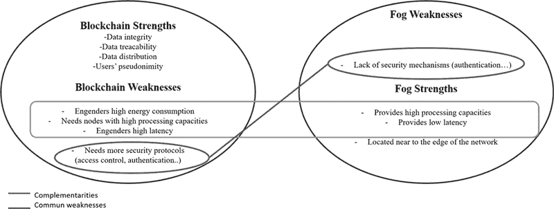

*图 5.3 区块链-雾计算互补性与特性。*

区块链通过为其用户提供一个去中心化的交换环境，确保完整性和可追溯性且无额外费用，从而提供了许多机会。然而，基于前文详述的最新开发框架和提出的解决方案，我们注意到性能约束（如长延迟）和安全性的缺失，正在阻止或至少减缓该技术在具有真实需求的应用中的大规模部署。

在区块链中，共识决定了区块创建的延迟。具体而言，系统延迟主要取决于信息验证和传播机制。一种解决方案是简化机制。因此，减少共识算法直接影响系统的安全性。因为该机制过程假设矿工算力越强（处理能力），过程运行越快，所以专注于提供能够处理这一需求的解决方案，比替换共识更明智。

考虑到物联网设备被设计为低功耗技术，不具备处理能力，可以肯定直接将它们集成作为节点将无法实现高效的过程执行。然而在雾计算中，去中心化计算基础设施以高处理能力著称，且可扩展性旨在提高响应时间和最小化网络延迟。不幸的是，尽管被引入为最适合促进从物联网设备收集数据、计算和存储的平台之一，雾计算仍然存在若干局限性。基本上，雾计算的主要模型缺乏安全性。这可以通过缺乏身份管理、访问管理甚至私有数据保护机制来体现。

在这项工作中，我们分析了这两种技术的性能和安全特性及问题，以展示它们之间显著的兼容性。


### 5.6 方案

在本工作中，我们提出采用三层架构来解决其中一些问题。我们在图 5.4 中提供了架构设计的概览。

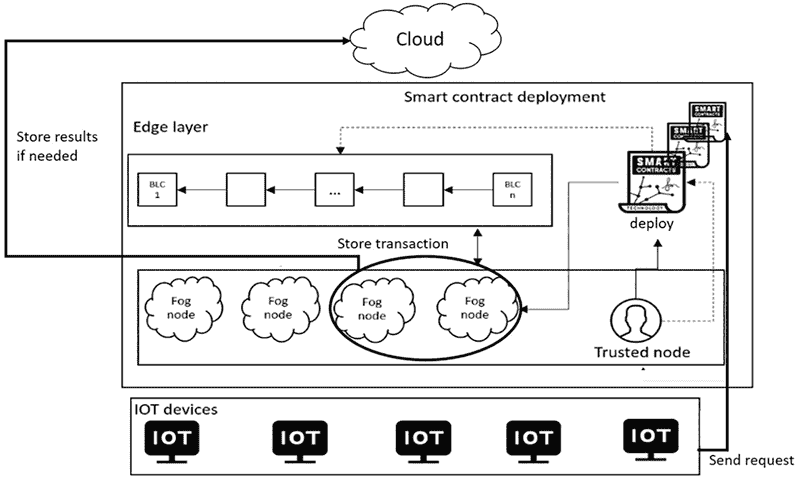

*图 5.4* 建议架构。

我们的系统由以下部分组成：(i) IoT 设备层，(ii) 在我们架构中被视为安全的云计算层，以及 (iii) 基于雾计算和区块链的网络层。

该方案的目标是利用组件的性能和安全特性，提供一个高效且安全的数据管理系统，能够处理 IoT 设备产生的指数级数据量并应对潜在攻击。

为此，我们确定了网络层中具有特殊重要性的三个主要组件。

1. 第一个组件是区块链及其三个智能合约。区块链负责使用智能合约进行数据编排、访问和存储。在该架构中，我们选择使用公有链以保证完全去中心化。

2. 其次，受信实体是网络中拥有创建和部署智能合约权利的唯一组件。

3. 受信实体不是区块链中的全节点；其主要角色是部署和监控智能合约。区块链节点仅拥有执行已添加智能合约的权利。

4. 第三，雾节点被视为区块链节点。它们执行服务、执行服务机制，将结果保存在区块中，然后根据需要将结果发送回用户或云端。这一选择是我们架构中效率的关键之一。我们利用其高处理能力将其作为区块链节点。

我们架构的分布式特性使区块链能够受益于雾节点的计算能力，将其视为矿工节点，以最小化共识机制的执行时间。另一方面，得益于旨在确保数据完整性的区块链网络共识和加密协议，雾节点可以安全地交换数据，无需担心篡改攻击。此外，作为网络的一部分，雾节点在访问数据前必须进行身份认证，遵守链施加的假名特性。

针对访问控制、机密性和数据平衡问题，我们决定不引入外部组件，而是利用区块链强大的新逻辑组件——“智能合约”。

如前所述，并在多篇近期文献中描述[32, 33]，智能合约是自我执行的小型程序，其优势在于被包含在区块链中，以约束不同参与方之间的协议。因此，安全需求可以通过智能合约中编写的策略来满足，因为 Vitalik Buterin 将其描述为“加密”盒子，“包含价值，仅在满足特定条件时才解锁”。

为满足上述安全需求并提升系统性能，我们采用三个智能合约：

* **第一个智能合约旨在定义数据访问控制策略**：要访问账本中的数据，经过身份认证后，雾节点和新设备必须在访问权限列表下注册，并根据其权限获取相应许可。

* **第二个智能合约负责区块链网络中的数据机密性**：利用合约中集成的加密 PKI，数据以加密形式到达网络，智能合约对其解密以执行用户交易。

* **第三个智能合约关注系统性能**：它定义了一种数据编排策略，旨在优化交易分配。为更好地理解该过程，我们在图 5.5 中提出了以下数据流图。该数据流图解释了系统中服务执行的步骤，从发送请求到存储在云端。需要设置编排和优化算法以支持区块链中经典的交易分配过程。智能合约将根据待执行服务的性质和雾节点的能力，确定一组将要操作的节点，而不是向所有节点广播任务并让它们自行选择想要的交易。

通过这种方式，我们同时实现了两个目标：第一，任务的公平分担；第二，更好地监控雾节点的访问权限，因为它们不再拥有访问所有交易的权利。

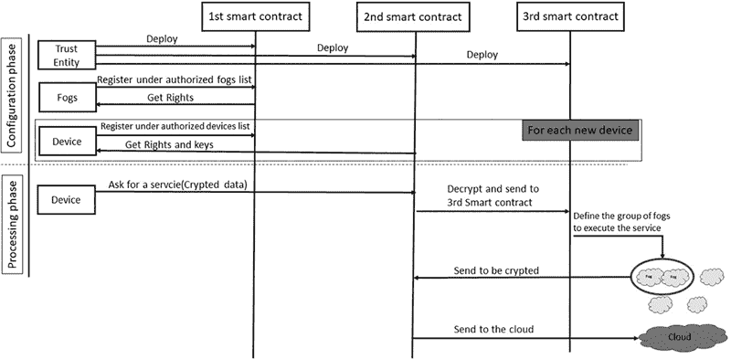

*图 5.5* 服务执行过程。

总之，许多贡献研究了在同一架构中使用雾计算和区块链，但它们未考虑两者在单层中的协作。在本工作中，我们的假设是雾计算和区块链在性能和安全方面是互补的，且区块链结构中未考虑的若干安全问题可通过智能合约来解决。

在本工作中，我们提出了一种架构，一方面旨在确保数据的保护与安全，如完整性、认证和机密性；另一方面旨在提升系统性能，如延迟。

* **云端数据已加密**，因此，即使攻击者攻破云端内容，也不会导致数据泄露。此外，数据访问仅限于授权和受信实体，解密密钥存储在区块链的智能合约中，这使得窃取变得困难。

* **在网络层**：我们主要利用区块链增强数据保护和安全。交易过程受区块链 PKI 保护，使得仅授权实体可通信和读取数据，降低了 MIM（中间人）和欺骗攻击的风险。账本的更新副本增加了系统的不可变性和生存能力，并防御单点故障攻击。如果某节点被攻破或宕机，系统因冗余机制仍能继续正常工作。


• **层间**：传输中的数据使用 PKI 密钥加密，并通过安全通道传输。每个设备在区块链中由唯一身份表示，这可能阻碍攻击者发起关联攻击并增强用户隐私。

然而，区块链容易受到其他类型攻击的影响，这些攻击不在本文的考虑范围内。这些攻击与区块链的基本结构有关。最著名的包括：竞争攻击、51% 攻击和扣留区块攻击。文献 [34, 35] 的作者详细分析了自私挖矿和 51% 攻击及其对系统的影响。

### 5.7 结论

本章提出了一种用于室内无线网络中传感器定位的去中心化方法。首先，构建了一个去中心化架构，将目标区域划分为多个扇区，每个扇区拥有自己的计算器。然后，每个计算器运行基于信念函数理论的局部定位算法。随后，融合计算器的估计结果，形成一个观测模型。所提出的算法接着利用传感器的移动性分配另一种类型的证据。通过融合来自观测模型和移动性模型的证据，为区域分配置信度。实验旨在评估去中心化方法的性能，并将其与中心化方法进行比较。此外，还将准确性、复杂性、鲁棒性以及检测到的接入点对定位算法的影响与该领域的知名技术进行了对比研究。未来的工作将重点关注基于核的模型，以解决参数分布无法表征接收信号强度指示 (RSSI) 的情况。此外，还将研究隐马尔可夫模型等高级移动性模型，以增强整体定位算法。

### 参考文献

1. A. Seitz, D. Henze, D. Miehle, B. Bruegge, J. Nickles, and M. Sauer, 'Fog computing as enabler for blockchain-based IIoT app marketplaces-a case study,' in *2018 Fifth International Conference on Internet of Things: Systems, Management and Security*, pp. 182–188, IEEE, 2018.

2. A. Stanciu, 'Blockchain based distributed control system for edge computing,' in *2017 21st International Conference on Control Systems and Computer Science (CSCS)*, pp. 667–671, IEEE, 2017.

3. A. Munir, P. Kansakar, and S. U. Khan, 'IFCIoT: Integrated Fog Cloud IoT: A novel architectural paradigm for the future Internet of Things,' *IEEE Consumer Electronics Magazine*, vol. 6, no. 3, pp. 74–82, 2017. doi:10.1109/MCE.2017.2684981.

4. L. Atzori, A. Iera, and G. Morabito, 'The Internet of Things: A survey,' *Computer Networks*, vol. 54, no. 15, pp. 2787–2805, 2010.

5. M. Samaniego and R. Deters, 'Blockchain as a service for IoT,' in *2016 IEEE International Conference on Internet of Things (iThings) and IEEE Green Computing and Communications (GreenCom) and IEEE Cyber, Physical and Social Computing (CPSCom) and IEEE Smart Data (SmartData)*, pp. 433–436, IEEE, 2016.

6. O. Novo, 'Blockchain meets IoT: An architecture for scalable access management in IoT,' *IEEE Internet of Things Journal*, vol. 5, no. 2, pp. 1184–1195, 2018.

7. P. Zhang, J. White, D. C. Schmidt, G. Lenz, and S. T. Rosenbloom, 'Fhirchain: Applying blockchain to securely and scalably share clinical data,' *Computational and Structural Biotechnology Journal*, vol. 16, pp. 267–278, 2018.

8. W. Sun, Z. Cai, Y. Li, F. Liu, S. Fang, and G. Wang, 'Security and privacy in the medical Internet of Things: A review,' *Security and Communication Networks*, vol. 2018, 9 pages, 2018 doi:10.1155/2018/5978636.

9. C. Stergiou, K. E. Psannis, B.-G. Kim, and B. Gupta, 'Secure integration of IoT and cloud computing,' *Future Generation Computer Systems*, vol. 78, pp. 964–975, 2018.

10. S. Tyagi, A. Agarwal, and P. Maheshwari, 'A conceptual framework for IoT-based healthcare system using cloud computing,' in *2016 6th International Conference-Cloud System and Big Data Engineering (Confluence)*, pp. 503–507, IEEE, 2016.

11. A. Botta, W. De Donato, V. Persico, and A. Pescapé, 'On the integration of cloud computing and Internet of Things,' in *2014 International Conference on Future Internet of Things and Cloud*, pp. 23–30, IEEE, 2014.

12. Y. Guan, J. Shao, G. Wei, and M. Xie, 'Data security and privacy in fog computing,' *IEEE Network*, vol. 32, no. 5, pp. 106–111, 2018.

13. F. A. Kraemer, A. E. Braten, N. Tamkittikhun, and D. Palma, 'Fog computing in healthcare–A review and discussion,' *IEEE Access*, vol. 5, pp. 9206–9222, 2017.

14. I. Stojmenovic and S. Wen, 'The fog computing paradigm: Scenarios and security issues,' in *2014 Federated Conference on Computer Science and Information Systems*, pp. 1–8, IEEE, 2014.

15. I. Stojmenovic, S. Wen, X. Huang, and H. Luan, 'An overview of fog computing and its security issues,' *Concurrency and Computation: Practice and Experience*, vol. 28, no. 10, pp. 2991–3005, 2016.

16. D. Puthal, N. Malik, S. P. Mohanty, E. Kougianos, and C. Yang, 'The blockchain as a decentralized security framework [future directions],' *IEEE Consumer Electronics Magazine*, vol. 7, no. 2, pp. 18–21, 2018.

17. V. Daza, R. Di Pietro, I. Klimek, and M. Signorini, 'Connect: Contextual name discovery for blockchain-based services in the IoT,' in *2017 IEEE International Conference on Communications (ICC)*, pp. 1–6, IEEE, 2017.

18. A. Dorri, M. Steger, S. S. Kanhere, and R. Jurdak, 'Blockchain: A distributed solution to automotive security and privacy,' *IEEE Communications Magazine*, vol. 55, no. 12, pp. 119–125, 2017.

19. Z. Zheng, S. Xie, H.-N. Dai, X. Chen, and H. Wang, 'Blockchain challenges and opportunities: A survey,' *International Journal of Web and Grid Services*, vol. 14, no. 4, pp. 352–375, 2018.

20. D. Puthal, S. P. Mohanty, P. Nanda, E. Kougianos, and G. Das, 'Proof-of-authentication for scalable blockchain in resource-constrained distributed systems,' in *2019 IEEE International Conference on Consumer Electronics (ICCE)*, pp. 1–5, IEEE, 2019.

21. D. Yaga, P. Mell, N. Roby, and K. Scarfone, 'Blockchain technology overview,' arXiv preprint arXiv:1906.11078 (2019). doi:10.6028/NIST.IR.8202. 2018.

22. E. O. Kiktenko, N. O. Pozhar, M. N. Anufriev, A. S. Trushechkin, R. R. Yunusov, Y. V. Kurochkin, A. Lvovsky, and A. Fedorov, 'Quantum-secured blockchain,' *Quantum Science and Technology*, vol. 3, no. 3, p. 035004, 2018.

23. R. Beck, J. Stenum Czepluch, N. Lollike, and S. Malone, 'Blockchain–the gateway to trust-free cryptographic transactions,' 2016. [`aisel.aisnet.org/ecis2016_rp/153/`](https://aisel.aisnet.org/ecis2016_rp/153/).

24. X. Li, P. Jiang, T. Chen, X. Luo, and Q. Wen, 'A survey on the security of blockchain systems,' *Future Generation Computer Systems*, vol. 107, pp. 841–853, 2017.

25. I.-C. Lin and T.-C. Liao, 'A survey of blockchain security issues and challenges.,' *IJ Network Security*, vol. 19, no. 5, pp. 653–659, 2017.


26. A. Dorri, S. S. Kanhere, and R. Jurdak, ‘Towards an optimized blockchain for IoT,’ in *Proceedings of the Second International Conference on Internet-of-Things Design and Implementation*, pp. 173–178, ACM, Pittsburgh, PA, 2017.

27. S. Wang, L. Ouyang, Y. Yuan, X. Ni, X. Han, and F.-Y. Wang, ‘Blockchain-enabled smart contracts: Architecture, applications, and future trends,’ *IEEE Transactions on Systems, Man, and Cybernetics: Systems*, vol. 49, pp. 2266–2277, 2019.

28. L. W. Cong and Z. He, ‘Blockchain disruption and smart contracts,’ *The Review of Financial Studies*, vol. 32, no. 5, pp. 1754–1797, 2019.

29. K. N. Griggs, O. Ossipova, C. P. Kohlios, A. N. Baccarini, E. A. Howson, and T. Hayajneh, ‘Healthcare blockchain system using smart contracts for secure automated remote patient monitoring,’ *Journal of Medical Systems*, vol. 42, no. 7, p. 130, 2018.

30. A. Azaria, A. Ekblaw, T. Vieira, and A. Lippman, ‘Medrec: Using blockchain for medical data access and permission management,’ in *2016 2nd International Conference on Open and Big Data (OBD)*, pp. 25–30, IEEE, 2016.

31. R. B. Uriarte and R. De Nicola, ‘Blockchain-based decentralized cloud/fog solutions: Challenges, opportunities, and standards,’ *IEEE Communications Standards Magazine*, vol. 2, no. 3, pp. 22–28, 2018.

32. H. Watanabe, S. Fujimura, A. Nakadaira, Y. Miyazaki, A. Akutsu, and J. Kishigami, ‘Blockchain contract: Securing a blockchain applied to smart contracts,’ in *2016 IEEE International Conference on Consumer Electronics (ICCE)*, pp. 467–468, IEEE, 2016.

33. S. Porru, A. Pinna, M. Marchesi, and R. Tonelli, ‘Blockchain-oriented software engineering: Challenges and new directions,’ in *2017 IEEE/ACM 39th International Conference on Software Engineering Companion (ICSE-C)*, pp. 169–171, IEEE, 2017.

34. I. Eyal and E. G. Sirer, ‘Majority is not enough: Bitcoin mining is vulnerable,’ *Communications of the ACM*, vol. 61, no. 7, pp. 95–102, 2018.

35. D. Efanov and P. Roschin, ‘The all-pervasiveness of the blockchain technology,’ *Procedia Computer Science*, vol. 123, pp. 116–121, 2018.

^(1) [`bitcoin.org/fr/`](https://bitcoin.org/fr/)

^(2) [`litecoin.org/`](https://litecoin.org/)

^(3) [`www.ethereum.org/`](https://www.ethereum.org/)

^(4) [`monax.io/`](https://monax.io/)

^(5) [`www.r3.com/`](https://www.r3.com/)

^(6) [`b3i.tech/home.html`](https://b3i.tech/home.html)

^(7) [`hackernoon.com/databases-and-blockchains`](https://hackernoon.com/databases-and-blockchains)

^(8) [`solidity.readthedocs.io`](https://solidity.readthedocs.io)

# 第 6 章

# 支持区块链的雾计算和边缘计算的安全与隐私问题

## Imane Ameli, Nabil Benamar, and Abdelhakim Senhaji Hafid

**目录**

6.1 简介

6.2 通过雾计算和边缘计算实现云到物的连续体

6.2.1 需求

6.3 区块链

6.3.1 交易流程

6.3.2 区块链网络中的节点类型

6.3.3 区块链的类型

6.3.4 区块链主要要素

6.3.4.1 共识机制

6.3.4.2 密码学

6.3.4.3 智能合约

6.3.5 隐私

6.3.6 区块链特征

6.3.7 挑战

6.3.7.1 可扩展性

6.3.7.2 安全性

6.3.7.3 法律

6.4 区块链与雾计算和边缘计算：一种可能的合作

6.4.1 参考架构

6.4.2 共识机制

6.4.3 安全优势

6.4.4 隐私优势

6.4.5 基于区块链的资源管理

6.4.6 融合面临的挑战

6.5 未来方向

6.6 结论

参考文献

### 6.1 简介

信息技术无处不在，已成为我们日常活动不可或缺的一部分。各种复杂的设备及其应用正在快速演进。这些设备为在不同领域的广泛应用中切实发挥作用提供了新机遇，例如家庭自动化、医疗保健、智慧农业、供应链与物流、智慧城市、智能电网、网联汽车和可穿戴设备。这些应用产生海量数据，通常传输到中心化的云服务器进行处理和存储。根据思科互联网业务解决方案集团专家预测，联网设备数量预计将在 2030 年达到 5000 亿[[1]](#17_Chapter06.xhtml#ref6_1)。

当前的云计算框架，如 Amazon Web Services 和 Google App Engine，可以支持计算密集型应用。然而，鉴于联网设备产生的海量数据的速率、分布和规模，在云端处理所有数据将变得不切实际。特别是对于具有严格延迟和高服务质量（QoS）要求的应用，云计算无法充分满足这些要求；例如，道路安全和自动驾驶应用要求延迟低于 50 毫秒[[2]](#17_Chapter06.xhtml#ref6_2)，而智能工厂的要求甚至更严格，延迟要求[[3]](#17_Chapter06.xhtml#ref6_3)。

此外，将所有数据发送到云端会导致网络流量爆炸性增长。通常这并不高效，因为数据中存在大量冗余。考虑到巨大的流量数据可能超过网络容量，这甚至是不可能的。为了克服云计算的局限性并成功支持广泛的应用，提出了一种新的计算范式，将数据处理从核心网络移至网络边缘，靠近设备和用户。


在此背景下，Cisco 引入了雾计算作为云计算的延伸 [4]。ARM、Cisco、DELL、Intel 和 Microsoft 对未来及雾计算的效用持有相同愿景。它们成立了 OpenFog 联盟，旨在加速雾计算基础设施的开发与部署 [5]。雾计算和边缘计算都关注将数据处理移近终端设备；在本章中，我们使用“雾计算”这一术语，尽管两者根据算力放置位置的不同存在差异（参见第 6.2 节）。借助雾计算，数据处理在更靠近边缘的位置执行，只有摘要或异常数据被发送到云端进行进一步处理或存储 [6]。这为处理时间敏感型数据提供了必要支持，因为在这些场景中需要实时决策。就云计算而言，数据传输所需时间较长；因此，决策制定无法再保持足够的及时性。雾计算是云计算的一个强大替代方案，可在雾节点处理所有生成的数据。它是位于云端和终端设备之间的一层，作为一座桥梁提供存储、计算和网络服务（图 6.1）。这通过将处理移至用户附近，并在网络边缘或物联网-雾-云连续体中任何能最好满足应用需求的位置处理数据，从而支持视频流和游戏等广泛的物联网 (IoT) 应用。确实，雾计算继承并扩展了云计算的优势 [7]。同样重要的是物联网设备生成数据的隐私和安全，这是赢得应用用户信心的关键因素。确实，*每个*系统中都存在漏洞，包括雾计算。黑客总是试图利用网络、机器（雾节点）和应用的弱点和漏洞以获取未经授权的访问。在雾计算背景下提供安全和隐私具有挑战性，因为云计算的现有机制无法直接应用。Khan 和 Salah [8] 调查了网络中各层级（即低层级、中间层级和高层级）的安全问题及其影响。一旦发生攻击，服务会受到干扰，通信会被中断。例如，分布式拒绝服务 (DDoS) 构成最严重的安全问题之一，牵涉网络中的所有层级。Vlajic 和 Zhou [9] 报告称物联网设备代表了 DDoS 攻击的温床；他们提出区块链作为一种赋能解决方案来应对这些攻击。最近，许多研究 [10,11,12,13] 得出结论，区块链可能是将物联网设备数据外包和传输给服务提供商时提高安全性的合适解决方案之一。

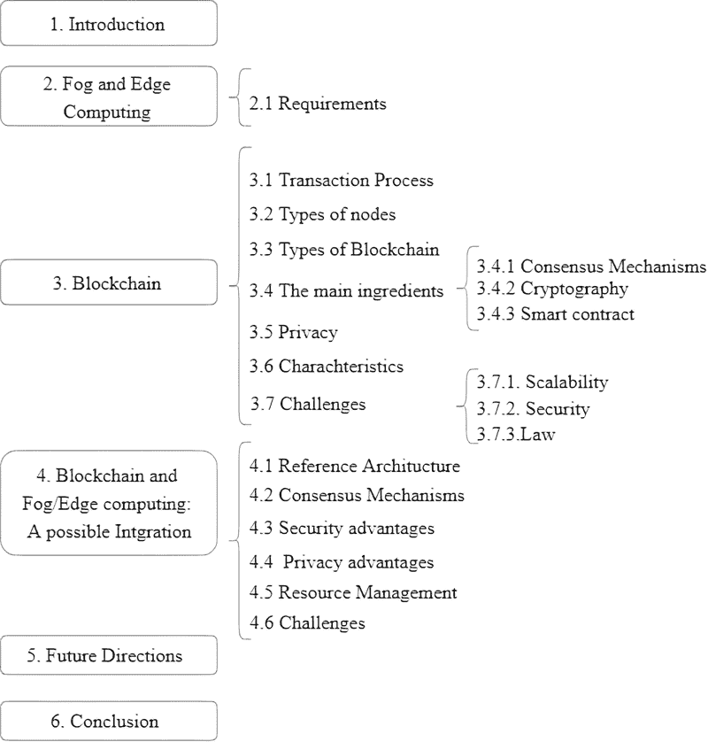

*图 6.1*  图表分类。

确实，区块链可被视为一项惊艳的创新技术，它彻底改变了我们开展业务的方式。该技术可定义为一种分布式数字账本，它利用点对点网络技术，在无需受信任的中心实体的情况下，以安全、按时间顺序且不可篡改的方式记录所有已发生的交易。更具体地说，区块链技术基于四个主要概念：分布式账本、共识机制、加密算法和智能合约。文献 [14,15] 描述了最早旨在利用密码学保护区块链安全的贡献之一；作者设计了一个系统，其中文档的时间戳无法被更改。更重要的是，区块链通过降低安全风险，确保其用户有可能安全地进行交易，这比当前系统更具优势。正如工业界（如 IBM [16] 和 Microsoft [17]）和政府兴趣的剧增所证明的那样，它在金融和非金融应用中有许多用途。这项技术引发了一波新的经济浪潮，并将对几乎所有行业领域产生重大影响，从而将其推向聚光灯下。

节点、计算、去中心化和分布式本质等概念为区块链和雾计算所共有。此外，在不同的研究中，这两种技术都被指定用于满足物联网需求，其中区块链是应对安全和隐私问题的关键赋能者，而雾计算是应对计算、存储和网络服务的关键赋能者。本章的主要贡献是讨论区块链与雾计算的融合，旨在安全地共享数据并防止未经授权的用户访问数据。本章其余部分的结构如图 6.1 所示。

### 6.2 借助雾计算和边缘计算实现云到物的连续体

目前，新的分布式架构促进了智能设备的涌现，并利用 5G 通信技术实现其组网和部署。其用途聚合了不同类型应用进步带来的数据指数级增长，应用范围涵盖智能交通、电子健康应用、零售，以及为机器人技术和增强现实开发的其他应用。这些设备在地理空间上分布；它们持续生成和消耗海量数据。为了及时处理这些数据，需要一种新架构来扩展云架构。为此特定目的，边缘计算（增强型数据 GSM 环境）和雾计算（或移动或虚拟云云小单元）被提议以互补方式协同工作，以提高提供给消费者的服务质量 (QoS) 和体验质量 (QoE) [18]（图 6.2）。


*图 6.2*  分层架构（云-雾-物联网设备），智能设备（车辆、手机、机器人、监控视频等）可将其工作负载卸载到位于边缘附近的雾节点上，该节点在设备层和云层之间提供了一个中间层。IoT，物联网。

雾节点和边缘节点被部署以确保不同数据源之间的交换，并处理网络中海量的事务切换。与中心化架构相反，去中心化架构最适合物联网应用，并带来了额外的有利特性，尤其是对移动应用。数据卸载到雾节点和边缘节点后，计算、控制、存储和网络将实时执行。这些节点不如云节点健壮，但优于物联网设备。需要高性能资源的关键数据处理和繁重或复杂的计算任务将被传输到云计算。此外，雾计算的处理结果将被传输到云数据中心以进行更好的数据分析。


通常在文献中，边缘计算和雾计算指的是同一种范式。它们包含一种分布式架构，靠近终端设备，确保短延迟。OpenFog 联盟强调了这两个概念之间的差异。文献 [19] 和 [20] 通过聚焦于它们各自的共同和特有特性，阐述了雾计算和边缘计算。

从雾计算开始，Cisco 是引入这一新范式的先驱 [7]。它旨在通过优化数据在网络边缘处理的遍历路由，确保其服务在网络中水平分发。此外，该范式被视为一条线索，引领云与 IoT 设备之间的数据流相互连接。OpenFog 联盟提出了一种扁平架构，将计算资源推向靠近边缘网络的位置。此外，雾计算的敏捷性为开发者通过应用程序编程接口（`APIs`）和软件开发工具包（`SDKs`）推出服务开辟了道路。

另一方面，边缘计算范式由欧洲电信标准协会（`ETSI`）提出 [21]。基本上，这两种范式在架构、扁平化本质和功能等几个方面相似，但存在一些差异。有了这些新概念，在设备位置附近处理数据相比在云中处理数据缩短了响应时间。边缘计算是一项引人注目的成果，可加速实时处理以服务众多应用，并实现小于 1 ms 的延迟 [22]。

此外，雾计算的构想是控制边缘设备之间的互通，并将计算、存储和网络从云推向物；而终端设备之间的互通控制以及计算、存储和网络功能则被限制在本地和边缘网络。

表 6.1 对比了雾计算和边缘计算的特性：

*表 6.1* 雾计算和边缘计算的特征

| Features | Fog computing | Edge computing |
| --- | --- | --- |
| Devices examples | Small servers, Switches, Access points | Edge routers, Base stations, Home gateways |
| Latency | Low | Low |
| Server nodes location | Between edge and cloud | Close to smart devices |
| Server nodes count | Fewer than edge servers | Very large |
| End-device mobility | Support mobility | Support mobility |
| Scalability | High | High |
| Interaction in real time | Timely processing | Timely processing |
| Heterogeneity | Yes | Yes |
| Architecture | Decentralised | Decentralised |

#### 6.2.1 需求

为了实现雾计算和边缘计算的优势，需要满足许多需求。尽管提供了优势，雾和边缘基础设施面临一些挑战，这些挑战产生了一些需要解决的需求。安全和隐私需求已在 [21]、[23]、[24] 中进行了调研。文献 [21] 的作者确定了与边缘计算层相关的八个威胁向量（`TVs`）。IoT 设备面临多种攻击，如物理篡改攻击、硬件木马攻击、侧信道攻击和软件化攻击（注入恶意代码），这些可能对雾和边缘节点产生负面影响并造成严重问题。

表 6.2 总结了雾和边缘计算的安全和隐私需求。

*表 6.2* 雾和边缘计算的需求

| Requirements | Definitions |
| --- | --- |
| Security | 雾和边缘节点的安全健康取决于三个参数：机密性、完整性和可用性。基本上，终端设备与雾和边缘节点之间建立直接通信。首要的是，数据必须仅由合格实体访问，以确保数据的机密性。为此，建立认证和访问控制机制以满足上述要求至关重要。此外，重要的是要指出，数据在雾和边缘设备之间复制和共享，可能导致数据不一致和信息丢失。为避免此类情况，确保数据完整性很重要。此外，即使雾或边缘节点故障，也必须提供不间断服务。服务应由其他节点交付。 |
| Privacy | 需要不同的隐私保护机制来确保交易及其参与者的隐私。 |

如前所述，区块链技术被选为引入雾和边缘计算，试图提供安全和隐私。

### 6.3 区块链

区块链技术重新定义了传统数据库的概念，并改变了控制网络中不同方之间交易的方式。它提供了一种分布式账本，记录所有已提交的交易，控制权由所有有兴趣参与区块链网络的节点执行。本质上，区块链的内在属性是由其结构（安全由设计保证）所使用的加密技术建立的安全性和隐私性。区块链是使用时间戳机制按时间轴线性排序的区块序列，构成防篡改的数据块。区块通过哈希机制加密绑定，主要维护数据完整性。区块链利用去中心化共识机制确保账本中记录的所有信息均有效且可验证；这是通过在不受信的网络节点（即运行区块链软件或“矿工”的节点）之间达成协议来实现的。更具体地说，当用户向区块链网络发送交易（例如转移加密货币）时，它会广播给所有网络节点。节点收到交易后验证该交易，如果验证通过，则将交易传输给其邻居。定期，共识机制随机选择一个节点来创建包含有效交易列表的区块。然后，该节点将新区块追加到其区块链副本中，并将该区块传输给其邻居。节点收到新区块后验证该区块，如果验证通过，则将该区块追加到其区块链副本中。因此，假设至少 50% 的节点不是恶意的，节点们就会就区块链网络的真实有效状态达成一致。

当 `Bitcoin` 应用首次推出时，它引入了基于矿工节点的新概念，矿工节点是区块链网络中的审查实体。矿工的主要任务是使用共识算法检查交易的有效性并做出决策，目的是抵抗双重支付攻击并加强网络中的控制。事实上，参与网络的矿工节点越多，建立的安全性越高，恶意节点串谋的可能性越低。

区块链技术在不同领域引起了广泛关注。图 6.3 根据文献 [25] 的调研，展示了应用领域的概览。


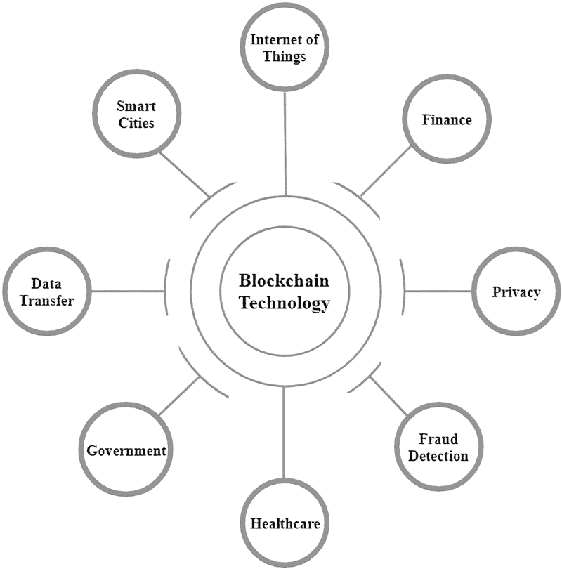

*图 6.3 区块链的一些使用场景。*

#### 6.3.1 交易流程

当用户想要与区块链交互时（例如，转移加密货币或存储遗嘱），该用户会创建一笔交易，并使用私钥对其进行签名；请注意，区块链使用公钥加密。然后，它将交易发送到区块链网络；接收交易的节点会验证该交易（例如，验证用户签名），如果有效，则将交易存储在其待处理交易列表中，并将其传输给相邻节点。定期会选出一个节点来创建区块；选择依据是所使用的共识协议。该节点随后创建一个由区块头和交易列表组成的区块；一个区块中最大交易数量取决于所使用的区块链（例如比特币和以太坊）。区块链头包含：(i) 一个时间戳，表示区块创建的时间；该时间戳由安全的时间戳机制生成，以保证链中区块的按时间顺序创建；(ii) 前一个区块的哈希值；这使得区块链具有不可篡改性，因为如果不改变整条链，就无法修改任何区块。确实，即使更改区块中的一位，也会改变其哈希值；(iii) 一个 Nonce（随机数），即用于验证区块有效性的任意数字；这适用于使用工作量证明（PoW）共识机制的情况；以及 (iv) 代表区块内所有交易哈希值的 Merkle 树根节点。创建新区块的节点将其追加到其区块链副本中，并发送给相邻节点。收到新区块后，节点会验证该区块，如果有效，则将其追加到其区块链副本中，并发送给相邻节点。区块验证过程包括：(i) 检查 Merkle 树的根哈希；(ii) 检查区块中所有交易的有效性；以及 (iii) 检查前一个区块的哈希值。广播和验证新区块是保持网络上所有节点彼此同步的关键。

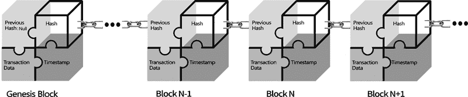

*图 6.4 区块链的数据结构。*

图 6.4 说明了区块链的简化结构：区块通过加密方式按逻辑顺序绑定。区块的字段可根据区块链的类型而有所不同。

#### 6.3.2 区块链网络中的节点类型

根据文献 [26]，区块链节点有三种类型：(i) 挖矿节点：负责生成区块；每当挖矿节点生成一个区块，就会获得奖励；(ii) 全节点：负责维护和分发整条区块链的副本；特别是，它们负责验证挖矿节点生成的区块。全节点越多，区块链越去中心化，也就越难被攻破；(iii) 轻节点：执行与全节点类似的功能，但不维护整条区块链；通常，轻节点连接到一个全节点，仅下载前序区块的头部，并连接到全节点。作为示例，图 6.5 展示了区块链操作的一个示例；一笔交易由轻节点生成并由矿工验证。然后，一个矿工创建一个包含该交易的新区块，该区块由矿工/全节点验证并追加到区块链中。

#### 6.3.3 区块链的类型

区块链有多种不同类型。更具体地说，区块链有三种类型 [27]：无许可链，也称为公有链（例如比特币和以太坊）、有许可链，也称为联盟链（例如 Hyperledger Fabric），以及私有链。在公有链中，任何参与者或用户都可以向区块链写入数据，并可以读取区块链中记录的数据；任何人都可以成为全节点、矿工或轻节点。因此，记录的数据几乎没有隐私可言，且参与者加入网络没有法规或规则限制。通常，公有链被认为是伪匿名的（例如比特币和以太坊）；参与者无需透露其身份（如姓名），而是与一个地址关联（即公钥的哈希值）。提供匿名性很难，但却是可行的（例如 Zcash）。这种类型区块链的成功取决于参与者的数量，并利用激励机制鼓励更多参与。联盟链对谁可以参与设定了限制。特别是，区块的创建和验证由一组预授权节点控制；例如，我们有一个由 10 家银行组成的联盟，每家银行运行一个节点。读取区块链中记录数据的权限可以是公开的，也可以仅限于参与者。甚至参与者在区块链中能做什么也可能受到限制；例如，两个参与者之间的交易可能对其他参与者隐藏。在私有链中，写权限是中心化的，且仅限于单一实体；读权限可以是公开的，也可以是受限的。


*图 6.5 交易从诞生到集成到主链的生命周期（轻节点：创建步骤，挖矿节点和全节点：验证步骤）。*

#### 6.3.4 区块链的主要要素

##### 6.3.4.1 共识机制

共识机制是区块链的关键组件之一。它们旨在防止和排除双重支付和拜占庭将军（BG）问题 [28]。网络上所有分布式节点都必须遵循并达成共识，才能成功将新区块追加到区块链。共识机制可分为两类。基于证明的方案，如 PoW 和权益证明（PoS）[29]，以及基于投票的方案，如实用拜占庭容错 [30]。通过这种方式，矿工通过遵守共识协议，试图拒绝恶意实体发起的非法区块创建。它们的运作方式不同，但共同通过奖励矿工来补偿其贡献，从而形成竞争。每种共识机制的使用取决于区块链应用的特定性，目前仍在不断改进中，旨在在验证创建的交易时将时间和能源消耗降至最低 [31]。

##### 6.3.4.2 密码学


# 区块链的基本机制：密码学

密码学是区块链的基本机制之一。众所周知，密码学的词源源自两个希腊词“cryptos graphein”，分别指“隐藏”和“书写”[32]。在不安全的环境中，引入密码学是为了确保只有经过批准和认证的实体才能使用多种技术从签名和加密的消息中提取数据。数据完整性、数据机密性、认证、匿名性和隐私保护是密码学实现的主要需求。为了实现安全私密的平台，区块链平台使用密码算法来满足上述需求。非对称密码学（也称为“公钥密码学”）主要用于构建数字签名以对交易进行签名。Rivest-Shamir-Adleman (RSA) 和椭圆曲线 Diffie-Hellman (ECDHA) 是区块链平台中使用的最有趣的密码方案。

## 密码学哈希

密码学哈希[33]是一种机制，用于在发行者将数据交易广播到网络之前对其进行加密。安全哈希算法 (`SHA256`) 是一种著名的哈希算法，已在多个密码系统中实现，它依赖于对输入参数进行哈希并将其转换为 256 位大小的输出。它是单向函数；即每个输入有且仅有一个哈希目标作为结果，并且无法仅根据哈希来预测和推断输入。此外，`SHA-256d`（对数据应用两次 `SHA256` 函数）用于增加复杂性和挖矿时间（比特币、Peercoin 实现了 `SHA-256d`）。`Scrypt`（由莱特币实现）和 `Ethash`（由以太坊实现）也是作为哈希函数的其他算法[34]。

###### 6.3.4.2.1 签名交易

在区块链网络中，通过验证交易发送者是否为数据的真实合法所有者，以及交易数据在网络中是否被修改或篡改，来建立不同实体之间的信任和可靠性。非对称密码学通过一对密钥（公钥和私钥）绑定到网络中的每个实体。公钥在区块链网络的所有实体间共享，相反，私钥需要对其他实体保密，无论网络中建立了何种信任。基于区块链的系统具有自主性，可使用 `ECDSA` 或带有 `secp256k1` 的 `RSA` 为每笔交易生成一个由 27-34 个 alphanumeric 字符组成的唯一地址，称为全局唯一标识符 (`GUID`)[35]。根据[36]，区块链可分配的地址数量估计为 1.46 × 10⁴⁸，这增强了 IPv6 提供的地址空间。每笔交易都有一个发送方和一个接收方。公钥用于使用 pay-to-pub key hash (`P2PKH`) 方法[35]生成与交易关联的地址。私钥是一个 64 位 alphanumeric（256 位十六进制格式），用于对交易进行签名，且具有不可否认性，这意味着交易发行者无法否认其对数据的所有权。

#### 6.3.4.3 智能合约

智能合约的概念由 Nick Szabo 于 1994 年提出，早于任何区块链技术的出现。它以传统合同相同的方式定义协议周围的规则和惩罚，但也能自动强制执行这些义务。智能合约是部署到区块链上的代码和数据；第一个基于区块链技术的智能合约于 2015 年部署在以太坊上。智能合约可以执行计算、存储信息，并自动向其他账户发送资金。更具体地说，它提供许多函数/原语（例如 `transfer token`、`store document` 和 `buy token`），可由用户调用。智能合约是不可变的（在区块链上）；因此，用户可以信任它执行从简单的加密货币转账到更复杂操作的各种操作。在以太坊上，智能合约可以使用 `Solidity` 语言（图灵完备语言）实现，并使用 `RemixIDE` 部署[38]。

#### 6.3.5 隐私

重要的是要注意，数据传输必须在私密环境中进行，以确保交易元数据（发送方和接收方地址及内容）不被泄露。因此，我们可以区分两种隐私类型：保护交易内容和保护参与者身份，这两者都是核心需求。

1. 交易与其发行者之间的关系应以无法追踪真实身份并切断其关联性的方式进行管理。文献[36]指出了一些分析策略，如反洗钱 (`AML`) 或了解你的客户 (`KYC`)，这些策略应用于公共区块链网络，能够追踪交易路径并提取关于区块链的一些基本信息，回答谁在使用区块链技术以及用于什么目的等重要问题。

2. 隐私交易是指保护网络中不同节点间交换的交易价值。基于区块链的应用包含一些关键信息，如患者病历、财务记录等，这些信息需要防范具有欺诈或窃取意图的恶意对手。这意味着区块链技术应管理每个实体的可访问性和认证。

区块链的总体目标是通过实施不同技术来提高上述隐私级别，以满足前述需求。

区块链使用的不同技术中包括环签名。Rivest 等人[39]首次引入环签名，作为一种可用于掩盖和隐藏交易发行者真实身份并使其匿名的技术。它基于从一组用户的公钥中选择一组用户来构成一个环。过程如下：当用户尝试签名交易时，他们使用自己的私钥和环中所有用户的公钥（称为“RingSign”步骤）。然后，下一步是由验证者验证交易的有效性（称为“RingVerify”步骤）。使用此技术，交易发行者无法被触达和追踪。正如[36]所述并如图 6.6 所示，用户分别拥有公钥和私钥，环由一组用户的公钥组成。用户使用环中的所有属性对消息进行签名。因此，验证者无法预测谁是该情形下消息交易的真实所有者，因为所有用户概率均等。

`Monero`[40]是一个实现了 `CryptoNote` 的分布式加密货币应用，后者使用环签名和一次性密钥来隐藏交易的源地址和目标地址。后来该方案升级为使用可追踪环签名，以防止双重支付攻击并使交易内容匿名。


此外，环签名、零知识证明是区块链中增强隐私的另一工具，它基于证明者 `P`，证明者需要向验证者实体 `V` 证明其拥有知识，而无需透露原始值。该机制可公开验证，用于多个区块链应用（如 Zerocoin），且通常与智能合约执行结合使用。此外，为对抗分析攻击，混币技术依赖可信中介进行交换。该技术旨在通过使用可信中间地址而非直接交易，切断通常相互交易的两个地址之间的关联性。而且，安全多方计算是一种密码学方案，基于一组参与者在保持其私密信息秘密的前提下尝试计算一个函数。同态加密也被区块链用于潜在地增强其数据隐私，通过外包计算任务而不允许内包提供商预测原始数据值的任何信息。


**图 6.6** 包含一组用户公钥集合的环签名。用户使用环的所有密钥执行 `RingSign` 操作。然后，验证者执行 `RingVerify` 操作。

#### 6.3.6 区块链特性

表 6.3 总结了区块链的潜在特性，重点关注不可变性、可追溯性、同步性、匿名性、机密性、完整性、唯一性和简易性。

#### 6.3.7 挑战

尽管区块链在多个领域取得了诸多益处，但也存在一些问题。去中心化、安全性和可扩展性是区块链的主要三难困境。在这三个关键参数之间寻找平衡是一项真正的挑战 [[29]](#17_Chapter06.xhtml#ref6_29)。正如文献 [[41]](#17_Chapter06.xhtml#ref6_41) 作者所言，区块链在物联网采用方面存在一些缺陷。

**表 6.3** 区块链技术的特性

| 特性 | 定义 |
| --- | --- |
| 不可变性 | 在区块链应用中，记录数据不可伪造且不可变。这是通过时间戳机制实现的，区块按时间顺序排列在链中；加密和哈希使得篡改区块数据变得困难，甚至不可能。 |
| 可追溯性 | 来源证明是建立网络信任的关键。作为供应链的一个用例，文献 [[42]](#17_Chapter06.xhtml#ref6_42) 的作者开发了一个名为“OriginChain”的平台，利用联盟链和智能合约提供产品可追溯服务。另一个用例是社交媒体。文献 [[43]](#17_Chapter06.xhtml#ref6_43)、[[44]](#17_Chapter06.xhtml#ref6_44) 的作者有兴趣利用区块链作为工具追踪社交媒体内容新闻的来源，以打击在多个信息渠道传播的假新闻。 |
| 同步性 | 当新区块成功创建并追加到主链时，区块链的更新版本将同时上传到网络中的所有节点（按时间维度）。 |
| 匿名性 | 通过区块链使用的隐私机制，交易的身份（包括其内容及参与者）是匿名的 [[45]](#17_Chapter06.xhtml#ref6_45)。 |
| 机密性 | 利用区块链技术中的公钥密码学，定义了合格实例以及用户参与区块链网络的条件 [[46]](#17_Chapter06.xhtml#ref6_46)。 |
| 完整性 | 区块链因其集成的时间戳和加密签名机制而受到赞誉，因此用户可以确保交易通过通信通道的生命周期由所有分布式账本保护和管理。 |
| 唯一性 | 利用共识机制消除双重支付攻击：一笔交易不能被执行两次或更多次。 |
| 简易性 | 使用区块链技术将简化一组操作。此外，该技术提供单一注册 [[47]](#17_Chapter06.xhtml#ref6_47)，即终端设备一旦注册，后续交易无需再次注册。 |
| 消除单点故障 | 区块链节点分布在点对点网络中。利用智能合约作为该技术的重要组成部分，区块链呈现为分布式管理器 [[48]](#17_Chapter06.xhtml#ref6_48)。 |
| 开源 | 许多区块链应用（如比特币、以太坊、Hyper Ledger）是开源平台，帮助开发者以此为基础，通过对比现有平台的特性来建模自己的平台 [[45]](#17_Chapter06.xhtml#ref6_45)。 |
| 自主性 | 通过智能合约中预定义的规则，物联网设备受到控制并能自主行为 [[49]](#17_Chapter06.xhtml#ref6_49)。 |
| 可用性 | 任何应用最渴望的标准之一是随时随地的数据可用性。区块链账本分布式存储在每个节点中，这赋予了其按需提供数据记录的高可用性，并使其避免了单点故障系统。尽管某个节点发生故障，区块链系统仍通过其他节点的可用性正常运行，数据持续可用。 |
| 隐私 | 区块链技术使用的不同技术（如零知识证明、环签名、加密、匿名化等）允许在不透露网络中不同实体个人信息的情况下进行通信。这一优势符合 GDPR 关键要求。许多论文已专注于利用区块链技术进行物联网应用的访问控制。例如，文献 [[50]](#17_Chapter06.xhtml#ref6_50) 提出的方案使用 FairAccess（集成了 PPDAC），其运作方式与 RBAC 相同，构成了一个去中心化框架，将访问控制策略作为交易记录在区块链账本中，实现了用户的匿名性和不可关联性。 |
| 问责性 | 在导致分叉问题的自私挖矿情况下，自私矿工会被识别出来。 |
| 激励 | 通过激励机制吸引节点参与，矿工因参与而获得奖励，从而创造激励机制。 |
| 可信性 | 利用共识机制，区块链在无信任环境中建立信任。 |

缩写：GDPR，通用数据保护条例；IoT，物联网；PPDAC，隐私保护分布式访问控制；RBAC，基于角色的访问控制。

##### 6.3.7.1 可扩展性


区块链随着网络中持续发起的交易频率不断增长。随着区块链规模的扩大，资源受限的设备无法在其系统上存储完整的链副本。此外，挖矿过程需要大量的执行时间。因此，吞吐量下降。实际上，比特币每秒处理 3 到 7 笔交易，以太坊每秒处理 7 到 15 笔交易，这不适合网络中海量的交易，也不适合实时应用。文献 [29] 解释了增加区块大小与降低计算难度之间的失衡，这肯定会提高吞吐量，但会降低安全级别，并为攻击者敞开大门。实际上，区块链需要估计一小时的时间间隔来处理从创世区块到集成到主链的数据。如前所述，区块链每秒只能处理少量交易，而网络中发起的交易量巨大，这构成了一个必须克服的真正挑战。

##### 6.3.7.2 安全性

1. 不存在能够抵御所有类型漏洞并避免其严重影响的完美系统或算法。在本部分中，我们重点介绍威胁区块链网络及其参与者的多种攻击。文献 [45, 51, 52] 的作者深入分析了不同的攻击。

2. 区块链可能遭受女巫攻击，恶意参与者能够在网络中创建行为不当的伪造节点。在公有链中，挖矿过程需要高计算资源，这代表了一种有助于缓解此类攻击的方法。

3. 51% 女巫式攻击中，恶意节点拥有对网络中 51% 以上矿池的影响力和控制力。这可能危及交易中发布数据的可信度。例如，在公有链中，主导方可能批准创建伪造和错误的交易。

4. 无疑，挫败区块链安全性的严重攻击是钱包盗窃。区块链参与者在称为“钱包”或“多重签名钱包”的软件中保护其数字签名。黑客试图窃取与网络中每个参与者相关的信息。一旦得逞，黑客可以冒充合法所有者，并在稍后自由交易。此类攻击发生在 2016 年香港 Bitfinex 比特币交易平台上，该平台遭受钱包盗窃攻击，导致 7200 万美元损失。

5. 当区块链设定新策略并改进其共识协议版本时，分叉问题会导致区分两类节点（新旧节点）。因此，由于版本控制和节点不兼容，可能会生成并发生“硬分叉”和“软分叉”。在两种情况下，较新的节点在挖矿方面拥有更大的权力，因为它们将遵守升级后的共识，而不是旧节点。

6. 不幸的是，区块链使用的传统非对称加密算法在拥有强大量子计算机的恶意节点面前变得脆弱。然而，文献 [53] 中作者提出了后量子区块链（PQB）作为抵御量子计算攻击的解决方案。

##### 6.3.7.3 法律

通用数据保护条例（GDPR）是欧洲法规。其主要使命是定义和建立欧洲组织为保护敏感个人信息而必须适用的法律和限制。我们在文献 [54] 中注意到，区块链技术具有某些特征，似乎与 GDPR 原则相矛盾。区块链中数据的不可篡改性与 GDPR 核心原则“被遗忘权”相冲突。当区块被维护在区块链中时，数据无法被修改或删除。相反，“被遗忘权”规定每个实体在必要时都应有权删除自己的数据（例如患者的健康史）。区块链中数据不可磨灭的性质可能给执法带来绊脚石。针对这一前景，文献 [55] 的作者提出了一种名为 FLPE（功能保持局部擦除）的新方法，基于在节点本地层面擦除数据。简言之，该解决方案允许清除相关交易，同时为恶意实体自由交易敞开了大门。

### 6.4 区块链与雾计算和边缘计算：一种可能的合作

毫无疑问，雾计算被认为是缓解大量设备发起的请求压力、满足低延迟、实时响应、高能力处理海量流量以及计算任务中更好性能需求的最佳解决方案（图 6.7）。有了架构中的这一新层，计算服务去中心化，服务更靠近终端设备。然而，用户担心并不愿接受以牺牲其敏感数据隐私和安全为代价提供的服务。同时，区块链技术已凭借其安全和隐私机制成功构建了一个稳健的平台 [56]。为此，为了加强雾系统与终端设备在安全性和隐私方面的通信，将区块链用于雾节点似乎很有前景。正如文献 [12] 所述，这两种技术天作之合，能带来双赢局面。为了决定该技术是否是一个有效的实施解决方案，文献 [49] 引入了一个决策框架。通过后者，作者研究了区块链技术在物联网和边缘计算环境中的适用性，并定义了有助于选择合适平台（公有链、许可链或联盟链）的参数。许多项目已针对区块链技术在雾计算下的部署进行了研究，使用户能够安全、私密地获取和接收雾服务。例如，工业边缘项目 [57] 就是为此视角下的工业流程和物流管理用例而启动的。文献 [58] 的作者指出，区块链将在安全性和隐私方面为雾和边缘基础设施提供增值，从而产生许多研究来提出结合两种技术的模板架构。


*图 6.7* 物联网（IoT）设备与雾节点共享数据。后者节点作为分布式账本用于存储和计算。

#### 6.4.1 参考架构


许多标准开发组织，如 `OpenFog Consortium` 和 `Industrial Internet Consortium`，在边缘计算领域为制定称为参考架构的标准架构做出了重大贡献，如 [[59]](#17_Chapter06.xhtml#ref6_59) 所述。参考架构是一个模板模型，专家可以以此为基础构建自己的架构。在工厂自动化的 `H2020` 项目背景下，作者提出了一种新型架构 `FAR-EDGE reference architecture`，该架构引入了区块链技术作为主要组件，以保护来自传感器的数据 [[60]](#17_Chapter06.xhtml#ref6_60)。此外，[[59]](#17_Chapter06.xhtml#ref6_59) 的作者与后一种参考文献拥有相同的愿景，即引入区块链技术以增强边缘计算中的安全性。他们将 `Global Edge Computing architecture` 概念化为一种参考架构。他们的方法优于四种现有的参考架构（即 `FAR-edge`、`SAP Cloud Trust Center`、`Edge Computing Consortium` 和 `Industrial Internet Consortium`），他们从中获得灵感并借鉴了优势。他们提出的架构验证了一组重要指标，包括安全性和可扩展性。同样地，[[61]](#17_Chapter06.xhtml#ref6_61) 提出了一种概念性参考架构，支持边缘计算的可信编排管理（`TOM`）。区块链在此架构中的应用关键作用是确保安全属性，包括硬件和软件设备的识别、数据源头的映射以及防抵赖性，旨在安全地管理编排信息。另外，[[62]](#17_Chapter06.xhtml#ref6_62) 的作者引入 `HyperLedger` 作为边缘计算的控制系统。该模型基于 `IEC 61499` 标准，将架构分为两个主要层级：监管层和执行层。第一层基于 `Hyperledger fabric` 区块链，利用智能合约分发对执行层的控制和监管，旨在确保安全的交易验证。第二层，即执行层，指部署 `docker` 容器以管理来自不同设备的交易的边缘节点。因此，所有这些架构都在其架构中集成了区块链，从而实现了网络中数据的安全传输。

#### 6.4.2 共识机制

将计算任务外包给雾节点，预期能满足物联网设备与雾节点之间一定级别的可靠性和可信度。双向地讲，雾节点和物联网设备都应能确保信任等级，以便协作共事。一方面，终端设备应确保被请求的雾节点能够完成计算任务。另一方面，雾节点需要确保请求设备将支付每项计算服务的费用。因此，建立信任是共识机制最重要的方面之一。如前所述，传统的共识机制（如 `PoW`、`PoS` 和 `Practical Byzantine Fault Tolerance`）在验证交易时消耗大量时间和能源。为了应对区块链的可扩展性挑战，正在开发新解决方案，通过提出新的共识算法和验证技术，以减少创建新区块的追加等待时间和能耗 [[58]](#17_Chapter06.xhtml#ref6_58)。[[63]](#17_Chapter06.xhtml#ref6_63) 的作者提出了一种基于极大化-因子分解统计的雾计算 `PoW` 共识方法。该解决方案能以更少的时间和内存消耗解决 `PoW` 中的数学难题。同样针对这一问题，但不同于传统共识机制（如 `PoW`、`PoS`、`BFT`、`DPoS`），文献 [[64]](#17_Chapter06.xhtml#ref6_64) 引入了信任证明（`PoT`）。所提共识机制选择具有更高可信度的实体作为矿工，在 `TrustChain` 网络中称为“Trust Blogger”。`PoT` 共识的优势特性包括：没有中央机构控制网络，且多数攻击无法在 `TrustChain` 网络中发生。应用于边缘计算背景的另一种共识机制是流行度证明（`PoP`）[[30]](#17_Chapter06.xhtml#ref6_30)。该机制依赖边缘节点的知识财富而非其算力。对所采用机制证明的评估表明，它提高了边缘环境的安全级别。

#### 6.4.3 安全优势


通常认为，在 IoT-fog-cloud 基础设施上流通的数据是网络所有层面临的各类攻击的目标。因此，IoT 数据的安全性和隐私性仍然是一个重要课题。建立信任、确保机密性、完整性和可用性的必要性是同等重要的指标，必须加以解决，特别是对于构成 IoT 层和云层之间桥梁层的雾层和边缘层。正如文献 [46] 所述，由区块链指导的安全服务包含上述指标。从这个角度来看，一系列研究 [21] 提出将区块链作为一种设计时即安全的方法来保障多接入边缘计算（MEC）。简而言之，信任无疑是有助于保持用户信心的参数。基于同一愿景，BlockMEC [48] 这一基于区块链的 MEC 平台被提出，旨在利用智能合约部署的服务，在核心节点（边缘节点）和终端设备之间建立可信环境。从同一视角出发，文献 [65] 介绍了一种基于比特币的支付平台，旨在在计算服务的外包方和提供方（雾服务器）之间建立信任。该支付平台主要依赖押金机制和智能合约。该平台的理念是以公平的方式控制外包方和提供方之间的支付操作。例如，当外包方因故未支付计算费用时，提供方将自动从存储在区块链中的外包方押金交易中扣除相应金额而获得支付。此外，文献 [66] 的作者提出了一种机制，引入区块链技术为轻量级设备提供安全服务，保护它们免受不受信任的边缘服务器的侵害。作者在其提出的系统中引入智能合约来检查边缘服务器的有效性。他们选择将边缘服务的有效性状态存储在云节点中，这有助于 IoT 设备根据信誉评级做出选择合适的边缘设备提供商的决策。在车辆通信中，传输数据的安全性是维护数据一致性和溯源的首要参数。文献 [67] 的作者提出了一种基于区块链和边缘计算的架构。路边单元构成稳定的账本，负责执行挖矿操作和提供计算服务。关键信息存储在区块链节点中，以提高架构的安全级别。此外，为了应对 IoT 设备的可扩展性和安全性挑战，文献 [68] 的作者设计了一个名为 EdgeChain 的新型框架，基于边缘计算、区块链和智能合约。该框架利用许可区块链技术和智能合约提供数据不可篡改等安全优势，并通过智能合约上预定义的策略自动化资源分配流程。区块链技术扩展到了智能工业流程领域。文献 [69] 的作者试图调查不同的攻击并处理那些会危及网络各层的攻击。在此意义上，作者提出了用于 Log-HOUSE 建设的 SEC-BlockEdge，利用区块链和边缘计算作为增强工业流程性能的有效解决方案。他们的研究表明，账本层为网络中的每一层增加了有价值的优势。特别是对于边缘层，它有助于安全、私密地处理、存储和共享来自不同来源的数据。主要地，区块链技术为交易记录提供了防篡改机制。这是不同研究人员提出的解决方案，旨在通过防止恶意方的任何篡改来增强雾节点上数据的完整性。文献 [70] 提出了一种名为 BeCome 的区块链赋能计算卸载方法，旨在实现 MEC 中数据的完整性，同时优化边缘计算设备任务、卸载时间和能耗。在云计算的同类案例中，文献 [71] 提出将区块链作为一种基于分布式复制账本的数据库系统，能够确保云计算范式中的完整性。此外，为了打击网络中的欺诈活动，文献 [72] 的作者设计了一个名为 Cochain-SC 的新型框架，主要基于以太坊区块链，使用智能合约和 SDN。通过上述框架，作者旨在缓解和对抗 DDoS 攻击，并实时检测攻击者的不良行为。

#### 6.4.4 隐私优势


为了更好的数据隐私，将数据传输到去中心化系统而非中心化系统具有优势，因为不必担心单点故障，并能将风险降至最低。为此，IoT 设备将其数据委托并卸载到雾节点进行计算。因此，维护交易价值的隐私至关重要。区块链技术建立了一系列技术，使交易发起者能够通过隐藏发送方地址、接收方地址和交易内容来控制其匿名性 [73]。因此，在雾节点上部署区块链将提高隐私级别。同样重要的是，区块链允许经批准的实体通过提供身份证书加入对等网络，并且也有权将不受信任的实体从其网络中排除。为此，文献 [47] 提出了 BSeIn 框架，并利用密码学方案（基于属性的签名、多接收者加密、高级加密标准、消息认证码）来确保雾计算层中的匿名认证、可审计性、机密性和细粒度访问控制。此外，文献 [64] 引入了一种结合边缘计算的新型隐私保护区块链，称为 TrustChain。TrustChain 主要通过实施零知识证明、加密和匿名化技术，旨在保护个人信息秘密，允许用户私密地与服务提供商交互。该框架的一个额外功能是允许用户通过使用与 GDPR 密钥（擦除权）匹配的加密链接来删除数据。针对同一情况，文献 [30] 提出了一种以用户为中心的区块链（UCB），利用区块链保护版权和边缘知识。另一个适用场景是拼车系统，它为协调一组共享相同目的地和相同路线的人（乘客和司机）共乘一辆车提供了有效解决方案。文献 [74] 的作者提出了一种名为“FICA”的高效且保护隐私的拼车模型，利用区块链辅助的车载雾计算来避免乘客和司机暴露其真实位置和目的地等敏感信息导致的数据隐私泄露。FICA 使用私有区块链，并实现了匿名认证方案、私有邻近性测试和隐私保护范围查询方案，以满足并保证一组目标和一组安全参数，包括：(i) 认证，该方案允许用户匿名认证，并允许雾节点验证其真实位置；(ii) 数据机密性和完整性，拼车记录在私有区块链网络中免受任何外部或内部篡改；(iii) 用户隐私，用户身份得到保护；(iv) 可追溯性，可信机构可在用户行为不端时追踪其身份；(v) 效率，该模型引入区块链以降低存储成本，引入雾节点以降低计算任务成本。文献 [75] 为电动汽车之间的电能分配建立安全和隐私提供了另一个用例。建立了一种安全的支付机制。其思路是集成一个基于联盟区块链和边缘计算的框架。该框架中的主要参与者包括：(i) 电动汽车（EV），即 IoT 节点；它们可以在点对点网络中共享能量，以维持供需之间的能量平衡；(ii) 授权的本地能源聚合器（LEAGs）是向网络中的 EV 分发数字签名并审核交易有效性的权威机构；(iii) 边缘服务提供商（ESP）代表边缘节点。通过与每个 EV 关联的公钥来保护身份，防止攻击者映射轨迹并通过真实身份定位特定 EV。LEAGs 从 ESP 购买计算服务，以成功创建区块链中的交易并增强网络的可扩展性。

#### 6.4.5 使用区块链进行资源管理

雾计算的关键角色之一是分发计算任务。如前所述，在区块链辅助的部署中，IoT 设备面临三大挑战：(i) 非常有限的资源能力，通常不足以在本地执行计算任务；(ii) 有限的带宽；(iii) 还需要维持其电量。文献 [76] 的作者通过实验证明，雾计算比云计算更适合托管区块链应用。解决方案是将挖矿过程委托给网络中的近邻节点（雾节点）。因此，这种委托优化了计算任务，但缺乏对 IoT 节点资源优先级的调度。因此，随着每个设备的请求数量增加，流量将变得拥堵。文献 [77] 引入了一个基于许可区块链的适当框架，作为基于信用的资源管理，用于管理 IoT 设备连续体的资源分配，而自动化管理是智能合约的关键角色。文献 [78] 中，作者提出了一种定价机制，以缓解拥堵并支持移动设备执行挖矿任务。因此，服务价格将根据供需波动。应用了 Stackelberg 博弈论来管理边缘系统和移动设备的资源。区块链和雾计算需要应对不同最终用户的异构性，并考虑给予他们选择适合其需求的节点单元的自由度 [79]。

#### 6.4.6 融合面临的挑战

不可否认，区块链技术在安全和隐私服务方面具有丰硕的优势。然而，雾计算、边缘计算与区块链的融合也带来了一些问题和限制。该领域的研究仍处于起步阶段，这凸显了加速朝这个方向研究以达到一定成熟度的重要性。首先，传统行业无法轻易采用区块链等新技术。它们需要深入分析两者的融合是否是符合其目标的良好解决方案 [42]。第二个限制是高昂的资金和时间成本将阻碍区块链在多个用例中的集成。例如，作者分享了他们关于 OriginChain 实验的经验教训。另一个限制是移动性。实际上，大多数研究没有考虑用户设备的移动性方面，例如车辆的高速移动 [67]，这可能导致严重的不稳定性问题 [80]，以及易出错的无线传输链路 [81]，这与区块链账本不兼容。

### 6.5 未来方向


我们希望通过本章，从安全和隐私的角度，为区块链与雾计算及边缘计算的融合提供一个清晰的视角。在未来的研究方向中，我们将集中精力并深入研究，调查适用于雾计算和边缘计算的共识与激励机制、参考架构以及隐私保护技术。

### 6.6 结论

在未来几年，区块链技术将引起广泛关注，并为不同领域带来宝贵贡献。更确切地说，凭借其安全和隐私机制，它有望应用于雾计算和边缘计算的概念中。在本章中，我们概述了这项技术的额外价值。它被视为安全和隐私的关键推动者，通过公开验证交易的有效性、建立信任、保护交易及其参与者的隐私、自动执行交易、收集经过验证的信息，以及预防和抵御破坏性攻击。凭借所有这些有利特性，区块链理想地成为为雾计算和边缘计算层开启众多机遇、强化雾计算和边缘系统免疫力的适配解决方案。

### 参考文献

[1] E. Anzelmo, A. Bassi, D. Caprio, S. Dodson, R. Van Kranenburg, and M. Ratto, Discussion Paper on the Internet of Things commissioned by the Institute for Internet and Society, Berlin, pp. 1–61, 2011.

[2] G. Knieps, 'Internet of Things, big data and the economics of networked vehicles,' *Telecomm. Policy*, vol. 43, no. 2, pp. 171–181, 2019.

[3] J. S. Walia, H. Hämmäinen, K. Kilkki, and S. Yrjölä, '5G network slicing strategies for a smart factory,' *Comput. Ind*., vol. 111, pp. 108–120, 2019.

[4] F. Bonomi, Connected vehicles, the Internet of Things, and fog computing. In *The Eighth ACM International Workshop on Vehicular Inter-Networking (VANET)*, Las Vegas, NV.

[5] 'OpenFog Consortium.' [Online]. Available: [www.openfogconsortium.org](http://www.openfogconsortium.org).

[6] T. H. Ashrafi, M. A. Hossain, S. E. Arefin, K. D. J. Das, and A. Chakrabarty, 'Service based FOG computing model for IoT,' *Proc. 2017 IEEE 3rd Int. Conf. Collab. Internet Comput. CIC 2017*, vol. 2017-January, pp. 163–172, 2017.

[7] Cisco, '*Fog Computing and the Internet of Things: Extend the Cloud to Where the Things Are*.'

[8] M. A. Khan and K. Salah, 'IoT security: Review, blockchain solutions, and open challenges,' *Futur. Gener. Comput. Syst*., vol. 82, pp. 395–411, 2018.

[9] N. Vlajic and D. Zhou, 'IoT as a land of opportunity for DDoS hackers,' *Computer (Long. Beach. Calif)*., vol. 51, no. 7, pp. 26–34, 2018.

[10] R. Kuhn and T. Weil, 'Can blockchain strengthen the IoT?,' *Secur. IT*, pp. 68–72, 2017.

[11] V. Dedeoglu, R. Jurdak, G. D. Putra, A. Dorri, and S. S. Kanhere, 'A Trust Architecture for Blockchain in IoT,' 2019.

[12] 'No Title.' [Online]. Available: [`blogs.cisco.com/innovation/blockchain-and-fog-made-for-each-other`](https://blogs.cisco.com).

[13] Q. Shafi and A. Basit, 'DDoS botnet prevention using blockchain in software defined Internet of Things,' *Proc. 2019 16th Int. Bhurban Conf. Appl. Sci. Technol. IBCAST 2019*, pp. 624–628, 2019.

[14] S. Haber and S. Stornetta, 'Introduction,' *J. Cryptol*., vol. 3, no. 2, pp. 99–111, 1991.

[15] W. Bolt, 'Bitcoin and cryptocurrency technologies: A comprehensive introduction,' *J. Econ. Lit*., vol. 55, no. 2, pp. 467–469, 2017.

[16] 'IBM.' [Online]. Available: [www.ibm.com/fr-fr/blockchain](http://www.ibm.com).

[17] 'Microsoft.' [Online]. Available: [`azure.microsoft.com/en-us/solutions/blockchain/`](https://azure.microsoft.com).

[18] T. Taleb, S. Dutta, A. Ksentini, M. Iqbal, and H. Flinck, 'Mobile edge computing potential in making cities smarter,' *IEEE Commun. Mag*., vol. 55, no. 3, pp. 38–43, 2017.

[19] A. Yousefpour et al., 'All one needs to know about fog computing and related edge computing paradigms: A complete survey,' *J. Syst. Archit*., 2019.

[20] T. Internet, 'Tutorial 1: What is fog computing and how is it different from edge computing?,' no. April, pp. 18–20, 2017.

[21] P. Ranaweera, A. D. Jurcut, and M. Liyanage, '9. Realizing multi-access edge computing feasibility: Security perspective,' no. September, 2019.

[22] M. Chiang and T. Zhang, 'Fog and IoT: An overview of research opportunities,' *IEEE Internet Things J*., vol. 3, no. 6, pp. 854–864, 2016.

[23] S. Raza, S. Wang, M. Ahmed, and M. R. Anwar, 'A survey on vehicular edge computing: Architecture, applications, technical issues, and future directions,' *Wirel. Commun. Mob. Comput*., vol. 2019, 2019.

[24] P. K. Sharma, M. Y. Chen, and J. H. Park, 'A software defined fog node based distributed blockchain cloud architecture for IoT,' *IEEE Access*, vol. 6, no. c, pp. 115–124, 2018.

[25] J. Abou Jaoude and R. George Saade, 'Blockchain applications: Usage in different domains,' *IEEE Access*, vol. 7, pp. 45360–45381, 2019.

[26] I. Makhdoom, M. Abolhasan, H. Abbas, and W. Ni, 'Blockchain's adoption in IoT: The challenges, and a way forward,' *J. Netw. Comput. Appl*., vol. 125, no. October 2018, pp. 251–279, 2019.

[27] D. Mingxiao, M. Xiaofeng, Z. Zhe, W. Xiangwei, and C. Qijun, 'A review on consensus algorithm of blockchain,' *2017 IEEE Int. Conf. Syst. Man, Cybern. SMC 2017*, vol. 2017-January, pp. 2567–2572, 2017.

[28] K. Wust and A. Gervais, 'Do you need a blockchain?,' *Proc. 2018 Crypto Val. Conf. Blockchain Technol. CVCBT 2018*, no. i, pp. 45–54, 2018.

[29] R. Yang, F. R. Yu, P. Si, Z. Yang, and Y. Zhang, 'Integrated blockchain and edge computing systems: A survey, some research issues and challenges,' *IEEE Commun. Surv. Tutorials*, vol. PP, no. c, pp. 1–1, 2019.

[30] G. Li, M. Dong, L. T. Yang, K. Ota, J. Wu, and J. Li, 'Preserving edge knowledge sharing among IoT services: A blockchain-based approach,' no. July, 2019.

[31] Z. Zheng, S. Xie, H. Dai, X. Chen, and H. Wang, 'An overview of blockchain technology: Architecture, consensus, and future trends,' *Proc. 2017 IEEE 6th Int. Congr. Big Data, BigData Congr. 2017*, pp. 557–564, 2017.

[32] 'Cryptography.' [Online]. Available: [www.etymonline.com](http://www.etymonline.com).

[33] National Institute of Standards and Technology (NIST), 'Secure Hash Standard (SHS) (FIPS PUB 180-4),' *Fed. Inf. Process. Stand. Publ*., vol. 180–4, no. August, p. 36, 2015.

[34] T. M. Fernández-Caramés and P. Fraga-Lamas, 'A review on the use of blockchain for the Internet of Things,' *IEEE Access*, vol. 6, no. c, pp. 32979–33001, 2018.


### 参考文献

[35] N. Z. Aitzhan and D. Svetinovic, "Security and privacy in decentralized energy trading through multi-signatures, blockchain and anonymous messaging streams," *IEEE Trans. Dependable Secur. Comput.*, vol. 15, no. 5, pp. 840–852, 2018.

[36] Q. Feng, D. He, S. Zeadally, M. K. Khan, and N. Kumar, "A survey on privacy protection in blockchain system," *J. Netw. Comput. Appl.*, vol. 126, pp. 45–58, 2019.

[37] A. H. L. Luu, D.-H. Chu, H. Olickel, P. Saxena, "Making smart contracts smarter," *Proc. 2016 ACM SIGSAC Conf. Comput. Commun. Secur.*, vol. 28, no. 6–7, pp. 254–269, 2016.

[38] F. Schrans, S. Eisenbach, and S. Drossopoulou, "Writing safe smart contracts in flint," *ACM Int. Conf. Proceeding Ser.*, vol. Part F1376, no. June, pp. 218–219, 2018.

[39] R. L. Rivest, A. Shamir, and Y. Tauman, "How to leak a secret: Theory and applications of ring signatures," pp. 164–186, 2006.

[40] "Monero." [Online]. Available: `https://web.getmonero.org/`。

[41] M. S. Ali, M. Vecchio, M. Pincheira, K. Dolui, F. Antonelli, and M. H. Rehmani, "Applications of blockchains in the Internet of Things: A comprehensive survey," *IEEE Commun. Surv. Tutorials*, vol. 21, no. 2, pp. 1676–1717, 2019.

[42] Q. Lu and X. Xu, "Adaptable blockchain-based systems: A case study for product traceability," *IEEE Softw.*, vol. 34, no. 6, pp. 21–27, 2017.

[43] A. Qayyum, J. Qadir, M. U. Janjua, and F. Sher, "Using blockchain to rein in the new post-truth world and check the spread of fake news," 2019.

[44] P. Fraga-Lamas and T. M. Fernández-Caramés, "Leveraging distributed ledger technologies and blockchain to combat fake news," 2019.

[45] I. C. Lin and T. C. Liao, "A survey of blockchain security issues and challenges," *Int. J. Netw. Secur.*, vol. 19, no. 5, pp. 653–659, 2017.

[46] T. Salman, M. Zolanvari, A. Erbad, R. Jain, and M. Samaka, "Security services using blockchains: A state of the art survey," *IEEE Commun. Surv. Tutorials*, vol. 21, no. 1, pp. 858–880, 2019.

[47] C. Lin, D. He, X. Huang, K. K. R. Choo, and A. V. Vasilakos, "BSeIn: A blockchain-based secure mutual authentication with fine-grained access control system for industry 4.0," *J. Netw. Comput. Appl.*, vol. 116, no. May, pp. 42–52, 2018.

[48] Y. Zhu, "A survey on mobile edge platform with blockchain," *Proc. 2019 IEEE 3rd Inf. Technol. Networking, Electron. Autom. Control Conf. ITNEC 2019*, no. Itnec, pp. 879–883, 2019.

[49] C. Pahl, N. El Ioini, and S. Helmer, "A decision framework for blockchain platforms for IoT and edge computing," *IoTBDS 2018: Proc. 3rd Int. Conf. Internet Things, Big Data Secur.*, vol. 2018-March, pp. 105–113, 2018.

[50] A. Ouaddah, *A Blockchain Based Access Control Framework for the Security and Privacy of IoT with Strong Anonymity Unlinkability and Intractability Guarantees*, 1st ed. Elsevier, 2018.

[51] J. C. Song, M. A. Demir, J. J. Prevost, and P. Rad, "Blockchain design for trusted decentralized IoT networks," *2018 13th Syst. Syst. Eng. Conf. SoSE 2018*, pp. 169–174, 2018.

[52] W. Gao, W. G. Hatcher, and W. Yu, "A survey of blockchain: Techniques, applications, and challenges," *Proc. Int. Conf. Comput. Commun. Networks, ICCCN*, vol. 2018-July, no. i, 2018.

[53] Y.-L. Chen, Y.-X. Yang, X.-B. Chen, X.-X. Niu, Y. Sun, and Y.-L. Gao, "A secure cryptocurrency scheme based on post-quantum blockchain," *IEEE Access*, vol. 6, no. Part II, pp. 27205–27213, 2018.

[54] C. Alexopoulos, Y. Charalabidis, A. Androutsopoulou, M. A. Loutsaris, and Z. Lachana, "Benefits and obstacles of blockchain applications in e-government," *Proc. 52nd Hawaii Int. Conf. Syst. Sci.*, pp. 3377–3386, 2019.

[55] M. Florian, S. Beaucamp, S. Henningsen, and B. Scheuermann, "Erasing data from blockchain nodes," 2019.

[56] A. Prashanth Joshi, M. Han, and Y. Wang, "A survey on security and privacy issues of blockchain technology," *Math. Found. Comput.*, vol. 1, no. 2, pp. 121–147, 2018.

[57] "Industrial Edge Project." [Online]. Available: `http://www.oulu.fi/cwc/industrialedge`。

[58] M. H. Ziegler, M. Grobmann, and U. R. Krieger, "Integration of fog computing and blockchain technology using the plasma framework," pp. 120–123, 2019.

[59] I. Sittón-Candanedo, R. S. Alonso, J. M. Corchado, S. Rodríguez-González, and R. Casado-Vara, "A review of edge computing reference architectures and a new global edge proposal," *Futur. Gener. Comput. Syst.*, vol. 99, no. 2019, pp. 278–294, 2019.

[60] J. Soldatos, "Combining edge computing and blockchains for flexibility and performance in industrial automation," no. c, pp. 159–164, 2017.

[61] C. Pahl, N. El Ioini, S. Helmer, and B. Lee, "An architecture pattern for trusted orchestration in IoT edge clouds," *2018 3rd Int. Conf. Fog Mob. EdgeComput. FMEC 2018*, pp. 63–70, 2018.

[62] A. Stanciu, "Blockchain based distributed control system for edge computing," *Proc. 2017 21st Int. Conf. Control Syst. Comput. CSCS 2017*, pp. 667–671, 2017.

[63] G. Kumar, R. Saha, M. K. Rai, R. Thomas, and T.-H. Kim, "Proof-of-work consensus approach in blockchain technology for cloud and fog computing using maximization-factorization statistics," *IEEE Internet Things J.*, vol. 6, no. 4, pp. 6835–6842, 2019.

[64] U. Jayasinghe, G. M. Lee, Á. MacDermott, and W. S. Rhee, "TrustChain: A privacy preserving blockchain with edge computing," *Wirel. Commun. Mob. Comput.*, vol. 2019, pp. 1–17, 2019.

[65] H. Huang, X. Chen, Q. Wu, X. Huang, and J. Shen, "Bitcoin-based fair payments for outsourcing computations of fog devices," *Futur. Gener. Comput. Syst.*, vol. 78, pp. 850–858, 2018.

[66] M. Rehman, N. Javaid, M. Awais, M. Imran, and N. Naseer, "Cloud based secure service providing for IoTs using blockchain," no. July, 2019.

[67] X. Zhang, R. Li, and B. Cui, "A security architecture of VANET based on blockchain and mobile edge computing," *Proc. 2018 1st IEEE Int. Conf. Hot Information-Centric Networking, HotICN 2018*, no. 201702019, pp. 258–259, 2019.

[68] J. Pan, J. Wang, A. Hester, I. Alqerm, Y. Liu, and Y. Zhao, "EdgeChain: An edge-IoT framework and prototype based on blockchain and smart contracts," *IEEE Internet Things J.*, vol. 6, no. 3, pp. 4719–4732, 2019.

[69] T. Kumar, A. Braeken, V. Ramani, I. Ahmad, E. Harjula, and M. Ylianttila, "SEC-BlockEdge: Security threats in blockchain-edge based industrial IoT networks," no. July, 2019.

[70] X. Xu, X. Zhang, H. Gao, Y. Xue, L. Qi, and W. Dou, "BeCome: Blockchain-enabled computation offloading for IoT in mobile edge computing," *IEEE Trans. Ind. Informatics*, vol. PP, no. X, pp. 1–1, 2019.

[71] E. Gaetani, L. Aniello, R. Baldoni, F. Lombardi, A. Margheri, and V. Sassone, "Blockchain-based database to ensure data integrity in cloud forensics," *Int. J. Sci. Res. Comput. Sci. Eng. Inf. Technol. © 2018 IJSRCSEIT*, vol. 4, no. 10, pp. 2456–3307, 2018。


### 参考文献

72. Z. Abou El Houda, A. S. Hafid, and L. Khoukhi, "Cochain-SC: An intra- and inter-domain DDoS mitigation scheme based on blockchain using SDN and smart contract," *IEEE Access*, vol. 7, pp. 98893–98907, 2019.

73. G. Zyskind, O. Nathan, and A. S. Pentland, "Decentralizing privacy: Using blockchain to protect personal data," *Proc. 2015 IEEE Secur. Priv. Work. SPW 2015*, pp. 180–184, 2015.

74. M. Li, L. Zhu, and X. Lin, "Efficient and privacy-preserving carpooling using blockchain-assisted vehicular fog computing," *IEEE Internet Things J*., vol. PP, no. AUGUST, p. 1, 2018.

75. Z. Zhou, L. Tan, and G. Xu, "Blockchain and edge computing based vehicle-to-grid energy trading in energy Internet," *2nd IEEE Conf. Energy Internet Energy Syst. Integr. EI2 2018: Proc*., pp. 1–5, 2018.

76. M. Samaniego and R. Deters, "Blockchain as a service for IoT," *Proc. 2016 IEEE Int. Conf. Internet Things; IEEE Green Comput. Commun. IEEE Cyber, Phys. Soc. Comput. IEEE Smart Data, iThings-GreenCom-CPSCom-Smart Data 2016*, pp. 433–436, 2017.

77. J. Pan, J. Wang, A. Hester, I. Alqerm, Y. Liu, and Y. Zhao, "EdgeChain: An edge-IoT framework and prototype based on blockchain and smart contracts," *IEEE Internet Things J*., vol. PP, no. c, p. 1, 2018.

78. Z. Xiong, S. Feng, D. Niyato, P. Wang, and Z. Han, "Optimal pricing-based edge computing resource management in mobile blockchain," *IEEE Int. Conf. Commun*., vol. 2018-May, 2018.

79. M. Conoscenti and J. Carlos De Martin, "IOT\_blockchain for the Internet of Things: A systematic literature review," *Third Int. Symp. Internet Things Syst. Manag. Secur*., pp. 1–6, 2016.

80. S. Kim, "Impacts of mobility on performance of blockchain in VANET," *IEEE Access*, vol. 7, no. 1, pp. 68646–68655, 2019.

81. T. Jiang, H. Fang, and H. Wang, "Blockchain-based Internet of Vehicles: Distributed network architecture and performance analysis," *IEEE Internet Things J*., vol. 6, no. 3, pp. 4640–4649, 2019.

# 第 7 章

# 利用区块链技术扩展边缘计算安全性

## Pau Marcer, Xavier Masip, Eva Marin, and Alejandro Jurnet

**目录**

7.1 边缘安全挑战

7.1.1 引入边缘安全

7.1.2 边缘架构挑战

7.1.2.1 可扩展性

7.1.2.2 安全性

7.1.2.3 设备计算能力

7.1.3 云作为安全架构“已不再可行”

7.2 区块链在安全领域的应用

7.2.1 为何使用区块链

7.2.2 面临的挑战

7.2.2.1 区块链可扩展性问题

7.2.2.2 区块链数据共享

7.3 区块链架构

7.3.1 架构类型

7.3.1.1 无许可型

7.3.1.2 有许可型

7.3.1.3 混合型

7.3.2 共识

7.3.2.1 公共算法

7.3.2.2 有许可算法

7.3.2.3 新交易接受

7.4 区块链在边缘计算中的服务

7.4.1 安全设备画像

7.4.2 认证

7.4.3 边缘提供数据的完整性

7.4.3.1 验证

7.4.3.2 网关

7.5 应用于边缘场景的区块链与云解决方案对比

7.5.1 认证模型

7.5.2 安全边缘设备画像模型

7.5.3 边缘提供数据完整性模型

7.6 结论

致谢

参考文献

### 7.1 边缘安全挑战

#### 7.1.1 引入边缘安全

云计算是指运行在同质集群上的中心化服务，通常由单一组织控制和维护（尽管部署多云服务时情况可能会有所不同），因此能够提供相似的性能。在另一个层面上，边缘计算概念上是指高度去中心化的系统，支持服务在部署于边缘的异构设备集群上执行，每个设备可能嵌入不同的能力集，从而转化为不同的性能水平。

云与边缘范式之间显著的差异在涉及安全性时被高度强调。聚焦于云，由于服务是中心化的，安全性也可以通过中心化方式处理，且不会对整体系统性能产生相关影响。也就是说，公认中心化系统遭受单点故障问题（即，若中心化安全服务器或网络失效，云服务或网络也将随之失效）。然而，中心化系统通过贯穿整个基础设施的容错网络进行管理，云服务商提供的所谓高可用性特性使得该侧面的错误极少发生，且大多数错误是由运行在云基础设施上的服务引起的。

尽管如此，边缘端的整个场景截然不同。确实，有许多值得考虑的显著假设和约束，主要集中在三个领域：连接性、可扩展性和移动性。首先，边缘设备并非始终在线，这描绘了一个与云截然不同的场景（例如，该断言的驱动因素可能是网络故障、开/关节能策略等）。因此，若边缘设备想依赖云来保障安全，不可靠的连接性也将导致不可靠的安全性。因此，边缘绝不应依赖云来保障安全，云应作为保障边缘安全的补充工具，而绝非该安全的核心。

第二点涉及可扩展性。众所周知，云能够容忍数十亿连接，因为大多数云网络都是为此设计的。然而，当转向边缘时，网络在概念上的设计维度截然不同，边缘侧的大量连接可能会使边缘网络过载，从而对其设备构成潜在的拒绝服务（DoS）攻击。此外，由于用户配置文件通常存储在云端的中心化服务器中，边缘侧用户的扩展将随之触发边缘网络的可扩展性问题。


#### 7.1.2 边缘架构挑战

在本节中，将介绍并概述边缘遇到的主要架构挑战，其中大多数与在边缘潜在使用传统云模型所施加的安全限制有关。分析了三个关键挑战：(i) 可扩展性，描述融合云和边缘时出现的主要问题；(ii) 使用云解决方案时在边缘面临的强制性安全限制；以及 (iii) 某些边缘设备为保证安全所需的连接依赖性，这源于受限边缘设备固有的局限性，使它们必须依赖其他系统，并通过连接这些系统来保证安全供给。

##### 7.1.2.1 可扩展性

可扩展性确实是边缘计算中的一个重要问题。这一断言的基本原理主要植根于边缘汇聚了大量异构且移动的设备。这种背景使得云中心化策略不再足够，因为网络和提供的服务都可能轻易被边缘设备产生的预期请求数量压垮。

此外，值得一提的是，边缘系统中的可扩展性问题与类似的计算范式（云是最接近的一个）相比存在显著差异。确实，云服务依赖于数据中心巨大的可用容量和广阔的核心网络容量，以及现有的冗余策略，分别提供一组无限的和故障安全的服务。因此，聚焦于安全方面，解决边缘可扩展性问题的首要策略可能归结为部署冗余系统。然而，运行在云端的模型中，任何冗余策略的应用都利用完全受控的云环境，这并不适合边缘场景预期带来的情况。确实，冗余作为一种解决方案，无法很好地满足边缘系统固有的特征和需求，主要是因为边缘场景极其多样，汇聚了许多不同的利益相关者，这使得单一机构或组织进行控制操作变得不切实际。因此，边缘系统可能假设控制以分布式方式处理，从而使不同的利益相关者参与整体控制系统，这不仅完全颠覆了传统云模型，还对不同机构或组织接管控制权所需的协调提出了强烈要求。此外，部署在边缘的大量候选设备的多样性使得可扩展性变得有些模糊。可能会出现一些问题；例如，扩展哪种边缘设备重要吗？换句话说，是否存在对扩展的边缘设备类型的可扩展性依赖？边缘设备移动性是否影响可扩展性？

边缘系统固有的另一个重要特征，与传统云模型截然不同，且对整体可扩展性产生相关影响（特别是在处理安全时），是可信度。确实，与属于数据中心（即由云提供商拥有）的可信系统不同，边缘设备可能由第三方拥有，从而构建了一个大规模、多样、异构、动态且“非专有”的场景，其中设备完全不应被信任。一个说明性的场景可能是一辆智能汽车在城市中行驶。这种移动性不可避免地导致汽车在移动过程中突然连接和断开与多个设备的连接，这需要快速的安全设置。毫无疑问，依赖云来建立移动汽车与靠近汽车的设备之间的安全连接，在许多不同方面都是低效的，例如可扩展性或连接维持的时间减少，从而降低了其有用性。因此，为了在保证良好性能的同时最小化可扩展性问题，连接设置必须在边缘进行操作。

最后，还必须提到，虽然云系统可以轻松扩展以应对需求更多资源的服务（例如，以保证用户要求的质量水平），但这不能广泛应用于边缘场景。确实，关于边缘设备如何移动、设备如何在不同集群中聚类和转移、限制特定边缘设备广泛可用性的潜在商业模式、如何调整低容量受限设备以分配更多资源给特定服务（也适用于高容量设备）等问题，仅举几例，目前仍未得到解决。


## 结论

证据表明，基于中心化云架构的安全解决方案无法应用于边缘端。这主要源于其中心化本质：当转向边缘端时，这些解决方案无法扩展，而边缘端可能存在大量异构设备。因此，必须设计新型可扩展解决方案，利用去中心化模型来满足大多数边缘端的需求和要求。

##### 7.1.2.2 安全

安全是提供给用户的任何服务以及用于管理数据或基础设施的平台的必备要素。因此，安全必须是任何新技术解决方案开发中关键的设计时考量因素。与此断言一致，证据表明边缘计算需要一个高效的安全模型，旨在解决边缘计算成功且大规模部署所带来的安全挑战。此外，此类安全模型必须在早期阶段、从一开始就作为开箱即用的特性进行设计，从而避免特定安全补丁的需求。

然而，在向边缘端演进时，必须强调边缘端作为一个概念，包含一些众所周知的特征：

1. **高度分布式**：边缘端高度分布式；因此，无论提供安全保障的解决方案是什么，都应遵循完全分布式的方法，能够随着边缘端的扩展而扩展。
2. **高度异构**：构建边缘端的设备集合高度异构（例如尺寸、计算和存储、电源等），从传感器和执行器到笔记本电脑和智能手机；因此，设计的安全解决方案必须可扩展，以支持这种异构性和设备多样性，以及边缘设备在未来不可阻挡的演进，无论是新能力还是部署量方面。
3. **资源受限设备**：边缘设备也可能是能力有限的贫瘠设备，例如小型传感器，它们无法满足建立安全连接的要求，甚至无法应用任何安全策略或解决方案。虽然可以部署网关或第三方设备来克服这一限制，但正如下一小节所述，这会带来额外的安全约束。
4. **认证挑战**：边缘设备必须经过认证，这在移动边缘系统中颇具挑战。为此，可使用边缘配置文件，存储设备的相关信息（即设备规格），供其他设备用于认证或选择在边缘端执行服务。当然，此边缘配置文件应以分布式方式跨边缘端管理，否则中心化服务器将导致如前所述的可扩展性问题。确实，整个安全架构必须是分布式的，并能像边缘端一样良好扩展。因此，云技术不适合边缘系统带来的期望。那么，区块链会是一个好的方法吗？

##### 7.1.2.3 设备计算能力

边缘场景整体上相当多样且高度异构，汇集了许多具有不同特征和能力的设备。在如此多样的场景中，显然有几个设备将无法满足赋予安全性所需的特征（例如计算能力极低或高度动态的设备），甚至无法与边缘端上层的其他系统建立直接连接（超出设备所连接的系统，例如连接到小型网关的有线传感器、RaspBerryPi）。因此，这些设备将依赖额外的硬件（即网关）通过边缘端发送和接收信息。然而，设备与网关之间增加的这种连接对边缘端构成了威胁。网关与边缘端上层系统之间的北向连接可以得到保障。然而，设备（传感器）与网关之间的南向连接无法保证安全，因为这些设备对边缘端是未知的。因此，从网关接收数据的边缘设备应知晓：此类数据无法保证防篡改，因为这些数据来自不太可信的设备或不完全可信的数据。不过，如果将数据与同一位置的其他系统进行对比，这种情况可能会得到缓解。虽然这种不同数据的比对对于提高数据安全性可能高度相关，但它也引入了一个存储收集到的传感器配置文件或信息以供其他设备使用的场所的需求。当然，必须指出，如果此存储是中心化的，问题将再次出现。因此，不可信设备和传感器的信任问题可以通过从多个设备和传感器收集数据，并信任特定区域内大多数收集数据所报告的内容来解决。这可能是一个解决来自不安全设备的不可信数据问题的合理程序。

总之，当特定设备不可信时，为安全目的添加网关可能还不够，因为设备本身不安全，也无法部署任何安全策略。

解决这一挑战的一个潜在趋势将依赖边缘配置文件。可为边缘端的设备设置配置文件并与边缘端上层系统共享，这些系统据此可预期网关的行为。因此，若网关背后的传感器遭受攻击，则根据配置文件预期的数据将与从传感器接收到的真实数据不匹配。但这足够吗？

#### 7.1.3 云作为安全架构“不再可行”

云自设计和部署以来已成为广泛采用的计算范式，主要得益于其资源可用性（即高性能）和弹性。然而，这种卓越的性能并不意味着云可能是任何高要求场景的最优解。确实，如前所述，云是一种基于中心化的模型，当针对部署在边缘系统中的服务要求低延迟或安全保障等特定性能需求时，这无疑会产生重大影响。

确实，任何依赖云服务来保障安全的边缘网络，都将无法同时实现扩展并提供预期的安全级别。例如，假设一个边缘系统依赖云来保障安全。在此场景下，如果在任何时刻与云的连接丢失（这在向边缘端演进时极具预见性），边缘系统将无法访问边缘基础设施，因为它们无法到达云以获取安全供给。当然，应设计一些额外策略来修复此场景，例如基于通过边缘端分发安全性。

边缘系统背后的一个关键原则是服务可在部署在边缘端的不同设备集上以完全分布式的方式运行。这为设备无需连接云即可访问边缘端的网络基础设施铺平了道路。因此，通过将安全性分发至边缘端，设备将能够从该边缘网络请求服务，而无需访问云。这种分布式安全性必须默认部署，分布在整个边缘网络上，从而最大限度地减少对云基础设施的需求，充分利用近端资源，并实现更好的设计时安全模型。


# 区块链在安全领域的应用

理论上，安全性可以通过中心化模型（云）或分布式模型（边缘）来提供。第一种模型无法满足边缘计算的需求，而第二种模型又可细分为两种场景：第一种场景下，每个边缘基础设施自行管理并负责自身的安全；第二种场景下，安全性在边缘侧完全分布式化，使边缘的所有元素参与到协作模型中。

要构建分布式方法，最适合预期需求的当前技术是区块链。区块链在网络中所有参与设备间提供了一套完全分布式的不可变交易集，使设备成为“边缘区块链”的一部分。在该场景中，当设备失去连接时，边缘区块链的本地副本可用于认证其他设备。为此，区块链应用于存储边缘侧设备的配置文件，这些文件是服务执行和设备认证所必需的。

### 7.2 区块链在安全领域的应用

区块链是一种易于部署的技术，近年来因其解决现有棘手问题的潜力而备受关注。区块链适用于将一组不可变交易分发到网络中，使用户能轻松验证这些交易。由于没有负责数据验证的中心实体，每个用户都可通过其区块链的本地副本进行验证。然而，正如任何吸引学术界和工业界关注的新技术一样，区块链不应被视为能妥善解决所有场景的通用方案，尽管新技术出现时往往看似如此。

事实上，区块链面临着不同的架构挑战，其中可扩展性和共识问题尤为突出，这些问题可能阻碍其在某些场景中的采用。一方面，可扩展性问题源于区块链中存储的数据。由于区块链中的交易无法删除或移除，区块链上的交易总集将持续增长。为缓解这些可扩展性问题——特别是在利用区块链设计安全解决方案时，同时防止不必要的数据使区块链过载——软件开发人员必须认真考虑交易中可存储的内容及其存储方式。另一方面，共识算法的选择应审慎进行，特别是在边缘场景中，因为边缘固有的异构性将不同能力的设备聚集在一起，这可能导致高要求的共识算法无法在受限设备上正常运行。事实上，并非所有共识算法都能满足边缘的需求和约束。

因此，为尽量减轻这些挑战的影响，值得强调的是，区块链需要高效利用，并特别关注存储消耗，因为与云不同，边缘的资源非常有限。

#### 7.2.1 为何使用区块链

区块链是过去十年中最具前景（如果不说是最具前景）的分布式系统应用之一。其将一组不可变交易分布在整个网络中的能力，为尚未到来的分布式系统应用新世界铺平了道路。毫无疑问，这似乎是高度分布式系统的恰当解决方案。

实践中，当分布式系统需要安全保障时，可采用不同方案。依赖云的常规策略利用中心化方法（因此引入单点故障），因为不存在可应用于分布式系统的有效云模型。然而，中心化云方法不适合分布式系统，解决方案应基于向去中心化方法转变。

为高度分布式系统提供分布式安全的一个潜在选项是考虑匿名用户，每个用户生成自己的密钥集，在系统内完全匿名，要求用户手动将其公钥分发给目标集以进行认证。然而，这种方法不适用于边缘系统，因为边缘系统的大多数连接将是机器对机器，需要设备自动认证。此外，边缘系统无法依赖手动验证密钥，因为该过程无法有效扩展。

去中心化方法的另一个选项依赖于区块链。区块链因其保持一组不可变交易的能力而备受关注，每笔交易可存储例如设备的公钥和配置文件。这种结构可轻松且成功地将新设备注册到系统中，并由区块链分发到边缘网络。有趣的是，所有边缘设备都能利用已知的密钥和配置文件认证新添加的设备。

使用区块链的一个关键特性是设备不需要持续的网络连接，因为区块链的本地副本可用于验证已添加到系统中的任何设备。最终，如果设备失去连接，将无法用新设备更新区块链。但它仍能利用本地区块链副本认证已知设备，一旦恢复连接，即可更新并验证区块链至最新状态。

简而言之，在分布式边缘系统中使用区块链的主要基本原理和优势在于：(i) 数据和责任在边缘侧的完全分发；(ii) 每个节点均可在本地验证边缘网络中的所有设备，因此无需任何第三方参与即可保障边缘安全；(iii) 即使边缘节点与边缘部分断开连接，也能认证其他设备；(iv) 所有设备均掌握自身数据的安全，知晓边缘网络状况，并可基于该信息做出决策。

#### 7.2.2 面临的挑战

本节回顾可能阻碍区块链大规模部署的关键挑战，即可扩展性和数据共享问题，两者紧密相关。

##### 7.2.2.1 区块链可扩展性问题

区块链中一个关键且广为人知的问题，无疑阻碍了其在某些特定场景中的采用，即可扩展性。确实，虽然可扩展性问题在云计算场景中可能不那么关键（因为存储容量很大），但在考虑将区块链部署在分布式系统（如边缘计算构建的场景）中时，这成为“必须”解决的问题，因为内存容量通常可忽略不计。

主要的可扩展性问题源于数据不可变性特征。数据不可变性属性的一个附带效应是区块链中的数据无法擦除或替换，因此随着新交易的加入，区块链将无限增长。这种无限增长无法消除，因为唯一的方法是打破不可变性属性，而这正是使用区块链的主要原因之一。


然而，尽管无法消除无限增长，但寻找旨在减少此类增长的举措似乎是恰当的。实现这一目的的一个潜在途径在于软件设计人员，他们在向区块链添加数据时应当谨慎，从而确保存储在区块链中的数据确实是必要数据，而所有非相关数据则使用其他技术进行共享（即设备间的传输层安全 [TLS] 连接）。另一个潜在解决方案归结为删除区块链并建立一个新的区块链以减少空间占用。然而，只有当存储在区块链中的数据可以被移除时，才能实现这一点；否则，如果必须保留此类数据，则无法实施该解决方案。

##### 7.2.2.2 区块链数据共享

正如所述，一旦数据被提交到区块链，就无法将其擦除。这种提交特性的另一个附带效应关乎数据隐私，特别是在使用区块链共享私有数据时。这主要源于这样一个事实：因为没有人可以从链中删除数据，且链中的任何设备都可以访问共享的数据，所以该数据可能被任何设备读取。在实践中，数据会被加密以防止他人获取，但一旦数据变得敏感且有人试图解密它。事实上，这正是导致区块链不适合数据共享的主要原因。相反，数据应通过与其他设备的直接通道或通过第三方进行共享。此外，由于上述的可扩展性问题，以及为了避免区块链以不可控的意外速率增长，建议仅将区块链用于存储静态数据（即很少更改或更新的数据）。

### 7.3 区块链架构

区块链是一项相对较新的技术，其在安全供给方面的潜在贡献目前正在被探索。存在许多区块链实现，其中一些与各种倡议和项目相关联，例如 Hyperledger 项目 [[1]](#18_Chapter07.xhtml#ref7_1)。除了各种区块链实现之外，还有更多可供选择的共识算法，它们提出了不同的策略来达成共识，并获得不同的性能和安全级别。事实上，每种算法都在性能和安全性之间设定了权衡。

例如，比特币中应用的工作量证明共识算法确保数据不会被恶意篡改，除非大部分设备被控制。然而，它消耗大量资源，导致比特币在 2019 年使用的电力超过一些小国家 [[2]](#18_Chapter07.xhtml#ref7_2)，这无疑成为该特定共识方法的一个巨大性能问题。在另一端，其他算法（如冗余拜占庭容错 [RBFT]）消耗的电力少得多，但不幸的是容忍的恶意网络部分较低（例如，PoW 为 50%，RBFT 为 33%） [[3]](#18_Chapter07.xhtml#ref7_3)。还值得一提的是，PoW 允许所有节点参与共识，而只有特定选定的一组验证者可以参与 RBFT。

从架构角度来看，区块链网络可分为三个不同的群体，即无许可、有许可以及混合或联盟链，具体取决于所使用的共识算法。有趣的是，每个群体都有其自身的权衡，并且每个群体肯定最适合特定的环境（即应用该算法的服务或领域），这将在下一节中展示。此外，根据验证节点的定义方式，存在两类共识算法。

#### 7.3.1 架构

本节描述由 7.3.2 节 中将要描述的特定共识算法驱动的架构。

##### 7.3.1.1 无许可

在无许可区块链架构中，任何人都可以加入区块链网络并参与共识，因为在执行共识操作时不需要针对其他设备进行身份验证。图 7.2 展示了无许可架构，其中蓝色云朵代表区块链网络，蓝色节点代表属于该网络的设备。正如无许可架构所定义的，所有节点都可以参与共识。

这种架构完美适用于匿名加密货币网络，其中参与者希望彼此匿名，也是第一个区块链——即比特币的基础。用于此类区块链网络的、属于此架构群体的知名共识算法有 PoW 和权益证明 (PoS) [[4]](#18_Chapter07.xhtml#ref7_4)。

然而，在涉及安全性时，任何人都可以在无需向其他方进行任何形式身份验证的情况下操作交易这一事实，带来了严重的安全问题，因为恶意设备可能在网络中执行恶意操作而无人知晓。这就是促使这些架构在使用区块链保护基础设施时并非正确选择的原因。简而言之，如果部署区块链来保护物理边缘基础设施，则边缘设备之间需要一定程度的信任。为此，边缘提供商必须在一定程度上控制引入区块链的内容。


*图 7.2 无许可区块链网络示例。*

##### 7.3.1.2 有许可

与无许可架构不同，在有许可架构中，对区块链网络的访问受到控制，因此只有经过身份验证的设备才能加入区块链网络。图 7.3 描绘了有许可区块链网络，突出了与 图 7.2 相比的两个主要重要差异。首先，虽然与 图 7.2 所示的无许可架构类似，蓝色云朵代表网络，蓝色节点代表属于区块链网络的设备，但额外出现了红色节点，代表私有网络外未被授权访问区块链的节点集合。其次，在这种有许可架构方法中，只有蓝色验证节点可以参与共识，这与 图 7.2 中所有节点都可以参与共识的情况不同。

通常，在这种架构中，共识由单个组织控制，将一个节点或一组节点组合在一起以管理所有与共识相关的任务。这使得该架构成为某些场景（例如，汇集大量分布式节点和多个网络）的非最优选择，其根源在于区块链按定义至少应是可公开读取且允许任何设备自由加入的。事实上，这种架构超越了区块链应有的界限，主要是因为无法保证安全性，因为共识由单一机构控制，更容易发生故障。此外，对区块链成员资格施加此类控制违背了区块链的概念本身。


*图 7.3 有许可区块链网络示例。*

##### 7.3.1.3 混合


在这种架构方法中，允许任何设备读取区块链，即任何设备都可以验证其数据，但仅允许一组受控的“验证者”执行共识操作并提交区块。与前两种架构类似，图 7.4 将区块链网络表示为蓝色云团，属于该网络的设备表示为蓝色节点。正如 图 7.2（即无许可架构）所示，任何设备都可以加入网络，但不同之处在于，并非所有设备都能参与共识。事实上，可以定义两类设备：普通设备（属于区块链网络但不能参与共识）和验证者（可以参与共识）。


*图 7.4* 混合区块链网络示例。

作为另外两种方法之间的混合方法，这似乎是一个无需失去完全控制即可提供安全性的合理方案。确实，这种方法使所有网络设备能够审查和验证区块链数据，同时使一个组织联盟能够通过联盟成员拥有的一组验证者来控制区块链。通过这样做，只要验证者是安全的，区块链就不能被任何攻击者篡改。

简而言之，混合架构方法为提供安全性带来的益处可总结为：(i) 其部署受控共识的能力，可为所有设备建立信任；(ii) 通过组成联盟的各组织处理共识的能力，从而使系统更加稳健；以及 (iii) 无需认证过程即可让所有人读取区块链的能力。

#### 7.3.2 共识

在上一节中，描述了可设计的不同区块链网络架构，这些架构与要部署的不同共识算法高度相关。本节将深入探讨这些共识算法。

不同的共识算法被用于不同的环境和领域。表征这些算法的一个关键组件是指被启用以运行共识的设备集合，可分为两组：公共和许可。一方面，公共共识算法允许任何设备参与共识。然而，在这种策略中可能会出现一些问题，主要是因为所有设备都可以对区块链执行操作，区块链的安全性将取决于设备的意愿。因此，如果某设备决定执行恶意活动，其他设备将难以检测。另一方面，许可共识算法利用一组受控的验证者来确保对区块链网络的权威。许可共识算法的一个关键特征是其可扩展性，这是因为只有确定良好的一组节点处理共识任务，这确实转化为更好的性能，并使许可共识算法在将安全性应用于区块链网络时似乎是合适的选择。

简而言之，在许可共识算法中，只有被指定为验证者的设备才能对要提交到区块链的新区块和交易进行投票。因此，共识完全由验证者设备集合控制，而普通设备仅观察并接收验证者的投票。最后，当设备从验证者那里获得足够的区块投票时，该区块被视为已提交。

此外，在接受新区块时，验证者集合还可以检查关于该区块的其他一些信息。在本章末尾，包含了添加新交易时需考虑的潜在因素概述。仅作为一个示例，执行特权操作的交易可以升级到另一个验证者、设备或云以执行特权检查。

##### 7.3.2.1 公共算法

一些广为人知的公共算法有：

**PoW：工作量证明** [[4]](#18_Chapter07.xhtml#ref7_4)

在 `PoW` 共识算法中定义了矿工概念。“矿工”是创建或挖掘要添加到区块链的新区块的对等节点。为了让这些区块被其他节点接受，它们必须满足一个特殊的哈希值，即以四个连续的零开头。因此，矿工必须尝试不同的交易组合并计算区块的多个哈希值，直到找到所需的模式。一旦找到模式，该区块将由其他节点分发并提交。这种特殊的共识算法需要大量的计算能力——2018 年该共识算法消耗的电力超过一些小国家 [[2]](#18_Chapter07.xhtml#ref7_2)，这当然使其不适合边缘场景。

**PoS：权益证明** [[4]](#18_Chapter07.xhtml#ref7_4)

该共识算法遵循权益系统来选择验证者。权益系统偏向拥有更多财富（权益）的用户。因此，只有当用户拥有系统总权益的 51% 时，才能在区块链上表现恶意。该算法遵循这样一个标准：在系统上拥有最多权益的用户是损失最大的用户。因此，当他们被选为验证者时，会正确完成交易。

##### 7.3.2.2 许可算法

一些广为人知的许可算法有：

**PBFT：实用拜占庭容错** [[5]](#18_Chapter07.xhtml#ref7_5)

`PBFT` 是最基础的拜占庭容错算法。它依赖于分布式轮次，每轮添加一个新区块。该过程首先从可能的验证者集合中选择一个主节点（验证者）。为此，应用一些策略，根据协议的最终目标和环境进行定制。一旦选定主节点，它负责在接收到交易时设置不同交易的顺序。然后，当主节点收到添加新区块的请求时，主节点运行提交协议，该协议分为三个不同阶段：预准备、准备和提交，节点通过每个阶段的必要条件是从三分之二的验证者节点接收投票。当然，`PBFT` 协议要求每个节点都被区块链网络知晓。

**RBFT：冗余拜占庭容错** [[6]](#18_Chapter07.xhtml#ref7_6)

`RBFT` 算法扩展了前面的 `PBFT` 算法，旨在解决当故障或恶意副本实际上是所谓的主节点时出现的性能问题。为此，`RBFT` 使所有客户端成为一个主节点，并引入了“主实例”概念，即所有客户端和主实例负责对请求进行排序，但仅执行主实例的排序。

[[6]](#18_Chapter07.xhtml#ref7_6) 中的作者展示了 `RBFT` 的一些有希望的结果，显示在无故障发生时性能与其他协议相似，而当故障出现时，性能损失仅为 3%，相比之下其他协议为 78%。

**ZYZZVA：投机性拜占庭容错** [[7]](#18_Chapter07.xhtml#ref7_7)


同样源自拜占庭容错算法，该算法引入了投机机制，与传统的拜占庭容错算法相比，既最小化了成本，又简化了设计。验证者会自动响应任何请求，跳过了 PBFT 中提出的三阶段提交协议。因此，它们遵循所谓“主节点”的顺序；由于从未执行三阶段提交协议，网络通信降至理论最小值。然而，可能会出现一些不一致性，必须由验证者和设备来解决。

##### 7.3.2.3 新交易接受

与公共区块链算法或其他许可型共识算法相反，接受新交易并创建新区块时可能需要考虑额外因素，特别是在面临高度受限和异构场景时。假设一个边缘场景，不同的边缘设备应被赋予安全保障。在此场景下，边缘设备不得盲目接受任何交易，因为这会使系统变得不安全。解决此问题的方案要求该设备检查每笔交易，这随之又需要一个执行检查的中心化服务，再次导向中心化解决方案，这完全不好。事实上，边缘必须遵循分布式系统架构，同时提供安全性。顺应这一论点，边缘系统在添加新交易时应用的策略必须谨慎，以检查新交易不违反任何安全要求，以及交易发起者有权执行该操作。理想情况下，这些信息也应存储在区块链中，这样任何查找都变成本地查询，使边缘真正实现分布式，无需依赖云或任何其他中心化代理。然而，当情况并非如此且必须考虑第三方时，请求应保持在最低限度，仅要求一组非常小的操作，旨在最小化此类请求对中心化的依赖。

### 7.4 边缘计算中的区块链服务

本节介绍几种旨在为边缘设备提供安全性的可能解决方案。本节描述的所有解决方案均利用区块链技术，考虑将网络中所有设备汇聚在一个区块链中，并将每个设备与一个包含设备公钥的配置文件相关联。本节首先介绍一种基于区块链创建安全设备配置文件的方法。随后，介绍一种利用区块链设备配置文件进行认证的方法。最后，展示一种利用上述配置文件通过区块链共享签名数据的方法。

图 7.5 展示了本章所述最基础的区块链边缘网络。设备和配置文件均包含在区块链网络内，每个设备都拥有一份数据副本（所有其他配置文件）。因此，每个设备都能通过区块链利用配置文件在本地验证任何其他设备，无需依赖任何其他实体或第三方。


*图 7.5 带有配置文件的区块链网络示例。*

#### 7.4.1 安全设备配置文件

在边缘提供安全性要求识别和保护所有边缘设备。为此，边缘作为一个系统，需要一个负责帮助其他设备识别边缘网络中的组件并访问其配置文件的元素。这至关重要，因为配置文件存储在云端，这在很大程度上被认为不适用于边缘场景，也不具备可扩展性。因此，边缘需要一种技术，允许我们以分布式方式在边缘存储这些配置文件，而这项技术可能就是区块链。

区块链为我们提供了数据的分发性和不可篡改性。遵循这些特性，边缘可以利用区块链以安全的方式分发设备配置文件。配置文件可以存储在区块链的交易中，并作为设备 ID 暴露出来（见图 7.6）。有了这种数据结构，区块链将存储边缘设备的会话状态，该会话将由设备标识符和数据组成，并将保持所有区块链特性。


*图 7.6 区块链上以交易形式存储设备配置文件的会话示例。*

为了确保区块链配置文件的可信度，交易必须经过验证和部分控制，以防恶意设备引入恶意配置文件。因此，混合架构中的许可型共识算法似乎是边缘成功部署区块链的合适选择。

一旦交易和配置文件受信，设备 ID 也需要受信。为此，配置文件将需要一个密钥对。椭圆曲线密码学（ECC）的表现将优于 RSA，因为前者以更小的密钥尺寸实现了更好的性能。然后，密钥对的私钥将由设备持有，公钥将存储在区块链上。通过这种策略，公钥将成为设备 ID，配置文件将仅针对持有私钥的设备进行验证。

尽管这种存储本身在安全性方面作用不大，因为交易和区块必须经验证者批准，但边缘实际上可以利用区块链对边缘经批准的设备进行公钥分发。这将充当边缘会话，告知其他元素给定密钥属于边缘且应受信任，如图 7.7 所示。

但同样，这种结构单独来看完全不提供任何灵活性，因为公钥无法与任何事物关联，这也正是每笔交易都应拥有规则集的动因。事实上，规则集被定义为针对给定 ID（公钥）应用于会话的一组动作。例如，当设备提供其公钥注册到会话时，将添加一个注册规则集。此后，该配置文件可被使用，例如在选择执行边缘服务的设备时，或仅在执行机器间连接时，以便设备知道是否连接到了另一台设备。

执行注册时，待注册设备将提供其边缘配置文件，包括设备能力和传感器。能力定义为设备是什么，例如图 7.8 所示：供应商、操作系统、CPU、内存、GPU、电池或交流电源。当然，这只是一个示例，边缘配置文件中可能包含许多其他不同的特征和属性。这些能力将用于选择最适合特定服务成功执行所需的一组资源。因此，简而言之，配置文件将保存设备所连传感器的登记，并帮助其他设备了解该设备有哪些传感器及其能提供什么。


*图 7.7 区块链上以交易形式存储设备配置文件的会话示例，包含公钥和规则集。*


**Figure 7.8** 区块链上以交易形式呈现的设备配置文件的会话示例，包含公钥和规则集；规则集包含特定的边缘配置文件。

假设注册过程正确完成，且设备使用真实配置文件进行注册，那么该设备将在区块链的整个生命周期内被保护在会话区块链中。事实上，即使假设攻击者获得了设备及其私钥的访问权限，也永远无法修改已注册的配置文件，因为区块链根据定义是不可变的。

利用这种结构还可以做另一件事，即注册第二个公钥；该公钥将是 `ED25519`，设备将用它对数据进行签名，随后发送给任意会话设备。添加此签名密钥使会话中的设备能够发送未加密的签名数据，这主要用于传感器。大多数边缘传感器将部署在公共场所，当传感器的目标肯定是与边缘共享数据时，隐藏这些数据毫无意义。因此，传感器可以使用签名密钥和边缘会话对数据进行签名，然后发送签名数据（通过所需的网络连接或第三方通道），最后接收设备验证签名并根据边缘会话认证发送传感器。

#### 7.4.2 认证

边缘计算作为一种概念，利用大量设备通常通过机器间通信相互连接，以共享数据和资源。这种场景涉及大量设备、异构性和移动性（设备突然加入和退出），需要一种专门针对这些边缘系统约束量身定制的高效认证策略。如前所述，区块链可以成为执行边缘设备间此类认证的一种非常强大的技术。

为此，在属于区块链网络或会话的两个设备之间建立安全连接的过程如下。首先，每个设备可以将 `TLS` 连接的公钥与会话的公钥进行比较，如果该公钥属于该会话，则它将拥有一个关联了配置文件的规则集，如图 7.9 所示。


**Figure 7.9** 设备向第二个设备建立 TLS 连接。设备可以使用配置文件验证设备身份。TLS，传输层安全性。


**Figure 7.10** 设备向第二个设备建立 TLS 连接。第二个设备可以根据会话验证 TLS 密钥。TLS，传输层安全性。

第二步，将检查规则集配置文件，以验证并了解传入连接是谁，或者谁愿意连接，如图 7.10 所示。

这种方法的主要优势在于验证在本地执行，并在会话设备之间完全分布式进行，无需连接到任何中心化实体来验证数据，从而成为一种高度可扩展的解决方案。

#### 7.4.3 边缘提供数据的完整性

谈到边缘数据的完整性，主要有两个领域。第一是指验证任何边缘设备发送的数据的需求。第二涉及验证网关后边缘设备发送的数据，因此这些设备对于边缘来说是未知的。

##### 7.4.3.1 验证

设备中的数据验证过程可采用两种方法：

* 设备可以通过验证 `TLS` 连接来验证接收到的数据。在这种情况下，因为 `TLS` 保证是安全的，且 `TLS` 连接的公钥可以根据会话配置文件中的公钥进行验证，所以数据保证是正确的（参见图 7.10）。
* 或者，设备可以发送签名但未加密的数据（即传感器向网络广播温度传感器数据）。然后，接收数据的任何设备都能够通过使用会话验证数据签名来验证数据发送者，如图 7.11 所示。


**Figure 7.11** 设备通过边缘发送签名数据，接收设备可以验证数据。

##### 7.4.3.2 网关

使用前面所述的规则集，边缘还可以注册另一种类型的设备，即同时拥有多个设备的设备，称为“网关”。在边缘计算中，大多数传感器都在网关之后，网关为它们提供访问权限。因此，这些传感器无法从网络到达，换句话说，就是无法到达网关之外（参见图 7.12）。因此，可以考虑网关所连接的不同设备来注册网关，并使用新的规则集。这将告知其他边缘设备设备和传感器存在于网关之后，但这些设备只能通过网关到达——尽管如果网关同时使用规则集注册了这些设备的密钥，则另当别论。因此，所有边缘会话参与者都将能够认证从网关后设备接收到的数据。


**Figure 7.12** 带有网关的边缘网络示意图。

网关提供的数据将使用与任何设备相同的方法进行验证。如前所述，因为唯一的变化是实际的会话信息——让设备知道数据来自设备还是网关——验证仍将使用从网关配置文件中提取的公钥来执行。

网关的会话表示将如图 7.13 所示。网关是一种设备，同时可以注册子设备，带有其自己的密钥和配置文件。因此，在注册会话时，网关会同时注册其子设备。


**Figure 7.13** 带有规则集和子设备配置文件的网关示意图。

### 7.5 应用于边缘场景的区块链与云解决方案对比

本节简要总结了区块链与其他云解决方案在应用于边缘系统时的对比。首先，介绍了 `CA` 和证书的认证模型与基于区块链的认证模型的对比。其次，介绍了中心化云服务器的设备配置文件与区块链的对比。最后，讨论了边缘数据的完整性，对比了数据库和区块链方法。

#### 7.5.1 认证模型


当将区块链作为一种认证模型与广泛使用的 CA（证书颁发机构）和证书进行比较时，必须指出证书被设计为静态的，因此在处理中心化安全（例如中心化 Web 服务）时成为最佳选择。然而，在处理边缘场景、将一组异构且分布式的移动设备整合在一起时，CA 和证书难以应用。

此外，区块链是完全分布式的，因此从根本上改变了 CA 和证书的工作方式。事实上，使用区块链时，中心化服务器的单点故障被消除，同时数据可以通过区块链持续分发给对等节点。这使得区块链成为一个完美的密钥分发系统，具有高可用性和去中心化特性，同时高度可定制，因为只要数据对边缘有意义并遵循最佳实践，任何数据都可以作为交易存储。事实上，在边缘场景中，区块链可用于设备间的相互认证，使用存储在区块链中的配置文件，因此所有边缘设备都可以知道边缘处的其他设备是谁，并因此可以使用这些配置文件的本地副本对它们进行认证，即使它们仅部分连接到边缘。

#### 7.5.2 安全边缘设备配置文件模型

为了保存边缘设备的配置文件，如果边缘使用中心化数据库甚至分布式数据库，很快就会遇到可扩展性问题。这是因为设备数量将超过数据库容量。此外，数据库的复制存在限制，因为复制得越多，整个数据库在所有实例上达到一致所需的时间就越长。

区块链技术的一个关键特性在于它提供了一组完全分布式的交易。因此，如果整个边缘系统将边缘配置文件以及所有相关边缘信息存储在区块链上，则任何操作都不需要中心实体。这无疑是一个显著的优势，因为如果边缘需要一个中心实体来通过其配置文件识别任何边缘设备，则会导致巨大的瓶颈和糟糕的可扩展性结构。此外，在这种情况下，将始终需要与云的活动连接，这也是不可取的。

另一方面，如果边缘依赖区块链技术，如前所述，配置文件的信息将复制到所有设备上。因此，任何设备都可以在本地访问该信息，甚至无需连接到云，并且实际上可以在离线状态下访问设备配置文件，即使网络上只有另一台设备可达也能使用它们。

事实上，在谈论网络安全时，在边缘部署区块链的主要优势可以综合为：无需中心化实体验证配置文件，而是边缘可以通过区块链以分布式方式执行相同操作，从而消除了可扩展性作为一个问题。

#### 7.5.3 边缘模型提供数据的完整性

在边缘使用中心化数据库会将所有数据存储在单个设备中。因此，如果该设备发生故障，数据也将随之丢失。更重要的是，如前所述，这种中心化系统将无法随边缘设备扩展。因此，单个设备无法服务整个边缘。事实上，虽然中心化数据库可以保留在云端，但它仍将遭受上述所有问题。因此，集中化边缘必须访问的信息是一个糟糕的选择。此外，将数据集中在单点会带来重大安全风险，因为如果攻击者获得数据库访问权限，数据可能被篡改。同样，在分布式数据库场景下，数据可能变得防故障，但在高度分布式网络（如边缘）中使用此类数据库时，可扩展性成为一个问题。

另一方面，区块链可以将数据完全分发到边缘设备上，并且可以像边缘一样良好地扩展。在安全分发数据时，这非常重要，因为数据库可能成为攻击的单一目标，而分布在边缘各处的区块链数据，由于复制级别和不可变性属性，几乎不可能被篡改。

### 7.6 结论

区块链似乎是保护大型分布式系统（如边缘计算中设想的系统）的强大且理想的工具。事实上，区块链提供了在所有边缘设备上分发和维护不可变数据集的可能性。这比任何潜在的云策略都更强大、更合适，后者在部署到边缘时会遭受网络可扩展性问题和单点故障问题。

然而，区块链技术以消耗更多边缘资源为代价，并且正如第 2 章所述，还必须解决各种架构问题，例如区块链存储数据的可扩展性。

因此，假设区块链在边缘成功实施，那么分布式数据可用于保护边缘系统，主要得益于其不可变性属性，正如第 7.4 节所提议的。事实上，区块链数据可用于在验证者和边缘设备之间建立信任链，并将设备配置文件分发到整个边缘。随后，这些配置文件可用于建立安全连接，并验证设备针对边缘其他设备的身份，而无需任何云连接或任何第三方来验证设备配置文件。

最后，我们可以得出结论：只要研究工作设计出创新解决方案来缓解当前的缺点和局限性，区块链为边缘系统提供安全保障的效益就会持续增长。

### 致谢

本工作部分由 H2020 EU mF2C 项目（参考编号 730929）、西班牙经济与竞争力部以及欧洲区域发展基金资助，合同编号 RTI2018-094532-B-I00 (MINECO/FEDER)。

### 参考文献

1.  Hyperledger 简介。在线获取地址：‘[`www.hyperledger.org/wp-content/uploads/2018/08/HL_Whitepaper_IntroductiontoHyperledger.pdf`](https://www.hyperledger.org)’ 日期：2019 年 4 月 29 日。

2.  Vranken, Harald. 2017. 比特币和区块链的可持续性。 *Curr. Opin. Env. Sust*. 28: 1–9。

3.  Z. Zheng, S. Xie, H. Dai, and H. Wang. 2017. 区块链技术综述：架构、共识与未来趋势。 *2017 IEEE 国际大数据大会论文集 (BigData Congress)*，2017 年 6 月，美国夏威夷州火奴鲁鲁。

4.  Torre Dominique and Sothearath Seang. 2018. 工作量证明和权益证明共识协议：面向本地互补货币的区块链应用。 *货币、银行与金融国际研讨会论文集, Sciences Po Aix*。2018 年 6 月，法国艾克斯普罗旺斯。

5.  Miguel Castro and Barbara Liskov. 1999. 实用拜占庭容错。载于 *第三届操作系统设计与实现研讨会论文集 (OSDI ‘99)*。USENIX Association, Berkeley, CA, pp. 173–186。


# 第 8 章

# 基于区块链的雾计算安全存储解决方案

## Ouns Bouachir, Rima Grati, Moayad Aloqaily, 和 Adel Ben Mnaouer

**目录**

- 8.1 简介
- 8.2 背景
  - 8.2.1 物联网概述
  - 8.2.2 区块链概述
    - 8.2.2.1 区块链版本
    - 8.2.2.2 公有链和私有链
  - 8.2.3 雾计算和边缘计算概述
    - 8.2.3.1 雾计算与边缘计算的对比
    - 8.2.3.2 雾计算结构
- 8.3 新兴问题与挑战
  - 8.3.1 物联网通用挑战
    - 8.3.1.1 服务质量
    - 8.3.1.2 安全与隐私
    - 8.3.1.3 存储与处理海量数据
    - 8.3.1.4 能耗
  - 8.3.2 区块链通用挑战
    - 8.3.2.1 存储容量与可扩展性
    - 8.3.2.2 安全性：弱点与威胁
    - 8.3.2.3 匿名性与数据隐私
    - 8.3.2.4 资源浪费
    - 8.3.2.5 技术挑战：吞吐量、延迟、规模与带宽
  - 8.3.3 雾计算与边缘计算挑战
    - 8.3.3.1 可扩展性与适应性
    - 8.3.3.2 异构性、效率与性能
    - 8.3.3.3 安全与隐私
- 8.4 区块链用于边缘与雾计算
  - 8.4.1 优势
  - 8.4.2 问题
    - 8.4.2.1 安全与数据完整性问题
    - 8.4.2.2 可扩展性与存储容量问题
    - 8.4.2.3 处理能力与时间
    - 8.4.2.4 法律与合规
- 8.5 基于区块链的雾计算系统安全性：解决方案
  - 8.5.1 智能家居解决方案
  - 8.5.2 智能医疗
  - 8.5.3 智能车联网
- 8.6 结论
- 参考文献

### 8.1 简介

技术进步已覆盖所有领域，造就了一个拥有海量连接设备的世界。我们已从两个用户间的简单通话发展到互联网，继而到物联网（`IoT`）、万物互联（`IoE`），并最近延伸至边缘计算和雾计算的概念 [1,2]。我们身边环绕着大量的设备和小工具（如手机、笔记本电脑、车辆、手表、摄像头、传感器、智能家电等），它们正变得不可或缺，因为它们便利并简化了我们的生活。一切皆可通过网络完成：一条简单的短信；金融交易，以及家庭安防或健康监测，应用列表相当长。例如，无论身处何地，都能实时追踪患者的健康状况。此外，还能从远程位置监控家庭安防或环境状况等，并随时进行金融交易。这通过能够收集这些交易或感知信息数据，并通过网络将其发送至云服务器进行分析和存储以备后用的智能设备和小工具来实现。换句话说，我们拥有大量移动网络化对象，通过泛在网络互联，持续生成和交换可用于通信、车联网、医疗、环境等多个应用和领域的数据。传统上，收集的数据遵循中心化方法存储在云服务器的基础数据库中 [3,4]。然而，智能设备产生的数据量爆炸式增长使这些应用面临诸多挑战，并引发了以下问题：

- 将这海量数据存储在何处？
- 需要时如何高效计算和提取这些数据？
- 如何保证这些数据的安全性、完整性和隐私性？

确实，收集的数据被发送到远程云端进行处理、分析和存储；然而，现有的中心化云系统难以随生成数据量的增加而扩展。还需要高效且充足的计算资源，通过以最小延迟提供所需信息来执行大型应用。此外，这些数据可能包含多种敏感机密信息，应予以保护。因此，保护系统免受试图发送错误数据或获取存储信息的恶意黑客攻击是一项重要挑战。

克服这些挑战并提供最高系统效率的最佳方式，是引入边缘计算、雾计算和区块链等现代技术和范式。

雾计算和边缘计算是一种新型分布式数据存储结构，可应对传统云的问题。它由位于网络边缘的众多互联计算资源组成，被视为单一逻辑实体，能够执行分布式计算和存储服务，就像在单个设备上一样 [5]。

区块链技术被定义为用于记录已批准事件和交易的点对点（`P2P`）分布式账本。换句话说，它可被描述为包含所有经验证用户间共享的已批准数据的分布式数据库。未经验证，不得向区块链数据库添加或篡改数据。`BC` 是在包括通信网络在内的许多加密货币系统中提供信任、安全和隐私的有前景的解决方案 [6]。区块链也被用于管理异构 `IoTs`。文献 [7] 的作者提出了一种区块链 `IoT` 架构，用于追踪联盟网络参与者之间的数据交换。


# 第 8 章：物联网、雾/边缘计算与区块链的融合

本章重点关注物联网系统与雾/边缘计算架构及区块链范式的融合，因为这三种技术的结合发挥了各自的优势。本章结构安排如下：第 8.2 节 概述物联网、雾/边缘计算与区块链。第 8.3 节 详述这些技术各自面临的挑战。然后，第 8.4 节 探讨这种融合的优势与问题。第 8.5 节 展示文献中多个领域提供的一些解决方案。最后，第 8.6 节 总结本章。

### 8.2 背景

物联网、区块链以及边缘和雾计算是当前最流行的三大技术。它们通过允许创建众多技术应用，为增强和便利我们的生活提供了极具前景的解决方案。本节概述这三种范式。

#### 8.2.1 物联网概述

电子和无线通信领域的最新技术进步，通过引入微型设备并允许它们参与数据的收集与交换，给物联网带来了一场革命。确实，这些优势使得小型化、高性价比、低功耗和多功能的传感系统得以构建，从而实现通信、监控多种关注现象以及随时间追踪趋势。此类系统如今广泛应用于智能家居、智慧城市、车辆、电子健康、农业等诸多领域，应用清单还在不断延伸。例如，通过实时收集生理健康信息，可以以一种更便捷、侵入性更小的方式远程监测患者健康状况，有助于及早发现潜在的异常健康情况。此外，得益于可添加到家庭中的多种小工具，可以随时随地控制家庭安防（即视频监控）或监控家用设备（如冰箱、空调、电视等）[[8]](#19_Chapter08.xhtml#ref8_8)。源于物联网系统，其他领域也应运而生，如车联网、能源互联网、区块链互联网和医疗健康互联网，它们通过利用环境智能、辅助驾驶、新型服务和先进应用，让生活变得更轻松[[9]](#19_Chapter08.xhtml#ref8_9)，[[10]](#19_Chapter08.xhtml#ref8_10)。

#### 8.2.2 区块链概述

区块链是一种防篡改、加密的分布式账本，没有建立信任的中心方。区块链由包含信息的区块链表组成，这些信息被称为“一组交易”。每条区块链都是分布式的；这意味着区块链在区块链参与者的网络中是去中心化的。每个区块通过包含前一个区块的哈希值和加密签名，以加密方式链接到前一个区块。区块链上的参与者使用共识机制验证所有交易，这就是信任得到保证的方式（图 8.1 和 8.2）。信任由由密码学支持的开源代码进行监控。在工作量证明区块链（一种共识机制类型）中，每笔新交易都必须由网络中的所有参与者进行验证，例如比特币和以太坊。使用另一种共识机制类型——权益证明，验证由网络中选定的参与者执行。这些共识机制使区块链安全且防篡改。


*图 8.1 区块链机制。*


*图 8.2 区块链结构。*

##### 8.2.2.1 区块链版本

区块链的架构从一开始就设计为能够处理多种多样的实现。确实，区块链的三代——即区块链 1.0、区块链 2.0 和区块链 3.0——可能彻底改变许多领域。区块链 1.0 包括加密货币、金融交易，或总体上讲，货币和支付的去中心化。区块链 2.0 和区块链 3.0 提供了区块链的增强用法，大约在 2015 年前后几乎并行爆发式地出现。区块链 2.0 常用于数字金融，区块链 3.0 用于数字社会。区块链 2.0 的核心思想是以分布式方式交换价值，与区块链 1.0 不同，后者在网络上传输的价值形式是货币，区块链 2.0 则以智能合约的形式传输可编程交易，智能合约被定义为在满足特定条件时自动执行的程序和规则。智能合约是嵌入区块链的交易，它创建了一个强大且去中心化的计算网络，并包含更复杂的逻辑。它存储自己的数据，并可访问其他资源以分析和评估其当前状态并执行操作。区块链最初的意图是创建一个公共网络，这指的是比特币、以太坊和莱特币的模式，但由于一些局限性（其完全的开放性以及处理交易在资金、时间和能源方面的高成本），私有区块链也应运而生。

##### 8.2.2.2 公有链与私有链

公有链和私有链的区别基于监控谁可以参与网络、参与哪些部分以及谁可以管理账本。私有链被视为封闭网络。加入需要邀请。由于处理节点数量减少，私有链速度更快，交易成本更低。尽管它们在加入区块链的流程上更复杂，因为存在访问控制。还有结合私有链和公有链的混合解决方案，称为“联盟链”[[11]](#19_Chapter08.xhtml#ref8_11)。

#### 8.2.3 雾与边缘计算概述

随着连接设备数量和交换信息量的激增，云架构处理所有这些数据变得越来越困难。去中心化方法可能会给连接设备带来延迟和性能问题。为了在可扩展网络中设计高性能架构，提出了一种使用边缘和雾计算的去中心化数据存储系统。

雾和边缘计算是更新的架构，允许将数据处理从中心化的云移动到网络边缘。确实，因为预计连接设备的数量将持续增加，云需要处理的通信量将显著增长。此外，一些应用对延迟敏感；它们需要快速响应和移动性支持，例如医疗保健和智能交通中的交通信号灯系统。对于这些应用，传输数据造成的延迟是不可接受的，因为它们可能引发许多危险问题。因此，云模型的能力应当得到增强[[3]](#19_Chapter08.xhtml#ref8_3)。边缘和雾计算被用来应对这一挑战，通过将更智能的计算资源、网络和存储能力推向更靠近设备的位置，以及提供处理海量数据和更快响应等各种优势，以实现更好的服务质量和体验。表 8.1 总结了云、雾和边缘计算之间的差异。

*表 8.1 云计算与雾计算的对比*


| | 云计算 | 雾计算 |
| --- | --- | --- |
| 地理分布 | 集中式 | 分布式 |
| 服务位置 | 互联网内部 | 网络边缘 |
| 到终端设备的距离 | 经过多跳（远） | 单跳到少跳（近） |
| 服务器节点数量 | 少 | 多 |
| 通信系统 | IP 网络 | WLAN、3G、4G、IP |
| 存储容量 | 高 | 多重/多样 |
| 延迟 | 高 | 低 |
| 移动性 | 受限 | 支持 |

缩写：IP，互联网协议；WLAN，无线局域网。

##### 8.2.3.1 雾计算与边缘计算

对许多人来说，“边缘”和“雾”这两个术语似乎相似，因为它们有几个关键的相似之处。雾计算和边缘计算都提供将数据处理和分析推向靠近数据源头（即传感器、手表、电机、屏幕、扬声器等）的特性。边缘计算倾向于在设备或传感器本地处理数据，而不将其传输到任何地方，或在最靠近传感器的网关设备上处理。数据在本地存储，忽略了集成方面。边缘计算将数据保留在生成它的设备上，使其保持离散。然而，这些设备较小的处理器和存储容量可能会迅速饱和。使用雾计算时，数据由雾节点处理，这些节点连接到局域网 (LAN) 或直接集成在 LAN 硬件中。它允许同时处理从多个设备收集的数据，通过高效处理实时请求来改进边缘计算的能力。雾计算和边缘计算可以结合使用。换句话说，雾计算可以被视为定义如何使用边缘计算的标准。它促进了设备与云之间的计算和存储操作以及网络服务（端到端架构）。

##### 8.2.3.2 雾计算结构

雾计算是一种有前景的计算模型，它增强并将计算资源带到网络边缘 [[3]](#19_Chapter08.xhtml#ref8_3)[[5]](#19_Chapter08.xhtml#ref8_5)。作为分布式基础设施，它涉及一组称为“雾节点”的高性能物理机器，它们相互链接并被视为单个逻辑实体。这些雾节点驻留在网络边缘，靠近数据源，可以在本地收集、分析和分类数据，而无需将所有数据流发送到云端。这导致核心网络中的流量显著缓解，并加快了大数据服务的处理速度，从而完美实现物联网等系统的愿景。这些节点在需要时可以与云端交互（例如，用于长期存储）。图 8.3 展示了基于网络的雾计算架构。在此架构中，雾计算可被视为一种分层服务结构，也是云计算范式的延伸，为物联网应用提供更多本地化的实时监控和优化，而云端则提供全局监控、优化和其他高级服务。

雾计算架构由三层组成：

*   **终端层**：包括最终用户设备、移动设备和物联网设备。这些设备负责通过感知对象和事件来生成数据，并将这些感知数据发送到上层进行处理和存储。
*   **雾层**：它是中间层，位于网络边缘，地理分布广泛。它包含大量雾节点，如路由器、接入点、服务器、交换机等。它们全部相互链接，并协作存储、计算、传输和接收感知数据。雾节点主要通过无线接入技术（包括 WiFi、3G、4G、蓝牙等）与终端设备通信，每个雾节点通过互联网协议 (IP) 网络（互联网）连接到云端。雾节点分析并存储由终端层设备生成的数据，只有重要且有价值的数据才会被转发到云层进行存储或后续处理。
*   **云层**：包括强大的计算和存储能力，能够处理大量计算分析并永久存储海量数据。为了高效利用云资源，并非所有计算和存储任务都经过这一层。


*图 8.3* 雾计算架构。

雾计算最大的特征，也是与其他传统计算系统相比最显著的优势，在于它为云提供了靠近最终用户的能力。数据由广泛地理分布的雾节点在本地处理，从而改善了数据传输延迟和网络传输。

雾计算范式将高效满足实时和低延迟数据分析及决策制定的需求。

### 8.3 新兴问题与挑战

物联网、雾计算和边缘计算以及区块链的使用可能为我们的生活和数据带来许多优势；然而，这些技术可能面临许多问题和挑战。

#### 8.3.1 物联网通用挑战

典型的物联网应用基于无线传感器网络 (WSN) 通信来感知和传输数据到存储数据中心，在那里数据可以被处理、分析和存储。重要的技术进步导致物联网应用的扩展，这将导致大量移动连接对象部署在大面积地理区域中，通过无处不在的物联网持续生成和交换数据并相互互联。智能设备产生的数据量随之爆炸式增长，使得物联网系统面临许多挑战 [[5]](#19_Chapter08.xhtml#ref8_5)[[12]](#19_Chapter08.xhtml#ref8_12) (图 8.4)：

##### 8.3.1.1 服务质量 (QoS)

物联网应用包括各种类型的数据，如应急响应、增强现实、视频监控（实时交通）、语音识别、计算机视觉和自动驾驶。它们在服务质量 (QoS) 方面有不同要求，如延迟、吞吐量和可靠性，物联网网络应尊重这些要求。在一个高度可扩展的系统中，大量具有各种 QoS 要求（可能随时间变化）的设备共享相同的网络资源。物联网网络应意识到这种多样性，并能为每个设备提供预期的服务，以保证高水平的应用性能。


*图 8.4* 物联网挑战。

##### 8.3.1.2 安全与隐私

在物联网网络中，交换各种类型的信息。其中一些是敏感或机密的，应受到保护。物联网用户对此类数据应具有受限访问权限。大多数物联网设备脆弱，安全能力有限。它们可能相对容易被恶意黑客控制，用于发起各种攻击，向云端发送错误数据或访问存储的信息。保障物联网系统安全是一项至关重要的任务，应在网络侧和数据存储系统中均予以提供。

##### 8.3.1.3 存储和处理海量数据


# 物联网设备没有存储容量且计算资源低

所有收集的数据都被发送到远程云端进行处理。然而，现有的中心化云计算模型正面临可扩展性挑战，因为产生大量数据的设备数量变化巨大。此外，物联网设备与云端之间的距离（被认为相对较长）可能会影响网络中的 QoS（服务质量）。由于物联网设备数据量的爆炸式增长，需要高效且充足的计算能力来进行数据处理、存储以及大量应用的执行。目前，大多数物联网解决方案基于中心化云范式，可能运行正常。然而，由于物联网设备数量的快速增长和多样性，中心化传统网络架构面临新的挑战，难以满足新的和未来的服务需求：

*   **可用性、效率和弹性**：在如此大规模的可扩展系统中，中心化数据记录繁琐且引入了单点故障。受同时计算、处理和存储资源的多变需求影响，超出了中心化云的能力，在尊重每个物联网应用应提供的 QoE（体验质量）的前提下，难以在一个中心位置收集海量设备产生的流量以进行及时处理和分析。
*   **延迟**：由于同时记录和处理从海量物联网设备收集的数据的过程缓慢且复杂，云端的响应可能导致巨大的延迟，影响许多应用的性能，例如实时数据交付应用，如视频监控。然而，随着通信量的显著增加，在有限的云容量下，这在大规模上变得越来越困难，可能会导致巨大的延迟。
*   **安全性**：设计新型分布式架构的重要目标之一是保障物联网网络安全。在传统云系统中，在隐私和安全方面存在一些缺失。

##### 8.3.1.4 能耗

能耗是物联网网络面临的挑战之一。确实，微小的物联网设备配备了容量有限的电池。嵌入在物联网设备中的大量传感器产生大量数据，这些数据必须经过处理，通过大数据分析提取有意义的信息。这些数据必须在很长一段时间内收集，以得出建设性和有洞察力的结论。通信在这样的系统中至关重要；然而，它消耗电力。因此，开发稳健的能量感知协议非常重要，这些协议主要用于增强系统在数据传输和传播方面的性能，以保证低能耗，因为能源稀缺限制了网络的寿命和鲁棒性。

#### 8.3.2 区块链通用挑战

尽管区块链的核心思想很简单，但其实施面临大量挑战。本节重点介绍主要挑战。

##### 8.3.2.1 存储容量和可扩展性

存储容量和可扩展性被认为是区块链的一大挑战。区块链中的链列表一直在增长，在比特币中，增长速度为每 10 分钟每区块 1 MB。存储需求变得非常显著，特别是因为完整链需要存储验证交易和区块的节点，称为“全节点”。因此，节点需要越来越多的资源，过大的链会对性能产生负面影响。区块链中的节点需要验证每个区块的每笔交易。一个区块中的交易数量和出块时间调节了所需的计算能力，这直接影响交易确认时间。因此，共识协议直接影响区块链网络的可扩展性。除此之外，由于交易数量的增长，还可能出现其他问题，例如网络交易费用的增加（2018 年 1 月高达每笔交易 60 美元）和交易确认时间的增加。总之，区块链系统倾向于变得更慢、更昂贵，且对于用例而言不可持续。这就是为什么扩展正成为区块链系统更广泛接受的一个抑制因素。

##### 8.3.2.2 安全性：弱点和威胁

区块链因其在去中心化网络中极高的防篡改特性而备受关注。它不要求节点之间相互信任。然而，区块链仍面临多种安全威胁，如下所示：

*   **共识协议攻击**：在公共区块链等开放网络中，如果区块链参与者（攻击者）能够控制超过 51% 的算力，则可能发生攻击。在这种情况下，攻击者可以控制网络中的共识，并轻松将创建的区块合并到长期区块链中，威胁区块链系统。然而，从技术角度来看 [[13]](#19_Chapter08.xhtml#ref8_13)，攻击者要获得超过 50% 的算力并不容易。
*   **双重支付**：拥有冲突交易的对手试图误导交易接收者，当一笔交易使用的输入与网络上已广播的另一笔交易相同时，可能会发生这种情况。
*   **日蚀攻击**：日蚀攻击意味着对手可以隔离一个节点，使其仅与恶意节点通信，并阻止其在 P2P 网络中连接到任何诚实节点。因此，它可以操纵 P2P 网络并控制节点的访问权限。
*   **智能合约漏洞**：区块链的公开性和不可逆性使智能合约容易受到攻击。Bug 和欺诈行为对公众（包括对手）透明。一个杰出的例子是 2016 年对去中心化自治组织（DAO）的攻击，称为 DAO 攻击，导致以太坊区块链分叉。
*   **分布式拒绝服务攻击（DDoS）**：对手通过发起协同攻击耗尽区块链资源（如耗尽整个网络的处理能力）。
*   **私钥泄露**：攻击者可以窃取账户的私钥以接管账户。这可以通过传统网络攻击或捕获物理节点来实现。

##### 8.3.2.3 匿名性和数据隐私

区块链以该网络内建立的行为透明度而闻名。确实，每笔交易都可以从系统的第一笔交易开始被控制、审计和追溯。这种透明度无疑有助于建立信任。然而，这种透明度对隐私产生了因果后果，即使钱包与个人之间没有直接关系，尽管比特币提供了诸如用户可以创建任意数量的匿名比特币地址用于其比特币交易以及使用多个钱包等机制，用户匿名性似乎仍受到损害。为了解决这个问题，人们做出了许多努力来增强比特币的匿名性。另一方面，许多基于公共区块链技术的应用要求链上具有高级别的隐私，特别是那些处理敏感数据的应用。

##### 8.3.2.4 资源浪费


网络内的验证与协作通常需要消耗资源，例如算力或代币。最小化资源或能源消耗是评估区块链性能的重要标准。例如，工作量证明（PoW）共识算法以能耗密集著称，因为它们消耗大量能源来验证交易。一项实证分析[[13]](#19_Chapter08.xhtml#ref8_13)发现，以太坊网络上约 10%的新区块为“叔块”（长度为 1 的分叉）。这可被视为一种浪费，但仅是 PoW 机制中大量重复劳动的一个小小迹象。因此，区块链开发者正越来越多地转向权益证明（PoS）方案，作为 PoW 的替代。但一些作者认为，在 PoS 中，矿工同样需要计算正确的哈希值来创建新区块，并且必须等待一定数量的区块来确认交易。除此之外，数据的验证与核实伴随着高昂的硬件和能源成本。除了信息验证成本，区块链系统还面临在持续扩展的账本中存储数据的额外成本。虽然这是一个重大关切，且资源浪费需被最小化，但不损害区块链系统安全同样至关重要。事实上，验证机制和激励的设计能决定系统对恶意行为、潜在网络攻击或串谋的脆弱性。这导致了安全性与资源浪费及成本之间的权衡。

##### 8.3.2.5 技术挑战：吞吐量、延迟、规模与带宽

以太坊区块链的吞吐量目前仅支持每秒约 15 笔交易，而 Visa 可处理 45,000 笔。以太坊及其他区块链系统的这一局限性长期以来一直是开发者和学者讨论的主题。延迟也是一个问题。它是指从创建一笔交易到网络初步确认接受该交易所需的时间。在无网络拥堵情况下，交易打包需要一定时间。为确保交易不会因意外或恶意分叉而被移除，强烈建议等待若干确认区块。这意味着比特币交易平均需 60 分钟才可视为已确认，以太坊则需 3–10 分钟。低延迟在设计现实支付系统时至关重要。规模和带宽限制被视为吞吐量问题的变体。若由比特币处理 Visa 级别的交易量，整个区块链数据结构的全量复制将带来海量的数据存储和带宽挑战。私有链和联盟链旨在解决这些挑战。在此背景下值得一提的是，大多数普通用户可改用钱包，仅需少量存储空间。

#### 8.3.3 雾与边缘计算挑战

雾与边缘计算是取代传统云系统的融合架构。雾节点是位于网络边缘的分布式计算资源，允许部署雾服务。基于不同技术，所有雾层设备互联并被抽象为一个称为“雾节点”的单一逻辑实体，能像在单个设备上一样执行分布式任务。该架构解决了传统中心化云的一些问题。确实，大量位于网络不同区域、靠近终端用户设备的雾节点的存在，通过提供低延迟、高质量、快速的本地化服务，在边缘提供服务，满足了实时交互和对延迟敏感应用的需求。此外，它通过减少单向（指向同一云服务器）的重传次数，降低了网络流量。而且，所有雾节点互联协作，即使部分雾节点故障，也应保持正常服务。确实，计算应迅速转移并在其他节点上继续，以提供更好的服务可用性。因此，该架构更适合可扩展网络。然而，设计雾和边缘系统时应考虑一些挑战[[14]](#19_Chapter08.xhtml#ref8_14)，[[15]](#19_Chapter08.xhtml#ref8_15)，[[16]](#19_Chapter08.xhtml#ref8_16)，[[17]](#19_Chapter08.xhtml#ref8_17)。

##### 8.3.3.1 可扩展性与适应性

该架构用于动态、可扩展的网络。因此，它应能适应不断变化的环境，满足可扩展物联网应用（如 IoT）多变的需求。在该类系统中实现线性性能是挑战所在。

##### 8.3.3.2 异构性、效率与性能

该架构的效率是最重要的挑战之一。确实，创建雾计算可能使用异构计算节点，这不应影响应用性能。雾节点与终端用户设备（雾-雾、雾-设备）间的通信应随时随地得到便利，因为众多数据库将由各个雾节点操作。

##### 8.3.3.3 安全与隐私

保护收集的数据是雾系统的一大重要挑战，因为大部分收集的数据属于私密、敏感，有时甚至机密。数据存储系统应意识到这一需求并提供解决方案。雾系统面临两大问题：

- 如何信任数据管理实体并提供数据完整性？
- 如何避免恶意攻击？

为回答这些问题，我们需关注雾系统可能面临的问题：

> **认证与数据完整性**：雾节点与多层（雾到雾、雾到云、雾到终端用户设备）内的多个实体通信。这种多层协作系统在安全和隐私方面存在若干问题，特别是在数据访问控制、设备身份管理、认证与授权，以及各节点间安全共享信息方面。认证是分布式雾系统中最具挑战性的安全问题，因为节点为大量设备通信并提供服务，这与基于唯一中心认证服务器的云系统不同。此外，数据完整性是另一项必须保证的重要要求，因为数据可由多个雾和云设备处理。数据应在不泄露的前提下被分析和分发。雾架构应支持异构实体间的安全协作与互操作性。
>
> **恶意攻击**：雾节点部署在靠近终端用户设备、防护和监控相对薄弱的位置，使该系统易受多种恶意攻击，这些攻击在云计算中不存在，例如拒绝服务攻击和中间人攻击。


### 8.4 区块链用于边缘和雾计算

IoT 应用越来越广泛。预计将以智能方式连接大量异构设备以提供多样化服务。为连接这些设备并提供所需服务，IoT 系统在基础设施和设计方面面临诸多挑战，包括网络覆盖、海量流量负载、安全与隐私、高系统可用性与可靠性、QoS、数据存储与处理以及能源限制。虽然有许多解决方案可解决各个问题，但最佳途径是将现代技术和范式纳入 IoT 系统，以克服这些挑战并实现最高系统效率。

分布式数据存储和管理是解决数据存储和 QoS 问题（如边缘和雾计算机制）的一个有前景的解决方案。此外，区块链是一种重要的范式，可用于分布式系统以增强 IoT 系统的安全性和隐私性。这些范式的结合使 IoT 网络能够克服其挑战并实现高系统性能。

在考虑将区块链与 IoT 系统集成时，一个重要问题是这些交互将在何处发生。雾计算可在促进这种集成方面发挥关键作用。事实上，其分布式计算资源处于一个潜在位置，可在该位置进行 IoT 计划的挖掘。这三种技术的结合发挥了各自的优势 [[6]](#19_Chapter08.xhtml#ref8_6)[[12]](#19_Chapter08.xhtml#ref8_12)[[18]](#19_Chapter08.xhtml#ref8_18)[[19]](#19_Chapter08.xhtml#ref8_19)（图 8.5）。


*Figure 8.5 Blockchain for edge and Internet of Things (IoT).*

这些联盟的优势及其挑战将在接下来的两个小节中描述。

#### 8.4.1 优势

为克服 IoT 挑战，应为 IoT 网络部署新范式。分布式边缘、雾计算和区块链是近期可推动 IoT 系统实现高性能并满足这些应用主要要求的范式。这些范式的结合保证了最佳系统性能。

### 基于 IoT 的边缘和雾计算

重要的技术进步导致 IoT 应用扩展，将导致智能设备产生的数据量激增。因此，由于连接到 IoT 的设备数量快速增长且多样化，集中式传统网络架构面临巨大挑战，难以满足新的和未来的服务需求。雾和边缘计算已被用于应对这些挑战，通过在分布式基础设施中将数据存储和处理靠近数据源，以实现更好的服务质量和体验。

雾计算由位于网络边缘的许多互联计算源组成。基于异构技术，所有雾节点相互连接、聚合，并被视为一个单一逻辑实体，能够同时执行分布式服务。它们形成一个中间层，可在需要时与云通信。

基于 IoT 的雾计算系统具有以下优势：

*   能够存储和处理海量数据并运行大型应用程序的重要计算能力。这种架构更适合可扩展网络，如 IoT。
*   通过减少单向重传次数（到同一云服务器），缓解网络核心的数据流量和开销。
*   实现更高的延迟效率：许多位于网络不同区域且靠近 IoT 设备的雾节点的存在，通过提供快速、高质量的本地化服务（低延迟），满足实时交互和对延迟敏感的应用程序的需求，在边缘提供丰富的服务。
*   系统轻量化
*   更好的网络灵活性和可用性，因为所有雾节点相互连接并协同工作，应正常持续提供服务；如果某些雾节点故障，计算应快速转移并在其他节点上继续。

### 基于 IoT 的区块链与边缘和雾计算

另一个可为 IoT 系统增加价值的新范式是区块链。它可以用安全可靠的数据系统补充 IoT。区块链技术被定义为用于记录已批准事件和交易的 P2P 分布式账本。换句话说，它可被描述为包含所有经验证用户之间已批准和共享数据的分布式数据库。这些用户反过来应批准新添加的信息。未经验证，不得向区块链数据库添加数据或中断数据。如今，区块链除支持加密货币系统外，还支持包括通信网络在内的许多应用。

为 IoT 网络部署区块链范式，允许基于分布式边缘和雾单元以可信方式管理去中心化，致力于避免异构网络安全攻击。它有助于实现更多可扩展性、提供隐私，并解决与 IoT 模式相关的可靠性问题。区块链与基于 IoT 的边缘和雾计算相结合，可实现多种收益，包括：

*   得益于区块链的分布式特性，更好地管理去中心化计算资源和系统灵活性，从而实现所需的可扩展性水平并提高系统可用性；以及
*   通过提供隐私、信任和可靠性，并抵御可能影响 IoT 数据系统的异构攻击，提高系统安全性。


为了提高这些优势的水平并实现高系统性能，物联网网络除了采用边缘和雾计算范式及区块链外，还采用了软件定义网络（SDN）机制。SDN 由控制器组成，用于基于转发平面与控制平面的分离进行资源供给和编排技术，以提供动态网络结构。负责转发流量的网络部分被定义为“数据平面”，而控制平面是做出流量决策的部分。将 SDN 与基于物联网的区块链和雾计算相结合，可在网络安全性、灵活性、管理和可扩展性方面实现更高的系统性能。

#### 8.4.2 问题

物联网与区块链和雾计算的结合解决了物联网系统设计的许多问题。然而，许多挑战仍然悬而未决，需要更多关注。

##### 8.4.2.1 安全性与数据完整性问题

对物联网系统设计提出高要求的最大制约因素之一是网络安全攻击和威胁。任何物联网网络都应提供工具并能够抵御这些恶意攻击。区块链与基于物联网的雾计算相结合，除了可扩展性和灵活性等对整体网络的许多其他益处外，还能为物联网网络提供更高的安全性。然而，这种集成在物联网设备生成的数据的可靠性和完整性方面仍可能面临挑战。区块链可以检查该数据生成者的身份，确保其不可篡改，并且当已损坏的数据进入区块链时，可以识别出这些变更；但无法修复，数据将保持损坏状态。损坏的数据可能在各种情况下生成，不仅仅是由恶意攻击导致。事实上，物联网设备可能受环境和设备故障等多种因素影响。这些设备在集成到系统的正确位置之前，应经过彻底测试，以避免物理损坏。物联网设备可能被黑客攻击，并受到诸如 DoS 攻击和强制设备生成损坏数据等多种威胁的影响。

##### 8.4.2.2 可扩展性与存储容量问题

区块链的一个重要问题是存储容量和可扩展性。在物联网环境下，设备可能实时生成千兆字节（GB）级别的数据，尽管利用了边缘和雾存储资源，但这一挑战依然巨大。事实上，某些当前的区块链一次只能处理少量交易，并非为存储大量数据而设计，这给物联网带来了巨大的延迟、重要的障碍和挑战。应使用其他数据压缩和数据轻量化技术，以简化海量物联网数据的处理和存储任务。

##### 8.4.2.3 处理能力与时间

在区块链中，每笔新交易在作为新区块加入链之前，都必须基于多种算法进行验证和加密。物联网和雾设备种类繁多，计算能力各异，包括无法运行任何加密算法的微型传感器。这些异构设备将无法以相同的期望速度运行相同的算法。在设计时应考虑这一点，以提供更好的整体物联网系统性能。

##### 8.4.2.4 法律与合规

区块链、物联网和雾计算的结合是一个新领域，缺乏可遵循的法律或合规标准，这给物联网制造商和服务提供商带来了严重问题。这可能成为将区块链技术与物联网相结合的一大障碍。

### 8.5 基于区块链的雾计算系统安全性：解决方案

本节介绍了一些利用区块链技术在各个领域保障基于物联网的雾计算和边缘计算安全的解决方案和方法。

#### 8.5.1 智能家居解决方案

近年来，物联网、区块链和雾计算的应用显著快速增长。智能家居是最流行的应用之一，可提高住户的生活质量。然而，房主的安全和隐私问题带来了新兴挑战。

在文献 [[8]](#19_Chapter08.xhtml#ref8_8) 中，作者提出了一种分层架构，由智能家居、覆盖网络和云存储组成，通过区块链协调数据交易以提供隐私和安全。智能家居由智能设备、本地区块链和本地存储组成。智能设备是指位于家中的所有设备。本地区块链是由一个或多个设备拥有的安全且私有的区块链。该区块链是去中心化的，但本地区块链由其所有者集中管理。所有者负责通过删除账本来添加新设备或移除现有设备。得益于本地区块链的策略头，所有者可以控制家中发生的所有交易。设备间的通信仅在所有者允许的情况下发生，即通过基于广义 Diffie-Hellman 算法的共享密钥授予权限。智能家居的第三个组成部分是本地存储。它被视为可选的本地数据存储，可以是本地备份驱动器。除了这三个组成部分外，每个家庭的矿工都拥有一份公钥（PK）列表，以授予其他权限访问智能家居数据。网络中的构成节点可以是智能家居矿工。特定用户可能在覆盖网络中拥有多个节点。为了减少网络开销和延迟，覆盖网络中的节点被分组为簇，每个簇选举一个簇头（CH）。每个 CH 具有三个属性：请求者的 PK、被请求者的 PK 和转发列表。在某些情况下，当智能家居中的设备将数据存储在云存储中时，第三方服务提供商（SP）可以访问存储的数据并提供特定的智能服务。区块编号、存储数据的哈希值和加密等技术机制的使用增强了安全性和用户认证。文中讨论了一个用例，解释了交易是如何处理的。它解释了用户如何在云存储设施中创建账户，并为其恒温器设置权限以将数据上传到该设施。作者对该方法进行了评估，从定性上分析了架构在常见安全和隐私威胁下的开销和性能，如可访问性威胁（DoS、修改攻击、丢包攻击和挖矿攻击）、匿名性威胁，以及认证和访问控制威胁。定性评估突显了其在为物联网应用提供安全性和隐私方面的有效性。


在文献[20]中，作者提出了一种架构以应对智能家居的安全威胁。其架构包含三层：构建在智能家居中每个 IoT 设备内的智能合约；私有区块链，即每个智能家居内部的区块链；以及公有区块链，即连接房屋的 P2P 区块链网络。该架构主要解决了 IoT 设备存储和计算能力低的问题。智能家居层可保障用户隐私。该架构设计了设备在特定条件下触发动作的方式。每个 IoT 节点被视为私有区块链中的一个节点，并存储本地分布式账本。为处理私有或公有区块链中的交易，每个智能家居部署一个本地矿工。后者可存储 IoT 设备数据并向私有区块链添加新设备。该架构减少了交易所花费的时间。区块链确保网络安全。该架构保证机密性和完整性。去中心化网络提供机密性。对于完整性，区块链和智能合约在交易过程中不改变数据。

#### 8.5.2 智能医疗

IoT 应用可大显身手的另一个领域是医疗保健。可以追踪患者的所有病史，也可以实时监测健康状况。安全、隐私以及海量采集数据的计算处理是此类系统的关键问题。因此，将区块链和雾计算与 IoT 系统结合用于医疗保健领域吸引了众多研究者。

在文献[21]中，作者提出了一个基于 IoT 持续血糖监测仪（CGM）系统的初步版本。该系统允糖尿病患者，特别是胰岛素依赖型患者（如儿童和老人），通过频繁采集血糖水平来进行监测，并在出现危险情况时发出警报。这有助于诊断、患者监护，甚至通过推动对疾病的高级控制来采取公共卫生行动。该 IoT 应用基于使用分布式移动智能手机的雾计算系统，这些手机从 CGM（一种全天候 24 小时采集血糖读数的带传感器的小型设备）收集数据，并利用区块链技术为采集数据的透明可信操作（即验证、存储和访问）提供保障。

CGM 提供快速预警并做出需尽快执行的自主决策。其传感器频繁采集血糖并发送给最近的雾节点（患者的移动智能手机）。雾服务处理数据并根据感测值决定是否采纳。采纳的数据随后发送至区块链（仅预选的一组节点可运行共识算法）和远程云服务器进行存储。仅注册并授权的用户可访问这些数据，如医生、护士或儿童及老年患者的看护人。

区块链在保护患者匿名性和隐私的同时，增加了交易隐私并加速了交易验证。此外，区块链可运行智能合约，例如，当检测到用户传感器即将用完时自动执行采购。雾计算的使用使云的计算和通信能力更贴近传感器节点，以最小化延迟、分发计算和存储资源，并增强移动性和位置感知。在文献[22]中，提出了另一个基于 IoT 的雾计算和区块链平台来管理患者病历：雾计算通过将患者信息的子集存储在更靠近应用和数据源的位置来确保可用性和性能；基于区块链的策略用于提供医疗领域所需的隐私。

该拟议系统的架构（如图 8.6 所示）由四层组成：


*图 8.6 拟议系统架构。*

- **传感器层**：用于监测患者的传感设备。
- **应用层**：用于操作和访问患者记录。患者可通过患者模块查看此数据，医生或护士等其他用户可通过利益相关者模块查看，该模块负责请求访问以查看或操作患者病历数据的子集。
- **雾层**：由一组雾节点组成，作为区块链矿工运行，验证诸如注册患者、接收和验证利益相关者层和感知层生成的数据、请求数据访问、授予数据访问、可视化和操作数据等交易。每位患者应为一份用户列表（医生或护士）提供授权，以查看和修改特定信息。最后，该层将数据子集和授权与云层同步。
- **云层**：负责存储完整的患者记录集及其访问授权记录。它作为区块链数据库，存储专有应用注册交易和授权交易。

拟议架构中的区块链允许雾节点以分布式方式执行授权流程，同时允许患者拥有自己的记录，并控制可访问和操作其数据的应用和用户。雾计算通过将信息存储在更靠近应用和设备的位置，消除了云计算范式中传统认证模型的单点故障，从而改善了对患者病历的访问时间，对该平台的性能产生了积极影响。

#### 8.5.3 智能车联

车辆系统的智能化正处于高强度开发阶段，是当前研究的热门课题。智能车辆系统已从车载自组网（VANETs，移动自组网 MANETs 的“孪生兄弟”）演变而来，并与车联网（IoV）[23, 24]集成，以实现更通用的车辆通信集成，旨在智慧城市背景下为用户提供辅助驾驶高级服务和定制化信息娱乐服务。正如文献[25]所述，智慧城市被构想为一个由先进技术和新型通信范式提供支持和监控的环境，带来新颖服务，据推测能积极影响市民生活质量。文献[25]的作者还强调，多媒体通信，特别是视频流，将产生重大影响，并成为交通流的驱动因素，同时也为娱乐和广告服务提供支持。


智能车辆进步的另一个方面体现在许多著作中，这些著作非常关注提供云辅助服务供给，例如[26]中的自动导航，作者提出了移动云计算服务的设计，其中车辆或其中的移动设备同时扮演云服务器和云客户端的角色。他们首先描述了用于车辆网络物理系统（VCPS）的车辆网络架构，以及交互式导航和事故预测的时延建模。然后，他们提出了通过云提供的两项智能道路服务，例如用于高效驾驶的交互式导航服务和针对道路事故的行人保护服务。

在[27]中，作者证实了车联网（IoV）是从现有的车载自组网（VANETs）演变而来的，这要归功于物联网（IoT）的出现。车联网通过将车辆、传感器和移动设备集成到一个全球网络中，使得向驾驶员提供多种类型的服务成为可能。[27]中还强调，车辆云（VC）将成为数据收集和传播的重要媒介，这对于智能交通系统（ITS）服务在线出行系统至关重要。他们在工作中表明，动态车辆云中一小部分车队车辆的贡献，就足以向 ITS 提供有用且有意义的数据收集。

[28,29,30]的研究人员还建议将基于物联网的车辆技术集成到智慧城市应用中，以丰富服务供给，这最终将引发更多令人兴奋且更先进的技术奇迹的激增。因此，他们提出了一个用于架构和通信设计的框架，旨在将车辆网络云与物联网集成，他们称之为 VCoT。该框架旨在促进通过车辆云开发面向各种物联网服务的新应用。在他们的提案中，作者强调使用基于长距离广域网（LoRaWAN）的[31]车辆网络作为底层通信架构。另一项贡献通过提出基于雾的服务供给辅助，使解决方案更贴近车辆领域。确实，[32]的作者提出了一种协作式、基于雾存储的路由协议，用于车载自组网上的视频流传输，旨在最大限度地减少内容共享的实例。路由功能的核心是一个指标，该指标通过结合参与车辆协作的每辆车的速度、位置和录制角度参数生成，有助于减少车车通信中不必要的视频数据交换。

此外，再次确认智能车辆的持续演进，以拥抱移动互联网与传统物联网融合为更广泛的车联网（IoV）领域。我们目前正在见证车联网涵盖一个庞大的多维交互网络，涉及许多参与者，实体之间具有各种协作与合作方面。车联网技术是指使用车车（V2V）、车路（V2R）、车基础设施（V2I）、车楼（V2B）、车家（V2H）、车万物（V2X）和车电网（V2G）交互[23]在车辆与其他物体之间进行通信的动态移动通信系统或模型。在这方面，[23]的作者在调查了当前和新兴车联网范式及通信模型的最新技术状况（重点关注智慧城市部署领域）后，提出了一种基于七层模型的、用于智慧城市中车联网部署建模的新通用架构。该模型包括车辆识别层、对象层、设备间/设备内层、通信层、服务器与云服务层、大数据与多媒体计算层以及应用层。此外，区块链已被用于保障联网和自动驾驶车辆通信的安全[33].

作为本节的回顾，我们确认车辆系统的智能化源于几个方面。它源于多种技术的融合，其中 VANET 是最初的起点。随后，VANET 演进为包含一些基础设施，这些基础设施由路侧单元和基站塔组成，以及 V2V 直接通信。接着，云的出现通过计算备份扩展了底层通信架构的能力。然后演进方向转向提供更近距离的基于雾存储的备份，再次用于存储和计算平台。物联网的出现点燃了对专业化的渴望（因为这是趋势），从而导致了车联网的创建，车联网又以另一种变形的方式被定义为 VCoT。在这无数的技术、架构和平台中，通过智能应用进行服务供给是最终的丰硕成果，将使开发者在不久的将来获得丰厚回报。然而，正如所提到的，除非解决安全难题，否则这些应用在这些平台上的真正成功将不会是真实的。区块链技术似乎是解决这一难题的赢家，至少在一定程度上可以押注于它。

### 8.6 结论

物联网通过引入旨在促进和增强服务与福祉的小型应用，彻底改变了世界。本章展示了仅依赖云存储的负担、出现以减轻这一负担的技术，以及它们新出现的问题和挑战。还讨论了此类先进技术需要先进的解决方案来提供服务质量并保持客户满意度。因此，它提出区块链技术作为实现雾计算中安全存储的可行方案。基于物联网的雾系统可能面临安全、隐私和收集数据完整性方面的关键挑战。确实，在物联网中，交换多种类型的数据，其中一些敏感且机密，需要高水平的安全性和隐私。区块链是一种 P2P 分布式账本，用于记录所有经过验证的用户之间批准的事件和交易。区块链为添加的数据提供了重要的安全级别，因为没有人可以修改它，并为用户提供匿名性和隐私。这种组合为物联网雾应用提供了一个极佳的解决方案，在多个领域具有更高的性能：智能家居、医疗保健和智能车辆，仅举几例。

### 参考文献

1. Ismaeel Al Ridhawi, Moayad Aloqaily, and Azzedine Boukerche. Comparing fog solutions for energy efficiency in wireless networks: Challenges and opportunities. *IEEE Wireless Communications*, 26(6):80–86, 2019.

2. Mohammed Al-khafajiy, Thar Baker, Hilal Al-Libawy, Zakaria Maamar, Moayad Aloqaily, and Yaser Jararweh. Improving fog computing performance via fog-2-fog collaboration. *Future Generation Computer Systems*, 100:266–280, 2019.

3. Hesham El-Sayed, Sharmi Sankar, Mukesh Prasad, Deepak Puthal, Akshansh Gupta, Mamoranjan Mohanty, and Chin-Teng Lin. Edge of things: The big picture on the integration of edge, IoT and the cloud in a distributed computing environment. *IEEE Access*, 6:1706–1717, 2018.


### 参考文献

[4] Venkatraman Balasubramanian, Faisal Zaman, Moayad Aloqaily, Saed Alrabaee, Maria Gorlatova, and Martin Reisslein. Reinforcing the edge: Autonomous energy management for mobile device clouds. In *IEEE INFOCOM 2019-IEEE Conference on Computer Communications Workshops (INFOCOM WKSHPS)*, pp. 44–49. IEEE, 2019.

[5] Pengfei Hu, Sahraoui Dhelim, Huansheng Ning, and Tie Qiu. Survey on fog computing: Architecture, key technologies, applications and open issues. *Journal of Network and Computer Applications*, 98, 2017.

[6] Tiago M. Fernández-Caramés and Paula Fraga-Lamas. A review on the use of blockchain for the Internet of Things. *IEEE Access*, 6, 32979–33001, 2018.

[7] Lewis Tseng, Liwen Wong, Safa Otoum, Moayad Aloqaily, and Jalel BenOthman. Blockchain for managing heterogeneous Internet of Things: A perspective architecture. *IEEE Network*, 34(1):16–23, 2020.

[8] Ali Dorri, Salil Kanhere, Raja Jurdak, and Praveen Gauravaram. Blockchain for IoT security and privacy: The case study of a smart home. *IEEE International Conference on Pervasive Computing and Communications Workshops (PerCom Workshops)*, Kona, HI, pp. 618–623, 2017.

[9] Saniya Zafar, Sobia Jangsher, Ouns Bouachir, Moayad Aloqaily, and Jalel Ben Othman. QoS enhancement with deep learning-based interference prediction in mobile IoT. *Computer Communications*, 148:86–97, 2019.

[10] Faizan Ali, Moayad Aloqaily, Omar Alfandi, and Oznur Ozkasap. Cyberphysical blockchain-enabled peer-to-peer energy trading. *IEEE Computer*, 2020. [`arxiv.org/abs/2001.00746`](https://arxiv.org/abs/2001.00746).

[11] Marc Pilkington. *Blockchain Technology: Principles and Applications*, Research Handbook on Digital Transformations, edited by F. Xavier Olleros and Majlinda Zhegu. Edward Elgar, 2016. Available at SSRN: [`ssrn.com/abstract=2662660`](https://ssrn.com/abstract=2662660).

[12] Ammar Muthanna, Abdelhamied Ateya, Abdukodir Khakimov, Irina Gudkova, Abdelrahman Abuarqoub, Konstantin Samouylov, and Andrey Koucheryavy. Secure and reliable IoT networks using fog computing with software-defined networking and blockchain. *Journal of Sensor and Actuator Networks*, 8(1):15, 2019.

[13] Moayad Aloqaily, Azzedine Boukerche, Ouns Bouachir, Fariea Khalid, and Sobia Jangsher. An Energy Trade Framework Using Smart Contracts: Overview and Challenges. *IEEE Network 2020*. doi:10.1109/MNET.011.1900573.

[14] Mithun Mukherjee, Rakesh Matam, Lei Shu, Leandros Maglaras, Mohamed Amine Ferrag, Nikumani Choudhury, and Vikas Kumar. Security and privacy in fog computing: Challenges. *IEEE Access*, 5:19293–19304, 2017.

[15] Noshina Tariq, Muhammad Asim, Feras Al-Obeidat, Muhammad Farooqi, Thar Baker, Mohammad Hammoudeh, and Ibrahim Ghafir. The security of big data in fog-enabled IoT applications including blockchain: A survey. *Sensors*, 19:1788, 2019.

[16] Ouns Bouachir, Moayad Aloqily, Lewis Tesng and Azzedine Boukerche. Blockchain and Fog Computing for Cyber-Physical Systems: Case of Smart Industry. *IEEE Computer*, 2020. arXiv:2005.12834.

[17] Y. Liu, J. E. Fieldsend, and G. Min. A framework of fog computing: Architecture, challenges, and optimization. *IEEE Access*, 5:25445–25454, 2017.

[18] Ana Reyna, Cristian Martín, Jaime Chen, Enrique Soler, and Manuel Díaz. On blockchain and its integration with IoT. Challenges and opportunities. *Future Generation Computer Systems*, 88:173–190, 2018.

[19] Imran Makhdoom, Mehran Abolhasan, Haider Abbas, and Wei Ni. Blockchain’s adoption in IoT: The challenges, and a way forward. *Journal of Network and Computer Applications*, 125:251–279, 2019.

[20] Yiyun Zhou, Meng Han, Liyuan Liu, Yan Wang, Yi Liang, and Ling Tian. Improving IoT services in smart-home using blockchain smart contract. *2018 IEEE International Conference on Internet of Things (iThings) and IEEE Green Computing and Communications (GreenCom) and IEEE Cyber, Physical and Social Computing (CPSCom) and IEEE Smart Data (SmartData)*, Halifax, NS, Canada, pp. 81–87, doi:10.1109/Cybermatics_2018.2018.00047.

[21] Tiago Fernández-Caramés, and Paula Fraga-Lamas. Design of a fog computing, blockchain and IoT-based continuous glucose monitoring system for crowdsourcing mhealth. *Proceedings, MDPI*. p. 37, 2018.

[22] Cícero A. Silva, Gibeon S. Aquino Jr, Sávio R. M. Melo and Dannylo J. B. Egídio, A fog computing-based architecture for medical records management. *Wireless Communications and Mobile Computing*, 1–16, 2019. doi:10.1155/2019/1968960.

[23] Gerald K. Ijemaru, Adamu Murtala Zungeru, Li-Minn Ang, and Kah Phooi Seng. Deployment of IoV for Smart cities: Applications, architecture, and challenges. *IEEE Access*, 7:6473–6492, 2019.

[24] Talal Ashraf Butt, Razi Iqbal, Khaled Salah, Moayad Aloqaily, and Yasser Jararweh. Privacy management in social Internet of Vehicles: Review, challenges and blockchain based solutions. *IEEE Access*, 7:79694–79713, 2019.

[25] Emna Bouzid Smida, Sonia Gaied Fantar, and Habib Youssef. Video streaming challenges over vehicular ad-hoc networks in smart cities. 2017. International Conference on Smart, Monitored and Controlled Cities (SM2C), Sfax, 2017, pp. 12–16, doi:10.1109/SM2C.2017.8071838.

[26] Eunseok Jeong, and Jaehoon Lee. VCPS: Vehicular cyber-physical systems for smart road services. *2014 28th International Conference on Advanced Information Networking and Applications Workshops*, Victoria, BC, 2014, pp. 133–138, doi:10.1109/WAINA.2014.146.

[27] Moumena Chaqfeh, Nader Mohamed, Imad Jawhar, and Jie Wu. Vehicular cloud data collection for intelligent transportation systems. *2016 3rd Smart Cloud Networks & Systems (SCNS)*, Dubai, 2016, pp. 1–6. doi:10.1109/SCNS.2016.7870555.

[28] Hasan Ali Khattak, Haleem Farman, Bilal Jan, and Ikram Ud Din. Toward integrating vehicular clouds with IoT for smart city services. *IEEE Networks*, 33:65–71, 2019.

[29] Ismaeel Al Ridhawi, Moayad Aloqaily, Burak Kantarci, Yaser Jararweh, and Hussein T. Mouftah. A continuous diversified vehicular cloud service availability framework for smart cities. *Computer Networks*, 145:207–218, 2018.

[30] Moayad Aloqaily, Burak Kantarci, and Hussein T. Mouftah. Multiagent/multiobjective interaction game system for service provisioning in vehicular cloud. *IEEE Access*, 4:3153–3168, 2016.

[31] Lorawan Alliance. [`lora-alliance.org/about-lorawan`](https://lora-alliance.org/about-lorawan), December 2019.

[32] Allan Douglas, Hugo Santos, Denis Rosario, Paulo Bezerra, Adalberto Melo, and Eduardo Cerqueira. A collaborative routing protocol for video streaming with fog computing in vehicular ad hoc networks. *International Journal of Distributed Sensor Networks 2019*, 15(3):15, 2019.

[33] Geetanjali Rathee, Ashutosh Sharma, Razi Iqbal, Moayad Aloqaily, Naveen Jaglan, and Rajiv Kumar. A blockchain framework for securing connected and autonomous vehicles. *Sensors*, 19(14):3165, 2019.

# 第 9 章

# 基于区块链运行的边缘计算智能电网的差分隐私

## Muneeb Ul Hassan, Mubashir Husain Rehmani, and Jinjun Chen


# 目录

- 9.1 简介
  - 9.1.1 隐私保护技术对比
  - 9.1.2 基于加密的隐私
- 9.2 基于区块链的私有智能电网边缘计算预备知识
  - 9.2.1 智能电网
  - 9.2.2 雾计算和边缘计算
  - 9.2.3 区块链
  - 9.2.4 差分隐私
  - 9.2.5 差分隐私的变体
- 9.3 文献综述
  - 9.3.1 考虑边缘计算及其隐私的区块链工作
  - 9.3.2 考虑边缘计算和智能电网的区块链工作
  - 9.3.3 考虑智能电网及其隐私的区块链工作
- 9.4 基于区块链运行的边缘计算智能电网的差分隐私 RER 监控
  - 9.4.1 系统模型
  - 9.4.2 BDOR 策略的设计目标
  - 9.4.3 BDOR 策略对手模型
  - 9.4.4 提出的算法和流程图
- 9.5 性能评估
  - 9.5.1 平均绝对误差和平均相对误差
- 9.6 挑战与未来研究方向
  - 9.6.1 隐私问题
  - 9.6.2 安全问题
  - 9.6.3 共识机制
  - 9.6.4 能源效率和吞吐量
  - 9.6.5 机器学习
- 9.7 结论
- 参考文献

### 9.1 简介

区块链因其极具前景的特性，成为本十年最具吸引力的技术之一 [[1]](#20_Chapter09.xhtml#ref9_1)。首先，区块链被提议用于以一种名为比特币的加密货币形式服务于一个社区，但后来区块链的去中心化特性吸引了工业界和学术界的关注。受关注的主要原因是其透明、防篡改且安全的去中心化本质。区块链技术基于去中心化分布式账本的概念运行，其中存储着交易记录；这些记录不可变，且可随时验证。区块链的每个节点都拥有该分布式账本的副本，并可亲自验证交易，以确保一切公平公正 [[2]](#20_Chapter09.xhtml#ref9_2)。数据在共识机制的帮助下被添加到区块链中，该机制需要网络中特定节点的批准；因此，网络中虚假数据的可能性被降至最低。这一特定的数据添加过程称为“共识”，并借助被称为“矿工”的特定节点来执行。许多其他领域，如智能电网、医疗保健等，这些领域需要处理用户数据，正在采用区块链技术以增强网络中的信任。大量研究表明，区块链在这些领域的集成已产生巨大成果。然而，区块链实施中涉及的某些过程需要高计算复杂度，如挖矿、执行共识等。因此，无法将区块链直接与这些应用集成。为克服这一问题，边缘计算成为最有前途的平台之一，在最大程度上解决了此类区块链节点的计算复杂度问题。

边缘计算，也称为雾计算，是云的延伸，旨在通过减少计算密集型任务的延迟来提升云应用的服务质量（QoS）[[3]](#20_Chapter09.xhtml#ref9_3)。边缘计算有效地为其用户提供了计算能力、应用服务和数据存储能力，同时充当用户与云存储之间的桥梁。另一方面，这种边缘计算技术也缺乏安全性，易受安全威胁，如嗅探攻击、干扰攻击等 [[4]](#20_Chapter09.xhtml#ref9_4)。这些问题可以通过将其与区块链技术集成来解决，因为区块链具有加密安全性和不可篡改性。因此，区块链与边缘计算的这种集成在各自的方面对双方都有益，因为它分别增强了边缘节点和区块链节点的安全性和计算能力。

这种基于区块链的边缘计算概念被用于医疗保健和智能电网等许多应用中。其子应用之一是利用先进计量基础设施（AMI）网络进行智能电表实时报告。在 AMI 网络中，智能电表用户（通常是房主）在本地聚合器的帮助下，向电网公用事业单位报其实时数据。在区块链集成之前，智能电表节点过去常将其实时读数报告给本地边缘聚合器以执行某些计算，如账单计算，然后将结果返回给智能电表用户。该系统的一个主要问题是缺乏对本地聚合器和电网公用事业单位的信任，因为缺乏透明度，聚合器或电网公用事业单位可能会篡改计算读数，或根据自己的意愿操纵数值，而不让智能电表知情 [[5]](#20_Chapter09.xhtml#ref9_5)。为克服这一问题，区块链是最可行的解决方案之一。目前，在提出的场景中，智能电表将充当区块链节点，数据将在每个节点上可用，从而使电网公用事业单位或本地聚合器无法篡改任何内容。这解决了本地聚合器的信任问题；然而，隐私问题依然存在。由于本地聚合器必须将智能电表的读数共享给电网公用事业单位，通常电网公用事业单位需要按需读数以执行某些计算工作，如负荷预测等。

作为边缘区块链节点，本地聚合器向智能电网公用事业单位报告存储的值以执行此类任务，但报告的值包含智能电表用户的私人信息，不应泄露。例如，如果电网公用事业单位向本地聚合器询问以下查询以了解某些个人信息：“目前有多少房屋正在从生物质能产生能量？”“哪些房屋有能力从生物质能产生能量？”以及“在特定时间从生物质能产生了多少能量？”假设只有一户房屋拥有生物质能发电装置，如果本地聚合器正确回答了所有这些查询，就可能泄露用户的隐私。因此，需要保护此类即时按需报告。为解决这一问题，我们利用差分隐私现象。差分隐私通过其扰动机制确保观察者无法获得确切的私人信息 [[6]](#20_Chapter09.xhtml#ref9_6)。因此，将差分隐私与基于区块链的智能电网相结合，可以在向电网公用事业单位报告按需读数的同时保护用户隐私。


在本章中，我们为智能电网 AMI 网络提出了一种基于区块链的差分隐私按需边缘上报现象（BDOR）。我们提出的策略确保了智能电表的私有数据得到保护，即使在智能电网进行按需查询评估的情况下也是如此。此外，我们提出的工作的隐私标准可根据隐私和效用的要求进行调整。因此，效用与隐私之间将存在权衡，这可以通过智能电表用户与电网运营商之间的协商和讨论来调整。BDOR 机制的性能评估表明，我们提出的工作能够高效地上报智能电表数据查询，而不会损害用户的隐私。

我们工作的主要贡献如下：

- 我们提供了隐私在区块链和边缘计算应用中集成的综合分析。
- 我们为智能电网 AMI 网络提供了一种基于边缘计算的区块链模型。
- 我们将差分隐私现象集成到基于区块链的边缘计算场景中。
- 我们提出了 BDOR 隐私保护机制，能高效保护智能电表用户的按需读数免受电网运营商侵害。
- 我们开发了一种用于 BDOR 策略的算法，用于按需上报和有效的隐私保护。

据我们所知，没有任何工作在提出高效的私有按需上报机制的同时，对区块链和边缘计算中的隐私保护提供详细分析（表 9.1）。

#### 9.1.1 隐私保护技术的比较

隐私保护领域并非新事物，研究人员一直在寻找保护隐私的最优方法。在现代技术世界中，它始于发送编码消息；如今我们拥有能够自主决策的智能隐私保护策略。在本小节中，我们将讨论当前时代的四种主要隐私保护策略（即匿名化、基于加密的隐私、交换和差分隐私），并提及它们的进展、特点、缺点、运作机制及许多其他属性。

1. **匿名化：** 让我们从统计数据库的先驱隐私保护策略之一开始讨论，*匿名化* [17]。匿名化可定义为一种在分析过程中通过移除个人可识别信息（PII）来保护统计数据库的方法。这种 PII 可能因隐私需求和数据库类型而异（例如，在某些数据库中年龄可能是 PII，但在其他数据库中可能不被视为 PII）。因此，寻找能确保最大隐私的确切 PII 始终是研究人员面临的一个挑战性任务。迄今为止，研究人员提出了大量匿名化技术，范围从 `k-匿名性` [7] 到 `洋葱路由` [18]。然而，`k-匿名性` [7]、`l-多样性` [8] 和 `t-接近性` [9] 仍然是三种最著名的基于匿名化的隐私策略。匿名化基于查找并移除可进一步用于侵犯用户隐私的直接标识符这一原则工作。毫无疑问，匿名化在隐私保护领域作为一种有效技术持续了多年，但由于现代机器学习算法的进步，攻击者变得更强了，现在仅通过匿名化数据库来保护数据库已不再足够。攻击者可以实施数据关联攻击和链接攻击来侵犯隐私，并能通过将其与其他匿名化数据集关联来轻松去匿名化数据。因此，研究人员正试图将匿名化与其他一些隐私保护策略相结合，以确保完全的隐私。

2. **交换：** 研究人员用于保护统计和实时隐私的另一种著名隐私保护策略是交换 [19]。在交换中，随机选择的数据值相互交换，以确保输出数据库变得匿名化，且没有对手能有把握地将数据记录与某个个体关联起来。研究人员在实施过程中面临的一个主要障碍是找到能提供最大隐私的最合适的可交换子集。由于缺乏理论背景，这项技术发展不多，但文献中讨论了大量变体，例如 `等宽` [10]、`GroupSwap` [11] 和 `ValueSwap` [12]。

**表 9.1** 基于机制、基本思想、变体示例、缺点和可能攻击的隐私保护策略比较分析

| 隐私名称 | 机制运作 | 基本思想 | 变体示例 | 缺点 | 可能的攻击 |
| --- | --- | --- | --- | --- | --- |
| 匿名化 | 在进行调查前通过移除个人可识别信息（如出生日期、身份证号等）来保护数据库隐私 | 查找直接标识符 | • `k-匿名性` [7]<br>• `l-多样性` [8]<br>• `t-接近性` [9] | • 原始数据丢失<br>• 存在重新识别可能性<br>• 查找确切 PII 困难 | • 去匿名化攻击<br>• 基于背景知识的攻击<br>• 数据关联攻击 |
| 交换 | 通过交换某些个体的数值来保护数据集 | 查找交换子集 | • `等宽` [10]<br>• `GroupSwap` [11]<br>• `数值交换` [12] | • 缺乏成熟的理论定义 | • 数据关联<br>• 对抗性学习攻击 |
| 基于加密的隐私 | 使用公钥和私钥以保护个人隐私免受第三方入侵者侵害 | 密钥生成与分发 | • `同态加密` [13]<br>• `基于身份的密码学` [14] | • 计算开销大 | • 密文攻击<br>• 已知明文攻击 |
| 差分隐私 | 在实时和统计数据两种情况下，通过添加随机噪声值来扰动输出值 | 查找最优 epsilon 和 delta 值 | • `Random-dp` [15]<br>• `Rényi-dp` [16] | • 隐私-效用权衡 | • 关联攻击<br>• 背景知识攻击 |

缩写：`dp`，差分隐私；`PII`，个人可识别信息。

进一步谈到缺点，交换仍然缺乏足够的理论背景，无人能保证交换算法将提供的隐私级别。为消除这一问题，一些研究人员将其与差分隐私相结合，或根据差分隐私的隐私规则对其进行评估。此外，诸如对抗性学习攻击之类的攻击仍然是交换策略的噩梦。尽管基于交换的保护正在缓慢增加，但仍有许多工作要做。

#### 9.1.2 基于加密的隐私


发送私人消息已讨论了很长时间，文献中也讨论了许多保护隐私的加密消息。然而，在本研究中，我们将讨论基于加密的隐私策略，如同态加密，它允许第三方在不危及数据库隐私的情况下执行其所需操作。这是一种保护隐私的策略，允许在加密数据上进行数学计算，而不会损害数据库的隐私和加密 [[13]](#20_Chapter09.xhtml#ref9_13)。为了进一步简化，例如，人员 X 想要对两个数字 `N[1]` 和 `N[2]` 执行乘法任务，但该人员不知道如何将这些数字相乘。另一方面，公司或个人 Y 知道如何进行该乘法，但人员 X 不信任 Y，也不想共享这两个数字。因此，X 将数字 `N[1]` 和 `N[2]` 加密为另外两个数字 `N[3]` 和 `N[4]`，并将新数字发送给 Y。同样，Y 仅有权访问 `N[3]` 和 `N[4]`，执行 `N[3] * N[4]` 并将结果传回给 X。拿到答案后，X 解密答案并获得所需结果。这可以称为一种机制，即可以在加密数据上执行操作以获得加密结果，而不泄露隐私。

尽管非常有用，但基于加密的隐私保护在实践中并不多见，因为这些加密策略在计算上开销很大。因为要执行即使是基本任务，也必须生成一组私钥和公钥，以便随后进行加密、分发这些密钥以及解密消息，这些也都是繁重的任务。此外，这些加密策略的适用范围有限（例如，只能执行数学运算等），无法广泛应用于现代领域。此外，某些密码学攻击（如密文攻击和已知明文攻击）使得实际实施更加困难。然而，基于加密的隐私保护虽然难以实现，但如果研究人员能解决这些问题，仍具有广阔的前景。

### 1. 差分隐私

由于其动态性质和强有力的理论保证，差分隐私目前是最受重视的隐私保护策略之一。通过差分隐私，可以精确估计隐私泄露的程度，因为其拥有强有力的数学分析。差分隐私基于添加随机噪声来保护隐私的现象，最早由 C. Dwork 引入以保护统计数据隐私 [[20]](#20_Chapter09.xhtml#ref9_20)。然而，随着时间的推移，研究人员进一步将差分隐私应用于实时场景，并取得了丰硕成果。迄今为止，差分隐私领域已有大量文献，并提出了许多变体。关于差分隐私变体的更详细讨论见 第 9.2.5 节。差分隐私的一些缺点是，有时很难管理隐私与效用之间的权衡。因为差分隐私是一种噪声添加机制，过大的噪声会破坏效用，导致数据变得无用。因此，研究人员正在积极寻找这方面最优的机制。

本章其余部分安排如下：第 9.2 节 讨论 BDOR 策略的预备知识。第 9.3 节 详细分析了区块链和边缘计算系统中的隐私保护。第 9.4 节 介绍了 BDOR 策略的描述及其功能和系统模型。第 9.5 节 包含 BDOR 策略的性能评估。最后，第 9.6 节 给出了结论以及一些未来工作的讨论。

### 9.2 基于区块链的私有智能电网边缘计算预备知识

隐私可以理解为一种防止数据意外共享的方法。同样，隐私的另一定义意味着特定个人应以其可控的方式控制其数据。为此，研究人员开发了许多隐私保护策略，差分隐私是保护基于去中心化边缘计算的智能电网实时数据免受入侵者侵害的顶级隐私保护策略之一。在本节中，我们将讨论我们提出策略的一些预备知识。

#### 9.2.1 智能电网

气候变化和温室气体的增加引起了能源系统领域研究人员的关注。克服这些问题的一个可能解决方案是在日常生活场景中最大程度地利用可再生能源（RERs）。这是一个有前景的解决方案；然而，可再生能源与传统能源系统的整合是不可能的，这催生了一种全新的能源管理系统——智能电网 [[21]](#20_Chapter09.xhtml#ref9_21)。现代智能电网技术有潜力成功融合传统电网的所有特性，同时为现代电网运行的集成、控制、处理和管理提供最先进的接口。现代智能电网的另一个重要组成部分是智能电表。智能电表能够执行多种操作，如实时报告、计费、增值服务、家用可再生能源管理和处理等。主要地，自动智能电表被分配执行四项主要任务：以可变时间测量智能家庭的能源消耗，将测量读数报告给电网数据管理部门用于统计操作，接收定价信息和直接控制命令，并与智能家庭的电器交换信息以优化其使用 [[22]](#20_Chapter09.xhtml#ref9_22)。这些现代智能电表收集的数据满足了智能电网中信息源的需求；因此，智能电表是能源数据最关键的来源之一。这些数据进一步用于执行某些分析操作，以构建高效的电网系统。然而，这种实时报告并不总是有益的，可能会无意中泄露智能家庭消费者的隐私。大量文献表明，通过分析智能家庭的负载使用数据，可以提取单个电器的数据。此外，实时报告还提供了关于智能家庭有人和无人的信息，从而暴露了居民的个人生活方式。例如，[[23]](#20_Chapter09.xhtml#ref9_23) 中的作者表明，即使显示的电视频道也可以通过采样时间为 0.5 秒的用电概况来估算。此外，智能电表的威胁不仅限于隐私；智能电表还存在一些安全威胁，如网络安全攻击和物理层安全攻击。这些都可能导致智能家庭用户的私人数据泄露。因此，保护智能电表的隐私和安全是现代智能电网系统中需要解决的主要问题。

#### 9.2.2 雾计算和边缘计算


过去 10 年来，基于云的服务大幅增加，存储丰富的云资源被用于为用户提供网络管理和存储。许多数据巨头（如 Amazon、eBay 等）正在使用基于云的服务来存储和管理其客户的数据 [24]。这一趋势不仅限于特定公司；几乎每个行业都受益于基于云的服务，智能电网便是其中之一。智能电表上报的数据通常在经过某些聚合器后存储在云平台中。然而，由于云服务器面临海量负载，引入中间件节点（即边缘或雾计算）的新趋势正在兴起。边缘计算的概念旨在促进某些对延迟敏感的应用，例如医疗数据提取、虚拟现实等。尽管这项技术极具前景，几乎每个云计算行业都开始通过雾计算转移其功能。通常，边缘节点可被视为核心云节点与用户级边缘节点之间的中介。这些节点通过降低计算延迟提供更及时的响应。此外，这些边缘节点还支持信息和数据流，并将数据导向其特定目的地，从而减轻终端设备（如手机）的负担 [25]。这些系统的目标是提供一种架构，能够在网络边缘执行对延迟敏感且计算密集型的任务。同样，在现代智能电网背景下，边缘计算也为执行按需抄表收集等对延迟敏感的任务提供了基础设施。通常，聚合器充当边缘计算节点，通过授予智能家庭权限，使其仅在执行对延迟敏感或计算密集型任务时与指定的聚合器交互。因此，将边缘节点与支持云计算的智能电网相结合，被视为电力智能电网领域的新范式之一，许多智能电网公用事业正在修改其设置以采用这一新范式。

#### 9.2.3 区块链

区块链在 S. Nakamoto 于 2008 年创立比特币作为加密货币后，作为一项革命性技术出现 [26]。区块链呈现为去中心化分布式账本，其中仅追加数据记录分布在点对点 (p2p) 网络中的每个节点上。一般来说，区块链由 7 层组成：数据层、网络层、共识层、账本拓扑层、激励层、合约层和应用层 [4]。这些层的各自功能差异不大且保持相似，尽管根据应用领域的不同可能会发现一些变化。例如，数据层的核心功能是封装和存储由各区块链节点交易生成的数据帧。区块链节点的交易经验证后被打包进区块，这些区块通过哈希相互链接。因此，数据层负责这些区块的存储和管理。此外，网络层负责执行各种网络操作，例如向所有对等节点传播消息，以及在任何更新后成功传播和广播区块。一旦交易完成，网络层负责在给定时间框架内将该交易传播给每个区块链节点。

随后，将执行共识机制，确保网络中仅挖掘合法区块，负责共识机制的层是共识层。参与该过程的另一层是激励层，它整合特定经济因素并处理网络内的所有经济激励。区块链网络中新增的另一层是合约层，得名于现代区块链中使用的“智能合约”现象。该层为区块链提供可编程性功能，以便用户或管理机构可根据其选择和需求做出决策，并能在无太大麻烦的情况下修改功能。最后，区块链网络中的最后一层是应用层，由物联网节点或终端设备组成。区块链用户通过其终端设备（如智能手机和其他家用小工具）访问此层。这种完整的架构形成了一种称为区块链的不可变去中心化存储。

作为网络，区块链为执行多种用户级操作（如智能计量等）提供了安全平台，然而，某些物联网设备的计算能力不足以独立挖掘区块。因此，研究建议将边缘计算与基于区块链的应用相结合。这种结合解决了某些安全性和计算问题，尽管该网络并非完全私有，且因其透明性存在大量隐私问题。因此，在基于区块链的边缘计算场景下运行的智能电网中，结合隐私保护策略非常重要，且需在实际实施前予以考虑。

#### 9.2.4 差分隐私

差分隐私由 C. Dwork 首次提出，作为保护统计数据隐私的一种概念。差分隐私的数学表述被证明大有裨益，研究人员开始在各个领域应用差分隐私 [27,28]。差分隐私之所以有效，是因为其基本定义表明：攻击者无法有把握地预测数据集中某个体的存在或缺失。关于两个相邻数据集的差分隐私的另一个正式定义如下：

1. **定义 1：相邻差分隐私**：如果对于两个提供的数据集，结果落在某一范围内，某函数的随机算法将满足关于发生概率的条件，我们得到：

| *O*[*r*]\[*X*(*a*¹) ∈ *O*[*c*]\]exp(*ε*) ≤ *O*[*r*]\[*X*(*a*²) ∈ *O*[*c*]\] || (9.1) |

| --- | --- |

该方程是结果函数的输出范围。同样，符号 *ε* 表示隐私参数，用于确定特定机制所需的隐私级别。

2. **定义 2：全局敏感度**：差分隐私中的全局敏感度作用于两个独立数据集（仅相差一个元素）上相同两个查询结果之间的最大差值极限。如果从两个独立数据库 *B*[1] 和 *B*[2] 查询 *Q[i]*，则全局敏感度 ∆*F[q]* 的值可通过以下公式求得 [29]：

| $\Delta F_{q} = \max\limits_{B_{1,}B_{2}}\left\| {Q_{i}{(B_{1})} - Q_{i}{(B_{2})}} \right\|$ || (9.2) |

| --- | --- |

a. **查询**：查询可称为分析师向包含私人信息的统计数据库提出的好奇问题。

3. **定义 3：查询**：查询 *Q* 是一个好奇问题，它以特定数据库 (*D*) 作为输入，并根据给定函数 *Q*(*D*) 生成结果 [30]。根据输出结果要求，查询可进一步分为数值查询、向量查询和非数值查询。通常拉普拉斯机制处理数值查询，指数机制处理非数值查询。


例如，分析师被授予对智能电网数据集 `D` 的查询访问权限：“Y 郊区有多少房屋产生的可再生能源超过 X kWh？” 这属于数值查询类型，因为它以 `D` 数据库为输入，并返回智能房屋的总数。输出不一定非要是数值或数字。它也可以是一个向量，例如，“以太阳能为主要能源的房屋列表？”；也可以是非数值，如房主姓名等。

除了统计数据库，差分隐私还被应用于实时数据，如智能计量和医疗数据报告，并取得了丰硕成果 [27]。因此，在本工作中，我们将差分隐私与基于区块链的边缘网络上的智能电网运行相结合，以保护智能电网用户的隐私（表 9.2）。

#### 9.2.5 差分隐私的变体

差分隐私被视为隐私的一种形式化定义，可用于计算隐私机制将提供的泄露程度 [39]。自 2006 年差分隐私首次提出以来，研究人员引入了许多差分隐私变体以对其进行增强。其中一些提供了严格的隐私定义，而另一些则使用不同类型的噪声添加机制和保证来提供高级保护。在本章中，我们根据其功能、隐私标准、噪声添加机制等，将 10 种不同的差分隐私变体进行了分类。这些机制的详细描述见 表 9.2。一些研究人员致力于将差分隐私与其他类似的隐私保护策略或其他技术相结合，以进一步改进差分隐私。Cheu 等人 [31] 就开展了此类工作。在该工作中，作者基于差分隐私标准，考虑了开发稳健且可扩展的隐私保护机制的问题，并开发了一种基于洗牌的差分隐私机制。所提出的机制也被称为通过洗牌实现的分布式差分隐私——使用混合网络“洗牌器”，它作为一种加密原语来实现差分隐私算法。随后，作者在算法层面将所提出的算法与基准差分隐私进行了比较。另一项关于差分隐私在文本文档处理中泛化的工作由 [32] 中的作者完成。作者通过消除文本文件中可用于推断私有数据的文体线索，解决了大量文本混淆的问题。所提出的工作将“词袋”模型上的机器学习相结合，通过差分隐私准则保护隐私。作者使用拉普拉斯密度函数对文档中的文本进行混淆。此外，作者根据地球移动矩阵用其他词替换词汇以确保隐私。所提出的策略在同人小说数据集上进行了评估，结果表明，泛化差分隐私策略是保护隐私最合适的机制之一。

**表 9.2** 基于功能、噪声添加机制、隐私标准、关键功能和评估类型的差分隐私变体比较

| 机制名称 | 参考文献 # | 年份 | 主要功能 | 噪声添加分布 | 隐私标准 | 关键功能 | 评估类型 |
| --- | --- | --- | --- | --- | --- | --- | --- |
| 分布式 DP | [31] | 2019 | 使用混合网络作为洗牌器，其作为一种加密原语来实现 DP 算法。随后，在算法层面证明了洗牌器满足差分隐私 | 洗牌，而非噪声添加 | `(ε,δ)`-满足 | 通过随机化器洗牌 | 准确性分析 |
| 泛化 DP | [32] | 2018 | 将集成机器学习的泛化 DP 机制应用于“词袋”以保护隐私。根据地球移动矩阵用其他词替换词汇 | 拉普拉斯密度函数 | `(εD[x])`-隐私 | 从词袋生成私有词袋 | 集合上的 Epsilon |
| 雷尼 DP | [16] | 2017 | 使用雷尼散度提供关于 alpha (a) 称为“隐私阶”的 e-雷尼差分隐私。雷尼散度取代了敏感度。评估了拉普拉斯、随机化和高斯的雷尼散度 | 拉普拉斯、随机化和高斯上的雷尼散度 | `(α,ε)`-RDP | 使用雷尼散度替换 DP 的敏感度 | 隐私界限，随机响应 |
| 单侧差分隐私 | [33] | 2017 | 识别数据是否敏感，仅在发布敏感数据时添加噪声 | 拉普拉斯机制 | `(ε)`-DP | 私有数据识别和回答计数查询 | MAE, MRE |
| 集中 DP | [34] | 2016 | 提出了一种零均值和均值集中差分隐私机制，允许对许多隐私保护标准进行更精确的分析 | 高斯机制 | `(µ,τ)`-CDP | 隐私标准分析 | 理论 |
| 个体 DP | [35] | 2016 | 提出了一种 DP 概念，允许数据控制器在其端管理和校准扭曲 | 离散拉普拉斯 | `(ε)`-iDP | 相对于基准保护范围查询 | 误差率 |
| 贝叶斯 DP | [15] | 2015 | 首先研究了相关性对数据隐私和对手的影响，随后以贝叶斯方式开发了针对相关数据的扰动机制 | 以贝叶斯方式使用拉普拉斯 | `(z)`-DP | 以贝叶斯方式保护隐私 | 隐私泄露 |
| 免费午餐 DP | [36] | 2011 | 研究了背景知识对差分隐私的影响，并形式化证明其具有强烈影响 | 修正拉普拉斯 | `(ε)`-freelunch | 背景知识影响和可否认性 | 社区边 |
| 随机 DP | [37] | 2011 | 在查询结果中随机添加或减去一个新观测值将产生较小影响 | 拉普拉斯 | `(θ,γ,ε)`-DP | 添加随机抽取的噪声作为新观测值 | 损失 |
| ZKP-DP | [38] | 2011 | 研究了一种基于零知识的隐私保护机制，其结果类似于差分隐私 | 拉普拉斯 | `(ε)`-DP | ZKP 与 DP 的比较 | – |

缩写：DP，差分隐私；MAE，平均绝对误差；MRE，平均相对误差。


## Literature Review

Over the past few years, due to the boom of the Bitcoin cryptocurrency, industry and researchers have begun to intensively investigate decentralized distributed ledger technology (i.e., blockchain). Researchers began to understand the paradigm of distributed transactions, which led to the formation of modern blockchains. Modern blockchain networks allow users to effectively mine and store their transaction records in a distributed manner on a decentralized ledger topology through consensus algorithms. The main reason for integrating blockchain lies in its security features, which enhance users' trust in the network; therefore, researchers are actively integrating blockchain into everyday life scenarios. In this section, we provide a detailed overview of the existing literature on blockchain, edge computing, and smart grid integration and their privacy possibilities from three different perspectives (see Figure 9.1 and Table 9.3).

### 9.3.1 Blockchain Works Considering Edge Computing and Its Privacy

Blockchain as a network provides security and immutability; however, common blockchain users (such as mobile phones, smart meters, and medical IoT devices) cannot perform heavy computation and mining functions. Therefore, there is always a need to introduce a new paradigm to enhance the computational capability of the network. To this end, researchers have integrated edge computing into this decentralized scenario, developing a framework that simultaneously possesses a secure blockchain and compute-rich edge computing capabilities.

Despite this integration, blockchain-based edge networks are not completely private and there exist significant privacy risks. Therefore, it is also crucial to take necessary measures to protect the privacy of such systems. In this subsection, we will discuss three major areas of work that have been carried out from the perspective of blockchain, edge computing, and their privacy issues.


# 图 9.1
在边缘计算领域实施的区块链方法及其隐私可分为云中数据共享、车辆边缘计算和智慧城市服务。

# 表 9.3
从隐私视角出发，边缘计算在其基本工作技术、增强、仿真器、共识机制和区块链类型方面的情况

| 领域 | 参考文献 # | 年份 | 机制名称 | 主要技术 | 增强 | 使用的仿真器 | 共识 | 区块链类型 |
| --- | --- | --- | --- | --- | --- | --- | --- | --- |
| 云中数据共享 | [[40]](#20_Chapter09.xhtml#ref9_40) | 2018 | 基于区块链的云中差分隐私数据共享 | 将差分隐私与区块链集成，在用户端控制隐私预算 | • 基于智能合约的隐私预算控制<br>• 联邦云中数据效用的时效性 | Hyperledger | 拜占庭 | 私有链 |
| | [[41]](#20_Chapter09.xhtml#ref9_41) | 2017 | ProvChain | 用于防篡改溯源数据的去中心化云存储 | • 溯源数据安全与隐私<br>• 可靠性与开销 | Apache Jmeter | 溯源证明 | 公有链 |
| 车辆边缘计算 | [[42]](#20_Chapter09.xhtml#ref9_42) | 2018 | 面向车辆边缘网络的基于区块链的高效安全数据共享 | 基于车辆中智能合约的声誉机制进行数据共享 | • 数据共享<br>• 安全性 | – | 人工共识 | 联盟链 |
| | [[43]](#20_Chapter09.xhtml#ref9_43) | 2018 | 面向车辆雾计算的私有拼车 | 利用区块链进行匿名认证、目的地匹配和一对多匹配 | • 增强一对多匹配隐私<br>• 计算成本与通信开销 | – | PoS | 私有链 |
| | [[44]](#20_Chapter09.xhtml#ref9_44) | 2018 | 区块链与边缘赋能的 V2G 能量交易 | 面向基于边缘区块链的 Stackelberg 博弈资源分配策略 | • 区块创建成功概率<br>• 网络利润 | – | PoW | 联盟链 |
| 智慧城市服务 | [[45]](#20_Chapter09.xhtml#ref9_45) | 2019 | 面向物联网边缘的基于区块链认知框架 | 面向基于物联网智慧城市的时空智能合约 | • 处理与端到端延迟<br>• 机制处理时间<br>• 智慧城市经济 | – | 支付证明 | 公有链 |

**缩写：** IoT，物联网；PoS，权益证明；PoW，工作量证明；V2G，车辆到电网。

# 1. 云中的数据共享
云计算是研究多年的成熟领域，工业界和学术界都以最广泛的方式从云计算中获益。云被用于许多商业模式中，涉及实时用户的几乎每个行业都在利用云计算的优势。正如所讨论的，云计算领域已被深入探索，但去中心化云计算或基于区块链的云计算概念是一个新范式，相关研究正在开展中。实际问题在于区块链与云的集成，这引发了诸多疑问：如何从云计算与去中心化区块链技术的集成中获得最大收益？它们集成的最佳应用场景是什么？在此集成过程中可能需要解决哪些问题？其中一个主要顾虑是去中心化云中的隐私问题。由于区块链基于透明账本现象运行，与传统云存储相比，用户数据面临更高的隐私风险。

为保护云数据共享过程中的数据，已开展一些工作以确保隐私。例如，文献 [[40]](#20_Chapter09.xhtml#ref9_40) 的作者提出了一种隐私保护策略，有效地将差分隐私与基于区块链的云网络相集成。作者利用 `smart contract` 的功能来控制差分隐私的隐私预算，并以去中心化方式增强了数据共享的时效性和数据效用。作者声称，如果将差分隐私与云计算集成，它可以高效保护云用户的隐私，为此，作者使用 `Hyperledger` 平台评估了其提出的策略，并构建了 `private blockchain` 以进行数据共享。另一项讨论基于云区块链隐私增强的工作由 Liang 等人 [[41]](#20_Chapter09.xhtml#ref9_41) 完成。作者为防篡改溯源数据提供了一个安全的去中心化云存储架构，同时实现了区块链网络的透明度。该工作提高了网络的可靠性和开销性能，并使用 `Apache Jmeter` 平台实现了该架构。此外，作者声称其提出的策略与云计算和区块链领域的其他类似工作相比，消耗的计算能力更少。

# 2. 车辆边缘计算
车辆边缘计算被某些自动驾驶和人工控制车辆用于增强用户体验并减少通信延迟。例如，边缘节点被用作中介，在车辆和云之间建立通信。这种架构通常包含三层：云层、边缘层和用户层。这些层各自执行其功能，共同形成一个完整的网络。然而，该网络存在安全和隐私缺陷；因此，研究正在探索这种集成区块链的场景，以从中获取最大收益。

Kang 等人 [[42]](#20_Chapter09.xhtml#ref9_42) 开展了一项此类工作；作者为车辆边缘网络提出了一种基于联盟区块链的私有数据共享机制。该机制基于声誉运行，声誉由控制数据共享和隐私的 `smart contract` 衍生得出。此外，如 表 9.4 所示，该工作通过可编程 `smart contract` 确保了数据共享的安全性和机密性。同样，文献 [[43]](#20_Chapter09.xhtml#ref9_43) 的作者提出了一种运行在边缘技术上的去中心化拼车机制。所提机制中的车辆连接到 `road side units (RSUs)` 以报告其实时停车偏好、可用性和请求。所提供的场景面临隐私泄露风险；因此，作者集成了匿名认证、目的地匹配和一对多匹配算法，以有效保护此类隐私。作者使用 `proof-of-stake (PoS)` 共识机制在 `private blockchain` 网络中挖掘区块。此外，作者在确保匹配隐私保护的同时，降低了计算成本和通信开销。


Zhou 等人 [44] 探索了利用区块链和边缘计算进行电动汽车（EV）能源交易的领域。作者利用 Stackelberg 博弈模型进行资源分配，为去中心化边缘网络提出了一种基于博弈论的能源交易策略。作者使用联盟链进行安全且私密的能源交易，通过将用户活动限制在一定水平内。此外，该工作声称在提高整体网络利润的同时，增强了区块创建成功概率。该研究强调了区块链与边缘计算的融合及其对车辆网络隐私的要求。该工作在各自领域高效地保护了安全性和隐私；然而，该特定领域仍有研究空间。

### 3. 智慧城市服务

近年来快速的城市化引发了一些社会、经济和环境问题。研究人员致力于通过引入“智慧城市”概念来解决这些问题。智慧城市是传统城市的升级版；然而，智慧城市将实现资源的最高效利用，并为居民提供更好的服务以提升生活质量。同样，区块链范式也具有某些特性，有助于增强这些智能电网技术以提供最优服务。例如，无需信任的本质、民主、透明、去中心化和安全性是在智慧城市开发过程中需要考虑的一些特性，而区块链技术以最佳方式提供了这些特性。同样，由于边缘计算拥有卓越的特性，其集成可以为该架构提供更强的算力和更低的延迟。因此，研究人员正转向区块链与边缘计算在智慧城市及其应用中的集成（图 9.2）。

Abdur Rahman 等人 [45] 进行了一项此类工作；作者为智慧城市的物联网边缘提出了一个基于区块链的认知框架。该工作利用时空智能合约增强去中心化网络中的安全性和隐私。此外，该策略在为智慧城市应用提供经济高效的解决方案的同时，高效地降低了端到端时延和处理时间。从讨论来看，智慧城市及其与区块链和边缘计算的集成是一个新范式；然而，该领域前景广阔，仍需大量研究。

**表 9.4** 智能电网和边缘计算及其基本工作技术、增强点、模拟器、共识机制和区块链类型

| 领域 | 参考文献 # | 年份 | 机制名称 | 主要技术 | 增强点 | 使用的模拟器 | 共识 | 区块链类型 |
| --- | --- | --- | --- | --- | --- | --- | --- | --- |
| 智能电网边缘认证 | [46] | 2019 | PBEM-SGN | 基于智能合约的群签名和信道授权机制，以确保用户有效性 | • 隐私保护<br>• 能源安全<br>• Gas 成本 | Geth | – | 私有链 |
| 车辆到电网网络 | [47] | 2019 | 通过集成区块链和边缘进行 V2G 能源交易 | 基于契约理论的激励机制，用于社会福利和资源分配 | • 最大化效用 | – | 多数决 | 联盟链 |
|  | [48] | 2019 | SURVIVOR | 基于位置和效用函数的安全能源交易框架 | • 降低延迟<br>• 吞吐量 | – | PoW | 公有链 |
| 边缘资源管理 | [49] | 2018 | 移动区块链中的边缘资源分配拍卖 | 用于最优拍卖方法的多层神经网络 | • 收入<br>• 中标概率 | Tensor flow | PoW | 公有链 |
|  | [50] | 2018 | 基于边缘区块链的 SWM 拍卖 | 在考虑配置外部性的同时实现最优资源分配 | • 社会福利<br>• 真实性 | Geth | PoW | 公有链 |

缩写：PoW，工作量证明。


**图 9.2** 在智能电网和边缘计算领域实施的区块链方法可以准确地分类为智能电网边缘认证、车辆到电网网络和边缘资源管理。

#### 9.3.2 考虑边缘计算和智能电网的区块链工作

如前所述，区块链为集成多个现实场景提供了一个安全可信的平台，将区块链与边缘计算和智能电网相结合便是其中之一。区块链的不可篡改性确保了有效性，同样，边缘计算丰富的资源环境提供了强大的算力。因此，研究人员开始将这两者的融合应用于其他特定领域，智能电网便是其中之一。在去中心化雾计算赋能的智能电网领域，研究已在三大主要领域开展：智能电网边缘认证、车辆到电网（V2G）网络和边缘资源管理。在本节中，我们将从技术角度详细概述这三个领域。

#### 1. 智能电网边缘认证

利用边缘计算能力进行智能电网操作已在文献中讨论，并开展了大量工作。同样，通过集成区块链提高此类网络的安全性也被视为最前沿的研究问题，并有相关工作朝该方向开展 [51]。Gai 等人 [46] 基于许可链开展了一项关于边缘计算赋能智能电网的此类工作。作者基于群签名和信道授权现象开发了一种隐私保护机制，以确保网络中任何通信的有效性，如 表 9.5 所示。此外，作者声称在改善网络隐私的同时，增强了能源安全和 Gas 成本。为评估所提策略，作者使用了 `Geth` 模拟器，并开发了一个具有认证、验证和功能节点的完整私有链。利用区块链进行智能电网边缘认证的这一领域还比较新，许多挑战尚待解决。因此，应在该领域开展研究以克服挑战。


## 2. 车辆到电网网络

车辆网络目前属于增长最快的网络之一，这归因于自动驾驶和现代电动汽车（EV）产量的快速增长。这正推动智慧城市和智能交通的发展，其中车辆将相互连接以进行高效的信息交换，并做出智能决策，如交通控制、导航、停车、拼车等 [60]。这些连接的电动汽车可用于多种目的，例如，能源可持续性（通过向电网供应剩余能量）、道路安全（通过报告实时拥堵或事故信息）、避免拥挤（提高停车可用性）等。研究人员正在开发智能交通的现代解决方案，在此过程中，他们将区块链和边缘计算等各种近期技术与这些车辆网络相结合。

Li 等人 [61] 开展了一项将车辆雾计算网络与区块链高效集成的工作，以保护隐私并提高拼车效率。作者利用条件匿名认证和私有邻近匹配开发了一种私有拼车机制，以保护用户隐私。该机制基于 Miracl 平台在私有区块链场景下开发。尽管作者使用了 PoS 共识机制，但他们声称有效地降低了计算成本和通信开销。研究人员在 [47] 中开展了另一项类似的工作，该工作通过区块链和边缘计算结合车辆到电网能源交易。该提案利用基于合同理论的激励机制最大化了能源交易的效用。该机制确保非负社会福利，并实现高效的资源分配，以确保用户信任并增加用户参与度。此外，作者开发了一种多数共识机制，并将其部署和测试在联盟区块链架构上。

### 表 9.5 智能电网及其隐私需求，重点关注其基本工作技术、增强点、模拟器、共识机制和区块链类型

| 领域 | 参考文献 | 年份 | 机制名称 | 主要技术 | 增强点 | 使用的模拟器 | 共识 | 区块链类型 |
| --- | --- | --- | --- | --- | --- | --- | --- | --- |
| 智能电网监控与聚合 | [52] | 2018 | 电网监控 | 通过智能合约部署基于信任的电网参与者系统 | • 安全性<br>• 信任 | – | 手动 | 公有链 |
| | [53] | 2018 | 电网区块链上的私有聚合 | 基于多假名的私有聚合隐私保护 | • 隐私<br>• 计算成本<br>• 时间复杂度 | – | – | 私有链 |
| 车辆到电网网络 | [54] | 2018 | 能源区块链和基于声誉的 DBFT 共识中的安全 EV 充电 | 基于合同理论的资源分配 | • 效用<br>• 最优能源价格与需求 | – | DBFT | 私有链 |
| | [55] | 2017 | 基于区块链的 EV 电价决策 | 根据距离和定价自动选择充电站 | • 可靠性<br>• 透明度 | – | PoW | 公有链 |
| | [56] | 2018 | BBARS | 使用双公钥密码系统的匿名车辆奖励机制 | • 时间成本 | Miracl GMP | PoW | 公有链 |
| 杂项 | [57] | 2018 | 通过区块链进行私有电价决策 | 基于智能合约的区块链电价决策 | • 信任<br>• 通信开销 | Solidity | PoW | 公有链 |
| | [58] | 2019 | 去中心化智能电网的无密钥签名方案 | 通过去中心化共识实现智能电网的自动访问控制 | • 计算时间<br>• 可扩展性<br>• 存储成本 | Geth | PBFT | 公有链 |
| 能源交易 | [59] | 2019 | 基于私有拍卖的能源交易 | 利用差分隐私的拉普拉斯机制和指数机制保护拍卖隐私 | • 防止隐私泄露<br>• 社会福利<br>• 网络收益 | Python | PoW | 联盟链 |

**缩写：** BBARS，基于区块链的匿名奖励方案；DBFT，民主拜占庭容错；EV，电动汽车；PBFT，实用拜占庭容错；PoW，工作量证明。

同样，[48] 的作者为车辆到电网网络开发了一种基于区块链的能源交易模型，其中他们使用了边缘即服务，并集成了软件定义网络以加速整个流程。该提案使用基于位置和效用函数的框架进行安全能源交易，降低网络延迟，同时提供高吞吐量。与这些机制的一个区别在于，该方法使用公有区块链网络，每辆车都可以加入并发挥作用。通过基于仿真的实验，作者声称整个系统在进行能源交易方面是安全且有效的。分析该提案后可以看出，基于边缘计算、智能电网和区块链运行的电动汽车领域具有巨大潜力，需要进一步探索。

## 3. 边缘资源管理

资源管理一直是科学家关注的重要领域，因为资源短缺，无论是频谱资源、能源资源还是边缘存储资源。然而，基于区块链的边缘计算领域中的资源管理是一个新范式，目前在这一领域开展的工作还不够。该领域仍处于探索阶段，针对边缘计算资源的现代机制正在开发中。基本上，区块链需要高计算能力，这一需求可以利用计算资源丰富的边缘节点来满足。然而，管理和分配这些边缘节点是新的挑战。

为了在移动区块链网络的背景下解决这一问题，[49] 的作者开发了一种基于深度学习的方法来建模和管理边缘资源稀缺性。作者声称，基于区块链的移动应用和移动网络将成为未来最重要的实体之一；然而，由于硬件有限，这些移动网络很容易耗尽计算能力。因此，边缘计算可以在此领域发挥救星作用，基于边缘计算的移动边缘网络区块链可以作为救星。作者开发了一种多层神经网络拍卖方法，以相应地为移动节点分配理想的边缘计算资源。该提案机制提高了网络收益并保持了足够的中标概率。作者使用 PoW 共识在公有区块链上，基于 TensorFlow 库测试了该机制，并确保其机制可应用于实际的基于边缘的去中心化移动网络。


Jiao 等人[50]开展了基于边缘计算的移动区块链社会福利最大化方面的研究。作者在考虑配置外部性的同时，开发了一种最优拍卖机制。所提策略使用`Geth`仿真工具在公共区块链场景下进行了测试，作者声称其提出的工作为用户提供了一个安全的平台以进行去中心化资源拍卖，从而增加了用户的信任。尽管在移动边缘计算区块链网络领域已有一些研究工作，但该研究领域潜力巨大，可进一步探索以开发更高效的应用（图 9.3）。

#### 9.3.3 考虑智能电网及其隐私的区块链工作

将区块链作为一种商品来提升智能电网性能是一种新范式，大量研究正在开发高效的基于区块链的解决方案以增强智能电网性能。例如，一些研究致力于去中心化能源的生成与传输，另一些则在存储和管理方面开展工作。在本节中，我们将讨论区块链已被集成的特定场景及其取得的丰硕成果。

1. **智能电网监控与聚合：** 向电网公用事业报告实时数据是现代能源系统的主要需求之一。为此，正在使用智能电表；智能电表是一种电子设备，可实现电网配电公用事业与电表本身之间的双向通信[61]。这种双向通信使智能电表能够执行实时抄读采集、需求响应管理等任务。如前所述，该智能计量网络最显著的特征之一是电力的实时上报与监控。该信息具有参考价值，且有时对于负荷预测是必要的。此外，随着可再生能源（RERs）数量的增加，报告 RERs 的发电与使用情况也正成为该报告中的一个重要参数。这种实时上报虽属必要，但也带来了一定的安全和隐私问题。例如，若该数据泄露给第三方入侵者，入侵者便可轻易了解居民的生活习惯。同样，该系统的安全缺陷可能导致整个系统崩溃，甚至引发停电事故。


*图 9.3* 实施于智能电网及其隐私领域的区块链方法可准确分为智能电网监控与聚合、车辆到电网网络、其他电网场景，以及能源交易与激励。

为克服这些问题，研究人员正将区块链与智能电网相结合，并取得了良好效果。区块链作为一种去中心化分布式账本，为实时上报提供了一个安全可信的平台。[52]中的作者利用智能合约开发了一种去中心化电网监控策略。该策略在公共区块链上采用手动共识机制，确保通过提供实时不可篡改的上报来增强网络中的信任与安全。同样，Guan 等人[53]提出了一种基于区块链技术的组内隐私保护去中心化隐私保护机制。该工作采用基于多假名的隐私保护方法对智能计量数据进行私有聚合，作者确保智能电表用户能从隐私角度信任该网络。此外，该策略在改善时间复杂度的同时优化了计算成本。为此，作者评估了私有区块链概念，并基于私有区块链电网监控概念展示了完整的仿真模型。

2. **车辆到电网网络：** 可再生能源（RERs）在现代能源系统发展中具有重要地位，并有巨大潜力解决现代世界的能源问题。如今，分布式 RERs 的概念正在实施中，这将由独立运行以满足自身发电需求的去中心化分布式微电网组成。同样，可充电电动汽车（EVs）也正被集成到这些分布式微电网中，以增强网络的需求响应能力。由于这些 EVs 能在需要时充放电，可用于在紧急情况下克服能源危机。因此，正在开展 EVs 与智能电网集成的研究。尽管这种集成在许多方面卓有成效，但也带来了安全和隐私问题等技术挑战。为克服这些挑战，区块链成为最可行的选项之一，可在确保通信安全的前提下整合这些技术。

Su 等人[54]开展了一项关于区块链网络中 EV 充放电的研究。作者开发了一种基于声誉的分布式拜占庭容错共识机制，并将该共识机制与基于合约理论的资源分配相结合，以确保网络安全。此外，仿真结果表明，该工作在提升网络整体效用的同时，为分布式 EV 放电提供了最优能源定价。同样，[55]中的作者开发了一种隐私保护机制，用于在公共区块链网络中做出 EV 动态电价决策。此外，作者研究了基于距离和价格的自动充电站选择现象；该算法在保证数据机密的前提下，为 EVs 推荐最合适的充电站。这样可以增强 EVs 对网络的信任，并最大化可靠性。[56]的作者开展了匿名车辆奖励机制的研究。所开发的“BBARS”机制采用双公钥密码系统以确保安全。作者使用`PoW`共识在`Miracl`、`PBC`和`GMP`平台上构建了完整框架。此外，作者对比了其提出机制的时间成本，仿真结果表明其工作能有效将时间成本优化至最佳水平。


### 3. 能源交易

现代智能家庭正在集成可为其自身使用产生一定电量的 RERs（可再生能源资源）。然而，这些生成的能源可通过两种方式使用：一是自用，二是存储并出售。这种在智能家庭购买和出售剩余电力的概念被称为微网能源交易 [62]。通常，能源交易是通过制定特定的拍卖策略来进行的；然而，传统拍卖策略因其不安全的本质而缺乏信任。例如，用户担心不公平的裁决、投标泄露等问题。因此，科学家们正在开发更安全、更可信的平台。在此过程中，区块链正被集成到现代微网和能源交易节点中，以提供一个安全高效的平台。在此场景中集成区块链取得了丰硕成果；然而，在某些特定场景（如拍卖博弈）中，区块链因其透明的本质而缺乏隐私保护。目前，研究人员正试图寻找更私密的解决方案，以在保障用户隐私的同时进行微网拍卖。

文献 [59] 中的作者开展了一项保护智能家庭能源交易拍卖隐私的研究。作者提出了一种基于去中心化联盟区块链场景的差分隐私拍卖保护机制。该方法旨在为微网提供一个安全可信的环境，使其能够在无需担心私人数据泄露的情况下进行能源交易。为此，作者采用了拉普拉斯噪声添加和差分隐私的指数扰动选择现象。这种双重保护机制确保了即使数据存在于区块链账本上，任何对手也无法窃取电网用户的私人数据。该项工作还在提供可信交易平台的同时，提升了参与节点的效用、收益和网络收益。

### 4. 杂项

除了上述所有工作外，区块链与智能电网领域的一些工作无法归属到某一特定领域。因此，我们在本节中讨论这些工作。首先，Knirsch 等人 [57] 开展了一项关于私有电价决策的研究。作者评估了基于智能合约的公共区块链用于智能电价决策的概念。作者开发了一种机制，通过根据客户用电习惯高效管理能源价格，在能源生成与利用之间建立平衡。此外，作者声称在提升客户信任的同时，还降低了网络的通信开销。文献 [58] 的作者开展了另一项利用无密钥签名增强网络安全性的研究。作者通过去中心化共识开发了一种用于智能电网的智能自动化访问控制机制。该方法在 `Geth` 上进行评估，仿真结果表明该策略有效提升了签名和记录的可扩展性、计算时间及存储成本。

### 9.4 基于区块链的边缘计算智能电网差分隐私 RER 监测

来自基于边缘聚合器的智能电表数据实时按需上报可能泄露用户隐私，任何对手都能轻易获知智能家庭用电、发电及居住情况等私人信息。此外，电网公用事业单位也可能将此数据用于特定金融和商业目的（例如：在 RERs 不可用时提高电价等）。鉴于上述讨论，我们开发了一种基于区块链的差分隐私按需边缘上报（BDOR）策略，该策略基于去中心化边缘节点现象，保护智能电表用户的隐私。在本节中，我们将讨论 BDOR 策略的系统模型、设计目标、对手模型及提出的算法。

#### 9.4.1 系统模型

BDOR 策略由三大核心组件组成：智能家庭、雾聚合器和智能数据库。智能家庭是包含智能电表、RERs 和家用电器的实体。智能电表能够实时上报能源使用和发电情况。同样，RERs 利用太阳能、风能、生物质能等潜在能源产生间歇性能源。此外，家用电器消耗能源，无论其来源是电网还是 RERs。DPOR 模型中的第二个实体是雾聚合器；雾聚合器作为中介，控制特定郊区或小城镇的信息流。聚合器从智能电表收集数据并管理账单、需求响应等特定操作。此外，这些雾聚合器在需要时还将按需读数传输给电网公用事业数据库。DPOR 中的最后一个实体是智能电网公用事业单位；这些是控制大面积区域（如一个城市）控制和功能信息的大型实体。它们包含控制中心以控制进出电力；此外，还拥有用于存储智能电表和雾聚合器信息的大型云数据库。这三个组件在其各自层级上充当区块链节点。例如，智能家庭作为区块链节点，拥有与其他节点同等的潜力；然而，智能家庭区块链节点的功能较雾聚合器少。因此，智能家庭的计算能力较低。同样，雾聚合器通过区块链去中心化网络相互连接并相应地进行传播。这些雾聚合器还响应电网公用事业单位的按需读数请求，并相应地传输差分隐私数据。

此外，电网公用事业单位从雾聚合器接收信息并将其存储在云存储中；随后，这些数据通过共识算法被挖掘上链。DPOR 策略的完整功能图示见 图 9.4 和 图 9.5。


在传统的智能电网按需报告系统中，智能电表的数据被传输到雾聚合器，这些雾聚合器存储数据以执行特定操作，例如计算账单、增强需求响应等。此外，当电网公用事业部门需要特定时段的发电或利用间歇值时，雾聚合器也会响应其请求。该报告模型功能完备；然而，它存在两个主要缺陷。一是从智能电表到雾聚合器，数据在没有任何特定安全措施的情况下传输，用户数据始终容易遭受攻击，这可能导致实际数值被篡改。因此，需要一种特定的安全策略或架构来增强安全性，确保用户信任。二是从雾聚合器请求按需读数可能导致隐私泄露，因为间歇值的间歇性报告。因此，也需要集成某种隐私保护策略。我们提出的 `BDOR` 策略通过在传统智能电网按需报告场景中集成安全区块链和私有差分隐私保护策略，高效地克服了这两个缺陷。

在图 9.4 中，可以看到一组安装了智能电表和 `RERs` 的智能家居；这些智能家居与雾聚合器相连。这共同形成了一个邻域网络（`NAN`）。作为区块链节点的智能家居将其信息传输给负责 `NAN` 中聚合的雾聚合器。这形成了一种集群类型结构，其中所有智能家居相互连接，联合形成一个完整的功能电网网络。智能家居不直接与电网数据库相连；然而，这些智能家居的存储值通过作为中介的雾聚合器传输到电网数据库，该聚合器负责保护隐私。在我们的场景中，我们将聚合器视为可信实体，将电网数据库视为不受信的对手，这是基于它们执行工作的性质。雾聚合器在按需请求时向电网数据库传输差分隐私保护的读数；此外，在特定时间间隔后，聚合器在保持隐私的前提下将所有存储或累积的值传输到电网数据库。


*图 9.4* 基于区块链的雾聚合器差分隐私按需报告，将智能家居视为区块链节点，将雾聚合器视为特殊区块链节点，收集来自智能家居的所有数据，并根据智能电网公用事业数据库的指令调节这些智能家居的行为。


*图 9.5* 通过去中心化分布式智能电网数据库通过区块链网络相互链接的应用场景。

该 `NAN` 也可称为私有区块链网络，其中每个智能家居节点只能向其各自的聚合器写入或传输数据；然而，在区块链中挖掘区块的权利仅限于雾节点。此外，雾聚合器相互竞争以解决复杂的加密谜题，在它们之间执行 `PoW` 共识。在特定时间间隔后从智能家居接收数值后，每个聚合器节点通过与其他聚合器节点竞争，尝试尽快执行共识。最先挖出区块的节点相应地获得奖励；同样，在虚假报告或挖矿的情况下，恶意节点会被移除。

类似地，图 9.5 演示了从雾聚合器收集信息并在执行共识后将该数据存储到云服务器的所有电网数据库网络。电网数据库可以向雾聚合器请求按需读数，以在特定时段进行未来负荷预测。此外，这些数据库从雾聚合器收集月度读数，以保存能源使用和发电的记录。这些数据库在共识机制期间相互竞争并解决 `PoW` 谜题以挖掘区块；同样，获胜的数据库获得奖励。

`BDOR` 策略的目标是提供一个完整的架构，使每个智能家居能够在无需担心数据篡改或隐私丢失的情况下报告其实时数据。我们提出的 `BDOR` 策略的完整算法见算法 1。此外，我们提出的 `BDOR` 策略的简要系统模型见图 9.4 和图 9.5。

#### 9.4.2 BDOR 策略的设计目标

在文献中，已有基于区块链运行的智能电网和基于边缘计算运行的智能电网的研究。然而，没有任何工作考虑基于区块链边缘计算运行的智能电网的私有按需报告。我们的 `BDOR` 策略的设计目标如下：

• 从智能电表向边缘聚合器传输和记录完整的实时用电和发电数据。
• 集成私有区块链技术，聚合器作为权威边缘节点，智能电表作为区块链节点运行。
• 实现从智能电表到聚合器以及从聚合器到电网公用事业的数据传输安全。
• 保护从边缘聚合器节点提取电网公用事业按需读数时的隐私。
• 保护智能家居中 `RERs` 发电信息的瞬时泄露。
• 实现差分隐私按需读数传输，以确保智能家居隐私。

#### 9.4.3 BDOR 策略对手模型

基于边缘节点的去中心化聚合器拥有智能电表完整的用电和发电数据概况，并且每 10 分钟接收一次来自智能电表的数据。同样，电网公用事业可以随时向这些聚合器请求数据，然而揭示这些瞬时用电和发电数据会引发特定的隐私担忧。我们假设电网公用事业数据库是一个好奇但诚实的对手。

算法 9.1 `BDOR` 去中心化按需 `RER` 报告算法

**输入：** `S`（用户集合），`C[I]`（用电信息），`G[I]`（发电信息），`T[s]`（时隙），`U[P]`（单价），`U[ID]`（用户 ID），`ε`（隐私标准），`∆q`（敏感度），`X`（周期时间）

**输出：** `M[UR]`（月度用电读数），`M[GR]`（月度发电读数），`I[R]`（瞬时读数），`MAE`（平均绝对误差），`MRE`（平均相对误差），`B[I]`（账单信息），`Q[R]`（查询结果）

```
FUNCTION → Metering-Aggregation(S, X, C[I], G[I], I[s], U[ID], M[R], M[GR])
1: for (i ← 1 to X) do
2:     for (j ← 1 to S) do
3:         Calculate M[UR] = M[UR] + C[I] // Manage Demand Response
4:         Calculate M[GR] = M[GR] + G[I]
5:     end for
6: end for
//After a cycle time, e.g., 31 days
7: BI = MUR * UP
//Transmitting this value for monthly billing

FUNCTION → ON-Demand-Reporting(S, C[I], G[I], I[R]) //Grid Utility asks for on-demand reading (query)
8: for i ← 1 to N do
9:     q(S, U[ID]) ← S(U[ID])
10:    ∆q ← S[X]
```


## 算法与流程图

在 BDOR 策略中，我们在去中心化边缘节点中累积和聚合智能电表的完整数据的同时，保护智能电表用户的按需报告隐私。为此，我们开发了一个算法，见算法 9.1。为了保护智能计量数据的隐私，我们使用了差分隐私的查询指数机制，其中电网事业单位可以提问查询，但将始终获得扰动后的差分隐私输出 [[63]](#20_Chapter09.xhtml#ref9_63)。

针对该算法，我们将其完整工作划分为两个主要功能：“计量聚合”和“按需报告”。

首先，在“计量聚合”功能中，从特定聚合器范围内（假设为特定集群大小）的所有电表收集智能电表的实时数据。随后，通过累积收集的实时值来计算月度用电读数和月度发电读数。同时，聚合器还计算某些辅助任务，如计算需求响应等。然而，这些功能的详细讨论超出了本章的范围。该功能还使用单价计算月度或半月度账单。某些动态定价算法也可以集成在此步骤中，因为聚合器是一个可信实体，可用于动态定价。

第二个功能是算法“按需报告”；由于其动态差分隐私的性质，该功能是 BDOR 策略的核心部分。在此功能中，电网事业单位被赋予提问查询的特权，例如“有多少房屋在特定时隙产生超过 500 W 的能量？”或“特定房屋当前产生的最大能量是多少？”以及许多其他类似查询。这类查询高度私密，如果事业单位变成对手，可能会泄露关键私人信息。因此，我们在查询评估过程中使用差分隐私的指数机制来保护用户隐私。

在此报告功能中，我们首先允许事业单位提问查询，当一个事业单位从聚合器数据库查询时，所有与特定查询相关的所需数据将自主收集。随后，差分隐私指数函数在特定私有参数范围和敏感度值 `∆q` 内，为所有输入值生成差分隐私分布。用于构建分布的公式如下：

$$
P_{r}\left( {F\left( {q,S,U_{ID}} \right) = U_{ID}} \right) \propto \frac{\exp\left( \frac{\varepsilon.q\left( {S,U_{ID}} \right)}{2\Delta q} \right)}{\sum_{U_{ID^{\prime}} \in S{(U_{ID})}}{\exp\left( \frac{\varepsilon.q\left( {S,{U^{\prime}}_{ID}^{}} \right)}{2\Delta q} \right)}} \tag{9.3}
$$

一旦分布确定，查询的答案将从此分布中按指数方式选择。该答案进一步传输给电网事业单位，并存储在聚合器中以进行算法中描述的误差估计分析。

### 9.5 性能评估

为了对我们的 BDOR 隐私保护查询机制进行性能评估，我们考虑了差分隐私的两个重要参数：平均绝对误差（MAE）和平均相对误差（MRE）。这两个参数演示了通过聚合器报告的值中的误差，以便分析 BDOR 机制的效用。我们使用 Python 3.0 及其数值库（如 Pandas v0.24、NumPy v1.14）进行了实验。此外，我们在 1,000 个智能家庭的开发数据上进行了实验，并通过指数机制分析了查询评估。而且，我们在不同的 epsilon (`ε`) 值（如 0.001、0.01、0.1、0.3、0.5、0.7 和 0.7）下进行了实验，以分析所有可能的结果。此外，我们为每个实验进行了 1,000 次迭代以消除任何数值误差。关于 MAE 和 MRE 及其在不同隐私参数下评估的详细讨论见下节。

#### 9.5.1 平均绝对误差与平均相对误差

通过降低误差率来提高查询评估的效用，是任何隐私保护查询评估机制的实际需求。为了评估我们的 BDOR 方法，我们考虑了 MAE 和 MRE。此外，为了在查询评估场景中计算 MAE 和 MRE，我们采用了一个数值查询及其真实答案，随后比较这两个数值。例如，查询“在微网数量最多的特定时隙中，最大值是多少？”具有一个根据数据集变化的特定数值答案，我们将此特定数值答案称为“真实答案”。一旦聚合器接收到此类查询，它将使用差分隐私的指数机制形成一个差分隐私数据库，随后根据其概率分布从该数据库中随机选取一个答案。

1. **平均绝对误差 (MAE)：** MAE 可称为两个相互独立变量之间的差异。如果 A 和 B 是作为某些观测结果收集的两个变量，则 MAE 可表示如下：

$$
MAE = \frac{\sum_{y = 1}^{n}{|{A_{y} - B_{y}}|}}{n} \tag{9.4}
$$

在我们的场景中，假设真实值是该时隙中用户最大贡献数，误差值是从差分隐私构建的分布中选取的答案。绝对误差展示了原始值和报告值之间的实际差异；因此，它可称为评估隐私机制效用的“参数”。例如，最大误差率越高，效用越低。


# 展示不同 Epsilon 值下 MAE 的仿真图

展示不同 epsilon 值下 MAE 的仿真图如图 9.6 所示。图中的数据是在将同一实验运行 1,000 次并计算结果的平均值后收集的。图 9.6 中的第一个柱状图展示了 epsilon 值为 0.001 时的 MAE 值；从图中可以看出，误差值最大（48.268），这意味着效用最大。当我们向下移动到 epsilon 值 0.01 时，误差值略微降低至 45.657，这仍然表明聚合器维持了显著的隐私水平。进一步移动到 epsilon 值 0.1 的下一个柱状图，我们看到误差率从 45.657 突然下降到 19.607。这是因为隐私的减少。随着结果的隐私性或不可区分性降低，会导致误差值减小，这意味着效用更高但隐私更少。这一趋势延续到后续的柱状图中，并可观察到显著下降。误差率在 epsilon 值为 0.9 时最小，这最接近完全效用且无隐私的状态。0.108 的误差率表明，经过 1,000 次仔细观察，所有报告读数中仅发现平均 0.108 的误差，这证明几乎每个值都被真实报告。在仔细观察和演示电网效用与智能电表用户之间的关系后，可以调整该 epsilon 值。


*图 9.6 不同 epsilon 值下电网查询评估的平均绝对误差。*

## 2. 平均相对误差

我们在评估 BDOR 策略的隐私性和准确性时考虑的另一个参数是 MRE。相对误差是指相对于其真实值的误差；例如，偏差与其真实值的比率可称为相对误差。MRE 的公式如下：

```
MRE = \frac{\sum_{y = 1}^{n}\left( \frac{A_{y} - B_{y}}{A_{y}} \right)}{n}  (9.5)
```

MRE 公式与 MAE 公式的主要区别在于采用了相对于真实值或真实查询答案的相对性比率。从图 9.7 的实验结果可以观察到，MRE 值随 epsilon 值的增加而减小。MRE 值在最小 epsilon（如 0.001）时最大，这确保了最大的隐私保护。进一步移动到更大的 epsilon 值，该值减小，保证了更高的效用但更低的隐私。在 epsilon 值为 0.9 时，该值几乎降至零，确保了最高的效用值。*在从 MAE 和 MRE 两个角度分析所有实验结果并将其与效用和隐私比率相关联后，我们的 BDOR 机制在电网查询评估过程中高效地保护了智能电表用户的隐私*。


*图 9.7 不同 epsilon 值下电网查询评估的平均相对误差。*

### 9.6 挑战与未来研究方向

尽管区块链是一个安全且去中心化的平台，但区块链及其与边缘计算的融合仍然面临大量需要重点考虑的研究挑战。在本节中，我们重点介绍一些关键领域和挑战，为未来的研究铺平道路。

#### 9.6.1 隐私问题

尽管本章的主要重点是为面向应用的基于区块链的边缘计算提出一种隐私保护策略，但由于区块链透明且去中心化的本质，隐私仍然是区块链及其主要领域面临的主要挑战之一 [[28]](#20_Chapter09.xhtml#ref9_28)。除非用户完全确信其隐私得到保护，否则他们永远不会对使用基于区块链的应用感到放心。目前，在区块链网络中，用户甚至不是匿名的；他们是假名的。由于交易、地址、名称等以假名方式相互关联，并公开可用于账本中的每个节点 [[64]](#20_Chapter09.xhtml#ref9_64)。因此，经过对存储数据的仔细分析，可以推断出私人信息并轻松追踪所有活动。此外，还可以对这些数据实施链接攻击、关联攻击和背景知识攻击等，以侵入用户隐私。迄今为止，许多隐私保护策略已集成到基于区块链的系统中，研究人员讨论了集成各种策略的诸多优势。例如，文献 [[65]](#20_Chapter09.xhtml#ref9_65) 的作者讨论了差分隐私在区块链场景中集成的用途。同样，文献 [[66]](#20_Chapter09.xhtml#ref9_66) 的作者研究了 k-匿名性与区块链场景的集成。此外，区块链与边缘计算的集成一方面提高了其效率，但另一方面也使其变得脆弱，因为边缘节点更容易遭受此类攻击，因为它们承载大量网络数据，而在拥有账本副本的基于区块链的边缘计算中，这将为黑客提供该网络的所有私有数据。此外，一些研究人员提出了链下存储解决方案来保护这些数据，但这反过来又违背了区块链的去中心化本质。目前，针对保护区块链隐私的研究正在进行中，但尽管如此，区块链隐私仍然容易受到攻击。因此，需要在该领域开展研究，以提供完全私密的系统。

#### 9.6.2 安全问题

区块链的安全核心基于加密保护，利用公钥和私钥现象来保护用户安全。这一概念也用于交易认证，确保正确的人收到交易金额。尽管有这种安全机制，但由于某些攻击（如故障注入攻击 [[67]](#20_Chapter09.xhtml#ref9_67)），区块链的安全性仍然脆弱。此外，51% 攻击也可能是新区块链系统的主要安全顾虑之一。尽管如此，由于涉及高计算能力，在比特币等大型加密系统中发动这种 51% 攻击几乎是不可能的。但它仍然是新推出的区块链应用的巨大威胁，因为一旦发生此类攻击，其系统很容易崩溃。

此外，将区块链工作外包给边缘和云节点也引发了大量安全风险。例如，文献 [[51]](#20_Chapter09.xhtml#ref9_51) 的作者将区块链繁重且计算成本高昂的工作外包给边缘节点，这一方面是有益的，但另一方面，整个网络变得更加脆弱 [[4]](#20_Chapter09.xhtml#ref9_4)。综上所述，基于区块链的边缘计算是一种安全的集成，但仍存在需要妥善解决的某些缺陷。

#### 9.6.3 共识机制

共识可以是一种确保所有节点在单一利益点上达成相互协议的方法。所有共识机制包含两个基本步骤；一是 `block proposal`（区块提议），二是 `decision factor`（决策因子）。并非所有提议都能达成共识，因为节点间缺乏相互协议。同样，分叉的概念也会导致某些合法交易被其他交易覆盖，从而导致链在这些特定交易上断开 [[1]](#20_Chapter09.xhtml#ref9_1)。


同样，由于漏洞日益增多，智能激励与惩罚的概念也已成为现代基于区块链的边缘系统面临的一大挑战。在某些面向多用户的场景中，例如电动汽车能源交易，涉及多方参与，取决于其贡献程度（如买方、卖方、充电站、电网运营商等），需要智能激励场景，能够根据贡献水平分配全部产生的利润。此外，为避免双重支付及类似攻击，应根据应用需求设计适当的惩罚机制。研究人员正提出众多共识算法以克服此类问题；然而，开发一套完全完美的面向应用的共识机制仍是一个亟待解决的挑战。

#### 9.6.4 能源效率与吞吐量

区块链的能源效率与吞吐量概念可以联系在一起，因为它们相互并行表现。例如，若共识机制节能，则所需算力较少，产出的区块将多于那些挖掘一个区块需要更多算力的机制，因为后者需要更强大的挖矿节点 [68]。然而，另一方面，若吞吐量极高，则可能成为分叉的严重原因，即两个区块同时形成，导致其中一个最终被分叉丢弃。回到能源效率，一些小型区块链节点（如物联网设备）因算力有限，并不总能满足挖矿的最低要求；然而，在这些系统中，大型挖矿巨头会掌控系统，引发中心化问题。因此，需开展研究，以开发一种在兼顾上述其他问题的同时，实现节能且最大化吞吐量的共识机制。

#### 9.6.5 机器学习

几乎所有现代应用都涉及机器学习的使用以提高效率。毫无疑问，机器学习算法帮助管理部门处理海量数据并从中获取有用信息。此外，机器学习还被用于检测网络中的漏洞和异常，这些算法甚至能在故障发生前预测故障 [69]。研究人员正在开展一些工作，将机器学习和深度学习与区块链及边缘计算相结合，应用于各种场景，如开发访问控制策略 [70]、增强区块链安全性 [71]、克服去匿名化攻击 [72] 等。

然而，这些机器学习和深度学习算法尚不成熟，需要更深入的开发。因此，需要开展研究以推动该领域发展，并在去中心化区块链场景中从深度学习中获取最大收益。

### 9.7 结论

区块链是一种新兴范式，因其去中心化特性吸引了研究人员和科学家的关注。如今，区块链正与大量应用集成以增强其安全性。区块链中使用的加密密钥加密技术确保数据不会泄露给任何第三方对手。然而，在区块链网络中添加或挖掘新区块计算成本高昂，且需要特定的计算资源。因此，将其集成到智能电网、医疗保健等现实场景和应用中仍是一项挑战。为克服这一挑战，边缘计算被设计为一种解决方案。边缘计算的资源丰富节点提供了一个高效平台，可帮助区块链节点克服资源匮乏问题。一个例子是基于边缘计算、运行在去中心化区块链平台上的智能电网。在本章中，我们提出了一种基于区块链的差分隐私按需边缘上报（BDOR）机制，该机制基于区块链边缘计算，并进一步利用差分隐私高效保护智能电表用户的隐私。我们进行了大量实验，从 MAE 和 MRE 的角度研究差分隐私及其与该场景的集成。所提策略的性能评估表明，它在为用户提供安全的去中心化区块链环境的同时，高效保护了智能电表用户的数据隐私。

### 参考文献

[1] M. Belotti, N. Božić, G. Pujolle, and S. Secci, ‘A vademecum on blockchain technologies: When, which and how,’ *IEEE Communications Surveys & Tutorials*, vol. 21, no. 4, pp. 3796–3838, 2019.

[2] M. S. Ali, M. Vecchio, M. Pincheira, K. Dolui, F. Antonelli, and M. H. Rehmani, ‘Applications of blockchains in the Internet of Things: A comprehensive survey,’ *IEEE Communications Surveys & Tutorials*, vol. 21, no. 2, pp. 1676–1717, 2018.

[3] P. Porambage, J. Okwuibe, M. Liyanage, M. Ylianttila, and T. Taleb, ‘Survey on multi-access edge computing for Internet of Things realization,’ *IEEE Communications Surveys & Tutorials*, vol. 20, no. 4, pp. 2961–2991, 2018.

[4] R. Yang, F. R. Yu, P. Si, Z. Yang, and Y. Zhang, ‘Integrated blockchain and edge computing systems: A survey, some research issues and challenges,’ *IEEE Communications Surveys & Tutorials*, vol. 21, no. 2, pp. 1508–1532, 2019.

[5] A. Dorri, S. S. Kanhere, and R. Jurdak, ‘Blockchain in Internet of Things: Challenges and solutions,’ *arXiv preprint arXiv:1608.05187*, 2016.

[6] Y. Zhang, Z. Hao, and S. Wang, ‘A differential privacy support vector machine classifier based on dual variable perturbation,’ *IEEE Access*, vol. 7, pp. 98 238–98 251, 2019.

[7] L. Sweeney, ‘k-anonymity: A model for protecting privacy,’ *International Journal of Uncertainty, Fuzziness and Knowledge-Based Systems*, vol. 10, no. 5, pp. 557–570, 2002.

[8] A. Machanavajjhala, J. Gehrke, D. Kifer, and M. Venkitasubramaniam, ‘l-diversity: Privacy beyond k-anonymity,’ in *22nd International Conference on Data Engineering (ICDE’06)*. IEEE, 2006, pp. 24–24.

[9] N. Li, T. Li, and S. Venkatasubramanian, ‘t-closeness: Privacy beyond k-anonymity and l-diversity,’ in *IEEE 23rd International Conference on Data Engineering*, 2007, pp. 106–115.

[10] Y. Li and H. Shen, ‘Equi-width data swapping for private data publication,’ in *International Conference on Parallel and Distributed Computing, Applications and Technologies*. IEEE, 2009, pp. 231–238.

[11] D. Kifer, ‘On estimating the swapping rate for categorical data,’ in *Proceedings of the 21th ACM SIGKDD International Conference on Knowledge Discovery and Data Mining*, Sydney, Australia, 2015, pp. 557–566.

[12] A. T. Hasan, Q. Jiang, J. Luo, C. Li, and L. Chen, ‘An effective value swapping method for privacy preserving data publishing,’ *Security and Communication Networks*, vol. 9, no. 16, pp. 3219–3228, 2016.

[13] Gentry, Craig. ‘Fully homomorphic encryption using ideal lattices,’ in *Proceedings of the forty-first annual ACM symposium on Theory of computing*, pp. 169–178, 2009.


### 参考文献

[14] K.-A. Shim, ‘无线传感器网络中公钥密码学原语综述,’ *IEEE Communications Surveys & Tutorials*, vol. 18, no. 1, pp. 577–601, 2015.

[15] B. Yang, I. Sato, and H. Nakagawa, ‘相关数据上的贝叶斯差分隐私,’ in *Proceedings of the ACM SIGMOD International Conference on Management of Data*, 2015, pp. 747–762.

[16] I. Mironov, ‘雷尼差分隐私,’ in *IEEE 30th Computer Security Foundations Symposium (CSF)*, 2017, pp. 263–275.

[17] M. Maeda and Y. Unagami, ‘用于匿名化历史信息的历史信息匿名化方法和历史信息匿名化装置,’ Jul. 3 2018, US Patent 10,013,576.

[18] D. Goldschlag, M. Reed, and P. Syverson, ‘用于匿名和私密互联网连接的洋葱路由,’ Naval Research Lab Washington DC Center For High Assurance Computing Systems…, Technical Reports, 1999.

[19] V. Estivill-Castro and L. Brankovic, ‘数据交换：在逻辑规则挖掘中平衡隐私与精度,’ in *International Conference on Data Warehousing and Knowledge Discovery*. Springer, Florence, Italy, 1999, pp. 389–398.

[20] C. Dwork, ‘差分隐私,’ *Encyclopedia of Cryptography and Security*, pp. 338–340, 2011.

[21] Z. Fan, P. Kulkarni, S. Gormus, C. Efthymiou, G. Kalogridis, M. Sooriyabandara, Z. Zhu, S. Lambotharan, and W. H. Chin, ‘智能电网通信：研究挑战、解决方案和标准化活动概述,’ *IEEE Communications Surveys & Tutorials*, vol. 15, no. 1, pp. 21–38, 2012.

[22] M. R. Asghar, G. Dán, D. Miorandi, and I. Chlamtac, ‘智能电表数据隐私：综述,’ *IEEE Communications Surveys & Tutorials*, vol. 19, no. 4, pp. 2820–2835, 2017.

[23] U. Greveler, B. Justus, and D. Loehr, ‘通过智能电表电力使用配置文件识别多媒体内容,’ *Computers, Privacy and Data Protection*, vol. 1, no. 10, 2012.

[24] M. Mukherjee, L. Shu, and D. Wang, ‘雾计算综述：基础、网络应用和研究挑战,’ *IEEE Communications Surveys & Tutorials*, vol. 20, no. 3, pp. 1826–1857, 2018.

[25] Y. Mao, C. You, J. Zhang, K. Huang, and K. B. Letaief, ‘移动边缘计算综述：通信视角,’ *IEEE Communications Surveys & Tutorials*, vol. 19, no. 4, pp. 2322–2358, 2017.

[26] S. Nakamoto et al., ‘比特币：一种点对点的电子现金系统,’ 2008. [`bitcoin.org/bitcoin.pdf`](https://bitcoin.org/bitcoin.pdf).

[27] M. U. Hassan, M. H. Rehmani, and J. Chen, ‘网络物理系统的差分隐私技术：综述,’ *IEEE Communications Surveys & Tutorials, in Print*, 2019.

[28] M. U. Hassan, M. H. Rehmani, and J. Chen, ‘基于区块链的物联网系统中的隐私保护：集成问题、前景、挑战和未来研究方向,’ *Future Generation Computer Systems*, vol. 97, pp. 512–529, 2019.

[29] T. Zhu, G. Li, W. Zhou, and S. Y. Philip, ‘差分隐私数据发布与分析：综述,’ *IEEE Transactions on Knowledge and Data Engineering*, vol. 29, no. 8, pp. 1619–1638, 2017.

[30] Z. Ji, Z. C. Lipton, and C. Elkan, ‘差分隐私与机器学习：综述与评论,’ *arXiv preprint arXiv:1412.7584*, 2014.

[31] A. Cheu, A. Smith, J. Ullman, D. Zeber, and M. Zhilyaev, ‘通过洗牌实现的分布式差分隐私,’ in *Annual International Conference on the Theory and Applications of Cryptographic Techniques*. Springer, Darmstadt, Germany, 2019, pp. 375–403.

[32] N. Fernandes, M. Dras, and A. McIver, ‘用于文本文档处理的广义差分隐私,’ in *International Conference on Principles of Security and Trust*. Springer, Prague, Czech Republic, 2019, pp. 123–148.

[33] S. Doudalis, I. Kotsogiannis, S. Haney, A. Machanavajjhala, and S. Mehrotra, ‘单侧差分隐私,’ *arXiv preprint arXiv:1712.05888*, 2017.

[34] M. Bun and T. Steinke, ‘聚焦差分隐私：简化、扩展和下界,’ in *Theory of Cryptography Conference*. Springer, Beijing, China, 2016, pp. 635–658.

[35] J. Soria-Comas, J. Domingo-Ferrer, D. Sánchez, and D. Megías, ‘个体差分隐私：一种保留效用的差分隐私保证公式化,’ *IEEE Transactions on Information Forensics and Security*, vol. 12, no. 6, pp. 1418–1429, 2017.

[36] D. Kifer and A. Machanavajjhala, ‘数据隐私中没有免费的午餐,’ in *Proceedings of the 2011 ACM SIGMOD International Conference on Management of data*. ACM, Athens, Greece, 2011, pp. 193–204.

[37] R. Hall, A. Rinaldo, and L. Wasserman, ‘随机差分隐私,’ *arXiv preprint arXiv:1112.2680*, 2011.

[38] J. Gehrke, E. Lui, and R. Pass, ‘迈向社交网络隐私：基于零知识的隐私定义,’ in *Theory of Cryptography Conference*. Springer, Providence, RI, 2011, pp. 432–449.

[39] D. Desfontaines and B. Pejó, ‘Sok: 差分隐私模型,’ *arXiv preprint arXiv:1906.01337*, 2019.

[40] M. Yang, A. Margheri, R. Hu, and V. Sassone, ‘基于区块链的云联盟中差分隐私数据共享,’ *IEEE Cloud Computing*, vol. 5, no. 6, pp. 69–79, 2018.

[41] X. Liang, S. Shetty, D. Tosh, C. Kamhoua, K. Kwiat, and L. Njilla, ‘Provchain：一种具有增强隐私和可用性的云环境中基于区块链的数据溯源架构,’ in *Proceedings of the 17th International Symposium on Cluster, Cloud and Grid Computing*. IEEE Press, 2017, pp. 468–477.

[42] J. Kang, R. Yu, X. Huang, M. Wu, S. Maharjan, S. Xie, and Y. Zhang, ‘用于车辆边缘计算和网络中安全高效数据共享的区块链,’ *IEEE Internet of Things Journal*, vol. 6, no. 3, pp. 4660–4670, 2018.

[43] M. Li, L. Zhu, and X. Lin, ‘利用区块链辅助车辆雾计算实现高效且保护隐私的拼车,’ *IEEE Internet of Things Journal*, vol. 6, no. 3, pp. 4573–4584, 2018.

[44] Z. Zhou, L. Tan, and G. Xu, ‘能源互联网中基于区块链和边缘计算的车辆到电网能源交易,’ in *2nd IEEE Conference on Energy Internet and Energy System Integration (EI2)*, 2018, pp. 1–5.

[45] M. A. Rahman, M. M. Rashid, M. S. Hossain, E. Hassanain, M. F. Alhamid, and M. Guizani, ‘用于智慧城市共享经济服务的区块链和物联网认知边缘框架,’ *IEEE Access*, vol. 7, pp. 18 611–18 621, 2019.

[46] K. Gai, Y. Wu, L. Zhu, L. Xu, and Y. Zhang, ‘许可区块链和边缘计算赋能的隐私保护智能电网网络,’ *IEEE Internet of Things Journal*, vol. 6, no. 5, pp. 7992–8004, 2019.

[47] Z. Zhou, B. Wang, M. Dong, and K. Ota, ‘网络物理系统中安全高效的车辆到电网能源交易：区块链与边缘计算的融合,’ *IEEE Transactions on Systems, Man, and Cybernetics: Systems*, 2019.


### 参考文献

[48] A. Jindal, G. S. Aujla, and N. Kumar, "Survivor: A blockchain based edge-as-a-service framework for secure energy trading in SDN-enabled vehicle-to-grid environment," *Computer Networks*, vol. 153, pp. 36–48, 2019.

[49] N. C. Luong, Z. Xiong, P. Wang, and D. Niyato, "Optimal auction for edge computing resource management in mobile blockchain networks: A deep learning approach," in *IEEE International Conference on Communications (ICC)*. IEEE, 2018, pp. 1–6.

[50] Y. Jiao, P. Wang, D. Niyato, and Z. Xiong, "Social welfare maximization auction in edge computing resource allocation for mobile blockchain," in *IEEE International Conference on Communications (ICC)*. IEEE, 2018, pp. 1–6.

[51] M. A. Khan and K. Salah, "Iot security: Review, blockchain solutions, and open challenges," *Future Generation Computer Systems*, vol. 82, pp. 395–411, 2018.

[52] J. Gao, K. O. Asamoah, E. B. Sifah, A. Smahi, Q. Xia, H. Xia, X. Zhang, and G. Dong, "Gridmonitoring: Secured sovereign blockchain based monitoring on smart grid," *IEEE Access*, vol. 6, pp. 9917–9925, 2018.

[53] Z. Guan, G. Si, X. Zhang, L. Wu, N. Guizani, X. Du, and Y. Ma, "Privacy-preserving and efficient aggregation based on blockchain for power grid communications in smart communities," *IEEE Communications Magazine*, vol. 56, no. 7, pp. 82–88, 2018.

[54] Z. Su, Y. Wang, Q. Xu, M. Fei, Y.-C. Tian, and N. Zhang, "A secure charging scheme for electric vehicles with smart communities in energy blockchain," *IEEE Internet of Things Journal*, in Print, 2018.

[55] F. Knirsch, A. Unterweger, and D. Engel, "Privacy-preserving blockchain-based electric vehicle charging with dynamic tariff decisions," *Computer Science-Research and Development*, vol. 33, no. 1–2, pp. 71–79, 2018.

[56] H. Wang, Q. Wang, D. He, Q. Li, and Z. Liu, "Bbars: Blockchain-based anonymous rewarding scheme for v2g networks," *IEEE Internet of Things Journal*, vol. 6, no. 2, pp. 3676–3687, 2019.

[57] F. Knirsch, A. Unterweger, G. Eibl, and D. Engel, "Privacy-preserving smart grid tariff decisions with blockchain-based smart contracts," in *Sustainable Cloud and Energy Services*. Springer, 2018, pp. 85–116.

[58] H. Zhang, J. Wang, and Y. Ding, "Blockchain-based decentralized and secure keyless signature scheme for smart grid," *Energy*, vol. 180, pp. 955–967, 2019.

[59] M. U. Hassan, M. H. Rehmani, and J. Chen, "Deal: Differentially private auction for blockchain based microgrids energy trading," *IEEE Transactions on Services Computing*, in Print, 2019.

[60] F. Cunha, L. Villas, A. Boukerche, G. Maia, A. Viana, R. A. Mini, and A. A. Loureiro, "Data communication in vanets: Protocols, applications and challenges," *Ad Hoc Networks*, vol. 44, pp. 90–103, 2016.

[61] S. Finster and I. Baumgart, "Privacy-aware smart metering: A survey," *IEEE Communications Surveys & Tutorials*, vol. 16, no. 3, pp. 1732–1745, 2014.

[62] M. U. Hassan, M. H. Rehmani, R. Kotagiri, J. Zhang, and J. Chen, "Differential privacy for renewable energy resources based smart metering," *Journal of Parallel and Distributed Computing*, vol. 131, pp. 69–80, 2019.

[63] T. Zhu, G. Li, W. Zhou, and S. Y. Philip, "Preliminary of differential privacy," in *Differential Privacy and Applications*. Springer, 2017, pp. 7–16.

[64] J. Xie, H. Tang, T. Huang, F. R. Yu, R. Xie, J. Liu, and Y. Liu, "A survey of blockchain technology applied to smart cities: Research issues and challenges," *IEEE Communications Surveys & Tutorials*, 2019.

[65] M. U. Hassan, M. H. Rehmani, and J. Chen, "Differential privacy in blockchain technology: A futuristic approach," *arXiv preprint arXiv:1910.04316*, 2019.

[66] J. Wang, M. Li, Y. He, H. Li, K. Xiao, and C. Wang, "A blockchain based privacy-preserving incentive mechanism in crowdsensing applications," *IEEE Access*, vol. 6, pp. 17545–17556, 2018.

[67] O. Boireau, "Securing the blockchain against hackers," *Network Security*, vol. 2018, no. 1, pp. 8–11, 2018.

[68] M. A. Ferrag, M. Derdour, M. Mukherjee, A. Derhab, L. Maglaras, and H. Janicke, "Blockchain technologies for the internet of things: Research issues and challenges," *IEEE Internet of Things Journal*, vol. 6, no. 2, pp. 2188–2204, 2018.

[69] M. Du, F. Li, G. Zheng, and V. Srikumar, "Deeplog: Anomaly detection and diagnosis from system logs through deep learning," in *Proceedings of the 2017 ACM SIGSAC Conference on Computer and Communications Security*. ACM, New York, 2017, pp. 1285–1298.

[70] A. Outchakoucht, E. Hamza, and J. P. Leroy, "Dynamic access control policy based on blockchain and machine learning for the internet of things," *International Journal of Advanced Computer Science and Applications*, vol. 8, no. 7, pp. 417–424, 2017.

[71] D. Somdip, "A proof of work: Securing majority-attack in blockchain using machine learning and algorithmic game theory," PhD dissertation, Modern Education and Computer Science Press, 2018.

[72] M. A. Harlev, H. Sun Yin, K. C. Langenheldt, R. Mukkamala, and R. Vatrapu, "Breaking bad: De-anonymising entity types on the bitcoin blockchain using supervised machine learning," in *Proceedings of the 51st Hawaii International Conference on System Sciences*, 2018.

## 索引

**注意：** **粗体**页码指代表格；*斜体*页码指代图形。

### A

问责制 [**171**]

高级计量基础设施 (AMI) 网络 [246]–[247]

高级持续性威胁 (APTs) [36]

代理 [26]

AI (人工智能) [22]

AI 增强型 MEC [20]–[21], [*21*]

AMI (高级计量基础设施) 网络 [246]–[247]

匿名化技术 [248], [250]

匿名性 [**170**]

及数据隐私 [228]–[229]

应用层 [254]

人工智能 (AI) [22]

原子消息 [132]

认证 [208]–[209]

模型 [212]

规则 [133]

自主代理 [23]–[24]

自主性 [**171**]

可用性 [**171**]

### B

BCM (区块链机制) [36]–[37], [63]–[64], [67]–[68]

BDOR *见* [基于区块链的差分隐私按需边缘上报 (BDOR)]

"BeCome" [15]

B-IoT (区块链物联网) [5], [11]–[14]


# 索引

## B

**比特币** 6–8, 141, 246

*versus* **以太坊** 区块链 *7*, 8–10, **11**

**PoW** 功能 116

**区块链** vii, 36, *82*, 114–116, 141–143, 162, 253–254

- 架构 197–201
- 挑战 169, 171–173, 227–230
- 特征 169, **170**
- 分类模式 *142*
- 概念 52–53
- 数据共享 197
- 与雾计算互补性 146–148, *147*
- 主要要素 165–167
- 节点 13, 164
- 概述 144, 220, *220*
- 可扩展性问题 196–197
- 场景 *163*
- 在安全领域的应用 194–195
- 结构 *143*, 143–144, *221*
- 技术 6–11, 219
- 类型 164–165
- 用途 195–196
- 版本 221

**基于区块链的差分隐私按需边缘上报 (BDOR)** 247

- 算法和流程图 282–283
- 设计目标 281
- 隐私保护查询机制 283–284
- 策略对抗模型 281–282
- 系统模型 278–280

**区块链赋能的 CC-IoV** 83, *83*, 91–92

**区块链赋能的 CCN** 89–91

**区块链赋能的边缘计算** 14–15

**区块链赋能的 IoV** 88–89

**区块链物联网 (B-IoT)** 5, 11–14

**区块链机制 (BCM)** 36–37, 63–64, 67–68

**区块提议机制** 288

**BlockTDM 方案** 15

**Buterin, V.** 10

## C

**缓存方案** 91

**CAM (协同感知消息)** 92

**CA (认证机构)** 188–189

**CC-IoV** *参见* 面向内容的车联网 (CC-IoV)

**CC-IoV，基于区块链的边缘机制** 93

- 生成数据包 93
- 违规验证，回复 95
- 上报违规 93–94
- 超速车辆信息投递 93
- 系统工作流方案 95–96, *96*
- 验证违规 94, *95*

**CCN (面向内容网络)** 81, 93

**CCSC (加密货币智能卡)** 12

**中心化 *versus* 去中心化架构** 122–123

**认证机构 (CA)** 188–189

**CH (簇头)** 90, 237

**城市数据模块** 52

**城市模型模块** 52

**云计算** 139–140, 188, 265

**云层** 224

**云无线接入网络 (C-RAN)** 37

**云 *versus* 雾计算** 222, **222**

**簇头 (CH)** 90, 237

**Cochain-SC 框架** 177

**基于认知辅助的 IA** 25

**认知增强** 25

**浓缩差分隐私** 260

**机密性** **170**

**规则** 133

**共识机制** 53, 83, 165–166, 175–176, 201–204, 246, 254, 288

**联盟链** 54

**面向内容的车联网 (CC-IoV)** 80–81, *82*, *83*, 85–88

**面向内容网络 (CCN)** 81, 93

**内容分发技术** 85

**基于合同理论的激励机制** 273

**传统物联网架构** *113*

**协同感知消息 (CAM)** 92

**警车 (CV)** 85

**C-RAN (云无线接入网络)** 37

**加密货币智能卡 (CCSC)** 12

**加密盒** 149

**加密保护** 287

**密码学** 166–167

**CV (警车)** 85

## D


# 索引

## D

**DAO（去中心化自治组织）** 5, 9–11, 10

**DApp（去中心化应用开发）** 5, 8–9

**数据**

- 层 254
- 数据包 88
- 来源/溯源 123
- 传输阶段 120–122
- 传输 84

**数据完整性** 123, 139

- 使用区块链 53–55

**数据溯源协议** 118

**数据传输阶段** 120–122

- 设置阶段 118–120

**数据存储（DS）** 85

**DDoS（分布式拒绝服务）攻击** 158, 228

**去中心化方法** 222

**去中心化自治组织（DAO）** 5, 9–11, 10

**去中心化区块链技术** 4

**去中心化边缘智能** 22–23, 23

**去中心化按需 RER 报告** 281–282

**去中心化特性** 145

**去中心化公钥基础设施（DPKI）** 91

**去中心化自组织合作社（DSOC）** 26

**决策因子机制** 288

**拒绝服务（DoS）攻击** 90

**派生规则** 134

**去中心化应用开发（DApp）** 5, 8–9

**设备管理应用** 67–68

**差分隐私** 251–252, 255–256

- 变体 256, 257–259, 260–261

**分布式拒绝服务（DDoS）攻击** 158, 228

**DNSLedger** 13

**域名系统（DNS）** 13

**DoS（拒绝服务）攻击** 90

**双重支付安全威胁** 228

**DPKI（去中心化公钥基础设施）** 91

**DPOR 策略** 278, 279

**DS（数据存储）** 85

**DSOC（去中心化自组织合作社）** 26

## E

**EAF（企业架构框架）** 38

**日食攻击** 228

**经济发展应用** 66

**边缘聚合** 33

**边缘和雾计算部署** 34, 34

**边缘计算** 14, 25, 111, 246, 263–264

- 边缘计算中的区块链服务 204–205
- 区块链与边缘计算 81–84
- 考虑边缘计算的区块链工作 262, 262, 265–269
- 物联网生态系统中的边缘计算 33–35
- 边缘计算与智能电网 269–274

**边缘 MapReduce 方法** 88

**边缘资源管理** 273

**边缘安全挑战**

- 设备计算能力 193
- 概述 188–190
- 可扩展性 190–192
- 安全性 192

**边缘结构，基于边缘的物联网架构** 37–41

**电子健康应用** 62–63

**eMBB（增强型移动宽带）** 42

**新兴网络范式** 84, 84

**基于加密的隐私** 250–251

**端到端方法** 61

**端到端响应能力** 14

**能源效率概念** 288

**能源交易** 276–277

**增强型移动宽带（eMBB）** 42

**企业架构框架（EAF）** 38

**设想的边缘场景** 189, 189

**EPON（以太网无源光网络）** 19–20

**Ethash** 8

**以太币** 8

**以太坊** 4–5

- 以太坊与比特币区块链对比 6–10, 11

**以太坊虚拟机（EVM）** 8

**以太网无源光网络（EPON）** 19–20

## F

**光纤回程** 20

**FICA** 178

**5G（第五代）** 41

- 物联网通信技术 41–44

**5G 赋能的触觉互联网** 16

**51% 攻击** 56

**经济利益** 100–101

**财务影响资源** 100, 100

**雾计算** 33

- 聚合器 278
- 雾计算与边缘计算 173–180, 253
- 雾计算与边缘计算对比 223
- 雾计算层 223–224
- 雾计算网络 40
- 雾计算节点 223

**雾计算与边缘计算**

- 面向雾和边缘的区块链 232–236
- 挑战 230–232
- 概述 222–224

**面向雾和边缘的物理拓扑** 35


# 索引

## F

**雾计算** viii, 33, 140, 156, 246

- **架构** *224*
- **与边缘计算** 158–160, **161**
- **问题与挑战** 224–232
- **需求** 161–162
- **优势与劣势** 140–141
- **结构** 223–224

**区块链分叉** 56

**形式化证明** 127–130

**新鲜性规则** 133

**全节点** 164, 227

## G

**Gas（燃料费）** 8

**面向网关的方法** 23–24

**网关** 210–211, *211*

**GBAs（全球区块链管理员）** 91

**通用数据保护条例 (GDPR)** 173

**通用应用** 56–57

**创世区块** 114

**全球区块链管理员 (GBAs)** 91

**全局敏感度** 255

**好密钥规则** 133–134

## H

**基于硬件原语的区块链** 123–124

**HART** *参见* 人-智能体-机器人团队协作 (HART)

**异构性** 138

**分层架构** 159, *159*

**高安全性** 49

**高可用性** 49

**HITL** *参见* 人在回路 (HITL)

**家用电器** 278

**HOs** *参见* 人类操作员 (HOs)

**人-智能体-机器人团队协作 (HART)** 18

- **设计方法** 5
- **成员** 22

**人在回路 (HITL)** 17

**混合增强智能** 25

**人类操作员 (HOs)** 20–21

- **劳动力** 23–24, *24*

**混合架构方法** 200–201, *201*

**混合/联盟/联邦区块链** 142

## I

**IA（智能放大）** 25

**IEEE P1918.1** 16

**不可篡改性** **170**

**不可变属性** 145

**激励层** 254

**融合挑战** 179–180

**个体差分隐私** 260

**信息流布局** 118, *119*

**信息技术 (IT)** 25, 36, 156

**保险与银行应用** 67

**完整性** 59, **170**

**智能放大 (IA)** 25

**智能模型** 25

**智能交通系统 (ITS)** 88, 240

**互联网** 4

**物联网** 32, 111–114, 137, *174*

- **应用** *58*
- **架构概念** 37–39
- **区块链实现模式** *61*, 61–62
- **挑战** *225*, 225–227
- **背景** 138–140
- **设备** 11
- **生态系统** 33–35
- **边缘与** *233*
- **面向物联网的 5G 无线技术** 41–43, **44**
- **概述** 219–220
- **RAs** 38, **39**
- **安全概念** 35–37
- **无线技术** 41

**互联网协议 (IP)** 80–81

- **保护** 113

**直观规则** 134

**IoT** *参见* 物联网

**物联网区块链应用** 56–57

- **安全** 59–61, *60*
- **面向智慧城市** 57–59, *59*

**IP** *参见* 互联网协议 (IP)

**ISO 37120 模式** 50, *51*, 52

**IT (信息技术)** 25, 36, 156

**ITS (智能交通系统)** 88, 240

## L

**法律** 173

**法律与合规** 236

**逻辑区块链主机 (LBH)** 90

**物流应用** 64

**长距离 (LoRa) 网关** 13

**下曼哈顿安全倡议** 64, 66

**低时延 FiWi 增强 LTE-A HetNets** 18–20, *19*

**LTE-M** 42–43

## M

**机器增强智能** 25

**机器学习** 25, 288–289

**机器间 (M2M) 通信** 11, 17

**MAE (平均绝对误差)** 284–285, *285*

**管理中心节点** 12

**中间人攻击 (MIM)** 141

**海量机器类通信 (mMTC)** 42

**MCO (移动中心局)** 34–35


# M

**平均绝对误差 (MAE)** 284–285, *285*

**平均相对误差 (MRE)** 285–286, *286*

**MEC (多接入边缘计算)** 14, 176

**中等安全性** 49

**中等易用性** 49

**计量聚合功能** 282–283

**微网能源交易** 276

**MIM (中间人攻击)** 141

**矿工** 7, 246

**高层活动** 54, *54*

**挖矿** vii, 53

**杂项** 277

**mMTC (海量机器类通信)** 42

**移动中心局 (MCO)** 34–35

**MRE (平均相对误差)** 285–286, *286*

**多接入边缘计算 (MEC)** 14, 176

**市政智能服务** 66

# N

**命名数据网络 (NDN)** 89–90

**名称解析执行器 (NRE)** 90

**窄带物联网 (NB-IoT)** 42–43

**N 数据隐私与保密性** 139

**邻域网 (NAN)** 280

**邻域差分隐私** 255

**网络功能虚拟化 (NFV)** 37

**网络层** 149, 254

**新交易接纳** 204

**纽约市监控摄像头** 64, *65*

**节点功能** 52, *53*, 54

**助推理论** 26

# O

**违规处理，对其的信任** 99–100

**按需报告功能** 282–283

**ONU (光网络单元)** 20

**OpenFog 联盟** 156, 160

**开放系统物联网参考模型 (OSiRM)** 39–41, *40*

**光网络单元 (ONU)** 20

**普通车辆 (OV)** 85

**OriginChain** **170**

**OSiRM (开放系统物联网参考模型)** 39–41, *40*

**OV (普通车辆)** 85

# P

**分组开销** 97, 99, *99*

**PBFT** 203

**点对点 (P2P)**

- **分布式账本** 219, 234
- **方式** 114
- **网络** 52–53
- **性能分析** 122
  - **中心化架构 *versus* 去中心化架构** 122–123
  - **数据溯源/数据完整性** 123
  - **分布式共识** 123–124

**性能与安全弱点，区块链** 145–146

**许可算法** 203–204

**许可架构** 199–200, *200*

**无许可区块链架构** 198–199, *199*

**个人可识别信息 (PII)** 248

**物理不可克隆函数 (PUF)** 116–117

- **基于 \- 的质询-响应协议** *121*
- **数据溯源协议** 118–122
- **雾计算和边缘计算** 117
- **性能分析** 122–124
- **安全分析** 124–130

**PII (个人可识别信息)** 248

**平安城市计划** 66

**PKI (公钥基础设施)** 91

**PoS (权益证明)** vii, 8, 203

**PoW *see* 工作量证明 (PoW)**

**隐私** **171**

- **优势** 177–179
- **区块链** 167–169
- **问题** 286–287
- **交易** 168

**隐私保护技术** 248, 250

**隐私保护策略** **249**

**私有区块链** 54, 142

**处理能力与时间** 235–236

**权益证明 (PoS)** vii, 8, 203

**工作量证明 (PoW)** vii, 53, 55, 91, 116, 144, 202

**建议系统架构** 238, *238*

**命题** *148*, 148–151

**假名特性** 145

**公共算法** 202–203

**公有区块链** 54, 142, 164

- **与私有区块链** 221–222

**公钥密码学** 166

**公钥基础设施 (PKI)** 91

**公有 *versus* 私有区块链** 6, **6**

**PUF 质询-响应验证** 120–121

**PUFs *see* 物理不可克隆函数 (PUFs)**

# Q

**服务质量 (QoS)** 225, 232

**查询 (Q)** 255

# R

**随机差分隐私 (RDP)** 261


# 冗余拜占庭容错（RBFT） 203

# 参考架构（RAs） 37–38, 174–175

# 常规节点 7

# 相对误差 285

# 可再生能源资源（RERs） 252, 275, 278

# 雷尼散度 260

# ReplyValidateOffense 95, 95

# reportOffPacket，数据包形成 94

# RERs（可再生能源资源） 252, 275, 278

# 资源管理，区块链 179

# 奖励 171

# 环签名 168, 169

# RingSign 步骤 168

# RingVerify 步骤 168

# S

# 可扩展性 171–172

## 与存储容量问题 235

# 安全架构，云作为 193–194

# 安全设备画像 205–208

# 安全边缘设备画像模型 212–213

# 安全性 36, 59, 172

## 优势 176–177

## 与数据完整性问题 235

## 问题 287

## 证明 125–127

### 安全分析 124

#### 假设 124

#### 形式化证明 127–130

#### 安全性证明 125–127

#### 威胁模型 124–125

# 服务执行过程 150

# 面向短距离局域网的技术 41

# 交易签名 115–116, 166–167

# 仿真参数 105

# 单点故障 112

# SingularityNET 26

# 智慧城市

## 应用，物联网 45, 46–48, 47, 47

## 区块链应用 62–68

## 形式化定义 49–51, 50

## 监控模块 52

## 服务 266, 269

# 智能合约 8–9, 26, 146, 167

# 智能电网

## 应用 64

## 考虑区块链工作 274–277

## 边缘认证 270

## 与边缘计算 267–268, 269

## 监控与聚合 274–275

## 与隐私需求 271–272

## 技术 252–253

# 智慧医疗 237–239

# 智能家居 278, 280

# 解决方案 236–237

# 智能电表 252–253, 278

# 智能车辆 239–241

# Solidity 8

## IDE，用户界面 119, 120

# 投机性拜占庭容错 203–204

# 斯塔克尔伯格博弈模型 266

# Storj 9

# 超级主体规则 133

# 监控应用 64–66

# 交换技术 250

# 同步性 170

# 系统工作流，方案 95–96, 96

# T

# 触觉互联网 5, 15–17, 17

## 去中心化 21–24

## 5G 赋能 16

## 远程操作 20

## 远程操作机器人（TORs） 20

# 终端层 223

# 威胁模型 124–125

# TMA（交通管理机构） 89

# 顶级域（TLD）链 13

# TORs（远程操作机器人） 20

# 可追溯性 64, 170

# 可追踪属性 145

# 交通管理机构（TMA） 89

# 交通违章罚单（TVT） 97

# 交易过程 97, 115, 163–164

# Trust Blogger 175–176

# TrustChain 178

# 可信 171

# 图灵完备性 8

# TVT（交通违章罚单） 97

# U

# UBI（基于使用的保险） 67

# 超可靠低延迟通信（URLLC） 4, 42

# 唯一性 170

# 城市与都市趋势 45

# URLLC（超可靠低延迟通信） 4, 42

# 基于使用的保险（UBI） 67

# V

# ValidateOffense 95

# 验证 209

# VANETS *参见* 车辆自组网（VANETs）

# 车辆到电网网络 270, 273, 275–276

# 车辆自组网（VANETs） 80

## 以内容为中心的车联网 80–81

## *对比* 车联网 80


# 索引

## L

文献调研 84–92, **102**–**104**

## R

研究动机与问题陈述 92

## V

车辆应用 67

车辆边缘计算 265–266

车辆命名数据网络 (VNDN) 86

虚拟交通信号灯 (VTLs) 87

## W

资源浪费 229

弱点，区块链 55–56

加权聚类算法 (WCA) 90

无线光宽带接入网络 (WOBANs) 18

