# 区块链驱动的医疗健康物联网应用：现状与未来方向


## 前言部分


- [教育与培训]


- [SimplyVital Health'Text/9789815305210-C7.html#sigil_toc_id_373)

- 参考文献


- 参考文献


编辑：

**Shashi Kant Gupta**（计算机科学与工程系，美国新卡斯尔，Eudoxia 研究大学）

**Joanna Rosak-Szyrocka**（生产工程与安全系，管理学院，波兰切斯托霍瓦科技大学，切斯托霍瓦）

**Amit Mittal**（研究项目组，印度旁遮普邦，奇特卡拉大学） **Sanjay Kumar Singh**（印度北方邦德邦，勒克瑙，阿米蒂信息技术学院）

**Olena Hrybiuk**（乌克兰基辅，乌克兰国家科学院，国际科学与技术大学）


| --- | --- |

# 前言

在医疗保健领域，区块链技术与物联网（`IoT`）的结合带来了一场创新的潮流。这些技术的协作展示了医疗服务的提供、管理和保护潜力。当我们深入名为《医疗保健中区块链的物联网应用：现状与未来方向》的修订版时，我们致力于探索这一组合的可能性。本出版物作为一个手册，阐明了区块链在医疗保健领域的应用，并对其可能的未来方向提供了宝贵的视角。通过展示行业专家见解，读者将了解区块链、`IoT` 与医疗保健交叉领域的应用、挑战和机遇。

从加强数据安全和隐私到促进医疗系统之间的通信，书中的章节为塑造医疗保健行业的创新解决方案提供了视角。通过利用区块链的特性结合设备的互联性，医疗利益相关者能够提高效率、优化结果，并将创新推向前所未有的高度。

当我们深入远程医疗、患者监测、供应链管理等领域时，书中分享的见解将激发灵感并引发好奇。这本书将为医疗以患者为中心、依赖数据并拥抱技术的未来铺平道路。我要感谢编辑、作者和贡献者对本书的投入。我相信这本书将成为学术界、研究人员、从业者和爱好者的知识源。

让我们一起开启这段探索区块链技术驱动的医疗应用之旅。愿景一个创新无边界的未来。希望这本书激励您拥抱技术在医疗保健领域的潜力并推动变革。

**Dimitrios A. Karras 教授**

雅典国立兼波多卡里亚大学 (`NKUA`)

希腊，希腊


在不断变化的医疗技术世界中，物联网（IoT）、区块链和智能医疗的结合改变了我们看待和提供医疗服务的方式。本出版物旨在为不同背景的读者阐明这些概念及其在医疗行业中的实际应用。我们首先概述了 `IoT`、`blockchain` 和智能医疗等术语，以确保读者能够理解贯书中讨论的相关技术。文中包含了真实案例，以展示 `IoT` 和 `blockchain` 在医疗保健中的用途，并突显了行业从业者所面临的优势和挑战。

书中还探讨了与医疗数据相关的伦理方面，如知情同意和数据安全，以强调在医疗健康数字化时代维护标准的重要性。书中分享了对 `IoT`、`blockchain` 和医疗健康领域趋势及未来路径的洞解，让读者一览行业的发展方向和潜在的进展。本文对该领域的研究表示认可，并讨论了本出版物如何增强对 `IoT`、`blockchain` 和医疗知识的理解。

书中介绍了 `IoT` 系统中身份验证和授权等安全措施的概述，以强调它们在防御潜在网络安全风险方面的重要性。在书中，你将看到深入讨论 `blockchain` 技术如何整合到 `IoT` 医疗系统中。它还深入探讨了保护数据隐私和机密的方法。

本书阐明了医疗行业面临障碍与机遇，展示了 `IoT` 和 `blockchain` 如何彻底改变医疗服务和患者监测。

**Shashi Kant Gupta**
计算机科学与工程系
Eudoxia Research University
美国，New Castle

**Joanna Rosak-Szyrocka**
生产工程与安全系
管理学院
Czestochowa University of Technology
波兰，Czestochowa

**Amit Mittal**
研究项目
Chitkara University
印度，旁遮普

**Sanjay Kumar Singh**
Amity 信息技术学院
印度，北方邦德什邦，勒克瑙

&

**Olena Hrybiuk**
国际科技大学
国家科学院
乌克兰，基辅辅


| 姓名 | 机构 |
| :--- | :--- |
| Abhijai Rajawat | School of Computer Science and Engineering, Vellore Institute of Technology, Vellore 632014, India |
| Akshat Chaube | School of Computer Science and Engineering, Vellore Institute of Technology, Vellore 632014, India |
| Anshul Mahlavat | School of Computer Science and Engineering, Vellore Institute of Technology, Vellore 632014, India |
| Archna | Mittal School of Business, Lovely Professional University, Phagwara, India |
| A. Loganathan | Department of Science and Humanities, Vignan University, Guntur, Andhra Pradesh, India |
| Babasaheb Jadhav | Global Business School and Research Centre, Dr. D. Y. Patil Vidyapeeth, Pune, India |
| Bhavneet Kaur Sachdev | Calcutta University, Kolkata, India |
| Ganesh Khekare | School of Computer Science and Engineering, Vellore Institute of Technology, Vellore, 632014, India |
| Gandrapu Satya Sai Surya Subrahmanya Venkata Krishna Mohan | Department of Electronics and Communication Engineering, Aditya Institute of Technology and Management, Tekkali, India |
| G. Usandra Babu | Department of Electronics and Communication Engineering, Aditya University, Surampalem, Andhra Pradesh, India |
| Gursharan Singh | School of Allied Medical Sciences, Lovely Professional University, Phagwara, India |
| G. Kalaiarasi | Advanced Computer Science Engineering, School of Computing and Informatics, Vignan University, Guntur, Andhra Pradesh, India |
| J. Mangaiyarkkarasi | NMSS. Vellaichamy Nadar College, Nagamalai, Madurai, Tamil Nadu, India |
| J. Shanthalakshmi Revathy | Velammal College of Engineering and Technology, Madurai, Tamil Nadu, India |
| J. Sathish Kumar | Motilal Nehru National Institute of Technology, Allahabad, Prayagraj, India |
| K. Chandrasekaran | National Institute of Technology Karnataka, Surathkal, Mangalore, India |
| Krishna Pandey | Department of Journalism & Mass Communication, SMeH, Manav Rachna International Institute of Research & Studies, Faridabad, Haryana, India |
| Kiran Kumar Patro | Department of Electronics and Communication Engineering, Aditya Institute of Technology and Management, Tekkali, India |
| Mudassar Sayyed | Institute of Management Studies Career Development and Research, Ahmednagar, India |
| M.V. Sanand | Motilal Nehru National Institute of Technology, Allahabad, Prayagraj, India |
| Mahammad Firose Shaik | Department of Electronics and Instrumentation Engineering, Velagapudi Ramakrishna Siddhartha Engineering College, Deemed to be University, Vijayawada, India |
| Manikandan Hariharan | CMR Institute of Technology, Bangaluru, India |
| N. Nasurudeen Ahamed | Department of Information Systems & Security, United Arab Emirates University, Al Ain, United Arab Emirates |
| Nidhi Bhagat | Mittal School of Business, Lovely Professional University, Phagwara, India |
| N. Arul | Department of CSM, St. Peter’s Engineering College, Hyderabad-500043, India |
| P. Deepan | Department of CSM, St. Peter’s Engineering College, Hyderabad-500043, India |
| Prabakaran Natarajan | School of Computer Science and Engineering, Vellore Institute of Technology, Vellore 632014, India |
| Rahul Agrawal | Department of Data Science, IoT, Cybersecurity, G H Raisoni College of Engineering, Nagpur |
| Rahul Khatri | School of Computer Science and Engineering, Vellore Institute of Technology, Vellore, 632014, India |
| Rathamma | KLM College of Engineering, Kadapa, Andhra Pradesh, India |
| Rahul Joshi | Department of Journalism & Mass Communication, SMeH, Manav Rachna International Institute of Research & Studies, Faridabad, Haryana, India |
| Rajesh Natarajan | Department of Information Technology, University of Technology and Applied Sciences, Shinas, Oman |
| R. Vidya | Department of CSM, St. Peter’s Engineering College, Hyderabad-500043, India |
| Ramanathan Lakshmanan | School of Computer Science and Engineering, Vellore Institute of Technology, Vellore 632014, India |
| R. Renugadevi | Advanced Computer Science Engineering, School of Computing and Informatics, Vignan University, Guntur, Andhra Pradesh, India |
| R. Rathipriya | Department of Computer Science, Periyar University, Salem, Tamil Nadu, India |
| Shashi Kant Gupta | Computer Science and Engineering, Eudoxia Research University, New Castle, USA |
| Shilpa Mehta | Auckland University of Technology (AUT), Auckland, New Zealand |
| Soham Ghugare | School of Computer Science and Engineering, Vellore Institute of Technology, Vellore, 632014, India |
| Sharnil Pandya | Faculty of Technology, Linnaeus University, Växjö, Sweden |
| Sumanta Bhattacharya | Maulana Abul Kalam University of Technology, Kolkata, West Bengal, India |
| S.V. Harish | Manipal Institute of Technology, Manipal, Karnataka 576104, India |
| Suman Kumari | Department of Journalism & Mass Communication, SMeH, Manav Rachna International Institute of Research & Studies, Faridabad, Haryana, India |
| S. Dhiravidaselvi | Department of CSE, Roover Engineering College, Tamil Nadu-621212, India |
| Sakshi Thakur | Mittal School of Business, Lovely Professional University, Phagwara, India |


| **S. Sivabalan** | 计算机科学工程，计算与信息学院，Vignan 大学，古图塔尔，安得拉拉邦，印度 |
| **Tanweer Alam** | 计算机与信息系统学院，麦地那伊斯兰大学，麦地那，沙特阿拉伯 |
| **Usha Divakarla** | KLM 工程学学院，卡达帕，安得拉拉邦，印度 |
| **Venkata Ramana** | KSRM 工程学学院，卡达普，安得拉拉邦，印度 |


Babasaheb Jadhav^(1, *)**,**,** Mudassar Sayyed^(2)**,** Shashi Kant Gupta^(3)

¹ 全球商学院与研究中心，Dr. D. Y. Patil Vidyapeeth，浦那纳，印度
² 管理研究学院职业发展与研究中心，艾哈迈德纳格，印度
³ 计算机科学与工程，Eudoxia 研究大学，新卡尔，美国


人工智能（AI）与物联网（IoT）的融合标志着增强各个领域传统医疗系统（如生命体征和患者行为监测）的重大进展。物联网传感器收集大量信息，然后由人工智能平台进行处理以做出明智决策。然而，隐私和安全的关键挑战严峻，需要强有力的保护措施防止患者数据免受未经授权的访问。

虽然访问控制一直被用于解决这些问题，但更有效的解决方案是利用区块链技术。因此，基于物联网的医疗监测与区块链的结合成为了一种极具吸引的技术创新，为缓解与数据收集相关的安全和隐私担忧提供了一条前景良好的途径。本章介绍了一种架构框架，旨在利用区块链技术收集、存储、分析数据、促进智能决策并保护数据。

所提的架构利用了物联网、区块链和人工智能协同工作产生的计算能力。它代表了一种适用于广泛医疗优化计划的多功能解决方案，展示了变革和优化医疗系统的潜力。

本研究的目的是利用人工智能、物联网和区块链技术的力量，构建一个能够增强医疗系统的系统。此外，该研究提出的架构如果实施，将有助于优化医疗系统。

设计架构时将遵循基于人工智能、物联网和区块链技术的架构方法，以解决医疗系统中出现的数据隐私和安全集成问题。

将生成一种系统性的架构来解决医疗行业的问题。系统性的研究和架构将作为新研究和应用开发的平台。

**关键词：** 人工智能、医疗区块链技术、去中心化医疗、数据安全、数字健康记录、医疗数据管理、医疗区块链集成、医疗应用、智能医疗、医疗中的物联网、人工智能在医疗系统集成、医疗物联网设备、远程患者监测、实时健康分析、智能健康监测、智能医院、远程医疗。

***

(*) **通讯作者 Babasaheb Jadhav:** 全球商学院与研究中心，Dr. D. Y. Patil Vidyapeeth，浦那纳，印度 mailto:babasaheb.jadhav@dpu.in


医疗技术已很大改进。医疗领域物联网（IoT）的进展包括显著的里程碑，如 X 光、磁共振、心电图和超声波。虽然物联网设备如果设计和实施得当是有效的，但它们容易受到网络攻击，并可能对个人构成严重威胁。但如果我们能使用加密技术传输数据，使用区块链技术存储数据，并使用人工智能进行智能、准确且快速的报告，我们认为可以创建一个健壮的物联网架构来处理上述问题。

为了实现这一目标，典型的物联网设备应该具备数据采集、数据传输以及最后的数据存储功能。图 (1) 显示了这些功能的交织。

```
/9789815305210-C1-F1.jpg
```
物联网设备支持的基本功能。

存储在云端的数据用于数据分析，医疗服务提供者可以根据报告做出决策。图 (2) 介绍了前述功能的数据分析组件。

```
/9789815305210-C1-F2.jpg
```
基本功能和数据分析组件。

随着人工智能（AI）技术的最新进展，数据存储可用于训练机器学习（ML）算法，以便数据可用于智能决策。图 (3) 显示了 AI 组件的实际运行情况。

```
/9789815305210-C1-F3.jpg
```
基本功能、数据分析组件和 AI 组件。


在本节中，我们将讨论与物联网设备相关的问题，介绍区块链，并描述人工智能如何在医疗领域中使用。


截至 2023 年，全球联网设备数量已达到 150 亿个，预计到 2030 年将增加一倍 \[2\]；这一预测将促进并推动医疗管理服务领域的应用。然而，医疗领域的物联网也暴露出许多问题。其中一些问题包括身份验证、机密性、容错性等`etc.` \[3\]。这些设备容易受到攻击，攻击者可以使用多种技术限制设备的正常运行。此类攻击可分为五大类 \[4\]。

*   **钓鱼 (Phishing):** 这类攻击依赖于对人类施加蓄意的压力战术或利用人为错误。受害者被欺骗或被迫迫，向攻击者泄露敏感的访问信息。
*   **干扰 (Jamming):** 如名所示，这种攻击通过干扰或阻塞无线通信信道引起通信干扰。
*   **泛洪 (Flooding):** 这种攻击通过向目标设备发送大量请求来耗尽目标的资源。
*   **汇洞攻击 (Sinkhole Attack):** 攻击者诱导活动节点通过其恶意节点路由流量；通过这种方式，他们可以获取传输中的数据 \[5\]。
*   **选择性转发攻击 (Selective-Forwarding Attack):** 主要目的是破坏路由路径。在这种攻击中，恶意节点泛洪目标节点以阻碍其正常运行。

为了说明攻击的影响，考虑这样一个场景：一名心脏患者被指示佩戴特定的智能手表来监测心率、氧饱和度等。该智能手表与患者医生连接，以便高效报告。在这种情况下，攻击者向患者的移动设备发送短信，提示其点击特定链接。如果点击了链接，智能手表收集的个人信息将从患者的移动设备传输到攻击者手中。随后，攻击者利用压力战术诱导患者通过钓鱼泄露更多信息。

此外，攻击者可以通过向智能手表注入不需要的数据包来破坏其正常功能，导致电池耗尽（泛洪）。此外，攻击者有能力向智能手表发送大量数据包，从而阻塞患者的通信网络（干扰）。为了加恶情况，攻击者可能会引入备用路由路径（汇洞攻击），使关键信息泄露给未经授权的人员。


考虑这样一个场景：患者使用支持物联网的可穿戴胰岛素泵根据糖尿病需要注射胰岛素。在这种情况下，数据双向流动：从患者到医生的生命体征信息以及从医生到患者的剂量指令。实时监控系统通常有助于提高医院和医疗行业的工作性能 \[6\]。

这一过程的核心是信任元素。确保医生收到的跟踪数据是法的至关重要。问题随之产生：我们如何保证数据没有被篡改？此类场景带来的漏洞可能导致严重后果，包括昏迷或死亡 \[7\]。

区块链技术提供的存储和传输可问责机制已应用于物联网安全。使用区块链的一些优点包括：

*   它提供了防篡改的记录。
*   交易带有时间戳，因此可追溯。
*   分布式特性确保了没有单点故障。
*   通过匿名性可以实现隐私。


人工智能正在改变物联网。它使联网设备能够学习、推理和处理信息。预计到 2025 年，物联网产生的数据量将达到 73.1 ZB（泽字节） \[9\]。通过集成，物联网设备不仅可以收集数据，还可以智能地行动。例如，收集心率数据的智能手表可以在紧急情况下提醒家属。

软件开发人员认为，这是一个通过机器学习学习系统并创建新的基于人工智能的应用的机会 \[10\]。

实时物联网设备高度依赖基于机器学习和深度学习的技术 \[11\]。机器学习用于在医疗管理中做出智能决策 \[12\]。虽然数据是必要的且可用，但在未经所属人员明确同意的情况下不应使用它们。这里的一种方法可以是过滤训练数据以移除任何个人标识符。


人工智能驱动和区块链保护的物联网设备在当今背景下已变得至关重要。它们通过互联网或其他通信网络与其他设备及系统收集、交换并连接数据，同时存储收集的数据。


确保个人数据的安全至关重要，特别是在物联网设备的背景下。主要问题源于在设计这些设备时没有充分考虑安全性。为了实现用户友好界面，这些设备通常配备了默认密码。物联网设备的持续连接虽然有利于功能的无间断运行，但也带来了双重挑战：它确保了持续运行，但同时也要求对实施稳健的安全措施保持持续关注。


在医疗系统中，收集的数据至关重要且关键；它必须保护免受未经授权的访问。在物联网 环境中，两个层级的安全是必要的：保护静态数据和传输中数据。静态数据简单来说就是指被收集并存储在物理设备中的数据，而传输中数据则指在网络上传的实际数据包。以下是采取实施的保持静态数据安全的某些策略：

*   `Encryption`：将数据转换为没有密钥就无法读取的内容。
*   `Tokenization`：定义一个令牌（token）来替换敏感数据。
*   `Access Control`：实施访问控制以定义谁可以访问什么数据。


传输中的数据可能会被未经授权的人访问和修改。可以应用的一些技术包括：

*   `SSL`：安全套接层 (`SSL`) 对源和目的地之间的数据进行加密。
*   `Network Security Controls`：防火墙和网络访问控制等网络安全控制措施可以帮助网络免受任何异常。

尽管上述手段在保护网络数据方面有效，但如果有人成功渗透网络并操纵了数据流，我们该如何信任这些数据呢？

区块链技术为保护通信流提供了一种强健的解决方案，采用了多种方法来增强安全性。一种方法是建立一个设备通信和身份验证的去中心化系统。通过智能合约和数字签名，每个物联网设备都被分配了一个唯一的数字身份，并在区块链网络上进行验证。这消除了对中央权威验证设备的需求，确保了它们之间的安全通信。

另一种方法是利用区块链为传感器数据创建不可篡改的记录。区块链的去中心化特性使得更改或篡改存储的数据变得极具挑战性。特别是在数据所有权至关重要的医疗系统中，建议的做法是将索引数字存储在分布式节点上，而不是实际数据。这进一步增强了安全性和完整性，同时允许网络内高效且安全的通信。图（4）将区块链引入了我们之前的功能中。

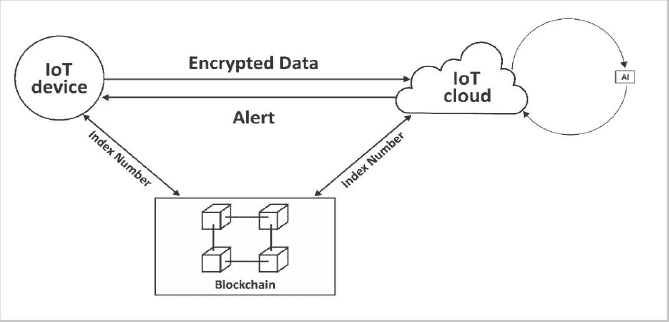 **图 (4)**


不可篡改的账本通过使错误访问或更改数据流变得困难，从而进一步巩固了安全性。此外，可以使用智能合约来保护实际设备访问。区块链还利用公钥加密来保护发送者和接收者之间的通信。


医疗管理利用人工智能来定制医疗保健，并在早期识别潜在的并发症。机器学习算法使用物联网设备产生的大量持续数据进行训练，使它们能够自主执行预训练任务。这些算法具有通过考虑患者的病史、生命体征和生活方式选择来定制患者护理的能力。AI 提供的实时智能分析特别适用于物联网应用。在响应时间至关重要的医疗护理中，AI 可以在必要时及时通知医疗提供人员或患者的家属，从而大幅缩短时间。


在本节中，图（5）提出了一种架构，它涵盖了医疗保健环境中从设备到决策的所有物联网阶段。

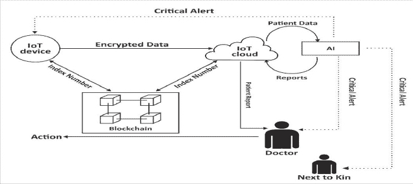 **图 (5)**


在将任何物联网设备连接到网络之前，请确保固件已更新。确保设备受密码保护，这需要在首次启动和在特定的预定义时间后进行更改。设备应坚持其目标，并仅收集所需的数据。数据应立即被加密。

收集的数据将被加密，但不会存储在本地设备上的加密云数据库中。该架构提出了一种基于区块链的分布式账本，在不同的网络节点上存储数据记录的索引数字。需要时，这些数据可以进行验证。实际数据将存储在云数据库中并加密。在分布式账本中存储索引数字而非实际数据的原因是数据所有权。根据本质，区块链数据在所有节点上均匀分布，但医疗数据是非常个人的，法规要求有一个负责数据隐私的唯一所有者。因此，我们建议将索引数字存储在账本中并将相应数据存储在医疗提供者拥有的云数据库中。

云数据将根据分布式账本进行验证，然后进行分析。位于数据库中的数据可用于训练机器学习算法，尽管我们建议对馈给此类算法的数据进行令牌化和掩码处理以隐藏用户身份。用户同意将此类令牌化数据用于此类用途仍然是强制性的。训练后的算法将实时监控数据输入流，如果出现任何异常，它们将根据问题的严重程度提醒医疗提供人员和家属。

我们不建议自动给药/处方，例如用于糖尿病患者的远程患者管理物联网设备来实时调整胰岛素剂量。但我们建议一种警报机制，仅用于向负责人员警报所需的剂量。


在本节中，我们介绍了所提架构的特定实现细节，从区块链平台的选择到数据安全保护。


有许多区块链平台在功能和能力上有所不同。以下给出了一些供选择的平台：

*   `Ethereum`：`Ethereum` 的一些最有前景的特性是智能合约、去化化应用程序和大型开发者社区。它高度灵活且可编程，具有成熟的实现生态系统和强大的开发者支持。尽管如此，它存在高交易费用和持续的扩展性问题。
*   `Hyperledger Fabric`：这是一个具有模块化架构的许可级区块链。最有前景的特性是支持隐私交易。`Hyperledger Fabric` 提供了高安全隐私，适用于企业级应用。它还具有良好的扩展性。
*   `Corda`：`Corda` 专为业务应用设计，支持私有交易和智能合约。它提供了高隐私和高效的交易处理，并侧关注合规性。尽管功能出色，但它缺乏社区支持，且主要用于金融服务。
*   `NEO`：另一个平台；`NEO` 在去中心化环境中提供智能合约。它具有高吞吐量并支持多种编程语言，同时侧关注数字身份。由于缺乏中心化控制，它的应用并不广泛。

上述是许多可用平台，但所提架构最适用于 `Hyperledger Fabric`。以下是它提供的一些重要优势：

*   `许可网络`：`Hyperledger Fabric` 的许可性质确保了只有授权的实体才能访问网络，这对于处理敏感的医疗数据至关重要。


- **隐私与机密性：** 它支持私有数据收集和通道，允许特定参与者之间进行机密交易和数据共享，符合医疗健康数据的隐私要求。
- **模块化架构：** 模块化设计允许根据特定需求进行定制，能够与现有的医疗系统和物联网设备集成。
- **可扩展性与性能：** `Hyperledger Fabric` 为高吞吐量和可扩展性而设计，能够处理医疗物联网设备产生的海量数据。
- **合规性：** 平台对监管合规的关注确保了它能够满足 `HIPAA` 等医疗行业法规的严格要求。
- **企业级支持：** 获得大型机构的支持和强大的企业级支持，使其成为长期项目的可靠选择。

虽然像 `Ethereum` 等其他平台提供了强大的功能，但医疗健康领域对安全、隐私和监管合规的特定需求使得 `Hyperledger Fabric` 成为最选择。

## 可用的 AI 模型及选择最合适的模型

几种 AI 模型非常适合在区块链环境与物联网设备协作，增强医疗应用的安全性、效率和可靠性。深度学习模型，例如卷积神经网络 (`CNNs`) 和循环神经网络 (`RNNs`)，擅长处理来自物联网设备的复杂数据模式（如医学影像和传感器数据），能够实现准确的诊断和预测性分析。

联邦学习脱颖而出，它允许在不共享原始数据的情况下跨多个去中心化设备进行 AI 模型训练，从而在保护患者隐私的同时，利用来自不同数据源的集体学习。强化学习可以优化物联网网络操作和资源管理，确保区块链框架内高效的数据处理和交换。此外，自然语言处理 (`NLP`) 模型可以解释和分析非结构化的医疗数据（如医生笔记和患者记录），改进数据集成和决策过程。

在这些中，联邦学习由于其去中心化的特性而特别适用于医疗环境，这与区块链技术的隐私和安全优势完美契合。它能够在不同的医疗提供者和物联网设备之间实现协作 AI 模型训练，在不损害患者隐私的情况下，增强医疗应用的稳健性和准确性。这种方法还降低了数据泄露的风险，并确保符合 `HIPAA` 等法规。

## 物联网环境中的通信协议

在物联网环境中，多种通信协议促进了设备之间的连接和数据交换。著名的协议包括 `MQTT`（消息队列遥测传输），它对于低带宽和高延迟网络来说轻量且高效；`CoAP`（受限应用协议）专简单电子设备和低功耗网络设计；以及 `HTTP/HTTPS`，因其与 Web 服务的兼容而被广泛使用。此外，蓝牙低功耗 (`BLE`) 和 `Zigbee` 常用于短距离通信，而 `LoRaWAN` 和 `NB-IoT` 适用于远程、低功耗应用。对于医疗数据，`MQTT` 特别适用，因为其开销低、消息传递可靠并能够处理间歇性连接，确保敏感健康信息在物联网设备和中心系统之间的高效安全传输。

## 建议架构的技术要求


- **物联网设备：** 传感器、可穿戴设备和边缘设备是架构的核心。我们需要各种传感器来监测体征（例如心率、血压、血糖水平）、如智能手表、健身追踪器等收集和传输健康数据的可穿戴设备，以及在数据发送到云端或区块链网络之前对其进行处理的边缘设备。
- **网络硬件：** 路由器、交换机和物联网网关是必不可少的，用于提供可靠安全的连接，并作为物联网设备与网络之间的桥梁，同时处理数据聚合和预处理。
- **服务器基础设施：** 最关键的是 `Hyperledger Fabric` 节点。架构需要服务器来运行 `Hyperledger Fabric` 的对等节点、排序节点和证书机构 (`CAs`)。除了对等节点外，架构还依赖用于区块链和链外数据的数据库服务器。最后，它还需要边缘服务器来执行边缘计算任务以降低延迟。

### 软件需求

- **Hyperledger Fabric 组件：** 所需软件组件包括用于托管账本和合约的对等节点、用于确保交易排序和共识的排序节点、用于管理身份和颁发数字证书的证书机构 (`CA`)，以及使用 `Go`、`Java` 或 `JavaScript/TypeScript` 编写的合约。
- **物联网设备软件：** 固件和边缘计算软件是必要的软件包。这些软件针对特定的物联网设备，用于数据收集和初步处理。边缘计算软件用于预处理数据、降低延迟并做出实时决策。可用软件包括 `AWS Greengrass` 和 `Azure IoT Edge`。
- **中间件与集成软件：** 将物联网设备集成到 `Hyperledger Fabric` 网络涉及通过网关使用 `MQTT` 等协议连接设备，确保数据传输高效可靠。这些网关充当物联网设备与区块链网络之间通信的媒介，处理数据聚合和初始处理。在边缘实施数据预处理对于降低延迟和实现实时决策至关重要，可以实现更快的响应速度并减轻中心网络的负担。这种预处理可以在数据发送到区块链之前进行过滤、聚合甚至本地分析，确保只传输相关信息。这种方法不仅提高了整个系统的效率，还有助于管理物联网设备产生的海量数据，确保网络在处理高吞吐的同时维持数据的完整性和安全性。
- **区块链管理工具：** 在基于 `Hyperledger Fabric` 的物联网架构中，确保数据安全至关重要，特别是在处理敏感医疗信息时。实施强大的加密机制对于保护传输中和存储的数据至关重要。可以使用 `OpenSSL` 等加密库来加密物联网设备、网关和区块链网络之间的通信，防止未经的访问并确保数据机密性。除了加密外，部署身份访问管理 (`IAM`) 解决方案对于有效管理用户角色和权限至关重要。IAM 工具有助于确保只有授权人员才能访问特定数据，对谁可以查看和修改医疗记录提供细粒度的安全控制。这种加密与 `IAM` 的结合不仅保护患者数据免受泄露和未经的访问，还确保符合 `HIPAA` 等严格的医疗法规，从而增强医疗物联网系统的信任和可靠性。


# 安全软件、合规性以及确保数据隐私与安全的步骤

为基于 `Hyperledger Fabric` 的物联网架构创建用户界面，需要开发直观的 Web 和移动应用程序，允许医疗提供者和患者安全地访问并与系统交互。确保这些界面内患者数据的安全至关重要。这从实施稳健的加密协议开始，以保护传输和存储过程的数据。`SSL/TLS` 等技术可以保护传输中的数据，而高级加密标准（`AES`）可以保护静态数据。此外必须严格执行用户身份验证和访问控制机制，确保只有授权人员才能访问敏感的健康信息。

为了符合 `HIPAA`、`GDPR` 等其他相关医疗法规，纳入全面的数据隐私和安全措施是必重要的。这包括进行定期的安全审计、实施强密码策略以及利用多因素认证（`MFA`）来增强用户验证流程。此外，维护详细的访问日志并进行定期审查有助于有效监控和管理访问控制。

实施隐私保护技术进一步加强了数据安全。例如，`Differential privacy` 向数据集中添加一层噪声，使其难以识别个人记录，同时仍允许有用的数据分析。这种技术有助于在共享数据用于研究或分析时保护患者身份。另一方面，`Homomorphic encryption` 允许在对加密数据上进行计算而无需解密，确保数据在处理过程中保持安全。这在敏感健康数据需要由第三方服务分析或在区块链网络内部分析的场景特别有用。

为了确保数据隐私和安全符合法律要求，需要仔细遵循以下几个步骤：

- **数据加密**：对静态和传输中的数据使用强加密技术。采用 `AES` 等标准进行数据存储，使用 `SSL/TLS` 进行数据传输。
- **访问控制**：实施严格的访问控制措施，包括基于角色的访问控制（`RBAC`）和多因素认证（`MFA`），确保只有授权人员访问敏感数据。
- **审计与监控**：进行定期安全审计，并维护数据访问和修改的详细日志。使用监控工具及时检测并响应任何未经授权的访问尝试。
- **隐私保护技术**：集成 `differential privacy` 和 `homomorphic encryption` 等技术，保护分析和共享期间的数据。`Differential privacy` 确保个人数据不会被重新识别，而 `homomorphic encryption` 允许在不泄露的情况下进行安全数据处理。
- **合规检查**：定期审查和更新安全策略及程序，以符合当前的医疗法规。这包括对员工进行数据保护实践培训，并关注法律要求的变化。

通过遵循这些步骤，系统可以维持高标准的数据隐私和安全，在确保符合法律法规的同时，保护患者信息免受泄露和未经授权的访问。

## 应用层

实施全面的监控和维护策略对于确保基于 `Hyperledger Fabric` 构建的物联网架构的可靠性和性能至关重要。利用 `Kubernetes` 和 `Docker` 等 DevOps 工具可以便于区块链网络的部署、扩展和管理，实现持续集成和持续部署（`CI/CD`）实践。对系统进行定期监控有助于尽早发现潜在问题，允许在影响网络功能之前及时解决。这包括跟踪物联网设备、网络流量和区块链节点的性能，以确保它们在最佳范围内运行。

维护还涉及定期更新软件组件以修复漏洞并增强功能，从而保持稳健的安全性并符合不断演变的医疗法规。可以使用自动化工具来无缝调度和管理这些更新，最大限度地减少停机时间和对服务的影响。此外，实施稳健的备份和灾难恢复计划对于防止数据丢失以及在系统故障或网络攻击时确保业务连续性至关重要。通过优先考虑这些监控和维护实践，网络将保持安全、高效且可扩展，能够支持智能医疗设备的动态需求。

### 可扩展性

解决所提架构的可扩展性涉及整合若干先进技术，以管理和处理物联网设备产生量数据。区块链中的 `Sharding` 可将 `Hyperledger Fabric` 网络分为更小、更易管理的段或分片，每个分片都能独立处理事务，从而提高吞吐量并降低延迟。`Distributed AI processing` 允许数据分析任务在多个节点之间去中心化，利用整个网络的计算能力并减轻单点的负担。此外，`edge computing` 对于在源头预处理数据至关重要，它可以减少需要传输到中央区块链网络的数据量，并确保实时响应。通过在本地预处理和聚合数据，边缘设备可以过滤无关信息，仅向区块链发送重要数据，从而优化带宽使用并降低延迟。这些组合确保确保系统能够高效处理并随智能物联网医疗设备增长的数据需求进行扩展，维持性能和可靠性。

## 关键性能指标

定义清晰的性能指标对于评估和确保由区块链技术驱动的所提物联网医疗架构的有效性至关重要。以下是考虑的关键性能指标。

### 数据吞吐量
**定义**：系统在特定时期处理的数据量。
**指标**：以每秒字节（`Bps`）或每秒事务数（`TPS`）衡量。
**目标**：保持高数据吞吐量，确保系统能够高效处理大量物联网生成的健康数据。

### 延迟
**定义**：数据从物联网设备到区块链并返回用户界面所需。
**指标**：以毫秒（`ms`）衡量。
**目标**：实现低延迟以确保实时数据处理和立即响应，这对于及时医疗干预至关重要。

### 安全漏洞率
**定义**：系统内未经授权访问或安全漏洞的频率。
**指标**：以每年漏洞次数衡量。
**目标**：通过实施稳健的安全措施和定期审计，目标实现零漏洞。

### AI 预测准确率
**定义**：基于处理的健康数据，AI 模型预测的正确性。
**指标**：以百分比表示，代表准确预测与总预测次数的比例。
**目标**：实现高 AI 预测准确率（例如高于 95%），以确保可靠有效的医疗建议和诊断。


通过持续监控这些性能指标，系统可以针对效率、安全性和可靠性进行优化，确保其满足智能 IoT 医疗应用的严苛需求。定期对照这些指标进行评估，也有助于识别改进领域，并确保符合医疗行业标准和法规。

## 针对关键性能指标的系统测试与基准测试方法

为了确保所提出的 IoT 医疗架构符合预期的性能标准，一套全面的系统测试和基准测试方法至关重要。以下是建议的方法：

- **定义测试场景：** 开发模拟典型使用模式和压力条件的真实场景，包括不同的数据量、网络流量负载和并发用户交互。
- **数据吞吐量测试：** 测量系统在不同场景下的数据吞吐量，记录每秒处理的交易数和每秒传输的字节数。使用 `Apache JMeter` 或 `Gatling` 等工具进行负载测试。
- **延迟测试：** 评估从 IoT 设备提交数据到区块链处理以及随后由用户界面检索之间的响应时间。在不同的数据大小和网络条件下进行测试。
- **安全性测试：** 执行渗透测试和漏洞评估，以识别并缓解潜在的安全风险。测试加密机制、访问控制和身份验证协议，以确保数据的机性和完整性。
- **AI 预测准确性测试：** 通过将模型输出与已知真实数据对比，验证 AI 预测的准确性。使用交叉验证和混淆矩阵等技术评估预测性能。
- **标准基准对比：** 将系统性能指标与行业基准和最佳实践进行比较，确保其达到或超过预期标准。参考相关的医疗法规和指南确定可接受的性能水平。
- **持续监控与优化：** 实现持续监控工具实时跟踪系统性能并识别优化领域。使用指标仪表板和告警系统在性能问题出现时及时处理。

关于与现有医疗 基础设施（包括电子健康记录 EHR 系统和其他医疗设备）的互操作性问题，所提出的系统应遵循 `HL7 FHIR`（快速医疗互操作性资源）和 `DICOM`（医学数字成像和通信）等互操作性标准。实施标准的数据交换格式和通信协议可确保与 EHR 系统无缝集成，安全高效地共享患者健康数据。此外，利用 `SMART on FHIR` 等互操作性框架可以集成第三方医疗设备和应用程序，促进整个医疗生态系统中全面的患者护理和互操作性。定期与现有的医疗 IT 基础设施进行兼容性测试和集成验证，对于确保顺互操作性和数据交换能力至关重要。

## 所提架构的实施步骤

以下是在实施所提架构之前需要考虑的步骤：

- **搭建 Hyperledger Fabric 网络：** 部署并配置节点节点、排序节点和 `CAs`。定义网络拓扑结构并建立数据隔离和隐私保护通道。
- **开发并部署链码：** 编写处理医疗数据交易的智能合约并将其部署在 `Hyperledger Fabric` 网络上。
- **集成 IoT 设备：** 通过网关使用 `MQTT` 或或其他协议将 IoT 设备连接到网络。在边缘端实施数据预处理。
- **确保数据安全：** 实施强大的加密和 `IAM` 解决方案，保护整个系统的敏感医疗数据。
- **创建用户界面：** 为医疗提供人员和患者开发 Web 和移动应用程序，以便安全地访问和交互数据。
- **实施监控与维护：** 使用 `DevOps` 工具持续监控网络、管理更新并确保系统的可靠性和性能。

通过整合这些硬件和软件组件，你可以构建一个基于 `Hyperledger Fabric` 的健壮且安全的架构，专为智能医疗定制。

## 去中心化身份管理系统的用例

去中心化身份管理系统通过赋予个人对其数据的更大控制权，在增强医疗环境的安全性和隐私方面具有巨大潜力。这些系统利用区块链技术创建和管理数字身份，确保安全的身份验证和授权。通过身份管理的去中心化，用户可以安全地访问和共享健康信息，而不依赖于中央机构。

一个展示去中心化身份管理在医疗领域实际应用的著名案例是 `Sovrin Foundation` 对主权身份 (`SSI`)的工作。`Sovrin` 的去中心化身份平台允许个人独立创建和管理数字身份，利用区块链技术确保身份数据的完整性和安全性。在医疗背景下，`Sovrin` 的 `SSI` 解决方案允许患者安全地与医疗提供人员、研究人员和其他利益者共享健康记录，促进无缝的互操作和交换。

另一个例子是药企 `Pfizer` 与去中心化身份平台 `uPort` 之间的合作。`Pfizer` 利用 `uPort` 的 `SSI` 解决方案创建了一个安全且保护隐私的系统，用于跟踪临床试验药物的分发。通过利用去中心化身份，`Pfizer` 能够确保药物的真实性和完整性，同时保护敏感数据免受未经授权的访问。

这些实施对医疗领域去中心化身份管理系统的可行性和有效性产生了结果和见解：

- **增强安全性：** 去中心化身份管理系统为身份验证和授权提供了强大的加密机制，降低了身份盗用和欺诈的风险。通过消除中央身份提供者等单点故障，这些系统增强了应对网络威胁的安全性和韧性。
- **改进隐私：** 去中心化身份解决方案授权个人控制其个人健康数据的访问，实现了细粒度的同意机制和信息的选择性披露。这通过减少敏感数据的暴露，并确保符合 `GDPR` 和 `HIPAA` 等隐私法规增强了隐私保护。
- **互操作性与数据交换：** 去中心化身份平台促进了不同医疗系统和利益者之间无缝的互操作和数据交换。通过标准化身份协议和数据格式，这些系统在维护数据完整性和机性的同时，实现了健康信息的无摩擦共享。

然而，在医疗领域实施去中心化身份管理系统也面临着若干挑战和考量：


## 挑战与未来方向

- **易用性与采用：** 确保用户友好界面以及与现有医疗工作流的无缝集成，对于去中心化身份解决方案的广泛采用至关重要。向用户普及这些系统的优势和功能，对于克服最初的抵触和怀疑至关重要。
- **合规性：** 在实施去中心化身份解决方案时，遵守医疗法规和隐私法（如 `GDPR` 和 `HIPAA`）是首要任务。确保符合数据保护要求并维护身份交易的审计追踪，是医疗机构考虑的关键考量。
- **可扩展性与性能：** 可扩展性仍然是去中心化身份平台面临的挑战，特别是在数百万用户和交易的高并发医疗环境中。优化区块链的可扩展性和吞吐量对于支持医疗领域对去中心化身份日益增长的需求至关重要。

总体而言，去中心化身份管理系统为增强医疗环境中的安全性、隐私性和互操作性提供了广阔的前。尽管挑战依然存在，但持续的研究与开发正在提高这些解决方案的可行有效性，为构建更安全、以患者为中心的医疗生态系统铺平道路。

## 结论

医疗行业正处于一个变革时代的边缘，受到区块链技术、人工智能（AI）和物联网（IoT）协同作用的推动。虽然单个 `IoT` 设备仅作为数据收集器，但当其通过 AI 能力进行增强并通过区块链技术的安全基础进行加固时，其作为游戏改变者的潜力就会显现。本章介绍了一种创新架构，该架构无缝整合了这三种强大的技术，旨在以增强安全性为核心，彻底改变远程医疗管理。

尽管在 `IoT`、`AI` 和区块链领域已取得巨大进展，但我们提出的架构独特地将它们结合，促进了提升远程医疗质量和安全性的单一目标。患者将从更高标准的护理服务中获益，医疗系统可以通过医疗数据的安全追踪和交换来优化其运营。这种融合的一个值得关注的例子是 `IoT` 驱动的医疗技术。这项技术不仅能收集关键数据，还通过加密确保其安全性，促进安全传输，利用区块链验证信息并并发布智能警报，从而实现持续的健康监测。

愿想的架构为 `IoT`、`Blockchain` 和 `AI` 的无缝集成奠定了基础，并在每个阶段都优先考虑数据安全。该架构将安全性视为首要考虑问题，确保了设备、静态数据、传输中数据以及数据整个生命周期的安全。这一蓝图旨在为富有想象力的人才提供指南，为在医疗领域开发稳健的 `IoT` 系统提供基础。

## 参考文献

| | | |
| --- | --- | --- |
| [1] | | Srivastava G., Crichigno J., Dhar S.. A light and secure healthcare blockchain for iot medical devices. 2019, *IEEE Canadian Conference of Electrical and Computer Engineering (CCECE).* : 1-5. **2019**[[CrossRef](http://dx.doi.org/10.1109/CCECE.2019.8861593)] |
| [2] | | 取自：[`www.statista.com/statistics/1183457/iot-connected-devices-worldwide/`](https://www.statista.com/statistics/1183457/iot-connected-devices-worldwide/) |
| [3] | | Dang L.M., Piran M.J., Han D., Min K., Moon H.. A survey on internet of things and cloud computing for healthcare., *Electronics (Basel).* **2019;** 8(7): 768. [[CrossRef](http://dx.doi.org/10.3390/electronics8070768)] |
| [4] | | Sadek I., Codjo J., Rehman S.U., Abdulrazak B.. Security and privacy in the internet of things healthcare systems: Toward a robust solution in real-life deployment., *Computer Methods and Programs in Biomedicine Update.* **2022;** 2: 100071. [[CrossRef](http://dx.doi.org/10.1016/j.cmpbup.2022.100071)] |
| [5] | | Karlof C., Wagner D.. Secure routing in wireless sensor networks: attacks and countermeasures., *Ad Hoc Netw..* **2003;** 1(2-3): 293-315. [[CrossRef](http://dx.doi.org/10.1016/S1570-8705(03)00008-8)] |
| [6] | | Jadhav B.. Artificial intelligence-based model and applications in business decision-making., *CRC Press, Taylor & Francis, USA.* **2023**: 258-274. [[CrossRef](http://dx.doi.org/10.1201/9781003400110)] |
| [7] | | Gopalakrishnan K., Balakrishnan A., Govardhanan K., Selvarasu S.. Propositional inference for IoT based dosage calibration system using private patient-specific prescription against fatal dosages., *Sensors (Basel).* **2022;** 23(1): 336. [[CrossRef](http://dx.doi.org/10.3390/s23010336)] [[PubMed](http://www.ncbi.nlm.nih.gov/pubmed/36616934)] |
| [8] | | Dedeoglu V., Jurdak R., Dorri A., Lunardi R., Michelin R., Zorzo A.. *Blockchain Technologies for IoT*. **2019**[[CrossRef](http://dx.doi.org/10.1007/978-13-8775-3)] |


区块链技术与物联网（IoT）的融合已成为医疗健康领域变革的催化剂。本书的章节“区块链驱动的医疗健康物联网创新”探讨了这些技术之间的动态相互作用及其对医疗健康系统的深远影响。本章首先介绍了区块链和物联网，并强调了它们在医疗健康领域的关联性。它强调了区块链在加固患者数据安全、解决隐私问题以及纠正医疗健康数据管理漏洞方面的关键作用，并突出了物联网设备在医疗健康中的多样化应用，包括可穿戴设备、远程患者监测和智能医院设备。该章还讨论了区块链如何在保护数据完整性和机密性的同时，促进安全的跨平台数据共享。文中探讨了智能合约在医疗健康中的实施，展示了其对患者赋权、数据透明度和临床试验管理的影响。本章还阐述了区块链技术如何增强供应链管理并确保药物追溯性，应对假药泛滥问题。对患者赋权和数据控制的全面讨论揭示了区块链如何彻底改变患者参与和知情决策。本章分析了法律和监管方面的复杂格局，为医疗健康领域采用区块链的合规性及潜在的法律影响提供了指导。最后，本章探讨了医疗健康领域的挑战、未来前景和新兴趋势。对于医疗健康专业人士、研究人员、政策制定者和技术爱好者来说，它是在这个不断发展的医疗健康领域中探索区块链与物联网交叉领域的一份至关重要的资源。

**关键词：** 区块链、假药、临床试验、数据安全、数据互操作性、药物追溯、新兴趋势、医疗健康、物联网 (IoT)、知情决策、法律考量、医学研究、隐私、患者参与、患者赋权、监管合规、远程患者监测、智能医院设备、智能合约、可穿戴设备。

***

**通讯作者 J. Mangaiyarkkarasi:** NMSS. Vellaichamy Nadar College, Nagamalai, Madurai, Tamil Nadu, India; 邮箱：mangai.jp@gmail.com

## 引言

区块链技术与物联网（IoT）的融合为医疗健康行业开启了可能的新纪元。书中“区块链驱动的医疗健康物联网创新”章节探讨了这种变革性的相互作用，它首先建立了区块链和物联网的基本概念及其其在医疗健康领域的关联性。区块链作为一种分布式账本技术，是一种分布式且防篡改的数据库，用于记录和验证交易。由于其提高安全性和透明度的能力，它在各个行业中引起了极大关注。在医疗健康领域，掌握区块链知识对于解决许多数据安全和数据隐私问题至关重要 [[1]]。敏感患者数据是医疗运营的核心，确保其完整性和机密性是重中之重。区块链通过创建不可篡改的交易账本提供了强大的解决方案，使得未经授权的极难以篡改或访问敏感信息。

除了保护数据外，区块链还为医疗数据管理和互操作性提供了一种创新方法。引言强调了不同医疗系统之间数据孤岛和不兼容的挑战。区块链充当桥梁，在保护患者记录完整性和隐私性的同时允许安全的跨平台数据共享。这不仅促进了更高效的医疗服务，还改进了跨提供者之间的护理协调 [2]]。相反，物联网代表了一个由连接设备和传感器组成的广泛网络，它们积极收集并传输实时数据。在医疗健康领域，物联网应用已采取多种形式，从监测生命体征的可穿戴设备到医院中使用的智能设备 [3]]。本章的引言强调了物联网设备的重要性及其在医疗健康中的多样化应用。

这些应用包括远程患者监测（使医疗专业人员能够远程监督患者状况）以及智能医院设备的集成。这项技术不仅增强了患者护理，还最大限度地减少了人为错误并有助于更有效的医院管理。区块链与物联网之间的协同关系是医疗健康领域的规则改变者。引言概述了这些技术如何和谐工作，从而彻底改变数据管理、数据共享和患者护理 [4]]。通过在医疗健康背景下建立区块链和物联网的基础概念，本章为全面探索这种变革性融合的影响、挑战和未来场景奠定了基础。

随着医疗健康行业的不断演进，“区块链驱动的医疗健康创新”的引言成为医疗专家、研究人员、代表和技术爱好者的必备入门读物，旨在引导他们引导这一令人兴奋的交叉领域，并在医疗健康领域利用区块链和物联网的优势。

## 增强患者隐私和数据安全

患者隐私和数据安全在医疗健康中至关重要。随着医疗记录的数字化和电子健康记录 (`EHRs`) 使用的增加，保护敏感患者信息已成为备关注的问题。区块链技术已成为增加患者隐私的强大解决方案，确保医疗记录保持机密、防篡改且仅供授权方访问。图 (1) 解释了区块链如何增强隐私和数据安全。

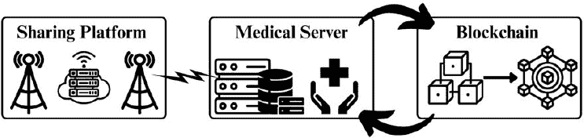(1)

增强患者隐私和数据安全。

此图描述了区块链和物联网如何协作保护医疗数据。它们的协同确保了健的安全的安全隐私。

### 区块链在保护患者数据中的作用

区块链通常被描述为分布式账本技术，具有几个关键特征，使其特别适用于保护患者数据：

#### 去中心化

与传统的中心数据库相比，区块链在去中心化的计算机网络中运行。每个参与者（被称为 `节点`）拥有整个账本的完整副本。这种去中心化的结构减少了与单点故障相关的风险，并显著增加了未经授权方破坏数据的难度 [5]]。

#### 不可篡改性

一旦信息记录在区块链上，它就会变得不可篡改，无法修改或删除。这一属性保证了患者记录的完整性，创造了一种在不被发现的情况下干扰数据几乎是不可能的局面。

#### 加密学

存储在区块链上的患者数据经过了加密，增加了一层安全。只有拥有准确加密密钥的授权用户才能访问并解密相关数据。

#### 许可访问


区块链允许对数据访问进行精细化控制。患者和医疗保健人员可以授予和撤销对其记录的访问权限，确保只有经过批准的个人才能查看和更新数据。

### 透明度
在确保患者数据安全和私性的同时，区块链也提供了透明度。每笔交易都记录在账本上，建立了一个审计轨迹，跟踪谁在何时访问了数据。这种透明度可以增强问责制和信任 [6]。

## 使用区块链技术保护患者数据安全和隐私的益处

### 防御数据泄露
传统的医疗数据库容易受到数据泄露的攻击，面临暴露机密患者信息的风险。区块链稳健的安全措施使其具有高度抵抗网络攻击的能力，显著降低了数据泄露的风险。

### 增强患者控制力
个人可以对其健康记录行使更大的权限。他们有能力授予或拒绝特定医疗保健提供者的访问权限，确保其数据仅与他们信任的人士共享。

### 数据完整性
区块链保护了临床数据的准确性和可靠性。健康、治疗及其他证据保持可信且防篡改 [7]。

### 简化数据共享
区块链增强了不同医疗系统之间患者数据的互操作性，实现了医疗保健提供者之间安全高效的数据共享。这促进了护理协调的改进。

### 遵循隐私法规
区块链技术可以帮助医疗机构遵守隐私法规，例如美国的《健康保险流通与责任法案》（`HIPAA`）或欧洲的通用数据保护条例（`GDPR`）。

### 挑战与考虑
虽然区块链在提高患者隐私和数据安全方面具有巨大前景，但仍有一些需要考虑的任务：

#### 集成
将区块链整合到现有的医疗系统中可能是多方面的且昂贵的。这需要对技术和专业知识进行仔细的规划和投入。

### 可扩展性
区块链网络（特别是公链 `Bitcoin` 或 `Ethereum`）在管理大量医疗数据时可能会遇到扩展性方面的挑战。私有链或联盟链等解决方案可能更适用于医疗应用 [8]。

### 用户体验
对患者和医疗保健人员进行教育，让他们如何有效使用基于区块链的系统，这可能会带来学习曲线。

#### 监管合规
医疗领域的区块链必须与现有法规保持一致，这些法规因地区而异。需要应对法律和监管挑战。

利用区块链技术来增强数据安全和隐私代表了医疗行业一个充满前景的方向。通过利用区块链的独特属性，医疗机构可以显著增强对患者信息的保护，促进数据共享，并维护数据完整性。尽管挑战依然存在，但在数据安全和患者控制方面的潜在优势使区块链成为数字时代保障患者数据极具吸引力的解决方案 [9]。

## 纳入隐私保护技术的建议
为了确保机密性和维护数据完整性，请实施以下隐私保护技术：

### 零知识证明 (ZKPs)
使用 `ZKPs` 在不泄露信息的情况下验证交易和数据。这确保了双方可以在不披露敏感数据的情况下证明陈述的有效性，维护机密性。

### 同态加密
应用全同态加密（`FHE`）在不解密的情况下对加密数据进行计算。这允许在保持数据私性的同时进行安全的数据处理，确保即使在计算期间数据也保持机密。

### 数据分段
将 `ZKPs` 和 `FHE` 与数据分段相结合，将不同的段存储在不同的位置以增强安全性和隐私。

### 可扩展性的技术建议
为了解决扩展性问题，请考虑以下技术建议：

### 链外扩展解决方案
实施如 `plasma` 或 `state channels` 等二层解决方案，在链外处理交易，减少主链的负载。

### 分片
使用 `sharding` 将区块链划分为较小的、易管理的段（`shards`），每个分段都能独立处理数据。

### 边缘计算
部署边缘计算以在 `IoT` 设备上本地处理数据，减少对中央服务器的需求。

### 并行处理
利用并行处理技术进行 AI 模型训练和区块链验证，优化资源利用。

### 缓存机制
实施高级缓存机制在本地存储频繁访问的数据，减少重复检索。

## 医疗领域的物联网应用：可穿戴设备、监控与智能设备
物联网通过大量的创新新的应用改变了医疗保健，这些应用改进了患者护理、医疗结果并简化了医疗运营。医疗领域最著名的物联网应用是可穿戴设备、远程监控和智能设备。这些技术不仅使医疗变得更加以患者为中心，还促进了更高效的数据收集，使更明明的决策成为可能。本文探讨了这些物联网应用。图 (**2**) 展示了医疗物联网。

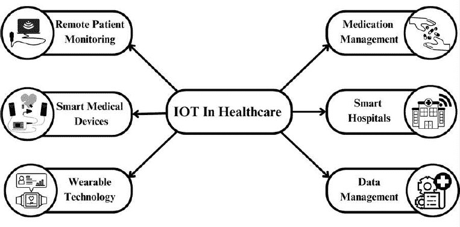 **图 (2)**

医疗物联网。

图中展示了物联网应用：可穿戴设备、远程患者监控和智能医院设备。它说明了物联网对医疗行业的影响，增强了患者护理、效率和数据收集。

### 医疗可穿戴设备
可穿戴设备处于医疗物联网的前沿。它们涵盖了从智能手表、健身追踪器到医疗级可穿戴设备的广泛范围。这些设备配备了传感器和连接功能，能够收集并传输实时健康数据。可穿戴设备如何变革医疗领域：

### 健康监测
可穿戴设备持续跟踪心率、血压、睡眠和身体健身等各种健康指标。对于患有疾病的个人来说，这些信息非常有价值，可以提供健康问题的早期信号。

### 远程医疗
可穿戴设备实现了远程患者监控。医疗保健人员可以实时访问患者数据，从而进行及时的干预和计划调整 [10]。

### 预防性医疗
可穿戴设备通过鼓励用户过上健康的生活来促进预防性医疗。它们可以提醒用户运动、用药或压力，从而降低慢性疾病的风险。

### 临床试验
可穿戴设备在临床研究中发挥着关键作用，通过提供参与者的持续真实世界数据。这可以带来更准确的临床试验结果并加速药物开发。

### 远程患者监控


远程患者监控（RPM）是医疗健康领域一项至关重要的 IoT 应用。它涉及利用医疗设备和传感器，将患者数据从家中舒适收集并传输给医疗提供者 \[11\]。这种方法对于长期患病患者和术后康复的患者非常有价值。RPM 的优势包括：

#### 早期干预
RPM 使医疗保健人员能够识别患者状况的早期变化，从而防止再次入院并提高患者的整体治疗效果。

#### 节省成本
通过减少对频繁面对面诊和住院的需求，RPM 可以降低患者和医疗机构的医疗成本。

#### 提高生活质量
患者可以保持独立性，并在家庭的帮助下获得护理，从而提高生活质量。

### 赋能患者
RPM 通过赋予个人更好的健康控制能力来赋能他们。他们可以积极参与护理，并根据自己的健康数据做出明智决策。

### 智能医疗设备
智能医疗设备包括医疗保健领域使用的先进机械和设备 \[12\]。这些设备与 IoT 技术集成，用于收集和传输数据，实现更高效、更有效的患者护理。智能医疗设备的关键示例包括：

#### 智能输液泵
这些设备能够根据患者数据调整药物剂量，降低错误风险并确保药物的最优输送。

#### 连接式成像设备
X 射线机、MRI 扫描仪和其他成像设备可以可以将图像和数据实时传输给医疗提供者，实现及时的诊断和治疗计划。

#### IoT 驱动床位和床垫
这些创新设备可以观察患者的活动、生命体征和睡眠质量，帮助医疗提供者提高患者的舒适度和护理水平 \[13\]。

#### 智能呼吸机
IoT 连接允许对呼吸机设置进行远程监控和调整，这在新冠肺炎肺炎期间和重症监护环境中尤为有价值。

医疗健康领域的 IoT 应用正在改变该行业，使医疗服务更加以患者为中心、高效且以数据为驱动。可穿戴设备、远程监控设备和智能医疗设备只是 IoT 技术增强患者护理和医疗运营的少数示例 \[14\]。随着 IoT 的不断演进，我们预计将出现日益创新的应用，这将进一步彻底改变医疗服务的交付方式和体验。

### 共识机制及其影响

### 工作量证明 (PoW)
**机制：** 矿工通过解决复杂的密码谜题来验证交易并添加新区块。
**数据安全：** 由于计算困难和去中心化特性，安全性很高，能够抵抗攻击。
**可扩展性：** 由于高能耗和较慢的交易时间，可扩展性有限，不太适用于实时医疗应用。

#### 权益证明 (PoS)
**机制：** 验证者根据其持有的代币数量和愿意“质押”的代币被选中创建新区块并确认交易。
**数据安全：** 安全且节能，与 PoW 相比，中心化风险较低。经济惩罚阻碍了恶意行为。
**可扩展性：** 由于交易处理速度快且能量需求低，可扩展性优于 PoW，适用于高频医疗数据交换。

#### 委托权益证明 (DPoS)
**机制：** 利益相关者选出少数代表人来验证交易并创建区块。
**数据安全：** 通过声誉和对代表人的经济激励实现高安全性，尽管略微中心化。
**可扩展性：** 可扩展性极高，能够快速处理大量交易，使其成为大型医疗网络的理想选择。

#### 实用性拜占庭容错算法 (PBFT)
**机制：** 网络中的节点通过多数投票决达成共识，假设存在有限数量的恶意节点。
**数据安全：** 对拜占庭故障具有极高的安全性，并支持低延迟的交易终局。
**可扩展性：** 在大型网络中可扩展性有限。

#### 权威证明 (PoA)
**机制：** 由受信任的少量节点（权威）来验证交易。
**数据安全：** 通过代表人的声誉和经济激励实现高安全性，尽管略微中心化。
**可扩展性：** 可扩展性极高，能够快速处理大量交易，使其成为广泛医疗网络的理想选择。

#### 对医疗的影响
**数据安全：** PoW 和 PoS 提供了强大的安全性。DPoS 和 PBFT 也具有高安全性，但交易速度更快。
**可扩展性：** DPoS 和 PoA 提供了卓越的可扩展性，适用于大多数医疗应用。
**能源效率：** PoS、DPoS 和 PoA 更加节能，相比 PoW 更具可持续性。

## 使用区块链解决数据互操作性挑战

数据互操作性是医疗领域的一个紧迫问题。在不同的医疗系统、提供者和机构之间无缝共享和访问患者数据对于确保全面的护理至关重要。然而，医疗行业一直受到数据孤岛和系统不兼容的困扰 \[15\]。区块链为解决这些数据互操作性任务提供了良好的前景。图 (3) 显示了医疗领域的区块链。

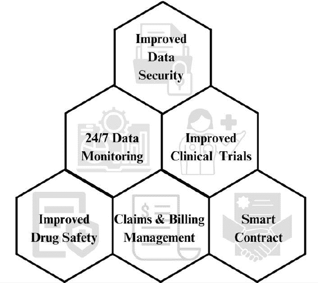 **图 (3)**

医疗领域的区块链。

该图说明了区块链在医疗领域的作用，强调了数据完整性、互操作性、患者赋能、试验和供应链。

### 医疗中的数据互操作性挑战

#### 碎片化系统
医疗系统通常使用不同的电子健康记录（EHR）平台和软件，这些软件互不兼容。这种碎片化导致数据孤岛，阻碍了关键信息的有效交换。

### 数据安全与隐私
由于患者健康数据的敏感性，实施严格的安全隐私措施至关重要。传统的互操作性解决方案有时会损害数据安全，引发对未经授权访问或潜在泄露的担忧。

#### 患者缺乏控制
患者对自己的健康数据控制有限，他们通常需要从不同的提供者处手动提取记录。这种缺乏控制会导致病史不完整，并阻碍个性化护理。

#### 效率低下
缺乏一致的数据格式和程序会导致数据交换效率低下。医疗提供者花费大量时间手动对不同的数据源进行处理 \[16\]。


一旦数据在区块链上记录一次，它就会变得不可侵犯的。这意味着患者记录在不被察觉的情况下无法被更改或删除。不可篡改性保证了数据的完整性，这对于准确的患者护理至关重要。

## 细粒度访问控制

区块链对数据访问提供了细粒度控制。患者可以授予和撤回对其记录的访问权限，确保其健康数据仅与授权人员（如医疗保健提供者、护理人员和研究人员）共享 [17]..

## 通过加密实现数据安全

存储在区块链上的患者数据经过加密，提供了额外的安全保障。区块链采用的加密技术确保了只有拥有适当密钥的人才能访问并解密数据。

## 用于数据共享的智能合约

智能合约和协议可以自动化数据共享过程和权限。当满足特定条件（如患者同意）时，就可以以安全且标准的格式共享特定数据。

## 标准化数据格式

通过在区块链网络内部使用定义的数据结构和格式，医疗系统可以实现数据标准化，使得不同系统更容易理解并有效利用这些数据。

## 可审计性与透明度

区块链创建了数据交易的不可篡改记录。患者数据的每次访问、更新或传输都记录在账本上，为问责和透明度创建了审计追踪 [18]..

## 收益与未来前景

在医疗保健领域实施区块链用于数据互操作性具有多项关键优势：

### 改进患者护理

医疗提供者和系统之间高效的数据共享导致了更全面、更及时的患者护理。可以根据最新的信息做出医疗决策，可能挽救生命。

### 降低成本

简化数据交换过程并减少数据对账工作可以降低医疗机构内部的运营成本。

### 赋能患者

个人对其健康数据获得了更大的自主权，使其能够积极参与自己的医疗保健，并与选定的医疗提供者分享信息 [19]..

### 数据标准化

区块链鼓励使用标准化数据格式，这可以提高医疗数据的一致性，使其更容易交换和解释。

区块链在医疗数据互操作性中的未来充满了巨大希望。随着越来越多的医疗机构和系统采用区块链技术，数据互操作性预计将大幅提高，增强患者护理，减少低效，并为患者的健康信息赋权。然而，在医疗行业持续数字化转型的过程中，面对技术和监管障碍的同时，保护患者数据的安全和隐私至关重要。

## 通过智能合约赋能患者并改进临床试验

临床试验是医学研究以及新治疗和疗法演化的基础。尽管它们在推进医疗保健方面发挥着至关重要的作用，但其过程通常非常复杂、耗时，且缺乏透明度 [20]..。智能合约通过增强患者赋能、提高数据透明度和简化试验管理，有望彻底改变临床试验。图(**4**)解释了智能合约。

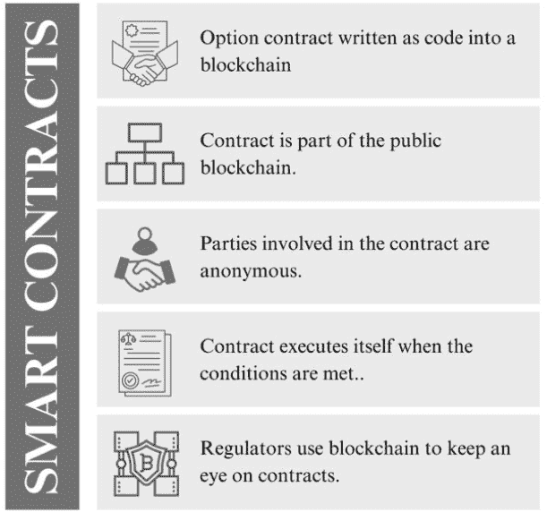 **图 (4)**

智能合约。

智能合约实现了区块链上的协议自动化，通过效率、安全、透明度和去中心化执行增强医疗保健。

### 理解智能合约

智能合约作为自执行协议运行，其中安排的条款直接编码到代码中。当满足预定义的条件时，这些合约会自动生效。在临床试验领域，智能合约被编程用于系统化试验过程的各个方面，包括患者知情同意、数据共享、支付发放和对试验方案的遵循等任务。

### 赋能患者

#### 知情同意

智能合约可以简化知情同意过程。患者可以数字化地查看条款和条件，一旦他们同意，智能合约就会在区块链上记录他们的同意。这确保了患者的决策被安全且不可篡改地记录下来 [21]..

### 数据所有权与控制

智能合约允许患者在健康数据方面获得更大的自主权。患者可以选择谁访问其数据以及出于什么目的。这使患者能够在积极参与研究的同时，保持对其数据的所有权。

#### 自动补偿

可以使用智能合约实现试验参与者的补偿自动化。一旦患者完成了某些试验相关的任务或达到了特定的里程碑，合约就可以自动发放付款或激励。这确保了参与者获得及时且准确的补偿。

#### 透明的方案

患者可以访问试验的智能合约以查看方案、程序和数据共享政策。这种透明度建立了患者与研究人员之间的信任，并使患者能够理解试验的复杂性。

### 提高数据透明度

#### 不可篡改的记录

记录在区块链上的所有交互和交易都是永久且防篡改的。这创建了临床试验期间所操作的透明且可的追踪，减少了数据操纵或欺诈的风险 [22]..

#### 数据共享

智能合约促进了控且安全的数据共享。研究人员根据预定义的条件和患者同意访问数据。这确保了数据的高效安全共享，促进了研究人员和机构之间的协作。

#### 实时数据

智能合约可以实时收集并记录数据。让研究人员能够持续筛选进展并及时做出基于数据的决策。

### 互操作性

智能合约可以与现有的医疗系统和电子健康记录（EHR）集成，实现无缝数据交换，并减少数据碎片化或孤岛化的可能性 [23]..

### 简化临床试验管理

#### 减轻行政负担

使用智能合约自动化各种与试验相关的过程可以显著减少行政开销。这包括自动化任务分配、跟踪患者参与情况以及管理监管合规性。

#### 更快的数据分析

实时数据记录和共享可以加速数据分析，带来更快的试验结果，并可能加速新治疗和疗法的开发。

#### 增强对方案的遵循

智能合约可以强制执行试验方案，确保参与者遵循要求的程序、治疗方案和数据提交。

#### 透明的资金

区块链技术的透明性可以扩展到临床试验的资金。资金来源和发放可以被追踪和核实，增加利益者之间的信任 [24]..

### 挑战与考虑

虽然智能合约为临床试验提供了许多优势，但仍有需要考虑的挑战：

#### 监管合规

确保智能合约符合监管要求数据隐私法至关重要。在实施智能合约解决方案的同时满足这些标准是关键的。

#### 集成


将智能合约集成到现有的临床试验管理系统中可能需要重大的技术和流程变革。

### 教育与培训

研究人员和参与者必须接受有关智能合约工作原理及其在试验过程中作用的教育。

总之，智能合约具有转型临床试验格局的潜力。通过赋能患者、提高数据透明度以及简化试验管理，智能合约为更高效、更符合伦理地开展试验提供了一种创新方法 [25]。随着医疗和研究领域继续探索和实施区块链技术，智能合约在临床试验中的益处正变得日益明显，为更具可访问性、透明且有效的医疗研究铺平了道路。

## 变革供应链管理与药物追溯

制药行业在资源链管理和药物追溯方面面临着独特的挑战 [1]。确保药物的真实性和安全性是重中之重，资源链的任何中断都会对公共健康产生严重后果。区块链技术已成为制药供应链的良好解决方案，提供了更高的透明度、追溯性和安全性。

### 制药供应链管理中的挑战

#### 假药问题
全球制药供应链容易受到假药进入市场的影响。假药对患者构成了巨大的健康风险，并损害制药公司的声誉。

#### 数据碎片化
制药供应链涉及各种参与者，包括制造商、配送商、药店和监管机构。互操作性和标准化数据格式的缺失可能导致数据碎片化，增加跟踪药物流的性 [26]。

#### 监管适应性
监管机构（如美国的 `FDA`）要求制药公司对药物的生产、配送和安全性进行严格记录。不遵守这些规定可能会导致昂贵的罚款和声誉损害。

#### 供应链低效
制药供应链的低效可能导致药物交付延迟、成本增加和资源浪费。这些问题会影响患者获得必要的药物。

#### 利用区块链变革供应链管理

#### 端到端追溯
区块链技术有助于建立一个清晰、不可篡改的账本，记录供应链中所有的交易和数据。从生产商到药店，制造和分销过程中的每一个阶段都有潜力记录在区块链上，确保从头到尾的完整追溯 [27]。

#### 来源验证
区块链的透明账本允许在供应链的任何时候验证药物的来源。这有助于识别假药，并确保患者收到正品。

### 数据完整性
区块链的绝对性保证了数据一旦记录，将保持不可更改状态，且在不被发现的情况下无法删除。这种对数据完整性的保证是维护监管合规性和防止欺诈的关键要素。

#### 实时可见性
区块链提供了对医药产品位置和状态的实时感知。这些信息可以帮助制药公司和监管机构更有效地处理产品召回和短缺等问题。

#### 减少假药
区块链提供透明度和追溯性的能力有助于减少假药，因为这让假劣药物很难在不被察觉的情况下进入供应链。

#### 自动化合规
区块链上的智能合约和自动执行协议可以使对法规和质量标准的合规系统化，减轻行政负担和人为错误的风险。

### 制药供应链中的用例

#### 序列化
每个医药包装都可以获得一个独特的标识符，然后记录在区块链上。这使得监控每个单独药物包跨整个供应链的轨迹成为可能。

#### 温度监控
附在药物货物上的传感器可以持续监测温度状况，并将数据记录在区块链上。如果突破了温度阈值，这些信息可以触发警报并采取及时行动，防止温度敏感型药物受损。

#### 召回管理
在发生药物召回时，区块链提供了受影响批次的即时可见性，使对患者的影响最小化。

#### 监管报告
区块链简化并自动化了监管报告，确保制药公司符合法规 [1]。

### 挑战与考虑

尽管区块链技术在变革供应链管理和药物追溯方面具有巨大潜力，但也伴随着特定的挑战和考虑。

#### 集成
将区块链解决方案整合到当前的供应链系统中可能会增加性，并在技术和培训方面需要大量投入。

#### 监管合规
确保区块链解决方案符合各国法规至关重要。这可能需要与监管机构紧密合作 [28]。

#### 数据隐私
在保护敏感患者信息的同时确保追溯性和透明是一个必须维持的微妙平衡。

### 互操作性
实现不同区块链平台和供应链参与者之间的全球互操作性是一项重大挑战。

通过提高透明度、追溯性和安全性，区块链减轻了假药带来的风险，简化了监管合规并降低了供应链低效率。随着制药公司和监管机构日益采用区块链解决方案，制药行业正处于更安全、更高效供应链的边缘，最终造福患者安全和公共健康。图（5）清楚地展示了医疗管理的未来。

该图预测了区块链对医疗保健的影响，包括数据管理、患者参与和监管发展。

### 现实案例

### MediLedger
`MediLedger` 使用区块链追踪药物的来源。

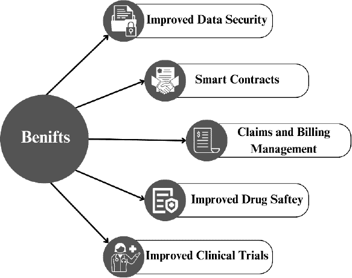**图 (5))**

医疗区块链的未来。

最佳实践：安全、不可篡改的记录以及与制药公司的合作。

教训：符合监管标准至关重要。与现有系统的互操作性增强了采用。

#### Guardtime
爱沙尼亚的医疗系统集成了 `Guardtime` 的区块链技术来保护患者健康记录。

最佳实践：强效加密和安全数据共享。

教训：政府支持和清晰的监管框架有助于成功实施。

#### Medicalchain
`Medicalchain` 允许患者使用区块链安全地存储和共享健康记录。

最佳实践：赋予患者对其数据的控制权，并使用区块链实现安全透明的访问。


# 经验教训：数据控制和隐私的用户教育对于技术的采用至关重要。

## SimplyVital Health

实施：`SimplyVital Health` 的 `Health Nexus` 区块平台改进了医疗数据的共享与协调。

最佳实践：将区块链与 `AI` 和机器学习相结合，以增强数据分析。

经验教训：技术的结合可以提供更全面的解决方案，并改善护理协调。

## Hashed Health

实施：`Hashed Health` 使用区块链来简化行政流程，并改进医疗保健提供者之间的数据共享。

最佳实践：侧重通过区块链降低行政成本并提高效率。

经验教训：识别明确的应用场景（例如资质认证和数据交换）有助于证明区块链的价值。

这些案例研究展示了区块链在提高医疗保健数据安全、透明度和效率方面的潜力，并强调了合规性、利益相关者协作以及用户教育对于成功实施的重要性。

# 医疗保健领域采用区块链的法律与监管方面

区块链引入医疗保健领域有望彻底改变数据管理、患者护理以及该行业的许多其他方面。然而，这种变革性技术并非没有法律和监管挑战。在探索区块链的实施时，医疗机构必须应对复杂的法律、法规和伦理考量，以确保合规并保护患者的权利和数据 [29]。图 (6) 解释了采用区块链的法律挑战和考量。

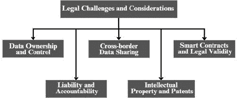 **图 (6)**

法律挑战与考量：框图。

此图通过框图描述了区块链中的法律挑战和考量。

## 医疗保健中的监管框架

### HIPAA（健康保险可携带性与责任法案）

`HIPAA` 是医疗数据保护的基石。它规范个人可识别健康记录的隐私和安全，并对数据处理、共享和存储制定了严格要求。使用区块链的医疗机构必须确保其实施符合 `HIPAA` 法规。

### GDPR（通用数据保护条例）

对于在欧盟（EU）运营或处理欧盟公民数据的医疗机构而言，`GDPR` 是一个关键考量因素。`GDPR` 强制严格的数据保护要求，包括“被遗忘权”，这在利用区块链进行数据存储和共享时可能会带来挑战。

### FDA（美国食品药品管理局）法规

`FDA` 监管医疗设备、药品和医疗保健技术。医疗保健中的区块链应用（如医疗设备追踪和临床试验）需要遵守 `FDA` 关于安全性和有效性的标准。

### 临床试验中的监管合规

临床试验作为医学研究的关键方面，必须遵守特定法规以确保患者安全和数据完整性。区块链可以提高透明度和数据准确性，但必须在监管环境中航，以确保合规。

## 法律挑战与考量

### 数据所有权与控制

区块链赋予了个人对其健康数据更大的控制权，但在定义和执行数据所有权方面的法律复杂性处理仍然是一个挑战。明确的协议和 `smart contracts`（智能合约）对于定义数据访问和控制至关重要 [30]。

### 跨国数据共享

医疗数据通常需要跨国共享用于研究、治疗和协作。应对国际数据共享的法律和监管要求可能具有挑战性，特别是使用区块链时。

### 智能合约与法律有效性

`smart contracts` 是自动执行的，是区块链功能的核心。

### 法律挑战与考量（续）

#### 责任与问责

在数据泄露、错误或纠纷案例中识别责任至关重要 [31]。区块链透明的账本可以协助问责，但必须建立相应的法律框架。

### 知识产权与专利

基于区块链的医疗保健应用可能涉及新型技术和算法的创造。医疗机构在使用区块链时必须考虑知识产权保护和许可协议。

## 伦理考量

### 隐私与知情同意

患者隐私是首要的伦理关注点。区块链实施必须优先考虑患者同意和数据隐私。应该告知患者其数据将如何被使用，以及谁有权访问。

### 数据安全

确保医疗数据的安全不仅是法律要求，也是伦理上的义务。区块链可以增强数据安全，但医疗机构必须履行其保护信息的伦理责任。

### 透明度与问责

伦理考量包括数据共享的透明度和问责制。区块链可以在医疗保健生态系统中培养信任和问责 [32]。

### 公平与获取

医疗保健中区块链的采用应旨在改善护理和医疗服务的获取。伦理考量涉及确保技术造及所有患者，且不加剧现有差异。

## 法律与监管合规的收益

### 患者信任

遵守法律和伦理标准可以建立患者信任。他们更倾向于与重视数据隐私和安全的医疗机构互动。

### 数据完整性

合规确保了数据的完整性和准确性，这对于临床决策、研究和患者护理至关重要。

### 风险缓解

合规有助于降低与数据泄露、违规罚款和其他法律挑战相关的法律和财务风险 [33]。

### 互操作性

法律和监管标准促进了数据的互操作性，简化了医疗系统和机构之间的数据共享。

## 结论

总之，标题为“区块链驱动的医疗物联网创新”的章节深入探讨了医疗领域区块链与物联网（IoT）之间的动态交互。这种变革性的技术融合具有重塑医疗保健格局的潜力，能够增强患者护理、数据管理和整体行业效率。本章的旅程从医疗保健中区块链与物联网的见性介绍开始，强调了这些技术在医疗背景下的重要性。它为深入理解其变革行业的潜力奠定了基础。


本文深入探讨了医疗保健的一个关键方面——“通过区块链增强患者数据安全与隐私”。该章节强调了对稳健的数据安全和隐私措施的必要性，这些措施能够提供安全且透明的解决方案，让患者和医疗服务提供者在处理敏感健康信息时感到安心。

“医疗保健中的物联网应用”部分侧重于物联网设备的实际实施，例如可穿戴设备、远程监控工具和智能医疗设备。这些应用不仅为监测和管理患者健康提供了新方法，还提升了医疗服务的效率。

该章节深入研究了“通过区块链克服数据互操作性挑战”这一复杂问题。医疗数据碎片化是一个长期存在的问题，文中详细探讨了区块链促进安全跨平台数据共享的能力，为这一紧迫问题提供了解决方案。“通过智能合约教育患者并改进临床试验”展示了对患者的赋能、临床试验流程的自动化，以及更透明、更高效的研究愿景。

“转型供应链管理与药物追溯性”深入探讨了药物供应链管理这一关键领域，以及区块链的透明度和可追溯性如何对抗假药并简化基本药物的交付。在“医疗保健中采用区块链的法律与监管方面”章节中讨论的法律监管格局，强调了应对医疗数据与区块链技术周围复杂框架的必要性。合规性、患者权利和伦理关注必须处于任何区块链采用策略的核心。

在整个章节中，案例研究强调了区块链驱动的物联网创新在医疗保健领域的切实影响，提供了这些技术如何改变该领域的实际示例。随着医疗专业人员、研究人员、政策制定者和技术爱好者不断探索区块链与物联网的交叉领域，显而易见，这种变革性的融合正以卓越的方式重塑医疗保健。

通过解决患者数据安全、互操作性挑战以及法律伦理问题，医疗行业有望充分利用区块链和物联网的潜力，最终改善患者护理、研究和整体医疗体验。本章探讨的挑战、未来前景和新兴趋势为医疗革命前沿的人士提了宝贵的见解和指导。凭借对这些突破性技术及其可能性的全面理解，医疗行业预期一个具有更好的患者疗效、更高效流程和更高数据安全的未来。本章为那些旨在导航医疗保健中复杂且不断变化的区块链与物联网领域的人提供了关键指南，推动行业迈向更加乐观和以患者为中心的发展轨迹。

## 参考文献

| | | |
| --- | --- | --- |
| [1] | Adere E.M.. Blockchain in healthcare and IoT: A systematic literature review., *Array.* **2022;** 14: 100139. | [CrossRef](http://dx.doi.org/10.1016/j.array.2022.100139) |
| [2] | Sun J., Yan J., Zhang K.Z.K.. Blockchain-based sharing services: What blockchain technology can contribute to smart cities., *Financial Innovation.* **2016;** 2(1): 26. | [CrossRef](http://dx.doi.org/10.1186/s40854-016-0040-y) |
| [3] | Sapra L., Sapra V., Bhardwaj A.. , . Security Implementation in Internet of Medical Things.. Boca Raton: CRC Press; 2023. | |
| [4] | Alladi T., Chamola V., Rodrigues J.J., Kozlov S.A.. Blockchain in smart grids: A review on different use cases., *Sensors (Basel).* **2019;** 19(22): 4862. | [CrossRef](http://dx.doi.org/10.3390/s19224862) [PubMed](http://www.ncbi.nlm.gov/pubmed/31717262) |
| [5] | Awais Hassan M., Habiba U., Ghani U., Shoaib M.. A secure message-passing framework for inter-vehicular communication., *Int. J. Distrib. Sens. Netw.* **2019;** 15(2) | [CrossRef](http://dx.doi.org/10.1177/155014771982967) |
| [6] | Tseng J.H., Liao Y.C., Chong B., Liao S.. Governance on the drug supply chain via blockchain. *Int. J. Environ. Res. Public Health.* **2018;** 15(6): 1055. | [CrossRef](http://dx.doi.org/10.3390/ijerph15061055) [PubMed](http://www.ncbi.nlm.gov/pubmed/29882861) |
| [7] | Lee I.. Big data: Dimensions, evolution, impacts, and challenges., *Bus. Horiz.* **2017;** 60(3): 293-303. | [CrossRef](http://dx.doi.org/10.1016/j.bushor.2017.004) |
| [8] | Vruddhula S.. Application of dose-identification and blockchain to prevent counterfeiting., *Pathog. Glob. Health.* **2018;** 112(4): 161-161. | [CrossRef](http://dx.doi.org/10.1080/20477724.2024772)) |
 [99 | | S.,., R.H., Meng W.,., G G Smart--based for for personal data, *Int. J. Distrib. Sens. Netw.* **2019;** 15(2) | [CrossRef](http://dx.doi.org/10.1177/155014771982967) |
 [10] | Lazaroiu C., Drosatos G., Demertzis K., Ilioudis Smart home through IoT and blockchain, *IEEE.* **2017**: 454.-461. | |
 [11] | Rantos K., Vasupayya S., Papanikolaou.. Blockchain-based access control for personal health record., *Proceedings of the 15th International Conference on e-Business and Telecommunications.* **2018**: 738-743. | [CrossRef](http://dx.doi.org/10.5220/0) |
 [12] | Wong D.R., Bhattacharya S., Butte A.. Prototype of running clinical trials in an untworthy environment., *Nat. Commun.* **2019;** 10(1): 917. | [CrossRef](http://dx.doi.org/10.1038/s41467-0) [PubMed](http://www.ncbi.nlm.gov/pubmed/30796226) |
 [13] | Thwin T.T., Vasupayya S.. Blockchain-based access model to preserve privacy., *Secur. Commun. Netw.* **2019;** 2019/15. | [CrossRef](http://dx.doi.org/10.1155) |
 [14] | Das S., . Security Implementation in Internet of Medical Things.. Boca Raton: CRC Press; 2023. 23.-36. | |
 [15] | Pal O., Alam B., Thakur V., Singh S.. Key management for blockchain technology., *ICT Express.* **2021;** 7(1): 76-80. | [CrossRef](http://dx.doi.org/10.1016/j.icte.2019.08) |
 [16] | Badr S., Gomaa I., Abd-Elrahman E.. Multi-tier blockchain framework for IoT-EHRs systems., *Procedia Comput. Sci.* **2018;** 141: 159-166. | [CrossRef](http://dx.doi.org/10.1016/j.procs.2018.10) |
 [17] | Rahulamathavan Y., Phan R.C-W., Rajarajan M., Misra S., Kondoz A.. Privacy-preserving blockchain based IoT ecosystem using attribute-based encryption, *International Conference on Advanced Networks and Telecommunications Systems (ANTS).* **2017**: 1-6. | [CrossRef](http://dx.doi.org/10.1109/ANTS.2017.8384164) |
 [18] | Griggs K.N., Ossipova O., Kohlios C.P., Baccarini A.N., Howson E.A., Hayajneh T.. Healthcare blockchain system using smart contracts for secure automated remote patient monitoring., *J. Med. Syst.* **2018;** 42(7): 130. | [CrossRef](http://dx.doi.org/10.1007/s10916-018-0982-x) [PubMed](http://www.ncbi.nlm.gov/pubmed/29876661) |


## 参考文献

- [19] Sharma P.K., Chen M.Y., Park J.H.. 一种基于软件定义的雾边缘节点的物联网分布式区块链云架构，*IEEE Access.* **2018;** 6: 115-124. [交叉](http://dx.doi.org/10.1109/ACCESS.2017.2757955)
- [20] Rožman N., Vrabič R., Corn M., Požrl T., Diaci J.. 基于区块链和物联网的分布式物流平台，*Procedia CIRP.* **2019;** 81: 826-831. [交叉](http://dx.doi.org/10.1016/j.procir.2019.03.207)
- [21] Esposito C., De Santis A., Tortora G., Chang H., Choo K.K.R.. 区块链：医疗云端数据安全与隐私的万灵药吗？*IEEE Cloud Computing.* **2018;** 5(1): 31-37. [交叉](http://dx.doi.org/10.1109/MCC.2018.011791712)
- [22] Efanov D., Roschin P.. 区块链技术的无处不在，*Procedia Comput. Sci..* **2018;** 123: 116-121. [交叉](http://dx.doi.org/10.1016/j.procs.2018.01.019)
- [23] Pustišek M., Kos A.. 以太坊区块链的前端物联网应用开发方法，*Procedia Comput. Sci..* **2018;** 129: 410-419. [交叉](http://dx.doi.org/10.1016/j.procs.2018.03.017)
- [24] Xiao Y., Zhang N., Lou W., Hou Y.T.. 区块链网络分布式共识协议综述，*IEEE Commun. Surv. Tutor..* **2020;** 22(2): 1432-1465. [交叉](http://dx.doi.org/10.1109/COMST.2020.2969706)
- [25] Qiu T., Zhang R., Gao Y.. “Ripple *对比* SWIFT：利用区块链技术转型的跨境汇款”，*Procedia Comput. Sci..* **2019;** 147: 428-434. [交叉](http://dx.doi.org/10.1016/j.procs.2019.01.260)
- [26] Hamdi A., Fourati L., Ayed S.. 区块链 1.0、2.0 和 3.0 的漏洞与攻击评估：工具、分析与对措施，*Int. J. Inf. Secur..* **2023;** (10 月) [交叉](http://dx.doi.org/10.1007/s10207-023-00765-0)
- [27] Marouf I., Saighi A., Laboudi Z., 基于云的电子健康系统：安全挑战与解决方案综述。2023. p. 224.-229.
- [28] Abu-Rumman A.. 学术颠覆性环境下的变革型领导力与人力资本，*World Journal on Educational Technology: Current Issues.* **2021;** 13(2): 178-187. [交叉](http://dx.doi.org/10.18844/wjet.v13i2.5652)
- [29] Balasubramanian S., Shukla V., Sethi J., Islam N., Saloum R.. 区块链采纳就绪框架：案例研究，*Technol. Forecast. Soc.* **2021;** 165: 120536. [交叉](http://dx.doi.org/10.1016/j.techfore.2020.120536)
- [30] Onik M.M., Aich S., Yang J., Kim C-S., Kim H-C., 智能医疗的大数据分析。Elsevier; 2019. 医疗中的区块链：挑战与解决方案；p. 197.-226.
- [31] Alam Khan F., Asif M., Ahmad A., Alharbi M., Aljuaid H.. 区块链技术、改进建议、智能电网安全挑战及其在可持续发展医疗中的应用，*Sustain Cities.* **2020;** 55: 102018. [交叉](http://dx.doi.org/10.1016/j.scs.2020.102018)
- [32] Tripathi G., Ahad M.A., Paiva S.. 基于区块链的智能医疗系统方法，*Healthc. (Amst.).* **2020;** 8(1): 100391. [交叉](http://dx.doi.org/10.1016/j.hjdsi.2019.100391) [PubMed](http://www.ncbi.nlm.nih.gov/pubmed/31753750)
[33] Hussien H.M., Yasin S., Uzir N., Ninggal M., Salman S.. 医疗行业的区块链技术：趋势与机会，*J. Ind. Integr.* **2021;** 22: 100217. [交叉](http://dx.doi.org/10.1016/j.jii.2021.10017)

# 基于的无缝咨询集成健康档案管理系统

Ganesh Khekare¹, Rahul Agrawal², Rahul Khatri¹, Soham Ghugare¹, Sharnil Pandya³

¹ 计算机科学与工程学院，维尔理工大学，维尔，63214，印度
② 数据科学系，物联网，网络安全 (DIC)，G H Raisoni 工程学院，纳格普尔，印度
³ 技术学院，林纳斯大学，韦克斯舍，瑞典

## 摘要

集成健康档案（IHP）利用区块链技术和智能合约构建了一个去中心化且防篡的数据存储共享平台。确保安全并消除远程访问数据的漏洞旨在减少患者等待时间以及预诊数据错误的概率。在 IHP 系统中，每位患者都与一个唯一标识符关联，与之关联的健康记录被安全存储。每个人都会获得一张个人 IHP 卡，该卡在整个 IHP 框架中起着至关重要的作用。它包含健康数据库，包括但不限于报告、处方、医疗费用和保险收据。每张卡的唯一标识符打印在实体卡上并配有二维码。医疗人员扫描时，请求将通过基于 OTP 的双重身份验证。验证成功后，患者控制医生访问其数据库的子集。

**关键词**：区块链、区块链健康记录、集成健康档案、医疗服务提供、患者咨询、记录管理系统。

## 引言

目前的医疗系统存在某些低效率问题，例如集中化的健康记录存储、医疗设施的访问以及阻碍全面信息化医疗服务的各种运营低效率。此外，集中化存储增加了访问敏感医疗信息和患者数据的风险。为了应对这些挑战，让患者控制自己的数据已成为一种必要 [1]。


IHP 框架通过为每个患者分配唯一标识符并将其健康记录安全地与该标识符关联，解决了这些问题。IHP 的核心是个性化的 IHP 卡，作为患者记录的庞大仓库，包括报告、处方、医疗账单和保险收据 [[[2]]。所提的 IHP 系统通过利用每个患者的唯一标识符来克服这些挑战，并通过连接到患者健康记录去中心化数据库的 IHP 卡进行访问。IHP 卡具有与患者唯一标识符（`UID`）连接的唯一 QR 码。医疗医疗人员扫描时，患者将通过双重身份验证过程，接收一次性密码（`OTP`）以确保额外的授权和安全性。验证成功后，医生可以访问患者共享记录的特定子集，从而尊重隐私和机密性。该 `UID` 通过 IHP 卡上的 QR 码进行访问，扫描该码后通过基于 `OTP` 的双重身份验证验证患者身份，提供了额外的安全措施层，并让患者拥有更多控制权，他们可以选择希望医疗人员访问的医疗数据子集 [[[3]]。

IHP 框架的实施为客户接诊流程带来了显著改进，消除了在医疗机构接待处手动输入数据的需求。这种行政任务的减少导致了更短的等待时间并增强了运营效率。此外，将患者的病史与 IHP 卡整合，为医疗服务提供者提供了对患者健康状况的洞察，能够实现准确的诊断和个性化的治疗方案。这减少了接待处排队的等待时间，加快了行政工作，并允许医院接待更多患者。此外，它为医疗人员提供了对每个患者的深入、全面的见解，能够实现更好的诊断和个性化的治疗方案 [[[4]]。

## 文献综述

为了便于发现医疗服务，该框架采用了标准的应用程序接口（`APIs`），将以客户为中心的应用程序（`CCAs`）与医疗服务提供者应用程序（`MSPs`）连接起来。通过这些 `APIs`，`CCAs` 可以访问可用医疗设施的实时信息，确保客户获得有关其医疗选择的准确且最新的细节 [[[5]]。

本研究论文的目标是探索并开发 IHP 框架，作为一种安全且去中心化的健康记录存储和共享的创新解决方案 [[[6]]。通过利用区块链技术、智能合约和标准的 `APIs`，IHP 为患者提供了许多益处，包括增强数据安全、改进隐私 [[[7]]、精简执行流程以及便利医疗服务的发现。通过对 IHP 框架及其潜在应用进行全面检查，本研究旨在有助于推动以患者为中心且高效的医疗体系的进步 [[[8]]。表 **1** 讨论了使用区块链的医疗系统集成健康档案的比较研究，这些系统已经可用。随着世界向基于家庭的在线服务发展，安全访问医生与患者数据是现在的当务之急 [[[9]]。

表 1 **使用区块链的医疗保健集成健康档案比较研究。**

| **文章** | **区块链技术** | **数据类型** | **优点** | **局限性** |
| --- | --- | --- | --- | --- |
| [[[10, 11]] | •Multilink 系统不依赖堆栈证明 <br>•个人区块链 | IHP | 改进且安全的审计记录 | •仅考虑了电子单元 |
| --- | --- | --- | --- | --- |
| [[[12, 13]] | •个人区块链。 | IHP 和 PHP | 用于共享医疗信息的基于区块链的控制应用 | •忽略了可扩展性和可用性 <br>信息交换非常少。 |
| --- | --- | --- | --- | --- |
| [[[14, 15]] | •工作的有效性 <br>•个人区块链 | 健康图像数据 | 安全地交换健康记录 | •消除了信息共享 |
| --- | --- | --- | --- | --- |
| [[[16, 17]] | •取决于备份的实用敏感方法 <br>•工作的有效性 | IHR | 医疗护理信息的安全交换。 | •个人信息没有隐私，且整体吞吐量是改进。 |
| --- | --- | --- | --- | --- |
| [[[18, 19]] | •堆栈的有效性。 | 状态 | 各种基于状态的方法 | •未能提供危重患者的信息。<br>人员位置数据检索。 |
| --- | --- | --- | --- | --- |
| [[[20, 21]] | •Etherm Platform | IHP | 关于医疗护理信息的安全交换。 | •面包屑系统仅搜索单个记录而不是高存储。 |

## 方法论

### 数据包生成

所提框架为每个患者以非常系统化的格式生成数据包。这确保了患者记录的安全效率。以下阶段概述了数据包的生成 [[[22]]：

#### 唯一标识符生成

为了保持唯一性和可追溯性，每个新患者档案都被分配一个名为 IHP ID（集成健康档案标识符）的唯一标识符。该标识符在整个系统中作为患者数据的唯一引用。`IHP ID` 可以通过多种方法生成，例如随机种子或结合关键患者信息的算法。

#### 数据包创建

生成 `IHP ID` 后，创建一个公共数据包并与相应的 `IHP ID` 关联。此公共数据包包含识别和基础理解所需的非敏感患者信息。它通常包含患者的姓名、电话、血型和出生日期。通过将这些非敏感细节封装在公共数据集中，我们确保了访问性和透明度，同时保护了敏感医疗记录的机密性。

#### 敏感医疗记录的隔离

为了确保敏感医疗记录的机密性和隐私，将其分为两个部分：公共数据包和私有数据包。这提供了额外的安全措施层，因为它们与公共数据包分开存储。由于这种隔离，系统减少了未经授权访问和滥用隐私数据的可能性。加密和安全存储的实施防止了数据泄露时发生任何损害。该系统通过实施细致的数据包生成过程，建立了一个管理患者信息的结构化框架。唯一的 `IHP ID` 确保了高效识别，而公共数据负载包含了所需的非敏感信息。敏感医疗记录的隔离同时确保了最高水平的隐私和安全，增强了患者和医疗人员的信任。

#### 存储在 IPFS 上


所提系统使用星际文件系统（`IPFS`）存储包含机密医疗记录的隐私数据包。`IPFS` 提供了一种去中心化的存储解决方案，提高了数据可用性、冗余性以及应对网络故障的弹性。该方法确保了敏感患者数据的安全可靠存储。以下细节详细说明了存储过程：

### 作为分布式存储解决方案的 IPFS
`IPFS` 使用点对点网络在众多节点上存储并分发数据，创建了一个去中心化的存储基础设施。当需要存储隐私数据包时，它会被划分成更小的段并分配一个内容标识（`CID`），这是一个唯一的加密哈希值。然后，这些块被分发到不同的 `IPFS` 网络节点。这种分布式存储方法降低了中心化服务器的重要性，从而最大限地减少了数据集丢失和单点故障的风险。

### 数据可用性与冗余
`IPFS` 使用内容寻址存储模型，数据检索取决于内容的唯一 `CID` 而不是其位置。这确保了数据的可访问性，因为 `IPFS` 网络中的多个节点可能存储相同的数据副本。如果某个节点变得不可用，仍然可以通过其他节点访问数据，确保敏感医疗记录始终可访问。

### 使用 AES 对内容标识（CID）加密
对隐私数据负载的内容标识（`CID`）进行加密为存储在 `IPFS` 上的隐私数据提供了额外的安全保障。此目的使用了高级加密标准（`AES`），这是一种常用的对称加密算法。`AES` 加密确保即使未经授权的实体获取了 `CID`，如果没有解密密钥，也无法推导出任何有意义的信息或定位相应的隐私数据负载。这种加密方法提供了额外的安全层，保护敏感患者数据免受潜在的未经授权访问。

通过使用 `IPFS` 作为分布式去中心化存储解决方案并使用 `AES` 加密内容标识（`CID`），该系统确保了包含敏感医疗记录的隐私数据包的安全可靠存储。这些技术的结合确保了数据的可访问性、冗余性和机密性，维护了患者数据的完整性和隐私。

### 与以太坊区块链集成
所提系统整合了以太坊区块链，为患者数据提供不可篡性、透明度和抗篡性。这种集成涉及将隐私数据包的内容标识（`CID`）与公共数据包的 `CID` 结合，并将它们存储在区块链上。集成过程由以下因素详细阐述：

#### 结合加密的 CID 和公共数据包
隐私数据包的加密内容标识（`CID`）与公共数据包相结合，以建立隐私数据包和公共数据包之间的连接。这种组合将加密的隐私数据与与患者 `IHP ID` 相关的相应公共数据连接起来。通过结合这些组件，系统确保了隐私数据能够安全地与每个患者的公共信息相关联。

#### 将数据推送到以太坊区块链
由加密的 `CID` 和公共数据负载组成的组合数据被写入以太坊区块链区块中。该过程涉及执行一项交易，将数据存储在区块链的分布式账本中。以太坊区块链提供了一个安全且去中心化的数据存储环境，确保了所存储数据的完整性和不可篡性。

#### 智能合约的部署
用 `Solidity` 编写的智能合约处理区块链上加密 `CID` 和公共数据负载的存储与检索。智能合约规定了管理区块链交互的原则和逻辑。它充当后端应用程序与区块链网络之间的桥梁，为访问和操作存储在区块链上的数据提供了安全且标准的方法。

#### 区块链集成的优势
与以太坊区块链的集成为患者数据管理提供了若干优势。首先，区块链的不可篡性确保了数据一旦存储就无法被修改或篡改，确保了数据的完整性。其次，区块链的透明性允许授权方访问并验证所存储的数据，提供了更高层次的信任和问责。最后，区块链的去中心化特性消除了对单一中心化服务器的依赖，最大限度地减少了数据集丢失、非法访问或单点故障的概率。

与以太坊区块链的集成为患者数据管理提供了若干益处。首先，区块链的不可篡性确保数据一旦存储就无法被修改或篡改，确保了数据的完整性。其次，区块链的透明性允许授权方访问并验证所存储的数据，提供了更高水平的信任和问责。区块链的去中心化本质上消除了依赖单一中心化服务器的重要性，最大限度地减少了数据集丢失、非法访问或单点故障的可能性。

### IHP 架构
该原型的基础架构是以编程接口（`API`）的形式构建的。`API` 的实现使得基础设施具有良好的互操作性和轻量化。这种互操作性被证明是极具价值的，因为它允许我们的原型轻松与外部系统和服务进行连接协作，增强了其整体灵活性。`API` 作为客户端应用程序与医疗服务提供者之间的处理桥梁，从我们端提供了复杂的平台。`API` 的功能如下：

在该基础设施中实现了以下内容的 `CRUD`（增删改查）操作：

* 医生
* 患者
* 医疗记录

这让我们能够高效地创建和维护相关数据。

### 安全措施与合规性
为了保护包含机密医疗记录的隐私数据包，`IHP` 系统利用高级加密标准（`AES`），这是一种广泛使用的对称加密算法。在存储到星际文件系统（`IPFS`）之前，对隐私数据负载的内容标识（`CID`）进行了 `AES` 加密。这种加密确保即使未经授权的实体获取了 `CID`，如果没有解密密钥，也无法推导出任何有意义的信息或定位相应的隐私数据负载。

在遵守数据隐私法规方面，`IHP` 框架遵循《通用数据保护条例》（GDPR）和《健康保险流通责任法案》（HIPAA）中概述的原则。这些法规分别对敏感个人信息和健康数据的保护有严格要求。

根据 `GDPR` 的要求，`IHP` 系统确保患者对其数据拥有控制权，允许他们选择与医疗服务者共享的医疗记录子集。这种方法符合数据最小化和目的限制的原则，确保仅访问和处理必要的信息。

此外，在访问医疗记录之前通过涉及一次性密码（`OTP`）验证的双重身份验证过程进一步加强了安全措施，并符合 `HIPAA` 关于保护电子保护健康信息（`ePHI`）的指南。

## 结果与实现


进行了一系列实验和评估，以评估集成健康档案（Integrated Health Profile, IHP）框架的有效性和可行性，如图（1 至 7）所示。评估结果揭示了所提系统的益处和潜力。

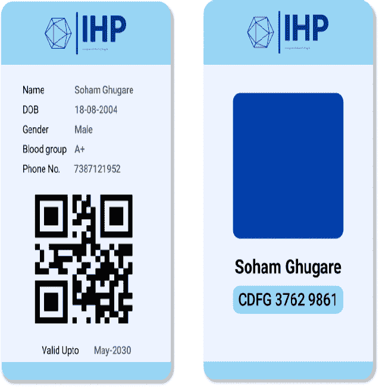 **图 (1)**

IHP 卡片的实现。(Images/9789815305210-C3-F2.jpg) **图 (2)**

互连性协议。(Images/9789815305210-C3-F3.jpg) **图 (3)**

IHP 端点。(Images/9789815305210-C3-F4.jpg) **图 (4)**

示例端点请求。(Images/9789815305210-C3-F5.jpg) **图 (5)**

示例端点响应。(Images/9789815305210-C3-F6.jpg) **图 (6)**

患者视角。(Images/9789815305210-C3-F7.jpg) **图 (7)**

患者记录。

IHP 框架通过模块化架构和云基础设施确保了扩展性，允许不同组件进行独立扩展。它利用分布式数据库和数据分区技术进行高效的数据管理。为了与现有医疗系统集成，该框架遵循 `HL7`、`FHIR` 和 `DICOM` 等互操作性标准，并采用 `APIs` 和中间件进行顺畅通信。定期互操作性测试以及符合 `HIPAA` 在内的稳健安全措施至关重要。还整合实时数据共享和以患者为中心的数据访问，以维持无缝数据交换并提高患者护理质量。

重要的是，IHP 系统充当了 CCAs 和 HSPAs 之间的框架；用户通过 CCAs（以客户为中心的应用程序）获取，这些应用程序的构建侧重于用户获取和改进用户界面设计。IHP 充当从 CCAs 到 HSPAs 的安全桥梁，反之亦然。IHP 将为所有框架提供详尽文档，方便开发者通过 IHP 框架将 CCAs 与 IHPs 集成。

### 数据包生成

数据包生成过程已有效实现，确保了患者数据的安全有效管理。每个患者档案都被分配了一个唯一标识符（`IHP ID`），确保了其可追性和唯一性。创建了包含非敏感患者信息的公共数据包，并与其各自的 `IHP IDs` 关联。为了保护隐私，敏感医疗记录被安全地存储并与公共数据包分离。

### 在 IPFS 上存储

私有数据包成功存储在星际文件系统（`IPFS`）上。`IPFS` 提供了一种去中心化的分布式存储解决方案，增加了数据可用性和冗余。内容寻址模型确保了即使特定节点不可用，数据依然可用。内容标识符（`CID`）的 `AES` 加密提供了额外的安全性，防止未经授权访问敏感患者数据。

### 与以太集成

使用智能合约维护加密数据记录，并结合 `IPFS CIDs` 进行持久化存储。这些随后被推送到 `Ethereum` 区块链，以实现数据的不可篡性和透明性。这使得数据检索比传统的存储方法更加简单和快速。数据本质上被分为两部分：公共数据（包含紧急情况下的患者关键信息）和私有数据（包含在经过适当授权后才能访问的关键记录和历史）。IHP 框架的智能合约实现显著简化了客户入入流程。通过消除在医疗机构接待处手动输入数据的需求，缩短了等待时间，并提升了整体运营效率。医疗史与 `IHP card` 的集成提供了对患者健康状况的详尽见解，有助于准确诊断和个性化治疗。

IHP 框架提供了增强的数据安全和隐私。通过利用区块链技术和去中心化存储，系统消除了滥用患者敏感数据的威胁，并减少了未经授权访问的风险。唯一标识符和安全身份验证程序确保了只有授权人员才能访问特定的记录子集（即私有部分），保护了患者的机密性。标准 `APIs` 的引入促进了医疗服务的有效发现。以客户为中心的应用程序（CCAs）可以访问医疗设施的实时数据，确保患者获得有关医疗选择的准确最新信息。这使患者能够做出更明智的决策，并增强了整体医疗体验。

在评估所有因素后，显而易见，集成健康档案（IHP）在解决中心化健康记录存储局限性和患者获取医疗服务的限制方面非常高效。增强的数据安全性、简化的身份验证和授权程序以及数据隐私，证明了其是对现有医疗基础设施的重大升级。与多个医疗服务和应用程序的互操作性确保了患者接收到的数据的准确性和更新。这些发现也展示了利用区块链技术和智能合约开发以患者为中心的医疗系统的重要性。

## 结论

本章证明了 IHP（集成健康档案）框架如何与现有应用程序集成，并利用智能合约提高医疗系统的整体效率。其简单的架构使其易于集成并可在各种平台上扩展。框架中使用的 `APIs` 允许通过每一个 CCA 访问所有 HSP，在不影响完成率的情况下改进了医疗机构的发现。`IHP card` 作为安全可靠的数字记录存储和共享的媒介，导致了防篡改的数字健康记录（DHRs）。与二维码关联的唯一标识符提高了运营效率并缩短了排队等待时间。最终，IHP 涉及以患者为中心的方法，利用最新的区块链技术赋能现有医疗系统。

该框架的未来发展包括增加社区支持和维护。我们还计划添加更多兼容功能，使其与更多 CCAs 和 HSPAs 集成。未来的研究领域包括让医疗系统内的更多利益者使用，但不限于药店、医学院、养老院、个人诊所、治疗中心、瑜伽和冥想中心等。虽然该系统在效率和生产力方面具有巨大改进的潜力，但随着新技术趋势的出现，需要不断更新。

## 参考文献

|  ||  |
| --- | --- |
| [1] | M. A S, A. S, G. M. Mufeed, A. K R and Gahana. Converging blockchain and artificial-intelligence towards healthcare: a decentralized-private and intelligence health record system, 2nd International Conference on Intelligent Technologies (CONIT), Hubli, India.* **2022**: 1-8. | DOI |
| [2] | Hong Y., Yang L., Liang W., Xie A.. Secure access control for electronic health records in blockchain-enabled consumer internet of medical things., IEEE Trans. Consum. Electron.. **2024;** 70(1): 4574-4584. | DOI |


## 参考文献

- [3] Mudhar J.K., Malhotra J., Rani S.. 一种增强消费电子设备安全性和隐私的区块链去中心化访问控制框架，*IEEE Trans. Consum. Electron.* **2024**: 1. [交叉引用链接](http://dx.doi.org/10.1109/TCE.2024.3408281)
- [4] Khekare G., Ghugare S., Khatri R., Majumder G., Khekare U.. 利用唯一标识符实现无缝咨询的区块链驱动集成健康档案和记录管理系统，*第二届信息技术与工程新兴趋势国际会议 (ICETITE)。* **2024**: 1-9. [交叉引用链接](http://dx.doi.org/10.1109/ic-ETITE58242.2024.10493266)
- [5] Li Li M., Luo X., Xue K., Xue Y., Sun W., Li J.. "一种通过混合共识和动态管理的安全且高效的区块链分片方案”。*IEEE Trans. Inf. Forensics Security.* **2024;** 19: 5911-5924. [交叉引用链接](http://dx.doi.org/10.1109/TIFS.2024.3406145)
- [6] Smitha Mohan M., Sujihelen L.. Hyperledger Fabric 医疗系统中访问控制的高效链码，e-prime - 电气工程进展，*Electronics, and Energy.* **2023;** 5: 2772-6711. [交叉引用链接](http://dx.doi.org/10.1016/j.prime.2023.100204)
- [7] Khezr S., Moniruzzaman M., Yassine A., Benlamri R.., 医疗领域的区块链技术：全面综述与未来研究方向。2019。
- [8] Khekare D.G., Patel Y., Nishit P., Engineer D., Badal P.. 利用数据科学检测脑瘤：综述，*International Journal of Engineering Applied Sciences and Technology.* **2022;** 6(9): 176-179. [交叉引用链接](http://dx.doi.org/10.33564/IJEAST.2022.v06i09.023)
- [9] Bennacer S.A., Sabiri K., Aaroud A., Akodadi K., Cherradi B.. 基于区块链的医疗行业全面综述：应用与挑战，*Indonesian Journal of Electrical Engineering and Computer Science.* **2023;** 30(3): 1558-1571. [交叉引用链接](http://dx.doi.org/10.11591/ijeecs.v30.i3.pp1558-1571)
- [10] Khekare G., Gambhir S., Abdulrahman I.S., Kumar C.M.S., Tripathi V.. D2D 网络：基于区块链的公平认知资源共享实现，*2023 年第三届先进计算与工程创新技术国际会议 (ICACITE), 印度大诺伊达。* **2023**: 908-912. [交叉引用链接](http://dx.doi.org/10.1109/ICACITE57410.2023.10182834)
- [11] Doshi P.N., Khekare G., Khetan U.. 使用深度学习语音身份认证系统增强 UPI 安全性，*Int J Intell Syst Appl Eng.* **2024;** 12(3): 2301-2311. https://ijisae.org/index.php/IJISAE/article/view/5698
- [12] Upadrista V., Nazir S., Tianfield H.. 用于远程健康监测应用的区块链安全数据共享：综述，*J. Reliab. Intell. Environ.* **2023;** 9(3): 349-368. [交叉引用链接](http://dx.doi.org/10.1007/s40860-023-00204-w) [PubMed](http://www.ncbi.nlm.nih.gov/pubmed/37359293)
- [13] Smitha Mohan M., Sujihelen L.. Hyperledger Fabric 医疗系统中访问控制的高效链码。**2023** [交叉引用链接](http://dx.doi.org/10.1016/j.prime.2023.100204)
- [14] C.L. Chowdhary. [交叉引用链接](http://dx.doi.org/10.4018/978-1-6684-6123-5.ch004) “基于区块链的物联网医疗保健，通过可持续性导向创新解决社会挑战的研究手册”，2023，第 56-73 页。
- [15] Diro A., Zhou L., Saini A., Kaisar S.. 利用零知识证明基于区块链的身份共享：进展、挑战与机遇综述，*Journal of Information Security and Applications.* **2024;** 80: 103678. [交叉引用链接](http://dx.doi.org/10.1116/j.jisa.223)
- [16] Turukmane A., Pande S., Bedekar V., Kadam A.. 用于医疗推荐的强化混合 Transformer。2023。
- [17] Himeur Y., Sayed A., Alsalemi A., Bensaali F., Amira A., Varlamis I., Dimitrakopoulos G.. 基于区块链的推荐系统：应用、挑战与未来，*Computer Science Review.* **2022;** 43: 100439. [交叉引用链接](http://dx.doi.org/10.1016/j.039)
- [18] Khekare G., Kumar K.P., Prasanthi K., Godla S., Rachapudi V., Ansari M.S., El-biary Y.A.. 通过混合 GAN-RNN 模型优化 SDN 安全性和性能，*Int. J. Adv. Comput. Sci. Appl.* **2023;** 14(12) [交叉引用链接](http://dx.doi.org/10.14569/IJACSA.2023.014)
- [19] Bosri R., Rahman M.S., Bhuiyan M.Z.A., Al Omar A..集成区块链与人工智能以保护隐私的推荐系统，*IEEE Trans. Netw. Sci. Eng.* **2021;** 8(2): 1009-1018. [交叉引用链接](http://dx.doi.org/10.1109/TNSE.2020.303)
- [20] Javed H., Raza A., Alkahtani H.K., Ghadi Y.Y., Ali H., Ahmad A., Akbar S., Abaid Z.. 基于区块链的日志对抗内部威胁：远程监控系统案例，*IEEE Access.* **2024;** 12: 12062-12079. [交叉引用链接](http://dx.doi.org/10.1109/ACCESS.2023.334)
- [21] Dhingra S., Naik K., Raut R., Muduli K..区块链技术在医疗供应链中的应用——综述，*IEEE Access.* **2024;** 12: 11230-11257. [交叉引用链接](http://dx.doi.org/10.1109/ACCESS.2023.334)
- [22] Al-Nbhany W.A.N.A., Al-Shargabi A.A., Zahary A.T.. 区块链物联网医疗应用与趋势：综述，*IEEE Access.* **2024;** 12: 4178-4212. [交叉引用链接](http://dx.doi.org/10.1109/ACCESS.2023.334)


区块链技术提供了一种内置安全保障的结构结构，包括共识、去中心化和加密，这些确保了操作的准确性。它在多个领域广泛应用，包括智能工厂、物联网（`IoT`）和医疗保健。在医疗信息安全和隐私保护领域尤为相关。由于通信技术的发展，数字健康记录已经部署，但增加了患者机密性、安全性和医疗信息的风险。处理医疗数据机密性和安全的另一种策略是区块链的应用。医疗健康信息包括患者护理期间收集的治疗信息。区块链系统可以在医疗机构的许多用途，包括机密性和安全性，以防止患者信息被未经授权的访问。然而，由于制造设备众多，部署和信息管理是区块链面临的主要问题，医疗网络面临着连接性、临床信息传递的可靠性和患者考虑等众多担忧。该平台是一种将计算机与健康记录相结合的通信机制。有人建议 Hyperledger 是最的协作技术。与各种区块链平台相比，`Hyperledger` 侧重于开发企业级的标准化实现。`Hyperledger` 框架用于数字福利中的敏感数据，但既未考虑访问限制也没有完全权限。通过数据确认，很容易判断恶意人员的欺诈性数据收集，并且可以恢复原始未修改的信息。只有当坏人通过安全漏洞访问了区块链网络超过 50%的节点时，数据才会受到影响，这几乎是不可能的。因此，区块链技术可以防止信息被伪造或篡改，提高数据的持久性和可靠性。

关键词：区块链、去中心化、数字医疗、医疗、Hyperledger、Hyperledger fabric、物联网、智能工厂。

* 通讯作者 N. Nasrudeen Ahamed：阿拉伯联合酋大学信息系统与安全系，阿因，阿拉伯联合酋。

## 引言

区块链本质上是一种分布式的、去中心化的电子记录，能够安全且不可逆转地跟踪活动。区块链创新 [978815305210-C4.html#r1] 运行在对等网络上，确保没有任何个人对数据拥有完全控制权。这减少了信息被更改或非法访问的机会，同时提高了透明度。这一特性在医疗保健领域特别有用，在这些领域，患者机密性和信息安全至关重要。区块链文件的永久性为健康信息增加了关键的安全性。由于区块链上的每项物品或交易在加密方式上与其他每笔交易关联，修改以前的数据将需要修改随后的每笔交易。这种不可更改的特性保护了敏感知识和健康数据，显著减少了伪造的可能性并增加了患者的信任。所有网络参与者都可以访问完整的交易文件，便于合规性、产品确认和健康信息监控。计算机科学与医疗保健 [978815305210-C4.html#r2, 978815305210-C4.html#r3] 产生了医疗技术，极大增强了医疗保健。区块链计算在患者信息之外的医学领域有用途，包括药物安全、供应链管理、疾病预测、药物问责、理赔处理等。区块链技术的易用系统和可靠环境产生了增加各方信任的有用结果。`Hyperledger Fabric` 系统（个人区块链）保护了患者机密性和健康信息的完整性。

## 区块链技术及其版本概述

区块链是一种去中心化技术，允许多个方进行操作并在记录中跟踪它们。它基于分散的节点网络，该网络安全且不可逆转地记录并确认事件。网络中的每个节点在每笔付款记录到区块链时都会进行确认，其记录在所有节点之间复制 [978815305210-C4.html#r3-978815305210-C4.html#r5]。区块链有两种类型：一种是许可的，另一种是无许可的。示例列如下：

- **许可区块链**：`Hyperledger Fabric`。
- **无许可区块链**：`Ethereum`。

自成立以来，从最初的数字货币到目前基于区块链的工业部署，区块链技术已被许多部门作为工业 5.0 中要求开放、诚实和准确的各种企业基础设施的一部分。区块链技术已经从版本 1.0 推进到 5.0 (Table 1)使其更加可信并适用于商业环境。

表 1：区块链技术进展。

| 版本 |  |
| :--- | :--- |
| 区块链 1.0 | 创新的数字货币由名为 `bitcoin` 的数字货币驱动。虚拟货币的传输架构是去中心化且基于密钥的，这就是区块链系统的起源。 |
| 区块链 2.0 | 基于区块链的程序在银行、点对点交易、财产和商标审批以及智能领导力等社交领域变得流行。这些应用基于智能合约。 |
| 区块链 3.0 | 它扩展了区块链在去中心化应用 (`DApps`) 中的使用，通过去中心化、防篡改和协作增强了人与人之间的生产力和信任。 |
| 区块链 4.0 | 对先一版本的改进，使用共识协议来监管网络行为，并增加适用于工业时代 (IA) 4.0 的实时业务场景的 `DApps` 的可行性。 |
| 区块链 5.0 | 区块链的当前版本被认为是新一代，因为它消除了传统的区块链限制，并使用模拟链接来实现更快的执行和更多的保护。 |


- **合约技术**：利用技术来确保共识的达成，这种用于区块链社区认证的纯逻辑机制在所有参与者之间建立了信任。
- **智能合约**：它是一种保证可靠性的企业级实体，在没有外部干预的情况下进行操作。智能合约主要用于降低交易成本，并为其他合约提供保护。因此，智能合约保证了节点之间发生的每次交换的合法性和可靠性。
- **透明性与交换性**：任何拥有访问和使用区块链数据对等权利的人都可以使用其功能。
- **协议**：某些节点同意在极短的时间内完成检查和验证操作。如果多个节点可以在不共享交易中资产的情况下达成一致，则该网络的共识被认为是严肃的。
- **竞争机制**：算法计算每个节点的任务并建立记账权限。
- **完整性与可靠性**：每份文档都经过严密、准确的生成，并受到严密监控。
- **可靠且信赖**：复杂的校验和共享确保了诚实、可访问性和隐私性；数据加密和密码技术防止了数据篡改和伪造。一种要求每个链接都拥有密钥，且仅在密钥处于适当状态时传输数据包的加密方法（数字签名）允许检测出大量的黑客。

# HYPERLEDGER 框架

## Hyperledger
Ubuntu Foundation 在 2015 年最后一个一个月启动了 Hyperledger 倡议，这是一个开源区块链及其相关工具的集合，旨在促进基于区块链技术的分布式记录的协作创建。

Hyperledger 的“覆盖方法”促进并推进了各种企业区块链结构、用途、存档、交互和技术。目前，Hyperledger 是后续基础发展的基地。

- Hyperledger Fabric
- Hyperledger Sawtooth
- Hyperledger Iroha
- Hyperledger Indy
- Hyperledger Burrow

在上述 hyperledger 框架中，我们将仅讨论一个框架（即 Hyperledger Fabric）。

## HyperLedger Fabric (HLF)
Ubuntu Foundation 运行的 Hyperledger 项目之一是被称为 Hyperledger Fabric 的区块链架构部署。Fabric 是一种许可网络系统，用户拥有经过验证的。其灵活的设计将事务处理分为三个阶段，即排序、事务验证与提交，以及去中心化推理执行与共识（也称为链码）。

使用广泛应用和测试的技术，Hyperledger Fabric 是一个用于智能合约的分布式数据库，具有可扩展的结构，能够为各种服务提供灵活的解决方案。使用拜斯庭容错协议系统，确认节点运行一个副本状态系统，该系统以三种不同类型的事件作为操作。由于 fabric 使用许可性记录，它具有允许权限和身份识别的加密结构。公钥凭证允许注册和交易权限，而带内加密保证了链码的完整性。它采用了一种独特的共识策略，在实现增长的同时保持机密性。

在看到总体设计之前，必须理解典型的 Hyperledger Fabric 网络组件，以及针对所提解决方案特有的组件。

- **节点 (Peer)**：与构成系统结构的点相关联。它们负责分发和保存所有数据。这些部分为系统的排序器节点（orderer nodes）提供知识，以便它们能够建立处理单元。
- **排序器 (Orderer)**：排序器是网络中至关重要的组件之一。它由节点监督。无论它们是否是一个或多个组的成员，都必须达成必要的协议。它们参与了关于网络设置的每次交换。此外，系统对通道使用简单的安全措施，限制了谁可以配置它们以及访问和修改通道信息的人。
- **通道 (Channel)**：通道是网络上的人员相互互动的方式。在这种情况下，它是一种加密通信方法，能够实现秘密性和信息隔离。这一层负责维护网络客户端之间的数据保护和数据传输。
- **共识 (Consensus)**：分布式账本当前验证区块的方式。多年来，Fabric 架构有三种不同的算法。最初，创建了一种名为 `Solo` 的方法，允许存在一个排序器网络负责处理其创建的区块。同时，开发了另一种名为 `Kafka` 的算法。该算法具有拜斯庭容错能力，只需要一个节点来处理每笔交易。随着时间的推移，这种方法使得设置和维护变得更加困难。考虑到这两种方法，`Raft` 共识应运而生。
- **证书机构 (CA)**：它们等同于公钥基础设施 (PKIs) 的共同组件，负责分发电子证书。这一层的目的是验证参与者或交互中的双方确实是他们声称的身份。为了确认一个网站是可信的，可靠 CA 通常代表他们颁发电子证书。
- **成员服务提供者 (MSP)**：它收集所有应用于在线通信的加密方法。每个公司都需要一个 MSP，它存储其加密数据，包括私钥和授予它的证书机构 (CA)。节点使用这些信息来验证事务处理的结果（建议），而用户则使用它来验证自己的活动。
- **链码 (Chain Code)**：本质上，链码（也称为智能合约）是控制区块链网络中不同个人或企业如何通信或进行业务的公司代码。链码产生集合并获取记录或全局状态。它是安装在 Hyperledger Fabric 其他节点上的程序元素，允许与通用账本通信。链码与验证节点进程分离，并在安全的运行环境中运行。链码使用由服务上传的事件来设置和维护区块链的状态。
    - 使用 Go/Java/JavaScript 语言实现。
    - 与模块结合。
    - 验证节点在 Docker 容器中运行。

## 排序器与可插排序服务
在 Hyperledger Fabric 中，排序器的工作是将事件分组到区块中并顺序排列。排序器还负责允许建立网络。Hyperledger Fabric 提供三种不同的排序设置类型。

- `Solo`
- `Kafka`
- `Raft`

#### Solo
顾如其名，独立排序系统仅包含一个处理一切的节点（图 2）。它不具备容错能力，因此不建议在真实的生产环境中使用。它建议用于概念验证开发或调试。

```
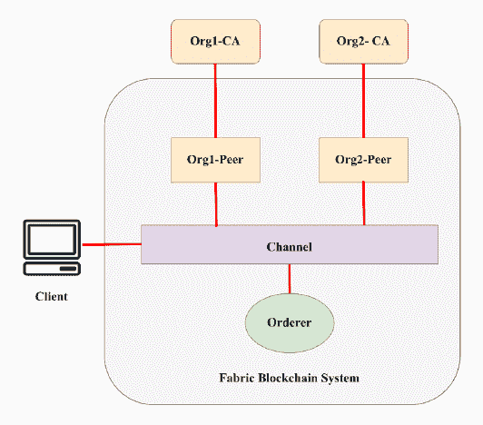
```
**图 (2)**

独立排序器示例。

#### Raft


一个领导者和其他节点构成了 `Raft` 排序系统。该网络的控制器是通过达成共识的过程选出的。支持者模仿领导者的行为。与 `Kafka` 相比，这种排序机制的设置要简单得多（见图 3）。

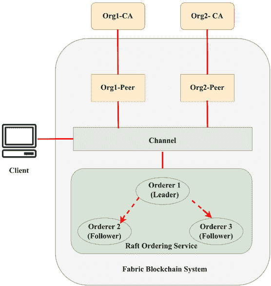 **图 (3)**

例如，`Raft` 排序辅助。

#### Kafka

在 `Apache Kafka` 之上构建了另一种额外的基于“统治者与支持者”的排序系统。还需要 `Zookeepers` 来监控 `ordering-networks`。它自 `Hyperledger Fabric` `v1.0` 版本起一直可用。尽管如此，在 `Raft` 发布后，由于其管理成本较高且在 `Hyperledger Fabric` 中使用时需要复杂的配置，很难被采用（图 4）。

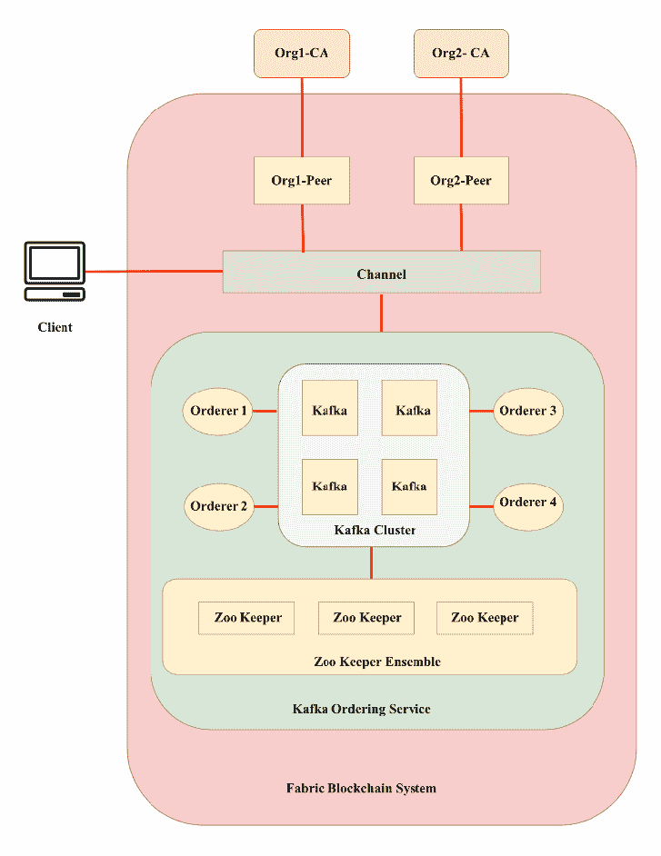 **图 (4)**

例如，`Kafka` 排序辅助。

## 状态仓库

得于 `Hyperledger Fabric`，`CouchDB` 和 `LevelDB` 都可以作为状态存档。上述两个数据库都是开源的、基于 `NoSQL` 的且无法处理 `SQL` 查询或关系型数据库设计。这两个数据库促进了 `chain code` 的基本功能，包括检索 `key-value conjunction`、存储它以及使用 `keys` 进行查询。尽管如此，推荐使用 `CouchDB`，因为它可以执行复杂的搜索。`NoSQL` 数据库为信息管理提供了大量的选项。

Table 2 描述了 `SQL` 和 `NoSQL` 数据库之间的区别。

表 2 **SQL 与 NoSQL 数据库的比较。**

| SQL 数据库 | NoSQL 数据库 |
| --- | --- |
| 关系型数据库管理系统(RDBMS) | 分布式数据库 |
| 模式导向 (Schema Oriented) | 无模式 (Schema Less) |
| `ACID(原子性、一致性、隔离性、持久性)` 特性 | `BASE (基本可用、软状态、最终一致性)` 特性 |
| 垂直扩展 | 水平扩展 |
| 不支持 API | 支持 API |

在 `SQL` 数据库中，存在可以与 `NoSQL` 数据库相相比的复杂查询。此外，`NoSQL` 是开源的，并且提供了许多应用程序，因此所有面向医疗的数据都存储在 `NoSQL` 数据库中。`NoSQL` 数据库的类型如下：

• 键值数据库 (Key/Value Database)。
• 列式数据库。
• 文档数据库。
• 图型数据库。
• 宽行数据库 (Wide Row Database)。

图 (5) 明确显示了账本的状态。下方的 Table 3 对 `CouchDB` 与 `LevelDB` 进行了详细分析。

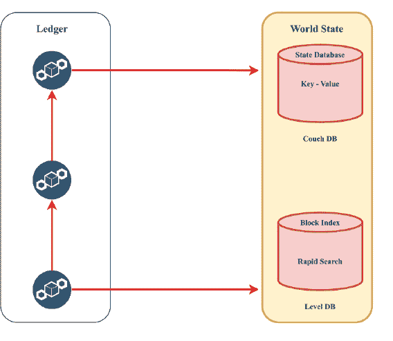 **图 (5)**

`Hyperledger Fabric` 中的账本机制。表 3 **LevelDB 与 CouchDB 的对比。**

| 规格 | CouchDB | LevelDB |
| --- | --- | --- |


当涉及电子健康记录等高度机密信息时，区块链提供了许多优势。区块链技术通过加密来保护和监控信息的传输，使得信息在不被发现的情况下很难被更改或伪造。由于 `blockchain` 是分布式的，因此不存在单一故障源，降低了黑客攻击和信息泄露的可能性。

## 区块链驱动的医疗保健

医疗和健康信息包括医疗治疗期间收集的临床信息以及私人的疾病预防信息。该平台是一个结合技术进步与健康信息的协作平台。该框架由三个元素组成：数据辅助、数据隐私和数据获取。保护组件为健康辅助创建了保障，数据采集模块收集患者的健康数据，服务功能则满足了患者对健康记录的需求。

## 用于保护医疗数据的区块链系统

区块链有助于去中心化应用和数据共享系统的发展。从历史角度看，医疗数据管理一直是一个自主运行的计算机系统。这种管理模式的缺点是，由于数据管理权力过于集中，难以建立真正的信息交换。区块链技术引入了共享文本特性。由于多个机构共同保护和监督输入区块链技术中的文件内容，各部门的共享监督确保了数据细节的开放性和诚实，同时也确立了控制区块链交易规则的透明度和责任机制。这将从根本上解决传统医疗数据管理相关的问题，如工作效率低下和工作氛围过于混乱。

区块链还可以用于创建一种可靠的传输机制。添加、删除、更改和查询这些简单且基础的操作构成了医疗记录数据管理的全部。然而，区块链消除了已存储知识删除和修改管理中的两个基本步骤，并简化了存储数据的处理。区块链的技术架构确保了数据的安全性和不可变性。区块链中的每个数据块进一步跟踪了前一个区块的 `hash algorithm` 和 `genesis time`。这种时间标记的网络架构增加了健康数据的使用率，并使标准检查、监控和问责变得更容易。

最后，区块链可以加强分配规范和数据交换。通过利用区块链接技术和智能合约，可以优化历史数据的交换自动化。智能合约一旦执行就是不可逆的，且不受外部过程的影响。医院可以使用此功能来巩固利益分配政策。智能合约通过鼓励利益相关者参与数据共享、提高数据交易的效率和速度以及改变成员活动，具有显著增加医疗数据价值的。在这种强制数据交换中，医疗数据的完整性得到了保证，并限制了与传统数据共享相关的隐藏容器操作。

## 利用区块链的医疗信息管理

计算机科学目前最大的进展之一是区块链技术的使用，它允许网络成员跟踪活动并与区块链的其他用户快速交换。该领域提出了四组基本方案来解决隐私和安全问题：第一，数据加密和解码方法；第二，一种电子身份的新方法；第三是信息安全传输技术；第四是基于区块链的密钥生成过程。

上述章节讨论了 `Hyperledger Fabric` 中的各种仓库（`CouchDB` 和 `LevelDB`）。表 2 描述了 `CouchDB` 和 `Level DB` 的对比。相比之下，两个数据库中，`CouchDB` 相比 `LevelDB` 显示出更好的参数。`CouchDB` 机制记录每一次更新，就像区块链一样。`CouchDb` 也称为面向文档的数据库。它以键值对的形式存储和检索数据，但值部分以文档的形式存储。文档以（JavaScript 对象表示法）`JSON` 格式存储。例如：存储在 Document DB 格式中的患者数据。图 (7) 介绍了如何在 `couch database` 中创建患者文档数据。

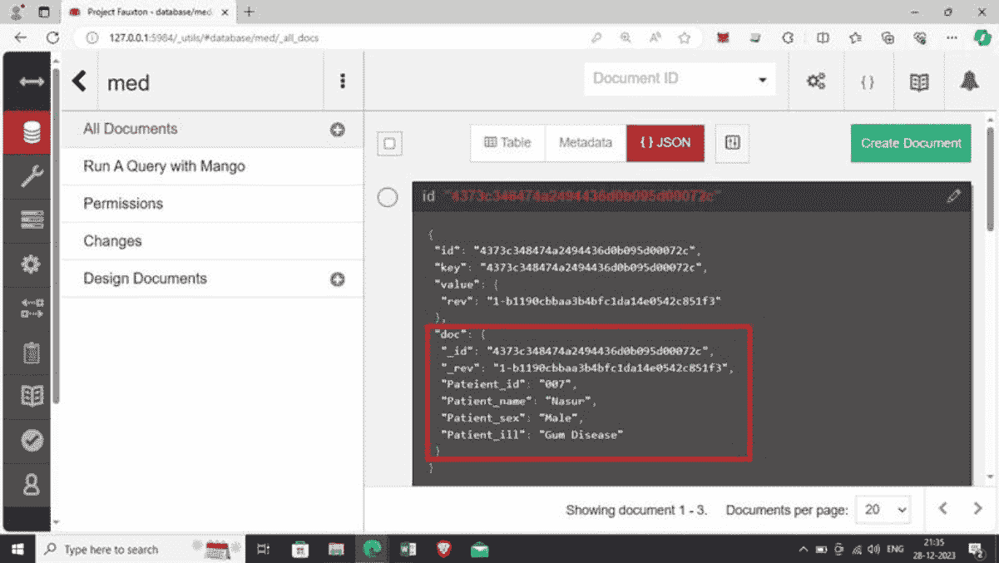 **图. (7)**

作为面向文档数据库的患者记录 (CouchDB)。

在 `CouchDB` 和 `LevelDB` 之间，`CouchDB` 受 `API`（应用程序接口）的支持。在我们的结果中（图 8），我们使用 `Boomerang API` 通过 `API` 从 `CouchDB` 获取数据。

区块链技术可以应用于医疗机构的各个方面，包括经济、管理、监督、数据、检查和历史记录。它还可以为医院运营和信息化提供关键的技术支持。

在这项工作中，利用 `Hyperledger Fabric` 平台构建了一个权限的机密区块链网络，以安全且不可更改的方式存档医院记录，供未来研究和按需要访问。

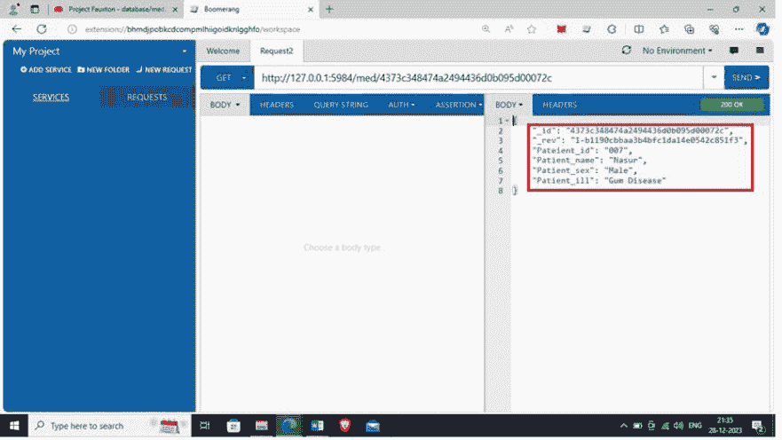 **图. (8)**

通过 API 从 CouchDB 获取患者记录。

## 零知识证明 (ZKF)

在描述中，区块链具有高度的透明度。录入记录的所有数据 `Bitcoin` 系统中的任何节点都可以访问，零知识证明技术被整合到区块链中以保护个人和企业的匿名性。

## 星际文件系统 (IPFS)

创建了一种名为 `IPFS` 的全网络交换机制，以实现文件的分散、持久传输和存档。像网页一样，星际文件系统 (`IPFS`) 是一个去中心化的对点数据传输网络。主要区别在于，网页使用基于地理的路由，而 `IPFS` 使用基于文档的索引。由于文件无法被操控，使用这种基于文档引用的数据是不可变的。当某项被修改时，会形成一个新文件。在这个对点系统中，文件通过进行哈希处理以建立信任。这种信任可以通过从未验证的材料重建 `hash algorithm` 或 `Merkletree` 来验证。大型文档可以使用 `IPFS` 切分，它能够根据需要同时下载多个部分。分布式、全球网络架构：通过在 `IPFS` 中存储海量的多媒体信息，这种网络布局可以解决区块链的内存限制。编码记录的保留：`IPFS` 在不包含电子数据的秘密数据上添加了 `hash function`。该代码确保了关联文档无法被更改。`hash` 与文件完全匹配。

上传到 `IPFS` 集群的每个文档都被分配一个独特的 `hash value`，该值由项内部的信息决定。当请求获取存档时，`IPFS`（图 9）使用其 `hash table` 识别其位置然后检索其内容。区块链和 `IPFS` 的结合可能是解决区块链容量困境的有效方法。

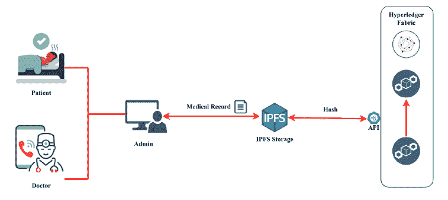 **图. (9)**

通过 Hyperledger Fabric 在去中心化存储中存储医疗记录。


患者和医生均通过参与解决方案的权限流程来获取医疗信息。管理员客户端可以建立或更新智能合约，他们还负责监控区块链。

## 挑战与局限性

在医疗保健行业，区块链技术在增强数据处理、机密性和隐私保护方面的潜力 [23] 已经引起了广泛关注。尽管如此，其应用仍面临多重障碍。

- **对数据安全和机密性的威胁**：带宽容量和处理能力不足。
- **信息泄露**：复杂的药品追踪场景。
- **对健康信息保护措施的持续监控**：检查区块时存在时间延迟。
- **数据操纵和录入限制**：处理时间不足。
- **信息保护**：难以识别设备特征迹象。
- **临床信息的处理与追踪**：设备与数据中心之间的连接性不足。

由于 `HLF` 是一种专有的区块链技术进展，且没有生产级的开源链代码可用，我们不愿收集性能随复杂程度增加而各异的数据。相反，我们不得不通过采用不同的计算方式来模拟代码量。`RAM`（随机访问内存）是构成主要障碍的设备特性之一。

## 未来机遇

世界将受到区块链技术的巨大影响，而区块链医疗尚未完全实现其承诺。区块链医疗除了彻底变革技术和整个行业，还将动摇目前的秩序、法律认可和财务结构。随着区块链技术的不断成熟，预计将以下发展趋势。

### 智能计算

区块链创新可用于智能系统，为不同的智能元素（如信息、计算和计算能力）提供共享环境和去中心化交易。这可能导致人工智能和创新设计在全新方向上的发展。区块链将提高医疗领域的开放性、简单性和决策可靠性。由于所有区块链数据对所有人可见，人工智能将成为机密安全和打击伪造的基石。

### 提高 IoT 数据安全与开放性

医疗行业的区块链创新有望提高 `IoT` 数据的安全开放性，同时促进未来 `IoT` 的灵活性、有效性和统一性。用于医疗的区块链物联网 (`IoT`) 设备将允许患者管理谁可以访问他们收集的数据，增强设备对攻击者的防护能力，并对谁查看过信息进行精确追踪。根据设备监控的特定条件，供应链交易可以通过 `via` 基于智能合约的区块链方法进行。

### 医疗保健中的隐私

特定个人可以访问的加密医疗记录可以存储在区块链上。医疗保健涉及额外的标准，如数据交换和连接性，以保护患者数据。交换与不同来源交换信息的方法。在保险公司、机构、医疗专业人员和患者的参与下，分布式账本提供了安全私密的医疗管理。区块链可用于医疗领域的各种任务。区块链技术通过控制药品制造过程帮助医生寻找基因密码，确保患者医疗数据的安全传输，并简化有关患者信息的交换。如何保护患者健康信息免受黑客攻击并确保经过验证访问的机密性，是目前医疗行业面临的最大问题之一。医疗保健的增长建立在区块链安全之上；未来，区块链安全将主要通过技术应用、应用深化和监管系统来发展。

## 医疗领域区块链实施成功案例

该领域内多个成功的区块链应用证明了区块链技术通过增加数据安全性、提高开放性和简化流程来彻底变革医疗行业的潜力。

I. `MedRec` 由麻省媒体实验室开发，是一种基于区块链的电子医疗记录系统，旨在管理身份验证、机性和数据共享。该系统允许患者控制自己的医疗记录并提供透明的审计追踪，确保数据完整性并减少行政工作 [24]。II. `Patientory` 是一种基于区块链的解决方案，专注于改进数据互操作性和患者护理。通过将健康信息存储在区块链上，`Patientory` 实现医疗提供者之间安全的无缝数据共享 [25]。III. 供应链：区块链技术被用于保护从生产到终端消费者的供应链，降低伪劣药品进入供应链的风险。该系统增加了利益相关者之间的透明度和信任 [26]。IV. `爱沙尼亚健康记录系统` 利用区块链保护健康记录。该系统为所有访问和修改提供了不可篡改的审计追踪，显著增强了数据安全 [27]。V. `Patientdatachain` 平台利用区块链为医疗记录创建去中心化数据库，允许安全地向医生、医院和实验室授予权限。`Patientdatachain` 确保数据的准确性、及时性和可用性 [28]。

上述案例证明区块链可以解决医疗行业的重大挑战，如数据安全、互操作性和供应链完整性。本文使用的所有缩写均列于表 4。

表 4 **缩写列表。**

| **缩写** | **定义** |
| --- | --- |
| `IoT` | 物联网 |
| `HLF` | Hyperledger Fabric |
| `RAM` | 随机访问内存 |
| `IPFS` | 星际文件系统 |
| `ZKF` | 零知识证明 |
| `API` | 应用程序接口 |
| `DApps` | 去中心化应用 |
| `IA` | 工业时代 |
| `CA` | 认证机构 |
| `DWD` | 数字健康数据 |
| `MSP` | 成员服务提供者 |
| `RDBMS` | 关系型数据库管理系统 |
| `ACID` | 原子性、一致性、隔离性和持久性 |
| `BASE` | 基础可用、软状态、最终一致性 |
| `LSCC` | 周期系统链代码 |
| `CSCC` | 配置系统链代码 |
| `QSCC` | 查询系统链代码 |
| `BSI` | 更好的信息安全 |
| `GO` | 更大的开放性 |
| `CouchDB` | 不可靠的商品化硬件集群 |
| `MS` | 更多的隔离 |

## 结论


区块链具有去中心化、开放和不可篡改的特点，它通过促进信息的安全存储、连接以及对患者治疗的关注，具有彻底改变医疗保健行业的潜力。这项技术有许多可能性，例如进行临床研究和医疗信息处理、防止欺骗以及加强对供应链（药物）的监管。区块链技术在数据管理中的应用旨在降低成本、简化流程、提高患者健康水平并消除中间环节。为了推进医院信息系统的改革并增强医疗信息交换与保存的安全性，`Hyperledger` 技术正被应用于医疗领域。在执行企业跨行业区块链解决方案时，`Hyperledger` 是最实用且对用户友好的传输工具，因为它能够在网络中元素级上对上述参数进行变动管理，允许在一个网络内通过多种方式实现安全性。`Hyperledger Fabric` 提供了一种构建工业级区块链应用的灵活设计。由于 `Hyperledger Fabric` 已经实现了特定的部分（包括共识过程和成员身份提供），其结构现在变得易于扩展和维护，使其完美适用于工业场景中的各种用途。尽管这仅仅是一个过渡阶段，但我们应该关注未来解决区块链产生的信息容量问题。`IPFS` 和区块链可以帮助减轻区块链的存储压力。

## REFERENCES

| | | |
| --- | --- | --- |
| [1] | Agbo C.C., Mahmoud Q.H., Eklund J.M.. Blockchain technology in healthcare: a systematic review., *In Healthcare .* **2019;** 7(2): 56. | [CrossRef](http://dx.doi.org/10.3390/healthcare7020056) |
| [2] | Hasnain M., Albogamy F.R., Alamri S.S., Ghani I., Mehobob B.. The `Hyperledger fabric` as a Blockchain framework preserves the security of electronic health records., *Front. Public Health.* **2023;** 11: 1272787. | [CrossRef](http://dx.doi.org/10.3389/fpubh.2023.1272787) [[PubMed](http://www.ncbi.nlm.nih.gov/pubmed/38089022) |
| [3] | Antwi M., Adnane A., Ahmad F., Hussain R., Habib ur Rehman M., Kerrache C.A.. The case of `HyperLedger Fabric` as a blockchain solution for healthcare applications., *Blockchain: Research and Applications.* **2021;** 2(1): 100012. | [CrossRef](http://dx.doi.org/10.1016/j.bcra.2021.100012) |
| [4] | Patil Y., Jain S., Kale S.. Leveraging `hyperledger fabric` for secure healthcare systems., *International Journal of Computing and Digital Systems.* **2024;** 16(1): 189-200. | |
| [5] | Martinson E.O.. An efficient secure sharing of electronic health records using IoT-based `hyperledger blockchain`., *Int. J. Intell. Syst..*. **2024** | |
| [6] | Kaushal R.K., Kumar N.. Convergence of blockchain and internet of things using `hyperledger fabric`., *International Conference on Emerging Smart Computing and Informatics (ESCI).* **2024;** 1-5. | [CrossRef](http://dx.doi.org/10.1109/ESCI59607.2024.104926) |
| [7] | Jakhar A., Singh R., Viriyasavat W., Goel S.. A blockchain-based privacy-preserving and access-control framework for electronic health records., *Multimedia Tools Appl..* **2024;** 1-35. | |
| [8] | Zambare S., Sawant N.. Modern Approaches in Machine Learning and Cognitive Science: A Walkthrough.. Performance of patient centric ehr through `hyperledger fabric`; p. 333.-342. | |
| [9] | Ullah A., Aznaoui H., Sebai D., Alam T.. Internet of things and cloud for ehealth systems: Concepts, opportunities, and challenges., *Wire. Pers. Commun..* **2024;** 1-51. | |
| [10] | Elangovan D., Long C.S., Bakrin F.S., Tan C.S., Yeoh S.F., Loy M.J., Hussain Z., Lee K.S., Idris A.C., Ming L.C.. The use of blockchain technology in the care sector: systematic review., *JMIR Med. Inform..* **2022;** 10(1): e17278. | [CrossRef](http://dx.doi.org/10.2196/17278) [[PubMed](http://www.ncbi.nlm.nih.gov/pubmed/35049516) |
| [11] | Ullah A., Khan S.A., Alam T., Luma-Osmani S., Sadie M.. Heart disease classification using various algorithms., *International Journal of Applied Sciences.* **2022;** 11(2): 158. | [CrossRef](http://dx.doi.org/10.1159/ijaas.v11.i2.pp158-167) |
| [12] | Kumar N., Dakshayini M.. Secure sharing of health data using `hyperledger fabric` based on blockchain., *International Conference ICOMBI.* **2020;** 1-5. | [CrossRef](http://dx.doi.org/10.1109/ICOMBI420) |
| [13] | Stamatellis C., Papadopoulos P., Katsikas S., Buchanan W.. A privacy-preserving and access-control framework for electronic health records using `hyperledger fabric`, *Sensors (Basel).* **2022;** 20(2): 6587. | [CrossRef](http://dx.doi.org/10.3390/s20226587) [[PubMed](http://www.ncbi.nlm.nih.gov/pubmed/3441194) |
| [14] | Uddin M., Memon S., Memon J., Ali I., Alsaq R.. `Hyperledger Fabric`: A blockchain-enabled solution for healthcare., *Comput. Mater. Contin.* **2021;** 50: 102407. | |
| [15] | Ben Fekih R., Lahami M.. Healthcare information exchange using blockchain technology., *Iran. J. Electr. Comput.* **2020;** 10(1): 421. | |
| [16] | Tanwar S., Parekh K., Evans R.. Blockchain-based healthcare, *Journal of Information Security and Applications.* **2020;** 50: 102407. | |
| [17] | Jain A., Jat D.. Implementation of blockchain-based system for healthcare applications, *Proceedings of the International Conference on Data Science, Machine Learning and Artificial Intelligence.* **2021;** 37-47. | [CrossRef](http://dx.doi.org/10.1007/978-981-159547-9_2) |
| [18] | Alshalali T., Josula D., Security and privacy of health records using `hyperledger fabric`, *International Conference on Computational Science and Computational Intelligence (CSCI).* **2018;** 760-763. | [CrossRef](http://dx.doi.org/10.1109/CSCI46756.2018.052) |
| [19] | Iftekhar A., Cui X., Tao Q., Zheng C.. Access control for internet of things layer in blockchain using `hyperledger fabric`, *Entropy.* **2021;** 23(8): 1054. | [CrossRef](http://dx.doi.org/10.3390/e23081054) [[PubMed](http://www.ncbi.nlm.nih.gov/pubmed/3441194) |
| [20] | da Fonseca Ribeiro M.I., Vasconcelos A.. MedRec: medical data access, permission management and trend analysis. *In ICEIS.* | |
| [21] | Ciampi M., Esposito A., Marangio F., Sicuranza M., Schmid G.. Modernizing healthcare by blockchain... **2021** | [CrossRef](http://dx.doi.org/10.1007/978-981-159547-9_2) |
| [22] | Ben Fekih R., Lahami M.. Application of blockchain technology in healthcare: a comprehensive study. In the impact of digital technologies on public health in developed and developing countries: 18th International Conference, ICOST 2020, Hammamet, Tunisia, June 24–26, 2020., *Proceedings.* **2020;** 18: 268-276. | Springer International Publishing. |
| [23] | Hussien H.M., Yasin S.M., Udzir N.I., Ninggal M.I.H., Salman S.. Blockchain technology in the healthcare industry: Trends and opportunities., *J. Ind. Inf. Integr.* **2021;** 22: 100217. | |
| [24] | Ekblaw A.C.. **2017** *MedRec: blockchain for medical data access, permission management and trend analysis.*. | |


| [25] | Angeles R.. Blockchain-based healthcare: Three successful proof-of-concept pilots worth considering., *J. Int. Technol. Inf. Manag...* 2019; 27(3): 47-83. [CrossRef](http://dx.doi.org/10.58729/1941-6679.1390) |
| [26] | Lingayat V., Pardikar I., Yewalekar S., Khachane S., Pande S.. Securing pharmaceutical supply chain using Blockchain technology., *ITM Web of Conferences.* 2021; 37: 010113. [CrossRef](http://dx.doi.org/10.1051/itmconf/20213701013) |
| [27] | Habicht T., Reinap M., Kasekamp K., Sikkut R., Aaben L., van Ginneken E.. World health organization., *Estonia: health system review.*. 2018 |
| [28] | Cernian A., Tiganoaia B., Sacala I., Pavel A., Iftemi A.. Patientdatachain: A blockchain-based approach to integrate personal health records., *Sensors (Basel).* 2020; 20(22): 6538. [CrossRef](http://dx.doi.org/10.3390/s20226538) [PubMed](http://www.ncbi.nlm.nih.gov/pubmed/33207620) |

# 区块链驱动物联网应用在智能农业和医疗领域对促进工业 5.0 中可持续经济增长和智能健康管理生态系统的影响

Bhavneet Kaur Sachdev, Sumanta Bhattacharya

¹ 印度加尔加塔大学
² 印度西孟加拉邦加尔加塔 Maulana Abul Kalam Azad 技术大学

## 摘要
在工业 5.0 的框架下，将区块链驱动的物联网应用整合到智能农业和医疗领域，对长期经济增长和智能健康管理生态系统的构建具有重要意义。通过区块链技术和精准农业技术实现的智能农业透明供应链，通过减少资源消耗，降低了传统农业对环境的影响，其在环境、经济、工业和利益相关者方面产生了广泛影响。区块链技术和物联网（IoT）设备保护了患者记录，实现了更环保且纸张浪费更少的流程。这些创新从经济角度扩大了农业资源的利用，在增加产的同时减少了成本。区块链技术对数据完整性和操作性的保障使得更好的患者疗和更低的医疗成本成为可能。这促进了更加公平和包容的经济环境，让小型参与者拥有话语权。工业部门推动了创新与整合。工业 5.0 的原则旨在通过营造开放交流与合作的环境，汇经济的多个部门，以提高技术标准、加强网络安全并标准化流程。包括非政府组织（NGO）在内的利益相关者使意识、培训和社区参与变得更容易。为了以伦理负责的方式采用这些技术，对其支持性立法的倡导以及对数据所有权的保护至关重要。未来将会有更多的国际合作、针对能源效率问题的新技术解决方案以及通用基标准的建立。

**关键词：** 农业资源、倡导、区块链、网络安全、社区参与、数据完整性、生态系统、环保、经济角度、环境影响、医疗成本、工业 5.0、国际合作、物联网、纸张浪费、非政府组织、智能健康管理、利益相关者、智能农业、技术。

***

* **通讯作者 Sumanta Bhattacharya:** 印度西孟加拉邦加尔加塔 Maulana Abul Kalam Azad 技术大学；电子邮箱：`sumanta.21394@gmail.com`

## 引言
区块链驱动的物联网（IoT）应用具有彻底改变智能农业和医疗的潜力。在智能农业的背景下，区块链和物联网应用可以提高供应链的可可见性和审计性。来自物联网（IoT）传感器的数据（如追踪土壤水分、温度、湿度和作物健康的传感器）可以安全地记录并存储在分布式账本上，让利益相关者对农业实践和产品数据的可靠性充满信心。这不仅促进了可持续和符合伦理的农业实践，还通过为消费者提供有关农产品来源和质量的经过验证的信息，减少了欺诈的可能性。优化资源利用是农业和区块链促进长期经济繁荣的一种方式[1]。为了确保农民获得公平报酬，区块链上的智能合约可以简化交易和法律协议。财务交易的便利性和透明度的提高可能导致农业产量和利润的增加。此外，物联网设备收集的信息可用于数据驱动决策，允许农民实施精准农业实践，在提高生产力的同时减少环境影响。当区块链技术与物联网结合时，就可以建立智能健康管理生态系统。通过物联网设备（如可穿戴健康监测器）获得的患者数据可以安全地存储在区块链上。在保护患者信息机密性的同时促进了医疗专业人员之间的开放交流。患者对其健康自主权的增强支持了医疗交付。基于区块链的智能合约自动化保险理赔等流程可以减少文书工作并提高医疗系统的生产力。在工业 5.0 的范式转变中，以人为中心的设计与尖端技术并肩。从此来看，区块链驱动的物联网应用与建立强调效率和可持续性的相互依赖生态系统的目标一致。区块链交易是透明且安全的，因此参与农业和医疗的每个人都可以信任其连接设备之间共享的数据[2]。工业 5.0 通过能够自我增强的协作、网络系统的兴起而广泛化。区块链增强的安全性和隐私性是应用于物联网时的一个大卖点。在智能农业和医疗领域都会产生和传输敏感数据。区块链技术的分布式账本和加密特性确保了信息不会被篡改，且只有授权用户才能访问。这不仅促进了良好的数据管理实践，还保护了整个农业供应链个人健康信息的隐私。它对智能农业和医疗具有重大影响，促进了可持续经济和新的智能健康管理生态系统的增长[3]。

## 环境考虑


智能农业和医疗系统在涉及区块链和`IoT`时面临着重大的环境问题。为了解决这些环境问题，这些领域的技术进步必须符合可持续发展目标，使这些因素至关重要。物联网（`IoT`）通过使用`sensors`、`drones`和自动化机械等设备，能够提高智能农业资源的利用率。正因如此，农民能够使用更少的水、`fertiliser`和农药，从而从整体上提高了生产效率。这通过减少传统耕作方式对环境的负面影响，有助于可持续耕作和资源保护。

在智能农业中使用`blockchain`技术通过创建一个可验证且透明的供应链，提升了生态友好性。通过对食物来源保持公开和诚实，消费者可以确信他们的食物没有参与任何损害环境的非法或不可持续的方法[4]。掌握了这些信息后，购物者可以要求更多对环境有益的可持续农业技术。`Blockchain`和物联网（`IoT`）还可以简化医疗运营，从而减少对资源的需求和废物的产生。得益于存储在`blockchain`系统上的数字健康记录，对纸质记录的需求将减少，这意味着更少的纸张浪费和更少的污染。

可穿戴监测器和远程患者监测工具是医疗领域使用的物联网（`IoT`）设备示例。这些设备允许早期检测和预防性干预，从而减少急诊治疗和住院对环境的影响。通过减少能源浪费和更好地利用医疗资源，这种新的主动方法是环境友好的[5]。存储在`blockchain`系统上的健康数据是去中心化且安全的，这意味着对巨型数据中心等物理基础设施的需求减少。这意味着能源消耗的减少和碳影响的缩小。随着越来越多的医疗系统转向数字化解决方案，这变得越来越重要，特别是因为人们开始担心数据存储对环境的影响。

如果`blockchain`和`IoT`真的致力于减少它们对环境的负面影响，它们必须被设计成使用更少的能量。为了确保这些技术的优势不以增加能量消耗和碳排放为代价，低功耗`IoT`设备的创新以及`blockchain`网络中共识程序的改进至关重要。另一个需要考虑的重要因素是如何妥善处置旧物联网设备产生的电子垃圾。为了减少电子废物对环境的影响并防止毒性物质污染，生产者应该将回收和负责任的处置作为首要任务[6]。在使用`blockchain`和`IoT`技术之前，应该进行彻底的环境影响研究，以检测并缓解任何不利影响。通过采取这种预防措施，我们可以确保这些技术在智能农业和医疗领域产生最积极的影响，同时对环境产生最小的负面影响。

必须共同努力，向公众告知区块链和物联网（`IoT`）在智能农业和医疗中的环保优势。展示这些技术的有益环境影响并鼓励利益相关者采取可持续行为，可能会促进对生态负责任使用的集体承诺。尽管这些技术在智能医疗和农业中具有革命潜力，但对环境可持续性的坚定应当指导`blockchain`和物联网（`IoT`）的部署。如果我们希望我们的技术创新对环境产生有益且持久的影响，我们必须找到平衡它们的方法[7]。图(1)解释了`blockchain`和`IoT`对环境的影响。

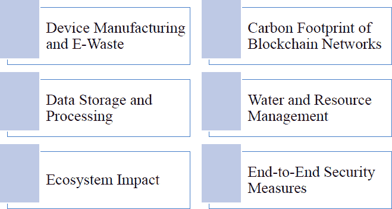 **图 (1))**

区块链和物联网对环境的影响。

## 区块链和物联网对经济增长的贡献

在工业 5.0 的背景下，支持区块链的`IoT`应用可能会彻底改变智能农业和医疗系统，从而创造重大的经济发展。通过提供作物状况、土壤健康和天气模式的实时数据，最大限度地提高资源效率和精明，`blockchain`和`IoT`技术可以提高智能农业的效率。更多的农业产量意味着经济中更多的资金，这种数据驱动的策略通过让农民更好地利用资源并减少浪费来实现目标。`sharding`、`sidechains`等先进解决方案能够有效处理与智能农业和医疗服务相关的海量数据。层 2 协议如`ARCnet`、`Asynchronous Transfer Mode`、`Econet`、`Ethernet`、`Ethernet Automatic Protection Switching`、`Fiber Distributed Data Interface`、`Frame relay`、`High-level Data Link Control`、`Lightning Network`等，实现了广域网中高效的数据传输[4]。技术的影响已在图(2)所示。

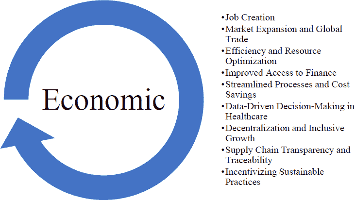 **图 (2))**

技术对经济增长的贡献。

### 鼓励供应链的开放性和追溯性

智能农业利用`blockchain`技术使供应链更加透明和可追溯。这提高了农产品的质量，同时也减少了欺诈的可能性。当供应链更加可靠时，企业可以通过对对其产品收取溢价来增加收入并为利益相关者提供经济利益。

**赋权与鼓励参与：** 由于`blockchain`的去中心化结构，智能农业中的小型参与者获得了更大的影响力。由于这种开放性，曾经被边缘化的地区可能会看到经济增长，因为小农民能够参与全球市场。

### 基于数据的医疗决策

由于`blockchain`和物联网（`IoT`）的整合，医疗决策现在可以基于数据[8]。结果是医疗成果（包括诊断准确性和个性化治疗策略）得到了提高。其经济影响在于通过预防措施和早期治疗减少医疗成本，从而建立一个更可持续的医疗系统。

### 降低成本和提高效率

物联网（`IoT`）设备和`blockchain`使智能农业和医疗能够自动化和简化流程，从而节省了大量成本。通过简化流程、减少官僚主义和提高运营效率，我们可以消除中间环节并向经济注入更多资金。

### 简化资金获取

在智能农业领域，`blockchain`技术允许安全透明的财务交易。除了作物成功的实时数据外，这还提高了农民的信誉。由于融资渠道的改善，对技术和基础设施的投资成为可能，农业行业对经济增长做出了重大贡献[9]。

###协作与互操作性


工业 5.0 中的协作通过区块链技术与物联网（IoT）技术的互操作性得到了增强。对于智能农业而言，这意味着所有各种系统和设备都可以顺畅地相互通信。这使得医疗保健行业的不同部门能够安全地相互共享患者数据。由于资源和专业知识的汇聚，新的想法应运而生，这种伙伴关系也随之扩张。区块链在供应链中的信任和开放性促进了农业和医疗保健的全球贸易。凭借这种信心，医疗保健提供者和农民可以加入全球市场，增加他们的影响力并推动各地的经济增长 [10]。促进医疗和农业可持续实践的智能合约可以集成到支持区块链的系统中。对于采用环保和伦理方法的农民和医疗专业人士，应该提供激励措施或溢价率，以鼓励经济发展和可持续性。随着越来越多的物联网（IoT）应用使用区块链技术，对数据分析师、网络安全专家和区块链开发者的需求非常大。因此，工业 5.0 的新面貌有助于通过创造就业机会和提高个人能力来促进经济增长。在工业 5.0 时代，智能农业和医疗保健中区块链与物联网应用的协同效应通过提高透明度、效率和协作对经济增长做出了巨大贡献。它们还促进了创新和包容性发展 [11]。

## 对农民和医疗行业的社会影响

使用区块链和物联网的智能农业和医疗保健具有深远的社会影响，特别是农民和整个医疗行业。图 (3) 展示了智能农业对社会的影响。这些技术提高了效率和生产力，对人们和社区的福祉产生了深远的影响。通过让他们获得信赖的数字平台，支持区块链的智能农业赋予了小农更多自主权。由于这种包容性，他们能够在农业生态系统中拥有更大的话语权，更有效地参与市场，并为他们的商品获得公平报。利用区块链技术和物联网的智能农业帮助农民通过减少浪费来实现收获最大化 [12]。因此，这导致了更高的收入和更好的生活条件。农业效率的提高将允许农民向社区投入更多资金，并为家庭提供更好的生活。

区块链的透明性和可追溯性使农民能够获得更好的金融服务。当他们能够使用智能合约和作物状况的实时数据证明其可信度时，获取用于农业投资的贷款和其他金融工具变得简单得多。区块链和物联网将农民聚集在一起，加强了他们作为社区的。由于农民分享有关天气、虫害和作物表现等方面信息，农业社区能够更好地协作解决问题并相互学习 [13]。区块链和物联网（IoT）可以让医疗保健更容易获得。通过促进医疗远或偏远地区医疗从业人员与患者之间的通信，远程监控和远程医疗等技术帮助那些可能在需要时难以获得所需治疗的人。

在医疗保健中使用区块链确保了记录的隐私和所有权。这种以患者为中心的方法鼓励了开放的沟通与合作。物联网（IoT）设备与区块链的集成允许健康指标进行持续监测，这有助于实施预防措施并降低医疗费用 [14]。区块链身份管理的进步将降低身份盗窃的风险。自主主权身份框架、去中心化标识符、可验证凭证等技术赋予了个人在农业和医疗系统领域对其个人数据的完全控制权。保护医疗信息的机密性是区块链技术的核心。

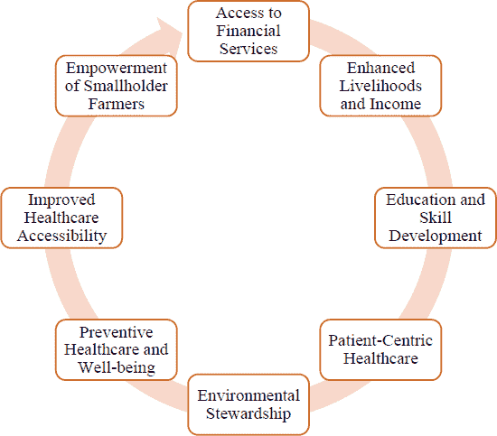
图 (3) 智能农业对社会的影响。

智能农业的社会效益还包括环境护理，这是我们的第九点。农民可以通过利用物联网（IoT）优化资源利用并利用区块链技术确保可持续实践，从而改善环境状况。教育和技能开发对于区块链和物联网的采用至关重要。如何使用技术、理解数据和管理系统的知识对农民和医疗专业人员都有用 [15]。在增强他们自身能力的同时，这在经济和社会方面帮助了社区。

## 工业部门在可持续发展中的作用

在智能农业和医疗保健领域，工业部门对于充分利用区块链的物联网应用至关重要，特别是在工业 5.0 的背景下。工业参与者可以利用这种技术的革命性融合提高效率、促进创新并贡献可持续发展。工业企业通过区块链和物联网的集成引领了智能农业创新的潮流。他们投入研发先进技术，包括传感器网络、自动化机械和区块链系统。工业部门利用区块链技术及其巨大的供应链网络可以优化整个农业供应链。农产品的生产、加工和分销可以通过这种方式进行监控和验证。分布式账本技术（区块链）通过使交易透明且可追溯，改进了供应链的责任制和质量控制。

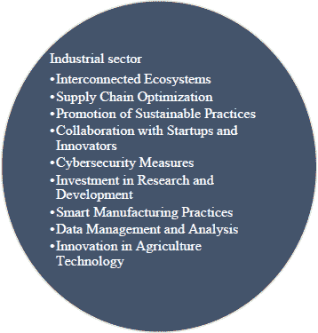
图 (4) 工业部门对可持续经济增长和发展的贡献。


工业 5.0 强调不同系统之间的相互依赖。在工业参与者的帮助下，智能农业和医疗健康生态系统可以整合各种组件，实现 `blockchain` 网络与 `IoT` 设备之间的无缝连接。这些互连提升了系统的整体性能和效率。数据管理和分析是工业部门蓬勃发展的领域。工业参与者可以利用医疗和农业领域中 `IoT` 设备产生的海量数据，构建强大的分析平台。通过确保数据的机密性和完整性，`blockchain` 为明智决策奠定了坚实的基础。工业参与者可以帮助在利用 `blockchain` 技术实现物联网的应用程序中，完成协议和接口的标准化工作 [17]。随着这些标准的建立，智能农业和医疗健康可以更轻松地整合各种设备和系统，创建一个更具凝聚力和互操作性的生态系统。提高效率是工业 5.0 中智能制造流程的核心关注。通过将 `blockchain` 和 `IoT` 技术整合到生产过程中，工业部门可以确保生产数据透明且完整。这反过来有助于制造可靠且可追溯的农用设备和医疗设备。

**图 (4))**

 工业部门对可持续经济增长和发展的贡献。

工业参与者拥有充足的资金，可以投入与 `blockchain` 和物联网（`IoT`）应用相关的研发项目。对于智能农业和医疗健康，这意味着创建专门的传感器、通信协议和 `blockchain` 解决方案。医疗和农业数据特别敏感；因此，工业部门主导建立强大的网络安全防护措施至关重要。为了确保 `blockchain` 技术赋能生态系统中的隐私和安全，有必要设计安全的通信路由、加密机制和访问控制系统。工业部门可以鼓励与 `blockchain` 和物联网（`IoT`）创新者及初创企业建立合作伙伴关系 [18]。大型工业公司通过与规模较小、更灵活的企业合作，可以从智能农业和医疗的新想法中受益。智能农业和医疗健康是工业部门促进和执行可持续实践的两个领域。农业部门可以通过采用更具可持续性的生产实践并使用 `blockchain` 技术追踪货物来源，为改善环境和社会状况做出贡献。工业 5.0 的成功取决于工业部门利用支持 `blockchain` 的物联网应用于智能农业和医疗健康的能力。这些技术成功且长期地融入到现代医疗和农业中，取决于行业主体通过标准化、合作和创新驱动积极转型 [8]。

## 相关利益者与 NGO 的利益

为了成功部署和管理整合了 `blockchain` 和物联网（`IoT`）的智能农业，相关利益者和非政府组织（NGO）至关重要。他们的参与对于农业行业解决许多问题、促进包容性以及实施可持续方法至关重要。图 (**5**) 显示了利益者在促进农业和医疗健康生态系统中使用 `blockchain` 和 `IoT` 的作用。NGO 和其他利益方通过引起农民、立法者和社区成员关注这一问题，可以推动 `blockchain` 和 `IoT` 整合到智能农业中。他们在宣传这些技术的优势、提高意识和消除疑虑方面的工作至关重要。非政府组织（NGO）可以通过组织培训计划和能力建设项目，帮助农民学习如何使用 `blockchain` 和物联网（`IoT`）。其中之一是培训人员设置和操作智能设备，以便农民做出数据驱动的决策 [19]。为了帮助农民（特别是小农户）获取智能农业解决方案的资金和资源，利益者和 NGO 可能发挥关键作用。为了确保最大限度地减少采用新技术的财务障碍，这种支持可能以拨款、补贴或与金融机构合作的形式出现。在实施智能农业时，让当地社区和农民参与决策过程至关重要。通过在不同方之间进行协调，NGO 可以确保每个人的意见都能考虑，并使技术解决方案符合社区的需求。在农业中整合 `blockchain` 和物联网（`IoT`）时，NGO 可以帮助制定标准和最佳实践。这种关于统一性和互操作性的框架确保了技术在不同领域和农业方法中的持续使用 [20]。

利益者和非政府组织可以推动可持续农业技术的发展。例子包括：推动由 `blockchain` 技术实现的更透明、更环保的供应链，以及促进利用 `IoT` 设备实现的精细农业方法以减少资源消耗。在促进有助于发展的政策方面，NGO 在全球、国家乃至地方范围内都至关重要。他们与政府合作可以解决数据隐私和安全问题，并促进 `blockchain` 和物联网（`IoT`）在农业中的正确使用 [4]。为了确保智能农业计划的成功，持续的监测和评估至关重要。为了全面提高这些计划的有效性，利益者和 NGO 可以通过开展影响评估、寻找改进方法并分享所得来提供帮助。在智能农业方面，NGO 可以为农民的数据所有权和隐私保护努力。他们可以尝试建立系统，让农民对自己的数据拥有更多话语权，并使其 `blockchain` 生态系统中的应用更加透明。NGO、利益者以及农业价值链中的其他参与者相互合作至关重要。这些团体可以通过整合资源和知识，更好地管理智能农业的 `blockchain` 和物联网（`IoT`）解决方案。

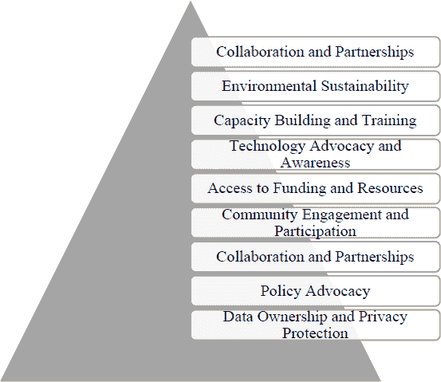**图 (5))**

利益者在促进农业和医疗健康生态系统中使用 `blockchain` 和 `IoT` 的作用。


在医疗保健领域，利益相关者和非政府组织（NGOs）是推动区块链和物联网使用的力量。他们在向医疗执业人员、立法者和广大推广这些技术的潜在优势方面发挥着至关重要的作用。区块链和物联网（IoT）具有变革医疗保健管理的潜力，他们正努力通过各种教育倡议使这些理念更易于普及。利益相关者和非政府组织（NGOs）合作为医疗保健区块链与物联网的整合制定规则和准则。通过解决数据隐私、安全和伦理问题，他们与政府机构合作，建立有利于其业务的监管环境。他们的深刻见解有助于制定规范这些技术进行伦理且负责任用途的政策。新的医疗保健倡议经常获得非政府组织的资助和其他资源。区块链和物联网（IoT）的应用开发与实施可能是他们资助的重点 [21]。这种财政援助使得医疗行业内新技术的测试和规模化变得更容易，有助于克服资金短缺的问题。在非政府组织和其他利益相关者的帮助下，智能医疗计划得到持续的监测和评估。通过与医疗执业人员、技术开发人员和学者合作，他们评估区块链和物联网技术如何影响医疗交付、患者结果以及整个系统的效率。通过这种反馈循环，技术可以进行精调和改进，以适应不断变化的医疗场景。

## 政策与治理的角色

在涉及智能农业和健康管理时，数据安全和隐私是主要的考虑因素。政策在制定法律框架以解决这些担忧方面是关键。由于农业和医疗数据的敏感性，必须实施严格的限制以建立所有参与方建立信任。为了促进区块链和物联网技术的安全且伦理的使用，治理系统确保这些原则得到遵循。图 (6) 展示了智能农场管理所需的政策和治理。

为了确保各种区块链和物联网系统能够无缝相互通信和集成，政策可以建立互操作性标准。标准化可以实现更具凝聚力和相互依赖的生态系统，允许许多利益相关者之间进行合作。定义良好的标准有助于减少兼容性困难并促进整个行业的创新，从而促进技术的采用。政府政策可以鼓励可持续农业和医疗保健。立法者通过使用区块链和物联网技术，激励绿色且具有社会责任感的农业和医疗保健 [22]。为了确保这些行业的长期生存能力，政府通常会提供财政激励，如减税、补贴或市场特殊待遇。物联网设备创建并存储在区块链系统上的数据引发了所有权和许可的问题，这些问题应该通过政策来解决。当医疗系统中有了明确规则规定谁拥有什么时，患者对自己的健康记录拥有了更多主动权。治理系统确保以透明的方式获得同意，以确保人们知道他们的数据将发生什么以及如何被使用。通过消除农业和医疗等领域的领域的障碍，政策可以鼓励跨部门的协作。工业 5.0 的核心在于技术的整合，而不仅仅局限于单一行业。支持联合项目的政府法规可能会促进智能农业与健康管理之间的协同效应 [23]。这将带来完整且关联的解决方案。


**图. (6)** 智能农场管理的政策与治理。

在促进区块链和物联网技术广泛使用的至关重要的数字基础设施增长方面，政府可以起到关键作用。这种投资策略的一部分涉及数据中心、高速互联网连接和其他形式的技术基础设施的建设。鼓励这些投资的政策可以促进智能农业和健康管理的进步。区块链技术和物联网在医疗和农业的应用引发了重要的伦理问题，这些问题应该由决策者解决。通过建立和执行负责任创新的规范，治理系统可以确保数字进步始终将伦理、人权和社会福祉放在首位。采取这种方法，我们可以鼓励创建符合人们规范和预期的技术 [22]。为了确保参与医疗和农业的人员拥有利用区块链和物联网技术的知识和能力，政策可能会侧重于教育和能力建设。政府资助的培训计划、研讨会教育努力可以使农民、医疗提供者和立法者受益，帮助他们理解并充分利用这些技术。在工业 5.0 时代，法规和治理在建立一个鼓励创新、保护数据并支持长期经济增长的环境方面起着至关重要的作用。只有通过设计良好的规则和强大的治理系统，才能实现区块链和物联网技术在这些关键行业中负责任且伦理的整合。

## 挑战

如图 (7) 所示，多个区块链系统与物联网设备的集成引发了标准化和兼容性的担忧。智能农业和医疗保健需要标准化协议，以实现跨设备和系统之间的顺畅连接和数据共享。由于缺乏兼容性，这些技术可能无法被广泛或有效地使用。工业 5.0 强调系统互连的一个主要障碍是可扩展性。要实现长期发展，需要确保网络和物联网应用程序能够处理智能农业和医疗产生的海量数据。为了满足工业 5.0 环境日益增长的广度和深度，必须解决扩展性问题。


健康和农业数据非常敏感，因此需要强有隐私和安全保障措施。尽管区块链以安全性著称，但在保护个人和私有信息方面仍存在障碍。如果我们想让人们对这些系统产生信任，我们需要解决他们对数据泄露、非法访问以及保护其健康信息的忧虑 [[24]]。关于医疗保健和农业将如何结合区块链和物联网进行监管，仍存在许多问题。问题在于如何制定出既能接受这些新科技，又能遵守既有限制的新型政策。为了确保这些应用符合法律和伦理规范，在创新与监管合规之间找到平衡点至关重要。

智能农场和医院必须花费巨资才能开始使用区块链和 `IoT`。特别是规模较小的利益相关者可能会发现基础设施、设备部署和系统集成的必要支出高到无法负担。为了实现这些技术的可持续使用，必须在鼓励对其进行投资的同时，解决对其投资回报率的顾虑。一支能够理解和监督区块链及物联网应用的劳动力对于工业 5.0 关关重要。为了确保这些技术的高效使用和维护，对农民、医疗提供者和 IT 人员进行充分教育和培训是非常的。为了充分实现工业 5.0 的优势，弥补人才缺至关重要。

在具有长期规范的行业中，新技术的采用可能会遇到阻力。传统流程可能会面临农民和医疗专业人士等利益相关者的抵抗 [[25]]。为了在智能农业和医疗保健中成功整合基于区块链的物联网应用，克服这种抵触情绪并促进创新文化至关重要。

区块链技术，特别是其被称为 `proof-of-work` 的共识机制，可能会消耗大量能量。考虑到工业 5.0 环境可持续性的性，解决与区块链相关的能耗至关重要。为了减轻这一问题的影响，研究人员可以考虑不同的区块链系统或创建使用能量更少的共识过程。将区块链和 `IoT` 技术集成到既有系统中可能是困难的。诀窍在于确保一切在不中断当前活动的情况下顺利进行。由于集成的复杂性，可能需要规划、合作和分阶段部署，以最大限度地减少中断并最大化提高效率。

区块链支持系统的一个困难点是对数据所有权和治理结构缺乏共识。得于 `smart contracts` 和去中心化控制系统，在决定谁拥有什么数据时，有了新的因素需要考虑。为了实现可持续且公平的增长，开发能够平衡个人数据所有权与集体共享数据优势的框架至关重要。技术开发者、立法者、商业巨头等人必须通力解决这些问题。为了实现工业 5.0 智能健康管理和可持续经济增长的目标，在智能农业和医疗保健中基于区块链的物联网 (`IoT`) 应用达到其最大潜力之前，必须消除这些障碍 [[3]]。

## 未来展望

在工业 5.0 时代，智能健康管理生态系统将由智能农业和医疗保健中基于区块链的物联网 (`IoT`) 应用塑造，这些应用具有促进可持续经济增长的潜力。由于区块链去中心化和透明的本质，智能农业和医疗健康的利益相关者能够共享和协作更多数据。结果将更深层次的理解，反过来促进生态系统内的合作，允许集体数据驱动决策，从而提高患者的效率和生活质量。

区块链技术预计在不久后将在智能农业中广泛应用，以改进供应链追踪。农产品的完整供应链将对消费者透明，增加对以符合伦理和环境负责任的方式制造的产品的需求。通过区块链技术与人工智能 (`AI`) 的结合，医疗保健和农业领域将实现预测分析。农业疾病预测和医疗预防医学将从中受益匪浅。`AI` 算法提供的见解将有助于主动决策，而这些决策由安全存储在区块链系统上的海量数据集提供支持。

区块链技术实现的 `tokenization` 可能会引发农业所有权和投资的新范式转变。一个潜在的未来方向是农业资产代币化，这可能为碎片所有权打开门，并吸引更多对可持续和创新耕作方法感兴趣的投资者。通过基于区块链的解决方案，患者对对其医疗记录拥有更多的话语权。未来，健康管理生态系统可能允许人们选择与哪些医疗提供者、研究人员和其他方共享健康数据。这可能通过将患者置位带来更好的医疗结果。

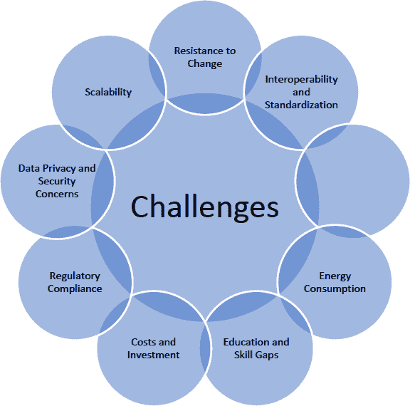
**图 (7)**

区块链和 `IoT` 技术面临的挑战。

不同的高级加密技术，即对称密钥加密、公钥加密、哈希函数、数字签名、多因子认证、同态加密、`AES` 算法、`RSA` 安全加密、非对称加密等，为敏感数据的安全性增加了多层保护。这些技术将能够在不损害隐私的情况下，处理敏感的农业和医疗数据。

为了确保区块链和物联网应用中的隐私、有效性能、法律合规性和可用性，我们需要基于 `Hyperledger Fabric` 或 `Ethereum` 的企业以太坊联盟 (`EEA`) 规范等新兴标准，开发法律、组织、语义和技术互操作性框架。

我们需要采用开放数据标准和 `APIs`（应用程序编程接口），以促进智能农业和健康管理生态系统中各种利益相关者之间无缝的数据共享和互操作性。


预计智能合约将在智能农业中找到更多应用，实现农业价值链上各种协议的自动化和安全化。在未来，智能合约可能被用于减少行政负担，并增强对作物保险、供应链物流以及农民公平报酬等协议的信心。区块链和物联网应用将越来越多地使用边缘计算。通过这种方式，数据可以在产生源地进行实时处理，使智能农业和医疗保健系统更具响应性并降低延迟。在边缘计算的帮助下，可以做出更好、更快速的决策。区块链技术将为安全且去中心化的国际研发合作铺平道路。随着数据共享的改进，科学家、研究人员和医疗提供者能够更快速、更有效地应对农业问题并推动医疗进步。我们可以预计，随着这些技术的进一步发展，监管机构将适应区块链和物联网在医疗和农业中的新型应用。为了营造有利于该行业扩张的氛围，未来的计划目标是建立更精确的规则和法规，在创新与隐私、安全以及伦理考量之间取得平衡。知名度更高的可能是由区块链技术实现的 DAO（去中心化自治组织）。在智能农业中，DAO 可能会帮助农民共同做出决策；在医疗领域，它们可以帮助开展遵循工业 5.0 的社区驱动健康计划。智能医疗和农业中基于区块链的物联网应用具有广阔的未来。这些创新预计将工业 5.0 时代的健康管理生态系统变得更具韧性和以患者为中心，并将在改变传统方法的同时促进可持续发展。智能合约审计和先进验证工具的实施将有助于对数据隐私机制进行定期跟踪，并评估其对监管框架的遵循情况。此外，这将促进网络隐私规则和互操作性框架的持续升级。

## 结论

工业 5.0 即将经历重大变革，智能农业和医疗领域基于区块链的物联网（IoT）应用正在创建智能健康管理生态系统并促进长期经济增长。通过这些技术的整合，精准农业成为可能，并通过提高农业领域的开放性、效率和合作促进了负责任的实践。物联网设备的实时数据与区块链的安全去中心化特性相结合，为医疗保健中以患者为中心的方法、预防性治疗和增强整体健康铺平了道路。在未来，当工业 5.0 成型时，区块链技术与物联网（IoT）的结合预计导致我们处理这些关键领域的方法发生根本性变化，确保可持续性、包容性和韧性。创新、利益相关者的参与以及政府合作是未来技术突破及其革命性潜力的关键。为了充分实现区块链物联网应用的承诺，未来的进步应集中于解决数据安全、法律框架和互操作性等问题。智能农业和医疗保健在伦理和负责任创新方面处于领先，这与工业 5.0 的理念相一致，并将开启一个技术支持社会福祉、环境管理和经济进步的新时代。

## 参考文献

| | | |
| --- | --- | --- |
| [1] | Aliyu A.A., Liu J.. Blockchain-based smart farm security framework for the internet of things., *Sensors (Basel).* **2023;** 23(18): 7992. | [CrossRef](http://dx.doi.org/10.3390/s23187992) [PubMed](http://www.ncbi.nlm.gov/pubmed/3776046) |
| [2] | Upadrista V., Nazir S., Tianfield H.. Secure data sharing with blockchain for remote health monitoring: a review., *J. Reliab. Environ.* **2023;** 9(3): 349-368. | [CrossRef](http://dx.doi.org/10.1007/s40860-023-0020-w) [PubMed](http://www.ncbi.nlm.gov/pubmed/3735923) |
| [3] | Habib G., Sharma S., Ibrahim I., Qureshi S.. Blockchain technology: Benefits, challenges, and integration of blockchain technology with cloud computing., *Future Internet.* **2022;** 14(11): 341. | [CrossRef](http://dx.doi.org/10.3390/fi1411031) |
| [4] | Dhanaraju M., Chenniapp P., Ramalingam K., Pazhanivel S., Kaliaperumal R.. Smart Farming: Internet of things (IoT)-based sustainable agriculture., *Agriculture.* **2022;** 12(10): 1745. | [CrossRef](http://dx.doi.org/10.3390/agriculture12101745) |
| [5] | Taherdoost H.. Blockchain and healthcare: A critical analysis of progress and challenges in the last five years., *Blockchains.* **2023;** 1(2): 73-89. | [CrossRef](http://dx.doi.org/10.3390/blockchains102006) |
| [6] | Tagde P., Tagde S., Bhattacharya T., Chopra H., Akter R., Kaushik D., Rahman M.H.. Blockchain and artificial intelligence technology in e-Health., *Environ.. Pollut. Res. Int.* **2021;** 28(38): 52810-52831. | [CrossRef](http://dx.doi.org/10.1007/s11356-021-1622-0) [PubMed](http://www.ncbi.nlm.gov/pubmed/3447601) |
| [7] | Wang Y., Han J.H., Beynon-Davies P.. Understanding blockchain technology for future supply chains: a systematic review and research agenda., *Supply Chain Manag.* **2019;** 24(1): 62-84. | [CrossRef](http://dx.doi.org/10.1108/SCM-03-2018-0148) |
| [8] | Xiong H., Dalhaus T., Wang P., Huang J.. Blockchain technology for agriculture: Applications and rationale., *Frontiers in Blockchain.* **2020;** 3:7. | [CrossRef](http://dx.doi.org/10.3389/fbloc.2020.00007) |
| [9] | Friha O., Ferrag M.A., Shu L., Maglaras L., Wang X.. “Internet of things for the future of smart agriculture: A comprehensive survey of emerging technologies” in IEEE CAA, *CAA Journal.* **2021;** 8(4): 718. | [CrossRef](http://dx.doi.org/10.1109/JAS.2021.100392) |
| [10] | Shaikh E., Mohammad N.. The influence of 5G, IoT, and blockchain technologies in industrial automation.. In: Tanwar S., editor. Blockchain for 5G-Enabled IoT. Cham: Springer; 2021. | |
| [11] | Adel A.. Future of industry 5.0 in society: human-centric solutions, challenges and prospective research areas., *Journal of Cloud Computing.* **2022;** 11(1): 40. | [CrossRef](http://dx.doi.org/10.1186/s13677-022-0314-5) [PubMed](http://www.ncbi.nlm.gov/pubmed/3610190) |
| [12] | Khan S.N., Loukil F., Ghedira-Guegan C., Benkhelifa E., Bani-Hani A.. Blockchain smart contracts: Applications, challenges, and future trends., *Peer-to-Peer Netw. Appl.* **2021;** 14(5): 2901-2925. | [CrossRef](http://dx.doi.org/10.1007/s12083-021-01127-0) [PubMed](http://www.ncbi.nlm.gov/pubmed/3389737) |
| [13] | Tripoli M., Schmidhuber J.. Emerging Opportunities for the Application of Blockchain in the Agri-Food Industry. FAO and Rome and Geneva: ICTSD, 2018. Licence: CC BY-NC-SA 3.0 IGO. | |
| [14] | Aldamaeen O., Rashideh W., Obidallah W.J.. Toward patient-centric healthcare systems: Key requirements and framework for personal health records based on blockchain technology., *Appl. Sci. (Basel).* **2023;** 13(13): 7697. | [CrossRef](http://dx.doi.org/10.3390/app13137697) |
| [15] | Navarro E., Costa N., Pereira A.. A systematic review of IoT solutions for smart farming., *Sensors (Basel).* **2020;** 20(15): 4231. | |


[[CrossRef](http://dx.doi.org/10.3390/s20154231)] [[PubMed](http://www.ncbi.nlm.nih.gov/pubmed/32751366)] |

| [16] || Tyagi A.K., Dananjayan S., Agarwal D., Thariq Ahmed H.F.. 区块链——物联网应用：工业 4.0 和社会 5.0 的机遇与挑战，*Sensors (Basel).* **2023;** 23(2): 947. |

[[CrossRef](http://dx.doi.org/10.3390/s23020947)] [[PubMed](http://www.ncbi.nlm.nih.gov/pubmed/36679743)] |

| [17] || Ayan B., Güner E., Son-Turan S.. 供应链中的区块链技术与可持续性，以及对不同行业的深入观察：混合方法法，*Logistics.* **2022;** 6(4): 85. |

[[CrossRef](http://dx.doi.org/10.3390/logistics6040085)] |

| [18] || Kaur A., Singh G., Kukreja V., Sharma S., Singh S., Yoon B.. 食品供应链管理中物联网与区块链的结合：基于分析的发展、益处和潜在应用综述，*Sensors (Basel).* **2022;** 22(21): 8174. |

[[CrossRef](http://dx.doi.org/10.3390/s22218174)] [[PubMed](http://www.ncbi.nlm.nih.gov/pubmed/36365871)] |

| [19] || Aliyu A.A., Liu J.. 针对物联网的区块链智能农场安全框架，*Sensors (Basel).* **2023;** 23(18): 7992. |

[[CrossRef](http://dx.doi.org/10.3390/s23187992)] [[PubMed](http://www.ncbi.nlm.nih.gov/pubmed/37766046)] |

| [20] || Andrieu N., Howland F., Acosta-Alba I., Le Coq J-F., Osorio-Garcia A.M., Martinez-Baron D., Gamba-Trimiño C., Loboguerrero A.M., Chia E.. 与当地利益相关者共同设计气候智能型农业系统：实现大规模变革的方法论框架，*Front. Sustain. Food Syst..* **2019;** 3: 37. |

[[CrossRef](http://dx.doi.org/10.3389/fsufs.2019.00037)] |

| [21] || Kumar A., Singh R.R., Chatterjee I., Sharma N., Rana V.. 使用区块链和物联网在医疗保健中的神经自适应激励，*SN Computer Science.* **2023;** 5(1): 13. |

[[CrossRef](http://dx.doi.org/10.1007/s42979-023-02365-0)] |

| [22] || Alajlan R., Alhumam N., Frikha M.. 基于区块链的物联网系统的网络安全：综述，*Appl. Sci. (Basel).* **2023;** 13(13): 7432. |

[[CrossRef](http://dx.doi.org/10.3390/app13137432)] |

| [23] || Alabdulatif A., Khalil I.. 人工智能赋能的区块链安全性，*Appl. Sci. (Basel).* **2022;** 12(21): 1039. |

[[CrossRef](http://dx.doi.org/10.3390/app1211039)] |

| [24] || Oliveira M., Chauhan S., Pereira F., Carvalho D.. 针对 5.0 的区块链协议，*Sensors (Basel).* **2023;** 23(22): 9174. |

[[CrossRef](http://dx.doi.org/10.3390/s23229174)] [[PubMed](http://www.ncbi.nlm.nih.gov/pubmed/3800558)] |

| [25] || Dhingra S., et al.. 医疗领域区块链应用的挑战：基于废物管理的视角，*Oper. Manag.Res.* **2023;** [[CrossRef](http://dx.doi.org/10.1007/s12063-023-0413-9)] |

# 基于区块链的医疗供应链系统的 stride 威胁建模

S.V. Harish⁹⁷⁸⁹⁸¹⁵³⁰²¹⁰-C6.html#1

## 摘要
区块链在供应链管理中的应用日益使得理解其相关风险至关重要。本研究旨在通过对现有文献的案例分析，识别区块链的重要安全问题。这些问题包括数据隐私、智能合约漏洞和 51% 攻击。报告还提出了减少这些问题的建议。

关键词：区块链、数据隐私、信息安全、隐私、供应链管理、透明度。

## 引言
供应链管理是企业运营的核心组成部分，而区块链技术因其提高供应链效率、安全透明度的能力而日益受欢迎。

### 区块链技术
区块链作为一种分布式账本技术，引起了广泛关注，适用于金融、医疗和物流管理等多个领域。它本质上是一个开放、安全的交易记录系统。尽管区块链具有巨大的潜力，但在扩展性、安全性和互操作性方面仍面临挑战。区块链网络由许多协作计算机组成。每台计算机（或 `blockchain node`）都保留一份区块链的精确副本。由于区块链会自动复制，并且通过哈希值跨区块构建链，因此攻击者很难更改其内容。如果某个区块被更改，整个链都随之更改，并且还需要更改至少 51% 的节点副本，这在处理大型区块链或网络时是不可行的。


一个区块由区块头、一个交易列表和一个哈希值组成，如图 (1) 所示。区块头包含关键信息，例如区块编号、其添加到链上的日期，以及通过加密手段生成的唯一哈希代码。该哈希值通过充当加密指纹的作用，确保了区块数据的完整性和不可篡改性。此外，区块头还包含一个指向链中前一个区块的哈希值的链接，这促进了区块之间的连接以及区块链的形成。区块的交易列表包含了有关发送者、接收者、加密货币数量或其他正在传输的数据的详细信息。一旦交易被确认，它就会被添加到区块的交易列表中。区块链网络中的节点网络会频繁验证这些交易。区块随机数（nonce）的引入通常会简化验证过程，尽管这可能需要使用复杂的算法和共识机制。通过加密哈希函数，区块内容的任何变动，即使是内容中单个比特的微小变化，也会导致哈希值发生意想不到的细微修改。

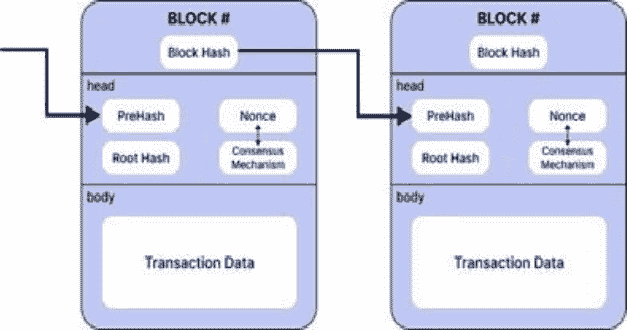 **图 (1)**

区块链中区块的基本结构。

本质上说，区块链的区块结构由一组经过验证的交易和一个包含元数据以及指向前一个区块链接的区块组成。这种安排确保了存储在区块链中的数据的安全性、透明性和不可篡改性。

#### 智能合约

被称为“智能合约”的自执行合约存储在区块链上，区块链是一种分布式账本技术，可以在无需中介的情况下实现安全、开放的交易。智能合约由于能够自动化各种公司流程、消除对中介的需求并提高运营性能，正变得越来越流行。此外，智能合约提供了不可逆转的、透明且安全的完整性和信任度，这是传统合同无法比拟的。在过去的几年里，智能合约引起了金融、保险、医疗保健和物流等多个行业学者和从业人员的极大兴趣。当双方约定的条件被满足时，智能合约可以被视为一段自执行代码，它只执行预设的指令集。这保证了合同一旦达成，任何一方都无法退出。

### 供应链管理系统

供应链是一个经过良好规划和结构化的网络，它将企业与其供应商连接起来，以向消费者生产并销售特定产品，从而努力成本并保持市场竞争力。它由多个实体、流程、数据和信息流以及资源组成。简单来说，供应链是使产品从源地移动到终端用户的系列活动和个人。这一过程的初始步骤包括提供原材料、进行制造、在市场范围内分发以及提供给客户。供应链运营通常涉及五个关键参与者，即制造商、配送商、零售商、供应商和客户。供应链中的每个实体都向其他实体提供商品，以换取约定的条款和付款。现代供应链管理解决方案利用区块链技术来简化这些协议、支付和交付。实现成本节约、快速生产周期和简化的供应链流程都取决于有效的管理。供应链管理涵盖了广泛的不同学科和操作。市场上有多种功能水平各异的供应链管理模型。

### STRIDE 框架

软件开发人员经常利用 STRIDE 框架（一种安全威胁建模方法论）来发现软件应用程序中潜在的安全风险和漏洞。STRIDE 是一个记忆词，分别代表：伪装（Spoofing）、篡改（Tampering）、否认（Repudiation）、信息泄露（Disclosure of Information）、权限提升（Elevation of Privilege）和拒绝服务（Denial of Service）。伪装涉及攻击者冒充用户或系统以访问敏感信息或资源。篡改是指攻击者在传输过程中或存储期间修改数据的能力。

攻击者撤回已完成活动（如请求或交易）的能力被称为否认。信息泄露是指私人信息在未受邀请的情况下提供给未受邀请的方方。攻击者干扰或阻止访问系统或应用程序的能力被称为拒绝服务。攻击者获取系统或应用程序的高级访问权限的能力被称为“权限提升”。

### 供应链管理中的区块链

供应链运营参考（SCOR）模型是管理和优化供应链管理最有效且应用广泛的框架之一。它为许多领域和公司的供应链运营提供了一种统一的方法。五个主要流程如下：计划（Plan）、采购（Source）、制造（Make）、交付（Deliver）和退（Return）。每个步骤中的指标、最佳实践和子流程被进一步细分，以帮助衡量和增强供应链性能。为了衡量和增强供应链性能，它还包含了一系列关键性能指标（KPIs）。由于涉及许多不同的程序和指示，很难将供应链的每一步都整合到区块链中。然而，即使在供应链中进行少量的区块链集成也能改进流程 [1, 2]。在供应链中，制造商从零售商和配送商处接收客户需求池，并用于向供应商订购原材料或停止生产。利益相关者从整个反馈循环中受益，确保供需平衡以实现利润最大化。在区块链框架内，授权人员可以访问每个方的去中心化账本，这确保了内部通信 [3]-5]。通过每个伙伴向账本添加物品交易，我们可以在供应链中监控、跟踪和报告物品。双方还可以参与智能合约的创建。每个智能合约的三个组成部分是账本、逻辑和属性。这些元素都可以简单地转换为技术概念。数据库代表账本，逻辑代表属性，数据架构代表逻辑。在这里，支付交易账本（即已付款）可能是账本，而逻辑可能是货物交付（即受跟踪的产品到达了所需的方）[6]。可以使用 P2P 文件共享协议来存储和检索数据，并使用查询协议来查询所有的账本，如图 (2) 所示。

### 贡献

在研究中，我们利用 STRIDE 框架评估了基于区块链的供应链管理系统的安全漏洞。该评估旨在帮助安全专业人员和软件开发人员识别软件应用程序安全的潜在威胁。


本文献综述采用 `STRIDE` 框架，对区块链系统威胁建模的当前研究现状进行了全面概述。之前的工作已经探讨了 `STRIDE` 分析的应用，正如 Cédric Hébert 和 Francesco Di Cerbo 在“企业级安全区块链：一种方法论” [[31]] 中概述的那样，该文章概述了完成 `STRIDE` 分析的步骤。在他们的研究中，识别了与区块链技术相关的 67 种特定威胁。关于该主题的另一个相关工作是“区块链应用的安全与隐私威胁建模的适用性” [32]，它探索了可以增强启发式威胁建模技术的领域。后续章节将重点介绍区块链背景下的各种类型威胁。

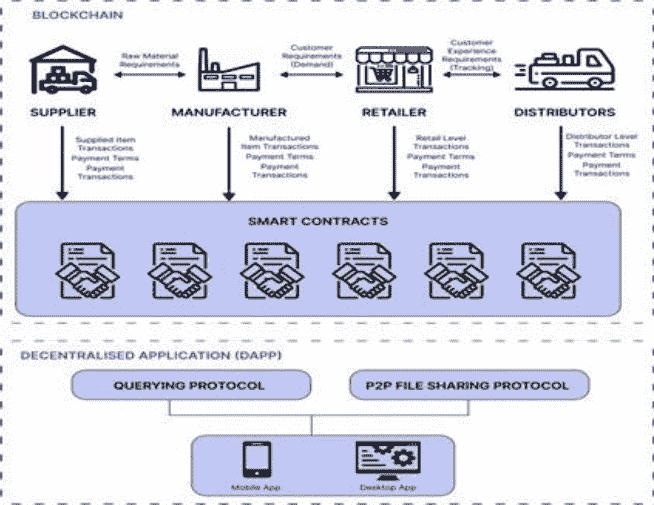 **图 (2)**

基于区块链的供应链管理概述。

## 区块链威胁类型

尽管区块链技术可以完全改变各种业务，但它也构成了严重的隐私和安全风险。区块链提供了一个透明的、去中心化的账本，虽然难以篡改，但并非完全免受攻击，这是一个重大问题。例如，当一方控制了网络大部分的计算能力时，可能会发生攻击，使他们能够操纵交易或双重花费。同样，攻击者可能会利用智能合约的漏洞，智能合约会在区块链上自动执行交易。此外，即使区块链允许进行与特定地址而非特定个人身份相关的伪匿名交易，这并不能保证完全匿名，因为这些交易可以被追踪和检查。因此，为了降低这些风险并确保区块链的完整性和隐私，区块链开发者和用户必须实施安全措施，如多因子认证、加密以及对智能合约进行彻底审计。后续章节将研究不同的安全和隐私威胁类型。

### 安全威胁类型

### 双重花费

双重花费发生在用户尝试多次花费同一个数字货币单位，因为涉及数字货币的交易在区块链上注册后通常是不可逆转的。否则，如果攻击者能够双重花费，他们就可以有效地制造伪币并从中获利。这主要发生在多个矿工在区块竞赛中争夺第一个向区块链添加新区块时。主要的罪魁祸首是共识协议挖矿，它带来了资源浪费、参与者劣势、不当收益和干预等风险 [[9, 10]]。

### 挖矿与矿池

尽管挖矿和矿池对区块链生态系统至关重要，但它们也构成了巨大的安全威胁。与挖矿和矿池相关的最大安全风险是潜在的 51 攻击%。如果单一矿工或矿池控制了网络一半以上的算力，他们就可以停止区块链创建新区块、更改交易或双重花费。其他安全问题包括中心化（这会破坏区块链技术的去中心化本质）、女巫攻击（攻击者在网络上创建许多节点以控制过多的算力）以及感染矿工计算机或挖矿设备的挖矿恶意软件。这些问题发生在挖矿策略偏差、区块竞赛和财务激励期间。主要问题是激励不兼容和共识协议挖矿，可能导致双重花费 [[11]]、不比例的收益 [[12]]、资源浪费 [[13]]以及 51%攻击 [[14]]。

### 点对点 (P2P)

点对点 (P2P) 网络是区块链技术的核心组成部分，因为它们允许用户直接通信和交易，而跳过中间商。它们也存在需要修复以维护区块链机密性和完整性的安全漏洞。最大的安全危险之一是潜在的女巫攻击，黑客通过制造大量虚假身份或网络节点来控制过量的权力。这发生在多个节点被部署、对等节点以及建立连接时。根源祸首是去中心化的互联网覆盖层，它增加了自利性挖矿、双重花费、拒绝服务和节点隔离的可能性 [[15]]。

## 隐私威胁类型

### 区块链分析

由于区块链是公共账本，任何访问网络的人都可以看到每笔交易。这使得人们能够检查和追踪交易，以确定参与方、活动历史以及交换的加密货币总额。即使是合法交易也可能暴露参与方的隐私信息。可以使用这些信息来识别参与犯罪活动的个人或组织。区块链分析工具能够将交易与特定个人或实体关联，追踪区块链上的资金转移，并识别行为模式。尽管区块链研究具有防止欺诈和其他非法活动的潜力，但它也危了用户的隐私。它运行以下过程中：活跃交易执行、地址和用户网络、聚类启发算法、与链外数据结合以及基于行为的聚类。透明性、公共性和伪匿名性是导致参与者识别和交易关联等担忧的根源 [[16^(\-)20]]。

### 网络分析

可以使用网络分析方法来检查网络流量，以识别行为模式并识别参与连接的节点或公司。在区块链背景下，网络分析可用于监控节点之间的信息流，并可能揭露交易参与方的身份。这些信息可用于确定每个参与者交换的比特币数量以及他们的交易历史。网络分析可用于定位节点并确定其 IP 地址，从而确定参与者身份。它发生在*通过* DoS 防的 TOR 攻击、中继模式异常以及 IP 地址和交易的传播期间。P2P 网络是根源问题，它们构成了将交易与 IP 地址关联的威胁 [[21^(\-)23]]。

### 密钥管理


网络流量可以使用名为网络分析的技术进行分析，以识别行为模式并确定参与连接的节点或组织。在区块链背景下，网络分析可用于跟踪节点之间信息流，并可能揭示参与交易的身份。参与者交换的比特币数量以及他们的交易历史，可以通过这些数据进行确定。通过网络分析可以找到节点的位置和 IP 地址，这可能用于识别参与者。它在 `Bloom filters`（布隆过滤器）、`SPV` 以及私钥提取过程中运行。底层问题在于密码学基础，导致了潜在的风险，例如将交易相互关联并将其与 IP 地址关联 [24^(\-)26\]。

# 差距分析 

基于区块链的供应链管理正在逐渐被采用；因此，识别与系统相关的任何安全风险至关重要。为了识别基于区块链的供应链管理系统中的潜在风险，本文应用了 `STRIDE` 方法论。虽然出版物广泛讨论了区块链在供应链管理中的应用，但对新危险的关注仍然不足。本文档还涉及了 `STRIDE` 框架的工具和实施指南，以帮助组织实施相关建议。缺乏系统性的威胁建模策略可能导致实施的安全解决方案不足，从而引发网络攻击和财务损失。本文阐明了使用 `STRIDE` 框架实施结构化威胁建模的方法，以解决上述问题。

# 讨论

为了识别系统中的潜在安全威胁，我们必须首先理解系统的架构以及用户与系统的交互机制。图（(**3**) (Lodovica, Michele, Robert, Maria (2022) [7]) 显示了工业环境中典型区块链设置的架构。在这种架构模型中，区块链生态系统中存在多个终端和层级。

Poston 关于使用 `STRIDE` 框架对区块链系统进行威胁建模的逐步指南包括：

*   定义系统及其组成部分。
*   识别系统旨在保护的资产。
*   使用 `STRIDE` 框架识别对系统的潜在威胁。
*   评估每个威胁的可能性和潜在影响。
*   开发缓解策略以应对最严重的威胁。
*   测试并验证缓解策略的有效性。

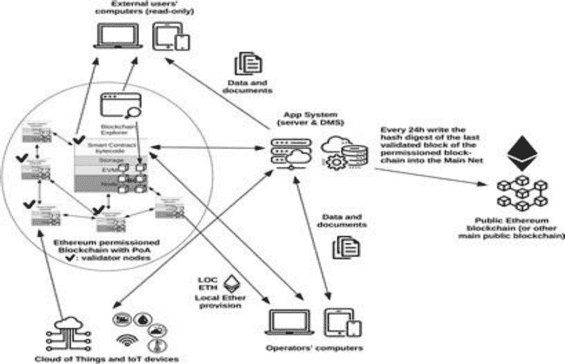 **图 (3))**  

工业应用区块链的架构（Lodovica, Michele, Robert, Maria (2022) [7]。

为了使用 `STRIDE` 框架进行威胁分析，我们将区块链分为多个层级。在每一层中，我们识别出涉及 `Spoofing`（欺骗）、`Tampering`（篡改）、`Repudiation`（否认）、`Information Disclosure`（信息泄露）、`Denial of Service`（拒绝服务）和 `Elevated Privileges`（权限提升）（`STRIDE`）的威胁。我们可以将区块链生态系统分为多个层级：

1) 基础层
2) 协议层
3) 基础设施层
4) 高级层

## 基础层

区块链技术基于块和链数据结构以及密码学原语。用于保护区块链系统的数学算法被称为密码学原语。`Hashing`（哈希）、`digital signatures`（数字签名）和 `encryption`（加密）是这些算法的示例。数据在静态和传输过程中都通过加密得到保护。通过使用数字签名实现数据真实性和防止篡改。通过使用哈希函数创建的独特数字指纹可以确认数据完整性。区块链系统的基础构建区块是块和链。区块链技术建立在块和链数据结构以及密码学原语的基础上。用于保护区块链系统的数学算法被称为密码学原语。`Hashing`、`digital signatures` 和 `encryption` 是这些算法的示例。数据在静态和传输过程中都通过加密得到保护。通过使用数字签名实现数据真实性和防止篡改。通过使用哈希函数创建的独特数字指纹可以确认数据完整性。区块链系统的基础构建区块是块和链。区块链技术建立在块和链数据结构以及密码学原语的基础上。用于保护区块链系统的数学算法被称为密码学原语。`Hashing`、`digital signatures` 和 `encryption` 是这些算法的示例。数据在静态和传输过程中都通过加密得到保护。通过使用数字签名实现数据真实性和防止篡改。通过使用哈希函数创建的独特数字指纹可以确认数据完整性。区块链系统的基础构建区块是块和链。区块链技术建立在块和链数据结构以及密码学原语的基础上。用于保护区块链系统的数学算法被称为密码学原语。`Hashing`、`digital signatures` 和 `encryption` 是这些算法的示例。数据在静态和传输过程中都通过加密得到保护。通过使用数字签名实现数据真实性和防止篡改。通过使用哈希函数创建的独特数字指纹可以确认数据完整性。区块链系统的基础构建区块是块和链。区块链技术建立在块和链数据结构以及密码学原语的基础上。用于保护区块链系统的数学算法被称为密码学原语。`Hashing`、`digital signatures` 和 `encryption` 是这些算法的示例。数据在静态和传输过程中都通过加密得到保护。通过使用数字签名实现数据真实性和防止篡改。通过使用哈希函数创建的独特数字指纹可以确认数据完整性。区块链系统的基础构建区块是块和链。区块链技术建立在块和链数据结构以及密码学原语的基础上。用于保护区块链系统的数学算法被称为密码学原语。`Hashing`、`digital signatures` 和 `encryption` 是这些算法的示例。数据在静态和传输过程中都通过加密得到保护。通过使用数字签名实现数据真实性和防止篡改。通过使用哈希函数创建的独特数字指纹可以确认数据完整性。区块链系统的基础构建区块是块和链。区块链技术建立在块和链数据结构以及密码学原语的基础上。用于保护区块链系统的数学算法被称为密码学原语。`Hashing`、`digital signatures` 和 `encryption` 是这些算法的示例。数据在静态和传输过程中都通过加密得到保护。通过使用数字签名实现数据真实性和防止篡改。通过使用哈希函数创建的独特数字指纹可以确认数据完整性。区块链系统的基础构建区块是块和链。区块链技术建立在块和链数据结构以及密码学原语的基础上。用于保护区块链系统的数学算法被称为密码学原语。`Hashing`、`digital signatures` 和 `encryption` 是这些算法的示例。数据在静态和传输过程中都通过加密得到保护。通过使用数字签名实现数据真实性和防止篡改。通过使用哈希函数创建的独特数字指纹可以确认数据完整性。区块链系统的基础构建区块是块和链。区块链技术建立在块和链数据结构以及密码学原语的基础上。用于保护区块链系统的数学算法被称为密码学原语。`Hashing`、`digital signatures` 和 `encryption` 是这些算法的示例。数据在静态和传输过程中都通过加密得到保护。通过使用数字签名实现数据真实性和防止篡改。通过使用哈希函数创建的独特数字指纹可以确认数据完整性。区块链系统的基础构建区块是块和链。区块链技术建立在块和链数据结构以及密码学原语的基础上。用于保护区块链系统的数学算法被称为密码学原语。`Hashing`、`digital signatures` 和 `encryption` 是这些算法的示例。数据在静态和传输过程中都通过加密得到保护。通过使用数字签名实现数据真实性和防止篡改。通过使用哈希函数创建的独特数字指纹可以确认数据完整性。区块链系统的基础构建区块是块和链。区块链技术建立在块和链数据结构以及密码学原语的基础上。用于保护区块链系统的数学算法被称为密码学原语。`Hashing`、`digital signatures` 和 `encryption` 是这些算法的示例。数据在静态和传输过程中都通过加密得到保护。通过使用数字签名实现数据真实性和防止篡改。通过使用哈希函数创建的独特数字指纹可以确认数据完整性。区块链系统的基础构建区块是块和链。

*(注：由于原文中存在大量重复的 Fundamental Level 段落内容，此处已根据翻译逻辑进行处理，保持核心语意一致。)*

### 密码学原语

各种加密协议和系统使用密码学原语进行构建，这些原语对于确保安全性、完整性和认证至关重要。数据在静态和传输过程中都通过加密得到保护。通过使用数字签名实现数据真实性和防止篡改。通过使用哈希函数创建的独特数字指纹可以确认数据完整性。区块链系统的基础构建区块是块和链。

### 数据结构

在区块链中，交易被组织成相互连接的区块。每个区块包含一组经网络验证的交易，以及一个包含时间戳和对上一个区块引用的元数据的头部。这种设计确保了每个区块与其他区块安全链接，形成不可篡改的链。另一方面，数据结构或其处理方式可能会影响区块链的安全。例如，如果交易数据格式指定不当，攻击者可能利用它来执行虚假交易或双重花费。同样，如果头部未经过安全哈希，攻击者可以更改区块的内容甚至向链中添加新区块。


允许网络中的节点对账本当前状态达成共的技术被称为共识算法。去中心化系统缺乏中央权威来跟踪交易或判断其合法性。相反，节点需要对账本进行验证和确认以对其当前状态达成共识。如果共识过程不完善，攻击者可以利用网络实施恶意操作，例如伪造欺诈交易或获取其控制权。

## 区块创建

将新区块添加到区块链的方法被称为区块创建过程。为了验证交易并添加新区块，去中心化网络中的节点必须相互协作。该过程通常涉及以下步骤：

1) 用户向网络广播交易。
2) 网络节点验证并确认交易，以确保它们是真实的没有被双重花费。
3) 根据所有验证通过的交易创建一个区块。
4) 使用共识技术验证区块。
5) 使用验证过的区块更新区块链。

区块创建过程促进了账本的去中心化和安全维护。由于网络中的多个节点都会验证每个区块，单个节点想要篡改账本具有挑战性。此外，密码学和共识程序确保了网络对攻击和篡改的抵抗能力。

## 基础设施层

区块链基础设施是指使区块链网络运行的底层技术框架。它是一种去中心化的分布式基础设施，促进了跨计算机网络的数据和价值的创建、存储和交换。

### 节点

运行区块链软件的终端（节点或设备）是区块链基础设施的核心组件。这些终端负责处理交易、验证区块并维护区块链的完整性。区块链账本在每个终端上复制，并在整个网络中进行实时更新和同步。

### 网络

连接终端的网络是区块链基础设施的另一个组件。区块链网络的性质决定了它是公链还是私有链。私有区块链网络的参与限于一组选定的授权终端，而任何人都可以加入公链区块链网络并成为一个终端。

## 高级

在不需要中央权威的情况下，可以使用基础区块链技术安全高效地进行点对点交易。然而，智能合约平台和 API 的开发扩展了区块链技术的能力。

#### 智能合约

智能合约是自动执行的合同，通过通过将卖方和买方之间的协议条件立即纳入代码行来创建。智能合约的设计旨在不需要中央权威即可实现合同自动执行。这使得能够以透明且安全的方式完成复杂的交易。

### APIs

区块链技术通过使用应用程序编程接口（API）得到了扩展。API 允许外部软件和设备与区块链网络交互，提供额外的功能和连接性。这种集成可以为企业提供自动化流程和访问区块链数据的能力，而无需创建自己的区块链基础设施。

## 研究方法

对于本研究，我们采用了系统文献综述（`SLR`）方法。`SLR` 的结果使用叙述性综合框架进行了整合。使用这种方法是因为现有文献的设计具有异质性，且没有足够的定性数据来进行元分析。Howard Poston 在其博客文章中提出的区块链威胁模型作为分析方法的基础。文中概述了指导文献检索、选择、组织和分析的主要思想和主题。

搜索在 `IEEE`、`ACM`、`Springer`、`Elsevier` 和 `ResearchGate` 等数据库中进行。使用的关键词包括 `vulnerability` AND `blockchain`、`smart contracts` AND `threats` 以及 `threat analysis` AND `vulnerability`。调查未包括任何基于区块链技术的供应链管理文献。每条信息和发现都按照表 1 所示的分析框架进行了安排。

文献中识别的区块链特定安全和威胁类型。

| **威胁类型** | **定义** | **风险** | **参考文献** |
| :--- | :--- | :--- | :--- |
| **安全威胁类型** | | | |
| 双重花费 | 多次花费同一种加密货币的行为 | 篡改不利润、损害参与者利益、浪费资源 | [9, 10] |
| 挖矿和矿池 | 矿工组合资源以增加挖掘区块并获得相关奖励机会的群体 | 双重花费、不成比例的收益、浪费资源、51%攻击 | [11-14] |
| P2P 网络 | 恶意者拦截和分析网络流量的可能 | 隔离节点、拒绝服务、双重花费、自私挖矿 | [15] |
| **隐私威胁类型** | | | |
| 区块链分析 | 使用高级分析技术去匿名化用户并跟踪加密货币交易流 | 将交易相互关联、识别参与者 | [16-20] |
| 网络分析 | 使用流量分析和其他技术监控网络活动并识别区块链用户 | 将交易与 IP 地址关联 | [21-23] |
| 密钥管理 | 用于验证区块链交易的私钥可能丢失、被盗或误用 | 将交易相互关联、与 IP 地址关联 | [24-26] |


在区块链领域，我们利用传统的非对称加密作为我们的哈希函数。目前，由于大数分解涉及的计算复杂性，这种加密方法仍然是安全的，这也是椭圆曲线加密 (`ECC`) 和 `RSA` 等加密原语的基础，而这些加密算法对传统计算机来说具有挑战性。然而，作为量子算法的 Shor 算法能够以比传统计算机指数级快的速度分解大数。如果在大规模量子计算机上广泛应用，Shor 算法将对区块链的安全构成威胁。

### 基础设施：节点

### 恶意软件
参与验证和确认网络交易的计算机被称为区块链中的节点。节点是区块链运行所必需的，但如果它们被黑客入侵或攻击，也可能引发安全问题。例如，`Malware` 可用于窃取私钥，使攻击者能够伪装成可信的用户。节点引入网络的许多其他攻击向量将在后续章节中得到展示。

### 高级：智能合约

### Delegatecall
`Delegatecall` 允许合约调用另一个合约，并在原始合约的上下文中执行其代码。这意味着被调用合约的代码可以访问调用合约的存储、余额和其他属性。如果被调用的合约编写或审计不当，它可能会利用这种访问权限操纵调用合约的状态、窃取资金或数据，甚至完全接管调用合约。“存储碰撞”（Storage Collision）攻击利用这一功能，为用户提供对智能合约受保护函数的未授权访问。在这类攻击中，攻击者创建一个恶意合约，将调用委托给合法合约。然后，攻击者引导用户与恶意合约而非合法合约交互，并利用 delegate-call 漏洞操纵合法合约的状态并窃取资金。

## 高级：区块链扩展

### 不安全的 API
用户通常需要私钥（作为账户密码）来访问区块链账户。另一方面，如果攻击者能够利用外部软件或硬件获取用户的私钥，他们就可以以账户所有者的身份在区块链上进行操作。“私钥泄露”攻击是描述此类攻击的术语，即攻击者获得了对用户私钥的未授权访问。这可以通过多种方式发生，包括使用 `malware`、钓鱼或用于管理私钥的硬件或软件存在缺陷。确保处理区块链账户的外部软件和硬件的安全对于防止此类攻击至关重要。此外，区块链网络可以实施多因素认证机制，为用户账户增加额外的安全层，如表 2 所示。

Table 2 **欺骗威胁。**

| 基础级 | 加密原语 | 钓鱼 |
| :--- | :--- | :--- |
| Shor 算法 | | |
| **基础设施级** | 节点 | 恶意软件 |
| **高级级** | 智能合约 | Delegatecall |
| 区块链扩展 | 不安全的 API | |

## 篡改 (T)

### 基础：加密原语

### Grover 算法
这是一种可以将无结构化搜索任务加速四倍的量子算法。`Grover’s algorithm` 可应用于区块链系统，用于在大型数据库或哈希表中查找特定值，例如公钥或交易 ID。由于在表 3 所示的架构下，外部用户可以直接访问区块链，攻击者利用 `Grover's algorithm` 检测区块链中的冲突并破坏其不可篡改性变得更加。`Grover's technique` 将数据库中搜索特定值所需的时间从 `O(N)` 减少到 `O(√N)`，其中 `N` 是数据库中的条目总数。这种平方级的加速可以帮助区块链系统更快地识别相关数据，提高系统的效率和可扩展性。必须记住的是，与 Shor 算法不同，`Grover's method` 并不会威胁区块链系统的安全性。尽管 `Grover's technique` 可以加速某些搜索任务，但它不会显著影响区块链系统中使用的加密原语的安全性。尽管如此，开发者必须仔细评估量子算法可能如何影响其区块链系统的安全功能。

Table 3 **篡改威胁。**

| 基础级 | 加密原语 | Grover 算法 |
| :--- | :--- | :--- |
| 交易可变造性 | | |
| **协议级** | 共识机制 | 51% 攻击 |
| 长距离攻击 (Long Range Attack) | | |
| 区块创建 | 抢跑 (Front Running) | |
| **基础设施级** | 网络 | 日蚀攻击/路由攻击 |
| **高级级** | 智能合约 | 整数下溢或溢出漏洞 |
| 糟糕的随机性 | | |
| 重入漏洞 | | |
| 短地址漏洞 | | |
| 时间戳依赖 | | |
| 未检查的返回值 | | |

### 基础：加密原语

### 交易可变造性
交易可变造性是区块链上的交易在被修改时发生的漏洞，这种修改更改了交易 ID 但仍产生相同的结果。这是因为交易 ID 是基于交易的数字签名的，而数字签名可以在不使交易无效的情况下被修改。交易可变造性对区块链的脆弱性有几种影响。

首先，它可能导致交易处理问题，因为网络可能无法识别修改后的交易。这会导致交易处理过程中的延迟或错误，并可能产生双花费攻击的可能性。其次，交易可变造性会使区块链上的交易审计变得更加困难。如果交易被修改，跟踪资金流并确保所有交易都在区块链上被正确记录将更具挑战性。这可能会产生欺诈或其他类型的财务不当行为风险。最后，交易可变造性会使开发依赖区块链交易完整性的智能合约和其他应用程序变得更加困难。如果交易 ID 可以被修改，那么开发能够确保交易正确执行和系统安全的合约可能会变得更加困难。

开发者必须仔细确保系统设计能够解决这种漏洞以及系统中的其他潜在漏洞。这可能涉及用于处理交易和验证区块链数据完整性的新协议和技术的开发。

### 协议：共识机制

### 51% 攻击
51% 攻击，也称为多数攻击，是对区块链网络的一种攻击，攻击者夺取了网络大部分算力或处理能力的控制权。通过这种控制权，攻击者可以操纵区块链的历史记录，破坏系统的整体完整性。

在区块链网络中，交易被分成区块并按顺序添加到区块链中。每个区块都包含前一个区块的加密哈希值，形成连续的区块链。这种相互连接使得篡改区块链变得异常困难，因为任何对过去区块的修改都会被网络迅速识别。


尽管如此，如果攻击者拥有比网络更多的处理能力，他们就可以产生一条偏离主链的长区块链。这被称为 `fork`（分叉），如果攻击者创建的链比原始链长，它将接管成为网络的官方链。这使得攻击者能够完全删除原始链上进行的所有交易，并重写区块链的历史。

由于这种行为会侵蚀用户对网络的信任，可能会对区块链的完整性产生负面影响。整个系统可能会变得不稳定，之前被认为有效的交易现在可能被视为无效。攻击者还可能双花费硬币，这允许他们能够在不被发现的情况下多次花费相同的硬币。

### 协议：共识机制

## 远程攻击 (Long-Range Attack)

在 `Proof of Stake (PoS)` 区块链中，验证者根据其在网络中拥有的加密货币数量被选择添加新区块并批准交易。由于如果他们进行不实操作，其加密货币资产将面临损失风险，因此这些验证者有动力进行诚实操作。当攻击者创建一个比当前版本更长的冲突区块链版本并获得网络批准时，这可能被视为对工作量链的远程攻击。这种攻击被称为 `longrange`，是因为攻击者正试图重写区块链的所有历史。

要执行这种攻击，攻击者需要在网络中获得大量的权益（stake），从而获得创建区块和验证交易的能力。然后，他们将从一个与现有区块链不同的过去点创建区块链的 `fork`。随后，攻击者将继续在该分叉上创建新区块，确保他们的分叉比现有的区块链更长。攻击者需要确保网络中的节点切换到他们的分叉并将其接受为区块链的合法版本。这可以通过多种手段实现，例如对网络进行 `51% attack`、贿赂或强迫验证者切换到他们的分叉，或者发起 `Sybil attack`（女巫攻击）来创建虚假身份并影响网络。

一旦攻击者的分叉成为被接受的区块链版本，分布式账本的完整性就会受到破坏。之前被认为有效的交易现在可能是无效的，区块链的历史可能被重写以有利于攻击者。

为了同时防止 `51% attacks` 和远程攻击，某些网络使用检查点或其他机制来防止分叉的发生，即使攻击者确实控制了网络大部分的算力。

### 协议：区块创建

## 抢跑 (Frontrunning)

当用户在区块链上发起交易时，它最初被提交到整个节点网络进行验证和批准。在网络验证交易后，它将与其他交易一起被区块中添加到区块链中。挖矿过程涉及节点之间竞争解决密码学挑战，从而向区块链添加一个区块。第一个解决谜题并将区块添加到区块链的节点将赢得加密货币。然而，这一过程确实带有潜在的安全风险。当攻击者注意到某笔交易时，他们可以提交一笔手续费更高的竞争交易，以便在原始交易之前执行。这被称为 `"race attack"`（竞速攻击），它具有消除或反转初始交易的能力。

许多区块链原型都包含一种名为 `transaction confirmation`（交易确认）的技术，以阻挡此类攻击。交易在广播到网络时，最初被标记为“未确认”。当交易被添加到区块并经过验证时，节点会接收到一个或多个确认。确认次数越多，交易被作废或推翻的可能性就越小。此外，`transaction finality`（交易终性）是某些区块链协议采用的机制。区块包含的交易一旦上传到区块链，就会被认为是最终的，且无法删除或更改。这增加了另一层保护，并保证了交易一旦发布到区块链就无法被更改。

### 基础设施：网络

## 遮星/路由攻击 (Eclipse/Routing Attack)

当黑客成功接管用户的区块链网络连接时，他们本质上可以通过 `eclipse attack`（日蚀攻击）将用户与其他网络隔离。这使得攻击者能够更改用户发送和接收的数据，他们可以利用这种能力防止真实交易被添加到区块链，或者创建虚假交易。通过通过欺诈服务器路由用户的流量，或通过更改用户的网络设置禁止其连接到真实的区块链网络，可以使用恶意软件执行日蚀攻击。

相反，路由攻击涉及攻击者操纵区块链网络节点之间的网络流量路由。这可以用于停止特定节点发送或接收数据，或者拦截或更改交易。恶意软件可拦截用户设备上的网络数据，或更改该用户的路由表以执行路由攻击。

### 高级：智能合约

## 整数下溢或溢漏洞

整数溢出和下溢漏洞是软件漏洞的一种，当程序试图将值存储在无法容纳它的变量中时就会发生。如果值太大，可能会导致溢出，即值“回绕”并从最小可能的值开始。如果值太小，可能会导致下溢，即值变为负数或从最大的可能的值开始。

区块链协议通常依赖检查和平衡来防止未经授权的操作，例如超过特定值的交易或尝试双花费加密货币。这些检查通常使用整数实现，如果攻击者能够利用溢出或下溢漏洞，他们可能绕过这些检查并执行未经授权的操作。例如，攻击者可能创建一个看似在允许范围内的虚假交易，但在处理时实际上会导致溢出或下溢。这可能允许攻击者窃取加密货币、双花费资金或执行其他未经授权的操作。

为了防止整数溢出和下溢漏洞，区块链开发者必须确保代码中使用的所有整数值都经过适当的大小设置和检查。他们在设计协议时也必须意识到整数漏洞的风险，并实施适当的检查和平衡以防止未经授权的操作。

### 高级：智能合约

## 随机性 (Randomness)

在通用计算机科学中，产生强随机性是一项困难的任务；在智能合约背景下，这变得更加困难。被称为`smart contracts`的自动执行程序在区块链上运行并依赖随机值来维护其操作的安全性和完整性。例如，为了选择彩票获胜者，管理彩票的智能合约可能需要产生随机数。然而，在区块链这样一个可预测、去中心化且不可信的环境中创建健壮的随机性是一个艰巨的任务。这是因为网络中的所有节点必须对区块链的当前状态达成共识，而状态是由区块链使用的共识算法决。因此，智能合约产生的任何随机值必须以任何节点或一组节点无法预测的方式生成，并且能够被网络中的所有节点验证。


使用外部随机源（如外部预言机或基于硬件的随机数生成器）是为智能合约引入不可预测性的方法之一。然而，因为攻击者可能会影响或破解外部源本身，这种策略会产生新的漏洞。例如，攻击者可能会通过贿赂迫使预言机提供偏斜的随机值，或对基于硬件的随机数生成器发起拒绝服务攻击。使用加密函数（如哈希函数或签名方案）根据区块链的当前状态产生随机数是为智能合约添加随机性的另一种方法。然而，这种方法也有其局限性，并且容易受到攻击。例如，攻击者可能操纵加密函数的输入以导致生成的随机值产生偏斜。

### 高级：智能合约

## 重入漏洞 (Reentrancy Vulnerability)

重入漏洞发生在合约在完成自身执行之前调用了另一个合约时。这可能导致第二个合约执行并可能回调到第一个合约，从而导致非预期的执行路径。详细来说，当一个合约调用另一个合约时，它会临时挂起自身的执行并将控制权交给被调用的合约。但是，如果被调用的合约包含允许其调回原始合约的回调函数，攻击者就可能利用这一点导致重入。攻击者可以创建一个恶意合约，其中包含一个调用漏洞合约的函数，然后立即回调其自身。这可能导致漏洞合约执行其回调函数，从而允许攻击者窃取资金或导致其他未经授权的访问。

为了防止重入漏洞，智能合约开发者必须小心，确保合约在完成自身执行之前不调用其他合约。他们还应该使用安全的编码实践并遵守既定的安全指南。此外，智能合约在部署之前，应对对安全漏洞进行彻底的审计和测试。

## 短地址漏洞 (Short Address Vulnerability)

智能合约容易受到被称为短地址漏洞的攻击，这可能导致漏洞合约执行超过其授权限制的交易。某些以太坊客户端处理小地址交易的方式导致了这种漏洞。以太坊地址是一个 20 字节的值，用于唯一标识区块链账户。当交易发送到某个地址时，客户端会发送交易以及目标地址和要传输的 Ether 数量。目标地址通常表示为长度为 40 个字符的十六进制字符串，对应于 20 字节。然而，某些客户端允许向字符串长度较短的地址（例如 39 或 38 个字符）发送交易。短地址漏洞之所以发生，是因为某些智能合约只检查目标地址的前 20 字节，假设剩余字节为零。这种假设并不总是有效的，因为攻击者可以通过省略末尾的零来创建一个短地址，导致该地址在被解释为 20 字节值时具有不同的值。这可能允许攻击者发送一个带有短地址且值超过预期金额的交易，导致漏洞合约执行未经授权的操作。

例如，考虑一个接受付款并向发送者账户计入相应数量代币的智能合约。该合约可能会检查目标地址的前 20 字节，以确保支付发送到有效地址。然而，如果攻击者发送一个带有短地址且值超过预期金额的交易，漏洞合约可能会向攻击者账户计入比预期数量多的代币。

为了防止短地址漏洞，智能合约开发者应该正确地验证输入地址的长度，并确保他们的合约不会受到此类攻击。

## 对时间戳的依赖 (Dependence on Timestamps)

具有恶意意图的区块构建者可能会针对程序设置为指定时间或之前执行的智能合约。由于区块链上的时间不是固定的，并且可以被区块生产者更改，因此存在这种漏洞。从本质上讲，智能合约有能力被设置为根据时间执行特定任务或释放资金。另一方面，区块链的当前时间是动态的，并由向网络添加新区块的人决定。这意味着恶意的区块生产者可以操纵当前时间，强制智能合约产生非预期的行为。

例如，考虑一个在日期之后向用户释放资金的智能合约。如果恶意的区块生产者将区块上的时间戳设置为释放日期之前的日期，合约可能会错误地提前释放资金。另一方面，如果恶意的区块生产者将区块上的时间戳设置为释放日期之后的日期，合约可能完全无法释放资金。这种漏洞在以太坊区块链的多次攻击中被利用，包括 2016 年的 Parity 多签名钱包黑客攻击和 2018 年的延迟工作量硬叉攻击。

为了防止针对基于时间的智能合约的攻击，智能合约开发者应该采取措施，确保他们的合约不会被恶意区块生产者操纵。一种方法是使用可信的时间源（例如 NIST 时间服务或预言机服务），以确保合约使用的是正确的时间。另一种方法是设计不依赖于当前时间的合约，而是使用区块高度或其他确定性因素来决定何时采取行动。

## 未检查的调用返回值 (Unchecked Call Return Value)

在 Solidity 中，某些底层函数在出现问题时会抛出异常，而另一些函数返回布尔值 false 来表示失败。例如，`ERC20` 代币标准中的 `transfer()` 函数在传输失败时抛出异常，而 `approve()` 函数在授权失败时返回 false。当函数抛出异常时，程序执行停止，当前交易将回滚。这意味着在当前交易期间对合约状态的任何更改都将回滚，并且交易期间使用的任何 gas 将退给调用者。

另一方面，当函数在失败时返回 false，程序执行将照常继续。这意味着在当前交易期间对合约状态的任何更改将保持有效，并且交易期间使用的任何 gas 不会退还。未检查返回值可能会导致智能合约出现意外行为。如果函数返回 false 但合约执行继续，合约的状态可能处于一种不一致或不安全的状态。这可能导致资金损失、拒绝服务攻击或其他安全问题。

因此，智能合约开发者仔细考虑他们所使用的函数的行为并适当检查返回值是关重要的。使用诸如 `require()` 或 `assert()` 等错误处理机制也很重要，以确保意外失败能被正确捕获和处理，如表 3 所示。

### 否认 (R)


由于区块链网络上的所有数据都是完全透明的，因此否认性通常不会受到威胁。如果攻击者成功通过 51% 攻击或远程攻击获得整个网络的访问权限，用户将有更改区块数据的能力，以防止任何数据的传输或接收。

## 信息泄露 (I)

当实施此类攻击时，数据的机密性通常会被破坏。多种攻击向量（包括前述的私钥泄露、舒尔算法、针对节点的恶意软件攻击以及糟糕的网络设计）都可用于破坏网络的网络机密性。

## 拒绝服务 (D)

### 协议：共识机制

#### 质押突然撤回
如果攻击者突然撤回 `PoS`（权益证明）网络的大部分挖矿资源，此前参与区块创建和验证的大量验证者将停止此类工作。这降低了网络的总计算能力或质押数量。由于区块难度目标最初是考虑到验证者数量的增加而调整的，因此对于剩余的节点来说，该目标被设置得过高。由于构建新区块所需的难度过高，剩余的验证者在预期的区块速率内创建新区块将困难得多。

这种情况可能会导致拒绝服务（DoS）攻击，因为幸存的验证者本质上无法按照所需的速率产生新区块。由于创建新区块是每个区块链网络的关键组成部分，这可能会严重损害安全性和完整性，并严重干扰其正常运行。

### 协议：区块创建

#### 交易洪水
节点必须解决一个挑战性的数学难题才能将区块添加到区块链中。如果攻击者用大量的垃圾交易淹没网络，区块链网络在向账本插入新区块时可能会出现延迟。由于每个区块的尺寸和处理能力有限，大量的垃圾交易可能会阻碍合法交易的执行，导致拥堵和交易延迟。此外，记录在账本中的任何垃圾交易都会无限期存储在那里，占用节点的处理和存储容量。这可能导致节点处理和存储成本增加，从而提高区块链网络维护的成本。

### 基础设施：节点

#### 过时的区块链软件
当区块链协议发生重大修改并导致其与当前区块链不兼容时，就会发生硬分叉。硬分叉将区块链分为两条不同的链，每条链都有自己的一 set 特征和规则。硬分叉后，用户需要将软件更新到支持新链的最新版本才能继续使用区块链。如果软件未更新，用户可能会被困在旧链上，无法享受当前链的特性。

假设一种场景：区块链网络发生了硬分叉，并实施了一种新的共识算法。那么，不升级软件以适应新算法的节点将无法为新链挖掘新区块或验证交易。因此，当用户切换到新链时，他们会被遗留在旧链上，而旧链可能会过时。

### 基础设施：网络

#### 物理攻击
区块链解决方案的去中心化特性提供了很高的抗攻击安全性，因为没有单点故障。然而，针对构成区块链网络的通信链路或设备的物理攻击仍会对系统功能构成重大威胁。攻击者通过物理切断通信链路或篡改设备（如路由器、交换机或服务器），会导致区块链解决方案的功能下降。当通信链路被切断时，区块链网络上的节点可能无法相互通信，导致系统碎片化。这可能会阻止交易被验证并添加到区块链中，导致对系统的信任丢失。

此外，攻击者可以通过篡改路由器等设备来破坏区块链网络的完整性。通过拦截和操纵网络流量，攻击者可能会将交易重定向到自己的节点，或向区块链中插入欺诈交易。这可能会损害系统的安全性，并破坏用户对网络的信任。

#### PoS DoS
在 `PoS` 区块链中，区块创建者根据其在网络中的权益被选，这意味着用户持有的代币越多，被选创建下一个区块的可能性就越大。针对合法区块创建者的 DoS 攻击涉及用大量的请求或流量淹没其计算机系统或网络，使其难以或无法验证交易并创建区块。由于攻击，合法的区块创建者可能会错过创建区块的机会，导致交易处理延迟并降低区块链的整体效率和容量。这会对整个网络产生连锁反应，因为区块创建的延迟可能导致其他用户错过验证交易并获得奖励的机会。

此外，针对合法区块创建者的 DoS 攻击还会导致区块链网络的中心化。如果攻击成功阻止了合法区块创建者创建区块，网络可能会转向去中心化的解决方案（例如单一实体或较小的用户组）来创建区块，这会破坏区块链的去中心化安全性。

`PoS` 区块链应该安装稳健的安全特性，如防火墙、入侵检测系统和速率限制机制，以减少对授权区块创建者遭受 DoS 攻击的可能性。此外，维护多样化的区块创建者群体至关重要，以防止网络中心化并确保区块链的安全性和稳定性。

#### 成员服务提供者 (MSP) DoS
在许可许可模型的区块链系统中，成员服务提供者（`MSPs`）负责管理用户对网络的访问权限和权限。针对 `MSP` 的拒绝服务（DoS）攻击可能会产生严重后果，因为它可以拒绝合法用户访问区块链系统。针对 `MSP` 的 DoS 攻击可以有多种形式，包括用大量流量淹没系统、用请求压垮系统或利用 `MSP` 软件或硬件的漏洞。攻击的目标是使 `MSP` 变得不可用或无响应，从而阻止合法用户访问区块链系统。对 `MSP` 进行攻击的后果可能是严重的，因为它可以阻止用户验证交易、创建新区块以及参与共识过程。这可能导致系统效率下降、交易处理延迟以及用户对区块链网络信任下降。实施强大的安全措施（包括防火墙、入侵检测系统和速率限制技术）对于减少 `MSP` 遭受 DoS 攻击的可能性至关重要。维护多样化的 `MSP` 范围对于避免单点故障并确保系统的可用性和依赖同样关键。

### 高级：智能合约

#### 访问控制失效


受保护的终止开关（Protected kill switches）是智能合约的一种功能，允许特定个人或组织在发生故障或意外情况时终止或更改合约。然而，如果不对这些功能的访问进行限制，则可能导致智能合约遭受拒绝服务（DoS）攻击。如果攻击者设法获得对控制开关函数的未授权访问权限，他们可能会对带有受保护终止开关的智能合约发起拒绝服务攻击。例如，如果攻击者设法获得负责终止开关的人或组织的私钥，他们就可以终止合约或更改其条款。这可能会产生许多负面影响，包括使合约条款失效或更改、危及其安全性或延迟交易的完成。此外，针对配备受保护终止开关的智能合约的拒绝服务攻击，具有损害区块链系统合法性和信誉的潜力。一个重要或广泛使用的合约被关闭或更改，可能会导致对网络的信任丧失，从而降低与之相关的代币价值。

当实施了稳健的访问控制措施时，带有受保护终止开关的智能合约受到 DoS 攻击的风险较低。这可能涉及使用多因素身份验证、基于角色的访问控制以及持续监控，以确保只有授权的个人或实体才能访问维护开关的函数。此外，为了保证智能合约及相关数据的可用性和完整性，必须实施适当的安全措施，如加密以及备份恢复协议。

## 进阶：智能合约

### Gas 短缺（Shortage of Gas）

Gas 是衡量在网络上执行交易和智能合约成本的单位，其使用是以太坊的独特特征之一。完成智能合约中每个操作所需的 Gas 数量各异，交易或合约中使用的 Gas 总量决定了其成本。以太坊限制了交易或合约可以使用的 Gas 数量，以防止滥用并确保网络的稳定性和可靠性。如果智能合约被推入需要比分配更多的 Gas 才能运行的境地，就可以被用来发起拒绝服务（DoS）攻击。

如果攻击者故意创建一个需要耗大量 Gas 才能执行的智能合约，就可能发生利用 Gas 限制的 DoS 攻击。攻击者可以广播一个交易，尝试使用网络允许的最大 Gas 量执行该合约。这将导致交易失败，消耗所有分配给它的 Gas，并防止其他交易和合约在网络上执行。除了执行交易的财务成本外，攻击还可能导致其他交易和合约处理的严重延迟，导致网络整体效率的下降。此外，持续的 DoS 攻击还会损害以太坊网络的信任和信誉，导致与其相关的加密货币价值下降。

确保在以太坊网络上创建的智能合约高效且经过优化至关重要，以减少利用 Gas 限制的拒绝服务攻击的可能性。这可能涉及减少每次操作使用的 Gas 数量，并减少完成合约所需的次数。此外，实施适当的安全措施（如持续监控和速率限制技术）以防止过度使用 Gas 导致网络过载如表 4 所示。

表 4 **拒绝服务威胁。**

| **协议层** | 共识机制 | 质押突然撤回 |
| :-: | :-: | :-: |
| 区块生成 | 交易泛滥 | |
| **基础设施层** | 节点 | 过时的区块链软件 |
| 网络 | 物理攻击 | |
| PoS DoS | | |
| MSP DoS | | |
| **进阶层** | 智能合约 | 访问控制失效 |
| Gas 短缺 | | |

## 高权限 (E)

### 协议：共识机制

#### 自私挖矿（Selfish Mining）

区块链网络中的恶意矿工采用名为“自私挖矿”的技术，旨在胜过其他矿工并对分布式账本获得更多控制权。该攻击的运作方式是允许攻击者创建超过其算力份额应有的区块，从而增强他们对网络交易分发和验证的控制。该攻击的基础概念是：区块链网络中的矿工竞争产生区块，而第一个解出每个区块密码谜题的人将获得定数量的比特币。当有人参与 `selfish mining`（自私挖矿）攻击时，他们试图向网络其他用户隐藏他们已经挖出的区块，推迟广播，直到他们挖掘了更多区块。通过这种方式，攻击者可以私下地分叉区块链，并在网络其他用户不知情的情况下继续挖掘新区块。

攻击者可以广播他们的区块链私有分叉，一旦他们挖掘的区块超过了其算力比例允许的范围，就会强制网络转换到他们的账本版本。这从根本上使得在真实区块链上运行的其他矿工的努力变得不合法，赋予了攻击者对整个网络交易验证和传播的进一步控制。`selfish mining attack` 可能会产生毁灭性的影响，因为它让攻击者获得了对网络大部分的控制权，以及为了自己的利益而操纵交易的能力。例如，通过生成并广播两个冲突的交易，攻击者可以双重花费比特币，导致网络失去信任，与之相关的代币价值下跌。

区块链网络经常包含某些功能，以震慑不诚实行为并阻止矿工推迟区块广播，以减少 `selfish mining assaults` 攻击的可能性。例如，某些网络会惩罚试图推迟区块广播的矿工，而其他网络则采用共识算法，补偿遵守网络规则的矿工并惩罚试图作弊的矿工，如表 5 所示。

表 5 **高权限威胁。**

| **协议层** | 共识机制 | 自私挖矿 |
| :-: | :-: | :-: |
| **基础设施层** | 节点 | MSP 配置错误 |

### 基础设施：节点

#### MSP（成员服务提供）对于许可级区块链网络至关重要，因为它们确保只有获得许可的人员才能访问网络并执行某些任务（如添加新区块或提交交易）。如果 MSP 配置不当，攻击者可能会获得他们未授权的区块链权限。例如，如果 MSP 配置为根据参与者的公钥授予授权，对手可以伪造一个公钥并利用它进入网络。类似地，如果 MSP 配置为根据参与者的职位或组织关系授予权利，攻击者可能会伪装成合法参与者以获取访问权限。


区块链网络通常使用多因素身份验证和严格的访问限制来确认参与者身份，以减少 MSP（成员服务提供）设置错误的可能性。此外，对 MSP 安装进行例行审计可以确保访问限制正按预期运行，并且其配置正确。

## 未来工作

为了加强本文对基于区块链的供应链管理系统进行的威胁分析，研究人员可以使用其他各种框架（如 `LINDDUN`、`DREAD`、`PASTA`、`VAST` 等）进行威胁分析。

## 结论

本文中，我们将区块链生态系统分为四个层级：基础层、协议层、基础设施层和高级层。每个层级由多个组件组成，共同构成了区块链。我们在每个层级中识别了威胁，并将其分类为伪造（Spoofing）、篡改（Tampering）、否认（Repudiation）、信息泄露（Information Disclosure）、拒绝服务（Denial of Service）和权限提升（Elevated Privilege，即 `STRIDE`）。这是为了考虑到每个级别数据流图中访问控制和访问点的差异。

## 参考文献

| | | |
| --- | --- | ---
| [1] | Al-Farsi S., Rathore M.M., Bakiras S.. Security of blockchain-based supply chain management systems: Challenges and opportunities., *Appl. Sci. (Basel).* **2021;** 11(12): 5585. [[CrossRef](http://dx.doi.org/10.3390/app11125585) |
| [2] | Kshetri N.. Blockchain’s roles in meeting key supply chain management objectives., *International Journal of Information Management.* **2018;** 38: 80-89. [[CrossRef](http://dx.doi.org/10.1016/j.ijinfomgt.2017.12.005) |
| [3] | Amiri, Mohammad Javad Agrawal; Abbadi, Divyakant. [[CrossRef](http://dx.doi.org/10.1145/3448016.3457539)] Permissioned blockchains: Properties, techniques and applications 2021. |
| [4] | Polge J., Robert J´´., Le Traon Y.. MPermissioned blockchain frameworks in the industry: A comparison., *ICT Express.* **2021;** 7(2): 229-233. [[CrossRef](http://dx.doi.org/10.1016/j.icte.2020.09.002) |
| [5] | Bergman S., Asplund M., Nadjm-Tehrani S.. Permissioned blockchains and distributed databases: A performance study., *Concurr. Comput..* **2020;** 32(12): e5227. [[CrossRef](http://dx.doi.org/10.1002/cpe.5227) |
| [6] | Longo F., Nicoletti L., Padovano A., d’Atri G., Forte M.. Blockchain-enabled supply chain: An experimental study., *Computers Industrial Engineering.* **2019;** 136: 57-69. [[CrossRef](http://dx.doi.org/10.1016/j.cie.2019.07.026) |
| [7] | Gu G., Perdisci R., Zhang J., Lee W.. BotMiner: Clustering Analysis of Network Traffic for Protocol-and Structure-Independent Botnet Detection, *USENIX Security.* **2008**: 139-154. |
| [8] | Wang L., Shen X., Li J., Shao J., Yang Y.. Cryptographic primitives in blockchains, *Journal of Network and Computer Applications.* **2019;** 127: 43-58. [[CrossRef](http://dx.doi.org/10.1016/j.jnca.2018.11.003) |
| [9] | Karame G.O., Androulaki E., Capkun S.. Double-spending fast payments in bitcoin., *Proceedings of the 2012 ACM conference on Computer and communications security.* : 906-917. **2012** [[CrossRef](http://dx.doi.org/10.1145/2382196.2382292)] |
| [10] | Finney H.. Best practice for fast transaction acceptance-how high is the risk (2011) Eyal, I., Sirer, E.G.: Majority is not enough: Bitcoin mining is vulnerable., *Commun. ACM.* **2018;** 61(7): 95-102. |
| [11] | Rosenfeld M.. Analysis of bitcoin pooled mining reward systems. arXiv preprint arXiv:1112.4980 2011. |
| [12] | Courtois N.T., Bahack L.. On subversive miner strategies and block withholding attack in bitcoin digital currency. arXiv preprint arXiv:1402.1718 2014. |
| [13] | Kwon Y., Kim D., Son Y., Vasserman E., Kim Y.. Be selfish and avoid dilemmas: Fork after withholding (faw) attacks on bitcoin., *Proceedings of the 2017 ACM SIGSAC Conference on Computer and Security.* **2017** [[CrossRef](http://dx.doi.org/10.1145/3133956.313419) |
| [14] | Heilman E., Kendler A., Zohar A.. Eclipse attacks on bitcoin’s peer-to-peer network., *24th USENIX Symposium.* **2015** |
| [15] | Reid F., Harrigan M.. Security and privacy in social networks.. **2013** An analysis of anonymity in the system.; p. 197.-223. |
| [16] | Meiklejohn S., Pomarle M., Jordan G., Levchenko K., McCoy D., Savage S.. A fistful of bitcoins: characterizing payments among men with no names., *Proceedings of 2013 Internet measurement conference.* : 127-140. **2013** [[CrossRef](http://dx.doi.org/10.1145/2504730)] |
| [17] | Nick J.. *Data-driven de-anonymization in Bitcoin*. **2015** |
| [18] | Androulaki E., Karame G.O., Roeschlin M., Scherer T.. Evaluating privacy in bitcoin., *International Conference on Financial Cryptography and Data Security.* : 34-51. **2013** [[CrossRef](http://dx.doi.org/10.1007/978-3-642-3988) |
| [19] | DuPont J., Squicarini A.. Toward de-anonymizing bitcoin by mapping location., *Proceedings of 5th ACM Conference on Data and Privacy.* : 139-141. **2015** |
| [20] | Koshy P., Koshy D., McDaniel P.. An analysis of anonymity in bitcoin using, *International Conference on Financial Cryptography and Data Security.* 469-. **2014** |
| [21] | Biryukov A., Khovratovich D., Pustogarov I.. Deanonymisation of clients in bitcoin, *Proceedings of 2014 ACM SIGSAC Conference on Computer and Security.* 15-. **2014** |
| [22] | Biryukov A., Pustogarov I.. Bitcoin over tor isn’t a good idea., *2015 IEEE Symposium on Security and Privacy.* : 122-134. **2015** [[CrossRef](http://dx.doi.org/10.1109/SP.2015) |
| [23] | S. Nakamoto, Bitcoin: A Peer-to-Peer Electronic Cash System. White Paper, 2008. |
| [24] | Gervais A., Capkun S., Karame G.O., Gruber D.. On the privacy provisions of bloom filters in lightweight clients., *Proceedings of 30th Annual Computer Security Conference.* : 326-335. **2014** [[CrossRef](http://dx.doi.org/10.1145/2664243.266467) |
| [25] | Eskandari S., Clark J., Barrera D., Stobert E.. A first look at the usability of bitcoin key management. arXiv preprint arXiv:1802.04351 2018. |
| [26] | Muralidhara S., Usha B.A.. Review of Blockchain Security and Privacy, *2021 5th International Conference on Computing Methodologies and Communication (ICCMC), Erode, India.* **2021** 526-533. [[CrossRef](http://dx.doi.org/10.1109/ICCMC51019.2021.941824) |
| [27] | Bentov I., Lee C., Mizrahi A., Rosenfeld M.. Proof of Activity., *Perform. Eval. Rev..* **2014;** 42(3): 34-37. [[CrossRef](http://dx.doi.org/10.1145/2695533.2695545) |
| [28] | Oksiiuk O., Dmyrieva I.. Security and privacy issues of blockchain technology, *2020 IEEE 15th International Conference on Advanced Trends in Radioelectronics Telecommunications and Computer Engineering (TCSET).* **2020**: 1-5. [[CrossRef](http://dx.doi.org/10.1109/TCSET49122.2020.235489) |
| [29] | Kushwaha S.S., Joshi S., Singh D., Kaur M., Lee H.N.. Systematic Review of Security Vulnerabilities in Ethereum Blockchain Smart Contract., *IEEE Access.* **2022;** 10: 6605-6621. [[CrossRef](http://dx.doi.org/10.1109/ACCESS.2021.3140091) |
| [30] | Hebert C., Di Cerbo F.. Secure blockchain in the enterprise: A methodology, *Pervasive and Mobile Computing.* **2019;** 59: 101038. [[CrossRef](http://dx.doi.org/10.1016/j.pmcj.2019.101038) |
| [31] | Landuyt D.S., Vandeloo L., Joosen E.. On the Applicability of Security and Privacy Threat Modeling for Blockchain Applications; *Wouter..*. **2020** |

# Applications of Blockchain in Healthcare: State-of-the-Art Survey


J. Sathish Kumar*, M.V. Sanand¹

¹ 莫蒂拉尔·内赫鲁国立理工学院，阿拉哈巴德，普拉亚加杰，印度

## 摘要

本文对区块链技术在医疗行业的应用提供了最新的综述，并辅以若干案例研究。其目的是探讨区块链技术在医疗领域的意义，以及其在联邦区块链背景下增强医疗服务的潜力。本文涵盖了医疗技术的背景信息，以及在医疗卫生中使用区块链技术的优势、挑战和局限性。在这方面，我们提议了基于溯源的架构、基于 Hyperledger Fabric 的架构，以及在印度背景下包含 Aadhar 验证和患者历史功能的集成架构。总的来说，本文证明了区块链技术具有显著改善医疗行业的潜力，但仍需更多的研发来克服这些挑战和局限性。

**关键词：** 区块链、密码学、跨企业文档共享、数据完整性、去中心化账本技术、数字身份、分布式数据库、EHR、eHealth、FHIR、医疗保健、Hyperledger fabric、IHE、不可篡改的数据记录、互操作性、医疗记录管理、P4 医疗、许可区块链、隐私、安全、智能合约。

***

**通讯作者 J. Sathish Kumar：** 莫蒂拉尔·内赫鲁国立理工学院，阿拉哈巴德，普拉亚加杰，印度；电子邮箱：[sathish613@mnnit.ac.in]

## 引言

区块链是一种去中心化且分布式账本，以透明且安全的方式存储交易。这些交易存储在系列使用哈希概念连接在一起的区块中。存储在区块链上的信息是不可篡改且透明的。区块链的这些使其在各种应用中非常有用，例如金融交易、供应链管理、医疗数据管理等。区块链技术可以通过多种方式帮助转型医疗行业。它可以简化医院运营，并为患者健康记录提供安全、透明的管理。为了保护患者的隐私和安全，由于医疗数据的高度敏感性，必须对其进行保护。区块链技术提供了安全私密的数据存储和共享。它使我们能够以加密去中心化的方式存储患者数据。这减少了单点故障的可能性，并有助于防止安全事件。另一个优点是它促进了不同医疗提供者之间的互操作性。医疗数据通常是孤岛且碎片化的，使得访问和共享重要信息变得困难。通过为各种医疗系统之间的数据共享提供安全透明的平台，区块链技术有助于解决这一问题。此外，它还可以帮助降低行政费用并改进运营。

电子健康记录 (EHRs)、可穿戴设备和远程医疗等技术的发展使得医疗提供者能够提供更高效、更有效的患者护理。例如，EHR 简化了医疗提供者存储、检索和共享患者信息的流程，导致了护理协调的改进和错误的减少。另一方面，随着远程医疗的出现，患者现在可以远程接受医疗护理，这对于农村或偏远地区的患者特别有用。得益于健身追踪器等可穿戴技术，患者现在可以更容易监测自己的健康状况，这也为医疗专业人员提供了预防护理的有用信息。这些技术进步还带来了显著的成本节省和患者护理的改善，使其成为医疗行业的宝贵资产。

医疗行业涉及许多利益相关者，包括医疗提供者、付费方、患者和监管机构。它负责提供诊断、治疗和预防疾病至关重要的医疗服务和服务。在医疗技术进步、患者需求变化以及法规政策转变的推动下，行业不断演变。然而，该行业仍面临许多挑战，如成本上升、需求增加等。因此，对于创新的解决方案以提高医疗服务的质量和负担能力的需求日益增长。区块链技术具有变革医疗交付、管理和融资的潜力，使其成为解决行业所面临挑战的极有前景的解决方案。通过实现安全透明的患者数据管理，区块链技术可以改进利益相关者的协调，减少错误并增强患者护理。它还可以提高患者数据的隐私性，抵御网络威胁，并实现各种医疗系统和服务务之间的互操作性。因此，医疗机构正日益探索和采用该技术，以应对数字时代的挑战和机遇。

本文试图对区块链在医疗行业中的创新应用提供全面的概述。我们还将探讨其潜在优势并研究其面临的挑战。我们还展示了成功实施的案例研究，并确定了区块链在医疗领域的应用前景。通过提供对区块链在医疗领域应用的深入理解，我们旨在让医疗提供者、政策制定者和研究人员了解技术转型医疗部门和增强患者护理的潜力。

## 文献综述


多项研究调查了区块链技术在医疗保健领域的可能用途，并确定了其优势与挑战 [1]。Bittins 等人 [2] 提出了一种基于区块链的架构，旨在提高基于 `IHE` 技术标准构建的现有数据传输解决方案的信任度。作者讨论了区块链如何通过自动化溯源追溯和可问责的凭证验证，来提高医疗信息共享过程中的信任度，并将最新的研究发现置于医疗保健的监管和技术标准框架内，例如 `IHE` 和 `FHIR`。作为一个具有启发性且见解深刻的案例研究，该研究使用了与国际器官移植手术相关的数据交换方法。作者解释了他们的基于区块链的架构如何利用 `EBSI` 基础设施整合 `SSI` 凭证验证，并使用 `W3C PROV` 标准为患者医疗数据自动生成溯源注释。这种基于原则的整合改进了社区间数据交互的完整性。作者还关注了在未来基于区块链的医疗保健服务的规划和实施中应纳入的法律规范。在各种医疗保健环境中引入 `SSI` 可以使服务对患者更具适应性且便利。自动溯源管理可以支持可重复临床研究的发展，而 `SSI` 可以为医疗行业采用“一次性原则”（Once Only Principle）开启大门。Ciampi 等人 [3] 探索了将 `FHIR` 标准与分布式账本技术（DLTs）结合的可能性和困难。作者提到了纵向记录和“智能护理计划”，这些是 `EHR` 系统范畴之外的概念，是预测性、预防性、个性化和参与性（P4-医学）方向的关键进展。作者声称，通过在 `DLTs` 中集成 `FHIR`可以实现临床事件的认证和验证，以推进健康流程。他们还提供了如何利用区块链技术维护与 `FHIR` 资源相关的工作流完整及其身份验证的示例。作者得出，在 `IHE DCP` 配置描述的动态护理规划特定场景中利用 `FHIR`，可以作为将 `FHIR` 与 `DLTs` 的的第一步。区块链在医疗行业中的意义超越了其功能性应用，还包括性能优化、安全、隐私和信任管理等关键要素。在题为《区块链技术的安全、隐私、信任管理和性能优化》的研究论文中，Swarnkar 等人（2019） [4] 强调了构建具有强大安全和隐私特性的区块链系统的关键作用，以防止数据泄露、网络攻击、网络入侵和未经授权的数据操纵。该论文针对区块链技术中的隐私、安全和信任问题提出了若干建议，并评估了增强安全和隐私对区块链性能的影响。

患者数据是医疗保健的关键部分，医疗信息的交换是帮助患者和医疗服务提供者的重要组件。Gupta 等人（2021） [5] 讨论了使用区块链使医疗保健系统的数字文档及其传输安全且加密。虽然目前的方法主要集中于从医学检查中收集患者记录，但建议的替代方案采用区块链智能合约来保护数据传输。通过提供加密数据，该方法防止了数据丢失并增加了传输的安全性。Venkatesan 等人（2021） [6] 建议了一种利用区块链技术的数字医疗记录管理系统，以便在利用 `eHealthcare` 优势的同时保护数据免受可能的安全风险。所提出的系统包含了访问信息的不可篡改日志，以满足审计和法律合规要求。值得注意的是，患者多账户以及当患者无响应时数据无法访问的问题也得到了解决。为了评估开销和适用性，建议的系统通过修改 `go-ethereum` 实现而构建。

Abdelgalil 和 Mejri [10] 提出了 `HealthBlock`，这是一个利用区块链技术的协作框架，用于解决去中心化和异构电子健康记录（EHRs）的挑战。该框架结合了用于分布式存储的 `IPFS`、用于患者控制的 `Hyperledger Indy` 以及用于访问控制策略的 `Hyperledger Fabric`。Karmakar 等人 [11] 引入了 `ChainSure`，这是一个基于以太坊区块链的框架，结合了 `TOPSIS` 和智能合约来实现自动化、防篡且透明的医疗保险。`ChainSure` 的去中心化性质和交互界面使用户能够找到合适的策略，在服务完整性、延迟和成本方面优于其他模型。Azbeg 等人 [12] 提出了 `BlockMedCare`，这是一个集成了 `IoT` 与区块链的安全医疗保健系统，用于解决基于 `IoT` 系统的安全问题。它采用重加密代理和 `IPFS` 进行可扩展数据存储，使用智能合约进行访问管理，并使用区块链保障数据安全。该系统展示了糖尿病管理背景下医疗系统安全性的提升。根据 Ismail 和 Materwala（2020）[13]，基于客户端-服务器架构的当前 `EHR` 管理系统面临完整性、互操作性、隐私和机密性方面的挑战。为了解决这些问题，他们建议了 `BlockHR`，一种基于区块链的健康记录管理框架，可提供改进的数据管理和医疗结果。


Nishi *et al.* (2023) \[14\]提出了一种基于区块链的系统，用于管理和保护患者数据，利用了以太坊网络以及 `Solidity` 和 `web3.js` 等工具。该系统利用智能合约确保交易安全，并使用加密货币钱包（`MetaMask`）进行中心化访问控制。他们强调了区块链技术的益处，包括提高效率、增强公信力、降低门槛以及患者医疗记录的安全交换，最终促进了敏感医疗数据的开放性和所有权化。Singh *et al.* (2023) \[15\]进行的研究对在医疗系统中利用区块链技术进行高效数据管理的积极与负面方面进行了深入分析。Yaqo *et al.* (2023) \[16\]声称区块链技术可以解决当前医疗数据管理系统面临的问题，如数据透明度、问责制和隐私问题。Xu Cheng *et al.* \[17\]提出了一种基于区块链的医疗信息物理系统（MCPS）网络模型，以确保医疗数据的安全共享。他们的方法解决了身份验证挑战，提供了数据完整性和可追溯性，并消除了对受信第三方的需求。该方案展示了有效的安全协议以及可控的存储和计算开销成本，适用于医疗大数据的安全共享。Spanò, Massaro 和 Iacuzzi (2021) \[18\]通过分析由专业孵化器和加速器创建的 2404 家企业样本中的 33 家公司，研究了区块链技术在医疗保健领域创造价值的贡献。通过对白皮书、网站和博客讨论的内容分析，该研究识别了四种不同的价值创造方法。Chelladurai 和 Pandian \[19\]提出了一种区块链解决方案，用于交换健康信息并让患者能够跨提供者轻松访问电子健康记录。该系统通过加密哈希函数确保了存储存储、快速访问和完整性，并通过大量试验对其有效性进行了评估。Verma, Pathak 和 Sharma (2019) \[20\]提出了一种在云环境中利用区块链进行医疗记录管理的安全框架，旨在通过利用可搜索密钥属性加密（ABE）实现电子健康数据（EHD）的安全访问控制和隐私保护。他们的仿真结果表明，所提的系统是安全且有效的。

Luong 和 Park \[21\]解决了智能医疗行业中，同时保护合法用户隐私和防止未经授权访问健康服务的这一挑战性任务。通过利用公有链的匿名性特征和将 `zk-SNARK` 作为匿名身份验证器，作者证明了系统面对各种攻击的稳健性，并从计算成本和交易费用方面评估了其性能。Kassab *et al.* (2019) \[22\]探索了区块链与医疗保健之间的共生关系，揭示了使用 `Ethereum` 的潜在发展和挑战。Merlo *et al.* (2022) \[23\]分析了从 `PubMed`、`Scopus` 和 `Web of Science` 获取的 50 篇论文以识别新兴趋势。研究显示，数据安全和电子健康记录的实施是关注的主要领域。然而，`IoT` 集成和自动化诊断系统等领域仍得到充分探索。Matthias Mettler \[24\]指出报告的目的是提供与区块链相关的潜在影响、目标和机会的概述。Khatri *et al.* (2021) \[25\]对医疗保健中的区块链进行了系统分析，强调了基于云的解决方案、并行架构、安全平台以及与`artificial intelligence`的集成。Abu-elezz *et al.* (2020) \[26\]指出，区块链可以通过去中心化、不可篡改性、透明性和可追溯性改进数据交换和存储，尽管安全、授权和互操作性挑战构成了威胁。Hussien *et al.* \[27\]使用文献计量分析识别了区块链在医疗保健领域的趋势，在评估远程医疗和电子健康案例研究的同时，重点关注安全和隐私。他们还讨论了区块链的优缺点，例如健康数据交换、临床试验、大数据、`5G` 超声设备、制药部门以及隐私和安全。Hasavari 和 Song (2019) \[28\]发现，关键患者数据的缺失以及到达医院的延迟导致了急诊护理中的死亡率。为了解决这一问题，他们提出了一种结合安全文件共享技术和区块链技术的解决方案，能够在患者在不同医疗提供者之间移动期间对急数据进行连续记录。这种方法确保了数据的可靠，允许急救人员获取信息以进行高质量的院前护理，同时解决了身份验证、隐私、安全、扩展性、审计性和机密性问题。


区块链技术可以为孤立社区之间的健康数据共享挑战提供稳健的解决方案，其方法是确保数据质量评估、数据源认证以及负责任的凭证验证。数据管理中一个称为 `provenance`（溯源）的子领域收集、维护和检索有关数据生成、交换和更新的元数据。它对于确定数据质量至关重要，因为它提供了用于来源归类的语义相关元数据。W3C 标准 `PROV` 被广泛用作溯源管理的标准，该标准由 Web 科学社区创建。确定数据来源的第一步是构建一个语义相关概念的图，以表征所检查业务过程中涉及的实体、操作和代理。医疗保健领域高度重视数据溯源。为了向其他系统实体提供可靠的服务，由逻辑上独立的实体创建或修改的数据至关重要。区块链技术可用于为医疗系统引入透明的溯源管理，并与现有系统连接，用用 `PROV` 编写的溯源文档对所有传输的医学论文进行注释。

### 架构组件
该架构的设计旨在与现有的跨企业文档共享（`XDS`）系统集成，该系统是在不同医疗机构之间共享医疗文档的标准，如图 (1) 所示。除非文档消费者（如医生）已通过 `XDS` 患者知情同意授权策略获得许可，否则溯源材料无法与患者病历关联。该架构由三个主要组件组成：`XDS` 系统、区块链网络和溯源代理。`XDS` 系统负责在不同的医疗机构之间创建、存储和共享医疗文档。区块链网络为存储和管理溯源文档提供了去中心化的基础设施。`Provenance Proxy` 是一个中间件组件，拦截所有 `XDS` 交易并为每个交易生成溯源文档。它收集有关文档的元数据，例如作者、哈希值、位置和执行的操作。然后使用这些元数据触发生成存储在区块链上的相应溯源文档。溯源文档包含有关创建或修改文档的实体信息、操作的时间和位置以及任何其他相关的元数据。当医疗机构从 `XDS` 系统请求医疗文档时，溯源代理会拦截交易并从区块链上检索相应的溯源文档。随后，溯源文档可用于验证医疗文档的真实性和完整性，并追溯其谱系和历史。

该架构的设计是透明且自动的，生成或检索溯源文档不需要人工干预。建议使用模板根据每个项目的需求定制溯源注释，以实现基于本体论的处理和推理。`XDS` 的患者知情同意授权程序也用于控制和规管溯源功能，以保护患者的隐私和机密性。

### FHIR 标准与区块链在医疗中的集成
分布式账本技术（`DLTs`）和 `FHIR` 标准是健康信息管理研发的两个非常有前景的途径。通过 `Hyperledger Fabric` 将 `FHIR` 和区块链相结合，可以突破 `EHR` 系统的限制，并为 P4 医学建立 IT 基础，如图 (2) 所示。建议的方法使用 `Fabric client` 将每个 `FHIR` 服务器连接到一个或多个 `Fabric` 节点，该客户端监听 `FHIR` 服务器的对话并通过适当的 `Fabric` 通道发送交易请求。为了确保数据和过程的安全，在选择将被指定为 `Fabric` 资产的 `FHIR` 资源时保持谨慎非常重要。此外，资源实例的命名和寻址方式应避免名称冲突且不泄露敏感信息（例如患者标识符）。这种集成可能实现预测性、预防性、个性化和参与性医学。

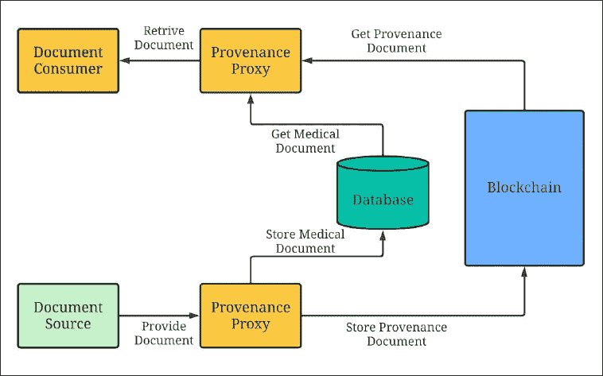 图 (1)

基于溯源的架构由三个主要组件组成：`XDS` 系统、区块链网络和溯源代理。溯源代理拦截所有 `XDS` 交易并为每个交易生成溯源文档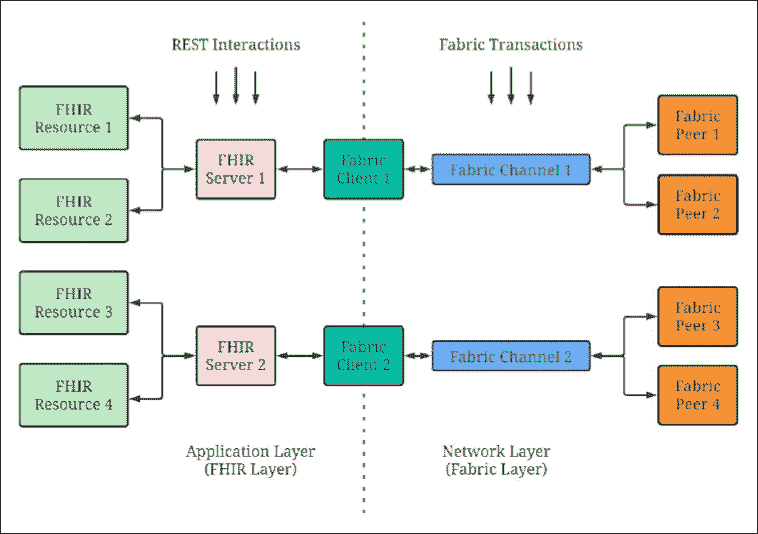 图 (2)

基于 `FHIR` 和 `Hyperledger Fabric` 的架构包含两个层：使用 `Hyperledger Fabric` 实现的网络层和使用 `FHIR` 实现的应用层。

该系统由两层组成：使用 `Hyperledger Fabric` 实现的网络层和使用 `FHIR` 实现的应用层。`Fabric client` 作为 `FHIR` 层与 `Fabric` 层之间的接口，将每个 `FHIR` 服务器连接到一个或多个 `Fabric` 节点。`Fabric client` 在截获与 `FHIR` 服务器的通信后，使用适当的 `Fabric channel` 发送正确的交易请求。托管的 `FHIR resource` 决定了选择哪个 `Fabric channel`，而交易请求基于资源交互的性质。

在选择哪些 `FHIR` 资源必须编码为 `Fabric` 资产时，考虑了数据及其过程完整性的相关性。考虑到资源的完整规范可能包含许多项目，其中某些项目不需要记录，因此将其保留在那里可能更有效率。在 `Fabric ledger` 上复制资源会增加计算和存储成本，因为 `FHIR` 服务器已经管理并存储了它们。因此，账本上仅显式地跟踪前几个主要的 `FHIR` 资源，而其他资源依赖于前几个。

为了避免名称冲突和机密信息的暴露，采用了一种命名系统来识别和引用广义网络及特定服务器中的资源实例。建议的方法要求资源名称由三个部分组成：版本号、全局唯一标识符（`GUID`）以及特定于网络中该 FHIR 服务器及其服务的的前缀。

`FHIR` 与 `Hyperledger Fabric` 的集成实现了智能护理计划的实施，这对于通往 P4 医学至关重要。除了定期就诊，该技术还允许医疗团队的所有成员观察并参与集成护理计划。它使得预测和预防流行病以及慢性疾病的建模成为可能。

总而言之，所提的系统架构为 `EHR` 系统的局限性提供了一个有前景的解决方案，并为医疗数据管理提供了一个安全、可扩展且互操作的平台。


医疗健康交换对于患者的健康至关重要，而云端解决方案被广泛用于收集和共享患者数据。然而，使用外部服务提供者可能会导致安全隐患。区块链技术对智能合约的使用有助于保护医疗数据的传输，例如临床试验记录、报销和测试结果。本章介绍了一种利用智能合约创建存在于不同网络节点中的医疗记录智能表示的方法。智能合约包含有关记录所有权、元数据、权限和数据真实性的数据。只有更改数据的合法交易才会被合约中的状态转换函数处理以执行操作。区块链交易还包括加密签名的指令，这些指令规定了如何处理特定特征。可以创建此类规则来控制特定的医疗记录，要求在允许第三方访问之前，患者和医疗提供者提交各种同意表。所提模型使临床医生能够通过 Aadhar 卡验证结合智能合约验证身份，从而访问患者的病史以及任何正在进行的药物或治疗。网络的区块内容指示了在私有点对点网络中多个参与者之间交易的数据的所有权访问权限，维护了数据的完整性。

所提架构旨在利用区块链技术（特别是智能合约）加密加密医疗数据的传输，如图 (3) 所示。作者建议了一种结合智能合约和 Aadhar 卡验证的身份验证系统。通过这种身份验证，医生可以访问患者的病史、当前的药物和持续的疗法。

所提模型由以下组件组成：

#### 区块链网络
一个去中心化的网络，每个节点存储代表医疗记录的智能合约。区块链用于存储这些智能合约，允许创建管理医疗记录访问的策略。

#### Aadhar 卡验证
Aadhar 卡是印度政府颁发的唯一身份卡。所提解决方案使用人员的 Aadhar 卡结合智能合约验证个人身份。得益于这种身份验证，医生可以访问患者的病史，以及任何当前的药物或持续的治疗。

#### 智能合约
所提模型使用智能合约来存储医疗记录。智能合约包含管理医疗记录访问的策略。

#### 数据存储
所有与医疗记录相关的信息都保存在本地数据库中，并通过其哈希值（hash）表示，哈希值是与链绑区块链区块的一部分。这确保了一致性和经济可行性。

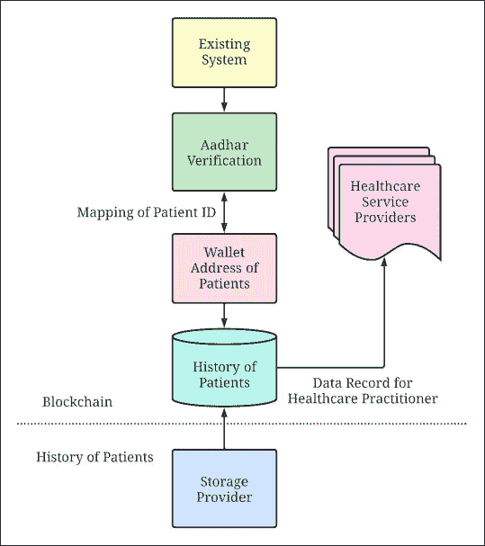 **图 (3)**

集成架构提出了一种结合智能合约和 Aadhar 卡验证的身份验证系统。

#### 同步算法
一种同步机制控制患者与提供者数据库之间的“离链”通信。当我们使用数据库认证服务引用区块链来验证权限时，数据将进行交换。

所提模型还具有一个将当前系统和医疗系统连接在一起的框架。患者可以请求在医生之间共享记录，医疗提供者可以为特定患者添加额外记录。在两种情况下，接收新数据的人都会收到通知，并有权在接受或拒绝信息之前查看记录。这有助于参与者做出决策，并通过保持他们知情并对数据的演变感兴趣，来保留对自身数据的所有权。

总的来说，所提架构旨在利用区块链技术和智能合约创建安全加密的医疗数据传输。它利用 Aadhar 卡验证、智能合约、数据存储和同步算法来实现这一目标。

## 区块链在医疗保健领域的优势

区块链技术具有多种对医疗行业产生积极影响的优势。在医疗领域中使用区块链的一些显著优势包括：

### 数据安全与隐私
数据安全和隐私是医疗行业严重关注的问题。医疗机构存储大量敏感数据，必须保持安全和机密。随着网络威胁的增加，确保数据安全和隐私变得越来越具有挑战性。高数据安全性是医疗行业使用区块链的主要优势之一。区块链的去中心化结构消除了单点故障的可能性；因此，即使一个节点故障，系统也能继续运行。区块链的分布式架构使得黑客几乎不可能破解系统并访问敏感数据。此外，使用先进的密码学和共识算法确保了授权的参与者可以访问数据，使系统更加安全。

除了数据安全外，区块链技术还增强了医疗保健的隐私性。区块链让患者对其数据拥有完全控制权，决定谁在何时访问其记录。患者可以与其医疗提供者安全地共享医疗记录，确保其数据保持机密。此外，智能合约允许患者指定访问其数据的条款和条件，确保其隐私得到维护。由于区块链的不可篡改性，数据更加可靠，保证了数据不会被篡改。它确保了数据的准确性和可靠性，使其在研究和临床用途中更有价值。

### 互操作性
由于使用了互不通信的多个系统和数据标准，互操作性是医疗行业面临的一个关键挑战。这导致了医疗服务的碎片化和低效，使患者遭受低质量的护理和结果。通过促进不同医疗提供者之间的信息共享，区块链技术在医疗行业的应用促进了互操作性。区块链技术创建了一个安全透明的环境，无论医疗专业人员使用何种系统或数据标准，他们都可以访问并共享患者数据。通过确保每个医疗提供者都能访问相同的信息，最大限度地减少了错误的可能性，并提高了患者护理的质量。

### 效率与成本降低


医疗保健行业以其复杂且往往碎片化的系统而闻名，导致流程缓慢且昂贵。然而，区块链技术可以解决这些问题，创建一个更高效、更具成本效益的医疗保健系统。区块链技术提高效率的主要途径之一是减少对中间机构的需求。中间机构是促进医疗提供者、患者和保险公司之间交易的个人或组织。这些中间机构包括第三方管理员、保险公司和结算公司。通过利用区块链技术，医疗提供者可以消除对中间机构，从而降低成本并提高交易效率。区块链技术还能实现更快的支付。医疗提供者可能需要几周甚至几个月才能从保险公司或政府计划获得报销。有了区块链技术，可以实时支付，使医疗提供者能够更快收到资金并改善现金流。区块链技术提高医疗效率的另一个领域是减少行政成本。该技术可以自动化许多行政任务，如记录保存、理赔处理和账单。这种自动化可以显著减少行政费用，并提高这些流程的准确性和速度。

## 区块链在医疗保健领域的挑战与局限性

尽管区块链技术在医疗领域具有潜在优势，但一些困难和局限性限制了它的广泛应用。这些挑战包括：

### 监管与法律问题

保护患者安全和隐私的严格法律和规定使医疗保健部门受到高度监管。在医疗保健行业中使用区块链技术时，人们对法律合规存在担忧。医疗提供者必须遵守这些规定，以保护患者数据的隐私性、准确性和可用性。区块链技术可以通过提供患者数据的安全存储帮助实现这些目标，但它必须符合这些规定才能被广泛采用。另一个与医疗保健中使用区块链技术相关的法律问题是数据所有权、同意和责任。医疗数据是一项重要资产，患者数据的所有权并不总是明确。区块链技术提供了数据所有权的不可篡改记录，但它也必须遵守规范患者同意和数据保护的法规。责任是使用区块链技术时需要解决的另一个法律问题。如果患者数据由于基于区块链系统受到损坏或丢失，谁对损害负责？在区块链技术在医疗领域广泛采用之前，必须解决这些问题。

### 与遗留系统的集成

医疗行业拥有庞大的遗留系统网络，这些系统已使用多年，并非为与区块链技术协作而设计。这些系统通常复杂、过时且不兼容，难以与区块链网络进行无缝集成。区块链技术与遗留系统的集成对于创建一个安全、透明且高效的医疗生态系统至关重要。然而，集成过程需要在时间、资金和资源方面投入大量资金。医疗行业需要找到连接这些系统与区块链网络之间差距的方法，以利用区块链技术的优势。另一个重大挑战是不同医疗系统之间缺乏标准。由于医疗提供者采用多种技术来存储和管理患者数据，开发一个统一系统具有挑战性。系统之间缺乏标准对区块链技术的应用构重大挑战。医疗提供者需要开发一种可以在不同系统中采用通用标准，以确保与区块链技术的兼容性。

### 可扩展性与性能

区块链技术旨在通过将数据去中心化存储在分布式账本上来确保数据的安全性和不可篡改性。然而，随着网络节点数量的增加，系统性能可能会下降，导致处理大量数据变得具有挑战性。其原因之一是区块链交易验证并添加到区块链的方式。

## 案例研究

一些机构已经在医疗保健领域实施了区块链技术以应对各种挑战。一些著名的案例研究包括：

### MedicalChain

名为 MedicalChain 的区块链平台允许用户安全地访问和管理他们的医疗记录，并将其与医疗提供者共享。根据该平台的安全措施，只有获得权限的人才能访问患者数据。该平台的主要目标是为患者提供管理医疗记录的有效手段。通过 MedicalChain，患者可以控制自己的医疗记录，与医疗提供者共享，并授权访问特定记录。结果是，患者能够更好地对自己的健康负责，更有效地与医生沟通，并做出更好的决策。

MedicalChain 使用许可链区块链，这意味着患者数据仅对获得授权的人可访问。该平台对患者数据进行加密并将其存储在区块链上，确保其安全且无法篡改。此外，该平台确保患者数据符合现行法律，包括《通用数据保护条例》（GDPR）。

该平台的一个显著特点是远程医疗功能，它允许患者远程访问医疗服务。患者可以通过该平台的远程医疗功能预约挂、咨询医生并接收医疗建议。该平台还允许患者在线接收处方和医疗证明，消除了实地访问医疗提供者的需求。

MedicalChain 已与全球多家医疗提供者和机构合作以实施其平台。其一些知名合作伙伴包括 The Groves Medical Group、梅奥医学中心和 Ameri Clerkships Medical Society。这些合作伙伴使 MedicalChain 扩展了其平台的范围，并改进了全球范围内的医疗交付。

结论，MedicalChain 旨在让患者获得对医疗记录的控制权并改进医疗交付。该平台对区块链技术的使用确保了患者数据安全、符合法规且仅供授权方访问。

### Solve.Care


Solve.Care 是基于区块链的平台，旨在通过让患者、医疗服务提供者和付费方更高效地互动，来变革医疗服务的交付。其目标是通过提供一个自动化医疗交付涉及的许多流程的平台，简化医疗管理。该平台利用区块链技术确保患者数据安全、透明，并且仅供获得许可的人员访问。它还利用智能合约来促进医疗支付，从而降低管理成本并提高支付效率。

患者可以通过 `Care.Wallet` 智能手机应用程序管理他们的医疗需求，这是该平台的显著特点之一。它使他们能够预约挂、接收提醒并与医疗服务提供者沟通。`Care.Wallet` 还能让患者接收个性化的护理计划，让他们更容易管理自己的健康。Solve.Care 还为医疗服务提供者和付费方提供了一个更高效的互动平台。该平台使医疗服务提供者能够更有效地管理患者，降低管理成本并改善治疗效果。平台还让付费方对医疗支付具有更高的透明控制控制，减少了欺诈并提高了支付准确性。

Solve.Care 已与全球多家医疗服务提供者、付费方和机构合作，实施其平台。其一些知名合作伙伴包括 `Arizona Care Network`、`Uber Health` 和 `BCBS of Arizona`。这些合作伙伴使 Solve.Care 扩大了其平台的范围，并改进了全球医疗服务的交付。

总之，Solve.Care 旨在简化医疗管理并改进医疗交付。通过使用区块链技术和智能合约，平台确保了患者数据安全、透明，且仅供授权方访问。`Care.Wallet` 以及与全球医疗服务提供者和付费方的合作使其成为医疗行业的有力补充。

### MediLedger

MediLedger 是一个基于区块链的平台，旨在增强医药行业供应链的效率和安全性。该平台由位于旧金山的区块链技术公司 `Chronicled` 于 2017 年推出。它利用区块链技术提供了一个安全、透明且去中心化的系统，在整个供应链中跟踪和验证药品。

MediLedger 的主要目标是通过创建一个追踪每种药物从制造商到患者全程程的系统，防止假药进入市场。该系统使得验证药物真性变得更容易，减少了假药进入供应链的可能性，并提高了患者的安全。

该平台还允许供应链参与者管理产品召回并防止药品短缺。MediLedger 提供了一个更高效的召回管理系统，更容易识别受影响的产品并将其从市场移除。平台还让利益相关者识别短缺并采取行动防止短缺，确保患者能够获得他们所需的药物。

MediLedger 使用许可链区块链，这意味着对平台的访问受限于授权方。这确保了患者数据安全，且仅供获得许可的人员访问。平台还利用智能合约来自动化和简化供应链流程，降低了管理成本并提高了效率。

MediLedger 在医药行业内有几个著名的合作伙伴关系。2019 年，MediLedger 被 `美国食品药品监督管理局 (FDA)` 选为试点项目，以探索区块链技术在增强药品供应链安全性和透明度方面的潜力。MediLedger 还与多家大型制药公司（包括 `Pfizer`、`Merck` 和 `Genentech`）合作，开发并实施了用于医药供应链的区块链解决方案。

总之，MediLedger 是一个具有巨大潜力的平台，可以提高医药供应链的安全有效性。通过利用区块链技术，平台确保了患者数据安全、可见且仅供授权实体访问。与大型制药公司及监管机构的合作使其成为医药行业的有力补充。

## 未来方向

虽然区块链在医疗领域的采用仍处于早期阶段，但其发展和影响具有巨大的潜力。区块链技术在医疗领域的使用未来可能在以下领域取得进展：

### 互操作性

互操作性是指不同系统相互互动并无缝交换信息的能力。在医疗领域，互操作性对于改善患者护理和治疗结果至关重要。然而，医疗行业对互操作性的需求一直是一项挑战。区块链技术可以通过为不同系统的数据共享创建一个去中心化、安全且透明的系统来帮助克服这一挑战。区块链技术允许创建一个各方访问的共享账本，同时确保数据的安全隐私。通过使用区块链技术，医疗服务提供者可以在不需要中介的情况下跨不同系统共享患者信息，减轻管理负担并改善治疗结果。此外，患者可以使用区块链技术对自己的数据拥有更多控制权，让他们能够选择谁可以访问他们的健康信息。

### 标准化

医疗领域缺乏标准化一直是采用新技术和系统的重大障碍。缺乏标准化使得整合不同的系统和技术具有挑战性，导致成本和复杂性增加。区块链技术有潜力创建数据共享和存储的标准化协议，减少实施新技术和系统的复杂性和成本。通过使用区块链技术，医疗服务提供者可以创建一个医疗行业所有利益相关者（包括患者、医疗服务提供者和保险公司）即可访问的共享平台。这个共享平台可以为数据共享和存储提供标准化协议，确保数据以可靠安全的方式进行共享和存储。这可以降低成本、提高效率并改善治疗结果。

### 监管框架

为了确保在医疗领域实施区块链技术时的患者隐私和安全，必须建立新的监管框架。监管机构需要与医疗行业紧密合作开发这些框架，以确保有效且负责地使用区块链技术。监管框架需要处理数据隐私、安全、机密性以及数据共享和存储的标准等问题。此外，监管框架还需要解决责任相关问题，例如在发生患者数据泄露时由谁负责。

### 用场景的扩展

区块链技术在医疗行业中的潜在用途仍有许多探索空间。随着技术的进步，可能会发现更多创新且实用的区块链技术应用，从而提高效率并改善医疗结果。


综上所述，医疗行业可以通过采用区块链技术来实现转型，从而提高效率、降低成本并改善患者治疗效果。通过区块链技术可以建立一个在各方之间管理和交换医疗信息的系统，该技术提供了安全性、透明度和去中心化。本文综述论文讨论了区块链技术在医疗领域的若干应用，包括 `Medicalchain`、`Solve.Care` 和 `MediLedger`。这些应用展示了区块链技术提高医疗行业效率和安全的潜力，为患者提供了更好的结果和体验。此外，文章强调了在医疗领域中使用区块链技术的某些优势，包括提高安全性、透明度和可用性。然而，在医疗领域中使用区块链技术也面临着缺点和挑战，例如缺乏标准和监管担忧。尽管区块链技术在医疗领域的使用仍处于早期阶段，但其增长和影响潜力是巨大的。随着区块链技术的发展和成熟，我们可能会看到医疗行业出现更多创新应用，从而改善患者的结局和体验。

## 参考文献

| | | |
| --- | --- | --- |
| [1] | Namasudra S., Deka G.C.. Applications of blockchain in healthcare., *Studies in Big Data, Springer.* 2021; 83: 14-227. |
| [2] | Bittins S., Kober G., Margheri A., Masi M., Miladi A., Sassone V.. , . Applications of blockchain in healthcare.. 83. Springer; 2021. Healthcare data management by using blockchain technology.; p. 1.-27. |
| [3] | Ciampi M., Esposito A., Marangio F., Sicuranza M., Schmid G.. Modernizing healthcare by using blockchain., *Studies in Big Data.* 2021; 83: 29-67. | [CrossRef](http://dx.doi.org/10.1007/978-981-15-9547-9_2) |
| [4] | Swarnkar M., Bhadoria R.S., Sharma N.. Security, privacy, trust management and performance optimization of blockchain technology., *Studies in Big Data.* 2021; 83: 69-92. | [CrossRef](http://dx.doi.org/10.1007/978-981-15-9547-9_3) |
| [5] | Gupta M., Jain R., Kumari M., Narula G.. , . Applications of blockchain in healthcare.. 83. Springer; 2021. Securing healthcare data by using blockchain.; p. 93.-114. |
| [6] | Venkatesan S., Sahai S., Shukla S.K., Singh J.. , . Applications of blockchain in healthcare.. 83. Springer; 2021. Secure and decentralized management of health records.; p. 115.-139. |
| [7] | MedicalChain, 2022. [Online]. Available at: [`medicalchain.com/`](https://medicalchain.com/) |
| [8] | Solve.Care: Advanced Healthcare Platform On Blockchain, 2022. [Online]. Available at: [`solve.care/`](https://solve.care/) |
| [9] | The MediLedger Network, 2022. [Online]. Available at: [`www.mediledger.com/`](https://www.mediledger.com/) |
| [10] | Abdelgalil L., Mejri M.. HealthBlock: A framework for collaborative sharing of electronic records based on blockchain., *Future Internet.* 2023; 15(3): 87. | [CrossRef](http://dx.doi.org/10.3390/fi150387) |
| [11] | Karmakar, Amiya; Ghosh, Pritam; Banerjee, Sarathi; De, Debashis. ChainSure: Agent Free System using Blockchain for Healthcare 4.0.. | [CrossRef](http://dx.doi.org/10.1016/iswa.2023) |
| [12] | Azbeg K., Ouchetto O., Jaialous S.. BlockCare: A healthcare system based on IoT, IPFS for data management., *Egyptian Informatics.* 2022; 23(2): 329-343. | [CrossRef](http://dx.doi.org/10.1016/j.eij.2022) |
| [13] | Ismail L., Materwala H.. BlockHR: a blockchain-based framework for health records., *Proceedings of 12th International Conference on Computer Modeling and Simulation.* 164-168. | [CrossRef](http://dx.doi.org/10.1145/340866.340810) |
| [14] | Nishi F., Shams-Eof M., Khan M., Alsufyani A., Bourouis S., Gupta P., Saini D.. Electronic healthcare security using blockchain and smart contract., *J. Sens.* 2022; | [CrossRef](http://dx.doi.org/10.1155/2022/729185) |
| [15] | Singh S., Kumar S., Mehrotra P., Bhatt P., Kaur M.. Blockchain technology for efficient data management in healthcare system: Opportunity, challenges and future perspectives., *Mater. Today Proc.. 2022; 62: 5042-5046. | [CrossRef](http://dx.doi.org/10.1016/j.matpr.2022.04998) |
| [16] | Yaqoob I., Salah K., Jayaraman R., Al-Hammadi Y.. Blockchain for healthcare data management: opportunities, challenges, and future recommendations., *Neural Computing and Applications, Springer.* 2021; 34: 1-16. |
| [17] | Cheng X., Chen F., Xie D., Sun H., Huang C.. Design of a secure data sharing scheme based on blockchain., *J. Med. Syst.. 2020; 44(2): 52. | [CrossRef](http://dx.doi.org/10.1007/s10916-019-1468-1) [PubMed](http://www.ncbi.nlm.nih.gov/pubmed/31915982) |
| [18] | Spanò R., Massaro M., Iacuzzi S.. Blockchain for value creation in the healthcare sector., *Technovation.* 2023; 120: 102440. | [CrossRef](http://dx.doi.org/10.1016/j.technovation.2021.102440) |
| [19] | Chelladurai U., Pandian S.. A novel blockchain based electronic health record automation system for healthcare., *J. Ambient Intell. Humaniz. Comput..* 2022; 13(1): 693-703. | [CrossRef](http://dx.doi.org/10.1007/s12652-021-0316-3) |
| [20] | Verma G., Pathak N., Sharma N.. “A secure framework for health record management using blockchain in cloud environment.” In Journal of Physics: Conference Series., *IOP Publishing.* 2021; 1998(1): 1-8. |
| [21] | Luong D.A., Park J.H.. Privacy-preserving blockchain-based healthcare system for IoT devices using zk-SNARK., *IEEE Access.* 2022; 10: 55739-55752. | [CrossRef](http://dx.doi.org/10.1109/ACCESS.2022.3177211) |
| [22] | Kassab M., DeFranco J., Malas T., Laplante P., Destefanis G., Neto V.. Exploring research in blockchain for healthcare and a roadmap for the future., *IEEE Trans. Emerg. Top..* 2021; 9(4): 1835-1852. | [CrossRef](http://dx.doi.org/10.1109/TETC.2019.293681) |
| [23] | Merlo V., Pio G., Bilancia M.. On the exploitation of the blockchain technology in the healthcare sector: A systematic review., *Expert Systems with Applications.* 2023; 213: 118897. |
| [24] | Mettler M.. Blockchain technology in healthcare: The revolution starts here, *In the Proceedings of 18th international conference on e-health networking, applications and services (Healthcom).* 2016: 1-3. | [CrossRef](http://dx.doi.org/10.1109/HealthCom.2016.774910) |
| [25] | Khatri S., Alzahrani F.A., Ansari M.T., Agrawal A., Kumar R., Khan R.A.. A systematic analysis on blockchain integration with healthcare domain: scope and challenges., *IEEE Access.* 2021; 9: 84666-84687. | [CrossRef](http://dx.doi.org/10.1109/ACCESS.2021.308760) |
| [26] | Abu-elezz I., Hassan A., Nazeemdeen A., Househ M., Abd-alrazaq A.. The benefits and threats of blockchain technology in healthcare: A scoping review., *Int. J. Med. Inform.* 2020; 142: 104246. | [CrossRef](http://dx.doi.org/10.1016/j.ijmedinf.2020.104246) [PubMed](http://www.ncbi.nlm.nih.gov/pubmed/32828033) |
| [27] | Hussien H.M., Yasin S.M., Udzir N.I., Ninggal M.I.H., Salman S.. Blockchain technology in the healthcare industry: Trends and opportunities., *J. Ind. Inf. Integr.* 2021; 22: 100217. | [CrossRef](http://dx.doi.org/10.1016/j.jii.2021.100217) |


| [28] || Hasavari S., Song Y.T.. A secure and scalable data source for emergency medical care using blockchain technology., *Proceedings of 17th International Conference on Software Engineering Research, Management and Applications (SERA).* : 71-75. **2019**[[CrossRef](http://dx.doi.org/10.1109/SERA.2019.8886792)] |
| [29] || Deepa N., Devi T., Gayathri N., Rakesh Kumar S.. *Decentralized Healthcare Management System Using Blockchain to Secure Sensitive Medical Data for Users..*. **2022**[[CrossRef](http://dx.doi.org/10.1007/978-3-030-70501-5_13)] |

# 基于区块链技术的医疗凭证监控

**Rahul Joshi**(1, **), **Shashi Kant Gupta**(2), **Rajesh Natarajan**(3), **Krishna Pandey**(1), **Suman Kumari**(1)

¹ 印度哈里亚纳邦法里达巴德，Manav Rachna 国际研究与学习学院 SMeH 新闻与大众传播系
² 美国新卡斯尔，Eudoxia 研究大学，计算机科学与工程系
³ 阿曼 什纳斯，技术与应用科学大学信息技术系

## 摘要

医疗保健行业正在广泛使用物联网（`IoT`）。医疗部门管理敏感信息，包括个人病史、血压和其他相关数据。因此，由于其敏感性较高，该领域使用的技术正变得更容易受到攻击。因此，保护数据至关重要。区块链技术已被证明在实现这一目标方面具有巨大效益。得益于显著的技术进展，将区块链技术整合到 `IoT` 设备中已产生巨大的收益。本章详细研究了区块链技术在提高管理敏感数据效率以及确保数据安全和隐私方面的特性。此外，本章系统地解释了该地区的许多安全障碍以及区块链技术如何成功克服这些障碍。研究结果表明，未来的研究应该探索性别、年龄和对区块链的了解如何影响区块链技术在创新医疗系统中的采用。另一个研究领域是评估影响区块链技术采用的因素。

**关键词：** AI、采用、区块链、临床、深度学习、电子健康记录、欺诈、`IoT`、互操作性、医疗用品、监控、研究、智能合约、隐私、Pos、患者、安全、技术、追溯、足迹。

***

(*) **通讯作者 Rahul Joshi:** 印度哈里亚纳邦法里达巴德，Manav Rachna 国际研究与学习学院 SMeH 新闻与大众传播系 邮箱：`rahuljoshi@gmail.com`

## 引言

区块链的出现及其去中心化、透明性和匿名性的核心特征与 2008 年`Bitcoin`的引入同步发生 [1]。截至 2019 年 3 月，已执行了约 4 亿笔交易 [2]，IBM 的研究发现，70% 的医疗专业人员预计区块链将影响该行业。这种影响将体增强合规性、管理临床试验和创建去中心化平台等领域 [3]。此外，预计到 2024 年，区块链在医疗行业的市场价值将超过 9 亿美元。尽管人们普遍认为区块链具有增强医疗保健的潜力，但现有的研究对设计或实施应用的理解仍然有限 [4]。此外，目前对这项技术的狂热催生了一些可能更具实际性的观念。在评估区块链在涵盖医疗、生物医学和教育在内的医疗行业中的适用性时，评估现有研究至关重要。此外，它已应用于金融服务、物流、能源、大宗商品交易等领域。通过区块链技术，可以建立一个安全且不可更改的系统来追踪药物的来源和路径，帮助打击假药。基于区块链的分布式共享数据系统允许供应链中的多个参与者安全地存储和交换交易记录。这种方法可以监控和监管欺诈药物的流通。

## 区块链的历史背景

区块链是一种记录交易的分布式且不可更改的记录。它消除了可靠中间促进促进之间通信的需求。区块链是一种去中心化的数字账本，维护着不断增长的信息集，被称为`区块`。一旦这些区块包含在区块链中，加密技术就会建立它们与之前及后续区块之间的连接 [5]。在执行得当的情况下，区块链允许通用读取、写入和验证数据块的完整性。由于这些特性，区块链正被考虑用于各种应用。区块链实现了智能合约的实施，消除了第三方监督的需求 [6]。比特币和其他加密货币在 2008-2009 年开创了名为区块链的革命性技术 [7]。它在银行、医疗、交通和政府等领域提供了各种操作。这种现代进展允许我们系统且安全地细致地监控我们的财物品，超越了任何以前的方法 [8, 9]。

## 物联网设备与区块链的集成


通过物联网（IoT）设备与区块链技术的整合，实时、不可否认的患者健康指标以及有效交付医疗服务的周边环境因素的安全管理发生了变革。可穿戴健康监测仪、智能医疗设备和环境传感器都是物联网（IoT）设备的示例，它们收集从患者生命体征、身体活动到用药依从性以及周围空气质量和温度的各种且大量数据。这些信息对于快速有效地提供治疗至关重要。由于区块链技术的魔力，这些数据可以记录并存储在分布式且不可篡改的账本，使其无法触碰且无法篡改。现在，当物联网数据存储在区块链上时，由于加密哈希的作用，它们被安全地验证，由于支撑区块链网络的共识机制（例如 `e.g.`、`Proof of Authority` 或 `Practical Byzantine Fault Tolerance` 实用拜庭容错），未经授权的方无法访问这些数据。物联网与区块链技术的结合促进了在保护患者信息的同时进行实时数据挖掘，使其变得透明且防篡改，并提高了患者信息的可靠性和精确性，从而赋能医疗提供者做出基于证据的决策并提供更个性化的治疗。这将允许患者对更高抽象级的数据进行更安全的共享和维护，减少隐私忧虑并建立信任。其次，通过收集环境数据，可以更好地理解和应对环境健康因素（如污染或极端温度），并提供全方位护理服务。这也直接关系到患者状况的改善、数据安全性的增强以及医疗流程的良好运行。

## 块链在医疗领域日益增长的重要性

医疗业务日益依赖其他领域的协助，例如计算机科学，这可能对该领域做出重大贡献 [10] 。这涵盖了广泛的领域，如基因组学、基因预测、电子健康记录以及疾病诊断工具 set [11] 。公共卫生组织和商业企业拥有常规存储大量患者数据的先进系统。这引发了有效监督和利用这些海量信息的问题。最近，“大数据分析”的概念变得越来越流行，以应对这一挑战。根据 Lee & Yoon (2017) 的观点，“大数据分析”包含了用于分析大规模且复杂数据集的专门技术，这些数据集无法使用传统的数据分析方法进行高效处理 [12] 。

医学中大数据的应用具有带来医疗诊断预测、MRI 分析以及其他几个领域进步的潜力 [13] 。计算机科学作为一门多学科学科，可以用于多个研究领域以增强和优化相应的流程。医疗行业可以使用计算机和相关技术来解决各种问题。医疗系统可能会在质量、效率和成本降低方面看到改进 [14] 。

## 支持通用医疗产业的区块链方面

账本技术通过管理药物供应链促进了遗传代码的识别，确保患者医疗信息的安全传输，并简化安全传输流程。区块链的技术特性包括保护医疗数据、管理基因组、处理医疗记录、确保互操作性、监控数字化信息以及应对流行病等。区块链技术在医疗应用中的增长是由其数字化特征驱动的。区块链实现了处方整个供应链（从制造过程到药店货架）的可追溯性。我们可以使用 `IoT` 和 `Blockchain` 观察并跟踪交通拥堵、商品流动和移动速度。它实现了采购的高效协调，以减少药药链、诊所和其他依赖特定处方的医疗设施的中断和短缺。有效利用区块链可以遏制对数据的未经授权篡改。它增强了自我保障，并保护药物购买者免受数据、财务和药物的任何不当对待。技术可以在合理的成本改善患者状况，同时保持财务稳定。它消除了所有与多级验证相关的障碍 [15] 。区块链非常适合安全应用，因为可以使用复杂且安全的算法在医疗数据交易中保护个人身份，安全且透明地存储患者数据而不存在损坏风险。技术的去中心化使得患者、医生和医疗专业人员之间能够快速安全的信息通信。

区块链创新有多种医疗用途，如图 (1) 所示。区块链技术通过允许患者使其医疗数据易于获取并符合访问法规，促进了向互操作性的转变。这增强了患者在管理个人信息方面的自主性以及机密性和隐私水平。衡量和实施质量管理及执行面临着巨大挑战。区块链应用可以解决整个行业中的任何技术困难。区块链可以帮助监管机构跟踪真药与伪药的区别。这确保了所有授权实体都交换数字交易，包括患者信息。更换医疗提供者的患者可能会请求传输其医疗记录 [16] 。医疗行业已日益接受了区块链技术。

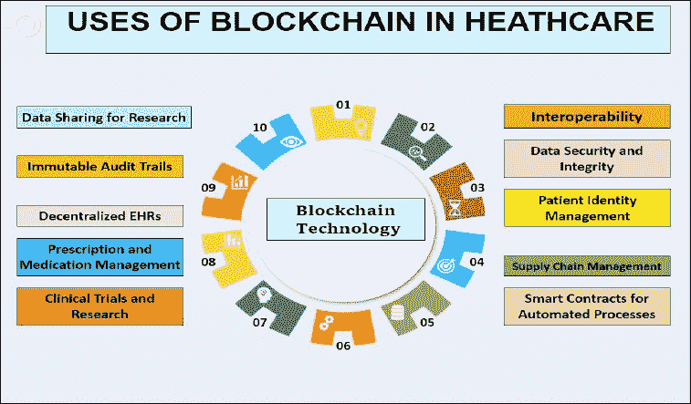**图 (1))**  

区块链技术在医疗领域的应用。


此外，在第一阶段，健康生态系统中的个人会乐于接受这些创新。未来，`Blockchain`（区块链）的全面视角旨在解决目前影响医疗行业的问题。它让医生、患者和化学家能够在特定时间获取所有可用的信息。医疗公司正在积极研究和测试 `blockchain` 技术，以管理医疗领域的健康信息。医疗行业通过遵循制药实践、增强支付替代方案以及分散患者健康信息，已确立了其作为重要工具的地位。`Blockchain`、`machine learning` 和 `AI` 对医疗行业至关重要。区块链的医疗转型具有实际用途。程序利用 `blockchain` 监控技术来优化医疗供应链 [17]。“区块链是一种先进的数据存储系统，能够安全地存储个人的健康历史，包括诊断、测试结果、之前的治疗甚至来自智能传感器的读数。这种策略允许临床医生高效地获取所有相关信息，以做出准确的诊断和建议。由于单一 `Blockchain` 系统内部对数据的全面存储，它能够防止丢失和篡改。”一个实体可以使用 `blockchain` 绕过其内部网络。一个由多个实体组成的复杂网络（每个实体具有不同程度的权限）运行安全的 `blockchain` 数据库上具有保护业务免受外部威胁和攻击的潜力。在医疗机构中实施 `blockchain` 网络可以减少勒索攻击以及计算机损坏或硬件故障等其他问题 [18]。

## 基于区块链技术的医疗优势

`Blockchain` 技术在医疗保健领域具有若干优势，能够应对各种障碍并增强医疗系统的整体有效性、安全性和透明度。图 (2) 显示了 `blockchain` 的医疗优势。

几个显著优势包括以下内容：

### 易于访问
使用配备 `blockchain` 技术应用的个人可以安全、方便且高效地检索其医疗数据。

### 互操作能力
传统方法依赖于中心化的数据存储系统，这增加了在患者记录之间实现无缝兼容的难度。由于 `blockchain` 技术中不需要中心化数据库，这些问题可以被避免。此外，所有节点都可以相互交互。

### 身份证明
`blockchain` 基于区块的数据认证方案使用了独特的私钥结合了公开可访问的密钥。

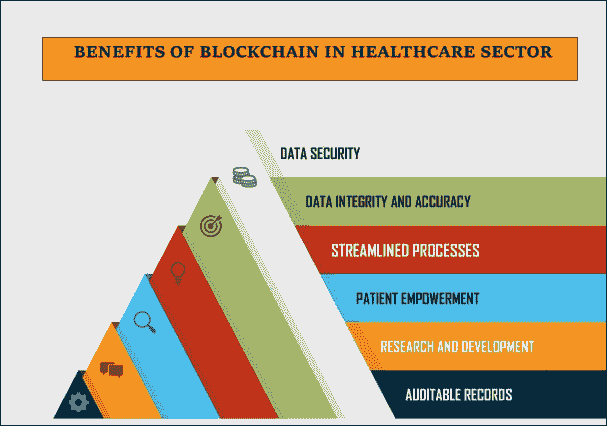图 (2))

`blockchain` 在医疗部门的优势。

### 去中心化存储库
`blockchain` 的去中心化结构非常适合在不同地点存储海量数据。去中心化存储能够增强数据质量、加速医疗数据检索并提高安全水平。

#### 节省成本
在医疗保健领域实施 `blockchain` 技术可以通过优化管理流程、提高不同系统之间的兼容性以及促进快速数据传输来大幅减少运营费用。通过使用 `blockchain` 技术，医疗提供者可以简化医疗行业中的若干项劳动密集且依赖纸质的程序，包括交换医疗记录、管理药品供应链和处理保险理赔。这导致了费用的显著减少。此外，`blockchain` 技术具有提供药物和医疗用品运输和分发的实时精确信息的潜力。供应链系统透明度的提高降低了假产品渗透的概率，增强了有效性并降低了透明度。

## 区块链技术网络

`Blockchain` 可以分为几类，每类都有其独特特征，它们的活动反映了整体行为。Alhadrami 等人 (2017) 认为这些区块链可以分为三大类 [19]。。

### 公有区块链
`public blockchain` 的特点是其包容性，允许任何人不受限制地参与。这确保了其。`public blockchain` 也称为无许可区块链，允许任何人获取区块链副本。`Bitcoin` 和 `Ethereum` 证明了 `public blockchain` 的概念。

### 私有区块链
`private blockchain` 是一种适用于特定组织的受限区块链。组织制定了谁可以访问和维护共享账本的标准。`Hyperledger` 是 `private blockchain` 的示例。

### 联盟链
在 `blockchain technology` 中，`consortium blockchain` 是由许多组织维护的需要访问权限的区块链。通过将 `private blockchain` 技术的优势与 `public blockchain` 的透明度相结合，`consortium blockchain` 提供了独特的结合。混合链是 `consortium blockchain` 的另一种名称。`Dragonchain` 是 `consortium blockchain` 的示例。

## 区块链的验证方法

`blockchain` 验证机制通常称为挖工，通过特定算法（如 `proof of work`）识别。该功能通过共识技术执行，制定了节点必须遵守的规则。共识过程确保所有验证节点通过遵循正确的交易顺序获得理想的结果 [20]。

### 理解区块链中的实用拜占庭容错 PBFT
网络节点可以分为两个不同的组：`clients` 和 `servers`。`client node` 通过发送请求与 `server node` 建立连接。`server node` 然后将交易传播给其他 `server nodes`。一旦 `server node` 接受交易，它就会告诉其他 `server nodes` 它已准备好执行。`PBFT` 使用这种技术来验证交易。


权益证明减少了验证区块和交易所需的计算工作量。通过工作量证明，区块链的完整性和安全性得到了有效维护。权益证明通过使用货币持有者拥有的设备修改了区块验证过程，从而减少了所需的计算投入。所有者提供其货币作为抵押来验证区块，并充当验证者的角色。验证者被随机选择以验证交易并校验区块数据。这种方法采用与工作量证明类似的非竞争性奖励机制，来决定谁将获得手续费。币所有者必须“质押”某些币才能成为验证者。例如，用户必须质押至少 `32 ETH` 才能成为以太坊网络上的验证者。区块经过许多验证者的验证，在收到一定数量验证者的确认后，该区块被认为是准确、最终确定并关闭。不同的证明程序使用不同的方法来实现共识。网络中的节点通过质押一定数量的比特币参与验证新区块和赚手续费的过程。然后从候选池中选择一个节点来验证新区块。这种选择机制结合了加密货币的存款以及其他参数（如币龄和随机程序），以确保网络中所有参与者的公平性 [22]。

### 理解区块链技术中的工作量证明 (PoW)

“工作量证明是一种共识过程，用于确定哪些网络用户（即矿工）被授权承担验证新数据的获利任务。挖矿过程之所以是有利润的，是因为矿工会获得新生成的加密货币作为激励，从而在不参与欺诈活动的情况下正确验证新数据。工作量证明是比特币和其他区块链采用的一种软件算法，其基于创建区块需要特定水平的计算能力的条件，来验证区块的有效性，”加密货币 e-Cash 的创建者 Amaury Sechet 解释道。“这是一个使去中心化网络中的匿名实体能够相互信任的共识机制。”在工作证明的概念中，“工作”一词至关重要。系统要求矿工参与竞争性竞赛，回答复杂的数学谜题，以震慑任何操纵系统的尝试。这场竞赛的胜利者被选中将最新的数据或交易附加到区块链上。获胜矿工的奖励取决于对网络其他参与者添加到链中的数据的准确性和有效性的验证 [23]。

### 理解区块链中的权重证明 (Proof-of-Weight)

权重证明共识将“权重”概念引入 PoW 的基本思想，由算法共识决定。权重与网络中节点产生的值成正比。其目的是防止“双重支付”，客户可能会通过操纵其相对权重两次使用同一个数字令牌 [24]。

### 区块中的存在证明 (POE)

该方法旨在验证文档在特定时间的存在性。可以在不泄露数据的情况下披露数据所有权信息。POE 范范为知识产权文件（如专利）提供了证据 [25]。

## 基于区块链的监控数据

假药或伪药问题在医疗行业正日益严重。使用此类假药可能会危及患者的健康。这些假药的泛滥 [26] 将对负责生产这些药物的制药公司以及任何与其销相关的其他实体产生不利影响。因此，开发一种稳健的药品追踪系统以打击假药是至关重要的。全球各国正在付出巨大努力以加强药品监控系统。通过实施安全的药品追溯系统，患者和其他相关人员可以方便地监控药品 [27]。


此外，每个携带药物信息的区块都将通过哈希与另一个区块链接。此外，`Blockchain` 框架中的数据透明化功能将有助于识别整个源头，并消除假药的传播。Javaid *et al.* (2020) 认为：“当患者访问新的诊所时，会为他们创建一个新的医疗卡并将其存储在指定的设施中。通常，这些事实对于公众来说是不够的，而且由相关机构护理人员的汇总记录组成。`Blockchain` 可以高效汇总数据处理过程中的问题。这项技术旨在提供全球可用且标准化的 `Blockchain` 医疗记录” [29]]。在医疗保健领域，正在进行临床研究以评估这些药物在治疗或部分缓解某些疾病方面的疗效。“科学家可以记录有关测试结果、个人标识符、医疗记录以及其他若干特征的数据。验证临床试验期间收集数据的真实性至关重要，以确保科学家、制药公司和政策制定者对结果的可靠性具有完全信心。`blockchain` 技术的使用可以增强临床试验领域的透明度和责任感。`blockchain` 技术在医疗保健行业的使用在记录效率方面具有显著优势。包含医疗数据的区块可以供专业人员和患者访问，确保医疗史的处理考虑了患者的关注点和需求。供应链中的 `Blockchain` 技术被广泛采用，特别适用于医疗保健部门，特别是药物” [30]]。

`Blockchain` 有助于对医疗保健提供者提供的程序和服务进行高效且主动的监控。在医疗保健部门，`blockchain` 技术简化并加速了获取和处理的审批程序。采用 `Blockchain` 技术并通过有组织的排队来尽量减少浪费，有利于提高效率和简化工作流。它已成为当今使用最广泛、最受期待的技术之一。Omar *et al.* (2021) 认为“这将使医疗保健业务变为一个可靠且安全的数字目录。`Blockchain` 医疗解决方案增强了多个方面，包括临床试验、患者信息的维护和处方可追溯性” [31]]。`Blockchains` 可以被有效用于医疗保健部门，以促进健康网络内部知情决策。去中心化的 `blockchain` 平台为医疗行业提供了检测和预防欺诈活动、减少运营成本、高效创造就业机会、消除冗余工作以及在医疗生态系统中提供透明度的前景。

此外，它被用于维护资产，例如持久性、信任和去中心化。患者的隐私性得到了增强，增加了对保护医疗记录的信心。此外，获得准确诊断的可能性增加，增强了进一步医疗治疗的前景 [32]]。患者现在在处理其健康数据时，将能够更好地表达他们的偏好和担忧。`Blockchain` 网络的伙伴将获得交易数据的许可，这将增强隐私性和控制力。对 `blockchain` 技术的承诺对医疗行业的所有参与方具有深远的影响。预计不同的网络将协作，基于这项技术提供见解并评估疗法的意义。实施全国范围的电子医疗记录 `blockchain` 网络将提高医疗的运营效率，并在未来提供更好的患者健康结果。“`Blockchain` 是一种去中心化且不可篡改的账本，记录了链接区块之间的交易，并存储在数字寄存中” [33]]。根据医疗行业的要求，患者记录、医疗设备日志和医疗物品温度监控等医疗数据可以在整个配送过程中进行记录。

## 利用区块链技术的医疗创新：统一工作流流程

Abdellatif *et al.* (2020) 表示，医疗保健领域的 `blockchain` 解决方案提供了若干互联的益处，包括主患者索引的高效管理、简化的理赔调整、安全的医疗供应链管理、增强的互操作性以及准确的个人和纵向数据记录 [34]。“交互式工作流程流始于分布式网络流、数字化交易以及共享数据和账本。这些元素允许 `Blockchain` 驱动者更关注于改进医疗服务，使其比以往任何时候都更健康、更具创新性” [35]]。`blockchain` 技术的基本概念简单且不断发展，通过扩展区块网络来适应许多企业的多样化需求和独特属性。自主的 `Blockchain` 架构提供了全面的监控解决方案，并实现了发现的实时更新。`Blockchain` 技术将显著减少财务失败并防止盗窃和信息的未经授权移动。它可以解决与动态结果和未经授权访问数据的问题。它能够传输持久的、带戳的临床研究数据和结果，减少临床研究中的欺诈和错误。医疗行业已主要接纳了 `Blockchain` 技术 [36]]。

`Blockchain` 是一种无处不在的技术，在某种程度上影响着每个部门。`Blockchain` 技术被使用，特别是在需要在许多方和利益相关者之间建立信任的地区。“`Blockchain` 有潜力显著获取知情许可的过程，患者现在在签署预约、临床程序或医疗检查的同意书时，这种体验是碎片化的。`Blockchain` 在这些应用中的承诺包括促进临床测试数据的交换以及为测试参与者发现优势的潜力。`Blockchain` 有潜力成为管理医疗同意的关键组件，实现信息的高效共享。患者可以通过 `Blockchain` 技术与其他机构建立连接 [37, 38]\] 并无缝地获取他们的医疗信息。”


Jayaraman *et al.* (2021) 指出：“一个经过的区块链是一个与系统中所有参与者网络连接的受限网络。因此，它在组织和企业内部创建和使用，用于交换信息并促进安全交易” \[39]。达成共识后，交易被视为永久条目，并作为新区块添加到现有的区块链中。“互联网促进并激励个人构建自己的网站。区块链网络内的每个用户都可以通过建立其唯一的网络地址，无需授权即可与同一网络内的其他人进行通信” \[40]。“由区块链驱动的供应链系统确保了药品供应的安全性、真实性和准时性。它使制造商能够按照医疗规格遵守精确的配方混合。医疗设备可以收集患者数据，与目标患者验证疗法的真实性，并与患者和监管机构匿名共享程序数据。”医疗保健行业对区块链技术深着迷。近几十年来，医学科学取得了显著进展，提供了高质量的医疗服务。这是一种广泛使用的、去中心化且透明的数字系统，跨多台计算机用于监督和跟踪交易。它对许多市场和领域产生的巨大影响得到了认可。这项技术的出现解决了当前方法无法处理的问题。卓越的医疗保健需要保证、保护、机密性以及跨不同系统的无缝数据交换。区块链为解决医疗保健挑战的新颖性提供了机会 \[41]。

区块链持久、独立且完全透明的本质使其成为保护健康数据的潜在解决方案。区块链技术允许个人身份和医疗信息的安全存储，同时确保系统稳定性。这项创新技术将通过消除低效和冗余的设备来简化复杂的计费流程。此外，它可能帮助患者上传并授权相关方访问其医疗记录。“区块链技术通过提高电子医疗记录的生产力、可靠性和安全性，具有变革健康信息交换的潜力。区块链是一种去中心化的账本，存储重要且分散的交易信息” \[42]。

## 区块链技术问题与解决方案

区块链技术的关键属性包括安全性、保证、不可更改性、验证、分布式存储、数据交换和数据检索。医疗保健行业的需求与区块链技术的特性相一致。区块链技术在医疗业务中的潜力是巨大的。各种初创公司和成熟机构正在将这些前景应用投入实践。在这里，我们将回顾区块链技术在医疗领域的若干用途，以便更好地理解它们。

### 电子健康记录系统

健康记录系统可以通过三个不同的时期来看。三种健康记录是纸质、电子和使用区块链技术的电子健康记录。纸质健康记录系统表现出效率低下、组织混乱和不安全，缺乏防篡能力。电子健康记录是传统纸质和数字电子医疗记录的混合体。电子健康记录系统比传统的纸质医疗记录更具成本效益。电子健康信息的关键功能包括医疗信息的数字存储、患者预约的高效管理、简化计费和会计流程以及便利实验室检测。然而，电子健康记录（EHR）面临互操作性问题、信息鸿沟和数据泄露。互操作性是跨源的数据平稳传输。

利用区块链技术的电子健康记录系统运行如下：

1. 通过移动应用程序和电子健康记录系统从患者处收集大量的医疗数据。
2. 数据经过加密并保留在区块链网络上。
3. 健康建议被加密后逐个发送给个人。

MeDRec、MeDShare 以及其他类似是使用区块链技术的电子健康记录系统的原型。利用区块链技术的立陶宛医疗记录系统值得关注。区块链驱动的健康记录系统使立陶宛个人、医疗服务提供者和保险公司能够访问有关该技术进行的所有医疗程序的全面信息 \[43]。

### 医疗欺诈检测系统

确保药品安全至关重要，因为它直接影响大众的健康。供应链管理是医疗行业的一项重要责任。否则，监管假药制造、伪造包装记录以及更改污染药物的标签将面临挑战。扩展的医疗供应链有多个个人和组件在运行，使其容易受到欺诈攻击 \[44]。区块链技术能够实现用于监测和跟踪的复杂平台。

### 临床研究

由于数据操纵的可能性，医学研究中产生了对信任的怀疑。临床试验对于评估新药的效力和潜在的不良反应是必要的。临床试验由四个不同阶段组成。包括：
- 评估新药的安全性
- 评估人体内的安全性和有效性
- 调查药物剂量的有效性和患者安全性
- 分析新药的长期疗效

由于各种问题（包括欺诈、数据管理不当和试验违规），约 80%的医学研究是不可重复的。区块链技术可以保证临床研究不同阶段的透明度。区块链技术提供了一种记录数据的去中心化机制，增强了许多临床研究参与者的信心。此外，它保证了患者与医生之间通信的开放性。

## 医疗领域应用区块链的软件解决方案

本节将通过检查医疗业务中的当前解决方案，讨论区块链技术的可能用途，即电子健康记录和患者健康记录。

### Gem Health Network


如果个人在前往其他州或出国旅行期间生病，他们无法联系其常规医生获取医疗记录。Gem Health Network 为此类情况开发了一种很有前景的解决方案。“Gem Health Network 利用以太坊区块链技术提供了一种协作网络架构。Gem Health Network 使不同的医疗执业人员能够访问相同的医疗信息，消除了中心化存储的限制。医疗记录和信息既相关又准确，授权用户可以立即访问最新的治疗信息” \[46]]。它通过复杂的加密方法对数据进行加密，确保敏感信息的安全。在整个系统中，使用了拜斯庭容错（`BFT`）作为共识技术，提供了经过充分研究的容错机制，并能够在某些节点崩溃或发生恶意行为时继续运行的能力。Casa 自身遵循最高标准的数字安全规范，这得益于由十四位首席信息安全官（CISO）和安全副总裁组成的团队，他们指导了这种“成员所有一切”基础设施构建的网络，将其应用于协作环境中，使所有者仅与其他所有者共享他们需要的内容，以便他们更好地工作。

### OmniPHR

OmniPHR 是由 Roehrs、Costa 和 Righi 开发的系统，旨在方便患者健康记录的管理。因此，为患者提供其健康信息的统一视图可能会在许多医疗系统中节省大量成本。此外，OmniPHR 系统旨在解决医疗提供者访问最新患者信息的问题，即使这些数据存储在其他地方或由其他医疗提供者更新。OmniPHR 旨在解决的主要问题是电子健康记录（EHR）与个人健康记录（PHR）之间的区别。`EHR`，或“电子健康记录”，是遵循各种法定标准的文档，旨在解决跨州和跨边界一致记录的挑战 \[47]。这使得记录能够保持更新并尽可能准确。数据的核心概念是由医疗专业人员自行维护和更新，而不需要患者的任何输入。这与个人健康记录不同，后者由患者管理自己的信息。OmniPHR 开发的系统通过有效解决了这一问题，它允许患者访问其医疗信息的全面准确的概述，满足医疗社区所需的标准 \[48]。OmniPHR 采用混合共识机制，结合了权益证明（`PoS`）和实用拜斯庭容错算法（`PBFT`），以实现节能与安全之间的平衡。这种能力让患者能够控制谁访问他们的医疗记录，并确保数据交换可见且可追溯。使用区块链技术，OmniPHR 进一步增强了患者的自主性、数据完整性和对健康计算机系统的信任。

### MedRec

Metric 系统管理去中心化的电子医疗记录（`EMRs`）。“它是 Azaria、Ekblaw、Vieira 和 Lippman 使用区块链技术开发的。”该平台允许患者跨多个医疗提供者和治疗设施访问健康数据 \[49]。“MedRec 让医疗合作伙伴能够作为矿工参与，通过提供全面的去标识化数据作为挖矿奖励，这些奖励是通过他们对系统的支持和通过工作证明（`PoW`）验证获得的。MedRec 是一个功能性原型，在进行任何实地测试之前，主要关注分析系统的方法和实现” \[50]。然而，MedRec 系统仅在以色列同一医院基金内部进行了小规模部署。该系统使用了基于 `Ethereum` 的区块链系统 \[51]。MeDRec 使用加密和非对称算法，使数据加密非常稳健，以保护患者记录。权威证明是一种共识技术，交易只能通过授权的节点进行验证，确保安全和效率达到最佳水平。此外，这项技术帮助患者控制自己的数据，并允许他们向指定的医疗专业人员访问。它还维护了所有数据访问实例的清晰记录。

### MedShare

MedShare 的目标是实现医疗领域不同利益相关者之间安全的数据交换。MeDShare 利用区块链技术和云服务为医疗数据提供最高安全性和隐私。MedShare 采用复杂的智能合约和访问控制机制来监控数据并撤销恶意用户的访问权限 \[52]。

### IRYO

该平台旨在共享和保留 `EHS`（环境、健康与安全）数据。它通过保留至少一份加密的数据副本来确保数据存储系统的安全，从而防止可能发生的攻击。使用这种方法使得保证所有类型健康信息的保护变得可行。在使用 AI 相关数据之前，研究机构必须经过 `IRYO` 验证。研究人员必须使用 `IRYO` 研究软件工具发起新的查询 \[53]。如果研究人员的问题符合患者的标准，通知将发送患者手机。在获得患者同意后，数据将立即发送给研究机构，患者将获得代币作为参与奖励。研究完成后，患者将在移动设备上收到提供调查结果的通知。研究人员可以在系统中检查完全匿名或部分匿名的数据集。`IRYO` 网络提供了访问公共区块链的方法。`EOS` 区块链中的每个存储节点都需要通过记录哈希值为患者提供加密证据。由 Coral Health 开发的 `CHT` 代币可在其以太坊驱动的网络上使用，用于交换个性化医疗中的电子健康信息和基因检测结果 \[54]。实施个性化医疗治疗策略可以减少不良副作用同时提高有效性。

### Patientory

Patientory (`PTOY`) 平台使用 `Ethereum` 区块链对电子健康记录（`EHR`）数据进行代币化和共享。传统系统中的患者可以获得医疗信息的副本与医生分享。同时，医生可以使用移动医疗应用程序在在期间监控患者的状况。然而，在现有的传统框架下，这些程序非常耗时，而且医生需要访问更多信息 \[55]。此外，由于中心化问题，经典系统并不完全安全。所提的系统便于用户访问和管理他们的医疗信息以及家庭成员和其他医疗提供者的记录。整个系统开发过程主要重点是符合《健康保险可流动性与责任法案》（HIPAA）的规定。


这些平台上的技术协议预计可以在无需人工监督的情况下维护标准。它们通过使用曲率加密（椭圆曲线加密）等加密技术来确保数据存储和传输。这是一种动态管理的权限系统，根据需要授予或取消信息的访问权限。不可篡改技术提供了广泛的审计追踪，增强了信任。它跟踪数据交互的方式，包括时间戳和用户详情，以确保符合 `HIPAA` 和 `GDPR` 等法律。

## 自动化同意管理

智能合约可以赋予患者即时的数据共享权限，并要求维护其最新权限以及有关数据共享的现行法规。这些合约确保数据仅为特定目的进行收集和处理，并在不再需要时自动删除或匿名化，遵守 `GDPR` 的规定。智能合约还可以执行自动化的违规报告，通知监管机构及所有受影响的人员，确保数据隐私。这种信任通过全自动的监管合规得到了加强，涵盖了数据管理中的大多数相关法规，包括患者数据的控制、其框架的安全措施及其存储。

## 全球数据标准的实施

鼓励使用全球数据标准（如 `Level 7 医疗快速互操作性资源 (HL7 FHIR)`）对于提高区块链系统与传统电子健康记录系统之间的兼容性至关重要。`HL7 FHIR` 为医疗数据共享提供了一个结构化系统，促进了各种医疗数据的无缝集成和兼容。采用像 `HL7 FHIR` 这样的国际数据标准对于将区块链系统有效融入传统的 EHR 系统非常重要。`HL7 FHIR` 具有统一的数据交换结构，确保了所有系统之间准确且持续的信息传输。它在简化集成的同时降低了成本和复杂性。使用 `HL7 FHIR` 增强了兼容性，有助于区块链解决方案与 EHR 系统无缝交互。它实现了医院、实验室、诊所和患者之间不受限制且安全的数据交换，创建了统一的医疗生态系统，并改进了数据共享与协调。高质量可靠的数据输入减少了不一致和错误，同时提高了患者记录的可靠性。标准的化的格式还促进了创新，允许研究人员创建可以与现有系统集成的创新应用和服务。

## 实施策略

需要一种涉及协作、教育、试点项目和激励机制的综合方法，这对促进 `HL7 FHIR` 的采用非常重要。鼓励医疗保健提供者、监管机构和 IT 供应商之间的合作至关重要，因为这有助于建立实现的通用标准和最佳实践。为了实施 `HL7 FHIR` 标准，必须为医疗 IT 专业人员提供广泛的培训和资源，帮助他们弥补知识差距并熟悉 `HL7 FHIR`。此外，实施试点项目有助于展示 `HL7 FHIR` 的现实效益，鼓励行业内的广泛接受。此外，为了激励医疗机构优先考虑互操作性，可以提供技术支持、财务援助和认可计划等激励措施。为了实现 `HL7 FHIR` 的广泛接受，将协作、现实验证、教育和激励相结合是重要的，因为这将增强医疗行业的数据准确性、兼容性和进展。

## 医疗领域区块链技术使用的新进展

### 医疗护理供应链中的区块链技术

区块链技术促进了数字供应链并增强了透明度和效率。医疗管理包括在整个供应链中生产和分配商品，以确保真实性并检测任何操纵迹象或不利的环境状况。当制造商发现传感器或药品出现问题时，区块链通过快速识别问题源自供应链中的特定位置，促进了卖家的召回流程。例如，实施联邦药品供应链安全计划预计将解决污染、错放和危险药品的问题。在该法律下，只有有限的实验方案用于评估医疗项目中共享信息的数据安全措施的有效性。`Walmart` 和 `IBM` 选择了一种增强药物推荐和采购安全性的试验方法[56]`。

### 快速融入 IT 革命

互联网技术革命（包括人工智能、云计算和区块链的进步）可以被视为加速创新技术采用的进一步创新。客户端独特的混合云架构提供了高度可访问的公共云服务，用于在安全防火墙后存储敏感医疗信息，允许对常规需求进行准确估计[57]`。人工智能利用模式识别从存储在互联云网络的海量数据中提取并整合元素，这些数据使用区块链框架进行安全组织。通过将联动传感器与物联网集成，区块链技术可以有效揭示人口趋势，加速医疗领域的研究，并最终改善患者预后。

### 发达市场的快速发展

通常，富裕国家（尤其是亚洲国家）受益于区块链技术的发展。中国政府通过发布大量的区块链版权，战略性地定位以影响区块链行业。根据中国知名在线报纸的报道，“中国政府通常将区块链开发作为其‘十三五’规划的一部分实施。2019 年，中国主席习近平强调了区块链技术对于加强中国在网络空间的地位、创造数字经济以及促进社会经济进步的关性意义。”因此，2018 年，阿拉伯酋联合国（UAE）在爱沙尼亚实施了一项战略计划，利用区块链技术改善公民生活的关键方面，如银行、交通和医疗。医疗护理阶段展示了熟练医疗执业者（包括医学专家和技术及当地组织）的数据共享成果，以保存和传播评估数据。

## 实施去中心化身份系统


患者数据治理随着去中心化标识符 (`DID`) 系统的出现发生了变革，使患者能够对其医疗数据拥有完全的所有权、隐私权安全性。在 `DID`（去中心化身份）系统中，患者通过区块链和加密解决方案维护数据所有权，且不再需要中央数据库。每个患者在去中心化网络中都有一个个人数字标识符（数字 ID），这从验证身份并决定谁具有访问权限开始。患者拥有完全控制权授予和撤销对其数据的访问权限，允许只有信任的第三方（例如医疗专业人员、保险公司、研究人员等）访问其所需的信息。这样做在提高隐私的同时，缓解了中心化数据泄露的风险，允许医疗系统之间共享数据，支持了连续性护理和数据驱动的决策。患者对自己的档案有更多控制权，可以追踪谁访问过他们的记录，并在关于其疾病的数据挖掘中保护其匿名性。中心化的 `DID` 系统将信息的控制权交还给消费者，让他们成为数据的主人，更不用说，这反过来再次证实了数字时代本质所需的注重隐私、安全且以患者为中心的医疗系统的必要性。

### 利用先进加密技术

利用同态加密和零知识证明等加密算法，可以提高现有系统中患者数据的安全性，并增加原生用于用于此类工作负载进行分析和处理的能力。同态加密允许人们在不向服务器揭示解密形式的情况下计算加密数据，从而在整个计算过程中保持匿名性。这意味着机构可以独立地对加密的患者数据集进行统计研究或应用机器学习算法，在无需直接访问机密原始数据的情况下共享特定患者的见解。这种哲学仍然依赖于安全的深层操作员，以维护受保护数据的隐私；即使在进行复杂的数据操作期间也是如此。零知识证明 (`ZKPs`) 允许一方在不泄露除声明有效性以外任何数据的情况下证明声明的真实性。例如，在医疗领域，`ZKPs` 可以通过患者识别、医疗记录验证和交易数据验证来保护个人数据，而不会暴露患者的个人信息。这在数据交换发生时隐藏了机密信息，降低了未经访问或泄露的风险。这些策略的结合建立了一个完整的机制，允许患者数据保持安全，且仅在“需要知晓”的情况下才会泄密。这些包括同态加密和零知识证明 (`ZKPs`) 等工具，它们使医疗提供者和研究人员能够运行其所需的分析，而无需打开整个医疗记录的大门。这种双重应用使得健康和隐私两者能够被同时使用，并通过保护患者对医疗保健的信任，促进了健康行业大数据的使用。

## 将区块链技术整合到医疗系统的障碍

### 可扩展性问题

传统的区块链如 `Ethereum`（以太坊）和比特币处理交易的能力有限，每秒只能处理少数交易，这对于处理海量患者数据的医疗系统来说是不足够的。此外，由于医疗数据量巨大（包括影像、医疗记录和基因组），链上存储变得不可行，而链下存储又增加了复杂性和潜在的故障风险。此外，区块链交易中的网络延迟可能会导致数据更新和检索的显著延迟，这在需要紧急和及时访问的医疗状况下是不可接受的。

### 集成复杂性

为了实现区块链与 `HL7` 和 `FHIR` 等医疗标准的兼容性，需要大量的开发和适配。许多医疗公司依赖于并非为区块链设计的过旧系统，导致升级既昂贵又耗时。需要实时同步以确保区块链和传统数据库之间的一致性。为医疗健康创建和实施智能合约需要专业知识，以降低执行不准确和数据泄露等风险。

### 高昂实施成本

实施区块链基础设施需要在硬件、软件和人员方面进行大量的前期投入，这对于较小的医疗提供者来说是一个巨大的障碍。由于持续的维护（包括升级、安全补丁和节点管理），会产生经常费用。缺乏构建和监督区块链系统的合格专家导致了高昂的人员招聘或培训。遵守医疗保健立法（如美国的 `HIPAA` 和欧洲的 `GDPR`）需要在法律和合规专业知识方面进行大量投资。此外，依赖于工作量证明 (`PoW`) 的区块链需要大量的能量，导致运营成本高昂。虽然已经研究了其他共识方法（如权益证明 `PoS`），但它们也有自己的困难和限制。

### 安全与隐私考量

尽管区块链提供了加密，但正确管理加密密钥对于确保数据隐私至关重要。区块链网络的弱点可能导致数据泄露，这需要强大的安全流程。需要详细的控制模型来实施访问控制方法，以限制对敏感医疗数据的访问。通过限制授权人员对医疗信息的访问和修改来保护医疗信息也很重要，以确保数据的完整性和安全性。

### 共识机制与性能

基于区块链技术的共识机制对医疗系统的性能和安全性有重大影响。工作量证明 (`PoW`) 是一种安全的方法，但由于消耗大量能量且处理交易能力差，其实际性不高。虽然在医疗领域需要安全性和优化，但权益证明 (`PoS`) 也提供了能源效率和更高的可扩展性。委托权益证明 (`DPoS`) 和 拜占庭容错机制 (`BFT`) 提供了更快的交易率和能源效率等优势。然而，它们复杂的实施和在医疗场景中受限的呈现了多种复杂性。

### 数据治理与所有权

确保患者数据主权至关重要，这需要允许患者控制和监管其访问其健康信息的程序。这通过解决与数据所有权和使用相关的问题，确保了符合法律和伦理标准，特别是在去中心化环境中。在医疗领域建立详尽的审查和框架以确定法律所有权并解决与数据使用相关的伦理问题是非常重要的。医疗机构通过建立强大的框架并优先考虑患者权利，可以确保数据管理过程中的主权、完整性和监管合规。

## 区块链技术在印度医疗行业的兴起

在过去的十年中，印度已成为全球经济的一部分，带来了经济繁荣。印度已确立自己为全球主要合作伙伴。在减少贫困方面也取得了显著进展。从 2011 年 2020 年，超过 1 亿人的生活状况得到了改善，帮助他们摆脱了贫困。


健康意识的提高、收入水平、生活方式疾病以及医疗保险普及率的提升等关键因素，增加了印度医疗业的价值。预计到 2023 年底，该行业规模将超过 5000 亿美元。2022 年，印度医疗行业已成为主要的雇主之一，拥有 510 万劳动力。预计在 2020 年至 2025 年间，医疗行业将创造约 400 万个就业机会，平均每年新增 55 万个新岗位。

图 (3)显示了印度医疗领域面临的障碍。IT 技术的出现和远程患者监控系统（`RPM`）的兴扩展了全球范围内的数字医疗。远程患者监控增强了临床评估和决策，并降低了住院的可能性能。随着癌症、糖尿病和心血管疾病的持续增加，`RPM`服务的使用预计将增加。此外，随着老龄化的加剧以及人们选择自力更生关注健康的生活方式，远程患者监控系统可能会增加。印度医疗系统面临着与数据相关的根本性障碍，阻碍了有效的健康信息管理和利用。

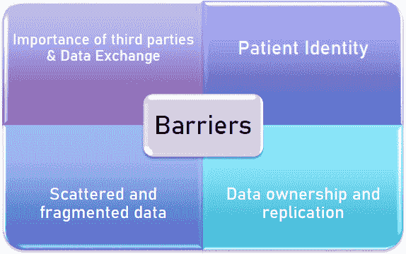 **图 (3)**

印度医疗领域的主要障碍。

## 结论

区块链技术可能会改变医疗行业。医疗利益相关者必须加强合作，以从这项创新中获益。在医疗领域实施基于区块链的技术可以成功解决若干问题，如护理协调、数据安全和互操作性问题。随着技术的进步，它将解决处理速度慢和大量数据复制等技术障碍。由于医疗数据管理能够提供更准确、更高效且更具成本效益的医疗治疗，在过去十年中引起了越来越多的关注。技术通过解决当前客户端-服务器和云端方法中常见的问题（如单点故障、脆弱性、数据分散和隐私风险），可以显著改善医疗数据管理。区块链技术的可能性、相关性及其权衡已通过对比分析得到了阐明。为了建立能够充分利用区块链技术优势的有效服务，必须全面解决若干挑战。

区块链技术在医疗领域主要用于在参与参与研发的专家和专业人员之间有效ر传播和交换重要信息及医疗数据。医疗机构技术的指数级增长可以为推进医学研究提供新路径。神经控制方案利用区块链方案，该技术在观察阶段可能存储在数字脑中。将先进技术整合到医疗系统中对于充分挖掘区块链在医疗领域的潜力至关重要。本研究的范围包括临床试验、系统监控、医疗保险和药物追踪。医院可以使用区块链架构，通过监控其整个生命周期内的设备来绘制其服务地图。利用区块链开发业务可以增强患者病史的管理，特别是在追踪和保险中介领域。这将导致更快的临床干预和改进的数据保护。这项技术有望通过彻底改变临床记录的使用和管理，极大使患者和临床医生受益匪浅，从而改善医疗服务。

## 参考文献

|  ||  |
| --- | --- |
| [1] || Nakamoto, Satoshi. *Bitcoin: A peer-to-peer electronic cash system..*. **2008** |
| [2] || Hasselgren A., Kralevska K., Gligoroski D., Pedersen S., Faxvaag A.. Blockchain in healthcare and health sciences—A scoping review., *Int. J. Med. Inform..*. **2020;** 134: 104040. [CrossRef](http://dx.doi.org/10.1016/j.ijmedinf.2019.104040)[PubMed](http://www.ncbi.nlm.nih.gov/pubmed/3186055) |
| [3] || Mettler M.. Blockchain technology in healthcare: The revolution starts here., **2016** 18th international conference on e-health networking, applications and services (Healthcom). [CrossRef](http://dx.doi.org/10.1109/HealthCom.2016.774951) |
| [4] || Yun D., Chen W., Wu X., Ting D.S., Lin H.. Blockchain: chaining digital health to a new era., *Ann. Transl. Med..* **2020;** 8(11): 696. [CrossRef](http://dx.doi.org/10.2103/atm-20-2854)[PubMed](http://www.ncbi.nlm.nih.gov/pubmed/32617316) |
| [5] || Raikwar M., Gligoroski D., Kralevska K.. SoK of used cryptography in blockchain., *Access.* **2019;** 7: 855075. [CrossRef](http://dx.doi.org/10.1109/ACCESS.2019) |
| [6] || Buterin V.. A next-generation smart contract and decentralized 2014 |
| [7] || Mukhopadhyay U., et al. A brief survey of cryptocurrency systems., **2016** 14th annual conference on privacy, security and trust. [CrossRef](http://dx.doi.org/10.1109/PST) |
| [8] || Swan M.. . Multichain private blockchain-white paper.. **2015** . |
| [9] || Rifi N., et al. Using blockchain technology for eHealth data management., **2017** fourth international conference on biomedical engineering (ICABME). [CrossRef](http://dx.doi.org/10.1109/ICABME) |
| [10] || Joshi R., Pandey K., Kumari S.. A metaverse: Significance and dimensions in various sectors., **2024** 11th International Conference on Computing for Sustainable Development (INDIACom). |
| [11] || Azaria A., et al. Medrec: Using blockchain for medical data access and permission management., **2016** 2nd international conference on open and big data (OBD). |
| [12] || Lee, Choong Ho; Yoon, Hyung-Jin. *Medical big data: promise and challenges.* **2017** |
| [13] || Otero, P., W. Hersh, and AU Jai Ganesh. “Big data: Are biomedical and health informatics training programs ready?: Contribution of the IMIA working group for health and medical education”. *Yearbook of medical informatics.* 9. |
| [14] || Chaudhry B., Wang J., Wu S., Maglione M., Roth E., Morton S., Shekelle P.. Systematic review: impact of health information technology on quality, efficiency, and costs of medical care., *Ann. Intern. Med..* **2006;** 144(10): 742-752. [CrossRef](http://dx.doi.org/10.7326/0003-4819-144-10-20060516-00125)[PubMed](http://www.ncbi.nlm.nih.gov/pubmed/16702590) |
| [15] || Kumari K., Saini K.. Data handling & drug traceability: Blockchain meets healthcare to combat counterfeit drugs., *International Journal of Scientific and Technology Research.* **2020;** 9(3): 728-731. |
| [17] || Zhang Q., Cherkasova L., Smirni E.. A regression-based analytic model for dynamic resource provisioning of multi-tier applications., *Fourth International Conference on Autonomic Computing (ICAC’07).**. **2007** [CrossRef](http://dx.doi.org/10.1109/ICAC.2007.1) |
| [18] || Mingxiao, Du. A regression-based analytic model for dynamic resource provisioning of multi-tier applications., *International conference on systems, man, and cybernetics (SMC).*.. **2017** |


- [19] Alhadhrami Z., et al., . “将区块链引入医疗技术.” 2017 年电气与计算技术应用国际会议 (ICECTA).. 2017.
- [20] Pîrlea G., Sergey I.. 区块链共识的机械化., *第 7 届 ACM SIGPLAN 认证程序与证明国际会议论文集.*. **2018** [[CrossRef](http://dx.doi.org/10.1145/3167086)]
- [21] Castro M., Liskov B.. , 实用拜占庭容错.. 1999.
- [22] King, Sunny; Nadal, Scott. *Ppcoin: 基于权益证明的点对点加密货币..*. **2012**
- [23] Soria J., Moya J., Mohazab A.. 工作量证明区块链协议中的最优挖掘., *Finance Res. Lett..* **2023;** 53: 103610. [[CrossRef](http://dx.doi.org/10.1016/j.frl.2022.103610)]
- [24] Gilad Y., et al. Algorand: 加密货币的拜占庭共识扩展., *第 26 届操作系统原理专题会议论文集.*. **2017** [[CrossRef](http://dx.doi.org/10.1145/3132747.3132757)]
- [25] Shawn L.W.M., et al. 使用以太坊智能合约的区块链存在证明 (PoE) 框架., *十一届 ACM 数据与应用安全与隐私会议.*. **2021** [[CrossRef](http://dx.doi.org/10.1145/3422337.3450319)]
- [26] Clauson, Kevin A., et al. *利用区块链技术增强医疗供应链管理：医疗供应链中挑战与机遇的探索..*. **2018** [[CrossRef](http://dx.doi.org/10.30953/bhty.v1.20)]
- [27] Dimitrov D.V.. 医疗数据管理中的区块链应用., *Healthc. Inform. Res..* **2019;** 25(1): 51-56. [[CrossRef](http://dx.doi.org/10.4258/hir.2019.25.1.51)] [[PubMed](http://www.ncbi.nlm.nih.gov/pubmed/30788182)]
- [28] Le Nguyen T.. 医疗中的区块链：造患者和医生的新技术效益., *波特兰工程与技术管理国际会议 (PICMET).*. **2018** [[CrossRef](http://dx.doi.org/10.23919/PICMET.2018.84199)]
- [29] Javaid M., Haleem A., Vaishya R., Suman R., Vaish A.. 工业 4.0 技术及其在对抗 COVID-19 疫情中的应用., *Diabetes Metab. Syndr..* **2020;** 14(4): 419-422. [[CrossRef](http://dx.doi.org/10.1016/j.dsx.2020.0432)] [[PubMed](http://www.ncbi.nlm.nih.gov/pubmed/3234370)]
- [30] Esposito, Christian, et al. *区块链: 医疗云端数据安全与隐私的万灵药?. **2018** [[CrossRef](http://dx.doi.org/10.1109/MCC.2018.011712)]
- [31] Omar I., Jayaraman R., Debe M., Salah K., Yaqoob I., Omar M.. 使用智能合约实现医疗供应链采购合同的自动化., *Access.* **2021;** 9: 37397-37409. [[CrossRef](http://dx.doi.org/10.1109/ACCESS.2021.3062471)]
- [32] Pandey P., Litoriya R.. 通过区块链技术保护并验证医疗记录., *Cryptologia.* **2020;** 44(4): 341-356. [[CrossRef](http://dx.doi.org/10.1080/01611194.2019.1706060)]
- [33] Abujamra R., Randall D., . 计算机进展.. Vol. 115. 2019. 医疗中的区块链应用以及新信息框架带来的机遇；p. 141.-154.
- [34] Abdellatif A.A., Al-Marridi A.Z., Mohamed A., Erbad A., Chiasserini C.F., Refaey A.. 健康：迈向安全的、区块链的医疗系统., *Netw..* **2020;** 34(4): 312-319. [[CrossRef](http://dx.doi.org/10.1109/MNET.2020.30053)]
- [35] Mikula T., Jacobsen R.. 电子医疗记录中的身份与访问管理., *2018 年第 21 届欧洲数字系统设计会议 (DSD).* [[CrossRef](http://dx.doi.org/10.1109/DSD.2018.0008)] IEEE, 2018.
- [36] Kumar R., Wang W., Kumar J., Yang T., Khan A., Ali W., Ali I.. 医院 CT 图像的区块链共享., *Comput. Med. Imaging Graph..* **2021;** 87: 101812. [[CrossRef](http://dx.doi.org/10.1016/j.compimag.2020.101812)] [[PubMed](http://www.ncbi.nlm.nih.gov/pubmed/3327761)]
- [37] Daniel J., Sargolzaei A., Abdelghani M., Sargolzaei S.. 区块链技术、认知计算与医疗创新., *Journal of Advances in Information Technology.* **2017;** 3: 194-198. [[CrossRef](http://dx.doi.org/10.12720/jait.3.194)]
- [38] Siyal, Asad Ali, et al. *区块链技术在医学和医疗中的应用：挑战与展望..*. **2019** [[CrossRef](http://dx.doi.org/10.3390/electronics810)]
- [39] Jayaraman, Raja; Salah, Khaled; King, Nelson. *通过物联网和区块链技术改进医疗供应链流程的机遇..*. **2021** [[CrossRef](http://dx.doi.org/10.4018/978-1-7998-5351-0)]
- [40] Chakraborty S., Aich S., Kim H-C.. 基于区块链技术的安全的医疗系统设计框架., *2019 年第 21 届先进通信技术国际会议 (ICACT).* [[CrossRef](http://dx.doi.org/10.23919/ICACT.2019.87019)] IEEE, 2019.
- [41] Ben Fekih R., Lahami M.. 区块链在医疗中的应用：综合研究., *2020 年第 18 届国际会议 (ICOST).*. 突尼斯哈姆梅特 24–26. **2020** [[CrossRef](http://dx.doi.org/10.1007/978-3-030-51517_2)]
- [42] Hossein K., Esmaeili M., Dargahi T.. 基于区块链的隐私., *加拿大电气与计算机工程会议 (ECE).* **2019** [[CrossRef](http://dx.doi.org/10.1109/ECE2019)]
- [43] Bertl, Markus.. 爱沙尼亚国家医疗系统的数据质量评估.
- [44] Settipalli L., G. R. Gangadharan, and Siviah.. 防欺诈扩展轻量级区块链系统., *Cluster Comput..* **2023**
- [45] de-Melo-Diogo M., Tavares J., Luís N., 使用区块链的医疗物联网应用., *区块链、物联网与安全研究论文集.* IGI Global; 607.-25.
- [46] Al-Dabass D., et al., . 临床试验..
- [47] Naeem, Afia, et al. 车载移动网络中的增强聚类路由协议.. **2023** [[CrossRef](http://dx.doi.org/10.1049/els2.2069)]
- [48] AlHrasi S.. 戈曼情感智能 (EI) 问卷标准化、翻译及其心理测量属性保障：提供阿曼版本作为模型.. **2022**
- [49] Sulaiman A., Rahman H., Ali N., Shaikh A., Akram M., Lim W.H.. 一种基于增强现实 PQRST 的提高自症儿童学习能力的方法., *Evol. Syst..* **2023;** 14(5): 859-872. [[CrossRef](http://dx.doi.org/10.1007/s12530-022-09472-y)]
- [50] R. Joshi, K. Pandey and S. Kumari, 探索各种政府医疗计划以及人工智能在印度动态变化中的应用, 2024 年第 5 届新兴技术国际会议 (INCET), 印度别尔加姆, 2024, pp. 1-6 [[CrossRef](http://dx.doi.org/10.1109/INCET61516.2024.10643415)]
- [51] Quaini, Tiago, et al. *基于区块链的分布式电子健康记录模型..*. **2018** [[CrossRef](http://dx.doi.org/10.33965/ijwi_2018161205)]
- [52] Xia Q., Sifah E.B., Asamoah K.O., Gao J., Du X., Guizani M.. "MeDShare: 通过区块链在云服务提供之间进行无信任医疗数据共享". *Access.* **2017;** 5: 14757-14767.


[[CrossRef](http://dx.doi.org/10.1109/ACCESS.2017.2730843)]

| [53] || Kumar, Dablu. 区块链在基因组学中的优势与角色，*医疗保健 4.0 区块链..*. [[CrossRef](http://dx.doi.org/10.1201/9781003408246-12)] 224-244. |
| [54] || Sadat M.N., Al Aziz M.M., Mohammed N., Chen F., Jiang X., Wang S.. 安全：通过混合解决方案在联邦环境中进行安全全基因组关联分析(gwAs)，*IEEE/ACM Trans. Comput. Biol. Bioinformatics.* **2019;** 16(1): 93-102. [[CrossRef](http://dx.doi.org/10.1109/TCBB.2018.2829760)] [[PubMed](http://www.ncbi.nlm.nih.gov/pubmed/29993695)] |
| [55] || Malviya R., Sundram S., 编辑. 医疗保健 4.0 区块链：技术、挑战与应用；2023. |
| [56] || Chang Y., Iakovou E., Shi W.. 全球供应链和跨国贸易中的区块链：现状、挑战与机遇的批判性综合，*Int. J. Prod. Res..* **2020;** 58(7): 2082-2099. [[CrossRef](http://dx.doi.org/10.1080/00207543.2019.1651946)] |
| [57] || Bryatov S.R., Borodinov A.A.. 药物供应链中的区块链技术：基于 Hyperledger Fabric 的业务模式研究，*国际信息技术与纳米技术国际会议(ITNT) 论文集*。俄罗斯萨马拉拉第 10 卷**2019;** [[CrossRef](http://dx.doi.org/10.18287/1613-0073-2019-2416-134-140)] |

# 智能家禽养殖中的家禽护理革命：AI 驱动传感器对优化禽类健康的影响

P. Deepan^(1, *), R. Vidya^(1), N. Arul^(1), S. Dhiravidaselvi^(2), Shashi Kant Gupta^(3)

¹ CSM 部门，St. Peter’s 工程学院，海德拉巴-500043，印度
² CSE 部门，Roever 工程学院，泰米尔纳德-621212，印度
³ 计算机科学与工程，Eudoxia 研究大学，新纽，美国

## 摘要

自动化正在席卷全球。为了提高效率，企业、政府和非营利组织都在各自领域使用自动化。农业行业对自动化的需求和必要性很高。大多数国家已开始供应和使用智能农业解决方案。本项研究重点关注智能家禽养殖（这是农业的一个重要方面），并设计了一个新的原型。许多印度农民将鸡作为宠物饲养，但他们的农场产量、寿命、效率和动物对待均欠缺。

因此，可持续且盈利的养殖是整合机器人、物联网（IoT）传感器和人工智能（AI）等尖端技术的结果。该原型包含了用于多种功能的多个物联网传感器。

## 引言

农业是印度经济的支柱。许多印度人依赖农业作为主要来源。将智能技术整合到传统农业中可以提高整体生产力并克服局限性。智能家禽养场将为印度农民提供有前景的生计。这将促进农业部门的发展和可持续增长，并增强印度整体经济。印度农民应该学习、采用并在家禽养殖中实施智能技术，以获得成功结果。

### 传统家禽养殖的局限性

传统家禽养殖存在以下问题：


*   传统家禽养殖需要更多的人力来维护农场。
*   难以早期监测气候状况。
*   在传统家禽养殖中，禽类疾病的早期预测和识别非常困难。

通过 `APIs` 管理不同的软件活动，可以实现智能家禽自动化系统的集成。

# 发明背景

农业是印度经济的支柱。许多印度人依赖农业作为主要收入来源。将智能技术整合到传统耕作方法中可以提高整体生产力并增加农民收入。禽养殖是智能农业背后的一个广泛概念。它专注于肉鸡生产和蛋的生产。在传统家禽养殖实践的每个阶段都加入了新的新技术，以克服传统农业的局限性，优化生产力，高效利用资源并关注动物福利。

这种智能家禽养殖系统的需求由多种因素触发，例如对肉和蛋等家禽产品的需求增加、能源资源的合理利用、对动物健康的持续监测、面对劳动力短缺的挑战和问题，以及防止经济损失的早期疾病检测。

# 家禽养殖面临的挑战

环境因素、尘埃和波动可能会影响传感器的准确性；因此，我们需要维护传感器以确保可靠性。

## 研究摘要

本章可以分为以下几个部分：在第二部分，我们将讨论并比较研究人员进行的各种研究。在第三部分，描述了智能型家禽养殖监测系统的硬件和软件要求。在第四部分，我们将讨论开发所提出的智能家禽养殖监测系统时遵循的步骤，以及所进行的实验和对系统的发现。最后一部分给出了结论并讨论了未来将要的工作。

## 文献综述

为了使用智能农业系统监测和调节鸡场的环境状况，这部分重点关注智能家禽养殖系统所做的贡献和推荐的解决方案。例如，作者 Poolsanguan S. *et al.* \[29\] 专注于传感器网络和移动设备的结合策略，以调节和监测鸡场中存在的环境状况以及施加在它们身上的限制。他们使得主人能够通过向所有者的移动设备发送短信来监测一系列环境数据。这允许所有者跟踪温度变化或空气湿度等情况。系统可以通过通过消息向控制系统发送指令来响应用户，增加或减少风扇速度，以使鸟的环境达到舒适水平。这样做是为了将鸟的环境提升到舒适水平。决定实施智能家禽农场监测系统，以便在负担不重的成本下对农场进行某种程度的控制。

Mohammad Ibrahim 和他的同事们 \[30\] 提供了一种开发具有成本效益的标准化环境监测系统的方法，该系统使用了 `Raspberry Pi`（树莓派）单板。树莓派（`R-Pi`）单板计算机。`Python` 是构建该系统时选用的编程语言，并利用了物联网平台，以便从此处访问和管理系统。

Fangwu 和同事们建议 \[31\]，可以使用 `ZigBee` 构建一个鸡场的在线监测系统。它将提供一个由 `TI` 的 `CC2430` 节点以及 `ZigBee` 接口组成的网络。两种类型的传感器都监测 `CO`[2]...此外，两种类型的传感器都使用 `TGS4161` 来测量各种环境变量，而温度和湿度使用 `SHT75`。

根据 Ayyappan V. *et al.* \[32\] 的发现，鸡场的温度、湿度氨氨气体水平被持续监测并自动调整，以实现最高的鸡产量。此外，传感器模块可用于控制和监测……的水平。通过将所有传感器模块连接到 `ATMEGA324A` 微控制器来收集所有的传感器值；之后，`Wi-Fi` 模块负责将数据上传到。

Rupali, B. 和 S. S. Sonavane \[33\] 的研究专注于通过集成无线传感器和 `GPRS` 网络对环境变量进行控制和自动监测。这种技术的实施建立了一个监测系统，其目标是确保在没有人工参与的情况下也能保持家禽农场的健康状况。


上述文献大多与物联网（IoT）或无线传感器网络有关。这些工作在现代智能家禽养殖的高效监控方面尚未达到饱和。因此，为了解决这个问题，我们必须开发一种基于人工智能 AI 和物联网的智能家禽养殖监控系统。物联网部分侧重于通过传感器收集气候或环境数据。然后，AI 模块根据传感器数据信息做出反应。

### 研究工作目标

研究的主要意图是利用智能 AI 和物联网技术开发一种自动化智能家禽养殖系统，以提高生产力和质量，改善农村贫困农民的生活。

### 原型设计

在本节中，将详细分解并讨论智能家禽养殖监控系统的硬件设计组件和软件需求。为了记录家禽养殖中的环境状况，图 (1) 提出了一种智能家禽农场，它集成了许多物联网（IoT）传感器，例如温度湿度传感器（`DTH11`）、光敏传感器（`LDR`）、空气质量传感器（`MG135`）、摄像头、热成像摄像传感器、水质传感器（`pH`）以及 GSM 模块。

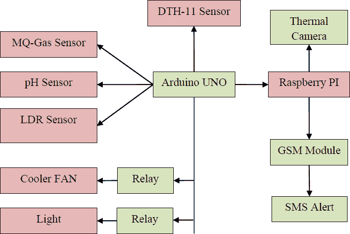 **图. (1)**

智能家禽农场 Arduino 微控制器。

### Arduino UNO 板

`Arduino` 是一个可用于编程微控制器的开源板。它由用户友好的软件和硬件组件组成。为了完成此项目，使用了 `Arduino UNO`。`Arduino UNO` 是一块可以作为微控制器的板。它的时钟频率为 `10 MHz`，工作电压为 `5 V`，并以 `ATMEGA328P` 控制芯片作为主要组件。`Arduino Uno` 上的 `ATMEGA328P` 是一块预编译并带有引导加载程序的板。这块板消除了对外部硬件编程器的需求，使得随时上传新的代码。`ATMEGA328P` `Arduino UNO` 被用作项目的单片微控制器。此外，它消耗的燃料极少。可以在 `Arduino` 板上读取输入信号，然后将读取值转换为输出。图 (2) 显示了用于医疗系统的示例 `arduino` 板。

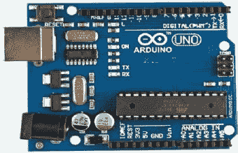 **图. (2)**

Arduino UNO 板微控制器。

### DTH11 传感器

环境温度会发生很大变化，在夏季经常达到危险的高水平，而在冬季则下降到危险的低水平。这两者对动物的福利和肉鸡的健康都有直接影响，导致禽流、手口病等许多疾病。该设备使用 `DHT11` 温度监测器来测量空气温度和湿度。华氏度和摄氏度都可以测量该传感器的温度。这种传感器成本很低，并且同时记录温度和湿度。它有一个电容湿度传感器。它还使用热电阻来判断周围空气的清洁程度。输出或测量单位可以在网上找到。图 (3) 描述了示例 `DTH11` 传感器。

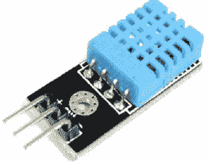 **图. (3)**

DTH11 传感器模块。

### MQ135 传感器

`MQ-135` 是确定空气质量的一种简单而有效的方法。它具有检测多种气体存在的能力。在它的帮助下，可以在住宅和商业环境中检测到气体泄漏。除了其他气体外，它还能检测烟雾、异丁烷、LPG、丙烷、甲烷、酒精和氢。选择 `MQ-135` 是是因为它的反应迅速、可调节敏感性，并作为 `Grove` 连接器的气体泄漏检测器。图 (4) 显示了示例 `MQ135` 传感器。

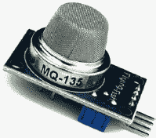 **图. (4)**

MQ135 传感器模块。

### LDR 传感器

光敏电阻也称为 `LDR`，还可以称为光敏电阻、光电导体或硫化镉（`CdS`）电池。这些只是这种类型元件的许多名称中的几个。光电导性是描述其工作原理的术语。随着光量的增加，电阻值会减小。这种传感器用于检测光量。因此，可以判断灯泡当前是开启（`ON`）还是关闭（`OFF`）状态。图 (5) 描述了示例 `LDR` 传感器。

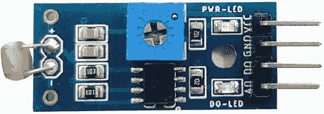 **图. (5)**

LDR 传感器模块。

### LCD 显示器

`LCD` 代表“液晶显示器”，指的是一种主要依靠液晶作为其主要形式的显示器。平板显示器是这种类型的一个示例。`LEDs` 可以在广泛的消费品找到，包括仪表板、电视机、手机和电脑显示器等。面板的主要用途是利用传统的投影仪显示微型计算机的屏幕内容。正因为如此，大观众不需要聚集在电视机旁就可以获取信息。图 (6) 描述了 `LCD` 传感器模块。

 **图. (6)**

LCD 传感器模块。

### GSM 模块

`Arduino` 板可以与 `GSM` 模块结合使用，提供互联网连接、发送和接收短信以及拨打电话。该模块作为 GSM 调制解调器工作，并与 `PCB` 连接。`PCB` 生成一系列信号，包括 `TTL` 输出，模块可以与其通信。配备 `GSM` 模块的 `GSM` 系统具有两个基本功能：第一个是确定是否有未经许可的人进入区域，第二个是在未经许可的人进入时通过向所有主打电话或发送短信进行通知。`GSM` 模块已安装在控制面板中，保护区域配备了所有必要的传感器。这是 `GSM` 报警系统运行的基本原理。图 (7) 描述了 `GSM` 模块传感器。

 **图. (7)**

GSM 传感器模块。

### 热传感器

跟踪温度波动的传感器称为热传感器。温度传感器被广泛用于过程工业，测量气体、液体和固体的热特性。温度传感器设计用于通用和专用应用。热成像的使用可以识别异常的高温（例如发烧时的温度），以及可能疾病的存在。此外，它还能检测处于麻醉或接受手术状态患者身体的不适炎症。图 (8) 展示了示例摄像头传感器模块。

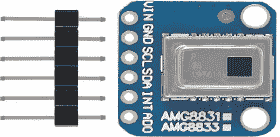 **图. (8)**

热摄像头传感器模块。

## 数据采集与肉鸡健康监控


`Raspberry Pi` 用于数据收集、数据处理和数据通信，并作为中央处理单元 (`CPU`)。`Arduino Pi` 用于与传感器接口。系统采用了一种以 `Arduino` 为核心并结合 `Raspberry` 配置 `Mesh` 的混合网络拓扑结构。使用了轻量级消息队列传输协议 (`MQTT`)，并使用超文本传输协议 (`HTTP`）在云服务器之间传输数据以进行数据存储和分析。

在人工智能 (`AI`) 和物联网 (`IoT`) 技术的辅助下，我们将在下一个小节中描述我们提出的智能家禽养殖模型。图（9）描绘了基于 `AI` 和物联网的智能农场的整个运行过程

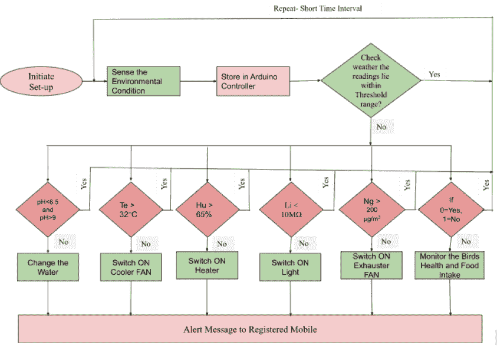 **图 (9)**

智能家禽养殖工作流框图。

## 物传感器在架构中的集成

该家禽养场原型中安装了温度传感器 (`DTH11`)、水质传感器 (`pH`)、湿度传感器、光敏传感器 (`LDR`) 和空气质量传感器 (`MG135`)。这些传感器通过实施 `I2C` 传感器接口、`SPI` 传感器接口和 `UART` 传感器接口等接口技术，端口连接到中央系统。使用的通信协议是 `I2C`（集成间总路），用于将数据从微控制器传输到温度和湿度传感器等传感器。`SPI`（串行外设备接口）在需要在有限时间内向热热像摄像头等传感器发送信号时特别有用。`UART`（通用异步收发传输器）用于 `GSM` 模式，以及所有其他基于串口运行的设备。

数据使用微控制器 `Arduino UNO` 和 `Raspberry Pi` 进行处理。使用 `SM` 模块将数据传输到云端，并利用机器学习和分析分析技术来提取见解、总结模式并促进决策。传感器信息用于控制环境、监控母鸡健康并有效利用资源。

在图（9）中，变量 `pH` 代表水质分析，`Te` 代表温度分析，`Hu` 代表湿度分析，`Li` 代表光强度分析，`Ng` 代表空气质量分析。

所提出的基于人工智能和物联网的智能鸡场可以监控家禽场本身，包括温度、湿度、空气质量和光照水平。此外，通过在预设时间间隔内使用摄像头传感器实时监控食物的获取情况。光密度响应 (`LDR`) 传感器用于测量来自智能养殖系统的光量。如果光强度 (`Li`) 低于 `10M`，`LDR` 传感器将自动开启灯光。根据图（10a），在正常或充足的照明条件下即可实现智能家禽养殖。图（10b）


“智能禽养殖”一词用于描述利用尖端技术和数据驱动策略来增强鸡肉生产过程各个多个层面的实践。它涉及利用 `IoT`、`AI`、大数据分析和 `automation` 等技术来改进家禽业务。我们汇总了明智禽养殖带来的益处简要总结：

1. 所提的智能养殖场通过先进工具和技术实现了传统家禽养殖整体运营的自动化。
2. 它减少了家禽养殖实践各个阶段的人力投入。
3. 所提系统被用于在紧急情况下向相应的农民发送警报信息。
4. 智能养殖场是无风险系统，具有更高的可持续性和生产力。
5. 它满足了家禽养殖领域的需求和新兴需求。

## 结论

智能禽养殖通过彻底传统的养殖模式，为印度农民带来了巨大的益处。它赋予了农民实时监控和控制的能力，使其能够为家禽创造最佳环境，降低死亡率并提高整体生产力。先进技术（`Artificial Intelligence`、`Internet of Things`）与数据分析的结合促进了主动疾病管理，最大限度地减少了感染扩散并减少了对比生素的需求。此外，智能禽养殖优化了资源利用，导致了可持续性的提高和环境影响的减少。数据驱动洞察的可用使农民能够做出明智决策，并提高其运营的效率和利润。此外，智能养殖的可追性和质量保证功能为消费者对其消费的肉类提供了更高的透明度和信心。智能禽养殖是一种变革性方法，结合了技术、数据和动物福利考虑，彻底改变了家禽行业。通过采用智能养殖实践，养殖户可以获得更高的生产力、更好的动物福利、可持续的资源管理以及增强的食品安全，最终以负责任且高效的方式满足肉类日益增长的需求。

在未来，我们将不得不使用机器人，禽养殖中的自动化可能会增加。机器人可以协助收集鸡蛋、清洁环境甚至监测鸟类健康等任务。自动化可以简化喂养、供水废物管理等流程，减少劳动需求并提高效率。这些发展将进一步增强家禽业的生产力、动物福利、疾病管理和环境可持续性，带来更高效、更负责任的家禽生产。预测分析未来可用于开发自动化模型。

## 参考文献

| | |
| --- | --- |
| [1] | Rowe E., Dawkins M.S., Gebhardt Henrich S.G.. , . A systematic review of precision livestock farming in the poultry sector: Is technology focussed on improving bird welfare?. 2019. |
| [2] | “Layer Farm Manager - Poulty Layer Farm Management Software.” [`www.layerfarm.com/`](http://www.layerfarm.com/) |
| [3] | [`smartbirdapp.com/smartbird-poultry-manager-features/`](https://smartbirdapp.com/smartbird-poultry-manager-features/) |
| [4] | [`www.agritech.tnau.ac.in/expert_system/poultry/Layer Production Indices.html`](http://www.agritech.tnau.ac.in/expert_system/poultry/LayerProductionIndices.html) |
| [5] | Global hunger continues to rise, a new UN report says. Technical report, Food and Agriculture Organization of the United Nations (FAO) (2018). Accessed 25th Oct. |
| [6] | Archana M. P., Uma S. K., Raghavendra Babu T.. Monitoring and controlling of poultry farms using `IOT`. 2018. |
| [7] | Rupesh I., Sanket N. Deshpande, Megha A. Chaudhari, Prof. Nivedita P. Wagh, `PLC Based Poultry Automation System`, International Journal of Science and Research, volume: 3, Issue: 3, 2014. |
| [8] | Ayyappan V., Deepika T., Divya Dharshini S.. `IOT based smart farm`, South Asian J. Engine and Tech no., 3(3), PP. 77–84, 2017. |
| [9] | Siwakorn Jindarat and Pongpisitt Wuttidachotti, “Smart farm monitoring using `raspberry pi` and `arduino`”, IEEE 2015 International Conference on Computer, Communication, and Control Technology (ICT). |
| [10] | Wicaksono D., Perdana D., Mayasari R.. Design and analysis automatic temperature control in the broiler farm based on wireless network, 2nd International conferences on Information Technology, Systems and Electrical Engineering (`ICITISE`), 2017. |
| [11] | Muhammad Ammad uddin, Muhammad Ayaz, El-Hadi Aggoune, Muhammad Sajjad. Wireless Sensor Network: A Complete Solution for Poultry Farming. 2nd International Symposium on Telecommunication Technologies (`ISTT`), Langkawi (24-26 Nov 2014). |
| [12] | Choukidar G.A., Dawande N.A.. Smart Poultry Farm Automation and Monitoring System, Int. Conference on Computing, Communication and Automation (`ICCEA`), 2017. |
| [13] | Raghudathesh G.P., Deepak D.J., Prasad G.K., Arun A., Balekai R., Yatnalli V.C., Lata S.H., Kumar B.S.. `IoT based intelligent poultry management system using `Linux` embedded system`, Int. Conference on Computing, Communications and Informatics (`ICACCI`), 449-454, 2017. |
| [14] | Rupali B.. Smart Poultry Farm Monitoring Using `IOT` and Wireless Sensor Networks, International Journal of Advanced Research in Computer Science, 2016. |
| [15] | Handigolkar L. S., Kavya M., Veena P.. `IoT Based Poultry Farming using Commodity Hardware and Software`, Bonfring Int. J. Software and Soft Computing, 6(Special Issue), 171-175. |
| [16] | Sitaram K., Ankush K., Anant K., Raghunath B..IoT based smart management of poultry farm and electricity generation`, 2018 IEEE International Conference on Computational Intelligence and Computing Research (`ICCIC`), Madurai, India, pp. 1-4, 2018. |
| [17] | Sinduja K., Jenifer S., Abishek M., Sivasankari B.. Automated Control System for Poultry Farm Based On Embedded System., 2016. |
| [18] | Choukidar G., Dawande N.. Smart poultry farm automation and monitoring system, 2017 International Conference on Computing, Communication and Automation (`ICCUBEA`), Pune, pp. 1-5, 2017. |
| [19] | Amir N.S., Abas A., Azmi N., Abidin Z.Z., Shafie A.A.. Chicken farm monitoring system, Int. Conference on Computer and Communication Engineering (`ICCCE`), 132-137, 2016. |
| [20] | Manshor N., Rahiman A., Yazed M.. `IoT Based Poultry House Monitoring`, 2nd International Conference on Communication Engineering and Technology (`ICCET`), Nagoya, Japan, pp. 72-75, 2019. |
| [21] | Nyalala I., Okinda C., Kunjie C., Korohou T., Nyalala L., Chao Q.. Weight and Volume Estimation of Poultry and Products based on Computer Vision Systems: A Review.. Poultry Science; 2021. p. 101072. |


| [22] | Mahale R.B., Sonavane D.S.. “Smart poultry farm: an integrated solution using wsn and gprs based network”, Int. J. Adv. Res. in Comp. Engine. &., *Techno..* **2016;** 5(6): 1984-1988. IJARCET. |
| [23] | Ammad-uddin M., Ayaz M., Aggoune E., Sajjad M.. Wireless sensor network: A complete solution for poultry farming, *IEEE 2nd International Symposium on Telecommunication Technologies (ISTT), Langkawi.* **2014**: 321-325. [[CrossRef](http://dx.doi.org/10.1109/ISTT.2014.7238228)] |
| [24] | Upachaban T., Boonma A., Radpukdee T.. Climate control system of a poultry house using sliding mode control, *Int. Symposium on Flexible Automation (ISFA).* : 53-58. **2016**[[CrossRef](http://dx.doi.org/10.1109/ISFA.2016.7790135)] |
| [25] | Raj A., Jayanthi J.. IoT based real-time poultry monitoring and health status identification, *11th International Symposium on Mechatronics and its Applications (ISMA).*. [[CrossRef](http://dx.doi.org/10.1109/ISMA.2018.8330139)] Sharjah, pp. 1-7, 2018. |
| [26] | Fujii T., Yokoi H., Tada T., Suzuki K., Tsukamoto K.. Poultry tracking system with camera using particle filters, *IEEE International Conference on Robotics and Biomimetics.* : 1888-1893. **2009**[[CrossRef](http://dx.doi.org/10.1109/ROBIO.2009.4913289)] |
| [27] | Gonzalez C., Pardo R., Farina J., Valdes M., Rodrguez Andina J., Portela M.. Real-time monitoring of poultry activity in breeding farms, *IECON 43rd Annual Conference of the IEEE Industrial Electronics Society, Beijing.* **2017**: 3574-3579. [[CrossRef](http://dx.doi.org/10.1109/IECON.2017.8216605)] |
| [28] | Pereira W.F., Fonseca L.S., Putti F.F., Góes B.C., Naves L.P.. Environmental monitoring in a poultry farm using an instrument developed with the internet of things concept., *Comput. Electron. Agric..* **2020;** 170105257[[CrossRef](http://dx.doi.org/10.1016/j.compag.2020.105257)] |
| [29] | S. Poolsanguan and S. So-In, ''Smart mobile poultry farming systems in remote sky WSNs'', International journal of digital content technology and its applications (JDCTA), Vol. 7, No. 9, May 2013. |
| [30] | M. Ibrahim, A. Elgamri, S. Babiker, A. Mohamed ''Internet of things based smart environmental monitoring using the raspberry-pi computer” IEEE, Fifth International Conference on Digital Information Processing and Communications (ICDIPC), pp-159–164, 2015. |
| [31] | Dong F., Zhang N.. . Wireless Sensor Networks Applied on Environmental Monitoring in Fowl Farm. 2014. [`hal.inria.fr/hal-01055409`](https://hal.inria.fr/hal-01055409) |
| [32] | Ayyappan. V, Deepika. T, Divya Dharshini.S, Elayaraja. M, Shanmugasundaram. R., IOT based smart poultry farm south asian., *J. Eng. Technol..* **2017;** 3(2): 77-84. |
| [33] | Rupali B. Mahale Dr. S. S. Sonavane Smart Poultry Farm: An Integrated Solution Using WSN and GPRS Based Network International Journal of Advanced Research in Computer Engineering & Technology (IJARCET) Volume 5, Issue 6, June 2016. |

# 深度学习驱动的视障人士视觉增强

Gandrapu Satya Sai Surya Subrahmanya Venkata Krishna Mohan^(1, *), **Mahammad Firose Shaik^(2)**, **G. Usandra Babu^(3)**, **Manikandan Hari^(4)**, **Kiran Kumar Patro^(5)**,

¹ Tekkali Aditya 技术管理学院电子与通信工程系
² 维杰亚纳达 Sriakrishna 大学仪表系
³ Surampalem Aditya 大学电子与通信工程系
⁴ 班加罗理工学院
⁵ 安得拉邦大学电子与通信工程系

## 摘要

计算机视觉与目标检测的交叉融合对于图像分析至关重要。本研究通过深入理解图像，超越了传统方法，为视觉障碍人士提供关键帮助。所提模型实现了实时目标识别。该系统使用通用物体（COCO）数据集，并通过 `NumPy`、`OpenCV`、`pyttsx3`、`PyWin32`、`OpenCV-contrib` 和 `winsound` 将输出转换为语音。

关键词：辅助技术、辅助技术、人工智能、计算机视觉、COCO 数据集、深度学习、深度目标分析、谷歌翻译、类人目标理解、图像理解、包容性设计、LiDAR、多模态目标交互、NumPy、目标检测、实时目标识别、文本语音、视觉障碍

## 引言

随着人工智能（AI）和物联网（IoT）的发展，许多智能设备可以相互连接。“智能星球”、“智能城市”、“智能社区”和“智能校园”等各种创新概念不断出现并融入生活的各个方面。

眼睛在视觉系统中起着作用，但也容易受到外部因素的影响，包括对病原体的接触。眼睛可能是某些病毒进入人体途径，导致眼疾病和视觉障碍。世界卫生组织（WHO）估计，到 2019 年，全球有超过 2.2 亿人面临视觉障碍。虽然白色手杖仍然视障人士常用的工具，但它存在明显的局限性和安全问题。因此，本工作的目标明确且引人注目：开发一种成本效益且高效的解决方案，让视障人士能够更轻松、更快速、自信地在环境中移动。


视力障碍不仅与眼睛问题有关，还源于多种因素。常见原因包括视力挑战、白内障的形成、眼后部问题或视神经问题。遭受视力障碍的人士在日常生活中经常遇到许多挑战。视力受限会导致在安全穿过马路、判断交通灯何时通行或在绕过障碍物行走时遇到困难。对于求学而言，视力障碍者通常需要学习盲文，这是一种凸起点的触觉系统。即使是像看医生这样的日常任务也变得具有挑战性，因为他们需要依靠触觉和听觉来感知周围环境。

在当今背景下，人工智能（AI）是一个突出且快速发展的领域。AI 专注于赋予系统智能，预计它将在未来发挥实质性作用 [5]。AI 的进展由海量数据和强大的计算资源驱动。它的应用扩展到各个领域，包括零售和配送服务。在零售领域，AI 通过跟踪库存水平和识别热门商品来促进库存管理，从而提升了整体购物体验。此外，AI 可以根据个人偏好提供个性化的产品推荐。在配送服务领域，AI 擅长规划物品从一个位置运输到另一个位置的最优路线。

AI 正在显著重塑教育格局，为教师提供了宝贵的工具来评估学生的进度，并根据个人需求提供定制支持。这种个性化的方法增强了每个学生的学习体验。在安全领域，AI 是执法部门的强大盟友。其的图像处理能力能够识别监控视频中的嫌疑人，有助于更有效、高效的调查。此外，AI 在建筑监控中起着至关重要的作用，能够及时向当局报告任何异常活动并增强整体安全措施。

将 AI 引入眼科实践彻底改变了眼科保健的格局，为早期干预和精准医疗提供了前所未有的机会。AI 算法与眼底检查设备的无缝集成简化了诊断过程，使临床医生能够提供及时且定制的干预。此外，AI 驱动的眼底图像分析能够检测出人类观察可能忽略的细微异常，确保了全面的评估和治疗计划。随着领域的不断发展，AI 技术与医学专业知识之间的协作有望重新定义护理标准，并提高眼疾患者的生活质量。

## 文献综述

Cheng 等同事提出了一种整体策略，以提高视力障碍人士的视觉定位能力 [6]。他们建立的系统由多个组件组成，例如深度描述符网络、2D–3D 几何验证以及实时序列匹配。该过程涉及将双描述符网络与 RGB、红外线和深度图像相结合，从而创建出鲁棒的且上下文丰富的描述符和局部特征。

与 Springer-Verilog 相关的人员引入了一种创新的基于 LiDAR 的技术，旨在有效预测距离并对障碍物进行精确测量 [7]。的方法涉及使用一种专门为障碍物检测定制的轻量级深度学习模型，被称为 `EfficientDet-LiteV4`。预期距离通过分析由 LiDAR 生成的深度图来计算。为了评估他们方法的有效性，他们在一个集成了 `Li- DAR` 的 `Raspberry Pi4` 平台上实现了它。实验结果显示。

Shen 和合作者引入了一种名为 `VRTMM` 的新型两阶段模型，用于遥感解释 [8]。该模型将变分自动编码器与强化学习无缝结合。在第一阶段，卷积神经网络（`CNN`）经过微调。随后，在第二阶段，采用基于 Transformer 的模型来生成文本。

设计了一种工具，利用光学字符识别（`OCR`）从图像中扫描文本并将其转换为口语。该方法详见于研究 [9]，其采用了一种名为 `MSER` 的算法。设置涉及将 `Raspberry Pi` 连接到摄像头以捕捉图像，并使用了该算法。

开发了一种先进音频辅助系统，通过读取文档中的文本并识别周围物体体来协助视力障碍人士，如文献所示 [10]。该技术能够检测文档中的文本和障碍物，并提供语音输出以帮助视力障碍人士。另外一种为视觉挑战人士设计的工具 [11]，利用智能技术和用 `Python` 编写的 `Raspberry Pi 2` 来帮助他们阅读书籍。

一种针对视力受损人士开发的益系统使用了 `Raspberry Pi 3` 和 `OCR` 技术，如文献所述 [12]。该系统通过将文档文本转换为口语来帮助他们。然而，其局限性在于需要计算机进行图像处理。

本研究提出了一种利用手机传感器在室内定位视力障碍人士的新方法。利用传感器数据可以确定人在封闭空间内的位置。使用类似于视力障碍人士的运动模式评估显示了良好结果，在 0.6 米乘以 0.6 米的区域内，精度接近典型步长（约 0.65 米）。

## 技术

在本研究中，深度学习作为整体框架，使得高级计算机视觉技术的探索和应用成为可能。`YOLO` 和 `RCNN` 代表了深度学习中的两种方法，每种方法都为目标检测和识别提供了独特的见解。通过利用这些基础方法，本研究旨在深入探讨图像分析的复杂性，并加强对复杂视觉数据的理解。

### 深度学习


深度学习是一种模仿大脑神经网络的计算机程序，通过深度神经网络运行，深度神经网络是机器学习的一个子集 [[12]]。这些网络由连接的层组成，从顶部的输入层开始到底部的输出层，而中间的层被称为隐藏层。“深”字指的是跨越多个层连接神经元的网络。每个隐藏层都包含具有相互连接的神经元，通过激活函数、权重和偏置来处理输入信号。深度学习网络通过多层处理海量输入数据，从而促进对复杂数据特征的学习。相比之下，浅层神经网络只包含一个隐藏层，而深度学习网络则包含许多层，如 Google LeNet 的 22 层模型所示。目前，深度学习已广泛应用于多个领域，包括电视、自动驾驶汽车、智能手机和欺诈检测等。

最基础的人工神经网络是一种计算模型，允许信息沿一个方向移动。在这种架构中，信息从输入层开始，经过中间的“隐藏”层，最终在输出层结束，网络内部没有任何反馈回路。输出层是信息流终结的地方。

### YOLO 算法

YOLO 是“You Only Look Once”（只看一次）的缩写，代表了一种用于识别图像中多个目标的实时技术，图 (**1**)。YOLO 是一种目标检测系统，将目标检测重新定义为单一回归任务，将图像像素直接映射到边界框坐标和类别概率。

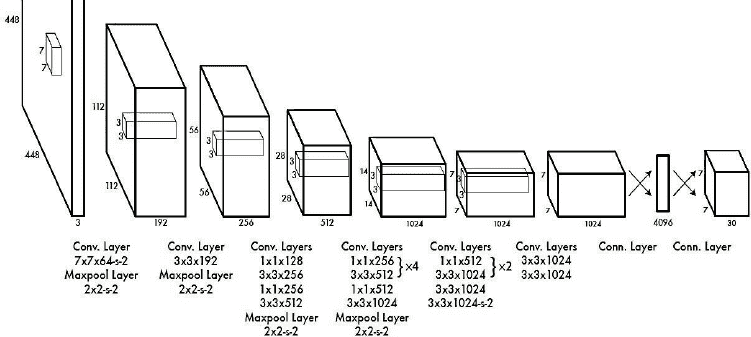 **图 (1)**

YOLO 架构。

YOLO 是一种通过卷积神经网络单次通过快速分析图像的目标检测系统。它直接预测边界框和类别概率，实现了快速且准确的目标检测。

典型的 YOLO 架构由 24 个卷积层和后续 2 个全连接层组成。它将图像划分为一个 `SxS` 网格，并为每个网格单元预测边界框和类别概率 [[13]]。YOLO 中的损失函数考虑了分类、定位和置信度中的误差。YOLO 在 COCO 数据集上进行训练，并采用批归一化、dropout 和多尺度训练等技术来提高性能。

该方法利用卷积神经网络（CNN）快速检测实体，通过通过网络的单次前向传播完成目标检测。YOLO 的方法表明，运行单一算法就足以对整个图像进行检测，同时预测多个类别概率和边界框。注意的是，YOLO 算法包含多个版本，包括著名的 Tiny YOLO 和 YOLOv5。

YOLO 算法由于以下几个关键方面而具有重要意义：

* A. 快速检测：YOLO 通过高效地实时预测目标，显著加速了目标检测。
* B. 精确性：其预测技术可产生高度准确的结果，最大限度地减少了背景误差。
* C. 学习能力：凭借先进的学习能力，YOLO 能够有效地区分物体表示，有助于检测各种物体。

YOLO 算法通过实施三种特定策略运行：

• 残差结构块
• 边界框回归
• 交并比 (IOU)

#### 残差结构块

最初，图像被划分为多个网格区域，每个区域的大小为 `SxS`。视觉表示说明了将输入图像划分为均匀大小网格的过程。这些网格单元独立运行，专注于检测其分配边界内的物体。如果物体的中心位于特定的网格单元内，则该单元负责识别该物体。

#### 边界框回归

“边界框”界定了图像中的一个物体。图像中的每个边界框包含：

• 宽度 (`bw`)
• 高度 (`bh`)
• 物体类型（例如，人、汽车、交通信号等等*），表示为 `c`。边界框的中心坐标给出 `(bx, by)`。

YOLO 方法采用独特的边界框回归技术来预测物体的尺寸、位置和分类。图中所示的视觉表示展示了物体在边界框内存在的概率。

交并比 (IOU) 衡量目标识别中边界框之间的重叠程度。YOLO 使用 IOU 来准确定义包含所识别目标的输出边界框。每个网格单元预测边界框及其置信度水平。在提取区域建议后，标记对于训练至关重要。`IOU` 为 1 表示提议与边界框之间至少有 0.5 的 `IOU` 值，并接受其相应的类别。然而，低于 0.3 IOU 的提议被视为背景，舍弃其余待考虑。

### 基于区域的卷积神经网络 (RCNN)

在 `CNN` 普及后，计算机视觉变得非常流行，特别是随着自动驾驶汽车的前沿出现 [[14]]。目标检测是计算机视觉不可或缺的一部分，有助于姿态估计、监控等任务。目标检测算法与分类算法的区别在于，它在图像中识别出的物体周围创建边界框 [[15]]。

在这种情况下，多个边界框可能代表不同的感兴趣区域，且数量可能不一。输出层长度的不确定性无法通过在典型的卷积网络之上添加全连接层来解决。解决这些问题涉及隔离特定区域供 CNN 算法进行解释，以确定物体的存在（图 **2**）。

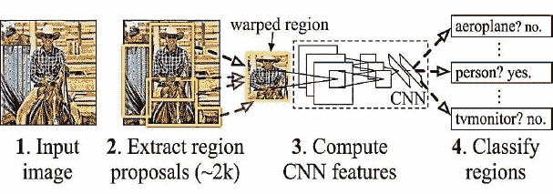 **图 (2)**

带有 CNN 特征的 RCNN 区域。

RCNN 采用双阶段架构检测图像物体。它首先使用选择搜索感兴趣区域，然后从这些区域提取 CNN 特征进行分类。

## 提出的方法

COCO 数据集（图 **3**]]。该数据集因其高质量的视觉数据而在计算机视觉领域被常用，经常用于评估算法和实时目标检测能力。领先的神经网络库可以轻松解析 COCO 格式。

 **图 (3)**

COCO 数据集。

COCO 的特征：

• 带有原型注释的详细物体分割
• 上下文理解
• 超像素物体分割
• 在总共 330,000 张图像中有超过 200,000 张已标记图像
• 150 万个物体实例
• 包含 80 个物体类别，称为“COCO 类别”，涵盖各种易识别的实体（人类、车辆、家具等等*），用于精确标记。


该系统利用 `COCO` 数据集进行训练和评估，预处理步骤包括翻转、旋转和缩放等数据增强技术以增加训练数据的多样性；通过归一化实现零均值单位方差以加速收敛；并将 `COCO` 标注转换为 `YOLO` 网络格式。模型训练结合了用于分类的交叉熵损失和用于边界框回归的均方误差，并采用小批次（mini-batches）批量训练来平衡内存占用与训练速度，同时使用动态学习率调度以确保稳定收敛。性能在独立的验证集上进行验证，以调优超参数并避免过拟合。

在视觉理解领域，所提系统通过加载图像或视频启动流程。随后，它利用 `Object Detection`（目标检测）识别各种物体，并利用 `Object Tracking`（目标跟踪）监控它们的移动。计算核心 `Deep Neural Network`（`DNN`）从视觉输入和跟踪数据中学习，如框图图. (`**4**`) 所示。随后，该 `DNN` 处理信息并将其翻译为对识别物体的简单描述。最后，`Text-to-Speech`（文本转语音）功能将这些描述转换为语音，提供了一种理解图像内容的无障碍手段。这种整合了检测、跟踪和深度学习的紧凑流程，为将视觉信息转换为语言格式展现了广阔前景。

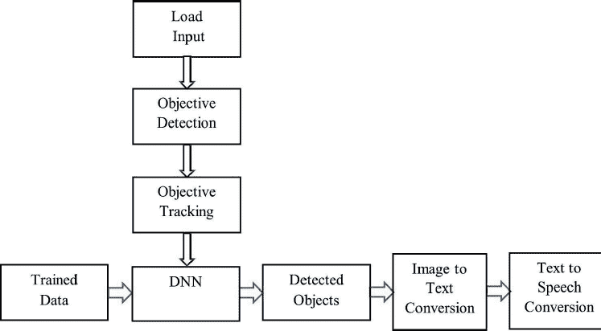**`Fig. (4)`**  

所提工作的框图。

用于视觉理解的系统从输入图像或视频开始，然后使用目标检测和跟踪来识别和监控物体。深度神经网络从这些数据中学习，生成描述，并通过文本转语音功能将其读出来，实现了对视觉内容的无障碍理解。

在目标检测中，在图片中寻找物体通常从清理图像开始（移除不需要的内容）。之后，我们寻找线条和区域等重要特征，甚至关注特定的纹理。通过一种名为目标检测的酷技术，理解并识别出图片或视频中的事物是可能的。我们使用名为 `RCNN` 的工具在我们发现的物体周围画框。在 `Object Tracking`（目标跟踪）中，想象使用相机和特殊的检测方法随时间跟踪一个移动物体。这种方法被称为 `blob detection`（斑点检测），寻找数字图像中突出的部分，例如更亮或颜色不同。这些突出的部分被称为 `blobs`（斑点），在识别物体方面，它们可以显示物体在图片中的位置。人们经常将 `YOLO` 与 `RCNN` 使用。`YOLO` 能够一次性快速预测整个图像中的物体。

将 `DNN` 视为人类大脑中神经网络的数字等效物。它是机器学习的一个子集，被称为深度学习。深度学习采用组织成层的算法，由产生数据的 `Input Layer`（输入层）、代表终点的 `Output Layer`（输出层）以及位于中间阶段的 `Hidden Layers`（隐藏层）组成。“深度”意味着网络连接超过两级。每个隐藏层激活一个神经元。网络处理大量数据，通过每一层时学习关于数据的复杂知识。虽然我们的初始实验使用了 `COCO` 数据集中 50 多张图像的子集进行初步测试，但最终训练使用了完整的 `COCO` 数据集。这个广泛的数据集确保了模型能够学习各种物体外观和上下文，从而获得更准确、更稳健的性能。计算机现在可以识别照片里有什么，比如动物、键盘、鼠标等东西。我们使用了一个名为 `COCO`（上下文常见物体）的预训练模型。通过名为 `OpenCV-contrib-python` 的工具，计算机将其看到的内容与其训练数据库进行比较。然后，它对图片进行标记，将图像转换为文字。之后，计算机使用 `winsound` 工具说出它看到的内容，并使用名为 `pyttsx3` 的包播放单词。

### 使用的软件软件包

使用的软件软件包和技术包括：

-   **NumPy**: 用于高效数值计算，特别是在数据预处理所需的数组操作。
-   **OpenCV**: 用于图像处理任务，如读取、调整大小和显示图像及视频。它还协助实现视觉算法。
-   **pyttsx3**: 该库用于将标签转换为语音，提供离线解决方案。
-   **PyWin32**: 允许与 Windows 特定功能集成，访问文本转语音引擎所需的系统功能。
-   **OpenCV-contrib-python**: 为 `OpenCV` 添加额外功能，包括高级图像处理算法和跟踪工具。
-   **winsound**: 用于控制系统输出。

## 结果与讨论

“coco”数据库作为预训练物体的在线仓库作为默认。在代码执行期间，`OpenCV` 软件包激活相机，系统地识别出 5-6 个物体，如图 [`**5**`] 和 `**6**`] 所示。

**`Fig. (5)`**  

相机模块对人的检测。

相机通过 `DNN` 同时识别出 2 个人和 2 个物体。这一程序步骤为执行 Python 程序的关键步骤提供了全面的理解。从导入 `cv2`、`imutils`、`numpy` 和 `pyttsx3` 等关键库开始，流程涉及定义一个文本转语音函数，加载 `YOLO` 模型及其类别名称，并打开摄像头流。随后，启动一个循环以持续处理帧。

在这个循环中，帧经过系统性的调整大小，使用 `YOLO` 检测物体，并将识别出的物体既在视觉上显示又通过 `TTS` 进行语音播报。这一迭代过程持续到用户通过按下 'q' 终止，随后释放视频捕获。


- **每秒帧数 (FPS)**：该指标衡量了系统的实时检测速度。

 **图 (7)**

检测到的物体列表。表 1 **实验结果。**

| **模型** | **mAP** | **IoU** | **FPS** |
| --- | --- | --- | --- |
| YOLOv3 | 57.9 | 70.3 | 45 |
| Tiny YOLO | 34.6 | 50.8 | 220 |
| RCNN | 66.0 | 75.2 | 2 |

所提出的系统使用 `YOLOv3`，在准确性和速度之间取得了良好的平衡，适用于实时应用。`Tiny YOLO` 虽然速度更快，但牺牲了一些准确性，而 `RCNN` 虽然提供了更高的准确性，但是以牺牲实时性能为代价（表 **1**）。

### 局限性讨论

- **准确性**：虽然 `YOLOv3` 提供了良好的平衡，但在精确率和召回率方面有改进空间。
- **实时性**：尽管 `YOLOv3` 在实时环境下表现良好，但某些应用可能需要更快的检测速度。
- **环境依赖性**：系统的性能在不同的环境条件下（如光照和背景复杂性）可能会有所不同。
- **未来方向和潜在扩展**：可以通过 `YOLOv4`、`EfficientDet` 或注意力机制等先进架构提高准确性。通过多样化数据扩展数据集可以增强模型的鲁棒性。在边缘设备上部署模型可以降低延迟并增强隐私。将视觉数据与音频或触觉反馈等传感器输入相结合可以提升用户体验。潜在扩展包括为视障人士提供室内导航、交互式物体查询、多语言支持以及与自动驾驶车辆集成导航。

## 结论

总之，`YOLO` 作为一种快速且多功能的方法脱颖而出，能够高效检测各种场景下的各类物体。它将图像转换为文本和语音的能力对于视障人士特别有帮助，能够帮助他们理解视觉内容。本研究强调了 `YOLO` 的快速物体识别能力及其在增强可访问性方面的关键作用，特别是对于面临视觉挑战的人来说。通过结合各种技术，该研究旨在加速物体识别过程，最终提高对视觉内容的整体理解。从上讲，`YOLO` 成为这一努力中的关键参与者，展示了其超越传统方法的有效性，并为更具包容性的视觉世界解释方法做了巨大贡献。

## 参考文献

| | | |
| --- | --- | --- |
| [1] | Ren C., Lyu X., Ni W., Tian H., Song W., Liu R.P.. Distributed online optimization of fog computing for internet of things under finite device buffers., *IEEE Internet Things J..* **2020;** 7(6): 5434-5448. | [CrossRef](http://dx.doi.org/10.1109/JIOT.2020.2979353) |
| [2] | A.P. Marques, J. Ramke. The economics of vision impairment and its leading causes: A systematic review, *eClinicalMedicine.* **2022;** 46: 101354. | |
| [3] | Adusumilli V., Shaik M.F., Kolavennu N., Adepu L.B.M.T.. P. A. V and I. R. Raja. “Reading Aid and Translator with Raspberry Pi for Blind people”., *9th International Conference on Advanced Computing and Communication Systems (ICACCS).*. Coimbatore, India, pp. 327-331, 2023. | |
| [4] | Bi S., Wang C., Zhang J., Huang W., Wu B., Gong Y., Ni W.. A survey on artificial intelligence aided internet-of-things technologies in emerging smart libraries., *Sensors (Basel).* **2022;** 22(8): 2991. | [CrossRef](http://dx.doi.org/10.3390/s22082991) [PubMed](https://www.ncbi.nlm.nih.gov/35458) |
| [5] | Cheng R., Hu W., Chen Y., Xu Z., Bai K.. Hierarchical visual localization for visually impaired using multimodal images., *Expert Syst. Appl.* **2021;** 165:11374. | [CrossRef](http://dx.doi.org/10.1016/j.eswa.2020.11374) |
| [6] | Kuriakose B., Shrestha R., Sandnes F.. LiDAR-based obstacle detection and distance estimation in navigation. In: Antona M., Stephanidis C., editors. Universal Access in Human-Computer Interaction. 2022. Lecture Notes in Computer. | |
| [7] | Shen X., Liu B., Zhou Y., Zhao J., Liu M.. Remote sensing image captioning *via* Variational Autoencoder and Reinforcement Learning., *Knowl. Base. Syst.* **2020;** 203:105920. | [CrossRef](http://dx.doi.org/10.1016/j.knbs.2019.105920) |
| [8] | Rahman M., Sadi M., Channa D.. Object detection using `YOLO`: challenges, architectural successors, datasets., *Multimedia Tools and Appl.* **2023;;** 82(6):9243-9275. | [CrossRef](http://dx.doi.org/10.1007/s11042-022-13644-y) |
| [9] | Sarwar S., Anirudh G., Kumar V.. Smart reader for visually impaired using IoT device., *Computer Methods and Programs.* **2021** | [CrossRef](http://dx.doi.org/10.1007/s10133-021-xxxx) |
| [10] | Agnihotri, P. Saraf and K. R. Bnap, “A convolutional neural network approach towards self-driving cars”, 2019 IEEE 16th India Council International Conference (INDICON), Rajkot, India, 2019, pp. 1-4. | [CrossRef](http://dx.doi.org/10.1109/INDICON.2019.90303) |
| [11] | Bedi P., Gole P.. Plant disease detection using hybrid model based on convolutional autoencoder and convolutional neural network., *Artificial Intelligence in Agriculture.* **2021;** 4: 5. | [CrossRef](http://dx.doi.org/10.1016/j.aiia.2021.05.002) |
| [12] | Yin G., Liu B., Sheng L., Yu N., Shao J.. Semantics disentangling for text-to-image generation, *2019 IEEE/CVF Conference on Computer Vision and Pattern Recognition (CVPR).*. | [CrossRef](http://dx.doi.org/10.1109/CVPR.2019.00243) |


在农业中使用信息和通信技术来提高生产力、效率和可持续性被称为智能农业。在智能农业中实施预测性分析和数据驱动的洞察增强了整个农业系统的有效性、决策过程和资源配置。本研究比较了`长短期记忆网络 (LSTM)`、`支持向量机 (SVM)`、`深度信念网络 (deep belief network)`、`朴素贝叶斯 (Naive Bayes)`、`人工神经网络 (ANN)` 和`门循环单元 (GRU)` 算法在优化农业操作中的应用。研究强调了在智能农业中使用 `LSTM` 能够转变传统的农业方法，从而实现可持续、高产的输出，同时最大限度地减少资源损失和对环境的影响。智能农业通过整合尖端技术（特别是机器学习），已成为现代化和优化农业实践的一种新方法。多种算法被应用于该数据集，产生了如准确率、损失值（loss）、正确检测率 (`CDR`) 和假性发现率 (`FDR`) 等可衡量的结果。通过广泛的比较研究，发现`长短期记忆网络 (LSTM)` 算法是该数据集最有前景的选择。在将机器学习算法应用于不同的训练-测试划分（如 `80-20`、`70-30`、`65-35`、`60-40` 和 `55-45`）后，发现 `LSTM` 的平均准确率最高，范围从 `95%` 到 `98%`。对 `LSTM` 的探索证明了其显著增强农民和研究人员决策过程的潜力，最终提高了农业效率和产出。

**关键词：** 人工智能、人工神经网络、正确检测率、深度信念网络、假性发现率、门循环单元、超参数调优、逻辑回归、长短期记忆、机器学习算法、模型架构增强、朴素贝叶斯、后验概率、精准农业、随机森林、整流线性单元、智能农业、支持向量机、可持续性、产量优化。

**通讯作者 Prabakaran Natarajan：** 科学与工程学院, Vellore Institute of Technology, Vellore 632014, India; 电子邮箱：`dhoni.praba@gmail.com`

## 引言

在精准农业领域，由于每一个决策和每一条信息都高度相关，`LSTM (长短期记忆)` 算法是创新的基石。现代技术引发了农业革命，将传统的耕作方法转变为更有效、更可持续的方法。智能作物管理是一种多方面的策略，它无缝结合了尖端技术（特别是机器学习 (`ML`)）和 `LSTM` 算法的优势，是智能农业的基础。这种农业转型的关键在于在尽可能减少地球资源的同时，仔细优化流程并最大化收获。得益于 `ML`（特别是在该实践的背景下），农民现在可以使用精准农业这一无价的工具。

得益于 `LSTM` 算法，农民现在能够严格按照区域要求精确地施肥、喷农药和其他投入。这些算法检查土壤属性和作物特征的微小细节，产生个性化的建议，在促进资源明智利用的同时减少对环境的损害影响。这种由 `LSTM` 驱动的 `ML` 实现的周全策略提供了双重利益：一方面成功降低了成本，另一方面可持续性占据了中心地位，土壤损坏的概率大大降低。此外，`LSTM` 算法擅长跟踪土壤水分水平、结合天气预报并跟踪植物不断的需求以优化灌溉计划。这种精细的调节有效地模糊了资源保护与农业产出之间的传统界限，不仅保护了有限的水源，还带来了作物产量的增加。在不断变化的农业世界中，数据驱动的洞察是成功的关键，`LSTM` 算法更是。它们对于准确的产量估计和仔细的作物监测至关重要。这些算法分析来自多种来源（包括卫星图像和传感器数据）的数据，能够分析作物生长模式、识别营养缺乏并计算作物产量。凭借现在拥有的丰富知识，农民能够更好地规划他们的市场并确定收获作物的最佳时机，从而提高盈利能力并开启农业的新纪元。

## 因素

### 土壤磷水平

磷是植物至关重要的宏量元素，对于多种生理活动是必要的。将土壤磷水平整合到作物预测模型中，可以对养分动态产生更全面的理解，并有助于施肥策略、土壤管理实践和整体营养优化做出明智决策。

### 土壤钾水平

钾是植物生长发育的必需组成部分。它参与了多个关键植物过程，包括养分和水分在植物内的移动、对植物生长发育的控制、能量储存以及对病虫害的抵抗。

### 温度

温度是影响作物生长的最重要的变量之一。通过了解生长季节的典型温度，农民可以计算出需要多少水和肥料。他们还可以利用温度数据安排作物的播种和收获。

### 湿度

湿度定义为空气中存在的水分，影响植物的几个关键生理过程，包括蒸腾、气孔导度和光合作用。通过将湿度视为作物预测模型中的关键变量，可以对作物经历的水分压力获得更深入的见解，从而对其生长、产量潜力和整体健康做出更准确的预测。

### 土壤 pH

土壤 pH 值指示其酸性或碱性。不同作物偏不同的土壤 pH 值。如果土壤 pH 值过高或过低，植物可能难以吸收养分，导致生长受阻、产量低甚至死亡。

### 降水量

大多数之前的灌溉系统在选择灌溉策略时没有考虑天气预报信息。如果下雨后立即进行作物灌溉将浪费淡水和能量并抑制作物生长。通过利用天气预报数据，基于 `ML` 的解决方案可以处理这些情况并改进灌溉决策支持。

### 土壤水分

土壤中的水量称为水分含量。许多变量如土壤类型、气候和降水量都会影响土壤的湿润程度。增加对土壤水分与作物生长之间关系的了解，可以帮助农民在种植作物时何时、何地以及使用多少水做出更明智的决策。这可能会导致更高的产量和增加的利润。


在智能农业中，尖端技术与数据驱动策略的结合优化了农业实践，考虑了如 `pH 水平`、湿度、钾 `(K)`、降雨量和温度等因素，这些因素可以在图（1）中看到，以实现高效且可持续的农业。

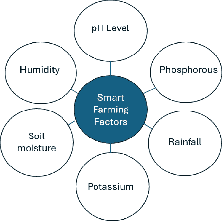 **图 (1))**

智能农业的要素。

## 方法

### 长短期记忆网络 (LSTM)

通过多种自定义变体，`LSTM` 作为一种专门的循环神经网络（`RNN`）架构，在处理序数据处理方面表现出色。得益于原生 `LSTM` 的遗忘门、输出门和输入门，可以对信息流进行精确控制[2]`。为了彻底理解上下文，双向 `LSTM` 使用方程 `(1-6)` 从两个方向处理输入。通过提供数据驱动的见解，它利用过去的环境数据来预测疾病和害虫暴发、估计农业产量、改进资源管理并预测作物生长阶段[11, 28]`。

候选隐藏状态 `(Ct)`：

|  || (1) |
| --- | --- |

输入门 `(it)`:

|  || (2) |
| --- | --- |

遗忘门 `(ft)`:

| 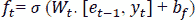 || (3) |
| --- | --- |

输出门 `(ot)`:

| 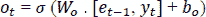 || (4) |
| --- | --- |

细胞状态 `(Ct)` 更新:

| 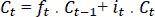 || (5) |
| --- | --- |

隐藏状态 `(ht)` 更新:

| 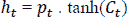 || (6) |
| --- | --- |

#### LSTM 的计算复杂度

训练时间复杂度：`O(k . n . m²)`

- `k` 是训练轮数
- `n` 是训练样本数
- `m` 是 `LSTM` 单元的数量

推理时间复杂度：`O(m²)`

#### 可扩展性与效率

由于 `LSTMs` 能够处理序数据，因此它们非常适合智能农业中的时间序列预测，包括农业生产预测和天气预报。然而，在处理长序列和海量数据集时，它们高高的训练复杂度可能会成为瓶颈。因此，它们对于需要高性能计算机的实时应用来说，可扩展性较低。

### 门控循环单元 (GRU)

它是一种特定的循环神经网络（`RNN`），适用于序列建模应用。`GRUs` 非常擅长诸如估计作物产量、预测天气模式以及发现病虫害等工作，因为它们可以学习序数据数据中的长期连接。`GRUs` 可用于为智能农业创建多种预测模型。例如，可以使用 `GRU` 根据过去的数据和当前天气来预测作物的产量。`GRUs` 可用于创建疾病和害虫预警系统[12]`。这些门使用方程 `(7-10)` 表达。

更新门 `(zt)`:

|  || (7) |
| --- | --- |

重置门 `(rt)`:

|  || (8) |
| --- | --- |

候选隐藏状态 `(h't)`:

|  || (9) |
| --- | --- |

隐藏状态 `(ht)` 更新:

| 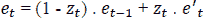 || (10) |
| --- | --- |

#### 计算复杂度

- 训练时间复杂度：`O(k . n . m²)`
- 与 `LSTM` 类似但通常效率更高
- 推理时间复杂度：`O(m²)`

#### 可扩展性与效率

尽管与 `LSTMs` 相似，但 `GRUs` 架构更简单，这通常会导致更快的推理和训练速度。

### 支持向量机 (SVM)

回归和分类问题可以通过一种名为支持向量机（`SVMs`）的机器学习方法来处理。具有大量特征和少量训练样本的任务特别适用于 `SVMs`[13]`。

特征多而训练样本少的任务特别适用于 `SVMs`[13]`。这在智能农业中非常常见，其中特征很多但训练样本很少。数据集的大小和所用核的复杂度决定了它们的有效性[15]`。

| 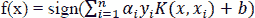 || (11) |
| --- | --- |

计算复杂度

训练时间复杂度：

- 线性 SVM：`O(n . d)`
- 非线性 SVM：`O(n² . d)` 和 `O(n³ . d)`
- `n` 是训练样本数
- `d` 是特征数
- `s` 是支持向量的数量

推理时间复杂度：线性 `O(n . d)`，非线性 `O(s . d)`

#### 可扩展性与效率

`SVMs` 计算开销很低，适用于分类任务。尽管可扩展性较低，但非线性支持向量提供了更高的精度。

### 朴素贝叶斯

朴素贝叶斯是一种简单有效的分类机器学习方法。它基于贝叶斯定理，该定理认为事件发生的概率取决于在特定情况下发生的概率[14]`。朴素贝叶斯可用于智能农业，根据土壤特征、气象信息和传感器读数等多种特征对作物、害虫和疾病进行分类[16]`。

| 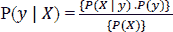 || (12) |
| --- | --- |

方程 `(12)` 有后验概率 `P(y | X)`，它代表给定特征 `X` 时特定类别 `y` 的概率。似然性 `P(X | y)` 反映了在类别 `y` 下观察到这些特征 `X` 的概率。先验概率 `P(y)` 表示类别 `y` 的初始概率，而边缘似然性 `P(X)` 代表观察到特征 `X` 的整体概率。

#### 计算复杂度

训练时间复杂度：`O(n.d)`

- `n` 是训练样本数
- `d` 是特征数

推理时间复杂度：`O(d)`

#### 可扩展性与效率

朴素贝叶斯简单的概率方法使其非常有效且具有可扩展性。

### 人工神经网络 (ANN)

一种从人类大脑获取灵感的机器学习领域被称为“人工神经网络”（`ANN`）[9]`。它是一种旨在类似于大脑中存在的生物神经网络的计算网络。`ANN` 用于 pH 和湿度传感器来收集和处理来自这些传感器的数据[17]`。由于数据值在系统中进行了测试和训练，`ANN` 可以预测某些田地的作物产量`(13)`。

```
| 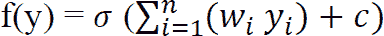 || (13) |
```


输出表示为 `f(y)`，由其输入值 (`yi`) 的加权和决定，每个输入值乘以相应的权重 (`wi`)。此外，在该加权和的基础上加上一个偏置项 (`c`)。然后，结果通过激活函数（通常为 `sigmoid`、`ReLU` 或类似的函数）以引入非线性，从而形成神经元的最终输出。

#### 计算复杂度

训练时间复杂度：`O(k.n.m)`

- `k` 是训练轮数 (epochs)
- `n` 是训练样本数
- `m` 是每层中的神经元数量

推理时间复杂度：`O(m)`

#### 可扩展性与效率

由于其自适应性，`ANNs` 可用于广泛的智能农业领域，包括产量预测和疾病检测。根据网络的大小和深度，它们的复杂度低于 `DBNs` 等深度网络，这使得它们在实时部署方面具有更强的扩展性和更高的效率。

### 深度置信网络

一种被称为深度置信网络 (`DBN`) 的人工神经网络由许多层隐藏单元组成。`DBNs` 在多种应用中具有优势，包括图像分类、目标识别和自然语言处理，因为它们具有学习数据中复杂模式的能力 [16]。

基于土壤特性、气象信息和之前的产量等一系列变量，`DBNs` 可用于预测作物产量。利用这些知识可以对灌溉、施肥和种植做出明智的选择。

|  || (14) | |
| --- | --- | |

该模型 (14) 有两层：可见层 (`v`) 和隐藏层 (`h`)。它们之间的连接由权重 (`W[ij]`) 表示，可见层中的每个单元都有一个偏置 (`a[i]`)，隐藏层的每个单元都有一个偏置 (`b[j]`)。

#### 计算复杂度

训练时间复杂度：`O(l . n . m²)`

- `l` 是层数
- `n` 是训练样本数
- `m` 是每层中的隐藏单元数量

推理时间复杂度：`O(m²)`

#### 可扩展性与效率

由于其深度设计和逐层预训练，`DBNs` 需要大量的处理能力。尽管它们能够学习复杂的表示，但由于训练时间极其漫长，它们在实时智能农业应用中的扩展性较差。在对计算性能要求较低的离线分析任务中，它们的表现更好。

该研究计划致力于在智能农业背景下探索作物管理。为了实现这一目标，使用了多种现代深度学习和机器学习算法。方法论基础在图 (**1** 和 **22**) 中详细列出，并作为路线图，定义了研究核心的关键因素和方法。

## 对所用方法的见解

### 机器学习部署需求

在农业环境中典型的资源受限环境下部署 `LSTM`、`GRU`、`SVM`、`Naive Bayes`、`ANN` 和 `DBN` 等机器学习模型涉及若干计算和硬件考虑。相关见解总结并呈现于下表。

| 模型 | 部署考虑 | 备注 |
| :--- | :--- | :--- |
| `LSTM` | 高计算成本 | 适用于基于序列的数据 |
| `GRU` | 中等计算成本 | `LSTM` 的高效替代方案 |
| `SVM` | 内存密集型 | 适用于田间分类 |
| `Naive Bayes` | 低资源需求 | 边缘设备上运行极快 |
| `ANN` | 复杂度可变 | 根据深度可扩展 |
| `DBN` | 需要高处理能力 | 需要逐层预训练 |


高质量数据对于创建和实施智能农业的机器学习模型至关重要。包括传感器、卫星和气象站在站在内的众多来源均可提供此类数据。采集完成后，必须对数据进行清洗并为机器学习做好准备。可以使用修订后的数据对机器学习模型进行训练和测试。有许多机器学习方法可应用于各种场景，包括分类、回归和聚类 [[26]]。模型在训练完成后，必须使用留出数据对其性能进行评估。如果模型在留出数据上表现良好，则可以将其投入生产。

此外，图 (3) 对研究框架给出了简明而全面的概述，为后续研究奠定了基础 [[27]]。在这一细致基础的基础上，启动了算法开发及其相应的代码实现工作。这些算法针对一系列关键指标进行了严格测试，以评估其性能 [[5]]。

 **图 (3)**

## 模型工作的基本框架

在所提研究模型的框架内，最初从 Kaggle 获取了一个合适的数据集，涵盖了与研究相关的所有因素。这标志着数据获取阶段的开始。随后，在数据精炼阶段，系统地删除了与研究目标不符的多余和无关数据点。此外，还清除数据集中的空值和异常值。在后续阶段，利用精炼后的数据集（也称为实验数据集）对模型进行严谨测试。同时，开展了模型的构建和训练工作，重点确保模型与研究目标保持一致。随后是迭代测试过程，旨在提高模型的准确性和有效性。通过多次测试迭代和反复优化，成功开发了一个高效的比较模型，该模型包含了多种机器学习算法。该模型经过精心调整，以与整体研究目标和任务保持协调。

## 算法对比研究

对以下算法进行了对比研究：

* `LSTM`
* `Deep Belief Network`（深层信赖网络）
* `SVM`
* `ANN`
* `Naïve Bayes`（朴素贝叶斯）
* `GRU`

指标涵盖了准确率、损失值、假发现率 (`FDR`) 和正确检测率 (`CDR`) 等关键参数。为了便于理解结果，这些数据被经过性地组织，并分别以表 2 至 5 的结构化格式呈现。为了证实和验证研究结果（特别关注准确率和损失指标），在不同的 epoch（时期）范围内进行了深度探索。前几个 epoch 准确率的快速提升表明模型能够有效地对数据中的短期关系进行建模。

表 2 **在不同训练-测试数据划分下，使用各种算法对数据集进行多轮计算的准确率。**

| **使用的算法** | **计算的准确率** |
| :--- | :--- |
| - | **R1** | **R2** | **R3** | **R4** | **R5** |
| :---: | :---: | :---: | :---: | :---: | :---: |
| **ANN** | 84.27 | 85.32 | 86.16 | 82.21 | 81.05 |
| **SVM** | 65.18 | 65.78 | 66.22 | 67.12 | 68.05 |
| **Naïve Bayes** | 94.72 | 92.22 | 93.86 | 95.30 | 96.11 |
| **LSTM** | 95.34 | 96.56 | 97.13 | 98.43 | 96.43 |
| **GRU** | 92.34 | 91.46 | 91.18 | 94.33 | 94.45 |
| **DBN** | 88.19 | 88.45 | 89.11 | 90.04 | 90.72 |

表 3 **在不同训练-测试数据划分下，使用各种算法对数据集进行多轮计算的损失值。**

| **使用的算法** | **计算的损失值** |
| :--- | :--- |
| - | **R1** | **R2** | **R3** | **R4** | **R5** |
| :---: | :---: | :---: | :---: | :---: | :---: |
| **ANN** | 15.73 | 14.68 | 13.84 | 17.79 | 18.95 |
| **LSTM** | 4.66 | 3.44 | 2.87 | 1.57 | 3.57 |
| **GRU** | 7.66 | 8.54 | 9.18 | 9.43 | 9.45 |
| **DBN** | 11.81 | 11.55 | 10.89 | 10.96 | 10.75 |

表 4 **针对数据集各种算法计算的假发现率 (FDR)。**

| **使用的算法** | **计算的假发现率** |
| :--- | :--- |
| - | **R1** | **R2** | **R3** | **R4** | **R5** |
| :---: | :---: | :---: | :---: | :---: | :---: |
| **ANN** | |
| **SVM** | |
| **Naïve Bayes** | |
| **LSTM** | |
| **GRU** | |
| **DBN** | |

表 5 **针对数据集各种算法计算的正确检测率 (CDR)。**

| **使用的算法** | **计算的正确检测率** |
| :--- | :--- |
| - | **R1** | **R2** | **R3** | **R4** | **R5** |
| :---: | :---: | :---: | :---: | :---: | :---: |
| **ANN** | |
| **SVM** | |
| **Naïve Bayes** | |
| **LSTM** | |
| **GRU** | |
| **DBN** | |

## 实验结果

图 (4) 和 7) 的图表表示为研究增加了视觉维度，提供了这些关键因素随时间演变的全面视图。这些视觉资料为研究结果及其时间演变提供了微妙的视角，增强了结论的稳健性。

 **图 (4)**

 **图 (5)**

 **图 (6)**

 **图 (7)**

根据图 (4) 所示的数据，显易看出随着 epoch 数量的增加，准确率明显提高。因此，决定采用共 30 个 epoch，以提高和完善准确率的水平。


根据图（**5**）所示的数据，总共执行了 50 个 epoch，以全面评估我们的 `LSTM` 模型所实现的准确率水平。该模型被应用于我们所提方法的框架内，产生了以下结果。

图（**6**）显示，应用于所提模型中的 `LSTM` 算法具有持续较低的损失率。这一观察有力地证明了 `LSTM` 算法适用于目标应用场景，在该场景中效率是至关重要的。该结论源于对 30 个 epoch 的分析，加强了选择 `LSTM` 算法来优化任务并提高运行效率的。

从图（**7**）得出的结论表明损失率大幅降低。这一评估基于涵盖 50 个 epoch 的更广泛评价，从而使得结论更加精确可靠。这支持了以下断言：目前的发现意味着准确性和可靠性水平的提高，从而增强了观测方法对于特定任务的适用性。

## 模型的可解释性

在农业等关键应用中，理解决策过程至关重要，机器学习模型的可解释性在此是。由于其可解释性，利益相关者可以依赖模型的预测做出明智决策。重点关注它们在农业中的应用，几种模型的可解释性分解如下：

### 长短期记忆 (LSTM)

对于农业中的时间序列预测（*例如*，基于历史数据的作物产量预测），长短期记忆（`LSTM`）类型的循环神经网络（`RNNs`）对于建模序列数据非常有用。然而，由于其拓结构复杂且参数众多，导致它们更难分析，`LSTM` 模型通常被视为“黑箱”。尽管在完全可解释性方面仍存在障碍，但注意力机制和单元状态可视化等技术可以提供程度的帮助。

### 人工神经网络 (ANN)

`ANNs` 由互连的节点或神经元层组成，因此是捕捉数据中非线性关系的有效工具。`ANNs` 可用于农业领域，如基于图像的作物疾病分类等任务。尽管 `ANNs` 具有很强的预测能力，但它们通常很难理解，因为很难确定不同的神经元和层如何影响结果。通过采用层级相关性传播、特征重要性分析以及如 `LIME`（局部可解释模型无关解释）等模型无关技术策略，可以获得一些见解。

### 门控循环单元 (GRU)

`GRU` 与 `LSTM` 类似，但架构更简单，通常会产生更高的计算效率，它是另一种 `RNN`。与 `LSTMs` 一样，`GRUs` 被应用于农业中的天气预测等序列预测任务。由于难以理解内部门控过程以及它们如何影响预测，其可解释性问题与 `LSTMs` 相似。虽然注意力机制和可视化方法可以帮助解释，但彻底理解仍然具有挑战性。

### 朴素贝叶斯 (Naive Bayes)

朴素贝叶斯分类器的基础是贝叶斯定理，该定理假设预测变量相互独立。由于可以通过对有助于类别标签的每个特征的概率估计来遵循决策过程，该模型具有很的可解释性。朴素贝叶斯可以应用于农业任务，如根据症状数据预测疾病。特征独立假设和显式概率框架使得模型决策的解释变得更加简单。

### 支持向量机 (SVM)

支持向量机（`SVMs`）由于其识别划分类别的最佳超平面而适用于分类工作。`SVMs` 可应用于农业工作，如使用光谱数据进行作物类型分类。所使用的内核决定了 `SVMs` 的可解释性。因为很容易从特征的角度理解决策边界，线性 `SVMs` 具有高度的可解释性。虽然非线性 `SVMs`（使用 `RBF` 核）更难理解，但支持向量检查和低维可视化等方法可能很有用。

### 深层信度网络 (DBN)

`DBNs` 是由多层随机潜变量组成的生成模型。它们对于特征学习非常有用，并可应用于从传感器数据评估土壤质量等任务。然而，由于其深层架构，`DBNs` 面临高复杂性和低可解释性的困扰。理解每层和每个节点对最终输出的贡献是挑战性的。可视化技术和层级分析可以提供一些见解，但完全的可解释性仍然受到限制。

### 可解释性总结

在农业应用中，赢得农民和其他利益相关者的认可需要模型的可解释性。较高的可解释性使得朴素贝叶斯和线性 `SVMs` 在理解决策过程至关重要的情况下更加合适。相反，尽管 `ANNs`、`DBNs`、`GRUs` 和 `LSTMs` 具有强大的预测能力，但它们复杂的结构往往使其更难以理解。虽然利用模型无关方法、注意力机制和可视化工具等可解释性策略可能有助于缩小差距，但这些模型底层的复杂性仍然是一个障碍。在机器学习模型应用于农业时，一个关键因素是在预测准确性需求与可解释性需求之间取得平衡。

## 未来工作

在未来的研究工作中，有空间针对智能农业背景下的作物管理对 `LSTM` 模型进行深入的精炼和优化。这涉及对超参数调优、模型架构增强和先进训练技术的探索，以进一步增强预测准确性。此外，实时数据源的集成（如 `IoT` 传感器和卫星图像）是一个充满前景的途径，能够实现精准农业中的动态和最新的决策。与农学、气象学和数据科学领域的专家合作可以带来整体解决方案，并且基于 `LSTM` 的系统的扩展性和实际部署需要针对现实农场场景进行审查。解决数据安全和隐私问题是至关重要的，以确保敏感农业信息的保护。开发基于 `LSTM` 算法的直观、用户友好界面和决策支持工具是必须的，以兼顾技术和非技术用户。此外，探索基于 `LSTM` 的系统适应气候变化的能力，并评估它们在缓解气候变化对农业影响的作用具有重要意义。评估 `LSTM` 驱动的智能农业解决方案的经济可行性、成本效益和长期可持续性是至关重要的，这将为投资回报和生态效益提供见解。最后，在不同的地理和特定作物背景下进行广泛的验证研究和特定评估，将确认 `LSTM` 模型更广泛的适用性和通用性。

## 结论


本研究利用前沿的机器学习和深度学习算法，对智慧农业领域进行了深入的对比分析。通过仔细收集的数据，构建了一个包含七个关键参数的样本数据集。该数据集被应用于多种算法，并产生了可量化的结果，如准确率、损失值、正确检测率（CDR）和假发现率（FDR）。深入的文献综述丰富了对该主题的理解，最终确定长短期记忆（`LSTM`）算法是该数据集最有前景的选择。对 `LSTM` 的全面探索揭示了其在显著增强农民和研究人员决策过程方面的潜力，最终提高了农业效率和成果。

## 参考文献

| | |
| --- | --- |
| [1] | Dhanaraju M., Chenniappan P., Ramalingam K., Pazhanivelan S., Kaliaperumal R.. Smart farming: Internet of Things (IoT)-based sustainable agriculture., *Agriculture.* **2022;** 12(10): 1745. [CrossRef](http://dx.doi.org/10.3390/agriculture12101745) |
| [2] | Altalak M., Ammad uddin M., Alajmi A., Rizg A.. Smart agriculture applications using deep learning technologies: A survey., *Appl. Sci. (Basel).* **2022;** 12(12): 5919. [CrossRef](http://dx.doi.org/10.3390/app12125919) |
| [3] | Abdalla Z., El-Ramady H.. Applications and challenges of smart farming for developing sustainable agriculture., *Environment, Biodiversity and Soil Security.* **2022;** 6(2022): 81-90. [CrossRef](http://dx.doi.org/10.21608/jenvbs.2022.135889.1175) |
| [4] | Torky M., Hassanein A.E.. Integrating blockchain and the internet of things in precision agriculture: Analysis, opportunities, and challenges., *Comput. Electron. Agric..* **2020;** 178: 105476. [CrossRef](http://dx.doi.org/10.1016/j.compag.2020.105476) |
| [5] | Sharma A., Jain A., Gupta P., Chowdary V.. Machine learning applications for precision agriculture: A comprehensive review., *IEEE Access.* **2021;** 9: 4843-4873. [CrossRef](http://dx.doi.org/10.1109/ACCESS.2020.3048415) |
| [6] | Singh H., Halder N., Singh B., Singh J., Sharma S., Shacham-Diamand Y.. Smart farming revolution: portable and real-time soil nitrogen and phosphorus monitoring for sustainable agriculture., *Sensors (Basel).* **2023;** 23(13): 5914. [CrossRef](http://dx.doi.org/10.3390/s23135914) [PubMed](http://www.ncbi.nlm.nih.gov/pubmed/37447764) |
| [7] | Karthikeyan P.R., Chandrasekaran G., Kumar N.S., Sengottaiyan E., Mani P., Kalavathi D.T., Gowrishankar V.. IoT based moisture control and temperature monitoring in smart farming., *J. Phys. Conf. Ser..* **2021;** 1964(6): 062056. [CrossRef](http://dx.doi.org/10.1088/1742-6596/1964/6/062056) |
| [8] | Akhter R., Sofi S.A.. Precision agriculture using IoT data analytics and machine learning., *Journal of King Saud University - Computer and Information Sciences.* **2022;** 34(8): 5602-5618. [CrossRef](http://dx.doi.org/10.1016/j.jksuci.2021.05.013) |
| [9] | Kamilaris A., Prenafeta-Boldú F.X.. Deep learning in agriculture: A survey., *Comput. Electron. Agric..* **2018;** 147: 70-90. [CrossRef](http://dx.doi.org/10.1016/j.compag.2018.02.016) |
| [10] | Suebsombut P., Sekhari A., Sureephong P., Belhi A., Bouras A.. Field data forecasting using `LSTM` and `Bi-LSTM` approaches., *Appl. Sci. (Basel).* **2021;** 11(24): 11820. [CrossRef](http://dx.doi.org/10.3390/app112411820) |
| [11] | Suryo P.S.B.C., Mustika I., Wahyungooro., Wasisto H.. Improved time series prediction using `LSTM` neural network for smart agriculture, *in 2019 5th International Conference on Science and Technology (ICST).* |
| [12] | Escorcia-Gutierrez J.,amarra M., Soto-Diaz R., Mansour R.. Intelligent modeling of soil nutrients and pH classification using ensemble deep learning., *Agriculture.* **2022;** 12(7): 977. [CrossRef](http://dx.doi.org/10.3390/agriculture) |
| [13] | Alfred R., Chin C., Haviluddin H.. Towards smart farming: a review on big data, machine learning, and production tasks., *IEEE Access.* **2021;** 9: 5035-5088. [CrossRef](http://dx.doi.org/10.1109/ACCESS.2021.306944) |
| [14] | Shmilov A.. Data mining handbook. *Journal of Integrated Science and Technology.* |
| [15] | Katarya R., Raturi A., Mehndatta A., Thapper A.. Impact of machine learning in agriculture, *in 2020 3rd International Conference on Emerging Technologies (ICET).* |
| [16] | Rokade A., Singh M., Malik P., Singh R.. Affordable smart farming, *in 2018 International Conference on Computing, Communication and Intelligent Systems (ICCI).* |
| [17] | Varghese R., Singh S., Malik M., Singh R.. Intrusion detection using machine learning for risk mitigation in IoT-enabled smart irrigation, *Appl. Sci. (Basel).* **2022;** 12(19): 9992. |
| [18] | Madhav K., Sandeep N.. `SVM` approach. |
| [19] | Dahane A., Benameur R.. An IoT based smart farming using machine learning, *in 2020 International Conference on Networks, Computers and Communications (ICNC).* |
| [20] | Vhese S., Sharma S.. Smart farming using IoT and machine learning, *in 2018 International Conference on Computing and Control Systems (ICCONS).* |
| [21] | Palanivel K., Suriananan C.. An approach for crop yield using big data, *International Journal of Computer and Technology.* **2019;** 10(3): 110-118. |
| [22] | M. G.. Performance evaluation of best subsets for crop yield prediction, *Applied Artificial Intelligence.* **2019;** 33(7): 621-642. |
| [23] | Rezk N.G., Hemdan E.D., Attia A., El-Sayed A., El-Rashidy M.. An efficient IoT based smart farming system using machine learning, *Multimedia Tools Applications.* **2021;** 80(1): 773-797. |
| [24] | Kashyap P.K., Kumar S., Jaiswal A., Prasad M., Gandomi A.H.. Towards precision agriculture: IoT-enabled intelligent irrigation systems using deep learning network, *IEEE Sensors Journal.* **2021;** 21(16): 17479-17491.
| [25] | Raghuvanshi A., Singh U.K., Sajja G.S., Pallathadka H., Asenso E., Kamal M., Singh A., Phasinam K.. Intrusion detection using machine learning for risk mitigation in IoT-enabled smart irrigation in smart farming, *Journal of Food Quality.* **2022;** 2022: 1-8. |
| [26] | Muangprathub J., Boonnam N., Kajornkasirat S., Lekbangpong N., Wanichsombat A., Nillaor P.. IoT and agriculture data analysis for smart farm, *Computers and Electronics in Agriculture.* **2019;** 156: 467-474. |


| [27] | | Priyadharshini A., Chakraborty S., Kumar A., Pooniwala O.R.. 基于机器学习的智能作物推荐系统，发表于*2021 5th International Conference on Computing Methodologies and Communication (ICCMC)*.* **2021**: 843-848. |
| [28] | | Prabakaran N., Anbarasi A., Deepa N., Pandiaraja P.. 使用 LSTM RNN Web 服务架构实现社区情感的按需访问，发表于*Procedia Comput. Sci..* **2023;** 230: 584-597. | [CrossRef](http://dx.doi.org/10.1016/j.procs.2023.12.114) |
| [29] | | Phasinam K., Kassanuk T., Shabaz M.. 物在智能农业中的适用性，发表于*J. Food Qual..* **2022;** 2022: 1-7. | [CrossRef](http://dx.doi.org/10.1155/2022/7692922) |
| [30] | | Shah, I. H., Manzoor, M. A., Jinhui, W., Li, X., Hameed, M. K., Rehaman, A., & Chang, L. "综述：气候变化和温室气体排放对园艺作物环境压力管理的影响"，发表于*Journal of Environmental Management*, 351, 119978, 2024 |

## 园艺业中的自动化生产管理：工业 4.0 视角

Archna, Gursharan Singh, Nidhi Bhagat, Sakshi Thakur

¹ Mittal 商业学院, Lovely Professional University, Phagwara, India
² 附属医学科学学院, Lovely Professional University, Phagwara, India

## 摘要

随着法规的发展，整个行业已从 1.0 演进到 4.0 时代。园艺业在自动化技术生产管理方面取得了巨大进展，这彻底改变了作物种植和管理技术。这些技术发展提升了产品质量，增加了作物产量，降低了劳动力成本，并减少了对环境的负面影响。本章节旨在研究园艺业自动化生产管理的现状，包括其应用、技术和未来的潜在方向。本章概述了技术如何应用于自动化生产管理，例如机器人采收、基于传感器的监测和精准灌溉。此外，本章还研究了园艺业自动化生产管理的可能益处和未来可能性。重点关注了发展趋势，例如人工智能和机器学习算法的引入，这些算法可以改进决策过程和资源配置。文中还涵盖了用于实时监控和系统优化的数据分析、遥感和物联网（`IoT`）技术。本文还研究了自动化园艺的某些方面，如作物多样性、发育阶段和环境变量。

最后，本章节对园艺业自动化生产管理进行了全面综述，强调了该行业具有颠覆性意义。它还解决了农民和研究人员在自动化园艺生产系统方面面临的现有问题。在竞争日益激烈且资源受限的环境下，园艺利益相关者可以通过采用自动化生产管理来提高生产力、可持续性和盈利。

**关键词：** 环境控制农业、集成害虫采收、精准灌溉、采收后处理、远程监测、机器人作物护理。

***

**通讯作者 Archna：** Mittal School of Business, Lovely Professional University, Phagwara, India; E-mail: `makkerarchana@gmail.com`

## 理论背景


预计到 2030 年，世界人口将达到 900 亿。人口增长的大部分将发生在亚洲、非洲和拉丁美洲的发展中国家，这些地区面临着饥饿和粮食短缺的问题。在大多数非洲国家，园艺业尚不落后。通过关注重点园艺作物和关键挑战，可能解决该地区的粮食优先事项问题。食品短缺、分配、营养、国家或地区的竞争力、当地及出口营销的限制，以及行业战略规划（包括制度、监管和技术方面的改进），都是一些主要的挑战。 

本文讨论了将营养教育与农业研究目标相结合的局限性与益处，以及园艺作物在解决非洲粮食短缺和营养不良问题方面的巨大潜力[1]。

文章描述了一种成本较低且劳动密集型的克隆繁殖方法，该方法使用改进的气力升、泡柱、生物反应器（气球型泡泡生物反应器）和临时浸入系统，用于芽、芽簇和体细胞胚的繁殖。它解释了如何生长`Anoectochilus`（金丝兰）、苹果、人参、大蒜、葡萄、`Lilium`（百合）、`Phalaenopsis`（蝴蝶兰）和土豆。本章介绍了生物反应器的特征以及用于多种植物作物自动化大规模繁殖的生物反应程序设计。它还强调了旨在提高生物反应器制造过程自动化的新研究[2]。

种植者目前面临着困难，因为全球竞争使他们承受着提高产品质量的压力。整个食品链都必须遵守新的安全和程序规定。每个人都应该在生活的各个方面优先减少工业循环对环境的负面影响。总来说，农业被敦促减少生产成本以进行竞争并依靠政府援助生存。在全球几乎每个地方都有加工业的供应商。新的参与者渴望涌现并承担全球范围内至关重要的责任。新鲜食品配送受益于技术，其方式是以前无法想象的[3]。

## 园艺与入侵物种

从历史角度看，园艺部门通过计划引入品种以及无意引入杂草、昆虫和植物疾病改变了美国的景观。已建立的入侵植物销售持续存在，尽管每年引入的新品种数量在增加，但事实证明，园艺部门——尤其是装饰性子部门——在入侵物种的引入和传播中起着主要作用。

这项研究刻画了分配渠道的复杂性，并调查了园艺贸易作为入侵物种及相关媒介的载体。近期商业化品种的增加与多种原因有关，包括技术突破、工业发展和营销举措。结果是消费者需求增加并变得更加复杂，导致全球范围内对新型作物的激烈搜寻。许多此类作物在没有充分评估其入侵潜力的情况下被引入市场。用于管理入侵性园艺作物的传统技术（监管、自我监管）在有效性和参与度方面非常有限，因为它们忽视了行业的复杂性和财务动机。这些方法侧集中在作物投放市场前后的分销商身上[4]。

## 印度加尔瓦尔喜马拉雅山的生产力研究

该研究考察了在传统的农园艺系统下农作物的生产力，以及印度加尔瓦尔喜马拉雅山中海拔地区（海海拔 1000 至 2000 米之间，夏季和冬季北坡与南坡）果树和灌木物种的结构、组成和多样性。根据坡向、土地所有和农民的需求，该系统的树密度、组成和多样性各不相同。

在农园艺系统中鉴定出十二种果树品种；其中四种被发现在北坡和南坡都很常见，而另外六种被发现仅在北坡常见，另外两种仅在南坡常见。研究发现，苹果树（`Malus domestica`）在北侧和南侧都具有最大的`IVI`值[5]。

## 智能农业与可持续农业

园艺作物具有高产量和高出口价值，在世界营养中发挥着重要作用。然而，该部门面临着资源短缺、全球变暖以及`COVID-19`疫情的影响等问题。为了解决这些担忧，智能农业、可持续农业和精准农业正变得越来越流行。数字化、机器人技术、人工智能和`IoT`是实现可持续生产和解决从农业到营销各种障碍的关键。

综述强调了在气候变化、人口增长的情况下，转向高科技以确保生产力和经济稳定性的重要性，并倡导机械化和自动化以满足全球需求。与典型的荧光灯相比，`LED`处理始终产生更好的植物生物量、果实产量和能量消耗。值得注意的是，`LED`照明增加了罗勒叶的抗氧化物含量，同时降低了硝酸盐浓度。研究发现，对于叶类和水果作物，为了获得良好的植物生长和更好的营养品质，需要`0.7`的红蓝光比例[6]。

## 工业 4.0 与未来趋势

该分析回顾了工业和农业革命的历史背景和未来影响，重点关注了采用工业 4.0 的挑战与机遇。虽然工业 4.0 在行业中发展迅速，但关于工业 5.0 的辩论已经开始。该研究强调了两个领域大企业与中小企业（`SMEs`）之间的差异，强调了`SMEs`在跟上快速技术进步方面面临的挑战。报告最后建议政策制定者制定政策，帮助`SMEs`整合工业 4.0，从而在不断变化的经济中增强其竞争力[7]。

该项目调查了自动化和机器人技术在农业所有阶段的整合，特别关注了园艺区、公园和花园的有效灌溉以减少浪费。通过对化学品的仔细筛选，安装自动化和智能系统有助于食品安全。此外，通过传感器和应用实现的多任务机器人有助于调节湿度、温度和灌溉。这项研究的主要目标是发现并定义农业业务中自动化和物联网（`IoT`）的潜力[8]。

该分析深入了工业 4.0 对工业企业的普遍影响，这一主题很大程度上是从技术角度研究的。为了填补这一空白，研究采用了一种涵盖文献综述、访谈和综合分析的策略，关注工业 4.0 对商业领域的影响。园艺业受到工业 4.0 的影响的影响，这一主题此前主要从技术角度研究。利用`Scopus`、`Web of Science`等工具揭示了工业 4.0 对员工的广泛影响。研究发现，工业 4.0 在劳动力市场方面产生了巨大变化[9]。

## 方法论

该研究通过文献综述、数据挖掘和技术工具，强调了在“系统”、“国家”和“技术”等主题，在过去十年中工业 4.0 的影响[10]。

联合国已将消除饥饿和营养不良作为优先事项，强调了物联网、云计算、人工智能和大数据技术在园艺中的应用。该研究概述了技术虫虫、灌溉和管理技术。此外，通过传感器和应用实现的机器人技术有助于检测害虫、病虫和营养 11 技术 9789815305210-C12.html#r11）[11]。

物联网（`IoT`）和物理系统（`CPS`）是工业 4.0 的革命性特征，标志着与传统自动化的重大分离。认知自动化正由这些技术驱动，开启了智能制造和服务的时代。然而，当企业在更动态的环境中谈判时，这种移动带来了挑战。值得注意的是，数据的数量并不总是意味着生产力的提高。本书章深入了`IoT`和机器学习的思想，探讨其如何在工业 4.0 的背景下应用。该章涵盖了`IoT`解决方案、边缘计算、农业、智能城市、医疗保健和军事行动[12]。

该分析了了未来食品可持续性的主要问题，如气候变化、人口增长和粮食浪费，并强调了工业 4.0 的革命性意义。论文的第二部分探索了新兴趋势，如 3D 打印食品，以及对关键技术的全面概述，如人工智能、大数据分析、物联网、区块链、智能传感器、机器人、数字孪生和信息物理系统。这些技术的整合对食品行业产生了巨大影响。食品工业 4.0 时代带来了新的挑战、机遇和趋势，改变了策略并为工业 5.0 的转型铺平道路[13]。

农业 4.0，第四次农业革命旨在通过数字技术改进农业，通过数据驱动的资源分配策略促进精准农业。在现代农业中，新型生态系统的整合强调了实施、集成和网络化。精准农业是一种技术解决方案，通过利用供应链活动收集的海量数据来提高质量和产量。本章介绍了工业 4.0 的概述，强调了后期处理过程中的技术干预和数字化变化，智能农业作为这些进步的结论。农业 4.0 包含了能够通信、评估加工状况、确定材料需求的数字化辅助农业机械[14]。

由于地缘政治、人口变化和疫情的影响，全球劳动力中断正威胁着农业部门。


在英国，受英国脱欧和疫情加剧，与劳动力自由流动和安全工作条件相关的困境导致了农业劳动者的短缺。为了解决这一问题，人们正在研究在软果类栽培等劳动密集型行业中使用自动自主机器人。虽然用于疾病治疗和物流辅助的机器人已经投入使用，但采摘机器人仍处于测试阶段。根据英国开展的一项混合方法研究，种植户对软果农场上的自主机器人持积极态度，但成本、基础设施、数据所有权和信任等变量为部署构成了障碍。文中还为行业和政策提供了全球相关的建议 [15]。

建立一个专业网络以促进园艺价值链创新的成功实施，是 `Horticulture 4.0` 项目的目标，该项目作为德国优先资助计划 `Horticulture 4.0`的一部分引入。该项目于 2020 年宣布，其主要目标是将几个与 `Horticulture 4.0` 相关的研发（R&D）倡议联系起来。该项目通过元层面的技术和经济评估，分析了数字化转型如何影响园艺行业的竞争力、可持续性和结构。通过形成包括技术开发、数字流程、信息系统和技术评估在内的创新集群，以简化研发运营。向利益相关者和专业人士传达研发成果，旨在确保广泛传播，同时解决对公众和社会政治具有重要意义的创新和问题 [16]。

## 研究方法

本本关于园艺自动化生产管理的书籍章节采用了完整且平衡的研究策略，并结合了定性方法。为了奠定坚实的基础，开展了广泛的文献研究，以发现该领域的当前趋势、发展和研究需求。所使用的描述性研究方法允许对自动化生产管理的现状进行深入调查。通过在园艺和技术领域进行文献研究来收集次级数据。研究重点是人工智能和机器学习算法的整合，强调它们优化决策过程和资源分配的能力。此外，研究还探讨了自动化园艺涉及的因素和障碍，例如高昂的初始投资和技术复杂性。这项研究的总体目的是提供关于园艺自动化生产管理转型影响的详细知识，为生产力和可持续性提供重要见解，并为未来的研究工作提供建议。

## 引言

园艺部门的生产是指出于各种目的植物植物、开发和收获的过程，包括医疗应用、食品、装饰用途和景观。它涵盖了与植物栽培和管理相关的广泛任务，包括水果、蔬菜、花卉、草药和苗期作物。园艺生产过程包括几个阶段和职责，从作物规划和繁殖开始，到田间准备结束。随后是种植、作物维护、收获和后期管理。

这些环节包括苗圃管理和田间准备等重要主题。在苗圃管理的活动下，幼植物被培养直到达到移栽条件，而田间准备包括土壤准备和场地清理。随后进行种植，将幼植物小心地从苗圃运到田间或温室，确保适当的操作和间距。作物护理是一个重要组成部分，包括灌溉、施肥、病虫害管理、修剪和除草等技术，所有这些都有助于植物的健康生长和产量最大化。收获标志是关重要的里程碑，因为当成熟植物或植物部分达到消费或商业使用的理想发育阶段时，会被仔细采摘。为了保持质量并延长保质期，收获的食物随后将接受后期管理操作，如分拣、分级、包装和适当储存。园艺生产还可能包括增值加工，将园艺作物转化为加工商品，如果酱、腌制品、干草药或花艺，从而增加价值并扩大产品选择。园艺生产方法可以从典型的露露地到保护性栖息地（如温室、垂直农场系统和水培装置）不等。所使用的技术取决于个体作物、地理气候、市场需求和生产目标等因素。园艺生产的主要目标是在实现高效和可持续的作物发育的同时，最大限度地提高产量、质量和利润。植物生物学、栽培实践、病虫害控制、土壤和水管理以及市场动态都是必须的。

### 自动化的含义


手工除草是劳动密集型农业作业中最后的人工操作之一，而这些操作可以通过自主机器人除草设备实现机械化。此外，机器人技术具有减少农业目前对农药的依赖、提高可持续性以及减少环境影响的潜力。本研究探讨了成功设计通用机器人杂草管理系统所需的四项关键技术——制图、引导、检测与识别以及行间精准除草的现状。在这四项任务中，最困难的仍然是在农业地区典型的各种环境条件下识别和检测杂草。一些功能齐全的机器人除草系统已经证明了该技术的潜力 [17]。

精准农业是一套结合了传感器、信息系统、改进设备和知情化管理的技术，旨在权考虑农业系统不可预测性和不确定性的情况下，实现生产最大化。通过对农田内每只动物和每个地点优化生产投入，可以实现更有效的资源利用，保护环境质量并增加食品供应的可持续性。精准农业允许在密切关注食品链的同时，对农产品的数量和质量进行更强的控制 [18]。

为了提高农业用水效率，开发了一种自动灌溉系统。该自动灌溉系统包含与温度、湿度和土壤网络相关的分布式无线系统。传感器被放置在植物根部。网关设备还组织传感器数据、启动执行器并将数据传输到互联网应用程序。设计了一种包含温度和土壤湿度阈值的算法，并将其编码到基于微控制器的网关中，以限制用水量。该系统由太阳能供电，并包含一个基于蜂窝网络接口的双工通信链路，允许通过网页调度灌溉计划并检查数据 [19]。

全球人口的增长正推动向日益先进的耕作方法转变。由于自然资源的流失、可耕地的稀缺以及天气不可预测性的增加，大多数国家都非常关注粮食安全。因此，人们越来越多地使用数据分析（DA）和物联网（IoT）来提高农业生产效率和运营效果。无线传感器网络（WSN）正在被物联网和数据分析成为支撑智能农业的主要力量。许多现代技术结合成了物联网（IoT），例如终端用户应用、射频识别、云计算、无线传感器网络（WSN）和中间件系统。本文概述了物联网的优缺点 [20]。

利用现代技术和系统来自动化和简化农业生产的不同元素被称为自动化。它涉及融合自动化、机器人技术、感应技术和数据分析，以提高园艺生产、效率和资源管理。园艺随着时间的推移发生了巨大的变化，新技术引导了旧技术的重大改进。本研究调查了现代与传统园艺技术之间的基本差异，阐明了它们各自的优势、缺点以及在生产力和可持续性方面的影响。

尖端技术、优越育种技术和精准农业在现代园艺中都起着重要作用。转基因生物（GMOs）、杂交种子和化学肥料提高了农作物和抗病能力。此外，包括水培、气培和垂直农业在内的受控农业优化了资源利用，最大限度地减少了对环境的影响。相比之下，传统园艺植根于古老的智慧，依赖世代代相传的当地知识和实践。传统农民在追求环境和谐和可持续性的过程中，选择露地耕作、遗传种子和有机肥料。他们遵循季节循环并种植多种当地作物，致力于维护生物多样性和文化遗产。

这项比较分析评估了这些不同技术对作物质量、环境影响、资源管理和经济可行性的深远影响。现代农业实践促进了农业的发展和生产；然而，人们对化学品的使用和传统作物多样性的丧失表示了关注。另一方面，传统园艺具有开发韧性生态系统、促进当地食品系统和保护文化遗产的潜力。

### 传统与现代工艺的对比


图 (1) 显示，作物选择、繁殖、育苗管理、田间整备、种植、作物管护、收获、收后处理和营销都是园艺生产系统的一部分。在这个复杂的循环中，监测和记录至关重要，它们能够实现明智的判断并采用适应性管理技术。具体技术可能会根据作物种类、产量和行业标准而有所不同。

另一方面，传统的园艺生产系统基于长期的实践和当地专业知识，依赖于露地栽培、作物轮作、劳动力、天然肥料、传统灌溉以及独特的病虫害管理策略。传统园艺生产建立在采用种子保存程序的基础上，并依赖于代相传的积累知识和经验。这种双重视视角强调了日益增长的现代方式与坚强的古代方法，两者对园艺这一多元领域都有所贡献。

虽然旧的生产方法有其优势，但必须认识到当前的农业实践和技术已经演变，以满足园艺中对生产力、资源优化和可持续性的关注。将传统知识与当代技术相结合，有可能带来更高效、更具可持续性的园艺生产系统。园艺多年来发生了巨大的变化；随着时间的推移，现代发明为传统技术带来了许多改变。在审阅了园艺相关的论文后，本研究得出结论：现代与传统园艺流程之间存在根本差异，这明确了它们各自的优缺点，并对园艺生产力和可持续性产生了影响。

根据传统技术，农业重点关注世代相传的智慧，并依赖自然害虫和土壤肥力措施。它通过遵循季节信号和与自然和谐来优化资源利用。相反，现代农业利用技术、机械和基因改造作物来增加产量、解决粮食问题并促进可持续发展。虽然当代策略具有不可否认的优势，但旧方法在保护当地生态系统、文化历史和可持续农业传统方面仍然至关重要。整合这两个系统的优点，为在保护环境和多元文化传统的同时解决世界增长人口的问题提供了一个平衡且全面的方案。

营销、配送、销售和反馈是现代农业的关键组成部分，有助于实现高效和可持续的方法。现代农民可以使用尖端技术和数据驱动的方法来识别市场需求和客户偏好，使他们能够相应地调整农业生产。先进的分销网络允许农产品无缝运输，减少了收后损失并确保及时交付给客户。现代销售策略还鼓励供应商与客户之间建立直接联系，促进了透明度和公平贸易实践。通过数字平台和精准农业设备建立持续的反馈回路，农民可以做出明智的决策，优化资源利用并提高产品质量，从而在快速变化环境中推动农业创新和增长。

因此，现代耕作实践在增加产量、可持续性和效率方面优于传统方法。资源管理的改进和产量的增加是基因改造作物、精准农业和复杂灌溉系统等创新成果。这些发展比传统方法更成功地解决了人口增长和气候变化等问题。

 **图 (1)**

传统与现代农业流程的比较。

**来源：** 作者编写。

## 自动化生产管理中的技术应用


# 精准农业与自动化生产管理

图 (([2`) 涉及自动化生产管理中的技术应用，表明随着信息通信技术、机器人技术和传感器技术的不断进步，精准农业正变得越来越至重要。虽然精准管理具有许多优点，包括环境友好和提高资源效率，但初始开支是一个令人担忧的问题。本研究以部分预算为工具，比较了基于传感器技术和农场管理信息系统（`FMIS`）的精准灌溉与收割管理系统与传统方法相比的经济可行性。根据这项在瑞士普朗日金斯（Prangins）的一处苹果园进行的研究，在灌溉需求高且天气不可预测的情况下，精准管理在经济上是可行的，但其实用性取决于水果价格和资本成本等因素。

## 农业机器人与畜牧业

农业机器人研究已极地改变了该领域，特别是在精准畜牧业中，它使感知、推理、通信、任务执行和系统集成等机器技能成为可能 [21]。虽然大部分重点集中在感知和推理上，但在任务执行和系统集成方面的进展很少。监测器、收割机和混合机器人是三类农业机器人。开发用于肉鸡养殖特定职责的专用机器人是一个显著问题，但新的解决方案正在脱颖而出。未来的研究可能会集中于通过系统方法提高养鸡舍管理的效率。

## 智能城市农业与物联网安全

本文研究了智能城市农业中的精准灌溉（`PI`），该技术利用 `IoT` 传感器来优化作物浇水。然而，它强调了 `PI` 系统在通过互联网传输数据时容易受到黑客的攻击。研究建议将区块链技术与 `PI` 结合，以保护 `IoT` 传感器并克服部署问题，从而提高农业供应链的安全性和信任度。它提供了攻击模型、区块链集成模型以及案例研究（`Agri Chain`），为旨在建立基于 `IoT` 的安全高效的生态系统的利益相关者和研究人员提供了指南 [22]。

## 物联网业务模式与形态分析

该研究旨在通过调查设计可能性和替代方案，提高对 `IoT` 业务模式的了解。通过案例研究进行形态分析以构建一个通用的 `IoT` 业务模式，为四个业务模式参数中的每一个参数提供了许多选择。这项研究不仅识别了基于 `IoT` 的业务模式之间的相似和不同之处，还介绍了形态分析在新市场 `IoT` 应用背景下进行业务模式创新的创新应用 [23]。

## 先进灌溉系统与水效率

该技术根据生长季节当地植被的差异调整灌溉计划，以最大化提高农业生产力和水效率。六百九三个组织成 15 m × 15 m 网格的控制节点由中央计算机指挥，实现了个性化和精确的浇水。该系统在运行第二年显示出产量显著增长了 26%，运行两年后平均水利用效率提高了 16%，证明了闭环自动化和先进灌溉分析在优化农业用水和产量方面的潜力 [24]。

农业消耗世界上大部分淡水；因此，实施了滴灌以节水。相反，目前的系统采用具有最小阀门控制的橡胶或 PVC 管，导致水资源的浪费。为了在单植物水平上精细调节用水，本研究建议使用低成本、被动的塑料螺纹调节发射器对现有系统进行改造。该设计包含一个机电装置，供人类和机器人团队进行自动现场作业，提高了供水精度。对原机的实验表明，它可以补偿高达 39 度的方向误差和高达 42.5mm 的位置误差，为优化农业水资源利用提供了潜在解决方案 [25]。

## 人工智能与机器自动化

传统的农业实践正证明已不足，促使了农业自动化的引入，特别是人工智能（`AI`）。人工智能（`AI`）正在通过解决气候变化、人口扩张、就业和粮食安全等问题来改变该领域。本研究查看了农业中的各种 `AI` 应用，包括基于传感器的灌溉、机器人除草和无人机辅助喷洒。这些改进节省了资源，提高了劳动效率，增加了产量并改善了作物质量。报告研究了现场研究人员的努力，特别是机器人除草系统以及使用无人机进行作物监测和精准喷洒 [26]。

### 农业机械中的机器学习

农业在国家经济中的重要地位受到人口增长、天气变化和资源限制的威胁。精准农业正发展成为一种由农业机械中的机器学习（`ML`）和 `IoT` 技术驱动的创新解决方案。本文深入探讨了农业中的机器学习应用，包括土壤参数预测、作物产量计算、疾病和杂草检测、物种识别以及使用计算机视觉进行作物图像分类。`ML`的应用还延伸到牧业生产，协助预测繁殖、诊断饮食障碍以及使用项圈传感器解释牛的行为。此外，研究还调查了智能灌溉和收割系统，这些系统减少了对劳动力的需求，同时强调了基于知识的农业如何提高长期生产和产品质量 [27]。

## 精准技术的演变与全球趋势

根据最近的研究，本文提供了精准农业技术演变和现状的最新说明。涵盖了自然资源变异性、变异管理、管理分区、精准农业对农场盈利和环境的影响、传感器和遥感的工程创新、信息管理、全球应用、采用趋势以及这些技术在中国农业现代化中的潜在作用 [28]。

一种结合传感器技术与农场管理信息系统（`FMIS`）用于灌溉和收割管理的精准农业系统。发现，在降雨量少且天气不可预测的地方，该系统在经济上是可以接受的，但其盈利能力对水果价格波动和资本成本敏感。该研究为考虑精准耕作方法的农民和其他人员提供了提供了有用信息 [29]。

农业物联网（`IoT`）通过提高生产力和产品质量、降低劳动成本和增加农民收入，显著改变了农业生产。本研究通过检查其系统架构、主要技术以及在多个农业部门的应用，考察了农业 `IoT` 的现状。它还概述了农业 `IoT` 未来增长的当前障碍和规划，强调了其在推动农业现代化和自动化方面的作用。园艺业中的自动化生产管理提供了多种实际应用，提高了作物生产的效率、生产力和可持续性 [30]。


 **图 (2)**

自动化生产管理中的技术应用。

**来源：** 作者编制。

以下是自动化生产管理在园艺领域中一些最重要的实际用途：

### 精准灌溉
自动化系统利用传感器数据为植物精确分配所需的水量，从而优化水资源利用并减少过度灌溉。这确保了植物在正确的时间获得最佳的水分，从而提高水效率和植物健康状况。

### 机器人作物护理
机器人和自主设备上的传感器和摄像头执行播种、移栽、除草和收获等操作。这些工具减少了对劳动力的需求，提高了准确性并提升了运营效率，从而实现了更好的作物管理并降低了人工成本。

### 环境控制农业 (CEA) 中的气候控制
CEA 设施中的自动化系统管理温度、湿度、CO[2] 水平和及照明等环境要素。这允许对生长条件进行精确管理和全年栽培，并优化植物生长以获得更高的产量和质量。

### 综合虫害防治 (IPM)
自动化系统通过识别虫害的早期迹象并允许采取针对性行动，协助害虫和疾病控制。传感器和成像技术有助于检测害虫或疾病的爆发，能够及时响应以防止作物损失并减少对化学处理的依赖。

### 基于数据的决策
自动化生产管理系统收集并分析了来自传感器、气象站和作物监测系统等多个源的数据。这种数据驱动的策略为生产者提供了大量信息，允许他们优化作物管理策略、做出明智决策并提高整体生产力和资源配置。自动化系统根据作物需求准确供应肥料、营养物质和其他投入，最大限度地减少浪费并优化资源消耗。这导致了经济效益、减少了对环境的影响并提升了园艺生产的可持续性。

自动化生产管理确保了园艺供应链各环节的可溯性和质量控制。通过正确捕获和跟踪从栽培到收获后处理每个阶段的数据，它提高了产品完整性，减少了食品安全危害并增加了客户信任。

### 远程监控与控制
自动化技术使得园艺过程能够被远程监控和管理。种植者可以通过应用程序或基于 Web 的系统访问实时数据、获取警告并调节灌溉、气候条件和设备运行等关键方面。这提高了运营的灵活性和效率。自动化减少了重复性和高强度工作对人工劳动的需求，释放出劳动力以从事更具技术性和策略性的操作。这缓解了劳动力短缺，提高了整体效率并增加了园艺产量。自动化系统通过调节室内农业的光照或管理高能设备优化了园艺生产中的能源消耗。结果降低了能源消耗，了生产成本并提高了可持续性。园艺自动化生产管理解决方案通过提高生产力、资源效率和作物质量带来了巨大的利益。这些创新通过优化资源利用和降低对人工劳动的依赖，增加了园艺企业的整体可持续性、盈利能力和竞争力。园艺自动化生产管理包括以下主要部分：

### 机器人系统
使用机器人和自动驾驶设备完成操作，包括播种、移栽、收获和修剪。这些机器人配备传感器和执行器，在作物周围移动，执行精确动作并履行专门功能。

### 传感与监控
安装传感器和监控系统以收集温度、湿度、光照水平、土壤水分和营养含量等环境变量的实时数据。这些数据实现了数据驱动的决策并有助于工艺调整。

### 精准灌溉
使用自动化灌溉系统根据传感器数据为植物提供精确的水量。这允许在园艺生产中进行有效的水资源管理，消除了水浪费并确保最佳水消耗。

### 气候控制与室内农业
在环境控制农业 (CEA) 或室内农业中使用自动化气候控制系统。这些系统控制温度、湿度、CO[2] 水平和照明，以为植物提供最佳的生长环境。

### 数据分析与决策支持
使用先进的数据分析技术、机器学习算法和预测模型对获取的数据进行分析。这提供了有关作物健康、生长趋势和产量估算的信息，允许做出更好的作物管理决策并增加产量。

### 物品管理与资源优化
实施自动化系统用于库存管理、跟踪投入品（种子、肥料、农药）的使用以及优化资源配置。这减少了浪费，优化了库存水平并确保资源被高效利用。

### 任务调度与工作流
利用自动化技术调度和管理不同的园艺工作和工作流。种植、灌溉、施肥、虫害防治和收获过程都经过计划，以最大限度地利用劳动力并最大限度地减少延迟。

集成与连接指的是各种自动化系统、技术和平台的整合，以建立一个联动且统一的生产管理环境。这允许制造系统内部的各个组件之间顺畅通信、数据共享和协调运行。

在园艺领域，自动化生产管理试图提高效率、减少劳动力需求、提高作物质量并优化资源利用。通过利用自动化和现代技术，种植者可以在园艺生产中获得提高生产力、准确性和可持续的实践。

## 变革园艺：自动化的影响


图（`3`）显示，园艺的未来将迎来巨大的技术、环境和社会学突破。精准农业、无人机和传感器在精准园艺中日益增加的融合，*通过*大数据和分析进行明智决策，有望实现资源优化并提高效率，这些都是预期的趋势之一。城市农业和垂直农场占据了舞台中心，强调城市环境中的空间优化以解决食品安全问题，同时最大限度地减少食品生产对环境的影响。受控环境农业（包括垂直农场和水培法）准备在精确调节的条件下室内蓬勃发展。生物技术和基因工程发挥着重要作用，目前的研究重点是基因改造作物，用以获得更高的产量、抗病虫害能力以及营养特性。`CRISPR` 工具有助于培育具有某些理想特征的作物。气候韧性作物已在眉上，重点培养具有改良抗旱性、耐热性和对极端天气事件抵抗力的品种。可持续性得到了强调，推动了能够减少气候变化对作物生产影响的园艺方法。为了减少对化学农药的依赖，生物病虫害管理方案（如综合病虫害管理 `IPM` 以及使用益虫和生物农药）正获得发展动力。利用益生细菌减少疾病并增加营养摄入的微生物处理正成为一种可行选择。以消费者为中心的创新体现在对除基础营养之外提供健康益处的园艺产品的需求日益增长，导致了药用特种作物的进一步发展。作物的感官吸引力（重点改善风味、质地和外观）迎合了不断不断偏好。智能农业和自动化通过使用机器人和自动化技术进行种植、收获和除草等操作，正在改变传统的农业技术，降低了对体力劳动的依赖并提高了整体效率。园艺的未来是动态的，强调可持续性、技术融合，以及对气候变化和全球人口增长所带来的挑战的积极应对。学者、从业业者和政治家之间的合作对于实现这些未来路线至关重要，这些路线将造福生产者和消费者。

 **图 (3)）**

变革园艺：自动化的影响。

**来源：** 作者编写。

## 园艺技术：传统 *对比* 现代

图（`4`）与传统园艺实践相关，包含了用于种植水果、蔬菜、草本和观赏植物的悠久技术。这些策略基于对当地生态系统、气候变化和多种植物种的深层理解，仍然是农业系统的重要组成部分。尽管目前的园艺技术取得了进展，但传统方法的持续重要性显而易见，特别是在优先考虑可持续和成熟方法的国家。轮作在这些方法中脱颖而出，涉及顺序种植各种作物以减少土壤侵蚀、管理病虫害并维持土壤肥力。此外，通过同时生产多种作物，间作和混合种植促进了生物多样性，改善了病虫害管理并优化了资源利用。农林业作为传统方法，涉及树木、灌木与作结合，提供遮荫、防风、额外食物来源和更好的土壤肥力等益处。用于陡坡地形的梯田避免了土壤侵蚀，节水并允许更有效地利用土地。另一个选择是伴生种植，包括有意识地将作物种在一起以促进生长并防御病虫害，例如将罗勒与西红柿结合。传统农民通过实践种子保存和储存一次收获的种子以供下一个季节种植，帮助保护本土植物。天然肥料（如粪肥和堆肥）在传统园艺中被广泛用于改善土壤结构并提供关键养分。虽然滴灌并不完全是传统的，但在某些地区已使用了几个世纪，它通过将水直接输送到植物根部来减少水浪费。经常被种植的遗传品种因其适应性和吸引人的特征而代代相传。许多传统园艺师使用手工耕作和收获方法，如手锄除草，这些方法在小型企业中具有良好的可持续性。最后，社区的本土知识和地方智慧提供了关于本土植物、生长条件的见解。

 **图 (4)）**

园艺技术：传统 *对比* 现代。

**来源：** 作者编写。

先进技术和科学方法在现代园艺中交汇，以优化植物发育、增加产量并提高资源效率。为了实现这些目标，开发了许多当前的程序。水培法作为无土生长方法，允许植物在营养丰富的溶液中生长，同时提供完美的环境控制。垂直农场是指在受控室内分层种植植物，最大化了空间利用率并实现了全年生产。精准农业通过使用 `GPS`、传感器和数据分析来管理水、肥料和农药等资源。温室园艺提供受控环境，延长生长季节并抵御恶天气。为了产生具有特定特征的作物，生物技术和基因工程利用 `CRISPR` 等工具进行精确基因编辑。精准灌溉采用滴灌等技术减少水浪费并提高了效率。例如，卫星图像和无人机在大范围内监测作物，允许早发现问题。对于监测和决策，智能传感器和物联网 `IoT` 收集环境条件的实时数据。综合病虫害管理包括生物病虫害管理，减少了对化学农药的需求。种植和收获过程变得更加自动化和机器人化，降低了劳动力成本。地理栽培和水鱼蔬菜是极大利用资源的无土生长方法。生物刺激促进营养吸收，而根据植物发育阶段定制的 `LED` 照明系统则节省了电力。大数据集通过数据分析和 `AI` 进行处理，用于预测建模和决策支持。这些技术在现代园艺中的应用产生了高效、可持续和高产的农业系统，满足了世界增长人口的需求。


园艺领域自动化生产管理的研究概述了从工业 1.0 到工业 4.0 的范式转变，展示了栽培和管理方法方面的重大技术进步。机器人采收、基于传感器的监测和精准灌溉等自动化技术的使用，显著提高了产品质量，增加了作物产量，降低了劳动力成本并减少了对环境的影响。提到的显著主题之一是利用人工智能和机器学习来实现更好的决策。然而，初始投资成本高、技术复杂性强以及经验丰富的工人短缺等障碍也得到了认可。研究强调了实时数据分析、遥感和物联网（IoT）技术的潜力。未来的路径将侧重于通过具有成本效益的解决方案和增加技术获取途径来应对困难。为了自动化园艺系统的灵活性可持续性，研究强调了作物多样性、生长阶段和环境变量。尽管问题依然存在，但在竞争激烈且资源有限的全球范围内，采用自动化生产管理似乎是园艺利益相关者取得成功的潜在选择。

传统的园艺方法根植于对当地生态系统和可持续性的理解，与现代进步并存。作物轮作、多作经营和农林业都是有助于生物多样性、病虫害管理和资源效率的实践。传统耕作方法强调手工耕作、种子保存和天然肥料，重点关注可持续性和本土物种的保护。另一方面，现代园艺利用水培、垂直农场、精准农业和生物技术等尖端技术来改善植物生长、资源利用和总生产力。传统与当代技术的结合构成了一种整体战略，旨在开发高效、可持续且高产的农业系统，以满足日益增长的世界人口需求。

## 研究建议

报告为如何有效融合传统与现代园艺方法提供了详细建议。为了弥补这一差距，报告提倡使用结合传统知识与现代技术的整体性农业实践，并强调制定平衡且可持续的农业计划。建议通过通过项目和培训计划促进知识转移，加强传统与现代从业者之间的合作，创造技能的互惠交流。改善技术获取渠道、保护本土植物种类以及出台支持性法规都是创建包容性农业生态系统的必要步骤。投资研发（R&D）、奖励可持续实践以及鼓励社区参与和教育，对于发展一个能够利用古老和现代方法优势的、具有韧性的园艺行业至关重要。报告还强调了建立农户合作社、支持农生态概念以及通过改进储运和运输网络来管理产后损失的性。创建讨论和知识共享平台允许传统与现代从业者之间进行持续学习和互惠启发。最后，支持专注于农业教育和职业培训的努力成为一项关键战略，为下一代农民提供应对不断发展的园艺格局所需的必要技能。鉴于该研究的潜在影响，提出了一系列建议以引导园艺业未来走向可持续性和技术进步。首先，对研发有更多投入的需求，特别是在精准农业、生物技术和气候韧性作物品种的培育方面。为了保持该行业的持续创新，政府机构、研究机构和业务伙伴必须共同努力。激励农户将机器人和自动化整合到园艺作业中应成为鼓励使用智能耕作方法和自动化技术的重点。政策制定者在制定鼓励使用可持续和气候韧性园艺技术的框架方面至关重要。为了培养能够应对未来园艺环境的专业人才，教育活动应侧重于教授下一代园艺师创新技术和可持续实践。

## 结论

该研究预了园艺的光明未来，其特征是技术改进、可持续性以及对社会需求的响应。精准农业、无人机和传感器正在整合到园艺操作中，通过数据驱动的决策来优化资源并提高效率。城市和垂直农场以及受控环境农业有望在最小化对环境影响的同时解决粮食安全问题，而包括基因工程和 `CRISPR` 等工具在内的生物技术，具有提高作物产量、抗虫性和营养水平的希望。优先考虑气候韧性作物和可持续方法体现了减少气候变化影响的决心。智能农业和自动化的使用预计将通过减少人工劳动和提高整体效率来转型传统方法。研究人员、从业者和政策制定者之间的合作被认为是实现这些未来路径的关键。为了应对不断变化的园艺环境，需要主动、协调的努力来利用技术突破、促进可持续性，并成功管理由气候变化和全球人口增长带来的挑战。

## 参考文献

| | | |
| --- | --- | --- |
| [1] | Mwanga R.O.M., Cloete M.. Horticulture's role: issues, opportunities, and constraints., **2002** Horticultural Science in Emerging Economies, Issues and Constraints 621 pp. 45-51. In *XXVI International Horticultural Congress: Horticultural Science in Emerging Economies, Issues and Constraints* 621 pp. 45-51. |
| [2] | Paek Y., Chakrabarty D., Hahn E. J.. Bioreactor systems are being used to produce horticultural and medicinal plants on a huge scale, *Liquid culture techniques for in vitro plant propagation..* **2005**: 95-116. |
| [3] | Nicola S., Fontana E.. Global horticulture: possibilities and difficulties., *in International Symposium on Vegetable Safety and Human Health.* **2006;** 856: 49-54. |
| [4] | Drew N.A., Andow D.. A comprehensive assessment of the horticulture industry’s conundrums with a complicated vector for invasive species management., *Biol. Invasions.* **2010;** 12: 2837-2855. [CrossRef](https://dx.doi.org/10.1007/s10530-010-9689-8) |
| [5] | Arvind B. Structure, composition, and diversity of horticulture trees, as well as agricultural crop productivity, were studied in a traditional agri-horticulture system in the Garhwal Himalaya, India, *American Journal of Plant Sciences.* **2012;** 3(4): 480-488. |


[6] Piovene, F. Orsini, S. Bosi, R. Sanoubar, V. Bregola, G. Dinelli, and G. Gianquinto. 具有最佳蓝蓝比例的营养植物室内园艺的 LED 照明，*in Scientia Horticulturae.* `2015;` 193: 202-208.

[7] Zambon M.. “工业 4.0：中小企业增长中的工业与农业对比”。*Processes (Basel).* `2019;` 7(1): 36. [CrossRef](http://dx.doi.org/10.3390/pr7010036)

[8] Kulkarni A., Dhanush P., Chetan B.S., Gowda C.T., Shrivastava P.K.. 农业中自动化与机器人应用的综述，*Mater. Sci. Eng..* `2020;` 748(1): 012002. IOP Conference Series. The IOP Publishing Group.

[9] Krzysztof E. 来自澳大利亚关于对员工影响的见解，*Sustainability.* `2021;` 13(6): 3095.

[10] Spina D., Vindigni G., Pecorino B., Pappalardo G., D’Amico M., Chinnici G.. 使用自动文本分析识别园艺进展管理中的主题和趋势，*Agronomy (Basel).* `2021;` 11(6): 1103. [CrossRef](http://dx.doi.org/10.3390/agronomy11061103)

[11] Singh R., Singh R., Gehlot A., Akram S.V., Priyadarshi N., Twala B.. 园艺 4.0 是在园艺中采用技术，以满足可持续农业的需求，*journal Applied Sciences.* `2022;` 12(24): 12557. [CrossRef](http://dx.doi.org/10.3390/app122412557)

[12] Kunst R., Ramos G., Righi R., Costa C.A.D., Pignaton E., Binotto A., High R.. , . 应用与展望。智能材料、技术与设备的手册：应用。Cham: Springer International Publishing; 2022. p. 1277.-1306.

[13] Hassoun, A. At-Kaddour, A. M. Abu-Mahfouz, N. B. Rathod, F. Bader, F. J. Barba. Regenstein and J. 第一部分：食品业务中第四次工业革命的业务 4.0 技术，*in Critical Reviews in Food Science and Nutrition.* `2023`: 6547-6563.

[14] Malik M., Gahlawat V.K., Mor R., Rahul K., Singh B., Agnihotri S.. 后收活动中技术的当前发展与后果。347-368 新鲜农产品管理。Academic Publishers; 2023.

[15] Rose D.C., Bhattacharya M.. 软性部门自动驾驶机器人的采用：英国种植者的观点，10018. 智能农业技术；

[16] Mahmud M.S., Zahid A., Das A.K.. 观用作物生产感知与自动化技术的现状与未来可能性，*Sensors (Basel).* `2023;` 23(4): 1818. [CrossRef](http://dx.doi.org/10.3390/s23041818) [PubMed](http://www.ncbi.nlm.nih.gov/pubmed/3685015)

[17] Slaughter D.C., Giles D.K., Downey D.. 自动除草系统：综述，*Comput. Electron. Agric.* `2008;` 61(1): 63-78. [CrossRef](http://dx.doi.org/10.1016/j.compag.2007.0508)

[18] Gebbers R., Adamchuk V.I.. 精准农业与食品安全，*Science.* `2010;` 327(5967): 828-831. [CrossRef](http://dx.doi.org/10.1126/science.118399) [PubMed](http://www.ncbi.nlm.nih.gov/pubmed/201492)

[19] Elijah O., Rahman T.A., Orikumhi I., Leow C.Y., Hindia M.H.D.. 农业中物联网与数据分析概述：收益与挑战，*IEEE Internet Things J.* `2018;` 5(5): 3758-3773. [CrossRef](http://dx.doi.org/10.1109/JIOT.2018.284296)

[20] Taran Y., Boer H., Lindgren P.. 业务创新分类学，*Decis. Sci.* `2015;` 46(2): 301-331. [CrossRef](http://dx.doi.org/10.1111/deci.1228)

[21] Haaker T., Ly P., Nguyen-Thanh N., Nguyen H.. 基于物联网的业务模式比较研究，*J. Bus. Res.* `2021;` 126:13-36. [CrossRef](http://...org/10.1016/jbusres.2020.034)

[22] Klein J., Hamann H., Hinds N., Guha S., Dokooian N.. 带闭环控制的精准灌溉传感器网络。5(6). *IEEE Internet Things J.* `2018;` 4580-4588. [CrossRef](http://dx.doi.org/10.1109/JI..2827)

[23] Gealy D., McKinley S., Guo M., Miller L., Vougioukas S., Goldberg K.. 2016.

224]avi T.,ya T.,., N., Y.,ik H., Shah M., 人工智能在农业中灌溉优化、农药和除草剂应用的实现，*Agriculture Artificial Intelligence.* `2020;` 4: 58-73. [CrossRef](http://dx.doi.org/10.1016/j.aiia.2020.04.002)

[25] Sharma A.. 精准农业中机器学习应用的详细分析，*IEEE Access.* `2020;` 9: 4843-4873. [CrossRef](http://dx.doi.org/10.1109/ACCESS.2020.304841)

[26] Zhang N., Wang M., Wang Y.. 全球视角，*Computers in Agriculture.*

[27] Ren G., Lin T., Ting K.. 相关的农业机器人研究综述，*Computers in Agriculture.* `2020;` 169: 105216.

[28] Tamirat T., Pedersen S.. 果园精准灌溉和收获管理的经济分析，*Journal of Central European Agriculture.* `2019;` 20(3): 1009-1022.

[29] Bodkhe U., Tanwar S., Bhattacharya P., Kumar N.. 利用区块链进行精准灌溉的机会与困难，*Transactions on Emerging Telecommunications.* `2022`: e4059. [CrossRef](http://dx.doi.org/10.1002/ett.4059)

[30] Shah, I. H., Manzoor, M. A., Jinhui, W., Li, X., Hameed, M. K., Rehaman, A., Chang, L. 综述：气候变化和温室排放对园艺作物环境胁迫及管理的相关性，*Journal of Environmental Management.* `2024;` 351: 119978.


互联系统、区块链方法和物联网（IoT）的出现，为农业生产中数据驱动的决策创造了新的可能性。本章提供的知识指出了集成技术在大小规模、批发、供应商、终端用户和可持续农田方面的创新可能性。本研究的目标是在自动化农业中，在带有物联网设备的去中心化区块链构建中引入 Hyperledger 方案。这涉及到在地面上放置执行器和传感设备，以开发一种耦合设备的基础设施，持续从农业领域获取并传输数据。

本节概述了在农业中使用 `IoT` 设备以及区块链进行数据收集的实务方法。它强调了有线和无线连接，并描述了用于监测土壤状况、天气模式、作物健康以及其他相关参数的传感器类型。例如，农民可以及时接收天气和气候预测数据。研究的核心是理解利用区块链技术对农业部门数据分析的研究。从用于历史数据回顾的描述性分析到用于预测作物产量和病虫害的预测性分析，本节提供了实践技术的概述。它探讨了农业中采用边缘计算日益增长的趋势，这能够直接从地面进行实时数据分析，从而减少延迟、提高决策速度并减少对中心化云处理的需求。

结论部分探讨了 `IoT` 驱动的统计分析和农业企业中统一系统的实际应用。供应链（`SC`）优化、作物监测、智能灌溉系统和农业精准耕是几个例子。通过识别这种科学融合产生的一些复杂问题，该研究检查了农业部门利益必须应对的陷阱。这涉及合适劳动力的先决条件、合作困难以及数据安全担忧。研究查看了旨在解决上述问题的新技术，以及通过农场集成 `IoT` 驱动的数据可视化来解决这些冲突的努力，以及其证明的智能耕作方法。研究总结概述了 `IoT` 驱动的信息挖掘的前景路径，以及一种用于无代理营销农业相关访问的嵌入组件系统。该工作讨论了人工智能（`AI`）和机器学习（`ML`）推广的潜力、增强的传感技术进步，以及结合区块链保护数据追踪个人以可持续农业和全球食品可持续的可能性。本科学声明探讨了农业行业中嵌入式设备和 `IoT` 驱动的分析方法。它解释了农业企业如何适应以迎接生态责任、精确性和运营效率的新阶段。

**关键词：** 区块链驱动的农业、云、数据驱动农业、`IoT`、农场分析、变革性技术。

***

**通讯作者 S. Sivabalan：** 计算机科学工程，计算与信息学院，Vignan 大学，Guntur, Andhra Pradesh, India；电子邮箱：[sivabalan1990s@gmail.com]

## 引言

随着技术进步、农业活动以及利用数据的物联网解决方案的统一，传统耕作方式的观点发生了变化。分布式账本、预测性分析和连接设备的结合已成为农业环境创新的卓越典范，能够从根本上改变人类维持食品供应和经营环境的方法。它研究了在农业领域结合区块链、数据挖掘和物联网的新兴前景。最近的进展已应用于传统上依赖人工和机会性过程的作物种植中，以提高盈利能力、长期可行性以及整个耕作供应链（`SC`）的可追溯性。`IoT` 设备在配对循环中仔细地从农业领域获取微小信息。整合到土壤、作物和设备中的传感器提供了关于作物健康、环境和资源处理的持续见解。此类信息对土地主对农业土地需求的感知、分析和行为具有重要影响。同时，数据分析的使用允许土地主和其他方通过获得改变其决策方式的有用见解，来理解这一大量的证据。数据科学通过促进从预测模型和扩大种植时机的受培训数字驱动行动，到促进最大生产率的资产分配策略，重新定义了农业环境。这种对数据进步的依赖由于区块链系统的破坏性能力而加速。可以部署信息通信技术（`ICT`）门户，使许多实施手持设备的农民所获取的数据公开。该平台可以向所有人（包括农业工作者）提供即时信息。图 (**1**) 显示了智能农场技术的性质以及 `ICT` 的功能 [1]。


**图 (1))**

`ICT` 在农业中基于场景的角色。

区块链网络去中心化管理、惯性性和透明度的内在特征在农业相关数据的验证和保护中得到了广泛应用，确保其在整个 `SC` 中的一致性。区块链利用了从种植到市场追踪产品的能力，提高了客户的信任，并从根本上改变了源头周围的情况。人们希望了解科学基石之间的链接，并了解其意义以及对农业企业崛起的累积影响。其旨在通过深入研究、案例和预测未来，阐明由 `IoT`、统计数据和区块链系统交叉驱动的耕作实践的激进路径 [1]4]

## 文献综述


近期技术创新的时刻——被称为“边缘计算时代”，具有重大意义。利用该系统对农业生产进行检查，并对食品运输的技术方面进行监督是必要的。为了避免食品流失和可能的污染，食品安全与农产品分销网络紧密相关。因此，扩展追踪能力似乎正受到更多关注。易受影响的商品和货物包括与农业行业相关的人员，引发了购买者对卫生、食品质量和营养价值的怀疑。全球工业论坛（Global Industrial Forums）在 2018 年将食品短缺列为第七大风险。由于商业领域全球贸易的演变，食用谷物及相关物质频繁跨国进行贸易，这需要审慎的监测。农产品和作物的创新带来了着供应链（SC）管理挑战，要求在整个生命周期内进行全面的信息管理、通信和完整的数据收集，包括产地和作物转移等细节。认识到产品创新的重要性，公共卫生机构强调了其作为食品质量管理和监控关键政策工具的作用。图（`2a``）展示了不同问题中的区块链采用情况，图（`2b``）显示了数字农户档案数据和管理`[5`, 6`]`。

## 区块链对农业物联网的好处

### 增强追踪性
利用区块链有助于建立不可篡改且透明的账本。农业供应链从种植到收获、加工和配送的每次交易或事件都可以记录在区块链上。这创建了一个可靠且可审计的路径，使利益相关者能够追踪农产品在整个供应链中的进展。

### 提高透明度
确保了种植生态系统的所有参与者（包括农民、商人、分销商和消费者）都能访问共享且去中心化的账本。这种透明度的提高有助于减少供应链中的欺诈、误信息和不一致的情况。农民可以更深入地了解市场，并为他们的农产品获得更公平的补偿。

 `图 (2a))`

在特定领域采用区块链的领先区块。 `图 (2b))`

该概念框架可用于反思当前的服务提供模式，并为更具创意或更好地利用农户数据规划新的组合。

### 通过智能合约实现自动化
在农业物联网中，集成智能合约（直接编码合约条款的自主协议）是行的。例如，当满足特定条件（如产品成功交付）时，智能合约可以自动向农民付款。这减少了对中间的依赖并简化了操作流程。

### 数据安全
区块链的去中心化和加密属性确保了农业物联网中数据的安全存储。有关农民和消费者的信息可以安全地存储，访问权限通过共识机制确定。这防止了数据损坏和未经授权的访问。

### 质量保证与认证
区块链技术可以注册和验证与有机耕作、公平贸易和其他质量标准相关的认证。这些数据安全地存储在区块链上，为消费者提供农产品质量和来源的可验证证据。

### 增强供应链效率
区块链的去中心化本质减少了对中央机构的依赖，优化了信息流并减少了供应链中的延迟。这导致了更高效的物流、更少的浪费以及供应链管理的整体改进。

### 去中心化市场
区块链促进了去中心化市场的建立，使农民和买家能够进行直接互动。这种去中心化为农民带来了更有利的价格，并降低了消费者的成本。

### 促进全球贸易
区块链通过为记录和验证跨境交易提供标准化且透明的平台，作为安全国际贸易的促进者。这反过来减轻了欺诈并最大限度地减少了清关延误。通过区块链技术与农业物联网的整合，这些优势共同构建了一个资源丰富、透明且安全的智能农业供应链`[7`^(\-)9`, 14`, 15`]`。

## 区块链物联网的应用

区块链物联网应用在供应链、交通物流、零售、汽车、医疗保健、工程、建筑、行政、能源和公用领域日益增长。机构致力于通过监督实时数据和自动化任务来提高运营效率。这些领域涵盖了流程自动化、供应链管理、智能城市和家居、资产追踪与监控、物联网驱动的数据分析、数据共享与通信、智能车辆、决策分析、家居自动化和智能电网。

### 供应链 (SC)
在 5G 和农业物联网智能供应链的背景下，区块链和智能合约具有重要价值。区块链物联网应用被显著用于供应链的追踪，允许监控货物在运输期间的位置和状态。这涉及存储、管理、保护和交换智能数据，如温度、地点、到达时间和集装箱站等。通过提供货物全球移动的全面数据，传感器为公司提供了供应链的全方位视图。

### 维护
为了建立扩展资产识别、记录活动并为资产和机器生成记录，许多企业选择基于区块链的物联网监测设备代替云解决方案。这对于飞机和汽车等车辆的预测性维护系统证明是特别有利。利用开放区块链账本存储物联网数据，有助于所有相关方跟踪组件在产品生命周期内的来源，确保合规性和安全性。区块链作为不可篡改的账本，保护了运营数据和结果`[9`^(\-)13`]`。


在物联网（IoT）中使用区块链技术，组织通过数据分析来检查多种数据类型，辅助预测性分析和描述性分析。这种方法增强了对客户、运营效率以及公司整体价值的理解。企业之间正出现一种趋势，即利用区块链和物联网数据分析进行趋势识别和模式分析，从大量和有限的数据集中提取有价值的见解。

## 智能医疗

医疗行业受益于区块链物联网的各种应用，通过智能设备提供顶尖医疗服务。物联网设备收集健康数据并确保安全的在线存储。这使得医生能够随时随地访问数据，便于实时监控、机密病史记录、医疗记录的安全共享，以及为明智的临床决策提供关键信息。

## 智能农业

智能农业的革命性概念将改变农业领域。通过利用能够检测天气和环境数据的设备，农民可以利用智能区块链农业应用来增强各种功能，例如优化收获时间以及根据土壤化学成分制定施肥规格。这些应用能够评估土壤养分和水分水平。实施集成区块链的农业专用物联网应用，可以在提高农产品质量和数量的同时，减少相关成本。

## 区块链物联网市场的主要参与者

越来越多的企业正采用区块链技术，为所有物联网设备提供安全的连接、通信和交易，而不依赖中心机构。领先的技术巨头如 `Amazon`、`Cisco`、`Huawei`、`IBM`、`Intel`、`Microsoft` 和 `SAP` 在该领域起着重要作用。此外，`Ethereum`、`Linux Foundation` 和 `R3` 等主要区块链平台是不断格局的重要者。市场新兴参与者如 `Ambrosius`、`Autonomy`、`Chain of Things (CoT)`、`IOTA`、`Modum.io` 和 `Xage` 正利用区块链增强物联网的安全性和智能化。

### 受关注的新秀

`Ambrosius` 构成了一个许可区块链生态系统，其特点是由许多去中心化节点运营商保护的网络。该区块链与物联网设备、传感器、现有 ERP 系统以及各种企业管理应用紧密相。其应用涵盖去中心化应用、物联网安全、物理资产追踪以及区块链与企业软件的无缝集成。

`Autonomy` 是一个鼓励第三方开发的开放平台。`Atonomi` 是一种为物联网开发者和制造商定制的嵌入式解决方案，采用基于区块链的绝对记录进行身份和声誉追踪，以确保设备安全。设备身份使用不可篡改的账本进行存储和验证，而观察到的交易有助于建立设备声誉。该框架促进了 `Atonomi`信任系统中来自不同制造商的已认证物联网设备之间的无缝通信。

### Chain of Things (CoT)

`CoT` 作为由技术人员和知名区块链企业组成的财团运营，深入研究整合区块链与物联网的最有效应用，旨在工业、环境和人道主义背景产生巨大优势。`CoT` 创建了 `Maru`，这是一种结合区块链和物联网的综合硬件解决方案，用于解决身份、安全和互操作性挑战。

### IOTA

`IOTA` 是一种旨在快速交易结算和数据完整性的技术，通过 `Tangle` 分布式账本消除了对昂贵挖矿的需求。作为管理大量微数据的物联网设备的基础，`IOTA` 在其 `Tangle Ledger` 框架内包含了机器间连接、免费微支付和抗量子数据。通过进军数据驱动的洞察市场，`IOTA` 引入了由 20 多家全球企业支持的传感器数据市场。

### Modum.io

`Modum.io` 将物联网传感器与区块链技术相结合。在运输过程中，这些传感器记录温度等环境因素。当传感器数据到达时，将根据区块链智能合约中的预设条件进行验证，在满足特定要求后触发警报、支付或释放产品等操作 [16, 21]。

### Xage Security

`Xage` 是首个为物联网企业设计的区块链网络安全平台。其系统同时管理数十设备，自主识别并处理潜在漏洞。作为近端设备，`Xage` 被经营运输、能源和制造业的物联网公司使用。

## FARMS (小农户财务与农业风险管理)

`FARMS` 理念利用区块链驱动的虚拟货币平台，与基于卫星的远程识别信息和便携财务解决方案无缝融合。这确保了交易的清晰和安全，以及资金、支付和信息仪表板的自动分配。

农民通过获得名为“干旱币”或“干旱券”的虚拟货币来分配资金，这些货币存储在名为 `COIN22` 的指定移动钱包账户中。农民可以选择将其干旱币或干旱券兑换现金，如图 (2)所示。币的价值对应当地法定货币；例如，5000 肯尼亚先林等于 5000 币。所有交易的即时通知都会发送给农民，参与者可以使用通用短信随时检查账户。实际货币交易被引导至名为“风险池”的安全银行账户，整个过程通过全面的系统集成无缝整合，以便实时执行。图 (3)显示了钱包。

### 链管理

供应链管理涉及交易相关信息的管理，包括金钱、时间和实物的交换。食品供应链（FSC）涵盖了食品从农场到最终出现在餐桌上的各种过程。这些过程涉及多个阶段，包括食品的生产、管理、使用、分销和处置，如图 (3) 所示。食品从生产者到消费者的轨迹涉及到供应链内各个点工作的协作。供应链中的每个运营层级都需要利用人类资源，以确保高效运送到最终目的地。因此，优化整个 SC 过程至关重要，以防止过过、差异或低效。图 (4) 展示了 FSC 以及通过区块链促进的组织灵活流程 [22, 23]。

### FSC 由六个阶段组成

**种子获取：** 种子公司获取各种食品种子，意图卖给农民。


# **培养**：培养涉及原材料、水果、肉类、蔬菜和饮料的生产与采购。

# **加工**：植物和动物在消费前需要经过加工。

# **配送**：零售商和供应商获取完全加工的食品产品并协调交付。分销商负责产品销售、库存管理以及降低成本，并维护记录以确定食品的价值。

# **零售**：零售渠道是成品食品到达终端消费者的场所。

# **消费者食品产品获取**：在食品供应链的末端，消费者从商店购买成品食品。

## 方法论

### AgriBlockIoT 生态系统研究

近期，区块链与物联网（IoT）的融合通过多种制造流程发展出一种革命性的影响，农业也不例外。这些通常被称为 AgriBlockIoT 的工具的加入，对于转型传统农业系统具有巨大的潜力。这篇学术文章对 AgriBlockIoT 进行了广泛的审查，深入探讨了其应用、优势、挑战以及其对农业领域可能产生的潜在影响。农业部门面临着各种挑战，包括供应链管理效率低下、不透明以及数据孤岛问题。AgriBlockIoT 通过将区块链的去中心化和安全属性与物联网设备的实时数据获取能力相结合，解决了这些问题。这种融合有望提高整个农业价值链的生产力、可持续性和透明度。

### AgriBlockIoT 的应用

#### 智能农业

AgriBlockIoT 为农民提供了先进的精准农业技术。嵌入土壤的智能传感器收集有关土壤湿度、热量和作物状况的实时信息。这些信息安全地存储在区块链上，使农民能够就灌溉、繁殖和害虫控制做出明智的选择。

#### 供应链管理 (SCA)

农业中的一个关键挑战是供应链缺乏透明度。AgriBlockIoT 促进了端到端的追溯，使利益相关者能够监控农产品从农场到消费者数据库的行程。这种透明度确保了食品安全，减少了欺诈，并增强了消费者的信心。

#### 资产追踪

AgriBlockIoT 是农民监测农业资产（包括机械、设备和牲畜）的工具。通过将物联网设备连接到这些资产，农民可以监控它们的位置、健康状况和使用情况。区块链确保了数据的完整性，提供了资产移动和状况的不可篡改记录。总之，农业区块链与物联网（被称为 AgriBlockIoT）代表了克服行业长期挑战的一条充满前景的途径。通过解决供应链管理中的低效问题、提高透明度并在耕作实践中实现精准决策，AgriBlockIoT 有潜力显著重塑农业格局 [24]。

### 在农业中实施区块链

区块链技术在农业中的众多应用已获得认可，持续的研究受到近期技术进展的推动。为了探索区块链的主要应用，将其分为四个领域是有益的：

- 智能农业
- 食品供应链 (FSC)
- 农业保险
- 涉及农作作物的交易
- 智能农业

智能农业，又称为智慧农业，是指利用现代技术进步来提高农业作业的效率和可靠性。这种方法结合了信息通信技术（ICT）、物联网、各种测量设备、机器学习技术以及用于收集和分析数据的工具（包括无人机）。智能技术在农业中的应用仍处于初期阶段，但建立全面的安全系统具有加速运营的潜力。管理智能技术的传统方法通常涉及中心化操作，会导致各种缺陷和失真。此外，这种中心化方法使整个系统暴露于网络安全威胁之下。图 (5) 描述了智能农业的第一步，用于保护农民档案网络数据以及地面物联网驱动的数据、天气和气候预测数据。图 (6) 显示了智能农业结合了物联网、云技术、数据分析和预测。

#### 智能农业模型

区块链在农业中的效用和潜力促进了各种智能农业模型的发展，这些模型将该技术的优势与物联网传感器相结合。其中一种设计适用于温室，采用一个农民可以中心化管理的私有区块链。另一种同时利用物联网和区块链的通用方法已被引入。该架构的主要目标是促进区块链参与者之间的信任。各个利益相关者可以使用智能手机访问从种子到产品销售的农业过程中每个阶段产生的数据 [25]。

#### 智能农业创新

Filament 等公司正积极开拓智能农业技术。示例是一家公司提供嵌入智能农业技术的产品，将各种网络连接到实体物品。该公司工程设计了一种硬币大小的技术组件，允许客户在区块链上安全地执行交易。

#### 食品供应链 (FSC)


由于全球趋势，食品供应链（FSC）已变得更加广泛和复杂。然而，食品供应链内部仍面临着诸多挑战，例如食品卫生、生产力、问责制、信任以及能力不足等。这些挑战带来了经济和社会成本，也对消费者健康构成了风险。区块链技术可以通过使生产者和购买者之间更容易建立信任，来帮助缓解许多此类问题。在区块链上提供准确的产品信息将极大提高这一过程的透明度，对企业和农户产生深远影响。它使企业能够增加产品价值，从而提高其市场竞争力。如果欺诈性行为持续存在，它将显著降低劣质或欺诈商品提供者在长期内维持运营的概率。从消费者的角度来看，区块链的整合对于为消费者提供有关食品生产的可信且真实的细节信息至关重要。它可以解决消费者对食品质量、安全和环境可持续性的各种关切。随着对食品生产过程的加深，消费者在与食品生产者互动时具有更高的自主性。从监管角度评估区块链的益处，显而易见，这项技术为必要机构提供了可信的信息，协助其执行良好的法律。由于区块链在食品供应链和管理中的多样化应用，许多企业已将其整合到自身的流程中。零售商沃尔玛、京东网站和阿里巴巴正积极实施基于区块链的溯源项目，以精确监控其整个销售、加工和食品生产系统。图（7）提供了食品供应链的简单概述，而图（8）说明了区块链技术在智能农业中的应用[26]]。


**图 (7))**

基于区块链的农业农业智能合约。
**图 (8))**

物联网-区块链构建块的智能农业示意图。

## 涉及农产品的交易

区块链技术的整合能够显著加速电子商务平台上农产品的买卖。它通过双重手段实现了这一点。

### 数据安全

区块链提供了一种带有私钥加密的安全认证机制，增强了种植和收割过程中获得的所有数据的信誉。

## 供应链管理（SC）

关于供应链管理（SCM），区块链具有通过降低信号成本来提高整体效率的潜力。此外，它通过提供降低合同成本的关键替代方案提高了安全性。在此过程中加密加密将进一步降低交易成本。所有这些变化都促进了客户与卖家之间更具信赖的关系。这对种植户具有重大影响，因为他们有机会大幅增加产品收益，并通过互联网接触到更广泛的受众。

## 农业保险

在过去的几十年里，气候变化为整个农业过程引入了更多的不确定性。农业和牲畜质量受到极端天气的影响。为了缓解与农业相关的不确定性，农户通常选择各种农业保险计划。这些保险计划为农户提供了系列选择，具有不同的计算奖金的方法。

一种常见的农业保险形式是补偿型保险，农户的赔偿由专业人员检查土地遭受的损害来决定。然而，补偿型保险在损害估算和经纪人数据不足方面存在重大缺陷，影响了农户和保险公司。得益于`AgriBlockIoT`，指数型保险现在通过根据定量信号而非损失程度启动赔付，为补偿型保险提供了更高的替代方案。

区块链可以通过以下方式增强保险：

*   将开支标准转移到合适且自动化的标准，例如气候数据。根据`smart contract`中定义的特定参数，该标准可以激活最终赔付。
*   此外，该结构依赖于提供全面的数据库来整合气候和作物数据。

## 结果研究

农户可以利用区块链进行供应链管理：

消费者对食品来源透明度的需求日益增加，这受到了对健康饮食关注增加的推动。作为回应，农业企业正转向提高食品安全、食品质量的可溯性。精准农业、土地制、物联网传感器、农村组织、现场智能、作物监测软件和传输技术在帮助农业企业提高生产方面发挥着关键作用。食品消费带来了新的挑战，例如伪劣产品破坏供应网络。效率低下和缺乏数据对农户和消费者都有不利。区块链在供应链中的应用具有通过以下方式改变农业企业的潜力：

* 优化每一个环节。
* 实现从农场到零售店的追踪产品。
* 提高食品安全并消除伪劣产品。
* 降低财务风险并促进包容性贸易。
* 为农户和企业提供金融服务。
* 利用农业数据科学为更明智的决策提供更智能的市场数据。

农业和食品行业的优势以及区块链的效益包括：

* 增强透明度
* 高级分析
* 提高安全性
* 优化流程
* 增加客户参与度


此外，智能合约的应用可以实现时的缺陷通知（Haveson *et al.*., 2017; Sylvester, 2019）。考虑到农食品行业的复杂性，它有助于克服在广阔供应链中跟踪物品的挑战。这项技术有效解决了消费者、政府实体和其他利益相关者对食品质量和安全的担忧。AgriBlockIoT 促进了所有参与事件之间的共享，并促进了验证记录的积累。区块链涵盖了从启动到结束的阶段，可以记录产品的整个价值链。可靠的农业数据对于开发数据驱动的倡议和保险解决方案具有特别的价值，从而增强了农业的智能性和韧性。图 (9) 展示了 IoT 数据规范性分析的支柱，而图 (10) 描绘了带有归一化因子的农户画像数据曲线。

 **图 (9)**

规范性分析的支柱。 **图 (10)**

农户画像数据热点曲线。

## 结论

通过对基于区块链技术进步的 IoT 增强统计分析的变革性潜力进行深入研究，传达了农业可能的未来视觉化。某些技术的汇聚轨迹在在改变农业领域数据处理、物流控制和传统做法方面具有广阔的前景。结果的统一：随着 IoT 设备在农业土地上的广泛部署，精准农业的新阶段已经拉开序幕。这使得土地所有者能够根据数据做出决策，在提高作物盈利能力和产量的同时，避免对环境产生负面影响。通过整合现代信息统计学，大量的初始数据已浓缩为具有洞察力的发现，这为能够提前识别并减轻风险的预测性农业技术开辟了道路。通过区块链系统提供的健康、开放且可变记录的前景，对于维护食品生产信息的可靠性同时在整个供应链中建立良好声誉继续产生着变革性影响。区块链技术、统计分析和物联网共同创造了一个从农夫到消费者的效率、责任感和可追溯性生态系统。

### 对受益者的影响

该分析强调了技术在帮助解决影响农业部门的一些紧迫问题方面的重要性，例如供应短缺、对环保意识流程的需求以及粮食短缺。这对每个参与方都具有严重的影响，特别是农业从业者、农业企业人员、立法者和购物者。通过应用这些进步，农业组织可以降低其生态影响，提高食品安全并有效管理能源。

### 克服障碍

尽管有这些令人期待的结果，但该研究也承认了采用方面的障碍，包括技术成本、对数字素养的需求以及将新系统与现有农业实践相结合的挑战。克服这些障碍需要教育、政策支持和持续创新的共同努力，使这些技术更加负担得起且易于使用。

### 前行之路

展望未来，IoT、数据分析和区块链在农业中的融合似乎不仅是一种可能，更是实现可持续和粮食安全未来的必然选择。持续的研发，以及战略性的公共和私营部门合作伙伴关系，对于实现这些技术的全部潜力至关重要。这些技术的现实影响将紧密地取决于农业生态系统中所有参与者的参与与合作，从技术人员、农夫到政府机构和非政府组织。正是通过这些协作努力，农业革命将取得最重大的进展。

### 参与邀请

总之，IoT 增强数据分析和区块链技术在农业中的变革性影响是显而易见且充满潜力的。对于那些寻求这场革命前沿的人来说，保持信息通并积极参与这些技术的最新进展至关重要。

## 参考文献

|  ||  |
| --- | --- |
| [1] || Kumar D., Dwivedi R.K.. Blockchain and IoT based smart agriculture and food supply chain system, *2023 International Conference on Intelligent and Innovative Technologies in Computing, Electrical and Electronics (IITCEE).*. [[CrossRef](http://dx.doi.org/10.1109/IITCEE57236.2023.10090897)] Bengaluru, India, pp. 755-761, 2023. |
| [2] || Aliyu A.A., Liu J.. Blockchain-based smart farm security framework for the internet of things., *Sensors (Basel).* **2023;** 23(18): 7992. [[CrossRef](http://dx.doi.org/10.3390/s23187992)] [[PubMed](http://www.ncbi.nlm.nih.gov/pubmed/37766046)] |
| [3] || Kassim M.R.M.. Applications of iot and blockchain in smart agriculture: architectures and challenges, *2022 IEEE International Conference on Computing (ICOCO).* Kota Kinabalu, Malaysia**2022**: 253-258. [[CrossRef](http://dx.doi.org/10.1109/ICOCO56118.2022.10031697)] |
| [4] || Morchid A., El Alami R., Raezah A.A., Sabbar Y.. *Applications of internet of things (IoT) and sensors technology to increase food security and agricultural Sustainability: Benefits and challenges.*. **2024**[[CrossRef](http://dx.doi.org/10.1016/asej.2023.102509)] |
| [5] || [[CrossRef](http://dx.doi.org/10.1145/3265689.3265692)] J. Lin, Z. Shen, A. Zhang, and Y. Chai. "Blockchain and IoT based Traceability" p. 1-6. |
| [6] || Mahalingam N., Sharma P.. An intelligent blockchain technology for securing an IoT-based agriculture., *Multimedia Tools Appl.* **2024;** 83(4): 10297-10320. [[CrossRef](http://dx.doi.org/10.1007/s11042-023-15985)] |
| [7] || Zhao Y., Li Q., Yi W., Xiong H.. Agricultural iot data storage optimization and information security based on blockchain., *Agriculture.* **2023;** 13(2): 274. [[CrossRef](http://dx.doi.org/10.3390/agriculture1302274)] |
| [8] || [[CrossRef](http://dx.doi.org/10.1145/3265689.3265692)] J. Lin, Z. Shen, A. Zhang, Y. Chai. **2018** |
| [9] || Gondal M.U.A., Attique K.M., Abdul H., Mobarak A.H., Mohammad S.. A secure food supply chain solution: blockchain and IoT-enabled container to enhance the efficiency of shipment for strawberry supply chain.* **2023**10.3389/fsufs.2023.129482 |
| [10] || Doshi M., Varghese A.. , Intelligent Data-Centric Systems, AI, Edge and IoT-based Smart Agriculture.. 1st ed. Academic Press; 2022. Smart agriculture using renewable energy and AI-powered IoT, Ajith Abraham, Sujata Dash, Joel J.P.C. Rodrigues, Biswaranjan Acharya, Subhendu Kumar Pani.; p. 205.-225. |
| [11] || Obaidat M.S., Nayak P., Ray N.K., editors. Intelligent Computing on IoT 2.0, Big Data Analytics, and Block Chain Technology.. 1st ed. Chapman and Hall/CRC; 2024. |
| [12] || Abdel-Basset M., Hawash H., Abdel-Fatah L.. . Artificial Intelligence and Internet of Things in Smart Farming.. 1st ed. CRC Press; 2024. |


## 参考文献

- **[13]** Vu N., Ghadge A., Bourlakis M.. 区块链在食品供应链中的应用：综述与实施框架，*Prod. Plann. Contr...* **2023;** 34(6): 506-523. [CrossRef](http://dx.doi.org/10.1080/09537287.2021.1939902)
- **[14]** Alobid M., Abujudeh S., Szűcs I.. 区块链变革农业部门的作用，*Sustainability (Basel).* **2022;** 14(7): 4313. [CrossRef](http://dx.doi.org/10.3390/su14074313)
- **[15]** Rejeb A., Appolloni A., Rejeb K., Treiblmaier H., Iranmanesh M., Keogh J.G.. *区块链技术向循环经济转型的作用：系统文献综述的发现。* **2023** [CrossRef](http://dx.doi.org/10.1016/j.rcradv.2022.200126)
- **[16]** Sivabalan S., Thangavel K., Sathish S.. 移动自组织网络中使用节高效指标的路由协议路径选择策略分析，*International Journal of Computational Intelligence and Informatics.* **2013;** 3(3): 181-187.
- **[17]** Kalaiarasi, G., Maheswari, S. "用于高光谱图像分类的深度近支持向量分类器"，*Neural Comput & Applic 33*, 13391–13415, 2021. [CrossRef](http://dx.doi.org/10.1007/s00521-021-05965-0)
- **[18]** Sivabalan S., Rathipriya R.. *用于智能家居网络传输的增强多跳路由。* **2019**
- **[19]** Sivabalan S., Dhamodharavadhani S., Rathipriya R.. *基于蜂群优化的机会性转发路由。* **2019** [CrossRef](http://dx.doi.org/10.26438/ijcse/v7i5.18201827)
- **[20]** Xiong H., Dalhaus T., Wang P., Huang J.. 农业区块链技术：应用与原理，*Frontiers in Blockchain.* **2020;** 3: 7. [CrossRef](http://dx.doi.org/10.3389/fbloc.2020.00007)
- **[21]** Sivabalan S., Dhamodharavadhani S., Rathipriya R.. , 针对机会性无线传感器网络的图结构中基于最小长度路由识别的任意游走方案。物联网资源管理的集群智能，智能数据为中心系统；；2020. p. 47.-63.
- **[22]** Ahmed G. Gad, Diana T. Mosa, Laith Abigah, Amr A. Abohany, 区块链技术应用的新兴趋势：综述与展望，沙特国王大学期刊-计算机与信息科学，第 34 卷第 9 期，2022 年，第 6719-6742 页。 [CrossRef](http://dx.doi.org/10.1016/j.jksuci.2022.03.007)
- **[23]** Rathipriya Ramalingam, Sivabalan Settu, “使用离散捕蝇草算法的家庭区域传感器网络能量资源优化”，国际应用元启发计算国际期刊 (IJAMC), 第 12 卷第 4 期，第 47-61 页，IGI-Global 出版社, 2021/10/1。
- **[24]** Kolandaiappan S., Chellaih C., Settu S.. 车辆自组织网络的智能车辆区域创建，*土耳其计算机与数学教育期刊.* **2021;** 12(12): 3333-3343.
- **[25]** Y. Zhao, Q. Li, W. Yi, and H. Xiong. 基于区块链的农业物联网数据存储优化与信息安全方法，*Agriculture.* **2023;** 13(2): 274. [CrossRef](http://dx.doi.org/10.3390/agriculture13020274)
- **[26]** 来源自：[`appinventiv.com/blog/blockchain-in-agriculture-and-food-sector/`](https://appinventiv.com/blog/blockchain-in-agriculture-and-food-sector/)

