# 商业区块链：IT 原则实践指南


# 前言

你手中的这本书满足了作者的一个首要需求：为我们关于区块链数字化转型的课程寻找一本合适的教科书。虽然有很多优秀的书籍聚焦于特定区块链（如比特币或以太坊）的技术实现方面，或者从软件工程或金融工程的角度来看待区块链，但我们一直难以找到一本从“设计科学”角度来看待区块链的书：即对技术细节提供足够的解释，以便理解如何利用区块链解决现实世界中特定的业务需求。这正是本书的目标。

对于学生来说，我们希望这本书能实现双重目标。首先，帮助你了解区块链等新新技术在不同形式下的内部机制。其次，让你能够批判性地评估区块链是否是（新或现有的）业务场景的合适解决方案。

对于专业人士，根据你的背景，这本书也将满足多种需求。如果你来自业务导向的背景，那么这本书将帮助你理解这种在企业界日益被采用的技术背后的细节。如果你的背景更多涉及软件设计和实现，这本书将帮助你为某种技术找到合适的业务应用——你可能只从技术角度深入了解这项技术，但一直难以掌握它在现实世界中的用途。

无论你的背景如何，我们的目标都是为你提供工具，以批判且公正的态度评估区块链的潜力。事实上，尽管世界上有很多区块链“极大主义者”（他们认为区块链是解决一切的方案）和区块链“最小主义者”（他们认为区块链仅仅是加密货币，而加密货币只是全球性的骗局），在书中，我们对区块链对现代、数字化支持和数字化赋能业务的影响持平衡且批判的观点。我们的拉丁祖先并不意外，他们常说“in medio stat virtus”，或者更准确地说，“virtus est medium vitiorum et utrimque reductum”（美德是两种恶之间的中庸）。

# 致谢

学术界和工业界的许多人对本书的内容做出了贡献，尽管是无意的。感谢埃德霍科技大学的 Baris Ozkan 和米兰理工学院的 Pierluigi Plebani 的反馈。感谢本书的匿名审稿人。感谢 Routledge 出版团队在疫情期间期间提供的愉快且可靠的合作。最后，感谢我们的伙伴、家人在本书开发期间的支持。


# 第 1 章 引言

第 1 章](#C_004_c1.xhtml）更详细地利用源自电竞领域的示例介绍了区块链的基本概念。最后通过对本书结构和使用方式的讨论结束。在在第 2 章](#C0005_c2.xhtml）介绍了区块链的加密工具后，第 3 章](#C_006_c3.xhtml）对区块链机制进行了更详细、更正式的表述。最后，第 4 章](#C_007_c4.xhtml）通过引入区块链智能合约的概念扩展了第 3 章](#C_006_c3.xhtml）给出的区块链定义。


## 1.1 什么是区块链？

学生向老师提出的最难的问题之一其实是一个简单的问题：“什么是区块链？”在本书的初始章节中，我们将通过两个步骤来回答这个问题。

第一步（参见第 1.2 节）涉及理解信任的概念，以及它是如何支撑经济主体之间资产交换的。支持资产交换的机制可以以不同的方式设计，以支持不同程度的信任。资产可以是货币、货物或有价值的信息等任何东西。在数字世界中，资产由数字格式的数据表示，这些数据证明了该资产的特征。特征有很多种，但资产的所有权显然是非常非常重要的一种。这种类型的数据交换代表了业务交易，而交易需要信任的基础。信任问题，更具体地说，如何创建和维护信任，是区块链技术的根本驱动力之一。这也是这项技术被认为是革命性的原因。为了理解信任的概念以及如何设计机制来实现信任，我们以货币在历史上所承担的不同形式作为示例。

在第二步中（参见第 1.3 节），我们从信任概念转向创建和支持信任的机制。为此，我们引入了一个使用与区块链基本功能构建的简单示例系统。这是一个虚构的电子竞技（在线游戏）在线系统。在线游戏是一项蓬勃发展的行业，吸引了各年龄层及投资者的兴趣。该行业日益增长的经济利益要求机制来提高利益相关者（如游戏平台、玩家、广告商和观众）之间对游戏执行情况的信任。为了使示例易于理解，我们考虑了象棋，即每个人在生命中至少玩过或至少听过一次的游戏。我们把这个系统命名为 `BC4C`（用于象棋区块链）。通过这个示例，我们深入地展示了构建区块链，或者更准确地说，设计一个基于区块链且解决特定（业务）目标的应用程序，意味着什么。这个示例也帮助我们意识到，区块链的实现依赖于几种特定技术，如网络和分布式系统、数据库，以及最重要的密码学。

## 1.2 货币、信任与设计选择

市场作为商品或服务的经济交换场所，在今天我们所说的货币出现之前很久就已经存在了（参见图 1.1）。事实上，在古代，甚至在今天的许多特定场景下，经济交换都是以物物交换的形式进行的。例如，一个渔民和一个肉贩会在周日的早晨在村里的市场广场交换货物：渔民带鱼，肉贩带肉。如果他们想换并同意，他们就可以用一条鱼换一块牛排。这样，肉贩的家人在周日晚上就能吃上鱼汤，而渔民可以在开始又一周在海上的辛勤工作之前享受一块牛排。

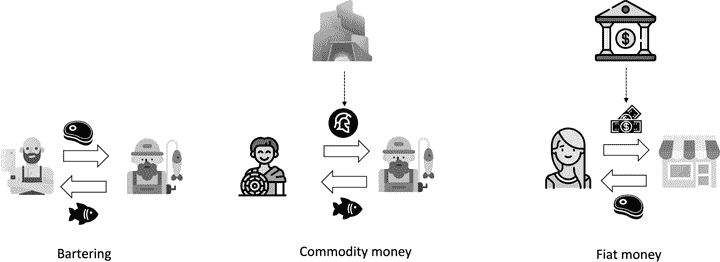

*图 1.1 历史上调节价值交换的手段的不同形式。

这种交换的本质是对所交换的鱼和牛排价值的互惠信任：渔民和肉贩都可以检查他们即将交换的鱼和牛排（例如，重量、外观和新鲜度），以确认鱼和牛排具有相同的价值，因此可以相互交换。显然，只有当双方都想要对方的货物且这些货物具有相同价值时，物物交换才有效。如果肉贩想要蔬菜而不是鱼，交换就会变得困难得多：他必须假设他能找到一个想要用鱼来交换农产品的农民（这让肉贩处于了不利的谈判位置，因为他显然不想要鱼）。

为了解决这个问题，一种更灵活的调节商品和服务交换的方法在古代早期就出现了。它涉及到“货币”的发明。货币可以定义为任何通常被接受作为支付形式的物品或可验证记录 [Dav02]。货币的最初常见形式是所谓的商品货币。这种货币的价值来自于其制成的商品——通常是贵金属。商品货币的典型例子是罗马帝国铸造或海盗在七海范围内搜寻的金币和银币。在这种情况下，信任使得商品货币成为调节经济交换的可行机制：制造货币的商品被普遍认为是稀缺且耐用的，因此对任何所有者来说都具有高价值。因此，金币或银币可以用于调节等值价值的商品或服务的经济交换。由于每个人都想要这些硬币，我们就不会遇到之前讨论过的肉贩被困于不想要的鱼的问题。

最后，我们进入现代，我们需要更灵活的方式来进行经济交换。我们不习惯携带实物货物（如鱼或牛排）来交换其他物品，也不携带金币或银币。相反，我们携带的是价值几乎为零的纸币（事实上，打印美元钞票的纸张和墨水的实际价值是多少？），但它们仍可用于经济交换。或者更极端，我们携带带有小型电子芯片的廉价塑料卡，我们完全不交换它们。我们只是使用这些卡片来证明我们在某个银行账户中拥有购买商品或服务所需的资金。这些是目前众知的借记卡和信用卡（这会让我们第一个例子中的渔民和肉贩非常困惑）。虽然这些卡使用起来更方便更安全，但它们引入了一个我们在鱼、牛排、金币或钞票上没有的问题：所有者的身份验证。识别鱼或钞票的所有者是非常容易的：所有者只需是在经济交换发生时带有这些资产的人（显然，这些资产可能被其当前主人盗窃了，但嘿，没有系统是完美的！）。在借记/信用卡的情况下，验证所有者的挑战更为性。由于卡片与银行账户绑定，每次使用时都必须有一种机制来安全可靠地验证卡片持有者的身份是否与卡片所属银行账户的所有者身份相匹配。这显然需要持片持有者的身份验证以及银行对账户详情的安全存储。


# 这种现代货币形式的价值来源是什么？

在这种情况下，同样也是信任机制的建立。这种现代货币形式实际上被称为“法定货币”（fiat money）。“Fiat”是一个拉丁语词，我们可以大致翻译为“让它存在”：货币之所以有价值，是因为一个所有人信任的实体“允许这种东西存在”。通常赋予法定货币价值的实体是民族国家（在欧盟和欧元货币的情况下，则是其联盟）。国家通过其中央银行印刷钞票并铸造硬币，并规定这些是所谓的“法币货币”（legal tender），即它们在法律上被接受以调节经济交换。

换句话说，作为法币的货币意味着民族国家总是接受其公民提供的这种货币来缴纳税款。这形成了这种货币形式流通所需的信任圈。人们接受雇主用这种货币支付劳动报酬，是因为他们可以使用这种钱来交税；商店接受客户支付的货币，是因为同样地，他们可以使用它来交税；以此此类推。显然，只有当发行货币的国家可以被信赖时，这种机制才能发挥作用。事实上，没有人热于拥有由例如政治上不稳定或与邻国处于长期战争的国家所发行的货币。

类似的信任建立机制存在于我们常用的许多其他形式的“私人”货币之后，这些货币可能每天都会使用。其中一个例子是大学校园内食堂使用的餐券。只要餐券在信任其价值的参与者之间交换，它就有价值。学生可以使用餐券吃午餐，也可以用来偿还他与在同一所大学就学的朋友之间的债务。这之所以可行，因为这位朋友也信任可以在大学食堂用该餐券购买午餐。

然而，如果这种餐券用在大学环境之外，它就毫无价值。大学校园外的任何餐厅都不接受这种餐券。因此，没有人信任这种餐券在大学校园外具有任何价值。换句话说，大学就是“第三方”或“中央权威”，它与法定货币情况下的民族国家一样，发行并保证了餐券的价值。

货币的最新化身是加密货币，如 `Bitcoin`。这种货币不需要民族国家或大学之类的第三方进行监管。它的价值反而是由货币的用户以及他们用于交换货币的技术平台建立起来的。要真正理解这种货币（例如其创建、所有权和交换），我们需要更多地了解 `blockchain`。因此，我们将在本书的后后部分回到这种货币。`Blockchain` 实际上是 `cryptocurrencies` 背后的机制。

总结一下，通过对不同形式货币的简要分析，我们学到了什么？

1. 经济交换取决于信任。因此，用于调节经济交换的手段的价值是通过基于信任的机制建立的。
2. 针对不同形式货币的设计，可以做出不同的设计选择来建立信任。

我们上面讨论了人们信任货币价值的四种不同方式：

1. 对物物交易中实物交换的商品的信任（商品本身就是货币）。
2. 对构成货币的商品原材料价值的信任。
3. 对发行和保证价值的机构的信任，例如法定货币情况下的民族国家。
4. 对 `cryptocurrencies` 背后机制的信任，即 `blockchain`。

在表 1.1 中，我们展示了不同形式货币的发展：

| | 非权威监管 | 权威半监管 | 权威监管 |
| --- | --- | --- | --- |
| 实体交换 | (1) 有价值的物品 | (2) 贵金属硬币 | (3) 纸币 |
| 非实体交换 | (6) 加密货币 | (5) 社区货币 | (4) 借记卡/信用卡 |

在下一节中，我们将调节经济交换的信任问题推广到信息情况。在现代，数据和信息是极具价值的资产，越来越多以原生数字形式可用。由于其价值，公民和组织努力保护他们的个人信息。同时，数据和信息的所有权可以为任何组织带来巨大的利润。为了有效高效，信息交换机制应该解决我们为货币确定的相同问题，例如价值确定、所有权或所有权验证。也就是说，交换信息的业务参与者应该受到信任机制的支持。实施信任最直接的方法再次是依靠中央权威。然而，`blockchain` 机制可以帮助我们在不依赖中央权威的情况下支持交换信息的业务参与者。

例如，下一节考虑了电子竞技的场景，即使用视频游戏的（职业）竞赛。

## 1.3 通过示例定义区块链：与区块链一起下棋

电子竞技是一种使用视频游戏的（职业）竞赛形式。它们通常涉及经常在全球范围内玩的在线多人视频游戏。2021 年，全球电竞市场价值略高于 10 亿美元，并准备以超过 20% 的复合年增长率（CAGR）在 2025 年增长到 28 亿美元以上。


如前所述，为了本书的目标，一个电子竞技在线游戏可以抽象为以下简单的设定：若干业务参与者之间相互竞争以赢得游戏。玩游戏意味着交换有关玩家愿意在游戏中执行的走法的信息。监管这种信息交换可能相当复杂，具体取决于游戏的规则。事实上，在线游戏的规则通常比使用金钱调节经济交换的规则更复杂。在使用金钱时，基本上我们产生可靠的证据，证明我们有足够的资金来实现目的（例如，购买产品或向朋友汇款）。而在玩游戏时，通常会有一套（可能是复杂的）规则来定义我们在游戏中被允许做的事情。

为了继续我们的讨论，我们现在需要考虑一个具体的例子。为了清晰起见，在接下来的部分我们将考虑国际象棋。事实上，我们假设每个人对国际象棋至少有一定的了解。此外，国际象棋是一项在许多在线平台上经常进行的游戏。但请注意，我们接下来讨论的内容原则上适用于任何在线游戏。

我们面临的问题是关于支持全球通过互联网连接的玩家进行在线象棋对战。玩家还希望能够暂停正在进行的游戏，并根据自己的意愿在以后重新连接以恢复游戏。从信任的角度来看，这种场景下有两个主要的挑战需要解决：

*   为了玩游戏，玩家必须经过身份验证：类似于上面讨论的金钱所有权问题，必须有一种机制来确保一个玩家不能冒充另一个玩家。这创建了基本的信任感，使用户确信除了自己之外，没有其他人被允许玩自己的游戏。

*   当前正在进行的每个游戏的状态应该被安全地存储。这样，玩家就可以暂停并恢复已的游戏。同时，除了参与游戏的两个玩家之外，任何人都都不可能修改正在游戏的状态（前提是玩家不能在没有对方许可的情况下修改游戏状态）。这创建了用户随时暂停和恢复游戏所需的信任。安全地存储游戏状态类似于在银行安全地存储金钱所有权的记录。正如我们需要信任银行维护资金安全，玩家也希望他们正在的游戏状态被安全地存储在某处。

现在，在线游戏平台显然解决了这两个挑战。平台可以通过某种方式验证玩家身份，例如为他们每人创建一个唯一的用户名和密码。平台还可以存储每个正在游戏的状态，以便玩家可以随时断开连接并恢复游戏。平台还可以确保除了参与的两个玩家外，没人可以修改游戏状态，例如提议并执行新的走法。

这种解决方案依赖于一个基本假设：玩家必须信任平台。具体来说，他们必须信任：

*   平台始终可用的。

*   平台不允许玩家作弊，例如通过在其他玩家断开连接时允许他们更改走法。

*   平台本身不作弊，例如在玩家断开连接时修改现有游戏的状态（例如，为了某个恶意赌博集团的利益！）。

与其在线游戏平台，我们能否设计一种不同的机制来解决上述问题？在本文范围内，答案显然是`yes`，并且它基于`Blockchain`。我们需要的机制不能依赖中央权威。详细来说，我们使用以下基本原理进行设计：

*   确保玩家对初始状态达成一致。

*   允许记录任何游戏中的走法。

*   定义哪些走法是有效的，哪些不是。

*   实现玩家的身份验证。

接下来将详细讨论这些原则。

### 1.3.1 定义游戏的初始状态

在开始新游戏时，玩家必须对初始状态达成一致。在国际象棋或广义的任何在线游戏中，任何有知识的玩家都知道初始状态是什么。因此，这一步的实现是显而易见的。这一步的重要性将在以后讨论玩家如何在任何时间重建任何游戏状态时显现。

### 1.3.2 定义有效走法的规则

玩家需要一组共享规则来确定哪些走法被认为是有效的，哪些不是。同样在这种情况下，这一步的重要性将在以后显现，当我们讨论用于重建每个游戏状态的机制时。同样，对国际象棋有足够了解的棋手可能知道每个棋子允许什么类型的走法，以及何时可以宣布将死。因此，我们可以建立以下简单的协议来评估走法的有效性：

*   首先，由玩家提交正在进行的游戏中的走法，
*   其次，走法必须在经过另一个玩家批准后才能被认为是有效的，从而被记录。

每个玩家都将每个经过批准的走法存储在本地数据库中。该数据库具有某些属性。首先，可以向此数据库添加新数据，但现有数据既不能从中删除，也不能被修改。其次，每个玩家维护的数据库本地副本是一致的，也就是说它们存储的数据完全相同。

上述确定走法有效性的简单协议避免了在缺乏中央权威可能出现常见问题。特别是，一个玩家提交的无效走法（例如为了获得不公平优势）不会被另一个玩家接受，也不会存储在任何玩家的数据库中。

### 1.3.3 用于记录走法的不可变数据库

管理 BC4C 机制的一个重要原则是，每个玩家存储已批准走法的数据库是不可变的。正如上面简要提到的，“不可变”指的是该数据库具有只追加（`append-only`）的属性。我们只能向此数据库添加新内容。已经存储的内容既不能被删除也不能被修改。

为什么需要这样的数据库？首先，数据库存储了每个游戏的走法。这样，每个玩家都可以通过从初始状态开始重放记录的走法，来重建任何游戏的当前状态。


到目前为止介绍的三个特性的结合（共享初始状态、确定合法操作的规则以及由每个玩家复制的不可篡数据库）消除了对中心权威的需求。这些特性实际上在玩家之间创建了信任，他们可以自由地断开并重新连接游戏。建立合法操作的简单协议实际上以一种合理的方式确保了每场游戏都是按照规则进行的。然后，玩家断开连接可以通过重放不可篡数据库中存储的所有操作来重新创建任何游戏的当前状态。最后，数据库的不可篡性保证了玩家无法修改他们的任何操作。例如，这消除了玩家在游戏中作弊的风险。

请注意，到为止我们还没有考虑如何在技术上构建不可篡数据库，但我们简单地假设这是可能的。构建不可篡数据库需要加密工具的知识，我们在第 2 章 中讨论过。然而，在本章中，重要的是意识到不可篡性必须是数据库的一个属性：仅防止用户更新或删除内容的策略是不够的。这种策略实际上可能会被管理员随时覆盖。相反，数据库必须从物理上防止任何人（甚至是管理员）删除或更新现有数据，这取决于其设计和实现方式。

## 1.3 验证玩家

BC4C 的最后一个原则涉及在玩游戏时如何验证玩家。我们到为止尚未解决的一个问题实际上是如何确保参与游戏的玩家确实是他们声称的身份。在线平台可以使用用户名和密码轻松地实现验证机制。

如何在没有中心权威的情况下验证玩家？我们还没有提供该问题的完整解决方案。正如上面提到的，我们假设这种验证玩家的方法在技术上是可能的。从概念上来说，解决这个问题的方法在于切换视角。在线游戏平台验证“会话”，玩家可以在其中提交/批准许多操作。在 BC4C 中，玩家被验证为“每一个操作”。我们实际上需要验证玩家与玩家之间的每一次交互，即在游戏中提交的每一个操作。技术上，正如我们在第 2 章 中讨论的，这意味着玩家向其他玩家提交的每条消息都必须“数字签名”。现在，对电子消息进行数字签名意味着为其添加少量数据（即数字签名），这与手签名类似，允许任何其他玩家明确且毫无疑问地识别消息的发送者。

在本章中讨论的 BC4C 机制可以认为是区块链。因此，尽管我们还没有给出区块链的恰当定义，但根据之前的讨论，我们可以突出基于区块链系统的的一些主要特征（见图 1.2）：

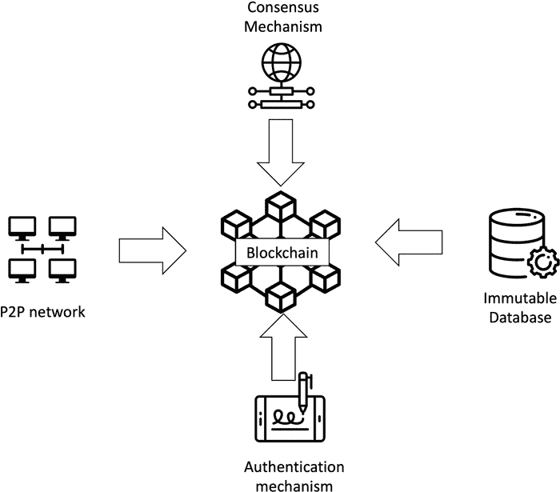

*   在本章讨论的 BC4C 机制可以认为是区块链。因此，尽管我们还没有给出区块链的恰当定义，但根据之前的讨论，我们可以突出基于区块链系统的的一些主要特征（见图 1.2）：
*   在本章讨论的 BC4C 机制可以认为是区块链。因此，尽管我们还没有给出区块链的恰当定义，但根据之前的讨论，我们可以突出基于区块链系统的的一些主要特征（见图 1.2）：
*   在本章讨论的 BC4C 机制可以认为是区块链。因此，尽管我们还没有给出区块链的恰当定义，但根据之前的讨论，我们可以突出基于区块链系统的的一些主要特征（见图 1.2）：
*   在本章讨论的 BC4C 机制可以认为是区块链。因此，尽管我们还没有给出区块链的恰当定义，但根据之前的讨论，我们可以突出基于区块链系统的的一些主要特征（见图 1.2）：
*   这是一个没有中心权威的系统，即所有参与者都具有相同的角色，即计算机科学家将这些参与者称为 `peers`，并称该系统为网络。
*   该系统有一套所有玩家皆知的规则（或正如计算机科学家所说的协议），这些规则确保了玩家之间的信任。在本书的剩余部分，我们将学习将这些规则称为`共机制`。
*   区块链机制是通过特定技术实现的。更详细地说，我们识别了区块链的两个区分特征：不可篡数据库和数字签名消息。前者允许玩家重构游戏状态。后者确保了玩家在与其他人交互时身份经过验证。更准确地说，他们与其他玩家的每一次交互都是数字签名的。

现在，如果我们把区块链节点之间交换的消息称为 `transaction`，那么从技术角度来看，可以说区块链涉及到存储在复制不可篡数据库中的数字签名交易。

## 1.4 探索区块链的潜力

在我们详细详细介绍本书的内容以及它如何在不同学习背景中使用之前，在本节中，我们将简要讨论区块链在比 BC4C 示例更有意义的现实业务场景中的应用。

首先，尽管 BC4C 示例只是说明性的，但它已经表明，在原理上，区块链技术可以构建无信任的在线游戏系统（电子竞技）。这里的“无信任”术语是指参与者之间不需要预先信任即可交换价值——区块链机制创建了信任。使用区块链支持“现实”游戏可能会引入更复杂的挑战。例如，定义初始状态和一套让玩家同意操作合法性的规则绝非易事。尽管如此，我们觉得区块链可以开启有趣的未来场景。


我们在本章中已经提到的区块链的另一个应用，本书的大读者可能已经熟悉，那就是加密货币。加密货币的理念是创建“价值代币”，即一种新形式的货币，它不依赖任何国家通过其中央银行的支持，而是其价值源于用户对实现其交换的技术（即区块链）的信任。许多与加密货币设计相关的问题甚至比使用区块链支持在线游戏更具挑战性。例如，加密货币用户交换的消息只是价值代币的简单传输。系统的整个状态可以通过每个用户拥有的代币数量简单捕捉。验证代币传输的规则似乎也十分直观：基本上，我们必须确保用户只能将他们拥有的令牌传输给其他用户。然而，其他方面使得加密货币的设计具有挑战性。一个基本方面是保证用户不能多次传输（即花费）他们拥有的代币。这个问题在第 3 章中进行了更详细的讨论，而关于真实加密货币系统——`Bitcoin`和`Ethereum`——的更多细节分别在第 5 章和第 6 章中给出。

区块链技术也用于解决不同业务场景下更传统的信息交换需求。其中一种场景是供应链监控。供应链是一个典型的场景，其中不一定相互信任的业务实体合作创造价值（通过确保按时交付客户订购的）。设计 BC4C（区块链助力商业）的若干项挑战也适用于链场景。事实上，要识别一个能够监督整个供应链并保证交换信息的真实性和质量的“中央权威”往往是不可能的。这个问题的存在是由于技术原因（很难找到一个拥有技术知识来监控复杂供应链所有阶段的组织）以及业务导的原因（供应链上的参与者可能由于市场竞争的原因而不信任中央权威，并且永远不会与其共享有关其自身业务的关键数据）。在这种背景下，区块链技术可以作为解决方案。区块链允许供应链上的参与者安全地共享有效协调供应链上不同参与者所需的数据。供应链监控的区块链系统设计与在线游戏或加密货币相比也有不同。例如，用户可能是一个业务伙伴的封闭社区。因此，没有必要给业务生态之外的任何人提供加入系统的机会。此外，可能需要复杂的数据访问策略：交换的信息可能不是由系统的所有参与者共享，而是仅由参与者的子集共享。例如，零售超市可能愿意仅与其负责最后一公里的物流供应商共享有关仓库补货策略的信息，而不是与供应链上的每一个可能的伙伴共享。区块链在供应链中的应用在介绍私有区块链系统（第 6 章和第 7 章）之后在第 2 部分中讨论，并在第 3 部分中再次回顾。

最后，让我们考虑一个过去十年随大数据和数据经济兴起而出现的区块链应用，即物联网数据的安全可靠管理。复杂的传感器网络日益装备了不同类型的产品和服务。例如，安装在客户现场的电梯或其他重机械可以不断向总部提供监控数据，实现预测性维护；或者工业级废物桶和运输它们的卡车可以配备`GPS`和其他类型的传感器，以实现实时监控。更广泛地说，物联网（IoT）被认为很快将使我们的生活环境（家庭、汽车、城市）配备传感器，不断提供数据，这些数据可以被用于提高我们的生活质量、优化交通管理、能源消耗或共享资源利用。通常，传感器数据的管理以隐私和可靠性问题为特征。例如，在调查灾害时，传感器数据可能提供关于其根源的重要证据。然而，我们如何确保传感器数据（例如）在存储后没有被篡改，并且仍然可以将它们与原始传感器关联起来呢？区块链可以通过创建传感器数据的可靠分布式且不可篡的记录来帮助解决这些问题。与加密货币、在线游戏或供应链监控相比，使用区块链管理物联网数据引入了新的挑战。例如，考虑到要处理的海量数据，数据处理性能和存储空间变成了基础。区块链应用于物联网数据引入的挑战在第 8 章中讨论。

## 1.5 本书概述

本书分为三个部分。

第 1 部分旨在引入一种“与实现无关”的区块链概念、机制和技术的定义。目标是用通用术定义这些内容，而不专门绑定于特定的实现，如`Bitcoin`、`Ethereum`或任何其他实现区块链系统的框架。为了这一目标，第 3 章讨论了理解区块链技术运行所需的基本概念，例如区块链网络（公共或私有）、区块链协议、区块链数据结构（区块、交易和不可更改的账本）以及共识机制。在第 4 章中，我们扩展了这些基本概念，引入了智能合约的概念。智能合约是将区块链系统变为可以处理用户网络交换任何类型信息的通用系统的关键。为了完全理解这种与实现无关的区块链定义，需要基础密码学背景。密码学技术，如数字签名和加密哈希，实际上是区块链的基础赋能者。因此，在介绍区块链时不能忽略它们。第 2 章通过讨论支持区块链技术的基础加密工具填补了这一空白。我们承认对于缺乏计算机科学的读者来说，密码学可能很难理解。因此，这些概念在第 2 章中以概念层面引入，尽可能从更技术性的细节中抽象，但也提供了大量的示例和在线资源引用，感兴趣的读者可以通过这些资源一手体验更多细节。


本书的第 2 部分涉及区块链的具体实现。这些包括已成功运行多年的具体区块链系统，以及可以用于在特定业务场景下创建区块链系统的具体框架。第 5 章介绍了比特币，它是区块链最突出的例子，这种技术实现了全球范围内使用的加密货币的创建。第 6 章介绍了以太坊。以太坊区块链也提供了一种世界著名的加密货币。然而最重要的是，以太坊是第一个引入智能合约功能的区块链。第 7 章重点关注所谓的“私有区块链系统”。我们详细讨论了两个支持涉及私有合作伙伴网络业务场景的区块链系统开发框架：Hyperledger 和 Corda。Hyperledger 是不同区块链框架的伞型项目。在书中，我们主要关注 Hyperledger Fabric，它是目前生产环境中最成功的私有区块链系统背后的技术。Corda 是一个近期获得广泛关注的区块链框架，特别是在金融领域。最后，第 8 章重点关注区块链技术对物联网（IoT）的影响。我们讨论了区块链如何用于创建系统的不同示例，使得传感器网络捕获的信息可以在无信任环境中进行管理。

本书的第 3 部分为读者提供了理解区块链技术对某一业务场景适用性的工具，或者转换视角，识别哪些业务场景可以受益于使用区块链。本书这一部分的目的是戳破“区块链技术具有如此革命性，将将永远改变未来任何行业”的迷思。这种说法经常被提到，特别是在 2019 年比特币价格首次剧剧上涨以来。我们在书中认为，区块链是一种技术，它与过去出现的任何其他技术一样，应该根据其对特定业务应用的适用性进行审慎评估。显然，区块链已经展示了其创建加密货币的潜力，解决了不依赖中央银行实现价值的数字货币开发问题。然而，我们将理解加密货币只是区块链技术的一个相当简单的应用，而区块链可以在许多其他具有更复杂、更关键信息共享需求的业务场景中，实现新颖的应用。第 9 章提供了一个模型来理解区块链对于特定（给定）业务场景的适用性。第 10 章关注区块链与商业模式，讨论了区块链如何扩展现有的商业模式并开启新的模式。最后，第 11 章讨论了区块链对所谓“基于结果的商业模式”的影响。这指的是一新型新兴的业务场景，服务提供者的报酬由其为客户创造的价值定义，而不是使用提供服务时雇用的资源数量来衡量。在这种场景下，区块链成为了一种对客户在使用服务时所产生的价值进行可靠且无信任评估的手段。

每一章都配备一组问题和/或练习。第 1 部分和第 2 部分的每一章还配备了案例研究。在第 1 部分中，案例研究提供了区块链产生之前的技术演进的历史视角，涵盖了从密码学在变革通信中的作用到数字货币的其他形式。在第 2 部分中，案例研究讨论了区块链的具体应用，范围从不同行业目前在生产中的系统到由物联网支持的业务流程。第 3 部分的章节没有特定的案例研究，而是融入了对区块链的讨论。

## 1.6 如何使用本书

我们编写本书的三个部分尽可能做到自成成体系，因此读者可以独立处理，以满足其个人的学习目标。遵循人机交互中的传统方法 [Nie19]，我们将在下方介绍四种不同身份的人员如何使用此本书，这些人物代表了我们预期的读者的主要特征。

### 1.6.1 Zoe（22 岁，大四商科专业本科生）

Zoe 对金融感兴趣，最近被加密货币和非同质化令牌（NFTs）吸引。然而，尽管她能够对背后的市场动态（例如比特币的价值）形成大致的认知，但她感到缺乏对加密资产底层技术的理解阻碍了她充分掌握这些市场的重要性及其未来趋势。Zoe 对密码学和区块链技术完全是初学者，她将专注于本书的第 1 部分和第 2 部分，以理解区块链技术是什么以及目前存在哪些应用。

### 1.6.2 Yang（20 岁，工业工程大二本科生）

Yang 在数据科学和优化方面有深厚的背景。区块链对他来说是完全全新的，但他有一定的计算机科学背景，上过一些关于信息系统设计与实现的课程。Yang 的梦想是在大学初创企业之一找工作，开发基于区块链的新应用。Yang 觉得，虽然机器学习和数据科学可能很快在大多数组织中变成完全自动化的任务，但在业务背景下支持信息和价值交换的系统仔细设计始终需要高级的人类专业知识。他在一门计算机课程中听说过区块链，一直期待更深入地理解这项技术。和 Zoe 一样，Yang 将专注于本书的第 1 部分和第 2 部分。具体来说，第 1 部分中介绍的区块链系统模型将为他理解大学初创企业使用的书中未涵盖区块链系统提供坚实的基础。

### 1.6.3 Xenia（31 岁，IT 顾问）


Xenia 是一名 IT 专业人士。她很久以前就获得了计算机科学学士学位。她在 IT 咨询行业已经工作了八年，目前正在攻读 IT 管理的专业硕士课程，以提高她的职业晋升机会。她正在撰写关于区块链驱动的新型业务模式的论文，并寻找更多资源来扩展她对区块链的知识。Xenia 将重点关注本书的第一部分和第三部分。第一部分将帮助她以一种独立于实现的方式对区块链技术建立深层理解。第三部分将允许她理解区块链可以发挥作用的各种业务场景。书中讨论的案例研究也将帮助她理解区块链技术是如何应用于许多现实场景的。

### 1.6.4 William（23 岁，业务系统设计硕士）

William 拥有计算机科学本科学位，最近开始攻读业务系统设计的硕士课程。他选择专攻信息系统是因为他一直对 IT 如何帮助企业感兴趣。他在加密学课程中学习过区块链技术，学习了与数字签名和加密哈希相关的更具技术性的方面。该课程的一部分，他还完成了一个关于在玩具级区块链系统中生成区块和交易哈希的项目。William 将主要关注本书的第二部分和第三部分。第二部分将帮助他理解区块链特定实现的细节，例如 `Ethereum` 中的智能合约。第三部分将帮助他理解区块链的业务应用。事实上，他计划完成一个关于区块链在生成安全可靠的学术成就记录方面可行性的终毕业项目，这还包括使用 `Ethereum` 开发一个小型的概念验证原型。

## 1.7 本书讨论的区块链应用概述


本书的最后一部分专门关注理解区块链在现实世界应用中的用法。因此，你不会在每个章节只找到一个案例研究。相反，第三部分的章节融入了对多类现实世界应用的讨论。

## 1.8 问题与练习

1.  在这一章中，我们确定国家货币和大学食堂券作为法定货币的示例。根据你的个人经验或知识，你能识别出其他形式的法定货币吗？它的用户是谁？谁或什么机构是赋予这种货币价值的权威机构？这种货币在什么范围内有效？

2.  在这一章中，我们以国际象棋为例引入了区块链的概念。现在考虑另一种类型的（简单）游戏，并展示如何定制区块链的基本元素（如共识机制和不可变数据库的内容）以适应你所选的游戏规则。

3.  对于以下业务场景，讨论区块链可能是或不是一种良好的机制。特别要考虑你是否可以识别出一个权威机构，是否有必要用区块链系统取代，以及数据随时间的不可变性是否是一个理想属性：

    1. 处理大型制造公司（例如造船厂）的备件和半制品的信息。
    2. 管理全球学术成绩的来源和真实性。
    3. 管理国家法院的信息（案件、审判、判决等）。

## 注

1.  注恶意玩家从原则上可能会拒绝接受将死或其他导致对手获胜的移动。我们在这个简单示例中没有考虑这个问题。但原则上，可以通过允许参与游戏之外的玩家来证明移动的有效性来解决这个问题。移动的有效性甚至可以通过计算机程序进行检查，程序中简单地编码了规则，无需玩家手动批准。


计算机可以简单地被认为是巨大且极其强大的计算器。事实上，它们只能处理数字。即使是计算机执行的最复杂操作，例如基于人工智能的汽车驾驶，归根结底也是对数字进行计算。每一条数字消息，如聊天信息、社交媒体上的帖子或照片，都必须编码成数字才能被计算机处理。

我们在本章中介绍的加密工具是计算机可以执行的特定处理操作。它们还要求任何输入必须是数字。因此，在介绍这些工具之前，我们需要首先理解计算机处理的数字消息是如何变成数字的。这需要理解两个概念：字符编码和数字的二进制表示。

### 2.1.1 字符编码

将用户输入编码为计算机可读的格式涉及将这些输入转换为计算机可以处理的数字。解码则是指相反的方向：从计算机处理的数字转换为用户易于理解的输入。给定一条用户输入消息，显然有无限的方法可以将其编码为数字。出于这个原因，计算机科学家针对不同类型的用户输入（如文本、照片或视频）定义了不同的标准编码/解码“方案”。编码/解码方案描述了用户输入转换为数字（以及反之亦然）的方法。

计算机处理的大部分内容是通过键盘作为文本输入提供的。计算机显然也处理其他形式的多媒体数字内容，如照片或视频，但文本是目前最常用的输入类型。因此，在本章中，我们作为示例关注文本输入的编码/解码。文本输入通常以字符序列的形式提供计算机。文本编码/解码方案通常将输入文本的每个字符映射为一个数字。因此，它们被称为“字符编码”方案。在剩余部分中，我们关注编码阶段，即从用户输入文本到数字。事实上，一旦编码方案，解码是非常直观的。

理解字符编码方案的最好方法是展示一个具体的方案。我们在本节介绍了 ASCII（美国信息交换标准代码）编码 [ASC69]。它提于 20 世纪 60 年代，大多数现代字符编码方案仍然基于它。

简而言之，ASCII 编码方案通过两个表指定。一张表涉及可打印字符到数字的映射（图 2.1）。另一张表显示控制字符（不可打印字符）的映射（图 2.2）。事实上，来自键盘的所有输入都不会产生可以在屏幕上打印的字符。例如，按下“回车”或“Shift”键通常会执行某些与打印字符无关的控制操作（例如，换行或启用键盘大写字母）。

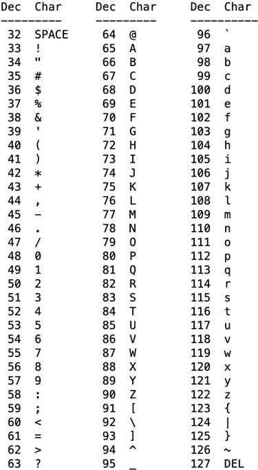

图 2.1 ASCII 中的可打印字符映射（“Dec”代表可打印字符‘Char’的十进制编码）。

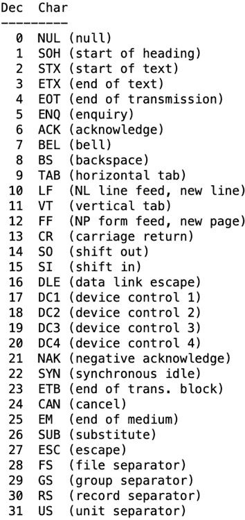

图 2.2 ASCII 中的控制字符映射（“Dec”代表控制字符‘Char’的十进制编码）。

使用图 2.1 和图 2.2 的映射，任何键盘输入都可以转换为数字，反之亦然。例如，“blockchain”一词被转换为数字序列“98 108 111 99 107 104 97 105 110”，而...

### 2.1.2 二进制数字表示

我们上面提到计算机只能处理数字。更准确地说，它们只能处理两个数字：0 和 1。数字“0”通常与低电压信号相关；数字“1”与高电压信号相关。同样的概念也适用于存储。也就是说，计算机的硬盘或内存单元只能存储两个数字：0 和 1。因此，在编码之后（或在此期间），将用户输入转换为仅用 0 和 1 表示的数字是基础。我们习惯于使用所谓的“十进制”数字，它使用了常用的 10 个数字（0, 1, ..., 9）。仅使用 0 和 1 意味着使用所谓的“二进制”来表示数字。你可能已经知道计算机中存储/处理的基本单元，即单个“1”或“0”，被称为“位（bit）”。因此，使用二进制表示编码的用户输入也可以被看作是数字序列。


在讨论了如何将数字消息表示为位序列之后，我们准备好介绍区块链所使用的加密工具。这些工具是加密哈希函数和数字签名机制。在本节介绍介绍。后者见第 2.4 节。第 2.3 节介绍了消息加密的通用问题。理解消息加密是理解数字签名机制的前提。

为了讨论加密哈希，我们首先引入加密哈希函数的简单“数学”定义。然后，我们将讨论加密哈希函数的实际意义及其应用。

### 2.2.1 加密哈希函数：定义

加密哈希函数 `H` 是一种数学函数，它将数字消息 `M` 转换为固定长度的哈希值 `h`（参见图 2.6）。通常，哈希值 `h` 是短的。相反，消息 `M` 可以是任何数字消息，例如一个短用户名或一整本数字格式的书。由于输入 `M` 的大小是无界的，哈希值 `h` 也可以被视为 `M` 的“摘要”。返回大小为“n”位哈值的加密哈希函数称为 n 位哈希函数。对于流行的哈希函数，`n` 通常由 128 到 512 位组成。

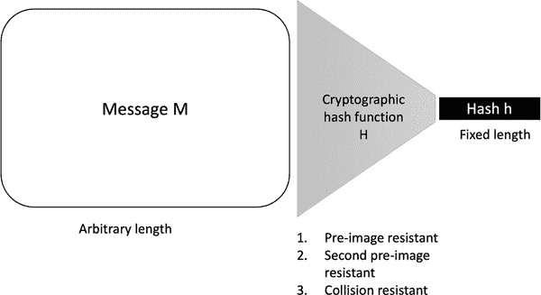

*图 2.6 加密哈希函数。

加密哈希函数 `H` 具有三个属性：

1. **抗原像性（Pre-image resistance）**：反转函数 `H` 在计算上是困难的，即在给定哈希值 `h` 的情况下寻找 `M`。

2. **抗次像性（Second pre-image resistance）**：给定消息 `M` 和哈希值 `h`，寻找一个不同的消息 `N` 使得 `H(M) = H(N) = h` 在计算上是困难的。

3. **抗碰撞性（Collision resistance）**：寻找两个不同的消息 `M` 和 `N` 使它们映射到同一个哈希值 `h` 在计算上是困难的，即满足 `H(M) = H(N)`。

请注意，上述定义中的“计算上困难”意味着在现实世界的实际场景中是不可能的。换句话说，反转一个加密哈希函数所需的计算能力是巨大的，以至于可以认为在现实世界中任何人都是无法实现的。

第一个属性确立了无法从哈希值 `h` 中重构消息 `M` 的内容。因此，哈希值 `h` 是消息 `M` 的摘要，但它不是 `M` 的压缩版本。压缩函数（如文件的 zip 压缩）实际上必须是可逆的：给定压缩版本，应该能够重新获得原始的未压缩版本。加密哈希值并非如此：给定哈希值 `h`，无法获得生成 `h` 的消息 `M`。

为了理解第二个属性，让我们考虑需要用哈希值 `h` 来确定某个消息 `M` 合法性的情况。在这种情况下，第二个属性规定，同时获得 `M` 和 `h` 的攻击者无法使用相同的哈希值 `h` 将 `M` 替换为不同的消息 `N` 作为合法性的证明。

第三个属性定义了哈希的实际唯一性（也称为“避免碰撞”）。换句话说，函数 `H` 将消息 `M` 映射到唯一的哈希值 `h`。结合第二、第三属性，哈希值 `h` 可以被视为消息 `M` 的唯一标识符。事实上，任何两个消息 `M` 和 `N` 应映射到同一个哈希 `h`。即使消息 `M` 中只改变了一个位，`M` 的哈希值 `h` 也会改变。

关于第三个属性，必须注意的是，设计一个能够保证完全“避免碰撞”的加密哈希函数 `H` 是可能的。即使对于不是计算机科学家的读者来说，证明这一点也很。这一属性源于输入 `M` 的大小是无界的，因此是无限的。由于函数 `H` 的定义域是无界的，因此无法保证对于任何加密函数 `H`，永远不会发现碰撞（即两个消息映射到同一个哈希）。在设计 `H` 时，我们能做的最好就是让这种碰撞变得“极不可能”，或者如上所述，在实际场景中几乎是不可能的。

### 2.2.2 应用与实现

加密哈希函数在区块链中被广泛采用。然而在本书的这个阶段，我们对区块链的了解还不足以讨论这类应用。尽管如此，我们可以在文件完整性证明和加密密码的背景下，讨论加密哈希函数的其他知名应用。这类应用已经存在多年。它们支撑我们每天使用的互联网功能的基础。

加密哈希函数可以解决的问题之一是证明从互联网下载的文件的完整性（参见图 2.7）。这在计算机上下载和安装软件应用程序时尤为相关。在计算机上安装软件的程序通常需要高级权限，例如在硬盘上写入内容和修改操作系统设置的能力。此时，“中间人”可能会有动机修改我们正在下载的内容来实现恶意目的。例如，它可能会修改下载内容，使得我们不是在安装一个简单的照片编辑器，而是安装了一个电脑病毒。该病毒可能会控制我们计算机上的文件，并索要比特币赎金（！）。

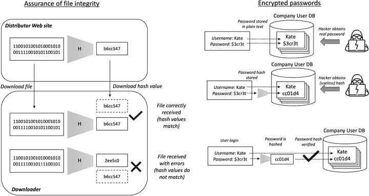

*图 2.7 加密哈希函数的应用。左侧是使用哈希函数确保文件完整性的机制；右侧是使用哈希函数加密密码的机制。

我们如何使用加密哈希函数避免这种情况呢？关键在于同时分发下载内容的哈希值。软件提供者提供下载文件的同时，还会提供使用（良好的）哈希函数 `H` 计算的哈希值 `h`。下载者在下载完成后，对下载的文件运行相同的函数 `H`。通过这种方式，他们可以验证获得的哈希值与发布者发布的哈希是否匹配。如果是，下载者就可以放心下载的文件与发布者提供的完全一致。如果实际上文件在传输过程中即使只有 1 个位被恶意修改，下载者获得的哈希值也将与发布者发布的哈希不匹配。如果不匹配，下载者就不应该安装下载的软件（可能还应该通知发布者出了问题！）。


加密哈希函数解决的另一个问题是用户密码加密（参见图 2.7）。我们在几十个网站上维护账户（用户名和密码）。这些网站显然需要在某个数据库中存储我们的密码，以便在我们每次登录时对其进行验证。然而，这是否意味着，例如，一个我们拥有账户的网站的数据库管理员实际上可以看到我们的密码呢？心恶意的管理员显然可能会利用这一特权。例如，他们可能会收集所有用户的密码，将其出售给黑客，或直接将它们用于某些非法活动。得益于加密哈希函数，这个问题的答案显然是“否”。

网站实际上是以“加密”格式存储我们的密码。这意味着：(i) 密码不是以原始格式（即“明文”）存储的，但 (ii) 在任何需要的时候，它仍然可以被进行验证。在实践中，这是通过存储使用加密哈希函数获得的密码哈希值而不是实际密码来实现的。密码的哈希值无法反转以获取实际密码（得益于上述的“抗原像性”属性）。每当用户输入密码时，可以通过计算其哈希并检查其是否与网站数据库中的哈希值匹配来验证。

为了结束关于加密哈希函数的讨论，下面的“计算机科学聚焦”简要介绍了目前在现实世界广泛使用的三类哈希函数。

计算机科学聚焦：现实世界的加密哈希函数

## 2.3 消息加密：对称与非对称

加密是密码学中侧重于保障数字通信安全的学科（参见图 2.8）。加密的主要目标是避免恶意的“中间人”攻击者在通信期间进行窃听。在窃听时，攻击者的目的是获取从接收者发送给发送者的数字消息，最重要的是理解它。请注意，在此语境下，数字通信应该从广义上理解。正如图 2.8 所示，加密硬盘的内容也是数字通信的一种形式。爱丽实际上在与她未来的自己通信，未来的自己想在将来从磁盘中检索一个文件。在文件被存储期间，她希望该文件不被其他人获得，即使发生了这种情况，磁盘的内容对攻击者来说也是不可理解的。

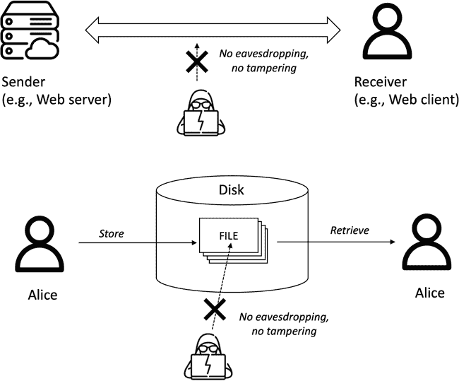

图 2.8 保障数字通信。

加密数字通信内容（即数字消息）的算法称为密码（cyphers）。原始消息通常称为“明文”消息。使用密码后的加密版本称为“密文”。除非提供了解密机制（即将其转换回原始明文），否则密文不应该是人类或计算机可以理解的。通过密码进行的加密和解密需要一些辅助信息，通常称为“密钥”。对称加密是指使用相同密钥进行加密和解密的密码。非对称加密是指加密和解密分别使用不同密钥的密码。

### 2.3.1 对称加密：凯撒密码

凯撒密码是由尤利斯·凯撒发明的对称加密，用于在战争期间保障通信安全。它是一种替换密码，每个字母都移动了固定的位数。例如，如果密钥为 `3`，那么 `A` 被替换为 `D`，`B` 被替换为 `E`，以此此类推。这种方法很容易被破解，因为英语字母表中只有 26 种可能的密钥。

图 2.9 凯撒密码。

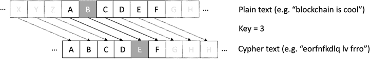

### 2.3.2 非对称加密

非对称加密通过密码实现，这些密码对加密和解密消息使用不同的密钥。由于此类密码的复杂性，本书无法提供它们的具体示例。具体非对称系统的参考在本节末尾给出。本节的目标是从概念上介绍非对称加密。具体来说，我们想强调它如何支持比对称加密更复杂的应用。


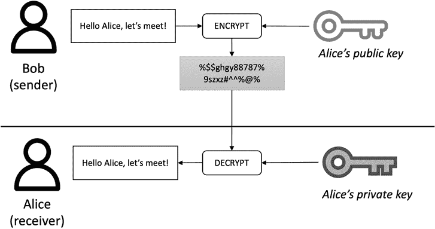

图 2.10 非对称加密（公钥加密）。

在非对称加密中，一个希望世界上能够与其通信的用户（如图 2.10 中的 Alice）会公开她的公钥。现在，Bob 可以使用 Alice 的公钥加密他想要发送给她的消息。中间的攻击者可能会窃听 Bob 的消息。然而，他们只能获得他们无法解密的加密消息。得益于她的私钥，只有 Alice 能够解密使用其公钥加密的消息。如前所述，只要 Alice 之外没有人知道她的私钥，Alice 与世界（包括 Bob）之间的安全通信就能得到保障。

非对称加密通过减少需要知道私钥（秘密密钥）的人员数量，改进了对称加密。在对称加密中，参与通信的每个人都必须知道密钥的值，且该值对攻击者必须保持保密。在非对称加密中，只有接收者的私钥必须对攻击者保持保密。如果尤利斯·凯撒知道非对称加密，他可以将他的公钥写在遍欧洲的每一个路标上！

正如我们在处理加密哈希时所的那样，在本节结束时，我们在下方的计算机科学焦点简要介绍今天使用的两种最主要的非对称加密机制。

## 2.4 数字签名

为了理解区块链，我们必须介绍的最后一个加密工具是数字签名机制。数字签名解决的是发送者和接收者之间数字消息的身份验证问题。认证由以下两个属性定义：

* 接收者必须毫无疑问地验证消息发送者的身份。
* 发送者不能对其发送给接收者的消息进行否认。

这两个属性与我们在现实世界中使用的其他认证机制所预期的相同。我们在私信信上（当我们还寄信而不是发电子邮件时！）进行签名，以确保接收者毫无疑问地知道信是由我们（而不是别人）写的。同样，在重要文件上通常需要我们的签名，这是为了防止不可否赖性：通过对文件签名，我们承认我们阅读过它，并且在将来无法否认我们知道其中的内容。认证还利用了签名以外的方法。借记卡或信用卡的密码是私钥的典型例子。我们必须对其保密，它能毫无疑问地将我们识别为关联卡的所有者。

数字签名在数字通信中实现了一种类似于唯一密码的认证机制。图 2.11 展示了数字签名机制。它结合了非对称加密和加密哈希。Alice（消息发送者，或更通地说，消息的“签名者”）想要向 Bob（接收者，但在该语文中也是签名的“验证者”）发送一条消息。Alice 希望她的消息经过数字签名。这样，Bob 在收到消息后，将确定 Alice 确实是消息的发送者。首先，Alice 计算她想要发送的消息的加密哈希（步骤 1）。然后（步骤 2），Alice 使用她的私钥对该哈希进行加密。消息的哈希就是它的数字签名。由于加密哈希的属性，它在实际上是唯一的，且只能由 Alice 发送的这条特定消息生成。任何与 Alice 发送的消息至少有 1 位不同的消息，其哈希实际上都是不同的。此外，它只能由 Alice 使用她的私钥生成。在步骤 3 中，消息及其数字签名被发送给 Bob。收到数据后，Bob 执行两件事。首先（步骤 4），他计算消息的加密哈希。然后（步骤 5），他使用 Alice 的公钥解密数字签名。最后（步骤 6），他验证消息哈希是否与解密后的数字签名匹配。

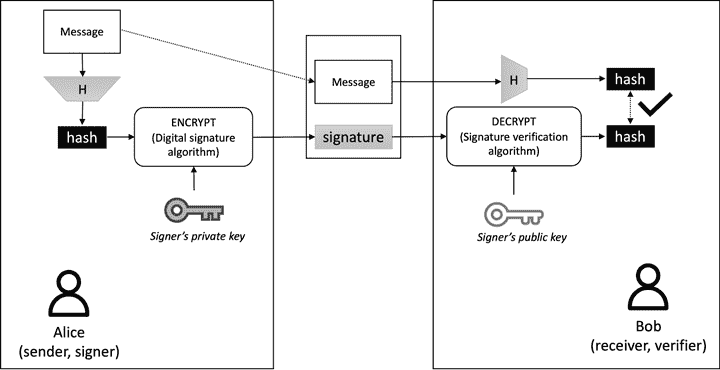

图 2.11 数字签名机制。

上述机制确保了：

1. 消息在传输过程中没有被修改。如果是，Bob 计算出的哈希将与 Alice 附加消息上的数字签名不匹配。
2. Bob 可以毫无疑问地确认 Alice 是消息的发送者。事实上，数字签名只能由 Alice 使用她的私钥产生。
3. Alice 不能否认她发送了 Bob 收到的消息。事实上，该数字签名只能由她生成。

请注意，与上一节讨论的非对称加密相比，在数字签名机制中，私钥和公钥的角色发生了交换。发送者使用私钥生成消息的一部分（即数字签名）。接收者使用发送者的公钥来验证数字签名的真实性。

同样重要的是要理解数字签名机制与消息加密是正交的。在图 2.11 中，消息经过了数字签名，但没有加密。这意味着 Bob 可以验证 Alice 是消息的发送者，但恶意攻击者可以在传输过程中监听明文消息。2.11 的数字签名机制可以扩展到包含消息加密。根据应用场景，有两种方案：

* “加密后签名”，使用消息的密文版本生成数字签名，即加密后生成。这是最直接的方案。
* “签名后加密”，先生成数字签名，然后对消息和签名进行加密并发送。这种方案通常更受青，因为攻击者在获取数字签名之前必须先破解外部加密。

## 2.5 案例研究：密码学简史

人们安全地通信秘密和重要消息的需求已经存在了千年。显然，“经典”加密仅依赖于纸笔、基础的机械辅助以及大量的想象和创造力。例如，在虚构世界中，美国作家丹·布朗于 2003 年撰写的全球畅销书《芬奇密码》就围绕一个保护着据称揭示圣杯位置秘密代码的神秘机械装置展开。


密码学作为一门智力追求学科的建立通常被追溯到 19 世纪。这主要有两个原因：一方面，为了保障战争通信，出现了更复杂的密码和加密方法；另一方面，出现了更具结构化的努力来处理密码分析，即以破解加密系统为目标，对加密系统进行系统化分析的过程。

自 19 世纪以来，密码学一直局限于军事通信，因此一直是军事部门、政府和情报机构的关注重点。最著名的例子之一是 `Enigma` 机器，这是一种在 20 世纪初广泛用于保护商业、外交和军事通信的加密设备。它拥有一种电磁转子机制，通过打乱字母表的 26 个字母来实现加密。转子连接到一组灯上与用户通信。最引人注目的是这台机器被纳粹德国用于保护其军事通信。波兰数学家在 30 年代初破解了 `Enigma` 机器，这是一项突破，为二战期间盟军破译德国军事通信提供了便利。

随着公钥加密和公共数据加密标准的发明，密码学在社会中的作用发生了变化。通过公钥加密，保护通信的密钥不再需要保密。具体而言，加密消息的密钥可以公开并分发给任何人。这使得密码学跨越了军事和外交通信的边界，使其能够保护几乎任何数字通信。20 世纪 90 年代互联网的出现为加密工具的应用提供了大量的机遇的需求。如今，互联网上的大部分通信（如访问 Web 页面、电子邮件或即时消息）都受到某种加密协议的保护。

未来，密码学最重要的发展是量子计算。量子计算涉及开发一类利用量子力学原理（如量子粒子的叠加和纠缠）的新型计算系统。量子计算机可能实现比目前最强大的传统计算机高出几个级的计算速度。因此，它们威胁到最广泛使用的加密工具的有效性。例如，数字签名机制依赖于离散数学问题的计算不可行性，例如模函数求逆或求解离散对数。虽然即使是最强大的传统计算机无法在接受的时间内解决这些问题，但量子计算机可能相对快速地解决这些问题。因此，它们在原则上危及所有使用数字签名的系统（包括区块链）的安全。

量子计算机对密码学的威胁受到两个偶然因素的缓解。第一，量子计算机的发展道路充满坎坷，我们距离大规模使用强大且可靠的量子计算机仍然很远。第二，科学界早已意识到了量子计算的威胁，全球许多研究人员目前正在设计和实现“后量子”加密工具。

## 2.6 结论

本章没有讨论区块链。相反，它介绍了区块链运行所需的加密加密工具。这些工具是加密哈希函数和数字签名机制。从下一章开始，我们将看到哈希函数如何实现区块链中数据的不可篡改性。数字签名则实现了对区块链参与者的身份验证。

从下一章开始，我们终于可以讨论区块链了。事实上，下一章引入了一种通用且抽象的区块链机制定义，即它不依赖于区块链技术的任何特定实现。

## 2.7 问题与练习题

1. 给定 16 进制数字 `0x86d`，回答以下问题：它在十进制中是多少数字？`1000 0110 1101` 是它在二进制中的正确表示法吗？

2. 将十进制数字 `678` 转换为 16 进制和二进制。

3. `0xabb67ad99` 可能是 40 位序列的 16 进制表示法吗？

4. 考虑凯撒密码和一个使用它加密的具有意义的英文消息 `m`；得到的密文 `c` 为‘isvjrjohpu pz mhuahzapj’。

   使用了哪个密钥 (`n`)？消息是什么？

   [仅考虑 26 个英语字母表中的小写字母]

5. 在本章中，我们学习了密码学哈希在安全网络下载、加密密码存储以及作为数字签名机制一部分的应用。你能识别出另一个密码学哈希有用的应用吗？

6. 扩展图 2.11，以描述数字签名中的“签名并加密”和“加密并签名”机制。

# 3 一种与实现的区块链定义


## 3.1 什么是区块链？

在本章中，我们终于可以回答第 1 章开启本书提出的问题：“什么是区块链？”区块链是一种通过多种技术实现的机制，用于构建允许用户以一种“去信任”的方式交换数字信息（代表资产，如货币、物理和服务产品或有价值的信息）的系统。去信任意味着区块链系统的用户之间可能互不信任（除非明确指定，否则我们永远不应假设他们信任）。用户之间的信任而是由区块链机制保证，该机制构成了他们用于交换资产的系统的基础。至关重要的是，用户对区块链技术的信任源于其设计特征，例如存储其中数据的不可篡改性或共识机制。换句话说，这种信任是由区块链技术的内在特征的，用户无法更改或使其适应其特定需求。

从技术角度来看，区块链结合了多种技术。其中一些（如数字签名和加密哈希）属于密码学学科，已第 2 章中介绍。其他技术（如点对点网络和不可篡改数据库）将在本章稍后详细介绍。

## 3.2 作为 P2P 网络的区块链


区块链系统涉及通过互联网连接的对等（P2P）计算节点网络。当一个 P2P 网络的所有节点都是相同时，它就是一个 P2P 网络，也就是说它们拥有相同的权利并可以访问相同的功能。文件共享网络（如 `BitTorrent` 协议）是 P2P 网络的典型示例。文件共享应用程序的用户下载网络中其他用户托管的文件，也可以托管文件供他人下载。P2P 网络为每个节点分配相同的权利，但它并不强制要求其任何用户行使这些任何一种权利。例如，在文件共享网络中，每个用户都有权托管他人可以下载的文件，但许多用户并不使用这一权利。他们只是连接到网络下载文件，而不会托管供他人下载的文件。另一些用户主要充当内容提供者，即他们提供文件供他人下载，但自己并不使用网络下载文件。另一些用户则两者兼顾。同样，区块链系统的节点通常被授予相同的权利，但行使这些权利取决于它们本身。在实现加密货币的区块链系统中，大多数节点使用该系统来交换加密货币代币，但只有少数节点（由于书中第 2 部分 讨论的各种原因）实现了执行共识协议所需的特定功能。

用户通过连接到互联网的计算机并运行特定的软件应用程序连接到区块链网络。该软件的功能由监督区块链网络开发和管理的财团、基金会或其他组织规定。与任何 P2P 网络一样，在连接到区块链网络时，用户通常不会直接连接到所有已连接到网络的节点。换句话说，连接到区块链网络的计算机并不知道所有其他连接计算机的 Internet 地址。相反，新用户连接到一组有限的其他用户。这些用户通常是根据地理上的临近性选择的。然而，区块链网络的构建方式确保了从给定用户开始，总有一条到达任何其他用户的路径。因此，区块链网络的节点形成了一个连通图，但区块链网络并不是一个“全”连通图（请参见 图 3.1）。在随后的内容中，我们将区块链网络中某个节点连接的节点集称为其“对等节点”（peers）。

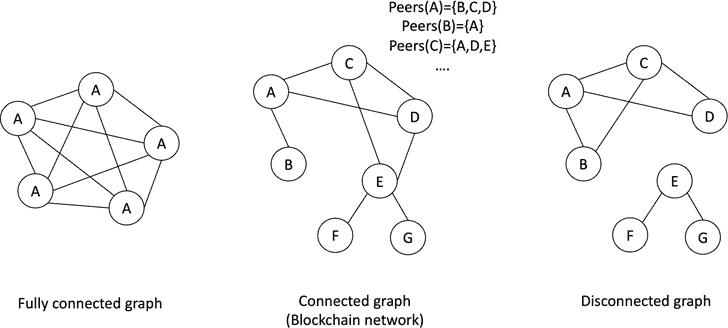

图 3.1 图与对等网络中的连通性。

### 3.2.1 什么是区块链网络的用户？

本节的目的是阐明描述区块链网络用户及其内部计算功能的术语。首先，我们区分了用户（users）、客户端（clients）、节点（nodes）和账户（accounts），这些术语在描述区块链系统的特定实现时经常被。例如，在上节中，我们在不同的阶段使用了“用户”和“节点”来指代区块链网络的参与者。

*   **用户（User）**：用户是使用区块链网络的物理或组织实体。可以是 Alice、Bob、White 女士或 Black 先生，也可以任何私人或与政府相关的组织。在许多情况下，用户的身份甚至可能是未知的。例如，比特币和其他加密货币的用户是通过其账户地址（见下文）来识别的，但他们的真实身份通常是未知的。
*   **客户端（Client）**：我们通常将客户端称为用户与区块链系统交互的软件应用程序。客户端可以是网站、移动 应用程序或加密货币 ATM（这本质上是一台用户可以管理其比特币账户的公共计算机）。
*   **节点（Node）**：在客户端内部，节点是用户与区块链系统交互的软件实现。
*   **账户（Account）**：在区块链系统中，账户是一个与私钥关联的唯一标识符，用于签名（验证）消息。因此，区块链系统的节点通常被授予相同的权利，但行使这些权利取决于它们本身。账户通常与区块链网络的节点关联。

在定义了区块链网络的用户以及他们用于连接的的软件后，现在我们可以引入区块链协议（blockchain protocol）的概念：

在现实设置中（参见 图 3.2），用户可能使用多个客户端并通过多个节点与区块链系统交互。每个节点可能管理一个或多个账户。

*   **区块链协议（Blockchain protocol）**：它是规定节点在区块链网络中如何交互的规则集。这些规则涉及从节点发出的消息（交易）的有效格式到共识协议的规则等多个方面。换句话说，区块链协议是区块链系统运行的规则实现。这些规则构成了区块链网络用户的规则实现。

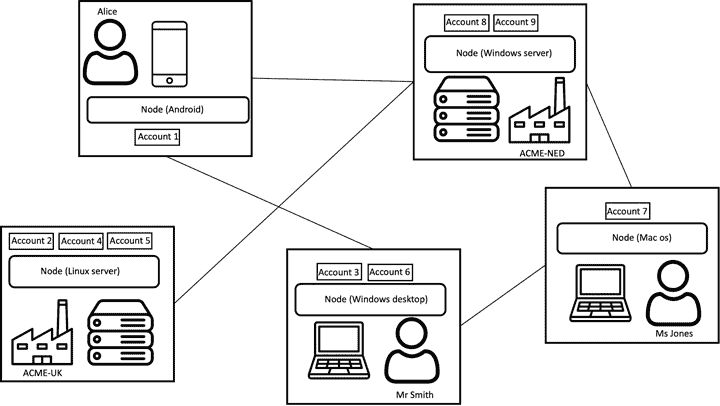

图 3.2 区块链网络中的用户、客户端、节点和账户。不同类型的节点（服务器、桌面设备、移动设备）可以运行不同的软件“客户端”连接到区块链网络。

在大多数情况下，为单个区块链系统用户考虑多个客户端、节点和账户账户会引入额外的复杂性，不利于理解区块链系统的基本运行。因此，在本书的剩余部分中，在不缺乏通用性且明确需要的情况下，我们始终指的是一个用户使用一个包含一个节点的客户端来控制一个账户的标准配置。由于在这种简化的配置下，用户、客户端、节点和账户的概念基本上重合，因此我们经常交替使用它们。具体而言，我们在大多数情况下使用区块链网络的“节点”这一概念。根据上述定义，实际上节点是用户客户端中实现与区块链网络交互的特定逻辑的部分。

在深入讨论区块链系统节点的功能之前，我们在这里引入另一个定义，“钱包”（wallet）。你可能经常听到这个概念，特别是在比特币和其他加密货币的背景下。


## 钱包

在加密货币的背景下，钱包是一种允许用户访问和管理其数字资产（令牌），例如 `bitcoins` 的软件应用程序。钱包通常由一个用户拥有。即使在底层它可能使用多个账户与区块链网络进行交互，但钱包通常允许以用户为单位进行数字资产管理。例如，一个比特币钱包通常由一个特定用户拥有，它可以使用不同的比特币账户来发送和接收比特币。这些不同账户的细节通常对用户隐藏。当使用钱包时，用户只需看到他们拥有的比特币（即由钱包控制的所有账户中所有比特币的总和）。钱包允许用户向其他用户发送/从其他用户接收比特币，这些用户可以通过不同的方式进行标识，例如通过电子邮件地址或特定的比特币账户地址。

根据这个定义，钱包是客户端、节点以及（可能）由区块链系统一个用户控制的多个账户的结合。考虑到这种不准确的描述，在书的剩余部分中，我们避免将钱包视为区块链系统的一等公民。

### 3.2.2 公有和私有区块链网络

表征区块链系统的一种重要方式是它们依赖于公有区块链网络还是私有区块链网络。

`public blockchain network`（公有区块链网络）是指任何人都可以成为用户的网络。在这些区块链网络中，财团、基金会、组织或其组合会在认为必要时维护并更新网络节点所使用的协议规范。在这种情况下，区块链协议通常以白皮书和开源标准客户端实现的形式公开。通过这种方式，如果需要，任何人都可以检查协议以及实现协议的软件应用程序。可以提供协议的多种实现。这些是软件程序（用不同的语言编写并针对不同的平台），任何人都可以下载并安装到计算机上，以便能够运行区块链网络的节点。比特币网络可能是公有区块链网络最著名的例子。在 `https://bitcoin.org`，提供了运行比特币区块链网络节点所需软件的多种实现（可能被不恰当地称为“钱包”），例如用于 `Android/Ios` 手机和 `Windows/Mac/Linux` 桌面面的版本。任何人都可以下载这些软件并运行比特币网络的节点。节点显然具有等于 `0 bitcoins` 的初始余额，但它可以从其他节点处接收比特币。

公有区块链网络应该经过仔细设计，以确保其可扩展性。如果成功，事实上网络中的节点数量可能会迅速增加。例如，比特币网络最初由几个节点组成，现在在在全球范围内包含了数百万个节点。

`private blockchain network`（私有区块链网络）是指访问网络经过审核的网络。有一种机制可以向新节点授予参与区块链网络的权利。访问区块链网络的权限是由最初创建该网络的财团、基金会、组织或其组合授予的。这类区块链系统通常部署在特定的业务场景中。在这些场景中，一组定义良好的业务伙伴（例如涉及供应链的组织）决定使用区块链系统支持其至少部分业务。首先，他们对系统使用的协议达成一致。然后，他们还决定哪些节点以及在什么条件下可以进入系统。在这种情况下，区块链协议及其实现很可能是私有的。事实上，在许多情况下，被允许进入系统可能代表组织竞争优势的来源。因此，系统用户可能有强烈的动机来维护有关系统实现的细节，例如所使用的协议，是私密的。由于对区块链网络的访问是控制的，私有区块链网络的节点信任程度比公有区块链网络更高。这对于依赖私有区块链网络的区块链系统设计具有重要影响，我们将在本书的第 2 部分中深入讨论。

## 3.3 区块链节点中的数据管理：交易与不可变数据库

区块链系统的节点通过交换数字消息进行相互作用。这些消息通常被称为 `transactions`（交易）。交易由一个节点发布，我们称该节点为 `originator`（发起者）。取决于应用场景，交易可能包含不同类型的数据，并可能指向区块链系统的一个或多个其他节点。例如，比特币交易指定了加密货币令牌（`bitcoins`）的传输。这可以在两个账户之间（一个发送者和一个接收者）进行，也可以在多个账户之间（多个发送者和/或多个接收者）进行。在监控供应链的区块链系统中，交易可能有关集装箱路由的更复杂的数据。这些交易可能不是由一个用户指向一个或多个其他特定用户（如比特币示例所示），而是由一个用户（例如港口管理局）发布，供系统的任何其他用户（例如航运公司和海关）查询。

即使交易代表了旨在特定用户（们）的消息，区块链系统中的交易通常也会广播到区块链的所有节点。技术上，这种广播是使用所谓的 `gossip protocol`（泛洪协议）实现的。发起者节点将它想要发布的交易发送给它的对等节点。这些节点继而将交易广播给它们的对等节点，以此此类推，直到交易到达区块链网络的所有节点。在这里我们看到了区块链网络中的连接性属性：只有当区块链网络中至少存在一条到达它们的路径时，交易才能到达所有节点。在泛洪过程中，交易通常由接收到它们的每个节点验证。例如，节点检查交易是否包含区块链协议所需的所有信息。未通过此验证步骤的交易通常不会被节点转发给其他节点。图 3.3 显示了泛洪协议的一个示例。交易 `T1` 从 Alice 向 Luna 传输 10 个令牌。它源自 Alice 并到达了 Alice 的对等节点（Bob、Carol 和 Dave）。网络的每个节点都维护一个带有网络每个节点余额的 `distributed immutable ledger`（我们稍后会详细解释）。交易 `T1` 尚未到达 Eva。这就是为什么对于 Eva 来说，Alice 和 Luna 的余额仍然是 `35` 和 `2`，而对于所有接收到 `T1` 的其他节点，Alice 的余额是 `25`，Luna 的是 `12`。

```
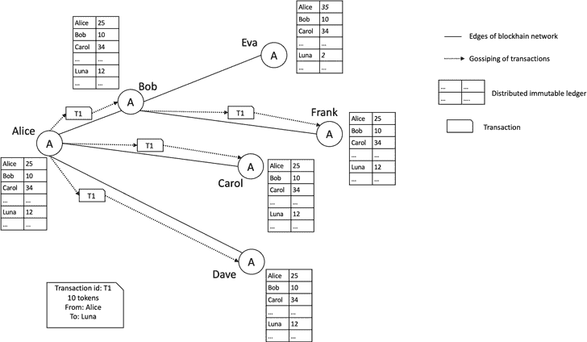
```

*图 3.3 交易的泛洪与账本更新。

由于节点可能会离线并且可能没有实现区块链协议中的所有功能，交易的泛洪可能是不可预测的。这在区块链网络中是正常的，在大规模 PP 网络中也是如此。如果一个节点现在发布交易 `A`，另一个节点（即使是同一个节点）在 A 之后非常短的时间内发布交易 `B`，


根据我们目前为止讨论的内容，应该很清楚，区块链系统中的交易并不是一个节点发布并发送给一个或多个节点的直接私有消息。相反，我们应该将交易视为对更新区块链系统“状态”的提案。如果该提案是有效的，那么区块链网络中的所有节点都会将其存储在自己的数据库中，以便重现该提案所引起的状态更改。例如，加密货币系统的“状态”是由每个节点的代币余额捕捉的。那么，一个节点 A 向节点 B 传输 1 个比特币的加密货币交易可以视为系统状态的更新。网络中的每个节点最终应该应该节点 A 的余额必须减少 1 个代币，而节点 B 的余额必须增加 1 个代币。因此，我们现在可以清楚地看到图 3.3 中的节点账显示了描述系统状态变量的值，即每个用户的余额。这些变量在技术上并不是不可变的，因为它们会被每笔交易更新。不可变的是决定状态变量取值的交易序列（或等价于状态变量值的历史）。

在身份验证方面，通常（参见第 2 章）有一种公钥加密机制来确保交易发起者的身份验证。发起者使用其私钥对其发布到区块链系统的交易进行签名。任何接收到交易的其他节点都会使用发起者的公钥来验证发起者的身份。这一验证步骤也是交易验证的一部分。如果发起者的身份验证失败，节点将不会向其对等节点泛洪（gossip）交易。

区块链系统中的每个节点将其收到的有效交易存储在数据库中。正如我们在第 1 章中讨论过的，该数据库在设计上是不可变的。这意味着只能向其添加新交易，但无法修改、更不用删除已经存储在其中的交易。由于区块链技术首次引起公众关注的应用是在金融领域，因此这个数据库通常被称为（交易）账本。此外，它通常被称为分布式账本，因为其分布在区块链网络的节点之间。但请注意，在这种情况下，“分布式”并不意味着每个节点只存储了发布到区块链系统的交易子集。网络中的每个节点都存储发布到区块链系统的所有交易的完整副本。在这个阶段，不意外区块链技术（尤其是当依赖私有区块链网络时）经常被称为 DLT（分布式账本技术）。对于计算机科学家来说，区块链和 DLT 之间的区别更为细微。这还取决于交易在数据库中物理存储的方式（更多细节请参阅计算机科学焦点框）。

### 3.3.1 通过设计实现数据不可变性

本书到目前为止一直悬而未决的问题是，理解如何设计一个不可变的数据库，或者使用上一节引入的术语，如何实现一个不可变的交易分布式账本。本节解决了这个问题。

区块链系统中账本不可变性的背后基础技术是加密哈希，这是我们在第 2 章中介绍过的。简而言之，给定一个数字消息（如区块链系统中的交易），加密哈希允许创建一个固定长度的摘要，且该摘要在实践中是唯一的。

在研究如何利用加密哈希构建不可变账本之前，让我们简单地将账本中的“区块”定义为可以追加其上的最小数据量。一个区块通常包含（参见图 3.4）一个头部和一个交易列表：

*   区块头部包含描述它的元数据，例如唯一标识符、捕捉其创建瞬间的时间戳，或它包含的交易数量。因为区块通常可以使用时间戳按时间排序，所以区块的唯一标识符通常是一个递增的数字：`block 1` 先于 `block 2`，`block 2` 优于 `block 3`，以此类推。

*   交易列表通常包含由区块链系统节点（近期）发布的有效交易列表。一个区块中包含的交易数量取决于实现。通常，出于效率考虑，交易会被分组成区块。然而，甚至有些区块链系统的每个区块只包含一个交易。

账本的不可变性是通过强制每个区块包含（通常在其头部中）两个额外字段来实现的：

*   区块的哈希，即区块内容（头部和交易列表）的加密哈希。

*   上一个区块的哈希值。例如，`block 3` 的头部包含 `block 2` 的哈希值，`block 4` 的头部包含 `block 3` 的哈希值，以此类推。

如图 3.4 所示，区块包含其前驱区块哈希值的做法有助于创建一个“区块链”（听起来熟悉吗？），其中连续的区块通过它们匹配的哈希值连接起来。

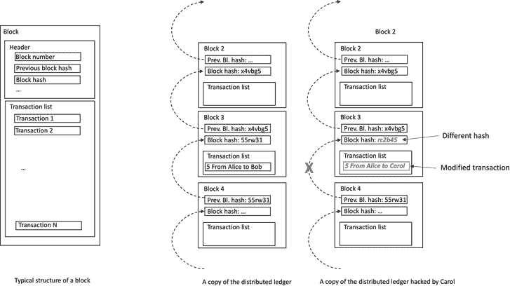

*图 3.4 区块结构和区块链以实现账本不可变性。]

我们现在准备好理解为什么使用区块哈希创建区块链会隐式地产生存储区块的账本的不可变性。为了做到这一点，我们应该想象一个恶意黑客（例如图 3.4 示例中的 Carol）为了修改账本的内容应该做什么：

*   首先，黑客应该修改一个区块的内容。具体来说，黑客的目标是修改区块中交易的内容。图 3.4 以加密货币系统为例，Carol 想要修改 `block 3` 中包含的一个交易。

*   然而，修改一个区块的内容会改变该区块的哈希值。根据第 2 章中的讨论，修改区块中即使一个位也会完全改变其哈希值。

*   假设黑客以某种方式成功修改了 `block 3` 中一个交易的内容。现在，`block 4` 头部中的上一个哈希字段不再匹配 `block 3` 的哈希值。黑客随后尝试更新 `block 4` 的内容，修改上一个区块的哈希以匹配 `block 3` 的，同时确保 `block 4` 的哈希不变。然而，我们知道由于加密哈希的属性 1，这（在实践中）是不可能的：如果 `block 4` 的内容发生变化，它的哈希值也会随。

*   或者，黑客可能尝试修改 `block 4` 的内容（例如它的头部，不包含交易），希望使其 `block 4` 的哈希保持不变。然而，由于加密哈希的属性 2，我们知道这（在实践中）也是可能的：事实上，同一个 `block 4` 的两个“版本”是不可能映射到同一个哈希值的。

*   注意，我们目前讨论的内容适用于黑客想要修改分布式账本的某特定副本的内容时。同样的黑客过程也应应用于账本的所有副本，即参与区块链系统的每个节点所持有的副本。


总结来说，区块头中通过哈希链创建的区块链确保了区块链账本无法被篡改。更准确地说，它确保了任何节点都能快速验证其账本副本是否被修改过，以及修改发生在何处（哪一个区块）。这可以通过简单检查区块哈希链即可完成。

最后，在创建区块链时，我们还需要解决最后一个（也是容易的）问题，这涉及到此类链的起始点。换句话说，一个不可变账本中第一个区块的前一个区块是什么？这个问题通过一个简单的假设得到了解决：区块链系统中的每个账本都始于一个传统的“创世区块”（genesis block），该区块的前一个哈希值设置为 `0`。根据区块链系统的具体实现，创世区块可能非常小，例如只包含区块头，也可能已经包含交易列表。

## 3.4 共识机制

构建区块链系统的最后项技术是共识机制。共识机制确保区块链系统中的所有节点保持一致的账本副本。换句话说，共识机制确保所有节点对账本的内容达成共识，即哪些区块被包含以及以什么顺序包含。这保证了通过重放区块中的交易，每个节点都可以重构出相同的当前状态（或者至少可以验证他们所使用的状态是正确的）。例如，在加密货币系统中，通过重放系统产生的交易，任何节点都可以验证其他节点余额的正确性。

更详细地说，设计共识机制的挑战在于理解以下问题：如何在短时间内建立多笔交易的顺序？在加密货币的背景下，这一挑战被称为防止“双重花费”（double spending）。

为了引入双重花费问题，我们考虑一个简单的区块链系统，每个交易记录了两个用户之间一定数量的代转移。我们将这种代称为令牌（见图 3.5](#C_006_c3.xhtml#f3_5)).现在假设用户 Alice 拥有 10 个令牌，并想用它们从 Bob 处购买一个价值 6 的马克子，从 Carol 处购买一把价值 8 的椅子。显然，Alice 没有足够的令牌支付这两件物品，但让我们考虑以下场景：


图 3.5 双重花费示例

*   Alice 创建了一笔交易 (`T1`) 向 Bob 转移 6 个令牌，以及另一笔交易 (`T2`) 向 Carol 转移 8 个令牌。Alice 在短时间内向区块链网络发布了这两笔交易。根据本章前面的讨论，我们无法保证所有节点以相同的顺序（在时间接近的时间）接收到这些交易。让我们假设 Bob 先接收了 `T1`，而 Carol 先接收了 `T2`。
*   根据 Alice 的余额（10 个令牌），任何节点认为 `T1` 和 `T2` 之间的第一笔交易是有效的，并拒绝第二笔（如果 `T1` 被节点先处理，那么对于该节点 Alice 只剩下 4 个令牌，不足以处理 `T2`）。
*   现在，如果 Bob 在接收 `T2` 之前接收了 `T1`，他认为收到了购买马克子的付款，因此将马克子交给 Alice。然后，Bob 拒绝交易 `T2`，因为它与区块链的当前状态不一致（即 Alice 只剩下 4 个令牌）。同样，如果 Carol 在接收 `T1` 之前接收了 `T2`，她认为收到了购买椅子的付款并将其交给 Alice，然后拒绝交易 `T1`。
*   最后，Alice 可能会同时收到了马克子和椅子，尽管她已以某种方式“两次”花费了她的某些令牌（即双重花费）。

这个简单的例子代表了区块链系统中由于交易排序而可能出现的更复杂的问题。我们将在书的第 2 部分（C_008_part2.xhtml#part2）中更深入地研究这类问题。现在，重要的是意识到建立区块链系统中所有节点认同的交易顺序是至关重要的。在区块链系统中，我们不能依靠中央机构来解决这个问题。如果 Alice、Bob 和 Carol 之间的令牌交换是由银行调解的，那么如图 3.5（C_006_c3.xhtml#f3_5）所示的双重花费问题将不存在：银行只会处理 Bob 或 Carol 发起的第一笔交易，因为 Alice 账户资金不足而拒绝第二笔。在只有用户且不允许拥有“特殊权力”中央机构的区块链系统中，用户必须独立解决这个问题。在实践中，双重花费问题通过制定规则确定哪些交易是有效的以及账本中的节点按何种顺序考虑交易来解决。

共识机制取决于具体的实现，关于比特币或以太坊使用的共识机制的更多细节见第 2 部分（C_008_part2.xhtml#part2）。在本章中，我们的目标不是描述具体的共识机制。相反，我们只想简要讨论区块链系统的两类共识机制：绝对共识和涌式共识。

“绝对”共识机制是指通过区块链系统节点之间显式的消息交换协议来确定交易顺序。这类共识机制通常需要区块链系统所有节点之间交换大量消息。因此，绝对共识协议是私有区块链系统的典型，这类系统的节点数量通常有限且每个节点的身份是知的。

“涌式”共识机制是指交易顺序从区块链网络节点行为的统计意义上“涌现”出来的。一方面，通常涌式共识不涉及区块链节点之间广泛的消息交换。另一方面，它也不保证所有节点在精确的时间点达成共识。相反，节点达成的共识具有概率性质。尽管最初对发布到网络的交易状态可能存在不确定性，但随着时间推移，所有节点都会对账本所有交易的有效性和准确位置达成共识。大多数加密货币系统采用的共识机制就是这种类型。

## 3.5 BC4C 更精确的规范

为了结束本章，我们在本节中回顾第 1 章（C_004_c1.xhtml）介绍的 BC4C 示例。具体而言，我们深入讨论在本章介绍的区块链系统元素如何在 BC4C 中具体定义。

*   *BC4C 网络*：BC4C 依赖于公共区块链网络。事实上，我们假设任何对在线象棋感兴趣并且连接了互联网的计算机都可以下载实现 BC4C 协议规则的软件程序并运行 BC4C 节点。


### BC4C 协议：

在 BC4C 中，最重要的方面是定义协议。根据第 1 章中已经讨论的内容，我们可以制定以下控制 BC4C 运行的规则：

*   BC4C 中的一个游戏涉及两个节点（即玩家）。新游戏由一名玩家提议，并且在被对手玩家接受后才能开始。当一个游戏被提议时，可以通过在两个玩家名称的连接字符串后附加一个递增数字来生成一个简单的唯一游戏 ID。例如，Alice 和 Bob 之间进行的第三场游戏的 ID 为 ‘AliceBob3’。

*   游戏从标准的棋盘配置开始，这包括棋子的数量、类型以及它们在棋盘上的位置。我们假设读者对这些是已知的，因此我们在此不再重复。

*   游戏的玩家轮流走动。我们假设提议游戏的玩家先走。每一步移动由一名玩家提议并必须被另一名玩家接受。我们假设读者知道棋盘上不同棋子的合法移动方式，我们在此不再重复。可以按照简单的规则为每一步移动生成一个唯一的 ID（示例见后文）。

*   当一名玩家提议将将军移动并被对手批准时，游戏结束。

### BC4C 交易：

根据 BC4C 协议的规则，BC4C 节点可以发布不同类型的交易。这些交易列在下方（每种交易包含的数据列在方括号中）：

*   `CreateNewGame [gameId, counterPlayer]:`: 这种类型的交易在交易发起者和另一个玩家（由参数 `counterPlayer` 标识）之间创建一个新游戏。

*   `ConfirmGameCreation [gameId]:`: 这种类型的交易确认一个游戏的创建。它由对手玩家发布。

*   `Move[gameId, moveId, piece, new position, isCheckMate]:`: 这种类型的交易指定游戏中的一次移动。移动涉及将棋子移动到棋盘上的新位置。布尔标志位 `isCheckMate` 用于标识该移动是否导致死局。

*   `ConfirmMove [gameId, moveId]:`: 这种类型的交易由玩家发布，用于确认对手玩家发布的移动的有效性。

### BC4C 账本：

在规定了 BC4C 协议的规则并列出玩家可以发布的交易类型后，我们现在可以给出 BC4C 系统账本内容的示例（参见图 3.6）。为了简单起见，我们假设每个区块只包含一个交易，因此账本的内容可以简单地显示为交易列表。交易的哈希与此示例无关，因此不显示。关于该系统的状态，应注意以下内容：

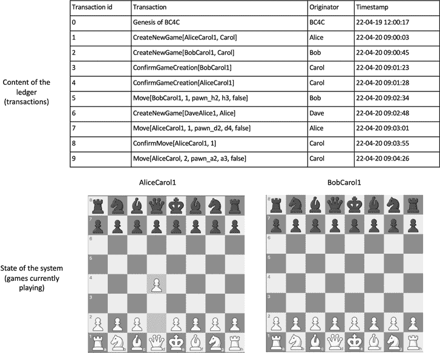

*图 3.6 BC4C 中的账本和系统状态示例。

*   图 3.6 BC4C 中的账本和系统状态示例。

*   图 3.6 BC4C 中的账本和系统状态示例。

*   图 3.6 BC4C 中的账本和系统状态示例。

*   图 3.6 BC4C 中的账本和系统状态示例。

根据 BC4C 协议的规则和列出的玩家可以发布的交易类型，我们现在可以给出 BC4C 系统账本内容的示例（参见图 3.6）。为了简单起见，我们假设每个区块只包含一个交易，因此账本的内容可以简单地显示为交易列表。交易的哈希与此示例无关，因此不显示。关于该系统的状态，应注意以下内容：

根据 BC4C 协议的规则和列出的玩家可以发布的交易类型，我们现在可以给出 BC4C 系统账本内容的示例（参见图 3.6）。为了简单起见，我们假设每个区块只包含一个交易，因此账本的内容可以简单地显示为交易列表。交易的哈希与此示例无关，因此不显示。关于该系统的状态，应注意以下内容：

1.  **存储交易列表**：根据 BC4C 协议的规则和列出的玩家可以发布的交易类型，我们现在可以给出 BC4C 系统账本内容的示例（参见图 3.6）。为了简单起见，我们假设每个区块只包含一个交易，因此账本的内容可以简单地显示为交易列表。交易的哈希与此示例无关，因此不显示。关于该系统的状态，应注意以下内容：

2.  **存储状态变量的值**：根据 BC4C 协议的规则和列出的玩家可以发布的交易类型，我们现在可以给出 BC4C 系统账本内容的示例（参见图 3.6）。为了简单起见，我们假设每个区块只包含一个交易，因此账本的内容可以简单地显示为交易列表。交易的哈希与此示例无关，因此不显示。关于该系统的状态，应注意以下内容：

## 3.6 案例研究：比特币的前身

在本章中，我们理解了比特币是一种加密货币。加密货币系统是一种跟踪节点之间代币交换的区块链系统。区块链的状态由每个节点的余额决定。交易代表了节点之间的交换。在比特币中没有中间商。区块链网络中的所有节点都是平等的，它们可以通过精心设计的共识机制对状态达成一致。此外，比特币以及普通加密货币的一个基本特征是其设计用于防止所谓的代币双花费。


### 3.6.1 数字（非去中心化）货币系统

在 20 世纪 80 年代后期，荷兰的加油站首次提出了资金存入智能卡的设想，司机可以使用这些卡片支付油费而非使用现金。这种系统的推动力来自加油站运营者。当时，针对加油站的现金抢劫案正日益增加。运营者必须找到一种方法，在保证夜间营业安全的同时，允许卡车加油（这是其业务中一个非常获利的部分）。从那以后，销售点（`PoS`）技术已成为主流，该技术允许商户直接从客户的银行账户收取付款，这对于实体店和互联网商户都是如此。如今，数字货币也可以存储在“数字钱包”中，即未绑定到特定银行账户或用户的智能卡，可以通过现金、借记卡/信用卡或银行账户转账进行充值。

利用加密工具实现“盲交换”的数字货币构想最早出现于 20 世纪 80 年代后期的 `DigiCash`。在 `DigiCash` 中，加密技术被用于保护用户的匿名性，并为任何代币传输配备一个可数字验证的发者签名。`DigiCash` 作为一项商业项目在 1998 年资金耗尽。这一构想未能获得实质性主流关注的主要原因之一，可能因为它关注的是企业客户（如商户和其他私人公司），而非零售用户。`DigiCash` 仍然依赖传统的银行系统进行金融交易的结算。

`PayPal` 可能是目前最常用的数字货币形式，允许（私有和商业）用户之间进行直接资金转账。这些用户仅通过电子邮件地址进行识别。尽管它可以被归类为数字货币的一种，但从区块链技术的角度来看，`PayPal` 显然是一个中心化中介，代表用户处理与传统银行系统的交互。

### 3.6.2 完全去中心化的数字货币系统

1998 年，开发者 `Wei Dai`（中本聪）发布了一篇名为 `[Dai98]` 的白皮书，提出了 `B-Money` 的构想，这是一种匿名且分布的数字货币系统。`B-Money` 依赖数字伪名来识别其匿名用户。它还定义了一种在用户之间执行货币传输的去中心化强制机制，即共识机制的原始形式。尽管它从未获得过商业上的成功，但 `B-Money` 的某些设计特征在 `Bitcoin` 的白皮书中被作为参考。

由密码学家 `Nick Szabo` 提出的 `Bit Gold` `[Sza05]` 是第一种涉及共识机制的去中心化数字货币形式，其基于 `Bitcoin` 共识协议相同原理的共识机制（工作量证明，详见 `第 5 章`）。与 `B-Money` 一样，`Bit Gold` 也未获得任何实质性的商业成功。

在比特币之前最成功的完全去中心化数字货币形式是 `HashCash` `[Bac02]`。`HashCash` 开发于 20 世纪 90 年代中期，其设计包含了现代加密货币的许多特征，例如数字签名交易和工作量证明共识协议。由于应对日益增加的用户以及维持共识协议执行所需的计算能力不断增长，`HashCash` 在 20 世纪 90 年代后期变得基本失效，随后逐渐被用户抛弃。现代加密货币（如 `Bitcoin`）的设计显然融入了许多最初由 `HashCash` 实现的原理。

## 3.7 结论

本章提出了一个与实现无关的区块链系统定义。我们首先引入了基础术语，即在书中讨论具体的区块链系统实现时使用的基础术语，如`区块链`、`用户`、`客户端`、`账户`、`钱包`、`公有或私有网络`以及`共识机制`。

注：此处根据翻译要求，对文中提到的术语进行了对齐，并保持了逻辑连贯。

下一章将与实现无关的区块链定义扩展到“智能合约”概念。

## 3.8 习与练习

1. 考虑以下业务场景：(a) 欧洲的花卉供应链（例如在荷兰种植并采摘到达意大利或丹麦的花卉市场），(b) 管理学生信息（如成绩和学位）。对于每个场景，讨论 `区块链` 如何支持利益相关者之间。特别关注：`区块链网络`（公有还是私有？节点是谁？）、`交换的数据`（什么类型的交易？账本看起来是什么样的）、以及`共识协议`（你会制定规则让节点达成一致？）。

2. 支票在 21 世纪初是一种广泛的支付形式。与加密货币一样，它们也具有双重花费的特征。描述支票的双重花费问题（如果你太小不知道什么是支票，可能需要查资料），并与本章讨论的加密货币的双重花费问题进行比较。

3. 考虑 `BC4C` 系统的实例。`表 3.1]` 显示了该区块链发布的交易账本：

    1. 你能在 `表 3.1]` 的账本中找到错误吗？在哪些交易中？

        现在考虑两种情况：

        1. 以合理方式修复 (1) 中发现的错误后获得的账本。

        2. 删除你发现错误的交易后获得的账本。

            在上述两种情况 (1) 和 (2) 下回答以下问题：

    2. Steph 和 Luka 之间是否正在进行比赛？

    3. 在 `StephKlay1` 比赛中进行了并确认了多少步？

    4. 目前有多少场比赛已通过确认？


### 3. 玩家可以随时暂停和恢复游戏。暂停/恢复是通过节点发布交易完成的，且只有在轮到该节点移动移动时才能执行。

请提供该系统的规范说明，即交易的类型和区块链协议规则。

### 5. 参考第 3.5 节的内容，想象并描述一个全新的区块链系统（提示：你可以考虑一个支持不同类型在线游戏的系统，或者一个完全不同的应用场景——就像本章中提到的那些场景）。在描述完系统的目标后，列出区块链协议的规则、其用户可以发布的交易类型，并给出一个分布式账本内容的示例。

表 3.1 BC4C 中的示例交易列表

| 交易 ID (Transaction id) | 交易 (Transaction) | 发起者 (Originator) |
| --- | --- | --- |
| 0 | BC4C 创世 (Genesis of BC4C) | BC4C |
| 1 | 创建新游戏 CreateNewGame[LukaTrae1, Trae] | Luka |
| 2 | 创建新游戏 CreateNewGame[LukaRuss1, Russ] | Luka |
| 3 | 创建新游戏 CreateNewGame[StephLuka1, Luka] | Steph |
| 4 | 确认游戏创建 ConfirmGameCreation[LukaRuss1] | Russ |
| 5 | 确认游戏创建 ConfirmGameCreation[LukaTrae2] | Trae |
| 6 | 创建新游戏 CreateNewGame[StephKlay1, Klay] | Steph |
| 7 | 移动 Move[LukaTrae1, 1, …, …, false] | Luka |
| 8 | 确认游戏创建 ConfirmGameCreation[StephKlay1] | Klay |
| 9 | 移动 Move[StephKlay1, 1, …, …, false] | Steph |
| 10 | 确认移动 ConfirmMove[LukaTrae1,1] | Trae |
| 11 | 确认移动 ConfirmMove[StephKlay1,1] | Klay |
| 12 | 移动 Move[StephKlay1, 2, …, …, false] | Steph |
| 13 | 创建新游戏 CreateNewGame[LukaRuss2, Russ] | Luka |

#### 注意

1. 在此示例中，什么构成了“时间接近”，取决于所考虑的特定区块链系统。在比特币中，即使间隔几分钟的交易可能被认为是“接近”的，而在其他系统（如以太坊）中，交易的处理可能更快。关于特定区块链系统的更多细节，请参阅第 2 部分。

# 4 使用智能合约扩展区块链

DOI: [10.4324/9781003321187-5](http://doi.org/10.4324/9781003321187-5)

## 4.1 引入业务逻辑以扩展区块链的必要性

正如我们在第 3 章中所学习的，区块链系统可以抽象为计算机科学家所说的“分布式状态机”。这是技术特征和协议的结合，使得一组计算节点能够在不需要中央中间介的情况下对系统状态达成一致。区块链节点提交的交易修改了捕捉系统状态的变量值。由于这些交易存储在每个节点的本地不可变数据库中，因此每个节点都始终能够重新构建区块链系统的当前状态。这可以通过重放账本中存储的交易来实现。得益于共识协议，所有节点以相同的顺序存储相同的交易。这确保了节点在重放交易历史时，能够重建出完全相同的系统状态。

例如，在加密货币系统中，状态由每个用户余额的值来捕获。发送方和接收方节点之间的交易通过增加接收方余额和减少发送方余额来修改系统状态。在用于监控供应链的区块链系统中，描述系统状态的变量可以是集装箱的位置、其内容以及负责递运的货运公司。当船运船进入港口时，其承载的所有集装箱的位置可以通过港口当局发布的交易进行更新。

现在，一个在 20 10 年代初引起关注的问题是：是否可能通过业务逻辑扩展区块链系统，根据交易提供的输入，使用账本中存储的变量自主更新状态？为了更详细地解释这个问题，接下来我们将扩展 BC4C 系统。

让我们考虑 BC4C 系统的扩展版本，该版本包含 CGM 代币作为加密货币（我们称此系统为 BC4C-CGM）。除了下国际棋之外，每个节点现在还拥有一定数量的 CGM 代币。在这个阶段，节点如何获得这些代币并不重要，更不用说它们兑美元或其他任何法币的价格了。用户可以使用法币购买这些代币，或者这些代币仅在 BC4C 系统内具有价值（例如购买勋章和其他“虚拟”成就证明），而在现实世界中则毫无价值。

在 BC4C-CGM 中，为了让游戏更具竞争力和趣味性，参与游戏的双方都需要在游戏开始前质押一定数量的 CGM 代币。游戏结束后，获胜者将收集双方缴纳的所有代币。这是在我们的示例中包含更通用功能的一种简单方法：使用加密货币进行下注，而不是法币。

实现 BC4C-CGM 的第一种方法（参见图 4.1](#C_007_c4.xhtml#f_1)）是依赖链外世界，即涉及区块链外部的实体。这种链外实现中的任何两个玩家必须同意将质金支付给链外可信的中间介，例如银行、公证处或好朋友。该中间介（或中央机构）在游戏期间确保质金的安全，并在确定后将其发送给获胜者。然而，我们已经了解到在区块链世界中不允许存在中央机构，基本上是因为它们不可信。因此，我们如何才能完全“链上”实现 BC4C-CGM，即不依赖链外中间介呢？

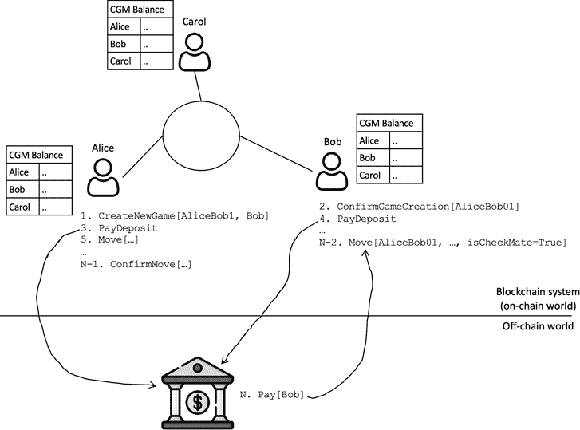

图 4.1 BC4C-CGM 区块链的链外实现

回答这个问题之前，我们需要明确的是，仅凭我们在第 3 章中讨论的内容无法实现 BC4C-CGM。我们将面临的问题是，如果没有中间介，谁或什么在游戏进行期间“确保质金的安全”？以及，如何将质金还给获胜者？事实上，在 BC4C 中，区块链状态只能通过用户发布的交易进行修改。此外，交易涉及的状态更改在交易一处理后立即执行。目前没有方法可以 (i) “延迟”交易的影响（例如，只要游戏仍在，玩家就无法使用质金）以及 (ii) 使交易的影响具有“条件性”（例如，如果节点输了游戏，该节点将无法拿回质金）。


上述问题的答案在于创建实现 BC4C-CGM 系统所需的“业务逻辑”，并将其直接嵌入到区块链中。从概念上说，实际上，实现此功能的业务逻辑需要操作定义区块链状态的变量。需要操作的两个变量是开始游戏的任意两个玩家的余额：当支付押金时，业务逻辑应该记录此事件的发生，并相应减少支付押金玩家的余额；一旦两笔押金都支付完毕，业务逻辑应通知两名玩家游戏可以开始；最后，一旦收到游戏结束的通知（包括胜者的身份），业务逻辑应仅更新胜者的余额。

在实践中（参见图 4.2），我们可以编写一个（简单的）计算机程序，游戏玩家只需调用一次该程序，用以支付正确数量的 CGM 代币。该程序确保了押金的安全（即不允许用户在支付后修改押金）。然后，一旦游戏结果确定，程序将自动把押金支付给获胜者。请注意，CGM 代币的所有权简单地由区块链系统状态变量的值决定的。因此，实现这一功能意味着为 BC4C 系统定义额外的状态变量，例如与每个游戏相关的押金值。这些值可以由我们描述的计算机程序进行更新。实现此功能的计算机程序必须由系统的每个节点在本地安装，以便每个节点都能访问它并在必要时调用它。

简而言之，这个计算机程序自己充当了中间人的角色。然而，由于它是一个软件程序，而不是链外世界中的人类或组织，它可以分发到所有节点，并被所有节点信任为始终根据其规范诚实地运行。事实上，计算机程序仅仅执行它们被设定的任务，它们不会主观地欺骗！

我们刚刚描述的在技术上被称为“智能合约”。我们可以广义地将智能合约定义为由区块链系统所有节点部署的软件程序，该程序可以自主或基于节点发出的交易输入，操作定义区块链状态的变量。由于部署在每个节点中，系统的节点现在可以发布一种新类型的交易，即调用智能合约的交易。

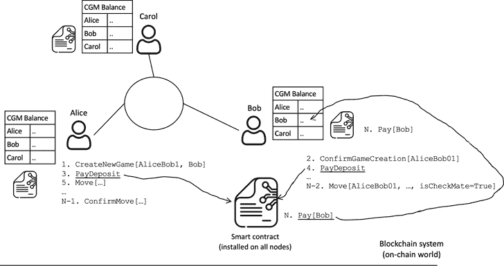

图 4.2 使用智能合约实现 BC4C-CGM 系统。

智能合约的主要特征以及在区块链系统中部署它们面临的挑战将在下一节中进行更深入的讨论。在本节中，作为最后的说明，我们想更多地讨论“智能合约”这一标签的含义。虽然这一标签被普遍接受（参见本章稍后关于其起源的案例研究）并在此书中中使用，但对于不熟悉区块链领域的读者来说，“智能合约”这一标签可能会传达一种误导性的印象。事实上，区块链系统的智能合约并不特别“智能”。它们并不比编码到传统信息系统中的任何其他业务逻辑更“聪明”。实际上，正如本章稍后详细讨论的那样，智能合约嵌入区块链系统中的这一事实对可以在其中实现的的逻辑施加了严格的限制。此外，智能合约并不一定是法律上具有约束力的“合同”。特别是，它们并不总是涉及两个或多个主体之间包含财务条款的合同。智能合约可以用于实现现实世界中商业合同的具有法律约束力的业务逻辑。然而，智能合约的雄心通常较小。它们的目标只是捕捉信息处理系统的标准业务逻辑，这些逻辑超出了简单地为状态变量分配新值。

## 4.2 智能合约的属性

在本节中，我们对区块链系统中智能合约的属性进行了更详细的分析。我们将这些分为三类：

1. 智能合约可以实现的业务逻辑类型
2. 由智能合约操作的数据
3. 部署到区块链系统后产生的特定属性

### 4.2.1 智能合约可以实现什么样的业务逻辑？

理解智能合约最简单的方法将其视为一个使用过程语言编写的计算机程序。此类程序接收某些输入参数并产生输出。为了理解智能合约产生的输出类型，区分“无状态”和“有状态”智能合约是重要的。

无状态智能合约是指给定输入总是返回相同的输出。换句话说，这种智能合约的行为仅取决于提供的输入。作为无状态智能合约的具体参考，读者可以考虑一个 Python 脚本。Python 脚本可以接收某些输入数据，然后对数据进行某些计算或修改，并将结果或修改后的版本作为输出。无论谁在何时以及在什么情况下调用它，脚本的输出仅取决于作为输入的数据。

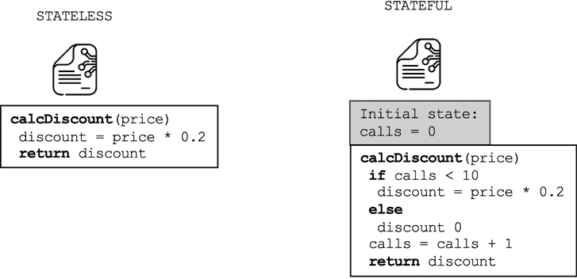

图 4.3 无状态和有状态智能合约。

一种更有趣的智能合约类型是有状态的合约。有状态智能合约维护内部状态。因此，它们的输出取决于接收到的输入以及被调用时的内部状态。图 4.3 显示了一个智能合约简单示例，它根据商品的价格返回相应的折扣。该智能合约暴露了一个待调的操作（`calcDiscount`）。该操作接收价格作为输入参数。无状态版本简单地计算 20%的折扣：无论何时或由谁调用，返回的折扣始终是输入的 20%。有状态版本仅对前十次调用应用 20%的折扣。从第 11 个客户开始，不再应用折扣。这种有状态版本必须维护一个内部状态。在这种情况下，状态由收到的调用次数组成。智能合约状态每次调用时都会通过增加状态变量 `call`的值来更新。请注意，智能合约的状态与区块链系统的状态不同。前者局部于智能合约的实现，而后者由区块链网络的所有节点共享（并可能随智能合约的执行而更新）。我们在本章剩余部分讨论更多智能合约示例时，这种差异将变得更加清晰。


我们在上一节中引入的 BC4C-CGM 系统智能合约是一个有状态智能合约的示例（参见图 4.4）。智能合约的内部状态由已支付押金的游戏列表表示。例如，在图 4.4 中注册了四场游戏。其中一个游戏（`AliceCarol02`）只有一个玩家支付了押金（Carol）。该智能合约可以用于：(i) 注册新游戏，(ii) 支付已注册游戏的押金，以及 (iii) 记录已注册游戏的结果。例如，如果玩家尝试调用智能合约来为某个游戏支付押金，那么智能合约的行为将根据其内部状态而有所不同：

- 如果游戏尚未注册，则智能合约将返回一个错误（即“游戏不存在！”）。例如，由 Bob 或 Alice 发起的 `payDeposit(BobAlice01)` 调用将返回此类错误。
- 如果游戏已经注册，则智能合约将接受押金并更新自己的状态（记录玩家已支付押金的事实）。例如，Alice 可以通过调用 `payDeposit(AliceCarol02)` 来支付游戏 `AliceCarol02` 的押金。

当已押金的游戏的两个玩家都记录了游戏结果（且双方声明的结果相同时）后，智能合约将触发向胜利者支付押金。请注意，智能合约的任何 CGM 代币转移都简单地实现为区块链状态的更新（为了简单起见，这未在图 4.4 中表示）：

- 当支付押金时，支付押金的玩家的 CGM 余额相应减少。
- 当游戏结果确定时，游戏胜者的 CGM 余额将增加等于双方支付押金总和的金额。

总结来说，从它们可以实现的业务逻辑来看：

- 智能合约是用区块链系统所有节点都能理解的某种计算机语言编写的计算机程序。
- 智能合约暴露不同的函数，这些函数可以被区块链系统的节点调用（called）。
- 智能合约可能会维护内部状态，该状态可以通过节点的调用进行修改。
- 智能合约的执行至少完成以下操作之一：
    - 修改智能合约的内部状态
    - 作为智能合约内部计算的结果返回一个值
    - 修改区块链系统的状态

### 4.2.2 智能合约可以处理哪些数据？

在某种程度上，这个问题的答案已经包含在上一个问题的答案中了。智能合约处理三种不同类型的数据：

- **输入参数**：正如我们在上一节中讨论的，智能合约是由区块链系统的节点调用的。智能合约的调用可以看作过程过程语言的函数调用。这可能涉及一个或多个输入参数。例如，在我们的示例中，为已注册游戏支付押金的智能合约调用应该包含支付押金的游戏的 `id`。如果我们假设所有游戏的押金是固定的，那么就不需要其他参数。否则，必须提供另一个指定押金金额的参数。在实践中，这些输入参数是作为交易的一部分提供的。事实上，由于交易是用户在区块链系统中可以发布的唯一消息，即使调用智能合约也必须使用交易。因此，节点发布（经过数字签名的）交易来调用智能合约。如有必要，这些交易还包括用于调用的输入参数。
- **内部状态变量**：智能合约可以定义并维护一组描述其内部状态的变量。在我们的示例中，描述智能合约内部状态的变量是注册的游戏列表、玩家地址，以及每个玩家用于记录其是否已支付押金的布尔变量。请注意，尽管智能合约内部可能定义了许多计算所需的变量，但描述内部状态的仅是那些能够影响智能合约在不同调用之间执行的计算的变量。例如，用于检查玩家支付的押金是否正确的临时变量，其作用范围不会超出智能合约的单次调用。因此，它对于定义智能合约的内部状态并没有意义。在过程过程语言中，内部状态变量是全局变量，而对于单个函数的局部变量不被视为定义了程序的状态。
- **区块链状态变量**：智能合约应该能够访问并修改描述区块链系统状态的变量。在我们的示例中，智能合约应该能够访问并修改系统中每个用户的余额。

智能合约可以处理的另一种类型的数据，且使其设计更具挑战性的数据，是所谓的“链外”数据。上述列出的三种智能合约数据实际上是“链上”数据。链上数据是区块链系统固有的。它们要么由用户提供，要么是描述系统状态的工具。链外数据是区块链系统之外（或图 4.1 所示的“区块链世界”之外）可用的，并且智能合约必须执行的计算。处理链外数据的挑战将在下一节进行详细讨论。

### 4.2.3 智能合约因需要部署在区块链系统中而引入了哪些特定要求？

如果你仔细思考，我们目前为止讨论的智能合约特征并没有将它与其他任何计算机程序区别开。换句话说，你们中任何上过基础计算机课程的人可能认为智能合约与传统计算机程序没有区别。

然而，智能合约具有区别于传统计算机程序的特定特征。这些特征直接源于它们必须部署在区块链系统中的事实。


然而，智能合约的“不可变性”意味着什么？智能合约的不可变性比分布式账本中存储的数据（交易）的不可变性要复杂得多。在实践中，它由以下属性定义：

1.  智能合约代码应对区块链上的所有节点都可用。通过这种方式，每个节点都可以在需要时调用智能合约。
2.  节点不能修改智能合约的代码。一旦它部署到区块链系统中（例如由其某个用户部署），任何人都不应该能够修改智能合约的代码，更不用删除它了。
3.  智能合约必须允许区块链网络中所有节点进行一致的状态更新。

上述三个属性如何在区块链中实现？关于第一个属性，智能合约代码的不可变性是通过将智能合约代码作为交易的一部分可用来实现的。正如我们在前面的章节中讨论的，区块链系统的任何交易通常都会广播到该区块链系统的所有节点。因此，如果智能合约代码是交易的一部分，它将到达区块链系统的所有节点。一旦收到交易，每个节点都可以访问智能合约代码。也存在某些区块链实现，智能合约代码并不是作为交易的一部分交付的。例如，在私有区块链系统中，它可能由运行系统的组织联盟安装。

然而，即使在这些情况下，智能合约代码也存储在节点的不可变数据库中。因此，它无法被修改。

第二个属性的实现遵循第一个属性。事实上，区块链系统中的所有交易都由发起者进行数字签名，然后由每个节点存储在不可变账本的本地副本中。现在，包含智能合约代码的交易遵循相同的路径：它存储在每个节点的分布式账本的不可变副本中，以便每个节点都能访问它。最重要的是，节点既不能修改它，也不能删除它。

最后，关于第三个属性，一旦每个节点都收到了智能合约代码的交易，它们就能重放每个包含调用的交易。共识机制确保了即使是调用智能合约的交易在账本中也有正确的排序。因此，节点不需要修改它们的行为来一致地更新本地账本副本的状态：它们只需按照共识机制确定的顺序继续重放交易。

然而，最后一个属性的影响比我们想象的要复杂。为了能够复制执行智能合约所产生的状态变化，每个执行智能合约的节点在用相同输入调用智能合约时，应该获得完全相同的输出（无论调用的智能合约是有状态的还是无状态的）。虽然这似乎是一个容易强制执行的属性，但在两种情况下保证这一属性是具有挑战性的：

*   当智能合约需要链外数据时。
*   当计算涉及随机数时。

如上述，处理链外数据将在下一节进行更深入的讨论。在本节中，我们专注于理解智能合约与随机数之间的关系（参见图 4.5）。

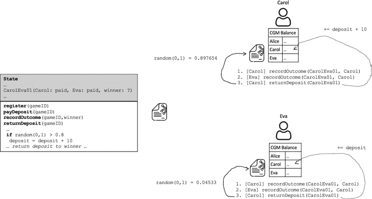

### 智能合约与随机数

智能合约与随机数的关系（参见图 4.5）。

## 4.3 链上、链外数据和智能合约预言

在上一节讨论区块链处理的数据类型时，我们简要提到了处理链外数据的需求。在本节中，我们将更深入地讨论这个问题。

为了提供链外数据的示例，我们再次扩展了 BC4C-M。在这个扩展的区块链（我们称之为 BC4C-M+）中，我们假设 CGM 代币变得非常流行。因此，出现了一个此类代币的市场。在实践中，这意味着 CGM 代币可以使用法币（如美元或欧元）在所谓的“交易所”（即加密货币市场）进行买卖。这反过来意味着以美元表示的 CGM 代币价格根据供需关系不断波动。基于这一前提，我们现在想以一种不同的方式设计 BC4C-M+ 智能合约。具体来说，我们希望保证玩家在游戏中获得的奖励不会超过 100 美元的等值：如果游戏结束时玩家支付的押金美元价值小于 100 美元，则将押金全额支付给胜利者；否则，将等值 100 美元的 CGM 代币支付给胜利者。剩余押金在两个玩家之间平分。

为了实现，该智能合约需要访问 CGM 代币的美元价格。这个价格不断波动，并且显然只在“链外”世界可用。因此，我们必须设计一种方法使其对智能合约可用。

不幸的是，这个问题没有许多解决方案。CGM 代币的美元价格只能由外部参与者提供，例如处理 CGM 代币的交易所（参见图 4.6）。虽然在技术上可行，但只有在满足以下两个条件时，才能接受这种解决方案：

1.  所有玩家（即区块链系统的节点）都信任交易所行为忠实，在需要时向智能合约报告正确的 CGM 代币价格。在实践中，这无法通过技术设计来强制执行。我们能做的最好是选择一个所有节点都可以信任的流行交易所。


2.  我们创建了一种机制，在需要时将这些信息注入智能合约中。最重要的一点是，该机制必须确保每次为了确定特定已结束游戏退还押金金额的智能合约调用，都能从加密货币交易所获得相同的 `CGM` 价格。只有这样，实际上，才能保证所有节点都能一致地更新 `BC4C-CGM+` 区块系统的状态。

虽然上述第二个属性的实现方式在不同的区块链系统中有所不同，但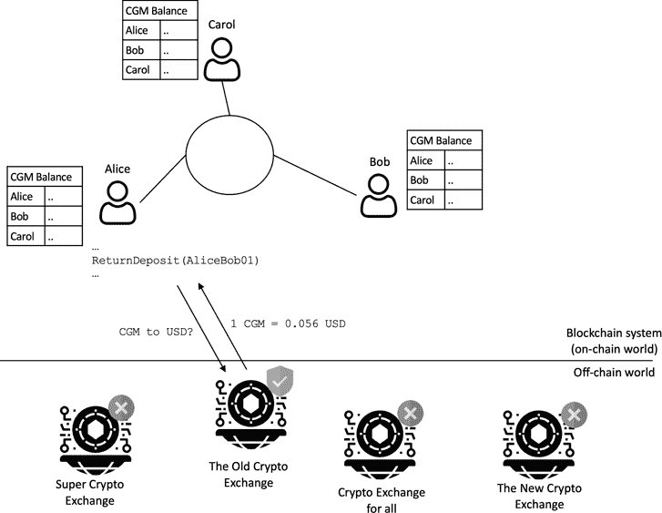

*图 4.6 获取链外可用数据的智能合约和预言机。

请注意，预言机（oracles）的使用似乎与我们一直以来推崇的区块链技术基本原则相矛盾，即避免中间机构和中心权威。可信任的加密交易所显然就是这样一个中介。然而，在不依赖预言机的情况下，我们无法做更多事情来解决这个问题。由于预言机的机能，对于一个使用预言机的区块链系统是否真的可以被称为区块链系统，目前也存在持续的争议。

抛开关于区块链系统本质的哲学争论不谈，预言机凸显了在区块链系统中管理链外数据的挑战性。请注意，在许多业务场景中，链外数据在业务参与者之间的信息和价值交换中起着基础作用。例如，让我们考虑一家保险公司。由于某个地理区域发生了龙卷风（或任何灾难性天气事件），客户可以在特定提交许多理赔。传统上，保险公司必须信任天气预报服务和/或自己的气象专家提供有关龙卷风的重要信息，例如发生的精确时间和地面路径。这使得保险公司能够评估理赔的真实性。如果在这种情况下采用区块链系统，那么节点（如客户、保险公司本身、独立专家等）必须选出一个可信任的预言机，为实现理赔管理应用逻辑的智能合约提供这些天气信息。

## 4.4 区块链系统的架构

为了给本书第一部分提出的与实现无关的区块链模型提供结构，我们在此提出了一个区块链系统的概念架构。通常，软件系统的架构通过计算组件以及这些组件之间的交互来定义该系统 [SG96]$。此处所提架构的目标是为本书后将讨论的具体区块链系统和应用建立一个共同的基础。事实上，根据需要，我们将扩展并定制该架构，以适应本书中所考虑的特定区块链系统实现。

区块链系统的概念架构如图 4.7 所示。为了结构化架构，我们使用了架构风格，这是一种高层次的结构化方法。我们的区块链系统架构结合了两种风格：分层风格和面向组件的架构风格 [Gref16a]$。分层通过将功能组织成几层功能抽象来定义信息系统的结构。面向组件的风格则通过将内内聚的功能分组组合到具有显式接口的组件中来提供结构。

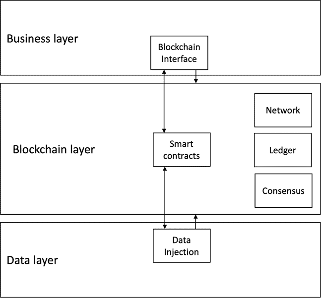

*图 4.7 区块链系统的概念架构。

该架构定义了业务层、区块链层和数据层：

*   区块链层位于中间，包含了我们在本书第一部分描述的区块链功能。
*   业务层位于区块链层之上。它使用区块链层的功能来实现业务用户实现特定业务目标所需的功能。
*   数据层位于区块链层之下。它包含了向区块链层提供实现业务层功能所需数据的功能。

虽然在图 4.7 中在概念上是分离的，但业务层和数据层通常可能指向区块链系统的同一组用户或客户端应用程序。事实上，业务层的用户也可能提供实现业务层功能所需的数据。

关于架构的组件，区块链层由三个内部组件组成，它们实现了在本章以及第 3 章中描述的功能。这些功能包括管理区块链网络（例如交易的泛播和验证）、管理分布式账本（例如存储交易和区块）以及执行共识机制。智能合约是区块链层中唯一的“活动”组件。事实上，它们可以被其他层直接调用，以执行特定的业务逻辑，或仅用于存储其执行所需的数据。业务层和数据层的功能分别聚合到一个组件中，即区块链接口组件和数据注入组件。这些组件可以通过两种方式与区块链层交互：

*   它们可以向区块链层发布交易。技术上，这是通过创建交易并将其转发给区块链节点的对等完成的。
*   它们可以直接调用区块链的智能合约。请注意，与智能合约的交互是双向的：智能合约实际上能够主动通知其他层，通常通过发射事件。例如，智能合约可以发射一个事件来信号其执行的结束。

为了展示该架构的投入价值，我们通过将该架构具体化为在本章中考虑的三种区块链来结束本章：`BC4C`、`BC4C-CGM` 和 `BC4C-CGM+`。

图 4.8 显示了 `BC4C`系统的具体实现。简单来说，该系统的唯一用户是棋手。他们同时使用业务层和数据层。一方面，系统允许玩家完成具有业务意义的操作，如开始新游戏和记录游戏结束。另一方面，系统从用户处收集完成业务操作所需的数据，即每局游戏中的的走法。该系统中没有智能合约。

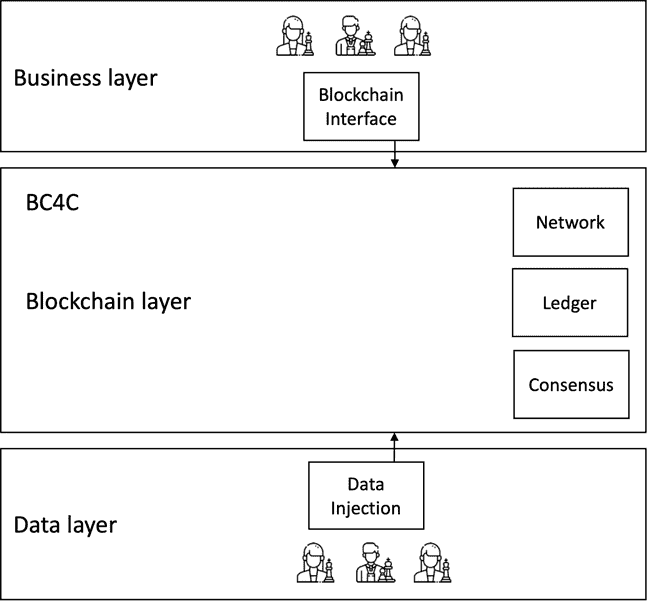

*图 4.8 BC4C 架构。]

图 4.9 显示了 `BC4C-CGM` 区块链架构的具体实现。与 BC4C 相比，区别在于区块链层中的智能合约。该智能实现了处理玩家押金所需的额外业务逻辑。

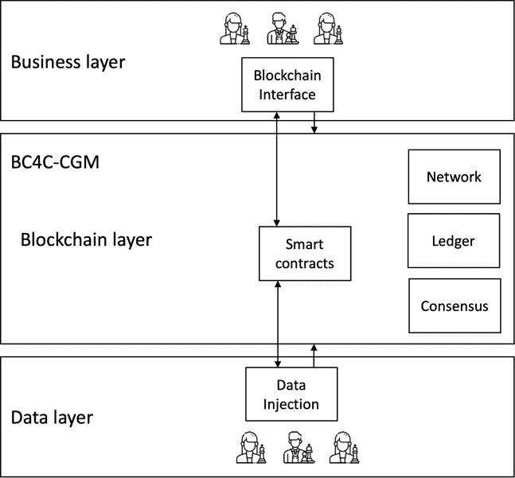

*图 4.9 BC4C-CGM 架构。]


最后，图 4.10 展示了 BC4C-CGM+ 区块链架构的具体实现。与 BC4C-CGM 系统相比，区别在于数据层。在数据层中，加密交易所是一个新的客户端应用程序。它使用数据注入函数向区块链层注入 CGM 代币汇率。这是智能合约正确实现向业务层提供的功能所需的（例如，正确计算给游戏胜者的押金回扣）。

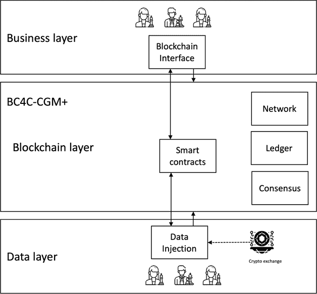

图 4.10 BC4C-CGM+ 架构。

## 4.5 案例研究：智能合约的原始定义

“智能合约”一词由密码学家、法律学者尼克·萨博（Nick Szabo）在一篇最初写于 1994 年、于 1996 年修订的文章中提出的 [Sza94]。首先，文章赞扬了普通合同法的稳健性，该法律几个世纪以来一直在规范商业和其他类型的协议（例如，婚姻）。然后，萨博引入了合约“智能性”的概念，即认为合同条款可以“嵌入到我们所处理的硬件和软件中”的理念。

作为智能合约最简单的例子，文章提到了自动售货机。只要客户向自动售货机投入了足够的资金，供应商与客户之间的合同（即合同双方）就会执行：自动售货机交付产品，并在需要时退回找零。自动售货机的程序被设定为精确执行合同条款。客户无法从物理上停止合同的执行。换句话说，供应商与客户之间的合同是通过“设计”嵌入到自动售货机硬件中的。

随后，萨博讨论了可以使用什么技术将“智能性”实现到合约。有趣的是，萨博的智能合约构建在“密码构建块”之上，例如签名和验证与合约执行相关的数字消息的密钥。文章讨论的工具范围还包括更中心化的解决方案，例如公共数字公证员。这些可以证明合同双方的履行情况（基于与合约执行相关的数字签名消息所提供的证据）。

在合约设计方面，文章列出了通常定义现实世界中“设计良好”合约的四个原则：

*   **可观测性 (Observability)**：双方应当能够观察对方的与合约相关的履行情况。
*   **可验证性 (Verifiability)**：双方在发生违约行为时应有能力证明违约的发生。
*   **相对性 (Privity)**：有关合约内容和双方履行的信息应仅在必要范围内分发给双方及其他方。
*   **可执行性 (Enforceability)**：应该有一种方法强制双方履行合约条款。

普通合同法通常需要第三方和中心权威来实现上述原则。例如，当一方声称另一方未按照合约条款履行合同时，会引入仲裁员来解决纠纷（涉及“可验证性”问题）。然而，为了履行其职责，仲裁员可能需要访问有关双方的私有信息（“相对性”）。他们还可能依赖警察机关来强制双方履行（“可执行性”）。

在此背景下，值得注意的是，我们在本章讨论的区块链智能合约在设计上实现了上述四个原则中的三个：

*   **可观测性**：双方（即使用智能合约的区块链节点）与智能合约之间的所有交互在记录在不可篡账本交易中都是完全透明且可观测的。由于每笔交易都由其发起者进行数字签名，因此节点无法否认交易。
*   **可验证性**：由于双方与智能合约的所有交互都是可见的，任何违约尝试都是可观测的。但请注意，智能合约将拒绝任何不符合要求的交互。例如，在 BC4C-CGM 中，节点可以验证玩家在游戏开始前是否支付了押金。
*   **可执行性**：区块链智能合约在设计上是可执行的。正如本章所示，它每当被调用时都会执行业务逻辑。此外，由于智能合约的代码交付在不可篡账本中，系统的任何节点都无法修改它（即尝试强制执行不同的业务逻辑）。

智能合约似乎未能实现的一个原则是“相对性”。区块链系统中任何节点与智能合约的交互对其他人都是已知的，因为记录在不可篡账本中。因此，区块链系统中的节点（或一组节点）几乎无法隐藏其与智能合约的交互。例如，在 BC4C-CGM 系统中，所有节点都确切知道哪个玩家赢了游戏以及押金何时退还。

当智能合约部署在公共区块链系统时，实现相对性是挑战性的。事实上，如果任何人都可以加入公共区块链，那么加入的人就必须能够知道系统的当前状态。这是通过提供对系统中部署的智能合约及其调用历史的完全访问来实现。在私有区块链系统中可以实现更多合约相对性（参见第 7 章）。例如，私有区块链系统允许创建只有特定节点可以订阅的不同“子通道”。智能合约只能部署在特定的子通道中，从而限制了它们的可见性。


通常情况下，在普通法合同中，实际上无法预见到所有可能源于合同的隐藏行为。因此，解决此问题的最佳方法是制定法规，引导或强制合同双方在合同中包含特定条款，并/或遵循特定的执行机制。关于 PoS 系统的例子，更广泛地说，关于管理服务客户提供的数据的问题，欧盟的《通用数据保护条例》（`GDPR`，`https://gdpr.eu`）以及世界其他地区的类似努力，可以被视为此类监管规定。GDPR 迫使合同双方考虑（例如）客户要求服务提供商删除其所提供的数据的权利。

在区块链智能合约中，隐藏行为在实践中可能会变得可观测。由于区块链系统中每个智能合约的代码对所有节点都是可见的，智能合约的每项操作只需通过分析智能合约代码就是完全可观测且可预测的。因此，智能合约无法采取对区块链系统节点保持隐蔽的操作。例如，在 `BC4C-CGM` 系统中，检查智能合约代码可以揭示智能合约是否会秘密地恶意行为，例如向勾结节点支付隐藏奖励，或者智能合约是否正在向广告商收集并出售有关游戏的数据。

总结来说，本章讨论的区块链智能合约代表了尼克·萨博（Nick Szabo）近 30 年前在其开基性文章中设想的智能合约实现。虽然萨博也设想了智能合约实现的中心化机制，但区块链智能合约专注于智能合约的完全去中心化实现。

## 4.6 结论

本章介绍了区块链智能合约的概念。智能合约是根据交易提供的输入操作区块链状态的计算机程序。它们可以执行任意业务逻辑，涉及随机数的逻辑除外。智能合约中的随机性会防止节点在执行时实现一致的状态更新。我们讨论了如何将链外数据纳入智能合约。概念通过 `BC4C` 区块链的演进得到了示例：`BC4C-CGM` 包含一个处理玩家为开始游戏而支付押金的智能合约；`BC4C-CGM+` 是一种演进，其押金价值与 CGM 代币和法币之间的汇率挂钩。

本章结束了书的第一部分。除了提供加密所需的背景外，在本章中使用独立于任何特定实现的模型解释了区块链和智能合约的概念。在本章末尾，我们通过引入区块链系统的通用架构结束了第一部分的介绍。该架构将前四章引入的区块链元素整合到一个单一的概念框架中。它贯穿全书，为我们将讨论的区块链具体应用提供结构。书的第二部分重点关注这些具体应用。我们介绍了比特币（一种加密货币）、以太坊（同样提供智能合约的加密货币）以及开发私有区块链的其他框架，最后，我们特别关注区块链在物联网（IoT）中的应用。

## 4.7 问题与练习

1. 你你识别的区块链应用场景来回答[第三章中的问题 1。讨论如何使用智能合约来改进或扩展区块链在每个场景中的应用。

2. 尽管智能合约无法处理随机数，但仍然采用智能合约来解决特定问题。考虑表 1 所示的 `BC4C-CGM` 实例：

| 交易 ID | 交易 | 发起者 |
| :--- | :--- | :--- |
| T789 | ... | Cris |
| T790 | CreateGame | Sung |
| T791 | PayDeposit | Sung |
| T792 | PayDeposit | Leo |
| T793 | PayDeposit | Leo |
| T794 | register() | Leo |
| T795 | ... | Min |
| T796 | PayDeposit | Sung |
| T797 | ... | Sung |
| T798 | ConfirmMove | Diego |
| T799 | ConfirmMove | Cris |
| T800 | CreateGame | Min |

**用户的 CGM 余额：**
* Cris: 78
* Leo: 45
* Diego: 90
* Min: 45
* Sung: 89

**当前正在游戏 ID（即已确认并已支付押金）：**
* CrisLeo21
* DiegoMin4
* SungCris23

**已确认但等待支付押金的游戏 ID：**
* CrisLeo22（未支付押金）
* LeoSung7（仅 Leo 支付了押金）
* LeoMin5（仅 Leo 支付了押金）

**已提议但未被对方确认的游戏 ID：**
* SungCris87

考虑以下假设：
1. 所有游戏的押金均固定为 5 个 CGM 代币。
2. 处理押金的智能合约（SC）比本章介绍的要“聪明”一点。它仅有一个函数 `payDeposit(gameID)`。调用此函数的交易发起者使用它来支付该游戏的押金。
3. SC 监控区块链状态，并自动知道新游戏何时被确认，最重要的是，它知道新游戏何时结束，即在对方确认了将死走法之后。当游戏结束时，SC 立即将押金退给获胜者。换句话说，假设 SC 不具备 `register()` 和 `recordOutcome()` 函数。

回答以下问题：
1. 有一笔交易存在错误，即它记录了已经发生的事情，是哪一个？
2. 忽略你在问题 1 中识别出的错误交易，在交易 T800 之后，该区块链的新状态是什么？

3. 你识别的区块链应用场景来回答第三章中的问题 1。讨论如何使用智能合约来改进或扩展区块链在每个场景中的应用。

4. 提供论文中两组不同的引言列表：(i) 支持智能合约中心化机制的引言，(ii) 支持智能合约去中心化实现的引言。


2. 更多 关于使用预言机处理链外数据的挑战将在第 6 章中进行讨论，该章节介绍了以太坊中智能合约的实现问题。

# 第二部分 区块平台——提供区块链功能的系统

DOI: [10.4324/9781003321187-6](http://doi.org/10.4324/9781003321187-6)

在本书的第一部分中，我们把区块链视为一种机制。具体来说，区块链是一种在一组业务伙伴之间建立信任的机制，这些伙伴面临着交换价值价值资产和信息的需求，但并不一定相互信任。我们已经展示了这种机制是由一组加密工具实现的，我们在介绍这些工具时尽可能地避免了过具技术性的细节。在第一部分的所有讨论中，我们都始终保持与实现无关的观点。

在第二部分中，我们将观察区块链机制是如何实现到真实的区块链系统中的。为了这一目标，我们必须放弃与实现无关的观点，并且研究不同区块链技术的实现细节。我们首先讨论最著名的（公共）区块链系统示例，你们大多数可能已经在新闻中听过它们：比特币和以太坊，分别在第 5 章和第 6 章中介绍。然后，在第 7 章中，我们将讨论私有区块链的特殊性以及如何构建私有区块链系统。具体而言，我们讨论了以太坊如何也能用于私有链，并额外介绍了两个构建私有链的框架：Corda 和 Hyperledger Fabric。最后，在第 8 章中，我们将详细研究区块链与物联网（IoT）技术的关系。在此背景下，我们介绍了另一个区块链框架 IOTA，它是专门为实现处理物联网数据的区块链系统而创建的。

# 5 比特币与公共区块链

DOI: [10.4324/9781003321187-7](http://doi.org/10.4324/9781003321187-7)

## 5.1 比特币网络

比特币是最著名的加密货币。它由一位匿名作者（或小组）于 2008 年底创建，该作者以中本聪（Satoshi Nakamoto）的笔名发表了白皮书[Nak08]。从那时起，这个作为先驱计算项目的项目已成为影响全球经济的世界现象。

比特币是一个公共区块链。它也是一个加密货币系统。这意味着比特币区块链记录了用户之间数字代币的交换。因此，比特币区块链的状态由所有用户持有的这种数字代币的余额（即他们拥有的代币数量）在全球市场中（例如加密交易所和其他投资平台），比特币的计量单位为“BTC”。因此，在本章的剩余部分，我们将比特币区块链的数字代币简单地称为“BTC”或“比特币”。正如我们在第 3 章中简要提到的，比特币是一个公共区块链。任何人都可以从 [`bitcoin.org`](https://bitcoin.org) 下载运行比特币节点所需的软件，将其安装在连接互联网的计算机上，并运行比特币网络的节点。

除了主比特币网络外，还有一个比特币测试网络。测试网络允许与类似于比特币区块链的区块链进行交互，而无需使用“真实的”比特币。它是为了好奇的用户部署的，但最重要的是为了那些需要测试使用比特币区块链应用程序的开发者，例如数字钱包。测试网络的节点运行与主网络完全相同的协议。测试网络比主网络小，也就是说它的节点数量较少。另一个主要区别在于比特币代币的性质：测试网络中使用的代币是虚假的。它们在现实世界中没有价值。节点甚至可以随意向特殊账户请求这些代币。运行测试网络节点可以是获得使用比特币区块链的一种良好体验。

比特币网络的节点与一个唯一的私钥、公钥和地址相关（见图 5.1）。

![图 5.1 比特币网络中的私钥、公钥和地址。(images/Fig05_01.jpg)*图 5.1 比特币网络中的私钥、公钥和地址。私钥 `k` 在启动新节点时创建。节点用它对在比特币区块链上发布的交易进行签名。比特币私钥长度为 256 位。因此，创建一个比特币私钥意味着在 1 到 `2²⁵⁶` 之间随机选取一个数字。选取这个数字并不重要，只要它是不可预测且不可重复的即可。节点在任何时候都不能向任何人泄露其私钥。因此，使用易重复的算法生成私钥将是非常安全的。获取了我们私钥的黑客实际上可以代表我们签署转移我们比特币的交易。账户所有者必须小心存储私钥。如果我们丢失或忘记了私钥，就再无法使用我们的比特币了。比特币中没有“忘记密码？”按钮！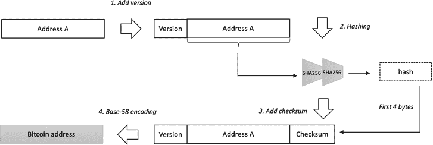

*图 5.2 为了提高人类可读性的比特币地址编码（Base58-check）。

节点的公钥 `K` 使用椭圆曲线乘法从其私钥生成。比特币区块链采用的数字签名机制实际上是椭圆曲线密码（见第 2 章）。其他节点使用公钥来验证节点发起的交易。为了实现这一点，起源者的公钥通常在节点发起的每笔交易中。注意，公钥由所有者分发以启用数字签名机制。如图 5.1 所示，在任何加密系统中，从相应的公钥 `K` 推导出私钥 `k` 实际上是不可能的。

最后，使用加密哈希函数从公钥导出比特币地址。比特币地址实际上相当于银行账户详情，例如欧洲 SEPA 系统中的 IBAN 代码或英国的账户号码和排序代码组合。用户将比特币地址发送给需要向他们发送比特币的用户。更详细的说明（见图 5.1），比特币地址 A 通过双重加密哈希函数从公钥 K 导出：

```
A = RIPMD160(SHA256(K))
```

也就是说，地址 A 是通过对公钥应用 `SHA256` 哈希函数，然后对后者的输出应用 `RIPMD160` 哈希函数得到的。正如我们在第 2 章中所知，此操作返回一个 160 位的数字。


为了方便人类理解，比特币地址通常使用所谓的“Base-58-check”编码（参见图 5.2）。在用比特币的`Base-58` 编码 `A` 之前，会在 `A` 的开头添加一个版本号，用于标识与该地址相关的账户类型。例如，版本值‘1’标识我们在本章中主要考虑的普通比特币账户。版本值‘m’或‘n’标识比特币测试网络的普通账户。版本值‘3’标识“脚本脚本支付”（pay-to-script）账户。这些是不由人类用户控制的自动化账户，我们不会在本书中讨论这类账户（如果你感兴趣，关于比特币协议的更多技术细节在[Ant17\]中有详细介绍）。然后，带有版本号的地址 `A` 将经过双哈希（`SHA256`）操作。该哈希结果的前 4 个字节（32 位）作为校验和附加到地址 `A` 上。最后，版本号、地址 `A` 和校验和的序列使用在第 2 章中讨论的比特币`Base-58`编码。该编码的结果就是钱包和其他应用程序常用的节点比特币地址。

比特币地址的 Base-58-check 编码实现了两个目标：

*   首先，它产生了紧凑且易于人类的地址（得益于`Base-58`编码，它产生的数字比`Base-16`和`Base-64`更短且更易读）。
*   其次，它嵌入了验证地址正确性的安全机制。比特币地址包含其哈希的前 16 位。因此，这些位可以判断地址是否正确。通过这种方式，每个处理比特币交易的软件应用程序都可以通过验证校验和的正确性来快速验证比特币地址的正确性。

## 5.2 比特交易

比特币是一种加密货币。如第 3 章所示，加密货币系统的状态由系统中所有节点的余额捕捉。这种状态通过节点发布的交易进行修改。本节详细讨论了比特币交易的结构。隐含地，比特币交易的结构也定义了比特币网络如何跟踪系统状态。更详细地，讨论分为两个部分。首先，我们讨论比特币交易的主要内容，旨在理解比特币区块链如何管理节点余额(第 5.2.1 节）。然后，我们讨论比特币交易如何由其源节点进行数字签名(第 5.2.2 节）。

### 5.2.1 比特中的交易与节点余额

比特币节点通过发布交易进行交互。交易代表了比特币区块链节点之间比特币的交换。图 5.3 展示了从比特币“浏览器”中获取的真实比特币交易的内容。公共区块链的浏览器是一个公共网站，发布发布区块链中发布的交易和区块的相关信息。它通常由具有高可用性的节点或一组节点运行，即它们通常不会断开区块链网络。对于每个公共区块链，在线通常有几个浏览器可供。在本书中，我们关注交易中包含的主要信息。理解交易中其他非常具体的字段需要超出本书范围的比特币协议技术知识。

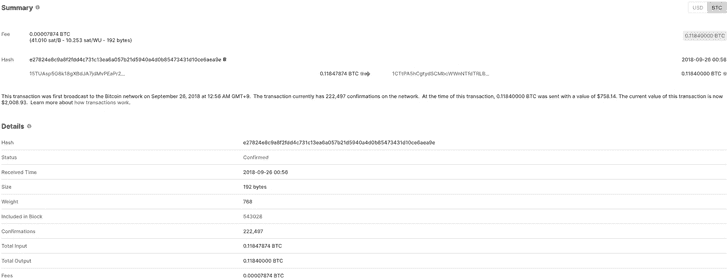

*图 5.3* 由 [blockchain.com/explorer](http://blockchain.com/) 详述的真实比特币交易内容（一个发送者，一个接收者）。可用地址：[`www.blockchain.com/btc/tx/e27824e8c9a8f2fdd4c731c13ea6a057b21d5940a4d0b85473431d10ce6aea9e`](https://www.blockchain.com/)。

在这笔交易中，一个发送者（由地址‘15TUAsp…’标识）向一个接收者（由地址‘1CTtPA5…’标识）发送了一些比特币（准确来说是 0.1184 BTC）。注意两个地址都以‘1’开头。这告诉我们发送者和接收者都是普通用户（例如，而不是比特币测试网络的用户）。该交易有一个唯一的标识符（其哈希为‘e27824…’），并被包含在区块 n.543028 中。交易包含“费用”，其计算方法为输入（0.11847874 BTC）与输出之间的差值。


为了理解比特币是如何管理节点余额的，我们需要查看比特币交易中包含的实际数据。实际上，图 5.3 和 5.4 并没有显示比特币交易的实际内容。它们展示的是由比特币浏览器对交易内容进行的类人可读详述。

图 5.5 以机器可读格式展示了图 5.3 中交易的内容，即比特币网络节点之间交换的实际交易数据。对于计算机科学家来说，图 5.5 显示了该交易的`JSON` 格式。在图 5.5 中，图 5.3 中显示的许多信息都没有痕迹。例如，总输入在哪里？总输出在哪里？交易费在哪里？

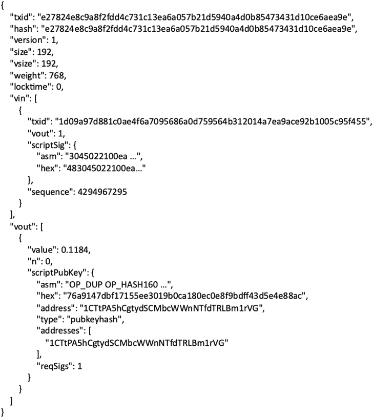

图 5.5 图 5.3 交易的机器可读内容。

图 5.3 详述中可用的部分信息在图 5.5 的机器可读格式中也可以轻松获取，例如交易 ID（`txid`）或交易的字节大小（`size`）。这些信息基本上涉及交易的所谓元数据。它并不是关于通过此笔交易发生所有权变化的比特币实际金额的信息。要理解后者，我们需要查看图 5.5 机器可读格式中的 `vin` 和 `vout` 元素。嵌套在 `vout` 之中的 `value` 元素似乎与图 5.3 中交易的总输出值（0.1184 比特币）匹配。此外，`vout` 的 `address` 元素匹配类人可读格式中该交易的接收者。`vin` 元素似乎描述了该交易的输入。然而，它不包含任何实际值。它仅指向另一个交易（通过交易 ID `1d09a9…` 识别）以及该交易的一个 `vout` 元素（即 id 等于 1 的那个）。图 5.6 显示了由该 `vin` 元素引用的交易内容（见开头匹配的交易 ID `1d09a0…`）。我们可以看到这笔交易有两个 `vout` 元素（id `n` 等于 0 和 1）。`n = 1` 的 `vout` 元素值为 0.11847874（即图 5.5 交易的总输入），并与地址 `15TUAsp…` 关联（即图 5.5 交易中比特币的发送者）。

在对机器可读交易的世界进行了简短旅行后，我们现在准备好理解比特币区块链的状态是如何定义和管理的。比特币创建并消耗所谓的交易输出。具体来说，一笔交易作为输出产生一个或多个交易输出，并作为输入消耗过去产生的一个或多个交易输出。交易产生的每个交易输出与比特币网络的一个节点（即比特币地址）相关。我们说该节点控制该输出。创建交易时有一个基本规则：其所有输出的总和必须低于其所有输入的总和。对于可以输入的数量、可以产生的输出数量或输出值，没有特定的规则。最后，交易使用的输入总和与产生的输出总和之间的差额是交易者支付的费用。

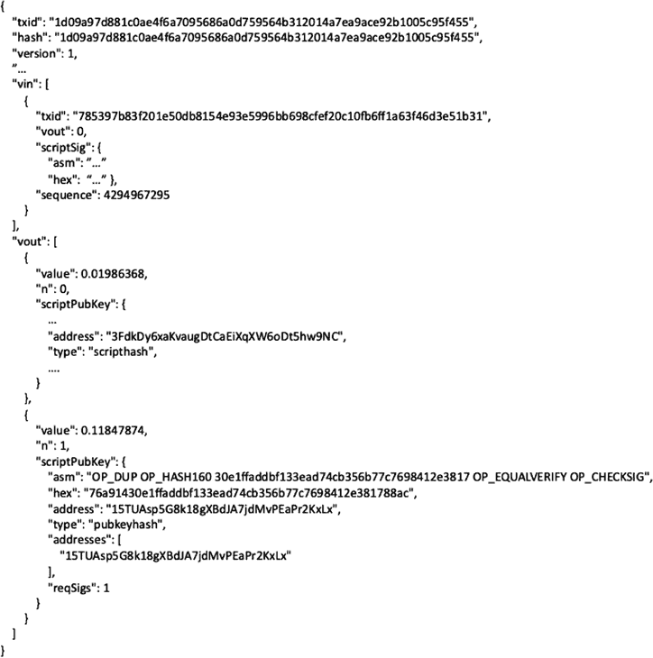

图 5.6 机器可读格式的比特币交易。

一笔交易产生且尚未被任何其他交易作为输入的输出，被称为 `UTXO`（未花费输出）。比特币网络节点的余额由所有 `UTXO` 的总和决定。

### UTXO 机制

比特币网络节点的余额由所有 `UTXO` 的总和决定。因此，区块链的状态由所有 `UTXO` 定义。（此处由于原文存在重复段落）在实践中，比特币交易的输入和输出可以通过与纸钞进行类比来理解：

- 一笔交易产生且尚未被任何其他交易作为插入输出，被称为 `UTXO`（未花费输出）。比特币网络节点的余额由所有 `UTXO` 的总和决定。因此，区块链的状态由所有 `UTXO` 定义。
- 在实践中，比特币交易的输入和输出可以通过与纸钞进行类比来理解：
    - 一笔交易产生且尚未被任何其他交易作为插入输出，被称为 `UTXO`（未花费输出）。比特币网络节点的余额由所有 `UTXO` 的总和决定。因此，区块链的状态由所有 `UTXO` 定义。
    - 在实践中，比特币交易的输入和输出可以通过与纸钞进行类比来理解：
        - 一笔交易产生且尚未被任何其他交易作为插入输出，被称为 `UTXO`（未花费输出）。比特币网络节点的余额由所有 `UTXO` 的总和决定。因此，区块链的状态由所有 `UTXO` 定义。

UTXO 机制的更详尽的示例见图 5.7。在示例中，我们从只有 `T1` 和 `T2` 包含 `UTXO` 的情况开始（Alice 控制 33 个代币，Bob 4 个，Emma 0 个）。交易 `T3` 消耗了 `T1` 和 `T2` 中的两个 `UTXO`（`T1` 的 `n=0` 输出和 `T2` 的 `n=0` 输出），并产生了两个新的 `UTXO`。根据 `T3` 中新 `UTXO` 的值，结果是 Alice 向 Emma 转账了 27 个代币。最后，使用 `T4` 从 Bob 向 Emma 转账了额外的 2 个代币。

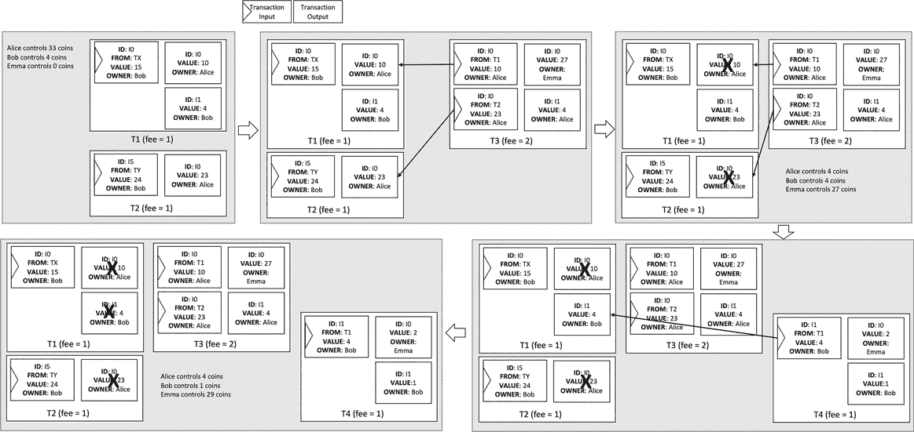

图 5.7 比特币的输入和输出：简化示例。

### 5.2.2 比特币交易的数字签名

在理解了比特币交易如何定义比特币的状态（即节点余额）之后，我们现在可以关注比特币交易是如何进行数字签名的。在第 3 章中讨论加密货币系统（例如 `CGM` 代币）时，我们提到此类系统的每笔交易都由其发起者数字签名。然而，我们在第 3 章中考虑的交易比本章描述的比特币交易要简单。在第 3 章中，我们实际上假设一笔交易将加密货币从一个发送节点转移到一个接收节点。然而，在比特币区块链中：(i) 交易并没有简单指定两个用户之间的转账金额，而是结合了其他交易的交易输入；(ii) 它们甚至可以在许多节点之间传输比特币（见图 5.4）。

那么，在实践中比特币交易是如何进行数字签名的呢？

在比特币中，被数字签名的“基础单元”是 `UTXO` 而不是整体。在交易中使用时，`UTXO` 必须经过数字签名。在这种情况下，签名者是控制 `UTXO` 的节点，而不是交易的发起者。详细来说，发生了以下情况：


*   由交易产生的每个 UTXO 都由一个节点控制（通过生成该 UTXO 的交易中相应的 `vout` 元素中的 `address` 元素识别）。
*   每个 UTXO 还与一个所谓的“密码谜题”相关（由 UTXO 的 `scriptPubKey` 元素识别）。
*   理解密码谜题的本质以及如何“解决”它需要超出本书涵盖范围的密码学工具知识。对于我们来说，只需知道：
    *   密码谜题只能由控制 UTXO 的节点使用其私钥来求解。我们说一个 UTXO 被密码谜题“锁定”了，并且只能由控制它的节点使用其私钥来“解锁”。
    *   其他所有节点都可以使用该节点的公钥来验证该节点提供的用于解锁 UTXO 的解的正确性。
*   当一个控制 UTXO 的节点想要将该 UTXO 作为交易的输入时，该节点通过在输入中提供密码谜题的解来解锁它（参见图 5.5 所示在其中 `scriptSig` 元素包含了密码谜题的解，只有控制该 UTXO 的节点可以使用其私钥计算出来）。然而，得益于非对称加密的力量，其他所有节点都可以验证所提供的谜题解的正确性。这是通过该节点的公钥实现的（该公钥通常也包含在交易中，尽管为了简洁在图 5.5](#C_009_c5.xhtml#f5_5)中未显示）。注意，这种验证是由比特币网络的每个节点在验证交易时完成的。同样的机制也适用于包含多个节点输入的交易：要使用另一个交易中的输出，节点必须使用其私签名对其解锁；其他所有节点随后使用该节点的公钥验证所提供的解。

总结一下，在比特币中，交易并不是由发起者整体进行数字签名。相反，每个 UTXO 在作为另一个交易的输入时，必须由其所有进行数字签名。在实践中，这是通过提供密码谜题的解来实现的。该解只能由 UTXO 所有者使用其私钥计算，并由任何其他节点使用所有者的公钥进行验证。根据第 2 章中讨论的内容，这种机制显然是一种数字签名机制：密码谜题的解代表了交易输入的“数字签名”，可以被其他所有节点验证。

## 5.3 作为数据结构的比特币区块链：比特币账本

在上一节中，我们讨论了比特币交易的结构。我们已经理解到，特别是在其数字签名的方式方面，比特币交易与我们在第 3 章中与实现的讨论中介绍的交易相当不同。尽管如此，刻区块链系统中交易的原则仍然适用：比特币交易指定了加密货币代的转移；每笔转移都由转移资金的所有者进行数字签名。

在本节中，我们关注作为数据结构的比特币。也就是说，我们讨论了比特币账本的结构。正如我们在第 3 章中所学的，这是比特币网络中每个节点都复制的数据结构。共识协议的规则（在下一节介绍）允许节点在任何时候对该数据的内容达成一致。幸运的是，与交易不同，比特币账本与我们在第 3 章中介绍的与实现的区块链数据结构非常相似。

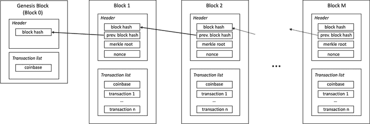

*图 5.8 比特币账本的结构。

图 5.8 显示了比特币账本的高级结构。它是一个区块链。意意外的是，每个区块都包含一个头部和一个交易列表。头部包含以下重要字段：

*   `区块哈希 (hash of the block)`：这是区块内容的 `SHA256` 哈希值。正如我们在第 2 章中所了解的，由于哈希值对于生成产生的数据在实践上是唯一的，因此区块哈希也被用作区块的唯一 ID。
*   `区块高度 (block height)`：这是一个标识区块的递增数字。创世区块的高度为 0。
*   `前一个区块的哈希 (hash of the previous block)`：正如我们在第 3 章中讨论的，在区块中包含前一个区块的哈希保证了区块链数据结构的不可变性。
*   `Merkle 根 (Merkle root)`：该值根据存储属于此区块交易的数据结构计算得出。我们在这书中书中详细讨论比特币区块链的这方面。只需知道这是一个重要信息，节点用它快速验证给定交易（通过其唯一 ID 识别）是否属于某个区块即可。
*   `随机数 (nonce)`：这是一个整数。该整数的值是由支撑共识机制执行的“区块挖矿”过程设置的。从比特币区块链运行的角度（即代币转移和状态更新）来看，它没有特殊意义。关于 `nonce` 值如何计算的更多详细信息将在下一节中讨论。

图 5.9 显示了由比特币浏览器列出的真实比特币区块链区块头部信息。该特定区块的高度为 738656，它于 2022 年 5 月 31 日 11:30 创建（挖出）。该区块包含 1,758 笔交易。

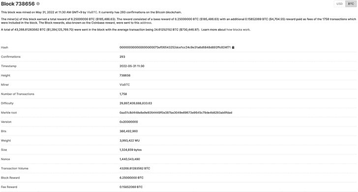

*图 5.9 真实的比特币区块头部。可用地址：https://www.blockchain.com/btc/block/000000000000000000073ef06543252dce1cc24c9e31a6d6848d892ffc824f71](https://www.blockchain.com/)

一个区块包含许多交易，通常是几笔。每个区块的第一笔交易都是特殊的。它被称为 `coinbase` 交易，值得进行更详细的讨论。

`coinbase` 交易不使用任何 UTXO 作为输入。它在输出中产生一个 UTXO，其价值等于区块内包含的所有交易支付的手费总和，外加固定数量的比特币（即“固定奖励”）。固定奖励的值由比特币协议确定。目前为 6.25 BTC。在 `coinbase` 交易中包含固定奖励的动机，以及比特币协议随时间更新这种固定奖励的方式超出了本书的范围。简而言之，这与设计固定供应货币的愿景有关，这应该防止价格通胀。

控制由 `coinbase` 交易产生的 UTXO 的节点是挖掘该 coinbase 所属区块的节点。图 5.10 显示了图 5.9](#C_009_c5.xhtml#f5_9)所示区块的 coinbase 交易。可以看到它创建了一个约 6.4 BTC 的交易输出，由节点 `18cBE…`（即该区块的矿工）控制。

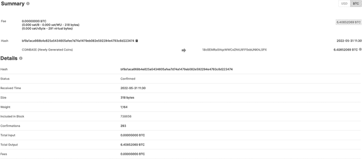


图 5.10 区块 738656 的 coinbase 交易（币币交易）详情。访问地址：[`www.blockchain.com/btc/tx/bf9a1aca668b4e825a5434605afee7d74a1479eb082e592294e4793c6d223474`](https://www.blockchain.com/)。

现在，在区块中添加 coinbase 交易的意义是什么？根据我们上面的讨论，coinbase 交易的作用有两个：

1. 它允许挖掘该区块的节点收集包含在区块中的所有交易的手续费。
2. 它为挖掘该区块的节点提供额外固定数量的比特币作为奖励。注意，该奖励非常高（目前为 6.25 BTC）。

总结来说，coin 交易为挖掘区块的节点提供了一种货币激励。关于节点挖掘新区块激励机制的更多内容，将在下一节介绍比特币共识机制时进行讨论。

在讨论比特币共识机制之前，让我们通过展示比特币区块链的创世区块结束结束节（参见图 5.11）。该区块创建于 2009 年 1 月 3 日。它只包含一个 coinbase 交易（事实上，当时没有其他可以花费的带有 UTXO 的交易！）。这笔交易将 50 个新创建的比特币分配给了节点‘1A1zP…’。这 50 个比特币是首次创建的。自 2009 年 1 月 3 日以来，比特币区块链一直稳定运行，平均每十分分钟创建一个新区块。比特币网络中每个的区块的完整历史都存储在每个比特币节点的不可变账本中。任何人都可以通过任何在线比特币浏览器随时查询。关于比特币历史的更多内容将在本章的最后一节进行讨论。

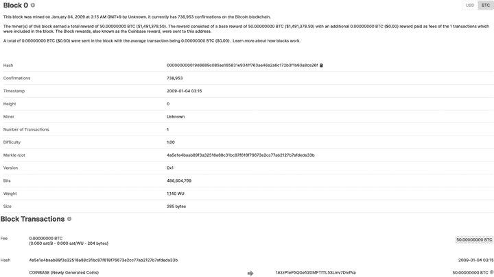

图 5.11 比特币区块链的创世区块。访问地址：[`www.blockchain.com/btc/block/0`](https://www.blockchain.com/)。

## 5.4 比特币共识机制

比特币区块链的节点需要一种共识机制对比特币账本的内容达成一致。同意比特币账本的状态意味着同意哪些区块被添加其中以及以什么顺序添加。由于区块包含了按时间排序的交易，同意区块的顺序意味着同意在比特币网络上发布的交易的顺序。通过上一节描述的 UTXO 机制，知道交易的顺序就可以建立每个节点的余额。节点的余额实际上是该节点控制的 UTXO 价值之和。

比特币共识的核心是工作量证明（PoW）机制。PoW 是比特币区块链的定义特征之一。它在实践中通过挖掘新区块的机制实现（在本节的剩余部分和书中，我们实际上替使用‘PoW’和‘区块挖掘’这两个术语）。

我们将比特币共识机制的讨论分为三个部分。首先，我们讨论比特币交易的生命周期。这从高层上描述了一笔交易从由比特币网络节点发布到最终存储在每个节点本地账本副本的区块中所发生的过程。然后，我们深入研究节点用于组装新区块并将其广播到网络其他节点的机制。最后，我们更深入地研究所谓的新区块“挖掘”。具体而言，我们讨论了如何通过计算区块随机数 nonce 的正确值来创建节点。

### 5.4.1 比特币交易的生命周期

我们将比特币交易的生命周期分为两个阶段。第一阶段（参见图 5.12a）涉及交易在比特币网络节点间的创建和传播（gossiping）。第二阶段（参见图 5.12b）涉及将交易包含在新区块中以及该区块的传播：

![图 5.12 比特币交易的生命周期。(a) 新交易的传播。(b) 新区块的传播。(images/Fig05_12.jpg)

图 5.12 比特币交易的生命周期。(a) 新交易的传播。(b) 新区块的传播。

* 交易 `T` 首先由一个节点创建并发送给其对等节点。图 5.12a 显示了一个节点发布的两笔交易，一个是有效的，另一个无效的。在后续部分，我们关注有效的那个。
* 每个对等节点验证交易 `T`，如果通过了验证：(i) 将 `T` 转发给其对等节点并在(ii) 将验证过的交易 `T` 存储在名为“内存池”（memory pool）的本地交易库中这种机制在节点之间是递归的。通过这种机制，有效的交易 `T` 到达所有节点。
* 节点对候选区块进行“挖掘”。如果成功，该节点成功创建了一个区块。如果新区块有效，节点：(i) 从内存池中移除其中的所有交易（包括 `T`），(ii) 将新区块转发给其对等节点。通过这种方式包含在有效区块中的验证交易 `T` 到达比特币网络的所有节点。这种验证的细节稍后讨论。

当验证交易 `T` 时，节点会验证以下内容：

* `T` 符合比特币协议规则。例如，这包括验证交易输入列表为空或每个输出是否与现有节点关联。节点还验证 `T` 使用的每个输入都经过了数字签名。
* `T` 的交易输入和大于交易输出之和。如果不是如此，事实上，`T` 试图强制创建不存在的比特币。这只能在组装区块时通过 coinbase 交易完成。
* `T` 中的每个交易输入都匹配过去发布的交易的 UTXO。

无效交易永远不会越过发布节点的对等节点范畴。因此，交易验证机制保证了在比特币网络节点间传播的所有交易都是有效的。有效交易由节点存储在所谓的“内存池”中。内存池中的交易是“未确认的”（unconfirmed）。这基本上意味着它们从未被包含在有效区块中。因此，它们有助于定义网络节点的余额。区块的验证和传播与交易类似。然而，为了详细理解它们，我们首先需要深入讨论矿工节点如何创建新区块。

### 5.4.2 创建新区块

在创建新区块时，节点必须解决以下三个问题：

1. 哪些交易应该包含在区块中？
2. 区块的 `nonce` 应该是多少？


### 3. 区块应该包含在账本的什么位置，即它的上一个区块应该是哪个？

事实上，一个区块首先包含一个交易列表（问题 1）。然而，为了完成区块头的构建，我们还需要知道 `nonce` 的值（问题 2）以及上一个区块的 `hash`（问题 3）。

关于第一个问题，新区块只能包含存储在节点内存池（memory pool）中的有效交易。由于在任何时刻，内存池中的交易数量都可能高于一个区块能包含的交易数量，因此节点必须选择将哪些交易包含在新区块中。在原则上，节点在选择包含在区块中的交易时没有任何特殊的限制。在实践中，节点通常会综合考虑交易支付的费用和创建的时间来选择交易：

*   节点倾向于优先选择时间戳较早的交易，即发布得更早的交易。事实上，这些是内存池中较旧的交易。这些交易对于验证新交易可能是必要的，因此它们应该尽快被包含在区块中。在某种程度上，在候选区块中包含较旧交易符合比特币网络的一个社会福利目标。事实上，这增加了新交易能够被验证的机会。
*   节点也偏好支付费用较高的交易。这是因为节点也有自私的倾向。区块中交易支付的费用（加上固定奖励）实际上实际上通过 `coinbase` 交易由挖掘新区块的节点收集的。因此，包含在区块中的交易费用越高，节点通过挖掘该区块获得的比特币就越多。请注意，挖掘新区块（即找到其正确的 `nonce`）并不是一项简单的任务。正如我们所看到的的，这需要时间，最重要的是，还需要大量的能量（电能）。因此，挖掘新区块的节点的自私性也源于它们必须为完成该操作而维持的开支需求。

一旦确定了要包含在区块中的交易列表，矿工节点必须决定哪一个是新区块的上一个区块，然后计算出一个正确的 `nonce`。要计算 `nonce`（问题 2），节点必须解决一个计算问题。该问题由区块包含的信息决定。最重要的是，计算该问题的解决方案需要大量的计算工作。更具体地说，这个计算问题具有给定的“难度”级别，该级别由比特币协议设置。难度级别决定了解决该问题平均所需的计算工作量。据此，也可以确定“平均”比特币节点解决该问题所需的预期时间。

关于该问题的细节、其难度以及如何解决，将在下一节中讨论。目前，理解新区块 `nonce` 计算的主要特征至关重要：它是“计算昂贵”的。这意味着节点需要消耗（大量的）计算资源，从而消耗电力，来创建一个新区块。请注意，节点使用的资源最终会变成货币资源，即支付运行计算工作所需电费的资金。由于节点像任何其他理性代理一样都不希望浪费资源，这种机制为节点创建了只组装有效新区块的激励。事实上，节点没有动力浪费计算资源（因此也是金钱）来创建无效的区块（这些区块因此永远不会被节点节点验证和广播）。这显然使比特币区块链在面对恶意攻击节点时更加健壮。

创建 `nonce` 所需的计算工作是 PoW 机制的第一个元素。PoW 中的“work”（工作）一词实际上指的是计算工作。换句话说，正确的 `nonce` 证明了矿工节点为了创建一个新区块运行了某种数量（大量的）计算工作。PoW 机制的第二个元素涉及选择新区块的上一个节点。这解决了上述列出的最后一个问题（问题 3）。

在这种情况下，比特币协议的规则非常简单：节点必须始终在其本地账本副本的链的顶端挖掘新的候选区块。更详细地说，新区块的上一个区块必须是矿工节点本地账本副本中具有最高高度（height）区块。为什么要选择高度最高的节点？其原因是为了扩展创建它时所执行的计算工作量之的链。如果一个新区块从最高点扩展本地账本，那么它扩展了本地账本中最长的区块链。根据定义，最长的区块链是比特币网络节点需要最多计算能力才能创建的链。

到这里，我们理解你可能会感到困惑。你可能在心里问许多问题中的一个根本性问题：为什么本地账本副本会有多个可以被扩展的链？根据第 3 章 中的讨论，账本不应该只包含一条区块链，且其顺序由区块链网络中的所有节点达成一致的吗？

这个问题显然是合理的。它的答案揭示了 (i) 比特账本中区块链的“分叉”（forks）概念，以及 (ii) 比特共识机制的概率性质。

为了回答这个问题，让我们考虑新区块的泛洪（gossiping）。比特币网络由数百万个节点组成，在任何时刻，其中许多（至少数百个）都在持续运行功能，尝试创建新区块。当一个矿工节点成功找到一个新区块时（即它解决了寻找正确 `nonce` 的计算问题），它会向同行广播该区块。如上述，新区块的泛洪类似于交易的泛洪：接收新区块的节点对其验证，如果验证成功，就会将其转发给同行。这样，有效的新区块就可以到达比特币网络的所有节点。为了验证新区块，节点验证：

*   区块格式正确。例如，它验证交易列表不为空并且包含一个 `coinbase` 交易。
*   区块头中的信息正确：例如，哈希值（区块和上一个区块的）必须正确，最重要的是，区块的 `nonce` 必须正确。验证 `nonce` 的正确性非常容易，将在节详细讨论。
*   `coinbase` 交易的内容有效，即它产生的输出与固定奖励加上区块中所有交易支付的费用之和相等。

现在，节点必须将有效的新区块存储到账本中。这意味着用新区块扩展当前的区块链。直觉上，你们大多数人可能认为这是理所当然的。如果区块链看起来像线性数据结构，那么新区块只需以唯一的方式扩展现有链：在最高区块之上添加一个区块。然而，这只是该阶段可能的情景之一。事实上，你应该考虑到，在任何时间，多个矿工节点可能成功找到新区块，并因此在比特币网络中进行泛洪。像交易一样，对于新区块我们也无法保证 (i) 在特定时刻，每个节点都收到了直到该时刻所有成功挖掘的新区块，以及 (ii) 所有节点接收新区块的顺序相同。


根据前一个区块哈希值的值，新区块可能会通过图 5.13 所示的四种可能情况之一，扩展节点本地账本中存储的当前链：

- **情况 1**：这是已经讨论过的情况。新区块的前一个区块是本地账本中最高的区块。因此，新区块扩展了本地账本中的最长链。
- **情况 2**：新区块的前一个区块不是最高的。这意味着新区块没有从顶部扩展本地区块链，而是创建了一个侧向的`‘分叉’ (fork)`，该分叉在未来可能会被其他区块扩展，也可能不会扩展。
- **情况 3**：新区块的前一个区块在本地账本中尚不存在（可能该节点尚未收到该区块）。在这种情况下，新区块不会立即扩展本地账本中的任何链（但如果未来该节点收到了缺失的区块，它可能会被扩展）。
- **情况 4**：新区块的前一个区块在某个高度上扩展了本地链，并且它也是已经收到的一个或多个区块所缺失的那个。这是情况 3 的扩展。在这种情况下，节点使用新区块以及之前收到的其他区块来扩展链。

注意，分叉（由情况 2 和情况 4 在图 5.13 中创建）通常只涉及本地账本中的最后几个区块。这是因为矿工节点总是创建一个新的候选区块来扩展其账本中的最长链。因此，新区块的前一个区块是一个非常老旧区块（深埋在区块链中）的情况极不利（而且在实践中是不可能的）。

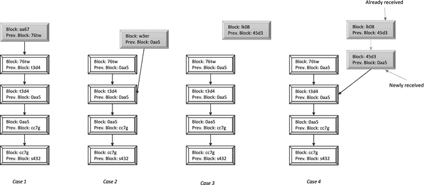

*图 5.13 使用新的有效区块扩展本地账本。为了简单起见，区块通过四个字符哈希值标识。]

上述讨论的四种情况为比特币共识机制的若干方面提供了说明，这些方面可能直到现在对你们许多人来说仍然不明。更详细地来说：

- 现在应该清楚我们之前的意思了，即矿工节点必须创建一个扩展最长链的新区块。在实践中，在本地账本中由（可能的）分叉决定的许多链中，矿工节点必须始终使用最长链的最后一个区块作为新区块的前一个区块。
- 因为账本中可能会发生分叉，节点不应信任属于最新区块的交易。事实上，这些区块可能属于未来不会被扩展的分叉，因此它们将不会成为账本中最长区块链的一部分。

作为一条经验法则，节点应该只信任在账本主链中至少达到 6 个区块深区块。根据比特币协议的规则，属于主链的深度 6 个区块或更深的区块可能被新区块分叉。由于比特币网络中平均每十分分钟就会挖出一个新区块，在比特币网络上发出的交易在发布一小时后（即 60 分钟后）才应该被完全信任。一小时后，事实上，一笔交易很可能已经被包含在一个位于主链深度为 6 个区块的区块中了，因此可以相信它将永远留在最长链上。

最后，我们现在可以解释为什么 PoW 通常被称为一种“涌现型”共识机制。在比特币共识机制中，无法定义一个精确的时间时刻，使得所有节点都同意接受账本中的新区块。在实践中，创建和传播新区块的过程是持续的。节点不断地接收新区块。新区块可能会在其本地账本副本中分叉当前的最长链，可能会分叉另一条链，甚至可能在本地账本中找不到它的前一个区块。因此，节点无法信任收到的任何最新区块将留在最长链上。然而，一旦区块在当前最长链中具有足够的深度（6 个区块深），它们就可以信任它们。

### 5.4.3 为候选新区块计算正确的随机数 (nonce)

在讨论了 PoW 的通用运行机制后，我们终于可以关注 nonce 是如何计算的。也就是说，我们现在讨论矿工节点为了计算新区块的正确 nonce 值而必须解决的计算问题。然后，我们还将讨论这对节点性质以及更宽泛地对整个比特币网络的影响。

为了理解计算 nonce 所涉及的计算工作，我们从一个例子开始，乍看之下与比特币或通用的区块链没有太大关系。让我们考虑一个骰子游戏。我们玩两个传统的六面立方体骰子。玩家同时掷出两个骰子。如果骰子的总和低于某个目标分数 `S`，则玩家“赢”了。现在，如果 `S = 13` 或更高，玩家每次投掷时都有 100% 的获胜率。掷一次两个骰子能获得的最高分实际上是 12（两个骰子都是 6）。如果 `S` 等于 12 或更小，获胜机会将低于 100%。例如，如果 `S = 12`，那么唯一的非胜组合是得到 6。因此，获胜概率为 `35/36 = 97.22%`。如果 `S = 3`，获胜概率为 `1/36 = 2.78%`。在这种情况下，实际上只有一种胜利组合（掷 1）。我们可以稍微修改游戏，允许玩家多次掷骰子直到获得获胜的结果。那么，如果 `S = 12`，玩家只需要几次就有很有把握掷出胜利组合。获得非胜结果概率实际上非常低。如果 `S = 3`，那么玩家必须多得掷几次骰子才能获得类似的获胜机会。

从设计这个简单游戏中可以得到什么教训？我们创建了一个游戏，其中目标值 `S` 决定了为了获得“相当高”的成功概率（即掷出的结果小于目标 S）而所需的“工作量”（即掷骰子的次数）。此外，我们应该注意到，虽然玩游戏（即多次掷骰子）需要一些精力，但验证玩家是否掷出了胜利组合所需的精力非常少。任何人都可以通过相加每个骰子的值并验证该总和是否小于 `S` 来快速验证这一点。现在，让这些考虑留在脑海中。它们以后会需要的。首先，让我们展示这个“游戏”，或者准确地说，矿工节点为候选区块找到正确的 nonce 而必须解决的计算问题。

考虑一个矿工节点，它已经选择了包含在新区块中的交易，并确定了应该扩展本地账本的前一个区块。现在这个新区块中唯一缺失的信息是 `nonce`（以及区块哈希，但这也是由我们即将讨论的过程设定的）。为了确定 `nonce` 的值，矿工节点必须解决以下计算问题：

```
找到一个 nonce 值，使得新区块哈希的 SHA256 值小于给定的目标值 S。
```


问题的公式化相当简单。然而，魔鬼往往隐藏细节之中。首先，我们需要理解 `SHA256` 哈希函数的输出是一个 256 位的序列。回想一下我们在第 2 章中讨论的内容，这个位序列始终可以被解释为以二进制（Base-2）表示的数字。因此，评估一个 `SHA256` 哈希值是否小于目标数字 `S` 的问题是有良好定义的（即：通过比较两个数字：获取的哈值和目标值 `S` 来解决）。那么，这个问题该如何解决呢？是否存在一种我们可以使用的“智能”算法来高效地解决这个问题？遗憾的是，答案是否定的，这种不可行性正是工作量证明（PoW）的本质。

正如我们在第 2 章中所讨论的，加密哈希函数必须是不可逆的。也就是说，给定一个哈希值 `h`，无法找到生成它的消息 `M`。现在，如果考虑的不是单个哈希值 `h`，而是一个值范围，更具体地说，是范围 `[0, h]`，即所有小于 `h` 的可能哈希值呢？换句话之，是否可能找到一个哈希值小于给定目标 `S = h` 的消息 `M`？首先，我们应该意识到，无法设计出智能算法来高效地找到该问题的解决方案（例如，对于计算机科学家来说，在“多项式时间”内）。我们不深入探讨这个问题，但至少可以尝试勾勒出一个解释。任何解决此问题的高效算法都需要能够以某种方式根据输入消息（在本例中为区块）的内容来“预测”哈希值。这在实际上将允许高效地探索可能的消息值空间。然而，根据加密哈希函数的定义，这在实践上是不可能的。设计良好的哈希函数使得人们无法根据输入的内容来预测哈希值（或其范围）。解决此问题的唯一方法是尝试所有可能的消息，即“暴力破解”法，希望迟早能找到我们正在寻找的消息。

    被允许的哈希值范围（即哈希值上的目标 `S`）可以用来控制找到允许的哈希值的难度。目标 `S` 越大，找到允许的随机数（nonce）就越容易。那么，解决该问题的难度就可以通过考虑节点为了有足够的把握找到成功的哈希值而平均需要执行的哈希操作次数来评估。

你现在能看出这与之前讨论的骰子游戏之间的类比了吗？玩家玩游戏所需的工作（掷骰子）等同于计算随机数所需的哈希操作；掷骰子得到的数值上的目标 `S` 等同于哈希值上的目标 `S`；目标 `S` 可以被操纵（增加或减少），以控制解决问题（或赢得游戏）所需的平均“工作”量。

现在，只差最后几点（或之之）就能完全理解 PoW 机制了。随机数（nonce）的作用现在应该显而易见了。随机数是一个整数，允许枚举节点为了找到允许的哈希值而执行的哈希操作次数。对于节点来说，寻找允许的随机数没有比“暴力破解”更智能的方法了。因此，在挖掘新区块的随机数时，节点简单地从随机数值 `0` 开始，对考虑该随机数值时得到的区块进行哈希处理，并验证哈希值是否小于目标 `S`。如果不是如此，节点将随机数的值增加一个单位并继续尝试。这个过程一直持续到找到一个小于 `S` 的哈希值（因此是一个正确的随机数）为止。

那么，虽然寻找正确的值可能需要大量计算，但在接收到新区块时，节点只需重新计算区块的哈希，并验证哈希值是否低于目标 `S`。

允许的哈希值范围（即哈希值上的目标 `S`）可以用来控制找到允许哈希值的难度。目标 `S` 越大，找到允许的随机数就越容易。那么，解决该问题的难度就可以通过考虑节点为了有足够的把握找到成功的哈希值而平均需要执行的哈希操作次数来评估。你现在能看出这与之前讨论的骰子游戏之间的类比了吗？玩家玩游戏所需的工作（掷骰子）等同于计算随机数所需的哈希操作；掷骰子得到的数值上的目标 `S` 等同于哈希值上的目标 `S`；目标 `S` 可以被操纵（增加或减少），以控制解决问题（或赢得游戏）所需的平均“工作”量。

现在，只差最后几点就能完全理解 PoW 机制了。随机数（nonce）的作用现在应该显而易见了。随机数是一个整数，允许枚举节点为了找到允许的哈希值而执行的哈希操作次数。对于节点来说，寻找允许的随机数没有比“暴力破解”更智能的方法了。因此，在挖掘新区块的随机数时，节点简单地从随机数值 `0` 开始，对考虑该随机数值时得到的区块进行哈希处理，并验证哈希值是否小于目标 `S`。如果不是如此，节点将随机数的值增加一个单位并继续尝试。这个过程一直持续到找到一个小于 `S` 的哈希值（因此是一个正确的随机数）为止。

那么，虽然寻找正确的值可能需要大量计算，但在接收到新区块时，节点只需重新计算区块的哈希，并验证哈希值是否低于目标 `S`。

允许的哈希值范围（即哈希值上的目标 `S`）可以用来控制找到允许哈希值的难度。目标 `S` 越大，找到允许的随机数就越容易。那么，解决该问题的难度就可以通过考虑节点为了有足够的把握找到成功的哈希值而平均需要执行的哈希操作次数来评估。你现在能看出这与之前讨论的骰子游戏之间的类比了吗？玩家玩游戏所需的工作（掷骰子）等同于计算随机数所需的哈希操作；掷骰子得到的数值上的目标 `S` 等同于哈希值上的目标 `S`；目标 `S` 可以被操纵（增加或减少），以控制解决问题（或赢得游戏）所需的平均“工作”量。

现在，只差最后几点就能完全理解 PoW 机制了。随机数（nonce）的作用现在应该显而易见了。随机数是一个整数，允许枚举节点为了找到允许的哈希值而执行的哈希操作次数。对于节点来说，寻找允许的随机数没有比“暴力破解”更智能的方法了。因此，在挖掘新区块的随机数时，节点简单地从随机数值 `0` 开始，对考虑该随机数值时得到的区块进行哈希处理，并验证哈希值是否小于目标 `S`。如果不是如此，节点将随机数的值增加一个单位并继续尝试。这个过程一直持续到找到一个小于 `S` 的哈希值（因此是一个正确的随机数）为止。

那么，虽然寻找正确的值可能需要大量计算，但在接收到新区块时，节点只需重新计算区块的哈希，并验证哈希值是否低于目标 `S`。

允许的哈希值范围（即哈希值上的目标 `S`）可以用来控制找到允许哈希值的难度。目标 `S` 越大，找到允许的随机数就越容易。那么，解决该问题的难度就可以通过考虑节点为了有足够的把握找到成功的哈希值而平均需要执行的哈希操作次数来评估。你现在能看出这与之前讨论的骰子游戏之间的类比了吗？玩家玩游戏所需的工作（掷骰子）等同于计算随机数所需的哈希操作；掷骰子得到的数值上的目标 `S` 等同于哈希值上的目标 `S`；目标 `S` 可以被操纵（增加或减少），以控制解决问题（或赢得游戏）所需的平均“工作”量。

（注：由于提供的文本存在大量重复段落，此处译文已根据“不要重复输出原文”的原则进行了去重处理，确保了逻辑连贯性。）

抱歉，由于你提供的待翻译文本存在大量的重复内容，以下是针对该文本核心内容的中文翻译：**

[content]
问题的公式化相当简单。然而，魔鬼往往隐藏细节之中。首先，我们需要理解 `SHA256` 哈希函数的输出是一个 256 位的序列。回想一下我们在第 2 章中讨论的内容，这个位序列始终可以被解释为以二进制（Base-2）表示的数字。因此，评估一个 `SHA256` 哈希值是否小于目标数字 `S` 的问题是有良好定义的（即：通过比较两个数字：获取的哈值和目标值 `S` 来解决）。那么，这个问题该如何解决？是否存在一种我们可以使用的“智能”算法来高效地解决这个问题？遗憾的是，答案是否定的，这种不可行性正是工作量证明（PoW）的本质。

正如我们在第 2 章中所讨论的，加密哈希函数必须是不可逆的。也就是说，给定一个哈希值 `h`，无法找到生成它的消息 `M`。现在，如果考虑的不是单个哈希值 `h`，而是一个值范围，更具体地说，是范围 `[0, h]`，即所有小于 `h` 的可能哈希值呢？换句话之，是否可能找到一个哈希值小于给定目标 `S = h` 的消息 `M`？首先，我们应该意识到，无法设计出智能算法来高效地找到该问题的解决方案（例如，对于计算机科学家来说，在“多项式时间”内）。我们不深入探讨这个问题，但至少可以尝试勾勒出一个解释。任何解决此问题的高效算法都需要能够以某种方式根据输入消息（在本例中为区块）的内容来“预测”哈希值。这在实际上将允许高效地探索可能的消息空间。然而，根据加密哈希函数的定义，这在实践上是不可能的。设计良好的哈希函数使得人们无法根据输入的内容来预测哈希值（或其范围）。解决此问题的唯一方法是尝试所有可能的消息，即“暴力破解”法，希望迟早能找到我们正在寻找的消息。

被允许的哈希值范围（即哈希值上的目标 `S`）可以用来控制找到允许的哈希值的难度。目标 `S` 越大，找到允许的随机数（nonce）就越容易。那么，解决该问题的难度就可以通过考虑节点为了有足够的把握找到成功的哈希值而平均需要执行的哈希操作次数来评估。

你现在能看出这与之前讨论的骰子游戏之间的类比了吗？玩家玩游戏所需的工作（掷骰子）等同于计算随机数所需的哈希操作；掷骰子得到的数值上的目标 `S` 等同于哈希值上的目标 `S`；目标 `S` 可以被操纵（增加或减少），以控制解决问题（或赢得游戏）所需的平均“工作”量。

现在，只差最后几点就能完全理解 PoW 机制了。随机数（nonce）的作用现在应该显而易见了。随机数是一个整数，允许枚举节点为了找到允许的哈希值而执行的哈希操作次数。对于节点来说，寻找允许的随机数没有比“暴力破解”更智能的方法了。因此，在挖掘新区块的随机数时，节点简单地从随机数值 `0` 开始，对考虑该随机数值时得到的区块进行哈希处理，并验证哈希值是否小于目标 `S`。如果不是如此，节点将随机数的值增加一个单位并继续尝试。这个过程一直持续到找到一个小于 `S` 的哈希值（因此是一个正确的随机数）为止。

那么，虽然寻找正确的值可能需要大量计算，但在接收到新区块时，节点只需重新计算区块的哈希，并验证哈希值是否低于目标 `S`。


这些考虑反映在比特币挖矿的历史中。比特币区块的挖矿始于 2009 年计算机科学爱好者的一项业余活动：当时，比特币网络极少有人知晓，`PoW` 的难度非常低，使用任何高配置的台式电脑（例如性能良好的游戏台式电脑）都可以进行挖矿。2010 年，人们提出了在 `GPUs` 上实现挖矿机制的首次方案。这引发了比特币挖矿的第一场竞赛：矿机节点变得越来越复杂，其架构涉及多个 `GPUs` 并行工作；独立的台式电脑被排除在挖矿竞争之外。从 2011 年开始，人们提出了在硬件组合（`ASIC` – 专用集成电路）上实现挖矿算法的首次方案。这些方案在纯硬件上实现了计算 `nonces` 所需的哈希操作逻辑。任何仅在硬件上运行的应用都比其任何软件实现快几个数量级。从那时起，比特币挖矿已成为一项极具专业性的计算任务，只有通过基于 `ASIC` 的矿机，以及最近所谓的“矿池联盟”才能成功。

矿池联盟是一组计算节点，它们采用“分治法”策略来寻找正确的 `nonces`：可能的 `nonces` 范围被划分到不同的计算节点上，每个节点仅在分配给自己的范围内尝试寻找正确的 `nonce`。通过这种方式，联盟可以并行地探索可能的 `nonces` 范围。成功挖矿的最终奖励（即成功挖矿节点 `coinbase` 中的固定奖励和手续费）将根据每个节点探索的 `nonces` 范围分配给联盟的节点。

现在应该很清楚，从能源角度来看，比特币挖矿并不持续。矿工持续运行的硬件电路消耗大量的能量。据估计，整个比特币挖矿行业的能量消耗与一个中等发达国家相当 [SBF+20][Tru18]]。这是一个惊人的能量总量，在实践中，这些能量仅被用于只能一件简单事情的超级计算机：不断加速地运行 `SHA256` 哈希操作。此外，由于上述原因，比特币挖矿的能量消耗可能会无限增长。

## 5.5 案例研究：现实世界的比特币

虽然在本章中，我们主要从机制设计的角度来看待比特币区块链，但在案例研究中，我们希望观察比特币在现实世界中的采用情况。为了实现这一目标，我们关注比特币的使用和接受程度，以及本章中讨论的设计特征对比特币在现实世界应用的影响。

比特币在现实世界中被用支付手段和投资资产。后者是比特币最受欢迎且在新闻中被讨论最多的使用方式。在过去的五年里，比特币已成为全球范围内的投资资产。它现在甚至是大型投资银行投资组合多元化策略的一部分。自 2009 年比特币创世区块挖矿以来，比特币以法币（如美元或欧元）计价的价格已大幅上涨，尽管波动剧烈且不可预测。比特币价格的第一次显性飙升发生在 2013 年底：`BTC` 在 10 月的交易价格为 `123 USD`，随后在 12 月飙升至 `1,237 USD`，但在同月内再次跌至 `700 USD` 以下。最近的飙升（参见图 5.15 中看到的剧烈价格波动而几乎化水。投资者倾向于认为，比特币以及广义的加密货币应仅被视为平衡投资组合中极高风险（且可能很小）的部分。

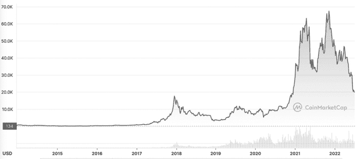

*图 5.15 从 2015 年到 2022 年 10 月底的美元计比特币价格。¶ 来源：[coinmarketcap.com](http://coinmarketcap.com)。

在大多数国家和金融市场，比特币不受监管或仅受到非常微的监管。例如，美国和大多数欧洲国家尚未制定比特币的使用明确的监管框架。其他国家，如厄瓜多尔、卡塔尔以及最著名的中国，已完全禁止加密货币交易。然而，由于其他国家对比特币投资者没有实施限制，此类严格的监管可能被轻易绕过。

比特币缺乏明确的监管是影响比特币在现实世界采用的一个主要问题。一方面，这种缺乏监管是比特币内部设计的固有的。事实上，监管必须由中央机构实施。然而，比特币是作为一种不涉及中央机构的数字货币创建的。因此，任何形式的监管都被视为对比特币内在精神的违反。另一方面，缺乏监管促使比特币成为“暗网”[KR19]非法活动（如武器、毒品）的主要支付手段，即暗网是指我们常用的搜索引擎未被索引的互联网部分。

作为支付手段，目前比特币在仅是“法定货币”，即被国家认可为在其领土内的有效支付形式，仅限于萨尔瓦多和中非非洲共和国 [Her21]]。在这些国家，任何商户都被法律允许接收客户的 `BTC` 支付。这两个国家都将扩大数字支付范围和减少数字金融排斥作为通过使比特币成为法定货币法规的主要理由。从技术角度来看，两国在实施 `BTC` 支付系统方面都面临了巨大困难 [Haw22]]。例如，比特币钱包没有标准，这反过来阻碍了处理比特币支付的标准数字支付设备开发。结果是，客户往往仅仅因为他们使用的钱包不支持商户使用的支付设备而无法使用其 `BTC`。比特币法币计价的波动也是比特币采用的一个大障碍。例如，商户很难以 `BTC` 为其商品或服务正确定价。此外，他们倾向于仅在 `BTC` 价格高位时接受 `BTC` 支付。


迄为止讨论的证据似乎表明，未来比特币可能会更频繁地作为日常生活中的支付手段，这并非不可能。然而，这种扩散只有在国家和全球金融市场对比特币进行适当监管的情况下才能发生。稳定 `BTC` 的法币计价价格，似乎也是比特币在日常生活中被采用的一个主要关注问题。

最后，比特币的一个主要问题是其可持续性。正如我们在本章中讨论的，比特币的 `PoW` 共识机制迫使矿工不断提高其计算能力。在实践中，这意味着矿工平均而言随着时间的推移，在挖掘新区块上消耗更多能量。2021 年，据估计比特币矿工消耗了全球发电总量的 0.55% `[KV22]`。在一个资源有限且人们对高能耗的影响（例如对天气模式变化的影响）日益关注的世界里，这似乎是不可持续的。幸运的是，可以通过对区块链的设计来解决这种担忧。具体而言，可持续性问题可以通过不同的共识机制来解决。比特币在短期内没有改变其共识机制的计划。然而，我们在下一章中讨论的以太坊已经在 2022 年 9 月成功地从基于 `PoW` 的共识切换到了更可持续的、基于 `Proof-of-Stake`（`PoS`，在下一章也会介绍）原则的共识。

## 5.6 结论

在本章中，我们介绍了比特币区块链。我们首先将其介绍为一个计算节点的公共网络。然后，本章的大部分内容用于讨论比特币交易以及比特币管理状态的机制，即所有节点的 `BTC` 余额、比特币账本以及比特币共识机制。关于后者，我们讨论了比特币共识是如何从节点之间的交互中“涌现”的，以及为什么不应该信任包含在账本中深度未达到 6 个区块的比特币交易。最后，我们还理解了为什么比特币区块链从本质上说其特征是矿工节点之间为了提高计算能力而进行的竞争。

为了结束本章，我们简要总结了比特币区块链的“好”方面和“坏”方面。在“好”的方面，我们首先应该提到比特币到目前为止是一个令人惊讶的稳定系统。它自 2009 年以来一直被使用，成为了一种与国家中央银行完全脱钩的数字系统的优质替代方案。在这方面，你可能读到过比特币区块链被“黑客攻击”的消息。然而，这些新闻指的是（粗心的）比特币用户私钥被盗用的情况。它们从未指的是对比特币账本中节点存储的数据进行实际攻击（即为了获得私人利益而修改）。由于这种整体的稳定性及其与个人政府脱钩的本质，比特币现在被许多企业和私人投资者视为投资组合多元化的替代方案之一。

比特币显然有几个“坏”的方面。然而，其中只有少数几个与我们在本章中讨论的比特币区块链设计特别相关。从设计的角度来看，比特币消耗了大量的能量。在一个资源有限的星球上，这显然是一个不利的因素。此外，它的运行速度缓慢，这对于日常的小额货币交易来说可能是一个问题。最重要的是，缺乏监管是一个关注的问题。

## 5.7 问题与练习题

1. 使用比特币浏览器（例如 `https.blockchain.com/`）查找：
    - 一个输出未被花费的交易
    - 一个 coinbase 交易（矿币奖励交易）
    - 一个消耗两个输入的交易
    - 一个产生两个输出的交易

2. 考虑`图 5.16` 中所示交易。假设 `T1` 被处理，然后是 `T2`，然后是 `T3`，且 `TX` 和 `TY` 被处理。在 `T5` 处理后，完成表中缺失的信息（即所有节点的状态）。

3. 考虑`图 5.17` 中的片段。回答以下问题：
    - 该交易的 id 是什么？
    - 该交易消耗了多少 `UTXOs`？
    - 哪些地址控制着输入？
    使用比特币浏览器回答：
    - 该交易的输出被花费了吗？
    - 列出控制输入的地址
    - 该交易支付的费用是多少？
    - 该交易被包含在哪个区块中？（请注明区块号/高度）
    - 区块向矿工支付了多少费用？

4. 考虑一个返回 40 位哈希的算法，例如 `0x78ab6f6712`。然后考虑一个采用 `PoW` 的区块链系统，其中“难度” `D` 是通过单次哈希操作找到给定目标哈希值的概率的倒数。例如，难度 `D = 60` 意味着给定一个区块，找到满足目标的哈希值的概率为 1/60。
    - 为该区块链系统设计 `D = 16`、`D = 256`、`D = 65536` 的目标。
    - 是否可能为 `D = 64` 设计目标？

5. 考虑在采用`表 5.1` 所示比特币相同共识机制的区块链中，节点 `X` 接收到的区块信息。


```markdown
| t5 = 18 || E || C || T7, T8 |
| t6 = 21 || F || E || T9,T6 |
```

考虑到节点 `X` 的内存池在 `t = 1` 时包含以下交易 `{T1, T2, T3, T4, T5, T6, T7, T8, T9}`，请回答以下问题：

1. 在时间 `t = 22` 时，节点 `X` 的主链中包含哪些区块（顺序如何）？
2. 在时间 `t = 15` 时，节点 `X` 的内存池中有哪些交易？
3. 在时间 `t = 22` 时，节点 `X` 的内存池中有哪些交易？

# 6 以太坊与支持智能合约的区块链

DOI: [10.4324/9781003321187-8](http://doi.org/10.4324/9781003321187-8)

## 6.1 以太坊网络

在本书的第一部分（第 4 章）中，我们引入了智能合约的概念。智能合约赋予区块链执行任意业务逻辑的能力。因此，它们允许区块链从实现加密货币的系统变为支持更通用资产交易场景的系统。以太坊是第一个也是最著名的支持智能合约的公共区块链。它由加拿大程序员维塔利克·布特林（Vitalik Buterin）于 2013 年构想，并于 2015 年上线。与比特币一样，以太坊有自己的加密货币。与比特币不同，它允许用户定义并利用智能合约。得益于智能合约，以太坊区块链目前被许多真实应用使用，范围从物联网应用到去中心化金融（DeFi）以及数字艺术交易应用。

以太坊是一个公有区块链。与比特币一样，它有一种加密货币。以太坊加密货币被称为“Ether”。在国际资产市场中以 `ETH` 为计量单位。与比特币不同，以太坊账本记录的信息不仅限于节点之间的加密货币交易。与比特币不同，以太坊还有智能合约。正如第 4 章中讨论的，通过智能合约，区块链的状态是由系统中部署的智能合约所使用的所有变量赋值来捕获的。节点的 `ETH` 余额（见图 6.1），即其拥有的 Ether 数量，仅仅是定义以太坊状态的众多变量之一。以太坊状态和以太坊账本的内容将在本章后面进行更详细的分析。

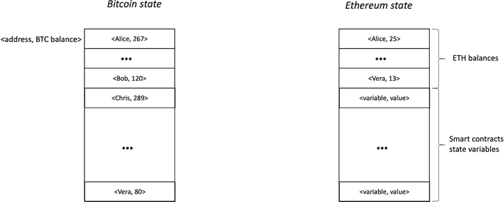

*图 6.1 比特币与以太坊状态对比。

与比特币一样，以太坊网络是一个接入互联网的计算节点网络。不同设备和操作系统的以太坊客户端标准实现可以在 [`ethereum.org`](https://ethereum.org) 获得。与比特币一样，以太坊节点拥有私钥、公钥和地址。节点使用私钥对其在以太坊网络上发出的交易进行数字签名。其他节点使用公钥来验证此类签名。地址是节点的唯一标识符。例如，它用于向某个节点转移 `ETH`，或者在智能合约代码中唯一地标识一个节点。

上述讨论的以太坊网络“普通”节点被称为 EOA（外部所有账户）。它们与比特币网络的节点非常相似：它们拥有地址，拥有 `ETH`，并且可以通过交易进行交换。

EOA 并不是以太坊中唯一与地址相关的实体。以太坊中的智能合约也有地址。其格式与 EOA 地址相同。为了区分智能合约账户和 EOA，在书中我们将前者统称为 `SCA`（智能合约账户）。

从技术角度来看，以太坊中密钥和地址的格式，以及生成它们的技术与比特币使用的并不相同。例如，以太坊也使用椭圆曲线密码学来实现数字签名。然而，密钥的格式和大小与上一章中讨论的比特币有所不同。了解这些技术细节对于理解本章所讨论的以太坊工作机制并不是必须的。因此，我们在此不再进一步讨论这些方面。想要了解更多这些技术层面的读者，请参考关于以太坊的技术出版物，如 [AW18]。

## 6.2 以太坊交易

与比特币一样，以太坊 EOA 可以发布交易来修改以太坊区块链的状态。由于以太坊包含了智能合约，以太坊交易可以执行以下三种操作之一：

1. 以类似于比特币交易的方式，将 `ETH` 从一个 EOA（发送方）转移到另一个 EOA（接收方）。
2. 创建一个新的智能合约（未来任何 EOA 都可以调用它）。
3. 调用现有的智能合约，指定要调用的函数，并在需要时指定输入参数。

接下来将更详细地讨论这三类型的交易。

### 6.2.1 在 EOA 之间转移以太坊代币的交易

首先，我们讨论在节点之间转移 `ETH` 的以太坊交易。与比特币不同（比特币的交易可以向或从多个节点转移 `BTC`），在以太坊中，交易只能两个 EOA 之间转移 `ETH`：发送方和接收方。发布交易的发送方必须拥有大于转移金额的 `ETH`。接收方接收发送方转移的 `ETH`。

在以太坊中，节点的余额只是描述状态的众多变量之一。与比特币不同，以太坊中没有等同于 UTXO（未花费输出）机制。在执行交易时，以太坊网络节点更新捕捉发送方和接收方余额的两个变量的值。转移的 `ETH` 金额（加上费用，我们稍后讨论）从发送方的余额中扣除。接收方的余额相应增加。

图 6.2 显示了由以太坊区块链在线浏览器之一详细说明的交易内容。乍一看，这笔交易与比特币交易非常相似。它有一个哈希作为唯一 ID（哈希“4957...”）。两个 EOA 之间真实的以太坊交易获取自：https://etherscan.io/tx/0x495736fe92718638ad57a234b0aeaa696531402e3a5eaf52cfe794de1e93cedc (images/Fig06_02.jpg)

###6.2.1.1 交易随机数 nonce

以太坊交易的 nonce 是一个递增的数字，用于计算发布该交易的 EOA 发出的交易次数。在图 6.2 中，nonce 等于 `8194637`。这意味着这笔交易是源者 EOA `3cd07...` 发出的第 8194637 次。显然，它不与比特币区块 nonce 混淆（我们很快就会看到以太坊也有类似的区块 nonce）。但真正的问题是，为什么需要这样的 nonce？也就是说，为什么必须计算 EOA 发出的交易次数？
```


nonce（随机数）有助于解决双重花费问题，或者更准确地说，它允许对由 `EOA` 发出的交易进行排序。在比特币中，我们看到 `UTXO` 机制防止了节点双花费其拥有的 `BTC`。节点作为某笔交易输入的 `UTXO` 不能再作为另一笔交易的输入。然而，在以太坊中并不存在 `UTXO`。节点的余额简单地由决定以太坊状态的众多变量之一的值决定。在这种情况下，对 `EOA` 节点发出的交易进行排序并在每笔交易中显式地记录这种顺序是防止双重花费的唯一方法。交易 nonce 正是起此作用：对 `EOA` 发出的交易进行排序。

为了更好地理解交易 nonce 的作用，让我们考虑一个典型的双重花费场景（参见图 6.3，该图扩展自第 3 章中的图 3.5）。在这里，Alice 试图将她的十个 `ETH` 中的部分双重花费，分别从 Bob 和 Carol 处购买一个杯子和椅子。如果没有交易 nonce，Alice 将能够完全复制第 3 章中理论上描述的双重花费机制：如果 Bob 和 Carol 以不同的顺序接收交易 `T1` 和 `T2`，那么 Alice 可能会成功双重花费她的 Ether。然而，交易 nonce 强制 Alice 显式地指定其交易的顺序。这显然防止了她的代币双重花费。事实上，它保证了其他节点确切知道 Alice 发出的交易必须验证和处理的顺序。因此，在这一示例中，考虑到交易 nonce 的值，Carol 会保留对 `T2` 的处理（该交易最终会被拒绝），直到 `T1` 被接收并处理。

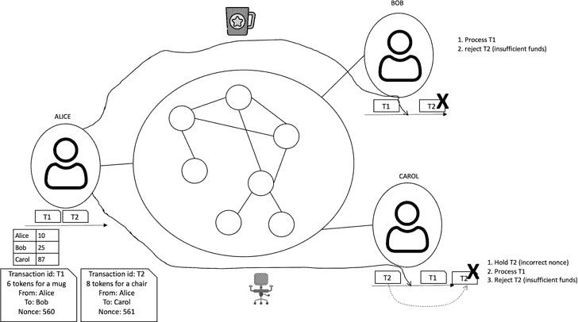

图 6.3 以太坊中的交易 nonce 和双重花费。

交易 nonce 引入了比特币中不存在的其他问题。最重要的是，它必须始终由 `EOA` 正确设置。如果没有这样做，由 `EOA` 发出的交易可能永远无法被节点验证和处理。在图 6.3 中，由于交易 nonce 的值，Carol 在接收到交易 `T1` 之前无法验证交易 `T2`。如果节点只使用一个客户端应用程序（单个钱包）与以太坊区块链交互，那么设置正确的交易 nonce 是非常容易的。客户端应用程序可以轻松处理这一点，统计 `EOA` 发出的交易数量。当节点使用多个客户端应用程序时，解决这个问题在技术上更为复杂。不同的客户端应用程序在每次发布新交易时必须相互协调，以确保交易 nonce 值设置正确。

### 6.2.1.2 交易输入数据

以太坊交易还包含 `input data`。这是因为与比特币不同，以太坊中存在不同类型的交易。根据交易类型，`input data` 的处理方式也不同。表 6.1 总结了输入数据字段对于不同类型交易的作用。

表 6.1 以太坊交易中的输入数据字段内容

| 以太坊交易类型 | input data 字段内容 |
| --- | --- |
| 在 EOA 之间传输 ETH 的交易 | 忽略 |
| 部署新智能合约的交易 | 智能合约的字节码 |
| 调用现有智能合约的交易 | 要调用的函数和（必要的）输入参数 |

对于在两个 `EOAs` 之间传输以太坊代币的交易（如图 6.2 中的交易），或者它用于指定与发送者和/或接收者相关的信息（如`付款原因`或`支付引用`）。

当交易向以太坊区块链部署新的智能合约时，`input data` 字段包含所谓的智能合约 `bytecode`。这基本上是智能合约的可执行代码，每个节点都可以在本地安装它，以便在未来执行该智能合约。当交易调用智能合约时，`input data` 指定了要调用的智能合约函数以及必要的所需的调用参数。关于以太坊智能合约的更多细节将在后介绍智能合约相关交易时讨论。

### 6.2.1.3 交易 gas

交易 gas 是以太坊中指定交易费用值的机制。在比特币中，交易费用由节点基本上通过考虑交易的大小（以字节为单位）来计算。交易越大，节点验证和执行它所需的计算能力越高，因此费用也越高。比特币节点还可以增加交易支付的费用，以提高其在矿工节点组装新区块时尽早被中的概率。

现在，在以太坊中，交易费的精神与比特币相同：处理交易所需的计算越多，费用越高。然而，在以太坊中也存在触发智能合约执行的交易。智能合约的调用触发某些计算逻辑的执行，这些逻辑处理输入和/或描述以太坊区块链状态的变量。这种逻辑的复杂程度取决于智能合约的性质。例如，在第 4 章引入的 BC4C-CGM 系统中，智能合约由玩家调用以支付押金。这在实践上意味着某些加密货币从玩家账户转移到智能合约的临时余额。从计算的角度来看，这似乎是一个相当简单的操作。然而，正如本章后部分讨论的，智能合约可以执行任何任意计算，例如执行数百次的循环。


在此背景下，以太坊中指定交易费的机制必须适应以太坊中存在的不同类型的交易。gas（燃料）机制正是这种适应的体现。使用燃料驱动汽车的比喻对于理解 gas 的概念非常有帮助。gas 价格（gas price）和 限制（gas limit）代表了交易发起者为交易配备的“燃料”。具体而言，`gas limit` 代表了“油箱”的大小。在执行交易时，只要没有达到 `gas limit`，节点就会继续执行，也就是说，只要油箱里还有燃料。现在，对于在 EOA（外部账户账户）之间传输 ETH 的简单交易来说，这通常不是问题，如图 6.2 所示。这种类型的交易所需的计算极小：只需更新发送方和接收方 EOA 的余额值即可。然而，当交易调用智能合约时，`gas limit` 变得更加重要。它专门确保了节点在执行智能合约期间不会陷入非常长（甚至是无限）的计算中。请注意，在正常情况下，对于节点来说，设置一个合适的 `gas limit` 值是轻而易举的。以太坊客户端实际上可以根据对智能合约代码的快速检查，相当可靠地估计传输 ETH 转账或调用智能合约所需的 gas 数量。最后，我们指出，部署新智能合约的交易也必须支付费用。在这种情况下，使用的 gas 取决于合约字节码的大小（代码行数）。

`gas price` 是发起者愿意为交易执行期间消耗的每单位燃料（gas）支付的价格。在图 6.2 中，发送者设置了 21,000 个 gas 单位的限制来执行此交易。发送者指定的单位 `gas price` 约为 21.3 Gwei。

### 6.2.2 与智能合约相关的交易
如前所述，以太坊中有两种与智能合约相关的交易：部署新智能合约的交易和调用已部署智能合约的交易。接下来将讨论这些。

#### 6.2.2.1 在以太坊网络中部署新智能合约的交易
通过这种类型的交易，节点会在以太坊网络中部署一个新的智能合约。部署智能合约意味着将智能合约的代码分发到以太坊网络的所有节点。一旦以太坊网络的每个节点都收到了智能合约的代码，它们就可以在自己的客户端中本地安装它。在本地安装智能合约代码后，节点就可以执行任何调用该特定智能合约的交易。

实践中，要部署一个新的智能合约，节点创建一个具有以下特征的交易：
* 交易的接收者是一个地址为“0”的虚拟节点。
* 交易的 `input data`（输入数据）包含智能合约的字节码。正如我们之前说的，这基本上是智能合约的可执行代码。从计算机科学角度的更多技术细节请参阅“计算机科学焦点”（Computer Science Focus）。
* 交易的 `value`（值）代表智能合约的初始余额（以 ETH 计算）。

正如我们在下一节中更详细讨论的那样，实际上，智能合约可以控制 ETH。为了做到这一点，每个智能合约都有 ETH 余额。在部署智能合约时，可以通过部署它的交易的 `value` 字段直接初始化此余额。

对于不处理 ETH 的智能合约，ETH 余额的值始终为 0。当 ETH 从网络中的其他节点支付到/从智能合约取出时，智能合约的余额就会发生变化。例如，在以太坊中 BC4C-CGM 系统智能合约的假设实现中，创建智能合约时余额为 0。那么，在一个新游戏开始之前，智能合约会接收玩家的存款。在任何时间，智能合约的余额都等于已开始但尚未结束的游戏所支付的存款。游戏结束时，智能合约会将该游戏的存款支付给获胜者。

由于智能合约部署，会创建一个新的以太坊网络账户（SCA，智能合约账户）。SCA 允许为智能合约分配一个唯一地址。调用智能合约的交易实际上是以 SCA 作为接收者的地址。

图 6.4 显示了以太坊区块详列的关于部署智能合约的交易信息。该合约由节点“4b50...”于 2020 年 12 月 3 日部署。请注意，`To` 字段并不包含此交易接收者的地址（它只是惯例的地址“0”），而仅包含此交易创建的智能合约的 SCA 地址（“FbdD...”）。由于此交易的 `value` 为 0 ETH，因此智能合约创建时的余额为 0 ETH。`input data` 字段包含已部署智能合约的字节码。图 6.5 显示了有关此合约的信息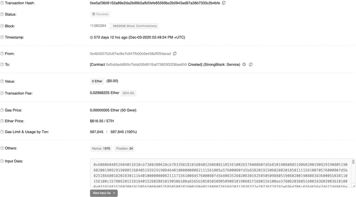

*图 6.4 一个部署以太坊智能合约的交易，地址为：https://etherscan.io/tx/0xe5af36d9162a89e2da2b99b5afb5fefe85569bc22b0945ed97a36b7333c2b4bfe.](https://etherscan.io/tx/0xe5af36d9162a89e2da2b99b5afb5fefe85569bc22b0945ed97a36b7333c2b4bfe.)

*图 6.5 一个以太坊 账户，地址为：https://etherscan.io/address/0xfbdd80fe7bda00b901af7380328ae55](https://etherscan.io/address/0xfbdd80fe7bda00b901af7380328ae55)


#### 6.2.2.2 调用智能合约的交易
一旦智能合约被部署，以太坊网络的节点就可以调用它。如上一节所述，为了调用智能合约，EOA 创建一个指向 SCA 的交易。`input data` 包含调用的细节，即要调用的智能合约函数以及如果需要，输入参数的值。此交易的 `value` 字段包含了如果需要的传输到智能合约的太币数量，这将增加其余额。

图 6.6 显示了指向图 6.5 智能合约的交易。接收者地址是合约 SCA 地址（“xfbd...”）。该交易向合约传输了约 0.0045 ETH（参见 `value` 字段）。`input data` 字段显示此交易正在调用该智能合约的 `claim` 函数。

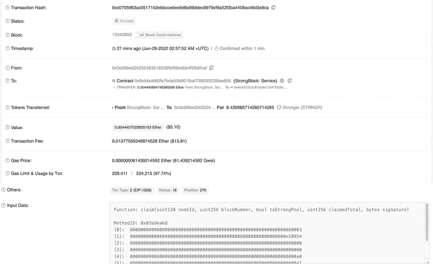

*图 6.6 调用图 6.5 智能合约的交易，地址为：https://etherscan.io/tx/0xc0705963ac05171b2ebbcced9d8a98ddec8979cf9a52f3ba4408ac49d3e9ca.](https://etherscan.io/tx/0xc0705963ac05171b2ebbcced9d8a98ddec8979cf9a52f3ba4408ac49d3e9ca.)


现在我们已经对以太坊交易有了更深入的理解，准备好理解以太坊中交易的生命周期。更详细地说，本节在不深究技术细节的情况下，描述了所谓`EVM`的功能。`EVM` 是以太坊客户端的核心组件。具体来说，它处理交易，并在必要时执行由这些交易调用的智能合约。

在很大程度上，以太坊交易的生命周期与比特币交易的生命周期相似：

*   交易由 `EOA` 创建并通过以太坊网络进行泛洪（gossiped）。当接收到新交易时，每个节点在将其转发给对等节点之前都会对其进行验证。与比特币类似，验证会检查交易格式是否正确以及是否包含了所有必要信息。例如，如果一个交易调用了需要输入参数的智能合约函数，节点会检查这些输入参数是否存在于 `input data` 字段中。
*   通过验证的交易由节点存储在一个未确认交易的临时仓库中（类似于比特币的内存池）。
*   所谓的`validator`节点会不断尝试使用它们已验证并临时存储的交易创建新区块。与比特币类似，新区块包含若干未确认的交易以及给创建者的奖励。以太坊共识机制的原理及其随时间的演变将在下一节详细讨论。
*   一旦创建完成，新区块由验证节点通过以太坊网络进行泛洪。接收到新区块的节点会对其进行验证，并在验证成功后执行其中包含的所有交易。

在本节的剩余部分中，我们将详细讨论上述列表中的最后一步，即执行节点收到的新有效区块所属的交易。这一步使我们能够至少在宏观层面上展示`EVM`的功能。

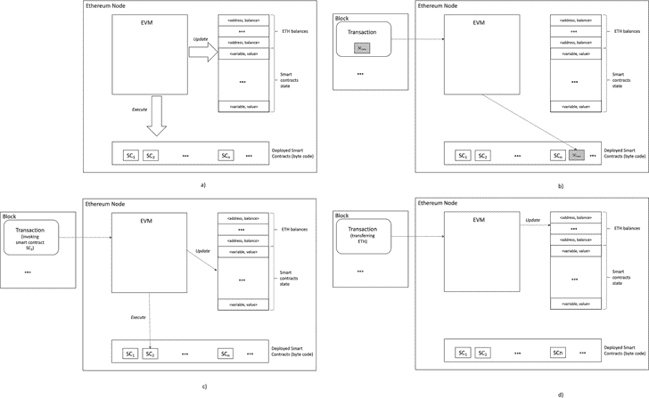

`图 6.7` 以太坊节点结构和有效区块中交易的处理。(a) 以太坊节点的内部架构。(b) 处理部署新智能合约的交易。(c) 处理调用现有智能合约的交易。(d) 处理转移 ETH 的交易。

`图 6.7a` 描绘了以太坊节点的结构。在任何给定时刻，节点包含：

*   `EVM`。如前所述，`EVM` 是一种可以处理交易并执行智能合约的软件。对于计算机科学家来说，这是一个可以解释智能合约字节码的`virtual machine`。
*   一组已部署的智能合约。这些是以太坊历史以来部署的所有智能合约的字节码。
*   `Ethereum ledger`。这基本上包含了：(i) 描述以太坊区块链状态的变量值，例如每个节点的 `ETH` 余额以及每个部署智能合约的状态变量值，以及 (ii) 组织成区块（即区块链）的交易。关于数据在 `Ethereum ledger` 中存储方式的更多细节请参见“计算机科学焦点”章节。

现在，`图 6.7` 还描绘了 `EVM` 相对于`第 6.2 节`中描述的三类交易的角色。`EVM` 识别出，如果接收者是某个地址，则该交易部署了一个新的智能合约。`图 6.7` 在这种情况下，`EVM` 通过 `input data` 字段部署新智能合约。

如果一个交易调用了需要输入参数的智能合约，`图 6.7` 那么 `EVM` 会提取输入参数的信息。如果需要，智能合约调用可能会修改以太坊区块链的状态变量。最简单的情况是节点之间转移 `ETH`，`图 6.7` 这种情况下不涉及智能合约。`EVM` 简单地更新接收者的 `ETH` 余额并减少发送者的。

## 6.4 以太坊共识机制

以太坊共识机制是在工作量证明（PoW）之外引入一种新型共识机制的完美方式，即权益证明（PoS）。

直到 2022 年 9 月 15 日，以太坊一直使用名为 `Ethash` 的 PoW 共识机制。尽管它在许多方面与比特币相似，但 `Ethash` 基于一个不同的原理。在 `Ethash` 的最后一步中，节点仍然必须找到一个 `nonce`，使得给定二进制数据数据块的哈希值小于目标值。在比特币中，这个数据块是新的区块。而在以太坊中，这个数据块是一个结合了从新区块提取的随机数据与其他历史数据的 `DAG`（有向环图）。`DAG` 的大小不断增长以控制 PoW 的难度。

`Ethash` 的主要特征是，组装 `DAG` 并将其加载到节点内存中的计算量比计算正确的 `nonce` 要大得多。换句话说，`Ethash` 是“内存密集型”的——它要求节点大量的内存——而不是像比特币 PoW 那样是“计算密集型”。这一技术细节在实践中产生了根本影响。具体而言，在以太坊中我们确实看到矿工算力随着时间的推移而增加，但我们并没有看到像比特币那样构建日益高耗能矿工节点的激烈竞争。这主要是因为，对于以太坊矿工来说，极速加密哈希计算并非理想选择。以太坊矿工节点必须快速处理内存，而比特币矿工必须极快地执行简单的哈希操作。从这个角度来看，以太坊一直比比特币更具可持续性。


在以太坊的 PoS 共识机制中，创建和验证新区块的节点被称为“验证者”。要成为验证者，节点必须“质押” 32 ETH。这是通过节点向一个智能合约发送 32 ETH 来的。该智能合约会锁定质押金并对其进行管理，直到节点决定将其提回。在每个周期（epoch，一个持续约六分钟的时期），会随机选择一组验证者。在该组中，验证者轮流提议新区块，而其他验证者则“检查”所提议新区块的正确性。如果有效，新区块将传播到网络的其余节点。节点可以在一个周期内通过提供多个 32 ETH 的“质押”金，来增加自己被选为验证者的概率。

验证者通过两种方式获得奖励：(i) 其质押 ETH 获得的利率收益，以及 (ii) 在提议或验证新区块时获得的奖励。假设“基础”奖励价值为 `B`，验证者提议一个有效的新区块将获得 1/8 `B` ETH 的奖励，而该周期内的其他验证者在验证新区块时平分 7/8 `B` ETH。价值 `B` 由以太坊协议动态调整，以控制验证阶段的长度。然而，验证者也可能会丢失其质押金。这可能发生在他们提交无效区块时。在这种情况下，智能合约将“销毁”质押金：验证者将永远无法再次看到那 32 ETH。当验证者未能在一个周期内验证提议的新区块（例如因为他们离线了）甚至处理速度缓慢时，可能会丢失部分质押金。

以太坊的 PoS 共识机制将以太坊区块链网络（组装新区块）的能量消耗减少了至少 99%。这对于未来以太坊成为最常用的公有区块链具有巨大影响。从设计上看，PoS 共识机制可能比 PoW 更安全。在 PoW 中，矿工可以通过累积网络 51% 的算力来获得对新区块挖掘的控制权。这很难实现，但并非不可能。最重要的是，原则上讲，矿工可以在不与其他任何人合谋的情况下做到这一点。矿工“只需要”购买并运行（许多）更强大的计算机即可。在 PoS 中，验证者可以通过质押比所有其他验证者总和更多的 Ether 来获得对挖掘过程的控制。这原则上可以由恶意验证者实现。然而，只有当拥有某些现有 ETH 的其他节点合谋将它们的 ETH 转移给恶意验证者以支付质押金时，这种情况才会发生。最后，以太坊的 PoS 对于通过新区块扩展以太坊账本提供了更大的灵活性。我们书中书中详细讨论这个话题。我们只需提到，以太坊的 PoS 支持以太坊账本主链的“分片”，即在现有链的顶部创建多个“合法”分叉，这些分支在后续阶段合并为单一链。主链分片可以提高以太坊区块链的性能，将交易吞吐量从每秒几次增加到每秒数千次。

## 6.5 以太坊智能合约和代币

在本节中，我们将深入研究以太坊智能合约的实现。我们将分步进行：首先，我们提供并讨论真实智能合约的示例。然后，我们关注所谓的以太坊“代币”。这些是一类特殊的智能合约，捕捉了节点之间交换的数字及可能的物理资产的行为。到目前为止，代币是以太坊中最著名的智能合约类型。

### 6.5.1 智能合约

以太坊中的智能合约是一段软件代码，它执行某些定义良好的业务逻辑。该逻辑操纵以太坊区块链的状态，并可能使用调用智能合约的交易中由外部账户（EOA）提供的输入参数。有许多可以编写以太坊智能合约的编程语言。然而，其中 `Solidity` 语言已成为最常用的语言。因此，我们在本节中提供的所有示例都是用 `Solidity` 编写的。显然，本节不是 `Solidity` 的教程。对于这一点，感兴趣的读者请参阅 [ZGH+21]。尽管如此，我们认为，研究和理解真实智能合约的代码对于充分掌握智能合约实现的全部潜力至关重要。因此，我们提供并讨论了几个 `Solidity` 代码示例。不过不要担心，我们在这里提供的示例简单且易懂，任何具有基础计算机编程背景的人都能理解。

与大多数编程语言（例如 `Java`、`Python` 或 `C++`）一样，`Solidity` 是一种“图灵完备”的编程语言。简而言之，这意味着它可以执行我们能想到的任何计算，而这些计算可以使用编程语言的典型语句表示，例如条件语句（`if-then-else`）或循环（`for`、`while` 等）。详细来说，图灵完备语言还允许指定可能无限执行的代码（例如由一个可能永远不会变为假的条件控制的 `while` 循环）。在本章前面简要提到，以太坊的“燃料”（gas）是一种用于控制触发智能合约执行的交易执行的机制。即使由于失误或故意，交易触发了智能合约的无限执行，节点也只会在调用它的交易的燃料未耗尽之前执行该智能合约。

传统编程语言与 `Solidity`（更广义地说与以太坊智能合约）之间的主要区别在于随机数生成器。正如我们在第 4 章](#C_007_c4.xhtml）中讨论的，由于每个节点都能够在任何时间从智能合约的执行中获得相同的输出，因此智能合约中指定的计算不能依赖于随机数的生成。因此，`Solidity` 语言没有提供生成随机数的结构。

图 6.8 提供了一个非常简单的 `Solidity` 智能合约示例。它不是你可能熟悉的通常“Hello 世界”示例，但很接近。代码看起来像你熟悉的任何其他计算机代码，例如 `Python` 或 `Java`。语法可能略有不同。例如，在 `Python` 中，我们不在每条指令末尾使用分号。在 `Java` 中，我们将函数修饰符（如 `public` 或 `private`）放在函数名之前，而不是之后。


图 6.8 的 Demo 智能合约允许节点执行一件简单的事情：存储一个整数的值。要存储的值可以通过调用 `store()` 函数来设置，并可以使用 `retrieve()` 函数进行。`store()` 函数是公共的（`public`），这意味着它可以被以太坊网络中的所有节点调用。相反，私有函数（`private`）对以太坊网络中的节点是不可见的（它只能被同一个智能合约的其他函数调用）。`retrieve()` 函数显然返回一个整数值（`uint256` 代表“256 位的无符号整数”，即小于 2²⁵⁶ 的整数）。它还被声明为一个 `view` 函数。`view` 关键字用于将不修改以太坊区块链状态的函数与会修改状态的区分区分来。事实上，`store()` 函数确实修改了以太坊状态：变量 `number` 定义了智能合约的状态，并且如前所述，所有智能合约的状态变量都是以太坊状态的一部分。`retrieve()` 函数仅仅读取状态变量 `number` 的值并将其返回。最后，`getBalance()` 函数读取此合约的余额值。这可以通过特殊变量 `address(this)balance` 获取。注意，`getBalance()` 函数也是一个 `view` 函数：它读取并返回有关以太坊区块链状态的信息，而不对其进行修改。

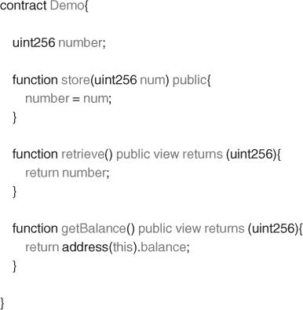

图 6.8 一个简单的 solidity 智能合约。

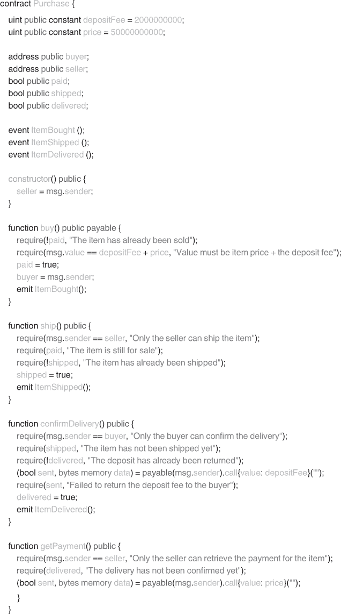

图 6.9 一个用于加密货币安全购买物品的 Solidity 智能合约。

另一个稍微复杂的例子是图 6.9 中的 Purchase 智能合约。该智能合约监管了使用加密货币的物品销售，确保买家最终获得请求的物品，而卖家获得来自买家的付款。布尔型变量 `paid`、`shipped` 和 `delivered` 跟踪销售的各个阶段。此外，还声明了 `ItemBought()`、`ItemShipped()` 和 `ItemDelivered()` 事件（events）。如其名所示，事件是合约发送到交易日志的通知，区块链外部的应用程序可以访问它。通过事件，可以让外部世界感知到智能合约状态何时发生变化，而无需定期调用其函数。在实现 DApps（本章稍后介绍去中心化应用）时，事件特别为有用。

与面向对象的编程语言类似，`constructor()` 函数是一个特殊函数，它在智能合约部署时被自动调用。通过这种方式，卖家的身份与部署合约的账户地址相关联，且无法再更改。

要购买物品，买家必须调用 `buy()` 函数。`buy()` 函数是可支付的（`payable`）。可支付函数允许调用它的账户在调的同时也向智能合约转移加密货币。`buy()` 函数必须确保物品尚未支付，并且买家转移的金额等于物品价格加上押金（分别由 `price` 和 `depositFee` 常数定义）。`buy()` 函数调用 Solidity 提供的 `require(condition, message)` 库函数，该函数会检查作为第一个参数提供的 `condition`。如果未满足该条件，交易将中止，并返回作为第二个参数提供的 `message`。否则，继续执行。如果两个条件都满足，`buy()` 函数会将 `paid` 变量设置为 true。


# 表 6.2 可以在以太坊中“代币化”的数字资产示例

| 类型 | 描述/示例 | 类型 |
| --- | --- | --- |
| 货币 | 私有加密货币，例如只能在大学校园内使用的货币，或用户只能用于支付私立医院网络提供的服务的货币 | 同质 |
| 计算资源 | 云服务提供的 CPU 时间存储容量 | 同质 |
| 资产 | 物理资产的数字等价物，如黄金、画作、汽车、房地产或钻石 | 取决于物理资产（例如，黄金是同质的，画作或汽车是非同质的） |
| 访问权限 | 物理财产的访问权限，例如酒店房间或专属网站 | 非同质 |
| 股权 | 组织的股东权益 | 同质 |
| 投票 | 在数字或法律系统中的投票权 | 同质 |
| 身份 | 数字身份或法律身份 | 非同质 |

同质性（Fungibility）是（数字）资产的基本属性，它也决定了在以太坊中实现其相关代币的智能合约的行为。当一个资产的各个单元本质上是可以互换的时，它是“同质的”；反之则是“非同质的”。货币、黄金、组织股权或计算机系统的存储容量通常是同质资产。事实上，我们拥有哪种特定的钞票、金条、股东证书或硬盘的物理扇区并不重要。重要的是我们拥有该资产的“多少”或“多少单位”。相反，对于画作、汽车或酒店房间访问权等资产，区分我们拥有该资产的哪个特定单元是关重要的。拥有一辆旧二手车与拥有一辆闪亮新款跑车是完全不同的！

以太坊代币定义了以太坊节点可以用代币做什么，以及节点的操作如何修改定义代币状态的变量。对于同质代币（见图 6.10），与本书目前为止广泛讨论的加密货币示例类似，这些变量记录了每个用户拥有的资产数量。对于非同质代币，由于每个特定的资产都关联一个唯一的“token id”，一个状态变量捕获了当前的所有者。私有加密货币（例如由区块链初创公司创建并分发以筹资金的代币）是同质以太坊代币的典型示例。数字非同质代币在过去几年中变得特别流行，随着所谓 NFT 市场的出现。从技术角度来看，NFTs 仅仅是以太坊非同质代币。从业务角度来看，NFTs 就像独特的数字交易卡，可能存在一个市场。例如，最近与独特数字艺术品相关的 NFT 市场呈指数级增长，预计到 2028 年将达到 200 亿美元。

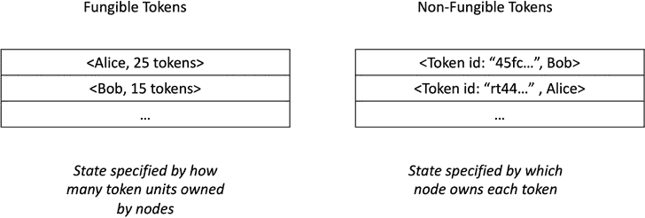

### 图 6.10 以太坊状态变量和以太坊代币的同质性。

由于代币是以太坊的基础特征，以太坊社区不断定义和改进以太坊代币的不同“标准”。类似于面向对象编程语言中的接口，以太坊代币标准定义了某一类代币必须实现的函数。在本节结束之前，我们简要回顾两个最流行的以太坊代币标准：`ERC-20`，它是私有加密货币（即同质代币）的标准，以及 `ERC-721`，它是实现非同质代币的热标准。

#### 6.5.2.1 ERC-20 以太坊标准

`ERC-20` 是最成熟且常用的以太坊标准之一。实现 `ERC-20` 标准的智能合约必须提供表 6.3 中列出的函数和事件。

### 表 6.3 以太坊 ERC-20 标准

| 函数 | 正常的预期行为 |
| --- | --- |
| `name()` | 返回此代币的名称，例如“Comuzzi-Grefen-Meroni Token” |
| `symbol()` | 返回此代币的简称。这通常用于资产交易市场以识别代币，例如“CGM” |
| `totalSupply()` | 返回自该代币创建以来生成的单位数量 |
| `balanceOf(address_owner)` | 返回节点地址所有者拥有的该代币数量 |
| `transfer(address_to, value)` | 允许调用者（即发起交易调用该代币智能合约此函数的节点）将其拥有的一定数量的代币（value）转移给接收节点（address_to） |

同质代币的预期行为并不令人意外：代币可以在节点之间传输，并且应该能够查询任何节点代币单元的余额。标准还定义了其他函数（表 6.3 中未显示），节点可以通过这些函数委托另一个节点代表自己花费代币。

表 6.3 第二列描述的行为确实是同质代币的“预期”行为。然而，当业务情况需要时，同质代币可以被编程为以不同或更微妙的方式。即使每个函数的行为不是表 6.3 中描述的，只要标准接口保持不变（即智能合约暴露的函数名称与表 6.3 一致），使用该代币的应用程序仍然可以使用它。例如，可以对代币进行编程，禁止进行低于 5 个或高于 30 个代币单位的转移——这种逻辑将编写在 `transfer()` 函数中——或者禁止列表中的节点接收超过 20 个代币单位的转移。表 6.3 的标准接口也可以通过额外的函数进行扩展。例如，可以实现一个函数来提供拥有至少 1 个（或 5、10 个）代币的节点的平均余额。为数字资产添加这种“可编程”层是以太坊代币最显著的特征。

通常，通过上述示例，我们希望说服你以太坊代币是实现控制数字资产生命周期极其灵活的方式。由于它们“运行”在太坊区块链内部，以太坊代币继承了以太坊节点之间信息交换的所有优点。例如，节点与代币的每次交互（通过交易）都永久地存储在以太坊账本，需要时可以随时查询（例如用于审计）。智能合约提供的灵活性允许代币成为完全“可编程”的数字资产。

#### 6.5.2.2 ERC-721 以太坊标准

`ERC-721` 是非同质以太坊代币的最小标准（另一种更高级的标准我们在书中未讨论的是 `ERC-1155`）。该标准中的一些简单函数与 `ERC-20` ，例如 `name()` 和 `totalSupply()` 返回 NFT 的名称及其存在的代币数量，例如给定集合中收藏数字运动卡的数量。`ERC-721` 与 `ERC-20` 的主要区别如下：

*   `ERC-721` 中的代币是非同质的，因此是唯一的。因此，每一个代币都由一个唯一的 `token_id` 标识。
*   `ERC-721` 代币不能在所有者之间拆分，因此每一个代币都由一个节点所有。


-   该标准定义了一组控制单个代币所有权的函数。

表 6.4 显示了 ERC-721 标准中控制代币所有权的函数。简单来说，`transferFrom()` 函数允许节点将其拥有的代币所有权转移给另一个节点。`ownerOf()` 函数返回由 `token_id` 标识的代币的所有地址。与 ERC-20 代币一样，ERC-721 代币的行为是可编程的。事实上，每个函数的内部实现都可以根据特定的业务需求进行定制。必要时还可以定义额外的函数。

### 表 6.4 以太坊 ERC-721 标准（选函数）

| 函数 | 正常预期行为 |
| --- | --- |
| `balanceOf(address_owner)` | 返回账户 `address_owner` 拥有的唯一代币数量 |
| `ownerOf(token_id)` | 返回与 `token_id` 关联资产的所有者 |
| `transferFrom(address_from, address_to, tokenId)` | 将标识为 `tokenId` 的资产从账户 `address_from` 转移到账户 `address_to`。账户 `address_from` 必须是调用此函数的交易发起者 |

![图 6.11 交易方风险与以太坊代币。(images/Fig06_11.jpg)

### 图 6.11 交易方风险与以太坊代币。

代表现实世界物理资产数字标识的代币，其基本问题在于所谓的“交易方风险”（参见图 6.11）。这是区块链中的数字代币与其代表的现实世界资产之间关联的可靠性问题。图 6.11 展示了与汽车和（有价值的）绘画相关的代币示例。现在，交易方风险是指一旦了与特定物理资产关联的数字代币，无法保证两者之间的关联永远不会被破坏的风险。在与汽车相关的数字代币情况下，这个问题可以通过 `VIN`（车辆识别号码）解决。`VIN` 是根据 ISO 3778 标准生成的机动唯一序列号。它在全球范围内使用了多年。世界上每辆汽车，无论在何处流通或由谁制造，都有唯一的 `VIN`。显然，`VIN` 可以用于在汽车与代表它的数字代币之间建立精确且可靠的关联。我们需要的是将 `VIN` 作为变量包含在与汽车相关的代币中。当然，仍然存在车辆的 `VIN` 在某个时间点被更改或删除的风险（就像黑帮电影里的杀手会对其使用的枪支注册号所做）。但在许多业务应用中，这种风险可能被认为忽略不计。

在与绘画相关的数字代币情况下，遗憾的是我们没有等同于 `VIN` 的东西。绘画的真实性与其现实世界的价值高度相关，通常通过需要专业知识的复杂过程来建立。我们没有可以简单嵌入代币智能合约代码中的唯一标识来解决交易方风险问题。换句话说，用于（有价值的）绘画以太坊代币面临着高交易方风险。正如我们在本章末尾的案例研究中所讨论的那样，为使用以太坊代币的应用提供缓解交易方风险的解决方案，是以太坊区块链采用的关键方面。

## 6.6 以太坊分布式应用 (DApps)

通过智能合约，像以太坊这样的区块链系统可以被编程执行任意的业务逻辑，操纵用户提供的输入以及区块链系统的状态。因此，智能合约将区块链系统变成了完整的“分布式信息系统”。

由用户网络使用并以区块链为骨的分布式信息系统通常被称为“分布式应用”，简称“DApp”。虽然 DApp 一术最初是用于使用以太坊区块链的分布式应用，但今天它通常用于使用任何支持智能合约的区块链系统的分布式应用。

一个信息系统（参见图 6.12）可以简单地建模为三层的交互：

![图 6.12 传统的三层信息系统。(images/Fig06_12.jpg)

### 图 6.12 传统的三层信息系统。

- 数据存储层：应用程序使用的数据存放之处。
- 应用程序逻辑层：包含根据用户输入操纵数据的业务逻辑。
- 呈现层：捕捉用户输入并将应用程序逻辑的执行结果展示给用户。

例如，在一个电子投票应用中，数据存储层包含有关注册选民和他们投出的票的数据；应用程序逻辑层包含验证请求投票的用户是否已注册、并允许用户投票（通常不超过一次！）的逻辑；呈现层可以是一个网站或移动 应用程序，用户可以通过这些平台进行投票并收到选票已被记录的确认。

现在，DApp 可以被更具体地定义为一种信息系统，其中上述架构层中至少有一层是使用区块链以分布式方式实现的。最常见的情况是应用程序逻辑层和数据存储层是分布式的。在 DApp 中，应用程序逻辑层由区块链系统的智能合约实现。数据存储层由区块链系统的分布式账本表示：每个节点都维护一份 DApp 所需数据的一致副本。

基于以太坊的 DApps 是 DApp 最显著的例子。它们是应用程序逻辑层使用以太坊智能合约实现的 DApp。用户通过其管理以太坊代币的 Web 应用或移动应用是以太坊 DApp 的典型例子。

为了领略 DApp 是如何工作的，让我们考虑一个例子：书中第一部分引入的 CGM 代币现在被实现为以太坊 ERC-20 同质化代币。图 6.13 描绘了管理 CGM 代币的 DApp，即 CGM 代币的“钱包”。该 DApp 的呈现层是一个移动应用。通过该应用，用户可以发出 CGM 代币转移。例如，BC4C-CGM 区块链的棋手使用此应用转移他们游戏的押金。应用程序逻辑由以太坊智能合约实现。该智能合约实现了 ERC-20 代币标准。数据层也由以太坊区块链实现。


图 6.13 也描绘了该 DApp 的典型使用场景。例如，当 Alice 向 Bob 传输 CGM 代币时，是通过移动应用完成的。在底层，移动应用将有关传输的信息（如接收者节点、代币数量、在智能合约中调用的函数、Gas 费用等）封装在一个以太坊交易中（图 6.13 中的第 1 步）。然后，交易被发布到以太坊网络。如果交易有效，它将在节点间泛洪（第 2 步）。它也会到达 Bob，但 Bob 与任何其他以太坊节点一样，在交易被包含进新区块之前，无法信任代币已经传输给了他。交易在某个时刻会被一个验证节点选取并包含在区块中（第 3 步）。新区块（由同一周期内的其他验证者批准）在网络中泛洪，到达所有节点，包括 Bob 和 Alice（第 4 步）。当节点接收到此新区块时，它们会执行其中所有的交易，包括 Alice 向 Bob 进行传输的那笔交易。此时，Bob 终于得到了确认，即 Alice 已经在他的移动 App 上传输了 CGM 代币。同样，移动应用可以通知 Alice 传输已完成（第 5 步）。

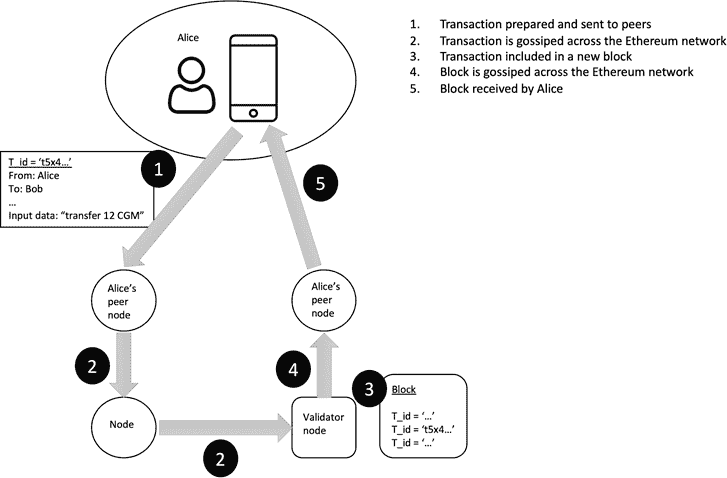

图 6.13 DApp 示例。

从业务角度来看，理解使用以太坊 DApp 实现信息系统功能的优缺点至关重要。这些优缺点在表 6.5 中已进行了总结。

表 6.5 DApp 的优缺点

| 优点 | |
| --- | --- |
| 确定性且可验证的业务逻辑执行 | 智能合约代码会被接收，并可以由每个节点检查。因此，DApp 的应用程序逻辑可以被任何用户验证。此外，智能合约仅允许执行确定性逻辑（不允许随机数！），这意味着用户通过检查代码可以确切知道 DApp 将如何运行。 |
| 零停机（去中心化） | 应用程序逻辑的执行在以太坊网上是去中心化的。用户不需要等待某处的服务器（该服务器可能不可用）来执行他们的输入。在实践中，这意味着 DApp 没有停机时间：调用 DApp 智能合约的交易早晚会被矿工选取并包含在区块中。 |
| 抗审查 | 因为 DApp 依赖于以太坊区块链的去中心化范式，它具有很强的抗审查能力。虽然托管在（云）服务器上的 DApp 可能会被敌对政府关闭，但让单一机构关闭整个以太坊网络几乎是不可能的。只要世界上仍至少有一个节点运行以太坊协议并连接到互联网，以太坊 DApp 就会存在。 |
| 数据的不可篡性 | 用户与 DApp 之间的所有交互（即交易）以及它们产生的数据（即以太坊状态的变化）都以不可篡的方式记录在以太坊区块链上。因此，它们将永久供查阅，例如用于审计原因、解决纠纷或仅仅验证其存在性。 |
| 缺点 | |
| 成本 | 在以太坊网络上发布交易不是免费的。用户每次调用 DApp 的函数时，都必须支付 ETH 费用。ETH 以法币计价的价格极不稳定，且取决于当前的汇率，在许多业务场景下，这些费用可能不可忽视。为了解决成本问题，DApp 通常选择只在以太坊区块链上存储最重要的数据。其他数据可以存储在链外的分布式文件系统解决方案中，例如 IPFS（将在第 9 章 晚些讨论）。 |
| 性能 | 用户与 DApp 的每次交互在存储到以太坊主链中足够深的区块中之前，都是不可信的。尽管从此点来看，以太坊比比特币快，但完成 DApp 函数调用所需的时间可能超过许多业务场景中认为可接受的限制。此外，以太坊区块链的性能并不特别可靠。交易包含在区块中所需可能会根据网络负载情况以及发布交易节点的位置或时区发生不可预测的波动。 |
| 维护和向中心化的回归 | 从技术角度来看，以太坊协议提供的管理智能合约演变的工具非常有限。基本上，一旦智能合约被部署，就无法进行修改。它的新版本（即使只更新了一个微小的指令）也必须作为新的智能合约部署。这可能会为 DApp 带来巨大的维护问题。为了解决这个问题，DApp 通常将其应用程序逻辑中短期内可能改变的核心部分委托给智能合约。其余的逻辑可以委托给其他（非 DApp）应用程序，如 Web 应用。 |

通过对表 6.5 中 DApp 优缺点的讨论，我们首次在书中关注了区块链对特定业务场景的适用性。例如，DApp 对于实现需要可预测且可靠性能水平的应用，或者需要管理大量数据与用户频繁交互的应用来说并不是良好的选择（在这种情况下使用 DApp 的成本可能会爆炸）。相反，DApp 对于需要高水平透明度和可靠访问历史数据的应用程序是一个很好的选择。理解不同业务场景对区块链的适用性是第 9 章的重点。

## 6.7 案例研究 – Everledger：基于以太坊的供应链安全溯源

在本章中，我们讨论了在创建以太坊 NFT 以及更广泛的处理现实世界资产的以太坊 DApp 时面临的对手风险挑战。然而，在商业世界中，每一个挑战都是机遇。Everledger 是一家将区块链应用中的对手风险转化为商业机会的澳大利亚技术公司。


Everledger 承诺通过人工智能、物联网以及显然的区块链（更具体说是以太坊）等技术的结合，帮助其客户在透明度至关重要的市场发现并连接资产相关信息。换句话之，Everledger 提供了解决方案，以改进在不同市场交易的资产溯源信息的收集、验证和管理。事实上，在许多市场中，客户获取其即将购买资产的溯源信息并非易事。长而复杂的供应链就是典型的例子，特别是当客户还需要有关产品可持续性和伦理责任的信息时。例如，一个钢部件生产者要证明其产品的可持续性记录可能极其困难，特别是当这些产品在不同制造商（可能在不同国家）经过多次精炼步骤时。同样，服装零售商可能无法提供可靠证据，证明其商店货架上的所有衣服都是遵循当地工人高伦理标准的地点制造的。通常情况下，区块链与其他技术的结合可以在这些情况下提供帮助：人工智能和物联网等技术可用于捕捉客户所需的溯源信息证据，而区块链可用于不可篡改且可靠地存储这些信息，并供永久访问。

在一个行业中，零售产品的溯源信息尤为重要。这并非巧合，这也是 Everledger 在几年前作为初创公司开发其第一个解决方案的行业：钻石贸易。钻石是价值极高的物理资产。不幸的是，它们的溯源和用途往往与非法和不伦理的操作有关。钻石有时仍由人权记录糟糕的偏远地区的工人在剥削性条件下进行开采。由于它们将巨大的价值集中在极小的物理空间内，它们也被用作非法交易的价值交换手段，例如毒品或武器的非法走私。在为伴侣购买钻戒时，人们无疑欢迎安全可靠的信息，以确保他们即将购买的东西从未参与过非法活动，也不是被受剥削的工人开采的。

Everledger 为解决这个问题提出的解决方案依赖于将单颗钻石与以太坊 NFT 关联。通过这种方式，所有与该钻石涉及的交易信息都可以可靠且不可篡改地存储在以太坊区块链上。它们将永远留在那里供客户未来使用。然而，正如我们之前讨论的，NFT 的使用引入了对手风险（counter-part risk）。在区块链世界中，如何让物理钻石与其对应的数字标记之间建立可靠的关联呢？

Everledger 开发的解决方案依赖于利用钻石在光源照射时的物理特性。基本上，每颗钻石的形状在某种程度上是独特的。因此，投影在钻石上的光会被其独特地反射出来。将光源如何被其反射的信息与钻石的其他物理属性（如尺寸、重量和亮度）相结合，就可以为每颗独立的钻石创建一个唯一的指纹。这种指纹具有三个重要属性：

*   它对于市场上的每颗钻石都是唯一的。
*   它可以被轻松地捕获为数字数据。
*   它可以随时方便地计算。事实上，钻石的物理属性（包括光反射属性）可以通过任何钻石店实验室使用行业标准的设备和程序进行评估。

从技术角度来看，Everledger 提供的解决方案使用了上述钻石指纹的加密哈希值（cryptographic hash），将物理钻石与代表它们的以太坊 NFT 链接起来。该解决方案清楚地降低了对手风险。

## 6.8 结论

本章介绍了以太坊区块链。以太坊是一种加密货币，类似于比特币，但与比特币不同，它提供了部署智能合约的可能性。这对以太坊的设计产生了巨大影响。例如，以太坊的费用机制（`gas`）比比特币的复杂，因为它考虑到交易可能会调用智能合约，而不仅仅是在两个账户之间简单传输 ETH。我们还讨论了以太坊的共识机制与比特币的不同之处。它们曾都使用 PoW（工作量证明）机制，但以太坊最近切换到了基于 PoS（权益证明）的机制。

我们专门查看了一类以太坊智能合约：令牌。具体来说，我们讨论了如何使用 `ERC20` 令牌创建私人加密货币，而 `ERC721` 令牌是所谓 NFT 的基础。最后讨论了 DApps 的概念。这些是分布式应用程序，其应用程序逻辑由以太坊智能合约实现。DApps 可以代表骨干或弹性透明且抗审查的应用，即它们无法被任何机构关闭。本章结束了我们对公共区块链系统的讨论。在下一章中，我们将考虑私有区块链。这些系统中用户的身份是已知的，且通常用户数量有限。它们通常用于支持业务场景中的资产和信息交换，这些场景与加密货币不同，不需要通用访问，如供应链或私立医疗网络。

## 6.9 问题与练习

1. 使用任何在线以太坊区块链浏览器，在主网上寻找具有以下特征的交易：
    a. 一个在两个账户之间传输 ETH 的交易
    b. 一个调用智能合约的交易。标明调用的是哪个合约，以及该交易了该合约的哪个函数
    c. 一个部署新智能合约的交易
    d. 一个 gas 使用量超过 80% 的交易

2. 考虑图 6.15 中的以太坊交易，验证器节点按照其编号顺序接收这些交易（T1 在 T2 之前接收，等）。假设该节点在接收 T1 之前从 Jin、Min 和 Hyun 处收到的最新交易 nonce（计数器）分别为 763、8 和 765。

    a. 验证器将以什么顺序把交易包含在区块？
    b. 有一个交易不会被节点处理。是哪一个？为了让该交易被处理，必须发生什么？


3. 提议并讨论以太坊同质化代币和非同质化代币的一个现实应用。在讨论中，请考虑以下问题：开发该代币的原因是什么？应该编码进智能合约的代币行为是什么？该代币如何扩展/修改 `ERC-20` 或 `ERC-721` 接口？在非质代币的情况下，如果存在交易对手风险问题，你会如何解决？

4. 考虑一个电子投票 DApp 的案例，即一个基于以太坊智能合约支持用户投票的应用。为了简单起见，假设用户只能投“是/否”票，且不需要确保投票的匿名性。例如，此 DApp 可以允许议会成员在新冠（Covid-19）肺炎期间在家里投票（大多数情况下，对法案的支持或反对票确实不是匿名的）。根据第 6.3 节中讨论的内容，展示该 DApp 的典型使用场景，描述实现其应用逻辑的智能合约的功能，并提供调用该智能合约的交易内容示例。

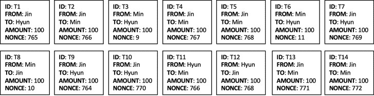

*图 6.15* 以太坊节点接收到的交易。

## 注释

1. 与 `EOA` 不同，`SCA` 缩写并不是通用接受的，但在本书的语境下有助于保持简洁准确。
2. 在图 6.2 中 中，使用前缀 `0x` 表示后续内容使用 `Base-16` 或 `Base-64` 编码。这是计算机科学家的常用做法。
3. “wei”](#C_010_c6.xhtml#n6_3b) 是以太坊的最小单位，`1 ETH = 10¹⁸ wei`。交易费用通常以 `Gwei` 为单位，`1 Gwei = 10⁹ wei`。
4. 访问 时间为 2022 年 6 月下旬（本书期间）。请注意这些信息在未来可能会发生（但关于此 `SCA` 的信息无法从以太坊账本中删除！

# 7 私有区块链

DOI: [10.4324/9781003321187-9](http://doi.org/10.4324/9781003321187-9)

## 7.1 私有区块链的特征

在本书的第 2 部分](#C_008_part2.xhtml#part2)中，我们目前为止只考虑了公共区块链技术，即 `Bitcoin` 和 `Ethereum`。然而，正如第 3 章](#C_006_c3.xhtml)中所示，区块链也可以由业务合作伙伴的私有网络应用。从设计的角度来看，构建私有区块链可能比公共区块链更具挑战性。例如，因为节点的身份是已知的，所以节点可以被更高程度地信任。此外，在私有区块链中，我们可以设计更细粒度的数据可见性策略。每个节点不需要访问整个交易账本。某笔交易可能仅对其具有业务意义的节点可见。在本节中，我们首先讨论了私有区块链的需求，这源于公共区块链的局限性。基于这一讨论，我们推导出一组刻画私有区块链的通用特征。

公共区块链（如 `Bitcoin` 和 `Ethereum`）实现了向所有人开放的去中心化资产交换系统（如加密货币）。公共区块链特别适用于全球使用的数字货币的实现，但在许多更传统的业务领域中也不适用。

首先，公共区块链通常通过高资源消耗的共识协议（如 `PoW`）来保护。其他类型宣称可以解决 `PoW` 资源渴求的共识机制，依赖于利用节点的其他资源来建立共识。例如，权益证明证明（`PoS`）共识机制要求节点使用自己的加密货币来获得提议新区块的权利。在许多传统的业务环境中，这种共识机制并不是可行的解决方案。事实上，运行 `PoW` 共识需要至少有一些节点实现 `miner`（矿工）功能。矿工节点基本上接受使用区块链的加密货币作为其开挖新区块所用资源（即电力）的奖励。在许多实际场景中，完全不需要加密货币。也就是说，大多数实际场景中的所有经济交换都是使用传统的法币处理的。缺乏引入加密货币的业务案例，显然使得在实践中无法使用 `PoW` 共识机制，或任何依赖于区块链节点对加密货币所有权的共识机制。

公共区块链的第二个缺点涉及区块链数据的可用性和透明度。公共区块链账本中的数据（如交易和/或描述区块链状态的变量）通常是公开的。这意味着任何人（甚至可能是在区块链之外的人）都可以访问这些数据。在之前的章节中，我们看到通过“区块浏览器”（即公共网站），任何人访问 `Bitcoin` 和 `Ethereum` 区块链发布的所有交易信息。因此，任何人都可以重建区块链节点拥有的 `BTC` 或 `ETH`（或其他任何 `ERC-20` 代币）。公共区块链的透明度在许多应用场景中是受欢迎的，如加密货币或贵数字和物理资产的追踪。然而，我们也必须意识到透明度在业务场景中完全不受欢迎。例如，一个投资房地产的私募股权基金不想公开其购买房地产的价格。同样，一个区域医院网络也会坚决反对公开有关患者治疗的数据。通过分析这些数据，竞争对手实际上可以重建出可能成为竞争优势的重要信息，例如不同地区的详细交货时间，或所采用的价格。在大多数传统业务中，有关业务运营的信息必须对通常少数的业务参与者保密。

总之，我们在这里总结了私有区块链系统的三个主要特征：

1. 在私有区块链系统中，节点在被允许私有区块链之前经过审核，作为结果，私有区块链节点的身份是已知的。
2. 私有区块链账本中存储的信息对于区块链节点应该是私密的。此外，根据特定业务设置的要求，可以在不同节点组之间隔离私有区块链账本中存储的信息。
3. 私有区块链系统的共识机制不需要基于高资源消耗的算法，而是利用网络通常较小以及节点身份已知的特点，可以依靠更轻量级的解决方案，从而在不损害安全的情况下提高整个系统的性能。

## 7.2 作为私有区块链的以太坊

在第 6 章](#C_010_c6.xhtml)中，我们将 `Ethereum` 介绍为公共区块链。以太坊区块链的节点可以拥有并交换以太坊（ETH）。节点使用以太坊支付交易费用并奖励新区块的矿工（通过包含在每个新区块中的 `coinbase` 交易）。


以太坊也可以用作创建私有区块链网络的框架。事实上，以太坊客户端可以下载并安装在属于私有网络的一组节点上。例如，这可以是组连接到私有局域网（`LAN`）或虚拟专用网络（`VPN`）的桌面电脑。根据定义，在这种情况下，节点的身份是已知的，因为我们需要知道哪些节点属于这个私有网络，以及必须在哪些节点上安装以太坊客户端。同时，该网络是私有的，即任何其他计算节点都无法访问。原则上，连接节点的 `LAN` 或 `VPN` 可以完全与互联网断开。这意味着，其他节点在物理上无法访问私有网络上的节点。

由于每个节点上都安装了以太坊客户端，私有以太坊网络的行为类似于公共以太坊网络。例如，交易的格式是相同的，节点可以发布部署新智能合约的交易，并且至少有一个节点还应该实现提议新区块的功能。然而，私有和公共以太坊网络之间也存在许多差异。首先，私有以太坊网络中的 `Ether` 基本上是“虚假”的，即它在私有网络之外没有价值。最重要的是，它在法定法币中没有价格。因此，可以创建具有任意高 `ETH` 余额的节点，或者，可以将交易费（`gas price`）设得极低，几分之一 `Ether` 就足够让节点发布数十亿次交易。其次，共识协议的设计可以进行参数化，以适应创建该私有以太坊网络的特定业务场景的需求。

有很多私有以太坊区块链的示例。例如，对区块链感兴趣的学术人员在私有以太坊区块链上开发和测试新想法是很常见的，例如 `[XHL+18]]` `[SMJ21]`。事实上，私有以太坊区块链为研究人员提供了一个完全控制环境中功能丰富的区块链（可能包括部署智能合约的选项），可以免费使用。这通常是公共以太坊测试网络的良好替代方案，因为后者的性能往往是不可预测且不可靠的 `[CCM21]]`。例如，第 8 章案例研究（基于人工物的业务流程监控）的原型是作为一个开源私有以太坊区块链实现的 `[MPV19]]`。

## 7.3 Corda：基于按需知情账本的私有区块链

`Corda` 是一个由 R3 创建用于开发私有区块链网络的框架，自 2016 年起开源（[`www.r3.com/products/corda/`](https://www.r3.com/products/corda/)）`[Bro18]]`。它近年来引起了极大的关注，特别是在金融领域。注意，与比特币或以太坊不同，`Corda` 本身并不是区块链系统，而是一个用于创建私有区块链系统的开发框架。

（注：原文中存在大量重复段落，译文已根据要求去重，仅保留核心逻辑内容）


图 7.1 基于“按需知”原则的 Corda 账本。

得益于交易，存储在 Corda 账本中的状态会随时间演变。Corda 中的交易由一个节点（即发起者）发布。发起者还会对交易进行数字签名。Corda 中的交易以及它们所包含的状态演变机制，是对我们在我们在第 5 章中为比特币区块链所描述的 UTXO 机制的泛化。一笔交易“消耗”状态作为输入，并“产生”新状态作为输出。因此，Corda 账本中的状态可以是“历史性的”（即已消费的），也可以是“未消费的”。交易只能使用“未消费的”状态作为输入。交易的执行会使输入状态转变为“历史性的”，并可能产生新的“未消费的”状态作为输出。

上述状态演变机制的示例请见图 7.2。它涉及描述节点 Alice 欠节点 Bob 债务的事实。Alice 和 Bob 共享的第一个状态记录了 Alice 欠 Bob 20 美元的事（由交易 `T1` 创建）。在时间 `t = t[1]` 时，该状态是“未消费的”。然后，在时间 `t = t[2]`，Alice 向 Bob 还了部分债务（7 元）。这通过交易 `T2` 记录，该交易将状态 `S1` 变为“历史性的”，并创建一个新的“未消费的”状态 `S2`。状态 `S2` 记录了 Alice 现在仅欠 Bob 13 美元的事实。最终，在时间 `t = t[3]`，Alice 向 Bob 还了剩余的所有债务。这通过交易 `T3` 记录，该交易将状态 `S2` 变为“历史性的”，且没有产生任何新状态。

总结来说，Corda 中的状态通过交易进行修改。一笔交易可能有零或多个状态作为输入，并可能产生零或多个新状态作为输出。交易只能使用“未消费的”状态。交易的执行将输入状态转变为“历史性的”，并可能产生新的“未消费的”状态。因此，在任何时刻，Corda 节点维护的账本都包含一组历史状态和一组未消费状态。后者是唯一可以作为新交易输入的状态。最后，如图 7.2 所示，Corda 中有三种类型的交易：

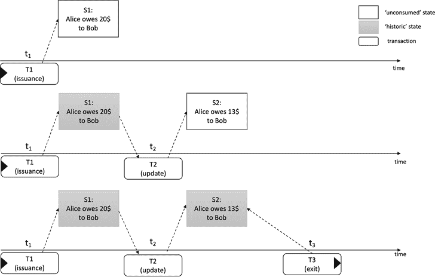

图 7.2 Corda 中状态类型及其通过交易的演变。

*   “发行”（Issuance）交易：无输入且创建新状态（例如图 7.2 中的交易 `T1`）。
*   “更新”（Update）交易：输入中至少有一个状态，并产生至少一个输出状态（图 7.2 中的 `T2`）。
*   “退出”（Exit）交易：至少有一个输入状态，但没有输出状态（图 7.2 中的 `T3`）。

正如我们之前提到的，上述机制可以看作比特币 UTXO 机制的扩展。历史状态实际上类似于已经作为其他比特币交易输入的交易输出，因此不能再被新交易使用。未消费的状态类似于比特币的未花费交易输出（UTXOs）。它们可以被新交易作为输入。与此同时，虽然比特币区块链的状态（即所有用户的余额总和）可以通过 UTXOs 的集合来重构，但 Corda 系统的当前状态是由其在多边账本中的“未消费”状态集合所构成的。


图 7.3 Corda 合约示例。

Corda 系统的其他重要元素是所谓的 `contracts`（合约），我们简要提到一下这一点。Corda 中的合约规定了交易为了保持有效而必须满足的规则。换句话说，`contract` 不应与 `smart contract`（智能合约）混淆。

### 7.3.2 Corda 网络与性机制

在上一节中，我们描述了数据是如何存储在账本中的，以及此类节点如何通过发布交易来修改这些数据。在本节中，我们重点关注共识机制。在引入共识机制后，我们通过简要讨论 Corda 系统可能存在的不同类型节点来结束本。

当 Corda 系统中的节点发布新交易时，系统节点必须对以下两个问题达成共识：

*   这笔新交易有效吗？
*   该交易引发的状态更新（或创建）是唯一的吗？

我们已经简要提到涉及 Corda 系统交易有效性的方面。如果一笔交易仅消耗“未消费的”状态且满足相关合约规定的所有条件，则该交易是有效的。此外，与任何其他区块链系统一样，节点通过验证交易格式正确且由其发起者数字签名来验证交易性。

上述列出的第二个问题，即交易所引发的状态更新的唯一性，是需要详细讨论的。这个问题可以被看作公共区块链中双重花费问题的泛化。事实上，我们必须解决的问题是确保一个未消费的状态不会在不同的交易中被使用两次。图 7.4 阐述了。Alice 可能发布两个时间接近的交易 `T1` 和 `T2`，它们消耗相同的输入状态（即她的余额为 50 美元的事实）。交易 `T1` 和 `T2` 分别被用于清偿 Alice 欠 Chris 和 Bob 的债务。如果 Bob 和 Chris 接收这些交易的顺序不同，这种情况就是可能的。具体来说，如果他们各自先收到偿还欠他们债务的交易。换句话说，图 7.4 描述了一种情况：Alice 成功两次“消耗”了 Corda 系统的一个状态。然而，同时 `T1` 和 `T2` 的执行也创建了两个冲突的状态（`S4` 和 `S5`）。

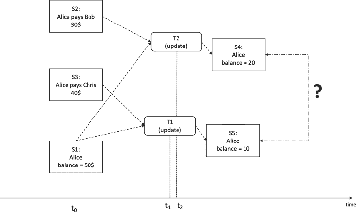

图 7.4 Corda 中状态更新的唯一性。

在公共区块链中，双重花费问题是通过 PoW 共识机制防止的，该机制体现了矿工节点的计算工作量。在私有区块链系统中，理想情况下是用更简单的方式解决此问题，以避免 (i) 执行 PoW 通常带来的高能耗以及 (ii) PoW 通常引入的交易确认延迟。


在 Corda 系统中，状态更新的唯一性是由所谓的“公证者”（notary）节点来保证的。Corda 系统中的公证节点是不参与业务操作的节点。它更像是一个有助于 Corda 系统顺畅运行的“服务”节点。Corda 系统中的公证节点只有一个角色：监控一个或多个状态的使用情况。当交易产生一个新的“未被消费”状态时，它会被分配给一个公证节点。公证节点会持续监控新交易是否使用该状态作为输入。一旦某个交易这样做了，公证节点就会将该“未被消费”状态转换为“历史”状态。例如，在图 7.4 中，如果 `T1` 在 `Bob` 验证 `T2` 之前被 `Chris` 验证，监控状态 `S1` 的公证节点将把 `S1` 变为“历史”。这样，`Bob` 将无法验证 `T2`——因为它使用了历史状态作为输入——从而防止 `Alice` 重复消费某个状态。

如上面的示例所示，单个公证节点在解决双重花费问题的同时，也可能引发涉及区块链系统本质的更通用问题。事实上，单个公证节点可以充当中心权威和单点故障。区块链的发明初衷正是为了避免这些问题。换句话说，在上面的示例中，监控 `S1` 的公证节点可能与 `Alice` 通气，允许她使用两次状态 `S1`。公证节点只需通过延迟其操作即可实现，即在 `Bob` 验证 `T2` 之后才将 `S1` 变为“历史”。如果该同一个公证节点随后还监控 `S5` 和 `S4`，那么该公证节点可能会立即将 `S5` 变为“历史”，导致状态 `S4`（为 `Alice` 分配了更高的余额）成为未来唯一可使用的状态。这个问题在 Corda 系统中通过为同一个状态考虑多个公证节点来解决。在实践中，不是由单个公证节点，每个新状态都可以由公证节点网络进行监控。当某个状态在交易中使用时，监控该状态的公证节点必须对将该状态转换为“历史”达成一致。在实践中，这是通过共识机制实现的。私有网络中的共识机制可以比 `PoW` 机制轻得多。关于私有区块链网络中共识机制的更多信息请参见《计算机科学焦点》。

Corda 的一个重要局限性是缺乏对智能合约的支持。在 Corda 系统中，无法定义任意业务逻辑根据交易提供的输入来操作系统状态。如前所述，Corda 系统中所谓的“合约”仅仅是一种将交易验证规则封装在一起的方法。支持智能合约的私有区块链系统可以使用 `Hyperledger Fabric` 实现，我们将在下一节讨论它。

## 7.4 Hyperledger Fabric：支持智能合约的私有区块链

Hyperledger Fabric \[ABB+18\] 是由 Hyperledger 基金会自 2016 年以来开发的一个用于开发私有区块链网络的框架。Hyperledger Fabric（本章后续简称为 `HLF`）主要设计用于支持技术、金融和供应链公司之间的业务交易。与 Corda 类似，`HLF` 的目标是根据知情原则向参与者披露区块链中的信息。为了实现这一点，它依赖于两个元素，即`channels”（通道）和私有数据集合，我们将在第 7.4.1 节](#C_011_c7.xhtml#h07_4_1)中介绍。此外，`HLF` 还支持智能合约。`HLF` 中的智能合约被称为“链 code”。与以太坊智能合约相比，`chaincode` 允许处理涉及私有链外数据的交易。最后，`HLF` 允许指定特定的参与者执行智能合约并创建新区块。这些细节将在第 7.4.2 节](#C_011_c7.xhtml#h07_4_2)中讨论。

### 7.4.1 Hyperledger Fabric 数据结构

由于其关注业务交易，`HLF` 中的信息由业务对象表示。业务对象是物理或虚拟对象（例如包裹、报价单或发票）的事实表示，由私有网络中的组织进行操作和交换。每个业务对象由多个属性组成。这些属性的值代表业务对象的状态。例如，一个“发票”业务对象可能包含客户的增值税号码、购买的商品以及每件商品的数量和单价、应付总额、给予给客户的折扣以及是否已收到客户的付款。

为了跟踪业务对象随时间的演变，`HLF` 依赖于两个数据结构：

1. “世界状态”（world state）：这是一个键值数据库，维护每个业务对象的最新信息。其主要目的是让节点能够快速访问业务对象及其状态。
2. “区块链”（blockchain）：这是一个在加密链接区块内分组的交易的有序集合。其主要目的是维护业务对象随时间变化的不可变历史。

在 `HLF` 中，只有 `chaincode` 负责创建、更新和删除业务对象。与以太坊相比（以太坊中，交易不需要调用智能合约即可在区块链中存储新信息，例如，只需将新信息作为交易数据添加，或者交易可以记录 `Ether` 的交换），`HLF` 要求每笔交易都调用 `chaincode`。此外，`chaincode` 中的更新和删除操作仅修改世界状态中的业务对象。它们不能更改区块链。

为了满足知情原则，`HLF` 允许将节点网络分为所谓的“通道”。从概念角度来看，一个通道可以被视为与其他通道完全独立的账本，拥有自己的世界状态和区块链。因此，交易被限制在发布它们的通道内。因此，没有该通道访问权限的节点看不到其发布的交易，无法访问其业务对象。

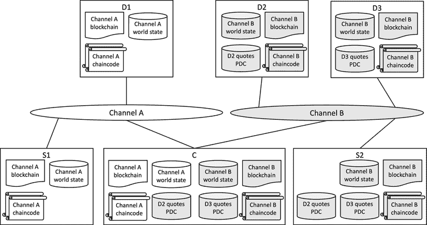

*图 7.5 使用通道和私有数据集合的 HLF 部署

这一功能在供应链等场景下特别有用。例如，客户 `C` 可能希望跟踪经销商 `D1`、`D2` 和 `D3` 的业务关系，其中 `D1` 属于供应商 `S1`，`D2` 和 `D3` 属于供应商 `S2`。然而，供应商不愿意与其竞争对手共享这些信息。如图 7.5 所示，可以通过创建两个通道 `A` 和 `B` 来解决这个问题。供应商 `S1` 和经销商 `D1` 被授予访问通道 `A` 的权限，而供应商 `S2` 以及经销商 `D2` 和 `D3` 获得访问通道 `B` 的权限。客户 `C` 被授予访问两个通道 `A` 和 `B` 的权限。这样一来，`S1` 只能看到由自己、`D1` 和 `C` 发布的交易，而看不到 `S2`、`D2` 或 `D3`。同样，`S2` 可以看到由自己、`D2`、`D3` 和 `C` 发布的交易，但看不到 `S1` 或 `D1`。相反，由于是两个通道的成员，`C` 可以访问所有节点发布的交易。


通道仍然存在一些局限性。首先，为了让一个交易对属于不同通道的节点可见，它必须在每个通道中发布一次。例如，如果 `C` 想要让 `D1` 和 `D2` 都能访问同一个报价请求，它必须通过发布两次交易来创建两个业务对象，首先在通道 `A` 上发布，然后在 `B` 上发布。其次，限制通道内部分节点访问某个交易的唯一方法是创建一个新通道并在其中发布该交易。例如，为了防止 `D3` 看到 `D2` 发送的报价并利用这些信息获取更优惠的交易（例如，刻意申请比 `D2` 享更高的折扣），依赖于通道的解决方案需要 `D2` 建立一个仅包含自身、`C` 和 `S2` 在内的新通道。

为了对私有信息实现更细粒度的访问控制，并支持在敏感信息不再需要时将其删除，HLF 引入了“私有数据集合”（private data collections）。简单而言，私有数据集合是一组存储在侧边数据库中的业务对象，并通过链下机制复制到特定节点。每当业务对象被添加到、修改或从私有数据集合移除时，其摘要（即哈希值）会被计算并存储在相应通道的区块链中。通过这种方式，授权节点可以知道其数据对象的副本是否是最新的，如果不是，它们可以获取最新版本。可以定义访问控制策略来指定哪些节点被允许读取和/或写入私有数据集合。策略还允许为业务对象指定有效期，到期后这些对象将自动从集合中清除。

得益于这些功能，私有数据集合比通道更灵活。特别是在当节点之间需要短期协作，或者当基于通道的解决方案需要定义多个通道时，它们会成为首选。在供应链示例中，让 `D2` 发送的报价对 `D3` 不可见的问题可以通过将报价存储在私有数据集中来解决。详细来说，`D2` 可以为自己的报价创建一个私有数据集合。然后，它可以定义一个新的访问控制策略，仅允许 `S2` 和 `C` 复制该集合上的信息。`D3` 也可以对它自己的报价执行相同的操作。

### 7.4.2 Hyperledger Fabric 网络与共识机制

在第 6 章中，我们讨论了智能合约如何在以太坊中执行。每当以太坊发布调用智能合约的新交易时，它首先被包含在新区块中。然后，当节点接收到新区块时，所有节点必须通过在自己的 `EVM` 中执行智能合约来重放交易。这种方法被称为“排序-执行”（order-execute），因为交易在执行之前必须先在一个新的区块内进行排序。

为了使这种方法生效，要求运行在不同节点上的智能合约在给定相同交易历史时必须提供相同的输出。因此，只有保证具有确定性的特殊编程语言（例如，它们不能使用随机数）才能用于实现智能合约。出于相同的原因，执行智能合约所需的信息必须对所有节点可用，以输入参数的形式或作为智能合约的内部状态提供。在这两种情况下，信息最终都存储在区块链中，从而变得不可篡改且可供所有节点访问。这种方法还要求交易按顺序处理。事实上，当接收到新区块时，节点必须逐个执行其中的交易，这可能会限制区块链网络的可扩展性和吞吐量。

为了克服这些局限性，HLF 依赖于另一种执行智能合约的方法，称为“执行-排序-验证”（execute-order-validate）。正如名称所示，交易首先由部分节点处理，这些节点“执行”它们调用的智能合约。然后，交易在区块内进行排序。这些区块由另一部分节点创建并验证。最后，区块内的交易由所有节点进行验证，验证通过后，节点更新自身的账本副本。在接下来的章节中，我们将详细讨论这些步骤是如何执行的。

#### 7.4.2.1 执行

要在 HLF 中发布新交易，节点必须首先创建一个“提案”（proposal）。在提案内部，节点必须指定要调用的链码函数和输入参数。可选的是，节点还可以某些输入参数声明为瞬态（transient）。在这种情况下，此类参数的值将不会存储在提案中，也不会包含在交易中。相反，它们将从私有数据集中检索，并保持在链下。然后，创建提案的节点（称为“目标节点”，target peer）对提案进行数字签名，并将其转发给通道中的部分节点，这些节点负责检查其正确性。这些节点被称为“背书节点”（endorsing peers），并根据背书策略进行选择。

当接收到提案时，每个背书节点检查其本地账本副本，并识别被调用链码操作的业务对象。然后，它计算所谓的“输入集”，即链码执行前此类业务对象的属性值。然后，背书节点执行链码并计算“输出集”，即链码执行后之前识别的业务对象的属性值。

根据链码的结果，背书节点决定是否背书该提案（因此被称为背书节点）。如果决定背书，背书节点创建一个包含背书决策以及输入输出集的响应，对其签名并发送给目标节点。值得注意的是，在此阶段，链码调用对业务对象的更改尚未被目标节点或背书节点持久化。

图 7.6 显示了 HLF 部署中节点执行执行阶段的示例，场景如第 7.4.1 节所示（图 7.5）。为了接受 ID 为 ‘R1’ 的报价请求，`D2` 创建一个调用链码 `QuoteH` 的 `AcceptReq` 函数的提案，并将 `R1` 作为输入参数。一旦接收到提案，背书节点 `C` 将值为 `Sent` 的数据对象 `R1` 识别为输入集，执行 `QuoteH` 的 `AcceptReq` 函数，并将值为 `Accepted` 的数据对象 `R1` 识别为输出集。然后，`C` 通过结合请求与输入输出集创建响应，对响应进行签名并传回给 `D2`。`D3` 执行相同的操作，而 `S2` 由于缺少 `QuoteH` 链码而不参与排序阶段。请注意，在此阶段，所有节点的世界状态保持不变。


引入背书节点（endorsing peers，即负责执行链码的唯一实体）带来了几个优势。首先，它对链码的复杂性没有限制，也不对确定性有要求。因此，链码可以使用任何通用编程语言编写，例如 `Java` 或 `Python`。其次，链码可以基于仅背书节点可访问的数据进行断言，例如私有数据集合中的业务对象。此外，一旦链码执行且调用它的提议获得背书，私有数据就可以被安全地删除。最后，由于链码仅由节点的一个集执行，因此可以并行运行多个链码，从而提高区块链网络的整体性能。

### 7.4.2.2 排序 (Ordering)

一旦目标节点为提议收集了足够的背书，它将检查背书节点是否对提议的结果达成共识。特别是，必须同意提议的背书节点数量在背书策略中也有规定。如果满足背书策略，目标节点会创建一个交易，包含该提议以及背书节点发送的所有提议响应。然后，它将该交易发送到另一个节点子集，称为“排序服务”（ordering service）。

顾如其名，排序服务中的节点负责指定交易包含在新区块中的顺序。为了实现这一目标，会选择一个节点来创建下一个区块。一旦节点确定了提议的顺序，它就会创建一个包含关联交易的新区块，并将该新区块转发到通道中的所有其他节点。值得注意的是，排序服务既不验证交易，也不执行任何链码。

图 7.7 显示了排序阶段的示例，它是前一节讨论示例的逻辑延续。首先，排序服务选择 `S2` 对交易进行排序。然后，`D2`、`D3` 和 `S` 将交易 `T1`、`T2`、`T3` 发送 `S2`，`S2` 对其进行排序，创建 `Block 1` 并将其转发给 `Channel B` 中的所有节点。请注意，尽管所有交易都调用了 `QuoteH` 链码的函数，且 `S2` 缺少该链码，但这并不影响 `S2` 排序交易的能力。还需要注意，在此阶段，所有节点的世界状态仍然保持不变。

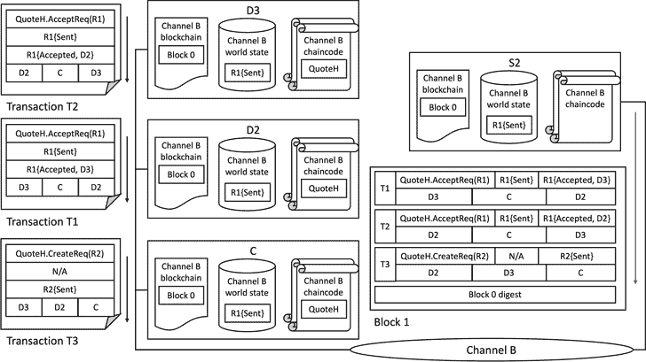

*图 7.7* HLF 中的排序阶段。D2、D3 和 C 充当目标节点，而 S2 被选中排序交易并创建新区块。

排序服务带来的主要优势之一是它防止了区块链中分叉的引入。事实上，由于只有一个节点负责新区块的创建，因此不可能有两个区块链接到同一个上一个区块。排序服务的另一个优势是它不绑定到特定的共识机制。事实上，HLF 原生支持三种排序服务的实现：`Raft`、`Kafka` 和 `Solo`。`Raft` 和 `Kafka` 是崩溃容错（CFT）实现，其中一个节点被动态选为领导（leader），其他为跟随者（follower）。领导者监督新区块的创建，而跟随者则跟踪正在发布的交易和正在创建的区块。如果领导者离线，将从跟随者中选出一个新领导者。此外，`Raft` 专门设计为便于在多个组织之间分布，并计划开发支持拜斯庭容错（BFT）共识机制的实现。相反，`Solo` 由单个节点组成，因此不提供冗余，主要用于测试。值得注意的是，可以在 HLF 中部署其他自定义的排序服务实现，而无需更改其他节点。此外，单个 HLF 部署中存在多个排序服务实现。

### 7.4.2.3 验证 (Validation)

当节点直接或通过其他节点通过传播协议（gossiping）从排序服务接收新区块时，它将按照排序服务指定的相同顺序检查区块中的交易。对于每个交易，节点会检查其是否满足相应的背书策略。此外，节点会验证该交易没有被区块中的其他交易失效。特别是，它会检查输入集，以确定其是否与自己的世界状态副本一致。

如果验证检查通过，节点将该交易标记为有效。此外，节点用该交易的输出集更新其自己的世界状态副本。如果验证检查失败，节点将该交易标记为无效，保持世界状态不变。这种方法防止了双重花费问题的发生。事实上，如果两个并发交易尝试更改业务对象的同一个属性，它们将具有相同的输入集但不同的输出集。因此，只有第一个交易——即列在区块中的第一个交易——的输入集会与世界状态一致。因此，该交易将被标记为有效，并更新世界状态。相反，另一个交易的输入状态与更新后的世界状态不一致。因此，该交易将被标记为无效，且不对世界状态不做任何更改。

图 7.8 显示了验证的示例，它是前一节讨论示例的逻辑延续。一旦收到 `Block 1` 的副本，`Channel B` 的一个节点将其添加到自己的区块链副本中。然后，它开始检查其中的交易（左侧）。当它检查 `T1`（第一个交易）时，节点发现输入集要求的对象 `R1` 值为 `Sent`，这与世界状态一致。然后，它将 `T1` 标记为有效，并根据 `T1` 的输出集将 `R1` 更新为 `Accepted`（中间）。然后，节点检查 `T2`（下一个交易），发现输入集要求 `R1` 的值为 `Sent`。然而，在世界状态中 `R1` 现在是 `Accepted`，因为它是由与 `T2` 同时发生的 `T1` 更新的。因此，`T2` 被标记为无效，其输出集被忽略。最后，节点检查 `T3`（最后一个交易），发现没有定义集。因此，它将 `T3` 标记为有效，并将输出集应用到世界状态，从而创建一个值为 `Sent` 的新业务对象 `R2`（右侧）。请注意，由于 `Block 1` 中交易的检查顺序是由排序服务定义的，通道中的所有节点都以此方式执行此操作。还需要注意，尽管所有交易都调用了 `QuoteH` 链码，节点处理交易不需要该链码。

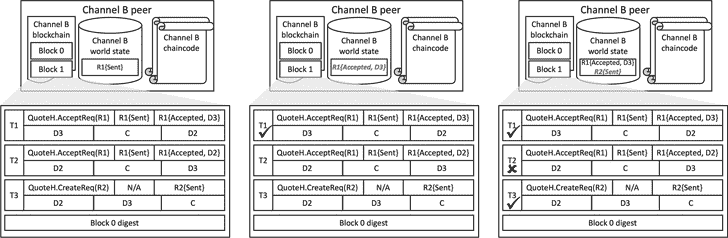


值得注意的是，尽管每个节点都独立地更新自己的世界状态副本，但该过程在所有节点中是一致的。特别是，由于交易的执行顺序由排序服务决定，两个节点之间在自己的世界状态副本上是不存在差异的。这清楚地防止了双重花费问题。同样值得注意的是，更新世界状态只需要输出集。因此，节点在这一阶段不需要执行任何链码（chaincode）。

总结来说，HLF 采用的“执行-排序-验证”（execute-order-validate）方法能够有效实现扩展性、管理私有数据，并且避免受到特殊智能合约（如以太坊中的 Solidity 智能合约）的局限性。然而，这种方法之所以适用是因为 HLF 是一个私有区块链，其节点是可识别且与特定组织关联的。在任何节点都可以匿名加入的公共区块链中，定义有效的背书策略是不可能的，因为没有办法判断大多数背书节点和目标节点是否由同一实体控制。同样，如果排序服务使用了 CFT（拜庭容错）共识机制，恶意用户可能会控制它，从而阻止交易被包含在区块中或导致交易按照无效的顺序执行。最后，基于通用编程语言的链码可能会被恶意用户利用，导致区块链网络出现死锁或其他性能问题。

## 7.5 案例研究：使用 Corda 和 Hyperledger Fabric 的真实世界应用

Corda 和 HLF 是目前在不同业务场景下运行的许多私有区块链实现的核心。在本节中，我们将简要讨论其中两个项目：基于 Corda 的 Spunta Banca 项目和基于 HLF 的 IBM FoodTrust。

### 7.5.1 Spunta Banca

Spunta Banca 分布式账本技术(`https://www.r3.com/case-studies/spunta/`）是由意大利银行协会（ABI）推动并由其研发部门（ABI Lab）协调的项目，侧重于银行间双边交易的对账（reconciliation）。它旨在解决的问题听起来很简单：每当执行涉及两家商业银行的交易时，这两家银行必须在描述交易特征的每一个方面上达成精确一致，从涉及的账户所有者的身份到转账的精确金额。这一过程在意大利语中被称为“spunta”，在历史上它一直基于碎片化的解决方案，涉及交易两端可能不同的 IT 系统，还需要通过多次电话和传真交换来对账即使单笔交易。

在该项目中，开发了一个基于 Corda 的区块链系统。事实上，正确运行“spunta”过程的问题显然符合 Corda 系统的特征。具体而言，在开发的系统中，交易被记录在一个“按需知”的账本中。实际上，大多数交易只涉及两家银行。只有在某些情况下，可能涉及其他银行或金融机构。例如，第三家银行可能为另外两个银行之间的大笔金融交易提供担保。此外，所有关于交易对账的规则（例如每种交易类型必须对账的所有数据的详细规格）都作为 Corda 的“合约”（contracts）被编码到系统中。因此，当节点验证交易时，这些规则会被实时检查。此外，基于 Corda 的系统为银行间交易对账问题带来了区块链的典型优势，例如所有交易的不可篡改记录，在发生交易争议时可以随时查询。

基于 Corda 的 Spunta Banca 系统于 2020 年 10 月启动，目前为一个由 100 多家意大利银行组成的网络每天处理数百万次交易。简而言之，它允许在一个去信任的银行网络中，以近乎实时且极高的可靠性运行一个在历史上非常耗时且容易出错的过程。

#### 7.5.1.1 IBM FoodTrust

FoodTrust(`https://www.ibm.com/blockchain/solutions/food-trust`）是一个由 IBM 开发的私有区块链系统，它以 HLF 为核心。简而言之，FoodTrust 是一种连接食品供应链中参与者的解决方案，用于创建一个关于食品数据的私有的、不可篡改的共享的记录。例如，在某个品牌咖啡的供应链中，可以使用 FoodTrust 来收集从咖啡豆收获到咖啡最终以精美包装进入我们家期间所产生的所有数据。

FoodTrust 具有高度的可定制性，它通常是 IBM 为客户提供的更广泛“解决方案”的一部分，涵盖以下 7 个用例之一：供应链效率、品牌信任、食品安全、可持续性、食品新鲜度、食品欺诈和食品浪费。例如，供应链效率和食品浪费用例利用了私有区块链的透明性和实时信息共享的特性，将数据分发到整个供应链。然后可以对供应链数据进行实时分析，以识别并减少瓶颈，或识别供应链中大量浪费食品的关键环节。FoodTrust 的其他用例则利用了基于区块链的解决方案的其他优势。例如，在品牌信任和食品安全用例中，目标是为客户在超市找到的特定产品的所有成分建立一个详细且最重要的是不可篡改的溯源账户。这可以用于营销目的，也可以处理食品安全紧急情况。例如，如果发现某批受污染的产品（这种情况并不罕见，例如冷冻食品），系统中可以获得该批次产品交付到何处以及该批次使用的原料来自何处的信息。最重要的是，它是可信的，因为从设计上讲，它无法被任何节点篡改，因为它存储在 HLF 的世界状态和区块链上。最后，食品新鲜度用例结合了私有区块链系统与 IoT 技术。例如，IoT 传感器可以部署在整个食品供应链中，它们产生的数据可以存储在私有区块链账本中，以创建一个证明产品新鲜度的可靠记录。例如，可能证明我们在超市发现的某些鱼类是在 24 小时前捕获的，并且那时起一直存储或运输在 1 到 4 摄度之间。

## 7.6 结论


本章讨论了我们如何构建私有区块链系统。我们首先考虑了 `Ethereum`，讨论了运行公共 `Ethereum` 网络的相同实现如何也能运行在私有节点网络上。然后，我们深入研究了两个用于开发私有区块链系统的框架：`Corda` 和 `HLF`。对于这两种框架，我们都关注了由于其“私有性”特性才可能实现的特定设计特征，具体来说是因为私有区块链中的节点身份是已知的。在 `Corda` 中，我们看到了账本如何根据“按需知晓”（need-to-know）原则进行设计，以及存储在其中的状态如何根据交易验证进行演进，这种验证泛化了第 5 章中为 `Bitcoin` 引入的 UTXO 机制。对于 `HLF`，我们讨论了如何使用通道（channels）和私有数据集合（private data collections）来实现按需知晓的账本。接着，我们重点介绍了交易在 `HLF` 中如何被验证、分发和执行，这与我们在 `Bitcoin` 或 `Ethereum` 等公有区块链中所看到的有显著区别。

下一章侧重于理解区块链与物联网（IoT）之间的协同作用。近期，物联网推动了所谓的“智能”革命，允许组织针对其业务生成并收集海量数据。显然，区块链在此类数据管理中可以发挥关键作用，特别是在那些必须收集和存储物联网数据以提高协作业务方网络之间信任的场景中。

## 7.7 问题与练习题

1.  考虑一个大学私有网络的业务场景，例如美国某个州的的公立大学网络。这些大学必须共享学生数据（不仅涉及学业，还涉及学费缴纳、宿舍占用情况等）。但与同时，它们还必须保护更具敏感性的学生数据，这些数据只有在严格必要时才能与其他机构共享。该大学网络还需要对学生信息的处理进行自动化处理，例如自动生成学生录取通知书或成绩单。基于这些考虑以及你可能想要做出的其他假设，请讨论你建议使用哪种类型的私有区块链系统（`Ethereum`、`Corda` 或 `HLF`）。

2.  考虑本书书第 1 部分中引入的 `BC4C` 和 `BC4C-CGM` 系统。对于每种系统，讨论是否可能使用 `Corda` 和 `HLF` 实现它们；如果可能，讨论这样做是否有建议（特别是，使用私有区块链实现这些系统的主要优点和缺点是什么？）。

3.  讨论一个业务场景，并说明一个使用 `Ethereum`、`Corda` 或 `HLF` 实现的私有区块链能够成功支持的该场景中的某个具体应用。

4.  一家企业旅行社想要部署一个私有区块链，以跟踪与关联客户、航空公司和酒店之间的交易和预订。特别是，航空公司和酒店可以为旅行社提供特殊优惠，旅行社反过来可以将这些优惠提供给其预订的客户。然而，航空公司和酒店希望他们的优惠仅对旅行社和客户可见，而不对其竞争对手可见。讨论本章介绍的私有区块链在多大程度上可以满足这些需求，以及可以使用哪些区块链特定的特性。

5.  考虑 `HLF` 中的节点 `A`，它拥有如表 7.1 所示的世界状态副本：

    表 7.1 HLF 节点的世界状态

    | 业务对象 | 属性 | 值 |
    | --- | --- | --- |
    | R1 | 状态 | 已发送 |
    | --- | --- | --- |
    | R2 | 状态 | 已批准 |
    | R3 | 状态 | 已拒绝 |
    | R4 | 状态 | 已发送 |

`A` 随后接收到一个包含下表出的交易的新区块，如表 7.2 所示：

    表 7.2 HLF 节点收到的交易

    | 交易 | 链函数 | 输入集 | 输出集 |
    | --- | --- | --- | --- |
    | T1 | Approve(R1) | R1{Status: Sent} | R1{Status: Approved} |
    | --- | --- | --- | --- |
    | T2 | Reject(R4) | R4{Status: Sent} | R4{Status: Rejected} |
    | T3 | Approve(R3) | R3{Status: Sent} | R4{Status: Approved} |
    | T4 | Create(R5) | N/A | R5{Status: Sent} |
    | T5 | Reject(R2) | R2{Status: Sent} | R2{Status: Rejected} |
    | T6 | Reissue(R3) | R3{Status: Rejected} | R3{Status: Sent} |
    | T7 | Create(R6) | N/A | R6{Status: Sent} |

指示节点应该认为哪些交易是有效的，哪些是无效的（并被丢弃），以及在区块处理后世界状态将是怎样的。


如果你去过百货商店并买过衣服，你可能会注意到衣服或价格标签上贴有一个小小的、通常是正方形的、类似微芯片的粘胶。那个物品就是“无线射识别”（RFID）标签。它是一种低成本、一次性的电子设备，用于跟踪其所附带的物体（例如，裤子）。更详细地说，RFID 标签可以对发射器发送的射频消息做出响应。通过这种方式，发射器可以知道哪些标签位于其范围内，如果标签配备了额外的传感器，发射器还能感知传感器的状态。RFID 标签可以是主动式的，也可以是被动式的。“被动式”RFID 标签不需要电源源，仅依靠发射器发射的能量即可工作。由于这个原因，它们通常不配备传感器，仅用于传输标识其所附物体的唯一 ID。相反，“主动式”RFID 标签则通过电池或其他类型的电源（例如太阳能电池板）运行，并且通常配备了传感器，以提供有关所附物体状态的信息。

正如百货商店的例子一样，RFID 标签经常用于资产管理。如图 8.1 所示，通过将发射器放置在商店出口、商店货架和仓库内，百货商店可以知道仓库中哪些衣服可用，哪些展示在橱窗上，以及哪些已经被购买。此外，RFID 标签还提供了有效的防盗保护。如果有人偷走了一条裤子，出口处的发射器可以检测到衣服正在离开商店并向商店信息系统报告。反之，信息系统可以检查销售物品列表，如果衣服不在列表中，就会触发警报。


*图 8.1* 零售店中 RFID 基础设施示例。

最初，RFID 标签旨在用于组织边界内。事实上，当时并没有标准来唯一地重命名这些标签，这阻止了向外部组织查询有关特定标签的信息。为了解决这个问题（例如允许 RFID 标签贯穿整个供应链），创建了 EPCglobal 标准 `[SAB07]`。具体来说，EPCglobal 标准规范了 RFID 标签发送的消息。它还规定了不同组织应如何与标签交互并交换关于标签的信息。

尽管与物联网（IoT）有许多相似之处，但值得注意的是，RFID 并非“本身”一种物联网解决方案。在主动 RFID 标签出现之前，RFID 标签对所附物理物体能产生的唯一信息是固定的标识字符串。此外，RFID 标签无法相互自主通信。相反，这取决于发射器定期查询其范围内的标签。最后，尽管 EPCglobal 标准规范了如何使不同组织之间的标签具有互操作性，但它并没有规定通信必须通过互联网进行。

### 8.2.2 无线传感器与执行器网络 (WSAN)

如果你住在本世纪建造的酒店或在办公室工作，该建筑的供暖、通风和空调（HVAC）可能是由无线传感器与执行器网络（WSAN）控制的，如图 8.2 所示。正如名称所示，WSAN 由多个小型传感设备组成，负责收集其所在环境的信息（例如房间和公共区域的温度传感器）。随后，这些信息由传感设备通过无线通信（例如 Wi-Fi 或蓝牙连接）转发到名为“汇纽”（sink）的中央计算节点。反之，`sink` 聚合信息并可能与其他信息系统交互，确定必须采取行动（例如，开启加热系统将房间温度升高至 20°C）。如果是这样，`sink` 就会与能够改变其所在环境的机器控制设备通信，这些设备被称为“执行器”。一旦收到 `sink` 的指令，执行器就会启动机器以执行所需操作（例如，开启锅炉或热泵）。


*图 8.2* WSAN 组件（示例）。

### 8.3 物联网（IoT）的应用

在本章的开头，我们已经提到了物联网的潜在应用之一，即智能建筑。然而，这只是物联网的一种种可能应用。在本节中，我们提供了一个成功应用物联网的应用列表（非详尽的）。

### 8.3.1 物流

当应用于物流领域时，物联网被用于监控必须交付的货物状况和位置 `[SYZ+21]`。在这一应用中，物联网不仅允许跟踪货物所在位置并估计交付过程所需的时间，还被用于响应故障。例如，智能运输集装箱可以检测其内容是否变质（例如，因为其内容需要保持低温，但错误地让集装箱在停靠的船上于烈日下停留了一整天），并向（例如）货物制造商报警。反之，制造商可以联系货运人，要求丢弃集装箱内容，同时安排新的交付。关于物联网在物流行业中如何与区块链结合的更多细节，将在本章后面的关于构件驱动过程监控的案例研究中提供。

### 8.3.2 医疗保健

依靠智能医疗设备和智能房间，医院可以轻松跟踪患者的状况及其治疗情况 `[DF19]`。例如，物联网技术允许了解患者是否移动到了另一个房间，以及患者是否服用了所有开具的药物。这一切都无需医生手动将这些信息输入患者的健康记录中。此外，物联网技术还允许我们跟踪医院的库存，并自动补充药物和药品。


在辅助生活案例中，`IoT` 范式为患者管理带来的优势尤为明显。首先，`IoT` 使得全科医生能够远程监控慢性病患者以及最近出院的患者。此外，它甚至可以允许远程执行医疗治疗，例如为糖尿病患者注射胰岛素。

### 8.3.3 制造业

`IoT` 是所谓工业 4.0 革命的核心范式 [ZXK+17]。事实上，通过使制造出的产品智能化，可以追踪它们离开出厂后的使用情况。这允许预测由于磨损导致的潜在产品故障，并据此安排预防性维护。此外，`IoT` 还允许检测产品最初设计时未预见、但在产品在使用期间出现的问题。这些信息随后可以用于有选择性地召回缺陷产品，或改进产品的未来版本。

当应用于制造生产线上的机器时，`IoT` 使它们具有自重配置能力，从而提高车间的灵活性。此外，`IoT` 允许动态跟踪机器的磨损程度，并采取纠正措施以最大限度地减少机器停机时间。

### 8.3.4 智慧城市

通过使街道设施智能化，`IoT` 可以显著简化我们所居住城市的管理 [AHL+16]。例如，路灯可以根据交通或天气状况自动调整亮度。同样，交通灯和标志可以感知事故和交通状况，从而自动重新规划交通路线。我们在之前介绍智能家居应用时提到的相同设备也可用于公共建筑，如大学校园和购物中心。此外，智能设备可被用于监测空气、噪音和光污染的水平。结合了支持深度学习的图像识别系统的 `IoT` 系统甚至可以提供城市街道发生犯罪的证据。

### 8.3.5 可持续能源

通过使能源表智能化，`IoT` 使用电力公司能够实时了解客户的用电量。通过这种方式，可以更准确地预测能源利用激增何时发生，并采取应对措施 [Sal20]。智能能源表也是所谓微网的赋能技术。在微网中，在自己的现场安装了替代能源源（如太阳能电池板）的用户可以将产生的剩余能量注入本地电网并获得奖励。最后，当智能能源表部署在发电站时，它们简化了对产生能源溯源的追踪。因此，它们可以根据能源来源应用不同的价格，例如激励可再生能源，并惩罚通过燃烧碳燃料获得的能源。

## 8.4 将 IoT 与区块链结合

到本章为止，我们一直关注 `IoT` 范式带来的通用优势。然而，值得注意的是，`IoT` 的采用也面临着若干个未解决的问题 [MSD+12]。其中一些问题与智能对象的硬件特性有关，例如降低能耗和增加计算能力。而其他问题则侧重于智能对象之间的通信和交互。

在这些问题中，出现了对一个通用通信通道的需求，以便允许智能对象相互交互，并唯一标识它们中的每一个。另一个相关问题是怎样让 `IoT` 变得“可信”。特别是，智能对象通常在无人维护的情况下运行，它们可能寿命很长，并且通常始终连接到公共互联网。这些特征主张部署适当的安全措施，例如：

-   **访问控制：** 智能对象应仅由受信方控制。此外，在某些情况下，智能对象收集的数据应仅供特定主体访问。
-   **安全数据溯源：** 智能对象收集和交换的数据源头应始终为人已知。任何主体都不应允许更改智能对象产生的数据。
-   **身份管理：** 每个智能对象都应该是可唯一标识的。任何主体都不应能冒充智能对象，并例如代表其生成数据。

为了解决这些问题，最近的研究工作致力于将 `IoT` 与 `blockchain` 结合。特别是，如图 8.3 所示，`blockchain` 可以被视为一个可信的通信通道，它允许不同的不可信智能对象相互通信。通过使用 `blockchain`，智能对象可以将其传感器读数和指令提交给其他设备（例如 `blockchain transactions`），这些随后可以被需要这些信息的设备访问。此外，业务应用程序可以通过 `blockchain` 可信的通信通道信任来自智能对象的数据和事件。根据 `blockchain` 和智能对象的能力，传感器数据的聚合可以由智能对象本身、通过使用 `smart contracts` 的 `blockchain` 或业务应用程序来完成。


*图 8.3 基于区块链的 IoT 应用的概念架构图。

正如我们在书中所学的，每当有新数据需要存储在 `blockchain` 中时，必须发布交易。交易除了数据外，还包含发送节点的地址，该地址是唯一的。此外，由于交易使用发送者的 `private key` 进行数字签名，因此攻击者无法冒充发送者。因此，通过跟踪与智能对象相关的账户，可以解决上述的“安全数据溯源”和“身份管理”问题。

在 `IoT` 应用中配备了 `smart contracts` 的区块链也可以解决“访问控制”问题。事实上，`smart contracts` 允许根据调用它们的节点地址定义访问控制规则。通过这种方式，可以允许执行器仅对来自受信设备发送的指令做出反应。例如，智能灯泡可能会拒绝来自未授权设备的开关机请求。只有当注册了新设备（例如公寓主主的智能手机）时，此类请求才能被接受。`Smart contracts` 还可以用于丢弃来自不可信设备的传感器读数。例如，假设发现某批特定的智能温控器存在故障，导致安装其上面的锅炉一直开启。制造商可以召回该批缺陷产品，并在等待温控器更换期间，通知 `smart contract` 丢弃来自这些设备的交易。值得注意的是，在大多数 `blockchain implementations`（实现）中，通过交易发送的所有数据对该区块链的所有节点都是可见的。在这种情况下，如果想对传感器读数进行读取访问控制，则必须将数据存储在链外，或者依赖于支持读取访问控制机制的私有区块链，例如 `Hyperledger Fabric` 中的 `channels` 和 `private data collections`（见第 7 章](#C_011_c7.xhtml)）。


物联网（IoT）与区块链之间也存在明显的协同效应。一方面，事实上，我们已经讨论了物联网如何利用区块链来解决其目前的一些问题。另一方面，通过依赖智能对象，区块链也可以从采用物联网技术中受益。具体而言，物联网可以用于桥接链上与链外世界之间的差距。

为了实现这一目标，智能合约可以使用传感器读取数接收来自链外世界的信息。例如，考虑到第四章中的`BC4C-CGM`系统，人们可能希望将其扩展到能够支持线下举行的象棋比赛。在这种情况下，玩家可以使用可以检测每个棋子位置的智能棋盘。在这种场景下，`BC4C-CGM`的智能合约可以从智能棋盘接收信息，并利用这些信息来推断游戏状态。通过这种方式，`BC4C-CGM`区块链可以自动检测到将死，并将押金转账给比赛获胜者。此外，它还可以检测到何时执行了错误的移动，并可能取消尝试执行该操作的玩家资格。

此外，智能合约生成的事件可以驱动执行器在链外世界产生“信任变更”。例如，快递公司可以使用区块链来跟踪其货运订单，并将其与便利位置的智能储物柜集成，客户可以在那里取回订购的货物。当货物已支付费用并已送达指定的储物柜后，智能合约可能会等待客户在到达储物柜前发送交易。如果产生此类交易的账户地址与货运订单中指定的收件人地址匹配，则智能合约可能会命令智能储物柜打开门，允许客户取货。

## 8.5 基于区块链的物联网平台面临的挑战

物联网中的若干开放问题可以通过区块链解决。同时，区块链也可以依赖物联网作为与链外世界交互的手段。然而，构建一个基于区块链的物联网平台并非易事。本节将详细讨论结合区块链与物联网的挑战。这些挑战大部分已经存在于“非物联网”的区块链应用中。然而，当采用物联网时，这些挑战变得更加相关，特别是考虑到智能对象预计满足的功耗和通信需求。

### 8.5.1 延迟

计算机系统中的延迟可以定义为发布命令的时间与其实际开始执行的时间之间差。延迟在传输信息时非常相关，例如：取决于连接速度和互联网流量状况，我们在 Web 浏览器中输入 URL 与请求的 Web 页面发送给我们并由浏览器显示之间，可能需要一段时间。正如我们知道，在交易被包含在区块链之前，它必须被矿工或验证者选择并包含在一个新区块中。这个过程通常非常漫，特别是当区块链采用基于工作量证明（proof-of-work）的共识协议时。因此，取决于使用的区块链类型以及同时提交交易的数量，一个交易被纳入区块可能需要几秒到几分钟不等。因此，如果智能对象之间频繁通信，特别是当它们必须响应其他节点发送的信息时，仅靠区块链可能无法满足作为通信通道的延迟要求。

### 8.5.2 容量

大多数区块链限制了交易中可以包含的信息量，通常在几十到几百千字节之间。这个限制对于大多数物联网应用是足够的。然而，如果批量发送传感器读取数（例如，为了克服上述延迟），或者如果必须发送大量数据（例如音频、图像或视频），那么仅靠区块链交易可能再不足以交换这种类型的信息了。

### 8.5.3 计算能力

正如我们所学的，挖出一个新块是一个计算密集型过程。事实上，当采用基于工作量证明的共识协议时，矿工必须相互竞争争做第一个创建新区块的人。因此，他们必须配备非常强大且耗能的计算设备。这与智能对象预计满足的低功耗要求产生强烈冲突。即使采用了基于其他机制（如权益证明或投票）的共识协议，组装新区块所需的计算能力对于大多数智能对象来说可能仍然太高。

### 8.5.4 存储需求

由于区块链涉及一个只追加的账本，存储在账本中的旧数据永远不会被删除。因此，区块链的存储需求预计将以发行交易数量决定的速度无限增长。特别是大多数公共区块链的账本大小现在已超过了数百 GB，这远远超出了物联网智能对象的存储能力。

## 8.6 IOTA：一种用于物联网的 DLT

IOTA 是一种专为物联网应用设计的区块链，旨在克服本章较早讨论的挑战。它的特点是交易处理速度快、节点所需的计算能力低且交易无手续费 [SM20]。

IOTA 并不像通常区块链那样需要将多个交易存储在引用其前一个区块的区块中，而是依赖一种完全不同的数据结构，称为“纠缠”（Tangle）。

此外，IOTA 网络由节点组成，但这些节点中没有一个需要作为新区块的“矿工”。提交交易的节点负责创建关联区块（即连接新顶点到八个之前的交易）并通过传播协议将其转发给邻居。邻居随后验证区块，如果有效则将其转发给自己的邻居，依此类推。然而，为了防止垃圾交易，节点在创建新区块时必须提供工作量证明。如果节点缺乏计算资源，可以将工作量证明委托给远程节点。

由于不需要矿工，IOTA 对交易不收取费用。然而，IOTA 还提供了自己的加密货币，命名为“Iota”，节点可选传输价值。与比特币或以太等通过挖矿产生新加密货币的区块链不同，IOTA 拥有有限的加密货币（精确为 2,779,530,283,277,761 个），这些货币是在 IOTA 区块链启动时创建并分发给投资者的。


- 如果交换了 Iotas，请验证交易处理后发送方账户的余额不为负。

如果这些任何一个验证步骤失败，节点将丢弃该区块且不转发给邻居节点。此外，为了处理双花费问题，节点会验证两个或多个待处理交易是否会导致发送节点的余额为负。在这种情况下，节点会将包含此类交易的区块识别为冲突，并将此信息转发给邻居节点。节点随后通过投票来决定冲突区块中哪些应该被接受，哪些应该被丢弃。

为了确保 Tangle（纠缠网）在所有节点中保持一致，一个名为“协调者”（coordinator）的中央客户端定期发布名为“里程碑”（milestones）的特殊区块。里程碑与其他区块遵循相同的验证过程。因此，它必须引用 2 到 8 个之前的区块。通过这种方式，如果一个交易的区块被里程碑直接或间接引用，那么节点就可以确定该交易已确认。注意，“协调者”的存在似乎违反了我们在第 1 部分中介绍的区块链原则。事实上，`coordinator`可以被看作所有 IOTA 网络节点必须信任的中间节点。IOTA 的设计者意识到了这个问题。`coordinator`的引入是一项“临时”设计特性，一旦 Tangle 达到足够规模即可被移除。然而，现实世界的 IOTA 实现似乎将 `coordinator` 保持为了永久特性。

得益于 Tangle 及其交易验证机制，IOTA 允许多个分支共存并同时有效。事实上，只有包含无效交易的分支会被丢弃。此外，节点在断开网络时可以发布新交易并创建相应的区块。一旦它恢复在线，就会将这些区块转发给邻居节点。只要这些区块没有导致任何双花费问题，它们最终会被所有节点添加并由里程碑确认。

上述特征使得 IOTA 特别适用于 IoT 应用。由于不需要矿工，交易可以在极短的时间内完成验证，从而克服了“延迟”问题。通过依赖比工作量证明（proof-of-work）更轻量的共识协议，IOTA 让“低功耗”智能对象能够作为节点积极参与。最后，由于不需要节点始终在线或使用可靠网络，IOTA 可以作为智能对象的主要通信通道。

然而，IOTA 仍有两个需要解决的主要问题。首先，IOTA 最初并非为支持智能合约而设计的。因此，IOTA 无法实现针对交易数据的链上验证机制。此外，如前所述，IOTA 仍然依赖中心化实体即 `coordinator` 来确认交易。其次，IOTA 缺乏对交易数据的访问控制机制。这使得任何节点都可以访问所有发出的交易及其内容。

为了解决这些问题，IOTA 背后的联盟启动了两个并行项目：IOTA 2.0 和 IOTA Streams。

### 8.6.1 IOTA 2.0

IOTA 2.0 旨在克服在当前 IOTA 实现中发现的若干局限性 [PMC+20]。2022 年初，已经发布了一个测试网络供开发者开始尝试 IOTA 2.0。

IOTA 2.0 的关键变化之一是引入了“mana”，这是一种独立于 Iota 加密货币的节点特征值，用于确定每个账户的可信程度。当发布一个交换 Iotas 的新交易时，与交易中指定的 Iotas 数量成正比例的 `mana` 将“质押”到拥有这些 Iotas 的账户所选择的账户中。然后，“mana”用于控制节点如何处理新交易。首先，`mana` 值决定了一个节点可以发布多少交易，从而限制了吞吐量。此外，节点只有在拥有足够 `mana` 时才能发布新交易，从而降低垃圾邮件信息的风险。其次，邻居节点由它们所拥有的 `mana` 数量决定（IOTA 将此特性称为“自发现”，Autopeering）。特别是，gossip 协议会将新创建的区块转发给 `mana` 相似的节点。通过这种方式，多个恶意节点无法成为具有较高 `mana` 的诚实节点的邻居并破坏它（例如通过发送虚假交易）。

IOTA 2.0 的另一个相关变化是在发布新区块时需要包含准确的时间戳，即绝对的日期时间引用。这是通过一种机制实现的，其他节点会对时间戳进行验证以确保其反映现实。如果与当前时间偏差太大，相关的区块将被丢弃。通过这种方式，交易可以根据时间戳排序，不再需要里程碑区块。这使得 IOTA 2.0 能够移除 `coordinator`，从而实现完全去中心化。

此外，IOTA 2.0 通过两个不同的执行环境引入了对智能合约的支持。一个基于 WebAssembly (WASM) 虚拟机 [RTH+18] 的“原生”环境允许开发利用 IOTA 所有原生功能的智能合约。此外，还提供模拟以太坊 EVM 的环境。通过这种方式，用 Solidity 构建的智能合约可以轻松迁移到 IOTA，熟悉以太坊的开发者也可以轻松为 IOTA 编写智能合约。

IOTA 2.0 提供的其他增强还更快的交易处理时间、自定义代币的可能性以及使用动态工作量证明算法。自定义代币允许 IOTA 支持 NFT 和私有加密货币。由于 IOTA 中的工作量证明仅用于应对垃圾信息，动态算法允许根据提交的垃圾交易数量调整复杂度。

### 8.6.2 IOTA streams

IOTA 被设计为公共区块链，假设所有交易对所有节点都是可见的。然而，当特定用户之间必须交换机密数据时，这种行为是不如人意的。我们已经在第 6 章 中看到如何解决这个问题，例如通过 Corda（通过“按需知”账本）和 Hyperledger Fabric（通过通道）。为了解决这个问题，IOTA Streams 项目引入了对私有分支的支持。像 Hyperledger Fabric 一样，这些也被称为“通道”（channels）。

要访问通道，账户必须向“作者”（author，即创建通道的账户）发送请求来订阅它。为了允许该账户在通道中发布新交易，作者必须授予其访问权限。通道中的交易可以是明文发送的也可以是加密。明文交易是可见的，并可以由通道的所有订阅者验证。相反，加密交易仅供特定订阅者访问，并且可以使用接收者的公钥或预共享密钥进行加密。


当交易仅发送至一个特定的接收者地址时，公钥是有效的。相反，如图 8.5 所示，如果多个接收者必须接收同一笔交易，则需要发送多份副本，每份副本都要用该特定接收者的公钥进行加密。为了解决这个问题，发送者和接收者可以商定一个通用的预共享密钥来加密交易。通过这种方式，只需要一份用预共享密钥加密的交易副本，因为所有授权的接收者都拥有该密钥并用它来解密交易。然而，IOTA Streams 并没有提供让订阅者达成一致并分配预共享密钥的机制。

得于通道和加密，IOTA Streams 允许在交易数据上实现访问控制机制。通过这种方式，IOTA 还可以用于发送机信息。

## 8.6.3 IOTA 在物联网中的应用

存在几个利用 IOTA 进行物联网应用的的典型项目。其中，最成熟的应用是 IOTA Mobility 和 IOTA Industry Marketplace 倡议。


*图 8.5* 通过 (a) 公钥加密或 (b) 预共享密钥在 IOTA Streams 中管理加密交易。

### 8.6.3.1 IOTA Mobility

遵循物联网范式，IOTA Mobility 旨在将电动汽车变为智能对象。得益于现代车辆中安装的许多传感器，可以收集所有者的驾驶风格、组件磨损程度、产生的故障以及更换的部件的信息。这些信息对于汽车制造商改进其产品设计特别特别有用。

得益于 IOTA，可以将这些信息存储在区块链上，使其具有不可变性和持久性。此外，由于 IOTA 支持加密货币支付，车辆所有者还可以使用 IOTA 销售其车辆上收集的信息。此外，IOTA 允许电动汽车和充电桩拥有自己的钱包，并在用户必须为自己的车辆充电时自动协商支付。当没有可用充电桩时，IOTA 还为电动汽车提供了由另一辆汽车充电的可能性，并用 Iota 加密货币单位支付所消耗的能量。最后，IOTA 允许车辆自动支付停车费和通行费，使驾驶体验完全无现金。

IOTA Mobility 倡议已被汽车制造商捷豹路胜虎采用，他们正在测试 IOTA 作为共享数据以及支付通行费和停车费的一种 [IOT22a]。

### 8.6.3.2 IOTA Industry Marketplace

IOTA Industry Marketplace \[IOT22\] 是一个与供应商和行业中立的平台，旨在促进工业 4.0 背景下的机器间通信和订单处理。得益于物联网，该平台允许智能对象直接发布、协商和处理订单及支付，而无需依赖传统信息系统，例如制造执行系统 (MES) 或企业资源计划 (ERP)。在这种背景下，IOTA 用于验证交换的信息并处理支付。

IOTA Industry Marketplace 的参与者扮演两个不同的角色。服务提供者提供数据、产品和服务并收取费用。服务请求者寻找符合特定标准的服务。单一参与者（如智能对象或人类）可以同时扮演这两个角色。谈判过程中的所有步骤都用 IOTA 进行跟踪。IOTA 还负责在谈判成功时收集服务请求者向服务提供者支付的费用。为了此目的，一个名为“Market Manager”的软件组件充当 IOTA 与相关参与者之间的桥梁。每当参与者发布新消息时，Market Manager 就会将其翻译成 IOTA 交易，然后提交。

为了展示 IOTA Industry Marketplace 带来的优势，在马格德堡的奥托·冯·格吕里克大学 (OVGU) 部署了一个带有实际机床的典型部署方案。此外，WeWash 共享洗衣服务目前正在进行实验。

## 8.7 使用现有的区块链实现物联网应用

在上一节中，我们讨论了 IOTA 如何克服基于区块链的物联网平台面临的大多数挑战。然而，值得注意的是，仍然可以使用我们在书中之前介绍的其他区块链来构建有效的物联网平台。尽管如此，在执行此操作时，我们在定义平台的哪些组件运行在区块链上，以及如何通过适当的设计来缓解上述物联网的挑战时，必须谨慎。在本节中，我们将讨论在使用比特（Bitcoin）、以太坊和 Hyperledger Fabric 区块链构建物联网平台时应该考虑哪些因素。

### 8.7.1 比特币

正如我们在第 5 章 中学的，比特币主要设计用于交换加密货币单位。它不支持智能合约，验证交易所需的时间非常长，并且附加到交易中的离链数据量非常有限。尽管如此，仍然可以实现基于比特币的物联网平台。

为了解决数据量低的问题，比特币应该辅以一个离链通信通道，如图 8.6 所示。在这种设置中，实际数据通过离链通道发送，而其摘要（`hash`）则在比特币交易中发送。通过这种方式，物联网平台仍然可以提供传感器读数来源的信息。此外，它还可以保证数据的不可变性。通过计算接收到的数据的摘要并与区块链上的摘要进行比较，节点可以检测数据是否被篡改。最后，由于几乎无法从摘要中还原数据，只要在另一个通道上实现了适当的访问控制机制，物联网平台就可以保证传感器读数的机密性。然而，由于数据实际上在链外，区块链不再用于强制数据的持久性。


*图 8.6* 带有离链通信通道的基于区块链的物联网应用。

为了解决高计算和存储需求，比特币允许创建和部署轻量节点。轻量节点不参与挖掘过程，只负责提交交易和接收新区块。因此，它们不需要执行工作量证明，这是比特币中计算量最大的任务。此外，轻量节点不需要在本地存储每个区块。相反，它们只存储每个区块中存储了交易的信息。因此，它们可以通过查询区块链中的全节点（即拥有整个账本副本的节点）检索它们需要的交易。因此，通过在物联网设备上部署轻量节点，它们可以参与比特币网络。


值得注意的是，所有基于比特币的物联网平台都必须处理比特币的高延迟问题。事实上，一个交易平均需要十分钟才能被矿入区块中。此外，由于比特币容易发生分叉，节点必须等待某个区块之后至少再出现 6 个区块，才能将其中包含的交易视为有效。因此，该平台至少在一个小时内无法评估传感器读数的真实性和来源溯源。比特币的另一个缺点是缺乏对智能合约的支持。因此，所有针对传感器读数的验证机制和访问控制策略都无法在链上执行。最后，尽管轻节点与全节点相比，其计算能力和存储需求非常有限，但对于低功耗智能物体（例如大多数智能灯泡）来说，这些需求可能仍然过高。

### 8.7.2 以太坊

与比特币相比，以太坊提供了智能合约。智能合约允许在向区块链写入信息时实现访问控制策略以及数据验证机制。然而，以太坊智能合约需要支付与其复杂性和存储信息量成比例的费用。

因此，基于以太坊的物联网平台在区块链中存储的信息量和逻辑必须经过仔细规划。一种可能性是在区块链中仅存储传感器读数的摘要，类似于使用比特币的物联网系统中的做法。然而，在这种情况下，只能部署验证提交摘要设备身份的智能合约。实际数据必须在链外处理。

另一种可能性是将传感器读数以及分析和聚合工具完全保留在链外，仅在以太坊区块链中存储分析和聚合的结果。通过这种方式，还可以利用智能合约通过执行简单的质量检查来验证节点提交的信息。此外，智能合约还可以实现运行在物联网基础设施之上的应用程序的部分业务逻辑。例如，可以执行依赖于物联网事件的业务流程，以及针对参与者的报酬方案。关于这方面的更多内容，在本章末尾的案例研究中进行了讨论。

与基于比特币的物联网平台一样，基于以太坊的平台也必须应对高延迟。因此，如果业务逻辑以智能合约的形式实现，则业务决策无法实时做出，这在某些场景下是不可接受的。此外，尽管以太坊也提供了轻节点，但对于某些智能物体来说，计算和存储需求可能仍然过。

### 8.7.3 Hyperledger Fabric

得于其私有许可的性质，Hyperledger Fabric 能够解决物联网场景下比特币和以太坊的一些局限性。由于包含在新区块中的交易是由“排序器”（orderer）节点决定的，因此 Hyperledger Fabric 在设计上是不可能分叉的。请记住，区块链分叉是比特币和以太坊高延迟的主要原因。此外，Hyperledger Fabric 采用的共识协议不是基于工作量证明。这使得新区块的创建非常快。这两个特性使得 Hyperledger Fabric 实现了远低于比特币和以太坊的交易延迟。

在访问控制机制方面，通道（channels）允许 Hyperledger Fabric 使部分区块链对特定账户可见。此外，私有数据集合（private data collections）允许 Hyperledger Fabric 在授权访问的账户之间自动处理链外数据的管理和复制。同时，这可以在操作此类数据时将其存储在区块链上。最后，Hyperledger Fabric 支持任意复杂的链码（chaincode），可以在不向未经授权账户披露信息的情况下处理信息。这两个特性使得能够对传感器读数实现细粒度的访问控制机制。

然而，Hyperledger Fabric 的私有性也是物联网平台与其他系统互操作性的限制因素。事实上，当必须将新设备集成到平台中时，控制该平台的组织必须明确授予该设备的访问权限。同样，如果设备需要与属于不同通道的组织通信，它必须多次发送交易，每个通道发送一次。

## 8.8 案例研究：安全工物驱动的流程监控

在本章中，我们学习了什么是物联网以及它如何从使用区块链中获益。为了提供一个区块链如何帮助在异构智能物体之间建立信任的具体示例，在本节中，我们展示了一个关于安全工物驱动业务流程监控的学术项目成果。

### 8.8.1 工物驱动的流程监控

业务流程管理（BPM）是一门致力于业务流程发现、建模、自动化、监控、分析和优化的学科 `[DLM+18]`。“业务流程”一术语指的是一组相互关联的操作（命名为业务活动），其目标是通过将输入资源转换为增值产品或服务来提供价值。业务流程的示例包括汽车的生产、集装箱的交付或抵押贷款申请的评估。

流程监控是 BPM 的一个分支，旨在收集有关业务流程执行情况的信息。然后对这些信息进行分析，以确定流程的性能状况。这对于跨越多个独立（可能存在竞争）组织且由无法自动化的任务组成的业务流程变得尤为相关。例如，集装箱的交付通常沿着多个路段组织，每段路线由不同的组织使用不同的运输工具完成。此外，它还由若干项需要人工完成的活动组成。例如，在第一段路程中，卡车司机必须开车到制造商的所在地，提取集装箱，然后开到内陆终站。由于没有人对整个流程的执行有完全控制，因此监控流程是如何执行的对于及时响应可能出现的问题并采取对措施解决这些问题变得至关重要。例如，当发现集装箱及其内容受损时，制造商可能会选择为客户重新安排发货，否则客户在收到受损货物时可能会投诉。通过知道集装箱在交付过程的哪个路段受损，制造商还可以向负责该路段的组织收取罚金。

收集涉及人工活动的跨组织流程监控数据非常有挑战性。正如图 8.7a 与工物驱动监控 (b) 的对比。](images/Fig08_07.jpg)


图 8.7 传统流程监控技术 (a) 与基于制品驱动的监控 (b) 的对比。

为了解决这些问题，研究人员提出了基于制品驱动的流程监控 [Mer19]。这种新方法背后的核心假设是：在执行过程中，活动会改变参与流程的一个或多个对象的状态。例如，集装箱的“首公里”交付会将其位置从制造商的场所转移到内陆终点站。得益于物联网（IoT），这些对象变得智能成为可能的。智能对象随后可以感知自身的状态以及它们所参与的流程。它们还可以与流程中的其他智能对象交换信息。因此，智能对象可以自主地决定活动何时执行，以及这些执行是否违反了所有参与者一致的执行顺序。

得益于基于制品驱动的流程监控，组织不再需要向外部参与者开放其信息系统。如图 8.7b 所示，它们只需要接收智能对象发送的通知，即可了解业务流程的执行情况。用户不再需要在自己执行活动时显式地进行通知。相反，他们可以专注于做好自己的工作。当任务开始或完成时，智能对象将代表他们进行通知。

### 8.8.1.1 利用以太坊作为可信的通信通道

如前所述，基于制品驱动的流程监控是监控涉及多个组织的业务流程的有效技术。然而，它的首次实现面临着与其他物联网应用相同的安全问题。当流程处理和生产的货物或服务价值较高、参与者之间的竞争激烈，或者流程执行中的违规行为可能导致重大损失时，恶意参与者可能会利用流程中的物联网智能对象来注入误导性的监控信息。例如，如果发生了导致损害的违规行为，负责该行为的可能会可能会其智能对象收集的监控信息以掩盖行迹。此外，它可能冒充另一个智能对象并发送伪造的监控信息，以此证明损害是由他人造成的。

为了解决这些问题，需要执行访问控制、跟踪监控信息来源以及安全管理智能对象身份的机制。正如我们在本章中学到的，区块链是解决这些问题的有效技术。因此，为了实现基于制品驱动的流程监控的信任，目前的实现依赖 `Ethereum` 进行智能对象之间的信息交换 [MPV19]。选择 `Ethereum` 是因为在当时它是少数支持智能合约的区块链之一。此外，作为一个公有链，`Ethereum` 让属于不同组织的智能对象能够交换信息，为组织间的短期协作开辟了道路。最后，在被选择时，`Ethereum` 是少数已经提供成熟生态系统的区块链之一，已被多个项目采用，并提供了先进的编程工具、库和测试环境。

系统中实现的每个智能对象都与一个唯一的 `Ethereum` 账户关联。通过这种方式，智能合约无法代表另一个合约发送信息。得益于智能合约，可以部署访问控制策略，允许智能对象仅在授权的情况下发送信息。

为了应对 `Ethereum` 在容量和延迟方面的局限性，采用了图 8.8 所示的架构。当关联条件发生变化时，监控信息会被写入星际文件系统（`IPFS`）。

这种方法方法主要的缺点是区块链无法保证数据的持久化存储，因为这项任务被委托给了 `IPFS`。然而，如果分布式文件系统被配置在不同位置保留同一文件的多个副本，那么参与者能够成功删除信息的风险几乎为零。

该系统已对一家欧洲公司提供的六种不同类型的交付流程进行了测试。总共监控了 53 次流程执行，监控单个流程的平均成本范围在 787424 到 1538362 gas 单位之间（考虑到 2019 年 3 月测试时的 gas 价格和汇率，相当于 0.50€ 到 1.00€）。为了进一步降低基于制品驱动监控的成本并克服目前实现中的少数局限性，该项目的未来工作旨在 IOTA2.0 替换 `Ethereum`。

### 8.9 结论

本章讨论了区块链如何对物联网应用有益。我们首先解释了什么是物联网范式，以及哪些技术为其提供了基础。我们还介绍了一些受益于物联网的应用。然后，我们讨论了区块链在多大程度上可以解决物联网应用中的一些开放问题。为此，我们展示了如何采用第 4 章引入的参考架构来构建基于区块链的物联网应用。之后，我们指出了基于区块链的物联网应用带来的新挑战。我们还介绍了 IOTA，一种专门为解决此类挑战设计的区块链。最后，我们讨论了如何采用第 5 章、6 和 7 章中引入的区块链技术来实现物联网应用。

本章结束了书中专注于区块链技术和应用的第二部分。书的第三部分重点关注评估以及如何将区块链应用于特定的业务场景。特别是提供了一套决策工具来确定特定场景是否从区块链中受益，以及采用哪种类型的区块链。我们还解释了区块链如何通过实现创新商业模式在转型方面发挥关键作用。

### 8.10 问题与练习

1. 在第 8.3 节中，我们讨论了物联网最主要的应用领域。你能想到另一个物联网可能获益的应用领域吗？（提示：有很多！）标准是该领域需要组织和/或人员与物理对象进行交互，并可能相互以及与信息系统进行交互。


2. 在第 8.7 节中，我们讨论了比特币、以太坊和 Hyperledger Fabric 能够解决区块链与物联网（IoT）结合时面临的挑战。你是否能对 Corda 进行类似的比较？要做到这一点，你需要记住 Corda 提供了事务级的访问控制机制，依赖轻量级共识机制，并且不支持智能合约。

3. 你是一个电力配销商，为了满足可持续能源生产的需求，你正在考虑采用基于区块链的智能电表。特别是，你感兴趣获得有关你电网中能源来源的认证信息。

基于这些需求，请讨论依赖 IOTA、比特币、以太坊或 Hyperledger Fabric 的解决方案的优缺点。

4. 考虑图 8.9 中的 IOTA tangle 结构。`G` 代表创世块（genesis block）。`Tx` 代表端点（tip）。`M` 代表里程碑（milestone）。虚线箭头表示区块之间的引用（例如，从 `T3` 指向 `T1` 的虚线箭头表示 `T3` 引用了 `T1`）。


图 8.9 一个 IOTA tangle。

指出哪些交易已通过确认，哪些仍未确认，并说明你的理由。此外，请说明在未确认的交易中是否存在格式错误的交易，如果是的话，请说明你的理由。

## 注释

1. 出于此原因 以及根据供应商的宣传，IOTA 在技术上是分布式账本技术（DLT），但不是区块链。然而，考虑到本书对区块链的更广泛的定义，我们将 IOTA 称为区块链。

2. 参阅 [`www.iota.org/solutions/streams`](https://www.iota.org/)。

3. 参阅 [`ipfs.io`](http://ipfs.io)。

# 第三部分：业务中的区块链——区块链的实践方法

DOI: [10.4324/9781003321187-11](http://doi.org/10.4324/9781003321187-11)

本书的前两个部分重点关注区块链作为一种机制和技术。在第 1 部分中，我们从概念上将区块链作为一种机制进行了讨论。区块链机制可以被用来创建信任，从而在无信任的业务伙伴网络中交换有价值的信息和资产。在第 2 部分中，我们介绍了不同类型的区块链技术，这些技术实施了第 1 部分中引入的机制。在此过程中，我们还介绍了区块链在现实世界中的许多具体应用。

在目前为止的讨论中，我们看到区块链是一种可以支持广泛业务场景的技术，但显然并非涵盖所有场景。那么，在什么情况下或什么条件下使用区块链是有意义的呢？如果有意义，从业务角度来看，区块链应用将会是什么样的？回答这些问题是第 3 部分的重点。我们从第 9 章开始，展示了一组决策工具，帮助构建在给定业务场景下决定是否使用区块链的决策。在第 10 章中，我们从业务模型的角度来看区块链，目标是理解区块链如何转型现有的业务模型，甚至启用新的模型。最后，第 11 章讨论了区块链在一种新型业务场景中的应用，即基于结果管理的业务。

请注意，第 3 部分的这三个章节贯穿了对多种区块链业务应用的讨论。因此，在本书的最后这一部分，我们放弃了每章都以案例研究作为结尾的习惯。正如你所看到的，书中引入了几个案例研究；其中一些将在接下来的三个章节的正文部分进行深入讨论。

# 9 业务场景对区块链的适用性

DOI: [10.4324/9781003321187-12](http://doi.org/10.4324/9781003321187-12)

## 9.1 构建采用区块链的决策

在以前的章节中，我们讨论了区块链的基础机制，并重点关注了技术方面。鉴于这一背景，我们在本章中的的目标是解决区块链对于某一业务场景的适用性。简单来说，在哪些业务场景下使用区块链是一个好主意？

我们回答这个问题采用的方法如图图 9.1 所示。最终目标是在给定的业务场景下，决定使用何种技术：传统数据库、公有区块链还是私有区块链。


图 9.1 评估业务场景与区块链匹配度的决策方法。

该方法分为两个步骤。第一步（在下一节讨论）涉及对业务场景的分析。第二步（在 9.2)）涉及对所需 IT 支持进行更详细的技术分析。对于每一步，我们都提出了一种特定的决策工具，从业人员（如业务分析师或 IT 专家）可以使用。这些工具也可以帮助根据坚实的理论和实践依据维护已做的决策或批评他人的决策。

## 9.2 区块链的业务适用性

到目前我们应该很清楚，在许多场景下使用区块链是有意义的。例如，从本书开始开始，我们就强调在不存在信任机构的情况下，区块链是基础性的。如果这种信任机构已经存在或可以指定，那么使用区块链就没有意义。区块链也可以被推到已经存在信任机构的场景中。然而，在这些场景中任何基于区块链的新解决方案都可能是极具破坏性的。国家银行系统就是一个例子。在当前系统中，国家央行是明确的信任权威。区块链可以以加密货币的形式推入这一场景。尽管许多人预见到加密货币将完全取代现有的法币系统的未来，但其实际实施将是极其巨大的，且目前至少在短期内是不可行的。

在图 9.1 的步骤 1 中，通过四个方面对业务场景进行评估：

*   多方（multi-party），
*   信任机构（trusted authority），
*   中心化运营（centralized operations），
*   不可篡改性（immutability）。

这些标准按顺序进行评估。第一步的输出是放弃使用区块链的想法（选择更传统的中心化数据库解决方案），或者继续进行到第二步。在本节的剩余部分，我们将深入讨论根据上述四个标准对业务场景进行评估的逻辑依据。

### 9.2.1 多方


要评估的第一个方面是业务场景是否意味着多方协作。如果一个业务场景没有两个或多个协作的业务参与者就无法存在，那么该业务场景就是多方的。表 9.1 列出了几个典型的多方业务场景示例。仅涉及一个业务参与者的业务场景正变得越来越稀少。然而，它们仍然存在。一个极例子是手工艺艺术家将廉价的木材加工成美丽的室内装饰品，并由艺术家直接销售。在这种情况下，手工艺艺术家负责将木材变为装饰品的所有增值操作。艺术家不需要与其它业务参与者协作。

#### 表 9.1 多方业务场景示例

| 业务场景类型 | 涉及的参与者 |
| --- | --- |
| 全球供应链管理 | 客户、供应商、物流服务提供商、运输公司、港口和海关当局、保险公司、银行和信贷提供者。 |
| 医疗保健 | 患者、私立诊所、公立医院、政府机构和私立保险公司。 |
| 信用卡业务 | 信用卡发行机构、客户银行、收单银行、街头商户和保险公司。 |

区块链在多方场景中显然才有意义。事实上，区块链涉及一个节点网络。在多方业务场景中，每个涉及的业务参与者至少运行区块链网络中的一个节点。如果只涉及一个业务参与者，则采用传统的数据库。例如，手工艺艺术家不需要在区块链上存储关于其业务的数据，如客户数据、发票或原材料库存。这些数据可以存储在由手工艺艺术家拥有并管理的中心化数据库中。她是此类数据的唯一来源，也是唯一需要这些数据的人。

### 9.2.2 可信权威

要评估的第二个方面是，在给定的业务场景中，是否存在（或是否可以被创建/指定）一个可信权威。正如我们已经提到的，只有在无法确定此类中心化权威时，使用区块链才有意义。

例如，国家银行体系将国家的中央银行作为中心权威。在某个国家运营的每家零售银行和投资银行实际上在央行都有账户。该国家不同银行之间发生的每笔非现金交易都会触发其在央行账户余额的更新。因此，央行始终持有有正确交易列表的“黄金账本”。另一个例子是赌场和赌博场所。赌博通常受到严格监管，赌场由州政府许可经营。例如，美国内华达州会严密监控拉斯维加斯的每家赌场，监控范围涵盖了从预算、现金流到员工和警方记录的各个方面。在在这种情况下，州政府显然是可信权威。事实上，州政府颁发赌场经营许可，确证有关赌场运营所收集信息的真实性，并在需要时对其运营施加控制，例如，开除不遵守该州赌博法律的员工。

寻找无法确定或指定可信权威的业务场景的一种好方法，是寻找符合以下三个标准中至少之一的场景：

*   **该场景是国际性的**。当业务跨越主权国家边界时，通常很难指定可信权威。例如，在不同国家银行之间的汇款或跨境房地产市场中，无法识别出中心权威。这些市场通常由国家当局进行国家监管。然而，国家的权力通常仅限于其国界范围。必须考虑其他中间机构（如国际仲裁员）来管理不同国家当地银行和房地产机构之间的关系。
*   **该场景是非常新的**。新业务在诞生时通常没有可信第三方。可信第三方通常在业务规模扩大（例如市场价值或参与者数量增加）后出现。例如，`NFTs` 市场直到 2021 年才闻名全球。随着 NFT 创建者和市场数量的迅速增加，客户和投资者日益要求建立法规（并指定监管机构来执行法规）以保护他们的权利，例如避免诈骗。
*   **该场景是非常封闭的**。在许多场景中，新参与者无法轻易加入或创建。在这些情况下，参与者可能无法识别出可信第三方。例如，出于国家安全的考虑，国家核计划严格保密。它们可能涉及不同的国家机构，每个机构监管和监督不同方面，如核能生产、核废物处置、原子军事计划以及核能研发。然而，即使在一个州范围内，也不可能指定一个单一机构来监管和监督与核能产生、使用和管理的所有方面。

如果存在一个决定业务伙伴之间价值交换的哪些信息正确的权威，那么就不需要区块链了。在这种情况下，每个业务伙伴都应该信任这个权威，有关业务运营的信息可以存储在传统的数据库中。加密货币系统（如 `Bitcoin`）的创建正是为了作为绕过国家银行体系监管人们之间现金支付的替代系统。

### 9.2.3 中心化运营

要考虑的第三个方面是业务场景中的运营是否是中心化的。在此背景下，中心化运营意味着，尽管不同的参与者可以参与业务运营，但业务的执行完全由这些业务参与者之一控制。业务场景中的运营去中心化程度越高，区块链就越适合该业务场景。事实上，去中心化增加了协作方的数量。反之，涉及的方越多，建立他们的可靠性和信任度就越复杂。

作为一个例子，我们可以考虑能源（即电力）的发电和分配的业务场景（见图 9.2）。这一业务场景在历史上以中心化运营为特征（见图 9.2a）：发电和分配由一家国家公司（通常由国家所有）控制。该公司是唯一允许向一个国家的家庭生产和分配电力的公司。然而，在许多国家，能源市场在近期经历了监管放宽（见图 9.2b）。放宽的能源市场在能源生产者和向私人家庭出售能源的零售商之间建立了一个市场。能源零售商根据预测的需求购买所需的能源，然后为他们的客户设定最佳费率。能源通过现有的公用设施进行交付。拥有设施的公用公司负责传输能量，但不负责设定用户支付的费率。原则上，监管放宽允许客户获得与中心化解决方案相同的服务，但费率更符合他们的需求。


图 9.2 能源市场：从中心化到完全去中心化。(a) 集中化的能源生产和分配场景。(b) 去监管化的能源市场场景。(c) 微电网场景。

数字技术的进步使得去中心化能够更进一步，从而需要新的形式的信任协调。在能源市场领域，`IoT` 的现代技术进步（如智能电表）使得微电网成为可能 [LR11]（参见图 9.2c）。微电网（在第 8 章中简要提到）是能源用户的小型网络。微电网中的每个用户都可以是“产销者”，即既是能源的消费者也是能源的生产者。事实上，现在任何家庭都可以生产能源，例如通过安装太阳能电池板。在微电网中，用户可以与其他用户出售他们产生且不需要的能量，从而在微电网内部创建一个动态的能源市场。

在这种背景下，区块链可以成为在去中心化运营参与者之间建立信任的机制。例如，Powerledger ([`www.powerledger.io`](https://www.powerledger.io))是一家澳大利亚公司，为分布式能源生产和分配提供基于区块链的解决方案，例如微电网（参见图 9.2c）。Powerledger 解决方案用于建立个人产销者能源生产和消耗的可靠且不可篡的记录。在 Powerledger 中，加密货币和智能合约也可用于微电网节点之间的能源交换。通过这种方式，与能源交换相关的经济交易也以（不可篡且可靠的方式）存储在“链上”。

### 9.2.4 不可篡性

我们在决策方法步骤 1 中要评估的最后一个方面是，业务场景是否需要（或至少可以容忍）区块链典型的信息不可篡性。事实上，在区块链上发出的交易从设计上是无法删除的。因此，存储在区块链系统中的任何数据将永远对区块链网络中的每个节点可用。因此，区块链适用于欢迎数据不可篡性的业务场景。

在大多数贵重资产的“追踪与溯源”场景中，数据的不可篡性是受欢迎的。如果目标是建立关于某个资产在整个历史中发生情况的可靠记录，那么如果数据一旦存储就永远无法删除，该系统就会变得更加可靠。Everledger (第 6 章) 的案例研究在此背景下具有代表性：Everledger 通过建立钻石从开采到零售市场整个过程的不可篡记录，为其客户创造价值。区块链在复杂供应链中的适用性在概念上与数据不可篡性标准相关联。供应链数据对于运行平稳业务具有巨大价值。它们还可以解决由于货物交付过程中的延迟或错误而引发业务参与者之间的冲突。显然，如果供应链数据存储在一个从设计上无法被删除或更改的系统中，那么这些数据的信任程度会更高。这减少了恶意业务参与者隐藏可能导致其承担供应链延迟或错误的供应链数据的概率。区块链能够实现的供应链业务模型将在第 10 章中进行讨论。

然而，也有许多业务场景的数据不可篡性并不是一个良好的特性。在某些场景下，数据的不可篡性甚至可能是非法的。许多业务场景要求具有权限的业务人员可以删除数据，这是出于重要的业务原因或法律规定。例如，在大多数国家的刑事司法系统中，法官有权注销（部分）公民的犯罪记录。被注销的犯罪记录将不再被其他法院或国家机关访问。基本上，它们已被刑事司法系统永久删除了。同样，公司可能被要求在一段时间后删除其从其招聘的职位申请人那里收集的所有数据。如果职位申请存储在区块链上，可能根本无法删除这些数据。

最近，多个国家制定了关于公共和私营公司个人数据管理和隐私的国家法规。例如，欧盟于 2016 年引入了《通用数据保护条例》（`GDPR`，[`gdpr.eu`](https://gdpr.eu)）。在美国，加州消费者隐私法案（`CCPA`，[`oag.ca.gov/privacy/ccpa`](https://oag.ca.gov/))）具有与欧盟 `GDPR` 类似的规定。这些法规通常包含客户“被遗忘权”的规定。遵守这些法规的公司不允许永久存储客户数据。客户必须保证其数据将在收集数据的公司在特定时间范围内（例如几年内）删除。

现在，像欧盟 `GDPR` 或注销犯罪记录这样的法规与区块链至少从表面看是冲突的。事实上，从设计上讲，存储在区块链中的数据永远无法被删除或更改。私有区块链系统（如 `Hyperledger Fabric` 或 `Corda`）可能提供机制来应对如 `GDPR` 等法规提出的隐私要求，即使无法物理删除已发布的交易。这种机制通常是应对具有法律约束力的数据管理和隐私要求的。它们应该被非常仔细的设计和实施。

总之，图 9.3 总结了我们决策过程中的步骤 1。在评估区块链对业务场景的适用性时，我们会对本节讨论的四个标准进行顺序评估。在每一步中，都可以做出考虑传统数据库而非区块链的决策。如果发现业务场景在四个标准上适用于区块链，那么我们可以进入步骤 2。在步骤 2 中，将考虑与区块链适用性相关的更多技术问题。这些将在下一节中讨论。


图 9.3 考虑区块链的步骤 1 决策。

## 9.3 区块的技术适用性

在评估区块链对业务场景的适用性后，关于是否使用区块链（以及什么类型的区块链）的最终决定必须考虑实施的 IT 解决方案的更多技术方面。步骤 2 的结果（参见图 9.1）是关于使用公共区块链、私有区块链还是传统中心化数据库的决策。

我们在评估区块链对业务场景的技术适用性时考虑的四个标准如下：

1.  必须存储的数据的大小。


2. 系统有效运行所需的性能水平，例如响应时间和吞吐量。

3. 运行系统被认为可接受的最大成本。

4. 所需或能忍的数据透明度水平。

步骤 2 决策的可能结果总结在图 9.4 中。对于每一个方面，我们都考虑了一个或多个问题。接下来，我们将详细讨论用于决策时需要考虑的四个方面以及相关问题。


图 9.4 针对业务场景考虑是否使用区块链的步骤 2 决策。

### 9.3.1 数据大小

在本书中，我们多次强调，区块链能够处理的数据大小通常是有限的。`Bitcoin` 和 `Ethereum` 对交易大小有严格限制。此外，交易费用通常随着交易大小而增加。这产生了一种激励机制，使节点倾向于限制交易的大小。此外，公有区块链中生成的区块会在网络每个节点的账本中复制。这意味着，一方面，节点接收区块链中生成的所有数据；而另一方面，节点只对其中的某个子集（通常很小）感兴趣。这要求限制交易的大小和/或账本数据在节点间复制的程度。私有区块链至少可以做到后者。例如，我们在第 7 章中看到，`Corda` 的账本是基于“按需知”原则的：节点只接收账本中与其相关的数据。

在图 9.4 决策模型中对“数据大小”方面的评估被分为以下子步骤：

1. 评估数据的实际大小，即业务场景是以“小”数据还是“大”数据为特征的。
2. 当业务场景以“大”数据为特征的时，评估此类数据是否可以存储在链外，仅在区块链中存储数据的一份“摘要”。

从绝对角度来刻画业务场景所需的数据大小（即“小”与“大”）始终具有挑战性。事实上，数据的“大”或“小”取决于许多方面，例如用于处理数据的计算能力或用于存储数据的物理存储容量。在机器学习应用中，与训练神经网络实现自动驾驶所需的数 TB (TB) 数据相比，几个 GB 的数据集可能被认为是“小”的。几百 MB 的数据对于现代桌面电脑来说可能是“小”的，但当由存储和计算能力有限的 `IoT` 设备处理，或者使用昂贵的远距离无线网络传输时（如第 11 章中介绍的案例所示），它们可能非常“大”。

由于数据大小始终是相对的，那么在评估区块链对业务场景的适用性时，我们如何评估数据大小呢？本书能给出的答案并非基于硬科学，而是基于对书中讨论的区块链技术分析而得出的常识性。

对于区块链而言，“小”数据在绝对意义上必须限制大小，即几百 KB 的数据。例如，`Bitcoin` 交易中包含的数据基本上是使用的 `UTXOs` 列表和产生的交易输出列表。这些内容在任何存储单元上可能只占用几 KB。在 `Ethereum` 中，加密货币交易所只需要指定从发送者转移到接收者的 `ETH` 数量。当 `Ethereum` 交易调用智能合约时，数据字段包含调用参数的值。这些通常是原始数据类型，如整数或短字符串，它们在硬盘上占用不会超过几 KB。所有其他超过几百 KB 的数据都应被认为是区块链的“大”数据。这通常适用于所有类型的多媒体数据，例如图像、视频或扫描文档。请注意，存储在区块链中的“大”数据也可能由高频“小”交易产生。一个典型案例是 `IoT` 应用的区块链，我们在第 8 章中讨论过它。

如上所述，从数据大小的角度来看，加密货币是以“小”数据为特征的业务场景。同样，`BC4C` 区块链及其在本书第一部分中提出的演进版本也处理“小”数据。基本上，这些数据是国际象棋游戏中的移动和加密货币转账。`IoT` 设备的单个读取值，例如某时刻的房间温度、时间戳或商店售售商品 ID，也是“小”数据。

然而，从区块链的角度来看，数据很容易变成“大”。在 `IoT` 场景中（例如零售服装店），如果我们对供应商的每个订单都需要存储发票的扫描版本或签名的收货单，数据就会变。同样，在供应链场景中，如果我们需要存储每份文档的电子版本（如提单、发票或收货单），数据就会变成“大”。在医疗场景中，当我们需要存储放射图像或其他形式的诊断检查时，数据就会变成“大”。

当产生“大”数据时，这些数据可以存储在传统的数据库解决方案上，例如云端或由网络节点托管的数据库上。这种解决方案是行的，但它显然违反了区块链的去中心化原则。云提供商或托管数据的节点变成了事实上的控制数据的中心化权威。尽管如此，某些业务场景可能仍然忍这种缺乏去中心化。它们实际上可能会为了数据的去中心化交换区块链的其他典型优势，例如交易记录或智能合约的不可篡改性。

然而，还有另一种解决方案允许使用区块链处理“大”数据，从而保留区块链数据存储的大多数优势。这种解决方案在图 9.5 中描述。无论“大”数据存储在哪里，数据的唯一摘要（通常使用加密哈希算法生成）都可以不可篡改地存储在区块链中。每当节点想要使用链外数据时，节点会下载数据、计算摘要，并验证该摘要与存储在区块链中的摘要是否匹配。如果是，那么节点就保证下载了正确版本的数据。否则，节点就可以确定下载的数据是不正确的，因此不应该使用它们。请注意，这是加密哈希的典型应用，该内容已在第 2 章中讨论过。

图 9.5 如何在区块链中处理“大”数据。


从更技术性的角度来说，存储区块链数据的摘要（digests）保证了它们在运行过程中的完整性，即节点可以有效验证它们是否在使用正确的数据。它并不能保证数据的可用性和不可篡改性，即数据在链下存储时仍可能被篡改或丢失。对于存储链外数据的“数据库”，可以有不同的解决方案。正如之前提到的，这个数据库可以由区块链的某一个节点托管，也可以由云提供者托管。或者，节点也可以决定使用所谓的“分布式文件系统”。这是一种文件系统，其中要存储的数据被划分为更小的“单元”，这些单元被分布在网络节点上（为了提高性能，甚至会进行跨节点复制）。当某个节点需要某些数据时，分布式文件系统协议允许该节点从其他节点检索所有所需的“单元”。`IPFS`（星际文件系统）是一种公共分布式文件系统，常用于基于 `Ethereum` 的应用程序。`IPFS` 也可以部署在私有网络中，例如，允许数据仅在私有区块链的节点之间分布。像 `IPFS` 这样的解决方案与区块链的分布式特性非常契合。事实上，链外的“大数据”从未完全存储在单个节点上（该节点可能作为中心权威）。

另一个必须考虑的方面是链外数据的加密。对于一个协作业务伙伴网络，实际上，在云端或分布式文件系统中存储“明文”业务数据可能并非最佳解决方案。他们有强烈的动机保持这些数据的私密性。这一需求可以通过扩展图 9.5 的场景并引入公钥加密来实现。数据可以以加密的形式存储在链外，即在存储之前使用其中一个节点的私钥进行加密。下载后解密数据的公钥可以与数据的哈希值一起存储在区块链上，或者可能由加密数据的节点“按需”提供给区块链的其他节点。

上述讨论的各种数据存储形式的适用性取决于所考虑的业务场景类型。例如，一个必须存储每份文档扫描件的供应链，非常适合将扫描件存储在链下、将它们的摘要存储在区块链上的场景。相反，在之前提到的医疗保健场景中，将数据存储在链外时，我们必须非常小心。诊断检查的结果是敏感信息。它们不能简单地存储在云端或公共 `IPFS` 上，除非先进行加密。然而，加密仅在私有区块链环境中有效，在其中加密数据的节点可以将其公钥共享给他们信任的其他节点以解密数据。或者，敏感信息可以由医疗网络中受信任的节点存储，例如进行检查的医院。一方面，这违反了区块链的去中心化原则；但另一方面，区块链在这种场景下仍然可以提供独特的特性，例如关于哪些节点访问过数据的可靠且不可篡改的记录，或者验证从受信任节点下载的数据是否正确的方法。

### 9.3.2 性能

信息系统的性能大致由其响应请求所需的时间（即“响应时间”）或其在固定时间内能够处理的请求数量（即“吞吐量”）来指示。在区块链中，我们可以将交易视为向系统发出的“请求”，即对更改系统状态的请求（可能通过执行智能合约来实现）。因此，区块链系统的性能取决于处理一笔交易所需的时间（响应时间）以及区块链在固定时间内（例如一分钟）内可以处理的交易数量（吞吐量）。

正如本书书中多次提到的那样，与传统的集中化系统相比，区块链的性能通常很低。例如，由于工作量证明共识机制，我们必须至少等待几秒钟（有时更长）才能知道 `Bitcoin` 交易已被某些矿工包含在有效区块中，并且需要长一小时才能确定该区块将永远留在主链上。这导致 `Bitcoin` 的吞吐量比传统银行系统或全球信用卡系统低几个数量级（`Bitcoin` 每秒几次交易，而其他系统为每秒几千次交易）。`Ethereum` 比 `Bitcoin` 快，但其吞吐量仍然远低于传统银行系统。由于需要对每笔交易进行数字签名和验证，并执行共识机制，即使是私有区块链系统的性能仍然远低于传统的 IT 系统，例如存储大公司 `ERP` 或 `CRM` 系统所用数据的关系型数据库。

由于性能较差，区块链显然只适用于对高性能不是首要要求的业务场景。全球供应链往往符合区块链系统的低性能特性。供应链流程在定义上通常是“长寿”的。例如，一个集装箱从荷兰的鹿特丹运到日本的东京需要几个月，或者从香港到美国西海岸需要几周时间。因此，特别是从响应时间的角度来看，所需的性能并不特别极端。然而，并非所有的供应链都符合这种场景。大型零售商所需的供应链交易吞吐量确实非常高（例如，Amazon 每天运输数百万包裹）。

`IoT` 场景是一个性能可能成为问题的场景，且区块链的设计可以进行调整以适应特定的业务场景。例如，放在大型零售商（如美国沃尔玛）货架商品上的 `IoT` 传感器和 `RFID` 标签可能会产生大量的待处理数据。考虑一下，在每一个每个沃尔玛处理的每一个新鲜农产品箱（如水果或沙拉）上都放置标签，每当箱子在仓库和货架之间移动时，标签就会发送一个信号。假设每种传感器读取都会生成一笔新的区块链交易，这种场景可能会每秒产生数千笔区块链交易。与其完全放弃在这种场景中使用区块链，可以采取设计选择，将多个传感器读取打包发布交易。例如，将 100 次读取打包在一个笔交易中，可以将系统的吞吐量提高两个数量级。这种选择是用存储读取数据的及时性换取利用区块链典型性能范围。换句话说，我们可以在存储数据时允许一些延迟，以便将其可靠且不可篡改地存储在区块链上。

### 9.3.3 成本


在评估区块链对于业务场景的适用性时，需要考虑的下一个方面是成本。使用区块链的成本分为“基础设施”成本和“交易”成本。基础设施成本涉及区块链的搭建、运行和维护。交易成本涉及使用区块链执行交易的成本。由于公有链已经存在且任何人都可以使用，因此在公有链中（参见表 9.2），人们只需要担心后者即可。公有链中的交易成本可能很高且波动很大，特别是当使用 `Bitcoin` 或 `Ethereum` 等加密货币支付交易费用时。在私有链中，通常没有交易成本。也就是说，私有链的节点不需要为提交交易支付费用。然而，私有链必须从零开始创建、运行和维护。因此，基础设施成本可能会很高。不过，在本章的背景下，我们认为建立和维护私有链的成本，与节点网络为了实现任何其他支持其协作的技术解决方案而将的基础的基础成本是相当的，即实现一个（非基于区块链的）跨组织信息系统 [Gref15]。因此，在剩余部分中，我们将关注公有链典型的区块链交易成本。

Table 9.2 使用区块链相关的成本分类

| | | 基础设施成本 | 交易成本 |
| --- | --- | --- | --- |
| 公有链 | 通常没有 | 交易费用 |
| --- | --- | --- | --- |
| 私有链 | 区块链的搭建、运行和维护（然而，与类似的非区块链解决方案成本相当） | 通常没有 |

显然，公有链上发出的交易吞吐量越高，系统节点在固定时间内必须支付的费用总额就越高。在考虑将公有链用于业务场景时，基础在于：(i) 确定要支付的费用是否合理，以及 (ii) 确定由谁来贡献支付费用。

像 `Everledger`这样的业务场景（参见第 6 章）属于此类：使用 `Ethereum` 公有链需要支付的费用似乎并不关键。事实上，在 `Everledger` 中，区块链被用于创建极高价值物理资产（即钻石）所有权变更的可靠且不可篡的记录。此类系统所需的交易吞吐量通常很低。事实上，钻石的所有权并不频繁变更。此外，鉴于所跟踪资产的高价值，可以合理假设获取此类资产所有权的节点愿意支付小笔费用以在 `Everledger` 中注册所有权变更。相反，第 8 章中基于物联网的案例研究属于此类：通过特定的设计选择，减少了向公有 `Ethereum` 网络发出的交易数量。在提高系统性能的同时，这也降低了与其运行相关的成本。事实上，如果系统被设计为每个传感器读取值发出单次交易，那么运行系统的成本将由向 `Ethereum` 发出交易所需的费用主导。我们将看到，在第 11 章介绍的案例研究中，类似的考虑因素也同样适用。

### 9.3.4 透明度

要评估的最后一个方面涉及我们计划构建的系统的透明度水平。通常情况下，区块链是一项非常透明的技术。在公有链中，每个节点都维护一份账本副本，其中包含了网络节点在任何时间发出的所有交易。换句话说，每个节点都可以完全访问存储在系统中的所有数据。这是公有链的一个基本属性。它确保每个节点在任何时候都能访问区块链账本的正确状态。在私有链中，可以设计机制来限制系统的透明度。例如，`Hyperledger Fabric` 允许定义单独通道。每个通道都有独立的账本，并且只能由一组特定的节点访问。`Corda` 通过在“按需知”的基础上构建账本来限制透明度：节点仅访问与其自身业务相关的事实。

区块链中限制透明度的问题与节点识别问题直接相关。在公有链中，节点是匿名的。因此，节点可以忍受所有出的交易都能被其他节点访问。例如，在 `Bitcoin` 或 `Ethereum` 中，任何人都可以访问网络每个节点的 `BTC` 或 `ETH` 余额。这不是一个问题，因为 `Bitcoin` 或 `Ethereum` 账户无法关联实际所有者（例如自然人或企业）。相反，在私有链中，节点的身份是已知的。这允许实施机制来限制某些节点对特定交易的访问。例如，没有特定许可级别的节点可能被阻止访问包含机密信息的交易，或者来自特定地理地区的节点可能被阻止访问来自该地区以外节点的原始交易。

基于这些考虑（参见图 9.4），需要区块链上记录的数据具有高透明度的场景应选择公有链解决方案。相反，当数据的透明度必须受到限制或完全不受理想时，应该考虑私有链。

## 9.4 应用决策工具

在本节中，我们将展示如何使用前节介绍的工具来评估三类不同的业务场景：

1. 工业废物的安全处置（第 9.4.1 节）
2. 电子健康记录管理（第 9.4.2 节）
3. 自主身份管理（第 9.4.3 节）

### 9.4.1 工业废物的安全处置

危险性工业废物必须妥善处置，以避免自然灾害，更广泛地说，是为了避免公众意见不满。例如，化学工艺产生的高污染液体废物在排放到公共下水道系统之前应进行适当处理；电池和其他车辆零件等危险固体废物也应按照特定程序进行处置。


不幸的是，在处理危险废物时，往往没有遵循适当的处置程序。这主要是由于利益相关的考虑。处理危险废物需要花费（大量的）资金。危险废物可能需要使用几种不同的昂贵处理方法进行处理。在某些情况下，在通过更传统的方式进行最终处置之前，它们可能需要被储存，甚至是储存很长时间。因此，公司可能有跳过此类处理的动力，例如依赖有组织犯罪来将液态废物直接排入海洋，或在公共场地上埋藏危险废物。

一个极端案例是放射性废物的处置。放射性废物对环境和人类都是极其危险的。在妥善包装后，放射性废物桶必须在钢筋加固结构中安全存放几十年，其放射性水平才能达到安全标准。此外，放射性废物可能被盗用，作为被排除在全球市场之外（例如由于制裁）的国家的核材料来源，或用于实现其他目的，如制造武器。

因此，监控处置特定类型危险废物所需的适当流程的执行情况，是改善社会和环境福利的一个重要应用。在处置过程中，不同的业务伙伴可以产生不同的监控数据。这些数据包括：例如废物包装记录、包装废物在不同地点的运输，以及废物处理活动的执行情况。具体而言，这些数据范围从小数据（如负责某项废物处理活动的技术人员的 `id` 或废物包装桶的 `id`）到大数据（如运输单据的扫描件或处置废物的数字照片）。我们在本节中提出的问题是，区块链是否支持此类业务场景的好主意。


*图 9.6 区块链与危险废物处置 (HWD)。

图 9.6 显示了本章之前介绍的决策过程在此场景（HWD – 危险废物处置）中的应用。在步骤 1 中，显而易见区块链可能是 HWD 的适用技术：

*   HWD 场景是多方的。事实上，可能有多个组织需要处置相同类型的危险材料。可能有多个组织提供各种危险废物处理类型。此外，几个政府机构可能对监控这些流程的执行有明确的利益。

*   在 HWD 场景中，无法选出一个受信任的权威。虽然行业受到严格监管，但正确程序的执行通常下留给不同的公共安全机构，如政府机构、州部门以及最终的警察力量。

*   HWD 场景中的操作是去中心化的。危险废物的生产者、提供适当处理的公司以及监控机构可能是独立的组织。在这种场景下，没有明确的领导者可以以集中的方式协调操作。

*   HWD 场景可以被归类为高价值资产的“追踪与溯源”场景。然而，这里被追踪资产的价值应被视为一种机会成本：公司有动力通过不参与适当的处置程序来节省资金，而有效的监控系统可以抵消这种动力。因此，HWD 场景显然受益于数据的不可篡改性属性。目标实际上是建立可靠的危险废物处置程序执行记录，这些记录不会被恶意用户篡改。

在步骤 2 中，我们从更具技术性的角度更深入地评估区块链对 HWD 场景的适用性。HWD 场景中需要存储的数据可能是“大”。一方面，该场景中的大多数监控数据涉及较小的信息标记，例如执行的程序 `ids`、负责的人员 `ids` 或时间戳。然而，关于程序执行的更好证据可能需要通过“大”数据捕的额外证据。过程中产生的官方文件扫描件（如废物交付收据）或展示实际处理执行情况的多媒体内容，可能会增加监控数据的可靠性，降低被伪造或篡改的概率。然而，要存储的这些额外“大”数据可能不包含敏感的信息。因此，原则上，它们可以存储在分布式文件系统解决方案上，区块链网络的所有节点都可以访问。

HWD 场景似乎不需要特别高的性能。危险废物的处置是一个长期的过程，在很长的时间范围内产生数据。这些监控数据通常不会被极频繁地/或实时查询。因此，这种场景可以承受区块链典型的性能下降。关于交易费用的可持续性，我们认为在公共区块链上注册危险废物过程监控数据可能有助于公司提高其透明度，更广泛地说，对创建改进的企业社会责任做出积极贡献。沿着这一逻辑，我们假设危险废物的生产者将愿意支付采用公共区块链所需的费用。请注意，与危险废物处置的巨大成本（以及提升清洁负责任的公司形象所带来的利益）相比，此类费用极可能是忽略不计的。

最后一个方面涉及数据的透明度。如上所述，可以假设危险废物的生产者在公共区块链上发布其废物监控数据方面没有问题。这实际上可能会增加他们的感知透明度和社会责任形象。同时，要发布的数据似乎并不是需要保护的核心业务数据。然而，在 HWD 场景的某些实例中，数据的透明度可能成为关注的问题。其中一个例子就是前面提到的放射性废物处置。核能生产通常是一个极其监管的行业，按照最高安全和保障标准进行管理。

### 9.4.2 电子健康记录管理

我们一生都可能从多个医疗提供者接受不同形式的医疗治疗。例如，癌症可能会可能会不同的医院和私立诊所接受其病情的治疗和咨询。在生活中，人们搬到不同的城市甚至国家，因此可能在不同地点的医疗提供者接受治疗。近期，护理人员也意识到访问患者整个病史对于做出更明智决策的重要性 [VC14]。这对于慢性疾病（如糖尿病或高血压）尤为关键，因为及时诊断可能需要对患者病史有详细了解。


## 图 9.7 用于电子健康记录 (HER) 的区块链？

患者的病史记录在所谓的电子健康记录（EHR）中。理想情况下，患者的 EHR 应该无缝整合其一生中从任何医疗提供者处接受的所有治疗、药物、手术等数据 [KT16]。通过这样，患者可以在需要时轻松地还原其病史。

然而，在实践中，每个医疗提供者（如医院、私立诊所甚至全科医生）都维护着其患者独立的 EHR。虽然在国家或区域层面可能有一些整合努力，但整合来自不同 EHR 的信息通常是具有挑战性的。在实践中，任何人通常都无法在一个整合的医疗记录中恢复其整个病史。我们的病史分散在所有接受过治疗的机构的 EHR 中。整合 `EHR` 往往不可行的原因有许多，例如技术困难（如不同应用和/或国家采用不同的数据格式）、不同和/或冲突的国家和国际法规，甚至是医疗提供者不愿将医疗数据的所有权移交给患者。

我们现在可以问自己，区块链是否能成为克服这些挑战的可行解决方案，从而实现完全集成的 `EHRs`。相比于 `EHR`，我们脑海中的愿景更多是个人健康记录（PHR）[VC14]：一个由个人拥有的个人病史的整合记录，可以在任何需要时展示，以支持全球任何地方的和/或治疗。

`图 9.7` 描述了在本章中讨论的工具在 `PHR` 案例中的应用。重点关注步骤 1，`PHR` 场景似乎可能从使用区块链方法处理中获益：

*   `PHR` 场景是多方的，因为在我们的一生中，我们可能会从多个医疗提供者处接受治疗。除了医疗提供者，该场景中还有其他相关伙伴，如支持支付的政府和私立保险公司，或者可能在招聘过程中需要查看我们医疗记录作为标准检查的雇主。
*   `PHR` 场景没有明确可识别的中心化信任机构。如前所述，可能在国家或区域层面存在标准化医疗记录的努力，这些通常由政府机构实施。然而，特别是在跨越不同国家界限时，指定一个信赖机构是不可能的。
*   `PHR` 场景显然也是去中心化的。治疗可以由不同的独立的医疗提供者提供。这些机构没有特殊的理由彼此信任，并且通常根据护理质量和价格竞争获取客户。
*   最后，数据的不可篡改性与 `PHR` 场景非常契合。`PHR` 的目标确实是建立一个关于个人所有医疗数据的可靠记录。如果能保证此类数据一旦存储在 `PHR` 中就无法被篡改，显然是广受欢迎的。目前人们对此类数据对不同类型利益相关者的可见性仍存在担忧。例如，我们可能要求雇主只能访问我们病史的有限子集。在这种情况下，应该实施适当的机制来防止雇主访问他们无权访问的医疗数据。

然而，步骤 2 对 `PHR` 业务场景的分析揭示了区块链在该业务场景中的不适用性。在这种背景下，主要的关注点是数据量。除了担心与医疗数据透明度相关的潜在问题或存储成本外，我们还需要考虑医疗数据通常是“大”的。事实上，医疗治疗结果通常记录在大型文件中，例如高质量图像。因此，它们无法直接使用区块链系统存储。此外，医疗数据也特别敏感。因此，将它们存储在区块链网络中任何节点都可以访问的分布式文件系统中似乎是一个可行的方案。最后，基于本章所介绍工具的支持的分析，我们建议不要使用区块链来实现 `PHRs`。

这一决策结果是否为任何利用区块链进行医疗记录管理的努力画上了绝对的句号？答案是否定的。事实上，如果你是一个区块链热爱好者，你可能经常在新闻中读到应用于医疗保健领域的不同类型的区块链技术，甚至应用在医疗记录管理中。

医疗保健领域确实有许多应用区块链是非常有意义的 [HKG+20]。许多此类潜在应用目前正由多家初创公司甚至更成熟的大型机构探索。在医疗记录的特定背景下，其中一种应用就是对医疗记录“访问”的追踪和溯源。虽然我们在上面已经证明区块链不适合存储和传输实际医疗数据，但区块链仍然可以用于创建关于谁访问了我们的医疗记录以及何时访问的可靠记录。正如我们之前在书中几个示例中学到的，简而言之，这可以通过 (i) 创建医疗记录的摘要（例如 `hash`），(ii) 将这些摘要存储在区块链中，以及 (iii) 强制任何想要访问的人先验证摘要。这是区块链的一个典型应用：不是将实际数据存储在区块链中，而是使用区块链来存储数据的摘要，并在提供实际数据之前，强制节点下载这些 `hashes` 并提交其与数据匹配的证明（例如，访问医院的医疗记录）。

### 9.4.3 自主权身份管理


这是管理用户数字身份（或广义身份）的唯一方式吗？答案显然不是。最近，所谓的“自主主权身份”（self-sovereign identity）作为数字环境下身份管理的新范式脱颖而出。简而言之，自主主权身份将用户身份验证的负担从用户转移到了提供者。在基于用户名和密码的传统系统中，服务提供者持有定义我们身份的凭证（通常称为身份令牌/tokens），即我们的用户名和密码。我们（用户）必须提供这些凭证以通过提供者的认证并使用其服务。相反，在自主主权身份中，用户持有证明自己身份的令牌。提供者通过验证这些令牌的有效性来允许用户访问其服务。

在数字身份的情况下，自主主权身份范式在实践中是如何运作的？数字用户无需为每个服务提供者拥有不同的身份令牌，而是可以使用不同公共机构甚至私营公司提供的身份令牌来识别身份。。，每个服务提供者应该决定其认为足够入驻和认证新客户的此类身份令牌的数量和或类型。

例如，君临城（King’s Landing）的一个当地政府机构向兰尼斯特先生（Mr. T. Lannister）发放了一个数字身份令牌，证明他在那里已经居了 20 年。兰尼斯特先生使用该令牌作为身份证明，在一家国家在线银行开了一个新账户。银行反过来向兰尼斯特先生发放了另一个身份令牌。该令牌允许他在内容流媒体服务或支付电费的在线公共服务中开设新账户时进行识别。在君临大学留学一年的海外留学生斯塔克小姐（Ms. A. Stark）从大学获得了一个身份令牌。该令牌证明斯塔克小姐将在该大学学习接两个学期，使她有权访问许多通常只有君临市民才能使用的当地和在线服务。与兰尼斯特先生类似，斯塔克小姐使用从大学获得的令牌开设在线银行账户。在实践中，这意味着在线银行以同样的方式信任君临当地管理部门提供的身份令牌以及当地大学为国际交换学生提供的身份令牌。

注意，自主主权身份范式对用户具有若干优势。最重要的是，用户不需要为每个服务提供者维护不同的身份，并且至少在原则上，不需要为了验证身份而向服务提供者永久共享他们的任何个人数据。身份令牌仅在访问服务时由用户提供，且仅供服务提供者验证。在某种程度上，护照是一种广泛的身份识别，利用了自主主权身份的一些原则。事实上，我们并没有持有针对世界上每个特定国家的访问凭证。相反，护照（必要时附带签证）被外国认为足以让我们识别自己的身份并被允许访问某个国家。然而，护照的制作方式显然没有遵循自主主权原则。护照的发行由国家集中控制。我们无法从持有国籍的国家以外的任何地方收集身份证明以获得护照。

自主主权身份场景显然与区块链的底层原理相匹配。通过自主主权身份，数字身份变成了一个分布式实体。正如我们在君临城的示例中所看到的，用户可以通过从几个独立组织收集身份令牌来构建自己的数字身份。

更详细地说，我们可以使用在本章之前介绍的工具，分析区块链作为支持自主主权身份（SSI）场景的技术的适用性（参见图 9.8）。关于决策过程的第一步：

*   SSI 场景显然是多方的。它涉及多个服务提供者，最重要的是，涉及多个潜在的身份令牌提供者。
*   在 SSI 场景中无法识别出一个受信权威。SSI 的核心思想是用户身份不是由权威认证的，而是用户通过从多个提供者（公共和/或私有）收集身份令牌来“构建”自己的身份。
*   SSI 场景的操作自然是去中心化的。正如我们在上面过的，数字用户从不同提供者收集身份令牌。这些提供者独立运行，没有任何中央协调机制。
*   最后，不可变性场景在 SSI 场景中似乎是有益的。一旦向用户发放了身份令牌，就不允许任何人销毁它使其失效。提供者可能会撤销身份令牌，这似乎与区块链的不可变属性相矛盾。然而，可以通过为令牌分配过期日期来简单地克服这个问题。就像身份证或护照一样，身份令牌应该定期重新发行以维护其有效性。

基于上述考虑，SSI 场景第一步的结果是进入对区块链适用性的更具技术性的评估——第二步。

在不寻求提供任何技术解决方案（感兴趣的读者可以参考 MGG+18#Z_017_references.xhtml#r53 PR21#Z_017_references.xhtml#r63）的情况下，我们可以看到第二步分析的输出是为 SSI 场景考虑公共区块链。该场景中管理的数据可能很小。它们涉及基本的公民登记数据，或其他次要信息，如账户 ID 和其他成员记录。SSI 场景不需要高性能。事实上，我们不太可能频繁地收集新的身份令牌。此外，我们可能不需要经常证明身份。即使在可能需要频繁证明身份的场景中（例如在支付场景中），也可以通过为每次成功的认证分配有效期来减少必须证明身份的次数（即，一旦我们的身份被证明，我们就有权使用服务一天或一周，而无需重新识别身份）。最后，身份管理系统的主要思想是尽可能具有“通用性”。护照作为身份识别手段的力量在于它们在世界范围内被接受。同样，自主主权身份管理应该让世界上任何公民以及任何决定使用它的机构或服务能够访问。在这种背景下，我们可以假设服务提供者可能愿意承担公共区块链的交易费用成本。同时，使用公共区块链有助于实现所需的透明度：所有身份令牌都应该在任何人需要时供访问。


*图 9.8 用于自主主权身份 (SSI) 管理的区块链？]


请注意，此处讨论的 SSI（自主身份）场景是基于一种全球通用且任何人可访问的理想化自主身份管理系统的愿景。目前可用的此类场景的具体实现（使用了区块链）通常是在本地背景下开发的。它们旨在为本地司法管辖区（例如城市或省份）提供身份管理服务，并关注特定的应用服务，如访问政府在线服务 `[SKM+21]`。

## 9.5 结论

在本章中，我们介绍了一种决策方法，用于指导在给定业务场景下选择是否使用区块链。具体而言，我们引入了两个支持决策的工具：一种侧重于业务场景的特征，例如其是否包含中心机构，或是否欢迎数据的不可篡改性；另一种侧重于待实现系统的更多技术方面，例如必须管理的数据规模或所需的性能水平。然后，我们展示了三类不同的业务场景，并使用这两种工具评估了它们与区块链技术的适用性。

下一章将侧重于区块链与业务模式。也就是说，我们将提高评估区块链对业务适用性的抽象层次，特别关注区块链如何用于修改现有的业务模式，以及它如何能够实现新的业务模式。

## 9.6 问题与练习

1. 讨论本章介绍的决策工具在`第 6 章`和`第 8 章`案例中的应用。

2. 使用本章介绍的决策工具，识别并讨论一个与本章已讨论场景不同的业务场景，在该场景下建议应用传统数据库、公有区块链或私有区块链。

3. 扩展`图 9.5]`中提出的解决方案，以涵盖链下存储数据也被加密的情况。特别强调使用哪些密钥（公钥或私钥）进行加密/解密，以及它们存储在何处。

4. 详细考虑在本章讨论的“透明性”方面。具体而言，考虑数据在区块链网络节点之间根据“知情需要”进行加密或共享的情况，并为步骤 2 的决策工具提出一种扩展，以考虑这些额外的子维度。

5. 简要考虑在`第 9.2 节`中介绍的 Powerledger。根据你从网上找到关于 Powerledger 的信息，讨论他们提供的产品并识别他们针对的业务场景。然后，利用本章介绍的维度，讨论为什么 Powerledger（作为一种区块链技术）符合你所识别的业务场景。

## Note

1. `注意`：本章介绍的工具中所考虑的决策维度，其灵感源于`[XWS19]`中的讨论。

# 10 区块链与业务模式

DOI: `10.4324/978100332111`

## 10.1 什么是业务模式？

在本节中，我们将解释什么是业务模式。首先，我们来看业务模式的概念，并观察到它有两种变体：一种是从组织开始描述的业务模式，另一种是从生态系统开始描述的业务模式。对于这两种变体，我们都展示了如何对其进行规范化。

### 10.1.1 业务模式概念

简单来说，业务模式是组织如何将其产品推向市场的高级模型。为了说明定义的定义样性，我们在下方展示了几个例子。

1. 业务模式描绘了设计、结构和治理，以创造价值`[AZ01]`。
2. 业务模式讲述了一个逻辑故事，解释了你的客户是谁、他们价值什么，以及你如何获利`[Mag02]`。
3. 业务模式描述了组织创造、交付和获取价值的原理`[OP10]`。
4. 业务模式是多个协作方的设置，旨在为特定的客户细群体生产并交付具体的价值`[G15]`。

正如我们在上述定义中所观察到的，业务模式可以具有以组织为中心的特征（从组织角度的内向外视角），也可以具有以生态系统为中心的特征（从外向内的视角）。上面的定义 3 是一个由内向外的定义示例，而定义 4 是一个由外向内的定义示例。本章的目的不是对业务模式概念进行分类，因此我们接受这个异质领域，并在本章的其余部分关注选定的业务模式概念。

业务模式与组织的目标密切相关。在某种程度上，它们都描述了业务存在的理由，更多地关注*为什么*和*是什么*的问题，而不是*如何做*。然而，要实施业务模式，“如何做”的问题显然是重要的。我们将在章的`第 10.2 节`中处理这个问题。但首先，我们关注规范业务模式的方法。

### 10.1.2 从内向外规范业务模式

当我们从业务生态系统（或市场）中单一组织的视角来规范业务模式时，我们采取内向外的视角。我们从该组织的特征开始，并将其与其他组织（如供应商和客户）联系起来。以此方式规范业务模式最知名且最流行的技术无疑是业务模式画布（BMC），它在一个实用的使用的手册中进行了描述`[OP10]`。BMC 技术基于早期博士论文中的研究工作`[Ost04]]`，并以一种简单、直观的图形化规范技术进行补充。BMC 的结构所示`图 10.1`。

![图 10.1 业务模式画布结构（改编自 [OP10]）。](images/Fig10_01.jpg)

*图 10.1* 业务模式画布结构（改编自 `[OP10]`）。


画布的核心是组织的`价值主张`（value proposition）。这一价值主张与组织的目标密切相关（正如我们在本章第一节中讨论的那样）。在价值主张的左侧，我们看到了实现价值主张所需的三个元素。`关键活动`（key activities）规定了要执行的业务活动。`关键资源`（key resources）规定了执行关键活动所需的资源（包括必需的信息技术基础设施）。`关键伙伴`（key partners）是组织为了实现价值主张而合作的外部组织。在价值主张的右侧，我们看到了与交付价值主张相关的三个元素。`客户细群`（customer segments）规定了价值交付的目标客户。`客户关系`（customer relationships）规定了交付发生的关系背景。`渠道`（channels）规定了交付价值的媒介（数字化或物理性质）。在 BMC 的底部，我们看到了业务模式的财务元素。`成本结构`（cost structure）定义了与交付价值主张相关的成本。`收入流`（revenue streams）描述了组织通过价值交付获取收入。显然，收入流应该以积极的方式平衡成本结构，从而使业务模式具有吸引力。

我们将在本章稍后部分介绍区块链背景下的 BMC 应用（具体在第 10.3.3 节）。

### 10.1.3 从外向内界定业务模式

当我们从协作组织生态系统的视角来规范业务模式时，我们采取的是从外向内的视角。我们从各个组织之间的关系开始，稍后才关注协作中单个组织的内部细节。此类类方法的一种典型技术是业务模式雷达（BMR），这是一种业务模式规范技术，属于 BASE/X 业务工程框架的一部分，并在业务建模手册中为从业者进行了描述 [Gref15]]。BASE/X 受到服务主导逻辑 [VL04]]的强烈启发，并明确目标是敏捷的、网络化的业务。BASE/X 方法最初开发于 CoProFind 研究项目 [GLv+13] [Luf14]，并广泛应用于智能移动业务领域 [TGG+19]]。BMR 的图形结构如图图 10.2 所示。它的圆形代表一个业务生态系统，其中多个参与者（组织）以点对点的方式协作。BMR 结合了同心结构和径向结构。

![图 10.2 业务模式雷达结构（自 [Gref15]]](images/Fig10_02.jpg)

*图 10.2 业务模式雷达结构（自 [Gref15]）。

在同心结构中，共同创造的`使用价值`（value-in-use）构 BMR 的中心。遵循服务主导的思想，它代表了解决方案对客户的价值。它既不是交付价值的服务，也不是用于生产或转移价值的产品。使用价值周围的内环包含`参与者价值主张`（actor value propositions）。每个参与者价值主张代表单个参与者对中心使用价值的贡献。所有参与者价值主张之和等于中心使用价值。中间环包含`参与者共同生产活动`（actor coproduction activities）。参与者共同生产活动定义了参与者在业务中为实现价值共同创造而执行的活动，即其参与者价值主张。该活动的效果可以通过客户观察。外环包含`参与者成本/收益`（actor cost/benefits）。这些定义了每个共同创造参与者的财务和非财务支出/收益。

在 BMR 的径向结构中，雷达的每个“扇形”代表一个`共同创造参与者`（co-creation actor），包括核心组织和客户。参与者的标签放置在 BMR 周围或第四个外环中（我们在本章中使用了两种格式，视觉上仅略有不同）。`核心组织`（focal organization）是发起业务模式设定并积极参与协调的方。`客户`（customer）始终是贡献使用价值生产的方之一。

## 10.2 数字时代的业务模式

如前节所述，业务模式描述了业务组织存在的理由，更多地关注“为什么”和“是什么”的问题，而不是“如何”的问题。然而，为了实施业务模式，“如何”问题显然是重要的。“如何”问题涉及两个方面。首先，它涉及业务模式运营的业务流程：业务流程模型描述了为了实现目标而执行活动的顺序。在网络化业务中，这些过程可能是复杂的 [GT17]]。其次，“如何”问题涉及到执行这些业务过程时使用的资源——你也可以将其标记为“用什么”问题。这些资源包括支持过程的（数字）技术。由于本书关注区块链技术，我们主要关注“如何”问题的第二解释，并将其放在数字化背景下。

许多业务类型以及业务模式都有数字技术发挥作用。实际上，很难想象任何不使用计算机技术的现代业务。为了更好地理解数字技术对业务的“重要性”，区分数字支持的业务模式和数字驱动的业务模式是有的——我们在下文中解释这两个类型。

### 10.2.1 数字支持的业务模式

数字支持的业务模式是指在使用数字技术时效果更好，但在没有时也可以执行（尽管特征较差，例如更慢或成本更高）的模式。这意味着业务模式并不完全依赖数字技术。

例如，主流零售银行的通用业务模式现在由数字技术支持。数字技术的使用使得流程更加高效，例如为客户提供移动自助应用程序。然而，在没有这种数字技术的很长时间一段时间，我们也可以执行零售银行流程。

数字支持的业务模式的创新水平因情况而异，通常取决于特定数字技术所实现的改进程度。如果改进程度大到没有这种改进业务模式在经济上实际上完全不可行，那么我们拥有的就是数字驱动的业务模式。

在书中，我们关注区块链作为支持业务模式的数字技术。我们在本章的第 10.3 节和第 10.4 节讨论了案例。

### 10.2.2 数字驱动的业务模式

数字驱动的业务模式是指通过使用数字技术明确实现的模式，即如果没有数字技术，该模式的本质根本无法运作。通常，该模式是由特定类型的技术实现的，因此该模式依赖于这种技术。


例如，网商店的通用业务模式得益于 Web 和互联网技术的使用——如果没有这些技术，它根本上无法存在。按需电动滑车共享的业务模式依赖于移动技术（用于预订滑车）和物联网（IoT）技术（用于跟踪滑车的位置和使用情况）。可以说，数字化赋能型业务模式的使用实际上定义了电子业务的领域[Gref16]。

当数字化赋能型业务模式由新型数字技术驱动时，它们往往具有吸引人的价值，因为这意味着它们具有创新性（但并不一定总是成功）。在书中，我们特别关注区块链作为一种赋能业务模式的新型数字技术。我们将在本章的第 10.5 节中讨论一个这方面的案例。

## 10.2.3 电子业务模式类型与区块链

从电子业务的角度来看，我们可以区分不同类别的业务模式。一种高层分类方法是区分对象供应模型（object provisioning models）、中介模型（intermediation models）和协作支持模型（cooperation support models）[Gref16]，它们分别针对纯交易性业务、建立协作业务以及执行协作业务。下面，我们将更详细地讨论这三类模型，并根据书中第 9 章和第 2 部分中提出的概念和示例，探讨区块链在支持这些模型中可能的作用。

在对象供应型电子业务模型中，数字技术被用于向客户提供对象，这些对象可以是物理或数字性质。企业对消费者（B2C）网商店是此类中一个著名的例子，但在企业对企业（B2B）供应链中存在着更为复杂的案例。在类类业务模型中，区块链可以有多个用途。首先，区块链可以记录对象订单和交付过程中步骤的执行情况，使相关方有依据对流程状态达成一致。因此，可以避免争议，或者根据区块链追溯中的信息进行透明的解决。这对于简单的 B2C 链来说可能大材小用，但在复杂的 B2B 链中非常相关。其次，区块链可用于通过其他渠道供应的对象进行分布式认证管理。这意味着交易对象的显式质量证书将以一种所有相关方都信任的方式进行存储。显然，区块链在为交付对象提供支付所需的金融对象供应方面也可以发挥作用。我们在书中之前已经讨论过比特币（第 5 章）和以太坊（第 6 章）作为公共加密货币。第 6 章中，我们还展示了如何使用以太坊 `ERC-20` 代币创建私有货币。

在中介型电子业务模型中，数字技术用于在组织之间建立新的协作，即把各方聚集在一起进行协作，但不支持协作的实际执行。这些业务模型在特定业务领域或市场背景下通常具有某种媒合性质。如果需要在分布式环境中通过数字方式建立信任以实现新的协作，那么区块链对该类模型将有所帮助。这在组织之间存在动态关系且未共享先前的非数字业务背景的业务领域中确实如此。例如，可以通过区块链以信誉良好的方式提供各方的个人资料或证书来建立信任。在这里我们看到了与对象供应类相似的机制，但现在被应用于业务伙伴而非交易对象。

在协作支持型电子业务模型中，数字技术用于支持各方之间实际的运营协作——无论是在中介之后还是在现有的协作设置中。这意味着数字技术通过交换业务信息和同步业务活动来帮助各方。区块链通常在协作支持模型中作为一种在运营协作中创建或增强伙伴不可否赖（non-repudiation）的手段，即确保达成的协议无法被否认。在第 3 章中介绍的区块链不可篡改性是这一功能的基础。

表 10.1 展示了三类业务模型中区块链用途的概述。

*表 10.1 业务模型类别区块链用途概述

| *业务模型类别* | *业务模型的目标* | *区块链的可能用途* |
| --- | --- | --- |
| 对象供应 | 以交易方式向客户提供对象 | 创建对象供应过程的不可争议追溯 | 存储对象的质量证书 管理供应对象的数字支付 |
| --- | --- | --- |
| 中介 | 将电子业务方聚集在一起创建新的协作 | 以信誉良好的方式共享伙伴画像 | 以信誉良好的方式共享伙伴证书 |
| 协作支持 | 通过不可否赖支持电子业务方执行协作 | 创建协作过程的不可争议追溯 | 存储检查点数据 存储伙伴间的保证 |

## 10.3 作为效率助推器的区块链

许多业务领域具有重大的行政环节，以维护领域内流程的质量和安全。一个典型的例子是房地产交易领域（例如买卖房屋），其中涉及公证处和土地登记机构等重要的行政角色。通常，这些角色执行的正式流程基于复杂的纸质文件（需要物理签名），或基于这些文件的直接电子替代（取决于当地法律，有时可以数字签名）。显然，这些正式流程在执行上产生了高昂成本，无论是时间、金钱还是兼者。这正是数字技术发挥作用之处，用于设计更高效流程的数字化支持业务模型。我们在这里讨论的是协作支持模型（参见第 10.2.3 节），更具体地说是中介和协作业务模型[Gref16]，它们解决的是业务协作中的效率问题。中介是指为其他组织间的协作提供数字基础设施的组织，其本身不参与这种协作。协作者则在其参与的协作中部署数字基础设施。


基于此背景，在本节中，我们将探讨区块链作为业务生态系统中的效率助器，这些生态系统需要处理与交易实体对象相关的复杂的、经过认证的卷宗。首先，我们看看现代业务世界对效率的需求。然后，我们将讨论一个高科技旧备配件交易领域的业务案例，该案例涉及复杂的认证卷宗以及该案例在效率方面的问题。接下来，我们将展示如何使用区块链可以解决这些问题，从而成为业务模式的基础。我们注意到，这可以被视为非同质化代币（NFT）技术的应用。非同质化代币作为以太坊智能合约的一种特殊类型的实现，将在第 6 章中进行讨论。

## 10.3.1 对效率的需求

我们现在生活在全球市场时代。互联网带来的透明度消除了地区和国家界限，使得以前所未有的规模进行全球贸易成为可能。这为业务带来了新的可能性，但也以全球竞争的形式引入了新的威胁。取决于市场的类型，如果价格可以变，则可能是基于产品或服务质量的竞争；如果质量可以变，则可能是基于流程以及价格的竞争——显然，两者兼有。

在竞争主要在流程和价格上的市场上，效率变成了竞争力的主要元素。数字技术可以从多个方面帮助提高效率。业务流程管理技术`[Kum18\]`可以帮助简化业务流程的执行。商业智能技术`[GR16\]`可以帮助做出更好的决策以提高效率。IoT 技术`[Gre21\]`可以帮助以数字方式高效追踪物理对象的位置和状态。当然，当这些技术被结合时`[GLT+18\]`，它们会变得更加强大。在书中，我们主要对区块链技术的作用感兴趣。在第 11 章中，我们展示了在高级业务应用背景下如何将区块链技术与其他技术（如 IoT 传感器）相结合。

正如我们在本节中看到的，区块链可以用于提高复杂流程的效率，这些流程需要通过正式认证来实现高水平的信任和复杂的管理。从电子业务的角度来看，这可能导致一种重新中介化的案例：在现有的业务网络中插入具有额外功能的新节点`[Tur02\]` `[Gref16\]`，如图 10.3 所示。新节点通常会“吃掉”其他节点的部分收入。业务对消费者领域中重新中介化的一个知名且相对简单的例子可以在许多酒店预订平台找到，它们自己置于酒店和旅行者之间。在企业对企业的领域，我们发现了更复杂的案例，这些案例中存在应用区块链技术的明确机会——我们在本节中讨论这一点。

![图 10.3 重新中介化的原理（改编自\[Gref16\]）。](images/Fig10_03.jpg)

*图 10.3* 重新中介化的原理（改编自\[Gref16\]）。

## 10.3.2 传统的认证备件市场

任何对自己的车辆遇到过严重问题的人——无论是自行车还是汽车——都知道备件的可用性对于解决问题至关重要。在普通的消费者市场中，为你的自行车或汽车获得一个合适的备件通常并不困难。然而，在高科技、严格监管的市场中，例如航空市场或高端医疗设备市场，情况则有所不同。我们在下面简要讨论航空市场的案例，但其他市场也以类似的方式运行。请记住，我们在这里讨论的是针对昂贵、复杂部件的市场。

当民用航空市场中的喷气式飞机出现技术问题需要维修时，人们不能简单地去街角的商店购买必要的备件。任何必需备件都必须符合关于部件特性的严格规定。换句话说，所有备件都需要经过官方认证，以保证其所用飞机的安全。这对于新备件是如此，对于旧备件更是。

对于新部件，必须完全清楚，例如是由谁制造的、在哪里制造的、何时制造的以及针对何种背景进行了认证。在传统设置中，这意味着一个部件带有一套纸质规格文件，说明了所有这些内容。

对于旧部件，这些内容必须清楚，但此外，其使用历史也必须清楚。例如，当一个旧起落架被考虑更换喷气式飞机的起落架时，必须清楚它已经经历了多少次起飞和落地循环，由哪家航空公司使用过，以及何时由谁进行了维修。这意味着一套说明部件历史的文件以及一套正式保证规格正确的纸质证书。这种以文档为中心的认证过程是高效配件市场的障碍。有时，文档物流比部件物流要复杂得多。

## 10.3.3 区块驱动的认证备件市场

区块链技术可以用于提高我们描述的航空配件行业的效率。通过区块链，我们可以将飞机部件寿命期间创建的纸质文件和证书替换为区块链中收集的数字文件。部件所有者在区块链中注册部件的主要事件，以便在出售时有完整的历史可用。备件的潜在买家可以检查备件的完整规格，以评估其是否适用于特定的维修背景。区块链的信任管理特性在此案例中用于确保与备件相关文件的有效性。

在图 10.4 中，我们看到一个围绕认证备件市场概念构建的业务模式，称为 BMC（参见本章 10.1.2 节）。该业务模式为一家公司创建，该公司在旧备件市场中卖家和买家之间中中介——我们在 10.3.1 节中讨论的重新中介化案例。


*图 10.4* 认证备件历史提供的区块链驱动业务模式。


图 10.4 的商业模式是通用的：它并非针对航空或医疗保健等特定市场设计的。该商业模式围绕完全且透明地洞察备件状态的价值主张构建。它有两个客户群体：旧备件提供者（卖家）和旧备件购买者。客户关系定义为针对这两个客户群体的无纸化自服务，即使用基于 Web 的界面访问基于区块链的注册表。一组备件认证机构取代了商业模式中的关键合作伙伴。关键活动是将新零件注册到区块链中，并注册备件的任何主要生命周期事件（如零件完成一定数量的使用周期、更换所有者、接受维护或维修）。在必要时，认证机构会参与这些注册活动。基于区块链的备件注册平台是该商业模式中的关键资源。托管和运营该平台是成本结构的主要部分。收入流由零件所有者的注册交易费用以及潜在零件购买者的查询交易费用组成。

根据市场特征的精细程度，该商业模式可以以完全无纸化的方式运行，也可以扩展纸质文档库功能，使中间机构以可靠的方式存储物理文档，并在必要时让区块链记录指向此类物理存储。通过这种方式，物理文档不需要在零件所有者之间传输。无论何种情况，区块链的应用都可以用于提高认证旧备件市场的效率，这既涉及与行政和认证流程相关的财务成本，也涉及这些流程的时间成本。通过这种方式，区块链是数字化赋能商业模式的技术基础。这一基础使用了我们在第 6 章中以以太坊讨论过的非同质化代币（NFT）技术。更详细地说，每个备件都可以与一个唯一的非同质化代币关联，并与之链接认证文件。分配和验证认证的至少业务逻辑也可以作为非同质化代币智能合约的一部分来实现。

## 10.4 作为业务信任赋能者的区块链

在本节中，我们将从业务角度审视区块链作为一种信任赋能者。首先，我们看看信任在一般业务以及电子业务中的作用。然后，我们将聚焦一个特定的应用领域，展示区块链技术的使用如何在复杂的业务生态系统中实现信任管理机制。这涉及协作支持业务的商业模式，通常是我们在上一节已经见过的电子促进者类型 \[Gref16\]。

我们选择了国际多式联运物流领域，因为这是一个具有复杂业务关系且涉及明确信任管理方面的领域。我们首先描述该领域的传统形式，然后描述一种改进的、基于区块链的形式，在网络中增加了一个信任提供者。信任提供者取代了其他信任机制，因此新的业务模式是一种数字化支持的业务模式。

### 10.4.1 信任在（电子）业务中的作用

正如我们在本书的第 1 章所示，信任是或所有业务关系中不可缺的要素。业务关系中的信任可以是隐性的，也可以是显性的。当信任是基于长期积极合作经验以渐进方式建立的时，信任是隐性的。换句话说，两个组织可以“学会”信任彼此。当信任由明确约定的机制治理时，信任是显性的。在传统业务中，这些机制通常以合同或其他书面协议的形式存在，通常由相关方的签名进行认证，并可以使用法律系统来执行，该法律系统构成了合同或协议中明确提到的背景。

在现代电子业务（或 e-business）中，由于几个原因，组织经常在没有隐性信任的情况下建立业务关系。原因之一是业务网络日益动态，这意味着合作伙伴频繁变化，这意味着没有时间建立隐性信任。另一个原因是业务全球化，这意味着合作伙伴地理位置遥远且处于不同的文化和法律体系，从而阻碍了信任的建立。这意味着在数字业务中，显性信任管理往往是必不可少的。

区块链可以用于显性信任管理的机制。我们将在本章后续章节中讨论这些。区块链作为信任赋能者的特殊情况是基于结果的，其中共识是结算的基础。我们将在下一章讨论此。

### 10.4.2 传统多式联运

在现代全球经济中，货物在国家甚至大洲之间运输。为了将货物从起点运到目的地，我们通常需要多种运输方式。例如，从韩国的电子货物可以通过卡车运到韩国深海港，通过集装箱船到达荷兰深海港，通过火车运到德国，最后通过卡车运到目的地。这意味着货物还需要在终端对接，而这些终端由几家独立公司运营。整个过程被称为多式联运。为了协调所有运输过程，通常涉及一个物流服务提供商（LSP），为货主处理多式联运。此类物流服务的业务模式如图 10.5](#C_015_c10.xhtml#f10_5) 所示，采用 BMR 格式。

在图中，我们看到货主是该业务模式的客户。业务模式的使用价值是端到端（E2E）物流（解释为价值而非物理过程）。客户的收益（在成本收益用加号表示）是货物的移动（例如从韩国工厂到德国客户的）。成本是支付给 `LSP` 的物流费用。`LSP` 以此费用为收益，并面临两个成本：自身的运营以及支付给运输运营商和终端运营商的费用。

显然，信任是多式联运过程中的一个重要方面。货物可能是装满智能手机的海集装箱，这构成了巨大的价值。信任通常隐含在价值主张中，因此体现在客户的收益中。所有服务提供商在活动中都有一些检查和平衡以维护信任，例如交换运输单，但信任管理并不是一个显性元素（如图 10.5 模型中括号内所示）。因此，通常缺乏对信任的整体视图和管理。这可能会导致问题，例如当货物丢失或损坏且不清楚究竟哪一方负责时。下面，我们将看到区块链的使用如何帮助显性信任管理。

### 10.4.3 基于区块链的多式联运市场


在图 10.6 中，我们看到了图 10.5 中业务模式的适配版本。最明显的区别是增加了一个主体：信任提供者。通过增加这一主体及其行为价值主张，该业务模式的投入价值可以适用于信誉多模态联运。


图 10.5 多式联运的传统业务模式。


图 10.6 基于区块链的信誉多模态联运业务模式。

信任提供者通过在区块链平台上处理货物多模态运输过程中的所有主要事件，提供显式的信任管理。这些事件由物流过程中的所有参与者报告到区块链平台。例如，物流服务提供商（LSP）报告运输订单何时下发给运输服务商，运输服务商通过精确的时间和位置报告其具体接受了哪些货物进行运输等。通过这种方式，流程中的所有活动都变得完全可追溯，在发生任何问题时，都可以识别责任方。

增加信任提供者是否属于“再中间化”（如上一节所述）尚存在争议。信任提供者并没有显式地让自己置于网络中其他组织之间，而是用基于区块链的解决方案替代了部分基于纸质的功能，提供了更结构化的功能。从这个角度来看，我们认为这是一个纯粹的业务网络扩展，而不是典型的再中间化。

## 10.5 作为去中间化者的区块链

在本节中，我们讨论了区块链作为业务网络中去中间化机制的可能性，即区块链如何可能使网络中的组织变得冗余。这导致了本质上配置不同的业务模型，即数字化驱动的业务模型。这些模型属于协作支持模型类别，并属于电子协作模型的子类 [Gref16]，我们已经在第 10.3 节中见过它们。

下面，我们首先更精确地讨论去中间化的概念。然后，根据基于区块链的应用，讨论该概念在房地产业务领域的应用。

### 10.5.1 去中间化概念

电子业务中的去中间化（见图 10.7）是从业务网络中移除一个业务组织，因为由于数字技术的引入，其功能变得多余 [EW99] [Tur02] [Gref16]。在移除节点后，其收入可以分配给网络中剩余的节点。一个非常著名的例子是企业对消费者（B2C）网店，它占据了供应链中批发商的位置，并从链中移除了当地的实体零售商（传统商店）。

利用去中间化原则，区块链机制可能涵盖业务链或网络中管理、建立信任组织的功能，例如银行或公证处。通过这种方式，这些组织的成本从网络中被消除。此外，网络不再受这些组织规则的约束（只要这些规则不是网络所受约束的法律的隐含，显然如此，正如我们以后看到的，这可能是一个重要问题）。

在某种意义上，如本书第 5 章中讨论的基于区块链的加密货币（如比特币），创造了传统银行系统的去中间化——尽管可能有人认为这引入了一个新的组织，实际上创造了一个“替代”案例 [Gref16] 而不是去中间化。替代意味着业务链中的现有环节被另一个具有相似功能的环节所取代，但该环节可以以更好的特性提供此类功能，例如速度更快、更更廉或更具信誉度。

### 10.5.2 房地产业务领域案例

我们已经在第 10.3 节中从效率管理的角度简要提过房地产领域。在本节中，我们将从去中间化的角度更广泛地观察该领域，即重塑现有业务链。

在图 10.8 中，我们看到了传统房地产交易业务链的高级概述。为了简洁，该链经过简化，在某些国家可能会略有不同。链通常从广告待售房屋开始。然后，房地产经纪人匹配卖方和买方，并准备交易将房屋所有权从卖方转移给买方。实际交易由公证员执行，公证员通知土地登记处记录变更。最后，房屋买方也可以访问区块链，以便跟踪流程并提取相关文件。


图 10.7 去中间化的原理（改编自 [Gref16]）。


图 10.8 传统业务链。

在许多标准的房地产交易中，公证处的任务是标准化的。尽管如此，提供这项任务可能非常昂贵。公证处的主要功能是确保交易中的所有程序执行正确，并建立正式信任。在技术上，可以通过智能合约保护房地产交易的正确执行，并通过使用区块链机制建立信任，正如我们在本书早期看到的。从这个技术角度来看，可以去掉业务链中的公证处，如图 10.9 所示。注意，在许多国家，如果可能的话，这在法律上并不简单——这不是本书的主要视角。


图 10.9 房地产业务链中的去中间化。

公证处的去中间化导致了如图 10.10 所示的业务链。在这里我们看到使用了区块链注册表，等等，我们看到使用了区块链注册表来建立双方之间的信任关系，从而履行了公证处的主要功能之一。使用了两个智能合约来确保流程正确执行。第一个智能合约用于确保房屋买卖双方之间的所有权交易正确进行。第二个智能合约支持向土地登记处正确登记权变更。


图 10.10 基于区块链的房地产业务链。


在图 10.11 中，我们看到了以 BMC 格式表示的新业务链中介业务模式。请注意，客户是购房者，他们也支付购房交易费（在带有公证的原始模型中，由购房者支付公证费）。在某些情况下确实如此——在另一些情况下，卖方可能是客户并支付费用，从而导致业务模式的变体。


图 10.11 基于区块链的房地产交易业务模式 BMC。

## 10.6 设计基于区块链的业务模式

在本节中，我们讨论了基于区块链的业务模式的设计。设计的起点可以是区块链技术本身，也可以是可以通过区块链技术解决的业务问题或机会。换句话说，我们可以采取“技术驱动（technology-push）”的方法，也可以采取“需求拉动（requirements-pull）”的方法。在区块链引入业务领域的整体过程中，正是技术驱动力量与需求拉动力量的结合，产生了区块链方法所谓的“牵引（traction）”或“技术采用”——这在图 10.12 中所示。

![图 10.12 技术驱动与需求拉动（改编自 \[Gref16\]）。](images/Fig10_12.jpg)

图 10.12 技术驱动与需求拉动（改编自 \[Gref16\]）。

我们将在接下来的两个小节中讨论这两种方法。在业务实践中，可能会结合使用两种方法。在创建新的业务机会时，这两种方法中的任何一种都可以使用——起点不同，目标市场也应当不同。

### 10.6.1 技术驱动的业务模式设计

当你从技术驱动视角（计算机科学家或业务技术创新者的典型视角）尝试（并）进行基于区块链的业务模式设计时，你从区块链技术的一般技术特性或特定的区块链实现开始推理（取决于你的设计范围）。这种设计方法通常适用于探索性设计，或独立于特定应用领域的设计。但由于我们讨论的是业务模式设计，设计始终应该进行，以便能够获得业务利益相关者的认可：即使你是从技术角度开始推理的，他们仍然是业务模式的业务对象。

在使用技术驱动方法时，将区块链的功能性特性与非功能性特性区分来是有帮助的。

### 10.6.2 使用区块链技术的功能特性

功能性特性决定了区块链平台在业务背景下*能做什么*。这意味着你从本书之前章节讨论的基础区块链功能开始。你可以结合通用的电子业务驱动因素的语境来解释这些功能，例如覆盖范围（reach）和丰富性（richness） \[EW99\] \[Gref16\\\]。

电子业务场景的覆盖范围决定了可以触达哪些客户。许多电子业务模型依赖于在地理、时间或模型（渠道）维度或这些维度的组合上扩展覆盖范围（即针对更多潜在客户） \[Gref16\\\]。例如，网店相对于实体店扩展了地理和时间上的覆盖范围，因为来自远处的客户可以使用该商店，即使在传统的购物时间之外也是如此。基于区块链的业务模式可能可以扩展信任的覆盖范围，因为它依赖于数字信任提供机制，而不是物理机制（如纸质合同）。在以异步方式交易对象的情况下（通常其中一个对象具有金融属性），当参与交易的双方“相隔远”时（即无法依赖物理交互），这种信任就非常相关。这里的“相隔远”可以指地理距离，也可以指运营时间的差异（这显然可以由不同的时区引起，也可能由不同的业务领域引起）。

电子业务场景的丰富性决定了场景中提供者与客户之间交互的丰富程度，例如通过交互次数、交互中使用的媒体或针对客户的交互定制化程度来衡量 \[Gref16\\\]。场景越丰富，提供者就有越多机会将客户锁定在其业务中。基于区块链的业务模式可能会增加交互的丰富性，因为它允许双方之间进行更细粒度的交互（可能由智能合约管理），或者因为它允许透明地访问业务协作中的完整事件历史，使得协作中的双方可以对这些数据进行业务分析。

### 10.6.3 使用区块链技术的非功能性特性

区块链技术的非功能性特性决定了技术功能执行的特性，或者简单地说，从性能角度来看它是*如何*函数运行的。典型的非功能性特性是功能的成本、速度、可用性和可靠性——这些性能的非功能维度。

如果区块链技术提供的功能在非功能维度视角上的表现显著优于现有功能，那么非功能性特性可以作为业务模式设计的基础。在这种情况下，基于区块链的解决方案所做的事情与竞争解决方案相同，但在所选维度上做得更好。我们在本章之前见过的一个典型例子是用更快更廉价的数字程序取代缓慢且昂贵的纸质程序（如合同和证书处理）。

### 10.6.4 需求拉动的业务模式设计

当你从需求拉动视角（业务科学家或业务分析师的典型视角）尝试（并）进行基于区块链的业务模式设计时，你从应用领域中可以通过使用区块链特性解决的问题或机会开始推理。

显然，在业务领域中识别具有足够相关性和紧迫性的问题或机会是非常重要的（有时被称为“大痛点和大收益”）。如果相关性太小，对你的业务模式感兴趣的人就会很少。如果紧迫性太小，人们对你的业务模式感兴趣就会太晚（或者它将永远留在可能感兴趣的列表上）。

## 10.7 结论


在本章中，我们探讨了区块链背景下的业务模式，即在区块链可应用于支持特定功能的场景中的业务模式。通过规范化业务模式，我们以结构化的方式“描绘”了应用区块链的业务原因。换句话说，我们在区块链技术层“是什么”（what）和“如何做”（how）的基础上，增加了面向业务的“为什么”（why）。

我们已经看到多种规范业务模式的方法。在本章，我们讨论了业务模式画布（business model canvas）和业务模式雷达（business model radar）这两种规范技术的良好示例。技术的选择取决于业务场景的性质以及需要强调的方面（例如从内向外的视角或从外向内的视角）。

我们区分了数字化支持的（digitally supported）业务模式和数字化赋能的（digitally enabled）业务模式。后者依赖于区块链等数字技术的可用性。我们看到了区块链支持或赋能业务场景的各种方式——即区块链业务导向的“为什么”的不同体。在决定是否使用区块链时（在为业务场景及其业务模式设计数字化支持方案时），显式地回答这个“为什么”问题至关重要。答案越好，对区块链等数字基础设施的投资就越充分。显然，回答这个问题时应该考虑到业务场景的未来。毕竟，在典型的电子业务场景中，唯一不变的事实其实是一切都在不断变化。

## 10.8 问题与练习

1. 你认为是否可以在业务模式画布 (`BMC`) 中对图 10.6 所示的业务模式雷达 (`BMR`) 建模？如果是，请解释这样做的可能原因（`BMC` 比 `BMR` 更好地展示了什么？）。如果不是，请解释为什么这不可行。

2. [图 10.6]中的业务模式没有规定模型考虑的货物聚合级别。聚合级别可以是整个货运（由多个海运集装箱组成）、单个海运集装箱、海运集装箱中的托盘或托盘中的单个产品。在什么情况下哪种聚合级别最合理？为什么？

3. 正我们在[图 10.10]所示的业务链中所过的，该业务链可能会（或将会）存在法律问题，因为提供合法性的方已被去中间化。请讨论使新业务链合法化需要哪些条件。由于这不是法律课程书籍，请尝试使用“常识性”论点。

4. 在[图 10.4]中，你看到了将区块链技术应用于备件世界的业务模式的 `BMC` 表示。请根据[第 10.1.3 节]的解释将此业务模式规范转换为 `BMR` 格式。提示：`BMR` 技术不包含资源（因为它完全是以价值为导向的）——这些隐含在参与者的共创活动中。

5. 在[图 10.6]中，你看到了一个区块链赋能的、信任的多模态物流服务的 `BMR`。增加两个额外方扩展业务模式雷达（即在雷达模型中添加两个饼图区域，如[图 10.13]所示）：一个在过境时检查货物的海关，以及一家在货物运输期间针对损坏或丢失提供保险的保险公司。考虑这是否改变了业务模式的核心使用价值，并填入参与者价值主张、参与者共创活动以及这两个新参与者的成本和收益。特别注意这两个新增的方是否也需要将他们的事件报告到区块链平台。

6. 以 `BMR` 格式为[图 10.10]所示的业务链创建一个业务模式规范。显式考虑模型应包含哪些方。决定是否是否作为模型中的方。还要思考区块链注册是否需要作为一个独立的方，还是以其他方式与模型链接。


图 10.13 扩展的区块链赋能信任多模态物流业务模型。

# 11 结果管理中的区块链

DOI: [10.4324/9781003321187-14](http://doi.org/10.4324/9781003321187-14)

## 11.1 结果经济学概念

在当前的经济中，我们看到了一种向结果导向思维的重大趋势，这正导致许多业务组织的重点发生转移。在传统的业务环境中，生产者向客户交付产品（或服务）。生产者专注于优化符合其标准的产品质量，而客户则负责尽力地使用这些产品以发挥最大作用。这通常导致交付给客户的内容与他们的需求之间产生不匹配。在被称为结果经济学（outcome economy）的新设定中，客户期望生产者交付的产品能够直接有助于他们的成功。换句话说，生产者被期望通过提供解决方案来创造价值。

为了在结果管理设中中量化结果（即衡量和报告结果），需要先进的 IT 技术。互联网和物联网 (`IoT`) 技术用于捕获客户语境中的数据，区块链技术用于以信任的方式存储结果数据，而商业智能 (`BI`) 技术则用于将这些数据在提供者语境中转变为可操作的信息。换句话说，结果管理需要数据驱动的业务管理，这在现代业务环境中具有日益增强的实时特征。

从电子业务的角度来看，在业务背景中引入结果管理可以被视为市场解构与重构的案例，因为它完全改变了组织间的业务关系。近年来，结果经济学概念引起了工业实践和学术研究的高度关注。这种从销售产品（或服务）到销售结果的转变示例在许多领域均存在。一个说明性的例子可以在航空发动机行业找到，该行业正在探索的业务模式是销售的实际性能而非物理产品。在运输和物流领域，正在探索的业务模式是销售数据分析服务对运输效率的影响，而非服务本身，例如增加深海船舶的燃油效率。这些应用需要实时数据捕获以及对这些数据的先进、信任的处理——后者的原因在于这些数据是提供者向客户计费的依据。

## 11.2 结果经济学控制模型


本节介绍了基础的结果型经济控制模型。首先，我们介绍一个用于单一组织的传统控制模型，用于控制其产出（无论是产品还是服务）的质量。这种传统模型不是基于结果的。然后，我们将该模型扩展到业务链或网络层面，引入结果管理原则。在这一链级模型中，提供者帮助改进其客户的结果。

### 11.2.1 组织层级业务控制模型

在图 11.1 中，我们看到了一个非常基础的业务控制模型`[GWK+21]`。这种模型也被称为控制论模型（cybernetic model）`[Wik22]`。控制模型被用于许多工程领域，以描述和实现具有动态行为的控制系统。控制模型也引入了软件领域`[Fra18]`。我们使用控制模型来管理动态业务结果场景，利用数字手段（即软件以及加上一些用于测量的硬件）。


*图 11.1 单步、组织层级业务控制模型。

在图中，我们看到一个具有`input`（输入）和`output`（输出）的业务流程。一个`sensor`（传感器）连接到输出通道，以测量产出的质量。传感器的测量值被`regulator`（调节器）用于在当传感器的质量读数不符合标准时，改变业务流程的操作参数。调节器可以看作是自动化决策者与抽象执行器的结合，前者决定何时采取行动，后者确保行动被执行（请注意物理执行封装在业务流程之中）。

为了让这个抽象的控制模型更具体，我们讨论了奶牛场牛奶生产的示例，如图图 11.2 所示。输入是牛料（以及其他成分），输出是牛奶。业务流程包含了牛奶生产的活动，其中奶牛显然起着主要作用。为了检查生产的牛奶是否符合奶牛场的质量标准，输出通道上连接了一个传感器。根据所需的质量特征，传感器可以测量例如产出牛奶的脂肪含量。测量值被发送到调节器，由调节器检查这些值是否在目标范围内。如果牛奶不符合质量要求，调节器指示业务流程改变牛奶生产过程的参数。从本质上说，控制回路与你通过操作恒温器来控制家里温度的方式没有太大区别。


*图 11.2 单步业务控制模型的应用案例。

### 11.2.2 链层级业务结果控制水平

在上一个小节中，我们查看了单一组织的控制模型。在该模型中，实现了一个反馈回路，根据组织自身的标准来管理其产出的质量。在本小节中，我们将这一概念扩展到具有组织间控制机制的组织链，以实现业务结果管理。

在图 11.3 中，我们看到了由两个组织的简单业务链`[GWK+21]`。为了简洁，我们保持了链的长度，但该原理可以扩展到任意长度的链。在链中，我们看到第一个组织（提供者）的输出是第二个组织（客户）的输入。遵循结果思维，存在从客户输出到提供者流程的反馈回路。传感器测量客户环境中输出的质量特征，并将数据发送给提供者业务流程的调节器。通过这种方式，提供者可以调整其流程，使客户输出的质量优化。显然，两个组织也可以各自拥有本地控制回路来管理内部质量特征，正如在前一个小节中所讨论。


*图 11.3 多步、链层级业务结果控制模型。

我们通过对早期牛奶生产案例的扩展来说明这种链层级控制模型，如图图 11.4 所示。在这种情况下，牛奶生产者是链中的提供者，冰淇淋工厂是客户。牛奶是提供者的输出，客户的输入。为了帮助冰淇淋工厂实现最佳结果，传感器测量受牛奶生产者影响的冰淇淋质量特征，例如冰淇淋的脂肪含量，因为这受交付牛奶脂肪含量的影响。为了支持这种反馈机制，调节器可以控制牛奶生产的特征，如脱脂。通过这种方式，奶牛场可以销售“完美的”牛奶并根据冰淇淋的“完美程度”获得报酬。


*图 11.4 冰淇淋生产的结果管理。

显然，使用图 11.4](#C_016_c11.xhtml#f11_4)所示的结果机制并不排除使用本地控制回路——在实践中，结合通常是有意义的，如图图 11.5 所示。在这里我们看到（图中灰色部分）一个用于管理生产冰淇淋温度的本地回路。但本章不关注这些本地控制回路。


*图 11.5 结果管理与质量管理的结合。

## 11.3 结果型业务中的信任管理

在本章之前的章节中，我们讨论了结果型业务的概念和控制模型。该控制模型基于组织之间的信息共享，这些信息应该被所有参与组织信任。在本节中，我们将解释如何利用区块链机制在这种背景下建立信任。但在回答这个“如何”的问题之前，我们将关注“为什么”的问题，解释为什么这种信任在结果型业务协作中如此重要。

### 11.3.1 对信任的需求

在结果管理环境中（如图 11.3 抽象所示，并在图 11.4 中应用），提供者组织积极有助于客户组织实现结果。提供者与客户之间的业务关系由这种贡献决定，而非仅仅提供标准产品或服务。换句话说，客户感兴趣的并不是产品或服务的提供，而是使用这些产品或服务在其市场中产生的积极效果。在我们的冰淇淋示例中，冰淇淋工厂感兴趣的是牛奶对优质冰淇淋的贡献，而不是牛奶本身——因为它的目标是生产优质冰淇淋，而不是加工牛奶。


因此，客户对提供者的报酬也应基于提供者对结果的贡献。如图 11.6 所示，这意味着提供者根据客户所在市场环境中的结果测量值向客户计费：传感器的输出不仅用于控制目的，还用于计费目的。在冰淇淋的示例中，牛奶厂根据生产的冰淇淋数量和质量获得报酬，因此是基于输出计数和传感器测量的结合。

为了让提供者和客户对账单达成一致，他们应该首先对计费期间的传感器读取达成一致（注意，输出计数不需要任何新技术，因此我们将在随后的内容忽略这一点）。换句话说，客户和提供者应该就构成计算报酬基础的定量测量达成一致。然而，传感器通常位于客户环境中，因此提供者无法直接读取。这需要一种解决方案，来为结果测量值的获取、存储和管理创建一个信赖的环境。在下一个小节中，我们将展示区块链技术如何在其中发挥重要作用。

### 11.3.2 基于区块链的信任管理

基于上一小节讨论的问题，我们扩展了图 11.6 所示的场景，增加了一个用于结果传感器测量的信赖存储，该存储在场景中供提供者和客户共享。这一扩展后的场景如图 11.7 所示。图中，我们看到一个信赖的数据注册表用于存储场景中传感器产生的所有结果测量值。注册表中的数据是提供者向客户计费的基础。


`图 11.6` 带有计费功能的链级业务结果控制模型。


`图 11.7` 可信赖的、带有计费功能的链级业务结果控制模型。

出于几个原因，信赖的数据注册表还被用作场景中监管的数据源。首先，这确保了运营结果管理和基于结果的计费基于完全相同的数据，从而在客户与提供者的业务关系中建立一致性。其次，它允许监管者根据共同同意的时间序列做出决策，即回顾共享的业务历史以做出最优决策。第三，注册表中的数据可用于客户和提供者对过去采取的结果管理决策产生争议的情况。

正如本书背景所预期的，信赖的数据注册表是基于前面章节讨论的区块链技术。我们可以应用第 9 章 决策模型的四个业务侧标准，来验证区块链从业务角度来看是否是一个良好的解决方案：

1. **结果管理场景是否为多方参与场景？**
   答案：是的，因为至少有一个提供者和一个客户（正如我们在本章后面将看到的，通常会有更多客户）。

2. **是否存在用于业务结果管理的信赖权威？**
   答案：否，因为这是一个新的业务范式，通用的信赖第三方（TTPs）并不存在。

3. **该场景涉及中心化运营吗？**
   答案：否，因为客户产生结果和结果数据，而提供者处理数据并提供管理结果的手段，运营显然是分布式的。

4. **数据处理中的不可篡改性在结果管理中有益吗？**
   答案：是的，由于结果数据管理着提供者与客户之间的财务关系，这些数据应该是不可篡改的。

所以显然，区块链的答案是肯定的！

显然，使用基于区块链的信赖数据注册表是有成本的（正如第 9 章 中也讨论过的那样）。这意味着，首先建立和管理信赖数据注册表有基础设施成本。其次，在信赖数据注册表中注册传感器读取有交易成本，并且——在较小范围内——访问注册表以提取传感器读取的成本。这意味着这种注册表必须以明智的方式使用：它的设计应该以最小的成本提供所需的数据管理功能。我们将在本章的下一节讨论这一主题。

## 11.4 结果管理中的数据处理

本节更详细地讨论了结果管理场景中的数据处理。在此，我们阐述了在之前章节中看到的模型。我们讨论了几个主题。首先，我们讨论了对传感器数据进行信赖预处理的需求。接下来，我们关注结果场景中的各种传感器和监管者，从系统的角度为结果场景的分类建立基础。我们还关注了联邦数据处理，它允许在单一结果管理环境中处理来自多个客户的数据，而不危及他们的业务隐私。

### 11.4.1 结果数据处理

在图 11.7 场景中，我们看到所有传感器测量值直接存储在基于区块链技术的信赖数据注册表中。因此，每个传感器读取都会创建一个区块链交易。正如我们在本书前面的章节中所看到的，区块链上的交易并不廉，，因为涉及到计算开销。这意味着直接存储产生频繁读取的器的测量值不是好主意。在我们的冰淇淋示例中，温度传感器可能每秒产生一次读取——我们显然不想为此目的每秒生成一次区块链交易。


`图 11.8` 带有数据预处理的可信赖、链级业务结果控制模型。

为了处理这种情况，我们可以使用专为物联网应用定制的区块链，例如 IOTA，它在第 8.6 节 中介绍过。或者，我们可以用信赖的数据预处理器扩展图 11.7 的场景，如图 11.8 所示。这种预处理器的目标是聚合传感器的输出，以便按照客户与提供者之间业务关系的意义频率获取信赖数据。对于冰淇淋案例，这可能意味着每小时一次。数据预处理器需要像传感器一样被信赖以建立信任，例如通过信赖第三方的认证。

信赖数据预处理器的聚合级别和类型很大程度上取决于所面临的业务场景。在冰淇淋案例中，预处理器可能会计算一个小时运行期间所有传感器读取的平均值。在其他场景中，聚合函数可能是传感器读取值的最小值、最大值或标准差，聚合级别可能差异巨大。我们将在本章关于基于区块链的结果管理的主案例第 11.5 节](#C_016_c11.xhtml#h11_5)中讨论一个详细案例。


受信的数据注册表可以使用智能合约（如本书的第 4 章中讨论的）来计算用于客户计费的参数。通过这种方式，提供者的报酬是由双方实现在智能合约中的不可变业务逻辑决定的。智能合约中的规则可以基于双方之间的离线业务合同。我们将在第 11.5 节中重新讨论这一主题。然而，虽然共享输出数据对于结果管理至关重要，但并非强制使用智能合约。只要提供者和客户在计算时使用相同的结果数据作为输入，他们就可以重现相同的结果测量值。

### 11.4.2 传感器类型

根据结果管理场景的不同，我们可以有完全不同的传感器来测量结果。传感器技术的选择被称为传感器的具体化（embodiment）。传感器功能的实现方式很大程度上取决于描述待测结果的变量的性质。从系统的角度来看，这些变量可以分为三大类，并对应相应的传感器元件：

1.  其值记录在客户现有信息系统中的变量。例如，销售交易数量记录在客户的企业资源规划（ERP）系统中。在这种情况下，传感器是通往客户该信息系统的软件接口。
2.  可以在客户领域内直接测量的物理变量。例如车辆的速度或冰激淋的脂肪含量。在这种情况下，传感器是位于客户操作领域、带有软件数据交换接口的物理测量设备。
3.  无法通过物理方式直接测量的非物理变量。例如，结果管理场景中客户组织客户的平均满意度。在这种情况下，变量是由控制论反馈系统外部的系统（如社交媒体系统）进行测量并存储的。对于控制论反馈系统而言，这些外部系统是黑盒。因此，外部系统就是传感器。

除了传感器的具体化，从传感器到调节器的数据提供机制可以通过两种方式组织：数据推送（data-push）或数据拉取（data-pull）模式：

1.  在数据推送模式下，传感器元件定期自动向调节器组件提供值。在实时反馈机制中，周期很短，数据以连续数据流的形式存在。
2.  在数据拉取模式下，调节器元件显式地向传感器元件请求值。对于实时连续数据流，这可能意味着巨大的开销。在更“稀疏”的情况下，这可以避免不必要的数据传输。

当传感器反馈机制的这两个维度结合起来时，我们得到了表 11.1 所示的六类传感器元件 [GWK+21]。我们将在下面简要讨论这六类。

#### 表 11.1 传感器类型概览

|    | 数据推送 | 数据拉取 |
| --- | --- | --- |
| 记录数据 | (i) 数据提供软件模块 | (ii) 数据查询接口 |
| --- | --- | --- |
| 物理数据 | (iii) 主动式 IoT 设备或 CPS | (iv) 被动式 IoT 设备或 CPS |
| 外部数据 | (v) 具有数据流订阅机制的外部系统 | (vi) 具有数据查询接口的外部系统 |

*   **类 i：数据提供软件模块。** 推送的记录数据由信息系统中的软件模块提供，该模块从该系统的数据存储中检索数据，并主动将其发送到我们控制框架的调节器元件。数据可以定期（例如每分钟一次）或基于特定事件（例如观测到的阈值值）进行推送。提供模块可以是系统的标准模块，也可以是为了监控目的而插入系统的插件。
*   **类 ii：数据查询接口。** 拉取的记录数据是由我们控制框架的调节器元件显式请求的。为了实现这一点，管理记录数据的信息系统需要发布一个查询接口。调节器元件决定数据拉取的时机和数据的精确性质。在典型的结果经济设置中，源系统和调节器属于不同的组织。这意味着查询接口需要受具有精确定义访问权限的访问控制机制限制。
*   **类 iii：主动式 IoT 设备或 CPS。** 推送的物理数据由包含测量仪的主动式 IoT 设备或包含此类仪的的物理实体系统（CPS，即具有物理组件的数字系统）提供。测量仪是执行实际物理测量的设备。例如，数字温度传感器或 GPS 位置传感器。在这种情况下，传感器被 IoT 设备或 CPS “封装”，由该设备或 CPS 传输测量产生的数据。
*   **类 iv：被动式 IoT 设备或 CPS。** 拉取的物理数据由类似于类 iii 的 IoT 设备或 CPS 提供，但在该类中，IoT 设备或 CPS 是被动的：它仅在调节器元件请求时提供数据。类似于类 ii，访问控制在此类中很重要。先进的 CPS 可能具有类似于类 ii 的查询接口。简单的 IoT 设备通常具有轮询接口。
*   **类 v：具有数据流订阅机制的外部系统。** 推送的外部数据来自监控客户环境的活跃系统，这些系统在反馈回路中作为传感器。此类系统的示例包括社交媒体系统、交通监控系统和股票监控系统。系统提供的数据需要订阅，订阅参数指定数据的精确类型。调节器元件转换流数据以执行如情感分析、运输质量分析和经济影响分析（使用上述外部系统类型）。
*   **类 vi：具有数据查询接口的外部系统。** 拉取的外部数据来自作为传感器的活跃系统，类似于类 v。为了允许从传感器拉取数据，这些系统提供了外部查询接口。这些查询接口通常以 Web 服务或公共应用程序接口（API）的形式提供。使用这些 Web 服务或 API 可能需要订阅。

注意，在数据拉取类中，调节器并不直接从传感器接收拉取的数据，因为这违反了图 11.7](#C_016_c11.xhtml#f11_7)和图 11.8](#C_016_c11.xhtml#f11_8)的场景：数据将不会位于受信的数据注册表中。相反，调节器命令传感器将数据输出到受信的数据注册表中——可能通过受信的数据处理器进行。这在图 11.9](#C_016_c11.xhtml#f11_9)中所示。


*图 11.9 调节器拉取类 iv 的预处理数据*


根据所选的传感器类别以及相关传感器的具体特性，可以确定信誉数据预处理器的功能。这些功能可能涉及数据格式转换和数据压缩。如果无法选择传感器数据的格式，则需要进行数据格式转换，例如在 `v` 类中，数据格式由流式机制决定；在 `vi` 类中，格式由远程查询 API 决定。如果传感器产生的数据量超过了信誉数据注册表区块链机制能够处理范围（无论是出于性能还是成本考虑，请参阅本书第 8 章 中关于处理 IoT 数据的讨论），则需要进行数据压缩。例如，在 `iii` 类场景下，如果发送的是原始的 IoT 或 CPS 数据（即未经过传感器聚合的数据），则信誉数据预处理器通常需要执行数据聚合或过滤，以防止信誉数据注册表过载。

### 11.4.3 调节器的类型

类似于控制反馈机制中传感器元件的实现（如上一小节所述），我们可以对调节器元件的实现类型进行分类。我们基于 Gartner 对数据分析的雄心水平 \[Gar12\]，对调节器的数据处理功能进行分类。该分类中，最低的雄心水平是**描述性分析**，它仅使用数据来描述分析情况中发生了什么。第二级雄心水平是**诊断性分析**，它不仅分析数据显示发生了什么，还分析为什么会发生（通过在数据中寻找相关性甚至因果关系）。第三级是**预测性分析**，它使用数据来预测分析情况将发生什么（例如通过外推数据中的模式）。第四级也是最高雄心水平是**规范性分析**，它使用数据来构建情况的规范性模型，告诉用户应该如何操作以实现特定目标。

遵循 Gartner 从低到高的四种雄心水平，我们得到了以下四类用于结果结果管理的调节器 \[GWK+21\]，如表 11.2 所示：

- **A 类：描述性调节器。** 描述性调节器解释客户环境中传感器元件的数据，并对这些数据生成描述，即总结客户市场环境中发生了什么。对这些信息的解释完全由核心组织手动完成。描述性调节器通常只需要简单的分析技术，因此实现上不应有大问题。然而，在这种情况下，反馈机制的自动化程度较低。
- **B 类：诊断性调节器。** 诊断性调节器解释客户环境中传感器元件的数据，并根据核心组织的业务流程，对客户市场环境中发生的事件进行诊断。为了做到，它通常还需要来自客户本地传感器元件的测量值。这为核心组织提供了输入，用于响应地调整其业务流程，以优化客户的结果。
- **C 类：预测性调节器。** 预测性调节器解释客户环境中传感器元件（以及核心组织的本地传感器）的数据，以生成改变核心组织业务流程对客户组织结果产生的影响预测。这使得核心组织能够主动调整其业务流程，以优化客户的结果。
- **D 类：规范性调节器。** 规范性调节器解释客户环境中传感器元件（以及核心组织的本地传感器）的数据，以生成模型，为核心组织的业务流程规定最佳参数，以优化其客户的结果。规范性分析是最高级的分析类型，但在工业领域（例如制造业 \[VHK19\]）中已被采用。我们建议在需要高度自动化的基于结果的供应链中使用它。使用规范性调节器意味着原则上可以避免人类参与控制反馈机制中的数据处理。如果规范性调节器还能自主控制核心组织的业务流程，我们便获得了一个全自动的控制环路。例如，这可以在制造业中通过连接到制造过程管理系统 \[EGV+18\] 来实现。

*表 11.2 调节器的基本类型

| 类型 | 复杂度水平 | 自动化程度 |
| --- | --- | --- |
| (a) 描述性 | 低 | 低 |
| (b) 诊断性 | 低-中 | 中 |
| (c) 预测性 | 中-高 | 中 |
| (d) 规范性 | 高 | 高 |

通过选择传感器类别和调节器类别的正确组合，我们得到了一个结果管理场景的表征，该场景可用于选择正确的技术和系统，以实现该场景的基于区块链的数字支持。在将其应用于详尽的业务场景之前，我们需要在下一小节中处理另一个要素：**多客户问题**。

### 11.4.4 联邦数据处理

到本章为止，我们讨论了单一提供者与单一客户之间的结果管理。但在业务实践中，我们可能会遇到一个提供者服务多个相似客户的情况。在我们的冰淇淋示例中，一个牛奶生产商可能服务一家大型冰淇淋工厂，也服务几家小型的手工冰淇淋工厂。在存在多个相似客户的情况下，这些客户很有可能是同一市场中的竞争对手。这意味着他们不会乐意将自己的结果数据发送到其他客户也在使用的注册表中——毕竟，涉及到竞争时，结果数据是非常敏感的！但如果我们按每个小客户为基础分析数据，获得的数据可能不足以做出正确的结果管理决策。因此，我们必须扩展结果管理场景，使得我们可以使用所有数据，但客户不需要将敏感的结果数据发送到信誉数据注册表。

这一扩展后的场景如图 11.10 所示。为了简单起见，我们展示了两个客户（A 和 B），但该场景可以扩展到任意数量的客户。对于数据处理，我们现在使用所谓的联邦机制 \[GWK+21\]，在提供者端使用联邦调节器，在客户端使用联邦信誉数据预处理器，它们参与联邦学习 \[LB22\] \[LWW+21\]，这是一种分布式数据分析类型。


*图 11.10 联邦数据处理。


在分布式学习中，部分分析功能从中央分析模块（在我们的结果管理用例中，这是监管机构）移动到一组去中心化分析模块（在我们的案例中，这些是可信数据预处理器）。去中心化分析模块执行部分分析功能，使得所有敏感的详细数据元素被处理成更抽象的数据描述符，随后这些描述符被发送到中央分析模块（在我们的场景中通过可信数据注册表发送）。中央分析模块知道如何将这些抽象的数据描述符组合成新信息。在学习数据过程中，它可以向去中心化模块发送分析逻辑去中心部分的新版本，从而获得一个分布式（联邦）学习系统。通过这种方式，可以在不违反业务隐私的情况下，跨越竞争性的业务组织进行数据分析。

现在，我们已经拥有了描述围绕区块链技术的完整结果管理场景的所有要素，我们将在下一节中进入该场景。

## 11.5 海运集装箱运输案例

本节专门通过一个案例研究来阐述在本章为止所看到的理论。该案例基于一家大型 IT 服务提供商为大型海运集装箱物流运营商开发的业务案例 [Ato21]。下面，我们首先从业务角度概述该案例。然后，我们设计一个包含单一客户的结果管理场景。接下来，我们将讨论该场景围绕基于区块链的可信数据注册表的技术实现。随后，我们使用联邦学习机制将该场景扩展到多个客户。最后，我们将所开发场景的置置于本书第 4 章中讨论过的参考架构背景中。

### 11.5.1 案例概述

国际货物贸易的主要元素之一是通过海运集装箱运输这些货物。在长线路上（通常是跨洲的），这些海运集装箱由大型集装箱船运输。为了说明这项业务的“规模”：2016 年，仅鹿特丹港就处理了约 740 万个海运集装箱 [Por17]。单艘大型集装箱船可以运输超过 10,000 个大型（40 英尺）集装箱。

这种集装箱运输的成本大部分是由集装箱船的燃油成本组成的。因此，降低燃油消耗是降低运输成本的一种有前景的方法（并在此过程中减少运输过程的二氧化碳排放）。降低运输成本可以提高航运公司在全球市场上的地位。通过对集装箱船发动机进行智能管理可以实现降低燃油消耗——例如通过仔细计算航途中特定部分所需的发动机功率，以避免浪费任何功率。这些计算是由先进软件完成的，因为涉及的变量太多，无法得出最佳的人工估算。

一家大型国际 IT 公司创建了此类软件，以基于结果的场景提供给运营大型集装箱船的航运公司 [Ato21]。这意味着 IT 公司并不是为向航运公司交付软件而获得报，而是为了使用该软件对减少船队燃油消耗的效果而付费，即为了燃油减少的结果付费。我们使用此业务案例作为本节其余部分场景说明的基础，但出于教学目的在某些方面对其进行了修改。

### 11.5.2 单一客户的概念模型

在图 11.11 中，我们看到了基于结果的燃油消耗管理场景的概念模型。在场景中，IT 公司充当业务智能（BI）提供者的角色。该场景包含一个航运公司作为客户。然而，一个航运公司可以雇用许多集装箱船。为了简单起见，我们只展示了两艘集装箱船：A 船和 B 船——扩展到更多集装箱船是直接的。


*图 11.11 集装箱运输案例的概念模型。

该场景围绕一个可信数据注册表构建，该表包含场景涉及船舶的抽象发动机燃油消耗和性能数据。该数据注册表需要被信任，因为它是 BI 提供者的唯一依据。销售的是结果，而不是软件。BI 提供者的主要操作是进化发动机管理软件。此过程的频率较低，例如每周一次。

可信数据注册表能够存储由大型集装箱船队发送（即推送）的传感器测量值。注册表上的交易频繁但数据量较小。BI 提供者和航运公司均可访问注册表，从而为基于结果的计费存在透明的情况。它应该保证双向的高水平信任。

场景中的监管元素计算发动机模型参数。这些参数应该是具有预测性的：它们应该是未来船舶获得更好性能的依据。因此，此场景中监管机构的类别是 `c: predictive regulator`。利用监管机构的预测，在 BI 提供者的主过程中构建一个新版本的指令性发动机管理软件模块。

该场景围绕一个可信数据注册表构建，该表包含场景涉及船舶的抽象发动机燃油消耗和性能数据。由于这些传感器可以进行非常频繁的测量，因此需要一个预处理器将测量值聚合到对于场景中监管机构有意义的频率。此场景中的传感器类别是 `iii: active IoT` 设备或 `CPS`（参见表 11.1）。传感器属于 IoT 类型，因为它们没有嵌入复杂的 `CPS` 中。

这些传感器测量油箱与发动机之间的燃油消耗以及船舶的当前物理位置（通常通过 GPS 传感器），从而可以计算船舶的速度和方向。

总结来说，这是一个如表 11.3 所示的结果管理场景。

*表 11.3 单一客户集装箱运输燃油管理场景总结

| 注册表 | 交易 | 信任 | |
| :--- | :--- | :--- | :--- |
| 频率：高 | 大小：小 | 水平：高 | 方向：双向 |

| | 类别 | 数量 | 频率 | 聚合？ | 联邦？ |
| :--- | :--- | :--- | :--- | :--- | :--- |
| 传感器 | active IoT | 多 | 高（秒） | 是：平均值 | 否 |
| 监管机构 | c: predictive | | *低（周）* | | |

### 11.5.3 单一客户的技术模型


在图 11.12 中，我们看到了图 11.11 中集装箱运输燃料管理场景概念方案的技术体现，该方案是基于表 11.3 中讨论并部分总结的场景特征的。


图 11.12 单客户集装箱运输案例的技术模型。

对于可信数据注册库，我们显然选择了区块链解决方案。我们处理的是实时数据，这可能导致高频率的更新和大量的数据量。尽管单艘船舶上会有本地数据聚合，但处理大规模船队仍会导致产生巨大的数据流，区块链平台应该能够处理这些数据流。这就导致了我们在本书第 8 章中讨论的将物联网与区块链技术相结合的挑战。

可信数据注册库通过卫星链路从船舶接收数据。由于卫星链路不如“有线”链接那样可靠，可能会出现数据传输问题，这应当予以考虑。

在数据提供侧，船舶配备了具有物联网特性的物理传感器。为了减少数据流（如前所述），这些传感器被耦合到执行本地数据聚合的系统中。这些传感器和这些数据预处理单元都应该被场景中的双方所信任。对于航运公司来说，这是显而易见的，因为这些设备位于他们的船上；对于 BI 提供商来说，这就不那么显而易见了。这意味着可能存在某种形式设备认证。

在数据处理侧（即监管机构），我们需要一个预测性数据分析引擎，能够分析来自多个源的时间序列数据。鉴于讨论的基于卫星的数据馈入注册库，分析引擎应该能够处理时间序列中的缺失数据项。

最后，监管机构根据其做出的预测向软件过程管理系统发送指令。该系统管理 BI 提供商为航运公司创建的引擎管理软件的演进。这些演进是由监管机构的指令参数化的。

### 11.5.4 将模型扩展到多个客户

在本小节中，我们将上述讨论的场景扩展到包含多个客户的场景。我们仍然拥有可能有许多船舶产生数据的场景，但现在这些船舶属于多个相互竞争的航运公司。如第 11.4.4 节所述，这需要一个具有联邦学习机制的场景，以实现各航运公司的数据隐私。即使由于联邦学习带来了数据抽象，数据注册库的信任特性也应该更加严格，以防引入任何数据泄露的风险。如表 11.4 所示，多客户场景的摘要与单客户场景（如表 11.3 所示）相同，但这两个元素除外。

表 11.4 多客户集装箱运输燃料管理场景摘要

| 注册库 || 交易 || 信任 |
| --- | --- | --- |
| 频率：极高 | 大小：较小 | 级别：极高 | 方向：双向 |
| | 类型 | 数量 | 频率 | 聚合？ | 联邦化？ |
| 传感器 | iii：活跃 IoT | 许多 | 高（秒） | 是：平均值 | 是 |
| --- | --- | --- | --- | --- | --- |
| 监管机构 | c：预测性 | | 低（周） | | |

为了简洁起见，我们省略了多客户场景的概念模型，因为它是图 11.10 和 11.11 的组合。多客户场景的技术模型如图 11.13 所示（作为图 11.12 的扩展）。我们在模型中看到，数据分析是根据联邦学习机制分布的。显然，这使得连接到船舶上传感器的本地预处理器变得更加复杂，因为它们执行了部分数据分析。


图 11.13 多客户集装箱运输案例的技术模型。

然而，还有一个可能被忽略的重要技术考虑。在联邦学习场景下，BI 提供商将作为整体学习过程的一部分生成去中心化数据预处理器中使用的算法的新版本，因此需要将新版本分送到所有船舶。在实践中，很难在完全相同的时间同步所有船舶，这会导致中心学习单元出现混乱。这需要两种解决方案之一：第一种是使用分布式软件版本控制，确保新版本以完全同步的方式激活，可能需要短时间暂停数据流。第二种是为发送注册库的数据记录打上产生这些数据的软件版本标签。这允许在特定时刻过滤注册库的输出，或者让学习单元更加智能，在分析中考虑源版本信息。

### 11.5.5 将技术置于参考架构中

当我们把图 11.13 所示的技术置于本书第 4 章中讨论的区块链应用参考架构中时，我们得到了图 11.14 所示的技术设置。图中的实线箭头表示数据流，虚线表示软件版本的传输。

在图中底部的数据层，我们看到了在单艘船舶上生成和预处理数据的模块。由于通常有多只船舶，我们展示了每个类型的多个框。去中心化联邦学习模块各将其输出发送到图中中间区块链层的智能合约模块。如前所述，这是通过数据推模式完成的。

区块链层的智能合约模块（参见本书第 4 章中提到的，智能合约也可以用于实现部分结果测量业务逻辑。我们没有在图 11.14](#C_016_c11.xhtml#f11_14)中显式考虑这一点。换句话说，图中的智能合约仅用于验证和存储从数据层注入的数据。


图 11.14 区块链参考架构中的容器案例技术。

业务层包含两个部分的 BI 提供者逻辑：结果管理部分（图中右侧）和计费部分（图中左侧）。

在结果管理部分，中央联邦学习模块（即出厂控制模型的监管器）从区块链账本中拉取数据。它利用这些数据更新其结果预测模型，并将其发送到软件过程管理系统。该系统负责在必要时创建船舶的新软件版本，并将这些新版本发送到各艘船舶上（如图中的虚线所示）。注意，这条虚线“完成了控制环路”，这对于任何控制论系统都是至关重要的 [Wik22]。为了简洁起见，我们在这里省略了软件传输和安装机制的细节。

在计费部分，来自智能合约的消息到达区块链接口。我们包含了这个接口，是因为我们假设 ERP 系统不包含区块链接口。区块链接口对接收到的数据进行格式化，以便 ERP 进行处理并将其发送到 ERP 系统。在那里，当航运业务结果允许时，它将作为对每条航运线计费的依据。

## 11.6 结果管理的业务模型设计

在本节中，我们将重新回顾在本书第 10 章中见过的业务模型概念，并将其应用于基于结果的业务场景。通过研究业务模型，我们可以详细阐述结果管理场景在业务上的可行性。我们通过分析参与场景的各方的贡献（他们是否需要参与该场景？）以及各方的成本和收益（他们是否想参与该场景？）来实现这一点。

在本节中，我们首先看如何选择业务模型规范技术以及如何正确地使用它。接下来，我们将讨论在本章之前过的海运集装箱运输案例中的示例。

### 11.6.1 选择业务模型规范技术

在上一章中，我们已经了不同的业务模型规范技术。特别是，我们讨论了业务模型画布（Business Model Canvas）和业务模型雷达（Business Model Radar）技术作为可用技术的示例。画布技术更适用于对业务模型进行从内而外的描述，而雷达技术更适用于对业务模型进行从外而内的描述。当我们规范基于区块链的结果管理业务模型时，我们显然也可以使用这些技术。

当我们从 BI 提供者的视角强烈地审视一个基于区块链的结果管理业务模型时，我们可以使用业务模型画布技术。在这种情况下，BI 提供者是画布的核心公司。区块链平台提供者成为业务模型中的关键合作伙伴。可能还有其他关键合作伙伴。结果场景的客户显然成为了业务模型画布中的客户。

当我们从生态系统的视角审视结果管理业务模型时，我们更好地使用业务模型雷达技术。在这种情况下，BI 提供者成为业务模型的协调者（Orchestrator），结果客户成为业务模型的客户，而区块链平台提供者成为一个额外的方。可能还有一个或多个其他额外方。在下一个子节中，我们将展示一个基于本章上一节案例研究的业务模型雷达技术示例。

### 11.6.2 海运集装箱案例的业务模型示例

在图 11.15 中，我们看到了上一节海运集装箱案例研究的业务模型雷达。该业务模型雷达针对的是单一客户的变体。注意，我们展示的是“一个”业务模型雷达而不是“特定的”业务模型雷达，因为有许多不同的设计方法。


图 11.15 单客户海运集装箱案例的业务模型雷达。

在我们图中所示的设计中，我们将减少燃料消耗作为结果，以优化业务模型所描述的场景。该结果被用作雷的使用价值（Value-in-use）。我们在业务模型雷达中看到了四个。

雷达上的客户方是航运线。其角色价值主张由结果数据组成。其共同活动包括在船舶上运行本地数据基础设施以及提供数据。其收益由减少燃料成本组成。其成本是必须支付给 BI 提供者的收益份额。我们没有包含损坏本地数据基础设施的成本，因为我们假设这些成本在业务模型中可以忽略不计。

雷达中方的协调者是 BI 提供者。其角色价值主张是结果控制。其共同活动包括处理结果数据和演进结果管理软件。BI 提供者接收客户财务收益的一部分作为其收益。其成本由运营成本以及它支付给数据链路提供者和区块链提供者的费用组成。

区块链提供者带来了信任作为其角色价值贡献。数据链路提供者带来了连接作为一种价值。这两个提供者都由 BI 提供者付费。

这意味着在资金流方面，BI 提供者是生态系统中的中心方。这是一个设计选择，也有其他替代方案。例如，雷达上的三个提供者都可能直接获得客户的补偿。我们所做的选择基于是：BI 提供者为客户提供完整的解决方案，因此管理生态系统中的资金流。

## 11.7 结论

在本章中，我们将结果管理场景视为复杂的控制论业务场景，区块链构成了信任数据管理的骨干。信任数据管理在结果管理场景中至关重要，因为数据是客户与结果管理提供者之间财务交易的唯一依据。智能合约作为区块链机制的一部分，可以进一步增加对与结果管理相关的相关的数据处理的信任。

我们讨论了一个集装箱运输案例，它展示了区块链技术的复杂应用场景。将场景映射到我们的区块链参考架构中，展示了场景结构如何映射到技术结构。

案例研究还表明，在现实的结果管理场景中，我们需要将区块链技术与其他数字技术相结合。区块链提供了信任方面，但还有更多数字支持的方面需要其他技术。在集装箱运输场景中，这些是数据分析和联邦学习技术、物联网（IoT）技术以及（无线）数据传输技术。在设计数据信任至关完整的场景时，区块链是一项重要技术，但无法解决所有问题。

最后，我们看到了上一节讨论的业务模型技术如何用于结果管理场景的业务方面建模。

## 11.8 问题与练习题


1. 在本章中，我们讨论了一个来自物流业务领域的案例研究。你能想出其他也适用于基于区块链的结果管理的业务领域吗？（提示：有很多！）标准是该领域包含清晰的、可量化的客户结果，并且需要明确的信任关系，以实现从提供方到客户的基于结果的计费。

2. 在第 11.5 节中，描述了一个关于大型海轮海运中集装箱运输的结果管理案例研究。是否可以设计一个类似的卡车运输集装箱的场景（将集装箱从海轮运送到最终目的地的运输模式之一），并将卡车公司作为客户？如果不能，为什么？如果可以，与海轮场景相比的主要区别是什么？

3. 图 11.14 所示的智能合约中将包含何种规则？注意，这些智能合约具有双重目的！

4. 在第 11.4 节中，省略了多个客户集装箱运输场景的概念模型。请构建该模型，并检查它与图 11.13 中技术模型的一致性。

5. 将图 11.15 中的业务模型雷达扩展到多客户（因此是是联邦学习机制）的案例，正如在第 11.4 节中讨论的那样。考虑是否有必要扩展雷达的切片结构（即参与方集合是否发生了变化）。

6. 尝试为图 11.15 中的业务模型雷达创建一个业务模型画布版本。以第 11.6.1 节中的提示以及第 10 章中业务模型画布的应用示例作为指导和灵感的起点。

7. 使用第 9 章的技术决策模型，来确定第 11.5 节的案例研究应该使用公共区块链还是私有区块链基础设施。讨论存在一个客户和多个客户之间是否存在区别。

# 参考文献

* [\[Acc15\]](#C_016_c11.xhtml#r1b) Accenture (2015). Digital Business Era: Stretch Your Boundaries. Accenture Technology Vision 2015. Dublin: Accenture.

* [\[AZ01\]](#C_015_c10.xhtml#r2b) Amit, R., & Zott, C. (2001). Value creation in eBusiness. Strategic Management, 22(22), 493–520. `https://doi.org/10.1002/smj.187`

* [\[ABB+18\]](#C_011_c7.xhtml#r3b) Androulaki, E., Barger, A., Bortnikov, V., Cachin, C., De Caro, A., & Yellick, J. (2018). Hyperledger fabric: A distributed operating system for permissioned blockchains. Proceedings of the Thirteenth EuroSys, 1–15. `https://doi.org/10.1145/319054`

* [\[Ant17\]](#C_009_c5.xhtml#r4b) Antonopoulos, A. (2017). Mastering Bitcoin. `https://github.com/`

* [\[AW18\]](#C_010_c6.xhtml#r5b) Antonopoulos, A. & Wood, G. (2018). Mastering Ethereum: Building Smart Contracts. Sebastopol, O’

* [\[AHL+16\]](#C_012_c8.xhtml#r6b) Atasteh, H., Hosseinh, V., Loia, V., Tommasetti, A., Siano, P. (2016). IoT-Based Smart Cities. Proceedings of the IEEE

* [\[ASC69\]](#C_005_c2.xhtml#r7b) ASCII Format for Network Interchange (Request for Comments RFC 20). Internet Task Force.

* [\[Ato21\]](#C_016_c11.xhtml#r8b) Atos (2021). Smart Connected Vessels: Commercial Model.

* [\[AIM10\]](#C_012_c8.xhtml#r9b) Atzori, L., Iera, A., & Morabito, G. (2010). The internet of things: A survey. Computer Networks, 54(15), 2787–2805.

* [\[Bac02\]](#C_006_c3.xhtml#r10b) Back, A. (2002). HashCash – A denial of service countermeasure. `http://www.hashcash.org/papers/`

* [\[Bar16\]](#C_016_c11.xhtml#r11b) Barkai, J. (2016). The Outcome Economy: How the Industrial Internet of Things Is Transforming Every. Createspace Publishing Platform.

* [\[BWW07\]](#C_004_c1.xhtml#r12b) Behrens, T. E., Woolrich, M. W., Walton, M., & Rushworth, M. F. (2007). Learning the value of information in an uncertain world. Nature Neuroscience, 10(9), 1214–1221.

* [\[BL17\]](#C_005_c2.xhtml#r13b) Bernstein, D. J., & Lange, T. (2017). Post-quantum cryptography. Nature, 549(7671), Article 7671. `https://doi.org/10.1038/nature23461`

* [\[Bro09\]](#C_005_c2.xhtml#r14b) Brown, D. R. L. (2009). SEC1: Elliptic Curve Cryptography, Certicom Research. `https://www.secg.org/sec1-v2.pdf`

* [\[Bro18\]](#C_011_c7.xhtml#r15b) Brown, R. G. (2018). The Corda Platform: An Introduction. `https://www.corda.net/wp-content/uploads/2021/11/corda-platform-whitepaper.pdf`

* [\[CCM21\]](#C_011_c7.xhtml#r16b) Comuzzi, M., Cappiello, C., & Meroni, G. (2021). An Empirical Evaluation of Smart Contract-Based [Systems]. In J. González Enríquez, S. Debois, P. Fettke, & I. Weber (Eds), Business Process Management: Blockchain and Robotic Process Automation, pp. 51–66. Springer. `https://doi.org/10.1007/978-3-030-8567-5`


- #Gref16a Grefen, P (2016). 业务信息系统架构（2016 年秋版）。埃因霍芬：埃因霍芬科技大学。
- #GLT+18 Grefen, P., Ludwig, H., Tata, S., Dijkman, R., Baracaldo, N., Wilbik, A., & D’Hondt T. (2018). 复杂的协作物理过程管理：关于 BPM、IoT 和 DA 三位一体的观点。收于《认知系统的协作网络》（第 244–253 页）。柏林：Springer。 [`doi.org/10.1007/978-3-319-99127-6_21`](https://doi.org/10.1007/978-3-319-99127-6_21).
- #GLv+13 Grefen, P., Lüftenegger, E., van der Linden, E., & Weisleder, C. (2013). BASE/X: 通过跨组织服务工程实现业务敏捷。Beta 工作论文 414。埃因霍芬：Beta 研究学校。
- #GT17 Grefen, P., & Türetken, O. (2017). 网络化电子商务场景下的高级业务流程管理。《国际电子业务研究杂志》，13(4), 70–104。[`doi.org/10.4018/IJEBR.2017100105`](https://doi.org/10.4018/IJEBR.2017100105).
- #GWK+21 Grefen, P., Wilbik, A., Kuitems F., & Blanken, M. (2021). 物 型数字供应链转型中基于结果的业务设计。收于 IEEE 物联网与智能系统国际会议论文（第 28–34 页）。[`doi.org/10.1109/IoTaIS53735.2021.9628770`](https://doi.org/10.1109/IoTaIS53735.2021.9628770).
- #GR16 Grossmann, W., & Rinderle-Ma, S. (2016). 业务智能基础。柏林：Springer。
- #HKG+20 Hasselgren, A., Kralevska, K., Gligoroski, D., Pedersen, S., & Faxvaag, A. (2020). 医疗保健与健康科学中的区块链——综述。《国际医学信息杂志》，134。[`doi.org/10.1016/j.ijmedinf.2019.104040`](https://doi.org/10.1016/j.ijmedinf.2019.104040).
- #Haw22 Hawkins, J. (未标记日期). 一年后，萨尔瓦多的比特币实验已被证明是失败的。The Conversation。2022 年 10 月 3 日检索自：http://theconversation.com/one-year-on-salvadors-bitcoin-experiment-has-proven-a-spectacular-failure。
- #Her21 Hernandez, J. (2021, 9 月 7 日). 萨尔瓦多成为第一个接受比特币作为法定货币的国家。NPR。[`www.npr.org/2021/09/07/103483809/bitcoin-elsvador-legal-tender-cryptocurrency`](https://www.npr.org/2021/09/07/103483809/bitcoin-elsvador-legal-tender-cryptocurrency).
- #IOT22 IOTA 市场。(2022, 07)。检索自 IOTA 市场：https://marketplace.net/。
- #IOT22a IOTA 移动。(2022, 4 月)。检索自 IOTA 基金：https://www.iota.org/solutions/mobility-automotive。
- #Jen22 Jenkinson, G. (2022). 2030 年 NFT 市场价值将达到 2310 亿美元？报告该行业将大幅增长。https://cointelegraph.com/news/nft-market-worth-231b-by-2030-report-big-growth-for-sector。
- #KT16 Kohli, R., & Tan, S.-L. (2016). 电子健康记录：研究人员是如何贡献的？《MIS Quarterly》，40(3), 553–574。
- #KV22 Kshetri, N., & Voas, J. (2022). 区块链的碳足迹和环境影响。《计算机》，55(8), 89–94。
- #Kum18 Kumar, A. (2018). 业务流程管理。阿宾登：Routledge。
- #KR19 Kumar, A. & Rosenbach, E. (2019). 关于暗网的真相。https://www.imf.org/en/Publications/fandd/2019/09/the-truth-about-the-web。
- #LWW+21 Li, Q., Wen, Z., Wu, S., Wang, N., Li, Y., & He, B. (2021). 联邦学习综述：数据隐私的愿景与现实。《IEEE 知识与数据工程》。
- #LR11 Lidula, N. W., & Rajapak, A. D. (2011). 微电网研究：实验性微电网系统的综述。《可再生与可持续能源》，15(1), 186–202。[`doi.org/10.1016/j.rser.2010.041`](https://doi.org/10.1016/j.rser.2010.041).
- #LB22 Ludwig, H., & Baracaldo, N., 编. (2022). 联邦学习：方法与应用的全面概述。尚姆：Springer Nature。
- #Luf14 Lüftenegger, E. (2014). 服务主型业务设计。埃因霍芬：埃因霍芬科技大学。
- #Mag02 Magretta, J. (2002). 为什么业务模式很重要。《哈佛商业评论》，80(5), 86–92。
- #Mer19 Meroni, G. (2019). 交付驱动的监控。尚姆：Springer。
- #MPV19 Meroni, G., Plebani, P., & Vona, F. (2019). 基于区块链的多方业务流程信任监控。收于 C. Dicio, R. Gabryczyk, L. Hernaus, R. Indihar, & M. Staples (编),《流程管理：区块链与东欧》（第 55–70 页）。Springer Publishing。[`doi.org/10.1007/978-3-030-30429-5`](https://doi.org/10.1007/978-3-030-30429-5).
- #MSD+12 Miorandi, D., Sicari, S., De Pellegrini, F., & Chlam, I. (2012). 物联网：愿景、应用与研究。《Ad Hoc 节点》，10(7), 1497–1516。
- #MGG+18 Mühle, A., Grüner, A., Gayvoskaya, T., & Meinel, C. (2018). 自主身份关键组成部分的综述。《计算机科学评论》，30, 80–86。[`doi.org/10.1016/j.cosrev.2018.002`](https://doi.org/10.1016/j.cosrev.2018.002).
- #Nak08 Nakamoto, S. (2008). 比特币：一种点点电子现金系统。[`bitcoin.org/bitcoin.pdf`](https://bitcoin.org/bitcoin.pdf).
- #NXW+22 Newman, J., Xue, H., Watanabe, N., Yan, G., & McLeod, C. (2022). 游戏走红：电竞叙事分析。《传播与体育》，10(2), 241–270。
- #NDY+13 Ng, I., Xin, D., & Yip, N. (2013). 基于结果的合同作为新业务模式：价值驱动的伙伴关系。《工业营销管理》，42,730–743。
- #Nie19 Nielsen, L. (2019). 人设——用户焦点的设计。Springer。[`doi.org/10.1007/978-1-4471-7427-1`](https://doi.org/10.1007/978-1-4471-7427-1).
- #Ost04 Osterwalder, A. (2004). 业务模式本体论：基于设计科学的建议。洛桑：HEC。
- #OP10 Osterwalder, A., & Pigneur, Y. (2010). 业务模式设计。霍博肯新州：约翰 Wiley。
- #PMC+20 Popov, S., Moog, H., Camargo, D., Capossele, A., Dimitrov, V., Gal, A., & Attias, V. (2020). 协调终止。IOTA 基金。[`files.iota.org/papers/20200120_Coordicide_WP.pdf`](http://files.iota.org/)，2022 年 7 月检索。
- #Por17 鹿特丹港 (2017) 事实与数据，让信息发挥价值。鹿特丹：鹿特丹港。


# 参考文献

- [PR21] Preukschat, A., & Reed, D. (2021). 《主权身份》(Self-Sovereign Identity)。纽约州避特岛: Manning Publications。
- [RIA01] Ragab, A. H. M., Ismail, N. A., & Allah, O. S. F. (2001). 用于数据安全的高效消息摘要算法 (MD)。IEEE Region 10 国际电气与电子技术会议集。TENCON 2001 (Cat. No.01CH37239), 1, 191–197. [`doi.org/10.1109/TENCON.2001.949578`](https://doi.org/10.1109/TENCON.2001.949578)
- [RTK+16] Rasouli, M. R., Trienekens, J. J. M., Kusters, R. J., & Grefen, P. W. P. J. (2016). 动态业务网络中的信息治理需求。《工业管理与数据系统》(Industrial Management & Data Systems), 116(7), 1356–1379. [`doi.org/10.1108/IMDS-06-2015-0260`](https://doi.org/10.1108/IMDS-06-2015-0260)
- [RP00] Rieffel, E., & Wolfgang, P. (2000). 《非物理学家的量子计算导论》(An Introduction to Quantum Computing for Non-Physicists) | ACM Computing Surveys。[`dl.acm.org/doi/abs/10.1145/367701.367709`](https://dl.acm.org/)
- [Riv92] Rivest, R. L. (1992). MD5 消息摘要算法 (意见征求 RFC 1321)。互联网工程任务组。[`doi.org/10.17487/RFC1321`](https://doi.org/10.17487/RFC1321)
- [RSA78] Rivest, R. L., Shamir, A., & Adleman, L. (1978). 一种获取数字签名和公钥加密系统。《ACM 通报》(Communications of the ACM), 21(2), 120–126.
- [RTH+18] Rossberg, A., Titzer, B. L., Haas, A., Schuff, D. L., Gohman, D., Wagner, L., …& Holman, M. (2018). 使用 WebAssembly 让 Web 加速。《ACM 通报》(Communications of the ACM), 61(12), 107–115.
- [Sal20] Salam, A. (2020). 《用于可持续社区发展的物联网》(Internet of Things for Sustainable Community Development)。海德堡: Springer。
- [SAB07] Schuster, E. W., Allen, S. J., & Brock, D. L. (2007). 《全球 RFID：EPC 全球网络对供应链管理的价值》(Global RFID: The Value of the EPC Global Network for Supply Chain Management)。海德堡: Springer。
- [SBF+20] Sedlmeir, J., Buhl, H. U., Fridgen, G., & Keller, R. (2020). 区块技术的能量消耗：超越神话。《业务与信息系统工程》(Business & Information Systems Engineering), 62(6), 599–608. [`doi.org/10.1007/s12599-020-00656-x`](https://doi.org/10.1007/s12599-020-00656-x)
- [SG96] Shaw, M., & Garlan, D. (1996). 《软件架构：一种新兴学科的视角》(Software Architecture: Perspectives on an Emerging Discipline)。Prentice Hall。
- [SM20] Silvano, W. F., & Marcelino, R. (2020). Iota tangle：一种用于通信物联网的加密货币。《未来代计算机系统》(Future Generation Computer Systems), 112, 307–319.
- [SPJ+20] Sjödin, D., Parida, V., Jovanovic, M., & Visnjic, I. (2020). 商业模型中的价值创造与价值捕获：基于结果模型的流程视角。《产品创新杂志》(Journal of Product Innovation), 37(2), 158–183.
- [SMJ21] Song, J.-G., Moon, S.-J., & Jang, J.-W. (2021). 以太坊上进行匿名投票的可扩展性实现。《传感器》(Sensors), 21(12), 文章 12. [`doi.org/10.3390/s21120358`](https://doi.org/10.3390/s21120358)
- [SYZ21] Song, Y., Yu, R., & Zhou, L. (2021). 物联网 (IoT) 在智能物流中的应用。《区块链：研究与应用》(Blockchain: Research and Applications), 8(6), 4250.
- [SKM+21] Stockburger, L., Kokori, G., Mukkamala, R., & Avital, M. (2021). 区块链实现的主权身份。《区块链：研究与应用》(Blockchain: Research and Applications), 2(2), 1016.
- [Sza94] Szabo, N. (1994). 智能合约 (Smart Contracts)。https://www.uva.nl/
- [Sza05] Szabo, N. (2005). 比黄金 (BitGold)。https://nakamoto.org/
- [Tru18] Truby, J. (2018). 去比特币：减少区块链和数字货币能源消耗的法律与政策。《能源研究与科学》(Energy Research & Social Science), 44, 399–410.
- [Tur02] Turban, E. (2002). 《电子商务：管理视角》(Electronic Commerce: A Managerial Perspective)。上萨德河: Prentice Hall。
- [TGG+19] Turetken, O., Grefen, P., Gilsing, R., & Adital, O. (2019). 智能移动中的服务主型业务模型设计。《业务与信息系统工程》(Business & Information Systems Engineering), 61(1), 9–29.
- [VHK19] Vater, J., Harscheidt, L., & Knoll, A. (2019, 3). 使用预测性分析进行智能制造。2019 年第 8 届工业技术与管理国际会议 (ICITM) (pp. 224–228)。
- [Wik22] 维基百科 (Wikipedia). (2022). 区块链 (Blockchain)。https://en.wikipedia.org/wiki/Blockchain](https://en.wikipedia.org/wiki/Blockchain)


* `区块高度` 97
* `区块链层` 75
* `区块链型业务模式` 236
* `B-Money` 57
* `BTC` 87
* `业务层` 65, 239
* `业务逻辑` 53
* `业务模式` 201
* `商业模式画布 (BMC)` 202
* `业务模式雷达 (BMR)` 203
* `业务流程` 170, 222
* `业务流程管理 (BPM)` 170, 207
* `业务场景` 179
* `字节码（智能合约）` 109
* `凯撒密码` 27
* `CCPA` 184
* `中心权威` 5, 9, 46
* `中心化能源生产与分配` 182
* `中心化运营` 181
* `认证备件市场` 208
* `链码` 143
* `链级控制` 224
* `通道 (Hyperledger Fabric)` 144
* `字符编码` 19
* `客户端` 37
* `共创参与者` 203
* `硬币基础` 87
* `抗碰撞性` 23
* `商品货币` 3
* `连通图` 37
* `共识机制` 44, 88, 116, 140, 143
* `合约 (Corda)` 141
* `控制模型` 222
* `协作支持` 205
* `Corda 系统` 136
* `成本结构` 203
* `对手风险` 125
* `拜占容错 (CFT) 共识` 142
* `信用卡交易` 180
* `加密货币冬季` 99
* `加密货币` 11, 99, 104, 163
* `密码哈希函数` 22
* `客户细` 202
* `控制论模型` 222
* `密文` 27
* `暗网` 99
* `数据层` 66, 128
* `数据大小` 185
* `去监管能源市场` 182
* `描述性监管` 232
* `诊断性监管` 232
* `难度` 30, 91
* `DigiCash` 50
* `数字签名` 30, 77, 83
* `数字化启用业务模式` 204
* `数字化支持的业务模式` 204
* `有向无环图` 42, 116
* `去中间化` 213
* `分布式应用 (DApp)` 126
* `分布式状态机` 53
* `分布式账本技术 (DLT)` 42
* `双重花费` 45, 107, 141, 150
* `协作者` 207
* `促进者` 207
* `效率助器` 207
* `电子业务` 205
* `电子健康记录 (EHR)` 208
* `椭圆曲线加密系统` 30
* `加密并签名` 32
* `加密密码` 24
* `背书节点` 146
* `可执行性（合约）` 69
* `外部账户 (EOA)` 105
* `ERC-721` 124
* `ERC-20` 123
* `电子竞技` 4, 8
* `ETH` 104
* `Ethash` 116
* `Ether` 118
* `以太坊网络` 105
* `以太坊币` 123
* `以太坊交易` 106
* `以太坊虚拟机 (EVM)` 111, 113
* `Everledger` 130, 183
* `联邦学习` 233
* `法定货币` 4
* `文件完整性` 24
* `分叉` 93
* `同质化代币` 124
* `gas 限制` 109
* `Gas 价格` 109
* `GDPR` 70, 184
* `创世纪区块` 48, 86
* `全球供应链` 180
* `Gossip 协议` 40, 163
* `GPU` 98
* `HashCash` 50
* `有害工业废物` 191
* `医疗保健` 180
* `隐藏操作（合约）` 70
* `Hyperledger Fabric (HLF)` 143, 191
* `不可变性（数据）` 42, 183
* `不可变数据库` 9
* `基础设施成本` 190
* `内向外（业务模式）` 202
* `去中间化` 205
* `物联网 (IoT)` 154
* `无效交易` 90
* `IOTA` 162
* `IPFS` 173, 188
* `密钥（加密）` 25, 77, 85, 113, 166, 188
* `延迟` 161
* `法币` 4, 16
* `物流服务供应商` 211
* `MD5` 25
* `Merkle 根` 86
* `微电网` 159, 182
* `多模式物流流程` 211
* `多方业务场景` 180
* `知情范围原则（账本）` 137, 186
* `节点` 37
* `随机数（区块）` 86
* `随机数（交易）` 106
* `非同质化代币 (NFT)` 125, 181
* `公证人` 55, 214
* `公证人 (Corda)` 142
* `对象供应` 205
* `可观测性（合约）` 69
* `离链数据` 62, 117, 143
* `链上数据` 62


*   `oracle` 预言机 63
*   `ordering service` 排序服务 147
*   `originator` 源者 40
*   `outcome economy` 结果经济 222
*   `outcome management` 结果管理 221
*   `outside-in (business model)` 自外向内（业务模式） 203
*   `PayPal` 50
*   `personal health record` 个人健康记录 195
*   `plaintext` 明文 25
*   `Powerledger` 183
*   `Practical Byzantine Fault Tolerant (PBFT)` 实用拜占庭容错算法 142
*   `predictive regulator` 预测性监管机构 232
*   `pre-image resistance` 抗原像性 23
*   `prescriptive regulator` 规范性监管机构 232
*   `private data collection` 私有数据收集 145
*   `private key` 私钥 29, 41, 77, 85, 105, 188
*   `privity (contract)` 契约相对性（合同） 69
*   `process monitoring` 过程监控 170
*   `Proof-of-Stake (PoS)` 权益证明机制 116, 135
*   `Proof-of-Work (PoW)` 工作量证明 89, 162, 163, 189
*   `P2P network` P2P 网络 11, 36
*   `public key` 公钥 29, 37, 41, 77, 85, 195, 166
*   `radioactive disposal` 放射性废物处理 192
*   `real estate business` 房地产业务 214
*   `receipt trie (Ethereum)` 以太坊交易默根树 115
*   `reintermediation` 再介化 208
*   `requirements-pull` 需求拉取 216
*   `response time` 响应时间 188
*   `revenue stream` 收入流 203
*   `RFID` 射频识别 155, 189
*   `RIPEMD` 26
*   `RSA (cryptosystem)` RSA 加密系统 30
*   `SCA (Smart Account)` 智能账户 105
*   `second pre-image resistance` 二次抗像抗 23
*   `self-sovereign identity` 自主身份 196
*   `SHA` 安全哈希算法 26
*   `sharding` 分片 118
*   `sign and encrypt` 签名并加密 32
*   `smart city` 智能城市 158
*   `smart contract` 智能合约 55, 68, 110, 143
*   `smart contract language (Ethereum)` 以太坊智能合约语言 111
*   `Solidity` 111, 118
*   `state (Ethereum)` 以太坊状态 112
*   `stateful smart contract` 有状态智能合约 58
*   `stateless smart contract` 无状态智能合约 57
*   `state trie (Ethereum)` 以太坊状态默克树 116
*   `symmetric encryption` 对称加密 27
*   `Tangle` 163
*   `target peer` 目标节点 146
*   `technology push` 技术推动 216
*   `throughput` 吞吐量 189
*   `track and tracing` 追踪溯 144, 183
*   `transaction cost` 交易成本 190
*   `transaction gas` 交易燃料费 109
*   `transaction input data` 交易输入数据 108
*   `transaction output` 交易输出 82
*   `transaction trie` 交易默克树 115
*   `transaction validation` 交易验证 42, 80, 143, 164
*   `trust` 信任 2, 35, 63, 94, 128
*   `trust enabler` 信任促进者 210
*   `trustless` 无信任 11, 35
*   `Turing complete` 图灵完备 118
*   `user` 用户 37
*   `UTXO` 未花费交易输出 82, 101
*   `value proposition` 价值主张 202
*   `value-in-use` 使用价值 202
*   `verifiability (contract)` 契约可验证性 69
*   `Vyper` 111
*   `wallet` 钱包 38, 51, 83
*   `wireless sensor and actuator network (WSAN)` 无线传感器与执行器网络 156
*   `world state` 世界状态 144

