# 区块链傻瓜书

## Additional
-   关于作者
-   广告页
-   与 Dummies 建立联系
-   终端用户许可协议

## Guide
-   封面
-   目录
-   开始阅读

## Pages
-   iii
-   iv
-   vii
-   viii
-   ix
-   x
-   xi
-   xii
-   1
-   2
-   3
-   5
-   6
-   7
-   8
-   9
-   10
-   11
-   12
-   13
-   14
-   15
-   17
-   18
-   19
-   20
-   21
-   22
-   23
-   25
-   26
-   27
-   28
-   29
-   30
-   31
-   32
-   33
-   34
-   35
-   36
-   37
-   39
-   40
-   41
-   42
-   43
-   44
-   45
-   46
-   47
-   48
-   49
-   50
-   51
-   52
-   53
-   54
-   55
-   56
-   57
-   58
-   59
-   60
-   61
-   62
-   63
-   64
-   65
-   66
-   67
-   68
-   69
-   70
-   71
-   72
-   73
-   75
-   76
-   77
-   78
-   79
-   80
-   81
-   82
-   83
-   84
-   85
-   86
-   87
-   89

92. 90
93. 91
94. 92
95. 93
96. 94
97. 95
98. 96
99. 97
100. 98
101. 99
102. 100
103. 101
104. 102
105. 103
106. 104
107. 105
108. 106
109. 107
110. 109
111. 110
112. 111
113. 112
114. 113
115. 114
116. 115
117. 116
118. 117
119. 118
120. 119
121. 120
122. 121
123. 122
124. 123
125. 124
126. 125
127. 126
128. 127
129. 128
130. 129
131. 130
132. 131
133. 132
134. 133
135. 134
136. 135
137. 136
138. 137
139. 138
140. 139
141. 140
142. 141
143. 142
144. 143
145. 144
146. 145
147. 146
148. 147
149. 148
150. 149
151. 151
152. 152
153. 153
154. 154
155. 155
156. 156
157. 157
158. 159
159. 160
160. 161
161. 162
162. 163
163. 164
164. 165
165. 166
166. 167
167. 168
168. 169
169. 171
170. 172
171. 173
172. 174
173. 175
174. 176
175. 177
176. 178
177. 179
178. 180
179. 181
180. 182
181. 183
182. 184
183. 185
184. 186
185. 187
186. 188
187. 189
188. 190
189. 191
190. 193
191. 194
192. 195
193. 196
194. 197
195. 198
196. 199
197. 200
198. 217
199. 218
200. 219
201. 220
202. 221
203. 222
204. 223
205. 224
206. 225
207. 226
208. 227
209. 228

# 引言

欢迎阅读 *区块链傻瓜书！* 如果你想了解区块链是什么以及如何使用它们的基础知识，这本书就是为你准备的。很多人认为区块链很难理解。他们可能还认为区块链只是关于比特币之类的加密货币，但实际上远不止于此。任何人都可以掌握区块链的基础知识。

在本书中，你可以找到有关如何在区块链世界和运行它们的加密货币中导航的有用建议。你还可以找到实用的分步教程，帮助你理解区块链的工作原理以及它们在何处创造价值。要理解本书，你不需要具备编程、经济学或世界事务方面的背景，但我确实会涉及所有这些主题，因为区块链技术与它们都有交集。

## 关于本书

本书解释了区块链、智能合约和加密货币的基础知识。你可能拿起这本书是因为你听说过区块链，知道它们很重要，但对它们是什么、如何工作或为什么应该关心一无所知。本书用通俗易懂的语言回答了所有这些问题。

这本书与市场上几乎任何其他区块链书籍都有些不同。它提供了对公开市场中所有关键区块链的概述，包括它们如何工作、做什么，以及你今天可以用它们尝试的有用方法。

本书还涵盖了区块链技术的全貌，并指出了在你自己的区块链项目中需要注意的一些关键事项。在这里，你将了解如何安装以太坊钱包、创建和执行智能合约、在比特币和 Factom 上进行记录，以及赚取加密货币。

你不必从头到尾阅读本书。只需翻到你感兴趣的主题即可。

最后，在本书中，你可能会注意到某些网址在两行文字之间断开。如果你正在阅读印刷版书籍并想访问其中一个网页，只需完全按照文本中注明的网址输入，假装换行不存在即可。如果你正在阅读电子书，那就很简单——只需点击网址即可直接进入网页。

## 大胆假设

我对你以及你在加密货币、编程和法律事务方面的经验没有太多假设，但我确实做出了以下假设：

*   你拥有一台计算机并可以访问互联网。
*   你知道如何使用计算机和互联网的基础知识。
*   你知道如何在程序中通过菜单导航。
*   你对区块链是新手，而且不是熟练的程序员。当然，如果你是熟练的程序员，你仍然可以从本书中获得很多——你可能只是能够跳过一些分步指南。

## 本书中使用的图标

在整本书中，我在页边使用图标来引起你对某些类型信息的注意。以下是图标的含义：

提示图标标记了提示和快捷方式，可帮助你更轻松地使用区块链。

记住图标标记了特别需要了解的信息——你希望记住的内容。要筛选出每章最重要的信息，只需浏览这些图标即可。

技术细节图标标记的是高度技术性的信息，你可以跳过这些信息而不影响对主题主要要点的理解。

警告图标提醒你要留意！它标记了重要的信息，可能帮你避免头痛——或损失代币。

## 书本之外
除了你现在阅读的印刷版或电子书材料外，本产品还附带了一些可在网络上随时访问的资源。查看免费的备忘单，了解更多关于区块链的信息。要获取此备忘单，只需前往 [`www.dummies.com`](http://www.dummies.com) 并在搜索框中输入 **区块链傻瓜书备忘单**。

## 接下来的去向
你可以将区块链技术应用于几乎每个商业领域。目前，金融、医疗保健、政府、保险行业正在经历爆炸性增长，而这只是开始。整个世界都在发生变化，可能性无穷无尽。

# 第 1 部分
## 开始了解区块链
本部分内容 …
了解区块链的全部内容以及它们如何惠及你的组织。
识别合适的技术类型以及开发和执行有效区块链项目的四个步骤。
在 `Bitcoin` 上创建自己的智能合约，并确定这项技术在你的组织中可以如何应用。
发现你需要使用的工具，以便在 `Ethereum` 上搭建并运行自己的私有区块链。

# 第 1 章
## 介绍区块链
本章内容
**发现区块链的新世界**
**理解它们的重要性**
**识别三种类型的区块链**
**加深你对区块链工作原理的了解**
起初，*区块链* 只是计算机科学中关于如何结构化并共享数据的术语。如今，区块链被誉为计算的“第五次进化”。
区块链是对分布式数据库的一种新颖方法。创新之处在于以新的方式融合旧技术。你可以将区块链视为由一组个人控制的分布式数据库，用于存储和共享信息。
存在许多不同类型的区块链和区块链应用。区块链是一种包罗万象的技术，正在全球各平台和硬件之间整合。

### 从头开始：什么是区块链
区块链是一种数据结构，使创建数据的数字账本并在独立各方组成的网络中共享成为可能。区块链有许多不同的类型。
*   **公有区块链：** 公有区块链，如 `Bitcoin`，是通过原生代币运行的大型分布式网络。任何人都可以参与其中，且其开源代码由社区维护。
*   **许可区块链：** 许可区块链，如 `Ripple`，控制个人在网络中可以扮演的角色。它们仍然是使用原生代币的大型分布式系统。其核心代码可能开源也可能不开源。
*   **私有区块链：** 私有区块链往往规模较小且不使用代币。其成员资格受到严格控制。这类区块链受拥有可信成员并交易保密信息的联盟青睐。
三种类型的区块链都使用密码学，使网络中的每个参与者都能以安全的方式管理账本，而无需中央机构来执行规则。数据库结构中去除中央权威是区块链最重要的、最强大的方面之一。
区块链创建了交易的永久记录和历史，但没有什么真正是永久的。记录的永久性基于网络的永久性。在区块链的上下文中，这意味着区块链社区的大部分成员都必须同意更改信息，并且有激励 *不* 去更改数据。
当数据被记录在区块链上时，极难更改或删除它。当有人想向区块链添加记录（也称为 *交易* 或 *条目*）时，网络中拥有验证控制权的用户会验证拟议的交易。这就是事情变得棘手的地方，因为每个区块链对应该如何运作以及谁可以验证交易都有略微不同的做法。

#### 区块链的作用
区块链是一种点对点系统，没有中央机构管理数据流。在保持数据完整性的同时去除中央控制的关键方式之一是拥有一个由独立用户组成的大型分布式网络。这意味着构成网络的计算机位于多个位置。这些计算机通常被称为 *全节点*。
图 1-1 显示了 `Bitcoin` 区块链网络结构的视觉化表示。你可以在 [`http://dailyblockchain.github.io`](http://dailyblockchain.github.io) 上看到它的实际运行。
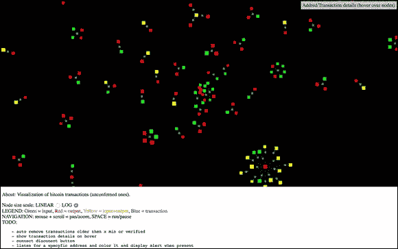
图 1-1：  `Bitcoin` 区块链网络的结构。
为了防止网络被破坏，区块链不仅是去中心化的，而且通常还使用加密货币。*加密货币* 是一种具有市场价值的数字资产。加密货币像股票一样在交易所交易。
加密货币在每个区块链中运作方式略有不同。基本上，软件为硬件的运行付费。软件即区块链协议。知名区块链协议包括 `Bitcoin`、`Ethereum`、`Ripple`、`Hyperledger` 和 `Factom`。硬件由在网络中保护数据的全节点组成。

#### 为什么区块链重要
区块链现在被认为是计算的“第五次进化”，是互联网缺失的信任层。这就是为什么如此多的人对这个话题感到兴奋的原因之一。
区块链可以为数字数据创造信任。当信息被写入区块链数据库后，几乎不可能将其删除或更改。这种能力以前从未存在过。
当数据以数字格式永久且可靠时，你可以在线进行过去只能离线完成的业务交易。所有一直保持模拟的事务，包括产权和身份，现在都可以在网上创建和维护。缓慢的商业和银行流程，如电汇和资金结算，现在几乎可以瞬间完成。对全球经济而言，安全数字记录的影响是巨大的。
最初创建的应用旨在依托区块链通过原生代币交易实现的数字价值转移。这些包括资金和资产的转移等。但区块链网络的可能性远不止价值转移。

### 区块链的结构
区块链由三个核心部分组成：
*   `Block`：在给定时期内记录到账本中的交易列表。每个区块链的区块大小、周期和触发事件都不同。
并非所有区块链的主要目标都是记录和保护其加密货币的流动记录。但所有区块链都记录其加密货币或代币的流动。将 *交易* 视为简单的数据记录。给它赋予价值（如金融交易中所发生的那样）用于解释该数据含义。
*   `Chain`：将一个区块链接到另一个区块的哈希，在数学上将它们“链接”在一起。这是区块链中最难理解的概念之一。它也是将区块链粘合在一起并使其能够创建数学信任的魔力。

区块链中的哈希是从前一个区块中的数据创建的。哈希是该数据的指纹，并按顺序和时间锁定区块。

 虽然区块链是相对较新的创新，但哈希并不是。哈希是在 30 多年前发明的。这种旧的创新之所以被使用，是因为它创建了一个无法解密的单向函数。哈希函数创建了一种数学算法，将任意大小的数据映射到固定大小的位字符串。位字符串通常长 32 个字符，然后表示被哈希的数据。安全哈希算法（`SHA`）是区块链中使用的一些密码学哈希函数之一。`SHA-256` 是一种常见的算法，可生成几乎唯一、固定大小的 256 位（32 字节）哈希。出于实际目的，将哈希视为数据的数字指纹，用于将其锁定在区块链中。

*   **网络：** 网络由“全节点”组成。将其视为运行保护网络的算法的计算机。每个节点都包含该区块链中曾记录过的所有交易的完整记录。
节点遍布世界各地，任何人都可以运营。运营全节点困难、昂贵且耗时，因此人们不会免费这样做。他们被激励运营节点，因为他们想赚取加密货币。底层区块链算法对其服务给予奖励。奖励通常是代币或加密货币，例如 Bitcoin。

 术语 `Bitcoin` 和 `blockchain` 常常被互换使用，但它们并不相同。Bitcoin 有一个区块链。Bitcoin 区块链是实现 Bitcoin 安全转移的基础协议。术语 `Bitcoin` 是为 Bitcoin 网络提供动力的加密货币的名称。区块链是一类软件，而 Bitcoin 是一种特定的加密货币。

## 区块链应用
区块链应用建立在网络是仲裁者的思想之上。这种类型的系统是一个无情且盲目的环境。计算机代码成为法律，规则按其编写的方式执行，并由网络解释。计算机不具有与人类相同的社会偏见和行为。

网络无法解读意图（至少目前还不能）。在区块链上仲裁的保险合约作为围绕这一思想构建的用例受到了深入研究。

另一个有趣之处是区块链使无懈可击的记录保存成为可能。它们可用于创建谁在何时做了什么的清晰时间线。许多行业和监管机构花费无数时间试图评估这一问题。区块链支持的记录保存将减轻我们在试图解读过去时产生的部分负担。

## 区块链生命周期
区块链起源于 Bitcoin 的创建。它证明了一群从未谋面的人可以在一个对欺骗合作者不敏感的系统内在线协作。

原始的 Bitcoin 网络是为了保护 Bitcoin 加密货币而构建的。它大约有 5,000 个全节点，并在全球范围内分布。它主要用于交易 Bitcoin 和交换价值，但社区看到了利用该网络做更多事情的潜力。由于其规模和经时间检验的安全性，它还被用于保护其他较小的区块链和区块链应用。

Ethereum 网络是区块链概念的第二次演进。它采用传统的区块链结构并在其内部添加了一种编程语言。与 Bitcoin 一样，它拥有超过 5,000 个全节点，并在全球范围内分布。Ethereum 主要用于交易 Ether、创建智能合约和创建去中心化自治组织（DAOs）。它还被用于保护区块链应用和较小的区块链。

Factom 网络是区块链技术的第三次演进。它利用更轻的共识系统，纳入投票，并存储更多信息。它主要用于保护数据和系统。Factom 使用联邦节点和无限数量的审计节点运行。其网络规模较小，因此将其锚定到其他分布式网络中，在各种区块链之间建立桥梁。

## 共识：区块链的驱动力
区块链是强大的工具，因为它们创建了诚实的系统，能够在无需第三方强制执行规则的情况下自我纠正。它们通过共识算法实现规则的执行。

在区块链世界中，`consensus` 是在通常互不信任的一组股东之间达成一致的过程。它们是网络上的全节点。全节点正在验证输入网络以作为账本一部分记录的交易。

图 1-2 显示了区块链如何达成一致的概念。

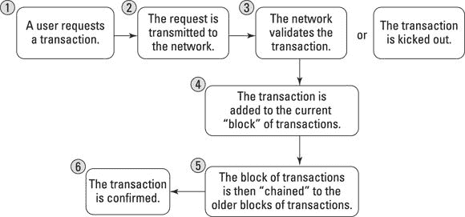

图 1-2：  区块链的工作原理。

每个区块链都有自己的算法，用于在其网络内就正在添加的条目达成一致。创建共识的模型有很多种，因为每个区块链都在创建不同类型的条目。一些区块链在交易价值，其他区块链在存储数据，还有一些在保护系统和合约。

例如，Bitcoin 在其网络成员之间交易其代币的价值。代币具有市场价值，因此与性能、可扩展性、一致性、威胁模型和故障模型相关的要求会更高。Bitcoin 在假设恶意攻击者可能想要破坏交易历史以窃取代币的前提下运行。Bitcoin 通过使用一种名为 `proof of work` 的共识模型来防止这种情况的发生，该模型解决了拜占庭将军问题：“你如何知道你正在查看的信息未被内部或外部更改？”由于更改或操纵数据几乎总是可能的，数据的可靠性是计算机科学中的一个大问题。

大多数区块链在假设它们会被外部力量或系统用户攻击的前提下运行。预期的威胁以及网络对运营区块链的节点的信任程度将决定它们用于结算账本的共识算法类型。例如，Bitcoin 和 Ethereum 预期威胁程度非常高，并使用一种名为 `proof of work` 的强大共识算法。网络中没有信任。

在光谱的另一端，用于记录已知各方之间金融交易的区块链可以使用更轻、更快的共识。它们对高速交易的需求更为重要。由于网络中参与者相对较少以及每笔交易都需要立即确定性，Proof of work 对它们来说太慢且成本太高。

## 区块链的应用
如今存在数百个区块链和区块链应用。整个世界都痴迷于更快地转移资金、在分布式网络中组建和治理、以及构建安全应用和硬件的想法。

你可以通过访问加密货币交易所看到其中许多公共区块链。

图 1-3 显示了 Poloniex（[`https://poloniex.com`](https://poloniex.com)）的山寨币交易所，这是一个加密货币交易平台。

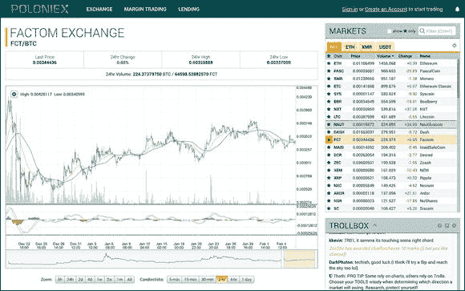

图 1-3：  山寨币交易所平台。

区块链正在超越交易价值市场，并被纳入各种行业。区块链增加了一个新的信任层，使在线工作以以前不可能的方式变得安全。

## 当前区块链用途

大多数正在运行的区块链应用都围绕着快速、廉价地转移资金或其他形式的价值展开。这包括交易上市公司股票、向其他国家的员工支付工资以及兑换一种货币为另一种货币。

区块链现在也被用作软件安全堆栈的一部分。美国国土安全部一直在研究用于保护物联网（IoT）设备的区块链软件。物联网领域从这项创新中获益最多，因为它特别容易受到欺骗和其他形式的黑客攻击。物联网设备也变得更加普及，安全也越来越依赖于它们。医院系统、自动驾驶汽车和安全系统就是典型例子。

DAO 是另一种有趣的区块链创新。这种类型的区块链应用代表了一种在线组织和组建公司的新方式。DAO 已被用于通过以太坊网络组织和投资资金。

## 未来区块链应用

目前正在探索的更大规模、更长期的区块链项目包括政府支持的土地记录系统、身份识别和国际旅行安全应用。

区块链融合的未来的可能性激发了全球商界人士、政府、政治团体和人道主义者的想象力。英国、新加坡和阿拉伯联合酋长国等国家将其视为削减成本、创造新金融工具和保持清洁记录的一种方式。他们拥有积极的投资和探索区块链的举措。

区块链已经奠定了基础，使信任的需求被排除在方程之外。以前要求“信任”是一件大事，而有了区块链，它就变得微不足道了。此外，如果信任被打破，执行规则的基础设施也可以更轻量。社会的很大一部分建立在信任和规则执行之上。区块链应用的社会和经济影响可能在情感上和政治上具有两极分化，因为区块链将改变我们构建基于价值和基于社会的交易的方式。

第 2 章

# 选择区块链

## 本章内容

**为您的需求发现合适的区块链**

**为您的项目制定计划**

**发现您项目的障碍**

**构建项目路线图**

区块链行业复杂且规模和能力每天都在增长。当您了解三种核心区块链类型及其局限性时，您就会知道这项新技术能实现什么。

本章全部关于评估区块链技术和制定项目计划。它为以下关于各个区块链平台和应用的章节提供了背景。

在这里，您将了解如何评估三种不同类型的区块链平台、在每种类型上构建了什么以及原因。我为您提供了一些工具，帮助您概述项目、预测障碍并克服挑战。

## 区块链的价值所在

围绕区块链及其运行的加密货币有很多炒作。其中一些炒作只是源于加密货币价值的波动以及人们担心区块链技术会破坏许多行业和政府职能。大量资金投入到研发中，因为利益相关者不想被淘汰，企业家希望探索新的商业模式。

当谈到为组织寻找区块链技术增加价值的机会时，经常会提出这样一个问题：“区块链在何处增加价值，它与现有技术有何不同？”

区块链是一种特殊的数据库。它们可以在您使用普通数据库的任何地方使用——但当普通数据库可以完成工作时，使用区块链的麻烦和费用可能就不合算了。

当您想要与您不完全信任的各方共享信息、您的数据需要被审计，或您的数据面临内部或外部被破坏的风险时，您才会真正看到使用某种形式的区块链的价值。这些问题都不简单，正确的解决方案可能难以确定。

本节有助于缩小您的选择范围。

### 确定您的需求

区块链有许多种类型。您会找到一种符合您需求的——诀窍在于找到它！将您的需求映射到最佳区块链可能令人不知所措。每当我有很多选择并且需求经常冲突时，我喜欢使用加权决策矩阵。

加权决策矩阵是评估项目需求然后将这些需求映射到可能解决方案的优秀工具。该矩阵的关键优势在于帮助您量化并优先考虑项目的个人需求，从而简化决策。加权决策矩阵还能防止您因单个标准而不知所措。如果操作得当，此工具可让您收敛到一个与所有目标兼容的单一想法。

创建加权决策矩阵，请按照以下步骤操作：

1. **头脑风暴团队需要满足的关键标准或目标。**

如果您不确定在评估区块链项目时需要考虑的标准，这里有一些需要牢记的事情：
* 规模和容量
* 速度和延迟
* 安全性和不可变性
* 存储容量和结构需求

您的团队将有自己的对象和优先事项清单。这些只是评估用于满足您需求的正确平台时需要考虑的几个方面。

2. **将标准列表减少到不超过十项。**

如果您在完善需求清单时遇到困难，请考虑使用比较矩阵工具。

3. **在 Microsoft Excel 或类似程序中创建表格。**

4. **在第一列输入设计标准。**

5. **根据该目标对项目成功的重要性，为每个标准分配相对权重。**

将点数限制在 10 分以内并在所有标准之间分配——例如，1 = 低，2 = 中，3 = 高优先级。

如果您在团队中工作，请让每个成员分别对标准进行加权。

6. **将每个目标的数字加起来并除以团队成员人数以获得综合团队权重。**

7. **根据需要调整权重，以确保每个标准都得到正确加权。**

恭喜！您现在拥有了一份按排名排列的标准清单，需要满足这些标准才能使您的区块链项目成功。

### 定义您的目标

如果没有明确的目标或目的，您很容易在构建区块链项目时迷失方向。花时间了解您和团队希望去哪里以及最终目标是什么。例如，一个目标可能是与合作公司在没有中介的情况下交易资产。这是一个涉及众多利益相关者的宏大目标。

回到一个较小的项目，即该技术的最小可行用例，清楚地阐述了为公司增加的价值或节省。沿着前面示例的思路，较小的目标可能是构建一个可以在受信任各方之间交换价值的私有网络。

然后在此价值的基础上构建。下一个胜利可能是构建可在您新平台上交易的工具。每一步都应展示一个小胜利和创造的价值。

## 选择解决方案

有三种核心类型的区块链：像比特币这样的公共网络、像 Ripple 这样的许可网络，以及像 Hijro 这样的私有网络。

区块链做几件直接的事情：

* 它们快速且以极低成本移动价值并交易价值。
* 它们创建近乎永久的数据历史记录。

区块链技术还允许一些不太直接的解决方案，例如能够证明你拥有一个“事物”而无需向另一方透露它。还可能“证明否定”，或证明数据集中或系统中缺少的内容。此功能对于审计和证明合规性特别有用。

表 2-1 列出了适合每种区块链类型的常见用例。

| 主要用途 | 区块链类型 |
|---|---|
| 在不信任的各方之间转移价值 | Public |
| 在信任的各方之间转移价值 | Private |
| 在不同事物之间交易价值 | Permissioned |
| 交易相同事物的价值 | Public |
| 创建去中心化组织 | Public or permissioned |
| 创建去中心化合约 | Public or permissioned |
| 交易证券化资产 | Public or permissioned |
| 为人和事物建立身份 | Public |
| 用于公共记录保存的发布 | Public |
| 用于私人记录保存的发布 | Public or permissioned |
| 执行记录或系统的审计 | Public or permissioned |
| 发布土地所有权数据 | Public |
| 交易数字货币或资产 | Public or permissioned |
| 创建物联网 (IoT) 安全系统 | Public |
| 构建系统安全 | Public |

可能存在例外，具体取决于你的项目，并且可以使用不同类型的区块链来实现你的目标。但总的来说，以下是如何分解不同类型的网络并了解其优势和劣势：

* **公共网络**规模大且去中心化，任何人都可以参与其中，无论级别如何——这包括运行完整节点、挖矿加密货币、交易代币或发布条目等。它们往往比私有或许可网络更安全且不可变。它们通常使用起来更慢更昂贵。它们由加密货币保护并且存储容量有限。
* **许可网络**可供公众查看，但参与受控。其中许多使用加密货币，但它们为其上构建的应用程序提供的成本可能更低。此功能使扩展项目和增加交易量变得更容易。许可网络可以非常快，延迟很低，并且与公共网络相比具有更高的存储容量。
* **私有网络**在信任方之间共享，可能不供公众查看。它们速度非常快，可能没有延迟。它们运行成本低，可以在一个勤奋的周末内构建。大多数私有网络不使用加密货币，也没有去中心化网络相同的不可变性和安全性。存储容量可能无限。

这三种核心区块链类型之间还存在混合类型，旨在为其上构建的应用程序找到安全性、可审计性、可扩展性和数据存储之间的正确平衡。

## 区块链决策框架

### 绘制区块链决策树

在组织内部开展区块链项目时，你面临的一些决策可能很困难且具有挑战性。花时间做出涉及以下方面的决策是值得的

* **不确定性：** 区块链技术周围的许多事实可能未知且未经测试。
* **复杂性：** 区块链有许多相互关联的因素需要考虑。
* **高风险后果：** 决策对你的组织的影响可能很大。
* **替代方案：** 可能存在替代技术和类型的区块链，每种都有其自身的不确定性和后果。
* **人际问题：** 你需要了解区块链技术如何影响组织内的不同人员。

决策树是有用的支持工具，可帮助你发现开发区块链项目的后果、事件结果、资源成本和效用。

你可以在纸上绘制决策树或使用计算机应用程序。以下是创建用于发现项目其他挑战的步骤：

1. **准备一张大纸。**
   
   选择越多，决策越复杂，你需要的纸张就越大。
2. **在纸的左侧画一个正方形。**
3. **在该正方形中写下项目核心目标和标准的描述。**
4. **为每个问题向正方形右侧画线。**
5. **沿着每条线写下每个问题的描述。**
   
   为遇到每个问题分配一个概率值。
6. **为每个问题集思广益解决方案。**
7. **沿着每条线写下每个解决方案的描述。**
8. **继续此过程，直到你探索了每个问题并为每个问题发现了可能的解决方案。**

在最终确定之前，请让团队成员挑战并审查你所有的問題和解决方案。

### 制定计划

到这一步，你应该清楚地了解你的目标、障碍以及可用的区块链选项。

以下是构建项目的简单路线图：

1. **向关键利益相关者解释项目并讨论其关键组成部分和预期成果。**
2. **撰写项目计划。**
   这是一套会随着项目生命周期而变化的活文档。
3. **制定绩效测量、范围说明书、进度和成本基线。**
4. **考虑创建风险管理计划和人员配置计划。**
5. **获得认可并定义角色和职责。**
6. **召开启动会议以开始项目。**
   会议应涵盖以下内容：
   * 项目愿景
   * 项目策略
   * 项目时间线
   * 角色和职责
   * 团队建设活动
   * 团队承诺
   * 团队如何做决策
   * 项目将据此衡量的关键指标

完成项目后，你还没完！回去分析你的成功和失败。以下是一些自问的问题：

* 我的关键利益相关者满意吗？
* 项目是否按计划进行？
* 如果没有，是什么导致了延迟？
* 我从这个项目中学到了什么？
* 我希望自己做得不同的地方是什么？
* 我是否真正为我的公司创造了新价值或节省了资金？

当你对区块链技术有更深入的了解并正在制定构建项目的计划时，你可能希望重返本章。

第 3 章

# 亲手实践区块链

本章内容

**创建和使用比特币钱包**

**创建简单的智能合约**

**部署私有区块链**

区块链是非常强大的工具，有望改变世界转移资金、保护系统和构建数字身份的方式。如果你不是核心开发者，近期可能不会进行任何深入的区块链开发。话虽如此，你仍然需要了解区块链的工作原理及其核心限制，因为它们将被整合到许多日常在线互动中——从企业如何向人们付款到政府如何知道其系统和数据完整且安全。

本章帮助你入门区块链世界。你将熟悉使用区块链和加密货币的最重要方面，但你将使用让你远离区块链令人生畏和复杂的内部运作的工具。本章还帮助你在后续章节中建立所需的基本加密账户。

# 深入比特币区块链

比特币区块链是世界上最大、最强大的区块链之一。它主要设计用于发送比特币，这种加密货币。因此，自然地，为了在比特币区块链中创建一条消息，你必须从一个账户向另一个账户发送一些比特币。

当你从一个账户向另一个账户发送比特币时，交易历史会被记录在比特币区块链中。交易一旦被录入，信息就无法删除——你的消息将一直存在，只要比特币存在。这种永久性的概念非常强大——它是任何区块链最重要的特征。

你有几种方法可以在交易中添加额外的少量信息，但有时这些方法并不能总是产生易于阅读的消息。在本节中，我将解释如何直接将消息构建到比特币交易中。

将数据嵌入比特币地址可确保其易于阅读。你可以通过使用比特币个性化地址来实现这一点。可以把个性化地址想象成汽车上的个性化车牌。六个字母的比特币个性化地址可以免费获得；更长的地址需要付费。个性化地址越长，成本越高。

在本项目中，你创建两个比特币钱包，向其中一个充值，获取一个个性化地址，并在你的账户之间发送少量比特币。

如果你已经有一个有资金的比特币钱包，可以跳过第一部分并使用该钱包。

## 创建你的第一个比特币钱包

比特币钱包地址由 32 个唯一字符组成。它允许你发送和接收比特币。你的私钥是与比特币地址关联的秘密代码，可让你证明自己拥有与该地址关联的比特币。

任何拥有你私钥的人都可以花费你的比特币，所以永远不要分享它。

你的第一个比特币钱包需要链接到信用卡或银行账户。我建议使用以下其中一个比特币钱包：

* **Coinbase (** [ `www.coinbase.com` ](https://www.coinbase.com) **)**
* **Xapo (** [ `www.circle.com` ](https://www.circle.com) **)**

要设置你的第一个钱包，只需前往其中一个网址并创建账户即可。只需几分钟。当你的账户开通后，添加一点钱以便实验——5 美元是一个很好的起点。

## 创建第二个比特币钱包

为了接收你将发送的比特币，你需要创建一个第二个比特币钱包。对于这个第二个钱包，不要使用 Circle 或 Coinbase 钱包——它们不具备你为此目的所需的功能。

对于本项目来说，最容易使用的比特币钱包是 Blockchain.info 钱包。按以下步骤创建它：

1. **前往 Blockchain.info 网站 (** [ `www.blockchain.info` ](http://www.blockchain.info) **)。**
2. **点击钱包。**
3. **点击创建你的钱包。**
4. **输入电子邮件地址和密码。**

## 生成比特币个性化地址

比特币个性化地址就像为你的汽车拥有一个个性化车牌。它是一个比特币地址，其中包含一组你喜欢的数字或字母。个性化地址是可选的，但是一种在比特币中看到你的消息的有趣方式。有几种免费的方法可以创建比特币钱包个性化地址。我最喜欢的是 BitcoinVanityGen.com。使用 BitcoinVanityGen.com 创建你的个性化地址，请按以下步骤操作：

1. **前往 BitcoinVanityGen.com 网站 (** [ `www.bitcoinvanitygen.com` ](http://www.bitcoinvanitygen.com) **)。**
2. **在 Type Letters 字段中输入六个字母。**

比特币只允许少量信息，你的个性化地址将构成你的消息内容，你可以在比特币中轻松阅读。

选择一些酷的东西，因为地址创建后你随时可以重复使用。

3. **点击生成。**
4. **点击电子邮件。**
5. **输入你的电子邮件地址。**

BitcoinVanityGen.com 会在找到你的个性化地址时向你发送电子邮件。

6. **点击来自 BitcoinVanityGen.com 的电子邮件中的链接。**

你将获得你的新个性化地址以及与该地址关联的私钥。

7. **复制你的地址和私钥，并将其保存在安全的地方。**

你将在下一节中需要你的地址和私钥。

永远不要分享你的私钥！将你的私钥和公钥保存在安全的地方。使用你的公钥接收或发送比特币。（你可以随意分享你的公钥。）私钥是你比特币的实际密钥。如果私钥被盗或丢失，你的币将永远丢失。

加密货币是无情的。在学习如何使用这些系统时，从少量资金开始。

## 转移你的个性化地址

在本节中，你将个性化地址转移到钱包。转移它将允许你管理地址，并轻松发送和接收比特币。按以下步骤开始：

1. **登录你的 Blockchain.info 钱包（参见“** **创建第二个比特币钱包** **”，本章前面部分）。**

图 3-3 显示 blockchain.info 上的设置页面。

2. **点击设置，然后点击地址。**
3. **在导入的地址旁边，点击管理地址。**

图 3-1 所示的屏幕出现。

4. **点击导入地址，输入你的私钥，然后点击导入。**

你现在创建了一个地址，允许任何人在你发送或接收比特币时读取你的个性化地址。

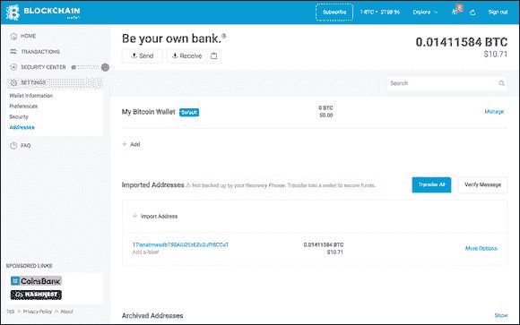

图 3-1： 管理你的地址。

## 在比特币区块链中创建条目

现在你有两个比特币钱包，你可以在比特币区块链中创建条目。你通过在两个钱包之间发送比特币来实现这一点。方法如下（具体操作因钱包而异，但这是总体思路）：

1. **登录你添加初始资金的比特币钱包（参见“** **创建你的第一个比特币钱包** **”，本章前面部分）。**

它会提示你输入收款人。

2. **导航到可以发送资金的页面，并复制粘贴你的个性化地址（参见“生成比特币钱包个性化地址”）到地址字段。**
3. **输入你想要发送的小额资金，然后点击发送。**

恭喜！你刚刚发送了你的第一条永久消息！你已将你的消息永远铭刻在比特币的历史中。

如果你喜欢学习如何做到这一点并想进一步提升知识，你可以在 [ `www.blockchainpie.com/blockchain-tutorial-bitcoin-message` ](http://www.blockchainpie.com/blockchain-tutorial-bitcoin-message) 访问一个有用的在线教程，了解如何发送比特币消息。

比特币交易通常需要十分钟才能确认，但可能需要数小时。交易价值越大，你应等待的时间越长。未确认的交易尚未包含在区块链中，仍可逆转。

## 在比特币中读取区块链条目

在前一节中，我向你展示了如何在比特币中创建一条小型的永久消息。比特币区块链上的数据未加密，因为数据需要由节点确认。这意味着找到你在上一个项目中创建的消息将很容易。

如果你刚刚在两个钱包之间转移了比特币，请在执行以下步骤前等待约 10 或 15 分钟。

1. **前往 Blockchain.info 网站 (** [ `www.blockchain.info` ](http://www.blockchain.info) **)。**

2. **在搜索框中输入您的个性化地址并按 Enter。**
交易页面出现。
这就是查找您的交易并阅读您嵌入地址中的 消息 所需的全部。

## 使用比特币的智能合约
一份 `smart contract` 是能够做出财务决策的自主软件。区块链世界对智能合约议论纷纷，因为它们对世界经济运作方式的影响既令人惊叹又令人恐惧。

简单来说，智能合约是一份已翻译成代码并构建为复杂 if-then 语句的书面合同。合约可以自行验证是否满足执行合约的条件。它通过从外部来源获取可信数据来实现这一点。智能合约还可以通过释放付款数据或其他类型的数据来自动执行。它们可以围绕许多不同类型的想法构建，并不一定具有财务性质。智能合约可以在保持对外部控制的防篡改的同时完成所有这些操作。

区块链技术使智能合约得以出现，因为智能合约提供了永久性和防腐败性，而这些曾经只能由纸张、墨水和受信任的执行机构来提供。智能合约是商业运作方式的革命。它们确保合约将按其所写的方式执行。无需外部强制执行。区块链充当中间人和执行者。

智能合约意义重大，因为当机器开始执行合约时，就变得难以或无法撤销。它也凸显了这些工具的一个重要特性，不可忽视，这就是我关于智能合约的第一条法则：*She who controls the data, controls the contract.* 所有智能合约都会验证外部数据 feed 以证明履约并向正确方释放付款。

尽管智能合约是一种革命性的新技术，但它们尚无法解释订立合约各方的 *intent*。我们社会中的法律合同依赖于人们来解释订约各方的含义。计算机（至少目前）只能理解代码，而不能理解各方的意图。

### 构建您的第一个智能债券
一个 `smart bond` 是一种智能合约类型，可以自行持有和释放有价值的对象，同时使用现价数据 feed 监控各种货币的付款。存在许多不同类型的智能合约，并且每天都在发明新的合约。

按照以下步骤构建您的第一个智能债券：
1. **前往 SmartContract 网站（[`www.smartcontract.com`](http://www.smartcontract.com)）。**
2. **点击注册。**
注册页面出现。
3. **输入电子邮件地址和密码，然后点击创建账户。**
SmartContract 会向您发送一封包含确认链接的电子邮件。
4. **点击 SmartContract 发送给您的电子邮件中的链接以验证您的账户并登录。**
5. **点击创建合约。**
6. **点击智能债券标签（参见 **图 3-2**）。**
7. **点击创建合约按钮。**
您已准备好构建第一个 if-then 语句。
8. **点击智能条款标签。**
智能合约验证外部数据 feed 以证明您的合约的履约情况并触发付款释放。在这里您选择将触发智能合约的条件。
9. **选择绩效监控。**
绩效监控将检查合约之外是否已采取行动。在您的情况下，这将是从一个账户到另一个账户的资金移动。
10. **在“付款至”字段中，输入您其中一个比特币地址（本章前面创建）。**
11. **在“为”字段中，输入您希望从一个比特币地址转移到另一个比特币地址的小额美元金额。**
12. **在“到期日期”字段中，输入几天后的日期。**
这为合约监控外部来源所使用的时间参数设定了标准。
13. **点击描述标签（参见 **图 3-3**）。**
14. **在智能合约标题字段中，为您的合约输入一个名称。**
15. **在简要描述字段中，输入——您猜对了！——合约的简要描述。**
描述应作为协议目的的简要摘要。在这里您还可以附加法律文件或其他数据，例如图像。
16. **点击附件部分。**
智能合约是新技术，可能出现问题。最好只附加不重要且您愿意公开的内容。
17. **点击附加文档。**
您可以附加图像或 PDF。
18. **点击签名并发送标签。**
19. **在地址字段中，输入您的电子邮件地址以将合约发送给自己。**
20. **点击完成合约按钮。**
现在您的合约将监控比特币区块链，以监控您是否向您之前列出的比特币钱包地址发送资金。
21. **返回您的比特币钱包并在两个钱包之间发送资金。**
确保使用您在第 10 步和第 11 步的合约中列出的地址并多发送一点金额。当您创建的合约看到比特币区块链上的交易记录时，您将通过电子邮件收到通知。
比特币网络会收取交易费用，因此请多加一点以确保满足合约条款。例如，如果您将合约设为 $5，请发送 $5.15 以确保安全。

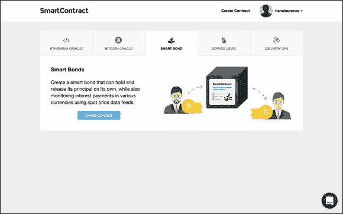
图 3-2：  智能债券标签。

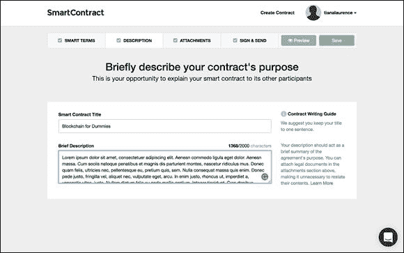
图 3-3：  描述标签。

### 检查您的合约状态
您可以通过以下步骤随时检查合约状态：
1. **登录您的 SmartContract 账户，网址为 [`www.smartcontract.com`](http://www.smartcontract.com)。**
2. **前往您的合约仪表板。**
交易完成后，合约将显示为已完成。您的合约状态位于合约仪表板下方。
在检查交易状态之前，请给比特币网络 10 到 15 分钟来处理您的交易。

## 使用 Docker 和以太坊构建私有区块链
私有区块链兼具私有数据库的优势和区块链的安全性。该想法最吸引人的原因有两个：
* **私有区块链对开发者来说很棒，因为它们允许他们在不使用加密货币的情况下测试想法。** 开发者的想法也可以保持秘密，因为数据未公开发布。
* **大型机构可以利用区块链技术的安全性和永久性，而无需像传统区块链那样公开交易。**

本书的大部分内容假设您只是第一次了解区块链，编程技能很少或没有，但本节需要了解 GitHub、Docker 以及如何使用计算机终端的知识。如果您在深入之前需要快速复习编程，我推荐 *Coding For Dummies* by Nikhil Abraham (Wiley) for a great overview on coding for nontechnical people。如果您不打算亲手操作区块链技术，您可能想跳过本章的其余部分。

在本节中，您将深入了解如何构建您的第一个区块链。您将分两步构建它。第一步是准备您的计算机以创建私有区块链。不要担心——Docker 工具和 GitHub 上才华横溢的开发者所做的工作让这一过程变得更简单。第二步是在 Docker 终端内构建您的区块链。

## 准备您的计算机
您需要在计算机上下载一些软件以尝试此区块链项目。首先下载 Docker Toolbox。前往 [`www.docker.com/toolbox`](http://www.docker.com/toolbox) 下载适用于您操作系统的正确版本。
接下来，下载 GitHub Desktop。前往 [`http://desktop.github.com`](http://desktop.github.com)。安装 GitHub Desktop 后，在 [`www.github.com`](http://www.github.com) 创建 GitHub 账户，方法是点击 Sign Up 并输入用户名、电子邮件地址和密码，然后点击 Sign Up for GitHub 按钮。
现在您需要创建一个存放区块链数据的[content]
在本节中，您将深入了解如何构建您的第一个区块链。您将分两步构建它。第一步是准备您的计算机以创建私有区块链。不要担心——Docker 工具和 GitHub 上才华横溢的开发者所做的工作让这一过程变得更简单。第二步是在 Docker 终端内构建您的区块链。

## 准备您的 Docker 环境
您需要在计算机上下载一些软件以尝试此区块链项目。首先下载 Docker Toolbox。前往 [`www.docker.com/toolbox`](http://www.docker.com/toolbox) 下载适用于您操作系统的正确版本。
接下来，下载 GitHub Desktop。前往 [`http://desktop.github.com`](http://desktop.github.com)。安装 GitHub Desktop 后，在 [`www.github.com`](http://www.github.com) 创建 GitHub 账户，方法是点击 Sign Up 并输入用户名、电子邮件地址和密码，然后点击 Sign Up for GitHub 按钮。
现在您需要创建一个存放区块链数据的位置。在计算机桌面上创建一个名为 `ethereum` 的文件夹。您将使用此文件夹来存放未来的存储库和其他文件。按照以下步骤完成此过程：
1. **打开 GitHub Desktop。**
2. **使用您的新 GitHub 账户登录计算机上的 GitHub Desktop 应用程序。**
3. **返回您的网页浏览器并前往** [`www.github.com/Capgemini-AIE/ethereum-docker`](https://www.github.com/Capgemini-AIE/ethereum-docker)**。**
您会看到 图 3-4 所示的页面。
4. **点击 Clone or Download 按钮。**
您将获得两个选项：Open in Desktop 或 Download Zip（参见 图 3-5）。
5. **选择 Open in Desktop 选项。**
GitHub Desktop 应用程序将重新打开。
**在 GitHub Desktop 应用程序中，导航到项目文件夹** `ethereum` **并点击 Clone。**
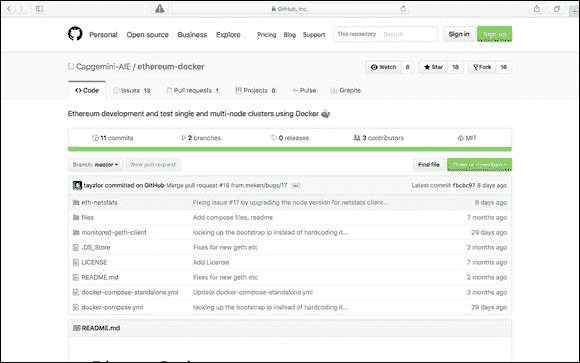
图 3-4：  在 GitHub 上导航到此页面。
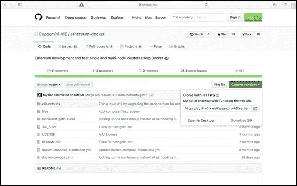
图 3-5：  Open in Desktop。
从 GitHub 克隆会复制您构建新区块链所需的信息。请遵循下一节中的步骤开始构建您的私有区块链。

## 构建您的区块链
您将使用免费的 Docker Quick Start Terminal 工具来构建您的区块链。它为您提供对虚拟机的访问，从而减少设置和调试系统的所需时间。由于这些功能，它可以为您创建区块链的稳定环境，因此您无需担心计算机的设置，并且可以更快地启动并运行。
按照以下步骤操作：
1. **使用 Docker Quick Start Terminal 在计算机上启动 Docker。**
Quick Start Terminal 应位于您的应用程序中或桌面上。
Docker 应用程序启动了一个终端，您将使用它来构建您的区块链。
2. **将终端中的目录更改为** `ethereum`。
您在创建新区块链时创建的文件将进入前一节中创建的桌面文件。您需要向终端发出命令以更改目录。如果您使用的是 Mac 或运行 Linux，请输入以下命令：
`cd ~ /Desktop/ethereum/ethereum-docker/`
如果您使用的是 PC，请输入以下命令：
`cd ~ \Desktop\ethereum\ethereum-docker\`
如果由于某种原因这些命令不起作用，请在网上搜索解释如何为您的系统类型更改目录的教程。
现在您可以使用 Ethereum–Docker 文件。
3. **通过在终端中输入以下命令创建单个独立的 Ethereum 节点：**
`docker-compose -f docker-compose-standalone.yml up -d`
这一行代码将创建以下内容：
* 一个 Ethereum 启动容器
* 一个连接到启动容器的 Ethereum 容器
* 一个带有 Web UI 的 Netstats 容器，用于查看集群中的活动
4. **通过打开网页浏览器并前往** `http://$(docker-machine ip default):3000` **查看您的新区块链。**
恭喜！您已构建了自己的私有区块链。如果您愿意，请向 Graham Taylor 和 Andrew Dong 表示感谢，他们花费了大量时间创建了 Ethereum–Docker 集成。

# 第 2 部分

## 发展您的知识
在本部分中 …
了解区块链技术与比特币区块链的开端。
澄清您对以太坊网络的了解，并扩展您对去中心化自治组织和智能合约的理解。
识别 Ripple 网络的核心概念以及它如何即时交换几乎任何类型的值。
评估 Factom 区块链及其保护数据和系统的能力。
深入了解高速 DigiByte 区块链，并了解围绕区块链技术正在构建的一些有趣应用。

# 第 4 章

## 观赏比特币区块链
在本章中
**了解比特币区块链的来源**
**澄清有关比特币的一些神话**
**使用比特币时保持安全**
**挖掘比特币**
**制作纸钱包来存放您的比特币**
警告！阅读本章后，您可能会对这种酷炫的新兴技术上瘾。请自行承担风险阅读。
比特币展示了区块链技术的最纯粹方面。它是所有其他区块链比较的基线，也是几乎所有区块链都借鉴的框架。了解比特币区块链如何运作的基本原理将使您更好地理解生态系统中遇到的其他所有技术。
在本章中，我将向您介绍比特币区块链运作的基本原理。我提供安全提示，使您的比特币体验更顺畅、更成功。我还向您展示现在就可以开始使用比特币的实用方法。在这些页面中，您将了解如何挖掘比特币代币，从而以一种无需购买即可获得比特币的新方式。我最后将向您展示如何将代币转移到纸钱包，以及在线上安全保存代币的其他实用方法。

### 获取比特币区块链的简要历史
比特币及其区块链的概念首次于 2008 年秋季以白皮书的形式引入，并在 2009 年作为开源软件发布。您可以阅读比特币白皮书，网址为 [`www.bitcoin.org/bitcoin.pdf`](http://www.bitcoin.org/bitcoin.pdf)。）
在 2008 年那份白皮书中首次介绍比特币的作者是一位使用 Satoshi Nakamoto 名义的匿名程序员或团队。Nakamoto 与许多其他开源开发者合作比特币直到 2010 年。此个人或团体此后停止了对该项目的参与，并将控制权移交给知名的比特币核心开发者。关于 Nakamoto 身份有很多说法和理论，但截至本文撰写时，均未得到证实。
无论如何，Nakamoto 创建的是一个非凡的点对点支付系统，使用户能够直接且无需中介来让双方负责，从而发送比特币，即价值转移代币。网络本身充当中间人，通过验证交易并确保没有人试图通过双重花费比特币来欺骗系统。

# 区块链和比特币概述

中本聪的目标是填补数字信任中的巨大漏洞，而区块链的概念就是他的答案。它解决了拜占庭将军问题，这是在线环境下尤其是终极的人类问题：当自私、恶意第三方等可能欺骗你时，你如何信任你所获得的信息以及提供这些信息的人？许多比特币爱好者认为区块链技术是使社会能够完全在线运作的缺失环节，因为它通过在公共空间中记录相关信息来重新定义信任，该空间无法被移除并且始终可以被引用，从而使欺骗变得更加困难。

区块链以新的方式混合了社会使用了数千年的许多旧技术。例如，密码学和支付被合并以创建加密货币。`Cryptography`是在第三方注视下进行安全通信的艺术。通过代表价值的代币进行支付也是人类长期以来一直在做的事情，但当两者合并时，它创造了加密货币并成为一种全新的事物。加密货币让你可以将货币的概念搬到线上，并能够通过代币安全地交易价值。

区块链还结合了`hashing`（将任意大小的数据转换为短的、固定长度的值）。哈希还结合了另一种名为 Merkle 树的旧技术，它将许多哈希压缩成一个哈希，同时仍能证明每个单独被哈希的数据块（参见 图 4-1）。

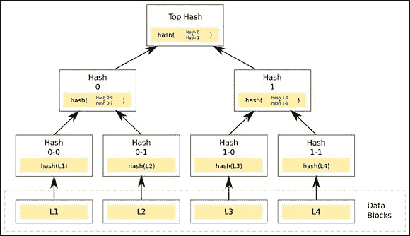

图 4-1： Merkle 树。

最终，区块链是账本，社会已使用数千年来记账。当所有这些旧模型在分布式数据库中在线合并和实现时，它们就变得具有革命性。

比特币最初设计主要是为了发送比特币加密货币。但很快，创建者意识到它具有更大的潜力。基于此，他们设计比特币区块链能够记录超出代币流动相关的数据。比特币区块链是世界上最古老、也是最大的区块链之一。它由数千个运行比特币协议的节点组成。该协议正在创建并保护区块链。

用非常简单的话说，`blockchain`是比特币网络中所有交易的公共账本，而`nodes`是记录该账本条目的计算机。`Bitcoin protocol`是管理该系统的规则。

节点通过挖掘比特币加密货币来保护网络。新的比特币作为处理交易并将其记录在区块链内的奖励而创建。节点还通过确认交易赚取少量费用。

任何人都可以运行比特币协议并挖掘代币。这是一个开源项目，随着更多个人参与网络而蓬勃发展。参与的人越少，它就越集中——而集中化会削弱系统。使比特币成为安全系统的首要因素是大量分布在全球的独立节点。

最成功的矿工拥有能够超越较慢矿工的强大系统。在其历史早期，你可以在台式电脑上运行比特币协议并赚取比特币。现在，为了有任何希望获得比特币，你需要购买昂贵的专用设备或使用云服务。

为了在比特币区块链中创建一条消息，你必须从一个账户向另一个账户发送一些比特币。当你在比特币中发送交易时，该消息会广播到整个网络。消息发送后就无法更改，因为该消息已记录在比特币区块链中。这一特性使得你必须始终明智地选择你的消息，并且永远不要广播敏感信息。

将同一条消息广播给数千个节点，然后永远保存在代币的账本中，费用会迅速累积。因此，比特币要求你保持通信非常简短。目前的限制仅为 40 个字符。

比特币是一个充满活力且不断变化的系统。比特币核心开发社区正在积极寻求通过使其更强大、更快来改进系统的方法。任何人都可以通过参与其 GitHub 页面（ [ `www.github.com/bitcoin` ](http://www.github.com/bitcoin) ）为比特币协议做出贡献。然而，比特币的主导核心开发者是一个小型社区。最具成效的贡献者是 Wladimir Van Der Laan、Pieter Wuille 和 Gavin Andresen。

## 驳斥一些常见的比特币误解

人们常常对任何新事物持怀疑态度，尤其是难以理解的新事物。因此，比特币——一种与世界以前从未见过的完全不同的新货币——会让人困惑，并产生一些误解，这也是自然的。

以下是关于比特币你可能听到的一些误解：

* **比特币被黑了。** 从未有过对比特币区块链的成功攻击导致比特币被盗。然而，许多使用比特币的中心化系统已被黑客攻击。而且由于安全措施不足，钱包和比特币交易所经常被黑客攻击。比特币社区通过开发优雅的解决方案来反击，以保护他们的币安全，包括钱包加密、多重签名、离线钱包、纸钱包和硬件钱包，仅举几例。

* **比特币被用来勒索人。** 由于比特币的半匿名性质，它被用于勒索软件攻击。黑客入侵网络并将其扣为人质，直到向他们付款为止。医院和学校都曾是此类攻击的受害者。然而，与过去窃贼偏爱的现金不同，比特币总会在区块链中留下调查人员可以追踪的痕迹。

* **比特币是庞氏骗局。** 从比特币矿工的角度来看，比特币与庞氏骗局正好相反。比特币协议的设计就像一场食人族军备竞赛。每增加一名矿工，协议就会提高挖矿难度。从社会角度来看，比特币是一个纯粹的市场。比特币的价格根据市场供需和感知价值波动。

* **比特币在挖出 2100 万枚币后会崩溃。** 比特币发行的代币数量有限。该数字硬编码为 2100 万。预计比特币发行最后一枚币的日期为 2140 年。没有人能预测那时将会发生什么，但矿工将始终从交易费用中获得一些利润。此外，区块链用户和比特币本身都会有动力保护网络，因为如果挖矿停止，比特币就会变得脆弱，锁定在区块链中的数据也会如此。

* **足够的计算能力可以接管比特币网络。** 这是真的，但会极其困难，且几乎没有回报。进入比特币网络的节点越多，此类攻击就越困难。为了做到这一点，攻击者需要相当于爱尔兰全部能源生产的计算能力。这种攻击的回报也极其有限。它只允许攻击者回滚他自己的交易。他不能拿走任何人的比特币或伪造交易或币。

# 比特币是一个不错的投资
比特币是人们交易价值方式中的一种新颖且有趣的演变。它不受任何单一政府或组织的支持，其价值仅在于人们愿意用它来交换商品和服务。人们使用比特币的意愿和能力波动很大。这是一种不稳定的投资，应谨慎对待。

## 比特币：新的西部荒野
比特币世界很像西部荒野的早期。在弄清楚谁是好人、谁是坏人，以及哪家沙龙提供最冰的啤酒之前，最好谨慎行事。如果你成为诈骗的受害者，你将几乎得不到任何保护。

比特币在美国商品交易法下属于 *商品* 的定义范畴，在许多欧洲国家被视为货币，但几乎没有监管。

在本节中，我列出了加密货币世界中常见的三种诈骗。它们都围绕着窃取你的币展开，看起来很像你可能已经熟悉的传统骗局。这个列表并不详尽，而骗子无疑极具创造力，因此使用比特币时务必非常谨慎。你永远不知道下一个转角会有什么。

### 假网站
看起来像交易所或网页钱包但实际上是假的网站困扰了一些顶级比特币网站。这种类型的诈骗在比特币世界和网络上都很常见。诈骗者希望通过窃取用户的登录信息或误导他们发送比特币来获利。

务必仔细核对网址，并且只使用安全网站（以 `https://` 开头的网站）来避免此问题。如果某个网站或声明看起来可疑，请检查它是否列在 Badbitcoin.org（[`www.badbitcoin.org`](http://www.badbitcoin.org)）上。这不是一个详尽的列表，但列出了许多不良参与者。

### 不，先你！
“先把你的比特币发给我，然后我再发货。” 听起来很可疑，对吧？这种诈骗类似于电汇诈骗。在这种欺诈中，个人假装出售给你某物但从不交付。

比特币的半匿名性质——加上无法退款——使得取回资金变得困难。此外，政府目前不对比特币交易提供保护，所以你就像那句俗语说的那样，陷入困境而无计可施。

诈骗者会试图通过发送假身份证件甚至冒充你可能认识的其他人来赢得你的信任。务必仔细核对他们发送给你的信息。

躲避这种诈骗的最佳方式是听从直觉，并且永远不要冒超过你愿意承受损失的比特币风险。如果有办法离线验证该人的身份，请这样做。

### 一夜暴富计划
疯狂的一夜暴富计划在加密货币世界中 proliferated。好消息是：如果你知道该寻找什么，就很容易识别它们。

通常，你会被承诺巨额回报，并且会有一个招募和灌输过程。这个过程可能包括销售培训，要求你招募朋友和家人，并承诺这是一项无风险的投资，你永远不会亏钱。

底线：如果一个计划看起来好得不像真的，那它很可能就是假的。无论如何，仔细看看这项投资如何在你从投资中获得的收益之外创造价值。如果没有明确合理的理由说明有大量价值被创造出来，那就是诈骗。

让律师和注册会计师审核所有投资。他们可以帮助你了解风险和税务影响。

## 挖掘比特币
你可以通过多种方式开始赚取比特币。挖矿比特币是通过参与网络赚取比特币的方式。它通常由昂贵且专业的专用挖矿硬件处理。

该设备还需要比特币挖矿软件来连接区块链和你的 *矿池*（许多矿工共同合作然后分享努力成果的协作）。

以下是探索挖矿比特币的三种标准方式：
* `Bitcoin-QT`: `Bitcoin-QT` 客户端是由中本聪编写的原始软件。你可以在 [`https://bitcoin.org/en/download`](https://bitcoin.org/en/download) 下载它。
* `CGminer`: `CGminer` 是最受欢迎的挖矿软件之一。它是开源的，可在 Windows、Linux 和 OS 上使用，网址为 [`www.github.com/ckolivas/cgminer`](http://www.github.com/ckolivas/cgminer)。
* `Multiminerapp`: `Multiminerapp` 是一个易于运行的比特币客户端。你可以在 [`www.multiminerapp.com`](http://www.multiminerapp.com) 下载它。

比特币是一个竞争非常激烈的环境，除非你购买专用挖矿设备，否则你可能永远赚不到任何比特币。由于该行业不断变化且很快过时，本书不认可或推荐任何特定挖矿设备。平均每台机器预计花费 500 美元到 5,000 美元。Amazon.com 是一个不错的查找地点。他们提供大量产品和许多客户评论来帮助你做出选择。

云挖矿让你在勤奋的下午即可开始赚取比特币，无需下载软件或购买设备。只需按照以下步骤操作：
1. **前往** [`https://hashflare.io/panel`](https://hashflare.io/panel)。
云挖矿的投资回报可能为负。请仔细审查你的选择，确保它是一项积极的投资。
2. **向下滚动主页并点击 SHA-256 云挖矿下的立即购买按钮。**
当我写这本书时，这个选项具有最高的投资回报率和最低的启动成本。请花时间自行重新评估，因为这可能已经改变。
3. **完成注册流程。**
4. **链接你的比特币地址。**
如果你尚未建立比特币地址，请转到 第 3 章 并按照说明创建比特币钱包。你需要这样做才能领取挖矿奖励。
5. **购买少量挖矿算力。**
这将使你能够加入比特币网络。
6. **加入矿池。**
这一步让你比独自挖矿获得更快的挖矿奖励。它汇集了多个矿工的资源，然后在矿池之间分享奖励。

恭喜！现在只需坐下来等待你的挖矿奖励开始滚滚（或涓涓）到来。

## 创建你的第一个纸钱包
*纸钱包* 是你比特币的公钥和私钥的纸质副本。因为它们完全离线，所以在正确操作时，纸钱包是持有比特币最安全的方式之一。优点是你的私钥不会以数字形式存储，因此不会受到黑客攻击。创建纸钱包相当容易。只需按照以下步骤操作：
1. **前往** [`www.bitaddress.org`](http://www.bitaddress.org)。
2. **在屏幕上移动鼠标，直到随机性显示达到 100%。**
3. **点击纸钱包按钮。**
这提供了创建可打印纸钱包的选项。
4. **在“生成地址”字段中输入 1。**
如果你需要，你可以一次制作多个钱包，但最好先从一个开始熟悉流程。
5. **点击生成按钮。**
图 4-2 显示了我创建的一个纸钱包。
6. **点击打印按钮。**
不要让任何人观看你创建纸钱包。这不是你在公共电脑上想做的事情。确保使用私人且未连接到互联网的打印机，以免私钥被黑客攻击的风险。

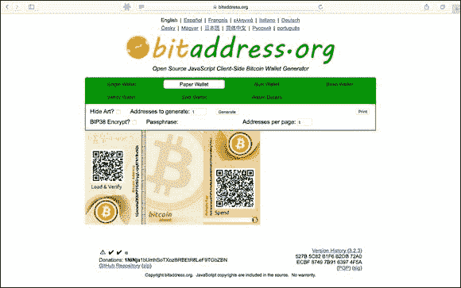

图 4-2： 一张纸钱包。

 用覆膜机给纸钱包覆膜，使其更耐用一些。

# 第 5 章

## 接触以太坊区块链

### 本章内容

**了解以太坊的启动方式和原因**

**发现以太坊区块链**

**揭露区块链黑客攻击**

**开始使用以太坊**

**创建去中心化自治组织**

**构建智能合约和去中心化公司**

以太坊项目是生态系统中发展最成熟且最易访问的区块链之一。它也是区块链创新和应用案例的行业领导者。理解这项技术很重要，因为它正引领着智能合约和去中心化组织的潮流。

在本章中，我介绍了以太坊的构成，并解释了在以太坊区块链上构建组织和公司的全新方式。我还深入探讨了以太坊区块链的安全性和实际商业应用。我会向你介绍该项目是如何启动的以及它计划走向何方。

本章将为你创建自己的去中心化组织做好准备。我解释了如何在测试网上挖矿加密货币来为你的项目提供动力。读完本章后，你将能够设置自己的以太坊钱包并交易代币。

## 探索以太坊的简史

以太坊首次于 2013 年被描述在一份由 Vitalik Buterin 撰写的白皮书中，他在比特币社区中作为作家和程序员非常活跃。Buterin 看到比特币的潜力远不止于无需中央机构即可转移价值的能力。他曾参与比特币中的彩色币项目，以扩展比特币在原生代币交易之外的用途。Buterin 相信，其他需要中央机构控制的商业和政府用例也可以通过区块链结构来构建。

当时，关于比特币网络因大量低价值交易而“臃肿”存在激烈争论，这些交易来自将自身锚定在比特币上的应用。主要担忧是，基于比特币协议构建的额外应用在交易量扩展方面会遇到问题。比特币并非为处理应用所需的交易数量而设计。Vitalik 和许多其他人认为，要想在比特币区块链上构建去中心化应用，要么区块链需要进行大规模的代码改造，要么需要完全构建一个新的区块链。

比特币到那时已经相当成熟。很明显，所需的核心代码升级远远超出了现实可行的范围。比特币的政治因素会阻碍网络的任何变更。Vitalik 及其团队于 2014 年初成立了以太坊基金会，以筹集资金构建一个内置编程语言的区块链。

初始开发由 2014 年 7 月和 8 月期间的在线公开众筹资助。该基金会最初通过出售其名为以太币的加密货币代币筹集了创纪录的 1800 万美元。人们激烈争论这种众筹是否违法，因为它可能构成未经许可的证券。

监管灰色地带并未阻碍该项目。事实上，该项目的尖端特性吸引了更多关注和人才加入基金会。来自世界各地的 discontented 和 disenfranchised 开发者和企业家纷纷涌向该项目。去中心化被视为腐败和压迫性中央机构的完美解决方案。

1800 万美元的代币销售筹集的资金为基金会提供了聘请庞大开发团队来构建以太坊的资金。以太坊 Frontier，即以太坊网络的首次发布，于 2015 年 7 月向公众上线。这是一个基础软件版本，只有技术更熟练的人才能用它构建自己的应用。

Homestead，即当前以太坊软件版本，于 2016 年发布。它更加用户友好。几乎任何人都可以利用其上的应用模板。它具有直观友好的用户界面和庞大的忠实开发社区。

Metropolis 是下一个计划中的以太坊版本。主要区别在于应用将得到充分开发和良好测试。它还将提供更易于使用的应用，并具有更大的市场吸引力，即使是非技术人员也能感到舒适地使用它。

Serenity 是以太坊开发的最后计划阶段。以太坊将从工作量证明共识（其中矿工竞争创建下一个区块）转向权益证明模型。在权益证明模型中，节点会被伪随机选择，被选中的可能性会根据其在网络中的权益而增加。他们的权益以其持有的加密货币数量来衡量。此变更的主要好处将是降低与工作量证明相关的能源成本。这可能会使个人运行网络节点更具吸引力，从而增加去中心化和安全性。

## 以太坊：开源的全球计算机

以太坊可能是有史以来最复杂的区块链之一。它拥有自己的 *图灵完备编程语言*（一种功能齐全的编程语言，允许开发者构建任何类型的应用）。以太坊协议几乎可以做普通编程语言能做的任何事情，只是它构建在区块链内部，并具有由此带来的额外好处和安全性。如果你能想象一个软件项目，它就可以构建在以太坊上。

以太坊生态系统目前是构建去中心化应用的最佳场所。它们拥有出色的文档和用户友好的界面，能让你迅速上手。快速的开发时间、对小型应用的安全性以及应用之间易于交互的能力是该系统的关键特征。

图灵完备编程语言是使以太坊区块链在构建新程序方面比比特币区块链强大得多的主要特性。以太坊的脚本语言可以用几行代码实现类似 Twitter 应用的功能，并且极其安全。

智能合约，例如你在 第 3 章 中创建的那种，也可以在以太坊上构建。以太坊协议开辟了一个全新的应用类型。你可以取几乎任何企业、政府或组织的流程，并在以太坊内部构建其数字表示。目前，以太坊平台正被探索用于管理 *数字资产*（一种在线存在的新类资产，可能代表整个数字资产，如比特币代币，或现实世界资产的数字表示，如玉米商品）、金融工具（如抵押贷款支持证券）、记录土地等资产的所有权，以及去中心化自治组织（DAOs），这是一种组织企业、非营利组织、政府或任何需要达成一致并为共同利益而合作的机构的新方式。DAO 主要构建在以太坊平台上。

### 去中心化应用：欢迎来到未来

以太坊最具革命性和争议性的体现是自治和去中心化应用（DAPP）。DAPP 可以管理数字资产和 DAO 等事物。

DAPPs 是为取代资产和组织的集中化管理而创建的。这种结构具有很大的吸引力，因为许多人相信绝对权力导致绝对腐败。对于担心失去控制的人来说，这种结构具有巨大的影响。

Etheria ([`www.etheria.world`](http://www.etheria.world))，一款类似 Minecraft 的游戏，是这种技术应用的一个有趣示例（参见 图 5-1）。该游戏无法被审查或关闭，只要以太坊存在就会存在。当事物在以太坊内部创建时，即使有正当理由移除某个结构或组织，实际上也几乎不可能做到。

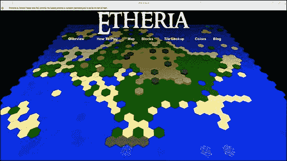

图 5-1： 世界上第一个不朽的数字游戏，Etheria。

## 去中心化自治组织的力量

DAOs 是一种以太坊应用类型，在以太坊内代表一个虚拟实体。当你创建一个 DAO 时，可以邀请他人参与组织的治理。参与者可以保持匿名且从不相见，这可能会触发了解你的客户（KYC）规则（企业必须履行的验证客户身份的过程）和反洗钱（AML；旨在阻止通过非法手段获取收入的做法的法律和法规）合规问题。

DAOs 已被创建用于筹集投资资金，但也可以为公民或非营利目的而设计。以太坊为治理提供了一个基本框架。具体治理内容由组织者决定。以太坊已创建模板来帮助创建 DAO。

图 5-2 显示了以太坊应用组织结构的一个示意图。

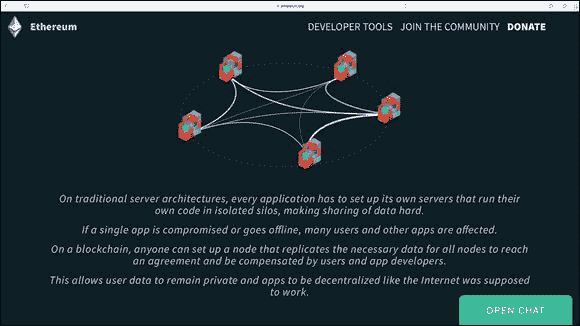

图 5-2： Ethereum.org 区块链应用示意图。

DAOs 基本工作原理如下：

1. 一群人编写智能合约来管理组织。
2. 人们向 DAO 投入资金并获得代表所有权的代币。
   这种结构有点像公司的股票，但成员从第一天起就控制资金。
3. 资金筹集完成后，DAO 开始运作，成员提出资金使用方案。
4. 成员对这些提案进行投票。
5. 当预定的时间过去且预定的投票数达到时，提案通过或失败。
6. 个人作为承包商为 DAO 提供服务。

与大多数传统投资工具不同，传统投资工具中由中央机构决定投资，而 DAO 的成员控制 100% 的资产。他们对新投资和其他决策进行投票。这种结构威胁到传统金融管理者的地位。

DAOs 是用无法即时更改的代码构建的。其吸引力在于恶意黑客无法以传统方式篡改资金。黑客仍可能找到以意想不到的方式执行代码并提取资金的方法。DAO 代码的不可变性使其在 DAO 在以太坊上线后几乎不可能修复任何错误。

## 区块链的黑客攻击

以太坊从未被黑客攻击。2016 年因 DAO 攻击而进行的硬分叉，该攻击在 “权力越大……权力越大” 侧边栏中提到，并不是对系统的实际攻击，但令人困惑的是常被称作黑客攻击。以太坊运行完美。问题在于它太完美了。当大量资金和大多数用户受到威胁时，有必要重启系统。

在像以太坊这样的区块链上纠正操作的唯一方法是进行 *hard fork,* 它允许对协议进行根本性更改。硬分叉会使之前有效的区块和交易无效。以太坊就是这样做的，以保护用户从第一个 DAO 中提取的资金。从概念上讲，DAO 攻击是有史以来最大的漏洞赏金之一。

尽管如此，加密货币领域仍发生许多诈骗和黑客攻击。大多数攻击针对的是中心化交易所和应用。许多黑客想要窃取加密货币。它具有真实价值，并且不像普通货币那样受到政府的同样保护。加密货币的匿名性也使其对罪犯具有吸引力。抓捕和起诉这些个人很困难。然而，加密货币社区正在反击，并创建新的保护措施。

攻击一个地方比试图攻破一个去中心化网络要容易得多，也便宜得多。当你读到区块链世界中的黑客攻击时，很可能只是某个网站或加密货币钱包被黑，而不是整个网络。

### 了解智能合约

以太坊智能合约类似于合同协议，只是没有中央机构来执行合同。以太坊协议通过附加经济压力来“执行”智能合约。如果要求存在于以太坊内部，它们也可以强制执行要求，因为以太坊可以证明某些条件是否满足。如果不在以太坊内部，执行起来就困难得多。

以太坊智能合约目前尚未具有法律执行力，也可能永远不会具有，因为人们认为不需要外部权威来执行协议。法律体系由政府控制。就目前而言，政府是中央权威机构——有些拥有或多或少的同意和民主原则。在以太坊智能合约中，每个参与者都拥有不可剥夺的投票权。

以太坊智能合约不包括人工智能。这在不久的将来是一个很酷的可能性。但目前，以太坊只是运行在区块链上的软件代码。

以太坊智能合约并不安全。DAO 攻击是可能发生危险类型的绝佳例子。仍处于早期阶段，将大量资金投入未经证实系统并不明智。相反，请用少量资金进行实验，直到新合约的所有错误都被排除。

### 发现加密货币 Ether

Ether 是以太坊区块链的加密货币名称。它以被认为渗透所有空间并使宇宙成为可能的物质命名。从这个意义上说，Ether 是使以太坊成为可能的物质。Ether 通过工作量证明挖矿激励网络保护自身，就像代币比特币激励比特币网络一样。在以太坊网络中执行任何代码都需要 Ether。当用于在以太坊中执行合约时，Ether 被称为 *gas.*

执行智能合约中的代码也会花费一定数量的 ether。这一特性为代币增加了额外的效用。只要个人希望使用以太坊进行应用和合约，ether 就会具有超出投机的价值。

ether 价值的狂野增长使其成为一个热门的投机代币。它在全球各地的交易所广泛交易。一些新对冲基金将其视为投资工具。然而，其波动性和低市场深度使其成为一种风险投资。

## 在以太坊上入门

在本节中，我将指导你如何在以太坊区块链生态系统中入门。在以太坊上构建任何东西之前，你需要一个以太坊钱包。

你的钱包将持有你的以太坊代币，称为 *ether.* Ether 是允许你在以太坊内部创建智能合约的加密货币。这有时被称为 *gas.*

下载以太坊钱包可能需要一些时间，但界面非常直观，整个过程中提供的说明也很容易遵循。

在以太坊钱包中，你可以赢取测试以太币来构建你的测试合约和组织。你不需要挖矿以太币就能了解其工作原理。

## 挖矿以太币
以太坊由遍布全球的计算机网络维持运行，这些计算机正在处理合约并保护网络。这些计算机有时被称为 *节点*，它们正在挖矿加密以太币。

为了奖励参与挖矿所花费的时间和成本，大约每 12 秒会有一笔五枚以太币的奖励。奖励授予能够创建以太坊区块链最新区块的节点。

所有新区块都包含最新交易的列表。工作量证明共识算法保证奖励最常被计算能力最强的节点赢得。计算能力较弱的计算机也能获胜，只是需要更长时间。如果你想尝试挖矿以太币，可以用家用电脑来做，但成功挖出一个区块并赢得以太币需要非常长的时间。

挖矿以太币不适合技术新手。你需要熟悉 `command line`。如果你不知道 `command line` 是什么，你可能最好跳过这个过程。另外，请务必遵循以太坊 GitHub (`http://github.com/ethereum`) 上的最新说明。

## 设置你的以太坊钱包
设置你的以太坊钱包，请按照以下步骤操作：

1. **前往** `www.ethereum.org`。

2. **点击下载按钮。**
你需要向下滚动页面一点才能找到按钮。
请务必将以太坊钱包下载保存到以后能找到的地方。

3. **打开以太坊钱包。**

4. **点击使用测试网。**
在这里你将设置好挖矿测试以太币。这个过程比真实以太币挖矿花费的时间少得多，但仍然需要一些时间。

5. **创建强密码。**
不要忘记将密码安全地保存在某个地方。

6. **点击浏览启动菜单。**
在等待测试网下载时，以太坊团队提供了一些有趣的教程可以查看。下载可能需要十分钟左右。

7. **选择** `Develop ⇒ Start Mining`。
不要跳过这一步。你需要以太币用于后面的项目。

你刚刚设置好了钱包，并且正在为未来的智能合约项目赚取测试以太币。

## 构建你的第一个去中心化自治组织
DAO 将改变世界未来的商业方式。它们允许世界上的任何人在线创建一种新型公司，该公司受事先商定的规则管理，然后通过区块链网络执行。创建 DAO 比你想象的要容易。在本节中，你将构建你的第一个测试 DAO。我将此项目分为三个部分：构建、议会和治理。

为了成功完成你的测试 DAO，你需要设置好以太坊钱包并在以太坊测试网上进行一些挖矿（参见前一节）。

按照以下步骤创建你的第一个测试 DAO：

1. **前往** `www.ethereum.org/dao`。

2. **向下滚动页面到代码框（显示在** **图 5-3** **中）并复制代码。**

3. **打开你之前创建的以太坊钱包。**
你将在以太坊钱包中开发你的 DAO。

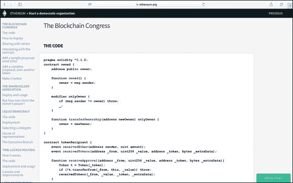
图 5-3：  代码框。

### 测试网和议会
你 DAO 项目的下一个阶段是设置 DAO 的框架。请按照以下步骤操作：

1. **在你的以太坊钱包中，选择** `Develop ⇒ Network ⇒ Test Net`。

2. **点击** `Contracts` **标签，然后点击** `Deploy Contract`。
以太坊团队为 DAO 设置了一些测试模板。

3. **将你在前一节中复制的代码粘贴到** `Solidity` **代码框中。**

4. **从合约选择器中，选择** `Congress`。

5. **在提示时选择一些变量。**
以下是你的选项：
* 提案的 *最低法定人数* 是提案在执行前所需的最低投票数。
* *辩论分钟数* 是在提案可以执行之前需要经过的最短时间（以分钟为单位）。
* 多数票的 *投票差距*。如果投票数超过 50% 加上差距，则提案通过。将它保留为 0 以实现简单多数。

### 治理和投票
现在你要为你的 DAO 命名并设置治理。你需要为提案设置 *最低法定人数*（新提案在通过前需要的投票数）。你还需要设置 *多数票的投票差距*（计划通过所需的投票数）以及讨论新计划所分配的时间。

1. **为你的新 DAO 命名。**
这有点像为公司命名。

2. **对于辩论时间，选择 5 分钟。**
这是新提案开放讨论的时间长度。

3. **将多数票的投票差距保留为 0。**
这设置了你的合约的民主运作方式。

4. **确认 DAO 的价格。**
你在第一次设置钱包时已通过钱包在测试网上挖了一些以太币。如果你跳过了那一步，现在回去做。你需要一点测试网以太币来构建你的 DAO。

5. **点击部署并输入你的密码。**
DAO 的部署可能需要一些时间。当你到达新的仪表板时，向下滚动，你将能够看到你的 DAO 正在生成。

6. **点击新图标。**
将生成一个代表你的 DAO 的新唯一图标。

恭喜！你创建了你的第一个 DAO。

## 探索 DAO 的未来
智能合约和去中心化组织蕴含着巨大的潜力。它们纯粹的民主和超理性的本质非常有吸引力。然而，在这一点上，未知的事物比已知的可能性更多，每一个创建的合约都可能是开创性的，也可能是彻底的失败。

如果你把以太坊当作它所代表的新前沿来对待，你会取得更大的成功。如果你谨慎行事，以太坊网络的优点会多于缺点。但期望一切完美运行并且所有参与者都诚信行事会让你面临更大的损失。以太坊也有它的一份强盗，更不用说那些希望你成功的好心爱好者了。

2016 年的智能合约黑客攻击凸显了安全性和正确审查合约的重要性。它也说明了有正直的人在努力解决问题。

阅读这本书只是开始。它将为你建立以太坊知识提供坚实的基础，但与所有新技术一样，以太坊正在快速发展。继续审查最佳实践和安全措施。

在以下章节中，我提到了一些你在构建前几个 DAO、构建智能合约以及调试新的区块链系统时需要牢记的事情。

### 在 DAO 中投入资金
不要将大量资金信任给未经测试的合约和未完全审查的合约。大型合约更常成为黑客的目标。本章前面描述的 DAO 攻击（参见侧边栏 “权力越大……权力越大 ”）表明，即使是经过深思熟虑的合约也存在意想不到的弱点。

尽管智能合约和区块链让你可以与世界各地的人做生意，但现在仍然是早期阶段。你可以通过只与已知和值得信赖的合作伙伴合作来降低风险。

 安全态势将随着新漏洞不断演变。审查所有新的最佳实践至关重要。管理您所承担风险的资金金额，并分阶段缓慢推出合约。Ethereum 是一种新技术，成熟的解决方案尚未建立。

## 构建更智能的智能合约
智能合约编程需要与标准合约编写不同的思维方式。如果合约以您未预期或未打算的方式执行，就没有第三方来纠正。区块链不可变且分布式的特性使得改变不想要的结果变得困难。

 您的合约会有缺陷并且可能失败。在合约中内置安全阀，以便您在漏洞和脆弱性出现时做出响应。智能合约也需要一个关闭开关，让您在事情出错时切断电源并暂停合约。

 如果您的合约足够大，请提供漏洞赏金，以激励社区发现合约中的漏洞和缺陷。

就像许多事情一样，合约的复杂性也会增加错误和攻击向量的可能性。保持合约逻辑简单。构建包含合约每个部分的小模块。以这种方式创建合约将有助于您将任何问题进行区隔。

## 在系统中查找漏洞
不要通过构建自己的工具（如随机数生成器）来重复造轮子。相反，利用社区已经完成并且经过充分测试的工作。

 您只能控制合约内部的事情。请谨慎对待外部合约调用。它们可以执行恶意代码并夺走您的控制权。

Ethereum 社区在其 GitHub 页面上有出色的已知漏洞列表，以及更多关于如何构建安全智能合约的有用提示，网址为 [`https://github.com/ethereum/wiki/wiki/safety`](https://github.com/ethereum/wiki/wiki/safety)。

第 6 章

# 关于 Ripple 区块链

### 本章内容
 **了解 Ripple 区块链的起源**

 **认识 Ripple 区块链**

 **探索 Ripple 网络**

Ripple 是用于全球转移和交易价值的最有趣的区块链之一。Ripple 协议允许任何类型的资产具有可互换性——即使是在两种不同资产之间以及在非流动性市场中。它以极低的成本、极高的安全性和创纪录的时间完成所有这些。Ripple 基础设施正被实施为新现代银行和交易的框架。

本章探讨 Ripple 区块链背后技术的重要细微差别。我解释 Ripple 如何在全球范围内彻底改变银行和金融科技的精细之处。我还向您介绍 Ripple 区块链的实际用途以及使用 Ripple 协议时的具体安全提示。

本章将帮助您在全球范围内交易多种不同类型的价值。在这里，您将了解这项技术对您所在行业的重要性以及如何立即开始使用 Ripple 协议。您还将了解如何在 Ripple 协议上设置交易账户以及在该生态系统中运营时应避免的诈骗。

 如果您不是正在寻找面向可以豁免或能够获得银行牌照的企业的大规模解决方案，您可能希望跳过本章，因为 Ripple 主要服务于金融机构。

## 获取 Ripple 区块链的简要历史
Ripple 项目比 Bitcoin 更早。它经历了多次迭代，但原始实现由加拿大开发者 Ryan Fugger 于 2004 年创建。Fugger 的首次迭代是一个去中心化货币系统，允许个人和社区建立自己的货币。

Jed McCaleb、Arthur Britto 和 David Schwartz 后来通过一家名为 OpenCoin 的公司对 Ryan 的工作进行了补充。他们的作品帮助增加了更多类似区块链的功能，例如一种数字货币系统，其中交易链由网络成员通过共识发布。

Chris Larsen，Ripple 的首任 CEO，是多家公司的创始人，包括 E-Loan 和 Prosper，这两家公司都是改变消费者借贷市场的颠覆性组织。他于 2012 年 8 月加入 Ripple 并领导至 2016 年。

此后 Ripple 发展成为一家大型风险投资支持的初创公司。它得到了投资界一些最知名的大牌支持，Google Ventures 和 Andreessen Horowitz 只是其中几个名字。截至 2016 年，Ripple 已筹集超过 9300 万美元的风险投资。Ripple 也在政治上活跃，并担任美联储 Faster Payments Task Force Steering Committee 的成员，并共同主持 W3C 的 Web Payments Working Group。它在旧金山、纽约、伦敦、卢森堡和悉尼设有办事处。许多创始团队成员此后已离开 Ripple 并开始了新的项目。

Ripple 在银行业非常具有颠覆性，并因其努力而受到实质性抵制。2015 年，FinCEN 因违反保密法而对 Ripple 处以 70 万美元罚款。该罚款是因向知名 Bitcoin 投资者 Roger Ver 出售 XRP 而未提交可疑活动报告，因为 Ver 因在 eBay 上出售烟花而有重罪定罪。罚款后，DBS Bank 和大华银行有限公司开始拒绝为 Ripple 新加坡提供银行服务。据信这种情况发生是因为这些银行认为在区块链上发行资产带来的监管风险大于回报。此后，Ripple 将重点转向主要服务于全球和区域银行。

今天 Ripple 是一项全球金融结算解决方案，使银行和消费者能够交换价值。与 Bitcoin 类似，Ripple 协议通过允许用户直接且即时交易来降低结算总成本。它建立在分布式开源互联网协议之上，使用区块链，并拥有一种名为 *ripples* 的原生货币。

Ripple 的分布式金融技术使用户能够通过其网络实时发送国际支付。使用 Ripple，全球市场可以满足对快速、低成本和按需全球支付服务的需求。

Ripple 在跨境支付和在两种不同事物之间交换价值方面特别出色。Ripple 创建了一个由金融机构、做市商和消费者组成的全球网络。您现在可以在世界任何地方即时交换几乎任何类型的价值。Ripple 是 *Internet of Value* 的新基础。Internet of Value 的理念是，价值如货币、汽车、土地和商品都可以完全在线存在和交易，而无需促进该过程的中介。Ripple 等协议促进交易并填补中介的角色。

## Ripple：一切都关于信任
Ripple 是一个具有区块链后端的交换网络和交易平台。机构使用该协议通过 Ripple 的分布式账本清算交易。他们还可以通过 Ripple 的分布式资金交易所结算义务。

在 Ripple 网络上交互主要有两种方式：
*   系统的金融用户通过发行、接受和交易资产来促进支付，从而参与网络。
*   节点运营商通过跟踪交易并与其他网络节点就这些交易的效力和排序达成共识来参与网络。

 术语 *node* 和 *computer* 通常可以互换使用。两者都指用于运行网络的机器和代码。

# Ripple 协议概述

金融参与者必须信任其持有的资产的发行方，而节点运营商必须信任其验证者列表中的其他节点不会串谋阻止有效交易被确认。这完全关乎信任以及合作的激励一致性。

Ripple 网络在分布式网络内寻找交换各种不同类型价值的信任路径。Ripple 的加密货币 XRP 用于促进交易量低或没有信任路径的价值不相同时物的交易。在节点、网络和金融参与者之间，Ripple 建立了优化现代支付流程和全球兑换的基础设施。

在本节中，我将介绍 Ripple 协议为银行业提供的核心功能。

## 核心功能

Ripple 网络提供两个关键功能：

### 充当连接银行和支付网络的共同账本
这使得银行和支付网络能够在五秒内清算交易。它还使用户之间保持持续连接，并对网络中交易的流动进行持续监控。

### 作为中立的交易协议
Ripple 对同一种价值进行双边价值转移。对于跨境货币交易，Ripple 从其流动性提供商市场中获取资金。这意义重大，因为流动性是许多市场的重大问题。

银行对这项技术非常兴奋，因为它使他们能够摆脱中介和清算所，转向更快、更便宜、风险更低的系统。银行通过消除纸质文件和中介的需要，极大地加快了跨境支付流程。

Ripple 还通过使银行能够直接与全球其他银行交易并从 Ripple 开放的第三方市场获取流动性，帮助银行降低风险并削减外汇操作的运营成本。

## 优势

Ripple 的主要优势如下：

* 实时支付
* 全面的交易可追溯性
* 近乎即时的对账
* 能够转换几乎任何类型的货币、商品或代币

## Ripple 与其他区块链的不同之处

Ripple 与比特币一样，是中立且去中心化的软件。几乎任何人都可以将 Ripple 作为开放标准来促进连接性和互操作性。

Ripple 在结构和网络运行方式上与比特币有显著不同。Ripple 寻找最有效的兑换路径，将交易结构化为债务，并使用其加密货币作为在 Ripple 网络上交易的各种价值之间的交换机制。

Ripple 完全关乎信任，而其他区块链在很大程度上关乎无信任系统。在比特币中，任何两个参与方都可以相互发送比特币代币，网络随后验证交易中没有人作弊。比特币平衡每个交易块的方式之一是检查所有涉及的代币是否只被花费过一次。

另一个显著区别是 Ripple 不使用工作量证明共识。Ripple 团队消除了大多数区块链为确保自身安全所需的大量电力负担。因此，Ripple 使用的电力显著更少，且比传统区块链更快。你可以通过查阅白皮书深入了解 Ripple 的工作原理，链接为 [`https://ripple.com/files/ripple_consensus_whitepaper.pdf`](https://ripple.com/files/ripple_consensus_whitepaper.pdf)。

Ripple 与其他区块链的工作方式非常不同。其中最值得注意的区别之一是网络如何实现去中心化和达成共识。Ripple 中去中心化的性质很微妙。节点可以将任意其他节点放入其验证者列表中，以便监听这些节点希望确认的交易。唯一的要求是每个节点的验证者列表之间有足够的重叠，以防止网络意外达成多个不同的共识。

Ripple 通过让每个节点维护自己的验证者列表（包括 Ripple 自身的节点）来管理此事。这确保了足够的重叠。随着节点网络的增长，节点的列表将包含来自全球知名、可信且独立机构的越来越多验证者。随着时间的推移，Ripple 的共识过程将变得越来越去中心化。

除了 Ripple 上去中心化和共识的工作方式外，以下是 Ripple 与比特币不同的其他重要方式：

### Ripple 处于中间
Ripple 是作为金融产品和机构之间中间件的软件。如果你计划使用 Ripple 网络，你很可能需要成为持牌的货币服务提供商或移动货币运营商。
比特币协议对任何人开放，可按其意愿使用。监管可能会发生变化，但目前你不需要持牌即可使用比特币。
任何开发者都可以快速在 Ripple 上运行，但如果你没有获得许可，使用 Ripple 软件可能违法。这就是 Ripple 将大型金融机构作为其用户的原因之一。比特币可供所有人使用，且特别适用于小额交易。

### Ripple 基于共识算法而非挖矿
它使用受信任节点之间的概率投票。这种共识类型允许节点在五秒内达成一致并确认交易。而在比特币中，一笔交易可能需要数小时。

### Ripple 内部的资产，除 XRP（Ripple 的原生代币）外，均以债务形式存在
另一方面，比特币仅核算比特币地址之间比特币代币的转移。外部市场评估比特币代币的价值。

### XRP 的供应量设定为 100,000,000,000，Ripple 在网络启动之初拥有并创建了全部 1000 亿个 XRP 单位
随后他们将 XRP 分配给公司所有者和其他人。
比特币每次创建新区块时都会创建新的比特币代币。新代币奖励给在共识期间赢得区块的节点。随着时间的推移，供应量增加。从算法上讲，比特币设定在达到 2100 万时停止制造新比特币。

### Ripple 通过要求最低交易成本来保护自己免受垃圾邮件和拒绝服务攻击
标准交易费用为 0.00001 XRP，称为十滴。
如果看到高于正常的交易量，Ripple 协议将提高所需滴数的数量。这与比特币保护自己免受垃圾邮件的方式类似，但没有最低费用。比特币矿工可能会忽略你的交易，如果不包含费用就不会被确认。

### XRP 交易不需要“信任路径”
因此，当双方之间没有路径时，它可促进交易。你需要在中间进行 XRP 兑换，以促进与不受信任的各方或流动性低的市场之间的交易。
另一方面，比特币是一个无信任系统。它允许任何两个参与方交易，即使各方彼此不认识或不信任——但交易仅限于比特币代币。Ripple 的这一额外功能允许用户交换几乎任何东西。

### Ripple 选择用于保护其网络共识系统的节点
它并不像比特币那样开放，任何人都可以完全参与网络。这意味着 Ripple 在某种程度上是中心化的，但随着时间的推移它将变得更加去中心化。

## 释放 Ripple 的全部潜力

# Ripple 消费者钱包关闭与 GateHub 指南

Ripple 已停止在其面向消费者的门户 Ripple Trade 上开设新的消费者钱包账户。在很大程度上，Ripple 也已下架了其所有的面向消费者产品。为消费者提供服务的监管负担过重，且由金融犯罪执法网络（FinCEN）关于虚拟货币领域参与者需根据联邦法律注册为货币服务企业的要求的裁决所明确。

来自面向消费者门户的网络增长不会与 Ripple 的银行网络增长相匹敌。目前，Ripple 正将精力集中在为大型企业客户提供服务上。银行才是真正需要在对它们有利可图的规模上使用 Ripple 所能提供服务的机构。

作为消费者，你可以通过第三方访问 Ripple。Ripple 提及的钱包是 GateHub。

GateHub 钱包存储你所有的不同货币；允许你发送资金；并允许你直接从钱包在 Ripple 网络上交易黄金、白银、XRP 和比特币。它还会在你的不同货币随市场波动时显示其净资产价值。

GateHub 会要求你进行身份识别，设置账户需要一些时间。当你的账户运行起来后，你将能够探索 Ripple 网络的强大功能。

按以下步骤在 GateHub 上开始使用：

1. 访问 [`www.gatehub.net`](http://www.gatehub.net)。
2. 点击注册。
3. 输入你的电子邮件地址和密码，然后点击注册。
4. 将你的恢复密钥保存在安全的地方。
5. 验证你的电子邮件。
6. 验证你的身份。

GateHub 会验证你的身份并要求提供电话号码、姓名、照片和支持文件。

在你提供个人信息后，GateHub 将审核你的账户，你即可通过 Ripple 协议进行交易。

此时你可以从你的比特币钱包向新账户发送资金。

如果你想在 Ripple 上构建任何东西，你需要是一名程序员或至少能获得程序员的帮助。Ripple 拥有出色的文档和支持团队来帮助你入门。

Ripple 的设计目的是更快、更便宜地转移资金。经济的这一领域受到非常严格的监管。Ripple 明确表示它只是能够让你执行这些任务的软件。完全由你自己来理解并遵守法规。

如果你仍对在 Ripple 网络上构建自定义项目感兴趣，他们会为你提供支持。开始的最佳方式是直接前往 Ripple 构建页面 ([`https://ripple.com/build/`](https://ripple.com/build/))。如果你想更深入地了解 Ripple 网络，请查看其 GitHub 上的 [`https://github.com/ripple`](https://github.com/ripple)。

## 谨慎使用 Ripple

Ripple 与其他通过加密货币运作的区块链一样，存在许多危险。在加密货币世界中工作时请使用常识，并遵循本书中描述的其他所有安全最佳实践。它确实是新的西部荒野，充满机遇与风险。

以下是 Ripple 独有的一些风险：

* **不道德交易：** 如前所述，Ripple 的创建是为了比任何其他网络更便宜、更快地在全球范围内转移价值。Ripple 的结构采用市场集群运作。这些市场拥有受信任的节点共同确认交易。这些群体之间有时存在微小的价格差异，而这些价格差异会吸引不道德交易。

* **交易操纵：** 特别是 Ripple 网络，容易出现 *套利*（在不同市场同时买卖资产以利用同一资产价格差异）的情况，因为它拥有多种货币和多个市场，而精明的程序员可以操纵交易的顺序。Ripple 上已知的两种形式如下：

    * **有利的套利交易放置：** 在账本关闭前利用多个市场之间的价格差异。账本每五秒关闭一次，因此交易员使用套利机器人来利用市场。这些机器人会达成一组合适的交易，利用市场之间的微小不平衡，并将交易推入账本中的最佳位置。交易员随后通过获取这些市场价格的差额获利。

    * **大额交易前置：** Ripple 共识中的结构和延迟使网络暴露于一种新型的大额交易前置风险。这之所以可能，是因为网络中的每个节点都会向其他受信任节点广播交易。在此期间，机器人会监控所有交易，寻找抢在大额交易前面的机会。

        机器人会买下初始报价以完成大额购买，然后再以更高价格卖给原始所有者。同时，机器人还会重新定位账本中的交易以使此操作成为可能。这种行为的净结果是原始所有者在交易中获得的价值更少。

        你可以在 [`http://availableimagination.com/exploiting-ripple-transaction-ordering-for-fun-and-profit/`](http://availableimagination.com/exploiting-ripple-transaction-ordering-for-fun-and-profit/) 了解更多关于此漏洞的信息。

Ripple 在防止漏洞进入其网络方面做得非常出色，并向程序员提供公开悬赏，通过查找错误、漏洞和安全隐患来赚取报酬。这两种漏洞在不久的将来很可能会被修复。

# 第 7 章 寻找 Factom 区块链

本章内容

**在 Factom 中创建条目**

**深入链结构**

**在区块链上揭示身份**

**了解 Factom 的使用情况**

Factom 区块链是一种强大的工具，将帮助行业规模化区块链技术。它与其他公共区块链不同，具有独特的属性，使其非常适合发布数据流和保护系统。Factom 区块链背后还有一家公司——Factom, Inc.——它主导其开发并在协议之上构建工具和产品。

Factom 软件正被集成到管理人和物身份和安全性的系统中。他们也在整合和连接其他区块链和区块链技术。区块链之间的链接提高了 Factom 的安全性，并使其他区块链更具互操作性。

本章解释了 Factom 的工作原理，介绍了其独特属性，并提供了易于遵循的说明，帮助你开始使用它。阅读本章后，你将理解 Factom 区块链技术的许多核心概念，并了解它将在你的区块链项目中增加价值的地方。

现在可能是提到我担任 Factom, Inc. 的联合创始人兼首席营销官的时候了。虽然我的目标是客观，但我对 Factom 的热情很难掩饰。

## 信任问题

从核心来看，区块链是关于允许不同实体在无需相互信任其数据安全或业务流程的情况下进行合作和协作。历史上，受信任的中介或行业联盟使这种情况成为可能，但它们具有高昂的运营成本，并且只是将信任转移到另一方。区块链将信任转移到一个冷漠的第三方网络，最终转移到数学上。

# Factom 区块链概述

Factom, Inc. 是一家在开放访问的 Factom 区块链之上构建区块链软件的公司。Factom 的记录软件通过将加密数据或该数据的密码学唯一指纹发布到 Factom 区块链（显示在 图 7-1 中）来工作。为确保网络安全，还会每十分钟在多个其他公共区块链中发布整个 Factom 区块链的哈希。这种额外的发布功能使 Factom 与大多数公共区块链不同。

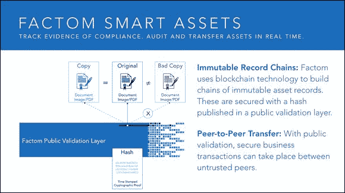

说明图由 Factom, Inc. 提供 ¶  图 7-1：  Factom 区块链的结构。

该协议的概念于 2014 年以白皮书的形式提出，以解决比特币的可扩展性问题。随着去中心化应用开始在比特币上实现自身安全，很明显，随着规模扩大，将数据输入比特币区块链的成本高得令人望而却步，而且比特币无法处理高交易量。形象地说，没有办法将 10 磅的数据装进 5 磅的比特币袋子里。

Factom 协议旨在解决其他区块链的成本和容量限制。主要目标是保护数据和系统。由于这一目标，Factom 通常被描述为一个 `publishing engine`。它允许用户以少量费用将数据写入其账本。这些条目限制为 10 千字节，并且具有固定成本，与使用工作量证明的区块链相比，成本更低，交易量容量高出一个数量级。

一个重要的概念是 Factom 区块链是分层和链式构建的。层级与数据的结构方式有关。它们使用 Merkle 树来留下密码学证明，证明任何给定数据已在 Factom 中发布。这种密码学证明称为 `Merkle root`（可以代表整棵单个数据树的 32 个随机字符），然后发布到以太坊等其他公共区块链中。这是其他区块链不提供的冗余安全。

Merkle 树是由对配对数据进行哈希处理，然后对结果进行配对和哈希，直到只剩下一个哈希为止的数学树，被称为 Merkle root。这种密码学证明以 Ralph Merkle 命名，始于 1979 年。

将数据组织成链有助于可扩展性。链允许应用程序仅从 Factom 区块链中提取它们感兴趣的数据，而无需下载完整的数据集。它们的工作方式非常简单：你可以在 Factom 中将数据发布到现有链中，也可以创建新链。然后链 ID 用于你后续发布的内容，作为追溯你关心的数据的方式。

## Factom 区块链的目的：发布任何内容

Factom 是一个发布平台。其核心设计用于发布和验证任何数据。其上的所有其他工具都围绕这些简单功能构建。Factom 可以处理高达 10 千字节的交易；更大的交易需要特殊结构并需要多个条目。或者，表示数据的哈希也可以被发布。

由于 Factom 协议是开源的，该系统充当公共设施。这是一个任何人都可以发布任何内容并由 Factom 区块链保护的地方。不出所料，一些个人发布了淫秽内容，但条目大小限制意味着他们无法发布太多内容。而且系统通过对每个条目收取少量费用来遏制垃圾信息。所以如果你想在区块链上咒骂，你需要付费。

Factoids 是 Factom 网络的加密货币。去中心化系统需要奖励机制来激励参与者。这种封闭系统需要合作，并建立长期网络价值创造。Factoids 可以像加密货币市场上其他 700 种加密货币一样进行交易和购买。最终，Factoids 用于购买 Factom 网络的条目积分。

条目的成本是固定的，而 `Factoid` 的成本则波动。随着 Factoid 价值的增加，用户可以购买更多条目积分。该系统允许用户与可交易代币分离，并在允许 Factoids 投机自由市场的同时为消费者保持固定成本。这一功能被构建到 Factom 的初始版本中，以便受严格监管的行业和政府能够利用区块链技术，而无需沾染可交易代币。

截至 2017 年初，Factom 网络每天约有 40,000 条条目。其中包括罗素 3000 指数和每天的山寨币价格记录。这些记录用作历史参考，可用作智能合约的输入或证明历史。

存储和访问数据在今天在行业中在很大程度上已是一个解决的问题。计算机备份可以大规模复制和归档。仍然存在的一个大问题是确定哪个文档是最新的修订版，尤其是在不同组织之间。借助基于区块链的文档管理系统，组织可以确保它们使用与合作伙伴相同的文档。

## 联邦的激励机制

许多区块链，如比特币和以太坊，使用“工作量证明”共识。在这种区块链中，共识算法是区块链就系统输入的新数据达成一致的方式。共识系统检查新数据是否有效。公共区块链需要一个健全的系统，因为任何人都可以向区块链添加数据。它们的共识机制是决定什么使区块有效以及应信任哪条链的规则集。

工作量证明具有许多使其非常有吸引力的特征。它通常需要对专用计算机硬件进行资本投资以及电力接入（越便宜越好）。这意味着加入系统作为权威的唯一要求是用通用硬件消耗电力。这也意味着为了改写历史，必须重新消耗等量的能源。这种开销使改写历史变得无利可图，因此不太可能。

工作量证明在保护区块链方面非常出色。另一方面，它消耗大量能源，运营成本高昂。这是一场食人族军备竞赛，最快的计算机获胜，网络中每增加一个吉哈希，挑战就会增加。

每个区块包含的数据越多，验证就越困难。如比特币等工作量证明系统也需要完整的区块链来验证系统中的特定数据点。为了让他人证明你在比特币区块链中进行的交易有效，他们必须下载比特币的整个区块链。目前，这需要几天时间。

Factom 回避了“条目是否有效？”这个问题。问题反而是“条目是否已付费？”系统的用户是验证条目的人。Factom 还将数据结构化为子链，可以单独解析以证明任何条目的有效性，而无需下载完整的区块链。

图 7-2 显示了 Factom 链结构的图表。

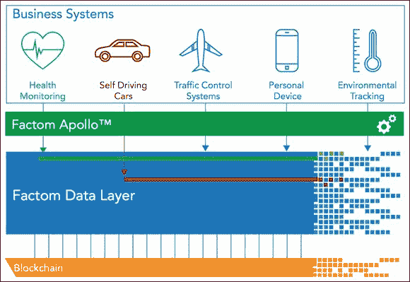

说明图由 Factom, Inc. 提供 ¶  图 7-2：  Factom 链结构。

Factom 采用这种结构是为了商业应用，因为一个行业的成员不需要下载与无关行业相关的所有无关数据。例如，验证与抵押贷款相关的所有文件是否都已记录，并不需要同时下载多年的股票交易所历史记录。

Factom 区块链还将自身分散开来，以保护网络免受数据损坏。每隔几分钟，它就会在比特币和以太坊中创建一个小的锚点。这实现了两个关键功能：

* **首先也是最重要的，它防止构建 Factom 区块链的服务器不可检测地重写历史。** 因为服务器无法控制比特币或以太坊，它们记录的任何历史都是永久的。
* **它防止 Factom 服务器向不同的人展示区块链的两个不同版本。** 网页的个性化定制是亚马逊和 Facebook 经常做的事情。向不同公司展示业务交易的冲突历史是导致误解的配方。因为只有一个比特币区块链，所以防止了历史的篡改版本被创建。

## 在 Factom 之上构建

Factom 是为在其之上构建应用程序而创建的。它专为可扩展性、速度和低成本而构建。它旨在利用比特币区块链的安全性，并使这种永久性适用于超出其有限空间所能容纳的更多内容。

### 使用 API 进行文档认证和构建身份

Factom 已推出一套应用程序编程接口（API），开发团队可使用它来管理和认证文档，并为人和事物构建身份。你仍然需要开发人员帮助，而且它们是为企业集成而设计的，目前不太适合小型项目。

面向公众的核心产品有两个：

* **Apollo：** Apollo 是你的发布和认证选项。它允许用户将大量数据输入 Factom，然后按需历史性地引用它。例如，它将是发布你的网站存档或协议更新的理想场所。
* **Iris：** Iris 是用于构建身份的平台。它是国土安全部物联网身份项目的底层技术。它在记录管理方面基于 Apollo 平台构建。

你可以在无需设置区块链或运行加密货币钱包的情况下使用 API。它省去了过程中的麻烦，对于担心加密货币仍处于监管灰色地带的人来说是理想的选择。

### 了解 Factoid：不是普通的代币

Factom 拥有一个独特的价值代币系统，使用名为 Factoid 的东西。Factoid 是一种可在某些交易所交易的数字资产。它不是像比特币一样的货币。Factoid 可以由所有者兑换为 *entry credits*（不可转让的代币，用于在 Factom 网络内购买发布权限）。该交易是单向的且无法撤销。Factoid 实际上被销毁并从流通中移除。

Factoid 的价格会根据投机和实用性波动。另一方面，Entry credits 具有稳定的价格，保持在 US$0.001。这使得发布的费用具有可预测的成本。

Factom 团队在众筹期间发行了一些代币以筹集核心 Factom 开发资金。截至目前，Factom 网络尚未达到白皮书中概述的 32 个节点的完全联合。当 Factom 网络达到 32 个节点时，网络将开始以新代币奖励联合节点和审计节点。

*联合节点* 是由网络选举出来以维护共识并验证交易的节点。审计节点检查这些节点的诚实性，如果某个联合节点离线或违反系统规则中的一条，它们将接替其作为联合节点的位置。

向服务器发行新 Factoid 与用户销毁 Factoid 相结合代表了价值转移。用户实际上是在为服务器的运行付费。

### 为你的应用程序锚定

区块链技术为新产品和服务打开了大门。区块链本身充当基础层，旧技术可以在其上重新发明自己，或在上面构建创新。每条区块链都有其独特的属性，使其非常适合特定应用。

Factom 在保护信息方面特别出色，但它仍存在局限性：每个条目的大小，以及发布越多成本越高。Factom 非常适合将大文件存储在云解决方案中，然后在 Factom 中使用指针来定位这些文件以供你的应用程序使用。

Factom 主要被用作管理文档、数据和构建身份的系统。它与其他区块链集成，并且可用于为你的智能合约创建预言机。

### 在 Factom 上发布

Factom 是由开发者为开发者构建的。它需要使用你的终端并下载特殊软件来使用钱包并向网络中输入条目。

Factom 团队一直在努力首先构建一个强大的系统。他们有文档可以引导你完成流程，以及一个 GitHub 仓库，包含所有开源软件供你审阅甚至贡献。已做出努力使 Factom 更适合个人消费者，但这仍需要一些时间。

 FreeFactomizer 是我最喜欢的由 Factom 粉丝构建的应用之一。它非常简单易用，允许你在不成为开发者、打开终端或进行任何编码的情况下体验 Factom 的基本功能。它会创建你输入到文本框中的数据或上传文件时的哈希值。然后它会收集其他访客提交的文档的其他哈希值。每十分钟，它会将所有这些哈希值合并为 Factom 区块链中的一个条目。它提供了一个简单的存在证明。

 FreeFactomizer 是由个人提供的免费服务。提供此服务需要花费金钱，未来可能无法使用。并且没有任何形式的保证。

使用 FreeFactomizer，请按照以下步骤操作。

1. **前往** [www.freefactomizer.com](http://www.freefactomizer.com)。

图 7-3 显示了 FreeFactomizer 主页。

2. **上传要进行哈希处理的文档。**

使用不重要的文档——不包含敏感信息的文档——因为该服务不受保证或不安全。

3. **点击 Factomize the File Signature。**

你会得到一个时间估算，说明文件添加到 Factom 需要多长时间。

4. **等待文件添加到 Factom。**

文件至少需要十分钟才能与其他文档和数据捆绑。当此过程完成后，FreeFactomizer 将为你提供返回 Factom Explore 的链接。

5. **使用 Factom Explore 检查条目，Factom Explore 是 Factom 数据库的搜索工具，允许你查找条目。**

另一种尝试的方法是再次上传文档。它会返回类似这样的注释：“->Signature already registered。” 这意味着他们已经将其添加到 Factom。

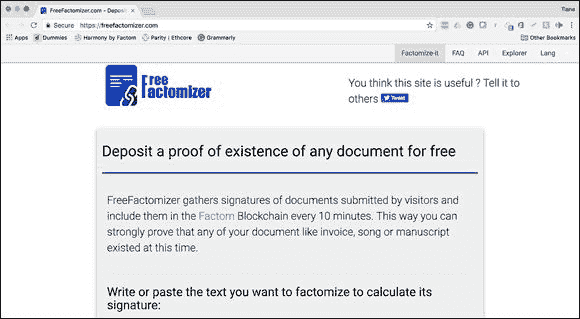

图 7-3： FreeFactomizer 是尝试 Factom 区块链的好方法。

恭喜！你刚刚在 Factom 中存储了数据的指纹并探索了其核心功能。

### 在抵押贷款行业建立透明度

区块链文档管理服务 Factom Harmony 是该公司的首个商业产品。它针对的是抵押贷款发起机构，即向消费者发放房屋贷款的机构。

# Factom Harmony

Factom Harmony（在 图 7-4 中显示）通过将银行使用的各种成像系统转换为用于文档的区块链保险库来工作。它在抵押贷款处理过程中实时创建和管理条目。然后它在 Factom 中安全地记录数据，允许元数据在受信任的各方之间透明共享，并指向机密数据。

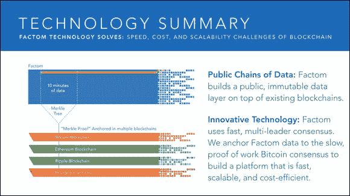

插图由 Factom, Inc. 提供 ¶  图 7-4：  Factom Harmony.

简单来说，Factom Harmony 是一个位于成像系统上的文档目录。它是对现有系统的根本性改进，因为多年后参与其中的个人可以确信他们收到的记录与最初产生贷款的记录完全相同。抵押贷款买家不再需要信任从发起到他们之间众多中介的细致程度。

Factom 希望捕获通过消除与文档组装相关的成本而带来的部分价值。银行和其他发起机构目前花费大量时间确保审计和记录审查仅使用正确的记录和数据进行。当多个利益相关者在不同来源的贷款文件之间进行交互时协调时，这通常会失效。

## 在区块链上保护数据：数字保险库

Factom Harmony（见前一节）提供将用于决策和合规的特定数据和文档存储到永久区块链的能力，同时将该数据与任何需要它的各方共享。存储在此系统中的数据具有清晰的版本历史。缺失的数据也显而易见。它是为审计、诉讼、止赎、贷款交易、证券化和监管审查等场景而设计的。

在 2008 年市场崩盘前十年，核心技术限制集中在速度、吞吐量、清单管理和文档收集上。这些系统并非设计用于以永久保存决策和行动证据的方式收集记录和相关数据。

当今的监管环境要求企业在记录和维护与每项决策相关的记录和数据方面付出更大的努力。流程文档中的任何缺陷通常被归因于恶意。没有完美保存数据及其相关决策证据的能力。

## Harmony 如何与 Factom 技术协同工作

Factom 的技术是区块链技术、数字签名以及由美国国家标准与技术研究院（NIST）开发的一系列加密功能相结合。一系列数据点连同其他区块链上的加密证明一起保存，使用户能够为将来使用而保存数据和文档。此过程创建了一个电子文件目录，可随时由任何授权方访问和验证。

使用 `SHA-256` 加密函数，Factom 为存储在 Factom 区块链中的每个文档和数据文件生成哈希。哈希创建了文件的加密证明，证明该文件从未被更改或修改。

`hash` 是一种“指纹”，用于表示一组数据，它代表文件的内容，但不会有数据泄露的风险。

此外，Harmony 为与记录关联的每个文档和数据文件生成并存储一组关键元数据点以及哈希值。在元数据中，文档和数据文件使用相同的加密工具关联和链接。此元数据连同文件哈希一起写入 Factom 区块链。

## 将区块链用作公共见证

Factom 为其保护的数据创建多个公共见证。与比特币和以太坊等巨头相比，其区块链非常小。其系统在共识机制中不包含挖矿。目前，该系统甚至没有产生任何新代币。区块链越大、越去中心化，就越能抵御成功攻击。

挖矿加密货币是大多数公共区块链保护自身所做的事情。这就是激励节点加入网络的原因。

Factom 通过一种巧妙的方法克服了这一障碍，使其获得复合安全性。它将放置在 Factom 区块链中的数据锚定在比特币和以太坊中。这是通过哈希每十分钟完成一次。他们对完整的数据集进行哈希处理，直到只有一个哈希可以代表整个 Factom 区块链。

# 验证物理文档：dLoc 与 Factom

Smartrac，全球领先的 RFID 收发器、衬底、预层压材料和半成品卡的开发商、制造商和供应商，与 Factom 合作。通过这次合作，创建了一种用区块链保护物理对象的新方法。该产品和服务称为 dLoc。dLoc 被设计为可以贴在几乎任何东西上的贴纸。它对基于纸张的文档（如育种文档）具有特殊用途。

dLoc 是一种端到端安全的文档管理系统，使用硬件和软件。dLoc 的带嵌入式芯片的粘性 Smartrac 编码近场通信（NFC）收发器贴纸被放置在文档或其他商品上，然后使用 Factom 区块链对其进行保护。

NFC 通信协议允许两个电子设备在靠近时建立连接。

通过将基于云的软件与 Factom 的技术相结合，几乎任何东西都会随着时间的推移创建一个不可变的身份。具有一定级别许可的人可以使用 dLoc 移动应用程序访问和验证物理文档。

dLoc 还允许签发机构或实体将其离线文档转换为数字实例，这些实例可以轻松连接到现有数字系统，并在离线和在线世界之间架起桥梁。该解决方案可应用于各种文档，例如出生证明、土地所有权、法院和医疗记录。

dLoc 代表了第一个实用的文档认证系统，它使用 Factom 区块链来解决物理世界和数字世界之间的数据完整性差距。这是使用区块链技术通过数字数据保护纸质文档上的信息的第一个可靠方法。dLoc 的数据和身份认证解决方案对广泛使用纸质文档的公共和私营部门都具有巨大前景。

dLoc 并不能消除欺诈。人就是人，会找到绕过、规避和窃取的方法。这项技术使这样做变得更加困难和昂贵。在这一点上，有人几乎可以在任何地方购买新身份或伪造商品。而在某些情况下，这些身份与真实的文档和商品无法区分。

dLoc 的创建是为了将区块链技术的不可篡改性扩展到物理对象和文档。他们还创建了一个系统，可以在您的身份被篡改时通知您，并有可能采取措施。

# 第 8 章：深入了解 DigiByte

## 本章内容

**了解 DigiByte**

**在 DigiByte 上开始挖矿**

**为代币游戏**

DigiByte 是拥有游戏领域的区块链。它是一个独特的系统，与许多有趣的应用程序配合良好，从游戏到文档管理。DigiByte 团队发现了区块链速度、可访问性和实用性的正确组合。

DigiByte 的一个独特之处在于其五个独立的算法，每个算法平均占新区块的 20%。这意义重大，因为大多数区块链仅运行一种算法，只有最快的节点才能赢得代币。

DigiByte 的五种算法各自适应不同类型的矿工，这使得 DigiByte 协议对更多用户更具吸引力，并提高了去中心化程度。由于该协议的方法，攻击者需要控制约 60% 的总网络算力才会造成任何问题。这意味着至少控制一种算法的 93% 以及另外四种算法的 51%（相比之下，比特币运行一种算法，容易受到 51% 攻击）。51% 攻击概念是比特币区块链最严重的弱点之一。如果比特币网络中超过 51% 的矿工被一个团体控制，他们就可以操纵比特币区块链。如果网络被攻破，代币将失去价值，网络内所保护的数据也将被破坏。

本章深入探讨 DigiByte 区块链的实际应用和未来，并解释该技术的实用用途。

## 了解 DigiByte：快速的区块链

DigiByte，也称为加密货币 DGB，是一条专注于游戏、支付和安全的区块链。该公司总部位于香港，由 Jared Tate 创立。Tate 拥有军事和早期计算机科学背景，多年来一直参与比特币。 在对比特币核心的开发感到沮丧后，他于 2014 年推出 DigiByte，并筹集了种子轮资金以扩展其在支付和贸易方面的工作。

DigiByte 团队完成了许多其他项目都在利用的出色工作。目前，DigiByte 每秒处理 300 笔交易。 作为对比，比特币大约每秒处理七笔交易。该团队对项目有许多鼓舞人心的目标，包括到 2021 年达到 Visa 惊人的交易速度。

DigiByte 是分布最广的网络之一，在 82 个国家拥有超过 8,000 个节点。它与比特币类似，可以快速且成本极低地在两方之间转移价值。它也与比特币具有部分相同的功能，即可以在其区块链中保护少量信息。通过这种机制，它允许您以比比特币更快的速度保护数据、文档和合同。

DigiByte 的亲和团队也努力让其项目更有趣。团队通过平台提供游戏奖品，并为在推特上说好话的人提供奖励。DigiByte 有 GitHub 仓库，并是 MIT 许可证下的开源项目。

DigiByte Gaming 是 DigiByte 的一个部门，是一个在游戏环境中利用加密货币以促进新型数字广告的平台。它拥有超过 10,000 名不断增长的用户群。这是一种许可营销形式，其中活动和激励措施通过加密货币奖品和赏金推动品牌参与。能够进行几乎无国界的安全微支付，为这种营销平台提供了非常有趣的竞争优势。

无国界的参与使公司能够触达更广泛的受众。加密货币还让公司能够向世界任何人支付款项并提供几乎任何规模的奖品。看到 DigiByte 营销扩展到游戏行业之外将令人兴奋。

## 在 DigiByte 上挖矿

DigiByte 使用五种挖矿算法来处理交易。每种算法占网络中创建的所有区块的 20%。这一系统使 DigiByte 成为独特且多样化的区块链。

DigiByte 团队认为，通过允许平台上更多类型的挖矿可以获得更大的优势。在只有单一算法的系统中，只有最快和最新的技术才能获胜。这造成了一种技术和速度的自相残杀式军备竞赛。由于它允许各种不同类型的机器成功赢得代币，DigiByte 系统对多样性和参与度更开放。

以下是 DigiByte 五算法系统的简要分解：

* SHA-256 ([`https://dgb-sha.theblocksfactory.com`](https://dgb-sha.theblocksfactory.com))：要使用 DigiByte 的 SHA-256 挖矿选项，必须拥有 ASIC 挖矿设备。
* Scrypt ([`https://dgb-scrypt.theblocksfactory.com`](https://dgb-scrypt.theblocksfactory.com))：你可以使用 ASIC 挖矿设备或 GPU 来运行 DigiByte 的 Scrypt。
* Qubit ([`http://dgb-qubit.theblocksfactory.com`](http://dgb-qubit.theblocksfactory.com))：Qubit 是用于挖矿 DigiByte 的 GPU 算法。
* Skein ([`http://dgb-skein.theblocksfactory.com`](http://dgb-skein.theblocksfactory.com))：Skein 是用于挖矿 DigiByte 的 GPU 算法。
* Groestl ([`http://dgb-groestl.theblocksfactory.com`](http://dgb-groestl.theblocksfactory.com))：Groestl 是用于挖矿 DigiByte 的 GPU 算法。

DigiByte 算法的多样性通过降低成功进入网络的门槛激励更多个人参与挖矿。这种多样性带来的去中心化吸引了网络的许多有趣用途。加密货币矿工经常会重新利用过时的比特币挖矿设备在 DigiByte 网络上使用，在那里他们仍能找到其用途。

本节深入探讨如何获得被称为 DGB 的 DigiByte 代币。你可以挖矿加密货币并在以后使用。

 如果你有旧的比特币挖矿设备，可以用它来赚取 DGB。

在挖矿 DGB 之前，你应该计算挖矿是否会盈利。请按以下步骤操作：

1. 前往 [`www.coinwarz.com/calculators`](http://www.coinwarz.com/calculators)。

在这里，你可以找到一个计算器来估算挖矿多种不同加密货币的回本时间。

图 8-1 显示了 CoinWarz 的成本和盈利能力计算器工具。

2. 在“Pool Fees %”字段中输入 3。

这对参与矿池成本的较高估算。通常范围在 0.5% 到 3% 之间。

3. 在“Hardware Costs (USD)”字段中输入 500。

专用挖矿设备的成本差异很大。一个不错的平均成本估算是 500 美元。

4. 在“Hash Rate (KH/s)”字段中输入 470000。

这是对机器每秒哈希速度的估算，单位为千哈希/秒（KH/s），即每秒 1,000 次哈希计算。在特定区块链上挖矿的哈希率越高，挖矿该类型加密货币就越困难。

 你也可能会看到兆哈希/秒（MH/s），即每秒 100 万次哈希计算；吉哈希/秒（GH/s），即每秒 10 亿次哈希计算；太哈希/秒（TH/s），即每秒 1 万亿次哈希计算；以及拍哈希/秒（PH/s），即每秒 1 千万亿次哈希计算。

5. 点击计算。

计算器将为你提供参与加密货币挖矿的成本和盈利能力的概念。

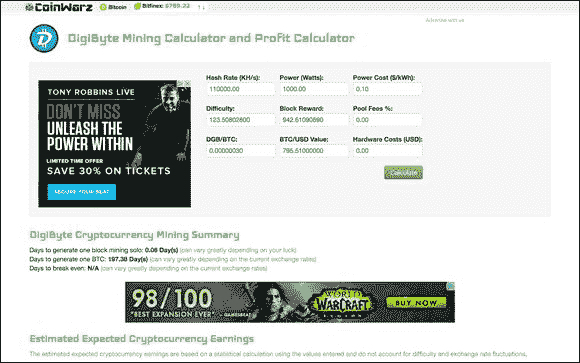

图 8-1： 成本和盈利能力计算器。

## 在 DigiByte 的 DiguSign 上签署文档

由 DigiByte 团队创建的 DiguSign 是传统云存储和电子签名服务的有趣替代方案。DiguSign 采用了这些应用的基本功能，并增加了区块链技术的永久性和可验证性。它允许你对文档进行数字签名，然后将其安全地存储在 DigiByte 区块链中。

The DigiByte team believes that DiguSign will be very valuable to lawyers, healthcare providers, and in financial services arenas where it’s important to keep a clear version history for contracts and a clear established time line on what documents were provided when and to whom.

 您可能能够将您的 DiguSign 账户链接到您的云存储提供商，例如 Google Docs、Dropbox 和 OneDrive。在此之前，每个文档都必须单独上传到 DiguSign。DiguSign 提供了此服务的免费测试版本，允许您创建三个免费的区块链支持文档或合同。

DiguSign 仍处于早期测试阶段，但它已经允许您存储、非正式公证和验证数字文档。

 DiguSign 通过将哈希嵌入到 DigiByte 区块链交易中来发布您文档的 `SHA256` 哈希。该交易随后被安全地保存在 DigiByte 区块链中。

设置您的账户，请按照以下步骤操作：
1. **前往** [ `www.digusign.com` ](http://www.digusign.com) **并注册一个 DiguSign 账户。**
2. **将您的文档上传到 DiguSign。**
   您有创建文档或合同模板的选项。
3. **选择创建文档的选项。**
4. **在您的文档上配置所有必需的签名和其他字段。**
5. **输入您希望电子签署您文档的个人的电子邮件地址。**
6. **选择“安全最终版本”选项。**
   当所有各方都签署了文档后，您需要通过点击“安全最终版本”将最终版本发送到 DigiByte 区块链。

您已创建了文档的近乎永久的指纹，您可以随时参考。

## 在游戏中赚取 DigiBytes

DigiByte 将游戏社区对数字代币的偏爱与区块链技术联系起来。游戏玩家熟悉在游戏中使用数字货币，因此 DigiByte 团队认为，利用其加密货币代币作为激励用户参与的方式是一个容易的转变。

DigiByte 已设置通过玩游戏如 Counter Strike、League of Legends 和 World of Warcraft 来赚取 DigiByte 代币的选项。这些奖励是通过游戏公司的赞助提供的，并且不会占用用户的 GPU 功率进行挖矿。

DigiByte 为游戏公司创造了一个有趣的机会，可以建立额外的激励模式来获取新玩家并留住现有玩家。它还为游戏玩家找到了一种巧妙的方式，将他们在数字世界中赢得的奖品转化为可以在现实世界中花费的金钱。

您可以通过 DigiByte 游戏网站赚取 DigiBytes。每天，DigiByte 提供多个任务，让您有机会获得所谓的 `XP`。`XP` 然后以固定的日利率转换为 DigiBytes。您可以玩 World of Warcraft 或其他提供的任何游戏，并获得游戏报酬 DigiBytes。

然后您可以在交易所（如 Poloniex）上用比特币交易 `DGB` 代币。并且您可以轻松地将比特币兑换成其他货币。虽然有几层分离，但这是一条清晰有趣的获得报酬的途径！

通过游戏赚取 DigiBytes 的设置相当容易。您不会通过挖矿来赚取代币，但开始时也不需要打开命令行。只需按照以下步骤操作：
1. **前往** [ `www.digibytegaming.com` ](http://www.digibytegaming.com) **。**
2. **创建一个新账户。**
   DigiByte 允许社交登录，使设置快速简便。
3. **验证您的账户。**
   检查您的电子邮件以获取链接。
4. **前往** [ `www.battle.net` ](http://www.battle.net) **。**
   从这里，您可以创建一个配置文件以链接到您的 DigiByte 账户。此配置文件将在 World of Warcraft 和 DigiByte 之间充当桥梁。
5. **在您的计算机上设置 World of Warcraft。**
   如果您已经玩这款游戏，您可以在此步骤中连接您的游戏密钥。
6. **返回** [ `www.digibytegaming.com` ](http://www.digibytegaming.com) **。**
7. **点击 World of Warcraft 选项。**
8. **连接您的 Battle.net 账户。**
9. **打开您的 World of Warcraft 应用程序并开始游戏。**

您现在在游戏时正在赚取 DigiBytes！

# 第 3 部分

## 强大的区块链平台

本部分内容 …
确定最大的企业区块链联盟 Hyperledger，以及它对您的行业和组织的影响和益处。
了解 Microsoft 的区块链工作以及通过其网络服务为您提供的核心工具。
评估 IBM Bluemix 项目以及区块链技术与人工智能结合的影响。

# 第 9 章

### 掌握 Hyperledger

本章内容
**探索四个关键的 Hyperledger 项目**
**深入 PoET 算法**
**发现 Chaincode 智能合约**
**理解 Sumeragi**

Hyperledger 是一个由软件开发人员和技术爱好者组成的社区，他们正在构建区块链框架和平台的行业标准。他们的作品很重要，因为他们是推动区块链行业进入主流和商业采用的主要团体。Hyperledger 是企业团队的“安全”部署平台。

该组织及其独特项目每天都在增长。截至本文撰写时，他们拥有超过 100 家成员公司，并有多个项目处于孵化阶段。他们最初的几个项目包括 `Explorer`，一个用于查看和查询区块的 Web 应用程序，以及 `Fabric`，一个即插即用的区块链应用程序构建器。他们还拥有 `Iroha` 和 `Sawtooth`，它们是模块化区块链平台。

在本章中，我探讨了 Hyperledger 下孵化的三个关键项目。您将深入了解商业化区块链的未来对您公司和行业的影响。这种知识将在您探索要使用哪些技术以及要避免哪些技术时帮助您，节省开发时间和资源。

### 认识 Hyperledger：Hyper 未来的梦想

2015 年底，Linux 基金会成立了 Hyperledger 项目，以开发企业级和开源分布式账本框架。他们希望让区块链社区专注于构建强大的、特定行业的应用程序、平台和硬件系统来支持企业。

Linux 基金会看到有许多不同的团体在没有凝聚方向的情况下构建区块链技术。该行业存在重复劳动，部落主义导致团队两次解决同一个问题。基金会从经验中知道，如果这项技术要实现其全部潜力，迫切需要开源和协作开发策略。

Hyperledger 项目由执行董事 Brian Behlendorf 领导，他拥有数十年的经验，可追溯到最初的 Linux 基金会和 Apache 基金会，并且是世界经济论坛的首席技术官。因此，Hyperledger 得到广泛认可也就不足为奇了。许多顶级商业和行业领袖已加入该项目，包括 Accenture、Cisco、Fujitsu Limited、IBM、Intel、J.P. Morgan 和 Wells Fargo。它还吸引了许多顶级区块链组织。

R3，一个支持银行业的联盟，已贡献了其金融交易架构框架。软件公司 Digital Asset 提供了 Hyperledger 标记和部分企业级代码。Factom 基金会也在贡献企业级代码和开发人员资源。IBM 和许多其他组织也在为该项目贡献代码和其他资源。

Hyperledger 的技术指导委员会确保这些不同技术之间的稳健性和互操作性。希望跨行业、开源协作能够推动区块链技术发展，并通过在众多组织之间分摊研发成本，创造数十亿美元的经济价值。

Hyperledger 正在识别并解决区块链技术生态系统中缺失的重要特性和需求。它也在推动跨行业的分布式账本开放标准，并为开发者贡献以构建更好的区块链系统提供开放空间。

Hyperledger 的项目生命周期与 Linux Foundation 相似。首先提交提案，然后被接受的提案进入孵化阶段。当项目达到稳定状态时，它将毕业并进入活跃状态。迄今为止，所有 Hyperledger 项目都处于提案或孵化阶段。每个项目都由大型企业或初创公司领导。例如，Fabric 由 IBM 领导，Sawtooth 由 Intel 领导，Iroha 由初创公司 Soramitsu 领导。

Hyperledger 与许多开源项目一样，使用 GitHub ( [ `www.github.com/hyperledger` ](http://www.github.com/hyperledger) ) 和 Slack ( [ `https://slack.hyperledger.org` ](https://slack.hyperledger.org) ) 来与每个项目的工作团队保持联系。这些是获取最新更新并了解这些项目开发进展的绝佳场所。

# 专注于 Fabric

Hyperledger 的第一个孵化项目 Fabric 是一个许可区块链平台。它像大多数区块链一样维护数字事件的账本。这些事件被结构化为交易并在不同参与者之间共享。交易是在没有加密货币的情况下执行的。供你深入了解该主题的可选资源位于 [ `https://trustindigitallife.eu/wp-content/uploads/2016/07/marko_vukolic.pdf` ](https://trustindigitallife.eu/wp-content/uploads/2016/07/marko_vukolic.pdf) 。

所有交易都是安全、私密和保密的。Fabric 只能由参与者达成共识后进行更新。一旦记录被输入，就永远无法更改。

Fabric 是一种关注可扩展性并符合法规的企业解决方案。所有参与者必须向会员服务注册身份证明才能访问系统。Fabric 发出与拥有参与者无法关联的派生证书交易，从而在网络上提供匿名性。此外，每笔交易的内容都经过加密，以确保只有预期的参与者可以看到内容。

Fabric 具有模块化架构。你可以通过实现其协议规范来添加或移除组件。其容器技术可以处理智能合约开发的大多数主流语言。

另一方面，比特币允许任何人匿名参与，并且社区一直在寻找实现抗审查和赋能被剥夺权利者的方式。比特币也主要为其加密货币代币的流通和安全性而设计。因此，将比特币的最佳实践与 Fabric 进行比较可能是不公平的。

## 在 Fabric 中构建你的系统

Fabric 的可访问性已投入大量工作，但它仍然只有技术娴熟的人才能接近。

Hyperledger 已详细说明了其技术将针对的多个用例。未来不久，你将能够通过直观的用户界面在所述用例上使用 Fabric。目前，你可以在核心开发者的帮助下开发和测试所列用例。

## 深入链码开发

两个当事人之间的合同可以通过 Chaincode 翻译成 Hyperledger Fabric 上的代码。Chaincode 是 Hyperledger 对以太坊智能合约的版本。它以双方都可信赖的方式自动化合同中达成的协议。

Chaincode 如以太坊的智能合约一样是图灵完备的。目前，你可以让一名 Java 开发者为你构建链码合约。Fabric 团队已准备了一些常见用例，例如数字货币和发送短信，作为核心框架的一部分。

Fabric 团队也在探索其他有趣的业务用例，这些用例在撰写本文时尚未完成，但到你阅读本文时可能已可用。

Hyperledger 仍处于早期开发阶段，其项目大约落后于以太坊的工作两年。然而，每个项目都有大量团队和资源投入：

*   **业务合同：** Hyperledger 已想出同时拥有公共合同和私有合同的方法。私有合同在两个或多个当事人之间，并包含机密信息。公共合同可供任何花时间在 Hyperledger 中搜索的人查看。例如，你可能会使用公共合同来公开提供出售产品，或作为征求合同投标的方式。

    这些合同的构成比传统合同更复杂，因为仲裁和第三方执行被取消了。此外，还需要参与合同的个人的身份验证。而且，大多数合同都是独特的，无法标准化。合同越复杂，从其原始意图被破坏的地方就越多。Hyperledger 正在努力创建一个合同管理系统，以帮助增强 Chaincode 的可扩展性。

*   **制造供应链：** 供应链管理是正在 Fabric 上探索的有趣的区块链方案。最终装配商可以管理在创建产品时使用的所有零部件和物资。此功能将使你能够响应需求并能够追溯每个部件的来源至原始生产商。在产品召回的情况下，很容易找到罪魁祸首，或在部件被利用前判断每个部件的真实性。

    Fabric 在准备好用于此用例之前还需要更多开发，因为它需要让供应链中的每个人都能轻松访问。Fabric 团队正在研究一项标准协议，以允许供应链网络上的每个参与者输入并跟踪在特定产品上生产和使用的编号部件。

    完成后，此用例将允许随时对每个产品的生产进行深度搜索。这可能在任何一件物品的生产中深入十层或更多。消费者然后可以确定由其他组件商品和物资构成的任何制成品的来源。这可能对消费产生有趣的社会影响。

*   **证券和资产：** 证券和其他资产非常适合区块链，因为它们可以自动化第三方执行的许多功能。Fabric 将允许资产的所有利益相关者直接访问该资产及其构成和历史，绕过现在持有该信息的中间商。Fabric 还会将资产的结算时间加快至接近实时。

*   **直接通信：** 未来，Fabric 也可被用作公司发布公告和要约的场所。例如，如果一家公司想要筹集资金并需要在实时通知所有股东要约的完整细节，它就可以做到。像以太坊的去中心化自治组织（DAO）一样，股东可以做出决策并执行它们。他们的决策将被实时处理和结算。这将使股东会议和投票变得更加容易和快速。

## 资产互操作性

未来，`Fabric` 也可能具有与 `Ripple` 网络相同的部分功能（参见 第 6 章）。它设想了在低流动性市场中，公司可以通过在多方之间匹配需求来交换资产的用例。与其满足于双方之间直接交易的市场限制，链网络将买家与卖家连接起来，并在多个资产类别中寻找最佳匹配。`Hyperledger` 在未来交易衍生品方面似乎处于有利地位。你可以在 [`http://events.linuxfoundation.org/sites/events/files/slides/TradingDerivatives_LinuxCon_2016.pdf`](http://events.linuxfoundation.org/sites/events/files/slides/TradingDerivatives_LinuxCon_2016.pdf) 阅读更多关于这项工作的内容。

## 调查 Iroha 项目

`Hyperledger` 的 `Iroha` 项目是在 `Fabric` 项目完成的工作基础上构建的。它旨在补充 `Fabric`、`Sawtooth Lake` 以及 `Hyperledger` 下的其他项目。`Hyperledger` 将 `Iroha` 项目加入孵化，因为其他项目没有用 `C++` 编写的任何基础设施项目。没有 `C++` 项目严重限制了能从 `Hyperledger` 工作中受益的人数以及能够为项目做出贡献的开发人员数量。

此外，目前大多数区块链开发都在最低的基础设施层面上进行，用户交互或移动应用程序的开发工作几乎没有。`Hyperledger` 认为 `Iroha` 对于区块链技术的普及是必要的。该项目通过吸引更多开发人员并提供移动用户界面开发的库来填补市场空白。

在撰写本文时，`Iroha` 是一个非常新的项目，尚未与 `Fabric` 或 `Sawtooth Lake` 集成。`Hyperledger` 计划很快扩展功能以与其他区块链项目协同工作。其 `iOS`、`Android` 和 `JavaScript` 库将提供诸如数字签名交易等支持功能。它将对商业应用开发非常有用，并将增加只有区块链技术才能实现的新的安全层和商业模式。

### 介绍 Sumeragi：新的共识算法

区块链具有系统，使其首先就单一的真实版本达成一致，然后将该已达成一致的真实记录在其账本中。一种协议系统称为 *共识*。

共识很复杂。理解共识如何以及为何以这种方式行事的细微差别远远超出了本书的范围。对于商业专业人士来说，这也远比你需要的多。对你 *确实* 重要的是不同共识机制的后果以及它们如何影响你在特定区块链上的操作。我重点介绍 `Iroha` 的共识 `Sumeragi`，因为它与传统区块链非常不同。

以下是使 `Sumeragi` 不同的一点关键内容：

* `Sumeragi` 没有加密货币。
* 启动共识的节点由 `Fabric` 成员服务添加到系统中。节点根据它们与账本的交互方式随着时间的推移建立声誉。这是由已知实体运行的许可区块链。
* 新条目以独特的方式添加到账本中。启动共识的第一个节点，称为 *领导者,* 将条目广播给其他节点组；这些节点随后进行验证。如果它们未验证，第一个节点将在预定时间后重新广播。广播元素与 `Ripple` 的共识工作原理相似。

根据你对区块链的用例，`Iroha` 可能是积极的也可能是消极的。如果你担心审查，`Iroha` 可能不适合你。在这种情况下，你最好寻找一个抗审查的区块链。如果你担心网络上的其他参与者进行套利，`Iroha` 可能也不合适——需要进一步调查。如果你想知道区块链中的所有参与者，`Iroha` 可能正是你正在寻找的。

### 开发移动应用

如果你不是应用开发领域的人员，请跳过本节。

`Iroha` 是为 Web 和移动应用开发者构建的，以便他们能够访问 `Hyperledger` 系统的优势。`Iroha` 团队认为，如果没有应用程序利用它，分散式账本就没有用处。

`Iroha` 对以下封装的 `C++` 组件有开发路径：

* `Sumeragi` 共识库
* `Ed25519` 数字签名库
* `SHA-3` 哈希库
* `Iroha` 交易序列化库
* `P2P` 广播库
* `API` 服务器库
* `iOS` 库
* `Android` 库
* `JavaScript` 库
* 区块链浏览器/数据可视化套件

区块链行业的主要障碍之一是使系统用户友好。`Iroha` 为 `iOS`、`Android` 和 `JavaScript` 创建了开源软件库，并使常见的 API 函数调用变得方便。开发仍处于早期阶段，但 `Iroha` 是探索业务用例的良好资源。

## 深入了解 Sawtooth Lake

英特尔的 `Sawtooth Lake` 是 `Hyperledger` 中的另一个分布式账本项目。它专注于成为一个高度模块化的平台，用于为公司构建新的分布式账本。

截至本文撰写时，发布版本中的软件仅 *模拟* 共识。它不会为你的项目提供安全性，只能用于测试新想法。

`Sawtooth Lake` 不使用加密货币运行。它通过允许企业创建私有区块链来维护平台的安全性。这些运行私有区块链的企业随后分担网络计算需求的负担。在其文档中，`Sawtooth Lake` 指出这种类型的设置将确保对共享账本状态的普遍一致。

`Sawtooth Lake` 颠覆了区块链的基本模型。大多数区块链有三个要素：

* 区块链当前状态的共享记录
* 输入新数据的方式
* 就该数据达成一致的方式

`Sawtooth Lake` 将前两者合并为一个单一流程，他们称之为 *交易家族.* 该模型最适合所有参与方都从正确记录中获得共同利益的用例。

英特尔允许其软件足够灵活，以适应反映每个企业独特要求的自定义交易家族。它还构建了三个用于构建数字资产的模板：

* `EndPointRegistry`：在区块链中记录项目的场所
* `IntegerKey`：用于供应链管理的共享账本
* `MarketPlace`：用于买卖和交易数字资产的区块链交易平台

### 探索共识算法：Proof of Elapsed Time

`Sawtooth Lake` 的共识算法称为 Proof of Elapsed Time (`PoET`)。它被构建为在计算机主处理器的安全区域中运行，称为受信任执行环境 (`TEE`)。`PoET` 利用 `TEE` 的安全性通过对交易进行时间戳来证明时间已经流逝。

其他共识算法也有某种时间戳元素。它们确保记录未被更改的方式是通过公开发布其区块链作为未被篡改的证明。已发布的账本充当公共证人，任何人都可以回滚并检查。这有点像在报纸上刊登广告来证明某事发生了。

`PoET` 也有一种彩票系统，其工作原理与其他使用工作量证明的区块链略有不同。它会从验证节点池中随机选择一个节点。节点被选中的概率与其为共享账本贡献的处理资源量成正比。可以采取措施防止节点操纵系统并破坏账本。

## 部署 Sawtooth
英特尔在 [`https://intelledger.github.io/tutorial.html`](https://intelledger.github.io/tutorial.html) 汇集了一些精彩的文档和教程。它们会引导你完成为区块链设置虚拟开发环境的过程，甚至还有一个用于构建区块链井字游戏的教程。要充分利用他们提供的资源，你需要熟悉 `Vagrant` 和 `VirtualBox`。

你可能还想在尝试这些教程之前阅读 Nikhil Abraham（Wiley）著的 *傻瓜编程*。

# 第 10 章
## 应用 Microsoft Azure
本章内容

**构建新应用**

**桥接你的系统**

**对新系统进行身份验证**

**部署私有以太坊**

本章将预览 Microsoft 的 `Azure` 平台内部正在发生的令人兴奋的创新，以及这些变化如何提高您业务的效率并为产品和服务创造新的机会。

本章帮助您在全球经济中竞争、与客户合作并为客户提供服务。区块链技术正在开辟新市场并改变商业模式。微软正在努力使其成为传统企业可访问的技术。

本章还解释了正在构建的创新区块链桥，以便您可以连接和扩展现有系统。您将了解如何在 `Azure` 内部部署自己的区块链，以及使企业向区块链系统安全无忧过渡的关键要素。

### Bletchley：模块化区块链架构
项目 `Bletchley` 专注于在 *联盟区块链生态系统*（成员专属的许可网络，供成员执行合约）内为企业客户提供架构构建模块。`Bletchley` 的区块链结构平台由 `Azure` 提供支持，`Azure` 是 Microsoft 的云计算平台。项目 `Bletchley` 解决以下问题：
* 数字身份
* 私钥管理
* 客户隐私
* 数据安全
* 运营管理
* 系统互操作性

在项目 `Bletchley` 中，`Azure` 为区块链提供云层，作为应用程序构建和交付的平台。它将在全球 24 个区域提供。`Azure` 将其传统产品如混合云能力、广泛的合规认证组合和企业级安全与各种区块链相结合。微软希望让现有客户更容易快速采用区块链技术，尤其是在医疗保健、金融服务和政府等受控行业。

图 10-1 显示了项目 `Bletchley` 的 `Blockstack Core v14`，这是一个新的去中心化无服务器应用网络，用户可以在其中控制自己的数据。

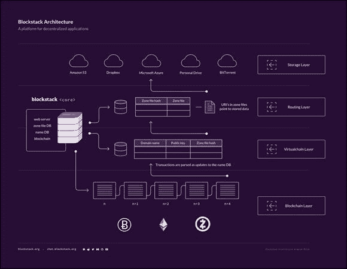

图 10-1： Blockstack Core v14。

`Azure` 将与多种区块链协议协作。它们是 `Hyperledger` 项目的一部分以及基于未花费交易输出（`UTXO`）的协议。这意味着 `Azure` 平台不使用加密货币，可能对企业客户更具吸引力。它们还将与更复杂的协议（包括使用加密货币来保护网络的 `Ethereum`）集成。

#### 用于加密和身份验证的 Cryptlets
项目 `Bletchley` 建立在两个思想之上：
* `Blockchain middleware`：云存储、身份管理、分析和机器学习
* `Cryptlets`：Microsoft `Azure`、`Bletchley` 生态系统与您自己的技术之间互操作和通信的安全执行

`Cryptlets` 构建为链下代码组件，可用任何语言编写，在受信任的容器中执行，并通过安全通道通信。当需要额外功能或信息时，`Cryptlets` 可用于智能合约和 `UTXO` 系统。

`Cryptlets` 在程序的链上和链下执行之间架起了安全差距，在需要额外安全信息时运行。它们使您的客户关系管理（`CRM`）或交易平台能够连接到您的云存储，然后使用 `Ethereum` 进行保护，例如。

`Bletchley` 的中间件与 `Cryptlets` 以及现有的 `Azure` 服务，如 `Active Directory` 和 `Key Vault`，以及其他区块链生态系统技术协同工作，以提供完整的解决方案并确保区块链集成的可靠运行。

表 10-1 显示了来自 `Bletchley` 的 Devcon 2 演示中预言机与 `Cryptlet` 之间的区别。

表 10-1 Cryptlets 与 Oracles

| || `Cryptlets` || `Oracles` |
| --- | --- | --- |
| 验证要求 || 需要与受信任的主机（HTTPS）、受信任的 Cryptlet 密钥和受信任的飞地签名进行验证的信任。 || 需要信任但没有正式验证。 |
| --- | --- | --- |
| 基础设施 || 标准基础设施。您可以通过 `Azure` 全球可用的飞地实现基于硬件的隔离和证明。`Bletchley` `Cryptlet` 软件开发工具包（`SDK`）框架（Utility 和 Contract）可帮助您快速创建和消费 `Cryptlets`。 || 定制基础设施。您可以单独编写和托管。建立信任很困难。预言机一直是平台特定的，目前文档非常稀少。 |
| 开发者使用 || 有多种语言选项可用，并且它们与区块链无关。 || 绑定到其自己的区块链且语言选项有限。 |
| 市场可用性 || 有市场可用于发布和发现。 || 没有通用的市场可用于发布和发现。 |

`Cryptlets` 由开发者构建并在 `Bletchley` 的市场中销售。它们解决了构建基于分布式账本的应用程序所必需的许多不同功能集。市场正在增长，以满足客户对必要功能的需求，例如安全执行、集成、隐私、管理、互操作性和完整的数据服务。

#### Utility 和 Contract Cryptlets 和 CrytoDelegates
`Cryptlets` 有两种类型：
* `Utility`：`Utility` `Cryptlets` 提供加密、时间戳、外部数据访问和身份验证。它们创建更可靠和可信的交易。
* `Contract`：`Contract` `Cryptlets` 是完整的委托引擎。它们可以作为自主代理或机器人运行。它们提供智能合约通常执行的所有执行逻辑，但位于区块链之外。

`Contract` `Cryptlets` 与智能合约绑定，并在发布智能合约时创建。它们与虚拟机并行运行，与传统区块链内构建的智能合约相比性能更高，因为它们执行时不需要太多加密货币。它们对非加密货币区块链用户最具吸引力，其中链代码和智能合约由已知方签名。

图 10-2 显示了 Cryplet 容器的示意图以及到您智能合约的安全通信路径。

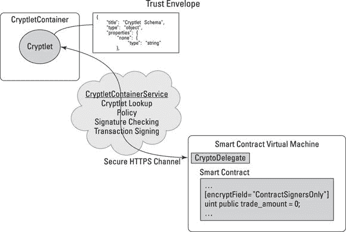

图 10-2： 一个 Cryplet 容器。

CryptoDelegates 使 Utility 和 Contract Cryplets 能够运行。它们通过在你的智能合约虚拟机中创建功能钩子充当适配器。它们从你的智能合约代码中调用 Cryptlet，进而为交易创建安全且真实的封装。

# 在 Azure 生态系统中构建

Azure 是一个数字生态系统和云计算平台。它使企业能够直接与其云合作伙伴和 SaaS 连接。反过来，这使企业能够以互联、可靠和安全的方式传输其数据。

微软的 Azure 云平台是第二大基础设施即服务（IaaS）平台。它是您云计算和数据存储的可靠且安全的避风港。在 Azure 中，有一项名为 ExpressRoute 的服务，可为用户提供直接连接 Azure 的方式。反过来，这可以防止在公共互联网上广泛存在的性能和安全问题。

2015 年，微软决定使用以太坊和 Hyperledger 区块链系统扩展其 Azure 生态系统。Azure Blockchain as a Service 的首个产品由以太坊提供支持。以太坊是一个图灵完备的区块链框架，用于构建应用程序。微软旨在基于区块链技术和 Hyperledger 构建更多产品。它还在发展 Azure 市场，同时将其转变为面向 Azure 客户的门户。

微软的 Azure Stack 程序包含 Azure 快速入门模板，该模板借助 Azure 资源管理器部署各种 Azure 资源，以帮助您完成更多工作。Azure 资源管理器允许客户将业务资源作为一个组进行操作。它使他们能够以协调且单一的操作部署、删除或更新解决方案中的所有资源。

Azure 快速入门模板可用于各种环境，如生产、暂存和测试。通过 Azure 资源管理器，客户可获得标记、审计和安全方面的多项功能。这些功能帮助用户在部署后管理其资源。

微软的 Project Bletchley 是其区块链架构，与其已提供的成熟企业技术融合。它为 Azure 提供区块链后端和市场。

Bletchley 的生态系统是微软采取的一种方法，旨在以安全有效的方式将区块链或分布式账本网络带给更广泛的受众。他们希望帮助构建真实的解决方案并解决实际的业务问题。

## 在 Azure 上开始使用 Chain

Chain 是一家提供区块链技术解决方案的公司，已在 Azure 上发布其 Chain Core Developer Edition。Chain Core Developer Edition 是该公司分布式账本平台的开源免费版本。它使您能够在授权的区块链网络上发行和转移资产。

通过其测试网，您的开发人员可以加入或启动区块链网络、访问深入的技术教程和文档，并构建金融应用程序。他们还可以在 Chain 的测试网上运行自己的原型，或在 Azure 上创建自己的个人网络。

### 安装 Chain 的分布式账本

Chain Core Developer Edition 附带代码示例、Java SDK 和入门指南。此外，它还提供仪表板界面以及适用于 Linux、Mac 和 Windows 的安装程序。

按照以下步骤安装您的 Chain Core Developer Edition：

1. 导航至 Chain 的安装页面 `https://chain.com/docs/core/get-started/install`。
2. 从列表中选择您的操作系统。
3. 点击下载。
4. 打开 Chain 程序。
5. 运行 Chain Core 安装程序。

Chain 提供了一个 SDK，可为您和您的开发人员提供软件开发工具，以便创建区块链应用程序和资产。

### 创建您自己的私有网络

您可以在 Azure 中创建私有以太坊联盟区块链网络。您应该能够在没有开发人员帮助的情况下自行完成。只需按照以下步骤操作：

1. 注册或登录您的 Azure 账户。
   有免费试用选项和按需付费选项，可让您轻松尝试 Azure。
2. 前往 `https://goo.gl/Ixu5of`。
3. 点击部署到 Azure。
    Azure 资源管理器模板由 Azure 社区成员创建。微软不对安全性、兼容性或性能进行审查。
4. 填写表单。
5. 点击购买。

恭喜！您现在拥有了一个私有以太坊联盟区块链网络。

### 在 Azure 的 Chain 上使用金融服务

Chain 推出了其开源免费的开发者平台。它包括一个测试网络，由微软、Chain 和加密货币与合约倡议（3CI）运营。3CI 是 Chain 推出的平台，提供区块链技术解决方案，即 Chain Core Developer Edition。

该平台使您能够在经过身份验证的区块链网络上发行和转移资产。这是领先的金融公司与 Chain 共同的努力。各种金融应用程序可通过 Chain Core 开发。

许多新颖的创新产品计划在此平台上推出。范围涵盖支付、银行、保险和资本市场。此外，Visa 已与 Chain 合作，以开发一种安全、快速且简单的方式在全球范围内处理企业对企业（B2B）支付。

## 在 Azure 上部署区块链工具

Azure 还有其他几种有用的区块链技术和工具实现，您可能会觉得有用。本节我介绍了 Azure 的四个核心区块链工具和项目，包括其以太坊实现；Cortana，一款分析机器学习工具；Azure 的数据可视化工具 Power BI；以及其 Active Directory（AD）工具。后三者并非专门的区块链工具，但可与您的 Azure 区块链项目一起使用。

本节为您提供有关您可以使用 Azure 构建的内容以及可帮助项目成功的一些工具的思路。

### 在 Azure 上探索以太坊

以太坊区块链现已作为服务在微软的 Azure 平台上提供。该计划由 ConsenSys 和微软合作提供。Solidity 是他们创建的一个新项目，可让您开始在以太坊上构建去中心化应用程序。了解更多信息请访问 `https://marketplace.visualstudio.com/items?itemName=ConsenSys.Solidity`。

以太坊区块链即服务（EBaaS）使企业开发人员和客户能够在云上开发区块链环境，并可一键启动。

当您在 Azure 上部署以太坊区块链时，Azure 最初提供两种工具：
* BlockApps：半私有和私有的以太坊区块链环境
* Ether.Camp：内置开发者环境

BlockApps 也可以部署到以太坊的公共环境中。这些工具允许基于智能合约快速开发应用程序。

以太坊是一个灵活且开放的系统，可根据客户的不同需求进行定制。有关以太坊的更多信息，请阅读第 5 章（`#text00009.html#a1`）。

### Cortana：您的分析机器学习工具

Cortana 是一款基于云系统的强大分析机器学习工具。它是一款完全托管的云服务，使用户能够轻松快速地构建、组织和共享预测分析解决方案。它为用户提供许多好处。

通过查看 Cortana Intelligence 提供的分析，您可以通过预测下一个大趋势比竞争对手更早采取行动。这种灵活快速的软件可让您为行业构建快速解决方案，并根据您的特定需求进行定制。

此外，Cortana 学习工具是安全且可扩展的。Cortana 无论数据的复杂性和大小如何，都能提供数据价值。最重要的是，Cortana 允许你与智能代理交互，从而以更自然、实用和有用的方式更接近你的消费者。Cortana Intelligence Suite 在多个领域都有帮助，包括制造业、金融服务、零售和医疗保健。

## Visualizing your data with Power BI

Power BI 由 Microsoft 提供，是一款基于云系统的强大服务。它涵盖了 Microsoft 的最新商业智能服务和工具。该服务帮助数据科学家从其组织的數據中构想和分享洞察。

Power BI 数据可视化课程由 edX 在线提供，是 Microsoft Professional Program Certificate in Data Science 的一部分。这项基于云的服务在数据科学专业人士中迅速流行。

Power BI 帮助你可视化和连接你的数据。在本课程中，学生学习如何连接、导入、转换和塑造数据以用于商业智能。此外，Power BI 课程还教你如何创建仪表板并在移动设备和网络上与业务用户共享。

## Managing your access on Azure’s Active Directory

Azure Active Directory (AD) 是一种广泛的访问和身份管理解决方案。它提供了一套广泛的设施，允许你监督对云和本地资源及应用程序的访问。这包括各种 Microsoft 在线服务，如 Office 365，以及众多非 Microsoft SaaS 应用程序。

Azure AD 的主要功能之一是你能够管理对其资源的访问。这些资源可以是目录外部的，如软件即服务（SaaS）应用程序、本地资源或 SharePoint 站点，以及 Azure 服务；也可以是目录内部的，如通过目录角色管理对象的权限。

# Chapter 11
## Getting Busy on IBM Bluemix

### IN THIS CHAPTER

**为人工智能区块链应用做准备**

**构建你的 IBM Fabric**

**创建智能合约**

**部署物联网解决方案**

在本章中，我向你介绍 IBM 的区块链计划，IBM 将其与其它的开创性技术合并，例如用于应用构建的完整平台即服务（PaaS）Bluemix，以及它的超级计算机 Watson。

区块链技术创造了近乎无摩擦的价值交换。人工智能加速了海量数据的分析。这两种能力的融合将是一场范式转变，影响我们做生意和保护我们连接的电子设备的方式。

如果你从事物联网（IoT）、医疗保健、仓储、运输或物流行业，你将从本章信息中受益。此外，如果你是企业家，想了解人工智能（AI）和区块链在可扩展应用平台上集成带来的新功能，本章适合你。

### Business Blockchain on Bluemix

IBM 现在提供与其实传统产品（如 IBM Bluemix）集成的区块链技术。Bluemix 是一种基于开放标准、云端的 PaaS，用于构建和管理应用程序。IBM 集成了来自 Hyperledger 的区块链堆栈，Hyperledger 是 Lynx 基金会的一部分，并正在建立区块链技术的最佳实践。

你需要为 IBM 区块链计划中的快速和根本性变化做好准备。该技术非常新颖，在 IBM 和 Hyperledger 内部仍处于孵化阶段。

Hyperledger 有多个不同的子项目正在开发中。截至本文撰写时，IBM 使用的是 Fabric，但它可能会将 Bluemix 开放给其他项目。Fabric 是开源的，并在 Hyperledger 内部积极开发中。它尚未完全准备好用于商业用途——截至本文撰写时，它仍处于孵化状态。

你可以通过使用 Hyperledger Fabric v0.6 在 Bluemix 上开始测试 Fabric。然而，IBM 警告不要直接在 Fabric v0.6 或任何更早版本上运行任何有价值的交易。

#### Your isolated environment

Bluemix 是 IBM 最新推出的云服务。它是基于 Cloud Foundry 的 IBM 开放云架构的实现，Cloud Foundry 是一个开源 PaaS。

Bluemix 使你能够快速轻松地构思应用程序、部署它们并管理它们。Bluemix 提供企业级服务，可以与应用程序集成，而无需知道如何安装或配置它们。

图 11-1 显示了 IBM 如何将区块链的不同方面与 IBM 系统关联。你可以在 [ `https://goo.gl/12Q6no` ](https://goo.gl/12Q6no) 了解更多信息。

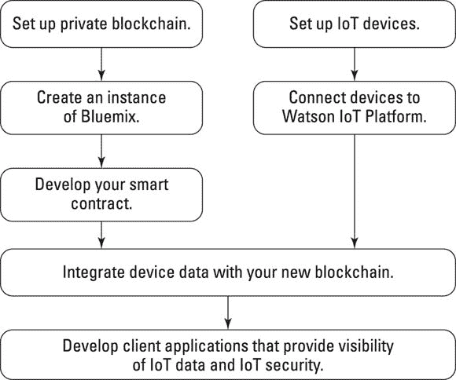

 图 11-1：  IBM Bluemix 和物联网如何与 IBM Watson 合并。

IBM Bluemix 提供四项核心功能：

*   基于你的应用架构需求的计算基础设施
*   将应用部署到 Bluemix 公有云或专用云的能力
*   开发工具，如代码编辑器和管理器
*   在其服务部分访问第三方开源工具

Bluemix 为你构建应用提供了所需的一切。它现在也提供区块链基础设施用于测试。

他们提供了一项服务，用于将你的应用程序与 Bluemix 区块链集成。截至本文撰写时，有两种定价模式。免费账户为你测试想法提供了所需的一切。你获得四个节点和一个用于签署交易的证书颁发机构，以及一个带有日志、控制和 API 的仪表板。你还获得几个带有源代码的示例应用以供实验。

企业计划的价格为每月 $10,000，并提供比免费模式更高的安全性和速度。

#### Bluemix use cases

两个杰出的创业先驱正在使用 Bluemix 和 Hyperledger Fabric 集成：

*   **Wanxiang:** 中国最大的汽车零部件公司万向正在与 IBM 合作部署私有区块链。他们将产权嵌入到电动汽车等事物中。目标是降低消费者租赁设备的成本。万向将使用其区块链技术跟踪组件的使用寿命并翻新使用过的电池。Bluemix 将处理其他一切。
*   **KYCK!:** 金融科技（fintech）初创公司 KYCK! 正在利用 IBM 的区块链集成，以一种新颖的方式解决经纪商的“了解你的客户”（KYC）需求。这项费用对银行和其他金融服务来说是限制性和昂贵的。KYC 用于防止洗钱和非法贸易，并打击恐怖主义。KYCK! 正在构建视频会议和加密文档提交平台。它将允许经纪人与公司未曾亲自会面的客户合作并进行身份验证。

IBM 还构建了三个简单的 Chaincode 应用程序，让你可以在 IBM Blockchain 网络上进行操作：

*   **Marbles:** Marbles 是一个演示在两个用户之间转移弹珠的应用。它让你看到如何在区块链上移动资产。
*   **Commercial Paper:** Commercial Paper 是在 IBM Blockchain 上实现的区块链交易网络。你可以创建新的商业票据进行交易，买卖现有交易，并审计网络。
*   **Car Lease:** Car Lease 与 Marbles 演示非常相似。它旨在让你与资产进行交互。你可以创建、更新和转移。它还允许第三方查看历史记录。

### Watson’s Smart Blockchain

# IBM Watson 在 Bluemix 上的区块链集成

IBM 的超级计算机 `Watson` 也可在 `Bluemix` 平台上使用。`Watson` 是一种认知计算的人工智能计算机系统。它可以以惊人的速度分析结构化数据，更令人印象深刻的是非结构化数据。

 这项技术仍在发展中，客户对其真正理解非结构化书面语言的能力提出了投诉。

`Watson` 可以通过自然语言回答向其提出的问题，并在吸收更多信息时学习。当这项技术与区块链技术结合时，其影响令人惊叹。首批实现之一是在 `IoT` 领域。存在强烈需求来保护这些设备发出的数据，然后使其可操作且智能。

`Watson`’s 认知计算正在模拟人类思维过程并使用 `MQTT` 协议。就像人类大脑一样，它会随着时间增长。其自学习系统使用数据挖掘、模式识别和自然语言处理来模仿你的大脑工作原理。`Watson` 的处理速度为每秒 80 teraflops（一次 teraflop 为一万亿次浮点运算）。为了便于理解，这复制了——在某些情况下甚至超过了——高功能人类回答问题的能力。`Watson` 能够通过访问 90 台服务器来实现这一点，这些服务器的综合数据存储超过 2 亿页信息，并将其与六百万条逻辑规则进行处理。`Watson` 大约有十台冰箱那么大，但它一直在变得更小更快。

图 11-2 展示了 `IBM` `Watson` 如何关联区块链和 `IBM` 系统的各个方面。在 `IBM` 处深入了解 [`https://goo.gl/12Q6no`](https://goo.gl/12Q6no)。

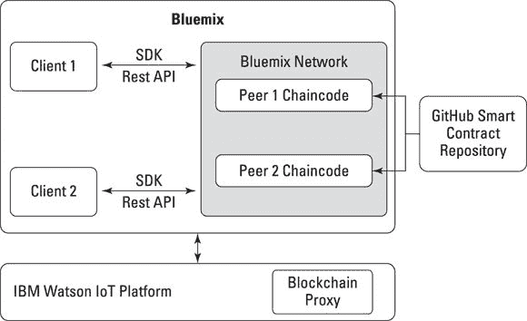

图 11-2：  `Bluemix` 如何集成客户端、同行节点和 `IBM` `Watson`。

`IBM` 正将这些令人惊叹的能力应用于利用 `Chaincode` 实现的 `IoT` 数据流。`Chaincode` 是 `Hyperledger` 智能合约系统。以下是 `Watson`-enabled 区块链为 `IoT` 设备的工作方式：
* `IoT` 设备将数据发送到您的私有区块链账本，以便作为带时间标记的防篡改记录纳入共享交易。
* 合作伙伴和第三方服务提供商也可以访问和提供 `IoT` 数据，而无需中央控制和管理。
* 所有各方都可以签署和验证数据，限制争议并确保每个合作伙伴对其各自的表现负责。

这是一个简单的实现，并未充分利用 `Watson` 的所有功能和能力。`Watson`’s 学习和提出建议以及更新过时信息的能力将真正使其成为未来功能强大的区块链启用应用程序。

您可以将 `Watson`’s `IoT` Platform 与 `Hyperledger` 的 `Fabric` 集成。此集成允许您通过认知计算预言机执行 `Chaincode` 合约。`Watson`’s `IoT` platform 具有内置功能，可让您将选定的 `IoT` 数据添加到自己的私有区块链中以创建预言机。这有助于您保护数据免受未经授权的第三方查看。

建立 `Bluemix` 工作区后，您可以添加选定的服务，包括集成多种技术的 `IoT` Platform。`Fabric` 是区块链技术，为分布式对等节点提供私有区块链基础设施，复制设备数据并通过安全合约验证交易。

`Watson` `IoT` Platform 将一种或多种设备类型现有的设备数据转换为智能合约 API 所需的格式。`Watson`’s `IoT` Platform 过滤掉无关的设备数据，只向合约发送所需数据。图 11-3 展示了 `IBM` `Watson` 如何与 `IoT` 设备和 API 集成。`Watson` 充当 `Chaincode` 预言机，并允许您控制合约相关各方所知的信息。此功能对于隐私至关重要。

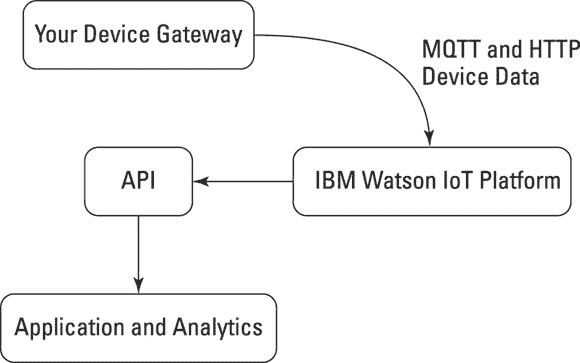

图 11-3：  `Watson`/API/设备流程。

## 在 Big Blue 上构建您的入门网络

`IBM`’s 区块链技术和 `IoT` Platform 提供了新的有前景的工具，可用于解决试图扩展的公司面临的许多问题：
* **安全：** 从数百万设备收集的海量数据引发了信息隐私问题。此外，被黑客入侵的 `IoT` 设备已被不法组织用来通过分布式拒绝服务攻击瘫痪网站。
* **成本：** 随着更多设备上线并利用该数据，消息、设备生成的数据和分析流程的高量也在增加。
* **架构：** 中心化云平台在端到端 `IoT` 解决方案中仍然是瓶颈，也是攻击的中心点。

`IBM`’s 基于开放标准的分布式 `IoT` 网络可以解决当今中心化、基于云的 `IoT` 解决方案所关联的许多问题。连接的设备直接与分布式账本通信。来自这些设备的数据随后可被第三方用于执行智能合约，减少了对人工监控的需求。

`IBM` `Watson` `IoT` Platform 与 `Fabric` 集成可在私有区块链网络中复制数据，并消除了需要集中收集和存储所有 `IoT` 数据的需求。去中心化的区块链网络还提高了 `IoT` 设备的<|message|>安全性。每个设备的唯一数字身份会随着时间的推移而建立。这种创建和保护身份的新方式极难伪造。

这些新的区块链身份允许 `IoT` 设备签署交易，从而允许智能合约执行。其实际应用是为智能汽车的驾驶行为数据提供动力的保险产品。汽车会发送数据以发布到 `Fabric`；使用 `Chaincode` 构建的保险产品随后会识别新数据和您汽车的身份并更新您的保单。

可能性几乎是无穷无尽的，而 `IoT` 为企业和消费者带来了巨大的机会，尤其是在医疗保健、仓储、运输和物流领域。

有三种主要的 `IBM` 云支持的 `IoT` 解决方案层级，可满足不同的 `IoT` 业务问题需求：
* **Devices Gateway:** Device Gateway 用于收集有关物理世界数据的智能设备或传感器。这可能是天气传感器、冷藏集装箱的温度监控或患者的生命体征数据。这些 `IoT` 设备通过互联网发送其数据以进行分析和处理。
* **IBM Watson IoT Platform:** `IBM` 将其超级计算机与其 `IoT` Platform 结合起来，从 `IoT` 设备收集数据，然后分析数据并采取后续行动来解决问题。`Watson` 提供机器学习、机器推理、自然语言处理和图像分析，增强了处理传感器收集的非结构化数据的能力。
* **IBM Bluemix:** `Bluemix` 是一个基于开放标准的云平台，用于构建、运行和管理应用程序和服务。它通过使在这些应用程序中包含分析和认知能力变得容易来支持 `IoT` 应用程序。

创建和配置您的 `IBM` Blockchain fabric 很简单。您甚至不需要开发人员的帮助！一旦完成区块链配置，您就可以与 `Watson` `IoT` Platform 集成。按照以下步骤在几分钟内将其投入运行：
1. **在 Bluemix 账户仪表板中，单击使用服务或 API。**
2. **在服务目录的 Application Services 部分，单击 Blockchain。**
3. **验证您的区块链选择。**

### 检查您的空间。
如果您拥有超过默认的开发空间，请验证您是否将服务部署在预期的空间中。

### 检查您的应用。
保持未绑定状态。

### 检查您的服务名称。
将名称更改为易于记住的内容。

### 检查您选择的计划。
选择免费计划。

### 单击创建。
您的 `IBM Blockchain` 将部署到 `Bluemix` 并最初提供两个对等节点。

开发节省成本的物联网应用具有巨大潜力。嵌入智能合约的分布式账本可以提高安全性和信任度，并自动化流程。`IBM Watson IoT Platform` 可以与基于 `Bluemix` 的区块链服务结合，提供可即时部署的平台，用于基于区块链和开放标准、物联网应用。

这些实现的开发和测试很直接，但需要开发人员的支持。

## 按照以下步骤设置您的第一个项目
1. **在 Bluemix 上设置您的私有区块链基础设施。**
   您需要一名开发人员来设置基于 `IBM Blockchain` 服务的私有区块链集成。
2. **基于设备数据在区块链中开发和部署智能合约。**
   例如，可以让合约在货物交付逾期后修改运费支付。
3. **将您的设备连接到 IBM Watson IoT Platform。**
   您需要让开发人员将传感器/网关连接到 `Watson IoT Platform`。完成此操作后，物联网设备将发送数据以进行过滤、聚合并发布到您的区块链。
4. **将您的物联网设备数据与区块链分布式账本集成。**
   让开发人员集成 `Watson IoT Platform`，使其能够向在 `Bluemix` 中运行的 `IBM Blockchain` 服务发送数据。
5. **安装您的监控 UI。**
   1. 在 `Settings` 选项卡中启用区块链。
   2. 配置到 `Blockchain` 服务的连接。
   3. 单击 `Add` 按钮并在弹出对话框中填写 `Blockchain` 服务详细信息。
   4. 确认所有更改。
   5. 选择区块链菜单以映射设备数据。此处您可能需要开发人员的支持。
   6. 按照向导操作并提供所需输入，以完成将设备数据映射到区块链合约。
6. **部署 Chaincode ID。**
   当实时数据到达时，智能合约会在数据上执行。根据结果，完成一笔交易并记录在数字账本中，然后与所有对等节点共享。
7. **为终端用户开发客户端应用程序。**
   在 `IBM` 系统和早期的物联网区块链开发中需要克服一些挑战。许多物联网设备计算能力有限或难以修改。加密和验证数据需要处理能力，可能导致电池寿命问题。

现在您可以创建自己的 `Chaincode` 合约。您可能需要开发人员的帮助，因为它需要使用 `GitHub` 和 `GoLang`。以下是该流程的高层次概述，以便您了解此类项目的需求：

## 创建您的 Chaincode 合约
1. **创建 GitHub 项目。**
   这是您存储智能合约的地方。
2. **设置本地 Hyperledger 开发和测试环境。**
   您需要在计算机上安装一些东西，包括 `Docker`、`Pip`、`Git` 客户端、`Go`，以及 Mac 用户的 `Xcode`。请查阅 第 3 章 以了解如何设置 `Docker` 的说明。
3. **下载 IBM 示例智能合约。**
   
   此步骤是可选的，但会使构建第一个合约变得更容易。
4. **创建测试智能合约。**
5. **构建您的合约可执行文件。**
   您的合约必须转换为可执行文件。示例中已内置合约可执行文件。
6. **在 Hyperledger 沙箱中测试合约。**
7. **在 GitHub 中部署合约。**
恭喜！您已设置好 `IBM` 合约。您稍后可以返回并在 `Bluemix` 仪表板中将合约映射到物联网设备。

# 第 4 部分

## 行业影响

本部分内容…
了解金融服务行业在利用区块链技术快速且低成本地在全球范围内转移资金时的未来。

澄清您对全球房地产与区块链技术相关的知识。

识别保险行业通过新保险工具减少欺诈和增加利润的机会。

审视政府组织和法律框架中永久性系统对大型行业的影响。

澄清区块链技术的其他大型全球趋势，以及它们将如何塑造您生活的世界和您日常使用的工具。

# 第 12 章

## 金融科技

本章内容

 **发现未来全球银行趋势**

 **发现新的投资工具**

 **揭示银行区块链中的风险**

 **开发新的融资策略**

最早采用区块链技术的机构是银行、政府和其他金融机构——它们也是增长最快的区块链用户。用于管理和转移资金的强大工具将以新颖且出乎意料的方式重塑我们的世界，因此金融科技（fintech）加入其中也就不足为奇了。

本章为您提供政府目前正在使用区块链技术进行的内部信息以及它将如何影响您。无论您是否意识到，金融科技每天都在影响您的生活。

在本章中，我向您介绍未来的银行趋势、新法规以及可以帮助您更快、更便宜地转移资金的新工具。我还解释了新型投资工具和其他区块链创新。最后，我警告您涉及虚拟货币投资和新区块链技术支持的金融产品的潜在风险。

### 拿出您的水晶球：未来银行趋势

银行业是第一个认识到 `Bitcoin` 对行业的威胁，然后认识到区块链改造行业的潜力的行业。银行业监管严格，作为银行组织和运营的费用昂贵。这些严格的监管既是整个行业的绝缘和保护盾，也是负担。快速、高效的数字资金的应用，不产生处理现金的成本，并且在金融系统中流动时可追踪，这是一个令人陶醉且具有威胁性的提议。价值可以脱离中央当局控制的想法也引起了支持货币的金融机构和政府的兴趣。

最初，这些金融机构和政府试图通过监管来扼杀区块链。今天，他们正在全面通过投资拥抱区块链。

在 2013 年和 2014 年，美国证券交易委员会（`SEC`）向投资者发出警告，提醒他们涉及虚拟货币投资的潜在风险。警告称，投资者可能会被高回报的承诺诱惑，而对如此新颖和前沿的新投资领域不够怀疑。据 `SEC` 称，数字货币是投资者面临的十大威胁之一。今天，随着加密货币在各行业中获得关注，`SEC` 已准备好与公司和投资者展开合作。

不到两年后，世界各地的国家——包括英国、加拿大、澳大利亚和中国——开始研究如何创建自己的数字货币，将加密货币据为己有并把资金放在区块链上。转折点在于他们开始意识到好处开始超过风险。比特币多年来一直能够抵御黑客攻击，即使许多政府系统遭到破坏，这使其成为一个有吸引力的尝试系统。区块链技术的创新有望能够处理支持经济所需的数十亿笔交易，使加密货币在规模上成为可行。

区块链本身就是每笔交易的永久且不可更改的记录。把一个国家的货币供应量放在由中央银行控制的区块链上将是彻底变革性的，因为每笔金融交易都会有永久记录，存在于其区块链记录的某个层面，即使公众无法查看。区块链技术和数字货币将降低风险和欺诈，并赋予他们在执行货币政策和税收方面的最终控制权。它不会像比特币最初那样匿名。事实上，恰恰相反：它将允许他们对个人和公司进行的每笔数字交易进行完整且可审计的追踪。它甚至可能允许中央银行取代商业银行在流通货币中的作用。

银行未来的样子会是什么样的问题既令人害怕又令人兴奋。消费者现在可以通过手机几乎即时地用几乎任何类型的货币或加密货币向朋友付款。越来越多的零售商店开始利用加密货币作为支付商品和接受客户付款的方式。在肯尼亚，使用加密货币比不使用更正常。但这对世界大多数人来说仍然不是主流选择。西方市场仍处于早期采用阶段。

鉴于大多数个人的财富都锁定在政府发行的法定货币中，或锁定在现有政府系统内的资产中，金融科技创新必须与这些现有系统融合，我们才能看到区块链或数字货币的主流效用。如果监管机构找到征税和注册账户的方法，面向客户的钱包的大规模采用，带有数字化代币，将在两到三年后实现。

企业对企业市场将更快地开始利用区块链。一个经过生产环境检验的系统以及相关的政策和运营不到两年时间。Ripple 和 R3 等公司一直在努力使其成为可能。这些系统首先将关注机构对存款的数字化表示的创建。这些是内部组织部门之间以及受信任合作伙伴（如供应商）之间的 IOU。监管机构、中央银行和货币当局都在大力投资以使其成为可能。加拿大和新加坡一直在迅速推进。

了解你的客户（KYC）和反洗钱（AML）法规要求银行了解他们正在与谁做生意，并确保他们没有参与洗钱或恐怖主义活动。发行加密货币的银行首先仍有重大挑战需要克服。为了遵守 KYC 和 AML 法规，他们需要知道使用其货币的所有个人的身份。在许多情况下，人们的银行账户已经是交易的借记和贷记服务，像区块链中的分布式账本一样，只是集中化的。该领域的首批候选地区将是监管机构、银行和中央银行共同合作的地区。新加坡和迪拜是已经拥有区块链计划的良好候选地区。

## 更快地转移资金：跨境及其他

评估像英国或美国这样经济体的货币由区块链处理的所需交易量是困难的。仅美国每天就处理数十亿笔交易，每年价值超过 17 万亿美元。这对一项新技术来说责任太大了！如果其货币供应受到损害，国家将陷入瘫痪。

国际货币基金组织、世界银行、国际清算银行以及世界各地的中央银行家已会面讨论区块链技术。迈向更快更便宜的货币的第一步将是采用区块链作为促进银行转账和银行间结算的协议。普通公民日常使用的官方数字货币将要晚得多。

个人消费者不会直接感受到利用区块链进行银行间结算带来的成本降低。节省将体现在银行的最终收益中，即中间商收取的费用降低。

消费者在可预见的未来仍会想要零售网点和商业银行。但千禧一代已经通过 PayPal、Venmo、Cash 等采用了应用激活的支付方式。通过手机支付的新方式不会让他们感到困扰。

巨大的挑战在于，如果所有货币都是数字化的，入侵它可能会造成灾难性后果。区块链系统的架构可能足够强大。问题可能在于系统内的代码以意想不到的方式执行，就像以太坊上的去中心化自治组织（DAO）黑客攻击事件那样（参见 第 5 章）。如果加密货币运行在传统的公共区块链上，那么网络中 51% 的节点必须同意修复问题。达成协议可能需要很长时间，而且对于需要随时稳定安全货币的企业和个人来说并不实用。

许多区块链以民主方式运作。需要区块链节点网络的大多数（51%）才能做出改变。

## 创建永久历史

数据主权和数字隐私将成为未来的巨大议题。欺诈预防将变得更容易，因为如果整个经济都在使用加密货币，区块链内部将始终存在可审计的追踪记录来保障它。这对执法机构很有吸引力，但对消费者隐私来说是噩梦。

从客户角度来看，使用信用卡或借记卡购买的每件商品都已有审计追踪记录。从机构角度来看，拥有审计追踪是有益的，因为它增加了不同地区之间这些资产流动的文件和生命周期的透明度。它为资产交易增加了合法性，并允许他们将合规性融入日常交易中。

欧洲的“被遗忘权”规则，允许公民有权不让其数据永远在互联网上传播，对区块链来说是一个困难的挑战，因为区块链永远不会忘记。政府和公司将拥有每笔交易的永久历史记录，如果这些记录暴露给公众，可能对国家安全造成毁灭性打击。或者在公司情况下，它可能允许竞争对手了解竞争对手的投资内幕。

使用无许可区块链（如以太坊或比特币）最大的挑战是保证你没有向 OFAC 国家发送资金以支持恐怖主义。答案是你不能，因为它们是某种程度匿名，任何人都可以开设钱包。可以创建算法来追踪交易流动——美国政府多年来一直在这样做——但在无许可的世界中，任何人都可以转移价值。

美国外国资产控制办公室对被视为高风险国家的特定组织或个人实施制裁。当使用无许可平台匿名交易时，政府无法追踪交易历史。

KYC 和 AML 的需求为共享账本空间中的许可区块链提供了依据。软件公司 R3 开发了 Corda，这是一个私有且许可的类区块链平台，直接应对其中许多挑战。他们特意不向全球广播参与者的数据。这使得 Corda 区块链内的数据保持私密，并且是与 R3 合作采用区块链技术的 75 多家银行所要求的主要非功能性需求。他们需要维护隐私并满足严格的监管要求。

# 走向国际：全球金融产品

区块链将带来许多新型证券和投资产品。新市场将以更高效的风险计算方式开放，因为当抵押品在区块链后端系统中核算时，其在各机构之间的透明度和可互换性将大大提高。

著名的秘鲁经济学家 Hernando de Soto 估计，通过为世界贫困人口提供土地、房屋和未注册企业的产权，将释放 9.3 万亿美元的资产。这就是术语 *dead capital* 所指的意思。

可以想象，那些能够释放其死资本——即其拥有的不可融资的房地产的国家，将能够将这些资产的权益打包并在全球市场上出售。这将包括像哥伦比亚或秘鲁新房地产开发项目的透明抵押贷款支持证券之类的产品。

在未来，国家将能够释放其死资本。房产、未开发土地和不可融资房产的所有者现在将有机会在全球市场上出售这些资产的权益。

这些资产将极具吸引力，因为在区块链技术的透明度和可替代性支持下，资产管理者能够主动甄别表现不佳的资产。利用区块链管理这些资产将使管理者始终拥有表现最佳的证券，剔除“坏苹果”，重新分类并作为新证券出售。

对于非机构客户而言，通过区块链交易平台在全球和本地实现的微型投资将是一个有吸引力的渠道。利用区块链技术还将使他们能够在没有最低投资额或通过收取投资比例费用的中介的情况下投资于公司及其特定业务。

去中心化自治组织（DAOs）已经存在，并为少数风险承受能力强且技术更娴熟的投资者创建了 DAO 投资池。在机构投资者使用它们或投资组合经理为其客户推荐将资金投入基于 DAO 的工具之前，可能还需要一段时间。

DAOs 通过创建基于区块链的投票系统并向投资其产品的用户发放股份，消除了投资过程中大量必要的文书工作和官僚程序。对任何区块链而言，“代码即法律”的概念使其无情。风险很多，特别是当代码编写不佳并以非预期方式执行时。其后果是，对该系统的黑客攻击可能非常严重。原始系统的透明性以及糟糕的代码为黑客提供了更广的攻击面，并允许他们随着每次获取更多信息而多次攻击。

在以下章节中，我将讨论区块链技术对世界经济的影响和益处。

## 无国界薪酬

我们的世界是全球化的，企业没有国界。即时且几乎免费的薪酬极具吸引力，将为组织节省大量麻烦。但也存在弊端。

最大的风险将是资金通过黑客攻击而损失。如果您以加密货币获得报酬并遭到黑客攻击，资金将无法追回。没有争议解决中心。没有客服可以投诉资金损失。数字货币窃贼在保持一定匿名性的同时具有全球访问权限。黑客可能在任何地方。

在区块链的当前结构下，消费者对其自身安全负责。目前，客户不必承担保护和为损失投保的主要负担。大型公司和政府提供保护和保险，而且他们已经这样做了很长时间。普通个人自中世纪（或多或少）停止自行持有黄金以来，就不再需要以这种方式保护自己。

这些挑战并未阻止公司使用加密货币处理薪酬。Bitwage 和 BitPay 都在比特币薪酬处理市场竞争。Bitwage 允许员工和独立承包商即使雇主未提供该选项，也能以加密货币形式收到部分工资。另一方面，BitPay 已将其支付和薪酬 API 集成到薪酬服务提供商 Zuman 和 Incoin 中。同样，早期采用正在那些此前不存在或解决方案不足的领域发生。

## 更快更好的贸易

区块链将促进更快且可能更具包容性的贸易。近年来全球贸易融资受限。一些银行如巴克莱甚至已退出增长中的非洲市场。它们留下了贸易融资的真空。公司仍需要资本来运输货物。

DAOs 和微型投资可以满足这一需求，并为投资者提供比当前市场上可获得的更盈利的回报。所有待售商品的透明度、安全身份以及与区块链相连的无缝全球追踪，将为小额投资者开放这一机会。

货币之间的互操作性，如 Ripple 等公司所促进的，也将允许更多贸易，因为它们提供的外汇汇率计算方式比通过转账机制更灵活。将更受欢迎的数字货币引入外汇交易将增加服务不足市场的适应性和整合度。

BitPesa 是一家将肯尼亚 M-Pesa 手机分钟数兑换为比特币的公司。有了这项技术，它为企业提供了一种更快更便宜的方式在非洲和中国之间发送或接收付款。非洲与中国之间的贸易市场超过 1,700 亿美元。跨境支付结算需要数天时间，费用高昂。使用 BitPesa 的数字平台时，付款即时且便宜。

## 保证付款

通过区块链支持的交易允许的保证付款将增加信任度低的地方的贸易。较贫穷的国家可以在此类系统中与较富裕的国家在同一水平上竞争。随着未来十年的发展，全球经济将发生变化。商品和劳动力的成本可能会上升。

全球公司根据竞争性定价以及员工之前的薪资向员工支付薪酬。如果区块链允许跨越经济鸿沟实现平等，这不会一蹴而就。开发人员和其他知识工作者将是例外，因为他们更容易基于匿名工作自给自足。

金融包容性和平等的全球贸易对政府而言是非常重要的议题。数字货币的采用更可能在小型和发展中国家全国范围内进行。大多数大国拥有分散的权力结构，阻止了对货币等重要系统的快速改变。

他们的小国中央权力结构将使它们能够跨越传统的基础设施和官僚体系。例如，大多数非洲和南美国家没有固定电话或地址，但它们都有智能手机并具备创建加密货币钱包的能力。缺失的部分是整体贸易流动性和通过加密货币支付水电费、租金和食品等基本需求的能力。

## 微支付：交易的新形态

微支付是交易的新形式。信用卡公司可能会使用区块链技术来结算交易、减少欺诈并降低自身成本。

像 Visa 和 MasterCard 这样提供延迟付款便利的全球机构，在资本主义社会中将始终被消费者需要。即使后端发生变化，客户的接入点仍然相同。但实体卡将消失。事实上，即使没有区块链技术，这也正在发生。有了区块链技术，支付背后的客户身份将更能抵御盗窃。

人们仍然需要信贷来经营企业和个人生活。信用卡公司将继续通过交易费用赚钱。信贷主宰世界，在我们当前的社会结构中，资本市场将始终存在。群体之间转账的成本将会下降，但这对金融机构来说是好事。他们希望专注于为客户提供投资或银行市场最佳选择的服务。

## 挤出欺诈

比特币是在金融危机背景下诞生的，当时欺诈和其他不道德行为导致世界经济崩溃。它将世界从“信任或不信任”的观点转变为无信任系统。这个微妙的区别大多数人都没有意识到。*无信任系统*是指你在网络中对每个人既信任又不信任。更重要的是，区块链提供了一个框架，允许在没有信任的情况下进行交易。

这些相同类型的框架不仅可用于网络上的价值交换。让我分享一个例子来说明其潜力。

我去一家酒吧，门口的人拦住我并要求看我的身份证件。我从钱包里拿出驾照递给他。我的驾照上有很多信息是保安不需要的，也不应该让他访问（比如我的地址）。他从身份证件中只需要知道我年满 21 岁。他甚至不需要知道我具体多大了——只需要知道我符合法规要求即可。

在未来，区块链身份系统将让你选择向什么人、在什么层面上披露哪些信息。数据匿名性越高，就越安全。区块链系统通过不对不需要或没有权限查看信息的人分享信息，帮助遏制身份和数据的盗窃。

区块链技术的另一个方面是，它将使欺诈从过去发生的地方转移到实时发生的当前位置。在我们当前的系统中，审计是对已发生事件的部分事后分析。一组外部审计人员到来，抽取几份随机文件，查看一切是否就位。超出此范围的任何操作都过于昂贵且耗时。

集成区块链技术的记录系统能够在文件创建时对其进行审计，并在创建时标记不完整或异常的文件。这将为管理者提供在文件成为问题之前主动纠正文件的工具。

区块链系统的另一个功能是能够透明地与第三方共享数据。在未来，共享数据将像发送电子邮件附件一样简单，只是接收者将获得原始副本的访问权限，而不是通过电子邮件发送的文件副本。当某人发送文件时，他电脑上有一个版本，接收者也有一个版本。有了区块链技术，这两个人将只共享一个版本。

区块链充当见证文件年龄和创建的第三方。它们可以在细粒度级别上追踪在系统内外与文件交互的每个人员。它们可以显示文件缺少什么，而不仅仅是文件中现在包含的数据。区块链文件也可以以删节的方式共享，而不会损害文件的有效性。

这意味着你将能够看到文件的年龄、文件的完整历史以及它在演变过程中随时间的变化。更有趣的是，你还将能够看到文件是否缺少任何内容。这个概念被称为*证明否定*。目前大多数文件系统只能告诉你它们包含什么。但你将能够知道文件*没有*什么。

审计将更便宜、更完整。更新审计规则可以以更集中的方式进行。当区块链网络中的监管节点对资产交易具有共享且透明的视图时，这些交易的报告可以通过监管机构所在地完成，而无需强制 100 多个其他机构遵守相同的规则集。

全面集成于组织的区块链系统将能够知道每一分钱花在了哪里。资金花费的最后一公里在组织和政府中是最难以核算的。正因为如此难以核算，想要窃取资金的人就有了可乘之机。

最后一公里可能成为公司节省浪费资源和识别腐败个人的最大机会。对资金支出核算有严格指导方针的非营利组织最能从这类系统中受益。他们可以在不妨碍其更大善意使命的情况下满足其对捐赠者的审计和问责需求。

一种已被探索的系统将直接集成到援助工作者的工作流程中。该系统最初设计用于跟踪医疗记录，但也可以追踪每个医疗患者使用的所有物资。鉴于 NGO 世界内存在大量欺诈和盗窃，该系统的好处将是巨大的。

# 第 13 章 房地产

### 本章内容

**评估全球房地产趋势**

**发现死资本及修复方法**

**揭示房利美如何在区块链世界中发挥作用**

**揭示中国如何与区块链技术共同演进**

房地产将是受区块链技术创新影响最深的行业之一。这种影响将在每个国家以略有不同的方式体现。在西方世界，我们可能会看到诸如在区块链支持的交易所交易的透明抵押贷款支持证券等事物出现。在中国，区块链集成已经在诸如公证等房地产交易必不可少的组成部分中发生。在发展中国家，区块链最具潜力，因为它们可能能够释放资本并增加贸易。

本章深入探讨房地产行业在全球范围内正在发生的创新。我还将向你介绍即将到来的可能变化以及区块链技术的重大影响。

房地产持有世界大部分财富和经济稳定。在未来几年里，该行业将迅速变化，了解这些变化将在何处发生以及你和你的公司如何利用它们将是一大优势。

## 消除产权保险

*产权保险*是对房地产购买中因产权缺陷而造成的经济损失的补偿。 如果您为房屋申请抵押贷款或对其进行再融资，则需要此保险。 产权保险可保护银行的投资免受可能未在公共记录中找到、产权调查中遗漏或因欺诈或伪造而产生的产权问题。

产权保险在以普通法规范其产权制度的地区是必要的。买方有责任确保卖方的产权良好。在这些制度下，会进行产权调查并购买保险。在采用托伦斯产权制度的地区，买方可以依赖土地登记册中的信息，无需查阅超出这些记录的资料。

区块链技术已被提议作为补充，以帮助普通法产权制度中的消费者。想法很简单：区块链是出色的公共记录保存系统；它们也不能在不留下记录的情况下被回溯或更改。从理论上讲，区块链可以将普通法制度转变为分布式托伦斯产权制度。

首先，尽管如此，必须克服许多挑战。普通法制度中的每个县都有自己的土地记录办公室，所有将县内任何土地或任何土地权益的产权转让的契约或记录都在此登记和记录。仅美国就有数千个县。数千个独立办公室造成了数据孤岛。区块链不会改变法律或记录的组织方式。

需要制定新法律，规定所有土地权益和转让必须在单一系统中记录才有效。然后它就只是一个托伦斯制度，可能使区块链技术变得多余。例外情况是在土地登记处存在大量欺诈的地区。

在以下章节中，我将深入探讨房地产行业以及区块链的增值之处。

## 受保护的行业

每个行业都有自我保护的系统来抵御新的竞争。这可能是高昂的监管负担、政府授予的垄断或高昂的启动成本。围绕房地产买卖建立起来的行业在过去 40 年里变化不大，正 ripe for disruption。许多不同的参与者都参与了这一过程。

以下是围绕房屋买卖建立起来的不同行业：

*   **房地产经纪人：** 房地产经纪人会帮助您比较不同的社区并找到房屋。他通常会帮助您谈判价格并代表您与卖方沟通。这项服务很有价值，很可能不会被区块链技术取代。您完全可以在没有房地产经纪人的情况下买房——人们选择与他们合作是因为他们能改善流程。

*   **房屋检查员：** 房屋检查员在您购买房屋前会发现房屋的缺陷——这些缺陷日后可能会让您花钱。房屋检查员发现的缺陷可用于与卖方谈判以获得更好的价格。未来，房屋仍会继续出现磨损——这永远不会改变。但区块链技术可用于记录对房产的维修以及检查中发现的缺陷。

*   **结案代表：** 在结案时，最后一步是结算。结案代表监督和协调结案文件，记录它们，并将资金发放给相关方。结案代表可能会被区块链技术取代——结案代表执行的职能可以构建到智能合约或链码中。

*   **抵押贷款放贷人和服务商：** 抵押贷款放贷人和服务商为抵押贷款提供资金并收取持续的抵押贷款付款。他们不会被区块链软件取代，但可能会使用区块链技术来帮助他们降低记录保存和审计的成本。

*   **房地产评估师：** 房地产评估师的工作是查看房产并确定其价值。评估流程在每次房产买卖或再融资时都会进行。像 Zillow 这样的公司已经省去了了解市场价值的大量工作，但每栋房屋都是独一无二的，需要定期评估。即使在房地产抵押贷款流程中，也可能需要多次申诉以满足每个人的需求。将这些数据记录在区块链中作为公共见证可能很有用。

*   **贷款专员：** 贷款专员使用您的信用、财务和就业信息来查看您是否符合抵押贷款资格。然后他们将您有资格获得的产品与他们销售的产品相匹配。像房地产经纪人一样，贷款专员帮助您在各种选择中获得最佳方案。区块链软件可用于帮助贷款专员跟踪他们给您的文件并审计流程以符合公平放贷法的合规性。

*   **贷款处理员：** 贷款处理员协助贷款专员准备抵押贷款信息和申请以供承销商审阅。正在探索一种提取买方来源信息的软件。这不是区块链技术，但可能对该职位产生颠覆性影响。

*   **抵押贷款承销员：** 抵押贷款承销员确定您是否有资格获得抵押贷款。她根据您的信用历史、就业情况、资产和债务批准或拒绝您的抵押贷款申请。组织正在探索使用人工智能自动执行承销流程。这不是区块链技术。

这些代理中的每一个都服务于核心目的，有助于保护买方、卖方和抵押贷款提供者。在大多数行业中，随着时间的推移，经营成本会下降——竞争和创新带来的效率提升有助于降低成本。抵押贷款行业作为区块链创新的候选者很有吸引力，因为情况恰恰相反：经营成本已经上升。典型的美国抵押贷款超过 500 页，产生成本为 7,500 美元。这是十年前成本的三倍。区块链技术可以在保护买方、卖方和抵押贷款提供者的同时降低成本。

## 消费者与房利美

联邦国民抵押协会（被称为房利美）既是政府支持的企业，也是上市公司。它目前是抵押贷款放贷人融资的主要来源，并在私营资金撤出后主导了衰退后的市场。

自衰退以来，美国 95%的住房贷款都是通过房利美发放的。这大约是 5 万亿美元的抵押贷款资产。除了少数例外，未通过房利美或其近亲房地美进行的贷款都是巨额贷款（通常每笔超过 417,000 美元）。这些贷款仍由私人资金资助。

房利美有一个由贷款发起人用来审核借款人的自动化程序。它帮助他们导航常规贷款的指南。放贷人将您的贷款申请通过房利美的计算机系统运行，系统会输出批准或拒绝贷款的答案。在线平台正在使用这款新软件接触消费者，使他们能够绕过传统零售网点。房利美和房地美正在探索区块链技术，以进一步简化这一流程并直接触达客户。

## 区块链世界的抵押贷款

区块链世界的抵押贷款看起来不会与传统世界的抵押贷款有太大不同。您会注意到的部分是，区块链抵押贷款在结案时的费用会更低。

鉴于大多数人一生中只买几套房，差异可能看起来不是什么大问题。但钱会累积起来。区块链技术可以将抵押贷款的产生成本降低到 2007 年之前的水平。

### 降低您的产生成本

抵押贷款发起成本已经增加，原因很简单：银行担心如果在抵押贷款流程的任何环节出错会招致罚款。因此，行业采取了措施，确保他们在发起时满足所有要求，并在多年后接受审计时也能满足要求。大型银行因文件处理不当已支付了数十亿美元的罚款。如今他们不仅需要具备所有必要文件，还必须证明自己遵循了正确的流程并向您发送了所有必要文件。

基于区块链的产品减少了银行在经济衰退后在其流程中开始加入的冗余。自《多德-弗兰克华尔街改革和消费者保护法》出台以来，记录保存和审计费用急剧飙升，而区块链技术可能降低该成本。

希望通过区块链解决方案满足银行需求的公司需要让银行能够证明他们遵循了《多德-弗兰克》中规定的准则。这也有助于银行记录他们在贷款上做出某些决定的原因，并帮助他们找到在发起时使用过的文档，即使他们并不持有这些文档。

区块链应用可以将平均房屋购买中接近 4,000 美元的费用重新放回谈判桌上。抵押贷款行业与汽车贷款行业和信用卡行业非常相似。类似的应用可以降低这些行业因消费者保护法而产生的管理成本，同时让企业满足这些要求。

## 了解您最后已知的文档

抵押贷款发起流程中最大的成本驱动因素之一往往出现在贷款首次发放多年后。有时促成贷款流程的人员会在客户文件中添加不必要的文档，或者未用于发起贷款的旧文件被留在文件夹中。此外，还可能出现重复记录。当文件需要审计时，信息太多难以筛选。银行会向外部公司付费检查其记录，并尝试确定在您贷款的最终审定中使用了哪些文件。

区块链软件可以优雅地解决这个问题。区块链是分布式记录保存系统，允许多个参与方在一段时间内协作处理数据，同时不会丢失数据在任何给定时间点的样子。这意味着帮助您购房的约半打独立组织现在都可以在同一条链上交互。

在此用例中，一条链将从您开始。您的链随后会随着时间的推移添加子链，例如购房。您随后可以授权他人——例如银行、雇主、信用机构、评估公司等——在链上进行写入。他们各自会将数据添加到您的链中，其他授权方可以读取这些数据并添加自己的数据。

区块链将改变对文件中央存储库的需求。它将自动化部分文书处理，并始终提供您贷款的清晰历史记录，减少审计和准备待验证文档的需求。

这是一个大想法，但并不需要整个生态系统协作。每加入一个分支都会增强系统并增加价值，就像每多一个人拥有传真机，就会让拥有传真机的价值变得更加有用一样。

## 预测区域趋势

区块链在成为主流软件解决方案的道路上一直举步维艰。它常常遭到恐惧，因为许多人并不了解它是如何运作的，也不了解其广泛实施的实际影响。此外，许多早期倡导者，如任何新技术的早期采用者，被视为有点“另类”。区块链被卷入了比特币的负面宣传以及使用该技术进行的非法和违法行为。

然而，2016 年是行业的转折点。很明显，区块链将具有颠覆性，想要站在这一方程式积极一面的企业必须制定区块链战略。

每家主要银行都开始了调查和试验区块链的项目或加入了联盟。许多银行首先转向银行间结算和跨境转账，这些是区块链相对直接的应用。下一个更具变革性的演进将是通过去中心化得到保护的系统和数据。

在以下章节中，我将介绍美国、欧洲、中国和非洲的区块链技术趋势。

### 美国和欧洲：基础设施拥堵

美国和欧洲国家可能比其他国家更晚实施区块链技术。即使这些国家的公司在基础设施维护上花费数十亿美元，但这只是：维护。区块链想要解决的问题已经存在现成解决方案。不仅仅是说区块链会提供更好的解决方案——该解决方案必须比现有系统好十倍或能够通过集成实现。

美国面临的主要挑战之一是其权力分配和决策的分散性。每个县和每个州都会制定自己的规则来实施或使用区块链技术。这一进程已经开始。

区块链可能触发货币传输法律和法规。在美国，在联邦层面更清楚哪些类型的企业被视为货币传输商。鉴于所有基本公共区块链目前都使用加密货币代币来驱动安全，该问题变得模糊不清，这催生了不使用代币的私有和许可区块链。

对于使用区块链技术进行支付以外应用的公司而言，州许可要求尚不明确。法规和法律将被制定以保护消费者。欧洲已有关于“被遗忘权”的法律。当输入区块链的数据永远存在且无法被任何人删除时，遵守这些规则可能很棘手，即使他们想删除也不行。

在美国许多州从事货币传输属于重罪。通过创新逾越法律的严厉后果迫使区块链公司在合规上花费大量资金和时间——平均每家公司每年花费 200 万至 500 万美元。法律费用对这些科技初创公司来说是沉重的负担。

各州立法适用于区块链行业的情况尚不明确。纽约和佛蒙特州已开始将该技术纳入法律。纽约提高了合规成本，并推动创新转移到更友好的地区。另一方面，佛蒙特州通过了一项法律，使区块链记录可在法庭上作为证据采纳。

卢森堡于 2011 年为电子支付机构创建了法律框架，并在“电子货币”概念上走在前列。卢森堡和英国已成为许多区块链公司的所在地，因为监管环境更容易导航和负担得起。区块链企业在欧盟花费不到 100 万美元即可获得支付工具许可。该许可使公司能够进入 28 个欧盟国家。这种方法使欧盟在金融科技创新方面超越了美国。

### 中国：抢先出击

中国意识到公民正利用它在未被察觉的情况下将价值转移出境，并在较少受控制的系统中创造新财富。因此，中国多次修订了其加密货币法规，这对比特币的市场价格产生了重大影响。

中国境内的行业正在寻求区块链来解决世界其他地区所看到的许多相同问题。他们迅速利用区块链来补充已有的工作，为物联网（IoT）和公证等事物增加确定性层。而西方国家拥有更分散和去中心化的权力结构，中国则更为集中。这使中国能够迅速地同时进行监管和创新。

China Ledger 是一个区块链联盟，得到了中国国家大会——中国最高权力机构的支持，是监管机构和行业迅速行动的良好范例。China Ledger 吸引了 Anthony Di Iorio 和 Vitalik Buterin，两位都是以太坊创始人。它还获得了比特币核心开发者 Jeff Garzik 和 UBS 创新经理 Alex Baltin 的支持。

## 发展中国家：区块链的障碍
未来已经到来——只是尚未实现分布式。这在发展中国家尤其如此，它们往往对技术需求更大，却没有同样的资源或合适的政治环境让这些创新扎根。一些小国会尝试保护主义措施，阻止可能在其境内生产的商品进口；其他国家也同样不信任来自外部来源的产品和服务的质量与善意。更阴暗的是，一些政治体系从其法律体系中存在的低效率和模糊性中获益过多，以至于不愿改变。

Hernando de Soto Polar 是一位秘鲁经济学家和作家，他广泛谈论非正式经济以及商业和财产权的重要性。导致发展中国家难以发展的一个突出问题是 *死资本*。那些非正式持有且未获法律认可的财产，或当前体系无法被信任。对于这些土地的所有者而言，融资和出售是困难的甚至不可能的。这种不确定性也降低了资产的价值。西方世界能够相对自由地以资产抵押借款并出售资产。这推动了创新和经济繁荣。

区块链所带来的技术可能很快就会改变发展中国家的这一现实。土地的清晰所有权记录意味着它可以被出售和融资。这将使哥伦比亚的海滨房产变得难以抗拒。不可逆转的支付和真实可知的身份将以新的方式开启信贷和商业。

许多初创公司和黑客聚集在一起，试图让这一未来愿景成为现实。甚至像世界银行这样的大型全球参与者也多次就区块链及其对发展中国家的影响举行会议。比特币和区块链正在非洲取得进展，那里的本地货币和基础设施深受不信任。BitPesa 是一家为非洲多个国家提供服务的支付和交易平台，已开始向英国和欧洲扩张。它还开始将其服务范围扩大到工资单等领域。

发展中国家在发展和创新方面面临诸多障碍，但它们也拥有西方国家永远无法克服的优势。发展中国家缺乏现有基础设施，使得它们更容易跨越西方国家。这在发展中国家手机的普及中可见一斑。发展中国家也没有同样的监管机构和消费者保护措施。这对处于西方国家灰色地带的区块链初创公司尤其具有吸引力。发展中国家通常决策者较少，更容易见到有改变权力的相关人士。

# 第 14 章
## 保险
### 本章内容

**建立新业务**

**量身定制个人保险**

**创建新的保险市场**

**以意想不到的方式降低成本**

区块链保险技术正处于改变个人和公司购买和获取保险覆盖方式的地位，而且来得比你想象的更快！你需要了解这些刚刚出现在地平线上的新技术的影响。

在本章中，我将解释这些新技术的工作原理及其核心局限性。我将向你展示物联网（IoT）设备如何与保险提供商协作。我还将描述自执行区块链合约如何塑造保单和公司结构。

本章为你准备了可能改变举证责任的技术根本性变革。阅读本章后，你将能够就基于区块链的保险覆盖和支付做出更明智的决定。你将了解保险覆盖成本如何影响你，以及未来将为你提供的不同类型的覆盖。

### 精准定制保障
物联网设备、不可变数据、去中心化自治组织（DAOs）和智能合约都在改变面向消费者的保险发展。这些所有技术的融合之所以成为可能，是因为区块链的发展。

区块链在某些方面做得非常出色，这将使保险未来买卖方式发生两大转变：个人将能够获得更定制的保障，并且由于成本原因以前无法实现的新的市场将开放。

#### 为个人投保
以个人为中心的保险将允许优先事项发生重大转变。资产管理将不再那么关键，保险公司将能够专注于风险计算以及供需匹配。

你可以创建一个为客户提供保险的市场平台。你可以有多种方式来组织这一新业务。其中一种可能性是按需市场，用户在其中发布请求，要么由自定义智能合约标准化，要么由 Chaincode 合约标准化。如果你还没有阅读过这些新型自执行数字合约，请查看 第 5 章 关于以太坊 和 第 9 章 关于 Hyperledger。

在这种模式下，你作为保险公司，可以根据历史数据和风险模型中的其他风险计算因素，为特定需求计算保费。如果客户对报价满意，客户可以根据所使用的需求模型进行竞价或订阅。

这种新型保险可以被点对点（P2P）或众筹保险采用，也可以被采用该技术的传统保险公司采用。无论哪种方式，两者都是在去中心化的加密货币账本中创建的，使用智能合约/Chaincode，保证客户向投资者付款，反之亦然，如果发生事故。区块链在这里是关键，因为它实现了几年前不可行或不安全的事情。

区块链创造了近乎无摩擦的价值转移，这意味着由于交易费用极低，微支付是可行的。你现在可以开拓新的市场，这些市场没有健全的货币体系或法律体系，或者交易和纠纷的成本超过了提供保障的好处的情况。

你可以使用 DAOs 和智能合约，以成本和时间的一小部分来管理大型群体。你可以使用这种模式来组建和管理你的新公司，并可能众筹保险平台。

智能合约的自执行特性还可能揭示索赔调整的许多成本以及帮助处理和收集资金的第三方。

所有这一切的合法性仍有疑问。确定隐私问题和消费者权利是困难的。各国也有各自的法规和披露要求。然而，一旦满足这些法规，保险行业以及消费者对保险的体验将发生实质性转变。

## 微保险的新世界

*微保险*是对低收入人群提供风险保障的保险，如事故、疾病和自然灾害。通过区块链技术，它变得更加可行。

思考微保险时，请注意两类（可以并行存在）：
*   面向低收入家庭、农民和其他实体的保险，其中保险围绕特定需求设计——通常是低保费和基于指数的保险
*   处理低价值产品或服务的保险

这些类型合同在传统保险模式下最大的问题是其处理成本不成比例地高，使得服务这些市场变得不具吸引力。

区块链的低摩擦属性使其能够以极低的成本、几乎瞬间在世界任何地方转移价值，且无拒付，从而开辟了服务更多人群并降低成本的机会。

区块链的关键优势在于智能合约的创建允许在没有中间人的情况下进行安全交易，因此保险的成本显著降低。

区块链微保险原则很简单，由四个步骤组成：
1.  借贷/投保协议提案
    一个人可以通过其保险提供商提供其财产的借贷，前提是该财产已进行数字注册。提议可以发送给潜在用户，要么通过保险公司渠道，要么通过 Facebook 等公共平台。
2.   协议审查
    借款人随后可以审查收到的提案并接受或拒绝。提议保存在公共记录中，如果借款人接受提案，他可以通过标准支付渠道购买保险，流程进入第三步。
3.  协议签署和公证
    如果双方意见一致，保险费用支付完毕且借款人收到相关财产，协议将被数字签名并公证到区块链上。这使其几乎防篡改。所有交易信息都安全存储，并附有清晰的审计轨迹以备需要时查阅。
4.  确认代币
    双方都会收到特殊的数字代币，作为相关协议的身份证明。这些代币用于密码学确认双方已签署协议。

除了这种易用性之外，智能合约还允许基于指数的保险，这对于农业保险和其他价值高度依赖可由受信任第三方准确记录的动态因素的领域非常有用。在这种特定情况下，当经核实的气象数据库报告特定条件（如干旱）时，被保险农民可以收到自动赔付，从而进一步降低潜在服务成本。

## 为你作证：物联网

区块链使为人和物创建新型身份成为可能。它们建立在传统模式之上，在该模式中，证书颁发机构签发证书。对于个人而言，该证书是出生证明或驾驶执照等文件。但“物”也有类似的证书，帮助消费者验证质量和真实性。

这些类型的证书多年来一直被仿冒。投入到其创建中的安全措施越来越复杂，但这也增加了成本。区块链允许以任何人都可以查阅和引用的不可更改的历史记录形式记录这些传统证书。附加功能是可以随着新事件的发生更新这些记录。

物联网设备现在可以自主向其记录发布各种数据并更新其当前状态。现在物联网设备可以为自己发声，并将其历史和身份发布并与第三方共享，保险将只是受影响的众多行业之一。

### 保险中的物联网项目

物联网可能在生活的三个领域产生重大影响：互联汽车、互联家居和互联自我。

物联网从根本上说是一种颠覆性技术，因此它将改变一系列行业的面貌，例如汽车原始设备制造商（OEM）、家庭安全以及有线和移动服务提供商。其中包括保险公司——特别是那些从事财产和意外险（P&C）业务的公司。

新电器和设备中传感器收集的数据，加上自动化和额外的控制选项，将为保险行业出现的新公司带来新的可能性。结合区块链分布式账本和智能合约，整个流程可以实现自动化，达到以前不可能实现的水平。

这种激进的技术转变带来的全天候在线生活方式消除了一些现有风险，但也引入了新的风险，其中最重要的是信息安全。所有这些意味着风险因素必须重新计算。例如，由于没有人为错误，自驾车将降低事故风险，但直到我们拥有足够的实际应用数据，技术的可靠性仍将受到质疑。

### 可操作大数据的含义

大数据自 2000 年以来就已存在，如今它是一个 2000 亿美元的产业，对金融部门尤为重要。然而，大数据带来了许多问题，随着其在日常生活中的存在，这些问题只会增加：
*   **控制：** 如果你拥有一个大型跨国企业或财团，数据共享问题变得相当重要。版本控制不完善，有时很难分辨哪个是最新的、最更新的副本。
*   **数据可信度：** 如何证明你是所说数据的创建者，还是其他人？损坏的数据会怎样？
*   **数据货币化与转移：** 如何转移、购买或出售任何数据的权利，并确保它是唯一的副本？
*   **数据变更：** 如何确保数据在不应该更改时不会被更改？

所有这些问题都可以通过加密货币和区块链解决。行业现在面临的巨大挑战是将区块链技术扩展到满足企业成本和数据存储需求的程度。

## 在保险中剔除第三方

区块链技术为现代金融世界带来的最大优势之一是智能合约，它允许在没有银行或中介等第三方参与的情况下进行业务交易。

简单来说，*智能合约*是一种协议，允许双方将交易记录到区块链中。这些合约几乎可用于任何用途，从具有数字签名的实物商品交换到信息或货币交换。

这里的关键安全特性是，与普通金融数据库不同，信息分布在网络中的所有计算机上并由其验证，使其去中心化。数据是唯一的且无法复制；审计轨迹不可变。

### 去中心化安全

当前商业模式的核心可以称为*集中信任范式*，其中银行家、经纪人、律师等中间人协调并确保金融交易和商品交换的真实性。

集中化伴随着某些固有的安全风险，例如数据损坏和盗窃。区块链通过创建一种去中心化的系统来对抗这一点，该系统基于所有参与者之间的相互不信任，从而相互制约。

为了创建这样的系统，你需要创建一个使用加密货币（如比特币、以太币或 Factom）的分布式账本，其中每个参与者既是系统的用户，也是其维护和运营的责任人。

## 众筹保障
与标准的众筹计划类似，其理念是通过汇集众多实体或个人的资源，以弥补保险计划中意外的不足。例如，退休保险计划可能只在 65 岁时生效，但一个人可能因不可预见的情况被迫提前退休，不幸的个人将需要额外的资金。

随着时间的推移，经济差距不断扩大，许多保险不足或无保险的人可以从这样的系统中受益。众筹可能为相关三方带来潜在好处：
* **保险公司** 因更多人对他们的计划感兴趣而获得增加的收入。他们可以接触到更大比例的保险不足人群。此外，保险公司可以提升其品牌认知度——它可以被视为一家有责任心的公司。
* **捐赠者** 如果活动结构允许，可能受益于可能的税收减免，或获得其他福利，例如折扣或免费服务。
* **寻求者**（寻求保险的人）显然受益最大，因为他们可以获得更好的保障和更实惠的覆盖。

Cognizant 在其白皮书中提出了关于众筹保险的有趣见解。你可以在 [ `https://goo.gl/u3Kd3U` ](https://goo.gl/u3Kd3U) 找到它。

## DAO 保险的影响
DAO 是没有全职员工的企业实体，但能够执行标准公司可以执行的所有功能。创建此类实体的能力直接源于区块链算法的改进，这在过去几年中发生，并创造了通常被称为区块链 2.0 的东西。

DAO 从本质上讲是一种高级智能合约的形式。DAO 能够将 DAO 视为一家公司，其中其所有个人保单用户都是股东，而公司本身永远不会直接受任何特定团体或个人的控制。

同样，DAO 永远不受开发者的控制，他们不会签发或拒绝保单。这严格上是一种点对点保险模式。尽管身份验证方面的漏洞仍然存在，该系统将会得到改进，实际上，同样的问题即使在当前集中式的保险系统中也存在。

# 第 15 章
## 政府
### 本章内容
**阅读区块链文档**
**建设智慧城市**
**创建防黑身份**

在本章中，我向您介绍政府内部以及支持它们的公司正在进行的令人兴奋的创新，这些创新涉及区块链项目。

日常业务受到诈骗和欺诈的影响，本章解释了政府如何反击网络犯罪和身份盗窃。您还将了解智慧城市计划，这些计划对经济增长和可持续发展至关重要——许多计划正在使用区块链技术来弥合技术差距。

### 亚洲的智慧城市
*智慧城市* 正在利用现代技术来增强基础设施功能和安全性，并改善交通和空气质量等事物。成为智慧城市的业务正在蓬勃发展，几乎每个较大的市政当局都已接受智慧城市概念。

区块链在与智慧城市使用的物联网（IoT）集成时尤其有用。目前有几个有趣的项目正在试点以供商业部署。美国国土安全部正在探索保护海关和边境保护局（CBP）使用的物联网设备。Slock.it 等公司允许联网对象使用区块链进入智能合约；其首个产品是区块链支持的智能锁，可供 Airbnb 客户使用。这些技术的整合使设备能够使用其传感器设置智能合约。同一技术也可用于城市停车计时器。

图 15-1 显示了新加坡智慧国家项目的首页。新加坡一直在吸引来自世界各地的初创企业在其“监管沙盒”中开发新技术。这对一直在 *灰色地带*（没有明确监管框架建立的地方）运营的区块链技术公司来说是一个受欢迎的邀请，然而许多国家，如新加坡正在直接采取行动来界定该领域，让公司知道什么被允许什么不被允许。

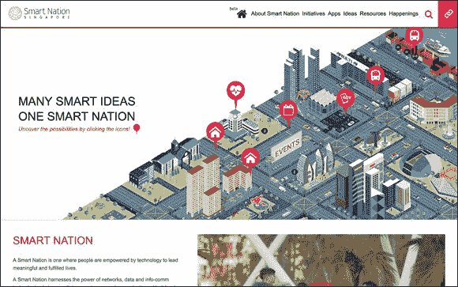

图 15-1： 新加坡的智慧国家项目。

区块链技术也可以用于在智慧城市中安全地在网络之间共享信息。许多城市正在探索如何使用区块链来缓解交通拥堵。新加坡的智慧国家项目希望利用公民的手机来衡量其公交车旅行的状况，然后分析数据以了解何时需要升级道路。新加坡一直是智慧城市发展的领导者，并已开始在其他国家开发智慧城市。

在本节中，我将带您了解亚洲正在进行的众多区块链努力中的一些。

#### 印度的新加坡卫星城
印度政府于 2015 年启动了其智慧城市使命，旨在建设 100 个新的智慧城市。其中许多开发项目将在德里孟买工业走廊进行，该走廊是德里和孟买之间长达 620 英里（1,000 公里）的路段。价值 110 亿美元的基础设施已在 33 个城市规划，而大部分开发将通过公私合营模式资助。该项目预计将吸引 900 亿美元的外商投资，这些资金将用于创建商业园区、制造区和智慧城市，所有这些都将沿着指定的铁路货运走廊设立。

这些智慧城市正随着印度经济工业化和人口日益城市化而建设。采取中央规划城市形式的国家干预是必要的，以防止现有城市变得过度拥挤而无法居住。印度由于其庞大而贫困的人口，特别容易受到气候变化的影响。因此，这些城市必须是可持续和智能的。它们需要低能耗住房材料、智能电网、规划好的交通、集成的信息技术系统、电子政务和创新的雨水收集。

新加坡是一个精心规划城市的典范。尽管人口密度高，但它拥有出色的基础设施和高生活质量。新加坡的许多私营组织拥有开发印度智慧城市所需的知识和资源。在与印度政府合作下，私营部门能够为这样的大型计划提供必要的资本、技能和技术。

Andhara Pradesh 和新加坡金融管理局已宣布金融科技（fintech）创新合作伙伴关系，主要侧重于区块链和数字支付。新加坡旨在在印度建立金融科技解决方案的市场。

新加坡领导层已表示有兴趣与印度合作开发智慧城市以及安得拉邦的新首府，安得拉邦位于东南地区。正在设立委员会分析印度建设 100 座新城市计划的合作潜力，以及进一步发展 500 个现有城镇和城市的基础设施。

印度城市发展部长已与新加坡现任总理和前总理进行过会谈。他一直在寻求新加坡在智慧城市方面的专业知识，尤其侧重于智能交通系统、增强型水资源管理以及电子政务。城市发展部长还研究了新加坡的公共住房计划以及其私人住房法规。交通基础设施的资金结构也被研究过。

印度当局还聘请了一支新加坡专家团队协助在喜马偕尔邦开发卫星城镇。该项目占地 49 英亩（20 公顷），旨在帮助缓解西姆拉的拥堵，西姆拉在过去几十年中人口大幅增长。新加坡人将协助该城镇的教育、住宅和商业方面的发展。

新加坡和马来西亚都表示有兴趣投资贾蒂亚·德维附近的另一座卫星城镇。新加坡政府正在进行一项研究，以评估各种选择。喜马偕尔邦州政府正在考虑使用私营-公共资金模式在现有城市附近开发五个卫星城镇。

新加坡的 Ascendas-Singbridge 在印度启动了其第八个 IT 园区。占地 59 英亩（24 公顷）的古尔冈国际科技园预计将在年中完成首栋建筑。该价值 4 亿美元的项目旨在提供 800 万平方英尺的商业空间，以帮助容纳印度蓬勃发展的 IT 行业。

## 中国的大数据问题

区块链技术在中国被广泛讨论，作为增强大数据可靠性的方式。人们将其视为解决在激励不一致的两个或多个方之间共享数据所涉及的信任问题的方法。区块链技术提供了许多跟踪所有权、来源和真实性的新解决方案。

Peernova 是一家前景良好的美国公司，正在解决大数据问题。它此前专注于比特币挖矿，但转向区块链领域，并从中国建筑公司浙江中南控股集团筹集了 400 万美元。Peernova 计划使用区块链技术查询传统数据库并跟踪更改。

用例是验证大型数据存储子集的任何更改，并使用更高效、更完整的加密审计代替传统审计员，为公司提供参考点。它希望通过使用区块链追踪多年投资的资金历史，帮助对冲基金计算其投资的税负。

中国最大的房地产开发商大连万达也在涉足区块链领域。它已与大数据软件公司 Cloudera 联手推出名为 Hercules 的区块链项目。它看到了利用区块链技术使从大数据得出的预测对管理者具有可操作性的潜力，使管理者能够在协议修改等情况下从被动转向主动，并监控其系统内的用户行为。

大连万达和 Cloudera 旨在继续开发 Hercules，并将其技术整合到依赖 IT 和大数据的各种行业中。Hercules 项目将作为一个开源套件，支持企业的需求。它使组织更容易在大型数据集群上部署和管理区块链应用。

你可能会觉得一家数字矿业公司与一家传统建筑公司合作来解决对冲基金的审计问题，或房地产公司与大数据合作来解决系统管理员的问题而感到奇怪，但这就是区块链世界的西部荒野。区块链人才短缺以及对区块链项目和投资的高需求正在推动这种环境。

## 争夺世界金融之都的战役

自 2015 年凭借大量新闻报道进入公众意识以来，区块链技术已逐渐成熟。此后，许多初创公司一直在进行测试版和预发布构建，几乎在 2016 年一夜之间形成了近 2000 家新的区块链初创公司。其中许多公司最终将在 2017 年和 2018 年于新加坡、迪拜和伦敦上市，在那里监管机构欢迎创新并竞争成为世界的金融圣地。这不仅仅是关于金融科技和智慧城市的问题。对于这些领导者来说，这是在向无国界和财务流动的全球公民转变的世界中争夺相关性的竞赛。

### 伦敦的早期远见

2016 年，英国中央政府发布了一份名为“Distributed Ledger Technology: Beyond Block Chain” (`https://goo.gl/asIz6L`)的报告，断言分布式账本技术（区块链）可用于减少腐败、错误和欺诈，并使各种流程更高效。他们还表示，区块链可以通过带来更多透明度和可信度来改变公民与政府的关系。但伦敦至少从 2014 年起就对这项技术非常友好。许多早期的区块链初创公司在伦敦注册或工作，因为那是建立业务的非官方最安全的地方。当时这意义重大，因为许多加密货币企业家在 2014 年和 2015 年被逮捕。

自该报告发布以来，区块链已获批准在英国的政府应用中使用，包括白厅部门（非部级部门，如土地注册局、林业委员会和食品标准局）、地方当局和下放政府。

以下是英国正在进行的几个有趣的项目和实验：

* **基于区块链的福利发放：** 工作与养老金部已与巴克莱银行、RWE、GovCoin 和伦敦大学合作进行一项实验，将使用区块链技术通过手机应用发放福利。该试验旨在查看是否可以使用区块链技术发送和跟踪付款。
* **政府 DLT：** 区块链平台提供商 Credits 与英国政府正在合作制定一个框架，允许英国政府机构尝试区块链技术。（DLT 代表分布式账本技术。）
* **基于区块链的国际支付：** 桑坦德银行已启动基于区块链的国际支付试验。该员工试点项目涉及一个连接到 Apple Pay 的应用。用户可以使用 Touch ID 在 10 英镑至 10,000 英镑之间转账。
* **使用区块链技术交易黄金：** 英国皇家造币厂已与市场运营商 CME Group 联手，利用区块链技术建立黄金市场，希望使伦敦对黄金销售更具吸引力。区块链技术被这两个实体采用，因为他们将其视为交易黄金的高效数字机制。

这些都是为了看看区块链技术是否是交换价值的新平台而进行的实验。该计划的成败将决定英国乃至世界的未来走向。

### 新加坡的监管沙盒

新加坡与英国一样，不遗余力地让在那里工作变得尽可能容易、友好且具有财务吸引力。2015 年，政府官员前往旧金山宣布并招募企业家来在他们所称的“监管沙盒”工作——这是对术语*development sandbox,*的戏仿，后者是一个开发者可以构建软件的安全环境。新加坡对构建软件公司也有同样的想法。

当时，美国和许多其他地方的区块链公司仍处于灰色地带。拥有一个安全运营和投资资金的场所的想法对许多企业家，包括我自己，在内都很有吸引力。如果你从未去过新加坡，你应该去！它很美丽、干净且安全。

新加坡正在采取措施探索这项技术，并且成效显著。新加坡银行 OCBC 使用了区块链技术进行跨境转账。它向其子公司 OCBC 马来西亚和新加坡银行发送了资金。

R3 在新加坡也很活跃。它与新加坡金融管理局一起开设了一个实验室，用于研究和开发数字账本技术。R3 正在开发一个交易所来支持银行间支付。银行将存入现金并获发数字货币。

新加坡中央银行还与八家外资和本地银行以及证券交易所一起启动了一个试点项目。该概念验证项目旨在使用区块链技术进行其银行间支付。试点项目还旨在审查跨境外汇交易。

不仅仅是区块链公司将在新加坡进行实验。所有最大的参与者都已参与其中——Bank of America、Merrill Lynch、IBM、Credit Suisse、The Bank of Tokyo-Mitsubishi UFJ Ltd、DBS Bank Ltd、JP Morgan、The Hong Kong and Shanghai Banking Corp Ltd、OCBC Bank、United Overseas Bank、和 the Singapore Exchange。

世界上每家银行都必须知道自己与谁做生意。了解你的客户（KYC）的整个理念有助于打击洗钱和旅游资助。

下一阶段将是确定外汇交易并在新加坡的 KYC 工作基础上进行建设。这可能导致该国在基于区块链的身份方面走在前列。新加坡已经拥有一个健全且现代化的数字身份系统，可以轻松连接到区块链。

## 迪拜 2020 倡议
迪拜政府有一个雄心勃勃的计划，到 2020 年将所有政府文件和系统转移到区块链上。无纸化计划是其成为区块链技术全球领导者并提高各部门效率的举措的一部分。

内阁事务和未来部长详细说明了新计划如何使用户能够通过区块链更新和验证其凭证。他们只需凭凭证登录一次即可访问政府和私营实体，例如保险公司和银行。他们还预计与其它国家分享其技术以实现更简单的边境通行。旅客可以使用预先验证的数字钱包以及预先批准的身份识别来代替护照。

迪拜政府估计，其区块链倡议有可能节省 2510 万小时的生产力。这种效率提升也有助于减少碳排放。

迪拜全球区块链理事会（GBC）宣布了七项新的公私合作，整合初创企业、本地企业和政府部门的技能和资源。他们将把区块链技术应用于以下领域：

* **Healthcare:** 爱沙尼亚软件公司 Guardtime 将与迪拜最大的电信运营商之一 Du 合作，提供将医疗记录数字化并转移到区块链的技术专业知识。
* **The diamond trade:** 一个试点项目将使用区块链技术进行钻石的认证和转让。迪拜多用途商品中心将把*Kimberly certificates*数字化（由联合国创建的文件，用于限制冲突钻石贸易）。
* **Title transfers:** 产权转让将被数字化并记录在区块链上。名为 Dxmarkets 的新加坡区块链初创公司已开发出一个概念验证。
* **Business registration:** GBC 正在试验使用区块链技术进行企业注册。这与以太坊的去中心化自治组织（DAO）不同，但可以通过 Flexi Desk 计划简化身份验证。目前处于演示阶段，多个实体正在进行概念验证。
* **Tourism:** Dubai Points 是与 Loyyal 合作推出的试点项目，使用区块链技术帮助旅游业。它旨在通过向访问特定地点的旅客授予积分来激励旅行。它将使用智能合约来促进奖励。这些积分可能像加密代币一样运作并可在交易所交易。
* **Shipping:** IBM 正在与 GBC 合作使用区块链技术改善航运和物流。该项目旨在帮助区域参与者就货物交换方式进行协作。智能合约将被用作合规和结算问题的解决方案。

迪拜与新加坡一样，已投入资金和人才以确保其能迅速主导区块链领域。这就是小型政府和中央权威的奢侈。

## Bitlicense 监管框架：纽约市
如果你计划在纽约市运营一家区块链初创公司，请做好额外费用的准备。2015 年 6 月，纽约州金融服务部（NYDFS）发布了 Bitlicense 的最终版本，该监管框架旨在为数字货币行业提供更多清晰度。实际上，它将许多区块链初创公司赶出了纽约市。许可证本身费用为 5,000 美元，可长达 500 页。它要求每家公司的领导人提供指纹并对申请企业进行广泛的背景调查。主要的抱怨是申请相关的约 10 万美元费用。该估计包括时间分配、法律和合规费用。Bitlicense 与伦敦、新加坡和迪拜等其他金融中心所做的努力形成鲜明对比。

最终的 Bitlicense 是近两年关于如何监管该技术的研究和辩论的结果。它是在认定现有法规不适合数字货币公司后出台的。

从积极方面来看，纽约市的区块链企业不再需要 NYDFS 批准新软件更新或进一步的风投融资轮次。该框架规定，数字货币公司仅需对“拟议对现有产品、服务或活动进行的更改可能导致此类产品、服务或活动与主管在许可申请中之前列出的内容在实质上不同”的情况获得批准。

获得 Bitlicense 的第一家公司是 Circle，即比特币钱包提供商。该许可证允许他们在监管框架下在纽约运营。Circle 是少数可以合法这样做的公司之一。大多数区块链初创公司都在避免在纽约工作，因为许可证的成本和工作量超过了收益。只有获得最高资金支持的初创公司才在努力。

Ripple 已获得其第二张许可证。该许可证的这一迭代使其能够出售和持有 XRP，即 Ripple 共识账本（RCL）背后的数字资产。它将增强 Ripple 与希望使用其技术进行国际资金转账的企业客户打交道的能力。

美国其他地区也提出了类似法案来监管数字货币并要求许可。加州法案 AB 1326 本应为该地区做到这一点，但在电子前沿基金会（EFF）成功反对后失败了。（EFF 是总部位于旧金山的团体，捍卫消费者权益和新技术。）

# 保障世界边境安全

区块链正被许多政府探索用于保障边境安全。英国有一个雄心勃勃的目标，确保旅客在通过机场时无需停顿。这与现在几乎每个机场都存在的长安检队伍形成鲜明对比。英国实现无摩擦旅行体验所需克服的主要障碍与 *乘客解析* 有关（能够明确知道任何特定乘客的身份，即使该乘客来自另一个国家）。乘客解析一直是反恐国家的难题。

美国已在全球旅行评估系统（GTAS）下开放其乘客解析技术。它可在 GitHub 上供公众协作（ [ `www.github.com/US-CBP/GTAS` ](http://www.github.com/US-CBP/GTAS) ）。

涉及非侵入式筛查和乘客身份验证的计算机、摄像机和传感器都需要得到保护以确保国家安全。区块链凭借其底层不可变特性，是这一用例的有前景技术，目前正在测试中。

区块链还能创造的另一件有趣的事情是传记身份——随着时间推移而建立的身份。任何数据都可以与传记身份关联，而归属数据的隐私和可读性可由发布者管理。随着时间的推移，身份是通过添加额外属性来建立的。属性可以是几乎任何东西，从个人设备上的数据到文件在边境检查站被查验的实例。这些属性由证书颁发机构或其授权方发布到个人的身份链上。

## 国土安全部与物联网身份

国土安全部下属的科学与技术司正在探索为美国边境保护物联网设备。它正与总部位于德克萨斯州奥斯汀的区块链初创公司 Factom, Inc. 合作，以推进物联网设备数字身份的安全性。

Factom 创建身份日志，记录设备的 ID、制造商、可用更新列表、已知安全问题和授权权限，同时增加时间维度以提高安全性。目标是限制潜在黑客篡改设备历史记录的能力，使伪造更困难。

## 未来的护照

ShoCard（ [ `www.shocard.com` ](http://www.shocard.com) ）是一家应用开发公司，与区块链公司 Blockcypher 合作。它已构建原型，允许您在安全的区块链环境中建立身份。ShoCard ID 存在于手机上的应用程序中，可用于安全地共享各种凭证。

## 新的源文件

你可能没听说过 Smartrac，但很可能你每天都会接触到它的技术。Smartrac 是射频识别（RFID）标签和其他识别芯片的头号供应商，这些芯片内置于护照和身份证等物品中。

国家在打击身份欺诈时面临的最大挑战之一是对用于建立身份的基础文件的验证。这些文件包括社会保障卡、出生证明和文凭，目前很容易且廉价地被仿造。

Smartrac 已通过越来越先进的技术来应对这一问题。其最新创新 dLoc 是一种软件身份验证解决方案，允许源文件与区块链记录进行核对。

文件数据与近场通信标签（NFC）的唯一 ID 结合，生成一个 32 位哈希值，只有签发机构使用私钥才能识别。哈希值存储在 Smart Cosmos 中，并在公共区块链中备份。之后，带有 dLoc 贴纸的文件可使用桌面阅读器或 NFC 启用手机上的移动应用程序进行验证。

这使得能够实现两种以前在纸质文件上从未可能实现的神奇功能：

* 文件不可更改的历史，显示其真实年龄和所有权。
* 允许证书颁发机构以密码学方式签署文件的真实性。因此，即使用于制作文件的底层纸张被盗，也不会得到充分签署，或者如果文件在签发后被取走，也可将其标记为被盗文件。

# 第 16 章：其他行业

本章内容

**发现世界各地正在建立的精简政府基础**

**为您的企业和家庭改进的互联网基础设施层抢占先机**

**开始创建自己的区块链身份**

**通过智能合约变现您的信息**

很容易关注最突出的区块链项目和行业影响，但区块链技术已经开始触及社会的各个方面。

在本章中，我将带您了解一些您可能没有预料到的更有趣和不寻常的区块链技术应用。一些最令人兴奋的变革将发生在政府系统、互联网的新信任层以及区块链创造的新行业中。在这里，您将发现正在发生的令人印象最深刻的变化，以及这些变革将如何影响您的生活、您所在的行业，以及保护您的政府和机构。

## 精简政府

一些小国意识到，如果要在全球经济中竞争，就必须提供更多服务，并且以不给公民带来负担的方式进行。为了竞争，它们改变了许多关于提供公民身份意味着什么的传统观念。在一个从硬边界向非常开放的边界转变的世界里，人们有权选择居住地和称之为家园的国家，这些小国发展得很好。

公民身份正成为一种可以购买的商品，每个国家都提供不同的优势。各国正远离被动公民身份模式，即出生即为某国公民，转向根据该国提供的优势选择公民身份的模式。

在这种新模式下，公民身份不再与物理位置挂钩。政府可以在没有边界或物理位置的情况下存在。旧模式将公民身份视为一个地点，可能被其他国家或内部力量（如革命）入侵和推翻。

区块链技术和其他顶级创新正在这些领域被采纳——首先，因为它们使其成为可能，其次，因为它们通过创建公民可以快速在世界任何地方访问的更高效系统来减轻政府负担，即使物理领土被占领。

新加坡、爱沙尼亚和中国一直是这类举措的市场领导者。新加坡的智慧国家项目和爱沙尼亚的电子居民计划是独特的系统，旨在减少公民的文书工作和等待时间，提高共享资源效率。中国减少欺诈的努力改变了区块链领域的动态。

### 新加坡智慧国家项目

# 智慧国家

智慧国家是新加坡的国家级努力，旨在为所有公民和居民创造更美好的未来生活。人们、企业和政府正在共同努力。该项目涵盖从数字身份一直到优化公共记录的物联网传感器。

新加坡认为，借助技术赋能的人们可以过上更有意义、更充实的生活。它充分利用新技术、网络和大数据，并通过监管沙盒、积极招募以及激励初创企业创新来积极寻求创新。

你可以在 [`https://goo.gl/EGmF4X`](https://goo.gl/EGmF4X) 看到智慧国家倡议的[content]
# 智慧国家项目

智慧国家是新加坡的国家级努力，旨在为所有公民和居民创造更美好的未来生活。人们、企业和政府正在共同努力。该项目涵盖从数字身份一直到优化公共记录的物联网传感器。

新加坡认为，借助技术赋能的人们可以过上更有意义、更充实的生活。它充分利用新技术、网络和大数据，并通过监管沙盒、积极招募以及激励初创企业创新来积极寻求创新。

你可以在 [`https://goo.gl/EGmF4X`](https://goo.gl/EGmF4X) 看到智慧国家倡议的描绘。

新加坡能够快速测试和部署新技术，因为它拥有单一层级的政府。它能迅速协调各机构之间的政策和工作。智慧国家是这一理念的绝佳范例，即新技术胜过常规政治。

## 爱沙尼亚的电子居民身份

爱沙尼亚是欧盟的一个小国，人口为 130 万。它资源有限，难以满足公民的需求，但通过技术，它的能力已超过许多更大的国家。爱沙尼亚推出了在线服务的数字身份证，并成为第一个提供电子居民身份的国家，这是一种数字身份，可供全球任何有兴趣在线经营业务的人使用。

申请爱沙尼亚电子居民身份只需几分钟，背景调查费用约为 100 美元。持有电子居民身份卡并不使你成为爱沙尼亚公民，但它能带来许多好处。

 你也可以成为爱沙尼亚电子居民。在线申请，网址为 [`https://apply.gov.ee`](https://apply.gov.ee)。

苏联解体后，爱沙尼亚大力投资新技术。它完全摆脱了传统政府模式，转而采用单一窗口原则，即公民的一个接入点。单一窗口原则使公民只需一次安全登录，即可在世界任何地方访问所有税务和海关服务。通过该系统可以实现简单且无纸化的交易。除了结婚和房地产购买外，一切都可以完全在线完成。爱沙尼亚公民可以在几分钟内进行银行转账或缴税。

爱沙尼亚人民已习惯政府简化流程并使用更多 IT 解决方案。电子服务的积极发展使 2009 年至 2016 年间前往爱沙尼亚税务和海关委员会服务办事处的次数减少了 60%以上，从而降低了总体成本。

爱沙尼亚于 2015 年升级了其收入和社会税申报环境，由于电子服务的开发和广泛使用，增值税比上一年多征收了 1250 万欧元。爱沙尼亚政府增加了一个税务负债计算器，可从公民的银行系统提取数据。它还使向系统提交发票变得容易。

爱沙尼亚人已拥抱区块链技术。下一个重大发展将是区块链支持的云。爱沙尼亚聘请了爱立信、Apcera 和 Guardtime 共同开发和运营一个混合云平台，以增强税务报告和在线医疗建议的可扩展性、弹性和数据安全性。

纳斯达克也在爱沙尼亚开发区块链服务。它正在为私营公司建立一个市场，追踪其发行的股份并使其能够立即结算交易。它专注于改善企业的代理投票流程。这将是一种注册企业的方式。

Bitnation 项目正与爱沙尼亚合作，为爱沙尼亚电子居民提供公共公证服务，这将允许爱沙尼亚电子居民无论居住或经商地在哪里，都可以在区块链上公证其婚姻、出生证明和商业合同。区块链公证文件在爱沙尼亚司法管辖区或任何其他国家或州都不具有法律约束力，但它将允许公民证明这些文件的年龄。

## 中国的更好公证

中国与加密货币的关系是爱恨交织。一方面，中国公民试图利用代币将资金洗出境外或隐瞒税收利润。这导致中国政府收紧了对加密货币使用的监管。然而，随着底层区块链技术的用途扩展到价值转移之外，中国开始拥抱区块链技术。

一个有趣的早期应用例子是安存正信公司，该公司通过与 28 个省 100 多家传统公证处合作，引领中国电子数据公证服务的转变。它还通过传统办公室提供电子数据存储和区块链公证解决方案。

安存在可公开搜索的区块链上发布数千条记录，使用户可以回溯检查公证文件的真实性和年龄。

 许多初创公司在美国也在从事类似概念。例如，Tierion ([`www.tierion.com`](http://www.tierion.com)) 让你可以哈希并时间戳日期；它会将数据锚定在比特币区块链中。

## 互联网的信任层

在过去 30 年里，互联网是分层构建的——一层叠加在另一层之上——使使用者更轻松、更安全。区块链是互联网的下一层。可以把它看作信任层。它可能会悄然淡出公众意识，并开始让你的在线互动更愉快。区块链技术的实施最终将消除因缺乏足够信任信息而在线上常出现的恼人问题。

有两个关键领域的工作已经开始，你可能并不知情但会喜欢：几乎没有垃圾邮件的电子邮件和一种新型的在线身份。

### 无垃圾邮件的电子邮件

你可能和我一样讨厌垃圾邮件，但比太多不需要的邮件更大的问题是，当前的电子邮件系统已不再安全。2016 年底，雅虎遭受了全球最大规模的黑客攻击之一。十亿用户账户被攻破，用户个人数据遭到泄露。

保护电子邮件是区块链技术的有力用例，电子邮件已准备好被颠覆。一位在线安全界的传奇人物已接受这一挑战。防病毒软件先驱约翰·麦卡菲创建了一个基于区块链技术的电子邮件新平台。

John McAfee SwiftMail ([`www.johnmcafeeswiftmail.com`](http://www.johnmcafeeswiftmail.com)) 是一种基于区块链的电子邮件。它与你习惯的电子邮件系统并没有太大不同。导航简单，一些开发者还构建了移动应用和基于网络的应用，使体验更方便。

SwiftMail 的区块链确认你的邮件是真实的，并且你发送的电子邮件已被预期收件人收到，从而消除了信任雅虎等第三方保管数据的需求。发送电子邮件还有一小笔固有成本，可使垃圾邮件发送者失去兴趣。

SwiftMail 在隐私问题上采取强硬立场，而许多服务提供商对此态度漠然。约翰·麦卡菲说：“如果隐私不重要，你是否愿意把钱包交给一个完全陌生的人，让他们翻阅并记录里面找到的一切？那么为什么我们会相信，如果我们没有做错事，就不应该在乎别人是否拥有我们的信息？”

SwiftMail 使用类似于比特币钱包的钱包地址，该地址保存在你电脑上的应用程序中。它们是 32 个随机字符，没有可供挖掘的元数据，用户可以像使用比特币一样快速创建新的地址。邮件本身采用 256 位端到端加密，使得被截获的数据对窃贼毫无用处。

 目前，SwiftMail 的下载仅适用于 Android、Linux 和 Windows 系统。目前尚无适用于 Apple 的版本。请勿下载错误版本。

该领域的其他项目，包括 21 ([`www.21.co`](http://www.21.co))，正在努力为电子邮件提供区块链后端。它们创建了向网络外的人发送邮件收取费用的电子邮件。然后他们会给你保留这笔钱或将其捐赠给慈善机构的选择。

## 拥有你的身份

区块链爱好者谈论的一个基本原则是个人对自己创建的、唯一标识自己的数据的所有权责任。这个概念似乎很简单，但大多数人并不拥有或控制代表其身份的数据。

大部分控制权掌握在容易被黑客攻击的集中式数据库手中。这些数据库保存信息，而证书颁发机构验证信息是否正确且未被篡改。在信息时代，你的数据就是你的身份。数据分布越广，落入想要滥用它的人手中的可能性就越高。

基于区块链的身份将身份控制权交到代表该身份的个人或公司手中。集中式数据库和证书颁发机构不一定会被取代。数据仍然需要一个安全的地方存放，让第三方验证文件的真实性仍然是有意义的。

改变身份责任顺序的价值在于，更难窃取、扣押或操纵代表你身份的基础文件。信息按需共享，而不会暴露不必要的信息。

## 区块链的预言机

区块链技术并不能解决信息必须来自某处的难题。信息的可信赖性也很重要。当你想在区块链系统内执行合约时，人为因素仍无法从方程式中剔除。

区块链系统中没有中央权威来监督或强制诚实。预测信息作者未来的诚实度是不可能的。逻辑结论是，每笔交易成本必须低于重建声誉的成本。可信作者的声誉是随着时间建立起来的，作者越诚实、越正确，其声誉就越有价值。这个概念类似于品牌名称的价值。

在本节中，我将解释艺术家和创作者如何通过区块链技术利用区块链技术变现其作品。

### 可信作者身份

智能合约和链码为有知识的个人和公司货币化其信息创造了新的机会。这类系统需要可信的信息来源来执行。这些可信来源可能是评级机构、天气媒体，或几乎任何其他东西。

你还可以将物联网设备连接到区块链基础设施，让它们在区块链网络上创建自己的声音和身份。它们需要随着时间的推移建立信任，并且在任何时候都可能被腐蚀。过去的诚实并不能防止未来的不诚实或信息来源的腐败。

并非所有智能合约或链码都是自包含的或针对无懈可击的来源执行。更实际、更适用的商业用例要求信息来自任何给定区块链网络已知宇宙之外的来源。多家初创公司正从不同角度解决这个问题。

Factom 创建了 Acolyte，这是一项服务，允许用户随着时间的推移为他们向网络提供的信息建立声誉。智能合约构建者可以订阅并补偿创建的预言机。他们还可以对其可信度进行评级。

从一个截然不同的角度来看，另一家区块链初创公司 Augur 开创了预测市场的概念。Augur 是一个平台，奖励用户预测未来的现实世界事件，例如选举或企业收购。投注是通过交易事件结果的虚拟股份进行的。用户通过购买正确结果的股份赚钱。股票的成本会根据社区对事件发生的可能性的感受而波动。Augur 类似于一个博彩网站。任何人都可以做出预测。任何人都可以为任何给定事件创建预测市场。这将允许你作为企业主，例如，对人们认为最可能发生的事情进行民意调查。它还可能揭示作者希望能够利用的内部信息。

### 知识产权

在与知识产权斗争中受创最严重的行业之一是音乐行业。顶尖艺术家因众多依赖其创作的中间商而在经济上受到挤压。小艺术家无法将音乐作为主要收入来源，因为他们只能看到一小部分收入。超级巨星靠粉丝的 sheer 数量生存。

互联网让各种规模的艺术家更容易分享作品。同时，它也让人们靠自己热爱的事情过上舒适生活变得更加困难。音乐产业的产业链很长，每个中间商都会拿走一块蛋糕，并增加资金最终到达艺术家手中的时间。通常，艺术家需要等待长达 18 个月或更长时间才能看到任何钱，并且每次她的音乐被播放可能只能获得 0.000035 美元。在当前市场中，没有人欺诈艺术家，这已经是最好的情况了。

区块链被引入作为减轻创作者巨大财务负担的一种方式。加密货币可用于降低与信用卡和欺诈相关的交易费用。它还将为没有常规信用卡访问权限的发展中国家开辟新市场。

一个更有趣但不太直接的可能性是将整个音乐产业生态系统迁移到利用智能合约或链码促进即时使用付款的区块链系统上。它还可以明确许可证的所有权，并使消费者更容易为商业用途许可音乐。

多个项目正在致力于这个问题，并希望促进一个健康、可持续且无摩擦的生态系统——一个不会取代市场参与者，但确实允许艺术家从辛勤工作中获得更多收益的生态系统。

UjoMusic 正在测试其平台的 Beta 版，该平台允许用户直接销售和许可音乐。它利用以太坊网络、用于执行的智能合约以及用于支付的以太币（以太坊加密货币）。你可以下载整首歌曲，也可以仅下载人声和伴奏音轨用于商业或非商业用途。音乐家随后会立即用以太币获得报酬。

Peertracks 是另一家致力于改变音乐行业的区块链初创公司。它是一个音乐流媒体网站，允许用户下载和发现新艺术家。它通过其名为 MUSE 的点对点网络和个人艺术家代币的创建来实现这一点。这些代币的工作方式与其他加密货币类似，其价值会根据艺术家的受欢迎程度而波动。

区块链技术并没有消除对音乐厂牌和分销商的需求。然而，如果他们不想被适应这种更高效模式的新公司取代，就需要迅速行动，就像 Netflix 打破了 Blockbuster 一样。

# 第 5 部分
## 十项精华部分
本部分内容 …
发现十个免费的区块链资源，帮助你跟上技术和行业的发展。
在加密货币和区块链世界工作时，识别十条永远不应违反的规则。
了解更多关于塑造行业未来的十大区块链项目和组织的信息。

# 第 17 章
#### 十个免费的区块链资源
本章内容
**发现免费的区块链教育资源**
**参与区块链社区**
**及时了解最新的区块链新闻**
**加深对其他区块链资源的了解**
本章中，我概述了区块链生态系统中的有趣免费资源，这些资源将帮助你保持信息灵通并参与社区。在这里，你可以找到用于创建 *oracles*（允许智能合约执行的数据源）的免费工具、扩展你知识的视频，以及正在塑造行业未来的组织。

##### Factom University
Factom, Inc. 是一家为 Factom 开源网络提供服务的区块链公司。它为大型企业和政府构建定制的区块链应用。它还为美国抵押贷款行业构建了区块链即服务产品。
Factom University ( [ `www.factom.com/university` ](http://www.factom.com/university) ) 由 Factom, Inc. 创建，是一个不断增长的知识库，旨在向个人教授区块链技术、Factom 平台和 API。它由视频和教程组成，可将你从新手带到专家。Factom University 计划推出证书课程，敬请期待！

##### Ethereum 101
Ethereum 是一个开源众筹项目，构建了以太坊区块链。它是该领域最重要的项目之一，因为它开创了在区块链内构建编程语言的先河。由于其内置的编程语言，以太坊网络允许你创建智能合约、创建去中心化组织并部署去中心化应用。
Ethereum 101 ( [ `www.ethereum101.org` ](http://www.ethereum101.org) ) 是由以太坊社区成员发起的网站。它是关于区块链技术和以太坊网络的高质量教育内容的精选存储库。以太坊社区总监 Anthony D’Onofrio 负责监督该项目。

##### Build on Ripple
Ripple 提供全球金融结算解决方案。其分布式结算网络基于任何人皆可使用的开源技术构建。Ripple 警告称，其区块链功能仅应由持牌金融机构使用。
Ripple 已为在其平台上构建开发了强大的知识库（ [ `www.ripple.com/build` ](http://www.ripple.com/build) ）。该知识库主要面向开发者。Ripple 还为金融监管机构提供一些资源。即使你不是监管者，也值得一读，因为它提供了区块链技术带来的法律责任方面的一些见解。

##### Programmable Money by Ripple
Steven Zeiler 是 Ripple 的员工，他制作了一系列 YouTube 视频，讲解如何使用 JavaScript 在 Ripple 网络上创建可编程货币。该系列面向 JavaScript 程序员。截至本文撰写时，有十个视频将指导你完成开发过程。请在 [ `https://goo.gl/g8vFPL` ](https://goo.gl/g8vFPL) 查看该 YouTube 系列。

##### DigiKnow
DigiByte 是一个受比特币启发的去中心化支付网络。它允许你通过互联网转移资金，并提供比比特币更快交易和更低费用。该网络也对希望挖掘其原生代币的人开放。
DigiByte 的创始人 Jared Tate 在 YouTube 上创建了一个名为 DigiKnow 的视频系列，教你几乎所有使用 DigiByte 所需的知识。以下是他第一部视频的链接，其中他向你讲解区块链的工作原理基础以及 DigiByte 网络如何创造价值： [ `https://youtu.be/scr6BzFddso` ](https://youtu.be/scr6BzFddso) 。

##### Blockchain University
Blockchain University 是一个教育网站，向开发者、经理和企业家教授区块链生态系统。它提供公共和私人培训项目、黑客松和演示活动。其项目以解决方案导向的设计思维和实践体验培训为特色。你可以在加利福尼亚州山景城找到 Blockchain University，或访问 [ `http://blockchainu.co` ](http://blockchainu.co) 。

##### Bitcoin Core
Bitcoin Core ( [ `https://bitcoin.org` ](https://bitcoin.org) ) 最初由中本聪用来托管其关于比特币协议的白皮书。它是比特币核心协议教育材料和原始比特币软件可下载版本的所在地。
该网站致力于保持比特币的去中心化和对普通人的可访问性。
它是一个社区运营的项目，并非所有内容都由核心团队管理。在浏览该网站时请牢记这一点。

##### Blockchain Alliance
Blockchain Alliance 由 Blockchain Chamber of Digital Commerce 和新闻组织 Coincenter 创立。它是区块链社区、执法机构和监管机构之间的公私合作。他们共同的目标是使区块链生态系统更安全并促进技术进一步发展。他们通过提供教育、技术援助以及关于比特币和其他数字货币以及使用区块链技术的相关定期信息会议来打击区块链上的犯罪活动。
你可以在 [ `www.blockchainalliance.org` ](http://www.blockchainalliance.org) 了解更多关于他们的活动或加入他们的组织。

##### Multichain Blog
Multichain 是一家帮助组织快速在区块链上构建应用的公司。他们提供一个平台，可在私有区块链上发行数百万种资产，你也可以通过他们的工具跟踪和验证网络上的活动。除了其工具集和平台之外，他们还在区块链领域具有思想领导力。
这些是我最喜欢的他们博客（ [ `www.multichain.com/blog` ](http://www.multichain.com/blog) ）的文章：
* 四个真正的区块链用例（ [ `www.multichain.com/blog/2016/05/four-genuine-blockchain-use-cases/` ](http://www.multichain.com/blog/2016/05/four-genuine-blockchain-use-cases/) ）
* 谨防不可能的智能合约（ [ `www.multichain.com/blog/2016/04/beware-impossible-smart-contract/` ](http://www.multichain.com/blog/2016/04/beware-impossible-smart-contract/) ）
* 智能合约与 DAO 爆炸（ [ `www.multichain.com/blog/2016/06/smart-contracts-the-dao-implosion/` ](http://www.multichain.com/blog/2016/06/smart-contracts-the-dao-implosion/) ）
* 理解零知识区块链（ [ `www.multichain.com/blog/2016/11/understanding-zero-knowledge-blockchains/` ](http://www.multichain.com/blog/2016/11/understanding-zero-knowledge-blockchains/) ）

##### HiveMind
Paul Sztorc 创立了 Truthcoin，这是一个点对点预言机系统和比特币的预测市场。它利用存储预测市场状态数据的权益证明侧链。比特币可以通过 HiveMind 支持金融衍生品和智能合约，HiveMind 是在 Truthcoin 白皮书基础上开发的平台。请在 [ `http://bitcoinhivemind.com` ](http://bitcoinhivemind.com) 查看他们的资源和教育材料。

# 第 18 章
#### 区块链上永远不应打破的十条规则
本章内容

### 发现你的法律漏洞

### 了解区块链的技术缺陷

### 识别窃贼攻击你系统的最佳切入点

### 制定你的安全最佳实践

本章中，我将深入探讨在处理区块链技术及其运行的加密货币时应考虑的事项。

在做出财务决策之前，务必咨询你的注册会计师和律师。这种技术是新的，规范它的规则尚未完全形成。

## 不要使用加密货币或区块链来规避法律

加密货币的合法性和法律管辖区在世界许多地方仍在波动。我说让你去找你的注册会计师和律师时绝不是开玩笑。这笔钱花得值得，会让你远离麻烦。

以下是一些我经常被问到、非常愚蠢的三个问题：

* **我可以用加密货币来隐藏钱吗？** 这个想法很危险。 ***记住：*** 区块链永久记录所有交易，因此即使你认为自己想出了一个巧妙的方法来隐藏一些代币，那些寻找不当行为的人也有时间找到它。

* **我可以用区块链把钱从我的国家偷运出去吗？** 许多国家对公民可带出国的资金有限制。你不想这么做的原因和我刚才提到的相同：区块链永久记录所有交易。

* **我可以用加密货币购买非法商品吗？** 答案是——你猜对了——不行！区块链永久保留你的行为轨迹 *永远！*

不要对加密货币和区块链做任何用真钱做会违法的事。

## 尽可能保持你的合约简单

去中心化自治组织（DAOs）、智能合约和链码目前非常流行。削减管理费用和法律成本的承诺对许多公司极具诱惑力。这种技术的一个有时被忽视的特征是它只是代码。这意味着没有人来解释你为所有人制定的规则。代码即法律，而法律的范围仅限于纳入区块链合约的内容。被削减的“脂肪”有时可能非常重要。

没有人来解释代码。这意味着如果代码以你未预期的方式执行，也没有人来执行合约的意图。代码即法律，且没有发生任何违法行为。这就是为什么你应该保持你的合约简单和模块化，以控制和预测合约履行的结果。让其他有动机破坏它的开发者来测试并攻击你的合约也是一个好主意。

你构建项目的区块链的覆盖范围也很重要。你可以把它想成司法管辖区。当然，智能合约可以执行外部数据，但智能合约无法从其无法访问的账户中索取资金。这意味着所有价值必须以某种方式预留，这可能会影响现金流。

另一个需要考虑的事情是合约执行所使用信息的来源。如果是保险合约的天气数据，你是否信任并同意该来源？有可能操纵源数据吗？在实施之前，应对预言机来源进行大量思考。

## 发布时要格外谨慎

区块链的全部意义在于，一旦数据被放入，就很难取出来。这意味着你放入的内容会存在很长时间。如果你发布加密的敏感信息，你需要接受这样一个事实：加密数据有一天可能会被破解，你发布的内容可能对任何人都是可读的。

在发布之前请考虑以下问题：

* 我能接受这些信息在某一点被解密吗？

* 我是否愿意将这些信息永远分享给任何想查看的人？

* 这些数据是否会对第三方造成伤害，并且如果发布了我可能需要承担责任？

密码学领域正在进行使加密具备量子抗性的工作，但由于量子计算和量子抗性加密仍处于测试阶段，很难说 20 年后该技术将具备什么能力。

## 备份、备份、再备份你的私钥

区块链是非常无情的存在。它们不在乎你是否丢失了私钥或密码。许多加密极客都曾被彻底暴露，将无数代币拱手让给伟大的区块链海洋——这些宝藏永远无法收回。

控制你的加密货币的私钥通常存放在你的钱包中，因此保护和确保其安全非常重要。要小心为你存储资金的在线服务。许多加密货币交易所和在线钱包都曾被盗取资金。

仅在线上或可通过互联网访问的设备中存储少量代币用于日常使用。将加密货币钱包视为你的现金钱包。不要在其中存放超过你愿意在任何时候损失的金额。已知有超过一百种恶意软件应用程序正在试图获取你的私钥并窃取你的代币。

将其余的货币保存在*冷存储*中——完全离线且零互联网访问。这可以是纸钱包、无法访问互联网的计算机，或专门用于保护加密货币的独特硬件设备。

如果你选择使用纸钱包来保护你的加密货币，请将其覆膜并制作副本。还要记住，打印机通常可以访问互联网，其数据可能被第三方检索。真正偏执的人只使用无法访问网络的打印机。将你的纸钱包副本保存在不同的地点，例如银行保险库和家中的安全地点。

备份你的数字钱包并将其存放在安全的地方。备份是为了防止你的电脑故障，或你犯错删除了错误的文件。备份将允许你在设备损坏或被盗的情况下恢复钱包。另外，不要忘记加密你的钱包。加密钱包允许你为提取代币设置密码。

加密是有助于保护你免受窃贼侵害的措施，但它无法抵御键盘记录软件。始终使用包含字母、数字、标点符号且至少 16 个字符长的强密码。最安全的密码是由专门为此目的设计的程序生成的。强密码更难记住。你可以考虑像私钥一样写下密码并将其覆膜。加密货币中的密码恢复选项有限，忘记密码可能意味着代币丢失。

## 发送货币前请三重检查地址

加密货币吸引了不少无赖，因此在发送资金时要小心。一旦钱从你的钱包中转出，它就永远消失了，无法取回。没有退款，也无法联系客服。你的钱没了。

发送前请三重检查钱包地址。你要确保发送到正确的地址。

## 使用交易所时要小心

加密货币交易所是黑客喜欢攻击以窃取代币的中心点。它们被视为垂手可得的金矿，已有超过 150 家遭到入侵。

使用交易所时请牢记这一点，并遵循本书中概述的最佳实践来保护你的代币安全。对你使用的交易所做一些研究，了解其采取了哪些安全措施。

最后，仅将交易所用于资金的进出。不要把交易所当作存储价值的地方。相反，应将大量加密货币存放在冷存储中，或保存在有若干备份的塑封纸钱包里。

## 警惕 Wi-Fi
如果你的路由器未正确设置，有人可能会看到你所有活动的日志。如果你在公共网络上，请假定网络所有者可以看到你的活动。

 仅使用受信任的 Wi-Fi 网络，并确保已将路由器密码更改为像密码一样安全的设置。大多数 Wi-Fi 路由器密码默认为出厂设置的“admin”，很容易被第三方接管。

## 识别你的区块链开发者
区块链技术是新的，精通构建区块链应用的人并不多。

如果你正在考虑聘请一名开发者来帮助你完成项目，请先查看她的 GitHub，了解她之前做过什么工作。她可能不需要专门精通区块链，但如果不是，她应该在区块链领域之外是一名非常有经验的开发者。

目前还没有太多资源可以帮助开发者在遇到困难时。经验不足的开发者可能会遇到更多困难，并且花费更长时间来开发你的应用。

## 不要上当
整个区块链行业整体上不具备银行和其他金融机构同样的保护和安全措施，也没有同样的法律来保护你的利益和财务福祉。没有消费者保护，也没有政府提供的 FDIC 银行资金保险。如果你被抢劫或被骗，你可能无法向任何人求助。

此外，过去几年该行业炒作很多，但真正有价值的交付却很少。2016 年一夜之间出现了超过一千家声称拥有专业知识的新区块链公司。当你正在考虑开发一个项目并试图决定是否值得投资时，花一点时间确保它确实有意义始终是个好主意。问问自己以下问题：
* 是否产生了真正的价值？
* 创造的价值是否以有利于你的方式实现？
* 是否有其他经过更充分测试的技术可以用相同或更好的效率来实现同样的目标？

区块链技术蕴含着巨大的潜力和力量，因此应谨慎而审慎地对待。

## 除非你知道自己在做什么，否则不要交易代币
加密货币波动性很大，价值会在任何时候剧烈波动，有时甚至没有明显原因。许多加密货币流动性很低，大量交易可能会导致市场价值崩盘。使用已发布的区块链意味着你可能需要持有一定数量的货币才能使用它们。

除非你花时间充分了解市场，否则不要沉迷于代币交易。如果你选择交易代币，请不要忘记向你的注册会计师报告此活动。你可能需要在所得税申报表中报告你的收益或损失。

第 19 章

# 十大顶级区块链项目

本章内容

**深入探索新颖的区块链项目**

**发现全球区块链实施案例**

每天都有新的区块链初创公司涌现。企业家看到了利用区块链提供的强大工具来更快地转移资金、保护计算机系统和建立数字身份的机会。

在本章中，我向你介绍一些我最喜欢的项目和公司。读完本章后，你将对区块链软件领域正在发生的令人惊叹的事情有所了解。你甚至可能会得到一些关于自己可以做什么的想法！

## R3 联盟
许多银行已投资于构建区块链原型——许多是为了反洗钱的了解你的客户（KYC）要求，以及降低货币兑换成本的原型。它们必须克服若干挑战，包括私人信息的安全性和加密货币的监管灰色地带。

R3 (`www.r3cev.com`) 是一家创新公司，已与全球 75 多家领先的金融机构建立联盟，以整合并利用新的区块链技术。R3 正在改善跨境兑换，降低审计成本，并提高银行间资金转账和结算的速度。

R3 的三大支柱如下：
* **金融级区块链：** R3 已开发出支持全球金融机构需求的基础层技术。
* **研究与开发：** R3 创建了一个双边研究中心，正在测试并制定商业级区块链技术的行业标准。
* **产品开发：** R3 与机构密切合作，创建解决价值链上下游问题的产品。

R3 已为金融机构开发了名为 Corda 的区块链平台。Corda 是一个分布式账本平台，旨在管理并同步受监管金融机构之间的金融协议。与大多数将交易广播到整个网络的区块链不同，交易可以在不同的节点上并行执行，而节点彼此并不知晓对方的交易。网络的历史基于需知原则。

Corda 的关键特性包括以下内容：
* **受控访问：** 只有具有合法知情需求的各方才能查看数据。
* **无中央控制者。**
* **监管和监督观察节点。**
* **由交易各方而非更广泛的无关验证者池进行验证。**
* **支持多种共识机制。**
* **无原生加密货币。**

## T ZERO：为股市加码
T ZERO 是一个平台，将区块链技术与现有市场流程集成，以减少结算时间和成本并提高透明度、效率和可审计性。T ZERO 能够做到这一点，因为它具有模块化和适应性。

T ZERO 是 Overstock.com 的子公司，专注于基于密码学安全、去中心化账本的金融科技技术的开发和商业化。自 2014 年 10 月成立以来，T ZERO (`www.t0.com`) 已建立了可用的商业区块链产品。

它与位于加州的独立经纪交易商 Keystone Capital Corporation 合作，创建了首个区块链股票的公开发行。他们共同为交易区块链证券的用户提供经纪服务。

Patrick Byrne，Overstock 的创始人兼首席执行官，主导了这一倡议。华尔街不透明的商业行为为一个清晰可信的交易平台创造了市场机会，在该平台上消费者知道自己买的是什么以及涉及的成本。美国证券交易委员会宣布母公司 Overstock.com 的 S-3 文件生效，使 Overstock.com 能够在公开募股中发行区块链股票。它还与世界最大银行中国工商银行（ICBC）合作测试该平台。

Byrne 通过 Medici 实现这一目标，Medici 是 Overstock.com 控股的金融科技子公司。Medici 专注于将区块链技术应用于解决重大金融交易问题。其首个举措是清理证券结算。

## Blockstream 的分布式系统

# Blockstream

Blockstream ([`www.blockstream.com`](http://www.blockstream.com)) 在提供区块链技术方面享有极佳的声誉，并且主要专注于分布式系统。Blockstream 为利用区块链网络的组织提供硬件和软件解决方案。

Blockstream Elements 是公司的核心软件平台，也是开源项目的一个分支。它为区块链开发者提供多种资源和一个高效的生产协议。

Blockstream 的主要创新领域在于侧链，侧链扩展了现有区块链的实用性，通过添加智能合约和保密交易等功能来增强其隐私性和功能性。侧链避免了许多加密货币所经历的流动性短缺。侧链还允许数字资产在不同的区块链之间转移。

侧链使得在区块链上实际交易公司股票成为可能，而无需担心交易成本或缓慢的网络速度。分布式资产管理基础设施也可以利用比特币网络，使个人和组织能够发行不同类型的资产。

Blockstream 还参与创建了闪电网络，这是一个让比特币支持微支付而不会减慢网络速度的系统。闪电网络使用按比例的交易费用并以非常快的速度运行，支持大量小额支付。它正在开发更多比特币闪电原型并创建共识和互操作性。

## OpenBazaar 的区块链

OpenBazaar ([`www.openbazaar.org`](http://www.openbazaar.org)) 是一个开源项目，构建了一个用于点对点数字商业的去中心化网络。与买家和卖家通过亚马逊或 eBay 等中心化服务进行交易的传统模式不同，OpenBazaar 平台让他们直接连接。他们还利用比特币加密货币来消除费用和限制。

你需要在电脑上下载并安装 OpenBazaar 程序。它随后会将你连接到其他想要买卖商品和服务的人。这是一个不受任何公司或组织控制的点对点网络。下载应用后，设置自己作为买家或卖家非常容易。当你准备好购买某物时，只需进行搜索即可查看结果。它有点像无政府主义者的 eBay 版本。

OpenBazaar 听起来可能很像丝绸之路，但它并非如此。与丝绸之路不同，OpenBazaar 的用户并非匿名。他们可以通过 IP 地址轻松追踪，这使得罪犯对其毫无吸引力。你可以从 OpenBazaar API 中提取卖家位置数据并绘制网络中所有参与者的位置。有几种方法可以隐藏你的位置，并且正在探索更私密的通信方式，但目前网络上几乎没有非法交易。

OpenBazaar 正在努力吸引大型商家和独立零售商。能够处理比特币交易并希望节省成本的人可能会在竞争中获得竞争优势。

## Code Valley：找到你的程序员

Code Valley ([`www.codevalley.com`](http://www.codevalley.com)) 将代码开发的传统模式颠覆。它自称是“世界编译器”。Code Valley 为开发者提供了一个市场工具，使其能够通过 Code Valley 所称的“代理”与其他开发者协作构建软件。

系统中每个代理都会为客户项目返回一段代码。Code Valley 还为企业家创建了一个开放市场。

在 Code Valley，客户可以访问一个全球开发者网络，这些开发者愿意并能够为他们构建软件。Code Valley 的运作方式类似于 Upwork 等在线自由职业网站。该系统中的开发者可以从客户那里赢得构建软件的机会。客户必须反过来仔细挑选可以从事其项目的人员。

Code Valley 在某种程度上也像数据访问对象（DAO），即当新项目创建时，会触发一个隐藏且类似蜂巢的软件编译器的形成。客户的应用由许多不同的代理与编译器协作构建。Code Valley 正在利用区块链技术将软件创建工业化。

## Bitfury 的数字资产

Bitfury Group ([`www.bitfury.com`](http://www.bitfury.com)) 起初是一家比特币矿业公司，但已转型为一家全方位服务的区块链技术公司。Bitfury 为企业和政府开发软件并创建硬件解决方案，以便在区块链之间转移资产。

Bitfury 完全致力于改善比特币区块链生态系统。其技术有助于高效管理数字资产。它使用硬件和软件解决方案为私有和公共区块链交易提供额外安全保障。

Bitfury 处理私有和公共区块链交易。它还帮助客户进行区块链分析。Bitfury 利用比特币交易不可变且始终公开可查看的历史记录，并对交易历史进行高级数据分析。政府已利用此类工作追踪比特币区块链上的犯罪活动。

Bitfury 还参与闪电网络的开发。闪电网络是比特币区块链的叠加网络，使即时微交易成为可能。

Bitfury 还在开发一项产权登记系统。格鲁吉亚共和国已与 Bitfury 合作登记土地所有权。所有权记录被记录在区块链上，以确保历史记录处于不可更改的状态。在发展中国家，安全的财产转移在经济上将是有益的。

## 任何币种都可 ShapeShift

ShapeShift ([`www.shapeshift.io`](http://www.shapeshift.io)) 是交换区块链资产和加密货币最快的方式之一。用户可以使用此服务在几秒钟内交易数字货币。用户无需担心安全问题——没有登录。通过其系统，ShapeShift 显著降低了代币被盗的风险。

ShapeShift 遵循严格的“无法币”政策。在金融服务行业，*法币* 并不是指可爱的小意大利汽车；相反，它是区分政府发行货币的一种方式。在 ShapeShift 上，用户不允许使用银行账户或借记卡或信用卡购买加密货币。ShapeShift 可在世界各地使用，除了朝鲜和纽约州。

使用 ShapeShift 非常容易。你访问网站，指定想要交换的货币类型，并指定要将交换后的代币发送到的钱包。ShapeShift 为你交换代币，将其接收到账户中，然后发送到你指定的目的地。

多个市场来源决定 ShapeShift 使用的汇率，并且它始终保持不变，与所交换货币的价值无关。你也可以直接在 ShapeShift 内转换比特币和其他加密货币。

ShapeShift 提供许多独特的功能和工具，如 Shifty Button 和 ShapeShift Lens，可让用户使用任何替代加密货币购买商品，并直接快速地接收和交换山寨币支付。

## 21 上的机器可支付应用

21 Inc. ([`www.21.co`](http://www.21.co)) 是区块链领域资金最充足的区块链公司之一，已筹集超过 1.16 亿美元。Andreessen Horowitz、Data Collective、Khosla Ventures、RRE Ventures 和 Yuan Capital 都是向 21 投资的风险投资公司之一。

21 正在构建软件和硬件，使通过 HTTP 使用比特币变得容易。它促进快速的机器对机器支付。用户可以通过 HTTP 发送、接收和实施微支付。21 还允许用户在其系统上编写机器可支付应用。

## 21
21 的其中一种设备是可嵌入的挖矿芯片，名为 BitShare。它可以作为独立芯片嵌入到联网设备中，或作为 IP 区块集成到现有芯片组中。BitShare 可为各种应用生成数字资产流。

21 还做另外四件事。它拥有
* 可下载的应用程序，可在任何国家快速获取比特币，无需银行账户或信用卡
* 一个市场，你可以在其中与全球开发者用比特币买卖 API 调用，并通过一行代码添加比特币微支付
* 一个仪表板，可监控你的比特币收益和网络活动
* 一个系统，让你能与开发者连接并托管你的机器可支付 API

## Dash 上的匿名交易
Dash ( [`www.dash.org`](http://www.dash.org) ) 是首个以比特币为蓝本的加密货币。Dash 的开发者希望为交易增加更多隐私。（在比特币网络上，任何人都可以查看你的交易历史。）因此，Dash 允许你将资金和财务交易保持私密。它通过混合协议实现这一点，该协议通过混合多个参与者的交易，将其资金合并在一起，使其无法分离。这是通过名为 *masternodes* 的去中心化服务器网络完成的。

Dash 计划成为首个以保护为驱动的加密现金，具有完全编码的兑换和私有区块交易。Dash 借记卡可在全球任何 ATM 或商店使用。它们也可以指定为各种货币标准，如美元、欧元或英镑。

Dash 具有以下功能：
* **Privacy:** 它将你的所有付款、交易和余额保持私密，以便无人可以追踪你。
* **Speed:** 它使用 InstantX 技术与 masternode 网络在数秒内完成交易。
* **Security:** 先进的加密和可信协议使系统安全。
* ** Global reach:** Darksend 使其成为一个全面的系统，使你能够快速且匿名地向全球发送资金。
* **Low fees:** 资金转账交易仅需几美分。

Dash 还提供两种钱包——在线版本和可下载到电脑的版本。

## ConsenSys：去中心化应用
ConsenSys ( [`www.consensys.net`](http://www.consensys.net) ) 由以太坊创始人之一创建。它构建去中心化应用、企业区块链解决方案以及面向以太坊区块链生态系统的各种开发者工具。

ConsenSys 正与微软合作创建开源区块链身份系统。此次合作源于联合国 ID2020 提出的需求，其目标是遏制因缺乏身份识别而导致的人类罪行。计划是在 2020 年前为每个人提供合法身份。

ConsenSys 开发了 uPort 身份解决方案，集成了声誉系统和交易安全支持。uPort 系统允许个人以便携且持久的方式在以太坊区块链上管理其身份要素。

世界上欠发达地区的用户可以建立自己的身份和声誉。

RepSys 增强了 uPort 系统的功能。它使个人、组织和“物”能够证明其交易对手在各种交易中的行为。可以将其视为身份的亚马逊评价。uPort 持有声誉属性。这些既可以是官方事物，如政府颁发的身份证件，也可以是 Facebook 页面。ConsenSys 还在构建 KYC 解决方案，以便金融机构提供金融服务。

## 关于作者
Tiana Laurence 是 Factom, Inc. 的联合创始人，也是早期的比特币爱好者。她的热情在于培育伟大的公司。作为一名连续创业者，Tiana 在 16 岁时创办了第一家企业。她喜欢帮助年轻有志创业者学习商业和技术。Tiana 拥有波特兰州立大学商业与领导学学士学位。当 Tiana 不在工作或沉迷于技术时，你可以在德克萨斯州奥斯汀的跑步或攀岩中找到她。

## 献词
这本书献给 Crystal 和 Jessica，感谢她们在写作过程中给予我的所有支持和鼓励。

## 作者致谢
本书是许多人想法和工作的结晶。如果没有开放且支持的区块链和加密货币世界，本书就不可能实现。我要特别感谢 Paul Snow、Peter Kirby、Brian Deery 和 David Johnston 花无数小时教我区块链和密码学。我还要感谢 Abhi Dobhal、Lawrence Rufrano、Ryan Fugger、Charley Cooper、Alyse Killeen、Jeremy Kandah、Clemens Wan、Greg Wallace、Brian Behlendorf、Amir Chetrit、Jared Tate、Casey Lawlor 和 Scott Robinson 在不断发展的区块链领域给予我的指导，并在百忙之中抽出时间审阅和校对我的工作。

本书的编辑工作也花了很多时间。我不是开玩笑，真的花了很多编辑时间。我的项目编辑 Elizabeth Kuball 很好地让我保持任务和进度，而我的执行编辑 Steve Hayes 使整本书成为可能。我还要再次感谢 Scott Robinson 详尽的技术审阅和优秀建议，以及编辑 Pat O’Brien 和所有幕后人员，他们做了无名的辛苦工作才让本书面世。我永远欠他们一份人情。

## 出版社致谢
**Executive Editor:** Steve Hayes
**Project Editor:** Elizabeth Kuball
**Copy Editor:** Elizabeth Kuball
**Technical Editor:** Scott Robinson
**Editorial Assistant:** Serena Novosel
**Sr. Editorial Assistant:** Cherie Case
**Production Editor:** Magesh Elangovan
**Cover Image:** © the-lightwriter/iStockphoto

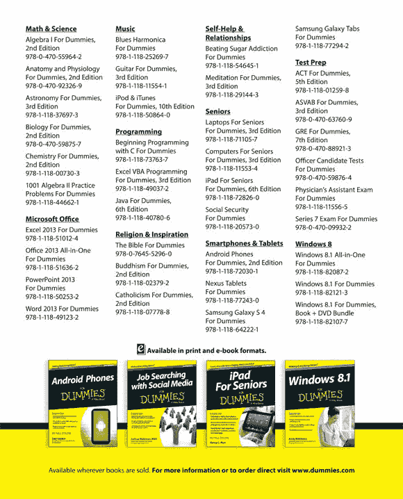

随身携带 Dummies！

访问我们的 [网站](http://www.dummies.com)

在 [Facebook](http://www.facebook.com/fordummies) 上点赞我们

在 [Twitter](http://www.twitter.com/fordummies) 上关注我们

在 [YouTube](http://www.youtube.com/user/fordummies) 上观看我们

在 [LinkedIn](http://www.linkedin.com/groups?home=&amp;gid=3229946&amp;trk=anet_ug_hm) 上加入我们

在 [Pinterest](http://pinterest.com/fordummies/) 上为我们钉选

在 [google+](https://plus.google.com/105265587979403653723) 上关注我们

订阅我们的 [newsletter](http://www.dummies.com/go/newsletter)

创建你自己的 [Dummies book cover](http://covers.dummies.com/)

[在线购物](http://dummiesmerchandise.com)

## Wiley 最终用户许可协议
前往 [`www.wiley.com/go/eula`](http://www.wiley.com/go/eula) 以访问 Wiley 电子书 EULA。
