# 区块链傻学者指南

要查看本书的快速上手指南（Cheat Sheet），只需访问 [`www.dummies.com`](http://www.dummies.com) 搜索框中搜索“Blockchain For Dummies Cheat Sheet”。

## 关于作者

## 引言

欢迎阅读*傻瓜书：区块链 (Blockchain For Dummies!)*！如果你想了解区块链是什么以及使用它们的基础知识，这本书正是为你准备的。很多人认为区块链很难理解。他们可能认为区块链只是关于加密货币的，但其实它们远超此。任何人都可以掌握区块链的基础知识。

### 关于本书

本书解释了区块链、智能合约和加密货币的基础知识。你可能拿起这本书是因为你听过区块链，并知道它们很重要，但你并不知道它们是什么、如何运作的，或者你为什么应该关注它们。这本书将用简单易懂的语言回答所有这些问题。

这本书与市面上的任何其他区块链书籍略有不同。它对公共市场上所有的关键区块链进行了概述，介绍了它们的工作原理、其功能，以及一些你现在就可以尝试的实用操作。

本书还涵盖了区块链技术的格局，并指出了在你开展自己的区块链项目时需要注意的一些关键点。在这里，你将了解到如何安装以太坊钱包、创建并执行智能合约、在 `Bitcoin` 中记账以及赚取加密货币。

最后，在本书中，你可能会注意到某些网页地址跨越了两行文本。如果你正在阅读纸质版书籍并想访问其中某一个网页，只需按照文中注明的格式精确输入网页地址，假装换行符不存在即可。如果你正在看电子书，那你就轻松了——只需点击网页地址即可直接跳转到网页。

### 愚蠢的假设

我对于你以及你在加密货币、编程和法律事务方面的经验没有太多假设，但我确实假设了以下几点：

* 你有一台电脑、一台智能手机，并且可以访问互联网。
* 你了解如何使用电脑和互联网的基础知识。
* 你知道如何在程序的菜单中进行导航。
* 你是区块链的新手，而且不是一名熟练的程序员。当然，如果你是一个熟练的程序员，你仍然可以从书中获益良多——你可能只需要跳过一些循序渐进的指南。

### 本书中使用的图标

在本书书中，我在页边栏使用了图标来引起你注意某些信息。以下是这些图标的含义：

 **提示（Tip）** 图标标记了你可以用来让区块链更易用的技巧和快捷方式。

 **记住（Remember）** 图标标记了特别重要的提示信息——那些你想要记在脑里的内容。为了提取每章中最重要的信息，只需快速浏览这些图标即可。

 **技术细节（Technical Stuff）** 图标标记了具有高度技术性的信息，你可以跳过这些内容而不会丢失当前主题的主旨。

 **警告（Warning）** 图标提醒你小心！它标记了可能为你省去头疼问题（或代币）的重要信息。

### 书籍之外

除了你正在阅读的纸质版或电子书内容外，该产品还包含了一些可以在网上随处访问的额外资源。查看免费的速查表（Cheat Sheet）获取更多关于区块链的信息。要获取此速查表，只需访问 [`www.dummies.com`](http://www.dummies.com) 并在搜索框中输入 `Blockchain For Dummies Cheat Sheet`。

### 接下来去哪里

你可以将区块链技术应用于几乎每一个业务领域。目前，金融、医疗保健、政府、保险行业正处于爆炸式增长，而这只是开始。整个世界正在改变，可能性是无限的。

## 第一部分：上手区块链

在本部分中……

* 发现区块链的本质以及它们如何为你的组织受益。
* 识别正确的技术类型，以及开发和执行有效区块链项目的步骤。
* 在比特币上创建你自己的智能合约，并确定这项技术可以放在你组织中的位置。

# 第 1 章：介绍区块链

在本章中

 **发现区块链的新世界**

 **理解它们为何如此重要**

 **识别区块链的三种类型**

 **加深对区块链工作原理的认知**

最初，`blockchain` 只是计算机科学中关于如何构建和共享数据的术语。今天，区块链被誉为计算的“第五次演进”。或者现在更常被称为 Web3 运动的骨干。

区块链是分布式数据库的一种新颖方法。其创新源于以新的方式整合旧技术。你可以将区块链看作是由一群个人控制、存储并共享信息的分布式数据库。

有许多类型的区块链和区块链应用。区块链是一项全方位的技术，正在全球范围内跨平台、硬件整合。

## 从头说起：什么是区块链

区块链是一种数据结构，它使得创建数字账本并在参与者之间共享成为可能。有许多不同类型的区块链。

* **公有区块链（Public blockchains）**：公有区块链（如比特币）允许任何人参与的大型网络，通过加密货币进行运行。
* **许可区块链（Permissioned blockchains）**：许可区块链（如 Ripple）具有控制权，核心代码可能不是开源。
* **私有区块链（Private blockchains）**：私有区块链被称为分布式账本技术（DLT），通常规模较小，且成员受到严格控制。这些类型通常由联盟机构使用。

**图 1-1**：比特币区块链网络的结构。

为了防止网络被破坏，区块链不仅是去中心化的，通常还利用加密货币。区块链网络产生加密货币，作为维护网络完整性的激励措施。许多加密货币像股票一样在交易所进行交易。

加密货币在每个区块链上的运行方式略有不同。基本上，是软件支付硬件来运行。软件即区块链协议。著名的区块链协议包括 `Bitcoin`、`Ethereum`、`Ripple`、`Cardano`、`Solana` 和 `Polkadot`。硬件由保护网络数据的全节点组成。

## 为什么区块链至关重要

区块链被认为是计算的“第五次演进”，因为它们为互联网提供了一个新的信任层。自 2009 年诞生以来，区块链领域已经显著成熟。现在，个人用户可以获得更高的安全性和自主权。

在区块链之前，信任是由发布证书的中央机构建立的。你可能熟悉的某种证书是安全套接层 (`SSL`)。`SSL` 证书就是你在网页浏览器地址旁边看到的“锁”。它让你知道自己处于一个安全的网站。然而，`SSL` 证书已被证明并非万无一失。证书曾从中央情报局 (`CIA`)、英国秘密情报局（通常称为 `MI6`）、`Microsoft`、`Yahoo!`、`Skype`、`Facebook` 和 `Twitter` 的域名中被盗取。依赖第三方会导致单点故障，黑客经常利用这种漏洞。

另一方面，区块链以新颖的方式建立信任。工作证明 (`PoW`) 区块链要求矿工拥有完整且准确交易历史才能参与网络。权益证明 (`PoS`) 区块链通过要求处理交易的节点“质押”某些加密货币来建立信任，如果被发现欺诈网络，这些货币可能会被没收。私有区块链通过将数据分发到连接但独立的参与者网络中来建立信心，这些参与者彼此认识并且可以被追责。每种类型的区块链都使用不同的激励系统，以确保网络中的每位参与者都会协作维护共享数据库中生成的每笔交易或记录条目的完整且未被篡改的历史。

简而言之，区块链没有单点攻击点；它们在节点网络中分发相同的副本数据。至少从理论上来说，每个节点都增加了篡改该网络数据的难度。

非常值得注意的是，所有区块链在数据控制和安全性方面并非都是同等的。互联网的第五次演进已变得日益主流。具体而言，基于区块链的游戏和非同质化代币 (`NFTs`) 已经产生了数十亿美元的销售额。它们还赋予了全球新一代创作者和创意人员力量。

区块链行业还将其重新命名为 `Web 3.0`。这一名称指的是人们在网上互动的方式，以及谁控制数字资产和数据。作为参考，`Web 1.0` 是一种更静态的互联网体验，个人浏览内容并构建静态网站。`Web 2.0` 是通过 `Google`、`Facebook` 和 `Twitter` 等商业门户网站访问的交互式互联网。在 `Web 2.0` 互联网中，数据由商业实体控制，普通个人用户很少有隐私可言。

`Web 3.0` 是一场全球性的社会运动，反击网络上无处不在的隐私侵犯和欺诈。它还吸引艺术家和制作者的创业和创意精神。`Web 3.0` 软件允许用户通过每个用户自己控制的主权数字身份进行互动。用户的数字凭证通过其数字钱包（如 `MetaMask`）、浏览器扩展程序或用户的私钥（见第 3 章）进行验证。

用户控制的身份让普通用户能够控制自己的数据和隐私。用户还可以拥有数字资产、创建新的数字资产并直接出售它们。互联网实现数字商业已经很久了。`Web 3.0` 特殊之处在于，它优雅地允许世界上任何能够访问智能设备和互联网的人直接与任何其他个人创建内容并进行交易。

全球政府对 `Web 3.0` 做出了强烈反应，并迅速采取控制法币流入区块链空间——例如，要求对从一个钱包向另一个钱包转移超过 1000 美元价值的个人进行反洗钱 (`AML`) 和了解您的客户 (`KYC`) 验证。

当数据以数字格式永久且可靠运行时，你就可以以过去只能在线下进行的方式在线开展业务。所有保持模拟状态的内容（包括产权和身份）现在都可以在线创建和维护。缓慢的业务流程（如资金结算）现在可以瞬间完成。这对安全数字记录的影响是巨大的。

## 区块链的结构

每个区块链的结构略有不同。然而，比特币是一个非常好的研究对象，因为它是大多数后续区块链的模板。`Bitcoin` 上的数据结构使得每个全节点 `node`（运行网络的计算机）都包含网络中的所有数据。从数据持久性的角度来看，这种模型是非常具吸引力的。它确保了即使少数节点遭到破坏，数据也将保持完整。然而，由于每个节点都拥有从最开始到未来每笔交易的完整历史副本，从存储容量的角度来看，这要求条目必须尽可能越小。

相比之下，你可能听过的其他分布式网络（如 `Napster` 和 `Pirate Bay`）是数据的在线索引。文件从网络中的特定节点共享。这允许共享大文件。然而，由于你感兴趣的数据在网络中的所有参与者处并不可用，获取你感兴趣的数据会产生问题。此外，要判断你下载的数据是否完整、未被损坏或是否包含你不想要的信息（如病毒）也很困难。

`Bitcoin` 协调新数据组织和输入的方式包含三个核心元素：

* **区块 (Block)**：在给定期间内记录在账本上的交易列表。区块的大小、周期和触发事件在每个区块链上都是不同的。

  并不是所有区块链都以记录和保护加密货币移动作为首要目标。但所有区块链都会记录其加密货币或代币的移动。将 `transaction`（交易）仅仅视为数据的记录。对其分配一个值（如金融交易中发生的情况）用于解释这些数据的含义。

* **链 (Chain)**：一种将一个区块与另一个区块连接的哈希值，在数学上将它们“链”在一起。这是区块链中最难理解的概念之一。它也是将区块链胶合在一起的魔力，允许它们创建数学信任。

  区块链中的哈希值是由上一个区块中的数据创建的。哈希值是这些数据的指纹，并按照顺序和时间锁定区块。

   尽管区块链是一项新创新，但哈希（Hashing）并不是。哈希技术发明于 70 多年前。这种老旧创新之所以被使用，是因为它创建了一种无法解密的单向函数。哈希函数创建了一种数学算法，将任意大小的数据映射到固定大小的位字符串。位字符串通常为 32 个字符，然后代表了被哈希的数据。安全哈希算法（`SHA`）是区块链中使用的某些加密哈希函数之一。`SHA-256` 是一种常用的算法，可生成几乎唯一的、固定大小的 256 位（32 字节）哈希。从实际角度考虑，可以将哈希视为数据的数字指纹，用于将其锁定在区块链内部。

* **网络 (Network)**：网络由“全节点”组成。可以将它们想象为运行算法以保护网络的计算机。每个节点都包含该区块链中记录过的所有交易的完整记录。

  节点分布在世界各地，任何人都可以操作。运行全节点既困难、昂贵又耗时，因此人们不会免费提供服务。他们运行节点受到激励，是因为他们想赚取加密货币。底层区块链算法为他们的服务提供奖励。奖励通常是代币或加密货币，如 `Bitcoin`。

   `Bitcoin` 和 `blockchain` 这两个术语经常互换使用，但它们不是一回事。`Bitcoin` 拥有区块链。`Bitcoin` 区块链是实现 `Bitcoin` 安全传输的底层协议。`Bitcoin` 是驱动 `Bitcoin` 网络的加密货币名称。区块链是一种软件，而 `Bitcoin` 是一种特定的加密货币。

## 区块链应用

区块链应用围绕这样一个核心理念构建：其区块链网络及其创建时建立的规则将是所有交易的仲裁者和所有信息的守护者。这种系统是一个严苛且盲目的环境。计算机代码即法律，规则按照网络对其编写和解释的方式执行。计算机没有像人类那样的社会偏见和行为。

网络无法解释意图（至少目前不能）。在区块链上进行仲裁的保险合同已作为一个围绕这一理念构建的用例经过了大量研究。

区块链实现的另一个有趣功能是完美无缺的记录保存。它们可以用于创建清晰的时间线，记录谁在**什么时候**做了**什么**。许多行业和监管机构花费了无数小时试图评估这个问题。基于区块链的记录保存将减轻我们在尝试解释过去时产生的一些负担。

## 区块链的生命周期

区块链起源于 `Bitcoin` 的创建。它证明了一群从未谋面的个人可以在一个系统中在线运行，而该系统对网络中协作人员的欺诈行为具有免疫力。

原始的 `Bitcoin` 网络是为了保护 `Bitcoin` 加密货币而建立的。写作期间，它大约有 13,000 个全节点。`Bitcoin` 区块链是实现 `Bitcoin` 安全传输的底层协议。`Bitcoin` 是驱动 `Bitcoin` 网络的加密货币名称。区块链是一种软件，而 `Bitcoin` 是一种特定的加密货币。

以太坊网络是第二次演进。它有超过 10,000 个全节点。它主要用于交易 `Ether` 和创建智能合约。`Ethereum` 允许生成代币。最流行的以太坊智能合约是 `ERC20`。这些代币可用于融资。你可以在第 5 章中发现更多关于智能合约的内容。区块链技术正在积极演进以解决速度和数据限制。需要几年时间才能明确哪种结构会胜出。流行的新进展包括 `sharding`（分片），这是一种将大型数据库划分为称为“碎片”的较小部分的类型。一种名为 `fork choice rule` 的以太坊开发将以太坊分为并行网络。它可能允许以太坊更高效地扩展并减少网络拥堵。另一种流行的扩展理论是 `PoS`。我在第 8 章中详细介绍了这一主题。广义上，`PoS` 是将代币或加密货币作为处理交易的押金的概念。如果节点损坏且未准确处理交易，该节点可能会没收其代币或加密货币。

扩展技术的第三次尝试利用了可信节点。例如，`Accumulate`（`Factom` 网络的硬叉）通过联邦节点和无限数量的审计节点运行。这些节点被信任以确保系统安全。`Accumulate` 的选举网络很小，仅有 60 多个节点。为了对冲安全风险，`Accumulate` 将自己锚定到其他网络，以利用更广泛系统的安全性。`Accumulate` 还将其网络划分为更小、更快、更易管理的部分称为 `chains`（链）。`Accumulate` 的交易速度比 `PoW` 区块链快，成本更低，而且没有 `PoS` 的沉没成本。

## 共识：区块链的驱动力

区块链是强大的工具，因为它们创建了诚实的自我纠错系统，不需要第三方来执行规则。它们通过共识算法来实现规则的执行。

在区块链世界中，`consensus` 是在一群互不信任的股东之间达成协议的过程。这些是网络上的全节点。全节点正在验证输入网络并准备记录为账本一部分的交易。

**图 1-2** 展示了区块链如何达成共识的概念。

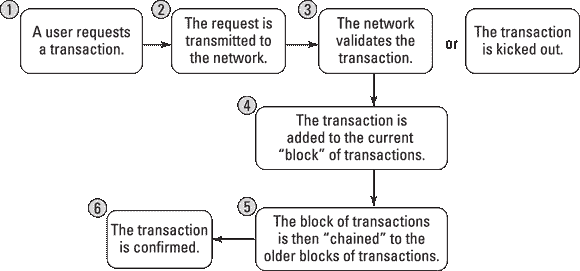

**图 1-2**：区块链如何工作。

每个区块链都有自己的算法，在其网络内部对添加的条目达成共识。创建共识有许多不同的模型，因为每个区块链都在创建不同类型的条目。有些区块链在交易价值，另一些在存储数据，还有一些在保护系统和合同。

例如，比特币是在其网络成员之间交易其代币的价值。这些代币具有市场价值，因此对性能、可扩展性、一致性、威胁模型和故障模型的要求会更高。比特币的运行基于这样一个假设：恶意攻击者可能想要通过篡改交易历史来盗取代币。比特币通过使用名为“工作量证明”（proof of work）的共识模型来防止这种情况发生，该模型解决了拜占庭将军问题：“你如何知道你所看到的信息没有在内部或外部被篡改过？”由于更改或操纵数据几乎总是可能的，数据的可靠性是计算机科学中的一个大问题。

大多数区块链的运行前提是，它们将受到外部力量或系统用户的攻击。预期的威胁以及网络对运行区块链的节点的信任程度，将决定它们用于结算账本的所采用共识算法类型。例如，比特币面临极高威胁，并使用了一种名为 `proof of work` 的强力共识算法。网络中不存在信任。

在光谱的另一端，用于记录已知双方之间金融交易的区块链可以使用更轻量、更快速的共识机制。它们对高速交易的需求更为重要。由于网络内的参与者相对较少，且每笔交易都需要即时终局性，工作量证明对它们来说太慢且成本太高。它们也不需要代币或加密货币来激励交易处理。因此，它们从系统中消除了这些元素，运行得比 `PoW` 系统更快、更便宜。

## 应用中的区块链

目前全球范围内有成千上万区块链和基于区块链的应用在使用。这些系统允许创建非同质化代币（NFTs）、在游戏中使用加密货币、让资金通过分布式网络更快速地流动，以及开发安全可靠的应用和硬件。随着人们发现这些技术所提供的众多益处和可能性，全球对这些技术的兴趣持续增长。

你可以通过加密货币交易所看到其中许多公共区块链。

**图 1-3** 显示了 Poloniex ([`poloniex.com`](https://poloniex.com)) 的交易所，这是一个加密货币交易平台。

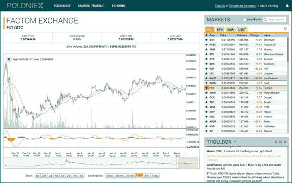

**图 1-3**：山寨币交易所平台。


# 区块链正在超越交易价值市场

区块链正在超越交易价值市场，并被整合到各种行业中。区块链增加了一个新的信任层，使得在线工作能够以以前不可能的方式变得安全。

## 当前区块链用途

第一批区块链应用围绕着快速、廉价地转移资金或其他形式的价值。这包括交易上市公司的股票、向其他国家的员工支付工资以及将一种货币兑换另一种货币。区块链现在还被用作软件安全栈的一部分。美国国土安全部一直在调查保护物联网（IoT）设备和供应链完整性的区块链软件。物联网世界从这项创新中获益最多，因为它们特别容易受到欺骗和其他形式的黑客攻击的影响。物联网设备也变得更加无处不在，安全性也变得更加依赖它们。医院系统、自动驾驶汽车和安全系统就是首要的例子。

代币发行（ICOs）是另一项令人兴奋的区块链创新。它们是智能合约的一种，允许发行者提供代币以换取投资资金。通常用作一种非稀释性融资方案，全球创业者已筹集了数十亿美元。政府和监管机构已迅速打击 ICO。这些代币可能是未经许可的证券，且发行可能欺诈投资者。即使合规问题仍在解决中，这项技术也令人印象深刻。

ICO 代币固有的奇妙创新之一是，它们是一种自清算和自结算的工具。在我们目前的证券交易系统中，有两种类型的结算机构：结算公司和托管机构。结算公司审计交易并在结算中充当中介。托管机构持有证券证书并维护证券的所有权记录。区块链为代币执行了这两种功能，而不需要第三方来审计和保留资产的占有。你可以在第 15 章中了解更多关于 ICO 代币的信息。

NFT 和边玩边赚（play-to-earn）游戏也向行业注入了数十亿美元，并赋予普通用户创建和销售自己数字资产的能力。由区块链实现的社交媒体、网页浏览和安全通信每年越来越流行。此外，各国（包括中非共和国和萨尔瓦多）正将比特币作为它们的法定货币。

## 未来的区块链应用

区块链革命已扩展到互联网，并迅速将以前的 Web 2.0 数字体验转变为更受终端用户控制的体验。人类正经历着后期的全球化。这是一个基于数字的劳动力变得商品化且价格平等的世界。纽约的会计师有一天将与住在新金斯顿或新德里的同等会计师成本相同。

区块链应用将在数十人的生活中变得无缝融合，因为它将作为身份和货币，并实现跨应用的信任数据。

关于区块链及其运行其上的加密货币有大量的讨论。这些讨论中很大一部分源于加密货币价值的波动，以及对区块链技术将颠覆许多行业和政府职能的恐惧。大量资金涌入研发领域是因为利益相关者不希望被淘汰，而创业者则想要探索新的业务模式。

当谈及寻找区块链技术为组织增加价值的机会时，通常会产生这样一个问题：“区块链在何产生价值？它们与现有技术有何不同？”

区块链是一种特殊类型的数据库。数据库是按照特定方式组织并以电子方式存储的数据集合。数据库的设计目的是快速、高效地存储、检索和管理大量数据。它们通常用于存储`structured data`（遵循特定格式并按特定方式组织的数据），并广泛应用于各种场景，包括金融系统、客户关系管理系统和在线购物网站。

区块链类似于数据库，因为它是一个数字记录系统，并以结构化的方式存储数据。一个关键区别是，区块链是一个`distributed database`——它并不存储在单一位置，而是遍布于计算机或节点网络。大多数区块链要求网络中存在全节点，并拥有整个区块链的副本；当新数据被添加到区块链时，它会被添加到网络中区块链的所有副本中。这种去中心化的结构使得任何单一实体都难以更改区块链中的数据，因为任何更改都必须在区块链的所有副本上同时进行。

数据被添加到区块链后，通常情况下，它不能被更改或删除。这使得区块链成为一个安全且可靠的记录系统，因为它确保了存储其上的数据的完整性和真实性。某些区块链已经实现了删除数据的系统（除非你付费让其保持发布状态），但这并非常态。

相比之下，传统数据库通常是中心化的，更容易被拥有访问权限的单一实体更改或操纵。它们的安全性也较低，因为容易受到黑客攻击和数据泄露的影响。在考虑区块链的用途时，请注意你可以在任何使用普通数据库的地方使用区块链——但如果普通数据库就能胜任，那么费费精力和成本去使用区块链可能没有意义。区块链是一种故意设计的、跨越网络的低效数据库。

当你想要与你不完全信任的方共享信息、你的数据需要审计，或者你的数据面临内部或外部泄露的风险时，你真正能看出某种形式区块链的价值。大多数区块链都会发布自己的公共记录。即使数据已经加密，当未来量子计算变得更加廉价且随手可得时，它可能不再是私密的。这些问题没有简单的答案，正确的解决方案可能难以确定。

本节将帮助缩小你的选择。

## 确定你的需求

区块链有很多种类型。你会找到一个符合你需求的——关键在于找到它！将你的需求映射到最佳区块链上可能会让人无从下手。每当我有很多选项且往往有相互冲突的需求时，我喜欢使用加权决策矩阵（weighted decision matrix）。

加权决策矩阵是评估项目需求并将这些需求映射到可能解决方案的佳工具。矩阵的主要优势在于帮助你量化并优先考虑项目的各项需求，并简化决策。加权决策矩阵还能防止你被单个标准所淹没。如果操作得当，这个工具允许你收敛到一个符合你所有目标的单一想法。

要创建一个加权决策矩阵，请遵循以下步骤：

1. **脑风暴团队需要满足的关键标准或目标。**

   如果你不确定在评估区块链项目时需要考虑哪些标准，请记住以下几点：

   * 规模和体量
   * 速度和延迟
   * 安全性和不可篡变性
   * 存储容量和结构需求

   你的团队将会有自己的目标和优先级列表。这些只是在评估用于满足你需求的正确平台时需要考虑的几项内容。

2. **将标准列表缩减至十项以内。**

   如果你在精炼需求列表方面困难，请考虑使用比较矩阵工具。

3. **在 Microsoft Excel 或类似的程序中创建一个表格。**

4. **在第一列输入设计标准。**

5. **根据每个目标对项目成功的重要性，为每个标准分配相对权重。**

   将总分限制在 10 分并分配到所有标准之间——例如，`1 = 低`，`2 = 中等`，`3 = 高优先级`。

   如果你在团队中工作，让每个成员单独对标准进行加权。

6. **累加每个目标的数字，并除以团队人数以获得复合团队权重。**

7. **对权重进行任何调整，以确保每个标准的权重都正确。**

恭喜！你现在有了一份为了让区块链项目成功而需要满足的标准排序列表。

## 定义你的目标

在构建没有明确目标或目的的区块链项目时，很容易迷失方向。花时间理解你和你的团队想要去哪里以及最终目标是什么。例如，一个目标可能是与合作伙伴公司进行无中间人的资产交易。这是一个涉及许多利益相关者的大目标。

回到一个小项目，使其作为该技术的最小可行用例，并清晰地阐述为公司增加的价值或节省成本。与之前的示例类似，较小的目标是构建一个可以在信任双方之间交换价值的私有网络。

然后在此价值的基础上继续构建。下一个胜利可能是构建一个可以在你新平台上交易的工具。每一步都应该展示一个小小的胜利和创造的价值。

## 选择解决方案

区块链有三种核心类型：如比特币这样的公共网络、如 Ripple 这样的许可网络以及如 R3 这样的私有网络。

区块链执行几件直接的事情：

* 它们快速且以极低成本移动和交易价值。
* 它们创建近乎永久的数据历史。

区块链技术还允许一些不那么直接的解决方案，例如在不向对方透露的情况下证明你拥有“某物”。同样也可以“证明负面事实”，或证明数据集或系统中缺失的内容。这一功能对于审计和证明合规性特别有用。

表 2-1 列出了适用于每种区块链类型的常见用例。

### 表 2-1 公共区块链与私有区块链用途

| **主要用途** | **区块链类型** |
| --- | --- |
| 在不信任双方之间移动价值 | 公共 |
| 在信任双方之间移动价值 | 私有 |
| 在不同事物之间交易价值 | 许可 |
| 交易相同物的价值 | 公共 |
| 创建去中心化组织 | 公共或许可 |
| 创建去中心化合约 | 公共或许可 |
| 交易证券化资产 | 公共或许可 |
| 为人或物建立身份 | 公共 |
| 公共记录存储发布 | 公共 |
| 私有记录存储发布 | 公共或许可 |
| 对记录或系统进行审计 | 公共或许可 |
| 发布土地所有权数据 | 公共 |
| 交易数字货币或资产 | 公共或许可 |
| 为物联网 (IoT) 安全构建系统 | 公共 |
| 构建系统安全防护 | 公共 |

根据你的项目需求，可能会存在例外情况，并且你可能使用不同类型的区块链来实现你的目标。但总的来说，以下是划分不同类型的网络并理解其优缺点的方法：

- `Public networks`（公共网络）规模大且去中心化，任何人都可以参与任何级别的活动——这包括运行全节点、挖掘加密货币、交易代币或发布条目等。它们通常比私有或许可网络更安全、更不可篡改，但它们的使用速度通常较慢且成本更高。它们通过加密货币保护，且存储容量有限。

- `Permissioned networks`（许可网络）公众可见，但参与度受控制。其中许多网络使用加密货币，但对于构建在其之上的应用程序，其成本较低。这一特性使得项目扩展和增加交易量变得更容易。许可网络可以非常快，延迟低，且其存储容量高于公共网络。

- `Private networks`（私有网络）在信任方之间共享，可能对公众不可。它们速度极快，可能没有延迟。它们的运行成本很低，可以在一个周末内构建完成。大多数私有网络不使用加密货币，也不具备去中心化网络相同的不可篡改性和安全性。存储容量可能是无限的。

这三种核心区块链类型之间还存在混合类型，旨在为构建在其之上的应用程序在安全性、可审计性、扩展性和数据存储之间寻找正确的平衡。

### 绘制区块链决策树

在组织内部开展区块链项目时，你面临的一些决策可能是困难且具有挑战性的。花时间做出涉及以下因素的决策是值得的：

- `Uncertainty`（不确定性）：关于区块链技术的许多事实可能是未知且未经测试的。
- `Complexity`（复杂性）：区块链有许多相互关联的因素需要考虑。
- `High-risk consequences`（高风险后果）：决策对你的组织可能巨大。
- `Alternatives`（替代方案）：可能存在替代技术和区块链类型，每种都有其自己的不确定性和后果。
- `Interpersonal issues`（人际问题）：你需要理解区块链技术如何影响你组织内的不同人员。

决策树是一个实用的支持工具，可以帮助你发现开发区块链项目的后果、事件结果、资源成本和效用。

你可以在纸上画决策树，也可以使用计算机应用程序。以下是创建一个决策树以揭示项目其他挑战的步骤：

1. **准备一张大纸。**

   选择越多、决策越复杂，你需要的纸就越大。

2. **在纸的左侧画一个正方形。**

3. **在正方形内写下项目的核心目标和标准的描述。**

4. **为每个问题向正方形右侧画线。**

5. **沿每条线写每个问题的描述。**

   为遇到每个问题分配概率值。

6. **为每个问题脑风暴解决方案。**

7. **沿每条线写每个解决方案的描述。**

8. **继续这个过程，直到你探索了每个问题并为每个问题发现了可能的解决方案。**

在最终确定之前，让队友挑战并审查你所有的问题和解决方案。

### 制定计划

到此时，你应该对你的目标、障碍以及你可以使用的区块链选项有清晰的理解。

这里有一个构建项目的简单路线图：

1. **向关键利益相关者解释项目，并讨论其关键组成和预期结果。**

2. **编写项目计划。**

   这是一份动态文档，会随着项目的生命周期而变化。

3. **制定性能指标、范围说明、进度表和成本基准。**

4. **考虑制定风险管理计划和人员计划。**

5. **获得认可并定义角色和职责。**

6. **召开启动会议开始项目。**

   会议应涵盖以下内容：

   - 项目愿景
   - 项目策略
   - 项目时间表
   - 角色和职责
   - 团队建设活动
   - 团队承诺
   - 团队如何做出决策
   - 衡量项目的关键指标

完成项目后，工作还没有结束！回去分析你的成功和失败。这里是一些可以问自己的问题：

- 我的关键利益相关者满意吗？
- 项目按时完成的吗？
- 如果没有，是什么导致了延迟？
- 我从这个项目中学到了什么？
- 我希望在哪些方面可以做得不同一些？
- 我是否真的为公司创造了新价值或节省了钱？

当你对区块链技术有更深入的了解并在开发构建项目的计划时，你可能想要回到这一章。

# 第 3 章 上手区块链

## 本章内容

-  **创建和使用比特币和以太坊钱包**
-  **将比特币兑换为以太坊**
-  **创建区块链资产**
-  **租赁区块链资产**

区块链是非常强大的工具，它们正在改变世界移动资金、安全系统和构建数字身份的方式。如果你不是核心开发者，在未来你可能不会进行深度的区块链开发。尽管如此，你仍然需要了解区块链如何工作以及它们的各种局限性，因为它们在未来将集成到许多日常在线交互中——从企业如何支付工资到政府如何确保其系统和数据的完整安全。

在本章中，你将直接进入区块链技术。购买你的第一个加密货币并学习将其兑换为其他货币。设置特殊的应用程序，让你访问整个去中心化应用（称为 `dApps`）生态系统。你还将设置一个安全环境来使用你的加密货币。在本章中，你通过区块链游戏创建并租赁数字区块链资产。

完成本章后，你将理解区块链技术提供的许多基本功能。你还将对在使用加密货币时需要的额外安全有了基本了解。本章还将帮助你建立后续章节所需的基本加密账户。

## 深入区块链技术

以太坊区块链是世界上最大、最强大的区块链之一。它的设计用于构建 `dApps`，即构建在无信任去中心化网络中的应用程序。在以太坊网络中，开发者利用`smart contracts`构建这些应用程序。以太坊还利用名为 `Ether` 的加密货币来奖励提供计算能力并创建这些智能合约执行所需的无信任系统的用户。

智能合约并不像你可能在商业中看到的合同。相反，智能合约是部署在去中心化网络上的代码。像商业合同一样，它们有预定义的条款。一个关键区别是，智能合约是由其区块链网络执行的。它们是一项重要的计算创新，因为它们允许互不认识或不信任的个人进行协作，而无需担心对方不会按照双方约定的条款履行约定。

利用加密货币的区块链有时被称为“无信任”系统，因为代码是由网络执行的（而商业合同是由法院系统执行的）。

在接下来的章节中，你将设置账户来购买你的第一个比特币（Bitcoin）。你还将把购买的一些比特币兑换为以太坊（Ether），以便你可以在后续章节中使用以太坊 dApps。

## 创建安全环境

你需要做的第一件事是创建一个安全的环境进行在线工作。你有越来越多的理由认为应该考虑使用安全浏览器和虚拟私有网络（`VPN`）。它们可以防止你的数据在未经你同意的情况下被收集，并帮助避免黑客攻击。普通用户在使用加密货币和不安全的 Internet 连接时，可能会成为黑客的目标。

在本节中，你将下载 `Brave` 浏览器、`ProtonVPN` 和 `MetaMask` 扩展。你可以免费使用这三项服务。然而，它们也提供付费的改进版服务。

准备好纸和笔来记录重要信息。永远不要对密码或助记词（seed phrases）等内容截图或拍照。

### 下载并安装 Brave 浏览器

Brave 是一种基于 Google Chromium 的新型安全浏览器，快速、开源且注重隐私。它可以拦截广告、跟踪程序，并有一项让你用代币奖励你喜欢的发行者的功能。互联网先驱布兰丹·艾奇（Brendan Eich）创建了 `Brave`；他还发明了 `JavaScript` 并共同创立了 `Mozilla`。

要下载 `Brave` 浏览器，请遵循以下步骤：

1. **访问** `https://brave.com/`。
2. **点击 Download Brave。**
3. **进入你的下载文件夹。**
4. **双击 Brave 浏览器文件。**
5. **将新的 Brave 浏览器图标拖入你的应用程序文件夹。**

现在你有了一个更安全的浏览器，可以为其添加区块链扩展，允许你探索去中心化应用。

Brave 浏览器本身就是一个很棒的浏览器，但如果你想提升安全性，可以使用 Brave Tor 浏览器。`Tor`（`The Onion Router` 的缩写）是一种用于匿名通信和网页浏览的免费开源软件。它通过全球志愿者覆盖网络重导 Internet 流量，帮助你向任何进行网络监控或流量分析的人隐藏你的位置和使用情况。这似乎可能多此一举，但加密货币用户是想要窃取其资产的恶意国家和恐怖组织的目标。

通过 `Tor` 连接，你可以获得两个额外收益：你的 IP 地址对你访问的网站隐藏，而你访问的网站对被动网络观察者隐藏。注意，`Tor` 可能会降低浏览速度或导致某些网站崩溃。

要使用 Brave Tor 浏览器，在 Brave 浏览器中选择 File ⇒ New Private Window with Tor。

带有 `Tor` 的隐私窗口会让你的 Internet 服务提供商（`ISP`）查看你访问的网站变得困难，但并非不可能。然而，带有 `Tor` 的隐私窗口无法完全防御跟踪，你可以考虑阅读 Joseph Steinberg (Wiley) 编写的《Cybersecurity For Dummies，第二版》，以学习更多关于在线安全的知识。

### 下载并安装 ProtonVPN

`ProtonVPN` 由一家瑞士公司运营的 `VPN`。当你使用 `ProtonVPN` 浏览网页时，你的 Internet 连接会被加密，任何潜在攻击者都无法监听你的活动。它还允许你访问可能被封的网站。

要下载 `ProtonVPN`，请遵循以下步骤：

1. **访问** `https://protonvpn.com/`。
2. **点击 Get ProtonVPN Now。**


### 点击 Get Free

### 在提示时输入你的电子邮件地址

要安装 `ProtonVPN`，请遵循以下步骤：

1. 进入 Mac 或 PC 下载文件夹
2. 双击 `ProtonVPN` 文件
3. 将新的 `ProtonVPN` 图标拖入你的应用程序文件夹

`VPN` 是良好的第二层防护，有助于确保你的连接安全。要了解更多关于如何保护你自己和设备的知识，请查看 Joseph Steinberg (Wiley) 的《Cybersecurity For Dummies》。

### 下载、安装和保护 MetaMask

`MetaMask` 是一个浏览器扩展，允许你直接在浏览器中运行以太坊 dApps，而无需运行全以太坊节点。（以太坊是世界上最大的区块链之一；更多信息请见第 5 章）。`MetaMask` 包含一个安全的身份库。它允许你登录网站、管理你在网络上的身份并签署区块链交易。你还可以在 `MetaMask` 钱包中存放一些以太坊（Ether）货币进行在线支付。

要下载并安装 `MetaMask`，请遵循以下步骤：

1. **打开 Brave 浏览器。** 如果你还没有安装它，请查看本章前面的“下载并安装 Brave 浏览器”。
2. **访问** `https://metamask.io/`。
3. **点击 Download for Brave。**
4. **点击 Add to Brave。**
5. **点击窗口内的 Add Extension。** 你现在应该会在右上角看到一个小狐狸图标。

由于 `MetaMask` 是一个钱包，你还需要用一个强密码和助记词（backup seed）来保护并备份你的钱包。助记词允许你在丢失密码时恢复你的钱包。

找一张私人的笔记本或纸张。不要使用你刚刚写下用户名和密码的同一张笔记本或纸张。确保将这些文件保存在不会被毁或被发现的地方。许多人使用银行金库或保险箱存放备份短语和密码，因为拥有其中任何一个就意味着拥有你的加密货币。

1. **在纸张顶部写下“MetaMask”、“Brave browser”、日期、下载设备以及“Seed phrase”。**
2. **打开 Brave 浏览器。**
3. **点击右上角的狐狸图标。**
4. **点击 Accept。**
5. **点击锁头图标。**
6. **写下并编号这 12 个单词的短语。**
7. **点击 Next。**
8. **根据你写的内容重新排序助记词。**
9. **点击 Done。**

 考虑对写有用户名密码和助记词的纸张进行层层保护。并且记住不要将这两张纸存在同一个位置。

### 购买你的第一个比特币

你有几个地方可以购买你的第一枚比特币。如果你在美国境内，在设置账户以及将其与信用卡或银行账户关联时可能会遇到一些阻碍。你可能需要一两天的时间来通过身份验证并允许购买你的第一种加密货币。由于新的全球旅行规则（参见旁边的边栏），所有虚拟资产服务供应商（VASP）必须对交易金额超过 1000 美元的客户进行反洗钱（AML）和了解客户（KYC）验证。

如果你在美国境内并想首次购买加密货币，我建议使用以下网站之一：

*   `Cash App`: [`https://cash.app`](https://cash.app)
*   `Coinbase`: [`www.coinbase.com`](https://www.coinbase.com)
*   `Gemini`: [`https://gemini.com/`](https://gemini.com/)
*   `Robinhood`: [`https://robinhood.com`](https://robinhood.com)

前往这些网站中的一个并设置账户。你想要购买价值 10 到 20 美元的加密货币。我建议购买比特币。它是被广泛接受并交易的所有加密货币之一。你也可以选择购买以太坊，用于 dApps。如果是这样，请继续购买价值 5 到 10 美元的货币，因为你将在下一节中使用它。如果你只能购买比特币，也没关系。

一个重要的注意事项是，加密货币处于监管地带。在本书这里，你可以从这些来源购买并提取资金。在你的国家或地区可能不可用。如果是这样，你可能需要前往第 5 章。接收 Ether。

## 安全并交换你的加密货币

当你设置账户并购买以太坊时，可以跳过这一节。在这里，你将使用 `ShapeShift` 交易所交换比特币。`Jaxx` 钱包由 Anthony Iorio 开发，他是以太坊的联合创始人。

将钱包下载到电脑或手机上。对于这个练习，你将下载 `Chrome` 扩展。不要忘记你的设备可能会被攻击。常见的加密货币攻击是通过社交工程进行的。`Jaxx` 被视为热钱包，因为它连接到互联网，你可能会丢失资产。

 你可以做几件事来帮助降低风险：

*   使用你的 `VPN`。
*   使用 `Google Authenticator`（谷歌身份验证器）。
*   使用 `Google Voice`（谷歌语音）。
*   仅用于加密货币账户的邮箱。
*   仅在安全连接上进行加密货币活动。
*   永远不要记录你的密码和助记词。

### 下载 Jaxx

在这一节中，你将下载并设置加密货币钱包。市场上有很多可以帮助你保护比特币和其他资产的选择。`Jaxx` 是一个易用的钱包，支持 80 多种不同的加密货币。它在 `iOS`、`Android`、桌面端运行良好，也有 `Google Chrome` 版本。也可以查看其他选项。例如，`Exodus.io` ([`www.exodus.io`](https://www.exodus.io/)) 是另一个非常好用的钱包。

1. 在你的 `Brave` 浏览器中，前往 [`https://jaxx.io/`](https://jaxx.io/)。
2. 点击 `Downloads`（下载）。
3. 选择 `Add the Jaxx Chrome Extension to Your Browser`（将 Jaxx Chrome 扩展添加到你的浏览器）。
4. 点击 `Add to Chrome`（添加到 Chrome）。
5. 在弹出窗口中点击 `Add Extension`（添加扩展）。

### 安全你的 Jaxx 钱包

现在你准备好保护你的 `Jaxx` 钱包了。你需要两张干净的纸来写下助记词和密码。

 不要将密码和助记词分开。

按照以下步骤操作：

1. 在纸顶部写下“Jaxx”、“Brave 浏览器”、日期以及你下载 `Jaxx` 的设备。
2. 打开 `Brave` 浏览器。
3. 点击右上角的图标。
4. 点击 `Create New Wallet`（创建新钱包）。
5. 点击 `I Agree`（我同意）。
6. 点击 `Continue`（继续）。
7. 点击 `Back Up Now`（立即备份）。
8. 看到警告时点击 `Yes`（是）。
9. 点击 `Start Backup`（开始备份）。
10. 写下并记录你的助记词。
11. 按顺序重新输入单词。
12. 点击 `Confirm`（确认）。
13. 点击 `Jaxx Home`（Jaxx 首页）。

 在下一节中，你将为 `Brave` 浏览器上的 `Jaxx` 钱包设置密码。不要跳过这一步——你以后需要密码来访问你的资产。

按照以下步骤操作：

1. 在纸顶部写下“Jaxx”、“Brave 浏览器”、日期以及你下载 `Jaxx` 的设备。
2. 打开 `Brave` 浏览器。
3. 点击右上角的图标。
4. 点击 `Create New Wallet`（创建新钱包）。
5. 点击 `I Agree`（我同意）。
6. 点击 `Continue`（继续）。
7. 点击 `Back Up Now`（立即备份）。
8. 看到警告时点击 `Yes`（是）。
9. 点击 `Start Backup`（开始备份）。
10. 写下并记录你的助记词。
11. 按顺序重新输入单词。
12. 点击 `Confirm`（确认）。
13. 点击 `Jaxx Home`（Jaxx 首页）。

### 将比特币接到 Jaxx

在这一节中，你将向 `Jaxx` 钱包添加加密货币。目前，可以在 `Jaxx` 钱包购买比特币，所以你可能考虑从 `Coinbase` 等交易所转移资产。

按照以下步骤操作：

1. 打开 `Brave` 浏览器。
2. 点击右上角的图标。
3. 点击 `Wallets`（钱包）。
4. 点击 `Bitcoin`（比特币）。
5. 点击 `Receive`（接收）。
6. 点击 `Copy Address`（复制地址）。

### 将比特币交换为以太坊

现在你需要打开存放比特币的账户。你需要找到传输或发送按钮并在出现时粘贴地址。当你将比特币接收到 `Jaxx` 钱包后，可以使用交换功能。按照以下步骤操作：

1. 打开 `Brave` 浏览器。
2. 点击右上角的图标。
3. 点击 `Wallets`（钱包）。
4. 点击 `Bitcoin`（比特币）。
5. 点击 `Exchange`（交换）。
6. 选择 `Ethereum ETH`（以太坊 ETH）。
7. 输入你想交换的金额。

    对于下一节，你需要价值 5 到 10 美元的以太坊。

8. 点击 `Continue`（继续）。
9. 点击 `Exchange`（交换）。

### 填充你的 MetaMask 账户

当你的交换完成后，你可以按照之前的说明将以太坊发送到你的 `MetaMask` 账户：

1. 进入你有以太坊的账户。
2. 点击 `Account`（账户）。
3. 点击 `Send`（发送）。
4. 点击浏览器右上角的 `fox`（狐狸）图标。
5. 点击菜单图标。
6. 点击 `Ether`（以太坊地址）。
7. 复制 `address`（地址）。
8. 将你的 `MetaMask` 以太坊地址粘贴到 `Recipient`（接收者）窗口。
9. 输入你想发送的金额。
10. 点击 `Continue`（继续）。
11. 点击 `Confirm`（确认）。

在本节中，你将通过以太坊区块链体验乐趣。在这里，你将学习如何购买独特的区块链资产、创建你自己的独特区块链资产，然后在全球市场上出售你的资产。

这项创建和出售区块链资产的极其复杂的练习被伪装成可爱的猫咪图像。它被称为 `CryptoKitties`，允许你收集和创建新的数字猫咪。每张图像都有从其父级图像继承的独特特征。当你“繁育”出一只新的 `CryptoKitty` 时，你就可以将猫租出去进行繁育以创建新资产，或将其出售换 `Ether`。

按照以下步骤操作：

1. 在你的 Brave 浏览器中，访问 [`www.cryptokitties.co`](http://www.cryptokitties.co/)。
2. 点击 `Start`。
3. 点击 `Connect`。
4. 点击 `Sign In`。
5. 在弹出窗口中点击 `Sign`。

### 购买 CryptoKitties

在本节中，你会找到两只可以购买的猫。这将允许你“繁育”一只新猫咪，并将你的猫租给他人进行繁育。

按照以下步骤操作：

1. 在你的 Brave 浏览器中，访问 [`www.cryptokitties.co`](http://www.cryptokitties.co)。
2. 点击 `Sign In`。
3. 在弹出窗口中点击 `Sign`。
4. 在 `Great-Value Kitties` 下，点击 `Browse All`。
5. 选择一只可爱的猫。

 你有很多选择，但因为这个练习主要是为了好玩，所以省着点。另外，寻找一只具有“Swift”和“low-gen”属性的猫。它们繁育速度更快，繁育之间的冷却时间更短。

6. 点击 `Buy Now`。
7. 点击 `OK`、`Buy This Kitty`。
8. 点击 `Confirm`。
9. 选择你的第二只猫并按照购买说明操作。

### 繁育你的 CryptoKitties

在本节中，你将利用上一节中购买的两只猫进行繁育，创造出一只新猫。这是一项非常有趣的活动，因为你正在创建一个独特的数字资产，该资产具有可验证的来源，并且可以在开放的全球市场上进行交易，无需中间机构来协助身份验证或传输。

取决于你购买猫时以太坊网络的速度，可能需要几分钟才能在 `Kitties` 下看到它们。请耐心等待——它们会出来的。你可以随时检查交易日志来查看状态。

按照以下步骤操作：

1. 在你的 Brave 浏览器中，访问 [`www.cryptokitties.co`](http://www.cryptokitties.co)。
2. 点击 `Sign In`。
3. 点击 `My Profile`。
4. 选择你的其中一只猫。
5. 点击 `Breed`。

繁育由一个茄子图标表示。

6. 点击 `Sire with My Kitties`。
7. 点击 `OK`、`Let’s Get Started`。
8. 点击显示 `Select Your Kitty` 的框。
9. 选择另一只猫。
10. 点击 `OK`、`Give Them Some Privacy`。
11. 在弹出窗口中点击 `Confirm`。

### 租出你的 CryptoKitties

在本节中，我们将把你的一只猫发布到市场中进行繁育。通过这种方式，你正在没有中间商的开放市场上租出你的资产。如果你的一只猫仍处于怀孕状态，请选择另一只猫租出。

按照以下步骤操作：

1. 在你的 Brave 浏览器中，访问 [`www.cryptokitties.co`](http://www.cryptokitties.co)。
2. 点击 `Sign In`。
3. 点击 `My Profile`。
4. 选择你的其中一只猫。
5. 点击 `Breed`。
6. 点击 `Sire to the Public`。
7. 根据需要调整价格和时间，或保持默认设置。
8. 点击 `Done`。
9. 在弹出窗口中点击 `Confirm`。

恭喜！你购买了第一个比特币并将其交易成了 `Ether`。然后你购买了区块链资产并创建了自己的资产。最后，你在开放全球市场上租出了你的资产以获得更多的 `Ether`。除了第一次购买，所有这些操作都是在开放公共区块链上实现的，不需要银行或中间机构来协助。如果你喜欢 `CryptoKitties`，并且想学习如何创建自己的基于区块链的游戏，你可以学习一个简单的在线教程，它将教你如何完成一切。你可以在 [`https://cryptozombies.io`](https://cryptozombies.io) 找到这个教程。

## 第 2 部分：完善你的知识

在此部分……

* 通过比特币区块链发现区块链技术的起源。
* 澄清你对以太坊网络的知识，并扩展对去中心化自治组织和智能合约的理解。
* 识别 Cardano 的核心概念以及它是如何构建一个用于创建可扩展区块链应用程序的新平台的。
* 查看 Polkadot 的新生态系统以及它是如何利用权益证明和子层的。
* 了解新的超级区块链 Solana 及其用于可扩展去中心化应用的高平台。

## 第 4 章：审视比特币区块链

在本章

 **了解比特币区块链的来源**

 **深入研究比特币现金**

 **纠正关于比特币的一些误解**

 **在使用比特币时如何保持安全**

 **挖掘比特币**

 **制作纸钱包来持有你的比特币**

> **警告！** 阅读完本章后，你可能会迷上这种酷的新兴技术。后果自负。

比特币展示了区块链技术最纯粹的方面。它是所有其他技术的比较基准，也是几乎所有技术都借鉴的框架。了解比特币区块链运行的基本知识将使你能够更好地理解遇到的所有其他技术。

在本章中，我将为你介绍比特币区块链运行的基本原理。我提供了安全建议，会让你的比特币体验更加顺畅和成功。我还向你展示了现在就可以比特币开始的一些实用操作。在这些页面中，你将了解到如何挖掘比特币代币，为你提供了一种无需购买即可获得比特币的新方法。最后，你将发现如何将你的令牌转移到纸钱包，以及其他保持令牌安全的实用方法。

### 简述比特币区块链的历史

比特币及其区块链概念首次于 2008 年秋季作为白皮书引入，随后于 2009 年作为开源软件发布。（你可以在 [`www.bitcoin.org/bitcoin.pdf`](http://www.bitcoin.org/bitcoin.pdf) 阅读比特币白皮书。）

在 2008 年的白皮书中首次引入比特币的作者是一个以 `Satoshi Nakamoto` 为名工作的匿名程序员或团队。中本聪一直到 2010 年都与许多其他开源开发者合作开发比特币。此个人或小组此后已停止了对该项目的参与，并将控制权交给了著名的比特币核心开发者。关于中本聪的身份，有很多说法和理论，但截至本文为止，还没有任何一个得到证实。

无论如何，中本聪创建的是一种极其卓越的点对点支付系统，该系统允许用户直接发送比特币（价值传输代币），而无需中间机构来确保双方负责。网络本身充当了中间的角色，通过验证交易并确保没人试图通过双花比特币来欺骗系统。


# 中本聪的区块链愿景

中本聪的目标是弥补数字信任中的这一巨大漏洞，而区块链概念正是他的答案。它解决了拜占庭将军问题，这是一个终极的人类问题，尤其是在线环境中：当私利、恶意第三方等因素可能欺骗你时，你如何信任你所获得的信息以及提供这些信息的人？许多比特币爱好者认为，区块链技术是让社会能够完全在线运行的缺失拼图，因为它通过在无法删除且始终可以被引用的公共空间中记录相关信息，重新定义了信任，使得欺骗变得更加困难。

## 区块链的技术融合

区块链以新的方式融合了社会已使用数千年的许多老技术。例如，密码学与支付的结合创造了加密货币。`cryptography`（密码学）是在第三方监视下进行安全通信的艺术。通过代表价值的令牌进行支付也是人类长期以来一直在做的，但当两者融合时，它就创造了加密货币，并变成了一种完全全新的事物。加密货币让你将货币的概念移动到在线，并能够通过令牌安全地交易价值。

区块链还包含了`hashing`（哈希，将任何大小的数据转换为短的、固定长度的值）。哈希还包含了另一种名为`Merkle trees`（梅克尔树）的老技术，它将许多哈希压缩为一个哈希，同时仍然能够证明被单独哈希过的每份数据（参见图 4-1）。

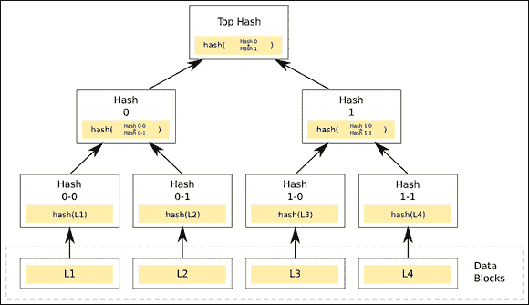

图 4-1：梅克尔树。

归根结底，区块链是账本，社会几千年来一直使用它来记录财务账户。当所有这些旧模型在分布式数据库中合并并在在线支持时，它们就变得具有革命性。

## 比特币区块链的演进

比特币的设计最初是为了发送比特币加密货币。但很快，创建者们就意识到它具有更大的潜力。考虑到这一点，他们设计了比特币区块链，使其能够记录比令牌移动更多的数据。比特币区块链是世界上最古老、最大的区块链之一。它由成千上万运行比特币协议的节点组成。该协议正在创建并保护区块链。

简单来说，`blockchain`是比特币网络中所有交易的公共账本，而`nodes`是记录该账本条目的计算机。`Bitcoin protocol`是治理该系统的规则。

节点通过挖掘加密货币比特币来保护网络。新比特币的产生是对处理交易并将其记录在区块链内部的奖励。节点还通过确认交易获得小笔费用。

任何人都可以运行比特币协议并挖掘令牌。这是一个开源项目，随着更多个人参与网络而变得日益繁荣。参与的人越少，它越中心化——而中心化会削弱系统。使比特币成为安全系统的主要因素是全球分布的大量独立节点。

最成功的矿工拥有健壮的系统，可以超过较慢的矿工。在历史早期，你可以在台式电脑上运行比特币协议并获得比特币。现在，为了获得比特币的希望，你需要购买昂贵的专用设备或使用云服务。

### 比特币区块链上的数据存储

为了在比特币区块链中创建消息，你必须从一个账户向另一个账户发送比特币。当你发送比特币发送交易时，消息会广播到整个网络。消息发送后，它无法被更改，因为消息被记录在比特币区块链内部。这一特性使得你必须始终明智地选择消息，绝不广播敏感信息。

将相同的消息广播到数千个节点并永久保存到令牌账本上，这可能会迅速累积。因此，比特币要求你保持通信非常简短。在比特币区块链上编写消息有几种方法，例如`OP_Return`字段。目前，你最多可以写入 83 个字符。

# 新比特币：比特币现金

比特币的核心开发存在巨大的冲突。这种冲突被称为“比特币内战”或“区块大小限制争论”，总体冲突源于保持比特币内核维持现状与扩大软件功能之间。这种冲突看起来简单，但影响是巨大的。比特币的永久性以及比特币软件保护的价值数十亿美元的资产，意味着每次代码更改都要经过严格的审查和辩论。

比特币在 2017 年硬分叉并分为两个独立的区块链。开发者社区和比特币矿工对于如何处理增长无法达成一致。比特币变得越来越不可靠且使用昂贵。它曾是一个几乎即时且几乎免费的系统；现在交易成本超过了 50 美元，并且需要几小时到几天的时间才能结算。高成本和慢速度赶走了用户。

一个主要问题是比特币的交易速度太慢（每秒七次交易），无法满足网络需求。随着用户竞争更快地处理交易，交易费用随之攀升。限制因素之一是 2017 年比特币的区块大小限制为 1MB。

比特币现金使用了与比特币相同的代码库，但调整了区块大小限制。他们将区块大小增加到 32MB。在分叉时，任何持有比特币的人也获得了相同数量的比特币现金。这种增加是有争议的，因为它剥夺了设备较慢的小型矿工的利益。

许多矿工担心他们无法在挖掘更大的区块方面保持竞争力。人们还担心较大的区块大小会导致比特币网络的中心化。

比特币是一个活的、不断变化的系统。比特币内核开发社区正积极寻求通过使其更强大、更快来改进系统。任何人都可以通过参与其 GitHub 页面（`www.github.com/bitcoin`）为比特币协议做出贡献。然而，存在一个由主导核心开发者组成的小社区。最高贡献者是 Wladimir Van Der Laan、Pieter Wuille 和 Gavin Andresen。

# 破解一些常见的比特币误解

人们通常对任何新事物表示怀疑，尤其是那些不容易理解的新事物。所以，比特币——一种与世界以前见过的任何事物不同的全新货币——让人们感到困惑并产生一些误解是完全自然的。

以下是你可能听过的关于比特币的一些误解：

- **比特币被黑客攻击过。** 2011 年有一个已知案例，有人双花了他们的比特币，但在一小时内就解决了。自从该问题之后，尚未发现过导致比特币被盗的成功攻击。然而，许多使用比特币的中心化系统曾被黑客攻击过。钱包和比特币交易所经常由于安全性不足而被攻击。比特币社区通过开发优雅的解决方案来保护他们的硬币安全进行了反击，包括钱包加密、多签名、离线钱包、纸钱包和硬件钱包，仅举几例。

- **比特币被用于勒索他人。** 由于比特币的半匿名性，它被用于勒索软件攻击。黑客入侵网络并将其作为人质，直到有人向他们支付款为止。医院和学校曾是这类攻击的受害者。然而，与过去小偷们所青睐的现金不同，比特币在区块链上总会留下调查人员可以追踪的痕迹。

- **比特币是一个金字塔骗局。** 从比特币矿工的角度来看，比特币是金字塔骗局的反面。比特币协议的设计像一场自相残杀的军备竞赛。每增加一个矿工，都会促使协议增加挖矿难度。从社会角度来看，比特币是一个纯粹的市场。比特币的价格根据市场供给、需求和感知价值而波动。比特币不是金字塔骗局，但比特币周围有很多骗局，所以请务必小心。

- **比特币在挖出 2100 万枚币后将会崩溃。** 比特币释放的代币数量有一个限制。这个数字被硬编码为 2100 万。据估计，比特币发行最后一枚币的时间是在 2140 年。没有人能预测那时会发生什么，但矿工将始终从交易费用中获得利润。此外，区块链用户和比特币本身将受到保护网络的激励，因为如果挖矿停止，比特币将变得脆弱，锁定在区块链中的数据也是如此。

- **足够的算力可以接管比特币网络。** 这是事实，但这将极其困难，而且几乎完全没有回报。进入比特币网络的节点越多，这种类型的攻击就变得越困难。为了实现这一目标，攻击者需要等同于爱尔兰所有发电产量的能量。这种攻击的回报也极其有限。它只会允许攻击者回滚自己的交易。他不能拿走任何人的比特币，也不能伪造交易或硬币。

- **比特币是一个很好的投资。** 比特币是人们交易价值方式的一种新颖而有趣的进化。它不受任何单一政府或组织的支持，它之所以有价值是因为人们愿意用它来交换商品和服务。人们利用比特币的意愿和能力波动很大。这是一种不稳定的投资，应该谨慎对待。

# 比特币：新的荒野西部

比特币世界非常像荒野西部的早期。在搞清楚谁是好人、谁是坏人，以及哪家酒吧提供的啤酒最冰之前，最好采取谨慎态度。如果你落入骗局的陷阱，你几乎没有任何保护。

比特币和其他去中心化加密货币在许多国家被视为货币，但对消费者来说几乎没有任何监管或保护。

在本节中，我列出了加密货币世界中流行的三种常见骗局。它们都围绕着偷取你的币展开，看起来与你可能已经熟悉的传统的诈骗非常相似。这个列表并不是详尽的，而且骗子们极具创造力，所以在使用比特币时要非常小心。你永远不知道下一个转角处会有什么。

## 假网站

一些看起来像交易所或网络钱包但实际上是虚造的网站一直困扰着一些顶级的比特币网站。这种骗局在比特币世界以及整个互联网上都很常见。骗子希望通过从用户那里获取登录信息或误导他们发送比特币来赚钱。

务必双击 URL，并仅使用安全网站（以 `https://` 开头的网站）以避免这个问题。如果一个网站或声明看起来很可疑，请检查它是否列在 [`https://db.aa419.org`](https://db.aa419.org) 上。这不是一个详尽的列表，但列出了许多坏分子。

## 不，你先来！

“把比特币发给我，然后我把货给你。”听起来很不对劲，对吧？这种骗局类似于电汇诈骗。由于比特币的半匿名性，这让这种诈骗变得困难。骗子会通过提供虚假的承诺或硬币来获取你的信任。这种骗局会向你提供东西，但不会交付。不要向任何人提供访问你的投资。永远不要向任何人提供你的私钥。

## 挖矿软件与云挖矿

 下载它。

- **CGminer**: `CGminer` 是流行的挖矿软件之一。它是开源的，适用于 Windows、Linux，可以在 [`www.github.com/ckolivas/cgminer`](https://www.github.com/ckolivas/cgminer) 获取。

- **Multiminerapp**: `Multiminerapp` 是一个易于使用的比特币客户端。你可以在 [`www.multiminerapp.com`](http://www.multiminerapp.com) 下载它。

比特币是一个非常有竞争的环境，除非你购买专门的挖矿设备，否则你可能永远无法获得比特币。我不在这书中认可或推荐任何特定的挖矿设备，因为该行业不断变化并迅速过时。预计每台机器花费 500 到 5000 美元。Amazon.com 是一个很好的查看处。他们有大量的选择。

云挖矿让你能够在一个下午内开始赚取比特币，无需下载软件或购买设备。务必阅读云挖矿服务提供商的评论——该行业过去一直不可靠。你可能会考虑的一个平台是 ECOS。ECOS 可以帮助你轻松开始云挖比特币。它还出售高算力设备、加密钱包、交易所和加密货币组合。只需遵循以下步骤：

1. 访问 [`https://ecos.am`](https://ecos.am/)。

2. 点击注册。

3. 输入你的电子邮件地址并点击下一步。

验证码已发送到您的电子邮箱地址。

如果您没有立即看到验证码，请检查您的垃圾邮件箱。

4. **输入您收到的验证码。**

5. **创建一个新密码。**

使用强密码并将其存储在笔记本等离线地方。这对于保持您的账户安全非常重要。

6. **输入您的手机号。**

验证码将通过短信发送到您的手机号。

7. **输入您收到的验证码。**

恭喜你！你已经设置好了云挖矿控制面板。从这里，你可以导航到“购买算力”（Buy Hashrate），通过购买云设备的时间来开始挖掘比特币。

云挖矿的投资回报率可能是负的。请仔细检查您的选项，以确保这是一项积极的投资。

# 创建你的第一个纸质钱包

`paper wallet`（纸质钱包）是你公钥和私钥的纸质副本。由于它们完全离线，如果操作得当，纸质钱包是持有比特币最安全的方式之一。它的优势是你的私钥没有以数字形式存储，因此不会受到黑客攻击。尽管如此，纸质钱包存在一些需要考虑的固有风险：

* 你必须安全地存放纸质钱包，因为如果它们落入他人手中，很容易被盗取。

* 普通纸张很容易被水、火或其他元素损坏，导致其无法读取。为了防止这种情况，可能需要将纸质钱包存储在防火、防水或防损容器中，并使用高质量纸张和优质墨水进行打印。有些人甚至会对纸质钱包进行过膜处理以增加额外保护。

* 用于生成纸质钱包的网站可能会被破解，因此你需要选择有信誉的服务。

为了进一步增加纸质钱包的安全性，有诸如 `Cryptotag` 等工具，它们允许你将钱包种子存储在几乎不可摧毁的钛板上。一些流行的纸质钱包生成器包括 `BitAddress`、`WalletGenerator` 和 `Mycellium Entropy`，后者是一种专门为生成高安全性纸质钱包设计的硬件设备。对于大额资金，你可以考虑使用硬件设备。

在 `BitAddress` 上制作纸质钱包非常简单。按照以下步骤操作：

1. **访问** `www.bitaddress.org`。

2. **在屏幕上移动鼠标，直到随机性数量显示 100%。**

3. **点击“纸质钱包”（Paper Wallet）按钮。**

这将提供创建一个可以打印的纸质钱包选项。

4. **在“生成地址”（Addresses to Generate）字段中，输入 1。**

如果你需要，可以同时创建多个钱包，但最好先从一个开始熟悉。

5. **点击“生成”（Generate）按钮。**

图 4-2 显示了我创建的一个纸质钱包。

6. **点击“打印”（Print）按钮。**

不要让任何人看你创建纸质钱包。这不是你想在公共电脑上做的事情。确保使用私有的且未连接互联网的打印机，这样你就没有私钥被黑客的风险。

对你的纸质钱包进行过膜，使其更耐用一点。

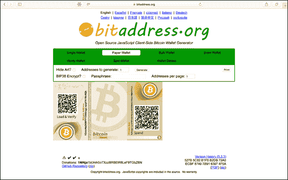

图 4-2：一个纸质钱包。

# 第 5 章：接触以太坊区块链

## 本章内容

*  **了解以太坊是如何以及为何启动的**

*  **发现以太坊区块链**

*  **揭秘区块链黑客**

*  **上手以太坊**

*  **创建去中心化自治组织**

*  **创建自己的代币**

*  **构建智能合约和去中心化公司**

以太坊项目是生态系统中开发最充分、最易用的区块链之一。它也是区块链创新和应用领域的行业领导者。理解这项技术至关重要，因为它在智能合约、去中心化组织和代币发行方面处于领先地位。

在本章中，我涵盖了以太坊的构成，并解释了以太坊区块链上构建组织和公司的新方法。我还深入探讨了以太坊区块链的安全性和实际业务应用。我将为你介绍该项目是如何启动的以及它计划向何处发展。

本章将帮助你创建自己的去中心化组织。我解释了如何在测试网上挖掘加密货币来为你的项目提供动力燃料。读完本章后，你将能够设置自己的以太坊钱包并交易代币。你还将能够生成可以在全球交易的自定义代币。

## 探索以太坊的简史

以太坊首次在 2013 年由 `Vitalik Buterin` 的一份白皮书中描述，他当时作为比特币社区的作家和程序员非常活跃。Buterin 发现，比特币的潜力远大于其在没有中央机构的情况下转移价值的能力。他一直致力于参与比特币内部的“彩色币”（colored coin）工作，以扩展比特币在其原生代币交易之外的实用性。Buterin 认为，其他需要中央机构控制的业务和政府应用案例也可以通过区块链来实现。

当时，人们对比特币网络被大量低价值应用所“膨胀”存在激烈的争论。主要的担忧是构建在比特币协议上的额外应用程序将面临扩展性问题。此外，当时还没有实现智能合约等功能的脚本能力。比特币的设计并不是为了处理所需的交易量。Vitalik 和许多人意识到，为了让人们能够在比特币区块链上构建去中心化应用，要么区块链需要彻底的重构，要么他们需要完全构建一个新的区块链。

那时，比特币已经非常稳固。显然，所需的内核代码升级远超出了现实可能的范围。比特币的政治问题会阻碍任何更改。Vitalik 和他的团队在 2014 年初建立了以太坊基金会，旨在筹集资金构建一个内置编程语言的区块链网络。Vitalik 希望创建一个允许他构建区块链安全应用程序的网络。

初始开发是通过 2014 年 7 月和 8 月的在线公开众筹资助的。基金会最初通过出售名为 `ether` 的加密货币代币筹集了创始性的 1800 万美元。人们对于这种众筹是否合法（因为它可能构成未经许可的证券发行）进行了激烈辩论。

以太坊改进提案（EIPs）是改进以太坊网络的建议。它们可能关于更改网络的工作方式，也关于添加新功能。2022 年，`EIP-3675` 将以太坊主网升级为使用一种新的网络状态共识（consensus）方式，被称为`权益证明`（`PoS`）。这使得以太坊从最初的`工作量证明`（`PoW`）共识机制改变了区块结构、区块处理、分叉选择规则和网络接口。

`PoS` 与 `PoW` 的不同之处在于，它涉及到持有一定数量的以太坊货币来帮助对网络做出决策，而不是使用计算机能力来解决复杂的数学问题。这项 EIP 解释了升级到 `PoS` 将如何进行，以及网络需要进行哪些更改。它由 Mikhail Kalinin、Danny Ryan 和 Vitalik Buterin 编写，并已经定稿。

# 以太坊：开源的全球计算机

以太坊可能是人类构建过最复杂的区块链之一。它有几种自己的`图灵完备编程语言`（允许开发者创建任何应用程序的全功能编程语言）。这些新的编程语言与`JavaScript` 和 `Python` 等流行编程语言非常相似。以太坊协议可以做到你普通编程语言能做的任何事情。例外是代码被写在以太坊区块链上，并具有随之而来的额外安全性。如果你想象出一个软件项目，它就可以在以太坊上构建。

以太坊生态系统目前构建去中心化应用的最佳场所。它拥有精美的文档和用户友好的界面，可以让你快速上手。快速的开发周期、小型应用的安全性以及应用程序轻松相互交互的能力是该系统的关键特征。

`图灵完备编程语言`是让以太坊区块链在构建新程序方面远超比特币区块链的主要特征。以太坊的脚本语言使得 Twitter 等应用程序只需几行代码即可实现，并且极其安全。


# 智能合约与以太坊应用

智能合约（如你在第 3 章中创建的）也可以在以太坊上构建。以太坊协议开启了一个全新的应用领域。你可以采取任何业务、政府或机构的流程，并在以太坊内部构建其数字化表示。目前，以太坊平台正用于管理`数字资产`（一种生活在线上的新资产类别，可能代表整个数字资产，如比特币代币，或现实世界资产的数字表示，如玉米商品）、金融工具（如抵押贷款证券）、记录土地等资产的所有权以及去中心化自治组织（`DAOs`）。以太坊还引发了全球初创公司的大规模融资活动，他们使用 `ERC` 代币标准筹集资金来构建创新。以太坊开放了组织商业、非营利和政府的新方式。它使得在无需面对对方或使用第三方协助的情况下持有、分享和交易价值成为可能。代码完成了工作。

## 去中心化应用：欢迎未来

以太坊最具革命性且最具争议的表现是自治理的去中心化应用（`dApp`）。`dApps` 可以管理数字资产和 `DAOs` 等内容。

`dApps` 的创建是为了取代资产和组织的集中管理。这种结构具有很大的吸引力，因为许多人相信绝对权力导致绝对腐败。对于担心失去控制的人来说，这种结构具有巨大的影响。

新的 `dApps` 每天都在涌现。你可以通过 [`https://dappradar.com`](https://dappradar.com/) 探索并发现在以太坊上构建的新应用。`DappRadar` 更新了所有最新的以太坊 `dApps` 列表，并为你提供其功能的预览。最早创建的之一是 Etheria（见图 5-1）。

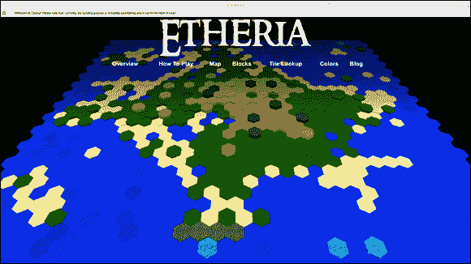

图 5-1：世界上第一个不朽的数字游戏 Etheria。

## 去中心化自治组织的力量

`DAOs` 是以太坊应用的一种，代表以太坊内部的虚拟实体。当你创建一个 `DAO` 时，你可以邀请其他人参与组织的治理。参与者可以保持匿名且永不见面，这可能会触发了解你的客户（`KYC`）规则（企业必须通过的验证其客户身份的过程）和反洗钱（`AML`；旨在停止通过非法手段产生收入的法律法规）合规性问题。

`DAOs` 的创建是为了为投资筹资，但它们也可以为公民或非营利目的而设计。以太坊为你提供了一个治理的基本框架。治理什么取决于组织者。以太坊为你创建了模板，以帮助创建 `DAOs`。

图 5-2 显示了一个以太坊应用的组织方式。

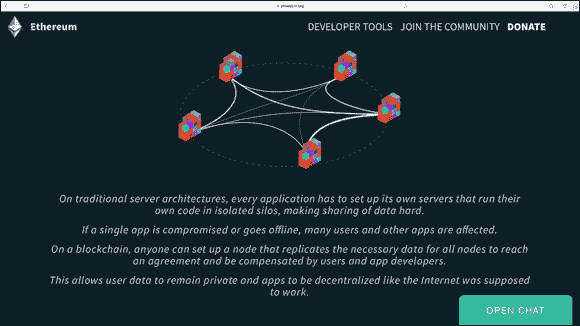

图 5-2：区块链示意图。

以下是 DAO 的基本工作原理：

1. 一组人编写智能合约来治理组织。
2. 人们向 `DAO` 添加资金并获得代表所有权的代币。这种结构类似于公司股票，但成员从第一天起就控制资金。
3. 当资金募集完成后，`DAO` 通过成员提出如何花费资金开始运行。投票可能会受到成员在 `DAO` 中风险或质押 `Ether` 数量的影响。
4. 成员对这些提案进行投票。
5. 当预定时间过去且获得预定票数后，提案通过或失败。
6. 个人作为承包商为 `DAO` 服务。

与大多数由中心实体决策投资的传统投资工具不同，DAO 的成员控制着 100% 的资产。他们对新的投资和其他决策进行投票。这种结构威胁到了传统的财务经理。

`DAOs` 使用不可更改的代码构建。这种方式的优势在于，恶意黑客无法以传统方式操纵资金。黑客仍然可以找到以意外方式执行代码并提取资金。`DAO` 代码的不可变性使得一旦 `DAO` 在以太坊上线，几乎无法修复任何漏洞。

# 攻击区块链

以太坊从未被黑过。2016 年由于“能力越大……责任越大”侧边栏提到的 DAO 攻击而导致的硬叉并非对系统的实际攻击，但混淆地经常被称为黑客。以太坊运行得完美。问题在于它太完美了。当大量资金和大多数用户受到威胁时，重启系统是必要的。

在像以太坊这样的区块链上纠正操作的唯一方法是进行`硬叉`，这允许对协议进行根本性的更改。硬叉会让以前有效的区块和交易无效。以太坊这样做是为了保护被某位用户从第一个 DAO 中提取的资金。DAO 攻击从概念上说，是历史上最大的漏洞赏金之一。

尽管如此，加密货币领域仍存在许多诈骗和攻击尝试。这些攻击大多数目标都是中心化交易所和应用程序。许多黑客想要窃取加密货币，因为它具有真实价值，而且并不像普通货币那样受到政府的保护。加密货币的匿名性也使其对犯罪分子具有吸引力。捕捉和起诉这些个人非常困难。然而，加密货币社区正在反击，并创建新的措施来保护他们自己。


破解一个地方比试图克服一个去中心化网络要容易且便宜得多。当你读到关于区块链世界的攻击时，可能只是某个网站或加密货币钱包被破解了，而不是整个网络。

## 挖掘以太坊 DAO

以太坊是为了 DAO 设计的。以太坊实际上就是一个 DAO。它通过分布式节点的共识来管理其功能。以太坊开发了发布后无法修改的智能合约代码；这允许 DAO 根据参与者在启动时同意的规则运行。最后，当你需要发送或接收资金时，智能合约就是受信任的第三方。

在接下来的章节中，我将介绍为未来建立 DAO 的重要性。我深入探讨 DAO 中的`委托`概念，这允许代币持有者将其投票权委托给指定的个人，由这些个人代表他们并管理以太坊协议。许多 DAO 使用委托作为日常运营的管理工具。

### DAO 治理

在创建或加入 DAO 时，你需要考虑许多事情。鉴于 DAO 智能合约发布后几乎无法更改规则或撤销交易，请务必考虑投票和提案是如何工作的。

### DAO 委托

委托的工作方式非常像人们选举官员在政府中代表他们。DAO 版本的代议民主要求代币持有者将其投票权委托给被提名的用户。被指定的个人承诺管理以太坊协议并保持积极参与。

例子是 ENS，它是区块链集成最广泛的命名标准。在写本书时，已有超过 500,000 名用户注册了超过 260 万个名称。ENS 代币持有者可以将投票权委托给活跃的社区成员，在 ENS DAO 内部代表他们。

### 在 ENS 上申领你的名称

在这一节中，你将深入研究以太坊命名服务 (ENS) 以在 ENS 上申领名称。你可以通过访问 ENS 网站、使用 MetaMask 钱包登录，并搜索并注册你想要的名称来完成。此过程是为了购买域名。只需按照以下步骤操作：

1. **导航至** `https://claim.ens.domains/`。
2. **点击网页浏览器中的 MetaMask 钱包。**
   这将你登录 ENS 网站。如果你还没有设置 MetaMask 钱包，请返回第 3 章并按照说明操作。
3. **点击进入应用程序 (Go to App)。**
4. **输入你想要保留的名称。**
   将此名称视为网站域名即可。
5. **点击搜索 (Search)。**
6. **点击注册 (Register)。**

如果你想要的名称可用，你将像购买域名一样选择购买它。如果你想要的名称不可用，请使用新名称重复此过程。

恭喜！你现在已经获得了你的名称！

### DAO 的自动交易治理

在许多 DAO 中，如果满足了法定人数 (`quorum`)，交易将自动执行。这的一个显著例子是 Nouns DAO (`https://nouns.wtf/`)。当有法定人数成员投票时，Nouns DAO 会启用交易。

### DAO 的多签治理

多签（`multisig`，缩写自 `multisignature`）地址是一种需要多个签名才能授权交易的地址类型。这也可以为加密货币钱包增加额外的安全层。

例如，假设你有一个需要两个签名的多签地址。你可以将其设置为：一个签名需要来自你的个人设备，另一个签名来自一位你信赖的朋友。这为交易增加了一层安全性。

总的来说，多签地址可以作为为加密货币交易、DAO 增加额外安全层的有用工具，特别是在需要多个方参与授权过程的情况下。

## DAO 成员身份

你可以通过几种不同的模型成为 DAO 的成员。你的成员身份通常围绕通过智能合约授予你的投票权。有几种常见的 DAO 结构：

*   **基于代币的成员身份：** 基于代币的成员身份意味着你通过持有 DAO 代币默认成为成员。这类 DAO 通常对任何有能力和手段加入的人开放——通常被称为完全无许可 (`fully permissionless`)。你的治理代币可以在中心化交易所上无许可交易，甚至可能具有某些货币价值。也可能拥有不可传输的代币；这类代币被称为“灵魂绑定 (`soul bound`)”。其他类型的 DAO 需要你通过提供服务来获得代币，例如提供流动性或通过工作量证明以确保交易安全。
    这种类型 DAO 的有趣例子是 MakerDAO。它的代币 `MKR` 用于去中心化交易所，你可以购买它并获得在 Maker 协议上的投票权。

*   **基于股份的成员身份：** 基于股份的 DAO 是更具许可性的群体，要求你提交一份提案来加入 DAO。它们通常还要求你通过代币或你为小组执行的工作来支付成员费用。你的代币代表了你的投票权和所有权。通常，你可以随时离开 DAO，并带上你在 DAO 资金库中相应的份额。
    这类 DAO 是为了以人为中心的组织创建的，例如慈善机构、工人集体和投资俱乐部。`MolochDAO` 是这种类型 DAO 的绝佳示例。`MolochDAO` 的成员贡献资本来资助以太坊的发展。它作为一个非营利组织，专注于基础设施这一基本的数字公共产品。`MolochDAO` 需要成员提案，以便小组可以评估你是否具有必要的专业知识和资金来对潜在的资助者做出明智判断。你无法购买 DAO 的访问权限。

*   **基于声誉的成员：** 另一种有趣的 DAO 结构是基于声誉的成员，这是一种参与证明结构，赋予你在 DAO 内的投票权。基于声誉的 DAO 不会将所有权转移给贡献者——这是一个灵魂绑定（`soul-bound`）结构。声誉无法购买、分配或委托给他人。你通过参与来获得声誉。当你拥有灵魂绑定令牌时，投票是无需许可的。潜在成员可以提交加入 DAO 的提案。新请求将获得声誉和代币作为贡献的奖励。这种 DAO 非常适用于协议和 dApp 的去中心化开发和治理。
    `DXdao` 使用了这种结构。DAO 的成员负责开发、治理和增长 DeFi 产品。`DXdao` 创建于 2019 年 5 月，是一个由约 400 名专注于 DeFi 生态系统的个人集体。它是迷人的全球主权集体示例。`DXdao` 利用基于声誉的治理和全息共识来协调和管理资金。你无法通过花钱进入。

### 理解智能合约

以太坊智能合约类似于合约，不同在于没有中心实体来执行合约。以太坊协议通过施加经济压力来“执行”智能合约。如果某项要求存在以太坊内部，它们还可以强制执行，因为以太坊可以证明某些条件是否已满足。如果它不在以太坊内部，执行将要困难得多。


以太坊智能合约尚不具有法律执行力，而且可能永远不具备这种，因为人们认为你不需要外部权威来执行协议。法律系统由政府控制。目前，政府是中心权威——某些政府具有不同程度的共识和民主原则。在以太坊智能合约中，每个参与者都有一个不可剥夺的投票权。

以太坊智能合约不包含人工智能。这是未来一个很酷的可能性。但目前，以太坊只是运行在区块链上的软件代码。

以太坊智能合约并不是安全的。DAO 黑客攻击是可能发生的危险类型的绝佳示例。现在还处于早期阶段，将大量资金投入未经证明的系统是不明智的。相反，请从小额开始实验，直到新合约中的所有漏洞都已修复。

### 发现加密货币 Ether

Ether（以太币）是以太坊区块链的加密货币名称。它以被认为渗透所有空间并使宇宙成为可能的物质命名。从这个意义上说，Ether 是使以太坊可能的物质。Ether 通过工作量挖矿激励网络进行自我保护，就像 `Bitcoin` 代币激励比特币网络一样。在以太坊网络中执行任何代码都需要 Ether。当 Ether 用于执行以太坊中的合约时，它被称为 `gas`（燃料费）。

执行智能合约内的代码也需要一定数量的 ether。这一特性为代币增加了额外的实用性。只要个人想使用以太坊进行应用程序和合约，ether 就会具有投机性之外的价值。

ether 价值的野性增长使其成为热门的投机代币。它在全球的交易所上广泛交易。一些新的对冲基金将其视为一种投资工具。然而，其波动性和低市场深度使得 ether 成为一种高风险投资。

## 在以太坊上上手

在这一节中，我将引导你如何在以太坊区块链生态系统中开始。在以太坊上构建任何内容之前，你需要一个以太坊钱包。


你的钱包将持有名为 `ether` 的以太坊令牌。Ether 是允许你在以太坊内部创建智能合约的加密货币。这有时被称为 `gas`。

下载以太坊钱包可能需要一些时间，但界面非常直观，整个过程中提供的指令很容易遵循。


在以太坊钱包中，你可以获得测试 ether 来构建你的测试合约和组织。你不需要挖掘 ether 来学习它是如何工作的。

### 挖掘 ether

以太坊由全球各地的计算机网络运行，这些计算机处理合约并维护网络安全。这些计算机有时被称为 `nodes`（节点），它们正在挖掘加密 ether。

为了奖励个人在挖矿中投入的时间成本，每隔 12 秒大约会有五个 ether 的奖励。该奖励授予了能够在以太坊区块链上创建最新区块的节点。

所有新区块都有一个最新交易列表。工作量共识算法保证了奖励通常由计算能力最强的节点获得。性能没有那么强大的计算机也可以赢得奖励——只是需要更长时间。如果你想尝试挖掘 ether，可以用你家中的电脑进行，但需要很长的时间才能成功挖出一个区块并赢得 ether。


挖掘 ether 并不适合技术初学者。你需要熟悉命令行。如果你完全不知道命令行是什么，你可能想跳过这个过程。此外，请务必遵循以太坊 GitHub (`http://github.com/ethereum`) 上最新的指令。

### 设置你的以太坊钱包

设置你的以太坊钱包，请按照以下步骤操作：

1. **访问** `www.ethereum.org`。
2. **点击 Download 按钮。**
   你需要稍微向下滚动页面才能找到该按钮。
   
   确保将以太坊钱包下载包保存在你以后可以找到的地方。
3. **打开以太坊钱包。**
   你可能需要在“帮助”（Help）下检查软件更新。
4. **在下拉菜单中选择 Develop（开发）。**
5. **选择其中一个测试网络，如 Robsten 或 Rinkeby。**
   在这里你设置好挖掘测试 ether。这个过程比挖掘真实的 ether 要耗时少得多，但仍然需要一些时间——目前大约两小时。
6. **创建一个强密码。**
   不要忘记将密码保存在安全的地方。
7. **点击启动菜单。**
   在你等待测试网下载时，以太坊团队有一些有趣的教程可以查看。下载可能需要十分钟左右。
8. **选择 Develop ⇒ Start Mining（开始挖掘）。**
   不要跳过这一步。你后续项目需要它。

你刚刚设置好了钱包，并且正在为你未来的智能合约项目赚 ether。

## 构建你的第一个去中心化自治组织

DAO 将改变未来世界运作的方式。它们允许世界上任何人在线创建一个新类型的公司，这种公司由预先约定的规则治理，这些规则通过区块链网络执行。创建 DAO 比你想象的要简单。在这一节中，你将构建第一个测试 DAO。我将这个项目分为三个部分：构建、大会和治理。


为了成功完成你的测试 DAO，你已经设置好以太坊钱包，并在以太坊测试网上进行了一些挖矿（参见前一节）。

按照以下步骤创建你的第一个测试 DAO：

1. **访问** [`www.ethereum.org/dao`](http://www.ethereum.org/dao)。
2. **向下滚动页面，找到代码框（如图 5-3 所示）并复制代码。**
3. **打开你之前创建的以太坊钱包。**
   你将在以太坊钱包中开发你的 DAO。

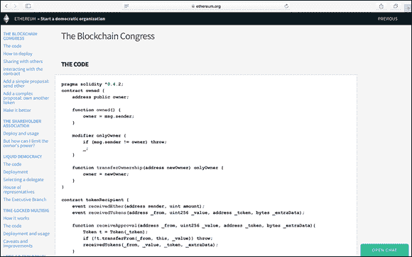

FIGURE 5-3: 代码框。

### 测试网与大会

你的 DAO 项目的下一阶段是为你的 DAO 设置框架。遵循以下步骤：

1. **在你的以太坊钱包中，选择 `Develop` ⇒ `Network` ⇒ `Test Net`。**
2. **点击 `Contracts` 标签页，然后点击 `New Contract`。**
   以太坊团队为 DAO 准备了几个测试模板。
3. **将你在上一节中复制的代码粘贴到 Solidity 代码框中。**
   确保你在标签页上选择的是 `Solidity Contract Source Code` 而不是 `Contract Byte Code`。
4. **从合约选择器（Contract Picker）中，选择 `Congress`。**
5. **在提示时选择一些变量。**

以下是你的选项：

* 提案的 `minimum quorum`（最小法定人数）是提案在执行前所需的最少票数。
* `minutes for debate`（辩论时间）是执行前需要经过的最短时间（以分钟计）。
* 多数的 `margin of votes`（多数票差额）。如果票数超过 50% 加上该差额，则提案通过。留为 `0` 则表示简单多数。

### 治理与投票

现在你将为你的 DAO 命名并设置治理结构。你需要为提案设置 `minimum quorum`（新提案在通过前需要多少票数）。你还需要设置 `margin of votes for a majority`（计划通过需要多少票数）以及分配给讨论新计划的时间。

1. **为你的新 DAO 命名。**
   这类似于给公司命名。
2. **对于辩论时间（Debate Times），选择 5 分钟。**
   这是新提案开放讨论的时间。
3. **将多数票差额（Margin of Votes for Majority）设为 0。**
   这决定了你的合约的民主运作方式。
4. **确认 DAO 的价格。**


在首次设置钱包时，你已经通过钱包在测试网上挖了一些 `Ether`。如果你跳过了那一步，请返回现在执行。你需要一些测试网的 `Ether` 来构建你的 DAO。

5. 点击 `Deploy` 并输入密码。

   DAO 的部署可能需要一些时间。当你进入新的仪表板时，向下滚动，就能看到你的 DAO 正在生成。

6. 点击 `New` 图标。

   将生成一个代表你 DAO 的唯一图标。

恭喜！你已经创建了第一个 DAO。

### 探索 DAO 的未来

智能合约和去中心化组织具有巨大的前景。它们纯粹的民主性和超理性的本质非常有吸引力。然而，目前存在的可能性多于已知事实，创建的每一个合约都可能是突破性的，也可能是重大的失败。

如果你将以太坊视为它所在的新边疆，你将获得更多成功。如果你足够小心，以太坊网络的利大于弊。但如果期望一切都完美无缺，且所有参与者都诚实，将让你面临更大的损失。以太坊不缺少坏徒，更不用说那些希望你成功的热爱好者了。

2016 年的智能合约攻击凸显了安全和正确审查合约的重要性。它也说明了有诚信的人正在解决问题。

阅读这本书只是开始。它将为你提供一个坚实的基础。

### 为 DAO 注入资金

智能合约编程与编写合约需要不同的思维。区块链的不可变性使得很难改变意外的结果。

你只能控制自己合约内部的事。要警惕外部合约调用，它们可能会执行恶意代码并夺取你的控制权。

以太坊社区在其 GitHub 页面上有一份非常出色的已知漏洞列表，以及更多关于如何构建安全智能合约的提示：`https://github.com/ethereum/wiki/wiki/safety`。

### 以坊上的 DAOhaus

DAOhaus 是一个创建和管理 DAO 的无代码平台。DAOhaus 应用允许你：

* 创建 DAO。
* 为 DAO 添加成员。
* 通过友好的界面协调提案。

DAOhaus 应用包含三个部分：智能合约、子图和客户端。

* **智能合约：** DAOhaus 使用 Moloch DAO 的智能合约来实现链上 DAO 功能。例如，你可以通过提案添加成员和金库。由于 DAOhaus 是一个无代码平台，它通过 Moloch 合约处理所有的链上操作和功能，无需你。目前，DAOhaus 应用支持使用以下合约的 Moloch v2 DAO：

* `Moloch v2.1` 和 `2.5` 具有多召唤者能力，以及用于元数据的注册函数和降低 Gas 费的 `EIP-1167` 代理模式。

* `Minion` 让你能够在与智能合约交互的同时，将资金安全地存在名为 `Gnosis Safe` 的第三方库中。

DAOhaus 应用计划在 2023 年底使用 `Moloch v3 (Baal)`。

- **子图 (Subgraphs):** DAOhaus 使用 `The Graph`，这是一个用于查询 `Ethereum` 和 `IPFS` 等网络的索引协议。你可以构建并发布开放的应用程序接口（API），称为 `subgraphs`，使得数据易于访问和变现。`subgraphs` 确保链上数据被索引并可供查询。索引协议激励并协调公共数据的索引。你可以在 `https://thegraph.com` 了解更多关于 The Graph 的信息。

- **客户端 (Client):** 客户端允许你访问并与 DAO 交互的软件。它是使用 `React` 构建的，这是一个用于构建用户界流行的 JavaScript 库。客户端允许用户引用来自 `subgraphs` 的链上数据，子图是一种以更有组织且简单的方式存储区块链信息的数据结构。`subgraphs` 可用于索引和查询数据，使其更容易处理和分析。客户端还可以用于执行链上功能，即在区块链上发生的动作。例如，可以使用客户端与 `smart contracts`（智能合约）交互，智能合约是自动执行的合同，买卖双方之间的协议条款直接写在代码中。

### 在 DAOhaus 上构建和配置自己的 DAO

在本节中，你将在 DAOhaus 上构建和配置自己的 DAO。DAOhaus 是一个为创建和管理 DAO 提供工具和资源的平台。

DAO 是一种运行在区块链技术上的组织，由编码在智能合约中的规则治理。DAO 允许个人或小组以去中心化的方式进行协作和决策，无需中央权威。DAOhaus 平台提供了管理 DAO 的多种功能和工具。它允许 DAO 成员管理共享金库并监控转账。该平台提供基于份额的投票，允许成员创建并对提案类型进行投票。它还包括社区开发的 `boosts`，为 DAO 提供自定义功能。由于人类之间并不总是和睦，DAOhaus 允许宽限期和 `ragequit`（愤怒退出）功能以保护投资。

你可以访问 DAOhaus 网站并使用你的 `MetaMask` 钱包登录来设置你的 DAO。你还需要添加参与 DAO 的成员的地址。如果你是独立操作，只需创建一个地址即可。完成后，你和其他成员就可以开始决策并参与该组织了。按照以下步骤设置你的 DAO：

1. 进入 `https://app.daohaus/`。

2. 点击你的 `MetaMask` 钱包登录。

3. 点击 `Clubs`。如果没有看到此选项，请前往 `https://app.daohaus/summon`。

4. 点击 `Add Summoners`。确保填充了一个地址。如果你需要，可以添加更多。

5. 点击 `Summon`。

6. 在你的 `MetaMask` 钱包中，点击 `Confirm`。

将 Gas 费用设置为最低以降低设置 DAO 的成本。你可以在 `MetaMask` 钱包内部完成此操作。

配置 DAO 涉及为组织设置规则和治理结构。这包括决定如何决策、谁可以参与决策以及 DAO 可以采取哪些行动。配置 DAO 的方法取决于你的需求和目标。一些常见元素包括：

- **投票规则：** 如何进行投票，以及通过决策需要多少百分比的票数。
- **成员规则：** 你认为谁有资格加入 DAO，以及人们如何成为成员。
- **代币分配：** DAO 的所有权如何在成员之间分配。
- **资金规则：** 你如何为 DAO 资金，以及资金如何分配给不同的项目或倡议。
- **决策过程：** 你在做决策时遵循的过程，以及谁有权代表 DAO 决策。

DAO 配置完成后，可以使用它来促进去中心化决策，并使你的成员能够协作并朝着共同目标努力。配置你的 DAO 请遵循以下步骤：

1. 点击 `Configure`。将打开一个新窗口，允许你更新有关组织的信息。

2. 在表单中输入俱乐部的详细信息。你可以返回并编辑这些细节——它们不属于智能合约。

3. 点击 `Save`。

现在你拥有了一个功能完备的 DAO Club。

## 创建自己的 ERC20 代币

在本节中，我将向你展示如何使用 `Polymath` 创建自己的令牌。`Polymath` 是构建在 `Ethereum` 区块链上的安全令牌服务。它消除了在 `Ethereum` 上编写自定义代币的复杂工作。`Polymath` 提供了一个任何人都可以使用的点击界面。

在阅读本节之前，请确保你已经设置了 `MetaMask`。如果你还没有设置，请参考第 3 章，那里有关于设置电脑和下载 `MetaMask` 的详细说明。

你还需要获取一些 Kovan 测试 Ether (`KETH`) 来为你的新代币设置智能合约。`KETH` 是来自 `Kovan` 测试网络的测试 Ether，该网络是为开发 `Ethereum` 应用程序的开发者设计的。`KETH` 没有市场价值。如果你有 `GitHub` 账户，可以免费获取。

在本节中，我将引导你如何设置 `GitHub` 账户、如何请求 `KETH` 以及如何创建你的代币。

### 设置你的 GitHub 账户

`GitHub` 是用于存储你开发的代码的开发平台。`GitHub` 为开源项目提供免费帐户。因此，如果你愿意分享你开发的代码，`GitHub` 是管理项目和构建软件的极佳来源。如果你想保持代码私有，`GitHub` 也提供付费版本。对于本节而言，免费账户非常好。

要开设 `GitHub` 账户，请遵循以下步骤：

1. 打开 `Brave` 网页浏览器。如果你还没有 `Brave` 浏览器，请查看第 3 章。

2. 进入 `https://github.com/`。

3. 输入你的凭据。

4. 点击 `Sign Up for GitHub`。

你已准备就绪。

### 在 Gitter 水龙头请求 KETH

要请求 `KETH`，请遵循以下步骤：

1. 打开 `Brave` 网页浏览器。

2. 进入 `https://gitter.im/kovan-testnet/faucet`。

3. 点击 `Sign In to Start Talking`。

4. 选择 `Sign In with GitHub`。

接下来，你需要获取你的 `MetaMask` 账户地址，以便将其粘贴到社交聊天窗口，让社区成员为你发送一些 `KETH`。遵循以下步骤：

1. 打开你的 `MetaMask` 账户。

2. 在你的 `MetaMask` 账户中，点击下拉标签。

3. 选择 `Kovan Test Network`。

4. 点击 `Account 1` 复制你的 `MetaMask` 地址。

现在你已经准备好从 Kovan 社区请求一些名为 `KETH` 的测试 Ether 了。你需要从 MetaMask 账户中获取 Kovan Ethereum 地址并将其发布到聊天窗口。请确保只发布你的地址。遵循以下步骤：

1. 返回到 [`https://gitter.im/kovan-testnet/faucet`](https://gitter.im/kovan-testnet/faucet)。

2. 将你复制的地址粘贴到聊天窗口。

现在你需要等一下，因为社区成员之一将检查你的 GitHub 账户，并确保你没有向网络发送垃圾信息。这可能需要一段时间，因为发送 `KETH` 的过程是手动完成的。交易完成后，你将在 MetaMask 账户中看到 `KETH`。这个过程花了我三天时间，但我是在假期周末期间完成的。

要设置你的 Polymath 账户，请遵循以下步骤：

1. 打开 Brave 浏览器。

2. 导航到 [`https://tokenstudio.polymath.network`](https://tokenstudio.polymath.network/)。

3. 点击创建你的安全令牌（Create Your Security Token）。

4. 导航到你的 MetaMask 钱包的狐狸图标。

5. 在 MetaMask 内部点击签名（Sign）。

### 创建你的令牌

现在你已经有了创建自己的令牌所需的必备 `KETH`，终于可以开始了。在本节中，你将使用 Polymath 智能合约构建自定义的 Ethereum `ERC20` 令牌。

#### 预留你的令牌符号

Polymath 允许你预留令牌符号 60 天。此预留过程对于设置你的令牌至关重要。你可以访问 Etherscan [`https://etherscan.io/token`](https://etherscan.io/token)) 并搜索你正在考虑使用的名称，以检查哪些名称已被占用。

 在 Polymath 中预留你的名称仅在 Polymath 系统内保护你。它无法阻止他人在 Ethereum 上发行同名的令牌。

进入你的 Jaxx 钱包，并使用 Shapeshift 服务将部分 `BTC` 或 Ether 兑换为 `POLY`。完成后，将你的新 `POLY` 令牌从 Jaxx 钱包移动到你的 MetaMask 账户。（第 3 章 提供了如何将令牌从一个地址移动到另一个地址的说明。）

要为你的令牌命名，请遵循以下步骤：

1. 输入你所需的令牌代码名称（Ticker name）。这需要五个字符或更少。

2. 输入你的令牌名称。

3. 点击预留令牌符号（Reserve Token Symbol）。这是在网络上代表你令牌的几个字母。

4. 点击确认（Confirm）。

5. 导航到你的 MetaMask 钱包的狐狸图标。

6. 点击批准合约（Approve on Contract）。

7. 点击批准费用（Approve on Fee）。

如果你的交易未获批准，请检查并你的钱包中是否有足够的 Ether 来支付 Ethereum 矿工费。你的合约获得批准需要一些时间，这是由于区块链固有的延迟。

#### 创建令牌

现在你已经预留了想要为令牌使用的名称，就可以创建你的新令牌了。Polymath 将向你发送一封邮件，其中包含令牌创建仪表板的链接。

 你的仪表板与多个服务供应商集成，他们提供咨询、法律、`KYC/AML`、营销和托管服务，如果你计划向公众开放你的令牌，可能需要这些服务。`KYC`（您的客户识别）是一种用于识别想要转账资金客户的反洗钱程序。它是全球打击洗钱和恐怖主义融资努力的一部分，被称为 `AML`（反洗钱）和 `CFT`（打击恐怖主义融资）。请务必始终进行自己的尽职调查并寻求自己的法律建议。如果你选择与这些集成供应商合作，你在每个表单中输入的信息将自动发送到你选择的机构。这些机构将联系你，帮助你完成后续步骤。

在接下来的步骤中，我假设你不会向公众提供你的令牌。

1. 找到你收到的 Polymath 邮件。

2. 点击链接 `点击此处继续令牌创建` (Click Here to Continue with your Token Creation)。

3. 打开你的 MetaMask 钱包。

4. 点击签名（Sign）。

5. 对于每个服务供应商都点击 `我有自己的` (I Have My Own)。

现在你已确认拥有了自己的服务供应商，可以开始指定你的令牌了。页面左侧有几个图标，让你知道自己处于流程的哪个阶段。

1. 点击页面左侧的 `令牌` (Token)。

2. 在 `我的安全令牌必须` (My Security Token Must Be) 下，点击 `可拆分的 1Divisible`。

3. 点击 `创建我的安全令牌 1Create My Security Token`。

4. 打开你的 MetaMask 钱包并点击确认（Confirm）。

5. 点击确认（Confirm）。

6. 等一分钟，再次打开你的 MetaMask 钱包并确认矿工费。

如果页面卡在批准合约界面超过五分钟，请刷新页面并使用 MetaMask 重新签名。此外，在 MetaMask 钱包内部，你可以查看合约状态。你可以增加矿工费以加快处理。不过，这会导致交易费用飙升，因此如果选择此选项，请仔细考虑。

Polymath 为那些将令牌作为融资手段的人提供了内置发行功能。在你的 Polymath 仪表板上，这被称为 `STO`，即安全令牌发行（Security Token Offering）。在提供的提供的说明中，我假设你正在创建的令牌不会用于融资，因此你可以点击 `跳过铸造` (Skip Minting) 然后点击确认。

Polymath 创建了令牌模板。

#### 获取你的令牌

你将收到来自 Polymath 的邮件，告知你已成功设置了令牌。当你收到这封邮件时，遵循以下步骤：

1. 导航到 [`https://tokenstudio.polymath.network`](https://tokenstudio.polymath.network/)。

2. 通过 MetaMask 登录。

3. 点击右侧的 `令牌 1Token`。

4. 在 `铸造你的令牌 1Mint Your Token` 下，下载示例 `CSV` 文件。

5. 打开 `CSV` 文件。

6. 删除虚位数据。

7. 在相应位置输入自己的 Kovan 测试网络地址。

8. 保存你的新 `CSV` 文件。

现在你已经输入了接收令牌的地址，可以将其上传到下载示例的同一个页面：

1. 返回到 [`https://tokenstudio.polymath.network`](https://tokenstudio.polymath.network/)。

2. 通过 MetaMask 登录。

3. 点击右侧的 `令牌 1Token`。

4. 点击 `上传文件 1Upload File`。

5. 点击确认（Confirm）。

6. 打开 MetaMask。

7. 点击确认（Confirm）。

恭喜！你已经创建了自己的测试安全令牌。以太坊是一个强大的工具，通过 Polymath 等工具，可以更容易、更快速地创建你想要的区块链应用。

# 第 6 章

## 揭秘 Cardano 区块链

## 本章内容

* 熟悉 Cardano 区块链
* 查看 Cardano 区块链共识是如何工作的
* 获取 Cardano 的原生令牌 ADA
* 使用 Marlowe 创建无代码智能合约

在本章中，我将为你介绍 Cardano 区块链，这是一个具有卓越能力且较新的区块链。Cardano 团队花费多年时间研究、构建和测试新技术，以创建一个易于使用、友好且可靠的区块链。对于开发者来说，构建它是令人兴奋的，因为它具有智能合约功能，并使用了名为 `proof of stake`（`PoS`）的代共识算法，使其拥有公共区块链中最高的速度。但你不需要编写代码就能从 Cardano 中获益。

如果你对创建智能合约或想通过质押获得更多加密货币感兴趣，那么这一章至关重要。在这里，你将了解到如何保护你的网络钱包、购买 `ADA`（Cardano 的原生令牌）、通过租赁资产赚取加密货币，并创建你自己的智能合约。

## 了解 Cardano

Cardano 是一个由 `PoS` 共识机制保护的去中心化开源智能合约平台。Cardano 由以太坊创始团队成员 Charles Hoskinson 和 Jeremy Wood 于 2015 年创建，作为一个允许你存储、转换和管理你价值的对象（包括你的身份）的区块链平台。Cardano 将自己定位为“研究优先”的区块链。

`PoS` 是某些区块链（如以太坊和 Cardano）达成共识并验证交易的一种。在 `PoS` 系统中，持有加密货币的人（也称为质押者 `stakers`）可以通过验证交易和向区块链添加新区块来获得奖励。


# Cardano 区块链深度解析

团队在编写第一行代码之前进行了两年的研究。这种深思熟虑的是因为创始人希望 Cardano 成为数十人的金融操作系统。团队进行了密码学研究，并深入研究了游戏理论、身份管理和编程语言。他们所有的研究都记录在 100 多篇学术和同行评审论文中。

Cardano 与大多数区块链不同。例如，你在 Cardano 上创建令牌不需要智能合约。令牌的治理和计算方式与 Cardano 的原生令牌 `ADA` 相同。当你移动令牌时，它们都使用相同的底层基础设施。Cardano 移除了一层额外的复杂性和人为错误。尽管如此，你也可以在 Cardano 上使用智能合约处理更复杂的用例，如去中心化自治组织 (`DAOs`)。

以下是你可以用 Cardano 做的六件事：

* 发送和接收令牌。
* 将你的 `ADA` 委托给池并获得奖励。
* 对社区驱动的提案投票。
* 通过投票获得 `ADA` 奖励。
* 为改进 Cardano 做出贡献。
* 创建智能合约。

你可能想要考虑 Cardano 作为你的去中心化应用 (`dApp`) 后端的几个原因：

* **它提供了同行评审的基础。** 这比某些纯由社区领导的项目具有更好的体验。它拥有专门团队提供的更快、更安全且更具成本效益的基础设施。
* **它提供了准确的成本可预测性，因为它不对交易费进行拍卖。** 当你构建企业基础设施时，这一功能至关重要。大多数开发都需要外部资金，而 Cardano 有一个风险基金。每隔几周，就会从提议的应用中选出新项目。Cardano 社区会对提案进行讨论和投票。如果你考虑在 Cardano 上构建应用，请查看 [`https://cfund.vc`](https://cfund.vc/) 上的社区引导基金。
* **它是使用高保证的形式化开发方法构建的。** 这种共识机制被称为 `Ouroboros`，经过同行评审并发表在网络安全和密码学领域的顶级期刊上。我将在下一节中详细介绍 `Ouroboros`。

## 理解 Ouroboros：Cardano 的区块链共识

`Ouroboros` 是一种 `PoS` 协议，旨在提高区块链的安全性并降低能耗。它利用密码学技术、数学和游戏理论来确保区块链上的交易准确且高效。只要质押的 `ADA` 大多数（51%）由诚实参与者持有，该协议就被认为是安全的。它还会奖励积极为网络做出贡献的用户。总体而言，`Ouroboros` 旨在提供与 `proof-of-work` (`PoW`) 协议类似的安全保障，但能源成本更低。

`Ouroboros` `PoS` 协议有两个令人兴奋的特性：

* **它将网络控制权分布在 ADA 质押池中。** 这意味着几乎任何人都可以因支持协议而获得奖励。质押池由节点运营，这些节点控制其被授予 `ADA` 的投票。节点控制的 `ADA` 越多，它获得奖励并被选中创建下一个区块的可能性就越大。`Ouroboros` 对此设置了一些限制，以确保每个人都有公平的机会。当节点被分配为槽位领导（slot leader）时，它将通过为链添加区块获得 `ADA` 奖励。奖励也会分配给池的所有者。
* **Cardano 相比 PoW 区块链最大的优势是它可以安全、可持续且符合伦理地扩展。** 它声称其能源效率是比特币的四百万倍。

## 认识 ADA：Cardano 的原生令牌

`ADA` 是 Cardano 的加密货币。它以 Ada Lovelace 命名，她是一位英国数学家，被认为在 19 世纪发明了计算机编程。

`ADA` 用作数字货币和 Cardano 区块链上节点的区块奖励。与大多数加密货币一样，它们允许任何人进行价值交换，而不需要银行等第三方来促进交换。每笔交易都将在 Cardano 区块链上永久、安全和透明地记录。

每个 `ADA` 持有者在 Cardano 网络中都拥有权益。你也可以将存储在钱包中的 `ADA` 委托给质押池以获得奖励。我将在本章稍后的“在质押池中委托你的 ADA”部分中解释如何操作。

### 购买和出售 ADA

你可以使用加密货币交易所或其他加密货币购买 `ADA`，或者在两个支持的钱包内部进行：Daedalus ([`https://daedaluswallet.io`](https://daedaluswallet.io/)) 和 Yoroi ([`https://yoroi-wallet.com`](https://yoroi-wallet.com/))。你可以前往 CoinMarketCap [`https://coinmarketcap.com`](https://coinmarketcap.com/) 查看所有其他购买 `ADA` 的地方。

* 请确保保护好私钥以确保资金安全。有关保护加密货币安全的更多信息，请参阅第 3 章。
* 避免在交易所存放加密货币超过必要时间。2022 年的 FTX 丑闻提醒人们，即使是流行且安全的交易所也存在危险。相反，请使用加密货币钱包来保护你的 `ADA`。

### 深入 ADA 质押池

质押池可以是公开或私有的。公开质押池是一个 Cardano 网络节点，拥有公共地址，其他用户可以向其委托 `ADA`（参见本章稍后的“在质押池中委托你的 ADA”）。正如其名，私有质押池仅供所有者访问。

一个 24 小时运行且稳定的可靠操作者更有可能拥有成功的资金池。这些操作者通常是拥有 24 小时运行节点所需的知识和资源的个人。作为 `ADA` 持有者，如果你想参与协议并获得奖励，可以将代币委托给公共质押池。你不需要自己运行 Cardano 网络节点。

委托给质押池的 `ADA` 越多，池被选中的机会就越大。每当池被选中时，它就会写入所有交易并生成一个记录在 Cardano 区块链上的区块。池因这项工作而获得奖励，收到的 `ADA` 将在质押池操作者和委托者之间共享。

## 质押你的 ADA

Cardano 资金池没有要求的最低质押金额，但大多数交易所都有你应当记住的最小订单金额。在本文写作时，Moonpay 的最低金额为 30 美元（本章后续使用的第三方支付提供商）。

池操作者通常会将部分或全部 `ADA` 质押到自己的池中，使其更具吸引力。质押的 `ADA` 越多，池获得的奖励就越多。

## 选择 ADA 池

你可以通过池的排名来衡量池的理想程度。该数字是通过获取所有者的质押份额、成本和利润，并结合池的大小和性能生成的。这个数字用于在 Daedalus 和 Yoroi 钱包中对池进行排名。钱包将根据池质押你的 `ADA` 的“理想”程度对其进行排序。

## 在质押池中委托你的 ADA

委托是你作为 `ADA` 持有者将资金发送到与其他 `ADA` 持有者共同组成的池的过程。这被称为`委托质押`。它允许你在无需亲自操作质押的情况下获得质押的收益。

在 Cardano 网络上持有的 `ADA` 代表对区块链的权益。你的权益大小与你持有的 `ADA` 数量成正比。持有超过 500 `ADA` 允许你对 Cardano 的事务进行投票。

你也可以将质押委托或质押给另一方。这对 Cardano 的运行至关重要。你有两种通过持有 `ADA` 获取奖励的方式：

* 你可以将质押委托给第三方运行的质押池。
* 你可以运行自己的质押池。

委托给池的质押金额是协议选择谁被允许向 Cardano 区块链添加后续区块的主要方式。池竞争添加区块的机会，以便获得更多 `ADA`。区块奖励将在所有向该池委托质押的人之间共享。

## 设置你的质押系统

在本节中，你将设置一个用于持有 `ADA` 的钱包，保护你的钱包，购买至少 30 美元的 `ADA`（本文写作时的最低要求），并在池中质押你的 `ADA`。

你需要两张干净的纸、一支不晕墨的笔、一个互联网连接，以及在电脑上安装的 Brave ([`https://brave.com`](https://brave.com)) 或 Chrome ([`www.google.com/chrome`](https://www.google.com/chrome)) 浏览器。**注意：** 你在本节使用的网页钱包兼容所有流行的浏览器，但指令是为 Brave 浏览器编写的。

本教程适用于网页钱包。网页钱包没有硬件钱包或纸钱包安全，因此不要在钱包中留下大量的加密货币。多少是“大量”？这个数字对每个人都不同。我看待它就像看待我的实体钱包一样：我永远不会留超过我晚上出去意愿损失的金额。

Yoroi 是一个接入你喜爱浏览器的热钱包。它简单、快速且安全。IOHK 作为其 EMURGO 产品的一部分创建了 Yoroi，并遵循行业内的软件最佳实践。IOHK 还进行了全面的安全审计。Yoroi 是开始 `ADA` 的良好选择。该钱包可以作为你的 Cardano 日常钱包。

### 第一步：获取你的 ADA 钱包

第一步是获取一个存放 `ADA` 的钱包。按照以下步骤操作：

1. **访问 Yoroi 官网** [`https://yoroi-wallet.com`](https://yoroi-wallet.com)。
2. **点击 Download 并选择你偏好的浏览器。**
   你将被引导至新页面。
   如果你正在使用 Brave 浏览器，请选择 Chrome 选项——它适用于 Brave。
3. **在新页面上，点击 Add to Browser 按钮并按照提示添加扩展程序。**

### 第二步：确保你不会丢失钱包

在将 Yoroi 添加到浏览器后，你可以从浏览器的扩展图标访问它。在接下来的步骤中，你对钱包进行一些配置。

1. **打开你的浏览器。**
2. **点击扩展图标。**
3. **选择 Yoroi 图标。**
   打开一个新页面。
4. **点击 Continue（继续）。**
5. **阅读并同意使用条款。**
6. **点击 Continue（继续）。**
7. **点击 Allow Cardano Payment URLs（允许 Cardano URL）。**
8. **再次点击 Allow（允许）。**
9. **点击 Finish（完成）。**

干得好！你现在准备好设置钱包了。

### 第三步：设置你的 Yoroi 钱包

如果你刚刚完成上一节，你的浏览器应该打开了创建和恢复钱包的 Yoroi 页面。如果你不在那里，请在浏览器中打开 Yoroi 扩展。按照以下步骤操作：

1. **Create Wallet（创建钱包）。**
2. **点击 Cardano。**
3. **Create Wallet（创建钱包）。**
4. **为你的钱包命名并创建一个唯一的密码。**
   将你的密码写在一个不会忘记的地方。如果你丢失了密码，你就丢失了钱！
5. **在纸上按顺序写下你的助记（seed phrase）。**
6. **点击 Yes, I've Written It Down（是的，我已经记下了）。**
7. **重新输入你的助记。**
8. **点击 Confirm（确认）。**

恭喜你！你的钱包已经设置并安全了。

### 第四步：获取 ADA

现在你的钱包里有了 `ADA` 余额，你可以购买一些 `ADA`。本节从你上一节离开的地方开始。按照以下步骤操作：

1. **导航到你的 Yoroi 钱包。**
2. **点击 Yoroi 钱包右上角的下拉箭头。**
3. **选择 Buy ADA（购买 ADA）。**
4. **选择你的 ADA 地址。**
5. **输入你想购买的 ADA 数量。**
6. **点击 I Agree with the Terms of Use and Exchange（我同意使用条款和交易条款）。**
7. **点击 Continue（继续）。**
8. **点击 Here to Redirect（点击此处跳转）**
   你将被引导到一个名为 Moonpay 的第三方支付提供商。
9. **输入你的邮箱地址。**
10. **从邮箱中获取验证码并将其输入 Moonpay 页面。**
11. **同意使用条款并点击 Continue（继续）。**
12. **输入你的详情并点击 Continue（继续）。**
13. **点击剩余页面完成交易。**

如果你所在的地区 Moonpay 不支持，可以通过 Coinbase ([`www.coinbase.com`](https://www.coinbase.com)) 或其他交易所购买 ADA。

### 第五步：质押你的 ADA

现在你的钱包里有了 `ADA` 余额，你可以质押你的 `ADA`。质押 Ada 允许你获得额外的 ADA 并帮助保持 Cardano 网络健康。按照以下步骤操作：

1. **导航到你的 Yoroi 钱包。**
2. **点击 Delegation List（委托列表）标签页。**
3. **选择一个质押池。**
   在选择质押池时，注意固定成本和资产收益率（ROA）。ROA 是 `ADA` 的百分比收益。每个池的 ROA 都不同。
4. **输入你想要质押的金额。**
5. **输入你的钱包密码。**
6. **点击委托（Delegate）。**

你可以通过点击 Yoroi 钱包中的交易（Transactions）选项卡来检查你的质押 ADA。

恭喜！你已成功保护了钱包，购买了 ADA，并准备好通过委托质押池赚取 ADA。

## 使用 Marlowe 构建智能合约

智能合约是构建在区块链上的程序；它们通常被用于自动化各种流程。然而，创建和部署智能合约通常需要熟练的开发者，并且可能复杂且昂贵，因为它们通常用特殊的编程语言编写。

Marlowe 是一个产品套，使得在 Cardano 区块链上构建智能合约变得更容易，即使对于没有经验的程序员也是如此。Marlowe 包括一组预编程模板，可以用于低代码或无代码解决方案，以及一种名为 `Plutus` 的编程语言，可以使用 JavaScript 编写合约。Marlowe 还拥有名为 `Blockly` 的工具，允许用户通过简单的拖放预设区块来创建合约。

在本教程中，你将使用 Marlowe 的无代码工具在 Cardano 区块链上构建智能合约。遵循以下步骤：

1. **访问** [`https://marlowe-finance.io`](https://marlowe-finance.io/)。
2. **点击 Marlowe Run。**
3. **点击尝试演示（Try Demo）。**
4. **点击生成演示钱包（Generate Demo Wallet）。**
5. **为你的钱包命名。**
6. **点击连接钱包（Connect Wallet）。**
   你现在已准备好在 Marlowe 上进行无代码演示。
   在 Marlowe Run 仪表板上，你有三个智能合约选项。在后续步骤中，你将使用贷款（Loan）模板，但另外两个也很容易使用，你应该以后尝试一下。
7. **点击选择模板（Choose a Template）按钮。**
8. **选择贷款（Loan）。**
9. **点击设置（Setup）。**
10. **将你的合约命名为 TEST。**
11. **为你的合约双方命名。**
12. **在利率（Interest）字段中输入 5。**
13. **在贷款金额（Loan Amount）字段中输入 100。**
14. **点击审核（Review）。**
    你现在已经设定了贷款条款，可以执行合约了。
15. **点击支付并开始（Pay and Start）按钮。**
16. **点击贷款人的存款（Deposit for the Lender）。**
17. **再次点击存款（Deposit）。**
    现在资金已经转账，它们有几分钟时间将金额加利息存回你的账户。
18. **点击借款人的存款（Deposit for the Borrower）。**
19. **再次点击存款（Deposit）。**

你现在可以探索 Marlowe 团队制作的其他工具了。我建议将名为 `Playground` 的智能合约构建工具作为你的下一步。

# 第 7 章：寻找 Polkadot 区块链

## 本章内容

 **探索不断发展的 Polkadot 生态系统**
 **深入研究提名权益证明机制（nominated proof of stake）**
 **开始学习 Polkadot**
 **在新的分布式民主中投票**
 **作为提名者参与赚取 DOT**

Polkadot 区块链现在被称为层 0（layer-0）协议。层 0 协议负责维护底层数据结构的完整性和安全性，并执行管理系统的规则和共识机制。

Polkadot 区块链为在其之上构建去中心化应用（dApps）和其他分布式系统提供了底层基础设施。对于 Polkadot 来说，它是由许多微型专用区块链组成的区块链。Polkadot 还是一个绿色区块链，使用一种名为 `nominated proof of stake`（提名权益证明）的新共识机制。

Polkadot 及其不断发展的生态系统正在快速演进。但尽管增长如此迅速，该平台有一些非常易于上手、用户友好的工具。Polkadot 的易用性帮助推动了它的人气和使用。

在本章中，我将解释如何获取 Polkadot 的原生货币 `DOT`，以及如何将你的 `DOT` 变成更多的 `DOT`。你通过参与池化、对社区项目投票以及为网络提名验证者来实现。

读完本章后，你不仅将对 Polkadot 区块链有深入的实践知识，你拥有的 `DOT` 可能会比开始时更多。有了这些信息，你将更好地理解在 Polkadot 上构建的意义。

### 理解 Polkadot 生态系统


# Polkadot 由 Gavin 创立

Polkadot 由 Gavin 创立，他是以太坊的前首席技术官（CTO）以及 `Solidity` 智能合约语言的发明者。2017 年，Gavin 创立了 Web3 Foundation（W3F），这是一个为了支持 Polkadot 研究和开发的非营利实体。W3F 在两周内通过代币销售筹集了 1.45 亿美元，并选择了 Gavin 的开发公司 `Parity Technologies` 来创建 Polkadot。在这笔巨额资金募集后的十天后，一个多签名钱包冻结了 9000 万美元的 `ETH`。W3F 在 2019 年通过代币销售额外筹集了 6000 万美元。这些资金已用于完成网络并支持生态系统的增长。Polkadot 的首次重大发布是 2019 年推出的 `Kusama`，这一个高功能的测试网，旨在测试治理、质押和分片。根据 Polkadot 团队从 `Kusama` 中学到的经验，他们在 2020 年创建了第一个主网候选网络 Phase 1，它作为一个由 W3F 控制的六个验证者管理的权威证明（PoA）网络运行。主网在当年晚些时候按计划切换到了权益证明（PoS）。Polkadot 还解锁了治理功能，并将协议的控制权交给了社区。现在 W3F 资助生态系统倡议并支持在 Polkadot 上构建的项目。

## 深入了解 Polkadot：区块链之链

Polkadot 是 Web 3.0 应用的基础构建模块，允许开发者创建不依赖第三方的隐私和安全应用程序。它被认为是层 0 协议和多链网络。多链网络在区块链领域并不新鲜。

Polkadot 区块链网络设计用于支持相互连接的、特定的子链。这种设计后的理念是，每个链都可以根据其所属的应用进行专门化定制，并能够与其他需要区块链后端的应用程序进行通信。Polkadot 的目标是通过允许专用区块链在安全、无信任的环境中通信来实现可扩展性。

并不是让所有应用程序都连接并共享同一个账本（例如比特币的工作方式），Polkadot 使用了一种名为 `parachains`（并行链，parallelized chains 的缩写）的结构。并行链定义了自己的逻辑和接口，由中继链验证者执行执行。Polkadot 是第一个完全分片的区块链，它将数据分成较小的分区，称为 `shards`。每个分片包含其独特且独立的数据。

在 Polkadot 上，每个分片都托管核心逻辑，分片并行执行，且 Polkadot 可以发送跨分片异步消息。然而，每个 Polkadot 分片（在 Polkadot 术语中称为 `parachain`）都有独特的状态转换函数（STF）。应用程序可以在单个分片内，也可以通过相同的逻辑跨分片存在。如果 Polkadot 上的验证者可以在 WebAssembly (`Wasm`) 环境中执行它，那么分片的 `STF` 就可以是抽象。只要 Polkadot 的每条并行链遵循相同的逻辑和规则，它们就能与其他并行链工作并通信。

Polkadot 在使用 Parity Technologies 的 `Substrate` 模块化框架方面也以开发者为中心。这意味着开发者在构建去中心化应用（dApps）时，可以选择符合其特定链需求的特定组件。构建在 Polkadot 之上的自定义区块链专注于很好地执行某项任务（如游戏、金融或保险）。这在区块链世界中略有不同，因为许多区块链尝试用相同的工具解决所有问题，并将所有数据存储在一个地方。

Polkadot 并不支持应用程序功能；相反，它为网络的并行链提供安全性、共识、终结性和投票逻辑。这允许开发者通过设计和贡献他们正在工作的并行链，为生态系统的增长做出贡献力。

在接下来的章节中，我将深入研究 `Substrate`，这是一个用于构建区块链的框架。我还会涵盖管理网络的并行链，并解释一些维持网络运行的规则。

## Substrate：Polkadot 区块链的框架

Polkadot 的区块链构建框架被称为 `Substrate`。所有基于 `Substrate` 的链都与 Polkadot 无缝兼容，这意味着它们在并行链、应用程序和其他资源的生态系统中都是可互操作的。

Polkadot 网络的原生代币被称为 `DOT`，它驱动着其底层框架，并在网络中承担各种功能。这些功能包括支付交易费用、质押、参与治理以及购买并行链插槽。`DOT` 是 Polkadot 网络的重要组成部分，在其运营中起着至关重要的作用。

 Polkadot 网络上拥有活跃账户所需的最小余额为 1 `DOT`。如果你的账户余额少于 1 `DOT`，你的账户将被罚（slashed）。`Slashing` 是网络没收你的 `DOT`。我还没有遇到过其他清理`尘埃账户`（余额极低的账户）的区块链，所以关于你自己的账户需要记住这一点。

你可能还想注意其他一些特殊的 `DOT` 要求：

* 进行众筹贷款所需的最小贡献为 5 `DOTs`；质押需要 10 `DOTs`。
* 当你有 20 `DOTs` 时，你可以注册链上身份并投票。

这些任意的最小值可能会发生。遗憾的是，社区仍然需要跟进文档，让你了解不同活动的要求。

在接下来的章节中，我将介绍 Polkadot 原生代币 `DOT` 驱动其去中心化平台的各种方式。这些包括构建并行链、质押、参与治理等。通过理解 `DOT` 在这些过程中的角色，你可以更深入地理解 Polkadot 去中心化生态系统的运作机制。

## 探索并行链

并行链向 Polkadot 上的验证者构建并提交区块。每个区块在添加之前都会经过可用性和有效性检查。节点负责添加新数据并检查信息是否符合规则且无误。并行链的全节点被称为 `collators`（协调者）。

协调者在 Polkadot 并行链的维护中起着至关重要的作用。他们负责从用户处收集并聚合交易，并创建区块候选，然后这些区块用于为中继链验证者生成状态转换证明。为了履行这些职责，协调者必须为中继链及其相应的并行链维护全节点，并跟踪区块生成和交易执行所需的所有信息。本质上，协调者执行了许多与 `PoW` 节点相同的任务，以维护并行链的完整性和功能。

Polkadot 桥接了并行链并提供双向兼容，使得交易可以在不同的并行链之间流动。跨共识消息格式 (`XCM`) 允许并行链向其他并行链发送任何类型的消息。这就是 Polkadot 如何创建一个具有基础设施稳健性的多链模型，使得不同的 dApps 能够无缝地相互通信消息和价值。

这里是一种简单的观察方式：Polkadot 是信息、真理和逻辑的主要来源。它还产生针对其应用定制的具有专门工具和逻辑的子链。这一切整合在一起的是验证节点层，它们确保一切运行顺畅。

## 了解提名权益证明的提供的功能

权益证明 (`PoS`) 最初由 Sunny King 和 Scott Nadal 在 2012 年的一篇论文中引入。它被提出作为解决工作证明 (`PoW`) 共识机制低效问题并降低运行区块链网络所需计算资源的方法。`PoS` 基于生态系统中存在可验证的权益，鉴于对更多绿色基础设施的推动，它已成为区块链网络中最流行的共识机制之一。

`PoW` 和 `PoS` 的区别在于，`PoW` 要求矿工花费能量来解决复杂的数学问题以验证区块链网络上的交易，而 `PoS` 不需要“工作”。相反，通过 `PoS`，用户需要证明他们拥有一定数量的加密货币。所有权意味着他们在确保所有交易有效方面拥有利益利益。

与 `PoW` 相比使用 `PoS` 的用处是它不需要任何重大的计算资源或能量消耗。这意味着使用 `PoS` 代替 `PoW` 可以显著降低与运行区块链网络相关的成本。此外，因为用户不需要昂贵的矿机设备或大量的电力即可参与质押活动，它对于负担不起矿机设备的普通用户来说比挖矿更容易获得。最后，由于有许多用户在质押代币而不是少数矿工在工作，系统内部产生了更多的多样性，从而导致了更高的整体安全性和稳定性，至少在理论上是这样。

权益证明（Proof of stake）是一种日益流行的区块链共识识机制，因为它与工作量证明（proof of work）等方案相比更加方便且节省成本。通过要求用户证明拥有特定数量的网络原生加密货币标记，它降低了运行区块链网络的相关成本，同时在其生态系统中创造了更大的多样性，从而提升了整体安全性和稳定性。由于这些原因，许多其他区块链网络开始使用这种共识机制，而不是 PoW 等传统方法。以太坊是一个著名的新 PoS 用户。对于那些寻求高效参与分布式网络，且不想在矿机设备和电费上浪费大量能量或资金资源的网站所有者和加密爱好者来说，PoS 提供了一个极具吸引力的解决方案。

Polkadot 有一种名为`提名权益证明`（nominated proof of stake，NPoS）的独特 PoS。NPoS 激励 `DOT` 持者通过选择验证节点、对网络业务进行投票以及质押资产来参与网络的日常运行。

`DOT` 持者有权选择验证网络交易的节点。选择节点的 `DOT` 持者被称为`提名人`（nominators）；提名人必须持有至少 10 个 `DOT` 才能进行提名。这些节点被称为`验证者`（validators）。验证者表示其成为验证者候选人的意愿。所有候选都会公开，随后提名人提交一份他们支持的最多 16 个候选人的列表。Polkadot 将质押分配在选定的验证者之间，以实现网络经济性的最大化。在本文写作时，Polkadot 上最多有 1,000 个验证者。

 为了激励提名人和验证者采取符合网络利益的行动，Polkadot 的提名权益证明（NPoS）机制允许如果他们参与了损害网络的行为，双方的质押都会被`罚没`（slashed）。（罚没是指网络扣除其部分 `DOT`。）通过为不当行为产生真实的经济后果，NPoS 鼓励提名人和验证者为网络的整体稳定性和安全性努力。

# 在 Polkadot 上上手

你需要购买至少 11 个 `DOT` 才能设置账户并参与质押，同时确保 Polkadot 不会因为账户少于 1 个 `DOT` 而移除你的账户。获取 `DOT` 最简单的方法是在你喜欢的交易所购买，例如 Coinbase ([www.coinbase.com](https://www.coinbase.com/))。在写作时，11 个 `DOT` 大约为 60 美元（但这个数字会波动）。

 如果你需要帮助购买 DOT，请参阅第 3 章。你可以在那里找到关于如何设置账户以及连接到 Coinbase 或交易所的详细说明。

获取一些 `DOT` 后，你就可以准备安装浏览器扩展作为基本的账户注入和签名器。浏览器扩展将保护你免受所有社区报告的钓鱼网站的影响，并让使用 `DOT` 变得更容易。在继续后续章节之前，准备两张干净的纸和一支不脏的笔，并确保你准备好了至少 11 个用于传输的 `DOT`。

## 第一步：下载 DOT 浏览器扩展

`DOT` 的推荐扩展是 `Polkadot{.js}`。该扩展注入账户数据，并允许签名消息和交易，而无需将账户密钥暴露给调用程序。按照以下步骤设置 `Polkadot{.js}` 扩展：

1. 使用 Brave 浏览器（可在 [`https://brave.com`](https://brave.com/) 获取），访问 [`https://polkadot.js.org/extension`](https://polkadot.js.org/extension/)。
2. 点击“适用于 Chrome 的下载”。
3. 点击“添加到 Brave”。
4. 点击“添加扩展程序”。

现在你已经安装了 Brave 浏览器扩展，将在接下来的章节中你将其配置用于 Polkadot 上使用。

## 第二步：配置 DOT 浏览器扩展

按照以下步骤配置扩展并将 `DOT` 添加到你的新地址：

1. 在 Brave 浏览器中，点击扩展程序图标。
2. 点击 `Polkadot{.js}`。
3. 阅读警告并点击“已理解”（Understood）。
4. 点击加号 (+) 添加账户。
5. 写下你的 12 单词助记词种子。
6. 为你的账户命名并创建一个唯一密码。
7. 将你的密码写在另一张纸上妥保存。
8. 点击齿轮图标。
9. 在“显示地址格式”（Display Address Format）下，选择你的账户。
10. 点击 Polkadot 中继链（Polkadot Relay Chain）。

现在你的 `Polkadot{.js}` 扩展已设置好，是时候传输一些 `DOT` 了。要做到这一点，你需要从 `Polkadot{.js}` 扩展中获取你的新地址，并从购买 `DOT` 的交易所发起传输。如果你需要如何操作的指导，请参阅第 3 章。传输完成后，你的 `DOT` 已传输到你的新地址，你就可以准备在下一步在 Polkadot 网络上质押你的 `DOT` 了。

## 第三步：加入提名池

在此步中，你质押 `DOT` 以赚更多的 `DOT`。正如我之前提到的，Polkadot 拥有 NPoS 共识，提名人通过选择去中心化的验证者网络来保护 Polkadot 的整个多链生态系统。为了帮助保护网络，你将获得区块奖励的一部分。提名池允许你承担较少的 `DOT` 风险。你不需要管理自己的提名。你可以用 10 个 `DOT` 加入提名池。池成员按比例分配奖励。

 你可能在网上看到的旧文档说最低是 1 DOT。这已不再真实，并且未来可能会发生变化。

按照以下步骤加入提名池：

1. 访问 [`https://polkadot.js.org/apps/#/staking`](https://polkadot.js.org/apps/#/staking)。
2. 从导航栏中选择“池”（Pool）。你有很多选择，所以花点时间查看其中几个。查看池是否是“开放”的，并确保它有 16 个验证者。
3. 选择一个池加入。
4. 输入你将分配给该池的 `DOT` 数量并点击“加入”（Join）。在签名前注意交易费用。
5. 点击“签名并提交”（Sign and Submit）。
6. 在弹出的新窗口中输入密码。

 提名到池中的资金不会显示在 Polkadot JS UI 的账户余额中。这是因为你的资金被传输到了池账户。任何人（包括池运营商）无法访问该账户——只有池的内部逻辑可以访问该账户。

在池中质押 `DOT` 后，你可以领取自你加入以来每个时代获得的奖励份额。每个时代（era）时长 24 小时。在接后的章节中，你将从上节使用的池中领取奖励的 `DOT`。

## 第四步：领取奖励

在本节中，你从池中撤出资金并领取你的部分奖励。你可以随时退出池，但如果你离开池，在 Polkadot 上将面临 28 天的解锁期（unbonding period）。

`unbonding period` 是个人从区块链网络或池中提取其质押之前必须经过的时间。在这种情况下，解锁期为 28 天，这意味着个人必须等待 28 天才能取回质押。这通常被用作安全措施，以确保个人不会快速地在网络中转移质押，这可能会损害网络的稳定性和安全性。解锁期在不同的区块链网络之间可能不同，并且通常由网络的治理机制设定。

1. 访问 [`https://polkadot.js.org/apps/#/staking/actions`](https://polkadot.js.org/apps/#/staking/actions)。
2. 点击 Accounts（账户）。
3. 点击 Pooled（池中）。

这将显示资金池以及你质押的 DOT。

4. 在页面列出的池中，点击右侧的三个点图标。
5. 选择 Withdraw Unbonded（提取未质押部分）。
6. 选择 Withdraw Claimable（提取可领取奖励，如果你有任何待领奖励的话）。
7. 一路点击弹出窗口直到完成。

在接下来的章节中，你将发现 DOT 如何被用于治理 Polkadot 网络。

## 揭秘 Polkadot 的治理机制

Polkadot 拥有一种治理机制，使其能够朝着利益相关者的方向演进。它还拥有一种经济民主制度，让每个人都能根据其控制的 DOT 数量拥有话语权。目前，在 Polkadot 上拥有话语权需要越来越多的 DOT，但希望这一缺陷能得到纠正，从而使网络对所有想要参与的人开放。然而，创始人的目标似乎是仁善的——他们希望确保利益相关者始终能够控制网络。

Polkadot 确保利益相关者控制的方法之一，是网络使用多种链上投票机制，例如具有自适应超级多数阈值的公投（referenda）和批量批准投票。质押加权公投被用于对协议进行的所有更改。这意味着网络运行方式的所有更改都会提交给利益相关者投票。Polkadot 的创始人从比特币和以太坊经历之前的区块链战争中总结了许多教训。关于网络结构和用途的争导致了这些网络的破碎，通常发生在代币持有者、节点运营商、dApp 开发者和核心开发人员之间。（你可以在书中了解更多关于这些网络的历史和挑战。）

Polkadot 有一种相对文明且有组织的方式来平衡所有利益相关者的需求。例如，所有活跃代币持有者和 Polkadot 委员会（council）协作管理任何网络升级决策。公共代币持有者或委员会可以提出提案，但必须通过公投，让所有相关方都有时间决定。每张票都会根据个人控制的 DOT 数量进行加权。

公投有四类：

* 公开提交的提案
* 委员会提交的提案
* 先前公投的执行
* 技术委员会的紧急提案

在接下来的章节中，你将深入研究公投的机制及其在 Polkadot 治理中的作用。

### 提议公投

任何人（包括你）都可以提议公投。你需要质押最小数量的代币持续一段时间，如果有人支持该提案，他们可以质押相同数量的代币来支持你。质押支持者数量最多的提案将被选入下一个投票周期。在提案进行投票后，你的质押代币将被释放。

每 28 天会进行新的公投投票。这里有两个队列——一个用于委员会批准的提案队列，另一个用于公开提交的提案队列。待投票的公投将在两个队列的顶端提案之间交替进行。顶部的提案是指其背后质押金额最大的提案。紧急公投具有优先权，并将立即进行投票。

如果你参与投票，必须锁定你的代币直到公投执行完毕。这项政策旨在震慑卖票行为。

在接下来的章节中，你将使用你的 DOT 参与 Polkadot 网络的治理，并对其未来方向发表意见。你还将发现如何在各种提案上投票，并在塑造这个去中心化平台的未来方面发挥作用。

### 区块链民主实践


在本节中，你将了解如何对 Polkadot 区块链上提出的关键公投进行投票。要遵循这些步骤，你的账户中必须持有至少 2 个 DOT。此外，请准备好失去用于质押投票的 DOT，直到公投执行完毕。如果你还需要设置 Polkadot 浏览器扩展，请返回“开始运行 Polkadot (Getting Up and Running on Polkadot)”章节进行设置。

1. **访问** [`https://polkadot.js.org/apps/#/democracy`](https://polkadot.js.org/apps/#/democracy)。

2. **查看当前待投票的公投。**

   通过点击每个公投，你可以查看剩余天数和投票人数。

3. **在屏幕右侧，点击 Vote（投票）按钮。**

4. **根据你的意愿选择 Vote Nay（反对）或 Vote Aye（赞成）。**

5. **点击 Sign and Submit（签名并提交）。**

恭喜！你刚刚参与了投票，通过此你支持了 Polkadot 生态系统。你的投票帮助塑造了网络的未来，并使其通过一种新型的在线民主继续演进。

## 提名你的验证者

Polkadot 网络中最为关键的角色之一是验证者（`validator`）。验证者负责保持网络节点达成共识（换句话说，所有节点都同意同一种现实）。他们通过验证状态转换来实现这一点。在本书编写期间，验证者的数量被限制在 1,000 个，但 Polkadot 在未来可能会更新这个数字。此外，尽管他们的目标是 1,000 个验证者，但可能并不会那么多。为什么呢？这里有几个原因：

* **验证者负责 24/7 在线并忠实地执行任务，无停机。** 这是一项巨大的承诺。

* **成为验证者意味着获得网络报酬。** 将报酬分配过多可能会降低参与积极，甚至导致网络中心化。

* **验证者必须承担资金风险。** 成为活跃验证者的最小质押是动态的，并随时间变化，但在我写作时，大约有 600 个验证者，大多数人的质押金额超过了 2,000 美元。

* **验证者必须保护其签名密钥免受第三方攻击。** 这样攻击者就无法接管并实施会导致其资金被惩罚的行为。

 惩罚（`Slashing`）是指网络因恶意行为没收全部或部分 DOT。

如果你想查看 Polkadot 上的验证者，可以在 [`https://polkadot.apps.org/`](https://polkadot.apps.org/) 查看所有他们以及他们个人承担的风险。

在接下来的章节中，你将发现如何作为提名者（`nominator`）参与网络并获得 DOT 奖励。作为提名者，你负责选择可靠的验证者。在本书编写时，你需要 176 个 DOT 来完成此教程并获得奖励。如果你至少有 10 个 DOT 进行质押，仍然提名验证者。

 在开始之前，请记住如果选择的验证者行为异常，你可能会丢失部分质押 DOT。

### 第一步：连接质押仪表板

要访问质押仪表板并使用 Polkadot.js 登录，请遵循以下步骤：

1. **访问** [`https://staking.polkadot.network/#/overview`](https://staking.polkadot.network/#/overview)。

2. **点击 Connect（连接）。**

3. **选择你的 Polkadot.js 账户。**

4. **点击并同意弹出的免责声明。**

5. **再次点击 Connect 并选择你的地址。**

### 第二步：提名 Polkadot 验证者

要在 Polkadot 网络上选择验证者节点，请按照以下步骤操作：

1. **首先，从上一步进入您的仪表板。在左侧导航栏中，确保在 `Network`（网络）选项下选择的是 `Polkadot`。**

   如果不是，点击当前网络并切换到 `Polkadot`。

2. **点击左侧导航中的 `Nominate`（提名）。**

3. **点击 `Start Nominating`（开始提名）。**

4. **选择您的控制器账户。**

5. **在 `Reward Destination`（奖励目的地）下，选择 `To Controller`（到控制器）。**

   这将资金发回您的账户。

6. **在 `Nominate`（提名）下，选择 `Optimal Selection`（最优选择）并点击 `Continue`（继续）。**

7. **在 `Bond`（质押）下，输入您想要质押并点击 `Continue`（继续）。**

8. **检查摘要并点击 `Start Nominating`（开始提名）。**

9. **在您的 `Polkadot.js` 账户中验证您的交易。**

您需要等待一个 Polkadot 时代（`era`），大约 24 小时，才能检查您的提名状态。

您可以使用质押仪表板来管理您在 Polkadot 上的其他活动，例如您在本章早期加入的质押池。仪表板的界面比您之前使用的浏览器（`https://ipfs.io/ipns/polkadot.dotapps.io/#/explorer`）更友好，但正如您可能已经注意到的，它并没有所有的相同的功能。

# 第 8 章：研究 Solana 区块

## 本章内容

- **了解 Solana**

- **在 Solana 上创建去中心化应用**

- **在 Solana 上构建去中心化自治组织 (DAO)**

Solana 的开发者希望创建一个具有无限扩展性、低成本且绿色的区块链。Solana (`SOL`) 是目前交易最流行的加密货币之一。Solana 背后的开发公司总共筹集了 3.158 亿美元的资金。鉴于如此巨大的资金，密切关注 Solana 项目是明智的——它极有可能超过区块链空间中的任何其他项目。

Solana 和以太坊之间的本质区别，以及为什么您可能想更多地了解 Solana 系统，在于 Solana 的共识算法，一种名为 `proof of history`（历史证明）的新系统。

本章将深入探讨 Solana 区块链的实际应用和未来，并解释其技术的用途。您将了解到如何创建自己的去中心化应用 (`dApp`) 和去中心化自治组织 (`DAO`)。

## 探索 Solana

Solana 是一个去中心化的开源区块链平台，旨在实现可扩展、快速和安全。它由位于加利福尼亚州旧金山的软件开发公司 Solana Labs 于 2017 年创建。

Solana 的主要特征之一是其高性能和可扩展性。它处理的交易数量比以太坊和比特币等其他流行的区块链平台多得多。

Solana 使用两种共识机制相结合来保护其网络：`proof of history` (`PoH`) 和 `proof of stake` (`PoS`)。即使使用了两种共识机制，Solana 仍然是节能且环保的。

Solana 拥有一种名为 `Move` 的原生编程语言，用于编写智能合约和去中心化应用 (`dApps`)。它是一种静态类型语言，设计上易于学习和使用，同时具有高度的安全性。

总体而言，Solana 是一个强大且创新的区块链平台，非常适合许多用例，包括去中心化金融 (`DeFi`)、游戏和供应链管理。

### Solana 的历史证明

Solana 是一个开源的高性能区块链项目，构建在名为 `PoH` 的独特共识算法之上。`PoH` 使 Solana 能够在去中心化网络中保持准确的时间，即使组成网络的计算机之间互不信任。这使得 Solana 能够快速安全地处理交易，而不牺牲去中心化或安全性。

Solana 使用 `PoH` 通过加密哈希函数对过去区块的哈希进行时间标记。这些时间戳然后排列成 Merkle 树，树中的每个节点都包含信息。这允许 Solana 在不牺牲去中心化或安全性的情况下快速安全地处理交易。

这种数据结构相比传统架构具有两个优势：

- **减少存储需求**：节点只需要跟踪时间戳（哈希）。

- **加速同步**：节点只需要从其他节点下载少量数据（时间戳）。

Solana 声称每秒可以处理 710,000 次交易，是全球最快的区块链之一。其独特的共识算法和高性能特性使其非常适合供应链管理、身份验证等用例。

Solana 的 `PoH` 是一种独特的共识机制，能够实现高交易吞吐量和低交易手续费。它通过使用可验证延迟函数 (`VDF`) 来保护网络，而不是依赖工作量证明 (`PoW`)。

在 PoW 系统中，矿工之间通过竞争解决复杂的数学题来验证交易并将其添加到区块链。这一过程消耗大量能量且速度缓慢。相比之下，Solana 的 `PoH` 系统使用 `VDF` 来随机选择验证者（称为验证节点）来将下一个区块添加到区块链。

`VDF` 是一种计算需要很长时间但在计算后容易验证的加密函数。这意味着验证节点可以使用 `VDF` 以安全且可验证的方式生成随机数。验证节点使用这些随机数来决定哪个节点将下一个区块添加到区块链。

这一过程比 PoW 高得多，因为它不需要矿工之间竞争并消耗大量能量。它还允许更高的交易吞吐量和更低的交易手续费，非常适合大规模去中心化应用。此外，由于 `VDF` 易于验证，Solana 网络可以快速安全地达成共识。

总体而言，Solana 的 `PoH` 共识机制是其与其他区块链平台区分开来的关键特征。

### Solana 的原生代币

`SOL` 是 Solana 平台的原生代币。它可以支付 Solana 集群中的节点运行链上程序或验证其输出。该系统还使用名为 `lamports` 的微支付，它们是 `SOL` 的分数。这些 `lamports` 以 Solana 最大的技术影响者美国计算机科学家 Leslie Lamport 的命名。每个 `lamport` 的价值为 0.00000001 `SOL`。

`SOL` 的价值像任何其他加密货币一样由市场力量决定。`SOL` 可以在加密货币交易所交易，并可以在接受它的商家支付商品和服务。

### Solana 账户

Solana 账户是 Solana 区块链的基础部分，作为数据和代码的基本存储单元。在许多方面，它们与 Linux 等操作系统中的文件相似，因为它们能够持有任意的持久化数据，并可以以各种方式使用。

Solana 账户的主要用途之一是存储平台的原生代币 SOL。与其他加密货币一样，SOL 可用于在 Solana 网络上进行价值转账，并可以在交易所进行买卖。然而，Solana 账户并不局限于持有 `SOL`；它们还可以用于存储自定义数据结构和可执行代码。

这些数据结构和代码被用于在 Solana 平台上创建 dApp。当账户包含代码时，它可以作为程序在 Solana 网络上运行，从而允许其与区块链上的其他账户和数据进行交互。这使得 Solana 账户成为构建各种 dApp 和去中心化系统的强大工具。

总体而言，Solana 账户是 Solana 生态系统中不可或缺的一部分，它们几乎参与了用户在平台上执行的每一个操作。无论你是使用 `SOL` 转移价值、构建 dApp 还是存储自定义数据，Solana 账户都是这一切的核心。

## Solana 上的租金

关于 Solana 需要记住的一个重要点是，在账户中存储数据需要花费 SOL 进行维护。这被称为“租金”（`rent`）。好消息是，如果你在账户中维持等同于两年租金支付的最低余额，就可以免缴租金。你还可以通过关闭账户并将 lamports 发回你的钱包来取回租金。

你需要每一个 epoch（每两天）支付一次租金。Solana 区块链上的租金成本取决于多种因素，包括存储数据的大小、存储时长以及网络当前对存储的需求。

通常，Solana 区块链上的租金成本是根据你所需的存储空间和持续时间计算的。你可以选择租用特定时长，也可以选择定期支付。

租金成本还受供需关系的影响。如果网络对存储的需求很高，租金成本可能会更高。相反，如果存储需求较低，租金成本可能会较低。

需要注意的是，Solana 区块链上的租金成本不是固定的，会随着时间的推移而变化。用户应该仔细考虑自己的存储需求并据此调整预算。

Solana 收取的租金中有一部分会被销毁。剩余的租金将在每个 slot 结束时分配给投票账户（`vote accounts`）。如果你的账户没有足够的 SOL 来支付租金，你的账户将被释放空间，数据也将被移除。

## 公钥与 Solana

公钥（也称为地址）是 Solana 区块链的关键部分。它们是网络上账户的唯一标识符，并且与这些账户进行交互是必不可少的。如果你想在 Solana 网络上运行程序或传输 `SOL`，你需要提供相应的公钥。

Solana 上的公钥是 256 位的值，通常表示为 base-58 编码的字符串。这意味着它们由字母和数字组合组成，看起来像这样：

> 7C4jsPZpht42Tw6MjXWF56Q5RQUocjBBmciEjDa8HRtp

这些字符串很长也很复杂，但它们对于确保网络上每个公钥的唯一性和安全性至关重要。

除了用于识别 Solana 网络上的账户外，公钥还用于验证交易的真实性。当交易使用私钥进行签名时，将使用相应的公钥来验证交易是否有效以及来自正确的账户。这确保了 Solana 网络的安全性和完整性。

总体而言，公钥在 Solana 生态系统中起着至关重要的作用，提供了一种唯一且安全的方式来识别账户和验证交易。无论运行程序、传输 `SOL` 还是与 dApp 交互，都需要使用公钥。

## Solana 集群

Solana 集群（`cluster`）是一组独立拥有的计算机，它们共同工作以验证用户提交的程序的输出。集群可以用于保存事件及其程序化解释的记录，还可以用于跟踪资产的所有权以及执行意义工作以维护集群的计算机。

Solana 集群产生一个账本（`ledger`），它是所有事件的记录，在集群的寿命范围内都会保存。只要维持账本的副本，集群程序的输出就可以被重现，并且保持独立于启动它的组织。

## 在 Solana 上上手起步

Solana Playground 是一个为 Solana 设计的、基于浏览器的集成开发环境（`IDE`）。它允许你在无需在计算机上安装任何软件的情况下开发和部署 Solana 程序。只需在网络浏览器中打开 Solana Playground，就可以准备好开始编写和部署 Solana 程序了。

在本节中，你将使用 Solana Playground 开发并部署一个基础的 Solana 程序。这将帮助你熟悉 Solana Playground，并让你领略在 Solana 平台上进行开发的体验。

完成本节后，你将对如何使用 Solana Playground 以及如何在 Solana 平台上进行开发有基本的了解。这将为你后续继续学习和探索区块链开发世界奠定基础。

### 创建 Playground 钱包

在使用 Solana Playground 在 Solana 平台上进行开发时，你不需要使用 Solana 命令行界面（`CLI`）创建文件系统钱包。相反，你只需点击几次即可创建一个基于浏览器的钱包。

按照以下步骤设置你的 Playground 钱包：

1. **访问** `https://beta.solpg.io/6314a69688a7fca897ad7d1d`。

2. **点击左下角的红色状态指示器（显示为 Not Connected 的地方）。**

   会弹出一个窗口（见图 8-1），为你提供保存钱包密钥对本地副本的选项。

   

你的 Playground 钱包存储在浏览器本地存储中。如果你清理了浏览器缓存，钱包将被移除。因此，确保保存钱包密钥对本地副本进行备份很重要。这将确保即使在清理缓存后也能访问钱包。

3. **点击 Save Keypair。**

4. **点击 Continue 创建你的钱包。**

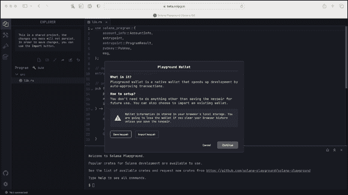

图 8-1：决定是否保存钱包密钥对本地副本进行备份。

Playground 钱包创建后，你将在屏幕底部看到钱包地址、`SOL` 余额以及你连接的 Solana 集群。默认情况下，你连接到 Devnet 集群，但如果你，也可以连接到本地测试验证器。实验时考虑使用 testnet，因为它是免费的。

### 创建 Solana 程序

Solana 使用 Rust，这是一种旨在快速、安全且并发的系统编程语言，它由 Graydon Hoare 在 2010 年创建，并由 Rust 项目（一个志愿者的协作项目）赞助。

你基于 Rust 的 Solana 程序代码位于 Solana Playground 中的 `src/lib.rs` 文件中。这是你导入 Rust Crates 并定义程序逻辑的地方。在 Rust 中，crate（项目）是一个可编译的二进制文件或库，可以作为其他 Rust 项目的依赖项。Crates 发布在名为 `crates.io` 的中央包注册表中，这允许开发者轻松地发现和重用现有代码。

`solana-program` crate 为使用 Rust 开发 Solana 程序提供了必要的工具和功能。Solana 团队非常贴心地在你加载页面时在页面添加了带有注释的代码，方便你回溯并检查你的工作。

### 导入 solana-program crate

按照以下说明，将引导你完成创建一个使用 `solana-program` crate 的新 Rust 程序的过程。

1. **访问** `https://beta.solpg.io/6314a69688a7fca897ad7d1d`。

2. **点击左上角的图标创建一个新文件。**

3. **将文件命名为 `test.rs`。**

4. **在你的 `test.rs` 文件顶部添加以下代码：**

```rust
use solana_program::{ account_info::AccountInfo, entrypoint, entrypoint::ProgramResult, pubkey::Pubkey, msg,};
```

你刚刚添加的代码导入了 `solana-program` crate，并将所需的项引入本地命名空间，允许你可以在程序中使用它们。准备好这些代码后，就可以开始编写你的 Solana 程序的逻辑了。

### 编写你的程序逻辑


# 每个 Solana 程序都必须定义一个 `entrypoint`

每个 Solana 程序都必须定义一个 `entrypoint`，它告诉 Solana 运行时从哪里开始执行你的链上代码。`entrypoint` 是一个名为 `process_instruction` 的公共函数，它接受三个参数：`program_id`、`accounts` 和 `instruction_data`。

你将使用 `process_instruction` 函数向区块链记录 `"Hello, world!"` 消息，然后通过 `Ok(())` 结果优雅地退出。这告诉 Solana 运行时程序执行成功，没有任何错误。

在你完成 Solana 程序的代码编写后，你可以使用 Solana Playground 左侧边栏中的“Build & Deploy”标签页对其进行构建。

1. 访问 `https://beta.solpg.io/6314a69688a7fca897ad7d1d`
2. 在上一部分的 `test.rs` 文件中输入此代码：

```rust
// 声明并导出程序的入口
entrypoint!(process_instruction);
// 程序入口的实现
pub fn process_instruction(
    program_id: &Pubkey,
    accounts: &[AccountInfo],
    instruction_data: &[u8]
) -> ProgramResult {
    // 向区块链记录一条消息
    msg!("Hello, world!");
    // 优雅地退出程序
    Ok(())
}
```

3. 点击 Build 按钮。

你的程序开始编译。

如果构建成功，你将在 Playground 的终端中看到一条成功提示消息。你可能会收到一些关于未使用变量的警告，但这些不会影响你程序的构建——你可以安全地忽略它们。

## 部署你的程序

在成功构建 Solana 程序后（参见上一部分），你可以使用 Solana Playground 上 Build & Deploy 标签页中的 Deploy 按钮（它看起来像一把扳子和一个锤子）将其部署到 Solana 区块链。你的程序将被部署到选定的 Solana 集群，例如 Devnet 或 Testnet。

当你部署程序时，你会看到你的 Playground 钱包余额发生变化。默认情况下，Solana Playground 会自动代表你请求 SOL 空投，以确保你的钱包有足够的 SOL 来覆盖部署费用。如果你需要更多的 SOL，可以在 Playground 终端中输入 `solana airdrop`，后跟上你想要空投的 SOL 数量，如下所示：

```bash
solana airdrop 2
```

此命令向你的钱包空投 2 个 SOL，允许你部署程序并在 Solana 区块链上与其交互。

## 初始化你的客户端

你将使用 Solana Playground 为你的 Solana 程序创建一个客户端，通过在 Playground 终端中使用 `run` 命令创建一个 `client` 文件夹和一个默认的 `client.ts` 文件。这是你将在整个“Hello, world!”程序剩余部分工作的地方。

从你在“编写你的程序逻辑”部分结束的地方开始，你现在准备好运行你的程序了。

### 步骤 1：运行你的程序

要运行你的“Hello, world!”程序，请遵循以下步骤：

1. 通过访问 `https://beta.solpg.io` 在浏览器中打开 Solana Playground
2. 在 Playground 终端（屏幕底部的黑框）中输入 `run`。

在 Solana Playground 中，有很多全局可用的工具供你使用，无需安装或设置任何。对于“Hello, world!”程序最重要的工具是用于 `@solana/web3.js` 的 `web3` 以及用于 Solana Playground 工具的 `pg`。你可以在编辑器内部按下 `Ctrl+Space`（Windows）或 `⌘+Space`（macOS）来访问这些工具。

### 步骤 2：创建你的交易

要执行你的链上程序，你必须向它发送交易。提交到 Solana 区块链的每个交易都包含指令列表以及这些指令将交互的程序。要创建一个新交易并添加单个指令，请使用以下代码：

```javascript
// 创建一个空交易
const transaction = new web3.Transaction();
// 向其添加一个 hello world 指令
transaction.add(new web3.TransactionInstruction({
    keys: [],
    programId: new web3.PublicKey(PROGRAM_ID),
}));
```

每个指令都必须包含涉及的所有键以及你想执行的程序 ID。在这个示例中，`keys` 是空的。

### 步骤 3：签名你的交易

在你创建交易后，可以使用以下代码将其提交到 Solana 集群：

```javascript
// 将交易发送到 Solana 集群
console.log("Sending transaction...");
const txHash = await web3.sendAndConfirmTransaction(pg.connection, transaction, [pg.wallet.keypair]);
```

值得注意的是，`signers` 数组中的第一个签名者默认是支付者。在这种情况下，你正在使用 `pg.wallet.keypair` 进行签名。

## 运行你的应用程序

你可以使用 Solana Playground 中的 `run` 命令运行你编写的客户端。在你的应用程序完成后，你将看到类似的输出：

```
Running client…
client.ts:My address: GkxZRRNPfaUfL9XdYfKf3rWjMcj5mdRoWpURwP My balance: 5.72542 SOL Sending transaction…
Transaction sent with hash: 2Ra7D9JoqeNsax9HmNqMB4qWtKPGq2ceEpbav9mCcq
```

你可以直接在 Solana Playground 中使用 `solana-cli` 获取交易信息。运行以下命令，将 `TRANSACTION_HASH` 替换为你调用“Hello, world!”程序时获得的哈希：

```bash
solana confirm -v TRANSACTION_HASH
```

你应该会在输出的 `Log Messages` 部分看到 `"Hello, world!"`。

你现在是一个 Solana 开发者了！你可以尝试更新程序的消息并重新构建、重新部署和重新执行程序，看看它是工作的。

# 在 Solana 上构建 DAO

Realms 是 Solana 区块链上的一个平台，允许用户轻松创建和管理 DAO。通过 Realms，你可以创建自定义 DAO、管理成员、对提案进行投票并分配你的金库（存放在智能合约中的资金）。该平台设计非常灵活，可以创建各种不同类型的 DAO，包括多签名（multisig）、非同质化令牌（NFT）社区和社区代币 DAO。例如，艺术家可以使用 NFT 社区来帮助他们向超级粉丝发行音乐。DAO 使用代币赋予成员在治理中的投票权。例如，DAO 可以用于管理慈善机构。

Realms 还作为 SPL Governance 的前端，SPL Governance 是一种在 Solana 上构建和维护 DAO 的标准，它独立于 DAO 类型和资产类型。这使得构建人员能够创建满足其社区特定需求的 DAO。

DAO 的核心是一个拥有共享银行账户的社区，通过区块链上的智能合约进行运行和治理。DAO 的成员可以以透明且去中心化的方式做出决策，并由智能合约执行这些决策。例如，成员可以创建一个提议，建议对 DAO 的国库进行投资或进行程序升级。DAO 的其他成员随后对该提议进行投票，如果达到预定义的法定人数（quorum）赞成，该提议将被智能合约接受并执行。

这种结构提供了一个扁平化的组织结构，DAO 的每位成员在组织方向上都拥有平等的语权。这使得决策变得更加民主和去中心化，对于各种不同类型的社区都有益。

要建立你的 Solana DAO，你需要两张干净的纸来写下密码和助记词（seed phrase）。你还需要购买一些 SOL。使用 `Phantom` 钱包最低购买金额为 50 美元。

## 创建 Solana 钱包

要创建 Solana 钱包，请遵循以下步骤：

1. 访问 `https://phantom.app/`。
2. 点击下载。
3. 点击 Brave。
4. 点击添加到 Brave。
5. 点击添加扩展。
6. 点击创建新钱包。
7. 在干净的纸上写下你的密码。
8. 在另一张纸上写下你的助记词。
9. 一路点击完成。

你现在有了一个安全的地方来存放 `SOL` 并与 Solana 区块链交互。请务必保护好你的密码和助记词。你甚至可以考虑将纸进行塑封，使其更不易损坏。

## 获取 SOL

现在你需要为你的钱包加载 `SOL`，以便有足够的金额来构建你的合约。遵循以下步骤：

1. 打开 Brave 浏览器，并导航到你的浏览器扩展程序。
2. 打开你的 `Phantom` 钱包。
3. 点击购买。
4. 点击 Solana。
5. 输入至少 50 美元。
6. 点击下一步。
7. 点击 Coinbase。
8. 点击授权。
9. 点击预览购买。
10. 点击确认。

现在你的钱包已加载了 `SOL`，你可以开始构建你的 DAO 了。

## 在 Realms 上创建 DAO

在 Realms 上创建 DAO 是一个简单直接的过程，涉及几个关键步骤。通过遵循这些步骤，你可以创建自己的自定义 DAO 并开始使用它以去中心化和透明的方式决策：

1. 访问 `https://app.realms.today/`。
2. 点击 Create DAO 按钮。
   你的 `Phantom` 钱包会出现。
3. 点击 Connect 按钮。
4. 选择 Community Token DAO。
5. 输入你的社区名称。
6. 在 `你的 DAO 社区是否有现有的代币`下，选择 `No, Let's Create One` 单选框。
7. 在 `管理此 DAO 所需的社区代币最小数量`下，输入 `10`。
8. 将你的社区批准法定人数设置为 60%。
9. 在 `你的 DAO 委员会是否有现有的代币`下，选择 No。
10. 点击下一个箭头。
11. 点击 Create Community Token DAO。
12. 当你的 `Phantom` 钱包弹出时，点击 Approve。

# 第三部分：强大的区块链平台

在本部分中……

* 确定最大的商业区块链联盟 `Hyperledger`，以及它对你的行业和组织将带来的收益和影响。
* 微软的区块链努力，以及通过其网络产品向你提供的核心工具。
* 评估 `IBM Bluemix` 项目以及区块链技术结合人工智能的影响。

# 第 9 章：获取 Hyperledger

在本章中

* **揭秘 Hyperledger 基金会**
* **发现关键的 Hyperledger 项目**
* **揭秘 Hyperledger Besu**
* **使用 Besu 在以太坊开发网上进行挖掘**

Hyperledger 是一个基金，支持一个软件开发者和技术爱好者的社区，他们正在为区块链框架和平台构建行业标准。`Hyperledger` 的工作至关重要，因为他们正在创建符合业务需求的区块链技术。公共区块链上的加密货币具有监管影响和责任，这使得许多公司无法利用这些网络。`Hyperledger` 拥有公共区块链技术的许多优点，但在没有加密货币的情况下运行。

凭借 `Intel` 和 `IBM` 等大型支持者，`Hyperledger` 是企业团队的“信任”部署平台。

`Hyperledger` 及其独特项目每天都在增长。截至本文写作，它已有 100 多家成员公司和几个正在孵化的区块链应用程序。`Hyperledger` 的前几个项目包括 `Fabric`、`Iroha` 和 `Sawtooth`。这些是开发者可以使用来构建私有区块链、创建智能合约并为人类和事物构建分布式身份的框架。

在本章中，我将解释如何使用 `Hyperledger` 的 `Composer` 工具创建资产追踪。我还向你介绍了 `Fabric`、`Iroha` 和 `Sawtooth` 项目。你将深入理解商业区块链的未来对你的公司和行业意味着什么。这些知识将帮助你探索利用哪些技术以及避免哪些技术，从而节省开发时间和资源。

## 了解 Hyperledger

2015 年底，Linux 基金会成立 `Hyperledger` 项目，旨在开发一种企业级的开源分布式账本框架。他们希望让区块链社区专注于构建特定行业的应用程序、平台和硬件系统以支持业务。

Linux 基金会看到许多不同的小组在没有统一方向的情况下构建区块链技术。行业内正在重复劳动，而部落主义导致团队多次解决同一个问题。基金会成员看到了互联网的诞生与区块链技术的出现之间的相似之处：如果区块链要实现其最大的潜力，迫切需要一种开源协作的开发策略。

`Hyperledger` 项目由执行董事 `Brian Behlendorf` 领导，他拥有数十年的经验，可以追溯到最初的 Linux 基金会和 Apache 基金会，并曾任世界经济论坛的首席技术官 (`CTO`)。因此，`Hyperledger` 受到广泛欢迎并不意外。许多顶尖商业和行业领袖已加入该项目，包括 `Accenture`、`Cisco`、富士通通用、`IBM`、`Intel`、`J.P. Morgan` 和 `Wells Fargo`。

`Hyperledger` 的技术指导委员会确保了这些不同技术之间的稳健性和互操作性。人们希望，这种跨行业的开源协作将推动区块链技术的发展，并通过许多组织共享研发成本来产生数十亿美元的经济价值。

`Hyperledger` 正在识别并解决区块链技术生态系统中缺失的关键功能和需求。它还在培养一种跨行业的分布式账本开放标准，并为开发者贡献构建更好的区块链系统提供开放空间。

Hyperledger 的项目周期类似于 Linux 基金会。一个提议被提交后，被接受的提议将进入孵化阶段。当一个项目达到稳定状态时，它将毕业并转入活跃状态。截至目前，所有的 Hyperledger 项目都处于提议或孵化阶段。每个项目都由大型公司或初创公司领导。例如，`Fabric` 由 IBM 领导，`Sawtooth` 由 Intel 领导，而 `Iroha` 由初创公司 Soramitsu 领导。

> **提示** Hyperledger 与许多开源项目一样，使用 GitHub ([`www.github.com/hyperledger`](http://www.github.com/hyperledger)) 和 Slack ([`https://slack.hyperledger.org`](https://slack.hyperledger.org)) 与事于每个项目的团队保持联系。这些是获取最新更新和检查这些项目开发进展的绝佳场所。

## 识别关键 Hyperledger 项目

Hyperledger 在孵化状态下有几个革命性的项目。在本节中，我将向你介绍最著名且最完善的项目。这些区块链技术包括分布式账本框架、智能合约引擎、客户端库、图形界面、实用程序库和示例应用程序。

### 关注 Fabric

Fabric 是 Hyperledger 上的第一个区块链实现。它已成为大多数区块链应用的基础。`Fabric` 在区块链生态系统中是独一无二的，因为它允许未使用 `Fabric` 的部分功能而无需提交所有功能——这是一种真正的定制即插即用体验。`Fabric` 还可以创建名为 `chaincode` 的智能合约。

`Fabric` 是一个许可链区块链，不使用加密货币。这意味着所有参与者都是已知的（与典型的公共区块链不同，后者的参与者默认是匿名的）。`Fabric` 的工作方式与其他区块链类似，维护一个数字事件账本。这些事件被结构化交易并在不同的参与者之间共享。交易的执行不使用加密货币（相比之下，公共区块链使用其原生加密货币支付网络运行费用，并允许所有参与者保持匿名）。要深入研究 `Fabric` 主题，请访问 [`https://trustindigitallife.eu/wp-content/uploads/2016/07/marko_vukolic.pdf`](https://trustindigitallife.eu/wp-content/uploads/2016/07/marko_vukolic.pdf)。

所有交易都是安全、私密且机密的。`Fabric` 通过仅允许根据参与者的共识进行更新来维护其完整性。一旦记录被输入，永远无法被更改。

`Fabric` 是一个关注可扩展性和合规性要求的企业级解决方案。所有参与者必须向成员服务注册身份证明以获得访问系统的权限。`Fabric` 发出的交易带有派生证书，这些证书与所有者参与者不可关联，从而在网络上提供了匿名性。此外，每笔交易的内容都经过加密，以确保只有目标参与者才能看到内容。

`Fabric` 具有模块化架构。你可以通过实现其协议规范来添加或移除组件。它的容器技术可以处理大多数用于智能合约开发的流语言。

### 关注美洲开发银行在 Fabric 上的工作

美洲开发银行（IDB）一直与 `Fabric` 合作以支持其跨部门创新。`IDB` 的努力包括成立名为 `IDB Lab` 的创新实验室。


`IDB Lab` 的成立是为了为监管合规、支持和治理问题寻找解决方案。在调查这些问题时，`IDB Lab` 形成了 `LACChain`，这是一个许可性公共区块链基础设施。`LACChain` 是面向拉丁美洲和加勒比（LAC）地区的可扩展且可持续的网络，实现了中立、负责任且稳健的治理。

### 双重检查身份

`LACChain` 通过开发一个确保符合交易问责监管要求的系统解决了一个大问题。为了实现这一点，`LACChain` 实现了两个签名级：

* 第一层是许可制的，这意味着访问仅授予经过审核和识别的个人或组织。
* 第二层允许具有更高的匿名性，因为它将签名者的身份与交易分离，防止普通公众知道是谁签署了交易。

该系统的许可层构建在 `Hyperledger Besu` 之上，而公共层基于 `Ethereum`。

任何人都可以通过部署节点加入 `LACChain` 网络。每个节点都可以充当验证者、启动节点、写入者和观察者。你可以选择自己的部署环境，可以是云端本地。

实体必须遵守 `LACChain` 测试网的条款和条件以及 `LACChain` 主网的附随协议。条款和条件协议要求每个节点操作员对其发送到网络上的交易及其内容负责。`LACChain` 主网要求每个广播交易的节点对交易进行签名，以及匿名终端用户的签名。

`LACChain` 实施了主权身份协议。这是个人为自己创建的身份，而不是由政府或公司等第三方颁发的身份。

### LACChain 的抗量子性

区块链面临的生存威胁之一是比经典计算机更快的量子计算机。量子计算机利用量子力学规则进行计算和解决问题。它们与普通计算机不同，因为它们使用量子比特（qubits）而不是普通比特（bits）来存储和处理信息。

经典计算机使用只有两种状态（0 或 1）的比特来存储和处理信息，而量子比特可以同时存在多种状态。这种被称为`叠加`的属性允许量子计算机执行某些类型的计算（例如破解加密）的速度远快经典计算机。计算机拥有的量子比特越多，解决问题就越快。量子计算机仍在开发中，在拥有足够的精度和量子比特来破解区块链技术的公钥加密之前，还有一些挑战需要克服。

公钥加密用于大部分互联网基础设施，因此它将是一个比窃取你的比特币大得的问题。


`IDB Lab`、Cambridge Quantum Computing 和蒙特雷理工大学联手，使用新的后量子加密算法解决公钥加密和密钥建立特定问题。在美国国家标准与技术研究院（NIST，一个促进创新和工业竞争力的政府机构）的帮助下，`IDB Lab` 能够测试两种名为 `CRYSTALS-Dilithium` 和 `FALCON` 的新候选算法，为 `LACChain` 区块增加抵抗未来量子计算机攻击的保护。

### 经济可持续性

使用公共区块链的权衡之一是每笔交易都有硬性成本。你可能记得向公共网络上的节点支付交易费用。每个区块链都有不同的费用，这些费用会随时间和网络拥堵而变化。这种结构是为了防止个人向网络发送垃圾信息。

LACChain 找到了一种变通方法，使其能够在向用户提供免费交易的同时解决这一问题。它开发了一项基于智能合约的新型 Gas 分配协议。该协议为许可写入节点账户分配每个区块的 Gas。Gas 的分配取决于网络压力的大小。如果生成的条目较少，可用 Gas 就越多；如果网络饱和，则可用 Gas 越少。

Gas 分配协议是一种基于智能合约的解决方案。智能合约评估发送到网络的所有交易，并分析每个区块使用的 Gas 数量。它还会检查节点是否对交易进行了签名并拥有足够的 Gas。

## LACChain 的未来治理

LACChain 在 Red Clara 的支持下创建了 LACNet，这是一个国际非营利组织，Red Clara 是另一个支持拉丁美洲学术社区的非营利组织。LACNet 还得到了拉丁美洲和加勒比地区地址注册协会（LACNIC）的支持。这些组织将共同支持 LACChain 的未来发展。

在本书撰写时，已有 60 个项目正在使用 LACChain 网络。凭借着在量子证明方面的创新以及对不受 DoS 攻击的免费交易的支持，LACChain 可能成为许可链区块链未来的一项核心创新。

## 研究 Iroha 项目

Hyperledger 的 Iroha 项目是基于 Fabric 项目完成的工作的。它旨在补充 Fabric、Sawtooth Lake 以及 Hyperledger 下的其他项目。Hyperledger 将 Iroha 项目加入孵化阶段，是因为其他项目中没有使用 C++ 编写的任何基础设施项目。缺乏 C++ 项目严重限制了能够从 Hyperledger 工作中受益的人数，以及能够为该项目贡献的开发者数量。

此外，目前大多数区块链开发仍处于最低的基础设施层面，在用户交互或移动应用程序方面的开发工作很少或根本没有。Hyperledger 认为，Iroha 对于区块链技术的普及是必要的的。该项目通过引入更多开发者并为移动用户界面开发提供类库，填补了市场空白。

在撰写此时，Iroha 还是一个非常新的项目，尚未与 Fabric 或 Sawtooth Lake 集成。Hyperledger 计划很快扩展功能以与其他区块链项目协作。它的 iOS、Android 和 JavaScript 库将提供如数字签名交易等支持功能。它对于商业应用开发将非常有用，并会增加只有通过区块链技术才能实现的新的安全层和业务模型。

## 引入 Sumeragi：新的共识算法

区块链拥有一套系统，允许它们首先对单一版本的真相达成一致，然后将该达成一致的真相记录在账本中。这种一致系统被称为 `consensus`（共识）。共识是复杂的。理解共识如何以及为何以此方式运作的细微差别已超出现本书的范围。对于商业专业人士来说，这远比你需要的更多。对你`真正`重要的是不同共识机制的后果以及它们如何影响你在该特定区块链上的操作。我重点介绍 Iroha 的共识算法 Sumeragi，因为它与传统区块链非常不同。

以下是让 Sumeragi 与众不同的几个关键点：

* `Sumeragi 没有加密货币。`
* `启动共识的节点由 Fabric 成员服务加入系统。` 节点根据它们与账本的交互随时间建立声誉。这是一个由已知实体运行的许可区块。
* `新条目以独特的方式添加到账本中。` 第一个启动共识的节点被称为 `leader`（领导者），会将条目广播给一组其他节点；随后这些节点进行验证。如果未通过验证，第一个节点将在预设的时间后重新广播。

根据你对区块链的用例，Iroha 的影响可能是正面的也可能是负面的。如果你担心审查，Iroha 可能不适合你。在这种情况下，你最好寻找一种抗审查的区块链。如果你担心网络上的其他参与者进行套利交易，Iroha 可能也不适合你——还需要进一步的调查。如果你想知道你区块链中的所有参与者，Iroha 可能正是你正在寻找的。

## 开发移动应用


如果你不属于应用开发领域，请跳过本节。

Iroha 是为 Web 和移动应用开发者构建的，以便他们能够利用 Hyperledger 系统的优势。Iroha 团队看到，如果没有应用程序来利用分布式账本，那么账本本身将毫无用处。

Iroha 针对以下封装的 C++ 组件提供了开发路径：

* Sumeragi 共识库
* Ed25519 数字签名库
* SHA-3 哈希函数库
* Iroha 交易序列化库
* P2P 广播库
* API 服务器库
* iOS 库
* Android 库
* JavaScript 库
* 区块链浏览器/数据可视化套件

区块链行业面临的主要障碍之一是让系统变得用户友好。Iroha 为 iOS、Android 和 JavaScript 创建了开源软件库，并使得常用的应用程序接口（API）函数调用变得方便。虽然开发仍处于早期，但 Iroha 是探索业务用例的良好资源。

## 深入了解 Sawtooth Lake

Intel 开发的 Sawtooth Lake 是 Hyperledger 中的另一个分布式账本项目。它专注于成为一个为公司构建新分布式账本的高度模块化平台。


在撰写此时，发布版本的软件仅在`simulating`（模拟）共识。无法无法你的项目提供安全性，应仅用于测试新想法。

Sawtooth Lake 不通过加密货币运行。它通过允许企业创建私有链来维护平台的安全性。这些运行私有链的企业分担了网络计算的需求。在文档中，Sawtooth Lake 表示这种设置将确保对共享账本状态达成普遍共识。

Sawtooth Lake 取区块链的基础模型并将其颠倒重来。大多数区块链包含三个元素：

* 区块链当前状态的共享记录
* 输入新数据的方法
* 对该数据达成一致的方法

Sawtooth Lake 将前两者合并为一个它称为 `transaction family`（交易族）的信号过程。这种模型在所有参与方对于拥有正确记录具有共同利益的用例中最佳。

Intel 允许软件具有足够的活性，以适应反映每个业务独特需求的自定义交易族。它还构建了三个构建数字资产的模板：

* `EndPointRegistry`：在区块链中记录项目的地方
* `IntegerKey`：用于供应链管理的共享账本
* `MarketPlace`：用于购买、卖卖和交易数字资产的区块链交易平台

Sawtooth Lake 的共识算法称为等待时间证明（PoET）。它的设计是为了运行在计算机主处理器的安全区域，该区域被称为 `trusted execution environment`（可信执行环境）。PoET 利用 TEE 的安全性通过为交易打时间戳来证明时间的流逝。

其他共识算法也包含某种程度的时间戳元素。它们确保记录未被篡改的方法是通过公开发其区块链，以此证明其未被改动。公布的账本充当了公共见证，任何人都可以对其进行回溯和检查。这有点像在报纸上刊登广告来证明某事的发生。

PoET（权威性执行证明）也有一套抽票系统，其工作原理与其他使用工作证明的区块链略有不同。它会从验证节点池中随机选择一个节点。节点被选中的概率与该节点为共享账本贡献的处理资源量成正比。可能会采取某些措施来防止节点操纵系统并破坏账本。

## 使用 Hyperledger Besu

Hyperledger Besu 是一个以太坊客户端，支持智能合约和 dApp（去中心化应用）的开发、部署和运行用例，并使用了 `Truffle`、`Remix` 和 `web3j` 等工具。它在开源 Apache 2.0 许可下开发，并使用 `Java` 编写。你可以在以太坊公网上或你自己的私有权限网络上运行 `Besu`。它还可以在以太坊测试网 `Rinkeby`、`Ropsten` 和 `Görli` 上运行。

Besu 的核心特性包括以太坊虚拟机（`EVM`）。`EVM` 是图灵环境，允许你在以太坊区块链上部署和执行智能合约。

你可能考虑 Besu 的主要原因之一是因为它实现了多种共识算法。共识是网络对其区块链状态和交易有效性达成一致的方式。共识算法将决定你软件的成本、速度和可扩展性。

以下是 Besu 提供的两个热门选项：

* **权威证明 (PoA)：** 当参与者之间相互认识时，使用 PoA 共识协议。PoA 网络上的交易和区块由经过批准的验证者进行验证。验证者轮流创建下一个区块，且互不竞争区块奖励。
* **工作证明 (PoW)：** 当参与者身份不明时，使用 PoW 共识协议。PoW 网络上的交易和区块由在每个区块竞争中获胜的节点进行验证。

Besu 使用 `RocksDB` 数据库在本地存储链数据。这种类型的数据库非常适合快速且低延迟的存储。它允许你快速提取区块链的有序交易以及每笔交易的元数据。

Besu 允许你使用名为 `Prometheus` 的工具或通过 `debug_metrics` JSON-RPC API 监控节点和网络性能。你还可以使用名为 `Alethio` 的工具关注性能。

Besu 还允许你保持交易的私密性。这意味着第三方无法访问交易内容、发送方或参与方列表。

总体而言，Besu 让你能够在最流行的智能合约平台——以太坊上构建并部署智能合约，同时让你获得一些私有企业级区块链软件的优势。

### 为 Besu 配置你的系统

你可以在所有带有 `Docker` 镜像的系统上使用 Hyperledger Besu 在容器中运行节点。如果你是一个中等熟练的开发者，按照 Docker 网站和 Hyperledger 网站上的 Besu 文档操作很容易。

在接下来的章节中，你将了解如何为你的 iOS 系统设置 Besu 以及如何部署你自己的网络。你需要以下内容：

* 运行 `macOS` 10.13 (High Sierra) 或更新版本的 `macOS` 的 Mac
* 一个 浏览器
* 互联网连接
* 访问计算机 `Terminal` 程序的经验
* `Java` 17，这将是下一个 Besu 系列的最低要求

你还将下载 `Teku`，这是一个开源的以太坊共识客户端。`Teku` 允许你运行完整的信标节点实现和一个参与权益证明共识的验证器客户端。


你也可以使用 `brew install OpenJDK` 安装 Java。

### 为 Besu 准备系统

你可以在所有带有 `Docker` 镜像的系统上使用 Hyperledger Besu 在容器中运行节点。如果你是一个中等熟练的开发者，按照 Docker 网站和 Hyperledger 网站上的 Besu 文档操作很容易。

在接下来的章节中，你将了解如何为你的 iOS 系统设置 Besu 以及如何部署你自己的网络。你需要以下内容：

* 运行 `macOS` 10.13 (High Sierra) 或更新版本的 `macOS` 的 Mac
* 一个 浏览器
* 互联网连接
* 访问计算机 `Terminal` 程序的经验
* `Java` 17，这将是下一个 Besu 系列的最低要求

你还将下载 `Teku`，这是一个开源的以太坊共识客户端。`Teku` 允许你运行完整的信标节点实现和一个参与权益证明共识的验证器客户端。


你也可以使用 `brew install OpenJDK` 安装 Java。

#### 第一步：准备你的系统

为了安装 Homebrew，请执行以下操作：

1. 访问 Homebrew 网站 [brew.sh](https://brew.sh/)。
2. 在 `Terminal` 中运行 Homebrew 代码。`Terminal` 位于 `Applications/Utilities` 文件夹。
3. 粘贴代码。
4. 如果系统请求密码，请输入。
5. 按下回车。

#### 第二步：安装 Java

为了安装 Java，请执行以下操作：

1. 访问 Oracle 网站 [www.oracle.com/java/downloads/](https://www.oracle.com/java/downloads/)。
2. 选择你的操作系统。
3. 点击安装程序。
4. 通过完成安装。

#### 第三步：安装 Besu

为了安装 Besu，请执行以下操作：

1. 打开 `Terminal` 应用。
2. 在 `Terminal` 中输入以下代码：

```
brew tap hyperledger/besu
brew install hyperledger/besu
```

3. 在 `Terminal` 中检查 Besu 版本：

```
besu --version
```

#### 第四步：安装 Teku

为了安装 Teku，请执行以下操作：

1. 打开 `Terminal` 应用。
2. 在 `Terminal` 中输入以下代码：

```
brew install ConsenSys/teku/teku
```

3. 在 `Terminal` 中检查 Teku 版本：

```
Teku --version
```

#### 第五步：启动 Besu

为了启动 Besu 并加入开发网络，请执行以下操作：

```
besu --network=dev --miner-enabled --miner-coinbase=0xfe3b557e8fb62b89f4916b72be55ceb82db73 --rpc-http-cors-origins="all" --host-allowlist="*" --data-path=/tmp/tmpdir
```

恭喜！你现在已经在运行 Besu。如果你喜欢这个教程并想了解更多关于构建私有网络和创建智能合约的内容，请访问 [`besu.hyperledger.org/en/stable/private-networks/tutorials`](https://besu.hyperledger.org/en/stable/private-networks/tutorials)。

# 第十章：应用 Microsoft Azure

## 本章

 **构建新应用**

 **连接你的系统**

 **验证新系统**

 **部署私有以太坊**

在本章中，你将预览 Azure 平台内部正在发生的激动创新，以及这些创新如何提高你的业务效率并创造新机会。

本章将帮助你在全球经济中竞争、合作和服务客户。区块链技术正在开启新的市场并改变商业模式。微软正努力使其成为一种易访问的技术。

本章还介绍了正在构建的创新区块链桥接，允许你连接并扩展现有的系统。你将了解到如何在 Azure 中部署你自己的区块链，以及使你的业务无缝过渡区块链系统的关键要素。

## Bletchley：模块化区块链织物


# Bletchley 项目

Bletchley 项目专注于为企业客户在`联盟区块链生态系统`（允许成员加入的许可网络）提供架构构建块。Bletchley 的区块链织物平台由微软 Azure 提供支持。Bletchley 解决了以下问题：

* 数字身份
* 私钥管理
* 客户隐私
* 数据安全
* 运维
* 系统互操作性

在 Bletchley 项目中，Azure 为区块链提供了云层，作为构建和交付应用程序的平台。它将在全球 24 个区域提供服务。Azure 正在将其传统的产品（如混合云能力、广泛的合规性认证组合和企业级安全性）与各种区块链相结合。微软希望让现有客户能够更轻松地采用区块链技术，特别是在医疗、金融服务和政府等受控行业。

图 10-1 显示了 Bletchley 项目的 `Blockstack Core v14`，这是一种新的无服务器去中心化 Web 网络，用户可以控制自己的数据。

Azure 将与多个区块链协议合作。它们属于 `Hyperledger` 项目以及基于未花费交易输出 (`UTXO`) 的协议。这意味着 Azure 平台不使用加密货币，可能对企业客户更具吸引力。它们还将与更复杂的协议进行集成，包括 `Ethereum`，这些协议利用加密货币来保护网络。

## 用于加密和身份验证的 Cryptlets

Bletchley 项目围绕两个核心理念构建：

* **区块链中间件：** 云存储、身份管理、分析和机器学习
* **Cryptlets：** 用于 Microsoft Azure、Bletchley 生态系统以及你自己的技术之间互操作和通信的安全执行单元

Cryptlets 被构建为离链代码组件，可以使用任何语言编写，执行在信任的容器中，并通过安全通道进行通信。当需要额外的功能或信息时，Cryptlets 可用于智能合约和 `UTXO` 系统。

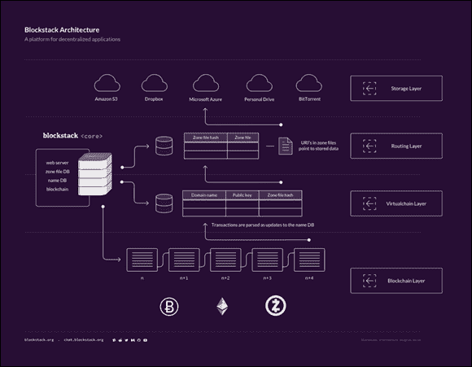

图 10-1: `Blockstack Core v14`。

Cryptlets 弥补了程序链上和链下执行之间的安全差距，在需要额外的安全信息时运行。它们让你的客户关系管理 (`CRM`) 或交易平台能够连接到你的云存储，然后通过 `Ethereum` 等进行安全保护。

Bletchley 的中间件与 Cryptlets 以及现有的 Azure 服务（如 `Active Directory` 和 `Key Vault`）以及其他区块链生态技术协同工作，提供完整的解决方案并确保你的区块链集成可靠运行。

表 10-1 显示了 Devcon 2 关于 Bletchley 演示中预言机 (oracle) 与 `Cryptlet` 之间的差异。

Cryptlets 由开发者构建并在 Bletchley 市场上销售。它们解决了构建基于分布式账本的应用至关许多不同功能集。市场正在增长，以满足需要必要功能的客户需求，例如安全执行、集成、隐私、管理、互操作性和全套数据服务。

### 表 10-1 Cryptlets 与 预言机

| | Cryptlets | 预言机 (Oracles) |
| --- | --- | --- |
| 验证需求 | 需要信任通过可信主机 (`HTTPS`)、可信的 `Cryptlet` 密钥和可信执行环境签名进行验证。 | 需要信任，但没有正式验证。 |
| 基础设施 | 标准基础设施。你可以通过 Azure 全范围内提供的执行环境实现硬件级隔离和证明。Bletchley `Cryptlet` 软件开发包 (`SDK`) 框架（`Utility` 和 `Contract`）可帮助你快速创建和使用 Cryptlets。 | 定制基础设施。你可以单独编写和托管。建立信任很困难。预言机具有平台特定，目前文档非常稀少。 |
| 开发者使用 | 提供多种语言选项，且与区块链无关。 | 绑定到自己的区块链，且语言选项很少。 |
| 市场可用性 | 提供可用于发布和发现的市场。 | 没有通用的市场用于发布和发现。 |

### Utility 和 Contract Cryptlets 以及 CryptoDelegates

Cryptlets 有两种类型：

* **Utility：** `Utility` Cryptlets 提供加密、时间标记、外部数据访问和身份验证。它们创建了更健全、更可信的交易。
* **Contract：** `Contract` Cryptlets 是完整的委托引擎。它们可以作为自治代理或机器人运行。它们提供了智能合约通常执行的所有执行逻辑，但在区块链之外运行。

`Contract` Cryptlets 与智能合约绑定，并在你的智能合约发布时创建。它们与你的虚拟机并行运行，比构建在区块链内部的传统智能合约具有更高的性能，因为执行你的合约不需要矿费。它们对于非加密货币区块链用户最有吸引力，因为这些链码和智能合约由已知方签名。

图 10-2 显示了 `Cryptlet` 容器的描述以及通往你智能合约的安全通信路径。

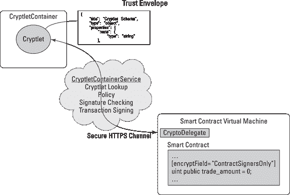

图 10-2: `Cryptlet` 容器。

`CryptoDelegates` 让 `Utility` 和 `Contract` Cryptlets 。它们通过在你的智能合约虚拟机中创建功能钩来充当适配器。它们从你的智能合约代码中调用 `Cryptlet`，反之则为交易创建一个安全包。

## 在 Azure 生态系统中构建

Azure 是一个数字生态系统和云计算平台。它将企业直接与其云合作伙伴和 `SaaS` 连接起来。这使得企业能够以一种互联、可靠且安全的方式传输数据。

Azure 云平台是全球最大的基础设施即服务 (`IaaS`) 平台。它是你云计算和数据存储的可靠且安全的避风港。在 Azure 中，有一种名为 `ExpressRoute` 的服务，它为消费者提供了直接连接到 Azure 的方法。这防止了在公共互联网上广泛看到的性能和安全问题。

2015 年，微软决定使用 `Ethereum` 和 `Hyperledger` 区块系统扩展其 Azure 生态系统。Azure 区块服务的首项产品由 `Ethereum` 驱动。`Ethereum` 是一个用于构建应用程序的图完备区块链框架，你可以在第 5 章 或 Michael G. Solomon (Wiley) 编写的*傻瓜学以太 (Ethereum For Dummies)* 中深入了解。微软的目标是基于区块链技术和 Hyperledger 构建更多产品。它还在扩大 Azure 市场，同时向 Azure 客户过渡到门户网站。

微软的 Azure Stack 程序包含了 `Azure Quickstart Templates`，它可以在 `Azure Resource Manager` 的帮助下部署各种 Azure 资源。`Azure Resource Manager` 允许客户将其业务资源作为一个组进行。它使他们能够在协调的单操作中部署、删除或更新解决方案中的所有资源。

`Azure Quickstart Templates` 可适用于各种环境，如生产、分阶段和测试。通过 `Azure Resource Manager`，客户获得了标记、审计和安全的若干功能。这些功能帮助消费者在部署后管理其资源。

Bletchley 的生态系统是微软采取的一种方法旨在旨在安全有效的方式将区块链或分布式账本网络引入更广泛的受众。他们希望帮助构建真实的解决方案并解决实际业务问题。

## 在 Azure 上部署区块链工具

Azure 还有其他实用的区块链技术实现和工具，你可能会发现它们很有用。在本节中，我介绍了 Azure 的四个核心区块链工具和项目，包括它的以太坊实现；分析机器学习工具 Cortana；Azure 的数据可视化工具 Power BI；以及它的 Active Directory (AD) 工具。后三个不是专门的区块链工具，但它们可以与你的 Azure 区块项目一起使用。

本节将让你了解可以使用 Azure 构建什么内容，以及一些可以帮助你的项目成功的工具。

### 在 Azure 上探索以太坊

以太坊区块链现在作为一种服务在 Microsoft Azure 平台上可用。这项倡议由 ConsenSys 和微软合作提供的。`Solidity` 是他们创建的一个新项目，允许你开始在以太坊上构建去中心化应用程序。可以在 [`https://marketplace.visualstudio.com/items?itemName=ConsenSys.Solidity`](https://marketplace.visualstudio.com/items?itemName=ConsenSys.Solidity) 了解更多信息。

区块链即服务 (EBaaS) 允许企业开发者和客户在云端开发区块链环境，并可以一键启动。

你在 Azure 上部署以太坊区块链时，Azure 最初提供了两个工具：

* `BlockApps`: 一个半私有和私有的以太坊区块链环境
* `Ether.Camp`: 一个内置的开发者环境

`BlockApps` 也可以部署到以太坊的公共环境中。这些工具允许基于智能合约快速开发应用程序。

以太坊是一个灵活开放的系统，可以进行定制以满足客户的各种需求。可以在第 5 章阅读更多关于以太坊的信息。

### Cortana：你的分析机器学习工具

Cortana 是一种基于云系统的强大分析机器学习工具。它是一个全托管云服务，允许用户轻松快速地构建、组织和共享预测分析解决方案。它为消费者提供了许多益处。

通过审查 `Cortana Intelligence` 提供的分析，你可以通过预测趋势比竞争对手更早采取行动。这种灵活快速的软件允许你为你的行业构建快速解决方案，并针对你的特定需求进行定制。

此外，`Cortana` 学习工具的安全且可扩展的。无论数据的复杂性和大小，`Cortana` 都提供数据价值。最重要的是，`Cortana` 允许你与智能代理交互，以便以更自然、实用且有用的方式接近你的消费者。`Cortana Intelligence Suite` 对制造业、金融服务、零售和医疗保健等多个领域都有帮助。

### 使用 Power BI 可视化你的数据

Power BI 是微软提供的基于云系统的强大服务。它涵盖了微软最新的商业智能服务和工具。该服务帮助数据科学家从组织数据中构想并共享见解。

由 edX 在线提供的 `Power BI` 数据可视化课程是微软数据科学专业计划证书的一部分。这项云服务在数据科学专业人士中迅速流行。

`Power BI` 帮助你可视化并连接你的数据。在这门课程中，学生学习如何连接、导入、转换和塑造他们的数据以进行商业智能。此外，`Power BI` 课程还教你如何连接、导入、转换和塑造数据以进行商业智能。

### 使用 Active Directory 管理你的数据

Azure Active Directory (`AD`) 是一种提供身份和访问管理的云服务。它允许你在 Azure 环境内管理用户、组和权限。该工具对于保护资源访问并确保只有授权用户才能访问敏感数据至关重要。

## 在 Azure 上开始使用 Chain

`Chain` 启动了它的开源免费开发者平台。这是领先公司和加密货币与合约倡议 (`3CI`) 共同努力的结果。`3CI` 是 `Chain` 启动的平台，提供区块链解决方案。

该平台允许你在验证的区块链网络上发行以及传输资产。通过其测试网，开发者可以加入并构建金融应用程序。许多新的创新产品计划在该平台上发布，涵盖了支付、银行、保险和资本市场。

### Chain 分布式账本的三管齐下方法

`Chain` 使用三种产品制作在互联网上构建应用的工具：

* `Sequence`: 一个帮助跟踪在线资金和其他内容的数字账本。它适合存储大量信息，即使对于大公司也于使用。
* `Chain Token`: 用于运行 `Chain Protocol`。
* `Chain Cloud`: 在云端开发和运行应用的方法。

总来说，`Chain` 对于想要构建基于区块链应用程序的人来说非常有用的工具。它易用、可扩展且安全，在你考虑为应用程序选择区块链平台时，它是值得探索的。

### 使用 Sequence 构建自己的账本

在 `Sequence` 上启动并运行非常简单。在你设置好账本后，他们有一个用户友好的界面 (UI) 来帮助你创建首次交易。你用 `Sequence` 创建的每个账本都是一个离的、仅追加的、加密链接记录系统。

按照以下步骤设置你的账本：

1. 访问 [`https://sequence.chain.com/start`](https://sequence.chain.com/start)。
2. 点击 `Create Team`。
3. 输入你的电子邮件地址。
4. 输入发送到你邮箱的验证码。
5. 为你的团队命名。
6. 输入密码。
7. 为你的账本命名。
8. 点击 `Create Ledger`。

恭喜！你已经在 `Chain` 上创建了自己的账本！

Chain Token，或 `XCN`，是 Chain Protocol 的原生加密货币。`XCN` 是一种基于用途的代币，用于在 Sequence 上享受折扣、高级访问以及支付商业费用。`XCN` 还用于通过 `Chain DAO` 对各种社区驱动的计划进行链上治理。在 2022 年 3 月，`XCN` 进行了升级并重新记名，以启用代币智能合约中固有的原生治理功能。

`XCN` 有几种不同的用途。在为企业设计的即服务账本 Sequence 上，`XCN` 用于支付商业费用。`XCN` 也可以用于其他 Chain 产品。此外，`XCN` 质押者可以参与 `Chain DAO`，对 Chain 改进提案（`CIPs`）进行投票，通过保护协议获得奖励，并为资助接收者投票。

`XCN` 在 2022 年 3 月进行了升级，以便用于代币智能合约中固有的原生治理功能。这次升级使 `XCN` 质押者能够通过链上投票参与有关 Chain Protocol 未来的决策。

Chain Token 通过提供支付费用、访问高级功能以及参与链上治理的方式，在 Chain Protocol 生态系统中发挥着重要作用。如果你正在寻找一种实用的加密货币，`XCN` 可能是你的不错选择。

## Chain 的 Web 3.0 云

Chain Cloud Services 是 Web 3.0 开发者的一站式服务。它为开发者提供免费的公共远程过程调用（`RPC`）端点，以及配备了先进开发工具的高级和企业级计划。Chain Cloud 由全球分布的去中心化节点网络驱动，对于需要访问链上数据的区块链开发者和项目来说是一个合理的选择。标准应用程序接口（`API`）对所有人开放，并在本文编写期间免费使用。开发者可以使用他们的 RPC 端点访问比特币、以太坊、BSC 和 Solana，而无需输入任何用户信息或登录凭据。

作为区块链基础设施服务的领先提供商，Chain 在开发 Web 3.0 应用方面具有优势，可以帮助你满足所有需求，包括：

* Chain 提供免费的公共 `RPC` 端点，让开发者无需输入任何用户信息或登录凭据即可访问比特币、以太坊、BSC 和 Solana。你只需要一个 `API` 密钥。
* 高级和企业计划计划高级开发工具，对于那些在构建应用时需要额外帮助的人来说非常有用。
* 他们的全球分布的去中心化节点网络确保你总能够在需要的时候访问到需要的数据。

如果你正在寻找一家区块链基础设施服务的提供商，请探索 Chain Cloud Services。他们拥有你构建 Web 3.0 应用所需的一切。你可以通过访问 `https://docs.chain.com` 来完成。

# 第 11 章 与 IBM 忙起来

## 本章内容

* 为人工智能区块链应用做准备
* 构建你的 IBM Fabric
* 创建智能合约
* 部署物联网解决方案

在本章中，我将向你介绍 IBM 的区块链倡议，IBM 正在将这些倡议与其他突破性技术融合，例如 Bluemix（一个用于应用构建的全平台即服务 `PaaS`）和 Watson（其超级计算机）。

区块链技术创造了近乎无摩擦的价值交换。人工智能加速了海量数据的分析。这两项能力的结合将引发范式转移，影响我们开展业务和保护连接的电子设备的方式。

如果你涉及物联网（`IoT`）、医疗保健、仓储、运输或物流行业，你将从本章的信息中获益。此外，如果你是一个企业家，并想了解人工智能（`AI`）与区块链在可扩展应用平台上的整合带来的新功能，那么这一章就是为你准备的。

## IBM 区块平台

IBM Blockchain Platform 是一个用于构建、运行和管理区块链网络的云平台。它旨在让组织更容易在运营中采用和使用区块链技术。

IBM Blockchain Platform 提供了一系列工具和服务，用于在区块链网络之上开发和部署去中心化应用（`dApps`）。它支持多种流行的区块链技术，包括 Hyperledger Fabric、以太坊和 Corda，并用于构建不同复杂性和扩展性的网络。

该平台还包括智能合约生成、实时分析和网络管理工具等功能，可以帮助组织更容易地设计、部署和维护其区块链应用程序。此外，IBM Blockchain Platform 还提供了系列安全和合规功能，帮助防止黑客攻击、欺诈和数据泄露等威胁。

而言，IBM Blockchain Platform 旨在为组织提供一个全面、易用的构建和运行区块链网络的平台，目标是帮助他们在运营更有效地利用区块链技术的优势。

### 供应链

IBM 拥有一种用于供应链透明化的区块链解决方案。他们理解货运运输是一个复杂的过程，涉及具有不同优先事项的不同参与方。现代供应链通过 `IoT` 设备网络进行监控，这些设备扫描产品从生产到运输最后到达最终用户手中的移动。支持 `IoT` 的区块链可以存储集装箱在移动过程中的温度、位置、到达时间和状态。不可篡的区块链交易有助于确保所有方都能信任数据，并采取行动快速高效地移动产品。你可以利用企业区块链平台以更信任、更高效的方式与供应链合作伙伴进行交易，从而实现供应链透明化。


# IBM 区块链解决方案

IBM 的区块链可以帮助你与其他方共享数据。在区块链上共享数据对业务是有益的，因为它允许各方进行透明的协作和共享，并清晰地记录什么时间发生了什么。但如果你在公共区块链上这样做，可能会出现问题，因为你的竞争对手可以使用这些数据来获取领先你公司的优势。在企业区块链平台上共享数据更好，因为你可以决定谁可以查看你的数据。通过供应链透明化解决方案，你可以创建一个不可篡改、分布式且共享的账本，以更信任、更高效的方式与供应链合作伙伴进行交易。在速度、准确性和合规性至关重要的世界上，区块链提供了一个帮助你实现目标的解决方案。

像 `IBM Blockchain` 这样的企业区块链平台为供应链管理提供了独特的优势，包括：

* 从供应商到客户的整个供应链跟踪能力
* 所有成员都可以信任的供应链共享视图
* 增强对运输货物位置和状态的可见性
* 优先访问集装箱温度、位置和到达时间
* 提高对食品安全法规的合规性
* 通过提高货物运输各个方面的透明度快速解决争议

## 世界贸易

IBM 还为贸易融资开发了区块链解决方案。目前世界正处于 `终极全球化` 阶段，几乎所有国家和文化已完全互联并相互依赖。你将这种状态体验为拥有分布式的劳动力，在日常工作中，你可能经常与来自中国、印度和欧洲的团队合作。你的公司可能完全依赖另一个国家的工作。例如，全球 90% 的先进半导体是在台湾制造的。如果没有台湾人员的工作，世界将无法再生产廉价的电子产品。COVID-19 疫情揭示了全面全球化的另一个特征：人员跨国界的自由流动。

IBM 正在关注世界对跨境贸易日益增长的依赖。拥有能够促进更高信任和透明度的解决方案比以往任何时候都更加重要。这正是 `IBM Blockchain` 在战略、快速产品开发、治理和监管方面的经验可以帮助区块链网络扩展成员——这是构建成功网络的重要组成部分。`IBM Blockchain` 还提供了一种新型透明、风险降低且标准化的贸易融资和贸易信用保险解决方案，可以帮助你在降低风险和运营成本的同时，发现新的机会和市场。

通过 `IBM Blockchain`，企业可以在跨境贸易中获得更高的信任和透明度。这是因为区块链为网络内的所有交易创建了共享且不可篡改的记录。这意味着网络中的每个成员都可以看到发生的每笔交易——这有助于促进透明度和信任。此外，区块链允许企业快速方便地验证文档的真实性——例如提单、合同和发票——这有助于减少欺诈并节省时间和金钱。

`IBM Blockchain` 帮助在新贸易时代建立领导地位的另一种方法是帮助在全球范围内创建新的贸易枢纽。通过召集新的贸易网络并汇集来自不同地区的买卖双方，`IBM Blockchain` 正在帮助创造跨境贸易的新机会。此外，通过降低小企业的准入门槛，`IBM Blockchain` 正在开启新市场并创建更具包容性的全球供应链。

最后，通过其针对贸易融资和信用保险的透明、风险降低且标准的解决方案，`IBM Blockchain` 正在帮助企业在降低风险和运营成本的同时寻找新机会。例如，公司可以通过在区块链上自动化整个信用申请过程来节省资金，同时减少欺诈风险。此外，通过使用区块链从头到尾跟踪交易，公司可以获得客户财务状况和交易历史的信息——这有助于降低风险或优化融资条款。

在当今互联的世界中，跨境贸易比以往任何时候都重要。但随着对跨境贸易依赖的增加，企业在培养更高信任和透明度方面的压力也随之增加。因此，当你考虑满足你贸易融资需求的解决方案时，你应该看看 IBM 能为你做什么。

## 医疗保健

IBM 的区块链技术已用于医疗保健和生命科学行业，以解决各种挑战，包括不同系统之间缺乏互操作性、对数据隐私的担忧以及对供应链更好的追溯性的需求。随着 COVID-19 疫情的爆发，这些问题变得更加迫切，因为医疗机构不得不调整供应链以满足对防护设备的需求，并致力于开发治疗、检测和疫苗。IBM 的区块链技术已通过提供安全的、去中心化的数据存储和共享平台来帮助解决这些挑战。它还被用于促进不同电子健康记录系统之间的通信并帮助打击假药。

使用区块链技术的不断增长的医疗市场预计到 2030 年将价值 1260 亿美元。它在医疗保健领域有许多用途，例如帮助防止假药、使其更容易分享和管理医疗信息，以及跟踪医疗用品的运输。在 COVID-19 疫情期间，它还被用于帮助接触追踪和共享研究数据等工作。IBM 有四种主要方式利用区块链支持医疗技术：

* IBM 正在通过跟踪个人防护装备（PPE）产品的来源和真实性，帮助保障 PPE 供应链。
* IBM 正在开展一个项目，允许患者控制对其健康数据的访问。
* IBM 正在与制药公司和分销商合作解决假药问题。
* IBM 正在通过验证参与者身份和确保符合合规性，帮助简化临床试验流程。

区块链特别适用于解决医疗保健和生命科学挑战，因为它是安全、防篡改、去中心化且透明的。它可以帮助确保 PPE 产品的真实性，追踪药物溯源，保护患者隐私并简化临床试验。

疫情凸显了医疗保健和生命科学行业面临的许多挑战。但它展示了区块链技术帮助解决其中一些挑战的潜力。`IBM Blockchain` 仅仅是这种技术如何用于保护供应链、保护患者隐私、简化临床试验等的例子。当我们继续与疫情斗争时，探索区块链可以帮助我们克服这些挑战的所有方法是非常关键的。

`IBM Blockchain` 有潜力通过解决其最紧迫的挑战来转型医疗保健和生命科学行业。区块链技术可以创建患者健康信息的去中心化数据库、可追溯的药物供应链以及医疗专业人员的数字凭证。这将提高互操作性、隐私和供应链追溯性，同时确保患者获得安全有效的药物。

## Bluemix 上的业务区块链

IBM 现在正提供与其传统产品（如 `IBM Bluemix`）集成的区块链技术。`Bluemix` 是一种用于构建和管理应用程序的开放标准、基于云的 PaaS。IBM 集成了来自 `Hyperledger` 的区块链栈，它是 `Linux Foundation` 基金的一部分，并正在建立区块链技术最佳实践。

你可能需要为 `IBM Blockchain` 计划的快速且根本的变化做好准备。这项技术非常新，并且在 IBM 内部和 `Hyperledger` 内部仍处于孵化阶段。

`Hyperledger` 有几个不同的子项目正在开发。截至本文，IBM 正在使用 `Fabric`，但它可能会向其他项目开放 `Bluemix`。`Fabric` 是开源的并在 `Hyperledger` 中活跃开发。你可以通过使用 `Hyperledger Fabric v0.6` 在 `Bluemix` 上测试 `Fabric`。然而，IBM 警告不要在 `v0.6` 或任何早期版本上直接运行任何价值的交易。

`Bluemix` 是 IBM 推出的最新云产品。它是基于 `Cloud Foundry`（开源 PaaS）的 IBM 开放云架构的实现。

`Bluemix` 允许你快速地创建、部署和管理应用程序。`Bluemix` 提供企业级服务，可以集成到应用程序中，而无需了解如何安装或配置它们。

图 11-1 显示了 IBM 如何将区块链的不同方面与 IBM 系统联系起来。你可以访问 `https://goo.gl/12Q6no` 获取更多信息。

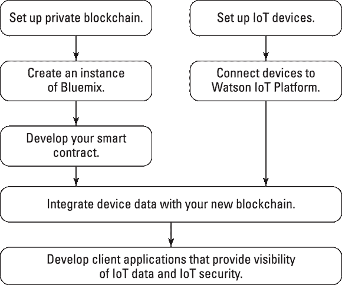

### 图 11-1：IBM Bluemix 和 IoT 如何与 IBM Watson 融合

`IBM Bluemix` 提供四项核心功能：

* 基于你应用程序架构需求的计算基础架构
* 将应用程序部署到 `Bluemix` 公有云或专用云的能力
* 开发工具，如代码编辑器和管理器
* 在其服务部分中访问第三方开源工具

`Bluemix` 为你提供了构建应用所需的一切资源。现在它还提供了区块链基础设施供你测试。

他们提供了一项服务，用于将你的应用程序与 `Bluemix` 区块链集成。截至本文编写时，有两种定价模型。免费账户可以提供你测试想法所需的资源。你将获得四个对等节点和一个用于签署交易的证书颁发机构，以及一个带有日志、控制和 API 的仪表板。

企业版的价格为每月 10,000 美元，提供比免费模型更高的安全速度。

两个卓越的创业先驱正在使用 `Bluemix` 和 `Hyperledger Fabric` 集成：

* **万向（Wanxiang）：** 作为中国最大的汽车零部件公司，万向正与 IBM 合作部署私有区块链。他们正在将产权嵌入电动汽车等设备中。其目标是降低消费者租赁设备的成本。万向将利用其区块链技术跟踪部件的生命周期并翻新旧电池。`Bluemix` 将处理其他所有工作。

* **KYCK!：** 金融科技初创公司 `KYCK!` 正利用 IBM 的区块链集成作为一种解决经纪商“了解你的客户”（KYC）需求的新方法。这项支出对于银行和其他金融服务机构来说是有限且昂贵的。进行 KYC 是为了防止洗钱、非法贸易以及打击恐怖主义。`KYCK!` 正在构建一个视频会议和加密文档提交平台。它将允许经纪人与公司未面对面的客户进行工作并对其身份验证。

IBM 还构建了三个简单的链码应用程序，让你能够体验 `IBM Blockchain` 网络：

* **弹珠（Marbles）：** `Marbles` 是一个演示两个用户之间传输弹珠的应用程序。它让你看到如何在区块链上移动资产。
* **商业票据（Commercial Paper）：** `Commercial Paper` 是实现在 `IBM Blockchain` 上的区块链交易网络。你可以创建新的商业票据进行交易，买卖现有交易，并对网络进行审计。
* **汽车租赁（Car Lease）：** `Car Lease` 与 `Marbles` 演示非常相似。它旨在让你与资产进行交互。你可以创建、更新和传输。它还允许第三方查看历史记录。

## Watson 的智能区块链

IBM 的超级计算机 `Watson` 也适用于 `Bluemix` 平台。`Watson` 是一种认知计算的人工智能计算机系统。它能以惊人的速度分析结构化数据以及更令人印象深刻的非结构化数据。

 这技术仍在发展，客户对它理解非结构化文本的真实能力表示过不满。

`Watson` 可以通过自然语言回答提出的问题，并在吸收更多信息时不断学习。这项技术与区块链技术相结合时，其意义是惊人的。首批应用之一位于 IoT 领域。迫切需要保护从这些设备产生的数据，并使其具有可操作性和智能。

`Watson` 的认知计算正在模拟人类思维过程并使用 `MQTT` 协议。像人类大脑一样，随着时间的推移而成长。它的自学习系统使用数据挖掘、模式识别和自然语言处理来模仿你大脑的工作方式。`Watson` 的处理速度为每秒 80 teraflops（一个 teraflop 等于万亿次浮点运算）。作为背景，这复制了——在某些情况下超过了——高性能人类回答问题的能力。`Watson` 能够通过访问 90 台服务器来实现这一点。

图 11-2 显示了 `Watson` 与区块链的关联。[12q6n](https://example.org/12q6n) 深入了解。IBM 将这些功能应用于数据馈送的链码实现。以下是 IoT 设备的 `Watson` 驱动区块链的工作方式：

* IoT 设备将数据发送到你的区块链账本，作为防篡改的记录。
* 合作伙伴和第三方服务提供商可以访问并供应数据，无需中央控制和管理。
* 所有方都可以签署并验证数据，以确保每个人的责任制。

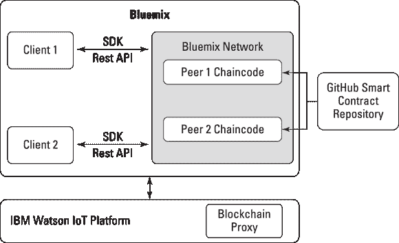

IBM 基于开放标准的分布式 IoT 网络可以解决许多与当今中心化、云端 IoT 解决方案相关的问题。连接设备直接与分布式账本通信。来自这些设备的数据随后被第三方用于执行智能合约，从而减少对人工监控的需求。

集成了 `Fabric` 的 `IBM Watson IoT` 平台在私有区块链网络上复制数据，并消除了对所有 IoT 数据进行集中收集和存储的需求。去中心化的区块链网络还提高了 IoT 设备的安全性。随着时间的推移，每个设备都建立了独特的数字身份。这种创建和保护身份的新方法极难伪造。

这些新的区块链身份允许 IoT 设备签署交易，从而执行智能合约。一个实际的应用场景是保险产品，它可以根据智能汽车提供的不同个人的驾驶行为数据进行定价。汽车会将数据发布到 `Fabric` 中；使用 `Chaincode` 构建的保险产品将识别出新数据和您车辆的身份，并更新您的保单。

可能性几乎是无限的，IoT 为企业和消费者带来了巨大的机遇，特别是在医疗、仓储、运输和物流领域。

IBM 云支持的 IoT 解决方案主要有三个层级，以满足不同的 IoT 业务问题需求：

* **设备网关：** `Device Gateway` 用于收集物理世界数据的智能设备或传感器。这可以是天气传感器、冷藏集装箱的温度监控或患者的生命体征数据。这些 IoT 设备通过互联网发送数据进行分析和处理。
* **IBM Watson IoT 平台：** IBM 将其超级计算机与 IoT 平台相结合，从 IoT 设备中收集数据，然后分析这些数据并采取后续行动来解决问题。`Watson` 提供了机器学习、机器推理、自然语言处理和图像分析，增强了处理从传感器收集的非结构化数据的能力。
* **IBM Bluemix：** `Bluemix` 是基于开放标准的云平台，用于构建、运行和管理应用程序及服务。它通过轻松在这些应用程序中加入分析和认知能力来支持 IoT 应用。

您可以在 `https://developer.ibm.com/technologies/blockchain` 了解更多关于 IBM 解决方案。

# 第 4 部分：行业影响

在本部分中……

* 了解金融服务行业在利用区块链技术快速、廉价地在全球转移资金时的未来。
* 澄清你对区块链技术相关的全球房地产的认知。
* 识别保险行业中的机会，通过新的保险工具减少欺诈并增加利润。
* 研究政府机构和法律框架内永久系统对大型行业的影响。
* 澄清区块链技术的其他全球性趋势，以及它们将如何塑造你所处的世界和你使用的日常工具。

# 第 12 章：金融科技

在本章中

* **探索未来的全球银行趋势**
* **揭示新的投资工具**
* **揭露银行区块链中的风险**
* **开发新的融资策略**

最早采用区块链技术的是银行、政府和其他金融机构——它们也是增长最快的区块链用户。正在建立用于管理和移动资金的强大工具将以新颖且意想不到的方式重塑我们的世界，因此金融科技加入其中是合情合理的。

本章将向你深入介绍政府目前正在利用区块链技术做什么，以及它将如何影响你。无论你是否意识到，金融科技每天都触及着你的生活。

在本章中，我将向你介绍未来的银行业趋势、新法规以及可以帮助你更快、更便宜地移动资金的新工具。我还将解释新类型的投资工具和其他区块链创新。最后，我将警告你注意涉及虚拟货币和新区块链技术支持的金融产品的潜在风险。

## 拿出你的水晶球：未来银行业趋势

银行业是首个采用区块链技术的行业，政府和其他金融机构也是——它们也是增长最快的区块链用户。用于管理和移动资金的强大工具将以新颖且意想不到的方式重塑我们的世界，因此金融科技加入其中是合情合理的。

本章将向你深入介绍政府目前正在利用区块链技术做什么，以及它将如何影响你。无论你是否意识到，金融科技每天都触及着你的生活。

在本章中，我将向你介绍未来的银行业趋势、新法规以及可以帮助你更快、更便宜地移动资金的新工具。我还将解释新类型的投资工具和其他区块链创新。最后，我将警告你注意涉及虚拟货币和新区块链技术支持的金融产品的潜在风险。

银行业是首个意识到 `Bitcoin` 威胁以及区块链转型行业潜力的行业。银行业部门受到严格监管，且组织和运营的成本很高。

区块链这种快速、高效且在金融系统中流动时可追踪的货币的应用是一个极具诱惑且具有威胁的提案。价值可以在中央机构控制之外通过区块链进行持有的想法也引起了金融机构和政府的兴趣。

最初，这些金融机构和政府试图通过监管来抑制区块链。今天，他们正通过投资来拥抱区块链。

2013 年和 2014 年，美国证券交易委员会 (`SEC`) 就投资者对涉及虚拟货币的投资的潜在风险发出警告。警告称，投资者可能会被高回报的承诺所吸引，而对这一新颖且前沿的领域缺乏足够的怀疑。根据 `SEC` 的说法，数字货币是投资者的十大威胁之一。今天，随着加密货币在所有行业中普及，`SEC` 已准备好与公司和投资者互动。

不到两年，全球范围内包括英国、加拿大、澳大利亚、日本和中国开始研究如何创建自己的数字货币，夺取加密货币并将其区块链化。2018 年，委内瑞拉发布了一种名为 `Petro` 的加密货币。`Petro` 的发布是加密货币的一个重要转折点，因为委内瑞拉是第一个发行自己加密货币的主权国家。不幸的是，`Petro` 被用来欺骗委内瑞拉公民。然而，委内瑞拉的未来可能拥有石油支撑的数字货币。

区块链对不可篡改账本的承诺对于寻求减少欺诈和提高信任的政府来说，是一个非常有吸引力的尝试。区块链技术的创新有望能够支持经济所需的数十亿次交易，使大规模应用加密货币变得可行。

区块链本身就是输入其中的交易的永久且不可更改的记录。将国家的货币供应放在中央银行控制的区块链上将产生彻底的变革，因为每笔金融交易都将永久记录，即使这些记录对公众可见。区块链技术和数字货币将减少风险和欺诈，并在他们执行货币政策和税收时获得最终控制权。它不会像最初的 `Bitcoin` 那样匿名。事实上，相反：它允许他们对个人和公司的每笔数字交易拥有完整可审计的轨迹。它甚至允许中央银行取代商业银行在货币流通中的作用。

银行业的未来会如何，这个问题既可能令人担忧又令人兴奋。消费者现在可以通过手机几乎即时地使用任何类型的货币或加密货币向朋友付款。越来越多的零售店开始利用加密货币作为支付商品和接受客户付款的手段。在肯尼亚，使用加密货币已是常态。但对于世界上的大多数地区来说，这仍然不是主流选择。西方市场仍处于早期采用阶段。


鉴于大多数人的财富都封锁在政府发行的法定货币中，或者锁定在现有政府系统的资产中，在我们看到区块链或数字货币的主流应用之前，金融科技的创新必须与这些现有系统融合。如果监管机构找到对账户进行征税和注册的方法，那么面向客户的数字化代币钱包的大规模采用将在二到年后实现。

企业对企业（B2B）市场将更快地开始利用区块链。一个具有相关政策和操作的生产级加固系统正在测试中。`Ripple` 和 `R3` 等公司一直在努力实现这一目标。这些系统将首先关注机构化创建存款的数字化表示形式。这些是内部组织部门之间以及受信任合作伙伴（如供应商）之间的 IOUs。监管机构、中央银行和货币当局都在投入巨资实现这一目标。`加拿大` 和 `新加坡` 的进展非常快。

了解客户（`KYC`）和反洗钱（`AML`）法规要求银行了解其交易对象，并确保他们没有参与洗钱或恐怖主义活动。发行加密货币的银行仍然面临着许多重大的挑战。为了符合 `KYC` 和 `AML` 法规，它们需要知道所有使用其货币的个人身份。在许多情况下，人的银行账户已经是交易的借记和贷记服务，类似于区块链中的分布式账本，不同在于它是中心化的。这一领域的首批候选地区将是监管机构、银行和中央银行合作的地区。`新加坡` 和 `迪拜` 是已经拥有区块链倡议的良好候选地。

### 更快地移动资金：跨境及更多

要评估处理如 `英国` 或 `美国` 这样经济体货币的区块链所需的交易量是非常困难的。仅 `美国` 每天就处理数十亿笔交易，每年价值超过 17 万亿美元。对于一项新技术来说，这是一份巨大的责任！如果一个国家的货币供应受到损害，该国将陷入瘫痪。

国际货币基金组织、`世界银行`、`国际结算银行` 以及来自全球的中央银行家已经会面讨论区块链技术。向更快、更廉价的资金转移的第一步是采用区块链作为协议，以促进银行转账和银行间结算。普通公民日常使用的官方数字货币将出现得晚得多。

个人消费者不会直接感受到由于利用区块链进行银行间结算带来的成本降低。节省的费用将体现在银行的底线中，表现为中间机构收取的费用的减少。

在可预见的未来，消费者仍然需要零售网点和商业银行。但千禧一代已经通过 `PayPal`、`Venmo`、`Cash` 等采用了应用程序激活的支付方式。一种通过手机支付的新方式并不会困扰他们。

巨大的挑战在于，如果所有的钱币都是数字化的，那么一旦遭到破坏将是灾难性的。区块链系统的架构可能足够强大。问题可能在于系统内的代码以意想不到的方式执行，正如 `以太坊` 上的去中心化自治组织（`DAO`）攻击中所发生的那样（参见第 5 章）。

### 创建永久历史

数据主权和数字隐私将成为巨大的话题。反欺诈将变得更容易，因为区块链永远不会遗忘。


著名的秘鲁经济学家埃尔南多·德·索托估计，为世界贫困人口提供土地、房屋和未注册业务的所有权，将释放 9.3 万亿美元的资产。这就是“dead capital”（死资本）一词的含义。

可以想象，那些能够释放死资本（即他们拥有的无法融资的房地产）的国家，将能够在全球市场中打包并出售这些资产的权益。这可能包括为哥伦比亚或秘鲁的新房地产开发提供透明的抵押支持证券。

在未来，各国将能够释放它们的死资本。房产所有者、未开发土地所有者和无法融资房产的所有者现在有机会在全球市场中出售这些资产的权益。

这些资产将具有吸引力，因为由于透明度以及通过区块链技术实现替代的能力，资产经理将能够主动解析表现不佳的资产。使用区块链管理这些资产将使经理拥有始终持有顶尖证券的权力，剔除“烂苹果”，对其进行重新分类并将其作为新证券出售。

对于非机构客户而言，微投资将成为通过区块链交易平台在全球和本地实现的极具吸引力的渠道。使用区块链技术还将为他们提供投资公司及其特定活动的手段，而无需最低金额限制，或通过收取投资百分比的中介机构。

去中心化自治组织（`DAO`）已经存在，并为一些风险承受能力强且技术更精深的投资者实现了 `DAO` 投资池。在机构投资者利用 `DAO` 或投资组合经理向其客户将资金投入基于 `DAO` 的工具之前，可能还需要一段时间。

`DAO` 通过创建基于区块链的投票系统并向投资其产品的人发放股份，消除了投资涉及的大量文书工作和官僚主义。对于任何区块链而言，`code as law`（代码即法律）的理念都是不留情的。风险有很多，特别是当代码编写糟糕并以意料之外的方式执行时。后果是，该系统的攻击可能是严重的。原始系统的透明性加上糟糕的代码为黑客提供了更广泛的攻击向量，并允许他们在每次获得更多信息时进行多次攻击。

在接下来的章节中，我将讨论区块链技术对世界经济的影响和好处。

## 无边界工资发放

我们的世界是全球化的，公司没有边界。即时且几乎免费的工资发放极具吸引力，将为机构节省许多烦恼。但也有缺点。

最大的风险将是通过黑客攻击导致资金损失。如果你以加密货币报酬，并且遭到了攻击，将无法找回你的资金。没有争议解决中心。没有客服可以让你投诉这些资金的损失。数字货币的窃贼拥有全球访问权限，同时具有一定的匿名性。黑客可能在任何地方。

根据目前的区块链结构，消费者需要负责自己的安全。目前，客户并没有保护和保险自己免受损失的主要负担。大型公司和政府提供保护和保险，而且在人们记忆所及范围内一直如此。自从中世纪时期停止持有自己的黄金（某种程度上）以来，普通个人就不需要以此方式保护自己了。

这些挑战并没有阻止公司使用加密货币处理工资发放。`Bitwage` 和 `BitPay` 都在通过 `Bitcoin` 进行工资发放的市场中竞争。`Bitwage` 允许员工和独立承包商以加密货币接收部分薪水，即使雇主没有提供该选项。另一方面，`BitPay` 将工资服务提供商 `Zuman` 和 `Incoin` 集成到其支付和工资的 `APIs` 中。再次，早期采用正在发生在以前不存在或解决方案不足的领域。

## 更快速、更好的贸易

区块链将促进更快速且可能更具包容性的贸易。全球贸易金融近年来受到限制。一些像 `Barclays` 这样的银行甚至退出了增长中的非洲市场。他们为贸易融资留下了真空。公司仍然需要资金来运输货物。

`DAOs` 和微投资可以满足这种需求，并为投资者提供比目前市场上更有回报的回报。商品的透明、安全的身份以及无缝追踪将开启这一机会。像 `Ripple` 这样的公司促进的货币间互操作性还将提供更灵活的汇率计算方式。数字货币的引入将增加未服务市场的适应性。

`Aza Finance`（前身为 `BitPesa`）是一家将 `M-pesa` 手机流量转换为 `Bitcoin` 的公司。通过这项技术，为企业提供了更快更便宜的发送或接收支付的方式。非洲和中国之间的贸易是一个超过 1700 亿美元的市场。跨境结算需要数天，而且费用很高。当你使用 `Aza Finance` 的数字平台时，支付是即时且廉价的。

## 有保障支付

通过区块链支持的交易进行的保障支付将增加信任度较低地区的贸易。贫穷国家可以在这些系统内与富裕国家处于平等的竞争平台上。随着这种情况在未来十年内发生，全球经济将发生变化。商品和劳动成本可能会增加。

全球公司根据竞争性定价支付员工，以及根据员工之前的工资。如果区块链允许跨越经济差距实现平等，这不会一夜之间发生。开发者和其他知识工作者将是例外，因为他们更容易基于匿名工作自给。

金融包容和公平贸易是政府非常关注的话题。数字货币的采用更有可能在小国范围内进行。大多数国家拥有去中心化的权力结构，防止货币等关键系统的快速变化。

小国家的中央权力结构允许他们跳过遗留基础设施和官僚主义。例如，大多数非洲和南美国家没有电话或地址，但他们都有智能手机并创建 `加密货币钱包` 的能力。缺失的环节是整体贸易流动性，以及通过加密货币支付水电、房租和食物等基本需求的能力。

### 交易的新性质

微支付是交易的新形式。信用卡公司可能会使用区块链技术结算交易、减少欺诈并降低自身的成本。

像 `Visa` 和 `MasterCard` 这样提供延迟支付福利的全球机构对于资本主义社会的消费者来说将一直是需要的。即使后端发生变化，客户仍然拥有相同的访问点。但实体卡将消失。事实上，即使没有区块链技术，这种情况也正在发生。有了区块链技术，支付背后的客户身份将更难被盗窃。

人们仍然需要信贷来经营业务和个人生活。信用卡公司将继续通过交易费用获利。信贷驱动着世界，资本市场在我们目前的社会结构中将永远存在。群体之间发送资金的成本将会降低，但这对金融机构来说是一件好事。他们希望专注于客户的服务。

## 挤压欺诈

比特币的创造是为了应对金融危机，在那场危机中，欺诈和不道德行为导致了世界的崩溃。它从一种“信任或不信任”的世界观转变为一个去信任的系统。一个 `trustless system` 意味着你平等地信任网络中的每个人。更重要的是，区块链提供了一个允许交易在无需信任的情况下发生的框架。这些类型的框架不仅可以用于在网络上进行价值交换。为了说明这种潜力，我去一家酒吧，门保人员拦住我并要求查看我的身份证。我从钱包里掏出驾照递给他。我的驾照上有许多门保人员不需要、也不应该接触到的信息（比如我的地址）。他从身份证中需要的只需要我年满 21 岁即可。

在未来，区块链系统将允许你选择暴露哪些信息以及在何种程度上满足监管要求。匿名数据越多，就会越安全。区块链系统将通过不与需要它的人共享信息来帮助遏制身份盗窃。区块链技术的另一个方面是，它将欺诈从发生的地方（过去式）转移到当前正在实时发生的地方。在目前的系统中，审计是对已发生事件进行的事后分析。一组外部审计人员来检查是否一切都已就位。在此之外的任何操作都成本过高且耗时过长。集成了区块链技术的记录系统能够在文件创建时就对其进行审计，并在其产生时标记出不完整或异常的文件。这将为经理提供所需的工具，在文件变成问题之前主动进行纠正。

区块链系统的另一个特点将能够透明地与第三方共享数据。在未来，共享数据将像发送电子邮件文件一样简单，只不过接收者访问的是原始文件，而不是通过电子邮件发送的副本。当有人发送文件时，他的电脑上有一个版本，接收者那里有一个版本。通过区块链技术，这两个将只共享一个版本。

区块链充当了见证文件年龄和创建时间的第三方。它们可以在细粒度层上告诉你是跨系统（内部和外部）与文件交互过的每一个人。它们可以显示文件中缺失了什么，而不仅仅是其中包含的数据。区块链文件还可以以不损害文档有效性的方式进行共享。这意味着你将能够看到文件的年龄、文件的完整历史，以及它随时间演变的样貌。更有趣的是，你还能看到文件中是否缺失了任何内容。这个概念被称为“证明负性”（proving the negative）。目前大多数文件系统只能告诉你它们内部包含什么。但你将能够看出一个文件缺少什么。

审计将变得更廉价、更完整。更新审计规则可以通过更具中心化的方式进行。当区块链网络内的监管节点对资产交易拥有共享且透明的视图时，这些交易的报告可以通过监管机构的位置完成，而无需强制 100 个或更多其他机构遵循相同的规则集。

在组织内部完全集成的基于区块链的系统将能够知道每一分钱花在哪里。资金如何支出的“最后一公里”是跨组织和政府最难核账的部分。因为非常难以核账，那些想要窃取资金的人就有了他们所需的突破口。

“最后一公里”可能成为公司节省浪费资源和识别腐败个人的最大机会。对资金支出有严格会计准则的非营利组织将从这种系统中受益最多。他们可以在满足对捐赠者审计和问责需求的同时，不阻碍他们实现更大的善意使命。一种已经探索过的系统将直接集成到救援工作人员的工作流中。该系统最初设计用于跟踪医疗记录，但也可以追踪用于每个医疗患者的所有物料。鉴于非政府组织（`NGO`）世界内部发生了如此多的欺诈和盗窃，该系统的潜力将是巨大的。

# 第 13 章 房地产

## 本章内容

- 评估全球房地产趋势
- 发现僵尸资本及其修复方法
- 揭示房美贷（`Fannie Mae`）将如何融入区块链世界
- 揭示中国将如何随着区块链技术而演变

房地产将成为区块链技术创新影响最大的行业之一。这种影响将以略有不同的方式体现在每一个国家。在西方世界，我们可能会看到诸如在支持区块链的交易所上交易的透明抵押贷款证券等事物出现。在中国，区块链整合已经发生，例如公证，这是房地产交易的核心组成部分。在发展中国家，区块链拥有最广阔的前景，因为它们可能释放资本并增加贸易。

本章深入探讨了全球范围内房地产行业正在发生的创新。我还将向你介绍未来可能发生的变化以及区块链技术的重大影响。

房地产拥有世界上大部分的财富和经济稳定性。在未来几年里，该行业将变得非常快，知道这些变化将发生在哪里以及你和你的公司如何利用这些变化将是一种收益。

## 消除产权保险

产权保险是对因房地产购买中产权缺陷导致财务损失的补偿。如果你对房屋办理了抵押或进行再融资，就需要它。产权保险保护银行的投资，免受在公共记录中未发现、在产权调查中被遗漏或由于欺诈或伪造产生的产权问题的影响。

在使用普通法管理产权体系的地方，产权保险是必要的。买方负责确保卖方的产权是良好的。在这些系统中，会进行产权调查并购买保险。在使用托伦产权制度（`Torrens title system`）的地区，买家可以依靠土地登记的信息，不需要查看这些记录以外的内容。

区块链技术被提议作为补充，帮助普通法产权系统中的消费者。这个想法很简单：区块链是极佳的公共记录系统；它们在没有记录的情况下无法追溯日期或更改。从理论上说，区块链可以将普通法系统转换为分布的托伦产权系统。

2022 年，元宇宙内容创作公司 `Future House Studios` 成为第一个将其公司办公室的所有权铸造为 `NFT` 的公司。该公司的办公室房地产所有权证将在区块链上永久性地保留并进行交易。区块链房地产公司 `TruMint` 引导了 `Future House Studios` 完成了这一过程，并希望区块链和 `NFT` 技术能成为房地产的自然组成部分。`TruMint` 由一群受过哈佛大学培训的律师和区块链软件工程师创立。他们让合法出售房地产变得像传输 `NFT` 一样简单。他们的团队创建了额外的安全措施，以满足美国全美 50 个州对房地产购买的所有要求。`TruMint` 的作用像一个法律保险箱，将现实世界的权证放入冷存储中，允许 `NFT` “数字契据”在链上进行无限期交易。在任何时候，`NFT` 持有者都可以通过将 `NFT` “钥匙”归给保险箱来提取现实世界的权证。这种方法将大幅降低买卖房地产的成本和麻烦程度。这就像电子签名转让文件然后将 `NFT` 从一个钱包移动到另一个钱包一样简单。

## 受保护行业

每个行业都有自我保护系统来将新的竞争者挡在门外。这可能是高额的监管负担、政府授予的垄断，或是高昂的创业成本。围绕房地产买卖的行业在过去 40 年里没有太大变化，正处于被颠覆的边缘。许多不同的主体在这个过程中做出了贡献。

以下是围绕房屋买卖建立的不同行业：

*   **房地产中介：** 房地产中介人帮助你比较不同的社区并寻找房屋。他通常帮助你谈判价格，并代表你与卖家沟通。这项服务非常有价值，不太可能被区块链技术取代。你已经可以在没有房地产中介的情况下买房了——人们选择与他们合作是因为他们改进了流程。
*   **房屋检修员：** 房屋检查员在你购买之前发现房屋的缺陷——这些缺陷可能会在将来让你花费金钱。房屋检查员发现的缺陷可以用来与卖家谈判获得更好的价格。在未来，房屋将继续出现磨损——这永远不会改变。但区块链技术可以用于记录物业维修情况和检查中发现的缺陷。
*   **结案代表：** 在结案时，最后一步是结算。结案代表监督并协调结案文件、记录这些文件并将资金发放给相关方。结案代表可能会被区块链技术取代——结案代表执行的功能可以构建在智能合约或链代码中。
*   **抵押贷款人和服务商：** 抵押贷款人和服务商为贷款提供资金并收取持续的抵押还款。他们不会被区块链软件取代，但他们可能会使用区块链技术来帮助减少记录和审计的成本。
*   **房地产评估师：** 房地产评估师的工作是查看物业并确定其价值。每当房产出售或再融资时，都会进行评估过程。像 `Zillow` 这样的公司已经承担了大部分了解市场价值的准备工作，但每栋房屋都是独特的，需要定期进行评估。即使在房地产抵押过程中，也可能需要多次申诉以满足所有人的需求。将这些数据记录在区块链中作为公共见证可能是很有用的。
*   **贷款员：** 贷款员利用你的信用、财务和就业信息来判断你是否符合抵押贷款的条件。然后他们将你符合条件的与他们销售的产品进行匹配。就像房地产中介一样，贷款员帮助你在一系列选择中获得最佳方案。区块链软件可能用于帮助贷款员跟踪提供给你的文件，并审计流程以符合公平贷款法。
*   **贷款处理员：** 贷款处理员协助贷款员准备抵押贷款信息以及提交给核保员的申请。正在探索提取买家源信息的软件。这虽不属于区块链技术，但对这一职位来说可能是颠覆性的。
*   **抵押贷款核保员：** 抵押贷款核保员决定你是否符合抵押贷款条件。她根据你的信用历史、就业、资产和债务批准或拒绝你的抵押贷款申请。机构正在探索使用人工智能使核保过程自动化。这不是区块链技术。

这些代理人的每一个都有一个核心目的，帮助保护买家、卖家和抵押贷款供应商。在大多数行业中，业务成本随着时间的推移而降低——竞争和创新带来的效率提高推动成本下降。抵押贷款行业作为区块链创新的候选对象非常有吸引力，因为发生了相反的情况：业务成本上升了。典型的美国抵押贷款超过 500 页，产生成本为 7,500 美元。这是十年前成本的三倍。区块链技术可以在保护买家、卖家和抵押贷款供应商需求的同时，降低实现这些需求的成本。

## 消费者与房利美贷款（`Fannie Mae`）

联邦国家住房贷款协会（被称为 `Fannie Mae`）既是政府担保企业，也是一家上市公司。它是目前抵押贷款人最主要的资金来源，在衰退后由于私人资金的离开，它主导了市场。

自衰退以来，美国 95% 的所有房屋贷款都是通过 `Fannie Mae` 完成的。这相当于约 5 万亿美元的抵押资产。除少数例外外，未通过 `Fannie Mae` 或其近亲 `Freddie Mac` 完成的贷款都是大额贷款（通常每笔超过 417,000 美元）。这些贷款仍然通过私人资金筹集。

`Fannie Mae` 有一个供贷款人使用的自动化程序来确定借款人的资格。它帮助他们应对常规贷款的指南。贷款人将你的贷款申请通过 `Fannie Mae` 的计算机系统，系统会给出批准或拒绝的答案。在线平台正在利用这种新软件接触消费者，允许他们绕过传统的零售网。`Fannie Mae` 和 `Freddie Mac` 正在探索区块链技术以进一步简化这一过程并直接接触客户。

## 区块链世界中的抵押贷款

区块链世界中的抵押贷款与传统世界中的抵押贷款看起来没有太大区别。你会注意到的是，区块链抵押贷款在结案时成本更低。

考虑到大多数人一生中只买几次房屋，这种差异看起来并不大。但钱确实会累积。区块链技术可以将抵押贷款的产生成本降低到 2007 年以前水平。

### 降低你的产生成本


抵押贷款产生已经增加，原因很简单：银行担心如果在抵押贷款过程的任何环节出错就会面临罚款。因此，该行业已经采取了措施，以确保在产生时以及多年后的审计时都能满足所有要求。大银行因处理文件不当支付了数十亿美元的罚款。现在他们被要求不仅拥有所有文件，还要证明他们遵循了正确的流程并向你发送了所有必要文件。

基于区块链的产品减少了银行在经济衰退后开始引入其流程的冗余环节。自《多德-弗兰克华尔街改革与消费者保护法案》实施以来，记录保存和审计费用急剧增加，而区块链技术可以降低这部分成本。

希望通过区块链解决方案满足银行需求的公司，需要让银行证明其遵循了《多德-弗兰克法案》中设定的指南。这还将帮助银行记录他们做出某些贷款决策的原因，并帮助他们定位在发放过程中使用的文档，即使他们目前并不拥有这些文档。

区块链应用可以为平均房屋购买节省近 4,000 美元。抵押贷款行业与汽车贷款行业和信用卡行业非常相似。类似的应用可以减少这些行业因消费者保护法而产生的管理成本，同时让公司满足这些要求。

### 了解您的最后已知文档

抵押贷款发放过程中最大的成本驱动因素之一往往出现在贷款发放多年后。有时，协助贷款过程的人员会在客户档案中添加不必要的文档，或者将未用于贷款发放的旧文件留在文件夹中。此外，还可能出现重复记录。当需要审计文件时，信息量大到难以筛选。银行付钱给外部公司检查其记录，并试图确定在您的贷款最终裁定中使用了哪些文档。

区块链软件可以以优雅的方式解决这个问题。区块链是分布式记录系统，允许多方随着时间的推移对数据进行协作，而不会丢失数据在沿途中任何给定时间点的状态。这意味着协助你买房的六个独立组织现在可以在同一条链上进行交互。

在这种用例中，链将从你开始。你的链随后随着时间的推移添加子链，例如购买房屋。然后你可以授权其他人——例如银行、雇主、信用机构、评估公司等——向链写入数据。他们将各自的数据添加到你的链中，而其他授权方可以读取这些数据并添加自己的数据。

区块链将改变对文件集中存储库的需求。它将自动化某些文书处理，并始终提供您的贷款的清晰历史，减少审计和准备待验证文档的需求。

这是一个宏大的想法，但它不需要整个生态系统都协作。每个参与的分支都会加强系统并增加价值，就像每多一个拥有传真机的人都会让拥有一台机器变得更加实用一样。

## 预测区域趋势

区块链在成为主流软件解决方案的道路上一直处于艰难的斗争。它经常面临恐惧，因为许多人不懂它的工作原理，也不理解其广泛实施的实际影响。此外，许多早期倡导者（就像任何新技术的早期采用者一样）被认为有些“疯狂”。区块链陷入了 `Bitcoin` 的负面形象以及利用该技术进行的非法和违规活动中。

然而，2016 年是该行业的转折点。很明显，区块链将具有颠覆性，那些希望处于这一方程式积极面的人必须制定区块链策略。

每家主要银行都开始了调查和实验区块链的项目，或加入了财团。许多公司首先转向银行间结算和跨境转账，这些对于区块链来说是相对简单的应用。下一次更具变革性的演变将是通过去中心化安全的系统和数据。

在接下来的章节中，我将介绍美国、欧洲、中国和非洲区块链技术的趋势。

### 美国和欧洲：基础设施拥堵

美国和欧洲国家实施区块链技术的时间可能比其他国家长。尽管这些国家在基础设施维护上花费了数十亿美元，但这仅仅是：维护。对于区块链想要解决的问题，已经有了现有的解决方案。这不仅仅是区块链会提供更好的解决方案的问题——该解决方案必须比现有系统好十倍，或者能够通过集成来实现。

美国面临的主要挑战之一是其在权力分配和决策方面是去中心化的。每个县和每个州都会为如何实施或使用区块链技术制定自己的规则。这一过程已经开始。

区块链可能会触发货币汇款者法律和法规。在美国，联邦层面更清楚哪些类型的业务被视为货币汇款者。鉴于目前所有基本的公共区块链都使用加密货币代币来驱动安全性，这个问题变得模糊，这催生了不使用代币运行的私有链和许可链。

对于使用区块链技术进行支付以外应用的公司来说，州执照要求是模糊的。将颁布法规和法律以保护消费者。欧洲已经有了关于“被遗忘”的法律。当进入区块链的数据是永久存在且无法被任何人删除时（即使他们想删除），对这些规则的遵守可能会变得棘手。

在美国的许多州，如果你没有适当的许可，从事货币汇款业务属于重罪。通过创新超越法律所遭受的严厉后果迫使区块链公司在合规方面花费大量的资金和时间——平均每公司每年花费 200 万到 700 万美元，因为他们必须满足所有 50 个州的监管要求。法律费用对于这些技术初创公司来说是沉重的负担。

每个州对于区块链行业的立法尚未明确。纽约州和佛蒙特州已开始将这项技术纳入法律中。纽约州增加了合规成本，并驱动创新向更友好的地区迁移。而佛蒙特州通过了一项法律，使得区块链记录在法庭上具有证据力。

卢森堡在 2011 年为电子支付机构建立了法律框架，并在“电子货币”的想法上很早就开始布局。卢森堡和英国已成为许多区块链公司的所在地，因为那里的监管环境对它们来说更容易导航且负担较轻。花费不到 100 万美元，区块链业务就可以在欧盟获得支付工具许可。该许可允许公司进入 28 个欧盟国家。这种方法让欧盟在金融科技创新方面领先了美国。

### 中国：不稳定的状态

`Bitcoin` 和其他加密货币多年来在中国处于两极分化的地位。自 2013 年推出第一批加密限制以来，该国对加密行业采取了首次敌对立场。2017 年，政府禁止了首次代币发行（ICO）。结果是许多加密创业者因担心被捕而逃离中国。打击行动是中国监管收紧后又失去监管的更广泛模式的一部分。这种起起伏伏使得区块链公司在该国运营变得困难，许多公司被迫关闭或搬迁。鉴于这段历史，中国有这么多早期区块链公司消失并不意外。

比特币和其他加密货币长期以来被视为对中国经济和金融稳定的威胁。2021 年，中国政府采取行动严厉打击加密货币交易和挖矿，这被认为是全球范围内最严厉的打击行动之一。此举对全球加密货币市场产生了重大影响，因为中国曾长期以来是比特币挖矿和交易的主要参与者。然而，中国政府并非完全反对区块链技术，而是正在寻求它的其他用途，例如供应链管理和非同质化代币（NFTs）。关键区别在于，这些应用必须在政府的控制之下，这与区块链去中心化和不受限制的本质相悖。

这种打击行动将如何影响中国在全球加密货币市场的角色仍有待观察，但显而易见的是，政府在其境内对区块链技术的使用维持严格控制。

## 开发中世界：区块链的障碍

未来已经来临——只是尚未分布。这在发展中国家尤为如此，这些国家通常对技术有更大的需求，但缺乏同样的资源或政治环境来让这些创新生根。一些小国尝试采取保护主义措施，阻碍其境内可以生产的进口；其他国家也对外部来源的产品和服务的质量及善意表示不信任。从阴暗的一面来看，某些政治体系从其法律体系难以改变的效率低下和模糊性中受益。

赫尔南多·德·索托·波拉（Hernando de Soto Polar）是一位秘鲁经济学家兼作家，他就非正式经济以及商业和产权的重要性进行过广泛演讲。导致发展中世界无法发展的突出问题之一是`死资本`（dead capital）。那些非正式形式持有且未被现有系统认可的财产是不可信的。对于这些土地的所有者来说，融资和出售是困难甚至是不可能的。不确定性也降低了资产的价值。西方世界能够根据资产进行贷款并相对自由地出售它们，这驱动了创新和经济繁荣。

区块链技术可以很快地改变发展中国家的现实。清晰的土地所有权记录意味着土地是可以出售和获得融资的。这将使哥伦比亚的海滨房产变得不可抗拒。不可逆的支付和真实的已知身份将以新的方式开启信用和商业。

许多初创公司和黑客聚集在一起，试图将这一未来愿景变为现实。像世界银行这样更大的全球巨头也多次就区块链及其对发展中世界的影响举行会议。比特币和区块链正在进入非洲，那里的当地货币和基础设施深受不信任。AZA Finance 是一个为非洲许多国家服务的支付和交易平台，已扩展到英国和欧洲。它还开始扩大其服务范围，涵盖薪资发放等领域。

尽管发展中国家在发展和创新方面面临许多障碍，但他们拥有西方国家永远无法克服的优势。发展中国家缺乏现有基础设施，使其更容易实现跨越式发展。这在发展中国家的手机普及中可见一斑。发展中国家还没有同样的监管机构和消费者保护。这对于处于西方国家灰色地带的区块链初创公司特别具有吸引力。发展中国家的决策者较少，更容易接触到拥有改变权力的人。

## 第 14 章

# 保险

## 本章内容

- 建立新业务
- 定制个人保险
- 创建新的保险市场
- 以意料之外的方式降低成本

区块链保险技术有望改变个人和公司购买及获得保险保障的方式，你可能熟悉的公司如丰田正在对其测试。你需要理解这些刚刚出现在地平线上的新技术的影响。

在本章中，我将解释这些新技术的工作原理及其核心局限性。我将向你展示物联网（IoT）设备如何与保险供应商协作。我还描述了自动执行的区块链合约如何塑造保单和公司结构。

本章为你可能改变证明责任的基础技术变革做准备。阅读本章后，你将能够对基于区块链的保险和支付做出更明智的决策。你将理解保障成本如何影响你，以及未来将为你提供不同类型的保障。

## 精准定制保障

物联网设备、不可变数据、去中心化自治组织（DAOs）和智能合约正在改变面向消费者保险的发展。所有这些技术的汇聚，是因为区块链的发展。

区块链在某些方面做得非常好，这将允许未来保险买卖方式发生两个重大转变：个人能够获得更多定制化的保障，并将开启此前由于成本原因无法实现的新市场。

### 个人保险

围绕个人构建的保险将使优先事项发生重大转变。资产管理将不再那么关键，保险公司能够专注于风险计算以及供需匹配。

你可以创建一个为客户的市场平台。你有许多方法可以组织这项新业务。一种可能性是按需市场，用户在市场上发布他们的请求，通过自定义的智能合约或链代码合约（`chaincode contract`）进行标准化。如果你还没有读过这类新型自动执行数字合约，请查看关于以太坊的第 5 章和关于 Hyperledger 的第 9 章。

通过这种模型，你作为保险公司可以根据历史数据和风险模型中的其他风险计算因素为特定需求计算保费。如果客户对报价满意，客户可以竞价或订阅，取决于所使用的需求模型。

这种新型保险可能被点对点（P2P）保险、众筹保险或采用该技术的传统保险公司采用。无论哪种，两者都是使用智能合约/链代码在去中心化的加密货币账本创建的，这保证了在发生事故时客户向投资者的支付，反之亦然。区块链在这里是关键，因为它实现了几年前不可行或不安全的功能。

区块链创造了近乎无成本的价值转移，这意味着微支付变得可行，因为交易费用非常低。你现在可以开启那些没有有效货币系统或法律系统，或者交易和纠纷成本超过提供保障收益的市场。

你可以使用 `DAOs` 配合智能合约，以极低的成本和时间管理大型群体。你可以使用这种模型来整合和管理你的新公司，并可能建立众筹保险平台。

智能合约的自动执行特性还可以阐明许多理赔调整的成本，以及协助资金处理和收集的第三方成本。

这一切的合法性仍然存有疑问。确定隐私关注和消费者权利是困难的。每个国家对保险行业都有自己的规定和披露要求。尽管如此，使用区块链技术可能更好地执行消费者权利和披露要求。去中心化保险（也称为“保险 2.0”）是一种构建在区块链上的保险，以去中心化的方式运行，不需要中央机构或中间环节。旨在通过提供更透明、灵活和安全的保险产品和服务来改进传统的保险模型。

去中心化保险的主要优势之一是使用了`smart contracts`（智能合约），它是自动执行的合同，买卖双方之间的协议条款直接写入代码行中。智能合约可用于自动化保险的买卖，并促进理赔的支付。这可以使购买和使用保险变得更加高效和透明，因为所有相关方都可以看到合同条款以及理赔的条件。

去中心化保险也比传统保险更灵活，因为它允许用户自定义覆盖范围并从各种保险产品中进行选择。它还可以提供更多样化的覆盖，因为它不受地理边界或监管框架的限制。

总而言，去中心化保险具有提供更易于获取、透明和安全的保险产品及服务的潜力，是区块链行业中一个新兴的关注领域。

以下是该领域一些充满前景的创新者：

*   **InsurAce ([`www.insurace.io`](https://www.insurace.io/)):** InsurAce 是一个去中心化的多链保险协议，为去中心化保险用户提供保险服务。它允许你保护投资资产，如`smart contracts`、托管风险和代币发行。InsurAce 声称通过创建拥抱风险多元化的以投资组合为中心的产品来降低保费。

*   **Harpie ([`https://harpie.io`](https://harpie.io))** 是一家有趣的去中心化保险公司，为加密货币、代币、非同质化代币（NFTs）和其他数字资产提供加密保护计划。Harpie 直接连接到你的`Ethereum`钱包，让 Harpie 清晰了解你的资产状况，并使其能够监控你的资产可能发生的任何情况。Harpie 为盗窃、黑客攻击、自然灾害等提供保障。它方便兼容大多数加密钱包，允许你同时保护多个钱包。Harpie 还在推出一种链上防火墙，声称可以防止黑客攻击、诈骗和其他类型的盗窃。

*   **Tidal ([`https://tidal.finance`](https://tidal.finance/))** 在`smart contracts`领域内非常有趣，因为在去中心化保险中构建的新技术容易受到操纵和黑客攻击。Tidal 试图通过为去中心化保险创建一个去中心化保险市场来建立区块链协议的信任，让这些新的金融先驱能够释放在互联网上构建软件的固有风险。它连接买方和卖方，为智能合约黑客攻击众筹覆盖。Tidal 还允许你为一个或多个协议创建特定的保险池。该平台的主要目的是在提供竞争性保费的同时实现资本效率最大化。

## 微型保险的新世界

`Micro insurance`（微型保险）是为了低收入人群免受事故、疾病和自然灾害等风险影响的保险。通过区块链技术，它已变得更加可行。

在考虑微型保险时，请注意两个类别（它们可以并行不悖）：

*   针对低收入家庭、农民和其他实体的保险，其设计是围绕特定需求的——通常是低保费和基于指数的保险
*   处理低价值产品或服务的保险

在传统保险模型中，这类合同最大的问题是它们的处理成本不成比例地高，导致服务于这些市场缺乏吸引力。

区块链的低摩擦属性允许它们以极低的成本在世界任何地方几乎瞬时移动价值，且没有退款费用，从而开启了以更低成本为更多人服务的机会。

区块链的核心优势在于`smart contracts`的创建允许在没有任何中间人的情况下进行安全交易，因此保险成本显著降低。

区块链微型保险的原理简单，由四个步骤组成：

1.  **贷款/保险协议提议**

    如果财产已进行数字注册，个人可以通过其保险提供方借出其财产。提议可以通过保险公司的渠道或通过`Facebook`等公共平台发送给潜在用户。

2.  **协议审查**

    借款人可以审查其收到的提议并接受或拒绝。提议保留在公共记录中，如果借款人接受提议，他可以通过标准支付通道购买保险，进入第三步。

3.  **协议签署和公证**

    如果双方达成一致，则支付保费，借款人收到相关财产，协议将进行数字签名并公证到`blockchain`上。这使其在实际上不可篡改。所有交易信息都安全地存储，如果需要，会有清晰的审计追踪。

4.  **确认令牌**

    双方都接收到特殊的数字令牌，作为所述协议的身份证明。这些令牌用于通过加密方式确认双方均已签署协议。

除了这种易用性，`smart contracts`还允许基于指数的保险，这对于农业保险和其他领域非常有用，在这些领域，价值很大程度上取决于可以由信任的第三方准确记录的动态因素。在这种特定情况下，当验证的气象数据库报告了干旱等特定条件时，受保农民可以获得自动赔付，从而进一步降低了潜在的服务成本。

去中心化保险中的微型保险领域增长缓慢。基于区块链技术构建的系统比传统软件有更多的支出和额外风险。合格开发者的短缺和隐私担忧减缓了一些相当不错想法的商业化。然而，去中心化和开源金融应用（如自动执行保险合同）的前景保持了投资资金的持续流入。

一家名为 `Yas Microinsurance` ([`https://yas.io`](https://yas.io/)) 的初创公司已开始引起关注。它是一家位于香港的链上保险提供商，在 2022 年筹集了 450 万美元，为特殊活动甚至仅仅是散步提供保险。Yas Microinsurance 声称其产品是区块链上的自主保险和微型保险。它仍处于商业化的早期。

## 为你见证：物联

区块链能够为人和物品创建新类型的身份。它们建立在传统的模型之上，即由证书授权机构颁发证书。对于人来说，这种证书是出生证明或驾驶执照等文件。但“物品”也有类似的证书，帮助消费者验证质量和真实性。

这类证书多年来一直被淘汰。虽然在创建这些证书时已经投入了日益复杂的安全措施，但这同时也增加了成本。区块链允许将这些传统证书记录在不可篡改的历史中，任何人都可以进行查询和参考。另一个附加功能是在新事件发生时更新这些记录的能力。

物联网（IoT）设备现在可以自主向其记录发布各种数据，并更新它们所处的当前状态。既然 IoT 设备能够自我表达，并且其历史和身份可以发布并与第三方共享，保险业将是受影响的众多行业之一。

### 保险业中的 IoT 项目

IoT 可能会对你生活的三个领域产生重大影响：连接汽车、连接家居和连接自我。

IoT 的核心是一项颠覆性技术，因此它将改变广泛产业的格局，例如汽车原始设备制造商（OEM）、家庭安全以及电缆和移动网络提供商。其中也包括保险公司——特别是那些从事财产和意外险（P&C）保单的公司。

新家电器和设备中的传感器收集的数据，结合自动化和额外的控制选项，将为保险行业涌现的新公司带来新的可能性。结合区块链去中心化账本和智能合约，整个过程可以自动化到以前无法想象的程度。

这种技术剧变带来的新型、全在线的生活方式消除了一些现有风险，但也引入了新的风险，其中最重要的是信息安全。这意味着风险因素必须重新计算。例如，由于没有人为错误，自动驾驶汽车的事故风险将降低，但在我们获得足够的真实应用数据之前，该技术的可靠性将受到质疑。

### 可执行大数据的影响

大数据自 2000 年以来一直存在，如今它已是一个价值 2000 亿美元的行业，对金融部门具有特殊重要性。然而，大数据也带来了许多问题，且这些问题随着它出现在日常生活中而不断增长：


*   **控制**：如果你有一家大型跨国企业或财团，数据共享问题就会变得非常显著。版本控制并不完美，有时真的很难判断哪一个是最新、最准确的副本。
*   **数据可信度**：你如何证明你是该数据的创建者，还是别人？数据损坏了会发生什么？
*   **数据变现与转让**：你如何传输、购买或售卖任何数据的权利，并确保它是唯一的副本？
*   **数据篡改**：如何确保数据在不应该更改时没有被更改？

所有这些问题都可以使用加密货币和区块链来解决。行业目前正在努力的大挑战是扩展区块链技术，以适应企业的成本和数据存储需求。

### 在保险业中消除第三方

区块链技术引入现代金融世界的最大优势之一是智能合约，它允许在不涉及如银行或中介机构等第三方的情况下进行业务交易。消除第三方允许诸如微支付以及减少与重复性人工劳动相关的成本。

简单来说，`smart contract` 是一种允许双方将交易记录到区块链上的协议。这些合约可以用于几乎任何领域，从交换带有数字签名的实物货物到交换信息或货币。

这里的关键安全特性是，与普通的金融数据库不同，信息被分发到网络中的所有计算机并进行验证，使其具有去中心化。数据是唯一的且无法复制；审计轨迹是不可更改的。

自动驾驶汽车为区块链技术提供了一个极具吸引力的用例。在没有人类见证的情况下判定责任存在一个困境。确定谁该负责——是汽车导航故障、制造部件问题，还是另一位驾驶员？

一个致力于保险自动化的有趣团体是 Squirrel Finance ([`squirrel.finance`](https://squirrel.finance/))，这是一个用于 BNB 智能链（BSC，原 Binance Smart Chain）收益率耕作的去中心化保险平台。如果你的资金被盗，Squirrel 会立即自动补偿你。它的工作原理是检查你在提款时是否收到了预期的存款金额。如果金额不匹配，Squirrel 将自动以你合约中的提款交易金额向你补偿，形式为 `NUTS`（即 Squirrel 代币）。设置完成后，无需人工干预。Squirrel 的治理代币也用于管理协议和赚取农业保险费。

### 去中心化安全

当前业务模式的核心是一种被称为`中心化信任范式`的东西，在这种范式中，银行家、经纪人和律师等中间人负责协调并确保金融交易和货物交换的真实性。

中心化伴随着固有的安全风险，例如数据损坏和盗窃。区块链通过创建一个去中心化的系统来对抗这一点，该系统基于所有参与者之间的相互不信任，并相互制衡。

为了创建这样的系统，你创建一个使用加密货币（如 `Bitcoin`、`Ethereum` 或 `Cardano`）的分布式账本，每个参与者既是系统的用户，又负责它的维护和保养。

### 众筹保险

类似于标准的众筹倡议，其理念是从许多实体或个人处汇集资源，以涵盖保险计划中的意外缺陷。例如，一份退休保险计划可能在 65 岁时才生效，但某人可能因为不可预见的情况被迫提前退休，不幸的个人需要额外的资金。

经济差距多年来一直在扩大，许多保险不足或未保险的人可以从这种系统中受益。众筹可能为涉及相关的全部三方都提供利益：

*   **保险公司**：获得收入增加，因为更多人对他们的计划感兴趣。他们可以接触更大比例的保险不足群体。此外，保险公司可以提高其品牌认可度——它可以被视为一家有心怀的公司。
*   **捐赠者**：如果活动结构允许，他们可以从可能的免税中获益，或者他们可以获得其他利益，如折扣或免费服务。
*   **寻求者**：（那些寻找保险的人）显然获益最多，因为他们可以获得更好的保护和更负担得起的覆盖范围。

Cognizant 在其白皮书中对众筹保险提出了有趣的见解。你可以在 [`https://goo.gl/u3Kd3U`](https://goo.gl/u3Kd3U) 找到它。

### DAO 保险的影响

DAO 是没有全职员工的公司实体，但能够执行标准公司可以执行的所有功能。创建此类实体的能力直接源区块链算法的改进，这种改进在过去几年中发生，并创造了通常所谓的区块链 2.0。

`DAO` 本质上是高级智能合约的形式。`DAO` 能够将 `DAO` 视为一家公司，其中所有的个人保单用户都是股东，而公司本身从不直接控制任何特定的群体或个人。

同样，`DAO` 永远不受开发者的控制，他们不发布或拒绝任何政策。它是一种严格的点对点保险模型。尽管身份验证方面的漏洞仍然存在，但这一系统将不断改进，而且现实中，目前的中心化保险系统也存在相同的问题。

# 第 15 章 政府

## 本章内容

 **阅读区块链文档**

 **建设智能城市**

 **创建防黑客身份识别**

在本章中，我将向你介绍政府内部正在发生的令人兴奋的创新。受益于 Web 3.0 的技术革命和被称为*终极全球化*的全球化最后阶段，Web 3.0 应用以及其他区块链创新（如比特币）正影响着全球范围内普通公民的生活。

本章将解释政府将如何应对边界模糊以及公民可以自由移动并在传统金融机构之外运营的无界限制带来的挑战。本章还解释了由于与代币发行和加密货币相关的案件日益增加，政府如何打击网络犯罪和身份盗窃。

读完本章后，你将对对经济增长和可持续性至关重要的监管变化和智能城市计划有清晰的理解。许多政府正在使用区块链技术来缩小技术差距。

## 全球监管行动

加密货币行业已进入名为*Web 3.0* 的新阶段。全球艺术家涌向区块链技术，创建可以数字传输和编程的艺术品。大多数艺术家使用非同质化代币（NFT）来代表其艺术品权，或使用允许粉丝特殊访问艺术家的同质化会员令牌。区块链的大规模采用给政府带来了内部压力，迫使其聚集在一起监管互联网上的价值流动。鉴于大多数公民现在都可以访问区块链技术，并仅通过智能手机和互联网连接即可持有和创造价值，较小国家面临着区块链生存危机。

萨尔瓦多等政府已拥抱区块链革命。萨尔瓦多在 2021 年全球首次采用`Bitcoin` 作为其货币。萨尔瓦多总统纳尼布·布克莱尔（Nayib Bukele）认为`Bitcoin` 是通往财务自由的道路。经济专家和许多萨尔瓦多人担心这种变化可能会威胁国家的主权。萨尔瓦多此举的一个有趣的副作用是，其他国家可能不得不承认`Bitcoin` 为法定货币。

世界上 95% 的人口现在可以访问加密货币。世界上大多数人可以购买和交易新的金融产品。地球上几乎每一个人都可以开始使用自己创建的主权身份。

*主权身份*（Sovereign identity）是指个人控制和管理自己数字身份的能力，而不是依靠第三方代为。在主权身份系统中，个人有创建和管理自己的数字身份的能力，这可能包括个人信息、凭证和其他类型的数据。这些身份通常存储在区块链等去中心化平台上，允许个人在不依赖中央权威的情况下控制和访问其身份信息。

主权身份的目标是让个人对其个人数据拥有更多控制权，并使他们安全、隐私地与在线各种系统和服务交互。它也被视为防止身份盗窃和其他类型在线欺骗的方法，因为个人对自己的身份信息有更多控制权，并可以使用加密技术验证身份。

主权身份与开放市场和艺术平台相结合，允许任何人通过出售他们的数字创作赚钱。它也让人们有可能逃税和洗钱。所有这些新的全球经济活动使许多国家聚集在一起在一个名为金融行动特别工作组（FATF）的组织中制定并执行法规和税务。如果你曾打开钱包或交易所账户，`FATF` 就影响过你。该小组专注于打击洗钱和恐怖主义融资。它包括世界上 37 个最有影响力和最强大的国家，并得到了更多国家的合作。名单包括美国、俄罗斯、中国、大部分欧洲和印度。

`FATF` 宣布涉及加密货币和 NFT 的交易需要遵守“旅行规则”（Travel Rule），该规则要求每个成员国执行反洗钱（AML）和了解客户（KYC）验证，并且金融机构必须将信息传递给下一个金融机构。

这听起来可能没什么，因为所有银行多年来一直遵守这条规则。但现在这些规则正被执行在完全位于传统金融机构之外的加密货币上。执行困难，因为加密货币是匿名且无需许可的。每个`FATF`成员国都必须遵守这些规则，并让钱包和交易所等加密货币服务提供者收集客户信息并发送给政府。你需要身份才能发送和接收加密货币。

## 亚洲的智能城市

*智能城市*正在利用现代技术来增强基础设施功能和安全性，并改善交通和空气质量等状况。建设智能城市的业务正蓬勃发展，几乎每个大型市政当局都接受了智能城市概念。

区块链在与智能城市使用的物联网（IoT）集成时特别有用。现在有几个有趣的项目正在进行试点以供商业部署。美国国土安全部正在探索保护用于海关和边境保护局（CBP）的物联网设备。`Slock.it` 等公司允许连接对象使用区块链进入智能合约；其第一个产品是支持区块链的智能锁，可供 Airbnb 客户使用。这些技术的整合允许设备使用其传感器设置智能合约。这种技术也可用于城市停车收费器。

图 15-1 显示了新加坡智慧国项目的主页。新加坡一直在招募全球初创公司，在其“监管沙盒”中开发新技术。这对于一直在*灰色地带*（即没有建立明确监管框架）运行的区块链技术公司来说是一个欢迎的邀请；但像新加坡这样的许多国家正在采取直接行动来定义空间，并让公司哪些允许。区块链技术还可以安全在网络之间共享信息。许多城市正在探索如何使用区块链缓解交通拥堵。新加坡智慧国项目希望利用公民的手机测量他们乘坐巴士的状况，然后分析数据以查看何时需要升级道路。新加坡一直是智能城市发展的领导者，并开始在其他国家开发智能城市。

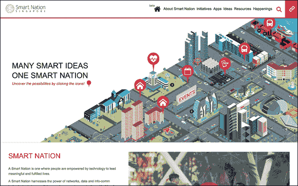

图 15-1 新加坡智慧国项目。

在本节中，我将带你了解亚洲正在进行的许多区块链努力。

### 印度的新加坡卫星城市

印度政府于 2015 年启动了“智慧城市任务”，旨在建设 1000 座新智慧城市和超过 6000 个项目。这些开发项目大部分将位于德里-孟买工业走廊，该走廊连接德里与孟买，全长 620 英里（1000 公里）。已在 33 个城市规划了价值 110 亿美元的基础设施，大部分开发资金将通过公私合作模式进行筹集。该项目预计将吸引 900 亿美元的外资投资，用于创建商务园区、制造区和智慧城市，所有这些都将位于一条指定的铁路货运走廊沿。

随着印度经济的工业化和人口的城市化，这些智慧城市正在开发中。为了防止现有城市变得过度拥挤和不宜居住，必须以中央计划城市的形式进行国家干预。由于印度人口众多且贫困，它对气候变化尤为脆弱。因此，这些城市的可持续性和智能化至关重要。它们需要低能建筑材料、智能电网、规划交通、集成式 IT 系统、电子政以及创新的水资源收集技术。

新加坡是智慧规划城市的典范。尽管人口密度高，但它拥有极佳的基础设施和高质量的生活。新加坡的许多私营机构拥有开发印度智慧城市所需的知识和资源。通过与印度政府合作，私营部门能够为此类计划提供所需的资金、技能和技术。安德拉普拉什邦（Andhra Pradesh）与新加坡管理局宣布了金融科技（fintech）创新伙伴关系，重点关注区块链和数字支付。新加坡旨在为印度开发一个金融科技解决方案的市场。

新加坡领导层已表现出与印度合作开发一座智慧城市的兴趣，并有意为位于东南部的安德拉普拉什邦建设新首府的兴趣。他们正在建立委员会，以分析在印度建设 100 座新城市计划中合作的潜力，并进一步开发 500 个现有城镇和城市的基础设施。

印度城市发展部部长已与新加坡现任总理及前任总理进行会谈。他一直在寻求新加坡在智慧城市方面的专业知识，特别关注智能交通系统、加强的水资源管理和电子政。城市发展部部长还研究了新加坡的公共住房计划及其私人住房规定。此外还研究了交通基础设施的融资结构。

印度当局还聘请了一支新加坡专家小组，协助喜马偕尔邦（Himachal Pradesh）一个卫星城的发展。这个占地 49 英亩（20 公顷）的项目旨在缓解姆拉（Shimla）的人口压力，该城镇在过去几十年人口激增。新加坡将在协助该城市的教育、居住和商业方面。

新加坡和马来西亚都对投资贾蒂亚·德维（Jathia Devi）附近的另一个卫星城表现出兴趣。新加坡政府正在进行一项评估各种方案的研究。喜马偕尔邦政府正考虑在现有城市附近开发五个卫星城，采用公私合作融资模式。

新加坡的 Ascendas-Singbridge 在印度启动了第八个 IT 园区。占地 59 英亩（24 公顷）的古尔冈国际科技园预计将于今年年中完成第一栋建筑。这项耗资 4 亿美元的项目旨在提供 80 万平方英里的办公空间，以帮助印度蓬发展的 IT 行业。

## 中国的大数据问题

区块链技术在中国被广泛讨论，作为一种增强大数据可靠性的方法。人们将其视为解决两个或多个利益不一致的方在共享数据时信任问题的方法。区块链技术为追踪所有权、来源和真实性提供了许多新解决方案。

Peernova 是一家很有前景的美国公司，正在解决大数据问题。它此前关注比特币挖矿，后转型进入区块链领域，并从浙江中南控股集团筹集了 400 万美元。Peernova 计划利用区块链技术查询传统数据库并追踪变化。

这些用例希望通过区块链帮助对冲基金计算其投资纳税责任。

万达作为中国最大的房地产开发商也进入了区块链领域。它与大数据软件公司 Clouera 合作启动了一个名为`Hercules`的区块链项目。

万达和 Clouera 旨在继续开发`Hercules`，并将其技术整合到各种依赖大数据的行业中。`Hercules`将作为一个开源套件，方便组织在大数据集群上部署和管理应用程序。

你可能会发现一个数字挖矿公司与传统建筑公司合作解决对冲基金的审计问题，或者房地产公司利用大数据解决系统管理员的问题很奇怪，但这就是区块链世界的西部。区块链人才的短缺和对区块链项目的高需求推动了这种环境的形成。

## 世界金融之都的争夺

自 2015 年进入大众媒体视野以来，区块链技术在中国已被广泛讨论。自那时起，许多初创公司一直在进行测试版和发布前的构建，2016 年有近 2000 家新的区块链创业公司成立。其中许多公司在 2017 年和 2018 年在新加坡、迪拜和伦敦上市，这些地区的监管机构欢迎创新并竞争成为全球金融中心。对于这些领导者来说，这不仅关乎金融科技和智慧城市。这是一场在无边界和金融流动全球公民的世界中保持竞争力的竞赛。

### 伦敦的远见

2016 年，英国政府发布了一份名为《分布式账本技术：超越区块链》（`https://goo.gl/asIz6L`）的报告，认为分布式账本技术（区块链）可以减少腐败、错误和欺诈，提高各种流程的效率。他们还指出，区块链可以通过提高透明度和信任度来改变公民与政府的关系。但从 2014 年起，伦敦就对这项技术非常友好。

自本报告发布以来，区块链已获批准用于英国的政府部门，包括白厅宫部门（非内阁部门部门，如土地注册局、林业委员会和食品标准局）、地方当局以及授权政府。

以下是英国正在进行的一些有趣项目和实验：

*   **基于区块链的福利发放**：劳动和养老部与巴克莱银行（Barclays）、RWE、GovCoin 以及伦敦大学合作，进行了一项实验，将使用区块链技术通过手机 App 发放福利。该试点旨在观察是否可以使用区块链技术发送和跟踪付款。
*   **政府分布式账本技术 (DLT)**：区块平台供应商 Credits 与英国政府合作制定一个框架，允许英国政府机构尝试区块链技术。（DLT 代表分布式账本技术。）
*   **基于区块链的国际支付**：桑坦德银行（Santander Bank）已启动了基于区块链的国际支付试点。员工试点计划涉及一个连接到 Apple Pay 的 App。用户可以使用 Touch ID 传输在 10 英镑到 10,000 英镑之间的付款。
*   **使用区块链技术进行黄金交易**：皇家造币厂（Royal Mint）与市场运营商 CME Group 合作，利用区块链技术建立黄金市场，希望让伦敦成为黄金销售更具吸引力的城市。这两个实体采用区块链技术是因为他们将其视为一种高效的黄金交易数字机制。

这些都是为了观察区块链技术是否会成为交换价值的新平台。该计划的成功或失败将决定英国及世界其他地区的未来。

### 新加坡的监管沙盒

新加坡与英国一样，竭力让在这里工作变得尽可能容易、友好且在财务上有吸引力。2015 年，政府官员前往旧金山宣布并招募创业者来到他们称为“监管沙盒”的地方——这是对 `development sandbox`（开发沙盒）术语的借用，后者是一个开发者可以在其中构建软件的安全环境。新加坡在建立软件公司方面也有同样的想法。

当时，美国及许多其他地区的区块链公司仍处于灰色地带。在一个安全的地方进行运营和投资资金的想法对许多创业者（包括我在内）非常有吸引力。如果你从未去过新加坡，你应该去！那里美丽、整洁且安全。

新加坡正在探索这项技术，并已取得成效。新加坡银行 `OCBC` 使用区块链技术进行跨境转账。它向其子公司 `OCBC Malaysia` 和 `Bank of Singapore` 发送了资金。

`R3` 在新加坡也活跃。它与新加坡金融管理局合作建立了一个实验室，研究和开发数字账本技术。`R3` 正在开发一个支持银行间支付的交易所。银行将存入现金并获得数字货币。

新加坡中央银行还与八家外国和本地银行以及交易所共同启动了一个试点项目。这一概念验证项目旨在将区块链技术用于银行间支付。该试点项目还旨在审查跨境外汇交易。

不仅是区块链公司将在新加坡进行实验。所有的顶级参与者都已加入其中——美国银行、梅林林奇、IBM、瑞士信贷、日本三菱 UFJ 银行、DBS 银行、摩根通、汇丰银行（HSBC）、华侨银行、华大华银行（United Overseas Bank）以及新加坡交易所。

世界上每家银行都必须知道自己在与谁做生意。“了解你的客户”（KYC）的理念有助于打击洗钱和恐怖主义资金。

下一阶段将确定外汇交易并在新加坡的 KYC 努力基础上继续发展。这可能导致该国家在区块链身份识别方面开领先。新加坡已经拥有一套健全且现代的数字身份系统，可以轻松连接到区块链。

### 迪拜 2020 倡议

迪拜政府有一项宏伟计划，要在 2020 年之前将所有政府文件和系统迁移到区块链。无纸化方案是其成为区块链技术全球领导者并提高所有部门效率倡议的一部分。

内阁事务与未来部长详细说明了新方案如何允许使用户通过区块链更新和验证其凭证。他们只需使用凭证登录一次即可访问政府和私营实体（如保险公司和银行）。他们还预计将其技术与其他国家共享，以实现更简单的过关。旅行者可以使用预先认证的数字钱包以及预先批准的身份证明代替护照。

迪拜政府估计，其区块链计划有望节省 2510 万小时的生产力。这种效率的提高也将有助于减少碳排放。


迪拜全球区块链委员会（GBC）宣布了七项新的公私合作，结合了初创公司、本地企业和政府部门的技能与资源。他们将区块链技术应用于以下领域：

*   **医疗保健：** 爱沙尼亚软件公司 `Guardtime` 将与迪拜最大的电信运营商之一 `Du` 合作，为医疗记录的数字化并将其移动到区块链提供技术支持。
*   **钻石贸易：** 一个试点项目将使用区块链技术进行钻石的认证和传输。迪拜多商品中心（Dubai Multi Commodities Center）将把 `Kimberly certificates`（联合国创建的用于限制冲突钻石贸易的文件）数字化。
*   **所有权转让：** 所有权转让将被数字化并记录在区块链上。一家名为 `Dxmarkets` 的新加坡区块链初创公司已经开发了概念验证。
*   **业务注册：** `GBC` 正在尝试使用区块链技术业务注册。这与 `Ethereum` 的去中心化自治组织（DAO）不同，但可能通过 `Flexi Desk` 程序简化身份验证。它目前处于演示阶段，多个实体正在进行概念验证。
*   **旅游业：** `Dubai Points` 是一个与 `Loyyal` 合作启动的试点计划，利用区块链技术帮助旅游业。它旨在通过向访问特定地点的旅行者授予积分来激励旅游。它将使用智能合约来促进奖励。这些积分可能像加密代币一样运作，并在交易所交易。
*   **航运：** `IBM` 正与 `GBC` 合作，使用区块链技术改进货运和物流。该计划旨在帮助区域参与者就如何交换货物进行合作。智能合约将作为合性和结算问题的解决方案。

迪拜和新加坡一样，投入了资金和人才以确保其迅速在区块链领域占据主导地位。这是小政府和集权权威的一种特权。

## Bitlicense 监管框架：纽约市

如果你计划在纽约市运营区块链初创公司，请预留额外费用的预算。2015 年 6 月，纽约州金融服务部（`NYDFS`）发布了许可证的最终版本，这是一个针对数字货币的监管框架，旨在为行业提供更清晰的指导。实际上，这使得许多区块链初创公司离开了纽约。许可证本身的费用约为 10,000 美元，厚度可达 500 页。它要求提供每个公司领导者的指纹并进行广泛的背景调查。主要的投诉在于时间分配、法律和合规问题。

这是对如何监管技术进行了将近两年研究和辩论的结果。它在被认为现有法规不再适用之后产生。从积极的一方面来看，区块链企业进行软件更新或后续轮风险融资时，不再需要 `NYDFS` 的批准。该框架规定，数字货币公司仅在拟议的产品、服务或活动发生可能导致此类产品服务的变更时才需要批准。

第一个获得许可证的公司是 `Circle`，一家比特币钱包提供商。该许可证允许他们在纽约运营。`Circle` 是少数可以合法据此的公司之一。大多数区块链初创公司都在避开纽约，因为成本和精力超过了收益。`Ripple` 已获得其第二个许可证。该迭代版本的许可证允许其销售和持有 `XRP`，这是其背后的数字资产。

## 马尔特的法律结构

欧盟成员国马尔特已采取果断且直接的措施来拥抱区块链技术。马尔特比其他国家更快，看到了区块链的潜力，并采取措施确保自己成为创新中心。大多数区块链初创公司面临着敌对环境，因此许多公司——包括 `Binance`——涌向马尔特建立业务。

在英国退出欧盟后，马尔特将成为欧盟少数以英语为官方语言的国家之一。马尔特还受大陆法和普通法管，这有利于业务。这使得马尔特能够很好地支持希望注册并获得许可的国际区块链和加密货币相关公司。

马尔特是一个经历过许多政权的小岛。每个政权都制定了自己的规则，其中一些一直保留了下来。马尔特现在拥有混合的法律框架，包括罗马法、法国法、英国法以及马尔特特议会在 1964 年独立后颁布的自己的法律。但他们主要以民法或大陆法（多年来已法典化）和普通法（通过法院判决建立）而闻名。


马尔特通过了两项开创性的法律和一个法案，改变了围绕区块链公司法律地位的讨论，提供了法律保护以及一个更准确地管理分布式技术、区块链以及从它们发展而出的所有创新的框架。以下是这三项法律的摘要：

*   `Virtual Financial Assets Act`：《虚拟金融资产法》监管初始代币发行（`ICOs`）。该法要求任何通过 `ICO` 筹资的公司必须发布白皮书，对整个项目进行详细描述。`ICO` 还必须公开公司的财务历史。
*   `Malta Digital Innovation Authority Act`：《马尔特数字创新局法》为加密货币和区块链公司建立了监管程序。它还建立了一个名为马尔特数字创新局（`MDIA`）的监管机构。
*   `Technology Arrangements and Services Bill`：《技术安排与服务法案》允许区块链公司和加密货币交易所注册并获得马尔特政府的认证。

这些新法律和法案为马尔特引入了新技术，并可能被其他希望吸引创新的政府作为范例。最大的处是为公司提供了一个在已知参数内安全增长和实验的场所。

## 维护世界边界

许多政府正在探索利用区块链来维护边境。英国有一个雄勃的目标，确保旅客在通过机场时永远不需要停下脚步。这与目前几乎每个机场都存在的长安检队形成了对比。英国为了实现无缝旅行体验必须克服的主要障碍涉及 `旅客身份识别`（即确定性识别任何给定旅客身份的能力，即使该旅客来自另一个国家）。对于打击恐怖主义的国家来说，旅客身份识别一直是一个问题。

美国已在在全球旅行评估系统（`GTAS`）下开放了其用于旅客身份识别的技术。它可以在 GitHub 上进行公开协作：[www.github.com/US-CBP/GTAS](http://www.github.com/US-CBP/GTAS)。

涉及乘客非侵入性筛选和验证的计算机、摄像头和传感器都需要经过保护，以确保国家安全。区块链凭借其底层的不可变属性，是这一用例的一种有前景的技术，目前正在接受测试。

通过区块链创建的另一个有趣事物是传记身份——即随时间建立的身份。任何数据都可以与传记身份关联，归属数据的隐私和可读性可以由发布者管理。随着时间的推移，身份通过添加额外的属性来建立。属性可以是任何内容，从你个人设备上的数据到你的文件在边境检查口经过检查的实例。

Factom 创建了身份日志，这些日志记录了设备 ID、制造商、可用更新列表、已知安全问题以及已授予的权限，同时增加了时间维度以增强安全性。其目标是限制意图黑客篡改设备历史记录的能力，使其伪造变得变得更加困难。

### 未来的护照

ShoCard ([`www.shocard.com`](http://www.shocard.com)) 是一家应用开发公司，目前正与区块链公司 Blockcypher 合作。它已经构建了原型，允许你在安全的区块链环境中建立身份。ShoCard ID 存储于你手机上的一个应用程序中，可用于安全地分享各种类型的凭证。

### 新的源数据文件

你可能没有听说过 Smartrac，但你极有可能每天都会接触到它的技术。Smartrac 是射频识别（`RFID`）标签和其他身份芯片的全球领先供应商，这些芯片存在于护照和身份证件等物品内部。

各国在打击身份欺诈时面临的最大挑战之一，是对用于构建身份的底层文件进行身份验证。这些文件诸如社会安全卡、出生证明和学位证书，目前非常很容易且廉价地被伪造。

Smartrac 一直通过日益复杂的技术来应对这一问题。它的最新创新 `dLoc` 是一种软件验证解决方案，允许将源数据文件与区块链记录进行对比。

文件数据与近场通信（`NFC`）标签的唯一 ID 绑定，创建一个 32 位的哈希值，该哈希值只有使用私钥的发行机构才能识别。哈希值存储在 `Smart Cosmos` 中，并在公共区块链上进行备份。完成这些操作后，带有 `dLoc` 贴纸的文件可以使用台式读写器或支持 NFC 的手机上的移动 App 进行验证。

这种做法创造了纸质文件无法实现的两个奇迹：

*   一份不可篡改的文件历史，显示了其真实的年代和所有权。
*   允许证书机构通过加密方式对文件的真实性进行签名。因此，即使用于制作文件的底层纸张被盗，它也无法获得有效的签名；或者如果文件在发行后被盗取，它可以被标记为被盗文件。

# 第 16 章

# 其他行业

## 本章内容

*    发现全球范围内正在构建的精简政府基础石
*    为你的业务和家庭改进互联网基础设施层级抢占先机
*    开始创建自己的区块链身份
*    通过智能合约实现你的信息变现

关注最显眼的区块链项目和行业影响是很容易的，但区块链技术已经开始触及社会的方方面面。

在本章中，我将带你探索区块链技术中一些你可能从未想过的有趣且不寻的应用。最令人兴奋的变革将发生在政府系统、互联网的新信任层以及由区块链创造的新行业中。在这里，你将发现正在发生的最令人深刻的变革，以及这些转型将如何影响你的生活、你工作的行业，以及保护你的政府和机构。

## 精简政府

一些小国已经意识到，如果它们要在全球经济中竞争，就必须提供更多服务，并且要以不给公民带来负担的方式。为了竞争，他们转变了许多关于“公民身份”含义的传统观念。在一个从硬性边界转向极高性边界的世界里，人们有权选择住在哪里以及把哪个国家视为家园，这些小国表现得很好。

公民身份正在成为一种可以购买的商品，每个国家提供不同的优势。各国正在远离被动的公民身份模式（出生于某国即为该国公民），转向根据该国提供的优势选择公民身份的模式。

在新模式下，公民身份不再受限于物理位置。政府可以在没有边界或物理位置的情况下存在。旧模式将公民身份视为可以被另一个国家或内部来源（如革命）入侵并推翻的位置。

区块链技术和其他顶尖创新正在这些领域被采用——首先是因为它们让这一切成为可能；其次，是因为它们通过创建更高效的系统减轻了政府负担，让公民可以在世界任何地方快速访问，即使物理领土被占领。

新加坡、爱沙尼亚、阿拉伯酋联合国（`UAE`）和中国都是此类倡议的市场领导者。新加坡的“智慧国”（Smart Nation）项目和爱沙尼亚的“电子居留”（e-Residency）是独特的系统，旨在减少公民的文书工作和等待时间，提高共享资源的效率。迪拜在 2020 年启动的倡议将删除所有物理文件，并代之以由区块链支持的文件或系统。中国在减少欺诈方面的努力改变了区块链领域的动态。

### 新加坡的“智慧国”项目

“智慧国”是新加坡为了为其所有公民和居民创造美好生活未来而做的国家努力。个人、企业和政府正在共同努力。该项目涵盖了从数字身份到优化公共记录的 `IoT` 传感器的范围。

新加坡相信，技术赋能的人可以过上更有意义、更充实的生活。它充分利用新技术、网络和大数据，并通过监管沙盒、积极招募以及对初创企业提供创新激励来积极寻求创新。

你可以在 [`https://goo.gl/EGmF4X`](https://goo.gl/EGmF4X)看到“智慧国”倡议的描述。

新加坡之所以能够快速测试和部署新技术，是因为它拥有单一层政府。它可以快速协调各机构的政策和努力。“智慧国”是这一理念的绝佳范例：新技术优于常规政治。

### 爱沙尼亚的“电子居留”

爱沙尼亚是欧盟联盟的一个小国，拥有 130 万人口。它满足公民需求的的资源有限，但通过技术，它已经超越了许多大国家的能力。爱沙尼亚为在线服务推出了数字 ID 卡，并是首个提供“电子居留”的国家，这是一种面向全球对在线经营感兴趣的任何人的数字身份。

申请爱沙尼亚电子居留只需几分钟，背景检查费用约为 100 美元。拥有`电子居留`卡不会让你成为爱沙尼亚公民，但它确实能给你带来很多好处。

 你也可以成为爱沙尼亚电子居民。可以在 [`www.e-resident.gov.ee/become-an-e-resident/`](https://www.e-resident.gov.ee/become-an-e-resident/) 在线申请。

在退出苏联后，爱沙尼亚对新技术的投入巨资。它完全从传统政府转变为利用“单一窗口原则”（单一访问点）的政府模式。单一窗口原则让公民可以在世界任何地方通过单一安全登录即可访问所有税收和海关服务。这种系统使得简单且无纸化的交易成为可能。除了婚姻和房地产购买，一切都可以完全在线完成。爱沙尼亚公民可以在几分钟内完成银行转账或纳税。

爱沙尼亚人已经习惯了政府简化流程并使用更多的 IT 解决方案。`e-services` 的积极开发使得 2009 年至 2016 年间，访问爱沙尼亚税务和海关局的人减少了 60%以上，降低了整体成本。

爱沙尼亚在 2015 年升级了所得税和社会税申报表，由于 `e-services` 的广泛使用，增值税（`VAT`）收入比去年增加了 125 亿欧元。爱沙尼亚政府增加了一个税务债务计算器，可以从公民整合的银行系统中提取数据。它还让向系统提交发票变得简单。

爱沙尼亚人拥抱了区块链技术。下一个大发展将是区块链云。爱沙尼亚聘请了爱、Apcera 和 Guardtime 共同开发一个混合云平台，以增强税务报告的可扩展性、韧性和数据安全性。

Nasdaq 也在爱沙尼亚开发区块链服务。它正在为私营公司建立一个市场，跟踪它们发行的股份，并允许它们立即结算交易。

## 中国更优的公证

中国对加密货币处于一种爱又恨的关系。一方面，中国公民一直试图将代币作为资金流出境外或隐藏纳税利润的手段。然而，这导致中国政府收紧了对区块链使用的监管。

其早期应用的一个有趣例子是 `正信公司`，它通过与 100 多家公证处合作，引领了中国向电子公证服务的转型。`安存` 在公开可的区块链上发布了数千条记录，允许用户回溯并检查公证文件的年代。


许多初创公司在美国也在研究类似的概念。例如，`WordProof` (`https://wordproof.com`) 允许你在网站上对日期进行哈希和时间戳。

## 互联网的信任层

在过去的 30 里，互联网是分层构建的——一层又一层——这使得使用者更加方便、更安全。区块链是互联网的下一层。将其视为信任层。它可能会从公众意识中消失，仅仅让你的在线互动变得愉快。区块链技术的实施最终将消除那些由于缺乏足够的信任信息的方式而常见的在线烦扰问题。

有两个关键领域已经开始工作，但你可能还不知道：几乎没有垃圾邮件的电子邮件以及一种全新的在线身份。

### Web 0 电子邮件

`Mailchain` (`https://mailchain.com`) 是一个新的基于区块链的电子邮件平台，允许向其他账户以及 `ETH` 和 `NEAR` 持有者发送完全加密的消息。`Mailchain` 赋予你对数据的完全所有权，并致力于让互联网更加隐私。

所有 `Mailchain` 消息默认都是端到端加密的。用于加密消息的私钥永远不会暴露给协议。你的秘密恢复词用于创建一系列私钥，每个私钥执行独立的操作，允许你注册地址、身份验证并私密保存消息。

`Mailchain` 从你的浏览器内部加密你的数据。加密文件随后存储在 `Mailchain` 中。只有你可以通过你的私钥解密这些文件。`Mailchain` 无法解密你的秘密恢复词、消息或注册地址。

`Mailchain` 使用 `messaging key` 代替你的 `wallet key` 为每个地址加密和解密消息。`Messaging keys` 对于加密更安全，意味着你不会暴露钱包的私钥。

当你用 `Mailchain` 账户注册钱包地址时，会创建一个新的 `messaging key`。通过你的钱包，你签署一份确认，表示该密钥应用于消息通信。签署此确认创建了用户可以独立验证的证明。你只知道用于通信的私钥。

注册地址在存储之前会进行加密，你只需要验证一次钱包地址的所有权。在你的钱包创建证明后，`Mailchain` 会断开你的钱包连接。你的钱包私钥永远不会暴露。

每次发送电子邮件时，都会创建一个新的 `encryption key` 来加密消息及其位置。然后，`encryption key` 会为每个接收消息的地址进行唯一加密。每个接收者和每条新消息都会创建一个新密钥。这对于确保只有预期的接收者阅读消息内容至关重要。

当发送消息时，消息会被加密并存储在分布式存储中。加密的 `delivery request` 包含消息接收者能够收集其加密消息的信息。你的消息存储在所谓的 `ephemeral transport layer` 上，它是临时的，只存在到你的消息被取回或电子邮件过期为止。

当你收到新消息时，它会被保存在你的私收件箱中。在存储之前，你的新邮件将使用特定于你收件箱的密钥重新加密。

你的收件箱也通过 `private key` 保护。所有的 ID、过滤器和元数据都是加密的。即使多个地址接收了相同的消息，`Mailchain` 也无法识别其中的关系。

如果这看起来像是一个有趣的安全电子邮件选项，请访问 `https://mailchain.com/` 领取你的免费邮箱。


没有一种互联网安全解决方案是完美的。即使你发送完全加密的消息，也有方法查看你的数据（例如通过使用 `Pegasus` 间谍）。`Pegasus` 由以色列网络武器公司 `NSO Group` 开发，被秘密安装在所有运行 `iOS` 和 `Android` 的设备上。它使用利用数据验证中现有漏洞的 `zero-click` 攻击。`Pegasus` 能够读取短信、追踪通话、收集密码、跟踪你的位置、访问设备的麦克风和摄像头，并从其他应用程序中提取信息。

### 在 web3 中拥有你的身份

世界网联盟 (`W3C`) 是一家成立于 2012 年的非营利组织，帮助开发确保 Web 长期发展的协议和指南。`W3C` 开发了现代标准范式，旨在从根本上改变全球范围内开发新技术和为人类创新的方式。

一项重要的倡议是去中心化标识符（`DIDs`）。`DIDs` 也称为主权身份，是一种全新的全球唯一标识符。由于中心化颁发身份的缺陷，这些新的自颁发 ID 允许你使用密码学证明的数字签名来控制自己的身份。

大多数唯一标识符或身份模型（例如你的社会安全号码）并不受你控制。政府等外部机构颁发你的 ID 并决定它们的含义。这些 ID 仅在特定语境下有效，并被某些组织认可。它们可能随时消失或失效。这些 ID 往往会暴露关于你的非必要个人信息。ID 还会被恶意第三方欺诈性地复制——而这一切均未经你的同意。


由于`DIDs`的生成和断言由你实体控制，你可以拥有任意数量的`DIDs`来维持在线上人格和交互的分离。区块链爱好者讨论的根本原则之一是：对你创建的、唯一标识身份的数据负有个人责任。这个概念看起来可能很直接，但大多数人并不拥有或控制代表他们身份的数据。

大部分控制权掌握在易受攻击攻击的中心化数据库手中。这些数据库存储信息，而证书颁发机构则验证这些信息的正确性和未被篡改。在信息时代，你的数据就是你的身份。数据越分散，落入想要滥用它的人手中的可能性越大。

基于区块链的身份将身份控制权交给了代表该身份的个人或公司。中心化数据库和证书颁发机构并不一定会被取代。数据仍然需要安全的家，让第三方验证文件的真实性仍然具有意义。

改变身份责任顺序的价值在于，使得代表你身份的底层文件更难被盗取、质押或操纵。信息根据需要进行共享，而不会暴露不必要的信息。一个不可撤销且全球可的身份并不总是一件好事。构建身份平台的人需要关注消费者保护，例如信用减免、被遗忘权和选民匿名性。

## 区块链的神谕

区块链技术并没有解决信息必须来自某处的问题。信息的可靠性同样重要。当你想要在区块链系统内执行合同时，无法从公式中消除的正是人为因素。

区块链系统中没有中央权威来监管或强制执行诚实。预测信息作者未来的诚实性是不可能的。逻辑结论是，每笔交易的成本必须低于重建声誉的成本。受信作者的声誉随时间建立，作者保持诚实且正确的时间越长，其声誉就越有价值。这个概念类似于品牌名称的价值。

在本节中，我将解释艺术家和创意人员如何利用区块链技术来实现作品的变现。

### 受信作者身份

`smart contracts`和`chaincodes`为知识渊人士和公司提供了变现信息的新机会。这类系统需要受信的信息源来执行。这些受信源可以是评级机构、天气状况或任何其他事物。

你还可以将`IoT`设备连接到区块链基础设施，让它们在区块链网络上创建自己的声音和身份。它们需要随时间建立信任，并且在任何时间点仍可能被腐败。过去的诚实不能防止未来的不诚实或信息源的腐败。

并非所有的`smart contracts`或`chaincodes`都是自包含的。`Internet`让各种规模的艺术家更容易分享作品。与此同时，它让人们通过热爱的事过上舒适的生活变得更加困难。音乐行业的食物链很长，每个中间人都会分走一小块，并增加了资金最终到达艺术家手中的的时间。通常，艺术家可能等待18个月或更久才能看到任何钱，而且每次音乐流媒体播放可能只能获得0.00035美元。这种情况在我们目前的市场中已经是理想情况了，还没有人欺诈艺术家。区块链的引入是作为一种减轻创意人员巨大财务负担的方法。`cryptocurrency`可用于减少与信用卡和欺诈相关的交易费用。它还将为无法正常使用信用卡的发展中国家开启新市场。

### 知识产权

在知识产权问题上挣扎的受打击最严重的行业之一是音乐行业。顶级艺术家受到依赖其创意作品的许多中间人在经济上的挤压。小型艺术家无法将音乐作为主要的收入来源，因为他们只能看到收入的一小部分。超级巨星则依靠庞大的粉丝数量生存。

几个项目正在解决这个问题，并寻求促进一个健康、可持续且无摩擦的生态系统——这种系统不会排挤市场参与者，但允许艺术家从他们的辛勤工作中获得更多回报。

UjoMusic正在对其平台进行Beta测试，用户可以直接出售和许可音乐。它利用以太坊网络、智能合约进行执行，并使用Ether（以太坊加密货币）进行支付。你可以下载整首歌，也可以只下载人声和乐器轨道以供商业或非商业用途。音乐人将立即获得Ether支付。

Peertracks是一家早期的区块链初创公司，致力于改变音乐行业。它是一个音乐流网站，允许用户下载和发现新艺术家。它通过其名为MUSE的点对点网络以及创建个人艺术家代币来实现这一点。这些代币的作用与其他加密货币类似，其价值根据艺术家的受欢迎程度而波动。然而，自2020年以来，出现了许多可以让你发现艺术家的平台，包括OpenSea、SuperRare、Nifty Gateway和Mintable等。艺术家们也参与了这一领域，例如Snoop Dogg在MakersPlace上发布了自己的NFT。

区块链技术并不会消除对唱片公司和分销商的需求。然而，如果不想被适应了这种更高效模型的新公司所取代，他们就需要采取行动，就像Netflix颠覆了Blockbuster一样。

# 第5部分

## 十之法则

### 本部分内容……

* 发现十个免费的区块链资源，这些资源将帮助你跟上技术和行业的发展。
* 在加密货币和区块链世界工作时不应违反的十条规则。
* 深入了解塑造行业未来的前十大元宇宙区块链项目和组织。

# 第17章

## 十（或左右）免费区块链资源

## 本章内容

 `发现免费的区块链教育资源`

 `参与区块链社区`

 `关注最新的区块链新闻`

 `深入了解其他区块链资源`

在本章中，我概述了区块链生态系统中各种有趣的免费资源，这些资源将帮助你保持信息灵通并参与社区。在这里，你可以找到用于制作`oracles`（允许智能合约执行的数据馈送）的免费工具、扩展你知识的视频，以及塑造行业未来的组织。

## 以太坊 (Ethereum)

以太坊是一个开源的众筹项目，构建了以太坊区块链。它是该领域最重要的项目之一，因为它开创了在区块链内部构建编程语言的先河。由于内置了编程语言，以太坊网络允许你创建智能合约、去中心化组织并部署去中心化应用程序。

以太坊入门（`www.ethereum.org`）是由以太坊社区成员启动的网站。它是关于区块链技术和以太坊网络的高质量教育内容存储库。Anthony D’Onofrio作为以太坊社区总监负责监督该项目。

## Got Minted

如果你是非同质化代币（NFT）的新手，并且正在寻找一种简单、无忧的方法来设置钱包并开始收集独特的数字资产，那么看看Got Minted就够了。通过五个简单的步骤，该网站将引导你完成创建钱包、铸造第一个NFT、将钱包连接到OpenSea以及在市场上探索NFT的过程。在大约十分分钟后，你就可以准备好体验兴奋的NFT世界了。无论你是想收藏、作为一个玩家，还是仅仅对这一新兴数字趋势好奇，Got Minted都通过简化设置过程让你轻松开始接触NFT。前往`https://gotminted.com`开始吧。

## 区块链大学 (Blockchain University)

区块链大学是一个教育网站，向开发者、经理和企业家教授区块链生态系统。它提供公共和私立培训计划、黑客松和演示活动。其课程特点是面向解决方案的设计思维和实操体验培训。你可以在加利福尼亚州的Mountain View找到区块链大学，或者通过`https://theblockchainu.com/`和`https://dlt.education/`访问。

## 比特币核心 (Bitcoin Core)

比特币核心（`bitcoin.org`）最初被Satoshi Nakamoto用于托管他的比特币协议白皮书。它是比特币核心协议教育材料以及原始比特币软件下载版本的所在地。

该网站致力于保持比特币的去中心化并让普通人能够接触。

 这是一个社区运营的项目，并非所有内容都由核心团队管理。在浏览该网站时请记住。

## 区块链联盟 (Blockchain Alliance)

区块链联盟是由数字商业区块链协会和新闻机构Coincenter创立的。它是区块链社区、执法部门和监管机构的公私合作。他们有一个共同目标是使区块链生态系统更加安全并促进技术的进一步发展。他们通过提供教育、技术援助以及关于比特币和其他数字货币和利用区块链技术实体的定期信息会议，来打击区块链上的犯罪活动。

你可以在`www.blockchainalliance.org`了解更多关于他们的活动或加入他们的组织。

## Multichain 博客 (Multichain Blog)

Multichain是一家帮助组织在区块链上快速构建应用程序的公司。他们提供了一个可以在私有区块链上发行数百万资产的平台，你还可以通过他们的工具跟踪并验证网络上的活动。除了工具集和平台之外，他们一直是区块链领域的思想领袖。

这些是我从他们的博客（`www.multichain.com/blog`）中喜欢的文章：

* 四个真实的区块链用例（`www.multichain.com/blog/2016/four-genuine-blockchain-use-cases/`）
* 警惕不可能的智能合约（`www.multichain.com/blog/2016/04/beware-impossible-smart-contract/`）
* 智能合约与DAO崩溃（`www.multichain.com/blog/2016/06/smart-contracts-the-dao-implosion/`）
* 理解零知识区块链（`www.multichain.com/blog/2016/11/understanding-zero-knowledge-blockchains/`）

## HiveMind

Paul Sztorc创立了Truthcoin，这是一个针对比特币的点对点预言机系统和预测市场。它利用了一个工作量证明侧链来存储预测市场状态的数据。比特币通过HiveMind（基于Truthcoin白皮书开发的平台）支持金融衍生品和智能合约。可以在`http://bitcoinhivemind.com`查看他们的资源和教育材料。

## Smith + Crown

Smith + Crown是一家专注于全球趋势、行业情报和区块链系统结构的区块链研究机构。他们创建了多种研究工具来助力区块链公司。Smith + Crown关注影响力、应用价值和可访问性。他们将大多数研究成果公开并免费提供。你可以利用这些研究工具、无数报告以及区块链领域所有值得关注的项目的数据库。Smith + Crown是多个知名区块链和加密货币倡导小组的研究人员和顾问，例如数字商务协会（Chamber for Digital Commerce）、代币联盟（Token Alliance）和Social Alpha。你可以在`https://www.smithandcrown.com/`查看他们。

## Unchained 和 Unconfirmed 播客

`Unchained`和`Unconfirmed`播客是对区块链和加密货币领域顶级人士精彩且最新的采访。`Unchained`是Laura Shin主出的每周一小时播客，她是《Forbes》的前高级编辑，也是第一位全职报道加密资产的主流记者。Shin对构建去中心化互联网的人和公司进行了令人印象且深思熟虑的深度。她可以帮助你更好地理解区块链技术中固有的监管、安全和隐私问题。你可以在`https://unchainedpodcast.com/`听她的播客。

以下是几个值得听的剧集：

* **Ledger 关于消费者和机构应如何保护其私钥：** `https://unchainedpodcast.com/ledger-on-how-consumers-and-institutions-should-be-safeguarding-their-private-keys-ep-101/`
* **捐赠加密货币如何帮助你省税：** `https://unchainedpodcast.com/how-donating-crypto-can-help-you-save-on-taxes-ep-94/`
* **Naval Ravikant 论加密货币如何挤压 VC、阻碍监管机构并为用户提供选择：** `https://unchainedpodcast.com/naval-ravikant-on-how-crypto-is-squeezing-vcs-hindering-regulators-and-bringing-users-choice/`
* **币安如何在 5 个月内成为全球最流行的加密货币交易所：** `https://unchainedpodcast.com/how-binance-became-the-most-popular-crypto-exchange-in-5-months-ep-84/`

# 第18章

## 区块链上永远不要的十条规则

## 本章内容

 **发现你的法律漏洞**

 **理解区块链的技术缺陷**

 **识别窃贼对你系统的最佳攻击点**

 **制定你的安全最佳实践**

在本章中，我深入探讨了在接触区块链技术和运行其上的加密货币时应该考虑的事项。

 在做出财务决定之前，务必咨询你的会计师（CPA）和律师。这项技术是全新的，治理它的规则尚未完全完善。

## 不要使用加密货币或区块链规避法律

加密货币的合法性和法律分区在世界许多地方仍在波动中。当我告诉你去咨询你的会计师和律师时，我不是在开玩笑。这笔钱花得很值，而且能让你远离麻烦。

以下是三个我经常被问到的非常愚蠢的问题：

* **我可以使用加密货币作为隐藏资金的方式吗？** 这个想法是危险的。`Remember:` 区块链永久记录所有交易，所以即使你认为自己想了一个聪明的办法来隐藏某些代币，那些寻找不良行为的人也有时间发现它。
* **可以使用区块链作为将钱带出国外的方式吗？** 许多国家对公民可以带出国的资金有限制。你不想这样做的原因和我刚才提到的一样：区块链永久记录所有交易。
* **我可以使用加密货币购买非法物品吗？** 答案是——你猜对了——不！区块链会`永远!`记录你的行为轨迹！即使是从臭名丝绸之路（Silk Road）市场偷取比特币的执法人员也被抓了。

 不要用加密货币和区块链做任何用真钱做违法的事。

## 保持你的合约尽可能简单

去中心化自治组织（DAOs）、智能合约和链码（chaincode）目前非常流行。减少行政和法律成本的承诺对许多公司非常有吸引力。这项技术一个有时被忽视的特征是它就是代码。这意味着没有人类来解释你为所有人遵守而设定的规则。代码即法律，而法律仅限于包含在区块链合约中的内容。被削掉的“肥肉”有时非常重要。

没有人来解释代码。这意味着如果代码以你未预料的方式执行，也没有人维护合同的意图。代码即法律，即使发生了违规。这就是为什么你应该保持合约简单且具有模块化，以预测合约的执行结果。此外，最好让那些想要破坏它的开发者进行测试和攻击。

你所构建项目的区块链的范围也很重要。你可以将其想象为管辖区。当然，智能合约可以执行外部数据，但它无法要求无法访问的账户提取资金。这意味着资金必须以某种方式留存，这可能会影响现金流。

另一个需要考虑的是你合约执行所需的数据来源。如果是保险合约的天气数据，你信任并认可该来源吗？数据是否可以被操纵？在实施之前投入大量思考。在构建智能合约时，请记住你的数据通道可能是动态的。例如，`APIs`更新频繁，如果合约调用的接口发生了变化，可能会破坏你的智能合约。

## 谨慎发布

区块链的核心在于，一旦投入数据，很难取出。这意味着你投入的内容将存在很久。如果你发布了加密敏感信息，你需要接受这样一个事实：加密数据有一天可能会被破解，你发布的内容对任何人可见。

 在发布之前考虑这些：

* 我介意这些信息在某一天被解密吗？
* 我介意永远向任何想要审查的人分享这些信息吗？
* 这些数据对第三方是否有害，如果发布了我可能会承担责任吗？

密码学领域正在进行量子加密的研究，但由于量子计算和量子加密都处于测试阶段，很难说这项技术20年后将具备什么。

## 备份、备份、备份你的私钥

 区块链是非常无情的生物。它们根本不在乎你是否丢失了私钥或密码。许多加密发烧友因此沦裸，并将无数代币留在了广大的区块链海洋中——这些财富永远无法找回。


控制你加密货币的私钥通常存储在你的钱包中，因此保护和确保它们的安全至关重要。对于那些为你存储资金的在线服务要小心。许多加密货币交易所和在线钱包都曾发生资金被盗。此外，截图或拍摄照片并存储在云端与给自己发邮件无异。无论你做什么，**不要**这样做。这会使你的密钥泄露。你应该制定一个计划，以便在你发生意外时，你的亲人可以访问你的密钥。一位健康的 30 岁加密货币交易所 CEO 去世由于没有继任计划，锁定了价值 `$190 million` 的资产。此外，不要忽视蓝牙连接这一通往你冷存储的隐藏后门。确保你的设备完全无法从互联网访问。


仅在在线或可访问互联网的设备上存储少量的代币供日常使用。将加密货币钱包想象成现金钱包。不要在里面存放超过你任何时候愿意损失的资金。有百多个已知的恶意应用程序正试图获取你的私钥并窃取你的代币。

将剩余的货币放在`cold storage`中——完全离线且无法访问互联网。这可以是纸质钱包、无法访问互联网的计算机，或者专门为保护加密货币而构建的独特硬件设备中。

如果你选择使用纸质钱包来保护你的加密货币，请对其进行塑封处理并制作副本。还要记住，打印机通常可以访问互联网，其数据可以被第三方检索。真正偏执症的人只使用不连接网页的打印机。将你的纸质钱包副本存放在不同的位置，例如银行金库和家中的安全区域。


备份你的数字钱包并将其存放在安全的地方。备份是为了防止电脑故障，或者你操作失误删除了错误的文件。如果设备损坏或被盗，备份将允许你恢复钱包。此外，不要忘记加密你的钱包。加密钱包允许你设置提取代币时所需的密码。


加密是保护你免受盗侵害的有效措施，但它无法保护你免受键盘记录软件的影响。始终使用包含字母、数字、标点符号且长度至少 16 个字符的安全密码。最安全的密码是由专为此目的设计的程序生成的。强密码更难记忆。你可能考虑把密码写下来并像私钥一样对其塑封。加密货币内部的密码恢复选项有限，忘记密码可能意味着丢失代币。

## 在发送货币前三倍检查地址

加密货币吸引了相当数量的坏蛋，因此在发送资金时要小心。一旦资金离开你的钱包，它就永远消失了，没有任何办法找回。没有退单机制，你也无法拨打客服。你的钱丢了。

发送前请三倍检查钱包地址。你要确保你发送到了正确的地址。即使你使用了复制和粘贴，也要双倍检查地址。市上有恶意软件可以掉包 `Ctrl+C`/`Ctrl+V` 命令中的你的地址。

## 使用交易所时要小心

加密货币交易所是黑客攻击目标以窃取代币的中心点。它们被视为触手可及的金矿，已有 150 多家交易所遭到了攻击。

在使用交易所时请记住这一点，并遵循书中列出的最佳实践以确保你的代币安全。对你正在使用的交易所进行研究，看看它采取了哪些安全措施。

双重身份验证至关重要。你可能还会考虑与电信运营商设置秘密短语，以帮助防止社会工程攻击。你不想成为 SIM 卡劫持的受害者。你的手机号码不需要作为备份；Google 和其他几公司也提供双重身份验证选项（查看 `Google Authenticator` 应用）。

最后，仅使用交易所进行资金的进出。不要将交易所作为存储价值的地方。相反，将大量的加密货币储存在冷存储中或带有多个副本的塑封纸质钱包中。

## 警惕 Wi-Fi

如果你的路由器设置不正确，可能会看到你所有的活动日志。此外，当你处于不安全或公共门户时，你可能暴露于恶意软件。你必须假设网络可以看到你的活动。


仅使用信任的 Wi-Fi，并确保你已将密码更改为安全的。大多数 Wi-Fi 密码被设置为 `admin`，很容易被第三方接管。

## 识别你的开发者

区块链技术是全新的，在构建应用程序方面经验丰富的人并不多。

如果你考虑雇一名开发者来帮助你的项目，请查看 `GitHub` 并看看她做过什么工作。她可能不需要特定的区块链经验，但如果没有，耗时会更长。

## 不要被骗了

整个区块链行业并没有像银行和其他金融机构那样的保护和安全措施，而且法律也不一样。如果你被抢劫或欺骗，你可能无法向任何人寻求帮助。

此外，该行业在过去几年有很多炒作，但没有交付多少真正价值的东西。2016 年出现了一千多家新的区块链公司，声称拥有专业知识。

# 十大元宇宙项目

## 本章内容

 **探索新奇元宇宙世界**

 **揭秘沉浸式虚拟教育环境**

 **发现全新的虚拟购物中心**

基于区块链技术的虚拟元宇宙项目每天层涌而出。创业者们看到了利用区块链提供的强大工具来更快速地转移资金、保护计算机系统以及构建数字身份的机遇。他们将这些技术与沉浸式 3D 环境相结合，允许你探索并创造全新的世界。

在本章中，我将向你介绍我最喜欢的元宇宙项目，这些项目结合了有趣的代币经济学，例如边玩边赚和投票。还将探索虚拟教育和购物中心的世界。

阅读完本章后，你将对元宇宙中发生的一些神奇事情有所了解，并知道该从哪里开始你的下一个项目。你甚至可以在这些虚拟世界之一中在线结交新朋友！

## Decentraland

Decentraland 是一个去中心化的虚拟现实（VR）平台，允许用户完全控制自己的体验。它由非同质化代币（NFTs）驱动，使用户可以访问并交易独特的数字资产，这些资产可以根据其需求进行定制。

在 Decentraland 上，用户可以创建、体验并变现自己的内容。该平台被分为名为 `LAND` 的地块，这些是 3D 非同质化数字资产，通过 `Ethereum` 智能合约维护。这些地块通过其坐标（`x`, `y`）进行识别，由 Decentraland 生态系统的成员拥有。

这些虚拟属性的所有权通过使用加密货币代币 `MANA` 来确保，这使用户对其 `LAND` 拥有完全控制权，就像实物财产的所有证一样。Decentraland 允许用户探索由艺术家在不同 `LAND` 上创建的各种虚拟世界和场景。如果你对探索 Decentraland 感兴趣，可以访问 [`https://decentraland.org`](https://decentraland.org) 开始你的旅程。

## Sandbox

Sandbox 是一个虚拟世界，允许玩家通过以太坊区块链上的 NFT 来构建并变现他们的游戏体验。它由三个集成产品组成：

* `VoxEdit`，一款 3D 建模和 NFT 创建软件，允许用户创建和制作 3D 对象
* `The Marketplace`，用户可以在此处上传、发布和销售他们的 NFT 作品
* `The Game Maker`，允许用户使用视觉脚本工具无需代码即可构建 3D 游戏

Sandbox 使用了多种类型的代币来促进平台内的交易和交互。`SAND` 是作为 Sandbox 内所有交易和交互基础的 `ERC-20` 代币。`LAND` 是一个独特的 NFT，代表 Sandbox 元宇宙中的数字房地产，玩家可以购买它来构建交互式体验。`ASSETS` 是玩家创建的 NFT，可以在市场上进行交易，并在 Game Maker 中作为创作元素使用。它们利用了 `ERC-1155` 标准。

Sandbox 基于以太坊区块链，并使用智能合约为用户生成的内容提供版权所有权。它旨在通过为创作者提供其作品的完全所有权和控制权并奖励他们对生态系统的参与，来颠覆现有的 Minecraft 和 Roblox 等游戏制作商。Sandbox 拥有庞大的创作者社区，其两款移动热门游戏 The Sandbox (2011) 和 The Sandbox Evolution (2016) 在 iOS 和 Android 上已产生 4000 万次下载。你可以通过访问 [`www.sandbox.game`](https://www.sandbox.game/) 开始制作你自己的游戏。

## Axie Infinity

Axie Infinity 是一个有趣的全新虚拟世界，充满了被称为 Axies 的凶猛且可爱的宠物。其游戏玩法类似于热门手游游戏 Pokémon Go。在这个令人兴奋的新数字景观中，你可以与其他玩家一起你的 Axies 进行战斗，并利用它们的独特能力。你还可以通过游戏过程赚取加密货币。

如果你准备好体验一种将区块链技术与动态虚拟世界中可爱化身相结合的真正沉浸式游戏体验，请在线并在 [`https://axieinfinity.com`](https://axieinfinity.com/) 下载 Axie Infinity。

## MetaStreet

MetaStreet 是一个用于元宇宙的去中心化利率协议。它的建立是为了增加元宇宙内新兴虚拟经济的国内生产总值（GDP）。`MainStreet` 协议通过各种算法资金库来实现这一点，通过自动承销、聚合和执行 NFT 支持的票据来产生多元化的收益。

在去中心化金融（DeFi）中，你可以将资金库视为具有相关策略的资金池，以为投资者实现收益化。资金库为 NFT 支持的票据提供了二级市场流动性。流动性对于创造市场稳定至关重要。资金库对投资者变得具有吸引力，因为他们可以通过将资金投资到多元化的 NFT 支持组合中来获得收益。

MetaStreet 还为投资者提供教育，帮助他们学习如何投资这些新型的资产。你可以通过访问 [`https://metastreet.xyz`](https://metastreet.xyz/) 更多关于 MetaStreet 的信息。

## Enjin Coin

Enjin 在 2022 年的 NFT 热中经历了起伏。它构建了一个数字活动多元宇宙，例如 Enjin 驱动的游戏，让你赚取 NFT。它还允许用户交易 NFT 并构建基于 NFT 的游戏。

Enjin 也是第一家被联合国全球公约接受的 NFT 公司。全球公约要求公司将其业务模式与有关人权、劳动、环境和反腐败的联合国宣言保持一致。

Enjin 还创建了 `JumpNet`，这是一个区块链桥接，使其能够声称碳负区块链系统。`JumpNet` 还让 Enjin 用户消除了 Gas 费用，并降低了运行其智能合约的成本。你可以在 [`https://enjin.io`](https://enjin.io/) 了解更多信息。

## Metahero

Metahero 是一个允许你创建用于游戏、VR 平台、社交媒体和时尚的真实 3D Avatar 和虚拟对象的平台。它将 3D 技术与市场和令牌生态系统相结合。Metahero 还将现实艺术转换为超高清 NFT，以数字形式永久保存。3D 扫描全球领先者 Wolf Studio 正在支持这些工作。

Metahero 代币 `HERO` 可以在去中心化交易所使用币安币 (`BNB`) 购买。Metahero 运行在币安智能链之上。

有趣的是 `HERO` 代币是一种通缩性资产。通过销毁每笔交易的 2% 来减少总流通量。“销毁”是将令牌发送到没有私钥的钱包，实际上将其永久销毁。

你可以访问 [`https://metahero.io`](https://metahero.io/) 开始创建你的元世界。

## Star Atlas

Star Atlas 是一个沉浸式的太空主题角色扮演游戏。它在虚 Engine 上使用实时图形技术。这使得 Star Atlas 拥有电影级的游戏视觉。

Star Atlas 还通过 `Solana` 协议集成了区块链技术。它声称运行在很大程度上无服务器的基础设施上。利用 `Solana` 每秒 50000 次交易的高吞吐量，使得资产之间的游戏交互可以实时记录，并绕过了在线多人游戏对强大的传统服务器后端的需求。

Start Atlas 还整合了在游戏中获得和交易的 NFT。其经济模式模拟了现实世界资产和所有权的实物性。如果你喜欢角色扮演游戏并想“边玩边赚”，可以访问 `https://staratlas.com/` 开始之旅。

## Bloktopia

Bloktopia 元宇宙是一座在 `Unity Engine` 中开发的 21 层虚拟天大楼。这 21 层象征着将铸出的 2100 万个比特币。Bloktopia 拥有大量的教育材料，可以让你快速上手有关加密货币和 NFT 的新信息。

行业专家提供了关于收益模型、与朋友一起玩游戏、建立网络以及利用其他方式进入元宇宙的教育材料。

Bloktopia 允许加密项目、交易所和影响者展示他们的内容。这栋虚拟天大楼包含 200 多家虚拟商店、一个用于现场演讲和座讨会的礼堂、一个游戏层以及虚拟活动空间。

你可以解锁多渠道的被动和主动收入，访问有关加密货币的教育学习工具，并在这个虚拟场地的参与虚拟活动和聚会。要探索这个新空间，请访问 `www.bloktopia.com/`。

## Highstreet

Highstreet 世界是一个“边玩边赚”（play-and-earn）的开放世界元宇宙。它结合了购物、游戏和 NFT。该游戏已经吸引了传统和新的加密品牌支持其大型在线角色扮演游戏 (MMORPG)。

你可以通过完成任务、参加社交活动、与玩家社交以及从现实品牌购买 NFT 来实现边玩边赚。这增加了趣味元素，使其听起来不仅仅是一个数字资产的虚拟商场。

Highstreet 还整合了 `HIGH` 代币，这是 Highstreet 游戏的原生实用和治理代币。访问游戏的某些区域和特殊活动需要 `HIGH` 代币。`HIGH` 代币还可用于 Highstreet 市场中购买虚拟房地产和产品。`HIGH` 代币持有者还可以对治理提案进行投票，以决定 Highstreet 的未来功能，投票权重根据你质押的代币数量比例计算。

如果你对角色扮演游戏感兴趣，请访问 `www.highstreet.market/` 查看 Highstreet。

## Voxels

Voxels 是一个基于 `Ethereum` 的元宇宙平台。Voxels 虚拟世界包含了道路、土地和建筑等现实基础设施。与其他许多其他元宇宙加密游戏一样，你可以购买虚拟土地、在上面进行建筑、使用可穿戴 NFT 定制你的化身，并探索开放世界。

Voxels 是最容易上手和构建的虚拟世界之一。你可以通过实时拖放方块开始构建。你不需要特殊的设备或软件——只需要你最喜欢的网络浏览器。

Voxels 的中心城市被称为 `Origin City`，这是你开始玩游戏的地方。`Origin City` 的原始地图包含 3026 块形状和大小各异的可购买土地块。现在游戏还包含了扩展区和岛屿。

如果你准备好开始了，现在就可以访问 `www.voxels.com/play` 立即进入 `Origin City`。

# 索引

***

## A

* 账户，在 Solana 上, 112
* Accumulate 网络, 14–15
* Acolyte 服务 (Factom), 214
* 活动目录 (AD), Azure, 144
* ADA 加密货币
    * 买与卖, 86–87
    * 激励机制, 89
    * Ouroboros PoS 协议特性, 86
    * 概述, 86
    * 质押, 87
    * 设置质押系统, 89–92
    * 质押池, 87–89
    * 钱包, 89–92
* Ancxin 公司, 210
* 反洗钱 (AML) 监管, 58, 79, 165, 167, 195
* 人工智能 (AI), 149, 156
* 块链的应用, 213–215
* 亚洲的智能城市, 195–199
* 数字资产, 37–39, 58
* 审计追踪, 166–167
* 块链技术审计, 171–172
* Augur, 214
* Cryptlets 钱包, 138–140
* 可信的作者身份, 213–214
* Axie Infinity, 235
* AZA Finance, 170, 181
* Azure. *参见* Microsoft Azure
* Azure 快速启动模板 (Microsoft), 142
* Azure Resource Manager (Microsoft), 142
* Azure Stack (Microsoft), 142

## B

* 助钥备份, 227
* 备份种子, 31, 34, 91
* 银行转账, 166
* 未来银行业趋势, 163
* Behlendorf, Brian, 126
* Besu (Hyperledger), 133–136
* 大数据, 189, 198
* 传记身份, 205
* BitAddress 纸质生成器, 53–54
* 比特币
    * 政府采纳, 194
    * BitGo 钱包, 228
    * 块大小争议, 46–47
    * 无边界薪资, 169
    * 共识, 16
    * 相关争议, 48
    * 以太坊开发, 56
    * 历史, 14, 44
    * HiveMind, 222
    * 局限性, 47
    * 挖矿, 51–52
    * 误解, 48–49
    * 概述, 43
    * 制作纸质钱包, 52–54
    * 购买, 32
    * 相关诈骗, 49–51
    * 结构, 9, 12, 44
    * 以太坊交易, 36
    * 转入 Jaxx, 36
    * 比特币膨胀, 47, 56
    * 比特币现金, 46–47
    * 比特币战争, 46–47
    * 比特币核心, 220
    * 比特币协议, 45
    * Bitcoin-QT 客户端, 51
    * BitGo 钱包, 228
    * Bitlicense, 202–203
    * BitPay, 169
    * Bitwage, 169
* 术语的变化, 48
* 类型之间的选择, 22–25
* 共识, 15–16
* 当前用途, 17–18
* 定义, 8–9
* 深入……的世界, 27–28
* 寻找机会, 19–22
* 预测区域趋势, 178–181
* 免费资源, 219–223
* ……的功能, 9–10
* 未来应用, 18
* ……重要性, 10–11
* 人工智能与……的整合, 149, 156–158
* 生命周期, 14–15
* 概述, 1–3, 7


* 项目路线图，构建, 25–26
* 使用规则, 225–232
* 结构, 12–13
* 信任与, 10, 11, 44
* 类型, 8
* `Blockstack Core v14` (`Project Bletchley`), 138, 139
* `Bloktopia` 元元宇宙, 237
* `Bluemix` (IBM), 153–155, 159
* 无边界薪资, 169
* 边界，保护, 205–206
* `Brave` 浏览器, 29, 35, 101–102
* 繁殖 `CryptoKitties`, 38–39
* 浏览器扩展, 30–32, 101–102, 107
* 浏览器，安全的, 28, 29
* `DAO` 中的 Bug, 60–61, 72–73
* 销毁, 236
* `IBM Bluemix` 上的业务区块链, 153–155
* 业务注册, 202
* `Buterin, Vitalik`, 56, 57
* 拜占庭将问题, 16, 44

## C

* 加州法案 `AB 1326`, 203
* 汽车租赁 (IBM), 155
* `Cardano` 区块链. *另见* `ADA` 加密货币
    * 去中心化参数, 88
    * 特性, 84–85
    * 历史, 84
    * 激励机制, 89
    * `Ouroboros`, 85–86
    * 概述, 83
    * 构建智能合约, 93–94
* `Cardano` 基金, 85
* 中心化信任范式, 190
* `CGminer` 软件, 51
* 链，定义, 12–13
* `Chain` 云服务, 145, 147
* `Chain` 核心版, 145–147
* `Chain` 代币 (`XCN`) 加密货币, 145, 146
* `Chaincode` (`Hyperledger`), 127, 156, 184
* 快速备表，解释, 3
* 中国, 180, 198, 210
* `Circle`, 203
* 市民模型，变更, 208
* `CityDAO`, 64
* 清算机构, 18
* 客户端
    * `DAOhaus` 应用, 74
    * 在 `Solana` 上初始化, 118
    * 结代表, 175
* 针对比特币的云矿, 52
* 云平台 (`Microsoft Azure`), 141
* 云服务 (`Chain`), 145, 147
* `Cloudera`, 198
* `Club`，`DAO`, 74
* 集群，`Solana`, 14
* `CME Group`, 200
* 认知计算, 156
* `Cognizant`, 191
* 冷线存储, 228
* 在 `Polkadot` 上的协调者, 99
* 商业票据 (IBM), 155
* `DAO` 中的国会, 70
* 共识
    * `Cardano` 区块链, 85–86
    * 以太坊区块链, 57
    * `Hyperledger Besu`, 134
    * 概述, 15–16
    * `Polkadot` 区块链, 99–100
    * `Sawtooth` 项目, 133
    * `Solana` 区块链, 110–112
    * 针对 `Iroha` 项目, 131
* `ConsenSys`, 143
* 联盟区块链生态系统, 137
* 合约 `Cryptlets`, 140–141
* 合约的简单性, 226–227. *另见* 智能合约
* `Corda` 区块链, 167
* `Cortana`, 143–144
* `crates` (`Rust`), 116
* 创意人士对区块链的使用, 213–215
* 信用卡公司, 170–171
* 跨国贸易, 151–152
* 跨共识消息格式 (`XCM`), 99
* 众筹, 190
* `Cryptlets` (`Project Bletchley`), 141
* 加密货币交易所, 16–17, 86, 87, 229–230
    * 私钥备份, 227
    * 银行业, 163
    * 无边界薪资, 169
    * `Chain` 代币 (`XCN`), 145, 146
    * 国家的感兴趣, 64
    * `Dai`, 65
    * 定义, 8
    * 51% 攻击, 8
    * 预测区域趋势, 178–181
    * 排除欺诈, 171
    * 全球监管行动, 193
    * 保证付款, 170
    * 法律关注, 225–232
    * 概述, 44
    * `Petro`, 164
    * 权益证明区块链链, 99–100
    * 购买, 32
    * 全节点运行奖励, 13
    * 相关的诈骗, 49–51
    * 保护, 33–34
    * 发送规则, 229
    * `SOL`, 112, 118, 121–122
    * 贸易融资, 151–152, 169–170
    * 交易规则, 231–232
    * 交易, 12
* `密码学` (`cryptography`), 44, 129
* `CryptoKitties`, 37–39
* `自定义以太坊代币` (`custom Ethereum tokens`), 创建
    * 构建过程, 78–82
    * `GitHub` 账户，开启, 76–77
    * 概览, 76
    * 请求 `KETH`, 77–78

## D

* `Daedalus` 钱包, 89
* `Dai` 加货币, 65
* `大连万达` (`Dalian Wanda`), 198
* `The DAO`, 60–61
* `DAOhaus` 平台, 73–76
* `DAOs`. *参见* 去中心化自治组织
* `DappRadar`, 58
* `dApps`. *参见* 去中心化应用程序
* `数据控制`, 8–9, 10, 12, 20
* `数据分片`, 14, 96, 97
* `数据共享`, 172
* `数据主权`, 166–167
* `使用 Power BI 进行数据可视化`, 144
* `数据库`, 定义, 20. *另见* 区块链
* `赫尔南多·德·索托·极地` (`de Soto Polar, Hernando`), 168, 181
* `僵尸资本` (`dead capital`), 168, 181
* `Decentraland`, 234
* `去中心化` (`decentralization`)
    * 比特币, 47
    * 卡达诺联邦 节点, 88
* `去中心化应用` (`dApps`)
    * `Cardano`, 84–85
    * 定义, 28
    * `Polkadot`, 97–98
    * `Solana`, 112, 116–120
* `去中心化自治组织` (`DAOs`)
    * 初建, 69–71
    * `The DAO`, 60–61
    * 定义, 74
    * 以太坊, 62–66
    * 未来, 71–76
    * 治理, 62–64
    * 在保险领域, 184, 191
    * 投资, 72, 168
    * 法律性, 64
    * 成员制, 64–66
    * 权力, 58–61
    * 在 `Solana` 上构建, 120–122
* `去中心化金融` (`DeFi`), 235. *另见* 金融科技
* `去中心化身份标识符` (`DIDs`), 212–213
* `去中心化保险`, 185–186
* `去中心化安全`, 190
* `去中心化结构`, 20
* `决策树`, 24
* `决策过程`, 75
* `委托`
    * `ADA` 质押中的, 88–89
    * 在 `DAOs` 中, 62–63
* `美国安全部`, 205
* `部署 Solana 程序`, 117–118
* `区块链开发者`, 230
* `预测世界趋势`, 180–181
* `沙盒`, 200
* `迪拜` (`Dubai`), 33
* `安东尼·戴蒙` (`Diamond, Anthony`), 202–203
* `去中心化身份标识符` (`DIDs`), 212–213
* `数字资产`, 37–39
* `数字货币`, 58
* `数字身份`, *参见* 主权身份
* `数字隐私`, 166–167
* `数字钱包`, 66–67
* `分布式数据库`, *另见* 区块链
* `分布式账本`, 分布式账本技术 (`DLT`)
* `分布式账本技术` (`DLT`), 144
* `分布式网络`, *另见* 工作负载
* `分布式工作负载`, 159
* `去中心化身份标识符`
    * 领取奖励, 212–213
    * 浏览器扩展, 101–102
    * 加入池, 103
    * 治理, 62–64
    * `Polkadot` 最小质押, 97–98
    * 概览, 95
    * 购买, 101–102
    * `Substrate` 框架, 107
    * 验证者, [107]
* `电子居民` (`E-Residency`), 208–209
* `以太坊加密`
    * 加 `MetaMask` 账户, 37
    * 挖矿, 67–68
    * 概览, 66–67
    * 购买, 32
    * 交易比特币, 36
* `以太坊训练` (`Microsoft`), 143
* `以太坊 101` 网站, 219
* `以太坊区块链`. *另见* 以太坊加密
    * `CryptoKitties` 设置, 37–39
    * 去中心化应用, 58
    * 去中心化自治组织
        * 初建, 69–71
        * 未来, 71–76
        * 权力, 58–61
        * 挖掘, 62–66
* `ERC20` 代币, 创建
    * 构建过程, 78–82
    * `GitHub` 账户，开启, 76–77
    * 概览, 76
    * 请求 `KETH`, 77–78
    * 功能, 57–61
    * 免费资源, 219
    * 快速上手, 67–68
* `hacking`, 61–62
* `history of`, 56–57
* `Hyperledger Besu client`, 133–136
* `Microsoft Azure service`, 142, 143
* `overview`, 14, 28, 55
* `smart contracts`, 66
* `Ethereum Classic`, 61
* `Ethereum Frontier`, 56–57
* `Ethereum Improvement Proposals` (`EIPs`), 57
* `Ethereum Name Service` (`ENS`), 63
* `Etheria` dApp, 58, 59
* `Europe, blockchain trends in`, 179–180
* `exchanges, cryptocurrency`, 16–17, 86, 87, 229–230
* `exchanging Bitcoin for Ether`, 36
* `ExpressRoute service` (`Microsoft Azure`), 141

## F

* `Fabric project` (`Hyperledger`)
    * `IBM Bluemix and`, 154
    * `integrating IBM Watson IoT Platform with`, 157, 158–159
    * `Inter-American Development Bank work on`, 128–130
    * `overview`, 127
* `Factom`
    * `Accumulate hard fork`, 14–15
    * `Acolyte service`, 214
    * `IoT device security`, 205
* `fake websites`, 50
* `Fannie Mae` (`Federal National Mortgage Association`), 176
* `federated nodes, in Cardano blockchain`, 88
* `feeder documents`, 206
* `51 percent attacks`, 8–9
* `files, blockchain`, 172
* `Financial Action Task Force` (`FATF`), 33, 194
* `financial capital of the world, battle for`, 199–204
* `financial services, using on Azure`, 145
* `financial technology` (`fintech`)
    * `fraud, squeezing out`, 171–172
    * `future banking trends`, 163–167
    * `global financial products`, 167–171
    * `overview`, 163
    * `in Singapore`, 201
    * `smart cities and`, 197
* `financial transactions, blockchains used to record`, 16
* `Fitzgerald, Greg`, 111
* `fork choice rule` (`Ethereum`), 14
* `fraud`, 50, 171–172
* `free blockchain resources`, 219–223
* `full nodes`, 9, 12, 13, 15
* `fully permissionless DAOs`, 65
* `funding rules, in DAOs`, 75
* `Future House Studios`, 174

## G

* `game, creating`, 39
* `gas, in Ethereum`, 66
* `Gas Distribution Protocol` (`LACChain`), 129–130
* `get-rich-quick schemes`, 50–51
* `GitHub`, 76–77, 126
* `Gitter Faucet, requesting KETH on`, 77–78
* `global financial products`
    * `border-free payroll`, 169
    * `faster and better trade`, 169–170
    * `guaranteed payments`, 170
    * `micropayments`, 170–171
    * `overview`, 167–168
* `global regulatory action`, 193–195
* `Global Travel Assessment System` (`GTAS`), 205
* `global travel rule`, 32, 33, 195
* `globalization, end-state`, 18, 151, 193
* `goals, for blockchain`, 22
* `gold, trading`, 200
* `Got Minted`, 220
* `governance`
    * `DAOs`, 62, 70
    * `LACChain network`, 130
    * `Polkadot blockchain`, 104
* `governments`
    * `China's big data`, 198–199
    * `financial capital of the world, battle for`, 199–204
    * `fraud, squeezing out`, 172
    * `global regulatory action`, 193–195
    * `lean`, 207
    * `overview`, 193
    * `securing world’s borders`, 205–206
    * `smart cities of Asia`, 195–199
    * `The Graph`, 73
    * `gray zone`, 195
    * `GTAS` (`Global Travel Assessment`), 205
    * `guaranteed payments`, 170
* `hacking`
    * `Bitcoin`, 48
    * `and border-free payroll`, 169
    * `decentralized organizations`, 168
    * `Ethereum`, 60, 71, 72
    * `hard forking`, 61–62
* `Harp`, 185
* `hashing`, 12, 45, 110
* `healthcare`, 152–153, 202
* `Hercules project`, 198
* `HERO` token, 236
* `HIGH` tokens, 238
* `Highstreet`, 237–238
* `HiveMind`, 222
* `home inspectors`, 175
* `Homebrew`, 135
* `Hoskinson, Charles`, 84


* `Hyperledger`
    * `Besu`, 133–136
    * `Fabric project`, 127–130
    * `history of`, 126
    * `IBM Bluemix and`, 153–155
    * `integrating IBM Watson IoT Platform with`, 157, 158–159
    * `Iroha project`, 130–132
    * `overview`, 125–126
    * `Sawtooth Lake project`, 132–133

## I

* `IBM Blockchain Platform`
    * `healthcare`, 152–153
    * `overview`, 149–150
    * `supply chain`, 150–151
    * `trade finance`, 151–152
* `IBM Bluemix`, 153–155, 159
* `IBM Watson IoT Platform`, 156–159
* `icons, explained`, 2
* `ICOs (Initial Coin Offerings)`, 17–18
* `IDB (Inter-American Development Bank)`, 128–130
* `IDB Lab`, 128–130
* `identity`
    * `biographical`, 205
    * `double-checking on LACChain`, 128
    * `fraud, squeezing out`, 171
    * `owning`, 212–213
    * `ShoCard`, 206
    * `Smartrac technology`, 206
    * `sovereign`, 11, 128, 194, 212–213
* `indexes of data`, 12
* `India`, 196–198
* `informal economy`, 179–180
* 首次币发行 (ICOs), 17–18
* 在 `Solana Playground` 中初始化客户端，118–119
* 加密货币与合约联盟 (3CI), 145
* `InsurAce`, 185
* 保险
    * 大数据影响，189
    * IoT 项目，188–189
    * 概述，183
    * 精准定制保障范围，183–187
    * 第三方，剔除，189–191
* 英特尔 (Intel), 132–133
* 知识产权，214–215
* 洲美开发银行 (IDB), 128–130
* 银行间结算，166, 201
* 国际支付，200
* 互联网，信任层层，210–213
* 物联网 (IoT)
    * 边界安全与，205
    * 当前区块链用途，17
    * `IBM Watson IoT Platform`, 156–159
    * 保险与，188–189
    * 智能城市，195
* `IOHK`, 85, 90
* iOS 系统，为 `Hyperledger Besu` 设置，135–136
* `Iroha project` (Hyperledger), 130–132

## J

* `Java`，安装，135
* `Jaxx wallet`
    * 创建自定义以太坊代币，78
    * 下载，34
    * 概述，33
    * 安全保护，34–35
    * 将比特币转移至 Jaxx，36
* `JumpNet`, 236

## K

* 卡拉尼林, Mikhail，57
* `Kimberly certificate`, 202
* 了解您的客户 (KYC) 规定
    * 在加密货币上执行，195
    * 未来银行趋势，165, 167
    * `IBM Blockchain Platform` 集成以解决，155
    * DAO 的力量，58
    * 与新加坡相关的努力，201
    * 代币创建与，79
* `Kovan test ether (KETH)`, 76, 77–78
* `Kusama testnet`, 96
* `KYCK!`, 155

## L

* `LACChain network`, 128–130
* `LACNet nonprofit`, 130
* `lamports`, 112
* 已知最后文档，177–178
* 第 0 层协议，95
* `Iroha project` 中的领导者，131
* 精简政府，207–210
* 租赁 `CryptoKitties`, 39
    * Azure 的方法，145–146
    * 使用 `Sequence` 构建，146
    * `Solana cluster`, 114
* 法律担忧，64, 225
* 区块链生命周期，14–15
* `Linux Foundation`, 126
* 贷款员，175
* 贷款处理人员，175
* 编写 `Solana program logic`, 116
* 伦敦，199–200

## M

* `Mailchain`, 211–212
* 主链 (Polkadot), 97
* `MakerDAO`, 65
* 马尔他，204
* `Marbles app` (IBM), 155
* 使用 `Marlowe` 套件构建合约，93–94
* DAO 中的成员，64, 75
* `Merkle tree`, 45
* 消息邮件 (Mailchain), 211
* `Metahero`, 236
* `MetaMask`
    * 创建自定义以太坊代币，79–80
    * 从 `Polymath` 获取自定义代币，81
    * 使用 `DAOhaus App` 设置，75
    * 下载、安全保护，30–32
    * 在 `ENS` 上领取，63
    * 在 `Gitter Faucet` 请求 `KETH`, 77
    * 发送以太坊到，37
* `MetaStreet`, 235
* 元宇宙项目
    * `Axie Infinity`, 235
    * `Bloktopia`, 237
    * `Decentraland`, 234
    * `Enjin Coin`, 236
    * `Highstreet`, 237–238
    * `Metahero`, 236
    * `MetaStreet`, 235
    * 概述，233
    * `The Sandbox`, 234–235
    * `Star Atlas`, 236–237
    * `Voxels`, 238
* 微型保险，186–187
* 微投资，168
* `Microsoft Azure`
    * 构建中，141–142
    * 链，145–147
    * 在上面部署区块链，147
    * 概述，137
    * 项目，137–141
* **Microsoft Azure Quickstart**, 142
* `Microsoft Azure Manager`, 142
* `Microsoft Azure Stack program`, 142
* 区块链中间件，138, 139
* 挖矿
    * 比特币，46, 49
    * 以太坊，67
    * 完整，9, 12, 13, 15
    * `Iroha project`, 131
    * `LACChain network`, 128
    * `Ouroboros PoS protocol` 特性，86
    * 波卡, 100
* 提名权益证明 (NPoS), 99–100
* 提名池，加入 `DOT`, 102–103

## N

* `Nakamoto, Satoshi`, 44
* 区块链中的网络，13, 14
* 纽约市，202–203
* `NFTs`. *参见* 非同质化代币
* 节点
    * 比特币，45–46
    * 以太坊，67
    * 完整，9, 12, 13, 15
    * `Iroha project`, 131
    * `LACChain network`, 128
    * `Ouroboros PoS protocol` 特性，86
    * 波卡, 100
* `nominators` (Polkadot), 100, 107, 108
* `nonfungible tokens` (NFTs)
    * 免费资源，220
    * 在元宇宙项目中，234, 235, 236, 237
    * 在房地产领域，174
* `nonprofits` (非营利组织), 打击欺诈行为，172
* `notarization` (公证), 210
* `Nouns DAO`, 63
* `NPoS` (提名权益证明), 99–100

## O

* `OCBC` (华侨银行), 201
* `online indexes of data` (数据在线索引), 12
* `OpenSea`, 214
* `oracles` (预言机), 139, 140, 219, 227
* `origination costs` (发行成本), 177
* `Ouroboros PoS protocol` (Ouroboros 权益证明协议), 85–86

## P

* `paper wallets` (纸钱包), 52–54, 228
* `parachains` (平行链/并行链), 97, 99
* `passenger resolution` (乘客决议), 205
* `passports` (护照), 206
* `passwords` (密码), 31–32, 34–36, 91, 228, 230
* `payment` (支付), 与密码学合并，44
* `payroll` (工资单), 跨境，169
* `Peernova`, 198
* `Peertracks`, 215
* `Pegasus spyware` (飞马座间谍软件), 212
* `permanent history` (永久历史), 与金融技术相关的，166–167
* `permissioned blockchains` (许可链区块链), 8, 23–24, 127, 128, 167
* `permissionless blockchains` (无许可链区块链), 167
* `Petro cryptocurrency` (委内瑞拉加密货币), 164
* `Phantom wallet` (幽灵钱包), 121–122
* `Playground`. *参见* `Solana Playground IDE`
* `pledging ADA cryptocurrency` (质押 ADA 加密货币), 87
* `POA` (权威证明) 共识算法, 134
* `PoET` (等待时间证明) 共识算法, 133
* `PoH` (历史证明) 共识算法, 110–112
* `Polkadot blockchain` (波卡网络区块链)
    * 以开发者为中心，97–98
    * 特性，97–100
    * 启动运行，101–104
    * 治理，104–106
    * 历史，96
    * 提名权益证明，99–100
    * 概览，95–96
    * 平行链，99
    * 质押仪表板，107, 108
    * `Substrate framework`, 98
    * 验证者，106–108
* `Polkadot{.js} browser extension`, 101–102, 107
* `Polymath`
    * 账户设置，78
    * 创建代币，79–81
    * 获取代币，81–82
    * 概览，76
    * 代币符号储备，78–79
    * 在质押池中质押，102–103
* `POS`. *参见* 权益证明算法
* 后量子密码学，129
* `POW`. *参见* 工作证明算法
* `Power BI`, 144
* `prediction markets` (预测市场), 214
* `privacy` (数字隐私), 166–167
* `private blockchains` (私有链), 8, 23, 24, 132
* `private keys` (私钥), 211, 227
* `private stake pools` (ADA 加密货币), 87
* `private window` (使用 `Brave` 浏览器), 29
* `process_instruction` (Rust), 117
* `program ID` (Solana), 118
* `programming languages` (以太坊中的), 57
* `Project Bletchley`
    * `Cryptlets`, 138–141
    * `Cryptolates`, 141
    * 概览，137–138, 142
* `Project Hercules`, 198
* `proof of authority` (POA) 共识算法, 134
* `proof of elapsed time` (PoET) 共识算法, 133
* `proof of history` (PoH) 共识算法, 110–112
* `proof of stake` (POS) 共识算法
    * `Cardano`, 84, 85–86
    * 以太坊，57
    * 提名权益证明，100
    * 概览，10, 14
    * 与工作证明对比，99–100
* `proof of work` (POW) 共识算法
    * 比特币，16
    * 以太坊，57, 67
    * `Hyperledger Besu`, 134
    * 概览，10
    * 与历史证明对比，111
    * 权益证明，99–100
* `protocols` (协议), 10, 45
* `Proton` (使用 `Brave` 浏览器), 29
* `proving the negative`, 172
* `public blockchains` (公有链), 8, 23, 24, 113
* `public keys` (公钥), 113, 129
* `public stake pools` (ADA 加密货币), 87
* `publishing with caution`, 227

## Q

* `quantum-proofing` `LACChain`, 129
* `Quickstart Templates` (Azure), 142
* `quorum` (DAO 中的), 63

## R

* `R3`, 165, 167, 201
* `ransomware attacks` (勒索软件), 48
* `real estate` (房地产)
    * 费美银行，176
    * 预测区域趋势，178–181
    * 区块世界的抵押贷款，176–178
    * 概览，173
    * 受保护的行业，174–176
    * 产权保险，174
* `real estate agents` (房地产经纪人), 175
* `real estate appraisers` (房地产评估师), 175
* `Realms platform`, 120, 122
* `record keeping` (记录保存), 13
* `referenda` (波卡网络中的公投), 104–106
* `regional blockchain trends` (区域区块链趋势), 178–181
* `regulatory action` (全球监管), 193–195
* `regulatory sandbox` (新加坡沙盒), 195, 200–201
* `Solana Playground` 中的 `run` 命令, 118, 119–120
* `Rust` 编程语言, 116–117
* `Ryan, Danny`, 57

## S

* `The Sandbox`, 234–235
* 圣坦德银行，200
* ADA 质押池饱和，88
* `Sawtooth Lake project` (Hyperledger), 132–133
* 区块技术扩展，14–15
* 诈骗，49–51, 61–62, 231
* `SEC` (美国证券交易委员会), 164
* 安全哈希算法 (SHA), 13
* 安全传输层 (SSL), 10
* 证券，交易，17–18
* 安全
    * 备份私钥，227–228
    * 比特币网络，48, 49
    * 区块链用途，17
    * 区块链的重要性，10, 11
    * 无国界工资，169
    * 边界的，205–206
    * 中心化信任范式，190
    * 加密货币，33–35
    * 去中心化，190
    * 以太坊，61–62, 66, 71–72
    * 51% 攻击，8–9
    * 物联网，158
    * `Jaxx wallet`, 34–35
    * `Ouroboros PoS protocol`, 85–86
    * 纸钱包，52–53
    * 创建安全环境，28–32
    * SSL 证书，10
    * `Web 3.0` 邮箱，211–212
* 安全代币发行 (STO), 80
* 安全代币，80–82
* 助记词，31–32, 34–36, 91
* 自驾汽车，188, 190
* 自主身份. *参见* 主权身份
* `Sequence` 工具 (Chain), 145, 146
* `SHA` (安全哈希算法), 13
* `ShapeShift`, 32
* 分片化，14, 96, 97
* 基于股份的 DAO 成员身份，65
* 与区块链共享数据，172
* `Shin, Laura`, 222
* 货运，202
* `ShoCard`, 206
* 签名级别 (LACChain), 128
* 在 `Solana` 中签名交易，119
* 新加坡，195–198, 200–201, 208
* 单窗口原则，209
* `Slack`, 126
* 波卡中的惩罚，98, 100, 107
* 亚洲智慧城市，195–199
* 智能合约
    * 使用 `Marlowe` 构建，93–94
    * 以太坊，62, 66, 71, 72
    * 保险中的，184, 185, 186, 187, 189
    * 概述，14, 28


* 简单性，226
* 智慧国家项目 (新加坡)，195–196, 208
* 智慧 rac，206
* Smith + Crown，222
* SOL 加密货币，112, 18, 121
* Solana 区块链。*参见* Solana Playground
    * 在其构建 DAO，120–122
    * 特性，109–114
    * 概述，109
* Solana 集群，114
* Solana Playground IDE
    * 创建程序，116–117
    * 部署程序，117–118
    * 初始化客户端，118–119
    * 概述，114
    * 运行应用，119–120
    * 创建钱包，114
* 创建 Solana 钱包，121–122
* `solana-program` crate
* Solidity 项目，143
* 灵魂绑定令牌 (soul-bound tokens)，65
* 主权身份，1, 128, 194, 212
* SPL 治理，120
* 间谍软件，212
* Squirrel Finance，190
* SSL (安全传输层)，10
* 质押 ADA 加密货币
    * 委托，88–89
    * 激励机制，89
    * 概述，86
    * 挑选池，87
    * 质押 ADA，87
    * 饱和度，88
    * 为其建立系统，89–92
* 质押仪表板 (波卡)，107, 108
* 在提名池中质押 DOT，102–103
* Star Atlas，236–237
* 状态函数 (STF)，97
* STO (安全代币发行)，80
* 区块链结构，12–13
* 结构化数据，20
* 子图 (subgraphs)，73
* Substrate 框架，97, 98
* Sumer 共识算法，131
* 叠加，129

# T

* TEE (可信执行环境)，133
* 以太坊共识客户端，135, 136
* 打击恐怖主义融资，33
* 测试以太坊，68。*参见* 测试以太坊
* 测试网选项 (Ethereum 钱包)，70
* 3CI (加密货币与合约倡议)，145
* Tidal，186
* 时间戳，110, 133
* 权利保险，174
* 权利转移，202
* 基于令牌的 DAO 成员身份，65
* 令牌。*另见* 加密货币
    * 在 Cardano 上创建，84
    * 自定义以太坊创建，76–82
    * 在 DAO 中，75, 120
    * 在微型保险中，187
    * 交易规则，231–232
    * Solana，112
    * 安全工具，229
* Tor 软件，29
* 旅游，202
* 贸易融资，151–152, 169–170
* 用比特币交易以太坊，36
* 交易代币，规则，231–232
* 交易家族，在 Sawtooth Lake，133
* 交易
    * DAO 的自动治理，63
    * 比特币，46–47
    * 定义，12
    * Fabric 项目，127
    * LACChain 网络，129–130
    * 概览，8–9
    * Solana 程序，119, 120
* 金库，120
* TruMint，174
* 信任
    * 区块链作为互联网层用于，210–213
    * 中心化信任范式，190
    * 以及共识算法，16
    * 区块链的重要性，10, 11, 44
* 可信的作者身份，213–214
* 可信执行环境 (TEE)，133
* 可信节点，14–15
* 无信任系统，28, 171
* Truthcoin，222
* 图灵完备语言，57
* 双因子身份认证，230

## U

* UjoMusic，215
* 解锁期（Polkadot），103
* Unchained 播客，222–223
* Unconfirmed 播客，222
* 阿联酋酋长国 (UAE)，201–202, 208
* 英国 (UK)，199–200, 205
* 美国 (US)，179, 205
* 美国证券交易委员会 (SEC)，164
* 实用加密单元 (Utility Cryptlets)，140–141

## V

* 验证者，100, 106–108, 111
* 去中心化金融中的金库，235
* 委内瑞拉加密货币，164
* 可验证延迟函数 (VDF)，111
* 虚拟资产服务提供者 (VASPs)，32, 33
* 虚拟专用网络 (VPN)，28, 30
* 使用 Power BI 可视数据，144
* 投票
    * 在 DAO 中，70–71, 75
    * 在 Polkadot 上，104, 105
* 体素 (Voxels)，238

## W

* W3C (万维网联盟)，212
* W3F (Web3 基金)，96
* 钱包
    * 备份，227
    * BitGo，228
    * Cardano，86, 87, 89
    * Daedalus，89
    * 以太坊，67, 68, 70
    * 黑客攻击，48
    * Jaxx，33, 78
    * 论文，52, 228
    * Solana，121–122
    * Solana Playground，114, 115
    * Yoroi，89, 90–92
    * Wanxiang，155
    * Watson IoT 平台 (IBM)，156–159
    * Web 1.0，11
    * Web 2.0，11
    * Web 3.0 (Web3)，8, 11, 147, 211
    * Web3 基金 (W3F)，96
    * 加权决策矩阵，21–22
    * 福利分配（英国），200
    * Wi-Fi 网络，230
    * Gavin Wood，96
    * Jeremy Wood，84
    * WordProof，210
    * 分布式劳动力，151
    * 世界贸易，151–152, 169–170
    * 万维网联盟 (W3C)，212
    * 明俄俄州，承认 DAO 的法律，64

## X

* XCM (跨共识消息格式)，99
* XCN (链代币) 加密货币，145, 146–147

## Y

* Yakovenko, Anatoly，111
* Yas 微保险，187
* Yoroi 钱包，89, 90–92

## Z

* 零点击攻击，212

## 关于作者

`Tiana Laurence` 是一位作家、投资者、技术专家和教师。她致力于确保女性在技术的未来中拥有发言权。Tiana 联合创立了第一家企业区块链公司，为国土安全部构建了数据完整性软件，并为盖茨基金会开发了身份软件。她曾在国家科学技术学院、联邦储备、世界经济论坛以及多家银行、保险公司和 500 强企业演讲关于区块链技术和央行数字货币的影响。

在 [YouTube](http://www.youtube.com/user/fordummies) 上关注我们


在 [LinkedIn](http://www.linkedin.com/groups?home=&gid=3229946&trk=anet_ug_hm) 加入我们


在 [Pinterest](http://pinterest.com/fordummies/) 上钉住我们


订阅我们的[时事通讯](http://www.dummies.com/go/newsletter)


创建您自己的[Dummies 图书封面](http://covers.dummies.com/)


# WILEY 终端用户许可协议

访问 [www.wiley.com/go/eula](http://www.wiley.com/go/eula) 获取 Wiley 电子书许可协议 (EULA)。
