# Good 的区块链：变革性影响

*CRC Press 是 Taylor & Francis Group, LLC 的一个印记*

如需许可复印或电子使用本书内容，请访问 [www.copyright.com](http://www.copyright.com) 或联系版权许可中心（CCC），地址为 222 Rosewood Drive, Danvers, MA 01923，电话 978-750-8400。对于未在 CCC 提供的作品，请联系 mpkbookspermissions@tandf.co.uk。

*商标声明：* 产品或公司名称可能是商标或注册商标，仅用于识别和说明，且不意侵犯任何权利。

*Library of Congress Cataloging-in-Publication Data (applied for)*

ISBN: 978-1-032-59806-2 (hbk)

ISBN: 978-1-032-59808-6 (pbk)

ISBN: 978-1-003-45634-6 (ebk)

DOI: [10.1201/9781003456346](https://dx.doi.org/10.1201/9781003456346)

排版字体：Times New Roman

由 Prime Publishing Services 排版

## Shoufeng Cao

QUT Design Lab, Queensland University of Technology, Brisbane, Australia `shoufeng.cao@qut.edu.au`, [`https://orcid.org/0000-0001-5178-7454`](https://orcid.org/0000-0001-5178-7454)

Shoufeng Cao 是 QUT Design Lab 的行业研究员，同时也是 UQ 农业与食品可持续性学院（Science Faculty）的 ARC 研究员。他目前主持项目“致命方案：面向原住民牧场食品产业的转型”，探索区块链和非同质化代币（NFTs）在蓬勃发展的牧场食品行业中的变革潜力。他的研究专长涵盖区块链在企业、供应链、行业、社区和社会中的应用。

他获得 UQ 博士学位，论文聚焦于全球新鲜农产品价值链的系统性、数据驱动风险分析与管理，以支持供应链之间的竞争。Shoufeng 在 UQ 和 QUT 的博士后研究期间进行了三项数字化转型项目，这些项目由三个行业资助的联邦合作研究中心（Commonwealth-funded Cooperative Research Centres）支持，包括北澳大利亚发展 CRC（CRCNA）、食品敏捷性 CRC 和未来食物系统 CRC。

他的研究涵盖在复杂的多行业、多地区情境中识别数字化转型策略，以及设计、实施和评估面向最终用户、工业转型和现实冲击的区块链解决方案。Shoufeng 的项目荣获两项 Good Design Australia Awards（2020），并在 2021 年 ACS 数字颠覆奖（ICT Research Project of the Year）中位列 runner-up。

## Marcus Foth

QUT Design Lab, Queensland University of Technology, Brisbane, Australia `m.foth@qut.edu.au`, [`https://orcid.org/0000-0001-9892-0208`](https://orcid.org/0000-0001-9892-0208)

Marcus Foth 是昆士兰科技大学创意产业、教育与社会正义学院设计学院的城市信息学教授，同时也是 QUT 数字媒体研究中心（DMRC）的首席研究员，以及 More-than-Human Futures 研究小组的创始成员。他的研究将人、地点和技术结合在一起。当前研究领域包括城市媒体与地理隐私、智能城市中的数据关怀、构建更美好数字未来、区块链与食物系统创新，以及可持续性与超人类未来。

Marcus 在 ubiquitous computing 和交互设计领域的研究已有二十余年，专注于交互式数字媒体、屏幕、移动和智能城市应用。他于 2006 年创立了 Urban Informatics Research Lab。他是澳大利亚计算机学会（ACS）和昆士兰艺术与科学学院的会士，国际计算机协会（ACM）的 Distinguished Member，并担任澳大利亚国家专家委员会（2021–2025）成员。

Marcus 撰写了 280 多篇同行评审论文。他的近期著作包括《Designing More-than-Human Smart Cities: Beyond Sustainability, Towards Cohabitation》（牛津大学出版社，2024）和《Community, Culture, Commerce: The intermediary in design and creative industries》（Palgrave Macmillan，2024）。

Marcus 的研究获得众多奖项。例如，他的 BeefLedger 项目在 2020 年 Good Design Australia Awards 中两次获奖，分别为商业服务类和设计战略类，表现出区块链和智能合约在行业中的实际收益和影响。经 Smart Cities Council Australia / New Zealand 提名，Marcus 于 2017 年获得 ACS 的 ICT Researcher of the Year（Gold Disruptor）奖。

区块链的起源可追溯至 2008 年 Satoshi Nakamoto 的（2008）白皮书《比特币：点对点电子现金系统》。该奠基性文档提出了去中心化数字货币比特币的概念，并为区块链技术奠定了基础。Nakamoto 将系统描述为“一种无需信任的电子交易系统”。比特币于 2009 年推出，标志着数字金融的新纪元，交易可不依赖中心化机构，而是依赖密码学证明和分布式节点网络。

As cryptocurrencies were brand new and thus largely unregulated in those early days, Bitcoin quickly became the main form of payment for pornographic content and drug deals on the “Silk Road” or dark web (`/path.to/xxx`目录，找到`xxx.json`).

在表达式`cvar = avar + bvar`中，加法运算符（`+`）将`avar`与`bvar`相加，得到它们的和`cvar`

在`List.of(arg0, arg1, arg2)`中，`List`接口的工厂方法`of()`接受一系列的元素，返回包含它们的只读列表。

之后我们这样调用`cmd`命令：`cmd arg0 arg1 arg2`。

```
if (condVar > someVal) {console.log("xxx")}
```

As cryptocurrencies were brand new and thus largely unregulated in those early days, Bitcoin quickly became the main form of payment for pornographic content and drug deals on the “Silk Road” or dark web (Barratt, 2012; Christin, 2013; Foley et al., 2019). The following years saw blockchain’s application grow beyond cryptocurrencies, leading to a period of intense hype around 2018 that some have even termed a “revolution” (Tapscott & Tapscott, 2016). During this time, blockchain was heralded as a transformational technology with the potential to disrupt numerous industries. However, this enthusiasm often lacked a critical understanding of the technology’s broader implications, particularly regarding its social and ethical dimensions (De Filippi et al., 2024; Powell et al., 2023). The focus was largely on the technical capabilities and financial prospects of blockchain, overshadowing its potential to foster positive societal change.

As initial excitement has settled, there is a growing recognition of the need to consolidate scholarly and industry thinking around the applications of blockchain *for good*. With this book, *Blockchain for Good: The Transformative Impacts on Industry, Community, and the Planet*, we seek to contribute to this conversation. The book explores how blockchain technology can be utilised for ethical, social, and environmental benefits. By examining case studies and theoretical perspectives, it aims to move beyond the technical aspects of blockchain and consider its potential to drive positive change in various domains.

The book is structured into three parts:

*   **Industry** – Blockchain for Better Business Practices;

*   **Community** – Blockchain for a Fairer and Just Society, and;

*   **Planet** – Blockchain for a Sustainable Future.

Each section looks at how blockchain can enhance business practices, support fairer societal systems, and promote sustainable environmental actions, respectively. This interdisciplinary approach, bringing together voices from computer science, information systems, business management, and the humanities and social sciences, aims to provide a comprehensive understanding of blockchain’s potential to serve the common good. The goal is to demonstrate that blockchain technology can be more than a financial instrument; it can be a catalyst for ethical and sustainable development in an increasingly digital world.

Our own academic and scholarly journey of exploring blockchain’s transformative impacts in practice began in 2017. At that time, we established university-industry partnerships with Brisbane-based blockchain pioneers to co-design industry-based blockchain solutions. Through our first “blockchain for beef traceability” proof-of-concept (PoC) project (2018–2020) funded by Food Agility CRC (Collaborative Research Centre), we explored whether and how blockchain technology can redefine trust in supply chains (Powell et al., 2023). As part of this work, we introduced blockchain-based supply chain solutions to strengthen consumer trust (Cao et al., 2021) and streamline trade finance (Natanelov et al., 2022) in the beef industry. In our following “blockchain and smart trade hub” project funded by Future Food Systems CRC (2020–2022), we expanded our focus to critically examine the cross-border trade (Cao, Boyen, et al., 2022) and supply chain governance (Cao, Foth, et al., 2022), while developing social-technical solutions (Powell et al., 2021) to complement blockchain’s inherent limitations in mitigating the garbage in garbage out issue (Powell et al., 2022). We also advanced blockchain solutions for supply chain finance by developing an asset-backed instrument (Miller et al., 2023). Our exploration continued with the support of QUT’s Future Leaders Scheme (2021–2022). Through the “blockchain for food sustainability” project, we explored a better way of achieving sustainability communication enabled by blockchain traceability (Cao, Johnson, et al., 2023) and proposed a design architecture and pathway to inform the technical development (Cao, Xu, et al., 2023).

Producing this book is a natural extension of this long-term program of research demonstrating our commitment to leveraging blockchain for positive transformative impacts. We are certainly not alone on this journey; hence with this book we sought to engage with scholars and practitioners across the globe and collate their insights, learnings and studies that strive for blockchain’s real-world benefits. By sharing our knowledge and experiences, we hope to inspire the exploration and adoption of blockchain solutions that can drive meaningful changes.


# Section 1: Industry – Blockchain for Better Business Practices

Hilde Heim opens this section with Chapter 1, titled *Thread Count: Implementing Blockchain for Better Fashion Supply Chain Transparency*. She explores how blockchain technology can be utilised to enhance transparency and accountability in the fashion industry. The chapter discusses the challenges of integrating blockchain into supply chains, particularly in terms of cost, scalability, and data disclosure. It provides case studies of tech startups working with fashion brands to implement blockchain solutions, looking at the need for both technological advancements and socio-organisational changes to achieve meaningful transformation.

Murat Kizildag, Mahala Geronasso, and Marcos Medeiros have co-authored Chapter 2, *Next-gen Business Architecture with Blockchain in the Service Industry*. They explore the transformative potential of blockchain technology in service-oriented sectors. This chapter examines how blockchain can enhance transparency, security, and efficiency across various service industries, from hospitality to retail, by implementing decentralised systems, smart contracts, and improved data management. Highlighted are the challenges and opportunities of integrating blockchain into business practices, emphasising the potential for innovation and the importance of overcoming barriers to adoption.

Chapter 3, *Empowering Small-Scale Agriculture through Blockchain and Distributed Ledger Technology: Review and Future Perspectives*, written by Sabrina Scuri, Nuno Nunes, and Valentina Nisi, investigates the potential of DLTs to revolutionise the agricultural sector, particularly for smallholder farmers. The chapter discusses the benefits of DLT in enhancing transparency, efficiency, and financial resilience, while addressing the challenges these technologies face in real-world applications. It emphasises the need for a user-centred approach to design DLT solutions that are accessible and beneficial to small farmers, thus promoting more equitable and sustainable agricultural practices.

Małgorzata Macuda, Stessy Coutelle, Rami Alkhudary, and Pierre Féniès have written Chapter 4, *Enhancing Healthcare System Performance Assessment through Blockchain Integration*. They explore the potential of blockchain technology to improve the performance assessment of healthcare systems. The chapter examines how blockchain can address challenges in data security, transparency, and resource management within the Health System Performance Assessment framework. By enhancing the reliability and efficiency of healthcare services, blockchain can foster trust among stakeholders, support patient-centric care, and align healthcare operations with broader societal goals.

# Section 2: 致力于社区——区块链为更公平正义的社会

本节的第一章由 Ryan Bowler、Chris Speed 和 Geoffrey Goodell 撰写，题为 *金钱作为设计材料，赋能公民*。在本章中，作者们考虑金钱在社会从实物现金向数字货币转变的演变过程中的变化，重点关注中央银行数字货币（CBDC）。本章探讨了实物现金减少带来的社会文化影响，CBDC 的设计考量，以及数字货币能够如何反映不同用户的价值。它强调了包容性设计的必要性，确保数字货币形式不会加剧现有障碍，而是赋能公民。

Chapter 6，*区块链与本地社区的代币化*，由 Guido Boella、Claudio Schifanella 和 Cristina Viano 共同撰写。本章讨论区块链和代币化在促进城市环境中的公民参与和社会经济方面的应用。它介绍了 Augmented Commoning Areas（增强共同空间）的概念，这种空间融合了物理与数字空间，使公民、公共行政机构和本地企业之间的协作互动得以实现。本章展示了 CO3 项目如何利用基于区块链的钱包、增强现实和地理定位技术，支持各种经济和社会互动形式，如代币化经济、互动民主和游戏化，旨在提升本地社区参与度和公共服务的共同生产。

Chapter 7 随后，题为 *区块链基于社会福利应用的参考架构*。Gowri Ramachandran 和 Raja Jurdak 提出了一个全面的框架，用于开发面向社会福利的区块链应用。本章阐述了去中心化、透明性和不可篡改等关键区块链属性，以及它们在从供应链管理到误信检测等应用中的利用方式。本文讨论了将区块链与传统系统及人工智能算法集成的技术挑战和考量因素，并提供了一个包含数据通信、可验证计算和激励层的参考架构。

Chris Speed 此次再次参与，与 Chris Elsden 和 Peter Tilley 共同撰写 Chapter 8，题为 *非同质性作为设计资源概念*。本章探讨非同质性作为设计师创造多种价值的宝贵工具。作者们批判了经济系统中传统的同质性概念，并提出非同质性作为将社会、生态和经济价值纳入设计实践的手段。通过一系列设计研究项目和案例研究，作者们展示了如何通过非同质化代币（NFT）和其他数字技术，挑战现有的价值体系，促进更可持续和再生的社会。

# Section 3: 将我们的视角置于整个星球——区块链为可持续的未来

Stessy Coutelle、Rami Alkhudary 和 Pierre Féniès 以 Chapter 9 *在典型短食品供应链中评估战略资源以探索区块链实施的可行性* 开始本节。他们评估了法国普兰德维尔地区食品供应链中的战略资源，以判断其是否具备区块链集成的准备。基于资源基础观（RBV）框架，本章识别出提升供应链透明度、可追溯性和可持续性所需的关键技术、组织、物理、关系和专业知识资产。研究得出结论：虽然区块链具有显著的潜在益处，如降低中介、提升利益相关者之间的信任，但其成功实施需要仔细对齐这些战略资源，并克服当前的资源限制。

Behzad Esmaeilian、Hao-Yu Liao 和 Sara Behdad 合著 Chapter 10，题为 *通过区块链和数据分析实现循环经济*。他们站在区块链技术与企业分析的交叉点上，探讨如何最好地推动循环经济实践。本章讨论了新的数据来源、先进的数据收集技术和创新的分析方法如何提升产品生命周期管理和可持续性努力。通过案例研究，展示了区块链如何在追踪产品全生命周期时提升透明度、可追溯性和问责性，而数据分析则能优化流程以实现可持续性、解决数据验证的最后一公里问题，并支持欧盟数字产品护照政策的实施。

Chapter 11 由 Katrien 和 Ine Steenmans 以及 Phillip Taylor 撰写，题为 *区块链对循环经济法律与政策的变革潜力*。作者们探讨了区块链技术如何通过解决法律和政策挑战，支持向循环经济转型。本章识别了四条路径，通过这些路径区块链可以促进这一转型：公平参与、重新定义权利、分配责任以及跨越公私法界限。本文讨论了区块链在资源和废弃物管理中的透明度、可追溯性和问责性方面的潜力，并指出实施中的挑战，如监管障碍以及区块链能源消耗带来的环境 concerns。

Chapter 12，*区块链在碳交易中的应用——中国当前发展概览*，由 Yijia Hao、Shoufeng Cao 和 Yong Xia 分析。本章聚焦于区块链技术在碳交易市场中的应用，特别是中国的相关举措。本文突出了区块链在提升碳交易透明度、可追溯性和安全性方面的潜力，解决了信息披露不足和重复计算等挑战。本文提供了中国在国内外标准、研究与开发项目以及区块链驱动碳交易试点的概览，展示了中国致力于利用技术打造可持续且透明的碳市场的决心。

我们感谢附属教授 Warwick Powell 对本书的前言作出的贡献，他在前言中反思了围绕区块链技术的演变话语以及其与“良好”概念的契合。Powell 质疑了区块链能否真正为社会福祉做出贡献，或是其固有属性（如匿名性和无权限参与）使得其积极影响变得复杂。他批评了最初的乐观预期与后来的现实认识，指出区块链在解决现实复杂性方面仍存在局限，强调实现区块链的有意义且伦理化应用的持续挑战。

我们在此承认区块链技术持续演进，这正是其为社会福祉贡献潜力的原因，因而仍是一个极具吸引力的研究方向。未来的发展可能集中在提升区块链系统的 `可扩展性`、`互操作性` 和 `可访问性`，以解决现有挑战并扩大影响范围，同时关注技术、组织和社会层面的交汇点。同时，也将重点放在伦理考量上，确保区块链应用优先考虑 `透明性`、`包容性` 和 `可持续性`。随着更多行业和社区采用区块链，关于其在促进社会、环境和经济效益方面作用的讨论将会深化，从而指导制定支持更公平、更正义的数字经济的框架和标准。本书旨在激励持续的研究与创新，致力于构建一个负责任地利用区块链技术以造福大众的未来。

`Shoufeng Cao` & `Marcus Foth`

`Brisbane, Australia, August 2024`

*   Barratt, M.J. (2012). Silk Road: eBay for drugs. Addiction (Abingdon, England), 107(3), 683. [`doi.org/10.1111/j.1360-0443.2011.03709.x`](https://doi.org/https://doi.org/10.1111/j.1360-0443.2011.03709.x)

*   Cao, S., Boyen, X., Deane, F., Miller, T. and Foth, M. (2022). Enabling cross-border trade in the face of regulatory barriers to data flow - the case of the blockchain-based service network. In Blockchain for Industry 4.0 (pp. 285-303). CRC Press. [`doi.org/10.1201/9781003282914-15`](https://doi.org/https://doi.org/10.1201/9781003282914-15)

*   Cao, S., Foth, M., Powell, W., Miller, T. and Li, M. (2022). A blockchain-based multisignature approach for supply chain governance: A use case from the Australian beef industry. Blockchain: Research and Applications, 3(4), 100091. [`doi.org/10.1016/j.bcra.2022.100091`](https://doi.org/https://doi.org/10.1016/j.bcra.2022.100091)

*   Cao, S., Johnson, H. and Tulloch, A. (2023). Exploring blockchain-based Traceability for Food Supply Chain Sustainability: Towards a Better Way of Sustainability Communication with Consumers. Procedia Computer Science, 217, 1437-1445. [`doi.org/10.1016/j.procs.2022.12.342`](https://doi.org/https://doi.org/10.1016/j.procs.2022.12.342)

*   Cao, S., Powell, W., Foth, M., Natanelov, V., Miller, T. and Dulleck, U. (2021). Strengthening consumer trust in beef supply chain traceability with a blockchain-based human-machine reconcile mechanism. Computers and Electronics in Agriculture, 180, 105886. [`doi.org/10.1016/j.compag.2020.105886`](https://doi.org/https://doi.org/10.1016/j.compag.2020.105886)

*   Cao, S., Xu, H. and Bryceson, K. P. (2023). Blockchain Traceability for Sustainability Communication in Food Supply Chains: An Architectural Framework, Design Pathway and Considerations. Sustainability, 15(18), 13486. [`doi.org/10.3390/su151813486`](https://doi.org/https://doi.org/10.3390/su151813486)

*   Christin, N. (2013). Traveling the silk road: a measurement analysis of a large anonymous online marketplace. Proceedings of the 22nd International Conference on World Wide Web, 213-224. [`doi.org/10.1145/2488388.2488408`](https://doi.org/https://doi.org/10.1145/2488388.2488408)

*   De Filippi, P., Reijers, W. and Mannan, M. (2024). Blockchain Governance. MIT Press.


*   Foley, S., Karlsen, J.R. and Putniņš, T.J. (2019). Sex, Drugs, and Bitcoin: How Much Illegal Activity Is Financed through Cryptocurrencies? The Review of Financial Studies, 32(5), 1798-1853. [`doi.org/10.1093/rfs/hhz015`](https://doi.org/https://doi.org/10.1093/rfs/hhz015)

*   Miller, T., Cao, S., Foth, M., Boyen, X. and Powell, W. (2023). An asset-backed decentralised finance instrument for food supply chains - A case study from the livestock export industry. Computers in Industry, 147, 103863. [`doi.org/10.1016/j.compind.2023.103863`](https://doi.org/https://doi.org/10.1016/j.compind.2023.103863)

*   Nakamoto, S. (2008). Bitcoin: A peer-to-peer electronic cash system. [`doi.org/10.2139/ssrn.3440802`](https://doi.org/https://doi.org/10.2139/ssrn.3440802)

*   Natanelov, V., Cao, S., Foth, M., & Dulleck, U. (2022). Blockchain smart contracts for supply chain finance: Mapping the innovation potential in Australia-China beef supply chains. Journal of Industrial Information Integration, 30, 100389. [`doi.org/10.1016/j.jii.2022.100389`](https://doi.org/https://doi.org/10.1016/j.jii.2022.100389)

*   Powell, W., Cao, S., Foth, M., He, S., Turner-Morris, C. and Li, M. (2023). Revisiting Trust in Supply Chains: How Does Blockchain Redefine Trust? In A. Bouras, I. Khalil, & B. Aouni (Eds.), Blockchain Driven Supply Chains and Enterprise Information Systems (pp. 21-42). Springer International Publishing. [`doi.org/https://doi.org/10.1007/978-3-030-96154-1_2`](https://doi.org/https://doi.org/10.1007/978-3-030-96154-1_2)

*   Powell, W., Cao, S., Miller, T., Foth, M., Boyen, X., Earsman, B., del Valle, S. and Turner-Morris, C. (2021). From premise to practice of social consensus: How to agree on common knowledge in blockchain-enabled supply chains. Computer Networks, 200, 108536. [`doi.org/10.1016/j.comnet.2021.108536`](https://doi.org/10.1016/j.comnet.2021.108536)

*   Powell, W., Foth, M., Cao, S. and Natanelov, V. (2022). Garbage in garbage out: The precarious link between IoT and blockchain in food supply chains. Journal of Industrial Information Integration, 25, 100261. [`doi.org/10.1016/j.jii.2021.100261`](https://doi.org/10.1016/j.jii.2021.100261)

*   Tapscott, D. and Tapscott, A. (2016). Blockchain revolution: how the technology behind bitcoin is changing money, business, and the world. Penguin. [`doi.org/10.5555/3051781`](https://doi.org/https://doi.org/10.5555/3051781)

## Acknowledgements

We would like to extend our heartfelt gratitude to all the chapter authors who have contributed their valuable insights and expertise to this book as well as contributed their time and expertise as peer reviewers, as well. Your hard work and dedication have been instrumental in bringing this project to fruition.

Each chapter has been peer reviewed by the editors, by another chapter author, and by an external reviewer. We thus also sincerely thank our external peer reviewers for their meticulous evaluations and constructive feedback, which have significantly enhanced the quality of the content and strengthened the rigour and coverage of each chapter:

*   Arlene Bailey, University of the West Indies, Jamaica

*   Kamanashis Biswas, Australian Catholic University, Australia

*   Margaret Bruce, Manchester Metropolitan University, UK

*   Felicity Deane, Queensland University of Technology, Australia

*   Yu Gong, University of Southampton, UK

*   Greg Hearn, Queensland University of Technology, Australia

*   Sara Heitlinger, City University of London, UK

*   Marko Hölbl, University of Maribor, Slovenia

*   Babu Pillai, Southern Cross University, Australia

*   Lachlan Robb, Queensland University of Technology, Australia

*   Maurizio Teli, Aalborg University, Denmark

*   Anoop V. S., Kerala University of Digital Sciences, Innovation and Technology, India

Our appreciation goes out to the commissioning editor Vijay Primlani at CRC Press and all publishing support staff for their assistance and guidance throughout the publishing process. Your expertise and commitment have been invaluable in shaping the final outcome of this book.

我们对在本书开发过程中给予我们鼓励和支持的同事们深表感谢。您的见解、讨论和友谊一直是我们的灵感和动力的来源。

最后，我们感谢我们的家人在我们完成本项目所需的时间和精力时的耐心和理解。

ACA

: `Augmented Commoning Areas`

AI

: `人工智能`

BCER

: `北京森林碳排放减排`

CBDC

: `央行数字货币`

CCER

: `中国认证减排`

CDM

: `清洁发展机制`

CQEA

: `重庆排放配额`

DLT

: `分布式账本技术`

DAO

: `去中心化自治组织`

ETH

: `以太坊`

EU

: `欧盟`

EU ETS

: `欧盟排放交易体系`

FJEA

: `福建排放配额`

FFCER

: `福建林业认证减排`

GDEA

: `广东排放配额`

GHG

: `温室气体`

HBEA

: `湖北排放配额`

HSPA

: `健康系统绩效评估`

IoT

: `物联网`

MIIT

: `工业和信息化部`

NFT

: `非同质化代币`

PHCER

: `普辉认证减排`

RBV

: `资源基于观点`

R&D

: `研究与开发`

SHEA

: `上海排放配额`

SZEA

: `深圳减排`

TJEA

: `天津排放配额`

YPG

: `云南电力公司`

Rami Alkhudary

`Rami Alkhudary`, `PhD`, is an `Assistant Professor` at `Université Paris-Panthéon-Assas`, `France`, where he earned his `PhD` in `Management Science`, focusing on `blockchain technology` in `supply chains`. He received the university’s `Thesis Award` in `Management Science` in 2021. His research centres on emerging technologies in `supply chain` and `project management`. `Rami’s work` has been recognised at international conferences, winning the `Best Research Paper Award` at `PROLOG 2019`. His publications appear in journals such as the `International Journal of Production Research`, `International Journal of Project Management`, `Marketing Letters`, and `Harvard Business Review France`, among others. He is also a reviewer for international journals and conferences.

Sara Behdad

`Sara Behdad` is an `Associate Professor` at the `Engineering School of Sustainable Infrastructure & Environment` at the `University of Florida (UF)`, `USA`. She holds a `PhD` in `Industrial and Enterprise Systems Engineering` from the `University of Illinois at Urbana-Champaign`. Currently, she directs the `Green Engineering Technology for the Community of Tomorrow (GETCOT)` lab at `UF`. Her expertise include `product lifecycle engineering`, `sustainable design`, `remanufacturing`, and `decision analysis`.

Guido Boella

`Guido Boella` is a `professor` at the `Department of Computer Science` and `Vice-Rector for relations with industries and industrial innovation` at the `University of Turin`, `Italy`. `Guido` is the author of over `300` international publications. His research considers `AI` and `Blockchain`. He is the co-founder of the `Italian Society on Ethics and AI (SIpEIA)`.

Ryan Bowler

`Dr Ryan Bowler` completed his doctoral research on `utilising Temporal Uncertainty Tools` to enhance inclusivity in `Human-Computer Interaction`. Through his dedication to social inclusion and technology, he has developed a fascination with the area of financial inclusion. More specifically, he is intrigued by the way emerging financial technologies shape social dynamics and interconnected structures linked to diverse forms of money. His primary focus is the establishment of barriers around monetary access and choice; such barriers resulting in social exclusions by misrepresenting diverse values that individuals associate with money and its use beyond numerical depiction. His passion for finance, technology, and inclusion has led him to become a user researcher in the `Scottish Government`. His role involves assisting in the development of a user-centric payments platform, while also exploring inclusion and payments.

Stessy Coutelle


## Stessy Coutelle

`Stessy Coutelle` is a second-year `PhD` candidate in `Management Science` at `Université Paris-Panthéon-Assas`, `France`. She holds dual master’s degrees from `Université Paris-Panthéon-Assas` in `Supply Chain Management`, from `PPA Business School`, and `Consulting and Research in Organisations`, specialising in `logistics project management`. Her research is focused on integrating `blockchain technology` into sustainable supply chains. Passionate about technological innovations and their impact on traceability and operational efficiency, `Stessy` aims to enhance transparency and promote sustainability within value chains, providing valuable insights into the field.

## Chris Elsden

`Dr Chris Elsden` is a `Chancellor’s Fellow` in `Service Design` at the `Institute for Design Informatics`, `University of Edinburgh`, `UK`. He is a design-researcher, with a background in sociology and expertise in the human experience of data-driven services. Using and developing innovative design-research methods, his work undertakes diverse, qualitative and often speculative engagements with participants to investigate emerging relationships with technology— particularly data-driven tools, FinTech and blockchain technologies.

## Behzad Esmaeilian

`Behzad Esmaeilian` is an `Assistant Professor` at the `Andrew F. Brimmer College of Business and Information Sciences`, `Tuskegee University`, `Alabama`, `USA`. He holds an `MS` in `Industrial and Systems Engineering` from the `University of Florida` and a `PhD` in `Industrial Engineering and Management Systems` from the `University of Central Florida`. His research interests include sustainable supply chains, `blockchain technology`, and sustainable business strategies.

## Pierre Féniès

`Pierre Fenies`, `PhD`, `HDR`, is a `Professor` of `Logistics` and `Supply Chain Management` at `Université Paris-Panthéon-Assas`. His expertise includes control management, logistics, supply chains, and business intelligence. `Pierre’s research` and teaching activities have enhanced software solutions and decision-making processes through computer technologies. He partnered with `Braincube SAS` (formerly `IP Leanware`) to develop a business intelligence solution for industrial and general management control. His research has been validated in various supply chains, including industrial and medical sectors, and has been published in numerous journals.

## Mahala Geronasso

`Mahala Geronasso` is a `PhD` candidate at the `Rosen College of Hospitality Management`, `University of Central Florida (UCF)`, `USA`. Specialising in hospitality finance and technology, her research utilises advanced statistical techniques to enhance financial performance in the hospitality industry. Her teaching experience includes managerial accounting, revenue management, and hospitality management/leadership fundamentals. `Mahala’s research interests` encompass `AI`, `blockchain`, finance, and management. She holds an `MBA` and a `Bachelor’s degree` in `Hospitality and Tourism Management` from `UCF` and has extensive leadership experience in the hospitality and tourism industry.

## Geoffrey Goodell

`Dr Geoffrey Goodell` is a `Lecturer` of `Financial Computing` at `University College, London`, whose research focuses on socio-technical systems in financial services. He is a member of the `Bank of England CBDC Technology Forum` and an associate of the `LSE Systemic Risk Centre`. He routinely contributes to international standards and advises industry groups on digital assets technology and policy. `Dr Goodell` is a `CFA` charterholder and previously served as a strategist at `Goldman Sachs & Co` and as a partner of a boutique asset management firm. His research advances knowledge and policy at the intersection of finance, technology, and regulation.

## Yijia Hao

Hao Yijia 是中国 `Xinjiang Agricultural University` 的 `PhD` 研究生，主修 `agricultural and forestry economic management`。她的以往研究兴趣与 `food security` 和 `production factor allocation` 相关。她在该领域已出版一本专著和多篇学术论文，并参与了一个 `National Natural Science Foundation of China` 项目和三个省级基金项目。她的当前研究领域涉及 `grassland carbon sinks` 和 `carbon market trading`。

## Hilde Heim

`Dr Hilde Heim` 是 `Manchester Fashion Institute`（`Manchester Metropolitan University`，英国）`Fashion Communication` 系的 `Senior Lecturer` 兼 `Deputy Division Head`。她凭借作为 `fashion entrepreneur` 的经验，探讨 `supply chain transparency`、`emerging technologies` 和 `global compliance` 与 `small to medium enterprises (SMEs)` 之间的交汇，以及它们对 `SMEs` 的影响。她的研究涉及 `blockchain`、`AI`、`smart tagging` 和 `digital product passports`。与 `business`、`NGOs`、`trade associations` 以及 `multi-stakeholder initiatives (MSIs)` 相结合，她致力于构建 `fashion industry` 中的 `sustainable and ethical supply chain collaboration` 知识。

## Raja Jurdak

`Raja Jurdak` 是 `Queensland University of Technology` 的 `Professor of Distributed Systems`、`Chair in Applied Data Sciences` 以及 `Trusted Networks Lab` 的 `Director`。他的研究兴趣包括网络中的 `trust`、`mobility`、`security` 和 `energy-efficiency`。他已发表超过 260 篇论文，包括 3 本专著，累计引用超过 15,000 次。`Prof. Jurdak` 是 `IEEE Transaction on Network and Service Management` 和 `Ad Hoc Networks` 的编委。他还是 `University of New South Wales` 的 `Adjunct Professor`，`IEEE` 的 `Senior Member`，以及 `IEEE Computer Society` 的 `Distinguished Visitor`。

## Murat Kizildag

`Dr Murat Kizildag` 是美国 `University of Central Florida` 的 `Rosen College of Hospitality Management` 的 `Associate Professor of Finance`。他对 `financial research` 的深度感到着迷。他的研究专长涵盖 `Security Valuation`、`Risk & Investment Analytics`、`Financial Modeling & Forecasting`、`Portfolio Management & Optimisation` 和 `Time-Series Analysis`。他已发表超过 50 篇学术论文，并参加了众多学术和行业会议。其最近的文章发表在 `business finance` 和 `hospitality business/ management` 期刊上。`Dr Kizildag` 参与了多个基金项目和合同。

## Hao-yu Liao

`Hao-yu Liao` 是美国 `University of Florida’s Institute of Food and Agricultural Sciences` 的 `Postdoctoral Associate`。他拥有 `University of Florida` 的 `Environmental Engineering Science` 博士学位，以及 `National Taiwan University` 的 `Bioenvironmental Systems Engineering` 硕士学位。他的研究兴趣包括 `machine learning`、`optimisation methods` 和 `data analysis`，并应用于环境研究，如 `flood modelling` 和 `ecosystem service assessments`。

## Małgorzata Macuda

`Małgorzata Macuda`，`PhD`，是波兰 `Poznań University of Economics and Business` 的 `Department of Management Accounting` 的 `Assistant Professor`。她在 `Poznań University of Medical Sciences` 完成了健康护理管理的研究生学习。她是 `Universidad Bernardo O’Higgins Centro de Investigación Institucional`（智利）以及 `ESFAM`（保加利亚）的 `Visiting Professor`。她的研究兴趣包括 `financial accounting`、`cost accounting`、`management accounting`、`hospital accounting` 和 `sustainability accounting`。她是论文的 `author` 和 `co-author`，已发表超过 60 篇学术论文，并担任国际期刊 `Revue Internationale des Économistes de Langue Française (RIELF)` 的 `Deputy Editor-in-Chief`。

## Marcos Medeiros

`Dr Marcos Medeiros` 是美国 `University of Virginia’s College at Wise` 的 `Assistant Professor of Hospitality & Finance`，专注于 `finance`、`real estate` 和 `hospitality`。他的研究聚焦于 `real estate` 与 `hospitality` 的交叉，探讨 `vacation rental performance`、`valuation` 和 `leverage` 的动态。`Dr Medeiros` 对新兴技术（如 `blockchain`、`artificial intelligence` 和 `mobile applications`）的变革潜力以及它们如何彻底改变 `real estate transactions` 和 `financial transparency` 感兴趣。他拥有 30 多年的投资银行业经验，在包括 `Brazil`、`Spain`、`France` 和 `USA` 在内的多个国际市场主导过重大的资本筹集项目。

## Valentina Nisi

`Valentina Nisi` 是葡萄牙 `University of Lisbon` 的 `Instituto Superior Técnico (IST)` 的 `Professor of Design Thinking`，她在该校教授和研究 `digital interactive design`、`art` 和 `media`。`Valentina` 在 `digital media`、`art` 和 `design` 领域已在国际上发表、展览和教学。她的研究重点是设计和制作在受控空间以及“野外”中的数字化体验，融合了 `architecture`、`environment`、`landscape`、`multimedia`、`narrative` 和 `artistic elements`。

## Nuno Nunes


## Nuno Nunes

是葡萄牙 University of Lisbon 的 Instituto Superior Técnico (IST) 的 Professor of Human-Computer Interaction，同时担任 Interaction Technologies Institute (ITI) 的 President。他也是 Carnegie Mellon International Partnership 的 co-director，并在美国 Carnegie Mellon University 的 Human-Computer Interaction Institute 任 visiting faculty。Nuno 是 Bauhaus of the Seas – New European Bauhaus lighthouse project 的主要推动者。他的研究兴趣在于将模型应用于 software、systems 和 services，以实现 environmental sustainability 和 participatory culture。Nuno 强烈主张 design 在 engineering 中的角色。

## Warwick Powell

是英国 Queensland University of Technology 的 QUT Design Lab 的 Adjunct Professor。他是 blockchain design strategy 的全球思想领袖，在权威期刊上发表同行评审论文。他撰写了专著《China, Trust and Digital Supply Chains: Dynamics of a Zero Trust World》（Routledge, 2023）。Warwick 是 Smart Trade Networks（区块链技术开发与商业化公司）以及 BeefLedger（红肉行业应用区块链解决方案的全球领袖）的创始主席。他曾向 The Hon Dr Kevin Rudd AC（前澳大利亚首相）提供政策咨询。他继续教授创新、创意、区域经济发展和区块链技术等专业课程，并为 Queensland University of Technology、Jiaotong University (Shanghai)、Be careful university、Shenzhen University、James Cook University 和 Edith Cowan University 的本科及硕士学生进行客座讲座。

## Dr Gowri Sankar Ramachandran

是英国 Queensland University of Technology (QUT) 的 School of Information Systems 的 Senior Lecturer，专注于 cybersecurity。他获得 KU Leuven（比利时）的 Computer Science 博士学位，并在 QUT（澳大利亚）、美国 University of Southern California 和 KU Leuven（比利时）担任研究职位。他的工作荣获多项奖项，包括四个会议最佳论文奖以及 IEEE Communication Society 的 Honorary Certificate of Appreciation。Gowri 是 IEEE Transactions on Services Computing 的评审委员会成员，并组织过 ICBC、ICSOC、SenSys 和 IPSN 等国际会议。

## Dr Claudio Schifanella

是意大利 University of Turin 的 Department of Computer Science 的 Associate Professor。他的研究领域包括 civic technologies、social computing、distributed ledger technologies、data mining、multidimensional data analysis、knowledge representation 和 text mining。

## Sabrina Scuri

是米兰理工大学设计系的助理教授，同时是交互技术研究所/机器人与系统工程关联实验室（ITI/ LARSyS）的成员。她的专业领域位于交互设计、用户体验与人机交互的交叉点。特别是，她的研究重点在于设计互动系统，以促进行为改变，并在可持续发展的所有领域——环境、社会和经济——中提供支持。

## Chris Speed, FRSE, FRSA

是澳大利亚墨尔本 RMIT 大学可再生未来设计教授。他与各类社区和合作伙伴合作，探索设计如何为转变为再生社会提供方法。Chris 在与学术界、产业和第三部门合作伙伴共同指导大型复杂项目和教育计划方面拥有丰富经验，这些项目运用设计和数据方法应对社会、环境和经济挑战。

## Dr Ine Steenmans

是英国大学学院（UCL）未来、分析与政策副教授。Ine 的研究重点在于未来政策的能力与素养，以及如何使其发展更好地对齐。她特别关注跨部门和跨时间范围整合知识的能力。这包括未来研究方法、系统方法以及评估方法。所有工作均采用需求驱动、以转型为导向、基于合作的方式。她在加入 UCL 之前，曾在英国政府科学办公室担任前瞻性研究员。

## Dr Katrien Steenmans

是丹麦哥本哈根大学法学院循环供应链（CirCus）项目的博士后研究员。该项目研究采用私法和废弃物法中的生产者责任和责任延伸的法律风险，以促进循环经济。Katrien 的以往研究集中在环境法，特别是废弃物法，包括废弃物法规和政策在促进工业共生中的作用；不同产权在废弃物中的影响；以及区块链技术如何支持废弃物法规和政策。

## Dr Phillip Taylor

是英国华威大学计算机科学系的荣誉研究员。他于 2015 年在车辆遥测数据挖掘方面获得博士学位，随后开展了包括基于代理的系统、信任与声誉、数据压缩以及车辆位置隐私在内的多个博士后研究方向。随后，他加入行业，在 Trilateral Research Ltd 担任数据科学家，参与大语言模型、知识图谱和地理空间数据的工作。他目前在金融行业担任软件工程师。

## Peter Tilley

是爱丁堡自由职业设计师和插画师。他对数字、往往是交互式的媒体和材料有浓厚兴趣。传统绘画和绘图的背景为 Peter 在数字媒介中的工作提供了补充。他的客户通常希望将传统插画的价值与技术理念和模式相结合，以面向多种受众。

## Dr Cristina Viano

是意大利都灵大学计算机科学系的博士后研究员。她的研究兴趣关注数字地理，重点在于地方社区中公民技术的社会空间影响，并尝试使用基于区块链的平台进行实验。

## Yong Xia（夏勇）

是新疆农业大学的教授和博导，同时是新疆农业经济学会的理事会成员。他的主要研究领域包括农村金融、区域经济以及农产品的国际贸易。他主持了 20 多个科研项目，包括国家自然科学基金和国家社会科学基金项目。他发表了 100 多篇论文，编写 1 本专著，并参与了 3 本合集书籍的编写。

## Hilde Heim^(¹)

> *“技术本质上是当今可持续时尚得以繁荣和发展的主要推动力”(Scaturro, 2008).*

## 参考文献

- Guru, A., Mohanta, B.K., Mohapatra, H., Al-Turjman, F., Altrjman, C. 和 Yadav, A. (2023). 区块链技术的共识协议与攻击调查。Applied Sciences, *13*(4)，2604。
- Hassani, H., Huang, X. 和 Silva, E. (2018). 区块链大数据在银行业的应用。Journal of Management Analytics, *5*(4)，256–275。[`doi.org/10.1080/23270012.2018.1528900`](https://doi.org/10.1080/23270012.2018.1528900)。
- Hernandez, M.S., Sentosa, I., Gaudreault, F., Davison, I. 和 Sharin, F.H. (2023, May). 数字区块链经济中元宇宙的兴起：基于 ESG 框架的可持续未来实践。2023 3rd International Conference on Advance Computing and Innovative Technologies in Engineering (ICACITE) (第 1324–1329 页)。IEEE。
- Jain, P., Singh, R.K., Mishra, R. 和 Rana, N. P. (2023). 区块链在旅游和酒店业的应用新维度：系统性文献综述。Journal of Hospitality Marketing & Management, *32*(4)，454–476。
- Khanfar, A., Iranmanesh, M., Ghobakhloo, M., Senali, M. 和 Fathi, M. (2021). 区块链技术在可持续制造和供应链管理中的应用：系统性综述。Sustainability, *13*(14)，7870。[`doi.org/10.3390/su13147870`](https://doi.org/10.3390/su13147870)。
- Kizildag, M., Dogru, T., Zhang, T.C., Mody, M.A., Altin, M., Ozturk, A.B. 和 Ozdemir, O. (2019). 区块链：商业实践的范式转变。International Journal of Contemporary Hospitality Management, *32*(3)，953–975。
- Kouhizadeh, M. 和 Sarkis, J. (2018). 区块链在绿色供应链中的实践、潜力和前景。Sustainability, *10*(10)，3652。
- Kumar, K.P.V., Lakshmi, B., Kumar, S.S., Muralidhar, V., Sai, N.R. 和 Nagamalleswara, V. (2023, August). 区块链技术：全面综述与未来方向。2023 Second International Conference on Augmented Intelligence and Sustainable Systems (ICAISS) (第 1362–1368 页)。IEEE。
- Kshetri, N. (2017). 区块链能否增强物联网？IT professional, *19*(4)，68–72。
- Kwok, A.O. 和 Koh, S.G. (2019). 区块链技术是旅游发展的分水岭吗？Current Issues in Tourism, *22*(20)，2447–2452。
- Larcker, D.F., Pomorski, L., Tayan, B. 和 Watts, E.M. (2022). ESG 评级：方向不明的指南针。Rock Center for Corporate Governance at Stanford University Working Paper Forthcoming。
- Liu, F., Feng, Z. 和 Qi, J. (2022). 基于区块链的数字资产平台及多方认证。Applied Sciences, *12*(11)，5342。
- Liu, X., Yang, Y., Jiang, Y., Fu, Y., Zhong, R.Y., Li, M. 和 Huang, G.Q. (2023). 文本和服装行业区块链服务的数据驱动 ESG 评估：比较研究。Resources, Conservation and Recycling, *190*，106837。
- Luong, N., Xiong, Z., Wang, P. 和 Niyato, D. (2018). 基于深度学习的移动区块链网络边缘计算资源管理最优竞价。[`doi.org/10.1109/icc.2018.8422743`](https://doi.org/10.1109/icc.2018.8422743)。
- Marr, B. (2018). 区块链可能杀死 Uber。[`www.forbes.com/sites/bernardmarr/2018/02/09/why-blockchain-could-kill-uber/`](https://www.forbes.com/sites/bernardmarr/2018/02/09/why-blockchain-could-kill-uber/)。
- Mougayar, W. (2016). 商业区块链：下一代互联网技术的承诺、实践与应用。Wiley。
- Modugu, K. (2020). 公司特征是否提升阿联酋的可持续披露证据？International Journal of Business Performance Management, *21*(1/2)，39。[`doi.org/10.1504/ijbpm.2020.106106`](https://doi.org/10.1504/ijbpm.2020.106106)。
- Narayanan, A. (2016). 比特币与加密货币技术：全面入门。Princeton University Press。
- Nakamoto, S. 和 Bitcoin, A. (2008). 点对点电子现金系统。Bitcoin.-URL: [`bitcoin.org/bitcoin.pdf`](https://bitcoin.org/bitcoin.pdf)，4(2)，15。
- O'Dair, M. 和 Beaven, Z. (2017). 网络化记录产业：区块链技术如何转变记录产业。Strategic Change, *26*(5)，471–480。[`doi.org/10.1002/jsc.2147`](https://doi.org/10.1002/jsc.2147)。
- Ølnes, S., Ubacht, J. 和 Janssen, M. (2017). 区块链在政府：分布式账本技术对信息共享的利益与影响。Government Information Quarterly, *34*(3)，355–364。[`doi.org/10.1016/j.giq.2017.09.007`](https://doi.org/10.1016/j.giq.2017.09.007)。
- Ozdemir, A.I., Ar, I.M. 和 Erol, I. (2020). 旅游和旅游业中区块链应用的评估。Quality & Quantity, *54*，1549–1563。
- Ozdemir, O., Dogru, T., Kizildag, M. 和 Erkmen, E. (2023). 数字化对酒店和旅游业的影响：对利益相关者的价值影响。International Journal of Contemporary Hospitality Management。
- Pal, A., Tiwari, C.K. 和 Haldar, N. (2021). 业务管理中的区块链：应用、挑战与潜力。The Journal of High Technology Management Research, *32*(2)，100414。
- Pazaitis, A., De Filippi, P. 和 Kostakis, V. (2017). 区块链与共享经济中的价值体系：Backfeed 案例。Technological Forecasting and Social Change, *125*，105–115。
- Peters, G.W. 和 Panayi, E. (2016). 通过区块链技术理解现代银行账本：交易处理和智能合约的未来。In P. Tasca, T. Aste, L. Pelizzon, & N. Perony (Eds.), Banking beyond banks and money (pp. 239–278)。Springer。
- Queiroz, M.M., Telles, R. and Bonilla, S.H. (2019). 区块链与供应链管理整合：文献系统综述。供应链管理国际期刊, *25*(2), 241–254
- Rabbani, M.R., Alshaikh, A., Jreisat, A., Bashar, A. and Moh'd Ali, M.A. (2021e, December). 从 ESG 视角分析加密货币是威胁还是变革？在 2021 年可持续伊斯兰商业与金融国际会议论文集（第 103–108 页）。IEEE。
- Ronaghi, M. and Mosakhani, M. (2021). 区块链技术采用对商业伦理和社会可持续性的影响：来自中东的证据。环境发展与可持续性期刊, *24*(5), 6834–6859. [`doi.org/10.1007/s10668-021-01729-x`](https://doi.org/10.1007/s10668-021-01729-x).
- Saberi, S., Kouhizadeh, M., Sarkis, J. and Shen, L. (2019). 区块链技术及其与可持续供应链管理的关系。国际生产研究期刊, *57*(7), 2117–2135.


- Sandberg, H., Alnoor, A. and Tiberius, V. (2022). 环境、社会和治理评级与财务绩效：来自欧洲食品行业的证据。商业策略与环境期刊, *32*(4), 2471–2489. [doi.org/10.1002/bse.3259](https://doi.org/10.1002/bse.3259).
- Sharif, M. and Ghodoosi, F. (2022). 组织中区块链的伦理问题。商业伦理期刊, *178*(4), 1009–1025. [doi.org/10.1007/s10551-022-05058-5](https://doi.org/10.1007/s10551-022-05058-5).
- Ronaghi, M. and Mosakhani, M. (2021). 区块链技术采用对商业伦理和社会可持续性的影响：来自中东的证据。环境发展与可持续性期刊, *24*(5), 6834–6859. [doi.org/10.1007/s10668-021-01729-x](https://doi.org/10.1007/s10668-021-01729-x).
- Saberi, S., Kouhizadeh, M., Sarkis, J. and Shen, L. (2019). 区块链技术及其与可持续供应链管理的关系。国际生产研究期刊, *57*(7), 2117–2135.
- Sandberg, H., Alnoor, A. and Tiberius, V. (2022). 环境、社会和治理评级与财务绩效：来自欧洲食品行业的证据。商业策略与环境期刊, *32*(4), 2471–2489. [doi.org/10.1002/bse.3259](https://doi.org/10.1002/bse.3259).
- Sharif, M. and Ghodoosi, F. (2022). 组织中区块链的伦理问题。商业伦理期刊, *178*(4), 1009–1025. [doi.org/10.1007/s10551-022-05058-5](https://doi.org/10.1007/s10551-022-05058-5).
- Swan, M. (2015). 区块链：新经济的蓝图。“欧莱雅媒体公司”。
- Tapscott, D. and Tapscott, A. (2016). 区块链革命：比特币背后的技术如何改变金钱、商业和世界。企鹅。
- Tapscott, D. and Tapscott, A. (2017). 通过多利益相关者方法实现区块链和加密货币的潜力：世界经济论坛。
- Treiblmaier, H. and Beck, R. (Eds.). (2019). 通过区块链实现商业转型（第 1 卷）。苏黎世：帕尔格雷夫麦克米兰。
- Turgay, S. and Erdoğan, S. (2023). 通过区块链方法增强供应链管理中的信任。人工智能实践期刊, *6*(6), 56–64.
- Underwood, S. (2016). 超越比特币的区块链。ACM 通讯, *59*(11), 15–17.
- Upadhyay, A., Mukhuty, S., Kumar, V. and Kazancoglu, Y. (2021). 区块链技术与循环经济：对可持续性和社会责任的启示。清洁生产期刊, *293*, 126130. [doi.org/10.1016/j.jclepro.2021.126130](https://doi.org/10.1016/j.jclepro.2021.126130).
- Wang, H., Zhang, M., Ying, H. and Zhao, X. (2021). 区块链技术对消费者行为的影响：多方法研究。管理分析期刊, *8*(3), 371–390. [doi.org/10.1080/23270012.2021.1958264](https://doi.org/10.1080/23270012.2021.1958264).
- World Economic Forum. (2017). 数字转型计划：航空、旅游和旅游业（白皮书）。日内瓦。
- Wu, H. and Zhu, X. (2020). 发展在新冠疫情期间可靠的慈善捐赠服务系统。IEEE Access, *8*, 154848–154860. [doi.org/10.1109/access.2020.3017654](https://doi.org/10.1109/access.2020.3017654).
- Wu, W., Fu, Y., Wang, Z., Liu, X., Niu, Y., Li, B. and Huang, G.Q. (2022). 联盟区块链驱动的智能 ESG 报告平台，带有基于代币的企业众感应激励。计算机与工业工程, *172*, 108456.
- Wylde, V., Rawindaran, N., Lawrence, J., Balasubramanian, R., Prakash, E., Jayal, A., and ... Platts, J. (2022). 网络安全、数据隐私和区块链：综述。计算机科学, *3*(2), 127.
- Yaqoob, I., Salah, K., Jayaraman, R. and Al-Hammadi, Y. (2022). 区块链在医疗数据管理中的应用：机遇、挑战及未来建议。神经计算与应用期刊, *1*–16.
- Yucel, M. M., Baser, M.Y. and Kizildag, M. (2023). 分布式账本技术在数字营销中的应用：增强客户关系。商业研究期刊, *148*, 149–160.
- Zhang, R., Xue, R. and Liu, L. (2019). 区块链上的安全与隐私。ACM 计算机调查（CSUR）, *52*(3), 1–34.
- Zheng, Y. and Boh, W.F. (2021). 区块链技术的价值驱动因素：基于区块链的在线社区案例研究。遥感与信息学, *58*, 101563.
- Zyskind, G. and Nathan, O. (2015, May). 分散隐私：利用区块链保护个人数据。2015 年 IEEE 安全与隐私研讨会论文集（第 180–184 页）。IEEE。
- Sabrina Scuri  
  Email: sabrina.scuri@polimi.it^(1); nunojnunes@tecnico.ulisboa.pt^(2); valentina.nisi@tecnico.ulisboa.pt

# 1 引言

农业在现代社会中扮演着重要角色，仍然是大多数低收入和发展中国家人们的主要生计来源。根据世界银行的数据⁷

在此背景下，分布式账本技术（DLTs）——如区块链和智能合约——正日益受到关注，因为它们有望提升整个行业的整体水平并促进市场参与的包容性（Natanelov et al., 2022）。特别是，DLT 的应用预计能在价值链的全过程中显著提升效率，通过提高透明度和可追溯性来实现（Tripoli and Schmidhuber, 2020），并重新定义信任（Powell et al., 2023）。此外，物联网、人工智能和云计算等新兴技术——仅举几例——已被用于在供应链的各个阶段自动收集食品信息，从生产到分销（Feng et al., 2020; Mondal et al., 2019; Powell et al., 2023; Tian, 2016, 2017）。传统的供应链可追溯系统大多是集中化的，依赖单一信息点存储、传输和共享可追溯信息（Feng et al., 2020, p. 2），因此数据易受篡改（Powell et al., 2022; Tian, 2017），且小农户、消费者及其他利益相关者难以获取（Xiong et al., 2020）。作为分布式数据库系统，DLT 能够安全、透明且不可篡改地记录数据，被视为加强透明度、在供应链中建立信任（Feng et al., 2020; Tripoli and Schmidhuber, 2020），并最终提升可追溯性和质量控制（Rocha et al., 2021; Tripoli and Schmidhuber, 2018）的解决方案。

区块链因此被视为解决农业食品行业面临的许多挑战的有前途的解决方案，特别是影响小农户的挑战。根据 Kamilaris et al. (2019)，区块链在农业领域的采用在技术出现后不久就开始受到关注，并且其应用数量呈指数级增长 (Rocha et al., 2021; Tribis et al., 2018)。到目前为止，全球的公司和初创企业都在开展试点项目以测试该技术的潜力；然而，这些项目的成功仍然有限，因为大多数仍未超出概念验证（PoC）阶段 (Kamilaris et al., 2019, Rocha et al., 2021; Tribis et al., 2018)。文献指出了几种可能的解释，这些将在“挑战与可能的前进方向”章节中讨论。其中，我们观察到一种研究趋势，即专注于技术开发而非真实应用 (Scuri et al., 2023)。

本章提出的假设是，在设计此类解决方案时采用以用户为中心的设计方法，可能有助于缓解大多数成功障碍，并代表了该领域发展的潜在方向。我们呼吁将当前的研究重点从技术导向转向以人为本，并提出一套设计原则，以指导去中心化账本（DLT）应用在农业食品行业的未来发展。

本文的余部分结构如下。首先，我们提供了关于 DLT 在农业食品行业应用的先前工作概览。我们关注其主要类别/目的——(i) 可追溯性，(ii) 交易和记录保存，(iii) 融资和信贷获取——并探讨区块链技术的关键特性是如何被利用以解决当前农业食品行业的不足。第二，我们深入探讨 DLT 应用有限成功的原因，并阐述以用户为中心的设计方法可能带来的潜在贡献。基于用户为中心设计、协同设计以及 DLT 的文献，我们提出了三项关键设计原则，用于指导未来的研究和实践。这些原则通过对现有非学术/商业项目的情境回顾加以说明。本章以讨论所提方法的局限性和影响而结束。

# 2 关于 DLT 在农业食品行业应用的先前工作

将 DLT 和其他新兴技术整合以改善食品供应链的可追溯性已被广泛测试。例如，Borrero (2019) 设计并测试了一个用于南部西班牙莓类生产链条可追溯性的系统。他的概念验证（PoC）使用智能合约和许可账本来存储食品信息（从田间到制造、包装和运输），确保所有参与者共享相同的信息水平。Mondal et al. (2019) 提出了一种基于物联网（IoT）和 RFID 的区块链架构，用于追踪食品包装的质量并为消费者提供不可伪造的数字历史。同样，Tian (2016) 创建了一个基于区块链和 RFID 的可追溯系统，用于监控食品质量和安全‘从农场到餐桌’。将 DLT 集成到供应链管理中不仅比传统可追溯系统更可靠，而且更高效。2016 年，借助 IBM 的区块链解决方案，沃尔玛能够在不到三秒内从商店追溯到芒果的来源——而传统系统则需要近七天时间追溯水果的产地 (Schilhabel et al., 2023)。

交易的去中介化和智能合约的使用带来了显著的财务收益，特别是对交易量较小的小农户和发展中国家农村边缘社区的边缘群体 (Kamilaris et al., 2019; Tripoli and Schmidhuber, 2020)。小农户常因交易量少而被市场排除在外 (Xiong et al., 2020)。此外，家庭规模农场主要依赖微交易，传统的数字支付方式（如电汇或信用卡）并不总是可行，因为交易费用较高 (Kandeeban and Nivetha, 2019)。因此，农业食品行业的金融交易仍然主要基于现金，这不仅交易缓慢且风险高，还缺乏可追溯性，这最终阻碍了信贷获取 (Tripoli and Schmidhuber, 2018)。DLT 提供安全、实时的数字支付解决方案，比现金或传统数字支付方式更具成本效益 (Tripoli and Schmidhuber, 2020; Xiong et al., 2020)。此外，通过 DLT 交易系统，小农户可以创建不可篡改的交易历史，这可以用于证明其可信度并获取信贷 (Kumarathunga et al., 2022)，或用于指导生产和营销决策 (Espolov et al., 2020)。

DLT 还为登记土地产权提供了安全高效的方法，以验证和保障私有财产，从而解决传统土地登记系统的不足，这些系统往往低效、依赖人工、并受到官僚漏洞和欺诈行为的影响 (Alam et al., 2022)。在账本上记录的资产（如不可篡改的土地产权）可由农民作为抵押品，从而为其提供进一步获取融资的机会 (Tripoli and Schmidhuber, 2020)。迄今为止，已有多个部署 DLT 系统以向小农户和第三世界农民提供财政支持的项目相继启动 ⁸。

在探索区块链在农业中的应用时，Kim and Laskowski (2018) 也将融资识别为该技术的主要应用领域之一。特别是，作者关注三个现有应用——*AgriDigital*、*Etherisc* 和 *Everex*—这些应用利用透明度和智能合约自动化来惠及发展中国家的农民。其中，*AgriDigital* 特别值得一提，因为它执行了世界上首个在区块链上结算的实物商品交易。*AgriDigital* 是一个基于区块链的平台，使用一系列智能合约支持农产品的交易、融资和追溯。通过创建数字资产，“*AgriDigital* 将传统、基于纸张的农业供应链中往往截然不同的数据流汇聚在一起” (Sylvester, 2019, p. 25)，并通过提供用户对其资产的可靠前景来提高流动性。最终，通过实现实时支付，*AgriDigital* 消除了买方违约合同的风险，这种情况在市场价格下跌导致合同不盈利时非常常见。Kim and Laskowski (2018, p.13) 认为，“支付会自动安排，如果买方主动停止支付，有详细记录的证据链可以在诉讼中对其进行追责。”

尽管分布式账本技术（DLT）有潜力彻底改变农业食品行业，并为小农户提供更具包容性的市场参与机会，但最近的综述却显示现有应用的整体成熟度有限，表明“说服性的商业案例仍然稀缺”（Kamilaris et al., 2019，第 649 页）。Rocha et al. (2021) 认为，大多数这些项目要么是概念验证（PoC），要么是实验室原型。这一主张进一步得到 Tribis et al. (2018) 的支持，他们指出在系统文献综述中纳入的解决方案约有一半尚未准备好用于真实世界的应用，呼吁研究者在农业食品领域考虑区块链解决方案的可行性和适用性。同样的趋势也出现在 Kamilaris et al. (2019) 的工作中：在他们的研究中分析了 49 个项目，只有四个已达到正常运营阶段，而大多数（37 个）仍处于概念阶段或证明概念阶段，或已失效。

根据学术文献，导致这些项目成功率有限的解释有多种。最显著的（列于 Table 3.1）如下简要说明。首先，大部分关于该主题的研究仍在计算机科学和工程领域进行，重点仍在技术开发，而实际应用尚未步入正轨（Rocha et al., 2021）。其次，关键挑战在于小中型农业企业对基于 DLT 的解决方案的采用率有限。事实上，尽管这些解决方案被宣传为小农户和边缘参与者的重要机遇，大规模且完整运行的项目却位于发达国家（Rocha et al., 2021），并由大型公司（Tripoli and Schmidhuber, 2018）运营，这些公司往往因“该技术的炒作”而支持此类项目（Kamilaris et al., 2019，第 70 页）。正如 Tripoli and Schmidhuber (2020) 所指出的，大型市场参与者可能会利用 DLT 获得竞争优势；但只要技术对小农户可及，他们也能获得显著收益。全球农村农业社区仍面临数字鸿沟问题——这不仅限于发展中国家（Marshall et al., 2020），还包括互联网接入（Tripoli and Schmidhuber, 2020）、技术可得性以及技术与数据的互操作性（Marshall et al., 2022）等最为突出的数字包容障碍。此外，由于农业部门从未完全经历过数字化转型（Tripoli and Schmidhuber, 2020），农民往往缺乏时间、资源和专业知识来学习并利用这类前沿技术（Kamilaris et al., 2019; Leduc et al., 2021）。

**Table 3.1** Main reasons for the limited success of DLT applications in the agri-food sector

|   | 最常被提及的导致农业食品领域 DLT 应用有限成功的原因 |
| --- | --- |
| 1 | 现有项目的主要焦点仍是技术开发，而实际应用尚不先进。 |
| 2 | 该行业仅进行部分数字化转型，且技术获取受限。 |
| 3 | DLT 的复杂性、技术与数据素养有限。 |
| 4 | 解决方案未能充分贴合当地情境和最终用户的需求。 |

对 DLT 工作原理缺乏理解会引发怀疑和不信任（Schneider and Azan, 2022），从而进一步加剧采用障碍，使得很难说服农民放弃旧有系统转而采用基于 DLT 的新系统（Tribis et al., 2018）。先前的研究表明，农民对先进技术的接触和熟悉度有限——尤其是在贫困、农村和服务不足的社区（Drain et al., 2019）——是设计和交付有效解决方案的挑战。除技术素养问题外，还有一个新兴因素负面影响农民和其他利益相关者对数字农业技术（AgTech）解决方案的采用：数据鸿沟（Marshall et al., 2022）。该概念涉及数据治理、数据素养、隐私与信任等问题（Marshall et al., 2022, Wiseman et al., 2019），这些因素似乎是技术采用的主要障碍。


最后，我们观察到小农户所面对的需求和挑战很可能高度情境化，因此不存在“一刀切”的解决方案。例如，我们最近针对葡萄牙小农户的研究（Scuri et al., 2023）显示，在像葡萄牙这样收入中等的欧洲国家，DLT 应用可能带来的经济收益并不是农民采用该技术的强力驱动因素。此外，应当注意到，区块链及数字支付方式在我们的研究参与者中甚至被视为一种局限。相反，从当前最先进的研究来看，针对全球南方农民的成功倡议大多围绕提供金融服务和移动支付展开，这在亚洲及非洲地区如肯尼亚尤为流行（Bolt, 2019; Leduc et al., 2021）。

- 分布式账本技术（DLT）在农业部门（包括发达国家和发展中国家）中的成功面临诸多社会、技术、财务和监管障碍。文献指出，缺乏可靠的电信基础设施的接入（Marshall et al., 2020, 2022; Rotza et al., 2019; Salemink et al., 2017），财务支持和资金机制的有限提供（Tripoli and Schmidhuber, 2018; Sylvester, 2019），现有技术的互操作性和兼容性问题（Marshall et al., 2022; Sylvester, 2019），以及农业数据管理的分散且往往不足的监管框架（Kamilaris, 2019; Tripoli and Schmidhuber, 2020; Wiseman et al., 2019），最终是缺乏教育和培训计划（Kamilaris, 2019; Marshall et al., 2022; Tripoli and Schmidhuber, 2018; Wiseman et al., 2019）是全球农业社区面临的主要挑战。尽管承认这些障碍必须得到克服以确保农业食品领域 DLT 应用的成功，我们认为设计缺乏以用户为中心的方法是推进该领域发展的主要障碍。这印证了早前的发现（Cao et al., 2022; Foth, 2017）。技术赋能的社会创新不能仅仅通过关注技术和监管挑战来实现。由于 DLT 的固有复杂性，理解其将被应用的社会背景同样重要，以确保采纳既可取又符合伦理。在技术接入受限的情境下，为了使区块链成为长期产生积极影响的催化剂，我们需要提供的不仅仅是技术解决方案。相反，我们应将技术提供的可能性与其应用的社会背景相结合，以构建一个*赋能系统*——即一种产品或服务，旨在“让个体或社区利用其技能和能力实现目标，并在其居住的生活环境中再生其质量”（Manzini, 2007, p. 240）。

以人为中心的设计（UCD）和设计思维（DT）是“关于人”；它们是“根据人们的需求，为人们找到创新解决方案”（Meinel and Leifer, 2015, p. 10）。UCD 和 DT 技术长期以来被用于增强创新（Liedtka, 2015），通过将人们的需求与技术的可能性相结合（Nash and Briggs, 2020）。在此视角下，我们认为从技术导向转向以人为本的思路，有助于解决（或至少缓解）上述大部分挑战。

基于对已有研究项目的分析以及关于农业 DLT 的最新设计与人机交互文献，我们提出以下原则，希望它们能够激发并共同作为未来研究和实践的设计指南：

- *设计原则（DP）1：在整个设计过程（从构想到开发）中持续吸引用户*. 农业食品领域的创新不能仅靠技术开发实现。正如 Murray-Rust et al. (2023) 所建议，除了解决技术挑战外，DLT 研究还应理解技术将被应用的社会背景，并让相关利益方参与到探索这些新系统所提供的社会技术可能性的过程中。在开发区块链基于的农业食品解决方案时，与最终用户进行沟通和对话的价值同样被 Borrero (2019)、Heitlinger et al. (2021)、Pschetz et al. (2020) 和 Rudman (2020) 所强调。从 Borrero 的概念验证（PoC）部署经验中学到的教训是，研究者应与相关利益方讨论可能的使用案例，以扩大农业区块链生态系统。同样，Pschetz and colleagues (2020) 呼吁开展情境调查和与多位利益方的访谈，以获取他们的价值观、需求及具体情境，从而指导设计过程。Heitlinger et al. (2021) 更进一步，通过共设计和角色扮演，在伦敦城市农业社区的成员中举办了一系列工作坊。该项目将区块链作为“设计材料”（Heitlinger et al., 2021），并采用后人类设计视角，设想食品体系中更公平分配惠益、权力和能力的治理模式和价值配置，实现人类与非人类行为者之间的公平共享。与上述研究相一致，我们认为沉浸式研究、参与式设计、与用户的设计迭代以及测试等技术是确保所开发解决方案满足目标受众具体需求的基础。

- *设计原则（DP）2：促进农民与客户之间的连接，并培育社区感*. 农民常常缺乏推广业务的技巧和营销能力（Berti et al., 2017）以及触达潜在客户的能力（Dal Bello et al., 2022; Delgado, 2017）。虽然去中介化和自动化被视为 DLT 的主要优势，但社交和关系层面仍然至关重要。社区建设已成为 DLT 应用的潜在驱动力，尤其在能源领域（Scuri and Nunes, 2020; Scuri et al, 2019）和牛肉供应链（McQueenie et al., 2024; Teli et al., 2022）。一项最新研究（Scuri et al., 2023）将这些发现延伸至家庭规模的农场企业，表明为买家提供与本地生产者连接并了解其情况的解决方案，能够促进参与并形成社区感。BeefLegends 是一项获奖的设计策略，旨在连接澳大利亚的牛肉生产者与中国消费者（QUT, n.d.）。通过在供应链两端——生产者和消费者——共同开发关于食物溯源及其生产社区的叙事内容，BeefLegends 在为产品数据赋予有意义的本地叙事的同时，积极让生产者和消费者“进入新的数字价值创造循环”（McQueenie et al., 2021, p. 7）。因此，虽然 DLT 不一定是实现这一目标的必备手段，但我们认为促进系统用户之间的沟通与交流是增值，能够进一步推动采纳。

- *设计原则（DP）3：揭示区块链、促进技术理解、并通过教育和培训创建支持性系统。* 在类似当前这种技术接入受限的情境中，仅仅提供有效工具不足以产生积极变革。为了兑现承诺，这些倡议应当推广技术理解、开展素养培训，并提供支持与入门服务。区块链技术的声誉常与在线黑市活动相关（Sas and Khairuddin, 2017），而对分布式账本（DLT）工作原理缺乏普遍理解，这负面影响采纳率。因此，消除误解、推广技术教育，并最终为小农户创造利用新技术的有利环境（Tripoli and Schmidhuber, 2020）是 DLT 在农业食品领域取得成功的根本。

## 4 Design Principles in Practice: A Contextual Review of Commercial Initiatives

To further illustrate the proposed design principles, we now present four initiatives as examples of their application. These initiatives were examined to complement the review of academic literature and research-based projects by extending the investigation to non-academic/commercial enterprise settings. We refer to this additional analysis as a ‘contextual review’, a term often used in design research to refer to the analysis of non-academic, contextual material (Gray and Malins, 2004), with the goal of grounding the investigation in the specific problem-context by integrating disciplinary/academic and experiential/non-academic knowledge (Barnes and Melles, 2007). The primary goal of this analysis is indeed to examine whether and how these principles have been applied to the development of commercial initiatives.

To identify these initiatives, we looked at published review articles (Abbas and Myeong, 2024; Kamilaris et al., 2019; Kim and Laskowski, 2018; Rocha et al., 2021; Tribis et al., 2018) as well as grey literature (Bolt, 2019; Sylvester, 2019), and checked references to identify additional cases. The initiatives analysed were selected as they met the following criteria:

- are built on some of the recommended design principles.

- are supported or run by companies that are still active⁹

- are commercial initiatives instead of pure research-based projects, as the latter tend to be small pilot studies or remain at a conceptual stage (Kamilaris et al., 2019).

As pointed out by other authors (Figueiredo and Reis, 2023; Kamilaris et al., 2019; Rudman, 2020), documentation about the status, outcomes and implementation of such initiatives is often incomplete or unavailable. We therefore had to rely on grey literature—when possible—and other non-academic sources— including the company’s website, interviews to media outlets given by the company owners or other parties involved in the business, and any other document or dissemination material produced by the company. For this reason, the description provided of each initiative should not be considered comprehensive and, we acknowledge, may also be biased and not reflect the entire story. Nonetheless, we believe that the results of this complementary analysis are relevant as they do reflect the strategy and value proposition of the company.

### 4.1 AgUnity: a human-centred solution for ‘last-mile’ communities


Founded in 2016, `AgUnity` is a mobile platform powered by blockchain technology aimed at providing financial inclusion for communities of smallholder farmers worldwide. Initially pilot-tested through two studies conducted in Kenya and Papua New Guinea respectively (`Sylvester, 2019`), at the time of this writing the Australian start-up completed three projects and has seven more ongoing (`AgUnity, n.d. a`). As reported on the company’s website, their approach is based on the assumption that “there are no assumptions.” In fact, as stated by David Davies, CEO and one of the founders of `AgUnity`, “what works in Australia or other western countries tend not to translate in developing nations”; thus, gaining a complete understanding of users’ needs was considered “critical to creating solutions that are relevant and truly work for farmers” (`AgUnity, n.d. b`). For this reason, the system has been developed following a user-centred design methodology that includes immersive research and participatory design (`DP 1`). To develop one of their first pilots, the team worked with members of remote farmer communities in Kenya and iteratively designed the platform together with them (`AgUnity, n.d. b`). As reported by `Sylvester (2019)`, to ensure it could be easily understood and used by farmers with low levels of literacy or even illiterate, the final design of the `AgUnity` app was based on simplicity as a result of iterations. The company claims to believe in the importance of understanding specific challenges and opportunities of the people who are to use the platform, and has adopted diverse strategies to engage with the local communities, including partnering with NGOs and local farmers’ cooperatives (`Sylvester, 2019`). `AgUnity` also addresses the lack of technology literacy as part of its mission (`DP 3`). The company aims to promote financial inclusion through digital inclusion, which it tries to achieve by: (i) simplicity of UX and UI—their platform “provides a suite of relevant tools that are easily comprehensible” (`AgUnity, n.d. c`); (ii) support—setting up of remote support teams as well as onboarding and guidelines materials (`Asialink Business, n.d.`, `York, 2021`, `Sylvester, 2019)`; and (iii) trust building. As part of its offering, the company provides for free both the infrastructure and basic smartphones pre-loaded with the app. Interestingly, although this business decision entails some costs for the company to bear, `AgUnity`’s business model remains commercially viable¹⁰

### 4.2 1000EcoFarms: connecting users and building communities

`1000EcoFarms` 是一个全球性的 B2B 和 B2C 在线市场，专注于天然食品，为全球农民提供营销、订单和支付服务。该市场基于 FoodCoin，这是一个基于全球以太坊区块链生态系统的食品和农业产品平台，利用智能合约和其自身的加密货币——FoodCoin，使用户能够在 `1000EcoFarms` 平台上购买和出售商品 (Motta et al., 2020)。尽管这种区块链系统似乎是平台的基石，但我们在公司官网上未能找到任何关于它或区块链技术的参考。相反，公司特别强调其使命——将“农民及其产品重新置于社区中心”的目标 (1000EcoFarms, n.d.)，公司通过促进买家与卖家之间的社交连接、沟通和信息共享来实现这一目标 (`DP 2`)。`1000EcoFarms` 似乎已将重点从技术提供的增强功能转向成为志同道合社区的成员这一价值。事实上，正如 CEO Mark Maytin 在接受 Mentor Capital Network (2017) 采访时所言：“小农户对技术并不感兴趣——例如在线销售——更倾向于在农贸市场销售”。鉴于“农民不愿处理与电脑相关的服务”，公司将模式转向允许创建“食品购买俱乐部”，其中管理员（通常是社区成员）充当小型中介，负责管理俱乐部成员的联合订单。特别值得注意的是，‘食品购买俱乐部’并非仅仅作为便捷的‘服务’呈现给用户，而是被描述为志同道合、关注新鲜本地食品并愿意分享观点、与本地生产者建立关系的社区。由于信息共享和交换是社区建设的核心，`1000EcoFarms` 还推出了在线杂志，提供可持续农业的信息，并设有‘认识农民’栏目，展示本地食品生产者的故事。

### 4.3 Arc-Net: gaining visibility and business insights

另一项旨在帮助农民获得曝光、更好地推广产品的举措是 `Arc-Net`，这是一个基于区块链的食品行业可追溯性解决方案。尽管公司的核心价值主张是为食品供应链带来透明度和安全性，但用户参与度似乎是其主要支柱之一 (Arc-Net, n.d.)。Harvest ID——即其面向食品和农业行业的解决方案——的核心部分是 Storybook。Storybook 是面向每种产品的界面，农民可以通过它展示自己的业务并分享产品历史 (Samala, 2022) (`DP 2`)。Storyboard 可根据用户需求进行定制和高级化。更高级的 Storyboard 例如，能够提供更丰富的消费者互动，并包含从互动内容、游戏化到双向通信等多种功能 (Arc-Net, n.d.)。该区块链可追溯系统被描述为高度技术化，因为它与其他系统和技术集成，用于数据收集和访问。根据公司网站的描述，用户可自主决定共享的信息量以及数据记录过程 (Arc-Net, n.d.)。此外，`Arc-Net` 赋予生产者访问来自 Storyboard 用户交互数据的权限，这些数据可被分析以识别购买模式、获取商业智能信息，从而指导未来的营销策略 (Samala, 2022)。系统包含的服务数量以及对终端用户的定制程度，可能对缺乏技术知识或营销技能的用户构成障碍。作为可能的解决方案，`Arc-Net` 提供全程支持服务，从入职到升级，帮助生产者定制解决方案以更好地满足其需求 (`DP 3`)。

### 4.4 Decapolis: driving positive change through training and knowledge sharing

`Decapolis` 是一个基于区块链的食品安全与质量可追溯平台。本节聚焦于一个旨在赋能约旦小农户的试点项目，该项目于 2020 年启动，并与世界粮食计划署（WFP）约旦创新中心合作开发 (Bandara, 2021; Decapolis, n.d.)。该解决方案与 WFP 约旦创新中心的使命一致 (Nsour and Atieh, 2021)，因其是针对约旦农业食品市场特有挑战及当地农民需求而设计的 (Decapolis, n.d.) (`DP 1`)。具体而言，该方案旨在解决两个具体问题：(i) 国际市场对约旦产品质量标准缺乏信任 (Devpost, n.d.)，以及 (ii) 本地农民“对农业最佳实践和食品安全标准缺乏认知” (Decapolis, n.d.)。为解决第一个问题，公司官网及 CEO 表示，自项目开发伊始，已联系并参与了公共和私营部门的多方利益相关者（如政府机构、出口监管机构、行业组织、食品质量协会），以验证其流程。我们未能在网站上找到项目涉及的技术和监管方面的详细信息。相反，重点放在解决农民缺乏农业最佳实践和食品安全标准认知的解决方案上。为此，除了可追溯平台外，`Decapolis` 还为农民提供技术使用培训 (Sudan and Rakhimova, 2022)以及农业最佳实践培训 (World Food Programme, n.d.) (`DP 3`)。

## Conclusion

引入分布式账本技术（DLT）在农业领域有潜力彻底改造该行业，使其更加环境可持续且社会包容，从而构建更具韧性的粮食系统。这一转变尤其有望惠及小农户，带来经济韧性、提升信任并促进进入全球市场。全球范围内，多家公司和初创企业正开展试点项目，以验证该技术在农业和食品行业的应用潜力。然而，最近的综述表明，迄今为止基于 DLT 的项目成功率有限。监管、财务和技术问题被视为阻碍采用和推动食品行业数字化转型的关键障碍。政府、行业以及学术界均认识到必须克服这些障碍，并已在积极投入大量努力加以解决。尽管如此，只有在充分考虑技术将要落地的社会背景后，这些项目才能真正发挥积极影响。一些挑战（以及用户需求）本身是高度情境化的；因此，一刀切的解决方案极不 likely 会存在。

我们的目标是激发关于当前农业 DLT 干预设计方法的关键讨论，并建议需要进行范式转变。我们认为，只有将关注点从技术转向用户——即采用以用户为中心的方法——才能在该行业实现真正的长期创新并提高这些系统的采用率。通过对最近关于 DLT 与农业的设计与人机交互文献的分析，结合对现有商业项目的情境回顾，我们提出并阐述了三项设计原则，以指导行业采用该方法，最终推动未来的研究与实践。

首先，我们呼吁在构思和开发新解决方案之前，与用户及其他相关利益方进行真正的共同设计（codesign）参与，以深入理解问题情境并梳理用户需求。正如`AgUnity`的案例所示，获取这些洞察对于培养采用和信任至关重要。此外，这也有助于发现额外的服务和功能以进一步提升采用率（例如，由`Decapolis`提供的农业最佳实践培训）。同样，用户应参与整个设计过程。应进行多次与实际终端用户的迭代，以确保系统的易用性和便捷性。

其次，我们强调社会连接在促进采用中的作用。农民往往缺乏营销技能来推广产品并触达潜在客户，而客户对购买本地有机食品的兴趣日益增长。基于此，像`Arc-Net`和`1000EcoFarms`这样的系统能够连接买家和销售者，提供解决真实问题的相关方案。此外，通过支持社会连接和互动，可以在用户之间培养社区感，正如`1000EcoFarms`的案例所示，以社区建设为核心的系统更有可能实现实际且持久的参与。

第三，与以往 HCI 研究(Elsden et al., 2018; Scuri et al, 2019)一致，我们建议解决技术的内在复杂性作为潜在障碍。一方面，应致力于以非技术背景用户易于理解的方式传递技术，例如避免行话、消除令人困惑的术语(Bolt, 2019)或简化流程。另一方面，为克服这一障碍，必须提供上手服务（如`AgUnity`）、数字包容与数据素养培训，以及支持系统使用的指导（如`Arc-Net`和`Decapolis`）。

上述建议的原则相当通用，并基于我们分析中所包含的市场和社区特征进行阐述。因此，它们并不全面；其他情境可能需要更多原则。同样，用于说明如何在制定区块链项目时应用这些原则的情境分析本身也并非 exhaustive。我们对现有商业项目缺乏详细文档的限制进一步凸显了这一点。我们未能找到所选项目的采用率信息，也未能找到市场成功的明确证据。唯一发布过迄今影响信息的公司——其依据可衡量的指标（即（i）收入增长，（ii）符合安全与质量标准，（iii）减少废弃物，（iv）提高生产力（Decapolis, n.d.）——是`Decapolis`。然而，该公司提供的信息仍不足以判断其成功。因此，我们将这些项目主要视为可能的积极方向的示例，而非最佳实践。设计与人机交互领域的研究社区——特别是开发农业食品链 DLT 应用的社区——正在尝试替代性的以用户为中心的开发方法。借此章节，我们希望再次呼吁并将其扩展至商业环境。我们将文中报告的倡议视为商业企业探索区块链解决方案替代开发路径的兴趣显著增长的指示性例子。

我们相信，从技术导向转向以人为本的方法，有助于构建`enabling systems`（Manzini, 2007）而非单纯的技术解决方案，从而增强创新并对小农户社区以及整个行业产生积极影响。然而，这一范式转变离不开私营和公共部门的额外努力，以及政府主导的培训与能力发展计划的支持。采用建议的方法确实需要发展额外技能——包括技术/数字技能（Tripoli and Schmidhuber, 2020）以及“软技能”，如社区参与与数字营销”（McQueenie et al, 2021）——这些技能是有意开发这些解决方案的中小企业（SMEs）需要获得的。另一种推动商业项目起步的可行途径是加强业界与学术界已有的合作与相互交流。学术与非学术知识生产的结合——我们称之为跨学科研究（Choi and Pak, 2006）——能够全面应对挑战，因而对农业食品链 DLT 应用的发展尤为重要。

## Acknowledgements

本研究工作获得欧洲联盟“Horizon 2020”研究与创新计划的资助，项目编号为 952226。

## References

*   1000EcoFarms. (n.d.). About Us. [`www.1000ecofarms.com/en/promo/seller`](https://www.1000ecofarms.com/en/promo/seller).

*   Abbas, Z. and Myeong, S. (2024). A Comprehensive Study of Blockchain Technology and Its Role in Promoting Sustainability and Circularity across Large-Scale Industry. *Sustainability*, *16*(10), 4232. [`doi.org/10.3390/su16104232`](https://dx.doi.org/10.3390/su16104232).

*   AgUnity. (n.d. a). Our Projects. [`www.agunity.com/projects`](https://www.agunity.com/projects).

*   AgUnity. (n.d. b). How AgUnity is Changing the Developing World with Technology in the Hands of Farmers. [`www.agunity.com/blog/how-agunity-is-changing-the-developing-world-with-technology-in-the-hands-of-farmers`](https://www.agunity.com/blog/how-agunity-is-changing-the-developing-world-with-technology-in-the-hands-of-farmers).

*   AgUnity. (n.d. c). Our Digital Solutions. [`www.agunity.com/solutions`](https://www.agunity.com/solutions).


*   Alam, K.M., Rahman, J.A., Tasnim, A. and Akther, A. (2022). A blockchain-based land title management system for Bangladesh. *Journal of King Saud University-Computer and Information Sciences*, *34*(6), 3096-3110. [`doi.org/10.1016/j.jksuci.2020.10.011`](https://dx.doi.org/10.1016/j.jksuci.2020.10.011).

*   Arc-Net. (n.d.). arc-net. Food & Farming. [`www.arc-net.io/`](https://www.arc-net.io/).

*   Asialink Business. (n.d.). AgUnity Case Study: Accelerating AgTech Australia’s opportunity in Vietnam. [`asialinkbusiness.com.au/news-media/agunity-case-study`](https://asialinkbusiness.com.au/news-media/agunity-case-study).

-   Bandara, K.Y. (2021). A Detailed Analysis of Blockchain Pilots and Applications in Highly Impacted Areas. [`assets.gov.ie/280153/0496539d-698d-4968-8ea8-94dbece28030.pdf`](https://assets.gov.ie/280153/0496539d-698d-4968-8ea8-94dbece28030.pdf).

-   Barnes, C. and Melles, G. (2007). Managing interdisciplinarity: a discussion of the contextual review in design research. Proceedings of the International Association of Societies of Design Research Conference (IASDR) 2007. Hong Kong Polytechnic University.

-   Berti, G., Mulligan, C. and Yap, H. (2017). Digital food hubs as disruptive business models based on Coopetition and “shared value” for sustainability in the agri-food sector. In S. Sindakis & P. Theodorou (Eds.), Global Opportunities for Entrepreneurial Growth: Coopetition and Knowledge Dynamics within and across Firms (pp. 415–438). Emerald Publishing Limited. [`doi.org/10.1108/978-1-78714-501-620171023`](https://dx.doi.org/10.1108/978-1-78714-501-620171023).

-   Bolt, J.S. (2019). Financial resilience of Kenyan smallholders affected by climate change, and the potential for blockchain technology. CCAFS. [`library.wur.nl/WebQuery/wurpubs/fulltext/472583`](http://library.wur.nl/WebQuery/wurpubs/fulltext/472583).

-   Borrero, J.D. (2019). Agri-food supply chain traceability for fruit and vegetable cooperatives using blockchain technology. Revista de Economía Pública, Social y Cooperativa, *95*, 71–94. [`doi.org/10.7203/CIRIEC-E.95.13123`](https://dx.doi.org/10.7203/CIRIEC-E.95.13123).

-   Cao, S., Foth, M., Powell, W., Miller, T. and Li, M. (2022). A blockchain-based multisignature approach for supply chain governance: A use case from the Australian beef industry. Blockchain: Research and Applications, *3*(4), 100091. [`doi.org/10.1016/j.bcra.2022.100091`](https://dx.doi.org/10.1016/j.bcra.2022.100091).

-   Chandrakumar, C., McLaren, S.J., Jayamaha, N.P. and Ramilan, T. (2019). Absolute sustainability-based life cycle assessment (ASLCA): a benchmarking approach to operate agri-food systems within the 2 C global carbon budget. Journal of Industrial Ecology, *23*(4), 906–917. [`doi.org/10.1111/jiec.12830`](https://dx.doi.org/10.1111/jiec.12830).

-   Choi, B.C. and Pak, A.W. (2006). Multidisciplinarity, interdisciplinarity and transdisciplinarity in health research, services, education and policy: 1. Definitions, objectives, and evidence of effectiveness. Clinical & Investigative Medicine, *29*(6), 351–364.

-   Dal Bello, U.B., Marques, C., Sacramento, O. and Galvão, A. (2022). Neo-rural small entrepreneurs’ motivations and challenges in Portugal’s low density regions. Journal of Enterprising Communities: People and Places in the Global Economy, *16*(6), 900–923. [`doi.org/10.1108/JEC-04-2021-0047`](https://doi.org/10.1108/JEC-04-2021-0047).

-   Decapolis. (n.d.). WFP Case Study. Blockchain Traceability Platform for Smallholder Farmers. [`www.decapolis.ai/wfp-case-study`](https://www.decapolis.ai/wfp-case-study).

-   Delgado, C. (2017). Mapping urban agriculture in Portugal: Lessons from practice and their relevance for European post-crisis contexts. Moravian Geographical Reports, *25*(3), 139–153. [`doi.org/10.1515/mgr-2017-0013`](https://doi.org/10.1515/mgr-2017-0013).

-   Devpost. (n.d.). Decapolis provides a platform for certification of food quality to food producers to providing safe goods for which the end-to-end supply chain complies with strict quality control standards. [`devpost.com/software/decapolis`](https://devpost.com/software/decapolis).

-   Drain, A., Shekar, A. and Grigg, N. (2019). “Involve me and I’ll understand”: creative capacity building for participatory design with rural Cambodian farmers. CoDesign, *15*(2), 110–127. [`doi.org/10.1080/15710882.2017.1399147`](https://dx.doi.org/10.1080/15710882.2017.1399147).

-   Elsden, C., Manohar, A., Briggs, J., Harding, M., Speed, C. and Vines, J. (2018). Making sense of blockchain applications: A typology for HCI. In Proceedings of the 2018 chi conference on human factors in computing systems (pp. 1–14). [`doi.org/10.1145/3173574.3174032`](https://dx.doi.org/10.1145/3173574.3174032).

-   Espolov, T., Espolov, A., Kalykova, B., Umbetaliyev, N., Uspanova, M. and Suleimenov, Z. (2020). Asia agricultural market: Methodology for complete use of economic resources through supply chain optimization. International Journal of Supply Chain Management, *9*(3), 408. [`ojs.excelingtech.co.uk/index.php/IJSCM/article/view/4912`](https://dx.doi.org/ojs.excelingtech.co.uk/index.php/IJSCM/article/view/4912).

-   Feng, H., Wang, X., Duan, Y., Zhang, J. and Zhang, X. (2020). Applying blockchain technology to improve agri-food traceability: A review of development methods, benefits and challenges. Journal of cleaner production, *260*, 121031. [`doi.org/10.1016/j.jclepro.2020.121031`](https://doi.org/10.1016/j.jclepro.2020.121031).

-   Figueiredo, B. and Reis, C.I. (2023). COW: A Proof-of-Concept DLT Platform for the Agri-Food Supply Chain. In 2023 IEEE International Conference on Artificial Intelligence, Blockchain, and Internet of Things (AIBThings) (pp. 1-5). IEEE. [`doi.org/10.1109/AIBThings58340.2023.10291025`](https://dx.doi.org/10.1109/AIBThings58340.2023.10291025).

-   Foth, M. (2017). The promise of blockchain technology for interaction design. Proceedings of the 29th Australian Conference on Computer-Human Interaction (pp. 513–517). [`doi.org/10.1145/3152771.3156168`](https://dx.doi.org/10.1145/3152771.3156168).

-   Gray, C. and Malins, J. (2004). Visualizing Research: A Guide to the Research Process in Art and Design. Ashgate.

-   Heitlinger, S., Houston, L., Taylor, A. and Catlow, R. (2021). Algorithmic Food Justice: Co-Designing More-than-Human Blockchain Futures for the Food Commons. In CHI ’21: Proceedings of the 2021 CHI Conference on Human Factors in Computing Systems (pp. 1-17). [`doi.org/10.1145/3411764.3445655`](https://dx.doi.org/10.1145/3411764.3445655).

-   ILO. (n.d.). Indicators and data tools. [`ilostat.ilo.org/data/`](https://ilostat.ilo.org/data/).

-   International Finance Corporation, & Mastercard Foundation. (2018). Handbook: Digital Financial Services for Agriculture. [`www.ifc.org/content/dam/ifc/doc/mgrt/digital-financial-services-for-agriculture-ifc-mcf-2018.pdf`](https://www.ifc.org/content/dam/ifc/doc/mgrt/digital-financial-services-for-agriculture-ifc-mcf-2018.pdf).

-   Kamilaris, A., Fonts, A. and Prenafeta-Boldύ, F.X. (2019). The rise of blockchain technology in agriculture and food supply chains. Trends in food science & technology, *91*, 640–652. [`doi.org/10.1016/j.tifs.2019.07.034`](https://dx.doi.org/10.1016/j.tifs.2019.07.034).

-   Kandeeban, M. and Nivetha, T. (2019). Blockchain: A tool for a secure, safe and transparent way of food and agricultural supply chain. International Journal of Farm Sciences, *9*(1), 97–100. [`doi.org/10.5958/2250-0499.2019.00025.9`](https://doi.org/10.5958/2250-0499.2019.00025.9).

-   Kim, H.M. and Laskowski, M. (2018). Agriculture on the blockchain: Sustainable solutions for food, farmers, and financing. Supply Chain Revolution, Barrow Books. [`papers.ssrn.com/sol3/Delivery.cfm/SSRN_ID3028164_code2969338.pdf?abstractid=3028164&mirid=1`](https://papers.ssrn.com/sol3/Delivery.cfm/SSRN_ID3028164_code2969338.pdf?abstractid=3028164&mirid=1)


- Kumarathunga, M., Calheiros, R.N. and Ginige, A. (2022). 智能农业未来市场：区块链技术作为小农户与买家之间信任的促进者。Sustainability, *14*(5), 2916. [`doi.org/10.3390/su14052916`](https://doi.org/10.3390/su14052916).
- Leduc, G., Kubler, S. and Georges, J.P. (2021). 创新区块链农业市场和智能合约绩效评估。Journal of Cleaner Production, *306*, 127055. [`doi.org/10.1016/j.jclepro.2021.127055`](https://doi.org/10.1016/j.jclepro.2021.127055).
- Liedtka, J. (2015). 视角：通过降低认知偏差将设计思维与创新成果相结合。Journal of product innovation management, *32*(6), 925–938. [`doi.org/10.1111/jpim.12163`](https://doi.org/10.1111/jpim.12163).
- Manzini, E. (2007). 可持续社会创新的设计研究。在 R. Michel (Ed.)，Design research now: Essays and selected projects (第 233–245 页)。Birkhäuser Basel。[`doi.org/10.1007/978-3-7643-8472-2_14`](https://doi.org/10.1007/978-3-7643-8472-2_14).
- Marshall, A., Turner, K., Richards, C., Foth, M. and Dezuanni, M. (2022). 澳大利亚农场数字农业采用的关键因素：从数字鸿沟到数据鸿沟。Information, Communication and Society, *25*(6), 868–886. [`doi.org/10.1080/1369118X.2022.2056712`](https://doi.org/10.1080/1369118X.2022.2056712).
- Marshall, A., Dezuanni, M., Burgess, J., Thomas, J. and Wilson, C.K. (2020). 澳大利亚农民在数字经济中落后：来自澳大利亚数字包容指数的洞察。Journal of Rural Studies, *80*, 195–210. [`doi.org/10.1016/j.jrurstud.2020.09.001`](https://doi.org/10.1016/j.jrurstud.2020.09.001).
- McQueenie, J., Foth, M. and Hearn, G. (2024). 社区、文化、商业：设计与创意行业中的中介者。Palgrave Macmillan。[`doi.org/10.1007/978-981-99-7889-2`](https://doi.org/10.1007/978-981-99-7889-2).
- McQueenie, J.M., Foth, M., Powell, W. and Hearn, G. (2021). BeefLegends：连接社区、文化与商业的点。QUT Design Lab, Brisbane。[`doi.org/10.5204/rep.eprints.213769`](https://doi.org/10.5204/rep.eprints.213769).
- Meinel, C. and Leifer, L. (2015). 介绍——设计思维主要是构建创新者。设计思维研究：构建创新者。在 H. Plattner, C. Meinel, & L. Leifer, L. (Eds.)，Design Thinking Research. Understanding Innovation (第 1–11 页)。Springer, Cham。[`doi.org/10.1007/978-3-319-06823-7_1`](https://doi.org/10.1007/978-3-319-06823-7_1).
- Mentor Capital Network. (2017, April 4). 访谈：1000 EcoFarms。[`mentorcapitalnet.org/2017/04/04/interview-1000-ecofarms/`](https://mentorcapitalnet.org/2017/04/04/interview-1000-ecofarms/).
- Mondal, S., Wijewardena, K.P., Karuppuswami, S., Kriti, N., Kumar, D. and Chahal, P. (2019). 面向食品供应链的区块链驱动 RFID 信息架构。IEEE Internet of Things Journal, *6*(3), 5803–5813. [`doi.org/10.1109/JIOT.2019.2907658`](https://doi.org/10.1109/JIOT.2019.2907658).
- Motta, G.A., Tekinerdogan, B. and Athanasiadis, I.N. (2020). 区块链在农食领域的应用：第一波。Frontiers in Blockchain, *3*, 6. [`doi.org/10.3389/fbloc.2020.00006`](https://doi.org/10.3389/fbloc.2020.00006).
- Murray-Rust, D., Elsden, C., Nissen, B., Tallyn, E., Pschetz, L. and Speed, C. (2023). 区块链及其延伸：通过原型和公众参与理解区块链。ACM Transactions on Computer-Human Interaction, *29*(5), 1–73. [`doi.org/10.1145/3503462`](https://doi.org/10.1145/3503462).
- Nash, C. and Briggs, J. (2020). 所有创新皆为社会性。在 Design revolutions: IASDR 2019 Conference Proceedings. Volume 2: Living, Making, Value (第 547–565 页)。[`nrl.northumbria.ac.uk/id/eprint/39828/`](https://nrl.northumbria.ac.uk/id/eprint/39828/).
- Natanelov, V., Cao, S., Foth, M. and Dulleck, U. (2022). 区块链智能合约在供应链金融中的应用：澳大利亚-中国牛肉供应链创新潜力的映射。Journal of Industrial Information Integration, *30*, 100389. [`doi.org/10.1016/j.jii.2022.100389`](https://doi.org/10.1016/j.jii.2022.100389).
- Nsour, A. and Atieh, F. (2021, January 19). 创新的约旦：WFP 创新中心正在加速约旦初创企业。Medium。[`wfpinnovation.medium.com/innovative-jordan-wfps-innovation-hub-is-accelerating-jordanian-startups-66de74f0380c`](https://wfpinnovation.medium.com/innovative-jordan-wfps-innovation-hub-is-accelerating-jordanian-startups-66de74f0380c).
- Powell, W., Cao, S., Foth, M., He, S., Turner-Morris, C. and Li, M. (2023). 重新审视供应链中的信任：区块链如何重新定义信任？在 A. Bouras, I. Khalil, & B. Aouni (Eds.)，Blockchain Driven Supply Chains and Enterprise Information Systems (第 21–42 页)。Springer International Publishing。[`doi.org/10.1007/978-3-030-96154-1_2`](https://doi.org/10.1007/978-3-030-96154-1_2).
- Powell, W., Foth, M., Cao, S. and Natanelov, V. (2022). 垃圾进垃圾出：物联网与区块链在食品供应链中的脆弱联系。Journal of Industrial Information Integration, *25*, 100261. [`doi.org/10.1016/j.jii.2021.100261`](https://doi.org/10.1016/j.jii.2021.100261).
- Pschetz, L., Dixon, B., Pothong, K., Bailey, A., Glean, A., Soares, L.L. and Enright, J.A. (2020, April). 为社会变革设计分布式账本技术：CariCrop 案例。在 Proceedings of the 2020 CHI conference on human factors in computing systems (第 1–12 页)。ACM。[`doi.org/10.1145/3313831.3376364`](https://doi.org/10.1145/3313831.3376364).
- QUT. (n.d.). BeefLedger: 2020 Good Design Awards Winner。[`research.qut.edu.au/best/beefledger-2020-good-design-awards-winner/`](https://research.qut.edu.au/best/beefledger-2020-good-design-awards-winner/).
- Rocha, G.D.S.R., de Oliveira, L. and Talamini, E. (2021). 区块链在农业商业中的应用：系统综述。Future Internet, *13*(4)。[`doi.org/10.3390/fi13040095`](https://doi.org/10.3390/fi13040095).
- Rudman, H. (2020). 甜点：通过分布式账本技术确保农业全生命周期中产品的特定质量——参与式行动研究方法能否支持基于证据的实践？The Journal of The British Blockchain Association, *4*(1), 1–7. [`doi.org/10.31585/jbba-4-1-\(1\)2021`](https://doi.org/10.31585/jbba-4-1-\(1\)2021).
- Samala, H. (2022). 农业中的区块链技术：应用、影响与未来。International Research Journal of Engineering and Technology, *9*(11), 77–83.
- Sas, C. and Khairuddin, I.E. (2017). 设计信任：探讨比特币用户面临的挑战与机遇。在 Proceedings of the 2017 CHI Conference on Human Factors in Computing Systems (第 6499-6510 页)。ACM。[`doi.org/10.1145/3025453.3025886`](https://doi.org/10.1145/3025453.3025886).
- Schilhabel, S., Sankaranarayanan, B., Basu, C., Madan, M., Glennan, C. and McSherry, L. (2023). 区块链技术在食品供应链中的应用：对供应商关系和结果的影响。Issues in Information Systems, *24*(3), 321–332.
- Schneider, B. and Azan, W. (2022, June). 区块链的认知与误解：阈值概念理论的应用潜力。在 2022 年 IEEE 第 6 届物流运营管理国际会议 (GOL) 中，(第 1-6 页)。IEEE。[`doi.org/10.1109/GOL53975.2022.9820452`](https://dx.doi.org/10.1109/GOL53975.2022.9820452)。
- Scuri, S., Ribeiro, C. and Nisi, V. (2023) 以设计驱动的方式构建分布式账本技术，服务于小农社区：葡萄牙案例研究。在 D. De Sainz Molestina、L. Galluzzo、F. Rizzo、& D. Spallazzo（编），《IASDR 2023：改变设计——设计研究》中，设计研究学会。[`doi.org/10.21606/iasdr.2023.217`](https://dx.doi.org/10.21606/iasdr.2023.217)。
- Scuri, S. and Nunes, N.J. (2020). PowerShare 2.0：一个游戏化的点对点能源交易平台。在《先进可视界面国际会议论文集》中，(第 1-3 页)。ACM。[`doi.org/10.1145/3399715.3399948`](https://dx.doi.org/10.1145/3399715.3399948)。
- Scuri, S., Tasheva, G., Barros, L. and Nunes, N.J. (2019). 从人机交互的视角看分布式账本技术在点对点能源交易中的应用。在 D. Lamas、F. Loizides、L. Nacke、H. Petrie、M. Winckler、& P. Zaphiris（编），《人机交互 – INTERACT 2019：国际会议论文集》（第 91-111 页）。查姆：斯普林格国际出版公司。[`doi.org/10.1007/978-3-030-29387-1_6`](https://dx.doi.org/10.1007/978-3-030-29387-1_6)。
- Singh, V. and Sharma, S.K. (2022). 区块链技术在食品行业未来中的应用：基于透明度和消费者信任的探索。食品科学与技术杂志，1-18。[`doi.org/10.1007/s13197-022-05360-0`](https://dx.doi.org/10.1007/s13197-022-05360-0)。
- Sudan, S. and Rakhimova, G. (2022, August 16). 区域创新如何转变未来的粮食系统。Medium。[`wfpinnovation.medium.com/how-regional-innovation-can-transform-the-future-of-food-systems-9013aaf84b33`](https://wfpinnovation.medium.com/how-regional-innovation-can-transform-the-future-of-food-systems-9013aaf84b33)。
- Sylvester, G. (2019). 农业数字化实践：区块链在农业中的机遇与挑战。FAO。[`www.fao.org/documents/card/en?details=CA2906EN`](https://www.fao.org/documents/card/en?details=CA2906EN)。
- Teli, M., McQueenie, J., Cibin, R. and Foth, M. (2022). 设计中的中介实践：作为制度化和共同体的实践。设计研究，*82*，101132。[`doi.org/10.1016/j.destud.2022.101132`](https://dx.doi.org/10.1016/j.destud.2022.101132)。
- Tian, F. (2017). 基于 HACCP、区块链和物联网的食品安全供应链可追溯系统。在 2017 年服务系统与服务管理国际会议中，(第 1-6 页)。IEEE。[`doi.org/10.1109/ICSSSM.2017.7996119`](https://dx.doi.org/10.1109/ICSSSM.2017.7996119)。
- Tian, F. (2016, June). 基于 RFID 和区块链技术的中国农业食品供应链可追溯系统。在 2016 年第 13 届服务系统与服务管理国际会议 (ICSSSM) 中，(第 1-6 页)。IEEE。[`doi.org/10.1109/ICSSSM.2016.7538424`](https://dx.doi.org/10.1109/ICSSSM.2016.7538424)。


Tribis, Y., El Bouchti, A. and Bouayad, H. (2018). 基于区块链的供应链管理：系统性映射研究。在 MATEC Web of Conferences 200(00020) 中。[`doi.org/10.1051/matecconf/201820000020`](https://doi.org/10.1051/matecconf/201820000020)。

Tripoli, M. and Schmidhuber, J. (2020). 区块链在农业食品行业中的新兴应用机会。修订版。FAO 和 ICTSD。[`www.fao.org/3/ca9934en/CA9934EN.pdf`](https://www.fao.org/3/ca9934en/CA9934EN.pdf)。

Tripoli, M. and Schmidhuber, J. (2018). 区块链在农业食品行业中的新兴应用机会。FAO 和 ICTSD。[`ageconsearch.umn.edu/record/320187/files/Tripoli%20Schmidhuber%20blockchain%202018.pdf`](https://ageconsearch.umn.edu/record/320187/files/Tripoli%20Schmidhuber%20blockchain%202018.pdf)。

Wiseman, L., Sanderson, J., Zhang, A. and Jakku, E. (2019). 农民与其数据：通过智能农业法律视角审视农民对数据共享的抗拒。NJAS-沃根宁生活科学杂志，90-91，100301。[`doi.org/10.1016/j.njas.2019.04.007`](https://dx.doi.org/10.1016/j.njas.2019.04.007)。

World Bank. (n.d.). 农业就业占总就业比例（模型化 ILO 估计）。[`data.worldbank.org/indicator/SL.AGR.EMPL.ZS?contextual=default&end=2022&name_desc=false&skipRedirection=true&start=2022&type=shaded&view=map&year=2022`](https://data.worldbank.org/indicator/SL.AGR.EMPL.ZS?contextual=default&end=2022&name_desc=false&skipRedirection=true&start=2022&type=shaded&view=map&year=2022)。

World Food Programme. (n.d.). Decapolis。服务于小农户的区块链可追溯平台。[`innovation.wfp.org/project/decapolis`](https://innovation.wfp.org/project/decapolis)。

Xiong, H., Dalhaus, T., Wang, P. and Huang, J. (2020). 农业区块链技术：应用与 rationale。Frontiers in Blockchain，*3*(7)。[`doi.org/10.3389/fbloc.2020.00007`](https://dx.doi.org/10.3389/fbloc.2020.00007)。

York, W. (2021, October 27). 澳大利亚初创企业触达最后一公里社区。AusBiz。[`ausbizmedia.com/agunity/`](https://ausbizmedia.com/agunity/)。

## 4 增强医疗系统绩效评估——区块链集成的作用

Rami Alkhudary^(¹¹)

Email: malgorzata.macuda@ue.poznan.pl^(2); stessy.coutelle@u-paris2.fr^(3); pierre.fenies@u-paris2.fr^(4)

## 1 引言

健康概念多元且因其对人类生命的重大意义而占据重要位置。要建立有弹性的医疗系统，必须综合考虑多个方面，包括但不限于预期寿命、生产力、医疗需求以及满足个人和社区众多责任 (Allen-Duck et al., 2017)。医疗行业具有与其他行业截然不同的独特属性。医疗生态系统的主要目标是为人口中的每个成员提供标准化的医疗服务，同时确保公共资源的慎重使用。医疗系统涵盖广泛的活动，如疼痛治疗、残疾缓解、功能恢复以及疾病预防 (Fuchs, 2018)。

## 2 健康系统绩效评估（HSPA）框架

绩效管理是医院成功实施管理流程的关键前提，在保障医院持续运作和提升竞争力方面发挥着重要作用。在医疗领域，这项工作十分复杂，因为它需要评估医院设定的众多目标，涵盖医疗、社会和经济三个维度（`Noto et al., 2019`）。仔细考虑并选择合适的指标来衡量绩效至关重要（`KirungaTashobya et al., 2018`）。

因此，有必要构建一个用于测量和评估绩效的信息系统。该系统应能够收集、记录并分析医院相关结果的数据，同时能够汇总并与既定目标和标准进行比较，并便于向管理层及其他利益相关者传达结果（`Bernal-Delgado et al., 2015`）。系统设计需兼顾每个医疗机构特有的变量，并满足管理层及其他利益相关者的信息需求（`Barbazza et al., 2019`）。针对普惠健康覆盖（UHC）的 Health System Performance Assessment（HSPA）框架在 Figure 4.1 中展示。该框架有助于建立更广泛的功能与其产生的后果之间的联系网络。

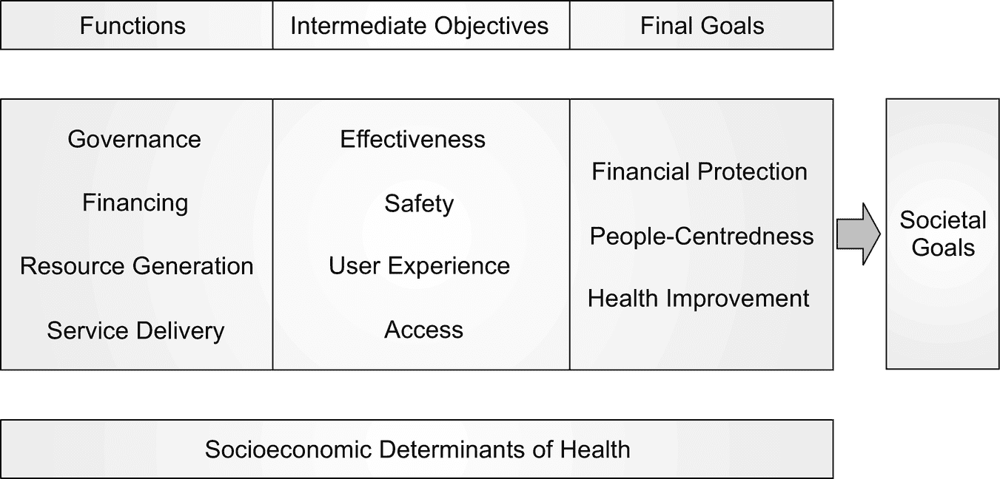

Fig. 4.1 HSPA Framework for UHC, adopted from `Papanicolas et al. (2022)`

概念“医疗体系内的治理”涵盖多个子功能，旨在促进跨部门协作，并通过立法和法规推动公共卫生目标的实现 `[Ntr et al., 2019`; `Smith et al., 2012`]。其核心目标是通过与其他部门的协作，对健康决定因素产生影响。健康融资发挥关键作用，涉及医疗资源的分配与利用，确保公共卫生服务和个人医疗服务的普惠覆盖。这包括支付结构、提供者补偿、服务成本以及可供个人获取的服务范围等决策。资源生成过程保证医疗体系能够获得运行所需的所有输入。这些输入包括医疗专业人员、医疗设备、基础设施、药物、免疫接种、各类医疗用品等。资源生成的主要功能在于管理这些输入的生产、采购、可得性和维护，以便及时且适当地满足医疗服务需求。此外，服务交付是健康体系的另一重要方面，与治理、融资和资源生成相互关联。该概念涉及在特定组织框架内将这些输入转化为一系列医疗解决方案，从而影响健康体系的中间目标及整体健康目标的实现。服务交付过程涉及在明确组织结构内整合多种资源，以交付定义明确的干预措施。

医疗效果的概念指的是服务能够成功实现其预期结果的程度，无论是在患者、人群还是医疗体系层面 `[Sanford et al., 2024`]，如 `Hargett et al., 2017` 所指出。安全性关注医疗过程在多大程度上能够降低由底层医疗过程导致的不良后果。用户体验领域涉及评估和衡量医疗服务接收者的视角及整体体验，强调其在服务交付的关键成果中的重要性。最后，接入度指的是健康服务不仅容易获得，而且在合理的时间内易于获取，同时确保个人的财务保护。 collectively, 这些目标共同构建了一个评估医疗生态系统质量的综合框架。

健康财务保护的概念指的是医疗体系保护个体免受疾病或医疗支出带来的财务风险的能力，如 `Singh and Barakoti, 2023` 所示。通过实施健康保险机制和建立全面的普惠健康覆盖，实现了这一目标，确保个人不会因健康相关费用而陷入财务困境，如 `Islam et al., 2017` 所描述。以人为中心强调个体及其独特经验在医疗情境中的核心作用。以患者为中心的护理意味着根据每位患者的具体需求、偏好和期望来定制医疗服务，注重积极参与和促进医护双方的互惠互利关系。健康改善是提升总体人口健康的主要目标，涵盖通过干预措施提升健康结果，旨在降低疾病发生率和防止死亡，体现了对所有群体健康结果改善的全面医疗方法。HSPA 方法强调在特定健康体系参数内改善健康结果的努力，虽未直接衡量改善体系目标对更广泛社会目标的影响，但在分析健康体系时认可这些因素的重要性。例如，健康体系在促进社会凝聚力、公平性和社会稳定方面发挥关键作用，通过减轻疾病带来的财务负担实现。健康体系通过提供社会保护、提升经济生产力和改善公平性来支持社会福祉。此外，健康体系还能影响更大的社会目标。所选的医疗体系融资结构会影响劳动力流动性，进而影响整体经济绩效；组织和技术创新的实施则可能惠及多个行业，提升经济绩效。健康体系绩效与社会目标实现之间的关联对政策制定者至关重要。

Blockchain technology, originally developed as the underlying structure for cryptocurrencies like Bitcoin `[Nakamoto, 2008`], has emerged as a transformative tool in various industries, including healthcare `[Abbate et al., 2023`]. Its decentralized digital ledger system ensures that transactions are securely recorded across multiple computers, making the data immutable and transparent `[O’Leary, 2017`]. 这种高度安全且透明的区块链技术解决了医疗行业的多项关键挑战，从而提升了该行业的商业实践。

Blockchain is a distributed ledger technology (DLT) that operates on a peer-to-peer network `[Bonnet and Teuteberg, 2023`]. Each participant, or node, in the network maintains a copy of the ledger, which is updated and validated through a consensus mechanism. Unlike traditional centralized databases, blockchain operates on a decentralized network `[Lee, 2019`]. Each node has equal authority and maintains a copy of the entire blockchain. 这种去中心化消除了单点故障，提高了系统的安全性和韧性。此外，区块链的不可篡改性通过密码学哈希实现，一旦数据写入区块链，就无法被修改或删除。每个区块包含前一个区块的密码学哈希，形成区块链。任何修改区块的尝试都会改变其哈希值，破坏链条并触发网络警报，如 `Berdik et al., 2021` 与 `O’Leary, 2017` 所指出。

-   两大类型的区块链：公共链和私有链。公共区块链，如比特币和以太坊，对任何人开放，具有去中心化和透明的特点 (`[Akcora et al., 2018`)。任何人都可以加入网络，参与共识过程，并查看区块链上记录的交易。这种开放性提供了高水平的安全性和信任，但由于共识机制（如工作量证明）所需的高计算能力，也可能导致可扩展性问题。相比之下，私有区块链仅限于特定参与者。这些区块链用于组织或联盟内部，在需要对网络进行控制的场景中适用，例如医疗行业。私有区块链提供更快的交易速度和更大的隐私性，因为访问受限且受控，使其适合企业级应用 (`Lacity, 2022`) 如医疗，其中数据隐私和安全至关重要。

-   医疗行业区块链的主要优势之一是患者数据的安全管理。区块链技术确保患者记录被安全存储且不易篡改，防止未经授权访问和数据泄露。这种安全的数据管理在健康信息成为网络攻击主要目标的时代尤为重要 (`Akoh Atadoga et al., 2024`)。此外，区块链赋予患者对其医疗记录的控制权。通过智能合约，患者可以授予或撤销对其数据的访问权限，确保敏感信息仅在其同意下共享，从而维护患者隐私 (`Griggs et al., 2018`)。

-   提升医疗提供者之间的互操作性是区块链的另一个优势。跨医疗系统共享医疗记录减少了健康数据的碎片化。这种互操作性确保医疗提供者能够获得完整且及时的患者信息，这对于准确诊断至关重要 (`Villarreal et al., 2023`)。此外，区块链提供了健康记录的标准化格式，促进了不同系统之间的更好沟通和数据交换，从而提升整体医疗服务质量。

-   医疗行业采用区块链也面临法律考量 (`Drummer and Neumann, 2020`)。关键方面之一是遵守数据保护法规，如欧洲的通用数据保护条例（GDPR）和美国的《健康保险可携带性和责任法案》（HIPAA）。这些法规要求对个人健康信息采取严格的保护措施。区块链固有的安全特性与这些要求相契合，但仍存在确保数据存储和处理完全符合法律标准的挑战。区块链交易的法律地位以及智能合约的可执行性仍是持续发展的议题 (`Geiregat, 2018`)。虽然区块链可以自动化许多流程，但法律体系仍在适应这些新技术。确保区块链方案符合现行法律法规至关重要。法律框架正在演进以应对这些新范式，但医疗机构必须保持知情并主动应对这些问题。

-   [4 增强 HSPA 框架实施与区块链的结合]

-   医疗行业的区块链应用可以助力 HSPA 框架的实施，为医疗行业带来无与伦比的优势 (`Figure 1.4.2`)。HSPA 框架在医疗体系的范围内运行，主要聚焦于提升健康结果和实现指定的健康系统目标。该框架设计用于评估医疗系统管理各项职能的效率，这些职能对确保医疗体系的顺畅运行至关重要。

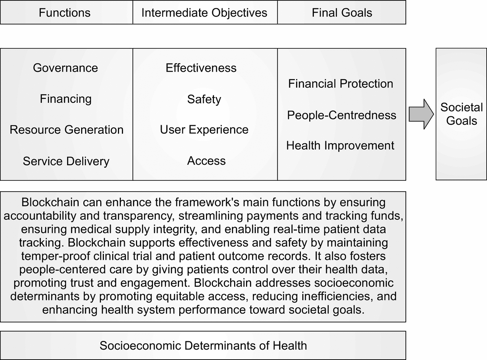

Fig. 4.2 Enhancing the HSPA framework with blockchain for better business practices

-   在医疗体系中，健康治理概念涵盖多个子功能，旨在促进跨部门协作，并利用立法和法规推动公共卫生目标。核心目标是影响健康决定因素，通常通过与多个行业的多维度合作实现。区块链的实施有潜力建立一个能够提升治理实践透明度的系统 (`Francisco and Swanson, 2018`; `Hellani et al., 2021`)。利用区块链固有的不可篡改和去中心化账本，治理决策和协作活动的透明性与不可篡改性得到保证。这不仅建立信任，还能创建一份完整的医疗治理实践记录 (`Lemieux, 2017`)。

-   医疗融资是医疗体系的关键部分。它帮助合理管理资金，以提供医疗服务，确保人人公平获得医疗。区块链技术的整合有潜力彻底改变金融交易 (`Miller et al., 2023`; `Natanelov et al., 2022`)。医疗机构可以提升支付、提供者报销以及医疗服务成本等流程的准确性和透明度。通过智能合约自动化从保险索赔到报销的多个财务交易，提升系统效率并降低欺诈风险。因此，这一做法不仅建立信任，还确保医疗资源的慎重分配。

-   资源生成是确保医疗机构具备必要资源（包括医疗专业人员、设备和药品）的基石。区块链在供应链中的采用带来诸多好处。它保证了资源的安全采购、分配和维护 (`Alkhudary et al., 2022`; `Zheng et al., 2019`)。通过区块链技术在透明且不可篡改的账本上监控医疗资源的生产与分销，可显著减少供应链中的缺料或低效情况，从而提升资源生成。

-   服务交付在医疗体系中占据重要位置，对治理、融资和资源动员产生重要影响。区块链技术的加入有望通过实时监控服务质量和患者结果来提升医疗服务管理的效率。区块链为记录服务交付相关数据提供了安全的方式 (`Al-Sumaidaee et al., 2022`; `Kshetri, 2017`)，从而实现对医疗服务提供的透明评估。这种方式提升了透明度，并增强了基于数据的决策能力，进而改善所提供的服务质量。

-   [医疗效果](https://example.org)指实现预期目标或结果的实现情况，与区块链技术提升医疗水平的潜力相契合，因为区块链能够确保医疗数据的可靠和安全转移。区块链的固有透明性和防篡改属性有助于监控和管理个体患者记录、治疗方案及健康结果 (`Alzahrani et al., 2023`; `De Aguiar et al., 2020`)。因此，这有助于提升医疗评价水平，对个体患者和更广泛的人群都有益。通过主动预防措施来预防不良后果或伤害，可通过区块链提升医疗安全。

-   以主动预防措施为重点，防止不良后果或伤害的医疗安全可借助区块链实现。区块链的不可篡改账本为安全存储关键健康数据、确保患者记录和治疗方案准确性与完整性提供了安全方式。区块链技术可提升健康数据整合，降低风险并保护患者福祉 (`Hölbl et al., 2018`)。

-   用户体验概念聚焦于患者对医疗服务的体验。区块链技术有潜力改善医疗提供者之间的健康数据交换，并促进协作与以患者为中心的医疗方式。患者可在医疗决策中更多参与，从而提高满意度。这可通过将基于区块链技术的非同质化代币（NFTs）纳入医疗系统实现 (`Al-Sumaidaee, Alkhudary, and Zilic, 2023`; `Lacity and Treiblmaier, 2022`)，确保医疗服务的可及性是医疗系统的主要目标。


- 医疗服务的可及性是医疗系统的主要目标之一，同时也是财务保护的核心。区块链技术有潜力优化健康保险行政流程，降低行政成本负担。区块链的透明性和高效性可提升医疗服务的可及性和可用性，从而保障财务保护机制 (Wamba and Queiroz, 2020)。

- 总之，区块链可产生更广泛的社会影响 (Chaudhuri et al., 2021)。医疗与社会目标的融合有潜力推动宏观经济发展、增进社会凝聚力并提升整体福祉。区块链在医疗系统中的应用有助于公共健康和经济效率。其固有的开放性和建立信任的特性可强化社会保护、公平与稳定，契合宏观社会目标 (Swan, 2015)。此外，区块链在医疗领域的集成有望提升劳动力流动性并改善经济绩效。

## 5 Future Research

- 本节探讨基准测试作为评估区块链技术对健康系统影响的工具。利用基准测试技术，研究人员可评估区块链实施对医疗数据安全、互操作性等各个方面的影响。基准测试已成为多个行业提升组织绩效的广泛采用的策略 (Pradhan et al., 2022)。该方法基于获取成功商业实践的洞见比从零重新开发解决方案更具优势。

- 基准测试的概念包括持续测量和评估产品、服务和流程，以识别最佳实践和策略 (Åhrén and Parida, 2009; Al-Tarawneh, 2014)。基准测试原则的采用在多个领域迅速增长，驱动各行业追求卓越绩效和创新。将基准测试方法引入医疗行业，为审视区块链对医疗质量和系统绩效的影响提供了有利框架。

- 医疗行业基准测试的核心要素之一是竞争性基准测试，用于评估医疗提供者的运营效率。该方法可用于比较具有相似特征的医疗系统，如公共或非公共属性、提供的医疗服务范围、地理覆盖范围及规模 (Ozcan, 2014)。未来研究可考察区块链如何提升医疗提供者的竞争力，并通过对成功实施去中心化应用的医院进行深度案例研究，评估区块链在医疗系统中的可行性。

- 除了竞争性基准测试，引入功能基准测试对评估区块链在医疗领域的更广泛影响至关重要。功能基准测试超越直接竞争，涉及将具有不同特征但业务域有重叠的医疗提供者进行比较。研究者应深入探讨区块链对共享服务（如资源与设备管理、实验室运营、医院药房管理）的潜在影响。这种方式有助于更全面地理解区块链如何提升运营绩效并优化医疗资源配置 (Agbo et al., 2019; Akoh Atadoga et al., 2024)。

- 在由多个部门提供相似或多专业医疗服务的专科医疗机构中，内部基准测试成为良好实践 (Agarwal et al., 2016; Dugas et al., 2008; García-Lorenzo et al., 2023)。研究者已探讨区块链在质量改进、患者安全、医疗供应链管理、资本项目绩效、财务指标以及初级护理中心效率等领域的影响 (Ang et al., 2015; Cimasi, 2004)。进一步研究应重点考察区块链对医疗服务财务方面的影响。通过比较关键指标（如医护人员与患者比例、床位占用率、人日数）的分析，研究者可洞察区块链采用如何改善医疗服务交付和资源管理。

## Conclusion

医疗保健行业运营在一个充满变化的环境中，其特点是不断的监管变化、预算限制以及技术进步，这些都会影响其绩效和质量。动态的医疗环境在管理资源、遵守监管要求以及在追求成本效益的同时确保公平获取服务方面面临多项挑战。然而，实现这些目标的过程因信息不对称和人口结构变化而变得复杂，需要寻找新的解决方案。区块链的出现被视为一种新的信息系统，有望重塑医疗行业的结构和运作。它能够通过解决治理、财务、资源生成和服务交付方面的问题，提升透明度和安全性。所提议的系统解决了数据共享和安全问题，并促进了多方利益相关者之间的信任。它还推动了以患者为中心的护理方式，并增强了财务安全。将区块链整合到 HSPA 框架中不仅提升了医疗运营，还与更广泛的社会目标保持一致。这种改进可以影响社会包容、经济发展以及整体繁荣。

将区块链与医疗行业的更佳商业实践相结合，展示出多项优势。通过简化行政流程并减少重复，区块链改善了资源管理，使医疗提供者能够避免重复检查和操作，从而降低成本并提高患者结果。区块链的安全性和透明性确保交易记录准确，简化了监管合规。此外，它还促进了对服务资源分配的公平访问，确保弱势群体获得适当护理，并有助于识别服务交付中的缺口。区块链还支持对患者记录的持续、实时访问，适用于日常治疗和紧急情况。这有助于提升医疗提供者的技术能力，使他们能够作出更佳决策。此外，区块链通过确保所有利益相关者都能获得相同、最新的信息，降低了信息不对称，从而建立信任并提升医疗服务质量。随着人口老龄化和人口结构变化，区块链有助于开发创新解决方案，如个性化医疗和远程医疗服务。

此外，区块链通过确保所有个人都能获得优质医疗服务，促进了社会包容。区块链带来的效率提升可以导致医疗行业的成本节约和经济绩效提升，推动更广泛的经济发展。最后，区块链支持专业资格和工作经历的安全、可验证的跨境转移，促进劳动力流动，使医疗专业人员能够在不同地区或国家工作，而无需重复验证。这种流动性对于应对劳动力短缺、确保熟练专业人员能够迅速响应需求至关重要。因此，区块链为医疗行业的更佳商业实践提供了全面的解决方案。

尽管区块链在医疗行业具有巨大潜力，其实施仍面临多项限制。主要挑战之一是区块链系统的可扩展性。由于共识机制需要高昂的计算能力，区块链可能会出现交易速度慢的情况。此外，还存在相当大的法律和监管障碍需要克服。确保符合数据保护法规（如 GDPR 和 HIPAA）可能复杂，而智能合约的法律地位和可执行性仍是不断发展的领域。还有关于区块链与现有医疗信息系统互操作性的担忧，这可能需要额外的调整和投资。最终，使用区块链需要初始成本，这对某些医疗机构而言可能过高。同时，还需要对医疗提供者进行广泛的教育和培训，以便他们能够实施和使用区块链技术。

- Abbate, S., Centobelli, P., Cerchione, R., Oropallo, E. and Riccio, E. (2023). Blockchain Technology for Embracing Healthcare 4.0. IEEE Transactions on Engineering Management, *70*(8), 2998–3009. [doi.org/10.1109/TEM.2022.3212007](http://dx.doi.org/10.1109/TEM.2022.3212007)

- Agarwal, R., Green, R., Agarwal, N. and Randhawa, K. (2016). Benchmarking management practices in Australian public healthcare. Journal of Health Organization and Management, *30*(1), 31–56. [doi.org/10.1108/JHOM-07-2013-0143](http://dx.doi.org/10.1108/JHOM-07-2013-0143)

- Agbo, C.C., Mahmoud, Q.H. and Eklund, J.M. (2019). Blockchain Technology in Healthcare: A Systematic Review. Healthcare, *7*(2), 56. [doi.org/10.3390/healthcare7020056](https://doi.org/10.3390/healthcare7020056)

- Åhrén, T. and Parida, A. (2009). Maintenance performance indicators (MPIs) for benchmarking the railway infrastructure: A case study. Benchmarking: An International Journal, *16*(2), 247–258. [doi.org/10.1108/14635770910948240](https://doi.org/10.1108/14635770910948240)

- Akora, C.G., Dixon, M. F., Gel, Y.R. and Kantarcioglu, M. (2018). Bitcoin risk modeling with blockchain graphs. Economics Letters, *173*, 138–142. [doi.org/10.1016/j.econlet.2018.07.039](https://doi.org/10.1016/j.econlet.2018.07.039)

- Akoh Atadoga, Oluwafunmi Adijat Elufioye, Toritsemogba Tosanbami Omaghomi, Opeoluwa Akomolafe, Ifeoma Pamela Odilibe, & Oluwaseyi Rita Owolabi. (2024). Blockchain in healthcare: A comprehensive review of applications and security concerns. International Journal of Science and Research Archive, *11*(1), 1605–1613. [doi.org/10.30574/ijsra.2024.11.1.0244](https://doi.org/10.30574/ijsra.2024.11.1.0244)

- Alkhudary, R. and Féniès, P. (2022). Blockchain and Trust in Supply Chain Management: A Conceptual Framework. IFAC-PapersOnLine, *55*(10), 2402–2406. [doi.org/10.1016/j.ifacol.2022.10.068](https://doi.org/10.1016/j.ifacol.2022.10.068)

- Alkhudary, R., Queiroz, M.M. and Féniès, P. (2022). Mitigating the risk of specific supply chain disruptions through blockchain technology. Supply Chain Forum: An International Journal, 1–11. [doi.org/10.1080/16258312.2022.2090273](https://doi.org/10.1080/16258312.2022.2090273)

- Allen-Duck, A., Robinson, J.C. and Stewart, M.W. (2017). Healthcare Quality: A Concept Analysis. Nursing Forum, *52*(4), 377–386. [doi.org/10.1111/nuf.12207](https://doi.org/10.1111/nuf.12207)

- Alonazi, W.B. and Thomas, S.A. (2014). Quality of Care and Quality of Life: Convergence or Divergence? Health Services Insights, *7*, HSI.S13283. [doi.org/10.4137/HSI.S13283](https://doi.org/10.4137/HSI.S13283)

- Al-Sumaidaee, G., Alexandridis, A., Alkhudary, R. and Zilic, Z. (2022). A Technical Assessment of Blockchain in Healthcare with a Focus on Big Data. 2022 IEEE International Conference on Big Data (Big Data), 2467–2472. [doi.org/10.1109/BigData55660.2022.10020962](https://doi.org/10.1109/BigData55660.2022.10020962)

- Al-Sumaidaee, G., Alkhudary, R. and Zilic, Z. (2023). 非同质化代币（NFTs）作为区块链网络在医疗卫生领域整合的手段。2023 第 5 届区块链研究与创新网络与服务会议（BRAINS），1–2. [doi.org/10.1109/BRAINS59668.2023.10316782](http://dx.doi.org/10.1109/BRAINS59668.2023.10316782).

- Al-Sumaidaee, G., Alkhudary, R., Zilic, Z. and Féniès, P. (2021). 通过区块链技术构建集成医疗信息系统的蓝图。HEALTHINFO 2021，第六届健康信息与辅助技术国际会议，医疗支持与福祉。

- Al-Sumaidaee, G., Alkhudary, R., Zilic, Z. and Féniès, P. (2023). 配置区块链架构和共识机制：医疗供应链的使用案例。在 A. Bouras、I. Khalil、& B. Aouni（编）的《区块链驱动供应链与企业信息系统》（第 135–150 页）。Springer International Publishing. [doi.org/10.1007/978-3-030-96154-1_7](http://dx.doi.org/10.1007/978-3-030-96154-1_7).

- Al-Tarawneh, H. (2014). 约旦银行部门的基准测试利用。管理研究杂志，*6*(3)，49. [doi.org/10.5296/jmr.v6i3.5299](https://doi.org/10.5296/jmr.v6i3.5299).

- Alzahrani, S., Daim, T. and Choo, K.-K. R. (2023). 区块链技术在电子健康记录系统管理中的采用评估。工程管理杂志，*70*(8)，2846–2863. [doi.org/10.1109/TEM.2022.3158185](https://doi.org/10.1109/TEM.2022.3158185).

- Ang, D., McKenney, M., Norwood, S., Kurek, S., Kimbrell, B., Liu, H., Ziglar, M. and Hurst, J. (2015). 使用美国健康研究与质量署的患者安全指标对州级创伤死亡率进行基准测试。外科研究杂志，*198*(1)，34–40. [doi.org/10.1016/j.jss.2015.05.053](https://doi.org/10.1016/j.jss.2015.05.053).

- Aydin, A. (2022). 基于 DEA 方法的 Malmquist 生产率指数方法对 OECD 国家医疗系统基准测试。阿尔法数字期刊，*10*(1)，25–40. [doi.org/10.17093/alphanumeric.1057559](https://doi.org/10.17093/alphanumeric.1057559).

- Barbazza, E., Kringos, D., Kruse, I., Klazinga, N.S. and Tello, J.E. (2019). 为欧洲初级医疗加强绩效智能化的研究。BMC 健康服务研究，*19*(1)，1006. [doi.org/10.1186/s12913-019-4853-z](https://doi.org/10.1186/s12913-019-4853-z).

- Beaulieu, M., Bentahar, O., Benzidia, S. and Gunasekaran, A. (2023). 家庭护理医疗供应链的数字化项目：基于案例研究的方法。工程管理杂志，1–14. [doi.org/10.1109/TEM.2023.3265624](https://doi.org/10.1109/TEM.2023.3265624).

- Benzidia, S., Ageron, B., Bentahar, O. and Husson, J. (2019). 物流自动化和 AGV 在医疗物流中的研究：基于案例研究的方法。国际物流研究与应用期刊，*22*(3)，273–293. [doi.org/10.1080/13675567.2018.1518414](https://doi.org/10.1080/13675567.2018.1518414).

- Berdik, D., Otoum, S., Schmidt, N., Porter, D. and Jararweh, Y. (2021). 区块链在信息系统管理和安全方面的调查。信息处理与管理，*58*(1)，102397. [doi.org/10.1016/j.ipm.2020.102397](https://doi.org/10.1016/j.ipm.2020.102397).

- Bernal-Delgado, E., Christiansen, T., Bloor, K., Mateus, C., Yazbeck, A.M., Munck, J. and Bremner, J. (2015). ECHO：在多个欧洲健康系统中评估医疗绩效。欧洲公共健康杂志，*25*(suppl_1)，3–7. [doi.org/10.1093/eurpub/cku219](https://doi.org/10.1093/eurpub/cku219).


- Bonnet, S. and Teuteberg, F. (2023). 区块链和分布式账本技术在知识产权生命周期管理中的影响：多案例分析。计算机工业，*144*，103789. [`doi.org/10.1016/j.compind.2022.103789`](https://doi.org/10.1016/j.compind.2022.103789).

- Chaudhuri, A., Bhatia, M.S., Kayikci, Y., Fernandes, K.J. and Fosso-Wamba, S. (2021). 通过区块链实施提升社会可持续性并降低供应链风险：结果与行为机制的作用。运筹研究杂志。 [`doi.org/10.1007/s10479-021-04307-6`](https://doi.org/10.1007/s10479-021-04307-6).

- Cimasi, R.J. (2004, November 1). 医疗行业财务基准测试第二部分。 [`www.cpaleadership.com/public/257.cfm`](https://www.cpaleadership.com/public/257.cfm).

- De Aguiar, E.J., Faiçal, B.S., Krishnamachari, B. and Ueyama, J. (2020). 区块链驱动的医疗解决方案调查。ACM 计算机评论，*53*(2)，1–27. [`doi.org/10.1145/3376915`](https://doi.org/10.1145/3376915).

- Drummer, D. and Neumann, D. (2020). 代码即法律吗？区块链智能合约的当前法律与技术采用问题及解决方案。信息技术期刊，*35*(4)，337–360. [`doi.org/10.1177/0268396220924669`](https://doi.org/10.1177/0268396220924669).

- Dugas, M., Eckholt, M. and Bunzemeier, H. (2008). 通过出院记录和调度数据对医院信息系统进行基准测试：监测异质性和时间趋势。BMC 医疗信息与决策支持，*8*(1)，15. [`doi.org/10.1186/1472-6947-8-15`](https://doi.org/10.1186/1472-6947-8-15).

- Francisco, K. and Swanson, D. (2018). 供应链没有衣服：区块链在供应链透明度中的技术采用。物流，*2*(1)，2. [`doi.org/10.3390/logistics2010002`](https://doi.org/10.3390/logistics2010002).

- Fuchs, V.R. (2018). 健康经济与政策：维克多·福克斯选集（第 1 版）。世界科学出版社。

- García-Lorenzo, B., Gorostiza, A., Alayo, I., Castelo Zas, S., Cobos Baena, P., Gallego Camiña, I., Izaguirre Narbaiza, B., Mallabiabarrena, G., Ustarroz-Aguirre, I., Rigabert, A., Balzi, W., Maltoni, R., Massa, I., Álvarez López, I., Arévalo Lobera, S., Esteban, M., Fernández Calleja, M., Gómez Mediavilla, J., Fernández, M., … Barros, E. (2023). 欧洲基于价值的医疗基准测试：从理论走向实践。欧洲公共健康杂志，ckad181. [`doi.org/10.1093/eurpub/ckad181`](https://doi.org/10.1093/eurpub/ckad181).

- Geiregat, S. (2018). 加密货币即（智能）合约。计算机安全评论，*34*(5)，1144–1149. [`doi.org/10.1016/j.clsr.2018.05.030`](https://doi.org/10.1016/j.clsr.2018.05.030).

- Griggs, K.N., Ossipova, O., Kohlios, C.P., Baccarini, A.N., Howson, E.A. and Hayajneh, T. (2018). 使用智能合约的医疗区块链系统，实现远程患者监测的安全自动化。医学系统期刊，*42*(7)，130. [`doi.org/10.1007/s10916-018-0982-x`](https://doi.org/10.1007/s10916-018-0982-x).

- Hargett, C., Doty, J., Hauck, J., Webb, A., Cook, S., Tsipis, N., Neumann, J., Andolsek, K. and Taylor, D. (2017). 通过概念映射方法开发有效医疗领导力的模型。医疗领导力期刊，第 9 卷，69–78. [`doi.org/10.2147/JHL.S141664`](https://doi.org/10.2147/JHL.S141664).

- Hellani, H., Sliman, L., Samhat, A.E. and Exposito, E. (2021). On Blockchain Integration with Supply Chain: Overview on Data Transparency. Logistics, *5*(3), 46. [`doi.org/10.3390/logistics5030046`](http://dx.doi.org/10.3390/logistics5030046).

- Hölbl, M., Kompara, M., Kamišalić, A. and Nemec Zlatolas, L. (2018). A Systematic Review of the Use of Blockchain in Healthcare. Symmetry, *10*(10), 470. [`doi.org/10.3390/sym10100470`](http://dx.doi.org/10.3390/sym10100470).

- Islam, Md. R., Rahman, Md. S., Islam, Z., Nurs, C.Z.B., Sultana, P. and Rahman, Md. M. (2017). Inequalities in financial risk protection in Bangladesh: An assessment of universal health coverage. International Journal for Equity in Health, *16*(1), 59. [`doi.org/10.1186/s12939-017-0556-4`](http://dx.doi.org/10.1186/s12939-017-0556-4).

- KirungaTashobya, C., Ssengooba, F., Nabyonga-Orem, J., Bataringaya, J., Macq, J., Marchal, B., Musila, T. and Criel, B. (2018). A critique of the Uganda district league table using a normative health system performance assessment framework. BMC Health Services Research, *18*(1), 355. [`doi.org/10.1186/s12913-018-3126-6`](http://dx.doi.org/10.1186/s12913-018-3126-6).

- Kludacz-Alessandri, M., Walczak, R., Hawrysz, L. and Korneta, P. (2021). The Quality of Medical Care in the Conditions of the COVID-19 Pandemic, with Particular Emphasis on the Access to Primary Healthcare and the Effectiveness of Treatment in Poland. Journal of Clinical Medicine, *10*(16), 3502. [`doi.org/10.3390/jcm10163502`](https://doi.org/10.3390/jcm10163502).

- Kshetri, N. (2017). Blockchain’s roles in strengthening cybersecurity and protecting privacy. Telecommunications Policy, *41*(10), 1027–1038. [`doi.org/10.1016/j.telpol.2017.09.003`](https://doi.org/10.1016/j.telpol.2017.09.003).

- Lacity, M.C. (2022). Blockchain: From Bitcoin to the Internet of Value and beyond. Journal of Information Technology, 026839622210863. [`doi.org/10.1177/02683962221086300`](https://doi.org/10.1177/02683962221086300).

- Lacity, M.C. and Treiblmaier, H. (Eds.). (2022). Blockchains and the Token Economy: Theory and Practice. Springer International Publishing. [`doi.org/10.1007/978-3-030-95108-5`](https://doi.org/10.1007/978-3-030-95108-5).

- Lee, J.Y. (2019). A decentralized token economy: How blockchain and cryptocurrency can revolutionize business. Business Horizons, *62*(6), 773–784. [`doi.org/10.1016/j.bushor.2019.08.003`](https://doi.org/10.1016/j.bushor.2019.08.003).

- Lemieux, V.L. (2017). A typology of blockchain recordkeeping solutions and some reflections on their implications for the future of archival preservation. 2017 IEEE International Conference on Big Data (Big Data), 2271–2278. [`doi.org/10.1109/BigData.2017.8258180`](https://doi.org/10.1109/BigData.2017.8258180).

- Miller, T., Cao, S., Foth, M., Boyen, X. and Powell, W. (2023). An asset-backed decentralised finance instrument for food supply chains – A case study from the livestock export industry. Computers in Industry, *147*, 103863. [`doi.org/10.1016/j.compind.2023.103863`](https://doi.org/10.1016/j.compind.2023.103863).

- Nakamoto, S. (2008). Bitcoin: A Peer-to-Peer Electronic Cash System. [`bitcoin.org/bitcoin.pdf.https://bitcoin.org/bitcoin.pdf`](https://bitcoin.org/bitcoin.pdf.https://bitcoin.org/bitcoin.pdf).

- Natanelov, V., Cao, S., Foth, M. and Dulleck, U. (2022). Blockchain smart contracts for supply chain finance: Mapping the innovation potential in Australia-China beef supply chains. Journal of Industrial Information Integration, *30*, 100389. [`doi.org/10.1016/j.jii.2022.100389`](https://doi.org/10.1016/j.jii.2022.100389).

- Noto, G., Corazza, I., Kļaviņa, K., Lepiksone, J. and Nuti, S. (2019). Health system performance assessment in small countries: The case study of Latvia. The International Journal of Health Planning and Management, *34*(4), 1408–1422. [`doi.org/10.1002/hpm.2803`](https://doi.org/10.1002/hpm.2803).

- Ntr, A. M. R.A. and C, L.P. (2019). The Literature Review of the Governance Frameworks in Health System. Journal of Public Administration and Governance, *9*(3), 252. [`doi.org/10.5296/jpag.v9i3.15535`](https://doi.org/10.5296/jpag.v9i3.15535).

- O’Leary, D.E. (2017). Configuring blockchain architectures for transaction information in blockchain consortiums: The case of accounting and supply chain systems. Intelligent Systems in Accounting, Finance and Management, *24*(4), 138–147. [`doi.org/10.1002/isaf.1417`](https://doi.org/10.1002/isaf.1417).

- Ozcan, Y.A. (2014). Health Care Benchmarking and Performance Evaluation: An Assessment using Data Envelopment Analysis (DEA) (Vol. 210). Springer US. [`doi.org/10.1007/978-1-4899-7472-3`](https://doi.org/10.1007/978-1-4899-7472-3).

- Papanicolas, I., Rajan, D., Karanikolos, M., Soucat, A. and Figueras, J. (2022). Health system performance assessment a framework for policy analysis. World Health Organization.

- Pradhan, N.R., Singh, A.P., Verma, S., Kavita Kaur, N., Roy, D.S., Shafi, J., Wozniak, M. and Ijaz, M.F. (2022). A Novel Blockchain-Based Healthcare System Design and Performance Benchmarking on a Multi-Hosted Testbed. Sensors, *22*(9), 3449. [`doi.org/10.3390/s22093449`](https://doi.org/10.3390/s22093449).

- Rejeb, A., Rejeb, K., Treiblmaier, H., Appolloni, A., Alghamdi, S., Alhasawi, Y. and Iranmanesh, M. (2023). The Internet of Things (IoT) in healthcare: Taking stock and moving forward. Internet of Things, *22*, 100721. [`doi.org/10.1016/j.iot.2023.100721`](https://doi.org/10.1016/j.iot.2023.100721).


* Sanford, N., Lavelle, M., Markiewicz, O., Reedy, G., Rafferty, D.A.M., Darzi, L.A. and Anderson, J. E. (2024). Decoding healthcare teamwork: A typology of hospital teams. Journal of Interprofessional Care, *38*(4), 602–611. [doi.org/10.1080/13561820.2024.2343835](https://doi.org/10.1080/13561820.2024.2343835).

* Shortell, S.M. (1989). Health Care Management: A Text in Organization Theory & Behavior. Delmar.

* Singh, M.D. and Barakoti, B. (2023). The Impact of Social Health Insurance on Household Catastrophic Healthcare Expenditures Associated with Chronic Diseases in Sundarharaincha Municipality, Morang. Southwestern Research Journal, *1*(1), 39–48. [doi.org/10.3126/srj.v1i1.62263](https://doi.org/10.3126/srj.v1i1.62263).

* Smith, P.C., Anell, A., Busse, R., Crivelli, L., Healy, J., Lindahl, A.K., Westert, G. and Kene, T. (2012). Leadership and governance in seven developed health systems. Health Policy, *106*(1), 37–49. [doi.org/10.1016/j.healthpol.2011.12.009](https://doi.org/10.1016/j.healthpol.2011.12.009).

* Swan, M. (2015). Blockchain: Blueprint for a new economy (First edition). O’Reilly.

* Villarreal, E.R.D., Garcia-Alonso, J., Moguel, E. and Alegria, J.A.H. (2023). Blockchain for Healthcare Management Systems: A Survey on Interoperability and Security. IEEE Access, *11*, 5629–5652. [doi.org/10.1109/ACCESS.2023.3236505](https://doi.org/10.1109/ACCESS.2023.3236505)

* Wamba, S.F. 和 Queiroz, M.M. (2020). 区块链在运营和供应链管理中的应用：益处、挑战和未来研究机遇。国际信息管理期刊，*52*，102064。[doi.org/10.1016/j.ijinfomgt.2019.102064](https://doi.org/10.1016/j.ijinfomgt.2019.102064)。

* Zheng, K., Zhang, Z. (Justin), Chen, Y. 和 Wu, J. (2019). 区块链在信息共享中的采纳：太空供应链中的风险决策。企业信息系统，1–22。[doi.org/10.1080/17517575.2019.1669831](https://doi.org/10.1080/17517575.2019.1669831)。

# 5 金钱作为设计材料，通向公民赋权

Ryan Bowler^(¹²)

电子邮件: r.bowler@sms.ed.ac.uk¹; g.goodell@ucl.ac.uk³

## 1. 介绍

历史上，货币曾以多种形式存在，从贝壳、金属硬币，到近期出现的非受监管的加密货币。随着政府探索自己的数字货币版本，如中央银行数字货币（CBDC），设计在保持与金钱相关的众多价值方面发挥了日益重要的作用。本章旨在引发设计师对其在塑造或维护与金钱相关的社会文化价值和实践的角色的反思，无论是传统的实物现金，还是包括 CBDC 在内的新形式。

金钱对人们而言不只是数值，它还承载信任、社会伦理，并提供通过其有形和无形属性进行灵活交易的方式。通过这种方式，金钱将社会关系联系在一起（Halloluwa et al., 2018），并在人们日常生活中扮演不可或缺的角色（Vines et al., 2012）。金钱将社会的许多部分紧密相连（Ingham, 1996），并且在我们的生活中以多种形式呈现：从现金转变为彩票、支票、超市和航空公司奖励计划中的等值，甚至是智能手机上数字支付的“轻触”。金钱的形式既富有创造力，但也伴随着一定程度的复杂性，使公民陷入日益增加的物质、数字和社会纠缠（Speed et al., 2022）。Maurer (2006) 通过构建一种人类学视角，强调了这些复杂性：我们看到金钱成为““真实”经济价值与[the]‘不实’虚构”之间的错综关系”，而政府支持的货币（即所谓的法定货币）、股票市场和组织所产生的法定货币（fiat money）正是这种关系的体现。虽然社会已经尝试使用加密货币作为一种新型货币形式，但目前我们正看到政府大规模投资于其自身的全数字化货币形式——即众所周知的中央银行数字货币（CBDC）。中国在推动 CBDC 发展方面处于领先地位，其数字人民币项目（也称为数字货币电子支付系统，DCEP）就是一个典型例子；斯堪的纳维亚国家（瑞典、挪威）和英国也都在研究此类方案的可行性。与此同时，2020 年 10 月，巴哈马推出了“沙美元”（Sand Dollar），这是巴哈马元的全数字化版本。然而，如果当前从实物现金向数字形式的转变趋势继续下去，实物现金持有者可能会被排除在外，其价值和以往的做法受到影响。值得注意的是，尽管 CBDC 的兴起表明政府正在采用区块链技术，但利用数字技术支持经济交易并非新事物。M-Pesa 是一项数字移动支付服务，于 2007 年由肯尼亚最大的移动网络运营商维多フォン和萨弗科技公司推出，使用户可以将资金存入手机账户，通过短信将余额转移至其他用户，并可将存款兑换为常规货币（Centellegher et al., 2018；Roitman, 2023）。

随着 CBDC 逐渐走向前景，我们的研究成果表明，关于 CBDC 的讨论速度过快，仍有许多待回答的问题。我们阐述了 CBDC 如何提供全新的方式来思考价值与价值的关联，但同时也必须呼应当前的货币价值，例如现金的匿名性有助于避免歧视。此外，了解 CBDC 的设计方式可以帮助我们评估在塑造其有形和交互设计方面至关重要的用户视角。这些是我们在基于参与式工作坊和半结构化访谈的发现中所报告的，访谈对象为数字银行领域的合作伙伴，他们具备相关知识或参与度。目前关于数字货币的知识大多是理论性的、推测性的或技术性的，其社会、政治、经济和全球影响尚未显现。本章作为起点，供设计师思考其在塑造或维护与金钱相关价值方面的角色，无论是传统的现金形式，还是如中央银行数字货币等新形式。本文的发现进一步回应了本书提出的问题：区块链技术如何作为推动行业、社区和地球产生积极影响的催化剂。

本章随后提供了关于金钱的具体方面的背景介绍，包括其历史形式和债务的基本概念，随后引入 CBDC、其对金融格局的潜在影响以及在设计中需考虑的社会文化价值。本文随后介绍了所使用的方法，包括参与式工作坊和半结构化访谈，这两种方法均借助漫画条幅来展示可能的 CBDC 场景。工作坊和访谈的发现将在后续进行探讨，随后得出结论，指出研究的局限性，并探讨未来研究方向及 CBDC 设计的可能性。

## 2. 金钱，金钱，金钱

金钱以现金形式可从工程角度来看。它是一种材料或织物，经过转化成为产品（Sousa et al., 2021）。传统上，现金由大量金属或类纸材料制成，形成可交换或可替换的有形资产（Ingham, 2013）。有人认为，自人类历史开始，各种形式的货币就一直是必需的，从贝壳到硬币，因为它代表信任和偿还或购买的承诺（Arvidsson, 2019）。

在这些现金的物质形态背后，是债务，它被视为 ignites（点燃）金钱设计原则的基本要素（Desan, 2021）。

“金钱的所有形式都包含三个主要设计组成部分：它们由债务构成；该债务专门设计以创造流动性；以及由此产生的债务（或信用）媒介伴随着价值的承诺。这些设计组成部分在主要的货币类型中反复出现，包括中世纪硬币、现代基础（高能）货币以及商业银行货币”（Desan, 2021）。

债务的概念极大地影响了金钱的材料形态，从而促成了诸如现金、股票、债券和房地产等资产的创造。每种资产都有其自身价值和转换为现金的方式。人们可能会只把金钱视为这些具体的物质，我们为之设计并围绕其设计。但随着数字化的发展，金钱的本质正在发生变化。

* [日益增长的无形资产存储形式](https://wiki.example.org/peneder_2022_ch5.xhtml#ref5_24)正在逐渐取代实物价值存储形式（Peneder, 2022）。这意味着实物货币形式，如硬币和纸币，正在被能够电子存储和转移的数字化表示所取代。随着货币日益数字化，经济学家开始质疑其数字形式的本质，而软件工程师则持续以稳步的节奏推动金融领域的数字化（Peneder, 2022）。

A CBDC 是由央行发行的法定货币的数字形式。它被设计为一个国家实物货币的数字化表示，与比特币或以太坊等加密货币不同，CBDC 由政府担保并具有法定支付属性。然而，与比特币和以太坊一样，CBDC 使用安全且透明的账本，通常基于区块链技术，以创建所有交易的不可篡改记录。

CBDC 可视为金融系统基础设施的创新，能够提供金融体系的底层架构（Schindler, 2017）。这种技术不仅可能产生重大的财务影响，还可能对社会、政治和经济产生数十年来未曾见闻的深远影响。其功能不同于当前的数字支付方式，并被提议由央行发行。正如实物现金的印刷、管理和发放方式，CBDC 也是以相同的方式进行分发，但以数字形式呈现，并可能得到第三方的支持。在英国，这种数字“硬币”可能被称为数字英镑或数字英镑。鉴于其潜在的好处和影响，CBDC 在近年来受到了大量关注和欢迎。

虽然像中国和中欧国家正在迅速将 CBDC 视为一种受政府支持的互补货币而快速采用，但像瑞典这样的国家正因多种社会和技术因素而走上完全无现金社会的道路（Arvidsson, 2018、2019）。数字货币，如 CBDC，正准备塑造全新的金融格局，而当前的金融格局本身也正在发生变化。英国通过银行和财政部的联合努力，已开始探索 CBDC 概念，从而产生了一份第一阶段的咨询文件（HM Treasury and Bank of England, 2023）。本报告中的 CBDC 应被视为一种新型支付形式，其目的并非取代现金或其他支付系统，但可能会如此。虽然这令人欢迎，但传统货币形式（如现金）已经在衰退（HM Treasury and Bank of England, 2023）。这种衰退尚未由 CBDC 引起，而是受到包括 COVID-19 大流行（UK Finance, 2021）在内的其他因素加速了接触式支付形式的采用速度（Arvidsson, 2018; Iqbal and Campbell, 2020; Wiberg, 2020）。

现金的实物形式仍然是英国许多人的日常生活不可或缺的一部分（英国央行，2021）。但支撑现金获取的基础设施——如自动取款机（ATM）——正在减少（Ceeney, 2019）。当前的政府政策未能充分应对保护现有现金获取机制的需求，包括银行取款或法律化其接受。现金使用量的下降以及保护现金的缺乏措施，凸显了理解公众价值观和期望（即个人如何参与经济）在 CBDC 世界中可能如何转变的必要性。鉴于区块链的首个“产品”是一种货币形式，而比特币在公众心中仍与该技术划等号，学术界必须承担起关注 CBDC 这一形式是否有利于社会的责任。区块链为价值在分布式和去中心化形式中创造提供了许多机会，但这些在技术上的“投资”不应与可能导致社区成员（尤其是偏好使用现金者）被排除在外的风险隔离开来。

如果不考虑现金不仅作为经济工具，而且作为社会角色的影响，可能会导致创建出一种未能解决众多社会文化问题、实践、需求或价值的 CBDC。随着货币材料的变化，审视金钱在社会中的社会和政治角色尤为重要，正如 Swierstra (2013) 所指出的，引入技术进步可以改变我们对道德和价值观的认知，带来负面和正面的后果。引入新技术所产生的道德结果取决于是否充分考虑经济体中多元成员的意见并参与其开发（Swierstra, 2013）。人机交互领域的研究已经揭示了如何重新思考“非技术用户”，以平衡“技术使用者是‘好用户’而不使用者有问题”的假设（Satchell and Dourish, 2009; Baumer et al., 2014; Selwyn, 2003）。将这种假设称为“采用的道德” Satchell and Dourish (2009) 突显了研究者的责任，即将数字媒体（如数字货币）视为文化物件，将区块链视为文化现象。因此，这促使我们在考虑 CBDC 以区块链技术形式呈现时，结合当前的价值观和关注点，审视受影响的个体是否在以 CBDC 为主导支付方式的系统中得到体现。

我们仍有许多未知之处。然而，正如前文所讨论的，在政策制定者权衡 CBDC 时，数字鸿沟仍是一个紧迫的问题，且为实现数字金融可及性所需的某些条件正被忽视。金钱深度嵌入社会的方方面面，其社会价值远超经济价值。传统货币形式正稳步被取代，技术可以塑造并灌输新的实践、价值和道德，但这需要时间。这些因素使得设计全新货币成为一项宏大挑战，需要细致、耐心和批判性的态度。若缺乏这种方法，将有可能对数百万人产生负面影响。

## 3. 参与者、方法和发现

为了更好地理解交互设计在 CBDC 格局中的作用，我们联系了在各种角色中参与 CBDC 的若干用户群体和团队。这些群体包括英国公共机构、Web 3.0 专家、商业银行专家以及数字支付行业的专业人士。参与者被邀请参加一项小型研究，该研究由一场设计工作坊开启，旨在探讨 CBDC 相关的问题，进而为半结构化访谈提供依据。尽管随后的四位参与者样本量较小，但他们的知识与专业能力提供了丰富而有价值的洞见。这些洞见鼓励设计师探索现有的传统货币形式以及未来的 CBDC 格局。

* 参与工作坊中使用的漫画描绘了公民 Alice 如何在 Bob 的咖啡店使用 CBDC 支付咖啡和可颂面包的情景。该漫画经由项目设计与技术团队的沟通，并在工业团队的建议下完成，设计会议由我们主持，以最佳地共同设计以人本体验为中心的体验，并提供软件与硬件技术与国家及零售银行之间最可能的接口方式，以支持交易。漫画插画师出席所有会议，并能够提供事件序列的版本，以便团队能够适配和迭代事件序列以及涉及的技术组合（Figure 5.2）。

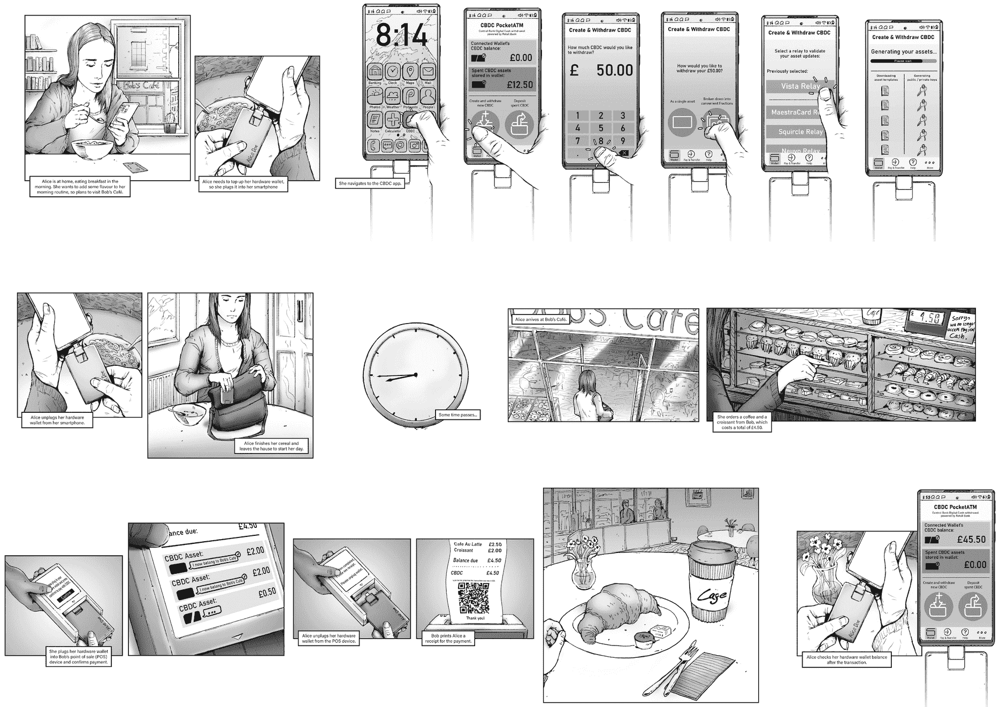

Fig. 5.1 An illustrated comic portrayed a fictional use of CBDC, and participants at two workshops were invited to comment on the strengths, weaknesses, opportunities and threats that the technology may have for citizens. Photograph by the authors.

Fig. 5.2 An illustrated comic portrayed a fictional use of CBDC, and participants at two workshops were invited to comment on the strengths, weaknesses, opportunities and threats that the technology may have for citizens. Photograph by the authors.

Fig. 5.3 Participants discussed the implications both during and following the workshops. Photograph by the authors.

Fig. 5.3 Participants discussed the implications both during and following the workshops. Photograph by the authors.


Two participatory workshops were organised in Edinburgh and London involving 10-20 participants at each event, with representation from the Bank of England, The British Standards Institution, NatWest Banking Group, Everis (a financial consulting firm), TODAQ (a micro-payment service provider), and the UK tax service HMRC. In both workshops, the comic strip was attached to the wall. Following an introduction to the aims of the project and a verbal overview to Alice’s experience using CBDC, participants were invited to post strengths, weaknesses, opportunities and threats (SWOT analysis) using post-it notes on top of the comic strip (Figure 5.3).


Fig. 5.3 Participants discussed the implications both during and following the workshops. Photograph by the authors.

During a ‘playback’ and discussion session, participants were invited to expand upon particular post-it notes to enable colleagues to further explore the implications of an idea. Following both workshops, participants were invited to take part in semi-structured interviews so that we would understand more about the pros and cons of CBDC and its implications upon citizens and established members of the finance sector. Four participants from the original fifteen accepted the opportunity.

The semi-structured interviews were conducted remotely and captured data via audio recording and transcription. The data was then anonymised, collated, and uploaded into Nvivo 14 for qualitative thematic analysis using a constructivist grounded theory approach (Charmaz, 2006). According to Charmaz (2014, p. 131), this approach can reveal “the connections between micro and macro levels of analysis” and link “the subjective and the social.” This makes it an appropriate method for extracting how an individual’s micro subjective insights reflect upon macro social knowledge, values, and global considerations with the emergence of CBDC. The data analysis process involved conducting a line-by-line assessment of each transcript to formulate initial codes. We then refined these codes through an axial coding process and cross-referenced their relationships with codes from other participant transcripts. Finally, we used selective coding to identify core categories and present emergent theories in our findings section. We have identified themes that can aid interaction designers in understanding CBDC from various angles, including its potential for value creation and inclusivity as well as its cautionary tales. The following section reports on these findings.

## 4. Reforming Values through the Design of Central Bank Digital Currency

Our research suggests that CBDC presents a unique opportunity to reform values through its design. As one participant stated, “We’re not going to get better money with CBDC unless we design it to be a better one” (Participant 3). This is not solely due to CBDC’s technical abilities, but rather the chance it provides society to have money represent more of its values and desirable practices than it currently does.

One participant referred to current monetary infrastructures as “haphazard and a bit disorganised,” leading to issues like “oppression and exclusion” (Participant 1). CBDC was seen as an opportune moment to reinvent the values of money. As one participant put it, “Let’s think about the role that digital currency can play in creating the sort of society that we actually want” (Participant 1). Yet, time to add such values might be limited, as the introduction of CBDC into society is just a matter of time. As one participant stated, “The stone will be thrown. We don’t know where it’s gonna land and we don’t know how deep it’s gonna go. But we do know there’ll be ripples from it” (Participant 4).

The unknown ripples of CBDC imply its trajectory and values will only become clearer as it comes into being. Yet, some predictions might be afforded to its positive value impact. For instance, through its grounding in DLT and blockchain technology, CBDCs could redefine trust in the economic realm and track commercial practices from production to consumption using smart technologies and influence behaviour for the better (Powell et al., 2023). As one participant explained, “Digitalisation of trade [. . .] to increase the right sort of growth and enable greater demonstration by companies and traders of their ESG compliance and good ethical and carbon neutral behaviour” (Participant 1). This was seen as an opportunity to offer companies VAT relief for services that are not carbon heavy. Essentially, “You could affect people’s behaviour for the better” (Participant 1).

The potential for CBDC to influence behaviour, while potentially positive, also presents challenging futures. As one participant stated, “Some of the folks feel that we have already given away so much of our privacy that it wouldn’t be a problem to have a central entity like the Central Bank, [. . .] you know, take a peek on, you know how many pints I bought tonight. [. . .] Do we want to have that at the core of our financial system?” (Participant 3). CBDC can do wonderful things for concepts like sustainability, but it can also penalise people if their practices do not align with the governed values present in the CBDC design, potentially leading to harmful practices. As one participant expressed concern, “I’m concerned about privacy and protections [. . .] we need to prevent abuses from happening” (Participant 2).

- 对参与者而言，CBDC 不仅仅是将钱以数字形式呈现的美学变化，更是一个重塑其社会表征的机会，有望推动包容性、伦理和全球性道德观念的新形成。然而，显而易见 CBDC 需要在重新想象哪些价值以及哪些价值不应被重新想象之间取得精细的平衡。如果历史能够提供对未来风险和挑战的洞察，那么经济领域的利益相关者必然会利用其声望和游说努力，确保 CBDC 的推出符合其商业利益，而非公共利益的愿景（Hosseini and Gills, 2024；Hakken et al., 2015；Diesendorf and Taylor, 2023）。

## 5. CBDC 设计与部署中时间因素的考量

CBDC 的部署、讨论和监管速度会影响其设计所反映的价值。正如 Participant 4 所说：“我觉得我们已经以非常快的速度加速到现在，整个过程都高度集中在阅读[英国央行的咨询文件]。” 另一位参与者也反思道：“在我看来，CBDC 的辩论已经在[太]具体[太]地、迅速地转向了，目前它停留在监管空间中，这完全不应该发生。这本应是民间社会的讨论”（Participant 1）。加速过程可能会限制社会在对话中的参与。

追求第一或跟随他人进展也可能导致 CBDC 未能充分代表其用户的价值：“因为你没有足够思考它”（Participant 3）。如果有充足时间思考以价值为导向的方案（Nathan et al., 2008；Carter, 2022），并确保 CBDC 体现伦理、可持续和面向未来的价值，则有望提升数字货币的使用率，使其“人们想要使用它来展示自己的伦理、可持续性和未来性”（Participant 1）。速度成为 CBDC 设计的重要考量因素。花时间确保价值和需求融入设计之中是必要的，因为如果这些价值和需求未被纳入，系统的采用率可能会受到威胁。

当前金钱的一个价值是，移动它的速度可能会受到“受限于实物纸币的流动”这一限制（Participant 2 所说）。这一方面是积极的，例如可以抑制对其他央行货币的挤兑。Participant 2 解释说，央行通常持有彼此的货币。但如果这种做法变得更像 CBDC 而非实物资产，那么资金的流动将变得瞬时，这带来问题。Participant 2 表示：“于是出现了这样一种情况：央行不再能够阻止其货币被挤兑，因为其他央行可以随意将其转移给合作伙伴，而没有其他央行能够阻止”（Participant 2）。

CBDC 的快速性也被视为一种正面因素。Participant 1 说：“对于希望跨境交易的人来说，尤其是中小企业，这种无摩擦的体验尤为重要，因为它们目前几乎没有兴趣去进行此类交易。” 虽然将 CBDC 的交易速度及其摩擦（或缺乏摩擦）视为情境所致，但此前的研究表明，显式使用摩擦来鼓励深思熟虑的互动是有价值的（Cox et al., 2016）。

## 6. 在中央银行数字货币设计中回响当代价值

与金钱相关的当代价值极为丰富且多元，除了机构和企业合作伙伴所代表的商业价值外，还蕴含特定的个人或社会价值。这表明 Participant 4 所提出的问题在 CBDC 话语和设计考量中变得尤为重要：“我们如何在不失去现金所带来的社区感的前提下，获取数字货币的自动化价值？” 现金作为回响当代价值的标志。Participant 1 表示：“我可以立即且匿名地从银行[...]取出现金，然后把一张 10 英镑的纸币给某人，我的债务立刻以匿名且无摩擦的方式结清”（Participant 1）。现金提供隐私、即时性等价值。然而，CBDC 不必完全取代现金。“我认为虽然现金的需求会减少，但仍然会有现金的需求”（Participant 2）。

现金还具备其他“质量差异”（Participant 2 所说），这些在 CBDC 设计时应予考虑。“例如，现金在预算时更高效。因此，在财务危机时期，拥有现金尤为重要。我希望[...]数字英镑能够提供这种预算能力，并帮助人们更好地控制金钱”（Participant 4）。现金拥有许多值得重视且对 CBDC 有益的价值，这些价值应在设计中得到体现。

不同世代的人对金钱形成了不同的观念。“你知道，纸币因为仍有几代人习惯使用它。文化和社会层面对它的认同也很明显，这对我来看是一大惊喜——当我来到英国时，看到有些地方只接受接触式支付。在巴西，如果你是商家且不接受现金或银行钞票，那就是违法的”（Participant 3）。人们对现金的当代价值可能依赖于政策和法律的明确保护，如新西兰储备银行（2021 年）所暗示。

当前现金的社会价值可能会减缓其在社会中的退出：“如果 CBDC 的唯一结果是批发层面的实施，使[商业银行]的利润提升 1%，那将是一大遗憾”（Participant 1）。当代提供了 CBDC 设计可以实施的方向，同时也指示了需要避免或改进的方面。

## 7. 在中央银行数字货币部署中促进包容性

新兴的 CBDC 类型对包容性属性的影响至关重要。一些参与者将需要考虑的社区划分为两类：首先是“批发”社区，指向大型机构或金融机构的服务；其次是“零售”社区，代表广大普通民众。Participant 3 解释道：“如果是批发[CBDC]，我们是在谈论资本主义顶层 0.1% 的人群。[...]我认为不需要邀请像 John Smith 这样的街角居民来讨论批发 CBDC。” 批发与零售 CBDC 需要不同的用户输入。此外，包容性的程度还取决于其部署方式，是通过商业银行实现还是中央分发。


# CBDC 包容性、价值与设计讨论

想象你是一家商业银行，对吧？你有你的客群，你知道[. . . ] 你的客群比整个央行拥有的总人口要小[. . . ] 你知道你的客群，你可以在你的规模上加以触达，并且为他们设计一个代币化存款体验，这对那些客户来说是合理的（参与者 3）。在商业银行的方面，以用户为中心的关注被认为是共识。“我认为以客户为中心至关重要。你知道尽早知道”（参与者 4）。然而，参与者 4 表示“我认为用户关注是：‘不，我们不[关注用户]’”（参与者 4）。这是因为“我们还处于早期阶段，对 CBDC 的作用了解有限”（参与者 4）。了解 CBDC 的作用以及政府、市场和经济对 CBDC 的决定性影响，直接决定了哪些用户将成为其包容性潜力的核心。同等重要的是要考虑哪些用户会因 CBDC 的部署和更新方式而被落下。由于 CBDC 是数字化的，它需要更新、安全补丁等。正如参与者 2 指出的，用户关注在这里变得重要：“我们如何更新 CBDC[. . . ] 你是让人们从一个版本转换到另一个版本吗？你是否将其分叉成使用新算法的版本？那么对于那些被落下或不了解它的用户会发生什么？”很明显，所使用的 CBDC 类型、其版本集以及部署机制都成为质疑其设计是否真正以用户为中心的途径，以及需要哪种用户关注以及在更广泛的 CBDC 话语中用户关注在哪里的议题。

关于 CBDC 的讨论语言，参与者 4 指出语言应无专业术语，这与包容性考量相一致：“我认为真正重要的是语言定义的包容性，我认为这至关重要、至关重要。你需要让大家同意我们使用相同的语言，并且具有包容性。它不应充满专业术语。”

确保讨论、教育和易用性的包容性访问需要在所有方面下功夫，从 CBDC 用户界面的设计，到语言，再到 CBDC 话语中使用的教育方法。

本章旨在从多个角度开始关于 CBDC 的包容性、价值和潜力的讨论。然而，本研究有一些局限性。其一是仅有四位参与者的小样本。进一步研究时，可以使用更大且更多样化的参与者群体，包括有和没有 CBDC prior knowledge 的参与者，以提供更多洞见。另一个局限是所有参与者对 CBDC 都有一定程度的熟悉。在未来的研究中，加入对 CBDC 缺乏 prior knowledge 的个体，可以更广泛地了解其感知方式，并揭示新的价值概念和金钱的物质性。

本章也旨在启动设计师之间关于他们在影响或保持金钱价值（无论是传统形式还是作为央行数字货币的新兴形式）的作用的讨论。我们的发现，虽然范围有限，但揭示了 CBDC 对设计带来的挑战和机遇。它们强调了设计在塑造这一不断演变的景观中的潜力。我们指出了设计师可以开展的特定未来工作领域。但在下面，我们更精确地拆解这些内容，在过程中直接面向设计师。

CBDC 提供了塑造价值的机会。然而，这必须谨慎处理。我们的发现表明，人们对“价值”的定义可能存在分歧。如果某一群体掌握了创造或维护价值的控制权，其他群体可能会面临压迫性的体验。参与式设计和协同设计等方法应被利用，将金融生态系统内的合作伙伴聚集在一起，促进 CBDC 开发者与尚未接触该概念的多元群体之间的讨论。

我们的研究发现，聚集多元群体讨论 CBDC 可能会因话题的复杂性而面临挑战。正如参与者 4 所指出的，建立 CBDC 的包容性语言至关重要。设计可能在塑造和帮助构建 CBDC 相关词汇方面发挥作用。这可能包括设计材料、工具包或原型，使人们能够构建讨论 CBDC 的语言，或创建一个被许多人理解的 CBDC 语言。

CBDC 的性质不确定性——是批发型、零售型还是基于存款的——使得对 CBDC 进行设计成为一项挑战。然而，正如前人设计师和研究者所示（Pschetz and Bastian, 2018; Akama et al., 2015; Sousa et al., 2021），不确定性可以是设计过程中的有用现象。设计方法，如 speculative design（speculative design）或 design fiction（设计虚构），可以用于设想不确定的场景和未来，在其中每一种版本得以显现（Murray-Rust et al., 2023; Blythe, 2014; Rüller et al., 2022; Dunne and Raby, 2013; Galloway and Caudwell, 2018）。

维护现有的金钱价值和既定实践在塑造 CBDC 设计中将发挥关键作用。信任、政策、熟悉度和经验等因素将是 CBDC 设计的关键考量。这需要在去除现有价值和保留现有价值之间取得微妙的平衡。去除现有价值可能会损害人们在金钱话语中所赋予的非数值价值，以及他们维持金融常规的意愿（Vines et al., 2012），以及他们获取有形资产的基础设施（Trotter et al., 2020）。

未来的工作可能涉及设计师更好地理解现有的金钱话语中的价值观，并确保 CBDC 通过设计反映这些价值观。

设计师可能希望考虑 Temporal Design（时间设计）Pschetz and Bastian, 2018 来探索 CBDC 相关的各种时间属性。例如，参与者 1 提到 CBDC 在某些空间中迅速成为现实。CBDC 拥有不同的运行速度和研究能力。由于 CBDC 不是实物，其时间属性与现金截然不同。它有潜力以前所未有的速度转移主权货币，这使得摩擦成为 CBDC 的重要设计考量因素。

目前，CBDC 讨论的语境往往缺乏对包容性的关注。虽然已经做出了大量努力来理解包容与排斥，但这些努力主要是理论性的，缺乏用户驱动的视角（Barzyk et al., 2022）。我们的发现显示，价值与包容之间存在关联，需要更具用户导向的 CBDC 设计。在克服这些挑战的过程中，包括话题发展速度快于研究进展（Auer et al., 2021）、金钱价值的多元化、专业术语使用、教育以及文献中识别出的数字排斥等问题（Lloyds Banking Group, 2022; Dai et al., 2023; Gopane, 2019），这些都与金融包容的概念相关。CBDC 不只是一种新形式的货币——正如参与者 1 所报告的，它的潜力可能是显著正面的。但如果没有用户驱动的设计，它同样具有显著负面的潜力。

Money has taken many forms throughout history, including non-tangible representations. The rise of Central Bank Digital Currency (CBDC) will transform our understanding of digital currency. Money is connected to many values, numeric, social, cultural, religious, moral and more. However, new forms of money can lead to the demise of other notions and their associated values. This is an unprecedented moment to re-envision the meaning of money. We may need time to consider how money came to be and begin “reverse engineering” (Participant 3) before we can understand what values CBDC does and does not represent and more importantly, whose values are represented by CBDC. Design has an opportune moment right now to shape the ripples made by early CBDC developments and pilots and help establish a more equitable and inclusive social, political and global foundation associated with money. It is important to consider who has a stake in this most common design material, money, in its newly emerging form, digital sovereign currency.

## Acknowledgements

The authors acknowledge funding from the UKRI / EPSRC research councils and the PETRAS Research Centre EP/S035362/1 for the FIRE Project. The authors would also like to thank all the participants for their engagement with the research.

## References

*   Akama, Y., Pink, S. and Fergusson, A. (2015). Design + Ethnography + Futures: Surrendering in Uncertainty. Proceedings of the 33rd Annual ACM Conference Extended Abstracts on Human Factors in Computing Systems (CHI EA ‘15) Association for Computing Machinery, New York, NY, USA, 531-542. [`doi.org/10.1145/2702613.2732499`](https://doi.org/10.1145/2702613.2732499).

*   Arvidsson, N. (2018). The future of cash. In The Rise and Development of FinTech (pp. 85-98). Routledge. [`doi.org/10.4324/9781351183628`](https://doi.org/10.4324/9781351183628).

*   Arvidsson, N. (2019). Building a Cashless Society: The Swedish Route to the Future of Cash Payments. Springer Briefs in Economics. Springer International Publishing. [`doi.org/10.1007/978-3-030-10689-8`](https://doi.org/10.1007/978-3-030-10689-8).

*   Auer, R., Frost, J., Gambacorta, L., Monnet, C., Rice, T. and Shin, H. S. (2021). Central bank digital currencies: motives, economic implications and the research frontier (Technical Report 976). Bank for International Settlements. [`doi.org/10.1146/annurev-economics-051420-020324`](https://doi.org/10.1146/annurev-economics-051420-020324).

*   Barzyk, K.M., Macek, V. and Giraldo Mora, J.C. (2022) Inclusive and exclusive affordances of central bank digital currencies: A multiple-case study of Sweden and Bahamas. [`research.cbs.dk/files/76450614/1397869_Master_Thesis_Karol_Viktor_Main_Doc.pdf`](https://research.cbs.dk/files/76450614/1397869_Master_Thesis_Karol_Viktor_Main_Doc.pdf).

*   Baumer, E.P.S., Ames, M.G., Brubaker, J.R., Burrell, J. and Dourish, P. (2014). Refusing, limiting, departing: why we should study technology non-use. CHI ’14 Extended Abstracts on Human Factors in Computing Systems, *65*\-68. [`doi.org/10.1145/2559206.2559224`](https://doi.org/10.1145/2559206.2559224).

*   Blythe, M. (2014). Research through design fiction: narrative in real and imaginary abstracts. Proceedings of the SIGCHI Conference on Human Factors in Computing Systems, *703*\-712. [`doi.org/10.1145/2556288.2557098`](https://doi.org/10.1145/2556288.2557098).

*   Ceeney, N. (2019). Access to cash review. Final Report, March 2019. [`www.accesstocash.org.uk/media/1087/final-report-final-web.pdf`](https://www.accesstocash.org.uk/media/1087/final-report-final-web.pdf).

*   Centellegher, S., Miritello, G., Villatoro, D., Parameshwar, D., Lepri, B. and Oliver, N. (2018). Mobile Money: Understanding and Predicting its Adoption and Use in a Developing Economy. Proc. ACM Interact. Mob. Wearable Ubiquitous Technol. 2, 4, Article 157 (December 2018), 18 pages. [`doi.org/10.1145/3287035`](https://doi.org/10.1145/3287035).

*   Charmaz, K. (2006). Constructing Grounded Theory: A Practical Guide through Qualitative Analysis. Sage.

*   Dai, J., Miedema, J., Hernandez, S., Sutton-Lalani, A. and Moffatt, K. (2023). Cognitive Accessibility of Digital Payments: A Literature Review. Proceedings of the 20th International Web for All Conference (W4A ‘23), New York, NY, USA, 116-121. Association for Computing Machinery. [`doi.org/10.1145/3587281.3587294`](https://doi.org/10.1145/3587281.3587294).

*   Desan, C. (2021). Money’s Design Elements: Debt, Liquidity, and the Pledge of Value from Medieval Coin to Modern “Repo” (August 1, 2021). Banking and Finance Law Review, v. 38 (2022 Forthcoming), Harvard Public Law Working Paper No. 21-31, Available at SSRN: [`ssrn.com/abstract=3897399`](https://ssrn.com/abstract=3897399).

*   Dunne, A. and Raby, F. (2013). Speculative Everything: Design, Fiction, and Social Dreaming. MIT Press.

*   Galloway, A. and Caudwell, C. (2018). Speculative design as research method. In G. Coombs, A. McNamara, & G. Sade (Eds.), Undesign: Critical Practice at the Intersection of Art and Design (1st ed., pp. 85-96). Routledge. [`doi.org/10.4324/9781315526379-8`](https://doi.org/10.4324/9781315526379-8).


*   Gopane, T.J. (2019). An Enquiry into Digital Inequality Implications for Central Bank Digital Currency. Proceedings of 2019 IST-Africa Week Conference (IST-Africa), Nairobi, Kenya, 2019, `1`-9. [`dx.doi.org/10.24193/subbnegotia.2024.1.01`](http://dx.doi.org/10.24193/subbnegotia.2024.1.01).

*   Halloluwa, T., Bandara, P., Usoof, H. and Vyas, D. (2018). Value for money: co-designing with underbanked women from rural Sri Lanka. Proceedings of the 30th Australian Conference on Computer-Human Interaction (OzCHI ‘18), New York, NY, USA, 63-73, 63-73. Association for Computing Machinery. [`doi.org/10.1145/3292147.3292157`](https://doi.org/10.1145/3292147.3292157).

*   HM Treasury and Bank of England. (2023). The digital pound: A new form of money for households and businesses? [`www.gov.uk/government/consultations/the-digital-pound-a-new-form-of-money-for-households-and-businesses`](https://www.gov.uk/government/consultations/the-digital-pound-a-new-form-of-money-for-households-and-businesses).

*   Ingham, G. (1996). Money is a social relation. Review of Social Economy, `54`(4), 507-529.

*   Ingham, G. (2013). The Nature of Money. John Wiley & Sons.

*   Iqbal, M.Z. and Campbell, A. (2020). The emerging need for touchless interaction technologies. Interactions, `27`(4), 51-52. [`doi.org/10.1145/3406100`](https://doi.org/10.1145/3406100).

*   Lloyds Banking Group. (2022). 2022 consumer digital index. [`www.lloydsbank.com/assets/media/pdfs/bankingwithus/whats-happening/LB-Consumer-Digital-Index-2022.pdf`](https://www.lloydsbank.com).

*   Maurer, B. (2006). The Anthropology of Money. Annual Review of Anthropology, `35`, 15-36. [`doi.org/10.1146/annurev.anthro.35.081705.123127`](https://doi.org/10.1146/annurev.anthro.35.081705.123127).

*   Murray-Rust, D., Elsden, C., Nissen, B., Tallyn, E., Pschetz, L. and Speed, C. (2023) Blockchain and Beyond: Understanding Blockchains Through Prototypes and Public Engagement. ACM Trans. Comput.-Hum. Interact. 29, 5, Article 41 (October 2022), 73 pages. [`doi.org/10.1145/3503462`](https://doi.org/10.1145/3503462).

-   Pesendorfer, M. (2022) Digitization and the evolution of money as a social technology of account. J Evol Econ 32, 175-203 (2022). [`doi.org/10.1007/s00191-021-00729-4`](https://doi.org/10.1007/s00191-021-00729-4).

-   Powell, W., Cao, S., Foth, M., He, S., Turner-Morris, C. and Li, M. (2023). Revisiting trust in supply chains: How does blockchain redefine trust? In B. Abdelaziz, I. Khalil, &amp; B. Aouni (Eds.), Blockchain Driven Supply Chains and Enterprise Information Systems (pp. 21-42). Springer Nature. [`10.1007/978-3-030-96154-1\_2`](http://doi.org/10.1007/978-3-030-96154-1_2).

-   Pschetz, L. and Bastian, M. (2018) Temporal design: Rethinking time in design. Design Studies, `56`, 169-184. [`doi.org/10.1016/j.destud.2017.10.007`](https://doi.org/10.1016/j.destud.2017.10.007).

-   Reserve Bank of New Zealand (2021). The Future of Money - Stewardship. Public consultation paper, September 2021. [`web.archive.org/web/20221106083942/https://www.rbnz.govt.nz/-/media/project/sites/rbnz/files/consultations/banks/future-of-money/stewardship-issues-paper.pdf`](https://web.archive.org/web/20221106083942/https://www.rbnz.govt.nz/-/media/project/sites/rbnz/files/consultations/banks/future-of-money/stewardship-issues-paper.pdf).

-   Roitman, J. (2023). Platform economies: Beyond the North-South divide. Finance and Society, `9`(1), 1-13. [`10.2218/finsoc.8089`](http://doi.org/10.2218/finsoc.8089).

-   Rüller, S., Giménez Ciciolli, B., Weibert, A., Aal, K., Blythe, M., Muller, M. and Kafai, Y.B. (2022). Creative Entrances to Co-Design: Exploring Collaboration through Fiction, Fairy tales, and Games. Proceedings of the Participatory Design Conference 2022 - Volume 2, `247`-250. [`doi.org/10.1145/3537797.3537877`](https://doi.org/10.1145/3537797.3537877).

-   Satchell, C. and Dourish, P. (2009). Beyond the user: use and non-use in HCI. In Proceedings of the 21st Annual Conference of the Australian Computer-Human Interaction Special Interest Group: Design: Open 24/7 (OZCHI ‘09) New York, NY, USA, `9`-16. Association for Computing Machinery. [`doi.org/10.1145/1738826.1738829`](https://doi.org/10.1145/1738826.1738829).

-   Schindler, J. (2017) Fintech and financial innovation: Drivers and depth (Technical report). Board of Governors of the Federal Reserve System (US). [`doi.org/10.17016/FEDS.2017.081`](https://doi.org/10.17016/FEDS.2017.081).

-   Selwyn, N. (2003). Apart from technology: understanding people’s non-use of information and communication technologies in everyday life. Technology in Society, `25`(1), 99-116. [`doi.org/10.1016/S0160-791X(02)00062-3`](https://doi.org/10.1016/S0160-791X(02)00062-3).

-   Sousa, S.P.B., Baptista, A.J. and Marques, A.T. (2021). Material Design-for-Excellence Framework - Application to Composites. [`10.1016/B978-0-12-819724-0.00105-1`](http://doi.org/10.1016/B978-0-12-819724-0.00105-1).

-   Speed, C., Rankin, J., Elsden, C. and Vines, J. (2022). The future of money as a design material. In Lockton, D., Lenzi, S., Hekkert, P., Oak, A., Sádaba, J., Lloyd, P. (eds.), DRS2022: Bilbao, 25 June - 3 July, Bilbao, Spain. [`doi.org/10.21606/drs.2022.785`](https://doi.org/10.21606/drs.2022.785).

-   Swierstra, T. (2013). Nanotechnology and technomoral change. Etica & Politica/Ethics & Politics, XV(1), 200-219.

-   Wiberg, M. (2020). On physical and social distancing: reflections on moving just about everything online amid Covid-19. Interactions, `27`(4), 38-41. [`doi.org/10.1145/3404213`](https://doi.org/10.1145/3404213).

## 6 Blockchain and Tokenisation for Local Communities

Guido Boella^(¹³)

## 1\. Introduction

The main innovation introduced by blockchain is the possibility of creating cryptographic tokens (digital representations of a value or property right over an asset) and its ability to enable safe and transparent transactions of these tokens without relying on third parties as intermediaries. Moreover, smart contracts (software that operate over a blockchain, automatically executing the terms of an agreement when certain conditions are met) allow for programming the way in which tokens are transferred, thus automatising transactions. Hence, the potential of blockchains to disintermediate governance and business models. Recent years have seen the rise of experimentation with `blockchains for social impact` or `blockchains for social good`, i.e. blockchain-enabled activities that tackle urgent societal and environmental needs (Galen et al., 2018, 2019; Polvora et al., 2020; Voshmgir et al., 2019). The report “Blockchain and Sustainable Development” (Fines Schlumberger, 2022) mentions 14 categories of blockchain applications¹⁴

While there are various blockchains to support decentralised management of physical and digital infrastructures in (smart) cities (Bagloee et al., 2021; Shen & Pena-Mora, 2018; Xie et al., 2019), tokenisation is less significantly exploited to facilitate civic participation and social economies. However, researchers in the HCI and design fields are considering blockchains in civic contexts, and they are getting insights on how citizens perceive their potentialities and risks (Nissen et al., 2018; Tallyn et al., 2020; Cila et al., 2020; Murray-Rust et al., 2022). Moreover, recent projects experiment with blockchain for local communities, mainly in the form of systems for rewarding civic participation and fostering local economic activities, or of community currencies and tools for financial inclusions: for instance the projects Cambiatus, Colu, UrbanChange, Circles, Sarafu Network, ImpactMarket, GoodDollar (see Domenicale et al., 2024 for a review on their purposes and tokenized economy models). These projects differ from applications for decentralised finance¹⁵


大多数以数字化方式进行公民参与和社会经济活动的本地语境主要是城市。事实上，由于其社会经济关系的密集性，城市是数字社会创新的优先领域（Rodrigo et al., 2019），因此我们的关注点是 `urban` 本地社区，即区块链可以有效支持和促进参与性和包容性过程的地方社区。许多地方政府不仅在电子政府方面（即数字化服务和优化工作流程），而且在数字化共同生产公共服务方面也在努力（Lember, 2018; Yuan, 2019）。协同设计与协同生产重新想象公民在公共服务创建、生产和管理中的角色，并与公职人员合作，预计这将使政策和服务更能响应个人和社会的实际需求（Estrada-Grajales et al., 2018; Lewis et al., 2020）。与此同时，民间社会组织、社区成员和数字活动家正在尝试各种草根城市项目，利用数字技术进行团结实践、社会与协作经济以及城市共同化，并受到挑战传统智慧城市路线的愿景驱动（Vadiati, 2022）。正如 Olivier and Wright (2015, p. 62) 所言：“在这些紧缩时期，数字公民可能被一方面视为让公民自行完成任务，另一方面被视为拆解公共服务提供。”我们的数字化路径超越了政府节约成本和提高效率的目标，而是旨在促进政府与公民之间的关系性互动，而非仅仅是交易性互动（Boyte, 2004; Olivier & Wright, 2015; Vlachokyriakos, 2017）。

本章基于一项研究项目，该项目探讨区块链及其他“颠覆性”技术在城市社区中促进公共服务协同生产和公民参与的新方式。该项目“CO3 - Digital Disruptive Technologies to Co-create, Co-produce and Co-manage Open Public Services along with Citizens”（以下简称 CO3）在协同设计、协同生产和协同管理公共服务的不同阶段，分阶段研究了不同数字技术的作用。四种技术（区块链、地理定位社交网络、互动民主¹⁶）在不同阶段被应用。

本章其余部分结构如下：第 2 节介绍 ACA 概念，随后在第 3 节中描述该概念在 CO3 项目试点中的具体情境化。第 4 节和第 5 节讨论 ACA 与代币化共同体的潜力与挑战，并基于 CO3 项目的发现介绍区块链钱包在本地社区中的进一步发展。

## 2 Augmented Urban Commoning

### 2.1 Augmented Commoning Areas

CO3 项目将共同化定义为不同主体合作创建和管理公共服务、社会活动、共享空间和城市共同体的过程。特别是在地方公共行政机构重新发现前现代共同体实践（Ostrom, 1990）的背景下，将其视为一种以团结、包容和公私合作社为关键的协同生产模式。城市共同体提供了一个具体的框架解决方案，使市镇能够通过协同创作和协同管理服务（如文化中心、城市花园、教育服务、自主托管幼儿园以及老年人照护）来实现新型福祉形式（[fn17]）。

CO3 项目的核心概念是“增强共同化”。一个 `augmented commoning area (ACA)` 是一种“phygital”（物理与数字相结合）的公共空间，城市参与者可以通过数字化互动参与协同生产过程（参见 Figure 6.1）。ACA 由物理城市空间的地理边界定义，其技术功能由 CO3 技术平台提供，仅在参与者身处现场时即可使用。不同技术支持通过其数字化表示（加密代币）进行无形资源（创意、信息、知识、需求、意见、反馈）和有形资源（物品、工作、时间、价值）的交换。下面的章节将说明 CO3 通过区块链实现的代币化经济互动如何面向协同生产，如何与增强现实和地理定位相结合，以及如何与互动民主、社交网络和游戏化等社会互动相结合。

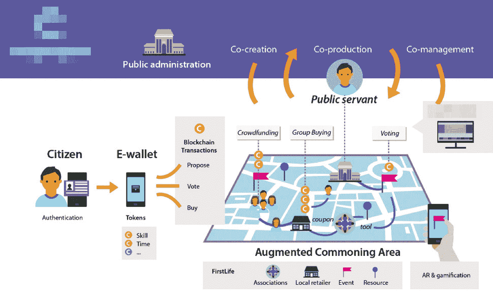

Fig. 6.1 Visual representation of the ACA concept. Image created by authors.

ACA 概念区别于那些提供不够吸引人用户体验的公共服务网络平台。CO3 的增强共同化区域（ACA）更具野心，其目标包括：

* 扩大信息共享和交换的机会，激发共同体成员与公共行政机构之间的合作；

* 通过新型数字经济机制促进新的团结、志愿者和共同化实践；

* 通过动员现有的有形资源（如新鲜食品）和无形资源（时间、技能）提升人们的福祉；

* 建立系统化的协作决策机制，针对城市共同体。

下文列出的五项颠覆性技术已整合至 CO3 平台，以支持在三个试点场景中特定情境下的参与者互动。由于这五项 CO3 应用采用不同的概念模型和词汇格式来表示其管理的数据，必须进行统一以支持跨应用的数据共享。CO3 平台的核心互操作性由 `FirstLife` 提供，作为共享的交换通信层，允许跨应用记录用户操作并追踪用户与各项服务的互动。此外，FirstLife 本体论作为通用语言，定义了地理和非地理数据的统一信息表示格式。通过 FirstLife，无需为每对应用开发不同的 API，也能避免概念在不同应用中被不同表征。CO3 平台的主要实现形式是一款兼容 Android 和 iOS 的移动应用，同时配备一个作为渐进式 Web 应用实现的区块链钱包。

一个由区块链在 CO3 项目中集成所提供的机会之一是将其用作公证工具。由于其时间顺序结构、对篡改攻击的强抵抗性以及透明度，区块链是一种理想的公证工具，用于以安全且可验证的方式记录信息。此外，利用智能合约（自动执行的代码编写的协议）来创建和分发代币，这些代币实现高度定制化和自动化的价值交换，是一个吸引人的机制，能够在用户之间建立信任，并鼓励他们开展新形式的协作工作。关于更具体的共创和创新过程，一个有趣的应用是通过代币化无形资产（如想法和知识产权）进行交换，从而使它们变得流动且可转让。

在 CO3 项目中，参与者通过个人钱包访问和使用区块链。CO3 中的交易由可互换代币（作为硬币）和不可互换代币（作为优惠券）实现，两者均以符合 ERC20 标准的合约形式呈现。`硬币` 模拟互补货币的行为。`优惠券` 用作单个实体（如商品、折扣券或活动入口）的数字孪生。代币和优惠券的创建者决定其价值，对于优惠券，他们决定其代表、提供或赋予访问权限。用户要么用法币购买代币，要么作为礼物或奖励获得代币。`众筹（crowdsale）` 功能允许本地行动者创建筹款或团体购买活动，创作者提供代表对商品、服务或活动访问权的优惠券。参与者提前用硬币购买优惠券，因此参与者必须拥有一定数量的本地硬币。当收集到的硬币数量达到最低阈值时，众筹成功，底层智能合约会自动将优惠券从参与者的钱包中转移。`优惠券箱（coupon box）` 功能让用户创建包含优惠券的虚拟箱，无需用代币购买即可向其他用户提供。创建者决定可用的优惠券数量，既不设定价格，也不设定目标（与众筹不同）。创建新硬币、优惠券、众筹和优惠券箱的权限仅限于拥有特定协调或其他特定角色的社区或城市公共领域用户。所有用户均可转移代币、参与众筹并使用优惠券箱。代币可以通过现场交换二维码（`QR 码`）或通过共享二维码深链或用户个人资料远程转移。用户随时可在钱包中查看交易历史。用户可通过点击其在 `FirstLife` 地图（地理定位社交网络）中的视觉呈现（`AR 对象` 或 `地图实体`）来访问众筹和优惠券箱（第 2.3 节），该地图集成在 `ACA` 内部。

基于加密代币和智能合约的这些工具和功能组合，使不同种类的代币化社会经济和代币化共同治理过程得以实现，如图 6.2 所示，展示了图尔和雅典试点项目中的不同情景（第 3 节）。

### 2.3 增强公民互动

区块链上的价值交易由促进共生和共享过程的其他社会互动所补充：信息共享、协作计划、审议过程、公民参与以及促进公民参与。这些互动由 CO3 平台的特定组件实现。

`FirstLife` 是一个基于地理位置的公民社交网络（Boella 等，2019），提供基于地理位置的交互地图，具备信息和协调功能。它允许用户与本地动态互动，使公民能够通过近距离连接和互动，并将内容定位到特定的城市地点（街道、建筑、公园）。`FirstLife` 的主要界面由一张地图组成，参与 `ACA` 的用户可以在其中发布“实体”，以及一侧墙显示不同实体的摘要卡片。单个实体可通过点击地图标记或在墙上的摘要卡片来打开，从而显示其所有属性（如分类、描述、关联 URL 等）。实体是用户分享提案、活动、新闻、添加二层资源（如评论、附件、照片等）以及对其他用户发布内容进行反应的虚拟空间。`FirstLife` 设计用于作为不同利益相关者（如公共管理部门、协会管理者和公民）的协调工具，用于共享信息并协作开展具有本地和城市层面公共意义的活动。在 `CO3` 中，例如，普通公民可以创建一个“任务”实体来宣布待完成的活动；其他社区成员可通过在数字实体上进行签到（以及签出）来承担任务。本地零售商可以在特定位置创建一个“优惠券箱”实体，其他用户可通过与区块链钱包组件的集成来兑换其中的优惠券。用户还可以创建图片、新闻和众筹等其他实体。`FirstLife` 是一款可通过浏览器在台式或移动设备上访问的 Web 应用，并作为原生移动应用内置的 Web 视图实现。

液态反馈（`LiquidFeedback`）提供互动民主功能（Behrens 等，2014），这是一款成熟的开源软件，自 2009 年起持续活跃开发。`LiquidFeedback` 使新的民主参与形式覆盖整个审议过程，从提案草案的最初提出到最终决定。具体而言，平台支持液态民主，使用户可以直接参与决策过程或选择代表。在审议期间，可能会出现多个替代或竞争的提案，这些提案通过偏好投票机制进行表决。`LiquidFeedback` 旨在让每位参与者在决策过程中拥有平等的权利和机会，不允许任何参与者因 `moderating` 讨论或主导决策过程而拥有特殊特权。因此，`ACA` 参与者可以参与关于将在城市公共领域实施的提案或活动的民主决策，或参与将在城市区域内激活的服务的决策。


Fig. 6.2 Visualization of ACAs and related entities on the FirstLife map – image created by the authors.

`Gamification methods are employed to encourage desired behaviours and positive change with interesting experiences and positive reinforcements (HeLinehanrvas et al., 2015; Rehm et al. 2018).` The basic components of a gamified experience, such as points, badges, rewards and progression levels promote and reinforce different types of actions offered by the CO3 platform – like adding content, proposing or participating in public initiatives and deliberations, and exchanging economic assets through the blockchain wallet – and to increase the frequency and persistence of these interactions over time. Progression levels are based on simple points collection and badges. Points are assigned for participation in relevant events. Specific badges are designed to recognise different skills and types of contribution to life and services in the ACA (e.g. augmented content, participation in events, volunteering, wallet usage). There is a particular emphasis on rewarding and incentivising collaborative rather than competitive interactions, and on increasing the level of participation in commoning processes, as exemplified in the Turin pilot (see Section 3).

### 2.4 Augmented Discovery

The core distinctive feature of the CO3 platform is that it brings together virtual and physical interactions in relation to an urban space. This is made possible by the AR and geolocation functionalities (see Section 2.3), which represent different and complementary access points to the augmented commoning area. `Augmented reality (AR)` is a technology that augments our senses with layers of information by combining the physical world with virtual items such as text, images, audio, videos, or objects (Caudell & Mizell, 1992). Through `AR functionalities` in the CO3 mobile application, participants to an `ACA` can discover `3D augmented reality objects` that are linked to social networking, deliberation and tokenisation activities in the other platform components (`FirstLife`, `LiquidFeedback`, the wallet). `AR markers` (see Figure 6.3) anchor the `AR 3D objects` to physical environments. `AR markers` are created specially for each `ACA` and are positioned in its physical spaces (e.g. hung on a public space or on a table). When people in the `ACA` scan the `AR marker` with their `CO3 AR app`, the CO3 mobile app reveals the `AR objects` present in the environment, allowing the user to interact through them and participate in related activities. Note that we used `AR markers` and not smartphone `GPS` to geolocate the user. This is because `GPS` can be highly inaccurate for urban spaces such as an association’s courtyard. Furthermore, the project must also support the presence of social activities in indoor locations, where `GPS` performance degrades significantly.


Fig. 6.3  Example of AR Marker. Image created by authors.


Since AR technology is not available on all smartphones, `CO3` offers alternatives to 3D view for finding digital objects related to the ACA. Other proximity-related data visualisations are: a 2D view on the `FirstLife` geolocated map, and a 1D view consisting of a list of entities in the `FirstLife` wall sorted by distance or importance. This approach makes it possible to expand the audience of users able to use the `CO3` mobile application. In accordance with the concept of ACA, AR contents can be created, discovered and interacted with when the user is physically present (and can be geolocated) in the proximity of the location where the new content is accessible. This way, only people actually living in this urban area are allowed to shape the virtual world connected with it. AR markers are the point of union between the digital and physical reality. Users scan the AR marker through the “augment my city” button in the app, and add onto the AR space 3D objects representing tasks, activities, deliberations, tokens, coupon boxes, crowdsales; or they can tag objects in the physical world with additional digital information. All objects are thus geolocated in the ACA and visualised accordingly on the `FirstLife` map. Other users will scan the AR markers, discover the objects, and interact with them, for instance by picking up a coupon box and transferring it into their personal wallet, or deciding to join a crowsdale and then sending to it coins held in their wallets. As for the wallet, in-presence interactions are also fostered with QR code mechanisms. Users can send transactions to other users by scanning the QR code associated with their wallet. The original ACA concept, based on in-presence-only interactions was partially relaxed following the constraints imposed by the Covid-19 pandemic and other pilot-specific requirements in order to make it possible, under specific conditions, to add content remotely, provided that the users are subscribed members of the ACA.

## 3. Economic Urban Commoning

The concept of augmented commoning has been contextualised in local service scenarios covering different areas of applications: social care and solidarity, participatory urban planning, and economic commoning. Blockchain-enabled transactions are most relevant to economic commoning as it is the core of augmented socio-economic networking processes. In this section, we present different economic commoning scenarios as implemented in local pilots in the cities of Turin, Italy (augmented neighbourhood houses) and Athens, Greece (Groceries on-Hold). The former is presented in detail, and focuses on socio-cultural and commercial activities at the neighbourhood level. The latter provides further examples focused on solidarity and donation practices.

### 3.1 Methodology

The `CO3` pilots were implemented based on the Urban Living Labs approach. Living Labs are experimental ecosystems for creating and testing new services and technologies based on active user involvement, co-creation approach, and multi-stakeholder participation (Ballon & Schuurman, 2015; Schuurman & Tõnurist, 2017; Hossain et al., 2019). Urban Living Labs pays specific attention to geographical situatedness in local socio-political contexts, intentional ongoing learning, partnership between local authorities and research institutions, and the active role of citizens (Aernouts et al., 2023; Bulkeley et al., 2019).

The definition of high-level requirements for both the collaborative services at stake and their enabling technologies was based on co-design methodologies (Pautasso et al., 2021). The methodologies used were based on service design (Polaine et al., 2013), user centred design (IDEO, 2015), participatory approaches (Sanders et al., 2010; Stepanek, 2015; Teli et al., 2020), and related methods and techniques. The co-design process first focused on possible use cases, which together constitute an overarching scenario defined as economic urban commoning. Then, more specific requirements for the app functionalities have been identified. Based on this, the development of the core technical features of the `CO3` mobile app (see Section 2) was complemented by pilot-specific and scenario-specific customizations. Participants to the pilots took part in iterative testing sessions of the app prototype and of its improved versions. Through focus group techniques, semi-structured interviews and questionnaires, the research team gathered the participants’ feedback on the following topics: overall relevance of the digitally-enabled service for daily practices; usability of the integrated app and of specific functionalities; suggestions for UX and UI improvements; sustainability of the service in the local contexts.

### 3.2 Augmented Neighbourhood Houses in Turin

在`Turin`试点中，研究人员与本地演员共同设计了一个广泛的服务场景，探索了增强邻里住房在经济共享方面的不同方面。邻里住房是社会和文化实验室，能够促进参与、参与和自我组织。得益于 1990 年代末`City of Turin`市政当局推出的创新城市再生政策，已有 9 个此类住房建立。试点方案聚焦于其中的 3 个住房。这 3 个邻里住房在项目中测试了代币化经济，以激励和增强住房内部经济与社会价值的交换。代币既代表货币价值（如本地硬币或折扣券），也代表非货币价值（如志愿者时间，通过代币化使其更具流动性）。硬币、券、其他可互操作的代币、券盒以及众筹活动，使得经济共享的核心机制得以实现：首先，运营邻里住房的协会创建了本地硬币形式的虚拟货币，以在社区内部激励交换。公民购买预付卡形式的硬币，并用它们购买商品或服务。住房生态系统内的其他社会和经济参与者则创建代表不同忠诚工具的优惠券，这些优惠券与本地硬币可相互操作。第二，`CO3 wallet`同时也作为会计系统，记录用户在邻里住房生活中的贡献。对公共空间志愿工作的时间进行记录、代币化并转换为本地硬币和优惠券的信用。

得益于`CO3 app`中集成的增强现实功能，进入本地`ACA`（实体住房及其周边）的公民能够意识到经济共享的机会。例如，扫描住房墙体和其他结构上的 AR 标记后，他们可以可视化并与正在进行或即将举行的邻里住房活动相关的各类内容进行交互，包括提供礼品券的优惠券盒、提供折扣券的协会和商店通知、公开的众筹活动、志愿任务以及文化和社会活动（参见`Figures 6.4`与`6.5`）。相同的信息也可在`FirstLife`的`ACA`地图上查阅。

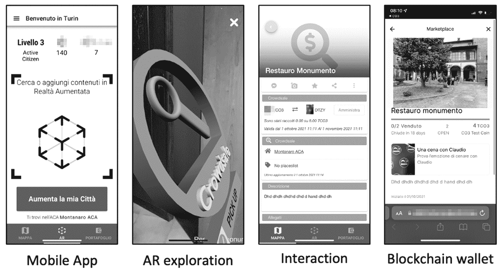

Fig. 6.4 CO3 mobile app: AR, interaction and blockchain wallet functionalities. Image created by authors.

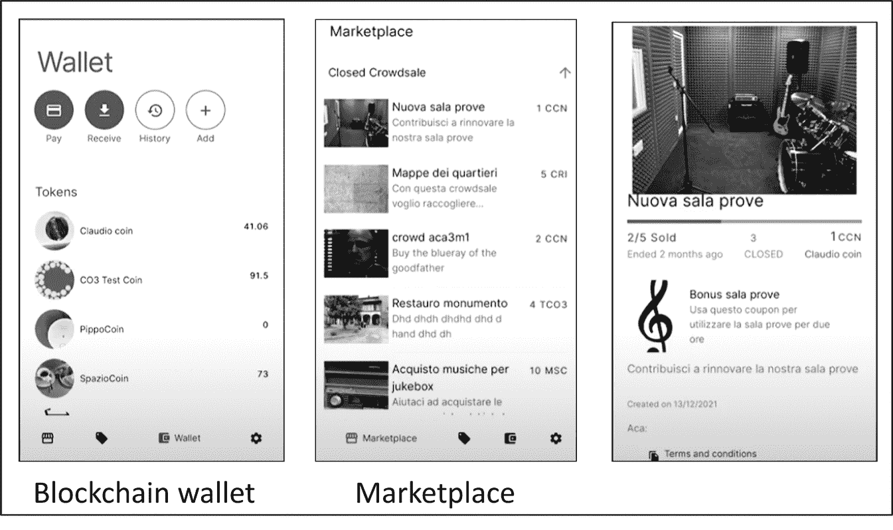

Fig. 6.5 CO3 mobile app: Blockchain wallet functionalities: wallet, marketplace, crowdsale. Image created by authors.

为`Turin`试点方案开发的游戏化模块进一步提供了活跃参与的激励。该模块包括个人徽章（每位用户根据其完成的活动均可获得的勋章）、定期徽章（在特定时间段内达成目标的勋章）以及协作徽章。协作徽章旨在强化共享的集体维度，源自整个社区的活动。无论用户的技能或贡献如何，这些徽章都会分配给每位作为公共领域成员的用户。整体来看，参与程度从公民的`Rookie`级别，到`Fellow`、`Co-creator`和`Commoner`（参见`Figure 6.6`）。


Fig. 6.6 CO3 app: gamification badges and overview of the user's achievements. Image created by authors.

下面的使用案例展示了`ACA`在实际中的运作方式。

**使用案例 1：** *通过区块链和游戏化的参与。* 社区住房创建自己的硬币，旨在让访客更便捷地使用其服务并参与公共领域。戏剧公司准备了一张优惠券，邀请人们订阅其表演课程。访客 Monica 通过 AR 发现该课程优惠券，阅读详情后决定报名。她通过钱包使用住房硬币预订课程。付款后，她在应用中获得奖励（代币、积分或徽章）。受此游戏化激励，Monica 决定购买并“挂起”一项服务（如咖啡、餐点、音乐课等），以便提供给有需求的人。

**使用案例 2：** *通过区块链和游戏化的志愿者管理。* 志愿者被邀请下载`CO3 app`。管理人员准备一份社区住房所需的活动列表。每项活动分配特定的时间长度、可兑换的代币奖励，以及/或唯一代币以认证完成者。可兑换的代币可用于社区住房提供的服务折扣。管理员 Louis 登录应用并在增强现实区域放置代表任务的物体。随后，他检查 AR 区域中已收集的任务，确认其在现实中已完成后，再分配奖励。志愿者投入的时间会转化为不同种类的代币（由特定协会提供的代币，或由社区住房管理机构发行的代币）。志愿者 Sara 可以通过专门的智能合约使用她通过活动获得的代币。

**使用案例 3：** *通过 AR 的志愿者管理。* 园丁 Andrei 在`Turin`的公共公园中工作。他查看学生志愿小组原本应完成的新种花植项目。他通过手机访问`ACA`，扫描视野中的公园区域。该区域中会高亮显示新种植的花坛，并有一个由当地志愿小组放置的 3D 对象象征相关行动。点击该对象后，他可以查看在 LiquidFeedback 中的决策过程。学生和公园使用者讨论并决定种植哪种花以及如何为项目融资。该项目通过志愿小组在区块链应用中发起的代币进行融资，该代币随后被其他用户购买，使用者在回报中获得本地餐馆折扣餐券。

### 3.3 奥林匹克超市在雅典的“即时购买”

试点在雅典实施，提供了更侧重捐赠和团结实践的经济共享示例。`Groceries On-Hold`场景在两个城市农贸市场进行测试，使处于劣势的群体能够用数字代币交换新鲜、优质的食品。该试点方案灵感来源于流行的`Coffee On-Hold`计划（也称为“悬挂的咖啡”¹⁸）。

## 4. ACAs 潜力与代币化共享

从技术角度来看，`CO3`应用成功整合了多项技术，以支持基于地理位置的区块链交易、内容创作、民主反馈以及基于游戏化奖励的激励机制。协同设计的服务场景展示了可扩展公共空间在公民与公共行政之间互动方面的潜力。基于区块链的代币化经济与特定城市空间紧密相连，通过定位功能和增强现实（AR）实现发现。数字化增强的社会经济互动通过三种入口实现：AR、地理定位地图和基于近距离的列表。这扩大了可扩展公共空间的概念，超出了增强现实，包括基于 2D（地图）和 1D（列表）视图。所有这些都让参与者进入可扩展公共空间，在公共城市空间中亲自出席并面对面相遇。这有助于提升在社区或城市中具有社会、文化和经济意义的地点的参与度，并促进个人相遇。


试点项目让我们探索了可扩展公共空间（ACA）的可行性，并识别其优势与不足。一方面，城市公民、基层公职人员和社会工作者对利用创新手段推动共产生过程感兴趣，且我们验证了在城市共生应用中整合互补颠覆性技术在技术上是可行的。另一方面，这些技术在真实场景中的引入面临不少挑战。一些关键问题源于对 AR 与“phygital”（物理+数字）交互缺乏熟悉度，或缺乏具备所需 AR 功能的设备，导致部分用户的入口受限。设计阶段已考虑此点：3D 对象仅在环境的发现与导航阶段使用。一旦选定对象后，用户交互通过标准界面进行。然而，部分用户在使用集成功能时，实际操作更费力且体验不够顺畅。我们认为，将颠覆性技术引入社会动态和协作流程应是循序渐进而非一次性实施，需要具备财政、法律和文化前提条件，以及数字促进者的强力支持，帮助公职人员和公民采纳系统。此外，还有一项意外挑战显著影响了试点方案的推广：新冠疫情。聚集限制迫使部分原本只能面对面实现的功能改为远程提供。疫情同样延长了试点持续时间，并影响了参与者的数字化协助安排，这与许多研究项目（Foth 等，2021）所经历的情形相似。

在区块链钱包及相关代币化经济方面也存在特定挑战。首先，在社会、公民和共生情境中共同设计代币化经济时，需要明确哪些交互可以被代币化并对社区目标产生正面效果，哪些则可能导致过度量化和商品化的风险。必须确保代币化激励不简化社会关系，或挤压内在或利他动机，尤其是在社会价值而非仅物质或金钱价值被代币化时。同样，需判断某些流程是否能通过智能合约提升效率与效果，或是否会导致对可变社会动态的过度自动化。其次，当前缺乏监管区块链代币经济的法律与行政框架（如本地代币的发行）。因此，必须在普通会计系统上进行相应调整，以管理代币交易。再次，终端用户对捐赠系统（雅典）或预付服务（都灵）的不信任，这些系统要求将资金投入实验性系统中，造成了实际障碍。此外，代币及代币化经济本身仍不为人熟知，用户对区块链钱包某些操作的体验也不够直观。与当地相关利益方共同设计的交互模型若要满足特定社区（如都灵的某些社区）的差异化需求，仍需进一步调整。尽管如此，我们仍观察到活跃公民、协会管理者、共生者以及公职人员对区块链如何使共生与社区经济更活力、更具参与感的兴趣。

基于这些经验，我们继续在本地社区尝试区块链解决方案，延续 CO3 试点的经验。新实验的指导准则包括：第一，区块链钱包的界面设计力求尽可能直观，便于终端用户使用。第二，钱包内部的功能采用模块化、灵活的方式构建，便于在不同本地社区的代币化经济模式中轻松适配。第三，继续 CO3 工作，将地理位置与近距离交互功能整合进钱包。上述考量促使我们开发名为 CommonsHood 的钱包应用（Balbo 等，2020），这是一个专注于推动本地社区社会协作经济与金融包容的去中心化应用。CommonsHood 让任何个人或组织都能通过简洁的无代码网页界面，从预定义的智能合约模板中创建用于自身目的的加密代币。代币可代表具有价值的资产，如客户忠诚度工具、预付卡、互补货币、数字收藏品、共享权（如工具或基础设施的使用权）、实体数字化表示（如活动门票），亦或是为达成共同目标而设计的目的性代币。从 Web2.0 的概念出发，我们称其为“公民区块链”（Viano 等，2023）。除了 CO3 钱包外，CommonsHood 还支持用户发起众筹（crowdsales）。此外，还新增了 NFT 创建与管理的市场功能、代币交换，以及更复杂的“事物库”功能，实现本地社区去中心化的共享经济管理（如邻里间的物品借贷）。与可扩展公共空间（ACA）概念相呼应，CommonsHood 通过集成 FirstLife 地图实现地理位置与近距离交互，并允许通过二维码在钱包之间转移代币。概念与功能的定义始于以往欧洲项目的共同设计活动（示例已匿名），以及 CO3 的成果。共同设计方法用于确定协作服务及其 enabling technologies 的高层需求（参见 第 3.1 节）。每个实验都以一阶段的共同设计为起点，使平台随时间不断丰富，成为能够在多种真实场景中使用的宝贵工具。

### 结论与未来工作

这一章描述了在 CO3 项目框架下，区块链等颠覆性技术背景下公共服务协同创新的“增强共同治理”发展历程。该项目涉及公民在地方社区的公民、民主和经济生活中的参与领域，在此领域区块链尚未得到显著研究。CO3 项目及本章旨在探讨在地方社区层面采用区块链所可能带来的社会文化、政治和技术层面的影响。CO3 表明，代币化、智能合约和代币化经济可以为共享和可互操作的工具提供有价值的层次，从而表示社区规则并创造新的跨社区服务。CO3 应用整合了颠覆性技术，以增强同一地点人们之间的联系，并支持基于区块链的近距离交易。事实上，CO3 的 ACA 模式可以被视为迈向有效的共同设计和实施区块链工具的第一步，这些工具在伦理和可取性方面能够支持地方社区公共服务的协同生产。

CO3 展示了“增强城市共同治理”区域的可能性，其中新技术不仅仅是通过互动技术（如社交媒体、在线协作平台）进行中介，而是能够重新评估空间中介的交互方式。它还展示了利用颠覆性技术在公共和公民领域进行协作的可能性。CO3 引入了雄心勃勃、创新性强的社区驱动试点方案，使我们得以了解在实施 ACA（增强共同治理）时可能出现的技术、行政和社会挑战。此外，它也凸显了技术本身并不能保证产生转变性变革，除非它们被视为更广泛创新过程的一部分，而该过程不仅限于技术层面，还必须包含社会、文化、经济和法律框架的前提条件。此外，在推动这些过程的过程中，数字协调员的存在至关重要。一些前提条件尚未普及，例如互动民主的知识、具备高级 AR 功能的移动设备的可用性，以及规范区块链代币经济的法律框架。这些考量因素指引了我们随后在公民目的上探索区块链的研究方向。目前，CommonsHood 钱包应用的概念和功能基于 CO3 项目的经验教训，旨在进一步提升区块链钱包的易用性并适应不同的地方情境。未来工作将包括：研究能够框架化代币经济的法律和行政框架，开发新的功能，以及进一步共同设计新的服务场景，这些场景可以通过该应用实现。

总之，我们相信“增强共同治理”有潜力彻底改变公民与公共行政之间的互动方式。CO3 项目展示了多种互补的先进技术可以整合到面向社区的区块链应用中，以此目的。关注社会层面和技术层面的协作项目，前景光明，有望实现沉浸式、吸引人且富有成效的公共空间协同创造、协同生产与共同管理。

## Acknowledgements

本工作获得欧洲联盟“Horizon 2020”研究与创新计划（2019–2021）在项目“CO3：基于数字颠覆性技术与公民协同创造、协同生产与协同管理公共服务”的拨款协议第 822615 号（项目“CO3：数字颠覆性技术与公民协同创造、协同生产与协同管理公共服务”）以及由欧洲联盟“NextGenerationEU”资助的 ICSC – 高性能计算、大数据与量子计算国家研究中心（Centro Nazionale di Ricerca in High Performance Computing, Big Data and Quantum Computing）的财政支持。

## References

*   Aernouts, N, Cognetti, F, and Maranghi, E (2023). Urban living lab for local regeneration In: Beyond Participation in Large-scale Social Housing Estates. Cham: Springer.

*   Bagloee, S.A., Heshmati, M., Dia, H., Ghaderi, H., Pettit, C. and Asadi, M. (2021). Blockchain: The operating system of smart cities. Cities, 112,103104.

*   Balbo, S., Boella, G., Busacchi, P., Cordero, A., De Carne, L., Di Caro, D., Guffanti, A., Mioli, M., Sanino, A. and Schifanella, C., (2020). CommonsHood: A blockchain-Based Wallet App for Local Communities. Presented at the Proceedings - 2020 IEEE International Conference on Decentralized Applications and Infrastructures, DAPPS 2020, pp. 139–144.

*   Ballon, P. and Schuurman, D. (2015). Living Labs: Concepts, Tools and Cases, vol. 17. London: Emerald Group Publishing Limited.

*   Behrens, J., Kistner, A., Nitsche, A. and Swierczek, B. (2014). The Principles of LiquidFeedback. Berlin, Germany: Interaktive Demokratie.

*   Bollier, D., Helfrich, S. (2019). Free, fair, and alive: The insurgent power of the commons. New Society Publishers.

*   Boyte, H.C. (2004). Everyday Politics: Reconnecting Citizens and Public Life. University of Pennsylvania Press. [`www.jstor.org/stable/j.ctt3fj16v`](http://www.jstor.org/stable/j.ctt3fj16v).

*   Brandsen, T. and Honingh, M. (2018). Definitions of co-production and co-creation. In Brandsen, T., Verschuere, B., Steen, T. (Eds.). Co-Production and Co-Creation. Engaging Citizens in Public Services, New York, (pp. 9–17). Routledge. [`doi.org/10.4324/9781315204956`](https://doi.org/10.4324/9781315204956).

*   Bulkeley, H., Marvin, S., Palgan, Y.V., McCormick, K., Breitfuss-Loidl, M., Mai, L., et al. (2019). Urban living laboratories: conducting the experimental city? Eur Urban Reg Stud, 26, 317–335. [10.1177/0969776418787222](http://dx.doi.org/10.1177/0969776418787222).

*   Certomà, C. (2021). Digital Social Innovation: Spatial Imaginaries and Technological Resistances in Urban Governance. Springer International Publishing.

*   Cila, N., Ferri, G., de Waal, M., Gloerich, I. and Karpinski, T. (2020). The blockchain and the commons: Dilemmas in the design of local platforms. Proceedings of the 2020 CHI Conference on Human Factors in Computing Systems (pp. 1–14) \[3376660\]. ACM-SIGCHI.

*   Domenicale, I., Viano, C. and Schifanella, C. (2024), Blockchain for local communities: an exploratory review of token economy aspects. Front. Blockchain, 7, 1426802.

*   Estrada-Grajales, C., Foth, M. and Mitchell, P. (2018). Urban imaginaries of co-creating the city: Local activism meets citizen peer-production. Journal of Peer Production, 11.

*   Fines Schlumberger, J-A. (2022). Blockchains & Sustainable Development Report, Association de loi 1901 Blockchain for Good - France, blockchainforgood.fr September 2022.

*   Foster, S. and Iaione, C. (2016). The city as a commons. 34 Yale L. & Pol’y Rev. 281 [`dx.doi.org/10.2139/ssrn.2653084`](http://dx.doi.org/10.2139/ssrn.2653084).

*   Galen, D., Brand, N., Boucherle, L., Davis, R., Do, N., El-Baz, D., Kimura, I., Wharton, K. and Lee, J. (2018). Blockchain for Social Impact: Moving Beyond the Hype. Stanford, Center for Social Innovation, RippleWorks.

*   Hossain, M., Leminen, S. and Westerlund, M. (2019). A systematic review of living lab literature. J Clean Prod.

*   IDEO, (2015). The Field Guide to Human-centered Design: Design Kit. IDEO.org. [`www.ideo.com/journal/design-kit-the-human-centered-design-toolkit`](https://www.ideo.com/journal/design-kit-the-human-centered-design-toolkit).

-   Lember, V. (2018). 数字技术在共产和共创中的日益重要作用。在 Brandsen, T., Verschuere, B., Steen, T. (Eds.), Co-Production and Co-Creation. Engaging Citizens in Public Services. New York, (pp. 115–127). Routledge.

-   Lewis, J.M., McGann, M. and Blomkamp, E. (2020). 当设计遇见权力：设计思维、公共部门创新与政策制定的政治。Policy & Politics, 48(1), 111–130.

-   Mattsson, C.E.S., Criscione, T. and Takes, F.W. Circulation of a digital community currency. Sci Rep 13, 5864 (2023).

-   Miller, E. (2010). 团结经济：关键概念与问题。在 Kawano, E., Masterson, T., Teller-Ellsberg, J. (Eds.), Solidarity Economy I: Building Alternatives for People and Planet. Amherst, MA: Center for Popular Economics.

-   Monno, V. and Khakee, A. (2012). 代币主义还是政治行动主义？对参与式规划的若干思考。International Planning Studies, 17(1), 85–101.

-   Murray-Rust, D., Elsden, C., Nissen, B., Tallyn, E., Pschetz, L. and Speed, C. (2022). 区块链及其 Beyond：通过原型和公众参与理解区块链。ACM Trans. Comput.-Hum. Interact. 29, 5, Article 41 (October 2022), 73.

-   Nissen, B., Pschetz, L., Murray-Rust, D., Mehrpouya, H., Oosthuizen, S. and Speed, C. (2018). GeoCoin：通过智能合约支持创意和协作设计。Proceedings of the 2018 CHI Conference on Human Factors in Computing Systems, 1–10.

-   Olivier, P. and Wright, P. (2015). 数字公民。Interactions, 22, 61–63.

-   Ostrom, E. (1990). 共同管理：共同行动的制度演进。United Kingdom Cambridge University Press.

-   Polaine, A., Løvlie, L. and Reason, B. (2013). 服务设计：从洞察到实施。Rosenfeld media.


-   Pólvora, A., Hakami, A., Bol, E (Eds). (2020). 扫描欧洲分布式账本技术生态系统——为社会公共利益服务。EUR 30364 EN, Publications Office of the European Union, Luxembourg, ISBN 97892–76–21578–3.
-   Pautasso, E., Frisiello, A., Chiesa, M., Ferro, E., Dominici, F., Tsardanidis, G., Efthymiou, I., Zgeras, G. and Vlachokyriakos, V. (2021). 参与式方法在智慧城市中的推广，从公共服务共同设计到评估。International Journal of Urban Planning and Smart Cities (IJUPSC) 2(1).
-   Rehm, S., Foth, M. and Mitchell, P. (2018). DoGood：探讨游戏化、公民参与和集体智能。AI and Society, 33(1), 27–37.
-   Robles, A.G., Hirvikoski, T., Schuurman, D. and Stokes, L. (2016). 引入 ENoLL 及其生活实验室社区。©ENoLL 可查阅: [`https://issuu.com/enoll/docs/enoll-print`](https://issuu.com/enoll/docs/enoll-print).
-   Rodrigo, L., Palacios, M. and Ortiz-Marcos, I. (2019). 数字社会创新：概念化过程与定义提案的分析。Dirección y Organización, 59–66. [`http://dx.doi.org/10.37610/dyo.v0i67.545`](http://dx.doi.org/10.37610/dyo.v0i67.545).
-   Sanders, E.B.N., Brandt, E. and Binder, T. (2010). 组织参与式设计工具和技术的框架。在 Proceedings of the 11th biennial participatory design conference, pages 195–198.
-   Schuurman, D. and Tõnurist, P. (2017). 公共部门创新：探索生活实验室和创新实验室的特征与潜力。Technol Innov Manag Rev 7, 7–14. [`http://dx.doi.org/10.22215/timreview/1045`](http://dx.doi.org/10.22215/timreview/1045).
-   Shen, C. and Pena-Mora, F. (2018). 区块链为城市——系统性文献综述。IEEE Access, 6, 76787–76819.
-   Stepanek, M. (2015). 与人共建，而非为人。Stanford Social Innovation Review: June, 9:2015.
-   Tallyn, E., Revans, J., Morgan, E. and Murray-Rust, D. (2020, July). GeoPact：通过技术集会让公众参与位置感知的智能合约。Proceedings of the 2020 ACM Designing Interactive Systems Conference (pp. 799–811).
-   Teli, M., Foth, M., Sciannamblo, M., Anastasiu, I. and Lyle, P. (2020). 机构化与共同化的叙事：具有战略和战术视角的参与式设计过程。Proceedings of the 16th Participatory Design Conference (PDC 2020), 159–171.
-   Viano C., Avanzo S. and Boella G. Schifanella C. (2023). 公民区块链：使区块链易于社会协作经济使用。Journal of Responsible Technology, 15, 2023.100066.
-   Vlachokyriakos, V., Crivellaro, C., Wright, P., Karamagioli, E., Staiou, E.-R., Gouscos, D., Thorpe, R., Krüger, A., Schöning, J., Jones, M., Lawson, S. and Olivier, P. (2017). HCI、团结运动与团结经济。Proceedings of the 2017 CHI Conference on Human Factors in Computing Systems, 3126–3137.
-   Vlachokyriakos, V., Crivellaro, C., Le Dantec, C. A., Gordon, E., Wright, P. and Olivier, P. (2016). 数字公民：通过技术赋能公民。Proceedings of the 2016 CHI Conference Extended Abstracts on Human Factors in Computing Systems, 1096–1099. ACM.
-   Voshmgir, S., Wildenberg, M., Rammel, C. and Novakovic, T. (2019). 可持续发展报告：区块链、Web3 与可持续发展目标。Research Institute for Cryptoeconomics.
-   Xie, J., Tang, H., Huang, T., Yu, F. R., Xie, R., Liu, J. and Liu, Y. (2019). 智能城市中区块链技术应用调查：研究问题与挑战。IEEE Communications Surveys and Tutorials, 21(3), 2794–2830.
-   Yuan, Q. (2019). 公共服务与信息技术的共同生产：文献综述。Proceedings of the 20th Annual International Conference on Digital Government Research, 123–132.

# 7 A Reference Architecture for Blockchain-based Social Good Applications

Gowri Sankar Ramachandran^(¹⁹)

Email: `r.jurdak@qut.edu.au`²

## 1. Introduction

区块链技术已经彻底改变了金融行业，许多政府正考虑区块链基础的数字货币（Alam et al., 2021）或中央银行数字货币（Auer et al., 2022）。此外，还探索了多种非加密货币应用，包括供应链（Ramachandran et al., 2022）、房地产（Garcia-Teruel, 2020）、医疗保健（Garcia et al., 2022）、金融（Natanelov et al., 2022）、能源（Jurdak et al., 2021）和数据市场（Ramachandran et al., 2018）。这些应用凸显了区块链技术在多个应用领域中的实际意义。应用流程的去中心化是这种广泛采用的关键驱动力。

在区块链技术出现之前，应用程序是基于分布式架构开发的，其中技术功能由单一组织的计算设备负责处理。虽然从用户角度来看，分布式架构似乎是去中心化的，但其底层基础设施却受到单一实体的控制，存在单点故障风险。有人可能会认为，拜占庭容错算法（`Castro et al., 2002`）提供了运行涉及多个组织的分布式应用的机制，但在区块链技术出现之前，它并未被广泛采用和流行。

自 2008 年比特币的出现以来，从分布式架构向去中心化架构的转变已成为一种常见主题（`Nakamoto, 2008`）。此后，众多研究者和实践者将区块链技术应用于构建透明且可审计的去中心化应用。需要强调的是，区块链上存储的信息对任何人都可见。这意味着任何人都可以查看比特币账本，了解账户之间的货币交易。然而，比特币的匿名性保护了比特币持有者的隐私。尽管存在这些隐私限制，区块链技术仍使开发者能够在多利益相关方应用（如供应链）中最大化问责能力。

去中心化、透明和可审计等特性使区块链成为具有社会效益的应用的合适技术。现有文献展示了区块链在钻石追踪（`Cartier et al., 2018`）、农场到餐桌追踪（`Cao et al., 2021`; `Lan et al., 2017`）以及咖啡豆溯源（`Tharatipyakul et al., 2022`）等领域的应用。这些应用旨在消除供应链中的中间环节，激励农民，消除中介，使生产者而非分销商获得更大利益。因此，区块链技术有潜力惠及农民和其他不易被看到的实体。但构建有用的区块链应用仍面临挑战，因为平台和功能种类繁多，例如需要支持遗留应用以及用于预测的 AI。

本章节提出了一种面向社会效益区块链应用的参考框架设计与开发方案，并展示了该框架的早期蓝图。首先，阐述面向社会效益的区块链应用的需求；随后，介绍一系列技术框架和参考架构，帮助实践者和开发者构建能够为更公平、更正义的社会提供影响力的区块链应用。

## 2. 区块链的关键属性在社会效益应用中的作用

基于区块链的去中心化应用也称为 Web3，因为它们承诺通过区块链技术提供一种新的互联网版本（`Stackpole, 2022`）。相比之下，Web2 允许人们基于客户端-服务器技术构建应用，用户作为客户端与受第三方控制的远程服务器交互。虽然 Web2 在许多方面彻底改变了社会，但它也带来了争议。

2020 年的 Facebook‑Cambridge Analytica 丑闻揭示，用户的敏感数据可能被收集并用于选举竞选的个性化广告（`Isaak et al., 2018`）。有人可能会认为这种丑闻发生是因为人们缺乏对数据隐私和良好数据实践的认识，但这也凸显了 Web2 前沿的集中化架构的局限性。每个用户在平台上维护一个账户，而该平台由像 Facebook 这样的组织控制。在这种情况下，管理基础设施的组织对用户数据拥有完全控制权，除非用户主动采取措施保护敏感数据。因此，Web2 中的集中化架构不足以实现透明度和问责制。Web3 通过在核心位置利用区块链技术，承诺为用户提供更高的透明度。

## 3. 区块链的基本构件

区块链技术的核心包括密码学算法、共识协议、点对点网络、不可篡改存储以及智能合约。本节概述这些构件，并说明它们如何使区块链成为社会效益应用的理想平台。

### 3.1 公钥加密

公钥加密使用一对密钥：公钥和私钥。它用于在不受信任的环境中对交易进行数字签名。在区块链应用中，用户可以通过使用私钥对交易进行签名来证明交易的真实性。当交易的接收方想要验证其真实性时，可以使用公钥来确认所有权，从而确保真实性。此外，区块链应用不依赖专门的身份管理方案来在应用网络中追踪用户，而是使用用户的公钥作为识别方式之一。公钥不揭示任何敏感信息（如姓名、出生日期或位置），因此用户在区块链应用中以匿名方式进行交易。一些文献指出，使用公钥识别区块链上的用户违背了匿名性属性，因而提供的是伪名性——用户可以通过其公钥被识别，但无法通过真实姓名或其他可识别信息被识别（`Andola et al., 2021`）。总之，公钥加密使用户能够在不透露真实身份的前提下进行交易，同时仍具备验证交易真实性的机制。

开发者和用户从公钥加密中获益，它在隐藏利益相关者真实身份的同时，仍提供交易验证和认证的机制。社会效益应用可以利用这一属性在出现争议时验证并质疑交易的可信度。

### 3.2 共识算法

与中心化系统不同，区块链在分布式环境中运行，交易由一组全球分布的节点处理。共识算法在每个区块链节点上运行，集体批准并最终确认交易作为区块创建过程的一部分。流行的共识算法包括基于最长链规则的工作证明（Proof‑of‑Work）(Nakamoto, 2008)、权益证明（Proof‑of‑Stake）(Saleh, 2021)以及实用拜占庭容错（PBFT）(Castro et al., 2002)。

**比特币**区块链，例如，通过严格的矿工过程（包括加密谜题）每 10 分钟通过**Proof-of-Work**算法选择一个特殊的领导节点。每个轮次中解谜挑战的获胜者有权提议下一个要添加到区块链的区块。比特币网络中的所有节点都会收到成功矿工提议的区块，然后在验证区块完整性后将其添加到账本中。由于这是一个分布式协议，多个节点可能在同一时间解出谜题成为领导者，从而导致同时提议多个区块。此时，比特币节点会应用**最长链规则**，即网络中最长的区块链会被集体接受为可信账本，遵循分布式共识过程。总之，比特币账本遵循分布式和去中心化的共识过程，在不依赖单个节点或权威的情况下处理网络交易，与中心化系统不同。

**PBFT**是另一种共识协议，于 90 年代末提出。它也在分布式网络中运行，但要求网络中大多数节点批准给定交易才能被视为有效。更具体地说，每个交易或区块必须按照该共识协议由网络中超过三分之二的节点批准。例如，在一个包含十个节点的区块链应用中，每个交易必须由至少七个或更多节点批准。该协议通过在节点之间交换交易及其批准来运作，然后统计成功批准的数量。一旦达成共识，区块链会更新为新块。PBFT 与具有最长链的 Proof-of-Work 的一个关键区别在于，PBFT 不包含加密谜题挑战，这使其在去中心化应用中更高效。Tendermint（Buchman, 2016）和 Hyperledger Besu（Fan et al., 2022）是基于 PBFT 的区块链的例子。

这一特性对社会良好应用至关重要，因为它确保关键应用流程不会被单一实体控制。通过让每个利益相关者提供共识节点，应用可以在民主化环境中运行。可以采用共识协议的不同变体，例如供应链的社会共识（Powell et al., 2021），以增强社会良好应用的可信度和完整性。

### 3.3 不可变账本

中心化应用通常在数据库中存储应用交易。由于应用基础设施受单一实体控制，数据库中的条目可能被操纵或修改，且缺乏透明度和问责。区块链技术通过在分布式和不可变账本中存储交易来解决这一问题。简单来说，区块链交易在成功共识后会被所有网络节点集体存储。当区块在共识后添加到账本中，就无法修改。当数据存储在中心化数据库时，修改一条或多条记录可能很容易，但缺乏透明度。然而，区块链账本由数十到数百个节点存储和管理，修改账本中的条目几乎不可能，因为区块链协议的计算复杂性和固有安全特性。因此，不可变账本常被称为*写入一次*账本，因为应用只能在账本中写入数据一次，且永不被修改或重写，从而提供透明度和可审计性。

这一特性对社会良好应用非常有用，因为一旦信息写入账本，任何单一实体都无法修改，防止数据被篡改。然而，应用开发者和用户必须确保正确的信息被写入账本，因为区块链无法区分好数据和坏数据，这被称为**垃圾输入-垃圾输出问题**（Powell et al., 2022）。

### 3.4 智能合约

Web2 应用依赖远程中央服务器根据客户端提供的输入执行计算。在这种模式下，缺乏可信验证计算正确性的机制。智能合约通过在区块链的去中心化节点网络中作为共识过程的一部分执行计算来解决这一问题。Ethereum（Antonopoulos and Wood, 2018）是一个具有内置智能合约支持的区块链平台。应用开发者通过定义用户交易触发的函数来在底层区块链上部署智能合约（Natanelov, Cao et al., 2022）。与中心化计算基础设施不同，区块链平台在智能合约中以公开透明的方式执行函数，从而实现透明度和可审计性。用户可以通过检查区块链账本来验证和验证计算历史。多个社会良好应用（Trotter et al., 2020; Tang et al., 2022; Kahya et al., 2021）利用智能合约自动化业务流程、奖励激励和管理供应链。这是区块链平台的强大特性之一。

## 4. 社会良好区块链的关键属性

现实中旨在造福社会的应用需要提供透明度和问责制的系统。以下区块链属性使其成为此类应用的理想平台：

**去中心化：** Web2 系统基于客户端-服务器架构运行，管理服务器的实体拥有完全行政权力，从而阻碍问责。基于区块链技术的 Web3 依赖于分布式基础设施和去中心化管理模式，使多个实体能够监督运营和决策。社会良好应用将从这种架构中受益匪浅，因为它需要透明度和问责。

**不可篡改账本：** 所有信息都存储在由分布式网络中的节点控制和管理的数据库中（Web3 和区块链系统）。该数据库仅包含经网络大多数节点批准的条目，防止任何单一实体记录虚假信息。此外，除非获得大量节点的批准，否则数据库无法被修改，从而防止数据篡改。社会良好应用需要这种数据库来提供数据完整性和信任。

**共享所有权和治理：** 区块链基础设施不属于单一组织所有。多个组织共同运营该基础设施，从而实现应用生态系统内的民主化。社会良好应用需要此类操作和治理模式，因为独裁系统的信任和透明度有限。

**数字货币和代币：** 需要支付和激励功能的社会良好应用可以利用区块链技术，因为它支持去中心化应用（DApps）中的加密货币和代币。与法币不同，加密货币和代币基于去中心化基础设施，且拥有透明账本，使用户和组织能够追踪支付流动。这对于社会良好应用至关重要，因为没有任何组织能声称金钱已支付给特定用户而缺乏任何证明。

### 去中心化计算层

区块链基础设施为智能合约提供支持，帮助应用开发者在去中心化系统中自动化计算流程。这提高了最终用户的透明度和问责性。社会公益应用可以利用此功能在区块链基础设施内运行复杂的业务流程。

这些区块链特性非常适合社会公益应用，因为它们帮助开发者构建透明、民主且可问责的应用，同时仍支持以代币或数字货币形式的激励。在以下章节中，我们介绍了一些利用这些特性的框架。

## 5. 去中心化发布-订阅通信和消除种族及身份画像


当代数字应用处理大量数据。例如，供应链应用会包含产品在生产商、零售商、卖家和消费者之间移动时的相关数据。通过追踪这些数据，消费者或其他利益相关者可以轻松了解产品的状态。然而，在多方参与的环境中开发数据驱动的应用需要对数据以及处理数据的基础设施抱有高度信任。在此，数据的流动以及多方参与迫使数据所有者和应用开发者认真审视数据流以及每个利益相关者在端到端应用流程中的角色。当应用数据通过集中化服务器交换或管理时，服务器管理员拥有完整的操作基础设施控制权，这可能导致数据被篡改。因此，在数字应用中采用集中化控制的数据通信模型易产生单点故障。

发布-订阅（`pub‑sub`）和请求-响应通信模型在 Web2 数字应用中非常突出。大多数应用采用其中一种模型在实体之间交换数据。`pub‑sub` 模型在需要轻量技术且运行效率良好的场景中被采用。按照 `pub‑sub` 模型，数据提供者或所有者（即发布者）与数据消费者（即订阅者）在基于主题的交互框架中建立连接。在这种方式下，主题充当数据交换的通道，订阅者通过订阅特定主题来接收相关信息。

举例来说，想象一位农民将咖啡收获品发往包装厂进行包装以供消费者。在基于主题的 `pub‑sub` 通信模型下，收获品被唯一标记为类似 `farmA/localeX/harvestid8Nov2023` 的标签。感兴趣的各方或利益相关者（如其他供应商、分销商和零售商）可以通过订阅对应的主题来获取该收获的相关数据。遵循这一设计原则，为每个运输创建专门的主题，使利益相关者能够无缝地发布和订阅数据。该 `pub‑sub` 模型简化了通信并提升了信息传播，有助于构建更高效、可扩展的系统。该模型的简洁性在于其以主题为中心的组织方式，利益相关者可以根据兴趣直接获取相关数据，而无需复杂的额外步骤。

然而，当代 `pub‑sub` 框架（包括 `MQTT`（Hunkeler et al., 2008）和 `Apache Kafka`（Garg, 2013））采用集中化架构。在这种架构中，单一利益相关者运行中心化的数据经纪人并管理各方之间的数据通信，从而引入单点故障。`Trinity`（Ramachandran et al., 2019）提供一种容错的去中心化 `pub‑sub` 经纪人，使多方利益相关者能够可靠地共享数据。

### 5.1 Trinity：去中心化 pub‑sub 经纪人

传统的 `pub‑sub` 经纪人包含三个关键实体：经纪人、发布者和订阅者。经纪人是中央服务器，负责协调发布者和订阅者之间的消息交换。发布者，顾名思义，是产生应用数据并为其附加主题后发送到经纪人的实体。接收后，经纪人检查是否有该主题的活跃订阅者；如果有，则将数据转发给它们。`Figure 7.1`（左）展示了中心化 `pub‑sub` 的运作方式，包含经纪人、发布者和订阅者。由于该架构易受单一故障影响，去中心化 `pub‑sub` 经纪人是必需的。

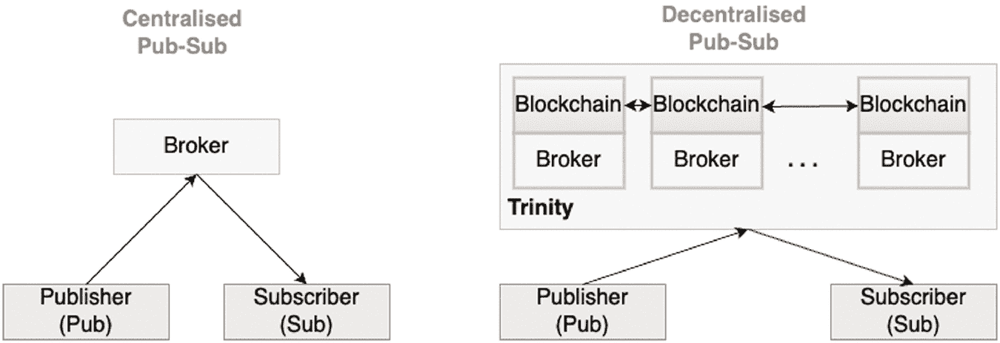

`Fig. 7.1 (Left) Centralised Pub‑Sub with a single point of failure; (Right) Trinity offers a decentralised Pub‑sub with blockchain, overcoming a single point of failure.`

`Trinity`（Ramachandran et al., 2019）采用去中心化架构，如 `Figure 7.1`（右）所示。它依赖区块链技术，并在多方参与的分布式网络中运行。以供应链应用为例，`Trinity`（Ramachandran et al., 2019）要求所有利益相关者运行区块链节点，以此分布行政权力，消除对中心化实体的依赖。简言之，发布者的消息不再由单一经纪人处理，而是由一组通过区块链平台相连的经纪人共同处理。经纪人与区块链相连后，消息在存入不可篡改的账本之前会经过共识过程验证。成功共识并将消息写入区块链不可变账本后，消息会回传给经纪人供订阅者消费。需要注意的是，订阅者收到的消息包含共识过程的证明，且该证明记录在区块链账本上。因此，发布者和订阅者可以随时审计区块链账本，查看消息的真实性和完整性。概念上，只要超过三分之二的区块链节点诚实，`Trinity` 就能保证消息成功送达订阅者。为简洁起见，本章不讨论详细的安全性和正确性分析，相关内容可在我们的其他出版物（Ramachandran et al., 2019）中找到。

### 5.2 使用案例：将 Trinity 应用于防止执法部门种族画像

`Trinity` 默认要求应用利益相关者共同运营应用基础设施。通过从单一实体手中夺回行政权，`Trinity` 引入了数据通信的民主框架。加入区块链技术后，数据存储在不可篡改的账本上，提供可靠且可审计的存储。这些特性专为社会公益应用而设计，因为它们需要民主而非专制、透明而非秘密、不可篡改的账本而非随意更改的数据库。基于此，`Trinity` 被用作概念验证的实际应用案例。

`Trinity` 被用于真实的执法场景。美国司法部、加利福尼亚州于 2015 年通过了《`RIPA` 法案》，旨在防止执法人员在进行交通检查时因种族、肤色和肤质而停止对某些人群的行为。在美国，执法人员在怀疑某人时会进行交通检查。然而，公众担心执法人员经常针对肤色较深的人群进行检查，而其他种族的人群则较少受到检查。为解决此问题，新《`RIPA` 法案》被提出。该法案的目标是收集每个执法办公室和执法机构的交通检查数据，以了解道路上被停止的人员的多样性。为此需要一个数据收集框架；但依赖于集中化基础设施的方案易产生单点故障风险，因为每个执法机构都可能篡改数据，仅报告少量能够展示多样性的交通检查记录。

通过采用去中心化的数据通信与存储协议——`Trinity`，执法人员收集的数据在成功共识后会被写入不可篡改的账本中。请注意，`Trinity` 是一个去中心化、分布式框架，需要多个执法机构（包括司法部）的参与。因此，在共识并存储后，任何包括执法机构或加利福尼亚州司法部的实体都无法修改已确认并写入账本的交通检查数据。此外，公众可以自行审查交通检查记录，以了解数据的多样性。`Trinity` 在洛杉矶县治安官部门的帮助下，用于展示其在社会公益场景中的优势。

## 6. Decentralised Request-Reply Framework and its Application to Supply Chain

`Trinity` 解决了发布-订阅（`pub‑sub`）通信协议中的单点故障问题。其替代方案是请求-回复（`request‑reply`）通信协议，该协议在 Web2 生态系统中占据主导地位。与 `pub‑sub` 不同，`request‑reply` 采用同步消息模型，意味着客户端在获取特定数据或资源时会发送请求并等待服务器的响应。而 `pub‑sub` 是异步且松耦合的，客户端只需通过订阅机制注册感兴趣的数据或资源，无需立即等待响应。因此，`pub‑sub` 与 `request‑reply` 的唯一区别在于客户端与服务器（或中介）交互的方式不同，但两者均基于客户端‑服务器架构，在 `pub‑sub` 中服务器被称为 `broker`。

正如前文所述，集中化协议易产生单点故障。`request‑reply` 协议包含一个集中化服务器来处理客户端请求，这使得服务器管理员能够篡改请求并操纵响应，而无需向其他人提供可见性。

当代 `request‑reply` 框架（包括 Web 服务器）均遵循集中化的客户端‑服务器模型，因为 Web2 假设单一实体负责整个运营的管理。然而，社会公益应用要求具备问责制和透明度的应用基础设施，传统的集中化框架因此不适用。`DeWS`（Ramachandran 等，2023）是一种具备透明度、可审计性和去中心化特性的去中心化 `request‑reply` 框架。

### 6.1 DeWS：去中心化请求-回复框架

请求-回复包含两类实体：服务器（`server`）和客户端（`clients`）。服务器负责向客户端提供数字服务。典型服务包括用户注册、支付交易处理以及在产品到达特定仓库时向供应链利益相关者发送通知。通常，客户端发送请求以触发服务器上的服务。服务器收到请求后，会通过执行实现业务流程的程序来处理请求。左图（`Figure 7.2 left`）展示了请求‑回复框架的架构。Web2 应用几乎所有场景均采用此架构。但该方式的问题在于服务器完全负责正确处理客户端请求，服务器的运作对客户端和其他业务利益相关者不可见，从而增加了 `malpractice`（不当行为）的可能性。


右图（`Figure 7.2 right`）展示了 `DeWS` 的架构。与中央化框架不同，`DeWS` 在多利益相关者环境中协作实现。在供应链应用场景中，农民、加工设施所有者、仓库运营商、零售商等每个利益相关者都需要参与 `DeWS` 的部署。`DeWS` 不在单一服务器上运行所有服务，而是将服务部署并运行在分布式、去中心化的基础设施上。每个服务器均连接到区块链（如 `Figure 7.2 right` 所示）。当客户端发出请求时，请求会先被路由至区块链层，确保所有服务器对同一请求执行相同操作，并通过共识过程验证其响应。若超过三分之二的服务器产生相同的响应，则共识成功，信息即被写入不可篡改的账本。这意味着所有请求和响应均记录在账本上，为所有利益相关者提供透明度和可审计性。客户端在收到响应后，可通过检查账本来验证响应的真实性和正确性，并确信该响应是基于成功的共识过程以及数据写入不可篡改账本后生成的。

`DeWS` 通过区块链技术的特性，为客户端提供正确性保证。`DeWS` 的主要优势包括防止故意的计算失败、避免生成错误响应以及防止请求被丢弃。由于响应在区块链共识成功并写入账本后生成，恶意服务器无法在 `DeWS` 中作弊，使其成为社会公益应用的理想框架。

## 7. Whistleblower: A Blockchain‑based Machine Learning Framework for Fake News Detection

社交媒体应用的广泛使用为恶意分子传播假新闻提供了机会。研究表明，假新闻可能在英国脱欧公投和 2016 年美国总统选举中发挥了关键作用（Zhou and Zafarani, 2020）。此外，已证明假新闻传播速度快于真相（Vosoughi et al., 2018），进一步凸显其社会影响。因此，假新闻对社会造成巨大影响，亟需有效的解决方案。

- 许多实用解决方案正在被采用。例如，`X`（前身为 Twitter）允许用户通过提供事实证据来举报假新闻。当用户发现假新闻并看到与之相抵触的事实证据时，他们可以判断其正确性并形成合理的观点。此类解决方案需要有知识的用户参与。或者，机器学习也被用于更有效地检测假新闻。文献中已提出多种机器学习方法用于假新闻检测（Collins et al., 2021; Mridha et al., 2021）。尽管许多这些方法已被证明有效，但不清楚机器学习模型是否能够在无偏的方式上运行，因为研究表明模型倾向于歧视特定用户、地区等（Mehrabi et al., 2021）。因此，构建一个能够在无偏的同时让用户参与验证的假新闻检测系统非常重要。`WhistleBlower`（Ramachandran et al., 2020）通过提出一种民主化、去中心化的框架来解决此问题，用于在在线社交媒体平台上检测假新闻。

### 7.1 WhistleBlower：去中心化假新闻检测平台

区块链技术具备共识机制、智能合约以及不可篡改的账本等特性，这些特性使其适合构建面向社会公益的去中心化应用。然而，要确保最终应用真正发挥区块链的强大优势，需要精心设计框架。`WhistleBlower` 是一个典型的平台，它利用区块链技术、机器学习算法、社区成员以及激励机制，构建出一个影响力巨大的假新闻检测框架。

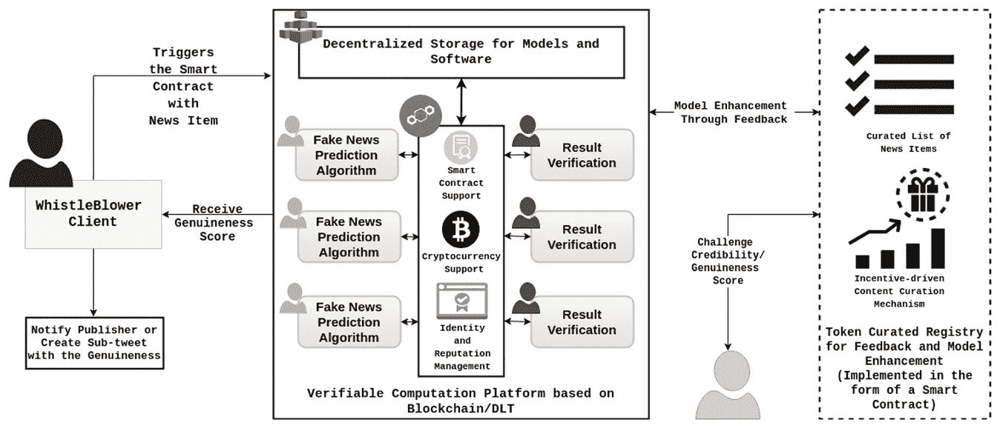

`Fig. 7.3 Architecture of WhistleBlower (Ramachandran et al., 2020).`

在核心层面上，`WhistleBlower` 基于支持智能合约、加密货币以及身份与声誉管理功能的区块链平台。智能合约用于管理参与者以及假新闻检测算法。由于 `WhistleBlower` 涉及社区成员，激励他们提升参与度至关重要。加密货币功能用于构建奖励参与者的代币。最后，身份与声誉管理功能用于跟踪社区参与者及其在平台上的行为。

`WhistleBlower` 使用机器学习来预测给定的新闻项是否为假新闻。机器学习算法由社区中的算法开发者提供。他们可以将自己的假新闻检测算法提交给 `WhistleBlower`，平台随后从社区开发的算法列表中选取最佳算法进行使用。这里的“社区”指机器学习研究人员及其他与假新闻抗争的组织。

客户端通常向 `WhistleBlower` 提交新闻项以验证其可信度。`WhistleBlower` 平台使用其列表中最佳的社区开发算法来预测该新闻项是否为假新闻。此预测过程并不在区块链的智能合约内执行，而是由智能合约从社区成员拥有并管理的计算节点列表中选取 `N` 个节点作为求解者和验证者。这些被选节点会接收假新闻项及预测算法代码，执行计算并产生真实性得分，该得分指示新闻文章是否为假。但没有保证求解节点正确执行了预测操作。因此，`WhistleBlower` 使用验证节点来检查计算的正确性。平台采用可验证计算来验证求解节点提交的证明和结果。为简化说明，可验证计算的细节在此不作深入讨论，也不在本章中列出，相关内容可参见我们的其他出版物（Ramachandran et al., 2020）。

在计算正确性得到验证后，`WhistleBlower` 将真实性得分返回发起验证的客户端。客户端随后可以通过传播假新闻的社交媒体平台报告该得分。如果客户端对 `WhistleBlower` 返回的得分不满意，可挑战用于假新闻预测的算法。挑战过程由代币审查注册表（`token-curated registry`）处理，该注册表通过邀请社区成员参与评审过程来审查算法质量。代币审查注册表是一种基于区块链的内容审核框架，利用社区成员评估内容质量，并在审核过程中奖励参与者。`WhistleBlower` 依赖代币审查注册表来审查假新闻检测算法的质量。审查过程完成后，若评审人员赞成该算法，则该算法被接受用于假新闻检测；否则，负面评分会导致该算法被从 `WhistleBlower` 中移除。通过让社区成员参与审查，`WhistleBlower` 确保不会使用偏向的算法进行假新闻检测。

总之，`WhistleBlower` 展示了如何利用区块链构建去中心化、透明的机器学习假新闻检测应用。鉴于机器学习在众多实际应用中的重要性，类似 `WhistleBlower` 的平台可以帮助确保使用无偏的算法。

**可靠且可审计的数据交换与存储**：数据是任何在数字空间运行的社会公益应用的核心。当双方之间交换数据时，需要通过可靠且透明的渠道进行。此外，数据还需存储在数据库中以便审计。`Trinity` 和 `DeWS` 通过流行的发布-订阅（`pub‑sub`）和请求-响应（`request‑reply`）通信模型支持数据交换与存储。

**可验证的任意计算**：除了数据，计算也是关键。在许多实际场景中，原始数据必须被处理或与多个数据源组合，以获取业务洞察。许多应用还使用机器学习和人工智能模型进行预测。这些活动需要在可靠且可验证的协议下运行计算。`WhistleBlower` 提供了去中心化且可验证的计算架构。

**激励措施以奖励良好行为**：某些社会公益应用可能需要支持代币机制以奖励用户，正如 `WhistleBlower` 所展示的那样。

- 通过结合这些功能和来自 `Trinity`、`DeWS` 和 `WhistleBlower` 的关键构建块，我们提出了一个在 `Figure 7.4` 中的参考架构，面向社会良好应用。为简化设计过程，去中心化架构遵循不同的层。这是一个在协作环境中运行的多方框架，其中多个利益相关者贡献计算、通信、共识和存储资源。`Figure 7.4` 展示了一个包含 `N` 个利益相关者的设置。应用功能在该分层架构内执行，每一层负责特定功能，如下所述：

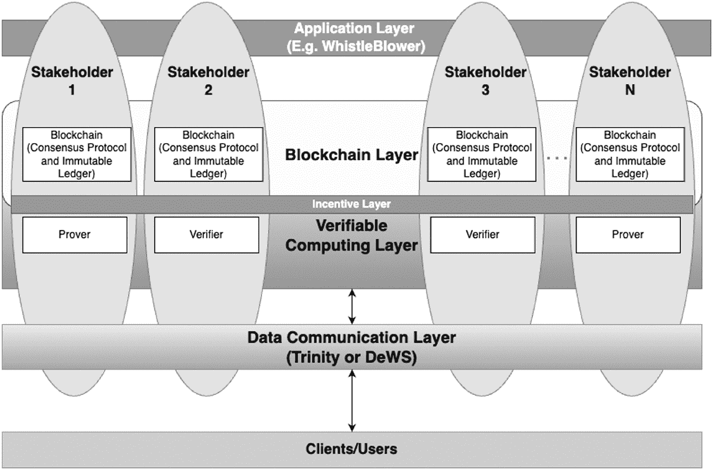

`Fig. 7.4 A Reference Architecture for Blockchain-based Social Good Applications. It builds on Trinity, DeWS, and WhistleBlower.`

**数据通信层：** 该层负责提供 *可靠且可审计的数据交换*。它基于 `Trinity`（Ramachandran et al., 2019）和 `DeWS`（Ramachandran et al., 2023）。根据应用需求，开发者可以在 `pub‑sub`（`Trinity`）和请求‑响应（`DeWS`）之间进行选择，使该架构适用于现实世界的各种应用。例如，仅需要参与者之间消息交换的应用可以利用 `Trinity`（Ramachandran et al., 2019）框架，而需要在数据交易中执行简单计算的去中心化应用可以采用 `DeWS`（Ramachandran et al., 2023）。

**可验证计算层：** 该层负责可靠地执行计算。如 `Figure 7.4` 所示，利益相关者可以扮演验证者或求解者，如 `WhistleBlower`（Ramachandran et al., 2020）所讨论。虽然智能合约提供可验证计算的机制，但其存在局限——智能合约无法运行任意计算，因为它们在诸如以太坊虚拟机（`EVM`）等专用执行环境中运行。`EVM` 缺乏对机器学习的支持，因为其计算开销高且不支持浮点运算。将可验证计算层置于区块链之外的好处在于它支持所有种类的计算，而智能合约并非如此。请注意，`WhistleBlower` 提出了一个在尊重区块链原则的前提下，验证任意计算正确性的架构。


**激励层：** 支持加密货币的区块链平台使开发者能够轻松集成代币，以奖励用户。该层在区块链内部运行，允许用户进行代币交易。社会良好应用通常需要持续的社区参与和参与度。通过奖励用户，社会良好应用可以最大化社区成员的作用。

**区块链层：** 其他层依赖区块链层，以提供数据和计算的验证保证，并将所有应用日志存储在不可篡改的账本中，以确保审计性和透明性。

每一层均能够支持任何要求透明、问责和可审计的数字应用。注意，所有应用通常包括不同利益相关者生成数据、对数据进行计算、基于数据做出业务决策以及接收数据警报。`Figure 7.5` 展示了根据应用需求选择和包含哪些层的方式，其中区块链是唯一的共同层，因为它对透明、审计和去中心化至关重要。数据通信层对仅需要通过可审计和去中心化的渠道集体交换数据的应用很有益。这类应用可以在区块链基础设施内运行，同时排除其他所有层。此外，根据现有基础设施是否支持发布‑订阅（pub‑sub）或请求‑响应（request‑reply）通信模型，可进行进一步定制。请记住，`Trinity` 是发布‑订阅框架，而 `DeWS` 在去中心化基础设施之上提供请求‑响应框架。

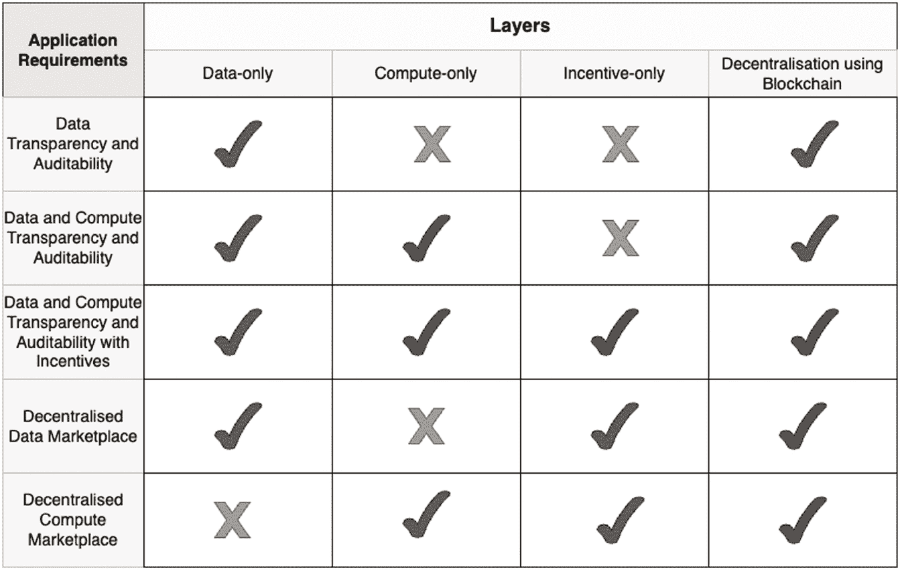

Fig. 7.5 The table shows how different layers from the reference architecture can be selected based on application requirements.

当应用需要对各利益相关者产生的数据进行计算时，架构可以扩展以包含受 `WhistleBlower` 启发的可验证计算层。各利益相关者可以协作确定对处理数据至关重要的计算任务。随后，可随机选取一组节点来执行这些计算。在成功完成后，部分节点将转为验证者，确保结果正确计算，并在区块链上留下证明和痕迹以供审计。

此外，激励层可加入需要奖励机制以鼓励群体参与的应用。将该层纳入特定的社会良好应用，很大程度上取决于利益相关者及其运营模式。

`Figure 7.4` 所示的参考架构可用于构建广泛的应用。如 `Figure 7.5` 所示，选择区块链、数据和激励层也可以开发激励利益相关者共享数据的应用。这类应用被称为数据市场 (`Ramachandran and Krishnamachari`, `2023`; `Ramachandran et al., 2019`)。此外，依赖第三方（如云提供商）计算的应用可以利用区块链技术激励计算资源提供者 (`Ramachandran et al., 2020`)。`Figure 7.5` 展示了这种模式，体现了所提参考架构的灵活性。

`Figure 7.4` 所示的架构帮助应用开发者构建仅数据、仅计算或仅激励的应用，或其组合，同时满足社会良好应用的透明、审计和去中心化等基本要求。在构建区块链基础的社会良好应用时，考虑数据治理至关重要，以确保数据所有者的权利得到尊重 (`Garcia et al., 2022`)。此外，数据质量至关重要，因为由于“垃圾输入‑垃圾输出”问题，真正的收益来自在区块链上存储正确的数据 (`Powell et al., 2022`)。

## 结论

总之，本章全面概述了区块链技术如何用于社会良好，既涵盖了技术挑战也涵盖了实际挑战。它解释了公钥加密、共识机制、不可篡改账本和智能合约等基础元素如何使去中心化应用更加公平。更重要的是，我们强调了区块链在供应链管理、误信息检测等范围内为应用提供透明、问责和去中心化的价值。

随后，本章还介绍了三种不同的去中心化框架，分别面向数据驱动、计算导向和激励驱动的应用场景。`Trinity` 框架介绍了如何将传统的发布-订阅协议等通信协议与区块链集成，以在多利益相关方应用中实现去中心化信任。`Trinity` 框架在种族画像方面的应用也被讨论，强调不同执法机构可以通过去中心化且基于区块链的框架协同收集和管理交通停靠数据。

此外，`DeWS` 是一种支持传统 Web2 环境中传统应用的去中心化数据共享框架，具备请求-响应支持。通过使用 `DeWS`，应用数据可以由一组多元化的利益相关方通过区块链基础设施进行管理，从而提升可审计性和透明度。根据应用需求和基础设施限制，开发者可以在去中心化社交公益应用中选择发布-订阅、请求-响应或两者的组合方式来构建以数据为中心的应用。

针对需要计算支持的应用，`WhistleBlower` 采用了全新的可验证计算机制，确保在去中心化多利益相关方环境中应用数据可靠处理。更具体地说，计算任务由“证明者”执行，而“验证者”则在去中心化且可审计的基础设施上确保完整性和正确性。

诸如 `DeWS`、`Trinity` 和 `Whistleblower` 等关键组件，分别在数据共享、计算和激励方面发挥独特作用，被集成到区块链应用的参考架构中。该架构保证了可靠、可审计的数据交换、用于复杂计算的可验证计算，以及用于奖励积极行为的激励机制。最终，该框架为构建透明、民主且负责任的应用奠定了基础，最大化区块链技术在提升社会福祉和确保跨用户群体公平性方面的潜力。

## References

*   Alam, S., Shuaib, M., Khan, W.Z., Garg, S., Kaddoum, G., Hossain, M.S. and Zikria, Y.B. (2021). Blockchain-based initiatives: current state and challenges. Computer Networks, *198*, 108395.

*   Andola, Nitish, Vijay Kumar Yadav, S. Venkatesan, and Shekhar Verma. “Anonymity on blockchain based e-cash protocols—A survey.” Computer Science Review 40 (2021): 100394.

*   Antonopoulos, A.M. and Wood, G. (2018). Mastering ethereum: building smart contracts and dapps. O’reilly Media.

*   Auer, R., Frost, J., Gambacorta, L., Monnet, C., Rice, T. and Shin, H.S. (2022). Central bank digital currencies: motives, economic implications, and the research frontier. Annual review of economics, *14*(1), 697–721.

*   Buchman, E. (2016). Tendermint: Byzantine fault tolerance in the age of blockchains (Doctoral dissertation, University of Guelph).

*   Cao, S., Powell, W., Foth, M., Natanelov, V., Miller, T. and Dulleck, U. (2021). Strengthening consumer trust in beef supply chain traceability with a blockchain-based human-machine reconcile mechanism. Computers and electronics in agriculture, *180*, 105886.

*   Cartier, L.E., Ali, S.H. and Krzemnicki, M.S. (2018). Blockchain, Chain of Custody and Trace Elements: An Overview of Tracking and Traceability Opportunities in the Gem Industry. Journal of Gemmology, *36*(3).

*   Castro, M. and Liskov, B. (2002). Practical byzantine fault tolerance and proactive recovery. ACM Transactions on Computer Systems (TOCS), *20*(4), 398–461.

*   Collins, B., Hoang, D.T., Nguyen, N.T. and Hwang, D. (2021). Trends in combating fake news on social media—a survey. Journal of Information and Telecommunication, *5*(2), 247–266.

*   Fan, C., Lin, C., Khazaei, H. and Musilek, P. (2022, August). Performance analysis of hyperledger besu in private blockchain. Proceedings of 2022 IEEE international conference on decentralized applications and infrastructures (DAPPS) (pp. 64–73). IEEE.

*   Garcia, R.D., Ramachandran, G. and Ueyama, J. (2022). Exploiting smart contracts in PBFT-based blockchains: A case study in medical prescription system. Computer Networks, *211*, 109003.

*   Garcia, R.D., Ramachandran, G.S., Jurdak, R. and Ueyama, J. (2022). Blockchain-aided and privacy-preserving data governance in multi-stakeholder applications. IEEE Transactions on Network and Service Management, *19*(4), 3781–3793.

*   Garcia-Teruel, R.M. (2020). Legal challenges and opportunities of blockchain technology in the real estate sector. Journal of Property, Planning and Environmental Law, *12*(2), 129–145.

*   Garg, Nishant. Apache kafka. Birmingham, UK: Packt Publishing, 2013.

*   Ge, Lan, Christopher Brewster, Jacco Spek, Anton Smeenk, Jan Top, Frans Van Diepen, Bob Klaase, Conny Graumans, and Marieke de Ruyter de Wildt. Blockchain for agriculture and food: Findings from the pilot study. No. 2017-112. Wageningen Economic Research, *2017*.

*   Hunkeler, U., Truong, H.L. and Stanford-Clark, A. (2008, January). MQTT-S—A publish/subscribe protocol for Wireless Sensor Networks. In 2008 3rd International Conference on Communication Systems Software and Middleware and Workshops (COMSWARE’08) (pp. 791–798). IEEE.

*   Isaak, J. and Hanna, M.J. (2018). User data privacy: Facebook, Cambridge Analytica, and privacy protection. Computer, *51*(8), 56–59.

*   Jurdak, Raja, Ali Dorri, and Mahinda Vilathgamuwa. “A trusted and privacy-preserving internet of mobile energy.” IEEE Communications Magazine 59.6 (2021): 89–95.

*   Kahya, A., Avyukt, A., Ramachandran, G.S. and Krishnamachari, B. (2021, July). Blockchain-enabled Personalized Incentives for Sustainable Behavior in Smart Cities. Proceedings of 2021 International Conference on Computer Communications and Networks (ICCCN) (pp. 1–6). IEEE.

*   Mehrabi, N., Morstatter, F., Saxena, N., Lerman, K. and Galstyan, A. (2021). A survey on bias and fairness in machine learning. ACM computing surveys (CSUR), *54*(6), 1–35.

*   Mridha, M.F., Keya, A.J., Hamid, M.A., Monowar, M.M. and Rahman, M. S. (2021). A comprehensive review on fake news detection with deep learning. IEEE Access, *9*, 156151–156170.

*   Nakamoto, S. (2008). Bitcoin: A peer-to-peer electronic cash system. Decentralized business review.

*   Natanelov, V., Cao, S., Foth, M. and Dulleck, U. (2022). Blockchain smart contracts for supply chain finance: Mapping the innovation potential in Australia-China beef supply chains. Journal of Industrial Information Integration, *30*, 100389.

*   Natanelov, V., Cao, S., Foth, M. and Dulleck, U. (2022). Blockchain smart contracts for supply chain finance: Mapping the innovation potential in Australia-China beef supply chains. Journal of Industrial Information Integration, *30*, 100389.

*   Powell, W., Cao, S., Miller, T., Foth, M., Boyen, X., Earsman, B., ... and Turner-Morris, C. (2021). From premise to practice of social consensus: How to agree on common knowledge in blockchain-enabled supply chains. Computer Networks, *200*, 108536.

*   Powell, W., Foth, M., Cao, S. and Natanelov, V. (2022). Garbage in garbage out: The precarious link between IoT and blockchain in food supply chains. Journal of Industrial Information Integration, *25*, 100261.

## 8 非可替代性作为设计概念资源


本章以介绍为起点，阐明在经济体系中“可互换性”概念的重要性及其历史背景。章节探讨了从传统经济学家到社会文化学者的多元视角，凸显了可互换性的复杂性与局限性。方法论部分描述了虚拟工作空间的设计与实现，以此作为探索非可互换性作为概念资源的平台，进而引入案例研究部分，展示三个设计研究项目：`Tales of Things`、`KASH Cups` 和 `A Token Gesture`。每个案例展示了通过创新设计实践，非可互换性如何产生多种价值形态。

讨论与贡献部分反思了在货币中加入社会与生态价值的意义，挑战了可互换性的概念，并提出非可互换性作为设计的有价值资源。最后，本章通过提出研究与实践的未来方向，强调非可互换设计在支持可持续和再生社会方面的潜力。

## 2. The Climate Crisis as a Significant String

作为记忆平台，大规模数字经济拥有不仅包含经济数据，还包含对个人、社会和政治兴趣的深刻洞察。社会、个人、环境属性交织形成复杂的数据阴影，监视我们的行为并试图预测我们的意图与欲望（Zuboff, 2019）。当代这种状况挑战了可互换性乃至“无条件价值”的可能性。虽然现代经济依赖可互换性来支持经济单元的互换，但任何涉及交易的社会或环境价值的考量，都可能成为阻碍价值流动的重要“条件”。

联合国可持续发展目标（SDGs）提供相互关联的目标，旨在推动社会、环境和经济福祉，体现了对经济活动的伦理与生态溯源与后果日益深入理解的趋势。若交易与社会或环境有害的做法相联系，则对可互换性概念本身提出质疑——尤其是当这些考量减缓价值在货币内部的流动时。是否可以预见，个人和机构会开始审视金钱的社会与环境历史，依据其生态影响区分货币单元？

随着对金融服务组织在环境与社会治理（ESG）方面的要求日益增强，所谓的“可互换货币”可能变得日益不稳固，因为不同价值单元若携带不同的环境历史，便不被视为等价。SWIFT（Society for Worldwide Interbank Financial Telecommunications）五年回顾报告显示，金融行业正逐步向 ESG 原则全面采纳迈进。SWIFT 以数据“条件”确保交易的准确与高效，同时正在将个人与经济信息与环境与社会数据相结合：

> “我认为（除定性评估外）数据将推动 ESG 评分。我预计十年内，我们将为我们购买的每一项服务或商品提供不完美的 ESG 数据。我们正在走向 ESG 的民主化，”SWIFT（2023）Stephanie Gripne 表示。

作为设计者，我们关注的是这些条件如何促使平行货币形态的出现，使其更贴合公民的社会与生态价值，挑战构成可互换性的不可交换性。气候危机与我们对“无条件”经济价值的依赖相交，引发了对货币体系未来以及设计创新需要更好契合社会与环境价值的重要问题。

在社会组织运作处于后资本主义状态、且被平台经济崛起放大的时代，本文在前人提出的观点基础上，探讨如何将设计重新定位以应对全球生态挑战。2017 年 `Light et al` 的论文指出，人类在更广阔意义上面临的巨大挑战，涵盖我们在生态系间的共存以及关怀的彰显（Light et al., 2017）。该工作有意挑战设计的传统遗产，呼吁“抛弃”某些经典交互设计理念，例如“用户即我们”（用户是有缺陷的主体）、“轻松并非服务于我们”、“即时满足应被避免，转而采用长期视角”，以及“人机交互（HCI）这个术语本身是错误的”，强调在我们认知到复杂的社会、技术与更-than-human 生态纠缠时，该标题显得多余（ibid）。

在特刊《Repositioning CoDesign in the age of platform capitalism: from sharing to caring》中，Avram 等人（2019）精选了一系列论文，探讨设计如何与复杂的数字经济交互，这些经济已将“共享”一词收编，以更强调受其影响者的感受。特别值得关注的是，Huttunen and Joutsenvirta (2019) 研究了互补货币（包括加密货币）在提升经济韧性和社会公平方面所发挥的作用。通过直接的数据驱动技术，案例展示了互补货币的底层架构如何使其能够“更关注协作模式、系统性因素以及每个项目和其所在环境的社会特性”（ibid），从而指向可持续的未来。

## 3. Non-Fungible

当我们通过关联真实性、归属与溯源的主张，在货币中加入社会与生态价值时，我们可以接受从纯粹可互换性向更少可互换性或非可互换性货币与代币的转变。非可互换性产生于每个货币单元拥有独特的特征（或附加条件），这些特征使其在一对一的可交换性上出现差异，从而赋予其特定的条件，使其不易在一对一基础上相互替换。

货币单元可能关联的信息包括提供商品和服务的组织的社会诚信，或是追踪商品在供应链中从源头、生产、制造到购买的环境可信度。

每一笔可能以数字形式存储并对消费者开放的交易历史，都会使货币单元变得极度非可互换——因为一个单元可能因其社会与生态属性的差异，不再被视为与其他单元等价。此前的研究（在区块链技术普及之前），作者们探讨了用于在实物物品


“字符串”对货币而言听起来对开放市场中价值流动来说极具挑战性，但我们关注的是这种设计带来的机遇和后果，因为经济交易的透明度和问责制开始影响并改变消费者行为。这种转变可能支持向以价值为导向的经济转型，在该经济中公民和组织更倾向于将社会和环境价值置于纯粹的经济价值之上。为发展非同质化或半同质化货币形式而提供的机遇，是设计师介入的独特机会——不仅可以在已有的产品和服务设计中进行干预，还可以在支付和资助这些产品与服务的货币和价值交换系统中进行干预。然而，向非同质化货币形式的使用迈出的步骤面临着决定应附加到数据哪些价值的挑战。如果个人信息与货币关联，那么“字符串”很快就会转化为一种追踪形式，进而使社会某些成员面临诸如通过政府社会福利项目获得金钱等有害的监控形式（Beilefeld, 2018, 2021）。在“民主”经济体系中，非同质化货币的现有部署可能受到特定条件和社区的限制，而更全面的价值数据化表现则体现在中国的社会信用体系中——该体系一方面试图通过提升信任来打击腐败，另一方面又设计用于推广国家批准的道德价值观，这一具有挑战性的命题可能导致国家控制（[Gruin, 2021; Jia, 2020）。

## 4. Here Comes the Blockchain

为将社会和环境价值与货币关联，通常需要某种数字平台来存储这些价值的数据并在可能的交易点检索，而区块链的出现证明了其适用性。尽管作者们对许多平行和历史技术保持开放态度，但值得注意区块链技术的技术特性。区块链由去中心化账本组成，具有密码学安全性，能够记录并存储与特定货币单位相关的交易性质的信息。区块链还使这些信息在货币网络的用户之间可访问并可验证（Foth, 2017; Elsden et al., 2018）。

加密货币（如比特币）的同质性体现在其可互换性和可分割性上——每个单位与其他单位相同，且可以分解为更小、相等的部分。除了安全性，加密货币的同质性也推动了其在 2008 年银行崩溃后的显著增长。相比之下，非同质化代币（NFT）是一种独特的数字资产类别，具备不可分割性和可辨识性。每个 NFT 都是独立的，这种独特性赋予其稀缺性和价值。这种独特性在数字艺术、收藏品和游戏中尤为有价值，NFT 用于代表数字资产的所有权和来源，例如“Faircoin”或其他社会/社区货币。

当然，区块链的使用及其创建的非同质化货币迅速引导我们关注非同质化代币（NFT）以及与艺术品版本建立独特关联的技术热潮（Valeonti et al., 2021）。但为了防止 NFT 的热潮和经济周期 eclipsing our argument and design practice，我们回到三个设计研究项目，这些项目探索了通过数据技术将社会和环境价值与产品或服务的功能性和体验价值关联起来。

## 5. Conceptualising NFTs as ‘Keyrings’

在 NFT 作为投机资产的炒作热潮阴影（或光芒）之下，我们寻求与参与者和利益相关者共同讨论、思考和设计非同质化代币的替代方式。其中一种是将 NFT 视为一种特殊的“钥匙扣”——一个平台，拥有一系列机制，使用户能够执行特定操作，如获得访问权、存储文档、证明身份或保存个人纪念品。一个人可以持有多个不同的钥匙扣，用于不同的角色和需求，或拥有多个相互关联的钥匙扣以实现相关目的。

这个隐喻帮助我们将 NFT 视为一个可以分配特定权利和操作的平台。它强调了实物持有（即持有代币）作为所有权主张和分享权利的核心地位。正如任何陌生人都可以通过展示与特定 NFT 关联的钱包控制权来独立证明一种所有权。就像 Airbnb 的钥匙盒一样，把钥匙交给陌生人可以让其（至少暂时）获得对你家的访问权和使用权。正如同一钱包可以独立证明对特定 NFT 的控制，从而证明所有权。

我们倾向于在单个钥匙扣上添加和聚集多种工具，这反映了 NFT 的潜在多功能和可扩展应用。最终，这有助于我们认识到 NFT 是由智能合约（[²¹]）产生并依赖于与之交互的产物。

在此隐喻的基础上，我们与图形插画师 Peter Tilley 合作，制作了一套用于“设计钥匙扣”的模板和画布，每个环或钥匙提供特定的权利或服务，如访问、存储或身份认证。

最初该画布是为线上使用设计的，使用 Miro 白板工具，使用户能够动态混合匹配各种“钥匙”和附件，并将其链接到中心“代币”的环上（Fig. 8.1）。附件基于一系列基础操作或机制，这些操作可以通过持有代币来实现，例如“访问”特定地点或物品、投票权、登记重要数据、身份证明，或仅仅是一种状态象征。初始附件旨在扩展，仅作为起点，帮助人们思考代币持有者可能获得和主张的各种关系和权利。

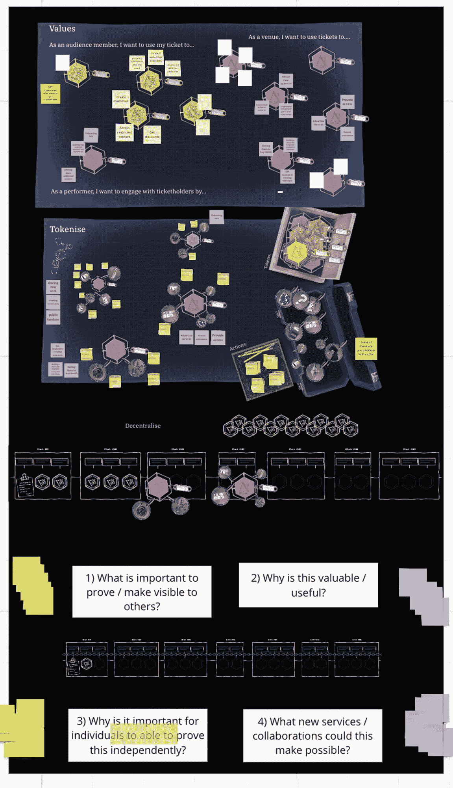

Fig. 8.1 Miro board used to design non-fungible services by linking conditions (values) to a keyring. Image by authors.


在工作坊环境中使用该画布时，我们首先会进行一个更基础的练习，帮助发现所在情境中的“价值”。例如，在一次工作坊中，我们让参与者考虑一种零售场景：购买特定商店的商品后，收据本身即为 NFT，可让持有者访问其他服务。商家可能希望利用收据建立忠诚度、鼓励转介或证明其商品的环保属性；客户则可能看重连接感、专属性、未来经济利益和回报，或展示其伦理消费行为。基于此，我们可以进一步提问：如何设计一个 NFT 钥匙扣来调解这些价值？可以赋予和主张哪些潜在的活动和权利？

- [`Tales of Things`](https://wiki.example.org/feynmans_learning_method)是一个交互式网络服务，允许将数字媒体与实物关联。该项目由英国研究基金在 2009 至 2013 年资助，移动端和在线平台使用户能够生成二维码，二维码可包含文本、音频和视频链接，并附加到具有个人或社会价值的实物物品。该项目在数字遗产和博物馆社区中获得了人气，使策展人能够为原本被封存、空间有限的文物添加数字媒体。

- 为了响应这一机会，作者提出了“幽灵物体”（ghost objects）Figure 8.3 的概念，以引导公众分享故事并将其与博物馆收藏中的独特真实物品关联。在公共活动中，选择的幽灵物体被提供给访客，鼓励他们回忆与原始文物相关的故事和苏格兰文化。例如，一双“幽灵鞋”用于引发关于苏格兰舞厅的故事。访客只需从贴纸纸张上撕下唯一条形码进行扫描，即可直接关联到其故事的文本、视频或音频版本。每位贡献者随后被邀请将二维码直接粘贴在对应的幽灵物体上，之后其数字媒体将显示在展示在玻璃后的原始文物背后的主要故事中。

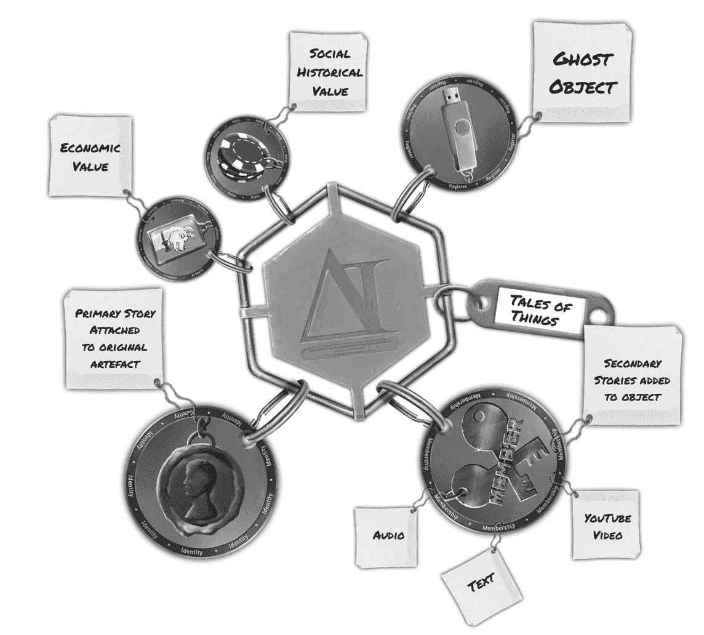

Fig. 8.3 The Tales of Things and ghost object project mapped out as a non-fungible design service. Image by the authors.


Fig. 8.2 A ghost shoe. A ubiquitous high heeled shoe that allowed visitors to the Museum of Scotland to associate their memories of Scottish dance halls with a pair of authentic shoes from the 1950s that is displayed at the museum. Image by authors.

- 幽灵物体在多种方面成为了高跟鞋及其与舞厅关联的公共记忆的具象化（可交换的体现），通过个人故事的讲述。虽然 1950 年代的原始鞋子仍被展示在玻璃后的稀有不可交换版本，但技术组合使得多种价值得以创造：

    1. 策展人可控制与原始文物关联的主要故事（即 NFT）。

    2. 幽灵物体允许访客在公开场合将次要故事与原始文物（NFT）关联，形式多样，包括文本、视频和音频（Speed, 2012）。

    3. 在某些情况下，添加数字媒体可提升原始物品的经济价值；公众故事的收集有助于物品的溯源。

    4. 幽灵物体为公众提供了参与博物馆收藏品社会历史价值的渠道，不仅是一个有趣的社会遗产活动，也体现了博物馆对社区参与的持续承诺。

    5. 当时的 Tales of Things 网络技术能够动态生成可与任何数字内容关联的二维码，并构建了一个大规模、公开可访问的社会记忆库。

- `keyring` 画布巧妙地拆解并可视化了物质与数字元素组合中所产生并凝聚的价值（Figure 8.3）。

## Project 2: KASH Cups (Dutch Design Week 2016)

KASH Cups (Murray-Rust et al., 2023) 是一个互动咖啡杯系统，旨在揭示价值体系设计的新机遇。使用价值、经济价值和社会价值，往往在以金钱作为价值代表的习惯性流程中被隐藏。借助 NFC 技术，KASH Cups 帮助在会议的社交情境中，当杯子的“所有者”遇到不同的人（包括咖啡师）时，显现出不同的价值形态。可编程的物质制品（杯子）及其功能挑战了参与活动的人之间的社会关系，将原本非正式的互动转化为交易，从而稳固了特定的价值。

每个杯子底部都有一个 NFC 标签，为其在数据库中提供唯一身份标识。该数据库在本地 PC 上运行，能够存储两个简单条件：杯子是否有资格从咖啡师处免费获取咖啡，或者没有。

在与 Dutch Design Week 同期举办的 Things2Things 事件中，访客可以取用咖啡杯，但要获得咖啡的信用，必须找到另一位想要咖啡的人，双方将杯子放在智能托盘上一起，即可获得咖啡信用（Fig. 8.4）。当与咖啡师相遇时，每位参会者将 KASH 杯放在另一个智能托盘上，该托盘会检测杯子在数据库中是否有信用，若有，咖啡师便会按参会者的选择制作咖啡。


Fig. 8.4 Two delegates to the conference working together to add credit to their KASH cups. Photograph by the authors.

这一对会议社交惯例的干预，使传统的免费咖啡价值体系更加复杂，因为在传统服务之上增加了更多价值。将“价值的增加”映射到 NFT Keyring Miro Board，可更好地展示该干预如何共同创造以不同方式产生的价值。

每个 KASH 杯的交易关系类似于支持多种价值创造形式的智能合约：

1. 免费咖啡，是所有良好社交尤其是会议聚会的强制性需求。

2. KASH 杯由 internationally 知名陶艺师 Katy West 设计并生产。杯子属于限量系列，作为文化艺术品本身便具备价值。

3. 为了共同获得免费咖啡而与陌生人互动，使参会者成为“朋友”。这种高度友好的行为成为破冰剂，促成新的对话和关系。

4. 一位经验丰富的咖啡师被雇佣提供弹出式咖啡服务。专注于制作完美咖啡的工艺，KASH 杯服务承诺提供精美的手工咖啡。

5. 一个简单的 SQL 数据库将杯底的 NFC 芯片与智能托盘关联，使每个 KASH 杯成为一种简单的钱包，存储每位参会者的信用和借记。

与会议中普通空咖啡杯（可被视为可互换、直至被特定人物填充其偏好咖啡的可交换品）不同，KASH 杯可以被视为 NFT 的物质化实例。但正是与其他价值创造点的关联体系——即“智能合约”——提供了非同质化设计服务。NFT Keyring 画布使我们能够映射 KASH 杯系统在创造和维持多种价值方面的作用（Figure 8.5）。

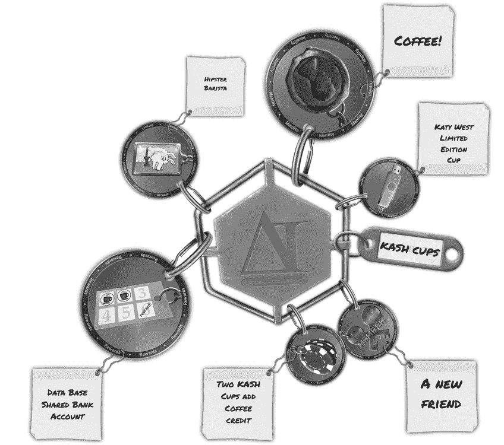

Fig. 8.5 The KASH Cups coffee service mapped out as a non-fungible design service. Image by the authors.

## Project 3: A Token Gesture (Inspace City Screens, 2022)

A Token Gesture[^(22]##

1. 通过街道级、走上门的互动，生成独特的数字艺术作品。

2. 通过 Inspace City Screen 注册作品以在展览中展示。

3. 铸造、领取并拥有非可转让的 NFT，代表其艺术作品，从而控制该作品的展示方式。

我们与两位苏格兰生成艺术家——Sasha Belitskaja 和 Cameron “Gingey”——合作，创建了一个系统：只要向固定摄像头展示一种颜色，任何人都可以生成独特的数字艺术作品。随后，参与者会被仔细引导设置加密钱包，以领取和铸造代表其作品的 NFT。

至关重要的，该 NFT——一个唯一的数字代币——是不可转让的，不能交换或出售。但它用于不可篡改地登记艺术作品，作为个人贡献的证据，并允许其控制作品在 Inspace City Screen 项目仪表板（属于爱丁堡设计信息学研究所）上的展示时机。

超过 200 人参与展览，产生超过 1,788 件作品，其中 79 件最终被铸造为 NFT 并在展览中展示。随后的调查和访谈表明，移除 NFT 的任何金融或经济价值后，参与者从其他价值中获益，持有与其作品关联的唯一非同质化代币。主要价值体现为定制的“参与证明”，可在公共和私人场合分享，展示其在特定社区和亚文化中的参与度。正是由于其字面上的不可转让性，且绑定于单一加密钱包，这正是非同质化的极致体现——这正是它让持有者能够“证明”自己曾出席的原因。


Fig. 8.6 The Token Gesture exhibition and ‘NFT cash point’ where passers-by could mint their own artwork. Inspace City Screen, Institute for Design Informatics, Edinburgh. Photograph by the authors.

4. 提供与当前或未来展览内容相关的投票权，例如，应委派哪位艺术家创作新作品。

5. 之后能够修改或“变异”作品以产生新的艺术作品。

更广泛地说，我们考虑了持有代币者作为共同兴趣成员社区的潜在价值。好处可能包括：

1. 被空投/发送新艺术作品。

2. 获得访问独家活动/项目的邀请。

3. 参与仅限成员的讨论论坛。

4. 一个徽章，提供认可/社区身份。

5. 为未来艺术创作提供众筹或支持的基础。

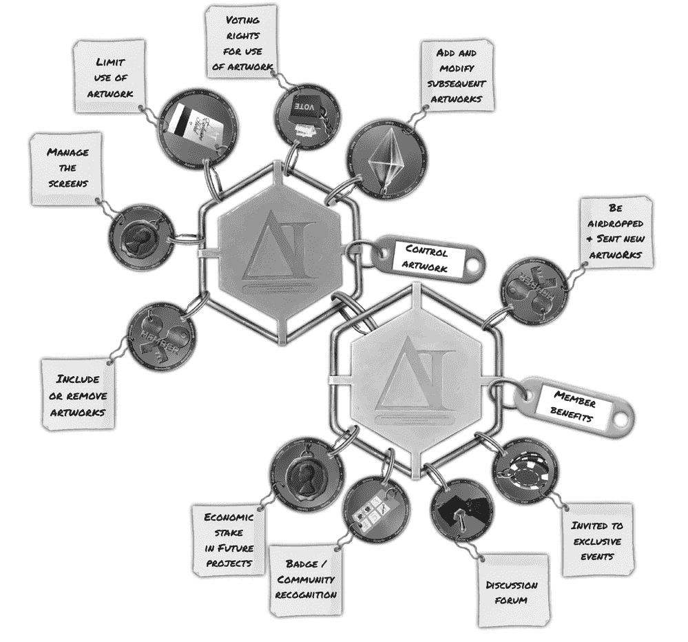

Fig. 8.7 The representation of different forms of value mapped across the two different values (control and community) of the Token Gesture experience. Image by the authors.

这些“价值”在米罗画布上通过两个相互锁定的钥匙环来体现，它们提供对单件艺术品的控制权，并赋予社区成员的权益（可以是特定的艺术品集合，也可以是与单个艺术家的关联）。每个钥匙环对应的行动提供了价值在不同合约中如何产生的洞察。

## Conclusions

2017 至 2021 年期间，Cryptopunks 和 Bored Apes 的集合被并入 NFT 浪潮，它们帮助定义了一类支持创作者与数字媒体资产之间“证明”的区块链活动。NFT 的定义和使用重新激发了关于可替代性与不可替代性光谱的提问。本章以货币作为流动资产的概念起点，对可替代性进行了更深入的定义。通过引入在加入数据和记忆（或价值）后，货币的复杂性会增加，从而产生摩擦，使其流动性降低，变得更不具可替代性。

虽然摩擦通常被视为货币的障碍，但在应展示更高环境、社会治理（ESG）的经济体系中，与较低碳排放交易相关的数据将提升某些产品和服务的价值。因此，交易所附带的条件代表了积极的摩擦，体现了可验证的 ESG 应用。设计师因此可以与合作伙伴、客户和社区合作，有意识地设计“带约束”的产品或服务，即面向不可替代性的设计。基于此，本文介绍了 NFT 钥匙环画布，作为在特定情境中设计或反思产品与服务之间价值共创的手段。它为思考不可替代性作为设计资源提供了起点。

通过在新事物的介绍中加入“约束”，物件和服务不再是关注的中心，而是嵌入于复杂的社会与环境生态系统中的价值共创之中。当然，这本来就是事实，设计师的一个常见倾向是对其对社会的贡献在更广阔的价值体系中忽视（如 Speed 和 Maxwell, 2015 所指出）。

去中心化金融技术不仅挑战了我们对金钱的概念、其功能及局限的认知，也使得以数据为导向的设计新型价值交易的理论运动改变了我们对产品和服务的看法。

工作的局限性在于仅样本了三个设计研究项目，团队期待在不同领域部署钥匙环画布，以提供更全面的洞察。这些机会将通过参与者和合作伙伴的实证数据，帮助理解钥匙环隐喻如何揭示创新机遇。

研究团队此前也成功使用方法将区块链思维过渡到传统法币设计（Murray-Rust 等, 2023），目前本文所述 NFT 方法假设区块链技术是前提条件；未来工作可能利用画布与能够利用开放银行技术的组织合作，设计使用法币而非加密货币的新产品和服务。

尽管本文讨论了在平台经济中金钱与数据交织的隐性挑战，但与“真实世界”合作伙伴进行部署将使我们更好地理解隐喻和画布方法如何揭示伦理挑战。此类工作可能导致实施不可替代性设计的伦理框架，涉及隐私、同意以及潜在的 unintended consequences。

最后，所呈现的案例研究未涉及政策方面的机遇。在适当的环境下，与区域政府合作，团队希望了解画布如何帮助洞察不可替代性设计方法如何影响或要求政策与监管的变化，特别是在数字身份和数据保护等领域。

## Acknowledgements

本研究由以下英国研究委员会项目资助：EPSRC Tales of Things and Electronic Memory 项目 (`EP/H007318/1`)、ESRC After Money 项目 (`ES/N007018/1`)、EPSRC DECaDE 中心 (`EP/T022485/1`)。我们感谢所有参与研究并为我们提供洞见和结论的参与者和合作伙伴。

## References

*   Bandelj, N., Wherry, F. and Zelizer, V. (2017). Money Talks: Explaining How Money Really Works. Princeton: Princeton University Press. [`doi.org/10.1515/9781400885268`](https://doi.org/10.1515/9781400885268).

*   Barad, K. (2003). “Posthumanist Performativity: Toward an Understanding of How Matter Comes to Matter”, Signs: Journal of Women in Culture and Society 28 (3), pp. 801–831.

*   Bielefeld, S. (2018). Cashless Welfare Transfers for “Vulnerable” Welfare Recipients: Law, Ethics and Vulnerability. Feminist Legal Studies, *26*(1), 1–23. [`doi.org/10.1007/s10691-018-9363-6`](https://doi.org/10.1007/s10691-018-9363-6).

*   Bielefeld, S. (2021). Administrative burden and the Cashless Debit Card: Stripping time, autonomy, and dignity from social security recipients. Australian Journal of Public Administration, *80*(4), 891–911. [`doi.org/10.1111/1467-8500.12509`](https://doi.org/10.1111/1467-8500.12509).

*   de Jode, M.L., Barthel, R. and Hudson-Smith, A. (2011). Tales of things: the story so far. Proceedings of the 2011 International Workshop on Networking and Object Memories for the Internet of Things, *19*–20. [`doi.org/10.1145/2029932.2029940`](https://doi.org/10.1145/2029932.2029940).


*   Elsden, C., Manohar, A., Briggs, J., Harding, M., Speed, C. and Vines, J. (2018). Making Sense of Blockchain Applications: A Typology for HCI. Proceedings of the 2018 CHI Conference on Human Factors in Computing Systems (CHI ‘18) New York, NY, USA, Paper 458, 1–14. Association for Computing Machinery. [`doi.org/10.1145/3173574.3174032`](https://doi.org/10.1145/3173574.3174032).

## 9 战略资源在典型短食品供应链中的评估（针对区块链潜在实现）

Stessy Coutelle^(²³)

Email: [`rami.alkhudary@u-paris2.fr`]²; [`pierre.fenies@u-paris2.fr`]³

## 1 引言

可持续供应链管理关注物料、信息和资金流的同步，同时提升利益相关者之间的协作，尤其是通过更短、更本地化的供应链（Kamble et al., 2020; Seuring and Müller, 2008）。这种做法通过强调可持续发展的三大基石——经济、环境和社会目标，来支持可持续性，并不断适应消费者需求和期望的变化。虽然关于优先考虑本地产品的短供应链的好处的研究仍在萌芽阶段，但深入理解其可持续性影响仍然重要（Bartoloni et al., 2022; Elkington, 1998; Paciarotti and Torregiani, 2021）。

短食品供应链旨在满足消费者和生产者日益增长的需求，他们寻求更紧密的个人联系、可持续消费以及更小的生态足迹，并整合信息系统以实现更好管理（Malak-Rawlikowska et al., 2019; Thomé et al., 2021）。尽管存在这些好处，短食品供应链仍面临日益增长的批评，尤其是关于运输策略的问题。主要问题是运输容量利用不佳：与其利用大规模分销的优势，食品往往被运往不必要的长距离。解决这种低效性是提升本地食品网络长期可持续性的关键，需要通过先进的信息系统优化路线并减少冗余（Martikainen et al., 2014）。

区块链通常被描述为一种能够提升运营效率的信息系统 (`Alkhudary`, `Queiroz`, 等, 2022; `Kshetri`, 2018)。其各项功能协同作用，通过缩短交易时间和成本、促进信息共享、确保数据安全以及在供应链中建立信任，从而优化运营流程 (`Lacity`, 2022; `Treiblmaier` 等, 2021)。引入基于区块链的应用于农民，有望简化库存管理、运输和收获流程。这将有助于减少食物里程和食物浪费，推动供应链向更可持续的方向 (`Cao`, `Johnson`, 等, 2023; `Upadhyay` 等, 2021)。此外，这一技术进步还能提升可追溯性和透明度，并通过让相关信息轻松获取，鼓励消费者采用更佳的商业实践 (`Cao`, `Johnson`, 等, 2023; `Cao`, `Xu`, 等, 2023)。然而，大多数关于食品供应链中区块链的文献并未明确评估实现区块链效益所需的当前战略资源的现状 (`Treiblmaier`, 2018)。

我们计划采用资源基础观 (RBV) 框架，评估法国凡尔赛市典型短食品供应链的战略资源 (`Barney`, 1991; `Duong` 和 `Paché`, 2015)。我们的重点是评估这些资源的现状，以判断其是否足以支撑区块链的实施。区块链的采用可以提升可追溯性，在日益关注可持续性以及食品来源和质量的市场中提供竞争优势 (`Cao`, `Xu`, 等, 2023; `Powell` 等, 2022)。我们开展一项探索性研究，评估凡尔赛市典型短食品供应链中的战略资源，进而概念性评估区块链实施的准备程度，并考虑利用该技术所需的战略性变革。通过采取主动的做法，我们希望确保区块链部署在提升供应链协作的同时，能够在动态市场中形成竞争优势。

本章首先提供典型食品供应链的概述。随后讨论区块链在推动更可持续食品供应链方面的潜力。本章进一步深入探讨 RBV 框架。方法论部分阐述了研究设计和分析方法。评估部分检视凡尔赛市典型短食品供应链中的现有资源，并提出一些指导原则，帮助满足区块链实施的最低要求。最后，本章以总结性评论收尾。

全球食品行业的扩张正在使该领域的复杂性增加，导致参与方数量增多、对易碎产品的运输路线更长，以及食品供应链内部信息传播的差异性加大。这种日益增长的复杂性在供应链的各个环节都带来了一系列挑战，包括食物浪费、安全问题以及成本相关的脆弱性 (`Alkhudary`, `Brusset`, 等, 2022; `Gokarn` 和 `Kuthambalayan`, 2017)。例如，由于供应网络内部的不足，超过 30% 的食物被损失或浪费 (`Porter` 和 `Reay`, 2016)。为解决这些挑战并提升食品供应链，日益增长的关注是促进更大的协作 (`Barratt`, 2004)。这包括建立多样化的合作企业和数字化供应链 (`Dubey` 等, 2020; `Dyer` 和 `Singh`, 1998)。

数字技术的兴起正在改变消费者长期的食品来源模式，同时也影响市场供给的地理分布 (`Mashalah` 等, 2022)。各类食品分销渠道的兴起可归因于消费者偏好的多样化。这些渠道包括超市、小店、家庭配送和取货服务、直销以及线上零售等多种零售形式。为满足消费者的不同需求，一系列补充分销方式应运而生。为优化食品供应链并适应行业不断变化的动态，建立利益相关者之间的协作伙伴关系至关重要。这一策略不仅提升新产品的开发，还能强化对客户需求的关注以及价值创造过程 (`Rejeb` 等, 2021; `Salam`, 2017)。

在本地食品生产者之间加强协作，尤其是在物流操作方面，具有日益增长的需求。有效的协作对于消除非增值成本、优化资源利用以及提升供应链整体表现至关重要。尽管对本地食品的需求日益增长，本地生产者在传统食品供应链中往往被边缘化。他们面临产量下降、资源受限、价格高昂、产品开发和营销复杂、难以形成商业合作伙伴以及确保准时交付等挑战。这些挑战凸显了创新和适应食品供应链的必要性，以更好地整合并利用本地食品生产者的潜力。通过先进的信息系统，这些生产者可以被更好地纳入更广阔的市场生态系统，从而简化流程、改善沟通并实现更深入的整合 (`Cao` 等, 2021; `Powell` 等, 2022)。

## 3 通过区块链实现更可持续的食品供应链

区块链是一种去中心化的信息系统，具有潜力彻底改变食品供应链的运营方式 (`Behnke` 和 `Janssen`, 2020; `Kamilaris` 等, 2019)。该技术支持多种模式，包括私有链、公有链和联盟链，每种都旨在满足特定需求 (`Al-Sumaidaee` 等, 2023)。它带来诸多优势，如降低交易成本和时间、提升可视性、增强安全措施以及在供应链中培育信任 (`Alkhudary` 和 `Féniès`, 2022; `Cao`, `Xu`, 等, 2023)。不同行业正日益采用区块链在物流流程中的应用，认识到该技术能够提供竞争优势 (`[Al-Sumaidaee` 等, 2021)。这一做法在食品行业尤为成功 (`Brusset` 等, 2024; `Bumblauskas` 等, 2020)。区块链技术的多样化应用旨在满足客户需求并应对行业不断变化的需求 (`Menon` 和 `Jain`, 2022)。

可持续性在食品供应链中近年来受到广泛关注，解决了关键的环境、社会和经济挑战。Kazancoglu et al. (2021) 和 Yamoah and Yawson (2023) 的研究强调，可持续商业实践对于提升韧性和减少负面影响是必要的，并指出气候变化和新冠疫情等外部因素的作用。D. Li et al. (2014) 和 Malak-Rawlikowska et al. (2019) 的研究进一步探讨了可追溯性、利益相关者协作以及可持续性指标等维度，阐述了如何平衡经济、环境和社会因素。Smith (2008) 和 Zhu et al. (2018) 的工作讨论了可持续商业实践的发展与提升，强调持续创新对改善可追溯性和客户满意度的重要性。文献整体凸显了全面的可持续性方法，以实现食品供应链的长期目标（Cao, Johnson, et al., 2023; Menozzi, 2014）。

Li et al. (2023) 强调区块链在解决经济、社会和环境三大可持续性基本方面的重要性。例如，区块链通过降低食品浪费和产品召回的成本，推动经济可持续性发展（Schmidt and Wagner, 2019）。这种成本的降低得益于区块链技术的可追溯性、透明性和不可篡改性（Longo et al., 2019）。由区块链驱动的智能包装能够精确监测食品状态，进一步减少可避免的浪费。实现食品供应链的社会可持续性需要解决消费者对食品产品的关注。区块链通过透明性和可追溯性，提供食品来源、质量和环境影响的洞察，同时也契合公平贸易原则，让消费者了解其支付中有多少惠及农民。区块链技术在打击甘蔗行业强迫劳动以及追踪咖啡等产品的伦理采购方面的应用，提升了客户认知（Pollock, 2020; Thiruchelvam et al., 2018）。

区块链通过精确监测环境数据，有助于降低温室气体排放，从而推动环境可持续性（Guo et al., 2020; Rane and Thakker, 2019）。区块链还提升了对环境法规的合规性，涉及监管实体和公众，从而防止腐败和失职。Casino et al. (2021) 的研究指出，消费者对透明度的需求日益增长，尤其是在食品安全方面。Behnke and Janssen (2020) 则探讨了区块链在追踪商品和采购流程透明化中的应用。然而，需要注意区块链技术在食品可追溯性方面面临一定限制，这些限制往往与监管要求、供应链结构以及制造流程优化相关。缺乏标准化的主数据和接口，也限制了完全自动化，凸显了在实施区块链前对供应链结构进行更好优化的必要性。

### 4 资源基础观理论

资源基础观（RBV）理论的兴起可以视为对定位学校的回应，该学校强调组织的战略定位（Porter, 1985）。RBV 认为，企业的竞争优势来源于其资源的特定子集，即便是这类资源的少数部分也能带来长期的卓越绩效（Barney, 1991; Teece et al., 1997）。竞争优势通过持有战略资源实现，只要公司能够保护这些资源且不出现可行的替代方案，优势即可持续（Halldorsson et al., 2007; Wernerfelt, 1984）。RBV 的使用也引发了一些关注点，包括在区块链领域内重新分配资源的竞争影响，以及部署该技术所需的额外资源（Treiblmaier, 2018）。

根据 Martinez et al. (2019) 的观点，区块链在供应链管理中被视为一种动态能力。作者指出，该技术在行业内的具体应用能够产生实质性影响。区块链技术的实施提升了流程效率，表现为活动数量的减少、平均订单处理时间缩短、工作量的降低、订单可追溯性的增强以及供应链各方的可视化提升。Gökalp et al. (2022) 通过系统文献综述，探讨了影响供应链管理中区块链技术采用因素的因素。研究结果表明，环境因素的影响大于技术或组织因素。作者强调，信息与通信技术（ICT）的改进是实现竞争优势的潜在驱动力。

RBV 框架为企业如何通过有效采用数字平台所需的能力、技能、程序、技术和网络来提升竞争优势提供了全面的理解（J. Aslam et al., 2023）。从 RBV 视角审视区块链，可以看出不仅要评估用于该技术的基础资源和能力，还需理解与之相关的相互依存的技能和能力。将区块链技术引入客户订单管理，有助于提升可追溯性和可视化，从而建立竞争优势（Chillakuri and Attili, 2022）。

- 战略资源在资源基础观（RBV）框架下应用于供应链管理，被识别为有形、无形、知识和战略能力（[Brusset and Teller, 2017）]。这些资源被认为是有价值、稀缺、不可替代且难以复制的，是获得和维持竞争优势的基础（Barney, 1991）。有形资产如实物基础设施、技术工具和金融资产对供应链价值创造至关重要（Qrunfleh and Tarafdar, 2013）。另一方面，无形资产和知识要素在 RBV 框架中对供应链同样发挥关键作用（Bratianu, 2015；Hult et al., 2006）。有效整合知识资产、专业知识和信息管理实践，可提升决策水平并提高运营效率，从而获得竞争优势（Cepeda and Vera, 2007；Grimaldi et al., 2017；Nielsen, 2006；Steininger et al., 2021）。能力，包括必要的技能、流程和常规，是 RBV 框架中的关键战略资源（Davies and Brady, 2000）。这些能力有助于提升企业在供应链中的战略位置和绩效（H. Aslam et al., 2018）。

研究表明，RBV 将组织定义为由资源（即资产和能力）组成的多样化集合，这些资源可用于战略价值创造（Wang et al., 2022）。将该框架应用于凡尔赛的食品供应链，我们探讨了战略资源是否足以支持区块链的实施。这一评估至关重要，因为区块链有潜力提升供应链中利益相关者的可追溯性、透明度和信任度（Brusset et al., 2024）。RBV 框架有助于系统性地识别这些资源，以评估采用区块链等新技术的准备程度和充足性（Martinez et al., 2019）。

## 5 方法论

本研究的研究方法采用案例研究法（Barratt et al., 2011；Eisenhardt, 1989；McCutcheon and Meredith, 1993）。具体而言，我们考察了法国Île-de-France 大区凡尔赛平原地区的食品供应链的复杂动态。我们严格选择了参与者，包括在凡尔赛平原食品供应链网络中扮演关键角色的各类人员。纳入多种利益相关者确保了业务实践的全面呈现，从而提供了对运营环境的全面理解。为提高结果的可靠性和精确性，我们遵循数据三角化原则（Yin, 2017）。这些方法包括对关键利益相关者进行深入的半结构化访谈（Table 9.1）。访谈遵循本论文的面谈协议（见附录）。值得注意的是，本论文的一位作者于 2023 年在凡尔赛平原协会停留两个月，开展对该食品供应链的近距离调查。

Table 9.1 选择的访谈参与者

| 访谈对象 | 功能 | 参与人数 | 访谈时长 |

| --- | --- | --- | --- |

| 生产者 | 合作社 30 名生产者的主席 | 2 | 90 分钟 |

| 生产者 | Plaine de Versailles 协会成员兼生产者 | 1 | 60 分钟 |

| 批发商 | 面向多个客户领域的批发商：800 种产品，12 家本地生产者 | 1 | 60 分钟 |

| 批发商 | 运营总监：4500 种产品，285 家合作伙伴 | 1 | 60 分钟 |

| 匹配平台 | 平台联合创始人，使本地直连商贸与集中商贸同等便捷的使命 | 1 | 60 分钟 |

为深化我们的发现并为案例研究提供更全面的框架，我们还进行了次级数据分析（Tate and Happ, 2018；Ziebland and Hunt, 2014）。我们审查了大量次级来源，包括年度报告、专业期刊、网站和社交媒体，以扩展并验证主要案例研究的结果。次级来源的一个例子是凡尔赛平原协会的网站，该网站发布每月博客和关于该地区食品供应链的报告。将主要和次级数据源整合到研究中，提高了研究的广度，形成了协同作用的方法。通过这种方式，研究旨在提供关于技术进步和消费者偏好变化时代，供应链参与者所面临的挑战和复杂性的宝贵洞察。

在数据分析的初期阶段，我们收集了访谈转录稿和其他次级数据，并进行了严格的逐字编码过程。这一技术与基于战略资源观的分析框架相结合，用于发现并分类组织或生态系统中的战略资产。基于此前确立的研究问题或框架对定性内容进行分析是常见方法，符合 Wolfswinkel et al. (2013)的指南。分析加深了对各利益相关者所面临的动态和挑战的理解。此外，编码过程还包括识别、分析和报告数据中的模式（Yin, 2017），从而提供了利益相关者之间的互动及其对食品供应链影响的洞察。

我们运用 RBV 框架评估了凡尔赛典型短食品供应链中的战略资源，以判断现有资源是否足以实施区块链技术，从而提升可追溯性、可持续性和竞争优势。这些资源被分为五个维度：技术、组织、物理、关系和专业知识资源（Duong and Paché, 2015）。技术资源（Fung, 2019）包括必要的通信系统和互联网技术。组织资源（Windsperger et al., 2018）包括共享的价值观和组织间协调。物理资源（Turulja and Bajgoric, 2016）涵盖存储、运输和分销手段，以及处理农产品所需的生产和包装能力。关系资源（Dyer and Singh, 1998）指共同项目、关系持续时间以及可靠信息共享，这些都促进了强大的合作伙伴关系和协作。最后，专业知识资源（Helfat and Peteraf, 2003）涉及生产质量以及组织所具备的知识、培训和专业技能，确保高标准和持续改进。

- [Plaine de Versailles]地区的食品供应链包括四个主要阶段：`delivery`、`production`、`distribution` 和 `sales`。然而，该供应链的独特特征体现在为管理其运营而实施的多样化战术和活动上。这些活动往往缺乏规律性和凝聚力，原因是涉及的因素众多。种植者独立运作，各自为既定目标奋斗，不同作业区域之间沟通极少。这种孤立状态在优化资源和提升运营方面带来挑战。一些生产者与外部加工服务提供商合作，涉足多个加工环节。虽然这种做法提升了供应链，但也带来合同义务和利益相关者协同的挑战。


# 专业知识与关系资源

专业知识似乎是主要的竞争优势来源。生产者关注农业产量和多样化种植方式。有些人探索较少使用的技术，专注于掌握自家土地，甚至有时违背指南。例如，一位生产者表示他们通过种植作物来减少生态足迹，选择不向消费者强调的产品。这需要识别新的分销渠道，以销售对农业用地可持续性至关重要的产品。

关于关系资源，生产者在尝试融入传统分销渠道时面临挑战，主要原因是物流发展不足。尽管他们共享相同的价值观，但组织资源有限，物理资源主要是他们运营的农田。部分生产者利用物理资源组织活动、设立自采点或维持现场销售点。许多人指出时间限制是主要障碍，因为这类活动往往偏离其主要业务，尤其是大规模农业。

# 批发商与区块链应用

批发商在供应链中的贡献体现在他们能够利用组织资源，尽管对人力资源的预测存在困难。他们能够简化并协调物流操作，并在区域尺度上管理不同规模的库存。一个显著的限制是物理资源。具体而言，他们拥有可用但受限的存储空间，原因是城市‑农业用地的设置。虽然他们具备运营物流技能，但缺乏对消费者期望的敏感度，尤其是产品可追溯性方面。分销商尝试利用技术资源，特别是通过新平台聚合本地产品订单。然而，其组织结构往往阻碍这些资源在直接销售渠道中的激活。小生产者有助于绘制各利益相关者战略资源的分布，并与物理流的可追溯性保持一致。

在领土关联层面部署区块链应用可以为生产者创造新的战略技能。区块链可在短食品供应链中减少中间环节，提供交易记录，并简化信息交换，尤其是与沟通不畅的分销商。这也使新生产者能够专注于产量和核心业务，同时从网络平台获取技能。区块链可促进与批发商、大型零售连锁店和最终消费者等多方交换，从而构建独特的信息管理系统。利益相关者可以管理产量和产能，制定详细预测，长期而言可实现价值交换。区块链还能提升信任，减少流动的重复并整合各种物流过程。

# 区块链项目开发步骤

在评估典型的凡尔赛短食品供应链的战略资源后，我们提出三个步骤来开发区块链项目。第一步，明确每个利益相关者对新信息系统的需求。同时，确定技术的使用案例、交换的数据类型以及利益相关者之间的共识也很重要。我们建议记录针对环境、不同角色在供应链中的职责以及在区块链部署的网络第一层要求所有利益相关者承诺的过程和合同。

第二步，确定节点数量、网络层级以及需要部署的智能合约的性质和数量至关重要。这些步骤应在供应链利益相关者与区块链项目经理合作后确定，然后再进入应用的设计与部署阶段。

最后，招聘区块链开发团队是一项较为困难的任务，鉴于技术的持续演进以及在计算机开发市场上寻找熟练人才的挑战。开发人员随后编写符合组织需求的代码。与常规信息系统开发项目不同，进行原型验证（POC）非常重要，用于测试并完善系统。该阶段包括管理系统连接和集成、维护以及更新，以确保网络安全并降低 IT 威胁。同时，动员的专业知识不仅要用于部署技术，还要通过使应用层用户友好并让利益相关者熟悉技术，优化性能利用。

# 凡尔赛食品供应链分析

凡尔赛的食品供应链是典型短食品供应链的例子，展示了现代供应链所定义的复杂动态。然而，必须承认，食品供应链像其他行业一样，面临资源限制，阻碍其充分利用区块链等技术的能力。研究结果凸显了供应链利益相关者之间加强协作、克服信息系统碎片化的紧迫需求。种植者应审慎地将其物流策略与具体情况和目标相匹配。为了满足受知情消费者的期望，生产者、批发商及其他利益相关者需要调整做法，优先考虑透明度、可追溯性和可持续性。区块链系统可以使食品供应链更具活力，更好地响应市场需求。但要实现这一目标，必须具备一定的战略资源作为基础，才能利用该技术并获益。这些观察为未来研究奠定了基础，并为食品供应链内的限制与可能性提供了有价值的洞见。

# 研究局限

本研究并非没有局限。首先，研究聚焦于特定地理区域，这限制了发现结果在其他供应链动态和资源可用性不同的地区的可推广性。其次，依赖定性数据（如对少数利益相关者的访谈）可能引入主观性和偏见，影响分析的可靠性。此外，区块链技术及其应用的快速演进意味着研究结果可能迅速过时。本章节也未考虑可能影响食品供应链区块链实施的监管变化。最后，虽然研究强调了战略资源的必要性，但并未提供详细的实施策略。

# 参考文献

* Alkhudary, R., Brusset, X., Naseraldin, H. and Féniès, P. (2022). 增强竞争优势：区块链案例研究——橄榄油。IFAC-PapersOnLine, *55*(2), 469–474. [`doi.org/10.1016/j.ifacol.2022.04.238`](https://doi.org/10.1016/j.ifacol.2022.04.238).

* Alkhudary, R. and Féniès, P. (2022). 区块链与供应链管理中的信任：概念框架。IFAC-PapersOnLine, *55*(10), 2402–2406. [`doi.org/10.1016/j.ifacol.2022.10.068`](https://doi.org/10.1016/j.ifacol.2022.10.068).

* Alkhudary, R., Queiroz, M.M. and Féniès, P. (2022). 通过区块链技术减轻特定供应链中断风险。Supply Chain Forum: An International Journal, *1*‑11. [`doi.org/10.1080/16258312.2022.2090273`](https://doi.org/10.1080/16258312.2022.2090273).

* Al-Sumaidaee, G., Alkhudary, R., Zilic, Z. and Féniès, P. (2021). 面向医疗信息系统的集成框架：区块链技术。HEALTHINFO 2021, 第六届健康信息技术国际会议，涉及医疗支持与福祉。

* Al-Sumaidaee, G., Alkhudary, R., Zilic, Z. and Féniès, P. (2023). 配置区块链架构与共识机制：医疗供应链为案例研究。在 A. Bouras, I. Khalil, & B. Aouni (编) 中, Blockchain Driven Supply Chains and Enterprise Information Systems (第 135‑150 页)。Springer International Publishing. [`doi.org/10.1007/978-3-030-96154-1_7`](https://doi.org/10.1007/978-3-030-96154-1_7).

* Aslam, H., Blome, C., Roscoe, S. and Azhar, T.M. (2018). 动态供应链能力：市场感知、供应链灵活性与适应性如何影响供应链两面性。International Journal of Operations & Production Management, *38*(12), 2266‑2285. [`doi.org/10.1108/IJOPM-09-2017-0555`](https://doi.org/10.1108/IJOPM-09-2017-0555).

* Aslam, J., Saleem, A. and Kim, Y. B. (2023). 区块链驱动的供应链管理：对企业绩效及韧性能力的整体影响。Business Process Management Journal, *29*(6), 1680–1705. [`doi.org/10.1108/BPMJ-03-2023-0165`](https://doi.org/10.1108/BPMJ-03-2023-0165).

* Barney, J. (1991). 企业资源与可持续竞争优势。Journal of Management, *17*(1), 99–120. [`doi.org/10.1177/014920639101700108`](https://doi.org/10.1177/014920639101700108).

* Barratt, M. (2004). 理解供应链中的协作含义。Supply Chain Management: An International Journal, *9*(1), 30–42. [`doi.org/10.1108/13598540410517566`](https://doi.org/10.1108/13598540410517566).

* Barratt, M., Choi, T.Y. and Li, M. (2011). 操作管理的质性案例研究：趋势、研究结果及未来研究启示。Journal of Operations Management, *29*(4), 329–342. [`doi.org/10.1016/j.jom.2010.06.002`](https://doi.org/10.1016/j.jom.2010.06.002).

* Bartoloni, S., Ietto, B. and Pascucci, F. (2022). 消费者是否在乎可持续性？通过网络民族学探讨咖啡消费行为。British Food Journal, *124*(13), 305–321. [`doi.org/10.1108/BFJ-07-2021-0814`](https://doi.org/10.1108/BFJ-07-2021-0814).

* Behnke, K. and Janssen, M.F.W.H.A. (2020). 食品供应链追溯的边界条件：区块链技术。International Journal of Information Management, *52*, 101969. [`doi.org/10.1016/j.ijinfomgt.2019.05.025`](https://doi.org/10.1016/j.ijinfomgt.2019.05.025).

* Bratianu, C. (2015). 组织知识动态：管理知识创造、获取、共享与转化。IGI Global. [`doi.org/10.4018/978-1-4666-8318-1`](https://doi.org/10.4018/978-1-4666-8318-1).

* Brusset, X., Kinra, A., Naseraldin, H. and Alkhudary, R. (2024). 食品供应链中付费意愿提升：基于区块链的信任方法。International Journal of Production Research, *1*–22. [`doi.org/10.1080/00207543.2024.2352763`](https://doi.org/10.1080/00207543.2024.2352763).

* Brusset, X. and Teller, C. (2017). 供应链能力、风险与韧性。International Journal of Production Economics, *184*, 59–68. [`doi.org/10.1016/j.ijpe.2016.09.008`](https://doi.org/10.1016/j.ijpe.2016.09.008).

* Bumblauskas, D., Mann, A., Dugan, B. and Rittmer, J. (2020). 食品分销区块链案例研究：你的食物去向在哪里？International Journal of Information Management, *52*, 102008. [`doi.org/10.1016/j.ijinfomgt.2019.09.004`](https://doi.org/10.1016/j.ijinfomgt.2019.09.004).

* Cao, S., Johnson, H. and Tulloch, A. (2023). 探索区块链在食品供应链可持续性追溯中的作用：面向消费者可持续性沟通的更好方式。Procedia Computer Science, *217*, 1437–1445. [`doi.org/10.1016/j.procs.2022.12.342`](https://doi.org/10.1016/j.procs.2022.12.342).

* Cao, S., Powell, W., Foth, M., Natanelov, V., Miller, T. and Dulleck, U. (2021). 通过区块链基于的人机协同机制增强牛肉供应链追溯的消费者信任。Computers and Electronics in Agriculture, *180*, 105886. [`doi.org/10.1016/j.compag.2020.105886`](https://doi.org/10.1016/j.compag.2020.105886).

* Cao, S., Xu, H. and Bryceson, K.P. (2023). 区块链追溯在食品供应链可持续性沟通中的框架、设计路径与考量因素。Sustainability, *15*(18), 13486. [`doi.org/10.3390/su151813486`](https://doi.org/10.3390/su151813486).

* Casino, F., Kanakaris, V., Dasaklis, T.K., Moschuris, S., Stachtiaris, S., Pagoni, M. and Rachaniotis, N.P. (2021). 区块链在乳制品供应链追溯中的案例研究。International Journal of Production Research, *59*(19), 5758–5770. [`doi.org/10.1080/00207543.2020.1789238`](https://doi.org/10.1080/00207543.2020.1789238).

* Cepeda, G. and Vera, D. (2007). 动态能力与运营能力：知识管理视角。Journal of Business Research, *60*(5), 426–437. [`doi.org/10.1016/j.jbusres.2007.01.013`](https://doi.org/10.1016/j.jbusres.2007.01.013).

* Chillakuri, B. and Attili, V.S.P. (2022). 区块链在新常态下人力资源的响应。International Journal of Organizational Analysis, *30*(6), 1359–1378. [`doi.org/10.1108/IJOA-08-2020-2363`](https://doi.org/10.1108/IJOA-08-2020-2363).

* Davies, A. and Brady, T. (2000). 组织能力与复杂产品系统学习：面向可重复解决方案的探索。Research Policy, *29*(7‑8), 931–953. [`doi.org/10.1016/S0048-7333\(00\)00113-X`](https://doi.org/10.1016/S0048-7333\(00\)00113-X).

* Dubey, R., Gunasekaran, A., Bryde, D.J., Dwivedi, Y.K. and Papadopoulos, T. (2020). 区块链技术在人道主义供应链情境中增强信任、协作与韧性。International Journal of Production Research, *58*(11), 3381–3398. [`doi.org/10.1080/00207543.2020.1722860`](https://doi.org/10.1080/00207543.2020.1722860).

* Duong, H.T. and Paché, G. (2015). 资源理论在物流中的应用：识别五个关键维度。Logistique & Management, *23*(2), 55–72. [`doi.org/10.1080/12507970.2015.11673824`](https://doi.org/10.1080/12507970.2015.11673824).

* Dyer, J.H. and Singh, H. (1998). The Relational View: Cooperative Strategy and Sources of Interorganizational Competitive Advantage. The Academy of Management Review, *23*(4), 660. [`doi.org/10.2307/259056`](https://doi.org/10.2307/259056).

* Eisenhardt, K.M. (1989). Building Theories from Case Study Research. The Academy of Management Review, *14*(4), 532. [`doi.org/10.2307/258557`](https://doi.org/10.2307/258557).

* Elkington, J. (1998). Partnerships from cannibals with forks: The triple bottom line of 21st-century business. Environmental Quality Management, *8*(1), 37–51. [`doi.org/10.1002/tqem.3310080106`](https://doi.org/10.1002/tqem.3310080106).


- Fung, M.K. (2019). Fraudulent Financial Reporting and Technological Capability in the Information Technology Sector: A Resource-Based Perspective. Journal of Business Ethics, *156*(2), 577–589. [`doi.org/10.1007/s10551-017-3605-4`](https://doi.org/10.1007/s10551-017-3605-4).
- Glaser, B.G. and Strauss, A.L. (1967). The discovery of grounded theory: Strategies for qualitative research.
- Gökalp, E., Gökalp, M.O. and Çoban, S. (2022). Blockchain-Based Supply Chain Management: Understanding the Determinants of Adoption in the Context of Organizations. Information Systems Management, *39*(2), 100–121. [`doi.org/10.1080/10580530.2020.1812014`](https://doi.org/10.1080/10580530.2020.1812014).
- Gokarn, S. and Kuthambalayan, T.S. (2017). Analysis of challenges inhibiting the reduction of waste in food supply chain. Journal of Cleaner Production, *168*, 595‑604. [`doi.org/10.1016/j.jclepro.2017.09.028`](https://doi.org/10.1016/j.jclepro.2017.09.028).
- Grimaldi, M., Corvello, V., De Mauro, A. and Scarmozzino, E. (2017). A systematic literature review on intangible assets and open innovation. Knowledge Management Research & Practice, *15*(1), 90–100. [`doi.org/10.1057/s41275-016-0041-7`](https://doi.org/10.1057/s41275-016-0041-7).
- Guo, S., Sun, X. and Lam, H.K.S. (2020). Applications of Blockchain Technology in Sustainable Fashion Supply Chains: Operational Transparency and Environmental Efforts. IEEE Transactions on Engineering Management, *1*–17. [`doi.org/10.1109/TEM.2020.3034216`](https://doi.org/10.1109/TEM.2020.3034216).
- Halldorsson, A., Kotzab, H., Mikkola, J.H. and Skjøtt-Larsen, T. (2007). Complementary theories to supply chain management. Supply Chain Management: An International Journal, *12*(4), 284–296. [`doi.org/10.1108/13598540710759808`](https://doi.org/10.1108/13598540710759808).
- Helfat, C.E. and Peteraf, M.A. (2003). The dynamic resource-based view: Capability lifecycles. Strategic Management Journal, *24*(10), 997–1010. [`doi.org/10.1002/smj.332`](https://doi.org/10.1002/smj.332).
- Hult, G.T.M., Ketchen, D.J., Cavusgil, S.T. and Calantone, R.J. (2006). Knowledge as a strategic resource in supply chains. Journal of Operations Management, *24*(5), 458–475. [`doi.org/10.1016/j.jom.2005.11.009`](https://doi.org/10.1016/j.jom.2005.11.009).
- Kamble, S.S., Gunasekaran, A. and Sharma, R. (2020). Modeling the blockchain enabled traceability in agriculture supply chain. International Journal of Information Management, *52*, 101967. [`doi.org/10.1016/j.ijinfomgt.2019.05.023`](https://doi.org/10.1016/j.ijinfomgt.2019.05.023).
- Kamilaris, A., Fonts, A. and Prenafeta-Boldύ, F.X. (2019). The rise of blockchain technology in agriculture and food supply chains. Trends in Food Science & Technology, *91*, 640–652. [`doi.org/10.1016/j.tifs.2019.07.034`](https://doi.org/10.1016/j.tifs.2019.07.034).
- Kazancoglu, Y., Ozbiltekin-Pala, M., Sezer, M.D., Ekren, B.Y. and Kumar, V. (2021). Assessing the Impact of COVID-19 on Sustainable Food Supply Chains. Sustainability, *14*(1), 143. [`doi.org/10.3390/su14010143`](https://doi.org/10.3390/su14010143).
- Kshetri, N. (2018). 1 Blockchain’s roles in meeting key supply chain management objectives. International Journal of Information Management, *39*, 80–89. [`doi.org/10.1016/j.ijinfomgt.2017.12.005`](https://doi.org/10.1016/j.ijinfomgt.2017.12.005).
- Lacity, M.C. (2022). Blockchain: From Bitcoin to the Internet of Value and beyond. Journal of Information Technology, *026839622210863*. [`doi.org/10.1177/02683962221086300`](https://doi.org/10.1177/02683962221086300).
- Li, D., Wang, X., Chan, H.K. and Manzini, R. (2014). Sustainable food supply chain management. International Journal of Production Economics, *152*, 1‑8. [`doi.org/10.1016/j.ijpe.2014.04.003`](https://doi.org/10.1016/j.ijpe.2014.04.003).
- Li, K., Lee, J.-Y. and Gharehgozli, A. (2023). Blockchain in food supply chains: A literature review and synthesis analysis of platforms, benefits and challenges. International Journal of Production Research, *61*(11), 3527–3546. [`doi.org/10.1080/00207543.2021.1970849`](https://doi.org/10.1080/00207543.2021.1970849).
- Longo, F., Nicoletti, L. and Padovano, A. (2019). Estimating the Impact of Blockchain Adoption in the Food Processing Industry and Supply Chain. International Journal of Food Engineering, *16*(5-6). [`doi.org/10.1515/ijfe-2019-0109`](https://doi.org/10.1515/ijfe-2019-0109).
- Malak-Rawlikowska, A., Majewski, E., Wąs, A., Borgen, S.O., Csillag, P., Donati, M., Freeman, R., Hoàng, V., Lecoeur, J.-L., Mancini, M.C., Nguyen, A., Saïdi, M., Tocco, B., Török, Á., Veneziani, M., Vittersø, G. and Wavresky, P. (2019). Measuring the Economic, Environmental, and Social Sustainability of Short Food Supply Chains. Sustainability, *11*(15), 4004. [`doi.org/10.3390/su11154004`](https://doi.org/10.3390/su11154004).
- Martikainen, A., Niemi, P. and Pekkanen, P. (2014). Developing a service offering for a logistical service provider—Case of local food supply chain. International Journal of Production Economics, *157*, 318–326. [`doi.org/10.1016/j.ijpe.2013.05.026`](https://doi.org/10.1016/j.ijpe.2013.05.026).
- Martinez, V., Zhao, M., Blujdea, C., Han, X., Neely, A. and Albores, P. (2019). Blockchain-driven customer order management. International Journal of Operations & Production Management, *39*(6/7/8), 993‑1022. [`doi.org/10.1108/IJOPM-01-2019-0100`](https://doi.org/10.1108/IJOPM-01-2019-0100).
- Mashalah, H.A., Hassini, E., Gunasekaran, A. and Bhatt (Mishra), D. (2022). The impact of digital transformation on supply chains through e-commerce: Literature review and a conceptual framework. Transportation Research Part E: Logistics and Transportation Review, *165*, 102837. [`doi.org/10.1016/j.tre.2022.102837`](https://doi.org/10.1016/j.tre.2022.102837).
- McCutcheon, D.M. and Meredith, J.R. (1993). Conducting case study research in operations management. Journal of Operations Management, *11*(3), 239–256. [`doi.org/10.1016/0272-6963\(93\)90002-7`](https://doi.org/10.1016/0272-6963\(93\)90002-7).
- Menon, S. and Jain, K. (2022). Blockchain Technology for Transparency in Agri-Food Supply Chain: Use Cases, Limitations, and Future Directions. IEEE Transactions on Engineering Management, *1*–15. [`doi.org/10.1109/TEM.2021.3110903`](https://doi.org/10.1109/TEM.2021.3110903).
- MENOZZI, D. (2014). 额外处女橄榄油生产的可持续性在北部意大利：一项初步研究。British Food Journal, *116*(12), 1942–1959. [`doi.org/10.1108/BFJ-06-2013-0141`](https://doi.org/10.1108/BFJ-06-2013-0141).
- NIELSEN, P.A. (2006). 通过知识管理理解动态能力。Journal of Knowledge Management, *10*(4), 59–71. [`doi.org/10.1108/13673270610679363`](https://doi.org/10.1108/13673270610679363).
- PACIAROTTI, C. 和 TORREGIANI, F. (2021). 短食品供应链的物流：文献综述。Sustainable Production and Consumption, *26*, 428–442. [`doi.org/10.1016/j.spc.2020.10.002`](https://doi.org/10.1016/j.spc.2020.10.002).
- POLLLOCK, D. (2020). 耐可乐扩大其咖啡品牌 Zoégas 使用 IBM Food Trust 区块链。Forbes. [`www.forbes.com/sites/darrynpollock/2020/04/15/nestl-expands-use-of-ibm-food-trust-blockchain-to-its-zogas-coffee-brand/`](https://www.forbes.com/sites/darrynpollock/2020/04/15/nestl-expands-use-of-ibm-food-trust-blockchain-to-its-zogas-coffee-brand/).
- PORTER, M.E. (1985). 竞争优势：创造和维持卓越绩效（第一次印刷）。The Free Press.
- PORTER, S.D. 和 REAY, D.S. (2016). 应对食品供应链和消费低效：气候变化缓解的潜力。Regional Environmental Change, *16*(8), 2279–2290. [`doi.org/10.1007/s10113-015-0783-4`](https://doi.org/10.1007/s10113-015-0783-4).
- POWELL, W., FOTH, M., CAO, S. 和 NATANELov, V. (2022). 垃圾入垃圾出：物联网与区块链在食品供应链中的脆弱联系。Journal of Industrial Information Integration, *25*, 100261. [`doi.org/10.1016/j.jii.2021.100261`](https://doi.org/10.1016/j.jii.2021.100261).
- QRUNFLEH, S. 和 TARAFDAR, M. (2013). 精益和敏捷供应链策略及供应链响应性：战略供应商合作和推迟的作用。Supply Chain Management: An International Journal, *18*(6), 571–582. [`doi.org/10.1108/SCM-01-2013-0015`](https://doi.org/10.1108/SCM-01-2013-0015).


# 参考文献

- RANE, S.B. 和 THAKKER, S.V. (2019). 基于区块链-物联网集成架构的绿色采购流程模型，用于可持续业务。Management of Environmental Quality: An International Journal, *31*(3), 741–763. [`doi.org/10.1108/MEQ-06-2019-0136`](https://doi.org/10.1108/MEQ-06-2019-0136).

- REJEB, A., KEOGH, J.G., SIMKE, S.J., STAFFORD, T. 和 TREIBLMAIER, H. (2021). 区块链技术在供应链协作中的潜力：概念框架。The International Journal of Logistics Management, *32*(3), 973–994. [`doi.org/10.1108/IJLM-02-2020-0098`](https://doi.org/10.1108/IJLM-02-2020-0098).

- SALAM, M.A. (2017). 供应链协作在技术、信任与运营绩效关系中的中介作用：实证研究。Benchmarking: An International Journal, *24*(2), 298–317. [`doi.org/10.1108/BIJ-07-2015-0075`](https://doi.org/10.1108/BIJ-07-2015-0075).

- SCHMIDT, C.G. 和 WAGNER, S.M. (2019). 区块链与供应链关系：交易成本理论视角。Journal of Purchasing and Supply Management, *25*(4), 100552. [`doi.org/10.1016/j.pursup.2019.100552`](https://doi.org/10.1016/j.pursup.2019.100552).

- SEURING, S. 和 MÜLLER, M. (2008). 从文献综述到可持续供应链管理概念框架。Journal of Cleaner Production, *16*(15), 1699–1710. [`doi.org/10.1016/j.jclepro.2008.04.020`](https://doi.org/10.1016/j.jclepro.2008.04.020).

- SMITH, B.G. (2008). 发展可持续食品供应链。Philosophical Transactions of the Royal Society B: Biological Sciences, *363*(1492), 849–861. [`doi.org/10.1098/rstb.2007.2187`](https://doi.org/10.1098/rstb.2007.2187).

- STEININGER, D., MIKALEF, P., PATELI, A. 和 GUINA, A. (2021). 信息系统研究中的动态能力：当前知识综述、整合与未来研究建议。Journal of the Association for Information Systems, forthcoming.

- TATE, J.A. 和 HAPP, M.B. (2018). 定性二次分析：案例研究。Journal of Pediatric Health Care, *32*(3), 308–312. [`doi.org/10.1016/j.pedhc.2017.09.007`](https://doi.org/10.1016/j.pedhc.2017.09.007).

- TEECE, D.J., PISANO, G. 和 SHUEN, A. (1997). 动态能力与战略管理。Strategic Management Journal, *18*(7), 509–533.

- THIRUCHELVAM, V., MUGHISHA, A.S., SHAHPASAND, M. 和 BAMIAH, M. (2018). 区块链技术在咖啡供应链贸易中的应用：布隆迪咖啡案例。Journal of Telecommunication, Electronic and Computer Engineering, *10*(3), 121–125.

- THOMÉ, K.M., CAPPELLESSO, G., RAMOS, E.L.A. 和 DUARTE, S.C. de L. (2021). 食品供应链与短食品供应链：共存概念框架。Journal of Cleaner Production, *278*, 123207. [`doi.org/10.1016/j.jclepro.2020.123207`](https://doi.org/10.1016/j.jclepro.2020.123207).

- TREIBLMAIER, H. (2018). 区块链对供应链的影响：基于理论的研究框架及行动呼吁。Supply Chain Management: An International Journal, *23*(6), 545–559. [`doi.org/10.1108/SCM-01-2018-0029`](https://doi.org/10.1108/SCM-01-2018-0029).

- TREIBLMAIER, H., REJEB, A., VAN HOEK, R. 和 LACITY, M. (2021). 区块链采用的内部和组织屏障：对农业食品行业的一般评估及应对策略。Logistics, *5*(4), 87. [`doi.org/10.3390/logistics5040087`](https://doi.org/10.3390/logistics5040087).

- TURLJA, L. 和 BAJGORIC, N. (2016). 创新和信息技术能力是企业成功的前提。Interdisciplinary Description of Complex Systems, *14*(2), 148–156. [`doi.org/10.7906/indecs.14.2.4`](https://doi.org/10.7906/indecs.14.2.4).

- UPADHYAY, A., MUKHUTY, S., KUMAR, V. 和 KAZANCOGLU, Y. (2021). 区块链技术与循环经济：对可持续性和社会责任的启示。Journal of Cleaner Production, *293*, 126130. [`doi.org/10.1016/j.jclepro.2021.126130`](https://doi.org/10.1016/j.jclepro.2021.126130).

- WANG, W., LUMINEAU, F. 和 SCHILKE, O. (2022). 区块链：合同、信任与组织设计的战略意义（第 1 版）。Cambridge University Press. [`doi.org/10.1017/9781009057707`](https://doi.org/10.1017/9781009057707).

- WERNFELT, B. (1984). 资源视角的企业。Strategic Management Journal, *5*(2), 171–180. [`doi.org/10.1002/smj.4250050207`](https://doi.org/10.1002/smj.4250050207).

- WINDSPEGER, J., HENDIKSE, G.W.J., CLIQUET, G. 和 EHRMANN, T. (2018). 创业网络的治理与战略：综合介绍。Small Business Economics, *50*(4), 671–676. [`doi.org/10.1007/s11187-017-9888-0`](https://doi.org/10.1007/s11187-017-9888-0).

- WOLFSCHINEL, J.F., FURTMUELLER, E. 和 WILDEROM, C.P.M. (2013). 使用 grounded theory 对文献进行严谨回顾。European Journal of Information Systems, *22*(1), 45–55. [`doi.org/10.1057/ejis.2011.51`](https://doi.org/10.1057/ejis.2011.51).

- Yamoah, F.A. 和 Yawson, D. E. (2023). 特别专题：可持续食品供应链研究。 *Sustainability*, *15*(6)，4737。 [`doi.org/10.3390/su15064737`](https://doi.org/10.3390/su15064737)。

- Yin, R.K. (2017). *案例研究与应用*。SAGE Publications Inc. [`us.sagepub.com/en-us/nam/case-study-research-and-applications/book250150`](https://us.sagepub.com/en-us/nam/case-study-research-and-applications/book250150)。

- Zhu, Z., Chu, F., Dolgui, A., Chu, C., Zhou, W. 和 Piramuthu, S. (2018). 可持续食品供应链的最新进展与机遇：基于模型的综述。 *International Journal of Production Research*, *56*(17)，5700–5722。 [`doi.org/10.1080/00207543.2018.1425014`](https://doi.org/10.1080/00207543.2018.1425014)。

- Ziebland, S. 和 Hunt, K. (2014). 利用患者健康照护经验的定性数据二次分析，为健康服务研究与政策提供参考。 *Journal of Health Services Research & Policy*, *19*(3)，177–182。 [`doi.org/10.1177/1355819614524187`](https://doi.org/10.1177/1355819614524187)。

# 附录 访谈提纲

## 引言

一位作者简要说明了研究的目的，确保保密性，并获得录制并共享数据用于学术出版的同意。

## 背景

请描述您的角色和职责。

您在普兰德维尔特（Plaine de Versailles）食品供应链中参与了多长时间？

您面临的关键物流挑战有哪些？

请描述当前用于跟踪和管理库存及运输的方法。

主要的利益相关者之间的沟通渠道有哪些？

## 资源评估（RBV 框架）

您目前使用的技术有哪些？

这些技术的有效性如何？

您拥有哪些实物资源？

这些资源有任何限制吗？

请描述您与其他利益相关者的关系。

这些关系对供应链产生什么影响？

您和您的团队具备哪些专业知识和知识？

您对区块链技术的理解如何？

您认为采用区块链能带来哪些好处，例如提升可持续性？

在实施区块链方面，您预计会遇到哪些障碍？

# 10 循环经济通过区块链和数据分析

Behzad Esmaeilian^(²⁴)

环境工程科学系，佛罗里达大学，加纳维尔，FL 32606，美国。

电子邮件：haoyuliao@ufl.edu²；sarabehdad@ufl.edu³

## 1 引言

近年来，全球企业环境发生了重大变化。组织正在从单纯关注利润率转向更广泛的可持续承诺 (Unruh et al., 2016)。这一转变体现了越来越多的认识，即需要采用循环经济原则，强调资源保护、减少废弃物以及环境责任 (Gupta et al., 2019)。

实现可持续性的一个重要缺口是数据缺口，这促使最近诸如数字产品护照（Digital Product Passport，DPP）等政策举措，由欧盟提出以解决此问题并推动循环经济原则 (Walden et al., 2021)。DPP 是一种支持收集产品全生命周期数据的机制，包括其来源、材料、制造工艺以及使用后回收处理，并促进价值链中不同实体之间的信息交换 (World Business Council for Sustainable Development, 2023)。为便于数据获取和存储，企业可以利用区块链和企业分析等先进工具的能力。

区块链是能够推动循环经济的技术之一，它通过提供价值链全程的透明度、可追溯性和问责性来实现 (Centobelli et al., 2022)。区块链提供一个不可篡改的账本，记录产品的全生命周期，并增强利益相关者之间的信任与协作。将区块链与企业分析相结合，进一步实现实时监控、数据驱动决策，并帮助企业优化流程以实现更大的可持续性。尽管区块链和企业分析各自具有重要意义，但这两项技术在推动循环经济方面的结合仍是研究不足的领域。

本章旨在探讨企业分析原则与区块链技术相结合如何促进循环经济的实现。我们围绕三个核心概念展开讨论：(1) 新的数据来源，(2) 创新的数据采集技术，(3) 高级分析方法。区块链可以被视为现代产品生命周期管理（PLM）系统，用于收集生命周期数据并增强产品寿命的透明度 (X. L. Liu et al., 2020)。

区块链可被视为现代 PLM 系统，因为它提供去中心化且不可篡改的账本，记录产品的每一个发展阶段。在实施数字产品护照时，区块链的透明记录提升了可视性和问责性。此外，区块链能够在各方之间安全共享数据，支持实际协作，使利益相关者能够就可持续性项目做出明智决策。

明确决策的基础是数据。尽管存在数据缺口，企业仍拥有大量尚未被开发利用的数据资源 (Günther et al., 2017)。现代组织拥有前沿的数据采集技术。无人机、卫星成像和地理空间数据提供了从原材料提取到终端处置的完整产品全生命周期视图。此外，数据分析使组织能够从数据中提取有价值信息，推动主动决策 (Jabbour et al., 2019)。

通过讨论两个案例研究，我们将展示产品全生命周期数据如何为做出数据驱动的决策提供基础，从而延长产品寿命、减少废弃物并降低环境影响。第一个案例研究凸显了产品序列化的重要性，以及在笔记本电池使用阶段收集的数据如何帮助分析用户充放电行为，预测设备的再利用潜力。第二个案例研究讨论了产品维修与保养数据在预测产品故障、优化未来购买决策以及合理安排维修店员工力量方面的作用。这些案例研究提供了产品全生命周期在实现多元循环经济目标方面的实际应用证据。为推进可持续发展，通过区块链等分布式平台收集产品全生命周期数据至关重要，同时也必须及时且实用地利用这些数据。

本章讨论了企业分析与区块链交叉的循环经济进展，并探讨了企业分析的进步如何缓解区块链技术的部分局限性，特别是数据验证与验证方面的“最后一公里”问题 (Gopalakrishnan and Behdad, 2019)。

This study contributes to the literature by proposing a framework that integrates blockchain with enterprise analytics to support sustainable product lifecycle management. While existing studies have already discussed the use of blockchain for product lifecycle engineering and sustainability practices, the emphasis of this chapter is on the importance of product serialization and tracking of individual products, and most importantly, the need for analyzing such data.

The remainder of this chapter is organized as follows. Section 2 introduces three key developments in enterprise analytics. Section 3 discusses the importance of product lifecycle data for implementing circular economy principles and reviews two case studies to illustrate the impact of data on predicting product future reusability potential and extending product lifecycle. Section 4 describes how blockchain can help with product tracking and the way enterprise analytics can complement blockchain capabilities. Section 5 reviews some of the current limitations of blockchain on data verification and how enterprise analytics can alleviate some of these challenges, and finally, Section 6 concludes the chapter.

## 2 Enterprise Analytics


The new generation of enterprise analytics is characterized by several key developments as summarized in Figure 10.1, including new sources of data, new technologis, and emerging data analytics (T.H. Davenport, 2013), where each has significant implications for empowering blockchain technology. This section describes several recent advances in each area.

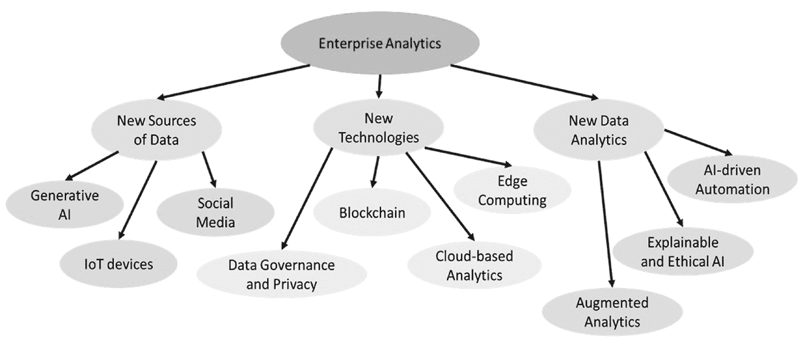

Fig. 10.1 The three key developments in enterprise analytics: (1) new data sources, (2) new technologies, and (3) new data analytics

### 2.1 New sources of Data

The concept of big data has been emerging in recent years, with enterprises expanding the volume, velocity, and variety of their data collection efforts (Ohlhorst, 2012). The big data collected comes from several primary sources of data, including social media, machine data, and transactional data. Machine data indicates any data generated from industrial equipment, sensors, smart meters, IoT devices, and cameras, to name a few. The transactional data refers to all daily transactional data taking place online or offline such as payments, receipts, invoices, and operational records. Besides these resources, recently AI and ML methods are considered as new sources for data generation as AI models often generate new insights with the potential to be used as new streams of data for other decision-making processes.

Traditional structured data is now complemented by unstructured data from social media, IoT devices, and multimedia content (Blazquez and Domenech, 2018). Companies utilize these diverse data sources for improved decision-making. Data analytics methods such as natural language processing and sentiment analysis aid with the extraction of new data from text data. These new data sources provide the opportunity for organizations to increase their sustainable practices. The new sources of data help with improving circular economy performance and evaluating sustainable strategies. For example, smart sensors on farm equipment can optimize irrigation, reduce water wastage, and stimulate sustainable farming (Javaid et al., 2022). Besides, organizations can monitor public opinion towards their sustainable strategies by developing measurable indexes (Lee and Kim, 2021). For example, a company can track the public’s response to its environmental initiatives on social media and receive public feedback (Cho et al., 2017). Table 10.1 provides examples of new sources of data available to organizations.

Table 10.1 Examples of sources of data available to enterprises

| Data Source | Description |
| --- | --- |
| IoT Devices | Sensor data from Internet of Things (IoT) devices. |
| Social Media | User-generated content from social media platforms. |
| Machine-generated Data | Data generated by AI and machine learning algorithms. |
| Blockchain | Immutable transaction data from distributed ledgers. |
| Geospatial Data | Location-based information from GPS and satellites. |

### 2.2 New Technologies

Enterprise analytics includes a range of cutting-edge technologies that empower organizations to employ the power of data for informed decision-making. Several examples include technologies for Data Governance and Privacy (Viljoen, 2021), Cloud-Based Analytics technologies (Khan et al., 2013), Blockchain (Swan, 2015), and Edge Computing (Shi et al., 2016).

Data governance is the management of data availability, usability, consistency, and security within an organization (Ladley, 2019). Privacy includes practices that protect sensitive data from unauthorized access. In enterprise analytics, data governance and privacy technologies include the implementation of policies, procedures, and tools to handle data securely. This includes data classification, access controls, and auditing mechanisms to track data usage. Recent advances in data governance and privacy include the development of automated tools for data classification, privacy impact assessments, and compliance monitoring (Janssen et al., 2020). Technologies such as artificial intelligence are used to detect anomalies and breaches in real-time, and blockchain technology is applied for immutable data records (Chithanuru and Ramaiah, 2023).

Cloud-based analytics includes running data analytics and processing tasks on cloud infrastructure rather than on-premises servers. It provides scalability and flexibility as organizations can access data from anywhere with an internet connection. Moreover, it helps businesses store and process large volumes of data while reducing the need for extensive IT infrastructure. Recent advancements in cloud-based analytics include serverless computing, multi-cloud, and hybrid cloud approaches that provide redundancy (Zhao et al., 2022).

Blockchain is also considered among enterprise analytics technologies as it serves as a platform for maintaining big data (Vo et al., 2018). Blockchain is a distributed ledger technology that records transactions within a network of computers and creates a transparent, tamper-proof, and secure record of data. Recent advances in blockchain include privacy-focused blockchains that create an environment for confidential transactions while still benefiting from blockchain’s security and transparency features.

Finally, edge computing processes data closer to the data source, rather than relying on centralized cloud servers (Pansara, 2022). Edge computing provides the opportunity for real-time analysis of data generated by IoT devices, sensors, and other endpoints, and reduces latency and bandwidth usage. Edge analytics platforms are becoming more advanced as they provide data preprocessing, predictive maintenance, and anomaly detection tools. Data governance, privacy practices, cloud-based analytics, and edge computing technologies complement the security and privacy of blockchain networks. These advancements make it possible to integrate blockchain into a broader range of sustainability applications.

### 2.3 New Data analytics approaches

新的企业数据分析方法代表了从数据中提取价值的创新方法。这些方法超越了传统的描述性分析，包括预测分析和处方分析（Lepenioti et al., 2020）。预测分析利用历史数据和实时数据预测未来趋势，帮助组织做出主动决策（McCarthy et al., 2022）。例如，预测分析可以帮助企业预测客户需求、优化库存并降低风险（Choi et al., 2018）。处方分析更进一步，它不仅预测结果，还提供可操作的建议以实现目标结果（Frazzetto et al., 2019）。这些方法使用高级算法、机器学习模型和优化策略来指导决策。预测分析和处方分析共同帮助组织优化运营并推动战略项目。Table 10.2 提供了现有数据分析方法的总结以及每个类别中常用的方法。

Table 10.2

| 分析技术 | 描述 | 示例方法 | 示例应用 |
| --- | --- | --- | --- |
| 描述性分析 | 通过历史数据分析过去事件。 | 数据汇总、可视化、报告。 | 追踪建筑物中的能源消耗模式 |
| 预测分析 | 利用历史数据和实时数据预测未来趋势。 | 预测、数据建模、机器学习。 | 评估未来碳排放。 |
| 处方分析 | 预测结果并提供可操作的建议。 | 高级算法、优化策略和基础模型 | 推荐可持续的供应链实践 |

广泛发展的数据分析技术包括 AI 驱动自动化、数据可视化工具、增强分析、基础模型和可解释 AI。AI 驱动自动化彻底改变了数据处理，并自动化了从数据准备到建模的任务。此外，先进可视化工具的发展为更广泛的受众提供了更具交互性和直观性的数据解释方式。增强分析或智能数据发现是企业分析的新一代，通过自动提取数据模式减少了对人工判断和专业知识的依赖（T. [Davenport and Fitts, 2021）。增强分析平台凭借 AI 为用户提供知识发现和推荐。基础模型在大规模数据上进行广泛预训练，为许多下游任务（如自然语言处理、计算机视觉和预测分析）提供灵活的基础，带来显著的性能提升和灵活性（Bommasani et al., 2021）。AI 的伦理使用以及可解释 AI（XAI）的兴起强化了信任和问责。这些进步 collectively 帮助组织利用数据做出更明智的决策。

### 3. The Value of Product Lifecycle Data for Sustainable Practices

通过产品生命周期管理系统收集产品生命周期数据对于实现现代商业运营的循环经济目标至关重要（Ren et al., 2019）。生命周期数据帮助组织做出降低环境影响并提升客户满意度的明智决策。收集产品生命周期数据的一个重要好处是能够个性化客户体验和产品服务系统（Hribernik et al., 2017）。企业可以通过分析产品的生命周期来定制服务，以满足个别客户需求。此外，产品生命周期数据有助于优化整个价值链，从原材料采购到制造、分销以及负责任的处置，通过促进各利益相关方之间的协作和责任分担（Chiang and Trappey, 2007; Jacobs and Subramanian, 2012）。

准确的产品生命周期数据是预测产品寿命的必要条件。这些数据帮助组织预测产品何时达到其有用寿命的终点，并规划负责任的处置、回收或再利用。监测消费习惯并实施预测性维护是产品生命周期数据的另一种用途。Figure 10.2 总结了产品生命周期数据在实现循环经济方面的好处示例，以及当前挑战和解决方案。

Fig. 10.2

| 产品生命周期数据的好处 | 产品生命周期数据的挑战 | 解决方案 |
| --- | --- | --- |
| * 个性化客户体验和定制服务 | * 数据碎片化和访问受限 | * 新兴数据来源 |
| * 优化价值链 | * 数据获取和管理 | * 创新数据收集方法 |
| * 预测产品寿命 | * 缺乏决策可操作信息 | * 高级数据分析 |
| * 监测消费习惯以实现预测性维护 | * 数据收集基础设施不足 | |

为阐明产品生命周期数据的应用，我们简要讨论两个案例研究：(1) 我们解释如何利用单个电池的生命周期数据预测使用行为并评估单个电池的未来可重用性，(2) 我们描述产品维修和保养日志数据如何辅助决策，如预测维修需求、产品寿命以及维修所需时间。


我们承认这些案例研究的数据是手动关联的，并非来自任何 PLM 或分布式系统。尽管这些案例研究不直接包含区块链，但它们展示了准确收集生命周期数据和产品序列化的潜在好处。手动收集产品生命周期数据不可行，因为当前实践存在数据可靠性和问责性问题。收集产品全生命周期数据的挑战包括缺乏一致的数据收集标准、数据所有权碎片化以及利益相关方协作有限。区块链作为不可篡改且透明的系统，可以克服部分这些问题，因为它在利益相关方网络中分布数据，消除了中心化权威的需求，并降低了数据丢失或篡改的风险。此外，区块链可以与物联网设备和传感器集成，自动在产品生命周期的每个阶段捕获和记录数据，从而减少对人工录入的依赖（C. H. Liu et al., 2018）。

### 3.1 Case study 1: User Consumption habits and forecasting product reusability

智能资产管理为用户提供在产品整个生命周期内监控产品的好处，并有可能延长产品生命周期，这也是循环经济的基石。本案例描述了如何通过收集单个设备的数据，帮助再制造商监测每个独特设备的性能，并根据个别用户的需求个性化服务。为便于理解概念，我们将回顾一例锂离子笔记本电池监测的案例。本案例中展示的数据是在三年内收集的，涉及 500 块在伊利诺伊州美国一所全女高中学生使用的笔记本电池，为此前发表的研究(Sabbaghi et al., 2015b, 2015a)的一部分。

该数据集包括电池重量、序列号、类型、电压、使用循环次数、满电容量、电池年龄以及学生班级。为解释数据集，Figure 10.3 (a) 展示了电池当前容量的箱线图，Figure 10.3 (b) 则说明了不同年龄电池的电压与当前容量之间的关系。数据的变异性凸显了收集单个设备数据的重要性。用户的充放电行为会影响使用循环次数和个体电池的生命周期。

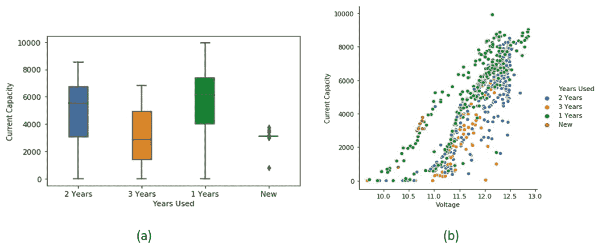

Fig. 10.3 (a) The current capacity, and (b) voltage versus current capacity of batteries with 1 year, 2 years, and 3 years of usage.

产品生命周期数据帮助再制造商根据剩余循环次数和未来可复用性，决定是回收还是退役电池。此外，二手市场上的产品可以根据其再利用和翻新潜力适当定价。例如，Figure 10.4 展示了 500 块电池在三年内的使用循环次数分布。若以 300 次使用循环为退化阈值，则可从使用循环分布及曲线下面积计算出电池剩余 200 次循环的可能性及未来可复用性。作者在此数据集上开展了电池可复用性研究。更多信息请参阅(Sabbaghi et al., 2015b, 2015a)。总体而言，汽车行业的 Carfax 概念可应用于其他智能设备，其中关于产品使用、维修和升级的数据能提供设备寿命及未来用户体验的信息。此外，产品生命周期数据还能帮助再制造商决定何时为个别设备提供升级、维修和保养服务。

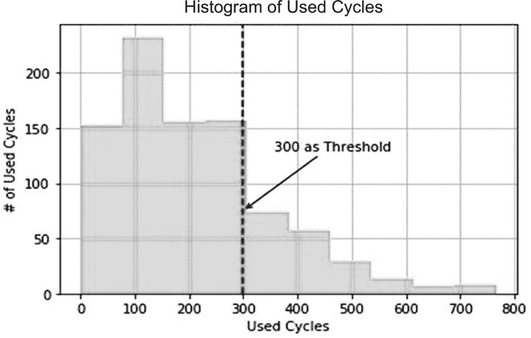

Fig. 10.4 The distribution of the number of used cycles

### 3.2 Case study 2: product Lifecycle Data for optimizing repair, Maintenance, and Upgrade Decisions

本案例讨论了三种医疗设备的维修和保养日志数据。它提供了产品故障频率和性质的描述性统计，以及平均故障时间、平均修复时间以及这些设备的总运行时间等信息。目标是展示如何利用这些数据帮助医疗提供者在购买设备时做出更明智的决策，同时展示维修车间如何通过数据优化人力资源配置和作业调度，以响应维修需求及特定维修要求。

数据包括三种重新品牌化的医疗设备：`M1`、`M2` 和 `P1`，它们均用于输注泵和多疗法。标签依据设备名称的首字母分配。Table 10.3 提供了这三类医疗设备的概览。`M1` 的单个设备数量最多，而 `P1` 的使用周期最长，约为 14 年（2004–2018）。

Table 10.3 Basic information of three product categories.

| Product Category | Function Description | Number of maintenance records | Number of individual products | First and last record date | The average of Failure count |
| --- | --- | --- | --- | --- | --- |
| `M1` | Infusion | 15903 | 1593 | 04-23-2004 / 06-24-2011 | 10 |
| `M2` | Pumps, | 4274 | 599 | 02-18-2004 / 10-10-2011 | 7 |
| `P1` | | 6085 | 805 | 01–06–2004 / 01–11–2018 | 8 |

这些设备的平均故障次数相似，均在 8 到 10 次之间，如 Table 10.3 所示。Table 10.4 展示了不同维修原因下的维修和保养记录数量。数据集包含 12 种故障原因，包括电池相关问题、随机故障以及未发现问题等。在这些原因中，主要的前三驱动因素是电池相关问题、随机故障以及未发现问题。

Table 10.4 The number of repair and maintenance records for each product for different reasons.

| Maintenance Description | `M1` | `M2` | `P1` |
| --- | --- | --- | --- |
| Battery Related (BR) | 5859 | 533 | 1887 |
| Random Failure (RF) | 5487 | 2229 | 826 |
| No Problem Found (NPF) | 2475 | 731 | 1251 |
| Modification/Upgrade (MU) | 571 | 87 | 812 |
| Use Error (UE) | 385 | 119 | 352 |
| Physical Damage (PD) | 240 | 111 | 640 |
| Random Software Failure (RSF) | 202 | 116 | 139 |
| Accessory Problem (AP) | 56 | 10 | 119 |
| PM Related (PMR) | 19 | 4 | 59 |
| Tech Support (RS) | 605 | 334 | 0 |
| Environment Related (ER) | 3 | 0 | 0 |
| Normal Retire/Replacement (NR) | 1 | 0 | 0 |

`M1` 和 `P1` 将电池相关问题作为主要维修需求，而 `M2` 的主要维修需求则归因于随机故障。

Figure 10.5 展示了每种产品的年度维修记录。Figure 10.5 (a) 说明了 2004 至 2007 年期间的趋势，三种产品呈现相似的模式，均在 2006 年达到首次维修高峰。`M1` 的趋势与 `M2` 和 `P1` 不同。2011 年后，仅剩少量 `P1` 产品在使用，而 `M1` 和 `M2` 似乎已退役，依据数据集来源。

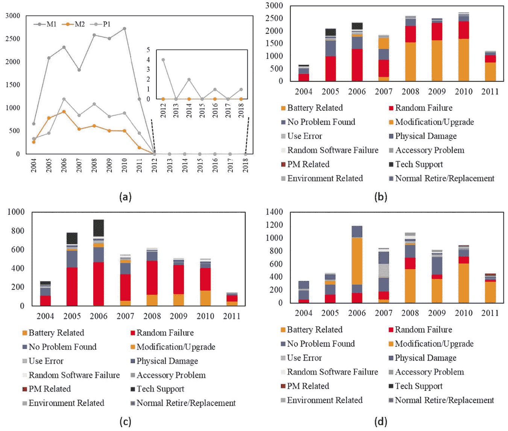

Fig. 10.5 Annual Maintenance Records: (a) All Failures, and Specific Reasons for (b) M1, (c) M2, and (d) P1

Figures 10.5 (b) 和 (c) 突出了电池相关维修，该类别在 2007 年后成为三种产品的主要维修原因。随机故障每年都作为 `M1` 和 `M2` 的主要维修原因。然而，2008 年后，电池相关问题成为 `M1` 和 `P1` 的主要维修需求。

我们可以查看每个设备的生命周期数据，以个性化每个设备的需求。Figure 10.6 展示了三个单独设备的产品生命周期分析：`M1` (`ID 01011043`)，`M2` (`ID 01001859`)，以及 `P1` (`ID 91015346`)。Table 10.5 通过提供关键指标，如 Mean Time Between Failure (`MTBF`)、Mean Time to Repair (`MTTR`)、Total Operating Time (`OT`) 和 Total Repairing Time (`RT`) 来补充此分析。


Fig. 10.6 Product Lifecycle Analysis for M1 (Product ID: 01011043), M2 (Product ID: 01001859), and P1 (Product ID: 91015346). Note: Operating time is measured in years, while all other units are in days. The abbreviation labels are described in Table 10.4.

Table 10.5 Information for Each Individual Device

| Product | ID | Failure count | MTTB (Days) | MTTR |
| --- | --- | --- | --- | --- |

区块链因其在记录和追踪产品生命周期数据方面的能力而闻名 (Matenga and Mpofu, 2023)。近期，由于其透明性、可追溯性和问责性等特点，区块链因循环经济原则而受到认可 (Centobelli et al., 2022)。区块链是一种去中心化、分布式账本技术，网络中的每个用户都能访问账本的复制品，且信息以透明性、不可篡改性和密码学完整性等特性安全记录在账本上。因此，对于在产品生命周期中传统上对数据安全和隐私有顾虑的各类利益相关者，区块链可以缓解这些顾虑。

## 5. 当前区块链的局限性

尽管具有不可篡改和可追溯性等能力，区块链技术仍面临一些局限性，如可扩展性挑战、高能耗、交易吞吐量有限、潜在的隐私问题以及缺乏适当的验证技术（即“最后一公里”问题） (Esmaeilian et al., 2024; Y. Lu, 2019; Zheng et al., 2018)。

“最后一公里”问题是在将数据记录到区块链账本之前，确认其准确性和真实性的挑战。区块链是不可篡改且防篡改的，因此这一挑战包含多种需要仔细考虑的复杂性。

已有多种方法和解决方案被提出以应对这一挑战。其中一种方案是使用 Oracle 服务。Oracle 指向受信的外部数据源或服务，为区块链网络提供现实世界的信息。Oracle 充当中介，验证并向区块链提供外部数据 (Ezzat et al., 2022)。另一种方法是使用数据验证协议。这些协议在将数据提交到区块链之前包含多个验证步骤。多签名方案 (Uganya and Baskar, 2023) 和去中心化自治组织（DAO）中的共识机制 (Wang et al., 2019) 可以用于确保多方在记录数据之前达成一致。此外，在数据记录到区块链之前添加额外的审计和验证层也是一种方案。这可以包括第三方审计员或自动化验证工具，将数据与预定义的标准进行比对 (Chen et al., 2022)。此外，智能合约可以被编程在数据被接受之前执行特定的检查和验证，包括逻辑检查、与其他数据源的交叉引用以及符合特定标准 (W. Lu et al., 2023)。此外，零知识证明等密码学技术允许数据提供者在不透露数据本身的情况下证明其数据的有效性 (Sun et al., 2021)。

解决数据验证和验证的最后一公里问题对于展示区块链技术的可信度至关重要，尤其是在供应链管理和可持续发展应用场景中。

除了上述方法，企业分析也为区块链网络上的现有数据验证问题提供了解决方案。通过传感器、物联网（IoT）、社交媒体数据以及高级机器学习和人工智能（AI）技术，可以解决“最后一公里”问题中部分挑战。举例来说，sensors and IoT devices 的实时数据可以持续输入区块链。这些设备提供地面信息，提高数据的及时性。此外，machine learning models 可用于验证接收到的数据。AI 算法可以检测异常或差异，识别潜在的不准确性。此外，机器学习和 AI 可以集成到智能合约中，实现自主决策，减少对人工干预的需求。同时，机器学习算法可以优化共识机制，在验证 incoming data 的真实性时，加快节点间的达成速度。此外，结合传感器、IoT 和社交媒体等多源数据，可以提高信息的可靠性。Advanced fusion techniques 可用于交叉验证和验证数据点，降低错误风险。数据融合是将新数据源与数据分析技术相结合，以交叉验证数据的过程。

## 6. 结论

本章探讨了企业分析与区块链的交叉点，以推进循环经济目标，重点在于促进产品生命周期期间的数据收集。受近期政策工具（如欧盟数字产品护照）的推动，本章通过两个案例研究强调了产品生命周期数据对可持续实践的重要性，并阐述了区块链在收集和管理这些数据方面的潜力。同时，还描述了企业分析如何通过提供新的数据来源、先进技术和高级数据分析，来补充可持续发展工作。这些进展帮助组织聚合多样化的数据流，优化运营，并实施可持续的决策。

随着组织越来越多地依赖区块链以确保数据完整性，“最后一公里”问题已成为一个关键挑战，需要解决准确的数据验证问题。企业分析可以通过提供实时数据集成、机器学习验证以及数据融合技术来缓解这一问题。

本研究存在若干局限性应予承认。所呈现的案例研究范围有限，可能无法代表所有行业或循环经济实践。此外，案例研究中收集的数据是手动获取的。尽管本章讨论了区块链和企业分析的理论框架及潜在收益，但这些概念仍需通过未来的实际实施进行验证。此外，本研究主要描述了可持续性的技术方面，即区块链和企业分析，但未探讨基于可持续性的新商业模式和价值驱动策略的作用。要实现真正的可持续实践，企业应重新思考其商业结构，创新以解决社会问题并实现可持续性。

将企业分析与区块链技术集成以实现循环经济目标，开辟了未被探索的潜力。未来工作包括探讨数据收集和共享的伦理影响，研究区块链网络的可扩展性挑战以及开发新的数据来源和分析方法，以及在实践中成功实施的案例，展示组织在更加可持续和以客户为中心的未来中的成功。

**Acknowledgment**

美国国家科学基金会为 Hao-yu Liao 和 Sara Behdad 的研究提供了在第 `#2324950` 号拨款下的财政支持。本材料中表达的任何观点、发现、结论或建议均为作者的意见，不一定反映国家科学基金会的观点。

- Ahlers, J., Hemkhaus, M., Hibler, S. and Hannak, J. (2021). Analysis of Extended Producer Responsibility Schemes: Assessing the performance of selected schemes in European and EU countries with a focus on WEEE, waste packaging, and waste batteries. adelphi consult GmbH. Retrieved from [https://erp-recycling.org/wp-content/uploads/2021/07/adelphi_study_Analysis_of_EPR_Schemes_July_2021.pdf](https://erp-recycling.org/wp-content/uploads/2021/07/adelphi_study_Analysis_of_EPR_Schemes_July_2021.pdf).

- Blazquez, D. and Domenech, J. (2018). Big Data sources and methods for social and economic analyses. Technological Forecasting and Social Change, *130*, 99–13.

- Bommasani, R., Hudson, D.A., Adeli, E., Altman, R., Arora, S., von Arx, S., Bernstein, M.S., Bohg, J., Bosselut, A. and Brunskill, E. (2021). On the opportunities and risks of foundation models. ArXiv Preprint ArXiv: 2108.07258.


- Centobelli, P., Cerchione, R., Del Vecchio, P., Oropallo, E. and Secundo, G. (2022). Blockchain technology for bridging trust, traceability and transparency in circular supply chain. Information & Management, *59*(7), 103508.

- Chen, L., Fu, Q., Mu, Y., Zeng, L., Rezaeibagha, F. and Hwang, M.-S. (2022). Blockchain-based random auditor committee for integrity verification. Future Generation Computer Systems, *131*, 183–193.

- Chiang, T.-A. and Trappey, A.J.C. (2007). Development of value chain collaborative model for product lifecycle management and its LCD industry adoption. International Journal of Production Economics, *109*(1–2), 90–104.

- Chithanuru, V. and Ramaiah, M. (2023). An anomaly detection on blockchain infrastructure using artificial intelligence techniques: Challenges and future directions–A review. Concurrency and Computation: Practice and Experience, *35*(22), e7724.

- Cho, M., Furey, L.D. and Mohr, T. (2017). Communicating corporate social responsibility on social media: Strategies, stakeholders, and public engagement on corporate Facebook. Business and Professional Communication Quarterly, *80*(1), 52–69.

- Choi, T., Wallace, S.W. and Wang, Y. (2018). Big data analytics in operations management. Production and Operations Management, *27*(10), 1868–1883.

- Davenport, T. and Fitts, J. (2021). AI Can Help Companies Tap New Sources of Data for Analytics. Harvard Business Review. [`https://hbr.org/2021/03/ai-can-help-companies-tap-new-sources-ofdata-for-analytics`](https://hbr.org/2021/03/ai-can-help-companies-tap-new-sources-ofdata-for-analytics)

- Davenport, T.H. (2013). Enterprise analytics: Optimize performance, process, and decisions through big data. Pearson Education.

- Esmaeilian, B., Jamison, M., Sarkis, J. and Behdad, S. (2024). Designing Future Sustainable Cryptocurrencies: Principles and Expectations. In Blockchain and Smart-Contract Technologies for Innovative Applications (pp. 59–87). Springer.

- Ezzat, S.K., Saleh, Y.N.M. and Abdel-Hamid, A.A. (2022). Blockchain oracles: State-of-the-art and research directions. IEEE Access, *10*, 67551–67572.

- Frazzetto, D., Nielsen, T.D., Pedersen, T.B. and Šikšnys, L. (2019). Prescriptive analytics: a survey of emerging trends and technologies. The VLDB Journal, *28*, 575–595.

- Gopalakrishnan, P.K. and Behdad, S. (2019). A Conceptual Framework for Using Videogrammetry in Blockchain Platforms for Food Supply Chain Traceability. ASME 2019 International Design Engineering Technical Conferences and Computers and Information in Engineering Conference.

- Günther, W.A., Mehrizi, M.H.R., Huysman, M. and Feldberg, F. (2017). Debating big data: A literature review on realizing value from big data. The Journal of Strategic Information Systems, *26*(3), 191–209.

- Gupta, S., Chen, H., Hazen, B.T., Kaur, S. and Gonzalez, E.D.R.S. (2019). Circular economy and big data analytics: A stakeholder perspective. Technological Forecasting and Social Change, *144*, 466–474.

- Hribernik, K., Franke, M., Klein, P., Thoben, K.-D. and Coscia, E. (2017). Towards a platform for integrating product usage information into innovative product-service design. 2017 International Conference on Engineering, Technology and Innovation (ICE/ITMC), *1407*–1413.

- Ibarra, D.S., Li, F., Zhu, J. and Chen, J. (2024). Blockchain application to the processes in material design, production, distribution, and disposal: A survey. Journal of Industrial Information Integration, *100638*.

- Jabbour, C.J.C., de Sousa Jabbour, A.B.L., Sarkis, J. and Godinho Filho, M. (2019). Unlocking the circular economy through new business models based on large-scale data: an integrative framework and research agenda. Technological Forecasting and Social Change, *144*, 546–552.

- Jacobs, B.W. and Subramanian, R. (2012). Sharing responsibility for product recovery across the supply chain. Production and Operations Management, *21*(1), 85–100.

- Janssen, M., Brous, P., Estevez, E., Barbosa, L.S. and Janowski, T. (2020). Data governance: Organizing data for trustworthy Artificial Intelligence. Government Information Quarterly, *37*(3), 101493.

- Javaid, M., Haleem, A., Singh, R. P., & Suman, R. (2022). Enhancing smart farming through the applications of Agriculture 4.0 technologies. International Journal of Intelligent Networks, *3*, 150–164.

- Kahya, A., Avyukt, A., Ramachandran, G.S. and Krishnamachari, B. (2021). Blockchain-enabled Personalized Incentives for Sustainable Behavior in Smart Cities. 2021 International Conference on Computer Communications and Networks (ICCCN), *1*–6.

- Khan, Z., Anjum, A. and Kiani, S.L. (2013). Cloud based big data analytics for smart future cities. 2013 IEEE/ACM 6th International Conference on Utility and Cloud Computing, *381*–386.

- Kunz, N., Mayers, K. and Van Wassenhove, L.N. (2018). Stakeholder views on extended producer responsibility and the circular economy. California Management Review, *60*(3), 45–70.

- Ladley, J. (2019). Data governance: How to design, deploy, and sustain an effective data governance program. Academic Press.

- Leclerc, S.H. and Badami, M.G. (2020). Extended producer responsibility for E-waste management: Policy drivers and challenges. Journal of Cleaner Production, *251*, 119657.

- Lee, R. and Kim, J. (2021). Developing a social index for measuring the public opinion regarding the attainment of sustainable development goals. Social Indicators Research, *156*, 201–221.

- Lepenioti, K., Bousdekis, A., Apostolou, D. and Mentzas, G. (2020). Prescriptive analytics: Literature review and research challenges. International Journal of Information Management, *50*, 57–70.

- Liao, H., Boregowda, K., Cade, W. and Behdad, S. (2021). Machine Learning to Predict Medical Devices Repair and Maintenance Needs. International Design Engineering Technical Conferences and Computers and Information in Engineering Conference, *85413*, V005T05A012.

- Liao, H., Cade, W. and Behdad, S. (2021). Markov chain optimization of repair and replacement decisions of medical equipment. Resources, Conservation and Recycling, *171*, 105609.

- Liao, H., Cade, W. and Behdad, S. (2022). 预测医疗器械的维修和保养服务，使用支持向量机。Journal of Manufacturing Science and Engineering, *144*(3), 31005.

- Liu, C. H., Lin, Q. and Wen, S. (2018). 基于深度增强学习的工业物联网区块链数据收集与共享。IEEE Transactions on Industrial Informatics, *15*(6), 3516–3526.

- Liu, X. L., Wang, W.M., Guo, H., Barenji, A.V., Li, Z. and Huang, G.Q. (2020). 工业区块链框架在工业 4.0 中用于产品全生命周期管理。Robotics and ComputerIntegrated Manufacturing, *63*, 101897.

- Lu, W., Lou, J. and Wu, L. (2023). 结合智能建筑物启用的区块链或 acles 和签名技术，确保建筑信息的真实性和完整性。Journal of Computing in Civil Engineering, *37*(6), 4023031.

- Lu, Y. (2019). 区块链：现状与研究挑战。Journal of Industrial Information Integration, *15*, 80–90.

- Matenga, A.E. and Mpofu, K. (2023). 基于供应链管理的区块链产品全生命周期管理在铁路车辆翻新中的应用。Procedia CIRP, *116*, 486–491.

- McCarthy, R.V., McCarthy, M.M., Ceccucci, W., Halawi, L., McCarthy, R.V., McCarthy, M.M., Ceccucci, W. and Halawi, L. (2022). 预测分析的应用。Springer。

- Ohlhorst, F.J. (2012). 大数据分析：将大数据转化为大金钱（第 65 卷）。John Wiley & Sons。

- Pansara, R.R. (2022). 边缘计算在主数据管理中：在源头增强数据处理。International Transactions in Artificial Intelligence, *6*(6), 1–11.

- Petrović, E.K., Brent, A.C., Iorns Magallanes, C., Hamer, L. and van Eijck, D. (2022). 区块链用于供应链账本：追踪建筑材料的毒性信息。In Blockchain for Construction (pp. 89–111)。Springer。

- Ren, S., Zhang, Y., Liu, Y., Sakao, T., Huisingh, D. and Almeida, C.M.V.B. (2019). 综合回顾整个产品生命周期中的大数据分析，以支持可持续智能制造：框架、挑战和未来研究方向。Journal of Cleaner Production, *210*, 1343–1365.

- Sabbaghi, M., Esmaeilian, B., Raihanian Mashhadi, A., Cade, W. and Behdad, S. (2015a). 基于消费者使用行为评估产品未来可重用性：对锂离子笔记本电池的启示。ASME 2015 International Design Engineering Technical Conferences & Computers and Information in Engineering Conference (IDETC/CIE 2015).


-   Sabbaghi, M., Esmaeilian, B., Raihanian Mashhadi, A., Cade, W. and Behdad, S. (2015b). 基于消费者实际使用行为评估锂离子笔记本电池的可重用性。Journal of Mechanical Design, *137*(12), 124501。
-   Shi, W., Cao, J., Zhang, Q., Li, Y. and Xu, L. (2016). 边缘计算：愿景与挑战。IEEE Internet of Things Journal, *3*(5), 637–646。
-   Stodt, F., Maisch, N., Ruf, P., Lechler, A., Riedel, O. and Reich, C. (2024). 基于区块链的数字产品护照，实现协作智能生产供应链。2024.
-   Stodt, J., Jastremskoj, E., Reich, C., Welte, D. and Sikora, A. (2019). 使用区块链技术对工业 4.0 维护流程的使用案例进行形式化描述。2019 10th IEEE International Conference on Intelligent Data Acquisition and Advanced Computing Systems: Technology and Applications (IDAACS), *2*, 1136–1141.
-   Sun, X., Yu, F. R., Zhang, P., Sun, Z., Xie, W. and Peng, X. (2021). 零知识证明在区块链中的调查。IEEE Network, *35*(4), 198–205.
-   Swan, M. (2015). 区块链：新经济的蓝图。O’Reilly Media, Inc.
-   Uganya, G. and Baskar, R. (2023). 修改的椭圆曲线密码签名方案，以增强加密货币的安全性。Computer Systems Science & Engineering, *45*(1)。
-   Unruh, G., Kiron, D., Kruschwitz, N., Reeves, M., Rubel, H. and Zum Felde, A.M. (2016). 投资可持续未来：投资者比许多高管更关注可持续性。MIT Sloan Management Review, *57*(4)。
-   Viljoen, S. (2021). 数据治理的关系理论。Yale LJ, *131*, 573。
-   Vo, H.T., Mohania, M., Verma, D. and Mehedy, L. (2018). 区块链驱动的大数据分析平台。Big Data Analytics: 6th International Conference, BDA 2018, Warangal, India, December 18–21, 2018, Proceedings, *6*, 15–32.
-   Walden, J., Steinbrecher, A. and Marinkovic, M. (2021). 数字产品护照作为循环经济的推动者。Chemie Ingenieur Technik, *93*(11), 1717–1727.
-   Wang, S., Ding, W., Li, J., Yuan, Y., Ouyang, L. and Wang, F.-Y. (2019). 分布式自主组织：概念、模型和应用。IEEE Transactions on Computational Social Systems, *6*(5), 870–878.
-   World Business Council for Sustainable Development. (2023). 欧盟数字产品护照塑造价值链的未来：它是什么以及如何准备。
-   Zhao, H., Benomar, Z., Pfandzelter, T. and Georgantas, N. (2022). 支持服务器 less 计算中的多云。2022 IEEE/ACM 15th International Conference on Utility and Cloud Computing (UCC), *285*–290.
-   Zheng, Z., Xie, S., Dai, H.-N., Chen, X. and Wang, H. (2018). 区块链挑战与机遇：调查。International Journal of Web and Grid Services, *14*(4), 352–375.

# 11 Blockchain’s Transformative Potential for Circular Economy Laws and Policies

Katrien Steenmans^(²⁵)

Email: ine.steenmans@ucl.ac.uk², phillip.taylor@warwick.ac.uk³

Corresponding author: katrien.steenmans@jur.ku.dk

## 1. Introduction

Planetary boundaries define the levels at which humans and other species can safely operate without risking major global human-induced environmental change (Rockström et al., 2009; Richardson et al., 2023). Most planetary boundaries are reached by the deposit of waste back into the environment (Richardson and Bai, 2023): climate change, novel entities (i.e. anthropogenic introductions such as synthetic chemicals and substances, genetically modified organisms, and anthropogenically mobilised radioactive materials), stratospheric ozone depletion, atmospheric aerosol loading, ocean acidification, and biochemical flows (Rockström et al., 2009; Richardson et al., 2023).²⁶

循环经济从线性的取-制-弃经济转向一个资源使用和废弃物产生被最小化的系统，如果资源被使用和废弃物被产生，它们会通过重复使用、回收和回收“循环”回去。循环经济的引入和实施主要依赖于自愿方案和行业自律的发展，只有最近才出现越来越多的明确促进该概念的法律和政策（Lesniewska and Steenmans, 2023）。这些法律和政策工具存在若干局限性。例如，缺乏对该概念的通用法律理解。法律和政策中的有限定义通常围绕以下两点：(1) 最小化资源消耗并防止废弃物的产生，(2) 在生产和消费过程中对废弃物和资源进行再利用和回收（Lesniewska and Steenmans, 2023）。此外，还认识到循环经济需要纳入社会维度，包括正义和公平（Friant et al., 2020; Schröder, 2020; Lesniewska and Steenmans, 2023），这与其他干预措施日益强调的公正转型需求相呼应（如气候变化和摆脱化石燃料；见 McCauley and Heffron, 2018; Wang and Lo, 2021）。这些循环经济转型无疑支持地球法（Earth jurisprudence）的呼吁——即治理应以地球为中心而非以人类为中心，包括承认自然权利框架，将法视为社会转型的必要工具（Kauffman and Martin, 2021；见也：Rühs and Jones, 2016; Graham and Maloney, 2019; Graham et al., 2024）。

循环经济修辞的一个特点是宣称可以为各类利益相关者带来多重好处。这些好处的估算包括：到 2030 年，循环经济在欧洲联盟（EU）可创造 700,000 个新工作岗位（Cambridge Econometrics et al., 2018），财务收益预计在 2030 年欧洲约为 1.8 万亿欧元，2040 年中国约为 10 万亿美元（Ellen MacArthur Foundation and McKinsey Centre for Business and Environment, 2015; Ellen MacArthur Foundation and Arup, 2018），而循环经济在缓解气候影响方面也至关重要，因为 67%的全球温室气体排放与物质管理有关（Circle Economy, 2020）。

尽管宣称了诸多好处，循环经济概念目前的实施方式往往强化现状和业务-as-usual。声称追求循环经济转型的行动通常侧重于回收（而非减少资源使用和防止废弃物），以及创建二次原材料市场（Steenmans and Lesniewska, 2023）。如果概念以持续、象征性的方式使用而不改变实践和行为，它可能成为营销工具，参与绿色洗白（greenwashing）活动，即传播误导性的环境声明（见 de Freitas Netto et al., 2020; Konietzko et al., 2023; Steenmans and Lesniewska, 2023）。此外，循环经济转型的速度和规模均不足以引发系统性变革（European Court of Auditors, 2023; Lesniewska and Steenmans, 2023）。现有做法不足，还需要额外的干预措施来促进必要的变化。技术在循环经济法律和政策中被视为一种可能的广泛赋能杠杆（见 Section 2.2）。同样，循环经济倡导者经常将“数字化 … 视为快速在各行业各层面大规模提升循环性的基石”（Lesniewska and Steenmans, 2023, p. 144）。综上，所有这些修辞都强化了区块链作为推动循环经济的重要赋能工具的形象（França et al., 2020; Narayan and Tidström, 2020; Böckel et al., 2021; Kuae and Machado, 2021; Upadhyay et al., 2021; Gong et al. 2022; Basile et al., 2023; 参见第 2 节）。

为了在高层热情之外，转向关于负责任创新选择的讨论，需要更详细地探讨区块链通过哪些路径促成全球资源系统的最终循环转型。鉴于我们此时可能仍处于区块链技术发展的早期阶段，其他学者和实践者应当迫切参与探索区块链可能通向更广泛应用的多种多样的未来路径。只有通过更广泛的 deliberation，我们的假设和心智模型才可能改变，以及我们对相关收益和风险的理解也能够超越现状进行挑战。

本章的目的并非为读者提供预测性或甚至指令性的区块链促成循环经济变革路径的框架。相反，我们希望呈现一系列具 illustrative（说明性的）区块链相关路径的示例，作为思考和想象替代可持续未来的提示。下一节首先介绍*目前已识别的区块链在促进循环经济转型中的用途*。我们基于学术文献和实践中的区块链应用经验，总结当前区块链推动循环经济转型的用途、所面临的挑战，以及相关法律和政策在支持这些用途中的具体作用。第 3 节随后呈现四条路径，更详细地说明*区块链将如何支持法律和政策，以实现全球循环经济系统的有效转型*。最后，第 4 节简要反思进一步工作的空间，以深化我们对区块链在循环经济背景下的变革潜力的认识。

## 2. Blockchain and A circular Economy

区块链被学者公认为是实现循环经济效益的关键技术（例如 França et al., 2020; Narayan and Tidström, 2020; Taylor et al., 2020; Böckel et al., 2021; Kuae and Machado, 2021; Steenmans et al., 2021a; Upadhyay et al., 2021; Gong et al. 2022; Basile et al., 2023）。其最核心的固有特征通常被认为是去中心化和透明度（Narayan and Tidström, 2020; Roschko and Peterson, 2022; Upadhyay et al., 2022; Basile et al., 2023）。这些特征使得区块链能够为循环经济提供诸如供应链中资源和废弃物的溯源以及相关信息的可信度提升等好处（França et al., 2020; Böckel et al., 2022; Cao et al., 2022; Powell et al., 2023）。进一步，这些好处可通过改善信息共享、降低交易成本、提升绩效、提高资源利用率以及降低供应链碳足迹来推动循环经济（Böckel et al., 2021; Upadhyay et al., 2021; Roschko and Peterson, 2022）。

与若干理论预期好处形成对比，区块链技术的三大主要功能主要是实际努力的焦点，旨在推动循环经济的实践与实验（Steenmans et al., 2021a）：

1.  *加密货币支付（包括基于加密货币的再利用和回收奖励）* (Steenmans et al., 2021a; Gong et al., 2022)：这指的是使用加密货币进行促进再利用、回收或其他恢复实践的交易。该类别的应用并不局限于循环经济，因为此类支付同样可用于线性的取-制-废弃生产与消费流程。特定于循环性的子类是基于加密货币的再利用和回收奖励，其本质是通过奖励用户进行特定的“循环”行为（如投递可再利用或回收的废弃物）来直接激励用户行为（Steenmans et al., 2021a; Smajgl and Schweik, 2022）。
2.  *废弃物的监测与追踪*（Kuae and Marcelo, 2021; Steenmans et al., 2021a; Walden et al., 2021; Gong et al., 2022）：区块链可用于记录资源与废弃物交易的数据，如资源和废弃物的溯源、收集的废弃物数量、废弃物种类等。这些信息随后可用于制定和支持旨在最小化特定资源使用并通过提升分类促进回收的法律与政策。
3.  *智能合约的实现*（Steenmans et al., 2021a）：前两类属于应用层面，而智能合约主要是实现手段；前两类功能可以通过智能合约实现。其本质是一段可用于数字化执行、监控或强制协议的计算机程序和数据（Natanelov et al., 2022）。此类交易的自动化可降低行政负担并提升成本效率，从而促进循环经济的实现（Steenmans et al., 2021a）。

### 2.1 挑战

区块链在循环经济领域的倡议面临多项挑战。在实施前，可能需要承担显著的初始成本来部署该技术（Upadhyay et al., 2021）。这或许部分解释了为什么区块链在循环经济中的采用仍主要停留在演示和试点阶段（Kouhizadeh et al., 2020; Kuae and Machado, 2021; Steenmans et al., 2021a）。截至目前有限的经验表明，主要挑战与基础设施相关，包括互操作性失败、技术安全性以及稳定性问题，以及管理能力与技术发展之间的不匹配（Kouhizadeh et al., 2020; Jiang et al., 2023）。此外，仍有“输入即输出”的担忧：确保仅将诚实且正确的数据记录在区块链上（Powell et al., 2022; 参见 Sedlmeir et al., 2022 关于此类挑战在绿色能源标签与认证方面的示例）。毫无疑问，随着区块链在循环经济领域的更广泛应用，还会继续发现新的挑战。

区块链也因其高能耗及随之产生的负面环境影响而受到批评——常引用比特币所使用的计算密集型工作证明（proof‑of‑work）共识算法（Steenmans et al., 2021a）。这种能源足迹将抵消区块链对循环转型的任何积极贡献，因为可持续的能源消费是实现循环经济的必要条件（Steenmans, 2021）。相反，越来越多的研究提供了证据表明区块链可以提升环境可持续性（Ahl et al., 2022; Parmentola et al., 2022; Tawiah et al., 2022），尤其是在采用面向环境的替代共识方式时（Powell et al., 2021）。

在讨论区块链技术时，应避免将其描述为实现循环经济目标的“万能药”（Steenmans et al., 2021a, 2021b）。区块链不应被宣传为循环经济转型的“快速解决方案”，因为它简化了复杂的挑战，导致了技术决定论（Morozov, 2013）。它甚至不是必要工具，因为区块链的好处可以通过其他手段实现，例如其他数据账本可以促进信息共享。此外，在采用区块链时，还需与其他技术配合，因为它本身并不能实现可持续设计或最大化产品使用（Böckel et al., 2021; Steenmans et al., 2021b）。尽管如此，区块链仍可作出有价值的贡献，因为它能够实现促进良好治理并便利多方参与的某些特性（Steenmans et al., 2021a; 见 Section 3 以获取更多贡献）。


This section provides only a snapshot of some of the challenges that exist. There are other general issues of blockchain technology, such as security issues (hackers and show dealing) and public perception, which are not specific to circular resource and waste management applications (`Jiang et al., 2023`). Further discussion of general challenges is available elsewhere in this book in relation to other applications and contexts, as well as other scholarly discussions (e.g., `Ziolkowski et al., 2020`; `Ye at al. 2021`). Having set out the wider context of opportunities and challenges for blockchain technology facilitating circular economy transitions, we discuss the role of law and policy within this context in the following subsection.

### 2.2 The role of Law and policy

Amongst the myriad of individual and collective levers for governing the alignment of technological innovation and sustainable development, law and policy offer a critical set of powerful instruments to influence and steer the behaviours of diverse stakeholder groups and, in the long-term, strengthen or weaken some of their underlying mechanisms of change.

Within the legal landscape, blockchain is generally not yet explicitly linked to the circular economy (`Steenmans et al., 2021b`). Across the laws examined by `Steenmans et al. (2021b)`, only the EU’s non-legally binding Circular Economy Action Plan²⁷

Simultaneously, laws may inhibit blockchain adoption. Barriers identified include: legal uncertainty, data protection rules, ineffectiveness of current laws, and lack of regulation (`Steenmans et al., 2021a`; `Cao et al., 2022`; `Jiang et al., 2023`).

Yet, the law is necessary: the three current categories of blockchain-based applications discussed earlier can be implemented in a way that is contrary to circular approaches. Complementary targets and objectives are therefore needed in laws to guide the way in which blockchain is adopted. There may also be an increase in importance of the role of technology within laws as a result of increased complexity in supply chains and focus on technological development. For example, the proposed EU directive on common rules promoting the repair of goods requires information to be made available to consumers (`European Commission, 2023`). It does not clarify how, but a technology like blockchain is needed to record the significant amount of information that is required to support monitoring of this proposed directive. Blockchain can also be used to support compliance with legal tools such as extended producer responsibility, bans, and taxes, as well as to facilitate a plastic credits market similar to carbon credits (`Kuae and Machado, 2021`).

In the next section we bring together the previous high-level summaries of *what* uses have been imagined for blockchain in circular economy projects, to richer description of *how* blockchain will interlink with requisite legal and policy actions to facilitate circular transitions.

## 3. Blockchain's Transformative Potential for circular Economy Transitions

Building on our previous work, which is based on empirical research including a review of more than 20 blockchain technology-based initiatives and interviews (`Taylor et al. 2020`; `Steenmans et al., 2021a`, `2021b`), we discuss four pathways of change for illuminating blockchain’s transformative potential for circular economy transitions: (1) facilitating equitable participation, (2) reframing rights, (3) distributing responsibility, and (4) transgressing boundaries of public and private law spheres.

### 3.1 Facilitating Equitable participation

Blockchain technology-based initiatives facilitate multiple stakeholder interactions. In `Steenmans et al. (2021a)`, we observed that public, private, and third sector actors implement such initiatives within waste management for the benefit of a multiplicity of actors, including government authorities, private sector organisations, as well as civil society. Blockchain can promote social inclusion of low-income and marginalised populations and the informal waste sector (`França et al., 2020`; `Gong et al., 2022`), in part through its open and distributed architecture, and its ability to monetise opportunities for informal economy workers to earn incomes from recycling (`França et al., 2020`; `Gong et al., 2022`). The Plastic Bank (`plasticbank.com`), for example, uses blockchain to securely execute plastic transactions that reward community members of vulnerable coastlines with bonuses that provide, inter alia, groceries, cooking fuel, school tuition, health insurance, digital connectivity, and fintech services in return for bringing in ocean-bound plastic waste (`Plastic Bank, 2023a`). This is supported by an app, which has a digital wallet that “is often the first savings account that `Plastic Bank’s` members own” (Plastic Bank, 2023b).

Including the informal waste sector is critical, as they are a key contributor to recycling processes and are needed to deliver an inclusive, sustainable circular economy (`Ezeah et al., 2013`; `Sengupta et al., 2022`; `Velis et al., 2022`). The informal waste sector comprises stakeholders (individuals, groups, and micro-enterprises) not included in formal waste management operations, such as street waste-pickers who recover waste from the streets (`Aparcana, 2017`). The informal recycling sector alone, for example, is estimated to collect around 27.4 million tonnes of plastic (`Lau et al., 2020`; `Velis et al., 2022`). It, however, differs greatly between sectors and regions—the sector contributes significantly in both developing and transition countries (`Ezeah et al., 2013`), as well as other countries, such as in Norway where the informal sector in clothes reuse is “probably more important than the pecuniary markets” (`Laitala and Klepp, 2017`, p. 74). Furthermore, in many contexts and sectors, the formal and informal waste sectors are interdependent (`Grant and Oteng-Ababio, 2016`; `Rendon et al., 2021`). The waste management sector is thus a complex and sprawling landscape with a vast range of actors, which blockchain can support in mapping, understanding, and engaging with through facilitating monitoring and tracking.

Simultaneously, there are challenges to overcome to ensure blockchain can facilitate inclusion. `de Jesus and Mendonça (2018)` identify general technical barriers to circular economy transitions, including lack of sufficiently educated and specialised persons and other dimensions of digital inclusion such as access, affordability, and the ability to use digital platforms effectively. Implementing blockchain-based solutions may thus exacerbate such barriers by requiring a high level of technological literacy amongst stakeholders (`Oberhauser, 2019`). Otherwise, intermediaries are needed, which then negates the decentralised and empowering character of blockchain (`McQueenie et al., 2024`; `Oberhauser, 2019`).

In examining blockchain for environmental governance, particularly for payments for ecosystem services, `Oberhauser (2019)` concluded that:

> “区块链智能合约的去中心化和不可篡改的特性不太可能被用于解决复杂的自然资源共同管理中的公平分配和利益分配问题 … 这主要是因为相关利益方对区块链技术的可及性不足，导致高度依赖可信的中介机构。因此，区块链的区分特性大多被削弱，真正的参与性做法也被排除在外”（第 13–14 页）。

还有正义方面的考量，需要保持微妙的平衡。继续依赖如塑料银行（Plastic Bank）等倡议偏离了环境法的基本原则，如“污染者付费”（即产生污染的一方应承担管理损害对人类健康或环境的费用）和“就近处理”（即废弃物应尽可能在产生地附近进行管理）等原则。然而，过度关注废弃物预防可能会剥夺非正式部门的收入。因此，一些学者主张对非正式回收部门进行正式化，以帮助提升回收者的权能、提高效率以及改善生活和工作条件（Wilson et al., 2006; Medina, 2008; Aparcana, 2017）。然而，治理响应必须精心设计，确保该部门不被定罪，并避免产生其他问题（Goldstein, 2016）。因此，还需要进一步研究如何在循环经济转型中纳入非正式部门，以及像区块链等技术可能发挥的作用——例如在映射和动员实现可持续且公平的循环资源与废弃物管理所需的多元利益相关者时，考虑资源、技能和能力需求。Lesniewska and Steenmans (2023) 将这一需求概括为：

> “对数字技术如何融入[循环经济]系统以及其公平正义影响（如对材料和财富流动的获取、利益分享、监测与隐私、数字排除与歧视）的法律研究需要列入议程”（第 144 页）。

### 3.2 重新定义权利

实现循环经济需要对当前线性经济体系及生产消费流程进行根本性变革。实现这些变革的方式包括挑战我们对产品使用方式的现有观念。我们关注两个例子：（1）维修权，以减少产品老化并延长产品生命周期；（2）重新思考当前占主导地位的财产权和所有权观念，转向共享经济模式。


在循环经济中，目标往往包括延长产品寿命并减少计划性老化，即产品被设计成快速老化以推动提取、生产和消费（Bedford et al., 2021）。维修权法律和政策旨在应对这种计划性老化。它们已被越来越多地采用，例如在澳大利亚、欧盟、法国、英国以及美国纽约州和纽约州（并不限于这些地区）实施相关法律。欧盟委员会提出了《促进商品维修的共同规则指令草案》（European Commission, 2023），该指令要求向消费者提供“欧洲维修信息表”（European Commission, 2023，第 4 条），该表格需包含维修方的身份和联系信息以及维修服务的相关信息（European Commission, 2023，附件 I）。维修方定义为：

> “与其所从事的行业、业务、手艺或职业相关的任何自然人或法人，提供维修服务，包括生产商和销售商提供的维修服务，以及独立或与生产商或销售商关联的维修服务提供者”（European Commission, 2023，第 2 条第 2 款）。

因此，根据产品不同，需要存储大量信息。例如，如果冰箱部件损坏，维修方是该部件的生产商或销售商，还是冰箱（若与部件不同）的销售商，又或是第三方？维修方必须在销售合同中明确，但具体情形可能有所不同。因此，可能需要在不同利益相关者之间存储关于各类产品组件以及整体产品的大量信息。区块链提供的可追溯性可以支持国家层面实施该指令，通过提供实现维修所需的溯源信息数据库。

Hernandez 等人（2020）指出阻碍可维修性的因素包括：缺乏对产品工作原理的了解、缺少备件、技术信息、受限合同、缺乏经济激励去维修产品、缺乏情感和经济 Attachment（对产品的情感与经济 Attachment）、以及缺乏允许维修的设计和制造特征。虽然“识别生产商”未被列为问题，但此类溯源信息可以为阐明其他问题提供入口，例如提供机械细节或列出有用联系人。当维修不可行时，关于产品内容的信息也有助于回收和资源回收，因为回收未知材料常面临诸多挑战。

此外，循环经济可能涉及更多的共享。共享经济被 Plewnia and Guenther (2017) 广义定义为“促进材料、产品、产品服务、空间、金钱、劳动力、知识或信息在盈利或非盈利交易以及多种市场结构中共享的活动或平台”（第 576 页）。共享经济与循环经济概念相互关联，共享经济可视为循环经济的子集，但两者关系的深入理解仍需进一步探讨（Henry et al., 2021）。图书馆是共享系统的典型例子，但显示分布式区块链技术并非必需，因为图书馆拥有明显的中央权威（即图书馆本身）以及悠久的传统。如果图书馆模式转向不依赖传统的“借书-归还”方式，而是将物品转交给“借用者”（其位置可通过账本记录访问），则区块链可能提供适用场景。²⁸

关于维修权和共享经济的讨论都指向下一节所讨论的责任分配问题。

### 3.3 分配责任

前一节关于权利实施的益处与局限的讨论侧重于权利的强制执行；本节则关注义务的执行。在法律术语中，这两者紧密相关：如果 X 拥有使用 Y 的废弃物的权利（即“索赔”或“特权”），例如在共享经济中使用 Y 的废弃物，那么相应的、等价的义务是 Y 不得排除 X 使用其废弃物（Hohfeld, 1913）。基于此关联，区块链作为支持权利重新定义的工具，同样能够促进责任的分配。

Blockchain 可以促进追踪和监测，这有利于法律工具规定产品生产者在其产品的整个生命周期内保留某种规定的责任。前文讨论的可修复权（right to repair），例如，可以被理解为产品生产者在满足相关法律条件和要求的前提下，对其产品的维修承担责任。同样，区块链可以促进“扩展生产者责任”（extended producer responsibility）(Taylor et al., 2020; Steenmans et al., 2021b; Gong et al., 2022)。扩展生产者责任可以在产品的整个生命周期阶段对生产者负责，责任形式可以是经济性、物理性、信息性或责任形式。具体的责任类型及其在生命周期中的阶段，取决于具体法律。要有效实施、监测和执行此类责任，生产者必须是可识别的。正如可修复权的问题所示，某些产品设计的复杂性意味着区块链可以帮助记录产品整个生命周期内相关参与者的信息。

然而，仍有许多挑战需要克服。例如，法律对谁负责维修产品、回收产品或管理因产品导致的人类健康或环境损害存在不确定性（如 Taylor et al., 2020; Bedford et al., 2021）。在区块链能够成为支持、促进甚至转型这些法律之前，这些问题必须得到解决。

### 3.4 跨越公共和私法领域的界限

当前关于循环经济转型的学术讨论主要聚焦于公共法和政策工具，且大多数法和政策方法主要位于主要公共法领域：环境法（Lesniewska and Steenmans, 2023）。公共法关注公共（如国家政府和地方当局）与私人实体（如个人公民和企业）之间关系的治理。相比之下，“私法治理”描述了私人个人、公司或俱乐部（相对于政府）使用的各种私法执法、自我治理、自律或非正式机制，以创造秩序、促进交换并保护产权（Stringham, 2015，第 3–4 页）。公共法干预“并未导致实现系统性转变，也未以足够快的速度带来变化，以应对当前的资源和废弃物危机”（Steenmans and Ulfbeck, 2023，第 1 页）。

私法工具（如合同法、消费者保护、产权）可以为循环经济转型提供额外且互补的机会（Mak and Terryn, 2019; Ballardini et al., 2021; Lesniewska and Steenmans, 2023; Steenmans and Ulfbeck, 2023）。

区块链可以促进私法干预。Cowen (2020) 列出了区块链技术在支持私法治理方面的三项具体贡献：（1）区块链提供了一个新的方式，通过共享环境来缓解统治者与被统治者之间的权力位置；（2）去中心化系统可以设计得相对抗拒与现有政治权威的纠缠；（3）区块链可以通过依赖极少的基础设施或人工管理员，实现规则集之间的快速竞争。

然而，区块链支持私法治理的范围仍有限：

> “区块链提供的正是一种新机制，让立法者可以选择性地剥离自己的一部分权力，从而在未来预先约束其下属 … 但 … 目前，变更治理规则要么意味着激烈的革命，要么需要在民主进程中进行昂贵的争论。这两种方式都不像竞争性市场，也几乎没有保证比现状有所改善。总之，区块链是一种降低从一种规则集转变到另一套规则集所伴随的重大交易成本的技术”(Cowen, 2020，第 215 页)。

因此，区块链通过推动私法方法跨越公私法界限，但并未消除对公共法的需求。区块链项目可以以不支持可持续、包容性循环经济的方式实施（Steenmans et al., 2021a）。因此，仍然需要配套的公共干预，例如设定总体目标、指标、标准等。

## 结论

区块链技术有潜力在多个法律和政策创新领域推动全球和本地循环经济的实现。我们展示了区块链如何影响这种变革的具体途径跨越了经济和社会创新的多元路径。例如，区块链可以促成新的责任分配方式（²⁹）。

探索和报告替代转型路径的价值，并不取决于它们对未来区块链用途的预测准确性，而取决于它们目前如何明确我们的工作假设以及对区块链因果潜力的理解，从而促成变革性变化。它们提供了一个装置，让我们能够探讨不同区块链使用选择如何使产业、社会和星球议程相互关联。这些变革路径是一种手段，而非终点。我们的目标并非向读者提供一份 definitive 或 exhaustive 的区块链驱动转型路径清单，而是激发读者思考他们熟悉的、可能出现的路径，并推测若这些路径如所述展开，对未来的意义。关键的下一步是更深入地探讨这些或其他路径可能对不同利益相关者产生的风险、机遇、危害和益处。最终，集体反思与审议是确定我们希望使哪些区块链驱动的转型路径更可行或更不具可行性的必要步骤。

## 参考文献

-   Ahl, A., Goto, M., Yarime, M., Tanaka, K. and Sagawa, D. (2022). Challenges and opportunities of blockchain energy applications: Interrelatedness among technological, economic, social, environmental, and institutional dimensions. Renewable and Sustainable Energy Reviews, *166*, e112623. [`doi.org/10.1016/j.rser.2022.112623.`](https://doi.org/10.1016/j.rser.2022.112623)
-   Aparcana, S. (2017). Approaches to formalization of the informal waste sector into municipal solid waste management systems in low- and middle-income countries: Review of barriers and success factors. Waste Management, *61*, 593–607. [`doi.org/10.1016/j.wasman.2016.12.028.`](https://doi.org/10.1016/j.wasman.2016.12.028)
-   Ballardini, R.M., Kaisto, J. and Similä, J. (2021). Developing novel property concepts in private law to foster the circular economy. Journal of Cleaner Production, *279*, e123747. [`doi.org/10.1016/j.jclepro.2020.123747.`](https://doi.org/10.1016/j.jclepro.2020.123747)
-   Basile, D., D'Adamo, I., Goretti, V. and Rosa, P. (2023). Digitizing circular economy through blockchains: The Blockchain Circular Economy Index. Journal of Industrial and Production Engineering, *40*(4), 233–245. [`doi.org/10.1080/21681015.2023.2173317.`](https://doi.org/10.1080/21681015.2023.2173317)
-   Bedford, L., Mann, M., Foth, M. and Walters, R. (2022). A post-capitalocentric critique of digital technology and environmental harm: New directions at the intersection of digital and green criminology. International Journal for Crime Justice and Social Democracy, *11*(1), 167–181. [`doi.org/10.5204/ijcjsd.2191`](https://doi.org/10.5204/ijcjsd.2191)
-   Böckel, A., Nuzum, A.-K. and Weissbrod, I. (2021). Blockchain for the circular economy: Analysis of the research-practice gap. Sustainable Production and Consumption, *25*, 525–539. [`doi.org/10.1016/j.spc.2020.12.006.`](https://doi.org/10.1016/j.spc.2020.12.006)
-   Cambridge Econometrics, Trinomics, & ICF (2018). Impacts of circular economy policies on the labour market. European Commission. [`circulareconomy.europa.eu/platform/sites/default/files/ec_2018_-_impacts_of_circular_economy_policies_on_the_labour_market.pdf`](https://circulareconomy.europa.eu/platform/sites/default/files/ec_2018_-_impacts_of_circular_economy_policies_on_the_labour_market.pdf)
-   Cao, S., Boyen, X., Deane, F., Miller, T. and Foth, M. (2022). Enabling cross-border trade in the face of regulatory barriers to data flow – the case of the blockchain-based service network. In A. V.S., A. S., J. Goldston, & S. Williams (Eds.), Blockchain for Industry 4.0 (pp. 285–303). CRC Press. [`doi.org/10.1201/9781003282914–15.`](https://doi.org/10.1201/9781003282914-15)
-   Cao, S., Foth, M., Powell, W., Miller, T. and Li, M. (2022). A blockchain-based multisignature approach for supply chain governance: A use case from the Australian beef industry. Blockchain: Research and Applications, *3*(4), 100091. [`doi.org/10.1016/j.bcra.2022.100091.`](https://doi.org/10.1016/j.bcra.2022.100091)
-   Ciarli, T. (Ed.) (2022). Changing directions: Steering science, technology and innovation towards the Sustainable Development Goas. STRINGS, SPRU, University of Sussex. [`dx.doi.org/10.20919/FSOF1258.`](https://dx.doi.org/10.20919/FSOF1258)
-   Circle Economy (2020). The Circularity Gap Report. [www.circle-economy.com/resources/circularitygap-report-2020#:~:text=The%20Circularity%20Gap%20Report%202020,was%20first%20 launche d%20in%2018](http://www.circle-economy.com/resources/circularitygap-report-2020#:~:text=The%20Circularity%20Gap%20Report%202020,was%20first%20)
-   Cowen, N. (2020). Markets for rules: The promise and peril of blockchain distributed governance. Journal of Entrepreneurship and Public Policy,, *9*(2), 213–226. [`doi.org/10.1108/JEPP03-2019-0013.`](https://doi.org/10.1108/JEPP03-2019-0013)
-   de Freitas Netto, S.V., Sobral, M.F.F., Ribeiro, A.R.B. and Soares, G.R. da L. (2020). Concepts and forms of greenwashing: a systematic review. Environmental Sciences Europe, *32*(1), 1–12. [`doi.org/10.1186/s12302-020-0300-3.`](https://doi.org/10.1186/s12302-020-0300-3)
-   de Jesus, A. and Mendonça (2018). Lost in transition? Drivers and barriers in the eco-innovation road to the circular economy. Ecological Economics, *145*, 75–89. [`doi.org/10.1016/j.ecolecon.2017.08.001.`](https://doi.org/10.1016/j.ecolecon.2017.08.001)


- Ellen MacArthur Foundation and McKinsey Center for Business and Environment (2015). Growth within: A circular economy vision for a competitive Europe. [`www.ellenmacarthurfoundation.org/growth-within-a-circular-economy-vision-for-a-competitive-europe`](http://www.ellenmacarthurfoundation.org/growth-within-a-circular-economy-vision-for-a-competitive-europe)

- Ellen MacArthur Foundation, & Arup (2018). The circular economy opportunity for uban and industrial innovation in China. [`www.ellenmacarthurfoundation.org/urban-and-industrial-innovation-inchina`](http://www.ellenmacarthurfoundation.org/urban-and-industrial-innovation-inchina).

- European Commission (2023). Proposal for a Directive of the European Parliament and of the Council on common rules promoting the repair of goods and amending Regulation (EU) 2017/2394, Directives (EU) 2019/771 and (EU) 2020/1828. COM(2023) 155 final. [`eur-lex.europa.eu/legal-content/EN/TXT/?uri=CELEX%3A52023PC0155`](https://eur-lex.europa.eu/legal-content/EN/TXT/?uri=CELEX%3A52023PC0155).

- European Commission. (2024). Circular [`environment.ec.europa.eu/strategy/circular-economyaction-plan_en`](https://environment.ec.europa.eu/strategy/circular-economyaction-plan_en).

- European Court of Auditors (2023). Circular economy: Slow transition by member states despite EU action (Special Report 17). [`www.eca.europa.eu/en/publications/SR-2023-17`](http://www.eca.europa.eu/en/publications/SR-2023-17).

- Ezeah, C., Fazakerley, J.A. and Roberts, C.L. (2013). Emerging trends in informal sector recycling in developing and transition countries. Waste Management, `13`(11), 2509-2519. [`doi.org/10.1016/j.wasman.2013.06.020`](https://doi.org/10.1016/j.wasman.2013.06.020).

- França, A.S., Amato Neto, J., Gonçalves, R.F. and Almeida, C.M.V.B. (2020). Proposing the use of blockchain to improve the solid waste management in small municipalities. Journal of Cleaner Production, `244`, eArticle 118529. [`doi.org/10.1016/j.jclepro.2019.118529`](https://doi.org/10.1016/j.jclepro.2019.118529)

- Friant, M.C., Vermeulen, W.J.V. and Salomone, R. (2020). A typology of circular economy discourses: Navigating the diverse visions of a contested paradigm. Resources, Conservation and Recycling, `161`, e104917. [`doi.org/10.1016/j.resconrec.2020.104917`](https://doi.org/10.1016/j.resconrec.2020.104917)

- Global Footprint Network (2018). Earth Overshoot Date 2018 is August 1. [`www.footprintnetwork.org/2018/07/23/earth-overshoot-day-2018-is-august-1-the-earliest-date-since-ecologicalovershoot-started-in-the-early-1970s-2/`](https://www.footprintnetwork.org/2018/07/23/earth-overshoot-day-2018-is-august-1-the-earliest-date-since-ecologicalovershoot-started-in-the-early-1970s-2/).

- Goldstein, J. (2016). A pyrrhic victory? The limits to the successful crackdown on informalsector plastics recycling in Wenan County, China. Modern China, `43`(1), 3-35. [`doi.org/10.1177/0097700416645882`](https://doi.org/10.1177/0097700416645882)

- Graham, M., Maloney, M. and Foth, M. (2024). A City of Good Ancestors: Urban Governance and Design from a Relationist Ethos. In S. Heitlinger, M. Foth, & R. Clarke (Eds.), Designing Morethan-Human Smart Cities: Beyond Sustainability, Towards Cohabitation (pp. 239-266). Oxford University Press. [`doi.org/10.1093/9780191980060.003.0014`](https://doi.org/10.1093/9780191980060.003.0014).

- Grant, R.J. and Oteng-Ababio, M. (2016). The global transformation of materials and the emergence of informal urban mining in Accra, Ghana. Africa Today, `62`(4), 3-20. [`doi.org/10.2979/africatoday.62.4.01`](https://doi.org/10.2979/africatoday.62.4.01).

- Henry, M., Schraven, D., Bocken, N., Frenken, K., Hekkert, M. and Kirchherr, J. (2021). The battle of the buzzwords: A comparative review of the circular economy and the sharing concepts. Environmental Innovations and Societal Transitions, `38`, 1-21. [`doi.org/10.1016/j.eist.2020.10.008`](https://doi.org/10.1016/j.eist.2020.10.008).

- Hohfeld, W. N. (1913). Some fundamental legal conceptions as applied in judicial reasoning. The Yale Law Journal, `23`(1), 16-59. [`doi.org/10.2307/785533`](https://doi.org/10.2307/785533).

- Jäger-Roschko, M. and Petersen, M. (2022). Advancing the circular economy through information sharing: A systematic literature review. Journal of Cleaner Production, `369`, e133210. [`doi.org/10.1016/j.jclepro.2022.133210`](https://doi.org/10.1016/j.jclepro.2022.133210).

- Jiang, P., Zhang, L., You, S., Fan, Y.V., Tan, R.R., Klemes, J.J. and You, F. (2023). Blockchain technology applications in waste management: Overview, challenges and opportunities. Journal of Cleaner Production, `421`, e138466. [`doi.org/10.1016/j.jclepro.2023.138466`](https://doi.org/10.1016/j.jclepro.2023.138466).

- Kauffmann, C.M. and Martin, P.L. (2021) The politics of rights of nature. Strategies for building a more sustainable future. MIT Press Direct. [`doi.org/10.7551/mitpress/13855.001.0001`](https://doi.org/10.7551/mitpress/13855.001.0001).

- Kouhizadeh, M., Zhu, Q. and Sarkis, J. (2020). Blockchain and the circular economy: Potential tensions and critical reflections from practice. Production, Planning & Control, `31`(11-12), 950-966. [`doi.org/10.1080/09537287.2019.1695925`](https://doi.org/10.1080/09537287.2019.1695925).

- Konietzko, J., Das, A. and Bocken, N. (2023). Towards regenerative business models: A necessary shift? Sustainable Production and Consumption, `38`, 372-388. [`doi.org/10.1016/j.spc.2023.04.014`](https://doi.org/10.1016/j.spc.2023.04.014).

- Kuae, H.O. and Machado, M. (2021). How can reciChain consortium project foster circular economy with blockchain? The ISPIM Innovation Conference, Germany.

- Laitala, K., & Klepp, I. G. (2017). Clothing reuse: The potential in informal exchange. Clothing Cultures, `4`(1), 61-77. [`doi.org/10.1386/cc.4.1.61_1`](https://doi.org/10.1386/cc.4.1.61_1).

- Lau, W.W.Y., Shiran, Y., Bailey, R.M., Cook, E., Stuchtey, M.R., Koskella, J., Velis, C.A., Godfrey, L., Boucher, J., Murphy, M.B., Thompson, R.C., Jankowska, E., Castillo, A.C., Pilditch, T.D., Dixon, B., Koerselman, L., Kosior, E., Favoino, E., Gutberlet, J., Baulch, S., Atreya, M.E., Fischer, D., He, K.K., Petit, M.M., Sumaila, U.R., Neil, E., Bernhofen, M.V., Lawrence, K. and Palardy, J.E. (2020). Evaluating scenarios towards zero plastic pollution. Science, `369`(6510), 1455-1461. [`doi.org/10.1126/science.aba9475`](https://doi.org/10.1126/science.aba9475).

- Lesniewska, F. and Steenmans, K. (2023). Circular economy and the law: Bringing justice into the frame. Routledge. [`doi.org/10.4324/9780429355141`](https://doi.org/10.4324/9780429355141).

- Mak, V. and Terryn, E. (2019). Circular economy and consumer protection: The consumer as a citizen and the limits of empowerment through consumer law. Journal of Consumer Policy, `43`, 227-248. [`doi.org/10.1007/s10603-019-09435-y`](https://doi.org/10.1007/s10603-019-09435-y).

- McCauley, D. and Heffron, R. (2018). Just transition: Integrating climate, energy and environmental justice. Energy Policy, `119`, 1-7. [`doi.org/10.1016/j.enpol.2018.04.014`](https://doi.org/10.1016/j.enpol.2018.04.014).

- McQueenie, J., Foth, M. and Hearn, G. (2024). Community, Culture, Commerce: The Intermediary in Design and Creative Industries. Palgrave Macmillan. [`doi.org/10.1007/978-981-99-7889-2`](https://doi.org/10.1007/978-981-99-7889-2).

- Medina, M. (2008). The informal recycling sector in developing countries (Gridlines No. 44). The World Bank. [`openknowledge.worldbank.org/server/api/core/bitstreams/30890fc0-a6ee-5cb0-8e91-c1157bb2a2d1/content`](https://openknowledge.worldbank.org/server/api/core/bitstreams/30890fc0-a6ee-5cb0-8e91-c1157bb2a2d1/content).

- Morozov, E. (2013). To save everything, click here. Penguin Books.


- Narayan, R. and Tidström, A. (2020). Tokening coopetition in a blockchain for a transition to circular economy. Journal of Cleaner Production, `263`, e121437. [`doi.org/10.1016/j.jclepro.2020.121437`](https://doi.org/10.1016/j.jclepro.2020.121437).

- Natanelov, V., Cao, S., Foth, M. and Dulleck, U. (2022). Blockchain smart contracts for supply chain finance: Mapping the innovation potential in Australia-China beef supply chains. Journal of Industrial Information Integration, `30`(100389), 100389. [`doi.org/10.1016/j.jii.2022.100389`](https://doi.org/10.1016/j.jii.2022.100389)

- Oberhauser, D. (2019). Blockchain for environmental governance: Can smart contracts reinforce payments for ecosystem services in Namibia? Frontiers in Blockchain, `2`. [`doi.org/10.3389/fbloc.2019.00021`](https://doi.org/10.3389/fbloc.2019.00021).

- Parmentola, A., Petrillo, A., Tutore, I. and De Felice, F. (2022). Is blockchain able to enhance environmental sustainability? A systematic review and research agenda form the perspective of Sustainable Development Goals (SDGs). Business Strategy and the Environment, `31`(1), 194-117. [`doi.org/10.1002/bse.2882`](https://doi.org/10.1002/bse.2882).

- Plastic Bank (2023a). If you could stop plastic form entering the ocean, would you? [`plasticbank.com/about`](https://plasticbank.com/about).

- Plastic Bank. (2023b). About Plastic Bank. [`plasticbank.com/about-plastic-bank/`](https://plasticbank.com/about-plastic-bank/)

- Plewnia, F. and Guenther, E. (2017). Mapping the sharing economy for sustainability research. Management Decision, `56`(3), 570-583. [`doi.org/10.1108/MD-11-2016-0766`](https://doi.org/10.1108/MD-11-2016-0766).

- Powell, W., Cao, S., Miller, T., Foth, M., Boyen, X., Earsman, B., del Valle, S. and Turner-Morris, C. (2021). From premise to practice of social consensus: How to agree on common knowledge in blockchain-enabled supply chains. Computer Networks, `200`, 108536. [`https://doi.org/10.1016/j.comnet.2021.108536`](https://doi.org/10.1016/j.comnet.2021.108536).

- Powell, W., Cao, S., Foth, M., He, S., Turner-Morris, C. and Li, M. (2023). 重新审视供应链中的信任：区块链如何重新定义信任？在 A. Bouras、I. Khalil、& B. Aouni（编），《区块链驱动供应链与企业信息系统》（第 21-42 页）。Springer International Publishing。[`https://doi.org/10.1007/978-3-030-96154-1_2`](https://doi.org/10.1007/978-3-030-96154-1_2)。

- Powell, W., Foth, M., Cao, S. and Natanelov, V. (2022). 垃圾入垃圾出：物联网与区块链在食品供应链中的脆弱联系。Journal of Industrial Information Integration，`25`，100261。[`http://dx.doi.org/10.1016/j.jii.2021.100261`](http://dx.doi.org/10.1016/j.jii.2021.100261)。

- Rendon, M., Espluga-Trenc, J. and Verd, J.-M. (2021). 评估正式与非正式废弃物系统之间的功能关系：加泰罗尼亚（西班牙）的案例研究。Waste Management，`131`，483–490。[`http://dx.doi.org/10.1016/j.wasman.2021.07.006`](http://dx.doi.org/10.1016/j.wasman.2021.07.006)。

- Richardson, K. and Bai, X. (2023, September 19). 什么是“行星界限”以及我们为何应该关心？The Conversation。[`https://theconversation.com/what-are-planetary-boundaries-andwhy-should-we-care-213762`](https://theconversation.com/what-are-planetary-boundaries-andwhy-should-we-care-213762)。

- Richardson, K., Steffen, W., Lucht, W., Bendtsen, J., Cornell, S.E., Donges, J.F., Drüke, M., Fetzer, I., Bala, G., Von Bloh, W., Feulner, G., Fiedler, S., Gerten, D., Gleeson, T., Hofmann, M., Huiskamp, W., Kummu, M., Mohan, C., Nogués-Bravo, D., Petri, S., Porka, M., Rahmstorf, S., Schaphoff, S., Thonicke, K., Tobian, A., Virkki, V., Wang-Erlandson, L., Weber, L. and Rockström, J. (2023). 地球已超出六个九项行星界限。Science Advances，`9`(37)。[`http://dx.doi.org/10.1126/sciadv.adh2458`](http://dx.doi.org/10.1126/sciadv.adh2458)。

- Rockström, J., Steffen, W., Noone, K., Persson, Å., Chapin, F.S. III, Lambin, E., Lenton, T.M., Scheffer, M., Folke, C., Schellnhuber, H.J., Nykvist, B., de Wit, C.A., Highes, T., van der Leeuw, S., Rodhe, H., S¨rlin, S., Snyder, P.K., Costanza, R., Svedin, U., Falkenmark, M., Karlberg, L., Corell, R.W., Fabry, V.J., Hansen, J., Walker, B., Liverman, D., Richardson, K., Crutzen, P. and Foley, J. (2009). 人类的安全运行空间。Nature，`461`，472–475。[`http://dx.doi.org/10.1038/461472a`](http://dx.doi.org/10.1038/461472a)。

- Rühs, N. and Jones, A. (2016). 通过自然的实质性宪法权利实施地球法理学。Sustainability: Science Practice and Policy，`8`(2)，174。[`http://dx.doi.org/10.3390/su8020174`](http://dx.doi.org/10.3390/su8020174)。

- Schröder, P. (2020). 促进向包容性循环经济转型的研究论文。Chatham House。[`www.chathamhouse.org/2020/04/promoting-just-transition-inclusive-circulareconomy`](http://www.chathamhouse.org/2020/04/promoting-just-transition-inclusive-circulareconomy)。

- Sedlmeir, J., Völter, F. and Strüker, J. (2022). 绿色电力标签的下一阶段：利用零知识证明为区块链基于的证书提供来源和使用。SIGENERGY Energy Inform. Rev. 1, 1, 20–31。[`http://dx.doi.org/10.1145/3508467.3508470`](http://dx.doi.org/10.1145/3508467.3508470)。

- Sengupta, D., Ilankoon, I.M.S.K., Kang, K.D. and Meng, N.C. (2022). 印度的循环经济与家庭电子废弃物管理：正式与非正式部门的整合。Minerals Engineering，`184`，e107661。[`http://dx.doi.org/10.1016/j.mineng.2022.107661`](http://dx.doi.org/10.1016/j.mineng.2022.107661)。

- Smajgl, A. and Schweik, C. M. (2022). 通过区块链基于的激励和机构推动可持续性。Frontiers in Blockchain，`5`。[`http://dx.doi.org/10.3389/fbloc.2022.963766`](http://dx.doi.org/10.3389/fbloc.2022.963766)。

- Steenmans, K. (2021). 循环经济转型在促进可持续能源民主中的作用。在 R. Fleming、K. Huhta、& L. Reins（编），《可持续能源民主与法律》（第 144–68 页）。Brill Nijhoff。[`http://dx.doi.org/10.1163/9789004465442_008`](http://dx.doi.org/10.1163/9789004465442_008)。

- Steenmans, K. and Lesniewska, F. (2023). 循环经济概念在法律与政策中的局限性。Frontiers in Sustainability，`4`。[`http://dx.doi.org/10.3389/frsus.2023.1154059`](http://dx.doi.org/10.3389/frsus.2023.1154059)。

- Steenmans, K. and Ulfbeck, V. (2023). 通过私法促进循环经济：基于生产者责任扩展概念的视角。Resources, Conservation and Recycling，`195`，e107016。[`http://dx.doi.org/10.1016/j.resconrec.2023.107016`](http://dx.doi.org/10.1016/j.resconrec.2023.107016)。

- Steenmans, K., Taylor, P. and Steenmans, I. (2021a). 塑料治理的区块链技术：我们现在在哪里？Social Sciences，`10`(11)，第 434 篇。[`http://dx.doi.org/10.3390/socsci10110434`](http://dx.doi.org/10.3390/socsci10110434)。

- Steenmans, K., Taylor, P. and Steenmans, I. (2021b). 区块链在循环经济中的监管机遇与挑战。2021 年 IEEE 国际区块链会议论文集（Blockchain），澳大利亚，`572`–77。[`http://dx.doi.org/10.1109/Blockchain53845.2021.00086`](http://dx.doi.org/10.1109/Blockchain53845.2021.00086)。

- Stringham, E.P. (2015). 私人治理：在经济和社会生活中创造秩序。牛津大学出版社。

- Tawiah, V., Zakari, A., Li, G. and Kyiu, A. (2022). 区块链技术与美国上市公司的环境效率：实证研究。Business Strategy and the Environment，`31`(8)，3757–3768。[`http://dx.doi.org/10.1002/bse.3030`](http://dx.doi.org/10.1002/bse.3030)。

- Taylor, P., Steenmans, K. and Steenmans, I. (2020). 区块链技术在可持续废物管理中的应用。Frontiers in Political Science，`2`。[`http://dx.doi.org/10.3389/fpos.2020.590923`](http://dx.doi.org/10.3389/fpos.2020.590923)。

- Upadhyay, A., Mukhuty, S., Kumar, V. and Kazancoglu, Y. (2021). 区块链技术与循环经济：对可持续性和社会责任的启示。Journal of Cleaner Production，`293`，e126130。[`http://dx.doi.org/10.1016/j.jclepro.2021.126130`](http://dx.doi.org/10.1016/j.jclepro.2021.126130)。

- Velis, C.A., Hardesty, B.D., Cottom, J.W. and Wilcox, C. (2022). 使非正式回收部门能够防止塑料污染并实现包容性循环经济。Environmental Science & Policy，`138`，20–25。[`http://dx.doi.org/10.1016/j.envsci.2022.09.008`](http://dx.doi.org/10.1016/j.envsci.2022.09.008)。

- Walden, J., Steinbrecher, A. and Marinkovic, M. (2021). 数字产品护照作为循环经济的推动者。Chemie Ingenieur Technik，`93`(11)，1717–1727。[`http://dx.doi.org/10.1002/cite.202100121`](http://dx.doi.org/10.1002/cite.202100121)。

- Wang, X. and Lo, K. (2021). 就过渡公平进行概念性综述。Energy Research & Social Science，`82`，e102291。[`http://dx.doi.org/10.1016/j.erss.2021.102291`](http://dx.doi.org/10.1016/j.erss.2021.102291)。

- Wilson, D.C., Velis, C. and Cheeseman, C. (2006). 发展中国家废物管理中非正式回收行业的作用. `Habitat International`, `30`(4), 797–808. [`doi.org/10.1016/j.habitatint.2005.09.005`](https://doi.org/10.1016/j.habitatint.2005.09.005).

- Ye, C., Cao, W. and Chen, S. (2021). 区块链在物联网中的安全挑战：系统综述. `Transactions on Emerging Telecommunications Technologies`, `32`(8), e4177. [`doi.org/10.1002/ett.4177`](https://doi.org/10.1002/ett.4177).


- Ziolkowski, R., Miscione, G. and Schwabe, G. (2020). 区块链治理中的决策问题：老套的花样还是别人的鞋子？ *Journal of Management Information Systems*, 37(2), 316–348. [`doi.org/10.1080/07421222.2020.1759974`](https://doi.org/10.1080/07421222.2020.1759974).

# 12 Blockchain Applications for Carbon Trading – An Overview of Current Developments in China

Yijia Hao^(³⁰)

Email: sean0991@qq.com

# 1 Introduction

碳交易是一种基于市场的办法，涉及交易某种形式的信用，旨在减少导致气候变化的温室气体（GHGs）。对温室气体（尤其是二氧化碳）的影响日益提升的认识，推动了全球减排承诺的提升（Yoro and Daramola, 2020）。2000 年，欧盟提出了第一个欧洲气候变化计划，积极开发和利用新能源。随后在 2005 年，建立了全球覆盖范围的首个碳市场（de Larragán, 2010）。此后，欧洲和美国的多个国家相继发展了自己的碳市场。碳减排信用的交易提供了一种成本效益高的减排解决方案，具有潜力帮助各国和全球实现 GHG 减排目标。随着各国继续关注可持续经济发展，并因全球气候变化的紧迫性而推进净零经济，碳市场预计将在未来几年快速增长。这一趋势得到最近麦肯锡报告的支持，报告显示自愿性碳信用的全球需求到 2030 年可能增长 15 倍，到 2050 年增长 100 倍（Blaufelder et al., 2021）。

中国作为全球最大的碳排放国，早在 2011 年就开始探索以碳交易为主要手段来减缓碳排放（Yang et al., 2023）。与欧盟排放交易体系（EU ETS）和加州碳交易相比，中国的碳中和计划和碳交易建设起步较晚。基于其他国家的经验，中国建立了全国性的跨区域碳权交易所，并推出了相应的交易机制和系统。中国在北京、上海、天津、重庆、湖北、广东和深圳等七个省份和直辖市开展了多个试点碳排放交易项目（Wen et al., 2021）。试点阶段（2013–2020 年）期间，中国累计的碳交易量达到 2.3718 亿吨，呈现持续增长。中国试点碳市场预计将与“双碳”目标同步扩张——在 2020 年联合国大会上，习近平主席宣布中国将在 2030 年前实现碳峰值，2060 年前实现碳中和。尽管前景广阔，中国试点计划仍面临若干关键问题，包括交易系统透明度不足、交易效率低、碳交易数据存储机制不完善以及缺乏法律约束（Cao, 2020），这些都是阻碍碳排放交易体系实施和削弱整体系统功能的重要障碍（Jiang et al., 2022）。

为解决上述显著挑战，中国致力于通过技术创新推动碳交易。中国的探索不仅限于传统技术，还延伸至区块链技术的前沿。这体现在习近平主席对区块链独立创新的坚定支持，视其为核心技术自主创新的关键驱动力。2021 年 5 月 27 日，工业和信息化部（MIIT）与中央网络安全和信息化委员会（CNIO）共同发布了《加速推动区块链技术应用和产业发展的指导意见》，在各领域加快区块链技术的推广应用（Crawley, 2021）。中国已在政府服务、供应链金融等多个行业应用区块链技术，而碳交易则成为一个有前景的场景。区块链技术具有透明性、可追溯性和不可篡改性等固有特性（Powell et al., 2021），从而为推动碳交易发展提供更强的支撑。政府支持与区块链技术在助力碳中和中的能力相结合，进一步激发了中国在 2021 年 1 月启动的国家碳交易市场的热情（Tan, 2022）。

基于“双碳”目标，区块链驱动的碳排放交易是中国数字经济和绿色低碳发展道路的重要探索，也彰显了中国在应对气候变化、构建可持续且生态负责任的未来——不仅为本国，也为全球做出贡献。本章旨在概述中国的碳交易现状，以及区块链技术在碳交易中的当前进展和可能挑战。从实践角度为更好地理解中国在区块链碳交易方面的行动提供参考。

第 2 节概述中国碳交易的趋势与挑战。第 3 节阐述区块链技术在碳交易中的作用。第 4 节介绍中国在区块链技术驱动碳交易方面的当前探索。第 5 节反思相关挑战与考量因素。第 6 节以综合结果、启示、局限、前景及未来方向结束本章节。

# 2 Carbon Trading in china: Trends and challenges

本章节概述碳交易在华的演变过程（Section 2.1）以及未来可能阻碍其发展的挑战（Section 2.2）。

## 2.1 Carbon Trading Trends and Developments in China

中国的碳排放交易经历了三个阶段。从 2005 年到 2010 年，中国的碳交易主要涉及国际清洁发展机制（CDM）项目的参与（`Thomas et al., 2011`）。

通过参与 CDM 项目，中国从发达国家（如欧盟）获得资本和技术，以减少碳排放。作为回报，这些发达国家从中国获得温室气体（GHG）“排放权”，用于抵消自身的碳排放（`Thomas et al., 2011`）。在 2013 年欧盟碳交易体系（EU-ETS）不再接受中国新注册的 CDM 项目之前，中国已经于 2011 年建立了碳交易试点项目，并批准北京、上海、天津、重庆、湖北、广东和深圳等城市开展“上限与交易”碳交易试点（`Wen et al., 2021; Jiang et al., 2022`）。2013 至 2014 年开展了七个碳交易试点项目，标志着区域碳排放交易试点阶段的开始。2016 年，福建省加入了碳交易试点。`Table 12.1` 详细列出了中国八个省份和城市的碳排放交易试点情况。这八个试点地区覆盖的行业包括电力、化工、建材等八大高能耗行业。就市场规模而言，湖北省和广东省的数值高于其他地区，湖北省在交易总量和价值上均领先。2013 至 2020 年，中国的碳交易总体积累计达到 2.3718 亿吨，呈持续增长趋势。累计营业额约为 57.47 亿元人民币（约 8.96 亿美元），2020 年是该阶段的峰值，约为 12.67 亿元人民币（约 1.9766 亿美元）（`Qianzhan Industry Research Institute, 2021`）。

`Table 12.1 China's carbon emissions trading pilots in eight provinces and cities`

| 地区 | 启动时间 | 主要交易产品 | 阈值 |

| --- | --- | --- | --- |

| 深圳 | 2013 年 6 月 18 日 | SZEA, CCER | 3,000 吨煤用于工业；10,000 平方米用于政府办公和大型公共建筑 |

| 上海 | 2013 年 11 月 26 日 | SHEA, CCER | 20,000 吨煤用于工业；10,000 吨用于非工业 |

| 北京 | 2013 年 11 月 28 日 | BJEA, BCER, CCER | 5,000 吨煤用于排放控制单位 |

| 广东 | 2013 年 12 月 19 日 | GDEA, PHCER, CCER | 20,000 吨煤 |

| 天津 | 2013 年 12 月 26 日 | TJEA, CCER | 超过 20,000 吨煤 |

| 湖北 | 2014 年 4 月 12 日 | HBEA, CCER | 60,000 吨煤 |

| 重庆 | 2024 年 6 月 9 日 | CQEA, CCER | 20,000 吨煤 |

| 福建 | 2016 年 12 月 12 日 | FJEA, FFCER, CCER | 50,000 吨煤 |

在试点项目实施后，2021 年 2 月 1 日正式发布《碳排放交易管理措施（试行）》，标志着中国碳排放交易试点正式转向国家实施阶段。2021 年 7 月 16 日，中国碳排放交易系统正式上线在线交易，采用“双城”模式，上海环境能源交易所负责交易系统的建设，武汉碳排放权登记与结算有限公司（简称中国碳登记）负责登记与结算系统的建设。国家碳排放交易市场的第一个计量周期于 2021 年 12 月 31 日结束。报告显示，中国全国碳市场累计交易的碳排放配额为 1.79 亿吨，累计交易金额为 76.61 亿元人民币（约 11.97 亿美元）。`³¹`

## 2.2 问题与挑战

尽管交易量和交易额增长迅速，且拥有广阔的扩张潜力，中国的碳交易仍面临若干阻碍进一步扩张的问题和挑战。本小节重点突出三项需要特别关注的挑战，分别是（i）`信息透明度不足和碳信息披露不充分`，（ii）`缺乏可信的核查与监管机制`，以及（iii）`双重计数风险`。

### (i)信息透明度不足和碳信息披露不充分

尽管中国碳交易市场在提升碳信息透明度和企业碳信息披露方面呈现增长趋势，但受当前发展水平和企业认知及价值观的限制，碳信息披露的进展仍受制于多方面因素。2020 年，仅有 9.3%的深圳证券交易所主板上市高碳排放制造业公司披露了碳排放信息（`Zeng et al., 2021`）。此外，大多数中国企业对碳信息披露的认识仍有限（`Zeng et al., 2021`），这阻碍了碳披露和交易透明度的提升。信息披露和透明度缺失会导致市场参与者对交易可信度产生怀疑，进而影响交易活动，削弱市场信心，可能导致市场流动性下降（`Cui et al., 2016`）。因此，传统碳交易市场亟需解决交易双方之间的信息不对称问题。

### (ii)缺乏可信的核查与监管机制

准确测量和核查碳减排量可能复杂且成本高昂，这给核查与监管带来挑战。碳市场的核查是其正常运作的关键，准确数据是确保高效、标准化运作的前提（`Zhang, 2015`）。目前，中国碳核查与监管的发展仍处于起步阶段，面临统一核查标准缺失和监管指引不完善等问题。中国碳核查机构的资质在不同地区差异显著，这可能影响企业碳排放数据的准确性，导致数据异常或不准确（`Wei and Yang, 2017`）。企业碳排放数据需要第三方核查，以防止欺诈或利益勾结。此外，碳排放市场的监管面临高成本和复杂程序等挑战，缺乏明确的监管规定，使得难以有效防范交易风险（`Chen, 2017`）。

### (iii)双重计数风险

当同一减排量被多次声称并出售时，这会产生双重计量的潜在风险，从而损害碳交易体系的完整性（`Ma and Duan, 2024`）。当各类环境权交易机制之间的协调不足时，双重计量的风险会更大。中国新兴的碳交易市场由于处于早期发展阶段且缺乏完整的碳核算与减排监管框架，特别容易受到这一风险的影响。即使存在信息披露，不完善的监管体系仍会增加双重计量的可能性。这种过高的估算会削弱报告的减排量准确性，损害碳市场的可信度和有效性。对大量减排量的重复计算、应用和出售也会影响碳信用的定价，阻碍市场真实反映减排量的稀缺性。因此，这导致交易效率下降、资源使用效率低下，并使碳市场发展变得迟缓。

# 3 区块链技术在碳交易中的作用

区块链技术最初与比特币等加密货币相关，现已发展为具有广泛变革潜力的多功能工具（`Cao et al., 2023`）。区块链应用提供了创新思路和解决方案，以提升现有碳交易市场的效率。在中国碳交易的背景下，学者和实践者已研究区块链在碳市场的多个方面，包括协同治理、配额分配、交易和监管。`Zheng et al. (2022)` 以碳交易的协同治理为例，凸显了在公共共享平台上实施区块链技术的价值。`Yan and Li (2020)` 提出构建一个基于区块链的碳排放交易平台，以实现从配额发放到市场交易的完整闭环过程，并进行全面监管。其他研究则深入探讨区块链的技术框架或架构。`Zhou et al. (2020)` 阐述了构建更完整区块链碳交易模型的路径。`Ye et al. (2022)` 设计了一种区块链系统架构，将个人纳入碳交易范围，构建“公共链 + 侧链”碳市场体系，实现企业级碳交易在公共链上进行，个人级碳交易在侧链上进行。`Tang et al. (2023)` 从监管角度研究区块链应用，并提出将区块链技术集成以创建可视化模型，使监管部门能够实时检查和验证交易数据，确保交易的真实性和准确性。虽然这些研究缺乏实践层面的洞见，但它们在概念或技术层面表明区块链应用对碳交易的适用性。

区块链技术具有高透明度、可追溯性、安全性、可靠性和去中心化的独特特征，能够在传统碳交易市场中解决诸多现存挑战。

## (i) 改进透明度

区块链的不可篡改账本通过记录碳交易过程中的所有交易，提升了透明度。这能够让监管者和市场参与者保持市场完整性。利用区块链技术，碳交易系统可以构建为开放透明的生态系统。除了在区块链网络中对交易双方的私密和敏感信息进行加密保护（`Zhu et al., 2017`），其余数据对所有参与者开放，形成一个去中心化的共享账本，记录所有交易信息。该系统通过确保碳交易信息公开、可见且可访问，实现高度透明。监管者和市场参与者可以编写、验证和查询相关碳交易数据，促进集体监督，确保操作行为符合规定。改进的透明度能够确保碳交易数据的可信共享，从而提升碳交易运营的效率。

## (ii) 可验证的可追溯性

区块链确保碳信用在其整个生命周期内的可追溯性，防止双重计量，并保证其用途符合预期。这种可追溯性在交易争议发生时尤为重要，也在政府对碳交易过程进行监督和检查时同样关键。区块链网络由相互连接的节点组成，每个节点存储相同类别的相同业务信息，依据碳交易业务需求而定。区块链的结构以块头的指针数据连接节点，形成“数据链”。这使得可以按顺序查询相关节点，从而检索碳交易的具体内容。指针信息帮助识别上级节点，使多个节点能够形成连贯的数据链。该过程实现对碳交易全生命周期的精确追踪和标准化，提供了一个全面且可验证的可追溯性管理系统（`Yan and Li, 2020`）。但这并不能消除“输入即输出垃圾”的风险，因为区块链仅在链上保证数据不可篡改（Powell et al., 2021）。因此，必须提升登记点碳交易数据的准确性。

## (iii) 增强安全性

区块链的密码学特性提升了碳交易的安全性，降低了欺诈和未经授权访问的风险（Powell et al., 2021）。通过采用非对称加密算法，区块链技术可以在整个交易生命周期内保护碳交易信息的端到端安全。一旦碳交易数据被验证并写入区块链，它即变为不可更改且永久存储。除非获得其他碳交易用户的授权，否则无法篡改或操纵这些数据。即使出现恶意篡改，双方碳交易用户的公钥也会被公开，从而受到审查。这一特性确保区块链-enabled 碳排放权交易免受故意数据篡改和伪造，保证了极高的数据稳定性和可靠性。当两家公司达成碳排放权交易协议时，会创建一个新的区块节点，其中包含所有交易数据，如交易对象、交易时间、交易金额及排放数据。交易双方在将数据发布到区块链网络之前，需对数据进行签名验证。此过程提升了数据的问责性和可靠性，从而强化了数据安全。

## (iv) 去中心化交易

Blockchain 的去中心化属性消除了交易过程中的中介或第三方，降低了交易成本并简化了交易流程。基于区块链的碳交易系统作为一个开放的去中心化网络账本，将与碳交易相关的数据存储和处理在各网络节点之间进行分布式存储和处理，每个节点拥有平等的权利和义务（Lin, 2016）。任何信息变更，如交易，都可以由任何使用相同会计标准的技术进行添加，从而扩展区块链网络。与传统的“星形”拓扑不同，区块链技术的去中心化网格结构通过取代集中式硬件解决了“单点故障”问题，并显著降低了碳交易网络市场的建设和运营成本，因为消除了第三方管理员（Ji, 2019）。这种去中心化系统能够实现信息的自我验证、传输和管理，区块链中的数据块由分布式节点共同维护，以保障其完整性。

# 1. 总体挑战与前景

中国在碳排放交易中探索区块链应用前景广阔，且在多个层面均取得进展，但仍面临若干艰巨挑战，需要在采用区块链技术进行碳交易前慎重考虑。作为一项尚未成熟的新技术，在区块链赋能碳市场的早期发展阶段，应用区块链技术到碳交易市场的前期成本可能较高。与此同时，技术层面也存在若干挑战，如技术复杂性、互操作性和可扩展性，这些都是阻碍区块链技术在碳交易中的发展与实施的主要障碍。区块链的去中心化、安全性和可扩展性三者之间存在相互制约，形成所谓的区块链三难问题（`Cao et al., 2022`；`Conti et al., 2019`）。由于区块链分布式账本系统的固有特性，同时实现这三个目标是十分困难的（`Gao and Li, 2022`）。在区块链基础的碳交易中，追求去中心化和安全性会使可扩展性难以实现。去中心化和安全特性对节点计算和系统容量产生限制，阻碍了其处理大规模碳交易所涉及的大量数据记录的能力。相反，若在碳市场中优先考虑可扩展性，随着区块大小迅速且显著增长，碳交易数据的存储与计算将变得缓慢且困难（`Lin and Liao, 2017`）。此外，区块链技术在早期阶段的未成熟状态可能导致交易过程中的技术错误，进而引发市场混乱。这可能导致交易未能及时触发，或出现错误交易，最终损害碳交易双方的利益。除技术本身的挑战外，采用率不足、尤其是我们研究中识别出的使用案例受限，也表明缺乏成功的案例可供借鉴。此外，运营成本较高以及技术人才匮乏也是阻碍区块链在碳交易中采用的另一障碍。

## 5.2 采用区块链进行碳交易的考量


在中国的碳交易背景下，区块链应用主要由政府推动。中国政府一直在大力展示区块链技术在碳交易中的可行性，积极发布国家和国际标准计划，财政支持研发项目，并开展试点实验。尽管已有研究和项目展示了区块链在碳交易中的应用，但这些努力仍处于起步阶段。在碳交易大规模采用区块链技术之前，仍需回答区块链技术是否是正确的解决方案。区块链技术的应用领域广泛，但它并非万能，无法解决所有行业应用的问题。就碳交易的许多应用场景而言，区块链仅能解决数据传输过程中的透明性、可追溯性和完整性等难题，却无法保证数据来源的真实性。区块链具备数据可追溯和防篡改的属性，能够在数据写入区块链后确保其安全和真实性；但它本身缺乏在数据写入区块链前验证数据真实性的能力（`Powell et al., 2021`）。碳验证机构在市场中的资质参差不齐，可能影响企业碳排放数据的质量。需要注意的是，企业恶意篡改或计算碳排放数据，可能导致错误的数据被写入区块链。此外，区块链作为“信任机器”且具备防篡改特性，可能促成“数据主义”和“数据固化”，即“自动化偏见”现象 —  — 人们盲目信任区块链网络中的信息，而忽视其他信息来源（`Han, 2021`；`Powell et al., 2022`）。因此，在上链前确保碳交易数据的真实性是推动区块链碳交易发展的重要挑战。该挑战可以通过将物联网（IoT）和人工智能（AI）等技术与区块链相结合，实现多方数据共享、跨验证和确认等验证问题来得到解决。

区块链基础的碳交易需要健全且包容的监管框架，以确保合规并防止市场操纵。在发展的早期阶段，现有的监管政策和监管机构的职责范围可能未能全面覆盖区块链碳交易的监管图景，留下了 benefit transfer（利益转移）和数据造假等潜在违规空间。区块链的去中心化特性强调网络节点的自主性，减少外部干预，但也放大了外部监管在碳排放交易市场中的难度。因此，需要明确且全面的区块链碳交易监管框架，以确保合规并防止市场操纵。这也引发了一个问题：中国现有的高度集中化的经济与信息流管理治理与立法框架是否适合区块链碳交易的场景？如果不适，则必须识别并解决可能阻碍该领域区块链实施的具体缺口和挑战。

在透明度与数据隐私之间取得适当平衡尤为关键。保持正确的平衡能够保护敏感信息，同时促进信息在更透明的方式下共享。区块链的高透明性确保碳交易市场的公开，但也带来隐私泄露的风险。过度暴露私人数据可能使交易双方面临恶意实体的攻击，导致经济资产和信息安全受损。因此，透明度与数据隐私的权衡在区块链碳市场初创阶段尤为重要（`Dorri et al., 2017`）。若此权衡得到妥善管理，便能在保持开放透明交易的同时，保护碳交易中的敏感信息。通过平衡透明度与隐私，区块链碳交易市场能够实现问责与保密的双重目标，为其大规模实施奠定基础。

## Conclusions

### China, the world’s largest carbon market, has endeavoured to embrace blockchain technology in carbon emission trading transactions, which reflects its ambition to build a transparent, efficient, and secure market for carbon trading.

As a new technology with innovative potential, blockchain can provide a safer, more efficient and economic market environment as well as a visible, credible and reliable regulatory environment for carbon trading. The integration of blockchain technology has the potential to enhance the effectiveness and credibility of China’s carbon market, build a perfect carbon trading mechanism, and indirectly promote the upgrading of the industrial structure of key carbon emitting entities, contributing to its broader climate goals. While China has seen limited instances of blockchain carbon trading to date, the introduction of national and international standards, coupled with ongoing research and development initiatives by enterprises and scientific research units, is expected to drive the continued development of blockchain carbon trading platforms. Anticipated growth in use cases is on the horizon. Numerous use cases are anticipated to emerge with the availability of national and international standards and the progress of research and development projects.

### China’s blockchain for carbon trading initiatives cover top-level standard plans, national R&D projects, and early-state pilot experiments. Looking further afield and into the future, the mix of diverse initiatives has paved the way for more blockchain applications for carbon trading to merge. The national and international standard plans, e.g., `Blockchain-based Carbon Trading Application Guide and Standard for Using Blockchain for Carbon Trading Applications` (IEEE P3218), pre-define the guidelines for the development of standardised solutions tailored to blockchain applications for carbon trading. The establishment of national and international standards provides a basis for China to build a carbon trading management system, solve many problems in the application of carbon trading, and improve blockchain technology and related specifications for the entire carbon trading industry. This can further ensure the interoperability of different blockchain applications for carbon trading and help address the “isolated island” problem for broad adoption of blockchain-based carbon trading solutions. This study is limited to the descriptive report on current developments of blockchain initiatives for carbon trading in China. However, we posit that these explorations, if successful, will strengthen China’s ambition to actively carry out research on blockchain, carbon trading and carbon neutral management, prompt all-round and deep-level integration research, and promote the application requirements and scenario construction of blockchain to support credible carbon trading. Despite still being in the early-stage, explorations and pilot experiments can form a batch of scientific and technological achievements, which can serve as a model for other initiatives. These pilots can be also scaled up to be a more mature solution that has the potential for next-step broad adoption. The success of pilot experiments can be leveraged to propose a blockchain architecture that supports credible carbon transactions of multiple subjects and develops a credible carbon transaction and carbon neutral management platform based on blockchain.

### China’s blockchain infrastructure development and the ambitious action in adopting blockchain infrastructure for businesses and governments can be regarded as crucial drivers for blockchain-based carbon trading. For example, the blockchain-based service network – a general purpose infrastructure developed by China (`Cao et al., 2020`) – has been applied to cross-border trade (`Cao et al., 2022`). Another example is that the government of Shanghai has implemented a strategic plan to develop its urban blockchain digital infrastructure system between 2023 and 2025.³³

## References

*   `Blaufelder, C., Levy, C., Mannion, P. and Pinner, D.` (2021, January 29). A blueprint for scaling voluntary carbon markets to meet the climate challenge. [`https://www.mckinsey.com/capabilities/sustainability/our-insights/a-blueprint-for-scaling-voluntary-carbon-markets-to-meet-theclimate-challenge`](https://www.mckinsey.com/capabilities/sustainability/our-insights/a-blueprint-for-scaling-voluntary-carbon-markets-to-meet-theclimate-challenge)

*   `Cao, Boyen, Deane and Miller` (2022). Enabling cross border trade in the face of regulatory barriers to data flow-the case of the Blockchain-based Service Network. Blockchain for Industry. [`https://eprints.qut.edu.au/229873/`](https://eprints.qut.edu.au/229873/)

*   `Cao, M.` (2020). A case study on China’s carbon emission trading system: experiences and recommendations. Asia Pacific Journal of Environmental Law, `*23*(2)`, 106-135.

*   `Cao, S., Deane, F., Foth, M., Powell, W., Robb, L. and Turner-Morris, C.` (2020). China’s Blockchain Services Network-A new global emerging infrastructure. ACS Informationage. [`https://ia.acs.org.au/article/2020/blockchain-services-network.html`](https://ia.acs.org.au/article/2020/blockchain-services-network.html)

*   `Cao, S., Foth, M., Powell, W., Miller, T. and Li, M.` (2022). A blockchain-based multisignature approach for supply chain governance: A use case from the Australian beef industry. Blockchain: Research and Applications, `*3*(4)`, 100091. [`https://doi.org/10.1016/j.bcra.2022.100091`](https://dx.doi.org/10.1016/j.bcra.2022.100091).

*   `Cao, S., Xu, H. and Bryceson, K. P.` (2023). Blockchain Traceability for Sustainability Communication in Food Supply Chains: An Architectural Framework, Design Pathway and Considerations. Sustainability: Science Practice and Policy, `*15*(18)`, 13486.

*   `Chen, B.` (2017). Lun Woguo Tanshichang Jinronghua de Jianguan Kunjing ji qi Zhidu Wanshan \[On the Regulatory Dilemma of Financialization of China’s Carbon Market and Its Institutional Improvement\]. Zhengquan Shichang Daobao, `*9*, 69-78.

*   `Chen, J., Chen, S., Liu, Q. and Shen, M. I.` (2021). Applying Blockchain Technology to Reshape the Service Models of Supply Chain Finance for SMES in China. The Singapore Economic Review, 1-18.

*   `Conti, M., Gangwal, A. and Todero, M.` (2019). Blockchain Trilemma Solver Algorand has Dilemma over Undecidable Messages. Proceedings of the 14th International Conference on Availability, Reliability and Security, Article 16.


# 参考文献

*   `Crawley, J.` (2021, June 7). China’s Ministry of Industry and Information Technology Outlines Proposals for Blockchain Development. [`https://www.coindesk.com/markets/2021/06/07/chinas-ministry-ofindustry-and-information-technology-outlines-proposals-for-blockchain-development/`](https://www.coindesk.com/markets/2021/06/07/chinas-ministry-ofindustry-and-information-technology-outlines-proposals-for-blockchain-development/)

*   `Cui, X. M., Li, X. H. and Tang, Y. J.` (2016). Shehui Yali, Tanxinxi Pilu Toumingdu yu Quanyi Ziben Chengben \[Social Pressure, Carbon Disclosure Transparency, and the Cost of Equity Capital\]. Dangdai Caijing, `11`, 117-129.

*   `de Larragán, J. de C.` (2010). From the EU ETS to a Global Carbon Market: An Analysis and Suggestions for the Way Forward. European Energy and Environmental Law Review, `19`(1). [`https://kluwerlawonline.com/journalarticle/European+Energy+and+Environmental+Law+Revi ew/19.1/EELR2010001`](https://kluwerlawonline.com/journalarticle/European+Energy+and+Environmental+Law+Revi ew/19.1/EELR2010001)

-   `Dorri, A., Steger, M., Kanhere, S.S. 和 Jurdak, R.` (2017). BlockChain: A Distributed Solution to Automotive Security and Privacy. IEEE Communications Magazine, `55`(12), 119-125.

-   `Gao, Q.Q. 和 Li, Y.` (2022). Lingtan Qukuailian: Luoji, Jiazhi yu Jinlu \[Zero-carbon blockchain: logic, value and way forward\]. Tansuo Yu Zhengmeng, `38`(1), 147-157+180.

-   `Han, X.Z.` (2021). Sifa Qukuailian de Fuhe Fengxian yu Shuangceng Guizhi \[Compound Risks and Two-tier Regulation of Judicial Blockchain\]. Xian Jiaotong Daxue Xuebao(shehui Kexue Ban), `41`(1), 136-144.

-   `Jiang, T., Song, J. 和 Yu, Y.` (2022). The influencing factors of carbon trading companies applying blockchain technology: evidence from eight carbon trading pilots in China. Environmental Science and Pollution Research International, `29`(19), 28624-28636.

-   `Ji, B., Chang, L., Chen, Z.H., Liu, Y., Zhu, D.H. 和 Zhu, L.Y.` (2021). Jiyu Qukuailian Jishu de Dianli Tanpaifangquan Jiaoyi Shichang Jizhi Sheji yu Yingyong \[Design and Application of Electricity Carbon Emission Right Trading Market Mechanism Based on Blockchain Technology\]. Dianli Xitong Zidonghua, `45`(12), 1-10.

-   `Ji, X.Q.` (2019). Jiyu Qukuailian Jishu de Tanjinrong Shichang Fazhan Moshi Chutan \[An Initial Exploration of Carbon Financial Market Development Model Based on Blockchain Technology\]. Jiazhi Gongcheng, `38`(7), 193-196.

-   `Lin, I.-C. 和 Liao, T.-C.` (2017). A survey of blockchain security issues and challenges. International Journal of Network Security, `19`(5), 653-659. [`doi.org/10.6633/IJNS.201709.19\(5\).01`](https://dx.doi.org/10.6633/IJNS.201709.19\(5\).01)

-   `Lin, X.X.` (2016). Qukuailian Jishu zai Jinrongye de Yingyong \[Blockchain technology in the financial industry\]. Zhongguo Jinrong, `8`, 17-18.

-   `Liu, T.` (2020). Qukuailian Jishu dui Tanjiaoyi Jiage Jizhi de Yingxiang Yanjiu \[Research on the impact of blockchain technology on carbon trading price mechanism\]. Jiage Lilun Yu Shijian, `8`, 54-57.

-   `Ma, G.S. 和 Duan, M.S.` (2024). Huanjing Quanyi Jiaoyi zhong de Tanjianpai Xiaoying Chongfu Jisuan Fengxian ji Yingdui \[The Risk of Double Counting of Carbon Emission Reduction Benefits in Environmental Equity Trading and Response to it\]. Qihou Bianhua Yanjiu Zhan, `20`(1), 85-100.

-   `Powell, W., Cao, S., Foth, M., He, S., Turner-Morris, C. 和 Li, M.` (2022). Revisiting trust in supply chains: How does blockchain redefine trust? In B. Abdelaziz, I. Khalil, & B. Aouni (Eds.), Blockchain Driven Supply Chains and Enterprise Information Systems. Springer Nature.

-   `Powell, W., Foth, M., Cao, S., & Natanelov, V.` (2022). Garbage in garbage out: The precarious link between IoT and blockchain in food supply chains. Journal of Industrial Information Integration, `25`, 100261. [`doi.org/10.1016/j.jii.2021.100261`](https://dx.doi.org/10.1016/j.jii.2021.100261)

-   `Qin, M., Su, C.-W., Lobonţ, O.-R. 和 Umar, M.` (2023). Blockchain: A carbon-neutral facilitator or an environmental destroyer? International Review of Economics & Finance, `86`, 604-615.

-   `Tang, J.H., Wu, W.T. 和 Chen, X.` (2023). Qukuailian Jishu zai Tanjiaoyi Tixi zhong de Yingyong Yanjiu \[Research on the Application of Blockchain Technology in Carbon Trading System\]. Zhongguo Huanjing Guanli, `15`(5), 78-86.

-   `Tan, L.` (2022, February 17). The first year of China’s national carbon market, reviewed. [`chinadialogue.net/en/climate/the-first-year-of-chinas-national-carbon-market-reviewed/`](https://chinadialogue.net/en/climate/the-first-year-of-chinas-national-carbon-market-reviewed/)

-   `Thomas, S., Dargusch, P. 和 Griffiths, A.` (2011). The drivers and outcomes of the clean development mechanism in China. Environmental Policy and Governance, `21`(4), 223-239.

-   `Wei, Y.P. 和 Yang, M.` (2017). Qiye Tanxinxi Pilu: Xianzhuang, Wenti ji Duice—Jiyu 2015nian Shenshi Shangshi Gongsi Nianbao de Tongji Fenxi \[Corporate Carbon Disclosure: Current Situation, Problems and Countermeasures-Statistical Analysis Based on the Annual Reports of Listed Companies in Shenzhen City in 2015\]. 10, 110-114+4.

-   `Wen, H.-X., Chen, Z.-R. 和 Nie, P.-Y.` (2021). Environmental and economic performance of China’s ETS pilots: New evidence from an expanded synthetic control method. Energy Reports, `7`, 2999-3010.

-   `Yang, X., Zhang, J., Bi, L. 和 Jiang, Y.` (2023). Does China’s Carbon Trading Pilot Policy Reduce Carbon Emissions? Empirical Analysis from 285 Cities. International Journal of Environmental Research and Public Health, `20`(5). [`doi.org/10.3390/ijerph20054421`](https://dx.doi.org/10.3390/ijerph20054421)

-   `Yan, Z.Y. 和 Li, J.` (2020). Jiyu Qukuailian Jishu de Tanpaifang Jiaoyi ji Jiankong Jizhi Yanjiu \[Research on Carbon Emission Trading and Monitoring Mechanism Based on Blockchain Technology\]. Qiye Jingji, `39`(6), 31-37.

-   `Ye, Q., Gao, C.Y. 和 Jiang, G.X.` (2022). Dashuju Huanjing xia Woguo Weilai Qukuailian Tanshichang Tixi Sheji \[Design of China’s future blockchain carbon market system under big data environment\]. Guanli Shijie, `38`(1), 229-249.

-   `Yoro, K.O. 和 Daramola, M.O.` (2020). Chapter 1 - CO2 emission sources, greenhouse gases, and the global warming effect. In M. R. Rahimpour, M. Farsi, & M.A. Makarem (Eds.), Advances in Carbon Capture (pp. 3-28). Woodhead Publishing.

-   `Zeng, J.G., Zhou, Y.H. 和 You, L. S.` (2021). Wulianwang + Qukuailian jishu-Tanpaifang Toumingdu yu Chanye Shengji Biange \[Internet of Things + Blockchain Technology, Carbon Transparency and Industrial Upgrading Changes\]. Zhongguo Fazhan, `21`(S1), 83-88.

-   `Zhang, Z.` (2015). Carbon emissions trading in China: the evolution from pilots to a nationwide scheme. Climate Policy, `15`(sup1), S104-S126.

-   `Zheng, R., Zhang, W. 和 Gao, Z.H.` (2022). Jiyu Qukuailian Jishu de Zhengfu Shuju Kaifang Gongxiang Pingtai Goujian \[Research on the Construction and Operation Mechanism of Government Data Open Sharing Platform Based on Blockchain Technology\]. Qingbao Kexue, `40`(5), 137-143.

-   `Zhou, L., Zhang, S.P., Hou, F.M. 和 Zhang, L.P.` (2020). Jiyu Qukuailian Jishu de Tanjiaoyi Moshi Goujian \[Construction of carbon trading model based on blockchain technology\]. Zhongguo Shuitu Baochi Kexue, `18`(3), 139-145.

-   `Zhu, L.H., Gao, F., Shen, M., Li, D.Y., Zheng, B.K., Mao, H.L. 和 Wu, Z.` (2017). Qukuailian Yinsi Baohu Yanjiu Zongshu \[A Review of Blockchain Privacy Protection Research\]. Jisuanji Yanjiu Yu Kaifa, `54`(10), 2170-2185.

# Epilogue Good Isn't so Easy: Reflections on a EpilogueDecade of Aspiration for blockchain Applications

`Warwick Powell^(³⁴)`

-   [关于‘善’的问题及其与技术的关系必然引发的反思，不仅仅是关于技术本身，而是关于被认为是‘善’（及其‘对立面’）的本质，以及这些规范性前提如何在各相关社区的相关话语中被插值。]

    [`Blockchain for good`] 在某种意义上是这些动态的最新变体，尽管其明确标签具有挑衅性——甚至具有挑衅性，暗示了一个在最佳情况下也是规范性模棱两可的语境；如果不是模棱两可，则是规范性上“受污染”。在什么条件下，‘区块链为善’的概念会被调用？它的出现是否意味着区块链未能为‘善’做出贡献？还是意味着区块链可以被用于非‘善’的目的？标记事物是否有助于理解‘它’，还是正如普里·列维警告的那样，仅仅命名某事本身就危险，因为这让人误以为一切都已解释，而实际上并非如此？


区块链自身的诞生，正如中本聪的 seminal bitcoin white paper 所宣布，在规范性前提上绝非模棱两可。创世区块上刻有时代的标记，指向 2008 年全球金融危机，预示着比特币作为脱离泥沼的出路的可能性、梦想，甚至可以说，福音式的愿景。追求无中央化权威的数字货币长期是密码朋克（Jarvis, 2022）、无政府-自由主义者的议程，他们认为互联网失去了其解放力量，需要重启；必须被夺回。在反对国家干预的技术运动中，掌控‘货币’发行和治理的梦想始终触手可及。

这种自由主义色彩嵌入了中本聪所设计的区块链的基础设计与运作原则。不仅比特币区块链允许各方在无需中央‘账本守护者’中介的情况下追踪交易，其运作方案还使任何人、 anywhere、any time 都能参与账本的维护。无需许可，无需身份。匿名与无许可是去中心化账本的 `sine qua non`。没有人会告诉别人谁可以、谁不可以参与。

分布式账本还赋予了一系列带有显性规范性含义的属性。账本具有抗审查性；支付交易费后，无人能阻止更新。不问不问。账本是不可篡改的；一旦更新，就无法回溯修改历史记录。由智能合约执行的更新机制也受此条件约束。智能合约是自动执行的；它们像自动售货机一样，会以可预测的方式、一遍又一遍地行为。这不就更好了吗？没有非对称权力关系的任意控制；没有数据篡改的风险；人类自由交易摆脱了人为错误，更不用说恶意人士的主观。真理与民主化的宁静仅需几次键盘操作即可实现。

在这种以密码学数学为基础的技术世界中，信任最多只是一个五字词，最差则是脏话。在这种技术信息语境中，信任指的是系统完整性面临单点故障的情况。中本聪谈到无需可信中介即可进行支付，换言之，点对点（peer-to-peer）。然而，悖论在于，信任通过语言滑动的后门——类似德里达的“差异”（differance）——进入了区块链社区的词汇。在非技术语境中，信任被视为一种良好事物，而世界的问题——部分原因——是缺乏信任（Powell, 2022; Powell et al., 2023）。在平行世界中，区块链技术被视为重新获得并重新植入信任的机会。然而，关于信任的讨论依然混乱且表面化。这一概念仅仅被作为一个未经理论化、理所当然的 `良好` 被调用。

如此多的 `好` 词；词语可以触动全球人们的情感愿望与欲望。在 2008 年全球金融危机后，人们对声称代表多数利益的权力机构的信任出现了严重短缺。但这不仅仅是关于 `信任`。不满的具体感受；不对等与无力感——请记住 `Occupy Wall Street`？（Van Gelder, 2011）——以及系统性的疏离，呼唤着社会与经济治理的重启。中本聪随之而来。正如他的无信任讯息被因失去信任的人士而模糊，'共识'的概念也遭遇了类似的模糊化。与信任一样，`滑动` 或 `不确定性` 是共识概念的一部分，它使得狭义的技术概念转化为规范性命题。对于中本聪而言，共识机制是维持去中心化区块链网络真实性的手段。鉴于无许可和匿名参与的限制，恶意行为的风险只能通过经济激励来缓解——鼓励做‘正确’的事， `disincentives` 做‘错误’的事。区块链'矿工'将获得回报，链条越长，倒回过去的成本就越高昂。游戏理论的机制被实际 `harnessed` 来保持运作紧凑。 `presumed agent calculus`，形式上表现为狭隘的成本-收益理性，可以被依赖于驱动区块链生态系统珍视的行为——即所谓的 `良好` 行为。告别戈登·盖克的‘贪婪即善’³⁵

这一知识与设计热潮被游戏理论思想渗透进区块链生态系统，仿佛大家共同发现了通过金融激励实现规范目标的行为优化圣杯。由此诞生了 `加密经济学`（`Cryptoeconomics`）。通过金融激励激励特定社区认为可取的行为，无疑是框架‘操作环境’的有效方式，尤其是当核心是由公钥私钥密码学支撑的双账本（doubleentry accounts）所构成时。市场设计与行为经济学已在积极探索利用激励机制来（1）理解偏离理论理性预期的观测行为，以及（2）设计能够‘推动’行为向期望方向发展的政策。区块链生态系统正经历着一种共同创造并被创造的 `Zeitgeist`。

* `Carrots` 相对容易；`sticks`，另一方面，则是完全不同的情况。尽管对高安全性和良好行为的期望，区块链世界很快就与黑客、盗窃和欺诈等案例联系在一起。新兴技术的脆弱性被 `brutally`（残忍地）暴露，尤其是在 `The DAO project`（Dhillon et al., 2017）的高调案例中，该项目于 2016 年 6 月被黑客攻击——Ethereum 主网上线一年后——导致价值约 6000 万美元的 ETH 被盗。这一事件引发了规范前提的冲突，最终通过以太坊社区的分叉得以解决。

规范上的美好理念无法掩盖 DAO 案例所揭示的原则冲突。正如许多表面上带有规范性良好意图的事物一样，情境限制始终是首要的。引用“共识”这一概念只会提出更多问题而非回答。该概念最初在狭义的技术语境中用于实现计算机节点网络之间的同步，却为治理问题的 `Pandora’s Box`（潘多拉盒子）打开了，而这些问题至今仍没有简便的答案。也许正因如此，区块链社区（广义而言）并非像孤立的罗宾逊漂流者一样面对这些问题和挑战。

受限于（自我设定的）无权限性和匿名性的条件，`problematique`（问题核心）的共识被迫面对处理恶意行为的途径。DAO 案例是其一，但预防优于“治愈”。所谓的“质押”（staking）成为首选机制，但在“旧事重演”的语境下，质押实际上是对传统绩效保证（performance bonds）在自执行智能合约环境中的重新表述。不当行为将通过从质押资金中扣除来惩罚；在以太坊术语中，不当行为者的账户会被 `slash`（切割）。在匿名化设置中，不当行为的诱惑仅通过“切割”与不当行为的收益之间的权衡来调节。事实上，除此以外几乎没有别的东西可失去。到底是什么在 `stake`（ `stake` ？）？是的，什么才是 `stake`？在匿名且数字化的世界中，金钱处罚是唯一真正可强制执行的惩罚。而这在阻止不当行为方面从来都不足够。全球金融危机的核心 `Wall Street` 机构虽然被罚款，但很少有人认为这导致了行为方式的根本改变。

`Anonymity`（匿名）是否是一种普遍且不受情境限制的 `good`（良好）？这是一个好问题。的确， `permissionless`（无权限）是否也是一种同样普遍且不受情境限制的 `good`？如果 `stake`（有东西可失去）是对抗恶意行为的缓冲剂，那么还能把什么更有价值地置于 `stake` 中？是什么比金钱更不可估量珍贵？是声誉？还是未来参与某种经济活动的能力？情境始终是关键。

通过去中心化的治理共同体（即所谓的 `Distributed Autonomous Organisations`，`DAOs`）来实现公共领域治理的民主化愿景，已将共识的主题从账本维护本身延伸至利用区块链技术生态的讨论与技术能力来实现决策。代币化和自执行的智能合约承诺了参与式决策。持有代币投票。当满足决策阈值时，自动执行该决策。无需中央权威。 `Voilà`。不错，不是吗？然而，`DAO` 并未带来“即插即用”的民主乌托邦，而是逐步揭示了所谓“民主”治理所涉及的实际问题。决策阈值应适用于哪些问题？什么是足够的“多数”？是多数有资格投票的人？还是多数有代币的？是一个人一票，还是一代币一票？又是否应以实际投出的票数为多数，而非可投票的票数？是简单多数还是超多数？

如果 `DAO` 未能带来“即插即用”的民主乌托邦，它们的出现却重新点燃了对替代治理形式和组织结构的兴趣。与股份公司相比，`DAO` 复兴了早于股份公司的社会组织形式——基于成员的协会、行会、互助组织和合作社比股份公司更像 `DAO`。所以，旧事新做。这很好，如果股份公司形式及其激励机制在 `Nakamoto` 对金融危机的反应中发挥了过度的作用。

“良好”的前提隐含着对什么是“良好”、什么不是“良好”的概念。区块链生态系统的参与者有意识地参与能够理论与实践上引发这些问题的活动，这本身就是一种 `praxis`（实践）。这当然也是一件好事，但好坏取决于情境、历史和具体情形。`Nakamoto` 的介入恰逢其时，在特定的历史交汇点上进行干预，无疑将技术推向更广阔的人类想象空间。环绕全球金融危机的社会与经济动荡，在世界各地激发了广泛的反应；系统（无论如何理解）未能兑现其承诺。`Piketty`（2014）的 `Capital in the 21st Century`（Capital in the 21st Century）因揭示显著的不平等而成为畅销书，引发了政治与情感的强烈反应。区块链承诺去中心化，被视为规避那些被视为系统失败主体的权力、并实现人与人之间的纯粹性与机会均等的途径。

然而，随着十年推移，从 2015 年中以太坊网络创世块铸造的时间点算起，解决现实世界系统复杂性、经济与社会恶意行为以及组织与治理功能失常的谜题并未像早期的追随者所期待的那样变得容易。无论“良好”是什么，它始终如往日般难以捉摸。

-   [责任](https://wiki.example.org/feynmans_learning_method) 30, 32, 33, 69, 70, 117, 118, 120–122, 125, 129, 131, 133, 140, 170, 171, 175, 176, 181, 183, 213, 218

-   [增强现实](https://wiki.example.org/feynmans_learning_method) 98, 100, 104, 107, 110

## B

-   [区块链](https://wiki.example.org/feynmans_learning_method) 1–17, 45–47, 49–51, 53, 55, 57, 58 , 65, 66, 68, 70–75, 154–160, 162, 163, 170–174, 176, 182, 183, 185

-   [区块链应用](https://wiki.example.org/feynmans_learning_method) 31, 65, 96, 118, 156, 191, 206, 211, 212, 214, 216, 217, 219

-   [企业区块链](https://wiki.example.org/feynmans_learning_method) 23, 24, 26

-   [区块链技术](https://wiki.example.org/feynmans_learning_method) 4, 5, 8, 10, 14, 16, 17, 22–25, 27–29, 31–41, 52, 53, 57, 65, 68, 71, 72, 75, 80, 81, 88, 117, 118, 121–124, 127, 139, 140, 152, 156–158, 160, 163, 169, 171, 172, 174, 183–185, 191–196, 198–200, 207, 208, 211–214, 216, 217, 219, 220

-   [区块链钱包](https://wiki.example.org/feynmans_learning_method) 101, 102, 104, 107, 108, 111, 113

-   [企业转型](https://wiki.example.org/feynmans_learning_method) 25

## C

-   [碳市场](https://wiki.example.org/feynmans_learning_method) 206, 207, 209–211, 216, 217, 219, 220

-   [碳交易](https://wiki.example.org/feynmans_learning_method) 206–208, 210–220

-   [央行数字货币 (CBDC)](https://wiki.example.org/feynmans_learning_method) 93

-   [中国](https://wiki.example.org/feynmans_learning_method) 79, 81, 140, 190, 206–208, 210, 214, 215, 217, 219

-   [循环经济](https://wiki.example.org/feynmans_learning_method) 13, 16, 170–173, 175, 176, 183–185, 189–192, 193, 195, 196, 199, 200

-   [共识协议](https://wiki.example.org/feynmans_learning_method) 118, 120

## D

-   [数据分析](https://wiki.example.org/feynmans_learning_method) 170, 172, 175, 182, 184

-   [去中心化](https://wiki.example.org/feynmans_learning_method) 117, 118, 121, 126, 131–133, 143, 191, 212, 216, 217

-   [设计框架](https://wiki.example.org/feynmans_learning_method) 144

-   [数字货币](https://wiki.example.org/feynmans_learning_method) 81, 82

-   [数字产品护照](https://wiki.example.org/feynmans_learning_method) 4, 8, 170, 182, 184

-   [分布式账本技术](https://wiki.example.org/feynmans_learning_method) 45

## F

-   [食品行业](https://wiki.example.org/feynmans_learning_method) 46, 55–57, 155, 156

-   [食品供应链](https://wiki.example.org/feynmans_learning_method) 45, 47, 55, 154–157, 159–162, 169

## G

-   [定位服务](https://wiki.example.org/feynmans_learning_method) 99, 100, 104, 110, 112

## H

-   [医疗系统绩效评估](https://wiki.example.org/feynmans_learning_method) 64

## I

-   [信息系统](https://wiki.example.org/feynmans_learning_method) 65, 66, 74, 75, 154, 156, 162, 163

## M

-   [货币价值](https://wiki.example.org/feynmans_learning_method) 80, 107, 111

## N

-   [非同质性](https://wiki.example.org/feynmans_learning_method) 136, 137, 139, 143, 149, 151

## O

-   [组织变革](https://wiki.example.org/feynmans_learning_method) 17

## P

-   [参与式设计](https://wiki.example.org/feynmans_learning_method) 51, 54

-   [产品生命周期数据](https://wiki.example.org/feynmans_learning_method) 171, 172, 175, 177, 178, 181, 183

## R

-   [资源管理](https://wiki.example.org/feynmans_learning_method) 65, 74, 196

-   [基于资源的观点](https://wiki.example.org/feynmans_learning_method) 155, 158

## S

-   [服务行业](https://wiki.example.org/feynmans_learning_method) 22, 23, 27–31, 33, 34, 37, 38, 40, 41

-   [小农户](https://wiki.example.org/feynmans_learning_method) 47–49, 52, 53, 56

-   [社会公益](https://wiki.example.org/feynmans_learning_method) 96, 117–119, 121–122, 124–125, 127, 129–131, 133

*   供应链 1, 2, 5–7, 8, 10, 12, 14–17, 27, 28, 31, 33, 34, 37, 39, 45–48, 52, 55, 64, 71, 73, 117, 118, 120, 121, 123, 125, 126, 133, 139, 154–162, 169, 175, 184, 191, 192, 194, 207

*   供应链透明度 1, 5, 7, 11, 15, 25, 27

*   可持续性 3, 5, 7–9, 12, 17, 22, 23, 32–34, 36, 37, 39, 88, 106, 154, 155, 157, 160, 161, 163, 169, 170, 174, 181, 182, 184, 185, 193, 206

*   可持续时尚 1

## T

*   代币化 96, 97, 104, 107, 112, 113

*   透明度 1, 2, 4, 5, 7, 8, 11, 13, 22, 25, 27, 28, 30, 31, 33, 34, 39, 41, 45, 46, 55, 65, 68, 70, 72, 74, 98, 101, 117, 118, 120–122, 124–127, 129, 131, 132, 140, 155, 163, 170, 171, 174, 182, 183, 191, 207, 210, 212, 217, 218, 220

## U


* 城市共享 98, 99, 105, 106, 111, 113

* 以用户为中心的设计 46, 51, 54

## V

* 价值创造 4, 52, 86, 147, 148, 150, 156, 159

## W

* 减少废弃物 58

* `Web3` 4, 5, 7, 11, 13, 118, 121

* * *

1. ¹ Manchester Fashion Institute, Manchester Metropolitan University, UK.↩

2. 1 [`thesustainabilitypledge.org/toolbox.html`](https://thesustainabilitypledge.org/toolbox.html)↩

3. 2 GOTS: `Global Organic Textiles Standard`; BCI: `Better Cotton Initiative`; `OEKO-TEX Standard 100`↩

4. 3 …when Ethereum co-founder Wood described it as a “decentralized online ecosystem…” Edel-man, G. (2021) ‘The Father of Web3 Wants You to Trust Less’, Wired. Available at: [`https://www.wired.com/story/web3-gavin-wood-interview/2024\]..`](https://www.wired.com/story/web3-gavin-wood-interview/2024).↩

5. ^(1,2)University of Central Florida↩

6. ¹ Politecnico di Milano, Department of Design, Milan, Italy; ITI/LARSyS, Portugal.↩

7. # Based on data sourced from the International Labour Organization modelled estimates database [`ilostat.ilo.org/data/`](https://ilostat.ilo.org/data/)↩

8. ¹ An extensive list of such applications can be found in Bolt (2019), Kim & Laskowski (2018), and Sylvester (2019).↩

9. ² The company operating status was determined based on Crunchbase data [`www.crunchbase.com/`](https://www.crunchbase.com/)↩

10. ³ Further details can be found in International Finance Corporation & Mastercard Foundation (2018).↩

11. ^(1,3,4) Université Paris-Panthéon-Assas, LARGEPA, Paris, France.↩

12. ¹ School of Informatics, The University of Edinburgh, UK↩

13. ^(1,2,3)Dept of Computer Science, University of Turin, C.so Svizzera 185-10149, Turin, Italy.↩

14. # Identity & Property; Peer-to-Peer Electronic Cash System & Programmable Money; Health; Sup-ply Chain & Logistics; Energy; Aid, Charity & Philanthropy; Agriculture & Food; Web 3.0, Art & Sciences; Environment & Climate; Government & Democracy; Electronic Communication & Telecommunications; Education & Employment; Production and Consumption; Infrastructure and Transports.↩

15. ² Decentralized finance (`DeFi`) is a set of financial instruments that leverage smart contracts and cryptocurrencies, thus avoiding intermediaries such as banks or brokerages.↩

16. ³ Interactive democracy refers to the use of the internet to facilitate new forms of democratic participation, from making proposals to discussion, option formation, voting and deliberation.↩

17. ⁴ One example is the Italian Public Regulation on Collaboration for the Care and Regeneration of Urban Commons that enables agreements (the Pacts of Collaboration) to be made between citizens and public authorities for the creation of services in urban commons. The city of Turin is among the Italian cities that adopted such a regulation.↩

18. ⁵ See for instance [`suspendedcoffees.com`](https://suspendedcoffees.com)↩

19. ^(1,2) Queensland University of Technology, Brisbane, Australia↩

20. ¹ RMIT University, Melbourne, Australia↩

21. 1 A smart contract is a self-executing program or script that automates the actions required in a block-chain transaction. Once completed, the transactions are trackable and irreversible (Nissen et al., 2018).↩

22. 2 [`nft.inspace.ed.ac.uk/about`](https://nft.inspace.ed.ac.uk/about)↩

23. ^(1,2,3)Université Paris-Panthéon-Assas, LARGEPA, Paris, France.↩

24. ¹Andrew F. Brimmer, College of Business and Information Sciences, Tuskegee University, Auburn, AL, 36088, USA.↩

25. ¹University of Copenhagen, Denmark.↩

26. 1 The other three planetary boundaries are: freshwater change, land-system change, and biosphere integrity. These three boundaries have also been breached (Richardson et al., 2023).↩

27. 3 The European Commission. (2020). A New Circular Economy Action Plan. COM(2020) 98 final. [`eur-lex.europa.eu/legal-content/EN/TXT/?qid=1583933814386&uri=COM:2020:98:FIN`](https://eur-lex.europa.eu/legal-content/EN/TXT/?qid=1583933814386&uri=COM:2020:98:FIN). See European Commission (2024) for an overview of the EU’s circular economy plan.↩

28. 4 The book may eventually be returned to the library, as in the example the library remains the owner of the book so can request its return, but it does not necessarily need to be returned.↩

29. 2 For a discussion of what innovation in the context of sustainable development, see Ciarli (2022).↩

30. ¹ College of Economics and Management, Xinjiang Agricultural University, Urumqi, Xinjiang 830052, China.↩

31. ¹ [`www.mee.gov.cn/ywgz/ydqhbh/wsqtkz/202212/P020221230799532329594.pdf`](https://www.mee.gov.cn/ywgz/ydqhbh/wsqtkz/202212/P020221230799532329594.pdf)↩

32. ¹ *Sources from:* [`www.tanpaifang.com/qukuailian/2023/030695084.html`](http://www.tanpaifang.com/qukuailian/2023/030695084.html); [`std.samr.gov.cn/gb/search/gbDetailed?id=CB77487F21B39E37E05397BE0A0A47E6`](https://std.samr.gov.cn/gb/search/gbDetailed?id=CB77487F21B39E37E05397BE0A0A47E6); [`journal.geidco.org.cn/cn/journalsDetailsCn/20230330/1641428840976879616.html`](https://journal.geidco.org.cn/cn/journalsDetailsCn/20230330/1641428840976879616.html); [`www.nengyuanjie.net/article/45620.html`](http://www.nengyuanjie.net/article/45620.html); [`www.cdmfund.org/30702.html`](https://www.cdmfund.org/30702.html); [`www.chaincatcher.com/article/2089967`](https://www.chaincatcher.com/article/2089967); and [`bj.news.cn/20230713/7c2686c0eadf43dea526c1ee8b1c287e/c.html`](http://bj.news.cn/20230713/7c2686c0eadf43dea526c1ee8b1c287e/c.html).↩

33. ³ [`cointelegraph.com/news/shanghai-plans-for-blockchain-digital-infrastructure`](https://cointelegraph.com/news/shanghai-plans-for-blockchain-digital-infrastructure)↩

34. ¹ QUT Design Lab, Queensland University of Technology, Brisbane, Australia↩

35. ¹ [`www.slashfilm.com/1176683/gordon-gekkos-famous-greed-is-good-line-was-inspired-byan-actual-wall-street-criminal/`](https://www.slashfilm.com/1176683/gordon-gekkos-famous-greed-is-good-line-was-inspired-byan-actual-wall-street-criminal/)↩
