# 医疗健康4.0的区块链：技术、挑战与应用


亲爱的医疗保健专业人士，

我们将此书献给你们。我们对职业的热爱将永存。

此书亦献给编辑们的友谊。我们通力合作，编辑了这本硕果丰硕的书。


## Taylor & Francis

Taylor & Francis Group
http://taylorandfrancis.com


## 4 区块链在疾病和爆发追踪中的应用

Phool Chandra, Zeeshan Ali, Neetu Sachan, Vaibhav Rastogi, Mayur Porwal, and Anurag Verma

- 4.1 引言
- 4.2 医疗保健
- 4.3 区块链技术在医疗保健中的能力
- 4.4 存储和追踪传染病信息的功能
- 4.4.1 医院层面
- 4.4.2 卫生系统中的资源管理
- 4.4.3 患者层面应用
- 4.4.4 社区层面疾病监测
- 4.4.5 在传染病早期检测和监测中
- 4.4.6 利用区块链技术简化报告，为传染病建立分布式流程
- 4.5 制药行业的区块链技术
- 4.5.1 防伪
- 4.5.2 产品分销
- 4.5.3 追踪和溯源
- 4.5.4 安全与防护
- 4.6 结论

## 5 为医疗4.0构建高效智能合约

Kanika Agrawal and Mayank Aggarwal

- 5.1 引言
- 5.1.1 区块链概述
- 5.1.2 区块链
- 5.1.3 区块链架构
- 5.1.4 区块链特性
- 5.1.5 区块链共识机制
- 5.2 区块链系统在医疗领域的应用
- 5.2.1 生物医学
- 5.2.2 疾病预测
- 5.2.3 电子健康记录 (EHR)
- 5.2.4 基因组学
- 5.2.5 药品
- 5.3 区块链系统工具
- 5.3.1 Hyperledger Fabric
- 5.3.2 Hyperledger Sawtooth
- 5.3.3 Ethereum
- 5.3.4 星际文件系统 (IPFS)
- 5.3.5 Postman
- 5.3.6 Ganache
- 5.3.7 区块链测试网
- 5.3.8 Iroha
- 5.3.9 Geth
- 5.3.10 Hyperledger Composer
- 5.3.11 MATLAB
- 5.3.12 Truffle
- 5.3.13 Wireshark
- 5.3.14 Spyder IDE
- 5.3.15 SPSS
- 5.4 区块链以太坊智能合约分析工具
- 5.4.1 Echidna
- 5.4.2 Eth2Vec
- 5.4.3 Gastap
- 5.4.4 Remix IDE
- 5.4.5 Slither
- 5.4.6 SmartAnvil
- 5.4.7 SmartBugs
- 5.4.8 SmartCheck
- 5.4.9 DefectChecker
- 5.4.10 GasChecker
- 5.4.11 Gasper
- 5.4.12 HoneyBadger
- 5.4.13 MadMax
- 5.4.14 Mythril
- 5.4.15 Oyente
- 5.4.16 Securify
- 5.4.17 Vandal
- 5.4.18 Manticore


### 5.5 构建智能合约 .................................... 112
- 5.5.1 速度与准确性 .................................... 112
- 5.5.2 透明度与信任 ................................ 112
- 5.5.3 安全性 .............................................. 113
- 5.5.4 成本节约 ............................................... 113

### 5.6 Solidity 静态分析 ................................ 113

### 5.7 医疗保健领域的研究挑战 ....................... 116
- 5.7.1 患者数据管理 ............................... 116
- 5.7.2 临床试验 ....................................... 116
- 5.7.3 药品可追溯性 ................................... 116
- 5.7.4 延迟 ............................................. 116
- 5.7.5 可扩展性 ......................................... 117
- 5.7.6 互操作性 .................................... 117
- 5.7.7 安全与隐私 ................................ 117

### 5.8 结论 ........................................... 117

## 6 区块链技术：重塑信息基础设施的管理 .................... 124

Shashimala Tiwari

### 6.1 简介 .......................................... 124

### 6.2 背景 ........................................... 125
- 6.2.1 区块链技术 ............................... 125
- 6.2.2 文献综述 ................................... 126

### 6.3 基于区块链的医疗数据监管 ................ 127
- 6.3.1 调用交易 ............................ 128
- 6.3.2 创建新记录 ............................. 129
- 6.3.3 记录验证 ................................... 129

### 6.4 为什么医疗保健行业需要区块链技术？ .................................... 129

### 6.5 医疗保健领域前 10 个区块链应用案例 .... 129
- 6.5.1 增加医疗记录的访问权限 ................ 130
- 6.5.2 防止假药 ......................... 130
- 6.5.3 追踪医务人员资质 .................. 130
- 6.5.4 以患者为中心的电子健康记录 ............ 131
- 6.5.5 保险智能合约 ....................... 131
- 6.5.6 基于 IoT 安全的远程监测 ................... 131
- 6.5.7 降低成本 ...................................... 131
- 6.5.8 追踪临床试验 ............................ 132
- 6.5.9 增强数据安全性与管理 ............. 132
- 6.5.10 提供供应链透明度 ............... 133

### 6.6 区块链防止医疗错误 ................... 133

### 6.7 区块链技术面临的挑战 ............ 133

### 6.8 相关工作 ....................................... 134
- 6.8.1 理论/分析类基于区块链的研究 .... 135
- 6.8.2 原型/实现类基于区块链的研究 .. 136

### 6.9 系统实现 ................................ 136

### 6.10 高级合约 ................................... 137

### 6.11 算法 1 的常规场景 ................. 137

### 6.12 结论与未来工作 ........................... 138

## 7 区块链在疾病监测中的潜力.....141

Mohamed Yousuff, Jayashree J., Vijayashree J., 和 Anusha R.

### 7.1 简介 ..... 141
- 7.1.1 区块链技术的三个基本原则 ..... 142

### 7.2 基于密码学的安全区块链疾病监测 ..... 143
- 7.2.1 使用区块链的接触者追踪基础设施 ..... 144
- 7.2.2 基于区块链的地理社交数据共享与基于人工智能的流行病控制 ..... 145
- 7.2.3 微信 GeoAI 基于区块链的系统 ..... 146

### 7.3 使用 IoT 监控安全措施 ..... 146
- 7.3.1 企业网络基础设施 ..... 147
- 7.3.2 云计算与服务提供 ..... 148
- 7.3.3 卓越网络 ..... 148

### 7.4 使用人工智能和区块链进行疾病监测与控制 ..... 149
- 7.4.1 使用区块链在安全模式下共享数据 ..... 149

### 7.5 基于区块链的接触者追踪 ..... 149
- 7.5.1 区块链与 IoMT（医疗物联网） ..... 150
- 7.5.2 区块链在传染病追踪中的应用 ..... 152

### 7.6 患者追踪系统中的区块链 ..... 153
- 7.6.1 医疗保健区块链应用 ..... 154

### 7.7 区块链与人工智能的应用 ..... 155

### 7.8 疾病健康监测中的区块链 ..... 155

### 7.9 基于 IoT 和区块链的疾病管理基础设施 ..... 156

### 7.10 基于区块链的移动健康基础设施（mHealth） ..... 156

### 7.11 区块链的优势 ..... 157
- 7.11.1 区块链面临的挑战 ..... 157

### 7.12 结论 ..... 158

## 8 事后聚焦：云计算机取证中分布式隐私保护区块链认证框架.....161

Rohit Kaushik 和 Eva Kaushik

### 8.1 简介 ..... 161

### 8.2 问题描述 ..... 163

### 8.3 文献综述 ..... 163

### 8.4 相关工作背景 ..... 164

### 8.5 方法论 ..... 165
- 8.5.1 模块 ..... 166

### 8.6 关键术语 ..... 167

### 8.7 云计算机取证挑战 ..... 168
- 8.7.1 技术 ..... 168
- 8.7.2 程序 ..... 169
- 8.7.3 保管链取证 ..... 170

### 8.8 云计算机取证概念 ..... 171
- 8.8.1 犯罪类型 ..... 171
- 8.8.2 开展调查 ..... 171
- 8.8.3 在云上进行调查 ..... 172

### 8.9 云安全 ..... 172
- 8.9.1 云架构 ..... 172
- 8.9.2 云安全攻击 ..... 173
- 8.10 数字取证的必要性....................174
- 8.11 案例研究....................175
- 8.11.1 传统取证与云取证对比....................177

### 8.12 未来方向/解决方案....................178
- 8.12.1 传统方法....................178
- 8.12.2 基于区块链....................179

### 8.13 未来展望 ....................180

### 8.14 结论....................180

### 8.15 讨论....................181

## 9 区块链在医疗物资追踪与保障中的应用 ............ 185

Tamanna Rai, Rishabha Malviya, Niranjan Kaushik, 和 Pramod Kumar Sharma

### 9.1 简介 ....................185

### 9.2 背景 ....................186
- 9.2.1 区块链技术概述....................186

### 9.3 区块链技术....................186

### 9.4 区块链的优势：区块链技术的优势使其适用于医疗记录管理....................187

### 9.5 区块链网络 ....................187
- 9.5.1 公有区块链 ....................187
- 9.5.2 许可型区块链....................187
- 9.5.3 联盟区块链 ....................188

### 9.6 区块链的验证程序 ....................188
- 9.6.1 实际拜占庭容错 (PBFT) ....................188
- 9.6.2 权益证明 (PoS)...................188
- 9.6.3 工作量证明 (PoW)...................188

### 9.7 基于区块链的追踪方法洞察 ....................189
- 9.7.1 药品可追溯性的目标 ....................189

### 9.8 传统药品追踪技术随之而来的问题描述了药品可追溯性中区块链的必要性....................189
- 9.8.1 遵守法规....................189
- 9.8.2 冷链运输 ....................190

### 9.9 使用区块链技术追踪药品 ....................190
- 9.9.1 Hyperledger Besu 架构 ....................190
- 9.9.2 Hyperledger Fabric 架构 ....................190

### 9.10 药品安全交易过程中涉及的步骤 ....................191

### 9.11 个人健康记录中区块链的拟议方法 ....................191

### 9.12 将区块链应用于医疗保健供应链 ....................192

### 9.13 供应链中的区块链与 IoT ....................194

### 9.14 结论....................195

## 10 利用区块链共享和管理健康记录凭证 ............ 199

Atul B. Kathole, Sonali D. Patil, Vinod V. Kimbahune, 和 Avinash P. Jadhav

### 10.1 简介 ....................199

### 10.2 文献综述 ....................200
- 10.2.1 EHR 结构 ....................200


- 10.2.2 区块链 ... 201

### 10.3 基于区块链的电子健康记录系统 ... 202
- 10.3.1 信息存储 ... 203
- 10.3.2 信息共享 ... 205
- 10.3.3 信息审计 ... 206
- 10.3.4 身份管理 ... 207

### 10.4 未来趋势 ... 207
- 10.4.1 大信息 ... 207
- 10.4.2 机器学习 ... 208
- 10.4.3 物联网 (IoT) ... 208

### 10.5 结论 ... 209

## 11 基于区块链的医疗健康 4.0 医疗记录管理：当前应用、机遇、挑战与未来潜力综述 ... 211

Shalom Akhai

### 11.1 医疗健康 4.0 简介：拥抱医疗领域的数字化转型 ... 211
- 11.1.1 医疗服务演进：从工业 1.0 到医疗健康 4.0 ... 211
- 11.1.2 医疗健康 4.0：定义、特征与目标 ... 212
- 11.1.3 医疗健康 4.0 的关键驱动力 ... 213

### 11.2 区块链技术及其在健康记录管理中的应用 ... 214
- 11.2.1 去中心化存储 ... 214
- 11.2.2 改进的数据安全性 ... 214
- 11.2.3 互操作性 ... 215
- 11.2.4 患者控制 ... 215
- 11.2.5 研究与分析 ... 215

### 11.3 医疗服务中 BnT 的优势与挑战 ... 215
- 11.3.1 优势 ... 215
- 11.3.2 挑战 ... 216

### 11.4 区块链技术在医疗领域的应用案例 ... 216
- 11.4.1 以患者为中心的健康数据管理 ... 216
- 11.4.2 临床试验与研究 ... 217
- 11.4.3 供应链管理 ... 217
- 11.4.4 索赔与支付处理 ... 217
- 11.4.5 远程医疗 ... 217

### 11.5 医疗领域区块链的立法与伦理问题 ... 217
- 11.5.1 数据保护与隐私 ... 217
- 11.5.2 安全性与所有权 ... 218
- 11.5.3 互操作性与标准化 ... 218
- 11.5.4 法规遵从 ... 218
- 11.5.5 知情同意 ... 218

### 11.6 医疗领域区块链的障碍与未来方向 ... 218
- 11.6.1 互操作性与标准化 ... 218
- 11.6.2 采用与实施 ... 219
- 11.6.3 成本与复杂性 ... 219
- 11.6.4 法规遵从 ... 219
- 11.6.5 信任与安全性 ... 219

### 11.7 结论 ... 219

### 11.8 医疗领域区块链的研究方向 ... 220

## 12 基因组学中区块链的优势与作用 ... 224

Dablu Kumar

### 12.1 简介 ... 224

### 12.2 什么是基因组学？ ... 225

### 12.3 区块链技术及基于区块链的系统 ... 225

### 12.4 区块链类型 ... 226
- 12.4.1 公有链（开放访问且无需许可） ... 226
- 12.4.2 私有链（私有且需许可） ... 226
- 12.4.3 联盟区块链（公开且授予许可） ... 226

### 12.5 为何在基因组学中使用区块链 ... 227
- 12.5.1 遗传数据安全性 ... 227
- 12.5.2 基因组数据共享 ... 228
- 12.5.3 电子健康记录共享系统 ... 231

### 12.6 区块链的商业场景 ... 234

### 12.7 非商业区块链基因组市场 ... 235

### 12.8 优势 ... 237

### 12.9 未来方向 ... 238

### 12.10 区块链的局限性 ... 239

### 12.11 结论 ... 240

## 13 大规模临床信息交易的区块链 ... 245

Anusha R., Jayashree J., Vijayashree J., and Mohamed Yousuff

### 13.1 简介 ... 245
- 13.1.1 区块链如何工作？ ... 246
- 13.1.2 共识 ... 246

### 13.2 区块链代际 ... 247
- 13.2.1 区块链 1.0 ... 247
- 13.2.2 区块链 2.0 ... 247
- 13.2.3 区块链 3.0 ... 247
- 13.2.4 超级账本 Fabric ... 247
- 13.2.5 区块链 X.0 ... 248

### 13.3 基于智能合约的区块链式电子病历 ... 249
- 13.3.1 临床试验各阶段的智能合约 ... 249
- 13.3.2 电子健康记录特征 ... 250
- 13.3.3 FHIRChain：使用区块链以安全可扩展的方式共享临床数据 ... 250
- 13.3.4 基于区块链要求的临床数据共享 ... 251

### 13.4 区块链与 AI 如何正在颠覆医疗解决方案 ... 252
- 13.4.1 医疗护理中的区块链应用 ... 252
- 13.4.2 医疗服务中的 AI 应用 ... 252
- 13.4.3 缺点 ... 252
- 13.4.4 临床试验 ... 253
- 13.4.5 Gartner 炒作周期 ... 253
- 13.4.6 技术演进 ... 254


- 13.5 用于安全临床数据共享的区块链未来 .....254
- 13.5.1 改善临床研究质量的区块链 .....255
- 13.5.2 社区驱动医学中的数据共享 .....255
- 13.5.3 在区块链上共享关键信息 .....255
- 13.5.4 基于云的方法 .....255
- 13.6 基于区块链技术的解决方案 .....256
- 13.7 建立基于物联网的医疗保健的区块链 .....256
- 13.7.1 可应用于电子健康的区块链有用特性 .....256
- 13.8 基于物联网区块链的电子医疗保健 .....257
- 13.8.1 实现安全医疗记录访问的区块链 .....257
- 13.8.2 理赔和账单评估 .....257
- 13.8.3 药品供应链管理 .....257
- 13.9 医疗保健中集成区块链的挑战与解决方案 .....258
- 13.9.1 医疗保健数据的隐私问题 .....258
- 13.9.2 应用于安全临床大数据的区块链 .....258
- 13.9.3 区块链的挑战 .....259
- 13.10 结论 .....259

## 14 使用区块链共享和解释基因组数据集 .....262

Mohamed Yousuff, Jayashree J., Vijayashree J., and Anusha R.

- 14.1 简介 .....262
- 14.2 基因组学 .....263
- 14.2.1 基因组学中的挑战 .....264
- 14.2.2 基因组学的应用 .....265
- 14.3 区块链 .....266
- 14.4 基因组学中的区块链 .....267
- 14.5 基于区块链的基因组数据公平生态系统的 Genesy 模型 .....269
- 14.5.1 Genesy 模型的特性、优势与潜在影响 .....269
- 14.6 基因组学应用中的区块链 .....271
- 14.6.1 商业基因组学市场 .....271
- 14.6.2 非商业应用 .....271
- 14.7 基因组学中区块链应用的动机 .....273
- 14.8 当前问题、困难与未来前景 .....274
- 14.9 结论 .....275

## 15 在 VANET 中使用区块链的医疗紧急车辆改进数据传输技术 .....278

R. M. Rajeshwari and S. Rajesh

- 15.1 简介 .....278
- 15.2 动机 .....279
- 15.3 拟议工作的目标 .....279
- 15.3.1 相关工作 .....280
- 15.3.2 拟议工作 .....281
- 15.3.3 使用的算法 .....283
- 15.4 结果与讨论 .....285
- 15.4.1 每个用户收集的数据 .....285
- 15.4.2 消息投递比率 .....286
- 15.4.3 收集的数据总量 .................................... 286
- 15.4.4 端到端延迟 ....................................................... 287
- 15.4.5 能源消耗 ................................................... 287
- 15.5 结论 .................................................................. 287

## 16 基于区块链的预测心脏病发作的数字孪生 .................... 291

Venkatesh Upadrista, Sajid Nazir, and Huaglory Tianfield

- 16.1 简介 .............................................................. 291
- 16.2 文献综述 ......................................................... 292
- 16.2.1 腹主动脉瘤 (AAA) ..................................... 292
- 16.2.2 闭塞性（缺血性）心脏病和高血压 ............... 293
- 16.2.3 心律失常 .............................................................. 294
- 16.2.4 心力衰竭 ........................................................... 295
- 16.3 基于区块链的数字孪生架构 ............................ 295
- 16.4 实验评估 ................................................. 298
- 16.4.1 系统设置 ........................................................... 298
- 16.4.2 预测准确性 ................................................... 299
- 16.4.3 数据分析与通知 ..................................... 299
- 16.4.4 数据可视化 .................................................... 300
- 16.5 讨论 .............................................................. 302
- 16.6 结论 .............................................................. 303
- 索引 ............................................................................ 307

Taylor & Francis
Taylor & Francis Group
http://taylorandfrancis.com

## 前言

区块链在医疗保健领域正在迅速发展。本书阐述并涵盖了医疗保健和健康领域中区块链的各个方面。本书旨在解释和展示围绕区块链技术及其与健康保存、管理和保护的联系的思想和信仰。区块链前景光明，未来有许多即将到来的机遇，读者将通过本书了解这些内容。本书将指导学生，并对从事和研究医疗保健领域区块链的人士有所帮助。出口医疗设备的安全供应和追踪、生物医学应用、在基因组学中的应用，以及有效为医疗保健建立智能合约，都是本书中详细阐述的医学领域区块链应用。

本书的各章节重点介绍了医疗保健中区块链应用的每个组成部分。除了益处和机遇，作者们还提到了挑战，以便读者了解并试图在未来克服它们。

我很高兴为由 Rishabha Malviya 博士编辑的书籍《区块链与医疗保健 4.0：技术、挑战与应用》撰写前言。

本书的排列顺序和流程方式具有系统性，信息的呈现切中要点，使内容不会对读者理解和正确解读信息造成过大复杂性。

我赞赏作者和编辑为撰写和编辑本书所付出的巨大努力。我祝贺 Rishabha Malviya 博士及作者们在他们的旅程中取得成就，并祝他们一切成功。

祝好！

Seifedine Kadry 博士（教授）
挪威 Noroff 大学学院教授 FIET, SMIEEE, ACM

Taylor & Francis
Taylor & Francis Group
http://taylorandfrancis.com

## 序言

区块链是一个近期备受关注的有效且强大的主题。区块链是一项在包括医疗保健在内的每个领域都难以言喻地增长的技术。它正在用于临床试验、信息展示和健康记录维护。区块链在医疗保健中介入的基本理由是链接在一起的信息的透明共享。区块链的应用随时间逐渐扩大。区块链在医疗保健中的最近进展包括其在精准医疗中的应用，这将彻底改变个人治疗的策略和规划。本书的动机是阐述和描绘有关区块链技术及其与健康保护、维护和管理的联系的实践、意识形态和信仰。医疗保健中区块链的其他应用，例如出口医疗设备的安全供应和追踪、生物医学应用、在基因组学中的应用以及高效为医疗保健建立智能合约，在本书中都有详细说明。本书的各章节分别重点介绍了医疗保健中区块链应用的每个方面。它还在制药工业规模上应用于数据库分发、交易记录以及为数据提供便捷访问和安全性。本书的主要主题是提供和阐明区块链技术的统计数据，以及其进一步的机遇，尽管与医疗保健中区块链技术及其实际实施相关的仍存在一些挑战，这也在本书中得到了解决。本书的读者将全面完整地了解区块链在健康和医疗保健中如何、何时以及在何处具有相关性，并且他们还将简要了解有关区块链的未来机遇。章节的合适准确安排、标题排序以及内容的流程模式使读者易于解释书中提供的信息。我们做出了巨大努力来降低主题的复杂性，以便信息能够以不复杂的方式提供。图形插图和给定的表格有助于以简洁的方式阐明数据。此处包含了与医疗保健中区块链相关的持续发展方面。此信息对学生和研究人员也将有用。我们感谢作者为我们的书显著撰写章节。我们也非常感谢 CRC Press, Taylor & Francis Group 在出版过程中对我们的支持。

编辑


Taylor & Francis
Taylor & Francis Group
http://taylorandfrancis.com

## 编辑


里沙布·马尔维亚博士从北方邦技术大学获得药学学士学位，从勒克瑙、北方邦的 Gautam Buddha Technical University 获得药学硕士（药剂学）学位。他的药学博士工作涉及新型制剂开发技术领域。他拥有 12 年的研究经验，目前正在 Galgotias 大学医学与相关科学学院药学系担任副教授，已在此岗位工作 8 年。他的研究兴趣包括制剂优化、纳米制剂、靶向药物递送、局部药物递送以及作为药用辅料的天然聚合物表征。他为国内外知名期刊撰写了 200 多篇研究/综述论文。他拥有 58 项专利（19 项授权，38 项已公开，1 项已申请），并在国内外知名期刊上发表论文，累计影响因子总计 191。他还获得了 Elsevier 颁发的杰出审稿人奖。他编著/正在编辑/已编辑了 50 本书（Wiley、CRC Press/Taylor & Francis、Springer、River Publisher、IOP Publishing 和 OMICS Publication），并撰写了 31 个书章节。他的名字已被 Elsevier BV 和斯坦福大学列入 2020 年和 2021 年全球前 2% 科学家名单。他是 50 多家国内外知名期刊的审稿人/编辑/编委会成员。他受邀成为《Atlas of Science and Pharma》杂志的作者，该杂志面向行业（B2B）成分南亚杂志。


索纳莉·桑德拉姆教授从勒克瑙的 AKTU 获得药学学士和药学硕士（药理学）学位。她曾在勒克瑙的 King George’s Medical University 任职于 ICMR 项目，担任研究科学家。之后，她加入了 BBDNIIT。目前，她在大诺伊达的 Galgotias 大学工作。她的药学博士工作涉及神经退行性变和纳米制剂领域。她的研究兴趣包括神经退行性变、临床研究和人工智能。她编著/正在编辑/已编辑了 15 多本书（Wiley、CRC Press/Taylor & Francis、IOP Publishing、Apple Academic Press/Taylor & Francis、Springer Nature 和 River Publisher）。她参加并组织了 15 多场国内外研讨会/会议/研讨班。她拥有 8 多项国内外专利。她与国际知名出版社发表了 6 篇 SCI 收录手稿（累计影响因子：20.71）。她在不同欧洲国家举办的国际会议上做过口头报告。

Taylor & Francis
Taylor & Francis Group
http://taylorandfrancis.com

## 贡献者

- **阿努·萨亚尔**
  会计与金融学院
  泰勒商学院
  泰勒大学
  马来西亚。

- **埃娃·考希克**
  工程学部（信息技术）
  阿基莱什·达斯·古普塔博士技术与管理学院
  印度北方邦勒克瑙

- **阿努拉格·维尔马**
  Teerthanker Mahaveer 大学
  印度北方邦莫拉达巴德

- **格洛里·天菲尔德**
  计算机学部
  格拉斯哥卡利多尼安大学
  苏格兰格拉斯哥

- **阿努沙·R.**
  计算机科学与工程学院
  VIT 维洛尔校区
  印度泰米尔纳德邦

- **詹维·贾**
  计算机科学与工程学部（人工智能与机器学习）
  JAIN（被认可为大学）
  印度卡纳塔克邦班加罗尔

- **阿图尔·B·卡索勒**
  计算机工程
  D. Y. Patil 博士技术学院
  印度浦那

- **贾亚什里·J.**
  计算机科学与工程学院（SCOPE）
  维洛尔技术学院
  印度维洛尔

- **阿维纳什·P·贾达夫**
  计算机科学与工程
  印度阿姆拉瓦蒂的 DRGIT and R

- **贾亚什里·J.**
  计算机科学与工程学院
  VIT 维洛尔校区
  印度泰米尔纳德邦

- **凯特拉·N**
  计算机科学与工程学部（人工智能与机器学习）
  JAIN（被认可为大学）
  印度卡纳塔克邦班加罗尔

- **卡妮卡·阿格瓦尔**
  计算机科学与工程学部
  工程与技术学院
  Gurukula Kangri（被认可为大学）
  印度哈里德瓦尔

- **达布卢·库马尔**
  Shakuni Choudhary 健康与科学学院
  印度比哈尔邦塔拉布尔芒格尔

- **曼西·K·沙阿**
  药理学部
  L. J. 药学院
  L. J. 大学
  印度古吉拉特邦艾哈迈达巴德

- **迪帕·K·伊斯拉尼**
  药理学部
  L. J. 药学院
  L. J. 大学
  印度古吉拉特邦艾哈迈达巴德

- **玛扬克·阿加瓦尔**
  计算机科学与工程学部
  工程与技术学院
  Gurukula Kangri（被认可为大学）
  印度哈里德瓦尔

- **里沙布·马尔维亚**
  医学与相关科学学院药学系
  Galgotias 大学，大诺伊达
  印度北方邦戈塔姆·布德·纳加尔

- **马尤尔·波尔瓦尔**
  Teerthanker Mahaveer 大学
  印度北方邦莫拉达巴德

- **罗希特·考希克**
  计算机科学与数学学部（数据分析）
  伊利诺伊大学斯普林菲尔德分校

- **穆罕默德·尤苏夫**
  �达纳帕勒技术与科学学院
  印度安得拉邦

- **S. 拉杰什**
  MEPCO Schlenk 工程学院
  印度泰米尔纳德邦维鲁德纳加尔

- **纳鲁·文卡塔·帕万·沙伊什**
  数据科学方向计算机科学系
  维洛尔技术学院
  印度泰米尔纳德邦钦奈

- **萨吉德·纳齐尔**
  格拉斯哥卡利多尼安大学计算机学部
  苏格兰格拉斯哥

- **妮图·萨钦**
  曼达纳的 Maharana Pratap 药学院
  印度北方邦坎普尔

- **沙洛姆·阿凯**
  机械工程学部
  查迪加尔工程学院
  印度莫哈利詹杰里

- **尼兰詹·考希克**
  药学系
  医学与相关科学学院
  Galgotias 大学，大诺伊达
  印度北方邦戈塔姆·布德·纳加尔

- **沙希马拉·特里瓦迪**
  印度卫生行动信托
  北方邦技术支持单位
  印度北方邦勒克瑙

- **福尔·钱德拉**
  Teerthanker Mahaveer 大学
  印度北方邦莫拉达巴德

- **索纳莉·D·帕蒂尔**
  信息技术部
  平普里钦查瓦德工程学院
  印度浦那

- **普拉莫德·库马尔·沙尔马**
  医学与相关科学学院药学系
  Galgotias 大学，大诺伊达
  印度北方邦戈塔姆·布德·纳加尔

- **塔曼娜·拉伊**
  药学系
  医学与相关科学学院
  Galgotias 大学，大诺伊达
  印度北方邦戈塔姆·布德·纳加尔

- **R. M. 拉杰什瓦里**
  斯里·维迪亚工程与技术学院
  印度泰米尔纳德邦维鲁德纳加尔

- **瓦伊布哈夫·拉斯托吉**
  Teerthanker Mahaveer 大学
  印度北方邦莫拉达巴德

- **文卡特什·乌普里什塔**
  计算机学部
  格拉斯哥卡利多尼安大学
  苏格兰格拉斯哥

- **维贾亚什里·J.**
  计算机科学与工程学院（SCOPE）
  维洛尔技术学院
  印度维洛尔

- **维诺德·V·金巴胡内**
  人工智能与数据科学
  D. Y. Patil 博士技术学院
  印度浦那

- **维贾亚什里·J.**
  计算机科学与工程学院
  工程
  VIT 维洛尔校区
  提鲁瓦拉姆路，卡特帕迪
  印度泰米尔纳德邦维洛尔

- **齐尚·阿里**
  Teerthanker Mahaveer 大学
  印度北方邦莫拉达巴德

Taylor & Francis
Taylor & Francis Group
http://taylorandfrancis.com

## 区块链：医疗保健领域的数字突破

阿努·萨亚尔，詹维·贾，和凯特拉·N

### 1.1 引言

区块链是一种于 2009 年开发的分布式账本系统，是去中心化账本的一种新形式。区块链是一个去中心化的数据库，用于记录和验证在对等网络上进行的交易，消费者和犯罪分子都参与其中。网络中的所有矿工都通过在随机位置计算加密哈希来为分布式账本的维护做出贡献。由于其设计中采用了共识程序、加密签名和哈希网络，区块链数据库提供了高度安全的数据存储。区块链的精巧设计使其能够以公开、去中心化的方式存储数据，同时保护用户匿名性，并支持包括可审计性、隐私和安全在内的大量服务 [1]。通过使用区块链技术，消费者可以进行安全的、无需第三方的交互。分布式协议被用于在没有中央权威机构的情况下验证交易。验证者（也称为矿工）被用来实现这一目标。因此，在没有独立验证的情况下数字代币被重复花费的问题得到了解决。“区块链”这一术语指的是由带时间戳、加密的区块组成的分布式账本。对等网络中的每个股东（或节点）都拥有自己的一对公钥和私钥，用于加密和解密通信。这一程序使区块链作为不可更改、不可篡改的交易账本具有可信度。

区块链大致可分为三类：联盟链（公共许可）、公共无许可链和私有链。公共无许可区块链（如比特币和以太坊）对任何人开放，公众均可访问。联盟区块链允许有限数量的节点参与分布式协议过程，无论是在单一行业内还是跨多个行业。私有区块链由单一实体管理和维护，只有有限数量的服务器被允许加入网络。还可以根据区块链是用于跟踪数字资产还是执行智能合约来对其进行分类。尽管充满希望，但阻碍区块链技术在医疗保健行业广泛采用的障碍之一是其与现有系统的集成。这需要对现有基础设施进行重大调整，包括时间、资金和人员。区块链与医疗保健系统可能永远不兼容，从而需要购买可能昂贵的新系统 [2]。


为医疗行业为患者提供优质护理，数据和人员是不可或缺的。拥有必要专业知识并利用尖端技术为患者实现预期结果的多元化团队，在医疗运营中取得成功。与教育机构以及研究和制造公司合作，对于人员教育和知识边界及仪器的改进都具有极大优势。访问控制、数据安全和兼容性也是成功交换信息并维护相关各方保密性的关键。分布式账本及其数据的不可篡改性是区块链的两项激动人心的功能，有可能增强对系统及其参与者的信心。对真实世界数据需求的增加、非法数据共享以及医疗系统滥用等问题，都给医疗组织带来挑战，迫使其探索新的数据管理技术 [3]。电子健康记录、供应链管理、远程医疗、临床研究、医疗器械管理、账单与支付等，只是本章概述实施该技术所面临挑战和潜在益处的一些领域。我们还讨论了区块链技术的优缺点，包括其在安全性、数据真实性、流程简化和医疗质量提升等方面的潜在优势。然后，我们通过分析用户反应与接受度、环境问题以及未来影响，对区块链对医疗行业的潜在影响得出结论。

### 1.2 应用

医疗行业利用多种应用来改善患者护理、简化行政任务并降低成本。此类软件示例包括电子健康记录（EHRs）、供应链管理、远程医疗、临床试验、研究、医疗器械管理以及保险和理赔处理。这些程序中的每一个对于提供专业医疗服务都是不可或缺的。

#### 1.2.1 医疗记录管理

区块链集成最适合管理健康数据访问，但方法各不相同。系统可以通过存储健康记录和与私有数据相关的元数据索引来连接分散的系统。波士顿的 MedRec 系统允许统计研究人员和许多医疗从业者在患者同意的前提下获取数据。区块链通过将基于云的医疗记录与查看权限和数据访问指南相关联来跟踪患者-提供者交互。在添加到智能合约之前，医疗记录会经过真实性检查，并由患者选择其接收者。如果大多数网络节点反对，文件将永远不会被更改。（不方便且概率上不太可能。）像医疗提供者和保险公司这样的第三方可以使用用户生成的代码来短暂限制访问 [4]。电子健康记录（EHR）系统最初设计是为了解决基于纸质的医疗数据的低效问题，并提供一个更高效的、能够彻底改变医疗行业的系统。由于电子健康记录（EHR）系统具有众多优势，尤其是安全性提高和运营成本降低，全球众多医疗机构已采用这些系统。由于其承担了众多功能，它们被认为对医疗系统不可或缺。

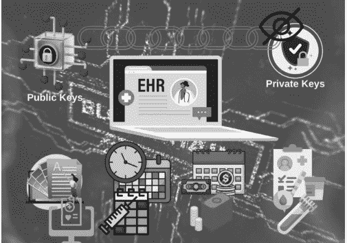

**图 1.1**
EHR 特性和特征。

功能。功能包括电子医疗文档存储、预约安排、账单与支付处理以及实验室分析。它们存在于医疗领域当前使用的绝大多数电子健康记录系统中。主要目标是确保患者的医疗记录安全、不可篡改，并能在系统之间轻松转移。在医院和其他医疗机构中，电子健康记录（EHR）系统的实施旨在改善患者护理，但最终未能实现其目标。芬兰护理人员关于其使用电子健康记录（EHR）经验的调查结果显示，这些系统存在可靠性问题且不够用户友好 [5]。图 1.1 展示了 EHR 功能。

英国等地的政府指令和政策开始受到以数字化为主的医疗领域所带来可能性的影响，推动新的健康应用程序和认证要求的产生，并促进消费者硬件的改进。尽管如此，旨在整体转型行业的雄心勃勃的计划影响甚微。各种应用程序、数据源和系统之间的数据共享（即互操作性）是医疗数字化的一大障碍 [6]。患者的健康数据可以使用其公钥以及唯一标识符和公钥存储在区块链网络上，涉及这些记录的交易也可以存储。只有当两个 ID 匹配时，医疗提供者才能使用智能合约获取去标识化数据。如果有必要，患者可以向健康团队提供公钥，但没有私钥，信息永远无法归属于特定个人。智能合约对于确保数据共享和检索的用户同意是必要的 [7]。

Azaria A. 等人详细介绍了基于区块链的健康记录系统的开发 [8]。注册合同（RC）、患者-提供者关系合同（PPR）和摘要合同（SC）是构成该系统的三份法律文件。RC 负责将用户提供的标识符转换为以太坊地址。这为使用现有识别方法铺平了道路，而预定义的合同政策可以管理新 ID 的注册和现有映射的修改。当一个网络节点为另一个节点充当医疗数据存储库和管理器时，这些节点之间就会授予 PPR。医疗专业人员的记录由一组数据引用及其关联权限定义。SC 充当用户查找其个人健康记录的“面包屑路径”。它包含一组 PPR 引用，反映参与者与其他系统节点的历史和当前交互。该系统组件的设计旨在与现有 EMR（电子病历）系统兼容。后端库、以太坊客户端、数据库守护者和 EMR 管理器是系统的各种组件。这些操作可以作为更大型分布式统一系统的一部分在远程计算机上执行。这些功能的原型是一个与 SQLite 数据库通信的基于 Web 的用户界面。总部位于瑞士的全球数字健康公司 HealthBank 正在实施一种创新的新方法，用于管理数据传输和敏感医疗信息的交换。这一新业务为其消费者提供了一个安全的位置来存储其医疗记录。用户对数据集拥有完全控制权。使用基于区块链的健康应用程序或智能衣物，患者将很快能够在云中安全记录自己的健康数据（血压、服用的药物、心率、睡眠模式、饮食习惯等）[9]。

#### 1.2.2 供应链管理和药品追溯

医疗供应链是一个复杂的系统，跨越组织和地理边界，为生命最基本的需求提供支持。由于其固有的复杂性和不可靠的信息来源，错误信息或缺乏透明度等杂质可能会被引入此类系统。假药的泛滥对人类健康有害，每年给医疗系统造成数十亿美元的损失，这是当前供应网络限制的一个后果。因此，以前的研究强调了药品供应链全面追踪和溯源系统的重要性。因此，实施一种全面的方法来监控从生产点到整个供应链的药品至关重要。对医疗供应网络中数据隐私、可访问性和合法性的担忧，因大多数当前监控和追踪系统的集中化而加剧 [10]。这些应用程序利用区块链的去中心化交易记录数据库及其对等交易之间的内置加密验证。Nakamoto S. 表明，一旦记录建立为由加密结构（哈希）连接的块链，就极难篡改，因为从创世块重建到最新块的转移成本极高 [11]。Mohana M. 等人代表了利用区块链技术追溯药品来源的最早举措之一 [12]。药品追踪和供应链管理问题及其潜在补救措施如图 1.2 所示。

科学家们对分布式账本在药品供应链中的潜力进行了大量深入的分析和调查。主要分为三个步骤：了解区块链技术的有用之处，设计支持其使用的系统，并首次启动该系统。初步研究已经显示了在制药领域使用区块链解决方案的优势、可能性和成功因素。实施一个追踪药品分销的系统既具挑战性又必要。集成监控系统已经暴露出许多问题，包括数据篡改和知识模糊。区块链的独特属性，例如不可篡改性、开放性和安全性，表明它可能能够帮助我们解决这些问题。潜在利益、流程设计和实验建模是其中的一些方面


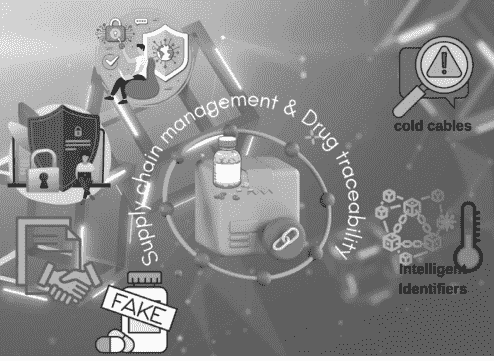

图 1.2
问题与潜在解答。

已研究的区块链应用与开发。此外，针对毒品贩运的区块链技术实际应用实例很少 [13]。

首先，当创造出一种新的医疗方案或治疗方法时，版权保护及冗长的临床试验流程会形成一道障碍。数字账本会将此数据作为交易记录进行跟踪。临床研究完成后，第 2 阶段会将该理念发送给制造商进行原型测试，若测试成功，则进行大规模制造。每件物品凭借其数字指纹，可关联至去中心化账本中的特定记录。药品大批量生产并包装后，会被存放在仓库中，直至准备发运。时间、批次号、标识符和有效期均记录在区块链上。第四，区块链记录货物从一个配送中心（IN）到另一个配送中心的物流过程，包括所需时间、使用的运输方式、授权代理以及任何其他相关细节。第五，药品和医疗用品向药房和商店的配送通常由第三方配送网络处理。所有配送节点均关联到一个中心存储（称为“OUT”），它充当所有外部方的网关。此外，数据库中包含第二个交换环节。第六，医疗服务机构（如医院和诊所）必须提供批次号、批号、产品所有人和有效期，以便核实并防止造假。这些信息也包含在数据库中。在第 7 步中，商店的运作方式与第 6 步中描述的类似。第八，区块链配送网络为患者提供公开、可核实的信息，供其用于判定整个流程的有效性 [14]。

在制药行业，冷链很普遍。“冷链”是供应链的一个示例，其中产品必须始终保持在有限的温度范围内。传统制冷链中存在许多脆弱点，随时可能被利用。在最终药品交付之前，必须在适宜的温度和相对湿度下储存。运输过程中，冷藏运输车必须达到药品标准配置。当产品转移到次要存储位置时，再次需要进行温度和湿度调节。传统制冷链对这些关键区域的监测不足，导致难以确定谁对偏差负责。消费者不知情，被迫购买无论质量如何的药物。基于区块链的智能合约与物联网（IoT）的集成可能是解决方案。后续章节将详细阐述所考虑的冷链情况、拟议的区块链-IoT 框架、概念验证的开发以及智能合约的总结 [15]。

可在每个供应链流程节点扫描智能标识符或条形码。将此信息输入系统后，会创建并记录药品配送网络的完整审计痕迹（基于区块链）。这些组件使物品可以追溯至其原始来源。如果人们不知道储存药物的最佳温度、压力和其他参数，可能会丧生。也许传感器是解决这一问题的办法。它们可以融入网络，并将压力、温度及其他参数的信息记录在分布式数据库中。借助这些仪器，Gangwar、Bali 和 Kumar 的长短期记忆（LSTM）和支持向量机（SVM）深度学习算法被用于创建准确的风速预测。这对于必须在低温下储存的胰岛素和其他药物，以及遵循一般保存指南的定制药物来说尤为重要。如果药物在供应链的任何环节未能满足既定要求，药剂师和患者将能够将其追溯至未达标参数的位置。凭借他们的知识，他们可以判断药物是否来自合法制造商，或是否被走私。通过扫描条形码或输入包装上该部分的哈希代码，用户将获取额外的基本药物说明 [16]。

#### 1.2.3 远程医疗与远程患者监护

鉴于当前的困难以及冠状病毒（COVID-19）的全球蔓延，对可靠、强健且稳健的患者治疗和医疗设施存在迫切需求。远程医疗和远程诊疗从 COVID-19 大流行中受益，因为它们使患者能够通过数字平台与医生和专家安全地沟通，从而降低进一步感染的风险。利用远程医疗和在线问诊（这些手段便于更简单地获取医疗服务），可以实现更好的护理协调和治疗效果。现有远程医疗及其系统对中心的依赖增加了灾难性故障的可能性。此外，多种外部和内部数据泄露威胁着当前视频会议和远程诊疗系统中的数据，进而降低了系统的可靠性和可访问性。区块链技术的实施可能有助于解决这些关键问题。医疗行业面临许多挑战，其中许多可以借助区块链技术加以缓解。这包括但不限于：跟踪感染患者访问过的地点、保护远程患者-医生咨询、追踪医疗物资、验证有缺陷医疗试剂盒的来源，以及验证医疗专业人员的资格。远程诊疗是面对面医疗治疗的低成本替代方案，允许医生远程监测、诊断和治疗患者，从而改善医疗可及性、扩展医疗服务提供者的技能组合，并降低患者感染甲型流感病毒 H9 亚型（COVID-19）的机会。此外，远程医疗利用数字通信技术帮助患者管理疾病，为其提供了解和应对自身病情的资源，并提高其自我照护能力 [17]。

远程患者监护应用可能受益于区块链技术，因为其在患者与追踪技术（如云、雾和边缘计算）之间的数据流中具有加密能力。为安全存储 RPM（远程患者监护）电子健康记录，Faruk MJ. 等人建议使用以太坊作为数据存储库 [18]。患者可以在数据存储库的上传、存储、分析、恢复和传输过程中依赖其数据的安全性。所提议的分布式账本技术对住院患者和门诊患者均有利。Kumar M. 等人提议的 MedHypChain 是解决云计算兼容性问题的方案 [19]。MedHypChain 中的每次数据交换均使用基于身份的广播组方法进行加密，以确保患者隐私。根据 Pighini C. 等人的说法，SynCare 是一款富有洞察力、以患者为中心的私人数据收集和远程患者监护应用 [20]。该研究的主要目标是连接患者、医疗服务提供者和照护者，构建安全的数据共享网络，并让患者掌控自身健康信息。分布式账本的不可篡改性使其成为记录并验证区块链内每笔交易的理想平台。高执行成本、复杂的集成和高能耗均为该架构的缺点 [21]。

#### 1.2.4 临床试验与研究

临床试验用于确定一种实验技术或物质的新用途是否更安全，用于预防、诊断和治疗疾病。在临床研究中使用新物质之前，需要进行临床前试验。所有试管和动物试验均属于临床前测试。药物开发研究需要为临床试验进行复杂的患者招募。根据最近的一项研究，药物开发成本为 26 亿美元，其中大部分用于招募患者以及确定如何在临床试验中留住患者；根据一项研究，80% 的临床试验因患者招募延迟而放缓。患者、资助方和领先科学家无法同时召开会议，因为这些试验涉及众多复杂问题。患者招募不足可能导致结果无效和试验突然终止。在患者招募期间，区块链技术保护患者数据和隐私。基于区块链的分布式账本将秘密注册的患者与临床研究网站连接起来，从而缩短了患者的注册时间。因此，研究人员能够根据研究设计选择参与者。区块链基础设施连同一系列临床试验合同，已可供用于招募参与者和协调研究。潜在受试者的抵触是临床研究中的主要障碍。仅 10% 的试验会遇到患者同意方面的问题，例如伪造的许可表格或协议变更后未能重新提交同意书。通过在每个步骤中融入加密验证，区块链能够跟踪并验证每次带时间戳的患者同意，以符合简化的临床研究设计。常规数据库特征（例如，未读、已显示、已批准），确实是临床试验启动过程的一个组成部分，用于建立获取敏感数据的同意。利用区块链监控临床试验可增加对结果的信任，并鼓励他人参与临床研究。新药研究中的透明度可以减少选择性报告有利结果的试验站点数量。因此，临床试验中的区块链技术促进了赞助方和站点之间的数据安全性、透明度和协作 [22]。图 1.3 描绘了区块链在临床试验和研究中的潜力与拟议方法。大家普遍乐观地认为，如果制药行业使用此技术来管理临床试验数据集，其研究将得到增强。区块链


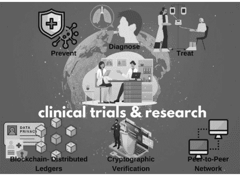

**图 1.3** 在临床试验中使用区块链的目标和建议方法。

该技术有望改善监管机构和研究组织对临床研究的管理，从而解决与临床试验相关的当前问题。此外，它还有望改善临床试验研究的基础技术，从而提升此类研究的有效性。利用区块链技术，可在临床试验中创建一个 P2P 网络，实现数据交换的记录、数据交换的促进，以及试验数据的透明性和不可篡改性。利用维护在区块链上的自主软件（即智能合约），可实现这些流程的自动化。它无需第三方即可编排应用程序的业务逻辑，保证数据的真实性，生成不可篡改的审计日志，并在满足特定条件时对某项操作施加义务。使用基于区块链的工具，可即时与其他机构和组织沟通并共享医疗记录。对存储在区块链上的临床试验数据不可篡改性的信任，可以带来更安全的药物，并提升对科学研究的信心 [23]。

#### 1.2.5 医疗器械管理

医疗物联网（IoMT）通过提供远程和普遍的医疗服务，正在彻底改变医疗行业。注射器、可植入心脏设备、心电图仪和体温传感器只是 IoMT 设备的几个示例，这些设备常用于通过自动监测患者生理参数来识别和治疗多种疾病，从而减轻医疗专业人员的负担。由于医疗生态系统流动且复杂，为诊断仪器和各类用户实施细粒度权限可能具有挑战性。实施细粒度访问控制至关重要，需考虑的因素包括一天中的时间、用户所在地、访问的信息类型以及使用设备的用户类型。涉及人员众多，各有自己的议程和义务，这并未有所帮助。基本要素授权、位置远程访问和潜在访问控制不足以保证 IoMT 设备的安全性。智能合约作为区块链技术的相对新突破，可用于解决医疗管理中的多种权限难题，方法是实现对临床数据和医疗设备的详细用户访问。通过使用合约，信息隐私、特权和数据安全等元数据均可生成为医疗信息的精细描述。智能合约功能可根据参与者的职责和位置处理注册和访问控制，确保只有拥有相应权限的人员才能获取和编辑健康信息。由于智能合约可能催生众多新的医疗管理应用场景，因此对其未来的研究和开发是一个令人着迷的领域 [24]。

近年来，医疗器械上市后监测（PMS）系统中需要评估的数据量激增。这是因为卫生主管部门对医疗器械安全性评估的要求日益严格和复杂。随着监管部门对设备安全性监管的加强，主动的 PMS 程序变得愈发重要。由这种不断变化的监管环境所造成的一些挑战，推动了对创新技术解决方案的探索。区块链技术可能促进唯一设备标识符的广泛采用。区块链技术可实现制造数据以及使用和维护记录的实时监测。医疗器械制造商将从该流程的可靠性和一致性中受益，因为它能够实现全面性。随着监测和审计需求的增加，这项技术正变得越来越普及 [25]。表 1.1 对部分现有文献综述进行了全面概述。

#### 表 1.1 关于医疗设备管理的现有文献比较

| 论文标题 | 年份 | 方法 | 优势 | 局限性 | 引用 |
| --- | --- | --- | --- | --- | --- |
| 医疗保健中医疗设备管理的区块链框架 | 2020 | 设计了一种基于区块链的管理解决方案，用于管理医疗设备，该方案使用智能合约监测设备健康状况并安排定期维护 | 改善了设备管理的透明度、问责制和效率 | 未进行实际实施或验证 | [26] |
| 医院医疗设备基于区块链的资产管理系统 | 2020 | 提出了一种基于区块链的医院设备管理解决方案，利用智能合约自动化医疗设备的维护和校准 | 提高了设备维护和校准效率，减少了设备停机时间 | 未进行实际实施或验证 | [27] |
| 用于提升医疗保健中患者安全的基于区块链的医疗设备管理系统 | 2021 | 开发了一种基于区块链的系统，使用智能合约跟踪医疗设备的维护和使用记录，并实时监测设备性能 | 改善了患者安全，提高了设备维护效率 | 未进行实际实施或验证 | [28] |
| 用于安全医疗器械管理的区块链技术 | 2020 | 强调了区块链在医疗器械行业中的潜在应用，包括供应链管理、上市后监测和设备追踪 | 改善了医疗器械管理的可追溯性、安全性和效率 | 未提出具体框架或实施方案 | [29] |
| 基于区块链的医疗器械取证式设计管理框架 | 2019 | 为医疗设备中取证式设计的管理提供了一种基于区块链的框架；该框架包含许多增强医疗设备安全性和可追溯性的功能，如加密数据存储、不可篡改的审计痕迹和设备操作的实时监测 | 提出的框架提供了安全性、透明度和可追溯性；数据防篡改且可验证，可经受审计 | 未进行实际实施或实际应用 | [24] |

*来源：[24], [26], [27], [28], [29].*

#### 1.2.6 计费与保险

医疗资金这一领域存在许多缺陷，其中大多数与缺乏信任和透明度有关；然而，实施区块链技术可能改善这些问题。区块链集成到分布式账本系统中，是一种隐式信任系统，可促进索赔人与负责处理索赔的各方之间的直接连接。确定保费的过程是使用智能合约的理想时机。关于当前健康状况、用药情况、生活方式习惯等方面的洞察，通过区块链与基于智能合约的价格调整相关联。当多个方或中介参与索赔处理时，最终消费者可能需要面对重复性任务和审查。由于这些系统性缺陷，已有人提出在账单索赔管理和更广泛的医疗服务财务方面实施区块链技术 [30]。

健康保险索赔流程是医疗行业中最令人沮丧的问题之一。虚假索赔浪费了患者和医生的时间。索赔流程始于消费者需要医疗服务提供者（如医生或医院）的服务时。供应商在审查患者的保险政策后确定初始服务成本。在确定最终服务费用之前，健康保险公司会将从提供者处获得的服务与其共同支付安排进行比较，并考虑多个先前记录的变量（例如免赔额、共付额和共保金额）。保险公司将结果通知服务提供者和客户。在无法获取患者所有医生的完整病史的情况下试图计算患者的总费用，往往会浪费时间。


许可区块链是解决分布式健康保险索赔系统中监控和公开性问题的一个有吸引力的解决方案，在该系统中，多方交换信息并进行协作。许可区块链在允许潜在参与者参与网络或进行交易之前会对其进行审查，这与公共区块链不同，后者任何人都可以无限制地加入。区块链基于一种名为分类账的去中心化共享数据库，该数据库由一系列相互连接的区块组成，用于存储加密的、带时间戳的事件。通过将所有交易存储在集中式数据库中，保险公司将能够随时访问来自多个来源的汇总数据，从而能够即时进行保单调整。区块链的另一个基本组成部分——智能合约——是一种可自动执行的软件，可用于在去中心化网络上执行业务逻辑或法律协议。使用智能合约（SCs），可以自动化保险单和访问控制策略 [31]。

#### 1.2.7 基因组学

DNA，即脱氧核糖核酸，是基因组学的基础，并在此目标上被全球采用。要检查基因组数据集，需要大量且耗时的计算和测序工作 [32]。研究人员越来越担心遗传数据的可靠性以及其收集速度，这些数据用于药物开发、病毒预防、疾病预测、更好的诊断等。通过 Nebula Genomics 平台，数据可以轻松共享、保存和访问，供买家浏览安排，从而提高效率并确保数据准确性 [33]。Nebula 建立在以太坊区块链和 Blockstack 平台之上，使开发人员能够在易于访问且开发者友好的环境中构建去中心化应用和智能交易。它有助于在降低测序成本的同时保持遗传信息的隐私。数据所有者可以使用 Nebula 测序设施接收基因组数据，这些设施通过加密保护的点对点网络将他们与数据买家连接起来，从而减轻第三方的压力。基于智能合约的 Nebula 评估工具将协助数据买家构建带有互补问题的调查并生成可信的响应。Nebula 代币（该网络的原生货币）可用于交易商品和信息。去中心化测序使购买 DNA 测序机器和测序自己的样本变得容易，从而能够早期发现隐私问题 [34]。

基因分型，即患者的 DNA，持有关于其存在于任何给定时刻的最私密信息。许多 DNA 检测组织现在通过在未经客户知情或支付的情况下向其他方出售客户信息来赚钱。这种策略暴露了消费者最敏感的信息。EncrypGen，第一个基于区块链的基因组数据市场，通过去中心化的基于区块链的分类账，让用户掌控自己的遗传信息。已在 EncrypGen 注册的个人（如研究人员、机构等）可以选择在短时间内将其信息公开以赚取金钱，这将有助于他们和提供信息的个人在各自的行业中发展 [36]。它还具有降低遗传学和医学研究费用的能力。如果数据所有者可以直接与数据买家沟通，而无需通过中介机构，那么分析费用将降低，数据所有者也将获得补偿。这些相同的考虑因素也适用于数字医疗应用。与传统技术相比，区块链技术能够更快速、更高效地执行交易。记录在集中式系统中的数据可能会被更改，但区块链的不可更改分类账是由所有用户共同生成的。作为一种去中心化系统，区块链提高了先前交易的透明度和可审计性。在防止不诚实交易和非法行为方面，它比其他系统更有效。任何验证系统都必须符合严格的公开可访问性和可审计性标准 [37,38]。

#### 表 1.2 用于研究区块链在基因组学中应用的已审查论文对比

| 论文标题 | ‘解决医疗保健和生物医学科学中现实世界问题的机遇’ [32] | ‘利用去中心化、隐私保护技术和公平补偿加速基因组数据生成并促进基因组数据访问’ [33] | ‘实现基因组学中区块链技术的潜力’ [34] |
|---|---|---|---|
| ‘解决医疗保健和生物医学科学中现实世界问题的机遇’ [32] | 在本研究中，我们探讨了许多分布式账本技术可能改善医疗护理提供的场景。它还包括临床试验和药物供应链管理。我们调查了区块链技术如何提高供应链效率、保护患者隐私并促进数据共享。 | 研究了分布式系统如何在不危及个人隐私的情况下增强遗传数据的可访问性和交换。它提议使用区块链技术创建一个具有财务激励的去中心化环境，其中遗传数据可以被交换和研究。 | 本研究探讨了在基因组学中应用区块链技术的益处和弊端，包括数据安全、患者隐私和研究人员的公平补偿。本文讨论了许多区块链应用，包括数据溯源、数据共享和数据隐私。 |
| ‘医疗保健中的区块链技术：全面回顾与未来研究方向’ [35] | 根据本文，电子健康记录（EHR）系统管理、医疗供应链管理和临床试验是区块链可能有益的几个领域。互操作性、可扩展性和监管合规性都被讨论为区块链在医疗保健行业应用的障碍。 | 该文章提出了一种基于区块链的系统，用于转移遗传数据，利用智能合约来管理数据访问和补偿。有推测认为区块链技术可能鼓励数据提供者并促进数据共享，从而加速遗传数据的发展。 | 在这项工作中，研究了利用区块链技术促进基因组数据安全、透明、去中心化交换的可行性。它提议使用区块链技术创建一个用于数据交换和分析的平台，该平台提供细粒度的数据访问控制和隐私保护。 |

来源：[32], [33], [34], [35].

#### 1.2.8 牙科行业

牙科护理有很大机会影响其未来将依赖的标准和技术的发展，以及这些资源将被利用的方式。已使用多个术语来表示无纸化医疗文件的概念，而 EHR 定义中使用的“电子健康记录”仅是其中之一。然而，电子健康记录的概念对所使用的技术或呈现形式本身（无论是布局图表还是显示）均不提出要求。基于纸张的健康记录的电子版本（EHR）可能包含非 EHR 数据，例如诊断实验室测试的比较对象，以更好地满足提供者、其他授权人员，在某些情况下还包括患者的需求；这些记录分别被称为“电子病历”（EMR）和“电子牙科记录”。另一种看待这些想法的方式是，在 EMR 中提供包含其他关键信息的 EHR 样本。在医疗保健系统中，我们需要独特版本用于受保护用途的可靠性，并且它必须可访问，以便向共享系统交换信息或数据以分发关联数据，例如照片或图像共享，以及开发、维护和保存 EHR 所需的协作功能。另一方面，配备 EDR 系统的牙科诊所将能够导入和导出患者电子健康记录的数据，以及显示和记录相关的数据摘录。此类系统的一个关键功能是能够快速、安全地将健康信息发送给授权执业者或跨多家公司（或各种医疗场所）的系统 [39]。

目前，口腔医疗保健系统内的一切都手动完成，从检查和 X 光到患者账单和处方。这种模式表明，个人的信息可能会被数据窃贼随意篡改。患者对其数据的访问和理解有限，当前传输临床记录的基础设施严重不足。患者端与牙科专家端相连，后者将患者的嵌入式临床牙科数据存储在区块链中。这增强了创造力和对治疗能力的承诺。患者最终对自己的病史负责，如果通过系统连接能够公开访问其健康信息，他们最具备自给自足的条件 [40]。考虑到牙科领域的数据量以及由各种智能设备组成的物联网（IoT）网络的广泛使用，显然区块链技术可能对这个研究不足但有价值的行业产生重大积极影响。尽管牙科从业者目前对该平台不熟悉，但通过未来的研究合作扩大牙科中区块链技术的理解仍有迫切需求。就像在医疗保健领域一样，在牙科向数字化转型的过程中，迫切需要建立一种更有效、更可靠的手段，来收集、维护、处理、归档和传输由牙科中各种设备和平台提供的患者健康数据。区块链的许多特性使其区别于传统或云数据存储，证明了其在牙科领域的可行性和实用性。由于区块链交易和数据传输可以被其他网络用户记录和验证，因此不需要可信的第三方。因为所有患者数据现在都以固定、高度保密和安全的方式存储，并且有关医疗专业人员如何以及何时访问这些记录的可验证日志存在，所以在牙科中实施区块链有潜力克服许多既定挑战，并在数据所有权、保密性和安全性方面为牙科和更广泛的医疗保健行业带来更多未来进步。由于准备牙科记录并彻底检查和记录每位患者独特的口腔、牙科等状况所需的时间和精力，牙医可能会面临低效率和治疗延误。当患者从一位牙医转诊给另一位时，他们可能会得到不准确的诊断。得益于区块链技术，患者和牙医现在可以安排更少的牙科就诊，从而减少双方的压力 [41]。


#### 1.2.9 器官移植管理

当器官因意外或疾病而衰竭或受损时，这被称为器官衰竭或器官损伤。患有此疾病会降低生活质量，甚至可能致命。器官捐献用于移植是人类最高尚的善举之一。器官需要处于足够好的状态才能移植，受体必须与供体合适匹配，并且移除器官不得危及供体的生命。由于立法、临床、伦理和技术限制，现代器官移植和捐献系统中的登记、受体兼容性、器官提取、器官分配和植入各自都有独特的要求和障碍。拥有一个完善的器官捐献和移植系统，我们可以提供公平高效的流程，改善患者体验，并建立信任 [42]。然而，器官捐献的关键问题在于，此类数据的安全性和可靠性完全取决于移植机构保持系统安全并发现对捐献者和受体可能造成伤害的能力。如果没有人们对设施保护其信息免受黑客和不诚实员工侵害的能力的信心，就无法信任等待名单数据。因此，透明度阻碍了器官捐献。当前系统缺乏透明度，导致非法器官买卖以及医学专家的不道德行为。此外，有些医院利用器官捐献者的脆弱性，将器官转移给那些能向机构支付更多费用的人，而忽视了等待名单顶端的患者。当时间至关重要时，当前移植系统的低效是无法容忍的 [43]。

区块链有能力彻底改变这一系统。由于区块链的开放性和自动化监控功能，没有任何一方将控制潜在受益者的排名。每个用户都能完全了解每笔交易。除了以安全可靠的方式简化捐献者和受体之间医疗信息的沟通外，这项技术还有潜力防止犯罪性器官贩卖。它有能力通过消除许多当前的中介并允许任何组织立即访问交易信息，大幅提高移植网络的效率 [44]。Jain U. 在比较区块链内外的志愿者匹配时，将 OrganChain 提出作为一种模型 [45]。他们决定使用四项标准来评估其基于区块链系统的成功：最大批处理超时、最大块大小、背书策略和交易速率。该研究的发现表明，与使用传统数据库相比，使用区块链来匹配捐献者和申请人能产生更理想的结果。IPFS，即星际共享文件夹，是 [46] 中提出的一种点对点网络和加密分布式文件系统。他们的主要优先事项是降低上传捐献者和患者医疗信息的成本。在他们的计划的双哈希系统下，捐献者和患者信息将受到保护并保持私密。

### 1.3 优势

虽然技术进步使从纸质医疗记录向电子病历（EMR）的转变成为可能，这大大改善了信息共享和归档，但必须更加注意保护患者隐私 [47]。患者健康信息缺乏隐私和安全性引发了更多担忧。例如，就诊患者如果转院到新医院，必须接受进一步筛查。由于这种做法，金钱和资源正在被浪费。由于敏感的患者信息不能与研究机构共享，医学进步受到阻碍。许多患者记录保存在病历中，这些信息对当前治疗和研究方向都至关重要。为了保持信息的安全，必须将其安全存储，并且仅与授权人员共享。区块链的不可篡改性和透明性使其成为处理患者数据的热门选择 [48]。医疗信息有多种格式，不仅仅是电子健康记录。制药和药物制造的数据，以及临床试验的信息，都是患者个人健康记录中可能包含的示例；健康保险数据包括患者的保险单信息、支付信息以及所接受的保险相关服务数据；以及为研究生成和使用的数据，包括患者生理健康参数和过敏信息等信息。由于这海量数据，医生可以更多地了解患者并改善护理。尽管如此，多方仍以各种方式从医疗数据中获益。保护这些敏感医疗数据免受网络风险（如渗透和篡改）是最高优先级。由于医疗行业提供了包括医疗诊断、医疗检测和行政任务在内的大量服务，因此根据参与节点提供的服务分配独立的职责和权利至关重要。因此，许可型区块链更受青睐，用于保护敏感医疗数据。当医疗业务采用区块链进行数据保护时，需要进行几个初始化步骤。向医生、护士和患者等实体分配预设的职责和权限是这类工作的一个示例。应用程序实施后，仍有进一步工作需要完成，包括纳入用户反馈和管理新的及更新的健康信息。区块链技术通过允许患者通过智能合约定义访问权限，使患者能够控制自己的健康记录。对患者医疗记录的任何更改（例如添加新信息或读取旧记录）都会记录在审计日志中。当医院使用区块链进行跨组织通信和数据交换时，这不仅通过为医疗相关服务的快速处理提供安全标准格式来造福患者 [49]。

2022年，提出了一种基于区块链的“医链”策略。在这种架构中，区块链充当数据库，存储所有相关的患者病例信息。通过对交易记录进行哈希处理并将生成的哈希值保存在默克尔树中，可以减少临床决策中的差异。提议的架构将所有信息保存在单个超字段中，以解决医疗数据来自多个地点且格式多样的问题。数据会立即保存到区块链上 [50]。Wu H. 等人通过提出以患者为中心的保密准入控制方法，解决了医疗系统中敏感信息的身份验证过程 [51]。此外，利用区块链技术开发了一种独特的数据存储基础设施，并使用行业标准加密实现数据传输。使用文件权限条款来保护关键患者信息免受未经授权的访问。该模型提出了一种差异化访问控制系统，可在保护用户隐私的同时基于用户类型对用户进行区分。第三方云服务提供商管理存储电子病历的数据库。当数据保存到互联网时，会生成一个哈希值。随后的步骤是将哈希上传到分布式账本。如果进行了修改，可以使用保存在区块链上的哈希值将基于云的数据与原始数据进行比较。由于 PoW 技术要求节点进行多次错误计算才能建立共识，因此该模型不能被视为完全实用。许多软件医疗设备被纳入 IoMT 中，以同时监测健康状态并记录各种数据。IoMT 对患者具有相当大的价值，通过评估体征进行早期疾病检测至关重要。然而，市场上充斥着缺乏明确管理标准的 IoMT 系统，这使它们易受数据泄露的影响。区块链技术为保护医疗用途 IoMT 的挑战提供了一个解决方案。智能合约通过使交易各方能够直接交互，减少了对中介的需求。由于每个智能合约使用独特的地址和帐户，任何 IoT 设备都可以独立访问存储在区块链上的智能合约指令 [52]。

不可篡改区块链的吸引力在于其可审计性和透明性，这两个特征能够吸引客户。只有持有私钥的患者才能解密数据，这就是为什么区块链技术的共识机制和加密密钥允许在患者控制下进行安全访问的原因。患者对谁可以访问其医疗数据拥有完全控制权，并可以随时修改此名单（包括医疗专业人员、保险公司和研究人员） [53]。

在当今的高科技社会，移动应用程序和远程监测设备在患者护理中发挥着重要作用。使用区块链技术可能会提高工业设备的安全性和可靠性。获取和交换患者医疗信息是区块链技术的另一种潜在用途。患者的病历通常分散在多个地方，使得获取变得困难。使用区块链技术可能有助于患者以安全可信的方式访问其完整的病史。已提出许多用于医疗记录存储和检索的基于区块链的解决方案。MedBlock 是一种基于区块链的信息管理系统，通过使用分布式区块链技术促进快速的 EMR 访问和检索。该程序的增强共识机制避免了网络过载。随着时间推移而增长的软件（如区块链）的加入可能会增加网络拥塞。此外，加密和访问控制使 MedBlock 成为一个极其安全的环境 [54]。

### 1.4 挑战与解决方案

监管障碍、兼容性问题、监管需求、有限的批准以及医疗员工缺乏技术知识，是医疗领域采用区块链技术面临的一些障碍。为了维持患者信心并遵守数据保护法律，有必要解决医疗数据所带来的独特隐私和安全问题。此外，采用区块链解决方案的高成本和复杂性可能会劝阻较小的医疗执业者和资源有限的组织。为解决这些问题，医疗行业、政府官员和技术专家需要合作，创造一个区块链创新环境。区块链技术在医疗领域面临的困难如图 1.4 所示。


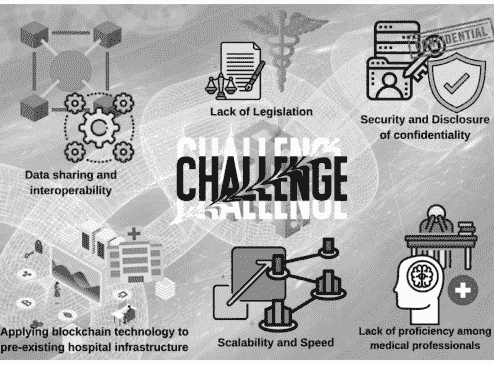

图 1.4
医疗保健与区块链：新兴挑战。

#### 1.4.1 数据共享与互操作性

兼容性低效是患者识别问题和信息受阻的根源，其中医疗公司对医疗记录或电子健康信息的交换实施不公限制。缺乏标准化的患者 ID 以及信息限制显著阻碍了医疗效率。在诸如冠状病毒疫情等危机期间，系统之间相互通信也至关重要。鉴于疫情数据，显然需要立即建立一个更全面的数据共享系统，以促进信息流动，管理公共卫生风险并加强患者与提供者之间的沟通。如果患者需要看专科医生或非其初级保健提供者的其他医生，他们轻松获取完整病历至关重要。通过改善健康数据传输，医生还将能够进行在线会诊和远程监测。这使个人在向医生传达其健康史方面拥有更大自主权。随着确诊病例数增加，向患者提供关于冠状病毒的及时准确信息变得越来越重要，包括他们如何评估自身风险、出现症状以及对疗法的反应。当前系统缺乏连接性的问题因公共卫生问题而更加凸显 [55]。

西奥杜鲁 A. 等人提出了一种基于区块链的系统架构，用于管理医疗数据访问并促进独立验证和私有健康信息的交换 [56]。自动化流程、客户匿名化、共享数据完整性、监控和可追溯性均为所提框架组件（如特性和加密协议）的功能。该架构依赖共识协议，使所有网络节点能够进行链下验证。Web 接口、云组件和以太坊区块链是所提架构的三个组成部分。注册合约（RC）、患者数据合约（PDC）和权限合约（PC）是此处使用的三种智能合约形式。RC 是一个数据库，用于跟踪连接到网络的所有设备，并作为目录服务帮助定位它们。为了在云服务上存储的加密医疗数据与相应患者数据之间建立直接连接，PDC 被用作特定于患者的标识。PC 管理网络访问控制，因为它在 PDC 地址和请求实体之间建立连接。

麦克法兰 C. 等人进一步探讨了医疗行业的两大问题：过度支出和互操作性差 [57]。由于 EHR 机构之间沟通效率低下，研究人员开发了一种基于区块链的以患者为中心的协议，以改善对病患的管理。虽然访问相关客户记录（如影像结果、药物和病史）至关重要，但其研究的重点在于一线医务人员。作者通过展示区块链技术如何减轻维护大量现有患者信息孤岛的压力，描绘了基于区块链的医疗数据供应链的革命性特点。非基于区块链的当前解决方案体现了这一问题。在设计过程中，考虑了 1996 年《健康保险可携性和责任法案》（HIPAA）关于保密性、保护和云计算的要求。此外，还探讨了区块链技术在 HIPAA 合规性方面的局限性和劣势。Patientory 代币（PTOY）对于区块链功能是必需的。这些代币确定网络中分配的空间大小、资金发放频率以及医疗监测的彻底程度。由于该系统固有的访问控制功能，供应商可以预期这种设计下的安全漏洞极少。

#### 1.4.2 将区块链技术应用于现有医院基础设施

尽管广泛采用区块链技术进行医疗数据管理无疑将开启效率与精确性的新时代，但必须首先克服若干障碍。将加密货币与现有网络集成是一个重大障碍。为了实施区块链技术，医疗组织将需要彻底改造其当前系统，这本身就是一个耗时且昂贵的过程。为了确保区块链技术在医疗领域的成功实施，需要大量资源，包括但不限于时间、资金和人力知识。当前的医疗基础设施可能与区块链不兼容，要求一些机构获取新系统。这可能会增加采用成本并总体上使事情复杂化。因此，必须仔细考虑区块链对现有流程的影响及其与现有系统的潜在交互作用。此外，医疗区块链实施必须标准化。为了确保不同基于区块链的系统的兼容性，必须标准化数据形式、安全程序和访问控制。这将使医疗提供者之间能够安全、保密地传输患者数据 [58]。

#### 1.4.3 可扩展性与速度

普遍认为，数据量庞大对基于区块链的医疗解决方案构成了重大的可扩展性挑战。由于在区块链上存储大量生物数据会导致严重的性能下降，因此这不可取，在某些情况下甚至可能不可能。可扩展性问题与工作节奏内在相关。根据所使用的算法，基于区块链的计算可能会导致显著延迟，从而限制系统的增长。仅将区块链用作医疗数据的索引，只存储关于数据及其访问方式的有限简化知识，而实际医疗数据存储在非区块链数据库中，这是解决可扩展性和性能问题的一个潜在方案。然而，这种缓解措施消除了区块链技术本可为医疗记录提供的数据复制和持续可访问性。此外，许可型区块链（仅允许部分节点参与协议和认证过程）可以缓解与共识方法相关的性能问题，例如某些公有链采用的工作量证明（PoW）[59]。

为确保数据完整性的可扩展性并保留源信息的可传输哈希，张 P 等人提出了 FHIRChain，它增加了数据引用指针的大小 [60]。交换的复杂性作为原始数据量（记为 N）的代理，而比较信号的大小由 e 表示。可变长度输入的哈希值空间需求是固定的。数据引用指针可根据需要扩展，但实际数据是线性扩展的。张的提议用恒定大小的数据替换实际数据以促进可扩展性。改进数据存储的另一种方法是使用微型区块链。微型区块链是 [61] 中提出的一种事务概念。为提高可扩展性，该解决方案消除了存储整个区块链的要求。通过将区块链分解为其组件系统，甚至最基本的操作也可以得到优化。该方法通过消除脚本系统和重复的互锁事务数据来减少块的大小。取而代之的是对基本操作的更清晰概念。在此情况下，使用账户树计算了考虑所有相关交易的余额金额。将这些程序分解为可定期写入数据库的可管理的事务片段是成功的关键。

#### 1.4.4 安全与保密披露

共识是区块链能够运作的基础。如果恶意矿工控制了网络终端的 50% 以上，他们就能夺取控制权。通过拒绝诚实矿工生成的区块，他们可以利用其优越的算力窃取有价值的数据或货币。然而，随着网络规模的扩大，此类攻击的可能性会降低。鉴于区块链数据库是开源的，“透明度揭示保密性”这一格言成为进一步的限制。由于患者数据的保密性倾向，这对于医疗数据和其他生物应用尤为重要 [62]。（由于区块链的开放性，医学及其他领域的机密数据对任何人都可见。）

#### 1.4.5 医务人员中缺乏熟练度

说服医生和其他医务人员从纸质记录转向电子记录可能具有挑战性。从打印转向电脑化药物记录对许多人来说可能是沮丧和困惑的来源。通常，在填写表格时，医生会忽略可选部分。与电脑化文档相反，医生不能跳过必填部分。此外，许多临床医生可能对依赖区块链和物联网（IoT）等技术的远程跟踪系统的可靠性和有效性存有疑虑。这种技术驱动的医疗系统的精度、速度和有效性将取决于单个医生的技能和承诺。在实施这些工具之前，必须为医生提供适当的培训和技能 [63]。


#### 1.4.6 缺乏立法

提出的基于区块链的医疗保健系统在制定适当法律以管理医疗操作的所有权方面面临困难。众多利益相关方对医疗保健改革的结果有既得利益，使得当前医疗保健系统的数据托管和医疗立法成为关键因素。在区块链中谁拥有什么、谁有权访问什么以及分布式账本如何存储，都必须详细阐明 [64]。

### 1.5 用户响应与接受度

几乎每天，媒体都会报道新的事件，涉及未经同意且出于有害目的收集、传播和使用私人信息。因此，个人不太愿意使用需要提交个人信息的服务，以免遭到黑客攻击。尽管个性化的健康服务可以帮助个人识别和管理其特定的健康问题并促进长期福祉，对许多个人来说可能非常有益，但大多数人的情况并非如此。对另一些人来说，解决由“数据库”造成的隐私问题和共享健康数据缺乏信任问题的答案，是利用区块链技术为个人提供对其自身数据的更多控制权（即“自主主权”）。发现区块链技术的有用性存在问题 [65, 66, 67]。区块链不同于其他新兴技术，因为它具有联网、分布式、自主和全球范围的特点，所有这些对社会、政府和商业都有重大影响。区块链凭借其能够强制执行的信任，有可能用于解决与用户同意相关的问题。知情同意是合乎伦理和合法使用健康数据所必需的。虽然区块链有潜力解决一些与患者数据保护和保存相关的问题，同时也为患者提供更多对其数据的控制权，但它并非没有缺陷。区块链的复杂性可能令人难以承受，即使是对信息技术非常精通的个人也是如此。在如此多的人都难以在现有医疗系统中找到方向的情况下，让记录自己的病史并为其中包含的信息的使用提供适当权限变得更加繁琐是否真的有帮助，尚不清楚 [68, 69]。

人们讨论了区块链背后的优势和驱动力，考虑了它对社会和经济发展可能产生的潜在积极影响，并将其与既有预期进行了比较。根据研究，公司将继续向基于区块链的技术投入资源，但鉴于普遍认为其优势被夸大的看法，它们将对该技术的潜力采取更现实的看法。这项技术广泛应用存在各种障碍，包括政府限制，这可能解释了为什么这一突破尚未达到其预期的潜力。就像普通公众一样，患者和医生并不总是了解区块链技术的优势、运作或技术细节。关于患者数据隐私和安全的担忧可能是区块链在医疗保健领域广泛应用的主要障碍。这些担忧的核心是区块链的技术限制，包括节点安全性、架构中内置的加密功能的有效性，以及数据在请求者完成计算之前的持久性。然而，一些研究指出了更大的社会困难，即人们在使用公共数据共享计划时对政府保护其个人信息的信任问题。例如，客户可能对所提框架的安全性存在担忧，原因是他们自身对授权私钥的管理或滥用 [70]。较少的研究探讨了基于区块链的系统可能部署的社会环境的制约因素。他们承认，用户在全国范围内访问互联网对于其所提架构的成功至关重要，并指出了协作伪造数据的可能性以及医疗系统处理临床不当行为的困难等示例 [71]。

### 1.6 结论

由于区块链技术、物联网（IoT）和大数据分析的结合，医疗保健行业可能很快面临深刻的变革。为了促进医疗设备、医生和患者之间的数据流动，区块链技术可以与物联网相连，形成医疗物联网网络。这有可能通过实现对患者健康的更精确、实时的监测和个性化医疗治疗的提供来改善患者护理。通过使用加密货币和大数据分析，医疗服务提供者可以更深入地了解患者及其治疗策略。区块链的去中心化和公开性使来自世界各地的研究人员、医疗专业人员和患者能够安全且合乎道德地交换数据。区块链的全部潜力只有在医疗保健行业广泛采用和使用时才能实现。利用区块链，患者的健康信息可以保持私密，同时提升系统的透明度和效率。监管和法律障碍、技术复杂性以及与现有医疗系统的不兼容性都阻碍了区块链技术在医疗保健领域的广泛应用。随着人们对区块链技术优势的了解越来越多且其应用得到认可，预计区块链将在医疗保健的未来发挥重要作用。

## 参考文献

- [1] McGhin T, Choo KK, Liu CZ, He D. 医疗保健应用中的区块链：研究挑战与机遇. Journal of Network and Computer Applications. 2019年6月1日;135:62–75.
- [2] Höibl M, Kompara M, Kamišalić A, Nemec Zlotos L. 区块链在医疗保健中的应用系统综述. Symmetry. 2018年10月10日;10(10):470.
- [3] Hasselgren A, Kralevska K, Gligoroski D, Pedersen SA, Faxvaag A. 医疗保健和健康科学中的区块链——范围综述. International Journal of Medical Informatics. 2020年2月1日;134:104040.
- [4] Vazirani AA, O’Donoghue O, Brindley D, Meinert E. 用于高效医疗记录管理的区块链载体. NPJ Digital Medicine. 2020年1月6日;3(1):1.
- [5] Shahnaz A, Qamar U, Khalid A. 使用区块链管理电子健康记录. IEEE Access. 2019年10月9日;7:147782–95.
- [6] Leeming G, Cunningham J, Ainsworth J. 关于我自己的账本：利用区块链技术个性化医疗保健. Frontiers in Medicine. 2019年7月24日;6:171.
- [7] Harshini V, Danai S, Usha H, Kounte, MR. 通过区块链技术管理健康记录. 会议：2019年第3届电子与信息学趋势国际会议（ICOEI）. 2019;1411–15. https://doi.org/10.1109/ICOEI.2019.8862594.
- [8] Azaria A, Ekblaw A, Vieira T, Lippman A. Medrec：使用区块链管理医疗数据访问和权限. 在2016年第2届开放与大数据国际会议（OBD）（第25–30页）. IEEE；2016.
- [9] Rghioui A. 在发展中国家使用区块链管理患者医疗记录：挑战和安全问题. 在2020年摩洛哥地理信息学国际会议（Morgeo）（第1–6页）. IEEE；2020.
- [10] Musamih A, Salah K, Jayaraman R, Arshad J, Debe M, Al-Hammadi Y, Ellahham S. 医疗保健供应链中药品可追溯性的基于区块链的方法. IEEE Access. 2021年1月8日;9:9728–43.
- [11] Nakamoto S. 比特币：点对点电子现金系统. Decentralized Business Review. 2008年10月31日:21260.
- [12] Mohana M, Ong G, Ern T. 使用区块链技术实施制药药品可追溯性. INTI Journal. 2019;2019(35).
- [13] Liu X, Barenji AV, Li Z, Montreuil B, Huang GQ. 药品供应链的基于区块链的智能跟踪和追踪平台. Computers & Industrial Engineering. 2021年11月1日;161:107669.
- [14] Reda M, Kanga DB, Fatima T, Azouazi M. 医疗保健供应链管理中的区块链：现状、挑战与机遇. Procedia Computer Science. 2020年1月1日;175:706–9.
- [15] Sunny J, Undralla N, Pillai VM. 基于区块链的可追溯性供应链透明度：带演示的概述. Computers & Industrial Engineering. 2020年12月1日;150:106895.
- [16] Bali V, Soni P, Khanna T, Gupta S, Chauhan S, Gupta S. 制药供应链可追溯性的区块链应用设计与算法. International Journal of Healthcare Information Systems and Informatics (IJHISI). 2021年10月1日;16(4):1–8.
- [17] Ahmad RW, Salah K, Jayaraman R, Yaqoob I, Ellahham S, Omar M. 区块链技术在远程医疗和远程诊疗中的作用. International Journal of Medical Informatics. 2021年4月1日;148:104399.
- [18] Faruk MJ, Shahriar H, Valero M, Sneha S, Ahamed SI, Rahman M. 面向远程患者监护的基于区块链的安全数据管理. 在2021年数字健康国际会议（ICDH）（第299–308页）. IEEE；2021.
- [19] Kumar M, Chand S. MedHypChain：以患者为中心的互操作性超账本医疗保健系统：COVID-19大流行中的监管. Journal of Network and Computer Applications. 2021年4月1日;179:102975.
- [20] Pighini C. et al. SynCare：由加密和区块链保护的创新远程患者监护系统. 在：Friedewald M, Krenn S, Schiering I, Schiffer S (eds) 隐私与身份管理。介于数据保护与安全之间。隐私与身份2021. IFIP Advances in Information and Communication Technology, vol. 644. Springer；2022.
- [21] Shaik T, Tao X, Higgins N, Li L, Gururajan R, Zhou X, Acharya UR. 使用人工智能进行远程患者监护：现状、应用和挑战. Wiley Interdisciplinary Reviews: Data Mining and Knowledge Discovery. 2023:e1485.
- [22] Katiyar D, Singhal S. 临床试验管理中的区块链技术：其应用、监管问题和挑战综述. Materials Today: Proceedings. 2021年1月1日;47:198–206.
- [23] Hang L, Chen C, Zhang L, Yang J. 临床试验应用的区块链：分类、挑战和未来方向. IET Communications. 2022年12月;16(20):2371–93.
- [24] Malamas V, Dasaklis T, Kotzanikolaou P, Burmester M, Katsikas S. 基于区块链的医疗设备取证式设计管理框架. 在2019年服务世界大会（SERVICES）（第2642卷，第35–40页）. IEEE；2019.
- [25] Pane J, Verhamme KM, Shrum L, Rebollo I, Sturkenboom MC. 区块链技术在医疗设备上市后监测中的应用. Expert Review of Medical Devices. 2020年10月2日;17(10):1123–32.
- [26] Cho H, Choi J, Lee D, Lee S, Lim S, Park S. 医疗保健中医疗设备管理的区块链框架. Healthcare Informatics Research. 2020;26(1):42–50. https://doi.org/10.4258/hir.2020.26.1.42


[27] Kim Y, Kim H, Park Y. 医院医疗设备基于区块链的资产管理系统. Sensors (巴塞尔, 瑞士). 2020;20(17):4783.

[28] Lee S, Park S, Lim S. 用于提升医疗保健中患者安全的基于区块链的医疗设备管理. 医学系统杂志. 2021;45(5):45.

[29] Ouyang T, Chen R, Dong J, Xie B, Zeng X. 用于安全医疗设备管理的区块链技术. 医学系统杂志. 2020;44(8):149.

[30] Haleem A, Javaid M, Singh RP, Suman R, Rab S. 医疗保健中区块链技术应用：概述. 智能网络国际期刊. 2021;2:130–9.

[31] He X, Alqahtani S, Gamble R. 面向隐私保障的健康保险索赔. 在: 2018 年 IEEE 物联网 (iThings) 国际会议及 IEEE 绿色计算与通信 (GreenCom) 国际会议及 IEEE 网络、物理和社会计算 (CPSCom) 国际会议及 IEEE 智能数据 (SmartData) 国际会议. 第 1634–41 页. IEEE, 2018.

[32] Justinia T. 区块链技术：解决医疗保健和生物医学科学中现实问题的机遇. 医学信息学学报. 2019;27(4):284.

[33] Grishin D, Obbad K, Este P, 等. 利用去中心化、隐私保护技术和公平补偿加速基因组数据生成并便捷基因组数据访问. 今日医疗保健区块链. 2018;1:1–23.

[34] Ozercan HI, Ileri AM, Ayday E, Alkan C. 实现基因组学中区块链技术的潜力. 基因组研究. 2018;28(9):1255–63.

[35] Smith K, Caffery LJ, McInerney J, Gray K, Chatfield MD. 医疗保健中的区块链技术：全面综述和未来研究方向. 应用临床信息学. 2020;11(4):579–89. https://doi.org/10.1055/s-0040-1716497

[36] Microsoft 365 完整配置支持结束日期连接... [互联网]. [引用于 2023 年 3 月 16 日]. 可从: https://query.prod.cms.rt.microsoft.com/cms/api/am/binary/RE4woQm

[37] Kumar T, Ramani V, Ahmad I, Braeken A, Harjula E, Ylianttila M. 医疗保健中区块链利用：关键要求和挑战. 在: 2018 年 IEEE 第 20 届 e-Health 网络、应用和服务国际会议 (Healthcom). IEEE, 2018.

[38] 贸易便利化区块链白皮书 联合国日内瓦 (第 128–38 页); 2020. 可从: chrome-extension://efaidnbmnnnibpcajpcglclefindmkaj/https://unece.org/DAM/trade/Publications/ECE-TRADE-457E_WPBlockchainTF.pdf

[39] Wuthikarn R, Hui YG. 基于 Hyperledger Fabric 框架中 Hyperledger Composer 的牙科护理服务应用区块链原型. 在: 2018 年第 22 届国际计算机科学与工程会议 (ICSEC). ICSEC; 2018.

[40] Panda S, Jena A, Swain S, Satapathy S. 区块链技术：应用和挑战. 2021. Springer Cham. 第 1 版, ISBN: 978-3-030-69395-4. https://doi.org/10.1007/978-3-030-69395-4.

[41] Hassani H, Norouzi K, Ghodsi A, Huang X. 通过区块链技术实现革命性牙科. 大数据与认知计算. 2023;7(1):9.

[42] Dajim LA, Al-Farras SA, Al-Shahrani BS, Al-Zuraib AA, Merlin Mathew R. 使用区块链技术的器官捐赠去中心化应用. 在: 2019 年第 2 届计算机应用与信息安全国际会议 (ICCAIS). IEEE; 2019. 可从: https://www.semanticscholar.org/paper/Organ-Donation-Decentralized-Application-Using-Dajim-Al-Farras/45f6817daa684342ef333e962798260ffbba9a1

[43] Hawashin D, Dayaramar R, Salah K, Yaqoob I, Simsekler MC, Ellahham S. 基于区块链的器官捐赠和移植管理. IEEE Access. 2022;10:59013–25.

[44] Chalissery BJ, Asha V. 用于人体器官移植管理的基于区块链的系统. 计算机视觉和生物启发计算新趋势. 2020:829–38.

[45] Jain U. 用于器官获取和移植网络的区块链技术应用. 2019; 硕士论文. 5065.

[46] Ranjam P, Srivastava S, Gupta V, Tapaswi S, Kumar N. 用于器官/组织捐赠和移植的去中心化和分布式系统. 在: 2019 年 IEEE 信息和通信技术会议. IEEE; 2019. 可从: https://www.researchgate.net/publication/340688070_Decentralised_and_Distributed_System_for_OrganTissue_Donation_and_Transplantation

[47] Adamu J, Hamzah Z, Rosli MM. 电子病历安全问题和框架：综述. 电气工程与信息学通报. 2020;9(2).

[48] Agbo C, Mahmoud Q, Eklund J. 医疗保健中的区块链技术：系统综述. 医疗保健. 2019;7(2):56.

[49] Pandey M, Agarwal R, Shukla SK, Verma NK. 使用区块链保障医疗数据安全. 数字医疗中的区块链. 2021:113–50.

[50] Johari R, Kumar V, Gupta K, Vidyarthi DP. Blosom: 用于医疗记录安全的区块链技术. ICT Express. 2022;8(1):56–60.

[51] Wu H, Dwivedi AD, Srivastava G. 基于区块链技术的医疗系统中患者信息的安全与隐私. 多媒体计算、通信和应用 ACM 事务. 2021;17(2s):1–17.

[52] Xi P, Zhang X, Wang L, Liu W, Peng S. 基于区块链的医疗数据安全共享综述. 应用科学. 2022;12(15):7912.

[53] Yaqoob S, Murad M, Talib R, Dawood A, Saleem S, Arif F, 等. 医疗保健中区块链的使用：系统文献综述. 高级计算机科学与应用国际期刊. 2019;10(5).

[54] Fan K, Wang S, Ren Y, Li H, Yang Y. MedBlock: 通过区块链实现高效安全的医疗数据共享. 医学系统杂志. 2018;42(8).

[55] Attaran M. 医疗保健中区块链技术：挑战与机遇. 医疗管理国际期刊. 2022 年 1 月 2 日;15(1):70–83.

[56] Theodoulu A, Araklitis S, Moschou K, Votsis K, Tzovaras D. 关于设计基于区块链的系统以促进医疗数据共享. 在: 2018 年第 17 届 IEEE 计算和通信信任、安全与保密国际会议/第 12 届 IEEE 大数据科学与工程国际会议 (第 1374–9 页); 2018.

[57] McFarlane C, Beer M, Brown J, Prendergast N. Patientory: 医疗保健对等 EMR 存储网络. Entrust Inc.: Addison; 2017.

[58] Yaqoob I, Salah K, Jayaraman R, Al-Hammadi Y. 医疗数据管理中的区块链：机遇、挑战和未来建议. 神经计算与应用. 2021 年 1 月 7 日:1–6.

[59] Agbo CC, Mahmoud QH. 医疗保健中的区块链：机遇、挑战和可能的解决方案. 医疗信息系统与信息学国际期刊 (IJHSIS). 2020 年 7 月 1 日;15(3):82–97.

[60] Zhang P, White J, Schmidt DC, Lenz G, Rosenbloom ST. FHIRCHAIN: 将区块链应用于安全可扩展地共享临床数据. 计算与结构生物技术杂志. 2018;16:267–78.

[61] Bruce JD. 迷你区块链方案; 2014 年 7 月. 可从: http://www.cryptonite.info/

[62] Yaqoob S, Khan MM, Talib R, Butt AD, Saleem S, Arif F, Nadeem A. 医疗保健中区块链的使用：系统文献综述. 高级计算机科学与应用国际期刊. 2019;10(5).

[63] Ratta P, Kaur A, Sharma S, Shabaz M, Dhiman G. 医疗保健和医疗领域中区块链和物联网的应用：应用、挑战和未来展望. 食品质量杂志. 2021 年 5 月 25 日;2021:1–20.

[64] Gökalp E, Gökalp M, Gökalp S, Eren P. 分析医疗保健中集成区块链技术的机遇和挑战. 在: 信息系统：研究、开发、应用、教育; 2018. https://doi.org/10.1007/978-3-030-00060-8_13.

[65] Edelman. 艾德曼信任晴雨表 [互联网]. 艾德曼; 2019 [引用于 2023 年 3 月 16 日]. 可从: www.edelman.com/trust/2019-trust-barometer

[66] Eskandari S, Barrera D, Stobert E, Clark J. 比特币密钥管理可用性初探. 2015. https://doi.org/10.14722/usec.2015.23015.

[67] Mahula S, Tan E, Crompvoets J. 用还是不用区块链？公共管理中自我主权身份实施的机遇与挑战：比利时案例教训. 在: DG.O’2021：第 22 届年度国际数字政府研究会议 (DG.O’21) (第 495–504 页). 计算机协会; 2021.

[68] Regueiro C, Seco I, Gutiérrez-Agüero I, Urquizu B, Mansell J. 基于区块链的审计跟踪机制：设计与实现. 算法. 2021;14(12):341.


[69] Gordon WJ, Catalini C. 医疗保健中的区块链技术：促进向以患者为中心的互操作性过渡。计算与结构生物技术杂志。2018;16:224–30.

[70] Tandon A, Dhir A, Islam AKMN, Mäntymäki M. 医疗保健中的区块链：系统文献综述、综合框架和未来研究议程。工业计算机。2020;122:103290.

[71] Zhang A, Lin X. 基于联盟链的电子健康系统中安全和隐私保护的数据共享。医学系统杂志。2018;42(8).

## 2 医疗行业中的区块链应用

Naru Venkata Pavan Saish, Vijayashree J., and Jayashree J.

### 2.1 引言

区块链是一种数字账本，可实现安全分布式数据库的开发与传播。由于它是去中心化系统，因此不存在单一故障点或控制点。相反，计算机网络维护一个定期更新和检查的共同数据库。区块链的各个区块均包含最近交易记录以及一个独特的加密哈希，用于将其与前一个区块连接。这种方式形成了不可篡改的区块链，保证了数据的准确性 [1]。由于区块链中的数据分散在计算机网络上，因此极难攻击或篡改其中的任何数据。催生被称为“比特币”的加密货币的技术可被视为区块链，这是一项相对较新的发现，最早出现于2008年。一般来说，区块链可被视为一种结合分布式账本和数据库的网络组织方法。区块链是一项技术，可使多个参与通信的方在无需第三方介入的情况下执行各种交易。这些交易和通信由被称为矿工的专用节点进行验证和确认 [2]。被称为区块的数据结构包含合法交易。先前提交的交易是执行当前交易所必需的。这种技术有助于防止或限制比特币系统中的双重支出。

在此设计中，记录由某个权威机构更新或维护，但分散在网络连接的所有计算机上，因此没有任何一个节点拥有更改所存储数据的权力。这一特定组件可能有助于处理敏感数据，例如健康信息或金融交易。区块链技术引起了许多学者、企业和组织的关注，尤其是在虚拟货币比特币的应用方面。点对点网络的交易可以安全地记录在区块链上，区块链是一种去中心化账本。此外，它使交易可见且可验证。区块链技术的主要目标是使双方交易无需第三方中介即可安全进行 [3]。通过采用除区块链之外的智能技术，如机器学习、物联网、虚拟现实和人工智能，包括工程、汽车、计算与电子、航空航天、商业与会计、银行、国防和医疗在内的许多行业都经历了革命性变革。从1.0到4.0，区块链的发展取得了巨大进步。演变始于仅限于价值存储和转移（例如比特币、瑞波币、达世币）的区块链1.0，接着是可通过智能合约进行编程的区块链2.0环境，以及以技术为应用中心并通过促进医疗、教育、农业、电子商务等多个领域而影响日常生活的区块链3.0。此处提到的商业区块链包括Hyperledger、R3 Corda和Ethereum Quorum。接下来，区块链4.0几乎消除了先前区块链的所有限制。区块链4.0利用分布式环境，存在显著的可扩展性问题和每秒低交易速率 [4]。

区块链被用于许多目的，主要归功于其特殊的品质和特性，使其适用于某些应用场景。使用区块链的关键原因如下：

- 1. 安全性。区块链技术使用加密技术来保护数据和交易，使得黑客攻击或篡改其中的任何数据几乎不可能。
- 2. 区块链是去中心化系统；因此，不存在单一故障点或控制点。因此，它对各种威胁（包括在线攻击）的抵抗力更强。
- 3. 透明度。所有相关方均可查看和理解记录在区块链上的交易。通过这样做，可威慑欺诈并提高问责度。
- 4. 效率。区块链技术可以自动化流程并消除中介，从而实现更快、成本更低的交易。

区块链技术旨在构建一种安全、去中心化的数据存储和传输系统，无需银行或其他金融机构等中介。区块链是一种分布式账本技术，可使多方维护一个共享并以公开透明方式记录的最新交易数据库。区块链的主要优势在于，它能够构建所有系统交易不可更改、防篡改的记录 [5]。除了加密货币之外，区块链技术还提供广泛的应用，包括投票系统、供应链管理和数字身份验证。由于其去中心化结构和高安全性，它是各个行业和应用的理想解决方案。随着越来越多的企业和组织探索区块链的潜在用途，其受欢迎程度随之增长。区块链技术在多个行业中已获得关注，体现在加密货币行业的扩张上。根据一项市场分析，全球区块链市场预计到2025年将达到397亿美元，2020年至2025年的年复合增长率为67.3%。区块链技术越来越受欢迎，这一点可见于包括IBM、微软、亚马逊和谷歌在内的几家重要企业已对其进行投资 [6]。几个国家也开始在本国行业中探索区块链技术的应用。

EMR（电子病历）和RPM（远程患者监护）是医疗高管使用的工具，是信息技术（IT）中医疗记录管理的两个关键领域。这些来源产生了大量的医疗信息。因此，在此框架中，主要威胁是极度安全的信息以及网络犯罪案件的增加，两者均与医疗信息质量问题相关，包括检查紊乱、医疗决策和预期。由于记录的关键资源与其观点不兼容，

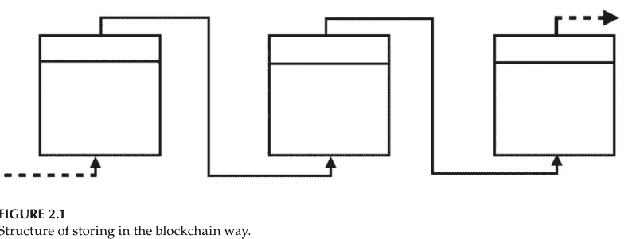

患者病史的医疗记录证明了上传文档的重要性。通过在健康记录中交换不同医疗服务提供者之间的患者数据，可提升演示性准确性和信息存储库 [7]。医疗保健行业在各种金融和保险相关应用中广泛使用区块链技术。监控资源和进行交易的行业服务于其所有预定目标：一种既照顾计算机化资源又照顾关键资源的安全网络基础设施。数据传输由基本特征驱动，包括信任、协议、智能合约、性能和安全性。

某些研究强调了区块链对医疗信息系统的潜在影响。但是，本研究提出的基于区块链的方法是第一个消除由患者感知引起的EHR限制的方法。本研究的第二个贡献是为使用区块链技术进行信息交换提供理由和证据。社会交换理论这一知名理论被用于从个人（患者）角度支持区块链在交换医疗信息方面的好处。基于场景的实验设计所收集的实证数据支持了区块链在健康记录系统中的效用 [8]。在区块链中，数据可以以多种方式存储，包括通过智能合约、交易输出和外部存储层。智能合约是一种自动执行合同，其协议条件直接写入代码中，是一种方法。信息可以作为变量保存在智能合约中，并可使用合同的功能进行检索和修改。数据也可以作为输出保存在交易中。文档哈希或数字签名等小块数据通常以这种方式存储。最后，可以通过外部存储层在链下维护对大量数据的引用，而实际数据本身则保存在区块链上。与将所有数据直接放在区块链上相比，这种方式可能更高效且更经济 [9]。数据类型、数据量以及所使用的区块链平台是决定数据在区块链上如何存储的主要因素。图2.1展示了区块链存储结构。

### 2.2 区块链在医疗和制药领域的应用

与传统的集中式数据库不同，区块链网络以去中心化且不可更改的方式存储数据，这使它们成为存储海量


数据量。区块链技术安全有效地存储海量数据的能力是其主要优势之一。这得益于分布式共识机制和密码学算法的应用，它们能保证数据完整性并防止非法访问。因此，区块链网络可以在不牺牲安全性或效率的前提下处理海量数据[10]。此外，区块链网络设计极具可扩展性，非常适合存储大量数据。区块链网络的数据存储能力会随网络中节点数量的增加而增长。凭借其可扩展性特性，区块链网络能够处理海量数据而不会出现速度问题。区块链技术的不可篡改性是在利用其存储大量数据时的另一大优势。未经网络用户同意，存储在区块链网络上的数据无法被修改或删除。对于银行记录、医疗记录和个人信息等对安全性和匿名性要求极高的敏感数据，区块链是理想选择。

此外，区块链网络采用点对点（P2P）架构，这意味着数据分布在节点网络中。通过确保数据在众多节点上复制，这最大限度地降低了数据丢失或损坏的风险。相比之下，中心化数据库存在单点故障问题，容易受到数据泄露和网络攻击等安全威胁[11]。最后，区块链技术的成本效益使其非常适合存储海量数据。去中心化的区块链网络消除了数据存储和传输中对中介的需求。这使其成为企业存储大量数据且无需承担高昂成本的吸引人选择，因为它降低了维护和保护数据的成本。综上所述，区块链技术为有效且经济地存储海量数据提供了一种创新方法。由于其可扩展性、不可篡改性、去中心化和 P2P 设计，它是企业存储金融记录、医疗记录和个人信息等敏感数据的最佳选择。随着对数据存储需求的不断增长，区块链技术有望成为全球组织和行业数字化转型中的主要参与者。

医药行业涵盖用于疾病管理、预防和治疗的药品的研发、生产和营销，是一个庞大而复杂的产业。由于监管严格且研发投入要求高，该行业既充满挑战又极具盈利能力。医药部门生产种类繁多的产品，包括处方药、非处方药、疫苗及其他医疗用品[12]。此外，该部门还涉足生物技术及医疗产品，如义肢、植入物和诊断工具。一种新药的研发需要经过多个阶段，可能耗时数年，包括药物发现、临床前测试、临床试验、监管审批和上市后监测。尽管存在诸多困难，医药行业仍然是推动医疗创新和改善全球患者预后的重要力量。

由于医药行业和医疗行业在医疗产品和服务的发现、生产和交付中都扮演着重要角色，因此两者紧密相关。医药行业更侧重于药物及其他医疗产品的研发与制造，而医疗行业则主要专注于提供患者护理。医药公司与医疗专业人员和医疗机构密切合作，开发和销售用于各种疾病的药物。随后，这些药物由医疗行业用于提供患者护理并治疗各类疾病。

将区块链技术引入医药行业具有潜在优势。出于若干原因，区块链技术已被整合到医药行业，包括其在供应链透明度、数据安全、效率和患者预后方面带来的益处[13]。医药企业可以利用区块链的功能（例如提供透明且防篡改的交易记录的能力）来追踪药品从生产商到患者的流转，验证药品合法性并防止欺诈和药品流窜。此外，区块链的去中心化结构使其成为安全存储和交换敏感数据（包括患者信息和临床试验结果）的理想工具。区块链技术可以通过减少行政流程来减轻中介的负担并提升供应链效率。最后，人们将能够更好地掌控自身健康信息，并安全地与医疗专业人员共享，从而实现更加个性化和有效的治疗，改善患者预后[14]。

区块链技术的诸多优势使其非常适合医疗行业。提供更强数据保护的能力是其最重要的优势之一。医疗记录和健康数据中包含最敏感的信息，区块链技术通过加密数据并使其不可更改，能提供前所未有的保护水平。这确保了患者数据免受未经授权的访问和篡改，从而降低了数据泄露的风险。区块链技术还可以通过促进不同提供者和机构之间安全共享健康数据，帮助提升医疗行业的互操作性。这一点至关重要，因为医疗行业通常较为分散，数据孤岛以多种形式存在于各处。借助区块链，所有参与患者护理的各方都可以访问相同的数据，这能减少错误、增强护理协调，并最终改善患者预后。

医疗行业主要依赖供应链来提供救命药物和医疗设备。区块链技术能够实现从生产商到患者的物品透明且安全的追踪，从而改善供应链管理。这可以降低流窜风险，并有助于防止假药进入供应链。此外，通过赋予人们访问自身健康数据的权限，区块链技术可以赋能患者。人们可以使用区块链技术控制自己的健康数据，并根据具体情况与医疗专业人员、研究人员及其他各方共享。这可能带来更好的患者预后和更加个性化的治疗。事实上，在医疗领域实施区块链技术有很多优势，例如更强的互操作性、改进的供应链管理和患者赋能。

### 2.3 疾病与暴发

疾病是指损害身体正常运作能力并导致轻中度或重度症状的疾患。多种因素都可能促成其发展，包括生活方式选择、环境条件、遗传易感性以及病毒、细菌和寄生虫等感染性因素。人类易患几十种不同的疾病，从普通感冒和季节性过敏等日常病症，到癌症、心脏病和艾滋病等严重问题。疾病可能有多种症状，包括发烧、不适、疲惫和认知障碍，并可能影响身体的不同部位，包括器官、组织和细胞。

有些疾病是慢性病，意味着会持续数月甚至数年；而另一些是急性病，意味着发病迅速且持续时间短暂。慢性病会显著影响个人的生活质量，且往往难以管理。得益于医学科学和技术的进步，许多疾病已被识别和治疗，改善了患者预后并延长了预期寿命[15]。目前仍有几种疾病没有可行药物，这一事实凸显了持续开展医学研究和创新的必要性。要预防和治疗疾病，并最终改善个人和社区的健康与福祉，了解疾病的成因和后果至关重要。

疾病和流行病是影响个人、社区和整个人口的重大公共卫生风险。疾病是指干扰身体自然功能并可能导致从轻度到重度不等症状的状况，而流行病则被描述为特定疾病在各地理区域或人群中病例数的快速上升。包括病毒、细菌、寄生虫、环境暴露以及其他健康方面的因素在内的感染性因素都可能导致疾病暴发[16]。流感暴发、食源性疾病暴发以及新发传染病（如 COVID-19 大流行）的流行病都是典型的疾病暴发实例。疾病暴发的影响可能很大，从轻微疾病到严重疾病甚至死亡不等。从流行病和疾病中恢复是一个基于疾病及其严重程度的艰难过程。康复的第一步是寻求医疗治疗。医疗专业人员可以提供诊断并建议最佳治疗方案。必须遵守建议的治疗方案，这可能包括服药、休息和改变生活方式。良好的卫生习惯，例如经常洗手、咳嗽或打喷嚏时遮住口鼻、避免与患者直接接触，有助于防止疾病传播并加速康复。

此外，疾病暴发可能产生社会和经济影响，影响旅行、就业和教育。因此，及时发现疾病暴发并采取措施遏制其蔓延、减轻其影响至关重要。控制流行病的关键在于预防，包括免疫接种、良好的手部卫生和感染控制技术在内的公共卫生政策对于降低疾病暴发可能性至关重要。公共卫生组织必须协作，监测和分析疾病暴发，确定其原因，并实施控制措施以防止其传播。早期识别和反应同样至关重要。总体而言，感染和疾病暴发是重大公共卫生问题，需要持续的监测、调查和行动，以减轻其影响并改善个人和社区的健康与福祉。

区块链技术可以改变医疗行业对疾病的应对方式。医疗行业可以利用区块链的功能来促进患者赋能、扩大互操作性并改善数据安全性[17]。改善数据安全性和隐私是区块链在疾病治疗中的最重要优势之一。随着电子健康记录的普及，患者数据更容易受到数据泄露和网络攻击的威胁。通过加密健康数据并使其不可更改，区块链技术可以提供前所未有的数据保护和隐私水平。这确保了患者数据免受未经授权的访问和篡改，从而降低了数据泄露的风险。增强互操作性也是区块链技术的一大优势。不同组织和提供者之间缺乏互操作性是医疗行业面临的最大问题之一。通过使提供者和组织能够安全共享健康数据，区块链技术可以助力互操作性。在疾病管理的背景下，这一点至关重要，因为成功的患者护理取决于医疗从业者能够获取正确和最新


患者信息。区块链技术可以改善疾病追踪和监测。公共卫生专家可以利用区块链来监测疾病模式、追踪疫情，并在出现新的健康威胁时及时采取行动。区块链可以通过提供疾病流行率和严重程度的实时数据，帮助公共卫生工作者就疾病预防和控制策略做出明智决策 [18]。

在人类历史上，疾病爆发在全世界范围内显著扰乱了社区。公元前430年伯罗奔尼撒战争期间袭击该城的雅典瘟疫是有史最早有记载的流行病之一。据说，这次爆发导致该城市三分之一的人口死亡，据信是由伤寒或类似病毒引起的。14世纪中叶从中国传入欧洲的黑死病是历史上另一场重大流行病。据信，由鼠疫耶尔森菌引起的这场大流行导致全球多达2亿人死亡。由于黑死病造成严重的社会和经济影响，封建制度衰落，现代资本主义兴起。流感流行病在20世纪对世界卫生产生了重大影响。据估计，1918年流感大流行（通常称为西班牙流感）感染了世界三分之一的人口，导致多达5000万人死亡。最近，2009年H1N1流感大流行导致全球估计有284,000人死亡。像2014年西非埃博拉疫情和持续的COVID-19大流行等传染病暴发，引起了人们对21世纪传染病持续威胁的关注。约有28,000人感染了埃博拉病毒，导致11,000人死亡的疫情结束。截至2023年初，由SARS-CoV-2病毒引起的COVID-19大流行已有超过1.3亿例确诊病例和280万例死亡，对全球卫生和全球经济产生了巨大影响。大流行还引起了人们对公共卫生基础设施的必要性、科学政策的必要性以及在对抗传染病流行病中国际合作的必要性的关注。

了解疾病的传播并采取有效的遏制措施，取决于疫情期间的观察。这些观察可能采取多种形式，研究数据可以提供关于疫情特征的重要细节 [19]。在疫情期间，密切关注疾病受害者所表现出的体征非常重要。跟踪体征和症状可以帮助识别可能病例、追踪疾病进展并制定有效的治疗方案。此外，症状可以提供关于疾病严重程度及其对特定人群影响的关键信息。验证病例的位置是另一个发现。绘制病例位置图可以帮助识别感染风险较高的地区。这可能有助于实施旅行禁令或隔离等政策。了解疾病的传播模式有助于确定防止其进一步传播的最佳方式。例如，确定鼓励传播的高风险行为或环境可以指导社交隔离、佩戴口罩和其他干预措施。同样重要的是，要关注疾病受害者的人口统计学特征 [20]。可以使用年龄、性别和种族等人口统计数据来识别更容易感染疾病的人群。这些数据可用于集中干预，并为最需要帮助的人提供适当的支持。例如，老年人或患有基础健康问题的人可能需要更密集的支持才能从疾病中恢复。最后，研究民众对流行病的反应，有助于找出告知和与民众沟通疾病的最有效方式。它还可以揭示社交隔离和戴口罩等策略的效果。通过分析公众反应，可以改进公共卫生信息并提高对法规的遵守程度。总体而言，疫情期间的勤勉观察和数据分析可以提供有关疾病的宝贵见解，并有助于指导高效的应对行动。公共卫生专业人员可以通过跟踪症状、地理位置、传播机制、人口统计学和公众反应，更好地了解流行病并实施有效的遏制措施。

为了让研究人员和公共卫生专家从过去吸取教训并制定成功的预防、准备和应对计划，必须存储关于以前流行病的信息。保存疫情数据的一项关键优势是发现与疾病传播相关的模式和风险因素。研究人员可以通过审查之前疫情的数据，在不同流行病之间找到相似之处，例如人口统计特征、环境因素或传播机制。这种知识可以帮助开发更有效的预防措施，例如疫苗接种计划或公共卫生信息。除了发现趋势之外，跟踪流行病数据还可以帮助研究人员创建更好的诊断工具 [21]。研究人员可以通过回顾之前的疫情来识别引起疫情的病毒，并创建更精确的诊断测试。公共卫生专业人员可以使用更高效的测试设备，及时识别患者并在疫情进一步扩散之前加以制止。保存疫情数据的一项关键优势是改进流行病应对计划。公共卫生专业人员可以通过研究之前的流行病，发现其应对计划中的不足并加以完善。为了更好地向公众通报与流行病相关的危害，或更好地协调各机构之间的应对工作，他们可能会识别出沟通差距。最后，跟踪流行病数据有助于政策制定。决策者可以通过审查事实，就疫苗开发、预算分配和检疫规定做出明智决策。利用这些数据，可以制定改善卫生条件或控制动物市场的政策调整，以防止未来的流行病。总之，跟踪疫情数据对于增强我们对传染病的认识以及加强我们未来应对流行病的能力至关重要。

研究人员可以通过研究之前的流行病来发现趋势和风险因素、创建更好的诊断设备、改进应对计划并提供政策判断 [22]。这种知识对于防止未来流行病并保障世界各地人们的健康和安全至关重要。

通过提供一种安全且去中心化的机制来处理患者数据，在基于区块链的系统中存储医疗记录有望彻底改变医疗保健行业。区块链技术是一种分布式账本，以公开且安全的方式记录交易，因此非常适合存储医疗记录等私人数据。采用区块链来存储医疗信息的一项关键优势是增强了安全性。传统的医疗记录存储方式使用集中式数据库，而集中式数据库经常成为网络攻击和数据泄露的目标。由于区块链数据经过加密并存储在分散的节点网络上，因此黑客更难访问患者数据。采用区块链存储医疗记录的好处之一是改善了隐私。在区块链系统中，患者可以决定谁有权访问其医疗信息，并且所有访问和更改都记录在不可更改的账本中。这样，患者数据可以免受非法访问或篡改 [23]。

此外，基于区块链的医疗记录存储可以提高医疗服务的精确度和效率。医疗专业人员可以使用去中心化系统从任何位置轻松访问患者数据，从而无需重复检测或重复记录。另外，使用智能合约可以自动化流程


如索赔处理，降低行政成本并提高支付准确性和速度。总体而言，使用基于区块链的系统存储医疗信息有潜力提高医疗服务效率、安全性和隐私性。区块链可以通过提供更安全且去中心化的患者数据管理方法，帮助医疗从业者提供更好的治疗并改善患者预后。

通过提供一种安全且透明的机制来处理药物研发、制造和分发，将药物数据存储在基于区块链的系统中有潜力改变制药业务 [24]。以下是将药物数据存储于区块链上的一些好处：

- 1. 供应链*透明度*已提高，这是采用区块链存储药物数据的关键优势之一。区块链可以通过跟踪药品从制造商到最终消费者的全过程，为路线上的每一笔交易提供详尽、无可争辩的记录。因此，患者将获得安全有效的药物。这也有助于避免假冒、流转和其他欺诈行为。

- 2. **增强安全性。** 将药物数据放置在基于区块链的系统中可以帮助抵御网络攻击和数据泄露。得益于区块链安全且去中心化的数据存储，黑客很难访问和篡改敏感数据。这在制药领域尤为重要，因为与药物研究和临床试验相关的数据完整性和机密性至关重要。

- 3. **改进数据共享。** 研究人员、生产商和监管机构可以通过在基于区块链的系统中存储药物数据来更有效地协作。区块链可以通过提供一个安全且开放的数据共享平台，加速药物研发，减少工作重复，并促进行业创新。

- 4. **提高效率。** 在区块链上存储药物数据可以帮助使新药的研发和生产更加高效和经济。使用在区块链上运行的自执行程序（即智能合约）来自动化临床试验数据收集、药物制造和供应链管理等活动，可以降低行政负担，提高这些程序的速度和准确性。

- 5. **更好的患者预后** 有可能因为将药理学数据存储在基于区块链的系统中。区块链可以通过确保药品的安全性、有效性和质量，帮助保证患者在正确的时间获得正确的处方药，从而提升他们的健康和生活质量。

总体而言，通过使用基于区块链的系统存储药物数据，药物研发、生产和分发的管理可以安全、透明且高效地进行。区块链技术可能有助于促进创新，并通过提高供应链透明度、增强安全性、实现数据交换、提高效率和改善患者预后，保证患者获得安全有效的药品 [25]。

“爆发”通常被描述为某个人口或地理区域中某种疾病或感染发病率的突然、未预料到的上升。公共卫生专家必须识别出疫情，以便采取适当的控制措施并防止未来的传播。以下是几种判断是否存在疫情的技术：

- 关注新闻来源。地方和国家新闻媒体经常报道疫情的发生。通过定期扫描关于特定地区某种疾病或感染病例增加的新闻来源，可以发现潜在的爆发。

- 公共卫生监测系统旨在监视和跟踪传染病及其他健康相关问题的传播。这些系统从各种来源（如公共卫生机构、医院、诊所和实验室）收集信息，然后分析信息以寻找疾病频率的任何意外趋势或上升。

- 报告机制。当医疗专业人员和实验室报告某些传染病病例时，必须通知公共卫生当局。监控这些报告系统有助于发现疫情，并提供关于受爆发影响的人群及其严重程度的详细信息。

- 社交媒体。Twitter、Facebook和Instagram等社交媒体平台越来越多地被用作公共卫生监测的工具。研究人员可以利用这些平台的数据实时监测舆论并发现潜在的疫情。

- 社区报告。社区可以帮助识别疫情。例如，人们可以向当地卫生部门报告其地区某种疾病病例的增加，以便他们进行调查并采取适当行动。

总之，识别爆发需要公共卫生官员、医疗专业人员、实验室和社区的协作努力。公共卫生人员可以通过关注新闻来源、监测和报告系统、社交媒体以及社区报告，迅速发现疫情并采取必要行动防止其传播。

### 2.4 分析记录

有一些流程和技术可以用于辅助研究，尽管分析模式和爆发可能是一个困难的过程。以下是一些需要考虑的关键步骤：

- 1. 数据收集。收集相关信息是评估模式和爆发的第一阶段。这可能包含关于受影响群体、地区、症状、时间范围及其他相关信息的细节。数据可以从各种地方收集，包括公共卫生组织、医院和其他机构。

- 2. 数据可视化。在收集数据后，对其进行可视化可能有助于理解模式和趋势。可以使用图表、图形和地图等工具来辅助可视化数据，发现任何模式或趋势。

- 3. 数据分析。在数据可视化之后，可以对其进行统计检查，以寻找任何显著的趋势或模式。这可能包括跟踪不同时间和不同群体中的趋势，以及计算发病率和患病率等指标。

- 4. 确定可能原因。在发现趋势和模式后，下一步是调查潜在原因。这可能包括分析人口统计和环境变量，以及潜在的风险因素和暴露情况。

- 5. 传达调查结果。最后，至关重要的是要让相关各方（如公共卫生官员、医疗专业人员和公众）了解调查结果。这可用于指导决策和行动计划。

一般来说，趋势和疫情分析需要一种多学科策略，包括数据收集、可视化、分析和沟通。还需要多个利益相关方（如公共卫生当局、医疗专业人员和研究人员）之间的协作 [26]。

通过提供一个用于管理健康数据、改善患者预后和降低成本的安全且去中心化的平台，区块链技术有潜力彻底改变医疗保健行业。以下是区块链在医疗行业当前和未来应用的一些示例：

- 电子健康记录（EHRs）。患者的健康记录可以通过区块链技术在不同医疗组织和提供商之间安全地共享和存储。这可以提高患者安全性，减少医疗错误，并改善护理协调。

- 临床试验。临床试验数据可以通过区块链安全地存储和共享，这可能会加速药物研发过程并改善患者预后。

- 医疗供应链管理。可以使用区块链跟踪药品、医疗设备和其他医疗用品，以提高供应链透明度并降低假冒或劣质商品的风险。

- 远程医疗。区块链可用于安全地存储和交换远程医疗记录，让患者能够使用这些服务并提高治疗标准。

- 健康保险。可以使用区块链管理健康保险索赔和付款，从而降低行政费用并提高保险系统的有效性。

- 研发。区块链技术可用于安全存储和分发研究信息，从而加快科学进步并改善患者预后。

通过建立一个用于收集和存储医疗数据的安全且中立的平台，区块链技术有潜力彻底改变我们追踪疾病和疫情爆发的方式 [27]。通过利用区块链的力量，我们可以改善护理协调，加快诊断，并最终挽救生命。让我们来看看使用区块链技术追踪疾病和疫情爆发。

#### 2.4.1 安全数据共享

区块链技术提供安全数据传输的能力是其最重要的优势之一。我们可以通过利用

用于存储医疗数据的区块链，例如患者记录、检测结果和流行病学数据。这样一来，医疗失误的可能性可以降低，治疗也能更好地协调。例如，区块链技术可用于分发和保留患者的医疗数据。我们可以通过构建一个对所有医疗服务提供者开放的区块链网络，来确保患者无论在何处寻求治疗都能访问自己的医疗数据。允许医疗专业人员做出更明智的判断，并避免重复进行检查或手术，有助于提高治疗质量 [28]。以类似方式，流行病学数据也可以使用区块链进行共享和存储。除了流行病模式和传播率的信息外，这还可以包含疾病患病率、发病率和病死率的统计数据。我们可以通过开发一个对公共卫生组织、研究人员和其他利益相关方开放的区块链网络，来增强对疾病和疫情传播的理解，并构建更有效的预防和治疗方法。

#### 2.4.2 实时数据分析
区块链技术进行实时数据分析的能力是另一个重要优势。我们可以利用区块链开发一个实时数据分析平台，用于存储和处理医疗数据，使医疗专业人员和公共卫生官员能够立即跟踪疾病模式和疫情 [29]。例如，密码学协议可用于开发一个实时仪表板，显示重要的流行病学数据，例如疾病的患病率、发病率和死亡率，以及疫情模式和传播率的信息。随后，公共卫生专业人员能够迅速发现疫情，并采取适当措施加以阻止，例如实施隔离限制或分发疫苗或抗病毒药物。就像区块链技术可用于预测疾病和疫情的发展一样，它也可用于开发预测模型 [30]。通过利用机器学习算法和其他前沿分析技术，我们可以检查大量医疗数据，发现有助于预测疾病和疫情传播的模式和趋势。这样，公共卫生官员和医疗专业人员就能采取预防措施，阻止疾病和疫情的传播，例如开展有针对性的疫苗接种运动，或在高风险地区实施隔离限制。

#### 2.4.3 改进患者隐私和安全性
在跟踪疾病和疫情时，保持患者的保护和隐私是最大的挑战之一。我们可以利用区块链技术来存储和分发医疗数据，从而构建一个极度安全且能保护患者隐私的平台。例如，区块链技术可用于开发一个安全可靠的患者身份系统。我们可以利用区块链来存储患者身份数据（如姓名、出生日期和病史），开发一个高度安全且不可攻破的系统，以保护患者隐私并防止身份盗用。同样，区块链技术还可用于为医疗从业者开发一个安全且加密的通信系统 [31]。我们可以利用区块链来存储和传输医疗数据及通信，开发一个高度安全且不可攻破的系统，以保护患者隐私并防止数据泄露。

#### 2.4.4 降低成本
归根结底，利用区块链技术可以降低跟踪疾病和疫情的成本。我们可以通过利用区块链来存储和分发医疗数据，从而降低存储医疗数据所涉及的行政费用，并提高医疗系统的效率。例如，区块链技术可用于自动化处理医疗数据相关的各种办公流程，包括数据输入、数据验证和数据核对。通过自动化这些流程，我们可以减轻医疗专业人员的行政负担，并提高医疗数据的准确性和完整性。区块链技术还可以简化账单流程。我们可以利用区块链来存储和分发账单信息，开发一个更高效、更透明的账单系统，从而降低与账单相关的行政成本，并提高账单数据的准确性 [32]。区块链技术有可能彻底改变我们跟踪疾病和疫情的方式，为存储和共享医疗数据提供一个安全且去中心化的平台。然而，仍有待解决的挑战。尽管如此，区块链技术仍是医疗服务提供者、公共卫生官员和研究人员关注的领域。

#### 2.4.5 以区块链方式存储数据的算法

- 1. 定义区块链的数据结构（例如，链表）。
- 2. 创建新区块：
    - 定义区块结构（例如，前一区块哈希、时间戳、数据）。
    - 将前一区块哈希指定为前一区块的哈希。
    - 为新区块设置时间戳。
    - 将新的疾病/疫情数据添加到区块中。
- 3. 对数据进行哈希：
    - 使用加密哈希函数（例如，SHA-256）对数据进行哈希。
    - 将哈希后的数据存储在区块中。
- 4. 将区块添加到区块链中：
    - 验证前一区块哈希是否与链中前一区块的哈希匹配。
    - 将新区块添加到链的末尾。
    - 更新当前区块的哈希，以包含前一区块的哈希。
- 5. 根据需要重复该过程，以将更多疾病/疫情数据添加到区块链中。
- 6. 查询区块链中的疾病/疫情数据：
    - 从链中最近的区块开始。
    - 验证区块的哈希，确保其未被篡改。
    - 如果区块包含所需的疾病/疫情数据，则返回该数据。
    - 否则，移动到链中的前一个区块，并重复步骤 2–3，直到找到数据或到达链中的第一个区块。

公共卫生专业人员和研究人员可以通过研究疫情，更好地了解、阻止和管理传染病的传播。早期诊断和反应、更深入地了解疾病、加强监测、更有针对性的疗法以及更合理的资源配置，只是疫情分析的几大优势。能够尽早发现新出现的疫情并迅速采取行动阻止疾病传播，是疫情分析的主要优势之一 [33]。早期发现对于防止传染病传播至关重要，因为它使公共卫生专业人员能够找到并治疗受影响的人及其接触者，以及识别和隔离受感染者。例如，在 COVID-19 大流行期间尽早发现新病例，使公共卫生官员能够采取大规模检测、接触者追踪和隔离程序来阻止疾病的传播。除了早期诊断和治疗外，疫情分析还可以帮助我们更多地了解疾病本身。研究人员可以通过研究疫情数据，找出与疾病相关的趋势和风险因素，包括其传播方式、症状以及最佳治疗方法。这些知识可用于创新疗法和预防措施，并对其进行改进 [34]。

例如，对西非 2014 年埃博拉疫情的研究，促成了新药物和疫苗的研发。此外，通过分析疫情还可以加强疾病监测系统。公共卫生专业人员可以监测疾病进展并尽早发现潜在疫情，从而改进其监测系统，以更好地检测和应对未来的流行病。例如，开发新的工具来识别和监测疾病传播，以及研究过去的疫情，都为全球流感监测网络的重大近期改进做出了贡献。研究疫情的另一个优势是能够设计更有针对性的措施，阻止疾病传播。公共卫生专业人员可以识别高风险人群和受疾病影响最严重的地区，从而制定更有效的预防和控制计划。例如，公共卫生专业人员在 HIV/AIDS 大流行期间利用疫情分析，确定了高风险人群，并制定了专门的预防和治疗计划，以阻止疾病的传播。疫情分析有助于确保资源分配高效且有效。公共卫生官员可以通过识别疾病最普遍的地区，将资金、人员和医疗物资等资源导向最需要的地方。这可以确保资源明智地花费，并且疫情响应尽可能成功。它使公共卫生当局和学者能够尽早识别疫情、增强监测系统、设计更有针对性的疗法，并有效分配资源。随着世界继续面临新出现的传染病，疫情研究将继续成为保护公共卫生的重要工具。

### 2.5 构建区块链网络
要创建安全、可扩展且高效的区块链网络，需要仔细考虑一些技术因素。共识机制、网络设计、数据存储和管理、智能合约的创建以及安全协议，是在构建区块链网络时需要考虑的关键技术因素之一。

- **共识机制。** 共识机制是指管理交易如何被验证并添加到区块链中的一套规则。存在多种可能的共识技术，包括拜占庭容错、委托权益证明（DPoS）、工作量证明（PoW）和权益证明


(PoS) (BFT)。共识机制的选择将取决于网络的特定需求，每种方法都有其自身的优势和劣势。

- 网络架构。区块链网络的架构是另一个关键因素。对等（P2P）网络和客户端-服务器网络是两种可能的网络结构。P2P 网络的运行和扩展可能更具挑战性，但它们通常更去中心化且更能抵御攻击。尽管更集中，客户端-服务器网络的运行和扩展可能更简单 [35]。

- 数据管理和存储。创建区块链网络需要仔细考虑数据管理和存储。网络必须能够处理大量数据，同时存储在区块链上的数据必须安全且不可更改。为了确保数据被有效且安全地保存，选择合适的数据库技术至关重要。为了确保区块链能够随时间更新，还需要实施高效的数据管理流程。

- 智能合约开发。自执行合同，称为“智能合约”，存储在区块链上。它们可以自动化复杂的业务流程，并确保交易按照预先规定的规则执行。像 Solidity 这样的编程语言（用于在以太坊网络上创建智能合约）是创建智能合约所必需的。智能合约必须经过仔细的测试和审计，以确保它们安全且按预期工作。

- 安全协议。安全是开发区块链网络的重要因素。网络需要构建得能够抵御入侵并保护存储在区块链上的数据的完整性。基于角色的访问控制、多因素身份验证等安全方法可以防止非法网络访问。定期的安全审计和渗透测试对于查找和修复网络漏洞至关重要。

- 可扩展性。在开发区块链网络时，可扩展性是一个关键因素。网络必须能够在扩展和添加新交易时处理额外的负载，而不会出现迟缓或不稳定。分片、链下交易和侧链是可用的扩展选项之一。网络的独特需求将决定最佳的扩展选项 [36]。

- 互操作性。互操作性是指多个区块链网络相互交互和通信的能力。这对于构建更加集成和功能完善的区块链生态系统至关重要。互操作性可以通过采用 ERC-20（以太坊改进建议）等标准来实现，该标准为以太坊网络上的代币提供了通用接口。

在开发区块链网络时，需要仔细考虑多个技术因素。所使用的共识机制以及网络设计、数据存储和管理、智能合约创建、安全协议、可扩展性和互操作性，都将对网络的性能、安全性和可用性产生重大影响。通过仔细考虑某些技术因素，可以构建一个安全、可扩展且高效的区块链网络 [37]。尽管连接多个区块链网络可能很困难，但这对于区块链的接受和发展至关重要。为了让区块链发挥其全部潜力并允许跨多个网络运行的去中心化应用，互操作性是必不可少的。存在许多连接多个区块链网络以实现高效通信的策略。

互操作性协议。互操作性协议允许各种区块链网络相互连接。这些协议充当多个区块链之间的桥梁，使数据和资产在多个区块链之间的传输成为可能。例如，互操作性协议包括 Polkadot 和 Cosmos。多链、分片的 Polkadot 网络使用中继链来连接其多个平行链。中继链提供了一种安全的方式来在它们之间传输资产和数据，每个平行链都可以根据特定用例的要求进行定制。相比之下，Cosmos 的星型架构通过单个中心连接许多独立的区块链网络，即“区域”。每个区域都有自己的治理和共识流程，从而实现各种区块链网络之间的兼容性。

跨链桥。跨越各种区块链网络的桥称为跨链桥。使用智能合约，它们能够在多个区块链之间转移资产和数据。跨链桥的工作原理是在一个区块链上锁定资产，并在另一个区块链上释放这些资产的等价表示。由于此操作具有可逆性，资产可以被解锁并转移回原始区块链。

例如，Polygon 网络使用跨链桥与以太坊和 Binance 智能链等其他区块链网络连接 [38]。这使得资产的平稳转移和区块链互操作性成为可能。

原子交换。这些允许在各种区块链网络之间即时转移数字资产。原子交换使用智能合约，使加密货币的交换无需中介或集中式交易所。例如，如果用户希望直接通过原子交换将比特币换成以太坊，则无需经过交易所。由于智能合约保证双方将同时收到资产，因此此过程安全且无需信任。区块链技术的接受和扩展取决于多个区块链网络的互连以实现高效通信。这使得可以构建可在多个区块链网络上运行的去中心化应用，并为消费者提供更多交易和转移资产的替代方案 [39,40]。

区块链是一种去中心化的数字账本技术，可用于安全、公开地监控和验证信息。区块链技术有多种可能的应用，包括疫情上报，可用于提供疾病爆发的安全、防篡改记录。以下是在区块链上创建疫情报告的几种策略：

- 代币化。代币化可作为上报疫情的奖励。及时准确上报疫情的医疗专业人员、研究人员和个人均可获得代币奖励。这些代币可用于支付与疫情管理和预防相关的服务，也可交换为其他加密货币。

- 去中心化应用（DApps）。为了简化疫情上报，可以在区块链之上创建去中心化应用。这些 DApps 可用于从社交媒体、新闻机构和官方报告等多种来源收集信息，并提供疾病爆发的安全、公开记录。这些 DApps 还可用于可视化和绘制疫情数据地图，以帮助研究人员和决策者了解疾病传播情况 [41]。

- 许可区块链。使用许可区块链，可以以安全且不可更改的方式记录疾病爆发。只有授权用户才能在许可区块链上添加、更改和删除数据。这保证了数据的可靠性和准确性。可以使用许可区块链构建仅供授权个人使用的集中式疫情上报系统。

- 数据分析。可以使用区块链技术收集和存储大量关于疾病爆发的数据。可以使用数据分析技术来检查这些数据，发现疾病爆发中的模式和趋势。所提供的信息可用于制定更好的疫情管理和预防方法。

区块链可以通过创建疾病爆发的安全、透明记录，利用智能合约、代币化、去中心化应用、许可区块链和数据分析，彻底改变疫情上报。这可以帮助研究人员和决策者更好地了解疾病传播，并制定更好的疫情管理和预防策略 [42]。

尽管区块链技术有可能彻底改变医疗行业，但仍有几个关键缺点需要考虑。数据隐私是主要问题之一。医疗信息通常敏感且私密，存在不想要的第三方获取此信息的风险 [43]。虽然区块链旨在安全且不可破解，但用户仍有可能根据其在区块链上的活动来追踪交易并识别特定用户。大规模医疗应用可能会遇到困难，因为当区块链网络变得过大时，可能会变慢且效率低下。此外，由于其复杂性，医疗从业者可能缺乏部署和管理区块链技术所需的专业知识和技能。最后，集成区块链技术的成本，尤其是对于较小的医疗提供者，可能会阻碍该技术在行业内的广泛应用。因此，尽管区块链技术有潜力改变医疗行业，但在将其应用于医疗应用之前，必须仔细审视这些缺点和局限性 [44]。

### 2.6 扩展区块链网络

利用区块链技术检测和响应疾病爆发的能力有望改善公共卫生。由于区块链具有去中心化、防篡改和透明的特性，它可以帮助保证健康数据的准确性和隐私，促进疫情的实时追踪，并实现高效的应对策略 [45]。本章将介绍区块链如何简化疾病和疫情爆发的监测。首先，区块链可以增强数据的安全性和完整性。传统的医疗系统是集中式的，这意味着健康信息存储在一个地方，由少数人员或企业管理 [46]。这种集中式系统容易受到网络攻击和数据泄露。另一方面，像区块链这样的去中心化系统将数据分布在计算机网络中。区块链的区块非常难以篡改，因为每个区块都有一个独特的加密哈希。这保证了健康数据的准确性和机密性，这对于监测疾病爆发至关重要 [47]。其次，区块链可以帮助实时追踪疫情。传统疾病监测系统使用的手动报告过程可能缓慢且容易出错。通过区块链，可以实时捕获数据，从而更快地识别疫情


精确地。例如，区块链可用于追踪危险地区个人的行动、监测疾病暴发并查找可能的感染源。公共卫生专业人员可以利用这些实时数据，就如何应对流行病做出明智决策。区块链的第三个好处是，它可以促进公共卫生官员与医疗保健专业人员之间更好的沟通与协调[48]。由于传统医疗体系的碎片化，许多提供者可能使用不同的数据结构和协议类型。因此，共享信息和组织流行病应对可能面临挑战。公共卫生官员、提供者及其他各方可以使用区块链安全且公开地交换健康数据。这可能使协作与协调更加高效，从而加快并提高疫情遏制的效率。最后，区块链可以改善数据所有权和隐私[49]。在传统医疗体系中，患者隐私通常优先于数据所有权和管理。因此，患者可能难以获取其健康信息，这使得疾病预防和治疗更加困难[50]。得益于区块链，患者可以拥有并控制自己的健康数据。因此，患者对其信息的使用和共享方式有更多选择，这可能增加公众对医疗体系的信任，并激励更多人参与疾病追踪和预防计划。区块链有能力彻底改变我们监测和处理疾病暴发的方式。区块链可以通过增强数据完整性和安全性、实现实时追踪、增强合作与协调以及增强隐私和数据所有权，帮助确保流行病得到及时、高效的发现和遏制。尽管部署基于区块链的解决方案时仍有待克服的障碍，但其优势显而易见，预计未来几年区块链技术在医疗领域将得到更广泛的应用。

#### 2.6.1 数据完整性与使用

维护医疗记录质量和完整性的关键组成部分是将医疗数据更新到区块链上。

使用区块链技术可以安全且去中心化地存储医疗数据，这也使数据防篡改且仅供授权员工访问。

在将医疗数据更新到区块链时，以下是一些需要注意的事项：

- 患者同意。在将医疗数据更新到区块链时，患者同意是需要考虑的最重要因素。在患者的医疗信息发布到区块链之前，患者必须给予明确同意。同意书中应明确说明数据将如何使用、谁将有权访问以及数据将保存多长时间。
- 数据质量。在将医疗数据更新到区块链时，数据质量是另一个关键因素。信息必须真实、完整且及时。区块链技术通过提供一种安全透明的机制来追踪数据的来源和历史，可以保证数据质量。
- 审计追踪。审计追踪是区块链上每一笔交易的记录。审计追踪可以详细说明谁访问了数据、何时访问以及进行了哪些修改。存储在区块链上的医疗数据可以从审计追踪提供的额外安全性和问责制中受益。

在将医疗数据更新到区块链时，患者许可、数据隐私、互操作性、数据质量和审计追踪都是需要考虑的重要因素。区块链技术可以通过改善患者预后、降低成本和提高效率来改变医疗行业。它提供了一种安全且透明的方式来存储和传递医疗数据[51]。

区块链技术可能彻底改变我们识别和监测疾病流行病的方式。区块链可以提供一个去中心化、公开且不可更改的健康数据记录，从而加快流行病的检测和遏制。区块链技术以透明且安全的方式存储和分发数据的能力，是其在疾病诊断方面的一大优势。医疗保健提供者和学者可以在区块链网络上安全地交换健康数据，而无需担心数据丢失或未经授权的访问[52]。因此，医疗从业者能够更容易地沟通和协作，疾病和流行病可能能够更快、更准确地被检测出来。总的来说，区块链技术有能力彻底改变我们识别和应对疾病流行病的方式。区块链可以为健康数据提供一个安全、公开且去中心化的平台，从而实现更快、更准确的流行病检测，以及更高效、更有效的应对。尽管仍有隐私保护和数据安全等问题需要解决，但区块链技术有望带来巨大益处。此外，可以使用区块链技术开发一个去中心化的疾病监测系统[53]。医疗保健提供者可以利用基于区块链的互联设备网络实时追踪流行病，从而实现早期识别和响应。这在资源匮乏且传统疾病监测系统不足的地区可能特别有帮助。智能合约的使用是疾病诊断领域另一种可能的区块链应用。通过智能合约，买卖双方协议的详细内容被直接编码到代码行中[54]。这些合同会自动执行。在疾病检测环境下，智能合约可用于自动化数据收集、分析和响应。例如，可以设置一个智能合约，在达到特定疾病病例阈值时，自动向受影响地区提供资源或发出警报。

### 2.7 结论

总之，使用区块链技术追踪疫情有可能彻底改变疾病的监测和处理方式。区块链去中心化和不可逆的特性有助于确保与流行病相关的数据准确性和透明度，从而降低欺诈、错误和操纵的可能性。不同利益相关方（如公共卫生当局、医疗保健提供者和个人）之间的信息交换可能变得更加高效和安全。区块链还可以促进去中心化接触者追踪系统的创建，这有助于识别和隔离受影响人群，阻止疾病传播。

## 参考文献

- [1] Hasselgren, A., Kralevska, K., Gligoroski, D., Pedersen, S. A., & Faxvaag, A. (2020). 医疗保健与健康科学中的区块链——范围综述. International Journal of Medical Informatics, 134, 104040.
- [2] Yaqoob, I., Salah, K., Jayaraman, R., & Al-Hammadi, Y. (2021). 医疗保健数据管理中的区块链：机遇、挑战与未来建议. Neural Computing and Applications, 1–16.
- [3] McGhin, T., Choo, K. K. R., Liu, C. Z., & He, D. (2019). 医疗保健应用中的区块链：研究挑战与机遇. Journal of Network and Computer Applications, 135, 62–75.
- [4] Fusco, A., Dicuonzo, G., Dell'Atti, V., & Tatullo, M. (2020). 医疗保健中的区块链：关于COVID-19的洞见. International Journal of Environmental Research and Public Health, 17(19), 7167.
- [5] Tandon, A., Dhir, A., Islam, A. N., & Mäntymäki, M. (2020). 医疗保健中的区块链：系统文献综述、框架综合与未来研究议程. Computers in Industry, 122, 103290.
- [6] Chukwu, E., & Garg, L. (2020). 医疗保健中区块链的系统综述：框架、原型与实现. IEEE Access, 8, 21196–214.
- [7] Chen, H. S., Jarrell, J. T., Carpenter, K. A., Cohen, D. S., & Huang, X. (2019). 医疗保健中的区块链：以患者为中心的模型. Biomedical Journal of Scientific & Technical Research, 20(3), 15017.
- [8] Ismail, L., Materwala, H., & Zeadally, S. (2019). 医疗保健的轻量级区块链. IEEE Access, 7, 149935–51.
- [9] Soltanishet, L., Alizadeh, R., Hao, H., & Choo, K. K. R. (2020). 基于区块链的医疗保健中的技术、时间和空间研究挑战与机遇：系统文献综述. IEEE Transactions on Engineering Management, 70(1), 353–368. https://doi.org/10.1109/TEM.2020.3013507.
- [10] Singh, A. P., Pradhan, N. R., Luhach, A. K., Agnihotri, S., Jhanjhi, N. Z., Verma, S., ... & Roy, D. S. (2020). 区块链赋能医疗应用的新型以患者为中心的架构框架. IEEE Transactions on Industrial Informatics, 17(8), 5779–89.
- [11] Abdellatif, A., Al-Marradi, A. Z., Mohamed, A., Erbad, A., Chiasserini, C. F., & Refayey, A. (2020). ssHealth：迈向安全的区块链赋能医疗系统. IEEE Network, 34(4), 312–19.
- [12] Jaimin, V., & Urovi, V. (2020). 基于区块链的健康数据共享平台的同意模型. IEEE Access, 8, 143734–45.
- [13] El-Gazzar, R., & Stendal, K. (2020). 医疗保健中的区块链：希望还是炒作？ Journal of Medical Internet Research, 22(7), e17199.
- [14] Prokofieva, M., & Miah, S. J. (2019). 医疗保健中的区块链. Australasian Journal of Information Systems, 23.
- [15] Chen, M., Malook, T., Rehman, A. U., Muhammad, Y., Alshehri, M. D., Akbar, A., ... & Khan, M. A. (2021). 用于糖尿病检测的区块链赋能医疗系统. Journal of Information Security and Applications, 58, 102771.
- [16] Agbo, C. C., & Mahmoud, Q. H. (2020). 医疗保健中的区块链：机遇、挑战与可能的解决方案. International Journal of Healthcare Information Systems and Informatics (IJHISI), 15(3), 82–97.
- [17] Capece, G., & Lorenzi, F. (2020). 区块链与医疗保健：电子健康记录的机遇与前景. Sustainability, 12(22), 9693.
- [18] Onik, M. M. H., Aich, S., Yang, J., Kim, C. S., & Kim, H. C. (2019). 医疗保健中的区块链：挑战与解决方案. 载于《面向智慧医疗管理的大数据分析》（第197–226页）. Academic Press.
- [19] Azbeg, K., Ouchetto, O., Andaloussi, S. J., & Fetjah, L. (2021). 医疗应用中IoT和区块链的分类学综述. IRBM.
- [20] Jennath, H. S., Anoop, V. S., & Asharaf, S. (2020). 医疗保健中的区块链：保护患者数据并实现可信人工智能. International Journal of Interactive Multimedia and Artificial Intelligence, 6(3), 15–23. https://doi.org/10.9781/ijimai.2020.07.002.
- [21] Rajora, N. (2022). 区块链技术——制药行业的基本需求. International Journal, 10(4).
- [22] Bhatia, D., Mishra, A., & Prasad, A. K. (2022). 生物医学工程应用的区块链技术. 载于《区块链与大型IoT系统的应用》（第245–66页）. Apple Academic Press.
- [23] Ghazal, T. M., Hasan, M. K., Abdullah, S. N. H. S., Bakar, K. A. A., Taleb, N., Al-Dmour, N. A., ... & Alshurideh, M. (2023). 集成云和区块链赋能平台，用于


生物医学研究. In The effect of information technology on business and marketing intelligence systems (pp. 2037–53). Springer International Publishing.

- [24] Saddikuti, V., Galwankar, S., & Akilesh Sai, S. V. (2023). 医疗保健供应链中的区块链技术应用. In Blockchain in healthcare: From disruption to integration (pp. 215–223). Springer International Publishing.

- [25] Elangovan, D., Long, C. S., Bakrin, F. S., Tan, C. S., Goh, K. W., Yeoh, S. F., ... & Ming, L. C. (2022). 医疗保健领域中区块链技术的使用：系统综述. JMIR Medical Informatics, 10(1), e17278.

- [26] Kumari, M., Gupta, M., & Ved, C. (2022). 生物医学领域中去中心化和安全的区块链应用. In Applications of blockchain and big IoT systems (pp. 267–282). Apple Academic Press.

- [27] Khan, D., Low, T. J., & Dang, V. T. B. (2022, December). 医疗保健系统中区块链的挑战与应用. In 2022 international conference on digital transformation and intelligence (ICDI) (pp. 15–20). IEEE.

- [28] Sai, S., Chamola, V., Choo, K. K. R., Sikdar, B., & Rodrigues, J. J. (2023). 用于安全可扩展医疗保健解决方案的区块链与人工智能技术融合：综述. IEEE Internet of Things Journal, 10(7), 5873–5897. https://doi.org/10.1109/JIOT.2022.3232793.

- [29] Jyothilakshmi, K. B., Robins, V., & Mahesh, A. S. (2022). 医疗领域中Hyperledger Fabric与以太坊的比较分析：系统综述. In Sustainable communication networks and application lecture notes on data engineering and communications technologies. Springer. https://doi.org/10.1007/978-981-16-6605-6_5

- [30] Abdallah, S., & Nizamuddin, N. (2023). 基于区块链的制药供应链行业解决方案. Computers & Industrial Engineering, 108997.

- [31] Xu, X., & He, Y. (2022). 现代物流信息共享中的区块链应用：综述与案例研究分析. Production Planning & Control, 1–15.

- [32] Mhamdi, H., Othman, S. B., Zouinkhi, A., & Sakli, H. (2022). 医疗保健中的区块链技术：用例研究. In Intelligent healthcare: Infrastructure, algorithms and management (pp. 261–279). Springer Nature Singapore.

- [33] Rahman, M. S., Islam, M. A., Uddin, M. A., & Stea, G. (2022). 基于区块链的物联网电子医疗保健调查：应用、研究问题与挑战. Internet of Things, 19, 100551.

- [34] Bhushan, S., Kumar, A., Garg, A. K., & Nair, S. (2022). 区块链驱动的制药行业疫苗效力. Computational & Mathematical Methods in Medicine, 2022, 4862742. https://doi.org/10.1155/2022/4862742.

- [35] Awotunde, J. B., Chakraborty, C., & Folorunso, S. O. (2022). 使用区块链技术的安全智能医疗保健监测系统. In Intelligent Internet of Things for healthcare and industry (pp. 127–143). Springer International Publishing.

- [36] Hang, L., Chen, C., Zhang, L., & Yang, J. (2022). 临床试验应用中的区块链：分类学、挑战与未来方向. IET Communications, 16(20), 2371–93.

- [37] Mhamdi, H., Soufiene, B. O., Zouinkhi, A., Almalki, F. A., & Sakli, H. (2022). 医疗保健中的区块链技术：系统综述. Blockchain Technology in Healthcare Applications, 199–214.

- [38] Rajawat, A. S., Bedi, P., Goyal, S. B., Shaw, R. N., Ghosh, A., & Aggarwal, S. (2022). 面向智慧城市的医疗保健数据安全的人工智能与区块链. AI and IoT for Smart City Applications, 185–198.

- [39] Ramzan, S., Aqdas, A., Ravi, V., Koundal, D., Amin, R., & Al Ghamdi, M. A. (2022). 使用区块链技术的医疗保健应用：动机与挑战. IEEE Transactions on Engineering Management, 70(8), 2874–2890. https://doi.org/10.1109/TEM.2022.3189734.

- [40] Mamun, Q. (2022). 医疗保健未来中的区块链技术. Smart Health, 23, 100223.

- [41] Deshmukh, A., Tyagi, A. K., Hansora, H., & Menon, S. C. (2023). 电子医疗保健中分布式账本（区块链）技术的应用. In The Internet of Medical Things (IoMT) and telemedicine frameworks and applications (pp. 248–261). IGI Global.

- [42] Poongodi, T., Ilango, S. S., Gupta, V., & Prasad, S. K. (2022). 区块链技术对制药行业的影响. In Blockchain technology for emerging applications (pp. 267–296). Academic Press.

- [43] Dashtizadeh, M., Meskaran, F., & Tan, D. (2022, October). 基于区块链的安全制药供应链管理系统：可追溯性与假冒COVID-19疫苗检测. In 2022 IEEE 2nd Mysore subsection international conference (MysuruCon) (pp. 1–5). IEEE.

- [44] Yakubu, A. M., & Chen, Y. P. P. (2022). 基于智能合约和同态加密的基因组访问与变异发现的区块链应用. Future Generation Computer Systems, 137, 234–247.

- [45] Ghosh, P. K., Chakraborty, A., Hasan, M., Rashid, K., & Siddique, A. H. (2023). 医疗保健系统中的区块链应用：综述. Systems, 11(1), 38.

- [46] Jayaraman, R., Srivastava, A., & Kumar, M. (2022). 区块链技术用于医疗保健社会中生物医学文档的保护. International Journal of Internet Technology and Secured Transactions, 12(6), 566–582.

- [47] Fiore, M., Capodici, A., Rucci, P., Bianconi, A., Longo, G., Ricci, M., ... & Golinelli, D. (2023). 医疗保健供应链的区块链：系统文献综述. Applied Sciences, 13(2), 686.

- [48] Sravanthi, C., & Chowdary, S. (2022). 医疗保健系统中电子健康记录的深度学习与区块链. In Intelligent system design: Proceedings of INDIA 2022 (pp. 429–436). Springer Nature Singapore.

- [49] Vırgoliçi, H. M., Ceban, D., Răducu, R. C., & Purcarea, V. L. (2021). 医学中使用的区块链技术：简要调查. Romanian Journal of Military Medicine, 125(3), 506.

- [50] Bennacer, S. A., Sabiri, K., Aaroud, A., Akodadi, K., & Cherradi, B. (2023). 基于区块链的医疗保健行业综合调查：应用与挑战. Indonesian Journal of Electrical Engineering and Computer Science, 30(3), 1558–1571.

- [51] Xi, P., Zhang, X., Wang, L., Liu, W., & Peng, S. (2022). 基于区块链的安全医疗数据共享综述. Applied Sciences, 12(15), 7912.

- [52] Ali, O., Jaradat, A., Ally, M., & Rotabi, S. (2022). 区块链技术实现医疗数据管理与可访问性. Blockchain Technologies for Sustainability, 91–118.

- [53] Rawat, R. (2022). 物联网医疗（IOMT）中电子供应链区块链技术使用的系统综述. International Journal of Computations, Information and Manufacturing (IJCIM), 2(2).

- [54] Attaran, M. (2022). 医疗保健中的区块链技术：挑战与机遇. International Journal of Healthcare Management, 15(1), 70–83.

## 3 区块链：医疗保健领域的去中心化、持久、不可篡改、共识和不可撤销系统

Dipa K. Israni and Mansi K. Shah

### 3.1 引言

2008年10月比特币白皮书发表后，区块链成为广受认可的分布式账本系统。区块链作为比特币的基础技术，其主要优势在于使用户能够以分散的方式进行数字货币交换，而无需依赖中心化的可信第三方网络。比特币加密货币的实现包括将代码作为开源代码发布，允许他人对其进行修改和增强，从而产生后续版本的基于区块链的技术 [1]。

以比特币等基于区块链的代币为代表的早期应用构成了区块链 1.0，即该技术的第一个版本。举几个例子，其他区块链 1.0 平台还包括 Litecoin、Monero 和 Dash。随着区块链 2.0 的出现，智能合约和智能资产被推出，这是该技术的第二次迭代。可通过基于区块链的网络进行管理的数字特征或资产被称为智能属性。称为智能合约的软件程序包含处理和管理智能属性的规则和程序。以太坊（Ethereum）、以太坊经典（Ethereum Classic）、NEO 和 QTUM 等代币是区块链加密货币的示例 [1]。

除前述内容外，区块链 3.0 作为技术创新的第三次迭代，如今专注于银行业以外的应用。为此，已作出努力通过金融行业以外的潜在应用来拓宽科学范围，使各个行业能够利用区块链的迷人特性。医疗保健已成为一个突出的领域，由于区块链技术的日益重要性及其被众多组织和行业所接受，已为区块链应用建立了许多用例 [1]。

区块链是一种去中心化账本技术（DLT），它使用密码学代码将不断增长的不可变区块序列连接起来，以安全地在 P2P 网络上存储数据。分布式账本（即事件的去中心化记录）由众多对等节点共享和同步。当添加新信息时，记录会立即更新，每个节点都拥有每条记录的精确副本。共识是区块链技术中的一个关键概念。区块链中的所有参与者都可以访问新数据，并通过达成共识来批准或拒绝该数据。数据作为一系列条目被记录在日志中


of “块” 并且一旦获得授权即无法更改。这是分类账技术的最大优势之一。智能合约是基于区块链技术构建的自动执行合约，一旦条件满足就会自主启动操作或支付，是区块链引入的另一个值得注意的特性 [2]。

即将出现的创新将涉及使用实时数据（例如 GPS 数据）来启动诸如资金转移和控制等操作。该技术有能力通过将企业战略从集中式转变为分散式来彻底改变企业战略，即使它仍处于开发和验证阶段。目前正在采用区块链技术的前五大行业是石油和天然气、金融、医疗保健、物流/供应链、法律和政府 [2]。

但是，人们相信区块链科学有能力大大增强医疗数据网络。在本次综述中，将讨论区块链技术的工作原理、其应用、局限性以及医疗保健挑战。

### 3.2 区块链类型

在创建基于区块链的解决方案时，我们首先会确定哪种形式的区块链最适合该项目。因此，全面掌握区块链结构选择至关重要。

区块链可以是无许可（公有区块链）、有许可（私有区块链），或两者皆有（混合区块链）[3]。

#### 3.2.1 无许可或公有区块链

当连接到网络的节点有能力访问互联网时，该记录被称为无许可数据库或公有区块链。无许可区块链是一个去中心化网络，允许每个人连接并验证交易 [3]。因此，使用 PoW 或权益证明等共识算法，任何网络成员都可以确认交易并参与审批流程。区块链的主要目标是在数字资产交易中消除集中控制。P2P 交易生成一个区块，确保去中心化。在每笔交易被记录到系统不可更改的数据库之前，每笔交易都通过加密哈希 Merkle 树作为链的一部分连接到前一笔交易。

因此，区块链操作记录与所有网络服务器兼容并同步。任何人只要有一台笔记本电脑和网络连接，就可以注册为节点并访问整个区块链数据库。该技术完全安全，因为网络中的每个服务器都重复同步无许可区块链。然而，在这种形式的区块链上验证交易的过程一直缓慢且低效。每笔交易都需要大量电力，并且随着每个节点接入网络，这种电力将显著增长 [4]。例如，比特币、以太坊和莱特币 [5,6]。

#### 3.2.2 有许可或私有区块链

有许可区块链是一种受限或有限的区块链，仅在特定网络内运行。它最常用于公司内部，其中只有部分员工参与区块链网络 [3]。这种有限的区块链允许重新引入中介。商业区块链严格控制网络数据访问授权。P2P 网络中的节点在没有授权的情况下无法执行交易验证和确认。它最常用于公司内部，其中只有部分员工参与区块链网络。这种受限的区块链允许重新引入中介。商业区块链严格规范网络数据访问授权 [7]。例如，瑞波、Hyperledger [5,6]。

#### 3.2.3 混合区块链

混合区块链结合了私有（有许可）和公有（无许可）区块链的优势。混合区块链针对特定行业定制，旨在满足各种企业需求。它允许组织在受限、基于审批的系统旁边设置社区、无需审批的系统，从而控制谁有能力查看区块链数据以及哪些数据被公开。例如，IBM Food Trust [5]。

#### 3.2.4 联盟或联邦区块链

为了完成交易，联盟区块链同时使用有许可和无许可区块链。它们由一小群个人管理，并禁止外部方确认交易。任何人都可以查看交易，而写入交易需要特定群体的成员资格 [8]。联盟是有许可和无许可区块链的组合，是部分去中心化的。在区块链网络中，每笔数据交换可以是公开或保密的，节点有权预先选择它们。有许可区块链和联盟不是同一实体。一般来说，联盟区块链是混合模型，将高度信任的有许可区块链与不可信的无许可区块链实体模型相结合。有许可区块链是传统的受控系统，带有强大的编码模型来检查和确认网络交易。联盟区块链在可靠性、真实性和精确性方面的发展仍在定义中 [9]。例如，Hyperledger Fabric [5,6]。

### 3.3 在医疗保健中利用区块链技术的优势

使用基于区块链的医疗供应链，可以快速完成跟踪物品、跟踪订单、收据、开票、付款等传统任务 [10]。此外，区块链提供优势、能力和解决多种问题的能力，其中一些将在下文中描述并在表 3.1 中说明。

#### 3.3.1 不可更改性和数据完整性

不可更改性意味着一旦每笔交易在区块链上被记录，就没有人能够插入、删除或修改任何信息。因为每个操作都带有时间和日期戳，区块链是一个永久存储库 [11]。

#### 3.3.2 去中心化技术

因为网络是去中心化的，所以没有管理机构或唯一联系点。相反，一组节点管理系统，使其成为分布式系统 [5]。

#### 3.3.3 提升速度和效率

基于区块链的系统有助于及时完成交易。不需要纸质工作，因为区块链系统存储所有交易信息和用户密码 [11]。

#### 3.3.4 透明性

每个参与者都有所有信息的副本。未经大多数节点同意，任何人都不得在账本中添加任何交易条目。这使系统更加透明，并通过使公司能够监控其各个方面来防止欺诈 [5]。

#### 3.3.5 可扩展和分布式

分布式账本系统的后端由处理器网络组成，每个处理器包含应用程序和数据。该部分确保系统易于访问且高效 [2]。

#### 3.3.6 安全性和隐私性

因为区块链在网络上保存数据并抑制不需要的活动，这有助于避免数据泄露，端到端加密是为了永久维护数据和交互的归档而设计的 [11]。

#### 3.3.7 分布式账本

这些是一类在去中心化网络的用户之间共享、复制和同步的数据库。账本的精确副本将存储在每个协作节点上 [5]。

#### 3.3.8 共识

共识是一种算法程序，确保每个服务器只能访问每份文档的一个副本。协议方法保证准确和真实的记录 [5]。

#### 3.3.9 开源

区块链让网络中的每个人都能在有序感中访问开源 [12]。

#### 3.3.10 匿名性

在节点之间传输数据时，个人姓名保持隐藏 [12]。


TABLE 3.1
医疗保健系统中区块链的特性与优势

| 区块链特性 | 区块链优势 |
|---|---|
| 准确数据 | 可用的确定性患者数据 |
| 安全性和透明性 | 各医疗从业者可获取的数据透明度 |
| 数据安全与隐私 | 密码学和双重公钥/私钥 |
| 效率 | 代理人之间交易的低成本 |
| 互操作性 | 通过交换健康数据，在医疗数据集之间实现协调 |

#### 3.3.11 唯一性和所有权

在区块链上交易的每份文件都通过唯一哈希编号维护所有权信息 [12]。

#### 3.3.12 溯源

区块链中的每个对象都拥有一个数字记录文档，用以证明其有效性和来源 [12]。

#### 3.3.13 智能合约

在智能合约中，每个节点都分配有一个唯一地址，因此网络中保存的信息仅可供参与节点访问，而不可供其他节点访问 [13]。

### 3.4 区块链技术

#### 3.4.1 以太坊

以太坊是一个去中心化程序，允许使用智能合约。智能合约允各方交易资金、股票和其他资产。以太坊网络上也支持点对点（P2P）转账 [11]。

#### 3.4.2 智能合约

智能合约中的交易无需其他各方验证，因为它们运行在区块链上并包含所有相关信息。其实施简单、经济且安全 [11]。

#### 3.4.3 Solidity

智能合约使用 Solidity 执行。它使用一种复杂的计算机语言。区块链智能合约的以太坊网络是使用面向对象计算机语言 Solidity 开发的 [11]。

#### 3.4.4 Express.js

Node.js Web 服务器的应用程序编程接口（API）可以得到精简，并借助名为 Express 的小型框架添加新功能。通过使用中间件和导航，它简化了应用程序功能的排列 [11]。

#### 3.4.5 Ganache

在名为 Ganache 的许可型以太坊区块链中，用户可以测试并自由使用智能合约。借助 Ganache，我们可以在安全受控的环境中，在整个开发周期内创建、分发和测试我们的应用程序 [11]。

#### 3.4.6 React

使用 React 可以更轻松地开发动态用户界面。在应用程序的每个阶段，创建简单的视图，React 将在数据更改时仅更新和显示相关元素 [11]。

#### 3.4.7 MetaMask

与加载其他任何软件类似，名为 MetaMask 的浏览器扩展充当以太坊钱包。通过持有以太坊和其他 ERC-20 代币，用户在部署后可以将其转移到任何以太坊账户 [11]。

### 3.5 区块链技术组件

区块链平台由三个主要组件组成：数据块、全局账本和共识算法。下文将详细介绍每个组件。

#### 3.5.1 数据块

它由一系列块组成，为了形成安全链，每个新修改的块都连接到其前身块，然后再链接回其原始块。由于每个块的哈希编号都与前一个块紧密关联，这完全排除了篡改的可能性 [14]。

#### 3.5.2 分布式账本

它也被称为数据库，因为它记录并保存用户生成的交易。记录无法被篡改，因为每笔交易都有一个与日期无关的唯一加密签名。此外，该账本同时分布在所有网络参与者中，使用户能够实时更新 [14]。

#### 3.5.3 共识算法

为防止双重支出等安全缺陷，不应允许任何组织管制网络中块的交易方式，每个块均由所有参与者平等管理。为此，采用了协议方法。根据区块链，组织通过共识过程对每个数据块的认证达成一致。这是通过节点在挖矿过程中相互竞争以验证块并从中获利来实现的。例如，比特币使用工作量证明（PoW）算法来管理转账，而以太坊使用权益证明（PoS）机制。拜占庭容错（BFT）方法是其中之一 [14]。

与传统数据库系统不同，区块链技术利用其内置特性，在数据采集和管理过程中保证透明性、不可篡改性和正确性。区块链还使两个或多个方能够在无需单一权威机构的情况下进行业务并进行数字交互。通过促进企业网络中的价值交换、开放性和信任，区块链正在多种方式上彻底改变众多领域。供应链管理、法律、旅游、能源、银行和医疗只是其中一些应用领域。它在医疗行业尤其有用，有助于改善医疗数据保护和安全数据管理。因此，它非常适合处理由冠状病毒引起的医疗问题 [15]。

### 3.6 区块链工作原理

如前所述，区块链用于确保文档未被篡改；它以块的形式保存数据。每个块通常由三个组件组成：数据、块的哈希值以及前一个块的哈希值。块中保存的信息因区块链类型而异；例如，比特币在其块中记录财务数据（交易详情）。当块形成时，会生成其哈希值；如果块的数据更改，其值将不相同，并且它还包含前一个块的哈希值。创世块代表区块链中的初始块，它没有任何前块的哈希值；相反，它从零开始，如图 3.1 所示。

当发生新交易时，会附加一个包含相关数据的块。因此，一个新块被连接，在此过程中形成链，因此称为区块链。区块链中的信息无法更改，因为它是不可更改的 [16]。

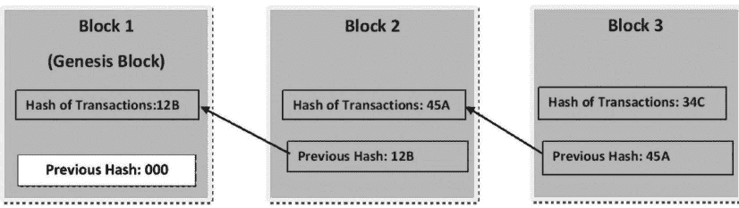

图 3.1 创世块示意图。

当块中的数据更改时，信息的哈希值也会随之更改。因此，该块的哈希值和后续块的前哈希值将不相同，从而破坏链并使其失效；然而，存在使用先进超级计算机重新计算其余块哈希值以使其再次有效的可能性；为避免这种情况，我们采用工作量证明的概念。

工作量证明（PoW）是区块链网络中的原始协议方法。由被称为矿工的个人执行 PoW，以确保转账真实。这种交易确认技术称为挖矿；一旦交易得到验证，就可以添加到区块链中。智能合约是一种可以作为协议或不可更改的安排运行的软件 [16]。在比特币的情况下，这些极其重要。一旦安装在网络上，就可以使用分配给它们的唯一标识符调用或启动它们。因此，当实现智能合约时，信息将保存在网络上并可供协作节点访问。网络中的其他对等节点无法更改智能合约的细节。智能合约有许多应用。例如，如果我们想出售特定物品（汽车、房屋等），可以在网络上找到潜在客户，无需第三方参与。因此，智能合约可以自我验证。Solidity 是一种用于创建和执行代码的流行计算机语言。Solidity 计算机语言被以太坊和 Zeppelin 两个区块链系统使用 [13]。

### 3.7 区块链架构

它有五个组件，用于构建区块链应用的标准并管理不同流程 [17,18]。

#### 3.7.1 数据源模块

在“分布式和共享系统”中，它有助于区块链的开发。它确保用户在区块链上的信息不会被泄露或更改。区块链的关键要素包括数据安全、任何格式的防篡改存储以及通过“应用程序编程接口（API）”可访问的公共信息账本 [12]。

#### 3.7.2 交易模块

它监控、监管、批准和促进“区块链中的交易过程”。它有助于验证和促进区块链的添加。数据通过智能合约交易屏障传输。除了常见的交易可见性外，区块链还促进了跨供应链（SC）的信息流动。交易以块的形式合并并传输到每个服务器。应注意，一旦交易完成，在区块链中删除或撤销极其困难 [12]。

#### 3.7.3 块创建模块

块被认为是矿工创建的数据结构。它们保存复制到所有网络组件中的数据和信息。块创建模块通过提供前一个块的哈希码和连接，使您能够添加新块


到现有的 SC 中。“按时间顺序排列的区块”用于存储交易模式，使识别和监控错误交易变得简单 [12]。

#### 3.7.4 共识模块

PoW 和权益证明算法被用于证明和验证交易、所有交换，以防止数据篡改。精心开发的“共识算法”确保分散网络中的数据完整性。分布式共识既有助于验证交易合法性，也有助于构建区块链系统中节点之间的链接 [12]。

#### 3.7.5 连接与接口模块

它有助于提供智能合约的最新信息，并跟踪交易历史。此部分协调区块链应用所需的所有平台、协议和工具。各种为区块链系统提供共识机制的分布式账本系统（无论是许可型还是非许可型）可能会根据用例引入市场 [12]。

### 3.8 区块链在医疗保健中的应用

医疗保健组织在合并多个地点的信息方面面临困难，例如保存所有文档的中央记录、建立信任、以低成本保存数据等等。BcT 通过在合作伙伴之间保持信任、降低成本以及确保任何有权访问数据的人都能试用来解决这些问题 [19]。区块链技术有潜力显著改变该行业。它可以为发展一个全球医疗保健系统做出贡献，该系统拥有处理当今问题并自信应对明天挑战的数字基础设施。图 3.2 显示了利用区块链技术的各个领域。

它可以有助于更公平的患者护理、称职的医学研究和成本效益高的专业流程 [20]。选择确实是无穷无尽的。以下是区块链在医疗保健中广泛可能应用的几个例子 [21]。

#### 3.8.1 患者同意管理

电子健康记录（EHRs）包括患者的健康史、预后、用药和疾病管理计划，必须准确，以便虚拟护理和健康追踪有效。EHR 必须在同行（包括医院、药房和卫生机构）之间安全共享，以保持患者的医疗信息准确和最新 [22]。

远程医疗医疗法通过制定利用和可访问性的信息指南，赋予个人控制和规范其临床数据的权限。传统同意管理方法的问题众多，包括与专家共享 EHR 时漫长的整合期、来自提供患者管理服务同意的第三方对服务器的敌意，以及未能执行客观审计跟踪。远程医疗参与者可以启用区块链服务。

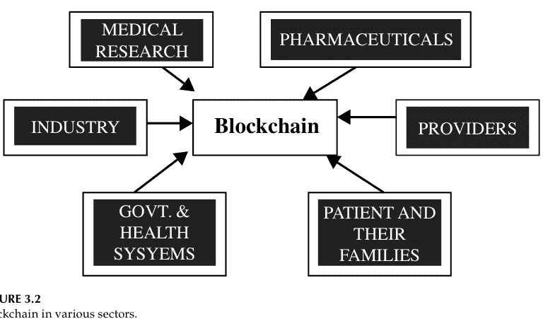

区块链技术可以帮助维持信任，因为没有中介。区块链通过利用众多参与组的多个同行来确保和保护同意管理 [23–25]。此外，区块链固有的不可篡改性、可追踪性和公开性可以帮助执行审计跟踪，以确保符合同意管理政策 [26]。

#### 3.8.2 远程治疗可追溯性

远程医疗和远程诊疗需要患者与专家之间进行在线音视频交互，以成功评估远程患者的健康状况。遵循面向消费者（D2C）和企业对企业（B2B）模式，提供远程医疗服务。

得益于支持音视频会议的技术，较新模式中的护理人员可以远程虚拟参与讨论和医疗培训服务（例如患者手术），而之前场景中的患者可以在线与医生沟通以讨论他们的健康。视频和图像（例如 X 光或其他检查）的异步传输可以帮助护理人员在电子面对面咨询期间正确识别患者的健康状况 [27]。

由于当前远程医疗系统之间数据共享受限，医疗集团无法监控患者健康信息结构。区块链技术通过让所有相关方访问患者电子健康记录（EHR）的统一且一致的图像来解决这个问题。关联的参与组织能够追踪患者的病史，并依靠健康数据的可见性和透明性提出适当的治疗方案。例如，可以使用区块链技术进行检查，以确定谁查看了电子文档以及确切进行了哪些交易 [26]。

#### 3.8.3 远程监控 IOT 安全

数字健康中最重大的进步之一是使用远程护理解决方案，其中各种感知患者生命体征的传感器被用于为新的医疗保健顾问提供关于患者健康状况的更多洞察，从而实现更多预防性护理 [28]。尽管如此，患者数据安全和隐私以及防止其被操纵以产生误导性数据，仍然是健康 IOT 中的关键问题。同样重要的是，使能系统必须能够抵抗 DDoS 和其他攻击，这些攻击可能会在关联设备在紧急情况下需要时中断服务，例如通知摔倒或发生心脏骤停的老年人的护理人员。区块链技术可能有助于现场安全 IOT 设备监控：

- 1. 区块链加密保证只有授权方可以访问机密信息，因为它存储在区块链上作为独特的哈希函数（用户需要一组特定的密码学密钥来解密哈希函数为信息源，因为对源数据的每次修改都会生成一个新的哈希函数）。
- 2. 一旦患者数据记录在区块链数据库中（作为哈希函数），就几乎不可能更改，因为这样做会生成一个新的哈希函数

#### 3.8.4 管理和维护患者健康记录

许多学者在意识到迫切需要一种新方法来处理 EHR（使患者能够参与其现代和传统健康数据）后，提出了使用区块链应用程序身份验证来保护 EHR 的想法。“MedRec” 版本利用区块链的独特优势来处理安全性、诚实性和快速数据交换 [29]。它以分散方式维护数据和索赔，并通过各种临床医生和护理机构，让患者快速轻松地访问其特定的临床记录。它还为患者提供完整且持久的病历背景 [30]。“MedRec” 不会保存医疗记录或导致过渡期开始。它通知患者谁负责表格将去往何处，并在区块链上保存记录标记。

在 EHR 部署方面，医疗数据共享存在重大缺点，例如失去对数据、数据来源、追踪和安全监控的控制权。MeDShare 被引入为一种安全的区块链系统，带有一些限制，用于与未知各方交换医疗数据。MeDShare 可供云服务提供商、医生和医疗研究组织使用，以交换医疗信息并保存虚拟医疗数据，具有最高数据准确性、定制审计权限以及对数据安全和隐私的最小可能威胁。EHR 通常包含极度受限且至关重要的患者信息，这些信息由医生、神经外科医生、医疗保健提供者和科学家共享，用于有效的诊断和治疗 [31]。

当医院预约开始时，治疗该患者的大多数专业人士似乎立即就能注意到问题。医疗错误、过敏症状和用药方案可以通过有益的患者护理算法在区块链档案中处理，从而消除耗时的医疗管理方法的需求。因此，实施区块链发明将改善患者治疗可及性、医疗数据监督、临床专业知识的更快验证、监控加强以及更有效的护理组织 [32]。

此数据库可以存储所有类型的信息，包括高血压、心脏疾病和人口统计记录的信息，以及不同就诊和保险费用的费用。来自线下和线上会议、应用程序、使用的药物等的数据将被合并。为了提供个性化护理，医生将更容易了解患者的病史和先前的治疗。患者不必花时间试图为医生回忆过去的信息，而且它


即使忽略了重要细节也无关紧要。凭借其多层安全性和无需许可的私钥，区块链将保护患者信息安全 [21]。

#### 3.8.5 管理供应链

尽管大多数国家都有法律来控制和保障供应链的完整性，但假药仍然会进入市场。

这些药物对公众有害，可能导致用户过敏或出现严重健康问题。如果利用区块链来规范药品从生产商到最终用户的流动，就能轻松定位假药取代正品药的地点。这将有助于阻止假药的传播。另一种用途是实时跟踪药品流动，以便精确计算“到达时间” [21]。

#### 3.8.6 用于患者监测的居家医疗设备和套件

患者可在家中使用的医疗工具和设备可以帮助他们在远离医疗机构的环境下进行自我诊断。使用广泛可得的试剂盒和设备来监测特定的生物医学反应，以进行自我检查和早期疾病发现，有助于降低总体医疗费用 [33]。传统集中式远程医疗系统中缺乏医疗设备的开放性、可见性和数据来源，使得医生和患者难以购买可信赖的医疗套件。

在这种情况下，分布式数据库可用于永久且公开地记录与检测设备托管相关的所有权和性能活动。基于性能评估，智能合约可用于为居家护理设施中使用的每个医疗测试套件和设备编制评级。因此，患者、医生和实验室工程师可以受益于智能合约，从信誉良好的制造商处获得极其准确可靠的医疗设备 [26]。

#### 3.8.7 安全访问私人健康数据

个人的私人医疗记录包含其病史、保密信息以及其他关于其护理的信息。个人健康记录条目由数据所有者创建、管理和维护。然而，电子健康记录（EHR）包含更详细的健康数据，因为它由医疗从业者形成、维护和控制。

由于由单一组织处理，绝大多数用于提供在线医疗服务的传统协议都建立在不可靠的云平台上。此外，个人健康记录（PHR）的真实性也受到典型基于云的系统的威胁。由于去中心化的区块链技术本质上是匿名的，健康信息的所有者可以保持数据的机密性 [26]。

智能合约可用于授权用户，并根据个人的授权规则授予其访问患者数据的权限。此外，基于区块链的技术的灵活性允许信息所有者在遵循自身条款和条件的前提下，与授权个人管理和共享信息 [26]。

#### 3.8.8 自动支付

现有医疗结构在很大程度上依赖中央第三方提供商来解决受试者、照护者和保险公司所使用服务的支付问题。然而，中央资金清算方法不透明、可能易受黑客攻击且相对缓慢。此外，中央金融管理平台不支持微支付，或者成本非常高。区块链网络提供基于代币的支付，以实现远程医疗行业的微支付。

因此，直接将数字货币传输到解决方案提供商的钱包，提供了一个快速、安全、可见且可问责的系统，消除了对集中式争议解决服务来解决支付争议的需求 [30]。此外，通过数字签名的支付-结算交易，保证了客户和医疗提供商在未来撤回交易的能力。借助区块链技术，可以实现货到付款服务，降低与支付相关的诈骗可能性。例如，在为远程药房部署远程药物配送服务时，可以计划智能合约保留加密货币，并在药物有效分发给远程患者后才将其发送到药剂师的钱包 [26]。

#### 3.8.9 对老年患者的可靠监督

远程医疗行业可以通过使用准确的生物医学设备来虚拟监控患者健康，从而受益于物联网（IoT）技术的发展 [34–36]。为了评估患者健康状况，生物医学设备可以在高性能边缘计算机上持续监控和记录健康数据。动脉压力和体温等生命体征可以与健康信息关联。

然而，医疗错误可能源于故障设备收集的不准确数据。为了有效解决这个问题，自主区块链技术利用智能合约来授权并确认生物医学设备用户将电子健康记录（EHR）记录到数据库上的权利 [37]。

智能合约能够在发生意外灾难时及时向医疗专业人员和治疗机构发送警报。支持区块链的物联网系统可以有效地提醒患者居家护理服务所需的药物续方。它保证只有符合患者同意文件的获批用户才能查看患者的电子健康记录 [26]。

#### 3.8.10 药物分发和药房配药的可追溯性

为了让基于在线咨询的医疗系统能够与附近药房交换药物处方，医生必须在区块链上进行交易。区块链技术可以利用其哈希函数来帮助降低处方错误和文件篡改的可能性 [38]。获批药房可以访问区块链上存储的药物处方，以用于验证、准备和向患者交付药品。

作为回报，托运人可以用货物的当前位置更新区块链，以便患者和药剂师更容易追踪货物。患者和医疗专家还可以通过查看数据来源来验证药物的合法性，因为区块链交易是透明且可追溯的。智能合约有能力在满足预设条件后立即从药房订购（间歇性）药物处方续方。随后，药剂师可以验证并确认订单以批准续方。在处方续方成功后，患者收到药物，记录会根据需要更新 [26]。

#### 3.8.11 可信赖的健康保险服务

由于缺乏财务奖励和严格的隐私保护法律，许多人通常不太愿意向保险公司提供其病史信息。结果，患者经常选择不合适的保险政策，这可能导致合法的保险索赔被拒。在线医疗立法保障患者获得与实际医疗护理网络中相同数额的赔偿权。在涉及保险相关欺诈时，需要几天时间才能根据提供的数据确定事实（例如，当向保险公司提交错误的医疗索赔时）。通过让保险公司访问患者的医疗数据，区块链技术可以帮助保险公司降低保险诈骗（基于同意）。患者允许保险公司使用其健康信息，可能会获得奖励。此外，许多保险公司会以比特币代币的形式为保持健康生活的高级用户提供奖励，例如记录他们的健身房行程。患者的智能设备可以在区块链上进行交易以建立信任 [26]。

#### 3.8.12 感知声誉的专科转诊服务

基于远程医疗的跨区域和跨学科发现与治疗的关键参与者包括患者、转诊医疗专业人员和咨询医疗专家。在远程患者护理期间，通过医疗联盟和智能合约寻求医疗建议和专家意见。使用基于区块链的说明，建议医疗专业人员可以将参考材料存储在IPFS服务器上，该服务器会为文件创建IPFS哈希并将其存储在区块链上，以便旅行中的医疗专业人员可以访问 [39,40]。可以通过网络上记录的IPFS哈希来确定文件是否被更改。咨询医疗专业人员可以检查患者的健康报告，然后将检查结果记录在区块链数据库上。根据建议医疗专家的总服务时间和满意度排名，建议医疗专业人员可以在区块链上刷新声誉评分 [26]。

#### 3.8.13 自动化患者随访服务

治疗结束后，得益于随访护理服务，可以仔细监测患者的健康状况。在某些情况下，患者必须先注册视频会议，然后才能将血液和尿液样本的结果发送给执业者作为随访服务的一部分。通过使用智能合约，区块链技术使患者随访服务系统化。为了立即通知患者、医生和医院工作人员即将到来的随访就诊，智能合约可以向三方发送消息 [41]。医生可以通过访问患者可见且不可更改的电子健康记录（虚拟），验证最近一次随访预约中报告的患者健康状况。用户还可以使用智能合约通过IPFS服务器与医生交换IPFS哈希，这些服务器可以保存测试结果以获取健康数据 [26]。


#### 3.8.14 医药研究与开发

医药领域的科学进步速度令人惊叹。为新冠病毒和其他疾病寻找治疗方法，对企业来说是一场与时间的赛跑。每当有发现时，都会在媒体上报道，等等。

然而，在研究取得成功的过程中，不会共享任何数据或研究。在这里，BC 能够促进新药物的传播，加快治疗方法的发现，因为企业可以沟通他们的进展。此外，BC 支持医学研究的发表，以确保每项研究都得到验证。

BC 也应用于药物制造过程。每种药物都有一个生产配方。BC 能够评估、监控并确认药物正按照流程中概述的方式精确生成 [26]。

#### 3.8.15 医务人员资质验证

类似于可用于追溯医疗产品来源，加密协议可用于监控医务人员的经验。知名医疗机构和医疗保健组织可以记录员工的资质，这简化了这些组织的招聘流程。

ProCredEx 是一家位于美国的公司，开发了基于 R3 Corda 区块链技术的医疗身份验证系统 [42,43]。区块链技术的主要优势如下：

- 1. 医疗保健行政机构在招聘过程中能够更快地获取资质。
- 2. 为医疗保健组织、保险公司和医疗机构提供机会，让它们从对前员工和现员工现有资质信息中获益。
- 3. 通过对合作伙伴（例如转包临时医生的公司或尖端在线健康交付模式）的公开和安全，患者可以了解医务人员的专业知识 [32]。

#### 3.8.16 供应链透明度

医疗保健与许多其他行业一样，非常重视对药品溯源的保证，以确立其合法性。使用基于区块链的系统，消费者可以监控产品从生产地点到供应链的每一个环节，从而对购买的商品拥有完全的可见性和透明度 [43]。这是该行业的一个重大问题，特别是在发展中国家，假处方药每年导致数以万计的人死亡。随着更多远程健康追踪的采用并引起不法分子的兴趣，医疗器械（发展迅速）也变得越来越重要。一个名为 MediLedger 的知名区块链平台使处方药供应链中的公司能够验证药物的合法性，以及其有效期和其他重要细节 [32]。

#### 3.8.17 临床试验与药物追踪

临床试验是一种用于识别和避免疾病的医学策略。近年来，为了避免和识别疾病，开发了许多方法。数据完整性、记录共享、数据保护和患者登记是这些系统中的一些缺陷，区块链技术可以解决这些问题。下面列出的临床医疗平台提供数据安全性和匿名性。使用基于代币的医疗货币来监控保险公司、医院、医生和健康计划等方面的数据。

使用智能合约，FHIRChain 智能医疗系统 [44] 实现了临床医疗数据的共享。基于区块链的记录共享工具 Connecting Care 类似，并在多个英国城镇可用。Connecting Care 在多元化的医疗保健公司中使用，以保护医院和医疗记录数据的信息。为了确保只有获准人员可以查看临床系统，它提供访问控制列表。区块链的智能合约功能使用基于以太坊的架构实现。该系统使用注册方法为用户注册医疗系统。患者可以将机密数据输入系统，机构可以查看患者的医疗信息 [45]。

基于区块链的临床环境无疑将为医学研究的进步创造新的科学可能性。然而，在精准医疗应用中对这些临床调查进行可靠、安全且可适应的采集、归档和恢复，将有助于开发吸引人的可能性，用于恶性肿瘤的识别和管理。在线图书馆可用于认知策略。区块链技术可用于处理计算机化大脑，而神经技术仍处于实验阶段。很少有企业实际上对区块链技术发表了立场 [32]。

#### 3.8.18 社区层面的疾病监测

“监测的一些含义包括系统性、持续的数据收集、整理和分析，以及向需要采取措施的人快速传播数据”这些是用来描述 *监测* 的一些定义 [46]。

它既用于传染病，也用于非传染病，符合国家目标和世界卫生组织的《国际卫生条例》。例如，像尼帕病毒这样的致命病毒可以在不到 36 小时内在全球传播，由于发展无序和全球化，危及健康安全并引发流行病 [47]。由于如此多的自律组织向单一信息系统提交报告，传染病监测是一个持续、复杂且低效的过程。因此，保持信息顺畅且按时流动是一项艰巨的工作 [48]。

此外，普通员工没有获得任何奖励。这些独立的团队在大流行期间可能能够借助区块链更有效地处理数据 [49]。此外，它可能有助于监测当前非许可健康危机的数据，例如交通事故、物质滥用、阿片类药物滥用等 [50]。当区块链技术用于非许可健康领域时，这些系统可能能够管理医疗机构内不同层级的安全数据交换和保存。

通过检测可能的疫情或生物恐怖主义，该技术可以提供实时信息。因此，如果疫苗、抗菌剂和其他疾病控制方法能够快速实施，就有可能避免重大伤亡。

例如，近年来，社交媒体上反对免疫的虚假信息严重损害了非许可健康 [51]。为了追踪此类有害内容的来源，并在数字通信中锁定风险最大的群体，Huckle 等人报告使用了基于区块链的方法 [52]。

这说明，在自动化时代，区块链技术有可能推动非许可健康监测的发展。如今，大多数国家采用机器学习方法进行监测。区块链技术相对于机器学习方法具有某些特殊且额外的优势。区块链主要防止数据盗窃和复制等非法活动。区块链技术与人工智能（AI）的结合是医学研究和医疗保健行业发展的完美组合 [53]。

此外，与地理信息系统（GIS）融合还有很大空间，以加速常规流行病调查以及药物和疫苗的供应链管理。区块链还通过确保公开和准确报告（例如揭示特定疫情的死亡病例）消除了地区卫生信息系统的局限性。在监测系统中使用区块链有助于改进确保患者安全的努力。在这三类疾病控制行动阶段（即预防、检测和响应）中，实时监测非传染性疾病（NCD）的发现潜力巨大。全球卫生安全议程（GHSA）行动包也解决了这一问题。通过实时追踪可以确保对 NCD 的早期风险因素识别。高效的供应链系统还可以通过提高医疗和医护人员的能力来帮助灾害响应 [54,55]。

#### 3.8.19 治疗优化

靶向治疗和远程医疗是治疗改进的两个因素。在许多国家，医疗患者数量急剧增加，导致患者越来越难以获得医生或护理人员的即时帮助 [56]。

远程医疗中使用的技术被视为一种既公平又经济的提供医疗服务的方式 [57]。

由于物联网设备和其他类型的远程患者追踪系统的创建和广泛使用，数据交换的传输和记录存在安全隐患。区块链的智能合约可以用于支持医疗设备的安全研究和管理，因为它具有防篡改、匿名和透明的特点 [37]。

例如，Medicalchain 引入了一项智能合约，允许患者授权医生在线评估病例并提供建议或第二意见 [58]。

此外，药物研发组织可以在获得用户批准的情况下对数据进行分类，以开展以药物为重点的研发，并利用区块链非对称加密编码安全地传输数据 [59,60]。

#### 3.8.20 医生管理

医生管理使用三个因素：客户选择、员工筛选和身份识别。区块链技术允许医疗专业人员、患者和管理人员进行大规模数据交换、患者追踪、身份安全和验证。此外，区块链可用于追踪医生的医疗干预，防止医疗纠纷，并帮助患者和医疗组织做出明智的医生选择。例如，基于区块链的项目 MedicoHealth 实现了与世界顶尖医生的完全私密和安全的客户联系。仅


在某一时刻，一名指定医生可以保密地访问患者信息，且关于医生证书和执照状态的信息会在不可篡改的去中心化数据中更新 [58,60]。

### 3.9 区块链技术在医疗保健中的应用障碍

在区块链技术能够用于数字医疗保健之前，必须克服一些应用障碍。每个医疗从业者都维护自己的一组患者记录，并且经常不与患者或其他医疗系统共享这些信息。此外，医疗数据来自多种来源，例如健康记录和治疗病史、检查，以及可穿戴设备或追踪患者健康的传感器收集的健康数据 [2,61]。医疗保健行业长期存在以下问题。

#### 3.9.1 内部和外部监管

内部监督主要指医疗组织对物资、工具和药物的持续监测。行政主管部门是监管机构，医疗运输网络控制、整个医疗程序立法以及医疗废物清除操作管理是外部监管的三个因素。个人、组织、活动、信息和资源构成了应用链，其中包括将卖家的商品或服务分发给消费者。其目的是确保整个运输过程中易碎产品的完整性。

药品分销链管理对于跟踪基本物质供应、生产过程和成品分发至关重要 [62]。药品供应网络容易受到操纵、欺诈和腐败的影响 [63]。良好的分销链管理策略在医疗领域尤为重要，因为受干扰的药品分销链会直接影响患者保护和医疗结果。

区块链技术是改进可靠药品分销链的安全性、稳定性、数据来源和实用性的一种方法。分销链中的区块链技术交易安全、透明，并可持续监控和记录，大大减少了所需时间和人为错误的机会 [58]。此外，使用区块链知识可以改进医疗器械和材料的保护。区块链技术可以通过为每个健康设备保留独占设备 ID 并使用智能合约来跟踪和分发软件更新来应用。不可篡改性可以与基于区块链的医疗设备监控相结合，以避免设备丢失、被盗和恶意操纵 [60]。

#### 3.9.2 医疗信息传输中的挑战及缺乏互操作性

目前，医疗机构和医疗服务提供商之间缺乏互操作性是一个主要问题。结果，医疗数据分散、破碎且难以交换。结果，患者的医疗记录最终保存在各处：医疗查询保存在提供商的系统中，处方信息在不同药店本地保存，等等。由于缺乏这种互操作性，患者和照顾者在尝试启动数据检索和共享时会遇到重大障碍 [64]。因此，在当前医疗数据产生量快速增长的情况下，制定统一标准来整合医疗记录、从众多来源收集信息并改善整个价值链上的数据共享变得至关重要 [2]。

#### 3.9.3 跨平台交易的互操作性支持

医疗保健参与者（包括医生和患者）要求患者健康转诊服务能够在区块链平台之间安全交易。区块链平台的互操作性支持使用户无需中介即可相互进行交易处理和发送 [26]。例如，支持互操作性的平台可以帮助医疗专业人员在以太坊区块链网络上使用比特币进行交易。

然而，由于许多问题，例如区块链上平台的公认语言和共识方法的差异，设计互操作区块链系统具有挑战性 [65]。为保护远程医疗用户的隐私，兼容系统理想情况下应快速、私密且容错 [26]。

#### 3.9.4 机构中区块链采用的挑战

传统远程医疗平台通常依赖过时的方法来保存和保护患者信息，这可能限制医疗消费者和专业人员之间的关联前景。这增加了系统费用，对患者接受治疗的成功程度有重要影响。通过使用区块链技术建立交易和医疗数据的永久记录，授权人员可以维护和监控患者完整的真实健康数据 [66]。区块链技术潜力巨大，但远程医疗消费者无法充分利用它，因为他们对其了解不足，技术尚处于初级阶段，且没有制定安全或隐私规则。因此，需要对区块链技术进行更多研究，以制定其在远程医疗中广泛使用的指导方针和法律，并应调查希望转向区块链技术的组织 [26]。

#### 3.9.5 确保数据机密性和隐私的困难

私密医疗信息缺乏安全基础，导致频繁的数据泄露。

2018年，美国卫生与公共服务部民权办公室（OCR）报告的数据泄露导致约1300万条总体健康信息被未经授权访问。为了实现完全互操作性，医疗利益相关者必须在保护机密数据并将访问权限限制在授权人员的同时传递数据。在通往互操作性的道路上，数据交换和共享提供了改善医疗环境的绝佳机会，但也引发了最大的隐私问题之一 [2]。

#### 3.9.6 智能合约的安全易受攻击性

由于智能合约故障和漏洞，患者的健康记录可能被篡改和中断，这可能会显著改变其典型行为 [67]。例如，使用重入漏洞攻击，具有对另一个合约受限访问权限的智能合约可能能够更改患者的电子健康记录或从实际用户的钱包中提取资金 [61]。专业人士建议的测试工具是 ZeppelinOS、SolCover 和 Oyente。这些工具通过定位智能合约中的薄弱环节，帮助开发人员推荐针对外部威胁的防护措施 [67]。然而，所提修复措施不足以识别智能合约中的所有薄弱点和故障。因此，在实施之前，必须利用各种测试场景和多种工具，仔细检查智能合约中的潜在缺陷 [26]。

#### 3.9.7 数据所有权

个人无法完全管理自己的医疗信息，是当今医疗系统中数据所有权的另一个问题。随着可穿戴技术和个性化疗法的发展，这一要素的重要性有所增加 [68]。为了使流程透明，数据交换框架中需要患者授权 [69]。赋予患者访问其信息的权限，将使他们能够确定谁有权访问以及拥有何种权限，这是创建完全集成和开放的医疗系统所必需的一步。因此，健康数据的管理将变得更加灵活和安全。

实际上，所有现有系统都面临缺乏足够安全措施的问题，用于查看或交换数据 [70]，因为存在关于用户隐私的重大担忧，因此对个人信息的特权访问受到限制 [2]。

#### 3.9.8 患者数据过载

尽管健康信息技术（HIT）有所进步，但仍缺乏对患者病历完整记录的全面视图 [71,72]。保存个人病历的最新技术之一侧重于合并来自各种传感器、监视器和可穿戴技术的医疗数据，例如智能手表、健身追踪器或测量医疗指标（心率、血糖水平等）的技术 [2]。在这种情况下，障碍在于产生的大量数据必须进行管理、评估和存档。因此，必须创建管理和存储数据的新技术。强大的用户界面（UI）对于以既美观又易懂的方式向医疗专业人员提供信息变得至关重要。为满足这一需求，医疗组织越来越注重让用户界面设计师参与工作流程和客户体验 [73]。我们的研究目标是利用区块链技术创建一个分散且兼容的个人健康记录（PHR）系统，为患者提供访问其医疗信息单一互操作版本的途径，该版本可以分发给医疗价值链上的医疗专业人员 [2]。

### 3.10 结论

全球医疗保健行业正在关注区块链在医疗保健中应用方面的当前研究模式。医疗保健组织迫切需要新的和更好的信任保护解决方案，因为在维护信任的同时满足


医疗生态系统中对数据交换的需求与日俱增。区块链技术的去中心化、防篡改、可追溯性、不可更改性、可审计性和安全性等优势，使其适合应用于医疗行业。如本研究所示，研究现状表明，目前少数几种电子健康记录（EHR）、个人健康记录（PHR）和临床试验系统用例正在研究基于区块链的解决方案。健康信息系统的其他领域，如社区层面的疾病监测、保险索赔处理、老年患者远程监护、疗法优化、人群健康管理系统和制药供应网络，研究较少。尽管区块链技术有潜力大幅改善供应网络和个人健康信息数据的存储与检索，但使用该技术的企业寥寥无几。借助这项技术，医疗专业人员可以在各种设施和地点安全、即时地更新患者数据，随时随地均可操作。在现代医疗系统已不堪重负的今天，这将非常有帮助，因为它可以减少行政时间，为患者治疗腾出资源。区块链技术可以简化和改善疫苗和药物当前的管理方式。区块链技术有潜力显著提高药品供应的透明度、效率和可靠性，同时防止假药在整个流程中的任何环节进入。区块链技术通过跟踪疫苗的冷链供应将大有裨益。与其他所有技术一样，区块链技术也有一些局限性，但并非不可克服。采用和执行成本高昂，因为区块链技术消耗大量电力。不过，较新的技术正在涌现，以便更多企业能够利用它们。提供工作量证明所提供的保护层需要大量能源和处理能力。成本较低的“权益证明”和“火烧证明”用于区块链技术的较新迭代中。该系统也用于记录交易。随着其使用的普及，它将需要更多存储空间，因为它会保留更多数据。随着更多交易和数据被记录和存储，区块链技术将不得不变得更具韧性和灵活性。为了在医疗领域成功实施区块链技术，国际标准化组织将需要参与制定标准。本章讨论了区块链技术的优势，包括其去中心化、不可更改、私密和可审计的特性。实施欺诈的可能性非常低。从长远来看，运行和维护这项技术将更便宜、更快速。为了部署，企业将需要培训员工并改变思维方式，就像使用任何新工具一样。然而，他们可以节省资金，而这是为区块链技术提供的巨大优势所付出的微小代价。显然，区块链技术的时代已经到来，因为已有17多家医疗机构采用了这项技术。

## References

- 1. Agbo CC, Mahmoud QH, Eklund JM. 医疗保健中的区块链技术：系统综述. Healthc. 2019;7(2).
- 2. Cernian A, Tiganoaia B, Sacala IS, Pavel A, Ifetmi A. Patientdatachain：一种基于区块链的整合个人健康记录的方法. Sensors (Switzerland). 2020;20(22):1–24.
- 3. Solat S, Calvez P, Nait-Abdesselam F. 许可型与非许可型区块链：如何以及为什么只有一个正确选择. J Softw. 2021;16(3):95–106.
- 4. Anoaica A, Levard H. 以太坊公共区块链上内部活动的定量描述. 在 2018年第9届IFIP国际新技术、移动安全会议论文集 NTMS 2018—Proc. 2018;2018:1–5.
- 5. Jadhav JS, Deshmukh J. 基于区块链的医疗保健供应链综述研究. Soc Sci Humanit Open [Internet]. 2022;6(1):100328. https://doi.org/10.1016/j.ssaho.2022.100328
- 6. Hussien HM, Yasin SM, Udzir SNI, Zaidan AA, Zaidan BB. 医疗保健应用中启用区块链技术发展的系统综述：分类学、实质分析、动机、挑战、建议和未来方向. J Med Syst. 2019;43(10).
- 7. Feng L, Zhang H, Tsai WT, Sun S. 高性能许可型区块链的系统架构. Front Comput Sci. 2019;13(6):1151–65.
- 8. Xiao Y, Xu B, Jiang W, Wu Y. 用于电子健康记录的医疗保健区块链：开发研究. J Med Internet Res. 2021;23(1):1–13.
- 9. Khan C, Lewis A, Rutland E, Wan C, Rutter K, Thompson C. 金融领域的区块链技术：一种分布式账本协作创新. IEEE Comput. 2017;50(9):29–37.
- 10. Tijan E, Aksentijević S, Ivanić K, Jardas M. 物流领域的区块链技术实施. Sustain. 2019;11(4).
- 11. Rai BK. BBTCD：基于区块链的假药可追溯性. Heal Serv Outcomes Res Methodol [Internet]. 2022;(10月). https://doi.org/10.1007/s10742-022-00292-w
- 12. Dutta P, Choi TM, Somani S, Butala R. 供应链运营中的区块链技术：应用、挑战与研究机遇. Transp Res Part E Logist Transp Rev [Internet]. 2020;142(7月):102067. https://doi.org/10.1016/j.tre.2020.102067
- 13. Kakarlapudi PV, Mahmoud QH. 用于同意管理的区块链系统综述. Healthc. 2021;9(2).
- 14. Zheng Z, Xie S, Dai H, Chen X, Wang H. 区块链技术概述：架构、共识与未来趋势. 2017年第6届IEEE大数据国际大会论文集，BigData Congr 2017. 2017;(6月):557–64.
- 15. Marbouth D, Abbasi T, Maasmi F, Omar IA, Debe MS, Salah K, et al. 针对COVID-19的区块链：综述、机遇与可信追踪系统. Arab J Sci Eng [Internet]. 2020;45(12):9895–911. https://doi.org/10.1007/s13369-020-04950-4
- 16. Szabo N. 公共网络上关系的形式化与安全性视角 | First Monday. First Monday [Internet]. 1997;1-21. 可从以下网址获取：https://firstmonday.org/ojs/index.php/fm/article/view/548/469
- 17. Choi TM. 冠状病毒（COVID-19/SARS-CoV-2）爆发背景下创新的“将服务带到您家门口”运营：物流能成为救世主吗？Transp Res Part E Logist Transp Rev [Internet]. 2020;140(3月):101961. https://doi.org/10.1016/j.tre.2020.101961
- 18. Min H. 用于增强供应链韧性的区块链技术. Bus Horiz [Internet]. 2019;62(1):35–45. https://doi.org/10.1016/j.bushor.2018.08.012
- 19. Krawiec RJ, Housman D, White M, Filipova M, Quarre F, Barr D, et al. 区块链：医疗保健机遇. Deloitte Insights [Internet]. 2020;14. 可从以下网址获取：www2.deloitte.com/us/en/pages/public-sector/articles/blockchain-opportunities-for-health-care.html
- 20. Kassab M, Defranco J, Malas T, Laplante P, Destefanis G, Neto VVG. 探索医疗保健领域的区块链研究及未来路线图. IEEE Trans Emerg Top Comput. 2021;9(4):1835–52.
- 21. Arumugam SK, Sharma AM. 区块链：医疗保健领域的机遇及其在COVID-19中的应用 [Internet]. COVID-19的教训：对医疗保健系统和技术的影响. 2022;61–94. http://doi.org/10.1016/B978-0-323-99878-9.00002-9
- 22. Dubovitskaya A, Xu Z, Ryu S, Schumacher M, Wang F. 使用区块链实现安全可信的电子病历共享. AMIA. AMIA 年度研讨会论文集. 2017;2017:650–9.
- 23. Genestier Jotistfae. 电子健康环境中的同意管理区块链：隐私和安全挑战简介及用例的宝贵经验. J Int Soc Telemed Ehealth. 2017;5:24–5.
- 24. Zhang X, Poslad S, Ma Z. 基于区块链的电子病历（EMR）电子健康查询的块式访问控制. 2018 IEEE 全球通信会议 Globecom 2018—论文集. 2018;1–7.
- 25. Zhang X, Poslad S. 用于电子病历（EMR）细粒度访问控制的灵活查询区块链支持. IEEE Int Conf Commun. 2018;2018:1–6.


- 26. Ahmad RW, Salah K, Jayaraman R, Yaqoob I, Ellahham S, Omar M. 区块链技术在远程医疗和远程健康中的作用. Int J Med Inform [互联网]. 2021;148(2020年6月):104399. https://doi.org/10.1016/j.ijmedinf.2021.104399

- 27. Mannaro K, Baralla G, Pinna A, Ibba S. 应用于撒丁大区（意大利）远程皮肤科平台的区块链方法. Information. 2018;9(2).

- 28. Khan PW, Byun Y. 面向工业物联网的基于区块链的安全图像加密方案. Entropy. 2020;22(2).

- 29. Wang C, Zhang Y. 使用随机森林改进蛋白质-配体评分函数的评分-对接-筛选能力. J Comput Chem. 2017;38(3):169-77.

- 30. Scekic O, Nastic S, Dustdar S. 支持社会价值共创与交换的区块链智慧城市平台. IEEE Internet Comput. 2019;23(1):19–28.

- 31. Cyrran MA. 区块链作为医疗数据共享的基础. Blockchain Healthc Today. 2018.

- 32. Tadge P, Tadge S, Bhattacharya T, Tadge P, Chopra H, Akter R, et al. 电子健康中的区块链与人工智能技术. Environ Sci Pollut Res. 2021;28(38):52810–31.

- 33. Weissman SM, Zellmer K, Gill N, Wham D. 在社区环境中实施虚拟健康远程医疗项目. J Genet Couns. 2018;27(2):323–5.

- 34. Kazmi HSZ, Nazeer F, Mubarak S, Hameed S, Basharat A, Javaid N. 使用基于区块链的智能合约进行可信远程患者监测 [互联网]. 卷 97, 网络与系统讲义. Springer International Publishing; 2020. 765–76 页. http://doi.org/10.1007/978-3-030-33506-9_70

- 35. Rehman MHU, Ahmed E, Yaqoob I, Hashem IAT, Imran M, Ahmad S. 使用同心计算模型的工业物联网大数据分析. IEEE Commun Mag. 2018;56(2):37–43.

- 36. Albooshi M, Salah K, Alhammadi Y. 医疗物联网（MIoT）设备的基于区块链的所有权管理. Proc 2018 13th Int Conf Innov Inf Technol IIT 2018. 2019;151-6.

- 37. Griggs KN, Ossipova O, Kohlios CP, Baccarini AN, Howson EA, Hayajneh T. 使用智能合约进行安全自动化远程患者监测的医疗区块链系统. J Med Syst. 2018;42(7):1-7.

- 38. El-Miedany Y. 远程医疗和远程健康：数字时代如何改变标准医疗. Smart Homecare Technol TeleHealth. 2017;4:43–51.

- 39. Lee CK. 医疗健康行业中带有健康代币的区块链应用. Atlantis Press; 2019;196(Ssphe 2018):233–6. http://doi.org/10.2991/ssphe-18.2019.55

- 40. Webster P. 远程医疗转诊病例流程中转诊病例流程的关键参与者. 2018;1–19. 可从以下网址获取：https://telemedicine.arizona.edu/sites/

- 41. Siyal AA, Junejo AZ, Zawish M, Ahmed K, Khaliil A, Soursou G. 医学和医疗保健中区块链技术的应用：挑战与未来展望. Cryptography. 2019;3(1):1–16.

- 42. Funk E, Riddell J, Ankel F, Cabrera D. 区块链技术：一个改善健康专业教育中信息交换的有效性、信任和问责制的数据框架. Acad Med. 2018;93(12):1791-4.

- 43. Narayananswami C, Nooyi R, Govindaswamy SR, Viswanathan R. 基于区块链的供应链自动化. IBM J Res Dev. 2019;63(2):1.

- 44. Zhang P, White J, Schmidt DC, Lenz G, Rosenbloom ST. FHIRChain：应用区块链安全且可扩展地共享临床数据. Comput Struct Biotechnol J [互联网]. 2018;16:267–78. https://doi.org/10.1016/j.csbj.2018.07.004

- 45. Hang L, Choi E, Kim DH. 医院中基于医疗区块链平台的新型电子病历完整性管理. Electronics. 2019;8(4).

- 46. Bhattacharya P, Tanwar S, Bodkhe U, Tyagi S, Member S. BinDaaS：医疗4.0应用中的基于区块链的深度学习即服务. IEEE/ACM Trans Netw. 2019;4697(c).

- 47. Fan VY, Jamison DT, Summers LH. 流行病风险：预期损失有多大？Bull World Health Organ. 2018;96(2):129–34.

- 48. Khan SU, Islam N, Jan Z, Din IU, Khan A, Faheem Y. 作为物联网医疗应用的乳腺细胞学图像中乳腺癌检测与分类的电子健康服务框架. Futur Gener Comput Syst [互联网]. 2019;98:286–96. https://doi.org/10.1016/j.future.2019.01.033

- 49. Chattu VK, Nanda A, Chattu SK, Kadri SM, Knight AW. 区块链技术应用在常规疾病监测系统中以加强全球卫生安全的新兴作用. Big Data Cogn Comput. 2019;3(2):1–10.

- 50. Katuwal GJ, Pandey S, Hennessey M, Lamichhane B. 医疗保健中区块链的应用：现状与挑战. 2018;1–17. http://arxiv.org/abs/1812.02776

- 51. Jervelund SS. 社交媒体如何改变知识传播：对我们关于疫苗接种和移民健康认知的影响. Scand J Public Health. 2018;46(2):167–9.

- 52. Huckle S, White M. 假新闻：使用区块链证明内容来源的一种技术方法. Big Data. 2017;5(4):356–71.

- 53. Mamoshina P, Ojomoko L, Yanovich Y, Ostrovski A, Botezatu A, Prikhodko P, et al. 融合区块链和下一代人工智能技术以去中心化和加速生物医学研究与医疗保健. Oncotarget. 2018;9(5):5665–90.

- 54. Kostova D, Husain MJ, Sugerman D, Hong Y, Saraiya M, Keltz J, et al. 传染病与非传染病项目之间的协同效应以增强全球卫生安全. Emerg Infect Dis. 2017;23(12月):S40–6.

- 55. Bhattacharya S, Singh A, Hossain MM. 通过区块链技术加强公共卫生监测. AIMS Public Heal. 2019;6(3):326–33.

- 56. Dwivedi AD, Srivastava G, Dhar S, Singh R. 面向物联网的去中心化隐私保护医疗区块链. Sensors (Switzerland). 2019;19(2):1–17.

- 57. Lupton D, Maslen S. 远程医疗与感官：一篇综述. Soc Health Illn. 2017;39(8):1557–71.

- 58. Jamil F, Hang L, Kim KH, Kim DH. 智慧医院中药品供应链完整性管理的新型医疗区块链模型. Electron. 2019;8(5):1–32.

- 59. Underwood S. 比特币之外的区块链. Commun ACM. 2016;59(11):15–17.

- 60. Du X, Chen B, Ma M, Zhang Y. 区块链在教育资源中的应用研究. ACM Int Conf Proceeding Ser. 2021;1–5. 可从以下网址获取：https://doi.org/10.1145/3503047.3503092

- 61. Chen H, Pendleton M, Nijilla L, Xu S. 以太坊系统安全调查：漏洞、攻击与防御. ACM Comput Surv. 2020;53(3):1–29.

- 62. Kamel Boulos MN, Wilson JT, Clauson KA. 地理空间区块链：健康与医疗保健中的前景、挑战与场景. Int J Health Geogr [互联网]. 2018;17(1):1–10. https://doi.org/10.1186/s12942-018-0144-x

- 63. Azzi R, Chamoun RK, Sokhn M. 基于区块链的供应链的力量. Comput Ind Eng [互联网]. 2019;135(2018年8月):582–92. https://doi.org/10.1016/j.cie.2019.06.042

- 64. Wachter RM. 使 IT 发挥作用：利用健康 IT 的力量改善英格兰的医疗. Natl Advis Gr Heal Inf Technol [互联网]. 2016:1–69. 可从以下网址获取：www.gov.uk/government/uploads/system/uploads/attachment_data/file/550866/Wachter_Review_Accessible.pdf https://assets.publishing.service.gov.uk/government/uploads/system/uploads/attachment_data/file/550866/Wachter_Review_Accessible.pdf

- 65. Herlihy M. 原子跨链交换. Proc Annu ACM Symp Princ Distrib Comput. 2018:245–54.

- 66. Bennett B. 区块链健康信息交换概述：医疗互操作性框架. Telehealth Med Today. 2018;2(3):1–6.

- 67. Mense A, Flatscher M. 以太坊智能合约中的安全漏洞. ACM Int Conf Proceeding Ser. 2018:375–80.

- 68. Chen HS, Jarrell JT, Carpenter KA, Cohen DS HX. 医疗保健中的区块链：以患者为中心的模型. Biomed J Sci Tech Res. 2019;10(3):1–10.

- 69. Powles J, Hodson H. 谷歌 DeepMind 与算法时代的医疗保健. Health Technol (Berl). 2017;4(7):351–67.

- 70. Mandl KD, Szolovits P, Kohane IS. 公共标准与患者控制：如何保持电子病历可访问但私密. Br Med J. 2001;322(7281):283–7.

- 71. Dinh-Le C, Chuang R, Chokshi S, Mann D. 可穿戴健康技术与电子健康记录整合：范围综述与未来方向. JMIR mHealth uHealth. 2019;7(9).

- 72. Roehrs A, da Costa CA, da Rosa Righi R. OmniPHR：整合个人健康记录的分布式架构模型. J Biomed Inform [互联网]. 2017;71:70–81. http://doi.org/10.1016/j.jbi.2017.05.012

- 73. Flach JM, Schanely P, Kuennene L, Chidoro B, Mubaslat J, Howard B. 电子健康记录与循证实践：解决小数据问题. Proc Int Symp Hum Factors Ergon Heal Care. 2018;7(1):30–5.


## 区块链在疾病和疫情追踪中的应用

Phool Chandra, Zeeshan Ali, Neetu Sachan, Vaibhav Rastogi, Mayur Porwal, 和 Anurag Verma

### 4.1 引言

2008年，区块链技术最初由中本聪用于创建比特币加密货币系统。从那时起，包括商业和银行业在内的众多行业以及医疗保健行业都已实施了区块链技术 [1]。区块链是一种去中心化的信息和分布式账本，可从系统中的所有节点访问。由于区块链在线存储数据，可以将其比作电子数据库。区块链技术有朝一日可用于保护医疗保健领域个别患者的健康记录。区块链技术允许用户之间直接交换数字资产，从而在过程中消除了对第三方的需求。区块链是一种分布式账本，通过密码学哈希保护的一系列块来维护信息 [2]。区块链的去中心化特性及其不可篡改性、可见性和可审计性，都促进了交易和其他操作的安全性及可靠性的提升。区块链是一种分散式文档，包含不断扩展的数据，称为块 [3]。区块链技术在加密货币领域之外也有应用，涵盖金融和社会部门、风险管理系统以及医疗保健交付网络等 [4,5]。在区块链网络中，一个块由四个组件组成——关于当前块的哈希（识别编号）、前一个块的哈希以及日期和时间——这些组件将每个新块与其前驱块连接起来。区块链技术有三种基本架构类型：公共（无许可）、私有（许可）和混合区块链。任何人都可以加入公共区块链，因为它们被设计为开源。此外，公共区块链上进行的所有交易对所有参与者都完全可见；因此，没有任何单一用户或实体控制，因为工作量证明已成为应用于公共区块链的最著名方法 [6]。相反，私有区块链的用户必须先获得加入网络的许可，所有交易只能由获得访问权限的用户访问。相比之下，由于混合区块链具有适应性，用户可以选择哪些信息应保持对公众可访问，哪些应保持私密 [7]。在工业中，医疗系统是一个关键领域。除了标准体检外，许多医疗可追溯设备可用于诊断患者的身体状态，例如心率、血糖水平、脑电图和其他关键生物医学信号 [8]，或提升健康水平 [9]。在机构间共享大量信息可能会加速科学研究、临床问题解决和政策制定。例如，在决定最佳行动方案时，医生可能需要访问存储在多个地点的患者医疗数据。此外，此市场将对经济产生显著影响 [10]。用户信任对于实现健康记录交换至关重要。任何缺陷都可能导致患者对在线医疗保健行业感到不安全。区块链使营销人员能够保留医学中应用项目的视图。区块链技术将帮助药品和健康领域摆脱假药，并使追踪所有这些产品成为可能 [11,12]。它有助于识别造假的根源。区块链可以保证患者文件的机密性，一旦创建，可永久保存病历。医院使用这些与所有常用硬件兼容的去中心化网络。借助这些设备节省的能源，研究人员可以为各种疾病和病症的治疗、药物和疗法计算估算值 [13]。医疗保健供应商和客户均可从医疗内容交换研究中受益。已提出几种基于云的医疗信息传输方案，但第三方云系统的可靠性值得怀疑。尽管如此，区块链已被用于医疗文档共享，无需依赖第三方。然而，当前方法主要集中在医生检查收集的数据上。它们无法共享由传感器和其他监控设备产生的持续数据流 [14]。区块链是一种去中心化数据库，会不断加入新项目，且在没有广泛共识的情况下从不修改它们。区块链哈希的值由连接每个数据库块与最近修订的信息块记录的密码学哈希确定 [15]。由于分布式区块链数据库设计，数据以去中心化方式处理，可见，并响应所有网络参与者。这种去中心化结构防止了单点攻击，从而增强并保障了安全性。通过将医疗实践和监控减少一倍，它改善了患者护理，允许对健康数据进行更大控制，同时为客户和临床医生节省时间和资源。

在区块链上维护医疗数据将使患者能够监控其文档的去向 [16]。区块链系统使用程序协议来实现点对点价值交易，无需中介。它在互联网上的一组P2P计算机网络中开始运行，这些计算机都在运行该程序并拥有交易日志的精确副本。公共、私有、混合以及联盟区块链技术只是可用的不同类型中的几种 [17]。在医疗保健领域，增长迅速，速度不断加快。当今，由先进技术支持的高质量医疗服务备受关注。在这种情况下，区块链可能在彻底变革医疗保健领域方面发挥重要作用。此外，医疗领域的框架正在发生变化，以支持以患者为中心的方法，特别强调以下两个因素：随时可获得的服务和始终充足的医疗物资 [4]。区块链恢复了医疗保健组织提供适当患者关注和一流医疗设施的能力。借助这种技术，耗时且重复的健康信息交换流程（这会增加医疗保健行业的成本）可以得到及时解决 [18]。区块链技术使公众能够参与健康研究项目。此外，更好的公共福利研究和信息交换将改善多个群体的治疗。一个集中式数据库用于管理整个医疗保健部门及其组织 [19]。

### 4.2 医疗保健

流感或SARS等传染病具有爆发快、感染水平高，并可能导致致命疾病的特征。这些传染病对公共健康构成的威胁日益严重 [20]。区块链使医疗保健组织能够更有效地提供高质量的患者护理。由于区块链技术具有互连不同系统并提升电子健康记录（EHR）可靠性的能力，因此它在需要医疗保健组织采取更以患者为中心的战略方面提供了巨大潜力。由于其众多应用，区块链技术在医疗保健领域日益重要。应用领域仅包括公共医疗保健管理、健康数据、电脑化的健康索赔判决、患者门户可访问性、个人临床数据交换、以用户为中心的健康研究、药品伪造、新疗法和靶向药物等 [21,22]。特别是区块链技术和智能合约（SCs）的应用，可以帮助解决终点翻转、临床试验发表有限、客户知情同意以及数据清理（包括错放数据结果）等问题。电子健康记录（EHR）包含患者病情、临床进展、病历、记录、信息、预后以及其他任何有关患者健康的文件的详细信息。基于区块链的EHR系统可以被视为客户用来获取并维护其医疗数据安全性和机密性的协议。使用基于区块链的EHR系统有许多优势。已被销毁或泄露信息的中央所有者及信息所有者已被识别，且文档以分散格式维护，非关联服务公司可以轻松验证。通过结合多个来源的数据，创建了一个单一且一致的数据集，该数据集会定期更新和交付。医疗保健领域需要一个更高效、更安全的系统来处理日益复杂的交易和记录、维护医疗信息、预先授权费用、解决保险索赔或执行更困难的活动 [23,24]。区块链软件的基本特性之一是透明度。保护接受治疗患者的个人详细信息和数据至关重要。社交媒体平台上欺诈性新闻的范围引起了担忧和恐惧，因为信息不可靠。由于区块链技术能够评估数据并提供实时数据改进，它可能提供一种确保检查数据准确性的潜在手段。它可以使从组织控制的连接性向以患者为中心的互操作性过渡变得更加容易 [25,26]。目前，只有医院或医疗从业者网络才能访问存储在数据中心的电子医疗信息。这种信息集中化的管理成本高昂，且容易发生安全漏洞。为了解决这个问题，区块链保存每位患者的详细病史记录。这种更安全的方法包括患者、医生、监管机构、医院甚至保险公司的监督。为了减少保险索赔并让医生做出正确的药物建议，这确保了保存医疗记录和患者完整病史的预防措施，改变医疗实践以促进以患者为中心的策略。基于区块链的医疗保健系统可以通过授予患者访问其医疗记录的权限来改善患者数据安全性和隐私性 [27,28]。这些平台还可以通过促进各医疗设施之间共享患者病史来整合患者数据。在医疗保健行业，跟踪患者的医疗记录至关重要。由于该信息的高度敏感性，它是黑客的首要目标。所有敏感数据都必须保持安全。数据控制是另一个有助于为患者提供最佳护理的要素。因此，获取


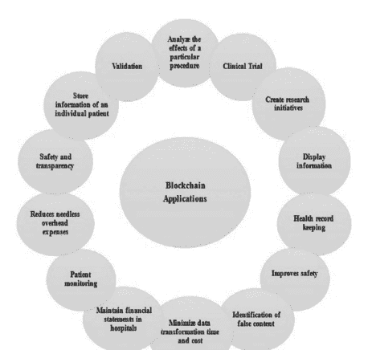

**图 4.1**
区块链技术在医疗保健领域有重要用途。

交换患者健康信息是另一项可从尖端技术中获益的应用。虽然区块链技术对故障和攻击具有极强的韧性，但它也提供了广泛的访问控制解决方案。正因为如此[29]以及图 4.1 中所示的区块链重要应用，区块链是医疗数据的绝佳载体。

### 4.3 区块链技术在医疗保健领域的能力

归功于区块链，整个处方流程从生产到商店货架均可见。IoT 和区块链可用于监控交通和货运方向，包括速度。由于医疗信息技术的发展，可用的医疗信息数量正以惊人的速度增长。医疗资源的高效利用、临床决策支持、医疗质量控制、精准医疗以及疾病风险评估和预测等都受益于医疗信息的交换和利用[30,31]。它提供了战略性安排采购的机会，以防止药房、诊所以及各种其他医疗机构中特定药物的中断和限制。基于区块链的数字结构将用于帮助确保物流数据免受未经授权的更改[32]。它鼓励自信，并防止那些试图获取药物的人以未经授权的方式处理数据、资金或药品。技术可以在保持低成本的同时大大改善患者的情况。它消除了多级身份验证中的所有障碍和困难[33-35]。区块链是保护方面的最佳技术，因为它可以保存所有医疗信息的不可更改、去中心化和公开记录。另一方面，区块链既公开又封闭，在复杂且受保护的算法背后隐藏任何个人身份，从而保持医疗信息的机密性[36]。该技术的去中心化设计使患者、医生及各种其他医疗工作者之间能够快速且安全地共享信息。区块链技术允许向互操作性过渡，由患者主导，使患者能够保持对其医疗记录的访问权限，并使他们能够遵守法律。除了提高安全性和保密性外，这也让患者对其机密数据拥有更多控制权。实施、评估和质量验证是艰巨的任务。行业中使用区块链可以解决其中任何一项技术问题。在追踪药物时，当局将使用区块链报告来区分正品药物和假药。这确保所有授权参与者都可以进行包含患者信息的数字交易。通过修改单个批准，就诊的患者可以共享其所有信息[37,38]。越来越多的企业正在采用区块链，包括医疗保健行业。此外，医疗生态系统技术的早期采用者对其感到满意。为了在未来几年完全改变医疗行业，区块链有一项全面战略，包括解决影响当前框架的问题。得益于此，医生、患者或药剂师可以随时快速访问所有数据。无论昼夜，医疗公司都在研究、测试和学习区块链技术，以便在医疗领域应用于健康数据[39]。它通过整合药物、改善支付选项以及去中心化患者健康相关历史数据，在医疗保健领域成为一项关键工具。除了机器学习和人工智能等其他现代技术外，区块链是医疗行业的关键技术。毫无疑问，区块链正在以正确的方式改变医疗行业。该系统旨在使用区块链技术分析医疗供应链[40]。区块链的能力允许创建复杂的数据存储结构，记录个人的完整病史，包括诊断、检测结果、既往方案，甚至是智能传感器进行的测量。这一策略使医生能够轻松获取所有所需数据，以确保准确的诊断或建议。尽管所有数据均在特定区块链系统中维护，但它免受丢失和篡改[41]。区块链可用于绕过企业内部网络。拥有众多自主参与者、对加密区块链数据库具有不同权限程度的大型组织，可以保护组织免受外部世界的危害和攻击。如果医疗保健提供者正确采用区块链网络，这些救援攻击以及计算机冲突和硬件缺陷等其他问题将被消除[42]。从信息管理的角度来看，区块链是一种共享数据库，其中大量数据和信息利用图 4.2 中所示的区块链技术的去中心化、高可用性或高可信度能力进行保存。基于此，区块链不仅可以实现高效的数据分析和收集，还可以创建实时监控过程，鼓励物理“数据岛屿”的高度合理关联，实现证据分块、“将零散整合为整体”或“将点转化为面”，同时提高系统参与者之间的沟通效率。在社会治理方面，区块链软件为建立可信赖的合作关系和去中心化协作框架提供了安全的分布式计算机网络[43]。中国的公共卫生应急响应计划已有10多年历史，对该国日常控制公共医疗紧急情况或早期发现传染病至关重要。区块链系统可以改进用于传染病的防护和管理，实现更具针对性和多方分布式的

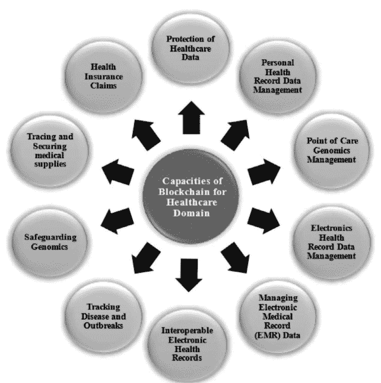

**图 4.2** 区块链技术在医疗保健领域的潜力。

监测，以及传染病的可追溯性，依赖于当前的实时监控和早期预警技术。

### 4.4 存储和追踪传染病信息的功能

利用区块链技术，传染病数据存储将使疫情期间的数据重新编译和存储成为可能。在这种疾病直接追踪系统中，每个实体都可以基于自动节点上传与疾病相关的信息和数据。利用区块链技术，传染病数据存储将在疫情期间实现数据记录和存储。在这种疾病直接上报过程中，每个实体都可以基于自主节点上传与疾病相关的数据和详细信息。医院收集的关于传染病的数据，例如确诊病例、疑似病例、患病患者信息等，由医院 1 处理。区块链会自动记录上传时间以及时间戳。除了时间戳外，所提供数据的固定长度哈希值也会保存在区块链上。区块链上的另一个节点可以通过区块链协议访问医院 1 上传的疾病数据，从而查看该数据。哈希函数将任意长度的数据转换为固定长度的函数值。哈希机制可以在向区块链上传与疾病相关的信息时对内容进行哈希处理并生成固定长度的哈希结果[44]。每个数据单元都有一个不可逆转的独一无二的哈希值。一旦输入数据有任何细微差异或更改，生成的哈希值就会发生巨大变化。因此，只需对实际疾病证据计算哈希函数，并将结果与区块链上保存的哈希值进行比较，即可确定区块链上的记录是否已被篡改。如果两个结果匹配，则可以认为疾病详情是有效的（无伪造或篡改）。为确保数据安全，当医院需要提交新病例（医院 2）时，可以通过其哈希值检查先前的数据片段。即使医院 2 也有新的疾病信息要提交到区块链，更新后的数据仍将以哈希形式保存。通过这种防篡改保存方法，防篡改的疾病保存数据保证了追溯的真实性。根据区块链的链式保留，所有传染病信息更新的证据必须按时间顺序存储且不可更改。因此，每当医疗机构的每个节点确定记录的传染病信息需要再次更新时，都会向传染病区块链系统提交信息修改查询以进行共识确认[45,46]。如果新修订的传染病信息被共识接受，则它将与最近的上传时间一起存储在区块链上。之后，系统将向国家疾控中心及管理部门发送广播，以验证和修改终端上显示的信息。最终，国家疾控中心和相关组织机构将其传播给任何参与的节点。至于追踪功能，疾病上报系统中的信息收集和保存不遵循层级顺序。这意味着低级节点不会收集数据并上传到高级节点。相反，全国每个能够收集相关数据的节点都将参与上传和存储活动，从而建立疾病信息传输的横向流程。每当前一节点完成记录时，就会启动一项数据传输过程（也称为区块链上的交易），该过程从疾病信息记录的开始一直持续到结束[47]。为每笔疾病转换交易生成一个新块，以记录交易的方法。此段中包含流出方的交易、流入方的交易地址、交易总额、完成所需时间以及任何关联内容。（此信息不可修改。）“发送地址”表示此前节点的独特地址标识，“接收地址”表示当前正在通信的节点的独特地址标识。因此，通过关注传递疾病信息的详细块，我们可以明确了解在现有组织节点进行信息记录之前立即发生的疾病信息存储过程（例如，各方输入、信息输入）。这是因为信息被转移了。由于区块链由先前块创建的哈希特征值链接，该值形成先前交易的序列规划，任何节点都可以依据紧邻上一个输出节点的交易地址进行追溯，并查询所有与交易相关的数据，这些


包含该特定交易地址，直至到达交易输入节点。之所以可能，是因为区块链由前一区块生成的哈希函数值连接，该值连接了区块链并产生先前交易的顺序流程。一旦前一节点与下一节点之间的疾病信息“交易”成功完成，信息将被保存在区块链中，从而建立一个名为“交易”数据库 [48]，如图 4.3 和图 4.4 所示。所有交易都存储在其区块中，每个区块都有其唯一的哈希值来标识它。这个特定区块包含关于发起者、接收者、交易发生期间、交易期间发送的消息以及其他相关信息的信息内容。前一区块中用作输入的实体将在随后的区块中用作输出，从而连接区块链。您可以通过输入现有交易导出者的位置，在包含地址的区块链中识别交易详细信息。

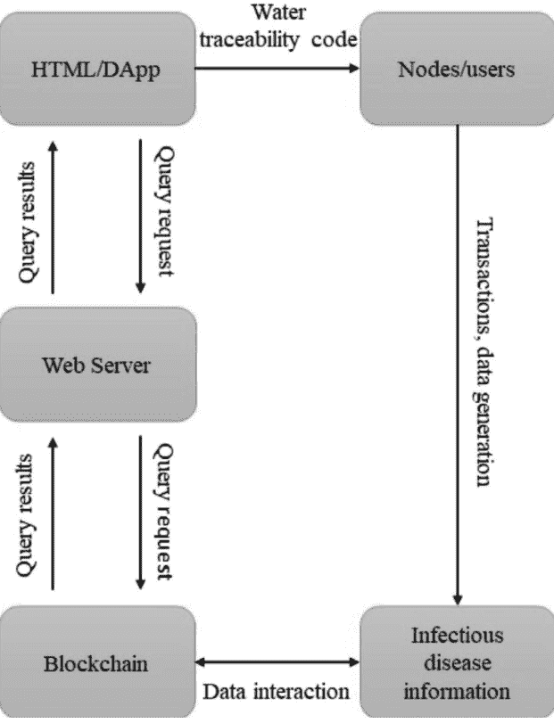

图 4.3
追踪的交互工作流。

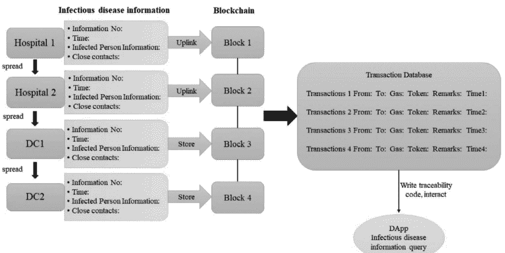

图 4.4
关于感染和疾病信息的存储和跟踪。

这使您可以查询任何和所有满足情况需求的可传染疾病病原体证据，并最终在传染病传播时发现最初的污染状况。满足授权的相关实体可以通过使用前端页面或 DApp 应用程序（去中心化应用程序）访问追踪过程的最终结果。当相关实体向 Web 服务器发送查询请求时，Web 服务器利用 SDK 或 API 技术将此类请求转发到区块链监控系统。最后，区块链追踪系统根据所有各方验证的交易评估来源，交付查询结果，并在前端可视化平台上以显示方式显示相关数据。例如，可追溯性是指定位受感染患者的过程。避免冠状病毒传播是最高优先级。借助区块链软件，人们可以记录直接抗击活动，跟踪受感染患者的行程，并提供受影响地点的实时数据。利用区块链技术在无病毒地区创建个人活动监控是该技术的另一个有趣应用。区块链被用来跟踪安全区详细信息，例如人口、位置以及现有冠状病毒流行病的状态。为了在医疗供应链中保持公开和诚实，定期监控和追踪产品及医疗资源至关重要。这种监控之所以可行，是因为区块链网络能够记录交易并监控其进度 [49]。解决以合理价格提供优质医疗服务问题的平台由区块链技术驱动。它有机会提供一种可行的方法来跟踪疾病流行，以保护更多的人。它允许实时政权检查，使受感染人员的位置能够被追踪，以便他们在适当的时间获得适当的治疗。如果医院和医疗从业者能够访问既安全又可靠的病历数据库，可能会发生更少的诊断错误 [50,51]。图 4.3 显示了追踪的交互工作流。关于感染和疾病信息的存储和跟踪在图 4.4 中有所描绘。

#### 4.4.1 医院级别

实施去中心化软件所需的技术设施由区块链提供。它由一系列利用哈希指针连接的互连区块组成；每个区块都包含可数字化项目的交易数据 [52]。作为其基础，区块链软件依赖于基于哈希的数据格式，这提供了消除冲突、数据绑定和数据隐藏等优势。区块链是当代医院基础设施中电子病历（EMR）应用的主流技术之一。EMR 代表“电子医疗信息”。去中心化、数据溯源或健壮性等特性使区块链技术被认为适用于在电子病历（EMR）中存储、维护和交换机密健康信息 [53]。相比之下，“健康链”是构建在区块链上并利用 IBM Hyperledger Fabric 的电子病历（EMR）系统。这项技术有助于实现可扩展的数据保护，并优化 EMR 系统的生产力。认为账单领域、保险事件以及诸如医院感染观察等监测措施中的交易至少可以从使用区块链技术中受益 [4,54]。采用此技术的好处在于，它能够在非常及时的方式中将大量信息保存、处理和分发给相关各方，且不会出现任何链路故障或延迟。它可以通过内置验证机制修订健康数据库互操作性，从而降低数据被盗的风险 [55]。

#### 4.4.2 卫生系统资源管理

借助区块链技术，可以简化医疗保健系统中后勤和人力因素的管理。例如，外部供应商可能向医疗保健系统提供假冒药品和质量低于系统要求的仪器。利用区块链技术，可以在供应链管理的各个节点验证质量要求，并向相关机构通报潜在的问题偏差 [56]。此外，在当今的数字时代，管理人力资源需要存储和使用员工数据，以跟踪考勤和休假、评估生产力，并实施涉及复杂身份验证程序的安全防护措施。区块链技术的应用有可能使这些流程更加高效，并有助于更智能的医疗服务组织的发展 [57,58]。本节将研究医学领域中可使用的区块链技术的各种应用，例如关键患者数据的维护和医疗记录的管理。由于其日益广泛的应用有可能提高人们的整体生活质量，区块链技术在医学领域已获得社会重要性。出于同样的理由，计算有潜力缓解该领域存在的一些问题。例如，信息学领域通过确保数据的更可靠传输、在其他领域的适用性以及日志管理，为数字化医疗文档做出了贡献 [59,60]。

#### 4.4.3 患者级别应用

由于区块链技术具有解决数据安全问题的去中心化特性，因此正越来越多地用于与个人及其护理人员交换健康信息。区块链技术由比特币创始人中本聪开发。患者参与计划还鼓励有效使用健康信息技术，并通过数字渠道增强患者与提供者之间的联系 [61]。此外，基于区块链技术的移动健康措施正在让远程患者通过生物传感器进行观察，这有助于消除患者级医疗中的可及性障碍 [62,63]。区块链技术要求为不同机构的医疗专业人员创建新的患者数据证书。新添加的信息通常是重复的，会造成时间浪费，这是一项重大的医疗失误。这是一个问题，因为新知识可能会导致健康问题。由于其在供应链中的地位，每个个体可能对可访问性拥有独特的权利或选择。此外，任何包含药品信息的区块都会有一个将其连接到另一个区块的哈希值，无论该区块属于谁 [64]。而且，作为区块链设计一部分的数据透明性特性将有助于找到完整的根路径并终止伪造药品的流通。当患者前往不同的诊所时，该患者会获得一张新的医疗卡，然后将其存档在某个位置。这些细节通常不对公众公开，并由相关设施的护理人员编纂而成。区块链技术为许多数据处理问题提供了切实可行的解决方案。采用此技术将能够在全球范围内开发透明且可比的区块链医疗信息 [65–67]。监控和讨论患者医疗信息是区块链技术潜在应用的另一个用例。患者可能难以访问自己的医疗文档，因为这些记录通常存储在几个不同的医疗服务中。区块链概念可能使患者能够完全且受保护地访问其所有记录以及病史 [68]。已有一些关于使用区块链技术组织患者医疗信息并便于访问这些记录的建议。通过应用分布式区块链原则，依赖区块链技术的信息管理系统 MedBlock 提供了高效的 EMR 访问和检索 [69,70]。该程序具有显著更好的共识流程，确保网络不会因活动而过载。在实施像区块链这样功能会随时间持续增加的软件时，存在网络过载的风险。访问控制和加密技术都对 MedBlock 的高安全性有显著贡献 [71,72]。

#### 4.4.4 社区层面疾病监测

“监测”一词是指“根据世界卫生组织国际卫生条例（IHR）所规定的国家优先领域，就所有传染病和非传染性疾病，由所有一般卫生流程进行的系统性、连续性的收集、汇编、数据评估，以及向需要了解详情以便采取行动的人及时分发详情” [73]。例如，像尼帕病毒这样的致命病毒可能在短短 36 小时内在全球传播，并有可能通过日益加剧的城市化和全球化所造成的健康安全状态受到威胁，从而引发大流行 [74,75]。由于大量自治实体向集中式信息系统发送数据，可传染疾病的监测是一项持续的操作，但过程复杂且效率低下。因此，确保信息继续不间断、及时地


时尚是一项艰巨的任务。此外，普通员工没有获得任何奖励 [45,76]。区块链技术的优势在多方面对疾病监测系统有益，这将在后文进一步阐述。区域层面卫生工作者的及时报告正是使区域监测如此高效的原因。可以利用处方数据和最常见的主诉来生成预警信号。同样，设施可以作为参与节点相互关联，每当针对特定优先疾病的积极检查作为诱因，即可开展早期公共卫生行动，从而实现最佳结果 [77]。此外，还可以将此技术与地理数据系统等其他技术结合，以加快疫情的常规检查。通过确保药品和疫苗按时送达，还可以提高药品和疫苗供应链系统的效率。这些区块链应用程序还可以评估当前可用的不同治疗方法的价格，并快速传播数据，通过尽量减少报告中的冗余来节省时间。第二个关键特征是，区块链可以绕过原有区域卫生信息系统的限制，因为它确保可见性和准确报告，例如在宣布特定疫情导致的死亡病例时（如图 4.5 所示）[45]。

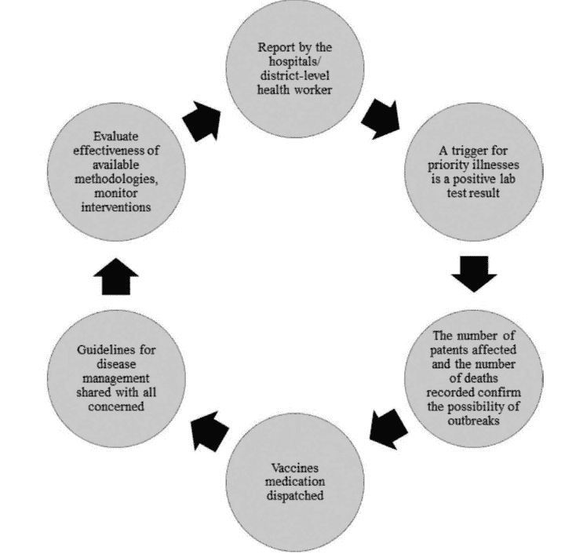

图 4.5 疾病监测系统中事件的排序。

#### 4.4.5 传染病的早期检测与监测

中国现有的传染病预防与管理早期预警系统需要通过逐层检查来收集和描述数据。因此，该系统不足以应对意外传染病，存在明显的缺陷。在构建传染病预防与管理平台时，使用区块链技术有望有效实现对新出现的严重疾病的检测和早期预警 [78]。针对传染病监测和早期咨询的区块链软件，在人工智能、共识机制和智能交易等其他技术配合下，已在本地和国际规模上进行研究和实施 [79]。例如，刚果民主共和国利用智能射频电子识别标签将可行且已明确的埃博拉病毒感染监测数据收集到 SERIS 中，并利用智能物联网连接电信公司、埃博拉病毒监测分支、埃博拉疫苗供应机构以及运输机构，通过区块链建立全国疫情监测网络，从而监测埃博拉病毒在全国的传播 [80]。这是通过使用区块链软件形成埃博拉病毒监测全国网络来实现的 [80]。这为在中国构建全面的传染病疫情监测系统提供了极佳的模板。在以区块链技术为幌子开展的全国传染病监测和早期预警应用研究中，为了制定传染病早期预警方法，该模型融入排名机制，并通过智能合约传播大型信息资源。这为中国快速急性传染病监测和早期预警系统的发展提供了必要的传染病共享数据平台。目前，关于早期传染病数据收集、地理预警系统以及政府和社会资源互联互通的系统性研究不足，这被确定为现有国内区块链医学软件研究的主要关注点。然而，已发现该研究主要集中在提供医疗数据信息上 [81]。使用区块链技术，可以通过整合区、市、地区和国家层级的传染病监测与紧急预警网络，构建四级大流行预防链网络 [80,82]。初级卫生保健机构（医院）被纳入四级大流行预防序列，以便在地方和国家层级实现加密信息共享和双级自动早期检测流程。这是通过整合国家疾控中心、特定网络文档系统、传染病全国自动早期检测系统、全国三级公共卫生信息交换框架以及传染病全国自动预警系统来实现的 [78,83]。

#### 4.4.6 利用区块链技术简化传染病报告，建立传染病分布式流程

区块链技术的核心组件是一个由各方共同管理的分布式数据库。该数据库应实施去中心化的数据采集和控制模型，尽管所有实体都可以获取完整的信息副本，并参与数据的存储和监控。在区块链 P2P 系统的底层与信息应用层之间，构建了一层多方安全计算（MPC）或数据保护共享层。这使得在保护隐私权和组织数据安全的前提下，可以在区域内及不同机构之间高效共享传染病数据 [84]。同时，数据密文在密钥交换算法或 MPC 架构的安全保护下存储，智能合约会自动发出警报。传染病大流行发生后，地理通知智能合约会释放数据密文，并将其提供给周边地区的医疗中心，用于表达关于大流行的健康相关和个人信息。传染病报告方法同样能从区块链技术中获益良多 [85]。目前，国家传染病报告系统对报告的传染病数据要求过度的详尽和精确。尽管存在“疑似病例”的可能性，但新疾病的早期症状和并发症往往不明显，无法进行精确诊断。此外，医院和医务人员面临巨大的报告压力，这可能导致他们错过早期预警信号。通过使用区块链技术，负责证书维护的监测哨点站点会立即将潜在事件提交到区块链网络。哨点软件使用数字证书对报告病例的数据进行加密，并将个人公钥转发给四级疫情预防链中的每个医院节点。病例密文信息通过 P2P 网络分布到整个医院节点 [86]。区域疫情防护链有一个负责启动验证和共识的领导节点。该节点还负责确保最终文档自动同步到网络中的所有节点。早期通知将广泛利用区域疫情预防链智能合约阈值判断以及国家自动传染病警报系统提供的大数据分析；同时，确认、地理会诊、病原体调查、专家讨论以及传染病的最终验证将并发进行。区块链系统将允许对已检测和确认的病例进行并行报告，从而减少疫情期间所需的决策量 [13,87]。为了确保产品有效，必须有条不紊地进行测试，并保留关于测试总次数的可靠信息。为实现这一目标，可以利用区块链技术促进分散签到点的建设，用于评估患者。这些签到点的组织者能够在同样分布的区块链系统中充当节点 [88]。这些网络站点可以持续更新其本地签到站的测试次数和实验室确诊病例数量。所有医疗专业人员和政府组织都可以放心地在网络中存储知识，尽管区块链是不可更改的且使篡改不可能。当一个人对某种疾病检测呈阳性时，其所有数据（包括性别、年龄、病历、基础健康问题、病情严重程度、经历的症状以及推荐的治疗方案）都会安全地上传到互联网。不久，处理每个报告病例的医疗机构都将被允许查阅这项研究，以预测处理当前问题所需的设施和治疗类型 [89]。

### 4.5 医药行业中的区块链技术

区块链是一项近期技术，正在被应用于各个领域（尤其是医疗保健）来创建创新解决方案。区块链软件在医疗保健行业中用于在医院和诊断


实验室、制药公司和医师。区块链技术可以准确发现医疗领域中的重大错误，甚至包括可能致命的错误。它还可以改善医疗系统中交换医疗详情的有效性、安全性或开放性。医疗机构可以利用这项技术更好地理解和分析患者记录 [4,19]。在医疗公司中，区块链的应用众多。安全作为一大关注点，通过使用分析私有数据块的加密方法来解决。使用不同范式来创建安全元素。假药带来的安全风险已通过序列化方法得到解决。凭借这项技术，得益于确认检查，整个供应链系统中的序列号都经过身份验证。制药质量控制通过利用从生产商到药房分发的电子签名、区块链链标识符、健康相关信息或数据分析来实现，以保持恒定的质量。药物追踪也得到了改进，以最大限度地减少盗窃 [90–92]。

#### 4.5.1 防伪

药品进行序列化并赋予安全判定因子，以便客户可以验证它们并区分正品和假冒产品。通过暴露且基于链码的交易，区块链网络也增强了安全性。医疗领域需要信任和开放，正因为如此，缺乏这些会导致造假行业猖獗，并使公众暴露于劣质或低质药品相关的风险中。通过利用区块链进行质量控制以及识别假药，保护得到了加强，生命得到了保障 [93]。可以使用多种策略来避免造假，例如反假药系统（ACMS）。以下是ACMS如何利用以太坊区块链和星际文件系统（IPFS）网络：

- 为防止克隆，对零售和非零售药品实施所有权标准。
- 使用IPFS网络和以太坊区块链创建以太坊智能合约，以有效管理ACMS。
- 向中小企业推广该计划。
- 评估和审查建议的系统。ACMS能够成功挫败欺诈。在启动交易时，参与者提供链码。批准被收集并提交给采购服务，在背书团队成员验证签名后，交易确认是最后阶段 [94,95]。

#### 4.5.2 产品分销

各种经销商和中间商的存在可能导致不道德的商业行为，进而降低供应网络的有效性。利用区块链技术阻止劣质药品分销的做法已获得广泛赞誉。不符合质量标准的药品将被撤出流通，并将对其如何进入药品供应系统进行调查。为了增强药品分销，会计系统、链码和序列化（即为药品分配序列号以便识别和分段的过程）被采用。存储在区块链上的信息受到严格监管，以防止非法访问，因为这将危及保护系统的完整性。在药品配送中使用物联网（IoT）可提高生产力 [96–98]。

#### 4.5.3 追踪与溯源

对运输中的物品从发运点到最终目的地进行监控和识别是理所当然的。交付中断对企业流程产生负面影响，而医疗和制药领域的问题可能导致生命丧失或疾病加重。通过使用区块链软件，现在可以进行药品分销。药品监控和追踪对于企业成功运营、保护患者健康以及满足监管要求是必要的。得益于先进且安全的追踪或溯源技术，现在可以不间断地进行药品贸易和患者监测。这些技术确保流通中的商品按时送达适当地点。为了便于全球范围内的药品供应流程，建立了一个受保护的国际登记册。尽管该技术对大型制药公司前景广阔，但预计小型企业也将受益 [4,99]。

#### 4.5.4 安全与防护

由于药品是高价值商品，必须通过安全措施对其进行保护。区块链应用提供的加密功能构成了制药公司安全和隐私系统的基础。药品追踪或监控功能满足监管标准，加密技术提高了药品安全性。盗窃和假药分销都正在通过加强的安全措施积极打击。未经授权的药品篡改也被最大限度地减少，这防止了机会主义制药利益相关者以此方式修改药品并降低安全性。供应链网络的治理基于实施强大的安全或防护程序，如果这些程序被攻破，将触发警报 [90,100]。

### 4.6 结论

在医药领域，区块链技术被用于多种不同用途，包括保护患者数据和监管药品分销。在整个生态系统中广泛采用支持性创新技术，将对区块链在医疗领域的实用性产生重大影响。这通常涉及追踪网络、记录药物、开展研究以及保障医疗。临床试验受益于区块链技术提供的可信度和结果。通过以计算机指纹的形式保存这些信息，该数据可以以智能合约的方式存储在区块链上。区块链技术在医疗保健中的应用有许多好处，包括改善所有阶段的网络服务安全性、确认和验证所有参与者的身份，以及标准化访问电子病历的授权程序。一种称为区块链的分布式账本被用于监控药品配送系统，并跟踪谁负责哪些药物。由于这项技术可以用于存储甚至单个患者的数据，因此它有助于评估和确认某项操作的后果。它帮助医院保持财务报表的最新状态，并减少在记录转换上花费的时间和金钱。区块链的去中心化账本系统使以安全方式传输患者医疗文档成为可能，改善医疗数据保护，监管药品供应链，并协助医学领域的研究人员解码遗传信息。

## 参考文献

- 1. Angraal S, Krumholz HM, Schulz WL. 区块链技术. Circ Cardiovasc Qual Outcomes [Internet]. 2017 Sep;10(9). 可从以下网址获取: www.ahajournals.org/doi/10.1161/CIRCOUTCOMES.117.003800
- 2. Xu Y, Li X, Zeng X, Cao J, Jiang W. 区块链技术在食品安全控制中的应用:当前趋势与未来前景. Crit Rev Food Sci Nutr [Internet]. 2022 Apr 5;62(10):2800–19. 可从以下网址获取: www.tandfonline.com/doi/full/10.1080/10408398.2020.1858752
- 3. Sivasankari B, Varalakshmi P. 医疗保健中的区块链和物联网技术:综述; 2022. 可从以下网址获取: https://ebooks.iospress.nl/doi/10.3233/SHTI220455
- 4. Haleem A, Javaid M, Singh RP, Suman R, Rab S. 医疗保健中区块链技术的应用:概述. Int J Intell Nett [Internet]. 2021;2:130–9. 可从以下网址获取: https://linkinghub.elsevier.com/retrieve/pii/S266660302100021X
- 5. Salah K, Rehman MHU, Nizamuddin N, Al-Fuqaha A. 面向人工智能的区块链:综述与开放研究挑战. IEEE Access [Internet]. 2019;7:10127–49. 可从以下网址获取: https://ieeexplore.ieee.org/document/8598784/
- 6. Abu-elezz I, Hassan A, Nazeemudeen A, Houshe M, Abd-alrazaq A. 医疗保健中区块链技术的利益与威胁:范围综述. Int J Med Inform [Internet]. 2020 Oct;142:104246. 可从以下网址获取: https://linkinghub.elsevier.com/retrieve/pii/S1386505620301544
- 7. Aste T, Tasca P, Di Matteo T. 区块链技术:对社会和行业的可预见影响. Computer (Long Beach Calif) [Internet]. 2017;50(9):18–28. 可从以下网址获取: http://ieeexplore.ieee.org/document/8048633/
- 8. Hossain M, Islam SMR, Ali F, Kwak K-S, Hasan R. 基于物联网的健康处方助手及其安全系统设计. Futur Gener Comput Syst [Internet]. 2018 May;82:422–39. 可从以下网址获取: https://linkinghub.elsevier.com/retrieve/pii/S0167739X17314085
- 9. Badawi HF, Dong H, El Saddik A. 使用生物反馈传感器的移动云端身体活动咨询系统. Futur Gener Comput Syst [Internet]. 2017 Jan;66:59–70. 可从以下网址获取: https://linkinghub.elsevier.com/retrieve/pii/S0167739X15003428
- 10. Gordon WJ, Catalini C. 医疗保健区块链技术:促进向患者驱动的互操作性过渡. Comput Struct Biotechnol J [Internet]. 2018;16:224–30. 可从以下网址获取: https://linkinghub.elsevier.com/retrieve/pii/S200103701830028X
- 11. Xia Q, Sifah EB, Smahi A, Amofa S, Zhang X. BBDS:云环境中电子病历的基于区块链的数据共享. Information. 2017;8(2):44.
- 12. Kassab M, DeFranco J, Malas T, Laplante P, Destefanis G, Neto VVG. 探索医疗保健领域的区块链研究及未来路线图. IEEE Trans Emerg Top Comput [Internet]. 2021 Oct 1;9(4):1835–52. 可从以下网址获取: https://ieeexplore.ieee.org/document/8809781/
- 13. Shen B, Guo J, Yang Y. MedChain:通过区块链实现高效医疗数据共享 [Internet]. Appl Sci. 2019 Mar 22;9(6):1207. 可从以下网址获取: www.mdpi.com/2076-3417/9/6/1207


- 14. Menachemi N, Rahurkar S, Harle CA, Vest JR. 健康信息交换的好处：一份更新的系统综述. J Am Med Informatics Assoc [互联网]. 2018 Sep 1;25(9):1259–65. 可从以下网址获取: https://academic.oup.com/jamia/article/25/9/1259/4990601

- 15. Chelladurai U, Pandian S. 基于区块链的医疗电子健康记录自动化系统：一种新方法. J Ambient Intell Humaniz Comput [互联网]. 2022 Jan 23;13(1):693–703. 可从以下网址获取: https://link.springer.com/10.1007/s12652-021-03163-3

- 16. Zhang P, Schmidt DC, White J, Lenz G. 医疗保健中区块链技术的用例; 2018, 第 1–41 页. 可从以下网址获取: https://linkinghub.elsevier.com/retrieve/pii/S0065245818300196

- 17. Hölbl M, Kompara M, Kamisičič A, Nemec Zlatolas L. 医疗保健中区块链应用的系统综述. Symmetry (Basel) [互联网]. 2018 Oct 10;10(10):470. 可从以下网址获取: www.mdpi.com/2073-8994/10/10/470

- 18. Mettler M. 医疗保健中的区块链技术：革命从这里开始. 在：2016 年 IEEE 第 18 届电子健康网络、应用和服务国际会议 (Healthcom) [互联网]. IEEE; 2016, 第 1–3 页. 可从以下网址获取: http://ieeexplore.ieee.org/document/7749510/

- 19. Farouk A, Alahmadi A, Ghose S, Mashatan A. 工业医疗保健区块链平台：愿景与未来机遇. Comput Commun [互联网]. 2020 Mar;154:223–35. 可从以下网址获取: https://linkinghub.elsevier.com/retrieve/pii/S014036641931953X

- 20. Smith RD. 应对全球传染病暴发：从 SARS 中汲取关于风险感知、沟通和管理作用的教训. Soc Sci Med [互联网]. 2006 Dec;63(12):3113–23. 可从以下网址获取: https://linkinghub.elsevier.com/retrieve/pii/S0277953606004060

- 21. Linn LA, Koo MB. ONC/NIST 医疗保健和研究区块链使用研讨会. ONC/NIST; 2016.

- 22. Kombe C, Ally M, Sam A. 区块链技术中医疗保健信息系统和共识协议综述. Int J Adv Technol Eng Explor [互联网]. 2018 Dec 21;5(49):473–83. 可从以下网址获取: http://accentjournals.org/PaperDirectory/Journal/IJATEE/2018/12/1.pdf

- 23. Weiss M, Botha A, Herselman M, Loots G. 区块链作为南非公共 mHealth 解决方案的推动者. 在：2017 年 IST-Africa 周会议 (IST-Africa). IEEE; 2017, 第 1–8 页.

- 24. Bryatov S, Borodinov A. 药品供应链中的区块链技术：基于 Hyperledger Fabric 的商业模式研究. 在：V 国际信息技术和纳米技术会议论文集 2019 [互联网]. IP Zaitsev V.D.; 2019, 第 134–40 页. 可从以下网址获取: http://ceur-ws.org/Vol-2416/paper18.pdf

- 25. Alhadhrami Z, Alghfeli S, Alghfeli M, Abedlla JA, Shuaib K. 引入医疗保健区块链. 在：2017 年电气和计算技术与应用国际会议 (ICECTA) [互联网]. IEEE; 2017, 第 1–4 页. 可从以下网址获取: http://ieeexplore.ieee.org/document/8252043/

- 26. Dimitrov DV. 医疗保健数据管理的区块链应用. Healthc Inform Res [互联网]. 2019;25(1):51. 可从以下网址获取: http://e-hir.org/journal/view.php?id=10.4258/hir.2019.25.1.51

- 27. Greenspan G. 多链私有区块链. 白皮书; 2015. 可从以下网址获取: https://www.multichain.com/download/MultiChain-White-Paper.pdf

- 28. Alketbi A, Nasir Q, Talib MA. 政府服务的区块链——用例、安全优势与挑战. 在：2018 年第 15 届学习与技术会议 (L&T) [互联网]. IEEE; 2018, 第 112–19 页. 可从以下网址获取: https://ieeexplore.ieee.org/document/8368494/

- 29. Casino F, Dasaklis TK, Patsakis C. 基于区块链的应用系统文献综述：现状、分类与未解决问题. Telematics Informatics [互联网]. 2019 Mar;36:55–81. 可从以下网址获取: https://linkinghub.elsevier.com/retrieve/pii/S0736585318306324

- 30. Mackey TK, Kuo T-T, Gummedri B, Clauson KA, Church G, Grishin D, 等. 专用性？——未来医疗保健中区块链技术应用的挑战与机遇. BMC Med [互联网]. 2019 Dec 27;17(1):68. 可从以下网址获取: https://bmcmedicine.biomedcentral.com/articles/10.1186/s12916-019-1296-7

- 31. Justinia T. 区块链技术：解决医疗保健和生物医学科学中现实问题的机遇. Acta Inform Medica [互联网]. 2019;27(4):284. 可从以下网址获取: www.eijmanager.com/fulltextpdf.php?mno=302645059

- 32. Griggs KN, Ossipova O, Kohlios CP, Baccarini AN, Howson EA, Hayajneh T. 使用智能合约进行安全自动化远程患者监测的医疗保健区块链系统. J Med Syst. 2018;42:1–7.

- 33. Tripathi G, Ahad MA, Paiva S. S2HS：一种基于区块链的智慧医疗系统方法. Healthcare [互联网]. 2020 Mar;8(1):100391. 可从以下网址获取: https://linkinghub.elsevier.com/retrieve/pii/S2213076419302532

- 34. Gupta R, Tanwar S, Tyagi S, Kumar N, Obaidat MS, Sadoun B. HaBiTs：医疗 4.0 的基于区块链的远程手术框架. 在：2019 年计算机、信息和电信系统国际会议 (CITS) [互联网]. IEEE; 2019, 第 1–5 页. 可从以下网址获取: https://ieeexplore.ieee.org/document/8862127/

- 35. Srivastava G, Parigi RM, Dehghantanha A. 医疗物联网安全中区块链技术的未来; 2020, 第 161–84 页. 可从以下网址获取: http://link.springer.com/10.1007/978-3-030-38181-3_9

- 36. Ahmad SS, Khan S, Kamal MA. 区块链技术是什么及其在当前医疗保健系统中的意义？简要洞见. Curr Pharm Des [互联网]. 2019 Aug 9;25(12):1402–8. 可从以下网址获取: www.eurekaselect.com/172892/article

- 37. Bhavin M, Tanwar S, Sharma N, Tyagi S, Kumar N. 医疗 5.0 应用的基于区块链和量子盲签名的混合方案. J Inf Secur Appl [互联网]. 2021 Feb;56:102673. 可从以下网址获取: https://linkinghub.elsevier.com/retrieve/pii/S2214212620308255

- 38. Rathee G, Sharma A, Saini H, Kumar R, Iqbal R. 使用区块链技术在 IoT-医疗保健中进行多媒体数据处理的混合框架. Multimedia Tools Appl [互联网]. 2020 Apr 3;79(15–16):9711–33. 可从以下网址获取: http://link.springer.com/10.1007/s11042-019-07835-3

- 39. Chukwu E, Garg L. 医疗保健中区块链的系统综述：框架、原型和实现. IEEE Access [互联网]. 2020;8:21196–214. 可从以下网址获取: https://ieeexplore.ieee.org/document/8972918/

- 40. Houtan B, Hafid AS, Makrakis D. 医疗保健中基于区块链的自主患者身份调查. IEEE Access [互联网]. 2020;8:90478–94. 可从以下网址获取: https://ieeexplore.ieee.org/document/9091543/

- 41. Rejeb A, Bell L. 区块链在医疗保健中的潜力：突尼斯案例. SSRN Electron J [互联网]. 2019. 可从以下网址获取: www.ssrn.com/abstract=3475246

- 42. Paranjpe K, Parker M, Houliing D, Car J. 医疗保健机构中区块链的实施考虑因素. Blockchain Healthc Today [互联网]. 2019 Jul 4;2. 可从以下网址获取: https://blockchainhealthcetoday.org/index.php/journal/article/view/114

- 43. Hussien HM, Yasin SM, Udzir NI, Ninggal MIH, Salman S. 医疗保健行业的区块链技术：趋势与机遇. J Ind Inf Integr. 2021;22:100217.

- 44. Li J, Wu J, Jiang G, Srikanthan T. 云存储中大数据的基于区块链的公共审计. Inf Process Manag [互联网]. 2020 Nov;57(6):102382. 可从以下网址获取: https://linkinghub.elsevier.com/retrieve/pii/S0306457320308773

- 45. Chattu VK, Nanda A, Chattu SK, Kadri SM, Knight AW. 区块链技术应用在常规疾病监测系统中以加强全球卫生安全的新兴作用. Big Data Cogn Comput [互联网]. 2019 May 8;3(2):25. 可从以下网址获取: www.mdpi.com/2504-2289/3/2/25

- 46. Queiroz MM, Fosso Wamba S. 供应链中区块链采用的挑战：对印度和美国主要驱动因素的实证调查. Int Inf Manage [互联网]. 2019 Jun;46:70–82. 可从以下网址获取: https://linkinghub.elsevier.com/retrieve/pii/S0268401218309447

- 47. Sultana T, Alnogren A, Akbar M, Zuair M, Ullah I, Javaid N. 用于 IoT 设备的基于区块链智能合约集成访问控制机制的数据共享系统. Appl Sci [互联网]. 2020 Jan 9;10(2):488. 可从以下网址获取: www.mdpi.com/2076-3417/10/2/488

- 48. Wang Y, Cai S, Lin C, Chen Z, Wang T, Gao Z, 等. 基于信用的区块链共识机制研究. IEEE Access [互联网]. 2019;7:10224–31. 可从以下网址获取: https://ieeexplore.ieee.org/document/8605507/

- 49. Govindan K, Mina H, Alavi B. 考虑疫情暴发的医疗保健供应链需求管理决策支持系统：2019 年冠状病毒病 (COVID-19) 案例研究. Transp Res Part E Logist Transp Rev [互联网]. 2020 Jun;138:101967. 可从以下网址获取: https://linkinghub.elsevier.com/retrieve/pii/S1366554520306189

- 50. Antal C, Cioara T, Antal M, Anghel I. COVID-19 疫苗供应管理的区块链平台. IEEE Open J Comput Soc [互联网]. 2021;2:164–78. 可从以下网址获取: https://ieeexplore.ieee.org/document/9382850/


- 51. Juma H, Shaanan K, Kamel I. 贸易供应链解决方案中区块链应用综述. IEEE Access [Internet]. 2019;7:184115–32. 可从以下网址获取: https://ieeexplore.ieee.org/document/8936386/

- 52. Sriman B, Ganesh Kumar S, Shamili P. 区块链技术：工作量证明和权益证明共识协议；2021, pp. 395–406. 可从以下网址获取: http://link.springer.com/10.1007/978-981-15-5566-4_34

- 53. Roman-Belmonte JM, De la Corte-Rodriguez H, Rodriguez-Merchan EC. 区块链技术如何改变医学. 研究生医学 [Internet]. 2018 May 19;130(4):420–7. 可从以下网址获取: www.tandfonline.com/doi/full/10.1080/00325481.2018.1472996

- 54. Thomas C, Bindu V, Aby AA, Anjalikrishna UR, Kesari A, Sabu D. 基于区块链的医疗保险存储系统. In: 信息系统安全与隐私中区块链的近期趋势. CRC Press; 2021, pp. 219–35.

- 55. Vazirani AA, O'Donoghue O, Brindley D, Meinert E. 实施区块链以实现高效医疗保健：系统综述. 医学互联网研究杂志 [Internet]. 2019 Feb 12;21(2):e12439. 可从以下网址获取: www.jmir.org/2019/2/e12439/

- 56. Tseng J-H, Liao Y-C, Chong B, Liao S. 基于 Gcoin 区块链的药品供应链治理. 国际环境研究与公共卫生杂志 [Internet]. 2018 May 23;15(6):1055. 可从以下网址获取: www.mdpi.com/1660-4601/15/6/1055

- 57. Munsing E, Mather J, Moura S. 微电网网络中能源资源去中心化优化的区块链. In: 2017 IEEE 控制技术与应用会议 (CCTA) [Internet]. IEEE; 2017, pp. 2164–71. 可从以下网址获取: http://ieeexplore.ieee.org/document/8062773/

- 58. Meinert E, Alturkistani A, Foley KA, Osama T, Car J, Majeed A, 等. 医疗保健中的区块链实施：系统综述方案. JMIR 研究方案 [Internet]. 2019 Feb 8;8(2):e10994. 可从以下网址获取: www.researchprotocols.org/2019/2/e10994/

- 59. Pop C, Antal M, Cioara T, Anghel I, Ser D, Salomie I, 等. 能源数据登记的基于区块链的可扩展且防篡改解决方案. 传感器 [Internet]. 2019 Jul 10;19(14):3033. 可从以下网址获取: www.mdpi.com/1424-8220/19/14/3033

- 60. Azaria A, Ekblaw A, Vieira T, Lippman A. MedRec：使用区块链进行医疗数据访问和权限管理. In: 2016 年第 2 届开放与大数据国际会议 (OBD) [Internet]. IEEE; 2016, pp. 25–30. 可从以下网址获取: http://ieeexplore.ieee.org/document/7573685/

- 61. Engelhardt MA. 将医疗保健挂钩到区块链：医疗保健领域区块链技术简介. 技术创新管理评论 [Internet]. 2017 Oct 27;7(10):22–34. 可从以下网址获取: http://timreview.ca/article/1111

- 62. Bansal A, Garg C, Padappayil RP. 使用区块链优化 COVID-19“免疫证书”的实施. 医学系统杂志 [Internet]. 2020 Sep 19;44(9):140. 可从以下网址获取: https://link.springer.com/10.1007/s10916-020-01616-4

- 63. Saravanan M, Shubha R, Marks AM, Iyer V. SMEAD：一种用于糖尿病监测的安全移动辅助设备. In: 2017 IEEE 高级网络与电信系统国际会议 (ANTS) [Internet]. IEEE; 2017, pp. 1–6. 可从以下网址获取: https://ieeexplore.ieee.org/document/8384099/

- 64. Chen X, Xu X, Shao H, Hu D, Su Y, Mao X, 等. 基于区块链的公共卫生安全应急信息共享系统. 中国工程科学 [Internet]. 2021;23(5):41. 可从以下网址获取: https://journal.hep.com.cn/scae/EN/10.15302/J-SSCAE-2021.05.006

- 65. Miyachi K, Mackey TK. hOCBS：一种利用链上和链下系统设计的医疗数据隐私保护区块链框架. 信息处理与管理 [Internet]. 2021 May;58(3):102535. 可从以下网址获取: https://linkinghub.elsevier.com/retrieve/pii/S0306457321000431

- 66. Bell L, Buchanan WJ, Cameron J, Lo O. 医疗保健领域的区块链应用. 区块链医疗今日 [Internet]. 2018 Jul 9:1. 可从以下网址获取: https://blockchainhealthcare-today.com/index.php/journal/article/view/8

- 67. Bhuiyan MZA, Zaman A, Wang T, Wang G, Tao H, Hassan MM. 利用区块链和大数据转型医疗保健. In: 数据处理与应用国际会议论文集 [Internet]. ACM; 2018, pp. 62–8. 可从以下网址获取: https://dl.acm.org/doi/10.1145/3224207.3224220

- 68. Al Omar A, Rahman MS, Basu A, Kiyomoto S. Medibchain：基于区块链的医疗数据隐私保护平台. In: 计算、通信与存储中的安全、隐私与匿名性：SpaCCS 2017 国际研讨会论文集，广州，中国，2017 年 12 月 12–15 日，第 10 卷. Springer; 2017, pp. 534–43.

- 69. Kuo T-T, Kim H-E, Ohno-Machado L. 生物医学和医疗保健应用的区块链分布式账本技术. 美国医学信息学杂志 [Internet]. 2017 Nov 1;24(6):1211–20. 可从以下网址获取: https://academic.oup.com/jamia/article/24/6/1211/4108087

- 70. Fan K, Wang S, Ren Y, Li H, Yang Y. MedBlock：通过区块链实现高效安全的医疗数据共享. 医学系统杂志 [Internet]. 2018 Aug 21;42(8):136. 可从以下网址获取: http://link.springer.com/10.1007/s10916-018-0993-7

- 71. Agbo C, Mahmoud Q, Eklund J. 医疗保健中的区块链技术：系统综述. 医疗保健 [Internet]. 2019 Apr 4;7(2):56. 可从以下网址获取: www.mdpi.com/2227-9032/7/2/56

- 72. Li H, Zhu L, Shen M, Gao F, Tao X, Liu S. 医疗数据的基于区块链的数据保存系统. 医学系统杂志 [Internet]. 2018 Aug 28;42(8):141. 可从以下网址获取: http://link.springer.com/10.1007/s10916-018-0997-3

- 73. Tandon A, Dhir A, Islam AKMN, Mäntymäki M. 医疗保健中的区块链：系统文献综述、综合框架及未来研究议程. 计算机与工业 [Internet]. 2020 Nov;122:103290. 可从以下网址获取: https://linkinghub.elsevier.com/retrieve/pii/S0166361520305248

- 74. Chang MC, Park D. 在 COVID-19 等大流行病发生时，区块链如何帮助人们？ 医学系统杂志 [Internet]. 2020 May 16;44(5):102. 可从以下网址获取: https://link.springer.com/10.1007/s10916-020-01577-8

- 75. Fan VY, Jamison DT, Summers LH. 大流行风险：预期损失有多大？ 世界卫生组织公报 [Internet]. 2018 Feb 1;96(2):129–34. 可从以下网址获取: www.ncbi.nlm.nih.gov/pmc/articles/PMC5791779/pdf/BLT.17.199588.pdf/

- 76. Islam N, Faheem Y, Din IU, Talha M, Guizani M, Khalil M. 一种用于 e-健康服务应用的活动识别基于区块链的雾计算框架. 未来生成计算机系统 [Internet]. 2019 Nov;100:569–78. 可从以下网址获取: https://linkinghub.elsevier.com/retrieve/pii/S0167739X19309860

- 77. Sharma V, Gupta A, Hasan NU, Shabaz M, Ofori I. 安全医疗系统中的区块链：现状、局限性及未来方向. Soni M, 编. 安全与通信网络 [Internet]. 2022 May 21;2022:1–15. 可从以下网址获取: www.hindawi.com/journals/scn/2022/9697545/

- 78. Liu J, Jin C, Huang Y, Zhang K, Li W, Cui L. 基于区块链技术的传染病监测与溯源系统研究. In: 第 4 届经济管理与模型工程国际会议论文集，ICEMME 2022，2022 年 11 月 18–20 日. 南京，中国; 2023.

- 79. Rifi N, Rachkidi E, Agoulmine N, Taher NC. 朝着使用区块链技术进行 e-健康数据访问管理迈进. In: 2017 年第四届生物医学工程进展国际会议 (ICABME). IEEE; 2017, pp. 1–4.

- 80. Liberman DF, Ducatman AM, Fink R. 生物技术：医疗监测是否有其作用？ 生物过程安全与工作场所安全健康考量. 1990;1051:101.

- 81. Radanović I, Likič R. 医学中区块链技术的应用机会. 应用健康经济学与健康政策. 2018;16:583–90.

- 82. Panwar A, Bhatnagar V, Khari M, Salehi AW, Gupta G. 一种用于在 IBM 云数据湖中保护个人健康记录 (PHR) 的区块链框架. Aler R, 编. 计算智能神经科学 [Internet]. 2022 Apr 12;2022:1–19. 可从以下网址获取: www.hindawi.com/journals/cin/2022/3045107/

- 83. Bodek T, Rodrigues BB, Strasser T, Stiller B. 随处可见的区块链——区块链在制药供应链中的一个用例. In: 2017 IFIP/IEEE 集成网络与服务管理研讨会 (IM) [Internet]. IEEE; 2017, pp. 772–7. 可从以下网址获取: http://ieeexplore.ieee.org/document/7987376/

- 84. Gad AG, Mosa DT, Abualigah L, Abohany AA. 区块链技术和应用的新兴趋势：综述与展望. 索德大学—计算机与信息科学杂志 [Internet]. 2022 Oct;34(9): 6719–42. 可从以下网址获取: https://linkinghub.elsevier.com/retrieve/pii/S1319157822000891

- 85. Abd-alrazaq AA, Alajlani M, Alhuwail D, Erbad A, Giannachi A, Shah Z, 等. 用于缓解 COVID-19 挑战的区块链技术：范围综述. 计算机方法与生物医学


- Biomed Update [互联网]. 2021;1:100001. 可从以下网址获取：https://linkinghub.elsevier.com/retrieve/pii/S266699002030001X
- 86. Alsaed Z, Khweiled H, Hamad M, Daraghmi E, Cheikrhhouhou O, Alhakami W, 等. 区块链技术在应对 COVID-19 危机中的作用. Appl Sci [互联网]. 2021 年 12 月 17 日;11(24):12063. 可从以下网址获取：www.mdpi.com/2076-3417/11/24/12063
- 87. Krichen M, Ammi M, Mihoab A, Almutiq M. 面向现代应用的区块链：一项综述. Sensors [互联网]. 2022 年 7 月 14 日;22(14):5274. 可从以下网址获取：www.mdpi.com/1424-8220/22/14/5274
- 88. Sharma A, Bahl S, Bagha AK, Javaid M, Shukla DK, Haleem A. 区块链技术及其在抗击 COVID-19 大流行中的应用. Res Biomed Eng [互联网]. 2022 年 3 月 22 日;38(1):173–80. 可从以下网址获取：https://link.springer.com/10.1007/s42600-020-00106-3
- 89. Behnaminiia F, Samet S. 考虑隐私保护问题和 COVID-19 大流行的患者跟踪系统中区块链技术应用. Int J Inf Commun Eng. 2023;17(2):144–156. 可从以下网址获取：https://publications.waset.org/10012975/blockchain-technology-applications-in-patient-tracking-systems-regarding-privacy-preserving-concerns-and-covid-19-pandemic
- 90. Sinclair D, Shahrani H, Zhang C. 基于 Hyperledger Composer 的药品供应链安全需求原型设计. 在：第 3 届密码学、安全与隐私国际会议论文集 [互联网]. ACM; 2019, 第 158–63 页. 可从以下网址获取：https://dl.acm.org/doi/10.1145/3309074.3309104
- 91. Alshahrani W, Alshahrani R. 区块链技术在制药行业改进中的应用评估. 在：2021 年泰夫大学女性数据科学国际会议 (WiDTaif) [互联网]. IEEE; 2021, 第 1–5 页. 可从以下网址获取：https://ieeexplore.ieee.org/document/9430210/
- 92. Huang Y, Wu J, Long C. Drugledger：用于药品追溯和监管的实用区块链系统. 在：2018 年 IEEE 物联网 (iThings) 及 IEEE 绿色计算与通信 (GreenCom) 及 IEEE 网络、物理与社会计算 (CPSCom) 及 IEEE 智能数据 (SmartData) 国际会议 [互联网]. IEEE; 2018, 第 1137–44 页. 可从以下网址获取：https://ieeexplore.ieee.org/document/8726740/
- 93. Adsul KB, Kosbatwar SP. 基于区块链的假药追溯与检测新方法. Int J Curr Eng Technol. 2020;8(8):1025–30. 可从以下网址获取：http://inpressco.com/wp-content/uploads/2021/02/Paper2141025-1030.pdf
- 94. Kumar A, Choudhary D, Raju MS, Chaudhary DK, Sagar RK. 打击假药：利用区块链技术遏制假药行业的定量分析. 在：2019 年第 9 届云计算、数据科学与工程国际会议 (Confluence) [互联网]. IEEE; 2019, 第 174–8 页. 可从以下网址获取：https://ieeexplore.ieee.org/document/8776891/
- 95. Saxena N, Thomas I, Gope P, Burnap P, Kumar N. PharmaCrypt：用于关键制药行业打击假药的区块链. Computer (Long Beach Calif) [互联网]. 2020 年 7 月;53(7):29–44. 可从以下网址获取：https://ieeexplore.ieee.org/document/9130418/
- 96. Hulea M, Rosu O, Miron R, Astilean A. 药品冷链管理：基于分布式账本的平台. 在：2018 年 IEEE 自动化、质量与测试、机器人国际会议 (AQTR) [互联网]. IEEE; 2018, 第 1–6 页. 可从以下网址获取：https://ieeexplore.ieee.org/document/8402709/
- 97. Dwivedi SK, Amin R, Volla S. 具有密钥分发机制的供应链管理系统中基于区块链的安全信息共享协议. J Inf Secur Appl [互联网]. 2020 年 10 月;54:102554. 可从以下网址获取：https://linkinghub.elsevier.com/retrieve/pii/S2214212620301484
- 98. Botcha KM, Chakravarthy VV, Anurag. 利用物联网 (IoT) 和区块链增强制药供应链追溯性. 在：2019 年 IEEE 智能系统与绿色技术国际会议 (ICISGT) [互联网]. IEEE; 2019, 第 45–453 页. 可从以下网址获取：https://ieeexplore.ieee.org/document/8998114/
- 99. Mani V, Prakash M, Lai WC. 用于识别假冒产品的基于云的区块链技术. J Cloud Comput. 2022;11(1):1–15.
- 100. Plotnikov V, Kuznetsova V. 药品市场中数字技术“区块链”的应用前景. Mottaeva A, Melović B, 编. MATEC Web Conf [互联网]. 2018 年 8 月 20 日;193:02029. 可从以下网址获取：www.matec-conferences.org/10.1051/matecconf/201819302029

## 构建医疗 4.0 的高效智能合约

Kanika Agrawal 和 Mayank Aggarwal

## 5.1 引言

随着技术的进步，对安全可靠的在线通信系统的需求日益增长。随着数据流和互联网使用量的增加，数据安全威胁大幅增加 [1]。黑客攻击通信渠道以窃取信息并中断连接。因此，除了考虑数据完整性、冗余和异质性相关问题外，还必须考虑安全问题。安全性是任何机构必须考虑的最重要问题 [2,3]。未经授权的数据破坏和信息泄露会导致资源浪费和巨大的财务损失。缺乏健壮安全的模型会使系统遭受不同攻击。这些攻击通常会影响安全性和隐私。面对大量的网络黑客攻击和网络攻击，必须重视保密性、授权、完整性和访问控制。随着时间的推移，引入了许多集中式和客户端–服务器架构来缓解上述问题。但问题是，这些是中央服务器，一旦失败就会导致系统崩溃。许多安全机制（如高级加密标准 AES）也被用来保护数据和系统，但它们面临巨大的计算能力和通信开销。因此，为了减轻上述问题对通信渠道的影响，引入了区块链和比特币概念 [4]。去中心化的区块链技术实现了无需第三方支持的数字资产转移 [5]。它有助于开发支持比特币加密货币的系统。2008 年，中本聪首次提出区块链概念，并于 2009 年付诸实施。分布式区块链概念由相互连接并链接在一起的节点组成，用于在公共账本中存储所有已提交的交易 [6]。随着更多交易的产生，新区块会被添加到链中。这项技术有几个核心，例如密码学哈希、分布式共识算法和数字签名。区块链的去中心化消除了中介方干扰，从而帮助验证和核实交易 [7]。由于其安全可靠的社会影响，它已在全球许多领域得到应用，例如航空、电子投票、供应链、学术界等。

存在许多基于区块链的应用，其中医疗领域利用区块链帮助医院管理系统并挽救患者生命 [8]。然而，随着时间的推移，医疗行业经历了巨大的变化和转型，从医疗 1.0 版本发展到医疗 4.0。

医疗 1.0 允许医生手动维护患者病史，因此更偏向于以医生为中心。但医疗 2.0 应运而生，用电子记录取代了这些手动记录。然而，可穿戴设备 (WDs) 在医疗 3.0 中开始使用，有助于实时追踪患者病史 [9]。一段时间后，开发了电子健康记录 (EHR) 系统，有助于在数据库中以电子方式存储患者记录。为确保患者数据安全，开发了医疗 4.0 以提供不间断的实时服务，并将患者详细信息存储在集中式 EHR 系统中 [10]。患者健康通过可植入医疗设备 (MDs) 和 WDs 进行监测。WDs 配备医疗传感器 [11]，有助于远程分析患者的血压、血糖水平、心率和体温，并帮助将其存储在集中式 EHR 中。基于物联网 (IoT) 的远程医疗有助于协调疾病管理 [12]。医疗物联网对医疗领域产生了巨大影响。它通常会产生大量数据，这些数据可能帮助黑客定期实施各种安全攻击，例如数据保密性和完整性攻击。传统系统无法处理实时数据，因此促使云技术发展，以安全地处理和存储海量数据。此外，为保护健康信息并改善国家医疗体系，医疗行业为不同的健康相关法案铺平了道路。

### 5.1.1 区块链概述

最初，为满足数据存储和网络访问的需求，开发了集中式和去中心化系统。然而，集中式系统仅提供在单个节点或服务器上存储数据的功能，以及大规模网络访问、按需自助服务、处理、大数据管理和可用性。由于中央服务器存储，如果存储节点损坏，它会面临完全数据丢失的缺点 [13]。因此，去中心化系统应运而生，以克服集中式系统的局限性。

该系统提供的功能包括更好的安全性、透明度、不可更改性和事后结算。然而，该系统缺乏一个安全的分布式系统来高效地在不同地点工作。因此，这导致在集中式和去中心化系统开发之后很长一段时间才发展出区块链技术。

### 5.1.2 区块链

区块链技术是一种不可更改且分布式的系统，由通过哈希链接在一起的区块组成，形成链式结构。存储在区块链上的数据是安全可靠的，不能被篡改或修改。这有助于使交易可追溯，并有助于同步环境以及使交易失效 [14]。它创建了一个非集中式环境，帮助网络用户安全地进行交互。在区块链中，使用前序节点可以轻松追溯已发生交易的历史记录，这使其使用起来值得信赖。每个节点都有前一个区块的哈希值和一个唯一标识符 [15]。它还使用共识机制，使区块链安全、透明且可信。此外，这些算法帮助非集中式区块链系统在链中添加新节点 [16]。在区块链中，所有交易都按顺序排列在前序节点之后，并带有时间戳。


### 5.1.3 区块链架构

区块链架构由五个模块组成 [16,17]。这些包括：

- 数据模块。数据模块在分布式共享数据库中创建区块链系统。
- 交易模块。它管理区块链系统的交易。
- 区块创建模块。该模块帮助矿工开发包含网络节点详细信息的区块。
- 共识模块。该模块使用共识算法，例如权益证明和工作量证明，有助于维护交易的一致性。
- 连接和接口模块。该模块有助于跟踪交易和实时数据。

### 5.1.4 区块链特性

使区块链独特、安全并适用于未来应用的重要特性 [18] 如下所示：

- 1. 透明。网络上存储的数据在整个网络生命周期内可追溯、可见且透明。
- 2. 去中心化。系统中的数据在各种系统上得到高效监控、更新、访问和存储。
- 3. 自主。在没有任何第三方干扰的情况下，区块链系统上的节点可以轻松安全地保护数据。
- 4. 不可更改。由于提供了时间戳，区块链网络中的数据不会随时间改变。
- 5. 不可逆。在区块链系统中进行的每笔交易，网络都会保留一个固定且可验证的记录，该记录不可逆转。
- 6. 开源。区块链系统网络通常为每个人提供带有层级感的开源访问权限。
- 7. 匿名性。区块链有助于在节点间数据传输过程中隐藏个人身份。
- 8. 合同自动化或智能合约。智能合约是通常经过编码的计算机程序，具有提供更好安全性和更低交易成本的功能。这些包括交易中所有相关方的罚则条件、规则和操作。
- 9. 所有权和唯一性。对于交换的每份文档，其唯一性和所有权都会使用唯一哈希码记录在区块链上。

### 5.1.5 区块链共识机制

在区块链系统中，共识机制 [19] 是不同参与节点用于得出明确结论以解决问题的程序或机制。区块链中重要的共识算法如下：

- 1. 工作量证明。2008 年，中本聪提出了工作量证明（PoW）共识机制。在此机制中，参与的节点需要解决一个复杂的数学问题。帮助解决给定问题的节点将获得生成所需区块的机会。然而，在此过程中，会遭遇巨大的资源和能量损失。
- 2. 权益证明（PoS）。该机制保留了区块链系统的去中心化。在此过程中，节点根据其拥有的 n% 资源获得 n% 的时间来创建新区块。它还有助于节省区块链网络的时间和资源。
- 3. 权威证明（PoA）。PoA 是一种算法，帮助少数节点被指定为权威节点，从而验证交易并创建新节点。
- 4. 空间证明（PoS）。PoS 或 容量证明 是一种机制，要求节点证明容量和存储，以帮助解决复杂问题。这有助于区块链中下一个区块的生成和验证。
- 5. 实用拜占庭容错（PBFT）。PBFT 使用三个阶段来达成共识。它通常容忍大消息复杂性，并且使用较少的资源。因此，它主要用于小型网络的区块链系统中。

## 5.2 区块链系统在医疗领域的应用

今天，患者数据的安全性至关重要。为了为患者及其数据提供安全的设施，需要区块链技术。该技术具有不可更改的数据，并与点对点（P2P）节点配合，其中区块以链式连接的形式存储交易，配合数字账本 [20]。区块链被应用于金融、银行、供应链等各个领域，并帮助保护数据免受攻击者的侵害。医疗领域也是其中一种应用，同样利用区块链来确保医院管理系统的安全性和安全性。

区块链在医疗领域有各种应用，例如电子健康记录医疗、制药、生物医学、疾病预测和基因组学 [21]。这些将在下文中描述。

### 5.2.1 生物医学

生物医学领域未来研究的主要任务之一是在高质量和更好的条件下存储生物样本。然而，今天，已存在用于不同任务的基于 Web 的应用程序，例如知情同意、质量尊重、保密性、安全标准、非营利性和样本可追溯性。研究 [22] 描述了基于区块链的智能合约，用于生物银行中流程的可追溯性。该概念有助于提供流程的安全性和完整性。

在基于区块链的医疗应用程序中，不允许篡改数据。它只帮助进行安全可靠的交易。处理与生物医学相关的数据时，最重要的关注点之一是医疗物联网上的数据隐私。为克服此类问题，[23] 的作者提出了一种基于区块链的安全 k-medoids 方法以确保真实性，该方法借助部分同态密码系统（Paillier）实现。他们使用 Hyperledger 工具来实现该概念，以帮助消除对第三方的依赖，从而确保数据安全和隐私。然而，该工作可靠性较低，因此未来有发展轻量级隐私保护和安全机器学习方法的空间。

章节 [24] 对生物医学领域中使用区块链技术部署的当前研究进行了深入的文献综述。结果表明，由于该领域仍处于早期阶段，因此仍需改进。生物医学领域是一个应用场景，其中该领域的相关产品应当安全且易于追踪。如果不这样做，初始数据被篡改的可能性会增加，从而给患者带来潜在风险。因此，工作 [25] 提出了一种新方法，帮助减轻使用基于区块链的 Hyperledger 链所涉及的控制和操作问题。该方法的创新之处在于它控制并帮助消除更改区块链系统的可能性。由于该技术有助于改善可访问性，它也被用于各种医疗子领域。

研究 [26] 提出了一种基于区块链的共识或联邦私有网络，结合 AADHAAR 基础设施和健康信息交换模型，以解决与透明度、完全所有权和用户隐私相关的问题。研究 [27] 设计了一种基于区块链的模型，以消除患者相关医疗数据的隐私和疾病重叠问题。然而，该工作缺乏深入分析，因此需要改进用于结果的难度等级。表 5.1 描绘了医疗领域生物医学领域中的不同区块链应用。

### 5.2.2 疾病预测

区块链在医疗保健中的最重要应用之一是疾病预测。它有助于预测各种疾病，从而对患者进行适当分析。

研究 [28] 提出了一种学习场景，用于从异质呼吸和多类医疗数据中学习。该系统利用区块链技术并确保隐私来聚合本地模型。这项工作引入了一种涉及权重操纵的技术，并使用本地模型作为重要参数来测试隐私。所得到的度量分数显示，性能与单源模型相当。该新颖的聚合技术用于在五个类别中达到最高准确率测试值为 88.10%，而其他单源模型的准确率为 88.60%。

工作 [29] 提出了一种基于区块链的改进系统，帮助检测 COVID-19 患者在康复期后的不同疾病。疾病类型根据患者的病后症状进行组织和训练，用于疾病预测。然而，该工作缺乏深入分析，需要利用预防技术进行疾病预测。

研究 [30] 提出了一种基于区块链的糖尿病检测方案，分为三个阶段：注册、用户身份验证，以及最后的物联网（IoT）数据上传以供评估。在这项研究中，第一步包括其第一阶段中的注册，然后与管理器使用电子健康记录进行用户身份验证。该研究使用的工具是星际文件系统（IPFS），但仍需进一步研究机器学习技术。

研究 [31] 使用区块链和机器学习概念分析和检测心脏风险。使用 AI 方法和 IoT，他们预见了冠心病发作的危险。使用 AI 模型，使用了一个 Android 应用程序，帮助获取预测，并且还帮助使用智能手环获取客户的脉搏信息。

对于疾病预测，工作 [32] 使用了雾计算，并提出了安全、可靠且高效的基于区块链的医疗服务。对于该工作，作者使用了糖尿病和心血管疾病数据。此外，对于未来工作，可以增强模型的安全性，并可以添加混合分类模型。


## 表 5.1 生物医学领域的区块链应用

| 作者 | 年份 | 使用的工具 | 目标 | 关键贡献 | 局限性 | 未来范围 |
| --- | --- | --- | --- | --- | --- | --- |
| Lizcano 等人 [22] | 2023 | Hyperledger Fabric | 描述了基于区块链的智能合约，以安全的方式确保生物样本库中生物样本的可追溯性和存储。 | 为解决在更好条件下存储生物样本的问题，作者描述了基于区块链的智能合约，以确保生物样本库中生物样本的可追溯性和存储。 | 可靠性较低 | 使用不同软件开发的智能合约。 |
| Akter 等人 [23] | 2022 | Hyperledger | 提出了基于部分同型加密系统（Paillier）和区块链的安全 k-medoids，用于数据隐私。 | 为解决数据隐私问题，作者提出了基于区块链和部分同型加密系统（Paillier）的安全 k-medoids，以消除对第三方的依赖并确保数据隐私。 | 效率较低 | 开发轻量级隐私保护机器学习方法。 |
| Soni 等人 [24] | 2021 | — | 探讨了区块链对医疗保健和生物医学行业的影响。 | 作者通过对区块链技术部署的详尽文献综述，介绍了生物医学领域的研究结果。 | 缺乏深入分析 | 提高安全性和效率。 |
| Amin 等人 [25] | 2021 | Hyperledger Fabric Hyperledger Caliper | 提出了基于区块链的生物医学工程供应链（BESC）。 | 作者提出了一种基于 Hyperledger Fabric 区块链的 BESC 的数据处理方法，以缓解安全问题。这是一种新颖的方法，消除了区块链系统被篡改的可能性。 | 安全性较低 | 提高效率。 |
| Jeet 等人 [27] | 2020 | RStudio | 设计一种新颖的方法来解决疾病重叠问题。 | 作者利用区块链技术设计了一种新颖的方法来管理患者详细信息。 | 缺乏深入分析 | 提高难度级别。 |

随着冠心病（CHD）诊断相关医疗数据的增加，帮助医生对患者做出准确的临床诊断变得至关重要。因此，研究 [33] 提出了一种基于区块链的移动边缘计算中局部差分隐私下的 CHD 诊断新型上下文在线学习模型。该工作有助于保证患者在实时、个性化的环境下进行诊断，并考虑了患者的异质性。表 5.2 展示了医疗保健领域疾病预测领域的各种区块链应用。

### 5.2.3 电子健康记录（EHR）

早期，系统无法安全且私密地共享健康记录。但随着电子健康记录（EHR）系统的出现，这已成为可能，并且这些系统还降低了医疗成本并减少了医疗错误。研究 [34] 涉及实验分析，以检验区块链与患者和 EHR 系统的关系。采用确认性因子分析来测试可靠性。此外，使用回归分析，该研究解决了内生性问题。结果基于结构方程建模和回归分析。

在 EHR 中，分布式账本有助于保护数据免受黑客攻击。在区块链网络中，每个区块都存储数据和账本的最新副本，从而帮助验证和保护副本 [35] 免受黑客攻击。许可区块链系统中涉及不同的利益相关方，例如医院、实验室和医生，这些方在获得患者许可后才能访问患者详细信息。借助区块链上强大的数据安全性和共享设施，区块链安全解决方案得到了广泛应用。

为了保护和维护医疗数据，工作 [36] 提出了一项针对现代基于区块链解决方案的有无云计算的增强研究。作者评估了使用区块链技术的不同方法，并提出了推动医疗 4.0 技术的未来路线图、研究空白和挑战。然而，该工作缺乏效率和可扩展性，并建议未来采用量子感知区块链。

为了从不可变性、透明度、可追溯性、去中心化和可信度等方面保护患者数据，研究 [37] 提出了患者控制的区块链支持的 EHR，作为帮助患者维护其记录的一种方式。此外，为了评估所提议的解决方案，使用了不同的性能标准，例如准确性和成本。

研究 [38] 提出了一种用于患者控制的 EHR 的基于云计算的区块链共享方案。

研究 [39] 引入了基于区块链的电子健康记录（BEHR），有助于医疗保健利益相关方之间的传输。作者还提出了一种集成方法，该方法使用基于物联网的云环境结合区块链，以降低医疗记录传输的延迟。

研究 [40] 实现并设计了具有以患者为中心的 EHR 存储功能的基于区块链的电子健康系统。研究 [41] 提出了系统文献综述，详细阐述了电子健康记录的不同标准，以实现区块链中的语义互操作性和成熟度。该工作有助于构建用于数据记录存储、共享以及具有跨链互操作性的 EHR 共享最先进技术的隐私保护解决方案。

研究 [42] 提出了一种基于区块链的安全 EHR 系统。随着无线和可穿戴技术的发展，远程医疗已转变为远程医疗信息系统（TMIS）。研究 [43] 提出了一种安全保护的电子健康记录，有助于共享用于在 TMIS 中改进诊断的协议。表 5.3 展示了医疗保健领域电子健康记录领域的各种区块链应用。

## 表 5.2 疾病预测的区块链应用

| 作者 | 年份 | 使用的工具 | 目标 | 关键贡献 | 局限性 | 未来范围 |
| --- | --- | --- | --- | --- | --- | --- |
| Noman 等人 [28] | 2023 | Python | 提出了一种来自异质呼吸和多类医疗数据的联邦学习机制。 | 作者引入了一种权重操纵技术，使用本地模型作为重要参数来测试隐私。生成的度量分数显示性能与单源模型相当。 | 效率较低 | 可扩展至非医疗用例。 |
| Sivaparthipan 等人 [29] | 2022 | — | 提出了一种改进的基于蜻蜓算法的深度神经网络（IDADNN）算法，用于检测 COVID-19 患者的不同疾病。 | 作者为 COVID-19 患者设计了深度学习算法以检测不同疾病。 | 缺乏效率 | 疾病预测中使用预防技术。 |
| Chen 等人 [30] | 2021 | InterPlanetary File System (IPFS) | 提出了基于区块链的糖尿病检测框架。 | 作者提出了一种使用区块链的糖尿病检测框架，该框架使用各种机器学习分类算法检测疾病，并安全地维护患者的电子健康记录。 | 可靠性较低 | 调查更多机器学习算法。 |
| Anand 等人 [31] | 2021 | Google Fit API | 使用机器学习和区块链分析心脏风险检测。 | 作者使用 AI 和 IoT 方法预测了冠状动脉发作的危险。一个安卓应用程序有助于制作智能手环以获取客户的脉搏信息，并有助于使用 AI 模型获得预测。 | 缺乏可靠性 | 提高可靠性。 |
| Liu 等人 [33] | 2020 | — | 提出了一种基于区块链的上下文感知在线学习模型，用于移动边缘计算中局部差分隐私下的冠心病（CHD）诊断。 | 为了保证患者的实时个性化诊断，提出了一种用于 CHD 诊断的新型上下文感知在线学习算法，并考虑了患者的异质性。 | 准确性较低 | 提高准确性并考虑更多因素。 |


## 表 5.3 电子健康记录中的区块链应用

| Authors | Year | Tools Used | Objective | Key Contribution | Limitation | Future Scope |
|---|---|---|---|---|---|---|
| Hajian 等人 [34] | 2023 | R | 开展实验分析以考察患者和电子健康记录（EHR）中的区块链。确认性因子分析用于模型的可靠性和有效性测试。 | 作者开展实验分析以考察患者和电子健康记录系统中的区块链。 | 可靠性较低 | 提高可靠性。 |
| Mahajan 等人 [36] | 2022 | NetBeans IDE Hyperledger | 研究基于区块链的现代医疗数据安全解决方案。 | 作者提出了使用区块链和云计算保障医疗数据安全的系统性研究。结果提出了研究差距、未来路线图，并有助于推动医疗 4.0 技术。 | 效率不足 | 量子感知区块链。 |
| Rai 等人 [37] | 2022 | Ethereum Ganache Remix IDE | 提出基于区块链的患者控制电子健康记录。 | 作者提出的工作为医疗数据提供了安全存储和访问规则。 | 缺乏深入分析 | 提高效率。 |
| Pang 等人 [38] | 2022 | — | 提出基于云计算和区块链的患者控制电子健康记录共享方案。 | 作者提出了一种基于多关键词属性的加密方案来加密电子健康记录。 | 可靠性不足 | 改进所提共识算法。 |
| Mallikarjuna 等人 [39] | 2021 | Node.js Apache JMeter | 开发了基于物联网的高效电子健康记录。 | 作者提出了一种整合区块链 4.0 和基于物联网的云环境的方法。 | 缺乏与区块链 4.0 技术的完整实现 | 将数据科学和 AI 应用于 COVID-19 数据。 |

## 5.2.4 基因组学

区块链在基因组学领域引发了数据革命。为了保护患者隐私，协作隐私保护建模总体上允许构建更多预测模型。工作 [44] 设计了一种法定人数机制，帮助分层网络解决站点可用性问题。该工作结合了区块链智能合约的分层学习算法设计。在初始化和迭代阶段，构建了 QuorumChain 并评估了基因组数据集建模过程中的站点不可用场景。结果表明，如果一个或多个站点变得不可用，HierarchicalChain 将无法正常工作；然而，QuorumChain 显著提高了预测准确性。

通过基因组数据所有权、实现透明的基因组数据共享以及降低个人基因组测序成本 [45]，区块链在基因组学领域被广泛应用。使用嵌套数据库索引方法，工作 [46] 开发了一种新型区块链私有网络，以存储个人基因组变异。

研究 [47] 提出了一种基于区块链的 PGx（药理基因组学）数据共享框架。使用私有以太坊区块链，对 PGxChain 的概念验证实现进行了模拟。PGxChain 有助于共享 PGx 和医疗数据。然而，它仅存在于有限数量的浏览器中。在实施过程中，需要保护数据并保持其效率。因此，研究 [48] 提出了基因数据管理。该模型包括两个半私有存储和私有存储。然而，其效率和安全性需要开发真实的基因数据存储服务器。

工作 [49] 提出了基于区块链的动态同意架构，并实现了概念验证以支持所提架构的基因组数据共享。为了支持基因组数据共享，工作 [50] 专注于对区块链策略进行基准测试。研究人员使用三种方法：全索引（Index Everything）、双场景索引（Dual-Scenario Indexing）和查询索引（Query Index），开发了一种使用区块链进行基因-药物交互患者记录共享的可行方案。

为了安全可靠地共享去标识化患者数据，并专注于晚期癌症，[51] 的作者试点了一个基于区块链认证的系统，该系统源自基因检测、电子健康记录（EHR）和医疗影像标准，称为癌症基因信托（CGT）。工作 [52] 提出了基因组学和医疗保健中区块链的分层架构。为了改善隐私和安全性，并鼓励遗传研究，所设计的架构展示了研究人员、医疗专业人员和用户之间的通信如何得到改善。表 5.4 显示了医疗保健领域基因组学中各种区块链应用。

## 5.2.5 制药

假药一直是主要担忧的来源。因此，为了解决这个问题，研究 [53] 开展了一项综述。作者在基于区块链的制药中使用了自动化内容分析，帮助识别制药的各个方面、未来研究方向，以及使用智能合约来减少假药。还讨论了管理和理论方面的意义。

制药涉及每个阶段的供应链，因此，区块链有助于追踪药品及其组件的每一个细节，以便定期检测供应链每个步骤中造成的缺陷 [54]。因此，开展了许多研究来帮助实现这一点。工作 [55] 为制药行业中的数据完整性和分析提出了一套集成系统。监测

| Authors | Year | Tools Used | Objective | Key Contribution | Limitation | Future Scope |
|---|---|---|---|---|---|---|
| Kuo 等人 [44] | 2023 | — | 设计了一种可源验证的法定人数机制，帮助分层网络解决站点可用性问题。 | 作者设计了一种不可篡改且可源验证的法定人数机制，帮助分层网络解决站点可用性问题。 | 站点恢复有待探索 | 提高效率。 |
| Gursoy 等人 [46] | 2022 | SAMchain VCFtools | 开发了一种私有区块链系统，用于在链上存储参考比对的基因组变异和读段。 | 作者使用嵌套数据库索引快速分析数据。 | 缺乏效率 | 提高可扩展性。 |
| Albalwy 等人 [47] | 2022 | Ethereum Hyperledger Caliper | 提出了一种使用区块链支持药理基因组数据共享的框架。 | 作者提出了一种使用基于区块链的 PGxChain 框架并实现智能合约的方法，以解决可识别基因组数据及其存储和传输的问题。 | 仅在某些互联网浏览器中可用 | 将系统与 NHS Identity 或 GOV.UK Verify 的身份管理服务聚合。 |
| Park 等人 [48] | 2021 | Ethereum | 使用局部差分隐私（LDP），提出了一种安全的基因组数据管理系统。 | 作者提供了一种具有半私有存储和私有存储的模型，其中只有不可逆修改的基因数据与外部用户打交道，原始基因数据驻留在内部系统中。 | 安全性较低 | 构建真实的基因数据存储服务器。 |
| Kuo 等人 [50] | 2021 | iDASH2.0 Amazon Web Services (AWS) | 专注于使用区块链共享基因-药物交互记录。 | 作者使用三种方法：全索引（Index Everything）、双场景索引（Dual-Scenario Indexing）和查询索引（Query Index）开发了一种可行的解决方案，以使用区块链共享基因-药物交互的患者记录。 | 效率较低 | 提高效率。 |

技术帮助识别生产良率差异，对业务流程进行预测分析以估计重要参数，并识别数据错误的来源。工作 [56] 阐述了区块链技术在医疗保健领域的潜在用途。该工作探讨了标准数据处理问题和药品追踪方法。

研究 [57] 阐述了鼓励和阻碍制药领域区块链技术应用的因素。一些常见因素包括文盲利益相关者、有限的网络以及限制制药行业区块链技术应用的个人。为了安全的记录交易并增强各方之间的信任，研究 [58] 提出了制药供应链模型评估中的区块链。

研究 [59] 调查了供应链成员的激励协调机会，并考虑了一个两阶段供应链。它包括一个普通零售商和两家拥有比制造商更准确需求信息的药品制造商。为了验证账本中交易的真实性，使用了区块链网络来帮助医疗保健供应链利益相关者。[60] 的作者调查了区块链技术的不同应用及其在医疗保健供应链管理中的优势。表 5.5 显示了医疗保健领域制药中各种区块链应用。

## 5.3 区块链系统的工具

开发区块链系统使用不同的框架。例如，[61] 的作者使用 Wireshark 框架构建了医疗保健系统，该系统有助于测量区块链的性能和往返时间。此外，Spyder IDE 用于统计数据评估。因此，本节介绍了医疗保健应用中使用的各种工具。

### 5.3.1 Hyperledger Fabric

Hyperledger Fabric 是一种使用模块化架构 [62] 开发应用程序的工具。它使用即插即用的成员服务和共识组件进行部署。来自 Linux 基金会，该工具是一个开源项目。它使用链码编写，并使用基于智能合约模型的许可架构。它支持多种语言，例如 Java、JavaScript 和 Go。它使用通道技术进行机密交易，从而有助于轻松初始化。但是，Hyperledger Fabric 的 API 和 SDK 较少且架构复杂。此外，它缺乏熟练程序员 [63] 且不具备网络容错能力。

### 5.3.2 Hyperledger Sawtooth

Hyperledger Sawtooth 是一个构建可扩展分布式账本的框架。它有助于部署和执行账本 [64]。它是一个开源平台和一种区块链即服务，可在无需了解主系统和核心系统的情况下部署智能合约。Linux 项目、IBM、SAP 和 Intel 等多个组织赞助 Sawtooth。它还支持两种主要共识算法。


## 表 5.5 区块链在制药领域的应用

| 作者 | 年份 | 使用的工具 | 目标 | 关键贡献 | 局限性 | 未来展望 |
|---|---|---|---|---|---|---|
| Kordestani et al. [53] | 2023 | — | 开展了系统文献综述，以寻找解决假药问题的合适方案。 | 作者在基于区块链的制药领域采用了自动化内容分析，帮助识别了制药的各个要点、未来研究方向，以及使用智能合约来减少假药的使用。 | 缺乏深入分析 | 考虑纳入更多论文进行分析。 |
| Sahana et al. [56] | 2022 | IPFS | 探索了与药物追踪方法和标准数据处理相关的问题。 | 作者展示了基于区块链的新数字平台的重要性，作为数据提供者之间实现无缝、快速交互的新兴手段。 | 效率较低 | 提高效率。 |
| Alshahrani et al. [57] | 2021 | — | 探索了在沙特阿拉伯利用区块链改善制药行业的重要性。 | 作者讨论了鼓励以及阻碍制药行业区块链应用的各种因素。 | 缺乏深入分析 | 提高可靠性。 |
| Badhotiya et al. [58] | 2021 | — | 提出了使用区块链调查制药供应链模型，以安全地记录交易并增强各方之间信任的建议。 | 作者讨论了区块链的适应性以应对供应链挑战。 | 纳入的论文数量较少 | 添加近期论文以供评估。 |

### 5.3.3 以太坊

以太坊 [65] 是一个去中心化的开源区块链，利用智能合约功能。该平台使用的加密货币是以太币（ETH）。它在公共网络 [66] 上运行，并使用分布式账本。它使用共识机制，但当使用 PoW 机制时，它会在区块链中创建区块。此外，它面临可靠性问题和硬分叉。

### 5.3.4 行星间文件系统 (IPFS)

IPFS [67] 使用分布式文件系统来共享和存储数据。为了在全局命名空间中识别每一个文件，它使用内容寻址，这有助于连接每一个计算设备。对于静态网页传输，网关替换了使用的协议。该工具还帮助本地网络用户进行通信，提供更高的带宽，并帮助创作者分发作品。但有时 IPFS 会消耗高带宽，这使其使用受限。

### 5.3.5 Postman

Postman 是一个独立的软件测试应用程序编程接口（API）。它有助于构建、设计、测试、文档化和修改 API。它简化了 API 循环的每一个步骤，从而帮助创建更好的 API。通过利用安全警告、警报和报告，该平台提供了关于 API 操作的高级情报。个人工作区、团队工作区和公共工作区是 Postman 的三种工作区类型。借助 Postman API 和开源技术，它可以轻松扩展。它可以免费使用，还提供不同的付费计划以供更好地使用 [68]。

### 5.3.6 Ganache

Ganache 是一个用于以太坊开发和快速 Corda 分布式应用程序的个人区块链。它有助于在更安全的环境中开发、部署和测试 DApps。它提供命令行界面和用户界面两种形式供使用。它有助于使用个人以太坊区块链测试 Solidity 合约。其优势和功能超过了 Remix [69]。

### 5.3.7 区块链测试网

区块链测试网是区块链网络的一个实例，有助于在不危及真实资金和主链的情况下进行实验和测试。测试网币来自免费水龙头，通常与主网币不同。使用时，它们用于较小规模分析 BC 数据，并且可以随时轻松重置。

### 5.3.8 Iroha

Iroha 是一种嵌入在使用分布式账本技术的基础设施项目中的 BC 框架 [70]。BC 账本的分布式特性允许数据公开共享。架构、共识机制以及功能/逻辑流是 Iroha 工具的三个主要角色。它由 Linux Foundation 托管，并于 2019 年 5 月推出。它用于帮助商家购买商品、建立国家身份，并允许访问金融服务。它还提供用于区块链运行的插件模块化设施以及交易的多重签名功能。

### 5.3.9 Geth

以太坊协议的原始实现是 Go 以太坊。它使用 Go [71] 编写，是一个提供的开源框架。它可以通过嵌入到 Go、Android 项目或 iOS 中，轻松用作库。Geth 挖掘以太币，并充当节点，帮助为以太坊虚拟机（EVM）用户创建软件。

### 5.3.10 Hyperledger Composer

Hyperledger Composer 是一个用于开放开发、轻松构建区块链应用程序的框架。它有助于解决业务相关问题，旨在提高运营效率。在企业成员的支持下，Linux Foundation 托管它并提供 BaaS 示例。它使用 JavaScript，是 Hyperledger Fabric 平台的一部分。为了更好的可扩展性和可重用性，构建实用程序时使用内置库。它支持可扩展性、业务实现的共享，以及不同组织中不同组件的可重用性，并有助于生成所需的 API [72]。

### 5.3.11 MATLAB

MATLAB 由 MathWorks [73] 开发，是一个数值计算环境和多范式专有编程语言。它为数据绘图、矩阵操作提供了各种功能，并有助于与其他语言编写的程序进行适当的接口连接以及算法实现。它有助于使用编程语言进行迭代分析，并通常直接在数学数组或矩阵中表示结果。MATLAB 的解释器是用 Java 语言编写的。但是，除了这些优点之外，执行时间较长，需要大量内存，而且价格也昂贵。

### 5.3.12 Truffle

Truffle 使用以太坊虚拟机（EVM），是区块链的开发环境、测试框架和资产管道 [74]。它拥有超过 150 万次下载，是 BC 应用中最常用的热门工具。

### 5.3.13 Wireshark

Wireshark 是一个免费的数据包分析器和开源工具，用于网络分析、教育、故障排除和通信协议开发。它存储本地网络上的流量，并存储数据以供离线分析。使用是合法的，但未经授权处理则属非法。它使用过滤器识别无线网络攻击，例如取消关联、身份验证拒绝服务攻击、取消身份验证和信标泛滥。该工具使用安全，可在多个平台上免费获得。它可以轻松深入分析网络中流动的信息。医疗部门使用此工具进行工作。但是，该工具无法检测网络中的入侵者，也无法发送数据等 [75]。

### 5.3.14 Spyder IDE

Spyder IDE 是一个跨平台开源集成开发环境，主要用于使用 Python 语言进行科学编程。它有助于编写脚本，但不支持复杂的 Python 程序。它支持机器学习和数据科学，但不支持 Web 开发。它有助于快速生成图表并调试现有代码，帮助用户轻松理解结果。还提供不同的软件布局，用户可以根据需要进行选择和使用。但是，结果选项卡的使用效果不佳，而且，针对 Spyder 使用提供的教程应进一步开发和上传 [76]。

### 5.3.15 SPSS

SPSS 是一个统计软件套件，用于数据管理、商业智能、高级分析、刑事调查和多元分析。它也用于统计、批量和交互式分析，由 IBM 开发。该软件商业提供并受版权保护，不是免费的。学生可通过机构免费访问 SPSS，或使用免费试用版。它主要被市场研究人员、调查公司、健康研究人员、政府机构、营销组织、教育研究人员、数据挖掘者等使用，他们分析调查数据以获取结果。SPSS 的图形用户界面（GUI）使用 Java 语言编写。它易于使用，提供良好的用户界面，并且可以轻松处理大量数据。但是，它非常昂贵且功能有限 [77]。

### 5.4 基于区块链以太坊智能合约的分析工具

存在各种用于分析基于以太坊区块链的智能合约的工具。

### 5.4.1 Echidna

Echidna [78] 于 2020 年开发，是一种开源且公开可用的静态分析工具，以 Viper 或 Solidity 代码形式输入。它使用 Haskell 开发，是以太坊智能合约模糊测试工具，支持断言检查、用户定义属性和 Gas 用量估计三种属性。它包含两个步骤：(1) 预处理：分析智能合约时，它利用 Slither。(2) 模糊测试活动：在此属性中，检测违规行为并生成随机交易。因此，Echidna 易于使用，并有助于支持合约框架的开发。此外，它执行速度快，能够非常快速地生成结果。

### 5.4.2 Eth2Vec

Eth2Vec [79] 是一个基于命令行的工具，于 2021 年开发。它分析智能合约，并使用机器学习方法获取字节码 EVM 特性的知识。最后，它匹配目标 EVM 和 EVM 代码之间的相似性以检测漏洞。


### 5.4.3 Gastap

Gastap [80] 开发于 2018 年，基本上是一种静态分析工具。该工具分析 EVM 字节码、Solidity 代码或反汇编的 EVM 字节码。就其功能而言，它推导 gas 边界的要求，然后比较已支付的 gas 限额和推导出的 gas 需求。

### 5.4.4 Remix IDE

Remix IDE [81] 是一个开放访问工具，用于分析 Solidity 代码中的智能合约，并提供一种编写代码的简便方法。它发明于 2016 年，是 EVM 的 JavaScript 实现。它基于浏览器，是用户界面。源代码位于 GitHub 仓库中。它拥有 Solidity 静态分析插件，在 Remix IDE v0.10.1 中，该插件包含四个不同类别下的 21 个分析模块：gas 和经济、安全性、ERC 和其他。

### 5.4.5 Slither

Slither [82] 发明于 2018 年，是一种用 Python 语言开发的开源工具。它输入 Solidity 代码进行分析，并使用 SlithIR 中间表示。为了检测漏洞，Slither 分析跟踪方法的数据流。开源版本还预测了近 20 个漏洞。

### 5.4.6 SmartAnvil

SmartAnvil [83] 发明于 2018 年，是一种用 Smalltalk 开发的开源平台。为了智能合约分析，它使用各种模块构建而成。该平台有三个组件工具，例如 SmaCC-Solidity，它是一个解析器，用于支持 Solidity 智能合约的静态代码。第二个是 SmartInspect，它是一个通常用于检测 Solidity 智能合约内部状态的组件，第三个是 Ukulele，它有助于使用此查询语言从区块链中提取所需数据。

### 5.4.7 SmartBugs

SmartBugs [84] 发明于 2020 年，是一个公开可用的静态分析框架，在 Python 语言中执行。为了分析智能合约，它支持十个工具。它有五个组件：工具 Docker 镜像、命令行解释器、SmartBugs 运行器、工具配置和数据集。

### 5.4.8 SmartCheck

SmartCheck [85] 用 Java 开发，发明于 2017 年。它是一种开源、公开可用的静态分析工具。为了分析智能合约，SmartCheck 采用语法分析和词法分析方法。使用自定义 Solidity 语法和 ANTLR（解析器生成器）来进行中间表示，生成 XML 解析树。为了检测漏洞，使用 XPath 查询来处理中间表示。它检测了近 20 个漏洞，例如风格指南违规、隐式可见性级别等。

### 5.4.9 DefectChecker

DefectChecker [86] 于 2021 年部署，使用 Java 语言开发。它有四个处理部分：输入器、缺陷标识符、特征检测器和 CFG 构建器。它以字节码作为输入，然后提取操作码作为输出。对于符号执行，所有操作码都被聚类并相应地分类到不同的类别中。最后，为了检测智能合约中的缺陷，构建控制流图。

### 5.4.10 GasChecker

GasChecker [87] 发明于 2020 年。该工具基于十种编程模式或低效 gas 代码进行分析。

### 5.4.11 Gasper

Gasper [88] 使用 Python 语言编写。它发明于 2017 年。它有助于基于 EVM 字节码的智能合约中模式的 gas 成本分析。它识别七种 gas 成本模式，即昂贵的循环相关模式和不必要的代码相关模式。因此，可以得出结论：Gasper 工具基于符号执行，是一种基于 gas 成本且针对字节码工作的模式检查器。

### 5.4.12 HoneyBadger

HoneyBadger [89] 是一种开源、公开可用的工具，使用 Python 语言开发。对于蜜罐智能合约，它执行系统分析。它具有由三种不同类型的分析管道组成的结构，分别命名为蜜罐分析、符号分析和现金流分析。每种分析类型都使用 Z3 SMT 求解器检查约束的可满足性。

### 5.4.13 MadMax

MadMax [90] 是一种公开可用的静态分析工具，诞生于 2018 年。为了静态分析性能，它使用 Gigahose IR。第一个包括控制流分析反编译器，最后一个是查询。因此，它有助于识别与特定高级领域相关的概念。

### 5.4.14 Mythril

Mythril [91] 是一种开源分析工具，公开可用，由 ConsenSys 在 2017 年使用 Python 编程语言部署和执行。作为输入，向工具提供 EVM 字节码进行分析。Mythril 有助于分析基于区块链的重要以太坊智能合约，并有助于提高区块链平台的性能。

### 5.4.15 Oyente

Oyente [92] 是一种静态分析和开源、公开可用的工具，诞生于 2016 年，并使用 Python 部署和执行。为了分析智能合约，它采用符号执行，并有助于对程序代码进行统计和逐路径分析。从消除可证明不可行的痕迹的考虑出发，Validator 和 Explorer 使用 Z3 位向量求解器。

### 5.4.16 Securify

Securify [93] 是一种静态分析和开源、公开可用的工具，使用 Java 语言执行和部署，发明于 2018 年。为了检查其是否安全，它有助于检查与特定功能或参数相关的智能合约行为，并有助于完全自动化的安全分析。输入是 EVM 的字节码和为工具设置的安全模式。

### 5.4.17 Vandal

Vandal [94] 是一种开源、公开可用的静态分析工具，使用 Python 语言实现，发明于 2018 年。其分析管道有助于将 EVM 字节码转换为语义逻辑关系。它将漏洞分析呈现为 soufflé 声明性语言。Vandal 的分析管道有几个阶段：提取器、刮取器、反编译器和反汇编器，以生成逻辑关系。

### 5.4.18 Manticore

Manticore [95] 是一种动态分析开源、公开可用的工具，于 2017 年在 Python 中执行。它是一种符号类型执行分析工具，具有动态性质，允许用户在 Manticore 中针对分析目的进行自定义。其架构包含核心引擎和以太坊执行模块等组件。

## 5.5 构建智能合约

智能合约是通常存储在区块链上的简单程序，在满足所需条件时执行。它们包括参与者，不涉及任何第三方中介或时间损失。[96]

智能合约在区块链上使用简单的“if-else”语句编写代码。特定的计算机网络参与其中并帮助执行代码。这有助于向实际参与方释放资金、发送通知、注册车辆或发放票据。交易完成后，区块链会定期更新。因此，这有助于在无需担心区块链上被篡改的情况下保存交易。

下文将讨论智能合约的一些优势。

### 5.5.1 速度与准确性

合同在满足条件后立即执行。由于智能合约是自动化和数字化的，不需要任何手动文档和填写文件。

### 5.5.2 透明性与信任

由于不涉及任何第三方并使用加密的交易记录，信息被篡改的可能性不存在。因此，这有助于在用户之间建立信任和透明度。

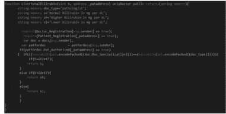

图 5.1  
带有 LiverTotalBilirubinfunction() 的医疗智能合约。

### 5.5.3 安全性

存储在区块链上的交易是加密的且难以被攻击。由于每条记录都与分类账上的后续和前一条记录紧密相连，这使得黑客很难篡改单条记录。

### 5.5.4 节省成本

智能合约不涉及任何中介，并有助于在没有时间延迟和费用的情况下处理交易。

图 5.1 展示了一个带有 LiverTotalBilirubinfunction() 的医疗智能合约在 Remix IDE [97] 中的工作原理。该函数有助于轻松分析患者肝脏中的总胆红素量。当医生检查他的患者时，他会以以太币的形式输入胆红素的数量以及患者的地址。然后该函数检查各种参数。例如：

1. 如果医生已经在医院注册。
2. 如果患者已经在医院注册。
3. 特定患者是否已获得该特定医生的授权。
4. 医生的专业（例如“病理学家”）是否与患者想要咨询的医生相同。
5. 满足所有这些条件后，该函数检查胆红素的数量。如果数量等于每分升 12 毫克，则患者具有“正常胆红素（每分升毫克）”。如果数量大于每分升 12 毫克，则患者具有“较高胆红素（每分升毫克）”。否则，如果两个条件都为假，则患者具有“较低胆红素（每分升毫克）”。

## 5.6 Solidity 静态分析

在 Remix IDE 中编写智能合约后，通常会产生漏洞。因此，减少这些漏洞并调试代码变得很重要。为此，提供了各种工具，其中一种工具就是 Solidity 静态分析 [98]。


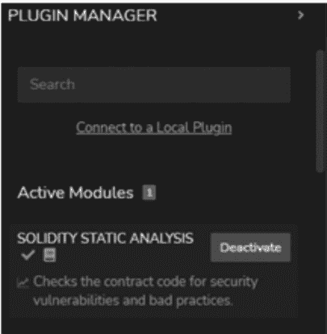

### 图 5.2
Remix IDE 中已激活的 Solidity 静态分析插件。

Solidity 静态分析是一个插件，有助于在编译后对智能合约进行静态分析。它通常通过 Remix 插件管理器激活。

图 5.2 显示了 Remix IDE Solidity 环境中已激活的 Solidity 静态分析插件，该插件有助于检查代码中的所有不良实践和安全漏洞。该插件为我们提供了不同的模块来帮助调试代码。这些模块包括安全、gas 和经济、ERC 以及杂项。需要为分析选择/取消选择这些模块。

图 5.3 显示了 Solidity 静态分析的所有四个模块，并显示了安全模块的详细子模块。默认情况下，智能合约分析期间会选择所有模块。

在部署带有 LiverTotalBilirubin 函数的智能合约后，产生了检查漏洞的需求。因此，为了减少产生的 gas 费用，有必要检查漏洞。

图 5.4 显示了 LiverTotalBilirubin() 函数中的某些更改，以减少 gas 费用和漏洞。这些更改如下：

- 1. 变量名称相似。
- 2. 这包括“变量名称非常相似”、“patfordoc”和“patfordocs。”因此，“patfordoc”被替换为“pfordoc。”此外，“doc”和“docs”显示相似错误。因此，“doc”被替换为变量“d。”
- 3. 此外，用于显示返回语句的局部变量已被删除，并使用简单的单返回字符串类型变量来返回语句。
- 4. “var” 关键字的使用已弃用。相反，对于存储请使用 storage 关键字。
- 5. 将函数设置为“external”以减少 gas 费用。
- 6. 由于 bytes 消耗的 gas 比 string 少，请在代码中尽可能使用 bytes 关键字和变量。

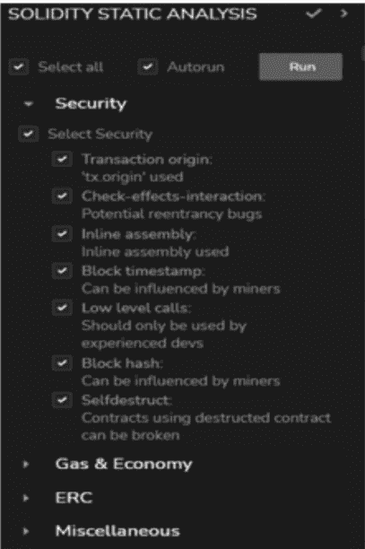

### 图 5.3
Solidity 静态分析的所有四个模块。

```solidity
function LiverTotalBilirubin(uint256 b, address _pataddress)
    external
    onlyDoctor_C(_pataddress)
    returns (string memory result)
{
    string memory doc_type = "pathologist";
    Doctor storage d = docs[msg.sender];
    ListPatientForDoctor storage pfordoc = patfordocs[msg.sender];
    if (pfordoc.Pat_authorized[_pataddress] == true) {
        if (
            (keccak256(abi.encodePacked((d.Doc_Specialization)))) ==
            (keccak256(abi.encodePacked((bytes(doc_type)))))
        ) {
            if (b == 12617) {
                result = "Normal Billirubin in mg per dl.";
            } else if (b > 12617) {
                result = "Higher Billirubin in mg per dl.";
            } else {
                result = "Lower Billirubin in mg per dl.";
            }
        }
    }
}
```

### 图 5.4
最终具有减少漏洞的医疗保健智能合约。

## 5.7 医疗保健领域的研究挑战

传统医疗保健部门面临着各种挑战 [99]。然而，随着区块链技术的发展，这些限制得到了解决，并利用区块链提出了可能的解决方案。接下来将讨论医疗保健领域的一些研究挑战及其可能的解决方案。

### 5.7.1 患者数据管理

在医疗保健领域，随着医院新患者和医生的注册，数据库正在维护以安全存储数据。患者由医生检查，并提供处方。因此，为了获得正确的未来处方，必须将患者的先前数据提供给授权医生。这刺激了将患者医疗信息转移给医生或药剂师的需求。这增加了对医疗数据泄露的不安全感。为了解决这个问题，区块链技术有助于为每个患者的私人信息生成哈希值。区块链 API 用于评估受影响患者的医疗数据，而无需透露其身份。此外，患者获得了决定数据可访问性的权力 [100]。因此，这有助于在医院医疗保健系统中妥善管理患者数据。

### 5.7.2 临床试验

患者始终渴望安全存储其个人和机密信息。没有人希望自己的数据被暴露并提供给未经授权的各方。因此，使用哈希算法和区块链后，几乎不可能修改患者的存储和私人数据。医疗保健行业一直需要一种安全可靠的数据共享方法，以便与授权各方安全共享数据。使用区块链，可以轻松地在多个站点、系统和协议中管理数据。此外，在获得特定权限后，患者可以访问其健康信息 [101]。

### 5.7.3 药物可追溯性

当今，药理学领域的主要问题是药品假冒。最近对药品的调查显示，约有 10% 至 30% 的药品是假冒伪劣产品。这导致患者健康受到严重损害，不同利益相关者对药品使用不当。因此，利用区块链技术解决了所有这些问题，该技术有助于存储药品运作的整个路线，并检测从制造商到供应链中发生的欺诈行为。

### 5.7.4 延迟

在验证过程中，许多传统系统允许所有参与者参与，因此患者的实时数据变得不可预测且不可靠。这也使得过程非常耗时且有点繁琐。因此，为了解决这个问题，区块链在验证过程中遵循适当的共识机制，使医疗保健系统能够轻松运行，从而提高整个系统的处理速度和性能 [102]。

### 5.7.5 可扩展性

传统系统中关于可扩展性的主要关切之一包括区块大小有限及其频率。但是，借助区块链，它有助于提供每秒执行数百万笔交易的设施。区块链还提供了各种其他解决方案，例如软分叉（SegWit）、闪电网络、硬分叉（比特币现金）和 Plasma Cash，以消除可扩展性问题。

### 5.7.6 互操作性

早期的医疗保健系统面临与患者信息安全访问和共享相关的问题。隐私和安全是医疗保健管理领域需要考虑的最重要元素。因此，为了纠正这个问题，开发人员测试了不同区块链原型的功能。这导致区块链在运行中的医疗保健系统中部署和采用。区块链为医疗保健中的互操作性提供了开放标准，并能够使用 API 在各种产品之间实现数据访问 [102]。

### 5.7.7 安全与隐私

在网络中，黑客总是存在以攻击和窃取信息。为了解决这个问题并保护患者数据的隐私和安全，实施了私有链和联盟链等许可型区块链的使用。这项技术使用智能合约在区块中执行交易，不受任何第三方干预。这些交易通常具有不可逆性和可追溯性 [102,103]。

## 5.8 结论

本章对区块链在医疗保健领域的重要性进行了深入分析。本章讨论了区块链的基础知识、其特征、其架构、区块链中使用的共识机制，以及对区块链在不同医疗保健应用（如基因组学、电子健康记录、制药、生物医学和疾病预测）中的作用的文献综述。此外，它还详细介绍了有助于构建区块链系统的 15 个框架，例如 Ganache、Hyperledger Fabric、Truffle、Ethereum 等。还讨论了 18 种不同的工具，例如 Solidity 静态分析、Oyente、Securify、SmartCheck 等，这些工具有助于分析区块链系统的不同错误和漏洞。除此之外，还解释了使用 Solidity 在 Remix IDE 上构建智能合约以及使用 Solidity 静态分析插件检测漏洞的细节。因此，本章帮助读者轻松理解区块链的概念以及医疗保健 4.0 行业中智能合约的有效执行，同时深入了解不同的性能分析工具。


## 参考文献

- [1] Gambhire G, Gujar T, Pathak S. 制造业组织中工业4.0的商业潜力与影响. 在：第四届计算通信控制与自动化国际会议 (ICCUBEA). 卷 2018; 2018. 页 1–6. https://doi.org/10.1109/ICCUBEA.2018.8697552.

- [2] Fraga-Lamas P, Fernández-Caramés TM. 面向先进且具备网络弹性的汽车工业的区块链技术综述. IEEE Access. 2019;7:17578–98. https://doi.org/10.1109/ACCESS.2019.2895302.

- [3] Makhdoom I, Abolhasan M, Abbas H, Ni W. 物联网中区块链的采用：挑战与前进之道. J Netw Comput Appl. 2019;125:251–79. https://doi.org/10.1016/j.jnca.2018.10.019.

- [4] Nakamoto S. 比特币：一种点对点电子现金系统. 分散商业评论. 2008:21260.

- [5] Aste T, Tasca P, Di Matteo T. 区块链技术：对社会与工业的可预见影响. 计算机. 2017;50(9):18–28. https://doi.org/10.1109/MC.2017.3571064.

- [6] Salah K, Rehman MHU, Nizamuddin N, Al-Fuqaha A. 面向人工智能的区块链：综述与开放研究挑战. IEEE Access. 2019;7:10127–49. https://doi.org/10.1109/ACCESS.2018.2890507.

- [7] Litke A, Anagnostopoulos D, Varvarigou T. 供应链管理的区块链：面向全球部署的架构元素与挑战. 物流. 2019;3(1):5. https://doi.org/10.3390/logistics3010005.

- [8] Aloini D, Benevento E, Stefani A, Zerbino P. 通过区块链转变医疗健康生态系统：业务流程创新的机遇与能力. 技术创新. 2023;119:102557. https://doi.org/10.1016/j.technovation.2022.102557.

- [9] Hathaliya JJ, Tanwar S, Tyagi S, Kumar N. 医疗4.0中电子健康记录的安全保障：一种基于生物识别的方法. 计算机与电气工程. 2019;76:398–410. https://doi.org/10.1016/j.compeleceng.2019.04.017.

- [10] Coventry L, Branley D. 医疗保健领域的网络安全：趋势、威胁与前进方向的叙事性综述. Maturitas. 2018;113:48–52. https://doi.org/10.1016/j.maturitas.2018.04.008.

- [11] Al-rawashdeh M, Keikhosrokiani P, Belaton B, Alawida M, Zwiri A. 智慧医疗中的物联网采用与应用：系统综述. 传感器 (巴塞尔). 2022;22(14). https://doi.org/10.3390/s22145377.

- [12] Hamil H, Zidelmal Z, Azzaz MS, Sakhi S, Kaibou R, Djilali S, 等. 基于多生物信号诊断与分类的物联网应用安全远程医疗系统设计. 专家系统. 2022;39(4):e12765. https://doi.org/10.1111/exsy.12765.

- [13] Hathaliya JJ, Tanwar S. 医疗4.0中安全与隐私问题的详尽调查. 计算机通信. 2020;153:311–35. https://doi.org/10.1016/j.comcom.2020.02.018.

- [14] Gupta R, Kumari A, Tanwar S. 基于5G通信的安全无人机网络中区块链与人工智能的融合. 新兴电信技术事务. 2021;32(1):1–20. https://doi.org/10.1002/ett.4176.

- [15] Gupta R, Kumari A, Tanwar S. 区块链设想的边缘即连接自动驾驶汽车分类法. 新兴电信技术事务. 2021;32(6):1–24. https://doi.org/10.1002/ett.4009.

- [16] Dutta P, Choi TM, Somani S, Butala R. 供应链运营中的区块链技术：应用、挑战与研究机遇. 运输研究E：物流与运输评论. 2020;142:102067. https://doi.org/10.1016/j.tre.2020.102067.

- [17] Chen M, Malook T, Rehman AU, Muhammad Y, Alshehri MD, Akbar A, 等. 糖尿病检测的区块链赋能医疗保健系统. 信息安全应用杂志. 2021;58:1–12. https://doi.org/10.1016/j.jisa.2021.102771.

- [18] Dutta P, Choi TM, Somani S, Butala R. 供应链运营中的区块链技术：应用、挑战与研究机遇. 运输研究E：物流与运输评论. 2020;142:102067. https://doi.org/10.1016/j.tre.2020.102067.

- [19] Gupta S, Sadoghi M. 区块链事务处理. arXiv:2107.11592. 2018;5.

- [20] Bodkhe U, Bhattacharya P, Tanwar S, Tyagi S, Kumar N, Obaidat MS. Blohost：区块链赋能的智慧旅游与酒店管理. 在：计算机、信息与电信系统国际会议 (CITS). 卷 2019; 2019. 页 1–5. https://doi.org/10.1109/CITS.2019.8862001.

- [21] Hathaliya J, Sharma P, Tanwar S, Gupta R. 医疗4.0中基于区块链的远程患者监测. 在：第9届先进计算国际会议 (IACC). IEEE 出版社; 2019. 页 87–91. https://doi.org/10.1109/IACC48062.2019.8971593.

- [22] Ortiz-Lizcano MI, Arias-Antunez E, Hernandez Bravo A, Carinero MB, Rojo Guillen T, Nam Cha SH. 通过区块链技术提高生物库中生物样本的安全性与可追溯性. 计算机方法与生物医学程序. 2023;231:107379.

- [23] Akter S, Reza F, Ahmed M. 用于保护隐私的生物医学数据分类中区块链、K-medoids与同态加密的融合. 物联网与物理系统. 2022;2:99–110. https://doi.org/10.1016/j.iotcps.2022.05.006.

- [24] Soni M, Singh DK. 生物医学与医疗信息交换系统的基于区块链的安全性与隐私保护. 材料今日论文集. 2021. 可从以下获取：https://doi.org/10.1016/j.matpr.2021.02.094.

- [25] Amin MR, Zuhairi MF, Saadat MN. 透明数据处理：基于超级账本 Fabric 的生物医学工程供应链. 在：第15届无处不在信息管理与通信国际会议 (IMCOM). 卷 2021; 2021. 页 1–5. https://doi.org/10.1109/IMCOM51814.2021.9377418.

- [26] Haidar M, Kumar S. 基于Aadhaar和区块链的生物医学与医疗应用智慧医疗系统. 在：第5届信息系统与计算机网络国际会议 (ISCON). 卷 2021; 2021. 页 1–5. https://doi.org/10.1109/ISCON52037.2021.9702306.

- [27] Jeet R, Kang SS. E-生物医学：利用区块链技术监测人类医疗保健系统的积极前景. 世界工程杂志. 2022;19(1):13–20. https://doi.org/10.1108/WJE-10-2020-0475.

- [28] Noman AA, Rahaman M, Pranto TH, Rahman RM. 医疗协作的区块链：面向多类呼吸道疾病分类的联邦学习方法. 医疗健康分析. 2023;3:100135. https://doi.org/10.1016/j.health.2023.100135.

- [29] Sivaparthipan CB, Muthu BA, Fathima G, Kumar PM, Alazab M, Díaz VG. 借助ida-DNN分类器，利用区块链辅助识别Covid-19患者疾病. 无线个人通信. 2022;126(3):2597–620. https://doi.org/10.1007/s11277-022-09831-7.

- [30] Chen M, Malook T, Rehman AU, Muhammad Y, Alshehri MD, Akbar A, 等. 糖尿病检测的区块链赋能医疗保健系统. 信息安全应用杂志. 2021;58:102771. https://doi.org/10.1016/j.jisa.2021.102771.

- [31] Anand R, Fazlu Kareem S, Mohamed Arshad Mubeen RM, Ramesh S, Vignesh B. 基于区块链的机器学习心脏风险检测分析. 在：第6届信号处理、计算与控制国际会议 (ISPCC). 卷 2021; 2021. 页 685–9. https://doi.org/10.1109/ISPCC53510.2021.9609353.

- [32] Shynu PG, Menon VG, Kumar RL, Kadry S, Nam Y. 雾计算中糖尿病心脏病预测的基于区块链的安全医疗应用. IEEE Access. 2021;9:45706–20. https://doi.org/10.1109/ACCESS.2021.3065440.

- [33] Liu X, Zhou P, Qiu T, Wu DO. 移动边缘计算中局部差分隐私下的区块链赋能情境在线学习，用于冠心病诊断. IEEE 生物医学健康信息学期刊. 2020;8:2177–88. https://doi.org/10.1109/JBHI.2020.2999497.

- [34] Hajian A, Prybutok VR, Chang H-C. 电子健康记录中基于区块链的信息共享系统实证研究：一种中介视角. 计算机与人类行为. 2023;138:107471. https://doi.org/10.1016/j.chb.2022.107471.

- [35] Tanwar S, Parekh K, Evans R. 医疗4.0应用的基于区块链的电子医疗记录系统. 信息安全应用杂志. 2020;50:102407. https://doi.org/10.1016/j.jisa.2019.102407.

- [36] Mahajan HB, Rashid AS, Junnarkar AA, Uke N, Deshpande SD, Futane PR, 等. 医疗4.0与区块链融入安全基于云的电子健康记录系统. 应用纳米科学. 2022;1–14. https://doi.org/10.1007/s13204-021-02164-0.

- [37] Rai BK. Pcbehr：面向医疗4.0的患者控制区块链赋能电子健康记录. 卫生服务、结局与研究方法学. 2022;1–23. https://doi.org/10.1007/s10742-022-00279-7.

- [38] Pang Z, Yao Y, Li Q, Zhang X, Zhang J. 基于可检查状态PBFT共识算法的区块链电子健康记录共享模型. IEEE Access. 2022;10:87803–15. https://doi.org/10.1109/ACCESS.2022.3186682.


- [39] Mallikarjuna B, Kiranmayee D, Saritha V, Krishna PV. 基于物联网和区块链技术的高效电子健康记录开发。收录于：ICC—IEEE 国际通信会议。卷 2021；2021。第 1–7 页。https://doi.org/10.1109/ICC42927.2021.9500390.

- [40] Chelladurai MU, Pandian DS, Ramasamy DK. 面向电子健康系统的基于区块链的以患者为中心的电子健康记录存储与完整性管理。健康政策与技术。2021；10(4)：100513。https://doi.org/10.1016/j.hlpt.2021.100513.

- [41] Sonkamble RG, Phalsalkar SP, Potdar VM, Bongale AM. 电子健康记录管理中互操作性调查及所提出的基于区块链框架：Mybloceehr。IEEE Access。2021；9：158367–401。https://doi.org/10.1109/ACCESS.2021.3129284.

- [42] Sharma Y, Balamurugan B. 使用区块链保护电子健康记录的隐私。计算机科学程序。国际智能可持续智能计算与应用会议（ICIETM2020）。2020；173：171–80。https://doi.org/10.1016/j.procs.2020.06.021.

- [43] Shamshad S, Minahil, Mahmood K, Kumari S, Chen C. 一种安全的基于区块链的电子健康记录存储与共享方案。信息安全应用杂志。2020；55：102590。https://doi.org/10.1016/j.jisa.2020.102590.

- [44] Kuo TT, Pham A. 基于智能合约的区块链层次化临床研究网络上基于 Quorum 的模型学习。国际医学信息学杂志。2023；169：104924。https://doi.org/10.1016/j.ijmedinf.2022.104924.

- [45] Mackey TK, Kuo TT, Gummadi B, Clauson KA, Church G, Grishin D 等。“适用性？”——未来医疗保健中区块链技术应用的挑战与机遇。BMC 医学。2019；17(1)：68。https://doi.org/10.1186/s12916-019-1296-7.

- [46] Gursoy G, Brannon CM, Ni E, Wagner S, Khanna A, Gerstein M. 在区块链上存储和分析基因组。基因组生物学。2022；23(1)：1。https://doi.org/10.1186/s13059-021-02568-9.

- [47] Albawaly F, McDermott JH, Newman WG, Brass A, Davies A. 一种支持药物基因组学数据共享的基于区块链的框架。药物基因组学杂志。2022；22(5–6)：264–75。https://doi.org/10.1038/s41397-022-00285-5.

- [48] Park Y-H, Kim Y, Shim J. 基于局部差分隐私的基因组数据管理基于区块链的隐私保护系统。电子。2021；10(23)。https://doi.org/10.3390/electronics10233019.

- [49] Albawaly F, Brass A, Davies A. 一种支持临床基因组数据共享的基于区块链的动态同意架构（ConsentChain）：概念验证研究。JMIR 医学信息学。2021；9(1)：e27816。https://doi.org/10.2196/27816，PMID 34730538.

- [50] Kuo TT, Bath T, Ma S, Pattengale N, Yang M, Cao Y 等. 基于区块链的基因-药物交互数据共享方法的基准测试：来自 iDASH 2019 安全基因组分析竞赛区块链轨道的病例研究。国际医学信息学杂志。2021；154：104559。https://doi.org/10.1016/j.ijmedinf.2021.104559.

- [51] Glicksberg BS, Burns S, Currie R, Griffin A, Wang ZJ, Haussler D 等. 基于区块链认证的癌症患者基因组与临床结局数据共享：一项前瞻性队列研究。医学互联网研究杂志。2020；22(3)：e16810。https://doi.org/10.2196/16810.

- [52] Shuaib K, Saleohi H, Zaki N, Dankar F. 面向医疗保健和基因组学的分层区块链框架。收录于：IEEE 智能计算国际会议 (SMARTCOMP)。卷 2020；2020。第 156–63 页。https://doi.org/10.1109/SMARTCOMP50058.2020.00040.

- [53] Kordestani A, Oghazi P, Mostaghel R. 制药区块链中的智能合约扩散：抗击假药之战。商业研究杂志。2023；158：113646。https://doi.org/10.1016/j.jbusres.2023.113646.

- [54] Siyal AA, Junejo AZ, Zawish M, Ahmed K, Khalil A, Soursou G. 区块链技术在医学与医疗保健中的应用：挑战与未来展望。密码学。2019；3(1)。https://doi.org/10.3390/cryptography3010003.

- [55] Kavasis I, Lallas E, Gerogiannis VC, Karageorgos A. 制药行业中面向数据完整性的分析与区块链。收录于：第 4 届计算机技术、信息科学与通信国际会议 (CTISC)。卷 2022；2022。第 1–5 页。https://doi.org/10.1109/CTISC54888.2022.9849776.

- [56] Sahana, Thejashwini, Kamath V, Lahari Y, Mohanchandra K. 医疗保健系统中医药供应链安全数据共享的基于区块链的框架。人工智能国际杂志。2022；9(1)：32–28。https://doi.org/10.30679/lamintang.jiai-0901-358.

- [57] Alshahrani W, Alshahrani R. 区块链技术在制药行业改进中的应用评估。收录于：太伊夫大学女性数据科学国际会议 (WiDSTaif)。卷 2021；2021。第 1–5 页。https://doi.org/10.1109/WiDSTaif.52235.2021.9430210.

- [58] Badhotika GK, Sharma VP, Prakash S, Kalluri V, Singh R. 制药供应链中区块链技术采用的调查与评估。材料今日：会议录。技术材料科学与制造国际会议。2021；46：10776–80。https://doi.org/10.1016/j.matpr.2021.01.673.

- [59] Niu B, Dong J, Liu Y. 医药供应链中区块链采用的激励协调。运输研究 E 部分。2021；152：102276。https://doi.org/10.1016/j.tre.2021.102276.

- [60] Reda M, Kanga DB, Fatima T, Azouazi M. 医疗保健供应链管理中的区块链：最新挑战与机遇。计算机科学程序。第 17 届移动系统和普适计算国际会议 (MobiSPC)，第 15 届未来网络和通信国际会议 (FNC)，第 10 届可持续能源信息技术国际会议。2020；175：706–9。https://doi.org/10.1016/j.procs.2020.07.104.

- [61] Tanwar S, Parekh K, Evans R. 面向医疗保健 4.0 应用的基于区块链的电子医疗记录系统。信息安全应用杂志。2020；50：102407。https://doi.org/10.1016/j.jisa.2019.102407.

- [62] Cachin C. Hyperledger 区块链 Fabric 的架构；2016 年。可从以下网址获取：https://www.zurich.ibm.com/dccl/papers/cachin_dccl.pdf.

- [63] IBM. 什么是 Hyperledger Fabric？；2023 年。可从以下网址获取：www.ibm.com/topics/hyperledger.

- [64] T.L.F. Projects. Hyperledger Sawtooth - Hyperledger 基金会；2023 年。可从以下网址获取：www.hyperledger.org/use/sawtooth.

- [65] Buterin V 等. 以太坊白皮书。GitHub 仓库。2013；1：22–3.

- [66] Patel MM, Tanwar S, Gupta R, Kumar N. 面向金融机构的基于深度学习的加密货币价格预测方案。信息安全应用杂志。2020；55：1–12。https://doi.org/10.1016/j.jisa.2020.102583.

- [67] Benet J. IPFS - 寻址、版本化、P2P 文件系统。arXiv 预印本 arXiv:1407.3561；2014 年.

- [68] Blockchain. 区块链。Postman API 网络；2023 年。可从以下网址获取：www.postman.com/api-evangelist/workspace/blockchain/request/35240-cca6f24a-3855-49ef-8f39-89dc95ab8e59.

- [69] Suite. T. Ganache 概述。可从以下网址获取：https://trufflesuite.com/docs/ganache/february2023.

- [70] H. Foundation. Hyperledger Iroha；2023 年。可从以下网址获取：www.hyperledger.org/use/iroha.

- [71] Ethereum G. Geth 文档。可从以下网址获取：https://geth.ethereum.org/docs/february2023.

- [72] H. Composer. Hyperledger Composer；2023 年。可从以下网址获取：https://hyperledger.github.io/composer/v0.19/introduction/introduction.html.

- [73] MathWorks. MATLAB 和 Simulink；2023 年。可从以下网址获取：https://in.mathworks.com/products/matlab.html.

- [74] Suite T. Truffle：让智能合约更甜美；2023 年。可从以下网址获取：https://trufflesuite.com/truffle/.

- [75] WIRESHARK. 关于 Wireshark；2023 年。可从以下网址获取：www.wireshark.org/about.html.

- [76] Spyder. Spyder IDE；2023 年。可从以下网址获取：www.spyder-ide.org/.

- [77] IS. Statistics. SPSS 统计；2023 年。可从以下网址获取：www.ibm.com/in-en/products/spss-statistics.

- [78] Griego G, Song W, Cygan A, Feist J, Groce A. Echidna：面向智能合约的高效、易用且快速的模糊测试。收录于：第 29 届 ACM SIGSOFT 软件测试国际研讨会 (ISSTA) 论文集；2020 年。第 557–60 页。https://doi.org/10.1145/3395363.3404366.

- [79] Ashizawa N, Yanai N, Cruz JP, Okamura S. Eth2Vec：用于以太坊智能合约漏洞检测的全合约代码表示学习。收录于：第 3 届 ACM 区块链与安全关键基础设施国际研讨会论文集；2021 年。第 47–59 页。https://doi.org/10.1145/3457337.3457841.


- [80] Albert E, Gordillo P, Rubio A, Sergey I. 举步维艰：利用静态资源分析防止以太坊智能合约燃料耗尽漏洞。载于：计算机与通信系统验证与评估国际会议论文集。第 11847 卷；2019。第 63–78 页。https://doi.org/10.1007/978-3-030-35092-5_5.
- [81] Remix-IDE [在线]；2023。可从：https://github.com/ethereum/remix-ide 获取。
- [82] Feist J, Grieco G, Groce A. Slither：智能合约静态分析框架。载于：IEEE/ACM 第 2 届区块链软件工程新兴趋势国际研讨会（WETSEB）论文集。第 2019 卷；2019。第 8–15 页。https://doi.org/10.1109/WETSEB.2019.00008.
- [83] Denker M. 区块链与 Web 3.0。伊万斯顿，伊利诺伊州：Routledge；2019。https://doi.org/10.4324/9780429029530.
- [84] Ferreira JF, Cruz P, Durieux T, Abreu R. SmartBugs：分析 Solidity 智能合约的框架。载于：第 35 届 IEEE/ACM 自动化软件工程国际会议论文集。2020。第 1349–52 页。https://doi.org/10.1145/3324884.3415298.
- [85] Tikhomirov S, Voskresenskaya E, Ivanitskiy I, Takhaviev R, Marchenko E, Alexandrov Y. SmartCheck：以太坊智能合约静态分析。载于：第 1 届区块链软件工程新兴趋势国际研讨会论文集；2018。第 9–16 页。https://doi.org/10.1145/3194113.3194115.
- [86] Chen J, Xia X, Lo D, Grundy J, Luo X, Chen T. Defectchecker：通过分析 EVM 字节码自动检测智能合约缺陷。IEEE 软件工程交易。2021;48(7):2189–207。https://doi.org/10.1109/TSE.2021.3054928.
- [87] Chen T, Feng Y, Li Z, Zhou H, Luo X, Li X, 等. GasChecker：可扩展的低效智能合约发现分析。IEEE 新兴计算主题汇刊。2021;9(3):1433–48。https://doi.org/10.1109/TETC.2020.2979019.
- [88] Chen T, Li X, Luo X, Zhang X. 欠优化的智能合约会吞噬你的资金。载于：第 24 届 IEEE 软件分析国际会议论文集；2017。第 442–6 页。https://doi.org/10.1109/SANER.2017.7884650.
- [89] Torres CF, Steichen M. 骗局的艺术：揭秘以太坊智能合约中的蜜罐。载于：第 28 届 USENIX 安全研讨会论文集。USENIX 安全研讨会；2019。第 1591–607 页。可从：https://dl.acm.org/doi/10.5555/3361338.3361449 获取。
- [90] Grech N, Kong M, Jurisevic A, Brent L, Scholz B, Smaragdakis Y. MadMax：在以太坊智能合约中幸存于燃料耗尽状况。ACM 程序设计语言汇刊。2018;2(OOPSLA):1–27。https://doi.org/10.1145/3276486.
- [91] Mythril [在线]；2023。可从：https://github.com/ConsenSys/mythril 获取。
- [92] Luu L, Chu D-H, Olickel H, Saxena P, Hobor A. 让智能合约更智能。载于：ACM 计算机与通信安全会议论文集。第 24–28 卷；2016。第 254–69 页。https://doi.org/10.1145/2976749.2978309.
- [93] Tsankov P, Dan A, Drachsler-Cohen D, Gervais A, Buenzli F, Vechev M. Securify：智能合约实用安全分析。载于：ACM 计算机与通信安全会议论文集；2018。第 67–82 页。https://doi.org/10.1145/3243734.3243780.
- [94] Brent L, Jurisevic A, Kong M, Liu E, Gauthier F, Gramoli V, 等. Vandal：可扩展的智能合约安全分析框架。arXiv:1809.03981；2018。
- [95] Mossberg M, Manzano F, Hennenfent E, Groce A, Grieco G, Feist J, 等. Manticore：面向二进制文件和智能合约的用户友好型符号执行框架。载于：第 34 届 IEEE/ACM 自动化软件工程国际会议（ASE）论文集；2019。第 1186–9 页。https://doi.org/10.1109/ASE.2019.00133.
- [96] IBM. 区块链上的智能合约是什么？；2023。可从：www.ibm.com/in-en/topics/smart-contracts/ 获取。
- [97] Remix 以太坊 IDE. Remix IDE；2023。可从：https://remix.ethereum.org/ 获取。
- [98] SS. 分析。Solidity 静态分析 Remix 以太坊 IDE 文档；2023。可从：https://remix-ide.readthedocs.io/en/latest/static_analysis.html 获取。
- [99] Hathaliya J, Sharma P, Tanwar S, Gupta R. 医疗保健 4.0 中基于区块链的远程患者监测。载于：第 9 届高级计算国际会议（IACC）。IEEE 出版物；2019。第 87–91 页。https://doi.org/10.1109/IACC48062.2019.8971593.
- [100] Iqbal N, Jamil F, Ahmad S, Kim D. 一种利用预测分析为提供优质医疗服务的新型基于区块链的完整性和可靠兽医诊所信息管理系统。IEEE Access。2021;9:8069–98。https://doi.org/10.1109/ACCESS.2021.3049325.
- [101] Omar I, Jayaraman R, Salah K, Yaqoob I, Ellahham S. 区块链技术在临床试验中的应用：综述与未解挑战。阿拉伯科学与工程杂志。2020;46(7).
- [102] Agbo CC, Mahmoud QH, Eklund JM. 医疗保健中的区块链技术：系统综述。医疗保健（巴塞尔）。2019;7(2)。https://doi.org/10.3390/healthcare7020056.
- [103] Agrawal K, Aggarwal M, Tanwar S, Sharma G, Bokoro PN, Sharma R. 基于区块链的应用广泛调查：工具、框架、机遇、挑战与解决方案。IEEE Access。2022;10:116858–906。https://doi.org/10.1109/ACCESS.2022.3219160.

## 区块链技术：重塑信息基础设施的管理

Shashimala Tiwari

### 6.1 引言

社会福祉和个人愉悦取决于更好的健康。这对国家经济发展至关重要。每天都会发生与健康不佳相关的事故和危机，疾病预计会被识别和管理 [1]。

健康记录是从各种来源收集的关于患者身心健康的医疗信息汇编。患者健康记录的内容包括其病史、检查结果、诊断和治疗，以及可能存在的任何警报，如过敏。这些医疗记录既可以手动监督，也可以电子监督 [1]。

手动方法使用纸张和书籍，是主流医院用于保存记录的长期流程。这种方法有显著缺点，包括需要巨大的存储空间以及记录检索的挑战。临床记录正日益计算机化 [2]，因为存储和检索它们很方便。

然而，未被发现的篡改可能性已成为主要担忧。保密患者记录是另一个关键问题，因为如果医生和医院侵犯医疗记录隐私，患者可能会指责他们疏忽 [3]。图 6.1 展示了现有的医疗保健模型。

此外，纸质数据不足可能导致不必要的重复检查和用药。由于这种方法需要额外的人工通过邮件或传真转移记录，而这些记录分散在各处且未集中，因此浪费了时间 [4]。即使是医生对患者记录的访问也受到限制。

通过将数字技术融入医疗保健系统，医疗机构可以快速轻松地共享患者记录 [5]。关于患者数据加载、访问批准授予、安全性和数据不可篡改性，存在众多担忧 [6]。去中心化数字健康基础设施的发展，或将区块链技术融入医疗保健系统，可以解决这些问题 [7]。通过维护和更新记录，区块链技术有潜力重塑新的经济 [8]。

图 6.1 现有集中式医疗保健模型。

图表准备和日程安排
现金/支票付款
询问、提醒和预约
接待员
索赔
诊断文档、归档更新
订单：转诊、处方/治疗、实验室传真

### 6.2 背景

### 6.2.1 区块链技术

区块链是一个不断扩展的交易列表，具有去中心化、分布式、不可篡改、可共享和防篡改的特性 [9]。可以将区块链视为一个账本，其中交易数据被组织为带时间戳的区块。使用加密哈希来唯一标识每个区块 [10]。为每个区块计算哈希值。因此，在区块之间建立链接，从而形成一系列区块。只有当我们研究区块链网络的运作方式时，才能清楚了解其运行机制。对等网络中的每个节点都会保存网络上发生过的每笔交易的记录。

每个节点都有自己的钱包，用于进行交易。通过使用一组私钥和公钥（也称为加密密钥），用户与网络进行通信 [11]。虽然公钥对网络中的每个节点都可用，但私钥仅用于签署特定的交易 [12]。要完成一笔交易，发送方必须使用其私钥对消息进行签名，当与其公钥配对时，这会生成数字签名 [13]。


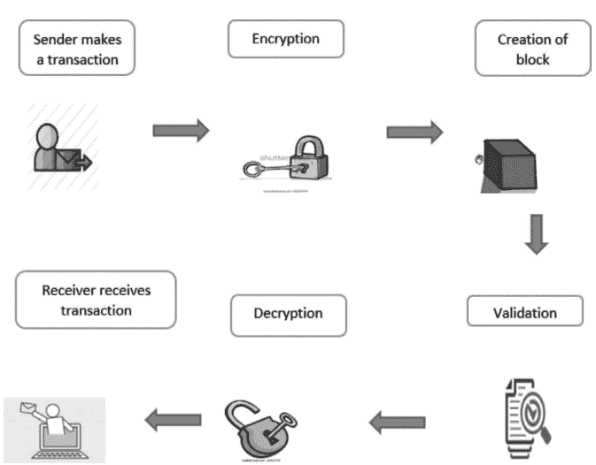

**图 6.2** 区块链技术的工作原理。

此交易在区块链网络上发布，矿工对其进行确认。区块链的高性能节点被称为矿工 [14]。使用一种也称为工作量证明的共识机制，矿工使交易不可更改且不可撤销。合法区块的生成是矿工之间的竞争，获胜者将获得报酬 [15]。图 6.2 描述了区块链技术的工作原理。只有当网络上每个矿工都验证了一笔交易时，包含该交易的区块才被视为真实并添加到最长的区块链中，前提是超过 50% 的矿工确认了该交易 [16]。

## 6.2.2 文献综述

本节描述了几项旨在保护健康记录的举措，以及相关的困难和潜在解释。

*面向使用区块链技术进行电子健康数据访问管理。* 作者强调了区块链的优势以及与之相关的特定问题，以实现健康记录的受保护部署。它提供了一种可扩展的解释，以实现最佳表现。他们还提出了一种设计来解决健康应用程序的问题，其中医院和医生被视为通过智能合约与电子健康区块链关联的节点，并且单独的数据库也保存在链外 [17]。

通过数据网关，患者可以与区块链和医疗传感器进行通信。该研究还展示了如何开发功能完善的系统，利用适当的工具、原型、协议和区块链技术来彻底改变未来的应用。

*用于增强医疗分析的去中心化电子健康架构。* 在标题为“用于增强医疗分析的去中心化电子健康架构”的章节中，作者讨论了与医疗数据分析和安全相关的难题。此外，他们还尝试提出一种提升医疗水平的解释。基于 Exonum 框架（该框架由通过点对点连接关联的节点组成，所有节点均通过使用公钥进行验证），他们构建了一个适用于国家级医疗的区块链解决方案 [18]。他们还建议，区块链可用于管理海量医疗数据并维护患者隐私。

区块链技术是否是解决发展中国家电子病历（EMR）安全性和互操作性问题的潜在方案？根据章节“这是解决发展中国家电子病历互操作性和安全性挑战的方案吗？”，在电子病历中实施区块链可确保不间断的就绪性和实时数据访问。区块链使患者能够完全访问其数据并控制数据如何被整合。此外，区块链依赖加密方法在无需预先相互信任的网络中进行通信。当患者信息在利益相关方之间共享时，由于信息加密，患者隐私得到保护 [18]。

医疗领域的区块链简介。本章作者关注各种区块链拓扑，介绍了区块链问题，并提供了区块链的前景结果。尽管区块链用于在医疗服务提供者之间生成智能合约 [19] 并授予对特定数据或患者记录的访问权限，但无法确定是谁在访问信息以及该人是否获得授权。女巫攻击是另一种安全漏洞，可以通过要求每个矿工节点在攻击者向区块链添加新区块之前参与解决数学难题来修复 [19]。由于这些问题，作者建议研究人员构建一种不依赖现有加密方法的新区块链架构。

## 6.3 区块链上的医疗数据监督

当前的医疗结构以数字化方式跟踪患者健康信息。目前，医疗机构以集中方式保存患者数据、诊断结果和医生处方。患者无法控制自己的数据，更新文档化数据是一个耗时且困难的过程；因此，由于它是一个集中式系统，数据可能会泄露或被用于其他目的。我们提出了将集中式系统转变为使用区块链技术的分布式系统的概念，以解决这些问题。为了在医疗领域集成区块链，首先有必要了解数据的范围以及数据在哪里、如何生成 [20]。

在医疗治疗的每个阶段，例如讨论、诊断和手术，医疗机构都会产生敏感且重要的医疗数据。医疗信息包括医生开具的处方、MRI 扫描、X 射线、血管造影、超声报告、内窥镜检查、放射摄影，以及包括癌症、艾滋病或心理问题在内的少数其他类型的敏感健康信息。图 6.3 显示了区块链上的医疗数据监督 [20]。

- 医院使用区块链维护患者记录
- 每个患者的记录使用其公钥存储在区块中
- 医疗机构通过 API 提交查询以访问患者
- 患者通过共享其唯一 ID 允许医疗机构访问其医疗数据

**图 6.3** 区块链上的医疗数据监督。

在将数据放置在区块链之前以提高数据质量，必须增加一些价值。患者的医疗记录应当精确、清晰且有组织，因为非结构化数据会导致医疗交付中的错误和延迟。数字健康记录可以存储在区块链网络中的众多节点上，消除了与数据中心化相关的担忧 [20]。

患者的医疗记录可以使用其公钥保存在区块链网络上，包含患者医疗记录的交易可以使用患者的个体 ID 和公钥共同保存。只有当唯一 ID 匹配时，医疗机构才能使用智能合约访问患者的非标识数据。如果需要，患者可以向医疗机构共享其公钥，但如果没有其私钥，数据永远无法被标识。

需要智能合约来确保用户共享或恢复数据。智能合约是双方之间的自动执行合同，条款直接写在代码中，无需第三方协助。它是一种支持、维护和数字化验证合同谈判和执行的程序 [20]。

所提出的概念构建为一个名为 healthcare 的合同，该合同有两个节点，每个节点可以被认为代表医院管理员或实验室管理员。形成一个包含患者地址、测试名称、医院名称、唯一 ID、日期、价格和签名计数的结构，并将其命名为“record”。

### 6.3.1 调用交易

我们使用了一个名为 Object() 的函数，它在 DApp 部署时自动运行且具有公共性质。只有医院管理员应该在区块链网络上启动交易，因为只有他才能选择实验室管理员并为他提供特定地址 [20]。

### 6.3.2 创建新记录

要向现有记录添加新数据，我们构建了一个名为“new record”的函数，它通过向相应参数赋值来工作。Records 是一个存储当前患者记录的数组。

### 6.3.3 记录验证

为了用于记录验证，创建了一个名为“sign record”的函数。如果新记录存在于已有记录数组中，医院管理员将签署交易；否则，如果记录已存在，签名计数值将为 1。在此函数中，使用签名计数来确定新记录是否存在于现有记录数组中。交易不会被签署。当签名计数等于 2 时，将发布已签署的记录 [20]。

## 6.4 为什么医疗行业需要区块链技术？

根据 CNBC，人为错误是美国第三大死亡原因。

- 患者健康记录的安全性。
- 药品供应链缺乏透明度。
- 医疗相关数据的分散，例如患者病史或医务人员的资格。

根据 2020 年违规晴雨表研究，近 4100 万条患者记录泄露。世界卫生组织估计，在发展中国家销售的十件医疗设备中有一件有缺陷 [20]。

这些是典型的几个困难。当前状况使得无法及时共享和获取健康数据。

区块链技术解决这些医疗挑战的潜力巨大。患者和专业人员处理和使用健康数据的方式将得到显著改善和转变。每家医疗公司都在尝试集成能够简化其流程的技术，以应对医疗领域的数字革命。

但是，由于该行业处理敏感医疗信息，专业人员必须确保其采用的任何技术都不会危及患者数据的安全性。在这种情况下，区块链技术很有用。区块链技术可以帮助医疗领域的几种方式 [20]。

## 6.5 医疗领域区块链十大用例

区块链技术有巨大的潜力帮助弥补当前医疗领域的差距。接下来列出了医疗保健中十个常用的区块链应用。


### 6.5.1 增加医疗记录的访问权限

患者记录管理是医疗保健领域最流行的区块链应用之一。在不查看患者以前的医疗服务提供者的情况下，不可能确定患者的病历，因为卫生当局经常隔离医疗数据。这一过程可能需要一段时间，并且经常导致由人为误算引起的错误。

区块链目录概念有望在区块链发展过程中显著扩展和改变。其方法对于监控医疗记录的持续增长非常有帮助。通过维护不断扩展的医疗记录链表，区块链链式排列中的每个区块都有助于支持日益增加的医疗信息量。每个区块还包含时间戳和指向前一个区块的链接 [21]。

### 6.5.2 防止假药

药物造假是医疗保健行业的一个严重问题。药品供应链缺乏透明度会导致严重的篡改和造假。

区块链技术是防止药品欺诈的有用工具，因为它提供了系统透明性和不可更改性。它提供了完整的端到端供应链透明度 [21]。提供者可以通过在制药供应链中使用区块链获得以下好处：

- 控制库存
- 减少造假问题
- 降低被盗风险

它还可以帮助全球基金、美国国际开发署和红十字会等机构跟踪各国捐赠药品的分发，同时确保产品的来源、真实性和可靠性。

区块链技术不可更改和去中心化的特性使得可以从药品生产到患者使用的全过程进行追踪。这使得客户、医疗保健专业人员和企业能够确定药品的来源和原创性，从而避免生产假冒和欺诈产品。因此，与假药和药品相关的财务损失下降，同时也避免了使用假药可能产生的有害影响 [22]。

### 6.5.3 追踪医务人员资质

就像区块链技术有助于监控医疗产品的有效性一样，它也有助于追踪医疗专家的经验。通过为医疗保健企业和医疗机构记录员工的资质，可以简化雇佣流程。

将区块链纳入的主要好处如下：

- 1. 这为医疗保健组织、保险公司和医疗机构提供了利用其当前关于前任和现任员工资质信息获利的机会。
- 2. 通过合作伙伴的透明度和声明，患者了解医疗专业人员的经验 [21]。

### 6.5.4 以患者为中心的电子健康记录

数据碎片化是一个影响每个国家的问题，这意味着患者及其医疗保健提供者的病历都是不完整的。

基于区块链的医疗记录系统可以与现有的电子病历软件对接，并提供患者记录的单一完整视图，这是解决这一问题的一个潜在方案 [21]。

必须理解的是，患者数据不会存储在区块链上。任何添加到区块链的数据，包括处方、检测结果和医生笔记，都会被转换为特殊的哈希函数。每个哈希函数都是独特的，只有在数据所有者的许可下才能解码。在此场景下，对患者记录的所有修改和患者的同意都会被记录为区块链交易 [21]。

### 6.5.5 保险智能合约

智能合约可以通过去除支付流程中的中间人来节省成本。智能合约是存储在区块链上的计算机代码部分，在满足特定条件时会自动执行。智能合约无需第三方即可启动交易处理。通过消除所有不必要的中间人，智能合约可以显著改善当前的保险系统。患者可以使用智能合约在区块链上安全地获取医疗保险覆盖范围的详细信息。与存储在常规数据库中的数据相比，这些信息较不易受到黑客攻击 [21]。

此外，无需提交耗时的保险索赔。当患者接受受保手术时，智能合约会立即启动，资金将由付款人转至医院。

### 6.5.6 物联网安全远程监控

远程监控是数字健康领域的主要趋势之一，其中各种监测患者生命体征的传感器可以让医疗专业人员更好地了解患者的健康状况，并提供更主动、更具保护性的护理。然而，安全性是医疗物联网的一大担忧，既包括保护患者数据隐私和安全，也包括防止数据被操纵以提供虚假信息 [21]。

区块链技术提高了医疗数据存储的安全性，并降低了数据欺诈的可能性。得益于区块链技术、智能合约和独特交易的去中心化和不可更改特性，已开发出一种基于区块链的解决方案来存储不可更改、不可篡改且恶意黑客无法威胁删除的数据 [22]。

### 6.5.7 降低成本

根据一份BIS研究，到2025年，医疗保健区块链可以帮助该行业每年避免在IT、运营、支持服务、劳动力和健康数据泄露方面花费高达1000亿美元。该研究声称，使用区块链追踪药品可以帮助制药公司，并每年减少高达2000亿美元的假药损失。

通过降低与保险流程及健康保险欺诈相关的运营和IT成本，区块链将帮助健康保险组织 [21]。

通过医疗保健领域的健康数据交换，到2025年，区块链预计将拥有最大的市场份额，市值为18.9亿美元。区块链技术可用于解决医疗IT系统中最普遍的问题，包括互操作性和非标准化，这些问题在行业中造成了数据孤岛。根据Bisresearch的一项研究 [22]，区块链技术可以帮助降低医疗保健领域多个方面的成本，预计到2025年每年可节省高达1000亿美元。通过提高可访问性，区块链技术可以避免数据泄露，减少不必要药物的使用，并消除医疗错误。此外，区块链提供了更有效的医疗数据存储机会，自动化支付和交易，并可以降低因处方欺诈造成的损失 [22]。临床医生资质认证（通常需要一个月的流程）是区块链可能降低成本的一个更具体示例。通过在区块链上促进这一过程，临床医生资质认证可以变得更快、更有效，因为资质可以即时验证，而无需由多方确认。JP Morgan估计，区块链技术可以将与此过程相关的成本和时间降低80% [23]。

### 6.5.8 追踪临床试验

样品管理和追踪既困难又耗时。答案是技术变革管理与人力变革管理的强力融合。你不仅需要技术解释来连接所有部分，还需要来自持有竞争议程和业务利益的众多方的支持。技术必须致力于让生物分析实验室的实验室人员和站点研究员的工作更轻松，同时为赞助商提供实时数据 [21]。

虽然一些解决方案解决了技术部分，但人为因素在很大程度上被忽视了。理想情况下，赞助商应实时获得必要的样品级数据 [21]。数字化使临床试验和样品管理流程变得更加可靠、透明和有效。新技术通过其数字健康记录收集能力和改进的数据与分析洞察，加速了向数字化临床试验的转变 [21]。在未来几年中，临床试验的数字化将推动市场扩张，而区块链技术在医学领域的应用几乎是无限的。

区块链技术改善了医学研究人员之间的信息流动，并可以为政府和医疗保健提供者提供关于其选民健康状况的更精确信息 [23]。

### 6.5.9 增强数据安全性与管理

数据安全现在是全球患者的主要关切，因为数据缺口年复一年地增加。幸运的是，确保数据安全是现代区块链医疗应用的功能。该技术的高安全性功能使得几乎不可能黑客攻击或更改存储在区块链上的任何数据。由于其提供的开放性，对数据的任何修改都会立即显现，数据篡改无法掩盖 [21]。

因此，区块链技术使医生和患者能够快速、安全地传输关键医疗数据，同时保持机密性和透明度，这得益于加密和严苛的安全代码。

区块链技术对于高效、安全地处理患者数据非常有益，因为它还降低了与数据中心化相关的风险。大多数


患者数据现在集中存储，使其容易受到黑客攻击、盗窃和数据泄露。区块链技术是解决此问题的绝佳方案，因为它将数据分布在多个节点上 [21]。

通过在医疗保健提供者之间创建安全的数据共享方式，区块链技术可以提高医疗信息系统的可访问性和互操作性。所有必要的医疗保健从业者都可以访问安全存储在许可区块链上的患者记录 [22]。

## 6.5.10 提供供应链透明度

医疗物品真实性声明对于在医疗保健领域确立其有效性至关重要。通过使用基于区块链的系统，客户可以追踪产品，从而从制造设施到供应链的每一个环节都能获得完全的可见性和透明度。这对企业来说是一个严重问题，尤其是在欠发达国家，每年有数万人因使用假冒处方药而死亡 [21]。

供应链管理和透明度是区块链在金融市场之外最前沿的应用案例之一，这一点已由 IBM 和沃尔玛在供应链中保障食品安全方面的高调合作所证明。由于该技术和 ROI 已得到确立，我们认为这是区块链对医疗保健行业最重要的短期影响。

如前所述，患者在医疗数据区块链上将对自己的数据拥有完全控制权。患者的记录可以由医疗保健专业人员更新和扩展，但患者控制谁可以访问他们的信息。个人掌控自己的健康数据将是一项重大而创新的举措，因为目前访问自己的数据极具挑战性 [23]。

## 6.6 区块链防止医疗错误

区块链技术可以通过让从业者通过医疗数据区块链轻松访问患者记录，帮助防止因信息缺失而引起的医疗错误。从业者在关键情况下可以立即访问所有个人身份信息、过敏史和先前治疗过的病情，这有助于他们制定最佳治疗方案 [22]。

## 6.7 区块链技术面临的挑战

可扩展性和存储容量。可扩展性和保密性是区块链上数据存储的两个基本问题。区块链上的数据不安全，因为它可以被链上所有人看到，这并不是去中心化平台所期望的。患者病史、X 光报告、MRI 结果、化验结果以及更多报告都将作为数据保存在区块链上，这将对区块链的存储能力产生重大影响 [24]。

## 表 6.1

区块链技术的优势与障碍

| 类别 | 项目 | 描述 |
|---|---|---|
| 优势 | 去中心化 | 保存在区块链上的信息分布在整个网络中。 |
| | 数据透明度 | 存储在区块链上的数据防篡改。 |
| | 安全性与隐私 | 区块链使用加密算法来保护其上存储的任何信息。 |
| 障碍 | 可扩展性、存储容量 | 在区块链上存储大量数据会导致存储和可扩展性问题。 |
| | 缺乏社会技能 | 由于区块链是一项不断发展的技术，且并非人人都理解，因此将之前使用的系统迁移到该技术上颇具挑战性。 |
| | 缺乏普遍定义的原则 | 区块链技术没有普遍适用的明确原则，这使得在特定领域强制实施变得困难。 |

缺乏社会技能。鲜有人能理解区块链技术的运作方式。这项技术仍在发展中，并且还处于早期阶段。此外，从可靠的 EHR 系统转换到区块链技术需要一些时间，因为医院和辅助医疗机构需要转换它们的所有系统 [24]。

由于该技术仍处于早期阶段且在不断变化，因此没有为其建立既定标准。因此，在医疗保健行业实施该技术需要额外的时间和精力。因为它需要经过国际组织认证的标准，这些组织会审查每项技术的标准化流程 [16]，因此可能存储在区块链上的数据大小、格式和类型将由这些全球标准决定。既定标准也将使适应这项技术更加简单，因为它们可以轻松在企业内部实施。表 6.1 描述了区块链技术的优势和障碍。

## 6.8 相关工作

中本聪的区块链技术 [25] 的根本目标是创造一种加密安全且适用于金融交易的去中心化货币。最终，区块链概念被应用到生活的许多其他领域；医疗保健行业是其中之一，并计划采用它。众多研究人员在这一领域进行了研究，其研究重点是探讨在医疗保健行业集成区块链技术这一想法的可行性。他们还描述了使用这项技术所带来的好处、风险、问题和困难。一些研究人员讨论了在更大规模上真正实施这一技术的困难。

### 6.8.1 理论/分析型基于区块链的研究

Gordon 和 Catalini [26] 的一项研究探讨了区块链技术如何惠及医疗保健行业。他们得出结论，医院、制药公司和其他相关方控制着医疗保健行业。他们将数据交换作为在医疗保健行业实施区块链的主要理由。该研究还建议了医疗保健行业必须改变的四种技术或要素，以便使用区块链技术。这些方法包括处理数字访问权限、数据可用性，以及更快地访问临床记录和患者身份等示例。此外，它还涵盖了链上和链下数据存储。该研究还涉及使用区块链技术的困难或障碍，例如临床记录繁多、患者参与度以及安全性和保密性问题 [26]。

为了探索区块链可扩展性问题的潜在解决方案，并寻找旨在解决该问题的项目，Eberhardt 等人 [27] 进行了一项研究。区块链被描述为建立在点对点网络之上的不同计算和经济原则的集合。这项调查的目的是找出哪些数据应该保存在链上，哪些可以保存在链下。该研究包含了五种链下数据存储模式的基本概念和实现架构。根据作者的说法，链上数据是指在其上进行交易并记录在区块链上的任何信息。然而，链下数据存储涉及将数据放置在任何其他存储介质上的其他位置，且不包含任何交易。

Vuiji 等人 [28] 提供了关于区块链技术、比特币和以太坊的概述。根据作者的说法，信息技术环境在不断演变，区块链技术对信息系统有利。他们将比特币描述为用于比特币交易的去中心化点对点网络。除了定义区块链挖矿概念外，他们还确立了工作量证明共识算法。作者强调，区块链可扩展性是一个严重问题，已经提出了包括 SegWit 和 Lightning、比特币现金（Bitcoin Cash）以及比特币黄金（Bitcoin Gold）在内的几种解决方案来解决这个问题 [28]。

Wang 等人 [29] 开展了关于智能合约及其在区块链技术中适用性的研究。研究首先介绍了智能合约、其运行系统以及与其相关的另一个重要概念。作者还讨论了如何将平行区块链这一独特概念应用于智能合约。他们强调，其应用的基础是用于在区块链上生成智能合约的编程语言代码所提供的去中心化特性。

作者在解释多个区块链层如何协同工作以维持系统功能之前，先概述了智能合约的基础知识。这些层包括数据层、激励共识层、网络层、合约层和应用层。该研究不仅描述了智能合约所使用的结构和架构，还提供了关于其应用和难题的信息。该研究还强调了一项关键的未来发展，即平行区块链，旨在构建能够优化两个不同但关键模块的区块链 [29]。

Kuo 等人 [30] 的一篇综述考察了生物医学和医疗保健行业中许多区块链应用。临床记录保存、去中心化、数据溯源、持续访问数据，以及最终，生物医学利益相关者能够安全访问信息，是作者在使用区块链服务于该行业时观察到的一些好处。保密性和恶意攻击的潜在风险（即 51% 攻击）被发现是区块链技术的局限性。由于它们用于存储私人医疗记录，作者将这些限制视为至关重要的


生物医药行业。作者提出的解决这些问题的方案包括将敏感医疗数据存储在链下、加密数据以保持保密性，以及使用 VPNs（虚拟私有网络）来防范恶意攻击 [30]。

## 6.8.2 原型/实现：基于区块链的研究

使用 Hadoop 数据库，Sahoo 和 Baruah [31] 提出了一个可扩展的区块链技术基础。他们建议利用基础 Hadoop 数据库提供的可扩展性，结合区块链技术提供的去中心化特性，以克服区块链的可扩展性挑战。为了提高区块链技术的可扩展性，他们采用了一种在 Hadoop 数据库上收集区块的方法。

本研究建议将 Hadoop 数据库系统与用于交易哈希的 SHA3-256 相结合，以解决区块链平台的可扩展性问题。该架构采用的编程语言是 Java。本研究有助于更容易理解如何将区块链与可扩展平台相结合 [31]。

张等人 [32] 提出了一种用于临床数据的可扩展区块链解决方案。本研究的主要目标是开发一个符合国家健康信息技术协调员办公室（ONC）制定指南的健康信息技术架构。本研究识别了该技术面临的主要问题，包括保密性问题、区块链安全性、与该平台上传输的海量数据集相关的可扩展性问题，以及最后，缺乏区块链上数据交换的全球可执行标准。本研究还展示了一个基于前述 ONC 要求构建的去中心化应用（DApp）。他们还讨论了如何恢复 FHIR 链以及他们吸取的经验教训 [32]。

金等人 [33] 提出了一种利用区块链技术共享数据的医疗问卷管理方法。作者认为，选择医疗问卷数据的存储位置和共享方式的目的是为了未来的临床和医学研究。作者为其建议的框架选择了区块链技术，因为他们强调，这将有助于建立分析系统、确定 EHR 系统中使用的术语，并解决与这些系统相关的安全挑战 [33]。

本研究的两个主要目的是创建、存储和分发使用问卷获取的数据。系统对所提交问卷的验证是另一个所提议的优势。添加到该系统中的问题将被评估以确保其格式正确，然后进行处理，以将个人记录与与问卷结果相关的特定数据分开。这样，将为即将开展的研究目标实现数据共享。作者讨论了第三方请求访问问卷数据的情况；在这种情况下，医生在允许第三方查看数据之前需要征得患者的许可 [33]。

## 6.9 系统实现

如前所述，该系统利用以太坊及其依赖项构建。为了深入了解系统的各种功能，本部分将详细介绍系统实现 [33]。

## 6.10 高级合约

智能合约是 DApp 的关键组成部分，因为它们被开发用于执行基本任务。列出的合约如下：

- 患者信息
- 角色

这些协议用于授予用户对 DApp 的访问权限，并对患者数据执行 CRUD 操作。所提供设计的功能是患者记录智能合约的唯一目标。它执行 CRUD 操作并创建角色以访问这些功能 [34]。

OpenZeppelin 智能合约库提供了一个名为“角色”的预定义智能合约。

这是前面描述的第二个合约。您可以利用该库中执行各种功能的智能合约来构建自己的智能合约。使用该库的动机在于其提供的优势，即经过测试并获得社区认可的代码。资产库（Asset library）是 OpenZeppelin 库的一个分支，其中包含了 Roles 智能合约。资产库提供多种用于指定访问规则的备选合约，但角色库提供详细的角色描述机制，这是选择该智能合约的主要原因 [34]。

以下是创建患者记录智能合约的算法。它概述了其中采取的所有操作以及围绕它们的诸多情况。此外，它还说明了角色如何保持最新状态，以允许访问特定功能。

## 6.11 算法 1 的约定场景

算法 1 描述了患者记录智能合约的操作。该算法执行的四项任务是查看、更新、添加和删除记录。系统管理员和另一位用户使用这些功能。管理员负责执行算法 1 的初始函数“定义角色”，该函数包含两个变量“新角色”和“新账户”。这两个变量将用于将“新角色”和“新账户”添加到“角色映射”列表中。随后，该列表将用于访问系统用户的角色。第二个函数“添加患者数据”由医生执行，当管理员在“定义角色”函数中分配此任务给他们时 [35]。

此外，该函数确认工作是在医生的认证公开地址上进行的，而不是由任何其他外部实体完成。为此，他们使用关键字 `msg.sender`，在以太坊的 Solidity 编程语言中，它用于指定用户地址。完成此有效性检查后，医生可以添加患者记录，并在完成后通过存储该记录来结束该过程 [35]。

第三个函数“查看患者数据”要求将患者 ID 作为参数提供。使用该 ID，系统将搜索患者的记录，然后将数据返回给最初请求它们的账户。作为该函数的一部分，还会验证患者和医生的分配角色。由于只有患者和医生才能访问记录，因此对患者保存记录的任何更改都使用第四个函数“更新患者记录”来完成 [35]。

为确保只有经过身份验证的用户才能使用此功能，验证程序会重复执行。算法 1 的最后一个操作是删除患者记录，顾名思义，它用于删除特定患者的记录。在验证医生是执行此操作的人后，该函数接受患者唯一 ID 作为输入并删除这些条目。得益于这种基于角色的访问控制，只有系统的经过身份验证的用户才能访问这些功能，从而防止未经授权的用户使用它们 [35]。

## 6.12 结论与未来工作

俗话说，健康就是财富，但在当今时代，我们也可以说财富包含健康记录。因此，保护我们的医疗记录比以往任何时候都更加重要。在全球范围内，患者驱动的互操作性——即患者同意按需访问其医疗记录——正在开始流行。这种范式认为，患者是其医疗记录的独有所有者，并决定是否以及与谁共享信息。与传统的数据管理方法不同，区块链通过去中心化整个机制，高效解决了从机构驱动向患者驱动模式转变所带来的问题。

IBM 商业价值研究所区块链部门对 200 名医疗健康高管进行了调查，其中 16% 准备使用商业区块链。如之前所述，区块链不仅有助于去中心化数据，还能提供实时数据访问、维护数据隐私、高效处理大量数据，并对数据进行身份验证和授权。

我们的策略还使用智能合约，这是一种在双方接受一套协议时自行运行的代码片段。在这里，患者和医院管理被视为两个不同的各方。智能合约可分三步执行：调用、创建记录和验证。

在此研究中，我们提出区块链技术作为有效维护医疗记录的潜在补救措施之一。健康记录管理只是区块链技术的一个应用；它还可用于银行、电子投票、交通、供应链管理等其他领域。进一步的研究可能有助于在所有行业采用区块链技术，使生活更加便利。

## 参考文献

- 1. Asaph Azaria, Ariel Ekblaw, Thiago Vieira, and Andrew Lippman, “Medrec：使用区块链进行医疗数据访问与权限管理。” 在 2016 年第 2 届开放与大数据国际会议 (OBD) 中，第 25–30 页。IEEE，2016 年。
- 2. P. Pramod, Pratyush Kumar Tripathy, Harshit Baipai, and Manjunath R. Kounte, “自然语言处理和深度学习在智能机器中的作用。” 在 IEEE 电气、通信、电子、仪器与计算国际会议 (ICECIC) 中，第 30–31 页。2019 年。


- 3. Gabriel Kamau、Caroline Boore、Elizaphan Maina 和 Stephen Njenga，“区块链技术：这是解决发展中国家 EMR 互操作性和安全性问题的方案吗？”载于 2018 IST-Africa 周会议 (IST-Africa)，第 1 页。IEEE，2018。
- 4. C. Y. Simha、V. M. Harshini、L. V. S. Raghuwamsi 和 M. R. Kounte，“物联网及其安全性问题的赋能技术。”载于 2018 第二届智能计算与控制系统国际会议 (ICICCS)，第 1849–1852 页。2018。
- 5. Alexander Kuzmin，“基于区块链的用于安全和运行 IoT 的结构。”载于《物联网商业模式、用户及网络》，第 1–7 页。IEEE，2017。
- 6. Shi, Shuyun 等，“电子健康记录系统中区块链应用以确保安全与隐私：一项综述。”Comput. Secur.，第 97 卷，第 101966 页，2020 年。https://doi.org/10.1016/j.cose.2020.101966。
- 7. Ujan Mukhopadhyay、Anthony Skjellum、Oluwakemi Hambolu、Jon Oakley、Lu Yu 和 Richard Brooks，“加密货币系统简要综述。”载于《隐私、安全与信任 (PST)，2016 年第 14 届年会议》，第 745–52 页。IEEE，2016。
- 8. Naveen Soumyalatha 和 Manjunath R. Kounte，“基于机器学习的雾计算作为 IoT 的推动者。”载于工程与技术新趋势国际会议 (ICNET)，IEEE，2018 年 9 月 7–8 日。
- 9. Chintarlapallireddy Yaswanth Simha、V. M. Harshini、L. V. S. Raghuwamsi、Manjunath R. Kounte，“物联网及其安全性问题的赋能技术。”载于第二届智能计算与控制系统国际会议 (ICICCS 2018)，第 1849–52 页。IEEE，2018 年 6 月 14–15 日。
- 10. Youssef Wehbe、Mohamed Al Zaabi 和 Davor Svetinovic，“医疗记录管理区块链 AI 框架：受限目标模型。”载于 2018 年第 26 届电信论坛 (TELFOR)，第 420–5 页。IEEE，2018。
- 11. Akanksha Kaushik、Archana Choudhary、Chinmay Ektare、Deepti Thomas 和 Syed Akram，“区块链文献综述。”载于 2017 年第 2 届 IEEE 电子、信息通信技术最新趋势国际会议 (RTEICT)，第 2145–8 页。IEEE，2017。
- 12. G. Solomon、P. Zhang、R. Brooks 和 Y. Liu，“一种安全且高效的区块链辅助 IoT 软件更新框架。”第 44879–44894 页。IEEE。https://doi.org/10.1109/ACCESS.2023.3272899。
- 13. F. Fang、C. Ventre、M. Basios 等，“加密货币交易：一项全面综述。”Financ. Innov.，第 8 卷，第 13 页，2022 年。https://doi.org/10.1186/s40854-021-00321-6。
- 14. Nikola Bozic、Guy Pujolle 和 Stefano Secci，“区块链及其在保护网络控制平面中的应用教程。”载于智能云网络系统 (SCNS)，第 1–8 页。IEEE，2016。
- 15. K. Teja、H. R. Usha、Shreevani Danai、Chintarlapallireddy Yashwanth Simha 和 Manjunath R. Kounte，“加密货币的最新趋势与运作——一个新时代数字经济。”载于工程与技术新趋势国际会议 (ICNTET)，2018 年 9 月 7–8 日。可从以下网址获取：https://www.researchgate.net/publication/336486964_Recent_trends_and_working_of_Cryptocurrency_-A_new_age_digital_economy。
- 16. Tomaso Aste、Paolo Tasca 和 Tiziana Di Matteo，“区块链技术：对社会与工业的可预见影响。”Computer，第 50 卷，第 9 期，第 18–28 页，2017 年。
- 17. Nabil Rifi、Elie Rachkidi、Nazim Agoulmine 和 Nada Chendeb Taher，“面向使用区块链技术进行 eHealth 数据访问管理。”载于 2017 年第四届生物医学工程进展国际会议 (ICABME)，第 1–4 页。IEEE，2017。
- 18. Igor Kotsiuba、Artem Velvkzhanin、Yury Yanovich、Iuna Skarga Ban Durova、Yuriy Dyachenko 和 Viacheslav Zhygulin，“用于提升医疗分析的去中心化 e-Health 架构。”载于 2018 年第二届世界系统、安全与可持续性智能趋势会议 (WorldS4)，第 113–18 页。IEEE，2018。
- 19. Han, Yujin 等，“电子健康记录的区块链技术。”Int. J. Environ. Res. Public Health，第 19 卷，第 23 期，第 15577 页，2022 年。https://doi.org/10.3390/ijerph192315577。
- 20. Shan Jiang、Jiannong Cao、Hanqing Wu、Yanni Yang、Mingyu Ma 和 Jianfei He，“Blochie：一个用于医疗信息交换的基于区块链的平台。”载于 2018 年 IEEE 智能计算国际会议 (SMARTCOMP)，第 49–56 页。IEEE，2018。
- 21. Sahil Gupta，医疗保健中区块链的作用，2022 年 3 月 15 日。可从以下网址获取：https://www.parangat.com/blog/the-role-of-blockchain-in-healthcare/。
- 22. 全球医疗保健区块链市场，聚焦行业分析与机会矩阵—*分析与预测*，2018–2025 年。可从以下网址获取：https://bisresearch.com/industry-report/global-blockchain-in-healthcare-market-2025.html。
- 23. J. P. Morgan。医疗行业展望。https://www.jpmorgan.com/content/dam/jpm/commercial-banking/insights/healthcare/ccbsi-healthcare-industry-outlook.pdf。(2023 年 3 月访问)。
- 24. C. Pirtle 和 J. Ehrenfeld，“医疗保健中的区块链：医疗记录的下一代”。*J. Med. Syst.*，第 42 卷，第 9 期，第 172 页，2018 年。
- 25. S. Nakamoto，*比特币：一种点对点电子现金系统*，第 1–9 页，2008 年。可从以下网址获取：https://bitcoin.org/bitcoin.pdf。
- 26. W. J. Gordon 和 C. Catalini，“医疗保健中的区块链技术：促进向以患者为中心的互操作性过渡，”*Comput. Struct. Biotechnol. J.*，第 16 卷，第 224–30 页，2018 年。
- 27. J. Eberhardt 和 S. Tai，“链上还是链下？关于链外计算和数据的见解，”*Smart SOA Platforms Cloud Comput. Archit.*，第 10 月期，第 11–45 页，2014 年。
- 28. D. Vujčić、D. Jagodić 和 S. Randić，“区块链技术、比特币和以太坊：简要概述。”载于 *2018 年第 17 届 INFOTEH-JAHORINA 国际研讨会，Infotech 2018—处理*，第 2018-1 月卷，第 3 月期，第 1–6 页，2018 年。https://doi.org/10.1109/INFOTEH.2018.8345547。
- 29. S. Wang、Y. Yuan、X. Wang、J. Li、R. Qin 和 F. Y. Wang，“智能合约概述：架构、应用和未来趋势。”*IEEE Intell. Veh. Symp. Proc.*，第 2018-6 月卷，第 IV 期，第 108–13 页，2018 年。
- 30. T. T. Kuo、H. E. Kim 和 L. Ohno-Machado，“生物医学和医疗保健应用的区块链分布式账本技术。”*J. Am. Med. Informatics Assoc.*，第 24 卷，第 6 期，第 1211–20 页，2017 年。
- 31. M. S. Sahoo 和 P. K. Baruah，“HBasechainDB-基于 Hadoop 生态系统的可扩展区块链框架。”载于 *超级计算前沿*，2018 年，第 18–29 页。https://doi.org/10.1007/978-3-319-69953-0_2。
- 32. P. Zhang、J. White、D. C. Schmidt、G. Lenz 和 S.T. Rosenbloom，“FHIRChain：应用区块链安全且可扩展地共享临床数据。”*Comput. Struct. Biotechnol. J.*，第 16 卷，第 267–78 页，2018 年。
- 33. M. G. Kim、A. R. Lee、H. J. Kwon、J. W. Kim 和 I. K. Kim，“基于区块链的医学问卷共享。”载于 *处理—2018 年 IEEE 生物信息学与生物医学国际会议，BIBM 2018*，第 2767–9 页，2019 年。https://doi.org/10.1109/BIBM.2018.8621154。
- 34. I. Grishchenko、M. Maffei 和 C. Schneidewind，“以太坊智能合约安全分析的语义框架。”载于 *安全与信任原则*，2018 年，第 243–69 页。https://doi.org/10.48550/arXiv.1802.08660。
- 35. T. Dey、S. Jaiswal、S. Sunderkrishnan 和 N. Katre，“物联网和区块链的医疗用例。”*2017 年智能可持续系统国际会议*，no. ICISS，第 486–91 页，2017 年。

## 7 疾病监测中区块链的潜力

Mohamed Yousuff、Jayashree J.、Vijayashree J. 和 Anusha R.

### 7.1 引言

COVID-19（2019 年冠状病毒病）大流行的出现，迫切需要开发有效的措施来管理和减轻该疾病。最近的进展已经证明了区块链技术和 GeoAI 的潜力，因为它们有助于安全高效地管理和共享数据以控制流行病。一种用于感染追踪的基于区块链的拟议系统 [1]，而 GeoAI 用于防止流行病和区块链上的数据共享，已在 [2] 中深入阐述。前述概念凸显了新兴技术在疾病控制和预防中的潜力，同时也为未来研究指明了充满希望的方向。区块链网络可以记录和监控各种活动，例如需求、购买、会计、运营及其他相关功能。由于其高安全性、速度和效率，利用区块链技术存储医疗数据是一个可行的选择。利用区块链技术可以追踪个人的旅行行程和潜在接触点，从而减轻冠状病毒的传播。目前正在努力开发一种社交应用程序和一种地理空间人工智能系统，利用区块链技术准确检测疾病，同时确保用户隐私 [3,4]。

采用区块链和 AI 等新兴技术可以改善医疗保健服务，这从对 COVID-19 大流行的响应中得到了证明。对区块链潜在医疗用例的基于证据的分析表明，它可以促进安全的数据交换，并改善 COVID-19 及其他相关情况的医疗保健结果 [5]。强调了区块链技术通过增强常规疾病监测系统的能力来改善全球健康安全的潜力 [6]。

尽管这些技术具有潜在的好处，但将它们纳入医疗保健系统仍面临重大挑战。如前所述，这些技术的有效性和持久性需要仔细考虑数据的机密性、互操作性和法规遵从性。此外，COVID-19 和其他新兴传染病的迅速发展需要多功能且反应灵敏的医疗保健系统，利用新兴技术有效应对新挑战。利用所进行的系统综述的结果 [5,6] 以及研究 [7]，众多学术研究已经考察了利用的可行性。


基于区块链的解决方案，用于建立一个安全且去中心化的平台，以追踪感染、管理患者数据，并促进医疗保健提供者之间的信息共享 [8]。一些研究人员开展了一项研究，评估了若干种用于抗击大流行病的基于区块链的方法，例如接触者追踪、安全数据共享和供应链管理。此外，区块链技术与 mHealth 系统的集成已被定义；它是一种安全且去中心化的患者数据存储 [9]。调查数据表明，利用区块链技术和人工智能应对 COVID-19 等大流行病具有潜力 [10]。如前所述，这些研究强调了区块链技术作为抗击大流行病（例如正在进行的 COVID-19 危机）的重要工具的潜在效用。将这些技术应用于流行病管理面临多项障碍，例如多种数据源之间的兼容性、保证数据的保密性和保护，以及解决关于数据可靠性和准确性的问题 [11]。

在 COVID-19 大流行期间，全球面临严重问题，因为追踪患者及其关系变得困难。因此，开发有效管理 COVID-19 流行病的平台将在很大程度上依赖区块链技术。该研究讨论了使用基于区块链的平台来抗击流行病。该研究已识别并讨论了九种使用区块链技术应对 COVID-19 流行病的有效方法。要正确管理 COVID-19 流行病，建立在区块链技术之上的平台至关重要。世界卫生组织 (WHO) 在首批病例出现不到一个月后宣布 COVID-19 的全球传播构成一场流行病。对大多数行政机构来说，寻找患者的联系信息是最具挑战性的问题。没有可靠的方法来追踪新病例或计算冠状病毒的流行率。患者记录可从公立医院和诊所获得，但出于谨慎监控和归档的需要，可能需要更高程度的信任。可通过区块链技术轻松识别高风险患者，该技术可用于监测冠状病毒的传播。工业 4.0、生物传感器、3D 扫描和多代理系统是可用于检测感染的一些技术。区块链技术旨在创建分布式、去中心化且公众可访问的数字记录。区块链技术主要依赖于区块、矿工和服务器。患者、检测和临床实验室、医院以及政府网站等各行各业的用户使用分布式账本的节点。记录、样本、检测结果、治疗状态、出院摘要和病历均记录在计算机化账本中。区块链技术为 COVID-19 大流行提供了多种实用解决方案，包括疫情监测、捐赠监测和医疗供应链管理 [3]。

区块链技术允许对数字交易进行去中心化、加密和安全的记录。计算机等行业，匿名性至关重要而集中化却不自然，将从引入区块链技术中获益良多。应对大流行病最复杂的部分之一是收集关于疫情进展的可靠数据。提供可独立验证的数据是这项技术的一大优势。多亏了区块链技术，可以实时监测患者位置，并提供受影响地区的最新更新。患者、临床和诊断实验室、医院以及政府网站使用区块链节点。在以下示例中，区块链应对 H1N1 流感流行病 [3,14]。

### 7.1.1 区块链技术的三个基本原则

这三个原则是稳定性、透明度和独立性。通过分散化，知识分散在网络中，消除了对中央机构的需求，并降低了系统性故障的可能性。由于公共区块链上的一切都可见且可追踪，因此确保了问责制。由于加密哈希函数，一旦数据写入区块链即不可更改，使得不可篡改性成为许多行业的变革者。使用此技术，每个组件都可以唯一标识。区块链的不可篡改性确保了存储信息的完整性 [12,13]。

## 7.2 基于区块链的加密安全疾病监测

过去两年中，新型冠状病毒及其高度可传播的变异株已导致超过 2.33 亿人感染。该病毒病原体已导致约 480 万人死亡。美国已记录超过 4400 万例确诊病例，导致超过 50 万人死亡。世界卫生组织 (WHO) 于 2020 年 3 月 11 日宣布 COVID-19（一种高致死率病毒）为全球大流行病。流行病学家建议，接触者追踪可以通过识别个人及其联系并与他们合作，最大限度地降低感染率，从而有效减轻传染病（尤其是高度传染性疾病）的传播。预防传染病传播的一种潜在策略是对感染者实施居家隔离。识别可能接触过病毒的个人已成为减轻 COVID-19 传播的一个关键方法。接触者追踪过程面临重大挑战。然而，它是通过将接触过病原体的个人与未接触者隔离来减轻疾病传播的关键措施。利用患者流动追踪使公共卫生官员能够提供当前病例的及时数据，并根据感染易感性对地点进行分类。此外，这些数据对地方、地区或国家治理至关重要，因为可用于识别疾病发病率高的地区，并提醒个人避免特定地点 [1]。

世界卫生组织 (WHO) 强烈建议实施接触者追踪，作为减轻 COVID-19 传播的手段。该方法涉及正向和反向追踪功能。为了减轻未来流行病的发生，医疗专业人员必须优先减少信息伪造并提高可信来源的可信度。实施接触者追踪措施可确保未感染特定疾病的个人能够获得准确和最新的信息。当前的大流行病形势需要创建自动化、高效、精确且保护用户隐私的创新接触者追踪方法。主要目标是创建一个利用区块链技术进行疾病管理的接触者追踪系统，以缓解前面概述的挑战。区块链利用复杂的加密方法使其数据不可篡改且可审计，从而为隐私问题提供了可行的解决方案。如前所述，该系统是一个去中心化、公开可访问的数据库，按时间顺序记录加密签名，网络中的任何成员都可以查看 [1,2]。

### 7.2.1 使用区块链构建接触者追踪基础设施

区块链已被用于构建接触者追踪基础设施。该方法利用基于区块链技术构建的接触者追踪架构，以检测通过偶然社交互动而易感染传染病的个人。假设通过两名用户的物理交互，随时都可以发起新交易，此时各自的设备会通过蓝牙信号检测接触。在这种情况下涉及的唯一标识符将是系统生成的用户 ID。随后，我们将在本地区块链上记录此交易。同时，附近的医疗机构可对相关个人进行诊断检查，以检测任何潜在疾病。此外，包含此信息的交易会被传输到本地区块链。为了有效处理这些交易，认为应采用本地处理方法，既能提供个人即时通知，又能将数据传输到主区块链进行集中处理。交易验证通过 POA 机制进行，这与常用的 PoW（工作量证明）共识方法有所不同。权威证明（POA）方法被视为一种传统的共识机制，因为它为所有节点维护网络提供统一的激励。采用 POA 技术可以减轻节点的工作负担，并确保风险管理的可靠数据传输。学者和医疗专业人员可以利用统计分析和大规模数据处理的结果，了解疾病的传播及其潜在影响，并制定预防措施，旨在减轻疾病的传播 [1,2]。

数据集是使用名为 trip-simulator 的 Node.js 软件应用程序生成的，该应用描绘了城市地区内多个个人的移动。接收到数据后，立即对其进行了位置更改。上述更新提供了用户当前的地理坐标（即纬度和经度）以及表示更新发送时间的时间戳。转换后的数据和

- 1. Hashlog。哈希日志。为了抗击美国的 COVID-19 病毒传播，可以使用基于分布式账本技术的区块链解决方案 [15]。
- 2. VeChain 是一种基于区块链的基础设施，用于监测中国的疫苗制造过程。分布式账本记录疫苗制作的所有内容，从原材料和批号到成品包装。这种技术同样保护疫苗信息免遭篡改 [15]。
- 3. PHBC。这种基于区块链的技术通过持续且匿名地验证社区和企业无冠状病毒（COVID-19）和其他高风险病毒，帮助它们保持无病环境。这种基于区块链的网络的基本功能之一是其监控健康人员行踪并防止其重新进入疫区的能力 [15]。
- 4. 为了便于向中国传染病患者捐赠，Hyperchain 被开发为捐赠平台。Hyperchain 链接数百万节点的能力意味着，在这场流行病期间，许多人将能够从工业中获得所需的捐赠商品和医疗设备 [15]。


后续位置更新由一种算法处理，该算法模拟蓝牙低能耗（BLE）的近距离检测机制。开发感染计算器工具是可行的，需考虑各种因素，包括但不限于感染率、康复率和时间因素。操纵这些参数可以调节特定地理区域内的疾病传播。本研究的成果在仅统计特定时点感染病毒的人数之外，还具有潜在应用价值。它们可用于预测病毒传播速率随时间的变化，并主动采取预防措施以避免局势升级。系统获取的数据经过加密、哈希和验证后，随后存储在区块链中，从而确保其永久可访问性、可审计性和不可篡改性。区块链技术的去中心化架构减轻了单个节点的工作负载，从而增强了系统的集体计算能力，并大幅缩短了处理时间 [1,3].

## 7.2.2 基于区块链的地理社交数据共享和基于人工智能的流行病控制

随着时间的推移，许多个人因流行病而死亡，尤其是由极易传播的疾病引起的流行病。因此，防止大流行病的努力从未停止。在急性爆发期间，对感染者实施严格隔离成为流行病管理中最有效的方法，正如成功避免其他空气传播病毒（如SARS（严重急性呼吸综合征）和H1N1（血凝素-神经氨酸酶））所证明的那样，因为无论年龄大小，整个人口都面临风险。对确诊病例的流行病学监测仍然是识别生病或可能携带疾病的个人的主要方法。然而，这种方法可能无法检测感染，尤其是在无症状个体中。防止传染病传播需要一种能够及时、高效、快速识别疾病的机制。将社交应用程序和人工地理空间智能（GeoAI）与区块链技术相结合，能够在保护用户匿名性的同时及时识别病毒。社交网络应用程序的广泛使用，使得大量社交数据（包括地理位置数据）能够在区块链技术上进行积累和保留，同时保护用户的机密性。

为应对这些担忧，有必要建立一个安全可靠的平台，在私营和公共实体之间共享信息，既保护用户隐私，又为社会动态提供有价值的洞察。该概念提出了一种依赖于社交应用程序和GeoAI的管理和预防传染病的新方法。他们建议可以使用区块链技术来促进用户数据的共享。微信，作为中国一款知名的移动社交网络应用程序，常被引为典范。COVID-19大流行已成为将GeoAI方法与传染病动态系统相结合的起点，从而便于流行病的考察和控制 [4]。

基于区块链的GeoAI流行病控制系统便于用户交换和接收数据。流行病信息共享区块链包含三个关键组件：用户、医疗机构和GeoAI分析引擎。个人可以根据其感染易感性提交申请，提供每日健康指标和进展。通过互联网，医疗机构可以进行感染诊断测试，监测确诊患者的状态，安全交换患者信息，并公开披露患者身份。GeoAI算法利用用户提交的每日健康数据。它将这些数据与区块链上存储的确诊病例行程记录进行交叉比对，以识别需要医疗关注的潜在病例。同时，医院验证的患者轨迹分布作为警示措施被传播并以图形形式显示在地图上，供其他社交媒体用户参考。本研究采用区块链技术实现以下目标：单一知识转移、两级风险分析、三级隐私保护、四级责任追溯以及第五级数据安全性和可靠性 [5,6]。

该概念包含多种技术，包括传染病动态建模、社交应用程序、GeoAI和区块链。GeoAI与区块链技术的集成使流行病数据的处理和分析更加高效。此外，利用区块链架构确保了数据管理中的隐私保护。同时，正在划定确诊患者的地理区域，并收集其症状信息。深度学习和机器学习算法利用各种基本数据类型作为训练输入，以建立流行病中患者分布、进展及其周围环境之间的相关性。神经网络模型是使用经过数据预处理的训练数据开发的。通过定期进行验证和测试（包含患者分布、轨迹、身体状况和实际环境）来定期评估模型，从而实现了实际应用所需的准确性标准。空间机器学习的最终阶段涉及模型的传播和实施。随后，经过训练的模型被用作工具或服务，执行必要的计算和评估，以确定受流行病影响的个人的适当分布 [2]。

## 7.2.3 微信GeoAI基于区块链的系统

用户可以通过微信向区块链提交敏感数据，包括病史和旅行计划。GeoAI易感-暴露-感染-康复传染病动态模型系统的初始任务是测量用户的健康状况。如果用户认为自己是需要护理的患者，他可以使用区块链请求事务确认。不同的用户将根据他们对受影响人员位置、流动性和状况的了解，获得早期预警系统。最终，他们使用机器学习来创建冠状病毒感染的预测器。此外，促进传染源快速准确的识别可能有助于指导隔离策略的实施。同时，区块链技术促进了患者数据的安全、近瞬时和低成本交换与同步，同时不影响隐私 [2]。

## 7.3 使用物联网进行安全措施监测

COVID-19因其快速增长和随后的人类爆发而引起全球关注，但随着每隔几个月出现的新变种，它继续带来新的挑战。防止这种大流行病传播的最关键事情之一，是跟踪任何与COVID感染者接触过的人，包括他们的旅行史。收集与感染者接触过的其他人的信息需要太长时间，而当前的监测系统仅记录本城市范围内的旅行史。因此，有必要对其进行改进。物联网可以利用基于区块链的安全范式，为远程健康监测和链式追踪提供可行的方案，以实现COVID-19后的经济复苏。由于物联网捕获和存储敏感信息，需要高度的隐私和安全性 [16]。

传统的安全和隐私解决方案在应用于复杂、公共、动态和去中心化的拓扑结构时，往往难以跟上，尤其是在资源受限的情况下。用于处理其数据的区块链技术是安全、去中心化、永久、开放和不可篡改的，它有能力解决上述问题。区块链系统生成一系列链接的区块作为数据，每个区块都包含前一个区块的交易记录。在将区块链技术与物联网相结合时，必须处理许多挑战。例如，可扩展性低、资源需求大以及流量开销。研究结果说明了在透明环境中部署区块链技术的优势，所有用户都可以查看和审计所有交易。由于区块链技术效率更高、处理成本更低，该机制对客户来说更加易于访问 [16]。

一种用于控制和跟踪个人健康状况的基于区块链的系统，是一种可靠的监控和跟踪监督方法，消除了中介的需求，从而在任何地方提升员工的福祉。区块链的分布式账本设计降低了参与企业的服务交付成本，优化了设备操作，并消除了多层授权的需求。该概念通过更好的网络将区块链负载从微小的物联网设备上转移，解决了健康监测和跟踪技术固有的许多安全和隐私问题。雇主可以使用此方法在正常工作时间内及之后监控员工的健康状况。为了促进经济发展，此功能（包括受影响方会议记录的自动监控）可能通过云计算和服务提供商提供 [16]。

在企业物业上应设立两个不同的区域：一个用于医疗记录良好且未知与COVID-19患者有过接触的员工，另一个用于有症状记录且可能具有受污染背景但尚未追踪到的个人。该计划仅适用于其工作记录中先前出现过症状的员工。无症状COVID-19记录历史将继续是模型中的限制因素。该方法分为三层：企业网络基础设施、云计算和服务提供，以及卓越网络 [16]。

### 7.3.1 企业网络基础设施

企业网络基础设施由以下组件组成。

#### 7.3.1.1 使用物联网设备的员工

这些设备可能是可穿戴的或有严格携带要求的，它们随员工从一个工作场所移动到另一个工作场所，并全天陪伴员工。设备记录员工的重要指标，例如体温、心率和氧气水平。工作场所使用的设备会收集员工的地理位置、会议历史和健康信息 [16]。


### 7.3.1.2 缓冲区

当有人进入主校园外的缓冲区时，其前一天签出和当天签入的数据将被转移到本地公司区块链。这是因为对于在现实世界中使用高速网络的人来说，访问 5G 网络至关重要；当企业在全球区块链验证会议历史，且收集的健康数据解释了症状后，将分配绿色和橙色工作区域 [16]。

### 7.3.1.3 企业区块链

比特币在具备资源的计算机上秘密挖矿、存储和运行，并通过企业区块链保持在线。关于企业区块链网络，最常用的私有区块链是 Hyperledger Caliper。涉及特定设备的所有交互都相互锁定并依次链接，但业务区块链（如比特币区块链）的控制权完全掌握在其开发者手中 [16]。

### 7.3.1.4 企业级存储

尽管在本地存储库中进行集中式数据存储对企业来说是一项昂贵的附加功能，但它使企业能够以更高的数据敏捷性和敏感性运行。因此，可能对附近的备份有更关键的需求 [16]。

### 7.3.1.5 智能合约

智能合约允许在任何 IoT 设备上形成协议，并在满足条件时强制执行。您可以为工作场所中的紧急情况设定上限和下限 [16]。

### 7.3.2 云计算与服务提供

在此情况下，与将 IoT 医疗事实存储在区块链上不同，人员数据被维护在云计算服务器上。在其他情况下，员工可能希望其公司数据存储在云端，以便外部合作伙伴提供便捷的高科技服务。云端保存的信息以离散的、编号的片段进行处理。设备通过区块号和存储数据的哈希值进行识别。当数据与预设区块号匹配并检测到哈希值时，客户即可访问该设备。从用户收集的信息存储在区块中，并使用哈希键以先进先出（FIFO）方式检索 [16,17]。

### 7.3.3 卓越网络

比特币的去中心化设计与卓越网络的设计非常相似。服务器、手机或平板电脑均为连接设备或节点的示例。根据结构，网络由众多节点组成，每个节点都需要自己的证书来确认其合法性。用户必须先将身份验证证书上传到系统，以构建网络配置文件。在此情况下，在获得数据/交易授权后，网络可执行数字签名。为实现最快的数据传输速率和最少的服务中断，我们将网络划分为更小的“集群”，每个集群由集群节点领导。如果节点出现延迟，它可能尝试加入不同的集群。尽管大多数多阶段 IoT 网络拓扑（包括先前所示的拓扑）用于远程健康监测和追踪，但该概念在所有情况下均成立。该技术可能会被测试以检验其与新旧 IoT 框架的兼容性 [16,18]。

## 7.4 使用 AI 和区块链的疾病监测与控制

根据下一代网络的最新研究，用户健康数据及其他机密信息必须通过安全可靠的通信和网络进行处理。AI 支持设备的适应性通过改变医疗系统架构，能够实现智能安全的医疗，从而应对随时可能出现的疾病。该网络可能允许在设施之间安全传输患者信息。得益于 5G 及其以后网络的低延迟和高带宽能力，该技术将能够在边缘进行大规模监视、追踪和分析 [19]。

### 7.4.1 使用区块链在安全模式下共享数据

在分布式医疗框架中，患者数据将在本地或通过附近节点进行收集、过滤、训练、分析和处理，这需要一种安全私密的通信机制，该机制不仅安全而且可靠。这将有助于确保所有交易和信息均合法。此外，在联合医疗结构下，本地和区域医疗组织可能需要持续访问患者信息。像这样合作且分布的系统需要区块链技术，其中医疗系统由执行各种角色的多个实体组成。它为私密医疗数据的去中心化共享和存储提供了一种安全方式。区块链交易被视为快速，并可能提供一种整合各种多元化医疗组织政策的方法。这将使不同企业能够在各种医疗行业之间合作并共享特定模型 [19]。

由于边缘和核心网络设备种类繁多且数量丰富，具备复杂的处理、存储和通信能力，而且去中心化安全的医疗系统可以适应不同卫生区的不同健康状况，因此采用一种可适应广泛设备和应用的通用 AI 技术（即即插即用）至关重要。AI 技术快速发展的潜力及其对医疗服务体系的重大影响，形成了适用于任何问题或主题的统一且精简的学习解决方案的理念。此外，通用 AI 可以独立执行模型的训练和微调，为最终产品提供理想的灵活性 [20]。

## 7.5 基于区块链的接触者追踪

由于其经过验证的安全性和去中心化特性，区块链技术在大流行病场景（例如接触者监测）中具有巨大潜力。然而，当前接触者监测技术的问题围绕医疗隐私、数据安全和透明度展开。

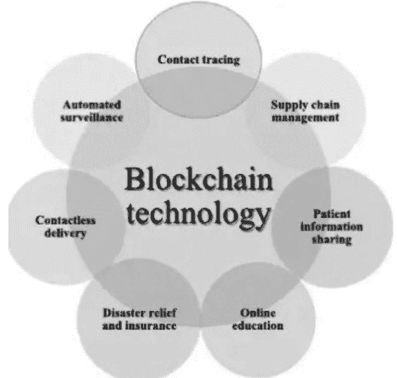

**图 7.1** 区块链的应用。

在保持用户匿名性并防止数据滥用的同时，提高接触者监测有效性的工作将通过区块链中的对称加密来控制。该方法使用 IPFS（一种联网文件存储系统）来解决可扩展性问题。目标是创建一个更可靠、安全、有效且能够在疫情爆发期间有效阻止疾病传播的接触者监测系统 [21]。

- **接触者追踪。** 寻找、评估和控制与确诊索引病例有直接接触的个人的过程称为接触者追踪。随后，会识别这些接触者并告知他们提前接受护理和治疗的风险，以防止病毒传播。因此，这项技术几十年来已有效减少病例数量和大范围流行病。图 7.1 描绘了区块链的应用。

### 7.5.1 区块链与 IoMT（医疗物联网）

信息存储在分布式节点网络中。得益于这一技术进步，系统数据受到更好的保护。区块链是由称为节点的单个计算机网络管理、存储和记录的分布式账本。它确保信息可以在网络节点之间不间断传输，并存储所有相关数据。区块链系统是由计算机网络维护的分布式账本，允许用户使用自动化共识机制直接相互进行价值交易，而无需可信第三方。不同的区块链应用 [4] 包括：

- 分布式账本技术（DLT）（比特币和其他加密货币基于此技术）是一种区块链。它摆脱了集中式系统的缺点，例如对更高安全性和透明度的要求。与将信息保存在一个中心位置不同，DLT 将其分散到计算机网络中。

- 私有区块链是一种可处理安全数据的区块链实现。该网络要么是私有的，要么由单一组织管辖。与公有区块链相比规模较小。私有区块链的创建者从一开始就知道所有节点。

- 混合区块链结合了公有区块链和私有区块链的最佳特性。企业现在可以建立无需许可的公共网络和基于许可的私有网络，以控制谁可以访问区块链上的哪些信息。

谈到医疗保健，区块链技术是一个颠覆性的变革。医疗保健行业正在转向以患者为中心的模式，优先考虑服务可及性和医疗资源可用性。得益于区块链技术，公民可以参与健康研究计划、调查和活动。这将带来更好的研究成果，数据共享也可能惠及广大公众。保护、共享和互操作数据一直是人群健康管理中最大的挑战。区块链技术的主要目的是实时提高数据安全性、数据完整性、数据共享和数据更新 [4]。

区块链账本技术在医疗保健行业有多种应用，包括帮助研究人员解码遗传密码、确保患者数据在传输过程中的安全，以及组织药品分发。区块链正在为各种出色的技术能力而创建和应用，包括患者数据安全、电子数据管理、医疗记录和数字化追踪。得益于区块链技术，整个医药供应链可以实时追踪。借助 IoT 和区块链，可以监控所有货物运输和交通模式、延误及速度。区块链提升了可靠性，并阻碍了不诚实的记账和资金转移。现在，您可以无需多重身份验证的麻烦，保存所有患者数据的不可篡改、去中心化和透明记录。分布式账本技术（区块链）为医疗保健提供者、患者和药剂师提供了便捷的、全天候的数据访问。医疗保健行业的公司和初创企业正在日夜不停地研究、实验、发现和开发区块链技术。区块链实现的改进数据存储将来有一天将包括患者的病历，从诊断和检测结果到药物及传感器读数 [22]。

使用区块链技术可以为不同医院的医生创建新的患者数据卡。它提供数据透明度工具，用于追踪分销链并制止假药泛滥。研究人员可以跟踪测试结果、患者病史和其他因素等信息。当区块对专业人员和患者可见时，医疗区块链将显著改变记录保存的现状。同时，在处理病史时会考虑患者的担忧。该区块链的处理和批准能力在医疗保健领域非常有益。这一创新将改善对个性化医疗、专家临床建议和现实世界科学研究的获取。医疗保健行业可以从去中心化区块链平台中获益良多，包括识别欺诈、降低成本、创造安全就业、减少冗余劳动和提高透明度。区块链技术可以提高医学领域临床试验和监管机构的可信度、可验证性和问责性 [23]。


区块链是一项颠覆性技术，影响着每个市场。当对交易状态达成一致时，该信息会作为新区块添加到现有区块链中。基于区块链的供应链系统可保证医疗器械的安全性、效率和及时交付。为了与目标患者和监管机构验证疗法，医疗器械可能会上传患者数据。它因在各种商业领域产生广泛影响而得到认可。这项前沿创新通过消除不必要的验证步骤，简化了耗时的索赔流程。用于有害设备和其他特殊利益的重要数据泄露是医疗保健行业面临的最重大问题。然而，通过部署这项技术可以轻松解决这一问题 [23]。

### 7.5.2 传染病追踪中的区块链

流感和SARS是传染性疾病，通过人际接触以及非人际接触迅速传播，感染大量人群，且需要很长时间才能康复。区块链是一种创新的新技术，可用于建立可信赖的去中心化账本。区块链的关键和时间戳机制确保记录在进入系统后无法更改。国家疾病控制与预防中心（NDCP）、医院及其他机构得益于时间戳功能，可以更快、更安全地输入传染病数据。其特点如下所示 [24]：

- 1. 将中央节点的操作转移到每个节点，以存储和分发流行病信息，如确诊病例、疑似病例、病例感染时间、病例感染地点和传播方向，完成溯源。
- 2. 要创建一个可行的传染源追踪方案，应从根源溯源开始，利用区块链技术中的分散节点维护能力、哈希防篡改能力和时间标记。
- 3. 概述如何使用 Python 编码创建区块链环境，用于收集、存储、查询和追踪疾病信息。还包括一个模拟溯源场景以测试该方法。
- 4. 描述传染病信息收集、归档、检索和追踪的流程。
- 5. 对传染病、确诊和疑似病例以及感染时间和地点进行系统性信息收集，以向传染病控制机构提供更精确的数据用于其流行病监测和响应，增强收集 [9]。

数据库和工作流行业中的元数据追踪是最早采用追溯技术的领域。传染病报告数据追溯是这项工作的主要研究课题。通过不断收集、存储、检查和评估传染病的动态传播数据及其地理分布，疫情信息追溯能够及时采取有效的疾病控制措施。科学家们开发了一种技术，利用移动设备收集的数据来监测高致病性亚洲禽流感的传播。得益于这一智能系统，全球的兽医、医学专家和农民现在可以输入动物健康数据。科学家们监测了蚊子种群，识别了其物种和地理起源，并计算了疾病的潜在传播情况 [24,25]。

传染病流行期间基于区块链的数据存储的目标是使数据捕获和存储成为现实。数据传输记录在区块链上，形式为特定长度的哈希值，随后可以针对时间戳进行验证。可以使用哈希函数对数据进行哈希处理，生成预定长度的哈希值。由于区块链不可更改的记录链，更新传染病数据需要从头开始。一旦双方批准更新后的传染病数据，它将被存储在区块链上。翻新后的地标现在带有反映当前时间的时间戳。然后系统将信息发送到 NDCP 及其管理部门，以进行最终数据验证和改进。因此，创建了一种智能合约架构，用于对无法治愈的疾病进行早期预警，以检测病例数超过阈值水平的异常场景 [24]。每个参与节点可以将先前未使用的传染病数据添加到数据库，系统将分析该信息，以确定其是否符合区块链智能合约规定的早期预警信号标准。智能合约将执行所有裁决，NDCP 将能够监控和控制事务。本文讨论了在医疗保健中使用这种区块链方法的五种方式：

- 1. 早期预警和访问限制设置
- 2. 节点共识数据上传
- 3. 链技术构建
- 4. 修改传染病数据
- 5. 通过追溯源头识别疫情爆发的源头

当前区块链技术的问题是它仍是一项新兴技术；因此，在应用时仍面临许多挑战。存储在区块链中的疾病信息需要更可靠、可修改，且源头数据更具可信度。数据身份验证仍需实现。

## 7.6 患者追踪系统中的区块链

2019 年 12 月 31 日，世卫组织接到关于中国武汉肺炎类似病例和患者病例增加的警报。区块链通常被视为比特币最重要的技术进步，因为它是一种安全且无需信任的证明方法，适用于所有网络交易。区块链的主要创新在于将其用作一种新型无信任、去中心化交易系统的框架。接触者追踪可以识别感染者的联系人，并收集更多关于这些人的信息。如果在流行病学早期阶段追踪疾病，接触者追踪在查找和防止传染病传播方面发挥着重要作用。区块链在安全数据交换中至关重要，因为它是一个安全且高效的网络。机密和授权数据可以通过区块链安全交换 [26]。

最常引用的两个困难是该程序的广泛部署和敏感患者信息的保护。在区块链能够广泛应用于医疗保健行业以提高治疗和诊断效率之前，关于可扩展性和可靠性仍有几个障碍需要克服。区块链作为一种分布式账本系统，可用于记录和验证医疗保健业务交易。几个研究和开发领域专注于改善患者护理数据流，包括医疗记录管理、数据网关、区块链、MedVault、Factom、BitHealth 和 GemHealth。越来越多的医疗保健公司正在进行区块链试点试验。区块链的去中心化特性是该技术的第一个重大优势。与更传统的分布式数据库管理解决方案不同，区块链是一种通过点对点交互来管理数据的去中心化系统。区块链仅允许两种最基本的数据库操作。由于区块链是一个数据溯源系统，所有者之间唯一可交换的是加密协议。区块链的可访问性和可靠性意味着系统可以实现高数据冗余，且没有单点故障。区块链的关键优势在于它通过使用加密算法提供了更高的安全性和匿名性 [26]。

区块链交易使用加密技术签名，但其细节对所有网络用户仍然可见。因此，保密性和受限访问至关重要。请求和回答构成了数据共享技术的基础，使得只有接收者可以通过暴露加密对象来访问所提供的数据。分布式架构、Docker 容器和微服务均基于启用智能合约的以太坊平台构建。数据使用两种不同算法的组合进行加密。通过区块链，不断变化的数据可以即时验证。Civitas 和 MiPasa 是考虑的两种基于区块链的选项。凭借 Civitas 集成的远程医疗功能，医生可以远程监测患者状况，并就如何最好地实施其治疗方案提供建议。该程序通过将个人的政府签发身份证与存储在区块链上的信息进行比较，来检查某人是否可以离开住所。MiPasa 是一个基于 Hyperledger Fabric 构建的 IBM 区块链云数据流媒体平台，可促进人员、政府机构和医疗机构之间可信的健康和地理信息交换 [26,27]。

智能测试对于确保有效性至关重要，必须保持已进行测试总数的准确记录。去中心化区块链网络中的每个参与者都可以访问关于已进行测试数量以及其签到地点实验室验证病例数量的实时更新。借助区块链技术，政府和非政府组织（NGO）可以在全国范围内监测人们的需求并协调封锁程序。社交媒体的广泛使用助长了虚假信息的传播。为了避免这种情况，数据可以通过区块链网络共享。越来越多的人转向它们来打击有害信息的传播，包括谣言、阴谋论、假新闻和冒犯性评论。COVID-19 危机管理工作的志愿者可以通过基于区块链的激励系统获得激励。供应链应减少中断，系统应保持良好运行。BeepTrace 是一种将解决方案与地理信息系统相结合的数字接触追踪工具，而 Ayurveda、yoga and naturopathy、Unani、Siddha 和 homeopathy 是可能在疫情后使用的两种基于区块链的解决方案示例。区块链当前的挑战包括可扩展性、隐私、安全性和速度。到 2040 年，区块链与 IoMT 之间的关系及其未来范围和解决方案将占据不显著的地位 [28]。

### 7.6.1 医疗保健区块链应用

在进行全面的文献分析后，他们发现了区块链技术的各种用例，例如接触者追踪、安全数据共享和疫苗接种

供应链管理。他们还定义了实施区块链技术的利弊，以及利益相关方之间进一步研究和合作对于充分实现其潜力的必要性。针对COVID-19及以后，他们识别并综合了关于区块链技术的现有研究。他们利用预先确定的纳入和排除标准来选择研究，然后对选定的研究进行定性考察，以识别重要主题和结论。他们还使用公认的质量评估技术评估了纳入研究的整体质量。最后，综合发现概述了区块链技术在医疗保健领域的潜在应用和局限性 [28,29]。

## 7.7 区块链与人工智能的使用

衡量现有医疗保健系统脆弱性的关键研究标准包括新型易感、暴露、感染、康复病毒的突然出现，以及自2020年暴发以来其在全球范围内的失控传播。在应用层面，集成区块链技术、早期暴发检测与预防、身份保护与安全、以及安全药品供应链均可实现。另一方面，人工智能技术被用于在冠状病毒影响变得过于严重之前发现它们，从而让人们避免昂贵的医疗干预。它涵盖了如果需要额外制造来建立健康监测系统可能出现的潜在困难，以及利用这两种技术应对类似COVID-19大流行的所有可设想的新场景。该概念强调了安全高效的数据共享和管理以应对大流行的必要性。它讨论了这两种技术在医疗保健和大流行应对方面的潜在应用，包括追踪和监测病毒传播、开发和共享诊断与治疗方案，以及促进医疗物资和设备的分发与追踪 [5]。

在大流行应对中使用这些技术的潜在局限性和挑战包括数据隐私与安全问题、互操作性问题，以及需要建立道德和监管框架来规范其使用。总体而言，本文强调了区块链和人工智能技术战胜冠状病毒的潜力，并呼吁在该领域持续开展研究与开发 [5,23]。

## 7.8 疾病健康监测中的区块链

区块链技术通过在各方之间共享数据、选择隐私并确保数据安全来提升医疗保健质量，因此有潜力从根本上以多种方式改变医疗保健系统。本文讨论了区块链相对于其他广泛使用的实时和系统学习方法的优势，以及区块链技术的基础、其应用和用户体验质量。鉴于当前实时监测架构在可扩展性、安全性和互操作性方面的局限性，区块链已成为一种有前景的替代方案。这种被称为区块链的分布式账本技术有潜力增强全球健康保险，并可以保证患者数据的保密性，这可能有助于医疗保健研究。

埃博拉和寨卡等再次出现的疾病近期暴发，引发了人们对健康保护的广泛担忧，从而加强了监测基础设施。它强调了现有疾病监测系统面临的关键挑战，包括数据碎片化、互操作性有限和隐私问题。它讨论了区块链技术如何帮助克服这些挑战 [6]。

## 7.9 基于物联网和区块链的疾病管理基础设施

物联网与区块链技术的结合应对了COVID-19大流行带来的挑战。该概念旨在安全、公开、高效地处理医疗数据和资源，以改善病毒监测和控制。该概念集成了各种物联网设备，例如温度传感器、可穿戴设备和健康监测系统，这些设备收集并将数据传输到基于区块链的平台。该概念涉及存储和管理数据，确保其完整性、隐私性和可访问性 [7]。

用户的生命体征（包括体温、心率和血氧水平）通过物联网传感器收集，并记录在不可更改的账本中。COVID-19架构采用物联网和区块链技术。对数据进行分析以识别可能的COVID-19病例，并敦促出现可疑症状的人接受检测 [7,30]。

## 7.10 基于区块链的移动健康基础设施（mHealth）

使用mHealth系统，患者可以远程获得持续监测、诊断、治疗和疗法。但是，健康数据隐私、安全性和开放性存在重大问题。一种可能性是实施区块链技术。由于这些技术具有去中心化（无需中央机构）、不可更改、可追溯和透明的特性，它们在医疗保健领域找到了多种应用；可穿戴传感器可以与使用点对点超媒体协议（即行星间文件系统（IPFS））的智能设备通信，用于健康相关数据的去中心化存储 [31]。

定义了一种基于区块链的框架，用于改善移动健康（mHealth）系统的安全性、隐私性和效率。mHealth系统有可能改变医疗保健服务提供方式，但也带来重大的安全和隐私挑战。该框架使用区块链来存储和管理健康数据，确保其安全且防篡改。智能合约用于自动化一些健康数据管理流程，例如同意管理和数据共享。对该框架的建议可以支持新应用，例如个性化医疗和人群健康管理。在医疗系统中集成区块链技术的优势包括更好的数据交换以及更高的安全性和隐私性。它可以用于各种mHealth应用，例如远程医疗、健康监测和信息交换 [31,32]。

医疗数据通过IPFS协议分布式保存，提高了数据可用性和冗余度，因为区块链活动的存储和处理成本高昂。通常，会采用客户端–服务器方式来构建远程基于Web的监测系统，并将数据保存在集中式数据库中。当服务器发生故障或受到第三方攻击时，这种集中式方法容易导致数据丢失 [33]。

## 7.11 区块链的优势

在医疗保健中使用区块链技术有几个优势，包括以下几点：

- 全面覆盖。它对区块链技术在健康维护方面的潜在应用研究进行了系统而彻底的回顾。
- 高质量分析。创建者使用质量评估工具来评估纳入内容的质量，提高了研究结果的可靠性。
- 实际意义。它提供了关于维护健康中实际区块链应用的见解，可以为制定解决COVID-19大流行及以后相关问题的现实世界解决方案提供参考。
- 协作努力。它由来自多个机构的专家团队撰写，增强了综述的广度和深度。
- 时效性。鉴于COVID-19大流行引起了人们对安全有效的医疗数据共享和管理需求的关注，本文解决了一个至关重要且及时的问题 [29,34]。

### 7.11.1 区块链面临的挑战

比特币的两个主要问题是互操作性和可扩展性的需求。区块链的存储容量有限，因此拥有大量连接数据会显著降低其效率。链外存储方法将大大减轻将数据保存在区块链上的负担。技术对某些人群的益处大于其他人群，尤其是年轻人。这可能影响任何系统，但有方法可以将他们纳入。得益于各种尖端技术，他们现在可以使用任何系统，包括移动物联网和智能技术 [13,35]。一些潜在局限性包括以下内容：

- 范围有限。它主要关注COVID-19期间及之后医疗保健中区块链应用的用途，可能不涵盖医疗保健中区块链的其他潜在用途或应用。
- 潜在的发表偏倚。它基于已发表的研究，可能存在发表偏倚，且可能无法捕捉未发表的研究或正在进行的研究。
- 研究异质性。综述中纳入的研究在研究设计、研究人群和方法学方面存在异质性，这可能限制研究结果的普遍性。
- 缺乏定量分析。它主要是定性的，未提供对研究结果的Meta分析或定量综合。


- **缺乏经验证据。** 它强调了区块链在医疗保健中的潜在用途，但需要更多经验证据来充分了解这些应用的有效性和可行性。需要进行大量研究和开发，才能将这些理论可能性转化为实际解决方案。此技术耗电量很大，因为每笔交易都需要强大的硬件资源。该技术的主要问题是其无法扩展。这是因为验证大多数节点已批准交易需要时间。其他缺点包括区块链的复杂性以及对庞大用户网络的需求。另一个严峻的障碍是，在引入这项技术之前需要确保用户隐私。

- **漏洞分析。** 数据安全对任何重视自身成功的公司都至关重要。程序必须安全且不存在可能未来导致财务损失的缺陷。代码需要经过广泛测试，以保证其完整性和安全性。各种各样的安全研究程序提供了这种代码测试能力。Oyente 智能合约自动审计工具会检查智能合约，并分析可能的缺陷攻击，例如臭名昭著的安全攻击。2016 年 1 月，新加坡国立大学的科学家开发了该工具。它为研究提供了各种功能，以验证安全威胁的存在 [5,35].

## 7.12 结论

前文提到的研究表明，实施区块链技术可以增强疾病监测系统，简化医疗信息共享，并提供可靠的接触者追踪机制。将区块链技术、人工智能和物联网相结合可以提高大流行病应对工作的效能。利用物联网设备可以提供关于疾病传播的即时数据，而人工智能有望促进对大流行病的快速识别和预测。将区块链与其他新兴技术（如边缘计算和 5G 网络）相结合，可能会在大流行病应对方面产生更多应用。隐私问题以及为管理医疗保健领域区块链技术利用而建立监管框架的必要性，是持续存在的障碍之一。在大流行病应对工作中利用区块链技术，为改善全球卫生结果提供了一条充满希望的途径，使其成为一个极具吸引力的研究领域。该领域的进一步研究有潜力促进改进型大流行病应对框架的发展，从而保护全球的个人和社会。

## 参考文献

- 1. Bleem B, Renaud J, Nguyen TTT, Bandyopadhyay S, Bandyopadhyay A, Mitra R. 用于疾病控制的基于区块链的匿名感染追踪. 载于: 2021 IEEE 应用图像模式识别研讨会 (AIPR). 2021. pp. 1–4. https://doi.org/10.3991/ijoe.v18i06.29919.
- 2. Peng S, Bai L, Xiong L, Qu Q, Xie X, Wang S. 基于 GeoAI 的区块链地理社交数据共享疫情控制. 载于: 2020 IEEE 电子健康网络、应用与服务国际会议 (HEALTHCOM). 2021. pp. 1–6.
- 3. Sharma A, Bahl S, Bagha AK, Javaid M, Shukla DK, Haleem A. 区块链技术及其在抗击 COVID-19 大流行中的应用. Res Biomed Eng. 2020;1–8.
- 4. Haleem A, Javaid M, Singh RP, Suman R, Rab S. 区块链技术在医疗保健中的应用：概述. Int J Intell Netw. 2021;2:130–9.
- 5. Baz M, Khatri S, Baz A, Alhakami H, Agrawal A, Khan RA. 用于击败 COVID-19 大流行的区块链和人工智能应用. Comput Syst Sci Eng. 2022;691–702.
- 6. Chattu VK, Nanda A, Chattu SK, Kadri SM, Knight AW. 区块链技术应用在常规疾病监测系统中的新兴作用，以加强全球卫生安全. Big Data Cogn Comput. 2019;3(2):25.
- 7. Alam T, Benaidna M. 基于物联网和区块链的冠状病毒病 (COVID-19) 框架. 2022. 可从以下网址获取: https://doi.org/10.3991/ijoe.v18i06.29919.
- 8. Capraz S, Özsoy A. 基于区块链的抗击大流行解决方案综述. 载于: 2021 年第 6 届计算机科学与工程国际会议 (UBMK). 2021. pp. 1–6. https://doi.org/10.1109/UBMK52708.2021.9558911.
- 9. Nguyen DC, Ding M, Pathirana PN, Seneviratne A. 用于抗击类似冠状病毒 (COVID-19) 流行病的基于区块链和 AI 的解决方案：一项调查. IEEE Access. 2021;9:95730–53.
- 10. Chang MC, Park D. 在 COVID-19 等大流行病发生时，区块链如何帮助人们？ J Med Syst. 2020;44:1–2.
- 11. Chang MC, Park D. 医院康复科应如何为 2019 年冠状病毒病做准备？ Am J Phys Med & Rehabil. 2020;99(6):475–6.
- 12. Casino F, Dasaklis TK, Patsakis C. 基于区块链的应用系统文献综述：现状、分类与开放问题. Telemat Informatics. 2019;36:55–81.
- 13. Vujičić D, Jagodic D, RanDiDi S. 区块链技术、比特币和以太坊：简要概述. 载于: 2018 年第 17 届 INFOTEH-JAHORINA 国际研讨会, INFOTEH 2018 论文集. 2018. https://doi.org/10.1109/INFOTEH.2018.8345547.
- 14. Bahl S, Javaid M, Bagha AK, Singh RP, Haleem A, Vaishya R, 等. 抗击 COVID-19 大流行中的生物传感器应用. Apollo Med. 2020;17(3):221.
- 15. Bansal A, Garg C, Padappayil RP. 使用区块链优化 COVID-19 “免疫证书”的实施. J Med Syst. 2020;44:1–2.
- 16. Gupta M, Patel RB, Jain S. 用于 COVID-19 及其变异株物联网启用追踪的轻量级安全框架. 载于: 2021 年第 2 届科学与技术计算方法国际会议 (ICCMST). 2021. pp. 287–92. https://doi.org/10.1109/ICCMST54943.2021.00066.
- 17. Zhang J, Xue N, Huang X. 面向普惠社交网络医疗的安全系统. IEEE Access. 2016;4:9239–50.
- 18. Dey T, Jaiswal S, Underkrishnan S, Katre N. HealthSense：物联网和区块链的医疗用例. 载于: 2017 年智能可持续系统国际会议 (ICISS). 2017. pp. 486–91.
- 19. Otoum S, Al Ridhawi I, Mouftah HT. 通过区块链辅助 AI 使能网络预防和控制流行病. IEEE Netw. 2021;35(3):34–41.
- 20. Torky M, Goda E, Snasel V, Hassanien AE. 基于区块链技术的 COVID-19 接触者追踪与检测. 载于: Informatics. 2021. p. 72. https://doi.org/10.3390/informatics8040072.
- 21. Bari N, Qamar U, Khalid A. 使用区块链进行高效的大流行病接触者追踪. Inform Med Unlocked. 2021;26:100742.
- 22. Khezr S, Moniruzzaman M, Yassine A, Benlamri R. 医疗保健中的区块链技术：全面综述及未来研究方向. Appl Sci. 2019;9(9):1736.
- 23. Kumar T, Ramani V, Ahmad I, Braeken A, Harjula E, Ylianttila M. 医疗保健中的区块链利用：关键要求与挑战. 载于: 2018 年 IEEE 第 20 届电子健康网络、应用与服务国际会议 (Healthcom). 2018. pp. 1–7. https://doi.org/10.1109/HealthCom.2018.8531136.
- 24. Zhu P, Hu J, Zhang Y, Li X. 增强传染病可追溯性：一种基于区块链的方法. Inf Process & Manag. 2021;58(4):102570.
- 25. Anderson RM, Heesterbeek H, Klinkenberg D, Hollingsworth TD. 基于国家的缓解措施将如何影响 COVID-19 流行病的进程？ Lancet. 2020;395(10228):931–4.
- 26. Behnaminia F, Samet S. 关于隐私保护顾虑和 COVID-19 大流行的患者追踪系统中区块链技术应用. Int J Inf Commun Eng. 2023;17(2):144–56.
- 27. Xu H, Zhang L, Onireti O, Fang Y, Buchanan WJ, Imran MA. BeepTrace：面向 COVID-19 大流行及以后的基于区块链的隐私保护接触者追踪. IEEE Internet Things J. 2020;8(5):3915–29.
- 28. Khatsoon A. 使用区块链技术遏制新型冠状病毒病 (COVID-19) 传播. 可从 SSRN 3584226 获取. 2020.
- 29. Ng WY, Tan T-E, Movva PVH, Fang AH Sen, Yeo K-K, Ho D, 等. COVID-19 及以后医疗保健中的区块链应用：一项系统综述. Lancet Digital Health. 2021;3(12):e819–29.
- 30. Kumar A, Gupta PK, Srivastava A. 应对 COVID-19 大流行的现代技术综述. Diabetes & Metab Syndr Clin Res & Rev. 2020;14(4):569–73.
- 31. Taralunga DD, Florea BC. 移动健康系统的基于区块链的框架. Sensors. 2021;21(8):2828.
- 32. Tripathi G, Ahad MA, Paiva S. S2HS-一种用于智能医疗系统的基于区块链的方法. Healthcare. 2020;8(1):100391.
- 33. Tian S, Yang W, Le Grange JM, Wang P, Huang W, Ye Z. 智慧医疗：使医疗服务更加智能. Glob Heal J. 2019;3(3):62–5.
- 34. Gunasekeran DV, Tseng RMWW, Tham Y-C, Wong TY. 应对 COVID-19 公共卫生响应中的数字健康应用：人工智能、远程医疗及相关技术的系统范围综述. NPJ Digit Med. 2021;4(1):40.
- 35. Syed TA, Alzahrani A, Jan S, Siddiqui MS, Nadeem A, Alghamdi T. 区块链架构及其应用的比较分析：问题与建议. IEEE Access. 2019;7:176838–69.


## 事后聚焦：云计算机取证中分布式隐私保护区块链认证框架

Rohit Kaushik 和 Eva Kaushik

## 8.1 引言

由于区块链的成本效益和简洁性，许多小企业向云存储提供处理能力和存储空间。每个区块包含前一个区块的加密哈希、时间戳和交易信息。区块链是通过加密连接的记录不断增长的集合，称为区块。除了区块和实例之间加密哈希链接的安全性和不可变性之外，区块链还可以提供不可变性、可追溯性、透明度、审计能力和问责制。在数字取证中采用区块链系统的好处是，管理员可以提供身份认证，从而访问数字证据，这成功地利用哈希函数构建了可验证的证据链 [1]。为了在案件检验中确认不可变性、可见性和公众信任，区块链使用加密。法医报告是指借助法院验证任何合理证据已被收集、跟踪和受到保护的过程。法医报告可能是法医分析的必要阶段。尽管它经常被用作证据，但必须证明在调查过程中未被篡改，才能在法院或法律程序中被接受 [2][3]。因此，无论证据是否在法庭上使用，都应遵循规范的流程来进行常规证据处理和管理（无论是数字证据还是非数字证据）。数字取证的主要分支如图 8.1 所示。

在当前情况下，犯罪率很高，且一旦情况不断变化，尸检报告就相当直接。网络犯罪目前正成为主要犯罪之一。因此，调查将通过数字证据经历多个层级。它在保持每份文件的准确性和完整性、提供透明度以及在不篡改区块链系统文件的前提下提供信息清晰度方面发挥着关键作用。有许多结束生命的策略。无论是上吊、枪击、氰化物还是法医毒理学（毒物摄入）。事件发生后重现犯罪现场可能具有挑战性，因为留下的一些证据有助于调查人员找到犯罪。要进行适当的分析，它

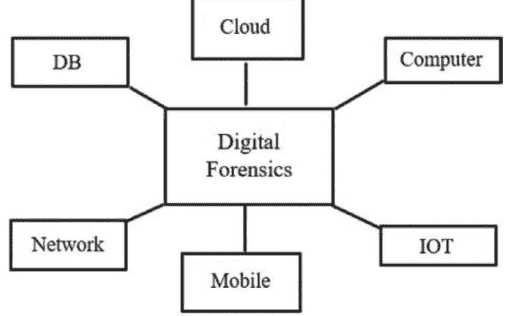

### 图 8.1
数字取证的主要分支。

需要调查官的技能和修辞理解。要识别复制的犯罪现场，需要对犯罪现场进行以下各点的细致分析以及尸检研究。由于犯罪现场发现了大量证据，请留意它们 [4]。绘制或图像描绘场景：在悬挂位置存在时，检查悬挂材料（绞索、结、环等）；记录实现悬挂目标所需的支撑，对结扎材料（绳索）进行生前检查以及受害者身体/颈部纤维的方向；从靠近伤口（指甲痕迹）处选取拭子；检查胸部/喉部指纹和与上吊相关的尸检迹象；药物或酒精使用；枪支指纹；身体枪击区域；以及拖拽等其他因素证据；自杀信和电话以回顾决策历史；病史等。在确定死亡原因时，法医病理学家必须谨慎，因为罪犯过去曾将他杀伪装成自杀。法医病理学家在确定枪击死亡方式方面的作用在本案中得到强调。胸部 X 光片上可见身体的向下颗粒分布。由滑膛枪发射的弹丸造成的胸部损伤是死亡原因。由于现代数字时代发生的这些持续网络犯罪，此证据包括验证原始证据及其与网络犯罪关系的关键网络证据组件。它在互联网证据方面存在重大问题。根据保管链方法 [5] 来管理和跟踪数字证据。因此，多个层级或自上而下的公司处理法医证据以处理网络犯罪调查。云计算机取证分析与识别的程序：不同的法医工具显示在表 8.1 中。

- 在数字取证的初始阶段，案件识别的两个最重要的程序是收集数据和识别事件。这两个阶段对于证明案件场景的发生至关重要。

- 第二阶段是从各种数字设备（例如移动电话、电子邮件账户、硬盘驱动器和其他不同类型的数字媒体）收集和保存证据。然后在保持其完整性的同时，为将来的处理保护数据 [6]。随着我们努力克服

### 表 8.1 法医工具

| 法医设备 | 信息 |
| :--- | :--- |
| 内存 | 已被用于获取计算机内存中可能的残留物，当硬盘驱动器上没有数据或数据正在被擦除时（例如，volatility）。 |
| 数字 | 主要被考虑用于从计算机中检索证据。它包含保存、数据检索和识别（例如，SANS 工具包和法医学）。 |
| 移动设备 | 任何移动设备上的证据；如今，通信在便携设备方面取得了各种进步（例如，AXIOM 和 XRY 等）。 |

众多障碍，包括黑客攻击。证据被保存在安全的地方，以便未经授权的个人无法访问它。此创新将使系统安全性加倍。

- 第三阶段是组织证据，包括检查和分析设备作为数字线索中的证据。首先，调查人员收集案件调查的数据并检查数据的特征。在第二步（分析）中，调查人员检查并关联数据以确定真相，并确定证据是否确凿。

- 演示。调查人员随后根据调查结果创建报告，并根据需要附带证明文件进行更新，然后再在法庭上提交。

## 8.2 问题陈述

已注意到，在调查进行过程中，法医报告经常被篡改。法医报告中的数据可能因未识别的来源而发生变化。因此，大多数情况下，受害者可能无法获得正义，裁决可能也不公正。因此，创建一个系统以确保法医报告从生成到在法律程序中使用的安全性至关重要。

## 8.3 文献综述

- 1. 区块链增加了信任和透明度；它主要已被用于医学取证。先前建立的数字证据将在基于区块链的取证系统中发挥关键作用。正在采用区块链技术的众多应用来收集理论证明。我们的数据库定期使用单向哈希代码和公证服务检查篡改情况，该服务在内部和外部都经常使用。外部服务（更可信）需要验证我们的网络，而内部服务主要包含在数据库系统本身内。该过程分为两个阶段：处理（在此期间检索并公证元组的哈希值）以及验证（在此期间反复确定所有哈希值并与最近的认证值进行验证）[7][8]。如果这些值之间存在任何矛盾，则存在篡改的证据。通过区块链系统，当发生欺诈或会计数据被篡改时，我们可以隐秘地监控财务会计系统。我们可以轻松抓获试图访问和更改账户数据的个人。因此，在此系统中，我们可以纳入公共和私营部门以及印度政府机构。使用区块链系统将是所有者的受保护区域；然而，欺诈者或操纵者可能将其作为继续其犯罪活动而不被抓获的手段。

- 2. 使用数字取证进行的调查不再仅仅是技术性的。包括业务、系统和法律方面。作者已经开发了一个全面的、面向业务和法律的数字取证框架 [9]。因此，它发展出了一个完全面向犯罪的架构，将有助于犯罪调查。

- 3. 本研究中关于智能合约取证调查框架的探索性取证考虑了各种工具、证据项目、数据格式和其他因素。根据研究作者的说法，黑客利用 IoT 设备和其他来源窃取信息，为了应对这一问题，他们使用区块链技术创建一个用于存储数据并采用各种策略阻止其行为的框架。虽然我们提出一个将有助于起诉谋杀等犯罪的框架，但他们主要关注防止黑客访问物联网。

## 8.4 相关工作背景

- 1. Kent, P., 等人 [10]。区块链是一种分布式数据库或账本——当今的顶级技术趋势之一——这意味着更新区块链的权力分布在公共或私人计算机网络的节点或参与者之间。区块链分析是一个全新的研究和开发领域，直到 2014 年才在比特币爱好者中变得流行。这场运动主要由其去中心化和透明性推动。

- 2. Akinbi, A., 等人 [11]。关于识别算法，他们首先引起人们对系统表征（指所使用技术的能力）与将为法院提供客观结果的取证系统表征之间区别的关注。

- 3. Bain, T., 等人 [12]。区块链使用加密货币存储货币交易信息，但也存储其他类型的信息，例如产品追踪和其他数据。回顾包括用户访问管理、智能卡、移动安全、基于 Internet/Web 的安全、取证以及电子世界中其他现有和潜在用途。此外，每章还包括一个大纲，说明书籍的组织方式。

- 4. Jaquet-Chiffelle 等人 [13]。区块链技术可以在去中心化平台的点对点（P2P）网络中存储链接信息，因为它是一个依赖于基于账本的交易的去中心化网络。


信息保存在带有时间戳的区块中，这些区块通过不可破坏的链条连接，从而形成了一个不可更改、对公众开放且由共识工作量证明验证的审计系统。

- 5. Zhihuang, W., et al. [14]. 建筑证据的生成与展示——涉及建筑物、城市环境——在法律和政治流程中的应用。该报告还讨论了众多取证类别。该研究深入探讨了法医建筑的问题、如何修复这些问题以及合适的解决方案。他们提高了对云取证及其问题、取证技术类型和云架构的认识。

- 6. Chandana, M., et al. [15]. 作者设计了 LOS 算法以简化取证程序，并提出了一种由若干数字组成的升级方案，以提高当前数字取证和区块链的安全性。该算法增强了可追溯性并减少了复杂性。

## 8.5 方法论

此建议方法有助于缩短处理在线门户所需的时间。采用此方法，技术用于实现透明度，客户始终可以跟踪流程。哈希在此过程中用于创建不可更改性，使得任何人都无法篡改每个节点中存储的数据。智能合约被用于在解决诉讼时防止延迟。这是一个安全可靠的系统，旨在实现高质量。这项工作有助于开发一种系统，该系统引入一个案例研究，保护受害者报告并限制各个节点对报告的篡改。

它还有助于为报告处理创建一个透明的环境。区块链技术为法医应用的使用提供了新颖且富有创意的视角。数据收集、数据改进、数据验证、数据分析、证据保存和调查结果呈现对调查流程有诸多优势 [11]。通过提供高度一致性、公开性、真实性保证和安全性，以及审计数字证据以实现既定目的的能力，学术界和专业领域的区块链数字取证工作有重大机会显著改进法医应用。基于区块链的取证系统机制如图 8.2 所示。

法医实验室将制作受害者的法医报告并将其传输给医生或医院。目前，报告通过电子邮件或复印件发送，医生或任何其他机构都可以轻易篡改它们。然而，在分布式且不可更改的区块链网络上，我们将根据建议的方法发布法医报告。区块链是一个极其安全的网络，无法被攻破或篡改。如果某个节点故障，我们也可以轻松检索数据，因为信息是以分散方式存储的。

建议系统中的第二个节点是医院。诊断实验室将法医报告送交医院。随后，医院指定一名特定医生审阅报告，添加其数字签名，并将其转交给执法官员以进行进一步调查。由于病理实验室人员使用本质上是静态的 16 位加密哈希将报告上传至网络 [12]，医生很难修改报告。如果有人试图修改报告，哈希代码将发生变化。由于调查期间哈希代码应保持不变，我们可以通过确定是在哪个节点上进行修改来识别犯罪者。报告由医院保存在其账簿中。

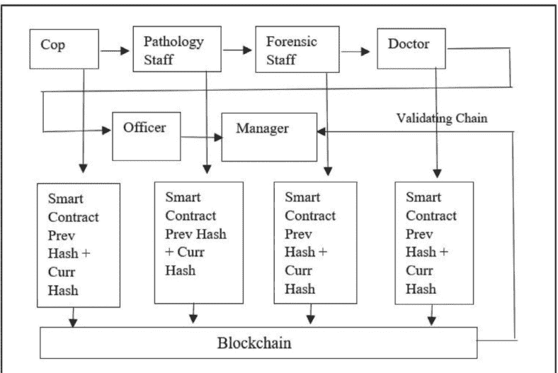

图 8.2
基于区块链的取证系统机制。

建议系统中的第三个要素是警察局。由医生数字签名的法医报告将交由警方使用。随后，警方将选择一名警察，其调查将基于该报告。关于死者的信息（该死者此前已在经医生评估的病理实验室报告中经过彻底检查和验证）将提供给刑侦警探。因此，警探的工作变得更加轻松，因为他只需专注于调查。如果警察试图编辑报告，报告的哈希代码将再次更改，该警察将被识别出来，因为哈希更改发生在第三个节点。

拟议方法论中的最后一个节点是最终报告。实际传输记录和取证调查范围均对区块链网络管理员可见。如果法医实验室将报告发布到互联网时获得的哈希代码在整个网络中保持静态，则说明报告未被篡改。如果校验和在整个网络中发生了变化，也表明报告已被修改。因此，由于系统被分割为多个节点，管理员可以通过跟踪哪个服务器上的摘要被修改，轻松识别犯罪者。

### 8.5.1 模块

- 1. 准入管理。他或她将负责监督其他用户，包括警察、法医专家、高级警官和医疗专业人员。他或她还可以指定最近的警察局、法医团队、高级警官和医生。他还可以通过在该模块的界面中输入之前的密码来修改自己的用户名。

- 2. 精神病质警官。该警察在此节点接收来自所有部门的输入。在分析法医报告后，部门会选派一名警官来审查特定犯罪。当医生成功验证报告时，警察会通过报告获取关于犯罪者或受害者的所有信息。因此，得益于区块链技术 [13][14]，研究组件以及验证和核查都受到信任。如果有人试图更改已收集的数据，生成的哈希代码将发生变化。链式结构使其可追溯。该警察局也可以实现一致性。他们将拥有犯罪信息，对其进行登记，并允许他访问法医、精神病学、病理和医学报告，以及添加犯罪案例日志。

- 3. 犯罪现场人员。他们将调查犯罪现场，发现现场样本，然后添加法医信息描述以生成报告。

- 4. 医疗人员。然后，在仔细检查受害者身体后，检验人员将撰写法医声明并将其传输给医生。目前，所有报告均通过电子邮件或纸质副本送达，医生可以使用各种技术轻易篡改。因此，一旦法医报告被纳入，这种针对公共区块链的预测方法就变得不可删除。即使某个节点故障，数据仍可快速检索，因为信息以分布式方式存储。

- 5. 医生。它在该系统中被创建为另一种类型的节点。报告将由专科医院医生审查。生成的病理学家和法医部门的报告将提供给医生。指定医生在附加数字签名之前，会确认已收集的数据。因此，他可以自由阅读所有这些研究，并根据其发现编写摘要 [15]。

- 6. 高级警官。他们将能轻松发现需要受到法律制裁的罪犯，因为他们会检查部门生成的每份报告，然后可以根据这些报告进行调查。

### 8.6 关键术语

- 1. 区块。交易被汇总为单个区块，大约每十分钟生成一个约 1 MB 大小的新区块。在区块链中，每个区块包含四个部分：时间戳、对前一个区块的引用、对其包含的交易的描述以及工作量证明 [16]。根据安全哈希，在不更改后续区块的情况下编辑一个区块是不可能的。由于两个原因，没有人可以简单地加入比特币网络并进行数百万美元的成功转账：(1) 每个区块需要多次独立确认，(2) 需要专业矿工来解决加密挑战的数学公式。

- 2. 挖矿。挖矿是在将交易记录添加到区块链账本之前验证交易的过程。它需要在复杂的硬件上进行数学计算以验证交易。计算机矿工只有在首先确认交易的合法性后，才会将交易添加到安全区块中。通过组合这些区块创建区块链，这些区块代表同步的信息。


跨越所有区块 [17]。每次生成一个安全区块时，就会生成一个新哈希，矿工为每个成功确认的交易获得比特币和交易费作为报酬。

- 3. 双重花费。双重花费是指同时将比特币交易发送给两个不同的接收者。不惜一切代价应避免这种情况。

- 4. 工作量证明（PoW）。工作量证明是指为允许交易而进行昂贵计算的要求。PoW 是为支持无需信任的共识而创建的。PoW 是一个已被哈希的区块。

- 5. Hashcash。工作量证明的一个示例是 Hashcash。比特币使用哈希的工作量证明函数。Hashcash 是一种工作量证明方法，它生成在计算上难以产生但其他人验证起来简单的数据。对于每个区块，矿工需要生成一个哈希和一个“随机数”（nonce number），以生成具有必要数量的前导零比特的哈希，以满足难度要求。

- 6. 节点。网络中的节点是分散的计算机，每台都持有整个区块链的副本。随着新用户加入区块链网络，区块链的副本及其访问权限会被传播。各个网络中的所有节点都可以复制、同步和共享数据。没有单个节点或网络控制数据。

- 7. 地址。网络中的节点是分散的计算机，每台都持有整个区块链的副本。随着新用户加入区块链网络，区块链的副本及其访问权限会被传播。各个网络中的所有节点都可以复制、同步和共享数据。没有单个节点或网络控制数据。

- 8. 智能合约。智能合约是一种存储在区块链上的不可更改的数字合同。它规定了执行任务（如存入资金或数据）必须满足的某些逻辑要求 [18][19]。例如，将资金转移给第三方交付团队的标准：考虑一种情况，发件人希望使用第三方将产品交付给收件人，但仅在交付成功时才交付。那么，智能合约可能是这样的：在产品装车当天，发件人支付运输费用。直到收件人向发件人确认已收到产品，智能合约才会扣留支付给交付团队的款项。

## 8.7 云取证挑战

### 8.7.1 技术方面

- 1. 访问日志。定位网络犯罪的计算机调查标准方法包括定位设备上每个操作的日志数据，然后对其进行评估以发现证据 [20]。档案存储在远程未识别服务器上的事实，使得云计算架构的此类应用变得特殊。在云计算中，获取日志变得具有挑战性。

- 2. 收集可靠数据。该过程旨在确保信息包含可作为法庭证据的可靠数据。由于多个用户共享同一物理位置，在云端保证数据机密性非常具有挑战性。

- 3. 云取证的另一个重大问题是存在大量需要分析以寻找证据的信息。传统的取证方法与如此大量的数据不兼容。在调查过程中，云服务提供商必须遵守。

### 8.7.2 程序方面

- 1. 重现犯罪现场。在某些情况下，调查过程需要重演整个犯罪活动以寻找证据。在此过程中，犯罪现场采取的所有行动都会被重复和模拟 [21][22]。云计算使这更具挑战性，因为云被维护为虚拟机，可能在犯罪后被删除以清除所有痕迹并为重现腾出空间。

- 2. 跨国法律。调查应根据犯罪发生国的法律进行。由于云数据中心分布在世界各地，在进行云取证调查时必须遵守许多规则。

- 3. 在法庭上提交证据。案件调查需要在法庭上提交证据。陪审团成员可能不熟悉复杂的云计算模型 [23]。因此，在云取证中，提交证据成为一项艰巨的任务。

- 4. 犯罪现场重建。为了调查有害活动，调查人员通常需要重建犯罪现场。使用传统的数字取证，调查人员可以快速确定犯罪中涉及多少设备或是谁犯下的罪行 [24][25]。由于云环境中多个节点之间实时自主交互的极度动态特性，重建犯罪现场并确定损害程度几乎是不可能的。

- 5. 证据隔离。在云中，虚拟化允许隔离在单个物理机上运行的各种实例。尽管它们的数据实例存储在同一系统上，但不同用户表现得仿佛在不同主机上运行。因此，云服务提供商（CSP）和执法机构在调查期间要区分它们而不危及使用该技术的其他实体的匿名性，极其具有挑战性 [26]。

- 6. 缺乏用户统计匿名性。大多数云服务提供商遵循用户友好的标准，并向客户请求最少量的数据 [27]。由于稀疏用户数据提供的信息有限，侦探很难确定罪犯。

- 7. 数据源。与涉及传统数字取证的调查不同，基于云的数据可能源自成千上万个不同的用户位置，这使得难以识别是谁或什么创建和/或修改了那里的数据项。因此，数据源不够清晰。

- 8. 数据隐私和缺乏问责制。云服务中的这些问题通常由 IaaS 提供商处理，例如 Cloud Servers、AWS、Microsoft Azure、iCloud 以及许多其他提供商 [28]。然而，少数服务使用通用密钥进行磁盘加密和归档。

- 9. 控制力较弱。与数字取证不同，在数字取证中，调查人员对云设备的访问级别有更多控制权，而云取证则取决于各种服务模型。

### 8.7.3 保管链取证

### 8.7.3.1 安全性、效率和可扩展性成本

与案件证据保管链中的安全管理和有效性相关的费用是实施区块链网络的主要障碍之一。该设计通过在交易完成和各方添加案件数据时持续增长分布式账本，实现了溯源和透明度。这使得所有参与者（无论谁监督了这些行为）都能同时查看相关的案件材料 [29]。Hyperledger 消除了每个参与者担心将其运营记录与其他对等组成员共享的顾虑。

### 8.7.3.2 缺乏统一性

多媒体取证研究系统采用多种案件调查方法，这导致媒体证据保管链不一致。数字取证的过程层（包括收集和保存证据）不够可信。这会产生不可避免的负面影响，并提供质量不一且较差的结果。通过标准化取证流程，设计强制执行一致的方法并提高最终产品的标准。数字取证流程如图 8.3 所示。

### 8.7.3.3 记录透明度问题

主要问题之一是在分散环境中提供数据可访问性（保管链）。由于 Sawtooth 无法提供预先确定的数据透明度策略，我们设计了 Sawtooth 的完全去中心化账本验证和交易方法及其共识验证策略（PoET），以构建隐私保护和安全性的坚实架构。这还可以帮助我们开发一种用于取证保管链调查的架构，以维护数据和证据的开放性和可追溯性 [30][31]。通过利用超级区块链模块化平台，我们在智能合约的每一层提供有效的文档监控和证明管理。与传统技术相比，其综合设计提供了更卓越的链安全管理、更好的活动记录案例和更好的结果。

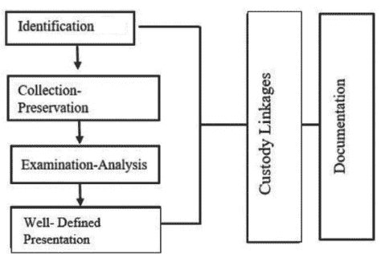

图 8.3
数字取证流程图。


### 8.7.3.4 分布式存储问题及保管链中的顾虑

由于无法有效防御针对传统保管链管理的攻击，证据保留的唯一替代方案是集中式存储，这会暴露数据并使证据面临被修改或伪造的风险。为克服这些限制，我们创建了与建议的 Sawtooth 架构和智能合约对接的 Filecoin 全球存储系统，以自动收集、识别、检查、分析、报告和保存数据 [32]。这些分布式应用程序采用基于数字合约的方法，帮助司法进程和媒体取证机构保护保管链以及证据的完整性。

### 8.7.3.5 合规性问题

收集多媒体证据的常规保管链在数字案件活动中存在错误问题，尤其是当记录保存在中央服务器上并依赖外部安全解决方案时。此外，便携式摄像机的信息是使用性能差且不可靠的技术收集的，然后再使用各种取证技术进行检查和处理。

## 8.8 云取证概念

有几个概念可以帮助识别替代证据来源，并显著协助该领域的科研人员，例如云端犯罪类型以及在云端中/上进行调查的地点 [33]。

### 8.8.1 犯罪类型

由于在云计算中被视为犯罪，任何利用云作为对象、主题或工具实施的犯罪都与计算机犯罪类似。当云服务提供商（CSP）成为犯罪活动目标时，包括分布式拒绝服务（DDoS）攻击，云计算成为一个重要话题；当身份盗窃（如 Google 案中发生的）等犯罪通过云环境实施时也是如此。当云被用于攻击另一提供商的系统时（例如部署暗云时），云最终被视为一种工具。

### 8.8.2 进行调查

由基于云的证据支持的案件，在云环境中被称为“在”云端调查。企业必须了解 CSP 的事件响应方法（包括问题识别、通知和恢复），以满足现代数字取证技术的使用。快照提供了特定时刻系统的图像。它可以被视为分散或虚拟系统提供的服务的重要证据来源。不过，鉴于当前获取快照的方式，评估快照的取证真实性很重要。作为预防措施，云用户应检查其在线实例快照是否可离线访问，并考虑这些快照的频率 [34][35]。例如，Elastic Compute Cloud 和 Amazon Elastic Block Storage (EBS) Boot Volume 都提供块级存储服务（EC2）。用户存储可通过 EBS 作为快照使用。来自网络攻击的快照可以稍后离线检查，而不会影响原始存储或干扰操作。如前所述，记录易失性数据会在检查人员必须访问“实时”系统时对目标系统造成修改。从我们的角度来看，在对运营系统拍摄一致快照的同时，保留检查人员操作的审计痕迹。

### 8.8.3 在云端执行调查

最近，Dell 推出了一项取证即服务（forensics-as-a-service）产品。在使用数据中心的功能对被实物获取的物品进行镜像之前，Dell 使用了数字取证流程。检查人员最终应该能够生成合理的事件时间线。PB 级数据无法镜像和分析，扣押服务提供商的服务器可能会侵犯用户的合法隐私权 [36]。根据 AccessData 取证工具包（FTK）的速度测试报告，使用高端工作站检查 120 GB 硬盘大约需要 5.5 小时。同样，评估 2 TB 硬盘大约需要 85 小时。

## 8.9 云安全

在试图调查云取证的复杂性之前，有必要了解云安全。我们从云服务架构及其受到的攻击两个方面，概述了云安全中的关键问题。

### 8.9.1 云架构

云架构有助于理解不同建议如何协同工作以提供全面解决方案 [37]。根据 VMware 和 Savvis 共同编写的一份白皮书，建议对云计算感兴趣的企业考虑参考设计。

应实施以下安全要素：

- 每个级别都需要有定义的安全配置文件。
- CSP 必须维护非军事区（DMZ）内的硬件和软件。
- 对 CSP 的操作系统和虚拟化的管理必须在 DMZ 之后进行。
- CSP 负责通过隔离和分离 VM 资源来管理资源配置。
- 必须使用路由器 ACL、边界防火墙或 Web 应用程序安全来提供网络安全。
- CSP 必须提供对有权执行请求功能的真实服务器的访问路由。
- CSP 必须提供安全身份验证、授权和审计（AAA）。

### 8.9.2 云安全攻击

云计算环境中可能发生的攻击包括以下几种：

- 包装攻击。当用户从其虚拟机向浏览器发送请求时，会生成一个 SOAP（简单对象访问协议）消息。Web 服务器接收请求。攻击者在登录过程中使用重复的用户名和密码进行包装攻击，以影响设置阶段中 Web 浏览器与服务器之间发送的 SOAP 消息。
- 泛滥攻击。攻击者创建虚假或有害数据，例如应用程序中的资源请求或要执行的代码。为了处理恶意请求，服务器像真实用户一样使用其 CPU、内存和其他资源 [38][39]。当服务器最终耗尽容量时，它们会将工作负载转移到另一台服务器，从而导致泛滥。
- 浏览器攻击。这种攻击在消息在站点和 Web 服务器之间传输时破坏其签名和加密，诱骗浏览器将攻击者视为合法用户，并执行提交给 Web 服务器的所有请求。
- 恶意软件注入攻击。在这种攻击类型中，黑客创建一个标准操作（例如删除用户），并将另一个命令（例如 setAdminRight）嵌入其中。当用户请求发送到服务器时，服务器不遵循用户帐户删除指令，而是将用户帐户透露给攻击者。
- 不安全的接口和 API。提供云计算服务的企业会提供多个软件接口或 API，供用户管理和与使用云的服务进行交互。依赖于低质量的一组接口可能会使企业面临与密码安全性、可用性和保密性相关的某些安全漏洞 [40]。
- 站点管理员。云服务流程由站点管理员控制、监督和维护。默认情况下，他们可以访问所有数据、文档和受限的公司资产。出于报复或其他原因，管理员可能会泄露或允许泄露关键信息。
- 数据盗窃。虚拟化数据中最严重且未被认识的安全缺陷之一是：系统管理员可以在不留下任何证据痕迹的情况下获取任意数量的数据。只需三个简单步骤即可复制虚拟机：以超级管理员身份登录、挂载磁盘镜像、卸载原始副本。
- 数据泄露。“数据泄露”一词指数据从一个客户端传输到另一个客户端。当客户删除其磁盘且新客户端启动新驱动器时，数据泄露是一个问题 [41][42]。旧驱动器和新驱动器的物理磁盘可能有一些重叠部分。因此，新客户端可能会尝试从已写入大量数据的位置进行镜像。


## 8.10 数字取证的必要性

数字取证检查是一项计划周密、有条不紊的流程，用于识别、收集、检查和展示数字信息，以供在法庭上作为证词使用。在整个电子调查过程中维护保管链对于实现这一目标至关重要。为了使调查中使用的数字证据被法庭采纳为证据，必须记录、存档和保存保管链（CoC）协议。显然，我们需要防止 CoC 被篡改或破坏。最终目标是证明所收集的信息可靠、准确，并与调查对象相关。

由于区块链可以提供不可篡改的区块链技术来维护链式结构中的数据块，因此区块链已被广泛采纳并应用于各种安全领域。这使得在无许可公有链上存储带有电子签名的哈希加密数据成为可能，从而防止未经授权的篡改 [43]。在整个取证调查过程中，区块链架构中建议的不可篡改账本技术有助于以安全且易于访问的方式管理和维护数字信息的适当控制。区块链的三个关键方面如下：

- 1. 任何加入公有链并参与访问账本上事件的人都可以使用这项技术。借助开放的应用程序接口，用户可以使用公有链。
- 2. 区块链依赖于全球且去中心化的 P2P 包转发范式，所有相关方在系统使用和参与权方面享有平等地位，从而消除了对第三方平台和解决方案提供商的需求。
- 3. 为创建用于保存对正在调查的案件至关重要的私人信息（证据）的不可篡改账本，安全区块链中的每个块都包含一个加密哈希码，该哈希码源于先前保存的交易的哈希值。我们采用协议来实现这一点，其中所有基本功能均已定义并付诸实践。块在经过验证和批准后，随后存储在账本链中。

（可疑）安全事件通常需要进一步调查，这可能涉及收集、评估和解释证据。这些发现最终可能以专家报告、法庭程序以及任何法律或民事诉讼中的证词形式提供。此分析随后可能有助于塑造解释和归因。与大多数网络安全事件调查不同 [44][45]，数字取证调查的程序（包括获取和分析证据所使用的工具和方法）和结果必须在调查报告中准确记录，才能作为证据在法庭上被采纳。然而，缺乏明确的程序使得取证调查人员（特别是地方执法机构雇用的人员）很难生成可作为法庭案件证据的高质量取证报告。因此，在调查完成后，向不同利益相关方传达取证结果的方法存在差异。在制定并付诸实践用于生成取证报告的标准化方法和规范时，有必要考虑当前调查模型和标准中指示的广泛程序，例如 ISO/IEC 27043:2015 国际标准。

## 8.11 案例研究

### 物联网入侵检测

要识别网络中的潜在威胁，入侵检测系统经常使用基于异常的技术，后者依赖于监控网络设备的行为。检测受损的物联网设备旨在通过使用身份框架根据设备类别对其进行分类并生成正常配置文件，从而帮助自动检测物联网生态系统中的异常，这些配置文件随后用于检测偏差。一种名为 Siotome 的隐私保护框架旨在防御智能家居环境中流氓物联网设备发起的高度分散式攻击。通过应用机器学习方法确定理想的操作配置，该方案可以监控、检测和评估基于物联网的风险，并提供合适的安全基础。由于手机经常用于私人和敏感功能，这使其成为攻击者特别看重和觊觎的目标，因此手机是智能家居环境中一种特殊的设备 [47]。在发生任何犯罪现场时，调查过程会使用其中的一部分，包括利用物联网（IoT）设备提供一种适合的方式来识别可在法庭程序中提交的证据。在物联网环境中使用的每种取证方法通常遵循几种标准调查方法。必须建立问题场景，收集信息，调查犯罪现场，并评估证据。可用于数字取证调查的方法包括扩展网络犯罪调查模型（EMCI）、抽象数字取证模型（ADFM）和计算机取证研究研讨会（CFRW）。这些特性的汇聚强调了对事件采用有组织的数字取证方法的必要性。在物联网领域（或适当情况，如奶嘴）中，并不总是可以直接访问取证感兴趣的项目（OOFI）。这就是下一最佳分类（NBT）策略背后的理由，用于处理物联网调查。然而在这些情况下，有必要识别和考虑下一个最大的相关证据来源。在进一步研究的帮助下，有可能开发出一个选择下一最佳事物的流程。

### 公共交易账本解决方案

区块链技术可用于新平台，以支持当今的电子取证和事件响应（DFIR）。例如，事件响应人员应该了解这些新的“数字证人”（DW）能为其调查带来的优势。众所周知，物联网（IoT）增加了网络空间的复杂性。物联网设备日志可以帮助事件重建，但只有在当前数字调查的更广泛背景下维护保管链（CoC），才能实现其完整性和可采纳性。利益相关方沟通的改善方式与转向电子文档提高数据可访问性、可读性和记笔记能力的方式相似。然而，在缺乏验证证据的情况下，这些数据可能被伪造。例如，在电子健康等应用领域，有必要遵守许多当前（以及新的）有关编写、审计和患者病史安全的法律和规范。缺乏数据控制可能导致系统滥用、欺诈和严重的服务质量下降。可以实现一个在线 CoC 来消除这些担忧 [48][49]。在这项研究中，我们探讨了将区块链技术集成到当代 DFIR 系统中的好处和实际应用。我们展示了区块链技术如何有利于数字证据模型的使用，并阐述了警察力量和事件响应人员为什么需要熟悉它。此外，按时间顺序记录对于数字取证在法庭上可采纳是必要的。因此，我们讨论了分布式账本如何支持 CoC。为了展示该策略在为计算机网络引入取证准备和实现更好的警务干预方面的价值，我们给出了一个涉及电子健康的真实案例。在包括电子健康行业和投票在内的各种应用中，区块链最近已成为确保更高安全性和隐私性的突破性技术。对等网络复制一个名为区块链的去中心化、共享且防篡改的记录。比特币区块链最初在虚拟货币系统比特币中成功使用。区块链的基本数据单元是交易。一定数量的交易构成一个块。区块链节点广播块以创建块的最终哈希码。工作量证明是这种方法的名称。

### 挪用公款取证模型

随着金融服务日益数字化，金融犯罪环境正在发生变化。法律和取证程序无法跟上新技术的快速发展，导致立法滞后和法律漏洞，为不法分子创造了有利条件。从这个意义上说，区块链技术提供的不可篡改性、验证性和认证属性增强了财务取证的鲁棒性。本研究介绍了比特币数字取证方法的全面最新进展以及常见金融调查技术的分类。此外，我们基于标准化实践开发并付诸实践了一种取证调查框架，并记录了挪用公款计划调查的适当方法。我们的策略可行且灵活，足以应用于各种形式的欺诈调查以及例行内部审计。除了集成标准化的取证流程和保管链保存技术外，我们还提供了一个可运行的以太坊实现 [50]。除了管理


在探讨影响和潜在未来研究领域的同时，我们也审视了区块链与金融调查共生关系所面临的困难。

## 事物云

有几个行业使用数字取证。调查人员在搜索启用物联网（IoT）的犯罪现场时，可能会遇到各种设备，包括各种电气设备，如计算机、洗衣机和手机。将所有数字技术纳入云平台的取证中至关重要。由于IoT刑事调查场景中设备类型繁多，调查过程中存在多种困难。就像我们大脑中的神经元相互连接一样，不同类型的技术可以在我们的环境中相互交互。标准的数字取证调查通常涉及的设备远少于IoT数字取证研究。

随着物联网引入社会，越来越多的设备（包括人们日常生活中使用的设备）连接到互联网，数据量将呈指数级增长。预计数据量将增加近40,000万亿千兆字节。随着网络上设备数量的增加，局域网（LAN）和广域网（WAN）之间的区别将变得不那么清晰。

## 数据交换

在过去十年中，网络犯罪已成为严重威胁。尽管国家和跨国机构做出了各种努力，但由于规则差异和信息网络的去中心化，司法力量和调查过程中的所有参与方在打击网络犯罪者方面的复杂性有所增加。在本文中，我们分析了区块链技术如何在取证分析流程中帮助保全链条，目的是提高法庭程序中相关方的安全性，并确保数字证据的适当收集和完整性 [51][52]。同样，我们还确定了进一步举措，以增加参与调查的所有实体之间的数字证据交换，此外还有欧盟推动的旨在实现跨境数据交换的有效机制。在此背景下，我们关注欧盟LOCARD项目提出的策略，该项目利用区块链技术提供了一个用于协作和自动化数字证据管理的分布式平台，从而确保链条传递过程中的透明度和完整性。

## 法规遵从性问题

传统多媒体证据收集链条存在两个问题：一是数字案件流程存在缺陷，特别是涉及中央服务器上的文档以及依赖外部安全解决方案；二是便携式多媒体设备的信息使用低劣且不可靠的工具进行收集，随后再通过不同的取证程序进行查看和处理。

### 8.11.1 传统取证与云取证

在传统调查中，证据由调查人员处理；在全球调查中，证据由多个云服务提供商处理。数字取证被定义为应用经验证实的成熟技术，以识别、验证、解释、尝试收集、保存、呈现和记录从高科技热点获取的电子设备中收集的数据证据，以支持或协助重现涉嫌犯罪事件或预见难以策划的非法活动。“云计算”术语指一种访问模型，允许全球按需访问一组可重新配置的共享计算资源，包括系统、服务器、存储、应用程序和服务，这些资源可以通过组织努力或熟练的组织协作快速获取和释放 [53]。因此，云犯罪现场调查可以定义为使用经过验证的方法，对分散式、需注册框架中来源的复杂证据进行保存、收集、批准、鉴别、调查、转录、文件证据和提交，使其足以在正式法庭上作为证据被采纳。一个计算机化知情模型为开展高效犯罪学调查提供了基础。尽管不存在一种可应用于所有计算机犯罪学检查的单一高级定量技术模型，但传统程序设计可以在不考虑所用技术的情况下应用于广泛的严格科学检查。

### 8.12 未来方向/解决方案

### 8.12.1 传统方法

如前所述，日志管理是云计算中的一个基本问题。可以将各种模型应用于云计算监控。一项建议是使用特殊传输层协议保存任何更改实例状态的操作日志，然后再将信息传输到中央云日志存储站点。

特定平面上的云数据检索。通过授予调查人员访问特定平面以控制其所需数据检索，可以减轻取证调查中数据收集的难度。这种云基础设施级别需要可信方来保持其更新。

云取证缺乏立法框架的问题可以通过在客户和云服务提供商（CSP）之间创建一项特殊服务等级协议（SLA）来解决，该协议规定了在重罪调查活动中应遵循的法律。表8.2显示了传统取证工具与云取证工具的区别。

| 传统 | 云 |
| :--- | :--- |
| SANS SIFT | 离线Windows分析和数据提取 |
| FTK Imager | 使用访问数据进行电子发现 |
| Prodiscover | 使用EnCase进行电子发现 |

### 8.12.2 基于区块链

在包括电子健康、工业和投票在内的多种应用中，区块链在技术上最近取得了进展。区块链描述了一个复制去中心化、共享且防篡改账本的点对点网络。名为比特币的虚拟货币系统是第一个成功利用区块链的系统。交易是区块链中数据的基本单元。一个块由指定数量的交易组成。为了为块创建目标哈希代码，区块链节点广播该块。如果将其实施到当前的取证系统中，区块链技术可以推进当前的数字取证和事件响应（DFIR）。证据存储和证据可靠性是云取证中考虑的两个主要问题 [54][55]。为解决这些问题，作者提出了一种基于区块链的云取证数据存储和完整性管理架构。因此，该架构将所提议网络的有效性与其他基于区块链的加密货币进行对比。所提议的架构可以处理比当前无许可区块链更多的交易，同时仍保持数据完整性。

然而，现有系统的输出评估存在局限性，即无法通过将观察到的终值与预期数据大小进行比较来进行实际审查。为了重建网络并确定使用Hyperledger解决问题需要多长时间，Sniff被用于收集网络数据。区块链基础设施即服务（IaaS）云解决方案解决了集中式证据收集和存储的问题。在所提议的取证架构中，证据被获取、存储在链中，并分布在众多节点上。为了保护设备免受未授权用户的侵害，开发了一种名为基于安全环验证的身份验证（SRVA）的系统。秘密密钥使用布谷鸟搜索优化（HSO）方法生成，以有利于云环境。根据敏感度级别，所有信息都使用敏感性深椭圆曲线密码学（SA-DECC）技术保护，并存储在云服务器上。SDN控制器为每个云数据分配自己的块，个人信息的历史记录作为元数据存储。安全哈希算法-3（SHA-3）方法的每个块都包含一个默克尔哈希树。得益于框架中模糊基础智能合约（FCS）的融入，用户可以跟踪自己的数据。得益于在区块链上建立逻辑证据图（LGoE），研究人员最终能够研究证据。经过彻底分析，可以得出结论：所提议的取证设计需要在响应时间、证据植入放置时间、证据检查时间、开销交互、哈希数据处理时间、密钥复制率、加密时间、解密以及整体变更率方面表现出色 [56]。如果将区块链纳入现有取证系统，它可以支持当前使用的数字取证和事件响应系统（DFIR）。尽管来自IoT设备和云服务的日志可能有助于重建事件，但只有链条可以保证其有效性，从而保证其被采纳。在比特币计算机取证系统中，链条得以保留。研究人员开发了一个利用区块链分布式、防篡改结构的取证调查框架。为应对云取证挑战，我们讨论了几项当前的密码学研究。

证据范围和数据存储是云取证中的两个主要因素。为解决这些问题，作者提出了一种用于云取证的比特币数据存储和资产完整性解决方案。因此，该方案将所提议网络的有效性与其他货币进行对比。所提议的系统将在管理的操作数量超过现有无许可区块链的同时确保数据完整性。然而，现有系统的


输出评估的局限性在于，它不能仅通过将测量结果值与预期数据大小进行比较来完成。为了在本研究的未来迭代中使用区块链网络进行仿真并计算 tps，网络数据是通过 Snort 获取的。引入了一种基于密码学的身份识别隐私解决方案，并附带了关于该方法的全面信息以及设备架构的说明。智能合约用于适合这些取证检查应用程序的各种交易。通过使用修改后的对称密钥机制向公众隐藏证明提交者，改进了身份识别隐私问题。控制器在每次将数据保存到云端时创建一个区块，并将数据的历史作为元数据记录。对云端数据活动期间生成的日志的保护给予了仔细考虑。尽管不同的安全问题（例如操作缺陷、网络攻击等）可能会损坏和滥用云端数据，但日志分析仍然是跟踪事件最流行的技术之一。必须维护日志文件隐私，以完成事件的监控。本研究提出的公共模型依赖于第三方审计员来确认云端日志的真实性。使用标准 Merkle 哈希树结构收集的日志块标签用于形成将保存在区块链内的树的根，防止日志数据被篡改。然而，对计划方案的公开审计未发现任何类型的泄露 [57][58]。基于理论分析和经验分析，该框架可以有效提高云端日志的安全评估，其开销计算复杂度高于先前的方案。椭圆曲线哈希算法的主要目的是创建日志块标签。

## 8.13 未来展望

本研究的讨论主要集中在云计算与数字取证结合时出现的安全难题和问题上。这些安全难题和问题可以在未来的项目中加以解决，作为构建安全网络的一种手段。通过迁移云服务，可以实施额外的安全措施。可以创建一个全面且真实的场景，涵盖云取证难题的所有各个部分，以便更好地理解和解决它们 [59][60]。还可以开发一个具有更多功能的框架，以促进可靠取证证据的生成。当前的数字取证模型不适合云系统，因为它们不符合必要的标准。多个攻击者正在不断尝试利用网络的弱点获取优势并夺取控制权。

## 8.14 结论

区块链是司法保管链管理和可追溯性的理想选择，因为它旨在确保合法性、问责制、保护、真实性和可审计性。有了这种保障，区块链有助于减少摩擦，从而为取证文化发挥其真正的潜力。本项目的目标是创建一个全面的基于 Java 的智能数字取证链，方法是创建一组监督取证调查的受限最终用户，并构建取证证据系统以获得优化。以太坊用于构建区块链技术。

此外，这种方法防止了单点故障。当提出投诉时，将向链中的该区块追加一个新区块。如果有人在区块创建后对其进行修改，我们可以使用特定区块来确定这一点。它们将被标记为“无效区块”。因此，不可篡改性不太可能发生。此外，受害者可以跟踪投诉的进度，从而促进透明度。因此，利用区块链技术可以简单地防止所有犯罪情况，从而实现安全性、连贯性和透明度。

## 8.15 讨论

为保护提交的取证报告，它采用基于区块链的技术。软件、分析人员、病理人员、警察、医生和高级警官只是该系统中众多节点中的一部分。为了实现透明性和不可篡改性，他们各自获得了授权。这样，拥有机密凭据的个人就可以查看他们提交的所有记录，并按照给定的工作开始观察，取证和病理人员创建新报告 [61]。节点上的应用组件节点可以添加任何细节。因此，高级警官可以查看其特定地点报告的犯罪数量图表。

## References

- [1] 3205–2023 – 区块链互操作性数据身份验证和通信协议 IEEE 标准。(2023)。IEEE。https://standards.ieee.org/ieee/3205/10237/ (2023 年 5 月访问)。
- [2] Chapple, M., & Seidl, D. (2023)。(ISC)² CCSP 认证云安全专业官方学习指南。John Wiley and Sons。
- [3] Prieto, J., Luis, B. M. F., Ferretti, S., Guarde, D. A., & Nevado-Batalla, P. T. (2023)。区块链与应用第 4 届国际会议。Springer International Publishing。
- [4] Mukhopadhyay, D. (2023)。面向物联网的区块链。Chapman & Hall/CRC Press。
- [5] Garg, R. (2023)。面向现实世界应用的区块链。John Wiley & Sons, Incorporated。
- [6] Wang, J. (2022)。数据科学与机器学习百科全书。IGI Global。
- [7] Albano, C. (2022)。喘不过气来：当代艺术中空气的脆弱性。University of Minnesota Press。
- [8] Cao, B. (2022)。无线区块链：原理、技术与应用。John Wiley & Sons, Inc。
- [9] P3205/d5.0, 2022 年 8 月 – 区块链互操作性 – 数据身份验证和通信协议 IEEE 草案标准。(n.d.)。IEEE。https://blockchain.ieee.org/standards (2023 年 4 月访问)。
- [10] García-Coral, F. J., Cordero-García, J. A., de Pablo-Valenciano, J., 等。(2022)。加密货币书计量学综述：它们是如何增长的？金融创新，8(2)，1–31。https://doi.org/10.1186/s40854-021-00306-5
- [11] Akinbi, A., MacDermott, Á., & Ismail, A. M. (2022)。基于区块链的物联网取证调查过程模型系统文献综述。法医学国际版：数字调查，42–43，301470。https://doi.org/10.1016/j.fsidi.2022.301470
- [12] Kent, P., & Bain, T. (2022)。比特币。傻瓜书®。Wiley。
- [13] Jaquet-Chiffelle, D.-O., Casey, E., & Bourquenoud, J. (2022)。关于“使用区块链技术的防篡改带时间戳的溯源账本”的更正 [Forens. Sci. Int.: Digit. Invest. 33 (2020) 300977]。法医学国际版：数字调查，40，301332。https://doi.org/10.1016/j.fsidi.2022.301332
- [14] Zhihuang, W., Qing, Z., Changjie, G., & Kaimin, Y. (2022)。利用区块链创新构建取证监管蓝图。*刑事司法科学与治理*，3(1)，84–88。https://doi.org/10.35534/cjsg.0301012
- [15] Chandana, M., & Vidya Raj, C. (2022)。利用区块链强化取证确认的可靠性。*计算机科学、工程与信息技术科学研究国际期刊*，8(6)，357–362。https://doi.org/10.32628/cseit228644
- [16] Agbedanu, P., & Jurcut, A. D. (2022)。Bloff. 在《区块链、物联网与安全融合研究文选》中，IGI Global，738–749。https://doi.org/10.4018/978-1-6684-7132-6.ch040
- [17] Goyal, R. (2021)。取证科学中的区块链技术。一篇书计量学综述。*2021 年第 3 届计算、通信控制与网络国际会议 (ICAC3N)*，印度大诺伊达，2021 年，第 1570–1573 页。https://doi.org/10.1109/icac3n53548.2021.9725660
- [18] Singh, S. K., Roy, P., Raman, B., & Nagabhushan, P. (2021)。计算机视觉与图像处理第 5 届国际会议，CVIP 2020。Springer。
- [19] Tanwar, R., Choudhury, T., Zamani, M., & Gupta, S. (2021)。*信息安全与优化*。C&HCRC Press。
- [20] 2020 年第 7 届 IEEE 网络安全与云计算国际会议 (cscloud)/2020 年第 6 届 IEEE 边缘计算与可扩展云国际会议 (EdgeCom)：Cscloud-edgecom 2020：纽约，(2020)。IEEE。https://www.proceedings.com/55552.html
- [21] Billard, D. (2020)。基于区块链系统中的受污染数字证据与隐私保护。*法医学国际版：数字调查*，32，300911。https://doi.org/10.1016/j.fsidi.2020.300911
- [22] Shi, N. (2020)。*开发和应用区块链技术的架构与框架*。Engineering Science Reference。
- [23] Liyanage, M., Braeken, A., Kumar, P., & Ylianttila, M. (2020)。*物联网安全：身份验证的进展*。John Wiley & Sons, Inc。
- [24] Lusetti, M., Salsi, L., & Dallatana, A. (2020)。法医学中数字文件保管的基于区块链的解决方案。*法医学国际版：数字调查*，35，301017。https://doi.org/10.1016/j.fsidi.2020.301017
- [25] Jaquet-Chiffelle, D.-O., Casey, E., & Bourquenoud, J. (2020)。使用区块链技术的防篡改带时间戳的溯源账本。*法医学国际版：数字调查*，33，300977。https://doi.org/10.1016/j.fsidi.2020.300977
- [26] Shang, H., & Qiang, H. (2020)。利用区块链的电子数据保存和证据存储。*法医学与医学杂志*，6(1)，27。https://doi.org/10.4103/jfsm.jfsm_21_19
- [27] Burri, X., Casey, E., Bollé, T., & Jaquet-Chiffelle, D.-O. (2020)。使用区块链技术的时间顺序独立可验证电子保管链账本。*法医学国际版：数字调查*，33，300976。https://doi.org/10.1016/j.fsidi.2020.300976
- [28] Chen, S., Zhao, C., Huang, L., Yuan, J., & Liu, M. (2020)。区块链在电子证据生成中的应用研究与实现。*法医学国际版：数字调查*，35，301001。https://doi.org/10.1016/j.fsidi.2020.301001
- [29] Nuzzolese, E. (2020)。电子健康记录与区块链架构：人身识别的取证链假设。*埃及法医学杂志*，10(1)，1–5。https://doi.org/10.1186/s41935-020-00209-z
- [30] Aparecido Petroni, B. C., Gonçalves, R. F., Sérgio de Arruda Ignácio, P., Reis, J. Z., & Dolce Uzum Martins, G. J. (2020)。将智能合约应用于利用区块链的数字保管链存储与维护功能架构。*法医学国际版：数字调查*，34，300985。https://doi.org/10.1016/j.fsidi.2020.300985
- [31] Quan, Y., Li, C.-T., Zhou, Y., & Li, L. (2020)。用于多媒体取证中设备指纹识别的 Warwick 图像取证数据集。*2020 年 IEEE 多媒体与博览会国际会议 (ICME)*。出版者：IEEE。https://doi.org/10.1109/icme46284.2020.9102783
- [32] Nyaletey, E., Parizi, R. M., Zhang, Q., & Choo, K.-K. R. (2019)。BlockIPFS – 用于取证和可信数据可追溯性的区块链支持的星际文件系统。*2019 年 IEEE 区块链国际会议 (Blockchain)*。出版者：IEEE。https://doi.org/10.1109/blockchain.2019.00012
- [33] Senkyire, I. B., & Kester, Q.-A. (2019)。使用数字水印和加密区块链验证取证犯罪现场图像。*2019 年计算机科学与应用国际会议 (ICDSA)*。出版者：IEEE。https://doi.org/10.1109/icdsa46371.2019.9404235
- [34] Fabian, M. L. (2016)。分析比特币网络：头四年。*未来互联网*，8(1)，1–40。https://doi.org/10.3390/fi8010007


- [35] Nelson, B., Phillips, A., & Steuart, C. (2019). 计算机取证与调查指南. Cengage.
- [36] Pérez-Solà, C., Navarro-Arribas, G., Biryukov, A., & Garcia-Alfaro, J. (2019). 数据隐私管理、加密货币与区块链技术：ESORICS 2019 国际研讨会，DPM 2019 和 CBT 2019. Springer International Publishing.
- [37] Joshi, J., Nepal, S., Zhang, Q., & Zhang, L.-J. (2019). 区块链 – ICBC 2019：第二届国际会议，作为服务联合会议（SCF 2019）的一部分举行. Springer International Publishing.
- [38] Meng, W., & Fennell, S. (2019). 社交网络与大数据安全与隐私：第 5 届国际研讨会，SOCIALSEC 2019. Springer Singapore.
- [39] Ras, D. J. (2019). 云计算系统的数字取证就绪架构. https://repository.up.ac.za/handle/2263/70644
- [40] Verdoliva, L., & Bestagini, P. (2019). 多媒体取证. 第 27 届 ACM 国际多媒体会议论文集（MM '19）. 计算机协会，纽约，纽约，美国，2701–2702. https://doi.org/10.1145/3343031.3350542
- [41] Qiu, M. (2018). 智能区块链：首届国际会议，SmartBlock 2018. Springer International Publishing.
- [42] Urquhart, A. (2016). 比特币的低效性. 经济学通讯，148，80–82. https://doi.org/10.1016/j.econlet.2016.09.019
- [43] Urquhart, A. (2018). 什么导致了比特币的关注度？经济学通讯，166，40–44. https://doi.org/10.1016/j.econlet.2018.02
- [44] Bashir, I. (2017). 区块链精通：深入了解去中心化、密码学、比特币和主流区块链框架. Packt Publishing Ltd.
- [45] Barni, M., & Tondi, B. (2017). 对抗性多媒体取证的威胁模型与博弈. 第 2 届多媒体取证与安全国际研讨会（MSec '17）论文集. 计算机协会，纽约，纽约，美国，11–15. https://doi.org/10.1145/3078897.3080533
- [46] Sebastian, L. (2017). 比特币：比特币基础. Createspace Independent Press.
- [47] Atiquzzaman, M., Choo, K.-K. R., Wang, G., & Yan, Z. (2017). 计算、通信和存储中的安全、隐私与匿名性：Spaccs 2017 国际研讨会. Springer International Publishing.
- [48] Van Alstyne, M. (2014). 为什么比特币有价值. ACM 通讯，57(5)，30–32. https://doi.org/10.1145/2594288
- [49] Vrochidis, S. (2017). 会议详情：多媒体取证与验证. 第 2 届多媒体取证与安全国际研讨会（MSec '17）论文集. 计算机协会，纽约，纽约，美国. https://doi.org/10.1145/3248728
- [50] De, D. (2016). 移动云计算：架构、算法与应用. Taylor & Francis.
- [51] Ravindran, U., Rai, B. K., & Sharma, S. (2018). 关于监管比特币货币的综述论文. 应用科学与工程技术研究国际期刊，6，4136–4140. https://doi.org/10.22214/ijraset.2018.4862
- [52] Satapathy, S. C., Mandal, J. K., Udgata, S. K., & Bhateja, V. (2016). 信息系统设计与智能应用：第三届国际会议论文集. Springer India.
- [53] de Vries, A. (2018). 比特币日益严重的能源问题. 焦耳，2(5)，801–805. https://doi.org/10.1016/j.joule.2018.04.016
- [54] Miller, M. (2015). 比特币终极指南. Que.
- [55] Worring, M. (2015). 图像集合取证的多媒体分析. 载于《多媒体数据与设备数字取证手册》. Wiley，305–327. https://doi.org/10.1002/9781118705773.ch8
- [56] Wang, J., & Kissel, Z. A. (2015). 网络安全导论：理论与实践. Wiley.
- [57] Wright, P. M. (2014). 保护 Oracle Database 12C. Apress.
- [58] Simou, S., Kalloniatis, C., Kavakli, E., Gritzalis, S. (2014). 云取证：识别主要问题与挑战. 载于：Jarke, M., 等. 高级信息系统工程. CAiSE 2014. 计算机科学讲义，vol 8484. Springer, Cham. https://doi.org/10.1007/978-3-319-07881-6_19
- [59] Ruan, K. (2013). 网络犯罪与云取证：调查过程的应用. Information Science Reference.
- [60] Pearson, S., & Yee, G. (2013). 云计算的隐私与安全. Springer.
- [61] Rogers, M. K., & Seigfried-Spellar, K. C. (2013). 数字取证与网络犯罪：第 4 届国际会议，ICDF2C 2012. Springer.

## 作者简介


Rohit 考希克 Rohit 是伊利诺伊大学的研究生，主修数据分析。他的研究兴趣在于机器学习、数学计算、统计分析、人工智能和数据挖掘领域。他之前的研究重点是将技术整合以减少社会问题，从而带来改善。Rohit 拥有巨大的潜力和实现追求的强烈愿望，以及充满新想法的创造性思维。

为他的研究增添新高度，他被伊利诺伊州公共卫生部（IDPH）选中，与伊利诺伊州交通部（IDOT）合作研究机动车数据链接项目。他被授予“DREAMtorous”技术总监的头衔，“DREAMtorous”是全球精英汇聚（GCS）的一个商业网络峰会和品牌。他充满活力的个性使他获得新的机会，例如受邀在 IEEE 学生分会（2021）担任嘉宾演讲者，就数据科学、机器学习和深度学习进行讲座。他拥有出色的分析和管理能力，这使他担任某非营利社区的社区经理，利用精确的统计数据洞察来支持和增强其发展。


Eva 考希克* Eva 考希克是一名拥有丰富研究经验的 IT 专业人士。作为一名研究人员，她精通多个领域，包括金融科技、触觉技术、天体物理、金融经济学、生物信息学和基因组学。她在知名期刊上发表了研究手稿、书籍章节和文章，支持她的研究兴趣。她是 Dexigner 的创始先驱，FiCord 社区的联合创始人，并通过各种举措丰富了金融科技领域。

她对勤奋和完美的信念使她担任了多个重要职位。她曾担任 IEEE ADGITM 主席，IEEE USA 教育活动家，IEEE QT3 系列核心委员会成员，IEEE WIE DS 编辑协调员，以及 YPLO 公众演讲者。她被微软选中参加创业计划“Binance Build for Bharat”，并获得了 IEEE WIE 亲缘群体奖。她目前担任 FrontForumFocus（一个非营利组织）的顾问。她曾为 MHRD、WWF、IEEE MOVE India 和世界青年联盟做志愿者。除此之外，她还在不同平台上传播技术认知，以推动社会进步。

确切地说，作为一名潜力巨大的女性，她相信追求准确和完美。

## 区块链在追踪和保障医疗物资安全中的应用

Tamanna Rai, Rishabha Malviya, Niranjan Kaushik, and Pramod Kumar Sharma

### 9.1 引言

区块链技术及其去中心化、透明性和匿名性等基本特征，与 2008 年比特币加密货币的推出同时诞生 [1]。比特币截至 2019 年 3 月 19 日已成功完成近 4 亿笔交易 [2]，为区块链技术可能的应用提供了一个有力的示例。因此，区块链技术在其他数据驱动行业（例如医疗保健）中的潜在实用性已成为许多讨论和建议的主题 [3]。IBM 发现，70% 的医疗保健领导者认为，区块链在健康领域最大的影响将体现在提升监管合规性、临床试验管理以及创建用于共享电子健康记录（EHR）的去中心化平台 [4]。此外，预计到 2022 年，医疗保健领域区块链应用市场将超过 5 亿美元 [5]。尽管关于区块链提升医疗保健 IT 潜力的乐观情绪普遍存在 [3]，但现有研究仅对已创建、评估或实现的应用提供了有限的概述，围绕这项技术的近期热潮也伴随着对不切实际理想化的想法和策略的推广。在考虑区块链技术在医疗保健、生物医学和健康教育（统称为“健康领域”）中的潜在用途时，重要的是要确定当前研究是否满足期望。然而，它也已在包括金融、物流、能源、商品交易、医疗保健等众多其他行业中找到应用。利用区块链技术可以提供安全且不可篡改的药品来源和可追溯性系统，这对于打击假药泛滥将有所裨益。基于区块链技术构建的分布式共享数据平台，可被供应链中的多方用于安全地存储和交易交易记录。这得益于密码学方法的应用，这些方法确保只有授权方可以访问账本，并防止未经授权的方访问。它为防止假药在药品供应链中的分销提供了一种手段。这种方法监控和控制假药的传播。本章考察了用于追踪药品的区块链技术应用，探讨其优势和潜在缺点，并调查了保障药品供应链安全的众多可行方案 [6]。


## 9.2 背景

区块链可被视为一种去中心化、不可篡改的账本，用于记录交易。它消除了对可信第三方来调解各方之间通信的需求。区块链存储一个不断增长的记录列表，即“区块”，这些区块按顺序添加。这些区块添加到区块链后，会使用加密程序将它们与之前的区块和之后的区块相关联 [7]。当按预期实施时，区块链使任何人都可以读取、写入和验证数据块的完整性。例如，这为分布式账本和数据库铺平了道路。由于这些特性，区块链正被考虑用于广泛的用途。区块链技术还使不需要第三方监管的智能合约成为可能 [8]。

## 9.2.1 区块链技术概述

### 9.2.1.1 区块链在医疗保健领域的简明介绍

本节通过讨论在医疗保健领域采用区块链技术的原因来介绍该主题。我们还介绍和分析区块链背后的核心思想。

### 9.2.1.1.1 技术在医疗保健领域发挥的重要作用

医疗保健行业越来越依赖于来自其他领域的帮助，包括计算机科学，该领域可以在此领域做出重要贡献 [9]。这涵盖了广泛的领域，从基因组学和基因预测到电子健康记录及疾病诊断工具开发 [10–12]。公共卫生组织（以及商业组织）使用的系统每天都会持有大量患者数据，这就引发了如何处理所有这些数据的问题。近年来，一种被称为“大数据分析”的流行概念被用来绕过这一障碍。“大数据分析”是指一组独特的技术，这些技术应用于异常庞大且困难的数据集，常规的数据分析方法对此不足以应对 [13]。在医学中使用大数据可能会带来医疗诊断预测、MRI分析和其他领域的改进 [14]。由于计算机科学是跨学科的，它可以用于许多其他研究领域来改进和简化相关流程。计算机及其相关技术的应用可以在医学领域用于协助解决各种问题。因此，医疗保健系统可能会从更高的质量、效率和降低成本中获益 [15]。

## 9.3 区块链技术

比特币和其他加密货币于2008-2009年左右引入了一种称为区块链的新技术 [16,17]。目前，它在银行、医疗保健、交通、政府等领域提供一系列活动。借助这一现代创新，我们可以以比以往更加有条理和安全的方式跟踪我们的资产 [18]。它在具有复制和分布式账本的去中心化P2P网络上运行 [19,20]。本文描述了区块链如何用于跟踪和保障医疗物资安全的背后理念。

## 9.4 区块链的优势：区块链技术的优势使其适合于医疗记录管理 [21]

- 可访问性。启用区块链技术的应用程序用户能够以安全、便捷和有效的方式访问其医疗记录。
- 互操作性。常规方法使用集中式数据存储，这导致患者记录互操作性存在摩擦。由于区块链技术不需要集中式数据库的存在，因此可以绕过这些问题；作为替代方案，所有节点都能够相互通信。
- 身份验证。区块链的数据身份验证系统的工作方式是使用唯一私钥结合公开可用的密钥。
- 去中心化存储。区块链的去中心化特性使其非常适合在多个位置归档大量数据。去中心化存储使更好的数据质量、更快的医疗数据访问和更高的安全性水平成为可能。

## 9.5 区块链网络

区块链可以分解为多个类别，每个类别都有自己的特征，其行为反映了网络整体的行为。我们可以根据Zheng et al. [22]和Alhadhrami et al. [23]提到的特征对这些区块链进行分类。

### 9.5.1 公共区块链

没有任何问题会阻止任何节点访问交易数据。交易记录在区块链后，网络中的任何节点都可以使用共识过程对其进行验证。该节点不受任何限制，也事先不了解网络。由于这种配置，网络中的节点能够协作并相互提供帮助。像这样的网络是比特币和以太币等加密货币形成的基础 [22]。

### 9.5.2 许可区块链

被允许进入结构的节点以及在其中进行的交易都受一个组织的管辖 [22]。由于该网络的设计要求在允许访问内容之前进行用户验证，因此它比常规方法更加私密和谨慎。MultiChain 这个名字描述了这样一个平台 [24]。

### 9.5.3 联盟区块链

鉴于它通常由一个组管理，且网络参与需要身份验证，因此它与许可区块链有几个共同特征。在这种网络配置中，只有部分节点具备预先验证交易所需的能力。该网络中的特定节点必须达成一致、生成新区块并完成交易验证程序 [25]。

## 9.6 区块链的验证程序

根据某些算法（例如工作量证明）的标准，区块链验证程序也称为挖矿。使用一种共识方法来执行此功能，它还决定节点必须遵循哪些规则才能验证区块。通过遵循适当的交易顺序，共识协议保证所有验证节点都会获得良好结果。由它们来决定是否将区块添加到链中 [26]。共识方法专门开发用于验证区块链上的区块，使网络更加安全。以下是迄今为止发表的最重要的与区块链相关的医疗协议摘要。

### 9.6.1 实用拜占庭容错 (PBFT)

网络中的节点可以分为两组：客户端和服务器。客户端节点通过提交请求与服务器节点启动通信，服务器节点将交易分发到其他服务器节点，被接受的服务器节点通知其他服务器节点它已准备好处理交易。PBFT使用此方法验证交易。为了使交易被视为已验证，(1) 它必须得到大多数节点的确认（也称为“确认警报”），(2) 每个已验证的节点必须向网络广播一条证明其行为的消息，(3) 发送方节点必须收到答案 [27,28]。

### 9.6.2 权益证明 (PoS)

每次验证都从网络用户池中选出。因此，节点的币供应量越大，它就越有可能被用来验证区块，从而作为区块合法性的最终仲裁者 [29]。

### 9.6.3 工作量证明 (PoW)

验证节点（也称为“矿工”）参与一场竞相解密加密挑战的竞赛。当交易需要在新区块中实现时，找到解决方案的节点将获得这样做的权利。还要记住


一些实现（如比特币）中 PoW 算法的获胜者将获得奖励 [17]。

## 9.7 基于区块链的跟踪方法的洞察

制药业中假药或伪劣药品问题正在迅速加剧。如果患者服用了这些假药，其健康可能面临危险。生产药丸的公司以及任何其他相关方都将因这些假药的流通而受损 [30–32]。因此，需要设计一个安全的药品追踪系统来解决药品造假问题。世界各国政府正在不懈努力改进药品追踪系统。通过使用受保护的药品可追溯系统，患者和其他利益相关者可以轻松追踪药品在供应链中的位置并验证其真实性 [33–36]。当前药品追踪系统中缺少制药供应链所需的关键要素。当前医疗系统中存在的缺乏透明度可能导致药品短缺、阿片类药物滥用和假药等问题。由于药品供应链不够透明，患者和其他利益相关者难以随时追踪药品的所在位置。这是一个问题，因为患者的生命可能依赖于药物。

### 9.7.1 药品可追溯性的目标

- 利用本条约和议定书提供的工具，我们可以保护公众健康，阻止假药丸的传播，并在国家和地方层面打赢这场战斗。
- 为了制定消除假药片的标准化协调策略，并在定义、信息资源和工具方面实现标准化。
- 为了终止假药品的生产。
- 为了提高对假药问题的认识，这需要对合法药品被盗窃给予更高级别的保护 [37]。

## 9.8 药品追踪中区块链的需求由传统跟踪技术面临的以下问题描述 [21]

### 9.8.1 遵守法规

为了生产大量药品，有必要从其他国家进口大量药品原料。药品供应链法律适用于从制造到分销的整个过程。

### 9.8.2 冷链运输

许多药物极其脆弱，必须存放在温度受控的环境中。然而，在当前的应用中，此类冷链运输详细信息存储在集中式数据库中，因此极易受到黑客攻击和篡改。

## 9.9 使用区块链技术追踪药品

我们将考察两种基于区块链的技术，并讨论每种技术如何帮助制药行业满足紧迫的药品供应链管理需求。Hyperledger Fabric 和 Hyperledger Besu 被采用，因为它们提供了比其他区块链框架更优越的信任、安全性、数据完整性、去中心化、透明度、隐私性、采用度、模块化和可扩展性。这些框架允许单个专家或专家及利益相关者联盟注册、控制和监管药品利益相关者和最终用户。

### 9.9.1 Hyperledger Besu 架构

对与以太坊兼容的区块链解决方案感兴趣的企业，将在即将推出的 Hyperledger Besu 药品可追溯架构中找到所需的一切。Hyperledger Besu 因其承诺能够帮助构建既能处理私有交易又能连接公有区块链（以太坊）的网络，同时不牺牲架构灵活性或交易吞吐量，而在商业世界中越来越受到青睐。针对药品供应链提出的 Hyperledger Besu 架构连接了私有链和公有链，以在私有对等网络上开发高性能、可扩展的应用程序，同时确保数据隐私和复杂的权限管理 [38]。

Hyperledger Besu 使用私有交易管理器（PTM）Orion 来确保其用户进行的所有交易的机密性。智能合约的状态和交易可以使用符合企业以太坊联盟（EEA）客户端规范的 PTM 进行加密，从而将对合约共享业务逻辑的访问权限限制在预期方。PTM 包括名为 Orion 的 Hyperledger Besu 分支。为每个 Hyperledger Besu 节点启动一个 Orion 节点是安全交易网络配置所必需的。Hyperledger Besu 是一个开源的以太坊客户端。JSON-RPC API 处理 Hyperledger Besu 节点和交易。Hyperledger Besu 架构可用于存储药品供应链药品可追溯性的私有和公共药品交易数据 [39]。

### 9.9.2 Hyperledger Fabric 架构

Hyperledger Fabric 是一个具有模块化架构的分布式账本框架，提供高度的隐私性、安全性、可靠性、适应性和可扩展性。基于区块链技术构建，它是一种企业级分布式账本，使用智能合约在其众多用户之间维护相互信任。在保留基于区块链的加密货币（如比特币和以太坊）的重要方面的同时，Hyperledger Fabric 消除了对矿工的需求。这些功能包括不可篡改的区块、可预测的事件序列以及消除双重支出。已证明 Hyperledger Fabric 每秒可以处理数万笔交易 [38]。通道（Channels）是 Hyperledger Fabric 的区别所在。当多个用户访问同一个数据库时，保护敏感数据和专有业务流程可能很困难。Hyperledger Fabric 内置的崩溃容错交易排序允许确定性事件记录、安全通信，以及在不受信任的利益相关者之间进行可信的药物相关交易。这有助于创建一个可靠的 PSC 药品追踪系统来打击假冒产品。所提议的区块链设计采用一种新的模块化机制，用于适应性、弹性、可扩展性和保密性。

总之，Hyperledger Fabric 设计依赖于对等节点和排序服务（OS）。对等节点运行智能合约、验证交易并提交交易。客户端应用程序接受背书的交易，将其组织成区块，并进行加密签名。区块链网络中提交的对等节点验证背书策略 [40]。

## 9.10 药品安全交易中涉及的步骤

- 交易各方都需要拥有公钥和数字签名，以及收件人的公钥和正在传输的数据。
- 每位参与者的信息将被放入二维码，只有预期接收者的公钥才能读取。
- 医疗供应链的所有环节都将验证发送者的公钥。
- 交易完成后，所有相关方都会收到一份副本。

## 9.11 用于个人健康记录的区块链拟议方法

紧急人员可能无法访问患者的个人健康记录（PHR）。由于涉及敏感的患者数据，PHR 历史记录管理至关重要。具有安全策略的基于区块链的医疗管理系统能够实现防篡改软件。这些标准规定了可扩展的审计、防篡改保护和紧急访问限制。它支持 Hyperledger Fabric 和 Composer。基于区块链的智能合约由一个协作构建，以赋予患者对医疗利益相关者访问法律的安全控制。该技术为危重症患者审计提供历史记录。如果（由医生）恢复，它们将遵循其他参与者的记录。我们在 Hyperledger Composer 上测试了我们的框架。我们的研究表明，不可更改性、审计和紧急访问控制保障 PHR 数据交换 [41]。图 9.1 定义了紧急情况下个人健康记录（PHR）访问控制的简要概述。


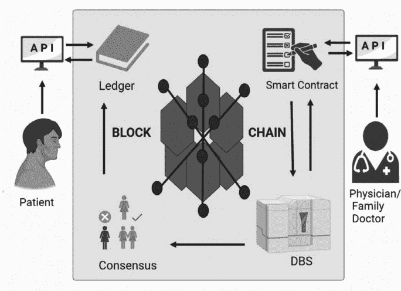

图 9.1 紧急情况下个人健康记录（PHR）访问控制的拟议框架。

## 9.12 将区块链应用于医疗保健供应链

所有提供商品、服务和产品的企业都必须实施有效的供应链管理，因为管理不善时，供应网络可能迅速失效并导致生产延误 [42]。“供应链”（SC）一词是指参与为消费者生产商品或服务的企业、设施和工人所构成的网络。利益相关者联盟是利益相关者为市场增加价值的一种方式 [43]。因此，供应链可以被视为生产者、分销商和最终用户之间流通的物料与内容的协调 [44]。供需调节是 SC 的主要关注点。SC 确保患者能够获得用于康复的正确器械和治疗。制造商、分销商、医院、药店和保险公司构成了 SCHM 供应链 [45]。次优的 SC 可能导致治疗延误、患者满意度降低以及整体支出增加。SCHM 的成功取决于所有参与者的合作与协调，以确保将合适的产品在适当的时间运送到正确的地点。可以使用物流软件和库存管理系统来监控和控制 SC 内部物品的流动 [46]。为了降低医疗支出，我们必须提高 SC 的有效性并改善结果。这一想法近年来越来越受到重视。为了更好地了解和满足患者和临床医生的需求，正在开展简化运营、加强库存管理和利用数据分析的持续工作。医疗保健组织可以通过更多了解并有效管理其 SC 来提升患者护理质量和提供者满意度。SCHM 的目标是在不损害向患者提供的护理质量或医疗保健提供者安全的前提下降低医疗费用 [47,48]。与其他行业相比，提供者在管理 SCHM 时会产生更高的费用并更加依赖第三方 [49]。此外，SCHM 自身也面临一系列困难，因为它通常是去中心化的，医生、医院和患者之间缺乏既定程序，并且受到监管限制。SCHM 中的主要利益相关者通常包括政策制定者、药品制造商、制药行业以及医院、诊所和药店等其他组织和结构。SC 负责分发行业来源和患者来源的产品，例如药品和医疗设备 [50]。图 9.2 建议了 DMD 和 BOT 医疗保健供应链的步骤，其中包括药品 SC 的一般流程，如下：原材料、制造、分发至药店和医院、患者；同时还包括 BOT 流程，如下：供体、存储、运输、质量检验、患者使用。

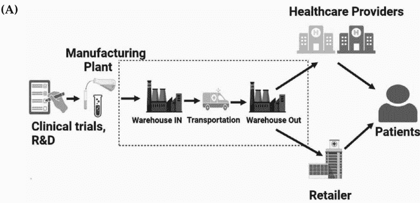

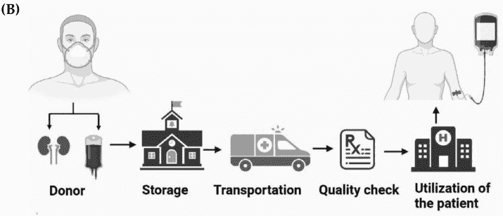

图 9.2
医疗保健供应链的步骤，专门针对 DMDs (A) 和 BOTs (B)。(A) 药品 SC 的一般流程：从原材料到制造商，再到分发至药店和医院，最后到达患者；(B) BOT 的一般流程：从供体到储存运输、质量检查，再到患者使用。

由于其能够提高数据安全性和互操作性以及追踪和溯源数据和信息的能力，区块链技术有望从根本上改变医疗保健行业。医疗保健领域的一个重大问题是缺乏可信、安全可靠的可接受数据存储和检索系统。区块链技术通过允许用户在不可篡改的分布式账本中记录交易，为这一问题提供了绕过方案，该账本免受篡改。此外，使用区块链技术可能增强现有多个医疗保健系统和机构之间的互操作性，从而实现更流畅的沟通和数据交换。由于许多医疗保健系统正变得越来越孤岛化并采用彼此不兼容的技术，各提供者访问和交换数据变得困难。当医疗专业人员能够快速访问和交换存储在共享去中心化数据库中的相关信息时，更好的护理协调和结果是可行的。医疗行业中区块链技术的一种可能用途是验证医疗用品和设备（例如药物和手术工具）的合法性。通过使用区块链技术跟踪患者的 SC，患者将更清楚他们接受的药物是否安全、有效且质量高。因此，区块链技术在医学领域的应用越来越广泛 [51]，并且它还可能有助于解决 SC 问题 [52]。分布式系统的一大好处是，即使在利益冲突时，它们也能更轻松地共享信息并追究实体的责任。因此，区块链技术有可能提高 SC 的可靠性、真实性、安全性和可扩展性。供应链上下游的企业可以利用区块链技术的可追溯性特征，在去中心化账本中保持关键数据的跟踪，该账本在无需第三方介入的情况下对其进行验证。这，加上政府和私营部门的警报，创造了一种能够识别和报告未经授权或人造药物的检查机制 [53]。

## 9.13 面向供应链的区块链与物联网

沿供应链传输实际数据和检查资产只是物联网技术的许多用途中的两个例子 [54]。将区块链与物联网集成可能提高资产安全性。Modum 以此为主要关注点，被用来演示合并不同技术如何提升性能。可集成到紧凑型设备中以监测患者健康并生成分析报告的传感器，正在医疗保健行业引起关注。使用物联网简化医务人员行政任务的医院颇具吸引力 [55]。例如，Kshetri 引用 Modum 公司作为区块链和物联网如何共同使用的示例，该项目起源于苏黎世大学与当地社区的合作努力。该公司的最终目标是开发一个基于区块链的药品分销系统。根据 Kshetri [56] 和 Campbell 的说法，该公司的目标是使用物联网（IoT）原则来追踪药物随时间的稳定性。系统会检查是否满足特定的运输条件，以确保物品完好无损地送达。基于以太坊并由智能合约运行的 Modum 平台，会例行检查药品质量是否符合规范。如果交易出现问题，将不会发放药物，并且会向控制面板发出警报 [57]。由于 Modum 涉及药品运输，因此必须监控温度等因素。这意味着，得益于被称为区块链的分布式账本技术，消费者可以从药品离开制造商的那一刻起，一直追踪其运输情况直到抵达最终目的地。以下是 Modum 平台的构建细节，让你确切了解你将获得什么：(1) 基于以太坊的区块链网络；(2) 物联网设备的蓝牙传感器；(3) 用于跟踪资产信息的 PostgreSQL 数据库；(4) 用于提供 JSON 服务的 REST API 平台；(5) 用于定义交易里程碑的智能合约；以及 (6) 用于扫描药品条形码并执行质量保证检查的移动应用 [58]。

## 9.14 结论

这项关于利用区块链技术支持医疗保健供应链的系统性文献研究发现，世界各地的研究人员正在为行业来源的物品（如药品和医疗器械）以及患者来源的产品使用这项新技术。基于区块链的可追溯性技术可能使供应链更加透明和可追踪。根据对已发表文章的调查，基于区块链的可追溯性解决方案在所有供应链中越来越受欢迎。根据文献，食品和制药行业最常使用它们。智能合约和物联网集成正在极大地扩展区块链的应用。令人惊讶的是，区块链不会取代当前方法。基于区块链的供应链透明度需要得到验证。

## 参考文献

- 1. Nakamoto S. 比特币：一种点对点电子现金系统. Decentralized Business Review. 2008 Oct 31:21260.
- 2. Hasselgren A, Kralevska K, Gligoroski D, Pedersen SA, Faxvaag A. 医疗保健与健康科学中的区块链：一项范围综述. International Journal of Medical Informatics. 2020 Feb 1;134:104040.
- 3. Mettler M. 医疗保健中的区块链技术：革命从这里开始. In 2016 IEEE 18th International Conference on E-Health Networking, Applications and Services (Healthcom), 2016 Sep 14 (pp. 1–3). IEEE.
- 4. Yun D, Chen W, Wu X, Ting DS, Lin H. 区块链：将数字健康锁入新时代. Annals of Translational Medicine. 2020 Jun;8(11).
- 5. Rupa C, MidhunChakkaravarthy D, Patan R, Prakash AB, Pradeep GG. 基于知识工程的 DApp，利用区块链技术保护医疗证明隐私. IET Communications. 2022 Sep;16(15):1853–64.
- 6. Bocek T, Rodrigues BB, Strasser T, Stiller B. 无处不在的区块链：制药供应链中的区块链应用案例. In 2017 IFIP/IEEE Symposium on Integrated Network and Service Management (IM), 2017 May 8 (pp. 772–7). IEEE.
- 7. Raikwar M, Gligoroski D, Kralevska K. 区块链中使用的加密技术概述. IEEE Access. 2019 Oct 11;7:48550–75.
- 8. Buterin V. 下一代智能合约和去中心化应用平台. White Paper. 2014 Jan 14;3(37):2–1.
- 9. Wechsler R, Ançô MS, Campos CJ, Sigulem D. 医疗诊所中的信息学. Jornal de Pediatria. 2003;79:S3–12.


- 10. Azaria A, Ekblaw A, Vieira T, Lippman A. Medrec: 使用区块链进行医疗数据访问和权限管理. 在2016年第2届开放与大数据国际会议(OBD)上，2016年8月22日（第25–30页）. IEEE.

- 11. De Aguiar EJ, Faical BS, Krishnamachari B, Ueyama J. 基于区块链的医疗保健策略综述. ACM计算机调查. 2020;53(2):1–27; 文章27 (2021年3月).

- 12. Kalil D, Spak T, Godoi W, Santos R, Faria A, Siqueira P, Rosendo M, Gruber Y. 人工神经网络作为通过虚拟环境评估关键培训活动风险的技术. 2018. 可从: https://www.sbgames.org/sbgames2018/files/papers/ComputacaoShort/188251.pdf 获取.

- 13. Lee CH, Yoon HJ. 医学大数据：前景与挑战. 肾脏研究与临床实践. 2017年3月;36(1):3.

- 14. Otero P, Hersh W, Ganesh AJ. 大数据：生物医学和健康信息学培训计划是否准备好了？医学信息学年鉴. 2014;23(1):177–81.

- 15. Chaudhry B, Wang J, Wu S, Maglione M, Mojica W, Roth E, Morton SC, Shekelle PG. 系统综述：健康信息技术对医疗服务质量、效率和成本的影响. 内科学年鉴. 2006年5月16日;144(10):742–52.

- 16. Mukhopadhyay U, Skjellum A, Hambolu O, Oakley J, Yu L, Brooks R. 加密货币系统简要调查. 在2016年第14届隐私、安全与信任年度会议(PST)上，2016年12月12日（第745–52页）. IEEE.

- 17. Hughes A, Park A, Kietzmann J, Archer-Brown C. 超越比特币：区块链和分布式账本技术对企业意味着什么. 商业展望. 2019;62(3):273–81.

- 18. Swan M. 区块链：新经济蓝图. 2015年1月24日（第1–152页）. O’Reilly Media, Inc.

- 19. Rifi N, Rachkidi E, Agoulmine N, Taher NC. 朝着使用区块链技术进行电子健康数据访问管理迈进. 在2017年第四届生物医学工程进展国际会议(ICABME)上，2017年10月19日（第1–4页）. IEEE.

- 20. Dinh TT, Liu R, Zhang M, Chen G, Ooi BC, Wang J. 解读区块链：区块链系统的数据处理视角. IEEE知识与数据工程事务. 2018年1月4日;30(7):1366–85.

- 21. Kumari K, Saini K. 数据处理与药品可追溯性：区块链与医疗保健结合以打击假药. 科学与技术研究国际期刊. 2020年3月;9(3):728–31.

- 22. Zheng Z, Xie S, Dai HN, Chen X, Wang H. 区块链的挑战与机遇：一项调查. Web与网格服务国际期刊. 2018;14(4):352–75.

- 23. Alhadhrami Z, Alghfeli S, Alghfeli M, Abdella JA, Shuaib K. 为医疗保健引入区块链. 在2017年电气与计算技术与应用国际会议(ICECTA)上，2017年11月21日（第1–4页）. IEEE.

- 24. Greenspan G. Multichain私有区块链白皮书. 2015年7月;85. www.multichain.com/download/MultiChain-White-Paper.pdf.

- 25. Zhang Q, Cherkasova L, Smirni E. 基于回归的多层应用动态资源配置分析模型. 在第四届自主计算国际会议(ICAC’07)上，2007年6月11日（第27页）. IEEE.

- 26. Pîrlea G, Sergey I. 区块链共识机械化. 在第7届ACM SIGPLAN认证程序和证明国际会议论文集中，2018年1月8日（第78–90页）. https://doi.org/10.1145/3167086

- 27. Castro M, Liskov B. 实用拜占庭容错. 在OSDI中，1999年2月22日（第173–86页）. https://pmg.csail.mit.edu/papers/osdi99.pdf

- 28. Mingxiao D, Xiaofeng M, Zhe Z, Xiangwei W, Qijun C. 区块链共识算法综述. 在2017年IEEE系统、人与控制论国际会议(SMC)上，2017年10月5日（第2567–72页）. IEEE.

- 29. King S, Nadal S. Ppcoin：基于权益证明的点对点加密货币. 自行发表论文. 2012年8月19日;19(1).

- 30. Clauson KA, Breeden EA, Davidson C, Mackey TK. 利用区块链技术增强医疗保健供应链管理：对健康供应链中挑战与机遇的探索. 区块链在医疗保健中的应用. 2018;1:1–12. https://doi.org/10.30953/bhty.v1.20.

- 31. Naen MF, Adnan MH, Yazi NA, Nee CK. 云中人工智能优化的考勤监控系统开发. 人工智能国际期刊. 2021年12月23日;8(2):88–98.

- 32. Sylim P, Liu F, Marcelo A, Fontelo P. 用于检测分销中伪造和劣质药物的区块链技术：医药供应链干预. JMIR研究方案. 2018年9月13日;7(9):e10163.

- 33. Dimitrov DV. 医疗保健数据管理的区块链应用. 医疗信息学研究. 2019年1月31日;25(1):51–6.

- 34. Arpitha MJ, Binduja B, Jajnavi G, Mohanchandra K. 用于紧急虚拟语音的脑机接口. 人工智能国际期刊. 2021年6月22日;8(1):40–7.

- 35. Chamarajan G, Charishma Y. 阿尔茨海默病：一项调查. 人工智能国际期刊. 2021年6月22日;8(1):33–9.

- 36. Desai V, Singh M, Mohanchandra K. 基于胶囊神经网络的阿尔茨海默病早期检测调查. 人工智能国际期刊. 2020年4月23日;7(1):7–12.

- 37. Kamath V, Lahari Y, Mohanchandra K. 基于区块链的医疗系统中药品供应链安全数据共享框架. 人工智能国际期刊. 2022年6月9日;9(1):32–8.

- 38. Uddin M, Salah K, Jayaraman R, Pesic S, Ellahham S. 用于药物可追溯性的区块链：架构与开放挑战. 健康信息学期刊. 2021年4月;27(2):1460458222 11011228.

- 39. Nevile C, Polzer G, Cote R, Noble G, Burnett D, Hyland-Wood D. 企业以太坊联盟客户端规范v6. 企业以太坊联盟. 2020. 可从: https://entethalliance.org/wp-content/uploads/2020/11/EEA_Enterprise_Ethereum_Client_Specification_v6.pdf 获取.

- 40. Sousa J, Bessani A, Vukolic M. 用于Hyperledger Fabric区块链平台的拜占庭容错排序服务. 在2018年第48届IEEE/IFIP可靠系统与网络国际会议(DSN)上，2018年（第51–58页）. https://doi.org/10.1109/DSN.2018.00018

- 41. Rajput AR, Li Q, Ahvanooey MT. 基于区块链的紧急情况下个人健康记录秘密数据共享框架. 在Healthcare中，2021年2月14日（第9卷，第2期，第206页）. MDPI.

- 42. Ellram LM, Tate WL, Billington C. 理解与管理服务供应链. 供应链管理杂志. 2004年9月;40(3):17–32.

- 43. Lin FR, Shaw MJ. 供应链网络中订单履行流程的再造. 柔性制造系统国际期刊. 1998年7月;10(3):197–229.

- 44. Samaranayake P, Toncic D. 用于供应链管理的生产计划、项目管理和物流系统集成. 生产研究国际期刊. 2007年11月15日;45(22):5417–47.

- 45. Schneller ES, Smeltzer LR. 医疗保健供应链的战略管理. Jossey-Bass. 2006年2月17日. 可从: https://www.wiley.com/en-us/Strategic+Management+of+the+Health-Care+Supply+Chain-p-9781118193426 获取.

- 46. Choi TY, Li JJ, Rogers DS, Schoenherr T, Wagner SM. 《牛津供应链管理手册》, 2021. 牛津大学出版社.

- 47. Turhan SN, Vayvay Ö. 非传统供应商管理库存：医疗服务中的面向服务的供应链建模. 在土耳其伊斯坦布尔工业工程与运营管理国际会议上，2012年（第1526–35页）. https://ieomsociety.org/ieom2012/pdfs/366.pdf

- 48. Dobrzykowski D. 理解下游医疗保健供应链：拆解监管和行业特征. 供应链管理杂志. 2019年4月;55(2):26–46.

- 49. Saeed H, Malik H, Bashir U, Ahmad A, Riaz S, Ilyas M, Bukhari WA, Khan MI. 医疗保健中的区块链技术：一项系统综述. PLoS ONE. 2022年4月11日;17(4):0266462.

- 50. Elangovan D, Long CS, Bakrin FS, Tan CS, Goh KW, Yeoh SF, Loy MJ, Hussain Z, Lee KS, Idris AC, Ming LC. 医疗保健部门中区块链技术的应用：系统综述. JMIR医学信息学. 2022年1月20日;10(1):17278.

- 51. Sanmarchi F, Toscano F, Fattorini M, Bucci A, Golinelli D. 用于可靠的数据驱动型医疗保健管理和研究转型的分布式解决方案. 公共健康前沿. 2021;9:944.

- 52. Maher A.N. Agi, Ashish Kumar Jha, 供应链中的区块链技术：组织采用的综合理论视角. 生产经济学国际期刊, 第247卷, 2022,108458-1-15. https://doi.org/10.1016/j.ijpe.2022.108458.

- 53. Longo F, Nicoletti L, Padovano A, d’Atri G, Forte M. 区块链支持的供应链：一项实验研究. 计算机与工业工程. 2019年10月1日;136:57–69.


- 54. Yan B, Huang G. 基于RFID和物联网的供应链信息传输. In 2009 ISECS International Colloquium on Computing, Communication, Control, and Management, 2009 Aug 8 (vol. 4, pp. 166–9). IEEE.

- 55. Rahmani AM, Gia TN, Negash B, Anzanpour A, Azimi I, Jiang M, Liljeberg P. 利用医疗物联网边缘的智能电子健康网关：一种雾计算方法. Future Generation Computer Systems. 2018 Jan 1;78:641–58.

- 56. Kshetri N. 1 Blockchain在实现关键供应链管理目标中的作用. International Journal of Information Management. 2018 Apr 1;39:80–9.

- 57. Öz S, Gören HE. 区块链技术在供应链管理流程中的应用：案例研究. Journal of International Trade, Logistics and Law. 2019 Jun 12;5(1):21–7.

- 58. Bocek T, Rodrigues BB, Strasser T, Stiller B. 无处不在的区块链：制药供应链中区块链的一个用例. In 2017 IFIP/IEEE Symposium on Integrated Network and Service Management (IM), 2017 May 8 (pp. 772–7). IEEE.

## 利用区块链共享和管理健康记录凭证

Atul B. Kathole, Sonali D. Patil, Vinod V. Kimbahune, and Avinash P. Jadhav

### 10.1 引言

越来越多的医疗设施正在信息化，导致收集的医疗数据量不断增加 [1]。若要实现更好的资源整合以及更高的诊断和治疗效能，鼓励共享电子医疗数据是绝对必要的。另一方面，患者的医疗记录包含大量必须受到保护的个人可识别信息。医疗数据交换中的数据隐私泄露和滥用问题，对患者的生命和财产构成重大风险。因此，在数据共享的背景下，关于数据安全和隐私的问题至关重要。此外，由于医疗记录分散在众多医疗机构中，且采用了多种数据存储格式，导致出现了信息孤岛。医疗健康记录（MHR）是存储在计算机上的患者病史的电子版本（MHR）。在当今这个信息时代，电子健康记录在医疗卫生领域发挥着越来越重要的作用。尽管如此，对患者医疗记录的安全性和保密性仍存在担忧 [1]，[2]。为克服这些问题，许多组织正在推动向基于云的系统和以太坊区块链过渡，这些系统能够实现患者与临床医生之间的全球连接 [3]。患者对自己的数据拥有完全控制权，并可以向其认为可靠的各方提供访问权限 [4]。在当今时代，我们可以使用移动设备共享几乎任何东西，包括图片、电影、文本，甚至是对投资账户的访问权限；但医疗记录仍然无法访问。这是因为，随着越来越多的参与方介入生成复杂且关键的数据连接过程，医疗周围的环境变得更加复杂。因此，存在隐私泄露、安全漏洞和运营效率下降的潜在风险。因此，在解决不兼容健康数据的问题上尚未取得进展 [5]。2008年，Nakamoto撰写了一篇描述比特币的论文，并被公认为区块链系统的发明者。这是一个允许不同计算机相互通信和共享信息的网络 [6]。区块链是一种复杂的数据系统，它在单独的区块中存储不断扩展的档案 [7]。作为结果，区块链中每个新贡献的信息块都连接到其前一个区块。哈希值的使用使其不可质疑；所有记录的过程都带有时间戳，赋予其唯一身份，并且模型被传播到参与系统中的每个节点，保证即使在未经任何外部干扰的终止发生后，信息的真实性仍然得到保持 [8]。星际文件系统（IPFS）是一种分布式数据存储系统，其运行方式与对等（P2P）BitTorrent协议类似。其目的是构建一个所有数字设备都能访问相同数据文件结构的网络，在此示例中，这对于存储大量医疗数据将很有帮助 [9]。物联网（IoT）在现代世界中无处不在；然而，自 [10] 以来，它在医学领域取得了特别迅速的增长。由于物联网（IoT）和可穿戴设备在医疗行业越来越普及，所提供的治疗质量因此有所提高。可穿戴技术有能力收集个人的健康数据并将其传输至医疗机构或医师 [11]。医学领域中可穿戴物联网设备收集的信息既是必要的，也是机密的。由于此类信息可能对个人生活产生潜在影响，因此保护它至关重要 [12]。区块链技术允许安全存储由各种物联网设备收集的敏感患者信息。

以下是本文的重要要点列表：

(1) 解释区块链技术背后的概念，分布式账本技术（区块链）如何影响（2）患者记录的保密性。（3）每个请求者的信息以智能合约中的属性集合形式存储。因此，如果提供了相应数据，智能合约可以自动实施访问控制 [13]。

### 10.2 文献综述

在集中式设计中（例如支持旧式EHR系统的设计），一个基本组织负责管理、领导和指导系统。该组织还负责确保系统正常运行。在分布式架构中，每个块都与可能存在的任何主导专用组件分开管理。随后，我们将简要总结EHR框架以及我们在区块链方面的专长 [14]。

### 10.2.1 EHR结构

许多人认为电子健康记录（有时称为EHR）是存储患者病历的数据库（例如电子病历——EMRs）。电子健康记录（EHR）可以从电子病历（EMRs）中包含的信息中受益，这些记录主要由医师和护士等医疗专业人员保存。患者私人健康记录（PHR）现在包含了患者自身可穿戴设备获取的健康信息。患者现在可以将其PHR提供给正在治疗他们的医疗专业人员（患者）。授权用户（例如，获得许可查看特定患者信息以协助研究的医师）之间可以持续传输信息，EHR结构应保证输入数据的保密性以及其可访问性和完整性。此外，如果正确实施，此类框架的开发有能力消除冗余数据的可能性以及文件丢失的风险 [15]。然而，这些网络日益增长的互连性使得在这些系统中传输或存储信息时保护信息的问题变得更加困难（例如，更可能的爆发载体）。

### 10.2.2 区块链

区块链技术因比特币的成功而声名鹊起，它使用户能够在不依赖中央第三方的情况下，在不可信系统中进行可靠且安全的通信。在本指南的这部分中，我们将讨论将区块链各部分整合在一起的基本组件。区块链技术是创建全面且有效的合同记录的最佳选择 [16]。

区块头中包含以下信息：

- 前一个区块的哈希值：对前一个区块计算得到的哈希函数值。
- 时间戳：生成当前区块的时间点。

在计算哈希值之前，矿工会更改一个名为“nonce”的任意四字节字段。这样做是为了让他们能够解决需要工作量证明的挖矿问题。由区块链主体中的交易形成的Merkle树根哈希值。对于新的有效区块，目标哈希是值的截止点。目标哈希将决定工作量证明问题的难度级别。在指定时间窗口内发生且有效性已得到验证的交易构成了区块体。此类树状结构中相关部分的哈希值可用于验证任何合同的有效性，从而提供一种可靠的机制来证明交易的完整性和持续存在。这与整个Merkle树形成对比，整个Merkle树无法用于此目的。同时，每当协议发生更改时，主存储中会生成一个新的哈希值，导致根哈希被破坏。此外，一个区块能够携带的最大合同数量不仅由每个单独合同的参数决定，还由整个区块的参数决定 [17]。为了链接和组合这些区块，采用了加密哈希函数和仅追加式集合。由于无法更改或删除先前已确认的信息，因此任何新贡献的信息都必须以链接到先前区块的补充区块形式进行。每次修改区块时，都会生成一个新的哈希值和链接连接。这一点之前已经说过。因此，我们实现了不可更改性和安全性。

### 10.2.2.1 智能协议

智能合约是基于区块链技术构建的协议，具有自我执行能力。这些合同已广泛应用于政府、医疗和金融等多个领域。只要在适当的协议话语中接收到合同调用信号，这样的系统就能够执行复杂的编程任务 [18]。智能协议将


自动在安全容器中执行预定条款。Ethereum 是第一个公开可用的区块链平台，拥有世界上首个革命性协议方言库。这些方言是图灵完备的，可用于部署任何类型的分布式请求系统（DApps）。

## 10.2.2.2 区块链结构命名法

本质上存在三种不同的区块链系统，可根据组成网络的节点对数据进行身份验证的准确性将其相互区分：共享的公共账本。任何人只要符合条件，随时都可以以代币为交换，作为矿工或重要节点参与社区区块链 [19]。比特币和 Ethereum 是两个最著名的公共区块链系统，此外还有许多其他公共区块链系统。

## 10.2.2.3 私有区块链

参与者需要提交加入去中心化区块链网络的申请，并在获得许可后才能加入。孤立的区块链拓扑是一些示例，GemOS 和 MultiChain 即是其中两种。分布式上下文账本。联盟区块链被视为“半私有”区块链，这使其能够弥合本地网络与去中心化网络之间的差距。它面向已展示出致力于为员工福祉培育创新文化的认可机构。由企业联盟构思并创建的区块链基础设施包括 Hyperledger Fabric 和 MultiChain [20]。此外，在 Ethereum 的帮助下，联盟区块链可以更轻松地创建。

## 10.3 基于区块链的 EHR 系统

私有数据将有其用途，只有获得授权的用户才能访问所请求的数据。隐私、真实性和访问权均得到保障，从而提升系统的整体安全性。信息已加密，只有获授权查看的人员才能查看。

- 准确性。为保证信息准确，传输过程中不得被任何第三方篡改。

- 可访问性。确保系统的合法用户不会被非法拒绝访问数据和资产。

- 可审计性。信息安全的关键组成部分。例如，审查日志主要包含谁访问了哪份电子健康记录（或个人健康记录）、出于何种目的访问，以及全生命周期内所有活动的时间戳。

若发现不当行为，相关人员将通过审计方法被追究责任。出于隐私考虑，不存在可用于确定实体身份的外部信号。对他人完全隐身并非易事。目前，区块链技术在医疗保健应用方面的研究正集中精力于以下领域，最终目标是实现前面概述的目标：保护记录的保密性和安全性 [21]。区块链是一个可靠且经过验证的数据库，可用于跟踪各种机密医疗记录。除了构建安全存储外，还必须保证数据的隐私性。相比之下，医疗保健数据集在实际中通常极其庞大且复杂。话虽如此，另一个需要解决的问题是如何存储海量数据而不导致区块链网络变得迟缓。

公平平衡地呈现数据。在大多数当代医疗服务形式中，数据管理责任落在服务提供者身上。自主主权理念推动着一项将医疗记录控制权归还给个人的运动，个人应当自由决定披露或保留这些数据 [22]。预计这一变化将在未来几年内发生。这对于确保企业与行业之间、以及行业与行业部门之间的诚实沟通至关重要。

数据审计。通过检查审计日志，当出现分歧时，请求者需对其使用电子健康记录（EHR）负责。多种系统依赖区块链技术和智能合约来维护活动日志，从而实现对这些系统的审计。得益于分布式账本，任何交易或请求都能即时验证。

既动态又原创的领导力。验证系统中所有操作者的身份对于确保一切运行正常至关重要。只有获授权的操作者才能执行必要的操作，以维护结构的完整性并避免任何形式的恶意活动。接下来，我们将审视数据归档、数据共享、数据审计和身份管理的当前流程，以便更好地理解这些主题。

### 10.3.1 信息存储

### 10.3.1.1 如何实现安全的信息存储

采用区块链技术是改善 EHR 系统已令人印象深刻的安全水平的众多潜在方法之一。尽管如此，在缺乏加密或身份验证的情况下，存储在区块链数据库中的敏感数据可能容易受到统计攻击。编码、匿名化和接口切换工具是用于保密的加密和非加密方式的几个示例。根据 Zheng 等人的建议，数据在上传云端之前应采用对称密钥方案以及阈值编码策略进行编码（2018）。利用 Shamir 的秘密分享方法，对称密钥将被切分成大量份额，每个份额分发给不同的密钥持有者 [23]。只有当请求者能够访问足够数量的密钥份额时，才能解密密文。若泄露影响的密钥持有者数量少于预设的最小数量，则不会导致数据丢失。Yue 等人于 2016 年提出了医疗数据网关（HDG）的概念，这是一款利用区块链技术和 MPC 的移动应用程序。Guo 等人还提出了一种基于属性的医疗区块链签名技术（MA-ABS），该技术涉及多个组织（2018）。该系统中使用的签名并非用于证明给消息最终批准的个人的独特性，而是用于表明其所拥有的特征（由某个更高权威机构决定）所对应的权利（如访问策略）。换言之，该签名并不用于验证个人的唯一性。当伪随机函数（PRF）的秘密种子分散在多个不同公司时，网络对碰撞的抵抗力会增强 [24]。为了使医疗基础设施能够抵御强力攻击，其常规操作的编码密钥需要持续更新（如算术攻击）。为了理解特定的旧内容，许多历史密钥需要存放在安全位置；因此，保存和管理这些历史密钥的成本将增加。这对于仅拥有有限处理资源和/或昂贵存储设备的应用尤其如此。

### 10.3.1.2 如何存储大量医疗信息

区块链有一天可能会被电子健康记录（EHR）系统用于促进医疗记录和其他类型数据的归档。若此类信息直接存储在区块链网络中，将同时增加计算成本和存储负载。这是因为区块链具有安全且受限的块大小。然而，此类信息可能会导致隐私泄露的风险 [25]。Zheng 等人（2018）提出了云打包的概念，以展示机器学习如何从存储在区块链上的健康记录中获益 [26]。存储在云端的数据可以被解密，但前提是购买者满足特定要求并拥有足够的替换组件。Juneja 和 Marefat（2018）利用分布式存储架构，解决了区块链所带来的打包限制，以及当误报数量增加时无法进行正确回滚的问题，该方案现可实施。此外，Azaria 等人（2016）使用离线数据存储，将与医疗相关的数据保存在防火墙后面的缓存中。若获得 Gatekeeper 的授权，则其可能提供查询结果 [18]。Liu 等人提出了一种基于 CP-ABE 的医院准入控制医疗记录云端安全存储方法（2018）（CCAC）。通过将基于云的数据与相应的提取签名相结合，数据请求者能够验证所请求数据的可靠性和真实性。根据 Sun 等人的设想，新开发的 SignedEHR 受医疗捐赠者的基于属性的签名法律约束，并存储在可信的第三方数据库中以保护患者隐私（2018）。在文档上传到区块链系统之前，医生需要使用去中心化基于属性的签名（DABS）[19]验证其真实性。这是区块链系统批准提议记录申请所必需的。适用的 SignedEHR 地址是请求中必须提供的最重要组成部分。验证用户签名是必需的，以确定请求访问数据的人是否就是其声称的那个人。医疗数据可以使用多种媒介记录，例如文本、照片和电子病记录。由于其块大小较小，区块链不适合高容量数据存储；因此，医疗系统需要研究存储海量数据的替代方法 [20]。区块链的有限块大小使其不适合高容量数据存储。Nguyen 等人（2019）开发了一种将智能协议与 IPFS 集成的系统，以实现去中心化云打包和受控信息传递。此举旨在加强操作者和联系监控。


## 10.3.2 信息共享

医疗行业使用的关键数据分布在各种位置，包括医院、诊所、实验室等其他场所。医疗数据的存储、检索和更新对于提供医疗服务至关重要。由于不同企业采用多种数据格式，以这种方式传达医疗数据时会出现各种复杂情况 [21]。我们将首先讨论互操作性，它是数据交互的要求，需要在其他企业能够使用之前，对各组织收集的数据进行深入调查。

## 10.3.2.1 基于智能协议的信息分发访问控制工具

患者不应再因将厚重的纸质病历从一家医疗机构运送到另一家而承受不便与低效。通过改进信息共享方式，医疗服务质量和治疗成本都能得到显著改善。当前的电子健康记录（EHR）系统确实带来了很多便利；然而，所使用的医疗数据格式中仍存在大量障碍，限制了各种环境下信息的安全且可扩展的交换。如前所述，集中式系统的风险之一是数据丢失以及针对单一位置的攻击。当患者将其信息与可信第三方共享时，他们几别无选择，只能放弃对个人信息的控制。这可能为企业滥用其在社区中赢得的信任打开方便之门 [22]。不仅如此，竞争组织之间建立可信链接并共享信息的困难，也是信息共享扩展的一大障碍。因此，必须恢复消费者对其数据的控制并加强隐私法律，以使沟通更加便捷。在多个领域安全共享健康信息将更具挑战性，但当信息包含在单一机构内时，管理安全和保密问题将简单得多。与此同时，有必要探索不同策略以改善医疗行业内的协作。一种要求仅允许获批企业传输信息的安全访问控制系统，是一种常用的标准解决方案。访问控制列表（ACL）是可能需要访问信息的请求者及其对详细信息关联同意（读、写、追加）的列表。此方法中的访问策略通常包括与信息所有者相关的 ACL。访问控制列表（ACL）是可能需要访问信息的请求者及其关联同意（读、写、追加）的列表。依法运营的企业按照既定访问标准获准进入受限区域的过程被称为“背书” [23]。需要进行身份认证的步骤始终先于需要进行授权的步骤。管辖此机制的访问规则主要着重于确定谁对哪个数据项做了哪些更改以及为何做这些更改。第三方负责传统电子健康记录交换访问控制方法的实施、管理和运营。用户通常依赖第三方（如云服务器）来可靠地检查并接受其信息使用偏好。这是因为第三方对用户信息的访问权限更大。然而，事实上，服务器是“诚实但好奇”的。当区块链技术与访问控制装置相结合时，可能可以建立一个可靠的框架，使企业能够以既机密又安全的方式相互处理数据 [24]。个人能够在使用区块链上的智能合约来建立访问权限（授予、拒绝、撤销）、操作（读、写、追加、删除）和运算（读、写、追加、删除）的同时，仍保持对其数据的控制，这是这一新范式中最重要的方面之一（读、写、追加、删除）。如果满足条件，智能协议可以在区块链上实现，并可用作审计记录在案的任何需求的工具。如果未满足先决条件，智能协议无法完成。关于使用智能合约来促进医疗信息安全交换的研究越来越多，对此的需求也在不断增长。

## 10.3.2.2 信息共享的密码学知识

谈到电子健康记录（EHR）系统时，使用加密可以进一步提高数据传输及患者接入所提供的安全性。这是因为加密可以防止未经授权的各方读取数据。Dubovitskaya 及其同事在 2017 年发表的研究论文中，他们主张癌症患者电子病历（EMR）的管理和传播应采用基于对称加密的架构。患者有能力生成对称编码密钥，随后可用于与其各自医疗执业者之间的安全通信。这些密钥可用于传输敏感信息。按照既定的访问法规 [25]，医疗专业人员在程序完成（即代理重新加密已完成并被视为完毕）后，将各自收到一个新密钥。整个事情取决于对称密钥是否愿意合作。

存储在可靠云服务上的信息。患者有能力利用智能合约安全地设置访问限制并交换对称密钥，以保护其数据的机密性并防止未经授权的访问。这可以通过防止未经授权的访问来实现。Xia 等人（2017 年）开发了一种方法，用于验证操作者身份并分发密钥以解锁复杂数据共享数据库中的受限内容。该方法发表于 2017 年。为了实现这一目标，有必要创建一种检查操作者身份并分发密钥的方法。由于结合了用于创建关联确认和合同密钥的用户-发行方协议以及用于验证关联真实性的用户-验证方过程，只有获授权的操作者才能向系统提出信息请求。这两种协议都用于确保关联是真实的。这两种技术的结合使这项成就成为可能。Ramani 等人（2018 年）创建了大量轻量级密码学方法，这些方法是社区所要求的，旨在提升授权检查（访问、检索）提供的安全级别。当患者信息存储在私有区块链上时，只有患者本人可以对该信息进行更改，并且在更改公开之前会收到通知。

## 10.3.3 信息审计

如果在用户与患者病历的交互方面存在分歧，审计日志可用作证据，以便用户继续对这些交互承担责任。区块链技术提供的不可变社区账本和智能合约有能力为所有访问需求生成不可变记录，从而在过程中创造责任性和可追溯性。审计日志中记录的信息必须既重要又易于理解，才具有效性。记录的事件中针对数据所有者 ID 的用户 ID 是作为成就类型的一部分获得的，用以指示身份认证要求的影响 [26]。

## 10.3.4 身份管理器

在允许访问任何资源之前，验证任何结构安全性的第一步是建立该结构的关联。刚才描述的访问控制系统在释放任何敏感数据之前始终执行身份验证。这样做旨在确保只有真正的数据请求者才能访问敏感信息。典型的操作者验证类型示例包括直通验证、生物识别验证以及通过社区基础密码学进行身份确认。主患者索引（MPI）是传统电子健康记录（EHR）系统中管理离散信息的核心组件，充当骨干作用。它确保每条记录的真实性和唯一性，同时也便于在文件之间建立适当的连接。希望加入区块链网络的用户需要提供一份说明，其中必须包含公钥和私钥。私钥用于标记交易，公钥用于操作者文档。此非对称密钥对的公共部分随后描述了每个不同实体的特征。在识别信息方面，区块链依赖于地址，而非个人的真实姓名 [27]。超级账本 Fabric 成员服务提供商（MSP）负责处理身份管理、注册发行以及参与节点的合同文档。Al Omar 及其同事提出了唯一性监督注册的概念（2017 年）。实体首次尝试进入网络时，需要注册一次，并保存其 ID 和 PWD，以便在后续登录并访问安全信道。

## 10.4 未来趋势

### 10.4.1 大数据信息

被称为区块链的技术的不可变性、安全性和可追溯性，可能为如何处理大数据方法中的安全缺陷提供解决方案。根据 Otero 等人（2014 年）的观点，全面数据可能能够最大限度地利用所有医疗信息资产，以支持必要的变革。这些变革包括在医疗诊断领域进行预测、评估磁共振成像以及其他线索。在大多数情况下，信息管理和数据调查是在讨论大规模数据分析时使用的适当统称。区块链技术有潜力用于医疗行业中患者数据的管理。这将保护患者个人


信息。在数据分析方面，可以通过筛选基于区块链技术的记录和对话，以寻找潜在商业活动的迹象。

### 10.4.2 机器学习

机器学习方法有望在优化医疗系统和提供智能服务方面发挥作用。如何以安全的方式收集、传输和训练敏感信息，是现实世界机器学习系统面临的最重大挑战之一。将机器学习与区块链相结合，正在成为增强数据集隐私性和数据安全性的一种日益流行的策略。在采取适当预防措施的前提下，跨多个计算机节点共享数据可以是一种被称为“linked learning”的有效机器学习方式。通过共享加密数据集，许多医院和其他医疗保健组织可以合作开发极其精确的预测算法。区块链技术有可能被用作控制器，记录不可争辩且完全透明的与训练相关的通信，从而确保问责制和可信赖的协作。这将使医疗管理人员和研究人员更容易共享加密数据集，最终改善医疗护理和公共卫生。由于区块链有能力维护用户的机密性，输入到机器学习算法中的数据是可以信赖的。Yaji 等人的工作旨在使从事不同学科的学者更容易相互共享大规模数据集（2018）。Gentry 声称，目前正在开展关于同态加密的研究，以便对加密数据执行机器学习（2009）。然而，同态加密确实会导致处理能力的显著损失。在不久的将来，它可能能够在不阻碍机器学习过程的情况下保护智能建筑中的关键数据。如果不准确预测的发生率很高，回滚模型可以保存在区块链中。重新训练的模型用于访问所需数据的引用，以不可变且安全的格式保存在区块链中 [22]。此外，人工智能可用于自动化智能交互的开发，这既能提高操作的安全性，也能提高其适应性。

### 10.4.3 物联网 (IoT)

随着传感器在各种应用中的使用日益普遍，迫切需要加强对传感器获取的敏感数据隐私保护。这些传感器会捕获大量个人信息。物联网中的大部分数据是在低功耗设备之间通过非安全无线网络交换的，这使得数据容易遭到敌对行为者的拦截和篡改。正如我们所看到的，目前为止讨论的基于区块链的技术提供了一个安全的信息访问控制框架和分布式关键监督，可用于构建安全的 IoT 设备消息。这可以通过在多个节点上分布关键监督来实现。5G 将是下一代消息网络，其特点是高吞吐量、巨大的存储容量和可扩展性。下一代智慧医疗领域将从 5G IoT 中以多种方式受益，包括提高可靠性、降低延迟和增加吞吐量，仅举几例。一种 5G 无线智能手机系统被提议用于未来对患有慢性疾病的人进行长期护理。Min 等人（2018）以与之前相同的方式对糖尿病患者进行了评估和监测。在这个设计框架内，系统切片代理和 5G 系统监督层都可能从区块链技术的应用中受益。

## 10.5 结论

本研究表明，区块链技术有望在常规医疗系统中带来重大变革。然而，在现有电子健康记录机构能够充分参与基于区块链的知识共享之前，仍需消除一些科学和实际障碍。患者必须经历冗长而复杂的程序才能访问自己的医疗记录。电子健康记录（即 EHR）很可能在不久的将来为加强数字健康记录监测奠定基础。信息安全技术和方法可以被利用来在银行、经济、供应链监督、公共媒体和物联网等多个领域提供数字化护理。在调查过程中，我们更深入地关注了其中几个难点，并详细讨论了它们。此后，我们在多个领域发现了一些有趣的研究空白，其中之一就是物联网（IoT）。我们寄予厚望，希望我们的分析能带来对如何为后代（老龄化）人类开发和执行 EHR 结构的更深入了解，并期望这将成为我们努力的直接结果。

## 参考文献

- [1] Ahram T., Sargolzaei A., Sargolzaei S., Daniels J., Amaba B. 2017 IEEE 技术与工程管理会议 (TEMSCON). IEEE; 2017. 区块链技术创新; pp. 137–41.
- [2] Ahsan M.A.M., Wahab A.W.B.A., Idris M.Y.I.B., Khan S., Bachura E., Choo K.-K.R. CLASS：面向云取证的云日志可靠性与保密性方案。IEEE Trans. Sustain. Comput. 2021;6(2):184–96. https://doi.org/10.1109/TSUSC.2018.2833502.
- [3] Al Omar A., Rahman M.S., Basu A., Kiyomoto S. 安全、隐私和匿名性国际会议（计算、通信与存储）。Springer; 2017. Medibchain：面向医疗数据的基于区块链的隐私保护平台；pp. 534–43.
- [4] Dai W., Dai C., Choo K.R., Cui C., Zou D., Jin H. SDTE：安全的基于区块链的数据交易生态系统。IEEE Trans. Inf. Forens. Secur. 2020;15:725–37.
- [5] Feng Q., He D., Liu Z., Wang D., Choo K.-K.R. IEEE P1363 标准中基于身份的签名方案的多方签名协议。IET Inf. Secur. 2020;1(99):1–10.
- [6] Feng Q., He D., Zeadally S., Khan M.K., Kumar N. 区块链系统中隐私保护综述。J. Netw. Comput. Appl. 2019;126:45–58. [Google Scholar]
- [7] GemOS：区块链操作系统；2020 [在线]。可用：https://enterprise.gem.co/.
- [8] He D., Zhang Y., Wang D., Choo K.-K.R. 面向公钥密码学 IEEE P1363 标准中基于身份的签名方案的安全高效双方签名协议。IEEE Trans. Dependable Secure Comput. 2018;1(99):1–10.
- [9] Ho S.Y., Guo X., Vogel D. 医疗保健信息系统研究的机遇与挑战：照顾患有慢性疾病的患者。Commun. Assoc. Inf. Syst. 2019;44(1):39.
- [10] Hardjono T., Pentland A. 许可区块链中的可验证匿名身份和访问控制。arXiv 预印本 arXiv:1903.04584。2019。
- [11] Huang H., Chen X., Wang J. 具有匿名性和可追溯性的基于区块链的多组数据共享。Sci. China Inf. Sci. 2020;63:130101. https://doi.org/10.1007/s11432-018-9781-0.
- [12] Hyperledger Fabric：2020 [在线]。可用：www.hyperledger.org/.
- [13] Jiang S., Cao J., Wu H., Yang Y., Ma M., He J. 2018 IEEE 智能计算国际会议 (SMARTCOMP). IEEE; 2018. Blodie：面向医疗信息交换的基于区块链的平台；pp. 49–56.
- [14] Lin C., He D., Huang X., Khan M.K., Choo K.-K.R. Dcap：基于区块链的安全高效去中心化条件匿名支付系统。IEEE Trans. Inf. Forensics Secur. 2020;15:2440–52.
- [15] Liu J., Li X., Ye L., Zhang H., Du X., Guizani M. 2018 IEEE 全球通信会议 (GLOBECOM). IEEE; 2018. BPDS：面向电子病历的基于区块链的隐私保护数据共享；pp. 1–6.
- [16] Lloret J., Parra L., Taha M., Toms J. 基于 5G 的智能持续电子健康监测架构与协议。Comp. Netw. 2017;S1389128617302189.
- [17] Miah S.J., Gammack J., Hasan N. 医疗保健分析解决方案设计方法：文献分析。Health Inform. J. 2019;1460458219895386.
- [18] Min C., Yang J., Zhou J., Hao Y., Youn C.H. 5G 智能糖尿病：面向医疗大数据云的个性化糖尿病诊断。IEEE Commun. Mag. 2018;56(4):16–23.
- [19] Morelli U., Ranise S., Sartori D., Sciarretta G., Tomasi A. 安全与信任管理国际研讨会。Springer; 2019. 基于审计的分布式账本访问控制：面向医疗保健组织的应用；pp. 19–35.
- [20] MultiChain：构建区块链的开放平台；2020 [在线]。可用：www.multichain.com/.
- [21] Pusewalage H.S.G., Oleshchuk V.A. 2018 IEEE 物联网国际会议 (iThings) 和 IEEE 绿色计算与通信 (GreenCom) 和 IEEE 网络、物理和社交计算 (CPSCom) 和 IEEE 智能数据 (SmartData)。IEEE; 2018. 面向协作式电子健康环境的基于区块链的可委托访问控制方案；pp. 1204–11.
- [22] Qi X., Sifah E.B., Asamoah K.O., Gao J., Du X., Guizani M. Medshare：通过区块链实现云服务提供商之间的无需信任医疗数据共享。IEEE Access. 2017;5(99):14757–67.
- [23] Sun Y., Zhang R., Wang X., Gao K., Liu L. 2018 第 27 届计算机通信与网络国际会议 (ICCCN)。IEEE; 2018. 面向医疗区块链的去中心化基于属性的签名；pp. 1–9.
- [24] Tovanich N., Heulot N., Fekete J.-D. Isenberg P. 区块链数据可视化：系统综述。IEEE Trans. Vis. Comput. Graph. 2021;27(7):3135–52. https://doi.org/10.1109/TVCG.2019.2963018.
- [25] Yaji S., Bangera K., Neelima B. 2018 IEEE 第 25 届高性能计算研讨会国际会议 (HiPCW)。IEEE; 2018. 面向 AI 应用的基于部分同态加密系统的区块链隐私保护；pp. 81–5.
- [26] Yang G., Li C. 2018 IEEE 云计算技术与科学国际会议 (CloudCom)。IEEE; 2018. 面向电子健康记录 (EHR) 系统安全的基于区块链的架构设计；pp. 261–5.
- [27] Yang R., Yu F.R., Si P., Yang Z., Zhang Y. 集成区块链与边缘计算系统：综述、研究问题与挑战。IEEE Commun. Surv. Tutor. 2019;21(2):1508–32.


## 11 基于区块链的医疗 4.0 医疗记录管理：当前应用、机遇、挑战与未来潜力综述

沙洛姆·阿卡伊

### 11.1 医疗 4.0 简介：拥抱医疗保健的数字化转型

医疗保健行业从工业 1.0 早期到当前 HC 4.0 时代经历了显著的变革 [1]。新技术和数字化的融合使医疗服务更加高效、便捷且以患者为中心 [2]。本章讨论了医疗服务的发展、HC 4.0 的特征和定义，以及推动这一变革的主要因素，以及为更有效地实施而需要解决的障碍。

#### 11.1.1 医疗服务的演进：从工业 1.0 到医疗 4.0

医疗保健行业在其历史上经历了多个增长阶段，始于工业 1.0，引入了蒸汽动力和机械化。工业 2.0 带来了大规模生产和流水线技术，而工业 3.0 则见证了自动化和计算机化的兴起。目前，我们已进入 HC 4.0 时代，该时代将物联网 (IoT) 等尖端技术整合到医疗服务中，旨在创建一个更强大、更实用、更以患者为中心的医疗辅助结构 [3–5]。从手动到数字，从被动到主动——从孤立到互联——医疗服务的演进正在医疗 4.0 时代改变生活。图 11.1 说明了制造业中工业 4.0 革命所推动的基本技术。该图包含代表计算机辅助制造、工厂、技术及相关概念的图标，所有这些在 HC 4.0 时代转型医疗服务方面都发挥着关键作用。

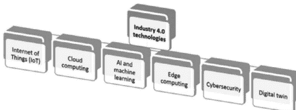

**图 11.1** 工业 4.0 技术。

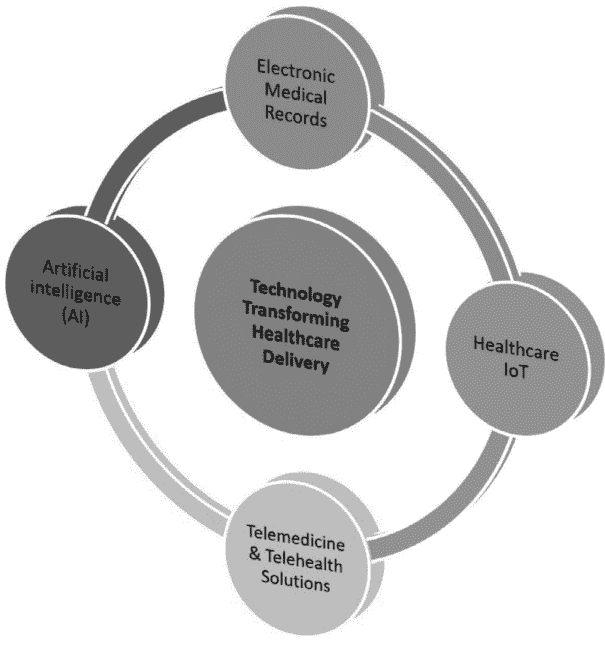

**图 11.2** 新兴技术与以患者为中心的护理的交汇。

另一方面，图 11.2 说明了医疗保健行业中新兴技术与以患者为中心的护理的交汇。该图描绘了各种正在改变医疗服务交付的技术，例如区块链、远程医疗和人工智能等。该图强调了医疗保健中以患者为中心的重要性，患者是护理交付的中心，新兴技术被用于增强他们的体验和结果。

#### 11.1.2 医疗 4.0：定义、特征与目标

HC 4.0 代表医疗服务的新时代，标志着第四次工业革命。该阶段的特点是将物联网 (IoT)、人工智能 (AI)、大数据分析和区块链等数字技术融入医疗系统 [6–8]。HC 4.0 的主要目标是通过提高效率、效能和以患者为中心的护理来改善医疗服务。

- HC 4.0 的基本要素之一是强调个性化医疗。借助数字技术，医疗服务提供者可以收集和分析患者数据，为个体患者量身定制治疗方案。这种个性化的医疗服务方式可以带来更好的患者结果并提高整体医疗系统效率 [9]。

- HC 4.0 的另一个重要特征是使用数字工具增强医疗服务提供者、患者和其他利益相关方之间的沟通与协作。远程医疗和远程患者监测等数字技术，可以促进患者与提供者之间无论身处何地都能进行实时沟通和信息共享 [10]。

**目标。** 医疗 4.0 有多个目标，包括利用数据分析、机器学习和 AI 识别趋势、预测结果并个性化治疗，为患者提供个性化护理。此外，它旨在通过远程医疗、移动健康和可穿戴设备等数字技术连接患者、提供者和付费方，这些技术可以改善医疗可及性、降低费用并改善患者结果。医疗 4.0 还旨在利用数据和分析检测健康趋势、开发针对性干预措施并评估这些干预措施的效果，从而改善人群健康。此外，它寻求转向基于价值的护理模式，其中补偿与结果而非提供的服务数量挂钩。这可以鼓励提供者专注于质量和效率，从而降低费用并改善患者结果。最后，医疗 4.0 旨在通过促进新技术和护理模式的开发与采用，鼓励医疗保健领域的创新。这可以带来更好的患者结果、降低成本并改善医疗可及性。

#### 11.1.3 医疗 4.0 的关键驱动因素

有几个 HC 4.0 的关键驱动因素 [11–13]，将在此讨论。

- 最重要的一个是，对更好医疗服务和结果的需求不断增加。随着人口老龄化和医疗成本上升，需要寻找更高效、更有效的方式来提供医疗服务。

- 物联网 (IoT)、AI 等数字技术的可及性和可负担性已成为 HC 4.0 的关键驱动因素。这些技术现在更加普及，使医疗服务提供者更容易将其纳入其系统。

- HC 4.0 还受到鼓励在医疗服务中使用数字技术的监管变化的推动。全球各国政府正在引入最新指南和法律，以支持此类技术的采用。一个示例是欧洲联盟的《通用数据保护条例》，该条例对数据隐私和保护提出了严格要求，推动了区块链 (BcT) 在医疗保健中的采用 [14]。

如今，随着我们的人口日益增加且资源有限，在质量提升方面存在着严格的竞争，并且对这种质量的花费不妥协。这是因为，为了为不断增长的人口提供更好的医疗设施，我们需要提供更好的设施。为了改善医疗保健的这一转型正在进行中，而在医疗 4.0 中，这是通过整合技术和进步来服务患者以及医院，通过物联网和先进数字技术的连接来弥合二者之间的差距来实现的。这种为了改善医疗保健而进行的转型是永无止境的。员工、患者及其医疗数据之间建立了数字连接，然后对这些数据进行分析，以便以更简单、更好、更准确的方式提供医疗解决方案。物联网和 AI 等数字技术变得更加普及和可负担，使医疗服务提供者更容易将其纳入其系统。因此，HC 4.0 是由以最佳医疗成本提供更好的医疗服务和结果的需求所驱动的。

### 11.2 区块链技术及其在健康记录管理中的应用

BcT 是一种去中心化、分布式数字账本系统，因其不可篡改性、透明性和安全性而闻名。其彻底改变包括医疗保健在内的各个行业的潜力巨大。区块链在医疗保健中最有益的应用之一是健康记录管理。健康记录包含患者机密和敏感的个人健康信息 (PHI)，目前存储在容易受到网络攻击、数据泄露和未经授权访问的集中式数据库中。凭借其去中心化和安全的平台，BcT 可以解决这些挑战，并为健康记录管理提供一个安全且不可篡改的平台 [15–18]。

以下是 BcT 在健康记录管理中的一些应用方式。

#### 11.2.1 去中心化存储

通过使用 BcT，患者可以将其健康记录存储在去中心化的计算机网络中，从而消除了对中央控制来管理健康记录的需求。这可以极大地改善数据隐私、安全性和可访问性，因为患者将完全控制谁可以查看其健康记录以及它们如何共享。此外，BcT 提供了所有交易的防篡改记录，确保数据可信且未经适当授权不能被更改或删除。

#### 11.2.2 改进数据安全性

通过利用 BcT，医疗服务提供者可以从一个高度安全且防篡改的系统中获益，用于管理健康记录。密码学的使用保证只有授权方才能访问数据，并且对其所做的任何更改都会被记录且在不留下痕迹的情况下无法更改。此外，BcT 可以被实现


作为一个去中心化的账本，它可以提供一种验证交易真实性的手段。

### 11.2.3 互操作性

BcT可以允许不同的医疗保健提供者以安全且标准化的方式共享健康记录。这可以改善患者护理协调，并减少医疗检测和程序的重复。

### 11.2.4 患者控制

BcT可以让患者更好地控制自己的健康记录。患者可以选择谁有权访问其健康记录，并可随时撤销访问权限。

### 11.2.5 研究与分析

BcT可以使研究人员以安全且保护隐私的方式访问健康记录，从而对健康数据进行更准确、更全面的分析。

## 11.3 医疗保健服务中BcT的优势与挑战

BcT有望彻底改变医疗保健服务，带来更好的患者预后、更低的成本以及增强的数据隐私和安全性。然而，在医疗保健领域整合这项技术面临着各种挑战。在接下来的段落中，我们将审视文献[19–26]中概述的在医疗保健服务中采用BcT的益处与弊端。

### 11.3.1 优势

### 11.3.1.1 增强的数据安全性与隐私性

区块链作为一种分布式账本技术，为存储和交换数据提供了一个安全且防篡改的平台，这有助于保护敏感的患者信息。通过这种方式，它可以帮助防止数据泄露，并确保患者隐私得到保护。

### 11.3.1.2 改进的数据管理与互操作性

BcT可以允许医疗保健提供者安全地跨不同平台和系统共享患者数据。这可以改善数据管理和互操作性，从而带来更好的患者预后。

### 11.3.1.3 更快速且更准确的诊断

BcT可以通过为医生提供更全面、更最新的患者数据访问权限，帮助提高诊断的准确性和速度。

### 11.3.1.4 简化临床试验与研究

BcT可以使研究人员以安全且保护隐私的方式访问和分析大量患者数据。这可以简化临床试验，并带来更准确的研究结果。

### 11.3.1.5 成本节约

通过改进数据管理和互操作性，BcT可以帮助降低医疗保健成本，消除重复的检测和程序，并提高效率。

### 11.3.2 挑战

### 11.3.2.1 实施与维护的复杂性

BcT的技术复杂性可能构成挑战，因为其实施和维护需要专门的知识和专业技能。

### 11.3.2.2 法律与监管框架

缺乏规范在医疗保健领域实施BcT的全面法律和监管框架，可能导致犹豫不决并抑制采用。

### 11.3.2.3 互操作性与数据标准化

虽然BcT可以增强数据互操作性，但需要对数据格式和协议进行一致的标准化，以确保跨各种系统的无缝数据共享。

### 11.3.2.4 患者隐私担忧

虽然BcT可以增强数据安全性和隐私性，但关于患者数据将如何被使用以及谁将有权访问这些数据，存在担忧。

### 11.3.2.5 可扩展性

BcT可能资源密集，且可能无法足够可扩展以支持大量数据和交易。

## 11.4 区块链技术在医疗保健中的用例

以下是文献[27–36]中讨论过的一些用于实施BcT的医疗保健用例。

### 11.4.1 以患者为中心的健康数据管理

可以使用BcT创建一个以患者为中心的健康数据管理系统，让患者控制自己的医疗记录。数据可以存储在去中心化网络中，允许患者在必要时将其医疗记录与医疗保健提供者和研究人员共享。患者还可以管理自己的数据，决定谁有权访问。这可以增强数据隐私、安全性和可访问性，同时允许对健康数据进行更准确、更全面的分析。

### 11.4.2 临床试验与研究

BcT可以通过为存储和共享患者数据提供安全且保护隐私的平台来简化临床试验和研究。研究人员可以以标准化的方式访问多个来源的数据，从而能够对健康数据进行更精确、更全面的分析。这有助于加快药物发现并改善患者预后。

### 11.4.3 供应链管理

BcT可以监控医疗器械、药品和物资的流动，确保其真实、安全且未被篡改。这可以降低假药和假医疗器械进入市场的风险，确保患者获得高质量的产品。

### 11.4.4 索赔与支付处理

BcT可以通过使用智能合约和基于区块链的系统来改进医疗保健中的索赔和支付处理系统，自动化索赔处理和支付结算过程。这减轻了医疗保健提供者的行政负担，并提高了该过程的准确性和效率。

### 11.4.5 远程医疗

BcT可以通过为存储和共享患者数据提供安全且保护隐私的平台来增强远程医疗。患者可以利用远程医疗服务远程咨询医疗保健提供者，这些咨询期间收集的数据可以安全地存储在基于区块链的系统中，从而能够对健康数据进行更准确、更全面的分析。

## 11.5 区块链在医疗保健中引发的立法与伦理问题

随着BcT继续融入医疗保健，必须解决一些伦理和立法问题。以下是一些主要问题[37–42]。

### 11.5.1 数据保护与隐私

区块链系统的去中心化特性使得控制对个人健康信息的访问变得具有挑战性。确保患者数据得到保护，并且该技术符合HIPAA和GDPR等法规至关重要。

### 11.5.2 安全性与所有权

虽然区块链提供了防篡改的交易记录，但关于基于区块链的系统中存储的数据的所有权和控制权存在担忧。建立明确的所有权权利非常重要，以确保患者保留对其个人健康信息的控制权。

### 11.5.3 互操作性与标准化

数据格式和协议缺乏互操作性和标准化可能会阻碍BcT在医疗保健中的采用。利益相关方之间的合作对于开发标准化协议至关重要，这些协议能够实现不同基于区块链的系统之间的数据交换和互操作性。

### 11.5.4 监管合规

医疗保健中的区块链引发了法律和监管合规问题。确保该技术遵守HIPAA和GDPR等法规，并且不违反伦理或法律原则至关重要。

### 11.5.5 知情同意

必须向患者说明医疗保健中的BcT，并且他们必须同意以这种方式使用其数据。确保患者充分意识到在医疗保健中使用BcT的风险和益处，并且他们有权退出将其数据存储在基于区块链的系统中，这一点至关重要。

## 11.6 区块链在医疗保健中的障碍与未来方向

COVID-19大流行加速了医疗保健迅速适应和发展以满足世界不断变化需求的必要性[43–45]。HC 4.0（整合了BcT）有望彻底改变健康记录管理，并实现提供者之间更精简、更安全的数据共享。尽管如此，诸如非心脏手术后心肌损伤与死亡率之间相关性等问题仍需解决[46]。在应对大流行的复杂性时，优先考虑患者安全并利用创新技术的能力来改善医疗保健结果至关重要。虽然拥抱HC 4.0和区块链提供了构建更具韧性的医疗保健系统以更好地应对未来挑战的机会，但它也面临着众多障碍和挑战。以下是区块链在医疗保健中的一些重要障碍和未来方向[47–53]。

### 11.6.1 互操作性与标准化

医疗保健中的区块链存在数据格式和协议缺乏互操作性和标准化的问题。这使得不同基于区块链的系统之间难以相互通信，并限制了该技术的潜在益处。未来


医疗保健领域的区块链方向应着重于开发标准化协议，以实现不同基于区块链的系统之间的数据交换和互操作性。

### 11.6.2 采用与实施

医疗保健领域中 BtC 的采用和实施仍处于初级阶段。需要进一步提升利益相关方对该技术潜在优势的认识和教育，并促进各方合作，开发和实施针对特定医疗保健挑战的基于区块链的解决方案。

### 11.6.3 成本与复杂性

在医疗保健领域实施 BtC 的成本和复杂性可能成为采用的障碍。开发和实施基于区块链的系统需要在技术基础设施、人才和资源方面进行大量投资。医疗保健领域区块链的未来方向应着重于降低基于区块链系统的实施成本和复杂性，以提高其采用率。

### 11.6.4 监管合规性

该技术在医疗领域引发了法律和监管合规问题。有必要为医疗保健领域中区块链的使用制定精确的政策和法规，以确保其符合 HIPAA 和 GDPR 等法规。医疗保健领域区块链的未来方向应着重于制定管理医疗保健中 BtC 使用的明确监管框架。

### 11.6.5 信任与安全性

BtC 的去中心化特性使得控制个人健康信息的访问变得困难，并引发了对数据保护、隐私和安全性的担忧。医疗保健领域区块链的未来方向应着重于开发安全可信的基于区块链的系统，以保护患者数据的隐私和安全性。

## 11.7 结论

从前面的讨论可以得出结论，在 HC 4.0 这一新兴概念的背景下，BtC 有潜力通过健康记录管理的创新解决方案来转变医疗保健服务。

- HC 4.0 正在通过利用数字技术提高效率、效能和以患者为中心的护理来转变医疗保健服务。通过整合物联网（IoT）、人工智能、大数据分析和 BtC 等技术，医疗服务提供者可以提供个性化医疗，并实现患者与提供者之间的实时通信。HC 4.0 的关键驱动因素包括对更好医疗保健结果的需求、新技术的可用性以及监管变化。随着我们向前发展，HC 4.0 有望彻底改变医疗保健服务并改善患者结局。

- BcT 有潜力通过提供一个安全、去中心化且互操作的平台来存储和共享健康记录，从而彻底改变健康记录管理。它可以改善患者隐私、安全性和控制权，同时还能实现更准确的研究和分析。但是，必须考虑在医疗保健领域实施 BcT 所涉及的法律、伦理和技术挑战。

- BcT 可以通过改善患者结局、降低成本以及增强数据安全性和隐私性来转变医疗保健服务。但是，也有几个需要解决的挑战，包括技术复杂性、法律和监管框架、互操作性和数据标准化、患者隐私问题以及可扩展性。

- BcT 在医疗保健领域有多种用例，包括以患者为中心的健康数据管理、临床试验和研究、供应链管理、索赔和支付处理以及远程医疗。通过利用 BcT 的优势，可以改善医疗保健领域的患者结局、降低成本并增强数据安全性和隐私性。

- 围绕在医疗保健领域使用 BcT 的几项立法和伦理问题，包括数据隐私和安全性、监管合规性、互操作性和数据标准化、知情同意以及偏见和歧视。这些问题需要通过利益相关方之间的协作来解决，以确保在医疗保健领域使用 BcT 是合乎道德、合法并有利于所有人的。

- 在医疗保健领域采用和实施 BcT 面临多种障碍和挑战，包括互操作性和标准化、采用和实施、成本和复杂性、监管合规性以及信任和安全性。

医疗保健领域中 BcT 的未来方向应着重于解决这些挑战，以实现该技术为医疗保健服务和患者结局带来的潜在益处。

## 11.8 医疗保健领域区块链的研究方向

HC 4.0 技术革命有可能提升为患者提供的护理质量及其治疗效果。由于它为管理医疗记录提供了一种安全且去中心化的方法，因此 BcT 是这一变革中的关键参与者，因为它提供了一种安全且去中心化的方式来管理医疗记录。

本章未来范围包括探索如何使用 BcT 使医疗保健数据更具互操作性，这将使医疗服务提供者和患者能够安全地访问和交换基本医疗数据，通过数据监控和插值实现更准确的诊断和个性化治疗。

- 另一个潜在的调查主题是使用 BcT 来提高医疗保健供应链的透明度和问责制。BcT 可以提供一个值得信赖且公开的账本，用于监测药品和医疗设备从生产商到患者的流转过程，从而减少假药和医疗设备的数量并提高患者安全性。

- BcT 还可以通过允许患者安全地存储和管理自己的医疗保健数据，使他们对自己的医疗旅程拥有更多控制权，从而改善以患者为中心的医疗保健服务的提供。

- 最后，在采用医疗保健领域的 BcT 时，还应探讨伦理和法律考量，以确保解决患者的隐私和安全问题。未来的研究可以着重于制定伦理和法律框架，以确保 BcT 的益处得以实现，同时最大限度地减少对患者的任何负面影响。

综上所述，本章未来范围广泛，为使用 BcT 进行医疗保健记录管理的研究和创新提供了多种可能性。它为未来研究奠定了坚实基础，并确定了有助于该快速发展领域增长的潜在调查领域。这不仅将提高生活质量，还将提高医院与患者之间互动的效率和效能。因此，通过释放区块链在医疗保健记录管理中的力量，我们可以彻底改变在医疗保健 4.0 时代存储、共享和保障健康数据的方式。

## 参考文献

- [1] Tanwar, S., Parekh, K., & Evans, R. (2020). Blockchain-based electronic healthcare record system for HC 4.0 applications. Journal of Information Security and Applications, 50, 102407.
- [2] Warraich, H. J., Califf, R. M., & Krumholz, H. M. (2018). The digital transformation of medicine can revitalize the patient-clinician relationship. NPJ Digital Medicine, 1(1), 49.
- [3] Chancaichujit, J., Tan, A., Meng, F., Eaimkhong, S., Chancaichujit, J., Tan, A., ... & Eaimkhong, S. (2019). An introduction to HC 4.0: Healthcare 4.0: Next Generation Processes with the Latest Technologies, 1–15.
- [4] Li, J., & Carayon, P. (2021). Health Care 4.0: A vision for smart and connected health care. IISE Transactions on Healthcare Systems Engineering, 11(3), 171–80.
- [5] Chancaichujit, J., Tan, A., Meng, F., & Eaimkhong, S. (2019). Healthcare 4.0. Springer.
- [6] Shrivastava, A., Krishna, K. M., Rinawa, M. L., Soni, M., Ramkumar, G., & Jaiswal, S. (2021). Inclusion of IoT, ML, and blockchain technologies in next generation industry 4.0 environment. Materials Today: Proceedings, 80(3), 3471–75. https://doi.org/10.1016/j.matpr.2021.07.273
- [7] Chancaichujit, J., Tan, A., Meng, F., & Eaimkhong, S. (2019). An Introduction to healthcare 4.0. In Healthcare 4.0. Palgrave Pivot. https://doi.org/10.1007/978-981-13-8114-0_1
- [8] Paul, S., Riffat, M., Yasir, A., Mahim, M. N., Sharnali, B. Y., Naheen, I. T., ... & Kulkarni, A. (2021). Industry 4.0 applications for medical/healthcare services. Journal of Sensor and Actuator Networks, 10(3), 43.
- [9] Roy, S., Meena, T., & Lim, S. J. (2022). Demystifying supervised learning in healthcare 4.0: A new reality of transforming diagnostic medicine. Diagnostics, 12(10), 2549.
- [10] Dal Mas, F., Massaro, M., Ippa, P., & Secundo, G. (2023). The challenges of digital transformation in healthcare: An interdisciplinary literature review, framework, and future research agenda. Technovation, 123, 102716.
- [11] Al-Jarooodi, J., Mohamed, N., & Abukhousa, E. (2020). Health 4.0: On the way to realizing the healthcare of the future. IEEE Access, 8, 211189–210.
- [12] Aceto, G., Persico, V., & Pescapé, A. (2020). Industry 4.0 and health: Internet of things, big data, and cloud computing for healthcare 4.0. Journal of Industrial Information Integration, 18, 100129.


- [13] Kishor, A., & Chakraborty, C. (2022). 基于人工智能和物联网的医疗 4.0 监测系统。无线个人通信，127(2)，1615–31.

- [14] Larrucea, X., Moffie, M., Asaf, S., & Santamaria, I. (2020). 面向符合 GDPR 的保障欧洲跨境医疗工业 4.0 的安全方式。计算机标准与接口，69，103408.

- [15] Kumar, A., Krishnamurthi, R., Nayyar, A., Sharma, K., Grover, V., & Hossain, E. (2020). 利用医疗 4.0 流程的新型智能医疗设计、仿真与实现。IEEE Access，8，118433–71.

- [16] Tanwar, S., Parekh, K., & Evans, R. (2020). 面向医疗 4.0 应用的区块链基础电子医疗记录系统。信息安全与应用期刊，50，102407.

- [17] Ahmad, R. W., Salah, K., Jayaraman, R., Yaqoob, I., Ellahham, S., & Omar, M. (2021). 区块链技术在远程健康和远程医疗中的作用。国际医学信息学杂志，148，104399.

- [18] Bodkhe, U., Tanwar, S., Bhattacharya, P., & Verma, A. (2021). 医疗 4.0 应用中可信医疗记录的区块链采用：一项综述。载于第二届计算、通信与网络安全国际会议论文集：IC4S 2020（第 759–74 页）。Springer.

- [19] Attaran, M. (2022). 医疗保健中的区块链技术：挑战与机遇。国际医疗管理杂志，15(1)，70–83.

- [20] Sharma, A., Kaur, S., & Singh, M. (2021). 医疗保健中区块链和物联网的综合综述。新兴电信技术事务，32(10)，e4333.

- [21] Tandon, A., Dhir, A., Islam, A. N., & Mäntymäki, M. (2020). 医疗保健中的区块链：系统文献综述、综合框架与未来研究议程。工业计算机，122，103290.

- [22] Siyal, A. A., Junejo, A. Z., Zawish, M., Ahmed, K., Khalil, A., & Soursou, G. (2019). 医学与医疗保健中区块链技术的应用：挑战与未来展望。密码学，3(1)，3.

- [23] Hussien, H. M., Yasin, S. M., Udzir, S. N. I., Zaidan, A. A., & Zaidan, B. B. (2019). 医疗保健应用中实现区块链技术的系统综述：分类法、实质性分析、动机、挑战、建议与未来方向。医学系统杂志，43，1–35.

- [24] Zheng, Z., Xie, S., Dai, H. N., Chen, X., & Wang, H. (2018). 区块链挑战与机遇：一项综述。国际网格服务期刊，14(4)，352–75.

- [25] Garcia-Teruel, R. M. (2020). 房地产领域区块链技术的法律挑战与机遇。房地产、规划与环境法杂志，12(2)，129–45.

- [26] Mackey, T. K., Kuo, T. T., Gumadi, B., Clauson, K. A., Church, G., Grishin, D., ... & Palombini, M. (2019). “Fit-for-purpose”——医疗保健未来中区块链技术应用的挑战与机遇。BMC 医学，17(1)，1–17.

- [27] Ahmad, R. W., Salah, K., Jayaraman, R., Yaqoob, I., Ellahham, S., & Omar, M. (2021). 区块链技术在远程健康和远程医疗中的作用。国际医学信息学杂志，148，104399.

- [28] Colón, K. A. (2018). 创建以患者为中心、全球化、去中心化的健康系统：将新的支付和护理提供模式与远程医疗、人工智能和区块链技术相结合。医疗保健中的区块链，1。https://doi.org/10.30953/bhty.v1.30.

- [29] Hylock, R. H., & Zeng, X. (2019). 面向以患者为中心的健康记录和交换的区块链框架（HealthChain）：评估与概念验证研究。医学互联网研究杂志，21(8)，e13592.

- [30] Jabarulla, M. Y., & Lee, H. N. (2021, August). 基于区块链和人工智能、以患者为中心、用于抗击 COVID-19 大流行的医疗系统：机遇与应用。载于《医疗保健》（第 9 卷，第 8 期，第 1019 页）。MDPI.

- [31] Reda, M., Kanga, D. B., Fatima, T., & Azouzai, M. (2020). 健康供应链管理中的区块链：最新技术挑战与机遇。程序化计算机科学，175，706–9.

- [32] Haleem, A., Javaid, M., Singh, R. P., Suman, R., & Rab, S. (2021). 医疗保健中区块链技术应用：概述。国际智能网络杂志，2，130–9.

- [33] Yaqoob, I., Salah, K., Jayaraman, R., & Al-Hammadi, Y. (2021). 区块链用于医疗数据管理：机遇、挑战与未来建议。神经计算与应用，1–16.

- [34] Bazel, M. A., Mohammed, F., & Ahmed, M. (2021, August). 医疗大数据管理中的区块链技术：优势、应用与挑战。载于 2021 年首届新兴智能技术与应用国际会议（eSmarTA）论文集（第 1–8 页）。IEEE.

- [35] Ali, O., Jaradat, A., Ally, M., & Rotabi, S. (2022). 区块链技术实现医疗数据管理与可访问性。面向可持续性的区块链技术，91–118.

- [36] Katuwal, G. J., Pandey, S., Hennessy, M., & Lamichhane, B. (2018). 医疗保健中区块链的应用：现状与挑战。arXiv 预印本 arXiv:1812.02776.

- [37] Kumar, R. L., Wang, Y., Poongodi, T., & Imoize, A. L.（编）. (2021). 物联网、人工智能与区块链技术。Springer.

- [38] Liu, W., Zhu, S. S., Mundie, T., & Krieger, U. (2017, October). 电子健康系统的先进区块链架构。载于 2017 年 IEEE 第 19 届电子健康网络、应用与服务国际会议（Healthcom）论文集（第 1–6 页）。IEEE.

- [39] Odeh, A., Keshta, I., & Al-Haija, Q. A. (2022). 医疗保健领域区块链分析：应用与问题。对称性，14(9)，1760.

- [40] Srivastava, V., Mahara, T., & Yadav, P. (2021). 6G 网络中区块链支持电子医疗应用的伦理挑战分析。工程认知计算国际期刊，2，171–9.

- [41] Nehme, E., Salloum, H., Bou Abdo, J., & Taylor, R. (2021). 人工智能、物联网与区块链：商业模式、伦理问题与法律视角。载于《物联网、人工智能与区块链技术》（第 67–88 页）。Springer International Publishing.

- [42] Galetsi, P., Katsaliaki, K., & Kumar, S. (2022). 探索 mHealth（移动医疗）技术兴起中的利益与伦理挑战，以造福公共：面向卫生专家移动应用的分析。技术创新，102598.

- [43] Akhsi, S., Mala, S., & Jerin, A. A. (2021). 了解空调空气过滤是否降低环境中病毒传播的概率。医学科学与技术先进研究杂志（ISSN：2394–6539），8(1)，36–41.

- [44] Akhsi, S., Mala, S., & Jerin, A. A. (2020). 在 COVID-19 与人类健康背景下理解空调系统：简短通讯。医疗保健教育与医学信息学国际期刊（ISSN：2455–9199），7(1&2)，28–30.

- [45] Ng, W. Y., Tan, T. E., Movva, P. V., Fang, A. H. S., Yeo, K. K., Ho, D., ... & Ting, D. S. W. (2021). 针对 COVID-19 及其之后的医疗保健区块链应用：系统综述。柳叶刀数字健康，3(12)，e819–e829.

- [46] Mala, S. (2021). 非心脏手术后的心肌损伤及其与死亡率的相关性：截至 2020 年的简要综述。预防心脏病学国际期刊，1(1)，29–31.

- [47] Durneva, P., Cousins, K., & Chen, M. (2020). 患者护理中区块链技术的研究现状、挑战与未来研究方向：系统综述。医学互联网研究杂志，22(7)，e18619.

- [48] Atlam, H. F., Alenezi, A., Alassafi, M. O., & Wills, G. (2018). 区块链与物联网：优势、挑战与未来方向。智能系统与应用国际期刊，10(6)，40–8.

- [49] Deepa, N., Quoc-Viet Pham, Dinh C. Nguyen, Sweta Bhattacharya, Prabadevi, B., Thippa Reddy Gadekallu, Praveen Kumar Reddy Maddikunta, Fang Fang, & Pubudu N. Pathirana. (2022). 基于区块链的大数据综述：方法、机遇与未来方向。未来世代计算机系统，131，209–26。https://doi.org/10.1016/j.future.2022.01.017

- [50] Jan, M. A., Cai, J., Gao, X. C., Khan, F., Mastorakis, S., Usman, M., ... & Watters, P. (2021). 多媒体物联网中安全与区块链融合：当前趋势、研究挑战与未来方向。网络与计算机应用杂志，175，102918.

- [51] Abdelmaboud, A., Ahmed, A. I. A., Abaker, M., Eisa, T. A. E., Albasheer, H., Ghorashi, S. A., & Karim, F. K. (2022). 面向物联网应用的区块链：分类法、平台、最新进展、挑战与未来研究方向。电子学，11(4)，630.

- [52] Akhsi, S. (2023). 从黑盒到透明机器：可解释人工智能的探索。可在 SSRN 4390887 上查阅.

- [53] Krishnamoorthy, S., Dua, A., & Gupta, S. (2023). 未来物联网驱动医疗 4.0 技术中新兴技术的作用：综述、当前挑战与未来方向。环境智能与人性化计算杂志，14(1)，361–407.


## 区块链在基因组学中的优势与作用

达布卢·库马尔

### 12.1 引言

研究人员正在使用基因组数据库来提取人类疾病分子原因的详细信息，并找出导致特定疾病的基因变化。人类基因组由大约30亿个核苷酸碱基对组成。基因组学的前景具有巨大潜力，可改善医疗保健。使用高通量测序（HTS）和基因组数据可以提供其他技术无法获得的独特健康信息，具有非侵入性，对精准医疗的发展至关重要 [1]。

人们不愿直接共享必要数据是基因组学面临的障碍。例如，通过查看一个人完整的基因组，有可能识别出该人，或者了解更多关于其祖先的信息。在区块链系统中，交易使用其哈希值而非原始数据进行保存。此外，人们仅交换元数据，元数据包含广泛的数据信息。使用区块链可以编辑个人访问权限 [2]。数据管理（解决如下所述的四个严重问题）是该领域的另一项困难：收集、存储、共享和所有权。区块链可以降低基因组学和医疗保健应用的分析成本。与当前方法不同，允许数据所有者直接与客户沟通，无需中介，从而降低分析成本并增加数据所有者的收益 [3]。学术界和工业界都对基因组学中的区块链产生了兴趣，各自有应用该技术的不同议程。近年来，随着直达消费者（DTC）企业开始商业化DNA测序，商业基因组客户数量增多。这是因为技术进步使基因组测序变得更加容易和快速。关于区块链非商业用途的精选研究大多集中在共享基因组数据以促进科学。数据共享、分析、存储及其访问控制是该研究适用的一些用例 [4,5]。基于区块链技术构建的平台正在解决重要问题，例如共享遗传数据的治理等其他问题。最终目标是确保组织和个人可以在保持隐私的同时交换数据，使用更容易遵守道德和法律规范的算法 [6]。

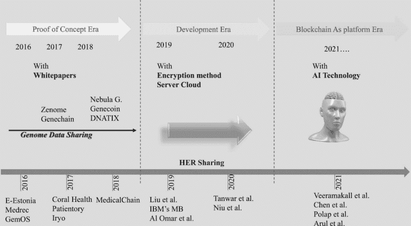

图 12.1
医疗保健和基因组学中区块链的应用时间线。

### 12.2 什么是基因组学？

基因组学是生物学的一个领域，涉及基因组的结构及其图谱、编辑、功能和演变。基因组学的时间线进展如图12.1所示。

- 基因组是生物体的完整遗传信息集合（也称为DNA） [7]。
- DNA是一种遗传代码，存在于每个生物体中。它控制生物体如何发育、与环境相互作用以及如何执行生物学功能。基因组学研究是解读和应用这一DNA代码以产生有用结果的艺术与科学 [8]。
- 基因组学涉及使用生物信息学和高通量DNA测序对基因组进行测序和分析，以组装、研究功能和结构整个基因组 [9]。

### 12.3 区块链技术与基于区块链的系统

使用哈希算法安全存储数据的区块链在数据交换和数据安全两方面都为业务提供了帮助 [10]。尽管两者密切相关，分布式账本技术（DLT）与区块链技术之间存在细微差别。与集中式组织不同，分布式账本是一个分布在网络节点中的数据库，由一组对等节点管理。与数据库不同，区块链是DLT的一种实现，由一系列区块组成。构成这些数据块的独特数据结构使区块链区别于其他DLT变体。有向无环图（DAG）和哈希图是其他DLT实现。区块链是支撑比特币的开创性技术 [11]。

### 12.4 区块链类型

有三种不同类型的区块链。它们在节点如何加入网络以及网络如何运作方面有所不同。可以使用以下类别对这些区块链类型进行分组 [12]。

### 12.4.1 公共区块链（开放访问和无需许可）

任何人都可以访问公共区块链（因此可信度较低）。在这里，匿名节点可以加入网络，网络中的其他任何节点都不施加任何信任要求。所有节点都接收公开宣布的交易。任何网络节点都可以参与用于验证区块的共识方法。比特币区块链是这种网络的典型示例 [13]。

### 12.4.2 私有区块链（私有和许可制）

节点加入网络时，由于经过精心挑选和审查，因此值得信赖。区块链交易内容通过访问控制机制得到更私密的保护。此外，这种区块链提供了改进的区块确认性能。MultiChain是这种平台的一个示例 [14]。

### 12.4.3 联盟区块链（公共和许可授予）

这是前两种类型的混合体，在效率和信任之间取得平衡，由一组选定的节点管理账本。节点需要授权才能加入网络，与私有区块链类似。一旦预定数量的节点达成一致，即可验证区块和交易。共识机制的预定规则决定了具体过程。Hyperledger是这种平台的一个示例 [15]。

在这样的网络中，每个区块都存储前一个区块的哈希值，从而形成一个不可更改的链式结构。此外，在区块链系统中，用户不使用真实身份，而是使用公钥和私钥。公钥是人人皆知的。私钥对每个用户都是唯一的，用于签署交易。因此，区块链的第一个版本（即比特币网络）被称为“伪匿名”。内存池是待处理交易被矿工接收的地方，矿工随后尝试正确创建一个包含给定加密问题答案的区块。其中一些列于表12.1中，并在某种程度上使用哈希函数。

比特币中的工作量证明问题是找到以特定数量的零开头的哈希值。一旦某个矿工达成所需结果，创建的区块就会广播到网络上的每个人。此外，发现新区块的矿工会获得一笔奖励，作为诱使其留在系统中的手段 [16]。

| 序号 | 共识算法 | 解释 |
|---|---|---|
| 1 | PoW | 当用户发起交易时，矿工试图解决一个加密谜题，以证明他们投入了大量精力。 |
| 2 | PoS | 要成为验证者并构建区块，用户被要求花费更多资金。 |
| 3 | PoWeight | 类似于PoS，但有一个关键区别——它基于一组称为权重的其他变量。 |
| 4 | PoB | 用户将根据存入钱包且无法取回的币的数量获得奖励。 |
| 5 | PoC | 使用此协议可以利用用户的硬盘空间。 |
| 6 | DPoS | 类似于PoS，但持币者可以投票并选择见证人。 |
| 7 | DBFT | 侧重于专家节点控制器验证区块的一种方式，类似于一场游戏。 |
| 8 | PBFT | 为了防御恶意用户，拜占庭采用了一种特定程序。 |

### 12.5 为什么在基因组学中使用区块链

### 12.5.1 遗传数据安全

从数据安全角度来看，区块链为高度敏感和重要的基因组数据提供了极佳的数据机密性和完整性。加密和其他安全措施对于防止数据入侵很重要，但它们并不能提供绝对安全。黑客能够渗透保护级别最高的大型企业的多个系统。然而，区块链技术通过增强数据泄露安全性来惠及企业。区块链使用哈希算法安全存储数据，这有助于组织的安全和数据交换 [17]。区块链的安全性和隐私特性取决于不同类型的密码学。其中一些方法用于原始比特币区块链设计，而另一些则被添加到未来的区块链实现中以改善隐私。由于比特币区块链使用基本安全措施，因此保证该系统符合在线交易的安全标准。区块链使用前述的共识过程，确保所有节点上的数据库相同。区块链上的交易既不能由确认它们的矿工，也不能由试图更改它们的外部攻击者（威胁）更改。

使用加密哈希和数字签名，如果对交易数据做了任何更改，在检查数字签名以确保其真实时就会被发现。此外，如果要更改交易，必须更改区块链网络中所有节点上记录的信息，因为账本保存在所有节点上。由于区块链网络高度去中心化，分布式拒绝服务（DDoS）等攻击是不可能的 [18]。


虽然从隐私角度来看，区块链使用公钥基础设施（PKI）赋予了其伪匿名性。用户的公开地址而非真实姓名被用来识别其节点。但这并不能提供完全的匿名性，因为通过观察人们之间的互动，有可能将公开地址与真实身份关联起来。通过使用公钥基础设施，区块链在隐私方面提供了伪匿名性。用户的节点可以通过其公开地址而非真实身份来识别。然而，这并不能提供完美的匿名性，因为可以将交互各方之间的交互与公开地址关联起来，以确定参与者的真实身份 [19]。交易和相关数据任何人都可以查看，这是区块链最初设计的另一个隐私问题。当交易和智能合约数据被保密时，区块链可以用于处理敏感信息的事务。为了绕过规则，已经提出了新的安全方法，例如混币、匿名签名和零知识证明（ZKP）

2018年由欧洲联盟通过的《通用数据保护条例》（GDPR）已改变了所有层级和所有领域中个人数据的处理方式。遗传信息仅属于最初收集它的人，因此有相关规则来保护它并保持其私密性。一个区块链项目的示例是“Genesy Project”，旨在制定一些广泛准则，以开发基于区块链的协作式基因组数据交换平台，其最终目标是纳入所有生物医学数据 [20]。通过利用区块链的加密保护并添加额外的安全措施，Genesy 确保符合《通用数据保护条例》（GDPR）。这些预防措施包括：在允许基于 Web 的数据访问之前，要求安全通信方法经过验证和认证。他们还需要知道提供服务的服务器名称以及可以访问数据的客户端站点名称。Genesy 区块链上的所有私密信息也采用高级加密标准（AES）进行加密，AES 是一种分组加密方法，因其安全且易于使用而被广泛采用（AES-256）。由于 Genesy 的商业计划要求形成一个二级市场，数据创建者在此市场向第三方出售其数据，因此理所当然地，任何此类数据传输都必须受到监管，以确保所有相关方的安全并符合《通用数据保护条例》制定的准则。这是通过让数据所有者为其准备发布的数据签署知情许可文件来完成的。这是 GDPR 允许人们共享个人数据的方式之一。相比之下，区块链数据的不可篡改性对于其维护数据完整性和增强系统信任的能力至关重要 [21]。区块链与 GDPR 之间的这种冲突可能会随时间而改变，特别是如果在数据被创建和存储的不同类型的技术环境中，对如何解释该法规的应用提供更多指导 [22]。

诸如公钥和交易历史等区块链数据，目前正处于争议之中，即这些数据是否根据《通用数据保护条例》（GDPR）的法规构成“个人数据”（欧洲议会研究服务处，2019）[23]。

### 12.5.2 基因组数据共享

基因组研究高度依赖于解释。可以评估多种遗传变异对患者的单独和综合影响。如图 12.2 所示。将患者的基因型与其临床表型相结合，可能有助于医生选择最有效的治疗方法。这些结论的准确性在很大程度上取决于用于得出这些结论的数据。

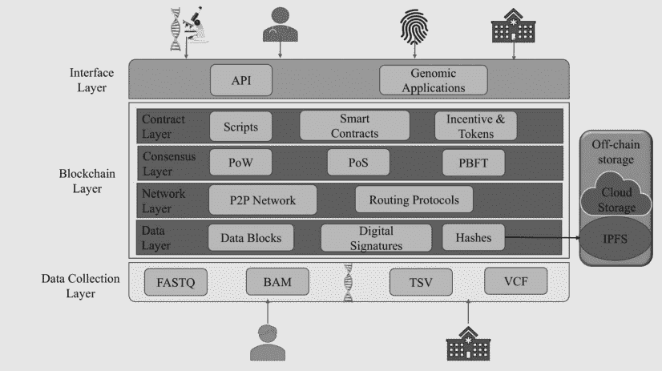

图 12.2
用于交换遗传数据的基于区块链的系统通用设计。

为了改善解释，共享研究和临床专业知识至关重要。基因组研究人员深知交换遗传数据的过程有多么困难和繁重。政策和立法允许在特定情况下传输基因组数据，但这些政策因国家而异。另一个问题是基因组研究中现有的有限参与度，尤其是考虑到基因组研究的需求。全基因组关联研究（GWAS）通常包含数千人，有时多达一百万人 [24]。为了进一步研究该领域，有一些基因组数据交换平台允许科学家公开共享遗传数据。临床基因组（ClinGen）和全球基因组与健康联盟（GA4GH）等大型组织（后者拥有大量数据共享项目）已开始开发可靠工具，以充分描述和分析人类基因组的所有变化。超过 100 万基因组（B1MG）是众多大规模欧洲倡议之一，旨在促进和管理安全的跨境人类基因组数据收集、存储和交换。基因组信标（Genomic beacon）是由 GA4GH 发起的一个项目，是解决广泛基因组数据共享问题的最显著答案之一。通过响应关于基因组中给定等位基因是否存在的查询，基因组信标通过 Web 服务促进数据交换。信标可以从机构内部部署和链接。信标的设计旨在通过让组织控制数据访问和授权来保护用户隐私。然而，后续研究表明，即使对信标提供的数据应用数据去标识化技术，人们仍可能被识别出来 [25]。

以下是基因组数据共享下的一些项目：

- Nebula genomics。这是一个基于以太坊的遗传数据分析网络，但目前尚未有代币。他们希望解决四个主要问题：如何降低测序成本、如何保护数据、如何收集数据以及如何处理大规模基因组数据。此外，Nebula 网络计划应对即将到来的数据爆炸 [26]。在传统模式中，人们将自己的信息提供给中间机构。想要对 DNA 进行测序的人应联系一家进行基因分析的公司。公司在分析基因数据时不会发送整套测序数据，而只发送分析结果，这些结果可能会被卖给其他公司，因为消费者失去了对其数据访问权的控制。另一方面，基于区块链的 Nebula 网络允许人们直接按照自己的条件提供信息。用户在使用此网络之前必须先对其序列进行检查。这也是 Nebula 测序设施可以做的事情。据说，人们可以在这个网站以更少的费用进行数据测序。作为 Nebula 的合作伙伴，人们将样本发送到 Veritas Genetics，以便将序列放置在 Nebula 服务器上。整套测序数据会发送给该人，然后从 Nebula 服务器上删除。尽管声称数据已被删除，但我们无法确定数据是否完全私密。该网络由 Nebula 服务器和安全计算节点组成。Nebula 系统基于安全多方计算 [25,26]。在网络上，数据购买节点使用 Nebula 代币购买基因组和表型数据，并且仅在安全计算节点上分析数据，因为共享数据必须使用 HME 格式进行加密。生物信息学平台 Arvados 由安全计算节点运行。它与 Intel SGX（软件）和部分同态加密配合使用。Intel SGX 是一组指令代码，可用于创建飞地或私有内存空间。数据所有者将已加密的数据发送到安全计算节点。数据被解密，并在 SGX 飞地中进行额外计算，然后将结果加密并发送到购买节点。因此，客户可以在不查看实际数据的情况下获得结果，部分解决了隐私问题。

- Zenome。“ZNA 代币”代表 Zenome 区块链生态系统，该系统促进遗传信息的共享。Zenome 的用户可以协作开展研究、控制谁可以访问他们的数据、安全地保存数据、获得报酬、招募新参与者、进行基因分析，并从多种其他基因服务中受益 [11,25,26]。该技术以完全匿名的方式在分布式网络中存储元数据。没有解密密钥，就无法访问个人的遗传数据。系统中有四种不同类型的“节点”：(1) 计算和存储节点，它们用计算能力和数据存储换取激励；(2) 用户节点，它们交易基因数据和用户服务；(3) 分析节点，它们分析基因数据；以及 (4) 服务提供商，它们用基因服务换取报酬。一些科学企业、生物信息学公司、医疗机构和实验室提供基因服务。Zenome 适用于其他生物，并根据需要向用户提供报告。该系统采用 AI 技术，并要求所有用户使用 Zenome 软件应用。Zenome 的软件应用程序使用户能够配置自己的数据隐私（包括完全隐私、普通隐私和公共访问选项）。在原始数据准备期间，系统能够识别欺诈数据。为了应对虚假生物体，系统首先根据阈值搜索覆盖范围，并按片段保存它们。因此，仅在区块链上交换少量数据。剩余数据可能会通过安全通信通道发送 [27]。


- **Genecoin。**Genecoin（也称为“GEN 代币”）是一种面向生物经济的加密货币，它使用以太坊区块链来确保遗传数据的安全转移[27,28]。用户只需邀请朋友加入全球 Genecoin 网络，即可赚取多达一千个免费 Genecoin。它会获取 DNA 样本并将其存储在分布式账本上。DNA 样本分布在数千台机器上。该企业首先提供样本采集套件，然后与外部供应商协调以收集测序数据。现在，区块链可以被能够解读个人 DNA 的软件读取。代币分配如下：10% 分配给创始人，15% 分配给社区[28]。

- **DNATIX。**这项基于以太坊的倡议旨在为企业、机构和个人之间交换数据提供一种值得信赖、易于使用且安全的方式。它允许用户匿名提交遗传信息，并根据用户提供的访问标准对该信息进行遗传检测。以下也是该系统的一项重大改进。参与者可以通过为下一代去中心化遗传应用程序（GDApps）的开发做出贡献来赚取代币，GDApps 具有类似于 DNAtixVM 的虚拟机，并可充当节点。DNATIX 压缩长 DNA 序列的独特方法提供了进一步的优势。当前方法可将序列大小降低 25%。与之前的倡议类似，该平台通过智能合约存储、转移和分析遗传检测数据。此外，该平台可以更新和取消访问权限。已确定合理数量的核苷酸以计算交易费用 [29]。

## 12.5.3 电子健康记录共享系统

此主题自 2019 年至今一直是学术研究的中心。在区块链发展时代，基于云和加密的复杂应用程序最为常见。目前，研究重点放在基于区块链构建医疗保健系统上，与早期时代一样。研究通常关注如何在系统中使用各种加密技术、如何实现支持区块链技术的模块以及如何评估性能，而系统结构的详细描述分别不如第一和第三时代常见 [30]。

- **MedRec。**2016 年，宣布 MedRec 的首次部署将会进行。MedRec 的最新版本（称为 MedRec 2.0）尚未拥有代币，因为 MIT 媒体实验室目前正在使用 GO-Ethereum 和 Solidity 开发它。这是一个由区块链技术驱动的电子健康记录交换平台；它在患者和提供者之间以安全且透明的方式运行，并且具有可扩展性。患者通过使用 MedRec 系统，获得透明度、快速访问以及修改负责其医疗信息的机构所犯错误的能力 [31]。该系统的基础由数字合同构成。MedRec 不会直接存储记录本身；它仅存储与内容相关的元数据。提供者本身负责维护区块链，以便他们可以保护患者的机密性和系统的完整性。系统中可能存在三种不同类型的合同。它们是：（1）注册商合同，（2）患者–提供者关系合同，以及（3）摘要合同。注册商合同中包含参与者的 ID，以便用户可以验证其身份 [32]。

患者可以修改其信息，只有在患者确认希望将其包含在内时，注册商才会将此过程添加到合同中。患者–提供者关系合同建立患者节点与提供者节点之间的连接，并详细说明其关系。总之，摘要–合同结构由系统成员之间存在的许多连接组成。它包含管理患者–提供者交互的合同引用列表。每个连接都分配有一个状态值，该值指示关系最初形成的时间以及与其关联的权限；在服务提供者可以更改患者医疗文件之前，需要附带患者 ID 编号的请求。请求在区块链网络上处理后，将检查合同。MedRec 系统收到所有确认后，可以成功应用更新，并通知患者。当患者想要查看其医疗记录时，必须首先向医疗提供者的数据库守门人提出请求。数据库守门人充当用户与参与者维护的本地数据库之间的中介。随后，区块链接管，并审查摘要合同和患者–提供者合同。在系统成功验证合同后，电子健康记录（EHR）将提供给患者。它使用委托合同来确保用户匿名性，每个提供者为每个患者–提供者配对创建一个新的以太坊身份。尽管可扩展性是每个区块链系统都必须面对的最关键难题之一，但该平台并没有具体解决如何扩展的问题 [33]。

- **IRYO。**它是一个 EHS 共享和维护平台，会保留至少一个加密的数据实时副本，以保护数据存储系统免受任何潜在威胁。通过这种方式，可以确保所有形式的健康数据的安全。为了以与 AI 相关的方式利用已保护的数据，最初必须由 IRYO 验证研究机构。为了提交新的查询，研究人员需要使用 IRYO 研究软件应用程序。如果研究人员提交的研究问题符合患者的要求，将向患者的手机发送通知。一旦患者同意该程序，数据将立即发送给研究机构，并且患者因参与而获得一些代币奖励。研究人员完成研究后，患者将在手机上收到通知，告知调查结果。研究人员可以在系统中选择查看完全匿名或部分匿名化的数据集。您可以通过 IRYO 网络访问公共区块链。每个 EOS 区块链存储节点必须通过写入哈希向患者提供加密证明。由 Coral Health 生产的 CHT 代币，可用于他们构建的基于以太坊的平台，用于交易电子健康记录和基因检测结果，以实现个性化医疗 [34]。用于治疗的精准医疗方法有潜力在提高疗效的同时减少不良副作用。

- **Coral Health。**该系统旨在通过提供可扩展、互操作、可访问且安全的医疗环境来解决遗传数据收集和交换方面的问题。患者与其医生、实验室以及其他系统用户之间可以直接交换数据。个人在整个过程中使用账户来控制谁可以访问哪些信息。与 Apple Health 类似，Coral Health 采用 SMART 和 Fast Healthcare Interoperability Resource 标准。可以使用患者的移动设备从一个位置传输医疗记录到另一个位置。一旦获得实验室结果或处方，通知就会发送到患者的移动设备。如果患者验证了通知，制药公司或其他人可以购买样本结果。符合《健康保险可携性和责任法案》和《健康信息信任联盟（HITRUST）》的规定，患者数据存储在移动设备上并得到保护。只有患者知道数据共享密钥。此外，如果患者仍然昏迷不醒而到达急诊室，医生可以立即访问患者的病历。医生可以根据患者独特的基因构成和其他因素提供个性化护理。该系统支持放射学图像、基因检测结果和微生物检测结果 [35]。

- **Patientory。**Patientory (PTOY) 是在以太坊区块链上代币化的 EHR 数据共享平台。在传统系统中，患者可以获得其医疗记录的副本以与医生共享，而医生可以使用移动医疗应用程序随时随地监测患者的病情。然而，在当前的传统系统下，这些步骤耗时，医生能够获取的信息很少。此外，由于中心化问题，经典系统并不完全安全。所提议的系统使用户能够轻松访问和管理自己的医疗记录，以及其亲人和其他医疗专业人员的记录。在系统开发过程中，《健康保险可携性和责任法案》（HIPAA）法规是主要关注点。患者相关应用程序提供免费使用，每个用户获得 10 MB 的免费存储空间。一旦使用了 10 MB 存储空间，用户需要支付一定数量的 PTOY。通过各自的移动应用程序，患者可以构建独特的个人资料。患者的记录存储在既安全又符合 HIPAA 标准的区块链数据库中。此外，个人可以与经历相同健康问题的其他人交谈。与之前的倡议类似，它使用智能合约来管理用户数据访问权限，这些权限可以轻松修改。该系统是全球性的，不仅限于美国 [36]。

- **Medicalchain。**Medicalchain 由“MTN”代币代表，是一个基于以太坊和 Hyperledger 构建的 EHR 共享项目，确保私人患者健康信息的安全、即时和透明交换与使用。它在构建中采用双区块链设计。第一个分布式账本的启动使用 Hyperledger Fabric 作为基础，这使得它可以集中限制对医疗信息的访问。以太坊是第二个区块链，为平台的所有应用程序和功能提供支持。Fabric 支持多种权限级别，允许各种控制设置。因此，Hyperledger Fabric 可能比其他选项更适合检查健康记录访问。任何有兴趣加入 Hyperledger 的人都必须首先申请，因为它是一个基于权限的网络。Hyperledger Fabric 用于需要数据保密性或仅向特定人员提供数据访问权限的应用程序。例如，考虑在医疗系统中实施智能合约的好处之一。账单和其他保险相关任务占用了医生大量的工作时间。如果这些任务由以太坊验证的智能合约完成，可能会带来可观的成本降低。该系统已与


与 Civic 合作以防范身份盗窃。使用 Civic 的身份验证服务，身份通过去中心化网络安全地管理。用户的身份通过生物识别技术确认。医生、患者和学术机构均参与其中。对称密钥加密保护患者隐私并保障医疗记录安全 [37]。在紧急情况下，Medicalchain 还拥有辅助访问方法。患者通过佩戴手环参与。使用两种不同的医疗设备扫描手环以解锁并获取数据访问权限，以便医生能够快速访问患者的病史并提供尽可能有效的护理。

- 爱沙尼亚电子政务（e-Estonia）。为了改善包括电子医疗系统在内的多个政府组织的注册流程，Guardtime 与爱沙尼亚政府共同开发了 e-Estonia，这是一种基于区块链的《健康保险可携性和责任法案》以及健康信息信托联盟（HITRUST）（www.guardtimefederal.com/ksi/）。爱沙尼亚现在拥有所谓的“无密钥签名基础设施”（KSI）。其应用广泛，因为它保护用户隐私并确保其网络和数据保持未被篡改（KSI 区块链网站）。KSI 使用哈希函数加密，这与其他数字签名系统不同。验证 KSI 只需要哈希函数的完整性和公共账本的可用性。“区块链”一词被用来描述这一点。根据 KSI 区块链，传统方法在可扩展性和结算时间方面存在问题。传统区块链技术在交易量方面呈线性扩展。另一方面，KSI 区块链无论处理多少笔交易都会不断扩展。由于其分布式共识设计，KSI 区块链存在局限性。通过减少参与者数量、消除对工作量证明的需求并确保快速结算，可以同时达成协议。此外，KSI 区块链使用哈希树来存储数据。在特定时间段内完成的所有交易都存储在哈希树中，哈希树可以存储许多不同的签名。通过在重要节点处链接这些树，我们可以生成哈希树。该系统有两个主要应用。电子处方紧随电子病历之后。医院的计算机化患者登记系统包含多种不同类型的医疗数据。对医疗记录和其他数据日志的访问由区块链严格控制。已获准访问其记录的患者可以随时访问。移动设备可以使用该系统。处方流程的每一步均已在线处理。使用电子处方，只需患者的身份证号码即可访问原始处方。长期服用某种药物的患者也可以减少就诊频率。患者通过系统提出请求，医生通过创建并发送电子处方给患者来完成请求 [38]。

## 12.6 区块链的商业场景

学术界和工业界都对基因组学中的区块链产生了兴趣，各自有应用此技术的不同议程。我们将流程图中的应用分为两大类：商业和非商业，如图 12.3 所示。

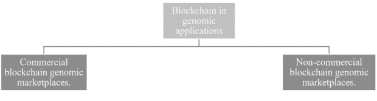

**图 12.3**  
商业区块链基因组市场。

近年来，随着直接面向消费者（DTC）企业开始商业化 DNA 测序，商业基因组客户数量日益增多。这是因为技术进步使基因组测序变得更加普及和快速。像 23andMe 这样的直接面向消费者的企业利用多种策略来创造现金；其中之一是将已收集的 DNA 序列提供给制药公司。当考虑购买这些基因组数据所带来的经济利益时，人们会对这种模式的公平性产生疑问。有些人主张，利润应该归个人所有，而不是中间商 [37,38]。基于区块链技术构建的基因组市场旨在消除对中间商的需求，并为用户提供其数据的访问权限。那些出租或出售其遗传数据的人将获得多种回报。比特币是这些市场中最流行的激励形式。

该公司使用外部实验室来提供其测序服务。生成的 DNA 序列随后被加密并存储在比特币区块链上 [39]。几个基因组市场强调可追溯性和数据完整性是其提供的基本服务。例如，Genomes.io 使消费者能够通过测序和区块链存储流程安全地管理和保存其 DNA 数据。数据仅保留在用户的移动设备上，访问权由提供给他们的私密访问密钥控制。另一个例子是 Genobank，它研究使用非同质化代币（NFT）来实现数据流动性和可追溯性。建议的方法包括为每个样本（例如唾液）分配一个唯一的 NFT，并在公共区块链上分发它。NFT 的几个应用包括选择将对基因组进行测序的实验室以及观察生成的数据将如何被使用 [40]。

## 12.7 非商业区块链基因组市场

关于区块链非商业用途的精选研究主要集中在共享基因组数据以促进科学研究。访问控制、数据交换和数据分析是该研究适用的少数使用场景。

文献根据宏观研究问题进行分类。例如，一项研究专注于出于分析目的交换遗传数据，而另一项研究专注于基于区块链的存储，以转移已保存的基因组数据。癌症基因信托（CGT）值得注意，因为它体现了利用区块链交换遗传数据以推进癌症研究的好处。为了进一步证明 CGT 框架在临床环境中的有效性，作者还根据实际患者的数据发起了一项队列研究。

| 主要类别 | 重点 | 参考文献 |
| :--- | :--- | :--- |
| 数据共享 | 用于安全转移遗传数据的数据交换平台 | [19,22,24,28,33, 58] |
| | 去标识化临床和基因组数据的共享与开放访问 | [26,40] |
| | 遗传和医疗数据交换的共识协议 | [17,48] |
| 数据分析 | 具有隐私保护的分布式 GWAS | [13] |
| | 具有隐私保护的分布式预测模型学习 | [59, 61, 62, 64, 65] |
| | 利用遗传和临床数据进行机器学习模型的分布式训练 | [14] |
| 存储 | 链上原始基因组数据存储 | [45] |
| | 使用无损压缩的 DNA 序列数据存储和传输 | [69] |
| | 药物基因组学的数据存储与检索 | [46, 60] |
| 数据管理和访问控制 | 个人遗传数据访问和同意管理 | [23, 25, 31, 55] |
| | 多方利益相关者同意管理 | [32] |
| | 基因组数据集的访问日志和活动 | [21, 27,44,58,66] |
| | 动态同意管理 | [4, 18, 63] |

癌症患者为试点项目提交了数据，随后对数据进行了去标识化处理，以在保持分布式、开放、经济高效且安全的基因组数据交换优势的同时保护患者隐私。执行去标识化处理，以便其他科学家可以为自己的目的使用这些信息。CrypDist 提供了一种可比策略，尽管增加了额外步骤，用于传播全基因组数据 [40]。最后，一组文章关注具有潜在遗传和医学影响的非传统共识方法 [41]。为了让用户自行执行 HTS 比对映射，Coinami 提供了相应激励。作为报酬，参与者会获得代币。这以 HTS 比对映射替代了工作量证明，以在区块链上验证区块。

利用区块链技术进行遗传数据分析。提出了一项考虑隐私的全基因组关联研究（GWAS）。利用基因碎片化架构，他们能够在保护用户匿名性的同时进行 GWAS。为了便于存储、共享和分析，该框架将巨大的基因组数据集进行分区，并在分布式区块链环境中将其分散到各种服务提供商之间。因此，没有单一提供商可以访问所有数据，从而缓解了集中化和隐私问题。大量文章推广了基于区块链的去中心化机器学习。几家公司已实施区块链技术，在安全、开放和分布式环境中训练预测模型 [42,43]。研究人员提议使用蜂群学习（SL）在区块链上进行联邦学习。SL 去中心化机器学习的一种方法是在没有协调员的情况下安全地注册成员。最后，一旦数据在本地学习完成，模型参数就会被整合，数据所有者将获得对大量遗传和医疗数据的控制权。

Dwarna 是一个利用区块链技术提供实时批准的在线枢纽。通过该网站，研究人员可以与研究参与者合作。该倡议符合《一般数据保护条例》（GDPR），并保证参与者始终对其数据拥有控制权。建议的架构利用区块链


记录所有相关方之间的协议。换句话说，当参与者的权限存储在区块链中时，他们就成为数据的真正所有者。只有在明确同意的情况下，所有者才可以向第三方提供信息访问权限。作者们将供应链管理（MSCM）难题应用于获得共享个人遗传数据同意的问题。这是因为每个人的基因组可能揭示拥有者及其家谱的信息。这就是为什么在分享他们任何个人信息之前，获得家庭成员的许可很重要 [44]。

## 12.8 优势

- **激励（加密货币）**。使用区块链使我们能够创建一个使用加密货币或代币来共享遗传数据的激励系统，这对该领域是一大福音。这在基因市场背景下尤为重要，在基因市场中，一个可信赖的个人信息交易系统是首要目标。目标是简化科学研究及其他目的的数据传输，同时不损害底层数据集的安全性，也不损害真实数据所有者因共享数据而获得经济补偿的权利。此外，网络节点可以通过完成任务（例如映射序列（HTS）读取）来通过激励系统获得奖励。任何人都可以免费注册并立即开始执行分析任务，以赚取可兑换成真实货币的代币 [45,46]。

- **去中心化**。许多文章强调了区块链网络去中心化结构的重要性。在很大程度上，共识过程负责区块链的去中心化特性。它提供了一种分布式共识机制，不需要任何单一权威机构即可在节点间达成一致。根据上下文，去中心化可以带来一些优势。如[40]所述，使用区块链和IPFS可以实现去中心化的开放访问。在疾病流行（例如COVID-19）的情况下，为了调查和创造医疗疗法，医疗资源必须快速分配。去中心化效果良好的另一种情况是涉及众多节点或地点的任务协调。如[46]所示，使用机器学习并合并全局模型时，不再需要中央服务器。这消除了第三方通过研究聚合统计数据来危及数据隐私的能力，这是依赖第三方进行协调时由于产生单点故障/控制而带来的风险。同样，它展示了一种使用区块链组织GWAS研究并确保网络内所有活动（交易）都是真实且经过确认的方法 [47]。

- **所有权**受到严格监管。最好是患者或代表患者工作的可靠第三方（例如医生）能够访问其基因组数据。现有的集中式解决方案通过要求更耗时的许可和访问控制流程，给我们增加了更多工作。文档详细说明了控制范围作为实施区块链技术的主要原因。这种趋势特别糟糕的例子可以在那些承诺用户拥有谁可以查看其数据以及用于什么目的控制权的基因市场中看到。有一些概念旨在促进患者赋能并维护他们对个人内容的主权；同意记录在区块链上 [48]。

- **不可更改性**。选定的文章强调了区块链作为无法更改或篡改的数据存储的最理想特性。大多数使用遗传数据的应用程序严重依赖区块链提供的不可更改性，这使其免受旨在修改或删除信息的攻击。区块链的防篡改数据结构基于加密哈希引用，可防止数据的意外和恶意更改。任何试图篡改区块链已验证区块的行为都会导致任何参与节点都能轻易发现的不一致性。这意味着，即使在并非所有参与者都可以完全信任的网络中，也可以维护一个稳定且一致的共享账本。链上存储可用于必须无限期保存的数据，例如权限记录和审计日志 [48]，具体取决于底层应用的需求。由于不可更改性属性适用于所有节点共享且未加密的链上数据，任何人都可以访问它。出于这个原因，数据隐私必须得到谨慎处理 [49]。

- **数字协议**。代币创建和分发、授权以及策略强制执行只是智能合约的众多用途中的一些。并非所有区块链系统都支持智能合约，也并非所有应用程序都需要它们。然而，智能合约已被纳入多篇文章中某些想法的主要部分。用于激励个人提供遗传数据的代币是通过商业基因组数据交换平台上的智能合约生成的。付款ERC-20代币由Encrypgen和DNAtix中的智能合约生成。基因组数据可以使用智能合约兑换这些代币。使用区块链的另一个原因是借助计算机合同强制执行某种形式的访问管控。例如，使用智能合约来促进向数据所有者转移报酬以及提供对数据的访问 [50]。

- **通过开放性、可访问性、可见性和可审计性维护信任**。仅有少数出版物引用这些区块链特性作为使用该技术的主要理由。如所述，在线模型学习严重依赖数据在所有网络节点上随时可用，因此可靠性和可用性至关重要。能够让数据所有者了解谁在访问他们的数据以及如何访问的应用程序，最能强调透明度和可追溯性的重要性。借助区块链技术的这些特性，企业可以通过让数据所有者掌控自己的信息来赢得他们的信任。例如，作者们强调了开放性的重要性，并指出当患者知道他们的数据将如何被使用时，他们更有可能为研究提供遗传数据 [51,52]。

## 12.9 未来方向

单次测序运行就产生了数百GB的数据，并且预计未来十年将对20亿个人类基因组进行测序。此外，高通量技术产生多种形式的基因组数据，需要专门的管理、处理和存储基础设施。尽管通过重新诠释当前数据集和已收集数据集来加速我们的学习的可能性是前所未有的，但共享这些数据也带来了许多伦理、法律和技术问题。考虑到这些困难，区块链技术最近从包括基因组学在内的广泛领域获得大量关注并不奇怪。已经建立了一些基于区块链的倡议来解决基因组学和电子健康记录（EHR）中的数据共享问题；然而，仅有少量研究将加密货币系统与学术研究联系起来 [53,54]。

基于零知识协议（ZKP）的链下计算取得了一些有希望的最近进展，这可能导致创建新的基于区块链的应用程序。在链下计算范式中，其中一个节点执行链下计算，并在计算确认（验证ZKP证明）后将计算结果的状态保存在链上。另一方面，Arbitrum采用基于奖励的系统来确认链下计算 [55]。考虑到基因组数据的量以及基因组分析活动中经常需要进行密集计算，我们相信采用这些链下计算方法的未来基因组学研究是可行的。

可用于建立信任的新兴技术包括去中心化标识符（DIDs）[54,55]和可验证凭证（VCs）；然而，它们没有得到足够的关注。可以通过使用区块链构建去中心化信任架构来解决数据完整性和隐私等问题。在为研究目的共享数据时，遵循Trust-over-IP原则可以增加对基因组应用的信任 [56]。

还有许多其他用于研究的用例，区块链在基因组学中的使用仍处于起步阶段。我们相信，当基于区块链的解决方案实施时，当前的基因组生态系统将发生变化。患者将在数据共享中发挥重要作用，因为授予患者控制其数据的权力是区块链技术的目标之一。

区块链技术和智能合约实现的更大信任和自动化操作将导致共享数据量的增加。此外，区块链能够创建激励措施，以促进公平的基因组数据共享、存储和分析，其最终目标是改善我们对人类基因组的理解 [57,58]。

## 12.10 区块链的局限性

基于区块链技术的平台正在解决重要问题，例如共享遗传数据的治理，以及其他问题。最终目标是确保组织和个人可以在使用使遵守伦理和法律规范更加容易的算法的同时保持隐私来交换数据。尽管大多数新兴平台仍处于起步阶段，但合理地持积极态度，因为它们提供了绕过基因组数据共享中治理问题的独特策略 [10]。重要的是，区块链不仅仅是技术基础；相反，它代表了一种管理开放网络的新方法，这种方法挖掘去中心化网络的潜力，迎合企业需求，并考虑消费者基因组学 [59]。区块链有可能彻底改变开放网络的治理方式。因此，在这种情况下，主要进步与技术无关，而是由技术实现的。基于区块链的网络的目标是


增加可存储的数据量，同时引入新颖的所有权结构，并使用户在管理数据共享时能够发挥更积极的作用 [60,61]。基于区块链的解决方案可能带来改进数据收集过程中数据限制的机会。这将提高收集遗传信息的公开性和诚信度。同样重要的是，智能合同有潜力大大提高访问协议的可执行性。确保所有相关方未来的数据使用将遵守数据使用条款与条件（T&Cs），这正是这项举措至关重要的原因。这将在应用新信息时提供一致性 [62,63]。此外，如果被正确采纳，基于区块链的解决方案有能力彻底改变围绕数据流动的规范和做法。特别是，患者和个人在数据共享生态系统中可能发挥更大的作用，这可能会削弱测试提供者（无论是商业性质的还是公共性质的）目前对遗传数据共享管理所持有的垄断地位。缺乏私人市场和公共产品的提供，为区块链技术引入新维度提供了机会。基于区块链的解决方案旨在围绕所有权、激励和参与式控制进行教育和设计，以便赋予人们和患者共享和管理其数据的能力 [64,65]。然而，基于区块链的解决方案仍然需要法律工具的支持才能有效。自我监管可能不足的两个突出例子是为遗传数据库设定货币价值和建立所有权权利。为了提供尽可能好的规则，在这样做时必须考虑生物医学研究的更广泛背景 [66]。

## 12.11 结论

最近，提出基于区块链的解决方案来解决数据处理、数据交换和存储问题的研究出版物数量有所增加。为使遗传数据交换更容易而创建的面向营利和非营利目的的大量区块链应用程序，可以被视为遵循相似的发展轨迹。在本研究中，我们对该领域之前所做的许多努力提供了完整的总结。

在研究过程中，我们采用了一种分类法，将区块链技术在基因组学中的应用分为两类：商业和非商业。非营利应用程序根据其希望实现的具体目标进一步细分，包括数据交换、分析、安全存储和访问限制。在提供每个应用程序的详细信息后，随后讨论了所提策略的优缺点，并对各种建议进行了比较，涉及区块链平台的选择以及提案中数据的存储、共享和保护方式。

最突出的一些问题是软件的不稳定性、无法互操作以及与智能合同的僵化相关的安全威胁。另一个挑战是保护信息的秘密性以及控制该信息的人的身份。

在该类环境中实施时，之前描述过的隐私增强技术可能非常有用。根据我们调查的发现，不可变性和去中心化似乎是该环境下应用区块链技术的主要驱动因素。我们发现，有几项研究主张应赋予数据所有者对其自身数据行使控制权的能力。大多数研究文章利用区块链技术为组织或个人（患者）提供数据所有权。

此外，我们得出结论，尽管有大量机会探索其他用例，但区块链技术在基因组学中的应用或用例并不像在金融行业那样全面。从已有众多想法的视角出发，我们编制了一份突出问题和困难的清单。我们建议在基因组学领域测试基于区块链的分布式分析，也称为处理。此外，可以通过比较各种隐私增强技术（如同态加密、多方计算、零知识证明和链下计算）的性能，更好地理解使用区块链网络的隐私保护分布式分析的可行性。调查利用区块链技术提供对遗传数据的安全和验证访问是未来另一个值得探索的领域。基于IP的信任理念可以应用于促进研究人员去中心化身份的创建并管理此类身份。

总之，我们相信基于区块链的基因组学应用仍处于研究和开发阶段。为部署这些应用程序，需要进行重大的社会和技术变革。最近在基因组学中推广其使用的尝试可以通过证明在各种基因组学应用中利用区块链技术的前景和实用性，帮助加速这项技术的采用。这可能会加速这项创新的传播。

## 参考文献

- [1] Murawa P, Murawa D, Adamczyk B, Polom K. 乳腺癌：实际治疗方法与未来趋势. Reports of Practical Oncology and Radiotherapy. 19(3) (2014), 165–72.
- [2] Thomas C. 精准医学：功能进展. Annual Review of Medicine. 69 (2018), 1–18.
- [3] Moore C, O’Neill M, O’Sullivan E, Doröz Y, Sunar B. 实用同态加密：一项调查. In 2014 IEEE International Symposium on Circuits and Systems (ISCAS), 2014 (pp. 2792–5). IEEE.
- [4] Steneck NH. 研究负责任行为导论, 2007. US Government Printing Office.
- [5] Shabani M. 基于区块链的基因组数据共享平台：回应治理问题的去中心化方法？ Journal of the American Medical Informatics Association. 26(1) (2019), 76–80.
- [6] Baselga J, Tripathy D, Mendelsohn J, et al. HER2/neu过表达转移性乳腺癌患者每周静脉注射重组人源化抗-p185HER2单克隆抗体的II期研究. Journal of Clinical Oncology. 14 (1996), 737–44.
- [7] Gürsoy G, Brannon CM, Gerstein M. 通过智能合同使用以太坊区块链存储和查询药理基因组数据. BMC Medical Genomics. 13(1) (2020), 1–11.
- [8] Worrall D, Ayoubi R, Fotouhi M, Southern K, McPherson PS, Laflamme C, NeuroSGC/YCharOS/EDDU Collaborative Group, ABIF Consortium. TDP-43高性能抗体的鉴定，用于Western Blot、免疫沉淀和免疫荧光. F1000Research. 12(277) (2023), 277.
- [9] Alshafie W, Ayoubi R, Fotouhi M, Southern K, Laflamme C, NeuroSGC/YCharOS Collaborative Group. Moesin高性能抗体的鉴定，用于Western Blot、免疫沉淀和免疫荧光. F1000Research. 12(172) (2023), 172.
- [10] Živi N, Kadušić E, Kadušić K. 有向无环图作为Tangle：面向物联网的区块链替代方案. In 2019 27th Telecommunications Forum TELFOR, 2019 (pp. 1–3). IEEE.
- [11] Chang V, Baudier P, Zhang H, Xu Q, Zhang J, Arami M. 区块链如何影响金融服务——来自专家访谈的概述、挑战与建议. Technological Forecasting and Social Change. 158 (2020), 120166. https://doi.org/10.1016/j.techfore.2020.120166
- [12] Mohammed A, Fatih T, Joeri V D Velde, Karastoyanova D. 基因组学中的区块链：系统文献综述. Distributed Ledger Technologies. 1(2) (2022), 1–28. https://doi.org/10.1145/3563044
- [13] Zhang Y, Zhao X, Li X, Zhong M, Curtis C, Chen C. 在分散网络中实现GWAS的隐私保护基因组数据共享. In Proceedings of the Twelfth ACM International Conference on Web Search and Data Mining, 2019 (pp. 204–12). https://doi.org/10.1145/3289600.3290983
- [14] Warnat-Herresthal S, Schultze H, Shastry KL, Manamohan S, Mukherjee S, Garg V, Sarveswara R, Händler K, Pickers P, Aziz AN, et al. 用于分散和机密临床机器学习的蜂群学习. Nature. 594(7862) (2021), 265–70.
- [15] Uribe D, Waters G. 隐私法律、基因组数据和非同质化代币. The Journal of The British Blockchain Association. 3(2) (2020), 13164.
- [16] Talukder AK, Chaitanya M, Arnold D, Sakurai K. 疾病证明：用于准确医疗决策和减少疾病负担的区块链共识协议. In 2018 IEEE SmartWorld, Ubiquitous Intelligence & Computing, Advanced & Trusted Computing, Scalable Computing & Communications, Cloud & Big Data Computing, Internet of People and Smart City Innovation (Smart-World/SCALCOM/UIC/ATC/CBDCom/IOP/SCI), 2018 (pp. 257–62). IEEE.
- [17] Silva P, Dahlke DV, Lee Smith M, Charles W, Gomez J, Ory MG, Ramos KS. 使用创新技术吸引代表性不足人群的理想化临床基因组登记. Journal of Personalized Medicine. 12(5) (2022), 713.
- [18] Shuaib K, Saleous H, Zaki N, Dankar F. 医疗保健和基因组的分层区块链框架. In 2020 IEEE International Conference on Smart Computing (SMARTCOMP), 2020 (pp. 156–63). IEEE.
- [19] Shabani M. 基于区块链的基因组数据共享平台：回应治理问题的去中心化方法？ Journal of the American Medical Informatics Association. 26(1) (2019), 76–80.
- [20] Pattengale ND, Hudson CM. 通过许可区块链账本进行分散基因组审计日志. BMC Medical Genomics. 13(7) (2020), 1–9.
- [21] Nakamoto S, Bitcoin A. 点对点电子现金系统; 2008. Bitcoin. https://bitcoin.org/bitcoin.pdf.
- [22] Dambrot SM. ReGene：基因组数据的区块链备份和预工程表现型的恢复. In 2018 9th IEEE Annual Ubiquitous Computing, Electronics & Mobile Communication Conference (UEMCON), 2018 (pp. 945–50). IEEE.
- [23] Park Y-H, Kim Y, Shim J. 使用局部差分隐私的基于区块链的基因组数据管理隐私保护系统. Electronics. 10(23) (2021), 3019.
- [24] Angraal S, Krumholz HM, Schulz WL. 区块链技术：医疗保健中的应用. Circulation: Cardiovascular Quality and Outcomes. 10(9) (2017), e003800.
- [25] Pachaury R, Lakshmi CV. 使用区块链技术保护基因组数据. In Advances in Systems Engineering, 2021 (pp. 473–80). Springer.
- [26] Grossman RL. 迈向癌症数据生态系统的进展. Cancer Journal (Sudbury, Mass.). 24(3) (2018), 122.
- [27] Ozercan HI, Ileri AM, Ayday E, Alkan C. 实现区块链技术在基因组学中的潜力. Genome Research. 28(9) (2018), 1255–63.
- [28] Ozdavi MS, Kantarcioglu M, Malin B. 利用区块链跨多个站点进行不可变日志记录和查询. BMC Medical Genomics. 13(Suppl 7) (2020), 82.
- [29] Neto MM, da S Marinho CS, Coutinho EF, Moreira LO, de C Machado J, de Souza JN. 使用区块链技术进行DNA序列数据的电子健康应用研究机会. In 2020 IEEE International Conference on Software Architecture Companion (ICSA-C), 2020 (pp. 95–102). IEEE.


- [30] Arroyo-Mariños JC, Mejia-Valle KM, Ugarte W. 利用区块链技术在私营健康领域保护遗传信息的技术模型. 在 ICT4AVE, 2021 (pp. 171–81). https://www.scitepress.org/Papers/2021/104224/104224.pdf
- [31] Abul-Husn NS, Kenny EE. 个性化医疗与电子健康记录的力量. Cell. 177(1) (2019), 58–69.
- [32] Beyené M, Thiebes S, Sunyaev A. 遗传检测中的多方利益相关者同意管理：基于区块链的方法, 2019. https://publikationen.bibliothek.kit.edu/1000125483
- [33] Miyachi K, Mackey TK. hOCBS：一种用于医疗数据的隐私保护型区块链框架，采用链上和链下系统设计. Information Processing & Management. 58(3) (2021), 102535.
- [34] Sadat MN, Al Aziz MM, Mohammed N, Chen F, Jiang X, Wang S. Safety：通过混合解决方案在联邦环境中实现安全的 GWAS. IEEE/ACM Transactions on Computational Biology and Bioinformatics. 16(1) (2018), 93–102.
- [35] Glicksberg BS, Burns S, Currie R, Griffin A, Wang ZJ, Haussler D, Goldstein T, Collison E. 癌症患者基因组和临床结局数据的区块链认证共享：一项前瞻性队列研究. Journal of Medical Internet Research. 22(3) (2020), e16810. https://doi.org/10.2196/16810
- [36] genecoin.me. 2020. genecoin. 2020年12月1日从 http://genecoin.me/ 检索。
- [37] Glicksberg BS, Burns S, Currie R, Griffin A, Wang ZJ, Haussler D, Goldstein T, Collison E. 癌症患者基因组和临床结局数据的区块链认证共享：一项前瞻性队列研究. Journal of Medical Internet Research. 22(3) (2020), e16810. https://doi.org/10.2196/16810
- [38] Choi JI, Butler KR. 安全多方计算与可信硬件：审视采用挑战与机遇. Security and Communication Networks. 2 (2019).
- [39] Sadat MN, Al Aziz MM, Mohammed N, Chen F, Jiang X, Wang S. Safety：通过混合解决方案在联邦环境中实现安全的 GWAS. IEEE/ACM Transactions on Computational Biology and Bioinformatics. 16(1) (2018), 93–102.
- [40] Drucker N, Gueron S. 将同态加密与可信执行环境相结合：使用 Paillier 加密和 SGX 的演示. 在 2017 年管控内部安全威胁国际研讨会论文集中, 2017 (pp. 85–8). https://doi.org/10.1145/3139923.3139933
- [41] Kulemin N, Popov S, Gorbachev A. Zenome 项目：基于区块链的基因组经济白皮书. Zenome, 2017. 可从以下网址获取：https://zenome.io/download/whitepaper.pdf
- [42] Schorcht B, Monteiro BA, Gouveia FC, Fischer A, Rebelo MF. 认识 Genecoin：生物经济货币. 理论白皮书, 2018. 可从以下网址获取：https://github.com/genecoin-science/genecoin-science.github.io
- [43] Gürsoy G, Bjornson R, Green ME, Gerstein M. 使用区块链记录基因组数据集访问：高效存储与查询. BMC Medical Genomics. 13(7) (2020), 1–9.
- [44] Gursoy G, Brannon C, Wagner S, Gerstein M. 在区块链上存储和分析基因组. Genome Biology. 23 (2022), 134. https://doi.org/10.1186/s13059-022-02699-7
- [45] Dedeturk BA, Soren A, Bakir-Gungor B. 用于基因组学和医疗保健的区块链：文献综述、现状、分类与未解决问题. PeerJ. 9 (2021), e12130.
- [46] Lippman A, Ekblow B, Johnson A, Camaron K, Retzeipi NN. 技术文档：MedRec, 2017 (pp. 1–9). 剑桥.
- [47] Park JY, Lee YK, Lee DS, Yoo JE, Shin MS, Yamabe N, Kim SN, Lee S, Kim KH, Lee HJ, Roh SS. 从松香（Resina Pini）中分离出的抚松酸增强了 HUVECs 中的血管生成并加速了小鼠的皮肤伤口愈合. Journal of Ethnopharmacology. 203 (2017), 279–87.
- [48] Bosworth S, Kabay ME, 编. 计算机安全手册, 2002. John Wiley & Sons.
- [49] Alvarez F, Berg PA, Bianchi FB, Bianchi L, Burroughs AK, Cancado EL, Chapman RW, Cooksley WG, Czaja AJ, Desmet VJ, Donaldson PT. 国际自身免疫性肝炎组报告：自身免疫性肝炎诊断标准的回顾. Journal of Hepatology. 31(5) (1999), 929–38.
- [50] May A, Ross T. 公民技术的设计：影响公众参与和影响的因素. Ergonomics. 61(2) (2018), 214–25.
- [51] Kumar Y, Munjal R. 对称与非对称密码学及其现有漏洞的比较. International Journal of Computer Science and Management Studies. 11(3) (2011), 60–63.
- [52] Iyer V, Vyshnavi AMH, Iyer S, Namboori PKK. 面向癌症患者的基于 DLT 的 AI 驱动基因组分析系统与安全数据共享. 在 2019 年 IEEE 孟买分会标志性会议 (IBSSC) 中, 2019 (pp. 1–5). IEEE.
- [53] Kumar R, Tripathi R. 基于区块链的假药供应链追溯. 在 2019 年第 11 届通信系统与网络国际会议 (COMSNETS) 中, 2019 (pp. 568–70). IEEE.
- [54] Goede M. 电子爱沙尼亚：爱沙尼亚、新加坡和库拉索的电子政务案例. Archives of Business Research. 7(2) (2019).
- [55] Buldas A, Kroonmaa A, Laanoja R. 安全 IT 系统：第 18 届北欧会议. NordSec.
- [56] Kim Y, Park Y-H. 基于去标识化方案的基因数据管理区块链模型. 在 2021 年 IEEE 国际消费电子亚洲会议 (ICCE-Asia) 中, 2021 (pp. 1–4). IEEE.
- [57] Mathur G, Pandey A, Goyal S. 使用区块链技术进行下一代生物信息学中的不可篡改 DNA 序列数据传输. 在第 2 届数据、工程与应用国际会议 (IDEA) 中, 2020 (pp. 1–6). IEEE.
- [58] Kuo T-T. 分布式预测建模框架的剖析：在线学习、区块链网络与共识算法. JAMIA Open. 3(2) (2020), 201–8.
- [59] Kuo T-T, Bath T, Ma S, Pattengale N, Yang M, Cao Y, Hudson CM, Kim J, Post K, Xiong L, 等. 基于区块链的基因-药物相互作用数据共享方法的基准测试：来自 iDASH 2019 安全基因组分析竞赛区块链赛道的案例研究. International Journal of Medical Informatics. 154 (2021), 104559.
- [60] Kuo T-T, Gabriel RA, Cidambi KR, Ohno-Machado L. 许可区块链（ExplorerChain）上的期望传播逻辑回归：去中心化的在线医疗/基因组学预测模型学习. Journal of the American Medical Informatics Association. 27(5) (2020), 747–56.
- [61] Kuo T-T, Gabriel RA, Ohno-Machado L. 区块链实现的公平计算负载：通过交替客户端和服务器角色共享模型. Journal of the American Medical Informatics Association. 26(5) (2019), 392–403.
- [62] Mamo N, Martin GM, Desira M, Ellul B, Ebejer J-P. Dwama：生物库动态同意的区块链解决方案. European Journal of Human Genetics (2019), 1–18.
- [63] Kuo T-T, Kim J, Gabriel RA. 区块链网络的网络上的隐私保护模型学习. Journal of the American Medical Informatics Association. 27(3) (2020), 343–54.
- [64] Kuo T-T, Pham A. 去中心化医疗联邦学习中的模型不当行为检测. International Journal of Medical Informatics. 158 (2022), 104658.
- [65] Ma S, Cao Y, Xiong L. 基于区块链的跨站点基因组数据集访问审计的高效日志记录与查询. BMC Medical Genomics. 13(7) (2020), 1–13.
- [66] Ma L, Liao Y, Fan H, Zheng X, Zhao J, Xiao Z, Zheng G, Xiong Y. PHDMF：一种基于区块链技术的灵活可扩展个人健康数据管理框架. Frontiers in Genetics (2022), 779.

## 13 用于大规模临床信息交易的区块链

Anusha R., Jayashree J., Vijayashree J., and Mohamed Yousuff

### 13.1 引言

比特币于 2008 年的创建向世界介绍了一种新概念，该概念目前预计将改变社会。它有潜力影响每个行业，包括金融、政府、媒体、法律和艺术等。有些人将区块链视为一场革命，而另一些人则认为它将更具演化性，任何实际益处可能需要数年才能显现 [1]。在某种程度上，这一想法是正确的，但就我们而言，革命已经开始。全球许多重要公司已经在开展区块链概念验证工作，认识到该技术的颠覆潜力。另一方面，一些公司仍处于研究的早期阶段，但随着技术的进步，这种情况可能会改变。这是一项对当前技术具有重大影响并能带来显著变化的技术。

区块链是计算机网络保持安全且难以被黑客攻击或篡改的交易公共数字账本 [2]。得益于技术进步，个人可以直接相互交互，而无需政府、银行或其他第三方等中介。

密码学用于连接不断增长的记录集合，称为区块。通过点对点计算机网络，每笔交易都会被验证、加上时间戳，并添加到不断增长的数据链中。一旦数据被捕获，就无法修改。

由于行业和媒体关于其扩张的消息 [3]，该技术受到了最多关注。例如，以太坊、比特币、莱特币、门罗币和达世币的市值都非常突出。然而，区块链不仅用于加密货币。目前，商业和公共部门已有多种基于区块链的应用，包括众筹、供应链监控、身份验证和投票服务，更多应用见 [4,5]。根据一项民调，区块链现在是金融应用中提及最频繁的技术。


### 13.1.1 区块链是如何工作的？

让我们来看一个创建区块的更通用方法。此方案旨在为您提供区块如何生成以及交易和区块如何链接的总体概述：

- 1. 节点通过生成交易并使用其私钥进行数字签名来发起交易。区块链交易可用于表示多种不同的操作 [6]。这通常是一种数据结构，用于表示区块链网络成员之间的价值转移。交易数据格式通常包含一些价值转移逻辑、合适的规则、源地址和目标地址以及其他验证数据。
- 2. Gossip 协议将交易广播（泛洪）到对等节点，对等节点随后根据预定义标准验证该交易 [7]。在大多数情况下，交易必须由大多数节点验证。
- 3. 随后将交易放入区块中，验证后将该区块发送到整个网络。此时，交易被视为完成。
- 4. 新创建的区块现在已添加到账本中，下一个区块以加密方式链接到它。这是一个指向哈希指针的链接。此时，交易获得第二次确认，而区块获得第一次确认。
- 5. 每次生成新区块时，交易都会重新确认。在比特币网络上的交易被宣告完成之前，通常需要六次验证。

### 13.1.2 共识

医疗保健中的区块链创新当然并非一件特别基本的事情。它既有一些令人惊叹的优势，也有一些极端的缺点。然而，预计在未来几年中，区块链和 AI 将在医疗服务应用开发中占据主导地位，从而使个人更容易寻求更好的治疗。一项有条文献综述旨在调查区块链和医疗服务领域的近期文献，并识别现有的困难和开放性问题，以提出关于区块链中电子健康记录（EHR）的研究问题为指导，帮助并改进对这种相关记账技术的理解 [8]。检查了最近十年发表的300多篇科学研究，结果形成了前沿的科学分类，识别了困难和开放性问题，并对区块链在 EHR 中的应用的主要方法、数据类型、指南和框架进行了评估和讨论 [9]。通过使电子健康记录更加高效和安全，这项技术可能开启健康信息交换的新时代。患者若能访问其临床记录，便以分块方式与其交互，这反映了这些记录的管理方式。区块链支持信息交换和信任，考虑到集体临床动态，它可能是远程医疗和精准医疗的未来选择 [10]。医疗保健中区块链的另一个用例是根据专家建议对患者进行 X 光检查并将其存储在区块链上。这可以通过保护患者隐私来实现。患者的 Aadhar 号码的哈希值用于在区块链中保持隐私 [11]。

## 13.2 区块链代际

本节定义了区块链技术的三代。比特币异常高的波动性以及许多国家对其复杂性的看法最初阻碍了其发展，但区块链（比特币的底层技术）的优势最终吸引了全球关注。区块链的特点包括分布式账本、去中心化、信息透明、防篡改架构和开放性。区块链的演进进展缓慢。如今，根据其用途，区块链被分为区块链 1.0、2.0、3.0 和 X.0 [12]。

### 13.2.1 区块链 1.0

此层级随着比特币的推出而创建，主要用于加密货币。其次，因为比特币是第一种加密货币，将区块链技术的第一代完全归类为加密货币是自然而然的。这一类别包括所有替代加密货币以及比特币本身 [13]。它包括重要的应用，例如支付和应用程序。自 2009 年比特币推出以来，这一代始于 2009 年，并在 2010 年代初结束 [14]。

### 13.2.2 区块链 2.0

金融服务和智能合约是第二代区块链的应用之一。期货、期权、互换和债券等其他金融资产也包含在此层级中。此层级包括超越货币、金融和市场的应用。以太坊、Hyperledger 等其他新兴区块链技术属于区块链 2.0 的一部分 [15]。这一代始于 2010 年，当时人们开始考虑区块链可用于多种目的。

### 13.2.3 区块链 3.0

除了银行业，第三代区块链还被用于在政府、健康、新闻业、艺术和司法领域构建应用程序。此区块链技术层级包括以太坊、Hyperledger，以及具有构建智能合约能力的较新区块链，以及区块链 2.0。大约在 2012 年，对区块链技术在各个领域的多种应用进行了调查，从而形成了这一代区块链 [16]。

### 13.2.4 Hyperledger Fabric

Linux 基金会托管了一个名为 Hyperledger Fabric 的开源项目，这是一个区块链系统。在容器化开发中，存在一种包含称为链码（chain code）的应用程序理念的安排 [17, 18]。分类的交易——参与者可以追踪交易的可见性。许可组织——每个参与者都有已知的身份。提供验证、访问控制和交易确认。在参与者之间建立信任、透明度和责任感 [19]。

### 13.2.4.1 Hyperledger Fabric (HLF)

HLF 中包含几个对框架发挥基本作用的关键部分。此外，它在交易被转移到账本之前提供三个阶段的协议来批准交易。为了执行特定的优先任务，HLF 提供了一系列称为框架链码的特殊、指定链码 [20]。设置、生命周期、查询、背书和验证器框架链码是框架链码的示例。在我们的模型框架中，作为我们研究的一部分，计划并实现了几个基本链码。

在获得患者同意将患者信息转移到 EHR 框架之前，该信息使用合适的对称密钥进行加密 [21]。然后，对称密钥使用患者的公钥进行非对称编码，并与加密后的信息关联 [22]。这种混合加密使该方法在速度和便利性方面更加有效，因为对于大量数据，对称密钥加密比非对称密钥加密更快，而后者对于小型加密密钥加密更为有利 [23]。

在线应用程序为框架参与者提供电子用户界面和基本的交互功能，以便相互通信。患者使用它来创建密钥对，以便在框架中注册和选择其身份以获取 Eckert。他们还可以生成中介加密密钥并将其发送到中介 [24]。另一方面，客户端使用此电子应用程序生成交易提案，并将其提交到区块链框架，用于确定患者身份以及创建、传输和共享临床记录、元数据等任务 [24]。

### 13.2.5 区块链 X.0

这一代设想了区块链奇点，届时，类似于谷歌搜索引擎，公共区块链服务将向任何人开放。它将为各行各业的人们提供服务 [25]。它将是一个公共的、开放的分布式账本，在其上运行着通用理性代理（Machina economics），代表所有者做出选择并与其他智能自主代理进行交互，并由代码而非立法或纸质合同进行监管。这并不意味着法律和合同将过时；相反，法律和合同将是可编程的 [26]。

区块链技术的众多优势已在各个领域得到阐述，并得到全球区块链行业思想领袖的倡导 [27]。区块链技术最值得注意的好处如下：

- 去中心化。这是区块链技术的关键原则和优势。交易验证不需要可信第三方或中介的参与；而是使用共识机制来商定交易的合法性。

- 透明度与信任。由于区块链是共享的，每个人都可以看到上面的内容，因此系统是透明的。结果是，信任度有所提高。这在个人酌情决定接收者受限的情况下尤其重要，例如支付或福利的分配 [28]。

- 不可更改性。一旦数据被记录在区块链上，更改它就极其困难。虽然它并非完全不可更改，但保持交易的不可更改账本被视为一项优势，因为更改数据非常困难，甚至不可能 [29]。


- **提高可用性。** 由于该系统建立在点对点网络的数千个节点上，且数据在每个节点上都被复制和更新，因此极其可靠。
- 即使某些节点离线或不可用，网络仍能继续运行，因而具有高可用性。由于存在冗余，可用性很高。
- **安全性无懈可击。** 在区块链上，所有交易均经过加密编码，确保网络完整性。
- **简化现有范式。** 许多企业（包括银行业和医疗保健行业）目前正在采用一种杂乱无章的区块链范式。在这种方法下，多个实体维护各自的数据库，由于系统结构各异，数据交换可能会出现问题 [30]。然而，由于区块链可以作为多方的单一共享账本，它可以通过减轻每个企业维护的多个系统的管理负担来简化范式。
- **交易更快。** 当前的区块链方法在包括银行业和医疗保健在内的多个领域都是非结构化的。在这种设计中，许多实体维护各自的数据库，且由于系统性质的差异，数据传输可能会面临困难。然而，由于区块链可以作为多方的单一共享账本，它有潜力通过减轻每个机构独立系统的行政负担来简化流程 [31]。
- **节省成本。** 由于区块链理念无需依赖受信任的第三方或清算所，因此可以大幅削减与向此类机构支付费用相关的运营成本。

## 13.3 基于智能合约的区块链式电子健康记录

任何医疗体系最宝贵的资产是每位患者的受保护健康信息。利用区块链技术追踪分布式患者数据的引用，既惊人又富有创新性 [32]。一种以先进配置电子方式跟踪个体患者数据和健康记录的广泛框架称为电子健康记录（EHR）。患者的个人和病史存储在 EHR 中。EHR 框架试图通过超越典型的临床数据收集，为患者结局提供更全面的视角 [33]。

### 13.3.1 临床试验阶段的智能合约

临床试验包含多个阶段，这些阶段可以在区块链中链接在一起，使得每个阶段都依赖于其前一个阶段。区块链技术通过智能合约这一过程，能够将不同阶段切分并链接起来。智能合约使用加密哈希链来验证和强制执行合同 [34]。智能合约仅在前一步骤已被完全验证和确认时才会验证某一步骤。智能合约可以将同意参加试验的患者纳入数据库（数据录入后冻结），随后将试验的每个阶段链接起来，以确保临床试验的透明度，且任何步骤中的数据均不会被篡改。接受每个 EHR 将解决方案、问题及敏感性列表更新提交到分布式、分散的可靠记录中，保证信息的变更在各机构间得到确知和批准 [35]。因此，EHR 显示记录中引用的任何数据集的信息，而不仅仅是一个。

### 13.3.2 EHR 特性

- 提高诊断准确性和患者预后。
- 提升护理质量。
- 简化并自动化提供者工作流程。
- 以可在多个组织间共享的数字格式维护。
- 经批准的供应商可以创建和维护数据。

区块链中的每个块都由数据以及通过数据加密生成的数字签名（哈希）组成。该哈希通过将两个块链接在一起，在数学上将它们连接起来 [36]。区块链哈希是根据前一个块的信息计算得出的，并用于按时间和顺序锁定块。这是将区块链连接在一起并有助于建立加密信任的理念。节点是网络的基本构建块。节点就像运行网络安全机制的机器。每个节点都持有该区块链中记录的所有交易的完整集合 [37]。

一个拥有数十亿人口且拥有广泛多样性的国家，无疑需要一种医疗基础设施，使每位平民的健康记录都能顺利、快速地处理。谷歌公司 DeepMind Health 正在开发一种类似区块链的机制，用于可靠地监控患者信息。与需要多个参与者进行分布式验证的传统区块链不同，DeepMind 声称这两项更改都将提高系统的效率。

现代医疗保健的根本问题是，各组织的患者医疗记录众多且分散。EHR 框架利用区块链创新安全地存储档案，并保护单一版本的事实。在将交易提交到分布式账本之前，利益相关者需要获得查看患者病史的授权。通过基于区块链的方案，可以实现广泛的可访问性、信息分类、成本可行性以及对数据框架的信任。利益相关者包括医院、患者、专科医生、医生、临床研究人员、实验室、药房和药品监管机构，以及保险公司。

### 13.3.3 FHIRChain：使用区块链以安全且可扩展的方式共享临床数据

为患者提供可行的社区导向治疗和护理选择，需要安全且多功能的信息共享。患者在其一生中会访问各种护理提供者的工作场所 [3]。为了确保这些提供者掌握有关持续医疗问题的最新信息，他们应当能够以理想且安全的方式交换患者的健康数据。

### 13.3.4 基于区块链要求的临床数据共享

DeSalvo 和 Galvez 的《全国互操作性共享路线图》定义了开发互操作性医疗 IT 系统的技术要求和指导原则。基于我们之前的经验，我们认为设计满足这些要求的区块链架构需要克服重大挑战，才能在医疗保健中有效地使用区块链技术。本节在讨论其对基于区块链架构的影响之前，首先考察临床数据共享系统中的五项关键技术要求。

- 安全存储和交换数据
- 保持模块化
- 对信息源进行稳定的许可访问
- 应用一致的数据格式
- 验证身份并验证所有成员

### 13.3.4.1 在电子健康记录（EHR）中应用区块链以跟踪患者记录

电子健康记录（EHR）框架正逐渐被用作在医院之间共享患者记录的一种有效方法。然而，跨不同 EHR 访问转发的患者信息仍然面临困难，因为当前的 EHR 受本地限制或隶属于合作医疗机构。根据一份发布的报告，访问患者记录的主要障碍在于查找提供者地址的困难。会创建一个通道，这是 HLF 网络的一个私有子网，在其中相同的记录在医院成员之间共享。其中的组织或机构可以根据其需求创建带有相关记录的独立通道。实际上，临床信息通常太大，无法直接在记录中处理；因此，信息存储在 EHR 中，记录中仅记录位置。根据信息是否在记录中，这种存储方式被称为链上存储或链下存储。记录还存储信息哈希值 [37]。这保证了信息的完整性，因为一旦一段信息写入记录，它就变得不可更改，使用户能够判断信息是否被篡改。

### 13.3.4.2 通过区块链协议实现安全且分散的临床影像信息共享结构

影像学检查对医疗提供者和患者的可获得性至关重要。鉴于获取临床影像的费用以及延迟获取影像结果所带来的风险，开展放射学检查为我们提供了一个自然目标，以进一步提高医疗服务效率和患者预后。

### 13.3.4.2.1 医学影像共享

尽管先进成像和快速组织网络无处不在，但临床影像共享的稳定范式要求实际副本（例如 CD 或 DVD）在提供者之间快递。还有一


清晰的缺陷和将计算机化资源转录到光学媒体中固有的浪费，这些资源通常仅在接收站的图像导入过程中被读取一次。

## 13.4 区块链和人工智能如何革新医疗保健解决方案

随着创新的进步，医疗服务中区块链用例的数量正在增加。医疗服务除了付款之外，还有其他一些用途。当前医疗服务框架的重大问题是它无法满足买家的所有需求 [38]。区块链和人工智能为所有这些问题提供了解决方案。

### 13.4.1 医疗保健中的区块链应用

- 1. 访问临床记录。区块链技术允许将所有重要的患者信息存储在数据集中。专家和患者都可以有效地利用这些信息。

- 2. 追踪临床资质。核实资质并确认临床工作人员的过去工作经验至关重要。总体而言，通过区块链技术，招聘流程将变得更加合理。

- 3. 安全付款。区块链技术与加密货币密切相关。使用加密货币，您可以更好地跟踪付款。同样，它降低了被黑客攻击的风险。

- 4. 新药试验。大量数据集被收集和分析用于研究目的。借助区块链，所有这些信息都被安全存储，以便专家和患者能够快速获益。

### 13.4.2 医疗服务中的人工智能应用

- 1. 人工智能专家。人工智能专家已成为专业专家的得力助手。

- 2. 人工智能牙医。有一些带有人工智能并能自主运作的机器人牙医。该机器人可以执行种植牙等一些手术，效果优于人类牙医。

- 3. 维护临床记录和处方。主要目标是识别不遵守规则的患者特征。尽管如此，人工智能算法不难跟踪这些患者，并提醒他们按时服药。

### 13.4.3 缺点

- 1. 成本。在医疗服务框架中为区块链和人工智能设定具体费用具有挑战性。

- 2. 审批。没有特定的系统来识别信息的所有者。

- 3. 脆弱性。由于缺乏意识，医疗保健行业缺乏新的区块链公司。这对区块链在医疗保健中的未来产生了一种脆弱性和疑问感。

- 4. 规则和法规。医疗保健框架中没有针对区块链的具体标准和准则。此外，如何应用保护准则对任何人来说都不是非常简单。

通过在区块链技术中结合分布式账本、非对称加密和哈希计算，完全实现了去中心化、永久性、安全性和可追溯性，区块链技术最初被称为比特币。

它消除了中间人，将信任从机构转移到硬编码，并被视为通过将信息控制权归还给个人所有者来打破信息垄断的转折点。

智能合约是编码程序，当特定条件触发时可独立自动执行价值交易，为以太坊赋予了现代技术及其力量的形象。

相当一部分应用程序可供公众使用 [38]。

“链”这一表述指的是本地中每个人都拥有一块财产的方式。

授权以查看。随着对高安全性劳动力需求的增长，药房和医疗保健等行业已发生变化。

联盟链是另一种发展起来的区块链类型。它包含经过审查的个人。

区块链可以大规模用于医疗保健，在集中式结构已创建用于信息存储和严格信息需求的信息孤岛的地方。

数据共享受到安全性的阻碍，尤其是当可穿戴设备生成数十亿个数据点，伴随巨大的信息存储，并使用人工智能（AI）生成的需求时。

此外，区块链在验证信息所有权和扩展空间或临时度量方面的优势，为区块链理念在医疗保健行业提供了光明的前景。

守门员时间与爱沙尼亚政府合作，推出了一个基于区块链的基础设施，以在全国范围内以患者为中心的方式批准患者ID并保障个人健康记录的安全。

即使只有少数合作伙伴，这个框架也确保患者对其信息负责，并可以设置访问权限，同时具有防篡改性 [39]。

### 13.4.4 临床试验

当更多的临床试验各方和节点参与并远离主要机构进行协作时，人为引起的错误（无论是偶然还是故意）更可能发生。

Wong提出了一个基于区块链的临床试验框架，要求监管机构审计链上的每次更新，包括各方。

由于不可更改性和可追溯性，药品供应链高管、临床专家资质和执照以及医疗索赔组织均处于有利地位。

患者有权控制并参与其信息在数字化健康环境中产生的收益。

### 13.4.5 Gartner炒作周期

根据Gartner炒作周期，区块链目前处于“夸大期待峰值”和“幻灭期”阶段。

安全性和保护是医疗服务领域的两个重大挑战。

通常情况下，在公有链上，“每个人都能看到一切”，透明度与保密性之间的平衡可能会变得复杂，而不同的应用可能依赖于使用联盟链或私有链的定制方案。

对于希望能够从链上删除其信息的患者来说，永久性可能是一把双刃剑 [40]。

同样，将所有临床信息都存储在区块链上会使其膨胀，因为它不改变信息的保存方式，而改变信息的访问和共享方式；因此，在许多应用中，信息通常存储在链外，并在链上使用加密位置指针。

此外，专家应彻底调查和评估区块链的应用。

通过利用智能合约漏洞，程序员在2016年至2019年期间窃取了价值超过8000万美元的数字货币。

因此，在区块链广泛应用于医疗保健之前，其价值应在更大范围内进行评估。

### 13.4.6 技术的演进

随着创新的推进，区块链还可用于分散信息以及模型和处理能力，从而降低将信息放在链上的风险。

AI药物披露记录组织项目计划使用其专为特定目的设计的基于区块链的药物应用，在不修改信息存储或损害信息所有权的前提下，利用异质数据集训练人工智能模型。

量子处理还可能导致底层加密发生关键变化，使未来的加密技术变得难以理解。

## 13.5 安全临床数据共享的区块链未来

在先进的医疗服务时代，利用遍布医疗保健组织的临床信息以开展内部和外部数据分析至关重要。

然而，由于医疗保健提供者网络基础设施的局限性，信息交换受到阻碍。

临床信息交换和管理的问题首次在此立场文件中提出。

接下来，我们简要概述了该领域的基础和现状。

最后，我们建议几条潜在的探索路径，以解决临床信息交换的当前障碍。

出于保护和安全考虑，电子病历（EMR）大多存储在医疗保健提供者的本地数据集中，而不是在临床研究机构之间共享。

因此，来自不同来源的临床信息的互操作性已成为近期的基本障碍，严重限制了需要大量信息的临床研究。

在分布式计算和大数据时代，临床信息正在迅速跨各种临床研究组织共享，以促进更好的医疗保健服务并制定临床方案。

当全国范围内的临床信息和临床试验以全面的方式汇聚时，它为精确打开了无与伦比的可能性


治疗方案和临床结论，就像降低重复临床检测的费用一样。根据安全和隐私指南，例如，美国的《健康保险可携性和责任法案》和《经济与临床健康信息技术法案》，以及欧洲的《通用数据保护条例》，信息应以安全且保护隐私的方式存储和共享 [41]。

### 13.5.1 利用区块链提升临床研究质量

传统的生物医学研究领域存在几个问题，例如科学不端行为，从人为粗心导致的错误到甚至欺诈；小错误有可能破坏临床研究的质量。在临床记录的背景下，区块链的特性保护数据的完整性和按时间顺序的历史记录，确保临床试验中的每个事件都按正确的时间顺序进行追踪。临床试验中数据的完整性通过密码学原理验证得以保留。这一特性有助于防止数据伪造，甚至防止临床试验中未被发现的数据被捏造。区块链可以帮助保护数据不受操纵，同时保持保密性。

### 13.5.2 社区驱动医学中的数据共享

由于区块链是一种无需信任的系统，也就是说，信任是内置在系统中的；因此，临床研究人员可以允许人们使用社区管理加入方案。在爱沙尼亚，研究人员已成功实施基于区块链的存储系统，数百万患者可以通过“无密钥签名基础设施”系统存储和访问其医疗健康记录。在研究人员方面，区块链可用于共享匿名原始数据，也可以分布式部署以实现安全的云共享。因此，研究人员可以分析数据集，并在许多用户（包括研究者、出版商甚至患者）之间共享信息 [42]。

### 13.5.3 在区块链上共享关键信息

在试验开始之前，所需的同意书、研究领域和研究结果可以存储在区块链上的数据结构中。由于区块链是去中心化的且信息永远不会被删除，只有当大多数用户为某个事件投票时，它才会被添加到链中。

### 13.5.4 基于云的方法论

自分布式计算诞生以来，在分布式环境中安全地共享信息一直是一个热门且难点问题。由于客户端和云供应商经常处于不同的管辖或安全领域，基于云的信息共享的复杂性取决于客户端对云服务提供商信任的程度 [43]。关于基于云的临床信息管理，这一挑战变得更加复杂。允许客户端管理密钥将进一步提高信息安全性；然而，这对其自身而言是一项成本，并会限制大量研究机构之间信息共享的灵活性。另一方面，要求云供应商承担密钥责任可能会增加信息泄露的风险，因为云管理员可以修改密钥甚至解读信息。

## 13.6 基于区块链技术的解决方案

患者的每笔临床数据交易都有相关成本，例如确认、安全、保障、互操作性和机构安排。高昂的维护成本会影响医疗结果和治疗。

- 1. 与区块链的互操作性。互操作性可以被回避；区块链支持一种用于身份验证管理的集中式分布式机制。Gordon 等人提出了一种通过建立到系统的 API 连接来实现互操作性的方法。他们还提出了另一种基于患者身份的方法。根据该方法，如果两个系统想要交换患者数据，则应首先解析患者身份。

- 2. 维护成本。区块链的分布式特性、开源创新及不同属性可以从根本上降低资产开支。巨大的计算量对于基于区块链的应用是必需的。计算能力的开支取决于该应用关联交易的数量和规模。然而，很难预测在企业级运行区块链的费用。因此，为了预测基于区块链技术的完全规模框架的费用，客户需求、目标研究和常规规则至关重要。

## 13.7 基于区块链建立物联网医疗保健

物联网在医疗保健领域有着巨大的用途——它可以通过不同传感器提供实时医疗数据。然而，收集的数据存储在“集中式”数据库中，并在此处进行分析和处理。这种集中式系统的问题是，如果发生小错误导致故障，所有医疗数据都将丢失；此外，集中式系统还会带来安全威胁，例如篡改存储的数据并对其进行操纵。为解决这一问题，我们可以将物联网系统与区块链技术相结合，该技术可以使系统去中心化，并利用区块链中流行的共识算法来验证医疗保健信息。

### 13.7.1 可用于电子健康的区块链有用特性

- 去中心化存储的信息。在现状中，所有存储的信息都受单一实体的控制，这使所有者有权转移或操纵数据。通过去中心化，每个用户都可以直接通过互联网安全地保护其合同或医疗文档，无需中介。
- 透明度。由于区块链上的每笔交易都必须由网络上的每个用户验证，所有持有的资产都处于公众视野中。
- 不可篡改性。区块链是不可篡改的，因此无论用户多么强大，他们都无法更改交易；如果发生错误，可以发起一笔新交易来撤销错误。然而，两笔交易在记录中都会可见。

## 13.8 基于物联网区块链的电子医疗保健

在传统的物联网网络中，通常遵循的模型是服务器–客户端模型，设备通过云服务器相连。当网络规模扩大时，服务器–客户端模型表现不佳，因为成本增加且更容易受到单点故障的影响。物联网网络也容易受到信息攻击。区块链可以通过建立点对点网络来纠正这些缺点，这将立即降低安装和维护成本。由于网络上的每个设备都能进行通信，从而减少了单点故障问题。区块链结合密码学可以帮助解决信息安全问题。

基于区块链的物联网系统架构包含四层——物联网医疗、区块链平台、互联网连接以及最后的物联网设备。使用双因素身份验证方案将允许用户与网络中的其他节点通信，从而确保真实性和安全性。物联网医疗将包括传感器、执行器、信号和可穿戴设备。这些设备将把信息传输到区块链平台，该平台将使用不同的身份验证模式，最后通过互联网连接将该信息中继到去中心化应用程序。

### 13.8.1 利用区块链实现安全医疗记录访问

电子健康记录可在患者授权下使用智能合约在多个组织之间共享。健康记录的信息可以通过物联网设备（如可穿戴设备或传感器）收集。区块链层随后可以永久且公开地存储患者的授权、患者的公钥以及尝试访问患者数据的组织。

### 13.8.2 评估索赔和账单

在电子医疗保健中，欺诈性索赔和账单给行业造成巨大损失——例如，针对未进行的医疗程序提出索赔、对提供的服务过度收费，以及不必要地使用医疗服务从患者那里骗取更多资金等。通过使用区块链，整个流程可以由去中心化系统自动化，使各方在提出索赔时共享其交易和合同的副本，从而使整个过程更加高效且无欺诈。

### 13.8.3 药品供应链管理

假药会造成两大严重问题——假药可能对个人健康造成严重后果，甚至在某些情况下导致死亡；其次，市场上廉价假药的存在也会导致制药公司遭受巨大损失。药品从制造到供应给患者所涉及的流程主要包括以下阶段：药品运输、药物处理、适当储存（某些药物可能需要在特定温度下保存），最后是药品销售。目前，由于系统高度依赖人工干预，这为人为失误或蓄意恶意行为打开了可能性。借助区块链，从制造到销售的药品记录都可以录入区块链；由于


其永久性、去中心化和不可篡改性，可以使药品供应过程更加透明。

## 13.9 将区块链集成到医疗保健中的挑战与解决方案

医疗数据挖掘与大数据（用于评估模式的大规模复杂数据集）之间存在着非常紧密的联系。通过使用机器学习技术仅分析个人步行特征中的模式（仅为示例），就可以在早期识别出多种疾病。患者数据可以通过包含传感器的可穿戴 IoT 设备进行记录，这些传感器可以记录体温、出汗情况、睡眠质量、血压和呼吸模式。

### 13.9.1 医疗数据隐私问题

每个人的在线身份都包含与其本人或其组织直接相关的信息或属性。虽然数字身份有助于在万维网上验证个人身份，但也可能导致其所有个人信息和在线活动对某些实体可见。这种透露或敏感信息称为 _个人身份可识别信息（PII）_，可用于区分特定个人。登录信息、用户的居住地址和全名被归类为 PII，而种族、性别、身高和体重可被归类为潜在 PII。这两类信息的组合在精确识别个人方面非常有效。有几种方法可以对这种大型医疗数据进行匿名化处理：

- 聚合数据，使无法检测信息来源，并且挖掘任何有用信息或模式都将变得不可能。
- 删除或隐藏数据的某些字段，使得难以猜测缺失值。
- 故意向数据中添加伪造或无关信息。
- 以近似所有数值的方式，使任何机器学习技术都无法进行预测

目前某些国家正在为信息隐私制定政策或法规。

### 13.9.2 区块链应用于保障临床大数据安全

- 信任。由于区块链是一种无信任系统（信任内置于协议中），患者不需要依赖数据处理者或担心泄露和私人信息外泄。
- 数据挖掘。通过去中心化和共识，确保了医疗数据的隐私，任何感兴趣的利益相关者（如研究人员、科学家、政客和医生）都可以作为矿工加入网络并研究信息。这可以带来更高的研究质量。
- 互操作性。可穿戴 IoT 设备的数据和反馈、患者的实验室结果以及药物消费状态可以在患者、企业、医生和实验室之间共享，这可以使医疗工作者和保险公司能够使用智能合约在区块链上创建政策。
- 假药。通过使药品制造和销售周期透明且不可篡改，假药销售将大幅减少，这可以挽救生命并防止制药公司损失资金 [44]。

### 13.9.3 区块链的挑战

- 存储。由于可穿戴 IoT 设备产生大量数据，在区块链的去中心化和哈希架构上扩展和存储信息变得非常昂贵。因此，随着数据量的增加，区块链应用程序的成本也会增加。
- 修改能力。由于其不可篡改性，无法删除或更改数据，这意味着在开发这些应用程序时，必须意识到所需的数据修改必须保持在最低限度。
- 可扩展性。由于区块链的去中心化特性，这并不是一个如此关键的问题；然而，需要大量的计算能力，进而会消耗大量电力，这可能引发环境问题。

## 13.10 结论

本章定义了在医疗保健系统中安全地共享临床信息的区块链。IoT 和区块链支持医疗保健系统。它还定义了区块链和 IoT 的基础知识。在本章中，我们考察了使用区块链进行临床信息共享的过去、现在和未来。

## 参考文献

- [1] Pandey P, Litoriya R. 基于区块链技术的大规模医疗服务实施：挑战与补救措施. Health Policy and Technology. 2020 Mar 1;9(1):69–78.
- [2] Vardhini B, Dass SN, Sahana R, Chinnaiyan R. 基于智能合约的区块链电子医疗健康记录框架. 在 2021 年计算机通信与信息学国际会议（ICCCI）中，2021 年 1 月 27 日（第 1–4 页）. IEEE.
- [3] Zhang P, White J, Schmidt DC, Lenz G, Rosenbloom ST. FHIRChain：应用区块链安全、可扩展地共享临床数据. Computational and Structural Biotechnology Journal. 2018 Jan 1;16:267–78.
- [4] Tith D, Lee JS, Suzuki H, Wijesundara WM, Taira N, Obi T, Ohyama N. 应用区块链维护电子健康记录中的患者记录，以增强隐私、可扩展性和可用性. Healthcare Informatics Research. 2020 Jan 31;26(1):3–12.
- [5] Patel V. 基于区块链共识的安全、去中心化医学影像数据共享框架. Health Informatics Journal. 2019 Dec;25(4):1398–411.
- [6] Adithya K, Girimurugan R. 自动化系统中 IoT 的优势. 机械与制造工程与 IoT 的集成：数字化转型. 2023 Jan 23:235–70.
- [7] Mayer AH, da Costa CA, Righi RD. 区块链中的电子健康记录：系统综述. Health Informatics Journal. 2020 Jun;26(2):1273–88.
- [8] Yun D, Chen W, Wu X, Ting DS, Lin H. 区块链：将数字健康链接到新时代. Annals of Translational Medicine. 2020 Jun;8(11).
- [9] Luo Y, Jin H, Li P. 安全临床数据共享的区块链未来：立场文书. 在 ACM 软件定义网络与网络功能虚拟化安全国际研讨会论文集中，2019 年 3 月 19 日（第 23–7 页）. https://doi.org/10.1145/3309194.3309198
- [10] Zhuang Y, Sheets LR, Chen YW, Shae ZY, Tsai JJ, Shyu CR. 基于区块链技术的以患者为中心的健康信息交换框架. IEEE Journal of Biomedical and Health Informatics. 2020 May 8;24(8):2169–76.
- [11] Sharma A, Bahl S, Bagha AK, Javaid M, Shukla DK, Haleem A. 区块链技术及其在抗击 COVID-19 大流行中的应用. Research on Biomedical Engineering. 2020 Oct 22:1–8.
- [12] Hemalatha K, Hema K, Deepika V. 利用区块链技术颠覆医疗行业的挑战. 在 Emerging Research in Data Engineering Systems and Computer Communications: CCODE 2019 论文集中，2020 年 2 月 11 日（第 199–208 页）. Springer.
- [13] Benchoufi M, Ravaud P. 用于改善临床研究质量的区块链技术. Trials. 2017 Dec;18(1):1–5.
- [14] Yu G, Zha X, Wang X, Ni W, Wu K, Yu P, Zhang JA, Liu RP, Guo YJ. 在区块链-IoT 系统中启用细粒度访问控制的属性撤销. IEEE Transactions on Engineering Management. 2020 Feb 10;67(4):1213–30.
- [15] Onik MM, Aich S, Yang J, Kim CS, Kim HC. 医疗保健中的区块链：挑战与解决方案. 在 Big Data Analytics for Intelligent Healthcare Management 中，2019 年 1 月 1 日（第 197–226 页）. Academic Press.
- [16] Zhang P, Walker MA, White J, Schmidt DC, Lenz G. 用于评估基于区块链的医疗去中心化应用的指标. 在 2017 年 IEEE 第 19 届电子健康网络、应用与服务国际会议（Healthcom）中，2017 年 10 月 12 日（第 1–4 页）. IEEE.
- [17] Mahmood Z. COVID-19 大流行期间区块链技术在医疗保健领域的影响. 在 Computer Science & Information Technology: AI, Machine Learning and Applications 国际会议（AIMLA 2021）中，2021 年 8 月 28–29 日，阿联酋迪拜，2021 年（第 11 卷，第 13 期，第 75–88 页）. AIRCC Publishing Corporation.
- [18] Kaur H, Alam MA, Jameel R, Mourya AK, Chang V. 云环境中基于区块链的异构 Medicare 数据的拟议解决方案和未来方向. Journal of Medical Systems. 2018 Aug;42:1.
- [19] Chowdhury D, Anni LT, Hasan MM, Bhuiyan NA, Islam N, Pervez R. 医疗保健中区块链技术的加密分类账. GSC Advanced Research and Reviews. 2021;7(3):28–37.
- [20] Rani M, Verma P, Kumar S, Tayal N, Pant S. 利用区块链转型医疗保健系统，2021 年. https://doi.org/10.32628/CSEIT217434
- [21] Maslove DM, Klein J, Brohman K, Martin P. 使用区块链技术管理临床试验数据：概念验证研究. JMIR Medical Informatics. 2018 Dec 21;6(4):e11949.
- [22] Kuo TT, Bath T, Ma S, Pattengale N, Yang M, Cao Y, Hudson CM, Kim J, Post K, Xiong L, Ohno-Machado L. 基于区块链的基因-药物相互作用数据共享方法基准测试：来自 iDASH 2019 安全基因组分析竞赛区块链轨道的案例研究. International Journal of Medical Informatics. 2021 Oct 1;154:104559.
- [23] Vazirani AA, O'Donoghue O, Brindley D, Meinert E. 实施区块链以实现高效医疗保健：系统综述. Journal of Medical Internet Research. 2019 Feb 12;21(2):e12439.
- [24] Mamoshina P, Ojomoko L, Yanovich Y, Ostrovski A, Botezatu A, Prikhodko P, Izumchenko E, Aliper A, Romantsov K, Zhebrak A, Ogu IO. 融合区块链和下一代人工智能技术，以分散和加速生物医学研究和医疗保健. Oncotarget. 2018 Jan 1;9(5):5665.
- [25] Siyal AA, Junejo AZ, Zawish M, Ahmed K, Khalil A, Soursou G. 区块链技术在医学和医疗保健中的应用：挑战与未来展望. Cryptography. 2019 Jan 2;3(1):3.


- [26] Hussein AF, Alzubiadi AK, Habash QA, Jaber MM. 基于区块链技术的自适应生物医学数据管理方案. 应用科学. 2019年6月19日;9(12):2494.
- [27] Kleinaki AS, Mytis-Gkometh P, Drosatos G, Efraimidis PS, Kaldoudi E. 基于区块链的生物医学知识检索公证服务. 计算与结构生物技术期刊. 2018年1月1日;16:288–97.
- [28] Mytis-Gkometh P, Drosatos G, Efraimidis PS, Kaldoudi E. 使用区块链技术对生物医学存储库中的知识检索进行公证. 在《精准医疗：由pHealth和互联健康驱动：ICBHI 2017，希腊塞萨洛尼基，2017年11月18–21日，2018》（第69–73页）. Springer.
- [29] Sharma A, Bahl S, Bagha AK, Javaid M, Shukla DK, Haleem A. 区块链技术及其在应对COVID-19大流行中的应用. 生物医学工程研究. 2020年10月22日:1–8.
- [30] Pandey P, Litoriya R. 通过区块链技术保障和验证医疗记录. 密码学. 2020年7月3日;44(4):341–56.
- [31] Liu H, Crespo RG, Martínez OS. 使用区块链和分布式账本概念增强医疗应用中的隐私和数据安全. 在《医疗保健》，2020年7月29日（第8卷，第3期，第243页）. MDPI.
- [32] Liang X, Zhao J, Shetty S, Liu J, Li D. 在移动医疗应用中集成区块链以实现数据共享与协作. 在《2017年第28届IEEE个人、室内和移动无线通信国际研讨会(PIMRC)》，2017年10月8日（第1–5页）. IEEE.
- [33] Dwivedi AD, Malina L, Dzurenda P, Srivastava G. 针对基于物联网的医疗应用的优化区块链模型. 在《2019年第42届电信与信号处理国际会议(TSP)》，2019年7月1日（第135–9页）. IEEE.
- [34] Sammeta N, Parthiban L. 基于Hyperledger区块链的带深度学习诊断模型的安全医疗记录管理. 复杂与智能系统. 2022年2月;8(1):625–40.
- [35] Sravanthi C, Chowdary S. 医疗保健系统中电子健康记录的深度学习与区块链. 在《智能系统设计：INDIA 2022论文集》，2022年10月28日（第429–36页）. Springer.
- [36] Farouk A, Alahmadi A, Ghose S, Mashatan A. 工业医疗区块链平台：愿景与未来机遇. 计算机通信. 2020年3月15日;154:223–35.
- [37] Wang K, Dong J, Wang Y, Yin H. 使用区块链和AI保障数据安全. IEEE Access. 2019年6月7日;7:77981–9.
- [38] Drosatos G, Kaldoudi E. 生物医学领域的区块链应用：一项范围综述. 计算与结构生物技术期刊. 2019年1月1日;17:229–40.
- [39] Mettler M. 医疗保健中的区块链技术：革命从此开始. 在《2016年第18届IEEE电子健康网络、应用与服务国际会议(Healthcom)》，2016年9月14日（第1–3页）. IEEE.
- [40] Azaria A, Ekblaw A, Vieira T, Lippman A. Medrec：使用区块链进行医疗数据访问和权限管理. 在《2016年第2届开放与大数据国际会议(OBD)》，2016年8月22日（第25–30页）. IEEE.
- [41] Esposito C, De Santis A, Tortora G, Chang H, Choo KK. 区块链：基于云的医疗保健数据安全与隐私的万能药？IEEE云计算. 2018年3月28日;5(1):31–7.
- [42] Zhang J, Xue N, Huang X. 一种面向无处不在的社交网络医疗保健的安全系统. IEEE Access. 2016年12月29日;4:9239–50.
- [43] Al Omar A, Rahman MS, Basu A, Kiyomoto S. Medibchain：一种基于区块链的医疗保健数据隐私保护平台. 在《计算、通信与存储中的安全、隐私与匿名性：SpaCCS 2017国际研讨会，中国广州，2017年12月12–15日，论文集10，2017》（第534–43页）. Springer International Publishing.
- [44] Dwivedi AD, Srivastava G, Dhar S, Singh R. 面向物联网的去中心化隐私保护医疗保健区块链. 传感器. 2019年1月15日;19(2):326.

## 使用区块链共享和解释基因组数据集

Mohamed Yousuff, Jayashree J., Vijayashree J., 和 Anusha R.

### 14.1 引言

区块链是一种分布式账本系统，允许安全、透明且防篡改地记录交易。区块链是分布在计算机网络中的数字交易账本。链中的每个块包含一组已验证并添加到账本的交易。区块链概念最早于2008年由名为中本聪的化名个人或团体提出，其创建了基于区块链的加密货币比特币 [1]。然而，区块链技术已被用于除加密货币以外的各种目的，例如管理供应链、开发投票系统和处理数字身份。区块链的基本方面在于它由计算机或节点的分布式网络组成，这些节点协作以确认交易并保存记录的准确性。所有节点都保留账本的副本，随着新交易的追加，该副本会持续更新。当在区块链上发起交易时，它会被广播到网络，并通过称为共识的过程由多个节点验证。这确保了交易有效且未被篡改。一旦交易被验证，它就会与网络验证的其他交易一起添加到链中的新块中 [2]。

区块链中的每个块都包含一个独特的加密哈希，将其与前一个块连接起来，从而形成区块链上所有已发生交易的不可更改记录。由于每个块都与前一个块相连，任何试图更改或删除一个块中的交易的行为都需要更改链中所有后续块，由于这样做所需的计算能力，这几乎是不可能的 [3]。这使得区块链成为一种高度安全且透明的记录保存技术，因为所有交易都存储在防篡改且公开可访问的账本中。此外，由于账本是去中心化的，不需要集中管理机构来管理和验证交易，这可以减少欺诈或腐败的可能性 [4]。区块链是一种分布式账本技术，以安全、透明且防篡改的方式包含和管理交易。它有潜力通过提高透明度、减少欺诈以及提高记录保存和其他流程的效率来转变许多行业。

基因组学是一个结合多个学科的领域，专注于全面研究基因组的结构、功能和演化。基因组构成了生物体的完整遗传物质，包括其基因、非编码脱氧核糖核酸（DNA）和调节组件 [5]。基因组学领域涵盖一系列技术，包括DNA测序、生物信息学和功能基因组学，这些技术被用来调查和评估海量的基因组数据。DNA测序是从业者确定DNA分子中核苷酸精确顺序的过程，这使研究人员能够识别和研究基因组中的基因和其他功能元素。高通量测序（HTS）技术的发展使得能够快速高效地对整个基因组进行测序，从而导致基因组数据可用性大幅增加 [6,7]。

生物信息学是一种计算方法，用于分析和解释DNA测序产生的大量数据。它涉及使用算法和统计模型来识别基因组数据中的模式和关系，并预测基因和其他基因组元素的功能。功能基因组学是基因组学的另一个重要领域，涉及研究生物体中基因和其他基因组元素的功能。这包括转录组学（专注于基因表达研究）和蛋白质组学（专注于蛋白质研究）[8]。在农业中，基因组学已被用于提高作物和牲畜的质量和产量。它使得能够开发出对害虫、疾病和环境胁迫具有抗性的转基因生物。在环境科学中，基因组学已被用于研究各种生态系统中的微生物群落，这为微生物在环境中的作用提供了见解 [9]。基因组学是一个快速发展的领域，有可能彻底改变我们对基因组及其在健康、农业和环境中的作用的理解。其多学科性质和产生的海量数据使其成为研究人员一个令人兴奋且充满挑战的领域 [10]。

### 14.2 基因组学

基因组学是对人类整个基因组的研究，包括其基因如何相互作用以及如何与环境相互作用。基因组是生物体的全部遗传数据集合，也称为DNA。基因组学还需要利用生物信息学和高通量DNA测序对基因组进行时间顺序和检查。个体发育和成长所需的所有信息都包含在其基因组中。通过研究基因组，可以改善对基因如何相互作用、如何与环境以及癌症、糖尿病和心脏病等其他疾病相互作用的理解。基因组研究对改善医疗保健具有巨大潜力。通过HTS等先进技术获得的基因组数据正在推动精准医学领域的发展。这种方法使得无需侵入性程序即可为每个人获取独特的健康相关数据 [11,12]。基因组研究为科学家提供了快速大规模分析基因及其产物的方法。测序方法是第一个被创建的高通量工具。因此，许多不同物种的基因组已被测序。目前，基因组学主要关注调查基因表达和功能性


基因。在过去5–10年中，基因组学、蛋白质组学和高通量微阵列技术的应用显著增强了我们检查细胞和组织在各种健康和疾病状态下分子机制的能力。这对该主题产生了全面而新颖的看法。例如，在癌症研究中，已出现用于肿瘤分类和预后诊断可能性的分析。代谢组学和芯片实验室方法用于代谢研究，是最近令人兴奋的进展。但是，为了解释海量数据，需要大量的计算发展 [1,13]。

生物体的全部遗传指令集合都包含在其基因组中。每个基因组都具备创造特定生物体、支持其发育并实现生长所需的所有数据。人体内的每个细胞都包含人类基因组所包含的大约30亿个DNA碱基对或字母的完整副本。基因组信息一词涉及生物体的基因组和DNA信息。生物信息学是涵盖收集、存储和分析生物体基因组的领域。通常，基因组数据的处理需要使用专用软件和大量的存储及分析能力。大数据处理和分析技术主要使用基因组数据。用于处理基因组数据的生物信息学系统或程序会收集此类数据 [9,11]。基因组数据通常使用多种数据分析和管理技术进行处理，以发现和分析基因组结构等基因组参数及其他各种参数。基因组数据经常经历变异分析和数据测序分析等过程。遗传数据分析的目的是确定特定基因所起的作用 [3]。

## 14.2.1 基因组学面临的挑战

- 遗传数据收集量增加，导致数据访问、安全和隐私方面出现一些问题。有时，其他研究公司会购买个人的遗传数据。
- 扩大种族和族裔多样化群体在人类基因组学研究中的参与度。
- 单倍型相位和产生长测序读长的方法用于创建更多样化的参考基因组，以考虑群体内部和群体之间可能存在的大量结构变异。
- 培养更多样化的科学家群体开展基因组学研究。
- 创建更好的技术，以正确预测种族和族裔多样化群体中的表型和遗传风险，并分离基因的影响。
- 未经个人遗传数据同意，企业通过出售这种遗传材料获取巨额利润。
- 当基因组数据与其他类型的可用数据不正确地组合时，识别、监测和治疗疾病会更加困难。
- 人类基因组测序的扩展受到安全且高完整性地保存基因组数据能力的显著阻碍。

## 14.2.2 基因组学的应用

- 个体层面的疾病风险预测。个体水平的基因组分析用于筛查无症状个体的潜在疾病易感性。尽管基因组测序的可及性越来越高，分析工具的可靠性也在提高，但关于人群水平基因组分析的未解决伦理问题依然存在。研究人员利用其他学者之前建立的数据库和各种方法对基因组数据进行了审查。尽管基因组测序的可及性越来越高，分析工具的可靠性也在提高，但关于人群水平基因组分析的未解决伦理问题依然存在 [14]。
- 药物基因组学和毒物基因组学。药物基因组学，也被称为毒物基因组学，涉及通过分析个人的遗传信息来评估药物的有效性和潜在不良反应。在开始涉及人体受试者的研究之前，通常在实验室环境中或通过啮齿类动物等动物模型实验来研究药物对基因组的反应。这种方法已在文献中有所记录。对基因表达改变的研究可以揭示药物存在下的转录图谱，这可能成为毒理学后果可能性的早期指标 [15]。
- 微生物基因组学。传统的微生物学教学方法强调，使用纯培养条件（即在实验室中分离和培养单一类型的细胞）是研究微生物最有效的方法。另一方面，对特定环境中共存并相互作用的多种生物体的组合基因组进行检查，被称为宏基因组学。宏基因组学可以帮助分析污染物对环境的影响，并加速新物种的发现 [10,16]。
- 农业中的基因组学。基因组学有潜力减轻科学研究中固有的试验和错误，从而提高农作物产量的质量和数量。科学家利用基因组数据识别有利特征，并随后将其转移到其他生物体。学者们目前正在调查基因组学提高农业产量数量和质量的潜力。例如，研究人员可以利用有利特征来改进现有商品或创造新商品，例如增强易受干旱影响的作物的抗旱性 [17]。
- 线粒体基因组学。由于线粒体DNA突变速度快，因此经常用于研究进化联系。因此，世系研究经常使用线粒体基因组学。法医学检验已经使用遗传标记，从犯罪现场发现的DNA样本中获得的证据和指示已被采纳为法律程序中的证据。基因组分析在这个领域也很有好处，如通过美国邮政服务寄送炭疽的案例所示。微生物基因组学分析能够识别所有邮件中都使用了相同的炭疽菌株 [17]。

## 14.3 区块链

区块链是一种去中心化的数据库，用于维护不断增长的排序记录集合（称为区块），这些区块通过加密技术相互连接。每个单独的区块包含交易详情、特定日期和前一个区块的加密哈希值。区块链是一种去中心化、分布式且开放的数字账本。它用于在多台计算机上记录活动，其方式使得在不修改所有后续区块并达成网络共识的情况下，无法对记录进行追溯性更改。基于网络的操作机制以及用户参与网络的方式，区块链可分为四种不同的分类，如图14.1所示。

- 1. 公有区块链。公共数据库对所有人开放。网络参与者之间不需要建立信任，任何匿名节点都可以参与。所有节点都接收事件的公开广播。用于验证区块的共识方法可以由网络中的任何节点使用。比特币区块链是这种网络的示例。它是公开且无需许可的 [18]。
- 2. 私有区块链。节点在加入网络之前被预先选择和筛选，一旦加入，即被信任。区块链交易信息通过访问控制机制得到更私密的保护。此外，这种区块链提供了更快的区块确认速度。MultiChain是这种网络的示例。它是私有且需许可的 [19]。
- 3. 联盟区块链。前两者的混合体，在有效性和信任之间提供平衡。由一组被选定的节点处理的账本。

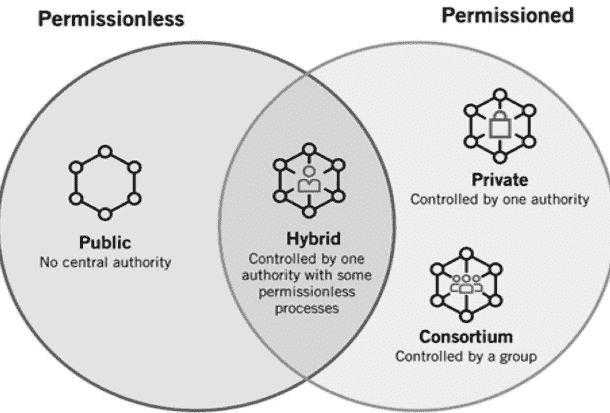


节点需要获得授权才能加入网络，就像在私有区块链上一样。一旦预定数量的节点达成一致，区块和交易就会得到验证。共识机制的预定规则决定确切的程序。Hyperledger 是这种应用程序的示例。它是公开且需要许可的 [9]。

- 4. 混合区块链。混合区块链是一种区块链技术，结合了公有区块链和私有区块链的最佳特性。它们提供了一种更具适应性的区块链实施方法，使企业能够根据其特定需求调整区块链解决方案 [20]。

## 区块链的四个基础理念：

- 共享账本。共享账本是指一种分布在公司网络中的去中心化记录系统，并以“仅追加”方式运行。使用共享账本确保交易被单独记录，从而消除传统商业网络中常见的冗余工作 [21]。

- 权限。权限确保操作得到保护、验证和授权。通过对网络参与施加限制，实体可以有效遵守数据安全法规，例如欧洲通用数据保护条例（EU GDPR）和健康保险可移植性与责任法案 [22]。

- 智能合约。智能合约是指监管商业交易的预定协议或一组规定。这些合约存储在区块链上，并作为交易的组成部分自动执行 [8]。

- 共识。经过网络验证的交易通过共识过程被所有参与者普遍接受。区块链采用各种共识方法，例如多签名、实用拜占庭容错和权益证明 [23]。

## 14.4 基因组学中的区块链

比特币技术为创建未来系统和重塑医疗行业提供了巨大的前景。区块链的目标是将其网络上的所有数据存储在数字、去中心化的公共数据库中。区块链被广泛应用于许多行业，包括银行、教育、医疗保健等。尽管区块链技术相对较新，但它已经对医疗保健产生了显著影响，特别是在基因医学领域 [4]。随着该技术在基因组学中越来越频繁地应用，科学家将能够更好地理解疾病机制，并利用这些知识在保持隐私和安全的同时治疗患者和疾病 [3]。区块链实现了平台内用户的心理赋权，并为基因组大数据平台中的数据所有权、数据共享和数据安全问题提供了新的解决方式 [17]。

由于区块链技术能够降低分析成本，已观察到它在生物信息学和健康应用领域发挥着关键作用。使用区块链系统进行的数据交易比使用传统方法进行的交易更快、更有效。区块链最大的好处是，与可以被更改的集中式系统中存储的数据不同，存储在区块链中的数据无法被修改。由于它是一个分布式系统，每次与区块链的数据交换都更加透明和可追溯。与其他系统相比，区块链在防止欺诈和未经授权的活动方面更具优势。基因组学可以通过多种方式从区块链技术中获益，例如安全存储和共享基因组数据、监控和管理实验室程序及样本，以及激励人们参与研究 [3]。

Shivom 是一个基于区块链的平台，用于安全存储和共享基因组数据。用户可以将其基因组数据上传到门户网站后，选择是否与研究人员、制药公司和其他感兴趣方共享。该平台使用智能合约来保证数据的机密性和隐私 [24]。Genome 是一个去中心化平台，允许用户存储、共享和货币化其基因组数据。通过参与临床试验或将其基因组数据提供给研究项目，用户可以获得代币。该平台还包括用于基因分析和个性化医疗的工具 [25]。EncrypGen 是一个基于区块链的平台，允许用户安全地存储和出售其基因组数据。该平台的用户对其数据拥有完全控制权，并可以决定与谁共享，这得益于智能合约的使用。研究人员和制药公司可以直接从该平台的用户处购买数据 [22]。

Nebula Genomics 是一个基于区块链的平台，允许用户安全地存储和共享其基因组数据。通过参与研究并将数据提供给研究人员，用户可以获得代币。它还包括用于基因分析和定制疗法的工具。用户可以通过基于区块链的平台 Seqster 收集和交换其健康数据，包括基因组数据。该平台的用户对其数据拥有完全控制权，并可以决定与谁共享，这得益于智能合约的使用 [22]。Seqster 还拥有用于临床试验匹配和个性化医疗的资源 [26]。基于以太坊网络，Genecoin（又称 GEN 代币）是一种生物币货币，支持安全的基因组数据共享。该系统将免费向成功将另一名用户引入 Genecoin 网络的用户提供最高 1,000 个 Genecoin 的奖励。个人的 DNA 会被采样并存储在区块链网络上 [1]。一些基于区块链的公司，例如 EncrypGen [27]、Nebula Genomics 和 Shivom，旨在为个人开发一个安全且去中心化的平台，用于存储、控制和共享其基因组数据。借助区块链技术，这些平台确保数据安全、匿名且防篡改。人们对其基因组数据保留主权，同时可以根据具体情况选择与研究人员、医疗保健提供者或其他各方共享。

许多基于区块链的平台，例如 Luna DNA、Genomes.io 和 Genomic Data Commons，旨在为研究人员和机构提供一个安全且去中心化的平台，用于共享遗传数据。这些系统采用区块链技术来确保数据的安全性、透明性和可追溯性 [13]。研究人员可以访问并使用平台上的数据进行研究，但人们仍拥有其数据的所有权并控制谁可以访问。同意管理是基因组学研究中至关重要的部分，因为它保证个人了解其数据将如何使用，并可以为其应用提供知情同意。Genomes.io 和 MyBitBlock 是基于区块链的平台，旨在构建一个安全且去中心化的平台，用于管理基因组学研究中的同意。这些平台使用智能合约来确保个人了解其数据将如何使用，并可以同意其使用 [28]。

大量遗传数据的存储和管理是基因组学研究面临的重大问题。基于区块链的技术，如 Shivom 和 Genomes.io，旨在开发一个用于存储和管理基因组数据的去中心化且安全的平台。借助区块链技术，这些平台确保数据安全、防篡改且透明 [29]。此外，这些系统还可以为遗传数据提供统一格式，从而实现各种数据源之间的互操作性。基于区块链的平台，例如 Zenome，旨在建立一个去中心化且安全的平台，用于处理基因组学研究中的知识产权和版税。这些平台利用智能合约来奖励个人和组织对研究所做的贡献。总体而言，基因组学中的基于区块链的方法和途径仍处于起步阶段，但在安全高效的数据共享、同意管理、数据存储和管理、知识产权和版税管理以及患者赋权方面，它们有可能提供显著优势。随着区块链技术的不断发展和改进，基因组学领域的创新基于区块链的解决方案可能会增加 [25][21]。

## 14.5 基于区块链的公平基因组数据生态系统的 Genesy 模型

Genesy 模型提出了一种面向区块链的方法，旨在建立一个公正合理的基因组数据生态系统。该模型的目标是解决基因组学研究领域中遇到的数据隐私、数据所有权和数据共享方面的障碍。该模型利用区块链技术构建，从而保证共享数据的完整性和不可更改性。实施安全措施旨在降低数据未经授权更改的风险，从而保障其完整性和机密性。Genesy 旨在促进用户与外部实体之间的协作，以推动先进基因组生态系统的发展，该生态系统可以高效地收集和处理测序工作产生的海量数据 [30]。

Genesy 架构在当前开发状态下，包含一个私有区块链，由 Genesy Project SRL 独家拥有和运营的节点组成。该区块链负责存储用户个人信息、用户表型数据和生物识别信息 [14]。Genesy 模型如图 14.2 所示。系统允许个人将其基因组数据上传到区块链，其中数据被加密并安全存储。参与者可以选择将其数据与研究人员、制药公司或其他感兴趣方共享，并通过智能合约设定数据使用的条款和条件。Genesy 模型旨在促进基因组数据共享的公平性和开放性。它提供了一个安全且透明的平台来共享基因组数据，有助于推动该领域的研究。通过促进数据共享，Genesy 模型可以帮助加速新疾病治疗方法和治愈方法的开发 [16,31]。

### 14.5.1 Genesy 模型的特征、优势和潜在影响

Genesy 模型构建于区块链技术之上，该技术确保共享数据的完整性和不可更改性。这有助于防止数据的任何未经授权的更改，并确保数据保持安全。该模型旨在促进基因组数据共享的公平性和开放性，重点是确保所有


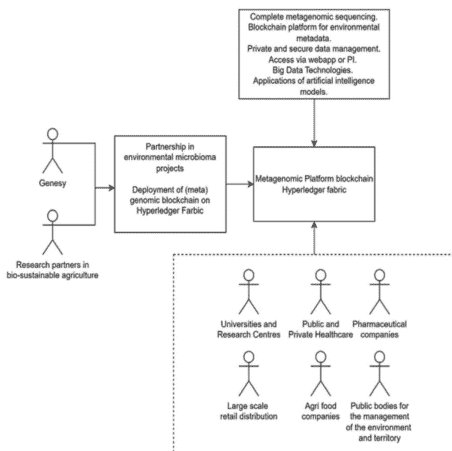

图 14.2
Genesy 模型。

生态系统中的参与者得到公平对待，并且共享基因组数据的利益得到公平分配。这是通过使用智能合约来实现的，智能合约可以自动执行共享协议的条款，并确保所有各方都能获得适当的补偿。Genesy 模型相较于传统的共享基因组数据模式具有多方面优势。首先，它为共享基因组数据提供了一个安全且透明的平台，有助于推动该领域的研究。通过促进数据共享，Genesy 模型可以加速新疾病治疗方法和疗法的开发。其次，Genesy 模型确保参与者得到公平对待，并且共享基因组数据的利益得到公平分配。这有助于解决医学研究领域现存的一些不公平问题，并确保所有参与者都能从数据共享中受益 [14]。

Genesy 模型有可能对医学研究和治疗产生重大影响。通过提供一种更安全、更公平的共享基因组数据的方式，该模型可以加速新疾病治疗方法和疗法的开发。这可以带来患者健康结果的改善和医疗成本的降低。此外，Genesy 模型可以帮助解决医学研究领域现存的一些不公平问题，确保所有参与者都能从数据共享中受益。这有助于促进该领域更大程度的合作与创新，从而在医学研究和治疗方面取得进一步突破。该模型代表了一种共享基因组数据的有前景的新方法。通过利用区块链技术的力量，该模型可以帮助创建一个更安全、更公平的数据共享系统，最终可能在医学研究和治疗方面带来新的突破。Genesy 模型有可能对医学研究和治疗领域产生重大影响，这是一项值得进一步探讨和讨论的激动人心的进展 [14]。

## 14.6 基因组学应用中的区块链

近年来，随着面向消费者的企业开始商业化 DNA 测序，客户数量有所增加。这是因为技术进步使基因组测序变得更加便捷和快速。在考虑购买此类基因组数据的财务收益时，人们对该模式的公平性产生了担忧。有人认为公众应当获得收益，而非中间商。因此，一种新型企业应运而生，它们利用区块链来实现用于遗传数据交换的开放市场 [12]。

### 14.6.1 商业基因组学市场

基于区块链技术构建的基因组市场旨在消除对中间商的需求，并让用户能够访问自己的数据。向出租或出售其遗传数据的人提供几种类型的奖励。在这些市场中，比特币是最典型的激励方式。本章将探讨所使用的激励措施、正在使用的区块链平台以及该平台提供的服务的摘要。Genecoin 是在基因组学中使用区块链的第一次尝试。该公司使用外部实验室提供其测序服务。生成的 DNA 序列随后被加密并存储在比特币区块链上。众多市场的出现促进了基因组数据与加密货币（代币）的交换，这些代币随后可以在加密货币交易所进行交易，从而使基因组数据所有者能够参与这种新兴的经济活动 [27]。

Genecoin 模型已被大多数市场广泛采用，旨在赋予患者对其数据的控制权，并通过提高数据的可访问性来加速基因组学研究。Shivom 和 Zenome 是两个不同的市场，它们通过为其平台上交易的基因组数据检查提供管道和计算资源等补充服务来实现差异化。研究人员可以选择通过以加密货币或代币形式支付费用来使用提供的管道进行研究。可追溯性和数据完整性的重要性被强调为众多基因组市场提供的关键服务。Genomes 为客户提供了一种安全的方式，从测序点到数据在区块链上存储，存储和管理其 DNA 数据。用户会获得一个保密访问密钥，该密钥用于限制数据访问，并且仅存储在其移动设备上。Genobank 是利用非同质化代币（NFT）进行数据追踪和流动性的调查示例。所提方法涉及向每个单独的人体体液样本（如唾液）分配一个唯一的 NFT，随后将其发布在公共可访问的区块链上。NFT 发挥着多种功能，例如确定有权对基因组进行测序的实验室以及监控生成数据的使用情况 [27]。

### 14.6.2 非商业应用

多项研究探讨了利用区块链加速遗传数据处理或分析的工作。提出了一种以隐私为中心进行全基因组关联研究（GWAS）的新方法。GWAS 通过使用保护匿名性且以基因片段化框架为核心的共享协议来执行。在此架构中，大型基因组文件被分割成较小的片段，然后分发给各种服务提供商，以构建用于存储、共享和分析的去中心化区块链网络 [32]。这通过消除单一来源掌握所有数据的可能性，解决了中心化和隐私问题。一些研究建议将区块链技术与机器学习相结合，以实现去中心化的机器学习。预测模型在各种企业之间进行训练，区块链以安全、开放且去中心化的方式促进该过程。群体学习（SL，一种用于联邦学习的区块链方法）也被提出。SL 首先在无需中央协调器的情况下安全地注册用户，从而实现去中心化机器学习。随后，在本地训练数据并合并模型参数后，大量的医疗和遗传数据仍由数据所有者拥有和控制 [3][23]。

**安全存储。** 区块链被用于存储和搜索药理基因组数据。每个数据片段都会添加到智能合约中，并获得一个作为映射键的特殊 ID。制定备用计划以防出问题总是个好主意。将本研究中使用的药理基因组数据规模与其他常见基因组数据格式进行比较，其规模相当小。序列比对图文件（大小可达数十 GB）是调查存储较大数据文件的替代方案的重点。这是通过一种全新的数据格式实现的，该格式由数据压缩方法与私有区块链网络相结合而成 [12]。

**数据管理和访问控制。** 许多研究集中在利用区块链来管理授予和拒绝访问可能存储在其他位置的基因组数据的权限上。名为 Dwanna 的网站使用区块链来实现动态同意。该门户将研究合作伙伴关系中的参与者和研究人员连接起来。该项目符合 GDPR 要求，并旨在确保参与者保留对数据的控制权。建议的架构在区块链上记录参与者的许可。通过在区块链上存储同意，参与者可以拥有数据的所有权；因此，第三方只有在获得所有者许可的情况下才能访问数据，这涉及数据共享协议背景下的多方同意管理困境。这是因为每个基因组都有可能提供关于所有者以及基因组数据所有者亲属的详细信息。因此，获得他们的许可对于保护个人亲属的隐私是必要的，使用区块链来解决这一共识问题并赢得各方的认可。2018 年 IDASH 竞赛的任务 1 研究了将区块链作为通用日志系统的应用；这样的系统可以提供访问日志，记录对系统中所有基因组数据存储库中所有数据的个人访问情况 [33]。

与目前实践中使用的传统集中式内部日志相比，去中心化的跨站点日志系统具有诸多优势。最重要的是，已解决了单一故障点和日志遭到恶意篡改的问题。共有多个竞争者参与，提交的作品根据预定标准（包括准确性和速度）进行评判。这是为了让竞赛能够评估区块链作为跨站点日志系统的有效性和性能，以及其作为该系统的可行性。竞赛表明，使用区块链来创建跨站点基因组数据访问记录确实是可行的。鉴于该解决方案性能有前景，可以合理假设，经过进一步改进，这种水准的系统可以配置用于实际应用 [13][2]。


## 14.7 区块链在基因组学应用中的动机

区块链技术是一种去中心化和透明的数字账本，近年来因其承诺为记录和分发数据提供安全且防篡改的机制而引起了相当大的兴趣。基因组学这一研究遗传信息的学科，可能会从区块链技术的应用中获益。将讨论在基因组学中实施区块链技术的理由。

### 安全和机密的数据共享：

基因组数据包含敏感信息，应防止未经授权的访问，因为这种数据可能被歧视性地利用。区块链技术可以提供一个去中心化且安全的平台来交换遗传数据，同时确保只有授权方才能访问数据。之所以如此，是因为区块链采用密码学技术来建立一个安全且透明的网络。链中的每个块都包含一个哈希值，它作为块内容中数据的独特数字指纹。这是一个防篡改系统，因为一旦区块被添加到链中，未经网络上所有其他节点的同意，它就无法被更改或删除。个人可以在不透露身份的情况下交换他们的数据；因此，区块链也可以为数据共享提供匿名性 [3]。

### 互操作性。

基因组学研究利用来自不同来源的数据，包括医院、研究机构和基因检测公司。然而，这些数据源经常采用不同的格式和标准，使得合并和评估来自多个来源的数据变得困难。区块链技术可以为遗传数据提供通用格式，实现不同数据源的互操作性。这有助于简化研究过程并促进机构之间的合作 [16]。

### 数据可追溯性。

在基因组学研究中，确保数据完整性和防止数据操纵至关重要。这包括遗传数据的创建、共享和分析。每笔交易都会带有时间戳和交易数据的哈希值记录在区块链上，从而防止数据被更改或删除。此外，区块链可以帮助研究人员追踪基因组数据的来源，这对于质量控制和研究的可重复性至关重要 [17]。

### 激励数据共享：

由于隐私和所有权问题，共享遗传数据可能很困难。个人可以通过区块链技术保留其基因组数据的所有权，同时能够安全且匿名地与研究人员共享，从而激励数据共享。利用智能合约，可以构建一个奖励个人共享其基因组数据的系统。例如，研究人员可以向为研究项目贡献遗传数据的个人支付比特币补偿。可以创建智能合约，以确保个人保留其数据的所有权并获得其使用补偿 [21]。

### 患者赋权。

患者可以通过使用区块链技术对其基因组数据拥有更大的控制权。患者可以选择以个体为基础与医疗专业人员、研究人员和其他组织共享他们的数据。这可以通过在患者和科学家之间建立信任，激励更多个人参与遗传研究。得益于区块链技术，患者数据的使用可以变得更加透明和可问责。患者可以监控区块链上的交易并了解其数据是如何被使用的，这有助于确保数据被合乎道德地使用并用于预期目的。将区块链技术应用于基因组学有望带来许多优势，包括安全私密的数据共享、互操作性、数据可追溯性、数据共享激励和患者赋权。这些优势可以促进基因组数据的安全有效共享，这对于推进基因组学研究和改善患者预后至关重要 [23][17]。

## 14.8 当前问题、困难和未来范围

此处提供了区块链和基因组学的当前问题及限制列表。

### 标准化。

区块链上基因组数据展示缺乏标准化是阻碍区块链技术在基因组学中应用的重大障碍。如果没有普遍确立的标准，在许多平台和应用程序之间确保数据完整性和质量可能会很困难。这种缺乏标准的情况也可能阻碍基于区块链的平台与传统数据库之间的互操作性 [7]。

### 可扩展性。

收集的遗传数据量正以快速的速度增长，典型的区块链系统可能无法容纳海量数据。这可能导致交易速度缓慢和高昂的交易成本，从而阻碍基于区块链的解决方案在基因组学中的采用。为克服这一问题，正在考虑分片、链下存储和侧链等潜在解决方案 [34]。

### 隐私。

尽管区块链技术可以为基因组数据提供安全且防篡改的存储，但隐私问题依然存在。由于区块链是去中心化的，任何人都可以访问其数据，这可能导致敏感信息被意外泄露。因此，即使区块链上的数据是加密的，也可能能够根据其基因组数据识别个人。为解决这个问题，正在研究包括差分隐私、同态加密和零知识证明在内的方法 [3]。

### 监管。

阻碍区块链技术在基因组学中应用的另一个障碍是缺乏明确的标准。尽管该技术仍处于早期阶段，但目前没有针对其在基因组学研究中应用的既定指南。这可能导致混乱和监管挑战，使基因组行业更难以采用基于区块链的解决方案。为解决这个问题，需要明确的规则和法规来管控区块链技术在基因组学中的应用 [35]。

### 互操作性。

由于数据格式和架构的差异，实现多个基于区块链的平台与传统数据库之间的互操作性可能具有挑战性。如果没有互操作性，多个平台和应用程序可能难以交换数据，这会降低基于区块链的解决方案在基因组学中的实用性。为解决这个问题，正在建立诸如基因组数据公共库和全球基因组与健康联盟等标准 [17]。

### 技术复杂性。

区块链技术的技术复杂性对于非专业研究人员和医疗从业者来说可能是一个问题。这可能会阻碍基于区块链的解决方案在基因组学中的采用和部署。需要用户友好的界面和教育资源来解决这一难题。尽管区块链技术有可能为基因组学研究带来显著的好处，但仍有许多未解决的问题和障碍。标准化、可扩展性、隐私、监管、互操作性和技术复杂性只是在基因组学中广泛实施基于区块链的解决方案之前必须解决的一些障碍 [21][3]。

区块链技术可能通过提供一种安全高效的方式来组织和交换遗传数据，从而改变基因组学行业。基因组行业最大的挑战是数据隐私和安全性。区块链通过提供一个去中心化且防篡改的系统来存储和共享数据，从而为这一问题提供了解决方案。这意味着每个患者的数据都可以被加密并安全存储，只有经过授权的个人才能访问。区块链在基因组学中的优势是显著的，不可忽视。研究人员可以安全地访问和分析来自多个来源的数据，而无需中介或复杂的数据共享协议。这可以带来更快、更准确的结果，最终改善患者预后。此外，区块链可以通过提供一种安全高效的方式来存储和共享遗传信息，从而促进个性化医学的发展 [3][4]。

区块链在基因组学中的一项潜在应用是出于研究目的共享基因组数据。目前，共享基因组数据存在许多挑战，包括对数据隐私和所有权的担忧。然而，通过使用区块链技术，个人可以控制谁可以访问他们的数据以及在什么条件下访问，同时还可以通过基于代币的奖励系统被激励共享他们的数据。这可以鼓励基因组学研究中的更大协作和数据共享，从而在疾病诊断、治疗和预防方面取得更重大的突破。区块链在基因组学中的另一项潜在应用是临床试验管理。区块链技术可以确保从患者数据收集到结果分析的试验数据完整性。通过使用智能合约自动化临床试验数据的管理，区块链可以降低错误、欺诈和数据篡改的风险。除了这些应用之外，区块链技术还可以为个性化医学提供新的机会 [8]。

利用区块链技术可以通过安全存储和共享数据，促进创建基于个人基因组数据的定制治疗策略。这可以为多种疾病带来更精确和更有效的治疗选择。然而，在区块链技术能够在基因组学中广泛采用之前，仍有一些挑战需要解决。最大的挑战之一是行业缺乏标准化。需要明确的指导方针和法规，以确保数据以一致且安全的方式收集、存储和共享。其他挑战包括可扩展性和互操作性等技术问题，以及围绕数据隐私和所有权的监管和伦理问题 [7]。

## 14.9 结论

提供用于存储、共享和分析基因组数据的基于区块链的解决方案的案例研究数量，以及旨在促进基因组数据交换的商业和非商业区块链应用程序的数量正在增加。使用一种将基因组区块链应用程序组织为商业和非商业群体的分类法，并根据数据交换、分析、安全存储和访问控制等特定目标进一步细分子类别。每个应用程序的优缺点包括比较有关区块链平台选择和数据存储的提案，


共享、保护方法以及识别障碍，包括软件不稳定性、互操作性、安全风险，以及数据隐私和数据所有者身份的保护。区块链在基因组学中的关键驱动力是不可更改性（或一致性）和去中心化。数据所有者始终需要对其数据拥有控制权。与金融应用相比，基因组学区块链应用目前受到限制，但存在扩展空间。未来的研究领域包括探索区块链驱动的分布式分析，以及评估增强隐私技术的有效性，如同态加密、多方计算、零知识证明和链下计算。此外，使用区块链调查对遗传数据的可信和可验证访问，并采用基于 IP 的信任（trust-over-IP）原则为研究人员维护去中心化身份，都是未来研究引人入胜的方向。基因组区块链应用目前仍处于研究初期阶段，仍在开发中，要实现广泛应用还需要进一步的社会和技术革命，这表明应努力推动区块链在基因组学中的应用，以展示其在许多基因组应用中的能力和可行性。

## References

- 1. Adanur Deteturk B, Soran A, Bakir-Gungor B. 基因组学和医疗保健中的区块链：文献综述、现状、分类与未解决问题. PeerJ. 2021;9:e12130.
- 2. Dagher GG, Mohler J, Milojkovic M, Marella PB. Ancile：一种基于区块链技术的电子健康记录访问控制与互操作性隐私保护框架. Sustain Cities Soc. 2018;39:283–97.
- 3. Ozercan HI, Mollah MNH, Ozdogan M, Kantarcioglu M, Malin B. 实现基因组学中区块链技术的潜力. Genome Res. 2018;28(9):1255–63.
- 4. Malin B, Benitez K. 基因组学研究数据共享同意的标准化. Genet Med. 2018;20(8):730–2.
- 5. Hang L, Chen C, Zhang L, Yang J. 临床试验应用中的区块链：分类学、挑战与未来方向. IET Commun. 2022;16(20):2371–93.
- 6. Shabani M. 用于基因组数据共享的基于区块链的平台：作为对治理问题的回应的去中心化方法？ J Am Med Informatics Assoc. 2019;26(1):76–80.
- 7. Botta A, De Donno M, Persico V, Pescapé A. 区块链与 IPFS 的集成，用于基因组数据的安全和隐私保护共享. Future Gener Comput Syst. 2019;97:583–96.
- 8. Zhang P, White J, Schmidt DC, Lenz G, Rosenbloom ST. FHIRChain：将区块链应用于安全且可扩展地共享临床数据. Comput Struct Biotechnol J. 2018;16:267–78.
- 9. NHGR研究所. 基因组学简明指南 [Internet]. 2021. Available from: www.genome.gov/about-genomics/fact-sheets/a-brief-guide-to-genomics
- 10. Crouch J, Turnbull A. 区块链在医疗保健和生命科学中的法律影响. Blockchain Health Today. 2018;1:1–7.
- 11. GeeksforGeeks. 基因组学中的区块链 [Internet]. 2022. Available from: www.geeksforgeeks.org/blockchain-in-genomics/
- 12. Shendure J, Balasubramanian S, Church GM, Gilbert W, Rogers J, Schloss JA, et al. DNA测序40年：过去、现在与未来. Nature. 2017;550(7676):345–53.
- 13. Shabani M. 用于基因组数据共享的基于区块链的平台：作为对治理问题的回应的去中心化方法？ J Am Med Informatics Assoc. 2018;26(1):76–80.
- 14. Carlini F, Carlini R, Dalla Palma S, Pareschi R, Zappone F. 基于区块链的基因组数据公平生态系统的Genesy模型. Front Blockchain. 2020;3:483227.
- 15. Sultan K, Ruhi U, Lakhani R. 区块链概念化：特征与应用. arXiv. 2018.

- 16. Das M, Patel A, Pandya A. 区块链和分布式账本技术时代的基因组学. In: Advances in Computers. Elsevier. 2019, pp. 75–91.
- 17. Iyer V, Vyshnavi AMH, Iyer S, Nambhoori PKK. 一种面向癌症患者的基于DLT的人工智能驱动基因组分析系统和安全数据共享. In: 2019 IEEE Bombay Section Signature Conference (IBSSC). 2019, pp. 1–5. https://doi.org/10.1109/IBSSC47189.2019.8973020
- 18. Nakamoto S. 比特币：一种点对点电子现金系统. 2008. Available from: https://www.usc.gov/sites/default/files/pdf/training/annual-national-training-seminar/2018/Emerging_Tech_Bitcoin_Crypto.pdf
- 19. Greenspan G. Multichain私有区块链白皮书. 2015, p. 85. Available from: www.multichain.com
- 20. Cachin C, 等人. Hyperledger区块链架构. In: Workshop on Distributed Cryptocurrencies and Consensus Ledgers. 2016, pp. 1–4. https://pdfs.semanticscholar.org/caj/https://www.zurich.ibm.com/dcl/papers/cachin_dcl.pdf
- 21. Lee JH, Choi JY, Lee JE, Kim JH. 用于基因组领域可信数据共享与存储的基于区块链的平台. J Biomed Inform. 2018;88:67–73.
- 22. Grishin D, Obbad K, EsteP F, Cifric M, Zhao Y, Church G. Nebula基因组学：基于区块链的基因组数据共享与分析平台. 2022. Available from: https://nebula.org/whole-genome-sequencing-dna-test/
- 23. Bernasconi M, Stranieri A, Spagnuolo C. 迈向区块链互操作性：参考架构与用例. IEEE Access. 2019;7:63911–28.
- 24. Health Europa. Shivom：精准医疗数据安全共享与分析生态系统 [Internet]. 2021. Available from: www.healtheurope.com/shivom-precision-medicine/90476/
- 25. Kulemin N, Popov S, Gorbachev A. Zenome项目：基于区块链的基因组生态系统白皮书. 2017. Available from: https://zenome.io/
- 26. Philippidis A. Seqster平台：整合基因组、电子健康记录和可穿戴健康数据 [Internet]. 2018. Available from: www.seqster.com/seqster-platform-to-integrate-genomic-ehr-and-wearable-health-data/
- 27. EncrypGen. Gene-Chain：基于区块链的基因组数据平台 [Internet]. 2022. Available from: https://encrypgen.com
- 28. Albawly F, Brass A, Davies A, 等人. 支持临床基因组数据共享的基于区块链的动态同意架构（ConsentChain）：概念验证研究. JMIR Med Inform. 2021;9(11):e27816.
- 29. Kim Y, Park Y-H. 一种使用去标识化方案的基于区块链的基因数据管理模型. In: 2021 IEEE International Conference on Consumer Electronics-Asia (ICCE-Asia). 2021, pp. 1–4. https://doi.org/10.1109/ICCE-Asia53811.2021.9641994
- 30. Yuan X, Tong J. 基因组学中的区块链：机遇与挑战. Theor Biol Med Model. 2020;17(1):4.
- 31. Zheng Z, Xie S, Dai H, Chen X, Wang H. 区块链技术概述：架构、共识与未来趋势. In: 2017 IEEE International Congress on Big Data (BigData Congress). 2017, pp. 557–64. https://doi.org/10.1109/BigDataCongress.2017.85
- 32. Zhang Y, Zhao X, Li X, Zhong M, Curtis C, Chen C. 在去中心化网络中实现GWAS的基因组数据隐私保护共享. In: Proceedings of the Twelfth ACM International Conference on Web Search and Data Mining. 2019, pp. 204–12. https://doi.org/10.1145/3289600.3290983
- 33. Beyene M, Thiebes S, Suryaev A. 遗传测试中的多利益相关者同意管理：一种基于区块链的方法. In: Pre-ICIS SIGBPS 2019 Workshop on Blockchain and Smart Contracts Munich. 2019. https://publicationen.bibliothek.kit.edu/1000125483
- 34. Alghazwi M, Turkmén F, van der Velde J, Karastoyanova D. 基因组学中的区块链：系统文献综述. arXiv [Internet]. 2021; abs/2111.10153. Available from: https://arxiv.org/abs/2111.10153
- 35. Samani F, Pahl C. 用于安全高效共享医疗数据的区块链：系统综述. Electron Mark. 2018;28(2):161–84.

## 15 使用VANET中区块链的医疗紧急车辆改进数据传输技术

R. M. Rajeshwari 和 S. Rajesh

### 15.1 引言

车载自组网（VANET）促进了智能交通系统（ITS），从而提升了更安全、更好的驾驶体验。它提供了一种无害且高效的交通管理系统。在道路上行驶的生命支持紧急车辆充当移动节点，并相互通信。节点之间交换的消息提示驾驶员在发生任何紧急情况时采取必要措施，从而防止不必要的死亡[1]。VANET有助于优化交通、生成碰撞警告消息和跟踪位置服务[2]。VANET支持三种通信类型，包括车对车通信、车对基础设施通信和基础设施对基础设施通信。VANET架构有三个重要实体，即可信机构（TA）、车载单元（OBU）和路边单元（RSU），用于实时交通管理[3]。TA维护每个区域道路上每辆生命支持紧急车辆的OBU和RSU的真实身份。RSU跟踪攻击车辆，并促进TA和OBU之间的信息共享。OBU负责与RSU注册，以增强驾驶安全性。通过源ID和目的地之间传输的信息，可以区分假车辆和原始车辆。身份验证机制对网络中的RSU和生命支持紧急车辆进行身份验证，并追踪它们。任何网络通信在整个数据传输过程中均应支持CIA参数（机密性、完整性和可用性）以满足安全约束。在此，每次都应使用其伪ID（pseudoID）称呼生命支持紧急车辆，该伪ID通过定期更新链接获得[4] [5]。


## 15.2 动机

在 VANET 中实现安全数据传输始终是一项重要任务。网络中的生命救助紧急车辆交换消息，以便立即采取行动维持安全可靠的驾驶场景。广播在 100 至 300 毫秒的时间周期内频繁进行 [6]。必须在消息过期前采取行动，以防止道路事故。尽管具有多种优势，车辆自组网仍易受多种安全攻击，例如黑洞攻击、分布式拒绝服务攻击（DDoS）、回放攻击等。因此，生命救助紧急车辆之间交换的消息必须经过交叉检查，以进行身份验证和不可否认性。欺诈车辆修改的消息可能对驾驶员和乘客的生命造成严重影响。同样重要的是，生命救助紧急车辆不应泄露其原始身份，以保障驾驶员安全。有时，由于网络故障和时间延迟，生命救助紧急车辆可能无法及时接收消息。这些因素促使我们为车辆实施新颖的安全功能。

此前，VANET 通过移动群体感知（MCS）管理数据传输过程，以便在紧急情况下追踪车辆。本章通过区分紧急消息和普通消息，实现了一种更好的数据通信模型。消息设置了过期时间戳，以避免在消息传输延迟时造成不必要的拥塞。此外，通过实施单向区块链加密哈希链模式 [7]，实现了车辆中的隐私保护数据传输。

## 15.3 拟议工作的目标

拟议模型的贡献如下：

- 创建分类和融合数据包模型，以实现高效的数据通信。
- 通过单向哈希区块链加密模型，在移动节点中实现安全数据和隐私保护。

为了方便用户，本章的组织如下：

第 15.3.1 节涉及文献综述，讨论了以前的技术如何用于实现车辆中的安全数据传输以及模型的局限性。

第 15.3.2 节讨论了如何使用拟议的单向哈希区块链加密模型来实现车辆中数据的隐私保护。

第 15.4 节对拟议模型与现有模型的性能进行分析。第 15.5 节以未来工作范围结束本章。

### 15.3.1 相关工作

在此，讨论了各种相关工作和不同作者的研究，这些研究涉及使用区块链技术在移动车辆中实现安全数据传输，以及他们在现实中实施这些概念时面临的困难。

在 VANET 中，通过将车辆位置和身份信息保密来实现隐私保护。

[8] 讨论了自组织 VANET 的两个实体，即信任机构和车辆，它们起着至关重要的作用。

系统由一个完全受信的实体（称为 TA）初始化，并负责生成密钥。

借助共享密钥，交通数据在车辆之间共享。

PPTMS 确保位置、身份和数据的隐私保护。

它还保证了自组织 VANET 的数据完整性和效率。

另一方面，计算成本和通信开销随着车辆数量呈线性指数增长。

[9] 讨论了基于 VANET 的无双线性配对的隐私保护互认证方案如何解决安全限制并实现 QoS。

该文还讨论了消除多种安全攻击，例如冒充攻击、修改和旁路攻击 [10]。

为在区块链中为每笔交易生成签名，使用私钥。

每笔交易都经过身份验证，且由生成的签名证实其无恶意行为，并用于数学推导公钥。

公钥在实际中不可逆，即，我们可以轻松从私钥推导公钥，但反过来则需要数百万年。

该文还讨论了从已知种子派生的分层确定性加密货币钱包，它允许从父密钥生成子密钥。

子密钥和父密钥之间存在一种隐藏关系，种子对此不知情。

[11] 讨论了如何使用动态隐私保护认证协议 DPPAP（AES 和 ECC 加密机制的组合）将消息传递到社交网络区域中的目标车辆。

本文以拉合尔市地图为例，并使用 NS3 模拟将其划分为多个次要区域。

每个区域由存储在 OBU 中的纬度和经度坐标标识。

社交网络使用海夫辛公式根据区域 ID 创建智能车辆集群。

车辆的选择和数据传输均基于区域 ID。

本文保证所提议协议的运行能够承受高负载因子。

采用云计算技术传播消息，这些消息使用基于属性的加密进行加密，以警告网络中的车辆。

加密和解密过程被外包以实现计算效率。

匿名车辆使用基于身份的签名技术进行身份验证，该技术能够追踪恶意车辆。

该方案有助于减少计算开销并改进完整性检查 [12]。

使用完全聚合的隐私保护机制配合假名，以减少防篡改设备中产生的计算开销。

通信网络中的车辆使用无证书聚合签名进行通信，这减少了诸如带宽消耗之类的资源。

追踪机构生成假名以追踪车辆的身份 [13]。

基于公钥基础设施的对称密钥加密算法缺乏高端隐私保护价值。

因此，提取对称密钥加密的适当特征以与非对称加密技术相结合，确保服务中的完整性、隐私和不可否认性 [14]。

提出了一种隐私保护机制，以使用基于签名的双线性映射帮助车辆与基础设施进行通信。

签名生成及其验证在 RSU 中使用单向哈希函数有效完成。

该方案非常适合大流量密度区域，因为它支持批量签名验证以减少计算开销 [15]。

提出了一种非基于 Diffie-Hellman 的算法，即基于格的隐私保护，以确保互认证和隐私。

由于基于 Diffie-Hellman 的算法需要多项式时间来解决问题，因此使用基于格的算法降低了复杂性 [16]。

促进无身份认证的证书吊销列表会导致计算开销。

通过生成一组车辆的临时密钥来解决此问题。

由于定期更改假名，通信开销会增加；因此，轻量级隐私保护系统生成永久假名 ID [17]。

消息恢复签名的延迟可能会影响 VANET 的流量；因此，以快速方式验证签名的有效性。

该过程支持批量验证，通过同时验证多个签名来降低时间复杂度。

该方案还能抵抗重放攻击并提供数据机密性 [18]。

全同态加密与假名相结合，以减少开销并确保安全。

基于紧急车辆位置而变化的逻辑和物理地址决定假名；因此，假名会随时间变化，并防止车辆被对手追踪 [19]。

使用 VANET 中的智能手机智能交通系统实现多跳消息传播和安全性的过程。

选择发送方和接收方节点的基于位置的协议与无证书加密技术相结合。

它验证节点的真实性和数据完整性 [20]。

提出了一种 RSU 协作检测机制，以消除自私的消息传播并检查传播的消息是否按时到达目的地。

该机制使用三角测量和虚假传播来识别女巫攻击。

节点的设计方式使其能够从有效的源节点接收带有数字签名的消息 [21]。

### 15.3.2 拟议工作

本部分涉及当任何类型的车辆进入通信区域时会发生什么，以及数据如何通过 CA 和 RSU 在车辆之间传输。

图 15.1 显示了从第一步开始，即车辆进入、参与、数据传输和退出。

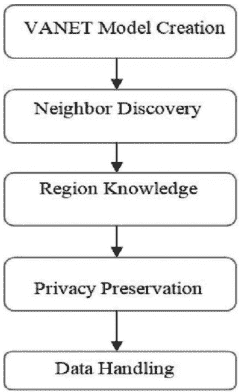

图 15.1 VANET 模型的一般步骤。


### 15.3.2.1 系统模型

VANET系统由道路上的车辆（包括普通车辆和紧急车辆）、路边单元（RSU）、证书颁发机构（CA）、区域和执法机构（LEA）组成。网络中的生命支持紧急车辆由政府机动车辆部门分配唯一的数字身份。这些身份在CA的数据库中注册，以使紧急车辆成为网络中的授权单元。安全相关活动由LEA处理，以防止和恢复紧急车辆免受严重威胁。任何紧急车辆都充当来自邻近车辆消息的收发器。发送方可以广播消息，消息将由接收方验证。CA和紧急车辆通过充当网关的RSU进行通信。RSU注册与相应区域接触的生命支持紧急车辆。CA生成凭据并相应验证。CA负责出于安全原因维护生命支持紧急车辆的加密凭据。当紧急车辆从一个区域移动到另一个区域时，其凭据必须根据证书和过期时间与区域凭据匹配。LEA监控广播消息中的恶意活动，进而通知CA阻止恶意车辆ID。所提模型的流程如图15.2所示。

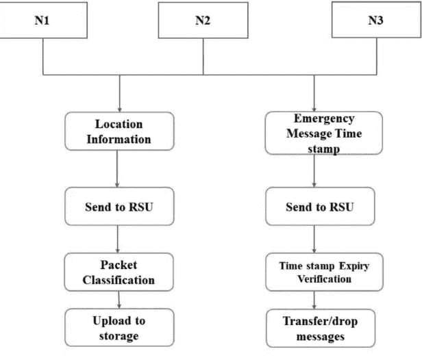

图 15.2 所提模型的整体流程。

### 15.3.2.2 基于区块链技术的密码学

区块是包含一组已确认交易的区块链容器数据结构。区块可以包含不同的信息，只要这些区块互相链接，这些区块链就演变成区块链。区块链中的所有区块均由头部、标识符和一长串交易组成。要标识一个区块，需要加密哈希和数字签名。这是通过使用SHA256算法对区块头部进行两次哈希生成的。区块链的根基是比特币，它是有助于在网络中实现隐私和安全的加密货币之一。此概念已应用于VANET，以确保广播信标的隐私和完整性。紧急车辆节点的消息与公共区块链映射，以验证紧急车辆的可靠性。由于在传播关键信息时缺乏保障，基本比特币技术在VANET应用中已不再充足。除了区块中的哈希序列之外，VANET还纳入了基于事件消息的新区块。VANET中的每个区域都有用于该特定区域内传输的独立本地区块链。该区域中所有节点的信息都在公共区块链中维护。采用共识机制来保障区块链并将其扩展到所需水平。

### 15.3.3 使用的算法

在以下算法中，我们将生命支持紧急车辆称为紧急车辆。

### 15.3.3.1 紧急车辆注册算法

- **第1步：**紧急车辆从道路运输办事处（RTO）获取真实ID，并在CA与自身之间创建安全路径，然后将其原始ID和其他详细信息发送给CA。

- **第2步：**CA首先检查已注册紧急车辆的原始性；如果存在，则生成包含伪ID和由ECC生成的公私钥对（PKi, Ski）的有效文档。

- **第3步：**根据这些凭据，CA计算生命支持车辆身份验证所需的两个哈希函数，其身份存储在CA中以备将来通信。

Where hash values are defined as follows:

```
H0 = (P IDi ||Pki) and H1 = (V IDi ||cert)
```

- **第4步：**RSU持有CA发送的哈希值H0。

- **第5步：**已注册的紧急车辆从CA获取伪ID、证书、H1以及公私钥对，并将这些存储在车载单元（OBU）中。

### 15.3.3.2 证书验证与撤销算法

- **第1步：**紧急车辆通过提交其伪ID和公钥Pki向RSU请求身份验证。

- **第2步：**现在，RSU基于H0算法计算哈希值并得出实际结果。为检查紧急车辆的原始性，RSU进而与CA映射这些值。如果实际结果与存储结果一致，CA向RSU返回“True”，表示紧急车辆是合法的。否则，身份验证不予批准。

- **第3步：**在确定紧急车辆身份的真实性后，RSU启动随机整数协商过程，该过程发送由紧急车辆公钥Pki加密的随机整数RN₁。

- **第4步：**紧急车辆使用其Ski解密密文，并将随机数（RN₁）存储在车载单元中，以备车辆之间即将进行的通信。

- **第5步：**为检查接收到的随机数的完整性，紧急车辆进而从RSU选择另一个随机数（RN₂）并重新计算两者的哈希值。如果哈希值相同，则保留随机数的完整性。否则，数据传输存在错误。此外，为防止CA从事恶意活动，紧急车辆基于H1算法计算签名。然后将结果值与区块链网络中存储的值进行映射。最后，紧急车辆将SigSki (H1) || H2(RN₁) || RN₂||RN₂发送给RSU。

- **第6步：**哈希函数H1连同其随机整数（RN₂）及其签名计算哈希值。同样，哈希函数H2连同随机整数（RNᵢ）及其相应的签名计算哈希值。在比较两个值是否相同时，随机数协商成功。

- **第7步：**RSU充当点对点BC网络节点，绑定一个交易Tx1（Sig Ski (H1) || P IDi || Pki），并将其存储在BC网络中，所有RSU均可处理交易Tx1。

### 15.3.3.3 紧急车辆广告（邻居发现与消息转发）算法

- **第1步：**为保持特定事件D的完整性约束，紧急车辆使用RSU提供的RN₁。紧急车辆将包含交通状况、紧急车辆身份和哈希值H3（RN₁ || D || PIDi）的消息发送给RSU。

- **第2步：**现在，RSU进而检查事件D的完整性。

- **第3步：**如果结果正常，RSU启动一个新交易（Tx2）。

- **第4步：**RSU生成交通事件以启动一个新交易，其内容为Tx2（H3||D||P IDi||时间戳）。

- **第5步：**交易Tx2的内容被拆分为多个部分，并存储在不同的CA中。

- **第6步：**对关于事件D的Tx2进行哈希后，RSU将H4（Tx2）存储在区块链中，并将此交易广播给所有移动节点。

- **第7步：**每个紧急车辆评估警报消息的时间戳并计算消息过期时间。

- **第8步：**任何参与数据传输的紧急车辆可以在计时器过期前将消息转发给其邻近车辆。

- **第9步：**计时器过期后，车辆停止传输数据。如果有任何新的数据通信到达，则紧急车辆从第1步开始生成随机数。

## 15.4 结果与讨论

该模型使用城市交通仿真（SUMO）实现，该工具在模拟道路交通方面效率很高。SUMO的参数如表15.1所示。通过与现有模型（即bSPECs、Xiaoyan、BLS和ECPP）进行比较，评估了所提出的单向哈希区块链模型。用于比较的指标包括每用户数据收集量、消息投递比率、收集的数据总量、端到端延迟和能耗。

### 15.4.1 每用户收集的数据

图15.3显示了接收方按字节计算的收集数据量。像bSPECS、Xiaoyan、BLS这样的现有模型只能传输少于或略等于

| 参数 | 数值 |
| :--- | :--- |
| 节点数量 | 100 |
| 速度 | 40 m/s |
| 加速度 | 3.6 m/s² |
| 紧急车辆长度 | 6.77 m |
| 紧急车辆宽度 | 2.3 m |
| RSU数量 | 15 |
| RSU覆盖范围 | 1,000 m |

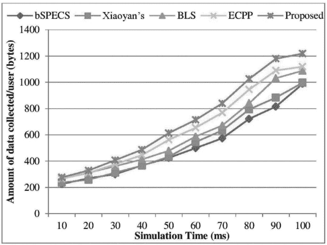

**图 15.3**
VANET中每用户收集数据量的比较。


到 1 个数据包长度，而我们提出的模型可在规定时间内传输超过 1,024 字节的数据。这表明与现有方法相比，我们的模型具有更好的数据采集能力。

### 15.4.2 消息投递比率

成功消息数与已投递消息总数之比称为消息投递比率。其计算方法如方程 1 所示。

消息投递比率 = \(\frac{\text{成功数据包数}}{\text{数据包总数}}\) (1)

图 15.4 显示，当恶意节点数量增加时，消息投递会出现不利变化。尽管与现有系统相比，我们提出的模型在投递消息时能够经受住仿真环境的考验。

### 15.4.3 收集的数据总量

在特定仿真期间，网络中所有生命支持紧急车辆收集的数据称为收集的数据总量。图 15.5 显示，提出的模型可收集 8,000 字节的数据，而其他现有模型在

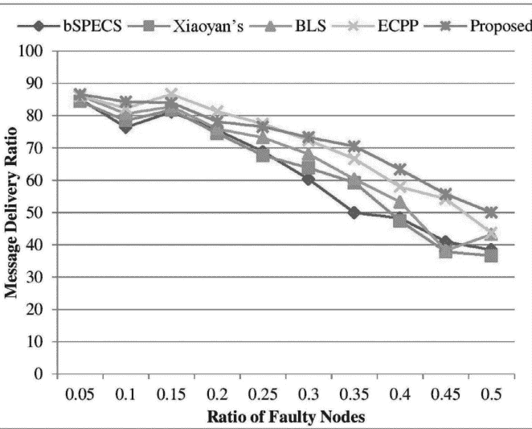

图 15.4 提出的 VANET 模型的消息投递比率对比。

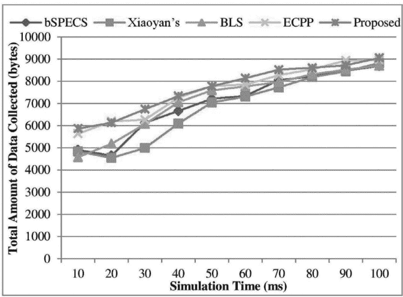

图 15.5
网络中所有用户收集的数据总量对比。

难以收集 6,000 字节的数据。这表明与现有模型相比，提出的模型具有良好的恢复力。

### 15.4.4 端到端延迟

网络中消息发送与到达之间的时间差称为端到端延迟。间接地，EED 反映数据传输速度。我们提出的模型投递消息最多耗时 1 ms，而其他模型的耗时等于投递消息的最小时间约束。

### 15.4.5 能耗

模型效率由网络中每个节点消耗的能量计算得出。在其他模型中，节点能耗波动较大，而我们提出的模型随时间呈线性逐渐增加。
该特性被视为标准系统的品质之一。我们提出的模型也属于上述类别。

### 15.5 结论

VANET 在广播信标以增强安全措施方面的潜力，使其成为一个热门研究课题。不过，VANET 面临多种网络攻击，例如

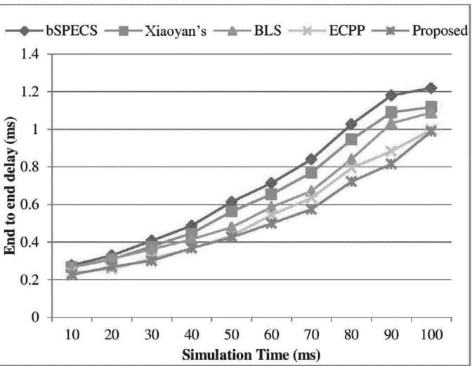

图 15.6
VANET 模型的端到端延迟对比。

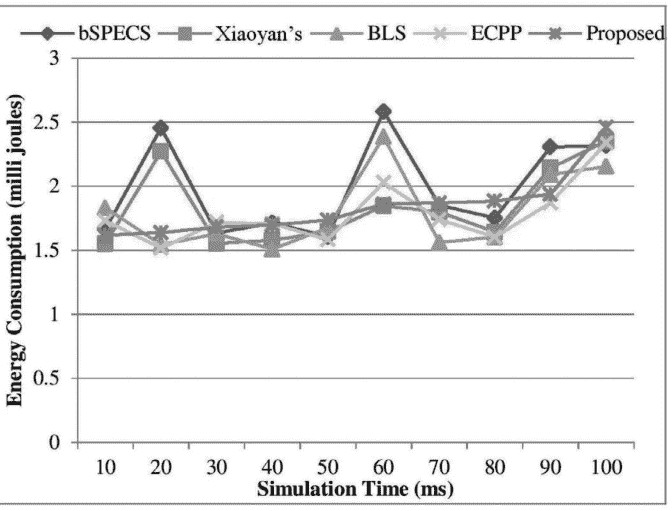

图 15.7
VANET 模型的能耗图。

DoS 攻击、Sybil 攻击、冒充攻击等等。在本章中，我们提出的模型确保接收有关道路状况的实际消息，以便及时支持救护车等生命支持车辆，通过走确切路线挽救生命。此外，通过为每个节点发送的消息设置时间戳，还确保了隐私和数据完整性。提出的模型使用 SUMO 进行仿真，通过设置参数，如表 15.1 所示。结果表明，基于区块链的单向哈希模型优于其他用于比较的现有模型，即 bSPECs、Xiaoyan、BLS 和 ECPP。消息投递比率较高，从而减少了模型的端到端延迟。该模型实现了标准化的能耗，从而提升了模型的整体效率。

## 参考文献

- 1. S.S. Tangade 和 S.S. Manvi，“VANET 中攻击、安全性和信任管理解决方案综述。”载于第 4 届 IEEE 计算、通信与网络技术国际会议；2013 年，第 1–6 页。https://doi.org/10.1109/ICCCNT.2013.6726668
- 2. B. Parno 和 A. Perrig，“车辆网络安全性面临的挑战。”载于网络热点话题研讨会；2005 年。https://efaidnbmnnnibpcajpcglclefindmkaj/https://netsec.ethz.ch/publications/papers/cars.pdf
- 3. R.G. Engoulou, M. Bellaiche, S. Pierre 和 A. Quintero，“VANET 安全性调查。”计算机通信。2014 年；44：1–13。
- 4. M. Raya, P. Papadimitratos 和 J. Hubaux，“保障车辆通信安全。”IEEE 无线通信。2006 年；13(1)：8–15。
- 5. X. Hou, Y. Li, M. Chen, D. Wu, D. Jin 和 S. Chen，“车辆雾计算：将车辆视为基础设施的视角。”IEEE 车辆技术汇刊，2016 年；65(6)：3860–73。
- 6. Y. Zhang, X. Lin 和 C. Xu，“面向云存储的基于区块链的安全数据来源。”载于信息与通信安全国际会议；2018 年。Springer，第 3–19 页。
- 7. F. Tschorsch 和 B. Scheuermann，“比特币及其后：去中心化数字货币技术调查。”IEEE 通信调查与教程。2016 年；3(18)：2084–123。
- 8. L. Zhu 等，“自组织 VANET 中的交通监控：面向速度收集与分析的隐私保护机制。”IEEE 无线通信。2019 年；6(26)：18–23。
- 9. J. Cui 等，“车辆自组织网络中的安全相互认证与隐私保护。”车辆通信。2020 年；21：100–200。
- 10. M. Crosby, P. Pattanayak, S. Verma 和 V. Kalyanaraman，“区块链技术：超越比特币。”应用创新。2016 年；2：6–10。
- 11. S.A. Shah 等，“基于社交网络的 VANET 动态隐私保护认证协议。”载于软件工程、人工智能、网络和平行分布式计算国际会议；2019 年。Springer。
- 12. S. Wang 和 N. Yao，“面向 VANET 中启用假名的隐私保护的 RSU 辅助分布式信任框架。”无线网络。2019 年；25(3)：1099–115。
- 13. Q. Huang 等，“云辅助车联网中安全隐私保护的预警消息传播。”载于 IEEE 通信与网络安全会议；2019 年，第 1–8 页。https://doi.org/10.1109/CNS.2019.8802649
- 14. H. Zhong 等，“VANET 中完全聚合的隐私保护认证方案。”信息科学。2019 年；47(6)：211–21。
- 15. F. Tahir, S. Nasir 和 Z. Khalid，“面向 VANET 的基于混合密码学的隐私保护认证协议。”载于应用与工程数学国际会议；2019 年，第 80–85 页。https://doi.org/10.1109/ICAEM.2019.8853808
- 16. I. Ali 和 F. Li，“面向 VANET 中紧急车辆至基础设施通信的高效条件隐私保护认证方案。”车辆通信。2019 年：100–228。
- 17. S. Mukherjee, D.S. Gupta 和 G.P. Biswas，“基于格的 VANET 高效且可批量验证的条件隐私保护认证方案。”软计算。2019 年；12(101)：1763–88。
- 18. S.A. Alfadhli 等，“面向 VANET 的基于哈希函数和本地组密钥的高效轻量条件隐私保护认证方案。”载于软件工程世界研讨会，2019 年。计算机协会，第 32–36 页。https://doi.org/10.1145/3362125.3362128
- 19. S. Jian 等，“VANET 中面向车辆云的安全实时交通数据聚合与批量验证。”IEEE 车辆技术汇刊。2020 年；69(1)：807–17。https://doi.org/10.1109/TVT.2019.2946935
- 20. N.K. Prema，“基于全同态加密的 VANET 中高效安全聚合。”移动网络与应用。2019 年；24(2)：434–42。
- 21. H. Galeana-Zapien 等，“面向 VANET 中安全多跳消息传播的基于智能手机的平台。”传感器。2020 年；20(2)。

## 16 基于区块链的数字孪生心脏病发作预测

Venkatesh Upadrista、Sajid Nazir 和 Huaglory Tianfield

### 16.1 引言

远程健康监测（RHM）是一个在研究界引起广泛关注的研究领域，因为它允许通过利用个人的既往病史、遗传因素，并结合实时健康指标，为每位患者提供有针对性的治疗和预防性护理，从而实现个性化。远程健康监测的数字孪生是人类的虚拟表示（数字孪生），可为 RHM 用例带来大量价值，其中人体参数被虚拟复制，然后主动监测疾病发生情况。人类的数字孪生（DT）可以使用传感器、执行器和其他数据源来创建健康数据的虚拟表示 [1]。

多篇论文通过聚焦特定身体器官讨论了 DT。例如，心脏的 DT 源自超声扫描 [2]、计算机断层扫描 [3] 或其他成像技术 [4]，包括心电图数据库和数学技术 [5–8]。少数其他论文讨论了有助于构建缺血性疾病和高血压 DT 的模型 [9]、[10]、[8]。还有一些有趣的论文描述了可以增强以创建完整心脏预测 DT 模型的模型 [11–13]。这些研究论文最好可描述为初步工作，可用作构建主动或半主动的完全功能且实时的数字孪生模型的指南。数据隐私和安全是这些论文未讨论的其他领域，可被视为研究缺口。

其他一些论文讨论了老年护理的远程健康监测 [14–16]。在 [13] 和 [17] 中，作者讨论了检测颈动脉狭窄严重程度，而 [11] 描述了一种心率监测模型。然而，所有这些都涉及基本 RHM 用例，只能执行被动治疗，同时未关注安全和隐私方面，而这些是 RHM 用例中最大的挑战之一 [18–20]，因为 RHM 用例涉及敏感的患者数据。因此，我们需要一种安全模式，能够主动检测严重健康状况中的疾病。

在本章中，我们提出了一种基于区块链的数字孪生应用（以下简称 BDT 应用），用于利用基于优化 XGBoost 的心脏病发作机器


学习模型。患者的健康读数（数据馈送），目前为模拟数据，作为输入馈送到此心脏发作机器学习模型中，以预测心脏发作。已采用无头架构，以确保即使在将来数据馈送源发生变化时（例如，可穿戴设备发送患者健康读数），也能最大限度地减少对我们的BDT应用程序代码的更改。

安全和隐私问题往往是医疗保健领域最大的挑战 [18–22]，文献中不多有数字孪生架构充分涵盖了此方面。我们的模型使用区块链来克服安全和隐私问题，从而使模型更加稳健 [20]、[22–25]。在数字孪生用例中使用区块链的原因在于其突出的特性，能够增强患者生成数据的安全性和隐私性。在我们的模型中，只有患者元数据被存储在区块链上，从而使区块链非常轻量。这与其他文献形成对比，在其他文献中，所有数据都存储在区块链上。

我们已使用混沌工程来测试BDT应用程序的安全性。混沌工程是一种技术，通过进行混沌实验来识别实时生产系统中的问题。这些测试旨在建立对系统能力的信心，确保其能够承受生产环境中的动荡条件 [26]。我们采用混沌工程，因为我们希望在生产环境中使用完整数据集实时测试应用程序的可靠性，而不是在测试环境中使用有限数据进行测试。混沌工程测试对BDT应用程序很重要，因为网络攻击期间可能发生数据篡改。由于我们的应用程序涉及危急和高健康风险的患者，因此在完整的生产系统上进行安全测试并彻底实时测试可靠性非常重要，而不是在受限环境中测试并留出出错的机会。

本章其余部分的组织如下：第16.2节涵盖文献综述，第16.3节介绍BDT应用程序架构，在第16.4节中我们描述实验、评估和结果。最后，第16.5节分享讨论，第16.6节提供结论。

## 16.2 文献综述

我们进行了文献综述，以了解用于主动疾病检测的数字孪生实现，具体是为了了解针对心血管疾病的模型。基于这些综述 [2–13]、[27–31]，可以推断出，人们对心血管疾病的DT模型给予了大量关注。这些论文中定义的概念模型可以视为创建全功能DT模型的前驱，以主动和被动地检测心血管疾病。这些论文中没有具体提及安全和隐私。

### 16.2.1 腹主动脉瘤 (AAA)

AAA是形成在心脏下方大动脉壁上的一个膨出 [27]。该大动脉称为主动脉。膨出是由动脉壁最薄弱部分引起的，该部分有撕裂的风险。AAA有不同的治疗方法，其中血管内修复是最突出的一种。

Aurricchio等人 [5] 对特定患者使用特制支架移植物预测的DT植入术前模拟与术后结果进行了比较。实验结果表明，术后分析与模拟预测之间存在高度的定量和定性一致性。基于这些被认为具有鼓舞意义的结果，推断出使用DT进行特定于患者的模拟来研究主动脉支架移植物具有很高的潜在收益。论文中开发了概念验证，但仅分享了关于支架移植物预测的有限细节。

Hemmler等人 [6] 提出通过在术前选择期间为支架移植物尺寸和材料创建数字孪生，来减轻与肾下动脉内修复（与开放手术腹主动脉瘤修复相对）相关的并发症。他们使用了变形算法和特定于患者的术前数据，这些数据可以帮助预测壁应力和术后移植物的配置，其中包括动脉瘤的几何形状和移植物的力学建模。论文中还分享了一个理论模型。

治疗颅内动脉瘤有多种技术，但微创治疗方法（如经皮支架植入）如今变得相当流行。此类治疗的结果归因于动脉瘤和血管几何形状等因素，包括与血流动力学和器械设计相关的条件。出于此原因，Larrabide等人 [7] 开发了一种可协助寻找支架植入替代方案的工具。作为实验的一部分，作者使用了一个幻体（虚拟人体）进行体外实验，向幻体注射了造影剂。这些实验之后，使用虚拟释放的支架对“幻体的虚拟/数字孪生”进行了计算流体动力学分析。然后使用虚拟血管造影比较了体外实验和计算流体动力学分析。然后通过为体外实验和计算流体动力学生成造影剂时间-密度曲线的数据进行比较。具体比较对比-密度曲线时，结果表明两种实验（幻体与幻体的数字孪生）可比，表明数字孪生可用于进行与支架植入相关的实验。

Biancolini等人 [28] 讨论了降阶模型框架。该框架开发用于降低计算流体动力学技术中血流预测所需的计算成本。使用作者创建的检查工具，可以实时查看形状参数变化对整个流场的影响。该工具提供可用于手术规划、治疗和预防的特定于患者的数据。论文中开发并分享了概念验证。

Chakshu等人 [29] 使用虚拟患者数据库并分享了一个用于检测AAA和严重程度分类的模型。作者应用了循环神经网络和逆分析系统来预测血流，以对AAA的严重程度进行分类。使用带有神经网络和深度学习技术的逆分析开发了概念验证，用于波形计算和血管动力学。

### 16.2.2 闭塞性（缺血性）心脏病和高血压

动脉狭窄会导致心脏供血不足，从而引发闭塞性动脉疾病。尽管这些症状最常见于腿和手臂，但也可能直接发生在心脏或大脑中 [32]。

Parr等人 [8] 使用机器学习模型来检测狭窄和动脉瘤。他们使用了一种算法，该算法可以利用现有数据集中的模式和生物标志物，并提出了一个模型，通过在特定身体部位的动脉网络中使用流量测量和压力来量化动脉疾病的分类准确性。为了概念验证，讨论了多种机器学习模型，例如梯度提升、朴素贝叶斯、随机森林和多层感知机。

Martinez-Velazquez等人 [9] 创建了一个基于边缘计算的应用程序，使用通过蓝牙连接和5G网络连接的身体传感器来检测缺血性心脏病。使用卷积神经网络来分类非心肌和心肌状况。实现结果显示准确率为85.77%，每个样本分类耗时4.8秒。这些结果证明，开发的概念验证能够通过使用边缘创建数字孪生来支持按需处理。

作为[10]的一部分，开发了一个使用双腔心脏和巴奥反射血压控制的数字孪生，该数字孪生可在粥样硬化和健康条件下生成合成生理数据。还提出了一种利用专门为心血管系统创建的数字孪生来生成合成光容积描记信号的方法。通过对冠状动脉疾病和非冠状动脉疾病光容积描记数据进行聚类，并提取合成生成的光容积描记信号的特征，最后将其与从Physionet数据生成的光容积描记信号进行比较，成功进行了初步验证。

### 16.2.3 心律失常

心脏心律失常是一种导致心跳不规则的疾病。进行电生理检查以检查一个人是否患有心律失常。这是一种监测心脏电系统或活动以检测异常心跳（即心律失常）的测试。通过进入心脏的血管插入导管和导线电极来测量电活动 [30]。

Peirlink等人 [2] 研究了一种新的计算模型，该模型利用基于心脏磁共振成像的建模、模拟和非侵入性心电图数据，高效量化与特定对象心室激活相关的特性。使用序贯蒙特卡罗近似贝叶斯方法同时估计根节点、心内膜和心肌传导速度。作者还利用20名虚拟受试者的群体量化了恢复这些激活特性的准确性。该概念使用统计方法进行了说明。

生成高保真心脏（心脏）数字孪生包括两个阶段 [3]。一个阶段与从断层扫描数据生成的解剖模型相关，第二个阶段是功能孪生，源自心电图。一项研究 [3] 指出了这两个阶段的局限性，这些局限性阻碍了临床实用性的准确性和效率。此外，为了应对这些挑战，作者提出了一个概念验证，该概念验证可以帮助提高复制心室电生理的生物物理详细数字孪生的价值，利用参数向量和快速传导心电图模型等技术。

Pagani等人 [4] 讨论了几种有前景的数学模型，这些模型除了复制特定于患者的临床指标外，还用于预测不可预见的健康事件。一旦将特定患者信息输入这些模型，它们就会提供特定于模型代码的疾病预测。作者还指出，在结合来自心脏电生理（如节律和成像）的临床信息以开发特定于患者的预测数值模型时，存在若干问题。他们强调这些问题作为进一步研究的研究差距。


要模仿心脏的自然行为，需要一个具有机电反馈和双向耦合的框架 [31]。采用该框架可将离子通道个性化到器官水平，从而用于构建数字孪生。提出了一种完全耦合的人体心脏多尺度模型，包含电生理参数化和闭环循环模型。作者还通过使用健康人体磁共振成像数据开发的定制心脏几何进行模拟，验证了模型的有效性。

### 16.2.4 心力衰竭

如果心脏血供因血栓突然受阻 [33]，可能会导致心力衰竭。

Winoku 等人 [11] 讨论了使用心脏监测可穿戴设备来主动检测心血管疾病。他们开发了一个概念验证，使用了一种可插入耳朵（如同助听器）的可穿戴心脏监测设备。该设备通过无线方式连接到笔记本电脑，以记录数据并进行分析。心脏监测仪使用三轴微机电系统加速度计来测量头部的球心图运动。

在 Chakshu 等人 [12] 中，提出了一种逆分析方法来创建心血管数字孪生。对于非线性系统（例如循环系统中的血流，通常涉及显著的非线性程度），逆分析方法经常失败或被证明无效。为了解决这个问题，使用了虚拟患者数据库，并利用循环神经网络针对心血管系统开发了一种逆分析方法。使用本研究中描述的方法进行了逆分析，具有高度准确性。它能够准确识别诸如 AAA 等问题，并以 97.79% 的准确率确定严重程度。

通过结合血流和头部振动，基于人类面部视频创建了一个 RHM 数字孪生模型，用于评估颈动脉狭窄（心脏动脉狭窄）的严重程度 [13]。该数字孪生作为概念验证开发，采用部分主动模式，利用患者的面部图像检测颈动脉阻塞的百分比。

## 16.3 基于区块链的数字孪生架构

BDT 应用的架构如图 16.1 所示。

我们创建了一个数据馈送接口，用于模拟 DT 参与者的通信，例如创建新的孪生体（添加新患者或更新现有孪生体（更新现有患者数据）。我们使用了无头架构，其中数据馈送与后端服务分离。图 16.1 描绘了我们数字孪生应用程序的技术架构。

_数据馈送_ 是指单个患者的实时数据，例如体重指数、高血压水平、心电图或 ST 坡。使用数据馈送接口（图 16.2）输入的数据馈送会写入到一个 _XML 文件_ 中。使用无头架构的优势在于，未来数据馈送接口可以替换为发送患者数据的可穿戴设备，而我们的 **BDT 应用** 将无需更改应用程序代码即可无缝运行。可穿戴设备唯一需要更改的配置是将数据直接写入 XML 文件，我们的 BDT 应用将照常运行。

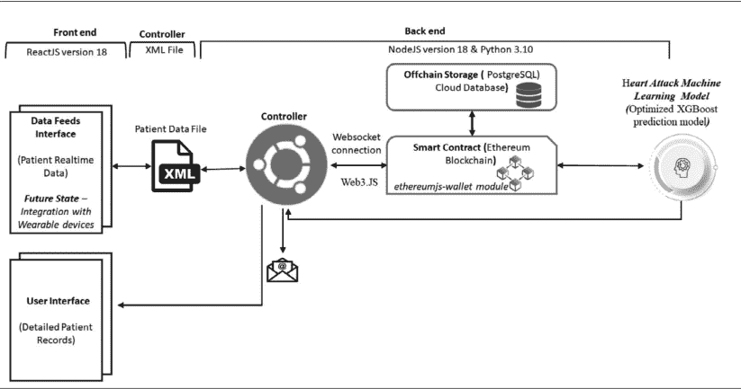

图 16.1 基于区块链的数字孪生架构。

控制器会持续监控 XML 文件，一旦检测到更改，就会调用以太坊 Ganache 私有区块链上的智能合约。为了管理区块链账户，我们使用了 ethereumjswallet 模块。

区块链账户提供对私钥和公钥的访问。首次访问时，会动态生成密钥对并保存在 BDT 应用缓存中以备后用。使用 Web3JS 库，将包含私钥的签名事务发送到 Ganache 区块链上的智能合约。控制器通过 WebSocket 连接连接到 Ganache 区块链节点。WebSocket 连接的性能优于 HTTP 连接，因为它们在以太坊节点和客户端之间提供双向通信渠道。因此，无需为每个请求创建单独的 HTTP 连接。设备代理使用 WebSockets 来订阅智能合约事件，这通常使用发布-订阅方法，也是有助于同步的另一项功能。在开发过程中，通过切换到基于 WebSockets 的远程过程调用连接，我们实现了显著更快的数据加载时间。

我们提出了一种链下解决方案来存储患者数据，因为将患者的完整健康记录存储在区块链上会增加整个链及每个节点的存储大小。因此，我们仅将区块链技术作为账本来记录事件，而患者数据（即链接的事务）存储在链下数据存储中（即云上的 PostgreSQL 数据库）。

我们创建了一个上传模块，使用区块链账户将链下数据上传到 PostgreSQL 数据库。PostgreSQL 已经过修改，使其标识系统使用以太坊账户。对于动态内容，我们使用了 Chainlink 数据馈送。Chainlink 数据馈送具有由用户（以太坊账户）和主题（任何 SHA3 哈希）确定的固定地址，且只能使用公钥签名进行修改，从而确保完全安全。

## 区块链应用


**患者记录**
患者姓名：患者 2
患者年龄：25

**心脏病发作概率**
是

| 字段 | 值 |
| :--- | :--- |
| 患者姓名 | 患者 2 |
| 年龄 | 25 |
| 性别 | 男 |
| 心脏病 | 否 |
| 癌症 | 否 |
| 糖尿病 | 否 |
| 工作类型 | 软件 |
| 居住类型 | 农村 |
| 身体质量指数 (BMI) | 145 |
| 吸烟状态 | 否 |
| 中风 | 否 |
| 污染 | 正常 |

### 心脏数据

| 字段 | 值 |
| :--- | :--- |
| 静息平均血压 | 145 |
| 平均胆固醇水平 | 150 |
| 平均空腹血糖水平 | 165 |
| 平均静息心电图结果 | 154 |
| 平均最大心率 | 167 |
| 运动诱发的心绞痛 | 否 |

### 脑卒中预测数据

| 字段 | 值 |
| :--- | :--- |
| 高血压 | 121 |
| 平均血糖水平 | 156 |
| 静息心电图（正常、ST、LTH） | 正常 |
| 老年峰 | 123 |
| ST 坡（上升、平坦、下降） | 平坦 |
| 胸痛类型（TA、ATA、NAP、ASY） | ta |

**图 16.2**
输入患者数据的数据馈送界面。

在数据存储于 Ganache 私有区块链和 PostgreSQL 之后，智能合约接下来会调用训练好的 *心脏病发作机器学习模型*。我们最初使用随机森林分类器的基本版本来预测心脏病发作。为了开发我们的模型，我们首先将数据分为训练集和测试集。然后对因变量进行训练以预测结果。随机森林分类器预测结果的准确率约为 71.4%。由于我们需要更高的准确率，随后使用了增强技术来提高预测准确率。*随机森林* 是一组多个决策树，每个决策树的准确率不同。我们选择了预测率最高的决策树模型，然后应用了超参数调优。在分割节点时，超参数可以选择随机森林中的多个决策树，也可以选择每棵树中的多个特征。在我们的模型中，我们提出使用自动化数据可视化来发现数据中的差异，然后使用特征选择选择了最佳树特征。经过此过程后，模型用于分类。我们最终获得了最佳随机状态的 *心脏病发作机器学习模型*，将预测准确率从 71.4% 提高到 97.1%。

对每位患者，都会调用 *心脏病发作机器学习模型*，并将结果发送给数字孪生实用程序；如果机器学习模型确定存在心脏病发作风险，则该实用程序会向注册医生的电子邮件 ID 发送一封电子邮件。

## 16.4 实验评估

### 16.4.1 系统设置

我们使用了一台 Linux 服务器，该服务器使用在 Amazon Web Services 上托管的基于 x86 的 Elastic Compute Cloud 实例（带有 Mac 实例）。该服务器基于英特尔第八代处理器，配备 3.2 吉赫兹的 Core i7 处理器，并使用 32 吉字节内存。应用程序使用 ReactJS 18 版、NodeJS 18 版和 Python 3.10 开发，PostgreSQL 12 版用作关系数据库。

我们创建的用于检测心脏病发作的 *心脏病发作机器学习模型* 使用了优化的 XGBoost，该模型经过调优以预测心脏病。在数据预处理阶段，类别特征使用独热编码技术进行编码，随后使用贝叶斯优化技术进一步改进了预测结果。XGBoost 是分布式机器学习社区拥有的一个软件包 [34]。该 *心脏病发作机器学习模型* 使用 Heart Failure Prediction Dataset Kaggle [35] 进行训练。这是可用于研究目的的最大数据集之一，由合并五个心脏数据集（共有 11 个共享特征）创建而成 [35]。

使用了 Ganache 私有区块链来保证数据安全性。Ganache 配置更简单且重量轻，因此可以在笔记本电脑或台式机上运行。

我们使用 Solidity 面向对象编程语言来实现智能合约。Clique 权威证明 [36] 被用作共识算法。Clique 是基于 Go 语言的以太坊权威证明实现。权威证明是最流行的共识算法之一，广泛用于许可区块链环境中以保障网络安全。该算法以加速共识过程而闻名，因此，我们在本案例中实现了更快的数据存储，这是我们应用程序的基本要求，因为


我们对患者数据进行实时处理。另一方面，Clique 不需要巨大的计算能力和资源，因此能耗较低。与工作量证明算法不同，在权威证明算法中，只有称为验证者的预定义权限被允许参与共识过程。这首先通过验证交易实现，随后创建块并将其追加到区块链。在我们的场景中，医院充当验证者。

## 16.4.2 预测准确性

在 scikit-learn 中拟合随机森林模型后，我们使用 Sklearn 的 accuracy_score() 函数计算了机器学习算法的准确率。accuracy_score() 方法接受样本的真实标签，所提出的心脏病发作机器学习模型准确率为 97.1%。

拟合随机森林模型后，我们可以看到随机森林中的每个单独决策树。如代码清单 16.1 所示的示例源代码，首先拟合随机森林模型，然后显示随机森林中的所有估计器（即决策树）。

我们选择了准确率最高（为 97.1%）的估计器（决策树）。在从随机森林绘制单个决策树时，一个关键挑战是，当决策树完全生长（使用默认超参数）时，树可以长得相当深（大），通常，深度大于 6 的任何树都很难读取。由于我们希望以可读格式获得树可视化，因此我们构建了 max_depth <7 的随机森林，并选择了给我们带来最高准确率（即 97.1%）的最佳估计器。

```
Code Listing 16.1: Sample Random Forest source code
fn=data.feature_names
cn=data.target_names
fig, axes = plt.subplots(nrows = 1,ncols = 5,figsize = (10,2), dpi=900)
for index in range(0, 5):
    tree.plot_tree(rf.estimators_[index],
        feature_names = fn,
        class_names=cn,
        filled = True,
        ax = axes[index]);
axes[index].set_title('Estimator: ' + str(index), fontsize = 11)
fig.savefig('rf_5trees.png')
```

## 16.4.3 数据分析与通知

一旦新患者数据添加到 XML 文件中，控制器就会调用智能合约，患者数据将存储在 Ganache 区块链和 PostgreSQL 中。随后，智能合约调用心脏病发作机器学习模型，结果将发送到控制器。如果预测到心脏病发作风险，控制器将向医生发送电子邮件通知（图 16.3），指示心脏病发作风险。如果医生需要更多读数，可以使用数据馈送界面请求并输入患者的新数据。一旦使用数据馈送界面输入数据，XML 文件将被更新，控制器将被调用，心脏病发作风险将在新数据上重新评估，并将适当发送通知。

患者医疗报告，ID:9hc7VAqRmCRzIT6wk3eMSWTf4uJK0bzx，姓名: patient 6

医疗保健 <healthcare-noreply@traqez.com> 致 Venkatesh Upadrista

我们删除了此消息中的额外换行符。

患者 "patient 6" 没有中风风险

患者姓名: patient 6
年龄: 22
性别: female
心脏问题病史: no
癌症病史: no
糖尿病病史: no
工作类型: software
居住地/位置: rural
身体质量指数: 18
吸烟: no
脑中风病史: no
环境温度: 30
环境湿度: 30
污染水平: normal
血压: 120
胆固醇水平: 120
糖分水平: 120
心电图: 120
最大血压: 120
运动诱发心绞痛: no
高血压: 100

图 16.3 电子邮件通知。

## 16.4.4 数据可视化

医生可以通过我们 BDT 应用的主应用程序流程获得患者心脏病发作风险的电子邮件通知。

或者，在某些情况下，医生可能希望从电子健康记录中查看患者的详细实时健康数据，包括他们的过去病史。为了便于此，我们创建了一个替代流程（用户界面），医生可以使用它来查看详细的患者医疗报告。医生可以通过登录图 16.4 所示的用户界面，查看其所有患者的记录以及任何相关的心脏病发作风险。医生可以单击单个患者姓名超链接来查看每个患者数据的详细信息。

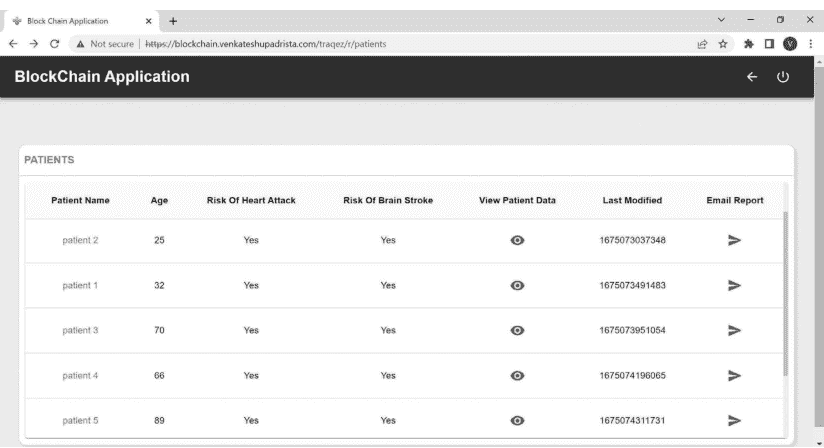

图 16.4 用户界面（患者摘要屏幕）。

### 16.4.4.1 用于测试可靠性的混沌工程实验

混沌工程实验故意试图在真实生产环境中创造动荡条件，以测试系统并实时发现弱点。我们通过模拟后端针对特定患者的患者数据篡改，并将“篡改前”结果与“篡改后”结果进行比较，来进行混沌工程实验，以证明 BDT 应用的可靠性。

首先，我们通过为新患者（即患者 6）添加数据，按照第 3.1 节所述运行步骤。一旦添加了新的患者 6 记录，控制器就会被调用，并执行第 3.1 节讨论的步骤。最后，向医生发送了一封包含读数的电子邮件，如表 16.1 的情景 A 列所示。

随后，我们从 PostgreSQL 数据库的后端将患者 6 的值篡改为无效值。篡改后的值显示在表 16.1 的篡改值列中，我们将身体质量指数值修改为 100，将血压和胆固醇水平值分别修改为 190 和 190。最大血压被篡改为 101，高血压被更改为 250。

这些值从后端更改后，我们再次运行了 BDT 应用。控制器被调用，并执行了第 3.1 节讨论的步骤。向医生发送了一封包含读数的电子邮件，如表 16.1 的情景 B 所示。

根据情景 A 值和情景 B 值的比较，很明显，我们的区块链系统能够检测到篡改并将记录恢复到原始值，从而确保数据可靠性以防范恶意篡改。这是通过区块链的固有特性实现的，因为应用程序将能够从网络中的其他区块链节点识别和检索正确的数据值。

表 16.1 患者 6 数据（篡改前和篡改后）

| 患者数据 | 情景 A | 篡改值 | 情景 B |
| :--- | :--- | :--- | :--- |
| Patient Name | Patient 6 | | Patient 6 |
| Age | 22 | | 22 |
| Gender | Female | | Female |
| Heart Problem History | No | | No |
| Cancer History | No | | No |
| Diabetic History | no | | no |
| Work Type | Software | | Software |
| Residence/Location | Rural | | Rural |
| Body Mass Index | 18 | 100 | 18 |
| Smoking | No | | No |
| Brain Stroke History | no | | no |
| Environment Temperature | 30 | | 30 |
| Environment Humidity | 30 | | 30 |
| Pollution Level | Normal | | Normal |
| Blood Pressure | 120 | 190 | 120 |
| Cholesterol Levels | 120 | 190 | 120 |
| Sugar Levels | 120 | | 120 |
| Electrocardiogram | 120 | | 120 |
| Maximum Blood Pressure | 120 | 101 | 120 |
| Exercise-Induced Angina | No | | No |
| Hypertension | 100 | 250 | 100 |
| Glucose Levels | 60 | | 60 |

区块链是一种可以与数字孪生结合使用的技术，以消除医疗保健用例中的若干安全和隐私问题 [23]，[37]，[38]，[21–23]，我们已通过此实验证明了这一点。

## 16.5 讨论

数字孪生概念已应用于许多领域，包括医疗保健，该领域将数字孪生概念扩展到将系统模型和分析与实时个人数据相结合，这些数据可用于提升健康和预期寿命 [39]。

人类的数字孪生已针对特定用例进行了调查，例如老年护理 [14]，[40]，检测颈动脉狭窄严重程度 [41]，以及心脏病诊断 [42]。少数其他论文讨论了有助于构建缺血性疾病和高血压 DT 的模型 [9]，[10]，[8]。此外，我们发现了一些关于心血管疾病 DT 概念的有趣论文 [11–13]，这些论文可以增强以创建全面的心脏预测 DT 模型。基于这些综述，可以推断，创建数字孪生有大量正在进行的研究。但是，所讨论的大多数方法


迄今为止，[4]、[5]、[9]、[10]、[12]、[28]、[29]、[31]、[35]可被视为仿真和建模技术，最好描述为需要增强以构建有意义内容的初始基本模型，因为它们都未完全集成到实时实现中，也没有考虑患者数据的隐私和安全性。总之，这些可以被视为构建主动或半主动数字孪生的初步调查。

安全和隐私问题往往是医疗保健领域最大的挑战[18–22]，文献中不多的数字孪生架构充分覆盖了此方面。

与已开发的应用程序相比，我们创建了一个功能齐全的数字孪生应用，可用于预测心脏病发作。我们使用松耦合架构构建了该应用，以便在不更改现有功能或源代码的情况下进行未来增强。我们的模型使用基于区块链的解决方案来克服安全和隐私问题，从而使模型万无一失。我们使用了基于Ganache私有区块链的智能合约来从区块链存储和检索数据，还使用了PostgreSQL。其次，我们并非将所有数据存储在区块链上，而是使用PostgreSQL数据库和区块链的组合来分布式存储患者数据。在我们的模型中，仅将患者元数据存储在区块链上，从而使区块链非常轻量。这与其他文献形成对比，在其他文献中，所有数据都存储在区块链上。该应用程序具有高度的准确性，并从患者数据安全和隐私角度使用混沌工程的相关技术进行了测试。

## 16.6 结论

数字孪生在心脏病学中的应用正在对患者和医疗专业人员产生深远影响。数字孪生技术有望帮助患者和医疗专业人员主动检测恶化的健康状况，从而帮助挽救生命。本章提出了一种名为BDT应用的数字孪生应用程序，该应用与机器学习模型集成以预测心脏病发作。为确保未来任何类型的可穿戴设备也能轻松集成而无需更改我们的应用程序代码，我们采用了无头架构，其中患者数据（数据馈送）与BDT应用程序后端代码保持松耦合。区块链作为架构的一部分被使用，可显著提高医疗数据的安全性和隐私性，以满足行政和监管要求。

结果表明，BDT应用可以以97.1%的准确率预测心脏病发作。此外，BDT应用实现了高可靠性，这通过模拟后端数据篡改的混沌实验得到了证明。研究表明，BDT应用可以智能地预测、发出警报，并针对任何恶意或未经授权的数据更新恢复到正确的数据。

可以得出结论，所提议的BDT应用程序具有高度的准确性和安全性，无头架构促进了与任何未来可穿戴设备的轻松集成，而无需更改应用程序代码。作为未来工作，我们计划通过在设备层和云平台上采用高级加密标准来增强应用程序安全性。

## 参考文献

- [1] S. Abdulmotaleb, “数字孪生：多媒体技术的融合,” IEEE MultiMedia, vol. 25, no. 2, pp. 87–92, Apr.–Jun 2018.
- [2] M. Peirlinck, S. Costabal, J. Yao, J. M. Guccione, S. Tripathy, Y. Wang, D. Ozturk, P. Segars, T. M. Morrison, S. Levine and E. Kuhl, “人类心脏建模中的精准医学,” Biomechanics and Modeling in Mechanobiology, pp. 803–31, 2021.
- [3] K. Gillette, M. A. Gsell, A. J. Prassl, E. Karabelas, U. Reiter, G. Reiter, T. Grandits, C. Payer, D. Štern, M. Urschler, J. D. Bayer, C. M. Augustin, A. Neic, T. Pock and E. J. Vigmond, “从临床12导联心电图生成心脏电生理数字孪生的框架,” Medical Image Analysis, vol. 71, p. 102080, Jul 2021.
- [4] S. Pagani, L. Dede, A. Manzoni and A. Quarteroni, “心脏电生理数值模拟的数据集成,” Pacing Clin Electrophysiol, vol. 44, no. 4, pp. 726–36, Apr 2021.
- [5] F. Auricchio, M. Conti, S. Marconi and S. T. Trimarchi, “特定患者主动脉内移植术模拟：从诊断到预测,” Computers in Biology and Medicine, vol. 43, no. 4, pp. 386–94, Feb 2013.
- [6] A. Hemmler, B. Lutz, G. Kalender, C. Reeps and M. W. Gee, “腹主动脉瘤患者特异性体内血管内修复：应用与验证,” Biomechanics and Modeling in Mechanobiology, vol. 18, pp. 983–1004, Mar 2019.
- [7] I. Larrabide, M. Kim, L. Augsburger, M. C. Villa-Uriol, D. Rufenacht and A. F. Frangi, “自扩张支架的快速虚拟部署：颅内动脉瘤支架植入的体外评价方法,” Medical Image Analysis, vol. 16, no. 3, pp. 721–30, Apr 2012.
- [8] J. Parr, P. Nithiarasu and S. Pant, “狭窄和动脉瘤检测的机器学习：在生理现实的虚拟患者数据库中的应用,” Biomechanics and Modeling in Mechanobiology, vol. 20, pp. 2097–146, Jul 2021.
- [9] R. Martinez-Velazquez, R. Gamez and A. E. Saddik, “心脏孪生：在边缘运行的人类心脏数字孪生,” in IEEE International Symposium on Medical Measurements and Applications (MeMeA), pp. 1–6, 2019. https://doi.org/10.1109/MeMeA.2019.8802162
- [10] O. Mazumber, D. Roy, S. Bhattacharya, A. Sinha and A. Pal, “基于带有巴尔反射自动调节的血液动力学模型的合成PPG生成：心血管系统的数字孪生,” in 41st Annual International Conference of the IEEE Engineering in Medicine and Biology Society (EMBC), pp. 5024–9, 2019. https://doi.org/10.1109/EMBC.2019.8855691
- [11] E. Winokur, C. Sodini and D. He, “使用头部心球图（BCG）和头部心电图（ECG）的连续、可穿戴和无线心脏监测器,” in 2011 Annual International Conference of the IEEE Engineering in Medicine and Biology Society, pp. 4729–32, May 2011. https://doi.org/10.1109/IEMBS.2011.6091171
- [12] N. Chakshu and I. Sazonov, “利用逆分析实现人体系统循环心血管数字孪生的研究,” Biomechanics and Modeling in Mechanobiology, pp. 449–65, 2021.
- [13] C. N. Kavan, C. Jason, I. Sazonov and N. Perumal, “基于头部振动检测颈动脉狭窄严重程度的半主动人体数字孪生模型——一种耦合计算力学和计算机视觉方法：一种用于检测颈动脉狭窄的半主动人体数字孪生模型,” International Journal for Numerical Methods in Biomedical Engineering, vol. 35, no. 5, p. e3180, Jan 2019.
- [14] Y. Liu, L. Zhang, Y. Yang, L. Zhou, L. Ren, F. Wang and R. Liu, “基于数字孪生的老年医疗服务新型云框架,” IEEE Access, vol. 7, pp. 49088–101, 2019.
- [15] M. Ianculescu, A. Alexandru, N.-D. Nicolau, G. Neagu and O. Bica, “面向老年人的监控应用程序最佳响应性的IoHT和边缘计算：一个案例研究,” in 22nd International Conference on Control Systems and Computer Science (CSCS), pp. 655–61, 2019. https://doi.org/10.1109/CSCS.2019.00118
- [16] R. Rajavel, S. K. Ravichandran, K. Harimoorthy, P. Nagappan and K. R. Gobichettipalayam, “基于边缘计算的物联网智能医疗视频监控系统,” Journal of Ambient Intelligence and Humanized Computing, vol. 13, pp. 3195–207, Mar 2021.
- [17] A. Abir, K. T. Woo, L. Vincenzo and P. Jong, “面向智能健康城市的基于区块链的安全数字孪生框架,” Advanced Multimedia and Ubiquitous Engineering, pp. 107–13, Dec 2020.
- [18] A. Alrawais, A. Alhothaily, C. Hu and X. Cheng, “面向物联网的雾计算：安全与隐私问题,” IEEE Internet Computing, vol. 21, p. 2, 2017.
- [19] K. Gai, M. Qiu, Z. Xiong and M. Liu, “物联网边缘中的隐私保护多通道通信,” Future Generation Computer Systems, vol. 85, pp. 190–200, 2018.
- [20] P. P. Ray, D. Dash, K. Salah and N. Kumar, “基于物联网的医疗保健区块链：背景、共识、平台和用例,” IEEE Systems Journal (Early Access), pp. 85–94, 2021.
- [21] P. P. Ray, D. Dash, K. Salah and N. Kumar, “基于物联网的医疗保健区块链：背景、共识、平台和用例,” IEEE Systems Journal (Early Access), pp. 85–94, 2021.
- [22] N. Garg, M. Wazid, A. K. Das, D. P. Singh, J. J. P. C. Rodrigues and Y. Park, “BAKMP-IoMT：面向医疗物联网部署的区块链支持认证密钥管理协议设计,” IEEE Access, vol. 8, pp. 95956–77, 2020.
- [23] H.-N. Dai, M. Imran and N. Haider, “用于抗击COVID-19的区块链支持医疗物联网,” IEEE Internet of Things Magazine, vol. 3, no. 3, pp. 52–7, Sep 2020.
- [24] W. Siha and D. Jiang, “基于区块链的电子病历安全共享模型,” in Proceedings of the 3rd International Conference on Cryptography, Security and Privacy, pp. 13–17, 2019. https://doi.org/10.1145/3309074.3309079
- [25] H. L. W. Guo, N. Mark and S. Chien-Chung, “具有混合区块链-边缘架构的电子健康记录访问控制,” IEEE International Conference on Blockchain (Blockchain), 2019. https://doi.org/10.1109/Blockchain.2019.00015
- [26] C. Community, 混沌工程原理, Mar 2019. [Online]. Available: http://principlesofchaos.org/?lang=EN.
- [27] S. Chandra, V. Paravastu, R. Jayarajasingam, R. Cottam, S. J. Palfreyman, J. A. Michaels and S. M. Thomas, “腹主动脉瘤血管内修复,” Cochrane Database of Systematic Reviews, vol. 23, no. 1, p. CD004178, Jan 2014. https://doi.org/10.1002/14651858.CD004178.pub2
- [28] M. E. Biancolini, K. Capellini, E. Costa, C. Groth and S. Celi, “基于RBF网格变形和阶次缩减模型的血液动力学快速交互式CFD评估：aTAA建模案例,” International Journal on Interactive Design and Manufacturing (IJIDeM), pp. 1227–38, Sep 2020.
- [29] N. K. Chakshu, I. Sazonov and P. Nithiarasu, “利用逆分析实现人体系统循环心血管数字孪生的研究,” Biomechanics and Modeling in Mechanobiology, vol. 20, pp. 449–65, Oct 2021.
- [30] S. Weidmann, “心脏：电生理,” Annual Review of Physiology, vol. 366, pp. 155–69, Mar 1974.
- [31] T. Gerach, S. S. J. Fröhlich, L. Lindner, E. Kovacheva, R. Moss, E. M. Wülfers, G. Seemann, C. Wieners and A. Loewe, “整个心脏的电机械数字孪生：一种完全耦合的多物理场方法,” Development and Applications of Multi-Scale Mathematical Models in Cardiology, vol. 9, no. 11, p. 1247, May 2021.
- [32] E. Zeitler, W. Schoop, W. Zawnow, “经导管血管成形术治疗闭塞性动脉疾病,” Diagnostic Radiology, vol. 99, no. 1, Apr 1971.
- [33] U. NHS, 心脏病发作：概述, NHS [Online]. Available: www.nhs.uk/conditions/heart-attack/.
- [34] D. C. Hosting, 分布式（深度）机器学习公共平台, DMLC Community Hosting, 2023 [Online]. Available: http://dmlc.io/.
- [35] Fedesoriano, 心力衰竭预测数据集, Kaggle, September 2021 [Online]. Available: www.kaggle.com/datasets/fedesoriano/heart-failure-prediction.
- [36] E. P. Networks, Go以太坊, Dec 2019 [Online]. Available: https://geth.ethereum.org/docs/interface/private-network.
- [37] S. Wu and J. Du, “基于区块链的电子病历安全共享模型,” in Proceedings of the 3rd International Conference on Cryptography, Security and Privacy, pp. 13–17, 2019. https://doi.org/10.1145/3309074.3309079
- [38] H. Guo, W. Li, M. Nejad and C.-C. Shen, “具有混合区块链-边缘架构的电子健康记录访问控制,” in IEEE International Conference on Blockchain (Blockchain), 2019. https://doi.org/10.1109/Blockchain.2019.00015


[39] M. E. Miller 和 E. Spatz，“人类数字孪生的统一视角”，《人机系统集成》，第 23–33 页，2022 年 6 月。

[40] A. Lombardo 和 C. Ricci，“面向非住院患者远程医疗的数字孪生联邦”，载于 IEEE 泛在计算与通信国际会议研讨会及其他附属会议（PerCom Workshops），第 718–23 页，2022 年。https://doi.org/10.1109/PerComWorkshops53856.2022.9767417

[41] A. E. Azzaoui, T. W. Kim, V. Loia 和 J. Park，“面向智慧健康城市的基于区块链的安全数字孪生框架”，《先进多媒体与无处不在工程》，第 107–13 页，2020 年 12 月。

[42] E. Winokur, C. Sodini 和 D. D. He，“利用头部球心图（BCG）和头部心电图（ECG）的连续可穿戴无线心脏监测仪”，载于 2011 年 IEEE 医学与生物学工程学会年会国际会议，第 4729–32 页，2011 年 5 月。https://doi.org/10.1109/IEMBS.2011.6091171

## Index

### A
- 原子交换, 41
- 审计追踪, 43

### B
- 区块, 167
- 区块链, 1
- 波士顿 MedRec 系统, 2

### C
- 癌症基因信托, 103, 235
- 心律失常, 294
- 混沌工程, 292, 301
- 物物云, 177
- 冷链, 5
- 共识机制, 39
- 联盟链, 50, 226
- 接触者追踪, 150
- Coral Health, 232, 233
- 跨链桥, 41
- 加密密钥, 125

### D
- DApp 应用, 80
- 数据源, 295
- 去中心化应用 (DApps), 41
- DefectChecker, 111
- 分布式账本技术, 225
- 分布式请求系统, 202
- DNATIX, 231
- 双重花费, 168

### E
- Echidna, 109, 121
- 电子爱沙尼亚, 234
- 电子健康记录, 56, 100
- 电子病历 (EMR), 81
- EncrypGen, 11, 268, 277
- Eth2Vec, 109, 121
- 以太坊, 52, 107
- Express.js, 53

### F
- FHIRChain, 19, 63
- 取证工具包, 172

### G
- Ganache, 53, 102, 107, 117, 296, 298, 299, 303
- 加特纳炒作周期, 253
- GasChecker, 111, 122
- Gasper, 111
- Gastap, 110
- Genecoin, 231, 243, 268, 271
- 通用数据保护条例, 213, 228, 267
- 创世区块, 54
- Genesy, 269
- Genesy 模型, 269, 270
- Genomes.io, 235, 268, 269
- 基因组数据共享平台, 268
- GEN 代币, 231
- GeoAI, 141, 145, 146, 159
- Geth, 108, 121

### H
- Hashlog, 143
- HealthBank, 4
- 医疗健康 4.0, 213
- 医疗健康供应链, 4
- HoneyBadger, 111
- 混合区块链, 50
- 超级链, 143
- 超级账本 Caliper, 104, 148
- 超级账本 Composer, 108
- 超级账本 Fabric, 50, 81, 89, 99, 105, 108, 117, 154, 190, 191, 197, 202, 207, 210, 233, 247, 248
- 超级账本 Sawtooth, 105, 121

### I
- 不可篡改性, 50
- 医疗物联网, 8
- 互操作性, 40
- 互操作性协议, 41
- 行星间文件系统, 200
- Iroha, 107, 121
- IRYO, 232

### L
- LOCARD, 177
- Luna DNA, 268

### M
- MadMax, 111, 122
- Manticore, 112, 122
- MATLAB, 108
- MedBlock, 16, 24, 82, 92
- MedHypChain, 7, 22
- Medicalchain, 64, 233
- Medicahin, 15
- MediLedger, 62
- MedRec, 2, 58, 91, 231, 232, 243
- mHealth 系统, 156
- 矿工, 188
- 挖矿, 167
- 多方安全计算, 84
- MyBitBlock, 268
- Mythril, 111, 122

### N
- 星云基因组学, 11, 229, 268, 277
- 节点, 168
- 随机数, 168, 201

### O
- OpenZeppelin 智能合约库, 137
- OrganChain, 14
- 爆发, 34
- Oyente, 67, 111, 117, 158

### P
- patientory, 24, 233
- 点对点 (P2P), 29
- 许可型区块链, 49
- 个人健康记录, 191
- PGxChain, 103
- PHBC, 143
- Postman, 107
- 工作量证明 (PoW), 144
- 私有区块链, 49, 226
- ProCredEx, 62
- 权威证明, 144, 298, 299
- 工作量证明 (PoW), 55
- 公共区块链, 49, 226

### Q
- QuorumChain, 103

### R
- 实时数据分析, 37
- 注册合约, 3
- Remix IDE, 110
- 远程健康监测, 291
- 角色, 137

### S
- 中本聪的区块链技术, 134
- 安全数据共享, 36
- securify, 112, 117, 122
- Shivom, 268, 271, 277
- Slither, 109, 110, 122
- SmartAnvil, 110
- SmartBugs, 110, 122
- SmartCheck, 110, 117, 122
- SolCover, 67
- SPSS, 109, 121
- Spyder IDE, 105, 109
- SynCare, 7, 22

### T
- 远程护理医疗信息系统, 100
- 远程医疗, 6
- 代币化, 41
- Truffle, 108, 117

### U
- 无许可区块链, 49

### V
- Vandal, 112, 122
- VANET, 278, 279, 280, 281, 282, 283, 285, 286, 287, 288, 289, 290
- VeChain, 143

### W
- Wireshark, 105, 108

### Z
- Zenome, 230, 243, 268, 269, 271, 277
- ZeppelinOS, 67
- 零知识协议, 239
- ZNA 代币, 230

