# 物联网的区块链（Chapman & Hall／CRC 计算智能及其应用）


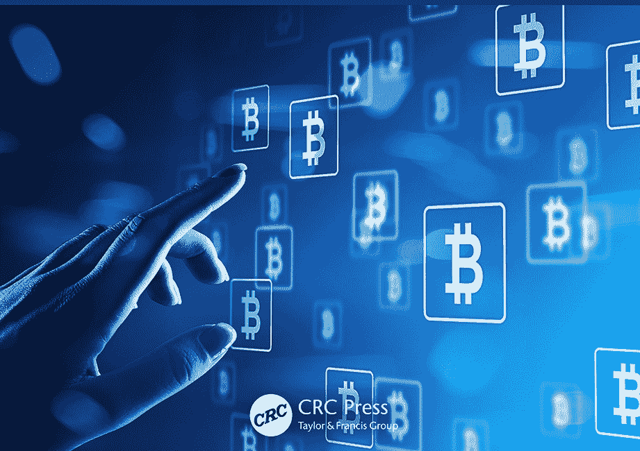


Debarka Mukhopadhyay 将此书献给他父亲和母亲 Debasis Mukhopadhyay、Gouri Mukherjee、他的祖母 Namita Mukherjee、他亲爱的妻子 Nabamita Mukhopadhyay 以及他独子 Shouvik Mukhopadhyay 的纪念。

Siddhartha Bhattacharyya 将此书献给他已故的父母 Ajit Kumar Bhattacharyya 和 Hashi Bhattacharyya，以及他心爱的妻子 Rashni。

Balachandran Krishnan 将此书献给他的妻子、儿子 Naveen 和 Nithin，以及儿媳 Kruthi，怀着真诚的感谢和温暖的祝福。

Sudipta Roy 将此书献给他已故的祖父 Gopendranath Roy，其字典手稿页面在他童年时启发了他对图书出版的向往。

Taylor & Francis
Taylor & Francis Group
http://taylorandfrancis.com


## 前言

在当今世界，来自不同地理位置的物联网（IoT）行业通过多个组织合同进行通信。这不过是参与行业之间基于相互信任的正式协议。区块链平台借助技术建立这种信任。因此，现有通信与通过区块链技术的通信之间存在根本性差异。这项工作的关键目标之一是将区块链作为参与者之间透明、实时信息交换的平台予以展示。此外，具有计算智能功能的特性与区块链和物联网系统的现有属性相结合，以更好地利用该平台。

本卷旨在向目标读者介绍区块链技术的基本概念及其在不同领域的应用。本书还旨在通过融入计算智能元素来介绍智能区块链平台。对现实生活中物联网应用的洞察将有助于读者轻松掌握相关概念。本卷包含九篇由外部作者撰写的章节，此外还有一篇入门章节，旨在报告该领域的最新进展。

区块链是一个用于共享信息和计算能力的去中心化或分布式平台。交易记录在网络中的参与工作站之间被复制，这些工作站相互协调和协作。因此，任何试图更改存储数据的行为都需要访问网络中所有工作站，从而确保底层数据的更高保密性和安全性。物联网是指通过互联网连接大量实体对象或设备（传感器或执行器），以确定能够自行决策的密集连接网络基础设施。因此，在物联网网络中需要处理和存储大量敏感数据以供后续使用。鉴于其强大的安全性，区块链在


在从科学和工程到医疗和商业应用等多个领域中都有广泛应用，物联网（IoT）也不例外。第1章介绍了区块链和物联网的基础知识，特别着重于两者之间的协同作用，以构建一个强大且安全的分布式数据处理环境。

区块链是本十年中最新且发展迅速的技术之一。当比特币和加密货币的概念于2008年首次推向市场时，有些人看到了区块链技术（即加密货币背后的平台）的革命性潜力。区块链技术帮助企业为数据和信息提供安全保障，通过消除不必要的中间商降低成本，并提供透明性和可追溯性。这确保了端到端同步，即从客户端的角度看待问题。区块链是一个公共账本，以分布式方式维护区块链网络上所有交易的记录。它是一个不需要任何中央机构的点对点（P2P）网络。据预测，区块链技术的全球市场将在2027年达到307亿美元，在2020年至2027年的分析期内，其后新冠疫情时代的复合年增长率（CAGR）为43%。物联网是另一项快速增长的技术，凭借其提供智能互联设备网络的能力，吸引了众多企业的关注，这些设备能够提升用户与设备交互的体验。物联网是一个不断发展的行业，一直在为工业4.0革命铺平道路。物联网在现实世界中展现出的局限性并没有阻止研究人员和企业寻找解决方案。最备受期待的即将出台的解决方案之一是区块链与物联网的集成。第2章识别了区块链平台上物联网的各种应用，以及与传统系统相比相关的挑战/收益。该研究旨在确定以物联网为技术的区块链技术所面临的挑战及其可能的解决方案。

目前，物联网技术的大规模实施正在伴随快速增长和广泛应用，促使设备变得更加智能。另一方面，它也面临一些严重的安全问题。在分布式网络节点中，设备和消息验证以及使用真实机制进行验证至关重要，可防止未经授权的设备访问，以及数据隐私、攻击抵抗力等其他安全问题。另一方面，许多物联网环境容易受到节点或设备故障的影响。为防止单个数据节点故障和数据篡改，可使用区块链技术来实现属性分布。第3章探讨了一种通用的基于区块链的方案，重点在于使用公钥加密算法的身份验证和密钥管理机制。本文回顾了对区块链与物联网身份验证集成的详尽分析，以改进基于区块链的物联网应用，突出其在传统分布式云中的作用。

物联网和区块链知识有助于实施组织提升和优化其运营。目前，物联网因其能够跨不同应用提供创新服务，吸引了学者、科学家和商业人士的极大关注。物联网无缝互连异构设备和对象，构建起一个实际的网络，其中感知、处理和通信流程无需人工干预即可自动组织和管理。独特的组织技术包括信息物理系统（CPS）、机器对机器（M2M）和无线传感器网络（WSN）。随着现代技术的升级，我们有必要将旧系统推向物联网与区块链（IoTBC）的融合。第4章讨论了这种融合所产生的一些智能框架。当今世界已完全适应现有的旧系统，使其难以替代。因此，与CPS、M2M和WSN相关的安全问题在相关领域出现，需要确保组织系统整体免受攻击。系统的安全部分可以借助区块链技术轻松处理。IoTBC融合带来了诸多益处，并通过简单的语音呼叫系统进行了说明。智能医疗、治理和基础设施等未来系统也进行了详细讨论。iGovernance（智慧政务）是指利用创新技术来支持更好的准备和决策。它是指优化流程并改变公共行政服务的提供方式。医疗服务框架的重要组成部分是识别、定位、感知和网络。iHealthcare（智慧医疗）通过广泛的框架实施：紧急服务、智能计算、传感器、芯片实验室、远程监测、可穿戴设备、连接设备和大数据。基于物联网的框架配备了远程医疗框架内的体感传感器网络。

近年来，智能家居自动化系统是发展最快的物联网技术之一，因为可以使用远程访问设施来控制设备并提高生活水平。在第5章中，提出了一种基于物联网的智能家居自动化系统，使用无线保真（WiFi）扩展板和Arduino微控制器来远程控制家用电器。该系统可以帮助老年人和身体有障碍的人操作家中固定在某处的常规电气开关。此外，该系统可以以最低成本提供舒适且独立的生活方式。

在以往关于比特币的研究中，它被视为一种新型去中心化经济体系的愿景。仅点对点电子现金交易中不包括金融机构，在线支付直接从一个人发送到另一个人。第6章讨论了这一概念的实际适用性，介绍了一种去中心化自治组织（DAO）的实时实际研究，该组织自动运行，具有完全的透明度、完整性和去中心化。去中心化意味着它以点对点格式执行，包括网络中的用户节点，并且由于网络对公众开放，因此完全透明。本章将所有这些特征结合起来，形成免信任交易系统的里程碑。

区块链已通过提供交易不可篡改的痕迹，现代化了用户之间共享数字资产的方式。人工智能（AI）和区块链的力量可以通过确保合法合同的可靠执行、降低成本和加快司法结论来帮助改革法律系统。例如，法律职业涉及阅读数千份对决定审判结果至关重要的法律文本。如今，许多自动聊天机器人采用先进的自然语言处理算法设计，可以在几分钟内阅读这些文本。法律合同合规性自动化是法律行业的重要任务之一，可以使用智能合约可靠地实施。区块链和AI可以在多个领域有效利用，以支持法律工作的多样性，从而促进具有多种服务产品的新业务领域。第7章讨论了区块链在法律行业各项任务中的影响，例如知识产权、证据保全链、个人财产权和公证人验证。它还介绍了区块链上判决执行的实际场景，并解释了法律文本分析中各种自然语言处理技术及其挑战。


物联网（IoT）网络为其应用使用了数量有限的资源受限设备，这与在网络行为发生动态变化时表现良好不兼容。由于物联网网络的资源受限特性，支持强大的高端基础设施是不可行的。在资源有限的情况下提供足够的安全性，成为维护数据真实性和完整性的一项挑战性任务。为了解决物联网网络中数据真实性和完整性的问题，作者在第8章中提出了一种基于软件定义网络（SDN）的区块链物联网代理。该提出的解决方案是一种基于SDN的物联网架构，它使用由机器学习驱动的代理来支撑物联网网络的快速变化和错误行为。与当前的最先进方法相比，该拟议系统将提供增强的性能，因为其基于代理的适应性功能可以很好地适应物联网网络的动态变化行为。

分布式发电、储能及其他物联网设备（如智能电表）正在协同工作，为集中式控制运营和能源市场创造新的机遇。区块链为企业和物联网设备提供了一条潜在途径，通过优化日益增长的能源数据使用，并为组织和个人提供新的交易方式，从而更好地应对这些变化，建立一个无需中央机构的可信赖能源交易管理网络。第9章详细说明了印度基于区块链平台的屋顶太阳能（RTPV）物联网支持的点对点（P2P）交易的最新技术。使用物联网支持的智能电表，P2P交易系统提供了一个虚拟平台，生产消费者和消费者可以在其中以双方商定的价格交易电力，而无需中介。印度智能电网论坛（ISGF）与Power Ledger合作，在印度东南亚地区展示了两个开创性的成功试点项目。第一个试点项目于2020年12月在北方邦勒克瑙启动，有12名参与者，Tata Power Delhi Distribution Ltd.（TPDDL）于2021年1月启动，拥有超过65名生产消费者和75名消费者。根据自试点启动以来使用的各种交易规则，已证明在这种交易场景中可以包含面向配电公司（DISCOM）的网络接入费，这将激励配电公司允许其客户之间进行P2P能源交易，同时促进智能电表在全国范围内的广泛采用。

农业是人类生存的基础。为了满足当前需求并减少粮食浪费，使用物联网、AI和大数据等创新技术的智慧农业是当前趋势。区块链技术最近被用于解决农业中的透明度、中立性、安全性和可靠性挑战。在第10章中，作者清晰地描绘了结合区块链、物联网和AI的智慧农业。提出了一种智慧农业框架，其中物联网设备将收集与农业生产、运输和存储相关的数据。AI用于从收集的数据中提取特定知识并进行未来预测。区块链在传感或交易后的每个数据存储步骤中都被使用，所有授权方都可以从区块链中验证数据。与现有方法相比，拟议框架在许多参数方面表现出更多特性。

本书涵盖了作为平台的区块链的坚实基础，以及针对物联网行业的人工智能应用，包含真实案例研究。它涵盖了从基础到最先进的区块链平台、复杂人工智能概念的实现等各种主题。本书在理论理解与实际应用之间提供了平衡的方法。本书的主要读者包括计算机科学和信息技术专业的研究生，以及软件专业人士，他们可以利用这些急需的开发理念来提升其在分布式平台上的计算知识。

- Debarka Mukhopadhyay
- Siddhartha Bhattacharyya
- Balachandran Krishnan
- Sudipta Roy

## 编辑


Debarka Mukhopadhyay博士拥有超过17年的研究和教学经验，目前是班加罗尔基督大学计算机科学与工程系副教授。他是一位充满热情且以结果为导向的个人，拥有西孟加拉邦莫拉纳·阿布勒·卡拉姆·阿扎德技术大学的计算机科学与工程博士学位，以及隶属于西孟加拉邦技术大学的卡利亚尼政府工程学院的计算机科学与工程M. Tech学位。Mukhopadhyay博士持有20项专利，包括6项国际专利和14项国家（印度）专利，并在国际期刊上发表了14篇文章、22篇会议论文以及8个图书章节。他目前的研究兴趣包括区块链技术、物联网、人工智能（AI）和纳米计算等。他是电气与电子工程师学会（IEEE）、印度技术教育学会（ISTE）和电子与电信工程师学会（IETE）的会员。


Siddhartha Bhattacharyya博士 [FRSA, FIET (UK), FIEI, FIETE, LFOSI, SMIEEE, SMACM, SMIETI, SMAAI A, LMCSI, LMISTE] 于1995年获得印度加尔各答大学物理学学士学位，1998年获得光学与光电学学士学位，2000年获得光学与光电学硕士学位。他于2008年从印度贾达夫普尔大学获得计算机科学与工程博士学位。他因硕士论文获得加尔各答大学颁发的大学金牌。他获得了多项享有盛誉的奖项，包括2017年由印度计算机学会孟买分会授予的杰出系主任奖和杰出教授奖，来自南美大学的荣誉博士奖（D. Litt.），以及2017年东南亚区域计算机联合会（SEARCC）国际数字奖ICT年度教育家奖。他获聘为2018–2020任期的ACM杰出演讲者。他于2020年被ACM美国选入ACM人物名人堂。他获聘为2021–2023任期的IEEE计算机学会杰出访问学者。他被选为俄罗斯自然科学院的全职外籍院士。他被选为英国皇家艺术、制造与商业学会（RSA）的全职院士，位于伦敦。Bhattacharyya博士目前担任拉杰纳加尔马哈维迪亚拉亚学院（Rajnagar, Birbhum）校长。他是6本书的合著者和80本书的合编辑，并在国际期刊和会议论文集中发表了超过350篇研究论文。他拥有2项根据专利合作条约（PCT）的专利和19项专利。他曾担任多个国家和国际会议的组织和技术方案委员会成员。Bhattacharyya博士是多家知名期刊的副编辑，包括Applied Soft Computing、IEEE Access、Evolutionary Intelligence和IET Quantum Communications。他是International Journal of Pattern Recognition Research的编辑，以及International Journal of Hybrid Intelligence（Inderscience）的创始主编。他为多家国际期刊客座编辑了多个期刊号。他的研究兴趣包括混合智能、模式识别、多媒体数据处理、社交网络和量子计算。


**巴拉钱德兰·克里希南博士**是基督大学（班加罗尔）计算机科学与工程系教授。他获得安娜大学（金奈，泰米尔纳德邦）的信息与通信工程博士学位。他的研究生课程包括分子物理学、计算机应用和信息技术。他的研究包括开发一种用于肺癌早期诊断的自适应权重集成模型。

他的研究兴趣包括人工智能、数据科学和计算机网络。在38年的职业生涯中，他曾在一家面向放射性矿物地球物理数据勘探的测试与分析研究开发中心的原子能部门担任科学官员（20年），在塔塔茶园担任现场官员（1年），此外还在基督大学任职。他正在指导数据科学、图像处理和软件工程领域的研究学者。


**苏迪普塔·罗伊博士**是阿萨姆大学（西尔查尔，阿萨姆邦）特里古纳·森技术学院计算机科学与工程系教授。他曾担任加尔各答ACE咨询公司的软件专业人员，以及加尔各答（印度）孟加拉理工学院的教职人员。他的研究兴趣包括图像处理、软计算技术和网络安全。他目前正在指导研究学者以及研究生和本科生。他在国际期刊上发表了80多篇论文，在会议录上发表了70多篇论文。他是工程师学会（IE）、电子与电信工程师学会（IETE）、印度计算机学会（CSI）、电气和电子工程师学会（IEEE）、国际神经网络学会（INNS）和计算机协会（ACM）的会员/会士。

Taylor & Francis
Taylor & Francis Group
http://taylorandfrancis.com

## Contributors

- **塔波迪尔·阿查尔吉**
  计算机科学与工程系
  特里古纳·森技术学院
  阿萨姆大学，西尔查尔
  印度阿萨姆邦

- **曼皮·戴维**
  特里普拉大学（中央大学）
  印度特里普拉邦

- **阿扬·巴塔查尔吉**
  特里普拉大学（中央大学）
  印度特里普拉邦

- **罗希特·库马尔·凯塞拉**
  计算机科学与工程系
  特里古纳·森技术学院
  阿萨姆大学，西尔查尔
  印度阿萨姆邦

- **悉达多·巴塔查里亚**
  拉杰纳格尔学院
  印度伯尔布姆

- **巴拉钱德兰·克里希南**
  基督大学
  印度班加罗尔

- **罗希特·库马尔·达斯**
  VIT-AP大学
  印度安得拉邦

- **G. 梅加拉**
  计算机科学与工程学院
  维洛尔理工学院
  维洛尔
  印度泰米尔纳德邦

- **萨杰尔·坎塔·达斯**
  特里普拉大学（中央大学）
  印度特里普拉邦

- **拉克蒂姆·德布**
  计算机科学与工程系
  特里古纳·森技术学院
  阿萨姆大学，西尔查尔
  印度阿萨姆邦

- **德巴卡·穆科帕德亚**
  基督大学
  印度班加罗尔

- **朱利安·贝纳迪特·珀尔纳巴斯**
  计算机科学与工程系
  基督大学（被认定为大学）工程与技术学院
  印度卡纳塔克邦班加罗尔坎马尼克肯格里校区

- **吉滕德拉·萨克塞纳**
  工程师学会
  印度加尔各答

- **普拉布·塞武甘**
  银行技术系
  本治大学
  印度本治

- **万达娜·雷迪**
  基督大学（被认定为大学）
  印度班加罗尔

- **P. 斯瓦纳拉塔**
  计算机科学与工程学院
  维洛尔理工学院
  维洛尔
  印度泰米尔纳德邦

- **阿拉克·罗伊**
  特里普拉大学（中央大学）
  印度特里普拉邦

- **克里希纳·库马尔·瓦伊廷纳坦**
  计算机工程系
  卡拉凯理工学院
  瓦里西库迪
  印度本地利里卡拉凯

- **舒瓦姆·萨尔卡尔·罗伊**
  世界银行
  印度新德里

- **苏迪普塔·罗伊**
  阿萨姆大学，西尔查尔
  印度阿萨姆邦

- **阿尔查纳·延戈姆**
  基督大学
  印度班加罗尔

# 面向物联网的区块链简介

德巴卡·穆科帕德亚
基督大学，印度班加罗尔

悉达多·巴塔查里亚
拉杰纳格尔学院，印度伯尔布姆

苏迪普塔·罗伊
阿萨姆大学，西尔查尔，印度阿萨姆邦

巴拉钱德兰·克里希南
基督大学，印度班加罗尔

## 目录

- 1.1 简介 2
- 1.2 历史 4
- 1.3 什么是区块链？ 4
- 1.4 作为公共账本的区块链 5
- 1.5 比特币与区块链 6
- 1.6 区块链技术基础 6
- 1.6.1 新块创建协议 7
- 1.6.2 新创建块的哈希值生成 8
- 1.6.3 工作量证明 8
- 1.6.4 在区块链中挖掘区块 9
- 1.7 默克尔树 10
- 1.8 不同类型的区块链框架 12
- 1.9 物联网基本架构 12
- 1.10 物联网应用与用例 13
- 1.11 物联网架构的缺点 14
- 1.12 区块链框架中的物联网应用 14
- 1.12.1 供应链管理中的区块链 15
- 1.12.2 农业中的区块链 16
- 1.13 结论 16
- 参考文献 17

## 1.1 简介

20世纪以来，信息——即数据——被视为任何组织中最有价值的部分之一。数据非常重要，保障对数据的安全访问至关重要。因此，需要一个高度安全的架构平台来进行数据存储 [1]。集中式系统并非理想之选，因为它代表了单点故障。如果我们转向去中心化系统，在发生任何节点故障的情况下，重建通信可能需要大量时间 [2]。相比之下，作为分布式框架的区块链为数据保证了保真性、隐私性和安全性，而且在不涉及任何受信任第三方的情况下建立了信任。分布式数据库在网络的所有参与者之间共享。区块链最广为人知的是作为比特币、以太币等加密货币的平台。传统数据库与区块链数据库不同 [3]。在区块链中，数据存储在称为区块的容器中。区块的容量各不相同，当每个区块填满后，它会被关闭，然后与前一个区块相连，从而创建一条链。一旦新区块被创建并添加到现有链中，它就变得不可更改，其中的数据不能被修改。因此，不能将新数据合并到链中现有的区块内，但可以成为下一个区块的一部分。只要还需要更多数据存储，就可以向现有链添加新区块 [4]。

因此，区块链允许数据分布但不可编辑。因此，任何记录的交易都不能被更改、修改或销毁。现在，让我们假设一个黑客想要从链中窃取信息。如果成功，他们在链中拥有一个节点 [5]。如果他们想要修改自己的副本，他们将无法与其他节点保持一致，因为更改会在所有地方体现，每个参与者都能识别出唯一的修改副本；被攻击的节点因此被视为非法并被剔除。要成功攻击区块链，入侵者必须控制至少51%的节点。但这需要重新编写时间戳和哈希值所需的大量时间、精力和计算能力。

在谈及功能特性时，该框架为许多领域做出贡献。区块链框架可以用于将资金从一个地理位置转移到另一个地理位置，尤其是跨境转账。此类转账作为传统银行交易可能需要几天时间，而区块链平台可以在几分钟内完成。这个分布式平台不要求参与者为任何交易向任何集中式机构存入资金。尽管它主要处理加密货币，但该概念也可以融入传统投资中 [6]。

借贷可以通过智能合约实现。智能合约是驻留在区块链上的算法，允许处理和各种类型的支付等一些定义活动自动触发。它使处理速度更快且成本更低，因为不需要第三方介入 [7]。

保险行业可以利用区块链在保险提供商和客户之间带来更高的透明度。构建在区块链支付架构中的智能合约可以在发生索赔时加快支付速度 [8]。

房地产行业需要大量文书工作来启动搜索现有所有权以转让产权和所有权证书的过程。区块链平台可以保存所有此类记录以进行验证并转让所有权。这个过程可以减少时间、文书工作和成本。

区块链技术可以改进当前的投票系统。它可以检查个人作为选民的资格并标记任何重复项。此外，合格选民将能够从任何地点投票，这将显著降低举行选举的成本 [9]。

另一个应用是在供应链管理领域 [10]。区块链技术可以为供应链中的参与者之间的通信带来透明度。它还确保数据的安全性和完整性，因为区块链中的数据是不可更改的。因此，供应链中的合作伙伴可以彼此更加信任，也对数据得到适当更新更加信任。

区块链技术还有其他应用领域。随着对数字数据需求的不断增长，区块链可以确保数据的安全性、透明度和完整性。


## 1.2 历史

比特币的概念诞生于2008年，最初由一个名为中本聪的人——或者可能是一群人——提出。但在中本聪发布比特币白皮书之前，区块链技术的概念已经在早期的研究中出现。该初步概念由Stuart Haber和W. Scott Stornetta于1991年提出。该工作提出了一种带有时间戳文档的加密安全链 [11]。他们提出了确定文档哈希值并附带时间戳保存的方法。Nick Szabo，一位计算机科学家、法律学者和密码学家，于1998年构思了数字货币，当时称为Bit Gold。该提案包含了解决密码学谜题、拜占庭容错注册表，以及验证和给新“挖出”的币加时间戳。他还试图解决双重花费问题。Bit Gold从未实现，但该概念被用于比特币架构。在2000年，Stefan Konst引入了一种将块连接成链的理论。他使用图形实现了该理论，其中节点通过密码学方法链接。中本聪最终整合了过去的理论，并于2009年实现了比特币，“一种点对点的电子现金版本” [11]。

## 1.3 什么是区块链？

区块链是一个用于信息共享和计算的去中心化或分布式平台。交易记录在网络中相互不信任但协调协作的参与工作站之间复制。与集中式系统不同，在这里潜在攻击者需要访问网络中所有工作站才能更改类似数据。由于区块链技术的固有特性，攻击者的这一行为会立即在网络参与者中报告 [12]。图1.1列出了区块链作为平台的各种特性。它提供工作站的开放参与，而无需透露其身份。与其他任何分布式或去中心化网络一样，该平台对交易也没有集中控制。每当两个工作站之间发起交易时，其他工作站不会闲置，而是尝试探索由工作站发起的交易的有效性。因此，其余工作站充当交易的验证者。在成功验证和挖矿后，信息将永久存储在存储中 [13]。

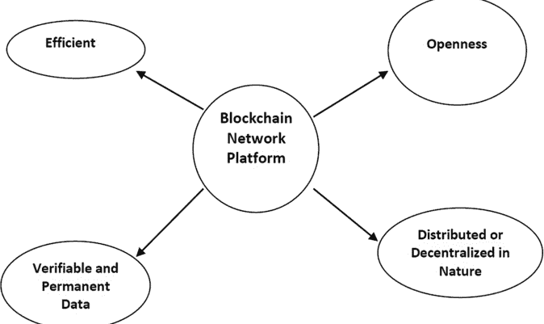

图1.1 区块链网络平台的不同特性。

## 1.4 区块链作为公共账本

在分布式点对点网络中，每个工作站都存放一个专用数据库，其中包含账本的相同副本，并同步且独立地更新。与所有公共账本一样，区块链网络将记录保存为参与者之间所有成功交易的记录本。图1.2描绘了传统交易与基于区块链交易之间的根本差异。例如，在银行系统中，发送方可以向接收方转账。银行作为集中式权威机构，保存这些交易的记录，并且只有两名参与成员和银行官员才能验证交易。区块链作为公共账本，工作方式不同。没有集中式权威机构可用于控制交易，验证是由发起和接收交易的成员以外的指定参与成员进行的 [13]。

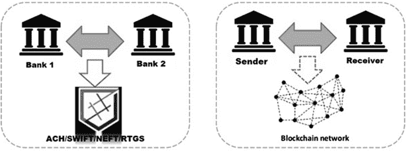

图1.2 普通资金转账与通过区块链转账 [14]。

## 1.5 比特币和区块链

许多人错误地认为区块链和比特币相似。实际上，它们不相似，但在功能上有关联。简单来说，区块链是一个分布式数据库，这意味着数据在不同地理位置的不同节点之间复制。这种复制方法导致数据去中心化。去中心化带来了更高级别的安全性，因为没有可被攻击的中央数据存储库 [15]（图1.3）。

比特币是第一种用于其交易专门使用区块链网络的数字去中心化加密货币。该网络中的用户在没有任何第三方中介的情况下转移比特币并进行交易。目前全球市场上有许多加密货币，但区块链是它们执行的共同平台。

## 1.6 区块链技术基础

区块链平台主要建立在两个支柱上，即分布式数据库和数据结构。有许多互连的节点或工作站来发起、验证交易、存储数据等。区块链中的块形成一个列表数据结构，任何两个块之间都有加密哈希链接。区块链中的每个新块都在其自身中包含一些关键密钥 [17]。链中的第一个块被称为创世块或块0。它包含前一个哈希 = 0。新创建的块附加到创世块，任何新创建的

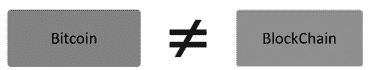

图1.3 比特币和区块链 [16]。

| 哈希 | 000000000019d6689c085ae165831e934ff763ae46a2a6c172b3f1b60a8ce26f |
| --- | --- |
| 确认数 | 718,808 |
| 时间戳 | 2009-01-03 23:45 |
| 高度 | 0 |
| 矿工 | Unknown |
| 交易数量 | 1 |
| 难度 | 1.00 |
| 默克尔根 | 4a5e1e4baab89f3a32518a88c31bc87f618f76673e2cc77ab2127b7afdeda33b |
| 版本 | 0x1 |
| 比特 | 486,604,799 |
| 重量 | 1,140 WU |
| 大小 | 285 bytes |
| 随机数 | 2,083,236,893 |
| 交易量 | 0.00000000 BTC |

图1.4 比特币区块链中块0的记录。

块随后都会附加到前一个块。第一个比特币创世块于2009年1月3日格林尼治标准时间晚上11:45被挖出；其创建者未被识别。图1.4显示了比特币区块链创世块的自身哈希值、截至日期的确认数、默克尔哈希值、随机数值等。

### 1.6.1 新块创建协议

图1.5的流程图显示了新块的创建。第1行跟踪链的不断增长长度。第2行在新块形成时设置时间戳。第3行包含证明。第4行显示将前一个哈希值包含到新块中。第5行在创建新块时包含任何交易。最后，整个块返回到调用点。图1.6显示块之间的链接。链中的一个块链接到下一个块。一个块包含两个部分，即头和主体 [17]。头包含一些记录，例如前一个块的哈希、当前块的哈希、下一个块的哈希、随机数值、块在链中的高度、矿工信息、交易值、奖励信息、时间戳等。主体包含交易的哈希。一旦块被添加到链中，就无人能更改块中的任何内容。

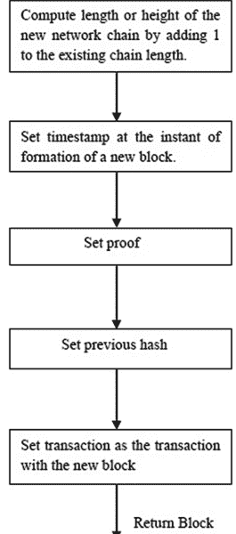

图1.5 新块创建流程图。

### 1.6.2 新创建块的哈希值生成

图1.7的流程图是生成新创建块哈希值的协议。图1.6中的算法返回图1.7中HASH函数接受的块。第1行对接受的块进行编码。第2行将编码值转换为十六进制哈希编号。返回此十六进制码。

### 1.6.3 工作量证明

图1.8的流程图代表工作量证明共识协议。第1行将参数值随机数设置为1作为初始值。第2行将检查证明值初始化为FALSE。以下行计算随机数的值，直到哈希值的前n位全部为零。最后返回随机数。

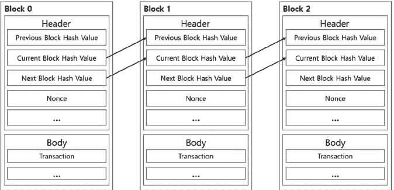

图1.6 区块链中的块 [18]。

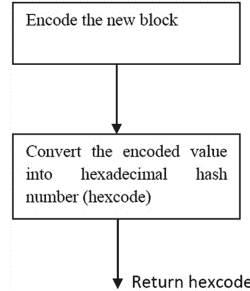

图1.7 生成新创建块哈希值的协议。

### 1.6.4 在区块链中挖矿一个块

图1.9的流程图展示了区块链中块的挖矿共识机制。此过程将新块添加到现有链中。系统确定一个挖矿难度值。提议块和前面块中的记录作为哈希函数的输入并生成新块的哈希值。此过程持续进行，直到该哈希与系统设定的目标或难度匹配。在每次迭代中，随机数值将递增1。一旦达到此目标，谜题即被解开。一旦谜题被解开，挖矿过程完成，提议块将成为新块并添加到现有的最长链中 [19]。


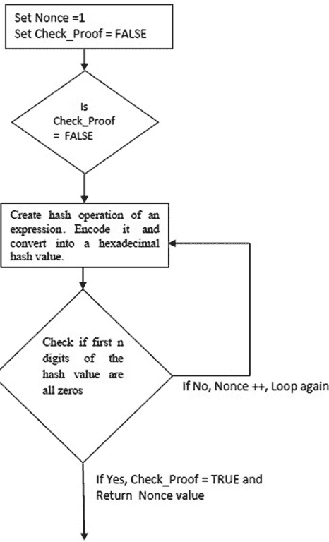

图 1.8 工作量证明。

## 1.7 默克尔树

在默克尔树中，叶节点表示数据块，非叶节点使用加密哈希函数进行标记。图 1.10 显示了带有数据块和哈希函数的默克尔树。第 3 级的数据块作为第 2 级哈希函数的输入。第 2 级的输出哈希值在第 1 级进一步进行哈希处理，最终哈希值在第 0 级可用，即树的根节点。如果我们观察图 1.5 中的块，主体部分占用大量空间，因为所有交易的哈希值都存储在那里。默克尔树概念使我们能够只存储默克尔根来代替交易数量。这大大减少了存储空间 [21]。

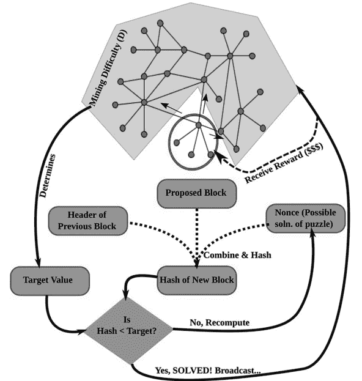

图 1.9 区块挖矿流程图 [16]。

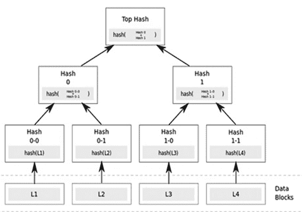

图 1.10 默克尔树 [20]。

## 1.8 不同类型的区块链框架

区块链网络分为公有链、私有链和许可链。公有链对所有人开放。这意味着任何人无需披露身份即可参与网络。公有链采用激励机制，成功挖矿后，矿工将获得激励。参与者必须遵循前面小节中讨论的一些共识算法。公有链消耗大量电能，并需要大量计算能力。私有链仅通过某些身份验证和验证机制允许选定的参与者。此类型有一个所有者，它将选择参与者和矿工。此处的所有者可以根据需要编辑、修改、删除区块内的任何条目。第三种类型是许可链，它同时借用公有链和私有链的属性 [22, 23]。它可以允许任何人加入，但必须经过身份识别和验证程序。参与者只允许执行某些特定功能。

## 1.9 IoT 基本架构

基本或现代 IoT 架构至少必须有四个不同的层，即感知层、网络层、数据处理层和应用层。感知层包含物理对象内部或外部的传感器和执行器。传感器主要从环境收集数据并将其提供给执行器。执行器实时执行补救操作 [24]（图 1.11）。第二层是网络层。它主要负责数据传输。该单元具有数据采集系统（DAS）并直接连接到传感器。它收集原始模拟数据并将其转换为数字形式，并将数字数据转换为可传输格式。最后，数据通过互联网网关传输以进行下一级处理。在某些情况下，数据量很大。在这些情况下，数据在传输前会被过滤和压缩。第三层执行数据处理。该单元在将数据发送到云端之前执行数据分析和数据预处理。这是四层结构中的最后一层。在此层中，云或数据中心进一步对数据进行深入分析、管理、安全和隐私处理。该层由最终用户个人和组织访问，用于不同的应用 [25]。

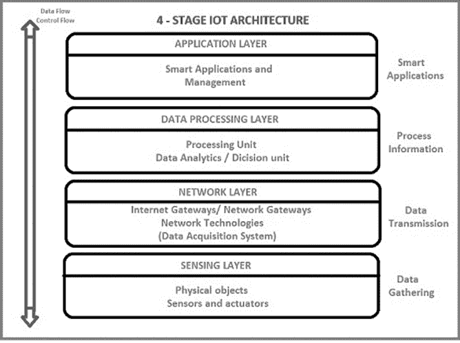

图 1.11 IoT 系统的基本架构单元 [20]。

## 1.10 IoT 的应用和用例

根据最新的 2021 年 IoT 用例采纳报告 [26]，IoT 采纳率正在上升。该报告还反映了一些顶级 IoT 应用，本节将介绍其中四种。广泛使用的应用之一是智能家居安全。其他一些应用，如家庭锁定系统、机顶盒和家庭监控系统，已随着智能家居概念的发展而演变 [27]。

IoT 的下一个应用是智慧城市。市民面临日常挑战和担忧，如废弃物管理、交通管理、水管理等。通过 IoT 应用，我们可以尝试消除所有这些隐患 [28]。

自动驾驶汽车的生产是 IoT 的下一个应用。汽车拥有许多传感器和设备，用于从环境中捕获数据并通过互联网将其发送到云端。它们还使用一些机器学习算法进行决策。尽管有大量研究正在解决此类问题，但数据流转和决策中的延迟仍是一个挑战 [29]。

IoT 还可以解决其他领域的一些问题，例如农业。IoT 利用无人机进行作物监控、了解作物模式和质量、灌溉等 [30]。

## 1.11 IoT 架构的缺点

我们已经看到了在不同现实生活场景中实施 IoT 的许多优势。现在我们将讨论 IoT 的缺点。主要缺点在于安全和隐私。我们将大量设备连接到互联网，这些设备可能包含敏感信息。因此，存在信息被盗或滥用的风险，因为网络是单点故障 [31]。

## 1.12 区块链框架中的 IoT 应用

在当前背景下，IoT 解决方案基于通过互联网通信的集中式服务器。IoT 应用程序的这种庞大架构必须应对单点故障问题。因此，适当的替代方案势在必行，它还可能提供增强的安全性和透明度。考虑到集中式系统的大部分缺点，我们在此将区块链作为平台应用于不同的 IoT 应用程序中。该提案增强了安全性，阻止任何第三方干预，并提高了透明度。

使用 IoT 架构的系统在数据传输过程中面临一些安全问题。区块链框架中的 IoT 架构可以为数据提供所需的安全性和隐私性。在区块链平台上集成 IoT 应用程序可确保数据完整性、不可变数据的记录、实时交易监控等。现在让我们讨论 IoT 及其架构的一些基础知识。

物联网是指物理对象通过互联网相互通信。任何 IoT 基础设施都具备互连性、异构性和动态变化等一些基本特征。凭借互连性特征，不同基础设施的设备可以相互通信。凭借第二个特征，即使在不同的硬件、软件和网络平台之间也能建立通信。第三个特征意味着互连设备可以动态切换其状态、位置、速度等。

物联网（IoT）还扩展到工业领域，称为工业物联网（IIoT）。在这里，它涵盖机器、单元设备、大数据、机器学习和其他工业应用之间的通信。

万物互联是当今常用的另一个术语。根据思科（CISCO）的定义，它是对象、数据、人员等之间的智能通信。IoT 主要处理物理对象及其互连。但这两者之间微妙的区别在于融入智能，以改进一些现有缺点并使 IoT 系统更加完善 [32]。

基于区块链平台的 IoT 项目依赖于区块链技术的两个基本属性：分布性和不可变性。凭借区块链的分布属性，数据库不驻留在单个位置，而是分布在用户可访问的节点上。不可变性确保了基于区块链的 IoT 项目中数据的原始性。下一节重述了区块链平台上的两个 IoT 项目。

### 1.12.1 供应链管理中的区块链

供应链管理是上游和下游流程的组合。上游供应链流程可能包括原材料采购、物流管理和商品制造。下游供应链流程可能包括制造产品的完工并将其分销给最终客户 [33]。目前，供应链面临一些挑战，例如产品信息、原材料、产品产地等方面缺乏透明度。它还可能在操作像 ERP 这样的既有数据库时遇到问题 [34]。供应链中区块链的第三个关键问题是法律方面的问题。区块链中的用户位于不同的地理区域。每个国家都有自己的法律，没有用于区块链执行的通用法律。供应链中的区块链在不受信任的参与者之间重建了信任。它还通过更好地了解产品信息、产品产地、原材料、物流等，重建了透明度。任何利益相关者都可以成为区块链网络的一部分。因此，可将共同的不可变信息实时发送并记录给制造商、供应商、零售商等。（图 1.12）。

| 供应链上游流程（原材料 -> 供应商 -> 制造商） |
| --- |
| 供应链下游流程（制造商 -> 分销商 -> 客户） |

图 1.12 供应链管理。


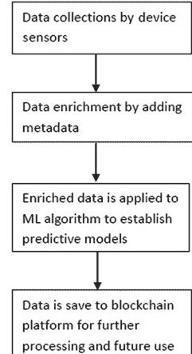

图 1.13 农业中物联网与区块链的流程图。

### 1.12.2 农业中的区块链

基于区块链平台的智能物联网系统可以帮助农民生产各种农作物。物联网传感器收集不同季节的土壤pH值、含水量、湿度、温度等数据。这些数据与农作物的生长直接或间接相关。这些数据将以某种结构化格式存储 [35]。

通过添加时间戳、人口统计信息、类型等元数据来丰富这些数据。丰富后的数据集现已准备好应用于机器学习算法。机器学习算法建立一些预测模型和推荐系统，如农作物质量预测、产量预测、农作物生长预测、市场需求预测等。最后，数据保存到区块链存储中以供进一步处理和未来使用（图 1.13）。

## 1.13 结论

本章首先讨论了区块链技术的一些一般概念和应用。接着讨论了该技术的历史与演变以及区块链的各种特性，特别是作为分布式平台的特性。随后展示了传统交易与基于区块链的交易之间的差异。讨论了比特币加密货币与区块链之间的区别。还讨论了区块链技术的基础知识，阐述了不同的共识协议，如 PoW、挖矿以及其他基本参数。后来讨论了物联网的基本架构及其各种应用、用例和缺点。最后，演示了在区块链框架中使用物联网应用。

## 参考文献

- [1] C. P. Fran Casinoa, T. K. Dasaklisb, “基于区块链应用的系统性文献综述：现状、分类与未解决问题,” Telematics and Informatics, vol. 36, pp. 55–81, 2019.
- [2] S. Cheng, B. Zeng, and Y. Z. Huang, “分布式电力市场中区块链技术应用模型研究,” IOP Conference Series: Earth and Environmental Science, vol. 93, no. 1, p. 012065, November 2017. [在线]。https://doi.org/10.1088/1755-1315/93/1/012065
- [3] R. Cheng, F. Zhang, J. Kos, W. He, N. Hynes, N. Johnson, A. Juels, A. Miller, and D. Song, “Ekiden：保密性保护、可信且高性能智能合约的平台,” in 2019 IEEE European Symposium on Security and Privacy (EuroS&P), June 2019. [在线]。https://doi.org/10.1109/ EuroSP.2019.00023
- [4] C.-W. Chiang, E. Betanzos, and S. Savage, “探索利用区块链实现移民与政府间的可信协作,” in Extended Abstracts of the 2018 CHI Conference on Human Factors in Computing Systems, April 2018. [在线]。https://doi.org/10.1145/3170427.3188660
- [5] N. C. K. Yiu, “迈向区块链赋能的供应链防伪与可追溯性,” Future Internet, vol. 13, no. 4, 2021. [在线]。可用：https://www.mdpi.com/1999-5903/13/4/86
- [6] I. Weber, P. Arenas, S. Genaim, and G. Puebla, “静态成本分析中的闭形式上界,” Journal of Automated Reasoning, vol. 46, pp. 161–203, 2010.
- [7] I. Weber, X. Xu, R. Riveret, G. Governatori, A. Ponomarev, and J. Mendling, “利用区块链进行不可信业务流程监控与执行,” in International Conference on Business Process Management, Springer, Cham, 2016.
- [8] R. Dennis, G. Owenson, and B. Aziz, “时间区块链：形式化分析,” in 2016 International Conference on Collaboration Technologies and Systems (CTS), vol. 10, 2016, pp. 430–437.
- [9] I. Weber, V. Gramoli, A. Ponomarev, M. Staples, R. Holz, A. B. Tran, and P. Rimba, “关于基于区块链系统的可用性,” in 2017 IEEE 36th Symposium on Reliable Distributed Systems (SRDS), 2017, pp. 64–73.
- [10] Z. Duan, H. Mao, Z. Chen, X. Bai, K. Hu, and J.-P. Talpin, “区块链系统的形式化建模与验证,” in Proceedings of the 10th International Conference on Computer Modeling and Simulation, 2018.
- [11] J.-H. Huh and K. Seo, “面向未来计算的基于区块链的移动指纹验证与自动登录平台,” The Journal of Supercomputing, vol. 75, no. 6, pp. 3123–3139, 2019.
- [12] L. Ismail, H. Hameed, M. Alshamsi, M. Alhammadi, and N. Aldhanhani, “在阿联酋大学部署区块链：性能评估与区块链分类法,” in Proceedings of the 2019 International Conference on Blockchain Technology, 2019.
- [13] H. Sukhwani, N. Wang, K. S. Trivedi, and A. J. Rindos, “超级账本Fabric（许可型区块链网络）性能建模,” in 2018 IEEE 17th International Symposium on Network Computing and Applications (NCA), pp. 1–8, 2018.
- [14] “区块链教程：学习区块链技术,” https://www.guru99.com/blockchain-tutorial.html, 访问日期：2021-11-18.
- [15] L. Aniello, E. Gaetani, F. Lombardi, A. Margheri, and V. Sassone, “针对分布式数据库的防篡改高性能区块链交易日志原型评估,” in 2017 13th European Dependable Computing Conference (EDCC), 2017.
- [16] D. K. Tosh, S. Shetty, X. Liang, C. A. Kamhoua, K. A. Kwiat, and L. Njilla, “区块链云的安全影响及区块隐匿攻击分析,” in 2017 17th IEEE/ACM International Symposium on Cluster, Cloud and Grid Computing (CCGRID), 2017, pp. 458–467.
- [17] H. Sukhwani, J. M. Martnez, X. Chang, K. S. Trivedi, and A. Rindos, “许可型区块链网络（Hyperledger Fabric）中PBFT共识过程的性能建模,” in 2017 IEEE 36th Symposium on Reliable Distributed Systems (SRDS), 2017, pp. 253–255.
- [18] J. H. Park and J. H. Park, “云计算中的区块链安全：用例、挑战与解决方案,” Symmetry, vol. 9, no. 8, 2017. [在线]。可用：https://www.mdpi.com/2073-8994/9/8/164
- [19] S. M. H. Bamakan, A. Motavali, and A. Babaei Bondarti, “区块链共识算法性能评估标准综述,” Expert Systems with Applications, vol. 154, p. 113385, 2020. [在线]。可用：https://www.sciencedirect.com/science/article/pii/S0957417420302098
- [20] “物联网（IoT）架构,” https://www.geeksforgeeks.org/architecture-of-internet-of-things-iot, 访问日期：2020-06-06
- [21] S. Abeyratne and R. Monfared, “使用分布式账本的区块链就绪制造供应链,” International Journal of Research in Engineering and Technology, vol. 5, no. 9, pp. 1–10, 2016.
- [22] F. Gao, L. Zhu, M. Shen, K. Sharif, Z. Wan, and K. Ren, “面向车联网的基于区块链的隐私保护支付机制,” IEEE Network, vol. 32, no. 6, pp. 184–192, 2018.
- [23] A. Hafid, A. S. Hafid, and M. Samih, “区块链扩展：全面综述,” IEEE Access, vol. 8, pp. 125 244–125 262, 2020.
- [24] S. Kumar, P. Tiwari, and M. Zymbler, “物联网是未来技术增强的革命性方法：综述,” J Big Data, vol. 6, no. 111, 2020.
- [25] K. Gatsis and G. J. Pappas, “面向物联网的无线控制：电力、频谱与安全挑战：海报摘要,” in Proceedings of the Second International Conference on Internet-of-Things Design and Implementation, ser. IoTDI '17. New York: Association for Computing Machinery, 2017, p. 341–342. [在线]。可用：https://doi.org/10.1145/3054977.3057313
- [26] “2021年物联网用例采纳报告,” https://iot-analytics.com/product/iot-use-case-adoption-report-2021-2/, 访问日期：2021.
- [27] M. Luk, G. Mezzour, A. Perrig, and V. Gligor, “Minisec：安全传感器网络通信架构,” in Proceedings of the 6th International Conference on Information Processing in Sensor Networks, ser. IPSN’07. New York: Association for Computing Machinery, 2007, p. 479–488. [在线]。https://doi.org/10.1145/1236360.1236421
- [28] F. Behrendt, “智慧可持续城市中的自行车：分析欧盟关于物联网、流动性与交通以及智慧城市的政策文件,” Sustainability, vol. 11, no. 3, 2019. [在线]。可用：https://www.mdpi.com/2071-1050/11/3/763
- [29] R. Patan, K. Suresh, and M. Babu, “基于物联网和大数据的智慧城市实时智能交通管理系统,” in 2016 International Conference on Emerging Technological Trends (ICETT), vol. 10, 2016, pp. 1–7.
- [30] T. Qiu, H. Xiao, and P. Zhou, “设施农业生态系统中智能监测平台的框架与案例研究,” in 2013 Second International Conference on Agro-Geoinformatics (Agro-Geoinformatics), pp. 522–525, 2013.
- [31] E. Park, A. P. Del Pobil, and S. J. Kwon, “物联网（IoT）在智慧城市中的作用：面向技术路线图的方法,” Sustainability, vol. 10, no. 5, 2018. [在线]。可用：https://www.mdpi.com/2071-1050/10/5/1388
- [32] Z. Zheng, S. Xie, H.-N. Dai, X. Chen, and H. Wang, “区块链技术概述：架构、共识与未来趋势,” in 2017 IEEE International Congress on Big Data (BigData Congress), 2017.
- [33] A. Banerjee, 区块链技术：来自ERP的供应链洞察, Advances in Computers, vol. 111, pp. 69–98, 2018.
- [34] “IBM区块链，IBM全球融资利用区块链技术快速解决金融纠纷,” https://www.ibm.com/blockchain/infographic/finance.html, 访问日期：February 2018.
- [35] H. Xiong, T. Dalhaus, P. Wang, and J. Huang, “农业区块链技术：应用与原理,” Frontiers in Blockchain, vol. 3, p. 7, 2020.


Taylor & Francis
Taylor & Francis Group
http://taylorandfrancis.com

# 基于区块链平台的物联网各种应用综述

Archana Yengkhom 和 Debarka Mukhopadhyay

*基督大学，班加罗尔，印度*

## 内容目录

- 2.1 引言 22
- 2.2 区块链技术概览 24
- 2.2.1 架构 24
- 2.2.2 共识算法 26
- 2.2.3 数字签名 27
- 2.2.4 挖矿 27
- 2.2.5 智能合约 27
- 2.3 物联网技术概览 28
- 2.3.1 物联网架构 29
- 2.3.2 物联网的逻辑设计 30
- 2.3.3 物联网赋能技术 30
- 2.3.4 物联网级别 31
- 2.4 机遇及其社会经济影响 32
- 2.4.1 社会经济影响 33
- 2.4.2 与物联网相关的区块链新兴技术 35
- 2.4.2.1 Fabric-IoT 35
- 2.4.2.2 区块链镜像模型 36
- 2.4.2.3 区块链信令系统（BLOSS） 37
- 2.4.2.4 面向物联网的轻量级可扩展区块链 38
- 2.4.2.5 Hawk 38
- 2.4.2.6 基于区块链、物联网和人工智能的混合系统 38
- 2.4.2.7 Health Chain 38
- 2.4.3 应用 39
- 2.4.3.1 基于用例的应用 39
- 2.4.3.2 现实世界应用 41
- 2.4.4 基于区块链的物联网解决方案面临的挑战 43
- 2.4.5 替代方案 44
- 2.5 未来趋势与研究领域 46
- 参考文献 46

## 2.1 引言

截至2021年，世界需要创新解决方案来应对快速增长的经济及其对技术日益增长的需求，以满足社会在安全、隐私、速度、功能、数据管理等方面的需求。这一点在COVID-19大流行期间表现得尤为明显，这场大流行继续推动经济及其人民更好地发挥作用和交付，与时间和金钱赛跑。从医疗保健和供应链等前线行业，有时在跨州和跨国运送氧气和救命药品等最急需的资源时面临困难，对更多创新解决方案的需求不可低估。随着对能够帮助将现有系统性能指数级提升的系统进行更好理解和研究的需求不断增长，面向物联网（IoT）的区块链技术（BCT）代表了一种创新解决方案，已被证明在各个领域（医疗保健 [1]、供应链 [2]、智慧城市和智能家居 [3, 4]）中演进现有系统方面发挥着革命性作用。由于数据在当前经济中扮演着影子货币的角色，BCT作为游戏规则改变者的关键作用无论如何强调都不为过。

自2008年由中本聪首次推出以来，区块链技术（BCT）便一直吸引着世界，主要归功于其不可篡改的分布式数字账本，为去信任化提供了去中心化的信任，让世界得以摆脱任何中央机构、政府或任何可信第三方（TTP）干预的经济运行片刻。尽管BCT在市场上享有盛名，但仍有许多问题有待讨论：大额交易的沉重负载、可能的攻击 [5]、可处理链的大小限制、矿工的必要性，以及不可避免的交易费用需求。尽管如此，BCT凭借其在安全性、可扩展性、隐私性、透明度、数据完整性、管理和可追溯性方面的优势，继续赋能并推动着众多研究人员和企业。

另一方面，我们也看到了物联网（IoT）或万物互联的兴起，过去几十年来其需求量大，成就斐然。物联网，一种基于设备分布式连接的技术，无法抵挡许多洞察力敏锐的人们的好奇心，他们看到了BCT与物联网集成的潜力和相关益处；它为克服物联网应用带来的挑战提供了一种解决方案，这些挑战源于其由集中式框架、单点故障（SPF）、多对一连接特性以及隐私保护所驱动的安全性和可扩展性问题 [2, 6]。据估计，2018年底有220亿台设备连接，到2025年，这一数字预计将攀升至386亿台 [6]。据《经济时报》报道，预计发达国家每个家庭至少会有10台设备连接到物联网，随着5G技术的集成，这一数字可能会更多 [7]。这些数据表明，作为最受认可的未来技术之一的物联网范式市场尚未达到顶峰，如2017年加特纳炒作周期图所示 [8]。因此，以下各节将阐述更多协作努力、实验工作和全球关注的迫切需求，以克服物联网应用的挑战，弥合从基于理论到更多实际应用之间的差距。

在过去几年中，志同道合的爱好者和学者一直在通过采用新的方法论、方法和替代方案来克服BCT和物联网所展示的挑战和局限。以下各节将讨论其中一些研究，以佐证在基于区块链的物联网环境中进行的大量研究：Fabric-IoT [9]、区块链镜像模型 [10]、物联网中的索引访问管理 [6]、区块链信令系统 [11]、面向物联网的轻量级可扩展区块链（LSB）[4] 和 Hawk [12]。

本章探讨了基于区块链的物联网应用的当前趋势以及市场上已部署或正在开发的现实世界应用案例研究。本研究旨在基于近期研究探索和收集证据及其向市场交付的能力。医疗保健行业和供应链管理是最受追捧的行业之一，因为它们在经济中发挥着关键作用。它们也将是受益最大的接受者，因为根据当前经济发展轨迹，它们将主导大部分市场。随着人类生活方式和生活质量的进步成为国家发展的一个指标，对更便捷、透明、安全和实时数据连接的需求已得到全球认可，大多数行业（如电子商务、农业、公共安全、智能家居和智慧城市）对应用程序的需求也将与满足消费者和利益相关者质量要求的需求同步，且不牺牲数据完整性和安全性。

本文还讨论了区块链的替代方案，例如DAG，以表明区块链不太可能是唯一可行的解决方案。考虑到这些技术涉及各种挑战和风险，本研究也强调了替代方案，并得出结论：面向物联网的区块链技术是其中最可行的选项之一。这一期望代表了对当前和未来市场趋势（在经济和社会层面）的简明理解，并为读者描绘了所需相关信息的图景。

## 2.2 区块链技术概览

区块链技术（BCT）看到了对现有系统的潜在颠覆，因为那些需要可信第三方或集中式系统的应用程序和交易，现在可以在分布式去中心化支持P2P的网络中安全运行。区块链架构的基本基础为系统提供了可追溯性、透明性、安全性、完整性和信任等关键特性。BCT为其他技术开辟了一条新路径和新标准，以供其竞争并满足这些要求，以取悦其利益相关者。它作为一个支持P2P的网络，使用加密算法进行通信。没有中心化节点，区块链技术使用户能够使用分布式账本在去中心化系统中存储数据。比特币、以太坊、Stellar、Hyperledger等是一些流行的区块链实现，为其颠覆性技术的潜力提供了洞察。

### 2.2.1 架构

当前流行的数据库基于客户端/服务器架构，这是一种集中式访问控制系统。客户端充当接收节点的角色，而服务器在分布式系统中维护中央权威。这种设计是为了满足传统的人机交互。


与此同时，区块链建立在去中心化系统之上，网络中的每个节点通过 P2P 协议进行通信。顾名思义，区块链技术是一种存储交易记录的区块链式序列，具有数字化和防篡改特性。这是通过 Merkle Tree 或 Hash Tree 的概念实现的；它是一种基于树的数据结构，通过利用哈希函数来维护分布式网络的数据完整性和同步性。由于其在文本或数据方面的唯一性，加密哈希（摘要）充当数字签名。哈希函数是一种确保数据不可变性的方法，它为特定输入映射唯一输出；输入无法从其输出推导出来。通过采用十六进制表示 SHA-256 位（安全散列算法）加密函数，这得到了进一步增强。它产生一个唯一签名，并在 BCT 的数据完整性中发挥关键作用。

图 2.1 展示了典型的区块链结构。初始区块称为创世区块。每个区块包含两部分：区块头和区块体。区块头将存储关于区块的信息；它存储区块版本、根哈希、时间戳、n-Bits、前一个区块的哈希值，以及与哈希值相加或加密的 Nonce 值，以增加另一层安全性。区块体存储关于交易的信息。区块链中的交易是指由参与者触发的事件。交易数据存储 Merkle Tree 的根哈希。每个交易表示为 Tx，如 [13] 所示。当新交易附加到现有链时，参与者（矿工）首先按照公认的共识算法计算和竞争交易验证，以维护链的完整性。分叉是在接近时刻创建的多条链；通过为最长有效链选择最新区块来解决此问题。较短链中的区块称为孤儿区块。

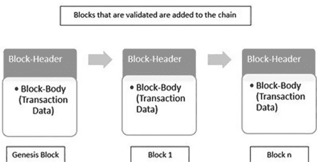

### 图 2.1 区块链模型架构。

## 2.2.2 共识算法

共识算法的灵感来自拜占庭将军问题（专门针对比特币）[13]，该问题考虑了一名军队指挥官准备攻击一个大型敌军基地。由于需要覆盖的区域非常广阔，将军面临着在不泄露命令保密性的情况下，向全军传达攻击计划的两难困境。他犹豫的原因是，消息可能被敌人截获，或者他自己的士兵之一可能泄露消息而出卖他。必须为他的行动达成共识。在这样的分布式环境中，提出了许多挑战，这些挑战同样可以映射到区块链分布式网络。

以下是 [14] 中提到的最常用解决方案：

- PoW (工作量证明)：如 [15] 中详细描述，PoW 是通过解决谜题并计算其值来实现的。所有参与节点竞争在一段时间内计算这个唯一的哈希值。最新区块区块头中的 nonce 会频繁更改，因此当一个节点计算出所需值并首先声明时，它会被所有其他参与者验证。一旦验证通过，就会铸造一个新区块被“挖出”并添加到链中。

- PoS (权益证明)：根据 [14]，这是 PoW 的另一种方法。PoS 的引入是为了作为一种更可靠的方法来推进共识事业。在 PoS 情况下，参与节点必须证明其质押（使用的货币比例）的所有权。根据其质押，随机选择一个节点作为验证者。PoS 最重要的特点是与 PoW 相比能耗更低。这一点在 [14] 中得到进一步说明，以解决其公平性问题。

- PBFT (实用拜占庭容错)：旨在容忍拜占庭故障。它只能处理三分之一的副本。它强制要求系统中所有参与节点公开。Hyperledger Fabric 利用了该算法。它要求至少三分之二的所有节点进行验证才能进入新阶段（三个阶段：pre-prepared、prepared 和 commit）。

- DPoS (委托权益证明)：如 [14] 所述，顾名思义，DPoS 是民主政策的结果，网络中的利益相关者提名他们的代表作为验证者和矿工。这大大减少了参与者的数量，并为任何自私行为提供了应急计划，因为代表可以随时被移除。

- Ripple（瑞波）：[14] 中提到的一项近期发展，它从一般网络转向可信节点子系统。参与共识过程的节点称为服务器，而客户端是参与资金交易的节点。服务器维护自己的唯一节点列表 (UNL)，通过强制要求 UNL 至少 80% 的批准来保持检查。

## 2.2.3 数字签名

数字签名类似于唯一指纹，用于识别用户的凭据。这是通过加密函数实现的。区块链中最常用的算法是 [16] 中提到的椭圆曲线数字签名算法 (ECDSA)。ECDSA 为数字签名交易的签名和验证阶段创建密钥对。

## 2.2.4 挖矿

矿工是用于指代网络中竞争计算区块链哈希值的参与者的术语，该过程称为挖矿。挖矿分析在激励区块链模型的动态方面发挥着关键作用。各种研究采用基于博弈论的解决方案，以更好地分析和预测挖矿行为并提供最佳反应策略。根据定义，博弈论是对理性决策者之间战略互动的数学模型的研究。它被用来分析共识节点的各种博弈策略及其相互作用，以优化挖矿（纳什均衡等）。它也可用于开发激励机制，以阻止节点执行不当行为或发起攻击。

## 2.2.5 智能合约

由 Szabo [17] 提出，智能合约是一种在系统内绑定的数字合约。当条件满足时，它们会自动执行，从而减少时间和对中介的需求。因此，智能合约在按需验证和强制执行区块链条件方面发挥着重要作用。[18]（图 2.2）中识别了提案和各种其他方法。

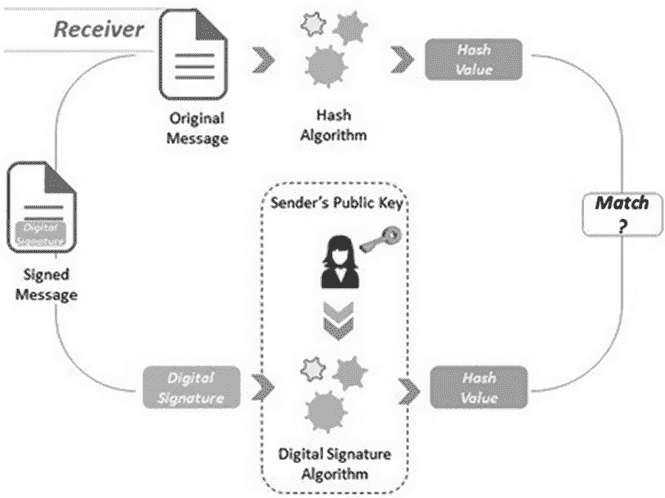

FIGURE 2.2 数字签名。

## 2.3 IOT 技术概述

物联网 (IoT) 得益于低功耗有损网络 (LLNs)，其成就和全球接受度正以惊人的速度增长。它是在公共/私有网络内的事物（设备、传感器等）的分布式网络。作为传感器和执行器的设备互连弥合了信息共享的差距，设备之间的通信为企业和世界带来了新的、令人兴奋的机遇，以享受其带来的益处。IoT 是嵌入式设备的新互联网。其应用范围从家庭、城市、农业、能源系统、健康和健身监测到智能支付、智能电网，再到天气监测以及大多数行业的基于 IoT 的供应链解决方案，提高了当前系统（这些系统在很大程度上依赖于所涉及设备的手动设置和配置）的效率和性能。机器对机器和机器对人类的交互构成了 IoT 动机的基础。IoT 的范围不仅限于事物的连接；它可以在实现基于增值应用服务的同时进行通信和数据交换。IoT 网络上的应用通过执行过滤、分类等特定过程，从较低级别的数据中提取和创建信息，


对数据进行浓缩和情境化。这些信息经过结构化，以朝着其预期目标解释知识，从而实现更智能的性能。

In Lee 等人 2015 年的论文 [19] 描述了部署基于 IoT 的产品和服务所需的五种流行技术——RFID、WSN、云、中间件和应用软件。已对这些 IoT 技术进行了研究，以确定可证明 IoT 投资合理性的方法。正在进行广泛研究，以确定其实际应用部署中的各种挑战。许多企业，从 IBM 和可口可乐到里约运营中心（举几例），已经投资并正在成功部署基于 IoT 的解决方案。

### 2.3.1 IoT 架构

IoT 设备由多种用于连接（有线和无线）的接口组成，例如传感器的输入和输出接口（UART、SPI、I2C、CAN）、内存和备份接口（NAND/NOR、SD、MMC 等）、用于互联网连接的接口（USB 主机、以太网，以及多媒体接口（HDMI、RCA 视频、3.5 mm 音频、GPU））。它可以在不同系统上收集多种数据类型，彼此之间或与基于云的存储进行通信。文献 [20] 中提到的 IoT 协议说明了四层结构：

- 1. 链路层：该层的一些相关协议包括 802.3（以太网）、802.11（WiFi）、802.16（WiMax）、802.15.4（低速无线个人局域网（LR-WPAN））以及 2G/3G/4G/5G 移动通信。
- 2. 网络/互联网层：网络负责主机寻址和数据包路由。它将 IP 数据报（包含源地址和目标地址）从源网络发送到跨多个网络的目标网络。主机使用 IPv4/IPv6/6LoWPAN 寻址方案进行标识。
- 3. 传输层：传输层实现独立于底层网络的端到端消息传输。这可以通过握手（面向连接的 TCP 连接）或确认（无连接协议 UDP）来实现。它负责错误控制、流量控制和拥塞控制。
- 4. 应用层：该层定义了应用程序接口如何与较低层级协议进行通信。端口号用于应用程序寻址，例如 HTTP 使用端口 80，SSH 使用端口 22，等等。HTTP（超文本传输协议）、CoAP（受限应用协议）、Web Socket、MQTT（消息队列遥测传输）、XMPP（可扩展消息和存在协议）、DDS（数据分发服务）和 AMQP（高级消息队列协议）是应用层中广泛使用的一些协议。

### 2.3.2 IoT 的逻辑设计

本节指的是在没有详细低级规范的情况下，对设备和进程进行抽象表示。文献 [20] 中描述的常用 IoT 功能块为系统提供了识别、感知、驱动、通信、应用、保护和管理其环境和实现的能力。驱动 IoT 模型的一些基本通信模型包括：

- 请求-响应：客户端向服务器发送请求，服务器确定请求并相应响应。
- 发布-订阅：它涉及发布者、消费者和一个称为代理的中介。消费者订阅由代理管理的主题，代理随后将其转发给发布者。
- 推-拉：在此模型中，数据被推送到队列，消费者基于 LIFO（后进先出）原则拉取数据。生产者不知晓消费者，队列在推送和拉取速率之间充当缓冲。
- 独占对：它是客户端和服务器之间的双向全双工通信模型。这是一种开放连接形式。

### 2.3.3 IoT 支持技术

如前所述，IoT 由多种核心技术支持，例如无线传感器网络（WSN），它是一组带有传感器的分布式设备集合，可监测环境条件。它包含多个终端节点、一个路由器和一个协调器。协调器收集所有节点的数据，充当将 WSN 连接到互联网的网关。WSN 与 IEEE 802.15.4（ZigBee）一起工作，这是最流行的无线技术之一。它在 2.4-GHz 频率下运行，范围为 10 到 100 米。几种云计算技术也用于 IoT，例如基础设施即服务（IaaS）、平台即服务（PaaS）和软件即服务（SaaS）。IoT 的另一个重要特性是分析业务和大数据的能力。由于大数据由传感器和设备生成，发现并进行分析以进行实时决策的能力，证明了将基于 IoT 的解决方案转化为增值产品和服务的成效。

### 2.3.4 IoT 级别

要真正理解 IoT 系统的运作，有必要强调 IoT 系统的各个级别。一个 IoT 系统由设备、资源（软件组件）、控制器和 Web 服务组件（Web Socket 协议）、数据库（本地或基于云）、分析组件以及最终作为用户与设备之间交互界面的应用程序等组成。文献 [20] 中说明了六个 IoT 级别。每个级别均随引入基于云的分析工具（从级别 3 开始）而相应改进。级别 4 和 5 拥有多个终端节点，可处理更复杂的数据。级别 6 通过使用集中式控制器和基于云的可视化数据应用程序，处理独立的多端代码，从而进一步改进上述功能。

迄今为止，我们已分别阐述了区块链技术和 IoT 系统的技术方面。在本节中，我们将介绍较为知名的现有系统，并将其与这两种技术进行比较。目标是了解其优势，并强调所提及技术在当前经济中的真正潜力。传统数据库在过去几十年中发展迅速。从典型的文件处理系统到当前的关系数据库管理系统（RDBMS），再到基于云的数据库（AWS、Azure、Oracle 等），其功能发展在当前经济中发挥的作用，以及继续发挥的作用，不容低估。由于数据常被用作当今经济的“影子货币”，对这些数据的管理和安全性要求越来越高的解决方案。正如文献 [21] 所强调的，对传统数据库系统与区块链的关键分析比较已予以突出。来源 [6] 提到，时间在数据库系统中起着重要作用（表 2.1）。数据库系统对现实世界进行建模。随着越来越多的数据被累积，以及对更透明、更安全、更去中心化系统的需求，以赢得竞争，各个行业的学术界和商业界都选择更具创新性的解决方案。区块链技术满足了大部分这些

表 2.1 现有和拟议区块链技术对比表 [22]

| 问题 | 基于区块链 | 中心化数据库 |
|---|---|---|
| 信任 | 不需要可信第三方 | 需要一个中心化可信第三方 |
| 保密性 | 所有节点都能看到数据 | 访问限制 |
| 容错性 | 数据在节点之间共享 | 数据存储在中心存储中 |
| 性能 | 达成共识存在时间滞后 | 立即执行 |
| 冗余 | 各方拥有最新副本 | 副本仅存储在中心数据库 |
| 安全性 | 实施加密措施（哈希） | 实施传统访问控制 |

需求，如 [22] 所示。现在考虑 IoT，该技术对许多发达国家来说几乎已成为一种生活方式。随着一个似乎在不久的将来都不会停止增长的生态系统，这只会让许多人不禁思考，没有 IoT 当今的经济会成何样子。从 20 世纪 90 年代的连接设备概念到实际的无线网络应用，连接设备以构建智能系统的需求已成为一个国家技术实力的代名词。根据大量提及 IoT 带来的优势和能力的研究 [4]，对设备的传统观点几乎已过时。然而，与许多新技术创新一样，必须妥善解决和应对随之而来的问题和挑战，以创建高效且更好的全球标准。上述 IoT 概述中提到的挑战凸显了一些最重要的问题，尤其是在数据安全和隐私方面。图 2.3 说明了 2010 年以来的发展及未来应用 [23]。到 2020 年，基于 IoT 的应用将占据从跟踪和监控到动态自适应系统的大多数行业。未来趋势预测一种更高计算能力的系统，将更便捷并为其服务和产品增加价值。

## 2.4 机遇及其社会经济影响

在前几节中，我们讨论了基于区块链和 IoT 的各个方面，以及挑战其可扩展性和性能的相应问题。各位学者和爱好者的进一步研究和研究已将 IoT 的架构设计元素与区块链技术相关联，显示出在弥合 IoT 面临的局限性差距并增强其功能方面具有前景的结果。


## 从 2010 年到 2050 年及以后的物联网路线图

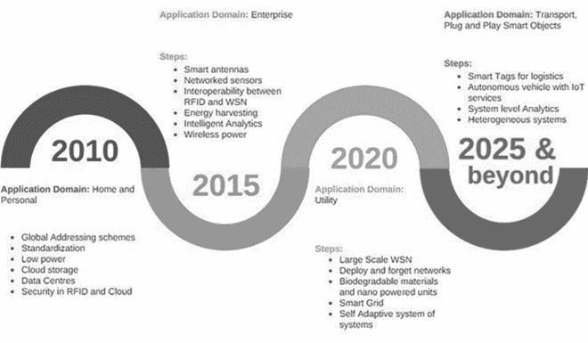

图 2.3 [23] 中描述的物联网技术路线图。

基于区块链的技术方面，例如去中心化系统、数字签名和加密共识算法，在物联网中发挥着重要作用。这一点在 [23] 中有详细阐述：区块链中受保护交易的隐私特性可被物联网应用利用以提供匿名性；挖矿原理可被应用于物联网应用，以激励智慧城市和供应链等领域的社区和利益相关者提供资源，等等，从而在物联网中从集中式系统转向去中心化网络，用于供应链监控、交易、追踪等应用。最重要的是，在物联网应用中使用智能合约来实现安全性和数据身份验证。基于区块链的物联网有可能相互弥补各自的技术局限性，例如区块链的工作量证明（PoW），这可能对物联网解决方案产生不利影响，因为它需要高计算能量和功率。引入闪电网络（LN）等创新解决方案可以解决这些限制，并让利益相关者关注其有益的结果 [19]。

### 2.4.1 社会经济影响

同样重要的是，要考虑实施基于区块链的物联网解决方案后将对社会和世界产生的社会经济影响。这一点很重要，因为它将构成任何创新/发明解决方案产品成功的基础。从伦理和道德关系到一个国家发展的增长，都需要考虑社会经济价值。基于区块链的物联网解决方案，根据过去几年的研究，本节总结了一些决定其全球接受度（超越技术效益）的重要因素。

- 1. 去中心化系统：在快节奏的经济中，很难区分可信方与潜在有害的投资。信任是一个非常笼统的术语，但却是任何成功业务的基本组成部分，因此无需任何中介拦截的系统已成为理想解决方案，特别是在分布式网络中。

- 2. 连接性：通信现已将其边界从仅限于人类与人类之间扩展到机器对机器（M2M）再到人类与机器之间的交互，效率极高。物联网与区块链带来的挑战将推动许多利益相关者在未来投入更多。

- 3. 安全性和隐私性：尽管 [8] 中提到了区块链和物联网的局限性，但与许多新技术一样，这两种技术的协作有望成为当前社会需求在其提供的隐私性和安全性方面的下一个可交付解决方案。这归功于区块链的加密元素及其匿名性。借助物联网庞大的连接设备网络，基于物联网的解决方案的漏洞可以通过区块链提供的功能来克服。

- 4. 数据和信息：当前经济由一种被称为数据的“影子货币”主导。因此，从大数据到数据管理，与许多其他技术相比，基于区块链的物联网解决方案表现为最契合的优势之一，因为它们允许多种技术的互操作性、轻松的信息共享，以及在多个节点上复制数据以确保其真实性和完整性。

- 5. 低成本：由于区块链和物联网都基于现有系统（如设备、低成本传感器、RFID 标签、现有网络和软件协议），商业设置的投资成本将合理，甚至在某些应用中低于当前成本。

- 6. 生活质量：基于区块链的物联网技术衍生的解决方案将显著改善任何社会的生活方式，这从其实施中可见一斑。许多应用程序将有助于解决问题或改善我们日常工作的便利性。

- 7. 应用程序：这些技术带来的机遇已在本章的前面章节中提及。应用范围从金融、健康和零售延伸到供应链等更多领域，打破了其贡献所带来的局限性边界。

### 2.4.2 与物联网相关的区块链新兴技术

本节涵盖了与基于区块链的物联网解决方案相关的几种新兴技术，以了解该领域的当前工作和研究。同时还将重点介绍为克服该技术带来的挑战而提出的解决方案。区块链技术是一种为比特币（第一种基于有限资源和约束的加密货币）而构建的系统，多年来已发展出众多替代方案和突破，例如由 Vitaliy Buterin 于 2013 年提出的以太坊。以太坊是现代智能合约的基础 [17]，其应用已超出最初预定的功能。这些智能合约可以帮助管理物联网设备，实现通过系统连接的电器的节能功能 [14]。IOTA [24] 是另一种基于有向无环图的突破性技术，它构建在区块链和物联网之上，用于分布式数字账本的运行。这一点将在后续小节中进一步阐述。

#### 2.4.2.1 Fabric-IoT

一种用于物联网应用的基于区块链的访问控制系统——Fabric-IoT [9] 运行在 Hyperledger Fabric 框架和基于属性的访问控制（ABAC）之上。它引入了三个智能合约，即访问合约、设备合约和策略合约。它旨在解决物联网在移动性、计算能力有限、漏洞访问等动态场景中面临的局限性。该论文基于所进行的模拟展示了其结果。这取得了预期结果，有望帮助克服物联网面临的挑战。

#### 2.4.2.2 区块链镜像模型

[25] 的研究人员旨在通过设置一些前提条件来增强物联网系统的数据依赖性，以促进对区块链的信任。由于这些物联网设备产生或检索的数据缺乏稳固的安全通道，数据可能并不总是准确，或者可能包含泄露。镜像模型通过表现现实世界并将其映射到被称为信任域的可信模型来运作。对现实世界进行建模的对象需要加时间戳以确保其完整性，对象的转换过程需要同步以避免任何不一致。部署了一个智能合约以维护与任何新镜像资产的交易。该论文在各种应用中展示了有希望的结果，其中一项应用于生物医学工程，其中收集的数据需要根据患者的需求提供适当的数据。图 2.4 描绘了通过 API 实现的同步机制 [25]。大多数物联网设备在计算能力、内存和存储容量以及能源限制方面资源有限，而区块链网络需要在每个参与节点上保留一份数据副本以跟踪交易。有许多提议的轻量级解决方案，但它们尚未是最高效的。[6, 9] 的研究人员提出了一个管理中心（如一个

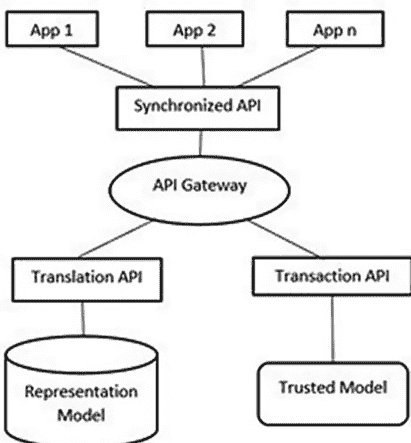

图 2.4 同步 API 和 API 网关。

矿工节点），用于将加密的 CoAP 消息翻译成 JSON-RPC 消息以与区块链进行通信。此过程涉及设置网络、将设备注册到管理中心、管理协议和策略协议，以保障和管理物联网设备对区块链网络的访问。引入管理中心的多功能性展示了系统扩展和适应不同场景的能力。安全分析还表明，网络中管理者的角色有助于避免欺骗和篡改的可能性。

#### 2.4.2.3 区块链信令系统（BLOSS）

区块链信令系统（BloSS）[26] 是一种安全管理解决方案，旨在使用软件定义网络（SDN）进行协作式防御（例如分布式拒绝服务 [DDOS] 攻击）。BloSS 在一项全球实验中设计并原型化，以构建特定的协议和注册表，以克服攻击并改善分布式网络中的安全漏洞。它构建在区块链之上，并可以进一步应用于集成基于区块链的物联网系统的混合系统中。图 2.5 说明了 BloSS [26] 的架构设计，我们可以观察到网络基础设施正在使用以太坊构建在去中心化存储结构之上。

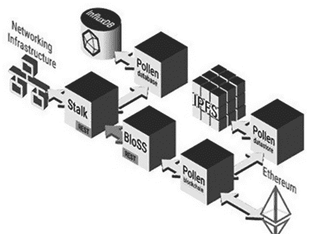

图 2.5 BloSS [26] 的架构。


#### 2.4.2.4 面向物联网的轻量级可扩展区块链

许多研究人员一直致力于开发轻量级网络，旨在基于小型设备在低计算和能源资源方面的局限性来改进其多种功能。这推动了基于物联网的解决方案，一旦实现，将可能具有颠覆性。文献[4]中提到的轻量级可扩展区块链（LSB）引入了一种基于时间的分布式共识（DTC）算法，将最大限度地减少区块链的挖矿过程。它与多个集群协同工作，验证物联网系统中交易链上的新区块，以减少开销延迟。同时，论文从定性角度表明，LSB在插图所示的攻击方面具有强大的安全性能。

#### 2.4.2.5 Hawk

如文献[12]所述，Hawk是另一种去中心化智能合约系统解决方案，可使用高效的加密协议保留交易隐私。该模型针对分布式账本（即区块链）基于安全性提出了改进建议。用户无需具备加密知识，因为所提议的编译器将自动遵循其加密协议。这有可能应用于未来的基于物联网的解决方案，从而避免设置基于区块链的物联网解决方案的加密元素，这有助于在与其他技术集成时最大化其性能。

#### 2.4.2.6 基于区块链、物联网和人工智能的混合系统

以人工智能作为分析工具，基于区块链的物联网系统在其应用方面可以进一步增强，如文献[10]所示，以实现更高效的解决方案。图2.6说明了使用认知处理层来分析数据并优化其管理。人工智能、区块链和物联网的融合为许多研究人员带来了新的且令人兴奋的研究兴趣。

#### 2.4.2.7 健康链

文献[25]中提到的健康链是基于区块链的医疗保健行业应用——这是IBM基金会的一项倡议。它集成了物联网和云计算，以实现区块链的变革性结果。它为医疗保健行业自动提供真实性、安全性和数据保护，从而实现更快、更机密的数据管理。

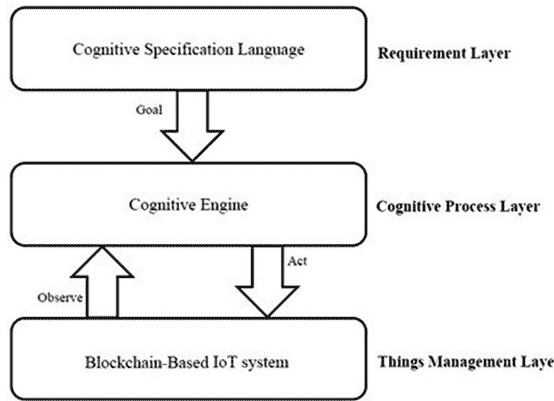

### 图2.6 文献[10]中提到的基于认知的层架构。

### 2.4.3 应用

基于区块链的物联网应用正在从供应链到医疗保健再到制造和管理等工业领域的各个行业中获得势头。这促使许多企业和投资者专注于改进其运营性能。从IBM到KPMG及许多其他机构，探索的应用将在下文进一步描述。

#### 2.4.3.1 基于用例的应用

- 1. 供应链：将从这些解决方案中获益最大的行业之一是供应链，因为物联网可以帮助使用RFID标签、传感器监控货物状况，以及设备实时连接和通信，从而跟踪从车辆到仓库的各种运输和存储货物。区块链在管理和跟踪交易以及保护数据以确保其完整性和真实性方面发挥着重要作用。智能合约在符合利益相关方之间的货物标准和政策方面也发挥着重要作用。

- 2. 业务跟踪与监控：基于区块链的物联网应用在监控和跟踪业务方面很有用，特别是在维护利益相关方所提供的商品和服务的标准方面。在大幅减少文书工作的同时保持透明度，在此过程中确保系统中的信任和有效性。所有成员在共享网络环境中实时自动跟踪一切，并具备所需的标准和合规性。其不可篡改性覆盖了大部分信任体系，并鼓励个人在交付物方面跟进并保持其完整性。

- 3. 智慧城市和智能家居：物联网爱好者喜欢谈论智慧城市和智能家居，但由于其安全性和隐私挑战，可扩展性和社会接受度受到限制，抑制了所提议的潜力。像区块链这样的技术集成使其能够应用于家庭安防系统、电子政务、自动支付、监控、节能应用以及实时数据通信等服务。智能家居可以通过可信和安全的系统执行基于交易的决策来实现设备同步，例如更新冰箱中的库存。房主的数据隐私也可以得到管理。所呈现的机会对许多企业和城市部门来说非常有趣。

- 4. 数据管理与分析：基于区块链的物联网解决方案在为商业和金融政策、服务及产品实现各种预测分析方面已显示出潜力。这些包括通过分析多个来源中发现的模式来进行咨询工作，同时支持数据的完整性。在大数据时代，数据管理和访问控制的需求非常重要，并决定了决策过程中的许多因素。业务运行在数据和交易流程的完整性之上，而区块链提供了这一点。物联网在各种设备和地点收集实时数据方面发挥作用，从而提高效率并减少损失。

- 5. 智慧医疗：医疗保健行业有多种基于用例的应用，适用于基于区块链的物联网解决方案。从跟踪和监控药品及制药行业，到使用智能合约维护其标准和政策，这些应用有可能挽救生命。由于其完整性和对法规的合规性不可妥协，智能合约和区块链可以为物联网系统提供所需的支持。

- 6. 智慧农业：农民现在可以利用基于区块链的解决方案提供的不可篡改性和透明度，不仅消除中间商，还提供一种清晰便捷的方式来提升工作流程。从监测土壤含量到浇水，再到控制温度和湿度，这些过程都可以全部自动化，而不会牺牲商品的标准和质量。甚至运输、销售和购买商品都可以在对系统的信任和信心下完成。由于区块链提供了不可篡改性和可追溯性，消费者与来源之间的端到端同步可以得到验证和维护。

- 7. 资源管理：随着对世界资源有限性认识的加深，资源管理已成为一个关键领域。从水资源管理到能源管理，基于区块链的物联网解决方案可以帮助解决浪费危机。未得到管理的资源浪费可能会造成严重后果，而基于区块链的物联网解决方案可以利用其透明度和智能合约功能，来规范利益相关方和社会所做承诺的完整性，从而帮助减少能源足迹。

- 8. 制造业和汽车工业：由于生产线要求高运营效率和质量检查，大多数汽车和制造业企业都已部署传感器来调节和监控其活动。近年来，许多公司和企业已转向基于物联网的解决方案以满足需求。通过集成区块链，系统内各项活动、利益相关方和设备之间的交易可以得到保障，并提供适合工业环境的监管水平。这体现在智能停车、燃料支付流程、零件和机械设备维护等方面。

#### 2.4.3.2 现实世界应用

观察当前正在为其应用程序解决方案采用此技术的一些公司和组织，得出了一个合理的论据，支持基于区块链的物联网应用有可能成为万亿美元产业的潜在益处。像ING、德意志银行等金融机构，以及像KPMG这样的供应链巨头，已经将这些技术采纳到其业务模式中。

Golden State Foods (GSF)是一家知名的食品制造和分销供应链企业，为数千名客户提供服务，正


目前正与 IBM 合作，利用区块链和物联网扩大规模并生产高质量产品。传感器等设备收集数据，并通过区块链进行保障，以实现问责制和透明度。

Telstra 是一家澳大利亚媒体公司，正在投资智能家居服务。他们已实施基于区块链的生物识别安全性，通过其设备捕获数据，因为这能为其数据提供安全保障。

Mediledger 是一家制药公司，正在采用区块链与物联网来追踪任何受处方或拥有药物的合法变更，这有助于打击假药和其他药物。

Stock 正在开发一个基于区块链和物联网的通用共享网络（USN），用于安全地销售或出租商品，交易过程防篡改且透明。

Pavo 是一家农业公司，在其服务中实施基于区块链的物联网解决方案，通过使用传感器收集数据并允许利益相关者做出明智决策，为农民带来透明度和安全性。通过智能合约，他们使农民能够在产品收获前通过信任系统进行销售。

NetObex 一直在实施各种物联网和区块链服务，通过与其他公司合作使用无人机采集水样、分析其内容，并在以太坊上以实时数据发布，来测量河流污染；提供用于自动支付的智能停车解决方案；以及使用其 IoToken 的汽车餐厅和智能充电站。

Helium 总部位于加利福尼亚，实施基于区块链的物联网无线互联网基础设施，以保障并尽量减少运行智能设备所需的能源资源。

ArcTouch 创建了一个名为 DApps 的去中心化系统，用于连接 Amazon 的 Alexa 和 Facebook 的 Messenger 等智能设备，以通过网络提供更安全、更连通的服务。

Chronicled 在制药和食品供应链中赋能基于区块链的物联网解决方案，以确保其平台上的保管追踪，在利益相关者中建立信任和信心。使用药物的隐私策略是其备受追捧的服务之一。

Hypr 将去中心化系统集成到其物联网系统中，以保障 ATM、家庭、门锁和汽车的安全，并保护其通信线路。使用提供给房主的无法更改的数字密钥，智能设备与用户需求同步通信。

Xage 实施基于区块链的物联网解决方案，涵盖从农业到供应链的一系列 DApps（去中心化应用），用于管理设备间的策略和通信，并最近与智能电力联盟（Smart Electric Power Alliance）合作，专注于将清洁能源领域纳入其中以避免网络攻击。

Grid+ 使用以太坊为其客户提供节能物联网设备的访问权限。一个代理购买并管理电力，以连接节能智能设备，每 15 分钟支付一次优化后的金额，这通过区块链交易进行保障。他们目前正在开展 Lattice1 工作，以确定最有效的节能时间点并将其集成到其业务模式中。

Filament 总部位于内华达州，已设计出集成区块链和物联网的产品，名为 Blocklet US Enclave，用于增强建筑、制造和供应链行业的安全协议。

在工业 4.0 中，技术整合备受推崇，并显示出与云计算、大数据、AI、物联网、区块链、机器人技术、5G 等融合方面最有前景的结果。此外，[2, 6, 7] 和其他论文中进行和展示了多种类型的研究，其中智能家居、僵尸网络、物联网和治理、安全解决方案、智慧城市、保护隐私的医疗保健以及食品可追溯性的应用被进一步阐述和详细说明，作为克服这些领域所面临限制的潜在解决方案。

### 2.4.4 基于区块链的物联网解决方案的挑战

迄今为止，基于区块链的物联网市场已显示出其在许多行业和经济领域作为突破性解决方案的需求和潜力。自 2017 年以来，许多概念验证或试点运行已在实践中开展。Everledger（一款专门用于钻石追踪的应用程序）和用于物联网的 Filament 已经出现，但如果我们观察区块链技术的现实端到端整合，结果大多是雄心勃勃或受限的，而不是具体或被充分利用。区分区块链和物联网的潜力与其局限性变得相当具有挑战性。这归因于其交付和性能中的高度不确定性。

[27] 中描述的基于区块链的物联网的逻辑挑战如下：

- 1. 传感器和其他节点等物联网设备资源有限。区块链绝不免疫于自私挖矿、DDoS、分叉攻击等网络攻击。
- 2. 交易过程与需求速度相比较慢。
- 3. 由于终端计算能力有限，物联网设备与区块链挖矿能力集中和整合。
- 4. 物联网设备需要区块链完整的标准加密元素协议套件。
- 5. 存储容量：任何新的物联网设备要加入区块链平台，都需要下载其所有初始交易，而设备可能无法存储这些交易。
- 6. 所有参与的节点都必须是 P2P 网络的一部分，且上传和交换必须持续进行。

### 2.4.5 替代方案

同样重要的是要了解，区块链和物联网的替代方案确实存在。为了评估基于区块链的物联网解决方案的潜力，利益相关者和研究人员不应仅局限于少数几种技术。本节将介绍这些技术的各种替代方案。

与 Wi-Fi 的物联网连接可以与蜂窝连接（卫星连接）并列看待，后者提供了最远的网络范围之一（使用广播塔约 10-15 英里），而 Wi-Fi 不同。低功耗广域网（LPWAN）消耗极少电力，为物联网网络（LTE-M、NB-IoT、LoRa）提供了新的视角。Zigbee 用于 Amazon Echo。Z-Wave 使用 908 MHz 带宽并降低干扰。网络连接是决定基于物联网的应用程序全球标准的重要因素。

- 1. IOTA：IOTA [28] 是一种面向物联网设计的开源分布式账本和加密货币，基于 DAG 技术，在竞争对手中越来越受欢迎。有向无环图（DAG）在 DLT 上记录交易，使加密货币能够独立于区块链。DAG 由 Sergio Demian Lerner 于 2015 年提出，作为区块链的替代方案。它消除了对矿工的需求，并仍以分布式、点对点、去中心化的方式运行，通过用新交易验证交易来实现。尽管 DAG 备受炒作，但它仍处于起步阶段，需要进行大量工作才能挑战区块链服务。IOTA 基本上是一种带有 Tangle DLT 的协议，无需挖矿即可运行。它属于物联网生态系统基础设施，用于分析其设备的数据。Tangle 账本为 IOTA 提供了与区块链类似的支持，但无需交易费用。它已得到许多企业的支持。
- 2. Hash Graph Technology：Hash Graph 技术是分布式账本的另一种替代方案，由 Leemon Baird 发明。它消除了低速以及区块链技术验证交易的需求等限制。取而代之的是，交易使用 DAG 进行计时。
- 3. HoloChain Technology：HoloChain 技术是另一种最近的先进技术，它采用加密元素在去中心化 P2P 网络中开发安全应用程序。它允许在子链中多次存储数据，并且与区块链不同，消除了对共识算法的需求。
- 4. R3 Corda：Corda 是另一种使用 P2P 模型记录金融交易的数字账本。它会查询链中多个节点。它在一组可信的指定对等点上运行，从而为交易提供安全性。Corda 在智能合约设计和运行方面是 DAG 的简化版本。
- 5. Ambrosius：Ambrosius 是一种在去中心化网络中工作的公共许可区块链。它是一种优化版本的区块链，用于物联网系统和管理软件的互连，主要用于追踪并将区块链集成到业务模型中。
- 6. Atonomi：Atonomi 是一个开放平台，为物联网利益相关者支持受信任的第三方，提供一种嵌入式解决方案，利用区块链不可更改的身份注册和可追溯性功能来保护设备。物联网设备可以确保其通信的完整性，并提供一种不同的方法。
- 7. Chain of Things (COT)：Chain of Things（COT）是一个联盟，由对基于区块链的物联网解决方案感兴趣的利益相关者组成，旨在改善其安全性、隐私性、资源有限、可扩展性等挑战。
- 8. Modum.io：Modum.io 是一种基于区块链的物联网解决方案，用于使用物联网传感器检查货物来追踪和监控供应链中的有形商品，同时维护基于区块链的智能合约，以利用其不可更改性、透明性和安全性功能。


- 9. Xage：Xage 是面向 IoT 企业的第一个基于 Blockchain 的网络安全平台，能够同时管理数十亿台设备，以保护并自诊断任何攻击。它主要应用于供应链和能源行业。

## 2.5 未来趋势与研究方向

研究表明，未来改进方向可结合全球标准的实际实施来观察，以解决隐私和安全特性，超越元数据的已知做法 [14, 28]。这些包括在采用大容量存储以满足 Blockchain 在参与节点中复制数据的需求方面所面临的挑战，而 IoT 的资源容量有限。

## 结论

本章可通过了解基于 Blockchain 的 IoT 解决方案所占据的不同市场份额来总结。深入了解 Blockchain 的工作原理至关重要，因为它代表了将为大多数未来应用提供动力的引擎，或至少符合当前经济需求的预期，而未来需求可以基于本研究进行规划。各项新兴技术的技术方面对最近和正在进行的工作提供了一些视角。从挑战到益处，所述平台可以确立为增值解决方案，具有扩展潜力并满足应用程序的各种需求。未来研究还需要关注在哪里以及部署和开发什么，以实现可被接受的全球标准，从而将其机遇变为现实。

## REFERENCES

- [1] J. Xu, K. Xue, S. Li, H. Tian, J. Hong, P. Hong, and N. Yu, "Healthchain：面向大规模健康数据的基于区块链的隐私保护方案，" IEEE Internet of Things Journal, vol. 6, pp. 8770–8781, 2019.
- [2] J. Lin, Z. Shen, A. Zhang, and Y. Chai, "基于区块链和 IoT 的智慧农业食品可追溯性，" in 第 3 届群众科学与工程国际会议论文集-ICCSE'18, 2018.
- [3] S. Hakak, W. Z. Khan, G. A. Gilkar, M. Imran, and N. Guizani, "通过区块链技术保障智慧城市安全：架构、要求与挑战，" in IEEE Network, vol. 34, no. 1, pp. 8–14, 2020.
- [4] S. Dorri, S. Kanhere, R. Jurdak, and P. Gauravaram, "面向 IoT 安全与隐私的区块链：智能家居案例研究，" in 2017 IEEE 普适计算与通信研讨会 (PerCom Workshops), 2017, pp. 618–623.
- [5] M. A. Khan, and K. Salah, "IoT 安全：综述、区块链解决方案与开放挑战，" Future Generation Computer Systems, vol. 82, pp. 395–411, 2018.
- [6] O. Novo, "区块链与 IoT 的结合：面向 IoT 可扩展访问管理的架构", IEEE Internet of Things Journal, vol. 5, no. 2, pp. 1184–1195, 2018.
- [7] H. F. Atlam, and G. B. Wills, "区块链与 IoT 的技术方面，" in 计算机进展, Elsevier, pp. 1–39, 2018.
- [8] J. Gubbi, R. Buyya, S. Marusic, and M. Palaniswami, "物联网（IoT）：愿景、架构要素与未来方向，" Future Generation Computer Systems, vol. 27, no. 7, pp. 1645–1660, 2013.
- [9] H. Liu, D. Han, and D. Li, "Fabriciot：基于区块链的访问控制，" IEEE Access, vol. 8, pp. 18207–18218, 2020.
- [10] A. M. Saghiri, M. Vahdati, K. Gholizadeh, M. R. Meybodi, M. Dehghan, and H. Rashidi, "基于区块链的认知物联网框架，" in 2018 年第 4 届 Web Research 国际会议 (ICWR), 2018, pp. 138–143.
- [11] B. Rodrigues, E. Scheid, C. Killer, M. Franco, and B. Stiller, "区块链信令系统（bloss）：分布式拒绝服务攻击的协作信令，" 网络与系统管理杂志, vol. 28, no. 4, pp. 953–989, 2020.
- [12] A. Kosba, A. Miller, E. Shi, Z. Wen, and C. Papamanthou, "Hawk：区块链加密与隐私保护智能合约模型，" in IEEE 安全与隐私研讨会 (SP), 2016, pp. 839–858.
- [13] Y.-C. Liang, 面向动态频谱管理的区块链. 新加坡: Springer 新加坡, 2020, pp. 121–146.
- [14] Z. Zheng, S. Xie, H. Dai, X. Chen, and H. Wang, "区块链技术概述：架构、共识与未来趋势，" in 2017 IEEE 大数据国际大会 (Big Data Congress), 2017, pp. 557–564.
- [15] S. Hakak, W. Z. Khan, G. A. Gilkar, M. Imran, and N. Guizani, "通过区块链技术保障智慧城市安全：架构、要求与挑战，" IEEE Network, vol. 34, no. 1, pp. 8–14, 2020.
- [16] M. A. Khan and K. Salah, "IoT 安全：综述、区块链解决方案与开放挑战，" Future Generation Computer Systems, vol. 82, pp. 395–411, 2018.
- [17] N. Szabo, "在公共网络上形式化和保障关系，" First Monday, vol. 2, no. 9, 1997.
- [18] T. Ahram, A. Sargolzaei, S. Sargolzaei, J. Daniels, and B. Amaba, "区块链技术创新，" in 2017 IEEE 技术工程管理会议 (TEMSCON), 2017, pp. 137–141.
- [19] I. Lee and K. Lee, "物联网（IoT）：企业应用、投资与挑战，" 商业视野, vol. 58, no. 4, pp. 431–440, 2015.
- [20] S. Huh, S. Cho, and S. Kim, "使用区块链平台管理 IoT 设备，" in 2017 年第 19 届先进通信技术国际会议 (ICACT), 2017, pp. 464–467.
- [21] M. J. M. Chowdhury, A. Colman, M. A. Kabir, J. Han, and P. Sarda, "区块链与数据库：批判性分析，" in 2018 年第 17 届 IEEE 计算与通信信任、安全与隐私国际会议 / 第 12 届 IEEE 大数据科学与工程国际会议 (TrustCom/BigDataSE), 2018, pp. 1348–1353.
- [22] M. Humayun, N. Jhanjhi, B. Hamid, and G. Ahmed, "利用 IoT 和区块链的新兴智能物流与运输，" IEEE 物联网杂志, vol. 3, no. 2, pp. 58–62, 2020.
- [23] J. Gubbi, R. Buyya, S. Marusic, and M. Palaniswami, "物联网（IoT）：愿景、架构要素与未来方向，" Future Generation Computer Systems, vol. 29, no. 7, pp. 1645–1660, 2013, 包括特刊：面向普惠云和网络服务的网络赋能分布式计算 & 云计算与科学应用——大数据、可扩展分析及更多。
- [24] N. Živi, E. Kadušić, and K. Kadušić, "作为 Tangle 的有向无环图：区块链的 IoT 替代方案，" in 2019 年第 27 届电信论坛 (TELFOR), 2019, pp. 1–3.
- [25] A. Bellini, E. Bellini, M. Gherardelli, and F. Pirri, "通过区块链镜像模型增强 IoT 数据可靠性，" Future Internet, vol. 11, no. 5, p. 117, 2019.
- [26] R. Bruno, S. Eder, K. Christian, F. Muriel, and S. Burkhard, "区块链信令系统（bioss）：分布式拒绝服务攻击的协作信令，" 网络与系统管理杂志 (JNMS), vol. 28, pp. 953–989, 2020.
- [27] F. Buccafurri, G. Lax, S. Nicolazzo, and A. Nocera, "克服 IoT 应用中区块链的局限性，" in 第 12 届可用性、可靠性与安全国际会议论文集. 计算机协会, 2017.
- [28] A. Panarello, N. Tapas, G. Merlino, F. Longo, and A. Puliafito, "区块链与 IoT 集成：系统综述，" 传感器, vol. 18, no. 8, p. 2575, 2018.

# 基于区块链的 IoT 设备认证方案综述

G. Megala
维洛尔理工学院，维洛尔，泰米尔纳德邦，印度

Prabu Sevugan
维洛尔理工学院，维洛尔，泰米尔纳德邦，印度
本地治里大学银行技术系，本地治里，印度

P. Swarnalatha
维洛尔理工学院，维洛尔，泰米尔纳德邦，印度

## 目录

- 3.1 引言 50
- 3.1.1 认证 51
- 3.1.2 设备身份管理 53
- 3.1.3 基于设备的认证 54
- 3.1.4 设备认证的必要性 55
- 3.1.5 认证协议 55
- 3.2 预备知识 58
- 3.2.1 公钥基础设施密码学 58
- 3.2.2 多因素认证 (MFA) 61
- 3.2.2.1 多因素认证方法 62


- 3.2.3 完整性验证 62
- 3.3 区块链技术 64
- 3.3.1 基于区块链的身份认证 67
- 3.3.2 零知识证明 69
- 3.4 基于区块链的物联网应用面临的当前挑战 73
- 3.5 结论 74
- 参考文献 75

## 3.1 简介

由互联设备（如智能手机、计算机、传感器和执行器）组成的庞大网络被称为物联网（IoT），近年来呈指数级发展。它有潜力允许现代设备自行确定并相互通信。这些智能设备能够收集、评估甚至做出决策，而无需人类交互或社交接触。尽管物联网设备数量众多，并广泛部署于敏感应用中，但与物联网相关的安全风险已变得更加令人担忧。有许多广泛使用的安全术语和定义，涵盖不同的安全方面：

- 消息：两方之间交换的一组字节。
- 共享密钥通常是由两个实体共享的一个值。该代码可能像所有各方都知晓的密码或加密密钥一样简单。
- 保密性或机密性：禁止未经授权的调查人员评估消息内容的方法。
- 完整性：用于判断消息在传输和存储过程中是否被篡改的标准。
- 身份认证：一种表明消息可以追溯到发送者的方法，使接收者能够检查消息仅由发送者发送。
- 授权：用户被授权执行任务的证据。
- 不可否认性：防止消息所有者主张该消息未发送的方法。
- 防重放：阻止消息被攻击者重用的方法。

物联网网络的性能标准安全措施在很大程度上取决于其支持的软件实现；对保密性、隐私性、诚实性和真实性的需求与应用程序或软件的安全合规要求成正比。

### 3.1.1 身份认证

当数据通过各种不安全的社交媒体平台传输时，物联网身份认证确实是建立对物联网计算设备身份信任的范式，以维护安全并管理访问。物联网系统资源有限，无法自行保护，因此很容易被攻破。因此，必须实施适当的身份认证和授权方案，以确保物联网设备、通信和信息的最佳安全性。身份认证机制必须可信 [1]、灵活，并能抵御已证明的网络威胁 [2]。未经授权的第三方试图访问服务器上可用的机密数据、媒体文件和交互等存储信息。身份认证方法能识别此类实体并拒绝其访问。图 3.1 说明了不同类型的身份认证。

用户身份认证方法主要有三种：(1) 知识中心型身份认证描述客户端知道和想要的内容（示例：密码、安全问题、OTP）；(2) 基于持有的身份认证指明客户端拥有或持有的内容（示例：通过邮件或短信的一次性密码本、软件令牌、访问证书）；(3) 基于固有特征或生物识别的身份认证定义用户是谁（示例：指纹、虹膜或视网膜图像、生物特征、面部和声音识别）。其他因素包括时间因素认证（尝试登录、允许和拒绝的访问）、位置因素认证（使用全球定位系统 [GPS] 识别访问设备以确认身份）和基于实物的认证（涉及智能卡、数字签名和证书）。

为了保护物联网设备之间的通信，可以采用一系列方法来建立强身份认证，例如：

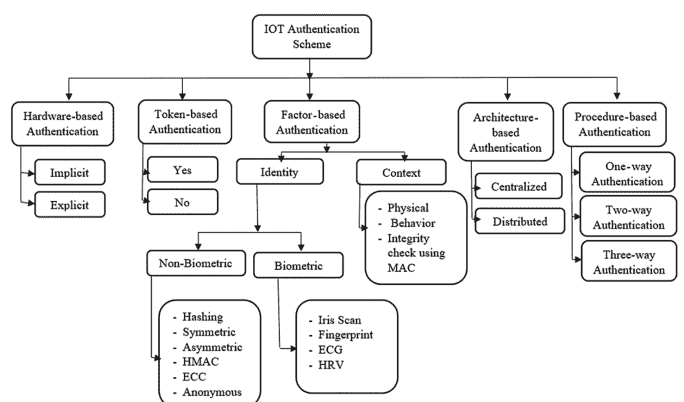

### 图 3.1 身份认证方案。

- 单模式身份认证——通信设备中的一方将被认证。
- 双向或相互身份认证——通信中涉及的两台设备都将被认证。
- 三模式身份认证——中央或第三方机构对另外两个用户或设备进行认证。
- 分布式身份认证。
- 集中式身份认证。

通常，这些物联网身份认证技术涉及使用开放授权（OAuth）协议的可信第三方来对用户进行身份认证，该协议在设计和实施上都是集中式的。该方法有许多缺点，包括高成本、单点故障、入侵和潜在的隐私泄露。

物联网系统经常受到外部攻击，黑客试图通过互联网服务访问设备。如果设备仅被允许与经过身份认证的服务器交互，则任何此类与物联网计算机交互的尝试都将被忽略。根据 2018 年赛门铁克威胁调查，物联网攻击事件从 2016 年的 6,000 起增加到 2017 年的 50,000 起。因此，尽管物联网设备部署在企业网络中，但必须优先考虑保护。为应对这一局限性，应使用既有效又高效的密码学方法来标准化设备之间的安全通信。另一方面，为项目选择最佳的物联网身份认证模型是一项艰巨的任务。在确定哪种实现模型更适合物联网身份认证之前，用户必须考虑多种因素，包括能源资源、基础设施能力、影响收入、安全经验、安全措施和功能。

### 3.1.2 设备身份管理

设备身份管理旨在增强并保持设备在与其他计算机、应用、云和接入点通信时的身份可信度。工业控制系统 [3]、联网消费医疗、汽车电子控制单元（ECU）、监控摄像头、家庭安防系统、智能手机和智能家电都是可能需要身份认证和授权的物联网设备示例。在连接到服务器时，每个物联网设备都需要一个唯一标识符，以防止欺诈者访问该设备。这通过将身份与每个物联网单元独有的密钥生成算法相关联来实现。设备使用椭圆曲线密码学（ECC）[4]随机选择密钥，以提供高级别安全性；相应设备使用椭圆曲线的生成元 G 点，重复多次，从而生成唯一的公钥。仅凭公钥，在多项式时间内找到隐藏密钥对几乎是不可能的，因为这基于非多项式的椭圆曲线离散对数（ECDLP）[5]计算。由于哈希函数是不可逆的，可用于生成地址，因此无法根据地址获取公钥。对于基于 TPM 的实现，注册 ID 由受信任的平台模块（TPM）生成。国际受信任的证书颁发机构（CA）为 X.509 证书生成注册 ID。设备身份管理策略负责识别和管理设备在其整个生命周期中使用的权限或凭据。

X.509 协议侧重于证书信任链模型，并提供了最可靠的数字身份认证方法。使用 X.509 证书作为身份认证机制是提高效率和简化设备分发的绝佳方式。此外，由于涉及技术挑战，X.509 证书生命周期管理可能既困难又昂贵，从而增加了解决方案的总成本。


因此，许多客户依赖第三方提供商进行证书和生命周期管理。

硬件安全模块（HSM）是最安全的机密存储类型，因为它用于稳定的、基于硬件的系统机密存储。HSM可以同时存储X.509证书和SAS令牌。HSM与预配服务的两种证明机制兼容。设备密钥和凭据也可以存储在系统内存中，尽管这种存储方法不如HSM可靠。

### 3.1.3 基于设备的身份验证

基于设备的身份验证和授权最可能用于其连接不依赖于运营商的设备。汽车是一个很好的例子：无论汽车是否具有用户特定的通信——例如执行用户应用程序或拥有用户特定配置——系统（即汽车）最可能会被链接以共享车辆详情 [6]。存储在汽车中的用户证书用于基于设备的身份验证和授权。在TLS握手期间，通常会进行身份验证。汽车（设备）将开始发送其证书，该证书将由可配置的签名机构签名，并在握手期间由其私钥对详细信息进行身份验证。握手完成后，设备将被身份验证，并从证书中获取用户 ID。汽车（设备）的用户 ID 可能是车辆识别号码（VIN）。汽车经过身份验证并确定用户 ID 后，必须确定正确的授权部分。系统可以仅通过连接即可进入授权社区。由于此处的单位是车辆，所有连接的汽车都将被分配到授权类别“汽车”。其他类（类似于客户端 ID）可以从证书中生成。例如，车辆 VIN [7] 可用于提取多个类。智慧城市中的无人驾驶航空器通过点对点网络和共享账本相互连接 [8]。可以使用公共区块链，允许所有无人机在区块链上进行身份验证后注册在批准的航线上飞行。通过其传播的身份，所有链接的设备都允许在特定区域内迁移。那些经过一次身份验证的设备在移动或进入不同区域时不再需要重新进行身份验证。在通信过程中，可能会出现身份验证延迟和身份验证攻击。主要关注点在于地理区域范围切换和设备速度，这些因素会影响配备物联网架构的设备的性能。

### 3.1.4 设备身份验证的必要性

完善的稳健设备身份验证是保证连接到分布式物联网络的所有设备都值得信赖的必要条件。因此，网络中的每个设备都有其独特的身份，当这些设备连接到分布式系统的中央服务器或接入点时，该身份会得到验证。网络管理员可以在设备开发过程中监控每台具有唯一身份的计算机，进行安全交互，并避免执行有害进程。如果设备表现出异常行为，网络管理员可以简单地终止其权限。需要强大的身份验证来保护与物联网络关联的设备和传感器，防止未获授权的用户访问。物联网设备在管理、控制和（尤其是）安全方面，严重依赖区块链技术 [9]。区块链有可能成为为日益复杂的物联网安全问题提供可行安全解决方案的关键推动者。

### 3.1.5 身份验证协议

为保障物联网设备安全，需要采用物联网身份验证方法，且有多种选项可实现这一目标。出于保护考虑，一些组织可以部署专用物联网络，但会牺牲有用功能。可以以安全的方式集成它，但需要确保设备在设计时就考虑安全。然而，由于物联网设备使用广泛的协议和标准，身份验证机制必须考虑大量变量。

因此，需要具备此类修改的专业知识，同时还需要深入了解物联网设备，以确保每台设备都能进行安全身份验证 [10, 11]。有些设备可能需要手动更新（由于缺乏OTA可操作性），而其他设备可能配置受限，无法修改。图 3.2 表示网络不同层使用的不同协议。为了在不使模型过载的情况下创建所需的信任程度，必须检查知识资产身份验证所需的要素。虽然执行身份验证的标准协议（如公钥基础设施（PKI）和开放授权（OAuth））越来越多地被修正/更新以满足所需的范围和安全性，但多个物联网端点资源受控的存在

| 层 | 协议 |
| :--- | :--- |
| 管理 | IEEE 1905, IEEE 1451, ... |
| 应用 | HTTPS, COAP, EXI, SNMP, DNS, NTP, IPfix, .. |
| 安全 | OAuth, DTLS, OTRP, ISA Secure, X.509,.. |
| 会话 | DDS, AMQP, XMPP, MQTT,.. |
| 网络 | UDP, TCP, IPV4, IPV6, RPL, 6LowPAN, 6TLSCH,.. |
| 数据链路与物理 | Wifi, Bluetooth, IEEE 802.11ah, ZigBee, LTE, NFE,RFID, LoRaWAN, IEEE 802.15.4, .. |

图 3.2 物联网协议。

这在很大程度上限制了其支持不符合信任标准且提供非常有限或无互连性的常用身份验证方法的能力。幸运的是，随着行业将保护从学术练习转变为将其纳入设备设计阶段，这种情况正在不断演变。

当今主流集成设备使用基于软件的解决方案进行设备身份验证。使用消息身份验证码（MAC）允许在受限物联网程序中修改安全密钥以对设备进行身份验证；PKI实现和OAuth惯例是两个常见示例。OAuth是最常见且广泛使用的身份验证机制之一，特别是针对物联网设备。OAuth是一种开放标准协议，用于基于令牌的身份验证和授权，允许用户通过可信赖的中央服务器访问敏感信息 [12, 13]。图 3.3 描绘了OAuth协议涉及的主要参与者以及这些参与者采取的主要步骤。

协议中涉及以下四个参与者：

- 资源所有者是拥有受保护资源并有权授予访问权限的人。
- 授权服务器（AS）负责向获批客户端分发访问令牌。

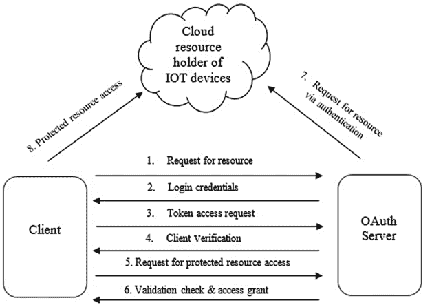

图 3.3 OAuth身份验证系统概览。

- 资源服务器托管受保护资源，并基于AS颁发的令牌接受访问。
- 客户端通过应用软件发出访问请求。

首先，客户端使用授权服务器向资源所有者请求许可。其次，授权服务器将登录凭据提交给客户端。第三步，客户端使用从AS获得的登录凭据向授权服务器进行身份验证，以从AS请求访问令牌。第四步，AS验证用户并向客户端提供访问令牌。第五步，客户端使用获得的访问令牌向AS请求访问安全资源。第六步，AS对访问令牌进行身份验证，如果验证正确，客户端即获准访问受保护服务。

尽管基于软件的物联网身份验证在维护成本方面具有显著优势，但这些策略提供的安全性受到设备开发者框架隐私性的严重限制。物联网身份验证和授权方案正在不断发展的物联网系统中实施，提供了一道防线


防御违规的机制。已知物联网（IoT）系统的功能对常见的应用程序攻击和硬件淬火无效。基于可信执行的机器硬件中心安全方法正在迅速涌现，以满足在保护个人电脑、笔记本电脑和智能手机方面的行业标准。这些方法在保护物联网计算机方面变得更加重要。在芯片安全方面，诸如密钥对生成、完整性保护和确认等机制在集成硬件环境中执行，能够有效防范外部窃取。与应用程序PKI结合使用时，可信平台模块（TPM）是信任根部署的完美示例，为物联网设备提供最高级别的信任身份验证。TPM信任评估在启动连接设备时提供安全命令，并对网络中连接的每一台设备进行身份验证，同时还能保管数字凭据。

每台设备的身份验证参数各不相同，涉及设备可持续性阶段，以及未经授权访问可能导致的潜在后果。这促使为这些互连设备集选择可接受的身份验证机制。物联网安全设计专业人员应将可用系统身份验证机制提供的置信度水平与物联网设备的信任参数相关联。TPM和其他基于硬件的身份验证机制特别适用于那些确保用户身份更高置信度至关重要的物联网用例。

## 3.2 预备知识

### 3.2.1 公钥基础设施密码学

公钥基础设施是一种非对称加密方法，主要用于互联网通信中的加密。正如其名称所示，其核心中的公钥是一个关键概念。这些密钥不仅用于加密数据，还用于验证通信实体的身份。公钥基础设施最显著的特征在于，它使用向公众发布的公钥和仅用户所知的私钥来实现固有的安全保障。安全密钥交换管理与维护需要可靠的基础设施。对于公钥加密，存在两个密钥管理标准。

私钥保密性 – 私钥本质上确保除了数据所有者之外，整个实体都无法获知，并允许在其整个生命周期内使用该密钥。

确保共享密钥的安全 – 公钥为所有人所知，任何发送者都可以使用接收者的公钥加密要安全通信的数据，而无需共享私钥。使用接收者公钥的这种加密基于离散对数问题，因为很难找到发送者的私钥。此外，还不能保证附带的公钥是准确的。因此，公钥管理[14]必须更加注重确保公钥用于其预期目的。

PKI确保共享密钥的安全。它允许识别和分发公钥。PKI构成由以下组件组成。

- “数字证书”一词是指公钥证书。
- 私钥令牌。
- 证书颁发机构 (CA)。
- 注册机构 (RA) – 负责注册的机构。
- 证书管理系统。

### (i) 数字证书

证书可以类比于个人的身份证明卡，例如驾驶执照、选民身份证或许可证，用于证明个人身份。数字证书不仅颁发给个人，还颁发给计算机、软件包以及在大型环境中需要证明其独特性的其他所有事物。X.509是基于国际电信联盟（ITU）X.509标准的数字证书。它规定了用于公钥基础设施、证书身份验证和授权而颁发的证书的常规格式。

证书颁发机构（CA）或专家在数字证书中持有与用户账户相关的全局公钥，包括客户端的进一步相关信息及其可用性。所有信息均由CA进行数字签名，证书包含数字签名。任何需要确认客户端公钥及相关信息的人都会使用CA的公钥执行签名验证。验证可确保证书中的公钥属于证书中包含其信息的个人。

### (ii) 令牌

如果客户端的公钥存储在数字证书中，随附的隐藏私钥可能保存在客户端设备中。存储密钥并非常见做法。获得机器访问权限的入侵者可以轻松打开并使用私钥。因此，私钥存储在需要密码才能访问的加密可移动存储令牌上。关于密钥存储，各种供应商使用多种格式，其中一些是经过许可的。

### (iii) 证书颁发机构 (CA)

CA为每位客户颁发证书，并帮助其他客户验证证书。CA负责正确识别请求证书的客户端，并确保证书中提供的详细信息适当且完成签名。CA的主要功能如下：

- 创建密钥对 – CA可以自行或与用户协作创建密钥对。
- 创建和发送数字证书 – 在PKI方面，CA可以类比于护照机构。客户端出示凭据以验证其独特性后，CA颁发证书，随后由CA对其进行签名，以防止被篡改。
- 证书发布 – 在定位客户端或用户时，CA发布客户端的证书。这可以通过在公开可用目录中发布证书，或仅向特定客户端提供证书来完成。
- 证书身份验证 – CA允许访问其公钥，以帮助客户端证书身份验证过程中的签名验证。
- 证书吊销 – CA可以出于各种原因移除已颁发的证书，包括用户的私钥泄露或对客户缺乏信任。移除后，CA会保存所有仍然有效的吊销证书的注册表。

### (iv) 注册机构 (RA)

CA可能会寻求第三方RA的帮助，以进行个人和/或业务客户证书请求所需的身份验证授权。尽管RA在客户面前表现为认证机构，但它实际上并不签署证书。

### (v) 证书管理系统 (CMS)

使用CMS来发布、续订、永久或暂时挂起，或撤销证书。CMS通常不会吊销证书，因为它们可能在将来的某个地方需要证明其声望（例如，法律问题）。为了监控其职责，CA及其关联RA运行证书管理系统。

在大型网络和全球通信标准下，让每个请求用户都从单个可信CA获得证书在实际中是不可能的。此外，如果只能访问一个CA，一旦该CA被攻破，就会引起问题。保证证书链合法、适当签名且可靠的方法称为证书链验证。以下协议验证证书链，从用于身份验证的证书开始。当客户端被验证时，客户端证书会提供给证书链，并转发到根机构。验证者使用证书中可找到的提供者公钥来验证证书。它在证书链中位于客户端证书旁边。如果验证者信任提供者的证书由适当机构签署，则验证完成，流程在此结束。或者，提供者的证书以与前面步骤中验证客户端证书相同的方式进行验证。此程序将进一步继续，直到在中间找到可信CA，或直到找到根CA。

### 3.2.2 多因素身份验证 (MFA)

多因素身份验证是一种证明方案，允许用户采用多个验证参数来访问软件、在线账户或虚拟专用网络等资源。成功的身份和访问管理（IAM）方法本质上提供MFA。MFA需要多种额外的身份验证措施，包括登录详细信息，这些


降低潜在安全漏洞的风险。MFA通过请求额外信息进行验证因素来运作。一次性密码(OTP)是用户体验到的最重要的MFA变量之一。OTP是四位到八位数字的代码，您可以通过短信、电子邮件或任何智能手机应用程序接收。使用OTP时，会定期或在发出身份验证请求时提供唯一代码。该代码使用客户首次注册时分配的种子值以及另一个因素（例如递增计数器或时间值）来创建。

#### 3.2.2.1 多因素身份验证方法

随着MFA融入AI技术和智能自动化，身份验证方法变得更加复杂。大多数MFA身份验证方法依赖于前三种附加数据形式。这些包括基于知识的身份验证、以生物特征为中心的身份验证、侧重于拥有或推断的身份验证、基于时间的身份验证以及基于位置的身份验证。OTP可以同时作为网络中用户和设备的基于知识以及基于拥有的身份验证。基于位置时，MFA通常会检查设备的IP地址以及（如果可访问）其地理位置。当位置数据与阻止列表中列出的内容不符时，可以使用此详细信息来阻止用户的访问，或者可以将其与其他身份验证形式（包括密码或OTP）结合使用，以验证用户的身份。

自适应身份验证（也称为基于风险的身份验证）是MFA的一个子集。在进行身份验证时，自适应身份验证会考虑视角和行为等附加变量，这些值通常用于为登录会话分配风险等级。会评估风险等级，以决定用户是否能够登录或是否需要额外的身份验证因素。启用自适应身份验证后，如果用户在午夜后从咖啡厅登录（这并非其通常行为），可能会被要求在输入登录凭证之外，输入发送到其智能手机的代码。

### 3.2.3 完整性验证

由于采用集中式方法，包括对称密钥加密方法[15]和公钥基础设施(PKI)加密系统在内的常规数据完整性策略在拥塞网络中面临硬件故障和传输延迟的挑战。使用对称密钥解决方案时，数据可能在中间节点被篡改。在基于对称密钥的策略[1, 5]中，发送方使用共享密钥为传输的消息生成MAC代码，并将代码与传输的内容附在一起。使用相同的共享密钥，验证者会检查接收内容中消息的真实性。图3.4表示数据完整性验证机制。另一方面，密钥管理极具挑战性。随着网络规模的扩大，基于对称密钥的应用程序的灵活性非常低，因为每个通信方都必须交换一个唯一的共享密钥。

此外，只有拥有共享密钥访问权限的通信节点社区才能验证信息的有效性，因此该方法用于多跳连接，且受常见网络类型的限制。即使组中的单个单元被攻破，基于对称密钥的方法的安全性也会受到不利影响。在消息身份验证中，有两种隐私形式：有条件隐私和无条件隐私。在有条件隐私中，确切的通信发送方可能由可信第三方(TTP)或组管理员检测到。在无条件消息身份验证中，没有人能识别真正的消息发送方，这代表绝对隐私。

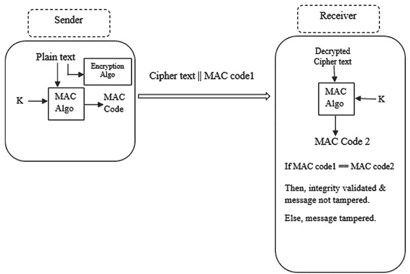

图3.4 数据完整性验证方案。

带有私钥和公钥对的非对称密钥算法也可用于实施数据完整性方法。实际数据首先由源节点使用私钥加密。接收节点随后将使用源节点的公钥解密数据。通过将解密数据与实际数据关联，可以确保获取数据的隐私。基于非对称PKI的技术用于验证公钥，以防止其被篡改[15]。在注册机构(RA)中，源节点必须注册其独特的身份详细信息以及公钥信息，证书颁发机构使用这些详细信息来创建证书。CA在RA中审核其身份后，将使用其公钥为源节点的身份创建证书。CA基于公钥加密生成一对非对称密钥，使用私钥对证书进行加密。数字签名定义为加密的证书。网络中的两个节点都可以访问相应的公钥。CA将证书颁发给RA。RA随后通过中间节点将证书连同原始信息和加密信息一起发送给接受审核的源节点。证书连同真实数据和加密数据一起传输到中间节点。中间节点随后从CA请求等效公钥。一旦中间节点收到公钥，它就会完成后续步骤以验证数据完整性。
- 数字签名将使用公钥解密，以检测潜在的证书篡改。中间节点将获取源节点的公钥连同证书。
- 为确保原始信息的机密性，此节点将其与解密信息关联，该信息使用源节点的公钥进行解密。

### 3.3 区块链技术

在非受信网络环境中，区块链可定义为一种分布式公共账本方案，用于保护每笔交易的记录[16]。区块链由多个块组成，这些块连接在一起形成链式结构，并使用加密技术保护，新块可以随时添加到现有链中。区块链由多个块/节点组成，但不期望它们相互信任；如果足够数量的块/节点是诚实的，则可以保证区块链是安全的[17]。区块链以去中心化的扁平结构方式保护网络的信任，这与完整性检查中的分类安排不同。每个块由头部和主体部分组成。头部部分包括哈希值、以前的头部哈希值（表示为pre-hash）、时间戳和随机数值。主体部分包含表示为Tr的交易列表，这些交易以树状结构表示并连接到默克尔根。大多数节点可以验证这些交易数据的有效性。区块链的结构如图3.5所示。

区块链是一种以去中心化方式构建的不可更改的记录，无需中央授权。参与计算的每个节点都表示为区块链的成员。当这些节点验证交易时，它们被称为矿工节点，这个过程称为挖矿。这些矿工使用智能合约验证交易，并生成包含有效交易集合的块。这些矿工节点使用共识算法[18]（如工作量证明、权益证明、活动证明、销毁、已用时间等）来做出决策。自比特币推出以来，不同形式的可信链已被添加到区块链中，例如公共许可和无许可区块链

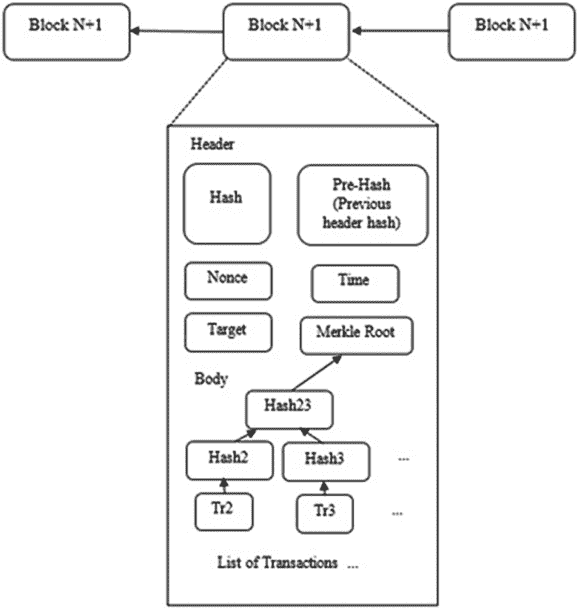

图3.5 区块链结构。

[19, 20]。此类区块链基于赋予每个参与者执行特定功能的独特权限的概念构建。任何没有指定身份的人都将在公共区块链上参与挖矿。公共区块链通常使用本地加密货币，这些加密货币使用经济奖励和共识机制（如工作量证明和委托权益证明）。秘密许可区块链是完全私有的或仅限于少数允许节点的区块链。许可区块链使用一组已识别的唯一参与者来执行区块链，并提供一种方式来确保一群有共同利益但彼此不完全信任的人之间的合作。许可区块链限于少数注册用户，允许他们组成一个网络。多个管理员可以通过获取其个人代表来加入网络。

网络中的每个节点都会获得两个密钥（一个公钥和一个私钥），用于加密和解密过程以进行安全消息传输。完成交易后，节点会将签名的文档发布给不同的邻居。每笔交易都会单独签名，这使得它只能使用基于私钥的特定签名进行身份验证，从而确保完整性；如果数据传输过程中发生错误，则不允许解密信息。当节点对等方广播已签名的获取交易时，在转发给进一步的代理之前会验证其合法性，帮助交易在网络中传播。被称为矿工的特殊节点会对以这种方式分发且被网络视为合法的交易进行排序和打包，形成一个带时间戳的链。使用协议程序来选择矿工，并将信息包含在块中。矿工的块随后会发布回网络。区块链节点随后检查广播节点是否包含合法交易，以及是否使用相应的哈希链接到链中的前一个块。如果这些要求不满足，则块会被销毁。此外，如果满足所有条件，则在块中的交易更新时，节点的块会被追加到链中。

由于加密算法，块是永久的，这意味着一旦连接到链中，它们就无法被篡改。区块链框架依赖共识机制来保持网络运行，该机制由所有节点管理，这些节点可以是任何计算机。共识方法确保即使某个节点失败，


其余节点将继续正常运作，克服了传统中心化模式的缺陷，该模式容易受到恶意攻击和篡改。区块链是一种信用系统，与传统分布式网络中授权中介接受的信任模型不同。从某种意义上说，它是一种无需信任方案。也许最常用的完全去中心化区块链是公有区块链。联盟区块链是由一组预选节点管理共识过程的区块链。这种形式的区块链被称为暂时去中心化。私有区块链仅用于记录保存的需求，且不对公众开放。

区块链的优势如下：

- 区块链可用于存储 IoT 设备的数据。
- 区块链的分布式特性允许安全的数据存储。
- 哈希密钥用于加密数据，随后由矿工进行检查。
- 避免数据丢失和伪造攻击。
- 可使用区块链技术防止未经授权的访问。
- 对于资源受限的计算机，采用基于区块链的代理架构。
- 它具有高运行效率，可提升网络弹性、透明度和全球可访问性。
- 提供去中心化、可追溯性、问责性和安全性，并减少人为错误。

#### 3.3.1 基于区块链的身份验证

基于区块链的身份验证涉及的一个重要功能是在签署区块链中每笔交易时使用哈希操作。因此，部署哈希函数的几种 IoT 应用程序必须保持稳定；同时，它必须快速并尽可能少地消耗能量，且不产生任何冲突 [21]。比特币和 Namecoin 等加密货币使用最流行的 SHA-256d 哈希函数；Emercoin 也使用 SHA-256 哈希函数，而 Litecoin 和 Dogecoin 使用 Scrypt 进行身份验证。SHA-256 的输出已在各种 IoT 产品中进行过测试，包括可穿戴设备。研究 SHA-256 在 ASIC 中的指纹和资源需求的研究人员得出结论，高级加密标准 (AES) 对低功耗受保护通信更有效。其他作者建议使用密码，因为存在功率限制，并且几种应用程序需要对基于区块链的 IoT 进行分析性评估。

拥有众多参与者的任何企业都需要一种标准化的数据格式，该格式可供读取、更新并用于决策。如果在区块链中进行交易，将注册当前时间线，此后不再允许进行任何更改。传统的时间戳依赖于可信的中心化服务器使用私密密钥对交易进行签名和时间戳。然而，被攻破的服务器可能会签署之前的交易。虽然时间戳确实可以去中心化，但它容易受到女巫攻击，而比特币等区块链通过关联块以及采用工作量证明身份验证方案来避免此问题。

必须对交易进行身份验证并加上时间戳，以便监控其区块链上的更改。由于最后一步必须以协调的方式完成，因此经常使用时间戳服务器。有多种可用的时间戳方法。传统方案依赖于服务器的诚实性，该服务器使用其自身私钥对交易进行签名和时间戳。尽管如此，仍无任何办法阻止服务器签署之前的交易。因此，一些作者提出了涵盖前序块哈希值的安全机制，该机制使所有交易保持有序，从而确保无法在区块链中注入虚假交易。此外，时间戳可以分散，从而消除节点故障或数据丢失。

由随机选定的协作节点重新运行分布式 IoT 数据 [22]。值得注意的是，随机选定的协作节点数量已经发生变化。为了达成共识，每个节点不需要解决哈希问题。在获取信息时，每个节点只寻求评估大多数。通过在区块链中每个节点的加密/解密过程中加入签名概念，可以最小化 IoT 节点的计算复杂度。当使用大型边缘节点的固有功能时，大比例验证是相当可靠的。在存储源数据后，云服务提供商将通过随机选择一个 IoT 边缘节点来创建新块。如果这是第一个块，则前一个块的哈希设置为零。每个节点通过将其个体数据与区块链中公开可用的信息进行比较来更新区块链。一旦块中存储的数据被传输到云服务器空间，每个块节点将被清空以节省每个 IoT 边缘节点的存储容量。

内部用户/设备使用基于分布式区块链 [23] 的授权委托和访问包含微观和宏观共识机制层次结构的 IoT 控制系统。因此，通过允许外部用户对其父级 IoT 域进行身份验证，可以保护外部用户的隐私。在用户身份验证过程中，用于证明真实性或完整性的机制利用哈希值来描述或检索用户应用程序，这些值存储在本地化区块链中。基于存储在区块链上的委托程序验证，区块链在有效身份验证后授权 IoT 系统。入侵者使用单个或多个被攻破的节点来压倒目标节点并发起拒绝服务攻击。这些攻击会摧毁目标系统的可用性。假设黑客已在用户计算机或 IoT 系统上安装了恶意软件。入侵者现在打算使用被攻破用户的委托程序，对其他用户/IoT 计算机发起 DoS 或 DDoS 攻击。因此，基于区块链的身份验证在身份验证成功后提供对事务的访问。

#### 3.3.2 零知识证明

目前应用密码学中最有趣的概念之一是零知识证明。零知识证明是密码学创造力的有力示例，其应用范围从单方面扩散到为公共区块链网络提供匿名且稳定的交易。虽然区块链是在信息交换中实现所需隐私和保护的可靠选择，但它有一个缺点：透明度。因此，零知识证明（ZKP）已成为满足交易保密性要求的最常用方法之一。ZKP 是一种过程，其中证明者（P）向验证者（V）发送证明，声明自己知晓秘密值，而不透露其他细节。ZKP 在仅通过披露来证明某人知道某事方面比较谦逊。任务是在不披露信息或任何其他细节的情况下捍卫这种所有权。

ZKP 必须满足三项主要要求：

- 1. 完整性：如果陈述有效，诚实的证明者将使诚实的验证者（即正确遵循协议的一方）相信这一现实。

- 2. 可靠性：除微小可能性外，没有作弊证明者能够使诚实的验证者相信该声明为真，如果它并非如此。

- 3. 零知识：如果陈述有效，验证者所知道的唯一事情就是该陈述为真。换句话说，理解声明（但不是秘密）足以构建一个场景，证明证明者知晓秘密。这是通过向每个验证者提供模拟来实现的，该模拟可以生成对 P 和 V 来说都看似真实的陈述。模拟模型应该能够生成记录，尽管只能访问证明者的参数。

ZKP 具有一般结构，包括参与者 A（证明者）和 B（验证者）之间的三个连续环节。见证、挑战和响应是用来描述这些环节的术语。图 3.6 展示了非交互式 ZKP 和交互式 ZKP 的一般结构。

见证：A 知道秘密这一事实规定了一组问题，A 总能准确回答这些问题。A 首先从该集合中随机选择一个问题并计算证明。然后，A 将证明发送给 B。

挑战：随后，B 从集合中选择一个问题并要求 A 回答。

响应：A 找出答案并将其返回给 B。

与标准零知识证明不同，非交互式 ZKP 的一般结构仅包含参与者 P 和 V 之间的一个动作，即见证。P 将隐藏的知识传递到一个特殊函数中，该函数创建作为声明的证明。结果确实是某种证明值。随后，P 将证明传递给 V。

在区块链上，匿名性通常很重要——在不透露客户身份或不关联交易的情况下进行交易。客户应能够在保持匿名的同时进行各种交易。ZKP 是一种强大的加密工具，其在区块链中的应用在当前区块链技术将采用 ZKP 以满足以数据隐私为中心的独特业务需求的情况下显得很有希望。虽然区块链是可靠的


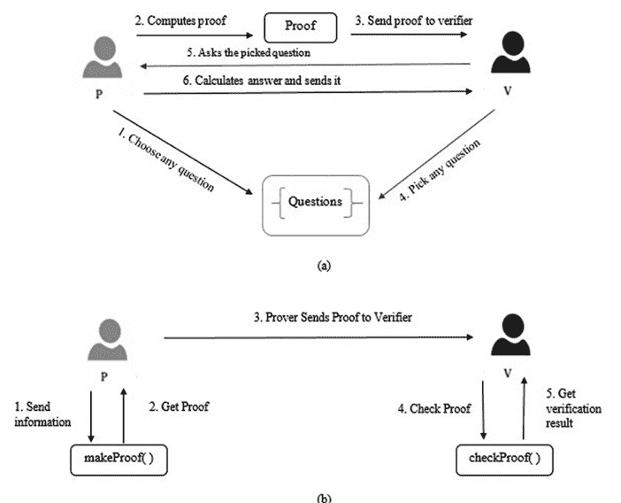

图 3.6 (a) 交互式零知识证明；(b) 非交互式零知识证明结构。

作为获取信息交换中目标隐私和保护的选项，它有一个缺点：透明度。因此，零知识证明（ZKP）已被视为满足交易保密性要求的最流行解决方案之一。

ZKP 的可扩展性将使区块链得以发展，同时也为用户提供了大多期望的灵活性，以及对其数据的更好控制和自由。因此，自然会推测 ZKP 如何改变区块链格局。以下是零知识协议在区块链中可适用的不同领域。

### 1. 身份验证流程

随着信息系统及相关功能的快速发展，机密信息的传输已逐渐成为企业的重要优先事项。在增强保护的保障下，零知识证明将成为传输敏感信息（如身份验证信息）的理想平台。零知识证明有助于创建安全通道，使用户无需担心数据泄露即可使用敏感数据。因此，ZKP 将在最坏情况下大大有助于防止数据泄漏问题。

### 2. 消息传递

ZKP 在区块链中最常见的用例是消息传递。在当今注重隐私的世界里，端到端加密是必不可少的。消息加密的目的是确保没有第三方可以看到两个人之间的通信。根据大多数消息平台的要求，用户必须向服务器验证身份，服务器必须记住用户。另一方面，零知识证明使无需任何额外详细信息即可在消息环境中建立端到端信任。因此，消息应用程序中的 ZKP 应用是最重要的区块链应用。

### 3. 存储保护

ZKP 与区块链的关联对于解决存储应用领域的主要问题也至关重要。ZKP 被认为是提高存储安全方法和方法性能的最有用工具之一。除了存储单元中的信息外，零知识证明还提供了存储单元保护的程序。最重要的是，访问通道受到强大保护的保障，确保安全存储和稳定环境。

### 4. 使用区块链提交私有交易

在区块链中 ZKP 的各种著名实现中，最具影响力的之一是私有区块链交易的传输。在发送私有区块链交易时，必须保护其免受第三方访问。传输私有区块链交易中最紧迫的问题是传统方法中存在的众多缺陷。当零知识证明与私有区块链交易结合时，它们将对任何类型的入侵或检测具有抵抗力。

### 5. 区块链交易有效性优化

ING 的案例是 ZKP 区块链实现在现实世界中的另一个著名示例。为了确保交易合法性，ING 已宣布了一种将 ZKP 与 Corda（一个著名的企业区块链平台）相结合的解决方案。在 ZKP 推出之前，Corda 的隐私和保护选项是有限的。然而，它现在结合了这两个功能。

## 3.4 基于区块链的 IoT 应用面临的当前挑战

目前，4G 或 5G 无线通信面临多种障碍。同时，与基于区块链的 IoT（B-IoT）相关的应用开发受动态方法的影响。由于各种一致的特性，将区块链集成到组合中增加了更多组织和技术要求。通过指定一个基于区块链的多级结构（指定功能、权限列表和访问特权），可以更轻松地管理对 IoT 网络的访问。此外，值得注意的是，对于多种不需要匿名性的应用，交易安全性仍然是必不可少的。

在分布式 IoT 网络 [24] 中，唯一身份授权可能仍然是一个问题，其中身份授权机构负责批准组织；它也可以负责阻止组织。为了解决这个问题，可以使用许可区块链来保护和处理不同的 IoT 节点。重点是解决使用集中式识别系统所产生的隐私和可靠性问题。

为了确保信息系统的保护，它通常必须满足三个标准：

- 1. 机密性：更多机密数据应受到防止未经授权访问的保护。
- 2. 完整性：它确保未经授权的各方无法修改或删除数据。通常还会补充，如果经批准的一方损坏数据，更改应是可逆的。
- 3. 可访问性：信息可以在需要时随时处理。就可靠性而言，区块链原理可用于在云基础设施或任何服务提供商中存储和交换机密信息，以确保数据完整性。

基于区块链的应用日益增长的影响将有助于解决建立信任的问题。基于区块链的智能合约可能是未来 IoT 信任基础设施的核心构建模块之一，因为它们是设备之间在没有明确人为干预的情况下进行关键业务交互的必要条件。另一方面，区块链需要计算资源并具有更高的吞吐带宽。因此，它限制了区块链在 IoT 中的使用，需要创建新的轻量级基于区块链的解决方案。未来的研究将侧重于网络虚拟化功能以及软件定义良好的网络对智慧城市身份验证过程的影响。可以进一步研究利用人工智能（AI）进行无人机方向查找和区域内移动，以提高网络吞吐量。

自动驾驶汽车、高速公路单元以及云/雾服务器组成了智能或智慧交通系统 [7]。互联网使这些设备能够相互连接。这是一个由传感器、电子设备、嵌入式系统和其他技术组成的复杂网络，有助于导航复杂路径。系统的智能单元负责快速、一致且准确地做出决策。旅行者将在这些多样化的联系生态系统中享受轻松安全的乘车体验。事实上，它们确实容易受到各种类型攻击的影响。在相当智能的交通系统中使用区块链技术，加强并改善了针对外部和内部安全攻击的通信。

智能物联网将被用于构建智能和智慧医疗系统 [25]。此类联系环境中使用智能医疗设备。为了开具药方，医疗专业人员需要患者的健康信息，这些信息必须以安全的方式进行通信和访问。在医生缺席的情况下，也可以使用一种推荐方法进行此类通信。

在分散环境中采用区块链方式的智能电子投票方案中，对民意调查、投票管理以及选民注册和身份验证的清晰度均分别处理。在传统方案中，管理机构完全不知晓特定地点的任何犯罪活动。使用区块链技术，所有交易对所有级别的选举机构都透明。此外，选民会被告知其选票的状态，这增加了公众信心并加强了民主制度。

## 3.5 结论

本研究探讨了区块链技术的现状，并为医疗等领域的 IoT 实施提出了主要场景，


安全、智慧城市和资源管理。从多方面来看，例如资源受限设备中的能耗，这些 BIoT 解决方案面临着与涉及加密货币的部署不同的特定技术要求。本综述的目的是评估功能局限性并确定潜在研究领域。它还提供了一种全面的方法，包括对增强型区块链系统设计各方面的详细考察，例如使用密码系统方法和共识方案的结构设计。因此，可以得出结论，物联网仍处于发展阶段，更广泛的采用需要进一步的技术研究进步以满足独特需求，以及组织和政府之间的合作。

## REFERENCES

- [1] Rathee, Geetanjali, Razi Iqbal, Omer Waqar, and Ali Kashif Bashir. “面向物联网的智慧城市中支持区块链的电子投票应用的设计与实现.” IEEE Access 9 (2021): 34165–34176.
- [2] Fraga-Lamas, Paula, and Tiago M. Fernández-Caramés. “面向先进及网络弹性汽车工业的区块链技术综述.” IEEE Access 7 (2019): 17578–17598.
- [3] Das, Ashok Kumar, Mohammad Wazid, Neeraj Kumar, Athanasios V. Vasilakos, and Joel J. P. C. Rodrigues. “面向云工业物联网部署的基于生物识别的隐私保护用户身份验证方案.” IEEE Internet of Things Journal 5, no. 6 (2018): 4900–4913.
- [4] Ding, Sheng, Jin Cao, Chen Li, Kai Fan, and Hui Li. “一种面向物联网的新型基于区块链的属性访问控制方案.” IEEE Access 7 (2019): 38431–38441.
- [5] Mandal, Shobhan, Basudeb Bera, Anil Kumar Sutrala, Ashok Kumar Das, Kim-Kwang Raymond Choo, and Youngho Park. “面向物联网环境的基于无证书签密码的三因子用户访问控制方案.” IEEE Internet of Things Journal 7, no. 4 (2020): 3184–3197.
- [6] Yao, Yingying, Xiaolin Chang, Jelena Mišić, Vojislav B. Mišić, and Lin Li. “BLA：面向分布式车辆雾服务的区块链辅助轻量级匿名身份验证.” IEEE Internet of Things Journal 6, no. 2 (2019): 3775–3784.
- [7] Chen, Chien-Ming, Bin Xiang, Yining Liu, and King-Hang Wang. “面向物联网车辆的安全身份验证协议.” IEEE Access 7 (2019): 12047–12057.
- [8] Yazdinejad, Abbas, Reza M. Parizi, Ali Dehghantanha, Hadis Karimipour, Gautam Srivastava, and Mohammed Aledhari. “基于去中心化区块链安全的物联网无人机赋能.” IEEE Internet of Things Journal 8 (2020): 6406–6415.
- [9] Cha, Shi-Cho, Jyun-Fu Chen, Chunhua Su, and Kuo-Hui Yeh. “面向物联网中基于BLE设备的区块链连接网关.” IEEE Access 6 (2018): 24639–24649.
- [10] Hammi, Mohamed Tahar, Badis Hammi, Patrick Bellot, and Ahmed Serhrouchni. “信任气泡：面向物联网的去中心化区块链身份验证系统.” Computers & Security 78 (2018): 126–142.
- [11] Wang, King-Hang, Chien-Ming Chen, Weicheng Fang, and Tsu-Yang Wu. “面向物联网的安全身份验证方案.” Pervasive and Mobile Computing 42 (2017): 15–26.
- [12] Sharma, Pradip Kumar, Neeraj Kumar, and Jong Hyuk Park. “面向绿色物联网的区块链技术：机遇与挑战.” IEEE Network 34, no. 4 (2020): 263–269.
- [13] Xie, Lixia, Ying Ding, Hongyu Yang, and Xinmu Wang. “基于区块链的SDN支持5G-VANET安全可信物联网.” IEEE Access 7 (2019): 56656–56666.
- [14] Irshad, Azeem, Muhammad Usman, Shehzad Ashraf Chaudhry, Husnain Naqvi, and Muhammad Shafiq. “面向基于能源互联网的车辆到电网技术框架的可证明安全高效认证密钥协商方案.” IEEE Transactions on Industry Applications 56, no. 4 (2020): 4425–4435.
- [15] Chen, Yu-Jia, Li-Chun Wang, and Shu Wang. “面向物联网数据完整性的随机区块链.” IEEE Transactions on Network Science and Engineering 7, no. 1 (2018): 373–384.
- [16] Fernández-Caramés, Tiago M., and Paula Fraga-Lamas. “物联网中区块链应用综述.” IEEE Access 6 (2018): 32979–33001.
- [17] Cui, Zhihua, X. U. E. Fei, Shiqiang Zhang, Xingjuan Cai, Yang Cao, Wensheng Zhang, and Jinjun Chen. “面向多WSN的混合区块链身份认证方案.” IEEE Transactions on Services Computing 13, no. 2 (2020): 241–251.
- [18] Wazid, Mohammad, Ashok Kumar Das, Sachin Shetty, and Minho Jo. “构建面向智能事物互联网的基于区块链的安全通信方案教程与未来研究.” IEEE Access 8 (2020): 88700–88716.
- [19] Zhao, Quanyu, Siyi Chen, Zheli Liu, Thar Baker, and Yuan Zhang. “面向物联网信息系统的基于区块链的隐私保护远程数据完整性检查方案.” Information Processing & Management 57, no. 6 (2020): 102355.
- [20] Oktian, Yustus Eko, and Sang-Gon Lee. “BorderChain：面向物联网端点的基于区块链的访问控制框架.” IEEE Access 9(2020): 3592–3615.
- [21] Quaddah, Aafaf, Anas Abou Elkalam, and Abdellah AitOuahman. “FairAccess：面向物联网的新型基于区块链的访问控制框架.” Security and Communication Networks 9, no. 18 (2016): 5943–5964.
- [22] Yavari, Mostafa, Masoumeh Safkhani, Saru Kumari, Sachin Kumar, and Chien-Ming Chen. “一种改进的面向物联网网络管理的基于区块链的身份验证协议.” Security and Communication Networks 2020 (2020): 1–16.
- [23] Gauhar, Ali, Naveed Ahmad, Yue Cao, Shahzad Khan, Haitham Cruickshank, Ejaz Ali Qazi, and Azaz Ali. “xDBAuth：面向物联网的基于区块链的跨域身份验证与授权框架.” IEEE Access 8 (2020): 58800–58816.
- [24] Hassija, Vikas, Vinay Chamola, Vikas Saxena, Divyansh Jain, Pranav Goyal, and Biplab Sikdar. “物联网安全综述：应用领域、安全威胁与解决方案架构.” IEEE Access 7 (2019): 82721–82743.
- [25] Dwivedi, Ashutosh Dhar, Gautam Srivastava, Shalini Dhar, and Rajani Singh. “面向物联网的去中心化隐私保护医疗区块链.” Sensors 19, no. 2 (2019): 326.

Taylor & Francis

Taylor & Francis Group

http://taylorandfrancis.com

# 物联网与区块链的集成

## 可能性与陷阱

Vandana Reddy

CHRIST 被认定大学，印度班加罗尔

## CONTENTS

- 4.1 物联网与区块链集成（IoTBC）简介 79
- 4.2 IoTBC架构 80
- 4.2.1 物联网基础 80
- 4.2.2 区块链基础 82
- 4.2.2.1 区块链层 82
- 4.2.3 技术集成：IoTBC 86
- 4.3 探索IoTBC的可能性 89
- 4.3.1 iGovernance（电子政务）89
- 4.3.2 iHealthcare（电子医疗）91
- 4.3.3 iInfrastructure（电子基础设施）92
- 4.4 IoTBC的陷阱 94
- 4.5 结论 96
- 参考文献 96

## 4.1 物联网与区块链集成（IoTBC）简介

智能基础设施在发展中国家越来越普遍，它们由物联网（IoT）[1]驱动。如今，物联网因其能够在不同应用中提供创新服务，而吸引了学者、科学家和商业人士的巨大兴趣。物联网无缝互联异构设备和对象，构建了一个实际的网络，其中检测、处理和通信过程在无需人工干预的情况下自然组织和管理。独特的网络技术包括 cyber-physical systems (CPS)、machine-to-machine (M2M) 和 wireless sensor networks (WSNs)。随着现代技术不断升级，有必要将深度集成在我们日常生活和工业运营诸多方面的传统系统推向 IoTBC。其中最重要的是安全，具体而言，就是确保组织的网络和运营免受未经授权第三方的入侵。区块链（BC）最初应用于数字货币，已成为物联网应用中一种极为有效的保护性创新。BC 运行在去中心化、精心设计且基于价值的数据集原则之上，为在大量组织参与者中处理和存储数据提供了一种安全方法 [2]。在当前环境下，来自大量物联网设备的海量信息可能导致物联网框架出现瓶颈，从而造成服务质量（QoS）低下。BC 的共享工程被视为解决薄弱环节和瓶颈问题的潜在方案。将 BC 集成到 IoT 中可以克服薄弱环节，并作为一种安全高效地存储和处理物联网数据的满意手段。BC 显然消除了实体间的信任需求，从而消除了对可信中介的需求，降低了运营时间和成本。在 BC 框架中，成员依赖于机械工具的力量，而不是依赖于常常证明是不诚实的协会的力量。它还允许不一致且仅依赖单一第三方信任的自由群体之间建立信任。因此，代码的一致性越高，对框架的信心越大，对该技术框架设计者或管理者的信任需求就越低。例如，任何人都可以研究开放的 Bitcoin 协议 [3]。因此，BC 技术使成员相信没有人应该被信任，也没有人能声称自己是可信方。尽管如此，BC 的复杂性（包括高昂的处理开支和延迟）是在将 BC 与具有有限电力和处理能力的物联网相结合时面临的挑战。

## 4.2 IoTBC架构

### 4.2.1 物联网基础

物联网将实际对象与虚拟世界相连。因此，智能设备和机器彼此连接并连接到互联网。它们获取


关于其周围环境的重要数据，对其进行处理，并与其他人共享。这些小工具执行明确的任务。例如，一个传感器测量室外温度，与之连接的智能空调系统通过调节制热或制冷来做出反应。所有这一切都在零人工参与的情况下完成。图 4.1 展示了最基本的结构。三层模型为我们在模型中清晰地描绘 IoT 的基本功能提供了清晰度，但在解决研究组件方面不够充分。因此，我们有必要将三层结构开发和增强到五层，以便能够轻松解决包含研究组件的完整 IoT 功能。在这方面，第一层是感知层，负责网络的底层操作和管理。

业务层处理整个 IoT 框架，包括应用程序、业务和收益模型以及客户安全。

图 4.1 的描述如下。模型中的感知层是管理领导者，负责处理较低层级的安排。模型中的感知层是管理层，负责处理设备的较低层级安排。有一些协议有助于管理属于 IoT 的设备。传输层是第二层，负责处理网络内的通信 [4–6]。传输层协议有助于在设备之间传输消息。下一层处理层负责处理外发消息。不同设备发送的所有消息都由处理层中的网络解密。下一层提供图形用户界面，允许相互理解和发送消息。

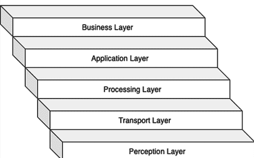

图 4.1 IoT 的层级。

### 4.2.2 区块链基础

BC 是指通过网络相互关联的各种同等重要的小工具（节点）所组成的体系。基本上，它以 P2P 格式记录所有感兴趣节点确认交易后的进出情况。这个分布式账本基于组织中每个参与节点商定的预定义规则运行。这些规则包括监管和批准交易的操作指南、定义所有参与节点相互通信系统的算法，以及偶尔的应用程序编程接口。管理 BC 网络的准则称为协议。它们代表了组织中不成文的规则。

BC 可以被视为分布式账本技术（DLT）[7]的一种变体，其中交互已使用称为哈希的不可更改的加密标记进行记录。DLT 的特性是 [8]：

- 安全
- 分布式
- 匿名
- 可编程
- 不可更改
- 一致
- 带时间戳

#### 4.2.2.1 区块链的层级

BC 的五层如图 4.2 所示，下文将进行等效描述：

- 1. 应用层

促进型应用程序允许你运行所有访问此层的去中心化应用程序。促进型协议也将完全去中心化。此外，维护这些促进型服务器是完全安全的。去中心化应用程序

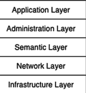

图 4.2 区块链中的层。

与今天的应用程序相似，但有一个显著的变化：它们都具有去中心化的组织。而且，如今这些应用程序非常容易创建。

- 2. 管理层

这是应用层之后的第二层，代表一个循环，有助于从所有有效来源获取最新数据。因此，它将帮助节点获取关于网络的最新数据。另一方面，链下计算用于在 BC 之外完成计算系统。它还提供额外的安全性，并将消费者带到组织框架的中心。此外，设计师在这里也获得管理结构。基本上，这是一个无需人工、独立的协会，可以创建合理的操作条件。真正的状态通道是两个节点之间的路径。因此，利用状态通道，两个节点可以相互通信。除此之外，BC 的明确层中还有其他组件。主要包括预言机、多签名、智能合约、数字资产、钱包、分布式账本存储、数字身份等 [9]。这些是可选的，因为 BC 技术可能有也可能没有它们。

### 预言机：

预言机对于精通技术的智能合约非常重要，因为它们作为从组织外部收集数据的专家。

### 多签名：

该组件保证一种不同的安全协议。基本上，你需要为任何交易签名才能进行交易。此外，你可以选择执行所需的签名数量。

### 智能合约：

这些主要是 BC 技术网络中两名成员之间的自动执行法律协议。通常，整个框架消除了信任问题，并允许你快速交易任何类型的资产。我们将在 BC 指南中稍后讨论这一点 [10]。

### 数字资产：

目前在 BC 技术栈上，数字资产可以指任何东西。通常它可以指代加密货币、股票、黄金或不同类型的存档。任何具有真实属性的数字组件都被称为数字资产 [11]。

### 钱包：

在 BC 中，钱包用于存储组织内的所有数字资产 [12]。

### 分布式文件存储：

在 BC 技术的说明中，分布式账本存储实际上是存储每一位数据的服务器区域。显然，你需要验证才能访问它们 [13]。

### 数字身份：

通常，数字身份是组织中客户的身份 [14]。

- 3. 语义层

在此层中，有共识算法、虚拟机、各种投资要求等。没有共识算法就没有 BC 网络。通常，共识算法对于在所有节点之间保持一致非常重要。它们促进交互，每个节点在账本数据上基于相同的理解进行操作。此外，在账本中，没有人可以简单地发起一笔交易并将其添加进去。这些记录也可能不透明。因此，为了确保区块上的数据合法，每个节点都通过类似的安排进行。我们将在 BC 说明指南中稍后更多地讨论这一点。接下来是投资前提 [15]。这些主要帮助组织确定谁可以加入系统，谁不能。此外，此组件基本上用于私有 BC 进展。另一方面，虚拟机为组织中每个任务提供安全性和执行环境。通常，它用于智能合约执行。接下来是侧链，工程师可以进入一个独立的隔离 BC 环境来开发去中心化应用程序，而不会影响主网络。

- 4. 网络层

此层包含可信执行环境（TEE），用于处理可扩展性问题。它不仅帮助组织解决这个问题，还使其更安全。当数据量过大时，它还协助存储。通常，这些协议用于当标准协议无法完全适应框架时。它创建一个界面，帮助客户传输 BC 网络。最后，块传递网络是一个按需传递 Web 内容的组织框架。通常你可以在常见的 Web 设计中看到它 [16]。

- 5. 基础设施层

这是 BC 技术架构中的最后一层。在此层中，你可能会遇到作为辅助协议的挖矿。然而，由于极高的电力需求，挖矿正在逐渐消失。虚拟化是创建各种虚拟资产（如服务器、网络、存储、操作系统等）的方法。此外，它基于三级框架运行。节点也是此层的一部分。任何连接到组织的设备都被视为节点。没有新节点就没有 BC 技术。此层的另一个重要组件是组织的去中心化存储，使其比以往任何时候都更能抵御入侵。通常你也可能在此层看到代币。代币有助于维护生态系统，是组织中的本地资产 [17]。


### 4.2.3 技术整合：IoTBC

随着现代技术的升级，有必要将已融入现代世界几乎每个交互和执行方面且不易替换的传统系统推向 IoTBC，以提高其安全性和有效性。

技术整合主要关注以下几点：

- 1. 将计算和数据存储尽可能地靠近，以便延迟低且节省带宽。
- 2. IoTBC 的目标是将计算从数据中心物理迁移到边缘网络。
- 3. 为 DTL 创建 IoTBC。

这促使我们创建一个可以轻松嵌入传统系统的新系统。在传统系统上嵌入创新技术需要编排。这种编排可以使现有技术和创新技术兼容。图 4.3 描述了编排的要求以及将传统网络与未来网络更紧密地结合起来的必要性。

如图 4.3 所示，传统网络可以视作 IoT 网络。从图 4.1 可以清楚地看出，IoT 包含五层，从感知层到业务层。在传统网络中，我们可以认为传感器和设备构成了从初始层到感知层的各层。BC 系统在此方面也类似。初始层是由数据组成的基础设施层。

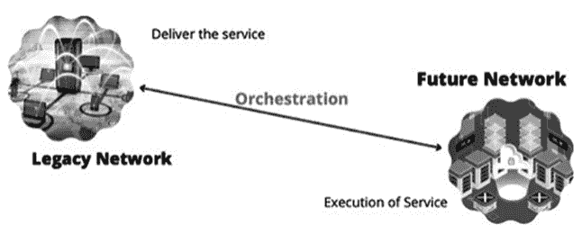

图 4.3 通过编排实现传统网络与未来网络的合并。

存储设备。因此，在通过编排实现的未来网络中，初始层将是基础设施层。就 IoT 而言，传统网络的第二层是传输层；同样，就 BC 而言，它是网络层。这两种功能可以合并到未来网络中，作为通信层，提供网络和传输的功能。这样一来，通信层的服务也可以扩展以提供可信执行环境（TEE）。进一步而言，IoT 的第三层是处理层，而就 BC 而言，第三层是语义层。从 IoT 的角度来看，该层的计算技术已得到显著改进。图 4.4 提供了 IoT 第三层中发生的计算增强的详细见解。

IoT 第三层中的处理是一组设备协同工作的集群，设备之间进行数据交换。此外，由于空间和可扩展性限制，被要求进行通信的设备必须是分布式的。然后，进程转移到并行计算。但这些方法仅包含设备，而要访问的资源位于不同的空间。这极其耗时，因此提出的下一种方法——网格计算——将设备和资源一起考虑。下一个限制是计算必须移动到通过云计算实现的设备和资源的公共空间；此类处理的最新形式是边缘计算。对于未来网络，集成层可以成为计算层，作为第三层。就 BC 而言，第三层负责记录文档和智能合约。如果该层在未来网络中是去中心化的，那么

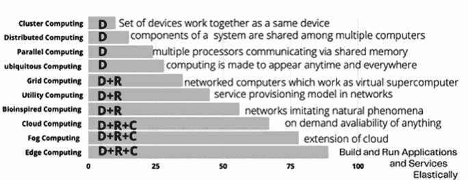

图 4.4 IoT 第 3 层的计算增强。

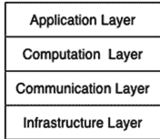

图 4.5 IoTBC 的层架构。

计算开销和安全性可以轻松增强。最后，未来网络的最后一层可能是应用层，它可以合并 IoT 和 BC 以及云的第四层和第五层，这将被称为应用层。因此，新系统将包含四层而非五层，即基础设施层、通信层、计算层和应用层。图 4.5 展示了代表潜在未来网络的 IoTBC 层架构。

与图 4.5 所给出的编排相关，IoT 和 BC 的合并可以轻松理解。IoT 的示例采用固网上的小型智能语音呼叫系统。在这个可用的传统系统上，我们可以嵌入四层 IoTBC，即我们的未来网络。

如图 4.6 所示，借助 IoTBC，简单的语音呼叫系统可以变成智能语音呼叫系统。简单语音呼叫系统的传统系统由连接到基站的移动台组成。这些移动台会联系基站控制器，数据服务由分组控制单元提供。随后，移动交换中心和网关交换中心将协调呼叫并将其连接到附近的电话网络。移动交换中心会联系几个支持节点和认证中心来验证呼叫。最后，呼叫取决于服务，也可以连接到互联网。借助简单的编排，这个传统系统可以变得智能。

编排系统中的第 1 层由构成语音呼叫系统的基础设施组成。就 IoT 而言，基础设施可以是手机和基站的集合，可以将一个简单的虚拟机集成到这里存在的设备中，以纳入 BC 第 1 层。

图 4.6 中的第 2 层是通信层，它必须包含 IoT 的网络和传输功能，以及

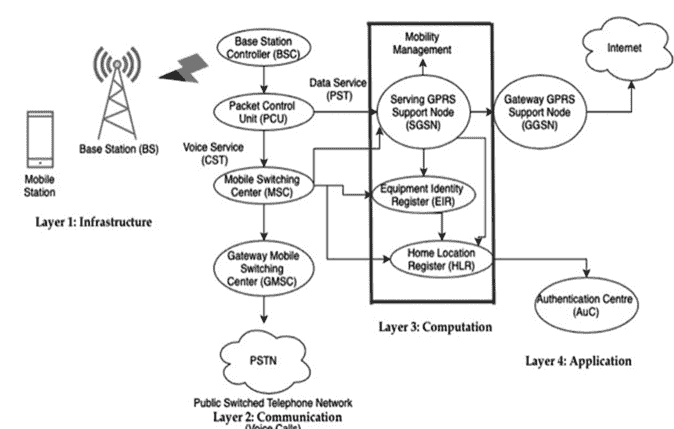

图 4.6 简单语音呼叫系统上的编排。

BC 的网络功能。可使用某些网络协议来协调 IoT 的基础设施系统。对于 BC，必须存在组织层，也称为 P2P 组织，用于建立节点之间的对应关系。分片是一种分割技术，它将处理和容量任务分配到 P2P 组织中，其程度在于，与普通 BC 不同，每个节点不负责处理整个组织的交易负载，而是处理与其分片（或称分片）相关的数据。

图 4.6 中的第 3 层是计算层，它包含 BC 的数据层功能。假设单个交易被调整或更改，则 Merkle 树根也会相应更改（图 4.7）。

## 4.3 探索 IoTBC 的可能性

### 4.3.1 iGovernance

iGovernance 是关于改善公共行政，以实现更好的有效性、本地倡议、灵活的工作方式以及公众的更积极参与。iGovernance 关注利用技术来支持更好的准备和实施，改变公共服务的交付方式。这包括 iGovernment 生产力计划以及灵活运营。

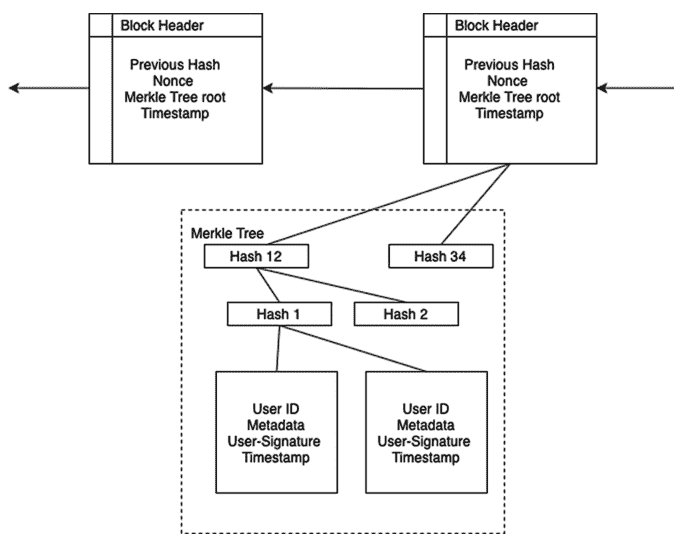

图 4.7 区块的基本结构。

iGovernance 包括问责制、透明度、简洁性和责任感等特征，这些特征通常被视为公务员制度的基本要素。先进的官僚体系同样负责公共当局不同项目和战略的详细制定与执行。利用技术监督服务周期将从根本上积极改变管理周期 [18]。

行政流程机械化：这将限制人为干预，最终消除在提供社会服务过程中个人利益介入的任何可能性。这同样需要组织效率。各办公室在线数据的可用性将使任务的基于 Web 的执行和文档开发成为可能，以便于规划、簿记和信息流控制 [19]。

文档减少：它支持每个代表工作区的文档及其他数据交换，改进开发和利用并减少容量负担。它还可能通过减少所使用的实际物质（即纸张）的体积来减少浪费。

服务质量：电子数据为机构提供了一种有力的方式，以便在广泛的范围内提供高质量的行政服务。


个人需求。这使公务员能够更负责任、更有效地工作。视频会议是高效分配服务的一个例子，允许更广泛的覆盖并减少服务接收者前往特定物理位置接收此类服务的负担 [20]。这也通过将社区活动开放给更广泛的公众利益相关者群体，对其产生积极影响。

iGovernance 保障：通过网络传播信息实现透明度，这包括逐点公众评审，使服务交付更加高效和负责任。

金融发展：iGovernance 在人口稠密地区和农村地区都更具成本效益。在前一种情况下，它是服务精简和资源节约；在后一种情况下，它促进了同一社区内物理上分散广泛的个人之间的信息共享，从而实现更好的资源利用并改善整个社会各阶层的生活质量 [21]。

重要数据提供：当前公共行政往往具有层级性，这制约了人们开展数据共享及其衍生的公共服务交付创新的能力。借助 iGovernance，这一问题得以缓解。

### 4.3.2 iHealthcare

医疗服务框架的重要组成部分包括身份识别、定位、感知和网络。iHealthcare 通过一系列广泛的框架实施：危机管理、智能处理、传感器、芯片实验室、远程检查、可穿戴设备、连接设备和大量信息。

基于 IoT 的框架内置了远程医疗框架中的体感传感器网络。它们包含具有独特节点类型的设备，用于感知患者信息的偶尔变化；为了检查病房内患者的通风条件，使用传感器收集各种有助于房间通风过程的指标数据。

这些传感器被编程用于监测温度、压力、湿度和其他环境因素的不同范围数据。这些方案有助于远程监控患者状况。

该框架可以定期向医院发送报告并维护患者病史。诊所工作人员可以查看信息并为接受观察的患者制定治疗计划。另一种用于 IoT iHealthcare 框架的设备类型基于远程传感器网络 [22]。

另一个更复杂的 iHealthcare 方面是远程医疗。在某些情况下，IoT 是最可靠且成本最低的解决方案，各种设备和智能通信系统之间的连接也应与更传统的场景一同进行探索。创新使通过 IoT 向 iHealthcare 团队（如专家、护理人员和专家）发送数据来监控患者健康变得更加容易。专家利用存储转发策略积累患者信息将很有用，以便按需获取。

患者的当前状态（即心率、体温、身体位置、血糖和心电图）可以通过使用传感器来确定。传感器连接到 Arduino UNO 传感器，当连接到人体 Arduino 板时，获取数据并将其传输到服务器。从此服务器，数据发送给专家，专家确定服务（例如药物需求）。智能电子医疗的概念包括个人电子病历的实时更新、智能家居管理和智能临床设备。虽然市场的性质决定这些进步很可能首先出现在发达国家，但对于发展中国家和欠发达地区，它们具有特殊价值，因为这些地区个人获得医疗服务的途径可能受到长距离和医疗专业人员短缺的限制 [23]。

### 4.3.3 基础设施

网络对于日常活动至关重要。框架可以根据传感器收集的信息进行监控、测量、分析、传输和操作。这些基础不仅基于其实际设计（布线、传感器等），而且基于四项标准：信息、调查、反馈和灵活性。

信息：智能框架运行所需的基本组成部分，也是智能基础运作所需的原材料。

调查：对数据的调查对于获取有用信息以进行导航至关重要。

输入：信息反馈回路对任何智能框架都至关重要。当收集有关资源使用方式的数据，并利用这些数据进一步改进框架运行方式时，这一输入变得清晰。

灵活性：智能框架是那些既能适应当前需求，又能适应未来需求的框架。

半智能基础：该基础会收集和记录关于其自身利用、底层行为和环境条件的信息，但没有基于获取的数据做出决策的能力。此类基础的示例包括记录城市交通拥堵模式的地图 [24–26]。

智能框架：这是指收集信息以处理并呈现有助于人类做出简单决策的数据的框架。这种结构的一个示例是交通框架，它识别交通拥堵区域并通知驾驶员，以便他们在驾驶时做出更好的选择。

智能框架：该框架收集信息、处理数据，并完全独立（无需人工干预）采取适当行动，并逐渐适应不断变化的条件。当前示例包括智能组织、结构、公共系统或海岸。

智能组织：智能组织是指能够有效整合所有关联客户的行为和活动，以便降低风险并优化运营。一个示例是高压能量传输网络，由于其智能组织，该网络更加自动化和集成，能够更好地处理与其关联的所有设备，从而实现高效且可持续的分配 [27, 28]。

智能结构：智能结构是指使用高级设施和机械系统运行的结构，这是一种可实现多种内部过程（如供暖、通风、照明和安全以及结构内的其他系统）自动化的创新 [29]。

### iInfrastructures 的优势是：

- 导航中的从容与准确：这些框架随即控制内部结构和资源状况，监控环境条件，并利用这些信息优化其在系统间动态交互的准确性和速度方面的性能。例如，智慧城市的一项功能是了解交通状况、公共交通模式和停车位可用性，以创建和传播特定区域公共和私人车辆在道路上的更优路线。

- 成本效率与投资资金：这些智能框架允许组织利用资源以更少实现更多。一个示例是控制建筑物内的电力或供暖使用。

- 可靠性：这指的是减少停机时间和意外问题，使组织能够以最高且最一致的质量继续提供其服务。

- 安全与多功能性：这意味着保持能适应变化的周期和计划，保护框架和客户，并能抵御人为错误或灾难性事件。一个示例是控制大型集会的座位安排。

- 客户沟通与增强：智能基础改善客户体验，并提供能够适应消费者不断变化需求的服务。

- 可持续性：这项优势是指升级动态交互，以确保所有管理资源的合理利用。一个示例是城区内高效的废弃物、水或能源管理。

## 4.4 IoTBC 的陷阱

BC 框架的陷阱分为两种类型：无许可链和许可链。无许可 BC 允许任何一方无需验证任何真实性即可参与组织，而许可 BC 链由联盟或评估元素在 BC 系统中支持的主席形成。

无论 BC 类型如何，业务逻辑都使用智能合约进行编码。

区块链风险可分为以下几类：

- 1. 标准风险：BC 创新使组织面临与当前业务流程相关的风险，但具有实体需要考虑的特定细节。

- 2. 价值转移风险：BC 使无需中央中介即可进行有价值的点对点交换。所转移的价值可能是资产、身份或数据。这种新配置使合作方面临过去由中央中介管理的新风险。


3. 智能合约风险：智能协议可能会在区块链上编码复杂的商业、金融和法律计划，并可能导致与从物理系统到计算机化系统的这些安排的协调规划相关的风险。

物联网区块链的弊端如下：

- 1. 它们是完全去中心化的：当您分析公有链和私有链时，可以看出去中心化程度的差异。像比特币或以太坊这样的公有链是完全去中心化和开放的。任何人都可以通过添加或确认信息来参与。私有链仅允许特定实体参与组织。每个成员都是已知的，并且每个成员在组织中都被明确分配了特权和限制。由于较小的群体控制着组织，因此区块链更加集中。拥有完全访问权限的人比拥有受限访问权限的人拥有更集中的权威。最著名的私有链是 Ripple 和 Hyperledger。

- 2. 它们不允许数据修改：它们常因其安全性和透明性而受到赞誉。然而，区块链存在一个显著的缺陷，即任何用户都无法更改甚至自己的信息。用户作为公共交易一部分提供的任何数据都不可再更改。换句话说，如果您在一段时间后遇到以前共享的信息现在对您变得敏感或以任何方式有害的情况，您无法将其从链上删除。在公有链上，每个人都有相似程度的访问权限。这意味着任何人都可以读取数据。这意味着您之前共享但现在不愿共享的信息仍然在那里，任何人都可以访问并在链上上下共享。虽然私有链通过允许每个成员拥有有限的授权来尝试解决此问题，但公有链不提供此选项。

- 3. 它们效率不高：可能会认为像区块链这样的技术创新在处理速度上与现有系统一样快，但事实并非如此。在完全去中心化、无人拥有、由客户端运行的框架中，交易确认不会自动发生，而必须由单个客户端确认。检查交易以获得此类确认证明是缓慢的。当今的区块链每秒只能处理大约 7–15 笔交易。非区块链框架，即使是旧系统，也能每秒处理数千笔交易。与其他缺点一样，正在努力解决此问题。转向更集成的区块链可以加速这一过程。这取决于这样一个事实：在这样的框架中，预期需要更少的客户端来批准交易。另一种技术是转向权益证明批准策略。这种批准策略赋予在区块链中拥有更多权益的人更高的批准能力。

## 4.5 结论

本章主要介绍了物联网和区块链的基础知识。已描述了分层架构及其与各层的集成。引言部分阐述了集成的当前需求和必要性。随后的章节描述了物联网区块链可应用的方法、架构和通用框架。

## 参考文献

- [1] Anusha Vangala, Ashok Kumar Das, Neeraj Kumar, and Mamoun Alazab. 基于物联网的农业智能安全感知：区块链视角. IEEE 传感器期刊, 21(16):17591–17607, 2020.

- [2] Md Ashraf Uddin, Andrew Stranieri, Iqbal Gondal, and Venki Balasubramanian. 使用预测机器学习进行快速健康数据仓库分配. 健康信息学期刊, 26(4):3009–3036, 2020.

- [3] Jiawen Kang, Zehui Xiong, Dusit Niyato, Dongdong Ye, DongIn Kim, and Jun Zhao. 迈向安全的区块链赋能的物联网车辆：利用声誉和合同理论优化共识管理. IEEE 车辆技术期刊, 68(3):2906–2920, 2019.

- [4] Avelino F Zorzo, Henry C Nunes, Roben C Lunardi, Regio A Michelin, and Salil S Kanhere. 使用基于区块链的技术实现可靠物联网. 在 2018 年第八届拉丁美洲可靠性计算研讨会 (LADC) 上，页码 1–9. IEEE, 2018.

- [5] Vivek Acharya, Anand Eswararao Yerrapati, and Nimesh Prakash. Oracle 区块链快速入门指南：在您的企业中实施区块链的实用方法. Packt Publishing Ltd, 2019.

- [6] Licheng Wang, Xiaoying Shen, Jing Li, Jun Shao, and Yixian Yang. 区块链中的密码学原语. 网络与计算机应用期刊, 127:43–58, 2019.

- [7] Caixiang Fan, Sara Ghaemi, Hamzeh Khazaei, and Petr Musilek. 区块链系统性能评估：系统综述. IEEE Access, 8: 126927–126950, 2020.

- [8] Rahul P. Naik and Nicolas T. Courtois. 优化 sha256 哈希算法以实现更快、更高效的比特币挖矿. UCL 计算机科学系信息安全硕士学位论文，页码 1–65, 2013.

- [9] Dan Boneh. 聚合签名，页码 27–27. SpringerUS, 波士顿, MA, 2011.

- [10] Jae Cha Choon and Jung Hee Cheon. 基于间隔迪菲-赫尔曼组的身份基于签名. 在国际公钥密码学研讨会上，页码 18–30. Springer, 2003.

- [11] Weidong Fang, Wei Chen, Wuxiong Zhang, Jun Pei, Weiwei Gao, and Guohui Wang. 区块链中信息不可否认的数字签名方案：最新综述. EURASIP 无线通信与网络期刊, 2020(1):1–15, 2020.

- [12] Avi Asayag, Gad Cohen, Iddo Grayevsky, Maya Leshkowitz, Ori Rottenstreich, Ronen Tamari, and David Yakira. Helix：一种可扩展且公平的共识算法. 技术报告，Orbs Research, 2018.

- [13] Ke Huang, Xiaosong Zhang, Yi Mu, Fatemeh Rezaeibagha, and Xiaojiang Du. 可扩展且可编辑的区块链，支持更新和匿名性. 信息科学, 546:25–41.

- [14] Md Ashraf Uddin, Andrew Stranieri, Iqbal Gondal, and Venki Balasubramanian. 基于区块链的去中心化物联网健康框架. 物联网, 9:100159, 2020.

- [15] Yu Zuoxia, Man Ho Au, Jiangshan Yu, Rupeng Yang, Qiuliang Xu, and Wang FatLau. Cryptonote 风格区块链的新实证可追溯性分析. 在国际金融密码学与数据安全会议上，页码 133–149. Springer, 2019.

- [16] Rebekah Mercer. 区块链上的隐私：唯一性环签名. arXiv 预印本 arXiv:1612.01188, 2016.

- [17] R. Yap. 了解 Zerocoin 的工作原理及其与其他匿名性解决方案的对比（第 1 部分）, 2017.

- [18] Chaoyang Li, Yuan Tian, Xiubo Chen, and Jian Li. 面向区块链赋能系统的高效抗量子格盲签名. 信息科学, 546:253–264, 2020.

- [19] Jon M. Peha and Ildar M. Khamitov. Paycash：一种安全高效的互联网支付系统. 电子商务研究与应用, 3(4):381–388, 2004.

- [20] Ahsan Manzoor, An Braeken, Salil S Kanhere, Mika Ylianttila, and Madhusanka Liyanage. 基于区块链的代理再加密支持的安全匿名物联网数据共享平台. 网络与计算机应用期刊, 176:102917, 2020.

- [21] Abdul Rahman Taleb and Damien Vernaud. 加速数字签名验证. 计算机与系统科学期刊, 116:22–39, 2020.

- [22] Leila Ismail and Huned Materwala. 区块链架构和共识协议综述：用例、挑战与解决方案. 对称, 11(10):1198, 2019.

- [23] Vincent Gramoli. 从区块链共识回到拜占庭共识. 未来计算机系统, 107:760–769, 2017.

- [24] Li Peng, Wei Feng, Zheng Yan, Yafeng Li, Xiaokang Zhou, and Shohei Shimizu. 无许可区块链中的隐私保护：综述. 数字通信与网络, 7(3):295–307, 2020.

- [25] Sujit Biswas, Kashif Sharif, Fan Li, Sabita Maharjan, Saraju P. Mohanty, and Yu Wang. Pobt：一种用于可扩展物联网商业区块链的轻量级共识算法. IEEE 物联网期刊, 7(3):2343–2355, 2019.

- [26] Saqib Hakak, Wazir Zada Khan, Gulshan Amin Gilkar, Muhammad Imran, and Nadra Guizani. 通过区块链技术保障智慧城市安全：架构、要求与挑战. IEEE 网络, 34(1):8–14, 2020.

- [27] Fan Yang, Wei Zhou, Qing Qing Wu, Rui Long, Neal N. Xiong, and Meiqi Zhou. 带降级机制的委托权益证明：一种具有降级机制的安全高效区块链共识算法. IEEE Access, 7:118541–118555, 2019.

- [28] Ahmad Firdaus, Mohd Faizal AbRazak, Ali Feizollah, Ibrahim Abaker Targio Hashem, Mohamad Hazim, and NorBadrul Anuar. “区块链”的兴起：区块链研究的文献计量分析. 计量科学, 120(3):1289–1331, 2019.

- [29] Bin Yuan, Hai Jin, Deqing Zou, Laurence Tianruo Yang, and Shui Yu. 用于软件定义网络中故障交换机容错的实用拜占庭方法. IEEE 网络与服务管理期刊, 15(2):825–839, 2018.


# 基于无线保真（Wi-Fi）盾牌和Arduino微控制器的物联网智能家居自动化系统的设计与制造

Ayan Bhattacharjee 和 Alak Roy  
特里普拉大学（中央大学），特里普拉，印度  

Mampi Devi  
特里普拉大学（中央大学），特里普拉，印度  

Sajal Kanta Das  
特里普拉大学（中央大学），特里普拉，印度  

## 目录

- 5.1 引言 100  
- 5.2 文献综述 101  
- 5.3 拟议系统 102  
- 5.3.1 硬件要求 102  
- 5.3.2 软件要求 104  
- 5.3.3 系统设计 105  
- 5.4 结果与讨论 106  
- 5.5 结论与未来方向 107  
- 参考文献 107  

## 5.1 引言

技术负责改善和简化我们的生活，并随着我们需求的变化而不断演变。技术的一个突出例子是智能手机，它已成为我们日常生活中几乎不可分割的组成部分 [1]。嵌入式系统也获得了巨大的普及，并被用作智能家电演进背后的关键组件。当家庭和/或工作场所中的每一台设备都连接到互联网时，物联网（IoT）是一份礼物，使我们的日常活动比以往任何时候都更容易执行。目前，智能自动化家电和系统在技术市场上日益受到重视。此外，人们最近正在投入更多资金来建设智能家居和办公室 [2]。

除了管理这些系统，一些公司还试图专注于人工智能（AI）控制的智能家居自动化系统，从而让人类摆脱与家电的直接交互。然而，此类系统中目前部署的 AI 无法完成所有活动，而且此类系统的成本仍然非常高 [3]。然而，与现有智能家居界面交互需要相当的技术知识，这显然是对不具备此类知识的人（包括大多数老年人，他们不像年轻一代那样对现代电子产品具有“天然”熟悉度）的重大障碍 [4]。因此，拟议系统不仅致力于提供低成本的智能家居自动化系统，还致力于通过基于 Android 的应用程序使其易于使用。

本章提出了一种使用无线保真（Wi-Fi）盾牌和 Arduino 微控制器的物联网智能家居自动化系统。拟议系统的目的是为用户提供一个界面，以相对容易的使用和成本效益来控制家庭中安装的所有家用电器（灯光、风扇、水龙头、空调）。构建该系统需要一部 Android 智能手机、一个微控制器（Arduino Uno R3）、一个 Wi-Fi 模块（ESP-01 8266）、一个继电器模块以及负责为设备供电的电源。该系统旨在让仅具备现代电子设备基本知识的人（其中老年人占多数）也能轻松使用。

本章的组织如下。第 5.2 节回顾了该主题的现有文献。第 5.3 节介绍了带有硬件和软件要求的拟议系统。第 5.4 节介绍了结果与讨论。最后，本章在第 5.5 节总结了未来的研究方向。

## 5.2 文献综述

本节介绍了智能家居自动化系统领域的近期文献。在 [1] 中，作者提出了一种使用 Digilent chipKIT Uno32 和 Arduino Uno 微控制器板构建的低成本家居自动化系统，并强调了人们如何通过远程访问系统来轻松监控和了解家中正在使用的电器。

在 [2] 中，作者强调了家用电器的能源消耗以及高能源消耗对自然环境的影响。此外，他们的论文还着重于如何根据家中各种传感器测量的参数来降低能源消耗。

在 [3] 中，作者描述了自动化系统如何消除人类与各种系统交互的需求，如何使用 ATmega 328 和 Android 应用程序/短信，在办公室或家庭环境中构建一个用于控制安装电器的家居自动化系统。

[4] 的作者专注于人们如何希望远程控制家用电器，并提出了一种使用 8051 微控制器构建的自动化系统，该系统可通过使用 GSM 技术的手机发送的短信进行控制。

在 [5] 中，作者撰文介绍了人们家中所有电器的高能源消耗的影响，以及由于缺乏访问权限，这些电器如何导致能源损失。作者鼓励使用蓝牙、ZigBee 或 Wi-Fi 技术进行智能家居自动化，这将允许人们远程交互和控制家用电器。这反过来又会降低能源消耗。

[6] 的作者解释了家居自动化如何在短时间内获得巨大的普及，并提高了生活质量。他们还提到人们如何使用微控制器、Android 智能手机和无线技术（ZigBee、Wi-Fi 或蓝牙）来开发智能家居自动化。他们描述了此类发展的优点和缺点。

在 [7] 中，作者描述了如何通过使用物联网（IoT），通过放置各种不仅可以感知还可以将数据获取到互联网的传感器和集成系统，来减少人类与电器的直接交互。由此产生的系统不仅更高效、更具成本效益，而且更安全。

[8] 的作者讨论了他们使用树莓派和移动设备构建的家居自动化系统。除了描述他们的系统工作原理外，作者还描述了树莓派及其对多个组件的内置支持，以同时处理多个电器。

在 [9] 中，作者将家居自动化系统介绍为一种可由移动设备支持的基于 Web 的应用程序，用于控制用户家中安装的家用电器，以及此类系统如何帮助节约能源并提供安全性。作者还强调了一旦所有电器都有了自动化支持，适当安全性的重要性。

[10] 的作者讨论了现有的智能家居系统以及构建此类系统时集成的各种多媒体设备和传感器。他们的研究还为未来研究人员构建可持续智能家居提供了指导。

在 [11] 中，作者说明了如何使用树莓派构建带有基于 IoT 的集中式 Web 控制的智能家居自动化系统。主要理念是对所有家用电器进行集中控制，以及这样的智能系统如何帮助建设安全的家居。

## 5.3 拟议系统

本节介绍了使用无线保真盾牌的物联网智能家居自动化系统的设计与制造。此外，还介绍了构建该系统所需的各种硬件和软件组件。

### 5.3.1 硬件要求

拟议系统所需的硬件组件是 Arduino Uno R3（微控制器）和 REES52 光耦合器（继电器模块）。该系统还需要 ESP-01 8266（无线保真盾牌）来与 Android 智能手机建立通信。以下包含了构建智能家居自动化系统所需的各种硬件组件的详细信息。

### Arduino Uno R3

Arduino Uno R3 是由 Arduino 设计的微控制器。它是一个开源微控制器开发板，是入门此类智能家居系统最推荐的开发板。尽管 Arduino 是该开发板的官方制造商，但其他制造商也生产此开发板，并以低于原始制造商的价格出售。Uno 开发板带有一个 USB 端口，用于连接计算机并从 Arduino IDE 上传代码（草图）。在拟议系统的硬件部分，Arduino 起着关键作用，因为它不仅负责为 ESP-01 8266 Wi-Fi 模块供电，还负责为继电器模块供电。此外，ESP-01 8266 缺乏与计算机的直接通信端口，因此必须通过 Arduino UNO R3 建立连接，以便在 ESP-01 8266 中上传程序。

### ESP-01：

ESP-01 8266 Wi-Fi 模块是一种低成本微芯片，支持完整的 TCP/IP 协议栈，并具有微控制器的功能。这种 Wi-Fi 模块通常用于将微控制器连接到互联网，可以编程以连接到 Wi-Fi 接入点，甚至充当一个接入点。在这个特定的系统中，ESP-01 8266 被编程为连接可用的互联网接入点（路由器、智能手机），一旦连接到接入点，就可以控制家中连接到该系统的电器。ESP-01 需要 3.3 V 才能运行，该电压由 Arduino Uno R3 板提供。如图 5.1 所示，ESP-01 的 TX 和 RX 引脚连接到 Arduino 的 TX 和 RX 引脚，以便与计算机通信。通用输入输出（GPIO）引脚连接到继电器模块的输入引脚。

### REES52 光耦合器：

最后需要的组件是 REES52 光耦合器继电器单元模块，可以将其视为各种电器的开/关开关，通常由微控制器提供输入。根据要求，它有双路、四路甚至八路继电器单元可用。与 ESP-01 8266 类似，

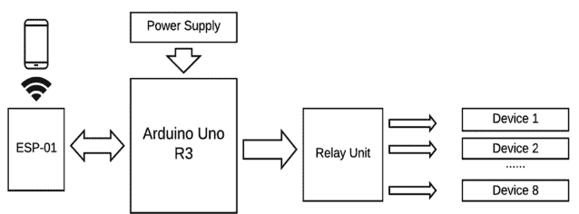

图 5.1 智能家居自动化系统的系统设计。


继电器单元也会消耗来自 Arduino Uno 开发板供电的 (5 V) 电源。基于从 ESP-01 8266 模块接收到的输入，继电器单元会闭合或断开电路，从而打开或关闭连接到它的电器。

### 5.3.2 软件要求

拟议系统所需的软件组件是 Arduino IDE 和 Android Studio，它们在开发程序和 Android 应用中发挥着关键作用。

**Arduino IDE:** 它是一款免费开源的集成开发环境，用于为 Arduino、ESP 和其他微控制器开发板编写和上传程序（草图）。编写完程序后，可以对其进行验证以检查错误，然后将其上传到微控制器开发板。Arduino IDE 编程语言基于 C++ 编程语言，因此熟悉 C++ 的人能够更快地上手 Arduino IDE。

在本项目中，需要使用 Arduino IDE 将代码（草图）上传到 ESP-01 8266 模块。因此，ESP-01 8266 不仅可以连接到互联网，还可以通过其通用输入输出（GPIO）引脚接收输入。拟议系统具有 Android 应用，该应用与 ESP-01 8266 模块交互以控制电器。

**Android Studio:** 与 Arduino IDE 类似，Android Studio 也可通过 Google 免费获取。该 IDE 用于构建专业的 Android 应用程序。Android Studio 自带 Android 模拟器支持，使程序员可以在模拟器中运行和部署应用以查找错误并测试构建的应用程序。通过在模拟器中部署应用，程序员可以检查应用在使用过程中是正常运行还是崩溃。Android Studio 用于构建、测试、调试和部署应用。最重要的是，构建的应用完全可定制；因此，它可以扩展为控制其他类型的设备，并向用户显示实时信息。

系统的核心概念依赖于无线通信，这使用户能够从任何他们想要的地方远程与家用电器交互并进行控制。为满足这一需求，使用无线技术（Wi-Fi）使控制系统的微控制器能够连接到互联网，从而与 Android 智能手机形成通信网关，以接收和传输输入和输出。在此系统中，需要一个 Android 应用程序来控制系统。Android 智能手机运行一个与构建的系统交互并控制连接到自动化系统的电器的应用。

### 5.3.3 系统设计

基于物联网的智能家居自动化系统的系统设计如图 5.1 所示，其中 ESP-01 模块通过 Arduino Uno R3 微控制器连接到继电器单元。继电器单元的输出连接到电气设备。为了建立系统中多个组件之间的连接，使用了跳线和面包板。ESP-01 和继电器单元需要母跳线，而 Arduino Uno R3 需要公跳线。总体而言，跳线和面包板的组合用于搭建智能家居自动化系统。系统需要一个电源，可以使用普通充电宝提供。系统开启后，它会查找附近的接入点，并使用 SSID 和密码进行连接。设备连接后，用户可以启动 Android 应用程序与系统交互。

所提议智能家居自动化系统的布线图如图 5.2 所示。Arduino Uno R3 与 ESP-01 8266、ESP-01 8266 与 RESS52 继电器模块之间的连接列于表 5.1 中。

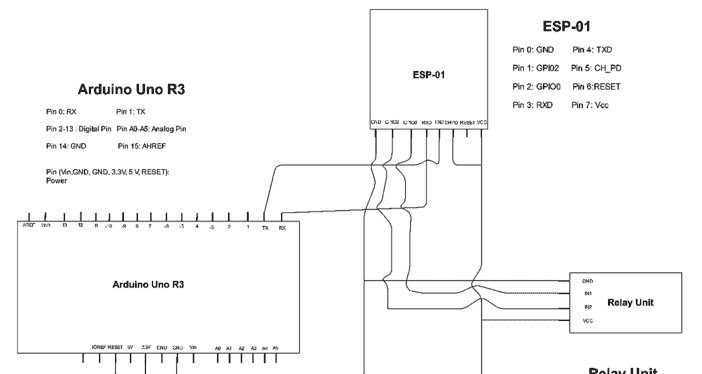

图 5.2 智能家居自动化系统的布线图。

| Arduino Uno R3 | ESP-01 8266 | RESS52 继电器模块 |
| --- | --- | --- |
| RX (引脚 0) | RX (引脚 4) | |
| TX (引脚 1) | TX (引脚 5) | |
| 3.3 V | VCC (引脚 7), CH PD (引脚 5) | |
| 5 V | | VCC |
| GND | GND (引脚 0) | GND |
| | GPIO 0 (引脚 2) | INP 1 |
| | GPIO 2 (引脚 1) | INP 2 |

## 5.4 结果与讨论

测试后发现，当智能手机和智能家居自动化系统都断开互联网连接时，页面加载失败。因此，用户会收到一个弹出窗口，提示用户的设备未连接到互联网。另一方面，当智能手机和智能家居自动化系统连接到互联网时，应用会加载家居自动化系统的界面，其中包含所有按钮。根据按下的按钮，连接的设备会通电，同时相关信息会在应用上被高亮显示。所设计拟议系统的开发布局如图 5.3 所示。

另外，当 ESP-01 无法响应点击的按钮时，它会以延迟响应。从图中可以看出，界面仅包含两个按钮。但是，应用可以自定义，并向界面添加更多按钮。由于 ESP-01 只有两个 GPIO 引脚，按钮数量被限制为两个。因此，开关数量取决于所使用的 ESP 模块型号。

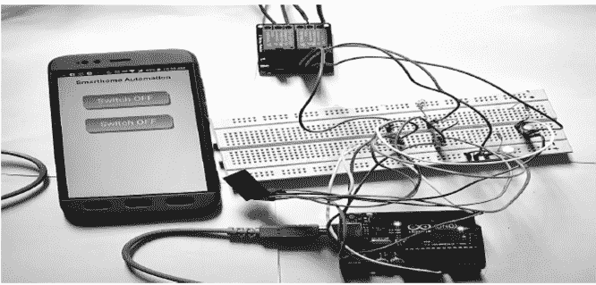

图 5.3 智能家居自动化系统的输出界面。

## 5.5 结论与未来方向

本章提出了一种基于物联网的智能家居自动化系统，使用无线保真扩展板和 Arduino 微控制器，可将普通家庭转变为智能家居。该系统可定制，因此可以通过添加传感器、监视器屏幕和其他相关设备进行扩展。本章的目的是展示如何构建低成本的智能家居自动化系统。该系统演示了基于物联网的智能家居自动化如何提高生活水平。拟议系统可以节省能源，并帮助老年人和残疾人使用智能手机上的简单、用户友好的界面，无需身体移动即可控制家用电器。此外，系统安装过程是一次性过程，不需要任何修改。唯一需要做的是设置电器的连接。

未来工作包括将现有的 ESP-01 和 Arduino Uno R3 替换为 ESP NodeMCU 微控制器，并将传感器与现有设备集成。未来工作还包括为系统添加具有警报功能的安全特性。

## 参考文献

- [1] Stojolescu-Crisan, C., Crisan, C. and Butunoi, B.P., 2021. 基于物联网的智能家居自动化系统。Sensors，21(11)，第 3784 页。
- [2] Satheeskanth, N., Marasinghe, S.D., Rathnayaka, R.M.L.M.P., Kunaraj, A. and Joy Mathavan, J., 2022. 基于物联网的集成智能家居自动化系统。载于《无处不在的智能系统》（第 341–355 页）。新加坡：Springer。
- [3] Yuvaraj, K., 2021. 智能家居自动化系统。《罗马尼亚细胞生物学学会年鉴》，第 9087–9090 页。
- [4] Ray, A.K. and Bagwari, A., 2020, April. 基于物联网的智能家居：安全方面和安全架构。载于 2020 年 IEEE 第 9 届通信系统与网络技术国际会议（CSNT）论文集（第 218–222 页）。IEEE。
- [5] Isyanto, H., Arifin, A.S. and Suryanegara, M., 2020, February. 使用 Google Assistant 为残疾人设计和实现基于物联网的智能家居语音命令。载于 2020 年智能技术与应用国际会议（ICoSTA）论文集（第 1–6 页）。IEEE。
- [6] Singh, H., Pallagani, V., Khandelwal, V. and Venkanna, U., 2018, March. 使用传感器节点的基于物联网的智能家居自动化系统。载于 2018 年第 4 届信息技术最近进展国际会议（RAIT）论文集（第 1–5 页）。IEEE。
- [7] Mahmud, M.S., Zishan, M.S.R., Ahmad, S.I., Rahman, A.R., Hasan, M. and Rahman, M.L., 2019, January. Domicile–一个基于物联网的智能家居自动化系统。载于 2019 年机器人、电气与信号处理技术国际会议（ICREST）论文集（第 493–497 页）。IEEE。
- [8] Jabbar, W.A., Alsibai, M.H., Amran, N.S.S. and Mahayadin, S.K., 2018, June. 智能家居基于物联网的自动化系统的设计与实现。载于 2018 年网络、计算机与通信国际研讨会（ISNCC）论文集（第 1–6 页）。IEEE。
- [9] Jabbar, W.A., Kian, T.K., Ramli, R.M., Zubir, S.N., Zamrizaman, N.S., Balfaqiih, M., Shepelev, V. and Alharbi, S., 2019. 具有物联网支持自动化系统的智能家居的设计与制造。IEEE Access，7，第 144059–144074 页。
- [10] Agarwal, K., Agarwal, A. and Misra, G., 2019, December. 基于物联网的无线智能家居和家居自动化的回顾与性能分析。载于 2019 年第三届 I-SMAC（社交、移动、分析和云中的物联网）国际会议（I-SMAC）论文集（第 629–633 页）。IEEE。
- [11] Mahmud, S., Ahmed, S. and Shidker, K., 2019, January. 使用物联网（IoT）的智能家居自动化和计量系统。载于 2019 年机器人、电气与信号处理技术国际会议（ICREST）论文集（第 451–454 页）。IEEE。


# 金融系统中面向完整性、透明度和无需信任交易的区块链架构

Jitendra Saxena
The Institution of Engineers, Kolkata, India

## 目录

- 6.1 引言 110
- 6.2 区块链技术基础 111
- 6.3 分散式金融网络中区块链的概述与实现 112
- 6.4 金融系统中的区块链架构 113
- 6.4.1 工作量证明 114
- 6.4.2 数据与安全哈希算法（SHA 256 算法）116
- 6.5 分散式系统案例研究 120
- 6.6 区块链基础设施管理 122
- 6.7 智能合约管理的不同层级 123
- 6.8 智能合约与金融 124
- 6.9 结论 125
- 参考文献 125

## 6.1 引言

区块链应用始于 2009 年的比特币，并一直延续至今，但对区块链技术的深入研究成果尚待实施和验证。具有重大社会影响的创新发现和举措仍在进行中，每天都是充满新曙光和新可能的新一天。最近的趋势和发展以及消费者对银行业信任度的下降，为区块链技术进入金融系统领域打开了大门，该系统将完全透明并整体适应社会增长和可持续性。用于加强加密货币的区块链是区块链架构中广泛使用的众多应用之一，同时，以太坊基金会通过实施通用可编程区块链开启了新范式，该区块链已在全球采用和实施。由此产生的成果为除金融系统外的不同新兴领域确立了 100% 透明、无需信任、可靠且高度安全等高端功能的路径。本章的目标是调查和比较金融领域当前受信任且完全透明的集中式系统的重点，以及全球社会将如何从采用完全无需信任和透明的系统中受益。

区块链系统创新者的愿景是那些拥有数十亿美元业务交易和海量数据的大公司，从中可以提取更多信息。关于隐私和透明性存在各种各样的问题 [1, 2]。用户的行为和动态以及隐私顾虑是主要发现。如今许多银行更加精明，掌握更多信息和控制权。银行可以跟踪各种信息。银行数据库中有大量数据，银行掌握更多受其控制的信息，因此不存在隐私。社交媒体和公共媒体中有很多优点和缺点。以政府土地记录为例，我们可以轻易操纵或修改数据，因此存在巨大的潜力来避免操纵，并应用高科技框架促进社会发展。维护数据的基础设施也至关重要，需要大量人力来维护基础设施，这应当得到优化。就业务交易而言，如果数据库泄露，组织的信任将不复存在。至关重要的问题是数据的隐私和安全性 [3, 4]。因此，去中心化以维护数据的安全性和隐私性的概念至关重要。问题在于交易的集中化，解决方案是去中心化 [5–10]。为追踪技术演进：在 2000 年，Web 技术 1.0 占据主导地位；在 2010 年是 Web 2.0；在 2015 年至今则是 Web 3.0。

## 6.2 区块链技术基础

对于每个技术系统，都有一个带有数据库的 Web 服务器用于扩展数据或扩展操作。数据系统的存储和升级通常受其所使用的服务器大小（容量）限制。在数据使用量突然激增的情况下，往往很难及时完成服务器升级。为了解决这个问题，组织可以在不获取实际物理服务器的情况下租用额外的服务器空间，例如 Amazon Web Servers 提供的服务器。所有数据都存储在这些租用的服务器中。数据去中心化和去中心化应用（DApps）是区块链框架中的常见做法。构建通用的区块链架构框架至关重要，而以太坊和 Hyperledger 的一个基本问题包括区块链的重要金融交易。例如，Amazon 拥有数十亿用户，是一个利用名为网格计算的系统的集中式网络。图 6.1 显示了基于 Amazon 的集中式系统，包含用户以及不同的功能，如客户、客户需求类型、不同类型的产品信息、与图像和视频相关的数据以及数字营销。这是一个具有通用处理单元的集中式系统，用于快速通信和基础设施。

在区块链架构中，信息不由单一实体拥有，而是由多个单个用户拥有。在集中式数据交易系统中，数据被操纵的可能性很高。在去中心化金融交易系统中，这种可能性显著降低，因为没有单一身份控制交易 [11–15]。在去中心化网络中，避免了数据删除和操纵；数据为所有用户复制，每个人都接收信息。发送者和接收者的身份不予披露，并由安全哈希算法（SHA 256）加密。

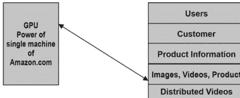

图 6.1 具有特定数据功能的集中式 Amazon 系统。

## 6.3 分散式金融网络中区块链的概述与实现

区块链网络的重要特征是：

- 1. 不可篡改性
- 2. 隐私性
- 3. 透明性

图 6.2 详细概述了将私人银行系统转换为去中心化系统的过程，其中共享账本和记录由安全哈希算法（SHA 256）加密，其交易被转换为 B1、B2、B3 和 B4 等区块。

基于社交媒体、人员和不同类型用户的概述与共识，带有加密谜题的交易被求解和执行。金融信息和交易由矿工和共识算法注册、验证和确认 [16–19]。

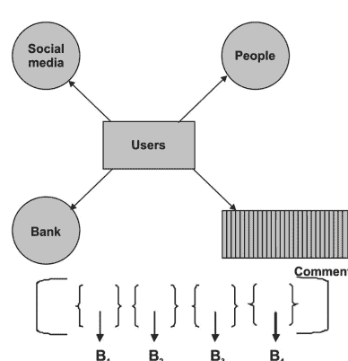

图 6.2 具有私有区块链架构的去中心化银行系统。

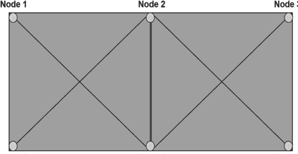

图 6.3 节点交易的去中心化网状区块链架构。

图 6.3 显示了节点交易的去中心化网状区块链架构，其中包含各自数据和元数据的节点网络通过区块的形成进行注册、验证和确认。

## 6.4 金融系统中的区块链架构

图 6.4 显示了一个带有金融交易的区块，包含具有网络安全性和透明性的数据预处理的不同功能。

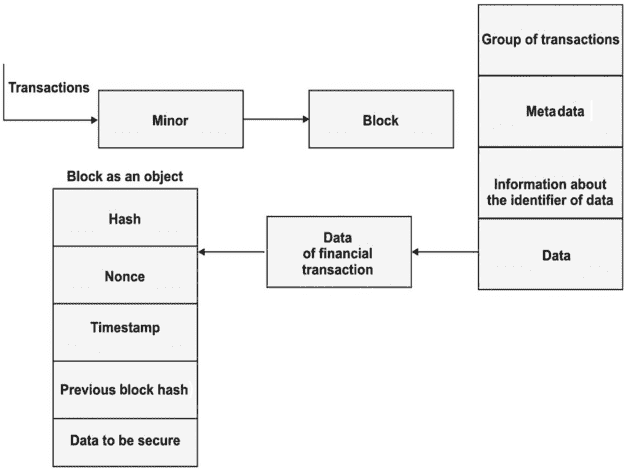

图 6.4 带有矿工和区块链架构的金融交易。

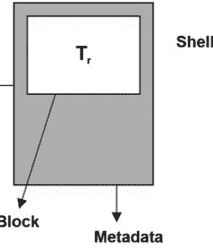

图 6.5 执行带有数据和元数据的交易后形成的区块。

使用工作量证明的矿工通过创建区块来验证交易。一个区块包含经过哈希、随机数、时间戳和前一区块哈希等特定特征执行后的确认交易，最终数据得到保障，数据被识别的可能性很小，从而产生透明且安全的交易。

图 6.5 表示活动区块中带有数据和元数据的金融交易外壳。这些功能用于实时区块链网络。我们可以在区块链浏览器中查看实时交易。矿工有权维护账本。矿工是接收金融交易的节点或交易点。节点是进行金融交易的矿工。矿工接收一个交易，该交易以键的形式到达，并伴随交易的值。当交易在网络中提供给多个人时，矿工会创建一个区块。在任何特定时刻，只有一个矿工可以创建一个区块。

### 6.4.1 工作量证明

图 6.6 显示了用于金融交易的工作量证明求解加密谜题。带有应用程序接口的网络服务器发送一个加密谜题。工作量证明对于创建逻辑谜题和随机数至关重要。逻辑谜题的解被馈送给随机数，随机数作为矿工，在确认工作量证明的验证后形成区块，从而验证交易。

图 6.7 显示了在本地主机 Web 服务器应用程序上启动区块链架构。本地主机 3001 将是第一个交易节点，首先注册，然后与其他本地主机服务器（如 3002、3003 等）广播。


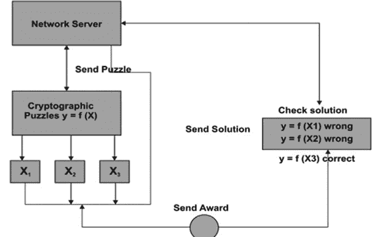

图 6.6 工作量证明解决金融交易的加密谜题。

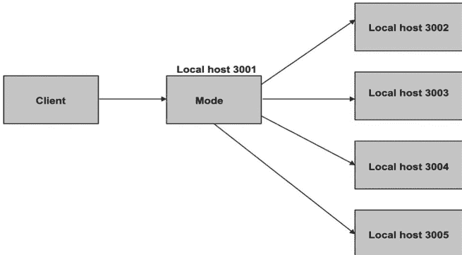

图 6.7 在本地主机 Web 服务器应用程序上启动区块链架构。

工作量证明是创建区块的核心功能。工作量证明的后端架构是通过解决加密谜题来完成的。

图 6.8 提供了一个详细的架构设置，包含一个共享账本，用于向所有节点进行金融交易。共享账本中的一个块包含经过验证和加密的数据，这些数据会相应地通信并广播到所有网状节点。区块链网络由至少 10,000 到 20,000 个节点组成，10,000 个节点的交易需要大量的基础设施和电力消耗。因此，块中的所有交易都按包含加密数据的数组排列，具有完全的安全性和透明度。

图 6.9 展示了使用区块链技术的金融交易，共享账本的一系列行中包含一个区块数组。

在实时中，加密谜题会更加复杂，解决方案会被发送到网络服务器。谜题与交易之间没有关系，但连接是常识性的。最早发送解决方案的人将获得奖励。

### 6.4.2 数据与安全哈希算法（SHA 256 算法）

```
H₂ = SHA256(H₁ + N₂ + D₂ )
H₃ = SHA256(H₂ + N₃ + D₃ )
H₄ = SHA256(H₃ + N₄ + D₄ )
⋮
⋮
⋮
⋮
⋮
Hₙ = SHA256(Hₙ₋₁ + Nₙ + Dₙ)
```

Hₙ 表示使用安全和哈希算法的通用方程，H₁、H₂、H₃……Hₙ 分别是相应的哈希值，N₁、N₂、N₃……Nₙ 分别是相应的 nonce，D₁、D₂、D₃……Dₙ 分别是与交易相关的相应数据。上述包含 nonce 和数据的哈希方程应用了 SHA 256 算法。区块链是一种紧密耦合的架构。如果任何数据发生更改——例如，如果 D₄ 发生更改——那么 H₄ 会随之更改，整个区块链也会随之更改。共识会识别任何损坏的链，选择正确的链，并促进替换。如果哈希依赖关系和哈希是相互连接的，从而形成链式结构，如果发生任何更改，应在极短的时间内识别出来。工作量证明的一般形式称为共识算法。执行工作量证明的过程称为挖矿，该过程称为加密货币。如果需求增加，价值会增加。矿工的工作是创建工作量证明。通过此类确认生成的基础设施量越大，特定矿工生成的比特币（即创建工作量证明的奖励）就越多。Hashcash 是一种生成数学谜题的算法。谜题的复杂度与网络的大小成正比。工作量证明通常用于生成区块。生成工作量证明涉及大量的电力消耗。

- 1. 工作量证明有助于保护网络免受拒绝服务攻击。
- 2. 挖矿可能性很多，因为不断需要新的工作量证明。
- 3. 需要高技能集来在更短时间内解决复杂谜题。
- 4. 缺点是软件基础设施和电力消耗方面的巨大支出。

应对比特币货币及其相关交易进行适当监管。加密货币是一种容易出现“泡沫”的波动机制。区块链架构的增长非常短暂且剧烈。社区希望获得隐私，这取决于市场状况，通常是一个有争议的话题。随着数据量呈指数级增长，系统应该完全透明和安全。例如，我们创建一个节点，然后 localhost 3000 完成交易，从而建立网络节点。这是一个去中心化的网络，包含网络中的节点集群——可能是 10,000 到 50,000 个节点。

第一个客户端发送请求，并创建带有本地服务器 3001 的节点。在创建节点后，会创建本地服务器 3001 的功能，然后将所有信息广播到所有其他节点，从一个本地服务器传递到下一个。因此，网络上的每个节点都接收客户端的请求。从客户端向所有其他节点发送信息是不可行的，因为有数千个节点，这会使客户端设备过载并导致应用程序和/或浏览器卡死。我们将使每个节点都能接收网络中其他节点的信息。在设计 Web 技术时，处理必须保留在服务器端，而不是客户端端。所有金融资源应保持连续，并且应实现零停机。每个节点都应该接收交易并向其他节点广播。因此，对于任何区块链交易，必须：

- 1. 建立节点连接
- 2. 将交易广播到所有其他节点

第一个接收交易的节点称为注册节点。对于任何注册节点，区块链中的 Web 技术都有 post 调用。每个节点都应该具有接收信息的能力。区块链构造函数在区块链中注册节点。

## 5. 智能合约。以下是智能合约开发的关键点：

- 1. 识别协议
- 2. 设置条件
- 3. 编码业务逻辑
- 4. 加密
- 5. 执行和更新
- 6. 网络更新

假设要执行一个名为智能合约 5000 的智能合约。
智能合约 5000

```
{
if
true
else
}
```

现在，如果我们想更改智能合约 5000 中的信息，无法修改这些信息。区块链用于实现智能合约。今后将创建一个带有先前区块相同 ID 的新块。

图 6.10 提供了用于房地产收益记录的智能合约概述方法，包括保险和内部收益来源的房地产所有特定功能。

### 传统合同系统的缺点：

- 1. 耗时且昂贵
- 2. 数据泄露和控制有限
- 3. 单点故障风险高，容易成为黑客攻击目标。

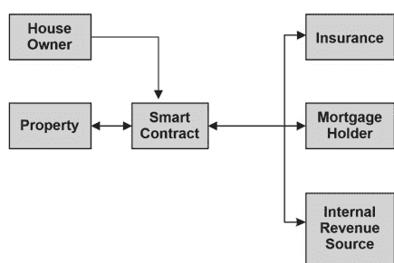

图 6.10 用于房地产收益记录的智能合约框图。

### 智能合约的优势：

- 1. 基于分布式账本的安全性，实现端到端的数字化工作流
- 2. 区块链与人工智能辅助的 IoT 相结合，实现高度安全性。区块链具有保护身份的能力。
- 3. 投保人存储库包括驾驶记录保单、车辆类型和事故记录。
- 4. 车辆自我感知和使用传感器进行损害评估可以执行初始保险索赔/保单报告。
- 5. 通过减少验证报告和保单的重复工作来增加节省。
- 6. 智能合约通过工作量证明和共识算法实现。

图 6.11 展示了金融交易、智能合约和投资者的表示，证明了财务节约的透明度，并最大限度地减少了合同分配采购、处理、执行和实施所需的时间。

## 6.5 去中心化系统案例研究

图 6.12 展示了一个在线娱乐内容分销商形式的去中心化区块链系统和机器学习模型案例研究。全球频道电影合作伙伴购买版权，内容

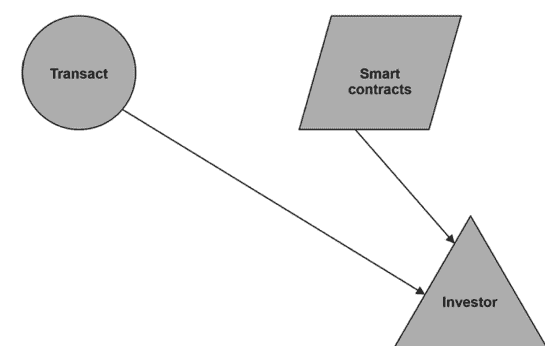

图 6.11 带有智能合约的区块链框图。

### 去中心化 Netflix

### M-L 模型

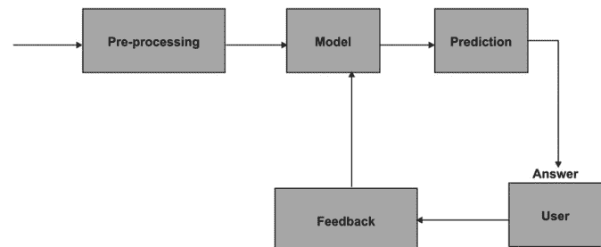

图 6.12 去中心化类 Netflix 机器学习（ML）模型带有预测分析功能的框图。

频道上的流媒体，数据（图像、视频和数据）是电影频道的版权。用户购买订阅，这就是电影频道合作伙伴产生收入的方式。在区块链中，没有第三方中介和单一控制器；它是一个在整个网络中共享信息的点对点模型。电影频道数据上传到区块链网络。有一个可为去中心化网络开发的内容分发平台。电影


建议是在不披露人员身份的情况下让更多人参与网络。因此，即使他们喜欢特定内容，人员身份也不会像常规系统那样显示。电影的所有数据结构都通过机器学习处理，预测将在去中心化网络中进行。

## 6.6 区块链基础设施管理

区块链中没有类似 AWS 或 Microsoft Azure 系统的云。内容生成应用是一个非常热门的话题，也是去中心化网络的新兴领域。区块链技术是金融领域各种应用的可行解决方案。由于维护的复杂性和高昂的环境成本，开发者在维护和监控区块链网络方面面临诸多困难。这些是不同的技术，可为网络部署和系统监控提供不同方案，并结合智能合约分析和测试。基于业务逻辑，工作量证明和共识算法的开发者可以专注于特定的业务场景。去中心化网络是指所有区块链数据存储在每个节点，并在节点故障时进行同步和维护的网络。因此，大量的股票交易数据可以在去中心化互联网实体之间共享。股票交易和金融交易的实验室式学习与建模是基于神经信息学的常规 IoT 解决方案进行的。具有所有功能的神经架构信息学已在浏览器服务器应用程序或应用于集中式服务器系统的客户端服务器架构中实现。必须始终考虑隐私泄露或拒绝服务（DoS）攻击的风险，因此为克服这一问题，一种带有信号处理和控制的区块链架构被应用于无信任且透明的神经信息学机制中。股票交易数据经过验证后存储在区块链数据库中。交易验证后，它们被存储在交易池中。应避免基于区块链的宪法链接互联网服务，并将应用数字信号处理来转移信息学系统。交易基础设施存储在交易池后，区块链股票交易数据在区块链数据库中被结构化；交易和验证后，它被编码为新块。由 IoT 设备生成新信号信息，合法交易被获取到块中。因此创建的新块随后广播到所有选定的消费节点，每个处理交易的最长链验证均基于以下关键点进行：

- 1. 数据结构交易的正确性。
- 2. 输入和输出应填写并按确定大小进行验证。
- 3. 作为推断的哈希值可以是 0 或 -1。
- 4. 通信条件和推断应根据智能合约中定义的规则和法规进行确认、验证和审核。
- 5. 交易签名应合法。
- 6. 确认交易大小。

## 6.7 智能合约管理的不同层级

智能合约管理的不同层级（用于其执行和实现）如下：

- **基础设施层：** 基础设施层支持所有智能合约应用，并封装所有基础设施，包括可信数据馈送（预言机）和可信执行环境。
- **合同层：** 它为所有类型的静态合同数据提供完整信息，包括合同条款与条件及其规范、规则和法规。它包括关于合同调用、执行、通信和实现的规则。与承包商的所有会议和讨论都决定合同的条款和条件，涉及法律政策、业务逻辑和协议。然后，软件程序员将用自然语言描述的合同协议实现、翻译和执行为程序代码。
- **操作层：** 它包括在静态合同之上动态进行的整体操作，包括验证和安全分析。操作层是智能合约正确性的关键层；合同中的任何薄弱环节都必须经过验证，否则可能会导致客户经济损失。当前的智能合约并不那么智能，但未来的智能合约将允许更智能的决策。
- **智能层：** 该层包括与人工智能相关的所有算法及其参数，如推理、学习、感知、测试、训练、决策和社交。它通过实现强化学习和认知计算的人工智能技术代理，为智能合约的前三层增加了智能。
- **表现层：** 它包括智能合约文档，用于潜在纳入去中心化自治组织（DAO）、去中心化自治合作（DAC）和去中心化自治社会（DAS）。智能合约包括网络节点的复杂性，这些节点是不同应用场景的区块链接口。可以通过将业务逻辑和意向协议写入智能合约来开发去中心化应用（D Apps）。

## 6.8 智能合约与金融

智能合约提高了用户之间的可见性和信任，从而在基础设施、交易和行政成本方面实现了可观的节省。智能合约在金融中的不同应用如下：

- **证券：** 通过应用智能合约，可以自动支付股票股息和股票及负债管理，同时降低运营风险。通过应用智能合约，我们可以简化证券的清算和结算。区块链通过智能合约及其在业务逻辑中的应用以及其双向点对点应用进行封装。
- **保险：** 智能合约包括自动索赔结算和处理验证及支付，以提高索赔处理速度并消除欺诈性索赔。
- **贸易金融：** 目前，贸易金融效率低下，行业容易受到欺诈。智能合约允许企业基于预定义的程序和标准自动触发业务操作，通过简化流程和合规性并降低欺诈来提高效率。

## 6.9 结论

智能合约与区块链技术认证证券托管链条，并为股息支付、股票拆分和降低运营风险提供便捷服务。它有助于证券的清算和结算。在美国、加拿大和日本，存在三天结算周期的概念，涉及证券存管机构和管理机构。区块链使用智能合约提供相互点对点的业务逻辑执行和实现。保险业在索赔处理上花费数百万美元。可以实施智能合约来自动化和简化索赔处理。智能合约也可用于数字版权管理。区块链技术可用于构建分布式能源系统，用于去中心化能源交易市场，提高能源利用率并降低电网运营成本。区块链技术与智能合约可应用于医疗保健、生产市场和智能交通系统。智能合约已被公认为工业和学术界的研究课题。智能合约将通过物联网和人工智能的应用改变传统的金融管理系统。

## 参考文献

- [1] X. Chen, K. Zhang, X. Liang, W. Qiu, Z. Zhang 和 D. Tu, 2020. HyperBSA: 面向大数据的高性能联盟区块链存储架构. IEEE Access 8:178402–178413.
- [2] W. Viriyasitavat, L. Da Xu, Z. Bi 和 A. Sapsomboon. 2019. 面向物联网的服务互操作新型基于区块链架构. IEEE Transactions on Computational Social Systems 6:739–748.
- [3] T. Hardjono, A. Lipton 和 A. Pentland. 2020. 面向区块链自治系统的互操作性架构. IEEE Transactions on Engineering Management 67:1298–1309.
- [4] A. Yazdinejad, R. M. Parizi, A. Dehghantanha, Q. Zhang 和 K.-K. R. Choo. 2020. 带有基于区块链安全的物联网节能 SDN 控制器架构. IEEE Transactions on Services Computing 13:625–638.
- [5] S. Wang, L. Ouyang, Y. Yuan, X. Ni, X. Han 和 F. Wang. 2019. 基于区块链的智能合约：架构、应用和未来趋势. IEEE Transactions on Systems, Man, and Cybernetics: Systems 49:2266–2277.
- [6] P. Koshy, S. Babu 和 B. S. Manoj. 2020. 面向物联网的滑动窗口区块链架构. IEEE Internet of Things Journal 7: 3338–3348.
- [7] J. Wan, J. Li, M. Imran 和 D. Li. 2019. 用于增强智能工厂安全性和隐私性的基于区块链的解决方案. IEEE Transactions on Industrial Informatics 15:3652–3660.


[8] T. Hardjono, A. Lipton and A. Pentland. 2020. 面向区块链自主系统的互操作性架构. IEEE Transactions on Engineering Management 67:1298–1309.

[9] M. Alharby and A. V. Moorsel. 2017. 基于区块链的智能合约：系统映射研究. Proceeding International Conference on Artificial Intelligence, Soft Computing, pp. 125–140.

[10] K. Delmolino et al. 2016. 创建安全智能合约的逐步指南：来自加密货币实验室的经验与洞察. Proceeding International Conference Finance Cryptography Data Security, pp. 79–94.

[11] D. Siegel. 理解DAO攻击. 访问日期：2018年9月19日. [Online]. Available: https://www.coindesk.com/understanding-dao-hack-journalists/

[12] E. Sariboz, K. Kolachala, G. Panwar, R. Vishwanathan and S. Misra. 2021. 计算密集型智能合约的链下执行与验证. 2021 IEEE International Conference on Blockchain and Cryptocurrency (ICBC), pp. 1–3, doi: 10.1109/ICBC51069.2021.9461142.

[13] N. Atzei, M. Bartoletti and T. Cimoli. 2017. 以太坊智能合约攻击调查. Principles of Security and Trust. Heidelberg, Germany: Springer, pp. 164–186.

[14] R. Qin, Y. Yuan, and F.-Y. Wang. 2018. 区块链矿池选择策略研究. IEEE Transactions Computer Society System 5:748–757.

[15] T. Dickerson, P. Gazzillo, M. Herlihy, and E. Koskinen. 2017. 为智能合约添加并发性. Proceeding ACM Symposium Principles Distributed Computing, pp. 303–312.

[16] G. Greenspan. 为什么许多智能合约用例根本不可能. 访问日期：2018年9月30日. [Online]. Available: https://www.coindesk.com/three-smart-contract-misconceptions/

[17] F. Zhang, E. Cecchetti, K. Croman, A. Juels, and E. Shi. 2016. Town Crier：面向智能合约的经过身份验证的数据馈送. Proceeding ACM SIGSAC Conference Computing Communication Security (CCS), Vienna, Austria, pp. 270–282.

[18] A. Juels, A. Kosba, and E. Shi. 2016. 吉吉斯之戒：探究犯罪智能合约的未来. Proceeding ACM SIGSAC Conference Computing Communication Security (CCS), Vienna, Austria, pp. 283–295.

[19] U.S. Securities and Exchange Commission. 投资者公告：首次代币发行. 访问日期：2018年11月3日. [Online]. Available: https://www.sec.gov/oiea/investor-alerts-and-bulletins/ib_coinofferings

# 利用区块链与人工智能革新法律服务

Krishna Kumar Vaithinathan
Karaikal Polytechnic College, Varichikudy, Karaikal, Puducherry, India

Julian Benadit Pernabas
School of Engineering and Technology, CHRIST (Deemed to be University),
Kengeri Campus, Kanmanike, Bangalore, Karnataka, India

## 目录

- 7.1 简介 128
  - 7.1.1 未来挑战与障碍 129
- 7.2 法律职业与区块链前景 130
  - 7.2.1 智能合约 131
  - 7.2.2 法律登记 132
  - 7.2.3 保管链 132
  - 7.2.4 财产权 132
  - 7.2.5 知识产权 133
  - 7.2.6 金融交易 133
  - 7.2.7 诉讼与和解 134
- 7.3 判决执行的区块链——实际场景 134
  - 7.3.1 各阶段讨论 135
  - 7.3.2 摘要 143
- 7.4 人工智能在法律中的应用 145
  - 7.4.1 文档审查 145
  - 7.4.2 合同分析 145
- 7.5 法律科技——用于法律文本分析的自然语言处理 146
  - 7.5.1 NLP的挑战领域 148
    - 7.5.1.1 符号匹配/结构化预测方法 150
    - 7.5.1.2 基于嵌入过程的方法 151
  - 7.5.2 法律AI应用 151
- 参考文献 153

## 7.1 简介

区块链可以简单描述为一种去中心化的方法，通过该方法，任何类型的数据（包括但不限于金融交易、证券和资产订单）都可以在加密且不可逆的账本中永久记录[1]。区块链技术的首个主要应用源于比特币的开发。这是一种数字加密货币，于2009年推出[2]。各种其他数字和虚拟加密货币相继使用类似技术创建。在人们广泛理解比特币基于不可篡改和安全的技术后，2012年首次讨论了区块链技术在数字支付以外领域的应用，预示着以太坊等项目的随后出现[3]。基于这些讨论，潜在利益相关者开始想象、考虑和开发区块链技术在加密货币以外领域（如医疗保健、运输、知识产权和法律行业）的潜在应用。如前所述，当前围绕区块链的主要讨论集中在从商业和技术角度如何将该技术用于其他潜在应用（即，超越数字货币）。可能的应用之一在于法律职业。从最初的知识产权保护到注册、许可和执行、诉讼、保管链和和解，区块链技术可以用于实现各种有价值的目的。这项新技术面临的挑战，即对知识产权的自动化、可靠性、效率以及有效保护和管理系统的承诺，为应对这些挑战并在这些领域实施区块链技术的集成提供了重要动力。

### 7.1.1 未来挑战与障碍

区块链技术出现不足十年，仍处于起步阶段。然而，区块链技术在四个不同领域面临若干挑战：技术、商业、教育以及法律和监管服务。本章主要关注与这项新技术相关的潜在法律/监管问题。区块链作为交易平台的重要用途应引起任何律师的高度关注。这是因为区块链网络可以验证与数字货币或数字化资产相关的各种价值交易。除了数字交易外，与土地、债务或知识产权相关的交易也可以由区块链高效处理。当前的主要问题是使用区块链技术处理这些交易的速度。与传统交易平台（如PayPal/VISA）相比，区块链现在要慢得多。例如，比特币（最广泛使用的区块链）每秒只能处理两到五笔交易（TPS），而以太坊可达到10 TPS。或者，应当注意，许多其他替代方案已通过第二层技术引入以解决此问题[4]。它们是建立在基础层区块链（如比特币或以太坊区块链）之上的。

关于未来的法律挑战，毫无疑问，应当讨论的主要障碍是缺乏对区块链的适当监督和法律框架。在过去几年中，区块链技术的发展速度远快于预期，大量该技术的应用在现行/不充分的监管法律的新灰色地带中被创建。同样，使用各种加密货币在暗网市场进行非法交易是第一/主要的监管问题。这种非法行为迫使监管机构迅速在此领域制定某些规则以打击洗钱活动[5]。此外，在首次代币发行（ICO）期间出现了第二波监管不确定性，ICO使用加密货币作为一种众筹方法。不幸的是，尽管近年来出现了无数ICO诈骗，但监管机构（如美国证券交易委员会）的声明在股市中扮演了至关重要的角色。监管机构（尤其是证券顾问）的参与旨在澄清ICO的情况并保护投资者免受欺诈，但由于底层技术仍处于萌芽阶段并发展迅速（且尚未被监管机构广泛知晓），它


在没有充分理解法规含义的情况下强制执行法规既困难又风险很高。不出所料，缺乏全面的法规给区块链技术的未来带来了不确定性，这种有前景的技术被跨国公司在日常运营中采用的速度也已逐渐下降。

另一个重要的法律问题是缺乏对早期区块链平台法律要求的规划。这些平台中的大多数侧重于交易而非其报告要求。缺乏远见迫使这些平台进行价值转移，以针对报告问题提出新解决方案。尽管缺乏顺畅高效的报告流程可能会导致严重的税务问题，但应当注意，区块链技术在缓解当前报告问题并显著改善报告实践方面具有广阔前景。通过采用区块链技术，正在进行的报告流程（例如交易）可以变得可追踪且不可逆。

## 7.2 法律职业与区块链前景

在2017年国际法律技术协会会议上，区块链成为新的讨论话题。专家预期，它将改变整个法律职业，其影响远大于人工智能。图7.1展示了区块链在法律职业中的各种应用场景。这种兴奋和炒作通常围绕区块链的三个最重要特征展开：

- 移除经济交易中的中介节省了更多时间和金钱。
- 强大的分布式特性使信息异常安全、可靠且值得信赖。
- 经过验证的信息几乎无可争辩。

### 7.2.1 智能合约

区块链对法律行业的影响体现在多个方面，从为客户解决区块链问题到改变法律服务的分布方式。智能合约（也称为自动执行合约）将合同转换为由区块链网络保存、复制和监管的代码。传统上，合同起草要求客户前往律师事务所，由各自的律师讨论、谈判并执行协议，但智能合约被认为是一个更节省时间且更简便的选择。使用智能合约时，当比特币被追加到账本时，所有其他所需信息会由账本自动添加。它不仅定义了合同的条款和结果，还会自动执行合同。此外，区块链是一种自动化某些流程的软件技术。这正是流行的智能合约发挥作用的地方。智能合约是驻留在区块链上并与其协作的软件。其基本概念是，当某段特定输入信息满足预定义条件时，将基于算法（结果）触发某些后果，这些“如果-那么”关系即构成智能合约。有些人认为这不具法律约束力，因为合同各方同意，当一方执行某项活动时，另一方必须做其他事情。这个类比是可疑的，因为合同要复杂得多。双方同意合同不一定是不完整的，并且可以善意地适用默示排除条款。然而，无论合同多么详细，尽职调查都不是计算机可以使用的概念。计算机科学家艾伦·图灵表示，计算机编程语言可以模拟或计算任何内容词场景，其限制仅取决于可用的计算能力。

### 7.2.2 法律登记

通常，提到登记时，人们首先想到的是存储某人或法人实体的状态、身份或权利的登记系统，尤其是工业登记、土地登记、民事登记、继承登记以及专利或商标登记。其次，如果区块链稳定/安全并允许信息登记，则可用于保障可能在法庭程序中提交的证据。示例包括网站截图、数字化内容和课程合同。必须注意的是，通常，文档本身不再保存在区块链上，而仅存储加密哈希值。能够复制与区块链上保存的相同哈希值，证明原始文档未被修改，因此是真实的。

### 7.2.3 保管链

区块链的高可靠性使其在构建保管链方面极为有用。借助区块链，律师可以追踪永久保存文档的数字流动，而无需担心其被篡改或删除。它还可以用于对实物进行数字标记。用于记录每一步的GPS追踪将为法律案件创造无可反驳的证据。区块链影响着各种需要律师事务所频繁咨询和声誉的行业。这些创新为进步的律师事务所提供了在新法律领域提供所需帮助的新前景。利用这一点，法律专业人士可以独立建立成功的职业生涯。根据律师事务所的说法，维护证据保管链非常困难，但处理证据则更加困难。虚拟登记不仅可用于追踪文档的存储，还可用于将文档保存在非常稳定/安全的位置。所有内容都按时间顺序带时间戳记录。这意味着没有任何记录可以被更改或删除。不会丢失任何数据，且不需要证词来确保链条的安全。

### 7.2.4 财产权

建立财产权可能非常困难，且争议屡见不鲜。大多数记录以印刷副本的形式保存，与大量书籍、期刊和类似文档一起保存，通常可追溯到几十年前。扫描的原件被归档在组织认为最适合其需求的数据库中。在档案混乱或记录相互冲突的文档中搜索将花费大量时间。区块链提供了一种安全、按时间顺序且不可更改的方式来存储这些数据。这大大简化了确定财产历史的过程。所有利益相关方也可以使用相同的信息，从而减少混淆，使争议解决更加容易。

### 7.2.5 知识产权

数字时代带来了巨大的知识产权（IP）挑战，尤其是在保护受影响人群的权利方面。所有互联网用户都认为，与其利益相关的一切都应免费提供，而法律对此问题无能为力。未经许可或未向创作者补偿，对互联网上可用的图片、音频和视频文件、图标及其他受版权保护材料进行非法转移或其他使用现象普遍存在。区块链通过提供公开可查的版权记录，为摆脱这一困境提供了一条出路。任何人都可以追踪谁查看或下载了相关内容。艺术家可以更好地控制谁在查看或使用其知识产权。智能合约还提供了一个无缝且即时的系统来支付材料使用费，以便创作者能更好地保护自己的权利。例如，未付款可以自动触发必要的法律诉讼/行动。区块链的使用还可以消除关于谁拥有数字资产的混淆，使其难以被攻破，这也意味着律师可以快速验证所有权证明。

### 7.2.6 金融交易

由区块链技术支持的加密货币和在线商业的势不可挡的增长将日益影响法律职业。随着越来越多人使用加密资产进行金融交易，它们变得越来越流行，许多律师发现自己必须在日常交易中处理它们。尽管银行并未普遍接受或处理加密货币，但它们已变得更加友好地对待加密货币，并稳步实现交易功能。随着消费者需求的增加，银行将努力进一步适应加密资产。鉴于目前关于加密货币交易的法规和立法严重匮乏，任何律师在快速变化的环境中指导银行都有大量工作要做。许多其他新兴法律服务与加密货币相关联。例如，在人死亡时，为了公平分配，律师必须使用存储在区块链上的加密资产。离婚律师需要通过系统寻找隐藏资产，以确保其客户获得依法应得的一切。全球各国政府正在寻找不同的方式，以更好地整合/监管加密货币。


随着新法律的生效，律师将不得不向客户提供建议和指导，尤其是关于税法方面。

### 7.2.7 诉讼与和解

诉讼用于描述各方为维护或强制执行合法权利而提起的法律行动。它由各方之间的协议决定，但有时由法院的法官或陪审团决定。诉讼涉及的范围可以从银行业到欺诈、合同问题、监管机制以及合并与收购。诉讼涉及在法律诉讼前、中、后必须采取的各种行动，以确保合法权益得到保护。这可以包括初步谈判、仲裁、法律救济和协助。像其他法律程序一样，诉讼非常耗时且涉及大量文书工作。将诉讼转移到区块链上可以帮助减少时间并提高系统的透明度。律师可以通过提供执照号、经验和联系方式等详细信息在区块链平台上注册自己。原告也可以注册并聘请律师为争议提供法律援助。提交索赔后，被告将收到要求其回应指控的通知。此外，回复可以在区块链上发送，确保所有信息都是去中心化且不可篡改的。这使得司法机构/陪审团能够更容易地根据区块链中包含的信息做出决定。这简化了整个流程，并大大缩短了做出判决所需的时间，从而快速解决案件。如果旧案件在任何时候由新法官重审，可以访问存储在区块链中的信息以再次收集所有必要的文件和信息。此外，无需长期保存冗长的纸质记录。

## 7.3 用于判决执行的区块链 – 一个实际场景

我们通过为跨境执法过程中区块链参与的“阶段”创建心理结构来开始我们的讨论 [6]。一般来说，这些阶段提高了区块链组合级别，但这些不同的阶段在各个层面上相互重叠。

- 第 1 阶段：传统法院法官在其判决中命令加密货币赔偿，并且未提及与区块链的任何特殊组合。各方必须通过传统认可程序在执法管辖区获得判决的认可。外国管辖区可用的执法方法是传统的。

- 第 2 阶段：传统法院作出裁决并决定加密货币赔偿。命令/指令记录在区块链中。基于已存储在区块链中的判决，在执法管辖区可以更容易地识别判决。外国管辖区可用的执法方法是传统的。

- 第 3 阶段：传统法院作出决定并决定以加密货币支付。一种可以自动执行法院判决的智能争议解决合同根据法院监管的区块链争议解决程序在区块链上交付。争议也可以通过智能合同记录在区块链上。智能合同已包含争议解决协议，该协议提示法院参与，或者各方已引入可以自动执行判决的新协议。

- 第 4 阶段：区块链上的决定根据区块链争端解决程序做出，该程序可以由法院监督。争议的对象是交易双方之间的原始交易，并且也可以通过智能合同记录在区块链上。智能合同中的和解协议激励法院参与，或者各方引入一种新协议来启动/自动执行判决的执行。

在考虑每个阶段时，本章讨论了判决的程序化/自发执行（即第 3 和 4 级），因为智能合同的自我执行是区块链的一个显著特征。

### 7.3.1 各阶段讨论

- 第 1 阶段：传统上，审判法官指示被告以加密货币支付。

- 第 2 阶段：区块链证明和海外判决授权。

让我们从一个基本场景开始，法院“X”判决亚当支付巴尼 100 个特定加密货币代币。为简化起见，我们假设法院“X”正在执行该裁决，并位于对加密货币友好的管辖区。

如果债务人未能按预期付款，如何执行这一判决的问题就出现了。由于管辖区之间的差异，执行汇票的一些传统方法包括聘请债务追收人或扣押和出售财产。这些选项仍可用于加密货币的试付款。财产的扣押和出售可以用加密货币/等价物支付，与加密货币/等价物相关的债务可以被扣押。如果判决基于对加密货币退款所有权的要求，也可能强制债务人提供私钥。如果针对包含商家钱包中加密货币的加密货币交易所提起诉讼，如果其不遵守针对其官员的法院命令，也可能被迫提供私钥。传统实施技术和方法始终可访问，但它们有许多缺点。与履行相关的购买请求非常昂贵且令人恼火。当决定/判决在一个管辖区作出，而必须在另一个管辖区执行时，上述情况会更加复杂。在提出执行请求之前，必须克服正式障碍，以便判决在新管辖区获得认可。如果判决/仲裁裁决的证明和认证可以在区块链上跟踪和验证，并且判决的批准阶段可以加速，跨境区块链集成可能会有所帮助。跨境执法

迪拜区块链法院工作组正在对该问题进行初步调查。然而，这实际上只是对行政协助的临时改进，并不涉及问题的实质（有效执行）。然而，如果没有适用的相互承认协议（可能出于政治原因），将会出现障碍。当行政管辖区的司法系统不可靠或无效时，又增加了一层复杂性。因此，在繁琐的跨境执法领域，区块链判决对数字资产（如加密货币）的自动执行是一个新的希望。不论国界如何，无需外国法院或印章的帮助。因此，了解区块链如何自我执行加密货币智能合同很有趣。

### 第 3 阶段：通过智能争议解决实现合同执行

现在，我们将从实际角度考察区块链上判决或决定的执行。

情况 1：判决债务人（第 2 阶段中的亚当）执行加密货币转账交易 100 并将其发起给巴尼（判决债权人）。这不具争议性，因为这是债务人在法院判决后主动采取行动的结果。情况 2：在判决时，亚当和巴尼已就争议解决流程达成协议，并激活了相应区块链的不可变智能合同代码。该代码包含关于如何在满足条件（通常是法院决定从亚当的加密货币钱包向巴尼支付）时在多方之间独立进行加密货币交易的说明。此外，由于智能合同的不可变性，履行不取决于对判决质押的抵制/推迟。如果情况 2 中的法院决定未使用区块链通过，那么预言机可以接收判决数据，并将其从区块链外部传输到智能争议解决合同以启动执行。如果决定是通过使用区块链解决争议来做出的，那么可能不需要来自区块链外部的数据来激活实施/执行。与从区块链外部检索评估数据相关的问题将在本章后面讨论。

在理论上，双方在定罪前（情况 2）实施智能合同代码以执行区块链判决很容易，但更重要的是调查如何在实践中实现这一点。

当各方在法院引发争议时，他们必须首先通过分析冲突法规则来解决对法律体系适用性的疑问。不能根据该法律作出区块链判决。只要明确陈述了这一点，就应尽快让他们访问在智能合同代码中实现的争议解决协议。然后，对这一要求的遵守情况在法院诉讼的早期阶段得到实施和演示。此操作在事先完成，以确保可靠的自动运行。这可以防止债务人并避免


增加判决日期前纵容的风险。各方可能会根据案件进展权衡其成功的机会。如果不能尽快这样做，加密货币诉讼的强制执行将面临与补充连续诉讼强制执行程序相关的许多不确定性。基本上，双方同意争议解决程序，且协议必须在法院登记。这与Kleros Blockchain争议解决系统有一些相似之处。在Kleros Blockchain中，使用单独的预先计划交易来管理解决过程。在原始交易发生争议的情况下，由一方向另一方支付补偿，但在这种情况下，当分歧提交给法院时，会执行这个假设的协议。

对于简单的付款或财产权转让，这非常有效，尤其是当财产权已在区块链上登记时。第一次评估可能会使案件变得复杂。预计将需要补救行动（基于事先确认事实的多步骤过程）或其他临时命令。这并不一定排除模板代码，因为与区块链兼容的先进司法系统可以创建代码仓库，以容纳最多的重要命令/判决。然而，在创建这一部分的初期阶段，新案件可以从定制代码中获益，然后该代码可以在此部分中保持一致以供将来参考。定罪后提出可能的法律上诉可以通过将与上诉程序时间相关的执行延迟编码，并考虑法院命令的延期来解决。另一个有趣的问题是，在涉及全球组件/客户的“正常”案件中，诉讼有时会在不同司法管辖区同时提起。有时这要求法院发出命令，请求对提起诉讼的一方发出禁令。双方已预先就代码争议解决流程达成共识，该共识将特定流程的执行与同步审判的低概率联系起来。从某种意义上说，这是现实世界中的有限管辖权条款。可以说，对第一印象的评估，或者更准确地说，对第一次妥协（各方之间）的评估，是优先事项。

双方可以根据协议议定书、问题的复杂性和/或程度来支付，而不是法院当前的行政成本。所有这些初步事项都可以通过各种会议在法院和相关各方之间进行辩论。该规范本身可以由政府认可的专业协会起草，该协会在法律语言中建立一个有效的双语系统，并可不时审查以验证其完整性、准确性和有效性。例如，审计师已被要求提高在检查智能合约和预言机方面的技能。有人提出疑问，如果代码中的缺陷导致各方遭受损失，他们可能会承担责任（法院和程序员参与了判决的起草）。法院和政府机构通常享有一定的豁免权。像程序员这样的私人服务提供商面临风险，他们可以购买专业赔偿保险。然而，无论哪种情况，传统的强制执行方法也会造成不确定性，这可能导致延误，例如额外的法院、法警/请愿人行动以及第三方的行为。为了完整性，可以对上述讨论进行替代结构修改。换句话说，如果仲裁员获准，他们可以获得授权，在各种区块链钱包之间分配资产，特别是在法院授权下。法官可能是转移资金的人，而不是依赖创建智能合约条款并从预言机获取机构信息来完成判决。这类似于向法院支付款项，判决作出后将支付给各方。

如果法院判决/裁决记录在区块链本身上，判决的自动执行将变得更加容易，从而将判决详情转移到区块链智能合约以解决区块链上的争议。当法院裁决更新（申诉或命令价值）时，这一点尤其重要。数据集包含最新信息。当然，在对法院来说过于重要的案件中，通常需要保持识别详情或机密信息（特别是涉及仲裁裁决时）以及详细程序步骤的机密性。隐私保护的技术细节超出了本研究的范围。然而，由于数据存储在另一个区块链上，或者由于区块链注册处尚未被接受，可能并不总是可以交付带有数据的链上争议解决合同。至少在初始阶段，有必要从外部来源获取信息。当关于法院裁决的信息存储在链下时，相关司法机构将赞助一个预言机，以从安全的法院记录中获取证据。只要存在额外的中间阶段，盗版风险就会增加。这些威胁既发生在区块链世界内部，也发生在外部。确实，可以认为区块链的一般损失威胁较低，并且可以通过例如为区块链提供商购买网络保险来消除。

应当注意的是，虽然法院裁决的基础可能复杂，但大多数最终法院裁决中的大多数命令最终涉及简单的付款、所有权变更和/或各种积极行动。或者，结果很简单，通常可以通过付款轻松实现，所有权变更（如果所有权记录存储在区块链上）也容易实现，而涉及链下区块链资产的命令无论如何也都是在区块链之外管理的。最好的解决方案是处理“混合”判决——例如，对于需要在链上付款之前满足链外条件的产品和/或必须分步完成的产品，它们仍然可以作为这一自动操作的一部分运行。合同通过更具功能性的智能争议解决协议执行，合同将被维持或取消，前提是链外推荐条件在网络之外得到满足。在处理更多链外条件时，智能合约自动执行中会有更多潜在错误和延误。还存在物理状况确认的问题。例如，如果各方必须等待律师事务所提供纸质证书，公司官员这样做是安全的。这不仅涉及检查网络外的数字账本，还涉及实物对象的存在。也许所有各方都应该为混合判决固有的更大不确定性做好准备。

使用智能合约自动执行判决是否值得？

迄今为止，这种安排与传统诉讼差别不大，只是大多数实施原因和风险在流程的早期阶段就出现了。现在让我们考虑一个问题。在以太坊等许多成熟区块链中，加密货币只能存储在钱包/地址或智能合约代理中，然后在满足某些条件后自动向地址发行代币，这对其吸引力至关重要。然而，如果使用上述概述的示例进行研究，这意味着争议中的基本上所有各方都必须存入不超过对手方金额的款项，以确保判决一旦通过就自动执行。诉讼开始时提交索赔，并为其他费用命令等提供额外准备金。这类似于基于区块链的智能合约模式下法院中安全利益的分配。这种限制似乎违背了一般商业敏感性，尤其是涉及大量交易且诉讼可能持续数年（即使在高效的司法系统中，这也是非常典型的时间范围）时。由于加密货币价值往往会波动，这更加令人震惊。通常，关于商业敏感性的担忧在智能合约的背景下讨论，但在自动化执法的背景下并未解决此问题。为了了解这种限制有多么不寻常，让我们看看传统诉讼中哪些诉讼有上述限制。也许这些是针对价值和冻结令的临时早期担保。与需要防止弱索赔被起诉的诉讼数量相比，前者通常微不足道。它们不如所讨论的限制重要，也不冒着向另一方付款的风险。大量资产可能成为命令的问题，与该命令相互关联的一方可能无法处理冻结资产，尤其是如果持有这些资产的金融机构收到通知时。然而，冻结令仅在损失风险较高时才获得批准。在这方面，各方必须确保从审判开始就自动执行冻结令的执行。

在“正常”诉讼中，即使你无法看到对手方资金的交易，你也不会期望有这种初始义务（与区块链不同，如果你知道对手方的地址，你可以识别其中的交易）。双方预先提供这些资金并不能让人感到安心。此外，追求正义当然非常重要，但在提出索赔时，由于限制过于苛刻，致力于建立对自动执行的更多信心。根本上认为，


一般而言，其优势包括运营自动化（相对于传统跨境执行的不确定性），以及争议解决过程是否超过了诉讼过程中的机会成本和有限资源的弊端。如果这是一种妥协，那么通过增加利润和/或降低成本，可以改善各方的价值主张。为了就如何提升这一价值提出更深思熟虑的主张，研究涵盖完整争议解决过程的整个案例，甚至可能是发生在区块链上的整个争议解决过程，将会很有帮助。

### 第 4 阶段：在区块链争议解决后实施区块链

已有一些努力推动全面的区块链争议解决，其中通常独特的交易、结算、判决送达和执行都直接在区块链本身进行。此外，还有许多非公开的法院和仲裁架构，例如 Kleros、Aragon、Jus Protocol 等。基本上，这些架构依靠区块链陪审团运作，后者通过质押代币或积累信用来裁决案件。国家法院也正在进入区块链领域。关于在线合同、版权侵权和电子商务的争议在杭州法院得到解决。有趣的是，这是一个高效的司法阶段，在该阶段，预先选定的合格当事方执行智能合约以保存交易。在特定争议情况下，案件首先被分派进行谈判，然后进行法院审判。区块链证据被记录，相关方可以使用该平台注册以补充证据/证明（例如，带时间戳的侵权网站截图），这是在区块链上进行跟踪的一种好方法。司法-区块链分析关键风险因素并生成最终裁决，裁决被分派给不同组织，例如中国的社会信用系统。

到目前为止，对需要实施的具体结构关注不多。据说，区块链法院将暂时使用区块链来验证跨境执行判决的真实性（第 2 阶段），但从长远来看，在减少人工努力的同时，它力求遵守规则/法律/法规，以便争议直接在区块链上裁决。我们可以理解的是，尤其是在实施问题方面，全面的区块链集成仍在开发中。区块链技术是一个非常雄心勃勃的项目，当定义区块链在特定领域应处理的特定类型简单争议时，端到端处理更容易实施。

### 7.3.2 摘要

- 加密货币法院或与区块链上的记录及做出此类决定的当事方相关的裁决，通常可以更轻松地获取更多执行方式（传统执行流程和区块链上的自动执行技术）。因此，区块链可以高效地用于简化旧式的跨境执行形式（第 2 阶段），并为第 3 阶段和第 4 阶段开发自动化功能。当索赔包含来自各司法管辖区足够数量的网络效应以接受此类证明/证据，并在类似层面上相互承认时，区块链认证的真正价值才会体现出来。下一步将是补充现有的国际协议/公约，以引入区块链账簿保存。

- 如前所述，混合情况的第三阶段可能会频繁发生，竞争性司法机构需要为此做好准备。越来越多的政党正在与区块链合作，或可能不得不使用加密货币和其他数字媒体资产，尤其是在提供自动化运营时。对于司法系统欠发达或不可预测的司法管辖区内的当事方而言，这一点尤其真实。完全解决区块链争议的方法有限且尚未完全发展，在复杂情况下可能没有足够带宽来支持论证。区块链争议解决对先前案例价值的不利影响尚不明确。此外，当事方的有争议交易可能与区块链没有完全关联，这在某些情况下需要“混合”裁决。

- 随着时间推移，预计地域性和司法执行方式将逐渐消失。在执行等关键阶段，出于合法性原因，仲裁对法律争端的历史依赖将被削减。随着时间的推移，行业内专业的区块链仲裁将兴起。此外，当事方可以根据其解决区块链争议的方式选择法律和管辖权，通过促进自动执行，这将创造一个更公平的竞争环境。处理执法问题是选择法院的关键。

- 在为区块链争议和判决执行创建运营提供系统的创新技术方面，阿拉伯联合酋长国（UAE）和中国处于领先地位。更灵活和/或较年轻的法院可能有机会学习、适应并跟进 UAE/China 取得的进展。考虑到这一点，应当注意，实施自动化和与区块链兼容的争议解决流程的优势超过了储备使用有限的不足之处。以下是为改善第 3 阶段混合情况下所有相关方的价值主张而提出的一些建议：

- 加快调解流程。该程序与司法程序相同，以确保在案件早期解决时当事方的最大利益。每项和解都被视为裁决/判决，并转移到智能合约中执行。

- 识别可以有效实施自动化区块链应用的精确领域和不同类型的争议。应制定管理区块链的基本法律。司法和支撑结构（电子代码）的开发可以在长期内节省时间和金钱。

- 可以为简单/较小的案件提供加速仲裁（例如，由主要国际仲裁中心提供）。如果索赔金额未得到妥善评估或未诚信评估，应在早期阶段发出关于可能重大制裁的程序警告，作为可能被限制资金数量的软性测试。在批准前可以投保自动加密货币挂钩系统，以减少价值的过度波动。

- 经历过复杂争议和争议解决程序的当事方会去法院，并通常认为这将是终点，这完全可以理解。借助区块链和经过深思熟虑的程序，这确实可以成为终点。

## 7.4 法律中的人工智能应用

律师已经在使用人工智能（AI）[7]，例如在诉讼和尽职调查期间审查法律文件、审查符合特定标准的合同、进行法律研究以及预测案件结果。

### 7.4.1 文件审查

审查即将诉讼的文件涉及查找相关文件的任务，例如包含特定关键词的文档或特定主题的电子邮件。AI 大大提高了法律文件分析的性能。例如，如果使用 AI 技术软件审查文件的律师将某些文档标记为相关，AI 将知道哪些文档是相关的，并相应进行训练。这使 AI 能够更准确地识别其他相关文档。这种技术称为预测编码。与传统文档分析相比，预测编码具有许多优势。它们是：

- 减少律师必须审查的无关文档数量。

- 产生统计上可验证的结果，至少比人工验证更准确。

- 比人工验证快得多。

### 7.4.2 合同分析

客户需要批量和单独分析合同。例如，分析公司签订的所有合同可以揭示风险、不规范之处、未来的财务责任、续签和到期日期等。这可能是一个缓慢、昂贵、耗时且容易出错的过程（考虑到合同不是在健全的合同管理系统中签署的）。律师每天检查合同，提出评论和修改建议，并建议客户按原样签署合同或尝试谈判更好的条款。这些合同可以是简单的（例如 NDA）或复杂的。需要研究的合同数量可能会造成瓶颈并延迟交易（以及相关收入）。经验不足的法律专业人士可能会遗漏一些关键事项，这未来可能会再次给他们的客户带来麻烦。人工智能可以帮助审查合同，无论其范围和复杂程度如何。


自 2017 年 6 月起，JPMorgan Chase [8] 一直使用 AI 驱动的 COIN 流程来解释商业信贷协议。人工处理这项工作需耗时 36 万小时；使用 AI 则只需几秒钟即可完成。该行还计划将该技术用于其他类型的法律文件。Kira Systems [9] 等 AI 平台使法律专业人员能够识别、摘录并审查海量合同数据中的商业事实。基于这些业务事实，会创建合同摘要表以推进并购交易。LawGeex [10] 在律师的日常工作流程中逐个分析合同。例如，加利福尼亚州法律的一项条款可能可以接受，但热那亚法律中的同一条款可能不行。然后，当有人上传合同时，AI 将扫描并确定现有和不存在的项目。相应语言会根据预设的客户标准进行高亮显示，并标上绿色赞或红色踩。公司律师使用 LawGeex 对标准协议（如保密协议）进行分类。符合指定条件的合同可预先批准并签署。不符合这些条件的文件将发送至法律部门进行进一步审核。

## 7.5 法律科技 – 法律文本分析的自然语言处理

法律语言应从最广泛的角度来理解：书面语和口语、法律文本，以及法令和法规等规范性文本。由于语言与法律密不可分，需要新型自然语言处理（NLP）法律方法来理解语言和法律论述，开发可利用法律资源用于法律应用并通过互联网实现透明度的工具，以支持可互操作的法律系统。法律科技 [11–13] 通常指用于法律实践和资源各个领域的计算机技术。大量应用可协助律师事务所和组织开展与文档支持相关的日常活动，以及所有程序（法律研究和文档自动化/编纂），总体而言，所有运营方面都与基于文本的法律服务向数字形式的非实体化相关联。这些领域中的一些涉及文本/文档、面向语言学，并与法律 NLP 直接相关。

因此，语言处理对于解决法律科技中的问题并实现目标至关重要。由于这些任务和目标已得到解决且商业化已实现，可以说现有技术的应用已触手可及（明确定义的文本问题）。

存在优秀的法律信息服务提供商，例如 Thomson Reuters/Oracle、律师事务所（如 Pinset Masons/Riverview Law）以及涵盖广泛主题的众多初创公司。然而，NLP 研究社区的目标是利用这种能力来识别和解决复杂的文本问题。其中一些列于下方。

NLP 技术最初用于协助创建法律文档。在决策树建模中，文档模板（合同）会根据作者的本地决策自动改进和生成。该方法使用相当简单的 NLP 技术来交付合同。NLP 用于大规模法律文档分析，例如，识别可通过文档集合访问的合同关系，如全球石油和天然气特许权。传统上，法学院、律师事务所和立法委员会已制定策略，描述法律文档的内部结构和组成部分，以及如何使用精确的法律术语来澄清规则并制定决策。在此情况下，NLP 通过管理由文档的构建、句子长度以及建议术语的使用来辅助写作。更复杂的问题涉及法律资源的合法性/有效性和一致性监管。法律文档可能非常长，会定期更新，并且是庞大法律系统的一部分，需要根据各种社会和政治因素进行解释和进一步发展。法律实体必须确保术语的可靠性和最新性，监控不同司法管辖区的规范的兼容性和一致性发展，并验证与真实规范相关的信息源和决策/判决的合法性。除粗略分析外，这些评论还包括对法律文本和推理的深入理解。LegalDocML 和 LegalRuleML 是法律文档结构/语义规则的标准之一。

鉴于多年来现代社会通过了众多法律和决定，涉及地方和全球层面的经济、社会和政治问题，获取信息也是一项重大挑战。重建房屋时，了解所在地区的法规很有好处（雇主应了解适当的劳动法以及由全球条约/协议管理的贸易）。应能够针对特定案例提取相关文本以及法律法规。大多数国家/地区都有处理法律法规信息的官方网站。然而，需要先进的搜索和语义技术来确保这些资源的发布、互操作性和可访问性。还需要更详细的元数据（电子日期、司法管辖区、法律问题、关键词等）和详细的搜索/导航软件。

检索和关联信息用于辅助决策、逻辑推理和合规性。根据法律法规，律师应能够确定某项特定行为是否合法或安全，从提供的信息中推导出的法律定义是什么，或者他们的责任是什么。例如，在未获得项目附带的各种许可的情况下，无法处理/使用多媒体，这些许可通常编码在不同的合同中。为确保法律确定性，有必要使用工具分析法律文档，提取并形式化与每种内容类型相关的规则，证明适用于特定业务流程的规则的合理性，并确认运营符合法律要求和安全协议。

除了针对特定一组法律文档进行辩论外，对法律的解释或适用也可能引发争议。论证通常基于法律考量和判决：有人希望验证所提出的论点和命题，并提出支持和反对的新论点以支撑推理。NLP 技术需要从合法来源提取、收集和关联论点。最终目标是帮助律师发展、理解和控制论点，并支持法律思维。

还需要工具来提供相关法律，这对于在全球范围内与法律合作至关重要。在此，充分理解文本、摘录/裁剪并建模规则，然后考虑这些规则以检查其一致性并识别错误非常重要。此外，这些事务必须广泛适用于不同的法律体系，其术语和概念在所有司法管辖区中应相互关联或一致。对法律专业人士、公民和政府开放的正式来源在文档开发、信息检索、知识表示和验证以及总体决策支持方面对 NLP 构成巨大挑战。

### 7.5.1 NLP 的挑战领域

NLP 本身是人工智能的一个成熟领域。它拥有许多基于规则或机器学习的知名方法，以及用于句子分割、文本符号化、基础词汇、使用语言成分指定词语、句子分析和内容丰富的方法。然而，适用于新闻或叙事文本的内容不适用于法律语言的语料库。大多数法律资源采用文本形式：


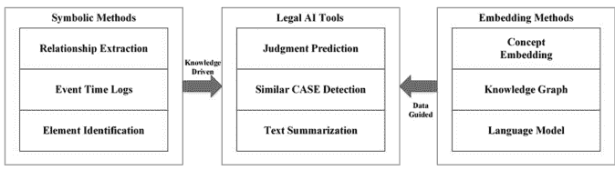

### 图 7.2 法律 AI 概览。

法院文件、合同和法律意见。因此，法律 AI 的大多数任务都基于 NLP 技术。法律领域的许多任务需要律师的经验以及对多份法律文件的深入洞察。图 7.2 展示了法律 AI 的总体情况。符号化方法倾向于侧重于利用法律解释知识来区分法律文件中的符号、关系和事件。同时，基于嵌入的方法试图在大量数据中检查隐藏的预测特征。

这两种技术的差异表明当前法律 AI 发展过程中的缺点。所解释的符号模型效率不高，而通常最有效的嵌入式方法又不可解释，这可能导致法律系统中的道德问题。因此，由于上述缺点，将当前方法应用于实际法律系统存在一定难度。

基于符号和嵌入式方法的三个主要挑战是：

- 1. 建模知识特征：法律文本已经形式化，涵盖了许多领域事实和法律 AI 概念。这种法律知识的使用方式非常重要。

- 2. 法律依据：在 NLP 中，各种程序都需要证明，但法律 AI 的目标略有不同，因为法律证明应当符合明确界定的法律规则。因此，预定义规则与 AI 技术相结合对于法律辩护至关重要。复杂的法律和案例场景可能需要更复杂的论据进行分析。

- 3. 可解释性：法律 AI 制作的决策在应用于实际法律系统之前必须是可解释的。否则，正义可能会受到损害。这是最重要的属性。

#### 7.5.1.1 符号匹配/结构化预测方法

符号化方法涉及在法律 AI 领域中使用符号和知识。可解释性属性可以通过使用事件和关系的符号化法律知识来实现。基于符号化方法的深度学习技术可用于提升性能。

- 信息提取：

信息提取（IE）在 NLP 中已得到广泛研究。IE 强调从文本中提取有价值的信息。此处，给出了两个使用提取字符来实现法律 AI 可解释性的示例：

- i. 提取关系和继承诉讼：

继承争议是一种民法案件，主要集中在继承权的分配上。因此，定义当事人之间的关系很重要，因为最接近死者的人可以获得更多财富。为实现这一目标，从遗产纠纷中提取关系可以证明诉讼结果并提升性能。

- ii. 提取时间线和刑事案件刑罚预测：

许多参与集体犯罪的当事人经常参与团体刑事案件。为了确定谁对该犯罪负有主要责任，有必要识别每个人在情况中的行为，并且事件发生的顺序也很重要。例如，在群体斗殴纠纷中，发起斗殴的人必须承担主要责任。因此，刑事诉讼判决预测需要一个合格的事件时间线提取模型。

- 提取法律要素：

除了常规 NLP 中的常规符号外，法律 AI 还有其独特的符号，称为法律要素/组件。法律项目检索专注于检索重要项目，例如某人被攻击或某物被盗。可以根据这些要素将犯罪者绳之以法。这些组件的使用不仅可以将临时监控证据纳入评估和预测问题，还可以使系统更具可解释性。

#### 7.5.1.2 基于嵌入过程的方法

嵌入式方法强调在嵌入式隐空间中呈现事实和法律知识，深度学习技术可用于相关任务。

- 词汇和概念嵌入：

嵌入符号和词汇在 NLP 中发挥着重要作用，因为它们可以将不同的文本植入连续向量空间。在法律 AI 中，嵌入技术也很重要，因为它们可以为文本和向量提供更多关系。此外，要理解传统法律描述的实际意义是不可能的。通过为相关任务嵌入词汇，尝试掌握文献细节和法律事实，可以克服学习执行词汇表征的难度。知识建模对法律 AI 至关重要，因为许多结果必须基于法律、法规和知识来确定。法律领域知识图谱的两个主要挑战是：

- i. 知识图谱在法律 AI 中很重要。大多数情况下，开发人员必须从头开始创建图谱。此外，不同的法律概念在不同国家的法律结构中具有不同的表达和意义，这也使得人们很难开发一个通用的法律知识图谱。

- ii. 广义化法律知识表格的形式与 NLP 中常用的形式不同。法律 AI 主要关注法律概念的可解释性。

通过与法律 AI 进行嵌入式知识建模来解决这两大挑战并非易事，许多研究人员未来可能会寻找克服这些问题的方法。

### 7.5.2 法律 AI 应用

法律 AI 有几种典型用途，包括预测法院判决、映射类似案件和法律问答。民法/普通法体系的重要功能是预测法院判决和映射类似案件。回答法律问题是为不熟悉法律领域的人提供咨询服务的工作。

- 预测法院判决

法律判决预测（LJP）是法律 AI 的重要任务之一，尤其在民法体系中。判决基于民法体系中的事实/宪法条款给出。只有在法律禁止的行为被违反的情况下，才会施加法律制裁。LJP 的主要任务是基于案件的实际解释和民事司法体系中法律条文的内容，预测法庭诉讼结果。法国、德国、日本和中国等国家的法律系统使用 LJP。此外，LJP 已引起人工智能研究人员和律师的广泛关注。

- 相似案件匹配

在美国、加拿大、印度和其他普通法体系国家，当前判决基于过去审理过的具有代表性的案件。因此，识别最相似的案件是普通法体系中的主要挑战。相似案件匹配（SCM）已成为法律 AI 在预测普通法法律争议结果中的一个重要主题。SCM 专注于识别一组类似案件，相似性的描述可能各不相同。SCM 要求基于不同粒度信息（如事实层级、事件层级和要素层级）对解释之间的关联进行建模。这种建模可以帮助更轻松地找到法律信息。

- 法律问答

律师工作中最重要的部分之一是向外行提供高质量、可靠的法律咨询服务。然而，由于专业律师数量不足，通常很难保证外行获得足够质量的咨询服务，而法律问答（LQA）可能解决这一问题。一些问题将涉及特定法律概念的解释，而其他问题可能与特定案件的分析有关。此外，问题的表述在专业人士和非专业人士之间可能不同，尤其是在描述特定学科领域相关术语时。这是 LQA 的主要挑战之一。


## 参考文献

- [1] G. Gürkanaynak, İ. Yilmaz, B. Yeşilaltay, 和 B. Bengi，“区块链领域的知识产权法与实践，”Comput. Law Secur. Rev., vol. 34, no. 4, pp. 847–862, 2018年8月, doi: 10.1016/j.clsr.2018.05.027.
- [2] V. Gupta，“区块链简史，”2017年。https://hbr.org/2017/02/a-brief-history-of-blockchain (2021年5月4日访问).
- [3] “以太坊基金会|ethereum.org，”2021年。https://ethereum.org/en/foundation/ (2021年5月4日访问).
- [4] A. van Wirdum，“比特币上的隔离见证激活：预期内容——比特币杂志：比特币新闻、文章、图表和指南，”2017年。https://bitcoinmagazine.com/technical/segregated-witness-activates-bitcoin-what-expect (2021年5月4日访问).
- [5] L. M. (UCL) Nejc Novak，“欧盟引入加密货币反洗钱法规|作者：Nejc Novak, LL.M. (UCL)|Medium，”2018年。https://medium.com/@nejcnovaklaw/eu-introduces-crypto-anti-money-laundering-regulation-d6ab0ddedd3 (2021年5月4日访问).
- [6] C. Zheng Er Low，“区块链上的判决执行——一份实用法律评论，”Harv. J.L. Tech. Dig., 2021, [在线]。可用：https://jolt.law.harvard.edu/digest/execution-of-judgements-on-the-blockchain-a-practical-legal-commentary.
- [7] L. Donahue，“法律职业中使用人工智能入门——哈佛法律与技术杂志，”2018年。https://jolt.law.harvard.edu/digest/a-primer-on-using-artificial-intelligence-in-the-legal-profession (2021年5月4日访问).
- [8] H. Son，“摩根大通软件在几秒钟内完成律师花费36万小时的工作”[《独立报》]|《独立报》，2017年。https://www.independent.co.uk/news/business/news/jp-morgan-software-lawyers-coin-contract-intelligence-parsing-financial-deals-seconds-legal-working-hours-360000-a7603256.html (2021年5月5日访问).
- [9] “机器学习合同搜索、审查和分析软件|Kira Systems，”https://www.kirasystems.com/ (2021年5月5日访问).
- [10] “主页—LawGeex。”https://www.lawgeex.com/ (2021年5月5日访问).
- [11] P. Callister，“法律、人工智能和自然语言处理：通往我的搜索结果的路上发生了一件有趣的事，”Law Libr. J., vol. 112, p. 161, 2020年10月.
- [12] A. Nazarenko 和 A. Wyner，“法律NLP入门，”Assoc. pour le Trait. Autom. des Langues, 2017.
- [13] H. Zhong, C. Xiao, C. Tu, T. Zhang, Z. Liu, 和 M. Sun，“NLP如何惠及法律系统：法律人工智能摘要，”arXiv, 2020年4月, 2021年5月5日访问. [在线]。可用：http://arxiv.org/abs/2004.12158.

## 泰勒与弗朗西斯

泰勒与弗朗西斯集团

http://taylorandfrancis.com

# 面向物联网网络基于区块链的数据认证的机器学习驱动SDN代理

Rohit Kumar Das
VIT-AP University, 安得拉邦, 印度

Sudipta Roy
阿萨姆大学, 阿萨姆邦, 印度

| 节 | 页码 |
|---|---|
| 8.1 引言 | 155 |
| 8.1.1 动机 | 157 |
| 8.1.2 贡献 | 158 |
| 8.2 相关工作 | 158 |
| 8.3 提议的架构 | 159 |
| 8.4 潜在研究范围 | 161 |
| 8.5 结论 | 163 |
| 参考文献 | 163 |

## 8.1 引言

近年来，物联网（IoT）网络因其可用性和耐用性而备受关注。物联网网络改变了当今世界各种日常应用的工作流程 [1]。作为无线传感器网络（WSN）的一部分，易于安装、开放性和低成本传感器节点改变了人们对使用WSN的看法。物联网网络使用资源受限的传感器设备收集数据，并将其传输到集中式云服务器以进行进一步分析。虽然物联网网络可以在有限资源下实现，但它仍然面临可靠性、可用性、可扩展性、互操作性、安全性和隐私等一些突出挑战 [2]。

为了进一步增强物联网网络的工作，已做出努力将软件定义网络（SDN）的优势与物联网网络相结合。SDN 可以帮助在干预有限的情况下监控网络。SDN 将任何网络实体的数据平面和控制平面分离。控制器位于控制层，负责网络导航，而数据平面具有根据控制器提供的规则传输数据的功能 [3]。如图 8.1 所示，SDN 的最新发展是控制平面中有多个控制器。SDN 网络的数据平面由可编程并存储流规则的 OpenFlow 交换机组成。流规则由控制器通过南向接口（SBI）安装在 OpenFlow 交换机上。如果需要任何更改，用户可以使用北向接口（NBI）访问网络并执行必要的操作。

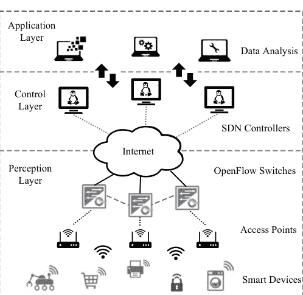

图 8.1 典型的基于SDN的物联网网络架构 [4]。

由于物联网设备通过互联网连接，它们可以从世界任何地方访问。这引发了连接物联网设备所传输数据的真实性和完整性问题。由于物联网设备的资源受限特性，传统安全机制不适用，因为它们需要更多资源 [5]。此外，由于物联网网络的可靠性、可用性、可扩展性和互操作性等突出挑战，为数据安全提供全局最优解变得具有挑战性。

### 8.1.1 动机

从物联网网关节点到云基础设施的数据传输可能容易受到入侵者的攻击。如前所述，由于物联网设备的资源受限特性，在物联网设备上直接托管安全应用是不可行的 [6]。SDN 控制器功能强大，有能力托管必要的安全机制。SDN 控制器和物联网网关设备 [7] 可以配置为限制未经授权的第三方访问数据。

区块链被引入作为物联网网络的可扩展安全解决方案。区块链是一种分布式账本技术（DLT），它能够实现分布式计算设施，用于网络中不同交易的存储、真实性和完整性 [8]。此外，将区块链与分布式SDN控制器相结合可以显著提高物联网网络的安全性 [9]。

机器学习算法已被证明是一种充分的措施，可以通过使用各种受监督和非受监督学习方法对数据进行适当验证来增强物联网数据的安全级别 [10]。根据攻击类型，可以为物联网系统设计反制策略，并在早期阶段检测入侵者 [11]。物联网中的强化学习 [12] 是一种此类方法，它可以持续监控环境并生成反馈。根据反馈，它可以决定如何处理相关挑战。

物联网系统生成的数据量本质上很高，维护这一数据量成为一项具有挑战性的任务 [13]。为克服这一问题，深度学习已显示出有希望的结果，它通过结合测试和训练模型来确保数据的适当验证 [14]。深度学习应用程序可以托管在云层，在那里可以提供所需的资源用于进一步处理。

### 8.1.2 贡献

在本章中，我们为物联网网络提出了一种基于区块链的分布式SDN架构。它可以帮助克服传统物联网网络面临的大多数挑战。在物联网网络中使用区块链和SDN资源可以显著提高网络性能。此外，为了使网络自持和智能，引入了一种机器学习（ML）方法。ML代理将与SDN控制器一起运行，负责数据的认证。数据的适当验证将由区块链网络执行。

本章剩余部分的组织如下。第8.2节回顾了该领域的相关工作。带有机器学习驱动SDN代理的提议架构在第8.3节中介绍。潜在研究范围在第8.4节中介绍。第8.5节给出结论。

## 8.2 相关工作

各种研究人员和实践者已做出努力，为物联网网络提供高效的安全措施。

BlockSecIoTNet [15] 是一种使用区块链为物联网网络提供安全措施的物联网架构。它通过使用部署在分布式雾网中的SDN控制器来监控异常流量流。云层负责进一步的数据处理，数据被传输到SDN控制器以采取必要措施。该架构通过使用区块链模块在雾层提供安全功能，该模块指示SDN交换机检测网络中的可疑流量。

[16] 的作者提供了一种在SDN网络中使用机器学习对数据流量进行分类的方案。它使用支持向量机（SVM）、朴素贝叶斯和最近质心方法对流量进行分类并提供预测准确性。该研究还专注于在SDN网络中融合强化学习，其中控制器充当代理，从收集的流量中学习网络行为。所提模型使用来自各种应用程序的收集数据并执行离线分类。

BFF-IDS [17] 提出用于SDN赋能车载网络中的入侵检测。BFF-IDS中的区块链用于存储车辆的位置和哈希值。控制层由创建区块的区块链矿工节点组成，验证通过权威证明进行。该架构旨在使用


联邦学习，用于保密访问供应商规范的训练模型创建。

BMC-SDN [18] 是一种基于区块链的多 SDN 控制器网络架构。该架构通过创建 SDN 网络的多个域，确保控制层中的安全措施。控制层是作为区块链网络一部分托管的多个 SDN 控制器的互连。每个网络由负责创建块的主控制器组成，而其余控制器验证各自的块。块验证通过共识协议使用阈值来执行。

DRQN-NAF [19] 基于增强学习机制，提供了软件定义工业物联网（SDIIoT）的分布式实现。区块链基于马可夫决策过程实现。它使用区块链实现多个控制器之间的同步，以实现对网络的共同全局视图，并提供加密操作功能。深度增强学习用于建立马可夫决策过程的模型，以优化基于区块链的 SDIIoT。

[20] 的作者提出了一种面向智慧城市的基于 SDN 的分布式安全 IoT 架构。它使用区块链来提供针对网络攻击的安全性。区块链托管连接到单个 SDN 控制器的块。网络层由网关和 SDN 交换机组成。安全机制针对从网关转发到云的数据实现。此外，为了降低能耗，它采用集群头选择方法。在网络域中选择多个集群头，将数据传输到网关设备。

文献表明，使用 SDN、区块链和机器学习等先进技术已增强了现有物联网网络的安全功能。在所提出的基于 SDN 的 IoT 架构中，在 SDN 控制器层中加入机器学习代理将创建检测网络中任何恶意流量的能力。应用层中的区块链可以通过智能合约提供数据完整性和真实性，该合约将负责流量分析和分类。

## 8.3 拟议架构

所提架构如图 8.2 所示。它由三个网络组成，即 IoT 网络、SDN 网络和区块链网络。如图 8.2 所示，接入点将智能设备

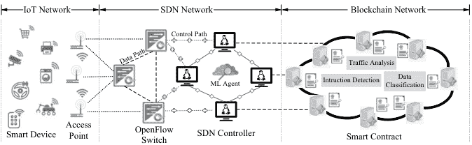

图 8.2 基于区块链技术的基于 SDN 的 IoT 网络的 ML 驱动 SDN 代理。

从 IoT 网络连接到 SDN 网络。所有网络操作，如路由、管理和策略更新，均由 SDN 控制器执行。SDN 控制器使用 OpenFlow 协议配置路由流。它在 OpenFlow 交换机中安装流规则，这些规则用于数据传输。

为了对网络流量进行身份验证，ML 代理已配置到 SDN 控制器中，负责维护流量的真实性和完整性。这些 SDN 控制器互相互连，以便网络可以维持 IoT 网络的可扩展性。ML 代理会持续监控可疑流量条目，并在检测后通知 SDN 控制器。所有收集的数据进一步传输到区块链网络进行必要的分析，创建恶意活动的记录模式和分类。区块链网络中的节点配置了强大的资源，使用智能合约对检测到的可疑活动进行适当验证，并将其存储以备将来参考。

用于监控数据流量的 ML 代理基于增强学习原理工作。它们持续监控网络并收集反馈。对反馈进行进一步分析，以检测可能危及数据正常流量的任何可疑流量。如果在流量表中发现任何可疑流量条目，则会发出奖励并通知 SDN 控制器。SDN 控制器使用控制路径修改或更新 OpenFlow 交换机中的流量条目。为了维持网络状态的一致性，相同的操作也会通知其他协同工作的 SDN 控制器。

恶意流量的检测可以通过检查流量条目的属性来实现。只有当当前流量表中输入数据包的序列大于先前值且计数器值被更新时，ML 代理才会移动到下一个流量表

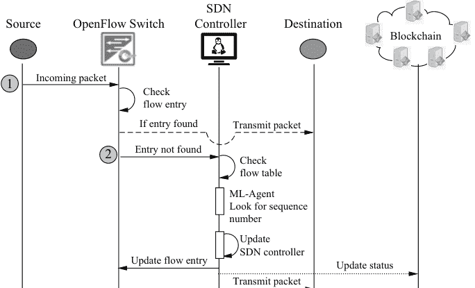

图 8.3 拟议架构的序列图。

如图 8.3 中情况 1 所示，当数据包与 OpenFlow 交换机中的流量条目匹配时，会被转发到目标。如果未找到流量条目或流量表中的序列号不匹配（如图 8.3 中情况 2 所示），则会通知 SDN 控制器。基于网络状况，SDN 控制器将负责决定数据包是应转发到目标还是被丢弃。对不匹配数据包采取的操作将转发到区块链网络，以便做出未来决策。

所提方法为检测网络中任何可能危及数据完整性和真实性的可疑流量提供了一种高效且重要的方法。如前几节所述，SDN 控制器是一个强大的资源实体，可以为 ML 代理的配置提供所有必要的要求。所提架构中使用区块链通过为数据的适当验证提供足够资源，进一步增强了网络。

## 8.4 潜在研究范围

各研究人员已探讨了使用机器学习方法来满足基于 SDN 的 IoT 架构安全功能日益增长的需求。数据完整性和真实性是 IoT 等任何开放网络的主要要求之一。尽管各项研究提供了显著改进，但它们仍缺乏大量需要有效解决的挑战和未解决问题。这就产生了各种公开的研究方向，如下列出。

- 1. 传统 SDN 架构是控制平面中带有单个控制器的集中式架构。分布式 SDN 控制器的最新进展已证明，多个控制器可以提高网络性能。使用多个控制器将需要适当的同步和弹性机制，以便它们能够高效地共享和验证数据。

- 2. 基于 SDN 的代理的共识协议可以在基于 SDN 的 IoT 架构的不同层中实现，以解决数据完整性问题。共识协议的工作原理在很大程度上受系统将部署的应用性质的影响。使用机器学习也将触发共识协议与 IoT 系统的适应。

- 3. 从文献可以看出，使用机器学习方法可以大幅提高 IoT 系统在安全性方面的性能。由于 IoT 设备的资源受限特性，使用传统的机器学习安全算法将需要大量资源。为 IoT 网络开发轻量级安全机制的需求已经从多个角度得到关注。

- 4. 由于每一层都将处理数据，因此需要对安全措施进行适当分类，以保障网络每一层的数据安全。在较低的感知层和中间的网络层，按需安全机制至关重要，它只将经过身份验证的数据转发到上层。这将确保较低的资源利用率，并为维护转发数据的完整性提供有效解决方案。

- 5. 将区块链技术与 IoT 网络相结合，近年来已显示出提供安全措施的潜力。应注意，在 IoT 的多个层中使用区块链可能是一项困难的任务，因为 IoT 节点本质上资源受限。在此背景下，轻量级区块链机制正在得到广泛关注，这些机制可以高效地用于


maintaining the integrity and authenticity of the data in every layer of the IoT network.

- 6. Based on the nature of applications, learning procedures such as supervised and unsupervised learning can be adopted. The design of the security principle should be focused on the data being transmitted over the network. The current scenario appeals to more hybrid approaches that can provide sustainable security measures. The machine learning algorithms should be developed in such a way that they only learn the required amount of detail to conserve the resources of the IoT devices.

## 8.5 结论

The incorporation of machine learning security mechanisms has resulted in providing enhanced secured IoT networks in recent years. This endeavor has yet to gain an industrial standard. This chapter has studied the incorporation of machine learning in SDN-based IoT networks. In this chapter, an agent-based ML architecture was proposed to provide security in terms of maintaining data integrity and authenticity for SDN-based IoT networks. The agent learns the flow rules and alerts the SDN controller in case of any suspicious flow found in the flow table. This restricts the intruder's ability to modify data in the perception and control layers of the network. Based on the studies, this chapter also provided further research directions in the area of how IoT networks can be made more sustainable and resilient in terms of maintaining the integrity and authenticity of the data.

## 参考文献

- [1] Leonardo Babun, Kyle Denney, Z. Berkay Celik, Patrick McDaniel, and A. Selcuk Uluagac. 物联网平台调研：通信、安全与隐私视角. Computer Networks, 192:108040, 2021.
- [2] Abbas Shah Syed, Daniel Sierra-Sosa, Anup Kumar, and Adel El-Maghrabi. 智慧城市中的物联网：技术、实践与挑战调查. Smart Cities, 4(2):429–475, 2021.
- [3] Zahra Eghbali and Mina Zolfi Lighvan. 基于SDN原理的加速物联网数据管理流程的分层方法. Journal of Network and Computer Applications, 181:103027, 2021.
- [4] Rohit Kumar Das, Nurzaman Ahmed, Fabiola Hazel Pohrmen, Arnab Kumar Maji, and Goutam Saha. 6LE-SDN：面向物联网的边缘软件定义网络. IEEE Internet of Things Journal, 7(8):7725–7733, 2020.
- [5] Wu Jun, Mianxiong Dong, Kaoru Ota, Jianhua Li, and Wu Yang. 面向物联网中软件定义智能区块链的应用感知共识管理. IEEE Network, 34(1):69–75, 2020.
- [6] Oludare Isaac Abiodun, Esther Omolara Abiodun, Moatsum Alawida, Rami S. Alkhalwaldah, and Humaira Arshad. 物联网安全综述：挑战与解决方案. Wireless Personal Communications, 119(3): 1–35, 2021.
- [7] Kübra Kalkan. SUTSEC：面向物联网的SD利用信任基础安全聚类. Computer Networks, 178:107328, 2020.
- [8] Li Xu Da, Yang Lu, and Ling Li. 将区块链技术嵌入物联网以实现安全：综述. IEEE Internet of Things Journal, 8(13):10452–10473, 2021.
- [9] Darshan Vishwasrao Medhane, Arun Kumar Sangaiah, M Shamim Hossain, Ghulam Muhammad, and Jin Wang. 下一代物联网的区块链支持分布式安全框架：边缘云与软件定义网络集成方法. IEEE Internet of Things Journal, 7(7):6143–6149, 2020.
- [10] Sherali Zeadally and Michail Tsikerdekis. 基于机器学习的物联网安全保障. International Journal of Communication Systems, 33(1):e4169, 2020.
- [11] Syeda Manjia Tahsien, Hadis Karimipour, and Petros Spachos. 基于机器学习的物联网安全解决方案：综述. Journal of Network and Computer Applications, 161:102630, 2020.
- [12] Fatima Hussain, Rasheed Hussain, Syed Ali Hassan, and Ekram Hossain. 物联网安全中的机器学习：当前解决方案与未来挑战. IEEE Communications Surveys & Tutorials, 22(3):1686–1721, 2020.
- [13] Sushil Kumar Singh, Young-Sik Jeong, and Jong Hyuk Park. 面向安全智慧城市的深度学习物联网导向基础设施. Sustainable Cities and Society, 60:102252, 2020.
- [14] Mohamed Ahzam Amanullah, Riyaz Ahamed Ariyaluran Habeeb, Fariza Hanum Nasaruddin, Abdullah Gani, Ejaz Ahmed, Abdul Salam Mohamed Naimin, Nazirul Md Akim, and Muhammad Imran. 物联网安全的深度学习与大数据技术. Computer Communications, 151:495–517, 2020.
- [15] Shailendra Rathore, Byung Wook Kwon, and Jong Hyuk Park. Blockseciotnet：面向物联网网络的基于区块链的去中心化安全架构. Journal of Network and Computer Applications, 143:167–177, 2019.
- [16] Meenaxi M Raikar, SM Meena, Mohammed Moin Mulla, Nagashree S Shetti, and Meghana Karanandi. 基于监督学习的软件定义网络中的数据流量分类. Procedia Computer Science, 171:2750–2759, 2020.
- [17] Ibrahim Aliyu, Marco Carlo Feliciano, Şelinde Van Engelenburg, Dong Ok Kim, and Chang Gyoom Lim. 面向SDN支持车载网络入侵检测系统的基于区块链的联邦森林. IEEE Access, 9:102593–102608, 2021.
- [18] Abdelouahid Derhab, Mohamed Guerroumi, Mohamed Belaoued, and Omar Cheikhrouhou. BMC-SDN：面向安全软件定义网络的基于区块链的多控制器架构. Wireless Communications and Mobile Computing, 2021: 107328, 2021.
- [19] Jia Luo, Qianbin Chen, F. Richard Yu, and Lun Tang. 带深度强化学习的区块链支持软件定义工业物联网. IEEE Internet of Things Journal, 7(6):5466–5480, 2020.
- [20] Md Jahidul Islam, Anichur Rahman, Sumaiya Kabir, Md Razaul Karim, Uzzal Kumar Acharjee, Mostofa Kamal Nasir, Shahab S. Band, Mehdi Sookhak, and Shaoyen Wu. 基于区块链-SDN的节能分布式安全架构，用于智慧城市中的物联网. IEEE Internet of Things Journal, 22(1): e4169, 2021.

## Taylor & Francis

Taylor & Francis Group

http://taylorandfrancis.com

# 印度基于区块链平台的屋顶光伏（RTPV）电力物联网支持点对点（P2P）交易

Shuvam Sarkar Roy
世界银行，新德里，印度

## 目录

- 9.1 引言 168
- 9.2 背景 168
- 9.3 交易机会 169
- 9.4 P2P交易解决方案 170
- 9.5 利益相关方收益 171
- 9.5.1 参与者（生产者和消费者）收益 171
- 9.5.2 配电公司收益 171
- 9.6 项目概览 172
- 9.7 项目实施细节 174
- 9.8 P2P交易选项——实验 175
- 9.8.1 固定价格交易 175
- 9.8.2 动态价格交易 176
- 9.8.3 带优先交易的动态价格交易 176
- 9.9 结果 177
- 9.10 建议 180
- 9.11 结论与未来方向 182
- 致谢 183
- 参考文献 183

## 9.1 引言

区块链是一种建立在数字分布式账本上的现代颠覆性技术，用于保存交易数据的永久且防篡改（不可更改）记录，引起了能源公司、国家政府和学术机构的关注。当与智能合约集成时，区块链提供清晰、加密和安全的服务，可实现新的业务解决方案 [1]。

### 为何在点对点（P2P）交易中使用区块链平台？

区块链技术是理想的点对点（P2P）交易市场，因为它带来了透明度，并记录网络上发生的所有交易。通过区块链传输的所有信息均已加密，任何数据篡改均会立即被所有其他各方检测到。由于交易在每一步都被记录，区块链确保了数据的安全性、透明度和可靠性。

在点对点交易中，个人通过屋顶太阳能（RTPV）产生能源，并以生产者和消费者商定的价格将多余能源（个人消费后）与其他消费者进行交易。这种不源自配电公司（DISCOM）的防篡改数据，是关键的市场推动因素。

## 9.2 背景

到2022年，新能源与可再生能源部（MNRE）计划安装40吉瓦的屋顶太阳能（RTPV）电力 [2]。截至2021年3月，印度约有4.5吉瓦的RTPV装机容量 [3]，预计政府将继续推广屋顶太阳能项目。由于以下因素，太阳能发电预计将更快地规模化：

- a) 近年来光伏组件成本下降趋势预计将在未来几年继续，电池效率预计将提高。
- b) 屋顶光伏对大多数类别的消费者在财务上有利。
- c) 随着意识的提高，消费者倾向于绿色能源。


- d) 消费者将有兴趣在能源方面实现自给自足。

- e) 政策制定者已经获得激励，并最近注意到对负载 >500 kW 采用总计量[4]。这增加了大客户探索替代方案的兴趣，以从屋顶光伏（RTPV）投资中实现电费节约，包括屋顶光伏系统的点对点（P2P）能源交易。

根据当前趋势，电网将变得更具交互性。P2P交易解决方案是迈向更具交互性电网的关键一步，该电网将惠及客户、上网用户和配电公司。由于P2P电力交易范式，消费者现在可以更多地获得可再生能源。这使他们能够更好地利用其分布式能源资源。此外，应急情况下地区的停电抵抗能力得到提高，在某些情况下，能源可用性也会增加。

## 9.3 交易机会

P2P交易模式提供了一个在线平台，上网用户和消费者可以在其中以双方约定的价格交易电力，无需中介，使用物联网（IoT）支持的智能电表。此外，P2P交易有可能为配电公司提供以下好处：

- a) 消费者和上网用户的赋能正在促进可再生能源和灵活性：P2P交易平台可以为上网用户提供一个市场，以交易低成本生产的可再生能源，促进分布式发电部署。同样，P2P交易让客户对其能源使用和价格有更大的控制力，提高了系统灵活性。如果实施储存设施，P2P交易参与者可以允许其当地社区吸收可再生能源并从分布式发电中获益更多，从而增强当地社区。没有可再生能源发电设施的客户将通过P2P交易直接从本地可再生能源发电中获益。

- b) 通过更好地运营分布式能源资源，对配电网进行平衡和拥塞管理：P2P交易系统通过匹配本地电力需求和供应，增加了对分散式发电机的管理。P2P交易将大幅减少为满足峰值需求而在发电能力和输电基础设施上的支出，由于输电和配电网络拥塞减少，技术和商业（AT&C）综合损耗降低，同时也增加了本地可再生能源的使用。

- c) **电网辅助服务接入**：除了实现P2P交易外，P2P网络运营商还可以允许参与者在上网用户使用储能系统时向主电网提供辅助服务。由于全国范围内电动汽车（EV）推广具有巨大潜力，车联网（V2G）技术将促进在上网用户场所聚合大量电动汽车电池和其他分布式储能系统，作为虚拟电厂（VPP）。虚拟电厂还可以提供电网辅助服务。

## 9.4 P2P交易解决方案

配电公司（或服务提供商）可以通过在运营支出（OPEX）或资本支出（CAPEX）模式下向客户贷款以创建屋顶光伏（RTPV）基础设施，并建立端到端、防篡改的集中式P2P交易和结算系统，用于本地产生能源的商业结算，从而促进本地太阳能发电。智能电表等物联网设备对于实现P2P交易的无缝运行以及与现有公用事业系统的集成至关重要。为了部署这样的系统，需要以下事项：

- a) 商业结算软件平台 – 计量、计费、收费（MBC）

- b) 光伏安装已建立的价值链

- c) 数字化：除了P2P电力交易的物理层（例如，小型电网、微电网、配电网络等）之外，这种商业模式还需要虚拟或数字层。其一个方面是平台上的能源管理系统（EMS），它使许多对等方能够连接并促进P2P交易。为了确保电力系统的效率，必须获取和分析生产者和消费者的数据。智能电表、通信基础设施以及网络和自动化系统（数字化）是P2P电力交易等平台化商业模式的关键推动者。

- d) 与区块链平台通信的物联网智能电表

- e) 基于钱包/UPI的支付解决方案

## 9.5 利益相关方受益

### 9.5.1 参与者（上网用户和消费者）的受益

- i. 消费者可以自由选择能源供应商（绿色能源）

- ii. 客户可以灵活地在给定时间以更好的费率（高于净计量或总计量电价）交易可用净能源，以最大化收入

- iii. 上网用户可以在同一个计费周期内将其多余的太阳能变现

- iv. 配电公司为参与需求侧管理（DSM）提供的激励

- v. 参与者可以按市场确定的价格出售其能源

- vi. 由于系统中未规定可再生能源发电的最小或最大容量，即使是拥有非常小型屋顶光伏系统或非常大型聚合商的上网用户也可以加入P2P交易平台。

### 9.5.2 配电公司的受益

- i. 配电公司的可再生能源配额（RPO）履行：前提是法规允许所有屋顶光伏发电计入RPO，无论其是直接售给配电公司、卖给邻居还是自用。

- ii. 屋顶太阳能发电增加减少了输往当地社区的电力数量，从而减少了配电损耗，并推迟了系统升级投资。

- iii. 减少从消费者处采购多余屋顶太阳能：通过使RTPV能源能够直接在上网用户和消费者之间交易，配电公司无需按受监管的净计量电价从上网用户处购买RTPV能源，而这些电价通常高于配电公司的平均电力采购成本。

- iv. 在没有储能系统的情况下，可以鼓励上网用户通过P2P交易在获得最佳价格的地方出售其多余的RTPV发电量，因为在这种情况下他们无法操纵月度计费阶梯，将月消费量限制在较高阶梯以下（这是一种电价套利形式）。即使客户继续通过P2P交易尽量减少月消费量，以在成本加成电价系统中保持在较高电价阶梯以下，此类收入损失也可以在次年的电价申请中平衡。

- v. 配电公司的潜在新收入来源：配电公司可以对其配电网络内P2P交易平台交易的能源征收输配费、计费和交易费用。

- vi. 倡导使用基于区块链的技术将确保智能电表的快速采用，从而简化计量、计费和收费（MBC）流程（效率和透明度）。一种能识别能源来源、单位价格以及转嫁给消费者的任何加价的区块链解决方案，将导致更具竞争力的定价。

- vii. 平衡本地发电和需求：配电公司可以使上网用户和消费者通过准备买入和卖出订单来发现和调节其能源使用，以平衡当地社区内的供需。

- viii. 电压和容量约束管理：在当地社区推广和消费RTPV能源可以防止电压和反向潮流问题。

- ix. 配电公司组合要求的减少导致电力采购减少，从而为所有消费者（即使是不参与P2P交易计划的消费者）创造节省。

- x. 实现电网上可再生能源的有序扩容。

## 9.6 项目概览

印度北方邦（UP）是第一个建立试点项目的印度邦，利用区块链技术交易客户屋顶光伏（RTPV）发电的电力，让他们与没有屋顶光伏的其他消费者进行交易。


在现有场景下，RTPV（屋顶光伏）产生的余电只能以 UP 州规定的 Rs.2/度（kWh）的价格卖回给电力供应公司（勒克瑙的情况为 MVVNL）[5]。试点项目的成功结果使得 prosumers（能产即用者，即拥有 RTPV 的客户）能够以高于规定 Rs.2/kWh 价格的市场化价格，将其 RTPV 产生的余电卖给其他客户（对等方）。该试点项目由尊敬的 UP 电力监管委员会（UPERC）构思。北方邦电力公司有限公司（UPPCL）及其子公司 Madhyanchal Vidyut Vitran Nigam Limited（MVVNL）正在勒克瑙承办此试点项目。UPERC 允许该试点项目在监管沙盒方式下实施，以测试技术可行性和客户参与此类项目的意愿。试点阶段的交易以模拟交易形式进行——未涉及实际资金交易。但该平台可以展示，如果存在实际资金流，项目参与者本可以获得多少收益。

该项目由 ISGF 与澳大利亚 Power Ledger 合作实施。MVVNL 和 ISGF 共同在试点项目中识别并招募了 12 名参与者——其中 9 名拥有 RTPV，3 名为净购买方。ISGF 将智能电表与 MVVNL 现有电表串联安装。ISGF 智能电表（由 Crystal Power 制造）已与 Power Ledger 的区块链平台集成。这些电表使用 Vodafone Idea Ltd. 的 4G SIM 卡。系统集成商 Abajyon Inc. 协助将区块链平台与 UPPCL 的账单系统集成。ISGF 和 Power Ledger 为 UPPCL、MVVNL 的相关官员以及已识别建筑物的联络官/所有者，就 P2P 平台的功能与特性及交易程序开展了培训。

该项目的关键目标是协助各方了解 P2P 交易的细微差别，例如：

- i. 测试 P2P 能源交易平台的技术可行性，以及其对 MVVNL 及其 prosumers 和消费者的价值主张。
- ii. 将 RTPV 能源出售给区域内其他建筑物所能产生的潜在价值。
- iii. 动态能源市场的价值，在此类市场中，prosumers 和消费者可以自行设定买入和卖出价格。
- iv. 测试客户参与 P2P 交易项目的意愿。
- v. 利用不同交易模式和电价结构所能实现的优化。
- vi. 为 RTPV 所有者提供更多灵活性，进一步激励 UP 州 DERs（分布式能源资源）的采用。
- vii. 减少净计量太阳能系统对 MVVNL 的财务影响。
- viii. 客户端自动化交易逻辑的测试，这将有助于消除交易中的人工干预，尤其是在设定最低/最高动态价格所实现的 TOD/TOU 电价制度下。
- ix. 通过尖端技术支持的市场化机制，支持加速 RTPV 的部署。
- x. 为 UPPCL 提供宝贵机会，以便：
  - 了解如何最佳实施网络电价，以支持 P2P 电力交易的广泛推广
  - 了解 P2P 交易对电力分配网络的影响

## 9.7 项目实施细节

为防止服务中断，ISGF 在 12 栋建筑物中将智能电表与现有 MVVNL 电表串联安装。勒克瑙当地公司 Technosun India Pvt Ltd 从事 RTPV 安装，协助无缝安装了从 Crystal Power 采购的智能电表。安装在智能电表中的 Vodafone 4G SIM 卡通过 Crystal Power 的前端系统（HES）传输能源流数据，该系统已与 Power Ledger 的区块链平台集成。安装新智能电表前后的硬件连接图如图 9.1 所示。

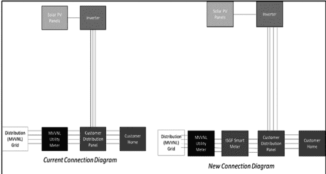
图 9.1 硬件连接图。

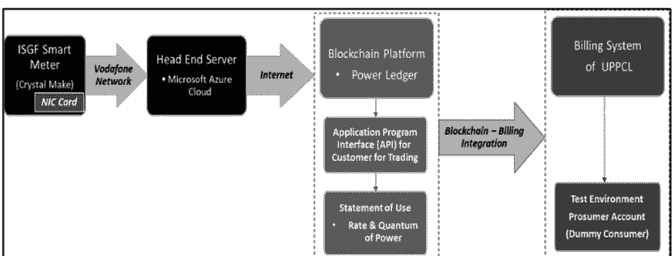
图 9.2 从电表到 UPPCL 计费系统的信息流图。

ISGF 团队与 Abajyon Inc. 合作，将 Power Ledger 的区块链平台与 UPPCL 的客户服务与计费（CC&B）系统集成。为确保项目阶段 UPPCL 的供电可靠性与质量以及计费流程不中断，仅在云上创建的独立 CC&B 环境中进行了模拟交易。图 9.2 展示了从电表到 UPPCL 计费系统的信息流。

## 9.8 P2P 交易选项—实验

### 9.8.1 固定价格交易

这确保了按固定价格进行 P2P 交易，并保证每位用户对其通过 P2P 交易的电能所能获得的价格有确定性。如果 P2P 网络中没有多余电能，则消费者的能源需求将由 DISCOM（配电公司）满足。同样，如果 P2P 交易没有买方，则电能将卖回给 DISCOM。交易的图示如图 9.3 所示。

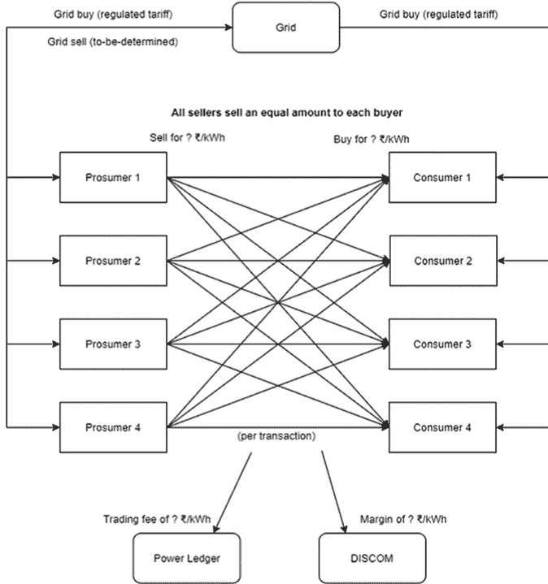
图 9.3 固定价格交易模型的图形表示。

### 9.8.2 动态价格交易

动态交易选项涉及 prosumers 和消费者之间相互交易，自行设定价格。最终确定交易的方式可能有多种，可根据监管环境/框架确定。清算价可能是买方愿意支付的最高价格，或卖方愿意接受的最低金额。交易的图示如图 9.4 所示。

### 9.8.3 带优惠交易的动态价格交易

在这种情况下，prosumer 还可以选择确定其偏好的消费者——这一做法被称为优惠交易。该规则


图 9.4 动态价格交易模型的图形表示。

允许 prosumers 选择一名消费者，并以特定价格或其他双方协商的电价，向其提供其多余电能的一定比例，该交易将在任何其他交易之前进行，意味着 prosumers 可以选择其偏好的受电方。交易的图示如图 9.5 所示。


图 9.5 带优惠交易的动态价格模型的图形表示。

## 9.9 结果

DISCOM 应通过安装高级电表并开发系统来收集和传输电表数据给第三方，从而完善其计量基础设施，以实现能源交易。单个客户的计量数据不仅对于在能源市场中开展能源交易至关重要，也将惠及系统中的所有利益相关者。由于能够获取细粒度用量数据，DISCOM 将对电网及其正在进行的改进有更深入的了解。利益相关者可以利用这些信息做出更好的商业决策。这些数据也可向第三方参与者和服务提供商开放，使他们能够在住宅领域界定创新领域和商业机会。

该项目于 2020 年 12 月 17 日上线，平台上执行的三个月 P2P 交易摘要如下：

- a) 累计社区出售（未进行 P2P 交易）：7,694.42 度，费用为 Rs.14,186.72，平均费率为 Rs1.84/kWh。尽管

累计社区交易

| 项目 | 数值 |
| --- | --- |
| 卖给电网（Rs） | ₹14,186.72 |
| 卖给电网（kWh） | 7694.42 |
| P2P 买入/卖出（Rs） | ₹20,280.32 |
| P2P 买入/卖出（kWh） | 3532.02 |
| 从电网购买（Rs） | ₹1,04,660.64 |
| 从电网购买（kWh） | 14402.58 |

图 9.6 社区交易亮点——累计。

上网电价（FIT）规定，反向输入电网的多余太阳能电价为 Rs.2/kWh，但根据我们的观察，平均反映的实际价格为 Rs1.84/kWh。这是 prosumers 与公用事业公司之间交易的情况。这些价格过低，对 prosumer/消费者的投资缺乏吸引力，因此成为该州屋顶太阳能采用的障碍。

- b) 累计社区购买（未进行 P2P 交易）：从电网购买 14,402.58 度，费用为 Rs.1,04,660.64，平均 Rs.7.27/kWh。平均接入负载为 5 kW，随着夏季的到来，社区能源消耗一直在上升，这一点从冬季月份（2020 年 12 月 – 2021 年 1 月）购买的电网电量变化与夏季到来（2021 年 1 月 – 2021 年 2 月）的对比中可见。

- c) 累计 P2P 交易：3,532.02 度，总成本 Rs.20,280.32，平均成本 Rs.5.74/kWh。当交易为 P2P 时，平均价格清楚地代表了每单位 Rs.1.53（Rs.7.27 – Rs.5.74）的能源节约。在适当的会计和计费下，这些交易是安全可靠的。

图 9.6 展示了累计社区交易亮点。基于仪表板的结果，我们看到平均电网售电价为 Rs.1.84/kWh，电网购电价为 Rs.7.27/kWh，P2P 价格为 Rs.5.74/kWh。图 9.7 中的图表展示了月均价格（Rs/kWh）。


图 9.7 平均电价（Rs/kWh）。

## 9.10 建议

为了推动屋顶太阳能发展，国家和州政府推出了众多计划和激励措施，预计在不久的将来，北方邦的电力生产消费者（prosumers）数量和太阳能发电容量将增加。启用 P2P 能源交易将为 prosumers 和消费者提供一个平台，在北方邦电力监管委员会（UPERC）可能制定的规则和法规下买卖绿色能源，帮助他们更好地收回成本并增加州内绿色能源。这还将有助于实现印度承诺的可持续发展目标 7（“确保人人都能获得价格合理、可靠、可持续和现代的能源”）[6]。

考虑到这一点，ISGF 在与 Power Ledger 和项目咨询委员会协商后，提出以下前进路径：

- i. **P2P 交易价格**: 在我们与项目参与者互动过程中，大多数 prosumers/消费者表示他们不希望每天投标/交易。相反，他们倾向于为屋顶光伏（RTPV）能源的销售和购买选择固定价格，这将使他们更清楚地了解，如果他们参与 P2P 交易，作为 prosumer 可以以多高价格出售，作为消费者可以节省多少。基于项目经验，我们建议将 RTPV 能源的 P2P 销售价格定在最高商业电价和净计量上网电价的中点。这些价格可在一个财政年度内保持不变。当电价法规发布时，P2P 交易价格也可由 UPERC 发布。

- ii. **配电公司（DISCOM）费用**: 理论上，如果客户相互购买电力，DISCOM 的收入会减少。然而，该州生产的总 RTPV 能源远低于北方邦电力公司有限公司（UPPCL）总售电量的 0.1%，因此对其收入的近期影响微乎其微。由于 DISCOM 的网络用于电力流动，其 IT 系统用于计费和结算，DISCOM 有权收取一笔适度费用，该费用可称为网络准入费或服务费。作为起点，我们建议将 RTPV 能源销售价格的 15% 作为 DISCOM 费用，可由买方承担。例如，在当前情景下，UPPCL 为 RTPV 能源净出口支付给 prosumer 的价格是 2 卢比/千瓦时，而商业消费者支付的电价是 8.75 卢比/千瓦时（月消费量超过 1,000 千瓦时）。建议用于 RTPV P2P 交易的中点价格是 5.38 卢比/千瓦时。买方将向 DISCOM 支付 5.38 的 15%，即 0.81 卢比/千瓦时，作为网络准入费。在这种情况下，prosumer 销售的每千瓦时能源将实现 3.30 卢比的净收益，而从 prosumer 处购电的消费者将节省 2.56 卢比/千瓦时。

- iii. **DISCOMs 实现可再生能源采购义务（RPO）目标**: 根据《2003 年电力法》第 86 条第 (1) 款第 (e) 项，RPO 规定配电公司（DISCOM）、开放准入消费者和自备电厂消费者必须从可再生能源采购一定比例的电力 [7]。如果所有交易的 RTPV 能源都符合 DISCOM 的 RPO 要求，这将是促进其客户之间 P2P 交易的额外好处。这还将进一步降低 DISCOM 从市场购买可再生能源证书（REC）以履行 RPO 的义务。

- iv. **MVVNL 建议将 P2P 交易平台扩展到在 KUSUM 计划 [8] 下光伏化的农业馈线**: 根据 PM-KUSUM 计划的规定，中央和州政府各提供 30% 的补贴，农民出资 40%，并网农业水泵可进行光伏化。允许的太阳能容量最高可达水泵容量（kW）的两倍，DISCOM 将购买剩余电力。尽管农业馈线已分开，但最初也可考虑对拥有农业灌溉泵（IP）机组的混合负荷馈线进行光伏化。馈线可根据负载、技术和商业损耗、消费者数量等进行选择。为 IP 机组安装的太阳能光伏系统可配备智能电表并连接到区块链平台。然而，农业馈线上的 IP 机组客户可能不在与区块链平台集成的 UPPCL 现有计费系统覆盖范围内。这些账户可由 UPPCL 迁移到 CC&B 系统。

- v. **监管干预**: UPERC 可发布正式的交易规则和法规。当前开放准入法规将客户和 prosumer 参与交易限制在需求为 1 MW 或以上的用户。根据现有开放准入法规，生产商或用户必须向相应的州调度中心（SLDC）申请许可，以便在电网上输送交易电力。对于此类 P2P 销售和购买没有特殊规定。因此，可以向卖方或买方征收多种费用。对于通过区块链进行的 P2P 交易，必须在现行法规中添加新条款，或颁布单独法规。

- vi. **能力建设必须是部门改革实施的核心组成部分**: 所有利益相关方（包括 SLDC、SERC 和 DISCOM，以及独特的客户群体）都需要培训。非政府组织和智库可以通过首先向利益相关方解释利益，然后提供能力建设工具来帮助变革准备和实施。

## 9.11 结论与未来方向

要使该技术超越印度的试点阶段沙盒，P2P 网络的所有利益相关方必须就一套服务法规和技术规范达成共识并予以遵守。为实现这一目标，各邦电力部门的监管环境必须发挥主导作用，明确识别出具有稳定监管结构的框架，这些框架应基于全球观察到的法规和有益做法，促进和推动分散交易模式的普及。因此，在制定促进 RTPV 普及的 P2P 能源交易规则时，最重要的考量因素是通过制定一套直接、一致且公平的法规，在所有人的更大利益之间取得良好平衡。

## 致谢

我谨向参与南亚以及印度这一首个此类项目的所有人员表示感谢和诚挚谢意。首先，感谢北方邦电力监管委员会（UPERC）主席 Shri RP Singh 先生积极支持这些有远见的法规，使我们得以首次开展试点项目。其次，感谢北方邦电力公司有限公司（UPPCL）及其子公司 MVVNL 的董事长、总经理及其他资深和初级成员提供持续且协调的支持。作为 UPPCL 的系统集成商，Abjayon Inc. 同样值得表彰，其促成了 Power Ledger 区块链平台与现有 UPPCL 计费系统的无缝集成。此外，我还要感谢 Crystal Power Energy Meter 和 Technosun India Pvt. Ltd. 的全体团队成员，他们尽管因 COVID-19 大流行面临诸多挑战，却确保了客户现场电表的及时供应、安装和运行。我还要感谢并表彰澳大利亚 Power Ledger 的全体团队，他们与印度智慧电网论坛（ISGF）合作，分享其专业知识和基于区块链的平台，使试点项目取得成功。没有 ISGF 主席 Shri Reji K Pillai 先生、执行董事 Smt. Ms. Reena Suri 女士和高级经理—技术咨询 Shri Suddhasatta Kundu 先生的指导和持续指导，这绝不可能实现。最后，我感谢并祝贺所有参与者，感谢他们在整个项目期间提供慷慨有益的指导，确保并参与持续参与。

## 参考文献

- [1] “面向智慧能源系统的区块链技术：基础、挑战与解决方案。”
- [2] “并网太阳能屋顶计划，新能源与可再生能源部（MNRE）。” https://bit.ly/3xDxEA1.
- [3] “2020-21 年及截至 2021 年 3 月累计按计划/方案分列的实物进展，新能源与可再生能源部（MNRE）。” https://bit.ly/35PCcGz.
- [4] “2021 年《电力（消费者权利）（修正）规则》草案；主规则第 11 条第 (4) 款子规则。” https://bit.ly/2TNMe9q.
- [5] “UPERC（屋顶太阳能光伏并网互动系统总计量/净计量）法规，2019 年（RSPV 法规，2019 年），第 10.4 条，第 (vii) 款。” https://bit.ly/2SBnXOV.


[6] “联合国可持续发展目标7：确保所有人都能获得价格合理、可靠、可持续和现代能源。” https://bit.ly/3wF53du.
[7] “2003年电力法。” https://bit.ly/3xv2XwE.
[8] “总理农民能源安全与提升计划（PM KUSUM）方案，新能源和可再生能源部（MNRE）。” https://bit.ly/3cQY0X4.

# 基于区块链、人工智能和物联网的智能安全新一代农业框架

Rohit Kumar Kasera, Raktim Deb, and Tapodhir Acharjee

*特里古纳·森技术学院，阿萨姆大学，西尔查尔，阿萨姆邦，印度*

## 目录

- 10.1 引言 186
- 10.2 文献综述 189
- 10.2.1 受区块链启发的RFID基础食品供应链信息架构 189
- 10.2.2 农村地区智能精准农业和农耕的物联网 190
- 10.2.3 农业食品供应链管理中的基于区块链的可追溯性：实际实施 192
- 10.2.4 面向智能农业的基于区块链和物联网的食品可追溯性 193
- 10.2.5 面向物联网赋能智能农业的区块链与智能合约 194
- 10.2.6 农业区块链技术：应用与原理 195
- 10.2.7 面向智能农业的区块链与物联网新兴路由方案 195
- 10.2.8 智能农业中用于通知福祉与保鲜的物联网区块链研究 196
- 10.2.9 使用区块链和物联网的农业供应链管理 196
- 10.2.10 基于RFID和区块链技术的中国农业食品供应链可追溯性系统 197
- 10.2.11 基于区块链的安全智能温室农业框架 198
- 10.2.12 AgriTalk：姜黄种植精准土耕的物联网 199
- 10.2.13 收获前后活动的基于区块链的商业应用 200
- 10.3 方法论 201
- 10.3.1 通过物联网传感器进行信息生产 202
- 10.3.2 获取信息的净化与标准化 205
- 10.3.3 通过机器学习获取更具体的知识 205
- 10.3.4 存储方法论 207
- 10.4 拟议方法与现有方法的比较分析 208
- 10.5 结论 211
- 参考文献 212

DOI: 10.1201/9781003188247-10

## 10.1 引言

近年来，农业领域越来越多地利用物联网（IoT）、机器人技术、机器学习（ML）、大数据（BD）等技术服务，从投入品供应商一直到最终消费者，优化整个价值链[1, 2]。所有这些技术都在使农业领域变得更加智能和高效。智能农业是指利用物联网（IoT）、人工智能（AI）、机器人技术以及许多其他技术，改善收获前和收获后的体验。其最终目标是提升作物的质量和产量，在该过程中利用最优人力劳动，为最终消费者提供最高质量和安全的食品。预计到2025年底，全球智能农业市场将达到153亿美元[3]。当今，农业中所有收获前和收获后的活动都可以纳入智能农业的范畴。收获前活动包括为种植做准备，通过土地耕作、使用化肥、灌溉等准备土壤，然后通过灌溉、修剪等持续照料植物。收获后活动主要包括农产品业务，如作物处理、储存、加工、包装、物流、食品安全等。收获后活动不仅由农民执行，还由中间商执行，从小型企业到大型企业实体、运输人员以及不同政府机构，用于购买和销售作物、确保食品安全等，最终涉及零售商和消费者。智能农业的活动包括，但不限于，精准农业、畜牧监测、智能温室、智能林业和园艺、智能水资源管理、产量监测、田地制图、作物勘察、农场劳动力管理、天气追踪与预报、水质管理、灌溉管理和农业资产管理。

世界各地的人们对其食品产品细节（如收获时间、生产地点或条件、储存、物流和包装）的认识越来越深[4, 5]。除此之外，联合国粮食及农业组织和其他研究人员也提及了由于缺乏计划性的粮食生产和分销而导致的全球粮食浪费统计数据[6–8]。因此，在不同的收获前和收获后活动中，安全性和透明度也得到了最高程度的重视。农作物容易受到不同种类的污染，无论是故意还是无意。应该有某种透明度，使得所有利益相关者（如农民、仓库经理、物流人员、大型商业机构、零售商以及农产品客户）都能对产品质量充满信心。区块链是一项新兴技术，正在为各种现代应用（包括智能农业）提供下一级别的安全性和透明度[9]。区块链是一种分布式账本，结构化为块的链表。每个块中包含一组有序的事务。账本分布在许多机器上，包含只能追加的事务存储；该账本数据库中的条目是永久性的，不能更改或篡改。任何新事务都将反映在不同节点上托管的分布式数据库中。区块链组件可分为五层，即应用层、执行层、语义层、传播层和共识层[10]。网络中各种类型的事务可以使用区块链进行保护：例如，支付事务、在线投票、预订酒店房间或航班、签订合同等。我们可以在区块链平台上交换和跟踪记录，网络中所有参与方都可以检查共享的重复事务记录[11]。区块链在农业中的一些应用包括安全数据存储、远程监控和自动化、农业和环境监测数据的存储、农业贸易中的透明度和监控等[12]。区块链可用于农业供应链；一个具体示例是跟踪食品证书并实时更新证书[13]。

根据[14]，物联网（IoT）可定义为互连的物理设备，允许数据收集和交换各设备收集的信息。物联网现在与无线传感器网络（WSN）和区块链等其他技术相结合，以增强智能农业[15]、智能电网、智慧城市、智能家居等不同应用领域的能力和效率[16]。机器学习（ML）是另一种大量使用的技术，正在提升现代农业活动的能力和效率[17]。ML通常指执行与人工智能（AI）相关任务的系统所发生的变化。这些任务可能包括识别、诊断、规划、机器人控制、预测等。当今，AI被应用于几乎所有的收获前和收获后活动，从为种子准备土壤，再到将种子种入土壤，最后通过计算机视觉的帮助，由机器人采摘成熟的收成[18]。农业中使用ML的一些具体任务包括：创造更好的农作物种子以销售给客户；识别细菌和害虫，并与病虫害防治公司共享信息；向农民提供关于将作物类型与土壤类型相匹配以获得最佳产量的建议；以及根据作物类型、害虫类型和农业季节提供关于使用哪种农药的建议[19]。

在本章中，我们将探讨区块链与人工智能（AI）和物联网（IoT）在收获前和收获后活动中的联合应用。现有研究工作中有许多展示了区块链、物联网或机器学习在农业中的应用。但其中很少有研究将这三种技术结合起来用于智能农业。在我们提出的方法论中，我们尝试将这三种技术结合起来，以实现更高效的智能农业。我们使用了区块链技术来存储与食品和农作物生产相关的信息，以便农民可以轻松地使用单台智能手机访问所有信息。基于物联网的食品和农作物生产网关按模块化方式设计。物联网传感器感知目标环境中的各种变化并记录


值；然后使用归一化方法清洁收集到的传感器数据；接着，数据被组织和训练，以利用机器学习算法获得额外和智能的知识；最后，所有预测信息都存储在区块链网络中，供相关各方访问。区块链将确保从种子质量的作物生产开始，到所使用的肥料和农药、仓储详情、物流详情等每一步的透明度。

总之，本章的贡献如下：

- 1. 调查当今智能农业中使用区块链的现有方法。其中一些方法也在使用物联网和人工智能。我们讨论了这些现有方法的优势、劣势和贡献。

- 2. 我们提出了一种结合区块链、物联网和人工智能的智能农业架构。

- 3. 我们将我们的架构与其他现有方法进行比较。

第 10.2 节介绍了农业中使用区块链、物联网和机器学习的研究文献综述。在第 10.3 节中，提出了一种使用这三种技术进行食品作物生产的方法。接下来，在第 10.4 节中，我们将我们的方法与该领域使用的其他方法进行比较。第 10.5 节提供了一些结论。

## 10.2 文献综述

### 10.2.1 基于区块链启发的RFID支持的食品供应链信息架构

[20]的作者提出了一种使用物联网和区块链的安全透明食品供应链。该方法分别在物理层和网络层使用基于射频识别（RFID）的传感器和区块链。这里使用一个管理中心来满足数据存储和计算任务的需求，并通过它，物联网设备可以与区块链交互。在供应链中使用RFID和区块链技术后，食品产品对链中的不同实体可见。从储存到客户的物流链中，带有RFID标签的食品产品可以轻松追踪，并且每笔交易都会创建一个包含特定包裹信息的数据块。在实体对交易进行验证后，会创建一个块并附加到区块链中。整个方法的一些步骤包括：向SensorIDs分配地址、定义交易信息结构、交易验证过程、终端之间的共识、块形成和数据存储。在扫描食品产品时，捕获的实时数据会更新到区块链中，从而构建不可更改的数字历史记录。要查找食品包裹的信息，任何消费者或零售商都可以查看和验证公共账本中的数据。

所提方法的显著特点：

- 1. 在整个食品供应链中对食品产品进行轻松且可信赖的追踪和验证。

- 2. 识别整个供应链中是否存在任何阻碍。

- 3. 识别任何可能的食品产品禁止掺假行为。

- 4. 通过确定保质期来减少食品产品的浪费。

- 5. 向所有利益相关方提供透明信息。

- 6. 允许具体的召回。

我们在此方法中观察到的一些弱点如下：

- 1. 该工作仅展示了单个传感器集成，但湿度、光照或特定挥发物等更多参数也可以使用其他传感器进行测量，此处也一样

- 2. 物联网设备不通过管理中心与区块链网络交互，因此不清楚管理中心是否存在安全漏洞的可能性。

### 10.2.2 农村地区智能精准农业和农耕的物联网

在[21]中，作者讨论了为农村地区的农场和农业使用物联网网络方案进行智能农业的应用。该方法使用基于WiFi的长距离（WiLD）网络、雾计算和基于无线传感器网络（WSN）的系统，用于一系列农业活动，如灌溉、农场监测、肥料最优利用、土壤健康测试、入侵者检测、水质监测等。与架构一起提出了跨层介质访问控制（MAC）协议和路由协议，并在延迟和吞吐量方面表现出色。这些协议可以根据所提议多跳物联网中的流量性质调整传感器的占空比。他们还彻底评估了测试平台。

该架构结合多个网络，以实现可扩展性和更大的覆盖范围。所提议的架构使用WiLD网络和一组启用IPv6的低功耗无线个人区域网络（6LoWPAN）支持的WSN网络。目标是使网络覆盖更多区域并具有更好的可扩展性。一个网关用于在两个网络之间提供安全性、识别以及数据的发送和接收。该网关与IEEE 802.15.4网络（6LoWPAN）和802.11网络（WiLD网络）兼容。为了将农村偏远位置连接到互联网，使用WiLD网络。此外，该方法使用雾计算进行实时控制，以毫秒级分析数据，并发送特定周期的计算聚合数据，从而降低延迟。用于物联网的应用层协议，如消息队列遥测传输（MQTT）和受限应用协议（CoAP），用于此方法中接收传感器数据。最后，物联网中的云用于按需方式从存储服务器提供计算资源。

所提方法的显著特点如下：

- 1. 架构和测试平台已提出并详细讨论。

- 2. 测试平台也经过评估，并产生了预期结果。

- 3. 跨层MAC和路由协议给出了出色的评估结果。

- 4. 该方法具有可扩展性并可以连接远程节点，因为它使用了WiLD、6LoWPAN网络和雾计算等技术的组合。

- 5. 雾计算节点节省带宽并以较少延迟发送远程数据。

- 6. 雾计算提高了系统的敏捷性，因为开发人员可以快速开发成本效益高的应用程序，并根据需要随时随地部署。

但该方法也存在一些观察到的缺点：

- 1. 较大网络中的拥塞未得到适当考虑。

- 2. WiLD中的带宽分配是静态的，因此可能导致其使用效率低下。

- 3. 该方法中存在安全性、数据保护和数据污染方面的问题。

### 10.2.3 农业食品供应链管理中的基于区块链的可追溯性：一种实际实现

本研究[22]提出了AgriBlock，一种基于区块链的去中心化系统，使用以太坊和Hyper Ledger Sawtooth来追溯农业食品供应链。在这里，物联网设备感知食品包裹的状态，并将数字值存储在区块链中。如果感知数据中满足某些条件，则会触发智能合约。在该研究中，两个网络（Hyper Ledger Sawtooth和以太坊）都使用默认设置进行配置。在这里观察到，Hyper Ledger Sawtooth优于以太坊区块链：以太坊延迟为16.55秒，网络tx为528108字节，CPU负载为46.78%；而Sawtooth延迟为16.55秒，网络tx为19303，其CPU负载为6.75%。

供应链管理的过程是指供应商提供原材料，生产者是农民，加工者负责生产物品的包装或加工，分销商负责将加工后的物品分发给零售商，零售商负责销售成品，而消费者通常是购买物品的人。

面向表述状态转移（REST）的架构被用作应用程序编程接口，它强烈地展示了AgriBlock物联网对其他应用程序的能力，同时可以与其他现有软件平滑集成。为了将区块链层的函数调用从高级转换为低级反之亦然，这里提出了一个控制器组件。智能合约实现区块链的所有业务逻辑，并用作区块链本身的网关。

所提方法的显著特点如下：

- 1. 由于使用了区块链和物联网，系统很好地利用了这些技术的所有优势。


- 2. 使用以太坊可以增强系统的可扩展性和可靠性，因为它可以容纳系统中更多的实体。
- 3. Hyperledger Sawtooth为该应用及所用设备提供了共识算法的概念。

观察到的该方法的一些弱点如下：

- 1. 以太坊是一个维护成本高昂的网络。
- 2. 即使我们在以太坊中使用私有网络，由于仅有一种用于编写智能合约的语言和记录的固定结构等限制，引入更复杂的业务逻辑也会变得棘手。
- 3. 以太坊计算共识所需的计算设施规模巨大，这可能会在边缘网关和物联网设备中带来一些实施挑战。

### 10.2.4 基于区块链和物联网的智慧农业食品可追溯性

该研究[23]主要探讨了使用区块链和物联网等新兴技术的食品可追溯性系统。文中提到，有些人甚至担心所有动物食品都含有激素，而所有植物食品都含有毒物和色素。文章还指出了当今食品生产、供应链和加工中的几个问题，这些问题的原因在论文的引言部分已明确界定。这些问题的原因被分为四类并进行了详细说明。虽然引言部分确实介绍了优势，但智慧农业的物联网框架和区块链在论文的文献部分已有定义；然而，“相关工作”部分的第一段未提及任何引用。此外，文献综述中观察到的论文引用数量较少。该研究提出的方法提供了一个可信、自组织、开放且生态的食品可追溯性系统，利用区块链和物联网技术吸引智慧农业生态系统中的所有合作伙伴参与。然而，该研究并未提供任何实施和实验结果——仅附带一个方框图作为问题的解决方案的理论概览。

### 10.2.5 基于物联网智慧农业的区块链与智能合约

该研究[24]提出了一种综合系统，利用物联网和区块链进行不同的收获前和收获后活动。物联网传感器用于感知存储农产品的质量和状况。关于农产品和服务定价的数据也由物联网设备监控和共享。区块链与智能合约确保数据对系统授权实体是安全且透明的。MQTT服务器用于存储感知数据，而区块链存储更复杂的数据。系统中的多个参与者包括合同所有者、种子储存站点、供应商店、生产者、分销商、批发商、零售商和消费者。系统的实施通过Remix基于网络的IDE完成，该IDE提供一个带有虚拟以太币加密货币的以太坊钱包。区块链持续跟踪收获前活动中的重要数据，例如种子质量，并在温度、湿度、光照等任何参数被违反时执行自检。同样的透明系统也可供授权实体在收获后阶段跟踪种子。此外，区块链跟踪从农田到客户的分销每个步骤中的数据。授权客户也可以从区块链验证数据。

观察到的该方法的许多优势如下：

- 1. 这是一个完整系统，将收获前和收获后活动都纳入区块链的框架之下。
- 2. 物联网设备用于感知实时数据，并在感知数据出现任何违规时触发必要的功能。
- 3. 区块链的所有优势都在系统中得到了很好的利用。
- 4. 该系统已在Remix中进行测试。

系统观察到的一些缺点如下：

- 1. 它不使用机器学习算法。
- 2. 该系统尚未在真实的区块链上进行测试。
- 3. 物联网设备也需要加强安全性。

### 10.2.6 农业区块链技术：应用与原理

该研究[25]主要关注区块链技术在农业中的应用。论文提供了实验结果，特别是在食品供应链、农业保险、智慧农业以及涉及农产品的交易方面。正如摘要所示，该研究旨在涵盖区块链技术应用的实践视角，但论文中没有结果分析或讨论部分。文中提到了对食品供应链、农业保险、智慧农业、涉及农产品的交易等的实验分析，以及记录小农户交易和创建在食品及农业领域利用区块链技术的生态系统的挑战，已在论文中得到明确界定。

### 10.2.7 基于物联网和区块链的智慧农业新兴路由方案

[26]的作者提出了一种有效的路由策略，用于分布式节点，这些节点以分布式方式运作，结合物联网和区块链以高效利用通信线路。该研究还调查了区块链管理物联网设备的潜力。它展示了控制器之间分散的点对点网络如何导致所提议架构的稳定且相似的设计。为了识别通往基站的路径，所提议协议在异构物联网网络中采用智能合约。每个节点可以保证从物联网节点到汇聚点，然后再到基站的路径，使物联网设备在传输过程中能够协同工作。所提议的路由协议消除了重复数据并防止物联网架构攻击，从而降低能耗并延长网络寿命。结果与农业中的低能耗自适应聚合层次（LEACH）以及所提议的基于物联网的农业方法进行了比较。在未来的研究中，可能会创建一个基于物联网和区块链的智能模型，用于聚合农场环境监测，并与农民和其他利益相关者共享信息，以便及时做出决策以提高农业生产力。总体而言，本文提出了一种节能的物联网与区块链方案，模拟结果表明该方法比农业中的LEACH具有更长的网络寿命、更低的能耗和更好的吞吐量。

### 10.2.8 用于智慧农业通知幸福感与保护的物联网区块链研究

该研究[27]展示了使用物联网区块链的智慧农业实现。在区块链中，节点从传感器获取数据。传感器连接到与农业相关的不同事物以进行监测。智慧农业中使用的物联网区块链的节点元素包括温度传感器节点、压力传感器节点、压力控制节点、污染控制节点、水分水控制节点、烟雾/火灾控制节点、pH控制节点等。区块链网络中的每个节点都充当矿工，并拥有包含所有已确认活动的区块链本地副本。每个节点执行的活动包括检索、存储和观察传感器信息。本文使用单个节点讨论了烟雾火灾控制节点。执行的操作包括烟雾火灾控制活动、备份烟雾火灾详情活动、获取烟雾火灾详情活动和观察烟雾火灾情况活动。该系统已使用支持创世块的以太坊私有区块链网络开发。以太坊账户由外部控制，负债账户由记录代码管控。在此火灾烟雾系统中，所有节点都在一个外部认可的账户中，其整个智能合约被放置在观察农业的合约账户中。每当块代码完成时，合约账户会收到一条消息。物联网设备通过C语言中的CoAP的libcoap库编程。这为每个设备创建一个公钥/私钥，物联网设备据此被识别。为了检验系统的成效，应用了一个基准工具，用于传输已验证的应用程序并等待确认。用户界面的处理是用JavaScript完成的，据此创建物联网设备程序以与区块链网络协同工作。它接受应用程序，从区块链检索数据并确认物联网设备。

### 10.2.9 基于区块链和物联网的农业供应链管理

本文[28]中，作者提出了一种基于区块链的基于网络的农业供应链管理（SCM）平台FARMAR，该平台利用物联网设备跟踪供应链中的所有节点，并将所有数据上传至区块链。在此方法中，他们使用了BigchainDB，这是一个具有区块链属性的数据库，例如去中心化控制、不可变数据存储、高吞吐量，


强大的查询操作等。在 BigchainDB 中，数据使用 SQL、NoSQL、JSON、键值和表等多种数据库进行结构化。他们还使用了 Monit 和 MongoDB 等其他技术进行实现。事务、资产、元数据、区块等都存储在 BigchainDB 中。向 BigchainDB 提交事务分为三个步骤，即事务负载准备、其履行以及使用 HTTPS 上传事务。

所提方法为农民提供了一种绕过系统中中间商的工具；最终，农产品可以以更具成本效益的方式到达客户。但是，有些问题没有被考虑或讨论，例如 IoT 设备的安装位置、使用的通信协议、设备安全性以及该方法的效率。

### 10.2.10 基于 RFID 和区块链技术的中国农食产品供应链可追溯系统

在此研究 [29] 中，作者讨论了 RFID 和区块链在中国农食产品供应链中的应用。RFID 用于收集和共享生产、仓储、销售和供应等方面的数据。该方法使用区块链技术来保护可追溯系统中共享和发布的信息。在这里，可追溯系统涵盖了授权的私营各方，例如零售商、负责监督食品安全和质量的政府组织，以及第三方监管机构。该系统对政府监管机构非常有帮助，因为他们可以随时检查食品包装，如果发现任何危险问题，他们可以采取适当措施停止分发。地理信息系统（GIS）也在此用于追踪农作物。全球定位系统（GPS）也在此方法中用于配送车辆的实时追踪，并为车辆到达目的地寻找最佳路线。

农产品中的 RFID 标签携带有用信息，例如农作物/植物产品名称、种植时间、产区、化肥和农药的使用、收获时间等。该方法也可用于肉类产品的 RFID 标记，并携带动物父母、使用的饲料、疫病防疫检查计划、药物使用等信息。生产经理和操作人员的数据也上传到系统中，以便在需要时可以轻松追踪和联系。通过无线网络，RFID 标签的所有信息都上传到区块链。然后，加工企业扫描从生产企业接收的食品，RFID 标签将更新为当前状态。相应地，区块链也会更新。接下来，仓库管理环节用于跟踪食品状况和仓库内部气候条件的信息。同样，信息上传到区块链。为了确保食品的 3T 原则（时间、温度和公差），车辆中使用温度和湿度传感器，数据实时上传供所有人验证，如果需要，会采取必要措施保护产品。最终，当授权零售商或客户想要验证产品的新鲜度、质量和其他参数时，他们可以通过销售链信息追溯轻松做到。

所提方法论的显著特点如下：

- 1. 使用此方法，所有授权机构（包括私营和政府机构）都可以检查和验证食品的质量和安全性。
- 2. GIS 用于追踪农作物状况。
- 3. 食品中的 RFID 确保产品的原真性。

观察到的一些缺点如下：

- 1. 将要产生的成本将较高，这将转化为更高的零售价格。
- 2. 存储区块链的区块将需要大量存储空间。
- 3. 未考虑设备安全性。

### 10.2.11 基于区块链的安全智能温室农业框架

在此研究 [30] 中，提出了一种用于智能温室农场安全和隐私的轻量级基于区块链的架构。他们为其系统模型考虑了四个组，即智能温室、覆盖网络、云存储和最终用户。智能温室拥有各种 IoT 设备，例如用于光照、湿度、CO2、水位等的不同传感器，以及 LED 灯、风扇、加热器、喷淋器等不同的执行器。提出了一种集中管理的区块链，设备可以通过该区块链安全且透明地共享数据。区块链的每个区块中都添加了包含更新策略的策略头。所有者可以通过策略头中存在的访问控制列表来管理事务。这里的覆盖网络由集群组成，每个集群都有一个集群头（CH）。集群头可以由成员根据网络延迟进行更改。CH 必须根据接收到的事务决定是保留新区块还是丢弃它。温室数据也存储在云中，以便专家可以查看和分析数据，并据此提供有用的建议和服务。每个数据块都分配了一个唯一区块编号，该唯一区块编号和哈希值也用于身份验证。这里的所有者是最终用户，可以使用自己的设备集中管理系统。作者为安全框架定义了四个层，即物理层、通信层、数据库层和接口层。

所提方法的优势在于它是一种简单且轻量级的架构，可能对小农场或温室有用。但是，作者未引用任何测试结果。此外，该架构提出了不同的组，并提到了不同组的任务。数据结构、使用的通信协议、使用的应用程序协议等更细节的问题未详细讨论。

### 10.2.12 AgriTalk：用于姜黄精准土耕种植的 IoT

此研究 [31] 提出了 AgriTalk，这是一个用于土壤耕作精准农业的低成本 IoT 平台。本文使用姜黄种植来演示精准农业。作者展示了在种植中使用 IoT 的重要性。在此提议的方法中，名为 AgriCtls 的 Arduino 微控制器板连接传感器和继电器等 IoT 设备。IoT 设备的所有操作（例如配置、记账和报告、分析、仪表板控制等）都通过智能手机上的 AgriGUI 执行，AgriGUI 访问基于云的 AgriTalk 服务器。

在田间使用了各种 IoT 设备，例如土壤和昆虫传感器、3合1湿度传感器等，用于收集气候条件、姜黄生长、检测昆虫等数据，并将其发送到云中的 IoTtalk 引擎。收集的数据用于预测适合精准农业的气候条件。执行器用于 AgriTalk 中的姜黄种植。自动喷雾器用于病虫害防治。使用驱虫灯将飞行昆虫驱离。还根据土壤下的气候情况使用滴灌。

所提方法论的显著特点如下：

- 1. 这是一种成本效益高的方法，因为使用的设备并不特别昂贵。
- 2. 它是环保的，因为没有温室气体排放。
- 3. 传感器的故障检测和校准很容易。
- 4. 生产质量可以显著提高。
- 5. 用户可以轻松配置具备所需操作和智能的设备。
- 6. 农民可以通过 AgriTalk 使用智能手机轻松访问。

但是，我们也观察到所提方法存在一些缺点，即：

- 1. 所有传感器和 IoT 硬件都需要持续电源才能平稳运行。
- 2. 未收集田间的风速和风向，这可能是姜黄植物生长缓慢的原因之一。
- 3. 未使用 ML 算法进行智能预测。
- 4. 该方法仅在一种植物上进行了试验，因此在考虑更广泛实施之前，需要对其他作物进行测试。

### 10.2.13 采前和采后活动的基于区块链的商业应用

许多初创公司和知名组织推出的可用基于区块链的商业解决方案正在真正改变农业行业。其中一些如下：

- 1. Agrichain [32]: 它为供应链管理中的所有利益相关者提供一个平台，允许他们做出明智决策、消除文书工作、提高供应链效率、降低风险等。他们提供的部分服务包括库存管理、合同管理、供应链追踪、物流自动化、可追溯性、经纪商集成等。


- 2. Agridigital [33]: 这是另一个可供农民、交易商及其他人使用的平台，可用于利用区块链和智能合约进行农业交易。他们为谷物的购买、销售、转移、存储和报告提供了简单、便捷且安全的方式。

- 3. Agriledger [34]: 该平台为所有利益相关方验证数字身份，在农业供应链中提供市场信息、食品原产地可追溯性、金融服务、记录保存等。

- 4. IBM Food Trust [35]: 它为食品供应链中的实体提供授权的、永久的和共享的信息。凭借先进的基于区块链的解决方案，它们正在显著提升参与者在食品安全、食品新鲜度、减少食品欺诈、最大限度减少食品浪费，并最终减少供应链低效方面的体验。

- 5. Agri10x [36]: 这是一家初创组织，利用其区块链和 AI 平台帮助偏远农民在市场上直接销售农作物。他们在收获前活动中为农民提供高效解决方案。在收获后流程中，他们通过提供可追溯性和安全性、更快更安全的支付等设施，协助农民销售产品。买家也可以使用该系统来追踪和检查产品质量。他们利用 AI 分析当前市场数据，为农民和买家提供农产品的公平定价。

基于区块链的 Agri10x 解决方案简化了收获后流程。提供可追溯性和数据安全性等功能，农民正在 Agri10x 平台上销售并获得快速支付结算等益处。买家方面，则能确保收到优质农产品。

## 10.3 方法论

全球人口的增加反过来加剧了与粮食生产相关的挑战，包括作物安全和有限资源下的供应流程。应当有一个智能透明的决策系统，借助该系统可以在有限的支持机制下实时监控粮食生产。当前的挑战包括：在支持机制更少的情况下生产更多粮食、提高客户满意度、实现库存连接的透明度、提高农民收入的安全性、考察天气变化等。通过将 IoT 与区块链相结合，可以通过实现一组节点并创建网状拓扑环境来公开分发粮食生产状态，从而解决这一问题。为了使农业支持和透明化，应当有一种简单的方法论，从中可以轻松优化农业投入品（水、能源、肥料）。在农业中使用区块链可以提高并增加粮食和作物的产量，并取得成功的结果。通过使用区块链，将减少浪费、支持可持续业务、实现智能决策和安全交易。现代农业最大的挑战之一是各利益相关方（从生产肥料的化学公司、种子库、农民、农业设备制造商，到承运商、存储专家、批发商、零售商等）之间缺乏安全、有效的连接。各行业群体在链式运营中拥有自己的规则以及各自的信息报告系统 [37]。可以理解的是，这使得跟踪相关信息并在利益相关方之间共享变得非常具有挑战性。使用 IoT 与区块链使这一过程变得舒适且安全。在下文中，我们将介绍一种综合架构（图 10.1）的设计，作为使用 IoT 和区块链进行粮食和作物生产的智慧农业系统。

图 10.1 的架构图逐步讨论了粮食和作物生产的过程。

### 10.3.1 通过 IoT 传感器进行信息生产

为了收集传感器数据，使用 IoT 设备和传感器。以这种方式开发的智能系统，使得农田、仓库和零售店的监控可以实时进行。使用的传感器包括温度（红外测温计传感器）、土壤（容积传感器、张力计）、湿度（电容式、电阻式）、光照（光晶体管）、火灾报警等。用于无线信息传输的 IoT 网络是 IEEE 802.15.4（Zigbee）长距离无线局域网（LoRaWAN）[38]。使用这些 IoT 设备，所有数据在保存和存储前都会被接收和组织。

- 温度传感器：温度传感器用于估计任何物体或操作产生的热压和冷量体积。它可以感知并识别任何物理变化 in

### 信息收集


气候、土壤和植物的传感器监测


仓储


食品营销


### 各步骤的信息收集

温度、水分、土壤、pH 值、植物监测数据


食品标准、使用传感器进行运输追踪、在收集中心进行检查时的食品安全


账单信息 税务合规


### 信息处理


智能流程信息合同


通过以太坊对块进行哈希处理

10 01 11 10 00 11 01

信息保存在区块链中


### 区块链信息的利用

土地利用运作
土壤和作物标准升级，支持买家做出明智/智能决策

作物产量决策
澄清生产的食品是否可食用。通过查询缺陷重新检查食品

财务运作
作物价格透明以及销售和采购的自动化信息

作物抗自然灾害保护
快速决策。支持受损田地/行业

温度并以模拟或数字信号显示。有不同类型的传感器，例如用于湿度、压力、接近度、液位、加速度计、陀螺仪和气体传感器的传感器。在农业中，温度传感器可以监测土壤温度，这对有效的作物生长至关重要。

- 水质传感器：水传感器用于识别水质并监测水循环中的离子含量。水传感器包括余氯传感器、总有机碳传感器、浊度传感器、电导率传感器、pH 传感器和氧化还原电位传感器。

- 作物生产中使用的其他传感器包括湿度传感器、运动检测传感器（用于防盗）、图像传感器（用于比较不同时期的同种作物以检测疾病）以及烟雾探测器（用于防火）。

- ZigBee：Zigbee 是一种具有低能耗、低数据率、低成本和短时挂起特性的无线传感器网络。它易于部署和扩展。它提供强大的保护和长期数据真实性。Zigbee 具有使用 IEEE 802.15.4 提供传输辅助的网状网络节点。Zigbee 具有协调器、路由器、终端设备和接入节点等逻辑设备类型。

- LoRaWAN：这是一种在低数据率下工作的低功耗广域网。该技术的变体包括 LoRaWAN、SigFox、NB-IoT 和 Weightless 等多个标准网络。它允许实时监控仓库等设施。它从设备到应用程序都具有强大的安全机制。LoRaWAN 使用星型拓扑网络标准，这是一种开放访问协议，工作在 LoRa 物理层之上。图 10.2 显示了用于广播数据的 LoRaWAN 网状拓扑架构。

图 10.2 显示，LoRaWAN 可用于多个平台，例如室内用于仓储和零售监控，室外用于农田的作物生产监控。这些平台通过 LoRaWAN 网关互连，并将所有数据传输到中央网关，该中央网关是一个基于 IP 的网络。从该网关，用户通过 LoRaWAN 应用程序访问所有事件信息。


图 10.2 用于作物生产的 LoRaWAN 网状拓扑架构。

### 10.3.2 获取信息的净化与标准化

传感器会持续生成信息，因此部分数据可能重复或无关。为了以有用的方式组织数据，需要将其清理并采用正确的格式，以便易于理解。

清理操作完成后，所有相关信息会在信息仓库阶段进行分发。数据应被构建并组织良好，为此，执行此操作时应包含一些信息，即时间戳、人口统计信息以及数据类型（字符串、数字、浮点数等）。将数据存储在区块链网络中可以使其更难以被篡改，并确保与物联网工具获取的数据相关的单独可见数据得到完整保存，并支持保护规则。图 10.3 展示了数据清理过程。首先，从不同阶段导入所有传感器数据，并移除任何重复或无关的内容。数据已准备好并重新处理以进行标准化。数据标准化后，开始测试以导出数据供使用。当收集到的信息得到改进后，将其放入机器学习模型中进行训练和测试。

### 10.3.3 通过机器学习收集更具体的知识

用于构建模型的案例包括作物分类支持、作物识别、作物产量预测、作物传播度量得分和作物市场需求预测。利用捕获数据的机器学习算法，农民和利益相关者将能够提高生产力并改善灌溉作业 [39]。将数据存储在区块链网络中将使农业参与者（农民、供应商、包装商和转售商）能够明确获取此类数据。图 10.4 中的流程图展示了机器学习算法如何用于与作物生产相关的预测。对几种作物的温度、土壤相关数据进行预测的数据挖掘程序非常重要。使用不同的数据挖掘技术分析这些农业数据易于实现。该算法包括用于聚类的 K 和用于预测的模糊 C [40]。使用多层感知机作为深度学习神经网络，为天气预报、作物销售和仓储分发创建了时间序列预测。用于工业中整体食品生产时，它采用基于遗传算法和统计方法（如贝叶斯网络）的现代处理方法 [41]。


图 10.4 使用机器学习训练和测试食品生产数据的过程。

### 10.3.4 存储方法论

在应用 AI 算法预测食品和作物相关数据后，信息作为带有区块链网络存储哈希地址的共享存储策略，保存在以太坊文件系统中。为了使系统更具成本效益，如有需要，也可以使用其他区块链文件系统。


图 10.5 区块链中的数据存储与访问。

使用区块链网络时，信息作为点对点（P2P）连接在网络块的每个节点之间共享，这意味着不需要任何中央管理来管理系统。图 10.5 展示了信息如何在区块链网络中存储，以及用户如何参与这样的网络。区块链中食品和作物生产不同阶段捕获的数据，只有在执行智能合约或建立的管理控制之后才能访问。智能合约支持网络参与者之间每个区块上保存信息的交换。这意味着与该网络相关的每个农业存储参与者都可以访问数据。在分布式计算层，将执行所有与区块链相关的操作，包括事务、共识、安全性等。在安全部分，每个事务都将拥有其哈希密钥，这很难被解密。所有事务都将显示为区块链网络中的账本，该账本可供所有参与该网络的参与者使用。

## 10.4 拟议方法与现有方法的比较分析

表 10.1 展示了拟议方法与先前现有方法之间的比较分析。比较的参数包括：系统设计设备；数据保护、成本效益；智能系统设计；以及 AI、IoT 和 Blockchain 的使用。分析确定，拟议方法论支持 ML、IoT 和 Blockchain。

| 参考文献 | 方法论 | 保护 | 低成本 | 智能系统 | 支持 AI/ML/IoT/Blockchain |
|---|---|---|---|---|---|
| Mondal, S., Wijewardena, K. P., Karuppuswami (2019) [20] | 基于区块链的 RFID 食品供应链可追溯性 | 是 | 是 | 否 | AI/ML: 否, IoT: 否, Blockchain: 是 |
| Nurzaman Ahmed, Debahis De (2018) [21] | 使用 IoT 雾计算为农业和农场设计的智能无线传感器网络架构 | 是 | 是 | 否 | AI/ML: 否, IoT: 是, Blockchain: 否 |
| M. P. Caro, M.S. Ali (2018) [22] | 使用区块链 IoT 的食品供应链可追溯性 | 是 | 否 | 否 | AI/ML: 否, IoT: 是, Blockchain: 是 |
| Pranto T.H., Noman A., Mahmud A (2021) [24] | 使用 IoT 和区块链的智能农业系统 | 否 | 否 | 否 | AI/ML: 否, IoT: 是, Blockchain: 是 |
| M.S. Shyamala Devi, R. Suguna, Aparna Shashikant Joshi (2019) [27] | 使用 IoT 区块链的安全与保密智能农业系统设计 | 是 | 否 | 否 | AI/ML: 否, IoT: 是, Blockchain: 否 |
| Tian, F (2016) [29] | 基于 RFID 和 GIS 的使用区块链的食品供应链可追溯性系统设计 | 否 | 否 | 否 | AI/ML: 否, IoT: 否, Blockchain: 是 |
| Chen, W.L.; Lin, Y.B. ;Lin(2019)[31] | 使用 IoT 的土壤耕作系统设计 | 否 | 是 | 否 | AI/ML: 否, IoT: 是, Blockchain: 否 |
| 拟议方法 | 使用 IoT 区块链和机器学习的作物生产和食品可追溯性 | 是 | 是 | 是 | AI/ML: 是, IoT: 是, Blockchain: 是 |

将拟议方法与现有方法进行比较表明，拟议方法论使用带有区块链的 IoT，其中在中间件中使用 ML 来预处理传感器数据，以便导入的数据更具知识性和准确性。表 10.2 表明，目前没有其他现有方法可以实现同样的效果。

表 10.2 拟议方法与现有技术状态中现有方法的比较分析

| 技术/方法论 | 拟议方法论 | Mondal, S., Wijewardena, K. P., Karuppuswami 在 (2019) [20] 的先前相关工作 |
| :--- | :--- | :--- |
| 用于作物生产的 IoT 传感器：温度、水、土壤、火灾报警 | 是 | 否 |
| 网络层用于作物生产、仓库分销和食品市场的 IoT 数据通信设备，如 ZigBee、LoRaWAN | 是 | 否 |
| 使用 IoT 设备（如蓝牙信标）用于食品可追溯性和供应链 | 是，蓝牙信标与每种食品一起用于从仓库到消费者实时监控食品分销 | 否，RFID 用于食品供应 |
| 使用的网络应用程序（LoRaWAN 应用服务器） | 是 | 否 |
| 用于使作物生产、仓库分销和食品市场的数据更具知识性和准确性的人工智能 | 是，使用基于机器学习的算法，如聚类、贝叶斯定理和时间序列预测，使数据可过滤和可感知 | 未使用此类智能系统 |
| 用于存储所有数据、作物生产、仓库分销和食品市场分布式账本的区块链网络 | 是，使用以太坊创建与连接到该网络的所有农民和消费者的智能合约。它是易于使用、安全的技术。IoT 设备数据与 IoT 设备相关联。机器学习用作数据过滤的中间件。 | 区块链网络仅用于食品供应链，但未与 IoT 设备相关联。不清楚使用哪个区块链网络来传输 RFID 数据。 |


## 采用拟议方法的优势：

- 1. **构建透明的管理和作物养护**：利用 Blockchain 网络，作物得到更好的照料。通过部署一些 IoT 设备，可以减少天气条件变化的不利影响。土壤质量和肥料使用等因素也可以得到更好的监测，结合 IoT 与 Blockchain，仅需一部智能手机即可实现。

- 2. **提高农民的生产力**：使用 Blockchain 可以让农民将所有信息存储在一个地方，信息将安全、组织良好，并且随时可访问。

- 3. **农民的透明和快速支付**：目前，在传统系统下，农民收到其农产品付款可能需要超过一周。使用 Blockchain 可以通过智能合约大大加快这一过程。如果交易的所有条件都满足，交易也会在不收取任何特殊费用的情况下完成。因此，农民能快速收到付款，其净收益受到的负面影响较小。

- 4. **增强的食品可追溯性**：将 IoT 与 Blockchain 结合使用，可以轻松追踪产品，并降低物流链中欺诈的风险。追踪可以在种植、收集、仓储和分销的各个步骤中进行。借助 Blockchain，可以验证关于食品生产源头、食品运输商、食品工厂、零售商和消费者的信息。可追踪信息包括食品的当前状态、食品的当前位置、食品的发送方和接收方、仓库中的环境和气候条件、使用的防腐剂等。

## 10.5 结论

本章首先详细讨论了如何使用基于 IoT 的 Blockchain 发展智慧农业。对各种拟议方法及其优缺点进行了文献综述，例如姜黄种植、面向食品供应链的 RFID 架构、智能精准农业和农村地区农业、面向智慧农业的食品可追溯性、基于 Blockchain 的可持续农业便利性分析，以及使用 IoT 的智慧农业紧急路由方案。我们还讨论了收获前和收获后使用的一些基于 Blockchain 的商业应用。随后，我们提出了一种智慧农业系统，该系统通过 IoT 传感器收集土壤、植物、水、食品仓储和食品营销方面的信息进行监测。通过使用机器学习算法，并利用神经网络对数据进行训练和测试，这些信息变得更加相关。经过这些操作后，所有筛选后的信息都存储在 Blockchain 网络中，供通过该网络连接的所有授权利益相关者共享访问。所提方法与现有方法进行了比较，发现我们的方法为智慧农业的不同方面提供了一个综合解决方案。该架构尚需在真实的 Blockchain 中实施和测试，结果分析有待未来完成。

## REFERENCES

- [1] Giorgia Bucci, Deborah Bentivoglio, and Adele Finco. 作为可持续农业系统驱动力的精准农业：文献和研究的现状. Calitatea, 19(S1):114–121, 2018.
- [2] Xuan Pham 和 Martin Stack. 数据分析如何正在改变农业. Business Horizons, 61(1):125–133, 2018.
- [3] 智慧农业全球市场. https://www.zionmarketresearch.com/report/smart-agriculture-market, 最后访问日期：14.08.2021, 在线.
- [4] 十有八九的消费者在购买产品时会查看食品来源. https://www.newfoodmagazine.com/news/42541/8-10-consumers-labeling/, 最后访问日期：21.10.2021.
- [5] 越来越多的消费者关注食品的来源与质量. https://www.nutraceuticalsworld.com/issues/2019-03/view_breaking-news/more-consumers-focused-on-origin-quality-of-food/, 最后访问日期：21.10.2021.
- [6] 农业粮食形势. 联合国粮食及农业组织，2019，[在线]. 可获得：ca6030en/ca6030en.pdf.
- [7] Mónica Duque-Acevedo, Luis J. Belmonte-Urena, Francisco Joaquín Cortés-García, and Francisco Camacho-Ferre. 农业废弃物：关于替代用途的演变、方法和展望综述. Global Ecology and Conservation, 22:e00902, 2020.
- [8] 联合国粮食及农业组织. 粮食浪费足迹全成本核算，2014. [在线]. 可获得：http://www.fao.org/3/a-i3991e.pdf.
- [9] Xiwei Xu, Ingo Weber, and Mark Staples. 区块链应用架构. Springer, 2019.
- [10] Bikramaditya Singhal, Gautam Dhameja, and Priyansu Sekhar Panda. *区块链入门：构建区块链解决方案的初学者指南*. Springer, 2018.
- [11] Olivier Alphand, Michele Amoretti, Timothy Claeys, Simone Dall'Asta, Andrzej Duda, Gianluigi Ferrari, Franck Rousseau, Bernard Tourancheau, Luca Veltri, and Francesco Zanichelli. Iotchain：面向物联网的区块链安全架构. 收录于 *2018年IEEE无线通信与网络会议 (WCNC)*，页码 1–6. IEEE, 2018.
- [12] Oscar Bermeo-Almeida, Mario Cardenas-Rodriguez, Teresa Samaniego-Cobo, Enrique Ferruzola-Gómez, Roberto Cabezas-Cabezas, and William Bazán-Vera. 农业中的区块链：系统文献综述. 收录于 *技术与创新国际会议*，页码 44–56. Springer, 2018.
- [13] Lan Ge, Christopher Brewster, Jacco Spek, Anton Smeenk, Jan Top, Frans van Diepen, Bob Klaase, Conny Graumans, and Marieke de Ruyter de Wildt. *面向农业和食品的区块链：试点研究的发现*. 编号 2017-112. Wageningen EconomicResearch, 2017.
- [14] Vangelis Gazis. 机器对机器及物联网标准调查. *IEEE通信调查与教程*, 19(1):482–511, 2016.
- [15] B.V.V.S. Narayana, K.S. Ravi, and N.V.K. Ramesh. 基于顶级传感器的农业领域先进作物田监测系统综述. *先进动态与控制系统研究杂志*, 10(6):1572–1578, 2018.
- [16] Ana Reyna, Cristian Martín, Jaime Chen, Enrique Soler, and Manuel Díaz. 关于区块链及其与 IoT 的集成：挑战与机遇. *未来计算机系统*, 88:173–190, 2018.
- [17] Nils J. Nilsson. *机器学习导论：一本拟议教材的早期草稿*. 1996.
- [18] 农业中的机器学习：应用与技术. https://www.kdnuggets.com/2019/05/machine-learning-agriculture-applications-techniques.html, 最后访问日期：28.08.2021.
- [19] 机器学习在现代农业中的作用. https://technostacks.com/blog/machine-learning-in-agriculture, 最后访问日期：28.08.2021.
- [20] Saikat Mondal, Kanishka P. Wijewardena, Saranraj Karuppuswami, Nitya Kriti, Deepak Kumar, and Premjeet Chahal. 面向食品供应链的区块链启发的 RFID 信息架构. *IEEE物联网期刊*, 6(3):5803–5813, 2019.
- [21] Nurzaman Ahmed, Debashis De, and Iftekhar Hussain. 农村地区智能精准农业和农业的物联网 (IoT). *IEEE物联网期刊*, 5(6):4890–4899, 2018.
- [22] Miguel Pincheira Caro, Muhammad Salek Ali, Massimo Vecchio, and Raffaele Giaffreda. 农业食品供应链管理中的基于区块链的可追溯性：实际实现. 收录于 *2018年IoT垂直和专题农业-托斯卡纳峰会 (IoT Tuscany)*，页码 1–4. IEEE, 2018.
- [23] Jun Lin, Zhiqi Shen, Anting Zhang, and Yueting Chai. 基于区块链和 IoT 的面向智慧农业的食品可追溯性. 收录于 *第3届人群科学与工程国际会议论文集*，页码 1–6, 2018.
- [24] Tahmid Hasan Pranto, Abdulla All Nomon, Atik Mahmud, and AKM Bahalul Haque. 面向 IoT 支持的智慧农业的区块链与智能合约. *PeerJ计算机科学*, 7:e407, 2021.
- [25] Hang Xiong, Tobias Dalhaus, Puqing Wang, and Jiajin Huang. 农业区块链技术：应用与原理. *区块链前沿*, 3:7, 2020.
- [26] Sabir Hussain Awan, Sheeraz Ahmed, Asif Nawaz, S Sulaiman, Khalid Zaman, MY Ali, Zeeshan Najam, and Sohail Imran. 区块链与 IoT：面向智慧农业的新兴路由方案. *先进计算机科学与应用国际期刊*, 11(4):420–429, 2020.
- [27] M. Shyamael Devi, R. Suguna, Aparna Shashikant Joshi, and Rupali Amit Bagate. 基于 IoT 区块链的智慧农业设计以提升安全性和保密性. 收录于 *计算机工程新兴技术国际会议*，页码 7–19. Springer, 2019.
- [28] Malaya Dutta Borah, Vadithya Bharath Naik, Ripon Patgiri, Aditya Bhargav, Barneel Phukan, and Shiva GM Basani. 使用区块链和 IoT 的农业供应链管理. 收录于 *区块链技术的高级应用*，页码 227–242. Springer, 2020.
- [29] Feng Tian. 基于 RFID 和区块链技术的中国农业食品供应链可追溯系统. 收录于 *2016年第13届服务系统与服务管理国际会议 (ICSSSM)*，页码 1–6. IEEE, 2016.
- [30] Akash Suresh Patil, Bayu Adhi Tama, Youngho Park, and Kyung-Hyune Rhee. 基于区块链的安全智能温室农业框架. 收录于 *计算机科学与普适计算进展*，页码 1162–1167. Springer, 2017.
- [31] Wen-Liang Chen, Yi-Bing Lin, Yun-Wei Lin, Robert Chen, Jyun-Kai Liao, Fung-Ling Ng, Yuan-Yao Chan, You-Cheng Liu, Chin-Cheng Wang, Cheng-Hsun Chiu, 等. Agritalk：姜黄精准土壤种植的 IoT. *IEEE物联网期刊*, 6(3):5209–5223, 2019.
- [32] 农业链. https://agrichain.com/, 最后访问日期：02.09.2021.
- [33] 农业数字化. https://www.agridigital.io/, 最后访问日期：02.09.2021.
- [34] 农业账本. https://www.agridigital.io/, 最后访问日期：01.09.2021.
- [35] IBM 区块链. https://www.ibm.com/in-en/blockchain/solutions, 最后访问日期：05.09.2021.
- [36] Agri10x. https://www.home.agri10x.com/, 最后访问日期：12.09.2021.
- [37] Prince Waqas Khan, Yung-Cheol Byun, and Namje Park. 使用先进深度学习的食品工业 4.0 IoT-区块链支持的优化溯源系统. *传感器*, 20(10):2990, 2020.
- [38] Sebastian Sadowoski and Petros Spachos. 使用具有能量收集能力的物联网设备进行智能农业监测的无线技术. *农业计算机与电子学*, 172:105338, 2020.


- [39] Dilli Paudel, Hendrik Boogaard, Allard de Wit, Sander Janssen, Sjoukje Osinga, Christos Pylianidis, and Ioannis N. Athanasiadis. 用于大规模作物产量预测的机器学习. *农业系统*, 187:103016, 2021.
- [40] Jharna Majumdar, Sneha Naraseeyappa, and Shilpa Ankalaki. 使用数据挖掘技术分析农业数据：大数据的应用. *大数据期刊*, 4(1):1–15, 2017.
- [41] Rayda Ben Ayed and Mohsen Hanaa. 利用人工智能改善食品和农业部门. *食品质量杂志*, 2021, 2021.

## 泰勒和弗朗西斯

泰勒和弗朗西斯集团

http://taylorandfrancis.com

## 索引

### A

- 加速度计, 204
- Agri10x, 201
- 农业保险, 195
- 农业, 186, 187, 188, 189, 190, 193, 195, 196, 202, 204, 206, 208, 211
- 辅助服务, 170
- 应用层, 12, 29
- arduino, 199
- Arduino Uno R3, 102, 103, 105, 107
- 法律中的人工智能, 145
- 身份验证, 50, 51, 52, 53, 55, 56, 58
- 授权, 59, 61, 65, 69, 73
- 自动化家电, 100
- 自主的, 124

### B

- 大数据, 186
- 比特币, 4, 6, 7, 16, 24, 26, 35, 110, 117, 118
- 比特金, 4
- 区块, 2, 6, 7, 9, 12
- 区块链, 2, 3, 4, 5, 6, 7, 9, 12, 14, 15, 16, 17, 24, 25, 26, 28, 30, 31, 32, 33, 34, 168, 169, 170, 171, 172, 173, 174, 182, 187, 188, 189, 190, 192, 193, 194, 195, 196, 197, 198, 200, 201, 202, 205, 206, 207, 208
- 基于区块链的物联网, 23
- 区块链镜像模型, 23
- 区块链信令系统, 23
- 区块链技术 (BCT), 22, 24
- 蓝牙, 101
- 拜占庭容错, 4

### C

- 资本支出 (CAPEX), 170
- 集中式系统, 2, 4, 14
- 证书颁发机构, 53, 60, 64
- 保管链, 128, 132
- NLP面临的挑战, 145
- 云存储, 198
- CoAP, 191, 196
- 拥塞管理, 169
- 共识, 112
- 共识协议, 159, 162
- 合同分析, 145
- 控制器, 156, 157, 158, 159, 160, 161, 162
- 作物勘查, 187
- 加密货币, 3, 6
- 密码学算法, 24
- 密码学哈希, 6
- 密码学哈希 (摘要), 25
- 密码学, 52, 53, 64
- 网络物理系统, 80

### D

- 数据采集系统 (DAS), 12
- 数据处理层, 12
- 数据安全, 3
- 分散式系统, 34
- 分散式系统, 2
- 需求侧管理 (DSM), 171
- 难度值, 9
- Digilent chipKIT Uno32, 101
- 数字资产, 83, 84
- 数字证书, 59, 60
- 数字身份, 84
- 数字签名, 25, 27, 33
- 数字化, 170
- 分布式计算, 208
- 分布式能源资源, 169
- 分布式文件, 84
- 分布式框架, 2
- 分布式发电, 169
- 分布式账本, 187, 210
- 分布式账本技术, 157
- 双重支出, 4
- 区块高度, 7
- Hyperledger, 24, 27, 95

### E

- ECDLP, 53
- 电动汽车 (EV), 170
- 2003年电力法, 181
- 椭圆曲线密码学 (ECC), 53
- 能源管理系统 (EMS), 170
- 能源存储, 170
- ESP-01, 100, 102, 103, 104, 105, 106
- ESP NodeMCU, 107
- 以太坊, 24, 37, 42, 95, 110, 192, 194, 196, 207, 210

### I

- iGovernance, 89, 90, 91
- 不可篡改性, 112
- 不可变, 3, 14, 15
- 印度智能电网论坛 (ISGF), 183
- 工业物联网 (IIoT), 14
- 基础设施即服务 (IaaS), 31
- 知识产权, 128, 129, 133
- 完整性验证, 63
- 交互式零知识证明, 70
- 物联网, 155, 159
- 物联网 (IoT), 14
- IoT, 169, 170, 171, 188, 189, 190, 191, 192, 193, 194, 195, 196, 198, 199, 200, 202, 205
- 物联网 (IoT), 22, 23, 28
- IoT架构, 12, 14
- 账本, 5, 6

### F

- 上网电价, 179, 180
- 金融交易, 128, 133
- 流规则, 156, 160, 163
- 雾计算, 190, 191, 209

### L

- 6LoWPAN, 191
- 传统网络, 86, 87
- 法律注册机构, 132
- LegalTech, 146
- 面向物联网的轻量级可扩展区块链, 23
- 链路层, 29
- 诉讼与和解, 134
- LoRaWAN, 210, 202, 204

### G

- 甘特纳炒作周期, 23
- 创世块, 6, 7

### M

- 机器学习, 157, 188, 210, 212
- 默克尔哈希值, 7
- 默克尔树, 10, 25
- 消息认证码 (MAC), 56
- 元数据, 113, 114
- 计量、计费与收费 (MBC), 170
- 微控制器, 100, 101, 102, 103, 104, 105, 107
- 矿工节点, 64
- 矿工信息, 7

### H

- 硬件安全模块 (HSM), 54
- 哈希函数, 8
- 当前区块哈希, 7
- 下一个区块哈希, 7
- 前一个区块哈希, 7
- 哈希树, 25
- 哈希值, 3, 4, 10

- 矿工, 27, 44, 112, 114, 117
- 挖矿, 5, 9, 12, 17
- 新能源与可再生能源部 (MNRE), 168
- ML-Agents, 160
- 多因素身份验证 (MFA), 61
- MQTT, 191, 194

### N

- 净计量, 180
- 网络接入费, 181
- 网络层, 12
- 网络/互联网层, 29
- 尼克·萨博, 4
- 随机数, 7
- 非交互式零知识证明, 70
- NoSQL, 197

### O

- 一次性密码, 62
- 开放授权 (OAuth), 52, 55
- OpenFlow交换机, 156, 160
- 运营支出 (OPEX), 170

### P

- P2P, 168, 169, 170, 171, 172, 173, 174, 175, 178, 179, 180, 181, 182
- P2P协议, 25
- PBFT (实用拜占庭容错), 26
- 对等网络, 5
- 许可和非许可区块链, 65
- 许可区块链, 12
- 平台即服务 (PaaS), 26
- PoS (权益证明), 26
- 预测, 188, 200, 206, 210
- 私有区块链, 12
- 证明, 114, 115, 116, 118, 122
- 活动证明, 65
- 工作量证明, 8, 26
- 产权, 128, 129, 132, 138
- 公有区块链, 12
- 公钥基础设施 (PKI), 53

### R

- REES52, 102, 103
- 注册机构, 59, 61
- 强化学习, 157, 158, 159, 160
- 可再生能源证书 (REC), 181
- RFID, 29, 189, 197, 198, 209, 210, 211
- 瑞波币, 27
- 机器人技术, 186
- 屋顶光伏 (RTPV), 168

### S

- 中本聪, 4
- 可扩展性, 191, 193
- 安全性, 110, 112, 116, 120, 124
- 安全性, 190, 191, 192, 197, 198, 201, 204, 208, 209
- 安全与隐私, 34, 40
- 感知层, 12
- SHA-256, 67, 68
- 单点故障 (SPF), 23
- 智慧城市, 188
- 智能合约, 3, 24, 83, 84, 87, 94, 131, 133, 137, 139, 141
- 智慧农业, 195
- 智慧林业, 187
- 智能电网, 188
- 智能家居, 188
- 智能家居自动化, 100, 101, 102, 105, 106, 107
- 智能电表, 169, 170, 172, 173, 174, 182
- 软件定义网络, 156
- 软件即服务 (SaaS), 31
- Stellar, 24
- 结构化预测方法, 150
- 可持续发展目标, 180
- 供应链管理, 3, 15
- 可持续性, 110
- 符号匹配, 150

### T

- 传输层, 29
- 交通运输, 187, 204
- 信任, 110, 122, 123, 124
- 可信平台模块 (TPM), 53, 58
- 可信第三方 (TTP), 22

### U

- 乌塔拉邦电力公司有限公司 (UPPCL), 183

### V

- 已验证, 110, 112, 113

### W

- WiLD, 190, 191, 192
- 无线传感器网络, 155
- WSN, 29, 188, 190, 191

### X

- X.509证书, 53, 54

### Z

- 零知识证明 (ZKP), 69
- Zigbee, 202, 204, 210
