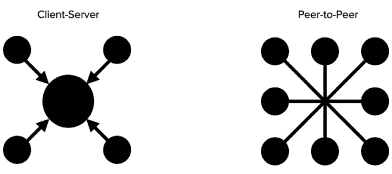
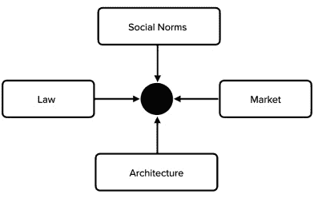
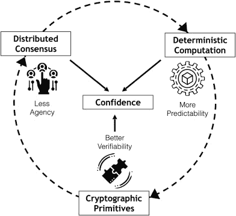

# 区块链治理（MIT Press 基础知识系列）

---

# 系列前言

MIT 出版社基础知识系列丛书提供通俗易懂、简明扼要、制作精良的口袋书，涵盖当前热门话题。由领军思想家撰写，该系列书籍对从文化、历史到科学、技术等学科提供专家级的概览。

在当今即时获取信息即时满足的时代，我们轻而易举就能获得观点、合理化解释和肤浅的描述。真正难得的是能够奠定对世界原则性理解基础的根本知识。基础知识系列丛书填补了这一需求。通过为非专业人士综合专业主题，并以基础理论探讨关键议题，每一本小册子都为读者理解复杂思想提供了切入点。

# 前言

2023 年春天，当我们正在完成您正在阅读的这本书时，亚得里亚海沿岸、黑山蒂瓦特附近的一个度假村里发生了一场非凡的聚会。包括我们两位在内的几百人聚集在 Zuzalu，这是一个由以太坊区块链的远见卓识的创始人 Vitalik Buterin 等人发起的“快闪城市”。来自各行各业的人们——区块链工程师和计算机科学家、艺术家和哲学家、企业家和律师等等——聚集在一起，讨论从人工智能到人类长寿以及民族国家未来等各种话题。

Zuzalu 汇聚了多种意识形态和利益诉求。一些居民致力于建立超越任何国家法律管辖权的区域，以便测试延缓衰老疗法。对他们而言，Zuzalu 是“网络国家”这一概念的一种初步显现，该概念由硅谷科技企业家 Balaji Srinivasan 提出，设想分散的人群和资本网络最终获得主权实体的认可。网络国家的理念建立在有着悠久历史的自由意志主义愿景之上。这从安·兰德的《阿特拉斯耸耸肩》中隐秘的“高尔奇峡谷”——一个在无效政府倒台中幸存下来的飞地——到彼得·蒂尔所设想的公海上的海上平台，据称能让人类逃离政治、为资本主义和自由寻找安全空间。然而，对许多其他居民来说，Zuzalu 的吸引力在于它提供了一个机会，让人们在现有民族国家内构想后资本主义的未来，并开发用于社会变革的新工具和实践。从这个意义上说，它的精神更接近 Calafou，这是一个位于加泰罗尼亚的自我管理的生态工业社区，Buterin 在起草以太坊白皮书前几个月曾在此逗留。

Zuzalu 居民的共同兴趣在于：世界既有的制度，以及我们目前所知的治理方式，并非我们治理社会的唯一工具。我们不必做拥有明确领土、以及传统公民身份所包含的权利和义务的民族国家公民。相反，我们可以在“数字部落”和“网络群岛”之间穿梭，它们可能存在于任何地方、任何时间。我们将拥有多重公民身份，属于多个网络，所有这些都基于我们的个人兴趣，这些兴趣有时汇聚、有时分歧。对一些人来说，网络国家许诺了一个重来的机会，一个拆解构成现代国家特征的法规、繁文缛节和官僚主义、并将社会重建为人类自主、政治自由和经济自由堡垒的机会。对另一些人来说，网络国家是一个流行词，被用来推销从中美洲到南太平洋的狂野殖民事业，这些事业在没有民主监督的情况下运作，威胁来之不易的法定保护，并使当地社区和机构面临风险。以这种方式，一些人试图将波多黎各变成加密货币避税天堂和新技术实验的试验场，同时吸食当地民众的血汗。

相比之下，其他愿景并不将*退出*视为全球治理的核心组织原则，而是视*相互依存*为核心。在我们两人于 Zuzalu 召集的会议中，我们讨论了“协调国家”和“新型网络主权”的理念，这些理念可以利用区块链和其他技术（例如用于身份管理），但主要旨在通过培育共同价值观、参与式治理和资源互助，促进地方和全球层面的人类合作。协调国家不是将公共品私有化或蚕食国家主权，而是与国家共存，满足国家无法满足的需求。无论您对这一主题持何种观点，对我们而言，Zuzalu 宛如古希腊的阿哥拉广场，一个人们可以通过协商和争辩自由交换乌托邦理想的场所。

# 前言

简言之，治理的未来是 Zuzalu 会议和沙龙讨论的核心主题。这也是我们集体和个人在多个语境下研究多年的课题。虽然区块链社区热衷于实验和推测未来的治理模式——总是由区块链驱动——但我们希望将自己置于理论与实践的交汇点。一方面，研究区块链不可避免地意味着亲力亲为，投身实践世界——例如，应用民族志方法并积极参与区块链社区。虽然我们在本书提到的任何区块链项目中都没有重大利益关系，但我们已将自己嵌入区块链社区以进行研究，从内而外地理解这个世界及其运作。另一方面，撰写本书要求我们保持批判性的距离。深入政治和法律理论，我们接触文献中衍生出的新旧思想，以批判性地评估区块链支持者关于这项技术提供的革命性新治理形式及其可能产生的深远影响的主张。我们问道，区块链技术被称为“无信任”和“非法律”意味着什么？这些技术系统是否能免疫于紧急状态等政治挑战，这些系统的治理是否曾能变得合法？

在撰写此前言时（2024 年 3 月），区块链技术生态系统似乎已进入新阶段。在围绕 FTX 和币安等主要交易所的丑闻，以及山姆·班克曼-弗里德等行业领军人物的惊人陨落之后，加密寒冬来临。经过多年的关注和炒作，区块链技术在一定程度上退出了聚光灯下，人工智能应用的大爆发主导了全球关注。然而，这也为区块链技术和区块链治理的成熟开辟了两条新路径。首先，正如布特林多次强调的，没有投机泡沫的负担，区块链项目最终可能回归（或者也许是进步）到其密码朋克意识形态的根源。或许更普遍地说，无需承诺特定意识形态，区块链社区和政策制定者可能找到空间和时间，反思区块链生态系统面临的更深层政治和法律问题。我们希望本书能为这些反思提供起点。其次，相关地，持续的立法和监管活动为适用于该技术和加密行业的规则提供了更大的清晰度，并让我们洞察政策制定者对两者的态度。一方面，通过欧盟最近的《加密资产市场法规》等立法，我们对特定加密资产服务可提供的条款有了更大的确定性。另一方面，新法规或现有法律的应用可能不适合该技术创新的发展，甚至无法有效实现其预期目的。本书讨论的针对基于区块链的软件系统的经济制裁案件，以及去中心化自治组织（DAO）成员责任案件，揭示了主流“执法监管”方法的一些缺陷。相反，我们详细阐述了一种“治理监管”方法，旨在通过技术手段（如新治理技术）和社会手段（如社会规范培育）满足重要的公共政策目标，这些手段与区块链技术及整个行业的特定特征相兼容。随着监管活动持续快速增长，我们希望我们提到的担忧和建议也能得到考虑。

本书源于多年的紧密合作，我们作者在研究和撰写本手稿方面贡献均等。我们借此机会感谢许多没有他们就不可能完成此书的人。首先，包括 ERC 项目 BlockchainGov 的成员，特别是 Kelsie Nabben、Sofia Cossar、Silke Noa 和 Tara Merk。其次，我们获得了同事们的宝贵意见，最著名的是 Nathan Schneider、Eric Alston、Liav Orgad、Ellie Rennie 和 Jason Potts。如果没有欧洲研究委员会的慷慨支持（资助编号 865856，属于欧盟地平线 2020 研究与创新计划），以及 CERSA、哈佛大学伯克曼·克莱因互联网与社会中心、欧洲大学学院和维也纳大学的支持环境，我们就没有时间和资源完成本书。最后，我们要感谢家人和朋友在我们撰写手稿期间的耐心和支持。

# 1. 新寒武纪大爆发

> 我们将自己封锁在金钱之后，向内生长，生成一个无缝的自我宇宙。
>
> —威廉·吉布森，《*神经漫游者*》

## 寒武纪大爆发

1992 年，弗朗西斯·福山宣布了“历史的终结”，标志着治理结构演变过程的结束。

两千年前，哲学家亚里士多德描绘了一幅关于实现理想治理体系可能性的截然不同的图景。他批评导师柏拉图，哀叹哲学家们沉迷于“理想国”，如柏拉图设想的由哲学家公民治理的乌托邦共和国。相反，他认为，人们应该通过简单地环顾四周，以经验的方式开始探究政治。古希腊见证了一个独特的历史时刻，随着城邦的出现。城邦不是以统一性为特征，而是极其多样。

在《*政治学*》中，亚里士多德考察了城邦的实际宪法，以及它们组织财产权、确立公民权和做决策的极其多样的方式。例如，卡尔西顿的法雷亚斯提出了一种极其平等的财产制度，富人将遗产捐赠给穷人。

当时，古希腊经历了一场治理形式的“寒武纪大爆发”。这是一个隐喻性的参照，指约 5 亿年前持续几百万年的一个间隔，地质记录显示有机生命极其快速且大量地多样化。生物进化似乎并非线性的；它在更大程度的多样化和更大程度的同质化之间动态移动。有时，人类治理社会的方式也同样适用。正如格雷伯和温格罗最近所主张的，我们对治理如何演化的现代理解仍然很大程度上符合福山的论点。

当然，许多因素在人类治理的寒武纪大爆发中发挥作用，其中之一无疑是技术。没有农业创新和革命性的造船方式（产生了三列桨战船等船只），古希腊及其众多殖民地是不可想象的。意大利城邦因贸易增加而繁荣，这是海军创新、基础设施建设和复式记账等新金融工具的结果。如果没有使跨大西洋长途旅行和通信成为可能的工业技术，19 世纪的乌托邦实验（如罗伯特·欧文的新和谐村）是不可想象的。技术在确立新的、往往是乌托邦的政治愿景方面也发挥了重要作用，这些愿景将为实际宪法的形成提供指导。正如刘易斯·芒福德所主张的，“集体人类机器”的愿景被视为如何治理社会的政治蓝图

技术的这一新角色在二十一世纪变得日益明确。技术不再仅仅是一个赋能因素，或是治理乌托邦构想的灵感来源，而是正在获得政治力量，并成为一种治理形式本身。在机械时代，情况尚非如此——正如牛顿所信，即使是完美的钟表装置般的宇宙，也需要一个除自身之外的原动力：钟表匠（即上帝）。然而，自从`图灵机`发明以来，符号机器如今共享了一种被视为人类专属的能力，即做决策的能力。今天，机器做出的决策无处不在，推动着我们、引导着我们，有时甚至强制着我们。推荐算法决定我们在网上能看到什么内容或广告，而内容审核系统决定什么将被隐藏。

然而，正如牛顿的钟表宇宙背后有“钟表匠”一样，这些由机器驱动的决策系统背后，坐着一群“原动力”，他们不具备神格，而是血肉之躯的人类，无论是马克·扎克伯格还是习近平。本书讲述的是一种新的赛博钟表，它声称要将其钟表匠推向一边，而其首个实例化便是加密货币`比特币`。在福山的论题提出三十年后，`区块链`技术正推动着新治理系统的“寒武纪大爆发”。激进的新治理概念被推向前台：从分布式共识到去中心化自治组织（`DAO`），以及其他许多即将到来的概念。

这些激进的新治理形式并非凭空出现，而是乘着一波社会技术想象的浪潮，通过投机性科幻小说和政治愿景来解读技术进步。赛博空间的概念——一个源于街机游戏的虚拟、开放式矩阵——本身就诞生于科幻小说，著名地被威廉·吉布森在《神经漫游者》中命名。

这些源自科幻小说的愿景表明，一个拥有不同哲学和不同政治的世界是可能的。这个世界是仁慈的还是邪恶的，仍是一个开放性问题。然而，在这些社会技术想象中，似乎存在一种与我们实际生活的世界产生共鸣的运动。首先，是技术重要性的日益增长。在 20 世纪 50 年代，人们仍想象行星文明的运行方式与他们自己的时代和地点颇为相似；我们已转向由植入大脑芯片的群体思维驱动的想象，它们通过自愿的`点对点`网络协调经济活动。其次，是远离帕尔默所描述的“老蜘蛛”，即民族国家。我们想象中的政治存在正在去领土化、去物质化，并移入赛博空间无垠的广阔天地。我们无处不在，又无处可寻，但政治权力和物理躯体依然存续，制造着拥有者与非拥有者之间的分裂，并提醒我们自身存在的暂时性。第三，正如马歇尔·麦克卢汉所预见，我们回溯遥远的过去，以理解当下并展望未来的可能性。

这三大发展——技术的革命性作用、远离民族国家、以及对过往政治思想的复兴——不仅助推了科幻小说，也推动了技术领域的具体发展。早在 20 世纪 70 年代，斯图尔特·布兰德等有影响力的人物便利用想象力将迷幻药、先进电子网络和原始社区生活的理想融合在一起，点燃了驱动硅谷及其`加利福尼亚意识形态`的愿景。

在那一天，`比特币`白皮书的发布确立了一种新的技术基础设施——`区块链`技术——人们可以通过它以`点对点`的方式进行交互和交易。`区块链`技术是一种新型的经济和政治制度，它运行在由可信中介构成的现有政治结构之外，

## 为什么要研究区块链治理？

本书关注`区块链`治理，涵盖对`区块链`技术的监管与治理，以及由`区块链`技术进行的监管与治理。它涉及广泛的议题，从政策制定者如何应对`区块链`带来的挑战，到`区块链`开发者如何应对协议设计中的张力，再到像不可篡改性这样的基本原则如何既赋能又阻碍治理替代方案。`区块链`治理捕捉了技术治理（`链上`治理）和技术的治理（`链下`治理）这双重层面。这两个层面之间的动态互动是本书的主要主题，并将贯穿各章——例如，在探讨所谓“`无需信任`”网络中信任与信心概念的张力，以及评估外生和内生压力如何塑造对`区块链`治理合法性的认知时。

在接下来的章节中，我们将追随亚里士多德的脚步，他在当时见证了希腊城邦中新治理形式的大量涌现：从僭主制到贵族制、寡头制和民主制。正是在此背景下，法学和政治学学科首次诞生，以反思治理问题：政府应是什么样？公民与国家的角色是什么？政治变革如何发生？政治共同体如何提升公民的幸福与福祉？应如何鼓励公民公正且有德？如今，世界各地的`区块链`社区正在尝试不同的共识算法、创新的投票系统、争议解决系统，以及旨在充当成文宪法的社区公约。并出现了类似的治理问题：`区块链`社区应坚持“`代码即法律`”还是允许人为干预协议管理？`区块链`治理体系应遵循民主原则，还是可采用寡头政治形式？`区块链`社区应如何维护公共无许可`区块链`网络的多中心特性？

`区块链`治理捕捉了技术治理（`链上`治理）和技术的治理（`链下`治理）这双重层面。

回答这些问题并非易事。正如维利·莱多维尔塔在 2016 年所言，`区块链`治理本质上是一个“悖论”。他问道：`区块链`技术的初衷，难道不是为了消除（人类）治理的必要性吗？如果并非如此，且需要（人类）治理，如果人们最终仍要信任第三方，那为什么还需要`区块链`呢？

为什么研究`区块链`治理很重要？首先，`区块链`技术已成为世界上一股重要的力量。回溯 2010 年，`比特币`对大多数人仍是未知的，其萌芽社区曾因有人用加密货币买披萨而庆祝。仅十年后，`区块链`技术已颠覆了几乎每个领域。它已成为一个万亿美元级的产业，全球数百万人正在开发`Web3`应用、投资新加密项目，或在咖啡间与同事闲聊最新的加密危机。`区块链`已成为国家元首、央行行长和世界最大公司首席执行官讨论的话题。`区块链`技术的这种日益增长的相关性，自动引发了治理关切。`区块链`开发者开始询问他们与监管者的关系，而政策制定者开始探索制定有效法规的新途径。为此，理解`区块链`治理的承诺与挑战，是必不可少的。

## 区块链治理的挑战与意义

### 第二：法律与监管的不确定性

区块链技术面临着显著的法律和监管不确定性。尽管各国已开始为区块链技术制定政策和法规，但这些努力往往受到专业知识匮乏和缺乏前瞻性的困扰。区块链技术使我们面临 **科林格里奇困境**：

- 一方面，只要技术仍处于萌芽阶段，其后果就会不确定，因此难以控制。例如，2016 年的 **The DAO 攻击**（第 5 章讨论）影响重大，但对大多数决策者而言是不可预见的——甚至是难以理解的。
- 另一方面，一旦区块链技术扎根于既有制度或生活方式中，其后果可能变得可预测，但技术将难以控制或引导。

目前有项目旨在使区块链成为社交媒体治理、全球供应链管理和全球身份注册系统的底层技术。这些项目能否成功仍有待观察，但如果成功，其后果将是广泛的，且将越来越难以应对或逆转。应对这种法律不确定性的一个重要途径，是透过法律和政治理论的视角分析潜在的监管和治理挑战，这正是本书的意图所在。

### 第三：对法律与监管概念理解的挑战

区块链正日益挑战我们对法律和监管的概念理解，具体表现为：

首先，它挑战并延伸了互联网治理学者提出的担忧，涉及“代码即法律”这句格言。虽然在互联网上运作的大多数人和组织仍受国家法律约束，但区块链通过推动代码的自主性增加了新的动态。区块链系统宣称生成独立于通过它们互动的人类参与者意志的自身法律现实——因此不能被中心化权威工具化——本书将其称为 **代码统治**，以类比“法治”。区块链系统中铭刻的规则与国家和非国家宪法体系共享某些特征。此外，由于跨国运作，区块链系统在一定程度上脱离了特定民族国家的主权。它们因此将社会、全球和数字宪法主义学者早先识别的挑战推向前台：宪法秩序不局限于民族国家的主权。相反，跨国组织、大型平台，以及现在的准自治区块链系统，生成的宪法秩序与既有法律法规既兼容又张力并存（第 7 章讨论）。

### 第四：新治理模式促使重新思考政治概念

由于其固有特性，区块链系统引入了新的治理模式，迫使我们重新思考既定的政治概念。政治哲学围绕某些关键问题展开，涉及政治权威与主权（如：主权力量的基础是什么？）、合法性（如：公民为何接受并服从一种治理体系？）、民主（如：民主决策的良好程序是什么，政治机构如何代表公民？）。区块链治理为这些问题中的每一个都增加了新的动态，从而也挑战了既定的政治概念。

例如，在传统组织中，权威最终归属于人类决策者；而在基于区块链的系统中，权威归属于一个（据称）不可变的基于代码的协议，无论相关方意图如何，它都将按计划执行。此外，即使涉及人类治理，大多数区块链网络固有的假名性也排除了重要的一套治理动态（包括传统民主中的“一人一票”原则），最终偏向更寡头制或精英制的治理模式。合法性在区块链系统中也日益获得关键作用，不是作为证明主权强制行为正当的手段——如在更传统的中心化治理结构中那样——而是作为确保对最终由自愿参与驱动的系统忠诚度的机制。最后，只要区块链系统可被视为“多中心”治理系统（即在一个总体共享规则集下，以多个重叠决策中心为特征的系统），就会出现新问题：这些网络应在何种适当尺度上（或能够被）治理——从个体核心开发者、跨国加密货币交易所，到网络本身横跨全球的技术基础设施。

一些学者认为，公司治理比政治治理提供了更合适的理论透镜来分析区块链系统，因为这些系统依赖“自愿合作”（如公司）且“更像市场而非等级制”。

然而，仅凭公司治理的透镜不足以理解区块链治理的复杂性。首先，无许可区块链作为共享基础设施技术——一种公共品——的地位，呼吁政治学和政治经济学的见解（如公地治理）。

虽然这些研究区块链治理的理由乍看似抽象，但本书将通过实例表明，它们具有现实后果。我们选择实例旨在通过经典案例说明不同治理选择对区块链系统运作的影响，同时也记录较新的案例，这些案例最终可能成为区块链治理史上的里程碑案例。例如，**Steem** 案例（第 4 章）展示了忽视信任在区块链网络中的作用如何导致有问题的中心化动态，包括敌意收购。**The DAO 攻击**（第 5 章）说明了区块链网络如何遭遇紧急危机，可能导致违背其核心原则。最近的 **Ooki DAO**（第 3 章）和 **Tornado Cash**（第 6 章）案例展示了即使是相对简单的区块链应用也能挑战法律体系的边界，导致立法者采取激烈且有时严苛的反制措施。这些具体实例证明了在法律和政治理论视角下讨论区块链治理的相关性，从而证明了本书对区块链开发者、决策者以及对该技术有普遍兴趣或利益相关者的相关性。

## 本书简介

《区块链治理》置身于学者、开发者和决策者蓬勃发展的全球对话核心。本书以区块链技术方面的深度介绍及其所赋能的特定治理形式开篇（第 2 章）。随后，它将区块链治理的讨论置于更广泛的互联网治理背景中。本书论证区块链技术已使传统互联网平台的 **代码统治** 模式转向新的 **代码统治** 模式，这对与传统 **法治** 体系的互动有特定含义（第 3 章）。

# 前言

本书随后探讨了一个概念，该概念是区块链政治和法律愿景的核心，即其所谓的“无需信任”特性（第 4 章）。回应关于信任的社会学研究，本书主张区块链技术最好被理解为一台“信心机器”，尽管对信任的需求并未被消除，而是分散在一个由行动者组成的分布式网络中。借鉴 The DAO 攻击这一历史事件，本书随后转向区块链系统中的主权问题（第 5 章）。本书主张区块链系统被组织为实证主义法律秩序，并且像民族国家的法律秩序一样，它们容易受到例外状态的影响，从而催生主权决策。

随后，本书探讨了两条进一步发展和拓展区块链治理思考的途径。第一条途径以法律哲学中的*非法性*概念为中心（第 6 章），这意味着法律秩序有独特的边界，这些边界可以被跨越。本书主张区块链技术有时会跨越现有法律秩序的边界。尽管监管机构在许多情况下仍有手段应对这些跨越（例如，通过执行现有法律或修改法律），但某些非法行为质疑了法律秩序如何划定合法/非法的界限。第二条途径涉及关键的政治概念“合法性”（第 7 章），近年来这也已成为区块链治理讨论的焦点。本书展开了一场比较性话语，区分了社会宪政主义和数字宪政主义的概念，并提供了一个被称为“区块链宪政主义”的新概念。它讨论了这一背景下对合法性的几种理解，范围从“合法性即合法性”的薄弱理解，到包含实质性关切（如人权和环境正义）的合法性的厚重理解。

本书通过勾勒区块链治理的可能未来而告终（第 8 章）。鉴于区块链技术的潜在应用领域，它探讨了可能出现的法律或监管制度，这些制度可能被开发出来以支持或压制该技术，以及区块链治理的可能未来配置。在接近尾声时，我们希望本书能说服读者思考：一方面的法律和政治理论，另一方面的区块链治理，如何能够相互丰富。一旦投机性的区块链炒作消退，该技术成为我们日常生活和政治基础设施的一部分，这可能变得至关重要。

# 第 2 章：区块链

> 一个幽灵正在现代世界游荡，加密无政府主义的幽灵。
>
> ——蒂莫西·梅，《加密无政府主义者宣言》

## 永恒的现金

“谁想永生？”皇后乐队那首唤起共鸣的歌曲跨越世纪回响，因为人类一直痴迷于不朽的前景。然而，我们实现不朽的手段随时间而变。在古代文明中，不朽只能通过完成将被历史铭记的伟大事迹来实现。图坦卡蒙、亚历山大大帝和秦始皇即是如此，他们的生平流芳于现代社会的史册。但这种不朽并非人人满意。像中世纪的炼金术士一样，人类长期以来一直在寻找另一种形式的不朽，这种形式与生物生命联系更紧密。这种不朽不是关于被永远铭记，而是关于延长生物生命。

汉娜·阿伦特认为，我们对时间和历史的理解与我们对宇宙的科学理解密不可分：一个由运动粒子组成、对人类事务漠不关心的不可测度的广阔空间。

哈尔·芬尼，一位有影响力的美国软件开发人员和密码学家，曾沉思不朽的前景：“如果你接受原则上医学有可能给我们无限的健康寿命，那么你真正需要做的就是生活在一个发现了这种医疗技术的宇宙中，然后避免意外。”

芬尼将“自我”描述为大脑中数十亿原子的一种幸运排列。因此，根据他的观点，不朽只需要保存大脑的硬连线。2009 年，芬尼被诊断出患有一种致命疾病：肌萎缩侧索硬化症（ALS）。面对 2014 年即将来临的死亡，他接受了一项医疗程序，在低温下对其身体进行冷冻保存，以确保组织得以保存。他的希望是，如果有一天医学科学能够解决组织的物理状况，它们将被唤醒，从而继续生活。

芬尼是超人类主义运动的一员。

虽然冷冻学声称要保存个体生命，但超人类主义者也对维持某种形式的集体生命感兴趣。他们相信，技术进步和创新只能在摆脱等级控制的自由市场环境中蓬勃发展。正如莫尔所言，“拥有普遍且强制执行的中央集权控制的社会无法容忍异议和多样性”，因为“没有任何专家群体能够理解和控制由与他们类似的其他个体组成的经济和社会的无尽复杂性”。

这些思想与一个相邻且部分重叠的运动共享：*密码朋克*——一个由无政府主义者、自由意志主义者、密码学家和软件开发人员组成的松散群体，他们有兴趣探索密码学的用途以保护个人隐私和在线自由。像超人类主义者一样，密码朋克坚决反政府，并将中央集权机构视为一切世俗腐败的根源。著名密码朋克蒂莫西·C·梅在 1989 年的《加密无政府主义者宣言》中写道：

> 一个幽灵正在现代世界游荡，加密无政府主义的幽灵。计算机技术即将提供能力，使个人和团体能够以完全匿名的方式进行通信和互动。两个人可以交换信息、开展业务、协商电子合同，而无需知道对方的真实姓名或法律身份……正如印刷技术改变并削弱了中世纪行会和社会权力结构的力量，密码学方法也将从根本上改变公司的性质以及政府对经济交易的干预。

俗话说死和税是你无法逃避的两件事，但这正是超人类主义者试图做的。

因此，虽然超人类主义者寻找延长生命的方法，密码朋克则专注于摆脱政府机构或任何其他可腐化的中介权威。尽管他们的雄心不同，但两个群体都关心改善个人和集体的自主权。他们共同的需求是一套共享的账本记录，一种不可审查、不可篡改、不朽的数字货币，不受任何单个个人或团体控制，并能独立于任何单一制度框架而延续数代。

## 数字现金

创建匿名数字现金的早期尝试之一可以追溯到大卫·查姆，他是密码朋克运动中最具影响力的成员之一。查姆的博士论文探讨了利用密码学创建不受信任节点的可信网络。1989 年，他试图通过开发一种新的数字货币系统——他称之为 DigiCash——来将其理论见解付诸实践，该系统利用密码技术实现匿名且不可追踪的交易。DigiCash 为对金融隐私感兴趣的用户和对在线进行商业交易的安全方式感兴趣的商家带来了许多显著优势。然而，与当今的加密货币不同，DigiCash 需要一个中央机构作为所有电子交易的可信中介。查姆设法与几家银行建立了商业合作伙伴关系，但 DigiCash 未能获得更大的普及。

DigiCash 允许用户匿名从其银行提取数字票据，以便随后在场外交换，或直接向第三方发送任意价值的付款。该项目在密码朋克社区中引起了关注，但政府和商家担心其提供的匿名性。许多银行将其视为竞争产品，而非改善其对客户服务的机会，大多数消费者根本不理解数字中介交易的必要性。随着项目未能获得更多主流采用，查姆的公司于 1998 年破产。

密码朋克们没有因这一挫折而气馁。随后又尝试创建去中心化的数字现金。戴伟和尼克·萨博分别提出了名为 b-money 和 BitGold 的数字货币替代实现方案，利用计算证明（工作量证明，PoW）来保障新货币的发行。然而，这两种方法都遭受双重支付问题的困扰，使用户能够欺骗网络两次花费同一笔钱。基于这些初步发展，哈尔·芬尼于 2004 年创建了一种名为 RPOW 的匿名货币，用户只能通过其加密密钥被识别。然而，与查姆的 DigiCash 一样，RPOW 也依赖于一个中心化系统，负责确保没有人能花费超过其实际拥有的钱。因此，它未能满足完全自主且独立于任何中央权威的要求。

当密码朋克们仍在致力于安全匿名数字现金的设计时，世界经历了一段动荡时期。全球金融系统扩大了新金融产品的范围，如抵押债务凭证，其抵押品变得越来越危险。2008 年 9 月 15 日，美国大型投资银行雷曼兄弟申请破产，全球化金融的整个大厦轰然倒塌。这引发了一系列救助行动，各国政府决定注入数十亿美元公共资金以防止全球金融体系崩溃。这强化了外延主义者和密码朋克的信念：中心化权力——无论是银行还是政府——都不应也不值得被信任。密码朋克革命即将爆发。

2008 年 10 月 31 日，芬尼的注意力被一封发送到密码朋克邮件列表的电子邮件吸引，发件人是一位名为中本聪的匿名贡献者。“我一直在研究一种新的电子现金系统，它是完全点对点的，没有受信任的第三方，”中本聪写道，并引用了一篇题为“比特币：一种点对点的电子现金系统”的论文。

比特币还建立在物理学家斯科特·斯托内塔和密码学家斯图尔特·哈伯的工作基础之上，他们早在 1990 年代就设计了一种系统，依靠共享账本的分散但相互连接的副本网络，以解决数字领域的时间戳和真实性问题。他们的解决方案是将数据记录到一系列带有时间戳的数字“区块”中，每个区块引用前一个区块的“哈希”（即数字摘要），因此篡改一个区块中的信息将需要篡改其后所有相连的区块。他们称这项技术为“区块链”，并继续创建了有史以来第一条区块链。

中本聪将所有这些原语与先进的点对点技术、密码学和博弈论激励相结合，生成了一个用于金融交易的去中心化、安全、可验证且不可篡改的账本。

在中本聪发送邮件几个月后，其白皮书中描述的想法已被转化为软件。中本聪于 2009 年 1 月 3 日通过创建第一个创世区块启动了比特币网络，该区块生成了第一批分配给中本聪地址的比特币。第一个区块中嵌入了《泰晤士报》一篇文章的标题：“财政大臣处于对银行进行第二次救助的边缘”——这一信息揭示了创建比特币的动机，同时也提供了关于网络启动日期的证明。

如今，芬尼被称为于 2009 年 1 月 12 日接收首笔比特币交易的人。也许比任何人都更清楚，他立即看到了中本聪发明的巨大潜力。

多年来，比特币获得了越来越高的知名度，尽管其波动性很大，但到 2011 年，已有少数企业接受比特币作为支付形式，以及一些组织（如维基解密）接受比特币捐赠。这也是中本聪退出比特币项目的那一年，此后社区由少数核心开发者领导。凭借其提供全球性、去中心化且抗审查的货币系统的能力，该系统运行于任何政府控制之外，比特币是实现密码朋克和外延主义者愿景的重要一步。中本聪与这些群体的关联表明，他们可能影响了比特币的创建。同时，虽然中本聪是这两个运动的早期采用者和支持者，但没有证据表明中本聪仍活跃于任一社区中。

## 技术

通过巧妙地组合现有创新，中本聪的比特币一次性解决了三个问题。首先，它通过引入一种基于个人对点对点网络贡献的去中心化货币发行协议（图 1），消除了对中心化发行机构（铸币厂）的需求。其次，它通过一种去中心化账本解决了需要中心化机构来解决双重支付问题的需求，该账本保证了具有防篡改的、共享的带时间戳交易历史。第三，它通过一种激励系统（PoW）解决了安全问题，该系统随着网络价值的增加自动增强网络的安全性。简单来说，比特币在一个去中心化网络中结合了铸币厂、银行和货币的功能。

图 1 客户端-服务器架构和点对点架构。

## 比特币的去中心化账本

比特币的去中心化账本具有特定功能，可在所有网络节点之间建立共享历史。大多数点对点网络的问题在于，缺乏商定的时间概念，这使得网络参与者无法就他们接收到的消息顺序达成一致。为了避免双重支付（即同一笔交易同时发送给两个不同用户），比特币引入了一种机制，通过将区块一个接一个地链接起来，共同记录交易顺序。每个交易区块都通过其加密哈希（即该区块独有的数字指纹）进行唯一标识 

图 2 区块链示意图。

### 不变性与安全性

比特币区块链的内容只能以仅追加的方式更新，即通过添加信息，但至少在理论上不能追溯性地更改或修改。加密哈希和梅克尔树的结合，以及公私钥加密和数字签名等其他加密原语，使得任何人几乎不可能篡改记录在比特币区块链上的数据。如果恶意用户试图修改比特币交易的内容，这将使与该交易关联的数字签名失效，因此该交易将被网络拒绝。此外，即使用户能够重新创建一个有效的数字签名（通过控制相应的私钥），修改区块中的任何交易也必然需要重新计算存储该交易的区块的哈希值——从而也需要重新计算链中所有后续区块的哈希值，否则它们对前一个区块的引用将会中断。这使得基于区块链的应用程序特别适合数据完整性至关重要的应用场景，例如金融交易。

### 工作量证明与挖矿

然而在实践中，恶意用户仍然可以通过重新计算链中所有后续区块的哈希值来修改区块链的历史。虽然这项工作可能很繁琐，但理论上可以用有限的算力来完成。在比特币中，这个问题通过 PoW 算法得以解决。中本聪引入了一种特定的 PoW 实现，其中网络参与者竞争解决一个加密谜题，其难度根据网络中当前投入的计算资源量进行调整。解决该谜题是任何人向网络提交新区块的前提条件。

因此，尽管所有网络参与者都负责验证和确认交易，但只有其中一部分参与者——称为矿工——还负责创建将被添加到比特币区块链中的交易区块（图 3）。为了向网络提议一个新区块，矿工需要找到一个数学谜题的解，随着矿工数量的增加，该谜题需要越来越多的算力。该谜题在于找到一个特定的“随机数”插入区块头中，以确保该区块产生的哈希值足够小。该谜题的难度由比特币协议决定，并随时间变化，以确保平均每十分钟添加一个新区块。如果区块创建得太快，比特币协议将增加谜题的难度；反之，如果区块创建耗时太长，比特币协议将自动降低难度。矿工投入算力进行竞争，因为最先解出数学谜题、从而创建新区块的人，将获得特定数量的比特币（区块奖励），以及该区块中所有交易的手续费，作为对其付出的补偿。这在矿工之间形成了一场竞赛，他们受到经济激励，投入大量算力以争取成为第一个找到新区块的人。

图 3 交易区块示意图。

### 去中心化与假名性

由于这些特性，区块链系统被描述为在技术上*分布*在众多节点上，而不是集中在由单一运营商控制的服务器中。由于所有交易都在网络参与者之间复制和分发，因此不存在单点故障，因此网络能抵御攻击和审查。区块链网络是非强制性的，参与者必须主动接受任何提议的更改，并可以决定分叉协议而不是接受更改，这与运营商能够在未经用户授权的情况下单方面更改软件形成对比。相关地，由于网络节点验证和确认提交给网络的所有交易，交易的存在是透明且可追溯的。同时，尽管交易具有透明性，参与者仍可以在不使用真实身份的情况下参与网络。换句话说，这些网络允许假名参与。

比特币是一种新形式的数字现金，其“生产和交易受到计算能量支出的制约”。

### 51% 攻击漏洞

最后，虽然比特币在基础设施层面是去中心化的，但在操作层面未必如此，因为很难知道究竟是谁控制了网络中的节点。然而，区块链网络的去中心化程度对其整体安全性和可持续性至关重要。PoW 和 PoS 区块链都容易受到所谓的 51% 攻击，即单一实体控制超过 50% 的算力（在 PoW 情况下）或网络中超过 50% 的总权益（在 PoS 情况下）时，可以对网络发起攻击。

## 以太坊与智能合约

比特币的崛起刺激了其他基于区块链的网络的出现，如莱特币（2011）、域名币（2011），以及最著名的以太坊（2014）——这是 Vitalik Buterin 的心血结晶。作为*比特币杂志*的少年编辑，该杂志是最早专注于加密货币和区块链技术的出版物之一，Buterin 意识到区块链技术不仅可以用作加密货币交易的账本，还可以作为部署软件代码的一种手段，用于自动化这些交易。这为任何类型的去中心化应用（DApps）打开了大门，甚至包括那些能够管理整个人类组织的应用。

Buterin 将以太坊设计为“世界计算机”的底层基础设施，任何人都可以在其中部署代码，用于驱动许多不同类型的 DApps。以太坊的特殊之处在于，它内置了一种图灵完备的编程语言，允许代码以分布式方式由以太坊区块链上的所有节点执行。

以太坊的核心理念是密码朋克 Nick Szabo 最初定义的“智能合约”最近的实现。

# 区块链治理工具

以太坊首次将比特币的功能扩展到了加密货币用例之外，现在许多其他区块链也纷纷效仿——包括 Hyperledger、Tezos 和 Solana。这些区块链系统大多是所谓的公共、无许可区块链，也是本书的核心关注对象。公共、无许可区块链是一种去中心化、分布式账本，对任何人开放。公共区块链通常以假名身份运行，使用户能够在线保护其（金融）隐私。相比之下，所谓的私有区块链是有许可的账本，仅经批准的参与者才能访问。参与者必须验证身份才能访问和与私有账本交互。后者通常被大型企业采用，用于开发内部区块链解决方案以自动化特定业务流程。企业区块链也由跨金融、医疗、供应链管理和能源等广泛行业的公司联盟开发。由于大多数治理创新都发生在公共区块链的背景下，本书重点关注公共区块链，而非私有或企业区块链系统。

## 治理工具

自比特币问世以来，区块链技术已被开发并用于加密货币以外的各种应用。虽然最初旨在创造数字稀缺性，但区块链技术已成为一种新的制度技术。

### 数字稀缺性

区块链支持以点对点方式交换各种数字资产。虽然人们多年来一直通过 BitTorrent 等点对点网络分发数字文件，但通过互联网分发数字文件总是且必然意味着这些文件的复制：如果我通过互联网发送一首数字歌曲给你，我仍然保留该歌曲的数字副本。这导致经济学家将数字领域定性为非竞争性的，即一个人对数字文件的消费不会妨碍另一个人对同一文件的消费。区块链技术的技术保证使得任何行为者都无法复制基于区块链的数字资产。我们现在可以谈论“数字稀缺性”（相对于知识产权引入的“人为稀缺性”），关于所有存在于区块链上的数字资产。

这些数字资产可以承担多种功能。加密货币（如比特币或以太坊）是使用底层区块链网络所必需的。比特币用于支付使用比特币网络的交易费，以太币用于支付在以太坊区块链上执行交易的成本。这些加密货币也可以在专业交易所兑换其他加密货币或传统法定货币。交易所可以是中心化的（如 Coinbase 或 Kraken），也可以是去中心化的（如 Uniswap 或 Sushiswap）。

区块链代币是另一种在区块链上发行的数字资产，代表特定资源或效用。如今，有各种不同的区块链平台用于发行数字代币。最知名的可能是以太坊，它支持发行和交换各种基于代币的数字资产。大多数区块链代币提供访问特定服务或使用特定区块链应用的能力：这些通常被称为效用代币。

有时，代币代表已在区块链上代币化的项目或资产的部分所有权。这些被称为证券代币，往往更类似于传统投资，如股权或债务。这些代币通常通过代币销售（也称为首次代币发行 ICO）向公众发售，用于筹集资金开发特定的基于区块链的计划。无论它们指的是公司股份还是基于区块链实体的股份，这些代币的销售通常被视为投资合同，购买者期望通过他人的努力获得某种财务回报。因此，这些代币的发行和交易通常受到高度监管，因为它们通常属于证券法规的范围。

一些区块链代币还与参与特定区块链系统治理的可能性相关联。通过获取代币，人们自动获得就特定问题投票的可能性——持有的代币越多，在决策过程中的影响力就越大。因此，与民主原则“一人一票”相反，区块链系统通常实施基于“一币一票”的寡头制治理系统，更类似于股东投票。这本质上意味着拥有更多经济权力的人可以通过购买更多代币将决策过程引向有利于自己的方向。已经开发出多种解决方案来缓解这一问题。例如 `quadratic voting`

代币也可用于代表实物资产（如黄金）或数字资产（如艺术品）的所有权证书。后者通常被称为 NFT（非同质化代币）。NFT 是一种独特且非同质化的数字资产（意味着它们不能被另一个相同的资产替代），因为它们各自都有独特的价值。历史上第一次，艺术家无需转让作品的版权即可将其数字艺术品货币化，因为他们出售的不是与作品相关的知识产权，而是该作品的独特数字副本。最著名的 NFT 之一是 Beeple 的《Everydays: The First 5,000 Days》，于 2021 年 3 月在佳士得拍卖会上以 6900 万美元售出。此后，NFT 市场在创建的 NFT 数量和支付价格方面都经历了繁荣。这些代币固有的数字稀缺性导致 NFT 市场出现显著的投机动态，2022 年总市值超过 200 亿美元。尽管投机泡沫最终破裂，NFT 如今仍是交易（稀缺）数字资产的有力手段。

NFT 也越来越多地用于创建新型虚拟社区，其成员资格由拥有特定收藏的 NFT 定义。Bored Ape Yacht Club 或许是这一趋势最具代表性的例子。这个包含 10,000 只无聊猿的 NFT 收藏，因其专注于社区福利，已成为最昂贵和最有影响力的 NFT 项目之一。每个无聊猿 NFT 不仅是昂贵的收藏品，还是社区通行证，使代币持有者能够参加世界各地的独家社区聚会，与其他无聊猿持有者交流。因此，NFT 也正在成为一种治理工具，随着代币门控社区或论坛的出现，拥有 NFT 成为访问特定社区资源甚至参与此类社区治理的前提条件。

### 认证

区块链技术提供了验证和认证内容的新方式，以及获得安全且可验证的证明或认证。区块链不是数字公证服务，只需查阅链上记录的信息即可验证数字文档的真实性。此功能已用于多种应用，包括大学文凭和出生证明的发放。

确实，虽然记录在区块链上的数据将永远对所有人保持可访问（至少只要区块链网络保持运行），但也可以通过使用哈希值在区块链上记录信息。这种数字指纹构成了一项不可篡改的证明，证明该文件在哈希值被记录在区块链上的那个时间点已经存在，且发起交易的人极有可能持有该文件。这种方法的好处是，访问区块链的任何人永远无法检索与哈希值关联的信息内容。然而，任何持有原始文件的人都将能够事后验证该文件是真实的，且其内容未被篡改。

最近，随着不可转让代币的普及，区块链领域出现了新的认证或证明模式。这些代币由公认的实体或同伴发放给特定账户，以证明账户持有者满足特定要求——无论该系统是被政府机关用来证明某人是美国公民，还是被社区成员用来声明某人是特定社区的认可成员。因为这些代币不可转让，它们可用于确保账户持有者确实具备与这些代币相关的相关属性或特征。这为基于区块链的系统中的治理实验打开了新的机遇之窗，这些系统不再受寡头政治倾向（人们可以购买代币以获得更多投票权）的束缚，而是趋向于精英政治倾向（人们必须根据其属性或技能，或根据其对特定计划的贡献来赚取代币）。

确保基于区块链的证明和认证的可靠性和可信度并非没有挑战。虽然区块链消除了伪造证书或篡改先前发布凭证的可能性，但它本身并不能保证存储信息的准确性——这也被称为*垃圾进，垃圾出*的问题。就涉及链下信息而言，为了使这些基于区块链的凭证被视为合法，它们必须展示严格的验证和确认过程，理想情况下由受信任的参与者执行。充当链上和链下世界中介的受信任参与者通常被称为*预言机*，它们将现实世界的信息记录到区块链中，以便智能合约和其他基于区块链的应用程序能够根据这些信息采取行动。区块链系统需要的现实世界信息越多，预言机在确保该系统正常运行方面的影响力就越大。因此，确保这些预言机提供准确可靠的数据变得越来越重要。

## 决策制定

支持智能合约部署的最先进区块链还使创建更复杂的技术安排成为可能，利用软件代码确保在满足特定条件时自动执行特定交易。理解智能合约的传统方式是通过与自动售货机的类比。

区块链的可编程性及其相关智能合约促成了所谓 DApp 的创建，DApp 是运行在区块链上的软件片段，任何人都可以与之交易。DApp 的使用也被更明确地提议为一种创建新组织结构的方式，使人们能够通过部署在区块链上的一套自我执行规则来协调自身。这些通常被称为 DAO。

DAO 有多种类型，可以履行不同职能：从管理不一定相互认识或信任的人们之间的共同金库，到运营众筹或投资平台，贡献者获得对其贡献项目的治理权，再到管理一个拥有成文化决策机制和更去中心化治理结构的人员组织。

现在已有多个成功的 DAO：Moloch DAO，用于区块链基础设施的去中心化投资；Decentraland DAO，在元宇宙中运营去中心化规划委员会；Mirror DAO，运行去中心化博客平台的策展；Lex DAO，汇聚一群懂法律的工程师为其他 DAO 提供服务；以及 Friends with Benefits DAO，为加密货币爱好者运营会员制社交俱乐部。甚至有一些项目将 DAO 视为创建新的自主主权结构的机会，这些结构可以有效绕过或取代民族国家，从而创建新的“基于区块链的虚拟国家”。

---

在概述了区块链技术从数字现金平台演变为通用技术的发展历程后，第 2 章展示了其独特特性——如去中心化、不可篡改性、假名性和可验证性——如何催生了拥有自身治理模式的新 DApp，并最终迎来了 DAO 的出现：通过集体治理以分布式方式运作的去中心化组织。这些新兴技术在治理领域既带来了挑战，也带来了机遇。一方面，它们承诺在从金融到供应链管理的各个领域提供增强的透明度、信任和效率。另一方面，它们引入了与法律框架、安全漏洞和决策过程相关的新复杂性，这些都需要仔细审视和创新解决方案。在接下来的章节中，我们将深入探讨基于区块链的治理的多面图景，探索这一快速发展领域的复杂性、成功经验和持续辩论。

# 代码即法则

> 代表未来，我请求过去的你们别来打扰我们。你们不受欢迎。在我们聚集的地方，你们没有主权。
>
> ——约翰·佩里·巴洛，《网络空间独立宣言》

## 绕道而行

在银河系遥远角落的一颗遥远星球上，一台孤独的机器人正在一个人类无法生存的环境中辛苦劳作。它的任务是采集一种稀有矿物——硒，这对维持星球上的运营至关重要。Speedy 和同类的许多其他机器人一样，被编程为遵守机器人三定律。这些定律规定：机器人（1）不得伤害人类，（2）必须服从人类的命令，除非该命令与第一定律冲突，（3）只要不与第一或第二定律冲突，必须保护自己的存在。

在阿西莫夫的《我，机器人》故事中，这三条定律旨在作为防止机器人伤害人类的安全措施。然而，正如故事所展示的，尽管它们表面上看似一致，但在某些罕见情况下，这三条定律可能导致意想不到且看似不合逻辑的行为。确实，当 Speedy 意识到硒源会对其机电结构造成伤害（从而威胁其自身存在），而保护其机电结构又是完成任务（即服从人类命令）的必要条件时，Speedy 陷入了循环逻辑死循环，开始表现出反常行为，最终危及任务和相关人类。

# 代码统治

1941 年写成的 Speedy 的故事凸显了过度依赖 AI 而不完全了解其工作原理或无法完全预测其行为的潜在危险。最重要的是，它说明了——无论机器人的实际意图如何——任何试图用人类法律监管 AI 系统的尝试，都将因自然语言固有的歧义性和灵活性而导致混乱。

当与基于区块链的基础设施相结合时，这些挑战变得更加棘手。即使它们尚未配备复杂的 AI，基于区块链的系统已经部署，在分布式账本上自主运行，独立于任何中心化权威。凭借其技术特性，这些系统可以被创建为没有人有权关闭它们（即不存在“熔断开关”）。只要有足够的节点维护其运行所依赖的底层区块链，它们就会继续运行。正如我们稍后在本章中将看到的，其中一些系统已被证明能够造成危害，最著名的包括金融损害、洗钱和恐怖主义融资。

虽然将机器人定律编纂进无法理解人类语言的区块链系统可能很困难，但另一种选择是将人类法律编纂为严格且正式的代码语言。然而，计算机代码在提供准确性和精确性的同时，失去了灵活性和颗粒度。因此，它无法充分捕捉只能用自然语言表达的人类价值观、伦理原则和道德的细微差别。由此产生了悖论：一方面，不能指望基于区块链的系统遵守法治，因为法治是以一般原则而非编纂为代码的具体指令来制定的；另一方面，任何试图将阿西莫夫定律编纂为代码统治、并基于 `if-then` 条件语句制定具体指令的尝试，必然会将它们简化为一种过于简单而不足以具有足够意义的形式。

## 巴洛对网络空间的愿景

“工业世界的政府们，你们这些血肉与钢铁铸就的疲惫巨人，我来自网络空间，心智的新家园。”这就是 1996 年由美国作家兼政治活动家约翰·佩里·巴洛撰写的《网络空间独立宣言》的开篇。

巴洛继续写道：“你们不受我们欢迎。在我们聚集的地方，你们没有主权。……你们无权统治我们，也不具备任何我们真正有理由恐惧的强制手段。”

巴洛将网络空间视为一个个人主权既不源于也不从属于任何国家主权的地方。确实，他认为政府根本没有权利，也没有有效能力控制这个新世界，他说“网络空间不在你们的国界之内。”

巴洛将互联网视为一种由一组协议和标准（例如 `TCP/IP`、`HTTP`、`SMTP`）治理的基础设施，这些协议和标准编码在网络的软件和硬件层中。这些协议最初由国防高级研究计划局开发，随后许多协议通过开放和去中心化的过程得以发展，这得益于开发者、研究人员和工程师的自愿努力——后来由互联网工程任务组或万维网联盟等非营利组织进行标准化。这种开源开发和标准化的过程允许快速且无需许可的创新，任何拥有计算机和互联网连接的人都可以开发和部署新应用程序，而无需寻求任何人的授权。

然而，巴洛关于逃避政府控制的新数字空间的愿景，未能预见到代码在治理数字领域中可能发挥的作用。他没有预见到，这个新的独立空间很容易被一群渴望在数字领域建立自己（技术）规则的新（私人）行为体所攫取。

## 莱西格的四种调节模式

流量集中在少数大型在线运营商——瓶颈点——手中，这威胁到了巴洛最初设想的互联网开放和去中心化的本质。确实，随着谷歌和 Meta 等公司规模和权力的增长，它们也开始对我们使用互联网的方式行使越来越大的控制权。它们通过多种方式做到了这一点，包括开发彼此不兼容的专有软件和平台，使用偏向自家产品和服务而非竞争对手的算法，以及使用服务条款赋予自己审查或删除其认为令人反感内容的权利。最重要的是，这些公司正在利用代码精确规定用户在其平台上可以或不可以做什么，其方式往往超出了

巴洛关于逃避政府控制的新数字空间的愿景，未能预见到代码在治理数字领域中可能发挥的作用。

在其著作《代码：网络空间的法律》中，劳伦斯·莱西格分析了互联网架构（包括软件和硬件层）塑造和治理我们在数字空间中行为的各种方式。

图 4 莱西格的四种调节模式。

近年来，互联网的发展越来越由少数大公司主导，它们控制着互联网基础设施的大部分。这些包括托管我们数据的服务器（如亚马逊）、连接我们的社交媒体平台（如 Facebook/Meta）、我们使用的网络浏览器和运行我们设备的操作系统（如谷歌/安卓）——此外还有我们用来访问电子邮件、浏览网页、使用社交媒体和网上购物的所有应用程序。结果，这些在线运营商规定了其平台上在技术上可以或不可以做什么，而独立于法律上可以或不可以做什么。

## 云端帝国与代码统治

这导致了云端帝国的出现。

这种新形式的主权给传统治理形式带来了挑战，因为治理数字平台的规则并不总是对其“公民”透明或负责。

相反，一些国家——主要是威权政权下的国家——依据“以法治国”运作。

在互联网平台监管方面，在线运营商通常对其选择编纂进平台的规则拥有完全的自由裁量权，往往无需对任何外部权威负责，也不受任何制衡。我们引入“代码统治”概念来描述这些在线平台的治理：一种在线运营商拥有权力（和倾向）设计和修改其在线平台的代码和技术基础设施的制度，主要作为服务其自身经济或政治利益的手段。代码统治的特点是将计算机代码工具化以服务于强大科技公司的利益，因此它呈现为“以法治国”的软件等价物，后者的特点是任意挥舞法律以服务于强大统治者的利益。

但代码统治不仅服务于在线运营商的利益。只要控制代码的在线运营商本身处于主权权威的管辖之下，它也可以服务于政府行为体的利益。确实，许多由代码统治的在线平台可以（并且已经被）既得权力攫取，以服务于其自身的政治利益——美国安全部门成功从大型在线平台运营商处收集数据、牺牲用户隐私的努力清楚地证明了这一点。

# 区块链治理与代码法则

尽管早期互联网倡导者曾做出承诺，但今天的互联网并未摆脱政府控制。它通过一系列由民族国家强加给中心化中介和在线运营商的法律法规受到严格监管。这些法规包括但不限于欧盟的《信息社会指令》和《通用数据保护条例》（GDPR）、美国的《数字千年版权法》和《儿童在线隐私保护法》，以及更为严厉的措施，如中国政府用于审查在线内容的“防火长城”。所有这些措施旨在规范在线企业如何收集和使用个人数据、其对所托管内容负有何种责任，以及每个国家可访问何种类型的内容。有时，这一大堆法规可能导致跨司法管辖区的法律义务相互冲突（例如，版权保护与言论自由的冲突）。

## 代码法则

我们引入`rule of code`（代码法则）的概念——类比`rule of law`（法治）——来说明区块链技术的核心特性如何为基于区块链的网络和应用程序提供一组基本特征，使它们区别于传统的在线应用程序（由代码统治），并继承了`rule of law`（法治）的一些特征（就可追溯性、可验证性、可预测性和问责制而言）。虽然传统在线平台和基于区块链的系统都依赖代码来规范在线行为，但这两种系统的运作方式存在根本差异。因为没有中心化权威控制公共且无许可的区块链网络（即不存在主权者），区块链技术为建立难以被少数人利用谋利的基于代码的规则提供了可能。因此，这些网络的运作需要一个更加分布式和多中心的治理系统，其中多方行动者需要（通过分布式共识）就特定行动方案达成一致。这与 2000 年代初期的互联网治理讨论形成鲜明对比，后者主要集中在中心化机构或在线运营商以及信任他们的必要性上。

区块链技术最具革命性的方面之一——这在公共且无许可的区块链网络背景下最为明显——是其多中心特性。根据 McGinnis 的说法，

公共且无许可的区块链网络的治理受制于多个决策中心，这些中心既包括网络内生的，也包括外生的。以太坊生态系统中内生决策中心的例子包括全节点（含验证者节点）、质押池、ETH 持有者、最大可提取价值（MEV）搜索者、以太坊核心开发者、以太坊创始人和以太坊基金会。外生决策中心的例子包括加密货币交易所、竞争性区块链网络（如 Tezos、Cosmos、Cardano、EOS）、监管机构、决策者、监管者以及各类与以太坊网络对接的创业者。

这些多个决策中心处于持续的互动和相互调整过程中。例如，每当网络提出升级提案时，以太坊核心开发者和以太坊节点就会相互交互，因为后者负责更新其客户端以实施升级。同时，更新这些客户端的过程可能会影响以太坊网络的计划开发和路线图。同样，运营加密货币交易所的公司会受到允许或限制其活动的法律法规的影响，而加密货币日益增长的采用和需求（由交易所使用量的增长表明）可能导致相关立法发生变化。这些内生和外生决策中心也在网络边缘相互交互。例如，国家当局对一系列智能合约地址实施制裁，导致一些验证者审查与这些地址交互的交易。同时，核心开发者的行动和行为可以塑造监管机构和决策者对开发者单方面更改协议某些方面能力的看法。

最后，谈到最后一个标准，区块链协议及其共识算法规定了一组所有网络成员必须遵守的规则。这些链上规则的公开性为结果提供了相当程度的透明度，并有助于确保激励与规则保持一致。除了直接编码在区块链协议中的规则（链上）之外，还存在一个总体规范体系，概述了不同决策中心关于必须遵循的链下操作程序和规则的角色，例如各种比特币或以太坊改进提案（BIP 和 EIP）。此外，多方利益相关者重复的互动模式往往会体现出大多数网络参与者遵守的一些总体规范和原则，例如对不可变性、不可逆性和可信中立性的追求。

将区块链网络视为多中心治理系统，有助于我们认识到这些网络依据一组特定规则运行，这些规则的定义和执行不受任何单一行为主体的随意摆布，而是源于多个相互依存的施加影响于系统的主体。正如 Aligica 和 Tarko 所解释的，多中心系统是“法治系统”，因为权力不集中在单一行为主体手中，且行为主体受到`rule of law`（法治）的约束。

总之，`rule of law`（法治）是指一种治理人类行为的制度，其中法律被成文并平等地适用于所有人，包括仍需在法律下负责的主权者。

`rule of code`（代码法则）的概念最早由 De Filippi 和 Wright 于 2018 年在其著作 `Blockchain and the Law`（《区块链与法律》）中提出。近年来，随着区块链技术的日益普及，这一概念获得了新的显著地位。`rule of code`（代码法则）与 `rule by code`（代码统治）相比，一个关键含义是它消除了对统治代码的中心化机构或在线中介的信任需求。在一个由`rule of code`（代码法则）治理的世界里，代码代替主权者进行统治——正如在`rule of law`（法治）中，法律最终统治着主权者一样。没有政府能干预基于区块链的系统，也没有公司能随意修改区块链应用的代码，因为没有人拥有单方面修改这些系统运行规则的权力——至少在理论上是这样。

规则被编码在代码本身中，每个人都受相同规则约束。然而，这并不意味着`rule of code`（代码法则）不能被改变。关键不在于让`rule of code`（代码法则）不可变，而在于它只能在特定情况下、以去中心化和透明的方式进行更改。也就是说，任何人都可以提议修改代码，社区可以投票决定是否实施该更改。这类似于在`rule of law`（法治）下法律本应被修正的方式。

早期的区块链倡导者认为，基于区块链系统中的代码至上将把人类的低效和腐败抛在身后。

# 区块链治理：代码即规则 vs 法治

## 中心化交易所与监管挑战

此外，虽然基于区块链的网络和应用程序更有可能遵循*代码即规则*，但也有许多应用程序与一个或多个区块链系统交互，却仍然遵循*代码统治*。例如，许多加密货币交易所（如 Coinbase、Kraken、Binance，以及如今臭名昭著的 FTX）就属于这种情况，它们旨在促进各种数字资产的交易。尽管与区块链交互，这些平台与传统的中心化在线平台并无二致：它们由在特定司法管辖区注册成立的公司运营，因此受该司法管辖区规则的约束。

美国证券交易委员会（SEC）和商品期货交易委员会（CFTC）近期对 Coinbase 和 Binance 采取的法律行动，凸显了中心化加密货币交易所在美国面临的监管挑战。指控称，这些交易所不仅上市了 SEC 认为属于证券的加密货币和代币，还作为未注册经纪商运营。

同样，在欧洲，欧洲议会和欧盟理事会最近通过了《加密资产市场法规》（MiCA）。

## 法律责任与治理模式

因此，在设计基于区块链的系统时，法律责任成为倾向于*代码即规则*而非*代码统治*的一个重要原因。在*代码统治*下，拥有控制系统执行权力的一方，也将对执行结果负责。相反，在*代码即规则*下，区块链网络本身就是控制系统执行以及系统内发生的所有操作的权威。网络参与者是用户，或者充其量只是系统的维护者，因此不能因这些操作的结果而被追究个人责任。

## 渐进式去中心化

鉴于影响许多基于区块链应用的潜在责任，区块链项目出现了一种渐进式的转变：项目最初采用相对中心化的治理结构（*代码统治*），然后逐步演变为 DAO（*代码即规则*）。这种“渐进式去中心化”过程

## 法律张力

虽然*代码即规则*在治理和弹性方面提供了多种优势，但涉及法律合规时，*代码即规则*与*法治*之间存在根本性的张力。

### 财产法与合同法

这在财产法和合同法的背景下尤为明显。财产由法律定义，因此也可以由法律剥夺。这意味着，任何人以法律视为非法的方式获取特定资产，都不会被视为该资产的合法所有者，并可能因法院命令而被剥夺该资产。相反，在基于区块链的资产（如加密货币或代币）背景下，所有权由基于区块链的系统的代码定义，无论法律如何规定，除非代码专门规定了这种可能性，否则没有人有权没收这些资产。同样，在合同背景下，法律合同必须由第三方权威机构根据合同法条款对合同条款进行解释后强制执行。相反，智能合约的代码由底层区块链基础设施以确定性方式自动执行。无论代码是否准确反映了当事人的意图，或是否符合合同法的规定，这种执行都会发生。

### 规避监管与问责

这种与现有法律规则的差异，可能被某些行为主体故意利用，专门部署基于区块链的应用程序以规避现有法规（例如税收和证券法）。鉴于在无许可区块链网络中，或在去中心化基于区块链的应用程序或 DAO 的情况下，没有中心化实体能为这些基于区块链的系统上进行的活动负责，因此很难将通过或借助这些系统实现的任何非法行为的责任归咎于特定主体。换句话说，如果违法者不是法律实体，而是一段实际的智能合约代码，谁应该为该违法行为负责？

### 执法挑战

与政府当局可以更轻松关闭的其他技术不同，有效制裁基于区块链的系统相对较难（除了一些罕见情况，如下一节所述）——尽管发布或与代码交互的人可能会被指控。因为区块链上的所有交易都记录在公共账本上，这些交易可以追溯到网络参与者的数字地址。因此，当区块链网络上发生非法交易时，该交易在公共账本上可见，进行交易的参与者的化名身份也会被记录。原则上，这可用于追踪违法者的现实身份。然而，在实践中，由于数字地址的化名性质，在区块链网络中追踪违法者的身份非常困难。这一挑战并未阻止监管机构执法，在*代码即规则*与*法治*之间新兴的霸权之战中博弈。

## 案例研究

### 丝绸之路

以臭名昭著的“丝绸之路”为例，它是一个暗网市场，用于买卖非法药物和其他违禁品。该市场只能通过 Tor 网络访问，这是一个允许用户保持匿名的网络。丝绸之路的支付系统通过化名的比特币区块链运行。因此，丝绸之路用户可以在不透露现实身份的情况下买卖违禁品。

2013 年，FBI 关闭了丝绸之路，并逮捕了以“恐怖海盗罗伯茨”化名运营该网站的个人罗斯·乌布里希。尽管网站交易所用的比特币区块链具有化名性质，但它并非完全匿名。这使得 FBI 能够分析区块链，并将“恐怖海盗罗伯茨”使用的数字地址与乌布里希的身份联系起来。

丝绸之路表明，基于区块链的系统并非免疫于执法机关。虽然追踪区块链用户的现实身份可能非常困难，但并非不可能。此外，重要的是要注意，FBI 之所以能逮捕罗斯·乌布里希，是因为丝绸之路并非一个真正去中心化的市场。尽管它使用比特币区块链进行支付，但其运营并未完全去中心化。作为丝绸之路的运营者，罗伯茨海盗因此对平台上发生的非法活动负责。

### Ooki DAO

对基于区块链的系统进行法律执法的另一个例子是 Ooki DAO 案。CFTC 对 Ooki DAO 的运营提起了诉讼，

然而，尽管非法人协会的所有成员通常承担连带责任，但在 Ooki DAO 一案中，鉴于许多代币持有者并非 DAO 的活跃参与者，法院认为只有那些实际行使与这些代币相关治理权的代币持有者才应承担责任。使用他们的代币来影响 DAO 的活动，意味着他们自愿成为了管理 Ooki 协议的非法人协会的成员。因此，尽管在 Ooki DAO 一案中只有创始人被追究违法责任，但该案例表明，未来一个 DAO 的所有活跃代币持有者都可能因 DAO 的任何非法行为而被追究个人责任，而不仅仅是创始人。由于这些措施，任何与智能合约地址交互的人都将被严格追究责任，这意味着无需证明恶意意图，甚至无需证明知晓制裁的存在。

---

通过重温前几章描述的区块链技术核心特性，第 3 章着重评估其与植根于法治的既定法律原则的兼容性。一方面，本章探讨了基于区块链的系统如何努力通过引入我们所谓的*代码规则*来模拟法治的某些方面，该规则由直接编码到技术架构中的预定义、自动化和透明规则组成。这代表了从中心化在线平台更传统的*代码统治*的根本转变，因为它保证代码对每个人平等适用，没有人站在“代码之上”。另一方面，本章也揭示了这种新兴的代码驱动监管范式的一些固有局限性，这些局限性可能会与现有的监管框架产生潜在冲突。本章的见解将为第 6 章和第 7 章的监管策略和讨论提供参考。

# 4. 信任问题

> 哦，你信任某人了吗？听到这种事我很高兴。这反映了男子气概的优点。
>
> ——赫尔曼·梅尔维尔，《骗子》

## 骗子

十九世纪美国的一个四月天，一个陌生人登上了一艘沿密西西比河航行的船。他的同船乘客并不知情，他是一名“骗子”。他对他们玩弄心理伎俩，赢得他们的信任以谋取私利。梅尔维尔小说《骗子》的这一核心设定使美国社会上臭名昭著的人物广为人知。骗子（常缩写为“con man"），

十九世纪中叶的美国是一个特殊的地方，因为它是一个陌生人社会的杰出例子。人们来自四面八方，背景各异。尤其是在纽约市这样的大都市，除了亲密的小圈子，没有人能完全被信任，因为这里缺乏齐美尔所说的基于共同历史和小社区或亲友仪式的“有机”联系。相反，美国不得不依靠“无机”联系：共同语言（英语）、货币体系（美元）、公民教育和一套社交礼仪。这些联系中的许多都是通过社会技术系统来实现的，涉及社会和技术组件及子系统的相互作用。它们还包括征信报告等，后者建立了一套共同的、虽然非常有偏见的道德品质衡量标准。

《骗子》的主角很有可能是以一个名叫汤普森的骗子为原型，他在 1849 年在纽约市被捕。他被发现拥有大量从随机陌生人那里骗来的手表。一天后，《纽约先驱报》提到了他的逮捕：“过去几个月，一个被称为‘骗子’的人一直在城里游荡；也就是说，他会走到街上一个完全陌生的人面前，凭借一副绅士的外表，轻松获得一次交谈机会。交谈片刻后，他会说：‘你信任我吗？信任我把你的手表借给我直到明天。』”

三天后，该报又刊登新文章。文章称，骗子的概念必须超越个人骗子，因为还有商品骗子和政治骗子。真正的“骗子”，该报称，是那些身居社会高位的人：银行家、政治家、金融家。真正的“骗子”是那些生活和工作在华尔街的人。

150 多年后，中本聪有了类似的顿悟。他悲叹金融系统潜在的“基于信任的模式”，其可信度在 2008 年金融危机后受到侵蚀。就像骗子汤普森一样，银行家们利用了人们的信任，只不过不是利用礼仪和时尚体系，而是利用金融体系。曾经看似“客观”、被人们理所当然地接受且毫无质疑的体系，突然变得高度可疑。人们意识到，在他们毫无察觉的情况下，他们已将财务托付给银行业作为第三方。与公众预期相反，投资银行家从事令人咋舌的欺诈活动，出售垃圾级金融产品，并最终通过前所未有的救助，将他们的轻率负担给公众。中本聪认为，在一个陌生人社会，信任可能成为一种负担。必须摒弃它。

真正的“骗子”是那些生活和工作在华尔街的人。

这一思想并不陌生于政治哲学。梅尔维尔写《骗子》时，曾受到托马斯·霍布斯的启发。

## 信任、信心与系统

社会学家广泛讨论了信任，特别是回应系统理论家尼克拉斯·卢曼关于信任的著名反思。

也许从学术界关于信任和信心的讨论中最重要的收获是，这些是丰富且模糊的概念，没有单一的既定定义。我们不妨尝试在此勾勒这两个术语的区别，而不是试图给出一个简化性的解释。

从卢曼的系统理论视角来看，人类、群体和社会都是与其各自环境相互作用的系统。这些相互作用的特点是一种熟悉感——人类认识到的生活世界的一部分——和陌生感，即陌生事物。陌生意味着一定程度的不确定性，需要应对这种不确定性的机制。正如卢曼所描述，中世纪基督教社会是通过宗教来实现这一点，宗教的功能是将陌生事物纳入信徒更为熟悉的神学世界观中。即使是意外也会被视为命运或上帝的旨意。这种情况随着风险的世俗概念而改变，风险将不确定性从命运问题转变为潜在处于人类能动性控制之内的事物。学者们普遍一致认为，信任和信心都是应对风险式不确定性的手段。然而，前者涉及接受风险并对受托人处于脆弱地位，而后者涉及创建系统以减少不确定性，从而降低特定情况相关的风险。

因此，尽管这两种现象有共同基础且在一定程度上相互依存，但它们彼此显著不同。最极端的信任存在于关系紧密的人之间，尤其是家庭成员和朋友。受益于这些关系的人可以通过建立信任依赖并利他行事，使自己处于可能被背叛的脆弱境地，从而承担有意识的风险。

远离这种极端形式的人际信任，我们会遇到政治共同体公民之间的信任，这是由佩蒂特（Pettit）概念化的。

我们继续来看卢曼所说的“信赖”。信赖建立在共同期望之上，这不仅仅是信仰飞跃的结果——就像信任的情况那样——而是由一种特定的世界理解所支撑，这种理解被视为足够可预测，从而消除了任何不确定感，进而消除了风险。信赖既可以源于一般知识或具身知识（例如，我们对密码学的信赖基于我们对数学的理解），也可以源于重复经验（例如，我们确信太阳每天早上都会升起，这建立在我们一生都经历过这一事实的基础上）。信赖也可以通过创建社会技术系统来有意构建，这些系统专门设计用于约束或调节环境的某些部分，以使其可控——例如通过执法或监狱的物理围墙。通常，这两种机制会重叠。以货币系统为例。信赖是该系统的关键，因为人们只有在预期货币构成有效的支付手段且其价值相对稳定、能随时间购买商品和服务时，才会接受货币。同时，货币系统是一个社会技术系统，拥有控制货币发行和设定银行利率等职能的中央银行，以及确保贷款有足够抵押品和客户资金妥善托管的监管机构。因此，货币系统及其关键参与者和监管机构，允许陌生人相互交易——即使没有任何先前的信任关系——因为它基于一套对（看似）可预测系统的共同期望建立了信赖。

然而，正如 2008 年全球金融危机所显示的，对货币系统的信赖仍然建立在潜在的信任关系之上。其中一些关系类似于一种有问题的利益封装形式（例如，银行家的声誉取决于极端的冒险行为）；另一些则与银行家和政治家之间的特定信任关系相关。当我们意识到自己已变得脆弱，受制于可腐败或不可靠的金融机构或其他受信任权威的任性时，这个看似可预测的系统可能会突然打破我们的期望，甚至*背叛*我们。

这种潜在的信任层变得相当清晰可见，例如，2011 年主要美国支付提供商封锁了向维基解密的付款。

## 信赖机器

维基解密事件表明，比特币是一种无需潜在信任关系即可产生信赖的技术。虽然常被陈述区块链是一种“无信任”技术，旨在消除对信任的“需求”。

虽然区块链技术的技术特性已在第 2 章中探讨，但我们需要考虑这些特性如何产生“信赖机器”概念所蕴含的信赖。问题因此变为：区块链技术如何在没有受信任中介的情况下，维持其运作的高度可预测性？回答这个问题围绕着考虑区块链技术运作的三个方面：（1）加密原语，（2）确定性计算，以及（3）分布式共识（图 5）。

图 5 信赖机器。*来源：* Primavera De Filippi, Morshed Mannan, and Wessel Reijers, “Blockchain as a Confidence Machine: The Problem of Trust and Challenges of Governance,” *Technology in Society* 62 (2020 年 8 月): 101284, [`doi.org/10.1016/j.techsoc.2020.101284`](https://doi.org/10.1016/j.techsoc.2020.101284)。

首先，区块链技术依赖加密原语（成熟的、常用于加密协议的低级加密算法）来创造可预测性。这种可预测性源于公钥密码学的非对称性质，以及哈希函数的可验证性和不可逆性（见第 2 章）。公私钥密码学是区块链技术的基本组成部分，有助于建立对系统的信赖。在基于区块链的系统中，每个用户都有一个唯一的公私钥对，用于在网络上安全地进行交易。当用户发起交易时，他们使用私钥对交易进行数字签名，这作为来源和真实性的证明。交易随后被广播到网络，其他用户可以使用发送者的公钥验证交易的有效性。公钥充当所有人在网络上可见的地址，而私钥则保密，仅为所有者所知。这种非对称关系确保了交易可以在不透露所有者身份的情况下安全进行。通过使用公私钥密码学，基于区块链的系统确保只有数字资产的合法所有者才能发起交易并证明其所有权。这一特性为系统增加了一层安全性和信赖，因为用户可以确信其资产免受未经授权的访问或欺诈活动的侵害。

哈希函数是信赖机器的另一个基本组成部分，因为它们为区块链上记录的数据不可变性产生了高度的可预测性。哈希函数是一种数学算法，它接受任意长度的输入并生成固定大小的输出，称为哈希值或“数字指纹”。在基于区块链的系统中，每个区块包含该区块所含所有交易的哈希值，以及链中前一个区块的哈希值。这在区块之间创建了一个牢不可破的链接，并确保了记录在区块链中的交易不可篡改，因为对单个区块的任何更改都会导致不同的哈希值，从而使整个链的完整性失效。

其次，确定性计算意味着任何区块链交易的输入和输出之间存在一一对应的关系。这源于部署在区块链上的计算机代码以正式、非歧义和确定性的方式执行。因此，它带来了自然语言所不具备的可预测性：发送给区块链代码的消息不留任何解释空间，且总是产生完全相同的结果。这是区块链技术的一项关键特性，因为它确保网络上的所有节点都能独立验证交易的有效性并维护区块链的完整性。

第三，区块链技术依赖分布式共识将确定性从单台计算机扩展到节点网络，确保每个节点都产生相同的交易顺序。这产生了高度的可预测性，即交易不仅在内容上明确无歧义，在时间顺序上也是如此。分布式共识算法构成了交易去中心化点对点验证的基础，利用经济激励确保网络中所有对等节点合作维护和运行网络，没有搭便车的动机。可以肯定的是，这仅在假设所有矿工都是理性的、效用最大化的经济主体、只为最大化利润而行动、因此其行为高度可预测的前提下才有效。

这些方面共同确保了高度的可预测性，从而对系统建立了信心。正如尼克·萨博所言，区块链旨在用“公共计算普遍不可变行为的可验证信心”来取代“私人计算中隐秘且任意可变活动的锈蚀”。

## 重引信任入场

正如任何其他社会技术系统一样，自动售货机也难逃骗子的伎俩。存在彻头彻尾的破坏行为，自动售货机可以对此加以防范，但也存在更为复杂的欺骗手段。汤米·格伦·卡迈克尔的例子生动地说明了自动售货机仍然容易受到信任骗局的侵害。

卡迈克尔的故事传递了一个信息：尽管老虎机（像智能合约一样）似乎提供了完全可预测的程序化动作执行，但它们仍可能被攻破。虽然攻破老虎机只需要一个物理工具，但攻破区块链网络却有多种途径，这揭示了信任与信心之间的相互依存关系。Steem 区块链的案例便可以说明这一点。

贾斯汀·孙登场了，这位张扬且精明的中国区块链企业家、创始人兼波场（Tron）区块链网络 CEO。当孙决定收购 Steem 时，他获得了“预挖代币”的权利，这使他在 Steem 区块链的治理中拥有了重大影响力。作为回应，Steem 社区投票实施了一次软分叉，以阻止孙访问并使用这些预挖代币进行投票，作为一种防止恶意收购的保护机制。然而，孙还有一招杀手锏。利用他在几大加密货币交易所的个人影响力，他调动这些交易所托管的 Steem 代币选举他信任的见证人，从而有效地夺取了对 Steem 区块链的控制权。

这是一个引人入胜的插曲：一个区块链社区试图阻止一位有影响力的个人接管区块链网络，却遭遇了“帝国的反击”。

其次，代币持有者可以对区块链网络施加重大影响，孙持有的大量代币便赋予了他影响区块链治理和选举新见证人的手段。最后，政策制定者和监管机构等外部方可以影响围绕基于区块链的网络运行的行动者网络中的信任关系。例如，监管机构可以打击孙等个别行动者的行为。

有人可能会辩称，Steem 区块链之所以脆弱，是因为它是一个不完美的“信心机器”。其弱点在于其共识机制的设计。它采用委托制系统而非比特币的 `PoW` 系统，从一开始就依赖信任关系。然而，正如我们将在第 5 章进一步探讨的那样，即使是以太坊区块链（当时使用 `PoW` 共识机制）也在被称为“The DAO 攻击”的事件后遭遇了严重的信心危机。此外，在以太坊等更健壮的生态系统中，上述不同类型行动者之间的信任关系也会影响信心机器的运行。

因此，虽然区块链技术显然减少了对信任的需求并增加了对系统的信心，但将其描述为“无信任”系统是错误的，因为信任永远无法被消除。相反，信任分布在一个行动者网络中，使得任何单一行动者都难以单方面违反系统规则。像 Steem 被接管这样的特殊事件将潜在的信任关系暴露了出来。与其否认这些信任关系的存在，区块链支持者不如正视信任在这些系统中扮演的角色——这既可以被视为一种优势，也可以被视为一种负债。当信任关系破坏区块链网络的完整性时（例如孙利用其在大型交易所的关系），信任就是一种负债。然而，它也有助于拯救和加强网络的完整性，例如为社区对抗攻击提供基础（将在第 5 章讨论）。

故事的寓意是，对基于区块链的系统治理的信任是其成为合格“信心机器”的必要条件。为了管理这种信任，区块链社区必须利用链上和链下治理策略及解决方案。改善治理信任的链上解决方案可能涉及实施新型共识机制或更稳健的投票系统，而链下解决方案可能涉及程序性和实质性的社区治理模式。例如，可以建立程序性保障措施，以确定核心开发者和主要代币持有者等关键行动者在推荐协议升级时的行动方针。

---

第 4 章通过从社会学和政治理论的角度探讨信任与信心，质疑了区块链技术所谓的“无信任”本质。章节表明，区块链技术应被视为一种“信心机器”，它置换了信任，但并未消除信任。章节详细阐述了参与区块链治理的行动者的文化价值观和政治信仰如何影响新形成的信任关系。事实证明，信任在区块链治理中仍扮演着重要角色，并强调了区块链治理的重要性。在接下来的章节中，我们将探讨这些及其他形式的区块链治理，它们旨在管理潜在的信任关系，以使信心机器更有效地运行。

# 5. 例外状态

> 例外比规则更有趣。规则什么也证明不了；例外证明一切。
>
> ——卡尔·施米特，《政治神学》

## 等待蛮族

这位长官统治着广袤帝国边缘一个沉闷的边境定居点。就他记忆所及，该定居点一直和平繁荣。然而有一天，一位名为约尔上校的人到来了，他代表帝国强大的情报机构。长官回忆起他们的初次会面：“我们不讨论他来此的原因。他依据紧急权力而来，这就足够了。”

诗歌的转折揭示了重要的一点：帝国不仅仅是为了保护自己免受外部危险而应对紧急状态；相反，紧急状态那种可感知的风险构成了其持续存在的权力。正如长官沉思道：“帝国沉没的头脑中只有一个念头：如何不终结，如何不消亡，如何延续其时代。”

紧急状态要求*暂停*法律，以处理正常法律秩序据称无法应对的情况。

但什么是例外？这个问题没有直接的答案。也许，用塔勒布的话说，

汉斯·凯尔森，一位有影响力的奥地利法律哲学家，将法律视为一个涵盖世界上可能发生之事的法律规范体系。它以“如果-那么”的方式运作。如果你偷窃，那么你将受到制裁。该体系具有等级制度：针对特定事件的低层级法律从属于更高层级、更普遍的法律。在最高层级，凯尔森假设存在一个“基本规范”。

2016 年夏天，一场不那么学术版本的辩论因建立在以太坊区块链上的第一个 DAO——被称为 The DAO——而在互联网上激烈展开。The DAO 旨在成为一个不可阻挡的组织，一台自我运行的机器。它不由公司章程和法典统治，而是由自我执行的智能合约和区块链代码治理。

## 代码自我运行

# The DAO：链上治理与法律实证主义

The DAO 是一项首创的链上治理实验，链上治理是指将规则和决策程序编码到基于区块链的系统基础设施中。此类规则的一个例子是比特币数量上限，它确保比特币总量永远不会超过 2100 万枚。同样，链上决策程序可以用比特币的 PoW 共识机制来说明，该机制用于验证区块链上的交易。The DAO 旨在作为一个分布式众筹平台运行，它将取代赋予 Kickstarter 等传统平台运营者的任意强制权力，转而采用我们在第 3 章中所描述的*代码即法则*。The DAO 的全球分布式代币持有者中的任何人都可以提出新项目供人们投资，而通过这种去中心化治理系统做出的决策将通过智能合约“自主”执行。

为了设想其运作方式，以通过模拟 Airbnb 平台的 DAO 租赁公寓为例。在 Airbnb 上租房时，你需要使用 PayPal 等中心化支付系统向房东转账。然后，你必须收到实体钥匙或公寓密码，这偶尔会出现问题。例如，如果到达时钥匙未交接，你将不得不寻找替代住宿，并可能启动仲裁程序以追回费用和损失。如果通过 DAO 运作，你将改为签订一个与物业上安装的物理“智能锁”相连的智能合约。一旦你通过 The DAO 达成租赁协议，一切将自动发生：一定金额将从你的账户存入智能合约，让你在到达时解锁智能锁。住宿结束时，押金将自动退还给你（扣除租金），你将无法再解锁开门。

事实上，这种解决方案是由提出并构建 The DAO 的公司 Slock.it 的开发团队提出的。除了自动化物业访问权限，The DAO 还能做更多事情。通过结合链上和链下治理工具，代币持有者甚至可以直接做出通常由董事会决定的事项，例如如何分配平台盈利的股息。简而言之，它有可能通过自执行的代码规则涵盖像 Airbnb 这样的平台的所有治理功能。

DAO 实施哪种类型的“法律秩序”，以及什么会确立此类秩序中“法律”的效力？可以在凯尔森确立的法律实证主义与 DAO 设计的底层原则之间建立显著的相似性。根据凯尔森的观点，法律的效力不能从其内容中推导出来。“约翰打开邻里商店的取款机，取出 200 美元并逃跑”这一描述本身并不构成*盗窃*行为。为此，需要一条禁止偷窃的规范。方便的是，软件代码既是描述性的又是执行性的，能够将陈述与规范性、道义性操作（如允许、禁止、限制）结合起来。类似于凯尔森的效力检验，DAO 上交易的效力并非源于交易内容本身。相反，它源于编码在（例如）智能合约中的规范，该规范决定一笔交易能否进行。

但如果规则的效力源于规范，那么该规范本身的效力又来自何处？凯尔森认为，“规范效力的理由只能是另一个规范的效力。”

如果像 The DAO 这样的基于区块链的系统实施了一种类似于凯尔森所描述的实证法律秩序的法律制度，它们也会容受施米特的批判吗？施米特主张，从其本质上讲，例外状态无法在法律上被预先确定。因此，决策必须首先确认是否确实存在例外，其次确定如何处理它。根据施米特的观点，问题在于法律实证主义试图在一个非人格化的系统中消解这些政治决策，例如议会制系统，它将所有决策置于必须遵循的程序之下（如投票中的多数决要求）。这些程序可能导致决策陷入无休止的讨论，影响治理的有效性。这在正常情况下无可厚非，正常情况下允许特定利益群体进行漫长谈判（例如美国的儿童安全倡导者与持枪权利倡导者）。然而，当紧急情况出现时——例如叛乱——我们没有奢侈地将决策引导通过这样的系统，因为紧急决策变得*必要*。施米特主张，这种决策是由从非人格化系统中产生的个人能动性做出的，是一种潜在的主权力量，无法被抛诸脑后。

施米特的主张有实证基础。大多数国家都有宪法规定，允许行政部门通过宣布紧急状态来中止正常法律秩序。例如，考虑 2015 年恐怖袭击后法国颁布的紧急权力，据一些人说，这导致了“永久紧急状态”，中止了某些群体的基本权利。正如迪岑豪斯所解释的，德国的右翼保守势力合流，将该国从民主国家变成了威权国家。

## The DAO 攻击

The DAO 攻击是以太坊社区的一个关键事件，因为它暴露出一种直指底层区块链技术核心的张力，即其假定的不可篡改性能否或是否应该凌驾于人类能动性之上。事实证明，不可篡改性并非区块链的固有特征，而是支撑其管理和运营的一种规范。这一规范类似于迪岑豪斯所称的凯尔森法律实证主义的底层概念，即“任何个人都不应服从于任何其他个人或群体的意志。”

The DAO 攻击期间究竟发生了什么？让我们按时间顺序梳理事件。2016 年 4 月 30 日，The DAO 在以太坊区块链上部署，随后进行了为期四周的众筹期，通过 ICO 募集资金。任何人都可以向 The DAO 发送以太币，并获得 The DAO 的原生代币作为交换。在此期间，社区还讨论了 DAO 资金可能的用途提案。在 The DAO 上线前很久，就有人对代码库和治理中的潜在漏洞提出了担忧。5 月 26 日，Slock.it 团队本身发布了一项提案，旨在更新 The DAO 的安全性并任命一位安全专家。尽管存在这些担忧，但在 5 月 28 日众筹期结束时，The DAO 仍然上线了。它积累了惊人的资本投入，价值约 1.5 亿美元的加密货币。6 月 5 日，The DAO 代码中发现了一个新的技术漏洞，该漏洞可能让攻击者反复调用一个脆弱的提款函数，在智能合约余额更新前窃取资产。鉴于这一发现，Slock.it 团队开始着手更新 The DAO，以解决此漏洞以及其他安全问题。6 月 12 日，公司发布声明称“资金不存在风险”。然而，6 月 17 日，一名匿名用户利用该漏洞耗尽了 The DAO 的资金，从 The DAO 的智能合约中窃取了 360 万 ETH（当时约合 6000 万美元）转移到攻击者控制的另一个 DAO 中。

# The DAO Attack and Ethereum's Response

一旦以太坊生态系统中的参与者意识到这次攻击——这是在 Reddit 上发布的一条令人震惊的消息之后——他们开始在一个封闭的 Slack 频道中聚集，讨论应对策略。当务之急是让主要的加密货币交易所同意暂停交易 The DAO 的原生代币。由于 The DAO 智能合约的一项安全功能，新 DAO 中的资金被“冻结”了大约二十七天。

在攻击发生后的几周里，以太坊社区提出了不同的解决方案。其中一些是“软分叉”，这不会违反以太坊区块链的协议，而是指示客户端忽略任何源自攻击者 DAO 的交易。然而，这些解决方案被发现存在严重的安全风险，因为它们会使恶意用户能够向以太坊区块链发送垃圾交易。另一种选择是“硬分叉”，这将有效地违反以太坊协议的规则，使分叉链与原链不再向后兼容。硬分叉包含强制将资金从攻击者的 DAO 转移到一个新创建的智能合约中，该合约的功能仅是允许原始代币持有者提取他们的资金。许多人的认为，后一种方案是补救这起“盗窃”最安全的方式，并得到了 Vitalik Buterin 和以太坊基金会其他核心成员的积极支持。

7 月 20 日，以太坊网络发生了硬分叉。大多数挖矿节点采用了新客户端，表明支持这个新创建的、已补救盗窃问题的以太坊版本。然而，一些节点继续为原始的以太坊区块链挖掘区块，该链现已更名为“以太坊经典”。关于分叉的合法性展开了激烈的讨论。有人认为，这是对网络协议毫无理由的违反，因为攻击完全按照代码规定执行，对以太坊区块链本身没有任何后果。然而，其他人则认为，The DAO 攻击是一次现实检验，敦促社区在无数潜在的智能合约漏洞面前重新思考其治理。

## Philosophical Implications: State of Exception

围绕 The DAO 攻击的辩论，以一种初步的方式，与近一个世纪前法律哲学家之间发生的类似辩论产生了共鸣。首先， هناك“例外状态”的问题。The DAO 攻击是否具有足够的破坏性，足以证明以太坊宣布进入例外状态是正当的？这个问题的答案不应仅仅是描述性的，而应当是规范性的，包括考虑以太坊网络是否按照它*应有*的方式运行。正如施米特所预见的，这个问题无法由系统本身来回答，因为它要求主权焦点行使能动性。有影响力的代理人聚集在一起，就应对这种例外情况的策略达成一致，然后再制定解决该例外情况的策略。主张硬分叉的大多数人主动提出了一种处理例外情况的方式. 鉴于其缺乏向后兼容性，硬分叉类似于一种确立新宪法的宪法变革。然而，与关于例外状态的经典辩论截然不同的是，分叉导致了两个替代版本的以太坊区块链的建立。这类似于魏玛宪法的支持者尽管面对希特勒单独建立的恐怖统治，仍然维持了他们自己的共和国。然而，在物理世界中，这根本不是一个选项。

## Taming the Specter of Private Interests

在“正常”的硬分叉情况下，会遵循一个标准化程序，该程序依赖于一个具有制衡机制的正式化链下提案流程。即使不完美，这一工作流程也符合法律实证主义的理想，即没有任何个人或群体可以武断地将其决定强加于网络。然而，The DAO 攻击后的硬分叉是未经计划的，并且由于例外情况的紧迫性，无法遵循正常程序。虽然节点仍然无法被强迫加入某条链而放弃另一条链，但它们面临着有限的选择范围，且其选择上承担着巨大的经济利益。这从而揭示了一个潜在的网络主权者的存在，即分布在少数有影响力的个人和群体中的能动性焦点，他们有效地限制了可用的选择。归根结底，The DAO 攻击表明，区块链系统也容易受到施米特所描述的“私人利益的聚合”影响。

谈到自由民主制，施米特认为，“自我运行的机器”（即实证主义法律秩序）更关注法律的效力，包括那些确立共同体共享价值观的法律，而不是法律的实质内容。例如，这样的秩序规定了提案发布的正式要求、批准提案的投票机制以及提案通过的门槛。在一个自由、多元的社会中，任何价值都与其他价值一样值得被考量；共同善的共同概念是缺失的。只要通过适当的程序渠道表达观点，并制定出有效的法律来实施这些观点，人们可以持有废除公共教育、将所有公共资金用于应对气候变化，甚至废除民主的观点。因此，施米特认为，尽管该系统确实为形式合法性奠定了基础，但它未能为实质合法性提供依据——作为其自身规则的额外正当性理由。法律秩序可以区分有效与无效的规则和决策程序，但无法区分源于对共同善实质理解的“正确”与“错误”。

正是由于这个原因，自由民主制中的法律秩序要想产生共同善，唯一的途径就是通过私人当事人与国家之间的谈判和讨论，随后通过法律程序予以实施。私人利益必须聚合以在谈判中获得权力，形成从基金会到游说团体等各种配置。区块链网络面临着同样的根本挑战。每当出现超越单纯技术细节、涉及某种共同善概念的问题时，私人利益可能会聚合在一起，形成一个主权焦点，在极端情况下，甚至可能破坏区块链本身的完整性。因此，尽管声称具有不可篡改性，区块链技术从根本上无法忽视治理（特别是链下治理）在其运作中所扮演的角色。为了避免因不可见权力的聚合而导致的潜在滥用，区块链社区最好认识到链下治理作为一种互补且强大力量的作用，并理想地建立具体机制来约束治理。

一种可能的变革将是新的程序机制。这意味着建立一个处理例外情况的正式化治理流程，就像传统政治秩序和宪法中存在的那样。建立这种程序性解决方案的含义，可以通过被称为“Parity 漏洞”的事件来说明。

Parity 漏洞是 Parity 多签钱包（即需要多重签名授权交易的钱包）库智能合约代码中的一个漏洞。2017 年 11 月，一名匿名攻击者利用该漏洞控制了库智能合约，其唯一目的是通过调用 `self-destruct()` 函数来销毁它。所有依赖该库的多签钱包因此失效，导致当时价值超过 1.5 亿美元的以太币被冻结。该事件对以太坊治理产生了重大影响，因为它凸显了代码审计和安全措施在区块链技术中的重要性。它还引发了以太坊社区内部关于处理此类事件的最佳方式的辩论，以及是否应该再次通过硬分叉干预以使智能合约库恢复运行，从而让冻结的资金返还给其合法所有者。最终，与 The DAO 攻击事件后的决定形成对比，以太坊社区决定不实施硬分叉，从而阻止任何人取回冻结的资金。

做出这一决定的原因是多方面的。首先，Parity 事件涉及的以太币实际数量远低于 The DAO 攻击事件（50 万 ETH 对比 360 万 ETH）。其次，虽然 The DAO 攻击事件要求在短时间内做出决定，但社区有更长的时间来考虑应对 Parity 漏洞的方法。第三，也许最重要的是，Parity 漏洞并未影响以太坊整体，而只是针对特定智能合约的一个相对孤立的安全故障。但谁来决定网络危机的严重程度？谁有权力决定智能合约的执行——尽管完全符合代码规则——是否应以盗窃或保护私有财产等法治概念为由而被撤销？

一个更健壮、正式化且透明的治理系统似乎是可取的，因为它可以规定决定和解决例外情况的适当机制。可以采用一系列治理方法，从维持非正式现状到实施授权形式。在后者中，社区就建立“紧急机制”的规则和约束达成一致。这将一组有限的权力分配给预先定义的代表群体，以制定解决例外情况的方案，随后由网络参与者考虑并实施。

然而，如果不谨慎处理，正式化此类程序会带来问题。例如，如果以太坊社区建立一个特定的资金恢复机制，赋予预定义代表群体广泛的权力来决定是否撤销交易，这将意味着正式放弃以太坊区块链的不可篡改保证。虽然这些权力可以在时间上（例如，特定时期的紧急决策权，可由社区多数投票延长）和范围上（例如，排除特定类型的决定）受到正式限制，但这只能驯服而不能防止一种新的潜在主权力量在一个原本设计为无主权的系统中出现。这也将涉及放弃去中心化承诺，因为这种机制在设计上就会强制其他网络参与者。

正是出于这个原因，一些区块链社区开始采用实质性的链下治理机制，最著名的是起草“宪法”和“伦理准则”，以阐述它们同意遵守的共同价值观，即使在没有强制力的情况下也是如此。对去中心化等特性和包容性等伦理方法的承诺，不仅有助于培养“公民价值观”，还涉及实质性过程，要求超越区块链协议或 DAO 中编码的实证主义法律秩序的维护。

---

# 6. Alegality

> 每一条命令都是对自由的掌掴。
>
> —米哈伊尔·巴枯宁，*作品集*

## Pax Bitcoinica

生活在自由意志主义乌托邦中会是什么样子？想象你是一位数字游民，生活在 Balaji Srinivasan 所称的 Bitcoinica 网络国家中。你在属于 Bitcoinica 的公寓醒来，决定飞往该网络国家在柏林拥有的另一处房产。在机场，你用 Bitcoinica 护照向当局证明身份，该护照使用零知识证明验证你的 Bitcoinica 公民身份，而无需透露其他个人详细信息。随后你前往 Kreuzberg 街区的 Bitcoinica 创客中心，在那里你向 Bitcoinica 智能合约付款以预订工位和购买咖啡。在工位上，你使用私钥进入 Bitcoinica 元宇宙，可以与来自世界各地的 Bitcoinica 公民一起工作和放松。

2022 年夏天，Coinbase 前首席技术官 Balaji Srinivasan 在一份宣言中捕捉了这一未来构想。Srinivasan 认为，我们正处于一个关键时刻，人类应摒弃民族国家，转而支持网络国家。

Srinivasan 号召在线社区引导建立一个完整的国家，这种大胆的呼吁可能被视为一种投机性小说。然而，它所唤起的新政治想象，只有在区块链网络提供的基础设施下才成为可能。其直觉是：如果比特币的创造和流通能夺取货币和金融政策的控制权，那么其他领域的“自我主权”也可能实现——包括最终创建全新的国家。他将比特币视为一种全球主权的看法，从他创造的术语 *Pax Bitcoinica* 中可见一斑，该术语描述了比特币如何通过其存在本身成为政府的政府，因为它“凌驾于每个国家之上，限制其无限印钞、非法没收公民资金和发动永久战争。在此过程中，它限制了永不自我限制的事物。”

## The Notion of Alegality

2014 年，Gavin Wood 就 alegality（非法/超法）概念进行了演示。在询问观众对该术语的理解后，他解释说，它是“某种根本不在乎……无法在乎……其行为可能被解释为合法，也可能被解释为非法的东西。”

自 Wood 演讲以来的几年里，“alegal”一词已被加密货币爱好者悄然采纳，并有不同解读。它被用来解释国家对比特币合法性的模棱两可或保持沉默的立场，也被用来主张可以利用非法性实现政治目标。最重要的是，alegality 的概念在几年后启发了 The DAO 的创建。

# 超法性与法律秩序

正如伍德坦诚承认的那样，他并非“超法性”这一术语的首创者，也非首位在概念上加以发展者。法学学者发展“超法性”概念，旨在论证一种行为如何能无法被简化为国家机器所维护的合法/非法二元对立。哈姆季奇将其描述为“存在并行动于间隙之中，或者或许在……法律生产的主导模式之外或之外”的能力。

为更好地理解这一思路，有必要弄清林达尔所指“法律秩序”的含义。他将法律秩序定义为“制度化且经权威调解的集体行动”。

根据林达尔的观点，法律秩序拥有时间、空间、物质和主观边界，这些边界确立了合法与非法的区别。

法律在时间上受限，意指它们规定了行为*何时*可以做、何时不可以做。这一点在“法律应仅向前适用，不得追溯既往”这一一般法律原则中体现得最为明显。相关地，尽管法律力求“面向未来”，现实中它们却无法涵盖所有可能的未来行为与发展。因此，突破法律时间边界的超法行为，将是指在该法律秩序中开创全新且前所未有之事的行为——例如比特币的创立，或比特币卡作为网络国家的建立与承认。

法律的空间边界划定了行为*何地*可为、何地不可为的物理疆域。这些疆域可能与民族国家的领土边界相邻，也可能是分布在全球各地、受跨国公司权威管辖的群岛。

法律的物质边界圈定了在特定时间地点*何种*行为可被实施，通常表述为权利与义务的集合。

最后，法律的主观边界设定了*谁的*行为可被许可或制裁。公民是可受制于法律秩序之人的最明显例子，但即便是他们的身份性质，也可能因居住地或犯罪记录而有所不同。若公民居住在本国境外或拥有犯罪记录，他们可能被剥夺某些公民权利，如竞选国家公职的权利。这些主观边界可受到超法行为的挑战，此类行为质疑既有的禁止或限制（关于谁可在特定语境下行动），意在改变这些禁止或限制的条款。勇敢的奴隶冒着生命危险参与废奴运动、留下不朽传奇，便是人们通过行动迫使现有法律秩序承认其人格与主体地位的有力例证。

超法行为不仅测试边界，也确证了边界作为法律秩序*界限*的角色，即**“集体自我与非自我”**之间的界限。

边界越界通过三大类超法行为发生。第一，依伍德之意，有些超法行为实践上无法纳入法律秩序，例如思维的生理过程。第二，有些超法行为为法律秩序所理解，可通过法律改革调整法律边界来应对。例如，版权法改革可应对数字盗版。第三，有些超法行为制造断层，因它们对现有法律秩序而言不可理解；试图纳入它们将要求对法律的边界与规范进行彻底大修。区块链系统为后两类提供了极具启发性的例证，将在下一节更充分地讨论。

## 毁灭性的魔像

区块链网络在多大程度上助长了制造断层的超法行为？初看之下，答案似乎是：若考虑区块链网络中某些强大行动者的行为，区块链网络在此意义上并非超法的。中介机构，如中心化加密货币交易所，一直面临重大的法律与监管行动。这部分是因为这些由公司和高管运营的中介机构易被纳入国家司法管辖（如通过禁令、逮捕），部分是因为它们从事的活动早已受法律管辖（如货币传输法规）。因此，它们的行为更易被归类为合法或非法，这从多年来针对各类加密交易所（从 Mt. Gox 到 FTX）的诉讼潮中可见一斑。

同样，ICO 及其他广泛的融资计划长期以来一直是区块链网络的特征。这些 ICO 通常由中心化实体组织，涉及的活动类似于过往的融资计划。因此，当出现证券欺诈或其他犯罪指控时，对其定罪起诉易如反掌。美国沿用已久的*豪伊*测试——源自一起关于出售橘园权益是否构成投资合同的案件——将其应用于当代代币发行，以确定其是否为投资合同从而属于未注册证券，这表明监管机构和法院能穿透案件的技术与金融复杂性，把握交易的经济实质。换言之，仅为投资换上新包装不足以使其成为超法行为，因为法律解释可用于强化法律边界。

即使是更复杂的加密业务，如 Celsius Network（向存入加密货币的用户支付利息），因拥有中心化运营方，在此第三种更严格的意义上也非超法行为。这些运营方可被指控犯有多种多样、定性开放的罪行。例如，2022 年，Celsius Network 运营方因人为设定原生代币价格及风险管理不善，被指控严重管理不善资金及欺诈。因此用户无法提取存入的加密货币，但截至 2023 年 11 月，美国纽约南区破产法院已批准重组计划，账户持有人将（据 Celsius 称）最终收回约 20 亿美元。关于 Celsius Network 和 FTX 等企业的部分指控，涉及已由成熟法律体系管辖的活动。虽然非法行为在某些情况下若旨在改变法律秩序边界可属超法行为，但许多此类案件并无此意图。简而言之，大众常将运行基于区块链的系统相关联的许多活动，从发起 ICO 到运营加密交易所，并不制造断层。

# 区块链对法律边界的挑战

## 物质边界：透明性与抗篡改性

然而，当聚焦于区块链网络的核心设计时，关于其**超法律性**的主张变得更加可信。以区块链协议的透明性和抗篡改特性为例。由于这些特性，无论内容是有害的（如儿童色情制品）、存疑的（如盗版内容），还是被认为有益于公众的（如受制裁俄罗斯寡头的链上金融交易），要从广泛使用的公共无许可区块链中移除内容都变得呈指数级困难。更重要的是，区块链的透明性和抗篡改性可以彻底改变金融透明度等问题的监管方式。想象一下，法律当局利用区块链分析追踪其怀疑用于犯罪目的的加密资产转移，从而强制实施一种新的金融透明度制度，例如欧盟于 2023 年通过《资金转移法规》引入的制度。无论这好坏如何，这都呼应了 Wood 所指的区块链系统的**超法律性**，促使我们重新构想如何监管非法活动。区块链技术因此促使我们检验法律的**物质边界**，并可能促使法律秩序中权利和义务分配方式的重新配置。

## 主观边界：加密资产的新型财产制度

区块链还挑战了法律的**主观边界**。请考虑加密资产的新型“财产制度”。在传统财产制度中，所有权由法律定义和授予，国家负责强制执行这些法律，以应对关于所有权的虚假主张。物理占有虽重要，但并非决定谁拥有法律上所有权的唯一标准。相比之下，区块链系统中的新型财产制度被格言“**私钥不在你手中，币就不属于你**”所概括。拥有与加密钱包关联的私钥，使得一个人在技术上成为该钱包中加密货币的所有者，因为这允许行使通常与完全所有权相关的权利，如访问、转移和使用。正如 FTX 崩盘事件所揭示的，拥有加密资产并不一定能享有所有权权利。FTX 在 FTX 钱包中持有许多用户的加密资产，当交易所倒闭时，许多用户失去了对其加密资产的访问权。对许多人来说，他们是否能重新获得对加密资产的控制权变得不确定。毕竟，法院不一定会强制执行法律上的所有权。例如，加利福尼亚州 2020 年的一起案件涉及一名用户的主张，称其加密资产分叉产生的财务收益未被其加密托管人转交给他们。法院未支持该主张，因为托管人持有代币，且用户与托管人之间的合同协议赋予了后者决定是否转交分叉资产财务收益的自由裁量权。

## 空间边界：DAO 与去领土化

此外，区块链挑战了法律的**空间边界**。正如 The DAO（见第 5 章）未由中心化运营者控制，也未在任何国家注册，它同时存在于无处不在和无处可寻。在这方面，基于区块链的系统不同于依赖于在某一领土管辖区注册，或至少获得其承认的传统实体。即使在无处不在的跨国公司时代，实体与领土之间的这种联系仍决定了实体与物理世界互动的能力。在不要求在国家注册的情况下承认未注册 DAO 的独立法律人格，将等同于重绘法律的**空间边界**，并需要重大的政治和行政变革。

自动化法律应用联盟（COALA）制定的《DAO 示范法》呼吁采取这种方法，要求司法管辖区摒弃本地注册要求，转而承认实现注册政策目标的替代性功能等效和监管等效手段。是否会采纳这种去领土化方法仍有待观察。犹他州基于《DAO 示范法》颁布的《DAO 法案》确实豁免了注册要求，并承认满足特定条件的未注册 DAO 等同于本地有限责任公司（LLC）。然而，它通过要求注册代理人必须亲自在犹他州，保留了与该司法管辖区的物理联系。

## 时间边界：硬分叉与历史的重写

最后，区块链挑战了法律的**时间边界**。请考虑在 The DAO 遭受攻击后，决定对底层以太坊协议进行硬分叉的决定。虽然在设定的时间点追溯撤销不良过往交易，解决了将 The DAO 攻击视为一种盗窃行为者的担忧，但其他人认为此举侵犯了“代码即法律”的原则。此举具有**超法律性**，因为它引发了关于行为如何及何时适当发生的顺序的根本问题。恰巧的是，硬分叉的协调行动导致了一个让盗窃受害者得到补偿的结果。在随后的几起区块链协议黑客攻击中，这种协调未再发生，法律也无法命令发生硬分叉。

## 区块链系统能否在设计上具有超法律性？

这些例子展示了区块链网络的设计如何使其能够以特定方式抵抗法律秩序的强制力，甚至促使法律边界的重绘。尽管存在局限性，Wood 关于区块链技术**超法律性**的主张提出了一个有趣的问题：区块链系统能否在设计上具有**超法律性**？在某种程度上，这似乎是成立的。虽然大多数**超法律性**学者将该概念限制在纯粹的政治行动上，但正如 Winner 所著名论证的，区块链等系统确实具有政治性。

区块链系统能否在设计上具有**超法律性**？在某种程度上，这似乎是成立的。

## 案例研究：Tornado Cash

一个例子是 Tornado Cash，一种基于区块链的软件系统，用于增强金融隐私。用户可以从一个地址向 Tornado Cash 智能合约发送加密货币，然后提取到另一个地址，从而切断两个地址之间的联系，模糊持有者的身份，并保留对加密货币的控制权。该服务可用于合法和非法目的，范围从匿名慈善捐款到资助黑客。Tornado Cash 的独特之处在于，它是以太坊区块链上的一组智能合约，没有中心化运营者可以停止或干预其操作。这是创始开发团队的刻意选择，因为他们希望保持智能合约的不可变性，并使 Tornado Cash 成为无需信任且自主的——一台真正的“置信机器”——从而维护“**代码即法律**”的信条。

Tornado Cash 的技术功能使其能够实施超越法律四大边界的**超法律行为**。自部署以来，它通过一种新颖的、更抗审查的金融隐私保护系统，挑战了法律的**时间边界**。同时，在金融隐私权受到威胁之际，该系统通过强化该权利，挑战了法律的**物质边界**。通过隐藏金融交易的来源，Tornado Cash 使个人能够进行原本不可行的交易，例如在对外汇支付有严格限制的司法管辖区进行对外汇款，从而挑战了法律关于谁可以或不可以采取某些金融行动的权威。最后，与未注册 DAO 类似，由于 Tornado Cash 是一组同时存在于无处不在和无处可寻的智能合约，它通过挑战任何国家对其主张管辖权的能力，越过了法律的**空间边界**。

# 7. 合法性

至少表面上看似乎是这种情况。2022 年 8 月 8 日和 2022 年 11 月 8 日，美国财政部外国资产控制办公室（OFAC）因龙卷风现金协助朝鲜黑客组织洗钱而对其实施制裁。由于这些制裁，任何美国公民、居民或公司与该基于区块链的服务相关的智能合约地址进行交易均属非法，当时这些地址持有价值超过 4 亿美元的以太币。虽然 OFAC 声称该制裁针对的是龙卷风现金“实体”，包括其创始人、开发者和 DAO，但在当时看来，它似乎针对的是一份智能合约地址清单。这意味着没有人，包括开发团队，能够控制其运行，因此也无法修改或关闭它。代码可以被制裁吗？制裁令发布后，中心化的 GitHub 代码库被移除，龙卷风现金 DAO 沉寂，一名开发者在荷兰被捕。然而，龙卷风现金的智能合约地址仍继续自主处理发送给它的交易。因此，这些制裁受到严厉批评，尤其是在区块链社区内，因为它们实际上针对的是技术产物，而非法律实体。

一方面，龙卷风现金的案例展示了法律边界如何成为断层线。有人称这是针对一群人的制裁，而另一些人则将其视为对自主代码的制裁。因此，该制裁可能违背了将软件代码视为言论进行监管的现有自由主义方法，而该言论受美国宪法赋予的言论自由权保护。

另一方面，制裁通知展示了合法性的局限。法律确实无法直接修改区块链上的代码。然而，很明显，制裁可以间接监管与被制裁地址互动的人员。在龙卷风现金案例中，这些监管对象包括处理网络交易的出块者以及加密货币交易所。制裁通知发布后不久，超过 50% 的以太坊出块者默认开始审查源自龙卷风现金的交易，无论它们在法律上是否受制裁约束。

与 Srinivasan 设想的基于区块链的系统作为超越任何法律秩序的“政府的政府”形成对比的是，像龙卷风现金这样设计上属于非法律的技术表明，此类系统以复杂的方式与国家法律秩序纠缠在一起。虽然法律秩序可以监禁开发者、恐吓验证者和加密货币交易所，并扼制隐私增强技术的发展，但龙卷风现金的智能合约本身仍在运行。虽然有人希望制裁和监管能瘫痪这个自主的“ゴーレ姆”，但不清楚这些措施将如何执行，也不确定所有利益相关者是否会自愿遵守。如果这些系统继续逐步变得更加去中心化和多样化，要“囚禁”这个“ゴーレ姆”将变得更难。一个典型案例是，在大多数出块者审查源自龙卷风现金的交易数月后，到 2023 年 4 月，尽管 OFAC 制裁仍然有效，但大多数出块者已能使用非美国软件——客户端和中继器——来处理这些交易。

---

第 6 章借助关于非法律性的法律理论，探讨了区块链技术的设计如何使其能够抵抗法律秩序的强制力、跨越法律边界，甚至重绘边界。对于技术乐观主义者来说，区块链技术的非法律性值得保留，因为它允许某些自由和权利得以延伸，例如金融隐私权。区块链的非法律性似乎提供了一种摆脱法律命令的途径——正如无政府主义者巴枯宁所言，这些命令*打着自由的旗号扼杀自由*。

> 最重要的稀缺资源是合法性。
>
> ——Vitalik Buterin, "The Most Important Scarce Resource Is Legitimacy"

## 多重危机

2022 年，随着俄罗斯发动对乌克兰的战争，全球经济经历 COVID-19 大流行的余震，加密货币世界也经历了一场“多重危机”。在一些主要稳定币崩盘后，NFT 市场崩溃，大多数公共区块链的市值大幅缩水。最大的冲击来自加密货币神童 Sam Bankman-Fried 及其 FTX 帝国的倒台。加密寒冬来临。

在这些不稳定的时期，当前治理实践的合法性受到质疑，考验着人们对现有制度安排的信心。加密寒冬也引发了关于区块链领域合法治理的问题。关于这一话题的辩论早在 2021 年加密货币繁荣的顶峰时期就已由以太坊创始人 Vitalik Buterin 发起。在他的个人博客上，Buterin 认为区块链支持者忽视了治理中一个非常重要的因素：他称为合法性的更高阶接受模式。

Buterin 认为，无论区块链系统在技术上多么复杂，它仍需要一定程度的接受才能运行。Buterin 声称，合法性可以根据语境从各种来源获得——包括暴力、延续性、公平性、程序、绩效和参与。然而，他指出，基于区块链的系统的合法性特别依赖于所有网络参与者对系统结果的更高阶接受，他辩称这主要建立在这样的预期之上：其他人也会接受这些结果为合法。

在试图定义合法性时，Buterin 无意中与许多研究合法性的学者展开了对话，其中最著名的是德国社会学家马克斯·韦伯。

## 合法性与合法性

韦伯将合法性视为*对权威的接受*和*服从命令的要求*。他发展了一种合法性概念，更关注政治系统如何依据这些规则设计规则和授权权力，而非这些规则在实质上说了什么。政治系统的合法性源于人们习惯其惯例和风俗（即传统）、他们对领导者非凡品质的信任（即魅力），或他们对一套理性规则和规范被遵循的信心（即合法性）。从这个意义上说，源自合法性的合法性取决于对程序规则和“技术选择，而非意识形态选择”的遵从。

对于其他学者如 Dyzenhaus 而言，合法性与合法性是交织在一起的概念，但后者的存在并不必然意味着前者的存在。

# 区块链系统中的合法性与合法性

## 合法性与合法性的区别

由于这种区别，即使某行为或治理体系明确违法，仍可能被视为合法——至少被一部分人如此认为。以在互联网上交换受版权保护的内容为例，尽管这属于非法行为，但部分人可能认为它是合法的。在基于区块链的系统中也是如此；许多活动被视为合法，即使它们违反了协议规则。例如，硬分叉可被视为合法，因为它允许特定区块链生态系统内存在创新和演进的可能性。从本质上讲，分叉是区块链社区决定（即投票）区块链应如何升级以及应采取何种方向的一种方式。因此，即使由此产生的网络不遵循原始协议，它仍可被视为合法，因为它代表了社区的意愿。当然，正如 The DAO 攻击（第 5 章）所表明的，并非所有人都会同意分叉是合法的，特别是那些将合法性等同于合法性、并认为此类行为是非法展示政治权力的人。有争议的分叉因此可能导致两个独立网络的出现（如以太坊与以太坊经典），它们相互竞争以获得最高程度的合法性，从而获得最高程度的采用。

## 政府透明度与信任

当政府行为和决策过程公开且可被公众获取时，这会增强治理过程中的信任与问责制，从而增加其结果被接受的可能性。

## MEV：案例研究

另一个说明区块链领域合法性与合法性潜在差异的有趣例子是 MEV 案例，MEV 指的是可以从区块链网络中的一组交易中提取的总价值。MEV 的产生源于网络中存在各种可被矿工和验证者利用的经济激励和机会。它可能成为以太坊等公共、无许可区块链网络中的重大挑战，在这些网络中，多个拥有不同权力和自主权的参与者相互交互。这些参与者包括矿工、验证者、搜索者和用户——每个都有自己的目标和激励。如果这些参与者相互竞争以提取 MEV，可能会导致整个网络出现次优结果。例如，出块者可能会根据交易的 MEV 潜力，优先处理某些交易而非其他交易。虽然这符合底层区块链协议的规则，但会让那些提交的交易被降级处理的人产生不公平感。此外，对 MEV 的追求可能会激励出块者从事可能损害网络整体安全性的活动，例如重新排序交易以最大化其收益。

MEV 实践的合法性通常是明确的——至少在区块链系统的法律秩序内——因为它们在既定规则和协议内运行。然而，其合法性却是持续辩论和争议的主题。

为应对这些挑战，以太坊生态系统中提出了各种解决方案，包括实施专注于 MEV 的协议（如 Flashbots），以及采用允许用户竞价以获得交易处理优先权的 Gas 拍卖系统。

## 合法性的不同色彩/层面

### 内生合法性与外生合法性

在区块链系统的背景下，区分内生合法性与外生合法性对于理解这些网络如何被采纳至关重要。内生合法性是指源于区块链生态系统内部的合法性。它基于网络的内部机制、共识协议以及对预定义规则和治理结构的遵循。当区块链社区内的参与者共同认可网络的治理规则和流程，并对其安全性和可靠性充满信心时，内生合法性便建立了起来。

反之，外生合法性是指源于与区块链生态系统外部参与者互动而产生的合法性。这种形式的合法性通常受外部因素影响，例如监管合规需求和传统机构的法律认可。外生合法性对于弥合区块链技术与更广泛的社会经济及法律体系之间的鸿沟至关重要。当区块链项目在既定法律框架内运作、获得监管批准并与公认机构合作时，它们可以增强其外生合法性，进而提升更广泛受众的信心和采纳度。同时，如果区块链社区为了遵守外部规则和法规，而在生态系统的基本规则和社会规范（如隐私或去中心化）上妥协，外生合法性的获得可能导致内生合法性的侵蚀。

### 平衡内生与外生合法性

因此，平衡内生与外生合法性对于区块链系统在快速演变和相互关联的世界中蓬勃发展并获得认可至关重要。反过来，认可和采纳至关重要，因为区块链网络依赖网络效应的存在来维持其价值和安全性。在本节中，我们将分析区块链系统可能增强其内生和外生合法性的各种方式。

### 基础性合法性与或然合法性

首先，正如 Mittiga 所提议的，区分两种独立形式的合法性可能很有用：*基础性*合法性和*或然*合法性。基础性合法性关乎政府确保公民安全的能力，而或然合法性存在于政府“以可接受方式行使权力”的情境中。

将这些概念应用于区块链技术背景下，有助于阐明这些多中心系统中合法性的多面性。区块链系统中的基础性合法性关乎系统确保安全有效的技术基础设施的能力。这包含区块链的技术层面，如其加密安全性、共识机制和抗攻击能力。具有强大基础性合法性的区块链，是指参与者对网络的安全性和完整性充满信任的区块链——即一种可成功同化为“信任机器”的区块链。

从本质上讲，基础性合法性关注区块链系统的技术去中心化、稳健性和安全性，而或然合法性则涉及政治去中心化，以及权力和权威在网络中如何行使。同时拥有基础性和或然合法性的区块链网络更有可能被接受，进而被大众采纳，因为在这些网络中，底层治理得到了解决，以确保网络的技术保障不受损害。

### 人权与环境考量

然而，即使存在内生合法性的证据，在外生层面，更具规范性的合法性概念可能要求提供证据，证明区块链系统保障基本人权的保护。

在一定程度上，规范正在演变，市场压力正在出现，鼓励解决环境危害并创造可持续能源市场。大量 PoW 矿工已转向使用可再生能源，有些甚至可以说正在帮助平衡电网负载并减少能源浪费。

# 区块链系统中合法性的概念化

## 施密特框架：输入、吞吐与输出合法性

施密特提供了另一种概念化不同类型合法性的方式，他区分了*输入合法性*、*吞吐合法性*和*输出合法性*。输入合法性基于治理系统对公民关切的回应能力（即“民治”），而输出合法性则由治理系统政策结果的有效性决定（即“为民治”）。吞吐合法性取决于治理质量，由治理系统对“公民输入需求的回应能力，同时确保最佳可能的政策输出”来决定。

## 区块链系统中的输出合法性

关于区块链系统中的输出合法性，只要系统始终如一地兑现其承诺的功能，参与者可能会出于务实理由认为该系统合法。例如，出块者因参与维护网络而获得经济奖励，这符合其财务利益。在特殊情况下，例如 The DAO 攻击，参与者可能基于道德理由（例如认为盗窃不应逍遥法外）选择支持某一分叉而非另一分叉。此外，他们可能出于认知原因接受某一分叉，视其为维护网络安全性和可持续性所必需的不可避免干预。

## 区块链系统中的输入与吞吐合法性

如果区块链系统能够适应并回应各利益相关者不断变化的需求和关切，该系统就可能被视为具有输入合法性。当系统不仅纳入参与者的声音和偏好，而且在这样做的同时有效适应不断变化的技术和经济环境时，系统也可能具有吞吐合法性。

区块链系统并不总是享有吞吐合法性。比特币扩容辩论表明，区块链网络实施重大协议变更的难度很大，从而未能回应对更高交易吞吐量的需求。

# 区块链宪法

## 立宪主义与区块链合法性

用立宪主义的视角来探索基于区块链系统的合法性，乍看之下可能令人惊讶，但当我们考虑到遵守高阶规则是这些系统合法性的基本来源之一时，就不那么令人惊讶了。如上所述，关于他人在特定情境下将如何行动的信念，是由嵌入基于区块链系统中的技术规则和博弈论规则塑造的。协议规则（如共识机制）为测试新区块的有效性提供了基础。然而，这些链上规则有时可能缺乏关于某些问题制定规则的指令，以及阐述社区共同价值观和规范的原则——这一缺口会使这些系统对变革和紧急情况的适应性降低。如果不明确阐述系统的共同价值观和核心原则，对他人将如何行动的预测就会变得更加脆弱且难以预料。链上治理可能变得不再反映链下的发展，谢林点的存在也不能视为理所当然。对于多个区块链项目而言，解决方案是在链下书面文件中阐述宪法，规定一系列关于如何制定、修改或废除主要（链上）规则的次级规则，以及一套指导原则。宪法可以服务于多种目的，包括治理机构的设计，

## 非国家行为体与宪法秩序

虽然国家通常与宪法联系在一起，但非国家行为体也在逐步采用这些文件。ICANN（互联网名称与数字地址分配机构）在这方面是一个突出的例子。为了分配域名，ICANN 将国家和非国家行为体汇聚在一个拥有自身争议解决系统以及自身次级规则（即关于如何制定规则的规则）的治理系统中。因此，一些学者认为 ICANN 创造了自己的宪法秩序。

## 链上宪法与分叉

一些学者认为，区块链网络已经拥有镌刻在协议中的宪法规则集和约束。

链上宪法并非一成不变，因为总有机会分叉区块链协议，从而对先前的协议施加“竞争压力”。

## 连接链上与链下治理

正如国家宪法那样——正式宪法始终面临着代表国家中“实际力量关系”（即资本利益、工人阶级施加的力量）的压力——

从理想意义上讲，一份成文宪法将连接区块链治理的链上和链下要素，并在记录在链上的正式宪法与主要存续于链下的更隐性的物质宪法之间，建立更紧密、更敏捷的联系。例如，以太坊名称服务（ENS）协议（即以太坊版的互联网域名系统）由一部宪法治理，该宪法提供了“决定 [ENS] DAO 采取何种治理行动属于合法的约束性规则”，以及修改宪法所需的法定人数和超级多数投票要求。

## 社区价值观与原则

正如 Tan 等人所示，这些文件中许多还阐述了社区持有的更普遍的原则和价值观（开放性、包容性和去中心化是常见主题）。

## 乐观与悲观的展望

正如政治治理一样，增强区块链系统合法性的路径不止一条。乐观地看，起草此类宪法将增强区块链系统的内生合法性，因为它们将明确阐述共同价值观。这些共同价值观，以及集体强制执行这些价值观的能力，有助于强化 Buterin 合法性愿景核心的高阶接受模式。更雄心勃勃地看，这一发展可以塑造合法性的新规范性概念，进一步促进人们的自由和人权。

悲观地看，此类宪法充其量只是愿望清单，最坏情况下则是死文化。在缺乏稳健且分布式的执行机制的更多区块链宪法的情况下，价值声明可能会产生新的社区分歧来源（例如因代表性不足）甚至法律风险（即可能给网络参与者带来新类型的责任）。这反而可能破坏基于区块链系统的合法性。

## 竞争动态与最佳实践

然而，正如 Alston 等人所言，这些关于立宪化的不同方法和辩论，为不同治理系统之间打开了竞争动态。在竞争提供合法治理系统的过程中，我们预计区块链宪法设计的最佳实践将会涌现。

---

借鉴关于正当性与合法性区别的辩论，以及合法性的政治概念，第七章批判性地分析了“合法性是基于区块链系统最重要的稀缺资源”这一主张。然而，合法性在区块链系统中扮演的角色，与其在更传统的、强制性的治理结构中扮演的角色截然不同。通过展示区块链系统可以通过整合链上和链下治理流程来培育其合法性，本章阐释了合法性在区块链网络中的重要性，强调了规则不仅要在法律上被定义（无论是链上还是链下），还要真正被社区接受和尊重的重要性。最近为在链下文件中形式化程序性和实质性宪法规则以改善区块链系统的整体治理和合法性所做的努力，进一步证明了这一点。随着这些链下宪法文本的增多，我们认为，起草者仔细考虑在寻求内源性和外源性合法性时存在的权衡至关重要。

# 第八章：加密乌托邦

> 人生而自由，却无往不在枷锁之中。
>
> —让-雅克·卢梭，《*社会契约论*》

## (解)链

“汽车在转弯处减速。阿琳娜知道它是如何看待这个世界的：激光雷达点云、物联网传感器预言机数据流、链 ID——算法预测着万物在几秒、几分钟、几天之后将身处何地。”这是短篇小说《*解链*》片段中的一个瞬间，

该故事捕捉到了区块链技术未来发展的一些核心方向。首先，区块链技术有望成为一种基础设施技术，很像互联网协议。这将源于与其他新兴技术的共生与融合，最著名的是与智能设备和人工智能的融合。智能设备将使区块链能够融入物理环境，从汽车到护照。这也意味着物理设备直接变成了合约设备。例如，你未来的汽车可能会直接由一份汽车保险单——存储在智能合约中——来管控，该合约会记录你的驾驶习惯。与人工智能的集成将进而允许智能合约不仅执行预设规则，还能根据机器学习对数据的解读来决定是否执行。

此外，这种新兴技术的融合预示着区块链技术的应用将超越货币这一首个用例。毋庸置疑，这种趋势已通过区块链在金融产品、社交媒体、预测市场等方面的应用得到令人信服的证明。然而，区块链一些最大的承诺——例如其在供应链管理中的应用——在撰写本文时，仍然只是承诺：空洞的许诺。一旦技术的连接与整合变得日益成功，拉亚涅米描绘的现实就变得更加可能。这将为一个利用区块链技术组织其许多合约关系（从商业到婚姻）的社会打开大门。它将进一步加速所有权社会的消亡，并开启合约社会，后者孕育了一种新的社会法律与政治世界观和意识形态。正如拉亚涅米所展示的，它可能改变我们对婚姻等制度的理解，也会影响我们作为人类的判断——因为判断将越来越多地成为智能合约执行的功能，而非我们自己的观察和思考的结果。

这个未来会是好是坏，加密乌托邦会是什么样子？这些问题的答案尚不确定，但至少已有三条路径变得清晰可辨。第一，区块链技术可能成为终极控制技术，能将所有人际关系置于并非比喻性的、而是实实在在的数字锁链之中。在这种代码暴政中，所有人类活动都受制于编码在由寡头精英控制的一个或几个区块链中的规则。在这个世界里，富人与穷人之间的差距将不断扩大。第二，国家体系可能会竭尽全力收编区块链技术，削弱其去中心化努力，使其成为国家结构的一部分。此处最清晰的例子是央行数字货币的兴起，目前所有主要经济体都在追求这一目标。第三，是一个多元化 DAO 世界的愿景，这呼应了巴洛等无政府主义者和密码朋克的一些乌托邦理想。在这个未来中，DAO 既能帮助保护隐私免受监控，也能负责提供各种公共产品和服务，如医疗、教育和环境可持续性。

## TL;DR

正如本书所示，区块链治理涉及社会学、法学理论和政治哲学中的核心概念与挑战。这些概念通过区块链技术的实践与物质现实变得相关：协议的链上配置、区块链社区的链下治理实践，等等。这些链上和链下的治理实践反过来又挑战了既定的政治和法律概念。例如，我们对组织中信任的理解，受到区块链作为“信心机器”这一特性的挑战。同样，我们对增强合法性措施的理解，受到强制手段的局限性以及退出策略在基于区块链系统中所扮演角色的挑战。

> 区块链技术可能成为终极控制技术，能将所有人际关系置于并非比喻性的、而是实实在在的数字锁链之中。

对于赶时间的读者，这里是 TL;DR（“太长不看”）。首先，区块链技术将我们带入了法学与技术话语的新篇章。最初，该领域由互联网的出现所塑造。互联网促成了一种架构式监管模式，据此，代码塑造用户行动的可能性，从而将法律权利、义务、特权和禁令的等价物编码其中。换句话说，代码即法律，至少看似如此。随着互联网平台的崛起，这一点*仅仅是看似如此*变得尤为清晰，这些平台集中了权力，从而既成为国家监管的对象，又试图为自己的目的利用软件和法律代码。区块链通过抵制中心化和强制控制，为这种“代码统治”提供了一种替代方案：“代码治理”。正如法治一样，这引发了重要的法律和政治问题：什么样的程序性和实质性规则应当定义“代码治理”？

其次，区块链的核心引发了信任与无信任的问题。它旨在消除对第三方的信任，但作为回报它给了我们什么？在社会学中，我们发现了一个有用的区分：信任——要求（除其他外）有信任对象和有意识的冒险——与信心——要求（除其他外）非寻址系统和无需冒险的可预测性。因此，区块链可被描述为一台信心机器，其中密码学原语、确定性计算和共识构建的综合产生了共同期望，即交易将被正确执行。然而，挑战在于认识到这种信心仍然依赖于一个需要信任关系的行动者网络。反过来，信任需要实施正确的治理系统和实践。

# 第三部分：区块链信任机器与危机

第三，区块链信任机器在正常情况下运作良好，但可能会受到危机的严重挑战。当代码中的漏洞被利用时，就会出现此类危机，在最坏的情况下，这可能导致基于区块链的系统面临生存威胁。当此类威胁出现时，区块链网络中的私人利益可能会凝聚并组织成一种主权力量，能够决定例外状态是否存在以及如何解决它。我们可以从凯尔森和施米特等学者那里汲取关于这种脆弱性的教训。应对例外状态脆弱性的可能措施包括加强链上治理（例如使用 `PoW` 而非隔离见证），以及加强链下治理（这可能涉及制定规则，暂时将行政权力委托给区块链网络中的特定参与者）。

# 第四部分：区块链作为一种监管怪兽

第四，即使在正常时期，区块链技术也是一种奇怪的监管怪兽，因为它抗拒被监管。作为早期互联网“不可监管性”主张的更强有力继承者，区块链网络无法被任何机构（如国家）强制或直接关闭。这就是为什么区块链支持者称其为“非法律技术”，即超越法律掌控的技术。依据林达尔的法律理论，这一主张在一定程度上是成立的——但并非区块链倡导者所建议的那种意义上。区块链确实通过配置可能越过法律界限的行为，实现了“设计上的非法律性”。然而，国家有办法应对这种非法律性，在某些情况下涉及监管交易所等重要中介，在其他情况下则寻找功能或监管等价物来塑造区块链系统的合法性。

# 第五部分：区块链系统中的合法性

第五，区块链系统只有在享有合法性时才能运作。合法性是布特林称为区块链系统最重要稀缺资源的东西，区块链社区维持自身和繁荣发展都需要它。它证明了赋予网络的权力是正当的，这种权力源于对特定规则的遵守（例如管理区块链更新的规则）、对共同信念的尊重（例如不可篡改性），且通常由参与者的同意来证明。区块链系统的特殊之处在于，它们允许相对容易地退出（人们可以直接离开或分叉区块链），但又依赖于网络效应的存在。这提高了“发声”和“忠诚”的重要性。在大多数政治共同体中，这些方面通过宪法来促进，宪法是由一套法律规范支持的正式文件，证明了权威使用权力的正当性。与国家一样，区块链也有宪法，它们位于链上（即协议）和链下治理之间。区块链系统中的合法性建设可以通过起草链下宪法的努力来实现，一些区块链社区正在尝试这一点，但这一过程本身也伴随着风险。

## 政策

鉴于此 TL;DR（太长不看版本），政策制定者和区块链社区都面临着许多区块链治理挑战。如何通过更好的治理实践来建立信任？如何使区块链系统对例外状态的脆弱性降低？如何将区块链设计固有的非法律性融入现有法律体系而不破坏去中心化？如何为多中心区块链系统制定和实施良好的治理？以及，最重要的问题，如何确保区块链治理的合法性？鉴于这些无数问题，政策制定者有不同的途径来应对区块链技术带来的监管和治理挑战。总体而言，有两条主要路径。

### 代码监管

首先，政府可以追求“代码监管”，这将遵循互联网治理的主流方法。其次，政府可以追求一种更非传统但可能更有前景的“通过治理进行监管”方法。让我们看看这两种范式。

大型互联网平台的崛起表明，政府可以利用这些平台的代码库来实施监管。也许最具影响力的案例是欧盟的 `GDPR`（通用数据保护条例）。因为该法规为中心化组织开发的代码的潜在配置设定了标准和限制，它利用了代码的类法本质为自己谋利。这也允许对代码进行审计，以评估其是否包含适当的监管保障措施，如果缺失，则对组织进行处罚。`Google` 和 `Meta` 等参与者的中心化本质在此是一种监管优势，因为这些组织可以充当法律长臂的延伸。这在刑事调查中也变得显而易见，例如当 `FBI` 等机构施压公司披露用户个人信息时。当然，公司仍保持相对自主的地位。`Apple` 和 `FBI` 之间的冲突清楚地证明了这一点，前者拒绝为 iPhone 代码提供“后门”，以便执法部门在刑事调查期间访问该手机。然而，尽管在这些事务中主权不完全属于国家，但它属于中心化实体，而与用户群体脱节。例如，`X` 用户将不得不遵守美国等国家实施的法治，或遵守埃隆·马斯克的统治，后者可以单方面更改代码库（例如，取消用户拥有蓝色认证标记的“权利”）。

### 通过治理进行监管

区块链使这一图景问题化并提出了挑战。正如我们在第 3 章和第 6 章所见，基于区块链的系统引入了代码统治，这引发了“设计上的非法律性”可能性，即这些系统使越过法律界限的行为成为可能。与 `X` 等中心化平台不同，基于区块链的系统在执行代码时，不存在被任何单一运营商强制的可能性。此外，它们是跨国的且（在一定程度上）去中心化的，这意味着关闭网络的一部分不会影响整个网络的运行。这给监管者带来了重大挑战，国家一直在忙于寻找方法来收拢基于区块链的系统的无政府主义潜力。当然，其中一些努力有正当理由支持，例如网络犯罪和盗窃案件。然而，也存在“倒掉洗澡水连婴儿一起倒掉”的风险，从而抵消了区块链技术的一些创新潜力。

### 瞄准中介：挖矿监管

政府很容易专注于“触手可及的果实”，即监管区块链网络中的强力中介。确实，区块链治理并非纯粹去中心化，而是根据多中心系统的动态运作。区块链网络中的许多利益相关者在特定司法管辖区注册为法律实体，因此容易受到政府监管。首先，小企业或大型矿池进行的挖矿活动是国家监管的易攻击目标。典型案例是 `Iran`（伊朗），该国在 2019-2020 年最初授予了商业挖矿许可证。然而，后来政治局势发生变化，在该国涌动的“恐惧氛围”下，所有挖矿业务被禁止，以防止潜在的能源停电。这类压制性的挖矿监管可能对当地企业产生负面影响，但只要其他地方有足够的挖矿活动，就不会显著影响区块链的整体运行。

紧随其后的是加密货币交易所和托管钱包。由于 Coinbase 或 Binance 等强大的交易所控制着用户的私钥，它们能够有效地监管交易。政府已意识到交易所的这一关键职能，并已为加密货币交易所的合法运营实施了 KYC（了解你的客户）、AML（反洗钱）和 CTF（反恐融资）法规。未来，这甚至可能导致这样的局面：特定地址或区块链钱包被“白名单”化，而其他地址则被“黑名单”化。在 FTX 丑闻之后，预计将会出现对加密货币交易所更全面的监管。然而，这种监管方式也有其局限性，因为不同意这些规则的客户可以选择在监管较宽松的司法管辖区运营的交易所，甚至去中心化交易所进行交易。

第三，甚至人也可能成为区块链监管的目标，最著名的便是开发者和最终用户。第 6 章讨论的 Tornado Cash 制裁已将这一问题明确提上日程。Tornado Cash 的开发者不仅在美国和荷兰遭到起诉和监禁，美国公民、居民和注册公司与 Tornado Cash 智能合约进行交易也已成为非法。任何被发现违反这些制裁的人都将承担刑事责任。当然，由于区块链网络的假名性质，通常很难（但并非不可能）识别出谁与智能合约进行了交易。这些法规的另一个局限性在于它们受限于特定司法管辖区，开发者只需搬到监管制度较宽松的地方即可。然而，当美国等强国实施这些规则时，其影响力可能超越当地司法管辖区，正如 Tornado Cash 制裁导致全球的出块者和交易所审查来自或指向这些智能合约的交易所表明的那样。

因此，国家可以间接但相当有效地监管基于区块链的系统。但代价何在？正如我们在第 7 章讨论的那样，严格的监管可能会影响基于区块链的系统的合法性，这可能会促使人们退出某些系统，在别处寻找更好的监管制度。这也引发了公平性问题。与在大公司工作的开发者不同，从事开源软件开发的区块链开发者可以提出变更，但对哪些变更被纳入代码库几乎没有决定权。因此，让单个开发者为一个开源项目的变更负责，是否公平？该项目的代码源于许多人的许多决策。正如匿名用户开始从 Tornado Cash 智能合约向知名公众人物（如电视主持人 Jimmy Fallon）的钱包发送少量以太币所证明的那样，个人责任也存在结构性局限。这些行为表明，尽管 Fallon 在形式上承担责任，但他无法控制发往其账户的交易，这使得归责变得极具挑战性。

最终，遵循“代码即监管”模式的日益严格的监管可能会破坏基于区块链的系统的创新潜力。首先，它可能推动向更中心化的方向发展，并抑制治理实验和创新，因为社区将经历更少的自主权。例如，人们作为代币持有者可能不太倾向于支持区块链治理流程，因为他们可能害怕承担责任负担。其次，它也可能产生不利的“逐底竞争”效应，因为人们可能选择退出监管更严格的系统，在网络国家这片冒险的自由天堂中寻找新的“乐土”，使更激进的系统进一步远离监管审视。

上述困境迫使我们思考：区块链治理是否挑战了监管技术的既定方式？如果“代码即监管”被证明适得其反，区块链社区、法律和政治学者以及政策制定者是否需要寻找更好的监管环境？也许区块链在控制论系统庇护下提出了监管的核心问题：监管仍然是法律制度纪律的职能，还是正在成为分布式控制的职能？这将意味着区块链系统和国家立法相互适应，作为两个不同的有机体运作，需要建立新的协调和控制关系。

一个促进这一相互适应过程的有前景的方法是建立监管沙箱，允许对新颖的治理形式进行受控实验。想想古希腊的联邦结构，许多较小的城邦实例可以尝试激进的新政府形式。监管沙箱意味着一个限定范围的监管制度，例如，仅限于特定的地域或领域，允许在治理领域拥有更大的灵活性和实验空间。它允许在一个受控环境中，人们可以尝试新技术和商业模式，同时豁免某些现有的金融法规和法律要求。例如，在沙箱中，首次代币发行（ICO）可能被合法化，前提是它们满足特定标准，这邀请从业者进行创新以满足这些标准，同时给予法规时间去适应以容纳这些技术创新。

监管沙箱有助于寻找在“代码规则”和“法律规则”下的法规之间建立“功能等效性”和“监管等效性”的方法。功能等效性确立两个技术工件的等效性，一个受法律规则管辖，另一个尚未受法律规则管辖。一个相关的例子是确立纸质合同与电子合同的等效性。监管等效性意味着确立一个监管制度与该监管制度政策目标的技术实现之间的等效性。例如，部署在公共区块链上的 DAO，拥有图形用户界面使外行能够监控关键智能合约变量和交易，并通过公共网页访问通俗易懂的“章程”，可以被认定等同于公司注册处的商业备案。可以说，这种技术实现可以满足公司治理制度中所体现的公开性和透明度政策目标。

因此，监管沙箱可以带来国家法规与区块链治理之间更具建设性的相互调整形式。然而，鉴于区块链社区无法被强迫进行这种相互调整，应创造激励其参与的条件。这种基于激励而非强制的方法，可能在不抹杀其创新潜力的前提下，驯服区块链治理的潜在危险。

这里的一个重要杠杆点是塑造基于区块链的系统链上和链下治理的社会规范，这些规范可能受到外生因素的影响。社会规范对治理的强烈影响可以通过 Bitcoin 和 Ethereum 的差异来证明。Bitcoin 社区强调不可篡改性和“代码即法律”原则的价值，而 Ethereum 社区已演变为将分布式共识置于前台，使系统能更灵活地适应新环境。

## 政策制定者与区块链治理

政策制定者可以通过激励机制，试图影响共同决定基于区块链系统治理流程的社会规范。第 5 章讨论的 Parity 漏洞案例可以说明其运作方式。作为当时冻结超过 3 亿美元以太币的解决方案，以太坊社区决定不予干预。这一决定部分源于社区成员担心，如果进行干预，他们可能面临外生压力。一些人担心，如果启用了标准化的资金追回程序，成员可能会被视为受托人而承担责任。尽管监管环境在此特定案例中是否对治理流程产生了积极影响尚不清楚，但这说明了国家拥有推动区块链社区适应新标准、参与立宪化进程，并朝特定方向发展治理创新的力量。

## 构建加密乌托邦

由区块链技术激发的治理结构“寒武纪大爆发”正处于全面展开阶段。随着时间的推移，随着该领域逐渐成熟，极有可能涌现出许多新的治理形式。但区块链治理的未来将是什么样呢？正如亚里士多德所见，治理模式的革命最终巩固为亚历山大大帝的统一帝国，我们是否应预期区块链治理结构也会走向巩固？抑或区块链技术将帮助我们创造出我们今日甚至无法想象的新治理体系？

本书针对这些问题给出的答案，或许带来的不是更少，而是更多的复杂性与不确定性，涉及区块链治理的可能未来。但这或许也是其核心教训。区块链治理不仅仅关乎构建更好的“代码即规则”系统，拥有改进的代码库和激励机制。相反，它还涉及应对链上与链下治理、信任与信心构建、常态与紧急状态、监管监督与创新动力、多中心治理维度，以及形式与实质宪法约束之间的复杂相互作用。这是一个广阔的研究领域，我们才刚刚起步。然而，显而易见的是，为现实主义者构建一个“加密乌托邦”刻不容缓，且需要集体行动，涉及加密社区、科学家和政策制定者。

# 术语表

**非法合法性** 非法合法性是指一种行为处于法律灰色地带，既未被现有法律法规明确允许，也未被明确禁止，但其存在本身试图改变合法与非法的界限划分。在区块链系统背景下，非法合法性可能涉及处于合法性边缘的活动或创新，往往挑战传统法律框架，并引发监管澄清的需求。

**比特币** 比特币是由中本聪这一匿名实体于 2009 年创建的首个加密货币和去中心化支付网络。它运行于区块链上，采用工作量证明共识机制，无需中介、中央权威或实体表现形式，即可作为价值存储和交换媒介。

**区块链** 区块链是一种分布式、仅可追加的数字账本技术，它跨计算机网络记录交易，确保透明性、安全性和可验证性。它依赖密码学技术和共识机制，实现去中心化且防篡改的数据存储与验证。

**信心** 信心是指人们对事物或系统如何运作所持有的预期。在区块链系统背景下，信心源于系统的韧性与可靠性、区块链的不可变性与防篡改属性，以及建立在确定性计算基础上的运行可预测性。

**加密货币** 加密货币是一种依赖区块链网络和密码学技术来保障交易安全、控制新单位创建并验证数字资产转移的数字货币形式，常被用作去中心化生态系统中的交换媒介。

**密码朋克** 密码朋克是指主张强加密并使用增强隐私技术，以在数字时代保护个人自由和隐私的个体。他们的思想和意识形态对区块链技术的发展产生了重大影响。

**去中心化自治组织 (DAO)** 去中心化自治组织，或称 DAO，是一种基于区块链的组织，通过代码和智能合约运行。这种结构使成员能够在没有中央控制的情况下进行集体决策和管理共享资源，通常采用投票机制来决定治理决策和资源分配。

**以太坊** 以太坊是由 Vitalik Buterin 于 2015 年创建的区块链平台和加密货币。它支持在其网络上开发智能合约和去中心化应用，为简单的价值转移之外的各种基于区块链的项目和治理机制提供了多功能平台。

**哈希** 在密码学中，哈希是指使用称为哈希函数的数学单向函数，从任意大小的输入数据生成的固定长度字符串。此过程为每组唯一的输入数据生成唯一的数字指纹或哈希值。在区块链背景下，哈希用于表示区块或交易的内容，作为数据完整性和安全性的唯一标识符。

**合法性** 合法性是指参与者和利益相关者对治理系统权威性及其遵守既定规则和原则的认知与接受。对于以低退出成本和显著网络效应为特征的区块链网络而言，合法性对其长期可持续性至关重要。

**默克尔树** 默克尔树是一种数据结构，它通过将大型数据集分解为较小的、相互关联的数据集（每个数据集由加密哈希表示），来组织并高效验证大型数据集的完整性。这种分层结构无需处理整个数据集，即可快速、安全地验证特定数据元素，从而提高区块链交易和验证中的数据完整性和效率。

**挖矿** 在区块链背景下，挖矿是指网络参与者（称为矿工）利用算力解决复杂数学难题并验证区块链上交易的过程。矿工在保障网络安全方面发挥关键作用，通常因其付出而获得加密货币奖励。

**多中心治理** 多中心治理是指一种治理体系，其中多个相互依存的决策与权力中心共存，各中心试图相互影响以促进自身利益，同时仍遵守一套共同商定的共享规范。

**权益证明 (PoS)** 权益证明，或称 PoS，是区块链网络中采用的一种共识算法，验证者根据其持有并愿意作为抵押“质押”的加密货币数量被选出，轮流验证交易和创建新区块，从而在保持与工作量证明系统相似安全水平的同时，降低了挖矿相关的能源消耗。

**工作量证明 (PoW)** 工作量证明，或称 PoW，是区块链网络中使用的一种共识算法，参与者（称为矿工）竞争利用算力解决复杂数学难题，以验证并向区块链添加新区块，从而确保网络安全和完整性。

# 关键概念定义

## Rule by code（代码统治）

Rule by code，借用“法治”的概念，指在数字平台中编码的规则可用于规定该平台用户的可供性和约束。然而，平台运营者本身不受这种代码监管的约束，因此可以将代码工具化以促进自身利益。

## Rule of code（代码法治）

Rule of code，借用“法治”的概念，指编码在智能合约和区块链协议中的规则由区块链的技术基础设施自主且公正地执行。这降低了任何单一行为者单方面影响代码运行的可能性，除非代码本身专门规定了这一点。

## Smart contract（智能合约）

Smart contract 是部署在区块链网络上的代码片段，它根据一组规则和条件定义了一系列可能的操作。当预定义条件满足时，区块链网络会以确定性方式自动执行智能合约的代码。因为它不在中心化服务器上运行，没有任何单一行为者可以影响或终止智能合约的执行。

## State of exception（例外状态）

State of exception 指正常法律程序和公民自由被暂时中止的法律或政治状态，通常发生在紧急情况或危机期间，授予政府或统治权力非常规权力以应对局势。在区块链语境下，它指区块链协议或智能合约未按预期运行，因此需要违反协议规则的非常规干预。

## Time stamp（时间戳）

在区块链语境中，time stamp 是交易或区块被添加到区块链时的精确日期和时间的加密记录，确保时间顺序和数据完整性，这对于分布式账本系统的可审计性、验证和共识至关重要。

## Trust（信任）

Trust 涉及期望他人以符合自身期望、承诺和共享价值观的方式行事，即使他们有机会不这样做。Trust 构成了合作、关系和社会凝聚力的基础。它可以以多种形式表现，包括人际信任、制度信任，以及对系统和流程运作的信任。

# 注释

## 第一章

1.  1. William Gibson, *Neuromancer* (New York: Ace Books, 1994), 173.
2.  2. Francis Fukuyama, *The End of History and the Last Man* (New York: The Free Press, 1992), ix.
3.  3. Aristotle, *Politics*, ed. and trans. C. D. C. Reeve (Cambridge, MA: Hackett Publishing Company, 1998), 1266b, 38–42.
4.  4. Aristotle, *Politics*, 1267a, 30–35.
5.  5. Aristotle, *Politics*, 1269b, 12–38.
6.  6. Aristotle, *Politics*, 1272b, 21–30.
7.  7. Aristotle, *Politics*, 1274a, 1–10.
8.  8. David Graeber and David Wengrow, *The Dawn of Everything: A New History of Humanity* (London: Penguin, 2022), 9–10.
9.  9. Graeber and Wengrow, *Dawn of Everything*, 4.
10. 10. Maarten Prak, *Citizens without Nations* (Cambridge: Cambridge University Press, 2018), 58.
11. 11. Chris Jennings, *Paradise Now: The Story of American Utopianism* (New York: Random House, 2016), introduction, Kindle.
12. 12. Lewis Mumford, “Utopia, the City and the Machine,” *Daedalus* 94, no. 2 (Spring 1965): 283.
13. 13. Gibson, *Neuromancer*.
14. 14. Neal Stephenson, *The Diamond Age, or, Young Lady’s Illustrated Primer* (New York: Bantam Books, 1995), 25–28.
15. 15. Ada Palmer, *Too Like the Lightning* (London: Head of Zeus, 2017), 17.
16. 16. Liav Orgad and Rainer Baubock, “Cloud Communities: The Dawn of Global Citizenship?” (RSCAS Working Paper 2018/28, Robert Schuman Centre for Advanced Studies, European University Institute, Fiesole, Italy, 2018), <https://hdl.handle.net/1814/55464>.
17. 17. Marshall McLuhan, *The Gutenberg Galaxy* (Toronto: University of Toronto Press, 1962).
18. 18. Palmer, *Lightning*, 1.
19. 19. Federica Carugati and Nathan Schneider, “Governance Archeology: Research as Ancestry,” *Daedalus* 152, no. 1 (Winter 2023): 245, <https://doi.org/10.1162/daed_a_01985>.
20. 20. Douglas Rushkoff, *Survival of the Richest: Escape Fantasies of the Tech Billionaires* (New York: W. W. Norton & Company, 2022), chapter 1, Kindle.
21. 21. Sinclair Davidson, Primavera De Filippi, and Jason Potts, “Blockchains and the Economic Institutions of Capitalism,” *Journal of Institutional Economics* 14, no. 4 (2018): 640.
22. 22. Vili Lehdonvirta, “The Blockchain Paradox: Why Distributed Ledger Technologies May Do Little to Transform the Economy,” Oxford Internet Institute, November 21, 2016, <https://www.oii.ox.ac.uk/news-events/news/the-blockchain-paradox-why-distributed-ledger-technologies-may-do-little-to-transform-the-economy/>.
23. 23. Iris Chiu, *Regulating the Crypto Economy: Business Transformations and Financialisation* (Oxford: Hart Publishing, 2021), 118; Michèle Finck, *Blockchain Regulation and Governance in Europe* (Cambridge: Cambridge University Press, 2018), 184.
24. 24. Sinclair Davidson and Jason Potts, “Corporate Governance in a Crypto-World” (working paper, May 2022), 11, <https://dx.doi.org/10.2139/ssrn.4099906>.
25. 25. Chiu, *Crypto Economy*, 114–115.
26. 26. Nathan Schneider, “Cryptoeconomics as a Limitation on Governance,” Mirror, August 11, 2022, <https://ntnsndr.mirror.xyz/zO27EOn9P_62jVlautpZD5hHB7ycf3Cfc2N6byz6DOk>.

## 第二章

1.  1. Timothy May, “The Crypto-Anarchist Manifesto,” in *Crypto Anarchy, Cyberstates, and Pirate Utopias*, ed. Peter Ludlow (Cambridge, MA: MIT Press, 2001), 61.
2.  2. Hannah Arendt, “The Modern Concept of History,” *Review of Politics* 20, no. 4 (October 1958): 570–590, <https://doi.org/10.1017/S0034670500034227>.
3.  3. Hal Finney, “Re: Many Worlds Theory of Immortality,” email message to the Everything List, May 9, 2005, <https://riceissa.github.io/everything-list-1998-2009/6431.html>.
4.  4. Finn Brunton, *Digital Cash: The Unknown History of the Anarchists, Utopians, and Technologists Who Created Cryptocurrency* (Princeton: Princeton University Press, 2020), 55.
5.  5. Max More, “The Extropian Principles,” *Extropy Magazine* 6 (1990): 17–18.
6.  6. Max More, “The Extropian Principles, Version 3.0: A Transhumanist Declaration,” Extropy Institute, 1998, <https://www.mrob.com/pub/religion/extro_prin.html>.
7.  7. Raymend Craib, *Adventure Capitalism: A History of Libertarian Exit, from the Era of Decolonization to the Digital Age* (New York: PM Press, 2022), 6.

## 第 2 章

8. 8. Rushkoff, *Survival of the Richest*, chapter 1.

9. 9. May, “Crypto-Anarchist Manifesto,” 61–62.

10. 10. Brunton, *Digital Cash*, 66.

11. 11. Satoshi Nakamoto, “Bitcoin P2P E-Cash Paper,” email message to the Cryptography Mailing List, October 31, 2008, 18:10:00 (UTC), <https://satoshi.nakamotoinstitute.org/emails/cryptography/1/>.

12. 12. Arvind Narayanan and Jeremy Clark, “Bitcoin’s Academic Pedigree,” *Communications of the ACM* 60, no. 12 (2017): 36–45.

13. 13. 哈希函数常被用于为数字文件创建唯一标识符。这些函数的特性在于，即使对数字文件进行最微小的修改，也会生成一个完全不同且不可预测的哈希值作为输出。

14. 14. Brunton, *Digital Cash*, 166.

15. 15. Alexander Neumueller, “Bitcoin Electricity Consumption: An Improved Assessment,” University of Cambridge, Judge Business School Insights, August 31, 2023, <https://www.jbs.cam.ac.uk/2023/bitcoin-electricity-consumption/>.

16. 16. Ethereum, “The Merge,” September 8, 2023, <https://ethereum.org/en/roadmap/merge/>.

17. 17. Vitalik Buterin, “Ethereum Whitepaper: A Next-Generation Smart Contract and Decentralized Application Platform” (white paper, 2013), <https://ethereum.org/en/whitepaper/>.

18. 18. 需要注意的是，比特币也有其内置的编程语言，但仅作为一种非常有限的脚本语言形式，并非图灵完备。

19. 19. Primavera De Filippi, Chris Wray, and Giovanni Sileno, “Smart Contracts,” *Internet Policy Review* 10, no. 2 (2021): 1–9.

20. 20. Nick Szabo, “Smart Contracts: Building Blocks for Digital Markets,” *Extropy: The Journal of Transhumanist Thought* 16, no. 18 (1996): 2–20.

21. 21. Davidson, De Filippi, and Potts, “Economic Institutions of Capitalism,” 644.

22. 22. Chiu, *Crypto Economy*, 112.

23. 23. Jaya Klara Brekke and Aron Fischer, “Digital Scarcity,” *Internet Policy Review* 10, no. 2 (2021): 1–9.

24. 24. 然而，应当注意到，所有允许在加密货币与传统法定货币之间进行兑换的交易所都是中心化的。

25. 25. 例如，在 Uniswap 交易所交易所需的 UNI 代币、使人们能够向 Kleros 去中心化仲裁系统提出上诉的 PNK 代币，以及在基于区块链的 Decentraland 元宇宙中购买土地所需的 MANA 代币。

26. 26. Steven Lalley and Glen Weyl, “Quadratic Voting: How Mechanism Design Can Radicalize Democracy,” *AEA Papers and Proceedings* 108 (2018): 33–37.

27. 27. Morshed Mannan, “The Promise and Perils of Corporate Governance-by-Design in Blockchain-Based Collectives: The Case of dOrg,” in *Co-Operation and Co-Operatives in 21st Century Europe*, ed. Julian Manley, Anthony Webster, and Olga Kuznetsova (Bristol: Bristol University Press, 2023), 78–99.

28. 28. Finck, *Blockchain Regulation*, 198.

29. 29. Nick Szabo, “The Idea of Smart Contracts,” *Nick Szabo’s Papers and Concise Tutorials* 6, no. 1 (1997): 199.

30. 30. Shermin Voshmgir, “Disrupting Governance with Blockchains and Smart Contracts,” *Strategic Change* 26, no. 5 (2017): 499–509.

31. 31. Vitalik Buterin, “DAOs, DACs, DAs and More: An Incomplete Terminology Guide,” *Ethereum Foundation Blog*, May 6, 2014, <https://blog.ethereum.org/2014/05/06/daos-dacs-das-and-more-an-incomplete-terminology-guide>.

32. 32. Samer Hassan and Primavera De Filippi, “Decentralized Autonomous Organization,” *Internet Policy Review* 10, no. 2 (2021): 1–10.

33. 33. Davidson, De Filippi, and Potts, “Economic Institutions of Capitalism,” 656.

34. 34. Primavera De Filippi, “Citizenship in the Era of Blockchain-Based Virtual Nations,” in *Debating Transformations of National Citizenship*, ed. Rainer Baubock (Cham, Switzerland: Springer, 2018), 267–277.

35. 35. Balaji Srinivasan, *The Network State: How to Start a New Country* (self-pub., Amazon Kindle, 2022), 9.

## 第 3 章

1. 1. John Perry Barlow, “A Declaration of the Independence of Cyberspace,” *Duke Law & Technology Review* 18 (2019): 5.

2. 2. Barlow, “A Declaration of the Independence of Cyberspace,” 5.

3. 3. 例如，许多在线平台使用数字版权管理系统来限制对数字内容的访问，其范围超出了国家版权法通常规定的范围。参见例如 Pamela Samuelson, “DRM {and, or, vs.} the Law,” *Communications of the ACM* 46, no. 4 (2003): 41–45.

4. 4. 在线平台因其收集用户数据以建立画像和/或向第三方广告商出售个人信息的方式，反复违反数据保护和隐私法（例如 Facebook-剑桥分析公司丑闻）。参见例如 Jim Isaak and Mina Hanna, “User Data Privacy: Facebook, Cambridge Analytica, and Privacy Protection,” *Computer* 51, no. 8 (2018): 56–59.

5. 5. Lawrence Lessig, *Code and Other Laws of Cyberspace* (New York: Basic Books 1999), 102.

6. 6. Lawrence Lessig, “Code Is Law,” *Harvard Magazine* 1 (2000), <https://www.harvardmagazine.com/2000/01/code-is-law-html>.

7. 7. Vili Lehdonvirta, *Cloud Empires: How Digital Platforms Are Overtaking the State and How We Can Regain Control* (Cambridge MA: MIT Press, 2022), 126.

8. 8. Frank Pasquale, “From Territorial to Functional Sovereignty: The Case of Amazon,” Open Democracy, January 5, 2018, <https://www.opendemocracy.net/en/digitaliberties/from-territorial-to-functional-sovereignty-case-of-amazon/>.

9. 9. Cédric Durand, *Technoféodalisme: Critique de l’économie numérique* (Paris: Zones, 2020), 179.

10. 10. Shoshana Zuboff, *The Age of Surveillance Capitalism: The Fight for a Human Future at the New Frontier of Power* (London: Profile Books, 2019), 4.

11. 11. Evgeny Morozov, “Critique of Technofeudal Reason,” *New Left Review* 133/134 (January/April 2022): 89–126.

12. 12. Morozov, “Critique of Techno-Feudal Reason,” 97.

13. 13. Tom Bingham, *The Rule of Law* (London: Penguin, 2011), 5.

14. 14. Tom Ginsburg and Tamir Moustafa, *Rule by Law: The Politics of Courts in Authoritarian Regimes* (Cambridge: Cambridge University Press, 2018), 12.

15. 15. David Lyon, “Surveillance, Snowden, and Big Data: Capacities, Consequences, Critique,” *Big Data & Society* 1, no. 2 (July–December 2014): 1–13.

## 第 3 章 参考文献

16. 16. Michael McGinnis, “理论与实践中的多中心治理：愿景维度与现实局限”（工作论文，印第安纳大学布鲁明顿分校政治学系，布鲁明顿，印第安纳州，2016 年 2 月），第 4 页，[`dx.doi.org/10.2139/ssrn.3812455`](https://dx.doi.org/10.2139/ssrn.3812455)。

17. 17. Eric Alston 等，“无许可区块链能否避免治理与法律？”，*Notre Dame Journal on Emerging Technology* 第 2 卷，第 1 期（2021 年 3 月）：第 1-32 页。

18. 18. Paul Aligica 和 Vlad Tarko，“多中心性：从波兰尼到奥斯特罗姆，及其以后”，*Governance: An International Journal of Policy, Administration, and Institutions* 第 25 卷，第 2 期（2012 年 4 月）：第 245 页。

19. 19. Jeremy Waldron，“法治与程序的重要性”，*Nomos* 第 50 卷（2011 年）：第 4-5 页。

20. 20. Primavera de Filippi, Morshed Mannan 和 Wessel Reijers，“区块链作为信任机器：信任问题与治理挑战”，*Technology in Society* 第 62 卷（2020 年 8 月）：101284，[`doi.org/10.1016/j.techsoc.2020.101284`](https://doi.org/10.1016/j.techsoc.2020.101284)。

21. 21. Lana Swartz，“区块链之梦：比特币之后的技术经济替代想象”，载于*Another Economy Is Possible: Culture and Economy in a Time of Crisis*，Manuel Castells 编（英国剑桥：Polity 出版社，2017 年），第 94 页。

22. 22. Curtis Goldsby 和 Marvin Hanisch，“区块链的利与弊：治理得当”，*California Management Review* 第 64 卷，第 3 期（2022 年）：第 141-168 页。

23. 23. Ashish Rajendra Sai 等，“公共区块链系统中心化的分类法：系统性文献综述”（工作论文，2020 年 9 月），[`doi.org/10.48550/arXiv.2009.12542`](https://doi.org/10.48550/arXiv.2009.12542)。

24. 24. 欧盟理事会第 2023/1114 号关于加密资产市场的法规，并修订第 1093/2010 号和第 1095/2010 号欧盟法规以及 2013/36/EU 指令和第 2019/1937 号欧盟指令，2023 年 O.J.（L 150/40）第 40 页（“MiCA 法规”）。

25. 25. MiCA 法规：第 12a 条序言。

26. 26. Angela Walch，“我们信任代码（编写者）：公共区块链中软件开发者作为受托人”，载于*Regulating Blockchain: Techno-Social and Legal Challenges*，Philipp Hacker 等编（牛津：牛津大学出版社，2019 年），第 59 页。

27. 27. *Tulip Trading Limited v. Bitcoin Association for BSV & Ors* \[2022\] EWHC 667 (Ch) （2022 年 3 月 25 日），第 75 段。

28. 28. 参见第 6 章中关于 Tornado Cash 案件相关开发者被捕的例子。

29. 29. Evan Miller，“两个监管者的故事：区块链平台渐进式去中心化的反垄断启示”，*Washington & Lee Law Review Online* 第 77 卷，第 2 期（2021 年）：第 388-409 页。

30. 30. Mireille Hildebrandt，“算法监管与法治”，*Philosophical Transactions of the Royal Society A: Mathematical, Physical and Engineering Sciences* 第 376 卷，第 2128 期（2018 年 9 月）：第 1-11 页。

31. 31. Karen Yeung，“区块链监管：法律代码与作为法律的代码之间新兴的霸权之争”，*Modern Law Review* 第 82 卷，第 2 期（2019 年）：第 210 页。

32. 32. 例如，参见 2022 年 9 月 22 日在*Commodity Futures Trading Commission v. Ooki DAO (formerly d/b/a bZx DAO), an Unincorporated Association*案中提交的起诉书，民事案件编号：3:22-cv-5416，指控 Ooki DAO 的治理代币持有者作为非法人协会成员违反了商品法规，因此对该违规行为承担连带责任。

## 第 4 章

1. 1. Herman Melville，*The Confidence Man*（埃文斯顿：西北大学出版社，1984 年），第 102 页。

2. 2. Lana Swartz，“将 2017 年区块链 ICO 泡沫理论化为网络骗局”，*New Media and Society* 第 24 卷，第 7 期（2022 年）：第 1696 页。Swartz 在其对 ICO 的分析中，同样借鉴了 Melville 的作品，将其视为“理解现代性骗局的奠基性文本”。

3. 3. Melville，*The Confidence Man*，第 3 页。

4. 4. Georg Simmel，“陌生人”，载于*The Cultural Geography Reader*，Tim Oakes 和 Patricia L. Price 编（纽约：Routledge 出版社，2008 年），第 311-315 页。

5. 5. Josh Lauer，*Creditworthy: A History of Consumer Surveillance and Financial Identity in America*（纽约：哥伦比亚大学出版社，2017 年），第 105 页。

6. 6. Johannes D. Bergmann，“最初的骗子”，*American Quarterly* 第 21 卷，第 3 期（1969 年）：第 561 页。

7. 7. Bergmann，“最初的骗子”，第 565 页。

8. 8. A. P. Martinich，“托马斯·霍布斯哲学在 Melville《The Confidence-Man》中的两种用法”，*ANQ: A Quarterly Journal of Short Articles, Notes and Reviews* 第 16 卷，第 3 期（2003 年 1 月）：第 37-40 页。

9. 9. Frans de Waal，*Primates and Philosophers*（普林斯顿：普林斯顿大学出版社，2006 年），第 4 页。

10. 10. Michael Tomasello，*Why We Cooperate*（马萨诸塞州剑桥：MIT 出版社，2009 年），第 xiii 页。

11. 11. Samuel Bowles 和 Herbert Gintis，*A Cooperative Species: Human Reciprocity and Its Evolution*（普林斯顿：普林斯顿大学出版社，2001 年），第 200 页。

12. 12. Niklas Luhmann，“熟悉、信任、信赖：问题与替代方案”，载于*Trust: Making and Breaking Cooperative Relations*，Diego Gambetta 编（牛津：牛津大学出版社，2000 年），第 94-107 页。

13. 13. Philip Pettit，“信任的狡诈”，*Philosophy & Public Affairs* 第 24 卷，第 3 期（1995 年）：第 202-225 页。

14. 14. Russell Hardin，*Trust & Trustworthiness*（纽约：Russell Sage 基金会，2004 年），第 1 页。

15. 15. Denis J. Roio，“比特币，货币禁忌的终结”，Dyne.Org 数字出版社，2013 年 4 月 6 日，第 1-17 页。

16. 16. Gili Vidan 和 Vili Lehdonvirta，“填补鸿沟：比特币与无信任状态的维持”，*New Media and Society* 第 21 卷，第 1 期（2019 年 1 月）：第 42-59 页。

17. 17. Finck，*Blockchain Regulation*，第 183 页。

18. 18. De Filippi, Mannan 和 Reijers，“区块链作为信任机器”。

19. 19. Nick Szabo，“货币、区块链与社会可扩展性”，Unenumerated，2017 年 2 月 9 日，[`unenumerated.blogspot.com/2017/02/money-blockchains-and-social-scalability.html`](http://unenumerated.blogspot.com/2017/02/money-blockchains-and-social-scalability.html)。

20. 20. Michael Lapointe，“老虎机的爱迪生”，*Paris Review* 2020 年 2 月 4 日，[`www.theparisreview.org/blog/2020/02/04/the-edison-of-the-slot-machines/`](https://www.theparisreview.org/blog/2020/02/04/the-edison-of-the-slot-machines/)。

21. 21. Tim Copeland，“Steem 对决 Tron：反抗加密货币帝国的叛乱”，Decrypt，2020 年 8 月 18 日，[`decrypt.co/38050/steem-steemit-tron-justin-sun-cryptocurrency-war`](https://decrypt.co/38050/steem-steemit-tron-justin-sun-cryptocurrency-war)。

22. 22. Barbara Guidi, Andrea Michienzi 和 Laura Ricci，“Steem 区块链见证人分析”，*Mobile Networks and Applications* 第 26 卷，第 5 期（2021 年 10 月）：第 2099-2110 页。

## 第 4 章

23. 23. “预挖份额”是指由 Steem 的两位创始人在约定日期之前启动网络时挖掘的一定数量的加密货币。这让他们在挖掘原生代币方面抢占了先机，这些代币后来来代表网络总代币供应量的 30%，当时孙宇晨以 800 万美元购买了该份额。

24. 24. 科普兰，“Steem 对决 Tron。”

25. 25. 克里斯托弗·哈兰-杜纳威，“孙宇晨的多次逃脱”，*The Verge*，2022 年 3 月 9 日，[`www.theverge.com/c/22947663/justin-sun-tron-cryptocurrency-poloniex`](https://www.theverge.com/c/22947663/justin-sun-tron-cryptocurrency-poloniex)。

## 第 5 章

1. 1. 卡尔·施米特，《*政治神学：关于主权概念的四章*》（芝加哥：芝加哥大学出版社，2005 年），第 15 页。

2. 2. J·M·库切，《*等待蛮族*》（纽约：企鹅出版社，1999 年），第 4 页。

3. 3. C·P·卡瓦菲斯，《*合集诗作*》，乔治·萨维迪斯编，埃德蒙·基利和菲利普·谢拉德译，修订版（普林斯顿：普林斯顿大学出版社，1992 年），第 20 页。

4. 4. 库切，《*等待蛮族*》，第 177 页。

5. 5. 卡尔·施米特因其作为纳粹党显要且不悔改的成员而备受争议，且其政治法律思想与纳粹德国的威权政治产生共鸣，这种争议延续至今。

6. 6. 施米特，《*政治神学*》，第 5 页。

7. 7. 纳西姆·尼古拉斯·塔勒布，《*黑天鹅：如何应对不可预知的未来*》（伦敦：兰登书屋，2017 年），第 xviii 页。

8. 8. 汉斯·凯尔森，《*法的纯粹理论*》（新泽西州克拉克：法律图书交换公司，2005 年），第 3 页。

9. 9. 施米特，《*政治神学*》，第 48 页。

10. 10. 奎因·杜邦，“算法治理实验：关于‘The DAO’——一个失败的去中心化自治组织——的历史与民族志”，载于《*比特币及其未来*》，马尔科姆·坎贝尔-韦尔杜因编（纽约：劳特利奇，2017 年），第 157–177 页。

11. 11. 凯尔森，《*法的纯粹理论*》，第 194 页。

12. 12. 凯尔森，《*法的纯粹理论*》，第 202 页。

13. 13. 弗朗西斯·吉莱斯，“法国的永久紧急状态。”《*巴塞罗那国际事务中心*》502 期（2017 年）：第 1–2 页。

14. 14. 大卫·迪岑豪斯，《*合法性与正当性：魏玛时期的卡尔·施米特、汉斯·凯尔森与赫尔曼·海勒*》（牛津：牛津大学出版社，1997 年），第 5 页。

15. 15. 库切，《*等待蛮族*》，第 7 页。

16. 16. 大卫·迪岑豪斯，“现在机器自我运转”，《*卡多佐法律评论*》第 16 卷，第 1 期（1994 年）：第 10 页。

17. 17. 维塔利克·布特林，“关键更新：关于 DAO 漏洞”，《*以太坊基金会博客*》，2016 年 6 月 17 日，[`blog.ethereum.org/2016/06/17/critical-update-re-dao-vulnerability`](https://blog.ethereum.org/2016/06/17/critical-update-re-dao-vulnerability)。

18. 18. 攻击者，“一封公开信”，[`pastebin.com/CcGUBgDG`](https://pastebin.com/CcGUBgDG)。

19. 19. 克林顿·罗西特，《*宪政独裁：现代民主国家中的危机政府*》（纽约：劳特利奇，1948 年），第 290 页。

## 第 6 章

1. 1. 引自保罗·埃尔茨巴彻，《*无政府主义*》（纽约：本杰明·R·塔克，1908 年），第 129 页。

2. 2. 斯里尼瓦桑，《*网络国家*》，第 9 页。

3. 3. 斯里尼瓦桑，《*网络国家*》，第 234 页。

4. 4. 加文·伍德，“非法性：不关怀的系统”，YouTube 视频，26:30，2015 年 5 月 14 日，[`www.youtube.com/watch?v=Zh9BxYTSrGU`](https://www.youtube.com/watch?v=Zh9BxYTSrGU)。

5. 5. 劳拉·辛，《*加密先锋：理想主义、贪婪、谎言与第一次加密货币狂潮的诞生*》（纽约：公共事务出版社，2022 年），第 5 章，Kindle 版。

6. 6. 万亚·哈姆齐奇，“非法性：晚期资本主义法律逻辑的外部与超越”，载于《*新自由主义合法性：理解法律在新自由主义项目中的作用*》，霍诺·布拉巴宗编（阿宾登：劳特利奇，2017 年），第 191 页。

7. 7. 汉斯·林达尔，“我们与网络法：宪法秩序的空间统一”，《*印第安纳全球法律研究杂志*》第 20 卷，第 2 期（2013 年）：第 730 页。

8. 8. 汉斯·林达尔，《*权威与包容/排斥的全球化*》（英国剑桥：剑桥大学出版社，2018 年），第 60 页。

9. 9. 汉斯·林达尔，“非法性：后民族主义与法律边界问题”，《*现代法律评论*》第 73 卷，第 1 期（2010 年）：第 35 页。

10. 10. 林达尔，《*权威*》，第 143–144 页。

11. 11. 汉斯·林达尔，《*全球化的断层线：法律秩序与非法性政治*》（牛津：牛津大学出版社，2013 年），第 21 页。

12. 12. 卡里斯·休斯，“在合法与非法之间的行动：非法性作为一种政治-法律策略”，《*社会与法律研究*》第 28 卷，第 4 期（2019 年）：第 472 页。

13. 13. 汉斯·林达尔，“全球法的内部与外部”，《*悉尼法律评论*》第 41 卷，第 1 期（2019 年）：第 18 页。

14. 14. 林达尔，“内部与外部”，第 22 页。

15. 15. 亚历山大·贝伦斯，“律师称‘非你私钥，非你币’写入美国判例法”，《*Decrypt*》，2020 年 8 月 23 日，[`decrypt.co/39574/not-your-keys-not-your-coins-enshrined-in-us-case-law-says-lawyer`](https://decrypt.co/39574/not-your-keys-not-your-coins-enshrined-in-us-case-law-says-lawyer)。

16. 16. 兰登·温纳，“人工制品有政治吗？”《*代达罗斯*》第 109 卷，第 1 期（1980 年冬）：第 123 页。

17. 17. 普里马韦拉·德·菲利皮、莫谢德·曼南和韦塞尔·赖耶斯，“区块链技术的非法性”，《*政策与社会*》第 41 卷，第 3 期（2022 年）：第 359 页。

18. 18. 龙卷风现金，“Tornado.cash 终于无需信任了！”《*Medium*》，2022 年 5 月 20 日，[`tornado-cash.medium.com/tornado-cash-is-finally-trustless-a6e119c1d1c2`](https://tornado-cash.medium.com/tornado-cash-is-finally-trustless-a6e119c1d1c2)。

19. 19. 《约瑟夫·范·隆诉财政部案》，1:23-CV-312-RP (W.D.Tex. 2023 年 8 月 17 日)。

20. 20. 杰里·布里托和彼得·范·瓦尔肯堡，“分析：龙卷风现金案中什么是可制裁实体，什么不是”，《*币中心*》，2022 年 8 月 15 日，[`www.coincenter.org/analysis-what-is-and-what-is-not-a-sanctionable-entity-in-the-tornado-cash-case/`](https://www.coincenter.org/analysis-what-is-and-what-is-not-a-sanctionable-entity-in-the-tornado-cash-case/)。

21. 21. 亨利·法雷尔和布鲁斯·施奈尔，“龙卷风现金不是言论自由。它是一个魔像”，《*Lawfare*》，2022 年 10 月 13 日，[`www.lawfaremedia.org/article/tornado-cash-not-free-speech-its-golem`](https://www.lawfaremedia.org/article/tornado-cash-not-free-speech-its-golem)。

22. 22. 埃尔茨巴彻，《*无政府主义*》，第 129 页。

## 第 7 章

1. 1. 维塔利克·布特林，“最重要的稀缺资源是合法性”，《*Vitalik.ca*》，2021 年 3 月 23 日，[`web.archive.org/web/20230324211049/https://vitalik.ca/general/2021/03/23/legitimacy.html`](https://web.archive.org/web/20230324211049/https://vitalik.ca/general/2021/03/23/legitimacy.html)。

2. 2. 维塔利克·布特林，“最重要的稀缺资源是合法性”。

## 第 7 章

3. 3. Roger Cotterrell, *Law’s Community: Legal Theory in Sociological Perspective* (Oxford: Oxford University Press, 1997), 136.

4. 4. Dyzenhaus, *Legality and Legitimacy*, 1–2.

5. 5. Dyzenhaus, *Legality and Legitimacy*, 246, 254.

6. 6. Mikolaj Barczentewicz, Alex Sarch, and Natasha Vasan, “Blockchain Transaction Ordering as Market Manipulation,” *Ohio State Technology Law Journal* 20 (forthcoming), 6, <http://dx.doi.org/10.2139/ssrn.4187752>.

7. 7. Barczentewicz, Sarch, and Vasan, “Blockchain Transaction Ordering,” 47.

8. 8. Ross Mittiga, “Political Legitimacy, Authoritarianism, and Climate Change,” *American Political Science Review* 116, no. 3 (August 2022): 1001.

9. 9. Allen Buchanan, “Political Legitimacy and Democracy,” *Ethics* 112, no. 4 (2002): 703.

10. 10. Mittiga, “Political Legitimacy,” 1001–1002.

11. 11. De Filippi, Mannan, and Reijers, “Confidence Machine,” 6.

12. 12. De Filippi, Mannan, and Reijers, “Confidence Machine,” 12.

13. 13. Buchanan, “Political Legitimacy,” 703.

14. 14. Nathan Schneider, “How We Can Encode Human Rights in the Blockchain,” Noema, June 7, 2022, <https://www.noemamag.com/how-we-can-encode-human-rights-in-the-blockchain/>.

15. 15. Ellie Rennie, “Climate Change and the Legitimacy of Bitcoin” (working paper, January 2023), 6–9, <https://dx.doi.org/10.2139/ssrn.3961105>.

16. 16. Adam French, “Regenerative Web 3—The Landscape, Opportunities, and Entry Point,” *Gitcoin Blog*, January 16, 2023, <https://www.gitcoin.co/blog/regenerative-web-3-the-landscape-opportunities-and-entry-points>.

17. 17. Greg Ahlstrand, “New York Imposes 2-Year Moratorium on New Proof-of-Work Mining after Gov. Hochul Signs Bill,” CoinDesk, November 23, 2022, <https://www.coindesk.com/policy/2022/11/23/new-york-imposes-2-year-moratorium-on-new-proof-of-work-mining-after-governor-hochul-signs-bill-into-law/>.

18. 18. Vivien Schmidt, *Europe’s Crisis of Legitimacy: Governing by Rules and Ruling by Numbers in the Eurozone* (Oxford: Oxford University Press, 2020), 25.

19. 19. Julia Black, “Constructing and Contesting Legitimacy and Accountability in Polycentric Regulatory Regimes,” *Regulation & Governance* 2, no. 2 (June 2008): 144.

20. 20. Shruti Rajagopalan, “Blockchain and Buchanan: Code as Constitution,” in *James M. Buchanan: A Theorist of Political Economy and Social Philosophy*, ed. Richard Wagner (Cham, Switzerland: Palgrave Macmillan, 2018), 377.

21. 21. Russell Hardin, “Why a Constitution?,” in *Social and Political Foundations of Constitutions*, ed. Denis J. Galligan and Mila Versteeg (Cambridge: Cambridge University Press, 2013), 51.

22. 22. Tobias Mahler, *Generic Top-Level Domains: A Study of Transnational Private Regulation* (Cheltenham: Edward Elgar, 2019), 40.

23. 23. Angelo Golia, “The Transformative Potential of Meta’s Oversight Board: Strategic Litigation within the Digital Constitution?” *Indiana Journal of Global Legal Studies* 30 (forthcoming), 9, <https://ssrn.com/abstract=4401086>.

24. 24. Giovanni de Gregorio, “Digital Constitutionalism across the Atlantic,” *Global Constitutionalism* 11, no. 2 (2022): 317; Nicolas Suzor, “Digital Constitutionalism: Using the Rule of Law to Evaluate the Legitimacy of Governance by Platforms,” *Social Media + Society* 4, no. 3 (July–September 2018): 5–7.

25. 25. Eric Alston, “Constitutions and Blockchains: Competitive Governance of Fundamental Rule Sets,” *Journal of Law, Technology & the Internet* 11, no. 5 (2020): 134; Rajagopalan, “Blockchain and Buchanan,” 366–367.

26. 26. Alston, “Constitutions and Blockhains,” 151.

27. 27. Ferdinand Lassalle, “On the Essence of Constitutions,” *Fourth International* 3, no. 1 (1942): 25–31, <https://www.marxists.org/history/etol/newspape/fi/vol03/no01/lassalle.htm>.

28. 28. ENS, “ENS DAO Constitution,” ENS Documentation, accessed December 22, 2023, <https://docs.ens.domains/v/governance/ens-dao-constitution>.

29. 29. Joshua Tan et al., “Constitutions of Web3” (working paper, September 2023), <https://constitutions.metagov.org/article>.

30. 30. Eric Alston et al., “Blockchain Networks as Constitutional and Competitive Polycentric Orders,” *Journal of Institutional Economics* 18, no. 5 (October 2022): 721.

## 第 8 章

1. 1. Jean-Jacques Rousseau, *The Social Contract* (Hertfordshire: Wordsworth Editions Limited, 1998), 5.

2. 2. Hannu Rajaniemi, “Unchained: A Story of Love, Loss, and Blockchain,” *MIT Technology Review*, April 25, 2018, <https://www.technologyreview.com/2018/04/25/143469/unchained-a-story-of-love-loss-and-blockchain/>.

# 参考文献

1. Ahlstrand, Greg. “New York Imposes 2-Year Moratorium on New Proof-of-Work Mining after Gov. Hochul Signs Bill.” CoinDesk, November 23, 2022. <https://www.coindesk.com/policy/2022/11/23/new-york-imposes-2-year-moratorium-on-new-proof-of-work-mining-after-governor-hochul-signs-bill-into-law/>.

2. Aligica, Paul, and Vlad Tarko. “Polycentricity: From Polanyi to Ostrom, and Beyond.” *Governance: An International Journal of Policy, Administration, and Institutions* 25, no. 2 (April 2012): 237–262.

3. Alston, Eric. “Constitutions and Blockchains: Competitive Governance of Fundamental Rule Sets.” *Journal of Law, Technology & the Internet* 11, no. 5 (2020): 131–171.

4. Alston, Eric, Wilson Law, Ilia Murtazashvili, and Martin Weiss. “Can Permissionless Blockchains Avoid Governance and the Law?” *Notre Dame Journal on Emerging Technology* 2, no. 1 (March 2021): 1–32.

5. Alston, Eric, Wilson Law, Ilia Murtazashvili, and Martin Weiss. “Blockchain Networks as Constitutional and Competitive Polycentric Orders.” *Journal of Institutional Economics* 18, no. 5 (October 2022): 707–723.

6. Arendt, Hannah. “The Modern Concept of History.” *Review of Politics* 20, no. 4 (October 1958): 570–590.

7. Aristotle. *Politics*. Edited and translated by C. D. C. Reeve. Cambridge, MA: Hackett Publishing Company, 1998.

8. The Attacker. “An Open Letter.” <https://pastebin.com/CcGUBgDG>.

9. Bakunin, Mikhail. “Man, Society and Freedom.” In *Bakunin on Anarchy: Selected Works by the Activist-Founder of World*, edited by Sam Dolgoff, 234–242. New York: Vintage Book, 1971.

## 参考文献

10. Barczentewicz, Mikolaj, Alex Sarch, and Natasha Vasan. “Blockchain Transaction Ordering as Market Manipulation.” *Ohio State Technology Law Journal* 20 (forthcoming): 6.

11. Barlow, John Perry. “A Declaration of the Independence of Cyberspace.” *Duke Law & Technology Review* 18 (2019): 5–7.

12. Behrens, Alexander. “‘Not Your Keys; Not Your Coins’ Enshrined in US Case Law, Says Lawyer.” *Decrypt*, August 23, 2020. <https://decrypt.co/39574/not-your-keys-not-your-coins-enshrined-in-us-case-law-says-lawyer>

13. Bergmann, Johannes D. “The Original Confidence Man.” *American Quarterly* 21, no. 3 (1969): 560–577.

14. Bingham, Tom. *The Rule of Law*. London: Penguin, 2011.

15. Black, Julia. “Constructing and Contesting Legitimacy and Accountability in Polycentric Regulatory Regimes.” *Regulation & Governance* 2, no. 2 (June 2008): 137–164.

16. Bowles, Samuel, and Herbert Gintis. *A Cooperative Species: Human Reciprocity and Its Evolution*. Princeton: Princeton University Press, 2001.

17. Brekke, Jaya Klara, and Aron Fischer. “Digital Scarcity.” *Internet Policy Review* 10, no. 2 (2021): 1–9.

18. Brito, Jerry, and Peter van Valkenburgh. “Analysis: What Is and What Is Not a Sanctionable Entity in the Tornado Cash Case.” *Coin Center*, August 15, 2022. <https://www.coincenter.org/analysis-what-is-and-what-is-not-a-sanctionable-entity-in-the-tornado-cash-case/>

19. Brunton, Finn. *Digital Cash: The Unknown History of the Anarchists, Utopians, and Technologists Who Created Cryptocurrency*. Princeton: Princeton University Press, 2020.

20. Buchanan, Allen. “Political Legitimacy and Democracy.” *Ethics* 112, no. 4 (2002): 689–719.

21. Buterin, Vitalik. “Critical Update Re: DAO Vulnerability.” *Ethereum Foundation Blog*, June 17, 2016. <https://blog.ethereum.org/2016/06/17/critical-update-re-dao-vulnerability>

22. Buterin, Vitalik. “DAOs, DACs, DAs and More: An Incomplete Terminology Guide.” *Ethereum Foundation Blog*, May 6, 2014. <https://blog.ethereum.org/2014/05/06/daos-dacs-das-and-more-an-incomplete-terminology-guide>

23. Buterin, Vitalik. “Ethereum Whitepaper: A Next-Generation Smart Contract and Decentralized Application Platform.” White paper, 2013. <https://ethereum.org/en/whitepaper/>

24. Buterin, Vitalik. “The Most Important Scarce Resource Is Legitimacy.” *Vitalik.ca*, March 23, 2021. <https://web.archive.org/web/20230324211049/https://vitalik.ca/general/2021/03/23/legitimacy.html>

25. Carugati, Federica, and Nathan Schneider. “Governance Archeology: Research as Ancestry.” *Daedalus* 152, no. 1 (Winter 2023): 245–257. <https://doi.org/10.1162/daed_a_01985>

26. Cavafy, Constantine P. *Collected Poems*. Edited by George Savidis and translated by Edmund Keeley and Philip Sherrard. Rev. ed. Princeton: Princeton University Press, 1992.

27. Chio, Ka. “Rule of Law or Rule by Law? A Brief Analysis of China’s Legal System.” *International Relations Journal* 33 (Spring 2014): 29–43.

28. Chiu, Iris. *Regulating the Crypto Economy: Business Transformations and Financialisation*. Oxford: Hart Publishing, 2021.

29. Coetzee, John M. *Waiting for the Barbarians*. New York: Penguin Books, 1999.

30. Copeland, Tim. “Steem vs Tron: The Rebellion against a Cryptocurrency Empire.” *Decrypt*, August 18, 2020. <https://decrypt.co/38050/steem-steemit-tron-justin-sun-cryptocurrency-war>

31. Cotterrell, Roger. *Law’s Community: Legal Theory in Sociological Perspective*. Oxford: Oxford University Press, 1997.

32. Craib, Raymond. *Adventure Capitalism: A History of Libertarian Exit, from the Era of Decolonization to the Digital Age*. New York: PM Press, 2022.

33. Davidson, Sinclair, Primavera De Filippi, and Jason Potts. “Blockchains and the Economic Institutions of Capitalism.” *Journal of Institutional Economics* 14, no. 4 (2018): 639–658.

34. Davidson, Sinclair, and Jason Potts. “Corporate Governance in a Crypto-World.” Working paper, May 2022. <https://dx.doi.org/10.2139/ssrn.4099906>

35. De Filippi, Primavera, and Benjamin Loveluck. “The Invisible Politics of Bitcoin: Governance Crisis of a Decentralized Infrastructure.” *Internet Policy Review* 5, no. 4 (2016). <https://papers.ssrn.com/sol3/papers.cfm?abstract_id=2852691>

36. De Filippi, Primavera. “Citizenship in the Era of Blockchain-Based Virtual Nations.” In *Debating Transformations of National Citizenship*, edited by Rainer Baubock, 267–278. Cham, Switzerland: Springer, 2018.

37. De Filippi, Primavera, Morshed Mannan, and Wessel Reijers. “Blockchain as a Confidence Machine: The Problem of Trust and Challenges of Governance.” *Technology in Society* 62 (August 2020): 101284. <https://doi.org/10.1016/j.techsoc.2020.101284>

38. De Filippi, Primavera, Chris Wray, and Giovanni Sileno. “Smart Contracts.” *Internet Policy Review* 10, no. 2 (2021): 1–9.

39. De Filippi, Primavera, Morshed Mannan, and Wessel Reijers. “The Alegality of Blockchain Technology.” *Policy and Society* 41, no. 3 (2022): 358–372.

40. De Waal, Frans. *Primates and Philosophers*. Princeton: Princeton University Press, 2006.

41. Dupont, Quinn. “Experiments in Algorithmic Governance: A History and Ethnography of ‘The DAO,’ a Failed Decentralized Autonomous Organization.” In *Bitcoin and Beyond*, edited by Malcolm Campbell-Verduyn, 157–177. New York: Routledge, 2017.

42. Durand, Cédric. *Technoféodalisme: Critique de l’économie numérique*. Paris: Zones, 2020.

43. Dyzenhaus, David. *Legality and Legitimacy: Carl Schmitt, Hans Kelsen and Herman Heller in Weimar*. Oxford: Oxford University Press, 1997.

44. Dyzenhaus, David. “Now the Machine Runs Itself.” *Cardozo Law Review* 16, no. 1 (1994): 1–19.

45. Eltzbacher, Paul. *Anarchism*. New York: Benjamin R. Tucker, 1908.

46. Ethereum. “The Merge.” September 8, 2023. <https://ethereum.org/en/roadmap/merge/>

47. Farrell, Henry, and Bruce Schneier. “Tornado Cash Is Not Free Speech. It Is a Golem.” *Lawfare*, October 13, 2022. <https://www.lawfaremedia.org/article/tornado-cash-not-free-speech-its-golem>

48. Finck, Michèle. *Blockchain Regulation and Governance in Europe*. Cambridge: Cambridge University Press, 2018.

49. Finney, Hal. “Re: Many Worlds Theory of Immortality.” Email Message to Extropians Mailing List, May 9, 2005. <https://riceissa.github.io/everything-list-1998-2009/6431.html>

50. French, Adam. “Regenerative Web 3—The Landscape, Opportunities, and Entry Point.” *Gitcoin Blog*, January 16, 2023. <https://www.gitcoin.co/blog/regenerative-web-3-the-landscape-opportunities-and-entry-points>

51. Fukuyama, Francis. *The End of History and the Last Man*. New York: The Free Press, 1992.

52. Gambetta, Diego. “Can We Trust Trust?” In *Trust: Making and Breaking Cooperative Relations*, edited by Diego Gambetta, 213–237. Oxford: University of Oxford Press, 2000.

53. Gibson, William. *Neuromancer*. New York: Ace Books, 1994.

# 参考文献

54. Ginsburg, Tom, and Tamir Moustafa. *以法治国：威权政权中的法院政治*。剑桥：剑桥大学出版社，2018。

55. Ghilès, Francis. “法国的永久紧急状态。”《巴塞罗那国际事务中心》502 (2017): 1–2。

56. GlobalData. “比特币市值历史。” GlobalData：数据与洞察，2023 年 9 月 15 日。[`www.globaldata.com/data-insights/financial-services/bitcoins-market-capitalization-history`](https://www.globaldata.com/data-insights/financial-services/bitcoins-market-capitalization-history)。

57. Goldsby, Curtis, and Marvin Hanisch. “区块链的利与弊：治理得当。”《加利福尼亚管理评论》64 卷，第 3 期 (2022): 141–168。

58. Golia, Angelo. “Meta 监督委员会的变革潜力：数字宪法框架内的战略诉讼？”《印第安纳全球法律研究杂志》30 卷 (即将出版)。[`ssrn.com/abstract=4401086`](https://ssrn.com/abstract=4401086)。

59. Graeber, David, and David Wengrow. *万物黎明：人类新史*。伦敦：企鹅出版社，2022。

60. Gregorio, Giovanni de. “大西洋两岸的数字宪政主义。”《全球宪政主义》11 卷，第 2 期 (2022): 297–324。

61. Guidi, Barbara, Andrea Michienzi, and Laura Ricci. “Steem 区块链见证人分析。”《移动网络与应用》26 卷，第 5 期 (2021 年 10 月): 2099–2110。[`doi.org/10.1007/s11036-021-01749-x`](https://doi.org/10.1007/s11036-021-01749-x)。

62. Hamzić, Vanja. “非法性：晚期资本主义法律逻辑的外部与超越。”见《新自由主义合法性：理解法律在新自由主义项目中的作用》，Honor Brabazon 编，190–209 页。阿宾登：劳特利奇，2017。

63. Hardin, Russell. *信任与可信度*。纽约：拉塞尔·塞奇基金会，2004。

64. Hardin, Russell. “为什么要有宪法？”见《宪法的社会与政治基础》，Denis J. Galligan 和 Mila Versteeg 编，51–72 页。剑桥：剑桥大学出版社，2013。

65. Harland-Dunaway, Christopher. “孙宇晨的多次逃脱。”《The Verge》，2022 年 3 月 9 日。[`www.theverge.com/c/22947663/justin-sun-tron-cryptocurrency-poloniex`](https://www.theverge.com/c/22947663/justin-sun-tron-cryptocurrency-poloniex)。

66. Hassan, Samer, and Primavera De Filippi. “去中心化自治组织。”《互联网政策评论》10 卷，第 2 期 (2021): 1–10。[`policyreview.info/glossary/DAO`](https://policyreview.info/glossary/DAO)。

67. Heinlein, Robert. *双星*。纽约：Doubleday & Co.，1956。

68. Hildebrandt, Mireille. “算法监管与法治。”《皇家学会哲学汇刊 A：数学、物理与工程科学》376 卷，第 2128 期 (2018 年 9 月): 1–11。

69. Hughes, Carys. “合法与非法之间的行动：非法性作为一种政治-法律策略。”《社会与法律研究》28 卷，第 4 期 (2019): 470–492。[`doi.org/10.1177/0964663918791009`](https://doi.org/10.1177/0964663918791009)。

70. Isaak, Jim, and Mina J. Hanna. “用户数据隐私：Facebook、剑桥分析公司与隐私保护。”《计算机》51 卷，第 8 期 (2018): 56–59。

71. Jennings, Chris. *天堂就在现在：美国乌托邦主义的故事*。纽约：兰登书屋，2016。Kindle 版。

72. Kelsen, Hans. *法的纯粹理论*。克拉克：The Lawbook Exchange，2005。

73. Lalley, Steven, and Glen Weyl. “二次方投票：机制设计如何使民主激进化。”《美国经济协会论文与会议录》108 (2018): 33–37。

74. Lapointe, Michael. “老虎机的爱迪生。”《巴黎评论》，2020 年 2 月 4 日。[`www.theparisreview.org/blog/2020/02/04/the-edison-of-the-slot-machines/`](https://www.theparisreview.org/blog/2020/02/04/the-edison-of-the-slot-machines/)。

75. Lassalle, Ferdinand. “论宪法的本质。”《第四国际》3 卷，第 1 期 (1942): 25–31。[`www.marxists.org/history/etol/newspape/fi/vol03/no01/lassalle.htm`](https://www.marxists.org/history/etol/newspape/fi/vol03/no01/lassalle.htm)。

76. Lauer, Josh. *信用可靠：美国消费者监控与金融身份史*。纽约：哥伦比亚大学出版社，2017。

77. Lehdonvirta, Vili. *云端帝国：数字平台如何超越国家以及我们如何夺回控制权*。马萨诸塞州剑桥：麻省理工学院出版社，2022。

78. Lehdonvirta, Vili. “区块链悖论：为何分布式账本技术难以改变经济。”牛津互联网研究所博客，2016 年 11 月 21 日。[`www.oii.ox.ac.uk/news-events/news/the-blockchain-paradox-why-distributed-ledger-technologies-may-do-little-to-transform-the-economy/`](https://www.oii.ox.ac.uk/news-events/news/the-blockchain-paradox-why-distributed-ledger-technologies-may-do-little-to-transform-the-economy/)。

79. Lessig, Lawrence. *代码：网络空间的法律*。纽约：基本书籍出版社，1999。

80. Lessig, Lawrence. “代码即法律。”《哈佛杂志》1 (2000)。

81. Lindahl, Hans. “非法性：后民族主义与法律边界问题。”《现代法律评论》73 卷，第 1 期 (2010): 30–56。

82. Lindahl, Hans. *全球化的断层线：法律秩序与非法性政治*。牛津：牛津大学出版社，2013。

83. Lindahl, Hans. “我们与网络法：宪法秩序的空间统一性。”《印第安纳全球法律研究杂志》20 卷，第 2 期 (2013): 697–730。

84. Lindahl, Hans. *权威与包容排斥的全球化*。英国剑桥：剑桥大学出版社，2018。

85. Lindahl, Hans. “全球法的内部与外部。”《悉尼法律评论》41 卷，第 1 期 (2019): 1–34。

86. Luhmann, Niklas. “熟悉、信赖、信任：问题与替代方案。”见《信任：建立与打破合作关系》，Diego Gambetta 编，94–107 页。牛津：牛津大学出版社，2000。

87. Lyon, David. “监控、斯诺登与大数据：能力、后果、批判。”《大数据与社会》1 卷，第 2 期 (2014 年 7 月-12 月): 1–13。

88. Mahler, Tobias. *通用顶级域名：跨国私人监管研究*。切尔滕纳姆：爱德华·埃尔加出版社，2019。

89. Mannan, Morshed. “基于区块链的集体中设计式公司治理的希望与风险：dOrg 案例。”见《21 世纪欧洲的合作与合作社》，Julian Manley、Anthony Webster 和 Olga Kuznetsova 编，78–99 页。布里斯托尔：布里斯托尔大学出版社，2023。

90. Martinich, Aloysius P. “梅尔维尔《骗子》中霍布斯哲学的两种用法。”《ANQ：短文、笔记与评论季刊》16 卷，第 3 期 (2003 年 1 月): 37–40。[`doi.org/10.1080/08957690309598214`](https://doi.org/10.1080/08957690309598214)。

91. May, Timothy. “加密无政府主义宣言。”见《加密无政府主义、网络国家与海盗乌托邦》，Peter Ludlow 编，61–63 页。马萨诸塞州剑桥：麻省理工学院出版社，2001。

92. McGinnis, Michael. “理论与实践中的多中心治理：愿望维度与现实局限。”工作论文，印第安纳大学布鲁明顿分校政治学系，印第安纳州布鲁明顿，2016 年 2 月。[`dx.doi.org/10.2139/ssrn.3812455`](https://dx.doi.org/10.2139/ssrn.3812455)。

93. McLuhan, Marshall. *古腾堡银河系*。多伦多：多伦多大学出版社，1962。

94. Melville, Herman. *骗子*。埃文斯顿：西北大学出版社，1984。

95. Miller, Evan. “两个监管者的故事：区块链平台渐进式去中心化的反垄断启示。”《华盛顿与李法律评论在线版》77 卷，第 2 期 (2021): 386–409。

96. Mitchell, Lawrence. “信任与重叠共识。”《哥伦比亚法律评论》94 卷，第 6 期 (1994): 1918–1935。

97. Mittiga, Ross. “政治合法性、威权主义与气候变化。”《美国政治学评论》116 卷，第 3 期 (2022 年 8 月): 998–1011。

98. More, Max. “外向原则”《外向杂志》6 (1990): 17–18。

## 参考文献

99. More, Max. “The Extropian Principles, Version 3.0: A Transhumanist Declaration.” Extropy Institute, 1998. [`www.mrob.com/pub/religion/extro_prin.html`](https://www.mrob.com/pub/religion/extro_prin.html).

100. Morozov, Evgeny. “Critique of Techno-Feudal Reason.” *New Left Review* 133/134 (January/April 2022): 89–126.

101. Mumford, Lewis. “Utopia, the City and the Machine.” *Daedalus* 94, no. 2 (Spring 1965): 271–292.

102. Narayanan, Arvind, and Jeremy Clark. “Bitcoin’s Academic Pedigree.” *Communications of the ACM* 60, no. 12 (2017): 36–45.

103. Neumueller, Alexander. “Bitcoin Electricity Consumption: An Improved Assessment.” University of Cambridge, Judge Business School Insights, August 31, 2023. [`www.jbs.cam.ac.uk/2023/bitcoin-electricity-consumption/`](https://www.jbs.cam.ac.uk/2023/bitcoin-electricity-consumption/).

104. Orgad, Liav, and Rainer Baubock. “Cloud Communities: The Dawn of Global Citizenship?” RSCAS Working Paper 2018/28, Robert Schuman Centre for Advanced Studies, European University Institute, Fiesole, Italy, 2018. [`hdl.handle.net/1814/55464`](https://hdl.handle.net/1814/55464).

105. Palmer, Ada. *Too Like the Lightning*. London: Head of Zeus, 2017.

106. Pasquale, Frank. “From Territorial to Functional Sovereignty: The Case of Amazon.” Open Democracy, January 5, 2018. [`www.opendemocracy.net/en/digitaliberties/from-territorial-to-functional-sovereignty-case-of-amazon/`](https://www.opendemocracy.net/en/digitaliberties/from-territorial-to-functional-sovereignty-case-of-amazon/).

107. Pettit, Philip. “The Cunning of Trust.” *Philosophy & Public Affairs* 24, no. 3 (1995): 202–225.

108. Prak, Maarten. *Citizens without Nations*. Cambridge: Cambridge University Press, 2018.

109. Rajagopalan, Shruti. “Blockchain and Buchanan: Code as Constitution.” In *James M. Buchanan: A Theorist of Political Economy and Social Philosophy*, edited by Richard Wagner, 359–381. Cham, Switzerland: Palgrave Macmillan, 2018.

110. Rajaniemi, Hannu. “Unchained: A Story of Love, Loss, and Blockchain.” *MIT Technology Review*, April 25, 2018. [`www.technologyreview.com/2018/04/25/143469/unchained-a-story-of-love-loss-and-blockchain/`](https://www.technologyreview.com/2018/04/25/143469/unchained-a-story-of-love-loss-and-blockchain/).

111. Rajendra Sai, Ashish, Jim Buckley, Brian Fitzgerald, and Andrew Le Gear. “Taxonomy of Centralization in Public Blockchain Systems: A Systematic Literature Review.” Working paper, September 26, 2020. [`doi.org/10.48550/arXiv.2009.12542`](https://doi.org/10.48550/arXiv.2009.12542).

112. Rennie, Ellie. “Climate Change and the Legitimacy of Bitcoin.” Working paper, January 2023. [`dx.doi.org/10.2139/ssrn.3961105`](https://dx.doi.org/10.2139/ssrn.3961105).

113. Roio, Denis J. “Bitcoin, the End of the Taboo on Money.” Dyne.Org Digital Press, April 6, 2013, 1–17. [`median.newmediacaucus.org/isea2012-machine-wilderness/bitcom-the-end-of-the-taboo-on-money/`](https://median.newmediacaucus.org/isea2012-machine-wilderness/bitcom-the-end-of-the-taboo-on-money/).

114. Rossiter, Clinton. *Constitutional Dictatorship: Crisis Government in the Modern Democracies*. New York: Routledge, 1948.

115. Rousseau, Jean-Jacques. *The Social Contract*. Hertfordshire: Wordsworth Editions Limited, 1998.

116. Rushkoff, Douglas. *Survival of the Richest: Escape Fantasies of the Tech Billionaires*. New York: W. W. Norton & Company, 2022. Kindle.

117. Samuelson, Pamela. “DRM {and, or, vs.} the Law.” *Communications of the ACM* 46, no. 4 (2003): 41–45.

118. Schmidt, Vivien. *Europe’s Crisis of Legitimacy: Governing by Rules and Ruling by Numbers in the Eurozone*. Oxford: Oxford University Press, 2020.

119. Schmitt, Carl. Political Theology: Four Chapters on the Concept of Sovereignty. Chicago: University of Chicago Press, 2005.

120. Schneider, Nathan. “How We Can Encode Human Rights in the Blockchain.” Noema, June 7, 2022. [`www.noemamag.com/how-we-can-encode-human-rights-in-the-blockchain/`](https://www.noemamag.com/how-we-can-encode-human-rights-in-the-blockchain/).

121. Schneider, Nathan. “Cryptoeconomics as a Limitation on Governance.” Mirror, August 11, 2022. [`ntnsndr.mirror.xyz/zO27EOn9P_62jVlautpZD5hHB7ycf3Cfc2N6byz6DOk`](https://ntnsndr.mirror.xyz/zO27EOn9P_62jVlautpZD5hHB7ycf3Cfc2N6byz6DOk).

122. Schochet, Gordon J. “Thomas Hobbes on the Family and the State of Nature.” *Political Science Quarterly* 82, no. 3 (September 1, 1967): 427–445.

123. Shin, Laura. *The Cryptopians: Idealism, Greed, Lies, and the Making of the First Big Cryptocurrency Craze*. New York: PublicAffairs, 2022. Kindle.

124. Simmel, Georg. “The Stranger.” In *The Cultural Geography Reader*, edited by Tim Oakes and Patricia L. Price, 311–315. New York: Routledge, 2008.

125. Srinivasan, Balaji. *The Network State: How to Start a New Country*. Self-published, Amazon Kindle, 2022.

126. Stephenson, Neal. *The Diamond Age, or, Young Lady’s Illustrated Primer*. New York: Bantam Books, 1995.

127. Suzor, Nicolas. “Digital Constitutionalism: Using the Rule of Law to Evaluate the Legitimacy of Governance by Platforms.” *Social Media + Society* 4, no. 3 (July–September 2018): 1–11.

128. Swartz, Lana. “Blockchain Dreams: Imagining Techno-Economic Alternatives after Bitcoin.” In *Another Economy Is Possible: Culture and Economy in a Time of Crisis*, edited by Manuel Castells, 82–105. Cambridge, UK: Polity, 2017.

129. Swartz, Lana. “Theorizing the 2017 Blockchain ICO Bubble as a Network Scam.” *New Media and Society* 24, no. 7 (2022): 1695–1713.

130. Szabo, Nick. “Smart Contracts: Building Blocks for Digital Markets, Extropy.” *Extropy: The Journal of Transhumanist Thought* 16, no. 18 (1996): 2–20.

131. Szabo, Nick. “The Idea of Smart Contracts.” *Nick Szabo’s Papers and Concise Tutorials* 6, no. 1 (1997): 199.

132. Szabo, Nick. “Money, Blockchains, and Social Scalability.” Unenumerated, February 9, 2017. [`unenumerated.blogspot.com/2017/02/money-blockchains-and-social-scalability.html`](http://unenumerated.blogspot.com/2017/02/money-blockchains-and-social-scalability.html).

133. Taleb, Nassim N. *The Black Swan: The Impact of the Highly Improbable*. London: Random House, 2017.

134. Tan, Joshua, Max Langenkamp, Anna Weichselbraun, Ann Brody, and Lucia Korpas. “Constitutions of Web3.” Working paper, September 2023. [`constitutions.metagov.org/article`](https://constitutions.metagov.org/article).

135. Tomasello, Michael. *Why We Cooperate*. Cambridge, MA: MIT Press, 2009.

136. Tornado Cash. “Tornado.cash Is Finally Trustless!” Medium, May 20, 2022. [`tornado-cash.medium.com/tornado-cash-is-finally-trustless-a6e119c1d1c2`](https://tornado-cash.medium.com/tornado-cash-is-finally-trustless-a6e119c1d1c2).

137. Vidan, Gili, and Vili Lehdonvirta. “Mine the Gap: Bitcoin and the Maintenance of Trustlessness.” *New Media and Society* 21, no. 1 (January 2019): 42–59.

138. Voshmgir, Shermin. “Disrupting Governance with Blockchains and Smart Contracts.” *Strategic Change* 26, no. 5 (2017): 499–509.

139. Walch, Angela. “On Code(rs) We Trust: Software Developers as Fiduciaries in Public Blockchains.” In *Regulating Blockchain: Techno-Social and Legal Challenges*, edited by Philipp Hacker, Ioannis Lianos, Georgios Dimitropoulos, and Stefan Eich, 58–82. Oxford: Oxford University Press, 2019.

140. Waldron, Jeremy. “The Rule of Law and the Importance of Procedure.” *Nomos* 50 (2011): 3–31.

141. Winner, Langdon. “Do Artifacts Have Politics?” *Daedalus* 109, no. 1 (Winter 1980): 121–136.

142. Wood, Gavin. “Ethereum: A Secure Decentralised Generalised Transaction Ledger—EIP 150 Revision.” Yellow paper, 2014. [`gavwood.com/paper.pdf`](https://gavwood.com/paper.pdf).

# 参考文献

143. Wood, Gavin. “Allegality: Systems That Can’t Care.” YouTube 视频, 26:30. 2015 年 5 月 14 日. [`https://www.youtube.com/watch?v=Zh9BxYTSrGU`](https://www.youtube.com/watch?v=Zh9BxYTSrGU).

144. Yeung, Karen. “Regulation by Blockchain: The Emerging Battle for Supremacy between the Code of Law and Code as Law.” *Modern Law Review* 82, no. 2 (2019): 210.

145. Zargham, Michael. “传感器网络与社会选择.” 工作论文, 2019. [`https://github.com/BlockScience/conviction/blob/master/social-sensorfusion.pdf`](https://github.com/BlockScience/conviction/blob/master/social-sensorfusion.pdf).

146. 郑子斌, 谢绍安, 戴宏宁, 陈伟力, 陈向平, 翁健, 和 Muhammad Imran. “智能合约综述：挑战、进展与平台.” *Future Generation Computer Systems* 105 (2020): 475–491.

147. Zuboff, Shoshana. *监视资本主义时代：在权力新前沿为人类未来而战*. 伦敦: Profile Books, 2019.

# 延伸阅读

1. Allen, Darcy, Chris Berg, 和 Aaron Lane. *加密民主：区块链如何能彻底扩大民主选择*. 兰汉姆, MD: Lexington Books, 2019.

2. Brekke, Jaya Klara. “黑客工程师及其经济：去中心化网络与‘加密经济学’的政治经济学.” *New Political Economy* 26, no. 4 (2021): 646–659. [`https://doi.org/10.1080/13563467.2020.1806223`](https://doi.org/10.1080/13563467.2020.1806223).

3. Buterin, Vitalik. *权益证明*. 纽约: Seven Stories Press, 2022.

4. De Filippi, Primavera, 和 Aaron Wright. *区块链与法律：代码即法则*. 剑桥, MA: 哈佛大学出版社, 2018.

5. Dyzenhaus, David. *合法性与正当性：魏玛时期的卡尔·施米特、汉斯·凯尔森和赫尔曼·海勒*. 牛津: 牛津大学出版社, 1997.

6. DuPont, Quinn. *加密货币与区块链*. 伦敦: John Wiley & Sons, 2019.

7. Finck, Michèle. *欧洲的区块链监管与治理*. 剑桥: 剑桥大学出版社, 2018.

8. Hardin, Russell. *信任与可信度*. 纽约: Russell Sage Foundation, 2004.

9. Kavanagh, Donncha, 和 Paul Dylan-Ennis. “加密货币与区块统治的出现.” *The Information Society* 36, no. 5 (2020): 290–300. [`https://doi.org/10.1080/01972243.2020.1795958`](https://doi.org/10.1080/01972243.2020.1795958).

10. Kelsen, Hans. *纯粹法学*. 克拉克, NJ: The Lawbook Exchange, 2005.

11. Lessig, Lawrence. *代码：以及网络空间的其他法律*. 纽约: Basic Books, 2009.

12. Lindahl, Hans. *全球化的断层线：法律秩序与非法性政治*. 牛津: 牛津大学出版社, 2013.

13. Luhmann, Niklas. “熟悉、信心、信任：问题与替代方案.” 见 *信任：建立与打破合作关系*, Diego Gambetta 编, 94–107. 牛津: 牛津大学出版社, 2000.

14. Ostrom, Elinor. *公地的治理：集体行动制度的演进*. 剑桥: 剑桥大学出版社, 1990.

15. Pettit, Philip. “信任的狡诈.” *Philosophy & Public Affairs* 24, no. 3 (1995): 202–225. [`https://doi.org/10.1111/j.1088-4963.1995.tb00029.x`](https://doi.org/10.1111/j.1088-4963.1995.tb00029.x).

16. Schmitt, Carl. *政治神学：关于主权概念的四章*. 芝加哥: 芝加哥大学出版社, 2005.

17. Werbach, Kevin. *区块链与信任的新架构*. 剑桥, MA: MIT Press, 2018.

18. Yeung, Karen. “区块链监管：法律代码与作为法律的代码之间新兴的霸权之战.” *Modern Law Review* 82, no. 2 (2019): 207–239.

# 索引

字母 *f* 后跟页码表示图示。

1Hive DAO, `#14994-0012.xhtml#p165`

51%攻击, `#14994-0007.xhtml#p40`

阿德尔曼, 伦纳德, `#14994-0007.xhtml#p31`

Airbnb 平台, `#14994-0010.xhtml#p109`, `#14994-0010.xhtml#p110`

AI 系统

与基于区块链的系统, `#14994-0008.xhtml#p56`

与旅行的未来, `#14994-0013.xhtml#p170`

非法性, `#14994-0006.xhtml#p18`, `#14994-0006.xhtml#p20`, `#14994-0011.xhtml#p127`

设计使然, `#14994-0013.xhtml#p176`

亚历山大大帝, `#14994-0007.xhtml#p23`

Aligica, Paul, `#14994-0008.xhtml#p69`

Alina (虚构角色), `#14994-0013.xhtml#p169`

Alston, Eric, `#14994-0012.xhtml#p166`

AML 法规, `#14994-0008.xhtml#p73`, `#14994-0011.xhtml#p128`, `#14994-0012.xhtml#p161`, `#14994-0013.xhtml#p181`

苹果公司, `#14994-0013.xhtml#p179`

考古学, 治理, `#14994-0006.xhtml#p8`

阿伦特, 汉娜, `#14994-0007.xhtml#p24`

亚里士多德, `#14994-0006.xhtml#p2`, `#14994-0006.xhtml#p10`

阿西莫夫, 艾萨克, `#14994-0008.xhtml#p56`, `#14994-0008.xhtml#p57`

古雅典, `#14994-0006.xhtml#p3`

证明, `#14994-0007.xhtml#p49`

认证, `#14994-0007.xhtml#p48`

权威, 政治, `#14994-0006.xhtml#p15`

Bankman-Fried, Sam, `#14994-0012.xhtml#p147`

巴洛, 约翰·佩里, `#14994-0006.xhtml#p8`, `#14994-0008.xhtml#p58`, `#14994-0013.xhtml#p172`

Beeple, `#14994-0007.xhtml#p47`

币安, `#14994-0008.xhtml#p72`, `#14994-0013.xhtml#p180`

比特币, `#14994-0006.xhtml#p6`, `#14994-0006.xhtml#p12`, `#14994-0007.xhtml#p31`, `#14994-0013.xhtml#p185`

与计算能量, `#14994-0007.xhtml#p39`

去中心化账本, `#14994-0007.xhtml#p34`

与数字稀缺性, `#14994-0007.xhtml#p45`

矿工与挖矿, `#14994-0007.xhtml#p37`, `#14994-0007.xhtml#p39`

创建动机, `#14994-0007.xhtml#p32`

网络, 启动, `#14994-0007.xhtml#p32`

其他基于区块链的网络, `#14994-0007.xhtml#p40` (*另见* 以太坊)

链上宪法, `#14994-0012.xhtml#p163`

解决的问题, `#14994-0007.xhtml#p33`

工作量证明(PoW)算法, `#14994-0007.xhtml#p36`

扩容辩论, `#14994-0012.xhtml#p160`

篡改区块链, `#14994-0007.xhtml#p36`

技术, `#14994-0007.xhtml#p33`

白皮书, `#14994-0006.xhtml#p9`, `#14994-0007.xhtml#p32`

Wikileaks 事件, `#14994-0009.xhtml#p91`

“比特币：一种点对点的电子现金系统” (中本聪), `#14994-0007.xhtml#p31`

Bitcoinica, `#14994-0011.xhtml#p125`, `#14994-0011.xhtml#p130`

比特币改进提案(BIPs), `#14994-0008.xhtml#p69`, `#14994-0012.xhtml#p163`

*Bitcoin Magazine*, `#14994-0007.xhtml#p41`

BitGold, `#14994-0007.xhtml#p30`

BitTorrent, `#14994-0007.xhtml#p44`

黑天鹅, `#14994-0010.xhtml#p106`

*区块链与法律* (De Filippi 和 Wright 著), `#14994-0008.xhtml#p70`

区块链社区, `#14994-0006.xhtml#p10`

区块链宪政, `#14994-0006.xhtml#p21`, `#14994-0012.xhtml#p161`

区块链治理, `#14994-0006.xhtml#p9`

对法律与监管概念理解的挑战, `#14994-0006.xhtml#p14`

作为世界上的一股重要力量, `#14994-0006.xhtml#p12`

与数字稀缺性, `#14994-0007.xhtml#p44`

与法律及监管的不确定性, `#14994-0006.xhtml#p13`

链上与链下, `#14994-0006.xhtml#p10`

悖论, `#14994-0006.xhtml#p12`

监管提案, `#14994-0013.xhtml#p178`

工具, `#14994-0007.xhtml#p43`

区块链

认证, `#14994-0007.xhtml#p48`

与中心化, `#14994-0013.xhtml#p174`

作为世界上的一股重要力量, `#14994-0006.xhtml#p12`

与现行法律体系, `#14994-0011.xhtml#p128`

与决策制定, `#14994-0007.xhtml#p51`

企业级, `#14994-0007.xhtml#p43`

与法律及监管的不确定性, `#14994-0006.xhtml#p13`

# 索引

## A

- **链上与链下**, 10, 50–51, 68–69
  - 悖论, 12
  - 私有, 43
  - 公共, 43
  - 技术上分布式, 39
  - 代币, 45–46

## B

- **区块**, 32
  - 交易区块, 35, *38*
- **b-money**, 30
- **博洛尼亚**, 4
- **无聊猿游艇俱乐部**, 48
- **有限理性**, 17
- **鲍尔斯, 塞缪尔**, 86
- **布兰德, 斯图尔特**, 8–9
- **布什, 乔治·W., 政府**, 106
- **布特林, 维塔利克**, 41, 116, 148, 176–177

## C

- **加利福尼亚意识形态**, 8
- **资本主义**, 62
- **卡尔达诺**, 67
- **汽车, 未来**, 170–171
- **卡鲁加蒂, 费德丽卡**, 8
- **卡瓦菲斯**, 104
- **Celsius Network**, 135
- **中心化发行机构(铸币厂)**, 33–34
- **认证, 方式**, 49–50
- **查迈克尔, 汤米·格伦**, 97–98
- **乔姆, 大卫**, 29, 30
- **儿童在线隐私保护法(美国)**, 65
- **瓶颈, 互联网**, 59
- **佳士得拍卖行**, 47–48
- **文明**, 89
- **客户端-服务器架构**, 34
- **云端帝国**, 62
- **自动化法律应用联盟(COALA)**, 138
- **代码, 利用**, 59–61
- ***代码: 网络空间的法律* (莱辛)**, 61
- **"代码即法律,"**, 14–15, 61
- **库切, 约翰·M.**, 103–104
- **Coinbase**, 45, 72, 126, 180–181
- **科林格里奇困境**, 13–14
- **乔尔上校(虚构人物)**, 103, 113
- **公共资源管理**, 17–18
- **算力**, 39–40
- **信心**。*参见* 合法性; 信任
- **信心机器**, 20, 92–97, 100–101, 141, 174, 175
  - 与骗子, 81–86
- ***骗子, 该* (梅尔维尔)**, 81–82, 83, 85
- **骗子**, 81–86
- **宪制秩序**, 15
- **公司治理**, 16–17
- **Cosmos**, 67
- **反恐融资(CTF)法规**, 181
- **COVID-19 大流行**, 147
- **低温学**, 25–26
- ***加密无政府主义宣言* (梅)**, 28
- **加密资产, 财产制度**, 136–137
- **加密货币**, 6, 45。*另请参阅具体示例, 例如: 比特币; 以太坊*
  - 与外延主义运动, 28–29
- **加密乌托邦**, 171–172, 186–187
- **货币, 与外延主义运动**, 28–29
- **网络空间**, 6–8
  - 独立宣言, 58
  - 与互联网, 48–61
- **密码朋克**, 9, 26–28

## D

- **The DAO**, 107–111, 137–138。*另请参阅* The DAO 攻击
  - 与非法性, 128
  - 与合法性, 152
- **DAO 法案(犹他州)**, 138
- **The DAO 攻击**, 13–14, 19, 20, 100, 114–118, 121–124
  - 与输出合法性, 159–160
- **DAO 示范法**, 138
- **DApps**, 52, 54
- **数据完整性**, 36
- **Decentraland DAO**, 53
- **去中心化应用**。*参见* DApps
- **去中心化自治组织(DAO)**, 6, 42, 52–54。*另请参阅* The DAO 攻击
  - ENS DAO 章程, 164
  - 与法律责任, 74
  - Ooki DAO, 19, 78–79
- **去中心化金融(DeFi)平台**, 42
- **去中心化账本**, 34–35
- **决策中心, 区块链网络的**, 66–67
  - 内生与外生, 67–67
- **网络空间独立宣言(巴洛)**, 58
- **国防高级研究计划局(DARPA)**, 58
- **DeFi**, 73, 158
- **德·菲利皮, 普里马韦拉**, 70
- **民主**, 15–16
- ***钻石时代* (斯蒂芬森)**, 6–7
- **DigiCash**, 29, 30–33
- **数字现金**, 29–33
- **数字摘要**。*参见* 哈希
- **数字文档, 真实性**, 49
- **数字千年版权法(美国)**, 65
- **数字稀缺性**, 44–48
- **分布式共识**, 6
- **分布式账本**, 57
- **恐怖海盗罗伯茨(罗斯·乌布利希)**, 77–78
- **戴森豪斯, 大卫**, 113, 114, 149

## E

- **埃及, 古代**, 5
- **"历史的终结,"**, 1–2
- **熵**, 24–25
- **EOS**, 67
- **以太坊**, 40–43, 45, 185–186
  - 经典, 117
  - 与 The DAO, 111, 114
  - 决策中心, 67
- **以太币**, 45, 114, 121, 142, 186
- **以太坊, 硬分叉**, 116–118
- **以太坊, 与 Parity 漏洞**, 121–122
- **以太坊, 龙卷风现金**, 141–145
- **以太坊, 信任关系**, 100–101
- **以太坊基金会**, 67, 116
- **以太坊改进提案(EIP)**, 69, 163
- **以太坊域名服务(ENS)**
- **ETH 持有者**, 67
- **欧盟(EU)理事会**
  - 加密资产市场(MiCA)法规, 72–73
  - 资金转移法规(2023), 136
- **"每一天: 前 5000 天" (比普尔)**, 47–48
- **外延主义运动**, 25–26, 28
- **外延主义原则**, 25
- ***外延: 超人类主义思想期刊***, 25

- Facebook。 *参见* Meta
- 法伦, 吉米, 182–183
- 法雷尔, 亨利, 143
- FBI, 77–78, 179
- 封建主义, 62
- 金融损害, 57
- 芬尼, 哈尔, 24–25, 31, 32–33
- Flashbots, 153–154
- 言论自由, 143
- Friends with Benefits DAO, 53
- FTX, 72, 134, 135, 137, 147, 181
- 福山, 弗朗西斯, 1–2, 3, 6
- 全节点, 67
- 功能主权者, 62
- Gas 拍卖系统, 153–154
- 通用数据保护条例 (GDPR), 65, 178
- 吉布森, 威廉, 6–7
- 金蒂斯, 赫伯特, 86
- Gitcoin, 74
- GitHub, 100, 143
- 全球金融体系, 30–31
  - 2008 年危机, 90–91
- 魔像, 破坏性, 133–141, 145
  - 与非法性, 144
  - 龙卷风现金, 19, 141–145
- 谷歌, 59, 178
- 治理, 形式
  - 考古学, 8
  - 寒武纪大爆发, 3–4
  - 与技术, 4–5
- 格雷伯, 大卫, 3–4
- 防火长城 (中国), 65
- 哈伯, 斯图尔特, 31–32
- 哈贝马斯, 尤尔根, 149–150
- 哈姆季奇, 万亚, 129
- 硬分叉
  - 与 DAO 攻击, 116–118, 138–139
  - 与合法性, 150–152
- 哈丁, 拉塞尔, 89
- 哈希, 32, 35–37, 49
  - 函数, 94–95
- 海勒, 赫尔曼, 149–150
- 米利都的希波达姆斯, 2–3
- 希特勒, 阿道夫, 113, 118
- 蜂巢, 7–8
- 霍布斯, 托马斯, 3, 5, 85–86
- *豪伊* 测试, 134
- 超级账本, 43
- *我, 机器人* (阿西莫夫), 56
- ICANN (互联网名称与数字地址分配机构), 162–163
- ICO (首次代币发行), 46, 114, 134, 135, 184
- 不朽, 23–25
  - 与冷冻技术, 25–26
- 印度, 132
- 信息社会指令 (欧洲联盟), 65
- 首次代币发行 (ICO), 46
- 互联网工程任务组, 58
- 互联网治理, 14–15, 58–63, 174。 *另见* 区块链治理
  - 政府控制, 65
- 凯尔森, 汉斯, 106–107, 110–112, 114, 123–124, 175–176
- Kickstarter, 108
- 了解你的客户 (KYC) 法规, 161, 181
- 克拉肯, 45, 72
- 克罗伊茨贝格 (比特币城), 126
- *Kybernetes*, 5
- 账本。 *参见* 去中心化账本; 分布式账本; 共享账本
- 合法性, 与合法性, 21, 149–154
- 法律制度。 *参见* 非法性
- 合法性。 *另见* 信心; 信任
  - 布特林论, 148, 176–177
  - 或然性, 155–158
  - 内生与外生, 154–155, 157–158
  - 基础性, 155–157
  - 在治理中, 15–16, 18, 21
  - 与合法性, 21, 149–154
  - 输入, 158–159
  - 输出, 158–160
  - 与多中心系统, 156
  - 多重危机, 147–148
  - 吞吐量, 158–159
- 莱多维尔塔, 维利, 12
- 雷曼兄弟, 2008 年破产, 31
- 莱辛, 劳伦斯, 61, 64–65
- *利维坦* (霍布斯), 85–86
- LexDAO, 53
- 自由意志主义退出, 26
- 光棒, 98–99
- 林达尔, 汉斯, 129–130, 176
- 莱特币, 40–41
- 卢曼, 尼克拉斯, 87, 88, 89–90
- 卢恩, 汉斯·彼得, 31
- MakerDAO, 74
- 最大可提取价值 (MEV), 67, 152–154
- 梅, 蒂莫西·C., 28
- 麦金尼斯, 迈克尔, 67
- 麦克卢汉, 马歇尔, 8
- Medium, 98
- 梅尔维尔, 赫尔曼, 81–82, 85, 89
- 默克尔, 拉尔夫, 31
- 默克尔树, 31, 35
- 美索不达米亚, 4
- Meta, 59, 162, 178
- MEV, 447, 152–154
- 矿工与挖矿, 180
  - 比特币, 37, 39
  - 以太坊, 117
  - 纽约州暂停令, 158
  - 压制性法规, 180
- 造币厂, 33–34
- Mirror DAO, 53
- 米蒂加, 罗斯, 155
- Moloch DAO, 53
- 洗钱, 57
- MiCA 反洗钱 (AML) 条款, 73, 128, 161, 181
- 猴爪, 97
- 莫尔, 马克斯, 25–26
- Mt. Gox, 134
- 芒福德, 刘易斯, 5
- 马斯克, 埃隆, 179
- 中本聪, 31, 32–34, 36, 83–85
- Namecoin, 40–41
- *神经漫游者* (吉布森), 6–7
- 牛顿, 艾萨克, 5–6
- *纽约先驱报* (报纸), 83
- NFT, 47–48, 72, 147

# 索引

## N

- **Nonce（随机数）**, 37
- **非同质化代币（NFT）**, 47–48, 72, 147

## O

- **链下治理**, 10
- **链上治理**, 10
- **Ooki DAO**, 19, 78–79
- **机会主义**, 17
- **欧文, 罗伯特**, 4

## P

- **帕尔默, 艾达**, 7
- **Parity 漏洞**, 120–122
- **Parity 多签钱包**, 120–121
- ***Pax Bitcoinica（比特币和平）***, 127
- **PayPal**, 109
- **点对点网络**, 34–35
- **佩蒂特, 菲利普**, 89
- **卡尔西顿的法利亚斯**, 2
- **部落**, 7, 8
- **柏拉图**, 2
- **政治治理**, 15–17
- ***《政治学》 (亚里士多德)***, 2–3
- **多中心性**, 187
- **多中心治理体系**, 66–69
- **多重危机**, 147–148
- **计算证明**, 30
- **权益证明（PoS）系统**, 39–40
- **工作量证明（PoW）**, 30, 34
  - 与比特币, 36, 39–40
- **财产权制度**, 加密资产的, 136–137
- **协议规则**, 161
- **化名参与**, 39

## Q

- **秦始皇**, 23–24
- **二次方投票**, 46–47
- **皇后乐队**, 23

## R

- **拉尼耶米, 汉努**, 169, 171
- **Reddit**, 98, 115
- **监管**, 提案, 178–186
  - 代码监管, 178, 183
  - 四种模式, *61*
  - 通过治理, 17, 178–179
  - 监管沙箱, 185
- **国会纵火案 (1933)**, 113
- **地球再野化**, 18
- **里维斯特, 罗恩**, 31
- **卢梭, 让-雅克**, 3
- **RPOW（匿名货币）**, 30
- **代码统治**, 58–65
  - 与法律责任, 73–74
  - “法治”, 63
- **代码即法律**, 12, 14–15, 20, 64, 66–67, 70–71
  - 决策中心, 67–68
  - 与法律责任, 73–75
  - 法律张力, 75–79
  - 与法治, 69–70
- **法治**, 20, 57, 63, 69–70

## S

- **圣西门**, 5
- **施密特, 维维安**, 158–159
- **施米特, 卡尔**, 104–106, 107, 111–112, 117, 119, 123–124, 176
- **施奈德, 内森**, 8
- **施奈尔, 布鲁斯**, 143
- **科幻小说**, 6–8
- **证券型代币**, 45
- **沙米尔, 阿迪**, 31
- **共享基础设施技术**, 17–18
- **共享账本**, 32
- **造船业**, 古代世界的, 4
- **锡耶纳**, 4
- **硅谷**, 8
- **丝绸之路**, 77–78
- **齐美尔, 格奥尔格**, 82
- **Slack**, 115
- **Slock.it**, 109, 115
- **智能合约**, 41–42, 51
- **软分叉**, 116
- **Solana**, 43
- **梭伦**, 3
- **主权**, 15–16
- **斯巴达**, 3
- **Speedy（虚构机器人）**, 55–56
- **斯里尼瓦桑, 巴拉吉**, 125, 126–127, 144
- **稳定币**, 72, 147
- **质押池**, 67
- **例外状态**, 18
- **Steem 区块链**, 接管事件, 19, 98–100, 101
- **斯蒂芬森, 尼尔**, 6–7, 8
- **斯托内塔, 斯科特**, 31–32
- **孙宇晨**, 98–100
- **监控资本主义**, 62
- **SushiSwap**, 45
- **萨博, 尼克**, 30, 42, 96

## T

- **塔勒布, 纳西姆·尼古拉斯**, 106
- **谭, 约书亚**, 164–165
- **塔尔科, 弗拉德**, 69
- **技术封建主义**, 62
- **技术**, 与治理形式, 4–8
- **《未知之地》系列 (帕尔默)**, 7
- **恐怖主义融资**, 57
- **Tezos**, 43, 67
- **机器人三定律 (阿西莫夫定律)**, 55–56, 57
- **时间戳**, 数字, 32, 34
- **基于代币的投票**, 47
- **代币**, 45–46
  - 非同质化 (*参见* NFT)
- ***《过于像闪电》 (帕尔默)***, 7–8
- **Tornado Cash**, 19, 141–145
  - 制裁, 181–182
- **Tor 网络**, 77
- **资金转移条例 (欧盟)**, 136
- **旅行**, 未来, 170–171
- **波场区块链网络**, 98–99
- **信任**, 10, 17, 18, 86–91. *另见* 信心; 合法性
  - 重建信任, 97–101
  - 与信心机器, 20, 92–97, 100–101, 141, 174, 175
  - 与骗子, 81–86
- **无信任**, 10, 20, 175
- **图灵机**, 5
- **图坦卡蒙**, 23–24

## U

- **乌布利希, 罗斯**, 77–78
- ***《未锁》 (拉尼耶米)***, 169–170
- **UniSwap**, 45
- **美国**
  - 商品期货交易委员会 (CFTC), 72, 78–79
  - 财政部, 外国资产控制办公室 (OFAC), 142
  - 证券交易委员会 (SEC), 72
  - 安全机构, 64
  - 纽约南区破产法院, 135
- **犹他州**, 138

## V

- **验证节点**, 67

## W

- ***《等待野蛮人》 (库切)***, 103–104
- **钟表匠 (第一推动者)**, 5–6
- **韦伯, 马克斯**, 148–149
- **戴伟**, 30

# 索引

- **魏玛共和国**，遭袭击与垮台，112–113
- **温格罗，大卫**，3–4
- **维基解密**，91–92
- **温纳，兰登**，139
- **伍德，加文**，127–129，136，139–141
- **世界贸易中心**，9/11 恐怖袭击，106
- **万维网联盟**，58
- **赖特，亚伦**，70
- **习近平**，6
- **扎克伯格，马克**，6

# 作者

## 普里马韦拉·德·菲利皮

普里马韦拉·德·菲利皮是巴黎国家科学研究中心的研究主任，以及哈佛大学伯克曼-克莱因互联网与社会中心的教职研究员。她的研究聚焦于元宇宙、Web3、区块链技术和人工智能的法律挑战与机遇。她是*区块链与法律*一书的合著者，该书于 2018 年由哈佛大学出版社出版，她最近还获得了欧洲研究委员会 200 万欧元的资助，以研究区块链技术如何通过增强信心和信任来改善制度治理。

## 瓦塞尔·赖耶斯

瓦塞尔·赖耶斯是维也纳大学哲学系的博士后研究员。瓦塞尔目前的研究探讨新兴技术对公民身份的影响，尤其是来自社会信用体系的影响。此外，他探索分布式治理的本质，调查其潜力及其陷阱。他是*叙事与技术伦理*的合著者和*诠释技术*编著卷的联合编辑。

## 莫谢德·马南

莫谢德·马南是欧洲大学院罗伯特·舒曼高等研究中心的博士后研究员。莫谢德目前正在开展关于区块链治理与监管、平台合作社和数据合作社的跨学科研究。他目前正在探索宪法和公司治理理论在区块链治理中的应用。他是*登出 _ 技术抵抗与去中心化词汇表*编著卷的联合编辑、*COALA DAO 示范法*的合著者，以及*欧洲公司设立自由 (EU/EEA)*的合著者。

