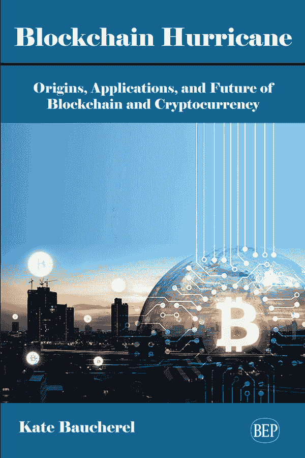
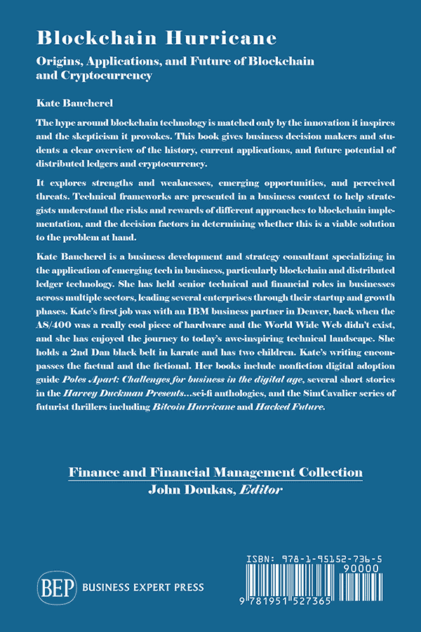

# 区块链飓风




`Kate Baucherel`


Cover Image Credit: Zapp2Photo/shutterstock.com

222 East 46th Street, New York, NY 10017

[www.businessexpertpress.com](http://www.businessexpertpress.com)

ISBN-13: 978-1-95152-736-5 (paperback)

ISBN-13: 978-1-95152-737-2 (e-book)

Business Expert Press Finance and Financial Management Collection

Collection ISSN: 2331-0049 (print)

Collection ISSN: 2331-0057 (electronic)

Cover and interior design by Exeter Premedia Services Private Ltd., Chennai, India

First edition: 2020

10 9 8 7 6 5 4 3 2 1

Printed in the United States of America.

## Endorsements

“This is a brilliant read. It is beautifully written with authenticity, clarity and conceptual elegance. Explanations are clear and engaging, making it an indispensable and accessible resource for those wishing to gain in or reinforce fundamental understanding; developmental origins are painstakingly and generously elaborated; and challenges for future developers and adopters are both appetizing and pull no punches. I have previously sought to read about this topic but never yet come across such a readable, uncluttered, informative, measured and engaging exposition. Superb.”

`Prof. Alison Shaw, Newcastle University`

“There is no question that Blockchain is a technology that will disrupt a number of industries, including the insurance industry. It is disruptive not only because the technology is by nature groundbreaking but also because it brings together parties that in the past would have been in competition or in some sort of conflict, for the benefit of transparency and simplification, and in fine, to provide the best possible outcome for customers. This book does an excellent job at explaining why, and how, this will be the case.”

`Hélène Stanway, Digital Leader, AXA XL`

## Abstract

The hype around blockchain technology is matched only by the innovation it inspires and the skepticism it provokes. This book gives business decision makers and students a clear overview of the history, current applications, and future potential of distributed ledgers and cryptocurrency. It explores strengths and weaknesses, emerging opportunities, and perceived threats. Technical frameworks are presented in a business context to help strategists understand the risks and rewards of different approaches to blockchain implementation, and the decision factors in determining whether this is a viable solution to the problem at hand.

## Keywords

`blockchain`; `cryptocurrency`; `distributed ledger`; `bitcoin, ethereum`; `hyperledger`; `permissioned`; `private`; `decentralized`; `decentralization`

Writing this book has been fun, eye-opening, surprising, and occasionally frustrating. Thank you to all the people who have told me their remarkable stories, answered far-reaching and sometimes daft questions one-on-one and in open forums, and opened up new avenues for me to explore as I descended deeper into the rabbit hole. Both before and during the writing process I learned a huge amount from long conversations, inspiring speeches, roundtable discussions, chats over beer, and lengthy message exchanges with hugely talented blockchain practitioners from all corners of the world. I am incredibly grateful to all of you for taking the time to answer questions and tell me about your work, and for checking the accuracy of how our conversations are reflected in this text. Thanks to Gabby Dizon, Patricia O’Callaghan, Alex Amsel, Adam Clarey, Paul Miller, Rachel Wolfson, Anne Puck, Dylan Jones, Dan Lyons, Caitlin Long, Tyler Lindholm, Joshua Ashley Klayman, Ian Cornwell, Mark Bell, Martin Bartlam, Kim Cope, Jeremy Gardner, Tom Kysar, Hélène Stanway, Ghanshyam Patil, Mike Smith, Ant Stevens, Adryenn Ashley, Hartej Sawhney, Mariam Turashvili, Steve Schneider, Anne Ahola Ward, Daniel Doll-Steinberg, Tonya Evans, Corey Segall, Shontavia Johnson, Graham Richter, Helen Disney, Genevieve Leveille, Terence Eden, Rich Julien, Jeff Hasselman, Kapil Dhar, Aad van Moorsel, Holly Burgess, Josh Edwards, Thomas Power, Jonny Fry, Andreas Antonopolous, Marguerite deCourcelle, Emily Rose Dallara, and Akane Yokoo. Special thanks to Alison Shaw, Paul Sitoh, Steve Blanks, David Morton, and Joanne Rout for proofreading and suggesting changes, additions, and clarifications. I’ve also had a lot of encouragement along the way from friends, colleagues, the team at Business Expert Press, and of course, my family. My thanks and love to Xavier, Gaelle and Loïc for your patience and support, always.

What has blockchain ever done for us? Its first decade has been turbulent, fascinating, full of promise, fraught with danger, riddled with duplicity, and ultimately inspiring. Its inextricable link to Bitcoin has generated a high degree of skepticism over the contribution blockchain can make to our world, matched only by the fervor of advocates who believe that blockchain and cryptocurrency can drive fundamental changes in working practices and meet societal challenges.

This book seeks to inform, not to evangelize. We will look at the evolution of cryptocurrency from its origins in cryptography to its birth in the fires of a global financial crisis, and through the first decade of digital cash. We will examine the niches where blockchain, the technology that underpins cryptocurrency, can be an effective solution to other problems, where it is already being employed, and how to decide whether it is an appropriate path to take in resolving challenges in your business and industry. We’ll reflect on the mistakes that have been made in rushing to adopt blockchain where hype overtakes practicality, in the hope that we can learn from a checkered history. We’ll also explore the real innovations that are happening, the things that could not be achieved without blockchain and cryptocurrency, and the future impact that experts foresee.

One of the challenges of any emerging technology is the new vocabulary that develops to explain its features. The jargon surrounding blockchain and cryptocurrency is no exception.

区块链在技术上属于分布式账本技术（DLT）的子集，但该术语已变得无处不在。由于公众对区块链和加密货币存在常见误解和信任缺失，DLT 在商业环境中展示软件解决方案时往往比区块链更具正面印象，但这两个术语经常被混用，且在本书中都会使用。分布式账本简单来说就是交易记录（类似会计账本），它同时存储在多个位置。这与多个用户访问单一数据库不同：分布式账本的优势在于有许多相同的复制品，这些复制品在交易发生时都会同步更新。这意味着任何参与方都可以将交易写入账本，只要所有账本持有者一致认为该交易有效（或严格来说达成共识），它就会被写入每一个账本的实例中。

账本中的条目依赖于密码学，使得交易细节对普通观察者保密，同时允许授权用户检查其持有的记录的完整性。需要记录的任何信息都会被处理生成哈希，这是一种由字母和数字组成的唯一字符串，用来表示原始内容。除非拥有解密密钥，否则无法解读该哈希，这与通信应用（如 WhatsApp）或安全电子邮件系统的端到端加密相同，确保只有发送者和接收者能阅读内容。如果你持有的记录声称与原始记录完全相同，那么将你手中信息的哈希与区块链中保存的哈希进行比对，即可提供不可否认的证明，说明你持有的记录是真实的还是伪造的。

下面是描述区块链及加密货币相关方面的常见术语。

*   记录是去中心化的，行政功能被中介化：没有中央机构（如银行）来独占控制数据库的写入。

*   记录在账本中的交易是不可篡改的：一旦被验证，就无法回去修改。这对于维护记录的可信度至关重要。

*   账本中的交易具有位置性完整性：每个区块都有时间戳，并与前后区块链接。

*   用于在全体社区满意的情况下达成交易一致的机制是共识机制，种类繁多，效果各有不同。

*   使用共识机制使区块链变得无需信任（trustless）。这并不意味着记录不可信，而是不需要再信任任何第三方。

*   区块链可根据其结构和去中心化程度是公开、私有或许可的。

*   区块链中执行交易的代码称为智能合约（smart contract），这很讽刺，因为它既不是合同，也并不特别“智能”。

*   账本是透明的：参与者可以看到所有已发布的交易。任何人都可以查看公共区块链记录，例如以太坊区块链可在 Etherscan.io 上浏览。同样可以查看治理交易行为的智能合约。这有助于维持交易记录完整性的信心，但也带来缺点，尤其是在商业机密方面，公开访问可能导致泄露。在许可或私有区块链中，只有获准访问的参与者才能查看记录。

*   区块链的参与者是节点。它们可能是全节点，持有整个分布式账本的完整副本；也可能是轻客户端节点，参与交易但不持有所有记录。

*   加密货币是数字现金的统称，非加密货币被称为法币。严格来说，这一术语指由发行政府设定价值（而非由储备支撑）的货币，但在此语境中已泛指。

*   公共区块链和加密货币应遵循五大核心原则：开放、公开、中立、抗审查性、无国界。

随着图景的展开，其他概念将陆续出现，但目前我们先从最基础的开始。

## 变革的世界

这不是第一次新技术引发两极评价。1995 年，Newsweek 发表了一篇关于正在席卷全球的新兴运动的文章。克利福德·斯塔尔（Clifford Stoll）在“Why the Web Won’t Be Nirvana”^(1) 中写道：“我对这种最时髦且过度宣传的社区感到不安……它明亮地招引人，诱惑着一种‘知识即力量’的图标……”他否定了“网络炒作者”的预测，认为我们未来会通过互联网阅读书籍和报纸、教育孩子、在线浏览目录、点击一次即可下单购物、预订机票、预订餐厅。四分之一个世纪前，你能想象出我们如今如此轻松阅读、浏览和在线交易吗？现在试着想象近期的未来：创作者通过自动微支付获得足够收入以谋生，游戏玩家拥有作为数字资产管理者的可行职业，你能够控制个人数据并选择谁以及如何使用它，你可以在邻里之间共享自发电，而你所消费的食品和化妆品的溯源可以通过手机 App 一键确定。这正是区块链和加密货币领域的先驱所热衷的，也激励创新者去探索并利用新技术。


早期的铁路工业家和投资者同样充满兴奋。世界上第一条蒸汽铁路是 1825 年从英格兰东北部的斯托克顿（Stockton）到达勒沃特（Darlington）运行的。由一群工业家组成的联盟为其建设筹集了 120,000 镑（约合今天的 250 万美元以上），并在 1825 年开通。蒸汽机车“Locomotion”以每小时 15 英里的速度，在八英里的轨道上拉动 36 辆货车和客车，历时两小时。19 世纪的投资者有远见，却未能预见铁路在北美的快速扩张、现代高速列车、磁浮列车、超高速管道（hyperloop）以及英法海底隧道（Channel Tunnel）等发展。

区块链常被与互联网相比，但不在于功能，而在于其颠覆潜力和带来的意外变革。1989 年，极小的社区正使用 nascent（ nascent）世界万维网。地理分布各异的学术机构和企业长期使用公告板和消息系统——这些系统往往嵌入早期的 ERP 软件平台，作为直接取代传统书面邮件或电话通话的替代方案。对非专业人士而言，这类媒介访问十分困难，这在区块链早期也同样如此，我们如今已忘记那些需要拨号调试调制解调器、配置 TCP/IP 栈以及浏览器的复杂步骤。F‑Secure 网络安全专家米科·海佩宁（Mikko Hyponnen）回忆当年为使用其网站而向用户提供的复杂指导，需要解释需要互联网接入（通常通过拨号调试调制解调器获得），以及 TCP/IP 栈和浏览器。^(2) 当时并不存在我们今天视为现代浏览器的 Netscape，也不在 Windows 中内置传输控制和互联网协议，但早期采用者觉得这些不便是值得的。

十多年后，2000 年 3 月出现了“点 com 泡沫”的爆发，早期的投机性互联网发展随之而废。当时我们甚至无法想象像 Twitter 及其社交媒体同类，也无法想象我们最终会依赖互联网通过视频、音频和社区论坛来传递信息。多年来一些科幻作家接近过这种设想，包括大卫·布林在其 1990 年小说《地球》中，^(3) 该小说描绘了一个动态的全球信息网络、公民监控以及无线连接到可穿戴技术等内容。我们最初使用互联网来简化与熟人之间的双向沟通，以及阅读复制印刷文字的宣传册式网站。我们习惯的事物可以在线上更快完成，并且能够节约成本。创新最初是线性的过程，随后跨越鸿沟实现了难以想象的功能。

区块链如今处于同样的位置。比特币诞生十年后，加密货币的第一次繁荣与衰退循环与点 com 之路相似。投机性应用几乎从景象中消失，因为早期的大量资金已枯竭，为长期潜力更大的严肃商业模式腾出了空间。虽然仍存在获取和采用的障碍，但这些障碍正在迅速下降，因为组织机构——尤其是加密货币交易所和区块链游戏开发者——正在创新以简化入门体验并构建无缝的用户体验。我认为，该领域的主要参与者尚未出现。正如互联网的先驱或最初铁路工程师一样，我们根本无法预见等待我们的社会和行为变革。

## 区块链之旅

我们的旅程始于 2009 年首个去中心化数字货币的推出，这是研究人员多年潜移默化后的成果。支撑比特币区块链的加密技术和链式结构是建立在巨人的肩膀之上的创新，但萨托希·中本聪在白皮书中发表的突破性成果提供了全新的工作方式。比特币首次展示了在没有中央处理机构参与的情况下，创建和维护账本的能力，使得交易能够被处理并记录。它建立了一个系统：每个人都拥有账本的副本，大家一致认为交易已被准确记录，且无人能够篡改记录。

这项去中心化、透明、无信任、不可篡改的技术将带我们去何方，伴随着复杂的共识机制和精心构建的智能合约？自开发者首次迈出去中心化货币的 tentative 步伐后，区块链已吸引了同样多的拥护者和批评者。在萨托希·中本聪于 2008 年发布的原始比特币白皮书发表与维克托·比特林（Vitalik Buterin）团队于 2015 年推出以太坊虚拟机之间的这些年里，区块链基本上是加密货币信徒和开发者的专属领域。2017 年，随着加密货币价格上涨和主流媒体关注此事，局面发生了改变。随后的牛市与熊市因其快速致富的潜力以及纸面损失的愉悦感而吸引了大量关注。区块链和加密货币迅速进入公众视野，但公众的认知差异极大。

在一些评论员的头脑中，它是解决困难政治和商业挑战时的万能药。另一些人则持更为保守态度。2018 年 10 月，英国和美国的政治人物都面临着两极分化的光谱。在英国保守党大会上，时任财政部长菲利普·哈蒙德（Philip Hammond）被问及在英国退欧情况下，如何在爱尔兰岛上实现爱尔兰共和国与欧盟之间的无缝边界。^(4) “技术正在变得可用，”他回答说，“我并不声称是该领域专家，但最明显的技术是区块链。”与此同时，在大西洋彼岸，斯坦利商学院的诺里尔·鲁比尼（Nouriel Roubini）教授向美国参议院银行、住房与社区事务委员会作证：“加密货币是所有诈骗和（已破裂）泡沫的母体，而区块链是历史上最被高估的技术，仅仅优于一个电子表格/数据库。”^(5)

当然，真相介于这两者之间。鲁比尼对早期因监管宽松而导致的区块链项目非法投机及不良做法的蔑视是有道理的，但他对加密货币和区块链的彻底否定忽视了加密货币作为合法支付手段的日益广泛采用，以及在全球多个行业引入有效的分布式账本应用以解决真实问题的发展。哈蒙德在政治截止日期紧迫、选民需要他展现成果之际表达这种希望，实际上更像是绝望而非实用性，正如 BBC 的罗里·凯兰-琼斯（Rory Cellan-Jones）所指出的，这并不反映白 hall 走廊中更为务实的观点。区块链将有助于全球货物流通的顺畅，但这并非短期效应，也不是孤立的。

## 在加密货币头条背后

许多人关注波动的加密货币交易故事，却对其背后蠢蠢欲动的生态系统缺乏认知。加密货币价格的起伏、诈骗以及 snake-oil（假冒药）销售者为媒体提供了更具轰动性的标题。经常被忽视的是，这一金矿式的众筹活动（通过新加密货币 altcoins 和代币）主要推动了快速、全球且高度协作的发展。在光鲜的炒作背后，有大量优秀工作在幕后进行，以细化和扩展比特币最初的去中心化、无信任、透明交易机制。在幕后，受人尊敬的专业人士正在研发新的工作方式，而越来越多的分布式账本应用在普通软件平台的底层悄然运行。跨国企业正在建立结构，以颠覆金融科技、供应链管理、公用事业和医疗保健。各国政府、联邦机构和主权国家正在制定法律框架，以保护投资者并规范区块链在资产登记、身份和凭证方面的使用。联合国推出了“区块链为社会公益”的议程，^(6) 该平台邀请人们想象：

- 25 亿未被银行服务的民众将被纳入全球金融体系；
- 跨境工人每年不会因向家乡汇款而集体损失 500 亿美元；
- 购买产品时，人们将知晓其全生命周期故事——包括创作者、涉及的地点、所用材料等；
- 人们将免于担心土地被持枪者强行占有；
- 艺术家将获得版权材料的自主权，并与粉丝建立直接关系；
- 患者将掌握其个人医疗记录；
- 海外援助将真正送达 intended 受益者，而不会损失三分之一。

每个人在地球上都将拥有 ID 并获得教育、健康和其他社会服务的访问权限。

这是许多倡导者所相信的未来的强大愿景，可以通过区块链技术的演进来推动。

联合国的积极展望与加密货币过去作为犯罪工具和不法活动的工具的阴暗声誉形成了鲜明对比。对于那些电脑被勒索软件感染、数据被锁住并要求用比特币支付的用户来说，加密货币等同于犯罪行为。这种认知在公众中进一步强化，因为其在 Silk Road——一家在 2011 至 2014 年活跃的暗网市场——的广泛使用。在此期间，Silk Road 记录了超过 900 万次比特币交易，其运营后期的托管账户被黑客入侵，尽管大部分被盗比特币后来被回收。讽刺的是，比特币本身是无辜的一方。比特币区块链完全透明且伪匿名，而非真正匿名：理论上也在实践中，每个钱包都可以与真实身份关联，使得比特币比现金更易追踪。^(7) 例如，2017 年的 WannaCry 勒索软件攻击中，所有赎金支付都显示在比特币区块链浏览器上，任何人都可以查看。

区块链也在讲述故事。对于一次全球高调攻击，仅有 338 名受害者实际支付了 WannaCry 勒索金，这凸显了网络安全专业人员在阻止病毒传播方面的卓越工作（部分归功于恶意软件研究员 Marcus Hutchins 的快速行动^(8)），他们帮助用户在不支付赎金的情况下修复勒索软件造成的损害。检查用于收取赎金的三个钱包之一的记录，可以看到 133 笔比特币收据，当时每笔相当于 300 美元，随后在几个月内通过两笔交易提取了全部金额。^(9) 这些资金被转移到一个使用隐私币 Monero 的钱包中，真实交易细节通过混淆数据得到保护：每笔真实交易附带六条虚假记录，使得追踪变得更加困难。这种匿名加密货币更难以监管，其本质上相当于已使用的纸币。将所有数字硬币都用同一标签来描述是不公平的。

对加密货币的另一项指控，尤其是在 2017 年价格快速上涨期间，是它是一个庞氏骗局、金字塔骗局或诈骗，用来通过早期采用者的回报来骗取早期投资者的资金。随着价格回归现实水平，交易量和监管同步提升，关于欺诈行为的讨论减少，对主流数字货币的可靠性认识也更为清晰。当时，这种误解却极为盛行，以至于 2018 年加州一位开发者创建了玩笑货币 “PonziCoin”。其白皮书明确说明，智能合约将通过后续投资的收益向早期投资者支付，直到资金耗尽。讽刺的是，该团队的讽刺项目令人惊讶且震惊地发现，人们真的开始把真金白银投入该方案。随后他们迅速停止投资功能，让智能合约按原计划执行。在其网站上，开发者向卷入炒作的用户发出警告：^(10)

我们希望大家笑一笑 :) 但我们必须关闭。这纯属戏仿艺术表演/玩笑。我并没有“跑路”拿走钱款，也没有出售任何我的 PonziCoin，合约是被其他用户提取时被清空的。请在投资可疑的加密货币时保持谨慎，尤其是那些看起来像金字塔骗局的项目——这是一场零和游戏，金钱不会凭空出现。

这对早期区块链项目的投资者而言是一个重要教训，因为代币可以轻松购买。在大多数司法管辖区，投资受到一定程度的监管，如果投资回报看起来太好以致不真实，那很可能就是如此。

最终，加密货币不过是一种货币形式。正如作者 Yuval Noah Harari 所写：^(11)

金钱是人类创造的唯一信任系统，能够跨越几乎任何文化鸿沟，且不因宗教、性别、种族、年龄或性取向而进行歧视。正是因为金钱，即使是互不认识且互不信任的人也能够有效合作。

加密货币是最通用的信任系统的自然演进。其去中心化结构和内置的信任机制确保了其在社会中的合法地位。

你能花掉加密货币吗？当然可以。我口袋里的实体钱包里目前有一张 Visa 卡，它直接关联到一个加密货币账户。我可以通过间接方式使用加密资产支付咖啡和三明治的费用。交易会自动转换为当地法币，这一点与已经存在的加密货币 ATM 相同，这些 ATM 允许从加密账户提取本地现金，但最引人注目的是交易转换的无摩擦性。一个例子是微型太平洋国家马绍尔群岛，它将本土加密货币——马绍尔群岛主权——作为法定 tender。在委内瑞拉，从咖啡到服装的商品和服务支付 increasingly 以比特币进行，而政府也开始要求税款必须用其自有的加密货币——Petro（更多信息请参阅 第 3 章）。

在线上，我可以使用加密货币购买各种商品和服务。目前有几种主流的加密货币支付工具，包括一个标准的 Blockonomics 插件，它在我的自有 WordPress 网站上接受比特币支付，并直接将收益存入我的加密货币钱包而无需转换。区块链游戏如 Cryptokitties、Axie Infinity、Neon District、Decentraland、Epic Dragons、EOS Knights、Gods Unchained 以及其他许多游戏都可以使用加密货币进行游玩。

随着用户和交易量的增长，加密货币的波动性可能会逐渐稳定，从而降低当前围绕它们的风险和不确定性。稳定币的兴起——一种与真实资产或货币挂钩的加密货币类别——可能会加速采用，因为它大幅消除了数字货币固有的风险。2019 年 2 月，加州立法者提出一项法案，允许使用稳定币支付任何大麻 excise 税或大麻种植税。^(12) Facebook 所提议的 Libra 代币为采用提供了另一种机制。包括 Wyoming 区块链联盟联合创始人 Caitlin Long 在内的评论员^(13) 认为，这一强大的全球社交网络的覆盖范围将为发展中国家的公民提供一种比政府发行货币更可靠的价值存储。关键问题不再是“我们能否在日常生活中使用加密货币”，而是“我们离大众采用还有多远”。

- 关于区块链的一个主要误解是它是一个存储大量可立即阅读信息且不可被篡改的数据库，实际上它是存储加密字符串的数据库，它之所以不能被篡改，是因为每个区块在链中具有固定的位置。修改一个区块的数据意味着需要修改随后的所有区块的数据，这比实现该改变所能获得的收益更费力，而且如果可能的话。每个区块非常小，链上保存的交易数据被缩减为单个加密哈希值（即检查和数据完整性的校验和），用于保护文本、图像或日志条目等数据的机密性和完整性。

- 将“在区块链上进行流程”这种说法淡化了这些内部机制，但这在正常情况下是完全可以理解的。人们有多少次会深入研究并查看日常使用的软件背后的代码？当你连接互联网时，你会考虑支撑你日常使用的功能、协议、浏览器技术和搜索算法，这些算法用于显示你的 Google 搜索结果吗？你会思考世界万维网的结构和工作原理，它提供了你无缝的沟通体验吗？很少。通常我们只会关心互联网连接的可靠性以及上传猫图片的速度。在分布式账本采用的早期阶段，然而，回顾区块链的基本结构似乎很重要。理解这一点有助于在判断分布式账本是否适合解决手头问题时做出决策。

### Merkle 树和哈希记录

让我们随机取一个比特币区块。区块号 575171 于 2019 年 5 月 8 日矿工。通过 blockexplorer.com^([14) 搜索该区块引用，发现该区块包含 2,568 笔交易，仅占 908,496 字节的数据：不到一个兆字节。这种紧凑的记录得益于加密散列。

加密散列算法用于将任何长度的条目转换为由字母（大小写）和数字（0–9）组成的常规字符串。常用的算法是安全哈希算法 2（SHA-2）函数，例如 SHA-256（简单来说，产生 256 位，即 32 字节的哈希）或 SHA-512（512 位，即 64 字节），但还有其他选项可以生成所需的唯一字符串，以确保数据的机密性和完整性。这个字符串的重要性在于，如果同一条目（文档、图像或交易）再次使用相同的算法进行哈希，得到的字符串将相同，从而验证该条目的完整性。但如果有任何更改，哪怕是微小的改动，字符串也会不同。即使在这本书中删除一个逗号，处理该手稿时也会生成不同的字符串。这种比较的简单应用可能是证明某项知识产权已在区块链上于特定日期记录。哈希争议文档并与区块链上的哈希进行比对，可以证明它是否与原始文件相同。2018 年 6 月在中国的第一个区块链证据案例^(15) 正是使用了这种技术，以证明被告未经许可复制了文章。

在我们的区块链中，第二轮哈希将一对字符串转换为另一个唯一哈希，这个过程会一对一重复，直到所有条目都汇聚成一个单一字符串。这种哈希字符串的层级结构是 Merkle 树，最终字符串——Merkle 树根——出现在区块中。（这些树以 Ralph Merkle 命名，他的 1979 年论文^(16) 讨论了公钥系统中的密码学。）在交易验证过程中，例如在中文版权案件中，实际比较的正是这个根。一次比较一个根比比较成千上万的字符串要快得多，如果在字符串中发生任何更改，Merkle 根本身也会发生变化。说到这里，还好吗？很好。

### 关闭区块

我们现在已经将所有记录压缩成一个字母和数字的单一字符串。这个字符串位于区块链的最末端的子区块中。在区块链浏览器上，你可以看到它的父区块编号 575170。在区块链网络中，参与节点不断竞争运行新的带有变体的加密哈希。为了完成区块，包含未知变量的内容的哈希必须生成一个带有预定义数量前导零的字符串：区块哈希。最先找到可能的变量值的计算机有权关闭当前区块并打开下一个区块。这个计算出的变量值是 nonce，它与解决方案的时间戳一起记录在区块头中。这一过程称为挖矿：在比特币区块链上，成功矿工会获得预定义的奖励，以及该区块中 2,568 笔交易的费用。

### 不可篡改性

我们为何坚持区块链不可更改？答案在于链的结构、区块的内容以及分布式账本。我们的区块号 575171 包含对 575170 的引用。它会在计算 575171 的区块哈希时使用 575170 的区块哈希。如果某个单一实体试图更改 575170 中的任何交易，其区块哈希及随后所有区块的哈希将不再与分布在区块链上所有节点上的账本记录相符。要回滚更改并重新计算后续区块的哈希是极其繁琐的，试图这样做的人永远赶不上有效链的进度。涉及的数学很难且耗时，即使使用为此目的日益强大的计算机处理器也如此。人们担心量子计算的出现可能赋予足够高的处理速度来高速重新计算区块哈希，但区块链安全的核心规则依然适用：篡改记录的成本高于任何不良行为者可能获得的收益。

了解简单区块链的结构，能够更有效地评估该技术是否适合你的业务挑战。当可验证、有时间戳且不可更改的记录能够简化流程、降低成本、改善生活或降低风险时，则有理由考虑采用区块链。与每项新兴技术一样，除非有真实需求来利用其提供的功能，否则不应进行投机性的系统重构。当前发展速度不允许行业花费资源去复制现有系统仅为“它”的缘故。当文字处理程序取代打字机时，花费了数十年才让我们习惯如今理所当然的额外功能。鉴于技术现在的快速演进，我们必须专注于增强。

### 区块链将带我们去往何方？

区块链带来的变革将是巨大且具有颠覆性的。以一个例子说明：去中介化的过程将对机构构成特别大的挑战。我们已经看到在线预订对旅行社的影响，其业务模式从经纪转向提供增值服务。随着去中心化结构推动用户向点对点行为转变，房地产销售等更复杂领域的代理人可能会发现自己处于同样的境地。

分布式账本技术和加密货币长久以来已然存在。本书将详细探讨加密货币及其所受监管（`第 3 章`），区块链的商业应用（`第 4 章`），游戏行业创新进入主流（`第 5 章`），以及分布式账本在公共部门和政府的采用，包括数字身份和我们个人数据的所有权。不过在此之前，让我们回顾区块链的起源以及第一个去中心化货币——比特币的崛起。

## 第 2 章

## 通往去中心化的漫长之路

### 数字货币的挑战

疲惫的旅行者把沉重的背包扛在肩上，沿着坡道滑入太空港。陌生的声音和气味袭击了他们的感官，被消毒帘的嘶嘶声和 CL2 的规则性无味所打断。他们厌恶地甩掉一团湿透的羽毛，环顾四周寻找最近的酒吧。新星球？那就需要一杯鸡尾酒。


几十年来，作家们一直把角色丢进外星土地——无论是地球还是无数虚构宇宙——并天真地假设他们随时随地都能结账。多币种和外汇的财政现实很少是关键情节。读者仅需假设旅行者口袋里的硬币要么是法定货币，要么由一眼认得的贵金属制成，而星际信用在任何地方都被接受，无需置疑。是有一家规模庞大的星际银行发行通用纸币和硬币供爬虫和毛茸茸的生物使用，还是更具吸引力的是想象一种数字化的去中心化货币？在许多年里，星际英雄在低俗酒吧里徘徊，研究人员和密码学家则一直在致力于实现这一愿景。

为什么它如此困难？创建去中心化货币的经典挑战包括防止双花、资金和参与方的安全，以及提供可靠的交易已发生的证明。这些挑战紧密相关。让我们考察两个人之间的简单钱款转移。如果一个人手里有一张一美元钞票并交给朋友，原持有者就再也无法花这张钞票——物理转移已经发生。如果持有者直接从银行账户转账或付款，中心化银行系统会在账本的某一部分记录钱款从原持有者账户中被取出，并在另一部分记录借记收款人余额。参与银行的数据库显示交易已完成，所有权已发生变化。

我们接受物理纸币在交换时无法复制——当然，现实世界中伪造钞票和硬币始终是一场持续的斗争，但这里关注的是“感知价值”的交换。我们信任通过银行系统的检查与平衡进行的数字转账，并且可以在银行对账单上验证交易。然而，如果我们想使用不属于传统银行体系且没有实体形态的货币进行交易，如何确认交易已正确完成？我们能确信价值真正从第一个账户转移到另一个账户吗？毕竟，复制数字资产并不困难——只需几次鼠标点击，即可在几乎零成本的情况下复制文档、图片、文件或文件夹，从而让同一项内容被多个接收者接收。去中心化数字货币必须是一个中立且诚实的账本，这需要一种机制来降低欺诈、复制和伪造的风险。该货币还必须解决钱币的创造与供应问题，并作为价值符号被接受，而无需依赖传统的实物储备。比特币——第一个真正的加密货币——满足了这些挑战，并成为首个中立、开放、无国界、公共且抗审查的数字现金示例，但其道路之长。我们的故事始于比特币出现前更长的二十五年，当时互联网为地理分散、可能缺乏信任关系的群体提供了协作与合作的可能性。令人欣慰的是，它始于一个需要全新解决方案的新问题。

## 密码学领航者

数字现金的概念及其工作原理首次在 1982 年由大卫·查姆（David Chaum）于伦敦大学学院（UC Berkeley）计算机科学博士论文中提出。论文题目^(1) “Computer Systems Established, Maintained and Trusted by Mutually Suspicious Groups”，立刻让人联想到现代分布式账本的无信任多方结构。他提出的一个能够被不互相信任的人所信任的系统是查姆的关键突破。他还在一篇写得极其清晰、易读的论文中指出，加密技术可以保护任何性质和体量的数据，而只需保护一种加密机制即可。保护与安全的区分至关重要。查姆称保护的元素为“保险箱”，我们现在称之为“区块”，其中包含我们哈希数据的微型梅克尔根。此外，他指出多份加密数据的复制不会削弱安全性，反而能提升容错性：我们可以将其与分布式账本相比较。区块链的基本概念在此已具备，但距离最终解决方案仍有很长的路要走。

在当代关于盲签名的提案中，查姆进一步阐述了交易信息的保密性、付款凭证、交易双方的验证以及对被盗付款媒介的保护（当时我们可以想到信用卡，它们那时尚不常见）。他定义了盲签名系统的函数、协议、属性以及可审计性。随后几年里，他发表了多篇探讨虚拟货币数学基础的论文，并于 1989 年创立了 DigiCash。该系统被认为是世界上第一个电子货币系统，其 Cyberbucks 通过“盲签名”方法（现称为查姆式盲签）在用户之间流转，且现金遵循查姆的所有加密原则。该数字货币超前于时代，与早期的万维网同时推出，却在互联网尚未成为大众工具之前就已面世。当时全球银行以及如微软等公司对中心化数字货币表现出浓厚兴趣，正如 1994 年《Wired》杂志的文章所解释的。^(3) “数字时代的下一次伟大跃迁，正是将直接击中你的钱包。你折叠的纸币和收藏的纸条，必然被加密封闭的数字流所取代。”中心化银行接受了这一概念，以至于我们现在的法币交易几乎都已经实现数字化，但 DigiCash 本身随之式微，距离去中心化仍有很长的路要走。

David Chaum 仍然在密码学领域活跃：他创立了国际密码学研究协会、阿姆斯特丹数学与计算机科学中心的密码学小组、投票系统研究所以及 Perspectiva 基金会。他也在研发新的加密货币结构——Elixxir，重新审视他最初的盲支付原则。

## Cypherpunks 和 B-money

1990 年代出现了 Cypherpunk 运动。Timothy C. May 于 1988 年撰写《Crypto Anarchist Manifesto》，^(4) 这是一篇令人毛骨悚然的预言，预见了随后加密学和互联网发展所推动的“社会与经济革命”。从 Cypherpunk 邮件列表中萌芽的社区因强加密技术受到国家控制的担忧而兴起。在美国，加密被列为武器，因为它在战争期间保护通信方面发挥了关键作用。随着个人计算的普及，技术成为商业必需，但政府限制使得出口软件只能使用 40 位加密，足以在普通用户几天内被破解。Cypherpunk 运动抵制国家安全局（NSA）试图遏制研究并将专利分类的行为，成功将强加密技术推广到公共领域。此争议在斯蒂芬·莱维 2001 年的著作《Crypto: How the Code Rebels Beat the Government Saving Privacy in the Digital Age》中有详细记录。^(5)

5 月的 1992 年电子邮件中，^(6) 他向小组重新发布了原始宣言，以面向新受众。他的签名包含了当时不为人知但我们今天熟悉的词汇标签：加密、数字货币、匿名网络、数字化身份、零知识、声誉、信息市场、黑市——以及政府的崩溃，这在无政府主义愿景中被视为这些技术与行为采用后的结果。值得一提的是，维基解密丑闻的出现同样产生了去中心化的影响：维基解密的创始人朱利安·阿桑奇（Julian Assange）于 2012 年撰写《Cypherpunks: Freedom and the Future of the Internet》^(7)，也是该小组的成员。

Cypherpunk 社区在整个十年中不断壮大，成为当今我们所知的加密货币发展的重要影响力。该小组在高质量的技术讨论之余，也充斥着每个社区都会出现的社交礼仪、分心和刷屏。比特币首次接受交易的收款人 Hal Finney 是成员之一，且极有可能是使用 Satoshi Nakamoto 这一化名的不明身份者也是 Cypherpunk 成员。

另一位 Cypherpunk 成员、计算机工程师魏大（Wei Dai）于 1998 年发表帖文，思考如果中央政府变得多余，就需要“一种交换媒介（货币）以及强制合约的手段”。他提出了利用分布式账本进行金额转移的方案；创建数字“b-money”；以及制定合约实施的过程。魏大建议将透明的交易广播到整个网络，以避免重复支出。他描述了通过挖矿过程铸造新币的方式，并定义了智能合约的需求及可能结构。这些都是数字现金拼图中缺失的关键 piezas，但又过了一个十年才出现可行的加密货币。

在此期间，互联网持续强劲发展。2003 年出现的 Second Life 平台成为虚拟商业的试验场，依赖于本地但集中化的货币——林登美元（Linden Dollar），可兑换成现实货币。点对点网络为文件共享建立了基础，尤其是 BitTorrent 协议，虽于 2005 年推出，但 Napster（1999–2001）和 The Pirate Bay（2003 起）等对音乐和影视版权的轻率态度招致法律行动和 shutdown。二十五年后，长期道路上去中心化的第一步已走完，技术与公众心态终于赶上了点对点的愿景。

## Satoshi Nakamoto Versus the Banking Establishment

尽管研究人员和活动人士共同努力已在理论上确定了加密货币拼图的所有 piezas，但早期的电子现金项目（如 DigiCash）并未获得 traction。其中，唯一如今仍被人熟知的可能是 PayPal，其电子现金愿景转化为一种在传统货币上的高度成功的支付机制，但缺乏实现真正去中心化和可靠价值交换的全部特性。

他们说，necessity is the mother of invention，而第一个真正运作的加密货币——Bitcoin，正是由有史以来最大的集中式灾难所触发。

2007 年 8 月 9 日，BNP Paribas 冻结了三个基金，揭示其无法估值的抵押债务担保工具（CDOs）——由次级押贷款打包而成的资产。这些贷款债务原本根据其违约风险等级单独分类，随后被打包为整体资产、交易、混淆并像扑克牌一样被切割、买卖于全球银行体系内。每一次交易都进一步模糊了底层债务的性质，直至显而易见：无法对这些捆绑物进行可靠估值。银行建立的估值之基不过是砂，而非岩。仅五周后，讽刺的是名为 Northern Rock 的英国银行——专注于高贷款比例的抵押贷款——也因无法将其次级押贷款包抛售而陷入困境。其向英国政府请求支援引发了挤兑，储户在每个市中心分行排起长队取款。这标志着随后 18 个月的剧烈动荡的第一个高调受害者。一年后，美国政府救助抵押贷款机构 Fannie Mae 和 Freddie Mac，但 Lehman Brothers、Washington Mutual 和 Wachovia 则宣布破产。冰岛三大商业银行倒闭，连同离岸客户的储蓄一起湮没。据《卫报》经济编辑拉里·埃利奥特（Larry Elliott）回顾道：^(9) “从金融市场的角度看，2007 年 8 月 9 日的冲击与 1914 年 8 月 4 日相当。它标志着‘爱德华时代’的繁荣与宁静的终结，进入了信贷紧缩的壕沟——失败的银行、僵化的市场、因信贷短缺而被摧毁的房产市场。” 这次崩溃暴露了集中机构的高风险实践以及我们对缺乏透明度的银行所抱有的盲目信任。这场动荡为实现 Cypherpunk 愿景的一个部分提供了完美条件：在转移资金时规避金融机构。随着各国政府竭力填补财政缺口，2008 年 10 月 31 日，一篇署名为 Satoshi Nakamoto 的论文发表，题为《Bitcoin: A Peer-to-Peer Electronic Cash System》。^(10)

## An Elegant Solution

比特币的出现是一个分水岭时刻。Satoshi Nakamoto 的区块链概念证明了实现数十年老愿景的可行方式——即建立一个能够防止双重支出的去中心化机制。拼图已就位，关键要素正如 2005 年 Nick Szabo 在提出“BitGold”概念的论文中最初建议的那样，是为每笔交易加入时间戳。其背后的逻辑是：如果出现多次处理相同交易的尝试（有意或无意），则只有第一个被时间戳的交易才能成功并写入账本。

支撑比特币的区块链结构保障了交易的安全与透明，并将硬币的铸造与分配纳入每个区块创建的过程中。虽然比特币方案中包含了部分加密学家和 Cypherpunks 研究成果的熟悉概念，但并非所有概念都出现。Wei Dai 建议让交易向网络公开以实现完全透明，这一建议被采纳。点对点网络确保了记录准确性的分布式责任。区块链是由多个节点持有的分布式账本，确保没有单一实体控制记录或单方面确认已记录交易的合法性。每个区块中保护的数据是 Merkle 树根，反映了 Chaum 的保险箱概念，尽管此点在比特币白皮书中未被引用。数字签名是解决方案的关键组成部分，但在此情形下并非盲签名。这意味着比特币区块链是伪名币（用户可追溯至现实世界）而非匿名。

已铸造的奖励和交易费用由区块链节点（即加密货币矿工）在每个区块关闭并新区块打开时支付。这是维持系统而非欺诈系统的激励机制。这种加密经济机制是比特币正常运作的关键：它确保价值来源于资源稀缺，而非由稀缺实物或商品支撑。白皮书解释道：“新币的持续、固定数量的增加，类似于金矿通过消耗资源将金币引入流通。在我们的情况，消耗的是 CPU 时间和电力。” 比特币区块链在编码时包含了 2100 万枚比特币的储备，奖励即从此池中发放。早期矿工每验证一次区块可获 50 枚比特币，但每 210,000 个区块后奖励会减半。由于比特币区块约每 10 分钟创建一次（实际间隔会有所变化），这意味着减半大约每四年发生一次。为了在奖励下降时保持激励，矿工收入将通过交易费用的上升来平衡，随着交易量增加，费用也随之上升。2020 年的第三次减半将已发行的比特币数量提升至 1837.5 万枚 BTC，但许多比特币已因钱包和硬盘的不慎丢失而“消失在虚拟沙发背后”。通过这种递减奖励机制，剩余约三百万枚比特币仍将在未来许多年才能分配完毕。

2100 万枚比特币的创造无法被复制或追加，这使得比特币能够作为价值存储。比特币是加密货币领域中真正稀缺的商品，随着其他货币在独立区块链平台上出现，显而易见每种货币都有其独立功能。比特币是新类数字资产的准备货币，常与美元和日元并列出现在货币表中。比特币或许更接近所谓的金本位，而非法定货币：数字货币领域不存在量化宽松。

与人为创造的货币不同，Satoshi Nakamoto 确保比特币能够在长期内真实可持续。比特币社区持续进行开发与维护，虽然货币已演变，但已可靠运行超过十年。

第一次比特币转账发生在 2009 年 1 月 12 日，由 Satoshi Nakamoto 向 Hal Finney 发送。此后社区几乎再未听到这位神秘创作者的消息，包含早期矿工比特币的钱包至今未动。

Hal Finney 作为首次比特币接收者，除非是故意向自己转账，否则是不太可能的候选人。媒体曾将名为 Dorian Prentice Satoshi Nakamoto 的人提及为可能的作者，但尽管他仅距离 Hal Finney 仅几个街区，却没有任何证据将他与 Finney 或比特币项目关联。

另一种强有力的可能性是 Nick Szabo，他曾与 David Chaum 在 DigiCash 合作，并在 2005 年比特币白皮书之前三年撰写了非常相似的概念——BitGold。尽管两者之间存在巧合性证据，但他已否认任何参与。

在以色列，密码学家 Ahto Buldas、Märt Saarepera 和 Mike Gault 于 2007 年在数字身份项目中探索了数字签名、哈希和时间戳的相同系统。他们的工作时间与比特币方案的相似性引发了猜测，但他们并未主动引起关注，且如 Szabo 一样否认任何参与。

相比之下，澳大利亚人 Craig Wright 声称自己是“Satoshi”王冠的继承人，他在比特币早期与已故 David Kleiman 合作。无论 Kleiman 还是 Wright 是否参与编写白皮书或开发初始代码，仍然不明确。有趣的是，Wright 于 2019 年 5 月申请并获得了美国版权局对比特币白皮书和比特币代码的版权，声称在著名化名下拥有作者身份。正如版权局在随后发布的新闻稿中解释的那样，^(14) 它不调查申请人与化名作者之间是否存在可证明联系，仅依据申请人的陈述。2019 年夏季的一系列复杂法院案件，涉及对 Kleiman 遗产的争议以及针对声称 Wright 并非 Satoshi 的人提起的诉讼，也未发现任何支持 Wright 拥有白皮书的证据。^(15)

- 没有任何候选人公开提供不可否认的身份证明（访问比特币钱包被认为是最有力的证据），因此加密社区仍然在猜测中本聪的真实身份。这是否是一件坏事？除了满足我们天然的好奇心外，大多数评论员都认为，这完全符合 Cypherpunks 和加密无政府主义运动的精神——中本聪的身份仍然未知。通过淡出视线，不提供领袖形象，比特币的创建者确保了其解决方案真正去中心化。

## 构建在比特币之上

你能在一个区块中记录哪些交易？比特币本身采用一种三重记账方式，双重记账的发送和接收付款由第三个条目确认：一个由网络数字签名、加密封印的收据。比特币区块链上的每笔交易都使用 `UTXO`（未花费交易输出）模型进行处理。使用公钥和私钥访问你的“钱包”实际上是解锁你关联的硬币的过程。如果钥匙丢失，你无法打开锁。在发起付款时，你解锁一个 `UTXO` 并指示网络取走你指定的金额。换句话说，未花费的余额会以新的 `UTXO` 形式返回给你，以便下一次交易使用。它听起来可能很复杂，但用户的钱包实际上是与该用户关联的 `UTXO` 记录列表，总和得到账户余额。比特币区块链上的每个全节点都持有所有未花费比特币交易的副本。

为何分布式账本只限于金融交易？去中心化除金融交易外的流程的想法迅速激发了开发者和企业的想象力。如果你能在日常银行中省去中间人，那么其他机构还能被废除吗？`UTXO` 并不是处理除同质数字资产交换之外的实用方法；在比特币区块链上构建第二层协议的想法归功于 J. R. Willett，他在 2012 年发表了《第二个比特币白皮书》。对该行业未来的关键在于，他还建议通过加密社区内部筹集资金来实现这一目标。原始文档已无法访问，但在 2013 年旧金山比特币会议上，Willett 向听众阐述了该概念。^([16) Laura Shin 为《福布斯》于 2017 年撰文，描述了这一突破。^(17) “他设想了一种类似合同的东西在比特币之上，”她解释道，“就像电子邮件在 TCP/IP 之上层层叠加，但他不确定如何为其开发融资。[他意识到] 可以在比特币上发行一种代币，购买者在发送比特币资助其开发时会自动拥有该代币。”

Willett 通过首次代币发行（ICO）成功为其 Mastercoin 项目筹集资金，但该项目并未基于比特币区块链。比特币区块链是一个强大的生物体，到那时其经过验证的结构已被 Namecoin（2010，去中心化名称注册数据库）、Litecoin（2011，比特币的银，金）、以及深受欢迎的玩笑货币 Dogecoin（2013）所复制和 16 17。然而，它不足以满足企业的需求，无法处理额外协议层和复杂的多阶段智能合约。

## 以太坊与虚拟机

2013 年 12 月，Vitalik Buterin 发表了《以太坊：终极智能合约与去中心化应用平台》白皮书。以太坊软件本身是开源的，因此白皮书是一个在 GitHub 上不断演进的文档，^(18) 但原版^(19) 可在在线档案中查阅。以太坊是第一个专为分布式计算而构建的区块链基础设施，即在基础加密货币层之上能够托管多个协议。但以太坊的智能合约设想是自动执行规则以治理任何数字资产的流动，这远超比特币的范围，并且将出块时间从 10 分钟大幅缩短至约 15 秒。


以太坊虚拟机（EVM）允许在各个节点内运行代码，这是分布式应用（dApps）发展的重大创新。但以太坊还建议向“去中心化自治组织（DAOs）”延伸——长期的智能合约，包含资产并编码整个组织的章程。以太坊的推出本身部分由 ICO 资助，通过出售其原生代币 Ether（ETH）筹集了约 1800 万美元的开发资金。这为数百个创业者提供了独特的区块链属性，他们相信（或错误地相信）这些属性能惠及其创意。

以太坊的潜在应用是什么？创始人 Vitalik Buterin 在 2019 年 4 月回应埃隆·马斯克在 Twitter 上的提问时列出了他的首选项。该 thread 包含：

- 一个全球可访问的金融系统，包括支付、价值存储，以及更高级的保险等；
- 身份：从“使用 Facebook 登录”到“使用以太坊账户登录，无需中介”；
- 信任网络（web of trust）；
- 所有登记册均应在链上发布以确保安全和易于验证；各种新型人类组织形式的尝试；各种微支付场景通过支付通道实现；个人数据市场以保护隐私的机器学习（你支付 X，我让你对我的数据 Y 进行全同态执行，并由 Z 认证）；
- 加密经济用于社交网络的防垃圾邮件；预测市场用于内容创作的 DAO；加密经济/微支付方案用于奖励优质内容的发布者；
- 测试新市场设计的场地，如频繁批发拍卖、组合拍卖、自动市场制造商；
- 点对点（p2p）互联网连接市场，激励网格网络；身份、信誉和信用系统用于资源匮乏的群体（如难民）；去中心化 DNS 替代方案，如以太坊名称服务域名。

部分这些应用已实现，后文将详细探讨。其他则仍然遥不可及，却在区块链发展的视野中清晰可见。随着时间的推移，比特币区块链的原生货币逐渐找到其作为编程稀缺性基础的价值存储角色，而以太坊则成为 ICO 机器。EVM 使得基于以太坊区块链构建的应用能够独立于底层运行。围绕该机制形成的去中心化生态系统孕育出全新概念，开源协作催生了具有独特行为和属性的新型代币，超越了简单的数字现金。尤其是游戏行业推动了非货币性数字资产的所有权，更多内容请参见 第 5 章。

## 不那么智能的合约与谨慎的教训

- [去中心化合同]是魏·代的 b-money 建议的第三个特性。虽然从 A 到 B 转移资产在技术上是相对简单的，但更广阔的世界中的交易可能显著更加复杂。当然，区块链并不是第一个编码商业规则的软件，但区块链应用中需要管理如此复杂的交易的需求催生了**智能合约**。这个名称对于既不是合同，也并不特别智能的代码来说太糟糕了，会在未经验证的人群中引起各种混淆。即使维塔利克·布特林在 2018 年也表示，他希望给它们起一个完全不同的名字。然而，它们还是成为了智能合约。

- 以太坊协议中特征的智能合约是账本代码中规定的交易规则。这个词语的法律意义下并没有形成合同（尽管代码可能反映了具有约束力的合同条件），也没有任何学习或改进的过程。我们的不太智能的智能合约更接近于机器人过程自动化（RPA），而不是智能机器；它们是为相互不信任的群体提供的 RPA。

- 这些链码片段明确定义了一个重复的过程。基于账户余额的加密货币移动，而不是 UTXO 模型，这是起点，确保钱包到钱包的转账能够顺畅进行，无需中央干预。支付交易相对简单：首先检查细节——原始钱包余额是否足够？目的地址是否有效？合适的交易费是多少？然后插入相关变量（这里是源钱包地址、目的钱包地址、发送金额和应付费用），生成的交易读作“从钱包 a 向钱包 b 发送 x 枚币，并从钱包 a 向矿工区块奖励池 c 发送交易费 y”。该声明随后进行哈希，以便在下一个可用区块中包含，同时交易执行并写入账本。如果你日后核查自己的这笔交易记录与不可篡改的记录，哈希字符串将匹配，从而验证了其真实性和你账本的准确性。

- 智能合约使得交易无需与处理器建立关系。与其信任银行处理支付，你可以依赖所选加密货币区块链上的智能合约来执行代币转移。

- 让我们思考现实世界中的交易类型。在供应链中，供应商发出的发票必须在客户账本中记录为债务，但只有在满足特定条件后才会结算。智能合约可以在相互不信任的链条各方之间排列授权要素，如货物收到和质量认证确认，然后在客户和供应商之间转移资金。与机器人过程自动化的相似性显而易见。智能合约仅仅是去中心化系统中的自动化过程。另一个常被引用的智能合约潜在应用是医院出院，这会触发后续就诊预约的创建。这当然可以通过分布式账本实现，但考虑到交易各方很可能已经知晓并信任彼此，那么在集中系统内进行自动化是更合适的解决方案。

- 智能合约的意义在于其去中介化任何交易的能力。通过移除中央机构的角色，各方可以直接交易，甚至可以使用平台原生货币结算承诺。然而，去中介化也有良好的谨慎理由。如果你依赖的智能合约出现错误，且不存在中央投诉部门，你别无去处。虽然智能合约本身不是法律意义上的合同，但必须考虑其法律影响。去中介化的交易可以跨越不同国家和司法管辖区执行，不仅移除了中间人，还可能模糊各方的法律和税务地位。虽然智能合约是交易过程，并非设计为具有法律效力的合同，但其执行可能会（故意或无意）形成法律具有约束力的合同。即使开发者的意图是法律合同，它可能并不可执行，且如果发生争议，相关方在法律上的救济途径并不明显。当法律具有约束力的合同被创建，且通过不可篡改存储的数据可以验证交易的存在和内容时，便会产生关于适用司法管辖区的问题，在跨境加密货币的情况下，更需明确应在何种税务体系下申报收益。这进一步受到世界各地冲突的隐私法规的巨大差异影响：哪部法律适用于跨境交互？公共区块链上交易的透明性在不同法律体系中如何表现？

- 区块链应用的质量和实用性取决于其中编码的智能合约质量。开发者必须确保这些合约有效、高效且安全。这段代码管理着从 ICO 投资管理到产权登记更新的一切。技术令人兴奋，但同样存在诸多潜在陷阱和谨慎故事。

- [Gas 费用]

- CryptoKitties，第一个高调的区块链游戏，是管理数字资产交易（而且小猫很可爱）的一组智能合约的典型例子。买卖小猫的交易很简单，而繁殖小猫则涉及更复杂的规则，需要考虑父母遗传特征以及后代的最终构成。游戏在加密社区中瞬间走红，以至于对以太坊区块链运行产生了巨大压力。它不仅考验了网络的健壮性和可扩展性，引发了诸多促使创新的担忧，也让用户看清了智能合约背后的交易成本。

- 公共区块链上的每个智能合约都伴随着成本。这是工作量证明（Proof of Work）共识机制的固有部分：必须有足够的激励使矿工值得维护区块链。奖励由从储备中发行的代币以及每笔交易的费用组成。以太坊区块链上的交易费用取决于智能合约中的函数以及 gas 的价格。Gas 是衡量特定函数执行工作量的度量，它被称为推动智能合约运动的“加密燃料”。每个函数都有以 gas 单位计的费用，这些在以太坊白皮书的附录 G 中列出。例如，计算一个密码散列需要 30 个 gas 单位；两个整数相加的`ADD`函数需要 3 个 gas 单位；智能合约中的`COPY`操作每字词收费 3 个 gas 单位。这些费用会累加。从一个钱包向另一个钱包转移 ETH 资产，转让方总共需要支付 21,000 个 gas 单位。当开发者编写智能合约时，需要考虑新的因素：代码是否 gas 高效？交易价格是否已为用户最小化？

- [费用]的价格，换句话说每单位 gas 可支付的 ETH 数量，随着处理的交易量变化。它以小面额 ETH 表示，称为 Gwei（10^(-9) ETH）。典型的 gas 单位价格可能是 20 Gwei，即 0.00000002 ETH。当 Cryptokitties 热潮达到顶峰时，gas 价格相应地很高。当时，使用 Metamask，最知名的用户界面，让玩家能够访问 Cryptokitties 及其他游戏，需要了解 gas 规则。用户被询问愿意为 gas 支付什么价格，并给出了一系列合适的值建议。这既是采用的障碍，也是一个学习机会，但更近期的 Metamask 版本和像 Dapper 这样的新钱包界面通过自动化 gas 价格选择，或在 Dapper 的情况下完全吸收费用，降低了用户的复杂性。

- 需求和供给规则意味着，在网络过载时，只有那些为 gas 出价高的用户才能让其交易成功验证，但关键的是，无论交易是否成功，费用都会产生，因为处理会发生。我尝试在 gas 价格过低时繁殖 Cryptokitties，结果损失了一部分 ETH，却没有任何成果。这笔损失虽然微不足道，但不希望用户或投资者经历这种情况。

### Getting Things Wrong 的成本

目前为止最著名的交易费灾难发生在 2017 年 10 月 AirSwap ICO 期间，一位过于急切的投资者在智能合约错误面前栽跟头。他想购买价值 1,700 ETH 的代币，将交易 gas 价格设得非常高，达到 400,000 Gwei（0.0004 ETH）每单位 gas，可能是为了确保交易优先被验证。遗憾的是，该智能合约在销售窗口期间存在漏洞。交易到达网络时，合约无法转移代币给购买者，导致错误自动使购买无效。投资的 ETH 未被转移，但大约 237 ETH 的交易费用被收取，当时相当于超过 70,000 美元。在正常 gas 价格下，592,379 个 gas 单位的费用本应约为 3.50 美元。

这一谨慎的故事应提醒开发者在推出时就做好事情，但智能合约开发问题仍然普遍。这些问题不仅涉及合约结构的正确性，还包括在面对网络威胁时的安全性。Hartej Sawhney，Hosho Group（区块链和智能合约安全专家）的联合创始人，为我提供了清晰的图景。

“行业中编写的智能合约质量正在稳步提升，”他说。2017 年和 2018 年，发现智能合约中关键漏洞（如“无限代币生成”）并不常见。公司们自豪地复制粘贴大量其他公司的智能合约代码，并祈祷代码能编译并按预期工作。

缺乏激励，使得 InfoSec 领域的有才华个人不愿学习区块链语言（如 Solidity）并提供安全服务。金融行业的标准安全实践可以对区块链行业大有裨益。大多数公司缺乏确保安全优先的能力，也缺乏定期渗透测试和审计的常规。

这是一个真正的关注点，同时也是像 Hosho 这样的公司的机会。开发者有道德责任相互协作，支持彼此部署安全有效的智能合约，而业务领导者必须了解必须维持的标准，以保护用户和业务本身。

### Hacks, Forks, and Infighting

加密货币并非没有争议。原始比特币区块链的代码，采用开源许可证供所有人使用，多年来孕育出许多克隆和竞争者。虽然模仿可能是最真诚的赞美，但一些新货币的历史更为模糊，根植于错误、攻击和激烈的意见分歧。公共区块链代码的变更是正常的。开源社区负责维护和更新链，提高安全性、速度和容量，以满足交易记录需求和技术进步。当社区达成共识时，会导致区块链分叉，暂停活动并实施新代码，然后继续前进，希望更高效但本质上保持不变。如果新代码与现有软件兼容，这是软分叉。如果新代码更具破坏性，则是硬分叉，要求所有节点在继续确认区块前更新到新协议。

当开发者社区对现有链的最佳行动产生不可调和的分歧时，就会出现争议性硬分叉。比特币区块链（比特币现金）和以太坊区块链（The DAO Hack）都有良好的争议性硬分叉例子。让我们看看这些是如何产生的。

### 改变方向：比特币现金

2017 年，比特币开发者花费了大量时间解决原始区块链协议在近十年技术进步和交易吞吐量增加的不足。随着链的增长，每个 1 Mb 块中记录的交易量导致吞吐量减慢，引起沮丧并增加费用，因为人们为更快的验证支付高额费用。社区提出了多种旨在减少记录数据量或增加块大小的解决方案。Segregated Witness（SegWit）方案改变了块确认的处理顺序，将交易元素分离，减少记录的数据量，从而加快处理速度。SegWit2x 第二阶段旨在将块大小从 1 Mb 增加到 8 Mb。最终，比特币区块链只通过软分叉采用了 SegWit 的第一阶段。大多数社区放弃了增加块大小的硬分叉实现，但一小部分反对者决定创建比特币区块链的新分叉，称为比特币现金。它于 2017 年 8 月 1 日诞生。2017 年还发生了其他分叉，如比特币金和比特币钻石，它们创造了不同的货币和采矿结构。

比特币现金的故事并未在此结束。新货币获得了关注，而核心比特币区块链继续以 1 Mb 块前进。比特币现金被广泛宣传为比特币应有的样子，并制定了发展路线图。然而，一年后，参与比特币现金的两位关键开发者——Roger Ver 和 Craig Wright——因货币方向产生分歧。2018 年 11 月，进行了一次计划中的软分叉，由 Ver 领导，推动货币发展。Wright 及其团队选择另一条路线，进行硬分叉创建新链，声称恢复了 2009 年的原始比特币协议，即比特币现金：Satoshi’s Vision。

困惑？这很正常。比特币开发者在追求完美的点对点电子现金系统的过程中，可能会产生持续多年的哲学分歧。

### Computer Says Yes: The DAO

Ethereum 不像比特币那样容易产生分叉，可能是因为开发者社区包含创始人维克托·布特林，而不是像比特币那样被猜测身份的 Satoshi 分散注意力。这并不意味着争议性分叉不会发生，以太坊区块链因一次针对名为 The DAO 的应用程序的攻击而分叉，形成了第二种货币以太坊经典（Ethereum Classic）。2016 年 6 月的这次黑客攻击是所有智能合约灾难的“始作俑者”。

在 2013 年他最初的白皮书中，维克托·布特林指出，智能合约的“逻辑延伸”是去中心化自治组织（DAOs）——长期的智能合约，包含整个组织的资产并编码其章程。2016 年，一支开发者团队推出了 The DAO，这是一家由投资者管理的风险投资基金，其实体结构正是布特林最初设想的。投资者提供的资金将自动分配给系统选定并经共识批准的项目，收益则在成员之间分配，所有交易均由智能合约管理且不受中央化人手干预。一次成功的 ICO 后，团队坐享其成，从超过 18,000 位投资者那里吸纳资金。遗憾的是，治理 The DAO 的智能合约在筛选合适项目和分配资金方面存在根本缺陷。黑客成功操纵合约，将约 5000 万美元（总额的三分之一）转至自己账户。震惊的 DAO 团队只能无力阻止智能合约执行不可逆的交易，资金随即被黑客提取。

在此案例中，以太坊社区争议性地达成共识，向回滚至 ICO 发生前的区块点。随后链上记录的条目不再有效，接下来要处理的交易被记录在一个新区块中，其前一个区块指向的是 ICO 之前的区块。并非所有社区成员都接受这一操作，它违背了不可篡改的原则，改变既往历史是不可想象的。那些反对的少数派没有实施分叉，从而创建了第二条区块链以太坊经典（Ethereum Classic），该链仍然包含 The DAO 的交易。

整个 The DAO 事件成为美国证券交易委员会（SEC）的最后一根稻草。SEC 对黑客攻击的报告认定，所发行的代币属于 1933 年证券法下的证券，因此应予以监管。这启动了对 ICO 发行行为的严格监管进程以及对投资者保护的关注，可能导致美国区块链创新放缓，因为企业家转而寻找更有利于 ICO 筹资的司法管辖区。

## 企业级扩展面临的挑战

区块链底层技术迅速吸引了企业关注，显现出通过分布式账本技术在多个行业产生积极影响的潜力。然而，加密货币的波动性、现有公共区块链的公开性以及 SEC 在 The DAO 之后推动的证券监管，均不利于敏感商业技术的发展。企业需要一种方式来利用区块链的优势，例如在供应链场景中，通过去信任网络减少重复检查的行政负担，或通过不可篡改的记录提供合规证明。这可以通过构建在以太坊之上的应用实现，但区块链的透明性并非所有企业都欢迎。如何让互相不信任的组织在不让分布式账本公开的前提下保护商业机密？

### 许可型区块链

为解决隐私和验证问题，一种新的分布式账本技术变体 — — 许可型区块链应运而生。这些区块链旨在复制区块链的所有透明、不可篡改的记录优势，同时消除公共区块链中用户匿名性和交易、智能合约公开查看的特性。许可型区块链仅限拥有凭证的参与方才能访问账本数据，这些权限甚至可以在平台内部细化：有些方可以提交交易，其他方则仅在需要时查看账本的局部记录。本书后续的许多案例研究均涉及许可型系统。

可以创建私有以太坊区块链。这些区块链通常用于应用的测试环境，直至其最终部署到公共网络，但也有在大规模运行的著名私有以太坊创新，例如世界粮食计划署（WFP）的 Building Blocks 项目，^(20) 该项目使用由 Parity Technologies 开发的以太坊变体。

### Hyperledger 项目

许可型框架的推进得益于 Hyperledger 项目。该项目最初是 Linux Foundation 开源社区与 IBM、Hitachi、Intel、Soramitsu、华为等商业巨头的合作，2019 年 Microsoft、Salesforce 和 Consensys 加入联盟。Hyperledger 的开源工具组合包括多个针对特定用例的框架以及若干辅助软件模块。已发布的框架包括：Iroha（与 Hitachi 合作，用于基础设施项目）；Sawtooth Lake（与 Intel 合作，用于供应链和溯源，尤其利用传感器作为主要输入）；Fabric（IBM 区块链平台的基石，支持私有和商业敏感交易的通道）；以及 Indy（与 Sovrin Foundation 合作，专为分布式身份设计）。

### 分布式账本框架

特定行业的需求催生了多个分布式账本框架，它们在结构上偏离传统区块链模型。其中包括 R3 Corda 框架，常被金融服务行业采用；以及 IOTA 的 Tangle，旨在处理物联网不断扩展的场景以及 Ripple 和 Stellar Lumens 等跨境支付系统，尽管这些系统虽与其他许可型系统不同，但仍使用本地加密货币。

R3 Corda 联盟包括全球范围的银行，并为银行间结算、贸易融资、信用状、证券等应用开发了多个私有、经认证的框架。Corda 的结构特点是需要一个中心化的“ notarize ”（认证）节点作为去中心化企业社区的粘合剂。该角色在 Insurwave 案例研究（第 4 章）中得到更详细的探讨。

### 在没有代币的情况下达成共识


- 受权的分布式账本，如 `Hyperledger` 或 `Corda`，继承了 `Bitcoin` 和 `Ethereum` 的高效稳定的首次提交时间戳机制以及创建智能合约以治理业务流程的能力，但不包含加密货币元素。在根本且实用的层面上，没有工作量证明（`Proof of Work`）系统、原生加密货币来支付矿工维护区块链并作为随机确认机制的情况下，私有分布式账本如何作为受信任的记录保管库运行？如果参与者没有 `monetary incentives` 来计算关闭一个区块并打开新区块所需的 `nonce` 值，那么区块链及其内部记录的完整性如何保证？让我们更详细地探讨区块链中的加密经济学及其保障账本完整性的机制。

## 共识机制与加密经济学

研究新型共识（`consensus`）机制的开发不仅对没有加密货币的分布式账本的运行至关重要，也对区块链的更广泛运行至关重要。随着人们对维护这些去中心化网络所需计算能力的环境影响日益关注，有必要探索所有可能的途径。环境与可持续性方面在 [第 7 章 中有更详细的阐述；在此，我们先回顾共识机制的运作以及它们在公共区块链和许可区块链中实现的不同方式。

交易详情在区块中被递归哈希，形成一个由字母数字组成的单一字符串——`Merkle Tree` 的根节点，包含所有数据。该字符串位于区块链末端的子区块中，并伴随对前一个区块的引用。关闭区块并打开下一个区块是至关重要的操作，为了链的完整性，它不能被集中化或交给特定节点，必须足够强大，使链中的节点达成一致，即达成共识，认为该操作有效且完整。这确保了数据在节点之间保持一致，并防止恶意篡改。

### 共识机制的作用

共识机制解决的问题是：在互相怀疑的节点网络中，如何达成对账本当前状态的共识。软件共识容错的研究可以追溯到 20 世纪 70 年代末，1982 年发表的“拜占庭将军问题”论文描述了 `fictional army generals` 在没有直接沟通或既定信任的情况下，如何在最佳联合攻击策略上达成一致。实现实用拜占庭容错（`PBFT`），一种复杂的数学构造，是支撑当前各种共识机制的算法的目标。广义而言，解决该问题有三种主要途径：通过彩票、投票或工作。

#### 工作量证明（Proof of Work）

比特币区块链最初的共识机制是工作量证明（`PoW`），所谓的“工作”是矿工的计算努力。它不仅是共识机制，也是加密货币经济学的内在部分：它是新硬币流通的方式。这种竞争性证明源自早期的 `HashCash` 概念。`^(22)` 每个区块的计算需要大量处理能力，但完成后易于验证。矿工在方程 `hash(blockcontents + nonce) = 一个有 N 个前导零的字符串` 中计算可能的 `nonce` 值。每个区块的获胜 `nonce` 值及其生成的带前导零的区块哈希都可以在区块链探索器上查看。最先解出方程的矿工获得所有交易费用以及来自不断减少的比特币储备的奖励。这种证明经受住了时间的考验，据 `Cryptoslate` 统计，约三分之二的加密货币按市值已采用此机制。`^(23)`

#### 权益证明（Proof of Stake）

在权益证明（`PoS`）中，矿工的投入是系统中的质押，而非计算能力。矿工因验证交易而获得费用，随后节点需通过多数投票来提交并关闭区块。质押越高，能够验证的交易越多。也有担忧：恶意行为者可能通过构建自身质押或超过 `51%` 的联合质押来主导共识，从而获得多数控制权并篡改或重复交易。`Delegated Proof of Stake`（`DPoS`）是权益证明的一个变体，结合实时投票与投票者声誉的度量。持币者委派代表投票，这些代表因签署区块而获得交易费用。

`PoS` 要求矿工质押代币以有机会（铸造）下一个区块，系统要么随机选择参与节点，要么选择自上一次铸造区块以来时间最长的节点（质押年龄随机）。若出现作弊行为（如验证欺诈交易），质押将被没收，这激励诚实行为。参与成本更低，因为无需消耗能源进行算法处理，这鼓励更广泛的参与，有助于实现有效的去中心化。虽然看似简单，但要保持单条不间断链的完整性仍面临诸多挑战。特别是，开发者认识到，意外或设计上的分叉链可能出现，或早期节点可能抓取控制权并无效化后续交易。相关技术细节复杂，有大量优秀文章在线可供进一步阅读。不同链已发展出多种确保矿工始终维持正确链的方法，但尚未能复制工作量证明中那种强大的激励机制——即尝试篡改链所需的设备和能源成本过高，矿工因此不愿进行此类篡改。

`NXT` 是使用权益证明共识的多个区块链之一，以太坊社区在预期最终从工作量证明转向权益证明时，投入了大量工作来开发其 `Casper` 更新。

权益证明还有多种变体，这些变体同样无需消耗计算密集的能源。主要包括 `Delegated Proof of Stake`（`DPoS`）和 `Proof of Authority`（`PoA`）。`DPoS` 同样节能高效，依靠节点委托验证职责给一小部分节点的网络。值得注意的 `DPoS` 区块链包括 `EOS`、`BitShares`、`Steem` 和 `Lisk`。拥护者认为这是比 `PoS` 更民主的系统，但代理节点数量有限会引发中心化担忧：例如，`EOS` 只有 `21` 个委托节点，尽管有数万名见证人。`PoA` 结构相似，由少数预先批准的验证者组成，他们以声誉赌注维护链的运行。随着时间推移，这可能成为更强大的激励。`PoA` 已被一些相对集中的区块链（如 `Ripple`）谨慎采用。

#### 彩票与投票机制

为企业区块链，节点是受邀加入的网络。其不具公开性，也不包含加密货币，因此缺乏以交易费用或矿工奖励形式的 `monetary incentives`。因此，使用工作量证明模型不切实际，开发者必须转向彩票或投票机制。

`Paxos` 协议是许多共识机制发展的基石，但其景观正在分化和演进。`Hyperledger` 和 `Intel` 的 `Sawtooth Lake` 框架使用 `Proof of Elapsed Time`（`PoET`）。这是一种基于时间证明的投票共识机制，网络会向活跃节点中的 `Intel` 芯片进行 `ping`，以确定哪个节点的处理等待时间最短（随机选择）。该节点被选为领导者，并创建链中的下一个区块。其他 `Hyperledger` 框架转向了投票，例如 `Yet Another Consensus`（`YAC`）、`Kafka` 等排序服务，或采用 `Simplified Byzantine Fault Tolerance`（`SBFT`）模型，这得益于在私有分布式账本中，所有节点均已知晓。`2019` 年推出的 `Raft` 共识机制，面向 `Hyperledger` 用户，旨在产生一个可理解的共识机制，`^(24)` 将共识的关键要素分离，为系统构建和教育提供了良好基础。

随着更多公共和私有区块链的开发，采用率提升，且对密码学的理解进一步提升，我们可以预期会出现更多专用共识机制和通用标准的出现。

加密货币的爆炸以及区块链应用的发展激发了创业者的热情，并使监管者处于高度警觉。让我们看看这种复杂关系在 第 `3` 章 中如何展开。

## CHAPTER 3

### Magic Internet Money

金钱不长在树上，但受 `J.R. Willett` 启发的首次代币发行（`ICO`）众筹方式催生了加密货币遍地开花。这种新的筹款方式吸引了善意的创业者和骗子 `alike`。这里有一个未受监管的“魔法金钱”池，由应用原生代币发行而来，部分基于以太坊，部分在全新区块链上生成。更广泛的社区对加密货币的兴趣使得这种方式为区块链项目众筹变得令人向往，人们以期望在追逐下一个大型技术成功的过程中花费资金。

一些项目真正具有创新性，基于良好的商业逻辑，并通过提供解决真实问题的方案来响应现实需求。其中一些专注于构建长期使分布式账本可用的技术栈，制定面向未来的协议和工具。另一些则直接面向消费者，取得了不同程度的成功。值得注意的是，继续兑现其原始愿景的早期 `ICO` 包括 `Ethereum`、`IOTA`、`NXT`、`^(1)` 和 `Augur`。`^(2)` 这三个项目涉及更广泛使用和易于采用区块链所需的基础设施：`Ethereum` 通过智能合约和虚拟机，`IOTA` 通过不断进化的密码学和通过 `Tangle` 机制实现可扩展的物联网交易，`NXT` 发布开源区块链用于金融和公共服务，采用权益证明共识。`Augur` 项目面向用户：一个点对点的预言机和预测市场协议，用户因正确预测未来事件的结果而获得财务奖励。

围绕区块链这种新方法解决旧问题的诸多优秀概念和创新层出不穷。正如 `2019` 年 `3` 月在奥斯汀 `SXSW` 会议上，风险投资人 `Alyse Killeen`、`Gil Beyda` 和 `Jimmy Song` 所解释的，人们正在重新审视早期技术中未能奏效的商业模式，只要在开发解决方案前明确问题（这是软件开发中的常见陷阱），就有严肃的命题吸引着来自可信投资者的传统支持，同时也得到 `ICO` 资金的支持。

### Gold Rush Scams and Broken Business

不幸的是，早期涌现的大多数项目并非良好商业前景。`Statis Group` 的研究`^(4)` 发现，`2017` 年推出的几乎 `80%` 的 `ICO` 都是骗局，主要基于项目失败和创始人在筹集资金后消失的情况。光鲜的网站背后是质量差的白皮书，欺诈性的高层顾问关联声称吸引了追求快速致富的不明真相者。更广阔的市场对区块链初创公司表现出一种无误的本能，倾向于高潜力但不稳定的想法，投资者则看准了快速致富的机会。令人欣慰的是，似乎 `80/20` 原则同样适用于 `ICO` 投资，正如商业许多领域一样。`Statis` 表示：“迄今为止，超过 `70%` 的 `ICO` 资金（按 `$` 体量）流向了质量更高的项目。”聪明的投资者获利，但在此过程中也有受害者。并非所有人都认同“若看起来太好，那很可能是假的”这一格言，且保护不慎者的立法正在赶紧跟上。

新的黄金热潮给比特币和区块链带来了负面形象。问题是，是加密货币破坏了系统，还是系统在之前就已经破裂？

据记者兼作者 `Dan Lyons` 表示，某些可疑做法的根源可追溯至管理科学的悠久历史。他的 `2018` 年著作 `Lab Rats` `^(5)` 讲述了一个世纪-long 的组织优先事项从员工利益转向股东利益的故事，通常是创始人和主要资金提供者。公司变得更加专注于向投资者交付回报，而表现压力意味着这些回报未必与盈利且可持续的商业模式相关。养老金被挪用以支撑成熟企业的股价。工作场所的破坏、为了短期生产力而牺牲长期就业，导致员工流失率上升。我们正不可避免地走向所谓的“`gig economy`”，这对股东有利，却不利于那些收入逐渐被侵蚀、权益受损的工人。最终，`Lyons` 表示，硅谷及其他地区的许多投资者 `settled on a profitable business model of “grow fast, lose money, go public, cash out”`，即快速增长、亏损、上市、套现，跳过了传统的、繁琐的、建立盈利业务的阶段。对 `Lyons` 而言，这具有经典 `Ponzi` 方案的所有特征：公共投资者为早期股东付款，且往往在之后看到股价下跌。

如果投资者通过投入多轮资金来奖励亏损企业，以期寻找下一个 `Facebook`，这如何改变创业者的行为？一种期待逐渐形成：只要想法好，就足以获得财务支持。系统已经 `broken`：将加密货币加入其中，形成了致命的混合物。

### When Lambo, When Moon?

- 加密货币价格在 `2017` 年下半年快速上涨后，“下一个大事件”的热潮达到了顶峰。当时，许多加密货币爱好者相信市场正在调整，使比特币获得应有的地位，带动其他所有硬币和代币一同上涨。口号是“到月球！”或者，如果不是月球，那么加密货币会带来一辆 `Lamborghini` 吗？许多比特币早期采用者在牛市中获利颇丰，这很好，因为他们继续通过投资新企业（尤其是游戏行业）来支持加密货币和区块链的发展，详情见[第 `5` 章。

    然而，重大的负面方面是：并非所有人都是赢家。那些在 `2017` 年泡沫高点购入，随后价格回落至更可持续的水平之前，新来者感到失望和愤怒。指控称这正是真正的庞氏骗局，用新投资者的资金回报现有加密货币持有者，使晚到者手持毫无价值的资产。通过重复的 `Tether` 交易（以美元锚定的加密货币购买和出售比特币以推高价格和交易量）`^(6)`引发的价格波动和操纵嫌疑，也助长了反对者和怀疑者的火药味。`2019` 年，巴菲特在与 `CNBC` 的采访中称比特币为“一种幻觉”`^(7)`，尽管这位资深投资者似乎对底层的分布式账本技术持更积极的看法。

    `2018` 年 `10` 月，斯털恩商学院的`羅賓諾爾`教授向美國參議院銀行、住房與社區事務委員會作證。`^(8)` 他將演講題目定為“加密貨幣是所有詐騙和（現已破裂）泡沫的母體，而區塊鏈是歷史上最被高估的技術，無異於一個表格/數據庫。”

    這段極端波動期間的反彈是理所當然的。加密貨幣和區塊鏈支持者加倍努力，`HODL`（源自一則興奮且拼寫錯誤的推文，原意是 urging people to hold their cryptocurrency）成為口號。`Lambos`（`Lamborghini` 的縮寫）看起來很遙遠，月球更是遙不可及。但每朵雲都有銀線，這段動盪的時期也不例外。不僅清除了許多投機性和無根基的項目（這些項目只關注魔幻互聯網金錢），還加速了多個司法管轄區的立法，以保護投資者並使區塊鏈項目的集資建立在穩固的基礎上。

    #### 馴化野蠻的代幣募資

    每天都有企業家提出新點子，試圖通過代幣銷售向社群籌集資金。最好的這些是變革性的，最壞的則是不可行或欺詐的，但區塊鏈應用的快速發展很大程度上得益於資金的易得性。當提案穩健且項目由有能力且高效的團隊支持時，這將深化我們對技術及其潛力的理解。然而，如果新企業不足以吸引傳統投資者（如風險資本公司和銀行），或在主流集資中取得成功，這是一個應謹慎的信號。代幣銷售可以在項目未經嚴格或獨立審查前，籌集大量資金。這正是為什麼世界各地已有的股票發行立法存在，旨在保護不熟悉投資的普通投資者，不讓他們將錢投入自己不理解的事物中。不可避免地，所有司法管轄區都在尋求擴展現有法規，實施新的代幣募資規則，以保護投資者免於自我傷害。

    #### 實用代幣與證券

    在代幣銷售功能方面，一個重要的區分已經出現。在許多司法管轄區，相關法規取決於代幣是否在所審查的區塊鏈項目中具有實用性。如果沒有實用性，則代幣銷售很可能涉及投資者承擔一定風險和權利義務，這些內容與購買股票和證券相當。當然，債務和股權的發行用於企業資金調度在所有司法管轄區都受到嚴格監管，而將代幣簡單地納入商業計劃以繞過文件程序的想法，對於某些創始人來說頗具吸引力。我與考慮或已在使用新興技術的企業合作，這一點非常常見。我們能將其“上鏈”並加入代幣嗎？在絕大多數情況下答案是否定，某些做法甚至接近無理負責任，將整個風險責任轉嫁給像數位彩票票一樣的投機性代幣持有者。

    #### 什麼是實用代幣？

    由於代幣是可編程的，它可以在應用程序的運作中發揮特定角色。你可以把預售代幣視為禮`[¹]`：現在買，使用它來使用系統構建完成後。在以太坊的例子中，原生代幣以太幣（`ETH`）具有在交易費用結算和為礦工提供獎勵的 `Proof of Work` 共識機制中的實用功能。如果沒有它，以太坊區塊鏟本身就無法運作，因為該網路是去中心化的，使用者必須持有 `ETH` 才能進行交易。這種實用性在美國立法者的觀點中已獲確認，比爾·欽曼（比特幣和證券交易委員會公司財務分部主管）於 `2018` 年 `6` 月表示，

    基於我對當前以太幣狀態、以太坊網路及其去中心化結構的理解，當前的以太幣提供和銷售不構成證券交易。與比特幣同樣，將聯邦證券法的披露制度應用於當前的以太幣交易似乎幾乎沒有價值。

    另一個更易於想像的類比是企業提前以折扣價格賣出過山車車票，並將所得款項投資於建設主題公園。這張票是實用代幣，因為它讓你可以騎過山車，還是證券，因為你資助了公園建設的資本支出並期待回報？在這種情況下，它是實用代幣，因為回報不是參與公園成功的分潤，而是使用它的機會。如果公園沒有建成，那麼代幣持有者將無益處。如果企業未能將資金以托管方式（例如在開發前將資金放在托管）中進行投資，那麼持有者也沒有追索權。這就是為什麼代幣投資者必須謹慎行事，並確保掌握所有細節，以便做出明智的決策。

    不同司法管轄區對實用代幣與證券的立場差異很大：一般而言，美國高度謹慎，而大陸歐洲則更為寬鬆。英國處於兩者之間，而包括馬爾他、吉布 `rraltar`、瑞士茲（`Zug`）州在內的地區則發展出對區塊鏈和加密貨幣企業友好的法律環境。無論如何，實用代幣與證券的區分是共享的觀點。這種做法差異更反映了現有法律體系和憲法的結構、對相似實物資產和結構的處理方式，以及各法律體系的成文程度。這些都差異極大。請注意，雖然下面提到的具體法律會隨時間變更，但每個國家的基本方法可能根深蒂固，難以大幅改變。

    #### 美國

    不同的立法层级以及伴随书面宪法的编纂传统，历史上为美国各州和联邦层面产生了错综复杂、相互冲突的法律体系。针对区块链和加密货币的新立法亦是如此。领跑者是怀俄明州，其立法机构在 `2019` 年初已通过 `13` 条新法，营造了对区块链和加密货币创新的欢迎环境。正如资深华尔街人士、怀俄明区块链工作组成员凯蒂琳·隆（`Caitlin Long`）所解释的那样，这“`[使]创新和创造力……能够吸引资本、工作和收入进入怀俄明州`”。这些法律涵盖了数字资产所有权、托管等关键方面，旨在使加密货币企业符合联邦立法，并支持金融科技创新者。随着其他州逐步采纳，这些法律正逐步被其他州效仿。它们关注了美国将代币视为证券而非公用事业的倾向，并据此制定了相应的立法，以处理原生区块链证券，并与传统证券的处理方式保持一致。

    `2019` 年 `4` 月，美国证券交易委员会（`SEC`）发布了《数字资产“投资合同”分析框架》。`^(10)` 该框架旨在“帮助市场参与者评估联邦证券法是否适用于特定数字资产的发行、出售或转让”，由比尔·欣曼（`Bill Hinman`）和瓦莱丽·斯齐帕尼克（`Valerie Szczepanik`）签署，后者是数字资产与创新高级顾问。框架指出，大多数数字资产的销售很可能被视为证券。该框架发布后不久，`SEC` 向新成立的 `Turnkey Jet` 发出了首份针对实用代币发行的“无行动函件”。该函件附带了诸如“资金不得用于开发平台的任何部分”以及“代币必须在应用内立即具备实用性”等钢铁般的条款。对 `SEC` 框架和无行动函件的反应参半，许多观察人士对其仍然过于严格的态度表示失望。

    `Linklaters LLP` 美国金融科技与区块链数字资产负责人、`Linklaters LLP` 美国区块链与数字资产负责人 `Joshua Ashley Klayman` 则持哲学立场。她在框架发布时对 `Modern Consensus` 表示：“`SEC` 多年来一直在说，几乎所有数字资产的销售都是证券的销售。我不知为什么人们仍期待从他们这里得到不同的答案。如果我们想要不同的结果，就需要关注立法者。”


立法者已做好准备。在 SEC 令牌指引正式公布之前，美国联邦议员就提出了两项支持区块链行业的法案：2019 年《代币税务法案》和《数字税务法案》。正如克莱曼在《福布斯》中所写的^(11)，拥有广泛的两党支持来促进非证券代币销售“的确非常强大且有影响力”。与怀俄明州一样，这些法案的主要动力是对监管缺乏明确性的担忧，议会认为这阻碍了创新并迫使企业转移至更具吸引力的司法管辖区。法案在起草时吸取了区块链行业的反馈，但仍有顾虑，包括怀俄明州本土——凯蒂琳·隆指出已有多个州通过的立法之间存在冲突。

美国继续努力在州和联邦层面统一区块链和加密货币立法，消除模糊性，但满足所有利益方的要求将是一项挑战。

## 英国

英国金融行为监管局（FCA）的任务相对简单，因为它在完全不同的法律框架下工作。英国法律并未过度编纂，而是依赖原则和先例，对区块链和加密货币的监管也不愿过度复杂化。FCA 的指引^(12) 根据代币的结构和设计用途对加密资产进行分类。换言之，作为去中心化平台（如以太坊、比特币、IOTA、XRP）运行的交易代币——即加密货币——以及提供对去中心化平台产品或服务访问权限的实用代币，均不在 FCA 监管范围内。而被视为证券的代币则因其与现实证券具有相似特征（如持有人权利或预期回报）而受到监管，与资金用途无关：即使是过山车门票也属于实用代币，无论其销售所得是否用于建设工程。

这种灵活性以及监管机构依据代币特征而非严格规则进行监管的做法，使英国在新兴区块链和加密货币环境中拥有独特平衡的指引，据 DLA Piper 国际金融与项目及金融科技全球集团负责人马丁·巴特拉姆（Martin Bartlam）所言。他对一些创业公司热衷于跨境迁移、在吉布提、瑞士、马耳他或新加坡等地设立公司以获取更适合自身需求的监管框架感到 bemused，尽管其客户群体并不在这些地区。这凸显了“魔法互联网金钱”心态——有时企业的首要任务不是解决客户问题，而是规避企业家自身的问题。对于大多数人而言，英国的监管态度对真正的创新和可行的商业模式是支持性的，并且根植于现实世界。

巴特拉姆还指出，即便在 2017 年加密泡沫达到顶峰之前，他所在的公司已看到 ICO 量显著下降。由于市场波动，越来越多的可行企业在进行 ICO 时选择发行稳定币代币，这些代币与法定货币或黄金的实际储备相挂钩。虽然流程复杂，但相比于承担加密资产价格波动风险，这被视为更稳妥的选择。

英国央行也作出了对加密货币产生积极影响的变动。2019 年 6 月，总裁马克·卡尼（Mark Carney）宣布非银行机构可在央行开立账户，最初惠及世界付款公司（Worldpay）等支付企业，并且对在几天前发布的“系统重要性” Libra 白皮书表示谨慎欢迎。为非银行机构开设账户为稳定币存放抵押 reserves 开辟了通道，这对加密货币与传统金融的融合是一个积极信号。卡尼多次表明他对加密货币持支持态度。他在 2019 年 8 月于怀俄明州与央行官员会面时^(13) 表示，全球数字货币有望成为世界储备货币，释放美元资金的角色，并保护世界经济免受美国汇率波动的冲击。

## 法国

2019 年 9 月，法国律师让·巴蒂斯托·苏弗朗（Jean-Baptiste Soufron）在里昂区块链游戏峰会上阐述了法国对 ICO 的做法。他解释，为新平台开发提供资金的代币发行可以类比于购买农民 herd 的小牛。小牛是业务模式的关键，从一开始就被视为实用性资产。它可能需要时间成熟以产生收益，也可能增值，但这些特征并不应导致其被视为证券。


```
if (condVar > someVal) {console.log("xxx")}
```

这是我们看到的最灵活的解释，来自一个在 `ICOs` 方面大体支持的司法管辖区。法国花时间与行业协商，并明确了代币销售的实际细节。`PACTE` 法律，^(14) 一个旨在推动企业增长与转型的行动计划（plan d’action pour la croissance et la transformation des entreprises），于 2019 年 4 月通过，其中包含针对 `ICOs`（虚拟代币发行）的具体监管规定。它承认 `ICOs` 已成为创新项目的重要融资工具，并且需要区分真实发行与欺诈行为。其指南包括使用传统托管机制进行代币销售、要求公司具备健全的内部系统和保险、以及强制要求白皮书清晰准确，所有这些措施旨在降低投资者的风险。

## 马耳他、直布罗陀、新加坡和祖古

在该行业早期，一些较小的国家迅速超过更为复杂的司法管辖区，确立自己在区块链和加密货币领域的佼佼者地位。它们吸引了寻求立法背书和 `ICO` 可信度的筹资人注意，并在 2015 至 2017 年的“淘金热”时期提出了具体监管的早期示例，这些规则正逐步转化为当地法律。

为了成为欧洲区块链和加密货币的首都，马耳他——自称区块链岛——于 2018 年 11 月通过了关于技术、代币和加密货币的三部法律。根据《福布斯》作家拉切尔·沃尔夫森（Rachel Wolfson）的说法，马耳他的模式以技术为先，已构建出清晰的监管框架，认识到为该领域企业提供法律确定性的重要性。这些法律包括对交易所的认证（这在推动领先交易所币安迁移至该岛屿方面发挥了重要作用）、针对 `ICOs` 的监管体系，以及对分布式账本技术内部治理的要求，以提升可信度。

从区块链岛屿到区块链谷地，瑞士的祖古州（Zug）是区块链企业的早期聚集地，也是 `ICO` 筹资的欢迎司法管辖区。该地区如今已有超过 50 家区块链公司成立。

直布罗陀也争夺“区块链岛屿”的称号，它制定了分布式账本技术的首个监管框架，并提出了九项 `DLT` 业务应遵守的原则。

新加坡的《证券及期货法》规范实用型和安全型代币，而《支付服务法》则规管英国金融行为监管局（`FCA`）所称的交易型代币。

马耳他、直布罗陀和新加坡历史上均继承了英国的法律框架，出于多种原因，它们的监管灵活性与英国金融行为监管局（`FCA`）所实现的平衡具有许多共同点。经历了几个动荡的年份后，黄金热潮似乎在消退，我们正迈向一个更加稳定、拥有可持续商业模式的生态系统。

## 一种代币对应每一种场景

联合国承认 180 种法币为法定货币。相比之下，`Cryptoslate`^(15) 列出了超过 2,100 种加密货币。数字世界中代币的激增源于其本质：加密货币是可编程的钱。它们可以且确实会根据其在数字生态系统中的位置拥有专门功能。许多代币用于润滑其所在的分布式账本，而其他代币则是以太坊上的代币。

代币是分布式账本技术的一个特别有趣的方面。代币不只是数字现金，它是可编程的钱。具有不同属性的代币通常通过相应的以太坊请求评论（`ERC`）编号来引用，这促使开源社区进行开发。最常见的是 `ERC20` 代币，它们充当以太坊区块链上构建的应用的原生货币。其他代币拥有专门功能：`ERC721` 和 `ERC1155` 已被广泛用于游戏等领域，并逐步渗透到商业领域（见 第 5 章）。代币可以是价值的度量、非货币性的唯一或通用资产，或是社区影响力的度量。

让我们来看看目前流通的加密货币种类及其各自的功能。

### 匿名性与隐私

从表面上看，比特币、以太坊等加密货币似乎是匿名的，用户的钱包地址呈现为字母数字字符串。这并非事实。它们并非真正匿名，而是伪名词。完全可以追踪交易到现实世界。然而，还有其他代币的结构能够为用户提供匿名和隐私。最显著的包括 `Monero`、`Dash` 和 `Zcash`。

比特币区块链上的每一笔交易都会公开显示发送方、接收方和金额，而涉及隐私币的交易则以多种方式进行混淆。手段包括隐藏交易钱包的细节、将支付拆分为多个金额、在 `decoy` 列表中伪装真实交易，以及受限制的视图。这些代币实际上模拟我们日常使用的现金：没有公开可查的记录可以用来证明谁把一美元递给朋友。

### 稳定币

加密货币面临的最大挑战之一是比特币、以太坊及其同类的波动性。除了 2017 年十倍飙升、2018 年相应下跌的泡沫外，加密货币与大型法币之间的日常波动导致采用摩擦和障碍。尽管加密生态系统仍较小，代币交易（即购买商品和服务）的数量相对较少，比投机交易的量要少，后者导致价格起伏。即便在加密应用或流行的应用中，从法币兑换回加密的风险也很高。这种边缘摩擦是进入门槛的重要因素，并且为那些基于分布式账本的应用贴上了不可预测性的标签。

进入稳定币。稳定币是一类特定的加密货币，其价值不受新兴加密市场的波动影响，而是由现实资产的变动决定。稳定币具有多项优势，通过作为价值“气闸”降低生态系统边缘的摩擦。对加密投资者而言，它们是应对极端波动时的安全 `lifebelt`（安全带）。对于已使用公共区块链应用的用户，它们正成为与现实世界的连接：例如，在加州，现在可以使用稳定币支付州税，由从事大麻业务的企业完成。此外，以稳定币为核心的应用消除了新采用者的大量感知风险，使人们能够在不必担心波动和流动性的情况下，享受区块链驱动的应用。

最早且最广泛采用的稳定币之一是 `Tether`，它与美元挂钩，并由对应的法币储备支持。`Tether` 过去曾因缺乏独立验证其储备而受到不良媒体报道，同时也因第三方操纵比特币与 `Tether` 之间的交易而声名显赫，这些交易可能人为抬高了比特币在 2017 年牛市期间的价值。

-   [信任与信心]这个问题正是 `Gemini` 交易所的 `Cameron` 和 `Tyler Winklevoss` 正面对的。`Gemini Dollar` 是全球首个受监管、经审计的稳定币。`Winklevoss` 双胞胎拥有明确的通过监管、避免加密货币世界中托管方所面临的人为问题的明确目标。他们在 2019 年 3 月于美国德克萨斯州奥斯汀的 `SXSW` 会议上表示，“最健康的市场是最好的监管”，并再次强调成功的关键是“技术不是关键，信任才是”。

-   与 `Tether`、`Gemini` 等有抵押保证金的稳定币不同，`MakerDAO`（`Maker`）的 `DAI` 通过智能合约内置的自动定价系统，摆脱了需要持有实物保证金的需求。这些机制会持续根据市场波动调整 `DAI` 的价格，确保其与美元保持一对一的挂钩。自 2017 年推出以来，它在市场剧烈波动的情况下仍展现出良好的稳定性。

-   `Martin Bartlam` of `DLA Piper` 表示，越来越多的应用程序是在稳定币作为其主要货币的情况下开发的。成熟的应用也在转向稳定币。`Augur` 项目的 `Tom Kysar`（该项目是最早开发的以太坊应用之一）解释说，对低波动性的需求促使其点对点预测市场的第 2 版转向使用 `DAI` 进行交易。降低加密货币风险已成为推动区块链更广泛采用的关键一步。然而，这里有一个警告：尽管这种做法能够让那些以法币行为概念的新用户感到安心，稳定币却在追求价格稳定的过程中，有可能抛弃传统加密货币的系统性稳定性。

## 专门化加密货币

在金融科技（`FinTech`）领域，分布式账本的概念迅速受到关注。金融系统基于账本的检查与平衡机制，行业既理解了新技术，也认识到它未来可能取代传统银行。金融科技和银行各个环节都在大规模探索自动化、去中心化以及区块链在互不信任双方之间管理信任方面的作用。

那么，`FinTech` 代币在哪里？其中最大的就是 `XRP`，它是 `Ripple` 跨境支付平台的原生代币。`Ripple` 已被全球银行采用，是一款旨在降低国际转账摩擦的流行区块链应用。`XRP` 是 `Ripple` 应用的核心，这一事实导致争议和质疑：`XRP` 不是去中心化的加密货币，理应不作为此类资产交易。关于 `XRP` 在公开市场销售是否合法的法律争议一直在背景中持续。尽管如此，得益于 `Ripple` 的采用范围不断扩大，`XRP` 仍然是交易较为活跃的加密货币之一。`XRP` 衍生出的 `XLM` 也在支付处理领域获得关注。

另一个具有专用应用的代币是 `IOTA`，它是同名区块链的原生加密货币，专注于物联网的安全性并实现机器对机器的通信。`IOTA` 的架构摒弃了 `Satoshi` 的区块链结构，引入了所谓的 `Tangle`（无向图）概念。交易被写入账本并通过与其他交易的边（`edge`）相连来关联，而非线性链条。只有在节点对两笔相邻交易进行验证后，交易才能被写入。这导致了一种随机共识机制：随着更多数据被记录，完成验证的节点数量也随之增多，理论上系统运行速度会随数据量的增加而提升。验证使用与比特币区块链相同的 `Hashcash` 基础，但复杂度低得多，这意味着节点可以在智能手机或传感器等处理能力有限的设备上完成验证。`mIOTA` 代币（更准确地说是 `IOTA` 代币）是网络内机器对机器交易的支付手段。`IOTA` 尚未在大规模环境下得到验证，但在区块链和加密货币领域占据 increasingly 重要的细分市场。

## 面向大众的加密货币

加密货币的采用已不足为奇地成为全球现象。根据 2019 年 `Statista` 全球消费者调查，^(16) 土耳其公民率先一步，20% 的受访者拥有或使用过加密货币；巴西、哥伦比亚、阿根廷和南非的使用率也都超过 16%。这与西方欧洲和北美的使用率形成鲜明对比（英国 6%，美国 5%）。在出现货币波动、严格管制的货币或大量人口缺乏银行服务的国家，加密货币正逐步成为真正的价值交换媒介。这并不意味着在这类经济体中采用过程顺利。各国当局曾尝试监管甚至禁止加密货币矿工和使用，结果参差不齐。在政府控制和审查力度强的文化中，获准的交易所往往受到严格监管。委内瑞拉被部分加密货币倡导者视为先驱，因为其推出了国家加密货币 `Petro`，但实际情况远比表面复杂且阴暗。`Andreas M. Antonopoulos` 将“人民的货币”定义为开放、无国界、中立、抗审查的加密货币，而“政府的货币”则是受中央控制的货币。由于没有人信任 `Petro`，比特币的使用因此在委内瑞拉蓬勃发展，呈现出顽强的生存状态。

加密货币在具有实际需求的场景中获得 `traction` 是自然的。然而，任何将加密货币纳入其应用程序的企业，都必须考虑如何让用户群体超出加密货币圈层。

## 通过需求的采用

### 案例研究：委内瑞拉

我的同事 `Patricia O’Callaghan` 于 2017 年因通货膨胀加剧、基础设施崩塌以及对未来前景黯淡而离开委内瑞拉。国际货币基金组织（`IMF`）报告称，当时的通货膨胀率已高达 1,000,000%，预测在未来 12 个月内将飙升至约 10,000,000%。`Patricia` 及其散居全球的朋友们告诉我，他们离开该国时面临的环境挑战以及比特币在委内瑞拉社会中的重要性。

在拥有稳定银行和政治体制的国家，加密货币被视为波动且高风险的投机行为。而在委内瑞拉，面对本币快速贬值的局面，比特币充当了稳定币的角色。收到本币（委内瑞拉玻尔）支付的人无法将其兑换为法币；持有美元甚至是非法的，`Patricia` 回忆说，她曾被警察拦查并被没收了钱包里的少量美元。将资金转换为比特币成为保值、在公民之间转账以及跨境支付的方式：“比特币比美元更安全，”她解释道。

使用比特币的实际情况比我们所想象的要复杂，因为缺乏可靠的基础设施导致经常性停电，或者说电力供应在一个城镇、然后是另一个城镇是间歇性的。互联网接入极不稳定或根本不存在。比特币矿工，曾因几乎免费的电力（由国家石油收入资助）而盈利，如今已被非法化。任何发现的设备都会被没收，但这仅仅是将矿机转移到政府的控制之下。尽管如此，比特币仍在繁荣。通过短信使用比特币支付日常商品已在 2018 年 11 月起在超市、餐厅、咖啡店乃至购买服装时变得常见，这在以前几乎没有人了解加密货币、只有少数人能上网的国家里，代表了巨大的文化转变。应对政治与经济形势，人民采用了“人民的货币”。

关于“政府的货币”，石油币（`Petro`）正日益被强加给技术上难以应对它的民众。退休金以 `Petro` 支付，一段广泛传播的视频显示税务收款人向一位商家要求用 `Petro` 付款。^(17) 这位年轻人无法履行，解释称所有客户均以玻尔ívar 支付，因此被监禁以示抗议。许多委内瑞拉专业阶层已离开该国，包括我的开发者同事及其丈夫，后者是医生。对于离开者，至少他们可以通过比特币将资金转出国外。在哥伦比亚边境，步行即可轻松到达，已设置比特币自动柜员机，方便新来者取用储蓄。独立报告也表明，哥伦比亚不断壮大的 `Athena` 比特币自动柜员机网络的主要用户是委内瑞拉人，他们通过现金将款项汇回家中。^(18)

最有效的新技术采用方式是由需求驱动的，而真正的加密货币——源自加密无政府主义理念而出现——正好满足委内瑞拉公民及世界其他处境相似者的需求。那么，在缺乏显而易见的“人民货币”需求的社会中，激励因素是什么？

### 把用户放在首位

#### 无缝的用户体验

通过熟悉的渠道让用户上手更为容易。人们可能根本感觉不到自己在使用加密货币，因为集中化结构拥有资产的托管权。区块链与加密货币创新者 `Adryenn Ashley` 阐述了近年来技术采用的模式。`VHS` 与 `Betamax` 视频格式之争最终由更为熟悉但技术不如 `Betamax` 的 `VHS` 获胜：消费者认为这不过是一个大磁带。`CD` 在音频领域普及，为 `DVD` 作为视频新介质铺平了道路，尽管激光光盘在技术上更优。`Ashley` 指出，加密货币的采用同样依赖于这种熟悉感；如果语言过于陌生，或获取方式过于复杂，主流消费者就没有可循的路径。

#### 通过游戏实现采用

游戏是加密货币在不破坏用户体验的前提下增加新功能的领域之一。多达 2.5 亿名 `Fortnite` 玩家需使用游戏内的 `VBucks` 付费，而《魔兽世界》的金币以及平台外资产交易已相当成熟。通过游戏让新用户接触加密货币，让他们拥有自己的币和资产，但为何用户体验需要被打断呢？行业老兵 `Alex Amsel` 讨论了这一挑战，他也看到在不破坏游戏社区习惯的前提下引入加密货币好处的难题。稳定币提供了消除波动性的途径，但游戏没有理由不能使用法定货币计价，这也正是当前越来越多的做法。

#### 通过知情选择实现采用

##### `Crypto-Maximalism`（加密极端主义）

`Crypto-maximalists` 主张人们有意识地选择拥有资产的绝对去中心化控制权，继承了 `Cypherpunks` 及加密无政府主义的愿景。这些用户可能是无银行账户或不愿将信任交给政府的人，但主动采用加密货币意味着需要一定程度的知识和理解加密生态与语言。要实现这种扩展需要用户教育，并付出大量工作来改善公众对加密货币的认知。在加密货币被直接采用的情形下，例如委内瑞拉公民群体，这仍是由需求驱动，但同样需要理解。

教育是让用户有选择权使用加密货币的重要环节。理解控制加密资产的利弊有助于安全、稳妥地使用，并促进加密货币满足需求时的适当采用。

### 教育亚洲

在监管、审查和反加密宣传的挑战下，直接与潜在用户互动并进行主动教育与上线引导，正逐步推动亚洲地区的采用。`Liquid.com` 的市场与增长主管 `Emily Rose Dallara` 长期在亚洲工作，目前基于泰国芭堤雅。她观察到东京与曼谷可能是亚洲采用最为先进的地区，`Roger Ver`、`Akane Yokoo` 及其团队已鼓励大量小企业在线上和线下接受比特币现金（`BCH`）。如今，在东京中心的罗波吉和涩谷区的咖啡店、餐厅可以进行微型消费，线上商户接受 `BCH` 也在变得愈发容易。

`Dallara` 所见的越南交易者采用趋势，更可能是由持有加密货币的用户向他人推荐使用，以便花费钱财。接受加密货币对商家也有挑战：非法要求付款或标价任何除越南盾（`VND`）之外的货币，而亚洲遍布大量电子钱包应用，加密货币仅是另一种支付方式。不过，在越南等偏向集中化、社会主义的国家，加密货币正满足一个需求——尽管这不受当局欢迎。越南与许多其他集中化、社会主义国家一样， `discourages`（劝阻）将盾币汇出国境。`Dallara` 的经验是，在本地交易所将盾币兑换为 `BCH` 并通过加密货币管理跨境转账更为便捷、成本更低。芭堤雅也高度关注 `DAI` 稳定币，人们开始在线接受加密货币并将其兑换为 `DAI` 或美元。这些逐步采用将如何在亚洲共产主义国家的政治背景下发展，值得期待。

一种常被西方视角忽视的文化 `Aspect` 是，在亚洲缺乏银行账户并非不寻常，也不是劣势。我们的经济期望人们拥有传统银行服务，并通过提供更具竞争力的公用事业价格给予能够直接从银行账户扣款的人以激励。西方文化中未银行化人群可能获得的优势，在东方并不会推动采用。

### 银行未银行化人口

-   获取访问价值存储和支付机制的途径对那些因无银行服务而处于劣势的人群以及像新兴大麻行业这样的现金经济体系具有吸引力，加密货币填补了银行无法或不愿介入的真空，无论是外部监管还是其内部商业模式导致的情况。这正是本地的问题。根据联邦存款保险公司的研究，^([19) 6.5 百分比的美国家庭是无银行账户的，另外 18.7 百分比是部分未充分银行服务的，代表了 3260 万家庭，即这个星球上最大经济体的家庭数量。如果这些家庭能够像使用法币的银行客户一样轻松使用加密货币，这将减少经济排斥。

### 案例研究：Abstrakt

像奥斯汀的 `Abstrakt` 公司这样的企业已经在朝这个目标前进，旨在使加密货币的使用变得简单且安全。创始人 `Corey Segall` 表示，需要简洁的用户体验以促进采用，同时确保个人拥有其资产和数据所有权。银行客户和 `PayPal` 等支付机制的用户都有良好的移动应用，能够实现快速简便的交易；为什么加密货币不应如此？挑战在于，当用户持有安全的钥匙时，他们对资产安全负有全部责任。如果在银行或任何拥有良好托管的平台上出现错误，可以通过中央账本进行追索。如果个人用户在管理加密资产时出错，例如将资金发送到错误的钱包，或更糟，丢失私钥——即唯一访问资产的手段——那么就无法挽回。

`Abstrakt` 的专有技术公开为 `VaultWallet` 移动应用，但通常是在许多金融科技和区块链应用的底层实现。它通过看似简单的交易（从谁、到谁、以及多少）来应对加密货币使用的两种最坏情况，并辅以创新的分片钥匙管理策略和自动服务器端欺诈检测机制。重点是从多个角度为用户提供高水平的安全保障。该系统通过其分布式特性防止直接攻击，通过确认签名防止欺诈（当交易为清洁时），以及通过一系列精心设计的备份选项防止用户错误，这些选项被设计以避免任何托管关系的产生。最终，`Segall` 表示，日常交易用户应在加密货币上获得与信用卡或活期账户相同的易用性。

## Libra：全新路径？

2019 年 6 月，`Facebook` 发布的 `Libra` 白皮书开辟了加密货币采用的新渠道，根据 `Andreas M. Antonopoulos`，^(20) 这催生了第三种构想：“公司的货币”。长期以来，人们推测至少有一家硅谷巨头会推出自己的加密货币，相关工作不仅在 `Facebook`，还在 `Amazon`、`Apple` 和 `Google` 进行；这份白皮书是对传统银行的第一枪。`Libra` 的推出最初计划于 2020 年中期进行，但受生产和监管障碍影响，项目早期就遭遇了主要创始成员（包括 `Paypal`、`Visa`、`Mastercard` 和 `Stripe`）的撤资。尽管如此，`Libra` 白皮书的发布仍有多方面的重要意义。第一，它瞬间改变了加密货币与银行之间的关系，使拥有两十亿用户的全球用户群以及更广泛公众意识到一种替代“政府货币”的、由知名品牌支持的选项。它对传统银行构成的威胁大于对已建立的去中心化货币，监管机构迅速认识到这一点。第二，它被设计为无缝的点对点支付媒介。一旦企业货币的易用性在大规模人群中得到确立，传统加密货币便能吸引那些更关注隐私、中立性以及社区赋予的价值而非一篮子法币的用户。

广泛的加密货币采用将受到企业加密货币的影响，但还有许多其他因素以及对个人用户保护和数字现金在现实世界中实用性的考量。让我们更仔细地审视加密货币的托管者以及如何在加密生态系统边缘降低摩擦。

## 托管矛盾

从加密货币的无政府状态出发，目标是让比特币及其后续硬币成为人民的货币，去中心化且不受任何机构或权威的束缚。然而，人们另有所思。随着挖掘加密货币所需的设备成本飙升，热衷于投资这一新资产的爱好者纷纷涌入，交易所应运而生，以满足那些最初以现金面对面交易数字商品的买卖双方的需求。当然，一旦可以通过数字中介购买硬币，新投资者的诱惑就在于将硬币留在交易所上。这正是 `familiar` 的诅咒：交易所开始被视为事实上的银行。讽刺的是，虽然比特币白皮书是在 2007-2008 年银行危机后发布，提供去中心化的替代方案，但比特币持有者的数量不断增加，转而采用看似传统的结构来管理其账户。

### 个人控制的风险

加密货币持有者被社区鼓励将资产从交易所钱包转移到私人存储，并于 2019 年 1 月 3 日首次举办“`Proof of Keys`”活动。该日期——比特币创世块第十周年——被选为提醒持有者确保拥有所有资产的私钥，并将长期投资硬币转移到更安全的私人存储中。对新进入者而言，这感觉像是从炒锅跳进火里，离开银行类交易所的熟悉，进入一个将资金视为数字个人保险箱的新世界。但即使你拥有所有资产的控制权，它们真的能像这样安全吗？

即便是最谨慎的加密货币投资者也难免遭遇私钥钱包的操纵和盗窃，更不用说多年来因私钥放错、记录毁损或意外报废硬件而丢失的比特币。加密资产盗窃现象日益严重，尤其是黑客利用个人资产的安全防护来获取进入权。2018 年 11 月，一群投资者起诉 `AT&T` 和 `T-Mobile`，指控他们在黑客通过口头请求将账户的 `SIM` 卡替换后，未能阻止两步验证的通过，从而访问钱包：一位受害者损失了 300 万枚未指明的硬币，另一位则在当时估计损失为 62 万美元。

投资者处于两难境地：要么信任中央交易所托管其去中心化资产，要么承担自己失误的灾难风险，而这种风险几乎没有补救途径。加密货币若要实现有效规模化，这种风险是不容忽视的。我们该如何前进？

### 守护者之眼

-   交易所可能没有中央政府监管，但历史上它们同样缺乏任何具体或可执行的保护消费者的标准。对许多人来说，留在交易所的风险被担心转移资金到自己独自控制的钱包所需的复杂性和精确度所压倒。交易所被信任去看守个人的大量加密货币，这复兴了古老的问题。大约两千年前，拉丁诗人维吉尔创造了“`Quis custodiet ipsos custodes?`”（谁看守看守者？）这一说法。这是一个合理的顾虑。2014 年 2 月，当时体积最大的交易所 `Mt Gox` 遭遇了创纪录窃取，最终导致该机构倒闭，数千笔资产被 `compromise`，约 850,000 枚比特币被盗，尽管部分后来被回收。尽管交易所努力建立信任并实现自律监管，近五年后几乎又发生了一起丑闻。加拿大公司 `Quadriga Fintech Solutions` 最初于 2015 年因可能是世界上首家公开上市的比特币交易所而上榜新闻。^([22) 随后的上市计划很快搁置，但正值 `Mt Gox` 丑闻之后，这份公告的公 `ity` 帮助 `Quadriga` 树立了一个希望受到监管的商业形象。2019 年 1 月，在面临一些财务困难后，据报道创始人 `Gerald Cotten` 突然去世，未留下访问离线（冷）钱包中所有交易所存款的访问权限的指示。当时关于损失情况和 `Cotten` 在印度死亡的认证引发了怀疑，审计师后来发现，这些钱包在创始人失踪数周前就已被清空。随后的长期法庭调查中，`Ernst and Young` 指出“从财务报告和运营控制的角度来看，运营结构存在显著缺陷。”^(23) 如果自律监管在第一道关卡就失败，我们还能在托管人身上寄予多少信任？

#### 案例研究：Gemini

`Gemini` 交易所的创始人 `Cameron` 和 `Tyler Winklevoss` 坚定站在外部受监管的托管立场。作为经验丰富的加密货币投资者，他们观察了该领域的发展，包括高调交易所灾难以及来自交易所和个人的日益频繁的盗窃报告。这促使他们行动。正如他们在 2019 年 `SXSW` 主旨演讲中所指出的，弱点在于人：对加密资产看守者的信任往往是错误的。

谁来看守看守者？他们向观众提问。在没有超级英雄的情况下，`Winklevoss twins` 认为当前监管监督是我们唯一的希望。他们主张，健康的金融市场需要最好的监管，无论使用何种货币，金钱的未来都需要信任。他们在 `Mt Gox` 崩溃后着手建设 `Gemini` 交易所，并在上线前获得了银行牌照。`Gemini` 的创始人致力于投资者的长期安全和企业的长期成功，再次将加密货币领域的发展与互联网的历史崛起进行类比。他们提醒观众早期 `Microsoft` 与 `Netscape` 之间的法律纠纷，这些纠纷阻碍了 1990 年代巨头在互联网上的垄断，从而让 `Google` 得以崛起。`Winklevoss twins` 致力于长期经营交易所业务，准备利用其作为可信托管人的优势。

### 定义稳定

批评者过去曾说“你无法用比特币买咖啡”。正如我们所见，这已不再是真的，现在在东京、加拉加斯、曼谷以及全球数百个城市已经可以使用比特币买咖啡，但这一说法凸显了加密货币面临的根本挑战：相较于法币，其波动性。我们习惯于今天的 `$3` 咖啡明天仍是 `$3`，拿回工资后按月预算。要在咖啡今天 `$3`、明天 `$6`、后天 `$1` 的体系中采用似乎不合理。在某些地区这已是常态。生活在津巴布韦长期经济不稳定时期的朋友回忆说，走进商店时不知道当天的面包价格是 20 美分还是 5 美元。在委内瑞拉，`Patricia O’Callaghan` 的父亲仍在银行工作：我看到过成千上万张钞票被送入碎纸机，仅两年就被新发行的法定货币取代。政府货币缺乏系统性稳定性，依赖财政政策机制来提供价格稳定。

加密货币与政府货币恰恰相反。华尔街老将 `Caitlin Long` 在 2019 年 6 月经历一系列价格波动后解释道，^(24) 比特币被设计为系统性稳定，而非价格稳定，这两者可能是互斥的。对货币本身的需求并不稳定，受自然灾害、人口增长、监管、工业发展和季节性变化等因素影响。根据基本的供需理论，在需求高涨的时期，稀缺商品的价格应上涨，但 `Long` 表示：“央行通过干预自然市场过程来制造法币的价格稳定性。”

系统性稳定有所不同。随着比特币需求上升，无法增加币币供应量来匹配需求并维持价格，因为比特币总量是固定的。相反，系统的安全性会随着需求的变化而自动通过提高挖矿算法的难度来调节。政府货币为了实现价格稳定和抑制市场波动而进行操纵，它如何能保持系统性稳定？正如 `Long` 所观察的，干预只会导致不稳定。自 80 年代以来，她指出“传统金融市场在危机/稳定/危机的循环中反复波动。”日常而言，我们可能享受政府货币带来的价格稳定，但加密货币提供了一种在危机时也能提供的系统性稳定的替代方案，届时它将获得关注。

在寻找提升加密货币采用的机制的过程中，人们可能会忽视金钱作为诚实账本的根本作用——记录交易的方式，使社区接受。比特币之所以成为货币单位，正是因为社区赋予其价值，并用它记录真实资产的买卖。在委内瑞拉，比特币对美元的价格无关紧要。委内瑞拉人已经受够了政府法币的剧烈波动，比特币在日常购买中获得关注，说明它被视为一种交换媒介。

最终，没有快速解决办法。要让交易者和消费者接受加密货币，必须在状态之上提供真实优势。这可能由传统法币的价格不稳定触发，也可能由社区决定将加密货币作为其诚实的交易价值账本，或是区块链技术在货币体系之外的采用增加所致。基于此，让我们转向支撑加密货币技术的方法，看看它如何解决更广阔世界的问题。

-   铃铛声穿透了朋友和新认识的人在房间里交谈的喧闹声。服务员在人群中顺畅地提供寿司盘给聚集的宾客。查看提供的寿司饭团选择后，一位女士拿起手机并扫描了盘子上的条形码。几秒钟内，应用显示了这条寿司上的金枪鱼的捕捞地点，并确认其可持续、受监管的来源。她微笑着，拿起一块，放进嘴里。“美味。”

`Fact or fiction?` 在 2018 年 11 月的纽约 `ConsenSys Ethereal` 会议上，寿司上供给的金枪鱼的溯源通过以太坊应用得以验证。金枪鱼的例子是分布式供应链账本如何提供超越传统技术已有价值的典型例子。在完全实现的未来，透明的记录可以通过不可篡改、独立的来源进行验证，这将让监管机构感到放心。来自不断扩展的物联网的传感器数据将减少人为错误，降低记录被故意篡改的风险，确保原材料来自受监管的来源，且在运输过程中条件合适。加密的身份和资格记录将使各阶段人员的许可进行安全可靠的验证。这是区块链未来价值的一个有力愿景，而基础构件已经在当下就已经就位。

## Business Adoption of Distributed Ledgers

通往数字货币实现的旅程并非发生在真空中。软件工具、流程自动化、万维网的演进，以及强加密技术的开发以及将其从政府控制中解放出来，这些都对商业具有巨大的相关性。点对点网络在加密货币出现之前就已经存在，企业一直需要处理互相不信任的群体，并保护商业敏感和个人机密信息，但区块链为这一局面增添了新的维度。比特币白皮书的发布不仅激励了加密货币爱好者，也启发了那些识别出其底层结构为解决业务问题的创新者。

`Professor Mike Smith` 是其中之一。在一次广泛的讨论中，`Smith` 告诉我，他在 2011 年阅读了 `Satoshi` 白皮书后，发现该概念与自己产生共鸣。他短暂尝试了挖矿，并成功规避了 2014 年 `Mt Gox` 加密货币交易所的崩盘，但真正的业务挑战让他看清了区块链的实际价值。一家北欧数据保护机构向他的客户提出非正式投诉，称其收集用于心理健康评估的数据在收集后被篡改了。实际上并非如此，尽管数据平滑在多个行业中很常见。平滑用于在数据集中揭示趋势和关键指标，这些数据可能噪声较多或包含极端值。`Smith` 始终关注的是保留原始数据的原始形式，以确保其基础完整性以及信息的未来用途。

挑战在于向投诉方证明数据是原样存储的。`Smith` 已经验证了 256 位哈希能够从任意数据生成唯一字符串，于是他开始将同一天内收集的所有带时间戳的数据集合并，生成哈希。随后，第二天的数据哈希被递归地与前一天的字符串一起哈希，为每一天的链式时间戳提供位置完整性（即时间戳区块链）。最后，这些哈希被广播到三个不同的网站，因为“多次传输数据能让人保持诚实”。监管机构能够验证数据未被篡改，投诉随即安静地搁置。

这一简单的应用体现了区块链最成功的用途：它是一个问题以最合适的方式得到解决的典型例子。对分布式账本技术声誉的最大威胁是企业盲目将区块链视为万能药，强行将解决方案套用于问题之上，从而在过程中失 `sight` 于原始问题。

### Do You Really Need a Blockchain?

保证会让负责任的软件开发者感到绝望的呐喊是“我们需要区块链”。当组织看到问题从地平线上奔来时，本能的反应往往是转向最新技术寻找解决方案。典型的例子是当时英国财政部长菲利普·哈蒙德在 2018 年 10 月围绕英国退欧（`Brexit`）的艰难谈判期间的反应。面对在爱尔兰岛上建立英国与欧盟之间无摩擦边界的几乎不可逾越的挑战，他抓住了新兴技术的稻草，试图通过技术手段保持现有的自由移动，避免在历史上难以处理的地点设立边境管制。^([1) “有新技术出现，”他说，“我不声称是该领域专家，但最明显的技术是区块链。”他并非唯一做出这种错误假设的人——即新问题必须用新技术解决。区块链作为广泛工具箱中合法选项的声誉受到根本误解其本质和局限性的影响。

`City Web Consultants` 是一家软件开发公司，拥有部署一系列传统和新兴技术以满足客户需求的经验。其创始人 `Adam Clarey` 多年来观察到新概念和想法从过度炒作的兴奋状态逐渐走向失望，当承诺未能实现时。偶尔公司会接到那些只想以极小的风险“制造互联网奇迹金钱”的人士。一些提案缺乏明确的商业模式，仅仅是想使用技术并把“解决方案”包装在没有实际问题的场景中。另一些提案虽有真实的业务价值，却过早抓住了流行语，而未经过逻辑推理确定最合适的技术来实现需求。区块链在大多数情况下并不是解决方案；通常真正的挑战是更清晰地定义客户的流程。`Clarey` 通常对炒作保持怀疑态度。“我至今还未见到任何真正从使用区块链而非传统技术中获益的实际项目，”他说。

区块链的热度（区别于当代技术）很大程度上归功于 `ICO` 热潮带来的筹款机会。`Clarey` 回顾了那段疯狂时期：

在 2017 年的热潮中，大量无谓的金钱被挤入区块链/加密项目，人们的贪婪使他们忽视了这些项目的基本商业模式和底层技术——因为 `ICO` 被视为获得高额投资回报的捷径……我数不清自己听到多少次“区块链将是下一代互联网”。可怜的小兔子。自泡沫破裂、人们受伤后，投资者和企业现在更加谨慎、批判。资金只流向那些技术有真实使用场景的地方。

易于 `ICO` 筹款的衰落使优秀项目脱颖而出，透明性和不可篡改性能够带来真实的好处，使用分布式账本是解决正确问题的有效方案。区块链在各方互不认识且无中介的场景下尤为相关，这类场景可能因治理系统失效，或消费者希望确认原材料来源（超出供应链范围），亦或是商业组织之间需要建立信任（无直接业务关系）而产生。此外，区块链还涉及数字资产的所有权、托管与交易、奖励机制，以及任何需要去中心化的自动化过程。相较传统软件，区块链在资产追踪、简单供应链以及涉及多方的行政事务等方面实现了效率提升。过去曾有部分商业模式被提议但未实现，如今得以借助分布式账本技术实现。随着区块链在技术生态中的地位确立，正从失望转向实际应用。

从产品的加工、采矿、收获或制造，到最终消费者的使用，区块链应用已在最意想不到的场景中涌现。虽然全球透明账本网络仍属于未来主义小说的范畴，但已有商业系统用于食品供应链的真实性验证、奢侈品的溯源，以及运输等领域的应用。在幕后，行政职能借助该技术实现了变革，使相互怀疑的群体能够实现透明与协作。尤其是金融服务行业迅速识别出可从去中心化中受益的机器流程自动化（`RPA`）部分，并与法律行业等其他行业建立联系——信任是系统顺畅运行的关键因素。银行和审计环节正在开展多种区块链应用，从小规模概念验证到已部署并规模化的系统不等。

在大型资本项目（公共与私人）领域，区块链模型正提升复杂供应链的记录保存能力，并改善从设计意图到建设、运营的决策审批流程。基础设施项目的长期性（可持续数十年乃至数百年）意味着依赖企业知识和个人记忆不可靠，资产在其生命周期中可能多次变更所有权。全生命周期内对信息的真实性验证至关重要。

区块链最常见的误解之一是它是“真理的存储库”。诚然，区块链内记录的不可篡改性确保了交易受到约瑟夫·卢宾（`Ethereum` 原始开发团队成员、`ConsenSys` 创始人）所形容的“军用级防篡改”保护。你可以确信，通过区块链记录验证的交易或文档是原始且未经篡改的。但交易的主体究竟是什么？在加密货币的案例中，币种由协议内部生成，记录的交易涉及资产且其来源可确凿。一旦跨出虚拟世界、将实物数字化，如何确保在去中心化账本中不可篡改地传递的资产正是真实的？

## Reliable Prime Entry: Garbage In, Garbage Out

你不能盲目相信电脑告诉你的任何信息。程序员长期遵循“`GIGO`”原则：如果系统输入是垃圾，无论中间处理多么出色，输出同样是垃圾。数字调皮鬼特伦斯·埃登在一次关于艺术认证与验证平台的早期演讲时，也引用了这一原则。若区块链追踪的艺术品并非真正价值的原作，而是故意认证的假货，会怎样？他在博客中描述了现场即兴测试的情景——在公司的演示版平台上，他假装自己绘制了《蒙娜丽莎》。为了“证明”，他提供了……一封电子邮件地址以及来自维基百科的《蒙娜丽莎》照片。^(2) “简而言之，”他写道，“我骗他们说我画了《蒙娜丽莎》。为此‘证明’我提供了……一封电子邮件地址和一张维基百科上的《蒙娜丽莎》照片。”

必须认识到 `Verisart` 致力于可靠的实体与数字溯源验证，且该平台已在艺术品及收藏品市场中商业应用，但埃登的玩笑清楚表明：若缺乏可信的数据入口，区块链记录的价值连数据位本身都不值。区块链保证交易的真实性，而非绝对真理。对于运营于实体世界的企业而言，必须最小化或消除数据录入环节的人为错误与故意干预风险，使欺诈成本高于维护系统完整性。大量工作将依赖行为改变与激励机制，以确保交易准确性，这一趋势已在部分区块链实现中显现（如后文 `Kraken IM` 案例研究所示）。为强化区块链记录，我们可借助其他新兴技术。

## Intersection with the Internet of Things and Artificial Intelligence

物联网（`IoT`）为日常物品注入连接能力，从智能电 `kettle` 到智能建筑。`Avast` 网络安全提供商的首席技术官兼总裁 `Ondrej Vlcek` 估计，到 2025 年消费者设备将达 50 亿台，更不用说随之而来的数十亿个商业传感器、工具、车辆和机器——随着 `5G` 网络在主要经济体的 `rollout`，数据连接正加速提升。

这些传感器提供两大价值：第一，它们收集的海量数据能深入洞察世界和人类行为，从而为人工智能（`AI`）识别异常提供训练数据；`AI` 已在欺诈检测中投入使用，降低了数据错误进入中心化或分布式账本的风险。第二，传感器直接向账本发送数据，彻底消除人工中介环节。这是 `IOTA` 区块链（前文已提及）的核心要素，也是众多企业级区块链可靠运行的关键。

研究者提出了诸多区块链+`IoT` 的场景。值得一提的是 `Huckle`、`Bhattacharya`、`White` 与 `Beloff` 所描述的案例：一名通勤者的行程中，联网车辆自主安排加油（或充电）路线，区块链应用验证驾驶员身份，自动为其设置偏好驾驶座位，并通过智能合约完成燃油支付，无需人工干预。

## Case Study: National Archive

一种特别有趣的人工智能与区块链的结合已经由英国国家档案馆与萨里大学和开放数据研究所合作试点。`ARCHANGEL` 项目关于利用区块链强调档案真实性的工作，^(4)于 2019 年发表，它不仅解决了一个档案难题，还可能对其他媒体的验证产生更大影响。国家档案馆的 `Mark Bell` 向我介绍了这项为期两年的项目。团队最初尝试区块链在档案中的应用场景。国家档案馆提出的一个挑战是如何管理视频素材的快速更替——从家庭录像带转为 `VHS`，再到 `DVD`，再到 `MP4`。我们如何确认我们在 `MP4` 上看到的儿童童年影像，和 1970 年代夏天录制的胶卷是同一份？

通过比较哈希值来验证记录的真实性是已建立且广泛使用的做法，尤其适用于原生数字记录。此类文件在发送时进行哈希，在各部门接收时进行验证，作为集中化流程的一部分。团队针对的一个区块链挑战是如何在多年后，对独立、去中心化的方式验证大学研究数据的原始性。视频记录的问题更为复杂：如何在格式切换或分辨率变化时验证内容？`VHS` 视频的哈希值与相同、未被篡改的 `MP4` 视频的哈希值会不同，因为格式化数据导致记录差异。这就是人工智能发挥作用的地方，用于增强解决方案。

`ARCHANGEL` 团队引入了感知式深度学习，用于去除记录中的格式特定数据，从而暴露底层的影像。视频记录的每个版本都有一个与原始内容相关的哈希值，而共同的内容则是贯穿档案的可追踪哈希值。当需要记录透明度时，区块链提供了不可篡改的公开证据链。这是两种互补技术各自所长的完美例子。该实施中也存在特定于国家档案馆的区块链细节。国家档案馆保存的部分记录因英国法律而长期保密：例如人口普查数据在收集后一百年才公开。在这种情况下，即使文件名也可能敏感。因此需要权限验证结构，`ARCHANGEL` 目前使用以太坊，支持公开与私有记录，并采用权威证明（`Proof of Authority`）共识。

团队还与包括美国国家档案和记录管理局（`NARA`）、爱沙尼亚、挪威、澳大利亚以及苏格兰国家档案馆在内的国际档案机构进行了试点。这项工作的重要组成部分捕获了存档文档的标准哈希值，并展示了区块链所需的协作性。

`Bell` 指出，项目于 2016 年启动时，最初仅旨在为国家档案馆的视频记录开发可靠的验证机制。随后多年，深度伪造视频丑闻浮出水面，真实性问题进入公众视野。这是研究团队的显而易见下一步，^(5)其在受控范围内验证影像的解决方案可用于识别欺诈性内容。这真是令人欣慰的是，一个新兴问题正 `invitation` 新兴技术的解决方案。

### 溯源与真实性

我们已经看到在艺术品和收藏品的验证与真实性工作方面所做的努力。稀缺且高价值的商品是造假的焦点，区块链正在帮助对抗造假者。实现可靠的真实性证明是核心问题，准确的初始记录结合不可篡改的数字验证提供了解决方案。

伦敦获奖公司 `Everledger`^(6)先驱使用法医学和数字资产孪生在混合公有/私有分布式账本框架中追踪合法开采的钻石。实验室已记录钻石的物理属性，定义最多 40 个数据点以生成唯一的数字指纹。该指纹经 `Everledger` 的钻石时间戳协议哈希，已有超过一百万颗独特的钻石被记录。当然，将实物钻石数字化可能被复制，但完成此类操作的难度极大。当作恶者的成本高于可能收益时，该系统具有内在的行为安全性。当然，此发展也有强烈的商业色彩。`Everledger` 的工作对保险行业影响巨大，因为准确识别钻石是打击欺诈性索赔的有力武器。根据金融评论员 `Chris Skinner`^(7)的说法，65%的钻石欺诈索赔未被发现。验证钻石的溯源能提供其来源的信心，打击非法采矿及其 `terrible` 社会后果，并提供数字所有权凭证。

顶级时尚品牌 `Louis Vuitton` 和 `Parfums Christian Dior`，隶属于 `LVMH` 集团，与 `ConsenSys` 和 `Microsoft` 合作开发了 `Aura` 平台，于 2019 年 5 月推出。^(8)其目标是让消费者更有信心并维护其高端品牌的价值。`Aura`“确保产品真实性，提供产品来源和组件（包括伦理和环境信息）、产品护理说明，以及售后和保修服务。”`Aura` 是 `Louis Vuitton Track and Trace` 计划的自然延伸，将无信任验证融入模型。公司不仅拥抱了区块链，还将 `Aura` 开放给其他奢侈品牌，认识到协作对于抗击该行业普遍的欺诈与假冒至关重要。

### 创作到消费

#### 金枪鱼、芒果等

供应链常被视为分布式账本技术的完美用例。对 `manufactured items`（制造品）来源的更严格审查、对使用事物环境影响的关注、以及全球不同地区在健康安全、质量或雇佣实践方面的标准差异，都可以通过提高透明度和可追溯性来解决。理论上，从原材料到成品的每一个环节都可以通过区块链记录并真实性验证。通过追踪组件、原料和材料的溯源，购买者可以确信商品符合所有相关质量标准且为真品。这有望显著降低假冒并提升标准。将简洁的溯源链与智能合约结合，可跨境简化参与者的现金流。这是区块链技术应用最为成熟的领域，多个系统正在积极开发，部分已达到客户可用阶段。

-   [金枪鱼供应链场景](https://wiki.example.org/feynmans_learning_method)设想了从捕捞到监管、运输、加工、批发再到最终消费者的多方参与，各方相互警惕。当前供应链涉及信任关系并定期验证数据。企业始终寻找竞争优势，这可以通过多种方式实现：他们可能扩大供应链至超出可信方的范围，降低验证和监管的成本及行政负担，或通过更透明的可持续性、来源和真实性吸引消费者。区块链是一种能够促进这些商业模式变革的工具。

-   建立可靠的数字记录的第一步是追踪实物资产并以可信方式记录其流动。供应链已有追踪货物的工作流程，监管机构依赖保存的记录及其自身检查，以确保我们的服装不在违反健康安全法的工厂中生产，且金枪鱼是由注册舰队在正确海域捕捞的。区块链的不同之处在于将记录锁定在分布式账本中，并使链中各方能够快速验证，而这些方不直接与发布数据的组织或个人有关联。

-   全球范围内正在开发和测试分布式账本供应链，2018 年 10 月 `IBM Food Trust`^(9)区块链作为商业产品正式上线。在证明概念阶段，`IBM` 与沃尔玛合作挑战他们从农场到商店追踪两个芒果，传统系统需时接近一周，而基于区块链的系统仅用 2.2 秒完成。^(10) 此后，`IBM Food Trust` 系统被北美其他商店链如阿尔伯茨堡^(11)以及包括国家海洋研究所在内的组织采用。^(12) 在泰国，传奇水果榴莲的出口商与新加坡初创公司 `DiMuto` 合作，将新鲜榴莲转变为可追踪的数字资产，实时追踪每个果实在供应链中的流动。^(13)

-   在这一复杂领域仍处早期阶段，许多问题亟待解决，首要的是区块链只能与其输入的数据同样优秀，这已被行业内的组织（从最大玩家到伦敦初创企业 `AgriLedger`）积极应对，其全链条价值观方法始于海地农民。当可靠输入与透明度和信任相叠加时，这对证明伦理采购、通过智能合约实现财富分配以及减少欺诈和腐败的机会产生了影响。

-   **打击假药**  
    -   商品在健康供应链中的溯源尤为敏感，因为药品假货和生产中的错误可能直接危及患者安全。行业迅速认识到区块链解决假药问题的潜力。根据 `Clauson` 等人在 2018 年发表于《`Blockchain in Healthcare Today`》的论文，^(14)不仅供应链，医疗器械的安全也有潜力通过区块链应用得到改善，但当时大多数项目仍处于证明概念或试点阶段。目前情况亦未变，但已获得更多商业和监管支持。立法已将药品追溯定为制药企业的战略重点，包括 2013 年通过的美国药品供应链安全法（`DSCSA`）。2023 年合规截止日期推动了新流程的开发，`IBM`、`KPMG`、默克和沃尔玛等公司在瑞秋·沃尔夫森于 2019 年 6 月的福布斯文章中提到的区块链试点项目中处于核心位置。^(15) 沃尔玛 2018 年美国收入中，其健康与福祉业务贡献了 350 亿美元，是区块链技术的坚定支持者，并加入了 `MediLedger` 联盟，该联盟专注于药品追踪。

-   **为什么区块链是解决此问题的合适方案？**沃尔玛的 `Rachel Wolfson` 指出，美国医疗行业的碎片化使得去中心化系统最为合适，能确保从制造商到消费者的多方透明与信任。区块链满足了多方互不信任但渴望在透明（尽管是授权）平台上获得可信信息的需求。

-   **跨越海洋与国界**  
    -   任何新技术在企业中的实施必须带来益处，`Insurwave` 这一基于区块链的运输保险系统便是例证。全球航运巨头 `A.P. Moller–Maersk` 面临管理其高度交易性保险流程复杂生态系统的挑战。船舶频繁变更所有权，导致保险费用随之波动，需要每年重新核算资产登记表以评估整体保险风险。第一步是数字化船舶数据，理解现有数据及区块链将新增的数据点。2018 年 5 月，包括埃森哲、微软、网络安全专家 `Guardtime` 以及保险商 `XL Catlin`（现为 `AXA XL`，`AXA` 旗下）、`MS Amlin` 和 `Willis Towers Watson` 的联盟基于 `R3 Corda` 框架^(16)推出该区块链解决方案，实现了现有数字数据捕获与智能合约管理的融合。当时我采访了 `XL Catlin` 数字负责人 `Hélène Stanway` 和区块链负责人 `Ghanshyam Patil`，他们进一步阐述了 `Insurwave` 项目。

    -   `Patil` 表示，`Corda` 因其成熟的智能合约和验证流程以及可扩展的多方参与能力而技术上合适。`Corda` 框架在金融服务领域作为半信任网络流行，正契合联盟的目的。虽然承保商和经纪人需要完整透明以保证核保准确，但其他参与方需受权限控制。在商业市场中，让保险交易和保费透明化 `impractical`，因为每笔保险决策涉及多种风险因素，第三方难以感知，且可能引发争议。埃森哲的 `notary` 功能为系统提供了粘合剂。`Stanway` 解释说，全球资产登记表由 `notary` 持有，智能合约在船舶买卖时管理保险交易。系统利用物联网（`IoT`）进行账本主导输入，传感器进一步通过收集比原系统更多数据点带来额外收益。

    -   2017 年试点阶段成功运行，`Insurwave` 于 2018 年 5 月正式上线。此后其范围扩大至不仅包括船体，还包括每艘船舶的机械设备，并于 2019 年 5 月通过与中国珠海港的合作进一步完善。同时也在发展与其他区块链的互操作性：全球一体化供应链系统愿景无法在孤立系统中实现。

另一个需要考虑的是，如果传感器正在跟踪船体的位置，那么你就可以跟踪其中的集装箱，最终跟踪货物在其运输过程中的情况。`Kuehne & Nagel` 的^(17)现有的验证总重量（`VGM`）门户已经跟踪了已装载货物的重量，以满足监管要求，并在 2018 年加入了区块链元素用于数据验证，并提供运输信息的透明度。随着数据集和记录随时间结合，海上货物的图景将变得更加清晰。

## 我们的工作方式

后台服务的自动化并非新鲜事物。`humble spreadsheet`（卑微的电子表格）在 `VisiCalc`^(18)于 1978 年问世之前，都是一个耗时的工作，需要纸张、铅笔和橡皮。这个“计算机时代的第一个杀手级应用”彻底改变了金融角色，用代码取代了重复性任务，并将会计功能的重点从计算转向分析和预测。几乎所有环节都已自动化，唯一的例外可能是传统审计中手动抽样和检查的过程。

金融及相关职能可能不喜欢聚光灯，但它们在运用新兴技术方面处于前沿，致力于使流程更安全、更少受人为错误影响、更可靠。我们正在看到人工智能在欺诈检测、物联网设备和传感器的数据采集、基于智能数据的预测，以及通过区块链技术验证交易的应用。分布式账本和三重记账的概念自然适合会计师，金融和行政专业人员迅速利用这一优势，使流程去中心化。金融科技（`fintech`）在银行、托管、证券管理和审计透明度方面取得了重大进展。

### 去中心化金融

传统的集中式银行系统表面上似乎运行得很好，不需要区块链。公众对银行支付的认知，尤其是在智能手机轻触传感器进行支付已成为常见支付方式的世界里，是一种简便和快速的感觉。但幕后显示，这实际上是一套复杂的多账户对账、行政负担沉重且完全基于账簿的过程。如果一笔支付从一个银行转到另一个银行，立即会有多方参与该交易，笨重的结构正是重新设计的理想候选者。使用许可区块链方式管理法币没有任何理由。无需铸造现金，因此无需进行挖矿，但资金的转移及所有相关交易仍可被分布式参与方（即银行和账户持有人）不可篡改地记录和确认。

由智能合约驱动的区块链系统可以提供更大的透明度、对记录完整性的信心，以及长期的成本节约。金融服务和银行顾问 `Kapil Dhar` 告诉我，在银行和金融服务领域的幕后，正在进行大量分布式账本开发。银行正在评估其后台职能中去中心化的使用案例，并正在试点多个领域的概念验证规模的应用。预期收益包括显著的规模经济和范围经济。最成熟的项目已解决跨境支付应用，且 `瑞波`（`Ripple`）在全球多个国家的银行中采用其分布式账本正在加速发展。`瑞波`（通过其 `XRP` 代币实现转账）及其更近期的竞争对手 `Stellar`（使用 `XLM`）是专为金融科技设计的技术，用于管理跨境支付。一些系统已上线，包括 `Santander` 的 `One Pay FX`^(19) 应用，它是首个面向消费者的区块链驱动外汇系统，于 2018 年 4 月在英国及其他多个国家发布。在证券市场，所有权转让已经使用分布式账本进行。第一次此类转让发生在 2018 年 3 月的 `Credit Suisse` 与 `ING` 之间，^(20) 2019 年 4 月，摩洛哥和科威特的中央证券存管机构成功试点了跨境证券结算。银行的另一项重点工作是开发数字身份，以改善了解客户（`KYC`）流程并打击洗钱活动。

金融服务的实际区块链应用正在多个领域涌现，其中一家机构 `Northern Trust` 通过一系列美国专利推进了区块链技术。

#### 案例研究：Northern Trust

2018 年 3 月，`Northern Trust` 为其在根西（`Guernsey`）的私募股权业务部署了新的增强功能，基于其 2017 年 1 月发布的私募股权区块链产品。该系统允许其审计师 `PwC` 以及 `KPMG` 直接访问基金交易，从而实现私募股权生命周期事件的实时审计。^(21) `Northern Trust` 全球产品创新负责人 `Anthony Stevens` 解释，工作始于客户 `onboard` 和简化私募股权生命周期事件，例如使用更“传统”的技术开发的资本调用事件。区块链功能在与需要访问基金事件真实完整副本的机构（如监管机构和审计公司）交互时变得重要。外部方可以访问系统节点，并开发技术在特定数据点添加到节点时发出警报，从而按需提取数据。因此，这一简单的创新使审计师在首次推出的私募股权账户工作中报告了显著的运营减少。

私募股权服务的底层区块链经历了较长的稳定期。最初的技术栈基于 `Ethereum`，随后迁移到 `IBM` 支持的 `Hyperledger` 在 `IBM` 云上，最终迁移到 `Hyperledger` 的开源 `Fabric` 框架在 `Azure` 云上。2017 年，首次在区块链上处理资本调用，基金管理方包括 `Emerald Technology Ventures` 通过应用从 2018 年中期起处理多次调用。2019 年 6 月，`Northern Trust` 宣布将系统迁移至 `Broadridge Financial Solutions`，^(22) 此次初始推出扩大了平台的覆盖范围至特拉华州，`Broadridge` 正在继续大规模开发系统功能。迁移的目标是加快整个生态系统的开发速度，并让所有参与私募股权资产类别的各方都能够访问 `Northern Trust` 开发的突破性技术。

-   `Northern Trust` 的创新持续进行。`Stevens` 及其团队将注意力转向其私募业务的某些行政难题，以探讨区块链是否能为其特定挑战提供可行的解决方案。其中第一项涉及在根西（`Guernsey`）设立的企业适用的新经济实质法规^([23)。该法规于 2019 年 1 月推出，旨在确保在该岛屿运营基金的机构能够向当地监管机构证明其遵循当地规则、提供流程透明度，并确保该岛屿企业登记的利润体现“经济活动和实质性经济存在”。证明经济实质的要求包括董事在投票董事会及法定事项时必须证明其在岛屿上有实际在场，以证明企业在该司法管辖区内得到正确指导和管理。

-   类似于当 `Professor Mike Smith` 面对爱尔兰监管机构质疑其客户数据时的解决方案，`Northern Trust` 开发了移动投票应用，并从董事设备上收集 `GPS` 数据，对位置和投票进行哈希和时间戳，以满足当地监管规则的要求。在董事因假期或更可能的机场雾霾无法到达岛屿投票的常见情形下，则使用飞行预订和取消记录等意图证明作为 `GPS` 数据的替代，以便在基金审查时提供所需证明。

-   团队随后将注意力转向私募基金管理的法律协议。不同基金的要求可能复杂，因为必须考虑伦理投资或个人信仰的选项。相关法律协议需识别并应用个别情况的排除条款。例如，一份投资者文档可能规定不得投资于酒精、武器或位于特定国家的公司，这些要求必须翻译为适当的法律术语并在基金管理中执行。

-   与技术初创公司 `Avvoka` 合作，该公司是律所 `Allen and Overy` 加速器计划的一部分，`Northern Trust` 开发了能够直接从数字法律协议中部署智能合同条款的能力^(24)。`Avvoka` 引擎保存法律协议的模板，可根据为客户提供服务的律所偏好进行解析。排除要求可通过拖放方式从智能合同库中选择并以律师要求的语言纳入法律协议，避免在复杂文档中强制使用标准排除措辞，同时保持智能合同的底层一致性。协议批准并签署后，将在链上记录，并直接从该文档生成相应的智能合同。此工作流程通过倒转流程，以开发者的需求为出发点，避免了在法律协议细节上进行编码的挑战。

-   针对排除性用途的智能合同开发仍在进行中：随着条款变得更为复杂，自动化也必须跟进。例如，投资于产生酒精利润公司的排除是仅针对饮料公司，还是也包括仅部分收入来自该行业的公司？此外，还需解决智能合同在区块链中嵌入后如何进行修改的问题，而 `Northern Trust` 在此方面处于领先地位，拥有多项相关专利。例如，数字董事会会议中的审计师重新任命是议程项目，投票结果会自动触发相应智能合同的延长或替换，并根据需要调整权限。

-   通过专注于特定细分市场，这项工作成功证明区块链可以在审计流程中成功应用。我们将在第 7 章更详细地探讨更广泛的会计与审计领域的挑战。`Northern Trust` 的工作还交付了将在供应链管理中发挥价值的工具。

-   **协作在无信任经济体系中**  
    区块链正在业务社区中获得 `traction`，这些社区存在关键参与方之间的关联，且需要提升效率、透明度和真实性。它也在缺乏层级内信任关系但所有参与方都有相关输入的领域产生影响。他们可能不愿向同一层级的竞争对手共享信息，但必须向上级透明化。区块链技术可在加密层面覆盖机密数据存储，仅授权持有正确密钥的方可访问。

-   医疗记录是此类问题仍然存在的典型领域。传统电子健康记录通常在提供者层面存储，导致不同数据库之间出现碎片化和 `discontinuity`（间断性）。这在私人健康系统（如美国）中尤其如此，数据由多家提供者分别持有；也在公共系统（如英国国家医疗服务体系）中存在，数据被地理 `NHS` 信托部门隔离。2016 年，`MIT` 的 `MedRec` 项目团队在 `Beth Israel Deaconess Medical Centre` 启动了最早的针对患者记录复杂性的试点^(25)。白皮书提出“使用区块链的分布式访问与验证系统，以取代集中式中介”。`MedRec` 系统包含多种机制：通过登记合约（`Registrar Contract`）将个人登记 ID 与系统关联，通过患者合约（`Patient Provider Contract`）将患者与其使用的每个提供者关联，通过摘要合约（`Summary Contract`）形成患者的 `breadcrumb trail`，回溯至提供者并作为备份，使其能够随时访问或下载其病历。2016 年的 `MedRec 1.0` proof of concept 取得成功，为在原试点之外扩展系统并提升医疗记录安全性，提出了 `MedRec 2.0` 的新架构，该架构正在构建。

-   **案例研究：Gospel Tech**  
    医疗数据的敏感性使得 `MedRec` 项目的进展速度低于一些类似原则的商业应用。位于伦敦的 `Gospel Tech` 采用了与 `MedRec` 类似的方法，解决航空业客户的敏感数据共享与协作难题。他们解释了导致他们选择区块链解决方案的数据悖论：

    传统基础设施意味着关键数据集中在孤立的 `silos` 中，受越来越多层复杂的安全保护，但员工为协作而规避协议时这些保护逐渐失效。讽刺的是，这种防止数据流动的关注使企业更易受到泄露或失控的威胁，同时也限制了数据在业务中的真实价值。

    `The Gospel Data Platform` helps companies and their supply chains to share sensitive data securely and confidently without exposing too much or the wrong information. Under the hood is a private permissioned blockchain using a Byzantine Fault Tolerance consensus mechanism (`pBFT`), which manages granular, authorized access to the information that’s needed without compromising confidentiality. As `Gospel` explains, before their system was implemented one of their clients was managing parts traceability for aircraft across a wide supply chain by holding regular meetings to compare versions of spreadsheets. Now, all the relevant parties participate in a network of `Gospel` nodes with access to a single source of truth. The blockchain sits across a variety of supplier systems as an extension to each node’s existing infrastructure, allowing users to sign in seamlessly and securely using their local credentials. The delay in parts traceability has fallen to minutes, improving overall efficiency and reducing costs.

    `Gospel`’s platform is also being used in the field of human resources and payroll processing to manage complex data flows between disparate systems. Speaking to Computer Weekly in April 2019,^(26) the Chief Technology Officer of `NGA HR`, `Stuart Curley`, highlighted not only the simplicity and security of using the `Gospel` blockchain layer but also the importance of keeping immutable records of any changes made to the data. This theme of authentication, verification, and transparency runs through every successful blockchain implementation.

## Managing the World Around Us

Widening the focus from the supply chain and back office functions, management of the infrastructure which surrounds us can also benefit from using blockchain and distributed ledgers. There are two areas where development is moving forwards rapidly: one the management of energy distribution, and the other addressing the full lifecycle of large capital projects.

### Decentralized Energy

The supply of utilities to homes and businesses is complex and almost without exception centralized. This reflects the historical structure of provision of the resources that we consume. Energy is a case in point: for more than a century we have relied upon huge centralized power plants using fossil fuels, nuclear energy, hydroelectric dams, waste, and renewable sources. However, technology is advancing rapidly, and the generation of power is no longer truly centralized. Solar panels are appearing on rooftops across the globe. Factories are powered by their own forests of wind turbines. Why should the provision of electricity not become as decentralized as its production?

There is a real incentive for change in the energy market. `Dale Geach`, technology and innovation manager for Siemens Digital Grid,^(27) told me that the market is under pressure to meet the energy needs of society in a sustainable, efficient, and resilient manner. This is the Energy Trilemma, and the solution lies in the transformational trends of digitalization of energy management and the move toward distributed systems.

As far back as 2016, a survey conducted by the German Energy Agency^(28) revealed that almost three quarters of the decision makers who responded were aware of the potential impact of blockchain, 39 percent were planning implementations and 13 percent were already trialing innovations in the areas of peer-to-peer trading, charging of electric vehicles, and using blockchain for payment processes. In a 2019 paper reviewing the challenges and opportunities around blockchain in the energy sector,^(29) researchers from Durham and Heriot-Watt universities working with Siemens Energy Management identified several areas where blockchain could improve current processes. These include consumer administration in billing, identity management, and even smart contract-driven provider switching mechanisms; smart grids, decentralized networks and data transfer; and disruption of wholesale energy markets. Within these, microgrids and consumer-centered marketplaces appear to be the closest to realization at scale.

### Microgrids and the Rise of the Prosumer

As domestic renewable energy generation becomes commonplace, many households are simultaneously consumers and producers. These “prosumers” are distinct from commercial producers and passive consumers and are an essential node in the new breed of microgrid.

Microgrids have been in use for years: they do not by definition involve either renewable energy generation or decentralized administration. `Engie`^(30) describes a microgrid as “an energy supply network built around local power and heat generation facilities. It is designed to operate autonomously or in synchronization with a national grid within a clearly defined area.” The efficiency of a microgrid in remote locations has been established and tested over a long period of time, for example, the Hartley Bay microgrid in Canada was originally set up in 2008, predating both the Satoshi white paper and the mainstream adoption of renewables at a local or domestic scale.

The aim of the Hartley Bay project was to demonstrate advance metering and demand response,.^(31) one of the three significant developments in technology which are now enabling the evolution of microgrids around the world. As smart grids and smart metering roll out across existing the utility infrastructure, data collected on energy consumption becomes more granular and plentiful. This facilitates machine learning for prediction of consumption, aiding microgrid planning and design. Operationally, smart metering also enables accurate billing to be incorporated as an automatic function in the administration of a microgrid. The second key development is the increased efficiency of renewable energy technologies that put electricity generation within reach of homeowners, landlords, and businesses. Finally, the emergence of blockchain technology has provided the glue to connect the multiple independent participants in a microgrid network, and the transparency to discourage bad actors.

While established microgrids in remote communities rely on a centralized source of energy, a decentralized microgrid can draw energy from many unrelated sources for local distribution. A distributed ledger enables a microgrid to operate as a decentralized network, reducing costs and the administrative burden for both producers and consumers, and improving transparency and accountability. A fully functioning, decentralized microgrid will ultimately maintain the ledgers of individual generators, processing micropayments for kilowatts contributed to the overall grid.

As the 2050 deadline for a net zero carbon footprint is closer in capital project terms than we might think, the imperative for change is driving development. Energy innovators `LO3`^(32) are behind a number of projects including the Brooklyn Microgrid (BMG) in New York, Enexa transactive energy in Australia, and the Allgau community energy project in Germany. Their original peer-to-peer energy trial in Brooklyn in 2016 involved five prosumers and five consumers and processed the first ever live energy transaction on a blockchain between a prosumer’s smart meter wallet and the end consumer. The second phase scaled to include more than 300 homes and small businesses, and in 2019 BMG reached out to the wider community to launch its local renewable energy marketplace. The project is working to educate potential users in order to ensure smooth and informed adoption of the microgrid structure as it rolls out.

Let’s now move from microgrids to macro scale and examine how major capital projects can benefit from the application of blockchain.

## A Holistic Approach to the Capital Asset Lifecycle

-   [离岸平台、发电站和过程工厂等复杂工程资产从设计意图通过建造、投产、运行到拆除和回收，具有明确的生命周期。处置的挑战尤为关键，因为数十年间失去的知识会被浪费。如何在资产全生命周期内可靠地保存这些知识？]

-   2003 年，四艘被美国称为“幽灵船”的旧版 U.S. 预备舰队船体来到英国海岸^([33)，由专家回收运营商进行拆解。由于环境抗议导致五年延迟，Hartlepool 的 Able UK 环境回收与回收中心最终开始工作，处理污染物并回收可回收的材料。Able UK 厂坐落于泰恩河口，仍在持续运营。该厂负责拆解传奇性的法国航空母舰“克莱门西”，并定期在港口几英里外拆解油气钻井平台，同时新平台正在那里建造。尽管油轮像洄游的鲑鱼一样回到泰恩河，但仍存在知识差距。当地传说提到某个平台上一根 36 英寸的管道，其用途已随时间和记忆而遗失。那根管道里流经了什么？拆解者需要考虑哪种污染物？金属回收安全吗，还是废料？如果没有记录账本，宝贵资源将被浪费，处置成为缺乏确定性时的最低风险选项。]

-   [Teesside 地区的 Kraken IM（信息管理）接受了这一复杂供应链的挑战，并与全球油气巨头合作，将现有的记录系统转变为真正的账本。其初始重点是确保所有制造商和承包商的相关信息在建造期间可用，并足以用于舰船、平台、发电站或其他大型资本资产的投产与运行。这是一项复杂的任务：记录必须涵盖从 10,000 个灭火器的供应到过程工厂的建造，并且各个组成部分的质量必须保持一致。正如首席执行官 Ian Cornwell 所解释的，数十亿美元的项目可能涉及一百万个单独的设备，每件设备的数据必须包括设计意图、功能、材料以及操作信息（如维护手册）。由于存在众多竞争的记录系统及其运营团队，这些系统蕴含大量数据，因此常常需要系统集成商来梳理这片数据拼图。这增加了额外的成本和复杂度，已然复杂的项目更添层次。此外，资本资产数十年的运营期间，数据会在不同系统之间传输，这带来额外的成本、现场匹配挑战以及失败风险，形成混乱与浪费的配方。]

-   [Kraken 的愿景是将行业从记录系统转向账本，改变以文档为中心的行业为数据为中心的文化。Cornwell 以项目中“泵需要放在这里”这一设计意图为例，说明工程要求、标准和当地法规会影响规格，供应商在投标时会据此报价。供应商可能会提出略有不同的材料，基于其经验认为更适用于该环境。即使泵安装前，设计意图也可能已发生变更。记录每个批准阶段可确保在投产时，操作员清楚已交付了什么。这是在资产生命周期末期实现更清晰的关键一步：拆除时基于实际交付的内容而非初始设计文件进行。完整的 AECO（架构、工程、建设、运营）账本将提供透明的资产历史，最大化回收努力，构建真正的工程设备循环经济。]

-   [Kraken 开发的 Halcyon 信息管理平台最初专注于项目生命周期中供应与投产之间的批准节点。审计轨迹记录了物品何时、由谁供应、是什么、与原始设计意图的对比以及在建设期间受影响的决策。这一日益增长的数据库不仅支持资产生命周期，还为分析与决策提供了比独立文档系统更大的范围。阻碍 Kraken 采用该平台的唯一障碍是说服工程师放弃文档，转而信任数据。正如 Cornwell 所言，“我们只在乎可追溯性。我们已有批准流程，但证明何时签署以及具体内容开启了其他功能的大门。”]

-   [区块链的透明且不可篡改特性提供了解决方案。通过在 Tierion Chainpoint 网络上锚定日期、时间和批准详情的交易，他们获得了批准的可追溯性。同时，区块链为非静态数据（如传统记录系统所暗示）提供了透明度。项目期间的决策与规划依赖于易于获取的数据，例如确定由多个组件组成的单元重量对于规划建设物流（如选择合适的起重机）至关重要。]

-   我关注的一点是 Kraken 在可靠的主导录入账本方面的经验。区块链提供了交易信任，但并非绝对真理的存储库。用户如何确信记录的里程碑准确？Cornwell 表示，让所有 parties 可见交易本身促使他们在录入时更加谨慎，这正反映了 Wei Dai 1998 年提出的数字资产公开公告概念，并被 Satoshi 在 2008 年比特币白皮书中采纳：可见性是信任的仲裁者。此外，Kraken 的客户观察到，由于产生不可篡改的记录，实际批准流程变得更为严谨。工程领域天然保守，尤其是在处理油气、核能等危险时。随着问责制变得更繁重——例如在 Hackitt 报告^([34) 之后针对 2017 年伦敦根弗尔塔火灾的调查——当事人知道自己可能需要在调查中为自己的决定背书，因而更加小心。]

-   [Hackitt 报告呼吁默认采用数字产品规格并为组件提供持久身份标识，这是 AECO 供应链的终极目标，相关提案于 2019 年 6 月进入公众咨询，若通过，将使持久身份与可追溯性成为英国法律。完整的设备可追溯性不仅影响安全，还能推动从最低初始资本支出向全生命周期最低总支出的决策转变。虽然全面的资本资产生命周期方法仍需时日，但基石已就位。]

-   [企业级规模区块链]

-   [私有领域分布式账本的采用]https://wiki.example.org/feynmans_learning_method 在私营部门发展迅速，这归功于解决实际问题的能力、在该领域寻找下一个重大创新的才华以及基于 Hyperledger 套件、IBM 区块链、瑞波公司早期在金融科技领域的创新以及以太坊衍生出的项目等底层框架的发展。

1.  私有区块链的商业驱动因素主要推动了授权区块链的发展。这种碎片化被比作互联网和万维网在企业采用过程中的阶段：私有内网和公告板在更开放的系统之前被采用，而随着安全性提升和信心增加，本地托管服务器正逐渐被云存储所取代。对私有区块链长期可扩展性的担忧主要集中在：在没有原生加密货币的区块链中，当网络规模超出已知参与者时，信任的适当机制是什么？这些问题已经被分布式账本发展前沿的开发者在解决，未来十年将特别值得关注。

2.  如果不受商业敏感性限制，区块链技术在世界上能实现什么？让我们转向另一个来源：游戏世界。
CHAPTER 5
数字猫将改变世界

30 日世界万维网生日，蒂姆·伯纳斯-李确认了我们所深信不言的事。记者萨米拉·阿赫姆^(1) 问道：“你当时就预料到网络上会有这么多猫吗？”伯纳斯-李回答说：“这正是原计划，就是要把网络填满猫视频。”话虽如此，互联网的社交属性是技术刚进入我们家庭时并未被立即预见的。互联网早期的使用反映了当时人们的习惯和活动，这些习惯和活动在效率和可及性上或许更好，但本质上未变。我们发送电子邮件或建立网页而不是发送信（在我和许多其他人的情况中，这些信件确实包含了相当数量的猫图片）。我们逐渐信任互联网上的商店能够安全存储我们的信用卡信息，并将购物搬到线上。猫视频的兴起源于 MySpace、Facebook、Twitter 等新社交平台的出现，以及在其之前的点对点文件共享，而点对点支付则是其后的发展。我们的行为因技术而改变，若没有技术，这些改变根本不会发生。

## The Innovation Game

企业主导创新的一个危险是必须维持成功的商业模式。遵循“若不破坏，就不修复”的原则，即使是最具创新精神的公司也可能仅仅是为了降低成本，或加快现有流程的完成，而这些流程本身并未发生根本性改变。投资者对行为发生根本性改变的风险有时过大，难以在短期内实现回报。当技术处于萌芽阶段时，投资回报率的量化往往很困难。项目评估者将难以证明传统的收益率或净现值计算中长期现金流入的估计。另一方面，正如我们所见，为创新本身而进行的创新同样带来风险。优秀的想法可能因为在明确问题之前就开发解决方案而被搁置。如果在不情愿的主体面前强加新的工作方式， workplace 转型往往不成功。如果行业一端因保守而受阻，另一端则因盲目热衷新技术而不顾其相关性，那么真正新颖的概念在哪里能够扎根并发展？

有一个行业的想象力极为强大。区块链领域中最令人兴奋的创新来自游戏行业。这并不意外：游戏是我们已经经历的其他重大技术变革的根源。触屏、虚拟、增强和混合现实等用户界面最早在游戏中被采用，之后才进入企业主流。作为通往互联网和万维网发展的 stepping stones（踏脚石），伊利诺伊大学 PLATO 系统上的多人帝国游戏（Empire game）是埃德蒙·贾雷格^(2) 童年回忆的对象，他在 1970 年代成长过程中曾玩过它。21 世纪人工智能的爆发在很大程度上得益于玩家对更快游戏和更精细图形的需求。硬件跟上了这一有利可图产业的需求，专为游戏开发的新一代图形处理单元（GPU）也使得人工智能核心的复杂数据分析和算法学习得以实现。

游戏启发了本可以在其他情况下无法实现的概念，并催生了将影响我们日常生活（在家和在工作中）的新行为。资产所有权通过非同质化代币（NFTs）及其独特、不可分割的属性获得了独立生命，用于代表单个项目。虽然行业正在探索 NFT 在资产孪生中的应用，游戏则将概念推向极致，实现了去中心化所有权并构建了一个新兴且充满活力的经济。与此同时，开发者必须解决游戏交易量巨大以及区块链上可记录的数据量的问题。当你拆解游戏规则，会发现其异常复杂。很少有人意识到我们在决定下一步行动时，内部进行了多少处理。为实现自动化游戏，必须做出关于每笔交易价值的重大决定，以及是否需要在链上记录所有内容，而管理每个操作的智能合约必须高度高效，以尽可能降低玩家的交易费用并缩短验证时间。

游戏创新进展迅速，对未来商业模式和商业行为产生深远影响。让我们更详细地探讨这些创新。

### A Gaming Mindset

游戏中的所有权是虚幻的。当你为了捕捉或孵化稀有宝可梦走遍千里，为了在从 Angry Birds 到 Fortnite 的角色中购买特殊服装或挖掘材料建造钻石城堡而付出金钱或努力时，你会觉得自己拥有了东西。你可以和朋友比较 Minecraft 世界，在多人环境中自豪地展示，但事实上‘你的’资产仍然牢牢存储在游戏公司的服务器上，或存储在你授权的游戏副本中。2018 年区块链游戏峰会上，Deckbound 的 Gareth Jenkins 解释道^(3)，玩家们已准备好接受区块链：这符合他们的心态。他们期望拥有在游戏中创造和获胜的资产所有权，包括购买和出售物品的能力。虽然许多角色扮演游戏（RPG）已经有物品交易市场，但这些资产本身并不属于交易的玩家。转向个体所有权的状态似乎是自然的一步，也为玩家开辟了新的可能性。区块链提供了实现这一目标的媒介。

-   [推动 Atari 这家长期稳固的游戏巨头开发代币的背景之一](https://wiki.example.org/feynmans_learning_method)是与 Atari Token 联合创始人 Daniel Doll-Steinberg 进行讨论，探讨支撑这一及其他区块链发展的虚拟世界理论。现实世界中的价值是通过出售技能、时间或资产来创造的，同样可以在虚拟世界中通过在游戏中具备相同经济和货币机制的设计来创造价值。通过在主机上投入大量时间的技能正在最高层面上开始产生可转移的现实世界价值。我们正在见证电子竞技的兴起，包括英语电子足球比赛——ePremier League (ePL)^(4)，以及新一代一级方程式赛车手中，19 岁的 Lando Norris 将部分成功及他读懂赛道上其他车手的能力归功于多年的模拟赛车经历^(5)以及参与 McLaren Shadow Esports 竞技赛事。Fortnite 也进入了赛场，其 2019 年世界杯总决赛在纽约直播，吸引了数百万粉丝。然而，从技能、时间或投资中直接在游戏平台内获取价值，而非在独立比赛中获取，是一个全新的机会。如果这可以被利用——而区块链提供了实现的手段——随后的价值创造将启动一个可持续、民主化、全球性的经济。这是游戏行业的颠覆性愿景，驱动着小型敏捷公司的发展，而 Atari 已经认识到这一点。

-   Atari 代币的开发过程比其他更为人知的区块链游戏项目要慢得多且公开性较低。作为一家在 NASDAQ 上市的公司，Atari 不能像小型企业和初创公司那样轻松进入 ICO 空间，但其愿景促使其在复杂的 NASDAQ 监管下规划代币发行。Doll-Steinberg 回顾了为项目构建结构的压力，即在创新环境中保持创始人舒适的同时满足监管要求。他回忆起看着一些缺乏商业经验的团队快速筹资并失败的挫败感，而 Atari Token 的高技能创始人则走的是长期道路。更具灵活性的独立公司公开其计划信息，但 Atari 受限于上市公司披露限制，不能发布任何可能影响股价或违反严格的内幕交易法律的信息。媒体在 2018 年 2 月通过一份巴黎证券交易所的强制报告中的几行内容报道了此事，但此时 2017 年牛市已崩盘，ICO 热潮正迅速衰退。代币发行计划在 2018 年夏季被放弃，但 Atari 仍在持续内部投资。

-   区块链游戏的大部分开发集中在小型公司，这符合我们对颠覆性创新的预期。正如互联网兴起时，既有市场领导者未能抓住浪潮，而 Google 从车库和 Facebook 从宿舍崛起并超越了他们。在游戏领域，大型公司尚未有动力改变其策略。它们的商业模式盈利且可持续，处于与各行业大型企业相同的位置——不愿或无法进行实验并冒险影响其底线。当拐点到来时，Atari 至少将做好准备进行反应。

-   当前正在涌现的、摆脱监管限制的创新者所带来的颠覆是什么？数字资产所有权的价值创造是首先实现的，而对时间投入和技能提升的回报也不远了。让我们现在转向数字猫，看看它们为何将改变世界。

### Cryptokitties 和 非同质化代币 (NFT)

如果猫视频是现代万维网的象征，那么数字猫则是区块链和加密货币未来的旗帜。当 `Cryptokitties`^(6)，首个高调区块链游戏，于 2017 年 11 月推出时，它立即吸引了区块链社区的注意。前几天在 `Cryptokitties` 市场上的交易量之大导致区块链网络难以应对负载^(7)。这种兴奋并非完全源于它为加密货币用户提供了一个有趣的出口。锐眼的开发者在阅读开源代码时意识到，购买您的卡通小猫后，您拥有该可爱爪哇的绝对所有权。更深入的检查确认，当您将两只小猫进行繁殖时，您拥有后代，且每只小猫都有从其父母处继承并由智能合约执行繁殖交易定义的独特特征组合。每只小猫的基因代码都以离散的数字资产形式使用非同质化代币（`NFT`）记录。我们在 第 2 章 中提到了可编程货币：让我们回顾一下。

### ERC 20、ERC 721 和 ERC 1155 代币

代币不只是专有现金，它可以是价值衡量、非货币资产或社区影响力的度量。大多数基于以太坊虚拟机且自带原生货币的商业应用都在使用所谓的 `ERC20` 代币。`ERC` 代表 `Ethereum Request for Comment`，指的是在开源社区中关于如何开发每种代币类型的讨论，这些讨论促成了各类代币的形成。从编号可以看出，许多提案被讨论，但只有少数可行并被开发者社区采纳。`ERC20` 是数字现金：这些代币通常被称为替代币，它们的行为像钱。所有代币都相同且可分割，类似于一张钞票。数千种 `ERC20` 代币已被创建。许多被用于通过 `ICOs` 进行众筹，有些随着其相关应用的发展而保有或获得价值，而有些则毫无价值。这些代币常被称为“`shitcoins`”，无价值的持有量在投资者中被称为“`dust`”。大多数区块链游戏直接使用 `Ether`（`ETH`）进行游戏内购买和操作，尽管少数游戏拥有自己的 `ERC20` 货币，用于奖励和玩家留存机制。

游戏还利用了另外两种带有特殊属性的 `ERC` 代币。`Cryptokitties` 游戏及其他类似游戏采用了 `ERC721` 作为其首选代币。`ERC721` 是一种“一对一”的代币。它们仍然可以自由交换，但每个代币的相对价值会根据其具体特征、独特性和稀有度而有所不同。在技术术语中，这意味着该代币是“不可互换的”。互换性是货币的属性，例如，任何一张一美元钞票都可以用于购买一杯一美元或更少的饮料，找零确保了交换价值的一致性。相比之下，非同质化代币（`NFT`）代表一个独特、离散的项目，是一个收藏品，其价值基于其自身属性和购买者的感知。

在 `Cryptokitties` 的语境下，可视化 `NFT` 非常简单。虽然所有猫都有相同的基本卡通轮廓，但每只猫都因其被赋予的遗传特征而略有不同。有些人觉得某些特征吸引人，会主观为拥有紫色爪子的猫，或驾驶小型赛车的猫赋予价值。它们也是不可分割的：将它们切开是不可想象的。

`NFTs` 代表了一个突破性的概念，即将在线游戏领域之外的其他行业进行转移。在平行数字世界中，哪些现实世界的资产是独特的，且能够准确且不可更改地表示？这正是私营和公共部门都在研究的内容，它将推动所有权、投资、资产双胞胎等方面的变革。

`ERC1155` 标准于 2019 年 6 月最终确定，将可替换性（`fungible`）和不可替换性（`nonfungible`）代币类型合并于同一标准下。该标准由 `Enjin` 开发并得到更广泛的以太坊开发者社区支持，允许一个智能合同管理游戏内不同类别的资产。正如 `Enjin` 的 `Witek Radomski` 所解释的，在幻想角色扮演游戏中，可替换类型“适用于不需要区分的可堆叠物品，例如弓箭的箭矢包”，而“宠物龙……可以是 `NFT`，拥有独特的名称、力量等级以及丰富的游戏历史。”^(8)

现在所有类型的资产都可以被拥有，我们开始看到从投资中产生的价值。各类游戏中的机制让收藏家能够提升他们的猫咪价值，或训练宠物龙以获得更高价值和更大的游戏成功，甚至可以向其他玩家出租虚拟土地。玩家赋予资产的价值是另一侧面，体现了独特的游戏心态：对游戏内投资的重视。

## 支付以玩

区块链游戏玩家付费玩游戏的现象显而易见。每个代币都需要购买，或在游戏过程中支付交易费用来生成新代币（例如繁殖新的 `CryptoKitties` 时）。在我们习惯于免费获取事物的世界里，这可能显得反直觉，但免费模式在长期经济成功上并不可持续，许多平台和出版机构正逐渐发现。将金钱文化重新带入主流有助于奖励创作者，并提升替代经济的可持续性。关键在于将重点从单纯为游戏享受（如购买标准游戏中的升级）转向通过在游戏中投入的时间和金钱可能获得回报。

区块链游戏企业家、`Altitude Games` 的 `Gabby Dizon` 在 2019 年 5 月与我们交谈时，定义了区块链游戏玩家的三大特征。

**收藏者** 最感兴趣的是购买并持有游戏中较为稀有的 `NFT`。他们相当于现实中的爱好者，享受收藏过程，并随时间增减资产。长期来看他们可能从中获利，但赚钱并非主要目的。

**投资者** 目标明确，希望从资产组合中获利，或至少收回成本后继续游戏，无需再承担法币到加密货币汇率波动的风险。收益可以来自直接买卖，也可以来自游戏内机制，如通过持有资产产生的收入。在 `CryptoKitties` 中，玩家可以将自己的猫咪租出用于繁殖并收取配种费。在 `Axie Infinity` 中，土地地块可以出租，此类机制在大多数新兴区块链游戏中均有类似实现。

**玩家** 包括上述两类人群，但覆盖范围更广，从高中生到资深玩家都有可能。任何来自游戏内投资的收益都只是附加收益。这类玩家更有可能通过自己的游戏技能和投入的时间创造价值。随着电竞逐渐获得关注与价值，预计幻想游戏和 `RPG` 的顶尖玩家将有机会发展线上职业。这对未来工作的影响令人震撼。

因此，维持新兴游戏经济的平衡至关重要，必须平衡不同类型用户的需求。游戏上线初期，投资者和收藏者会率先参与，但真正决定平台成功及可获回报的，是社区玩家的活跃度与参与量。

`CryptoKitties` 作为首批引起媒体关注的游戏，本质上是一款收集游戏。其治理基因代码的智能合约在一代代猫咪中揭示稀有属性，激励玩家持续繁殖和购买，以提升其组合价值。该游戏适合寻求长期或短期回报的 `ETH` 投资者，且有盈利空间。上线后不久，一只猫咪以 253 `ETH` 售出，2018 年 9 月另一只以 600 `ETH` 购入，^(9) 虽然这些数字异常高昂。

静态收藏品格式难以长期保持硬核玩家的注意力。就在 `Cryptokitties` 和 `Gods Unchained` 等简单结构之后，我们看到越来越多结合 `NFT` 所有权与活动玩法的游戏，例如 `Axie Infinity`，其包含收藏角色、团队对抗、繁殖新 `Axies`、土地所有权与管理，以及突破性的 `Neon District`。将如此复杂的玩法搬到区块链上，需要并激发在访问便捷性、扩展性、交易处理以及整体用户体验方面的更大创新。我们将在本章后部分详细探讨这些挑战；现在，让我们来看成功游戏开发的最后一块拼图。

### 社区的重要性

自 2008 年起，社交媒体开始改变我们的沟通习惯，各行各业的企业也将社区参与视为关键营销工具。社区管理是一门新兴但重要的学科，用于维持消费者的注意力和忠诚度。广告实践随 `decades` 的发展，从单向的“`telling`”（路牌、印刷、广播媒体）演变为企业与客户之间的互动，再到“`listening`”，涵盖从评论网站到对社交媒体帖子的语义与情感分析。良好的社区实践进一步创建了层次分明的网络结构，使消费者或员工感受到被重视，成为整体的一部分。构建由多元个体组成的真正成熟社区并不容易。社区圆桌会议的成熟度模型^(10) 基于对参与与管理策略的大量研究（可追溯至公司内部网络早期），定义了成功社区的发展阶段。

根据社区圆桌会议的年度研究，社区成员从积极贡献的少数成员到沉默的多数听众和潜伏者不等。平均而言，每 10 名社区成员中有 1 名会参与日常讨论。社区管理的圣杯是让网络的活动吸引核心成员的注意力，同时将潜伏者纳入讨论。在我们充斥着众多平台和社交群体争夺注意力的嘈杂世界中，这工作十分不易。我的日常工作包括浏览 `Facebook` 信息流和群组、`Twitter`、`LinkedIn`、`Instagram`、多个 `Slack` 频道、`WhatsApp` 聊天、`Telegram` 群组和 `Discord`，我无法跟上所有讨论。让人们参与另一个平台可能会招致从不感兴趣到敌意的各种反应。不过，底线是社区最自然地围绕共同兴趣和需求形成。游戏拥有先机，而企业则落后，互相支持的群体从最早的在街机中并肩站立，发展到如今 `Steem`、`Reddit` 和 `Discord` 等在线群体。

社区是区块链和加密货币采用的关键方面。当企业选择使用 `ICO` 众筹时，必须首先建立投资者和收藏者社区，他们具备支持开发的资金、信任和耐心。资金筹集完成后，已建立的社区需要演变，以吸引和参与潜在用户，从而为发布创造期待和兴奋。这对所有行业的企业都适用：资金到位后，参与努力不会停滞。一旦上线，任何去中心化应用的新用户都会进入一个可能复杂的新环境，这里没有中央权威可以在出错时补救，而社区的支持至关重要。当这种对社区支持的需求与围绕复杂规则解释的游戏文化合作精神相结合，为游戏公司提供了倾听、响应和优化产品的巨大资源。

`Gabby Dizon` 强调了这一点的影响。“从零开始创建游戏经济需要强大的玩家社区，”我告诉他。不仅在单个游戏内部，社区对与其他游戏玩家的互动参与也至关重要。没有任何事物是在真空中发展的，互操作性和协作是建立兴趣、兴奋以及对新游戏在推出时产生参与度的关键。区块链游戏的领导者 `Dizon` 及其他人设想跨平台的元事件，利用社区力量以增强而非竞争。这得益于通过 `NFTs` 实现的资产主权所有权。

### Nifty Moves

直接拥有游戏资产并使用非同质化代币（`NFT`）是一个突破性概念，因为它是区块链技术才能实现的。乍一看，它似乎只是一个可选的“好处”功能，可以将购买和出售活动带出游戏平台，但 `NFT` 还能做什么？玩家可能希望将资产用于其他游戏：公平地说，二维卡通可爱的猫在使命召唤战场上可能没用，但一个在 `Overwatch` 中完全装备好的角色呢？

`NFT` 在不同应用中的表示方式因环境而异，但所有权无疑。代币可以在库存应用中列出，作为奖励和优惠的基础，甚至可以作为借款的抵押品。回到虚拟世界的经济和货币原则，这里我们拥有通过技能、时间和资产创造价值的机制。代币可以编程实现物理资产无法实现的功能，而管理互操作性则打开了更多可能性。`NFT` 拥有许多“酷炫”的操作。

#### 非同质化代币的互操作性

`CryptoKitties` 的创建者 `Dapper Labs` 通过与另一款游戏 `Gods Unchained` 的 2019 年合作迈出了未知的第一步。每个 `CryptoKitty` 代币生成了 `Gods Unchained` 的限量卡包，炫酷的 `Gods Unchained` 猫出现在 `CryptoKitties` 中。^(11) 代币在协作生态系统中的互操作性是区块链技术独有的特性。这些卡通猫正在推动跨多个行业专有系统之间的无信任协调与合作，而不仅仅是游戏。与其使用 `API` 从不同来源导入资产，`NFT` 可以在满足设计元素知识产权形式等正式 `ities` 的前提下，独立在系统间移动。哪些其他资产可以在去中心化结构中被表示、记录、交换或授权？我们已经在第 4 章看到，正在开展建立资产和设备持久身份的工作，一些公司正在探索使用代币表示每个唯一的单元，无论是通过序列号还是物理特征。将数字资产作为财务安全也值得更深入审视：它们具有内在价值，所有权明确。这是一种新的思维方式，可能代表未来的行为转变。

#### 知识产权与资产所有权

企业在应用 `NFT` 时，保护知识产权是一个重要考量因素。`CryptoKitties` 的创始人花时间权衡 `NFT` 所有权的利弊，最终发表了 `Nifty License`。^(12) 该许可证承认公司对 `CryptoKitties` 的通用卡通风格拥有所有权，但授予每个代币持有者广泛权利，可在该代币独有的标记和特征下使用该卡通。`Nifty License` 是物理与虚拟世界的连接方式：当受到质疑时，数字资产的所有者可以验证其使用相关图像的权利。该许可证面向任何开发者开放，是协作创作者的蓝图——他们不想锁定自己的作品，但仍需保留一定控制权，并建立盈利路径。

-   `Nifty License` 的原理以及将唯一资产的元数据编码为 `NFT` 的能力，可能适用于游戏之外的行业。在音乐领域，艺术家 `Imogen Heap` 研发了 `Mycelia for Music`，这是一个面向音乐创作者的研究与开发中心。`Mycelia` 使命的一部分是确保所有艺术家在任何作品中都能“全额获得报酬并得到充分认可”。这在音乐行业尤为重要，因为曲目经常被采样并融入其他作品中。虽然大多数此类活动合法合规，但多年来音乐抄袭诉讼也一直是行业的一部分。`Mycelia Creative Passport` 于 2019 年推出，`Grammys` 博客^([13) 报道 `Imogen Heap` 计划通过“数字化”给予音乐创作者“适当的数字署名”来保护音乐创作者。然而，爱尔兰女王大学在为英国知识产权局委托的报告中提出警告^(14)，他们承认“区块链似乎是缓解皇家框架严苛性的部分解决方案”，但也认识到行业的复杂性以及音乐价值链中的多样化活动。报告列出了多个处于不同发展阶段和采用水平的项目，这些项目共同应对行业面临的挑战。这些项目包括前述的 `Mycelia`、来自 `ConsenSys` 的 `Ujo` 项目、`Musicoin`^(15) 流媒体平台、与 `Intel` 合作的 `dotBlockchain`（其使命是消除因文件类型变更导致的版权持有人信息损失），以及 `Custos`，其版权保护系统和星际文件系统（`IPFS`）因音乐内容追踪与归属而受到广泛关注。正如我们在全球商业供应链中看到的那样，许多拼图碎片正在汇聚。

在供应链中，`NFT` 也有大量应用场景。我们在第 4 章与的 `Durian` 果农正在为每个独特的水果编码元数据并以 `NFT` 形式跟踪直至消费者手中。加州的 `Centrifuge` 则采用相同方法，解决供应链中的另一类问题——将金融业务文件创建为 `NFT`。最终，最初以数字猫形式进入大众视野的技术，如今已代表全球范围内大量资产。

## Scaling the Blockchain

在每一款游戏中，都有明确的规则约束每位玩家的每一步行动。考虑像 `Othello`、跳棋或 `Connect4` 这类简单的棋盘游戏，在思考国际象棋或围棋的变体之前，每一步都需要了解棋子的允许行为，并提前思考、计算可能的结果。当你审视其背后的推理复杂度时，就会明白为何游戏自 `Deep Blue` 到 `Deep Mind` 都成为人工智能的训练场。

一旦玩家（人类或 `AI`）完成了一次行动，我们可以将该操作写入区块链，以便其他各方进行验证。但能否进一步深化？已经被证明，分布式账本上的智能合约能够执行交易。代币可在钱包间转移，股权和产权登记条目可创建，人生事件可写入身份记录，甚至基于独特血统代码的 `Cryptokitty` 也能生成。那么，游戏中的一次行动是否就是一个简单的智能合约？显然，区块链可以成为裁判，检查所下的棋子是否合法以及结果是否正确。

当然，这里存在一个陷阱。以 `Connect4` 为例，只有一种可能的走法：将一枚彩色圆盘投入框中，两名玩家争取在任意方向形成连续四枚。要确认该走法的合法性并判断该玩家是否在此次行动后获胜，智能合约需要验证：

1.  本轮是否恰好比上一轮多出一个圆盘？
2.  该额外圆盘的颜色是否与之前玩过的颜色不同？
3.  是否在水平方向形成了四连？
4.  是否在垂直方向形成了四连？
5.  是否在斜向方向形成了四连？

验证如此简单的走法需要调用多个函数，每个函数都有成本。随着游戏复杂度的提升，智能合约的燃气费用会惊人，更不用说数据处理的能耗、验证所需的等待时间，以及这些条目在区块链上永久不可篡改的巨大噪音。

应对可扩展性挑战在游戏领域以及更广泛的企业区块链中至关重要，也是将加密货币交易速度与吞吐量提升至传统集中式支付处理器水平的关键。各种协议层出不穷，处于不同的开发阶段，这些方案与更广泛的技术与软件设计工作相结合，旨在让区块链和加密货币在大规模应用中实现普及。

### Scalability and Speed

区块链最初是作为数字现金的支撑技术被提出，其终极愿景是实现全球去中心化的支付系统。得益于银行电子支付、`Visa` 系统以及 `PayPal` 等私有机制的发展，大多数人在考虑高交易量处理时，首先想到的指标是速度与吞吐量。区块链的传播速度有多快——即新块生成的速度——以及每个区块能处理多少交易，这两个指标决定了 `TPS`（每秒交易数）的上限。

在吞吐量方面，全球主流处理器 `Visa` 表示，2018 年其网络处理了 1243 亿笔交易，服务于 33 亿持卡人，^(16) 这相当于接近 4000 `TPS` 的巨大规模。`PayPal` 在同期的 267 百万活跃用户完成了 100 亿笔交易，^(17) 约为 317 `TPS`。相比之下，比特币每秒仅处理约七笔交易，速度显著落后。后续的加密货币在此方面有所改进，但只有少数项目曾报告接近 `Visa` 级别的吞吐量，且这些数据尚未在传统集中式系统的规模和容量下得到验证。以太坊 reportedly 达到最高 30 `TPS`，`Litecoin` 约 50 `TPS`。最快的公有链支付处理器是 `Ripple`，约 1500 `TPS`（针对 `XRP` 币），但这是通过 `Ripple` 协议共识算法实现的，并非公有区块链，可能不具备可比性。`EOS` 创历史最高记录为 3996 `TPS`，但日常实际交易在 2019 年 8 月访问时显示实际运行在 100 `TPS` 以下，显示其实际吞吐量远低于理论值。`EOS` 为实现高可扩展性而设计，意在与 `Visa` `shoulder-to-shoulder`，但其区块链结构和委托式 `Proof of Stake` 共识机制导致其结构比传统加密货币更为中心化。

如何提升每秒交易数？基本思路是增加每个新区块能完成的交易数，或加快区块传播速度，或两者兼顾。但这并非易事。正如在 第 2 章 中讨论的，比特币引入了 `Segregated Witness`（`SegWit`）改变区块内容结构，随后关于区块大小的争议导致比特币分叉为比特币现金及其衍生品。

-   交易速度，或延迟，是可扩展性方程式的另一面。根据 `Kraken` 加密货币交易所的说法，移动硬币从一个钱包到另一个钱包的实际时间跨度很广，从接近即时的 `Ripple` 和 `Stellar` 到比特币支付的完整一小时。速度方程式的一个重要部分是每个区块链使用的共识机制。工作量证明（`Proof of Work`）虽然纯粹但速度较慢。任何试图加速它的尝试，例如使挖矿算法更简单，都会损害区块链的安全性。`Ripple` 协议共识算法、`EOS` 委托工作量证明（`Delegated Proof of Stake`）共识，以及 `Stellar` 的联邦拜占庭协议系统（`FBA`）都是有效且快速的机制示例，但它们存在中心化的问题，因为验证者数量有限。这表明真正的去中心化与交易吞吐量之间存在权衡。

如何实现处理速度和吞吐量的增长？正在开发以速度和可扩展性为设计目标的新区块链。众多团队在后备，并正在报告数十万每秒交易的测试处理量。市场对这些主张保持怀疑，因为在测试网和有限服务器网络上展示快速处理与在真实世界中的交易情境差距很大。不过，仍有令人兴奋的项目在进行中。其中包括 2019 年 7 月推出的 `Algorand`，其平台声称每秒 1000 笔交易（`TPS`）的吞吐量以及在半百万交易的测试量下的五秒延迟。它采用了基于可验证随机函数（`Verifiable Random Functions`）的委员会一致协议来选择下一块的传播者。

#### 分片（Sharding）

以太坊网络正在考虑一种称为分片（`sharding`）的概念。这在传统数据库管理中用于将大型数据存储库分区以实现更快的处理。当用户需要从单一来源检索信息时，分片可以显著加快检索速度。搜索引擎、大型电商网站和 `CRM` 系统都使用分片技术。区块链的需求与分片的需求显然是相似的。以太坊分片项目旨在将验证工作量分配给不同的矿工组，将整个区块链拆分为只包含一部分交易数据的分片或子链。由于节点无需处理每一笔交易，理论上可以提升网络的速度和吞吐量。分片面临的复杂性不少，尤其是安全性问题，需要确保特定分片不会被 `compromises`。其中一种解决方案是随机分配每个分片并定期更换节点。

以太坊并不是唯一探索分片的协议。`Hyperledger` 也对此感兴趣，一些新区块链项目从一开始就采用了分片结构。由于分片已在中心化数据库中被证明有效，因此只需解决在去中心化环境中实现时的额外考量问题即可。然而，对于现有的区块链生态系统，简单的线性扩展无法让比特币与 `Visa` 处于平等地位，分片可能不是所有问题的答案。

#### 让侧链分担压力

比特币、以太坊及其他真正去中心化的区块链运行在所谓的“`gossip`”协议之上。这意味着每笔交易都会广播到每个节点。这是技术的巨大优势，但随着交易量增长，难以找到规模经济。开发者正在寻找不破坏既有结构的解决方案。最直接的扩展路径是构建侧链作为既有协议的第二层。

侧链最早于 2014 年由 `Back` 等人在论文中提出，^([19) 他们引入了“锚定侧链”（`pegged sidechains`）的概念，建议将资产从（原始）主链转移到侧链，甚至可能转移到另一个侧链，最终再转回主链，从而保留原始资产。侧链作为独立区块链，可独立进行创新开发和实验。该概念已被多个开发者团队成功采用和推进。让我们看看比特币上的闪电网络（`Lightning Network`）以及游戏爱好者喜爱的 `Loom Network` 的相关创新。

#### 闪电网络（Lightning Network）

首次上线的侧链项目始于比特币协议上的闪电网络。2016 年，`Joseph Poon` 和 `Thaddeus Dryja` 在论文中提出“可扩展的离线即时支付”方案。他们认识到，每一次比特币账本状态的变更都会在网络中广播，这使得其无法与当前服务全球 `commerce` 的集中式支付系统竞争。他们提出通过独立通道处理交易，仅在最终状态变更时广播，从而减轻网络负载并降低用户费用，因为费用仅在主链上处理最终状态交易时支付。

简单的日常比特币小额支付即是一个好例子。想用比特币买咖啡？等待网络验证和确认会让排队时间变长，咖啡变冷。相反，闪电网络应用可以管理这类小额支付。你可以在比特币上设置一个小额余额，类似于预付卡，然后使用该余额购买咖啡。任何时候，要么不再需要与供应商的一对一链接，要么在特定时间点（如月底）将状态变更而非单个交易写回区块链。在会计术语中，侧链相当于一个账户，记录每次咖啡购买的单独分录，而比特币区块链仅在时间点上显示该账户的开账和闭账余额。

闪电网络开发者已解决多项安全问题，包括在侧链上处理余额争议而不破坏主链记录的方法。闪电网络激发了大量侧链创新。

#### Plasma

`Plasma` 是以太坊上的开发层，其目标与分片类似，但结构类似于闪电网络。它允许创建拥有各自特性的“子链”，这些子链以以太坊主链为可信来源。在以太坊上，特定的智能合约（即“根合约”）规定了每个子链的行为规则。虽然 `Plasma` 作为独立解决方案仍在开发中，但它已被纳入 `Loom Network` 以增强资产安全性。

#### Loom Network

如何在不减速的情况下提供去中心化的游戏体验？`Loom Network` 认为答案是开发专用的侧链。

`Loom` 的软件开发工具包（`SDK`）旨在帮助非区块链开发者以简洁的方式构建系统的区块链组件。`Loom` 的团队同样负责 `Crypto Zombies`，这是一款面向希望深入提升智能合约开发技能的权威教程。`SDK` 可让在多个已有区块链协议之上构建一个“`DAppChain`”，就像 `Lightning Network` 是以 `Bitcoin` 为基础的 `Layer 2`。`Loom` 背后的团队致力于让其成为连接所有主要当前和未来区块链的通用 `Layer 2`。这标志着在几十年来像成熟的互联网一样实现无缝协作和互操作的重要一步，`Loom` 已在以太坊、`EOS`、`Tron`、`Cosmos` 等多个生态中实现集成。

随着游戏开发者的青睐，`Loom` 也被用于社交网络和其他需要高速度和高用户交互的应用。默认 `SDK` 采用 `Delegated Proof of Stake` 共识机制，适用于每条侧链，但开发者可选择其他机制，这意味着侧链上的交易无需支付 `gas` 费并具有比 `Proof of Work` 区块链更快的确认时间。与原生于以太坊的应用（如 `Cryptokitties`）不同，后者的每笔交易都需要支付费用且验证耗时。在侧链上发布游戏可让开发者使用更复杂的智能合约实现游戏逻辑。第一条 `DAppChain` 于 2018 年 3 月上线，`Loom` 已被包括 `Axie Infinity`、`Battle Racers`、`Neon District` 在内的多个快速增长游戏所使用。

`Loom` 采用 `Plasma` 方式，让用户能够将 `ERC20` 和 `ERC721` 代币转移至侧链，同时确保若侧链出现问题（如被黑客攻击或欺诈），资产仍然记录在主以太坊区块链上。这种设计提升了侧链的安全性，使其成为可扩展开发的可靠平台。

### Practical Considerations for Scaling Blockchain Projects

速度并非衡量系统成功的唯一标准，其他因素同样重要，尤其是区块链游戏联盟的 `Alex Amsel` 提出的问题：如果没有用户，是否真的需要规模化？我们已经看到，拥有“最佳”技术并不保证市场会接受。较慢框架的竞争对手可能轻易获得更大市场份额，且对未来需求进行预防性扩展毫无意义，尤其是当前用户基数为零时。

如果系统涉及任何形式的互操作性，它应保持在与合作者相同的区块链生态系统内——这是 `Loom` 扩大协作网络的优势之一。不同框架的 `SDK` 在功能完整度上差异显著，技术团队获得的支持越多，最终平台的可靠性越高。若寻找更快的解决方案，需仔细审视背后的团队，并进行与早期创业公司相同的尽职调查。

### Add Just a Pinch of Blockchain

使用区块链的软件开发者可以通过降低链上处理量来迎头赶上可扩展性努力。`Amsel` 认为，若某事物没有价值（无论是金钱、商业还是个人），则不必将其放在区块链上。这为构建可持续应用提供了良好的指导原则。

客观审视正在被自动化的流程，坦诚地判断用户旅程中哪些环节真正需要创建不可篡改、分布式的记录。除功能和认证之外，还需考虑其他因素。企业往往将有价值的数据视为商品，若将即使是元数据广播至网络，可能会损害商业模式。区块链在此类业务中被使用的正面案例是 `Chapter 4` 中的 `Gospel Data Platform`：通过引入分布式账本，既解决了问题，又保护了参与企业所持有并珍视的数据。若确实有理由在软件中加入复杂的智能合约，下一步应考虑用户和开发者的需求。

### Focus on the User

软件开发者容易忽视用户，转而专注于技术，追求最干净的处理流程、最快的验证、最佳的开发者视角。用户通常不关心后端细节，他们希望软件通过简洁的界面完成所设计的功能，并具备适当的安全性和弹性。过去在成长型软件业务中，我学会识别那句“`just refactoring something…`” — — 这通常暗示开发者陷入工具的无底洞，进行超出产品路线图范围和实际需求的未来 `proofing`。依据真实商业模型设计用户增长是关键；为了追求最快的区块链体验而牺牲良好用户体验和已验证的弹性是愚蠢的。

`Blockade Games` 的首席执行官 `Marguerite deCourcelle` 明确指出，区块链开发者需要应用开发者的互补专业知识，以实现优秀的用户体验。她强调：“当 `Epic Games` 开发 `Fortnite` 时，同时也在开发 `Unreal Engine` 以驱动它。他们根据游戏应用的需求实时做出开发选择。” 高质量的用户体验是推动采用并进入主流用户群的关键。负责 `Neon District` 的公司 `Blockade` 在 2019 年 9 月发布了区块链游戏开发平台，作为行业实现这种协作的工具。该平台颠覆了传统流程：成熟的游戏开发者可以使用该平台在其应用中加入区块链功能，提升整体体验。目标是让玩家在不知情的情况下就玩起区块链游戏。无摩擦的采用是各行业应追求的目标。

CHAPTER 6

Government, Governance, Data, and You

你的数据到底在哪里？你是否知道自注册那个“有用的免费工具”后，你的数据被折叠、排序、出售并被滥用了多少？通过无忧的游戏和线上聊天，你的私人生活有多少已经泄露到公共领域？人们常说，虽然 `McDonald’s` 的汉堡可能不是世界上最佳，但其房地产组合无出其右。你订阅的公司的业务模式并非提供免费服务，而是直接或间接将你的信息出售给渴求的市场。如果产品免费，那么你本身就是产品。

-   [数据泄露丑闻、个人信息滥用以及日益复杂的监管]让该话题在个人、企业、监管机构和政府之间变得十分焦点突出。安全的数据管理关系到每个人，随着区块链技术的兴起，各方都面临机遇与威胁。机遇主要体现在无需知识的认证、多方透明以及流程效率方面。它为个人提供了分散化数据的方式，使其能够掌握个人信息的所有权，同时也是集中化组织实现安全设计的有用工具。对应的威胁则出现在监管环境的变化以及开发者必须极其谨慎地部署准确代码并构建知识产权的需求。区块链（区别于加密货币和代币，其监管环境在第 3 章中已讨论）在监管语境下需要慎重考虑。开发者和创新者面临重重挑战：必须在多州不同隐私法之间穿梭，同时保护自身的商业利益和知识产权。

本章节讨论了拥有数据的旅程、区块链在政府领域的实施以及采用分布式账本技术的任何组织的法律考量。

### 数字身份

据许多观察者称，数字身份是技术的圣杯。`ID2020` 联盟进一步指出，它应遵循可移植性、持久性、隐私性和用户控制这四大核心原则。开发可靠数字身份的工作早在区块链出现之前就已持续，而分布式账本为其提供了去中心化的认证层。爱沙尼亚政府是最早利用密码学和分布式记录保护所有公民信息的国家。2003 年，密码学家 `Ahto Buldas` 与 `Märt Saarepera` 制定了数字身份的正式安全证明^(3)，并与 `Mike Gault` 与 `Joichi Ito` 共同创立了 `Guardtime` 公司，随着 `e‑Estonia` 计划在 2007 年左右正式启动，相关工作正式展开。研究人员的目标是消除身份管理中对可信第三方的需求，他们采用了与 `Satoshi Nakamoto` 在比特币白皮书中提出的加密签名、哈希和时间戳验证方式相同的系统。`Buldas`、`Saarepera` 与 `Gault` 的工作方式相似且时间上看似巧合，导致猜测他们可能是背后的 `Satoshi` 等伪名开发者，但他们从未公开，且 `Gault` 在被询问时否认参与。`Guardtime` 已发展成为全球区块链创新的领军企业，也参与了第 4 章中讨论的 `Insurwave` 项目。从数字身份出发，爱沙尼亚政府和 `Guardtime` 进一步将区块链应用于健康管理、居住、税务、投票和治理等领域，并在适当的地方整合区块链技术。

联合国在其可持续发展目标的身份方面工作，与爱沙尼亚并驾齐驱，致力于“到 2030 年为所有人提供法律身份，包括出生登记”。他们与全球最大的数字服务提供商，包括 `Microsoft`、`埃森哲`、`思科` 等合作，成立了 `ID2020` 联盟^(4)。`ID2020` 旨在利用生物特征和区块链技术，为全球约 11 亿未登记人口提供数字身份，这是 `埃森哲` 开发的现有生物身份管理系统的延伸，并已被联合国难民事务高级专员所使用。2018 年，该联盟在泰国与国际救援委员会（`IRC`）合作开展试点项目，帮助难民获取医疗服务并记录其教育及职业技能；在印尼则与加速减贫国家团队合作，提升经济困难人群的能源补贴获取。另一项举措中，世界粮食计划署^(6)在约旦难民营建立了私有区块链，解决食品援助分配系统中的两个主要行政难题，旨在通过将数据与日常身份验证流程分离，保护难民的完整身份，并简化商户账户及难民补助的复杂管理。他们成功保护了约 10 万难民的信息，通过虹膜扫描作为身份凭证，仅在链上存储相关元数据。该试点项目每月节省了 4 万美元的银行交易费用、行政成本及防欺诈开支。

当然，身份问题不仅关乎政府，也关乎企业：在金融服务领域，了解你的客户（`KYC`）的需求正向着基于不可篡改、可信记录的身份验证转变。2019 年 7 月，阿联酋多家银行组建了企业身份区块链 `KYC` 联盟^(7)；2018 年，法国有 26 家企业与五家银行共同开展试点项目^(8)，证明通过共享区块链进行身份验证可简化重复且冗余的 `KYC` 流程。若此难题得以突破，`KYC` 将成为推动数字身份在我们这个舒适的第一世界广泛采用的关键场景。

### 保护我们自己

除了身份验证外，区块链也是一种工具，已被用于记录、验证并安全保存个人数据的诸多方面。我们可以通过简单的时间戳机制，构建日常生活中重要信息的审计轨迹，使我们选择记录的细节在必要时既可验证又不可质疑。仅因为我们能够这样做，并不总意味着我们应该这样做。我们已经在社交媒体上记录太多生活，那么，让部分信息永久保存是否有意义？

答案是：如果出现看似无法解决的问题，值得将区块链作为新兴技术之一进行考虑，看看能否找到合适的解决方案。多位创业者正致力于解决个人数据验证的具体问题。

安妮·阿霍拉·华德观察到区块链项目的兴起——这些项目多聚焦于区块链本身的工具，或是毫无实际问题的空想，或是白皮书中承诺的细节未能兑现。她看到的几乎所有新兴技术既未设计用于帮助人类，也未易于被主流用户使用。在家庭悲剧之后，华德产生了“灯泡”时刻，意识到在死亡时，将资产数字化并拥有是合理的。

我们这一代人（安妮的及我的一代）都曾处理过家庭成员的遗产。各方面临诸多挑战：争议常围绕微不足道的资产出现，遗嘱可能已过时数十年。当存在活跃的社交媒体账户时，平台间缺乏一致的处理方式。部分平台（如 `Facebook`）提供纪念化个人资料的选项，但其他平台则悬而未决，受条款变动的不确定性影响，甚至在服务关闭时永久丢失。最简单却最令人痛惜的损失，是代代相传的口头历史资料的消逝。华德的愿景是利用区块链保护已时间戳的遗产，其 `Veritoken Legacy Locket`（于 2019 年 6 月推出）以上传照片、名言和回忆为起点，设计用于记录个人数据选择和偏好。技术执行人的角色正是为了满足生存者的新需求。长期来看，保持法律遗嘱的及时更新可能交由区块链而非遗嘱律师完成。“我们不会永生，”华德说，“但我们的信息可以，所以我们应该拥有对其的控制权。”

另一项聚焦特定生活挑战的举措是 `Loly` dating app。创始人 `Adryenn Ashley` 向其倾诉，这款由女性编写、面向女性的应用，解决了其他平台未能解决的问题，并借助区块链提供解决方案。它引入了基于社区验证和良好约会行为报告的可信用户身份机制，满足了约会过程中的明确记录同意或拒绝的需求，可在事后进行真实验证。`Ashley` 还表示，路线图包括设置安全词，以激活紧急求助和录音功能。

在这些应用中，区块链层对用户而言并不显眼，这对工具的采用至关重要——采用应基于其优势而非技术本身。我们或许正迈向一个能够拥有数据、管理隐私与身份的世界，但体验必须无缝，技术必须易用且普适。

### 治理与治理

政府与区块链的结合被形容为“天造地设”。公共服务的逐步数字化已经深刻改变我们的生活，尽管在大规模部署复杂软件方面仍面临挑战，但对大多数人而言，整体过程相对顺畅。区块链作为多种帮助简化公共服务、管理登记册、保护身份的有用工具之一，已应用于实际场景。以色列的数字身份在区块链之前就已使用密码学技术，引入分布式账本是其自然演进；怀俄明州的立法者迅速认识到该技术的潜力及其良好实践的必要性，开始在政府和商业多个领域构建区块链解决方案，并通过一系列法案，这些法案被其他州采纳。阿联酋的迪拜将区块链纳入其长期 `Smart Dubai` 项目，旨在实现无纸化行政。

下面我们将更详细地探讨围绕区块链的监管工作、登记册管理、城市与公民治理以及民主进程安全的相关实践。

#### 怀俄明：区块链之州

怀俄明州是区块链监管的先行者。怀俄明州区块链联盟（包括立法者泰勒·林德霍姆和华尔街老兵凯特琳·隆）的共同努力，使怀俄明州成为美国首个提供区块链技术全面法律框架的州，该框架有助于个人和企业蓬勃发展。随后，多个州采用了相同的立法。在 2018 年通过的这套法案中，怀俄明州引入了数字资产的法律框架。该框架确保州政府承认所有类型资产所有者的直接产权，将其在现有法律和框架中归类为无形个人财产（无论是金钱、证券还是其他资产）。土地、财产、股份和证券都有登记簿，随着数字资产的兴起，可以合理预期这些也将从正式登记结构中受益。

`Land on the Blockchain`

传统的资产登记簿管理几代人以来基本未变。过去登记簿是用墨水和铜版手写的，现在已转移到电脑数据库，并通过各种软件平台、编程语言、物理存储媒体以及主要录入来源进行管理。登记簿一方面是交易账本，另一方面是具有与国家档案局（见第 4 章案例）相同的认证和验证挑战的专用档案。所有权从一方转移到另一方，或从一方转移到多方所有，必须准确反映。

区块链为何对这些长期系统相关？直到最近，提高效率、降低成本并减少档案和账本管理中人为错误的机会，可能仅靠内部机器人流程自动化（`RPA`）来实现。登记簿通常由单一主体持有，因此去中心化似乎并非立即的优势。然而，监控、更新和验证登记簿的过程日益去中心化。所有权变更、背景调查以及登记簿查询更可能由第三方处理。作为公共记录，登记簿的更新涉及多方，任何查阅记录的个人都必须相信输入的准确性。区块链不仅提供了以更低成本实现更大效率的途径，还改善了第三方（如律师）发起的交易更新流程，使信息更易获取且更具可信度。全球的土地登记机构迅速试验区块链概念，一旦潜在收益显现，便在包括（但不限于）格鲁吉亚共和国、瑞典、英国、澳大利亚新南威尔士州、怀俄明州、洪都拉斯、加纳、印度哈里亚纳邦（作为联合国倡议的一部分）以及迪拜等国家的所有大洲进行试点和概念验证。其中少数已实现正式部署，其他仍在测试平台或已停滞。

提升土地登记簿效率和准确性的经济动机显而易见：“土地权是促进经济增长、解决经济不平等、缓解冲突管理、支持地方治理过程的关键”，`Benbunan-Fich` 和 `Castellanos` 在 2018 年发表于第三十九届信息系统国际会议的论文中指出。对洪都拉斯和格鲁吉亚项目的对比案例表明区块链实施的一个真实挑战是信息系统的准备程度——这往往决定公共组织的成功与否。洪都拉斯是早期采用者，2015 年与位于德克萨斯州奥斯汀的区块链开发商 `Factom` 合作启动数字化试点。尽管项目初期有希望，但一年内便因无法匹配私营部门的速度、以及政治激烈选举季节而停滞。

与之形成对比，格鲁吉亚自 1991 年独立以来，已建立稳固的登记簿管理流程，并通过比特币矿工的利益和与 `BitFury` 的合作拥抱区块链。其国家公共登记局（`NAPR`）在数字化方面已具备“信息系统准备”状态。格鲁吉亚的区块链登记簿是全球首个大规模上线的登记簿，`Mariam Turashvili`，`NAPR` 项目管理负责人，于 2019 年 7 月表示，截至那时已在区块链上存储了“超过 200 万份公共登记簿提取（所有权证书的哈希）”，并正在开发用于所有权转移及其他交易的智能合约，同时也在推动相应的立法修正。

瑞典的 `Lantmäteriet` 是最早将土地登记从纸质转为数字记录的公共机构之一，可追溯至 1970 年代。但技术已有所演进。该机构发现，状态或所有权变更与登记簿条目之间的延迟削弱了透明度和信任。延迟源于笨重且昂贵的手工签署文件系统，以及为保护数据而设置的防火墙和安全系统阻碍了非高权限人员的访问。区块链的出现为解决这两大挑战提供了可能，且在 2018 年 3 月完成了为期两年的概念验证项目。这并非 `Lantmäteriet` 唯一运用新兴技术解决问题的案例——自然语言处理、手写文本分析和人工智能也被用于提升公民获取现有记录的响应能力。区块链仅是该历史上前瞻性机构用于改善服务的众多工具之一。

非洲的早期发展也颇具亮点。`Ghana` 的 `Bitland`、卢旺达的瑞士合作机构、肯尼亚的 `Land LayBy` 都在应对假冒产权证书和文档不一致的问题。尽管这些项目距离提供可投入使用的系统尚远，但它们展示了本地响应，可能比外部强加的方案更具适宜性和可持续性。

虽然登记簿被视为区块链技术最明显的应用场景，但大规模部署仍是一个缓慢的过程。公共部门自然对任何 IT 系统的推广持谨慎态度，因为使用者无法选择是否采用；而私营部门则因市场竞争会淘汰弱者而快速前行。土地登记簿虽曾经经历过炒作阶段，但关键项目的稳步推进预计将在未来几年为全球带来实实在在的好处。

`Smart Cities, Smart Lives`

土地登记可能正在搬迁到线上，但我们的住房呢？公共行政中的这一逻辑性进步也为房地产行业带来了好处。降低成本、提高效率的商业激励推动了私营部门的发展。总部位于加州的房地产平台 `Propy` 在 2017 年 10 月于乌克兰基辅的一套公寓上，在以太坊区块链上执行了第一个概念性房产购买的证明验证，随后迅速将其商业化。加州的首笔交易发生在 2018 年 7 月，^(11) 而几个月后，欧洲也出现了类似交易。^(12) 到 2019 年中，`Propy` 已列出超过 60,000 套房产，并在美国、欧洲和亚洲通过比特币、以太坊和法币完成销售。每笔交易的智能合约由独立公证人验证卖方签名来触发，这种交互方式比传统的文件交换更为简单。`Propy` 同时正在试点土地登记和产权登记，以实现从头到尾管理销售流程。这通过在相关登记机关公开的产权中加入相应的哈希信息，将其纳入公共登记系统。公共和私营部门的协作基础已具备。

交易不止于土地和房产。1999 年，迪拜市启动了其信息技术（`ICT`）战略，旨在让公民的生活更幸福，并使其与政府及监管机构的互动变得顺畅。2016 年，该战略又增加了区块链这一新元素。^(13) 在西方保持长期、一致的国家层面愿景并贯彻执行已超过二十年极为罕见，而智能迪拜（`Smart Dubai`）的快速进展便证明了在政治之外进行规划的价值。迪拜政府认为“区块链将像互联网对信息所做的那样，为交易带来变革”，并开始识别能在公民旅程中实现无摩擦的交易。其实际做法并非不惜区块链，而是针对具体痛点使用合适的技术。该战略围绕三大支柱：政府效率、行业创造、国际领导力。2019 年伦敦技术周（`London Tech Week`）期间，`Smart Dubai` 政府的新兴技术与数字转型顾问 `Dr Sohail Munir` 在商业区块链峰会上表示，目标是让该市在 2021 年 12 月 12 日前实现无纸化（已计划庆祝活动）。该市预计将消除 957 万份纸张，每年节省 1.15 亿阿联酋迪拉姆（约合 0.3 亿美元）。这是一项影响公民日常生活多个方面的雄心勃勃的计划，且目前已在推进。撰写本文时，支付对账和城市房产登记已部署，并在执照、遗嘱、车辆管理和教育等方面建立了概念验证系统。

大多数国家的政府机器都需要更高的问责性和透明度，而区块链的适当应用有望实现这一点。迪拜政府长期的数字化项目便是一个典型例子。在英国，工作与养老金部（`Department of Work and Pensions`）、知识产权局以及 `G-Cloud` 采购系统等部门正在审查区块链作为流程改进工具的可能性。加拿大政府于 2019 年 8 月公布《服务与数字政策》，其中明确承诺“创新并尝试新技术与解决方案，如人工智能和区块链”。区块链技术的进步依赖于最高层面的支持，政府对分布式账本技术的兴趣提升将进一步加速其采用。

### 信任选举

区块链技术是发展互联网投票、消除选举欺诈的关键工具。随着我们的生活不可避免地向线上迁移，维持积极参与的选民群体对民主至关重要。如果投票过于繁琐、依赖纸张和老旧机器，公民将面临被剥夺选举权的风险。然而，电子投票充满风险，且远比投票者所想象的更为复杂。

萨里大学网络安全中心主任、教授 `Steve Schneider` 向我解释说，虽然计票的透明化相对简单，但个别选票的透明度则是另一回事。一个健全且可验证的投票系统必须处理选民资格和匿名性、保障投票 `secrecy`、并展示完整性，这在密码学和网络安全方面构成了巨大挑战。他在 2019 年 5 月的《新国家报》（`New Statesman`）上写道，^(15) 列举了对选民和选举机构的潜在威胁，包括假冒投票网站、用于投递选票的设备上的恶意软件、系统入侵或内部不良行为，尤其是当电子系统可能由单一中央机构管理时。

学者们在区块链出现之前就已开发电子投票系统，致力于让个人能够独立验证其投票已被正确计票，并让公众检查计票是否准确。例如，`Warwick` 大学的 `Feng Hao` 教授开发的可验证课堂投票（`VCV`）系统^(16)，以及 `Schneider` 本人过去的研究，最初依赖于在公告板上发布结果，但 `Schneider` 表示区块链提供了让记录不可篡改且完全分布式的技术。不过，区块链必须是授权的而非公开的，因为选举机构需依据所在国法律运行选举。还需要两阶段共识，以确保选民能即时确认其选票已被正确投递和记录；在公共区块链上等待工作证明（`Proof of Work`）共识则过于耗时，不切实际。2019 年夏季，萨里团队的 `Verify My Vote`（`VMV`）系统^(17) 进行了试点，这一举措离实现透明且可验证的电子投票系统更进了一步，但距离成熟以供政治或法律选举使用仍有数年。`Schneider` 认为，我们正逐步迈向在选民名单更受控的低风险选举（如组织选举、工会选举等）中使用它，此时风险收益比更为合理。

目前，全球已有部分互联网投票系统在运行。以色列运用数字身份验证，确保所有有资格投票的人员均可参与，同时保持投票过程的匿名性；选票本身则可以不可篡改的形式记录。以色列的选举委员会密切监控其集中系统的潜在篡改，但目前尚未实现独立可核查性。2014 年，一家丹麦政党在内部实施了模仿以色列模式的投票系统，且比特币基金会正在推进区块链驱动的投票系统开发。^(18)

在西弗吉尼亚州，州务卿办公室发现，对于现役军人而言，现有的邮寄和电子选票系统不可访问。<sup>19</sup> 该州开展了一项试点项目，利用 `Voatz` 移动区块链应用，使 150 名海外选民能够参加 2018 年 11 月的中间选举。<sup>20</sup> 丹佛市也在 2019 年 5 月的市政选举中测试了 `Voatz`，针对 4,000 名符合条件的现役军人和海外选民。在这两种情况下，选举官员报告称，小样本中投票率有所提升。需要注意的是，`Voatz` 是一家私营公司，而非政府或学术主导的项目。该系统可能主要负责统计选票，而非提供个人可核查功能，但因缺乏独立审计而受到批评。这种保守态度在区块链领域并不常见，通常区块链生态强调协作精神和开源开发，这反映出技术的透明度。不过，这凸显了企业在推进区块链应用时面临的挑战之一：知识产权的保护。

### 区块链开发的挑战

本书面向希望了解区块链和加密货币生态的企业决策者，而非那些通过在线社区和协作项目持续关注快速变化的软件开发者。然而，高管必须了解新系统设计和安全性的底层影响，以便向技术交付团队提出正确的问题。

流程自动化可能充满问题。只要看任何公共服务软件平台上线时所遭遇的延迟和投诉，就能意识到自动化的复杂性和迭代属性。对集中式记录系统的修改可以由数据所有者管理，但对于分布式账本系统呢？当流程被自动化且不可变时，执行每笔交易的智能合约必须从一开始就严密无误。在第 2 章[¹] 中我们讨论了智能合约部署错误可能导致的问题。区块链上交易的控制代码必须接受比传统软件更严格的测试和审计。日常考量还包括知识产权管理和数据保护，在解决复杂业务问题并交付智能用户工具时也必须考虑。

#### 品牌与知识产权

谁拥有你的网站？平均而言，网站所包含的知识产权、版权和开源材料的交织十分复杂。以一个简单的 `WordPress` 站点为例，`WordPress` 下方的代码是开源的，拥有大量贡献者，且遵循要求在使用或修改时必须遵守的开源许可证。`WordPress` 资产的图标和设计（如品牌标志）归该公司所有，通常已在一个或多个国家注册商标。你自己的标志可能同样受到保护。主题（位于站点上层并决定其外观和风格）可能是开源皮肤，也可能是由第三方设计并授权给你使用，但他们对你的品牌颜色和标志没有任何权利。你为每页撰写的文字通常是你的版权。页面上的图片可能来自创意共享许可、付费机构授权，或是你自行拍摄。如果图片是艺术作品，版权归艺术家所有，而非摄影师。那么，谁拥有你的网站？知识产权的价值到底在哪里？

`UNH` 法学院副院长、区块链法在线证书项目主任特亚·埃文斯教授表示，知识产权是企业最重要的资产，但往往是最被误解的。企业必须考虑对文字、图像或代码的版权、专利和商标以及商业秘密的保护，并权衡业务价值与市场及消费者的更广泛需求。`Nifty` 许可在 5 章[²] 中描述，`Kitty` 团队在开发该许可时保留了对其猫的卡通风格的所有权，同时授予每个唯一的 `kitty` 设计的使用权给相应的代币持有者。这种做法最大化了创作者的知识产权价值，让他们有可展示的成果，同时对线上图片的随意盗用采取了明智的应对策略。

区块链快速创新的主要特征是开源协作开发。`埃文斯` 提醒我们，开源许可始终带有限制。当代码从开源项目中适用时，可能会在其衍生改动上拥有知识产权。然而，正如前述对 `Voatz` 的批评所示，过于保守、紧握核心技术可以在公众认知层面适得其反。保护商业秘密必须为业务创造价值。如果保密导致企业形象受损，则可能适得其反。

另一面是区块链为品牌带来的价值。许多企业将“区块链”放在名称中似乎能够与竞争对手区分，但相当比例的企业未能兑现炒作的承诺。随着市场回归理性，空洞的项目逐渐消失，现在是利用区块链的正面价值，提升品牌形象的时机。2019 年 3 月，`Shontavia Johnson`，克利夫兰大学的副校长兼学术合作与创新负责人，在奥斯汀的 `SXSW` 会议上探讨了区块链的可用特性：客户信任、效率以及通过应用将社区和影响者围绕品牌聚合的能力。利用热词可能带来短期收益，但将品牌与区块链的适当使用价值观和原则相结合，并付诸行动，才能带来长期价值。去除行业术语、展示透明度、真实性、可信度、社区参与和效率，是一项值得推行的业务策略。

### 数据保护

数据保护立法是过去 150 年多来在多个司法管辖区中发展出的隐私法的现代延伸。在美国，隐私法通过普通法的自然演进发展而来，背景是宪法和第一修正案所保障的言论自由和新闻自由。虽然“入侵隐私”的普通法侵权行为赋予个人“在人身和财产方面的完全保护”，但其适用历史上一直是逐案处理的，随着社会和技术的发展，立法一直在努力跟上新的隐私情境。1890 年，隐私权的目标指向了新兴的摄影技术，该技术曾导致一些激进新闻报道的情况。“隐私权”由 `Warren` 和 `Brandeis` 于《哈佛法学评论》上发表，^(21) 仍是具有影响力的文本，其提出的担忧在当今社会中依然可辨识。自 `Warren` 和 `Brandeis` 以来，现代侵权法不断演进，保护免受“隐私的侵入、公开的公开事实的虚假呈现、误导性曝光和盗用”。联邦法律限制政府的侵入，而各州则分别增添了其他保护措施。这种立法的复杂性导致了法律和法规的拼凑局面，这些法规有时会重叠或相互矛盾。在数字领域，例如 2018 年通过的加利福尼亚消费者隐私法案（`CCPA`）和 2008 年在伊利诺伊州通过的生物识别信息隐私法案是相互独立且不相关的立法，它们分别针对隐私的特定方面。

开发者面临的挑战是确保其系统设计用来捕获和保留的数据能够在各种不同的法律下合规。

情况因软件的跨境采用而进一步复杂化。区块链激发了一个连接、去中心化的世界的愿景，但这需要在不同司法管辖区进行符合规定的操作。四个字母让所有科技公司感到恐惧：`GDPR`。2018 年在欧洲生效的《通用数据保护条例》（`GDPR`）十分繁琐，并对分布式账本中不可篡改的记录有特定的影响。

欧洲立法是如何发展到这种地步的？在欧洲，除非明确声明，否则一切都是私密的；而在美国，隐私是一项不可剥夺的权利，但对隐私的侵犯是按部门和案例逐一界定的。这种差异源自一个重大历史事件及其遗产：第二次世界大战。战后，欧洲委员会成立，并于 1949 年开始起草《欧洲人权宪章》（`ECHR`），这是一项强烈倡导民主、自由和个人权利的宣言。2009 年，《欧洲基本权利宪章》将 `ECHR` 与各成员国的相关立法合并为一份宪章，对所有欧盟成员国具有法律约束力。个人隐私权明确列出。这种普遍保护是欧洲监管的起点，随后通过的案例法则允许在有限范围内访问个人数据。`GDPR` 源于此背景，限制除非有特定目的或“经过知情同意”（这是一个复杂的险境）的情况下收集个人数据。

#### 案例研究：SDQ

欧洲的 `Smith` 教授基于 `SDQ`（`Strengths and Difficulties Questionnaire`）开发了该工具，该工具被全球使用。对儿童的心理健康评估极为敏感，`Smith` 的经验为开发者在数据捕获和保留方面应采取的措施提供了重要参考。他解释说，他一直避免收集人口统计数据。为了完整性，年龄和性别是相关的，需要收集，但这些信息在多条记录的数据集中不会导致个人身份识别。然而，主体的精确出生日期不会被收集，因为这可能结合其他关于样本的上下文信息轻易地追溯到单个个体。

尽管 `SDQ` 不愿收集个人细节，但在医疗环境中这些信息是必不可少的，因为临床医生不能冒险将数据附加到错误的患者身上。解决此问题的方案是采用区块链技术，且符合 `GDPR`，因为它是“安全即设计”的典型体现。这是一种强大的数据保护机制。

数据通过强加密和代币化进行隐藏，使得存储的信息在坏人重构需要多年时间的情况下仍然是不可理解的。该数据的唯一标识符可以在临床侧与患者信息绑定，仅限于医疗专业人员本地，且该标识符对应的存储信息只能由密钥持有者解密。每次数据传输都会进行时间戳，为唯一标识符提供访问审计轨迹，但不透露内容。这种结构保护了 `SDQ`，通过跟踪不透明的“数据块”，证明信息仍在存储且未被丢失或恶意删除。虽然这种结构防止了持有部分信息的坏人访问存储数据，但关于私钥保管的考量仍存在：如果密钥丢失，宝贵数据将随之丢失且无法恢复。解决这一挑战再次落到开发者身上，确保保护解密工具的安全不会损害数据的安全。

### 展望未来

虽然企业可以迅速应对挑战，游戏开发者则凭借想象力突破界限，但政府和治理的创新路径必然更为缓慢。管理我们的个人数据、生活以及国家的事务并非易事，但公共部门正挺身而出，以比以往任何时候都更快的速度采用新技术。区块链技术可以实现我们生活方式的根本性变革，这令人欣慰，因为 `traditionally`（传统上）缓慢的行业正涌现出大量创新。尽管许多应用尚未大规模部署，但它们已经上线并处于试验和审查阶段，这为未来的采用奠定了良好基础。

在本章最后，让我们转向区块链尚未实现的机会以及未来可能面临的威胁。

CHAPTER 7

Looking to the Future

区块链和加密货币对我们未来的影响将是我们尚未想象的颠覆性方式，分布式账本也将被其他技术所冲击。我们可以预期我们的工作场所和家庭生活将受到从人工智能到混合现实以及连接世界和去中心化应用等新兴领域的影响。虽然已经可以看到区块链在 `disrupting` 系统和改变生活的机会，但实施挑战将梦想推迟了几年。地平线上也有开发者正在应对的威胁：最具时效性的问题是技术的可持续性。

### 比特币在杀死地球吗？

能源消耗是维护区块链所需的能源是惊人的。根据比特币能源指数，^(1) 比特币区块链本身的电力消耗每年翻倍，2019 年的年消耗量超过 73 特拉瓦时。这相当于整个奥地利的能源需求，而且没有计入以太坊网络或任何其他依赖工作量证明（`Proof of Work`）数字计算进行验证的公共区块链的负载。区块链是否消耗过多能源？2019 年 6 月，`安德烈亚斯·M·安东普洛波洛斯` 在爱丁堡的苏格兰区块链活动上表示：“作为一种稀缺资源，比特币正在消耗市场所需的恰好能源量。”然而，在气候变化加速的时代，比特币社区是否在负责任地行动？

#### 可持续工作量证明

任何工作量证明加密货币的矿工的经济激励对于维护链的完整性至关重要。为了提醒这一过程，比特币区块链上的全节点在随机确认一笔交易块并打开下一块时，会竞争解决一个复杂的方程。第一个确定 `nonce` 值 `x` 的矿工，该值将生成包含 `nonce` 的区块内容（包括交易和 `nonce`）的哈希值，其前 `n` 位为 `0`，就会赢得比赛并获得交易费和铸造的比特币奖励。这是一项复杂且难度极高的计算，但对矿工来说是值得参与的，这也是该结构的第一个有价值的特点。矿工不仅受激励去维护区块链，还受商业利益驱使去尽可能高效地进行。正如 `哈拉尔德·弗兰肯`（`Harald Vranken`）在 2017 年论文中指出的那样，^(2) “比特币矿工最初使用通用计算机，但很快转向了更专用的硬件，该硬件提供更高性能……且能耗更低。”处理器的效率持续快速提升，而相对成本则下降。这不仅仅是因为区块链需要高处理能力，一些供应商也针对比特币算法（专用集成电路，`ASIC`）定制了芯片。更快的处理能力与机器学习和人工智能领域对海量、高精度数据分析的巨大需求相关。

这些处理器所使用的能源来源是区块链可持续性的关键考量。根据 `Coinshares` 网络在 2019 年 6 月发布的研究报告^(3)，三分之二的矿工活动由绿色能源驱动。“我们计算出保守的可再生能源渗透率为 74.1%，这使得比特币矿业的能源结构比世界上几乎所有大规模行业都更加依赖可再生能源，”报告作者写道。该数据比 2018 年 11 月的分析略有下降：可再生能源是降低成本和减缓气候影响的既定手段，矿工的分布会随时间变化。全球矿工使用太阳能、风能，并倾向于在“相对稀疏、丘陵或山区、有强河流穿过的地区”聚集，以利用廉价水电。一些矿工和开发者也选择在全球范围内定位，以减少服务器冷却的能耗。在靠近北极圈的国家，矿工利用自然冷凉的气候保持服务器在正常工作温度，从而大幅减少空调设备全天候全功率运行的需求。

向可再生能源转型的道路并非总是受到欢迎。现有的可再生能源公司正在抵制矿工涌入能源成本低的热点地区^(4)，如尼加拉瀑布附近的城市，这些地区此后已禁止矿工运营。然而，`Coinshares` 的研究结论表明，更广泛的经济影响实际上是有益的。“比特币矿业作为全球电力的最后购买者，倾向于聚集在相对未被充分利用的可再生能源设施周围。这有助于使亏损的可再生能源项目变盈利，随着行业成熟并公众认知度提升，也可能成为推动此前在经济上不划算的可再生能源项目发展的动力。”

这并非普遍观点。`PwC` 的 `彼得·德·弗里斯`（`Peter de Vries`）进行的研究更深入地审视了比特币可持续性的主张^(5) 虽然可再生能源的使用程度无疑，但 `de Vries` 指出，矿工处理器一旦开启即持续消耗能源，直到其性能下降到无法盈利为止。这种持续的能源需求与可再生能源供应的波动性相冲突，对其他能源来源（例如中国矿业重镇四川省的燃煤电站）造成压力。他甚至建议，能源需求如此之大，可能需要在该地区新建电站。 `de Vries` 还指出，工作量证明处理器的效率提升也是一个问题：专用于单一算法的处理器在过时后无法再利用，导致大量电子废弃物。

`harnessing` 可再生能源、提升处理器效率以及管理回收和再利用的举措仍然至关重要，而 `de Vries` 提出的担忧必须与这些策略同步解决。实现比特币及其他工作量证明加密货币的可持续性是一项巨大的挑战，随着加密货币规模扩大，这一挑战只会变得更加艰巨，且区块链技术的用途已超出加密货币本身。

#### 是否总是需要区块链？

工作量证明并非唯一的能源消耗大户。分布式账本的本质就是“分布式”。每个参与方都会在本地存储一份账本副本。在中心化系统中，数据库存储在多个位置以确保安全，用户通过 `API` 链接读取相应软件界面的数据。而在去中心化系统中，可能有数百、数千甚至数百万份相同数据的副本，这需要更大的存储空间和更高的处理能力来保持账本状态在每个节点上的更新。

区块链无论用于加密货币还是商业用途，都在逐步精简，以减少链上存储的数据量。这一举措的动力是改善用户体验，使交易确认更快，同时降低区块链在数据处理和存储方面的压力，从而提升整体可持续性。比特币于 2015 年开始开发闪电网络（`Lightning Network`），社区至今仍在持续优化。闪电网络在个人对等通道中添加一层，使得微交易只需在通道最终余额时将其不可篡改地记录在区块链上。这些举措正在推动更高效、更可持续的长期处理。

```
if (condVar > someVal) {console.log("xxx")}
```


平等重要的是，在什么情况下区块链是合适的应用。如果一个系统已经使用中心化数据库运行得非常完美，如果不需要第三方对记录进行身份验证，如果只有单一组织在写入数据库，那么就没有理由仅仅为了使用新技术而跳槽到新技术。企业必须有效且伦理地使用新兴技术，无论这涉及人工智能、智能设备、自动驾驶车辆的开发，或区块链应用的创建。将大量数据加载到节点中，而这些数据本可以存储在单个节点上，是浪费资源，且能带来的好处极少。正如我们在第 4 章所看到的，当区块链解决了一个问题时，它才有效。如果没有需要解决的问题，那么将解决方案强行塞入一个正常的商业模式中仅仅因为可以，是没有价值的。然而，区块链有潜力改变人们的生活。世界经济论坛^(6)估计，该技术有潜力在发展中国家和小企业中刺激一万亿美元的贸易。为确保这些好处不会以加速气候变化为代价，改进区块链和加密货币的可持续性的工作至关重要。

比特币始终会保留其工作量证明（Proof of Work）共识机制，但目前正有大量工作在寻找行为上合理且具有拜占庭容错性的替代方案，以取代这一优雅、有效但耗能巨大的共识机制。在第 2 章中，我们详细探讨了不同的共识机制，并确定了通过采用权益（Stake）和权威（Authority）机制来降低区块链能耗，可能需要对相关加密货币的独立性产生永久性妥协。这是一个不断演进的领域，为开放、中立、无国界、去中心化的加密货币寻找最优的节能共识机制可能仍需数年时间。

## 威胁区块链的完整性

### 不可篡改性的代价

你是否能接受你的数据被永远、不可更改地记录在区块链上？1980 年之前出生的人已经庆幸自己的青少年时期和年轻成年期没有在社交媒体上度过——因为我们害怕青春期的错误不仅会被公开，而且会永远保存。我们回到第 6 章讨论的隐私问题：虽然追求匿名或更大自由的人可能对基于区块链的社交网络感到舒适，但这并不适合大多数人。此外，欧洲的《通用数据保护条例》和“被遗忘权”等法律规定，数据必须被小心收集、安全存储，并在请求时被删除。

还有非常实际的归档挑战。每当向链中添加一个区块，维护这些日益庞大的分布式账本所需的存储量也会随之增长。到底何时你可以，或者能够，关闭链的尾部？我们被要求保留税务记录最长七年，但雇主责任保险凭证必须保存数十年。长期资本项目从设计到实施的细节需要在其整个有用寿命内以及退役时进行验证，而我们现有的设施已经有数百年历史。在新技术的黎明时期，人们急于将一切都放上区块链：请审视未来，慎重选择不可篡改的记录。

### 悄然的中心化趋势

加密货币的创始原则是去中心化：完美的点对点交易和随机验证系统。比特币仍然坚持这一愿景，而以太坊在创始团队放宽控制后迅速去中心化，但其他主要加密货币或许更为中心化。诸如 EOS（拥有 21 个验证节点）或大部分代币仍由中心方持有的 Ripple XRP 等专用区块链，是那些在去中心化与中心化之间徘徊的典型案例。所谓“公司代币”（corpocurrency）的兴起，始于 Libra 白皮书的发布，这也是另一个令人担忧的来源。根据白皮书，^(7)“Libra 协会的重要目标之一是逐步提升去中心化程度。”这表明去中心化的转变将在“五年内”启动，但目前缺乏明确的去中心化机制。

在区块链领域，企业倾向于使用许可链（permissioned）和私有链，保持商业机密。Hyperledger、IBM 区块链、R3 Corda 以及金融后台的专用 Ripple 和 Stellar 系统等框架，都是为已知的参与者设计的。随着社区的壮大，这些系统很可能会变得更开放、更少中心化，并且正在进行研究以找到无加密货币的验证机制，但天际线上仍有阴影。

随着区块链的成长，我们如何管理那绵长的、追溯至创世区块 5、10、20 或 50 年前的巨大区块链？区块链结构会永久保留带哈希的数据。与身份记录相关的，我们可能仍需要在几百年后验证信息，更不用说长周期项目、环境数据、版权证明等应用的需求。截断链是一种任意的做法，几乎肯定会给用户带来不便，并且可能因破坏系统完整性而使整个链面临攻击。恶意行为者或许可以传播错误的链历史版本，验证节点也不会察觉。

如果我们接受截断不可行，那么如何降低所有产生数据的存储需求？估计未来五年内，七十亿人中的一半以上将在区块链上存储至少一条记录。问题不会消失。

一个被提出的解决方案是创建一种新类型的节点。目前，所有区块链的节点都能执行交易，而全节点（full nodes）参与验证和区块创建。建议创建“迷你节点”（mini-nodes），它们只保存最近几千（或更多）个区块，并定期与全节点保存的完整链进行核对。其逻辑类似于传统企业审计流程：只要数据结构、系统以及控制功能正常运行，数据就可以信任回溯到创世块。这与截断不同——完整链始终可用，且通过定期核对原始链，可降低伪造历史攻击的风险。但——总有一个但——随着链的增长，能够存储完整记录的节点数量下降，数据有可能集中在少数运行全节点的机构手中，而 mini‑nodes 和交易节点则完全依赖这些全节点。

区块链记录的持续扩张以及中心化数字货币的兴起，对加密无政府主义者的去中心化理想构成了影响，但这在公众认知中并不是显而易见的威胁，和最近流行的热词——量子（Quantum）相较之下，显然更为抽象。

### 量子，宝！

- [量子计算会摧毁支撑区块链的密码学吗？](https://example.org) 在几乎所有关于这项技术的论坛中，这个问题以各种形式被提出。

简短的回答是，量子计算更有可能增强加密，而不是破坏它，正如创新者、企业家、2018 年艾森豪威尔奖得主以及高盛前首席执行官威廉·休利（Whurley）所说：要受启发，而不是害怕。

这并不意味着前方的道路会一帆风顺。虽然由工作量证明（Proof of Work）保护的区块链结构和不可篡改性极不可能被破坏，但存储在链上哈希形式中的数据安全性仍受到关注。当前的量子计算机由物理学家编程，运行在接近绝对零度（+0.5 Kelvin）的超冷环境中，并执行特定且异常复杂的功能，需要大量量子比特（qubits）而非比特（bits）。支撑当前所有主流密码学（包括支撑区块链和加密货币的 256 位加密）的基础，在量子计算机面前将变得微不足道。

量子计算不会像战车对付长矛那样被用来破坏加密。相反，量子计算将使加密更强，区块链、加密货币及所有使用密码学的用户都将采用更强的加密方式。简单的类比是看密码的演变过程。1990 年代的密码很容易被破解——它们往往是短词、数字，或基于第一只宠物的名字。如今我们认识到，由不相关长单词组成的密码最为安全，我们也随之采用了更安全的做法。

继续这个类比，展示了量子计算对区块链影响最大的关注点所在。区块链的结构只要其使用的加密技术与计算能力的演进保持同步，就保持安全。研究量子计算的潜在影响认识到，当前使用的专用集成电路（ASIC）矿机的速度已非常接近现有量子计算机的速度。2017 年 Aggarwal 等人发表的论文（参考文献[8]）得出结论：即使量子计算机在发展过程中，也不会获得优势。

工作量证明等共识机制的强项在于，要修改早期区块并重新计算后续区块的算法，需要的计算能力必须超过当前可用的算力，且必须快于新区块的添加速度。 hash 算力的逐渐增加不会影响链的完整性。真正的危险在于：首先，早期区块中加密的数据可能被解密；其次，量子处理可能破坏签名加密，在交易进行时快速解密私钥，从而篡改或阻止交易。

开发者和企业必须为保护旧数据并减少链上信息量进行规划，这与已经在进行的归档管理和区块链高效使用的活动相一致。诸如量子抗链（Quantum Resistant Ledger，QRL）开源社区等多个项目正在致力于构建更强健的区块链框架。通过该渠道研发的技术提供了更安全的签名系统，能够抵御未来的量子能力。最终，量子计算不会摧毁区块链，而是促使其演进并改进。

## 诱人的机会

存在若干区块链潜在应用看似直接、适合该技术，但实际上隐藏复杂性或尚未成熟的想法。金融行业在这方面尤为丰富，尤其在审计功能的改进以及跨国供应链支付繁琐系统的优化上。

### 审计与会计

会计的核心是记录交易并进行双重验证，区块链在此方面极为相关。它与会计记录的审计轨迹结构相似，对从业者而言易于接受，且分布式账本中不可篡改和透明的记录具备吸引力。若能正确实施，该技术有望提升记录的真实性和可靠性，并为防欺诈设立障碍。在更广阔的商业背景下，区块链也可用于股东管理。

虽然 Northern Trust 已与审计公司 PwC 和 KPMG 在私募交易方面取得成功，但审计领域的整体环境更为复杂。位于纽约的 Auditchain 正在探索区块链在防止会计丑闻中的作用，这些丑闻屡次登上新闻版面。2001 年恩 ron 公司破产及其“五大”审计机构 Arthur Andersen 的倒闭，导致《萨班斯-奥克斯利法案》（Sarbanes–Oxley Act）的全面监管，但问题仍在继续。2018 年，美国出现了对通用电气（GE）的调查，随后其从道琼斯指数退市，结束了 122 年的历史；英国也发生了多家知名公司的倒闭，包括建筑巨头卡里伦（Carillion）、甜点链 Patisserie Valerie 和零售连锁 BHS；南非的古普塔集团也被解散。审计师受到严厉批评。KPMG 作为 GE 百年审计机构，未能阻止证券交易委员会（SEC）所描述的“激进会计”行为。在英国，他们也因向 Carillion 提供咨询工作而受到财务报告委员会（FRC）的批评，被指“橡皮图章”批准不真实的数字，并因高额咨询费产生利益冲突。在南非，前 KPMG 审计师因不当行为和税务逃 evasion 被起诉。FRC 对 PwC 及个人员工进行了批评和罚款，并批评 Grant Thornton 在 Patisserie Valerie 的账目未发现显著且致命的现金余额缺口的情况下仍签字。

Auditchain 试图在监管日益趋严但可能不是解决问题的正确方案的行业中发挥作用。创始人 Jason Meyers 阐述了其核心信念：系统与控制目标的合规性是审计的最重要部分。如果系统运行正常，数据结构就正确，可追溯至期初余额。将此概念放在区块链语境下，即在最近几百个区块中抽样并发现其正确，则可以信任自创世块（genesis block）起的所有数据，因为系统运行良好。在此程度的合规性下，欺诈的成本将变得 prohibitively 高昂。

会计师和审计师对区块链感到警惕，原因是其首次入门的挑战，我们在`第 4 章`中进行了探讨。区块链是一种经加密验证的交易真相记录，而非绝对真相的记录。审计师对未经监督的账本持怀疑态度，这也是为何我的 CPA 同事在培训多年期间爬上高塔检查储罐是否装满，而我作为制造业管理会计师则亲手数千颗螺丝和螺栓以核实库存水平。审计信心措施复杂，正如梅耶斯所说，区块链尚未符合这些措施。他还认为，审计方法标准化给职业带来了被感知的威胁。警惕性保护了工作岗位和基于对日益繁琐法规解释的咨询收入，而近期的大型商业丑闻导致的四大审计公司的批评也可能带来内部变革。监管机构可能会试图打破市场领导者的垄断，并恢复 20 世纪 80 年代初价格水户（后更名为 PwC）收购管理咨询公司 Urwick Orr and Partners 后原本存在的咨询与审计分工。

当这种变革到来时，梅耶斯及其同事将已做好准备。Auditchain 是 DCARPE 联盟的创始成员，这是一个日益壮大的早期采用者网络，致力于证明在企业上进行实时财务报告的更佳方式。去中心化持续审计与报告协议（Decentralized Continuous Audit and Reporting Protocol）生态系统将审计的系统、控制和数据元素在较小的公司之间进行划分，从而形成一个适当去中心化的审计团队，而非单一公司。区块链依据国际财务报告准则（IFRS）向审计员提供作证，而该准则规范了会计实践。该方法的最早客户是已经在区块链和加密货币领域工作的企业，他们乐于接受新想法，并需要为其业务提供稳固的财务背景。这将是一个值得关注的令人着迷的领域，代表了区块链为日益增长的问题提供合适解决方案的真实机会。

### 商业信用证

尽管区块链已在银行跨境结算以及北方信托先驱的私募管理中确立了位置，其他金融服务仍可从不可篡改的记录、分布式验证和智能合约中获益。例如，现有的信用证系统可降低进出口贸易中的商业风险。

面对不具信任关系的交易对象，面对面支付简单明了，但一旦交易不再是即时的，情况便会变得更为复杂。为此，我们依赖于通过中介建立信任。在消费者层面，eBay 是一个典型的集中式系统，帮助人们管理支付与等待商品的风险。它让买家有信心向不知名的卖家转账，并设有退款机制以应对问题。它通过让买家评价的透明化来对卖家进行问责，并在违约时实施制裁，同时在可能的情况下通过在交付商品前提示安全收款来保护卖家。

商业信用证（亦称文件信用证）是银行发出的担保，向卖方保证在装运前资金已可用，且在收到货物后将及时付款。然而，在商业规模下，该系统既复杂又成本高昂。跨境运输的价值和货物跨世界运输的时间远超普通消费者购买。当供应商（尤其是按需生产或种植商品）的承诺尤其重大时，买方也可能需要向银行存入现金作为担保，从而将营运资金锁定数周甚至数月。

若能在规模上实现可靠解决方案，这一流程将极具颠覆性。2019 年，汇丰银行在 Voltron 平台上试点基于区块链的信用证，包括一笔以人民币计价的交易，仅用 24 小时完成，而传统方式需十天^(9)。这标志着银行商业模式的重要一步，降低了成本并加快了处理速度，也是推动更广泛的分布式、整体化国际供应链的重要组成部分。

### 改变社会

区块链及其他新兴技术正迅速改变我们社会的运作方式。未来对大多数人而言充满令人兴奋的变革，但也有担忧：部分重要少数人跟不上脚步。即便在拥有普遍学习机会的国家，数字素养的比例仍然异常高。2019 年美国报告称有 10%的人未上网，而英国类似研究发现近五分之一的英国人不使用互联网^(10)。在这两国，这一比例包括老年公民以及在教育水平和家庭收入方面处于劣势的群体。我们已经看到在银行体系中处于无银行账户（unbanked）状态的公民在受银行体系覆盖的情况下仍处于劣势，但如果他们无法接入塑造我们新世界的去中心化在线社区，他们将被甩在身后。改变社会必须包含教育与支持，以利用这些机遇。

### 奖励创作者

区块链最受追捧的目标之一是收入民主化。这源自《Crypto Anarchist Manifesto》（《加密无政府主义宣言》），其中设想“一个任何文字和图像材料都能形成液态市场的环境”^(11)。区块链为生产者和创作者提供了金融包容的机制，而供应链中商品来源和商品可追溯性的工作已使其来源透明。在`第 5 章`中，我们还探讨了区块链在音乐行业和供应链中的非同质化代币（NFT）作用，以及其在管理跨境、复杂版税系统中的持续努力。

确保物理产品生产者获得适当回报，这一目标在区块链出现之前，就已被公平贸易基金会（Fair-Trade Foundation）及类似组织全球倡导。区块链在此并非颠覆现有体系，而是提供一种工具帮助传统机制。区块链可能降低生产者的信贷成本，并管理“最后一公里”现金流。确保付款到达正确人员，并将跨境结算中的损失降至最低，可能是加密货币的角色。公平贸易组织也认可区块链在信息去中心化和民主化方面的潜力^(12)。他们希望它“能帮助农民了解其作物的旅程——从而更好地管理客户关系和风险，最终提升韧性”。

- [数字资产](https://wiki.example.org/feynmans_learning_method) 可以通过分布式账本进行管理，使用与在 `/Chapter_4.xhtml#04_Chapter_4.xhtml` 中审查的来源应用相同的机制。不同之处在于，单纯验证所有权是不够的。所有权记录随着商品转手而前进，而要回报创作者，资金必须向后流向源头。管理已拥有的资产似乎是账本的显而易见用例，正如我们在 `/Chapter_6.xhtml#06_Chapter_6.xhtml` 看到的，登记处正逐步向分布式系统转变，涵盖从土地分割到生命记录的所有内容。任何资产的所有权模式都可能复杂，细分和共享所有权很常见。这不仅是记录的问题，还可以进行代币化。

    将金融工具以及虚拟和实物投资资产表示为代币，将打开新的商业活动可能性。虽然管理钻石、艺术品和奢侈品等实物资产的所有权和可追溯性在商业上已经成熟，但将该原则扩展到股票、证券或投资房地产仍处于早期阶段。探索这种代币化表明有潜力提升交易流动性，并为众筹和股权释放提供机会。用代币表示资产可能推动点对点非货币性资产交换。

### 数据与身份

上一次使用你的数据作为货币购买服务是什么时候？是机场的 Wi‑Fi，还是酒店、咖啡店或火车的 Wi‑Fi？我相信你在输入姓名和电子邮件地址、将数据暴露给未知网络时阅读了所有条款和条件。又或者是 Facebook 上最新的游戏。关于病毒式应用和 Facebook 本身保留的数据，经常有人提出担忧^(13)，而 Facebook 要求“非独占、可转让、可次授权、免版税、全球范围的许可，用于托管、使用、分发、修改、运行、公开展示或表演、翻译、创建衍生作品以及创作派生内容的许可”。大型科技公司把隐私到个人化的连续体视为消费者选择。2016 年在 SXSW 上，Microsoft 的 Mike Hintze 与 Google 的 Keith Enright 讨论了赋能用户、工程信任以及管理个人隐私敏感性以个性化隐私体验。数字世界的伦理正受到聚光灯的关注。Google、Apple 等公司据称已雇佣内部哲学家^(14)。洛约拉大学数字伦理与政策中心开发在线和数字环境中伦理行为的最佳实践和指南，举办年度国际数字伦理研讨会，并发表关于从人工智能到个人数据所有权再到自动驾驶汽车的各种伦理论文^(15)。

如果我们不放弃一些个人数据，我们如何被识别？多代人以来，有效证明个人身份一直是挑战。世界各地的身份确认的部分解决方案被零星应用。跨国边境通常需要身份证或护照，其中不少会在姓名、国籍和出生信息的同时列出持有者的家庭住址。筛查过程可能涉及提供（根据作者最近的个人经历）部分、全部或无指纹、完整指纹集、视网膜扫描、人脸识别扫描、完整联系方式和旅行计划等信息。在国内，身份证可能无处不在或根本不存在，出生登记可能即时精确，也可能非常随意，以至于官方文件常常把出生日期记为 1 月 1 日，只留下年份。


在数字领域，存在多种伪身份系统，使我们能够在不同供应商的软件之间无缝切换，并且常用于通过第三方软件验证身份。2016 年，Apple 确认其拥有 10 亿台活跃设备，全部关联到 Apple ID。Facebook 的 20 亿用户可以使用“使用 Facebook 登录”功能登录多个应用。Microsoft 帐户控制公司全部工具的访问权限。局面混乱，账户本身实际上是匿名的，因为用户自我认证为真实人类。假账户猖獗。虽然链接账户与服务的技术很强大，但在真正需要验证账户持有者身份的场景（例如访问税务服务或银行软件）时，流程会回到实体证明。

这是一个混乱的图景，其中控制是集中化的，海量个人数据易受黑客攻击和盗窃。区块链技术有潜力提供一种通过分布式验证的单一身份证明。个人身份区块链可以从登记出生开始，随着疫苗接种、资格认证、选民登记、居住地变更等生命事件的发生而不断累加。记录不可篡改，数据来源分布式，没有中央控制。安全方面，虽然单个区块可以被访问，但整个信息链不会被完整暴露。目前，如果身份文件用于年龄证明，往往会同时透露出生地和当前住址。根据数据保护和隐私原则，仅显示出生日期的区块是更可取的。虽然从爱沙尼亚到 ID2020 再到世界粮食计划署，数字身份方面已有许多创新，但实现全球统一的身份记录及其接受体系仍需多年时间。

## 拯救牙仙

可能是我向众多慷慨提供时间帮助研究这本书的朋友提出的最困难的问题：如果我们转向无现金世界，牙仙会把什么放在枕头下？

DLA Piper 的 Martin Bartlam 推测，即便现在，孩子们也要等到牙仙不再拜访很久以后才开始理解金钱的价值。他们看到父母在线下单、在店内使用接触式卡片付款；现金已不常见。牙仙传统会随着我们这一代人——仍然珍视现金的最后一代——而逐渐消失吗？我们对这种媒介的依恋日益显得情感化。“还有其他方式可以玩推手骨头或决定重要的是非题吗？”作者 Mark Hayes 问道。“刷一个条形码根本行不通。”FinTech 演讲者 Liz Lumley 认为，已有的智能设备已经占据了孩子们的注意力，这可能是答案。牙仙会发送短信“账户已更新”，或是一则关于牙齿收集和适当报酬的卡通故事，面向年轻读者？Veritoken 的 Anne Ahola Ward 建议一个简单且略显安慰的信息：“你的牙齿在云端。”

无论如何，我们的世界将以我们难以想象的方式发生变化。

## References

Hyperlinks and documents accessed January 2020

## Chapter 1

1. Stoll, C. February 1995. “Why the Web Won’t be Nirvana.” Newsweek [`https://newsweek.com/clifford-stoll-why-web-wont-be-nirvana-185306`](https://newsweek.com/clifford-stoll-why-web-wont-be-nirvana-185306)

2. Hyponnen, M. April 2019. @Mikko Twitter [`https://twitter.com/mikko/status/1120311404660236288`](https://twitter.com/mikko/status/1120311404660236288)

3. Brin, D. “Earth: A Prediction Engine?” \[Website\] [`http://davidbrin.com/earth.html`](http://davidbrin.com/earth.html)

## 第 2 章

1. Chaum, D. 1982. “Computer Systems Established, Maintained and Trusted by Mutually Suspicious Groups \[Dissertation\].” UC Berkeley. [`chaum.com/publications/research_chaum_2.pdf`](https://chaum.com/publications/research_chaum_2.pdf)

2. Chaum, D. 1982. Blind Signatures for Untraceable Payments. [`chaum.com/publications/Chaum-blind-signatures.PDF`](https://chaum.com/publications/Chaum-blind-signatures.PDF) 

3. Levy, S. January 1994. “E-Money (That’s What I Want).” Wired Business. [`wired.com/1994/12/emoney/`](https://wired.com/1994/12/emoney/)

4. May, T.C. 1988. “The Crypto Anarchist Manifesto.” [`activism.net/cypherpunk/crypto-anarchy.html`](https://activism.net/cypherpunk/crypto-anarchy.html)

5. Levy, S. December 2001. “Crypto: How the Code Rebels Beat the Government Saving Privacy in the Digital Age.” Penguin Books. [`amazon.com/Crypto-Rebels-Government-Privacy-Digital/dp/0140244328`](https://amazon.com/Crypto-Rebels-Government-Privacy-Digital/dp/0140244328)

6. May, T.C. 1988. “The Crypto Anarchist Manifesto.” [`activism.net/cypherpunk/crypto-anarchy.html`](https://activism.net/cypherpunk/crypto-anarchy.html)

7. Assange, J. November 2012. Cypherpunks: Freedom and the Future of the Internet. OR Books, ISBN 978-1-939293-00-8 [`orbooks.com/catalog/cypherpunks/`](https://orbooks.com/catalog/cypherpunks/)

8. Wei Dai, 1988. B-money. [`weidai.com/bmoney.txt`](http://weidai.com/bmoney.txt)

9. Kingsley. P. August 2012. “The Financial Crisis Timeline.” The Guardian. [`theguardian.com/business/2012/aug/07/credit-crunch-boom-bust-timeline`](https://theguardian.com/business/2012/aug/07/credit-crunch-boom-bust-timeline)

10. Nakamoto, S. October 2008. “Bitcoin: A Peer-to-Peer Electronic Cash System.” [`bitcoin.org/bitcoin.pdf`](https://bitcoin.org/bitcoin.pdf)

11. Szabo, N. December 2005. “Bit Gold.” [`nakamotoinstitute.org/bit-gold/`](https://nakamotoinstitute.org/bit-gold/)

12. Alvarez, J. March 2019. “Who is Satoshi Nakamoto? We Look at the Possible Candidates.” Blockonomi. [`blockonomi.com/who-is-satoshi-nakamoto/`](https://blockonomi.com/who-is-satoshi-nakamoto/)

13. Redman, J. January 2017. “Bitcoin’s Quirky Genesis Block Turns Eight Years Old Today.” Bitcoin.com News. [`news.bitcoin.com/bitcoins-quirky-genesis-block-turns-eight-years-old-today/`](https://news.bitcoin.com/bitcoins-quirky-genesis-block-turns-eight-years-old-today/)

14. U.S. Copyright Office. May 22, 2019. “Press Release: Questions about Certain Bitcoin Registrations.”[`copyright.gov/press-media-info/press-updates.html`](https://copyright.gov/press-media-info/press-updates.html)

15. Kelly, J. August 2019. “He’s not Satoshi, He’s a Very Naughty Boy.” Financial Times [`ftalphaville.ft.com/2019/08/27/1566922213000/He-s-not-Satoshi--he-s-a-very-naughty-boy/`](https://ftalphaville.ft.com/2019/08/27/1566922213000/He-s-not-Satoshi--he-s-a-very-naughty-boy/)

16. Willett, J.R. 2013. “San Jose Bitcoin Conference.” YouTube (from 4:19) [`youtu.be/4bMf4xZg_4U?t=4m19s`](https://youtu.be/4bMf4xZg_4U?t=4m19s)

17. Shin, L. September 2017. “Here’s The Man Who Created ICOs And This Is The New Token He’s Backing.” Forbes. [`https://forbes.com/sites/laurashin/2017/09/21/heres-the-man-who-created-icos-and-this-is-the-new-token-hes-backing/#6d5ffea31183`](https://forbes.com/sites/laurashin/2017/09/21/heres-the-man-who-created-icos-and-this-is-the-new-token-hes-backing/#6d5ffea31183)

18. Buterin, V. Ethereum Whitepaper \[live version\] [`github.com/ethereum/wiki/wiki/White-Paper`](https://github.com/ethereum/wiki/wiki/White-Paper)

19. Buterin, V. December 2013. “Ethereum: A Next Generation Smart Contract and Decentralized Application Platform.” \[Original whitepaper\] [`blockchainlab.com/pdf/Ethereum_white_paper-a_next_generation_smart_contract_and_decentralized_application_platform-vitalik-buterin.pdf`](http://blockchainlab.com/pdf/Ethereum_white_paper-a_next_generation_smart_contract_and_decentralized_application_platform-vitalik-buterin.pdf)

-   20. Dhameja, G. 2019 年 2 月 “联合国世界粮食计划署利用平价以太坊援助 100,000 名难民。” Parity Technologies [`https://parity.io/un-world-food-programme-uses-parity-ethereum-to-aid-100-000-refugees/`](https://parity.io/un-world-food-programme-uses-parity-ethereum-to-aid-100-000-refugees/)

-   21. Back, A. 2002 年 8 月 “Hashcash——一种拒绝服务的反措施。” [`http://hashcash.org/papers/hashcash.pdf`](http://hashcash.org/papers/hashcash.pdf)

-   22. Lamport, L, R. Shostak, and M. Pease. 1982. “拜占庭将军问题。” SRI International. [`https://people.eecs.berkeley.edu/~luca/cs174/byzantine.pdf`](https://people.eecs.berkeley.edu/~luca/cs174/byzantine.pdf)

-   23. 工作证明加密货币。Cryptoslate。 [`https://cryptoslate.com/cryptos/proof-of-work/`](https://cryptoslate.com/cryptos/proof-of-work/)

-   24. Ongaro, D., and J. Ousterhout. 2014. “寻找可理解的共识算法” 斯坦福大学 [`https://usenix.org/system/files/conference/atc14/atc14-paper-ongaro.pdf`](https://usenix.org/system/files/conference/atc14/atc14-paper-ongaro.pdf)

## 第 3 章

## 1.

NXT [`website`] [`https://nxtplatform.org/`](https://nxtplatform.org/)

## 2.

Augur [`website`] [`https://augur.net/`](https://augur.net/)

## 3.

Wolfson, R., A. Killeen, G. Beyda, and J. Song. 2019. “风险投资家加入区块链派对” SXSW 论坛 [`https://schedule.sxsw.com/2019/events/PP87883`](https://schedule.sxsw.com/2019/events/PP87883)

## 4.

Alexandre, A. 2018 年 7 月 “2017 年进行的 80%的 ICO 均为骗局，新研究显示。” CoinTelegraph [`https://cointelegraph.com/news/new-study-says-80-percent-of-icos-conducted-in-2017-were-scams`](https://cointelegraph.com/news/new-study-says-80-percent-of-icos-conducted-in-2017-were-scams)

## 5.

Lyons, D. 2018. “实验鼠：硅谷让其余人的工作变得 miserable.” Hachette Books [`https://amazon.com/Lab-Rats-Silicon-Valley-Miserable/dp/031656186X`](https://amazon.com/Lab-Rats-Silicon-Valley-Miserable/dp/031656186X)

## 6.

Robinson, M., and M. Leising. 2018 年 6 月 “Tether 在 2017 年峰值期间被用于操纵比特币价格，新研究显示。” Bloomberg [`https://bloomberg.com/news/articles/2018-06-13/professor-who-rang-vix-alarm-says-tether-used-to-boost-bitcoin`](https://bloomberg.com/news/articles/2018-06-13/professor-who-rang-vix-alarm-says-tether-used-to-boost-bitcoin)

## 7.

2019 年 2 月 “沃伦·巴菲特称比特币是‘妄想’并‘吸引骗子’。” CNBC [`https://cnbc.com/2019/02/25/warren-buffett-says-bitcoin-is-a-delusion.html`](https://cnbc.com/2019/02/25/warren-buffett-says-bitcoin-is-a-delusion.html)

## 8.

Roubini, N. 为美国参议院银行、住房和社区事务委员会关于“探索加密货币和区块链生态系统”的听证会作证词。 [`https://banking.senate.gov/imo/media/doc/Roubini%20Testimony%2010-11-18.pdf`](https://banking.senate.gov/imo/media/doc/Roubini%20Testimony%2010-11-18.pdf)

## 9.

在雅虎金融所有市场峰会：加密货币，William Hinman，SEC，2018 年 6 月。 [`https://sec.gov/news/speech/speech-hinman-061418`](https://sec.gov/news/speech/speech-hinman-061418)

## 10.

Hinman, W., and V. Szczepanik. 2019 年 4 月 “关于‘投资合同’分析数字资产的框架的声明。” 美国证券交易委员会，`https://sec.gov/news/public-statement/statement-framework-investment-contract-analysis-digital-assets`

## 11.

Klayman, J.A. 2019 年 4 月 “不要称其回归：两项法案旨在为非安全代币注入新生。” 福布斯 [`https://forbes.com/sites/joshuaklayman/2019/04/13/dont-call-it-a-comeback-with-new-bills-u-s-lawmakers-aim-to-give-new-life-to-non-security-tokens/#53d8d0b5900f`](https://forbes.com/sites/joshuaklayman/2019/04/13/dont-call-it-a-comeback-with-new-bills-u-s-lawmakers-aim-to-give-new-life-to-non-security-tokens/#53d8d0b5900f)

## 12.

金融行为监管局。2019. 加密资产指南，`https://fca.org.uk/publications/consultation-papers/cp19-3-guidance-cryptoassets`

## 13.

Inman, P. 2019 年 8 月 “马克·卡尼：美元过于主导，可能会被数字货币取代。” 《卫报》`https://theguardian.com/business/2019/aug/23/mark-carney-dollar-dominant-replaced-digital-currency`

## 14.

PACTE 法案（原始评论为法语）。2019 年 4 月。`https://economie.gouv.fr/loi-pacte-encourager-innovation-france`


## 15.

总加密货币。Cryptoslate `https://cryptoslate.com/coins/`

## 16.

Buchholz, K. 2019 年 6 月 “加密货币的普及程度如何。” Statista `https://statista.com/chart/18345/crypto-currency-adoption/`

## 17.

Albornoz, C. 2019 年 6 月（原始帖子为西班牙语）。Twitter `https://twitter.com/CarlosOAlbornoz/status/1141122355172958208`

## 18.

DiSalvo, M. 2018 年 12 月 “为什么哥伦比亚已成为比特币自动柜员机热点。” news.Bitcoin.com `https://news.bitcoin.com/why-colombia-has-become-a-hotspot-for-bitcoin-atms/`

## 19.

2017 年 FDIC 全国未银行和未充分银行家庭调查 `https://fdic.gov/householdsurvey/`

## 20.

Antonopoulos, A.M. 2019 年 6 月 19 日 “Libra 不是 Libra：Facebook 的区块链项目” 在苏格兰区块链聚会上的演讲。`https://www.youtube.com/watch?v=7S6506vkth4&vl=en`

## 21.

Palmer, D. 2018 年 11 月 “受害者起诉 AT&T、T-Mobile，因‘SIM 卡交换’加密劫持事件。” Coindesk `https://coindesk.com/victims-sue-att-t-mobile-over-sim-swap-crypto-hacks`

## 22.

Ngo, D. 2015 年 3 月 “QuadrigaCX 将成为世界首个公开交易的比特币交易所。” CoinTelegraph `https://cointelegraph.com/news/quadrigacx-to-become-worlds-first-publicly-traded-bitcoin-exchange`

## 23.

2019 年 6 月 德勤，新斯科舍最高法院 No. 484742。第五份 Quadriga Fintech Solutions Corp 监管报告 \[CCAA 监管人和破产受托人\] P6 `https://documentcentre.eycan.com/eycm_library/Quadriga%20Fintech%20Solutions%20Corp/English/CCAA/1.%20Monitor's%20Reports/6.%20Fifth%20Report%20of%20the%20Monitor/Fifth%20Report%20of%20the%20Monitor%20dated%20June%2019,%202019.PDF`

## 第 3 章

24. Long, C. June 2019. “Bitcoin, The Dollar And Facebook’s Cryptocurrency: Price Volatility Versus Systemic Volatility.” Forbes, [`forbes.com/sites/caitlinlong/2019/06/29/bitcoin-the-dollar-and-facebooks-cryptocurrency-price-volatility-versus-systemic-volatility/#2432ff0788b8`](https://forbes.com/sites/caitlinlong/2019/06/29/bitcoin-the-dollar-and-facebooks-cryptocurrency-price-volatility-versus-systemic-volatility/#2432ff0788b8)

## 第 4 章

1. Cellan-Jones, R. October 2018. “Could Blockchain Solve Irish Border Issue?” BBC News [`bbc.co.uk/news/technology-45725572`](https://bbc.co.uk/news/technology-45725572)

2. Eden, T. June 2018. “How I Became Leonardo da Vinci on the Blockchain.” [`shkspr.mobi/blog/2018/06/how-i-became-leonardo-da-vinci-on-the-blockchain/`](https://shkspr.mobi/blog/2018/06/how-i-became-leonardo-da-vinci-on-the-blockchain/)

3. Huckle, S., R. Bhattacharya, M. White, and N. Beloff. 2016. “Internet of Things, Blockchain and Shared Economy Applications.” Procedia Computer Science 98, pp. 461–466. ISSN 1877-0509 [`doi.org/10.1016/j.procs.2016.09.074`](https://doi.org/10.1016/j.procs.2016.09.074)

4. Bell, M., A. Green, J. Sheridan, J. Collomosse, D. Cooper, T. Bui, O. Thereaux and J. Higgins. 2019 “Underscoring Archival Authenticity with Blockchain Technology,” Insights 32, no. 21, pp. 1–7; DOI: [`doi.org/10.1629/uksg.470`](https://doi.org/10.1629/uksg.470)

5. Dickson, B. June 2019. “Can Anything Protect Us from Deepfakes?” PCMag [`uk.pcmag.com/opinion/121370/can-anything-protect-us-from-deepfakes`](https://uk.pcmag.com/opinion/121370/can-anything-protect-us-from-deepfakes)

6. The Diamond Time-Lapse Protocol [`www.everledger.io/pdfs/Press-Release-Everledger-Announces-the-Industry-Diamond-Time-Lapse-Protocol.pdf`](https://www.everledger.io/pdfs/Press-Release-Everledger-Announces-the-Industry-Diamond-Time-Lapse-Protocol.pdf)

7. Skinner, C. January 2019. “The heart of the Blockchain Use Case: Digital Proof (Everledger case study)” [`thefinanser.com/2016/01/the-heart-of-the-blockchain-use-case-digital-proof.html/`](https://thefinanser.com/2016/01/the-heart-of-the-blockchain-use-case-digital-proof.html/)

8. May 2019. “LVMH, ConsenSys and Microsoft Announce AURA, a Consortium to Power the Luxury Industry with Blockchain Technology.” [`content.consensys.net/wp-content/uploads/AURA_ConsenSys_Press-Release_May-16-2019-2.pdf`](https://content.consensys.net/wp-content/uploads/AURA_ConsenSys_Press-Release_May-16-2019-2.pdf)

9. IBM Food Trust \[website\] [`ibm.com/blockchain/solutions/food-trust`](https://ibm.com/blockchain/solutions/food-trust)

10. McKenzie, J. February 2018. “Why Blockchain won’t Fix Food Safety—Yet” The New Food Economy [`newfoodeconomy.org/blockchain-food-traceability-walmart-ibm/`](https://newfoodeconomy.org/blockchain-food-traceability-walmart-ibm/)

11. Cosgrove, E. April 2019. “IBM’s Blockchain for Food Gains Major U.S. Grocer.” Supply Chain Dive [`supplychaindive.com/news/ibm-blockchain-for-food-gains-major-us-grocer/552647/`](https://supplychaindive.com/news/ibm-blockchain-for-food-gains-major-us-grocer/552647/)

12. Zmudzinski, A. June 2019. “National Fisheries Institute and IBM’s Food Trust Work on Seafood Blockchain Traceability.” Cointelegraph [`cointelegraph.com/news/national-fisheries-institute-and-ibms-food-trust-work-on-seafood-blockchain-traceability`](https://cointelegraph.com/news/national-fisheries-institute-and-ibms-food-trust-work-on-seafood-blockchain-traceability)

13. July 2019. “Millions of Durians will be Tracked on the Blockchain for Thailand’s Largest Exporter.” Fintech News [`fintechnews.sg/32244/thailand/durian-blockchain-tracking/`](http://fintechnews.sg/32244/thailand/durian-blockchain-tracking/)

14. Clauson, K.A., E.A. Breeden, C. Davidson, and T.K. Mackey. March 2018 “Leveraging Blockchain Technology to Enhance Supply Chain Management in Healthcare: An Exploration of Challenges and Opportunities in the Health Supply Chain.” Blockchain in Healthcare Today SSN 2573-8240 [`doi.org/10.30953/bhty.v1.20`](https://doi.org/10.30953/bhty.v1.20)

15. Wolfson, R. June 2019. “Merck and Walmart Will Track Prescription Drugs On IBM Blockchain In FDA Pilot.” Forbes, [`forbes.com/sites/rachelwolfson/2019/06/13/merck-and-walmart-will-track-prescription-drugs-on-ibm-blockchain-in-fda-pilot/#76ab6a94212e`](https://forbes.com/sites/rachelwolfson/2019/06/13/merck-and-walmart-will-track-prescription-drugs-on-ibm-blockchain-in-fda-pilot/#76ab6a94212e)

16. Microsoft. May 2018. “Ground-Breaking Insurance Blockchain Solution Runs on Microsoft Azure.” [`customers.microsoft.com/en-us/story/insurwave-insurance-azure/`](https://customers.microsoft.com/en-us/story/insurwave-insurance-azure/)

17. Garnsey, S. September 2018. “Kuehne + Nagel builds in blockchain.” Automotive Logistics [`automotivelogistics.media/news/kuehne-nagel-builds-blockchain`](https://automotivelogistics.media/news/kuehne-nagel-builds-blockchain)

18. “VisiCalc of Dan Bricklin and Bob Frankston” History of the Computer [`history-computer.com/ModernComputer/Software/Visicalc.html`](https://history-computer.com/ModernComputer/Software/Visicalc.html)

19. Browne, R. April. 2018. “Santander Launches a Blockchain-Based Foreign Exchange Service that uses Ripple’s Technology” CNBC [`cnbc.com/2018/04/12/santander-launches-blockchain-based-foreign-exchange-using-ripple-tech.html`](https://cnbc.com/2018/04/12/santander-launches-blockchain-based-foreign-exchange-using-ripple-tech.html)

20. March 2018. Credit Suisse and ING execute First Live Transaction using HQLAx Securities Lending app on R3’s Corda Blockchain Platform. [`credit-suisse.com/corporate/en/articles/media-releases/cs-and-ing-execute-first-live-transaction-201803.html`](https://credit-suisse.com/corporate/en/articles/media-releases/cs-and-ing-execute-first-live-transaction-201803.html)

21. March 2018. “Northern Trust strengthens Private Equity Audit Via Blockchain Technology with PwC.” [`www.businesswire.com/news/home/20180319005240/en/Northern-Trust-Strengthens-Private-Equity-Audit-Blockchain`](https://www.businesswire.com/news/home/20180319005240/en/Northern-Trust-Strengthens-Private-Equity-Audit-Blockchain)

22. June 2019. “Northern Trust to Transfer Pioneering Private Equity Blockchain Technology Platform to Broadridge.” [`northerntrust.com/united-kingdom/pr/2019/northern-trust-to-transfer-pe-blockchain-technology-to-broadridge`](https://northerntrust.com/united-kingdom/pr/2019/northern-trust-to-transfer-pe-blockchain-technology-to-broadridge)


23. Official website for the States of Guernsey, Income Tax (Substance Requirements) (Implementation) (Amendment) Regulations, 2018, [`gov.gg/economicsubstance`](https://gov.gg/economicsubstance)

24. April 2019. “Northern Trust Marks a Breakthrough in Securities Servicing by Deploying Legal Clauses as Smart Contracts on Blockchain.” Northern Trust [`northerntrust.com/united-kingdom/pr/2019/northern-trust-securities-services-deploys-blockchain-smart-contracts`](https://northerntrust.com/united-kingdom/pr/2019/northern-trust-securities-services-deploys-blockchain-smart-contracts)

## 第 5 章

### 25. Azaria, A., A. Ekblaw, T. Vieira, and A. Lippman. 2016. “MedRec: 使用区块链进行医疗数据访问和权限管理。” IEEE [`doi.org/10.1109/OBD.2016.11`](https://doi.org/10.1109/OBD.2016.11)

### 26. Skelton, S.K. 2019 年 4 月. “Payroll 软件提供商试点在人力资源中使用区块链” Computer Weekly [`computerweekly.com/news/252461189/Payroll-software-provider-pilots-use-of-blockchain-in-human-resources`](https://computerweekly.com/news/252461189/Payroll-software-provider-pilots-use-of-blockchain-in-human-resources)

### 27. Siemens Digital Grid \[Website\] [`new.siemens.com/global/en/company/topic-areas/microgrids.html`](https://new.siemens.com/global/en/company/topic-areas/microgrids.html)

### 28. Burger, C., A. Kuhlmann, P. Richard, and J. Weinmann. 2016 年 11 月. “区块链在能源转型中的应用：一项针对德国能源行业决策者的调查。” DENA [`www.esmt.org/system/files_force/dena_esmt_studie_blockchain_english.pdf?download=1`](https://www.esmt.org/system/files_force/dena_esmt_studie_blockchain_english.pdf?download=1)

### 29. Andoni, M., V. Robu, D. Flynn, S. Abram, D. Geach, D. Jenkins, P. McCallum, and A. Peacock. 2019. “区块链技术在能源行业：系统回顾挑战与机遇。” Renewable and Sustainable Energy Reviews 100, pp. 143–174 [`doi.org/10.1016/j.rser.2018.10.014`](https://doi.org/10.1016/j.rser.2018.10.014)

### 30. Engie \[Website\] [`engie.com/en/businesses/microgrids-decentralized-energy/`](https://engie.com/en/businesses/microgrids-decentralized-energy/)

### 31. Benton, D., B. Cullen, G. Dennis, L. Dignard-Bailey, T. El-Fouly, C. Ianniciello, A. Pape-Salmon, S. Wong, and M. Wrinch. 2013 年 9 月. “加拿大第一个智能微网：不列颠哥伦比亚省哈特利湾。” International Microgrid Symposium, Santiago, Chile [`researchgate.net/publication/311734710_The_First_Canadian_Smart_Remote_Microgrid_Hartley_Bay_British_Columbia`](https://researchgate.net/publication/311734710_The_First_Canadian_Smart_Remote_Microgrid_Hartley_Bay_British_Columbia)

### 32. LO3 Energy \[Website\] [`lo3energy.com/innovations/`](https://lo3energy.com/innovations/)

### 33. June 2006. “ABLE UK 继续推进拆除美国‘幽灵船’的计划。” The Maritime Executive. [`maritime-executive.com/article/2006-06-01able-uk-forges-ahead-with-plans-to-scr`](https://maritime-executive.com/article/2006-06-01able-uk-forges-ahead-with-plans-to-scr)

### 34. Hackitt, J. 2018 年 5 月. “构建更安全的未来——建筑规范和消防安全独立审查最终报告。” [`assets.publishing.service.gov.uk/government/uploads/system/uploads/attachment_data/file/707785/Building_a_Safer_Future_-_web.pdf`](https://assets.publishing.service.gov.uk/government/uploads/system/uploads/attachment_data/file/707785/Building_a_Safer_Future_-_web.pdf)

## 第 5 章

### 1. 2019 年 3 月 The Web Foundation @WebFoundation 在 Twitter 上 [`twitter.com/webfoundation/status/1105544272827371523`](https://twitter.com/webfoundation/status/1105544272827371523)

### 2. 2012 年 10 月. Eugene Jaregg 回忆在 PLATO Plato 历史中玩 Empire 的经历 [`platohistory.org/blog/games/`](http://platohistory.org/blog/games/)

### 3. Jenkins, G. 2018 年 9 月. “让玩家拥有所有权” Blockchain Game Summit [`youtube.com/watch?v=thwJ7PA4Rmw`](https://youtube.com/watch?v=thwJ7PA4Rmw)

### 4. Evans, S. 2018 年 10 月 “英超联赛推出电竞比赛，面向玩家。” Reuters [`uk.reuters.com/ideal/uk-soccer-england-esports/premier-league-launches-esports-competition-for-gamers-idUKKCN1ME1PN`](https://uk.reuters.com/ideal/uk-soccer-england-esports/premier-league-launches-esports-competition-for-gamers-idUKKCN1ME1PN)

### 5. Noble, J. 2019 年 5 月. “诺里斯通过模拟赛了解范佩斯特的风格。” Motorsports [`motorsport.com/f1/news/norris-verstappen-learned-simracing-games/4398421/`](https://motorsport.com/f1/news/norris-verstappen-learned-simracing-games/4398421/)

### 6. Muzzy, E. 2018 年 1 月 “CryptoKitties 不只是关于猫。” Medium [`medium.com/@everett.muzzy/cryptokitties-isnt-about-the-cats-aef47bcde92d`](https://medium.com/@everett.muzzy/cryptokitties-isnt-about-the-cats-aef47bcde92d)

### 7. 2017 年 12 月. “CryptoKitties 热潮导致以太坊交易减速。” BBC News [`bbc.co.uk/news/technology-42237162`](https://bbc.co.uk/news/technology-42237162)

### 8. Radomski, W. 2019 年 6 月. “ERC-1155：以太坊最终的代币标准。” Medium [`blog.enjincoin.io/erc-1155-the-final-token-standard-on-ethereum-a83fce9f5714`](https://blog.enjincoin.io/erc-1155-the-final-token-standard-on-ethereum-a83fce9f5714)

### 9. Chong, N. 2018 年 9 月. “全球最贵的 CryptoKitty 售价 600 ETH。” Ethereum World News [`ethereumworldnews.com/worlds-expensive-cryptokitty-600-eth/`](https://ethereumworldnews.com/worlds-expensive-cryptokitty-600-eth/)

### 10. Happe, R. 2019 “2019 版社区成熟度模型。” The Community Roundtable [`communityroundtable.com/best-practices/2019-edition-of-the-community-maturity-model/`](https://communityroundtable.com/best-practices/2019-edition-of-the-community-maturity-model/)

### 11. 2019 年 1 月. “CryptoKitties × Gods Unchained.” Fuel Games on Medium [`medium.com/@fuelgames/cryptokitties-x-gods-unchained-7f69c80b5e5b`](https://medium.com/@fuelgames/cryptokitties-x-gods-unchained-7f69c80b5e5b)

### 12. NFT License \[Website\] [`niftylicense.org/`](https://niftylicense.org/)

### 13. Velez, J. 2019 年 7 月. “Imogen Heap 如何在技术驱动的世界中让音乐人蓬勃发展。” Grammys [`www.grammy.com/grammys/news/imogen-heap-how-musicians-can-thrive-technology-driven-world`](https://www.grammy.com/grammys/news/imogen-heap-how-musicians-can-thrive-technology-driven-world)

### 14. Lyons, F., H. Sun, D.P. Collopy, D, P. O’Hagan, and K. Curran. 2019 年 6 月. “Music 2025—音乐数据难题：音乐行业在改善数据管理方面面临的挑战。” Intellectual Property Office [`gov.uk/government/publications/music-2025-the-music-data-dilemma`](https://gov.uk/government/publications/music-2025-the-music-data-dilemma)

### 15. Musicoin \[Website\] [`musicoin.org`](https://musicoin.org)

### 16. Visa Annual report 2018 [`s1.q4cdn.com/050606653/files/doc_financials/annual/2018/Visa-2018-Annual-Report-FINAL.pdf`](https://s1.q4cdn.com/050606653/files/doc_financials/annual/2018/Visa-2018-Annual-Report-FINAL.pdf)

### 17. PayPal Annual Report 2018 [`investor.paypal-corp.com/news-releases/news-release-details/paypal-reports-fourth-quarter-and-full-year-2018-results`](https://investor.paypal-corp.com/news-releases/news-release-details/paypal-reports-fourth-quarter-and-full-year-2018-results)

### 18. Gilad, Y., R. Hemo, S. Micali, G. Vlachos, and N. Zeldovich. 2017 年 10 月. “Algorand: Scaling Byzantine Agreements for Cryptocurrencies.” [`doi.org/10.1145/3132747.3132757`](https://doi.org/10.1145/3132747.3132757)

-   [19. Back, A, M. Corallo, L. Dashjr, M. Friedenback, G. Maxwell, A. Miller, A. Poelstra, J. Timón, and P. Wuille. 2014 年 10 月. “通过锚定侧链实现区块链创新” [`blockstream.com/sidechains.pdf`](https://blockstream.com/sidechains.pdf)]

-   [20. Poon, J., 和 T. Dryja. 2016 年 1 月. “比特币闪电网络：可扩展的离线即时支付” [`lightning.network/lightning-network-paper.pdf`](https://lightning.network/lightning-network-paper.pdf)]

# 第 6 章

## 1. 2018 年 4 月. 杰里米·弗莱明，英国政府通信总部（GCHQ）局长，在 CyberUK 会议上的演讲。 [`gchq.gov.uk/speech/director-cyber-uk-speech-2018`](https://gchq.gov.uk/speech/director-cyber-uk-speech-2018)

## 2. Brin, D. 1999. “透明社会：技术会迫使我们在隐私与自由之间做出选择吗？” ISBN 978-0738201443 [`www.amazon.com/Transparent-Society-Technology-Between-Privacy/dp/0738201448`](https://www.amazon.com/Transparent-Society-Technology-Between-Privacy/dp/0738201448)

## 3. Buldas, A., 和 M. Saarepera. 2004. “关于可证明安全的时间戳方案。” [`link.springer.com/content/pdf/10.1007%2F978-3-540-30539-2_35.pdf`](https://link.springer.com/content/pdf/10.1007%2F978-3-540-30539-2_35.pdf)

## 4. ID2020：致力于通过数字身份改善生活的联盟 \[网站\] [`id2020.org/`](https://id2020.org/)


## 5. Irrera, A. 2017 年 6 月. “Accenture 与微软携手构建基于区块链的数字身份网络。” 路透社 [`uk.reuters.com/article/us-microsoft-accenture-digitalid/accenture-microsoft-team-up-on-blockchain-based-digital-id-network-idUKKBN19A22B`](https://uk.reuters.com/article/us-microsoft-accenture-digitalid/accenture-microsoft-team-up-on-blockchain-based-digital-id-network-idUKKBN19A22B)

## 6. Shin, L. 2018 年 5 月. “联合国世界粮食计划署的区块链基于食品券为叙利亚难民提供服务，与 Robert Opp 一同参与。” Unconfirmed 播客 第 017 期 [`unconfirmed.libsyn.com/the-un-world-food-programmes-blockchain-based-food-vouchers-for-syrian-refugees-with-robert-opp-ep017`](https://unconfirmed.libsyn.com/the-un-world-food-programmes-blockchain-based-food-vouchers-for-syrian-refugees-with-robert-opp-ep017)

## 7. 2019 年 7 月. “DIFC、Mashreq 银行、Norbloc 携手成立区块链身份验证联盟。” 卡莱日时报 [`khaleejtimes.com/business/corporate/difc-mashreq-bank-norbloc-join-hands-for-blockchain-kyc-consortium`](https://khaleejtimes.com/business/corporate/difc-mashreq-bank-norbloc-join-hands-for-blockchain-kyc-consortium)

## 8. 2018 年 12 月. “十四家法国企业完成区域 CordaKYC 试点。” Finextra [`finextra.com/pressarticle/76605/fourteen-french-corporates-complete-regional-cordakyc-trial/transaction`](https://finextra.com/pressarticle/76605/fourteen-french-corporates-complete-regional-cordakyc-trial/transaction)

## 9. 怀俄明州立法机关 2019 年 SF0125—数字资产-现有法律 [`wyoleg.gov/Legislation/2019/sf0125`](https://wyoleg.gov/Legislation/2019/sf0125)

## 10. Benbunan-Fich, R., 和 A. Castellanos. 2018 年. “土地记录的数字化：从纸质到区块链。” 第三十九届信息系统国际会议，旧金山 2018 [`www.researchgate.net/publication/329222337_Digitalization_of_Land_Records_From_Paper_to_Blockchain`](https://www.researchgate.net/publication/329222337_Digitalization_of_Land_Records_From_Paper_to_Blockchain)

## 11. 2018 年 7 月. “Propy 宣布首个加州房产链上交易。” BusinessWire [`businesswire.com/news/home/20180723005199/en/Propy-Announces-California-Property-Sale-Blockchain`](https://businesswire.com/news/home/20180723005199/en/Propy-Announces-California-Property-Sale-Blockchain)

## 12. 2018 年 10 月. “区块链首次用于在欧盟出售房地产。” PR Newswire [`prnewswire.com/news-releases/blockchain-used-to-sell-real-estate-for-the-first-time-in-the-eu-808847530.html`](https://prnewswire.com/news-releases/blockchain-used-to-sell-real-estate-for-the-first-time-in-the-eu-808847530.html)

## 13. 智能迪拜区块链战略。 [`smartdubai.ae/initiatives/blockchain`](https://smartdubai.ae/initiatives/blockchain) \[网站\]

## 14. 2019 年 8 月，加拿大财政部秘书处. “穆雷部长发布新政策，致力于数字政府。” [`canada.ca/en/treasury-board-secretariat/news/2019/08/minister-murray-launches-new-policy-on-service-and-digital-strengthening-commitment-to-digital-government.html`](https://canada.ca/en/treasury-board-secretariat/news/2019/08/minister-murray-launches-new-policy-on-service-and-digital-strengthening-commitment-to-digital-government.html)

## 15. Schneider, S. 2019 年 5 月. “电子投票是否构成政治风险？” 新国家报 [`newstatesman.com/spotlight/cyber/2019/05/electronic-voting-political-risk`](https://newstatesman.com/spotlight/cyber/2019/05/electronic-voting-political-risk)

## 16. Feng, H., D. Clarke, B. Randell, 和 S. Shahandashti. 2018 年. “在实践中验证课堂投票。” IEEE 安全与隐私 16，第 1 期，页 72-81，2018 年。 [`eprint.iacr.org/2017/056.pdf`](https://eprint.iacr.org/2017/056.pdf)

## 17. Sallal, M, S. Schneider, M. Casey, C. Dragan, F. Dupressoir, J. Han, L. Riley, H. Treharne, 和 J. Wadsworth. 2018 年. “VMV：通过 Selene 可验证性在许可分布式账本上增强互联网投票系统。” 东安普顿大学 [`vmv.surrey.ac.uk/assets/vmv-a70d5586766561ededb358fc874d11f69f0a53c9ce2a7414129587eb5acba4ad.pdf`](https://vmv.surrey.ac.uk/assets/vmv-a70d5586766561ededb358fc874d11f69f0a53c9ce2a7414129587eb5acba4ad.pdf)

## 18. Pilkington, M. 2015 年 9 月. “区块链技术：原理与应用。” 研究手册《数字转型》，编辑 F. Xavier Olleros 和 M. Zhegu。 Edward Elgar [`ssrn.com/abstract=2662660`](https://ssrn.com/abstract=2662660)

## 19. Kelly, M. 2018 年 11 月. “近 150 名西弗吉尼亚州居民使用移动区块链应用投票。” The Verge [`theverge.com/2018/11/10/18080518/blockchain-voting-mobile-app-west-virginia-voatz`](https://theverge.com/2018/11/10/18080518/blockchain-voting-mobile-app-west-virginia-voatz)

## 20. 2018 年 9 月. “WVSOS 移动投票应用测试项目，用于 2018 年 11 月的总选举” 西弗吉尼亚州秘书长，YouTube [`youtu.be/I8Mphur0YEU`](https://youtu.be/I8Mphur0YEU)

## 21. Warren, S.D., 和 L.D. Brandeis. 1890 年 12 月 18 日. “隐私权。” 哈佛法学评论 4，第 5 期，页 193-220。稳定网址：[`links.jstor.org/sici?sici=0017-811X%2818901215%294%3A5%3C193%3ATRTP%3E2.0.CO%3B2-C`](http://links.jstor.org/sici?sici=0017-811X%2818901215%294%3A5%3C193%3ATRTP%3E2.0.CO%3B2-C)

# 第 7 章

## 1. 比特币能源消耗，Digiconomist [`digiconomist.net/bitcoin-energy-consumption`](https://digiconomist.net/bitcoin-energy-consumption)

## 2. Vranken, H. 2017. “比特币和区块链的可持续性。” 当前环境可持续性 28，页 1-9。 [`doi.org/10.1016/j.cosust.2017.04.011`](https://doi.org/10.1016/j.cosust.2017.04.011)

## 3. Bendiksen, C., and S. Gibbons. 2019 年 6 月. “比特币矿业网络——趋势、构成、平均创建成本、电力消耗及来源.” CoinShares Research. [`coinsharesgroup.com/assets/resources/Research/bitcoin-mining-network-june-2019-fidelity-foreword.pdf`](https://coinsharesgroup.com/assets/resources/Research/bitcoin-mining-network-june-2019-fidelity-foreword.pdf)

## 4. 《对抗比特币能源食客》已开始 [`wired.co.uk/article/bitcoin-mining-energy-consumption-new-york`](https://wired.co.uk/article/bitcoin-mining-energy-consumption-new-york)

## 5. De Vries, A. 2019. “可再生能源将无法解决比特币的可持续性问题.” Joule 3, no. 4, pp. 893–898 [`doi.org/10.1016/j.joule.2019.02.007`](https://doi.org/10.1016/j.joule.2019.02.007)

## 6. 2018 “区块链可能实现 1 万亿美元的贸易，主要为中小企业和新兴市场。” 世界经济论坛, 2018 年 9 月 [`www.weforum.org/agenda/2018/09/blockchain-set-to-increase-global-trade-by-1-trillion/`](https://www.weforum.org/agenda/2018/09/blockchain-set-to-increase-global-trade-by-1-trillion/)

## 7. 2019 年 6 月. Libra 白皮书 第 05 章 瑞拉协会 [`libra.org/en-US/white-paper`](https://libra.org/en-US/white-paper)

## 8. Aggarwal, D., G.K. Brennan, T. Lee, M. Santha, and M. Tomamichel. 2017. “量子攻击比特币及如何防范它们.” [`arxiv.org/pdf/1710.10377.pdf`](https://arxiv.org/pdf/1710.10377.pdf)

## 9. John, A. 2019 年 9 月. “HSBC 处理首笔比特币信用状，使用人民币.” 路透社 [`https://uk.reuters.com/ideal/us-hsbc-hldg-blockchain/hsbc-processes-first-blockchain-letter-of-credit-using-chinese-yuan-idUSKCN1VN1QL`](https://uk.reuters.com/ideal/us-hsbc-hldg-blockchain/hsbc-processes-first-blockchain-letter-of-credit-using-chinese-yuan-idUSKCN1VN1QL)

## 10. Ward, M. 2019 年 9 月. “几乎五分之一的英国人‘不使用互联网’” BBC 新闻 [`bbc.co.uk/news/technology-49607061`](https://bbc.co.uk/news/technology-49607061)

## 11. May, T.C. 1988. “密码朋克曼 ifesto.” [`activism.net/cypherpunk/crypto-anarchy.html`](https://activism.net/cypherpunk/crypto-anarchy.html)

## 12. 2019 年 2 月 “区块链——解决一切的答案？” 公平贸易 [`fairtrade.org.uk/Media-Centre/Blog/2019/February/Blockchain-The-Answer-to-Everything`](https://fairtrade.org.uk/Media-Centre/Blog/2019/February/Blockchain-The-Answer-to-Everything)

## 13. Barrett, B. 2019 年 7 月. “别被 FaceApp 吓到？等着听听 Facebook 的事。” Wired [`wired.com/story/faceapp-privacy-backlash-facebook/`](https://wired.com/story/faceapp-privacy-backlash-facebook/)

## 14. Papazoglou, A. 2019 年 8 月. “硅谷的秘密哲学家应该分享他们的工作。” Wired [`wired.com/story/silicon-valleys-secret-philosophers-should-share-their-work/`](https://wired.com/story/silicon-valleys-secret-philosophers-should-share-their-work/)

## 15. Baucherel, K. 2018. “谁可以信任我们的个人数据？” 数字伦理与政策中心, [`digitalethics.org/essays/who-can-be-trusted-our-personal-data`](https://digitalethics.org/essays/who-can-be-trusted-our-personal-data)

### 先前发表的作品

Baucherel, K. 2018 “区块链：从炒作到帮助” ITNOW 60, no. 4, pp. 4–7 [`doi.org/10.1093/itnow/bwy087`](https://doi.org/10.1093/itnow/bwy087)

Baucherel, K. 2018. “金！金！金！来自区块链河” 数字伦理与政策中心 [`digitalethics.org/essays/gold-gold-gold-blockchain-river`](http://digitalethics.org/essays/gold-gold-gold-blockchain-river)

Baucherel, K. 2018. “大企业是否会损害人工智能的伦理？” 数字伦理与政策中心 [`digitalethics.org/essays/will-big-business-compromise-ethics-artificial-intelligence`](http://digitalethics.org/essays/will-big-business-compromise-ethics-artificial-intelligence)

### 关于作者


Kate Baucherel 是一位专注于在商业中应用新兴技术的业务发展与战略顾问，尤其关注区块链和分布式账本技术。她在多个行业的企业中担任过高级技术和金融职务，带领多家企业度过创业和成长阶段。Kate 的第一份工作是在丹佛的一家 IBM 合作伙伴公司，当时 `AS/400` 是一款非常酷的硬件，而万维网尚未出现，她享受这段旅程，如今已达到令人惊叹的技术景观。她拥有二段黑带的空手道技能，并有两个孩子。Kate 的写作涵盖事实与虚构。她的书籍包括非虚构数字采用指南《Poles Apart: 挑战企业的数字时代》，几部短篇故事发表在 `Harvey Duckman Presents…` 科幻系列文集中，以及 `SimCavalier` 系列未来主义惊悚小说，包括《比特币飓风》和《被黑客入侵的未来》。

# Index

## Abstrakt, cryptocurrency, 64–65
## Accountancy, 149–151
## AgriLedger, 81
## Ahmed, Samira, 99
## AI. See Artificial intelligence
## Amsel, Alex, 62
## Andersen, Arthur, 149
## Anonymity
- notoriety and, 25
- and privacy, 56
## Antonopoulos, Andreas M., 60, 65, 141
## ARCHANGEL project, 77–78
## Artificial intelligence (AI), 77
## Ashley, Adryenn, 62, 126
## Asia, cryptocurrency, 63–64
## Assange, Julian, 20
## Auditing, 149–151
## Bartlam, Martin, 58, 156
## Bell, Mark, 77
## Berners-Lee, Tim, 99
## Beyda, Gil, 45
## Bitcoin, 5, 9, 11
- building on, 26–29
- credible decentralization, 28
- cryptoeconomic mechanism, 23–24
- sustainable Proof of Work, 141–143
- Unspent Transaction Output, 26–27
## “Bitcoin: A Peer-to-Peer Electronic Cash System” (Nakamoto), 23
## Bitcoin Cash, 35–36
## Bitcoin Energy Index, 141
## BitGold, 23
## Blockade Games, 119–120
## Blockchain
- applications in real world, 74–75
- closing, 13–14
- cryptographic hashing algorithm, 13
- decrypting jargons, 1–3
- enterprise, 96–97
- functions of, 2–3
- immutability, 14–15
- internet vs., 4–5
- journey of, 6–7
- needs of, 143–145
- permissioned, 38
- real needs of, 73–74
## Blockchain development challenges
- branding, 135–136
- data protection, 136–138
- intellectual property, 135–136
## Blockchain games, 11
## Blockchain in Healthcare Today (Clauson), 82
## Blockchain integrity threats
- creeping centralization, 146–147
- immutability, 145
- quantum computing effects, 147–149
## Blockchain opportunities
- audit and accountancy, 149–151
- changing societies, 152–154
- Commercial Letters of Credit, 151–152
- data and identity, 154–156
- rewarding creator, 153–154
## B-money, 20–21
## Branding, 135–136
## Brin, David, 5, 123
## Buffett, Warren, 48
## Buldas, Ahto, 25
## Buterin, Vitalik, 6, 27–28, 36
## Capital asset lifecycle, 93–96
## Cautionary tales, 29–32
## CDOs. See Collateralized debt obligations
## Cellan-Jones, Rory, 7
## Chaum, David, 18, 20, 25
## City Web Consultants, 73
## Clarey, Adam, 73–74
## Collaboration
- Gospel Tech, 89–90
- in trustless economy, 89
## Collateralized debt obligations (CDOs), 22
## Commercial Letters of Credit, 151–152
## Community management, 107–109
## Community Roundtable’s maturity model, 108
## “Computer Systems Established, Maintained and Trusted by Mutually Suspicious Groups” (Chaum), 18–19
## Consensus mechanisms, 3
- lottery and voting, 43
- Proof of Authority, 42–43
- Proof of Stake, 41–43
- Proof of Work, 41
- role of, 40–41
## ConsenSys, 75
## Consumption, 80–84
## Contentious hard fork, 35
## Cornwell, Ian, 94
## Credible decentralization, 28
## Crypto Anarchist Manifesto, 153
## Crypto Anarchist movement, 26
## Cryptocurrency
- adoption by informed choice, 62–64
- adoption through needs, 60–61
- adoption through play, 62
- Asia, 63–64
- background of, 7–9
- crypto-maximalism, 62–63
- digital cash, 11–12
- form of money, 10
- legitimacy of, 9–11
- Libra: A New Pathway?, 65–66
- seamless user experience, 61–62
- specialized, 58–59
- Venezuela, 60–61
- world of, 2–3
## Cryptoeconomics, 40–43
## Cryptogames, 106
## Cryptographic hashing algorithm, 13
## Cryptography, 18–20
## Crypto: How the Code Rebels Beat the Government Saving Privacy in the Digital Age (Levy), 20
## Cryptokitties, 32–33
## Crypto-maximalism, 62–63
## Cryptoslate, 55
## Custodians of cryptocurrency
- Gemini exchange, 68–69
- risks of individual control, 66–67
- watching watchmen, 67–68
## Cypherpunks, 20–21
## Cypherpunks: Freedom and the Future of the Internet (Assange), 20
## Dai, Wei, 21
## DAOs. See Decentralized autonomous organizations
## Data
- description of, 121
- digital identity, 124–125
- and identity, 154–156
- privacy vs. surveillance, 122–123
- protection, 125–127, 136–138
## Decentralized autonomous organizations (DAOs), 28, 36–37
## Decentralized contracts, 29
## Decentralized energy, 91–93
## Decentralizing finance
- blockchain approach, 84–86
- Northern Trust, 86–88
## deCourcelle, Marguerite, 119
## Delegated Proof of Stake (DPoS), 42
## DigiCash, 19
## Digital cash, 11–12
## Digital currency challenges
- B-money, 20–21
- cryptography, 18–20
- cypherpunks, 20–21
- overview of, 17–18
## Digital identity, 124–125
## Disintermediated transactions, 31
## Distributed ledger
- business adoption of, 71–75
- definition of, 2
- frameworks, 39
- supply chains, 81
## Distributed Ledger Technology (DLT), 1–2
## Dizon, Gabby, 106, 108–109
## DLT. See Distributed Ledger Technology
## Documentary Credits, 152
## DPoS. See Delegated Proof of Stake
## DSCSA. See U.S. Drug Supply Chain Security Act
## Earth (Brin), 5
## Eden, Terence, 76
## Elliott, Larry, 22
## Enterprise blockchain, 96–97
## Enterprise-led innovation, 99
## ERC. See Ethereum Request for Comment
## ERC 20 tokens, 104–105
## ERC 721 tokens, 104–105
## ERC 1155 tokens, 104–105
## Ethereum Request for Comment (ERC), 55–56
## “Ethereum: The Ultimate Smart Contract and Decentralized Application Platform” (Buterin), 27
## Ethereum Virtual Machine (EVM), 6, 28
## EVM. See Ethereum Virtual Machine
## Fiat currencies, 3
## Finney, Hal, 21, 25
## Fork of blockchain, 35
## France, token fundraising, 53–54
## Gaming innovations
- characteristics of gamers, 106
- community importance, 107–109
- cryptogames, 106
- cryptokitties, 103–105
- mindset, 101–103
- nonfungible tokens, 100, 103–105
- overview of, 99–101
## Garbage In, Garbage Out (GIGO) principle
- artificial intelligence, 77
- Internet of Things, 77
- overview of, 76
- provenance and authenticity, 79–80
- UK’s National Archives, 77–79
## Gas price, 32–37
## Gault, Mike, 25
## Gemini exchange, 68–69
## Gibraltar, token fundraising, 54–55
## Gig economy, 47
## Gospel Tech, 89–90
## Governance
- land on blockchain, 128–130
- smart cities, 130–132
- trust in elections, 132–134
- Wyoming Blockchain Coalition, 127–128
## Gwei, 33
## Hammond, Philip, 7, 73
## Harari, Yuval Noah, 10
## Hard fork, 35
## Hayes, Mark, 156
## Holistic approach, capital asset lifecycle, 93–96
## Hosho Group, 34
## Hutchins, Marcus, 9
## Hyperledger Project, 38–39
## Hyponnen, Mikko, 5
## ICO. See Initial Coin Offering (ICO)
## Immutability, 14–15, 145
## Immutable ledger, 2
## Initial Coin Offering (ICO), 27, 37, 45
## Intellectual property, 135–136
## Internet of Things (IoT), 77
## Internet vs. blockchain, 4–5
## IoT. See Internet of Things
## Jarecki, Eugene, 100
## Kasparov, Garry, 122
## Killeen, Alyse, 45
## Kleiman, David, 25–26
## Know Your Customer (KYC), 125
## Lab Rats (Lyons), 46
## Levy, Stephen, 20
## Lighting Network, 116
## Linden Dollars, 21
## Long, Caitlin, 11, 69
## Loom Network, 117–118
## Lubin, Joseph, 75
## Lyons, Dan, 46
## Malta, token fundraising, 54–55
## May, Timothy C., 20
## Microgrids, 92–93
## Musk, Elon, 28
## Nakamoto, Satoshi, 6
- banking establishment vs., 21–24
- Bitcoin transfer, 24
- blockchain proof of concept, 23
## National Archives and Records Administration (NARA), 78
## National Security Agency (NSA), 20
## Netscape, 5
## NFTs. See Nonfungible tokens
## Nifty License, 110
## Nonfungible tokens (NFTs)
- gaming innovations, 100, 103–105
- intellectual property and asset ownership, 110–111
- interoperability of, 109–110
## Northern Trust, 86–88
## Notoriety, 25
## NSA. See National Security Agency
## PBFT. See Practical Byzantine Fault Tolerance
## Permissioned blockchains, 38
## Permissioned distributed ledger, 39–40
## Plasma, 117
## PoA. See Proof of Authority
## PonziCoin, 10
## PoS. See Proof of Stake
## Positional integrity, 2
## PoW. See Proof of Work
## Practical Byzantine Fault Tolerance (PBFT), 41
## Price of gas, 32–37
## Privacy, 56
## Privacy and Freedom (Westin), 122
## Privacy vs. surveillance, 122–123
## Private distributed ledger, 39–40


- Proof of Authority (PoA), 42–43
- Proof of Stake (PoS), 41–43
- Proof of Work (PoW), 41
- Prosumers, 92–93
- Quantum computing effects, 147–149
- Radomski, Witek, 105
- Root contracts, 117
- Roubini, Nouriel, 7, 48
- Saarepera, Märt, 25
- Sawhney, Hartej, 34
- Scaling blockchain
    - Lighting Network, 116
    - Loom Network, 117–118
    - overview of, 111–112
    - Plasma, 117
    - practical considerations, 118–120
    - sharding, 114–115
    - side chains, 115–116
    - speed, 113–114
- SEC. See U.S. Securities and Exchange Commission
- Securities Act of 1933, 37
- Segall, Corey, 64
- Segregated Witness (SegWit), 35
- Segregated Witness (SegWit2x), 35
- Sharding, 114–115
- Shin, Laura, 27
- Side chains, 115–116
- Singapore, token fundraising, 54–55
- Skinner, Chris, 79
- Smart cities, 130–132
- Smart contracts, 3, 29–32
- Smith, Mike, 72, 87
- Soft fork, 35
- Song, Jimmy, 45
- Specialized cryptocurrency, 58–59
- Stability
    - definition of, 69–70
    - systematic, 69–70
- Stablecoins, 56–58
- Stoll, Clifford, 4
- Sustainable Proof of Work, 141–143
- Systematic stability, 69–70
- Szabo, Nick, 23
- Token fundraising
    - France, 53–54
    - Gibraltar, 54–55
    - Malta, 54–55
    - overview of, 48–49
    - Singapore, 54–55
    - United Kingdom, 52–53
    - United States, 50–52
    - utility vs. security, 49–50
    - Zug, 54–55
- Transaction speed, 114
- Transparent ledger, 3
- The Transparent Society (Brin), 123
- Trust in elections, 132–134
- Trustless blockchain, 3
- Trustless economy, collaboration, 89
- UK’s National Archives, 77–79
- United Kingdom, token fundraising, 52–53
- United States, token fundraising, 50–52
- Unspent Transaction Output (UTXO), 26–27
- U.S. Drug Supply Chain Security Act (DSCSA), 82
- U.S. Securities and Exchange Commission (SEC), 37
- Utility vs. security, 49–50
- UTXO. See Unspent Transaction Output
- Venezuela, cryptocurrency, 60–61
- Ver, Roger, 36
- Vranken, Harald, 142
- WannaCry ransomware, 9
- Ward, Anne Ahola, 126
- Westin, Alan, 122
- “Why the Web Won’t Be Nirvana” (Stoll), 4
- WikiLeaks, 20
- Willett, J.R., 27, 45
- Winklevoss, Cameron, 68
- Winklevoss, Tyler, 68
- Wolfson, Rachel, 82
- World Economic Forum, 144
- Wright, Craig, 25–26, 36
- Wyoming Blockchain Coalition, 11–12, 127–128
- Zug, token fundraising, 54–55

## OTHER TITLES IN THE Finance and Financial Management COLLECTION

John Doukas, Old Dominion University, Editors

- Rethinking Risk Management by Rick Nason
- Welcome to My Trading Room by Jacques Magliolo
- Common Sense Finance by Sean Stein Smith
- Numbers that Matter by Evan Bulmer
- Risk and Win! by John Harvey Murray

### Announcing the Business Expert Press Digital Library

Concise e-books business students need for classroom and research

This book can also be purchased in an e-book collection by your library as

- a one-time purchase,
- that is owned forever,
- allows for simultaneous readers,
- has no restrictions on printing, and
- can be downloaded as PDFs from within the library community.

Our digital library collections are a great solution to beat the rising cost of textbooks. E-books can be loaded into their course management systems or onto students’ e-book readers.

The `Business Expert Press` 数字图书馆非常实惠，没有未来年份购买的义务。如需更多信息，请访问 `www.businessexpertpress.com/librarians`。要在美国设置试用，请发送电子邮件至 `sales@businessexpertpress.com`。


