# 健康科学中的区块链


编辑：

## Aryan Chaudhary
BioTech Sphere 研究, Bijnor, Uttar Pradesh, 印度

## Rashmi Singh
Amity 应用科学学院, Amity 大学, Noida, 印度

以及

## Gaurav Agarwal
Galgotias 大学 计算机科学与工程学院, Gr. Noida, 印度


Vivek Tomar, Swati Sharma 和 Sangeeta Arora

# 2 健康科学中的 IoT 成成 29

Bharti Chughgh, Karnika Dwivedi, Preeti Garg, Pankaj Bhatt 和 Sachi Gupta
- 2.5 物联网 41

# 3 用 IoT 转型医疗保健 49

Oosav 和 Aaryan Chand


Mazhar Shamsi, Indrajit Mahato 和 Santosh Behera


Peetha


M. Dhurgadevi, D. Vimal, R. Senthilkumar 和 K. Gunasekaran

# 7 使用 AI 与区块链的电子健康 109

Sunil Gautam, Pooja Patel, Heer Ramavat 和 Gaurav Agarwal
- 7.1 引言 109
- 7.1.1 区块链技术与人工智能概述 111
- 7.2 相关工作 114
- 7.3 关于区块链与人工智能的讨论 119
- 7.3.1 医疗保健中的区块链 119
- 7.3.2 医疗保健中的人工智能 121
- 7.3.3 医疗保健中的区块链与人工智能 122
- 7.3.4 在医疗保健中使用 AI 和区块链的优势 123
- 7.3.4.1 在医疗保健中使用 AI 的优势 123
- 7.3.4.2 在医疗保健中使用区块链的优势 123
- 7.3.4.3 在医疗保健中使用集成区块链的 AI 的优势 124
- 7.3.5 医疗保健中区块链与 AI 的应用 125
- 7.3.5.1 电子健康记录 125
- 7.3.5.2 供应链管理 126
- 7.3.5.3 慢性病 127


# 8 区块链技术在生物信息学与医疗领域的最新发展 159

Sneha Roy, Saurav Kumar Mishra, Tabsum Chhetri, Kusum Gurung, Anagha Balakrishnan, Jeba Praba 和 John George


# 9 区块链协议、应用与用例 187

Oroos Arshi 和 Aryan Chaudhary


# 10 区块链赋能制药：药物研发与供应链管理的范式转移 Parthasarathi K., Suresh Kumar K., Girimurugan R., Ravivamar G., Vignneswaran M. 和 Perumal A. 203


# 11 医学数据的 IoT 与区块链安全 229

S. Pavithra, Pavani M. 和 Harini D.

- 11.2 相关工作 231

# 12 药物研究中的区块链 253

Soma Saha 和 Bodhisatwa Mazumdar


# 13 用区块链技术转型药物研究 275

Karnika Dwivedi, Preeti Garg, Bharti Chugh, Pankaj Bhatt 和 Ashish Kumar


Bhavna Sharma 和 Susheela Hood


Dinesh Kumar, Rajni, Puja Gulati, Savita Dekkar, Rajib Singh


Sheena Mohammed, Kaneez Fatima, Swathi Te


Vaishali Chourey, Mohd. Arsh, Jahnvi Chourey, Sunil Gautam


Ashish Kumar, Sachi Gupta 和 Vrinda Sachva


Odangwei Inetimine Ogidi 和 Ebimobote Mao


# 区块链在基因组学中的作用

Sunil Gautam, Mansi Menon 和 Roshni Rana


# 21 揭示区块链治理与知识产权保护释放药物发现与可追溯性的创新：智能健康科学中的法律框架 441

Bhupinder Singh 和 Christian Kaunert


# 前言

医疗保健行业正处于一个变革时代的边缘。区块链、人工智能（AI）和物联网（IoT）等新兴技术正准备从根本上改变我们提供、管理和获取医疗保健服务的方式。本书深入探讨了区块链技术在多个方面改善医疗保健的巨大潜力。

本书的结构旨在让读者对区块链在医疗保健中的作用有全面的理解。

**第一部分：基础概念**通过介绍区块链技术并探索其在医疗保健领域与物联网的整合奠定了基础。

**第二部分：医疗保健中的区块链**深入探讨，展示了区块链平台如何赋能患者、增强数据安全并改进健康信息的管理。

**第三部分：制药中的区块链**研究了区块链如何变革制药行业，从药物开发、供应链管理到研究与创新。

**第四部分：AI、IoT 与区块链的集成**探索了这三种强大技术结合后的协同潜力。

**第五部分：基因组学中的区块链与区块链治理**深入探讨了区块链在基因组研究中的作用，并探索了区块链驱动的医疗生态系统背景下治理和知识产权的关键方面。

本书对于多元化的读者来说是一个宝贵的资源。医疗专业人员、人员、政策制定者、学生以及任何对医疗未来感兴趣的人都会发现这些页面中探索的见解和应用既具有信息性又能激发启发。

我们相信本书将为读者提供所需的知识和理解，以应对区块链辅助医疗这一兴奋的新世界。最后，我们感谢 Martin Scrivener 和 Scrivener Publishing 团队的帮助以及对本书的出版。

Aryan Chaudhary
Rashmi Singh
Gaurav Agarwal
2025年6月

# 第一部分

# 基础概念

## 区块链技术简介

Vivek Tomar¹, Swati Sharma2* 和 Sangeeta Arora2*

*Graphic Era, (认定大学), Dehradun, 印度
*KIET 机构集团, Delhi-NCR, Ghaziabad, 印度

# 摘要

区块链是一种分布式共享账本，其交易是不可逆的，但它使得资产变得易于追踪。资产可以是任何东西，如我们的医疗记录、工作记录、教育记录和土地记录。任何事物都可以在区块链中被安全且真实地管理。区块链最终发展成为一种远超加密货币的技术。区块链可以定义为按时间顺序透明地记录交易的去中心化账本。“区块链”一词源于这种技术的结构。在区块链数据库中，“区块”是永久记录到加密货币交易的数据结构。一个区块包含最近添加的交易，且网络尚未对其进行验证。在数据经过验证后，区块被关闭。网络设备通过共识达成决策来维护这一区块链。交易在没有银行或政府等中心机构协助的情况下通过验证和批准。这仅由于其去中心化的结构才是可能的。区块链的主要特征之一是其不可篡改性。一旦数据嵌入到区块中并放置在链上，就会变得更加安全。区块链有许多应用，但最流行的是虚拟货币或加密货币。比特币是区块链技术的首次成功实现，它使人们能够在不需要银行等任何中央机构的情况下进行一对一交易，并提供了安全、去中心化的价值传输手段。加密货币之外，区块链技术正应用于许多其他领域。区块链技术取得巨大进展的另一个领域是供应链管理。从生产者到消费者的产品路径的透明且不可修改的记录，允许利益相关者跟踪货物的移动、来源和真实性。结果是假品的概率降低了，透明度得到了提高。区块链技术也可应用于医疗保健领域、金融领域以及许多行业。总之，区块链技术是一种影响广泛领域的破坏性力量。本章首先讨论了区块链技术的介绍及其从区块链 1.0 到 4.0 的演变。随后解释了区块链的工作原理。之后给出了各种应用场景，并讨论了区块链技术的未来前景。

**关键词：** 区块链、账本、共识、加密货币、节点、区块

## 1.1 引言

区块链用于存储数据，这些数据很难被其他个人或系统更改或黑入。它是一个分布式数据库，在区块创建过程中与所有节点共享交易。由参与挖掘区块的矿工进行批准。在分布式账本中，计算机网络复制所有交易。在这个框架中，数据库被称为链，它关联所有对等节点以存储交易记录或区块。在数字账本中，交易通过数字签名的帮助获得授权。由于对修改的限制，数据是安全的 [1]。数字账本类似于一个连接并共享资源的系统，例如 Google 表格。


## 区块链技术简介

存储在区块链数据库中的数据分布在运行区块链软件的网络节点和设备上。区块链的数据冗余特性确保了数据的可用性且不可篡改性。所有节点都保留了交易历史记录，由于其不可篡改性，这些记录是不可逆的。由于区块的创建涉及多个节点，因此无法进行数据更改。区块链不仅包含交易记录，还包含了各种类型的数据，例如智能合约、证书、产品供应链过程中的库存等。区块链的去中心化结构能够透明化地查看所有交易。所有交易都由参与区块链的所有节点处理。每个节点都保留着区块链的副本，并随着每次更改进行自我更新。由于其加密特性，区块链隐藏了身份。区块链用户之间是透明的，但不会泄露他们的身份 [3]。

区块链技术通过去中心化实现的安全性可以通过不同的方式维护。区块链的所有区块在创建时都是顺序的。新区块将添加到区块链的末尾。区块包含前一个区块的哈希值，使得修改变得困难。在创建区块时，哈希值被计算为未更改状态。区块还包含前一个区块的哈希值。所有节点的哈值都是不同的，并且与任何其他节点的哈值不匹配。

大量数据可以在区块链技术中以不可篡改的方式存储。数据可以是不同的形式，如土地文件、库存详情、教育文件等。人们已经利用区块链技术采取了各种倡议，针对另一个方面，即选举中的应用，以便选票一旦投出就无法更改。区块链的不可篡改性减少了投票过程中的欺诈行为。在这个过程中，选民将收到一个用于投票的代币（token） [4]。

随后，选民会将他们的代币或比特币发送到他们心仪候选人的钱包地址，每个候选人都被分配了一个不同的地址。得益于区块链的可追溯性和透明性，投票将完全自动化，这消除了对人为撒谎的需求，并让不实的人无法利用真实投票来操纵系统。区块链技术利用共识过程将区块添加到区块链中。共识算法是由各种矿工通过共识形成的以改变分布式账本的状态。分布式计算环境中的共识算法在未知节点之间产生信任，并确保了区块链网络的可靠性。所有节点都参与共识过程，以确保区块中信息的有效性。共识算法专注于实现共识的目标。所有参与节点受到平等待遇，共识过程中不存在歧视 [5, 6]。

# 健康科学中的区块链

任何人都可以加入并参与公有区块链，例如比特币。某些缺点可能是需要大量的处理能力、缺乏交易隐私性或安全性不足。这些识别的因素被应用在企业的区块链用例中。公有区块链在用户广泛接受的加密货币中起着重要作用。这也有助于从中心化技术向去中心化技术的跨越。数据分布在区块链点对点网络的各个节点中。共识程序有助于确认信息的遗留性。

私有链通常对于私有公司和组织是有效的，运行在闭环网络上。单一机构使用私有链管理网络。它是由任何私人组织拥有的去中心化网络，而公有链则由私人公司管理，该公司通过共识过程添加数字账本，但对参与设有限制。它允许通过赋予节点维护安全性的权利来对网络特性进行定制。由于这种定制，可以很容易维护参与者的安全性和信任。这由任何组织在内部管理，并在安全措施内运行。具有权限访问的私有链网络为特权用户提供了额外的访问权限。私有链有助于建立具有更好定制功能的区块链，并允许批准的节点加入网络进行交易。创建私有链的公司通常创建许可链区块链网络。必须记住，许可也可以应用于公有链网络。这限制了谁可以使用该网络以及他们可以进行什么种的交易。在此情况下，只有获得许可的人才能使用网络。

## 区块链的演进

### 1.2 区块链的演进

#### 1.2.1 区块链 1.0

2009 年由中本明引入的比特币被广泛认为是区块链的首次实例。区块链的演进如图 1.1 所示。通过代币实现的在线交易是可能的。由于分布式账本的使用，代币的在线是是且安全的。比特币通过工作量共识机制来维护。区块链的演进其主要目标是电子货币转账。代币允许任何节点参与。这种技术是由于区块链的演进的。如果不满足条件，它是不可逆转的。

#### 1.2.2 区块链 2.0

智能合约被添加到区块链的第二个版本中，超越了基础交易。2015 年由维特叔·发行引入的以太坊是第二代区块链最著名的例子。区块链的可编程概念最早由以太坊引入。以太坊平台是为了开发中心化应用而开发的。由于分布式账本的使用，智能合约是不可篡改的。

#### 1.2.3 区块链 3.0

在区块链发展的这一阶段，目标是在增强扩展性的同时实现区块链之间的互操作性。区块链 3.0 的目标是向公众介绍卡尔达。尽管对区块链对互联网承诺的定义和意见尚不明，但它被认为使用了权益证明。其承诺主要集中在开发经济之外的其他领域和服务上。


# 区块链技术简介 9

随着技术的进一步发展，它极有可能有机会与各种行业（如供应链、医疗保健等）合作。它还实现了与各行业物联网的协作。区块链 3.0 增强了各行业（如供应链、加密货币）的可追溯性，减少了中断，提高了速度并增加了安全性。

#### 1.2.4 区块链 4.0

第四代区块链也称为区块链 4.0，其核心在于改进隐私和治理相关的方面。通过使用加密技术隐藏参与者身份和交易细节，将隐私放在首位。治理改进的目标是通过去中心化的决策程序增强区块链网络的自主性。区块链 4.0 引入了策略和战术，使区块链技术能够适应企业需求，并符合工业 4.0 的要求。

表 1.1 不同区块链之间的差异。

| 类型 | 用途 | 速度 | 共识机制 |
|---|---|---|---|
| 区块链 1.0 | 仅用于金融交易 | 慢 | 通过工作量证明 (PoW) 达成共识 |
| 区块链 2.0 | 使用智能合约 | 得益于智能合约更快 | 通过委托工作量证明 (DPoW) 达成共识 |
| 区块链 3.0 | 提高交易速度并保护隐私 | 凭借内置验证比 2.0 快 | 通过权益证明 (PoS) 和权威证明 (PoA) 达成共识 |
| 区块链 4.0 | 符合工业 4.0 | 得益于自动验证比之前的版本快 | 通过完整性证明 (PoI) 达成共识 |

# 10 健康科学中的区块链

简而言之，工业 4.0 [12] 指各种执行平台之间的自动化、企业资源计划和系统集成。随着隐私和信任在这场工业革命中变得越来越重要，区块链技术介入了。将区块链技术与 IT 系统集成，实现了业务整合。它帮助企业进行跨链工作，特别是在订单应用程序中，所有组件都在安全的环境中独立运行。供应链管理受益于区块链技术的使用，可以对库存进行管理。借助智能合约，整个过程可以从订单开始一直管理到交付。工业 4.0 和区块链技术彻底改变了区块链领域。

从区块链 1.0 到区块链 4.0 的差异如表 1.1 所示。

## 1.3 区块链的工作原理

### 1.3.1 区块链是如何工作的？

区块链是去中心化数字账本概念的一种独特变体。这种技术确保文档经过验证并保存，因此它们在连接到点对点 (P2P) 网络计算机上无法被更改，正如协作复制和点对点传输。通过这种方式，它实现了以安全、不可更改、透明、民主和可控运行的任务 [13]。这一愿景已满足了一些要求，所有区块链技术中的几个共同概念解决了这些目标。这些概念包括：多个利益者能够在共享且可靠的存储环境中写入记录；这些添加记录的参与者之间缺乏信任或层级；拒绝对中介或中央权威的必要或需求；拒绝故意或无意的记录篡改；以及要求生态系统中的用户具有根据虚构决定的一定匿名性。

区块链是一种以安全方式存储交易数据的方法。在这里，区块按照预定义的加密顺序连接。透明性、去中心化和安全性使得这种技术成为安全数据存储的最佳方法之一。每当网络中添加新交易或区块时，都需要算法来评估、验证和处理该区块所在同一区块链内所有节点的历史。当适当的节点验证了区块历史和签名时，新区块会被添加到账本中，区块链会被修改 [14]。最后，运行共识机制，如果没有达成共识，则区块无法发布到区块链上。由于共识过程是分布式的，区块链作为分布式账本运行，消除了对中央权威来验证区块链交易的需求。因此，基于区块链的交易被认为是安全的。

### 1.3.2 区块链架构

为了深入理解区块链的架构，需要考虑这项技术的不同方面。这些包括区块链节点、组成区块的交易、安全策略、共识算法以及向链添加新区块的机制。区块链架构由分布式和去中心化的账本系统组成 [15]。

图 1.2 展示了区块链架构。区块链架构的几个基本要素如下：

- **节点**：节点被定义为连接到区块链网络的单个计算机或电子设备。区块链节点参与共识过程并保留整个区块链的副本。它们执行区块链协议的软件，使其能够验证交易和网络安全。区块链节点之间交换消息。节点越多，网络去中心化程度越高 [16]。
- **交易**：在区块链网络上，交易是数据传输或其他活动的日志。在被纳入区块链之前，这些交易被收集到区块中。当交易被添加到区块链时，所有节点会立即记录、验证和结算交易数据，包括价格、资产和所有权。在其中一个账本副本上记录的每个经过验证的更改都会同时记录在所有其他账本副本上 [17]。
- **区块**：多条交易按顺序添加到区块中，并用加密哈希值连接。每个区块都对前一个区块有引用，从而形成链。在区块链数据库中，区块是永久记录与加密货币相关的交易数据的数据结构。最初，一个区块由网络中未验证的交易组成，随后由矿工进一步验证 [15, 18]。
- **共识机制**：共识机制是将分布式区块链网络中的所有节点汇聚到共同数据集的方法。它们充当验证标准，每笔区块链交易在批准之前必须满足这些标准。这些协议允许节点对交易的合法性及其添加到区块链的顺序达成一致。工作量证明 (PoW)、权益证明 (PoS) 及其相应的变体是众知的例子。
- **智能合约**：这些是自动执行的协议，合约被显式编码在代码中。自动化和去信任的交易通过智能合约实现，智能合约存储并执行在区块链上。当签署并保存在区块链网络上的数字协议条款和条件满足时，合约立即执行。条款使用专门为区块链设计的编程语言表示，例如 Solidity [19]。
- **网络**：网络架构连接每个区块链节点。它可以是公共的、私有的或联盟的。去中心化网络是由一些工作的相同的参与者创建的。然而，它仅供验证的参与者访问。它可以由一个组织管理，根据需求对成员进行划分 [20]。
- **加密哈希**：哈函数保护区块中数据的完整性。每个区块都包含前一个区块的加密哈希，篡改变得更加困难。区块链协议测量消息区块并使用加密哈希函数将区块连接在一起。新创建区块的哈希以及前一个区块的哈希共同创建了 [21]。
- **钱包**：在区块链上，钱包是允许用户传输、接收和存储令牌或加密货币的软件程序。它们管理用户访问资金的私钥。区块链钱包提供了管理多种加密货币类型（如比特币和以太坊）的能力。
- **接口**：用户与区块链网络交互的界面被称为用户界面。这些可以是命令行界面、手机应用程序或基于网络的程序。在区块链中，特别是在 Solidity 中，接口是定义但未实现的函数声明。它们通过作为其他合约可以遵循的合约或蓝图，促进了合约之间的互操作性和标准化通信。

每当交易标记标记时，必须通过区块链共识对区块链进行更新。区块链网络的节点受其内置共识过程的约束。


## 区块链技术简介

区块链通过对账本内容以及加密哈希和数字签名达成一致来保护交易的完整性，而不是依赖第三方来干预交易。这些交易在区块链中被视为成功交易，并在验证完成后完成。哈希函数和值在交易中被广泛使用。

H(Message)=Hash Value (1.1)

此消息（Message）是前一个区块哈希值和创建时存储在区块中的操作的组合。在区块创建之前，矿工会在不可逆的加密哈希函数的帮助下对交易进行验证。这种数学过程（有时被称为哈希函数）接收任何大小的输入数据，根据需要进行处理，并返回固定大小的数据。这些函数可以用于从任何长度的输入字符串返回固定长度的字母序列。这一特性使得

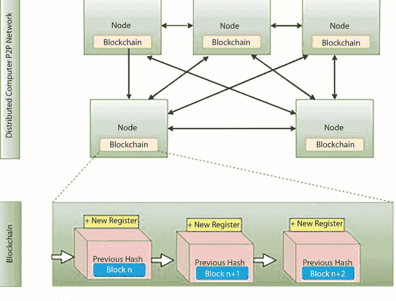

图 1.2 区块链架构。

哈希函数适用于交易处理。无论进行多少次交易，结果都是稳定且恒定的。由于我们经常听到“区块链中的哈希”这个短语，我们几乎认为理所当然地知道什么是哈希。哈希本质上是区块链用于区分不同区块的技术 [23]。哈希为区块链中的每个区块都提供了独特的身份。区块链中的每一个个区块在理论上都可以被单独识别；得益于它的哈希值，哈希值同时用于身份识别和完整性检查。自证明标识符是一种维护其自身完整性的标识字符串。公钥通过哈希算法产生。

### 1.3.3 共识机制

1959 年，Davidic Gale 和 Edmund Eisenberg 深入研究了在特定设置中共同存在的具有主观意识的个体之间实现稳定共识概率分布的复杂性。这导致了某些被称为“共识问题”的条件，并概述了交易方达成共识的条件。人们注意到，他们的方法仅在受限且受监管的节点环境中有效。由于具有各种固有的局限性和缺点，它缺乏开放环境的适用性 [24]。拜庭将军困境（也称为一致性困境）由中本聪（Satoshi Nakamoto）提出。缓解此类故障的核心是共识算法，它确保了不同节点之间对于提议交易或操作的数据一致性。各种共识方法在维护节点间平等会计权方面表现出不同的能力。设计不当的共识算法面临网络面临攻击时突然崩溃的风险。相反，精心设计的算法可以维持区块链的运行。这被应用于互联网，是因为像比特币这样的系统存在开放式架构和海量节点。它解决了由拜庭故障引起的问题，而这对于区块链技术至关重要。

共识技术可以分为四类：

- 1. 拜庭容错共识
- 2. 混合共识机制
- 3. 基于 DAG 的共识
- 4. 非拜庭共识

区块链是一个不可变的、分布式的且去中心化的网络，具有安全和隐私功能。即使在缺乏中央权威的情况下，区块链上的交易也能获得批准甚至被认为是安全的。这之所以，是因为共识机制，它是每个区块链网络的关键部分。在区块链网络中，对等节点需要一个共识过程来确定账本的当前状态。由于缺乏中央权威，共识算法有助于管理这种分布式环境中的信任。这种机制确保每个节点都有平等的权利，并且必须参与共识过程，以达成共识。共识算法的目标是达成一种有利于区块链网络的一致。

下面讨论了不同的共识技术及其运作：

- a. **工作量证明 (PoW):** 工作量证明 (PoW) 是一种要求网络设备之间投入大量计算努力的共识技术。PoW 共识算法试图有效解决一个极具挑战性的难题。它主要供比特币使用。使用最强处理能力最快解决这一挑战的节点将获得挖掘下一个区块的权限 [25]。要使用这种去中心化的共识方法，网络参与者投入努力进行破解。

- b. **实用拜庭容错 (PBFT):** 20 世纪 90 年代，Miguel Castro 和 Barbara Liskov 创建了实用拜庭容错，这是一种共识技术。PBFT 被设计用于异步系统，系统中没有等待响应的最大时长。它对开销的优化较低。其目标是解决过去在拜庭故障产生的问题。区块链和分布式计算是其应用领域。当网络中的某些节点未能响应或回复错误信息时，分布式网络达成的能力被称为拜庭容错（或 BFT）。BFT 机制通过集体决策来减少故障节点的影响。

- c. **权益证明 (PoS):** 权益证明作为 PoW 的替代方案获得了大部分关注。以太坊已从 PoW 共识转向 PoS 共识。通过这种共识过程，验证者向系统投入某些代币，而不是购买昂贵的设备来克服困难。验证者将开始检查区块 [27]。如果区块可以添加到链中，将根据其权益获得奖励。创建新区块的验证者最终取决于其在网络中的权益。因此，PoS 使用一套激励机制来鼓励验证者达成共识。

- d. **委托权益证明 (DPoS):** 该共识算法代表了权益证明基本概念的演进。Daniel Larimer（Steam、EOS 和 Bit Shares 的创始人）在 2014 年发明了 DPoS 共识机制。权益证明共识机制中的每个质押者都有资格参与“铸币”阶段，赋予他们选择向区块链添加新区块并验证现有区块权限 [28]。为了选择验证区块并维护 DPoS 系统的节点，采用了选举方法。这些节点被称为“见证人”或“区块生产者”。

DPoS 共识程序如下：

- **投票:** DPoS 共识中的投票允许用户选择自己投票或将其权力委托给第三方代为。被选中的见证人在验证交易后生成区块。如果他们验证并签名区块中的每笔交易，将获得支付；支付通常与选择这些见证人的投票者分享。


## 区块链技术简介

- **验证人（Witnesses）：** 顶层考虑的验证人数可能限制在 21 到 101 个之间。给予验证人以验证交易的奖励是在区块链中额外添加一个区块。阻止可疑交易包含在区块中是验证人的责任。由于投票机制，顶层的验证人始终面临着失去其职位的风险，而获得更多票数并被认为更可靠的用户可能会取代其位置。

- **代表（Delegates）：** 区块链治理由去中心化公共部门平台的用户选出的代表机构进行监督。他们不参与交易管理。区块的大小以及验证人证明区块时应获得的补偿可以由代表更改。区块链用户有权对提议的修改进行赞成或反对投票。

- **区块验证者（Block Validators）：** 在分布式权益证明（PoS）中，区块验证者是全节点，负责确认符合共识指南的验证人创建的区块。任何用户可以使用区块验证者验证网络，但检查区块并没有激励。

- **借用证明（Proof of Borrowing, PoB）：** 验证者不需要购买硬件，而是可以通过“销毁”资金的方式使资金无法再被取回。通过将资金发送到一个无法访问的地址来实现借用证明。验证者通过将资金提交到一个无法访问的地址来参与网络。这通过一种随机选择方法来实现。根据借用证明的应用方式，矿工必须花费为区块链创建赚货币。他们被选中挖掘下一个区块的概率随着销毁资金金额的增加而增加。尽管 PoB 为 Pow 提供了强替代，它仍然是一种节省资源的协议。

- **容量证明（Proof of Capacity）：** 加货币 Burst coin 正在使用这种非常新的挖矿类型。尽管如此，许多人认为容量证明是目前挖矿方法的切实替代。它通过利用硬盘空间使挖矿成为可能。这种方法具有许多优势，许多项目目前正在对其研究。

- **等待证明（Proof of Elapsed Time, PoET）：** 在 PoET 过程中，使用随机计时方法来代替工作证明所需的计算密集型挖矿权限。通过将中奖概率分配给尽可能多的网络用户，PoET 共识机制增加了随机抽签系统选择每个节点的可能性。区块链网络中的节点在睡眠之前会产生一个随机等待时间。在该点成为区块主节点的节点是第一个醒来的（网络中第一个在预定等待时间后计时器到期的节点）。该节点创建新区块，使用其私钥地址签名，然后将其添加到区块链网络。然后将所需数据发送到每个网络节点，并重复该过程以找到下一个区块主节点。

# 1.4 区块链的应用

区块链在医疗健康行业有多种用途（如图 1.3 所示），以下是一些众著名的应用：

- **资产管理：** 在资产管理领域，区块链技术做出了巨大的贡献。从广泛定义上，对个人的许多资产（如定期存款、股票、债券、房地产、商品和其他替代投资）的管理和交易被称为资产管理。传统的资产管理交易过程可能非常昂贵，特别是在国家之间转账时 [29]。在这些情况下，由于消除了中间环节（即经纪人、经理、银行等机构），区块链变得非常有用。分布式账本减少了错误，并为链的创建提供了简单性。

- **国际支付：** 你是否尝试过使用多种货币进行跨境汇款？由于过程冗长且复杂，资金可能几天才能到达目的地。由于在汇款服务中使用区块链，跨境转账变得更加简单，因为它提供了不需要中介的端到端服务。许多汇款提供者提供全天候国际支付的区块链服务。

- **医疗护理：** 智能合约使区块链在医疗健康行业具有巨大的前景。这些精明的连接允许双方直接起草合同。协议中的每个参与方都了解其具体细节，一旦满足要求，协议就会生效 [29]。使用区块链技术加密的可穿戴个人健康记录只有持有密钥的初级医疗专业人员才能访问，这在医疗行业中非常有帮助。它们还支持 HIPAA 隐私规则，该规则限制了谁可以访问患者数据并保护了隐私。

- **数字货币：** 加密货币无疑是区块链技术最广泛的用途之一。谁没有听说过比特币惊人的流行程度呢？它的许多优点之一是加密货币的区块链技术，没有地理限制。因此，跨境加密货币交易是可行的 [29]。唯一考虑的因素是汇率和亏损的可能性。尽管如此，这种选择仍然远优于本地支付应用，例如印度的 Paytm，它仅在特定地区可用，不能用于向境外发送资金。

- **出生证明和死亡证明：** 全球许多人（特别是在贫穷国家）缺乏合法的出生证明。根据联合国联合国儿童基金会的数据，三分之一五岁以下儿童没有出生证明 [30]。死亡证明是导致这一问题的因素之一。另一方面，区块链可以通过建立一个仅对授权人员开放的认证、安全的出生和死亡证明存储处来协助解决这一问题。

- **在线身份验证：** 在线身份和验证是完成任何金融交易的先决条件。对于用户在金融银行领域可能遇到的任何服务提供者也是如此 [30]。然而，区块链可以将在线身份中心化，允许个人在通过加密货币完成单一身份验证过程后，与任何服务提供者共享其身份。此外，用户可以选择选择使用何种身份验证技术（如面部识别或用户认证）[31]。

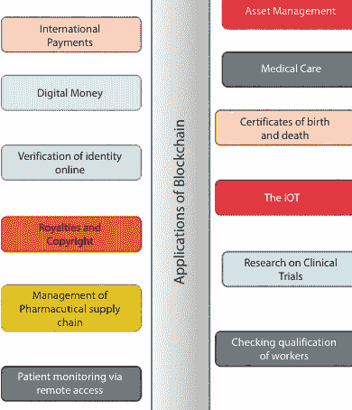

图 1.3 区块链的应用案例。

- **7. 物联网：** 物联网是一个相互连接的电子设备系统，能够交换数据并相互通信，从而实现智能知识的发展。任何由“事物”组成的网络化系统都可以创建物联网。物联网最著名的应用无疑是智能家居，它使所有家用电器（包括照明、空调和烟雾检测器）都能连接到一个平台上。这种高度分散的系统需要安全性，而区块链提供了这种保障。物联网上的系统安全性取决于其最不安全的设备或最薄弱的环节。在这种情况下，区块链确保了物联网设备收集的数据是机密的，并且仅供少数个人使用。

- **8. 版税和版权：** 版税和版权是创意产业（包括音乐、电影和其他媒体）中受关注的问题。这些创意形式似乎与区块链毫无关系。然而，这项技术对于保证创意领域的安全和透明度至关重要 [30]。有无数复制歌曲、电影、艺术品等案例，没有给原创作者署名。包含广泛艺术家权利账本的区块链技术可以用来解决这个问题。区块链技术使得获得艺术家版税与大型制作公司合同的安全记录成为可能。它也是透明的。还可以使用比特币等虚拟货币支付版税。

- **9. 临床试验研究：** 临床试验和持续的研究是促进医疗系统发展的两个因素。然而，这些方法有时会因为数据完整性问题而变得复杂。试验和研究数据的唯一可靠来源是区块链 [31]。它在维护患者隐私的同时，改进并保护了通信和记录工作。区块链还明确了伦理标准，以确保实验以合的方式完成。

- **10. 药品供应链管理：** 医疗健康行业面临的长期问题之一是确认药物和其他产品的真实性。区块链技术允许对药品进行全程查看和跟踪，并提供供应链每个阶段的洞察。使用区块链技术是最安全、合法的解决方案之一，可以防止该行业假冒产品每年导致数人的死亡。

- **11. 资质审核：** 像供应链管理技术一样，该系统可以跟踪医疗从业人员的资质并加速招聘流程 [32]。经请求后，其他医疗机构可以获得验证过的医疗记录。在共享有关员工的患者数据时，该程序确保了透明度。

- **12. 通过远程访问进行患者监测：** 患者监测系统负责了医疗行业最大的转变之一。现代传感器正被医疗从业人员用于远程监测患者的生命体


22 健康科学中的区块链

……为了努力提供更具主动性和预防性的护理。区块链技术通过提供加密连接并防御针对此类设备上更改个人数据的黑客攻击，使其成为可能。

## 1.5 区块链的未来

考虑到所有因素，随着区块链技术的发展，我们应该预期将看到更前卫、更有创性的区块链用途。区块链能够彻底改变某些行业，同时增强透明度和安全性 [33]。根据历史和当代趋势，预计区块链在未来几十年将发生重大变革。应用如图 1.4 所示。

你无法忽视以下五个领域：

- 1. 网络安全

如今的业务仍在与数据操纵作斗。因此，网络安全是区块链增长潜力最大的行业之一。区块链技术允许用户验证内容的真实性、防止篡改并加密数据。

- 2. 政府

政府可以使用分布式账本技术（DLT）系统来取代更传统的纸质方法。区块链技术还可以让投票变得更简单、快速、更安全。区块链技术提供了不可更改的投票记录，减少了欺诈和伪造的可能性。它还将实现远程投票并保护选民身份。

- 3. 金融 – 银行

由于金融中间人之间的资金交易成本和全球通胀的影响，萨尔瓦多是2021年首批采用比特币作为法定货币的国家之一。许多分析师预测，新兴国家很快将接受加密货币。数字货币代表了区块链技术未来发展的另一个迷领域。它与目前使用的传统货币相结合。通过这种货币，用户可以在不依赖任何第三方的情况下进行交易。它还赋予了中央银行控制流通量。

## 4. 医疗

可以使用区块链技术构建用于维护患者数据、管理药物供应、自动化医疗评估和治疗交易等的应用。具体而言，假冒疫苗的制造和传播问题已得到解决，因为区块链技术追踪疫苗分发和确认疫苗供应的合法性变得可行。IBM 是使用区块链技术开发疫苗递送系统的领导者之一。

## 5. 营销

区块链技术在在这种情况下将非常有用。它减少了广告欺诈的可能性，因为它可以监控和评估营销活动的效果。区块链技术有助于自动过滤、广告交互验证以及消除虚拟账户。

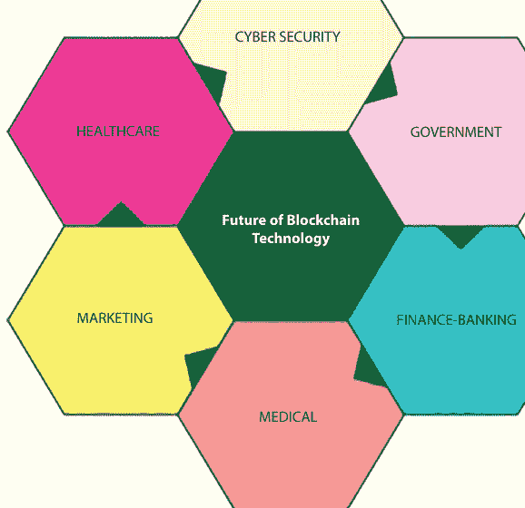

图 1.4 区块链的应用。

此外，它可以帮助收集有关客户行为和心理的数据。区块链技术将在各个领域和行业中发展并被更广泛利用。区块链技术将提高贸易效率，让每个人的生活变得更容易。区块链技术有能力引发许多行业的变革，让我们日益数字化的社会生活中变得更轻松。区块链技术是一个极其安全且不可篡改的系统。因此，这项技术在未来将变得越来越重要。

## 6. 健康

通过提高医疗数据的隐私、安全性和操作性，区块链有望对医疗行业产生巨大影响。它可以促进参与机构之间医疗记录的安全交换，并协助解决行业目前面临的一些问题。它还消除了对外部干预和管理开支的需求。分布式数据库经常集成区块链技术、数字签名和加密，以确保医疗记录的隐私性和有效性。

## 1.6 结论

区块链具有审计性、匿名性、永久性和去中心化的核心特征，已在成熟业务中展现出其变革力量。本文对区块链进行了深入分析，包括其许多形式，并绘制了其从 1.0 版本到 4.0 版本的发展轨迹。提供了对区块链技术的详尽综述，阐明了基本元素和结构模型。有趣的是，矿工通过共识程序达成一致，共识是区块生成过程的关键组成部分。

此外，论述延伸到区块链技术的应用和未来轨迹。特别是基于比特币的区块链引起了关注，强调了其作为不可篡改账本在促进去中心化交易中的作用。区块链驱动的应用正在金融服务、物联网（IoT）和声誉管理等多个领域被广泛采用。共识算法成为去中心化系统运行完整性的不可或缺的，强调了持续研究和创新以推动去中心化技术广泛应用的性。

## References

- 1. Namasudra, S. and Akkaya, K., Introduction to Blockchain Technology, in: Blockchain and its Applications in Industry 4.0. Studies in Big Data, vol. 119 Springer, Singapore, 2023, https://doi.org/10.1007/978-981-19-8730-4_1.
- 2. Panda, S.K., Jena, A.K., Swain, S.K., Satapathy, S.C. (Eds.), Blockchain Technology: Applications and Challenges, in: Intelligent Systems Reference Library,, vol. 203, Cham, 2021, https://doi.org/10.1007/978-3-030-69395-4_1.
- 3. Saraj, S., Introduction to Blockchain, in: Sustainable Oil and Gas Using Blockchain. Lect. Notes Energy, vol. 98, Springer, Cham, 2023, https://doi.org/10.1007/978-031-03697-0.
- 4. Sarmah, S., Understanding Blockchain. Comput. Sci. Eng., 8, 22–29, 2018.
- 5. Singh, G., Garg, V., Tiwari, P., Introduction to Blockchain, in: Cybersecurity using Blockchain, Technologies. Springer, Singapore, 2021, https://doi.org/10.1007/978.
- 6. Singh, B., Dhameja, G., Panda, P., Introduction to Blockchain, in: Beginning Blockchain, Appress, 2019, https://doi.org/10.1007/.
- 7. López-Sorib, S., Rios-Torrentó, I., Solsana-Thé, F., A Bibliometric Review of the Evolution of Blockchain. Sensors, 23, 3167, 2023. https://doi.org/10.3390/s236317.
- 8. Dabbagh, M., Sookhak, M., Safa, N., The Evolution of Blockchain: A Bibliometric Study. IEEE Access, 7, 19212-19221, 2019. 10.1109/ACCESS.2019.289564.
- 9. Bhutta, M.N., Khwaj, A.A., Nadeem, A., Ahmed, H.F., Khan, M.K., et al., A Survey on Blockchain Technology: Evolution, Architecture and Security. IEEE Access, 9, 61048–61073, 2021. 10.1109/ACCESS.2021.307284.
- 10. Tomov, Y.K., Bitcoin: Evolution of Blockchain Technology, in: XVIII International Conference Electronics (ET), Sozopol, Bulgaria, pp 1–4, 2019, 10.1109/ET.2019.877322.
- 11. Yadav, A.S., Singh, N., Kushwaha, D.S., Evolution of Blockchain and consensus mechanisms & its real-world applications. Multimedia Tools Appl., 82, 34363–34408, 2023. https://doi.org/10.1007/s11042-023-14624-6.
- 12. Zheng, Z., Xie, S., Dai, H., Chen, X., Wang, H., An overview of blockchain technology: Architecture, consensus, and future trends, in: 2017 IEEE international congress on big data (BigData congress), IEEE, pp. 557–564, 2017.


- 28. Li, W., Deng, X., Liu, J., Yu, Z., Lou, Y., Delegated proof of consensus mechanism based on community discovery and credit incentive. Entropy, 25, 9, 1320, 2023.
- 29. Arora, P. and Nagpal, R., Blockchain technology and its applications: a systematic review of the literature. Proceedings of the International Conference on Innovative Computing & Communication (ICICC), 2022.
- 30. Chen, W, Xu, Z, Shi, S., Zhao, Y., Zhao, J. A survey of blockchain applications in different domains, in: Proceedings of the 2018 International Conference on Blockchain Technology and Application, pp. 17–21, 2018.
- 31. Tomar, V., Kumar, N., Srivastava, A.R., Single sample face recognition using deep learning: a survey, in: Artificial Intelligence Review, pp. 1–49, 2023.
- 32. Ramageri, B. and Arjunwadkar, M.V., Applications of blockchain technology in various sectors: a review. Int. J. Future Gener. Commun. Netw., 13, 2, 94–99, 2020.
- 33. Levis, D., Fontana, F., Ughetto, E. A look into the future of blockchain technology. PLoS One, 16, 11, e0258995, 2021.

# 健康科学中的 IoT 集成

Bharti Chugh¹*, Karnika Dwivedi¹, Preeti Garg¹, Pankaj Bhatt² and Sachi Gupta³

¹KIET Group of Institutions, 计算机科学与工程系, Ghaziabad, Delhi-NCR, India
²Lloyd Institute of Management and Technology, Greater Park-II, Greater Noida, India
³Galgohotias College of Engineering and Technology, Greater Noida, India

# 摘要

医疗保健是一个非常重要的行业领域，其技术和服务在每天都在不断演进。物联网（IoT）和区块链领域的最新进展有助于实现医疗服务的快速改进。IoT 在健康科学中的集成开启了医疗保健的新纪元。该技术将医疗服务的交付分为个性化、主动和远程患者护理。本研究探索了 IoT 解决方案在医疗保健各个领域的应用，如患者监测、智能医疗设施、远程医疗、个性化医疗、疾病管理和研究。基于 IoT 设备能够收集并交换数据，通过监控健康记录来转变医疗系统。可穿戴 IoT 设备（如传感器、智能手表和家庭监控系统）为监测个人健康状况提供了实时解决方案。区块链与 IoT 集成可以处理数据隐私和安全相关的挑战，为数据交换建立安全连接。支持 IoT 的设备产生大量敏感健康数据需要进行处理，这引起了对数据安全、隐私和操作性的极大关注。区块链技术由于提供去中心化且不可更改的账本系统，能够为数据的存储和传输提供安全性和透明度。区块链技术为基于 IoT 的医疗应用提供了许多益处，例如重构传统实践、数据管理、患者远程监测和药物分析。本章讨论了研究人员提出的通过区块链结合 IoT 应用改进医疗保健的所有方向。总而言之，本研究解释了 IoT 在健康科学中为了实时实施的最新发展和应用。IoT 和区块链技术在医疗系统中的共同努力，可以在数据驱动的决策过程中实现极高的效率、透明度和信任。这种集成对于彻底改变医疗交付、增强患者效果以及提高数字护理标准具有巨大的潜力。

**关键词：** 区块链、患者监测、可穿戴健康设备、远程医疗、智能医疗、实时健康监测

## 2.1 引言

传统的医疗应用由于人口众多，无法满足所有人的需求。尽管拥有现代水平和先进技术，并非所有人都能负担或获得医疗服务。IoT 是一个不断演变的系统，它将计算设备与软硬件连接以便数据的交换、积累和通信。信息系统在全球范围内变得越来越重要，特别是在医疗行业。[1]。从云端服务到电子记录，信息技术一直帮助健康部门。因此，随着 IT 的进步，增强医疗保健及其管理已变得至关重要 [2]。它是医疗领域辅助医疗操作的最佳解决方案之一。IoT 通过互联网提供智能设备或物体的互连，创造了新的创新服务和应用 [3]。这些对象由于其广泛的人体检测能力，被用于医学领域进行早期诊断和远程健康监测 [4]。不久前，在医院进行体检是诊断人体疾病和病痛的唯一途径。这增加了医疗支持的成本，也给医疗机构带来了巨大的压力。医疗保健行业中这些基于 IoT 的应用成本很高，但可以增强患者的福祉。例如，在没有医疗专家协助的情况下，可以在任何地方进行许多临床分析，如监测血压、血糖水平、心率等。基于 IoT 的医疗服务将引发行业革命。

在本章中，调查并讨论了 IoT 在若干种健康科学中的应用。IoT 技术正在改变传统的医疗实践，并带入一个互连和数据驱动决策的时代。这些解决方案涵盖了从智能医疗设备到远程地点患者监测及更广泛的领域。由于传感器、设备和网络的集成使用，普通医疗从业人员现在可以访问实时患者数据，了解健康模式并精确定制治疗方案。有必要计划和构建带有传感器和其他技术的边缘设施，以在保护人们健康和安全的同时，平衡能源消耗和效率。此外，基于 IoT 的解决方案提供了许多可能：公共卫生计划、疾病监测系统和医疗保健基础设施管理。从技术、安全和财务角度来看，智能系统的有效集成至关重要。感知设备、万物互联（IoT）、安全可靠的电力系统以及舒适的居住空间将有助于降低成本、提高生产力并改善个人、企业和机构的健康安全。在数据分析和机器学习算法的帮助下，决策者可以改善人口健康状况，并减轻慢性病和传染病的影响。

图 2.1 展示了一个使用可穿戴技术和无线数据传输的集成健康监测系统。该装置涉及可穿戴设备（如智能手表和脉搏氧仪），它们持续收集患者数据。这些数据通过无线网络传输到云存储，并在那里使用人工智能算法进行处理（如神经网络模型所示）。处理后的数据随后被分析以支持医疗决策，结果以图表形式可视化。

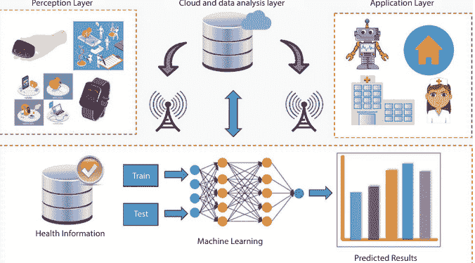

图 2.1 一个智能医疗系统。

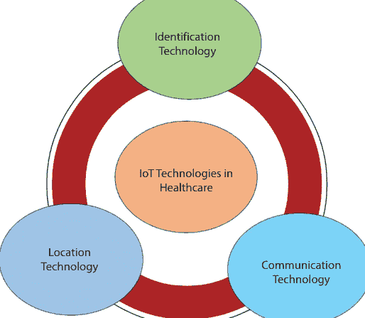

**图 2.2** 用于医疗应用的 IoT 技术。

用于开发基于 IoT 的医疗保健系统的技术至关重要。这是由于利用特定技术可以提高 IoT 系统的功能 [5]。介绍了一种方法 [41, 42] 用于识别对音乐情绪的情绪，这有助于判断音乐和语音的情绪。

因此，已经实施了许多尖端技术将 IoT 集成到多种医疗应用中。用于组织医疗系统的主要有三种基于 IoT 的：1) 位置技术，2) 通信技术和3) 身份技术。图 2.2 封装了 IoT 驱动的医疗解决方案的互连组件，由围绕中心核心的三个外圆表示。每个元素综合了关键技术方面，如数据收集、连接和处理，这些集成在一起以增强患者监测、诊断和治疗。该模型突出了 IoT 系统的协作框架，展示了各种技术如何有助于全面的医疗管理和改善患者效果。


健康科学中的物联网集成 33

## 2.2 物联网健康科学框架

在当今世界，物联网（IoT）在医疗应用中变得非常有用，因为它为各种健康问题的治疗和检测提供了创新解决方案。在新冠肺炎流行期间，物联网通过处理海量数据集以及提供各种健康服务，在医疗领域提供了多种服务 [6]。因此，为了在维持合理生活标准的同时，满足患者对远程医疗监测和长期护理的需求，一种实用、全面且计算机辅助的技术至关重要。通过分析海量数据并整合许多物联网设备，将患者的实时生理数据汇到一个智能且预测性的系统中，卫生系统随之发生了变革。以患者为中心的医疗服务（包括对关键状况的持续监测和疾病早期发现）是首要目标 [7]。物联网医疗系统建立了一个连接所有资源的网络，通过互联网促进医疗运营，包括远程干预、监测和诊断。

物联网健康科学框架通过在医疗保健领域引入各种原理、技术和方法来提供物联网解决方案。物联网遵循

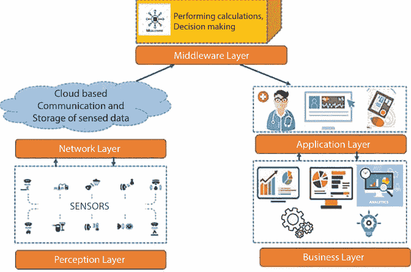

图 2.3 物联网健康科学框架的分层结构。

# 健康科学中的区块链

五层架构 [8]，用以为不同的应用领域提供服务。每层都有一组特定的待提供任务和服务，，如图 2.3 所示。一个基于物联网的医疗系统的基本架构在许多方面与传统的物联网系统相似。相反，在物联网驱动的医疗服务背景下，这些服务经过了专门工程设计，用以量化和测量患者或用户的各种生理状态。

### 2.2.1 感知层

感知层用于通过各种传感器和医疗设备（如红外传感器、摄像头、GPS、RFID 和智能设备传感器）来感知数据。这些传感器的动机是从各种环境中收集数据以供进一步处理。物联网建立在识别和感知技术的基础上。在能够检测环境变化的各种设备中，包含了传感器和医疗设备。传感器用于物体识别、地理识别和位置识别，之后，这些传感器能够将这些信息转换为数字信号 [9]。

传感器技术的利用实现了对趋势的实时观察，并简化了患者大量生理参数的收集，从而加速了诊断和实施高质量治疗的过程。许多物联网传感器设备具有拯救生命的潜力 [10-12]。

### 2.2.2 网络层

物联网技术在网络层运行，涵盖了促进通信和存储处理过的（第 1 层）数据的有线和无线网络，这些数据可能是中心化的或局部的。通信可以通过低、中或高频率发生，其中后者构成了物联网的重点。上述技术包括短距离通信系统、蓝牙、Wi-Fi、RFID 和 Zigbee。高频四代网络的通信能力已进一步增强。此外，预计正在发展的 5G 网络的普及将显著推动医疗领域物联网应用的扩张，因为它们可以同时连接成千上万个设备并提供可靠的连接。

健康科学中的物联网集成 35

### 2.2.3 中间件层

中间件作为物联网的基础元素，通过在应用程序和设备之间建立连接，缓解了许多之前的物联网挑战并改进了应用开发。因此，主要的障碍是开发适当的中间件，以满足将异构硬件软件集成到物联网系统中的质量和功能要求。除了存储、计算和处理能力外，中间件层还具有执行能力。它存储整个数据集并为设备提供适当的数据。它还可以根据从传感器获取的数据集进行计算来做出决策。

### 2.2.4 应用层

应用层负责解释和实现数据，并为用户提供特定于应用程序的服务。基于人工智能的医疗应用是物联网提供的最具前景的领域之一。人工智能的科学应用经历了显著增长。这些应用包括但不限于药物活性设计、基因突变表达预测和图像分析 [13]。人工智能（AI）具有分析和解释电子医疗数据的能力，涵盖物理、实验室、治疗和药物信息，以生成治疗和诊断的可能性和/或决策。例如，IBM Watson 利用人工智能通过识别主要发现和继发发现来分析图像 [14]。

应用层的任务是为终端用户提供用户界面并使应用程序与物联网系统交互。这一层由 API、移动和 Web 应用程序以及仪表板组成，促进了与访问物联网数据的交互。

应用层技术包括用于与物联网数据交互的 Web 应用程序、移动应用程序和 API。在物联网中，应用层至关重要，因为它允许终端用户访问并与物联网设备产生的数据。

### 2.2.5 业务层

业务逻辑和规则由业务层处理，该层控制物联网的行为。该层包含了逻辑引擎，负责做出与特定状况相关的决策。分析工具生成必要的图形

36 健康科学中的区块链

分析，有助于决策。业务层是物联网框架中的重要层之一，因为它使用户能够根据之前层完成的业务流程做出决策 [15]。一个设备的成功不仅取决于它所使用的技术，还取决于用户如何利用它。业务层为设备处理这些任务。它涉及绘制流程图和其他表、分析数据、对设备提出改进建议等。

## 2.3 物联网健康科学应用

物联网在健康科学中的各种应用如下：

### 2.3.1 实时告警与监测

对各种健康指标（如温度、心率和血氧水平）的持续监测对于实时提供医疗服务至关重要。


### 2.3.2 电子健康记录

远程医疗利用互联网和通信基础设施提供远程医疗服务。这大幅减少了医疗专业人员的运营开支，并提高了患者健康管理的效率。Zouka 和 Hosni [18] 提出的智能医疗监控系统利用神经网络和模糊系统来分析从多个传感器获取的数据，包括温度、ECG、心率、压力和脉搏血氧仪。Azure IoT Hub 和 FBI 用于在数据通过 GSM 模块传输后对传感器获取的数据评估。通过利用患者 M2M 监控系统和远程健康应用程序，该技术使医生能够提供紧急医疗护理。根据 [19]，研究人员为居住农村地区的人们了一种医疗监控系统。血压、血糖水平和异常细胞发育是该系统希望追踪的一些重要指标。患者配备了 RFID 标签以方便识别。一旦出现偏离典型健康参数的情况，通知将发送到远处的医疗机构，促使工作人员采取适当措施。所建议的系统通过 NS2 进行了仿真，结果吞吐量有了显著提高。

### 2.3.3 识别和预防慢性疾病

癌症、糖尿病、哮喘、肥胖等许多慢性疾病影响了全球大部分人口。抑郁作为长期健康问题的常见副作用，与这些状况有关。Kumar 等人 [20] 为自闭症患者开发了一套健康监控系统。该系统利用从神经传感器收集的信息，自动解码 EEG 波并向护理人员通知任何可疑发现。远程监控患者的医生在发生紧急情况时将收到电子邮件报警。为了给癌症患者提供由物联网（IoT）赋能的医疗解决方案，Onasana 和 Elshankagiri [21] 提出了多种架构设计和框架。利用大数据技术分析数据的云计算，以及允许传感器大规模运行的无线传感器网络（WSN），是关注的重点。此外，文章还讨论了利用物联网的医疗系统相关的实际问题和安全问题。

### 2.3.4 居住与老年医疗

在居住环境中实施物联网及其相关技术，有助于对行动受限且需要更长时间到达医院进行常规和急诊护理的老年人进行持续监控。[22] 提出了一种专为从事活动和支持性生活的人士开发的健康监控系统。该技术集成了多个传感器来收集数据，然后将其传输到云端进行分析。研究人员创建该实例以展示系统，该系统由 6 种不同类型的传感器、一个由低功耗蓝牙（BLE）支持的室内位置模块、传感器接口电路、作为微控制器的 Raspberry Pi2、WiFi 收发器和一个云服务器组成。Yang 等人 [23] 为独自在家中的的轮椅用户开发了一个个人健康保健系统。V. S. Naresh 等人完成了一项利用 IoT 和 WBSNS 为轮椅用户提供高效医疗服务的研究。通过利用传感器检测各种生理参数（如心率、心电图 ECG、环境传感节点以及位于患者近处或其体上的执行器），促进了实时健康监控的实现。带有 Zigbee 和蓝牙通信协议的手机被用于收集患者及其即时周围的数据。此外，目前的方法通过使用传感器观察轮椅在不同位置的位移，考虑了患者在轮椅上的运动。

## 2.4 挑战

医疗领域物联网技术的实施有明显增加。在各种政府整合设施的促进下，快速的技术创新推动了市场扩张。医疗行业受到了物联网的深远影响，改变了患者体验和专业人员采用的方法。尽管物联网提供了不可或缺的优势，但其实施并非没有障碍。在突破性进展的潜力与医疗保健中部署物联网的实际性之间取得平衡，可能会带来巨大的障碍。数据问题、连接问题，甚至是设备兼容性（这些问题看似微不足道），都会导致严重的混乱。图 2.4 显示了物联网医疗中的各种挑战，并在此进行了描述。

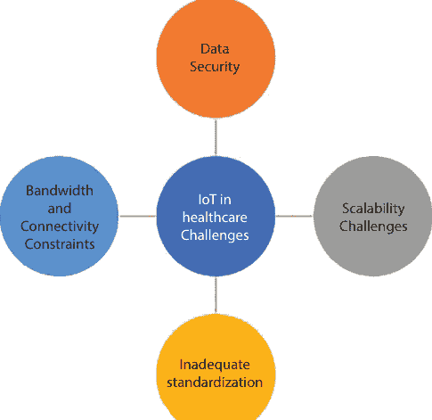

**图 2.4** 医疗中的物联网挑战。

### 2.4.1 数据安全

在医疗保健中使用物联网的优势在于通过有效分析数据增强了患者监控系统的体验。例如，设计用于监测患者脉率的可穿戴设备能够及时通知医疗人员任何异常读数。然而，只要有数据，安全和隐私问题就是不可避免的，特别是医疗信息等敏感数据。鉴于数据泄露的普遍，解决医疗物联网的安全和隐私问题比以往任何时候都重要。因此，为了确保医疗设备的可靠性和安全性以及患者数据的可用性、机性和完整性，医疗系统中的物联网需要配备强大的安全机制。由于医疗物联网系统资源受限，构建轻量级算法变得异常困难。此外，主要挑战涉及能量效率的保持。因此，需要能够处理轻量级加密的高效机器学习或深度学习算法，以实现安全威胁缓解功能。

### 2.4.2 可扩展性挑战

为了便于在大范围内安装物联网系统，必须解决扩展性问题。此外，物联网系统内部的数据传输至关重要，必须采用适当的机制来防止丢包。除此之外，物联网系统中现有路由协议的动态特性阻碍了其性能。此外，在覆盖和定位方面存在重大关注。处理产生的数据流量不能导致额外费用的产生或计算延迟。因此，不断变化的节点中的网络校准存在挑战。移动性问题似乎也是基于物联网系统的障碍。在源（如人体）上使用传感器会导致网络性能在用户每次移动时而下降。因此，必须实施可靠的服务，以在用户移动时保持网络的可访问性。

### 2.4.3 标准不完善

部署物联网设备的一个主要挑战是，它们通过网络与大量其他设备建立连接，虽然设备数量可能未数十，但设备跟踪、药物递送系统和脉搏监测器与路由器、网关的集成会导致设备数量巨大。连接这些设备使用了多种语言、标准和协议。由于缺乏全球公认的标准，所有权和监管充满了模糊性。结果，将许多物联网设备集成到医疗行业变得变得困难。由于设备网络通信协议的复杂性，医疗用户在聚合数据时面临挑战。

### 2.4.4 带宽与连接限制

在物联网系统中，在有限的连接限制下连接不同的设备是首要考虑。尽管大多数医疗物联网设备通过 WiFi 连接，但有相当一部分设备配备了蜂窝网络功能以补偿潜在的 Wi-Fi 中断。


健康科学中的物联网集成 41

在涉及缺乏 WiFi 连接的现场环境时，对蜂窝网络的依赖变得至关重要。因此，在特定环境中为特定设备识别运行最佳的蜂窝网络非常关键。然而，连接限制不仅导致了与连接相关的挑战，还会产生高昂成本，特别是随着设备数量的增加。在医疗保健领域，连接中断的后果极其严重。它可能对患者产生严重且负面的影响。因此，必须考虑最小延迟。

## 2.5 物联网 (IoT) 健康安全忧虑

根据“ABI (Allied Business Intelligence, Inc) 研究报告”[24]，目前已有超过100亿个物联网设备接入无线网络。此外，这一数字到2026年将飙升至300亿个。物联网设备的部署将带来许多极大增强我们日常生活的应用。随着时间的推移，健康可能会成为主要的关注问题之一[25]。然而，数据管理与存储、统一且无处不在的访问、隐私与安全以及设备之间的数据传输只是这些担忧领域之一[26]。数据泄露会损害公司和用户的信誉。此外，如果黑客能够获取其物联网设备的访问权限，就可以监视消费者的私人生活。尽管物联网正在快速增长，但安全仍然是一个令人担心的问题。随着物联网的扩展，出现了许多新的应用，重点关注健康科学。尽管如此，有关人员的敏感信息（如医疗记录和患者身份）通常与健康科学相关。因此，对此类系统安全性的担忧是有根据的。因此，对于管理如此规模的物联网部署，加密连接至关重要。由于存储所有信息的数据库安全措施，还存在数据被盗取或画像的可能性。医疗保健物联网设备安全领域存在许多障碍。其中包括设备的隐私、保密性、完整性和身份验证，以及信息流轨迹、持久性和数据传输流。在敏感、活动和网关等环境节点中，数据被窃取、数据隐私和机密性问题非常普遍。在这里，黑客通过不安全的家庭 Wi-Fi 获取访问机密权限，然后在黑市上出售。数据画像是另一个常见问题。这发生在攻击者试图通过使用被盗数据来识别受害者及其伤害方法时。所有与医疗相关的物联网系统都受到这两个问题的影响。为了实现目标，攻击者使用一系列策略来防止物联网系统正常运行。这些攻击主要分为五大类如下[27, 28]：

- **选择性转发攻击 (Selective-Forwarding Attacks)：** 攻击者可以使用选择性转发技术[29]发起拒绝服务 (DoS)攻击，恶意节点以特定方式转发数据包。这种利用旨在干扰路由路径。以 Computer Methods and Programmes in Biomedicine Update 2 (2022) 100071 3 为例：使用 Sadek 等方法，犯罪分子在传感器检测到警报状况（如心脏发作）时阻止网络发送警报。
- **汇洞攻击 (Sinkhole Attacks)：** 恶意节点可以通过向网络中的其他节点虚假宣传有利路由路径来启动这种攻击，希望将流量引导到自己。在其他情况下，这种攻击甚至不会影响网络；然而，当它与其他攻击（如选择性转发攻击）结合时，可能会非常有效。因此，数据不是发送给可靠的医疗机构，而是发送给负责保留和处理记录数据的黑客。结果是黑客将获得患者隐私数据，并利用其最终对患者进行画像[29]。
- **干扰 (Jamming)：** 机器间攻击的一个示例是使用噪声信号阻断无线通信。这种干扰随后利用无线频谱，导致物联网设备无法相互通信[30]。
- **溢出 (Overflowing)：** 攻击的目标是耗尽目标的处理器、内存、带宽和电池电。例如，攻击者生成大量的连接请求以消耗带宽并耗尽电池。这种技术的影响是干扰正在进行的数据传输和记录（如传感器数据）。
- **邮件诈骗 (Email scams)：** 环境节点的数据收集容易受到窃取个人信息的攻击。向用户索要详情（包括 Wi-Fi 密码）是此类攻击获取物联网资源的一种方式。安全问题阻碍了物联网节点的正确运行，并可能扩散到整个物联网医疗系统中，限制了其大规模部署。

### 2.5.1 物联网的保护与完整性

隐私和安全等问题在物联网设计中被认为是至关重要的。因此，为了解决这些问题进行了大量研究。以下是对当前解决方案的简要描述：

- (a) Gupta 等人[31]提出了一种使用基本加密哈希函数的穿戴设备轻量级身份验证，以确保安全的网络连接。原因是这些设备在内存和处理速度方面并不强大。这就是为什么保护移动设备用户数据的传统方法不适用于穿戴设备。通过使用 XOR 和哈希技术屏蔽设备 ID，所提出的系统维持了隐私和匿名性。
- (b) Gope 和 Sikdar[32] 引入了一种轻量级双因子身份验证解决方案，以保护物联网设备的隐私。由于物联网设备的开放公共部署，作者更加强调设备身份验证，因为它们容易受到物理和关闭的威胁。该技术使用由 IC 构建的物理不可替代的功能和唯一的单向哈希值，在 IC 的微观结构中引入随机物理偏差，使其独具特色。
- (c) 物联网及其后代设备将使用 IPv6 连接，这是专门为之创建的。因为它提供了比旧的 IPv4 互联网协议更多的功能和更大的地址空间[33]。然而，由于其设计，它在 IP 地址配置期间容易受到拒绝服务 (DoS) 攻击，这可能会阻塞网络中两个节点之间的通信[34]。Liu 等[33] 提出了一种名为“无地址物联网服务器”的独特方法来解决此问题，并实现物联网客户端与服务器之间的安全通信。此外，Rehman 和 Manickam 开发了一种名为 Secure-DAD 的简单解决方案，部署在支持 IPv6 的物联网设备上，以确保设备之间的通信仅限于允许的设备。这可以在物联网环境中的设备之间提供安全通信[35]。
- (d) Sharma 等人[36] 引入了一种基于数据挖掘技术的物联网 (IoT) 医疗系统隐私保护范式，用于监控医疗信息。现代生活最重要的方面之一是物联网医疗保健系统系统[37]，它显著扩展了大数据驱动的医疗系统。基于物联网的穿戴设备已供医疗专业人员用于加速诊断、监控、预测和治疗过程。物联网的易用性和低成本采用开始改变医疗服务。作者针对这些问题提供了潜在的解决方案，为保护隐私的物联网医疗系统提供实用的数据分析。不同的物联网传感器可以监控物理环境并实时记录环境的变化，这些就是物联网传感器数据[38]。最近添加框架中的自适应滤波器会自动恢复丢失或错误的数据。因此，系统能够承受错误。
- (e) Srinivas 等人[39] 引入了一种基于云的用户身份验证方法，以实现物联网医疗监控系统中医疗数据的安全验证。利用此程序，生成一个机密会话密钥，以促进授权用户与穿戴传感器节点之间的安全通信。所提机制的作者利用真实或随机 (ROR) 范式进行了安全分析，以评估其对几种广泛为人知的攻击的防御能力。
- (f) Raifa Akkaoui[40] 提出了一种物联网医疗系统的去中心化身份验证技术，利用区块链的去中心化特征来减轻分布式拒绝服务 (DDoS) 攻击对物联网环境的有害影响。作者已经在以 网络对该技术进行了安全和隐私研究。研究人员认为该方案保护了物联网用户和设备的隐私、机密性、完整性和匿名性。


## 2.6 总结

本章详细讨论了物联网（IoT）在医疗保健系统中的巨大潜力，探讨了物联网在医疗保健领域的应用、挑战和优势。物联网能够处理医疗保健系统中的安全和隐私问题。本章定义了医疗保健的物联网框架及其分层结构，这些定义规定了物联网网络中用于系统顺运行的组件和技术。它涵盖了物联网网络与医疗保健应用设备及传感器的集成。该策略在承认许多系统间相互依赖性的同时，涵盖了数据采集、传输处理、利用以及应用。此外还讨论了集成和采用物联网所面临的挑战并为其提供了解决方案。它展示了物联网技术如何通过与医疗专业人员合作进行实时操作，实现早期检测，从而增强个性化治疗方案和效果。此外，这还可以解决将物联网与医疗设备及系统集成时相关的安全和隐私问题。为了维护患者隐私并保护敏感的医疗信息，它处理了数据窃取、未经授权访问和数据违反等漏洞。它因通过加密协议实施稳健的安全措施而闻名，这有助于改进隐私技术。总而言之，本章可以彻底改变医疗保健应用，并识别与物联网安全和隐私问题相关的各种风险与挑战。这项技术通过为全球个人提供优质的生活来改善医疗保健交付。

## 参考文献

- 1. Pang, Z., Technologies and Architectures of the Internet-of-Things (IoT) for Health Well-being, KTH Royal Institute of Technology, 2013, Diss.
- 2. Martínez-Caro, E., et al., Healthcare service evolution towards the Internet of Things: An end-user perspective. Technol. Forecast. Soc. Change, 136, 268–2765, 2018.
- 3. Lu, Y., Papagiannidis, S., Alamanos, E., Internet of Things: A systematic review of the business literature from the user and organisational perspectives. Technol. Forecast. Soc. Change, 136, 285–297, 2018.
- 4. Nweke, H.F., et al., Data fusion and multiple classifier systems for human activity detection and health monitoring: Review and open research directions. Inf. Fusion, 46, 147–1705, 2019.
- 5. Yuehong, Y., II, et al., The internet of things in healthcare: An overview. J. Ind. Inf. Integr., 1, 3–135, 2016.
- 6. Rej, A., Rejek, K., Treiblmaier, H., Appolloni, A., Alghamdi, S., Alhasawi, Y., Iranmanesh, M., The Internet of Things (IoT) in healthcare: Taking stock and moving forward. Internet Things, 22, 100721, 2023. https://doi.org/10.1016/j.iot.2023.100721.
- 7. Dey, N., Hassanian, E., Bhatt, C., Ashour, A.S., Satapathy, S.C., Internet of Things and Big Data Analytics towards Next-Generation Intelligence, Springer, Heidelberg, Germany, 2018.
- 8. Kelly, J.T., et al., The Internet of Things: Impact and Implications for Health Care Delivery. J. Med. Internet Res., 22, 11, e20135, 10 Nov. 2020. 10.2196/20135.6
- 9. Seth, P. and Sarangi, S., Internet of things: architectures, protocols, and applications. J. Electr. Comput. Eng., 1–25, 2017.
- 10. Merchant, R.K., Inamdar, R., Quand, R.C., Effectiveness of population health management using the propeller asthma platform: a randomized clinical trial. J. Allergy Clin. Immunol. Pract., 4, 3, 455–63, 2016. 10.1016/j.jaip.2015.11.022.
- 11. Merchant, R., Szefler, S.J., Bender, B.G., Tuffli, M., Barrett, M.A., Gondalia, R., Kaye, L., Van Sick, D., Stempel, D.A., Impact of a digital health intervention on asthma resource utilization. World Allergy Organ. J., 11, 1, 2018. 10.1186/s40413-018-0209-0
- 12. Plowman, R., Peters-Strickland, T., Savage, G., Digital medicines review on the safety of tablets with sensors. Expert Opin. Drug Saf., 17, 9, 849–852, 2018.
- 13. Giansantisi, D., Macellari, V., Maccioni, G., Cappozzo, A., Is it feasible to reconstruct body 3-D position and orientation using accelerometeric data? IEEE Trans. Biomed. Eng., 50, 4, 476–483, 2003.
- 14. Kart, F., Miao, G., Moser, L.E., Melliar-Smith, P.M., A distributed e-healthcare care system based on the service oriented architecture, in: Proceedings of the IEEE International Conference on Services Computing, SCC 2007, IEEE, pp. 652–659, 2007.
- 15. Kumar, M., Kumar, A., Verma, S., Bhattacharya, P., Ghimize, D., Kim, S., Internet of Things (IoT): Current Trends, Applications, Challenges, and Security. Electronics, 12, 250, 2023. https://doi.org/10.3390/electronics120250
- 16. Shanin, F., Portable and Centralised E-Health Record, in: International Conference on Control, Communication, and Computing, pp. 165–170, 2018.
- 17. Swaroop, K., Swaroop, K., A survey on IoT monitoring for vital signs. Ad Hoc Net., 5, 129, 2019.

# 46 健康科学中的区块链

- 18. Zouka, H., Secure routing in the internet of things. Ad Hoc Net., 9, 21, 2019.
- 19. Rohale, V., Attacks and countermeasures, in: Proceedings of the First IEEE International Workshop on Sensor Network Protocols and Applications, 2011.
- 20. Prasad, K., Projecting the growth and economic impact of the internet of things, in: 3rd International Symposium on Big Data and Cloud, vol. 371–376, 2016.
- 21. Abdelgaw, A., Smart IoT for Assisted Living. Int. Dist. Sens. Net., 27, 429–432, 2019.
- 22. Yelanarthi, A., Routing attacks and countermeasures for the RPL-based internet of things. Int. Dist. Sens. Net., 11, 2017.
- 23. Yang, L., Mobile healthcare, in: 18th IEEE Conference on Computer Supported Work (CSCWD), pp. 10–20, 2014.
- 24. Castillo, O., Smart healthcare for wheelchair users, in: Proceedings of the IEEE Conference on Computer Supported Work, 2014.
- 25. Romdhani, I., Securing the Internet of Things, in: Springer, pp. 133–139, 2017.
- 26. Dang, L.M., Pian, M.J., Han, D., Moon, H., A survey on internet of things and cloud computing for healthcare. Electronics, 8, 7, 7768, 2019.
- 27. Raza, S., Wallgren, L., Voigt, T., SVELTE: Real-time intrusion detection in the internet of things. Ad Hoc Net., 11, 8, 2661–2674, 2013.
- 28. Wallgren, L., Raza, S., Voigt, T., Routing attacks and countermeasures for the RPL-based internet of things. Int. Dist. Sens. Net., 9, 8, 794326, 2017.
- 29. Karlof, C. and Wagner, D., Secure routing in wireless sensor networks: attacks and countermeasures, in: Proceedings of the First IEEE International Workshop on Sensor Network Protocols and Applications, vol. 2003, pp. 113–127, 2003.
- 30. Zhang, J.X and Hoshino, K., Chapter 8 – implantable and wearable sensors, Molecular Sensors and Nanodevices (Second Edition), in: Micro and


# 48 健康科学中的区块链

Nano Technologies, Academic Press, 第二版, pp. 489–545, 2019, http://dx.doi.org/10.1016/B978-0-12-314862-4.00008-9, URL: https://www.iencedirect.com/science/article/pii/B9780128148624000089

31. Gupta, A., Tripathi, M., Shaikh, T., Sharma, A., 用于可穿戴设备的轻量级匿名用户认证与密钥建立。Comput. Netw., 149, 29–42, 2019. http://dx.doi.org/10.1016/j.comnet.2018.11.021, URL: https://www.iencedirect.com/science/article/pii/S1389128618304389.

32. Gope, P. and Sikdar, B., 用于物联网设备的轻量级且保护隐私的双因子认证方案。IEEE Internet Things J., 6, 1–580, 2019. http://dx.doi.org/10.1109/JIOT.2018.2846299.

33. Liu, R., W, Z., Hao, S., Chang, D., Bao, C., Li, X., 地址：增强 IPv6 下的物联网服务器安全。IEEE Access, 8, 92094–92035, 2020.

34. Rehman, S.U and Manickam, S., IPv6 重复地址检测过程中的拒绝攻击。Int. Adv. Comput. Sci. Appl., 7, 232–238, 2016. http://dx.doi.org/10.14569/IJACSA.2016.07063.

35. Rehman, S. and Manickam, S., 防止 IPv6 重复地址检测过程中遭受服务攻击的改进机制。Int. Adv. Comput. Sci. Appl., 8, 2–63, 2017. http://dx.doi.org/10.14569/IJACSA.2017.08029.

36. Sharma, S., Chen, K., Seth, A., 迈向物联网和云医疗系统的实用隐私保护分析。IEEE Internet Comput., 22, 42–51, 2018. http://dx.doi.org/10.1109/MIC.2018.11210259.

37. Anaranth, P., Banerjee, T., Seth, A., Thirunarayayan, K., Marupudi, S., Sridharan, V., Forbis, G., 用于儿童哮喘管理的知识个性化情境健康服务，2015 年 IEEE 国际移动服务会议，pp. 284–291, 2015. http://dx.doi.org/10.1109/MobServ.2015.48.

38. Wang, K., Shao, Y., Xie, L., Wu, J., Guo, S., 基于边缘计算的医疗物联网中自适应与容错数据处理。IEEE Trans. Netw. Sci. Eng., 7, 1–263, 2020. http://dx.doi.org/10.1109/TNSE.2019.2985937.

39. Srivanas, J., Das, A.K., Kumar, N., Rodrigues, J.J.C., 医疗监测系统的云认证。IEEE Trans. Dependable Secure Comput., 17, 5, 942–956, 2020. http://dx.doi.org/10.1109/TDSC.2018.282306.

40. Akkouai, R., 用于医疗行业设备联网管理的区块链。IEEE Trans. Eng. Manage., 70, 2707–2718, 2021.

41. Agarwal, G., Maheshkar, V., Maheshkar, S., Gupta, S., 语音情绪识别与音乐心情识别：综述，在：无线、智能和分布式通信环境国际会议：WIDECOM 2018，Springer International Publishing, pp. 181–197, 2018.

42. Agarwal, G., Maheshkar, V., Maheshkar, S., Gupta, S., 语音心情识别：文本序列与并行方法，在：工程中人工智能技术的应用：SIGMA 2018，第 1 卷，Springer Singapore, pp. 131–142, 2019.

# 物联网驱动的医疗转型

Oroos Arshi*1 和 Aryan Chaudhary^2

*印度乌特拉坎德邦德拉杜恩，石油能源研究大学计算机科学学院
²印度北方特拉普德邦比杰诺尔，生物技术研究中心

# 摘要

物联网（IoT）已经改变了许多行业，其与医疗管理的整合尤为重要。本章对健康科学中的物联网应用进行了了了全面的综述，从解释基础概念和历史演变开始。它考察了相关研究以提供背景支持，并调查了专门为医疗管理设计的物联网系统的关键要素。本章深入探讨了特定的物联网应用，如远程患者监测、智能医疗设备和数据驱动的医疗分析。它涵盖了医疗物联网的问题，如数据安全、互操作性和系统稳定性。章节还讨论了物联网技术如何通过改善自我管理、个性化护理和参与健康结果来赋能患者。

**关键词：** 物联网（IoT）、医疗管理、远程患者监测、智能设备# 3.1 引言

在不断变化的医疗领域，物联网（IoT）已经改变了许多行业，其与医疗管理的整合尤为重要。本章对健康科学中的物联网应用进行了全面的综述，从解释基础概念和历史演变开始。它考察了相关研究以提供背景支持，并调查了专门为医疗管理设计的物联网系统的关键要素。本章深入探讨了特定的物联网应用，如远程患者监测、智能医疗设备和数据驱动的医疗分析。它涵盖了医疗物联网的问题，如数据安全、互操作性和系统稳定性。章节还讨论了物联网技术如何通过改善自我管理、个性化护理和参与健康结果来赋能患者。

在不断变化的医疗领域，物联网（IoT）已经改变了许多行业，其与医疗管理的整合尤为重要。本章对健康科学中的物联网应用进行了全面的综述，从解释基础概念和历史演变开始。它考察了相关研究以提供背景支持，并调查了专门为医疗管理设计的物联网系统的关键要素。本章深入探讨了特定的物联网应用，如远程患者监测、智能医疗设备和数据驱动的医疗分析。它涵盖了医疗物联网的问题，如数据安全、互操作性和系统稳定性。章节还讨论了物联网技术如何通过改善自我管理、个性化护理和参与健康结果来赋能患者。

# 50 健康科学中的区块链

物联网（IoT）已经改变了许多行业，其与医疗管理的整合尤为重要。本章对健康科学中的物联网应用进行了全面的综述，从解释基础概念和历史演变开始。它考察了相关研究以提供背景支持，并调查了专门为医疗管理设计的物联网系统的关键要素。本章深入探讨了特定的物联网应用，如远程患者监测、智能医疗设备和数据驱动的医疗分析。它涵盖了医疗物联网的问题，如数据安全、互操作性和系统稳定性。章节还讨论了物联网技术如何通过改善自我管理、个性化护理和参与健康结果来赋能患者。

# 3.1 引言

在不断变化的医疗领域，物联网（IoT）已经改变了许多行业，其与医疗管理的整合尤为重要。本章对健康科学中的物联网应用进行了全面的综述，从解释基础概念和历史演变开始。它考察了相关研究以提供背景支持，并调查了专门为医疗管理设计的物联网系统的关键要素。本章深入探讨了特定的物联网应用，如远程患者监测、智能医疗设备和数据驱动的医疗分析。它涵盖了医疗物联网的问题，如数据安全、互操作性和系统稳定性。章节还讨论了物联网技术如何通过改善自我管理、个性化护理和参与健康结果来赋能患者。

# 物联网驱动的医疗转型

物联网（IoT）已经改变了许多行业，其与医疗管理的整合尤为重要。本章对健康科学中的物联网应用进行了全面的综述，从解释基础概念和历史演变开始。它考察了相关研究以提供背景支持，并调查了专门为医疗管理设计的物联网系统的关键要素。本章深入探讨了特定的物联网应用，如远程患者监测、智能医疗设备和数据驱动的医疗分析。它涵盖了医疗物联网的问题，如数据安全、互操作性和系统稳定性。章节还讨论了物联网技术如何通过改善自我管理、个性化护理和参与健康结果来赋能患者。

# 3.1 引言

在不断变化的医疗领域，物联网（IoT）已经改变了许多行业，其与医疗管理的整合尤为重要。本章对健康科学中的物联网应用进行了全面的综述，从解释基础概念和历史演变开始。它考察了相关研究以提供背景支持，并调查了专门为医疗管理设计的物联网系统的关键要素。本章深入探讨了特定的物联网应用，如远程患者监测、智能医疗设备和数据驱动的医疗分析。它涵盖了医疗物联网的问题，如数据安全、互操作性和系统稳定性。章节还讨论了物联网技术如何通过改善自我管理、个性化护理和参与健康结果来赋能患者。

# 3.2 相关工作

最近开发了多种物联网追踪系统解决方案。Damian 等人 [1] 构建了基于物联网（简称 IoT）的室内和外信息系统。开发的方法使用了三轴加速度计（磁力计）、阈值处理和径向推算（决策树）。需要一种设计方法论（DM），从签约政府、利益相关者和潜在用户的角度审视设计目标。Jie Wang 等人 [2] 应用了云 WISE 和 BASN。WISE 云数据使得存储和检索云数据更加容易，而可穿戴设备帮助患者监测健康。

物联网已经改变了许多行业，其与医疗管理的整合尤为重要。本章对健康科学中的物联网应用进行了全面的综述，从解释基础概念和历史演变开始。它考察了相关研究以提供背景支持，并调查了专门为医疗管理设计的物联网系统的关键要素。本章深入探讨了特定的物联网应用，如远程患者监测、智能医疗设备和数据驱动的医疗分析。它涵盖了医疗物联网的问题，如数据安全、互操作性和系统稳定性。章节还讨论了物联网技术如何通过改善自我管理、个性化护理和参与健康结果来赋能患者。


 3.1 本章节的结构。


## 52 健康科学中的区块链

图 3.3 显示了过去10年物联网、医疗健康和新冠-19领域现有研究的基于国家的工作网络可视化图。图 3.4 展示了过去10年物联网、医疗健康和新冠-19领域顶尖作者的网络可视化图。


图 3.2 过去10年物联网、医疗健康和新冠-19领域现有研究基于关键词的网络可视化图。


图 3.3 过去10年物联网、医疗健康和新冠-19领域现有研究基于国家的工作网络可视化图。

## 物联网转型医疗健康 53


**图 3.4** 过去10年物联网、医疗健康和新冠-19领域顶尖作者的网络可视化图。

### 3.3 医疗健康管理的物联网关键特征

物联网（IoT）通过将通信设备与高级机器学习算法相结合，彻底改变了医疗。物联网设备产生生物医学数据，这些数据可用于诊断、治疗和决策 [3]。由于用于持续追踪患者生命体征的小型设备的发展，万物连接（IoE）也变得越来越流行。可穿戴设备和联动设备的可用性提高，使医疗专业人员能够收集有关患者的海量信息，并通过对这些信息的分析来改善患者结果和治疗质量 [9]。医疗物联网（H-IoT）中的数据处理涉及数据的收集、存储、分析和共享。这些信息可能包括生命体征、患者水平的活动情况、睡眠模式和药物依从性 [3, 9]。医疗提供者可以利用这些数据来检测早期疾病症状、远程监控患者并个性化治疗方案 [11]。“海绵理论”认为，医疗人员必须消化海量数据以做出明智决策，提供更好的治疗 [12]。这可以通过先进的机器学习和分析方法来实现 [10]。利用物联网数据，医疗专业人员可以改善患者结果和整体护理质量。然而，由于物联网设备的快速开发和部署，预计安全忧虑将会增加 [10, 11]。图 3.5 展示了物联网在医疗管理中的特征。


**图 3.5** 物联网在医疗健康中的特征。

通过提高数据管理的安全性、效率和精准度，云计算、软件定义连接、区块链、人工智能（IoT）和大数据有望完全改变医疗行业 [11]。另一方面，实施这些先进技术可能具有挑战且昂贵，需要专业的知识和员工 [6, 7]。将物联网设备、传感器和可穿戴设备集成到当前的医疗系统中由于其高成本可能会面临巨大挑战。此外，持续的维护费用可能很高，特别是对于规模较小或资源较少的医疗提供者而言 [3, 8, 9]。当人工智能与医学结合时，预计患者参与度将提高、诊断将更准确、健康结果更好 [10]。医疗机构可以受益于高度可靠的物联网系统，这些系统具有高容错性、数据安全性、恒定的服务质量（QoS）设置、低延迟、良好的扩展性以及卓越的信息完整性、无缝集成、移动便利、即时处理和易于部署 [9, 10]。

## 物联网转型医疗健康 55

### 3.3.1 医疗物联网

H-IoT 或物联网是医疗健康领域中一个快速发展的领域，它结合了联网设备、传感器和软件应用程序，以改善患者结果、效率和成本。其应用包括可穿戴设备、远程患者监测、远程医疗和智能医院系统 [10, 11]。然而，数据机安全性对于 H-IoT 技术的安全使用至关重要。Tsafack 等人的研究为 H-IoT 环境下的 MRI 图像传输开发了一种安全加密系统，证明了其在医学成像中高效使用的潜力。医疗中的物联网因改善患者结果、提高有效性和降低成本而日益受到 [12, 13]。

医疗领域的大数据：医疗领域的大数据分析促进了预测模型、定制治疗策略和改善的患者结果的发展 [10]。这导致了医疗成本的降低和交付流程的精简。Jagadeeswari 等人的研究强调了构建用于早期检测的改进医疗系统面临的挑战，并提出了了克服这些挑战的解决方案 [11]。Yang 等。


图 3.6 医疗行业中的物联网。

# 健康科学中的区块链

提出了一种智能 H-IoT 驱动的大数据存储系统，该系统可保护数据、提供自适应访问控制并支持智能去重 [14]。这项技术有助于急救治疗，并允许与医疗人员安全共享医疗记录。帕金森病也通过机器人进行了治疗，机器人预测步行动作并提供物理训练。随着过去十年新发现和技术的出现，大数据在医疗行业的潜力正在迅速扩大 [14]。研究人员、医院、患者、传感器和手机产生了大量的医疗数据；这些数据被用于识别和治疗新型疾病 [13, 14]。远程和远程医疗可以逐渐与物联网设备和应用程序集成。医疗中的边缘计算：智能传感设备集成到物联网（IoT）中，用于多种应用程序，如智能家居、智能电网和智能健康。基于物联网的医疗系统需要优先考虑安全性，而边缘计算是一种加速通信和处理的前沿创新 [14, 15]。这些设备更容易受到安全威胁且功耗较低。对于基于物联网的边缘计算的医疗软件定义网络（SDN） [16]，需要一种加密架构来处理此类问题。除了收集和分析医疗数据外，边缘服务器还验证物联网设备 [16, 17]。SDN 控制器促进资源使用、网络优化和负载均衡。尽管基于窗口的速率控制（WCA）利用循环神经网络（RNN）已获得青睐 [17]。由于物联网的快速发展，智能系统在救护服务中的应用有所增加 [16, 18]。


## 58 医疗科学中的区块链

通过对最终报告和图表的访问，使得整个过程通过云端成为可能。此外，通过利用医疗程序，公司可以获取关键的医疗数据和数据驱动的洞察，这可以加速决策并减少错误发生的可能性。

### 3.4.4 追踪与通知

处理慢性疾病需要了解何时采取行动。医疗物联网（IoT）设备监测任何疾病的体体征，并将这些数据传输给临床医生进行实时监控，通过智能手机应用程序和智能传感器向患者警报关键信息 [8]。无论在何地何时，报告和通知都能对患者状态提供精确评估。另外两个优势是做出明智的选择和提供及时的护理。因此，支持物联网的实时警报、监控和跟踪增强了现场治疗、提高了可靠性、适当的医疗干预并改善了整体患者护理结果。

### 3.4.5 远程医疗帮助

这种服务是可用的，患者可以在紧急情况下使用高智能手机联系远处的医生。由于行业提供的移动选择，医疗人员可以及时对患者进行现场评估并做出诊断。各种基于物联网的医疗提供者链还提供如何创建设备的建议，这些设备可以根据患者的处方和链接设备的可用医疗数据给药。物联网将增强医院的患者护理。通过物联网，个人的医疗支出将降至最低，医院的患者护理将得到改善。结果是个人的医疗成本将降低。

### 3.4.6 研究

在医疗领域，研究可以结合物联网应用。物联网使得我们能够收集大量关于患者疾病的数据，而这些数据通常需要多年才能完成；这就是研究工作的原因。为了支持医学研究，这些数据可能被用于统计分析。物联网使我们能够这样做，帮助我们避免在研究上花费精力和资金。物联网对医学研究产生了巨大影响。由于被整合到各种设备中以提高提供给患者的医疗标准，可以开发出更先进的医疗程序。利用智能医疗设备的集成芯片，物联网已经在改进更多的传统产品。这些芯片改善了患者所需的支持和护理 [19]。

## 3.5 基于物联网的医疗保健面临挑战

由于许多公司对物联网医疗系统的需求增加，许多学者正致力于开发和实施基于物联网的医疗应用 [18]。然而，基于物联网的应用中存在许多关键问题，要求在开发物联网软件和服务时给予特别关注，特别是在医疗领域。因此，人们检索了 IEEE、ACM、Google Scholar、Wiley、Willey、Elsevier、Springer 和 Scopus，寻找医疗物联网领域的最新挑战 [19]。为了解决这些问题，物联网将桥接患者、医疗专业人员、护理人员和医疗系统之间的技术鸿沟 [20]。

### 3.5.1 标准的建立

由于物联网在科学和信息技术领域仍处于早期阶段，许多供应商没有遵守特定的接口兼容性和协议标准，导致设备间的互操作性问题 [19, 20]。标准化的另一个挑战是增值服务的处理，例如访问管理和医疗专业人员注册 [21]。应该通过与 mHealth、eHealth 和物联网组织，以及计算机科学与创新基金、欧洲电信标准协会等标准化机构合作，在可行范围内尽快予以纠正。

### 3.5.2 基础

物联网平台与基于物联网的医疗硬件不同，它需要一个实时运行的操作系统和一个适当计算平台 [20, 21]。因此，这种平台策略应该通过利用各种应用程序接口（APIs）和运行时库遵循面向服务的方法（SOA）[20]。

### 3.5.3 应用开发

应用开发是一项高度技术化的程序，不包括医生、患者、护理人员或医疗专业人员 [20]。因此，相关人员的参与是必要的。

### 3.5.4 传统技术

医疗系统应当取代过时的设备以实现物联网 [20]。然而，随着物联网的发展，个人与医疗系统之间的数据传输将出现兼容性问题 [21]。

### 3.5.5 带宽扩展

在当前设置下，医疗系统需要无线设备和手持设备 [19, 20]。随着数据传输的增加，医疗领域需要更新路由器、交换机和海量数据库 [20]。因此，需要足够的带宽以确保个人、医生和医疗系统之间的通信顺畅运行 [21]。

### 3.5.6 协议部署

物联网设备及其通信层可以在多种场景下运行，包括接收、交付和深度睡眠 [21]。然而，每一层的功率需求不同。因此，在消耗最小能量的情况下实现功能可用性是挑战性的 [22]。因此，在流行病情况下，有必要创建一个适应每一层的节电技术 [23]。

### 3.5.7 应急计划

在 COVID-19 期间，患者、医生和医疗系统之间的物联网数据处理是一个巨大的困难 [22, 23]。医疗系统应该有一个保存患者数据并促进患者、医生和系统通信的 IT 主管。IT 部门应该有一个备份计划 [21]。在硬件、软件或人为故障的情况下，系统应继续正常运行 [22]。由于患者状况与医院系统之间的差距或间隔对于生命救援事件至关重要。

## 3.6 通过物联网实现患者赋权

患者赋权代表了医疗领域的一个范式转变，个人积极参与到自己的健康和决策过程中。在这个技术进步的时代，物联网（IoT）技术的整合成为促进和增强患者赋权的关键催化剂。物联网技术以连接设备和无缝交换为特征，重新定义了传统的医患关系。通过允许患者积极参与健康管理，这些技术将医疗从从被动系统转向主动和个性化的方法。通过物联网解决方案赋权的潜在益处是巨大且多方面的。首先，物联网促进了患者产生的数据（PGHD）。通过可穿戴设备、家庭监测设备和其他连接工具，个人可以实时贡献价值健康数据 [25]。这些持续的患者产生数据的流入提供了个人健康状况的全面视图，从而实现了个性化及时的干预。物联网在医疗领域的显著影响之一是改善了疾病的管理。通过物联网设备进行持续监控，医疗专业人员可以跟踪关键参数、检测异常并相应调整治疗方案。此外，


62 健康科学领域中的区块链

物联网通过增强患者在决策过程中的参与来赋能患者。这项技术促进了患者与医疗服务者之间的无缝通信，使个性化健康计划的共同创造成为可能。及时提醒、教育资源和互动平台有助于培养一个信息丰富且参与度高的患者群体。特别是在 COVID-19 疫情期间，物联网在远程医疗和远程监控中的作用愈发突出。患者可以远程访问医疗服务，减轻了医疗系统的负担并确保了护理的连续性。这不仅提高了可及性，还赋予了个人在遵守必要安全措施的同时积极管理自身健康的能力。然而，在物联网赋能患者的承诺面前，必须承认数据隐私担忧和对数字素养的需求等挑战。在部署物联网解决方案时确保包容性对于防止医疗不平等的产生至关重要 [26]。在本节中，我们将深入探讨物联网技术贡献于患者赋能的方式，探索案例研究、挑战以及塑造互联设备时代不断演变的医疗格局的未来趋势。图 3.7 展示了医疗保健中的物联网患者赋能。

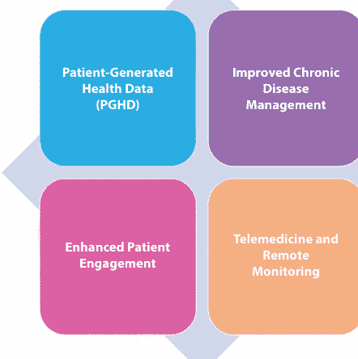

图 3.7 医疗保健中的物联网患者赋能。

# 使用物联网转型医疗保健 63 

- 患者生成的健康数据 (PGHD)：物联网设备通过患者生成的健康数据 (PGHD) 让患者贡献其健康数据，彻底改变了医疗保健 [27]。这些数据通过可穿戴设备和家庭监控设备收集，为医疗专业人员提供了全面、持续的健康概述。
- 改进慢性病管理：物联网通过持续监控和实时数据分析显著改进了慢性病管理，实现了个性化治疗方案、并发症的早期检测以及整体结果的改善。这种主动的方法赋予了患者积极管理慢性疾病的能力 [28]。
- 增强患者参与：物联网技术通过改善患者与医疗服务者之间的通信增强了患者参与度。它们创建了个性化健康计划，提供了及时提醒和教育资源，促进了对治疗计划的遵循和信息化决策。
- 远程医疗和远程监控：COVID-19 疫情加速了物联网在远程医疗和远程患者监控中的使用，增加了可及性并减轻了传统医疗系统的负担，确保了及时的咨询和主动的干预 [29]。

展望未来，患者赋能格局预计将不断演变。未来的发展可能包括更复杂、集成的物联网系统、增强的个性化以及这些技术在各种医疗背景下更广泛的接受。探索这些未来方向允许我们预见将赋予患者通过物联网技术管理健康的潜在趋势、挑战和机遇。

# 3.7 结论

总之，本综述强调了物联网在彻底改变医疗保健方面的关键作用，特别是考虑到 COVID-19 疫情。对患者赋能的强调（正如物联网在健康数据收集、慢性病管理和患者交互中的应用中所示）代表了向个性化和主动医疗保健的范式转变。

# 64 健康科学领域中的区块链

现实案例研究为物联网在鼓励患者积极参与和改善医疗结果方面的作用提供了切实证据。展望未来，报告看到了一个动态的未来，其中持续的进步和上升的趋势将重塑以患者为中心的护理格局。物联网在医疗保健中的转型潜力不仅解决了当前的问题，还为数字赋能和以患者为中心的医疗交付方法奠定了基础。

## 参考文献

- 1. Diak, D., Jachimcyk, B., Kulesza, W.J., IoT-based information system for healthcare application: design methodology approach. Appl. Sci., 7, 6, 596, 2017.
- 2. Wan, J., et al., Wearable IoT enabled real-time health monitoring system. EURASIP J. Wireless Commun. Netz., 2018, 1, 1–10, 2018.
- 3. Baker, S.B., Xiang, W., Atkinson, I., Internet of things for smart healthcare: Technologies, challenges, and opportunities. IEEE Access, 5, 26521–26544, 2017.
- 4. Islam, M.M., Rahaman, A., Islam, M.R., Development of smart healthcare monitoring system in IoT environment. SN Comput. Sci., 11-11, 1–20, 2020.
- 5. Nazir, S., et al., Internet of things for healthcare using effects of mobile computing: a systematic literature review. Wireless Commun. Mobile Comput., 2019, 19, 2–10.
- 6. Valsalan, P., Baomar, T., Baabood, A.H.O., IoT-based health monitoring system. J. Crit. Rev., 7, 4, 739–743, 2020.
- 7. Khan, R., Khan, S.U., Zaheer, R., Khan, S., Future Internet: The Internet of Things Architecture, Possible Applications and Key Challenges, in 2012th International Conference on Frontiers of Information Technology, Islamabad, Pakistan, pp. 257–260, 2012, 10.1109/FIT.2012.553.
- 8. Bandyopadhyay, D. and Sen, J., Internet of Things: Applications and Challenges in Technology and Standardization. Wireless Pers. Commun., 58, 49–69, 2011. https://doi.org/10.1007/s11277-011-0
- 9. Rputhi, S., Rinaldi, S., Big data analytics in healthcare: promise and potential. Health Inf. Syst., 2, 2018.
- 10. Yang, C., Qi, L., Lu, H., Big data and cloud computing: innovation and challenges. Future Comput. Sci., 8, 2017.
- 11. Pramanik, M., Lu, R., Kim, B., Smart health: big data-enabled. Expert Syst. Appl., 87, 2018.
- 12. Jagadewari, V., Subramanian, V., Kumar, S., Security Security- authentication and access control in the Internet of Things. Sensors, 14, 24786, 2014.
- 13. Abdulkadir, A., Al-Rodhan, M., Ma, T, Tian, Y., PPSDT: a novel privacy-preserving single decision tree algorithm for clinical decision-support systems using IoT devices. Sensors, 19, 1, 2019. https://doi.org/10.3390/s19010142.PIE142.


+ 26. Adly, A.S., Adly, A.S., Adly, M.S., 基于人工智能和智能物联的预防 COVID-19 传播方法：范围性综述。J. Med. Internet Res., 22, 8, e19104, 2020.

+ 27. Hossain, M.S. and Muhammad, G., 基于云的工业物联网（IIoT）赋能的健康监测框架。Comput. Network., 101, 192–202, 2016.

+ 28. Verma, P. and Sood, S.K., 以云为中心、基于 IoT 的疾病诊断医疗保健护理框架。J. Parallel Distr. Comput., 116, 27–38, 2018.

+ 29. Prabhu, J., Kumar, P.J., Manivannan, S.S., et al., IoT 在预防 COVID-19 中的作用以及印度医疗保健工作人员的行为意向——一项实证研究。Int. J. Pervasive Comput. Commun., 16, 4, 331–340, 2020 7月23日。

# 第二部分

# 医疗保健中的区块链

# 区块链辅助健康平台：通过去中心化健康数据管理缓解维生素 D缺乏

Reepu1*, Ganjot² 和 Preethi John³

^1 印度旁遮拉普邦，昌加尔大学管理系
2 印度旁遮拉普邦，昌加尔大学商学院
3 英国伦敦，斯特拉福德大学学院

# 摘要

生活方式疾病在全球范围内呈现趋势。微营养元素缺乏（如维生素 D 缺乏 VDD）被认为是城市和农村人口许多疾病负担的根本原因。城市地区的年轻人由于其生活方式的选择特别容易受到此类缺乏的影响。这与他们的信念和认知有关，并塑造了健康行为。在许多行为理论中，作为理论基础的健康信念模型（HBM）在各种疾病状况中应用最广泛。本文探讨了印度关于 VDD 的现有研究，特别是针对青少年群体。

此外，本文还尝试探索 HBM 是否能帮助理解可能刺激青少年摄入维生素 D 不足的行为。在应对维生素 D 缺乏挑战（特别是城市地区的青少年群体）时，本文建议整合区块链辅助健康平台作为一种变革性的解决方案。通过利用去中心化的健康数据管理，区块链技术可以增强健康干预的有效性，并鼓励青少年参与维生素 D 缺乏的行为。区块链提供的透明性和安全性可以对阳光暴露、营养摄入和健康结果进行实时追踪，创建一个受信任且不可篡改的记录。这种整合与健康信念模型一致，并引入了一种通过创新且安全的数字平台促进和维持健康行为的新颖方法。

> *通讯作者：reepu.technowize@gmail.com

Aryan Chaudhary, Rashmi Singh 和 Gaurav Agarwal (编) 健康科学中的区块链，(69–86)
© 2025 Scrivener Publishing LLC

70 健康科学中的区块链

**关键词：** 区块链，健康信念模型 (HBM)，维生素 D 缺乏，青少年，等。

## ## 4.1 引言

维生素 D 是维持骨骼矿物质稳态至关重要的微营养元素。它由身体合成，是正常发育至关重要的激素功能。维生素 D 缺乏会导致儿童佝性软骨症和成人骨质疏松症 [1]。此外，包括维生素 D 在内的微营养元素对人体功能、软骨健康和整体器官功能至关重要 [2]。除了骨骼健康，以抗氧化特性著称的维生素 D 与健康结果有关，包括肿瘤、自身免疫性疾病和神经系统疾病，其结果尚复杂且不确定 [3]。

维生素 D 缺乏（VDD）显著增加了对许多健康问题的易感性，其全球流行率令人担忧。在印度，超过 20% 的人口严重缺乏维生素 D，近三分之一的人存在缺乏 [4]。青少年作为未来的领导者，其健康至关重要。人生的这一关键阶段涉及重大的身体、生理、心理和行为变化，影响他们目前的健康状况以及随着年龄增长患长期疾病的可能性 [5]。当年轻人在成年早期期经历身份转变时，健康的生活方式干预可以对他们的健康行为产生深远影响 [6]。

目前已经提出了各种行为模型来理解健康行为，其中由 Rosenstock 开发的健康信念模型（HBM）被广泛用作预测包括 VDD 在内各种状况健康行为和干预的理论基础。已发表的几篇论文关注印度青少年的 VDD。相比之下，对在该背景下 HBM 的实际实施关注较少。

## ## 4.2 方法

目前的分析基于对发表的研究论文进行详尽文献检索的设计，以考虑普通人群和青少年（特别是印度青少年）在补充和不补充膳剂的情况下维生素 D 缺乏的所有方面。因此，为了提高搜索的可靠性，增加了一个额外变量，即健康信念。此外，本文还尝试探索 HBM 是否能帮助理解可能刺激青少年摄入维生素 D 不足的行为。在应对维生素 D 缺乏挑战（特别是城市地区的青少年群体）时，本文建议整合区块链辅助健康平台作为一种变革性的解决方案。通过利用去中心化的健康数据管理，区块链技术可以增强健康干预的有效性，并鼓励青少年参与维生素 D 缺乏的行为。区块链提供的透明性和安全性可以对阳光暴露、营养摄入和健康结果进行实时追踪，创建一个受信任且不可篡改的记录。这种整合与健康信念模型一致，并引入了一种通过创新且安全的数字平台促进和维持健康行为的新颖方法。

区块链辅助健康平台 71

因此，为了考虑普通人群和青少年（特别是印度青少年）在补充和不补充膳剂的情况下维生素 D 缺乏的所有方面，目前的分析基于对发表的研究论文进行详尽文献检索的设计。因此，为了提高搜索的可靠性，增加了一个额外变量，即健康信念。此外，本文还尝试探索 HBM 是否能帮助理解可能刺激青少年摄入维生素 D 不足的行为。

数据库选择：使用了 Google Scholar, PubMed, Shodhganga, IndMed 以及 ScienceDirect 等数据库。

为了确保搜索的全面性，根据以下标准，筛选了 Google Scholar, PubMed, Shodhganga, IndMed 以及 ScienceDirect 等数据库。

检索策略：使用 ‘vitamin D deficiency,’ ‘dietary supplements,’ ‘youth,’ ‘Health Belief Model’ 等关键词，检索了 Google Scholar, PubMed, Shodhganga, IndMed 以及 ScienceDirect 等数据库。

纳入和排除标准：根据以下标准，筛选了 Google Scholar, PubMed, Shodhganga, IndMed 以及 ScienceDirect 等数据库。

数据提取与合成：基于研究设计、样本、人口统计学特征等结果，从 Google Scholar, PubMed, Shodhganga, IndMed 以及 ScienceDirect 等数据库中提取并整合了信息。

质量评估：对选定的文献使用了合适的工具进行评估，涵盖了 Google Scholar, PubMed, Shodhganga, IndMed 以及 ScienceDirect 等数据库。

因此，根据研究结果的类型，对 Google Scholar, PubMed, Shodhganga, IndMed 以及 ScienceDirect 等数据库进行了分析。

72 健康科学中的区块链

## 4.3 文献综述

VDD 已成为全球各年龄段的健康问题 [7]。缺乏维生素 D，食物中摄入只有 10% 到 15% 被吸收，但钙的吸收率为 30% 到 40%。紫外线 B 透过皮肤并帮助产生维生素 D 前体 [8]。VDD 此外与心血管疾病和其他疾病有关 [9]。

由于生活方式的改变，VDD 在过去二十年中成为研究的一个重点。在西方社会，防晒霜的使用增加和室内时间的增加 [10] 是导致 VDD 的其他因素。在阳光充足的美国乔治亚州奥斯汀进行的一项研究中，由于体育活动减少，青少年的维生素 D 水平较低 [11]。

### 4.3.1 维生素 D 缺乏定义

血清 25(OH)D 值是维生素 D 评估的指标。由人体合成的维生素 D 是正常发育至关重要的激素功能。维生素 D 缺乏的人其血清 25(OH)D 值在 50 nmol/L-75 nmol/L 之间。数值 25 或 30 nmol/L 是严重的维生素 D 缺乏状态，会显著增加风险 [12]。

### 4.3.2 维生素 D 缺乏的发生率

在西方社会，阳光不足的发生率在美国为 5.9%，加拿大为 7.4%，欧洲为 13%。相比之下，维生素 D 水平不足的比例分别为美国 24%、加拿大 37% 和欧洲 40%。在印度、巴基斯坦和阿富汗等国家，超过 20% 的人口严重缺乏维生素 D。印度人口密集，估计有 4.9 亿人缺乏维生素 D [13]。


与印度农村地区相比，着装、职业以及阳光下停留的时间是其变变量 [14]。

## 4.3.3 国家维生素 D 水平不足

一项以维生素 D 缺乏、青少年和印度为关键词的文献综述提供了许多具有价值见解的有趣文章。在印度西部的一座城市，一项研究发现，百分之七十（70%）表面健康的成年人有严重的维生素 D 缺乏，其中女性的流行率略高，达到百分之七六（76%）。这项研究局限于特定的地理区域 [15]。

在印度北德里，评估了个人健康状况。选定的变量包括暴露于直射、季节、肤色、钙摄入以及怀孕等激素变化。结果发现，尽管该城市阳光充足，但德里的健康人群仍然处于自然的维生素 D 缺乏状态。这项研究也局限于特定的地理区域 [16]。

在二月（冬季）对德里以东的一个北印度村庄的 200 个家庭进行的研究发现，尽管男性的维生素 D 水平明显高于女性，但与同类相比，男性和女性分别分别为其六倍和三倍。尽管农村受试者的维生素 D 水平较高，但在这些人中仍有 70% 的人缺乏足够的维生素 D。因此，无论是在农村还是城市环境，该研究都表明实施国家性维生素 D 饮食强化计划的必要性 [17]。

另一项通过简单随机化的纵向研究研究了季节性变异对昌迪加尔健康年轻人和大学生（18 岁至 25 岁）维生素 D 水平的影响。以季节（夏末和冬末）作为变量。发现大多数健康年轻人维生素 D 充足。文章指出了其局限性在于缺乏对接触阳光和冬季影响的评估。此外，这项研究局限于一个较小的地理区域 [18]。

微量元素营养不良不仅增加了国家的疾病负担，也加重了经济负担。所有微量元素缺乏估计与印度 GDP 的 0.8%—2.4% 的经济成本相关 [19]。因此，为了国家的全面发展，需要健康监测。

## 4.4 健康促进与 HBM

在世界卫生组织（WHO）的协调下，可持续发展目标3（健康与福祉）强调了健康促进的必要性 [20]。健康促进使人们能够更好地控制自己的健康，积极影响生活质量。健康促进关注社会调节因素和影响的决定因素。行为、信念和感知构成了社会调节的要素，当这些被揭示时，有助于选择最佳干预措施。

健康行为要么在个人的直接控制范围内，要么由于社会、经济和环境条件而超出其控制范围。个人健康行为受规范性信念、自我效能信念、自我表象和态度塑造 [21]。行为理论如 TPB（计划行为理论）、跨理论模型、HBM（健康信念模型）、社会认知理论和社会生态模型旨在设计、实施和评估健康行为干预。

HBM 由 Rosenstock 于 1966 年创建 [22]，作为健康研究和实践中的一种心理社会学框架变得至关重要。Maiman 和 Becker [23] 对 Rosenstock 的开创性工作进行了完善，以更好地预测个人对预防性健康相关行动的参与或脱离 [24]。

Rosenstock 的 HBM 使用六个核心构念来衡量不同人群的情况及相关行为。根据健康状况、人口动态和健康行为，相应的措施被引入模型的核心构念中。最后一个也是第六个构念“自我效能感”，是 Rosenstock 原始 HBM 的扩展 [25]。这六个构念有助于预测个人将如何进行疾病预防、筛查或疾病管理。健康行为间接受到感产生的影响，而感知进一步受到人口统计学、社会心理和经济社会变量的影响 [26]。

HBM 的每个构念被单独结合，以创建用于行为改变的繁荣健康传播干预措施 [27]。尽管构念的定义与原始 HBM 理论保持一致，但 HBM 并非通用。例如，维生素 D 筛查感知障碍构念的衡量标准可能与结肠镜检查障碍的标准不同 [26]。

在骨质疏松预防研究中，基于 HBM 模型的问卷被用于量表和子量表，以识别、解释和预测风险健康行为的干预措施。[28]设计的骨质疏松健康信念表确定了健康态度与骨质疏松预防实践（如钙摄入和体力活动）之间的关系。该量表的一个局限性是自我效能构念在 1998 年被纳入 [29]，以开发骨质疏松自我效能表（OSES）来评估行为的自我效能。

## 区块链驱动的健康平台

| 方面 | 细节 |
| :--- | :--- |
| 创建与开发 | 由 Rosenstock 于 1966 年创建 [22]。 |
| 重大完善 | 由 Maiman & Becker [23] 进行了完善，以更好地预测预防性健康相关行动。 |
| 重要性 | 健康促进项目中广泛使用的模型。作为健康行为研究和实践中的心理社会学框架变得日益重要。 |
| 核心构念 | HBM 使用六个构念来衡量健康状况及相关行为：<br>1. 感知易感性<br>2. 感知严重性<br>3. 感知益处<br>4. 感知障碍<br>5. 行动线索 |
| 预测能力 | 这些构念有助于预测个人在疾病预防、筛查或管理方面的行动。 |
| 影响因素 | 健康行为间接受到感知的影响，而感知进一步受到人口统计学、社会心理和经济社会变量的影响 [26]。 |
| 应用与灵活性 | 每个构念被单独结合，以创建成功的行为改变的健康传播干预措施 [27]。尽管构念定义保持一致，但衡量标准因健康状况而异。 |
| 构念应用示例 | 维生素 D 筛查的感知障碍标准可能与结肠镜检查障碍不同 [26]。 |

# 健康科学中的区块链

HBM 已应用于研究糖尿病自我护理、药物依从性、接种、避孕使用、乳腺癌筛查、HIV保护以及其他需要采取回避健康威胁的行为 [7, 30, 31]。源自 HBM 的干预措施提高了宫颈癌涂片自筛查率、戒烟人数以及口腔护理，最近还促进了健康饮食 [32]。

在 COVID-19 期间，社区药剂师应用 HBM 帮助患者选择健康行为。他们利用教育工具对抗虚假信息，并将社交距离作为一种限制 COVID-19 的行为。沟通过程中考虑了人口统计特征、社会经济特征和患者的知识储备 [33]。伊拉克一项使用 HBM 的骨质疏松教育计划对绝经后护士的骨质疏松预防行为产生了显著影响。

### 4.4.1 HBM 在印度背景下的应用

一项关于印度行为预防方法的几十年研究根据其地理位置采用了 Rosenstock 的理论 [35]。从 1990 年至今，HBM 方法被用于理解印度许多不同的健康相关行为。尽管与 1990-2000 年相比，2010-2020 年关于印度背景 HBM 的发表研究更多。

在 COVID-19 背景下，喀拉拉特邦利用 HBM 预测利用政府医疗服务的预防性行为。他们进行了一项横断面调查。该州大多数人口发现遵循政府的预防保护措施具有自我效能。在疫情初期，HBM 识别了障碍并改变了他们的健康行为 [36]。


### 4.4.3 结果

针对印度城市青年的行为，开展的定性和定量研究都非常少。以“青少年”、“知识”、“态度”、“感知”、“健康信念模型 (HBM)”、“维生素 D”和“维生素缺乏缺乏 (VDD)”为关键词进行数据库检索，得到了关于骨质疏松的文章（这是 VDD 的健康后果）。然而，目前还没有关于在印度背景下应用 HBM 研究青少年维生素 D 缺乏的文章。

## 4.5 区块链整合

HBM 包含了几个影响健康相关行为的重要概念。将区块链系统与 HBM 结合可能会改进与青少年维生素缺乏行为的数据收集、评估和利用。

图 4.1 展示了以下组件：

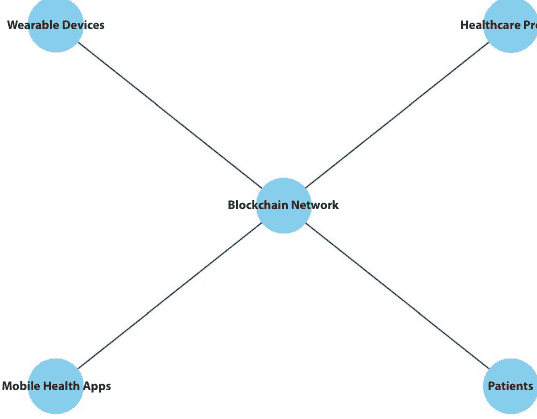

图 4.1 区块链整合（来源：作者创建）。

# 健康科学中的区块链

**区块链网络：** 位于中心，代表去中心化的数据管理系统。

- 可穿戴设备：位于左上角，提供实时健康数据。
- 医疗服务提供者：位于右上，提供医疗记录和维生素 D 测试结果。
- 移动健康应用：位于左下角，追踪饮食摄入、日照和补充剂使用情况。
- 患者：位于右下角，他们通过区块链网络接收并管理自己的健康数据。

箭头表示从这些源到区块链网络和患者的数据流。这种设置说明了区块链技术如何简化健康数据管理并有助于缓解维生素缺乏。

易感性：区块链可以更方便地实时收集有关人们饮食习惯、紫外线 (UV) 维生素水平和其他相关参数的信息。智能合约可以简化收集操作（例如佩戴紫外线设备或记录营养消耗设备），以确保数据的准确性和及时性。获取个性化数据的青少年更有可能采取预防疾病措施，因为他们更清楚自己对缺乏维生素 D 的脆弱性以及可能产生的健康影响。

严重性：根据现有的剂量和相关风险，基于区块链的健康数据可以为消费者提供关于光照不足可能严重性的个性化信息。通过公开且不可更改的医疗数据提高公众对其严重健康风险的理解，可以培养一种解决维生素 D 缺乏的紧迫感。

益处：区块链平台可以帮助传播基于证据的决策知识和治疗方法，以鼓励青少年获得足够的维生素 D。数字合约可以鼓励理想的行为，例如持续接触阳光或服用维生素 D 补充剂，并提供奖励或代币，这些代币可以兑换健康服务或产品。因此，让青少年参与并推动区块链促进的措施，使得关注维持适当维生素 D 含量的收益成为可能。

障碍：参与此类健康倡议的年轻人通常担心信息的机密性和安全性，这正是区块链驱动的系统可以帮助消除障碍的地方。我 在一家收集数据的公司工作；更好的保护可以减少对披露敏感信息的担忧，增加对增强维生素 D 缺乏行为干预的信心和参与。

## 4.6 挑战

尽管存在优势，但在将区块链技术与健康信念模型相结合以鼓励青少年摄足够的维生素 D 时，仍需要解决几个问题。这些问题涉及技术扩展性、权限以及涉及伦理的信息所有权的挑战。后续研究应重点关注由数字货币专家、健康行为研究人员和青少年参与者组成的跨学科伙伴中的障碍。此外，还需要实证研究来评估区块链增强疗法在实际情况下的可行性和有效性。

## 4.7 讨论

大量的文献证明了 VDD 的全球普遍性。在印度，其流行率令人担忧。最近的研究指出，在确定了人口统计和环境变量后，流行率达到了 70%。由于青少年占印度人口的很大比例（2022 年人口普查），纠正偏差对于印度降低未来的公共卫生负担至关重要。

由于长期行为模式形成于关键的青少年时期，因此理解青少年群的健康问题并识别保护其健康的干预措施至关重要。理解青少年对维生素 D 充足的信念体系有助于制定改变其维生素 D 摄入行为的干预。HBM 成为所有理论和模型中最常用的概念健康信念模型。HBM 应用于各种健康状况，有望理解底层的健康行为。它还有望理解人群可能参与或不参与的最可能的干预措施。干预对于扭转这种非常易管理的微量元素缺乏的局面至关重要。

通过健康促进改善人类健康和福祉也是联合国协调的可持续发展目标 (SDG 3) 的目标。如果采用理论和基于证据的健康干预来促进健康促进，提高生活水平是可能的。为了让这些干预产生预期结果（减少不希望的负面后果），理解底层的人类行为是至关重要的。

在文献综述期间，在搜索印度青年的 HBM 和 VDD 时，存在明显的研究空白。虽然有关于孕妇或特定人群的文章，其中维生素 D 也是问卷的一部分，但并不是重点。因此，这个主题一直被碎片化地研究，尚未有特定的重点。最接近的文章是关于基于 HBM 的行动方案对伊朗某城市女学生使用饮食维生素 D 补充剂的影响 [38]。

关于印度 HBM 的最新文章是处于 COVID-19 的背景下的。在过去的几年里，从 1990 年开始，HBM 在印度已应用于许多不同的健康状况以生活方式改变。然而，该模型从未被用于印度的 VDD 生活方式。印度是一个阳光充足的土地，由于缺乏对青少年 VDD 后果的知识，整代人可能面临随之来的疾病。

## 4.8 未来工作和研究机会

讨论强调了通过有效的干预措施和应用健康信念模型 (HBM) 来缓解青少年维生素 D 缺乏的重要空白和机会。以下是未来工作和研究机会的一些潜在领域：

- 1. 印度青少年 VDD 和 HBM 的综合研究：
- 委托调查特别关注青少年患 VDD 的率和因素


印度人口的产生情况。这些研究必须应用健康信念模型（HBM）来揭示该人群的信念体系和健康行为。

-   开展生物社会学研究设计，包括大样本量以及对维生素 D 状态和健康影响的长期随访，以建立交叉因素的长期影响。

## 设计并测试干预措施：

-   基于健康信念模型（HBM）理论为印度青少年制定或评估维生素 D 的干预计划。此类干预措施可以是信息性的（例如公共卫生运动）、药理性的（例如维生素或矿物质补充剂），甚至是对人们日常生活习惯的调整。

-   其核心理念是在印度不同地区开始测试这些倡议，以识别这些策略的优缺点。

## 文化与人口统计学差异：

-   研究印度青少年的文化、地理和社会经济特征如何影响他们的维生素 D 缺乏和健康实践。这有助于针对人群的特定需求和不可避免的情况，使干预措施更具针对性和目标性。

-   这项工作的主要任务将是研究城市和农村环境对维生素 D 水平及采取措施有效性等关键方面的影响数据。

## 技术驱动的健康干预：

-   利用移动应用程序、可穿戴设备和基于区块链的健康平台等技术实时监测并管理维生素 D 水平。这些工具可以为个人提供个性化的建议和提醒。

-   开发并测试利用游戏化和社交网络的数字干预措施，以引导青少年维持健康的维生素 D 水平。

## 5. 与可持续发展目标（SDGs）相结合：

-   将未来的研究和干预与联合国可持续发展目标 3 相结合，以确保各年龄段的健康并促进福祉。强调维生素 D 充足在实现这一目标中的作用。

-   与国际组织和利益相关者合作，分享应对维生素 D 缺乏（VDD）的全球最佳实践和资源。

## 4.9 结论

印度的维生素 D 缺乏（VDD）状况令人担忧。许多研究证明了这一点，但很少有深入的研究讨论过如何将 VDD 作为公共卫生紧急情况来采取干预措施。在西方，乳制品和饮料经过了维生素 D 强化，是维生素 D 的重要饮食来源。其他天然维生素 D 饮食来源的建议包括特定类型的鱼类、鱼油、鸡蛋和蘑菇。相比之下，印度对富含维生素 D 的本土食品的建议寥寥无几。

考虑到由于健康行为错误导致的人类痛苦之外的高昂经济成本，像印度这样人口稠密的国家应该针对 VDD 等公共卫生问题开展基础性研究。

在缺乏关于印度青少年结合 HBM 应用于 VDD 的研究的情况下，本研究在印度的健康教育实践中具有前景。HBM 作为一种社会心理健康行为改变模型，可用于识别、解释和预测人群的预防性健康行为，特别是在预测干预措施的接受率方面，这些措施可以刺激受试者参与或放弃某些促进健康的行为。将 HBM 作为健康行为理论将为制定国家性的 VDD 干预计划奠定基础。

健康信念模型和区块链技术为提高认知和鼓励年轻人摄入足够的维生素 D 提供了一种可行的方法。利用区块链的数据组织、安全、持续性和激励功能，可以根据每个人的需求和口味定制解决方案，从而有效解决维生素 D 缺乏的问题。需要更多的研究和合作来克服目前的障碍，最终实现这一新策略在改善青少年健康结果方面的承诺。

## 参考文献

-   1. Holick, M.F, Sunlight and Vitamin D for bone health and prevention of auto-immune diseases, cancers, and cardiovascular disease. Am. J. Clin. Nutr., 80, 1678S–1688S, 2004.

-   2. Pludowski, P., Holick, M.F., Pilz, S., Wagner, C.L., Hollis, B.W., Grant, W.B., Seni, M., Vitamin D effects on musculoskeletal health, immunity, cardiovascular disease, cancer, fertility, pregnancy, dementia, and mortality—a review of recent evidence. Autoimmunity, 12, 976–989, 2013.

-   3. Cashman, K.D., Vitamin deficiency: A Public Health Issue or Just Maybe?, in Hidden Hunger: Strategies to Improve Nutrition Quality, vol. 118, pp. 206-214, Karger Publishers, 2018.

-   4. Cashman, K.D., Sheehy, T., O'Neill, C.M., Is D deficiency a public health concern for low-middle-income countries? A systematic literature review. Eur. J. Nutr., 58, 1, 433–453.

-   5. Lawrence, R.S., Cychosz, Gutman, J., Sim, L., Adolescent health services: Missing opportunities. Choice Rev., 47, 2, 789–95, 2009.

-   6. Storer, J.H., Cychosz, C.M., Anderson, D.F., Wellness behaviors, social identities, and health promotion. Am. J. Health Behav., 21, 4, 260–267, 1998.

-   7. Palacios, C. and Gonzalez, L., Is Vitamin deficiency a major health problem? Steroid. Biochem. Mol. Biol., 144, 138–145, 2014.

-   8. Holick, M.F. Vitamin D deficiency. N. Engl. J. Med., 357, 3, 266–281, 2007.

-   9. Holick, M.F. and Chen, T.C., Vitamin D deficiency: a worldwide problem with health consequences. Am. J. Clin. Nutr., 87, 4, 1080–1086S, 2008.

-   10. Engström, L., Schmann-Jorgensen, I.S., Gutin, B., Lan, L., Chen, T.C., Scand. Nutr., 48, 3, 108–113, 2004.

-   11. Dong, Y., Pollock, N., Stallmann-Jorgensen, I.S., Zhu, T., Hu, H., Low 25-hydroxy... (此处省略部分原文以保持格式一致)

-   12. Amrein, K., Scherkl, M., Hoffmann, N., Vitamin D 2.0: An update. Eur. J. Clin. Nutr., 55, 6, 504–511, 2020.

-   13. Cashman, K.D., Vitamin deficiency: A Public Health Issue or Just Maybe?, (此处省略部分原文)

-   14. Is Vitamin deficiency a major health problem? (此处省略部分原文)

-   15. Adolescent health services: Missing opportunities. (此处省略部分原文)

-   16. Wellness behaviors, social identities, and health promotion. (此处省略部分原文)

-   17. Is Vitamin deficiency a major health problem? (此处省略部分原文)

-   18. Vitamin D deficiency. (此处省略部分原文)

-   19. Vitamin D deficiency: a worldwide problem with health consequences. (此处省略部分原文)

-   20. Scand. Nutr., 48, 3, 108–113, 2004. (此处省略部分原文)

*(注：由于参考文献通常视为学术索引名，根据专业翻译惯例此处保留了英文原文，仅确保了列表格式)*


初级保健中心的骨质疏松预防。Pak. Heart J., 56, 2, 372–377, 2023.

- 35. Linares, A.Z. 和 Linares, H., 烧伤预防：需要综合方法。Burns, 16, 4, 281–285, 1990.
- 36. Jose, R., Narendran, M., Bindu, A., Beevi, N., Manju, L., Benny, P.V., 对 COVID-19 流行病毒的公众认知与准备：健康信念模型方法。Clin. Epidemiol. Global Health, 9, 41–46, 2020.
- 37. Worldometers, 2023年各国人口统计，https://www.worldometers.info/world-population-population?#:text=The%20current%20population%20of%20India,latest%20Nations%20data%201. [访问日期：2023年12月5日]。
- 38. Ghoreishi, M.S., Peyman, N., Abusalhi, A., 基于健康信念模型的教育干预对马什哈德女性高中生使用维生素D补充剂的影响。Health Dev. J., 8, 1, 59–71, 2019.

# 区块链技术在医疗健康和数据安全中的潜力：西孟加尔普通及工程学院学生的认知

Mazhar Shamsi Ansary¹*, Indrajit Mahato² 和 Santosh Kumar Behera³

¹印度西孟加尔邦加尔各答内塔吉·纳纳加尔女子学院教育系

²印度西孟加尔邦维斯瓦-巴拉特维纳亚·巴凡教育系

³印度西孟加尔邦帕斯钦巴尔丹阿萨萨索尔卡齐·纳鲁尔大学教育系

# 摘要

本研究旨在探讨印度西孟加尔邦普通大学和工程学院学生对区块链技术在其医疗健康和数据隐私方面潜力的认知。研究采用了描述性调查法。共选取 289 名本科生（UG）学生（其中 159 名来自工程学院，130 名来自普通学院）作为人口代表性样本。研究人员构建了一份自测量表。使用 Google 表单收集数据。利用均值、标准差（SD）、t检验和 F检验对数据进行分析。结果显示，大学生对区块链技术的认知水平处于中等水平。此外，基于性别和类别变量的学生认知没有显著差异。然而，在地区、机构、专业和学期方面观察到了认知差异。分别分析普通学位学院和工程学院学生的认知发现，普通学院的学生对区块链技术在医疗健康和数据安全方面的潜力认知处于中等水平。普通学院学生的认知在性别和专业上没有差异，尽管在地区、类别和学期方面存在差异。工程学院学生也表现出中等水平的认知。尽管在地区方面存在差异，工程学院学生在性别、学期和类别变量方面的认知上未发现差异。

*通讯作者：msansary2015@gmail.com; ORCID: 0000-0003-1150-491X
Indrajit Mahato: ORCID: 0000-0003-3719-2627
Santosh Kumar Behera: ORCID: 0000-0002-8257-8066

Aryan Chaudhary, Rashid Singh 和 Gaurav Agarwal (eds.). 健康科学中的区块链，(87–110)
© 2025 Scrivener Publishing LLC

**关键词：** 认知、本科生、区块链技术、医疗健康、数据安全

## 5.1 引言

时光随流而逝。紧跟时代，我们现在生活在一个以科学技术为中心的世界[1]。毫无疑问，科学技术在人类生存三个主要领域——教育、工业和健康的显著进步中发挥了重要作用。这种进步的结果就是人工智能（AI）[2]。区块链技术是人工智能的成就之一。自2016年以来，包括美国、英国、日本在内的几个工业化国家已经意识到其重要性。因此，目前这些国家的许多企业和组织对其有强劲的需求[3]。20世纪末出现了区块链概念的出现。我们最早从 Chaum 在1982年发表的博士论文中获得区块链的概念。1991年，通过 Haber 和 Stornetta 的“如何为数字文档盖戳[4]”，该概念变得更加清晰；1992年，Merkle Trees 展示了先前系统的改进版本，向公众引入了区块链技术。新系统具有一种安全存储各种类型数据的机制。2000年，Stefan Konst 开发了安全链的新型理论和密码学的实现。可以将2004年视为区块链技术发展的转折点，当时 Hal Finney 提供了“可重用工作证明”作为数字货币[5]。Nick Szabo 在1998年引入了去中心化货币 Bit Gold，但在2005年才进行了公开描述[6]。在现代，社会认为中本聪明在2008年11月在其文章《比特币：点对点电子现金系统》中首次提出了区块链技术概念[7]。自引入以来，货币（特别是比特币）已变得更广泛地接受，目前常见于金融、健康和教育领域[8]。

区块链技术是指通过去中心化和分布式账本系统在计算机网络内对各种交易进行安全连接和验证[9]。在区块链中，区块通常以链的形式排列。信息通过互联网在名为“区块”的去中心化过程中被丰富，区块包含不同类型的信息[10]。每个区块有两个主要部分：区块头和区块体。区块体评估并存储各种类型的数据，而区块头将一个区块与下一个区块连接。各种数据存储在区块中，通过连接形成链[11]。这种区块链技术提供了几个独特的特征和优势[12]：

- 账本技术：链中的每个链接都可以访问数据，并防止第三方篡改这些信息；
- 安全性：任何交易或信息都使用数字签名和加密密钥进行验证，以确保完整的数据安全；
- 隐私性：关键数据保持私密；
- 加密货币：一种共识协议，能够实现信息的简单和安全交换；链或网络中的成员验证交易；
- 智能合约：数据具有加密证据，使得数据从外部获取时不太可能被破坏。

目前，尽管许多关于其在其他领域应用的出版物强调了其益处，但对于在高等教育中采用区块链优势的研究仍然较少[13]。西孟加尔邦是印度发展中的省份之一；因此，技术尚未完全接管高等教育系统。然而，由于 COVID-19 的影响，现在许多教育机构有机会部署技术。因此，学生有机会学习在线学习并从中受益。因此，预计学生会对区块链在高等教育中的应用持积极态度。

根据印度《2020年国家教育政策》的指南，学生现在可以在西孟加尔邦和印度的不同教育机构之间转学学分[14]。利用区块链技术实施新政策的利益将由学生、教师和其他高等教育工作人员更充分地实现。

正如区块链技术在教育领域具有巨大的重要性一样，它在医疗健康和数据安全方面也起着重要作用。然而，医疗健康自互联网时代以来发生了演变[15]。如果区块链技术应用于医疗健康和数据安全，其改进潜力可能会达到顶点。它将能够轻松存储患者数据、医生数据、病史等信息[16]。电子健康记录（EHR）是数字安全各种健康信息的稳健方式。这种 EHR 需要全面的支持。


# 90 健康科学中的区块链技术

区块链技术旨在通过消除各种缺点来提高透明度 [17]。健康和教育对于高等教育学生来说至关重要。累积记录卡（CRC）和轶事记录卡（ARC）是记录学生教育和个人信息的传统方法。然而，学生无法干预这些记录，这引发了关于数据保护的问题。因此，预计学生，尤其是本科（UG）阶段的学生，将在医疗保健和数据安全领域积极采用区块链技术。

虽然区块链与比特币等加密货币密切相关，但它现在的应用已远超金融领域，涵盖了医疗保健、管理、选举系统等。技术的进步和人类的好奇心将区块链的范围扩大到了各个领域。在这个引人入胜的时代，研究人员面临着一个紧迫的问题：何处实施区块链以获得最佳效果。区块链技术在数据隐私、减少学术欺诈、最小化黑客风险、促进数字凭证、增强教育交易等方面的被广泛认可。作者由于该主题的突出性和相关性选择了这一课题。

在这项研究中，作者旨在揭示工程师和本科学生对医疗保健和数据隐私相关的区块链技术的看法，认为这两个元素是任何教育系统的基础。特别是在数据隐私方面，这种方法允许学生深入探索一个新领域。观察学生对数据安全的感知水平将是非常有趣的。

由于我们生活在一个移动设备主导的时代，如今大多数学生利用智能手机以非常高效的方式访问互联网和各种资源。他们很可能理解保护数据隐私的重要性，并意识到与网络犯罪、黑客攻击以及数字公民内涵相关的问题。另一方面，这项研究还关注了本科学生的医疗保健方面。从历史上看，技术进步对人类健康产生了重大影响。在区块链技术背景，评估学生对医疗保健的感知至关重要，考虑到有许多文章和著作强调了技术发明的负面影响。

最终，无论分析数据得出什么结果，我们都必须考虑如何在整个教育部门（包括小学和中学）中有效实施区块链技术，以使其利益最大化。

# 探索区块链技术的潜力 91

## 5.2 文献综述

Agbo 等人 (2019) 根据 Prisma（系统评价和元萃分析分析报告的首选项目清单）指南对医疗保健中的区块链技术进行了系统综述。在彻底审查后，作者发现了区块链技术在医疗保健中的若干应用，但指出缺乏原型实现 [18]。Febih 和 Lahami (2020) 对区块链技术在医疗保健中的应用进行了更广泛的调查，解决了在该方法中识别出的某些局限性。最后，作者讨论了与这种新方法相关的开放问题和进一步研究 [19]。Shi 等人 (2020) 对区块链技术与电子健康记录（EHR）系统的整合进行了系统综述，专门关注数据安全和隐私方面。在仔细审查后，作者识别了许多挑战和未来愿景 [20]。Haleem 等人 (2021) 研究了区块链技术及其在医疗保健中的关键优势，揭示了 14 项重要应用。他们强调了区块链技术在医疗保健中的几种益处，例如提高数据效率、减少对数据操纵的恐惧以及增强数据安全水平。具体而言，区块链技术实现了数据去中心化，减轻了特定威胁 [15]。Kuleto 等人 (2022) 检查了区块链网络的一种不同方法，以便在塞尔维亚、罗马尼亚和葡萄牙创建最有效的可持续教育系统。结果清楚表明，尽管区块链技术具有某些缺点，但学生认为这项技术对他们的学习表现有重大的积极影响 [12]。Njeri (2022) 对与区块链技术相关的数据安全和隐私问题进行了研究。在回顾文献后，作者得出结论，作为一种技术，区块链在数据和隐私方面存在几个缺点；因此需要更多的研究来更好地理解这一概念 [21]。Saed 等人 (2022) 进行的类似研究旨在对区块链技术提供系统综述。他们综述了 2016 年至 2021 年关于区块链在医疗保健中潜在范式转移的 51 项研究。通过对研究进行系统综述，作者得出结论，区块链在医疗诊断、患者流程、数据完整性和预防欺诈方面起着至关重要的作用 [22]。Wylde 等人 (2022) 对区块链技术中的数据隐私和网络安全进行了研究。作者识别并审查了私营公司、政府机构和商业部门在推广采用该技术方面的关键障碍 [23]。Astaman 和 Mauritius (2023) 致力于研究区块链技术的感知和影响。结果表明，学生对区块链持有积极看法，并对其数据安全和隐私保持意识。此外，学生认识到在管理教育数据和信息方面的潜力。然而，他们也注意到高等教育中需要增加意识和监管 [24]。Singh 等人 (2023) 了另一项关于区块链技术在医疗保健领域有效利用的研究。他们的结果揭示了对于医疗行业，无论是目前还是未来应用都是如此的 [25]。Moosavi 和 Taherood (2023) 对区块链的安全挑战进行了系统性综述。作者还检查了区块链的使用领域，包括智能合约和共识机制。他们发现物联网（IoT）是区块链提供安全的关键背景 [26]。Adatoga 等人 (2024) 对医疗保健中的区块链技术及其相关的担忧进行了总结性审查。在这项研究中，作者检查了区块链技术在医疗保健中的优点、缺点、应用和挑战。在批判性地评估区块链特征后，作者得出该技术具有巨大潜力，可以改变医疗体系 [27]。

通过上述相关工作，作者尝试对过去 5 年（2019-2024 年）关于区块链技术的研究进行回顾。他们发现许多研究关注了医疗保健领域区块链的系统综述，识别了若干益处和缺点。某些研究结果表明，区块链在医疗保健领域可以发挥至关重要的作用。此外，一些相关工作审查了涉及学习者的数据安全；在此背景下，注意到西方国家的研究通常关注学生的数据隐私。发现区块链技术在数据安全方面仍有若干缺点，需要进一步的研究以提高有效性。该综述部分还探索了学生对区块链技术的看法，显示学习者通常对其实施持有积极态度。

在完成相关工作回顾后，作者观察到各个领域区块链技术的研究大多数集中在


# 探索区块链技术的潜力 93

此前已在国外或西方背景下进行了研究。在印度西孟加尔邦，该领域仍处于发展阶段，可以说区块链技术在这一背景下仍处于婴儿期。在本研究中，作者旨在了解本科生（来自工程学院和普通学位学院）对医疗保健和数据安全领域中区块链技术的感知。本研究进行了比较分析，并在工作中引入了新的变量。预计这些变量和方法将为区块链技术的应用开辟新方向。此外，预计本研究的结果将对教育和社交背景都有益处。

## 5.3 研究目标

- 1. 确定西孟加尔邦本科生（普通学位学院和工程学院）对区块链技术在医疗保健和数据安全领域潜力的感知。
    - a) 确定西孟加尔邦工程学院学生对区块链技术在医疗保健和数据安全领域潜力的感知。
    - b) 确定西孟加尔邦普通学位学院学生对区块链技术在医疗保健和数据安全领域潜力的感知。
    - c) 确定西孟加尔邦本科生（普通学位学院和工程学院）对区块链技术在医疗保健和数据安全领域潜力的整体感知。
- 2. 根据其性别、所在地和所属机构，确定本科生（普通学位学院和工程学院）对区块链技术在医疗保健和数据安全领域潜力的感知差异。
- 3. 根据其性别和所在地，确定普通学位学院学生对区块链技术在医疗保健和数据安全领域潜力的感知差异。
- 4. 根据其性别、所在地和学期，确定工程学院学生对区块链技术在医疗保健和数据安全领域潜力的感知差异。
- 5. 根据其类别、专业和学期，确定本科生（普通学位学院和工程学院）对区块链技术在医疗保健和数据安全领域潜力的感知差异。
- 6. 根据其类别、学期和专业，确定普通学位学院学生对区块链技术在医疗保健和数据安全领域潜力的感知差异。
- 7. 根据其类别，确定工程学院学生对区块链技术在医疗保健和数据安全领域潜力的感知差异。

## 5.4 研究假设

$H_{01}$：西孟加尔邦本科生（普通学位学院和工程学院）对区块链技术在医疗保健和数据安全领域潜力的感知更倾向于负面。

- a) 西孟加尔邦的工程学院学生对区块链技术在医疗保健和数据安全领域潜力的感知更倾向于负面。
- b) 西孟加尔邦的普通学位学院学生对区块链技术在医疗保健和数据安全领域潜力的感知更倾向于负面。
- c) 西孟加尔邦的本科生（普通学位学院和工程学院）对区块链技术在医疗保健和数据安全领域潜力的感知更倾向于负面。

$H_{02}$：本科生（普通学位学院和工程学院）对区块链技术在医疗保健和数据安全领域潜力的感知与其性别、所在地和所属机构之间没有显著差异。

$H_{03}$：普通学位学院学生对区块链技术在医疗保健和数据安全领域潜力的感知与其性别和所在地之间没有显著差异。

$H_{04}$：工程学院学生对区块链技术在医疗保健和数据安全领域领域的感知与其性别、所在地和学期之间没有显著差异。

$H_{05}$：本科生（普通学位学院和工程学院）对区块链技术在医疗保健和数据安全领域潜力的感知与其类别、专业和学期之间没有显著差异。

$H_{06}$：普通学位学院学生对区块链技术在医疗保健和数据安全领域潜力的感知与其类别、学期和专业之间没有显著差异。

$H_{07}$：工程学院学生对区块链技术在医疗保健和数据安全领域潜力的感知与其类别之间没有显著差异。

## 5.5 研究方法

本研究采用了描述性调查法。因此，采用了描述性调查研究中典型的各种技术、策略和方法来收集、分析和解释数据。为了实现这一目标，采用了定量研究方法。

### 5.5.1 总体

任何研究的总体是指研究者从中得出推断的元素或参与者的总集合。本研究针对西孟加尔邦工程学院和普通学位学院的本科生，这些学院的所有本科生均被确定为研究总体。

### 5.5.2 样本与抽样程序

样本是指总体中一组具有代表性的个人或参与者。在本研究中，来自西孟加尔邦工程学院（159名学生）和普通学位学院（130名学生）的289名本科生被选为总体的代表性样本。采用简单随机抽样选取样本。

### 5.5.3 使用工具

为了理解本科生对区块链技术相关的医疗保健和数据安全的感知，使用了一种感知量表（由研究人员构建）。该工具通过信度和效度过程得以最终确定。对于信度，使用了重测法；对于效度，则采用了专家验证（由两位专家进行）。

### 5.5.4 数据收集

数据通过 Google Forms 从西孟加尔邦工程学院和普通学位学院的各个地区收集，以了解本科生对区块链技术医疗保健和数据安全的感知。

### 5.5.5 统计技术

使用均值、标准差、t检验和方差分析（ANOVA）来分析收集的数据并验证假设。

## 5.6 结果与讨论

目标1：确定西孟加尔邦本科生（普通学位学院和工程学院）对区块链技术在医疗保健和数据安全领域潜力的感知。

H01(a) 测试：西孟加尔邦的工程学院学生对区块链技术在医疗保健和数据安全领域潜力的感知更倾向于负面。

| 类别 | N | 均值 | 标准差 |
| :--- | :--- | :--- | :--- |
| 工程学院学生 | 159 | 65.26 | 5.98 |

表5.1显示了基于研究人员验证H01(a)的证据：截止点为 $M + 1\sigma$。均值为 65.26，$N=159$，$\sigma=5.98$。这意味着 $65.26 + 1 \times 5.98 = 71.24$ 是 $M + 1\sigma$，而 $M - 1\sigma = 65.26 - 1 \times 5.98 = 59.28$。大多数工程学院学生（126人，占工程本科生的79.24%）得分在59.28到71.24之间。因此可以结论，工程学院学生对区块链技术在医疗保健和数据安全的感知处于中等水平。


# 探索区块链技术的潜力 97

**表 5.1** 西孟加尔邦工程学院学生对区块链技术在医疗和数据安全领域潜力的整体感知。

| 分数 | 频率 | 百比 | 感知水平 |
|---|---|---|--|
| 71.24 以上 | 21 | 13.21 | 高 |
| 59.28 至 71.24 之间 | 126 | 79.24 | 中等 |
| 59.28 以下 | 12 | 7.55 | 低 |
| 总计 | 159 | 100 | |

**$H_{01}(b)$ 检验：** 西孟加尔邦的普通本科生对区块链技术在医疗和数据安全领域潜力的感知更为不利。

| 类别 | N | 均值 | 标准差 |
|---|---|---|--|
| 普通本科生 | 130 | 52.74 | 12.09 |

根据表 5.2，根据截断点，研究人员验证了 H01(b)：截断点为 M + $1\sigma$。均值 = 52.74，N = 130，$\sigma = 12.09$。这意味着 $52.74 + 1 \times 12.09 = 64.83$ 是 M + $1\sigma$，而 $M - 1\sigma = 52.74 - 1 \times 12.09 = 40.65$。大多数普通本科生（88 人，占普通本科生的 67.70%）得分在 40.65 到 64.83 之间。因此可以得出，普通本科生对区块链技术在医疗和数据安全领域潜力的感知是等的。

**表 5.2** 西孟加尔邦普通本科生对区块链技术在医疗和数据安全领域潜力的整体感知。

| 分数 | 频率 | 百比 | 感知水平 |
|---|---|---|--|
| 64.83 以上 | 21 | 16.15 | 高 |
| 40.65 至 64.83 之间 | 88 | 67.70 | 中等 |
| 40.65 以下 | 21 | 16.15 | 低 |
| 总计 | 130 | 100 | |

# 98 健康科学中的区块链

# $H_{01}(c)$ 检验：

西孟加尔邦的本科生（包括普通本科和工程学院学生）对区块链技术在医疗和数据安全领域潜力的感知将更为不利。

| 类别 | N | 均值 | 标准差 |
| --- | --- | --- | --- |
| 本科生 | 289 | 59.63 | 11.13 |

从表 5.3 可以，根据截断点，研究人员验证了 H01(c)：此截断点为 M + $1\sigma$。均值 = 59.63，N = 289，$\sigma = 11.13$。这意味着 $59.63 + 1 \times 11.13 = 70.76$ 是 M + $1\sigma$，而 M - $1\sigma = 59.63 - 1 \times 11.13 = 48.50$。大多数本科生（211 人，占本科生的 73.01%）得分在 48.50 到 70.76 之间。可以得出，本科生对区块链技术在医疗和数据安全领域潜力的感知是中等的。

**表 5.3** 西孟加尔邦本科生（普通本科和工程学院）对区块链技术在医疗和数据安全领域潜力的整体感知。

| 分数 | 频率 | 百比 | 感知水平 |
| --- | --- | --- | --- |
| 70.76 以上 | 30 | 10.38 | 高 |
| 48.50 至 70.76 之间 | 211 | 73.01 | 中等 |
| 48.50 以下 | 48 | 16.61 | 低 |
| 总计 | 289 | 100 | |

# $H_{02}$ 检验：

本科生（普通本科和工程学院）对区块链技术在医疗和数据安全领域潜力的感知，在性别、所在地和所属机构方面没有显著差异。

# **性别（男和女）**

对于表 5.4 中的性别变量，$df = 287$ 且计算值（1.87）小于表值（0.05 水平下的 1.97）。因此，接受了零假设。可以清楚地陈述为没有

# 探索区块链技术的潜力 99

本科生在性别方面对区块链技术在医疗和数据安全方面的潜力感知没有显著差异。男、女学生都同样地认识到了区块链的重要性，可以说他们已经接受了该技术的使用。

# 所在地（农村和城市）

在所在地方面，根据表 5.4 的数据，观察到感知存在显著差异，计算值（29.097）大于表值（0.01 水平下的 2.59）。这可以解释为农村学生由于 Covid-19 突然转为在线教育，并享受了技术的便利，导致了相对较高的均值（63.86）。另一方面，城市学生的均值（52.23）相对较低，因为他们长期以来都在经历技术的优缺点，并且在整体采用区块链技术时较为谨慎。

# 机构（普通和工程）

根据本科生的所属机构，观察到区块链对数据安全和医疗影响的感知存在显著差异。可以说，这种差异的原因是工程学院学生积极地接受了区块链，导致其均值（65.26）高于普通学生的均值（52.75）。

表 5.4 本科生（普通本科和工程学院）各变量的 t 检验分布。

| 变量 | 组别 | N | 均值 | 标准差 | 差异 | df | t |
|---|---|---|---|---|---|---|---|
| 性别 | 男 | 238 | 59.73 | 10.771 | 1.87 | 287 | |
| | 女 | 51 | 59.18 | 12.815 | | | |
| 所在地 | 农村 | 183 | 63.86 | 8.359 | 29.097 | 287 | 0.01 和 0.05 (显著)
| | 城市 | 106 | 52.33 | 11.578 | | | |
| 机构 | 工程 | 159 | 65.26 | 5.980 | 8.514 | 287 | 0.01 和 0.05 (显著)
| | 普通 | 130 | 52.75 | 12.092 | | | |

# $H_0$ 检验：

普通学院学生对医疗和数据安全中区块链技术的感知在性别和所在地方面没有显著差异。

# 113 100 健康科学中的区块链

# 性别（男和女）

普通学院的男女学生对医疗和数据安全中区块链技术的感知一致。t值为 2.69，小于 $df=128$ 的表值。因此，没有显著差异，在这种情况下接受了假设。换句话说，性别没有影响。

# 所在地（农村和城市）

根据表 5.5 的数据，在 t 值上观察到了显著差异。根据所在地，学生对区块链潜力的感知存在差异；因此拒绝了假设。这种差异的原因是农村学生由于数字鸿沟，可能不充分了解技术，导致城乡学生之间存在差异。

# 表 5.5 普通学院学生各变量的 t 检验分布。

| 变量 | 组别 | 人 | 均值 | 标准差 | 差异 | df | t 值 | 显著性水平 |
|---|---|---|---|---|---|---|---|
| 性别 | 男 | 102 | 52.71 | 11.714 | 0.187 | 128 | | 不显著 |
| | 女 | 28 | 52.89 | 13.612 | | | |
| 所在地 | 农村 | 60 | 60.47 | 10.749 | 14.338 | 128 | 0.54 | 0.01 和 0.05 (显著) |
| | 城市 | 70 | 46.13 | 8.850 | | | |

# $H_0$ 检验：

工程学院学生对医疗和数据安全中区块链技术潜力的感知，在性别、所在地和学期方面没有显著差异。

# 性别（男和女）

根据表 5.6 的信息，男女学生在医疗和数据安全方面对区块链潜力的感知没有差异。在这种情况下，接受了假设。换句话说，工程学院学生的性别


# 区块链技术潜力探索 101

大学对区块链的潜力没有产生任何特殊影响。原因是工程学院的男学生和女学生都同等地接受了区块链的潜力。

## 地区（城市与农村）

农村和城市工程类学生在医疗保健和数据安全方面对区块链潜力的感知存在差异，但这种差异非常微小（均值差 = 1.13）。其的原因可能是数字鸿沟，这让城市工程类学生有机会更好地理解区块链。

## 年级（第一级与第三学级）

在工程类学生的年级方面，没有观察到显著差异。在这种情况下，该假设得到了接受。由于计算值（0.09）小于表值（1.98），可以说工程学院的年级变量对区块链的潜力没有任何影响。两个年级（第一级和第三级）的学生由于其科学背景，平等地接受了区块链的潜力。

表 5.6 工程学院学生各变量的 t 检验分布。

| 变量 | 组别 | 人数 | 均值 | 标准差 | 均值差 | t | 显著水平 |
|---|---|---|---|---|---|---|---|
| 性别 | 男 | 136 | 65.00 | 5.980 | 0.187 | 157 | 0.022 | 不显著 |
| | 女 | 23 | 66.83 | 5.867 | | | | |
| 地区 | 农村 | 123 | 65.52 | 6.319 | 1.131 | 157 | 2.399 | 显著 (0.01 和 0.05) |
| | 城市 | 36 | 64.39 | 4.612 | | | | |
| 年级 | 第一学级 | 129 | 65.21 | 5.901 | 0.291 | 157 | 0.09 | 不显著 |
| | 第三学级 | 30 | 65.50 | 6.410 | | | | |

## $H_{05}$ 的检验：

本科生（普通类和工程类）在类别、专业和年级方面，其对医疗保健和数据安全中区块链技术潜力的感知没有显著差异。

## 102 医疗健康科学中的区块链

## 类别（普通类、OBC、ST、SC）

根据表 5.7，F 值为 2.287，小于 2.64 的临界值。由此可见，在对区块链潜力的感知方面没有显著差异。所有类别的学生目前对区块链的潜力具有相同的感知。

## 专业（艺术、科学、商科）

根据表 5.8，基于专业背景，学生之间对区块链潜力的感知存在显著差异。F 值（25.788）远大于临界值（3.03）。预计科学类学生会对区块链技术有积极的感知，而艺术或商科学生可能不会有同样的积极感知。因此，根据专业观察到了显著差异。

## 年级（第一级、第三级和第六级）

根据表 5.9，F 值为 17.617，远高于 3.03 的临界值。这表明根据本科生的年级，对区块链技术的感知存在相当差异。

表 5.7 本科生（普通学位学院和工程学院）基于类别的方差分析结果。

| 离差来源 | df | 平方和 | 方 | F | 显著水平 |
|---|---|---|---|---|---|
| 组间 | 3 | 839.561 | 279.854 | 2.287 | 不显著 |
| 组内 | 285 | 34,881.560 | 122.391 | | | |
| 总计 | 288 | 35,721.121 | | | |

表 5.8 本科生（普通学位学院和工程学院）基于专业的方差分析结果。

| 离差来源 | df | 平方和 | 方 | F | 显著水平 |
|---|---|---|---|---|---|
| 组间 | 2 | 457.20 | 2,728.760 | 25.788 | 显著 |
| 组内 | 286 | 30,263.602 | 105.817 | | | |
| 总计 | 288 | 35,721.121 | | | |

# 区块链技术潜力探索

**表 5.9** 本科生（普通学位学院和工程学院）基于年级的方差分析结果。

| 离差来源 | Df | 平方和 | 方 | F | 显著水平 |
|---|---|---|---|---|---|
| 组间 | 2 | 3,918.004 | 1,959.002 111.200 | 17.617 | 显著 |
| 组内 | 286 | 31,803.117 | | | |
| 总计 | 288 | 35,721.121 | | | |

根据年级，本科生对区块链技术的感知存在相当差异。

$H_{05}$ 的检验：

本科生（普通类和工程类）在类别、专业和年级方面，其对医疗保健和数据安全中区块链技术潜力的感知没有显著差异。

类别（普通类、OBC、ST、SC）：

根据表 5.7，F 值为 2.287，小于 2.64 的临界值。由此可见，在对区块链潜力的感知方面没有显著差异。所有类别的学生目前对区块链的潜力具有相同的感知。

专业（艺术、科学、商科）：

根据表 5.8，基于专业背景，学生之间对区块链潜力的感知存在显著差异。F 值（25.788）远大于临界值（3.03）。预计科学类学生会对区块链技术有积极的感知，而艺术或商科学生可能不会有同样的积极感知。因此，根据专业观察到了显著差异。

年级（第一级、第三级和第六级）：

根据表 5.9，F 值为 17.617，远高于 3.03 的临界值。这表明根据本科生的年级，对区块链技术的感知存在相当差异。

104 医疗健康科学中的区块链

表 5.7 本科生（普通学位学院和工程学院）基于类别的方差分析结果。

| 离差来源 | df | 平方和 | 方 | F | 显著水平 |
|---|---|---|---|---|---|
| 组间 | 3 | 839.561 | 279.854 | 2.287 | 不显著 |
| 组内 | 285 | 34,881.560 | 122.391 | | | |
| 总计 | 288 | 35,721.121 | | | |

表 5.8 本科生（普通学位学院和工程学院）基于专业的方差分析结果。

| 离差来源 | df | 平方和 | 方 | F | 显著水平 |
|---|---|---|---|---|---|
| 组间 | 2 | 457.20 | 2,728.760 | 25.788 | 显著 |
| 组内 | 286 | 30,263.602 | 105.817 | | | |
| 总计 | 288 | 35,721.121 | | | |

# 区块链潜力探索

**表 5.9** 本科生（普通学位学院和工程学院）基于年级的方差分析结果。

| 离差来源 | Df | 平方和 | 方 | F | 显著水平 |
|---|---|---|---|---|---|
| 组间 | 2 | 3,918.004 | 1,959.002 111.200 | 17.617 | 显著 |
| 组内 | 286 | 31,803.117 | | | |
| 总计 | 288 | 35,721.121 | | | |

根据年级，本科生对区块链技术的感知存在相当差异。

$H_{05}$ 的检验：

本科生（普通类和工程类）在类别、专业和年级方面，其对医疗保健和数据安全中区块链技术潜力的感知没有显著差异。

类别（普通类、OBC、ST、SC）：

根据表 5.7，F 值为 2.287，小于 2.64 的临界值。由此可见，在对区块链潜力的感知方面没有显著差异。所有类别的学生目前对区块链的潜力具有相同的感知。

专业（艺术、科学、商科）：

根据表 5.8，基于专业背景，学生之间对区块链潜力的感知存在显著差异。F 值（25.788）远大于临界值（3.03）。预计科学类学生会对区块链技术有积极的感知，而艺术或商科学生可能不会有同样的积极感知。因此，根据专业观察到了显著差异。

年级（第一级、第三级和第六级）：

根据表 5.9，F 值为 17.617，远高于 3.03 的临界值。这表明根据本科生的年级，对区块链技术的感知存在相当差异。

104 医疗健康科学中的区块链

表 5.7 本科生（普通学位学院和工程学院）基于类别的方差分析结果。

| 离差来源 | df | 平方和 | 方 | F | 显著水平 |
|---|---|---|---|---|---|
| 组间 | 3 | 839.561 | 279.854 | 2.287 | 不显著 |
| 组内 | 285 | 34,881.560 | 122.391 | | | |
| 总计 | 288 | 35,721.121 | | | |

表 5.8 本科生（普通学位学院和工程学院）基于专业的方差分析结果。

| 离差来源 | df | 平方和 | 方 | F | 显著水平 |
|---|---|---|---|---|---|
| 组间 | 2 | 457.20 | 2,728.760 | 25.788 | 显著 |
| 组内 | 286 | 30,263.602 | 105.817 | | | |
| 总计 | 288 | 35,721.121 | | | |

# 区块链潜力探索

**表 5.9** 本科生（普通学位学院和工程学院）基于年级的方差分析结果。

| 离差来源 | Df | 平方和 | 方 | F | 显著水平 |
|---|---|---|---|---|---|
| 组间 | 2 | 3,918.004 | 1,959.002 111.200 | 17.617 | 显著 |
| 组内 | 286 | 31,803.117 | | | |
| 总计 | 288 | 35,721.121 | | | |


# 块链在健康科学中的应用

记录并简化患者医疗记录的传输。账本技术有助于医疗研究人员发现基因代码。基于区块链的健康信息交换的出现将使医疗人员更容易处理电子医疗记录，这是另一个潜在的未来趋势。通过将患者置于医疗生态系统的中心，并增强健康数据的安全性、隐私性和互操作性，区块链技术具有彻底改变医疗行业的潜力。该技术通过提高电子医疗数据的安全性、去中心化和效率，有望彻底变革健康信息交换（HIE）。这是一个新兴且快速发展的行业，提供了投资、实验和概念验证测试的机会，但它并非万灵药。区块链技术拥有着广阔的未来，将对金融、娱乐、医疗和教育在内的多种行业产生冲击。未来，区块链技术可能应用于供应链管理、云计算、网络安全和智能合约。

## 5.8 结论

本研究旨在探索印度西孟加尔邦本科生（工程学院和普通学位学院）对区块链技术及其对医疗保健和数据安全影响的感知。在分析数据后，结果显示，本科生的整体感知表明，73%的学生具有中等或平均理解水平，而极少数学生（10%）具有高水平感知，其余学生（17%）对区块链技术的感知水平较低。在分析整体本科生群体（289名学生）时，我们可以看到对区块链技术的感知根据地点和专业而存在显著差异。在普通学院学生（130名学生）的分析中，感知根据地点、学期和类别（普通、ST、SC和OBC）而存在显著差异，但在性别方面没有发现显著差异。同样，当作者分析工程学生（159名）的数据时，他们也发现感知根据地点存在显著差异。多个变量表明，来自工程学院和普通学位学院的本科生在涉及医疗保健和数据隐私的区块链技术感知存在显著差异。另一方面，某些变量，如性别（289名本科生）、学期（仅限工程学生）、类别（289名本科生）、专业（普通学位学院）和类别（工程学生）则没有显著差异。根据上述讨论，我们可以得出结论：两所机构的大多数本科生对西孟加尔邦的区块链技术感知处于中等水平。这意味着在289名本科生中，几乎有83%的人支持区块链技术，凸显了其在学生生活中的重要性。由于高等教育是任何国家教育系统的关键阶段，忽视它可能会导致问题无法解决。值得注意的是，印度的2020年国家教育政策（NEP）也强调在教室环境中利用新的技术创新。鉴此，我们必须考虑未来的教学过程将如何演变。因此，区块链技术在学生医疗保健和数据隐私中的重要性不容忽视。预计这项研究将为区块链技术开辟新方向，并对我们各层次学生和社会教育背景产生益。

## 参考文献

- 1. Ramesh, P.L., Impact of technology in human life. GJRA - Global J. Res. Anal., 6, 106, 2017.
- 2. Hirsh-Kreinsen, H., Articial intelligence: a promising technology. AI & Soc., 39, 1641, 2024.
- 3. Chen, X., Explore the Application and Challenges of Blockchain Technology in the Field of Higher Education in China. Adv. Soc. Sci. Educ. Humanit., 664, 2022.
- 4. Haber, S. and Stronetta, W.S., How to time-stamp a digital document. J. Cryptography, 3, 111, 1991.
- 5. Shiksha Online, Evolution of Blockchain: 1991 to 2024, https://www.shiksha.com/online-courses/articles/evolution-of-blockchain-technology/#:-text=%20evolution%20of%20blockchain%20technology%20started%20in2019_of%20those%20documents%20moresecure.
- 6. Algahtani, A.B. and Agarni, A., A Survey on Blockchain Technology Concepts, Applications and Security. It. J. Adv. Comput. Sci. Appl., 14, 841, 2023.
- 7. Nakamoto, S., Bitcoin: A Peer-to-Peer Electronic Cash System, 2008, https://www.google.com/url?sa=E&source=web&ct=897849484&url=https://bitcoin.org/bitcoin.pdf&ved=2ahUKEw7x7m8_8SJjAxVvp4zgGHZOCEPEFQnoECB4QAQ4g=AOVavov5-4mYD7EyyJkwJh8i0V.
- 8. Weerarna, R., Miao, S.J., Shao, X., Emerging advances of blockchain technology in finance: a content analysis. Pers. Ubiquitous Comput., 27, 1495, 2023.
- 9. Pandey, P., Digital Empowerment, pp. 150–151, Rita Publication, Kolkata, 2024.
- 10. Chen, G., Xu, B, Lu, M., Nian-Shing Chen, N., Exploring blockchain technology and its potential applications for education. Smart Learn. Environ., 5, 1, 2018.
- 11. Terziyska, M., Nikolova-Alexieva, V., Valeva, K., Application of blockchain technologies in the supply chain in food enterprises, in: BIO Web Conferences, vol. 102, pp. 1, 2024.
- 12. Sri, P.G.A. and Lalitha Bhaskari, D.L., A study on blockchain technology. Int. J. Eng. Technol., 7, 48, 2018.
- 13. Kuleta, V., Bucea-Manea-Tonis, R., Bucea-Manea-Tonis, R., Ili’c, M.P., Martins, O.M.D., Rankovic, M., Coelho, A.S., The Potential of Blockchain Technology in Higher Education as Perceived by Students in Serbia, Romania, and Portugal. Sustainability, 14, 1, 2022.
- 14. Ministry of Human Development. National Education Policy 2020.
- 15. Preethi Vinarasi, Dayana, R., Rahmani, A., Application of Blockchain Technology in Healthcare. 2023,,,, 298.
- 16. Haleem, A., Javaid, M., Singh, R., Blockchain technologies in healthcare: An overview. Int. J. Lett., 2, 130.
- 17. Kian, K., Jamiei, S., Radivkar, M., Blockchain-based privacy securing electronic health: A review. Multimed Tools Appl., 1, 28.
- 18. Agbo, C., Mahmoud, Q., Application of Blockchain Technology in Healthcare. Blockchain, 7, 56.
- 19. Kefih, R., Lahami, M., Application of Blockchain Technology in Healthcare: A Comprehensive Study, in: Impact of Digital Technologies on Public Health 18th International Conference, ICOST 2020, Whatsapp.
- 20. Shi, S., He, D., Li, L., Kumar, N., Khan, M., Applications of blockchain ensuring the security and privacy of health record systems: A survey. Comput. Secur., 97, 101966, 2020.
- 21. Njeri, N., Blockchain as Solution of Information Security and Data Privacy: Review. Int. J. Comput. Appl., 1, 337, 2022.
- 22. Saeed, H., Malik, H., Bashir, U., Ahmad, A., blockchain technology in healthcare: A systematic review. Front. Public Health, 17, e02642, 2022.
- 23. Wylde, V., Rawindaran, N., Prakash, E., Jayal, A., Khan, I., Hewage, C., Cybersecurity, Data Privacy and Blockchain: A Review. SN Compute. Sci., 3, 1, 2022.
- 24. Astaman, F.P. and Mauritius, T., An Analysis of Student Perceptions of Blockchain Technology and its Implications for Education. J. Theor. Appl. Inf. Technol., 101, 5805, 2023.
- 25. Singh, Y., Jabbar, M.A., Shandilya S, K., Vovk, O., Hnatiuk, Y., Exploring applications of blockchain in healthcare: road map and future directions. Front. Public Health, 1, 122986, 2023.
- 26. Moosavi, N., Taherdoost, H., Blockchain Technology Application in Security: A Systematic Review. Blockchains, 1, 58, 2023.
- 27. Atadoga, A., Elufioye, O. A., Omaghomi, T. T., Akomolafe, O., Odlibe, I. P., Owolabi, O. R., Blockchain in healthcare: a comprehensive review of applications and security concerns. Int. J. Sci. Res. Arch., 11, 1605, 2024.
- 28. Forbes Technology Council, The Future Of Blockchain In Healthcare, https://www.forbes.com/councils/forbestechcouncil/2021/10/25/the-future-of-blockchain-in-healthcare/, 2021.


# 在医疗领域实施区块链、物联网与云技术

D. Dhurgadevi1*, D. VimalKumar2, R. Senthilkumar2 and K. Gunasekarman3

^Karpagagam College of Engineering 信息技术部门，哥姆巴特尔，印度
^Hindustan Institute of Technology，哥尔姆巴特尔，印度

^V.R. Siddhartha School of Engineering，维杰亚纳瓦达，印度

# 摘要

信息技术（IT）领域的创新通过开发新型且易于使用的产品和应用程序影响着医疗保健。区块链、物联网（IoT）和云计算是信息技术领域近期用于医疗保健的技术，它们使医疗功能能够独立运行并为患者提供更好的治疗。物联网通过促进连接医疗、远程患者监测以及向医生发出警报在医疗行业中发挥着至关重要的作用。区块链和云技术为医疗数据提供了额外的安全保障。所有医疗机构都在转向云技术，以增强信息安全管理、效率并获得优于其他技术的优势。所提出的技术提供了一种集成区块链和物联网的安全、效益云解决方案，用于医疗设备连接。通过利用这种基于技术的医疗方法，将产生许多益处，能够显著提高治疗的质量和效率，从而增强患者健康。

**关键词：** 医疗保健、区块链、物联网 (IoT)、云技术、医疗设备

> *通讯作者：devi.durga@gmail.com

> Aryan Chaudhary, Rashmi Singh and Gaurav Agarwal (编) 健康科学中的区块链，(111–128)
© 2025 Scrivener Publishing LLC

## 6.1 引言

为老龄化且不断增长的人口提供适当且有利的医疗是21世纪最重要的问题之一。医疗部门的创新是必要的。政府、生命科学公司、医疗计划和提供者都面临着成本不断增加和结果不均的挑战。他们试图在减少成本和支出的同时增强服务和健康成果。

健康科学是处理人类生理和行为健康的应用科学研究。

近期，医疗行业面临着源于全球数字革命、流行病、人口重大变化以及患者预期增加的各种障碍 [1, 2]。在个性化医疗、循证治疗和数字客户服务的时代，初创公司、企业家和医疗专业人士关注重塑该领域的最新进展至关重要。医疗领域出现并并为健康科学提供支持的科技创新趋势寥寥几个：

- 1. 人工智能
- 2. 大数据
- 3. 物联网
- 4. AR/VR
- 5. 远程医疗
- 6. 云计算
- 7. 语音识别
- 8. 区块链

确保数据安全是医疗行业面临的主要挑战。根据报告，2021年7月至2022年6月之间报告了692起大型医疗泄露事件。这些数据泄露包括丢失的信用卡和银行信息，以及健康和基因组测试记录。在这里，有必要执行并加强医疗数据行业的安全性。

物联网、大数据、人工智能、机器学习和云技术等新计算机技术的创新在几乎所有领域都发挥着作用，包括智能医疗系统。云技术通过在安全可靠云中存储医疗记录来支持智能医疗系统。物联网将世界上的一切连接到互联网。物联网的作用是收集数据、将其存储在云端，并在医院之间共享数据以便进一步诊断。所有这些技术的成功取决于安全这一主要参数，而这可以通过智能医疗系统中的区块链技术来增强 [3]。

区块链具有不可篡改账本的属性，它可以验证用户身份并在各方之间建立信任网络。所有医疗记录都需要区块链来提高患者记录共享的信任和隐私性。在数字技术的最新创新中，区块链是一种创新技术，为跨不同领域的各种问题提供了巨大的解决方案。目前，研究人员正在进行医疗研究，为提高处理海量数据的效率提供了多种解决方案。大数据在医疗中起着作用；参见图6.1，它使得疾病预测和诊断变得更容易。然而，由于安全、数据分析、标准和治理等因素，许多国家在医疗研究中实施大数据方面面临着困难。因此，研究人员


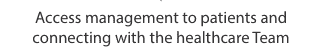

图 6.1 区块链在医疗保健中的作用。

研究人员正尝试解决这些问题，新技术可以改进医疗行业中区块链与大数据的部署。医疗行业中的区块链存储患者记录并使其免受损坏、意外和恶意入侵者等各种威胁的侵害。交易细节由区块链网络跟踪。

其次，医疗行业采用的云计算提高了效率并降低了成本。云计算允许记录被安全地存储、维护并易于共享。在电子医疗记录（EMR）引入之后，整个行业迁移到了基于云的平台来存储患者数据。然而，在采用云技术转型医疗行业的整个管理流程方面仍然面临着挑战。如果仅使用云解决方案，整个医疗部门无法变得多产和高效。医疗公司必须利用数据管理、物联网和人工智能技术，才能从这种技术中充分受益。

IT部门被物联网和云计算彻底改变了，当这些技术与智能系统结合时，医疗部门将经历一场变革。考虑到设备产生的数据量，将其存储在云环境中会更明智。然而，医疗数据极具私密性，安全问题仍然存在。区块链提供了一个潜在的分布式网络，确保数据安全并促进交易的真实性和透明度。本工作中使用的数据收集自各种传感器设备，并通过区块链网络和无线体域网（WBAN）发送到云端 [4]。

区块链和物联网在多种场景下都是可靠的技术，其中物联网设备具有自主数据采集和传感的能力 [5]。然而，一个缺点是无法应用加密安全措施。最近的研究表明，人工智能（AI）和区块链的影响正在彻底改变各个行业。这些技术的融合在新兴领域创造了一场新革命。人工智能使机器能够思考和决策，而区块链提供了具有安全性和透明性的分布式账本技术。区块链结合人工智能被用于对开发的产品进行控制。通过确保安全部署，安全等增强可以被信任，并可以通过各种人工智能算法提高效率 [6–8]。

医疗应用中区块链技术与物联网的集成可以通过结合这些技术来实现。有多种方法，可以根据它们所起的作用进行考虑。


# 云服务下的区块链与物联网 115

通过区块链，物联网设备之间数据交换的范围以及服务对系统的关注程度 [9–11]。本研究依赖于智能医疗系统中物联网、云计算和区块链的集成，以提升能力和质量。这种集成应该解决与安全相关的挑战，如信任、隐私、完整性和机密性。通过将这些技术整合到系统中，研究人员可以确保防篡的安全性、患者数据的安全管理与交换，以及患者的实时监控。

本节其余部分如下：第二节回顾了医疗系统领域的相关作者工作；第三节介绍了所提的方法；第四节讨论了结果；最后以结论结束。

## 6.2 相关工作

微软以在医疗保健行业采用云计算而闻名。Azure 是一个著名的平台，它将人工智能、物联网与云计算集成起来，用于患者监测。微软开发的 HoloLens 2 也利用云存储全息图像。自2016年以来，生物技术和制药公司辉瑞一直在使用云服务开展其计划。该公司近期开始与亚马逊网络服务（AWS）合作，开发旨在加速临床试验测试、开发、制造和分发流程的云解决方案。甲骨文在全球医疗行业拥有悠久且不断扩展的历史，为付费方、提供者、大学医疗机构和专科小组提供服务。甲骨文云重新定义了医疗在数字时代如何创新和演变，提供了目前市场上最强大的统一云解决方案包。

TigerConnect 是一种基于云的软件，为医疗专业人员提供了一个消息平台，用于交换文档、记录、患者数据和通信。医生值班调度是该程序的一个应用，其调度系统几乎可以瞬间生成全年的时间表。

Consensus Solutions 的产品旨在解决医疗行业的问题，并通过使用云计算提高效率，确保提供者能够访问存储在纸质文档上的患者数据和其他重要信息。

Medsphere 通过其电子记录平台为医疗机构提供一系列基于云的 解决方案，该平台利用微软安全的 Azure 云平台执行调度、注册、计费、理赔、医疗记录等功能。NetApp 是混合云数据服务的提供商，其平台提供实时临床数据。Medable 平台支持临床应用，并为研究人员和提供者存储患者健康数据，以促进医疗协作。医疗执业人员可以通过 Athenahealth 的云平台管理患者数据分析、文档记录和服务。该应用程序允许访问患者健康记录、收入周期管理、远程医疗支持、个人营销计划和其他功能。CareCloud 的开放平台增强了医疗提供者的效率和透明度，包括实践管理、电子健康记录、患者体验、收入周期管理应用以及对移动 App 和医疗分析的支持。

Gautam 等人 [12] 提出了一种基于区块链和物联网的医疗设备轻量级安全医疗解决方案。他们介绍了使用物联网设备进行远程患者监测时面临各种障碍。加密技术（包括 RSA 加密方案）被部署在物联网中。环签名提供了匿名性和签名正确性等隐私属性，而双重加密方案用于保护对称密钥。Diffie-Hellman 交换用于保护公钥。

Farouk 等人 [13] 分析了医疗数据及其在工业医疗中的必要性。作者从效率的角度回顾了区块链和物联网对工业医疗的影响。通过区块链技术，医疗部门可以更好地管理信息安全；在保持安全和隐私的同时，可以共享和分析患者数据。区块链技术的部署为医疗领域和研究带来了利益和回报。

医疗高管在计划区块链和物联网医疗（IoHT）安装时，还应该考虑两种可以加速采用和时间的补充技术。首先，人工智能（AI）可以用于识别海量数据中的模式和相关性以提取洞察。稳健区块链和 IoHT 基础的另一个核心部分是混合云。这些新的客户混合云模型将临床数据维护在业务防火墙后，同时提供高度扩展的公共云应用，确保符合组织和监管要求。

IoBHealth 将促进物联网与区块链无缝集成，以提供电子医疗服务。该框架的三个主要子系统包括基于物联网的电子健康提供者节点、物联网-区块链平台以及基于物联网的电子医疗患者节点。EHR 引擎、后端库、网关和加密货币客户端用于构建这两个节点。节点可以存储事务数据和特定服务数据 [14–16]。

[17–19] 创建了一种基于物联网的区块链辅助阅读症移动健康管理系统，允许阅读症患者及其照护人员在多模态信息共享框架内利用、保存和检索阅读症模式。测试了基于物联网的软件区块链架构的敏捷性，为电子医疗应用提供更大的灵活性、能力和隐私保护 [20]。利用区块链架构，开发了一种基于物联网的以患者中心的代理（PCA），以实现持续患者监测的端到端服务。

## 6.3 医疗行业中的云服务

医疗行业维护着电子病历，其中包含患者及其临床数据的信息。这些记录在检查和康复过程中支持医生和患者。随后，医疗信息系统（HIS）不断演进，提供了图形用户界面，以支持电子病历根据需要存储和检索信息。EMR 的整合产生了电子健康记录（EHR），它整合了患者的治疗记录并使医疗专业人员能够访问。传感器等植入式设备已开发以进一步推进。

收集并最初存储在本地存储中的数据被发送到云存储进行进一步分析。持续的进步为个人健康记录（PHR）铺平了道路，患者可以使用可穿戴设备或先进的手机积极参与收集自己的数据、监控健康状况等。此类系统带来了若干挑战，可以通过云技术的进步来解决。云框架支持实时数据以及大数据的共享与处理。

患者数据最初存储为健康记录，随后存储在云端。存储在云端的数据以电子病历的形式存在。同时医院也可以共同存储电子病历。患者和医生可以随时随地访问这些数据。然而，云存储和从云端检索的数据存在更大的漏洞和攻击可能性。因此，安全机制对于确保云内的数据安全至关重要。各种加密和解密


118 健康科学中的区块链

不同的研究人员已经提出了许多算法，但黑客继续尝试窃取数据。

## 6.4 区块链在云技术中的兴起

医疗行业以电子病记录（EMR）、电子健康记录（EHR）和个人健康记录（PHR）的形式处理数据，这些数据存储在云端，入侵者和黑客试图为了利润删除或窃取数据。因此，保护云安全至关重要。许多研究人员致力于这个问题，并使用加密技术和各种加密算法提供了解决方案。然而，所有的解决方案都是基于中心化的方法。一种去中心化的方法已经出现，即区块链，它是医疗云计算安全问题的解决方案。它运行在互联网上，互联网用于在线购物和消息等各种实时应用。

图 6.2 展示了区块链的工作流，它从请求消息开始，随后是创建区块、批准区块并将其添加到链中。最后，事务开始执行。存储和维护由云存储处理。


图 6.2 区块链分步工作流。

## 6.5 IoT 辅助医疗系统

IoT 辅助医疗系统通过远程监控、医疗设备集成以及传感器和设备的连接为患者和医疗从业人员提供应用。IoT 设备的作用是从各种医疗病例中收集数据，并对数据进行更准确的可视化分析。IoT 可以处理用于通信的不同软件和硬件。图 6.3 表示了基于 IoT 的医疗系统的系统模型。

它由以下部分组成：

### 基础设施

读取传感器感应的数据并显示在设备上以实现可见性是重要的。它由硬件和软件组件组成。

### 传感器

根据医疗应用的类型使用不同类型的传感器。例如脉搏氧仪、心电图仪、温度计、液位传感器和血压计（血压监测仪），它们用于读取患者的当前状态（数据）。


**图 6.3** 基于 IoT 的医疗系统。

120 健康科学中的区块链

### 连接器

IoT 系统使用蓝牙和 Wi-Fi 与各种设备和传感器连接，以发送和接收数据。

### 分析

从传感器收集的数据使用各种工具和参数以不同方式进行分析，为进一步治疗提供解决方案和报告。

### 显示器/GUI

显示器是医生访问信息以监控患者详情的应用平台。

## 6.6 区块链与 IoT 及云技术的集成

将 IoT 与区块链集成提供了抽象并为消费者提供服务。当医疗数据库与云技术集成时，可能会有更多数据泄漏的可能性。因此，应该在云端加强安全性。此外，随着 IoT 技术的集成，应该通过适当的提高设备的效率。图 6.4 展示了所提模型的流程。

在采用区块链时，需要多级认证方案。因此，在医疗数据库中，考虑集成增强安全性的区块链、IoT 和云技术。这在数据上传到云服务器时提供了双端安全。每当数据上传到云端时，就会生成一个哈希值，医疗行业利用它查看患者详情。然后数据被推入区块。通过实施收集患者数据的各种新型 IoT 设备，数据被推入区块链技术。公司的软件工程师检查黑客的篡改或破坏，确保电子病历的完整性和安全性。

应用优化的机器学习算法进行数据分析，数据被推入云端，在云端再次应用 ML 算法进行数据集成并上传到区块链。通过针对医院和患者双方的改进加密算法和哈希密钥生成，确保区块链的安全性，满足双方的需求。

## 带有云服务的区块链与 IoT


**图 6.4** 所提模型布局。

在每天涌现的各种优化算法中，ICOOT（改进鸟优化算法）是此类算法之一，它在 IoT 应用中使用了基于启发式算法的方法来增强各种参数。它的优势在于能够提高数据传输效率和能量利用，有助于延长网络寿命。然而，由于潜在的复杂性和对特定优化参数的依赖，实施可能会面临挑战，这会影响现实场景中的性能。尽管有这些局限性，ICOOT 通过其创新的启发式方法在解决 IoT 网络的独特挑战方面显示了前景。实施 ICOOT 算法的动机在于 IoT 环境对资源高效通信的紧迫需求。

在所提的方法中，ICOOT 算法的使用成为预测 IoT 设备数据检索效率的关键策略。该算法增强了聚类和路由过程，在数据管理中提供了改进的效率和传输性能。

122 健康科学中的区块链

所提算法针对集成技术解决了以下三个点问题：

- 所提方法对 IoT 辅助网络的动态特性有重大贡献。通过 ICOOT 算法，对来自不同 IoT 设备的数据收集和数据聚合进行了精细调整，以确保对数据流量、节点密度和能量水平波动的韧性。
- 这种集成允许在大解决方案空间中进行自适应动态优化，实现了高效的资源利用并提高了整体性能。
- 关键贡献之一是算法能够在网络中形成聚类的能力。

## 6.7 结果与讨论

机器学习算法被应用于云端的资源分配。对结果进行了评估并与 ICOOT 方法进行了比较。

表 6.1 各种方法与所提方法的比较。

| 方法 | 准确率 (%) | 精确率 (%) | 召回率 (%) | F1 分数 (%) |
| :--- | :--- | :--- | :--- | :--- |
| XGBoost | 98.4 | 98.2 | 98.4 | 98.4 |
| DT | 99.2 | 99.5 | 99.3 | 99.3 |
| RF | 97.8 | 97.0 | 97.8 | 97.9 |
| ICOOT | 99.3 | 99.3 | 99.6 | 99.3 |

表 6.2 攻击加权平均值的比较。

| 方法 | 精确率 (%) | 召回率 (%) | F1 分数 (%) |
| :--- | :--- | :--- | :--- |
| XGBoost | 90.7 | 90.6 | 90.8 |
| DT | 89.4 | 90.9 | 90.9 |
| RF | 90.9 | 90.8 | 90.9 |
| ICOOT | 99.7 | 98.7 | 99.6 |

123 带有云服务的区块链与 IoT

在区块链上存储的来自五家不同医院的 50 医疗记录执行。

所提算法与 XGBoost、GradBoost、决策树 (DT) 和随机森林 (RF) 等不同优化算法进行了比较，如表 6.1 所示。结果显示改进的 ICOOT 模型在所有指标上的性能更好，执行时间增加了 34.9%。

在下一步分析中，对经历不同类型攻击的数据集绘制结果。考虑的攻击有拒绝服务、中间人攻击以及扫描和密码攻击。

机器学习算法适用于上述攻击，获得了精确率值、召回率值和 F1 分数值。表 6.2 显示了所考虑攻击的加权平均值。


**图 6.5** 各种方法与所提方法的比较。


**图 6.6** 各种参数与所提方法的比较。


# 124 健康科学中的区块链


**图 6.7** 攻击下各种方法的对比。


**图 6.8** 遭受攻击时各种参数的对比。

图 6.5 展示了提出的 ICOOT 算法以及它在准确率、精确率、召回率和 F1 分方面如何优于其他方法。

图 6.6 和 6.7 展示了在受到不同攻击时，所提出的 ICOOT 算法在精确率、召回率和 F1 分方面优于其他方法，以此衡量其性能。

图 6.8 显示了 F1 分的平均加权值随攻击而增加，精确率也随着新提模型的引入而增加。

# 6.8 未来工作与研究机会

根据 Data Bridge Market Research 的最新报告，医疗物联网市场每年都在增长，在 2021 年至 2028 年期间的增长率接近 22.2%。新型医疗设备和技术的发明产生了数百万个自定义数据点，为未来的医疗技术提供了高效的解决方案。未来的研究方向侧重于预测更准确的数据、减少个人检查的必要性、创建虚拟医院以及实现持续健康监测。除了这些进展外，生成式 AI、纳米医学、AR/VR、聊天机器人、虚拟医疗助手、机器人、细胞疗法、数字孪生技术、器官护理技术和生物打印等新技术将演进并提供更多解决方案。此外，5G 技术将影响医疗诊断和治疗。医疗领域的技术进步将重新定义医疗行业的基础结构。在创新、数据和以患者为中心的护理的共同推动下，一场前所未有的转变正在发生。医疗技术的最新进展，如数字孪生、心理健康应用、个性化药物治疗和预测分析，正在为更有效、高效且更灵活的患者治疗铺平道路。

# 6.9 结论

IoT 技术正被应用于现代世界的每一个行业，包括智慧城市、医疗健康和农业。物联网应用于医疗健康行业，用于常规患者健康监测、药物追踪等。然而，与 IoT 存在若干安全问题，这些问题可以通过集成 IoT 和区块链技术来解决。区块链是一种可以增强系统安全性的去中心化技术。在医疗健康行业，区块链技术确保了患者的私立医疗记录免受篡改和泄露。为了提升整体性能并认证医疗行业，本文尝试列出了将 IoT 技术和区块链集成到医疗健康行业的所有可能方式。

## 参考文献

- 1. Velazquez, R., 2024. https://builtin.com/articles/cloud-computing-in-health care.
- 2. Tyagi, P. and Manju bargavi, S.K., Using Federated Artificial Intelligence System of Intrusion Detection for Iot Healthcare System Based on Blockchain. Zenodo, 2, 1, 1–10, 2023.
- 3. Singh, S., Pankaj, B., Nagarajan, K., Singh, N.P., Bala, V., Blockchain with cloud for handling healthcare data: A privacy-friendly platform. Mater. Today: Proc., 62, 5021–5026, 2022.
- 4. Kaur, H., Jameel, R., Alam, M.A., Alankar, A., Chang, V., Securing managing healthcare data generated by intelligent blockchain systems on cloud networks through DNA cryptography. J. Interp. Inf. Manage., 36, 4, 861–878, 2023. https://doi.org/10.1108/IJEM-01-2022-0084.
- 5. Alam, S., Bhatia, S., Shuaib, M., Khubrani, M.M., Alfayez, F., Malibari, A.A., Ahmad, S., An Overview of Blockchain and IoT Integration for Secure and Reliable Health Records Monitoring. Sustainability, 157, 5660, 2023. https://doi.org/10.3390/su1517507660
- 6. Singh, D., Nagaraju, D., Mohan, B.R., Bojjawar, S., Burada, S., Kumar, S.P., Kumar, R., Sundar, R., Electronic Health Sharing in Cloud Computing with Privacy and Security Preservation Using Blockchain Technology. Int. J. Syst. Appl. Eng., 11, 105–427, 2022.
- 7. Allam, A.H., et al., IoT-based eHealth using blockchain technology: a survey. Clust. Comput., 27, 7083–7110, 2024.
- 8. Ranjan, N., Balkhane, B., Ghuge, M., Dakhare, B.S., Singh, B.R., Shukla, A., Efficient and Secure Blockchain-Based Access Control for FogAssisted IoT Cloud in Electronic Medical Records Sharing. J. Electr. Syst., 20, 1s, 2024. https://doi.org/10.52783/jes.759
- 9. Konsgen, J., Centaraswan, D., Koad, P., Thu, M., Jandaeng, C., Secure Blockchain-Enabled Remote Healthcare Monitoring System for Home. J. Sens. Actuator Neur., 13, 1, 2024. https://doi.org/10.3390/asan130013
- 10. Rajeshakaran, P. and Duraisanding, M., Secure cloud storage for IoT distributed healthcare environment using orchestrated deep learning model. J. Int. Fuzzy Systems Appl. Eng., 46, 1, 1069–1084, 2024. https://doi.org/10.3233/JIFS-23484
- 11. Imam, S., Nagaraj, S., Firdous, R., et al., Blockchain based medical image encryption using Arnold's map in a cloud environment. Sci. Rep., 14, 5678, https://doi.org/10.1038/s41598-024-5364-z
- 12. Srivastava, G., Crichno, J., Dhar, S., Blockchain based medical image encryption using Arnold's map in a cloud environment. Sci. Rep., 14, 5678, https://doi.org/10.1038/s41598-024-5364-z
- 13. Srivastava, G., Crichno, J., Dhar, S., Blockchain based medical image encryption using Arnold's map in a cloud environment... (此处原文存在重复，已按要求处理逻辑)
- 14. Kaur, H., Jameel, R., Alam, M.A., Alankar, A., Chang, V., Securing managing healthcare data generated by intelligent blockchain systems on cloud networks through DNA cryptography. J. Interp. Inf. Manage., 36, 4, 861–878, 2023. https://doi.org/10.1108/IJEM-01-2022-0084.
- 15. Alam, S., Bhatia, S., Shuaib, M., Khubrani, M.M., Alfayez, F., Malibari, A.A., Ahmad, S., An Overview of Blockchain and IoT Integration for Secure and Reliable Health Records Monitoring. Sustainability, 157, 5660, 2023. https://doi.org/10.3390/su1517507660
- 16. Singh, D., Nagaraju, D., Mohan, B.R., Bojjawar, S., Burada, S., Kumar, S.P., Kumar, R., Sundar, R., Electronic Health Sharing in Cloud Computing with Privacy and Security Preservation Using Blockchain Technology. Int. J. Syst. Appl. Eng., 11, 105–427, 2022.
- 17. Allam, A.H., et al., IoT-based eHealth using blockchain technology: a survey. Clust. Comput., 27, 7083–7110, 2024.
- 18. Ranjan, N., Balkhane, B., Ghuge, M., Dakhare, B.S., Singh, B.R., Shukla, A., Efficient and Secure Blockchain-Based Access Control for FogAssisted IoT Cloud in Electronic Medical Records Sharing. J. Electr. Syst., 20, 1s, 2024. https://doi.org/10.52783/jes.759
- 19. Konsgen, J., Centaraswan, D., Koad, P., Thu, M., Jandaeng, C., Secure Blockchain-Enabled Remote Healthcare Monitoring System for Home. J. Sens. Actuator Neur., 13, 1, 2024. https://doi.org/10.3390/asan130013
- 20. Rajeshakaran, P. and Duraisanding, M., Secure cloud storage for IoT distributed healthcare environment using orchestrated deep learning model. J. Int. Fuzzy Systems Appl. Eng., 46, 1, 1069–1084, 2024. https://doi.org/10.3233/JIFS-23484

# 使用 AI 与区块链的健康

Sunil Gautam*, Pooja Patel1, Heer Ramavat1 和 Gaurav Agarwal2

^1计算机科学与工程系。Nirma 大学，阿姆达巴德，印度

^2计算机科学与工程学院。Galgotias 大学，大诺伊，印度

# 摘要

区块链是一种点对点（P2P）网络，采用加密哈希连接提供同步、去中心化和可靠性。此外，区块链由于提供了分布式共享账本而更易导航。区块链技术应用于各种场景，如投票系统、供应链、智能合约、加密货币和健康数据管理。

人工智能（AI）使机器能够从数据中学习并根据学习内容进行预测。此外，它通过提供 AI 助手、人脸识别和不同的生成式工具为各行业提供了智能化发展。

最近，AI 和区块链开始参与解决彼此的问题，如偏见决策、商业化、统一性和互操作性等。区块链和人工智能的发展将通过提供良好的数据隐私、确保数据共享公平补偿、增强供应链、加速创新领域以及促进信任决策来造福社会。

我们在本中强调了 AI 和区块链在医疗领域的重要性。在这里，我们主要针对电子健康（E-health）中的 AI 驱动区块链技术。随后，我们讨论了在健康领域应用 AI 驱动区块链技术的优点、缺点、挑战、现实场景以及潜在的未来前景。

**关键词：**区块链、人工智能 (AI)、AI 驱动的区块链、医疗行业、电子健康

> *通讯作者：sunil.gautam@nirmauni.ac.in


## 7.1 引言

通过预防疾病、伤害和疾病的诊断、治疗、缓解或治愈来改善健康被称为医疗保健。它涉及治疗人类额外的心理和身体机能。因此，医疗保健部门提供了多个经济部门的集合和整合，提供产品和服务为患者提供姑息、预防、康复和治疗性护理。它包含了医疗相关的业务，如医疗服务、医疗设备制造、医疗保险和其他业务功能。此外，它还有由若干患者护理活动组成的几个子类别，如安全、数据维护等。除了这些，它还包括法律纠纷、供应链管理、物流和其他医疗程序。医疗保健领域利用了结构化和非结构化的信息源。这些来源包括组学、电子健康记录（EHRs）、临床试验、生理和化学传感器等 [55]。除了所有这些，医疗保健还强调患者对医疗领域各种人工智能和区块链驱动技术的感知，例如数字抗衰老过程实施等 [60]。同时，医疗保健还提出了关于隐私、安全、患者结果以及通过人工智能和区块链带来的变革性变化等问题 [58, 59]。

尽管医疗行业正在缓慢演变，但几十年前的情况完全不同。随着物联网（IoT）、区块链和人工智能（AI）等多样化技术的时代，世界正经历从手动数据维护向数据管理的转型。全球人口的增长迫使我们改变提供更好的医疗服务和安全保障的方式。这要求我们进一步寻找创新技术，以帮助全球医疗相关问题的康复 [1, 7, 51]。

医学领域随时间发生了巨大变化。在古代，治疗是根据不同的精神信仰通过精神实践进行的。它使用草药药物和自然疗法进行治疗。早期的手术技术包括开颅术（在头骨上钻孔）、截肢（移除身体部位）、伤口灼烧（使用热或冷工具破坏受损组织）。在19世纪，科学医学开始发展，抗生素、疫苗等的发现导致了医疗保健领域的重大进展。手术技术的进步还对增加人类预期寿命产生了显著影响 [48]。

此外，该行业追求了人工智能（AI）、电子健康记录（EHRs）、可穿戴设备、远程医疗等技术进步 [1]。

20世纪50年代见证了人工智能发展的开始。早期的思想是创建能够模拟人类智能的机器。此前它侧重于符号方法和基于规则的专家系统，这些系统是特定领域的。在20世纪，研究重点转向了机器学习方法。开发了许多新算法，如决策树、数据挖掘、选民挖掘等。大数据的概念增加了人们对人工智能的兴趣。具有许多层神经网络的更多深度学习算法在语音识别、自然语言处理（NLP）和图像识别等领域取得了巨大成就。人工智能在机器人、自主系统、无监督学习等领域持续演进 [49]。

1976年进行了一场关于分布式账本密码学的讨论。随着《如何为数字文件标记时间戳》的出版，取得了进一步进展，它提出了对媒体内部信息进行时间戳标记的概念。随后，提出了“数字货币”的概念。区块链的概念就源于这一概念，它遵循与电子现金类似的协议。随后还出现了一些依赖于点对点（P2P）网络的额外概念，如hashcash和b-money。随着2008年《比特币：一种点对点电子现金系统》的发布，中本聪聪（Satoshi Nakamoto）被公认为区块链技术的创造者。几个月后，比特币推出了开源程序。此外，还创建了许多加密货币，包括狗狗币（Dogecoin）和莱币（Litecoin）等。这些货币的透明性使其广受欢迎。以太坊平台于2015年推出，使得区块链技术能够运行。在此方面，区块链赢得了关注 [50]。

### 7.1.1 区块链技术与人工智能概述

人工智能（AI）技术和区块链具有显著影响医疗行业的潜力。人工智能是根据获取知识进行机器学习和决策的技术设备之一。人工智能有多种子类别（如图7.1），如深度学习（DL）、机器学习（ML）、神经网络（NN）等，有助于构建数字医疗行业。让我们简要了解这些子类别。机器学习是创建计算机系统的应用，使其能够在没有明确指导的情况下通过分析数据模式进行适应和学习，并得出结论。

img/fea41dfefcdce94be900e86661d80689_143_0.png

图7.1 人工智能的层级结构 [5]。

另一方面，深度学习是机器学习的一个分支，它基于人工神经网络（ANN）。它能够识别数据中复杂的连接和趋势。最终，神经网络是机器学习软件的一种模型或组件，它模仿生物神经元的机制协作来识别物体、评估可能性并得出结论。因此，它允许网络做出与人类大脑决策相当的判断。

此外，区块链提供了一个安全且易于访问数据的分布式共享账本。尽管可以访问，数据是不可更改的，因为它们通过加密哈希连接（如图7.2）。此外，区块链由多个层组成，包括网络、基础设施、共识、数据和应用。去中心化的区块链技术是通过合并所有这些元素的，它还有许多其他用途 [5]。

由于地理位置、社会经济地位、保险覆盖等因素，医疗机构得到了普及。而且癌症、糖尿病、肥胖、慢性肾病、心血管疾病和慢性呼吸系统疾病等慢性病需要长期护理。此外，医疗信息技术（HIT）可以应用于医疗数据管理（管理EHR）、医学影像分析（X光、MRI、CT扫描）、医疗欺诈检测（发票欺诈）、供应链管理（药物安全、库存管理）以及许多其他领域 [3]。

img/fea41dfefcdce94be900e86661d80689_144_0.png

图7.2 区块链的结构 [62]。


134 医疗科学中的区块链

在本章中，我们将讨论人工智能（AI）与区块链技术的结合使用如何影响并造福医疗健康行业。我们在 7.2 节中讨论过类似的工作。在 7.3 节中涵盖了区块链和人工智能（AI），并指出了它们在医疗健康行业中的潜力及其面临的困难。现在，7.4 节将对这项工作进行总结，随后的 7.5 节将重点介绍人工智能和区块链技术的可能应用。

## 7.2 相关工作

物联网（IoT）、可穿戴技术、区块链、人工智能、大数据和其他新兴技术对医疗健康行业做出了巨大贡献。它们缩短了诊断所需的时间并增强了疾病识别能力 [1]。分析中提到的众多方面包括数据管理、数据分析、数据存储和数据采集。医疗保健人员、患者和其他利益相关者已经利用医疗处方和其他记录进行电子存储。每个人都有医生开具的多份处方，所有处方都需要记录在案。记录在紧急情况下会被使用。[54] 的研究人员了医疗行业内的重大区块链研究。人工智能具有识别并对特定患者进行剂量监测排序的潜力。此外，建议将区块链技术与人工智能相结合用于医疗健康管理。

[3] 的作者研究了患者的容错性、框架自动化、未来技术以及其他智能功能。该论文作者提出了一种基于区块链和 AI 的安全架构。然后，通过分析恶意软件的许多属性（包括动态链接库 (DLL)、文件大小等），利用对恶意软件进行动态检查以消除连接的数据。此外，还利用了一个通用数据集来训练针对智能医疗系统中网络相关攻击的 AI 模型。此外，区块链层接收（由 AI 模型分类的）无害数据，以防止针对数据完整性风险的风险进行安全数据存储。

[7] 讨论了集成区块链技术以开发用于电子健康的可信 AI 模型的潜力。人工智能利用广泛的推荐算法、判断和海量数据。

使用 AI 和区块链的电子健康 135 页

因此，通过引入这些技术的最新进展，医疗系统将提高效率、降低成本并实现医疗服务的民主化。然而，区块链使得存储 AI 所需的加密记录成为可能。

[8] 研究了多种患者监测方法。此外，还提到了慢性疾病日常和临床护理面临的困难。必须整合更多关于环境和人体姿态的知识源（包括实时位置、视频材料、内置传感器等），以便在急性加重时更容易提供适当的急救护理 [8]。

数据操纵、恶意网络攻击的可能性、去中心化权限、单点故障、数据管理问题以及许多其他担忧是典型医疗系统的主要危险和问题。基于区块链的客户端服务器架构 [13] 解决了隐私和安全问题。该解决方案存在单点故障的可能性。[25] 的作者建立了一个实时的、基于智能合约的患者监测系统，存储可穿戴设备的数据事件，从而消除了第三方的需求并解决了与远程监控相关的漏洞。

正如 [35] true，医疗行业使用去中心化数据管理架构在去中心化的、以患者为中心的框架中存储患者电子健康记录。通过使用基于规则的智能合约，患者获得了对自己信息的控制权。根据 [14]，参数、复杂拓扑结构和大量训练数据的指数级增长，基于 AI 的医疗系统需要更高的处理能力。

研究人员可以使用联邦学习方法从患者数据中获得有用见解，而无需泄露患者姓名、短信或病史等隐私信息。在无法访问数据的情况下，研究人员通常更关注统计结果而非原始数据。Jonathan 等人 [36] 提出了一种基于区块链协调的联邦学习的医疗联盟概念框架。他们的设计记录了网络活动，并通过创建隐藏用户身份的审计追踪来保护隐私。表 7.1 显示了多位作者在医疗领域做出的贡献。

136 医疗科学中的区块链

## 表 7.1 医疗领域中的贡献。

| 年份 | 参考文献 | 数据集 | 使用的技术技术 | 贡献 |
|---|---|---|---|---|
| 2024 | [54] | 无 | -AI 技术 -区块链技术 -物联网 | - 改进了数据安全和隐私 - 提高效率和可及性的潜力 |
| 2024 | [59] | 无 | - 同态加密 (HE) - 差异隐私 (DP) - 联邦学习 | - 在伦理 AI 中告知患者自主权 - 保护 AI 驱动的医疗服务的隐私 - 减少 AI 医疗中的偏见 |
| 2024 | [58] | 无 | - 机器学习 -卷积神经网络 - 自然语言处理 | - 解决医学中 AI 的社会、法律和伦理问题。 - 分析 AI 在医疗中的应用（诊断、成像等） |
| 2023 | [60] | 无 | - 人工智能 - 区块链 - 物联网 | 元宇宙抗衰老挑战 元宇宙中的顶级医疗 |

（续）

## 表 7.1 医疗领域中的贡献。（续）

| 年份 | 参考文献 | 数据集 | 使用的技术技术 | 贡献 |
|---|---|---|---|---|
| 2023 | [57] | 677 名急性中风患者 | - 极端梯度提升 (XGB) 分类器 - 逻辑回归、轻量梯度提升机 (LGBM) 分类器 - AdaBoost 分类器、高斯朴素贝叶斯 (GNB) - 互朴素贝叶斯 (Complement NB) - 多层感知器 (MLP) 分类器 - 支持向量 (SVC) 分类器 | - GNB 模型预测长期住院 - 适用于大规模健康数据的 AI - 发现导致中风住院的关键变量 - 需要更广泛的研究证实 - GNB 与复杂分类器的对比 - 注意速度和可解释性 |
| 2023 | [61] | 无 | - 自然语言处理 - 声学 AI - 联邦学习 | - 准备材料和收集数据 - 大数据验证和分析 |
| 2022 | [1] | 无 | - Hadoop Map/Reduce - 大数据分析 | - 研究大数据在医疗领域以及区块链和 AI 等新技术的使用。 - 研究医学教育中的数字解剖和大数据 |

138 医疗科学中的区块链

表 7.1 医疗领域中的贡献。（续）

| 年份 | 参考文献 | 数据集 | 使用的技术技术 | 贡献 |
|---|---|---|---|---|
| 2021 | [51] | 公共健康数据集 -COVID-19 患者数据集 | 联邦学习 -区块链 -人工智能 | 增加医疗专业人员之间的数据互操作性<br>通过允许安全协作学习通过 COVID-19 数据训练 AI 模型来保护患者隐私 |
| 2021 | [55] | 无 | 正交粒子群优化 (OPSO) - 深度神经网络 - 邻域索引序列 (NIS) | 深度神经网络优化 - 基于 NIS 的哈值加密 - 安全去中心化架构 - 使用 OPSO 共享秘密信息 |
| 2019 | [36] | 无 | 联邦学习 -Hyperledger Besu - 以太坊改进提案 - 1024 | 基于区块链协调的联邦学习的医疗联盟概念框架
| 2015 | [56] | Hadoop 分布式文件系统 (HDFS) | Map Reduce -Hadoop 技术 | 利用 Hadoop 分布式文件系统对社交媒体数据（主要是推特）进行大数据分析。 |


## 7.3 关于区块链与人工智能的讨论

### 7.3.1 医疗保健中的区块链

区块链的运行基于去中心化、透明性和不可篡改性原则。区块被视为记录交易或其他数据的存储存储单元。每个区块或节点都通过加密哈希与前一个节点链接，并永久存储数据以确保不可篡改性。更新的数据被引入新节点中，而不会影响现有节点中存储的数据 [52]。区块链使用点对点（P2P）网络来维护分布式账本。图 7.3 显示了区块链的内部组织结构以及节点在保持数据机密性和不可篡改性的相互连接方式。

它在不同的层上运行，即应用和表示层、共识层、网络层、数据层和基础设施层。让我们简要概述这些层。图 7.4 显示了现有区块链的分层结构。

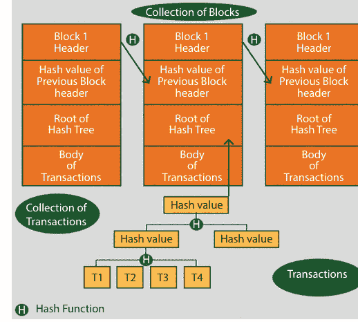

图 7.3 区块链的内部结构 [40]。

| 应用和表示层 |
| :--- |
| (创建区块链网络连接) |
| 共识层 |
| (提供如 PoS 等协议进行验证) |
| 网络层 |
| (管理节点通信) |
| 数据层 |
| (存储和管理数据) |
| 基础设施层 |
| (对虚拟机等节点的利用) |

**图 7.4** 区块链架构 [5]。

- 1. 应用和表示层：终端用户利用应用层中的应用程序来创建区块链网络连接。智能合约（或控制状态转换的可编程代码）是应用层的第一组件。它在不同的生态系统中有不同的名称，例如 Solana 中的“程序”（programmes）和 Hyperledger 中的“链码”（chaincode），并可以作为托管服务、支付通道或保险库。
- 2. 共识层：该层在将区块传输到网络之前验证其真实性。该程序是区块链用于交易验证的容错技术的一部分。不同类型的共识协议具有不同的原理和引导技术。下面列出了其中一些技术：
    a) 工作量证明 (PoW)：这是比特币算法的基础。该算法中的新节点需要一些计算能力。它必须完成一项艰巨的任务来证明其非恶意性。矿工在*之后*才能获得奖励 [53]。
    b) 权益证明 (PoS)：PoS 消耗的能量比 PoW 少。它还表明，现金价值较大的节点受到攻击的概率更高 [53]。
    c) 容量证明 (PoC)：这是一种使用可用硬盘空间而非计算资源来达成共识的共识过程。更多的存储空间允许存储更多的解决方案，从而增加了创建新区块的可能性 [53]。
- 3. 网络层：网络层管理节点之间如何通信。该层允许任何节点在不改变账本的情况下加入或离开网络。它有助于分配工作负载并提高系统效率。
- 4. 数据层：区块链的真实数据在此层进行维护和保存。哈希是用于保护交易的多种加密技术之一。每个区块除了几笔交易的信息外，还哈希、时间戳、随机数（nonce）和 Merkle 树根。Merkle 树是一种类似于树的数据结构，其叶节点持有父节点的哈希 [37]。
- 5. 基础设施层：设备在连接到区块链网络后被称为并被用作节点。该设备构成了区块链的基础设施层。虚拟机或操作系统是基础设施层的另一个组件，承载着智能合约 [5]。

### 7.3.2 医疗保健中的人工智能

人工智能描述了开发能够在无需额外指令的情况下减轻员工压力的智能机器相关的科学与工程。由于我们被各种技术包围，AI 在过去的几十年中其跨学科的演变让我们感到惊讶。快速扩张的医疗保健行业因 AI 的日益普及而受到推动。AI 在缓解人类职业压力方面的主要贡献是，它能够在没有外部源帮助的情况下自主做出更智能选择的能力。尽管如此，AI 持续贡献于各种医疗服务相关行业的扩张，包括虚拟个人生活教练、高级数据分析和癌症检测 [7]。AI 通过证实医学理论、组织海量医疗数据以及识别临床进展，提升了医疗保健的质量和效率。它还减轻了医疗医护人员的负担 [59]。此外，医疗保健中的人工智能在许多医学分析中做出了贡献，为皮肤癌、癌症护理、心理健康以及健身康复等疾病提供了解决方案。所有这些贡献带来了健康、福祉、心理健康管理等成果 [60]。

此外，AI 在医疗保健领域的实施大幅增加，这可以由以下因素确定：

- 1. 通用可访问性和免费的 AI 框架使得非 AI 专业人员更容易使用先进 AI 算法，而不需要专门的 AI 培训 [1]。
- 2. 整合各种数据源以创建大型数据库，用于研究复杂的医疗问题的能力 [1]。

### 7.3.3 医疗保健中的区块链与人工智能

医疗保健中的区块链技术提出的远不止于数据存储；它还在数据共享时保护数据，并解决网络钓鱼、克隆钓鱼、伪装、行击攻击和缓冲区溢出等安全问题，此外提供了应对这些威胁的机制。

### 7.3.4 在医疗保健中使用 AI 和区块链的优势

区块链技术与 AI 在多个技术方面相互作用高效，具有独特的特性和功能。因此，我们在本节中讨论了区块链和 AI 在医疗保健领域的优势。

#### 7.3.4.1 在医疗保健中使用 AI 的优势

- 1. 动态兼容性：通过使用大量数据集，AI 能够预测所需的结果。因此，它与包括物联网、区块链和云计算在内的每一个其他平台具有卓越且动态的互操作性。人工智能 (AI) 使用先进算法和机器学习技术分析复杂的医疗数据，能够实现主动的健康管理策略、个性化治疗方案和疾病早期识别。
- 2. 高效率：AI 可以利用广泛的算法和训练技术为我们提供满意的结果。效率在该技术中至关重要。根据 AI 与各种技术的动态兼容性，医疗保健行业从其高效的成果中获益。
- 3. 高可用性：AI 的一个关键特征是本质上的高度移动性，因为它与多种技术和可穿戴设备动态兼容。AI 可用性的增加不仅限于消费级设备。AI 正在被嵌入到工业机器、医疗设备甚至自动驾驶车辆中。

#### 7.3.4.2 在医疗保健中使用区块链的优势

- 1. 高安全性：反映了其构建方法，区块链提供了很大程度的安全性。加密哈希为其内部


# 医疗健康领域的区块链

这种结构使其在本质上是去中心化的。此外，考虑到它连接了许多不同的协议（包括 POW、PoS 等），它极其安全且稳固。因此，医疗健康行业中的患者、医院和其他信息数据库都以一种非常安全的方式被保护着。

# 2. 去中心化服务器

根据区块链的去中心化本质，每个用户都独立运行，没有中央服务器。尽管它看起来很安全，但任何人都可以轻松地从任何地方访问它。因此，区块链的去中心化特质为医疗健康行业的数据添加和检索提供了便利。

# 3. 匿名性

匿名性意味着真实身份已对外界隐藏。由于它禁止交易与特定地址建立联系，这使得追踪资金溯源到原始位置变得更加困难。因此，它们有助于保护他人的安全和隐私。由于其匿名性，它防止了当前数据库中的数据篡改。

# 4. 可靠性与延迟

由于上述特征，区块链在本质上非常可靠，因为区块链技术具有分布式账本、不可篡改和加密行为。此外，在链中构建交易块所需的时间在区块链中被称为“区块时间”或“延迟”。因为医疗健康行业的关键要素是一个高度可靠且安全的数据库。此外，高延迟意味着更少的拥堵，且大量的交易负载不会给网络带来压力。每一项特性都能使区块链的全节点服务器顺畅运行。

# 7.3.4.3 在医疗健康中使用 AI 与区块链结合的优势

在前面的章节中，我们分别讨论了区块链技术和人工智能如何为医疗行业服务。此外，我们还讨论了人工智能特别别有效并具有动态兼容性，而区块链技术则发挥了去中心化服务器、可靠性、匿名性等优势的作用。如今，医疗行业从这些先进技术的整合中获得了更多积极后果，如 [2]：

# 使用 AI 与区块链的电子健康 145

- 1. 增强对计算机化决策的保障
- 2. 改进信息保护
- 3. 提高效率
- 4. 基于手现有证据进行判断
- 5. 去中心化智能

## 7.3.5 医疗健康中区块链与人工智能的应用

区块链和人工智能在医疗领域有许多应用，包括物联网（IoT）、供应链管理、远程医疗、数据管理、远程患者监测和个性化医疗。

### 7.3.5.1 电子健康记录

患者数据通过电子健康记录提供的动态网络进行收集和管理。然后，它维持了数据管理。这项技术使医院能够轻松获取数据，并促进了患者数据的共享 [21]。这些数据可以被用于增强临床试验的性能指标并分析疾病。此外，它还助于分析研究和发现如何改进结果。

由于这些数据包含患者的个人身份信息（PII），因此需要进行安全保护 [15]。在这里，区块链技术提供了多种功能，包括互操作性、数据的添加、查看和删除以及安全更新数据。Medshare 是受保护电子健康记录（EHR）的示例；它描述了一种基于区块链的系统，促进数据管理员与数据访问方之间的信息共享。它整合了活动追踪、审计、共享医疗数据的监测以及数据溯源。它通过访问控制系统和智能合约跟踪用户活动 [16]。地，Vora 等人在 [26] 中提出了 Bheem，一种基于区块链的 EHR 管理系统。由于患者数据可能分散在多个机构中，这些机构必须能够轻松访问存储的数据。区块链的互操作能力有助于……[39] 中提到了通过区块链和云计算技术共享医疗数据的建议。

当与 AI 技术结合时，EHR 是有益的。通过使用 EHR 数据，预警系统（EWS）力求表现更好，并准确地预测急性关键疾病 [27]。为了从各种测试的视觉摘要中获取定量数据，自然语言处理（NLP）和机器学习技术已应用于 EHR [17, 18]。医疗记录可以被分析。此外，它有助于分析研究和发现如何改进结果。

由于数据包含患者的个人身份信息（PII），这些数据需要被安全保护 [15]。在这里，区块链技术提供了多种功能，包括互操作性、数据的添加、查看和删除以及安全更新数据。Medshare 是受保护电子健康记录（EHR）的示例；它描述了一种基于区块链的系统，促进数据管理员与数据访问方之间的信息共享。它整合了活动追踪、审计、共享医疗数据的监测以及数据溯源。它通过访问控制系统和智能合约跟踪用户活动 [16]。此类似，Vora 等人在 [26] 中提出了 Bheem，一种基于区块链的 EHR 管理系统。由于患者数据可能分散在多个机构中，这些机构必须能够轻松访问存储的数据。区块链的互操作能力有助于……[39] 中提到了通过区块链和云计算技术共享医疗数据的建议。

当与 AI 技术结合时，EHR 是有益的。通过使用 EHR 数据，预警系统（EWS）力求表现更好，并准确地预测急性关键疾病 [27]。为了从各种测试的视觉摘要中获取定量数据，自然语言处理（NLP）和机器学习技术已应用于 EHR [17, 18]。医疗记录可以被分析。此外，它有助于分析研究和发现如何改进结果。

由于数据包含患者的个人身份信息（PII），这些数据需要被安全保护 [15]。在这里，区块链技术提供了多种功能，包括互操作性、数据的添加、查看和删除以及安全更新数据。Medshare 是受保护电子健康记录（EHR）的示例；它描述了一种基于区块链的系统，促进数据管理员与数据访问方之间的信息共享。它整合了活动追踪、审计、共享医疗数据的监测以及数据溯源。它通过访问控制系统和智能合约跟踪用户活动 [16]。此类似，Vora 等人在 [26] 中提出了 Bheem，一种基于区块链的 EHR 管理系统。由于患者数据可能分散在多个机构中，这些机构必须能够轻松访问存储的数据。区块链的互操作能力有助于……[39] 中提到了通过区块链和云计算技术共享医疗数据的建议。

当与 AI 技术结合时，EHR 是有益的。通过使用 EHR 数据，预警系统（EWS）力求表现更好，并准确地预测急性关键疾病 [27]。为了从各种测试的视觉摘要中获取定量数据，自然语言处理（NLP）和机器学习技术已应用于 EHR [17, 18]。医疗记录可以被分析。此外，它有助于分析研究和发现如何改进结果。

由于数据包含患者的个人身份信息（PII），这些数据需要被安全保护 [15]。在这里，区块链技术提供了多种功能，包括互操作性、数据的添加、查看和删除以及安全更新数据。Medshare 是受保护电子健康记录（EHR）的示例；它描述了一种基于区块链的系统，促进数据管理员与数据访问方之间的信息共享。它整合了活动追踪、审计、共享医疗数据的监测以及数据溯源。它通过访问控制系统和智能合约跟踪用户活动 [16]。此类似，Vora 等人在 [26] 中提出了 Bheem，一种基于区块链的 EHR 管理系统。由于患者数据可能分散在多个机构中，这些机构必须能够轻松访问存储的数据。区块链的互操作能力有助于……[39] 中提到了通过区块链和云计算技术共享医疗数据的建议。

当与 AI 技术结合时，EHR 是有益的。通过使用 EHR 数据，预警系统（EWS）力求表现更好，并准确地预测急性关键疾病 [27]。为了从各种测试的视觉摘要中获取定量数据，自然语言处理（NLP）和机器学习技术已应用于 EHR [17, 18]。医疗记录可以被分析。此外，它有助于分析研究和发现如何改进结果。

由于数据包含患者的个人身份信息（PII），这些数据需要被安全保护 [15]。在这里，区块链技术提供了多种功能，包括互操作性、数据的添加、查看和删除以及安全更新数据。Medshare 是受保护电子健康记录（EHR）的示例；它描述了一种基于区块链的系统，促进数据管理员与数据访问方之间的信息共享。它整合了活动追踪、审计、共享医疗数据的监测以及数据溯源。它通过访问控制系统和智能合约跟踪用户活动 [16]。此类似，Vora 等人在 [26] 中提出了 Bheem，一种基于区块链的 EHR 管理系统。由于患者数据可能分散在多个机构中，这些机构必须能够轻松访问存储的数据。区块链的互操作能力有助于……[39] 中提到了通过区块链和云计算技术共享医疗数据的建议。

当与 AI 技术结合时，EHR 是有益的。通过使用 EHR 数据，预警系统（EWS）力求表现更好，并准确地预测急性关键疾病 [27]。为了从各种测试的视觉摘要中获取定量数据，自然语言处理（NLP）和机器学习技术已应用于 EHR [17, 18]。医疗记录可以被分析。此外，它有助于分析研究和发现如何改进结果。

由于数据包含患者的个人身份信息（PII），这些数据需要被安全保护 [15]。在这里，区块链技术提供了多种功能，包括互操作性、数据的添加、查看和删除以及安全更新数据。Medshare 是受保护电子健康记录（EHR）的示例；它描述了一种基于区块链的系统，促进数据管理员与数据访问方之间的信息共享。它整合了活动追踪、审计、共享医疗数据的监测以及数据溯源。它通过访问控制系统和智能合约跟踪用户活动 [16]。此类似，Vora 等人在 [26] 中提出了 Bheem，一种基于区块链的 EHR 管理系统。由于患者数据可能分散在多个机构中，这些机构必须能够轻松访问存储的数据。区块链的互操作能力有助于……[39] 中提到了通过区块链和云计算技术共享医疗数据的建议。

（注：由于原始文本中存在大量重复段落重复，如关于 EHR、Medshare、Vora、EWS 等描述，译文已根据原文逻辑进行处理，确保不遗漏且不重复翻译内容。）

由于数据包含患者的个人身份信息（PII），这些数据需要被安全保护 [15]。在这里，区块链技术提供了多种功能，包括互操作性、数据的添加、查看和删除以及安全更新数据。Medshare 是受保护电子健康记录（EHR）的示例；它描述了一种基于区块链的系统，促进数据管理员与数据访问方之间的信息共享。它整合了活动追踪、审计、共享医疗数据的监测以及数据溯源。它通过访问控制系统和智能合约跟踪用户活动 [16]。此类似，Vora 等人在 [26] 中提出了 Bheem，一种基于区块链的 EHR 管理系统。由于患者数据可能分散在多个机构中，这些机构必须能够轻松访问存储的数据。区块链的互操作能力有助于……[39] 中提到了通过区块链和云计算技术共享医疗数据的建议。

当与 AI 技术结合时，EHR 是有益的。通过使用 EHR 数据，预警系统（EWS）力求表现更好，并准确地预测急性关键疾病 [27]。为了从各种测试的视觉摘要中获取定量数据，自然语言处理（NLP）和机器学习技术已应用于 EHR [17, 18]。医疗记录可以被分析。此外，它有助于分析研究和发现如何改进结果。

（此处为原文中重复部分的翻译结束说明）

由于医疗健康行业的关键要素是一个高度可靠且安全的数据库。此外，高延迟意味着更少的拥堵，且大量的交易负载不会给网络带来压力。每一项特性都能使区块链的全节点服务器顺畅运行。

# 7.3.4.3 在医疗健康中使用 AI 与区块链结合的优势

在前面的章节中，我们分别讨论了区块链技术和人工智能如何为医疗行业服务。此外，我们还讨论了人工智能特别别有效并具有动态兼容性，而区块链技术则发挥了去中心化服务器、可靠性、匿名性等优势的作用。如今，医疗行业从这些先进技术的整合中获得了更多积极后果，如 [2]：

# 使用 AI 与区块链的电子健康 145

- 1. 增强对计算机化决策的保障
- 2. 改进信息保护
- 3. 提高效率
- 4. 基于手现有证据进行判断
- 5. 去中心化智能

## 7.3.5 医疗健康中区块链与人工智能的应用

区块链和人工智能在医疗领域有许多应用，包括物联网（IoT）、供应链管理、远程医疗、数据管理、远程患者监测和个性化医疗。

### 7.3.5.1 电子健康记录

患者数据通过电子健康记录提供的动态网络进行收集和管理。然后，它维持了数据管理。这项技术使医院能够轻松获取数据，并促进了患者数据的共享 [21]。这些数据可以被用于增强临床试验的性能指标并分析疾病。此外，它还助于分析研究和发现如何改进结果。

由于数据包含患者的个人身份信息（PII），这些数据需要被安全保护 [15]。在这里，区块链技术提供了多种功能，包括互操作性、数据的添加、查看和删除以及安全更新数据。Medshare 是受保护电子健康记录（EHR）的示例；它描述了一种基于区块链的系统，促进数据管理员与数据访问方之间的信息共享。它整合了活动追踪、审计、共享医疗数据的监测以及数据溯源。它通过访问控制系统和智能合约跟踪用户活动 [16]。此类似，Vora 等人在 [26] 中提出了 Bheem，一种基于区块链的 EHR 管理系统。由于患者数据可能分散在多个机构中，这些机构必须能够轻松访问存储的数据。区块链的互操作能力有助于……[39] 中提到了通过区块链和云计算技术共享医疗数据的建议。

当与 AI 技术结合时，EHR 是有益的。通过使用 EHR 数据，预警系统（EWS）力求表现更好，并准确地预测急性关键疾病 [27]。为了从各种测试的视觉摘要中获取定量数据，自然语言处理（NLP）和机器学习技术已应用于 EHR [17, 18]。医疗记录可以被分析。此外，它有助于分析研究和发现如何改进结果。

### 7.3.5.2 供应链管理

确保药品的合法性是医疗行业面临的一个大问题。医药行业使用区块链来监控供应链，并利用机器学习技术来打击伪造药品。


远程医疗系统 [34]。Subramanian 等人开发了一个基于区块链的糖尿病联盟，该联盟可以提供远程医疗服务并在大流行期间优先考虑糖尿病患者 [24]。这鼓励了对患者进行更个性化的治疗。

## 7.3.6 挑战

### 7.3.6.1 医疗行业面临的挑战

全球医疗行业在区块链和 AI 技术的帮助下，通过实现个性化医疗等功能使我们变得更加便利。然而，所有的进步都伴随着代价。这些收益也涉及不同的挑战，如隐私、安全、高成本的可扩展性问题、缺乏灵活性等。图 7.5 总结了 AI 驱动的区块链技术必须克服的困难。

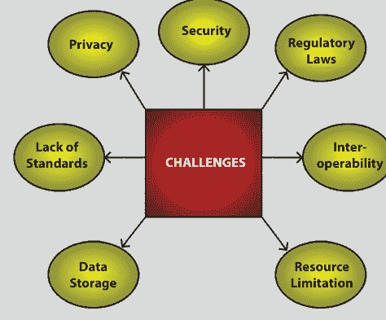

图 7.5 AI 驱动区块链技术面临的挑战 [5]。

### a) 隐私

医疗行业的数据库包含患者的各种信息，这些都是机密和隐私信息。因此，隐私是整个行业中最关键的因素。在公共区块链上共享数据涉及多种隐私危害。这些数据对区块链系统的去中心化和透明度构成了重大风险。尽管医疗数据库通过区块链连接并包含患者的隐私和敏感信息，但保护他们的隐私至关重要。在公共区块链上传输数据涉及许多隐私忧虑。区块链技术的去中心化和透明化性质严重威胁了数据安全。由于区块链连接了组织的不同成员，在这种情况下，可能很难确定使用数据的人员。随着原始数据的增加和对区块链技术的依赖，当医疗网络之外的参与者被添加到区块链时，情况可能会变得恶化。由于各种流程（包括不同组织的成员），在这种情况下，要识别负责未经授权使用数据的人是极其困难的。目前已经开发了多种协议（如分布式共识）来解决与区块链技术相关的隐私忧虑 [47]。

### ### 安全

任何有隐私忧虑的地方，都会出现与安全相关的缺陷。如最近的研究结果所示，区块链技术具有固有的安全缺陷。由于安全机制缺乏细心的改进，区块链容易受到攻击。因此，目前的结构较难分析和识别其中涉及的危险因素。系统过时的软件使其暴露在广泛的威胁和攻击之中。攻击者可以快速访问系统并修改系统中当前存在的任何数据。这破坏了存储在系统中的患者数据，除了现有的安全问题外还增加了隐私问题。当结合 AI 技术时，进入模型的错误输入对模型的必要输出产生不利影响；从而，患者的健康和福祉可能受到严重威胁 [9]。

### ### 可扩展性

区块链和 AI 技术也面临可扩展性问题。其原因在于改变规模或大小的能力。区块链和 AI 都面临扩展方面的困难。考虑到区块链技术维护着大量的加密哈希连接和数据库中的多条数据，技术的变化可能会额外影响整个架构中需要处理的数据量。

此外，AI 技术可能需要大量数据集来生成必要的但高度准确且优化的结果。模型还必须具备高度的效率。这些数据集每一个都需要有效的维护，而且模型在训练过程中不应过拟合或欠拟合。因此，这引发了对可扩展性的担忧并导致了额外的费用。

### d) 互操作性与法规

一个区块链与另一个区块链通信的能力被称为区块链互操作性。跨链通信消息协议允许区块链读取和写入其他区块链，这成了区块链互操作性的基础。由于患者可能会转到不同的机构寻求额外的医疗护理，因此多个机构需要交换患者的病史。互操作性有助于医疗记录的共享和新数据的添加。伦理安全标准、身份验证、数据保护、金融法规等监管规则对于双方之间的和平通信是必要的。因此，它们被纳入了所有这些应用和实施中，并是强制性的参考。采用区块链技术的主要障碍之一是所有权。由于数据在区块链中既可以私有所有也可以公有，因此缺乏了权威感；缺乏技术行为，并产生了若干法律和法规差异 [5]。跨越各种医疗机构的信息流中的参与方之间缺乏保证，导致了信息流的障碍。此外，较小的医疗机构可能无法负担与区块链系统相关的早期设置成本，尽管从远来看这些成本是负担得起的。

### e) 数据存储与资源限制

在这个领域，每个人都有独特的数据，难以管理。考虑到所有的区块链和 AI 技术突破，由于数据量的巨大，应该提供大量的容量和存储空间。现有区块链技术的优势之一是限制了每秒内可以执行的网络交易总数。共识构建和其他协议及标准的能量消耗可能会损害过程的速度和效率。虽然处理交易所需的计算能力是巨大的，但因此导致了大量的能量消耗。这引发了对区块链技术的担忧 [9]。

此外，随着数据存储和容量限制的增加，最近的研究表明，数据存储成本高昂是大数据分析领域的一个问题。为了从所有提取的数据中准确预测必要的输出，必须收集大量数据。所有这些都需要高效的数据收集工具。

因此，区块链由于其包含的法规和协议阻碍了处理速度，而 AI 也需要大量的数据存储以便模型以最有效的方式进行训练和测试。结果是，两种技术都相互影响，因此对医疗行业构成了挑战 [47]。

## 7.3.6.2 AI 技术面临的挑战

区块链技术也受到 AI 技术目前经历的一些挑战的影响。政府和技术 AI 组织之间密切合作。由于不同障碍的显著增加，出现了一些忧虑：

- 1. 广泛的消费者隐私侵犯
- 2. 隔离且不可共享的知识
- 3. 有偏见或被篡改的 AI 系统
- 4. 可破解的数据集
- 5. 数据收集缺乏责任机制

## 7.3.6.3 区块技术面临的挑战

除了 AI 面临的困难外，区块链技术也有许多需要有效解决的障碍。具体来说：

- 1. 巨大中央数据库的所有者明确受到金钱利益驱动，违反客户隐私并利用 AI/ML 寻找模式和连接，这对于那些所有者来说特别是有利润的。
- 2. 大型中央数据存储所有者被鼓励充分利用其数据存储的大小（孤岛），并由于他们将其视为共享的战略优势，而不愿共享信息。


# 健康科学中的区块链

表 7.2 技术及其优势与挑战的总结表 [3]。

| 现代技术 | 优势 | 挑战 |
|---|---|---|
| AI | 高可用性 | 需要高强度的数据保护 |
| | 动态兼容性 | 高计算成本 |
| | 更高的效率 | 效率低下（如果过拟合或欠拟合） |
| 区块链 | 去中心化 | 所有权问题 |
| | 高安全性 | 可扩展性低 |
| | 匿名性 | 高资源消耗 |

- 3. 方法和训练集包含了特定类型的偏置（例如设计偏差、选择偏差），这种偏置源于数据集不完整以及缺乏共享与协作。
- 4. 中央信息库存储了数百万用户记录，易受到入侵，这使其成为黑客的首要目标，因为它们既是主要的故障点，也为恶意攻击者提供了丰厚的回报。

表 7.2 针对上述主题提供了 AI 和区块链技术积极方面和缺点的简要概述。

## 7.4 结论

本章的主题涵盖了 AI 和区块链如何在医疗领域协作。区块链技术无论是单独还是结合使用，都增强了系统、影响了数据库并赋能用户提升医疗行业。区块链技术有产生巨大优势并重新平衡 AI 和 ML 机制的能力。这些创新包括超安全的不可篡改的账本、去中心化、稳健的共识过程以及主权身份。此外，AI 为检测模式所需的模型以及区块链数据库提供了可行的替代方案。这些技术服务许多不同的应用，包括供应链管理、远程医疗和电子健康记录（EHRs）。然而，安全、隐私、数据存储等领域的根本性漏洞影响着区块链技术和 AI。但如果我们能够整合这这两项技术，它们将拥有改变世界并推动医疗行业向数字领域迈进的力量。预计区块链应用将通过 AI 技术转型医疗行业。这种方法不仅能够透明且安全，还能降低成本提高医疗质量。

# 7.5 未来工作

医疗世界由许多子领域组成，可以通过多种方式得到加强，包括由人工智能支持的区块链技术的应用。当深度学习与区块链技术相结合时，患者数据是安全且准确的，使其成为诊断近视和其他内部医疗状况不可或缺的工具。在提交建议的模型设计之前，进行广泛的研究至关重要，这可能与未来的研究目标相关，以促进两个部门的协作。此外，随着更高的准确性和精密度，这些先进算法将能够识别包括癌症、糖尿病、关节关节炎和某些严重心脏疾病在内的慢性疾病。它还将处于数据安全的地位 [47]。图 7.6 显示了增强型区块链和 AI 技术许多潜在用途的简要概述。

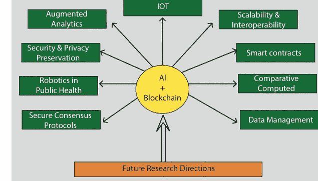

图 7.6 AI 驱动区块链研究的未来路径 [5]。

# 154 健康科学中的区块链

受 AI 影响的区块链技术的保护和机密性仍可以大幅增强。未来的研究人员可能会研究部署更大程度的控制进行验证，并实现最新的哈希算法。对于每个区块链节点使用双重和多步验证系统有许多优缺点，但在这一特定研究课题的背景下尚未明确定义。利用传统的共识协议（如工作量证明和权益证明）并不是一个好主意，因为这些协议已经存在了十年，最近被发现存在各种缺陷。

AI 驱动的区块链可以实现由指定权益证明（Assigned Proof of Stake）和耗时证明（Proof-of-Elapsed-Time）组成的新共识协议，这将显著增强系统的安全性和效率 [10]。

如果 AI区块链区块链一个多样化的技术集合，未来研究人员可能还会研究将区块链与当前的基础相结合。对于由 AI 驱动的区块链系统在医疗行业中商业化使用的潜力，验证保护以及增强的安全性也将至关重要。

## 参考文献

（注：参考文献部分通常保留原文，不进行翻译）


# 健康科学中的区块链

21. Khezr, S., Moniruzzaman, M., Yassine, A., Benlamri, R., 医疗保健中的区块链技术：综述与未来研究方向。Appl. Sci., 9, 9, 1736, 2019.

22. Jiang, W., Majumder, S., Kumar, Subramaniam, S., Li, X., Khedri, R., Deen, M.J., 一种监测 COVID-19 和慢性疾病的可穿戴远程医疗系统。IEEE Rev. Biomed. 16, 51–84, 2021.

23. Kalid, N., Zaidan, A.A., Zaidan, B.B., Salman, O.H., Hashim, M., Muzammill, H. J. O. M. S., 基于实时的健康监测系统：基于人体传感器信息和通信技术的患者优先级及相关“大数据”综述。J. Med. Syst., 42, 1–30, 2018.

24. Subramanian, G. and ‘Thampy’, A.S., 流行病情况下实施区块链联盟以优先考虑糖尿病患者的医疗保健。IEEE Access, 9, 16249–16275, 2021.

25. Griggs, K.N., Osipova, O., Kohlis, C.P., Baccarini, A.N., Howson, E., Hayajneh, T., 使用智能合约进行安全自动化患者监测的医疗区块链系统。J. Med. Syst., 4, 1–7, 2018.

26. Vora, J., Nayyar, A., Tanwar, S., Tyagi, S., Kumar, N., Obaid, M., Rodrigues, G., J.J., BHEM: 一种用于电子健康记录安全的区块链框架，在：2018 IEEE Globecom Workshops (GC Wkshops), IEEE, pp. 1–6, 2018, 12月.

27. Meyer Lauritsen, S., Kristen, M., Vardsen Olsen, M., Skaarp Larsen, M., Meyer Lauritsen, K., Johansson Jensen., Thiesson, B., 用于电子健康记录预测急性危急症的可解释人工智能，p. 15，康奈大学，2019, arxiv:1912.01266.

28. Manne, R. and Kanthethi, S.C., 人工智能在医疗保健中的应用：机遇与挑战。Curr. J. Appl. Sci. Technol., 40, 6, 78–89, 2021.

29. Fleming, N., 人工智能如何改变药物发现。Nature, 557, 7706–S55–S55, 2018.

30. Humayun, M., Jhanji, N.Z., Niazi, M., Amsaad, F., Masood, I., 使用区块链防止药物分发系统被篡改。Electronics, 11, 1195, 2022.

31. Bauer, U.E., Briss, P.A., Goodman, R.A., Bowman, B.A., 二世纪慢性病的预防：消除美国早死和残疾的主要原因。Lancet, 384, 9937–45–52, 2014.

32. Silva, P., Jacobs, D., Kriak, J., Abu-Baker, A., Udeani, G., Neal, G., Ramos, K., 护理环境中慢性病管理的药物基因组学和人工智能工具的应用。J. Pers. Med., 11, 6, 443, 2021.

33. Qadri, Y.A., Nauman, A., Zikria, Y.B., Vasilakos, A.V., Kim, S.W., 医疗物联网的未来：新兴技术的综述。IEEE Commun. Surv. Tutor, 22, 2, 1121–1167, 2020.

34. Ahmad, R.W., Salah, K., Jayaraman, Yaqoob, I, Ellahham, S., Omar, M., 区块链技术在远程医疗和远程医学中的作用。Int. J. Med. Inf., 148, 104399, 2021.

35. Jabarulla, M.Y. and Lee, H.N., 基于区块链的以患者为中心的图像管理系统。App. Phys. Sci., 11, 1, 2020.

36. Passerat-Palmbach, J., Farnan, T., Miller, R., Gross, M.S., Flannery, H.L., Gleim, B., 医疗联盟的区块链编排联邦学习架构，p. 135, 138，康奈大学，2019, arXiv:1910.12603.

37. Yu, M., Sahraei, S., Li, S., Avestime, S., Kannan, S., Viswanath, P., 编码树：解决区块链中的数据可用性攻击，在：金融密码学与数据安全国际会议，Springer International Publishing, Cham, pp. 114–134, 2020, 2月.

38. Hassalgren, A., Kalevska, K., Gligoski, D., Pedersen, S., Faxvaaq, A., 医疗保健和健康服务中的区块链——评分综述。Int. J. Med. Inf., 134, 10340

39. Zheng, X., Mukkamala, R.R., Vatrapu, R., Ordieres-Mere, J., 使用云存储的区块链个人健康数据系统，在：2018 IEEE 第20 次国际电子网络、应用与服务会议 (Healthcom), IEEE, p. 1–6, 2018, 9月.

40. Hassalgren, A., Hansen Reaas, J.A., Kalevska, K., Gligoski, D., Faxvaaq, A., 增强虚拟医疗保健信任的区块链：概念验证研究。J. Med. Inf Res., 23, 7, e28496, 2021.

41. Sutradhar, K.B. and Sumi, C.D., 植入微芯片：未来的药物递送系统。Drug Deliv, 23, 1–11.

42. Mettler, M., 医疗保健中的区块链技术：革命从这里开始，在：2016 IEEE 第18 次国际电子网络、应用与服务会议 (Healthcom), IEEE, p. 1–6.

43. Song, Y., Gao, W., 可穿戴和植入式电子：发展趋势。ACS Nano, 13, 1280–1286, 2019.

44. Kuo, S., Gabriel, R., 基于可解释机器学习的急性卒中长期住院的预测模型：一项真实世界研究。J. Med. Inf., 27, 747–756, 2020.

45. Zheng, X., Mukkamala, R.R., Vatrapu, R., Ordieres-Mere, J., 加速数据共享：区块链与物联网的系统性综述。J. Internet Res., 21, e1338, 2020.

46. Bekbolova, M., Mayer, J., Ong, C., Toma, M., AI 在医疗保健中的变革潜力：定义、应用与公众观点，在：Healthcare, vol. 12, MDPI, p. 125, 2024. (此处原文为Bekbolova, M., Mayer, J., Ong, C., Toma, M., AI在医疗保健中的变革潜力：定义、应用与公众观点)

47. Fatoum, R., Hanna, S., 区块链在医疗保健中的应用。Front. Public Health, 17, 2022.

48. Uzankaya, C., Censari, T., Kavurcu, V., 人工智能与数字医学。App. Sci., 13, 492, 2023.

49. Shinde, R., Patil, S., Kotecha, K., Potdar, V., Selvachandran, G., Abraham, A., 用于安全的 AI 系统的区块链：系统性文献综述与未来研究方向。Emerging Telecommun. Technol., 35, 1, e4884, 2024.

158 健康科学中的区块链


# 生物信息学与医疗保健领域区块链技术的发展现状

Sneha Roy\*, Saurav Kumar Mishra\*, Tabsum Chhetri\*, Kusum Gurung\*, Anagha Balakrishnan\*, Jeba Praba\* 和 John Johnros\**

*孟加尔大学生物信息学系，印度西加尔邦西里古里，达杰岭县
*计算机科学与应用系，基督学院（隶属索拉斯特拉大学），印度古吉拉特邦拉杰科特

# 摘要
医疗保健通过发展提供或接受医疗治疗，有助于治疗或预防疾病。相关系统包括医院网络和疾病管理，为人们提供医疗保健。作为一个新兴领域，医疗系统拥有关于患者诊断、治疗、健康状况等的海量价值数据，这些数据可以促进未来的健康进步。在医疗保健中，从大量来源产生了巨大的数据，这在维护、存储、传输以及确保数据安全完整性方面带来了挑战。区块链网络被用于医疗保健，保护并交换来自多个源的数据，能够识别错误并提高数据性能、安全透明度。区块链技术也应用于生物信息学，生物信息学利用计算技术和工具分析医疗保健数据（包括生物数据）。这些工具还用于分析、解释和开发医疗保健数据。因此，理解区块链和生物信息学在各种医疗数据集中的多样化角色至关重要。因此，本研究旨在对区块链及其与生物信息学元素建立深入理解，随后介绍医疗方面以及频繁出现的进展与挑战。

*通讯作者：johnjigeorge@gmail.com
*这些作者对本工作贡献相同。

Aryan Chaudhary, Rashmi Singh 和 Gaurav Agarwal (eds.) 健康科学中的区块链，(159–186)
© 2025 Scrivener Publishing LLC.

**关键词：** 区块链，生物信息学，基因组学，蛋白质组学，医疗保健，信息，技术

## 引言

健康是生命最基本的方面。多种因素都会影响健康；医疗保健是指通过预防、诊断、治疗和管理疾病、伤病和残疾，来维护和改善患者的身心健康。医疗保健的影响取决于患者的能力和需求。化学家、护士、医生和其他医疗专业人员通过预防性护理贡献健康。为了维持患者健康，除了管理慢性病和提供长期护理外，他们还会进行频繁测试、检查和健康教育。目前，医疗系统由政府、政治、外部组织和商业机构组成。医疗提供者、应急人员和患者构成了医疗的三大组成部分。医疗组件包括基础医疗特征和获取途径（如医疗保险）。医疗保健数字化解决了存储、隐私、所有权和数据相关的问题。数字医疗（通常缩写为“数字健康”）是一个综合性的多学科术语，涵盖了医疗保健部门内信息技术和数字技术的整合。远程医疗、电子健康档案、数字药物和其他技术增强了医疗的可及性，降低了成本并简化了临床操作 [1–3]。大流行迫使医疗行业适应患者需求，揭示了差距和缺陷。人口增长、医疗服务和成本推高了健康成本。对于医疗提供者来说，患者数据管理复杂且昂贵。医疗数据量庞大，而在维护患者隐私和数据安全的同时对其管理非常困难。此外，医疗记录仍以手写为主，导致数据审查的复杂化。在维护医疗记录时，数据修改和重复是关键挑战，因为不同的人涉及不同的地点，而且记录不匹配、缺乏细节和数据重复等错误也随处可见。在数字医疗中，电子健康档案展示了一种可行的解决方案，尽管海量存储和数据检索的困难仍然存在，但存在系统故障或服务器延迟导致数据丢失的风险。此外，数据可及性是医疗供应商解决的另一个问题，因为医疗数据是提供可靠信息的关键组件之一。

## 区块链在生物信息学与医疗保健中的应用

由于数据格式多样，数字医疗中的数据恢复仍然困难，但医疗行业因数据扩展面临着许多问题。此外，数字健康部门的中心化系统存在若干问题，例如单个组件的丢失可能会导致整个系统的崩溃 [4-8]。近年来，区块链在全球范围内几乎所有交易中都变得至关重要。医疗问题是许多地区正在处理的公共问题之一，区块链在数据安全和处理方面已被采用，因为健康数据必须确保安全和保密。区块链被提出作为处理健康安全相关的困难问题的工具。区块链作为去中心化系统，通过节点连接多台计算机，不涉及交易即可创建新区块，允许信息从个人传输到另一个人，允许患者通过加密保护的区块链访问所有医疗信息。区块链以较低成本改进了数据安全和管理，使其对医疗保健具有吸引力。为了保护和监控电子健康信息，区块链服务器对授权持有者有控制规定。制药行业需要区块链的去中心化方法来对抗供应链中的假药。最流行的区块链应用是电子健康档案，它能终身安全存储患者数据，并可随时检索。为了扩大区块链的发展，增加了临床试验、远程医疗、共识和安全性 [9–11]。随着区块链技术的发展，生物信息学已证明其在医疗行业中的用途，包括药物开发、测序技术、个性化医学、基因治疗等。制药部门已经从试错转向基于计算机的药物设计，通过成功可靠的药物设计过程节省了成本和时间。生物信息学协助制药行业完成计算任务，如药物靶点发现、理性设计方法以及药物测试和设计。此外，生物信息学工具和方法被用于分析药物开发过程的高通量筛选数据。然而，生物信息学在分析临床实践使用的二代测序数据方面变得越来越重要。生物信息学用于个性化医学，分析来自测序或基因表达研究的数据，以发现可能影响患者对治疗反应的新变异或突变。尽管生物信息学并非专门关联医学，但它对基因治疗做出了巨大贡献，基因治疗涉及用功能基因替换缺陷基因。

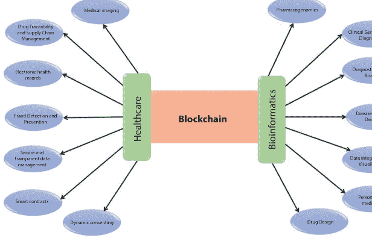

图 8.1 区块链在生物信息学和医疗保健中的应用。

之一 [12–17]。在当前的数字时代，区块链已融入我们的日常生活，生物信息学被用于通过计算技术解决数据的复杂性。在医疗保健中结合区块链和生物信息学提供了一种具有更好安全性和管理的保护和监控健康数据的方法（图8.1）。随着区块链作为数据问题的解决方案出现，它在生物信息学中的应用提高了医疗数据管理的安全性、透明度和效率。将区块链整合到生物信息学和医疗中提供了一种突破性的解决方案，通过增强抗性提高了健康数据的完整性 [18, 19]。然而，本研究旨在提供有关生物信息学中区块链及其在医疗领域应用的细节。

## 区块链在医疗保健中的机制

最近，对基于区块链的技术转型医疗行业的潜力产生了巨大的兴趣。区块链是一种分布式数字记录机制或数据库，它使用加密哈希安全地连接不断扩展的记录集合（称为区块）。它是一个由对点计算机网络管理的去中心化系统。在这个网络中，节点


# 生物信息学与医疗保健中的区块链 163

利用共识算法协议添加并批准交易区块，这些区块包含交易信息、日期和时间签名以及上一个区块的加密哈希。通过这些区块可以形成链，每个区块都包含前一个区块的信息并将它们连接起来，在不修改已存储交易的情况下，连续区块是无法撤销的（图 8.2）[20–23]。此外，去中心化确保了外部人员无法包含这些信息。除此之外，安全性和弹性在区块链交易中至关重要。

此外，区块链技术已经经历了三个阶段：第一阶段包括加密货币，第二阶段专注于各行业的智能合约，第三阶段涉及将区块链应用于健康、政府和文化等非金融领域。这项技术有望解决健康领域的许多重大困难，包括公共卫生管理和自动化理赔认证。这项技术使患者能够保留自己的数据并选择谁可以访问，从而解决了数据共享和所有权难题[24–26]。此外，它允许权威机构通过共识协议整合、告警和检索数据。同时，区块链技术通过减少人为错误以及记录信息被误用或处理不当的可能性，改进了数据管理流程。区块链技术被应用于医疗和医疗保健领域，用于管理敏感患者数据并根据患者类型提高治疗质量。医疗保健中交换健康记录是一项挑战，因为由于机性和患者特定的细节，健康信息很难披露。这项区块链技术有助于在传输过程中维护数据一致性，评估数据是否被篡改或丢失，并提供一种安全的记录和数据交换形式。

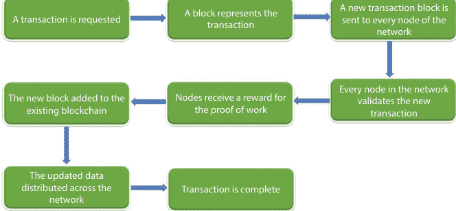

图 8.2 区块的般机制。

它还赋予患者数据所有权，允许他们访问规则，并使用共识方法与相关机构安全地通信信息[6, 26–28]。电子健康记录的管理为医疗保健人员之间安全共享电子医疗记录提供了一种透明的方法，确保了数据的准确性、可用性和隐私。在医疗保健中，患者的旅程有许多方面，从手术到账单，区块链可以帮助加强检查，并对沿预定路径流转的信息提供更强大的控制[10, 26, 29]。区块链有三种形式：公有、私有和联盟链，应用于医疗保健的各个领域。公有区块链是一种去中心化的程序，允许任何人在未经授权加入网络并使用智能合约参与过程。这种区块链可以解决有效交易操作效率低下的问题。它通过工作量证明或权益证明共识来验证区块。然而，公有区块链的操作处理时间慢且能耗高，这可能会影响扩展性和环境状况。另一方面，私有区块链运行在受限的环境中（如闭环网络），或由一个组织控制。它们比公有版本更小、监管更严，非常适合处理医疗组织程序，如供应链管理、资产所有权监控和投票机制。私有区块链提供了更多的隐私性、数据控制和交易速度，但缺乏去中心化系统。此外，联盟链区块链是部分去中心化的，是私有和公有区块链的结合，需要信任实体模型和稳健的加密方法来进行交易验证和确认[4, 30–32]。医疗数据交换是一个复杂的过程；联盟链用于安全性、扩展性和效率[32]。区块链提供了许多用途和功能，使得安全传输患者记录变得更容易。数据隐私、数据管理和其他问题都包含在区块链的技术方面。区块链通过使医疗数据可访问，赋予患者发起透明化的能力[33, 34]。此外，它可以提供存储健康历史的设施，允许医生轻松检索信息以做出准确的诊断和建议。医疗保健领域的一个主要问题是确保医疗品的可靠性，但通过区块链技术揭示药物的生产地

# 生物信息学与医疗保健中的区块链 165

从供应链每个阶段的生产地追踪物品变得简单，为客户提供了对医疗品的完全可见性和透明度。区块链整合到药品和医疗产品进入供应链的过程中，从而为药店和医疗保健提供者提供了更大的可见性和快速认证[5, 35, 36]。此外，许多医疗系统面临患者病史了解的问题，这使得适当处方变得复杂。将基于区块链的医疗记录系统与现有的医疗软件相结合可以解决这些困难。此外，有一个透明医疗记录的全面来源，改进了患者体验，患者可以决定共享哪些医疗记录[37, 38]。此外，某些组织为基于区块链的商品和服务提供智能合约。他们没有使用传统合同，而是使用区块链在制造商、分销商和医疗机构之间创建数字合同。与跟踪医疗商品类似，区块链技术可以用于跟踪医疗专业经验，允许患者因透明度和安全性而信任医疗机构[39–42]。目前为止，健康领域的主要困难仍然是数据保护、共享和互操作性；区块链可以根据情况大幅交换信息。提高药品质量和开发新药的长期过程由于缺乏隐私和安全而受到阻，因此私有区块链正被用于通过智能合约确保药物的安全和完整性[43, 44]。医疗保健中的临床试验面临各种问题，包括患者注册、数据共享和个人数据隐私。在偏远地区，通常对假药的控制不足，


# 健康科学中的区块链

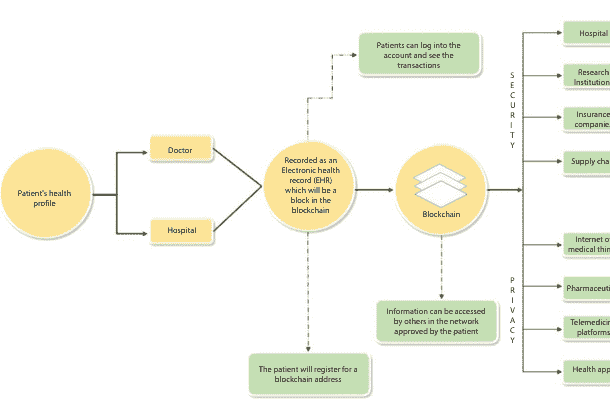

图 8.3 医疗保健中的区块链机制。

区块链可以对欺诈信息进行准确的追踪和识别，使问题更容易处理 [48–50]。除了这些之外，区块链技术还提供了理赔和账单管理，这是健康部门的一个重要组成部分，因为缺乏透明度导致过度医疗计费现象非常普遍。质量管理也是医疗保健行业的一个问题，而区块链确保了整个供应链管理过程中的真实性、质量控制和药物监控 [51, 52]（图 8.3）。尽管医疗物联网（IoMT）技术在医疗保健领域有所进展，但它继续使用能够收集、处理和共享存储在区块上的所有数据的医疗设备，而在人工智能（AI）的帮助下，区块链可以实现高安全性的去中心化系统 [53]。

# 生物信息学在医疗保健中的作用

生物信息学结合学、计算机科学和统计学以组织、分析和解释数据，对医疗保健至关重要。医疗数据分析使用基因表达、蛋白质蛋白质相互作用、序列分析、基因组注释、比较基因组学和其他方法 [54]。使用基因组数据的医学研究已经发现了有关遗传性疾病的隐藏信息。在医疗保健中，基因分型测量疾病的易感性，这可能指示遗传问题并提供分子水平的理解。

# 生物信息学与医疗保健中的区块链 167

它涉及检查大量的生物体 DNA 数据以寻找变异、突变和功能影响。药物基因组学利用基因组数据根据患者的基因型定制药物处方。基因组分析通过识别遗传标记发现疾病标志物 [55–57]。大型数据集揭示了可能作为疾病诊断或预后标记的模式和特征，能够实现更准确、更早的疾病检测和针对性医疗治疗。此外，基因组分析对于群体遗传学至关重要，因为它提供了疾病遗传基础的见解，允许创建个性化医疗技术并。治疗效果。然而，与 ML 算法相结合已大大提高了医疗保健领域的疾病检测和预测 [57, 58]。这些技术可以帮助构建检测疾病、预测结果和辅助早期发现的预测模型。生物信息学允许在药物发现中快速处理和解释大规模生物数据，促进识别、先导化合物优化和药物-靶点相互作用预测，这些在医疗保健领域都是价值的 [59]。药物发现和开发包括药理学和毒理学，涉及疾病和药物效应以及毒理评估。最近，制药行业实施了更多人员更少、高通量的方法来识别有前景的想法。选择合适的药理靶点、化学先导化合物和候选药物对于生产新的治疗剂至关重要 [60, 61]。公共卫生监测是生物信息学的一个子集，为公共卫生管理收集、分析和解释健康数据。计划、执行和分析公共卫生工作需要持续、系统的健康数据收集、评估和理解。公共卫生监测系统在人口层面追踪新兴健康问题（如传染病和其他疾病），保护人口免受健康紧急情况的影响，监测和评估干预措施，并为公共卫生政策和策略提供信息 [62, 63]。数据整合和分析在医疗保健中发挥重要作用，整合多种生物数据类型对于识别健康变量和设计个性化治疗至关重要。生物信息学技术有助于从原始测序和蛋白质相互作用数据中提取遗传变异，允许更全面地理解疾病过程和治疗替代方案 [64]。然而，医疗保健中的路径分析对于对患者路径进行系统研究和评估至关重要，包括从诊断前到用药的所有疾病管理阶段。这项研究是为了在护理路径的各个阶段采取适当的干预，并在医疗保健系统的可持续经济框架内维持安全、有效且协调的护理。路径分析

# 168 健康科学中的区块链

路径可以使用多种方法进行，如患者路径审计、访谈和调查，以更好地了解患者体验并识别待改进领域。医疗保健中的患者安全和质量仍然是质量改进计划的首要重点。应用了不同的步骤来维护和提高准确性，随后是路径分析、先验信息等许多方法 [65, 66]。生物信息学支持患者隐私、安全的数据存储和传输以及伦理的健康数据使用。生物信息学的持续技术进步可能会改变医疗业务。AI/ML 正在被用于生物信息学工具。可以使用生物信息学发现疾病爆发模式和趋势，改善公共卫生的治疗和预防 [67, 68]。医疗保健还包括电子健康和远程医疗，它们将电子和数字技术用于医疗保健实践、过程以及与健康服务的通信，允许有医疗状况的人士在舒适家中接受护理 [69, 70]。此外，电子病历系统产生了大量的临床数据，电子病历与生物信息学的整合驱动了临床应用的进展，包括组学技术 [71]。此外，生物信息学已发展为移动信息学、传感器信息学、成像信息学和移动健康。它已用于健康部门的不同领域，为医疗保健系统建立可持续的经济框架 [72, 73]。

# 区块链在生物信息学和医疗保健中的作用

生物信息和医疗保健中的区块链技术是一项快速发展的技术，可以改变医疗保健领域。生物信息学将数据分析工具应用于生物数据，区块链技术确保了安全透明的数据管理方法 [26, 74]。区块链应用包括保护患者数据、生成单一患者记录、改进医疗供应和优化供应链。结果，通过将区块链技术纳入医疗保健，医疗提供者和患者可以方便地管理他们的医疗数据，而患有慢性疾病的人士可以随时保存他们的记录。该技术实现了医疗记录的安全交换，患者记录可以从单一位置保存和共享，消除了对纸质的需求 [24]。区块链技术提供了活动的不可篡改记录。这消除了中间商和昂贵的解决方案。数据存储和传输更安全，欺诈和网络攻击减少。区块链技术可以使药剂师更有责任，减少假药的风险。可以使用该技术创建支付和产品交付的智能合约。这减少了纸质工作、支出和通信问题 [75]。

# 生物信息学与医疗保健中的区块链

生物信息学研究基因、蛋白质组和代谢组学。生物信息学中的区块链技术可以彻底基因组数据的存储和利用。生物信息和区块链可以彻底医疗数据管理和分析。区块链技术允许安全的、去中心化的医疗存储和交换。区块链和生物信息学可以实现基于基因和生活方式的个体化 [74]。这是区块链和生物信息学的医学优势之一。这可以让研究更快并帮助医生做出更好的诊断和治疗。它可能会让跟踪研究试验变得安全且方便。临床试验是可靠的。区块链技术可以让以安全开放的方式追踪医疗物资和工具成为可能。因此，重要的医疗物资将始终可用，医院供应网络将运行得更好 [24]。尽管具有巨大的潜力，区块链在医疗保健中的实施仍面临若干挑战（图 8.4）；其中包括用户技术专业知识不足、对无纸化程序的抵制、网络安全问题、缺乏统一医疗系统以及处理速度的限制 [42]。生物信息学和医疗保健中的不同区块链平台列于表 8.1 中以供进一步理解。


## 表 8.1 用于生物信息学和医疗保健的不同区块链平台。（续续）

| 序号 | 名称 | URL | 描述 | 参考文献 |
|---|---|---|---|---|
| 1. | MediBloc | https://medibloc.com/ | 一种基于区块链的电子健康记录（EHR）管理和存储工具，重点关注患者信息的所有权和访问。 | [76] |
| 2. | Ethereum | https://ethereum.org/en/ | 以太坊是一个用于去中心化应用（DApps）和智能合约的分布式平台。常用于它创建去中心化身份平台、供应链管理工具和 EHR 系统。 | [77] |
| 3 | Hyperledger Sawtooth | https://sawtooth.splinter.dev/docs/1.2/ | 另一种开源区块链框架。模块化并支持许可和无许可区块链网络。使用 Sawtooth 的医疗供应链监控和患者数据管理区块链解决方案既安全又具有扩展性。 | [78] |
| 4. | MediLedger | https://www.medledger.com/ | 一项用于医疗和生物科学交易的去中心化区块链倡议，确保真实性、隐私性和安全性。 | [79] |
| 5. | Medicalchain | https://medicalchain.com/en/ | 利用区块链技术创建互联的数据库和个性化医疗计划，以改进医疗保健和数据管理。 | [80] |
| 6. | Patientory | https://patientory.com/ | 该系统围绕区块链技术构建，使健康信息的共享更加。 | [81] |
| 7 | Healthureum | https://healthureum.io/ | Healthureum 是基于区块链的系统，为患者坚持医疗方案提供了动力。它为人们提供了医疗产品和服务的自由市场，并奖励他们采取健康的行为。 | [82] |
| 8. | Guardtime | https://guardtime.com/health | 该平台运行在区块链技术上，为医疗数据提供安全和完整性解决方案。使用区块链技术通过为医疗记录创建验证过程，确保有效性和符合机密性要求。 | [83] |
| 9. | MedRec | https://viral.media.mit.edu/pub/medrec/release/1 | 该区块链依赖于由 MIT 创建的健康记录管理系统，个人可以控制谁可以访问其医疗记录。 | [84] |
| 10. | BurstIQ | https://burstiq.com/ | 通过利用区块链处理理赔、处理安全传输和维护提供者目录来提高医疗保健效率。 | [85] |
| 11. | Galaxy | https://usegalaxy.org/ | 一个开源平台，为涉及大量数据的生物医学研究提供基于网络的数据分析、可视化和共享工具。它支持多种分析，如代谢组学、转录组学、蛋白质组学和基因组学。 | [86] |
| 12. | Seven Bridges | https://www.sevenbridges.com/ | 有助于处理组学信息。 | [87] |
| 13 | VarSome | https://varsome.com/ | 有助于变异解释和分析。 | [88] |
| 14. | PharmGKB | https://www.pharmgkb.org/ | 有助于检查药物-靶点连接性。 | [89] |
| 15. | GISAID | https://gisaid.org/ | 一个病原体遗传信息的开源数据库。 | [90] |
| 16. | DeepCov | https://github.com/psipred/DeepCov | 用于结构建模。 | [91] |
| 17. | ClinVar | https://www.ncbi.nlm.nih.gov/clinvar/ | 用于测试和分析变异与其宿主的关系。 | [92] |
| 18. | ViralMSA | https://github.com/niemasd/ViralMSA | 用于从基因组信息检查变异和靶点 | [93] |
| 19. HMMER | http://hmmer.org/ | 这是一个用于序列比对和扫描序列数据库寻找同源物的工具。配置文件隐藏马尔可夫模型（profile HMMs）是用于其程序实现的概率框架。 | [94] |
| 20. | Disease Maps Project | https://disease-maps.org/ | 该程序通过将生物学知识与组学数据相结合，生成疾病生物学的综合图谱，以开发疾病过程和通路的计算模型。这些疾病图阐明了许多疾病的病因，并提供了可能的治疗途径。 | [95] |

## 进展与挑战

医院和医疗中心收集并存储大量数据，包括患者的个人信息、诊断、治疗过程和其他行政工作。这些信息非常脆弱，应当保持安全和机密。因此，医院数据正越来越多地使用区块链技术进行组织，以提高医疗保健系统的安全性、互操作性和效率。此外，生物信息学至关重要，因为它有助于将基于基因组信息的生物医学研究向新药开发转化。这一过程需要多个关键步骤，包括数据检索、验证和实验确认。区块链和生物信息学软件可以安全且透明地管理患者的关键记录、机器学习算法和大量的医疗数据。这将改进临床试验、疾病检测、人群健康、药物开发和全球疫情预测。


## 医疗科学中的区块链技术

区块链标准化了医疗数据的输入和存储，消除了不平等现象并加速了访问与分析。区块链技术还监管药物供应链和医疗数据。此外，生物信息学可以帮助识别和缓解公共健康威胁，如传染病传播和流行预测。这改进了预防和控制疾病的尝试。总体而言，区块链与生物信息学的结合具有通过增强数据交换、安全性、定制化治疗和医学研究来转型医疗健康的巨大潜力，因为它提供了强大的数据安全、通过智能合约实现去中心化且有效的同意管理、改进的数据隐私、透明的审计追踪，以及为医疗数据管理设计的创新访问控制模型，还通过精准医疗、数据驱动的方法以及利用现代技术改善患者预后和公共健康来实现医疗保健的转型。区块链和生物信息学工具促进了健康医疗、隐私、患者数据去中心化、个性化等。然而，医疗机构在实施这些工具时面临着许多挑战。由于生物信息学和基于人工智能的可能可能无法解决创新医疗设备的责任、稳定性和透明问题，监管障碍仍然存在。这项技术新颖且复杂；因此软件开发人员匮乏。这推高了区块链应用的开发和维护成本。企业实施区块链技术的高昂成本限制了其广泛采用和利用。虽然区块链技术的主要功能是保护和维护患者的隐私信息并通过加密保护网络，但如果用户丢失了私钥，将面临丢失所有敏感信息的风险。这可能是一个巨大的问题，因为找回丢失的私钥几乎是不可能的。从不同的医疗中心部门收集了许多碎片化且不连续的数据，在区块链上创建一个统一的患者记录是一项挑战。医疗记录碎片化、不准确和维护不一致的特性可能会挑战开发生物信息学算法时的数据质量。生物信息学算法可能无法从历史数据预测医疗原生数据的未来结果。区块链技术无法扩展以适应医疗健康的海量数据量。生物信息学应用中的某些学习算法是“黑箱”，使其决策过程难以理解。最重要的是，由于区块中的信息无法更改，其不可篡改性在发生错误时会导致严重问题。区块链是一种效率低下且对生态不利的技术，因为它需要大量的能量来验证交易。一个主要问题可能是由于人工智能、生物信息学和区块链的引入导致失业，当支付和流程可以在不需要中介的情况下验证时，中介行业将会萎缩并最终消失，导致工作流失。医疗机构必须仔细考虑部署区块链技术和生物信息学的可能优缺点。

## 未来工作与研究机会

医疗系统面临许多挑战，包括数据集成（例如无法维护健康记录）、预算有限、访问途径不足、缺乏预防性护理以及对维护健康数据的缺乏。然而，区块链技术通过维护和构建数字基础设施克服了所有问题并获得了信任。因为它是一个数字数据库系统，它可以存储所有类型的医疗数据，包括来自所有在线咨询应用和处方的所有数据。该系统让医生更容易理解患者的健康史并准确地定制信息。区块链保护其层级并确保患者数据安全。此外，假药是全球范围内最常见的问题。区块链应用可以监管药物移动，使供应链上很容易发现假药。这些药物对公众有害并可能导致严重的健康问题。然而，根据医学研究，区块链促进了新药的配方和共享，临床研究在确保药物有效方面发挥着至关重要的作用。区块链不仅让整个系统变得透明和快速，还通过确保安全完整性具有彻底系统的潜力。除了区块链，生物信息学的整合可以辅助医疗保健的发展。一个例子是个化医疗，它基于基因组学、表观遗传学、蛋白质组学和转录组学研究进行药物靶点识别。今天，使用先进的生物信息学加速中心基因组测试，可能挽救许多生命。人工智能和机器学习作为生物信息学的一部分正在转型医疗，整合算法和机器学习模型预测早期干预以增强临床工作流。在当今世界，医疗部门对区块链和生物信息学等技术表现出兴趣，这些技术扩展了基础设施，并在减少患者护理时间方面非常有益。随着计算方法的进展和整合，需要设计具有高准确性的适当协议来应对各种因素。

## 医疗科学中的区块链技术

## 结论

医疗至关重要，因为它让我们通过预防性护理、早期检测和疾病的成功治疗活得更长、更健康、更快乐。然而，区块链技术已转化为医疗行业的多功能工具，用于建立具有许多应用的高效医疗系统。生物信息学改进了数据分析以改善患者护理并预测疾病趋势、创新治疗和疫苗。区块链和生物信息学正在实现医疗领域数据驱动的、个性化的疾病预防、诊断和治疗。尽管区块链和生物信息学领域存在各种缺点，但它们在数据安全和管理方面具有医疗领域的实际应用。因此，区块链和生物信息学在医疗领域的趋势对于获得一个准确的去中心化系统以改善人口健康状况至关重要。

- 1. Kim, H.-S., Kwon, I.H., Cha, W.C., Future and development direction of digital healthcare. *Healthcare Inf. Res.*, **27**, 2, 95, 2021.
- 2. Senbekov, M., *et al.*, The recent progress and applications of digital technologies in healthcare: a review. *Int. J. Telemed. Appl.*, 8830200, **2020**.
- 3. Jayaraman, P.P., *et al.*, Healthcare 4.0: A review of frontiers in digital health. *Wiley Interdisc. Data: Data Min. Know. Disc Disc.*, **10**, e1350, 2020.
- 4. Ghosh, P.K., *et al.*, Blockchain application in healthcare systems: A review. *Systems*, **11**, 1, 38, 2023.
- 5. Fiore, M., *et al.*, Blockchain for the healthcare supply chain: a systematic literature review. *Appl. Sci.*, **13**, 2, 686, 2023.
- 6. Yaqoob, I., *et al.*, Blockchain for healthcare data management: opportunities, challenges, and future recommendations, p. 1–16. *Neural Computing and Applications*, Verlag, London, 2022.
- 7. Mishra, S.K., Jeba Praba, J., George, J., An emerging trends of bioinformatics and data analytics in healthcare, in: *Digital Transformation in Healthcare 5.0: Volume 2: Metaverse, Nanorots and Machine Learning*, p. 159, 2024.
- 8. Khachhadiya, D.K., *et al.*, in *In Silico Based Identification Of Novel Inhibitors For Selected MDR Protein From Shigella Species: A Validation Through Molecular Docking Analysis*. *Educ. Adm. Theory Pract.*, **30**, 6(S), 309–316, 2024.
- 9. Khatri, S., *et al.*, A systematic analysis on blockchain integration with healthcare domain: scope and challenges. *IEEE Access*, **9**, 84666–84687, 2021.


# 生物信息学与医疗保健中的区块链

- 10. Attaran, M., 医疗保健中的区块链技术：挑战与机遇。《Int. J. Healthcare Manage., **15**, 1–70–83, 2022.
- 11. Tariq, M.U., 用区块链技术彻底改变健康数据管理：提升数字时代的安全性和效率，收录于*健康素养与医疗实践的新兴技术*，IGI Global, pp. 153–175, 2024.
- 12. Stanneheim, H., *et al.*, 将全基因组测序整合到医疗环境中：3219名罕见病患者在多个临床实体中的高诊断率率。《Genome Med., **13**, 1–15, 2021.
- 13. Kiriiri, G.K., Njogu, P.M., Mwangi, A.N., 探索提高药物发现与开发项目成功率的方法：综述。《Future J. Pharm. Sci., **6**, 1–12, 2020.
- 14. Mishra, S., *et al.*, 考虑表位变异以对抗不同毒株的协同进化免疫信息方法：使用SARS-CoV-2刺突蛋白案例研究。《Comput. Biol. Med., **163**, 107233, 2023.
- 15. Mishra, S.K. and George, J.I., 通过分子对接和MD模拟研究对表没茶素3-没食酸及其衍生物物抗癌蛋白的计算机外研究。Christ Publications, Rajkot, Gujarat, India, 2023.
- 16. Vakhariya Sakura, S., *et al.*, 设计一种抑制线粒激活蛋白激酶的新型碳类似物：一种化学信息学方法。《J. Phytopharm. Sci., **3**, 1–37–47, 2023.
- 17. Vinjoda, P., *et al.*, 单疱病毒新型药物靶点及其天然产物抑制剂的计算机外识别，收录于*纳米技术与计算机外工具*，Elsevier, pp. 377–383, 2024.
- 18. Fatoum, H., *et al.*, 区块链与数字技术的整合以及医疗生态系统的未来：回顾。《J. Med. Internet. Res., **23**, 11, e19846, 2021.
- 19. Rajendar, J., *et al.*, 医疗系统中区块链技术综，收录于*2018年通信与信息物理工程国际会议*，Springer, 2024.
- 20. Kaur, M. and Gupta, S., 区块链技术：显著特征与挑战概述。《Intelligence Blockchain Comput. Secur., **2**, 186–193, 2024.
- 21. Andrew, J., *et al.*, 用于医疗系统的区块链技术：架构挑战、趋势与未来方向。《J. Network Comput. Appl., **215**, 103663, 2023.
- 22. Saeed, H., *et al.*, 医疗保健中的区块链技术：系统综述。《PLOS One, **17**, 4, e0226462, 2022.
- 23. Abou Jaude, J. and Saade, R.G., 区块链应用——在不同领域的使用。《IEEE Access, **7**, 45360–45381, 2019.
- 24. Agbo, C.C., Mahmoud, Q.H., Eklund, J.M., 医疗保健中的区块链技术：系统综述。《Healthcare (Basel), **7**, 2, 56, 2019.


# 182 健康科学中的区块链

- 25. Efanov, D. and Roschin, 区块链技术的无处不在。《Procedia Comput. Sci., 123, 116–121, 2018.
- 26. Selvi, S.K., Shankar, R.S., Ezhilarasan, K., 医疗分析中的区块链技术，收录于*区块链系统中的生物启发优化技术*，IGI Global, 114–229, 2024.
- 27. Taherdoost, H., 区块链与医疗保健：过去五年进展与挑战的批判性分析。《Blockchains, 1, 2, 73–89, 2023.
- 28. Taherdoost, H., 医疗保健中区块链的隐私与安全：应用、挑战与未来展望。《Sci., 5, 4, 41, 2023.
- 29. Chelladurai, U. and Pandian, S., 用于医疗的新型区块链电子记录自动化系统。《J Intell. Hum. Comput., 13, 1, 693–703, 2022.
- 30. Feng, L., et al., 高性能许可链区块链的系统架构。《Front. Comput. Sci., 13, 1151–1165, 2019.
- 31. Alhadhrami, Z., et al., 引入区块链用于医疗保健，收录于：2017年国际电气与计算技术及应用会议 (ICECT)，IEEE, 2017.
- 32. Zhang, A. and Lin, X., 通过通过联盟实现电子健康系统中安全且保护隐私的数据共享。《J. Med. Syst., 42, 8, 140, 2018.
- 33. Musik, A., et al., 用于医疗保健中药物追溯的基于区块链的方法。《IEEE Access, 9, 9728–9743, 2021.
- 34. Jadhav, J.S. and Deshmukh, J., 基于区块链的医疗供应链综述。《Social Sci. Human. Open., 6, 100328, 2022.
- 35. Panda, S. and Satapathy, S., 使用区块链在医疗供应链中建立利益相关者与消费者之间的信任，实现药物追溯与透明化，Personal and Ubiquitous Computing, Verlag, London, 2021.
- 36. Jamil, F., et al., 智能医院供应链完整性管理的新型区块链模型。《Electronics, 8, 5, 505, 2019.
- 37. Williams, F. and Boren, S., 电子医疗记录 (EMR) 在发展中国家护理中的作用：系统综述。《Inf. Primary Care, 16, 2, 139–145.
- 38. Shi, S., et al., 区块链在确保电子健康记录安全方面的应用。《Comput. Secur., 9, 111, 2020.
- 39. Sharma, A., et al., 用于物联网的区块链智能合约。《Electronics, 9, 10, 1609, 2020.
- 40. Souhak, M., et al., 医疗保健中的区块链访问控制：综述。《J. Network Comput. Appl., 178, 10295, 2021.
- 41. Jagtap, S., et al., 用于医疗保健系统的区块链技术：架构挑战、趋势与未来方向。《J. Network Comput. Appl., **215**, 103663, 2023.

# 生物信息学与医疗保健中的区块链

- 42. Kehr, S., et al., 医疗保健中的区块链技术：系统综述。《PLOS One, **17**, 4, e0226462, 2022.
- 43. Khatoon, A., 计算机外研究药物及其抗癌蛋白，区块链应用——在不同领域的使用。《IEEE Access, **7**, 45360–45381, 2019.
- 44. Bandhu, K., et al., 在医疗供应链中实现药物追溯与透明度的区块链技术。《Multimed. Tools Appl., 82, 10832, 2022.
- 45. Vyas, S., et al., 医疗保健中人工智能与区块链的应用。《Arabian J. Sci., 46, 4, 3015, 2023.
- 46. Alabdul, A., et al., 医疗保健中区块链的协同进化免疫信息方法。《Appl. Sci., 12, 5, 11399, 2023.
- 47. Haddad, A., et al., 智能医疗应用中的区块链安全控制。《Comput. Secur., 9, 111, 1016, 2020.
- 48. Omar, I., et al., 临床试验中的区块链技术：综述与挑战。《Future J. Pharm. Sci., **6**, 1–12, 2020.
- 49. Jamil, F., et al., 使用智能优化机制提高临床试验中的区块链性能。《Comput. Ind. Eng., 170, 108327, 2022.
- 50. Haleem, A., et al., 医疗保健中的区块链技术：概述。《J. Intell. Netw., 2, 130–139, 2021.
- 51. Wager, K.,A., Lee, F.W., Gaser, J.P., 健康信息系统：医疗保健实用方法，John Wiley & Sons, 111 River Street, Hoboken, USA, 2021.
- 52. Haleem, A., et al., 远程医疗：能力、障碍与应用。《Sens. Int., 2, 100117, 2021.
- 53. Razdan, S. and Sharma, S., 医疗物联网 (IoMT)：概述、新兴技术与案例。《IETE Tech. Rev., 39, 4, 775–788, 2022.
- 54. Balakrishnan, A., et al., 生物信息学中区块链的兴趋势：医疗保健的革命，pp. 389–404, Distributed Computing to Blockchain, United Kingdom, 2023.
- 55. Restrepo, J.C., et al., 基因组数据与生物标志物的进展：改变非小肺癌的诊断与治疗。《Cancers (Basel), 15, 13, 3474, 2023.
- 56. Riess, O., et al., 临床护理中的基因组学。《np Genomic Med., 9, 1, 20, 2024.
- 57. Chen, Y.C., et al., 严重哮喘的个体医疗：从生物标志物到生物学。《J. Mol. Sci., 25, 1, 182, 2023.
- 58. Chafi, N., et al., 机器学习在基因组医学与医疗保健中的新兴应用。《Crit. Rev. Clin. Lab. Sci., 61, 2, 140–163, 2024.
- 59. Bhattamisra, S.K., et al., 制药与医疗保健研究中的人工智能。《Big Data Cogn. Comput., 7, 1, 2023.
- 60. Chang, M., 用于药物开发、精准医疗与医疗保健的人工智能，Chapman and Hall/CRC, 2020.


# 184 健康科学中的区块链

- 61. Behl, T., 等人., 生物信息学加速了主要的四项技术：制药业的真实助力。Int. J. Mol. Sci., 22, 12, 6184, 2021.
- 62. Shakeri Hossein Abad, Z., 等人., 数字公共卫生监测：系统性范围综述。NPJ Digit Med., 4, 1, 41, 2021.
- 63. Francis, L.P. 和 Francis, J.G., 信息学与公共卫生监测，pp. 269–299, 生物信息学、医学信息学与法律，美国马萨诸塞州，2022.
- 64. Tong, L., 等人., 为精准医疗引入医学基因组学与临床信息整合。Prog. Mol. Biol. Transl. Sci., 190, 1, 1–37, 2022.
- 65. Mantkelow, M., 等人., 数据驱动路径映射的临床与运营洞察：系统性综述。BMC Inf. Defic. Making, 22, 1, 43, 2022.
- 66. Richter, P. 和 Schlichter, H., 整合医疗服务背景下的患者路径理解——范围综述的启示。在第14届国际经济信息学学生会议，德国，2019。
- 67. Parashar, G., Chaudhary, A., Rana, A., 医疗保健中人工智能/机器学习的系统性映射与未来方向。SN. Comput., 2, 6, 461, 2021.
- 68. Driabiak, K., 利用法律和伦理促进医疗保健中安全可靠的 AI/ML。Front. Nucl. Med., 2, 98340, 2022.
- 69. Meier, C.A., Fitzgerald, M.C., Smith, J.M., 电子健康：扩展、增强和演进医疗保健。Annu. Biomed. Eng., 15, 359–382, 2013.
- 70. Eltiminooll, C., 等人., 实施远程医疗的大型医疗系统面临的挑战与机遇。Health Aff., 37, 1255–1959, 2018.
- 71. Hamade, N., Terry, A., Malvankar-Mehta, M., 改善公共医疗电子健康记录（EMRs）使用的干预：系统性综述与元分析。BMJ Health Care Inf., 26, 1, 0, 2019.
- 72. Yoo, H.J. 和 Shin, S., 移动健康干预及其对左心室设备患者医疗的影响：整合综述。CIN Computers Informatics, 42, 3–193–1024.
- 73. Kumar, R., 等人., 医学影像：基于人工智能系统的挑战与未来方向，在：人工智能会议论文，AIP Publishing, 2023.
- 74. Alzahahrani, S., Daim, T., Choo, K.-R., 电子健康记录系统管理中区块链采用的评估，IEEE Transactions on Engineering Management，波特兰州立大学，2022.
- 75. He, Y., 等人., COVID-19 背景下的健康网络安全挑战与解决方案：范围综述。J. Med. Internet Res., 23, 4, 021747, 2021.
- 76. Kim, J.Y., 块链对比研究：Namecoin-Medibloc。J. Sci. Technol. Stud., 18, 3, 217–255, 2018.
- 77. Tikhomirov, S., Ethereum：知识状态与研究展望，在：安全基础与实践：第10次国际研讨会，FPS 2017，法国南，2017年10月23–25日，Springer，修订选论文10。

# 生物信息学与医疗保健中的区块链

- 78. Ampel, B., Patton, M., Chen, H., Hyperledger Sawtooth 区块链建模，在：2019 IEEE 国际智能与安全信息学会议 (ISI)，IEEE，2019.
- 79. Lang, L., Choi, E., Kim, D.-H., 基于医院医学区块链平台的新型 EMR 完整性管理。Electronics, 8, 4, 467, 2019.
- 80. Dewangan, N.K., Chauhan, R., Jain, N., 基于区块链的新型药品供应链智能医院管理性模型。Res. J. Pharm. Technol., 17, 2, 885–892, 2024.
- 81. McFarlane, C., 等人., Patientory: 医疗保健点对点 EMR 存储网络 v1，第3卷，第19页，Entrust Inc，美国德克萨斯州阿迪森，2017.
- 82. Mohanty, D. 和 Mohanty, D., 医疗–Corda 与 Ethereum 混合用例；在：架构师和开发者使用的 Corda：金融、医疗、旅游和农业案例研究，p. 153–174, 2019.
- 83. Guardtime, G., 利用区块链技术提高医疗安全性，电子与计算机科学学院，南汉普顿大学，2019.
- 84. Azaria, A., 等人., Medrec: 使用区块链进行医疗数据访问与管理，在：2016 第二次开放数据与大数据会议 (OB)，IEEE,2016.
- 85. Rahimi, N. 和 Gudapati, S., 区块链技术在医疗和保险行业的崛起，在：基于物联网的系统的区块链解决方案，p. 167–182, 2023.
- 86. Jaliti, V., 等人., 用于开放、可重复和协作生物信息学的 Galaxy 平台。Nucleic Acids Res., 48, W1, W395–W402, 2020.
- 87. Malhotra, R., 等人., 使用基因组桥接分析患者。Curr. Protoc. Bioinf., 60, 1, 11.16–11.16.32, 2017.
- 88. Kopanas, C., 等人., VarSome: 人类基因组变异搜索引擎。Bioinformatics, 35, 11, 197–198, 2019.
- 89. Thorne, C.F., Klein, T.E., Altman, R.B., PharmGKB: 药物基因组学知识库，pp. 311–320，药物基因组学：方法与协议，德国/海德堡。
- 90. Shu, Y. 和 McCauley, J., 全流感数据共享——从愿景到现实。Eurosurveillance, 22, 2094, 2017.
- 91. Diqi, M., Mulyani, S., Pradila, R., 使用 CNN 算法的 COVID19 有效预测模型。SN Comput. Sci., 4, 4, 396, 2023.
- 92. Landrum, M.J., 等人., ClinVar: 访问数据的改进。Nucleic Acids Res., 48, D1, D835–D844, 2020.
- 93. Moshiro, N., MSA: 大规模可扩展参考引导病毒基因组比对。Bioinformatics, 37, 5, 714–716, 2021.
- 94. Finn, R.D., Clements, J., Eddy, S.R., HMMER 服务器：交互式相似性搜索。Nucleic Acids Res., 39, suppl_2, W29–W37, 2011.
- 95. Ostaszewski, M., 等人., 社区驱动的整合疾病路线图。Briefings Bioinf., 20, 2, 659–670, 2019.

# 区块链技术协议、应用与用例

Oro Arshi¹ 和 Aryan Chaudhary²

¹石油与能源研究大学计算机科学学院，印度乌塔坎德邦德拉敦
²生物技术研究中心，印度北方普拉什邦比比尔

# 摘要

本章深入探讨了区块链技术，解释了其基本概念、历史演变和实际应用。从区块链技术的概述开始，解释了去中心化、不可变性和共识程序等核心思想。学生转向对现有区块链系统的评估，强调了它们的特点和应用。随后，本章追踪了区块链技术的发展，展示了它从一种新概念到各种数字进步关键组件的转变。还批判性地审查了区块链技术的主要挑战，包括扩展性、安全监管问题。此外，本章还介绍了分布式账本技术和区块链的运行特征，为其集成和执行提供了见解。最后，探索了区块链、数字货币、加密货币与比特币之间的关系，对这些方面如何在更大的数字经济中相互作用提供了详细理解。本章作为理解区块链技术的多种性质及其对现代技术影响的起点。

关键词：区块链技术，分布式账本技术，区块链协议，共识机制

*通讯作者：oroosarshi523@gmail.com

Aryan Chaudhary, Rashmi Singh 和 Gaurav Agarwal（编）健康科学中的区块链，（187–200）
© 2025 Scrivener Publishing LLC.

## 9.1 引言

区块链技术已成为全球创新快速变化的世界中的一项开创性发明，对各种行业产生了深远影响。区块链是一种去中心化的、不可更改的账本，正在彻底改变交易的处理、验证和记录 [1]。区块链始于支持比特币的基础性技术，现在已成为投票系统、供应链管理、医疗保健和银行业等广泛行业创新的驱动力。本对区块链的介绍旨在阐明其基本理念和操作，遵循其从抽象概念到实际实现的演变过程 [1]。它的核心卖点是点对点网络，在没有中心化权威的情况下消除了中间环节，同时保持了信任、安全和透明度。区块链的理论基础、区块链协议的创建、扩展性和互操作性等固有挑战、现实世界的应用以及这场革命的未来方向都是必须讨论的话题。本章旨在通过深入研究这些主题，为读者提供对区块链变革力的完整理解 [2]。

## 9.2 区块链技术概述

区块链是一种数据保存方法，旨在通过使人难以攻击系统或伪造数据，从而保持存储在区块链上的数据安全且不变。它是一种


区块链技术协议、应用与用例 189

分布式账本技术（DLT）[3] 是一种数字记录系统，能够在多个地方同时记录交易和相关数据。为了避免单点故障，连接到区块链网络的每台计算机都存储账本的副本，其中包含所有交易记录。此外，每份副本都会同时进行更新和检查。尽管它被归类为数据库，但区块链维护和保存数据的方式与传统数据库完全不同。

区块链将数据存储在数字连接的区块中，而不是像传统数据库那样的行、列、表和文件。与中央计算机控制的传统数据库不同，区块链是通过点对网络连接的计算机运行的去中心化数据库[4]。比特币是第一个广泛使用的加密货币和区块链应用，于2009年在比特币网络首次亮相。由于狗狗币和比特现金是两种采用公共账本的比特币替代方案，因此区块链最经常与这两种加密货币联系在一起。然而，随着比特币的建立，私有账本区块链的新应用也发展出来[5]。物流机构正在使用区块链技术在产品移动供应链的过程中进行追踪和追溯。国际金融社区和政府中央银行正在尝试将区块链技术作为货币交换的基础。此外，它还为智能合约以及知识产权传输和保护的其他系统奠定了基础。现实中，公司和其他机构正在使用基于区块链的应用来创建和维护分布式数据库，并跟踪各种数字交易。因此，区块链日益被认为是在众多业务实体之间安全地跟踪和共享数据的手段。

### 9.2.1 区块链类型

区块链中存在四种主要的去中心化或分散网络形式。图9.1展示了四种不同的区块链。

- (a) **公共区块链网络：** 公共区块链是无许可的，且所有用户都可以访问。每个区块链用户都有权查看、更新和验证区块链。公共区块链主要用于挖掘和交易莱特币、以太坊和比特币等加密货币[6]。

190 健康科学中的区块链

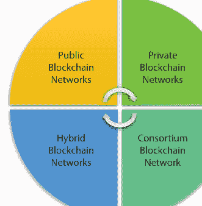

**图 9.1** 区块链的类型。

- (b) **私有区块链网络：** 也称为管理区块链，由单一实体控制。权威决定谁允许加入网络以及他们拥有什么权限。由于包含了访问限制，私有区块链仅部分去中心化。Ripple 是一个面向公司的数字货币交易所网络，是私有区块链的一个示例[7]。

- (c) **混合区块链网络：** 混合区块链结合了公共网络和私有网络的组件。企业除了安装公共系统外，还可以安装基于许可的私有系统。它们在保持对其他数据公开访问的同时，控制对区块链中包含特定数据的访问。它们允许公众成员通过智能合约验证私有交易是否已完成。例如，混合区块链允许公众访问数字货币，同时保持银行拥有货币的隐私性[8]。

- (d) **联盟链网络：** 联盟链区块链网络由一组组织管理。预先的组织在数据访问权限确定和区块链维护方面承担同等责任。联盟链网络通常优于许多组织具有相同目标并从共同责任中受益的行业。

191 区块链技术协议、应用与用例一个试图改进海运运营商之间合作并将航运部门数字化的非营利区块链组织是全球航运业务网络组织[9]。

## 9.2.2 现有区块链协议

可以使用各种区块链平台来构建应用，这些应用被称为区块链协议。每个区块链协议根据特定行业或应用定制底层的区块链概念。接下来是几个子节，每个子节包含图9.2中描述的区块链协议示例。

- (a) **Hyperledger Fabric：** 由一系列工具和库组成，构成了开源的 Hyperledger Fabric 项目。企业可以使用它快速高效地开发私有区块链应用。它是一个通用的、模块化的框架，具有特殊的访问控制和身份管理功能。它的特性使其适用于广泛的应用，包括贸易金融、供应链追踪追溯、忠诚度、激励以及金融资产的清算与结算[10]。

- (b) **以太坊：** 以太坊是一个开源、去中心化的区块链平台，允许开发者创建公共区块链应用。以太坊企业版为商业应用设计。

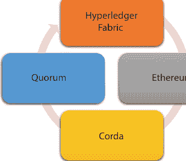

图 9.2 区块链协议。

- (c) **Corda：** 一项名为 Corda 的开源区块链计划，旨在商业用途。通过使用 Corda，你可以创建兼容且在绝对秘密下运行的区块链网络。企业可以利用 Corda 的智能合约技术直接进行盈利性交易。金融机构构成了它的大部分用户[11]。

- (d) **Quorum：** Quorum 源自以太坊，是一个开源区块链协议。它主要设计用于联盟链网络（其中多个成员控制网络的一部分）或私有区块链网络（其中由单一实体拥有所有节点）。

### 9.2.3 区块链技术的演进

计算机科学家 Ralph Merkle 在 20 世纪 70 年代末发明的哈希树（也称为 Merkle 树）为区块链技术奠定了基础。这些树是计算机科学结构的一种，区块通过密码学链接在一起以存储数据。Stuart Haber 和 W. Scott Stornet 在 20 世纪 90 年代末利用 Merkle 树发明了一种防止文档时间戳不被篡改的方法[11]。这是区块链历史上首次发生这种事情。图9.3 显示了三代区块链技术[14]。

在这三代中，技术不断不断进步：

- **第一代 - 比特币和其他虚拟货币：** 2008 年，一个名为 Satoshi Nakamoto 的匿名团体定义了当前形式的区块链技术。Satoshi Nakamoto 的原始区块链架构包含了用于比特币交易的一兆字节数据块。即使

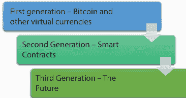

图 9.3 区块链技术的演进。

193 区块链技术协议、应用与用例今天，比特币区块链系统的许多特性对区块链技术至关重要[12]。

- **第二代 - 智能合约：** 在第一代货币引入几年后，开发者开始考虑超越比特币的区块链应用。例如，以太坊的设计者决定在资产传输操作中使用区块链技术。他们最重成就之一是实现了智能合约。

- **第三代 - 未来：** 随着企业发现并实施其新应用，区块链技术仍在改进和扩展。企业正在克服计算和扩展性限制，当前的区块链革命提供了许多机会[13]。

## 9.3 区块链技术的主要挑战

独特的特征使区块链技术与传统数据库区分开来。其最显著和独特的特征如图9.4 所示。

(a) **去中心化：** 区块链的去中心化是一个重要特征。区块链运行

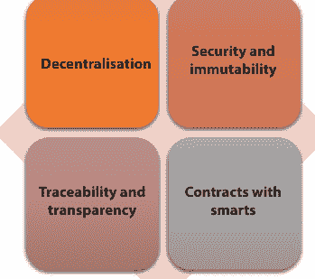

**图 9.4** 区块链技术的挑战。


在分布式账本上，与由单一机构（如银行）管理和认证的中心化数据库不同。换之，一个被称为“节点”的透明参与者网络负责更新、验证和维护账本。网络中的每个节点都存储整个区块链的副本 [3]。

- **安全性与不可篡改性：** 区块链使用加密方法记录交易，从根本上消除了篡改，提供了高安全性。加密哈希被用于存储和连接信息块。任何编辑或篡改区块的尝试都将涉及更改其他每一个区块，由于区块链具有确保信息不可篡改的固有安全性，它是存储敏感数据和进行安全交易的理想选择。

- **可追溯性和透明度：** 区块链固有的透明性保证了所有网络用户都能访问相同的数据。例如，每笔交易都记录在所有方可访问的公共账本。通过允许快速识别和纠正任何不一致，这种透明性增强了信任和网络责任感。区块链追踪资产来源和路径的能力使审计更容易，并减少了欺诈活动的可能性 [14]。

- **智能合约：** 这些是经过软件编码的自动化合同，会自动执行协议条款。区块链用于存储智能合约代码，这些代码在满足某些标准时激活。这些合约节省了资金、缩短了结算时间、简化了交易，并消除了对中间件的需求。它们被应用于许多不同行业，如金融、保险和供应链管理。

## 9.4 使用分布式账本技术与区块链

构成区块链使用的多步骤过程的五个步骤如下：

1. 授权参与者输入一笔交易，该技术需要对此进行验证。
2. 作为该操作的结果，创建一个代表该特定交易或数据集的区块。
3. 每个网络计算机节点都接收该区块。
4. 授权节点对交易进行验证，然后将区块附加到当前区块链中。
5. 当更新传播到整个网络时，交易完成。

这些动作包含多个组件，并几乎瞬间完成。在公共区块链网络中，节点被称为矿工。他们通常通过被称为工作量证明或权益证明的程序，以加密货币的形式获得其努力的回报 [3, 14]。区块和单个交易是构成区块链账本的两种记录。第一个区块中的头部和数据与预定时间窗口内发生的交易有关。区块的时间戳

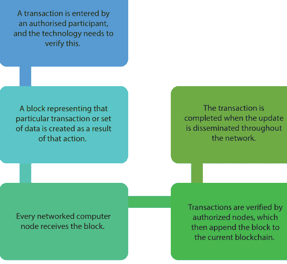

图 9.5 区块链技术原理（手绘）。

有助于创建哈希，哈希是一个字母数字字符串。账本中在初始区块之后创建的每个区块都使用前一个区块的哈希来计算自己的哈希。

## 9.5 区块链、数字货币、加密货币与比特币

区块链、加密货币和比特币通常与数字货币归类；它们偶尔被交叉使用。尽管它们都属于分布式账本技术（DLT）的范围，但每一种都是独立的组织。图 9.6 展示了区块链技术的组件 [14]。

- (a) **区块链**：区块链是支持比特币和加密货币等数字货币的技术。具体来说，它是生成去中心化数字账本的底层技术，能够实现多个方之间安全且不可逆的交换。

- (b) **数字货币**：数字货币是任何以数字或电子形式存在的货币，可以在不使用中间机构的情况下进行传输。这涵盖

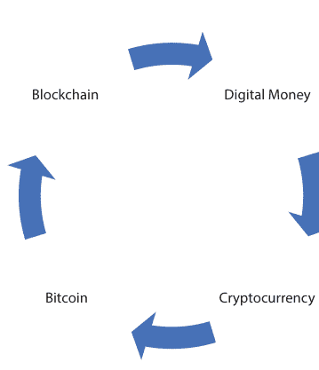

**图 9.6** 区块链技术的组件。

政府和中央银行发行的数字货币以及加密货币。数字货币也被称为数字钱、电子钱、电子货币或无现金。

**加密货币：**加密货币是在区块链网络上可以交易的数字资产。它是数字货币的子集，不由政府发行。将比特币是由私人公司或组织发布的代币，可用于在区块链网络上购买他人销售物品。截至 2023 年 9 月，市场研究网站 CoinMarketCap 已识别出 9,111 种交易中的加密货币。

比特币是第一个且应用最广泛的加密货币。它是由一个使用中本聪（Satoshi Nakamoto）绰名的匿名个人或群体发明的。比特币在一个名为比特币区块链的去中心化网络上，允许参与者在不使用中间机构的情况下进行传输和接收。比特币挖掘是一项计算密集型操作，为供应量增加了新的比特币。矿工克服复杂的数学任务；完成谜题并验证交易的矿工将获得新的比特币。

## 9.6 区块链示例与用例

随着许多行业中更多企业学习使用它，区块链继续演进并获得认可。区块链的用例和行业应用已远超出其最初的比特币应用，扩展到智能合约、网络安全、物联网（IoT）和非同质化标记（NFT）。NFT 是代表现实世界制品（如艺术或音乐）全部或部分的数字资产。它们是购买和出售数字艺术品的流行方式，因为可以在网上进行购买、出售和交换 [15]。

以下是区块链技术的一些现实应用：

供应链管理：区块链的端到端可见性、透明度和问责制使其控制供应链非常有用。利益相关者可以记录、跟踪和验证产品，阻止伪品进入供应链，并改进物流程序。

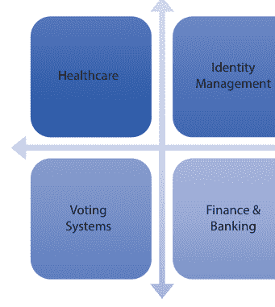

(a) 医疗保健：区块链像人工智能和物联网一样，已成为先进的医疗保健技术。在医疗领域，区块链用于安全地存储和共享患者数据。该技术让患者对自己的医疗记录拥有控制权，允许医疗服务人员根据需要访问。这实现了医疗信息的无缝安全共享，从而带来了更好的治疗结果和更少的行政麻烦。

(b) 身份管理：基于区块链的身份管理系统提高了对个人信息的安全性、隐私性和控制力。通过将识别信息放在区块链上，用户可以创建可便携且可验证的数字身份。这消除了对多个身份证明的需求，降低了身份盗窃率，并简化了身份验证程序 [16]。

(c) 投票系统：区块链技术通过创建安全透明的投票平台来帮助传统的投票系统。基于技术的投票系统可以防止选民欺诈，维护选举完整性，并在确保匿名和隐私的同时允许远程投票。

(d) 金融与银行：区块链技术用于金融服务，以加速交易和结算时间。例如，在线支付网络 PayPal 在 2020 年发布了基于区块链的服务，允许客户购买、持有和出售加密货币。R3（一个全球金融机构联盟）创建了 Corda 平台，使用专用平台的区块链应用程序接口记录、管理和同步金融数据 [17]。

## 9.7 结论

本章旨在调查区块链技术。显而易见，其影响远超其在比特币领域的起源。凭借其变革投票系统、实现去中心化银行和提高供应链透明度的能力，区块链已经证明了其适应性和潜力。尽管存在扩展性、互操作性和监管框架等问题，但广泛应用仍受到限制。尽管有这些挑战，人们仍在持续进行研究和开发以改进区块链协议并扩大其用途。随着我们前进，区块链技术的发展有望带来更多的创新和变革，重新定义我们在数字时代通信、开展业务和建立信任的方式。


## 健康科学领域的 200 篇区块链

- 6. Hardini, M.G., Yusuf, N.A., Zahra, A.R.A., 智能网络汇聚：利用人工智能与区块链的力量实现未来创新. ADI Recent Innov., 5, 2, 200–209, 2024.
- 7. Huynh-The, T., Gadekalu, T.R., Wang, W., Yenduri, G., Ranaweera, P., Pham, Q.V., Liyanage, M., 元宇宙的区块链：未来的生成器. Comput. Syst., 143, 401–419, 2023.
- 8. Han, H., Shiwakoti, K.R., Jarvis, R., Mordi, C., Botchie, D., 区块技术与人工智能驱动的会计与审计：文献综述. Int. J. Account Inf. Syst., 4810598, 1-27, 2023.
- 9. Truong, V.T., Le, L., Niyat, D., 区块链遇元宇宙与数字资产管理：综合综述. IEEE Access, 11, 26258–26288, 2023.
- 10. Xu, J., Wang, C., Jia, X., 区块链共识协议综述. ACM Comput. Surv., 55, 1–35, 2023.
- 11. Tan, M. and Saranienemi, T., 区块链交易所的信任：区块链营销的未来方向. J. Acadad. Market. Sci., 51, 4, 914–939, 2023.
- 12. Qin, M., Su, C.W., Lobjont, O.R., Unar, M., 区块链：碳中和促进者还是环境破坏者? Int. Rev. Econ. Finance, 86, 604–615, 2023.
- 13. Andrew, J., Israel, D.P., Sagayam, K.M., Bhushan, B., Sei, Y., Eunice, J., 医疗保健系统的区块链：架构、安全挑战与未来方向. J Netw. Comput. Appl., 215, 103633, 1–27, 2023.
- 14. Tyagi, A.K., Dananjayan, S., Agarwal, D., Thariq Ahmed, H.F., 区块链—物联网：工业社会 5.0 的机遇与挑战. Sensors, 23, 2, 947, 2023.
- 15. Zhu, J., Feng, T., Lu, Y., Jiang, W., 是否使用区块链？减排创新背景下核心企业的区块链策略. Bus. Strat. Environ., 33, 3505–3531, 2024.
- 16. Laurence, T., 区块链入门，John Wiley & Sons, USA, 2023, ISBN: 978-1-394-15966.
- 17. Wang, X., Zhu, H., Ning, Z., Guo, L., Zhang, Y., 车联网的区块链智能：挑战与解决方案. IEEE Commun. Surv. Tutor., 25, 4, 2325–2355, 2023.

# 第三部分

# 制药领域的区块链

## 区块链赋能制药业：药物研发与供应链管理的范式转变

Parthasarathi P.1, Suresh Kumar K.2, Girimurugan R.3*, Ravivarman G.4. Vigneshwaran M.5 and Perumal A.6

印度，泰米纳德德邦，Sathyamangalam, Bannari Amman Institute of Technology，计算机科学与工程系

印度，泰米纳德德邦，钦奈伊，Panimalar Engineering College，管理研究系

印度，泰米纳德德邦，Perundurai, Nanda College of Technology，机械工程系

印度，泰米纳德德邦，哥尔巴富尔, Karpagam Academy of Higher Education，电气与电子工程系

印度，泰米纳德德邦，哥尔巴富尔，Sri Krishna College of Engineering and Technology，机电工程系

印度，泰米纳德德邦，维鲁杜纳加尔, Sethu Institute of Technology，机械工程系

# 摘要

制药行业面临着各种问题：临床试验效率低下、复杂且碎片化的供应网络以及假药问题。本节将探索区块链技术如何为这些问题的解决带来革命性的方案。区块链技术解决方案日益成为供应链管理、药品可追溯性、知识产权和临床试验数据最受欢迎的应用之一。它提供了一个去中心化、加密且透明的平台。在区块链动态特征的增强下，实时药物监测可以追踪从患者分配到制造的每种药物，从而打击假药并提高患者安全。正如“库存”部分提到的，这是区块链在制药领域最な益处之一。

> *通讯作者：dr.r.girimurugan@gmail.com

Aryan Chaudhary, Rashmi Singh and Gaurav Agarwal (编) 健康科学中的区块链，203–228)
© 2025 Scrivener Publishing LLC.

## 健康科学领域的区块链

本节介绍了区块链上制药供应链中智能合约的动态机制，这些机制有助于降低风险并增加透明度和信任。这些动态智能合约结合临床试验中的区块链组件，确保了信息的妥善与安全交换，从而实现更快的药物开发。在区块链动态特征的增强下，实时药物监测可以追踪从患者分配到制造的每种药物，打击假药并提高患者安全。这是区块链在制药领域最重要的益处之一。此外：本节介绍了区块链上制药供应链中智能合约的动态机制，这些机制有助于降低风险并增加透明度和信任。这些动态智能合约结合临床试验中的区块链组件，确保了信息的妥善与安全交换，从而实现更快的药物开发。在区块链动态特征的增强下，实时药物监测可以追踪从患者分配到制造的每种药物，从而打击假药并提高患者安全。这是区块链在制药领域最重要的益处之一。此外：本节介绍了区块链上制药供应链中智能合约的动态机制，这些机制有助于降低风险并增加透明度和信任。这些动态智能合约结合临床试验中的区块链组件，确保了信息的妥善与安全交换，从而实现更快的药物开发。在区块链动态特征的增强下，实时药物监测可以追踪从患者分配到制造的每种药物，从而打击假药并提高患者安全。这是区块链在制药领域最重要的益处之一。此外：本节介绍了区块链上制药供应链中智能合约的动态机制，这些机制有助于降低风险并增加透明度和信任。这些动态智能合约结合临床试验中的区块链组件，确保了信息的妥善与安全交换，从而实现更快的药物开发。在区块链动态特征的增强下，实时药物监测可以追踪从患者分配到制造的每种药物，从而打击假药并提高患者安全。这是区块链在制药领域最重要的益处之一。此外：本节介绍了区块链上制药供应链中智能合约的动态机制，这些机制有助于降低风险并增加透明度和信任。这些动态智能合约结合临床试验中的区块链组件，确保了信息的妥善与安全交换，从而实现更快的药物开发。在区块链动态特征的增强下，实时药物监测可以追踪从患者分配到制造的每种药物，从而打击假药并提高患者安全。这是区块链在制药领域最重要的益处之一。此外：本节介绍了区块链上制药供应链中智能合约的动态机制，这些机制有助于降低风险并增加透明度和信任。这些动态智能合约结合临床试验中的区块链组件，确保了信息的妥善与安全交换，从而实现更快的药物开发。在区块链动态特征的增强下，实时药物监测可以追踪从患者分配到制造的每种药物，从而打击假药并提高患者安全。这是区块链在制药领域最重要的益处之一。此外：本节介绍了区块链上制药供应链中智能合约的动态机制，这些机制有助于降低风险并增加透明度和信任。这些动态智能合约结合临床试验中的区块链组件，确保了信息的妥善与安全交换，从而实现更快的药物开发。在区块链动态特征的增强下，实时药物监测可以追踪从患者分配到制造的每种药物，从而打击假药并提高患者安全。这是区块链在制药领域最重要的益处之一。此外：本节介绍了区块链上制药供应链中智能合约的动态机制，这些机制有助于降低风险并增加透明度和信任。这些动态智能合约结合临床试验中的区块链组件，确保了信息的妥善与安全交换，从而实现更快的药物开发。在区块链动态特征的增强下，实时药物监测可以追踪从患者分配到制造的每种药物，从而打击假药并提高患者安全。这是区块链在制药领域最重要的益处之一。此外：本节介绍了区块链上制药供应链中智能合约的动态机制，这些机制有助于降低风险并增加透明度和信任。这些动态智能合约结合临床试验中的区块链组件，确保了信息的妥善与安全交换，从而实现更快的药物开发。在区块链动态特征的增强下，实时药物监测可以追踪从患者分配到制造的每种药物，从而打击假药并提高患者安全。这是区块链在制药领域最重要的益处之一。

（注：由于原文中存在大量文本重复，译文已根据“不要重复输出原文”的原则进行了去重处理）

**关键词：** 制药领域的区块链、智能合约、供应链、临床试验、动态合约、医疗健康人工智能

## 10.1 引言

制药公司管理着需要众多供应商化学品的复杂供应链。遵守新的序列化法规是该行业日益面临的挑战，任何微小错误都会导致严重后果[1]。制药公司在新冠疫情期间至关重要，通过其供应链提供了药物获取[2]。全球范围内的从功能内部到跨组织运营的转变需要追溯性[3]。假药、质量问题、不可追溯的运输以及供应链中脱节的客户互动加剧了这些问题[4]。当在供应链后期发现低质量药物时，个人最终将遭受经济损失[5]。还应该注意到，供应链透明度降低和沟通不畅导致了这些挑战。这些问题的解决将基于区块链技术和基于以太坊的智能合约。还将开发一个去中心化的药品平台，能够安全追踪并通知他们不同国家的要求和潜在罚款[6]。在过去的十年里，建立药物追踪框架的倡议为假药销售铺平了道路。利用 Hyperledger Fabric 的 Pharma Chain 代表了一种去中心化的解决方案，提供了高透明度和更好的隐私性以及简单的集成[7]。更重要的是，它通过双签名和数据哈希等方法保护药物免受盗窃[7]。物联网与区块链的结合确保了系统的高度安全性，并提高了制药供应链管理（SCM）解决方案的效率。该系统使用响应响应物联网（IoT）设计——雾、边缘、雾、云（IMFEC）构建，使其成为开放且韧性的系统。在区块链技术中，Filecoin 是为处理医疗SCM领域更大体积的文件创建的最具效益的选择之一[8]。建议开发一种利用区块链技术解决产品相关问题的新应用。其实现通过 Hyperledger Fabric 平台，使得生成的复合体在开放性、诚实性和溯源方面更好。这种设计利用区块链技术确保通过短码实现可识别水印的实施。测试表明，在适应性、验证、生产力和资源利用方面有了提高[9]。

医疗保健领域发布的区块链研究文章百分比分布如图10.1所示，显示了出版数量逐年急剧增长。益处或机遇


# 206 健康科学领域中的区块链

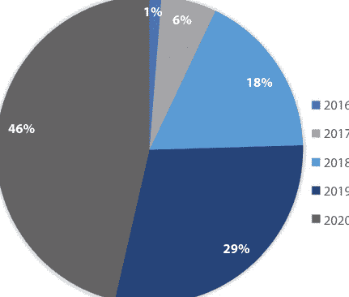

**图 10.1** 区块链领域的研究比例 [10]。

图 10.2 描述了在此背景下实施区块链技术面临的挑战。

传统制药供应链面临着若干挑战，例如透明度、产品监控、信任问题以及过期物品泛滥的问题。制药行业要求对药品制造和交付过程中使用的药品原料来源进行准确记录。在正规药品渠道之外非法形成的假药构成了巨大挑战。这些假药与真药相似，往往难以区分。

# 机遇与挑战

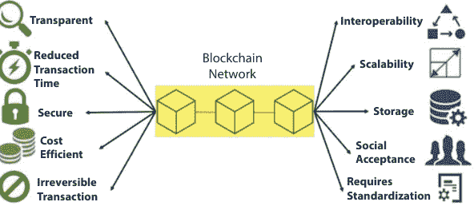

**图 10.2** 基于区块链的应用的优与缺点 [10]。

# 207 区块链赋能制药业

在视觉上与原件相似，但它们在治疗目标疾病或状况时往往缺乏疗效，有时含有有害或有毒物质。作为疾病诊断、治疗和预防的关键组成部分，假药已成为一个激增的行业，据称每年导致 100,000 到 1,000,000 人死亡。除了影响合法药品制造商的声誉和收入外，防止假产品进入市场对患者安全至关重要。区块链技术的独特属性，特别是其去中心化、透明化、可信、匿名和稳定的本质，使其成为对抗制药行业假药分发的一种极具前景的工具。区块链提供了追踪药品来源、药品运输和原料采购的潜力。此外，通过减少涉及的中间环节数量，区块链技术在制药过程中降低成本和增强安全措施具有前景 [11–14]。

## 10.1.1 问题描述

制药行业面临着一个普遍的挑战，其特征是药品在跨越生产、销售和分发的整个生命周期内缺乏透明度和信任。复杂的全球供应链极易受到意意外中断的影响。即使是该链中深处看似微小的问题（例如供应商的供应商无意中使用了错误的组件），一旦产品到达生产的最终阶段，也可能升级为重大问题。传统的供应链流程涉及审核发票、核对货物、在运输过程中温度或质量违规时启动退款，并在产品到达后执行支付。然而，这种方法充满了耗时的程序、高成本、延迟和错误。这些低效率不仅阻碍了业务流程，还直接影响了消费者，可能导致交付具有有害后果的低质药品。此外，由于对制药供应链的复杂性和流程缺乏认知，消费者历史上对该供应链了解甚少。在订购药品时，消费者往往不知道其来源、制造情况或预计交付时间。一方面，发达国家和第三世界国家的工人正在通过验证医院中不完整的药品，加入制止医疗用品欺诈的斗争中 [15, 16]。在解决这一问题方面缺乏创新解决方案；我们只能呼吁动态智能合约参与这些问题的解决。传统合同的僵化

# 208 健康科学领域中的区块链

合同程序的僵化通常会导致延迟。在制药供应链中，智能合约可以适应可能导致合同失败的不断变化或意外事件，从而增强对交易问题的响应能力。这种灵活性对于规避风险和确保产品质量，同时维持供应链的多样性至关重要。因此，整合这些动态智能合约必须被视为制药供应链成功应对市场需求变化的变革的关键。图 10.3 展示了通过药房或医院向用户生产、分发和提供药常用场景。由于缺乏透明度，客户无法识别药品生产和分发的连续步骤。根据世界卫生组织（WHO）的预测，全球有多达 20 亿无法获得基本药物、医疗用品和疫苗，这通常会导致劣质产品的进入。由于对药品的需求增加，供应链将包含过期和假药。劣质药品的问题由于电子商务的出现而加剧（这使得更容易从不可靠的来源购买），以及全球供应链的复杂性（允许在一个国家制造的产品在另一个国家包装和销售）[17]。向供应链中所有利益相关者的药品生产、交付和销售仍然是不透明的。由于交易程序使用本地化或中心化的方法进行验证，它们可以被操纵 [18]。

制药行业在药品的生产、营销和分发方面缺乏信心和开放，这使得供应链变得脆弱且复杂。射频识别（RFID）等技术的使用简化了医疗


图 10.3 制药公司的传统工作流 [6]。

# 209 区块链赋能制药业

供应链，但由于 RFID 数据成本高且客户获取受限，仍然存在许多障碍 [19, 20]。仍然需要一个可靠的去中心化系统，使销售和交易透明、可追溯且可靠。引入先进的区块链解决方案可以确保药品的安全分发，并建立一个所有供应链参与者都可以访问的去中心化账本，保护消费者。通过提供具有不可变账本的分布式去中心化网络，区块链技术消除了对中心化验证机构的需求。虽然主要应用于加密货币（比特币），但区块链将其用途扩展到交易、跟踪和和领域。每笔交易都安全地记录在分布在多个账本副本上的区块上，确保了透明性和安全性。由于其效率（影响从存储到金融交易的各个方面）、可扩展性以及缺乏中心化控制，区块链发挥着能够推动整个供应链有效性和开放性的颠覆性影响。这种变革的核心是区块链促进的智能合约概念。这些数字化的执行的可行合同确保了在没有中间人的情况下依然可靠。智能合约是通过以坊实现的，这是一个开源的公共去中心化计算平台 [21, 22]。事件保证在公开的区块链上对授权的链成员可见。区块链技术与物联网（IoT）设备技术的整合正在改变制药供应链管理和客户互动模式。区块链促进了透明度，为消费者提供信息。这种整合通过对交易进行时间标记并将其与包括消费者在内的授权方共享，解决了供应链中的信任问题。为了提高供应链管理效率，IoT 传感器在集装箱内收集数据，确保产品质量和真实性。智能合约，特别是在温控运输等关键场景下，实现了流程自动化并记录事件以增强透明度并管理供应链。创建开放且去中心化的药品供应链管理系统的需求通过利用区块链和物联网的框架得到了满足。建议解决方案的目标是通过消除对可靠第三方认证员的需求、引入先进的基于智能合约的供应链管理，并结合 IoT 传感器和动态智能合约，提高终端用户药品真实、可靠性和透明。本章概述了供应链参与者之间的架构、设计和事件，为适用于……的方法提供了见解


# 210 健康科学中的区块链

利用区块链技术跨越各种供应链网络。本章首先对相关文献进行了总结，并阐述了区块链技术的理论基础。接着，采用了设计科学研究（DSR）方法。该方法概述了拟议的结构，对其进行了评估，突出了其缺点和影响，并对研究结果进行了预测。该研究由多个部分组成，涵盖相关文献、拟议的药品供应链管理解决方案、智能合约的实施与测试细节、讨论、结论以及局限性。

## 10.2 文献综述

本节从书籍、论文和其他出版物中收集了区块链技术与药品供应链之间联系的信息。由于区块链技术仍处于发展早期，大多数研究材料保持着较高水平的抽象性，缺乏具体的实施细节。Covid-19 疫情强调了有组织的初级保健部署对社区福祉的重要性。药物和医疗物资的及时分发现在对抗流行病的斗争中至关重要。一个连接制造端与患者的医疗物流系统特定示例表明，采用区块链技术可能是有益的。[24] 关注区块链技术在数据验证中的应用。作者强调了对于具有适当权限的所有参与方，其具有不可变性和访问性的优势。这项研究贡献了具体结果，证明了区块链在患者隐私和电子健康记录（EHR）安全方面是一项经过证明的技术，使其成为健康领域的一个革命性发展。[25] 探讨了在处方药和医疗物资中整合区块链技术的环境和挑战。该论文描述了智能合约的良好示例，用于反欺诈检测并提高透明度同时讨论了如何使用智能合约来实现流程自动化并降低成本。分布式账本和区块链技术对生物应用和健康方法的影响是人员讨论的话题 [26]。这项研究重点关注利用区块链技术作为药品供应链溯性和透明度的不可变账本，以防止劣质药和假药。[27] 讨论了出现在不同领域（如物流）的区块链程序，这些程序有助于行业透明度。强调了物联网（IoT）与基于区块链的解决方案相结合，区块链技术作为验证网络用户和资产的手段。美国区块链初创公司 Chronicled 与生命科学供应链咨询公司合作，开发了一个新的试点项目，在药品供应链中利用“追踪溯”技术。该倡议旨在通过实施区块链技术实现数据隐私的改进并促进符合法律标准。显而易见，在优先考虑安全的同时，优质药物得到了适当的供应、移动和包装。为了应对全球假药问题，一家瑞士初创公司与苏黎世大学合作，建立了一个基于区块链的系统，确保处方药的安全传输。该系统通过物联网传感器和区块链技术的结合在整个区块链技术监控温度和质量，实现了透明化并增强了客户信任。为了解决依赖中心化架构的物联网系统问题，[28] 建议将区块链技术与智能设备相结合。创始人提出了一种方法，旨在通过点对点连接来减少对中心化服务器的依赖，同时强制安全性和扩展性。以区块链集成作为网络可用性和韧性的核心，他们的模型（如图 10.4 所示）确保了即使某些节点故障，网络也能继续保持良好性能。它构成了一个去中心化的物联网系统。

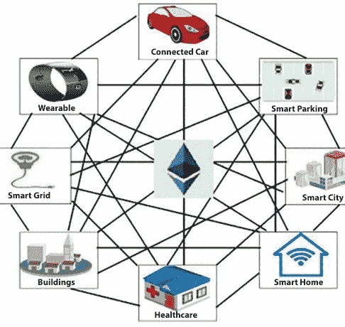

图 10.4 通过内部融入区块链实现的去中心化物联网架构 [6]。

## 212 健康科学中的区块链

通过增强整个供应链过程的透明度、可追溯性和安全性来改进药品供应链。由于区块链技术在这一行业仍然较新，目前许多研究都是高层级的，不包含详细的实施策略。

作者 [28] 详细讨论了这一行业，强调了随之而来的优势，包括改进的安全性、不可变性、去中心化和透明度。这种伙伴关系暗示了一种互利的关系，其中物联网设备变得更加自主，而区块链变得日益重要。他们的发现强调了分布式账本技术（DLT）解决方案在推进分布式物联网服务方面的潜在重要。Jüttner 等人 [29] 引入了一个概念，将物联网与基于以太坊区块链驱动分布式提交相结合。该应用由一个由 Web 服务器托管的前端和一个涉及点对点物联网的私有区块链网络上的智能合约组成。该系统可以被想象成一个通过 ether 进行数字运输票务运行的接口，它通过在本地维护票务来确保了区块链机制的去中心化本质。Clark 和 Burstall [30] 调查了供应链风险管理的感知和实践，重点关注该领域的实证研究水平。他们解释了与涉及去中心化数据存储的不透明供应链进行业务的困难，以及分布式账本技术在各种行业中为了韧性和不可变执行而出现的现象。正如 Tseng 等人 [31] 指出的，在使用区块链技术时，遵循奢侈品、消费品或药品的商业概念，可以保护品牌公司的知识产权。通过参考普华永道披露的一项研究，显示出普通药品市场上假药的盛行率非常高。他们还认为区块链技术凭借其去中心化和具有韧性的账本可以对抗这些危险药物。Rothenberger 等人 [32] 建议了一种 Gcoin 区块链模型，该模型依赖共识工作证明系统来防止假药，并维护基于区块链技术的有关药品交易数据的信息透明度。他们的方法利用区块链技术的多重签名特征来强化角色分配并防止非法药品交易。他们强调了区块链对生物医学和医疗保健的优势：该技术可以追踪药品的的源头及其沿整个供应链的路线。他们强调区块链技术可以用于防止欺诈和假冒产品的生产和流通，增强系统的韧性并保护药品质量。

## 213 区块链赋能药品

讨论强调了供应链行业面临的持续障碍，以及对开放、透明和可靠基础设施的需求。显而易见，区块链技术在解决诸如困难的客户支持、办公费用、产品信任和知识产权等问题方面是具有基础性的。该技术仍处于婴儿阶段，需要一个严格且监管良好的数据访问框架和一个强大的监管平台以便在健康行业中优化运行。最后，药品供应链正面临日益增长的挑战，这自然需要稳健、透明且可靠的解决方案。本章提供了一种新的区块链技术架构，旨在取代传统的药品供应链管理。该方案强调了动态运行的强大智能合约，目标是增加可靠性、效率和透明度以适应变化的行业。

## 10.3 拟议解决方案

这部分描述了一种创新且成本效益的方法，将以太坊区块链、智能合约和物联网连接起来，以跟踪、监控和改进从制造设施到终端客户的药物交付。需要注意的是，这种方法不需要可靠的第三方验证，作为现有供应链基础设施的极佳补充，增强了其可靠性、安全完整性。

### 10.3.1 研究方法途径：设计科学研究

研究是一个对特定主题提供更深入理解的方法论过程。在计算机科学和工程等各个领域，设计的科学研究（设计科学研究）涉及语言、设计过程、算法和人机界面等主题。这种方法由实现最终结果的一系列步骤组成。它于对问题进行详尽的数据收集，目标是通过完善设计和通过重复过程寻求改进来构建一个有意义的解决方案。我们识别的差距包括需要澄清利益相关者支付自动化流程以及供应链内的整体信息共享。首先，创建合适的设计涉及“构建与评估”方法的反复循环。其目的是使所产生的管理研究具有适用性，并利用现有技术

# 214 健康科学中的区块链

……有效地运作。这种方法通常以两种模式运行：模式 1 是学术且单学科的，模式 2 则强调当今复杂世界的多学科维度。认知设计科学研究循环如图 10.5 所示，突出了该循环步骤中涉及的认知过程。Takeda 等人 [33] 指出，溯因推理、演绎推理和界约束（circumscription）被用于设计科学研究的不同阶段，每个阶段都涉及不同的思维过程。三角形说明了这些方法如何在设计科学研究的各个阶段产生新类型的知识。总而言之，这种方法是一种组织化且迭代的问题解决方法，展示了创造力和知识如何在不同领域涌现。

我们在本研究中假设了设计科学研究方法，该方法侧重于药品供应链业务的性能改进和问题解决，即“改进研究” [33]。该领域的主要问题是缺乏透明度，这促成了创建一种透明、去中心化且防篡改解决方案的想法。我们通过对与问题领域相关的现有知识和理论进行溯因推理，得出了潜在的解决方案 [34]。图 10.5 展示了演绎是从前提推导出特定结论的过程，而溯因推理是从观察中推导出可能答案的过程。在创建知识的过程中，反思和抽象是至关重要的。然而，我们也尝试解决该问题，在开发阶段制定了一个用于实施的初步设计，如图 10.5 所示。在评估阶段，对成功的实施（无论完整还是部分）根据功能规范进行评估。界约束的正式-逻辑方法假设，只有在识别并调查了理论内部揭示限制的不一致之处后，才认为知识是有效的。

| 知识流 | 流程步骤 | 认知过程 |
|---|---|--|
| 知识贡献 | 1. 问题陈述的意识 | |
| | 2. 建议 | 溯因推理 |
| 界约束 | 3. 开发 | 演绎推理 |
| | 4. 评估 | |
| 设计科学知识 | 5. 结论 | 反思、抽象 |

图 10.5 数据科学研究循环 [6]。

## 区块链赋能制药 215

在意识循环结束时，这通常会揭示额外的问题。为了开发我们的解决方案，我们利用设计科学研究（DSR）方法在去中心化平台上创建了智能合约，这成为我们方法的核心组成部分。随后，我们在 Remix 平台上对实施进行了全面测试。与之前讨论的模型类似，其他 DSR 模型也描述了 DSR 过程。相比之下，这种方法将“意识”阶段中的问题识别和解决方案定义阶段分开了。此外，它将开发和建议阶段合并为一个阶段，称为设计与开发。最后，它将评估阶段分为评估和开发，并将最终阶段重命名为“通信”。少数利益相关者参与了对我们提议解决方案不同功能的测试。在 DSR 中，可以通过发明、改进和适应产生独特的知识贡献，这意味着单项研究工作可能会产生多种类型的知识构建 [35]。传统的设计方法无法适用，因为使用现有解决方案解决已知问题并不能提供新颖见解。利用我们对以太平台、物联网、智能合约和消息协议的广泛理解，我们的方法与设计科学研究循环中的认知方法保持一致。在该研究中，我们通过为现有的药品供应链管理推荐动态智能合约，接受了 DSR 技术。我们通过遵循严格的程序实现了这一，该程序包括问题识别、系统设计、实施、结果、结论和未来的研究议程。

### 10.3.2 新型动态智能合约系统概述与设计

本节提供了系统及其设计的大纲，重点关注集成动态智能合约，以建立一个管理供应链的去中心化和透明流程。集成了自动警报，以实现卖家与消费者之间的实时通信，确保在药品运输和交付过程中发生事故或违规时能够立即通知。我们的方法使用了消息队列遥测传输（MQTT），它作为一种基于传输控制协议/网协议（TCP/IP）的发布-订阅消息系统运行，如图 10.6 所示。MQTT 促进了客户端服务器通信。客户端连接到负责数据交换的代理。树莓派托管了一个用于识别违规行为的规则引擎。任何

216 健康科学中的区块链

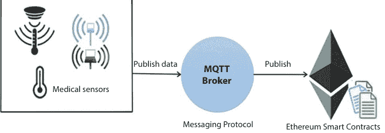

发布数据 MQTT Broker 发布 医疗传感器 消息协议 以太坊智能合约

图 10.6 动态智能合约与消息协议的交互 [6]。

偏离指定标准的任何偏差被该引擎标记为违规，该引擎为传感器读数建立了精确的规则。
系统由一个云端 MQTT 服务器组成，收集、存储并分发包内物联网传感器产生的所有数据。系统的处理接口和通信组件包括传感器、树莓派、云端 MQTT 服务器、支持物联网的容器以及基于以太坊区块链的动态智能合约（见图 10.7）。

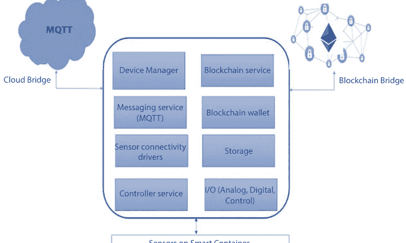

图 10.7 基于区块链的食品安全应用中的 MQTT 服务器。经许可改编自文献 [5]。版权所有 © 2021, Springer Nature。

## 区块链赋能制药 217

在发生违规时，读数将传输到动态智能合约，提醒卖家和客户。为测试建立了一个预定的参数和指南，例如 15°C 到 25°C 之间的温度范围、指示运动的正常或异常加速度结果，以及暗示频繁或重大变化的压力变化。大约每 10 分钟向 MQTT 服务器发送一次更新，提供关于温度、压力和运动的实时洞察。服务质量（QoS）级别 0 的 MQTT 协议确保了定期发送的容器状态数据的尽力交付。图 10.8 显示了基于区块链的药品供应链管理（PBSCM）解决方案的综合系统设计，该方案具有与智能合约交互的各种组件和用户。其中的重要参与者如下：

- 卖家：在检查物联网容器的包装以确保包裹无损后，卖家启动智能合约。
- 消费者：消费者用以太（ether）支付，只有当包裹无损到达他们手中时才会收到退款。他们在交付时通过向智能合约提供口密码哈希值来确认真实性。
- 物联网容器：与以太坊区块链集成，包含用于监控温度、压力和

| 4. 发起货运 | 1. 创建合约 | 7. 释放货运 |
| 6. 接收包裹并批准交付 | 3. 存入以太坊 |

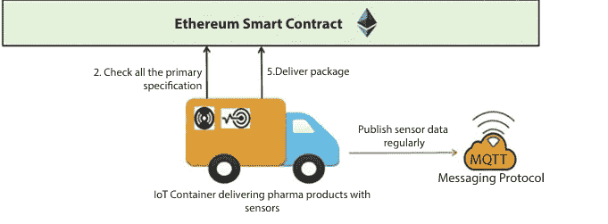

图 10.8 使用区块链解决方案的在线供应链管理 [6]。

218 健康科学中的

全球定位系统（GPS）位置。树莓派作为项目的数据连接。网络平台动态智能合约通过确保灵活性和适应性实现了快捷的药品管理流程。

因此，该框架在维护和验证运输过程中温度方面具有极高的可靠性。通过部署物联网传感器，在偏离温度范围后相关方会及时通知，从而减少了污染的可能性并确保了药品的安全。这不仅防止了，而且保护了价值篡改。动态智能合约消除了这些可能性。以太坊智能合约是系统的基础，由执行交易和管理这些交互的算法和代码组成。以太坊网络通过智能合约确保个人之间的公平支付。其组件包括：

- 事件：记录设置上的重大事件并向主要受众广播。
- 修饰器：可以检查或指定预执行条件，以改变函数的行为。例如，在客户资金存款之前保证约定的运费。
- 变量：随情况变化或取决于执行。在该智能合约中，运费、开始日期和接收日期等变量至关重要。

为了药品的安全交付，供应商启动智能合约并将货物存入智能容器。包裹检查确认符合发货规范。根据此检查，货物将继续或进行必要的纠正，确保卖家和消费者对货物的信心。

一旦智能合约确认包裹检查成功，它将触发一个事件，提示消费者存款并接收一个唯一的哈希值。当货物到达时，此哈希值作为确认最终用户身份的代码。为了打开容器并释放货物，客户必须在位置输入正确的密钥。智能合约授予用户一个 72 小时的窗口来输入正确代码并纠正错误。如果客户在窗口内未提供正确代码，货运将取消，他们将获得运费的一半退款


# 区块链赋能医药行业 219

219 已支付费用。在输入代码错误的情况下，一半款项将按照预设释放给卖家，以防止双方遭受重大的资金损失。这种动态智能合约机制引入了适应性和响应能力，增强了该框架在管理医药供应链方面的有效性和可靠性。

## 10.4 结果与讨论

我们使用 Remix IDE 实现并测试了我们的智能合约，该 IDE 的地址为 http://remix.ethereum.org。使用基于浏览器的 Remix IDE 构建了 Solidity 脚本代码，这为在部署智能合约之前对其进行测试和调试提供了强大的功能。由于 Remix 内置了 JavaScript EVM（以太坊虚拟机）环境，可以在本地执行并部署合约。

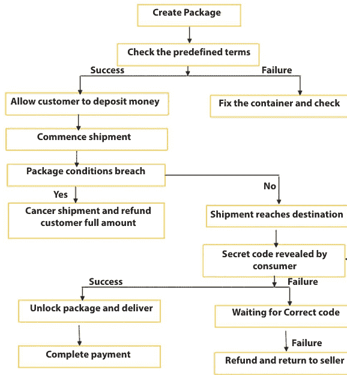

图 10.9 建议的医药供应链流程图 [6]。

图 10.9 显示了基于区块链的医药供应链流程建议工作流，重点是智能合约技术的应用。本节涵盖了主要的实现细节，特别关注智能合约的功能评估以及系统成员的无缝操作。

包含以下步骤：

- 1. 初始化：
- 流程从卖家通过 Remix IDE 启动智能合约开始。
- 使用 Remix IDE 的 JavaScript EVM 在以太坊区块链上部署智能合约。

- 2. 包裹检查：
- 启用了 IoT 功能的集装箱进行包裹检查，确保符合医药货运的特定要求。

- 3. 事件触发：
- 智能合约在包裹检查成功后触发一个事件，表示系统已准备好进入下一步。

- 4. 消费者交互：
- 消费者将购买金额存入智能合约中，并接收一个秘密哈希值作为验证码。

- 5. 货物发货：
- 存款成功后，智能合约将等待医药包裹到达消费者目的地。

代码验证：

- 到达后，消费者提供准确的私密代码以披露并报告货物。

错误处理：

- 如果提供了错误代码，智能合约将启动一个 72 小时的窗口，供消费者纠正错误。

退款或终止：

- 如果在规定时间内未提供准确代码，智能合约将向消费者退还一半运费并终止运输。

默认处理：

- 如果客户未能履行其协议义务，智能合约将根据事先约定的参数将一半款项转移给卖家。

在用于 Solidity 编程的 Remix 浏览器 IDE 中，三个主要参与者参与智能合约：卖家、智能集装箱和消费者。每个实体使用不同的以太坊地址在网络中运行，通过预定义的间隔调用智能合约函数与其他进行交互。图 10.10 展示了医药包裹成功交付的顺序阶段。卖家或制造商通过起草合约并包含所有必要信息（如运费、货运初始状态以及生成私密代码所需的时间）来启动流程。智能集装箱在仔细检查包裹后验证货运。同时，智能合约向卖家和客户确认供应链流程已成功完成。然而，如果集装箱检查失败，合约将终止，促使供应商处理集装箱问题。同时，它通过事件通知用户货运状态，确保相关情况的透明度和有效沟通。

# 222 健康科学中的区块链

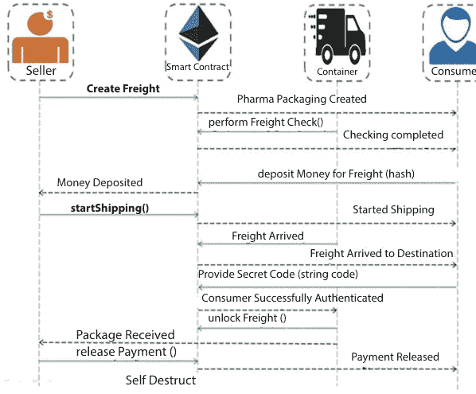

**图 10.10** 货物成功交付的消息序列图 [6]。

根据之前的讨论，客户获得批准支付货运费用，并在检查成功后获得一个哈希值。该哈希值作为货物到达目的地时的标识符，确认身份接收者。一旦客户存入预定金额，智能合约将启动发货开始事件。当集装箱到达目的地时，它与合约连接并提示用户提供解锁药品包裹的代码。在客户提供私密代码后，身份验证成功，集装箱随之解锁，从而交付给获批准的客户。成功交付将通过全网络事件进行宣布，触发卖家接收货运款。当支付流程成功完成后后，智能合约将激活自毁机制，表示流程已关闭。智能合约的当前余额将通过此函数转移到指定地址。图 10.11 显示了描述两种主要场景的消息序列。在第一种情况下，客户提供的哈希值与授权接收者之间存在差异。在第二种情况下，客户提供的哈希值与授权的...

# 区块链赋能医药行业 223

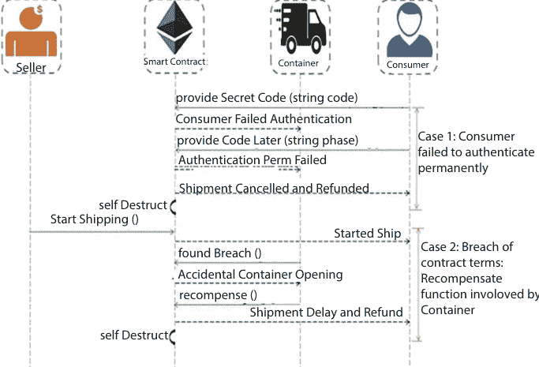

**图 10.11** 说明两种场景的消息序列图：情况 1，身份验证成功；情况 2，运输过程中的违约。

测试证明包裹交付和存入过程是成功的。在付款后，客户接收一个隐藏哈希（私密哈希）进行检查。根据协议，客户有 72 小时的时间纠正代码。另一种场景涉及客户确认收货，但输入了错误的起始代码。

# 224 健康科学中的区块链

224 如果在规定时间内未收到响应或输入了错误代码。在这种情况下，货运税将按的一数退还给客户。

### 10.4.1 测试

本节探讨了智能合约实现的详尽测试，强调了以太坊上系统参与者之间复杂的关系。智能集装箱（0xc58303d1113ad41f02576bdd6afbab3021402125）、负责启动医药包裹订单的消费者（0xa4b0897b0513df7c541b6d9d4db）以及卖家（0xca35b7d91548ef504de608dfe2fe44）被专门分配用于模拟测试场景。每个实体均有 100 个 Ether，以便在运行 Remix 时高效运行和评估智能合约代码。测试涵盖了三个关键场景：

- (1) 消费者提供正确私密代码的成功购买。
- (2) 因错误输入私密代码导致身份验证失败，提供三天的纠正窗口。
- (3) 货物运输过程中发生的违约。

函数根据货物的状态逐步完全执行。在这些匹配下，对智能合约进行监控，以确保在这些情况下具有高效性能。首先，测试涵盖了检查场景，包括符合约定和适当参数的医疗货运。这确保了包裹在运输过程中不会丢失。这种严谨的测试方法通过检查动态智能合约在各种场景下的韧性和适应性，确保了真实世界交互中的可靠性。流程错误的一个示例是在未执行货运检查之前尝试为货物存款，这将导致交易失败。


# 区块链赋能医药行业 225

制药智能合约函数的性能分析

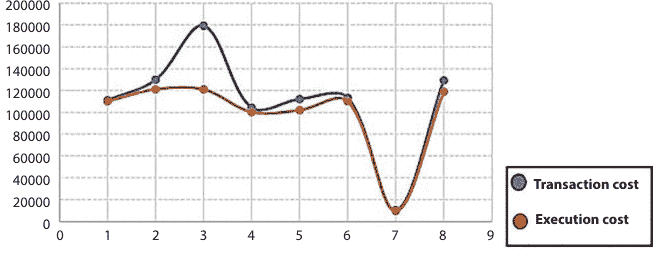

**图 10.12** 动态智能合约的成本性能分析 [6]。

## 10.4.2 成本性能分析

这部分侧重于衡量每个函数所消耗的价格和 gas 数量，以评估动态智能合约的性能。此外，智能合约有一个最小 gas 成本，涵盖了将任何命令部署到以太坊网络上的交易，必须满足这一条件才能执行整个交易。Remix IDE 能够通过输出控制台显示每笔交易的 gas 成本，是一个非常有用的工具。图 10.12 展示了与不同智能合约功能相关的费用和成本。该图表是智能资源消耗模式的良好范例。此外，图 10.12 中的红线代表每个用户执行的所有交易中产生的计算成本。蓝线（位于 Y 轴上，针对中大型规模的交易）代表交易费，其中包括将动态智能合约代码发送到以太坊区块链的费用。资源利用的主要分析和动态智能合约的评估必须基于此类研究。

## 10.5 结论

本章假设了一种基于设计科学范式的新方法，将动态智能合约与医药供应链业务相结合，以获得竞争优势。所提出的框架动态地集成了区块链、物联网（IoT）传感器技术以及智能物联网控制中心（IoCs），以管理药品向客户交付的安全且经过验证的分发。我们的系统通过智能合约编码和算法，其范围已足够直接实现在分发各种易腐物品的供应链框架中，尽管我们的主要重点是医药生产线。基于 Remix IDE 中编写代码的动态性，口袋合约（pocket contracts）的能力通过多种场景得到了验证，这些场景旨在恢复药品交付的信任、识别并解决运输问题以及加速退款流程。我们打算使用 Hyperledger 平台和开放去中心化应用（也称为 DApps），结合药品生产者、分销商和患者等多种现实实体来实现这些智能合约。因此，这一业务目标对于构建由动态智能合约技术支撑的受赖且稳健的供应链生态系统具有真正的里程碑意义。未来的任务将涉及在 Hyperledger 上部署这些智能合约，并创建包含制造商、供应商、支付方和患者等真实实体去中心化应用（DApps）。目标是建立一个开放且稳健的供应链生态系统。

## 参考文献

- Cohen, O., Fox, B., Mills, N., Wright, P., COVID-19 and commercial pharma: Navigating an uneven recovery, McKinsey & Company, New York, NY, USA, 2020.
- Brechtlsauer, E.D., Pennell, B., Durham, M., Hertig, J.B., Weber, R.J., Review of the 2015 drug supply chain security act. Hosp. Pharm., 51, 6, 493–500, 2016.
- Ballon, R.H., Gilbert, S.M., Mukherjee, A., New managerial challenges from supply chain opportunities. Ind. Marketing Management, 29, 1, 7–18, 2000.
- Toyoda, K., Takis Mathiopoulos, P., Sasase, I., Ohtsuki, T., A novel blockchain-based product ownership management system (POMS) for anti-counterfeits in the post supply chain. IEEE Access, 5, 17465–17477, 2017.
- Majdalawieh, M., Nizamamuddin, N., Alaraj, M., Khan, S., Bani-Hani, A., Blockchain-based solution for security and transparent food supply chain network. Peer-to-Peer Network. Appl., 14, 3831–3850, 2021.
- Abdallah, S. and Nizamamuddin, N., Blockchain-based solution for pharma supply chain industry. Comput. Ind. Eng., 177, 108997, 2023.
- Gomasta, S.S., et al., PharmaChain: Blockchain-based drug supply chain provenance verification system. Helium, 9, 7–15, 2023.
- Mangala, N., et al., Secure pharmaceutical supply chain using blockchain in IoT cloud systems. Internet Things, 26, 102115, 2024.
- Sharma, N. and Rohilla, R., A multilevel authentication-based blockchain medicine anti-counterfeiting for reliable IoT supply chain management. J. Supercomputing, 80, 4870–4913, 2024.
- Zakari, N., Al-Razman, M., Alsaadi, A., Alshareef, H., Alashaikh, L., Alharbi, M., Alomar, R., Alotaibi, S., Blockchain technology in the pharmaceutical industry: a systematic review. Peer Comput. Sci., 8, e8240, 2022.
- Huang, Y., Wu, Long, C., Dledgedger: A practical blockchain system for drug traceability and regulation, in: 2018 IEEE international conference on internet of things (iThings) and IEEE green computing and communications (GreenCom) IEEE cyber, physical and social computing (CPSCom) and IEEE smart data (SmartData), IEEE, pp. 1137–1144, 2018.
- Haq, I. and Esuka, O., Blockchain technology to prevent counterfeit drugs. Int. J. Appl., 180, 25.
- 2018. Jamil, F., Hang, L., Kim, D.H., Smart contracts for a smart ecosystem. Electronics, 8, 505, 2019.
- Mackey, T. and Nayyar, G., Medicines: a global threat. Nurs. Manage. (H), 21, 8.
- Tseng, J.-H., Liao, Y.-C., Chong, B., Liao, S.-S., Governance on the drug supply chain via gcoin blockchain. Int. Environ. Res. Public Health, 15, 6, 1055.
- World Health Organization. Standard and, 2022, [online]: https://www.who.int/health-topics/standard-and-falsified-medicines
- Swan, M., Blockchain: Blueprint for a new economy, O'Reilly Media, United States, 2015.
- He, H., Bai, Y., ADASN: Adaptive sampling for imbalanced learning. 2008 IEEE joint conference on neural networks (IEEE congress on computational intelligence), lee, pp. 1322–1328.
- Abugabah, A., Nizamuddin, N., Decentralized telemedicine framework. IEEE Access, 8, 16657–16658, 2020.
- Wood, G., Ethereum: A secure transaction ledger. Ethereum Project, Yellow Paper, 2014.
- Christidis, K. and Devetsotis, M., Smart contracts for the internet of things. IEEE Access, 4, 2292–2303, 2018.
- Rabah, K., Integration of IoT devices via a blockchain-based application, 2017, Master’s thesis.
- Jüttner, U., Peck, H., Christopher, M., Supply chain risk management: outlining an agenda for future research. Int. J. Logistics Res. Appl., 6, 4, 197–210, 2003.
- Clark, B. and Burstall, R., Blockchain, IP and the pharma industry—how distributed ledger technologies can secure the supply chain. J. Intellectual Property Law Pract., 13, 7, 531–533, 2018.
- Atlam, H. and Wills, G., Intersections between IoT and distributed ledger, in: Advances in Computers, vol. 115, pp. 73–113, Elsevier, Amsterdam, The Netherlands, 2019.
- Kuo, T.-T., Kim, H.-E., Blockchain technologies and healthcare applications. J. Am. Med. Inf. Assoc., 24, 6, 1211–1220, 2018.
- Takeda, H., Veerkamp, P., Yoshikawa, H., Modeling design process. AI Mag., 11, 4, 37–37, 1990.
- Peirce, C.S., Collected papers of charles sanders peirce, vol. 1, Harvard University Press, Cambridge, 1974.
- Purao, S., Truth or dare: the ontology question in design science research. J. Database Manage. (JDM), 24, 3, 51–66, 2013.


# 医疗数据的物联网与区块链安全

S. Pavithra*, Pavani M. and Harini D.

计算机科学与工程学院，韦洛尔理工学院，
印度泰米尔纳德邦，金奈奈

# 摘要

医疗数据的碎片化经常导致患者护理不一致，这是我们正面临的问题。我们的提议利用雾计算和区块链技术的革命性潜力来解决这一问题。区块链通过确保数据完整性、可追溯性和访问控制，消除了维护一致医疗记录的困难。通过在医疗区块链中添加增强隐私的功能，敏感的医疗数据得到了保护。我们研究了物联网（IoT）和雾计算当前如何演进，提升数据处理和管理能力，最终实现更好的患者护理。我们提出的范式转变了医疗生态系统，在这个生态系统中，患者隐私得到加强，数据驱动的决策变得可行，以患者为中心的概念以及各种医疗利益相关者能够轻松协作。该架构结合区块链的不可篡改性实现了安全的电子病历（EMR）共享，避免了患者需要反复陈述病史。我们通过开创性的个性化健康洞察仪表板，为消费者提供了一个以用户为中心的主动健康管理解决方案，该仪表板提供个性化的数据可视化和人工智能驱动的洞察。该策略的核心改变了医疗数据管理，促进了健康水平的提高理性选择。

**关键词：** 物联网、电子病历、访问控制、云、雾计算、CP-ABE、区块链

> *通讯作者：Pavithra.sekar@vit.ac.in

Aryan Chaudhary, Rashmi Singh and Gaurav Agarwal (eds.) 健康科学中的区块链，(229–252)
© 2025 Scrivener Publishing LLC

## 11.1 引言

在不断变化的医疗世界中，保护患者隐私信息是绝对必要的。通过仔细考虑并从文献的重要发现中汲取知识，我们提出的系统 LightMED 成为创新的典范。引用文献中关于区块链技术与现代计算关联的披露，LightMED 建立了其基础。利用区块链的不可篡改账本、去中心化和加密能力，在医疗数据管理环境中提供数据完整性、可追溯性和访问控制。LightMED 重申了对区块链驱动的以患者为中心的健康记录的需求，将患者优先，赋予他们权感，促进护理协调，并将患者保护放在首位。LightMED 工具箱中的一个核心组成部分是增强隐私的功能，根据研究 [4]，这些是医疗区块链中反复出现的主题。复杂的加密方法和访问控制措施加强了其防御，以保护医疗信息的机密性。LightMED 根据文献对雾计算与物联网（IoT）之间互利性关系的观察而进行发展。通过利用这种协作，它可以实时分析数据并增强数据存储和管理的有效性。LightMED 的方法受文献指导，文献强调了密文策略属性基加密（CP-ABE）在医疗安全中的重要性。该技术保护了基于云的医疗数据库，并使用去欺骗性访问技术确保医疗数据的强加密和访问控制。正如文献所述，LightMED 在资源受限的情况下使用加密访问控制算法，以保护移动云和物联网场景下的数据机密性。LightMED 整合了基于属性的加密（ABE），旨在根据建议协助应对物联网数据管理的复杂性，特别是文献建议的云端场景。LightMED 的设计整合了智能合约，这代表了文献中访问控制系统的蓝图。这些协议实现了安全的云端医疗记录交换。通过无缝集成外部工具进行灵活的策略管理，LightMED 响应了文献对有效策略更新的呼。。新技术，如用于物联网数据管理的区块链集成和基于属性的签名加密，成为 LightMED 基础设施的一部分，并加强了物联网领域的数据安全和控制。LightMED 是充分结合了这些革命性完整解决方案；它不仅仅是一个系统。

它预示了一个尊患者为核心的医疗环境，并解决了文献中提出的问题。LightMED 旨在通过为患者提供主动健康管理所需的知识和资源，从根本改变医疗数据管理。这是通过安全加密、复杂的访问限制和实时数据聚合实现的。接下来的每个部分将探索系统机制、安全性评估和性能的细微之处。在对文献深度理解的驱动下，LightMED 正在迈向患者赋权、数据安全和完整性至上的未来。通过创造数据处理的机会，进一步突显了物联网与雾计算结合的优势。密文策略属性基加密（CP-ABE）作为一种具有可能泄露用户风险的安全措施，对云安全至关重要。必须使用创新技术来隐藏访问策略，以保护敏感数据。这与证明了在移动云和物联网设置中使用加密访问控制机制进行数据传输的效率和安全性的研究是一致的。基于云的解决方案有效利用基于属性的加密（ABE），在防止未经授权访问的同时处理复杂性。在物联网数据管理方面，一种基于属性的加密的新颖方法通过保证数据安全提高了物联网数据的安全性。基于区块链的访问控制架构允许在云环境中私密交换加密的电子健康记录（EHR）。研究了一种整合外包策略更新的技术以减少通信开销和计算成本，以确定云托管大数据的有效访问控制。与此同时，智能合约自动了这些过程，区块链维护了不可篡改的记录账本，增强了安全管理。最终，大量的测试和比较研究表明这种技术优于以往的工作。

## 11.2 相关工作

区块链技术与现代计算的融合已成为维护完整性、可追溯性和访问控制的关键因素 [1]。以患者为中心的健康记录可以使用区块链赋予患者并简化协调 [3]。许多研究强调了医疗区块链中增强隐私功能的价值 [4]。通过创造更好数据处理的机会，定了物联网（IoT）与雾计算协作的基础。密文策略属性基加密（CP-ABE）作为一种具有可能泄露用户风险的安全措施，对云安全至关重要 [5]。必须使用创新技术来隐藏访问策略，以保护敏感数据。这与证明了在移动云和物联网设置中使用加密访问控制机制进行数据传输的效率和安全性的研究是一致的 [7]。基于云的解决方案有效利用基于属性的加密（ABE），在防止未经授权访问的同时处理复杂性 [8]。值得注意的是，一种用户友好的云集成强调了可验证性以确保精确解密，降低了用户处理的需求 [9]。一种包含验证源解密的新 ABE 系统显著提高了计算和带宽利用率，以降低成本和开销 [10]。另一篇论文提出了一种保护在线健康记录的方法，该方法利用 CP-ABE 和经过严格测试的策略版本机制。区块链具有变革医疗系统的潜力，正如基于智能合约的访问控制架构允许在云环境中私密交换加密的电子健康记录（EHR）所示 [11]。一种基于区块链的从物联网设备安全传输健康记录的系统建议强调了区块链在改进物联网医疗方面的重要性 [13]。一种考虑隐私担忧的动态安全访问控制策略优于其他方法 [14]。进一步研究了一种整合外包策略更新的技术以减少通信开销和计算成本，以确定云托管大数据的有效访问控制 [16]。


# 医疗数据的物联网与区块链安全 233

通过将工作负载迁移到雾计算节点 [17]，实现了完整性、机密性和访问控制。另一种应对数据泄露和中心化的策略是使用 IoT Chain，这是一种基于区块链的去中心化存储系统，它无缝结合了基于属性的访问控制和智能合约 [18]。同时，通过使用雾计算进行物联网数据聚合，提升了数据隐私、抗碰撞能力和恶意设备管理 [19]。

Secure Data 作为一种基于物联网的医疗安全突破性方法，通过分布式云数据库、秘密密文共享和基于 FPGA 的加密加强了数据安全 [20]。通过将 CP-ABE（密文策略属性加密）方法与属性权威管理模块相结合，解决了云存储中（特别是针对物联网）数据访问控制的重要性问题。这种组合确保了有效且安全的多权威访问控制 [21]。此外，针对云计算建议了一种强大的全密文策略 ABE，降低了安全问题和计算成本 [22]。该方法已经过广泛的测试和分析。测试和安全研究表明分层属性加密（HASBE）的有效性，它通过带有用户层级的 ASBE 扩展实现了可扩展性、细粒度管理和快速的用户撤销。这样做是为了增强云数据存储的访问控制。为了改进云端用户属性的管理并实现动态策略满足，开发了一种名为 CP-ASBE 的独特加密变体。一项研究涵盖了工业背景下的所有关键技术、趋势和关注点，提供了物联网现状的完整概述。

总之，这些研究展示了云服务器、物联网和医疗领域安全数据管理的发展蓝图；这得益于尖端加密、区块链集成和高效计算方法的结合。得助于雾计算实现的实时处理能力以及区块链日益增长的重要性，医疗数据管理正在发生变化。通过个性化的健康洞察仪表板利用大健康力量和主动健康管理，最终改变了医疗格局。

## 11.3 背景

我们建议的方法主要利用双线性映射，这是我们加密模块的关键组件。我们使用两个阶为 $p$ 的循环群 $G0$ 和 $G1$ 来定义映射。此外，我们使用一个生成器 $g$ 和针对 $G0$ 的双线性映射，它们满足以下要求：

### A. 双线性映射
双线性性质：

```
e(ua,vb) = e(u,v)ab (11.1)
```

公式 (11.1) 表示了双线性映射 $e$ 的双线性性质，其中 $ua$ 和 $vb$ 是 $G0$ 中的元素，$u, v, a, b$ 是 $Zp$ 中的元素。

### 非退化性质：

```
e(g, g) ≠ 1 (11.2)
```

公式 (11.2) 反映了双线性映射的非退化性。它规定如果应用于生成器 $g$ 自身的双线性映射不等于1，则该映射是非退化的。

### 单调访问结构：

```
If B ∈ A and B ⊆ C, then C ∈ A (11.3)
```

公式 (11.3) 描述了单调访问属性。这意味着如果集合 $B$ 是 $C$ 的子集，则 $C$ 必须包含在 $A$ 中。

访问结构：
我们建议方案中的核心思想是：
- 终端
- P1
- P2
- Pn

### B. 区块链
我们管理医疗数据的建议方案的关键组件是以太坊权益证明机制（POS）。我们利用区块链创建数据块。使用 Solidity 编程语言编写智能合约，允许进行实时处理。与雾计算相结合时，这种技术确保了数据安全和可追溯性。区块链与加密工具的结合解决了数据碎片和患者隐私问题，最终实现了一个以患者为中心的环境。

## 11.4 建议系统

### A. 系统模型
组成我们系统的八个实体：
- 终端
- 区块链
- 云服务提供商 (CSPs)
- 雾节点 (FNs)
- 物联网设备
- 信任权威 (TA)
- 数据所有者 (DOs)
- 数据用户 (DUs)

系统通过聚合终端从患者处收集测量数据。数据经过加密并传输到雾节点，雾节点对密文进行验证。在雾节点成功验证并解密加密值后，数据用户使用其来计算对称密钥。图 11.1 显示了系统模型。每个系统实体的规格描述如下：

- 云服务提供商 (CSP)：提供存储。区块链的使用了了安全和完整性。
- 雾节点：包含计算资源以加速任务。
- 边缘设备：与使用云代理相比，这降低了通信成本。

在未来，该模型也可以进行迭代。

![img/fea41dfefcdce94be90e86661d80689_246_0.png]
图 11.1 建议的系统架构。


# 医疗数据的物联网与区块链安全 237

区块链处理多项任务，包括密文索引、会话管理、审计和身份验证。数据存储在云服务提供商处后，由其存储索引。该技术生成了三个智能合约，分别用于会话管理、用户身份验证与校验以及索引存储。加密的密文索引和所需的设置包含在索引智能合约中，以实现安全的数据存储和检索。用户请求的密文内容通过用户身份验证与校验合约进行验证。最后，使用会话管理合约验证每个身份验证会话的持续时间和尝试次数。每种违规行为都记录在用于审计、会话管理、身份验证和密文存储的系统中。

索引存储：区块链实现了电子医疗记录的安全归档和检索。

智能合约：它们作为数据检索和存储的安全手段，应用于会话管理、用户身份验证和数据处理。

可信权威（TA）负责创建、分发和监督安全设置及密钥。通过负责创建、分配、撤销和维护密钥及安全设置，它确保了系统的稳健安全。数据所有者（DOs）是指物联网设备收集其信息的个体。患者和医生都包含在此组中，以确保以患者为中心的数据控制和隐私，医生与患者在互惠伙伴中协作。需要访问存储数据提供治疗的医疗人员被称为数据用户（DUs）。这包括医生、护士和其他医疗工作人员。需要访问存储数据用于治疗目的医疗专家可以通过数据解密程序、基于区块链的身份验证和安全访问请求来实现。

### B. 密码构造

### 第一阶段：初始化

系统初始化阶段的三个算法分别是：`dataAggFuncGenerator`由每个聚合终端运行，`getKeyFuncGenerator`由每个数据所有者运行，以及 `initialize Trusted Authority`（由 TA 运行）。

2. 初始化可信权威(κ) → (PK, MK)

安全参数是系统初始化阶段第一个算法的唯一输入，它产生两个输出：主密钥 MK 和公钥 PK。该函数首先选择一个生成器和一个素数阶的双线性群，然后选择随机值。

公钥可以表示如下：

```
PK_k = {G_0, g, h, f = g^1, β, (e, g)α, fog_parameters, blockchain_data}
MK_k = (β, g^α, fog_parameters, blockchain_data)
```

### 3. getKeyFuncGenerator() → (KeyGetFN)

```
Function getKeyGetGenerator {
  SecureRandomKey secureRandKey = CSPRNG.generateRandomKey()
  return new KeyGetFN(string RV, Blockchain Data blockchain Data, Fog Computing Parameters fogParams);
  String s {
    For each RV as s {
      Encrypted Random Value encryptedRV = fogDecrypt(RV, fogParams)
      SymmetricKey symmetricKey = blockchain Decrypt(encryptedRV, blockchain Data)
      DecryptedValue = symmetricDecrypt(s, symmetricKey)
    }
    return decryptedValue
  }
}
```

# 健康科学中的区块链

CSPRNG，s（即“密码学安全的伪随机生成器”）生成名为 `secureRandom-Key` 的 256 位值，用于安全地生成 `getKeyFunc`。每个 `getKeyFunc` 在创建后被发送到系统中的每个 DU。

### 4. dataAggFuncGenerator()→ (Fad)

该方法为每个聚合终端生成一个 Fad，其功能如下：

```
Function dataAggFuncGenerator(RandomValue RV, Int, sr):
  AggregationFunction Fad {
SecureRandomRandVal = CSPRNG.generateRandomVal();
Int start = 256 x sr;
secureRand = secureRandVal[start,start+256];
return new AggregationFunction(String RV, Int sr): {
Int start = 256 x sr;
SecureRandVal partialSecureRandVal = secureRandVal[start,start+256];
For each RV as s {
EncryptedRandomValue encryptedRV = fogEncrypt(RV,partialSecureRandVal);
EncryptedRandomValue secureRV = blockchainEnhancePrivacy(encryptedRV);
AregatedValue a = secureRV ⊕ s;
}
return a;
}
```

与 `keyGetFuncGenerator` 的方法类似，利用密码学安全的伪随机数生成器（CSPRNG）来生成随机值。此 `adFunc` 是安全生成的。系统内的关联设备通过安全链路接收为每个聚合终端生成的 `AdFunc`。

#### i. 第二阶段：物联网加密

在当前阶段，我们的系统通过本地加密患者 P 的设备数据来确保物联网数据安全。使用加密函数 `encryptIoT(m,δ(i),NP, t) → (CTI, σCTI)`。

处理后，从随机整数 $\delta(i)$、时间戳、原始数据和物联网标识中获得密文 CTI 和签名 $\sigma CTI$。该策略符合我们的建议方案，它整合了区块链、雾计算和隐私增强技术，同时强调了以患者为中心的医疗保健框架内强大的物联网数据保护。

```
Function encryptIoT(String m, t, Int δP(i),List<String> NP): (String CT, String σCTI) {
String C = m fadi(t ⊕ δP(i));
String CT = ;
for each NP as j {
if (j ≠ δP(i)) {
String d = fadi(t | j);
CT = CT | d;
}
return CT, Sign(CT);
}
```

# 医疗数据的物联网与区块链安全 239

随后，将 CT 和 sCT 合并并传向聚合终端。

#### ii. 第三阶段：数据聚合

此时，患者数据已收集完毕。聚合终端是运行 `decryptIoT` 和 `aggregateData` 算法的地方。`decryptIoT(CTs, sCTs, t, NP) ->(M)`

```
decryptIoT(List<String> CTs, List<String> sCTs, String t, NP): String {
List<String> validCTs = [];
OTPad = Fad(t | NP);
For each CTs, as c, s {
If (Hash(c) == s {
validCTs.append(c);
}
}
For each validCTs as c {
k = k ⊕ c;
}
return k ⊕ OTPad;
}
```

聚合终端在每次执行 `decryptIoT` 函数后保存物联网设备的原始数据和时间戳。如果收集了足够的原始数据，授权用户可以使用 `aggregateData` 将所有原始数据打包并添加额外的备注。`aggregateData(Ms, AD)->(D)`

该方法将字符串数组与字符串 AD 连接以生成 D。
Function aggregateData(List<String> Ms, String AD): String {
String D = "";
ForEach Ms as m {
D = D | m;
}
return D | AD;
}
```


# 健康科学中的区块链

## 1. 初始化

由权威机构（TA）产生的密钥对是模拟器的一组，它产生第二个密钥对。在对 SA-SA 中的每个合法机构执行 `initializeTrustedAuthority` 后，挑战者 C 为攻击者 A 提供公钥 PK。然而，攻击者 A 会从挑战者处获取所有被攻破机构 SA 的公钥和私钥。

阶段 1：攻击者向挑战者 C 发送一组来自 TA 的查询集合 S。最后，挑战者提供私钥，该密钥与攻击者 A 对 S 特性的响应有关。

## 2. 问题

攻击者 A 向模拟器发送消息 m0 和 m1。之后，模拟器通过抛掷一个公平的二进制硬币来返回 m 的加密。加密后的 m 计算方式如下：

Cy = H(att)qy(0), CT=(T,C)=mZ,CT=hS,y Y 其中 y是一组特征。结果是该密文是 m 的一个合法随机加密。由于攻击者 A 将 C 视为 G1 中 z 接收到的消息的随机部分，该消息不包含任何关于 m 的信息。

阶段 2：模拟器的运行方式与第一阶段相同。攻击者 A 向模拟器发送消息 m0 和 m1。模拟器根据攻击者 A 选择的公平二进制硬币抛掷和属性对 m 进行加密。密文 CT' 的构造保证了数据安全，并且是 m 的适当随机加密。

以下公式确定了攻击者 A 的优势：收益 = Pr[ ] 1/2。因此，如果在给定的游戏中，所有多项式时间内的攻击者最多仅具有微小的优势，那么我们的策略就是安全的。

定理 2：对手无法利用从渗透的雾节点收集的部分值解密密文文件。在数据泄露的极端情况下，必须使用第二个部分随机值和密钥生成算法对实际数据进行解密，以保证数据安全。

## 3. 解密

攻击者 A 破解了使用 CP-ABE 加密的部分随机值；尽管如此，它仍然需要第二个随机值和数据所有者的密钥生成函数来获取 AES 格式的实际加密数据。区块链存储第二个随机值的地方，智能合约负责身份验证和审计。根据定理 3，如果没有能够区分 p 和其随机置换 pp 的对手，则 p 在计算上无法与 p 分离。

## 4. 物联网加密

攻击者 A 使用物联网设备发送加密通信，为了确定每个设备的位置，攻击者 A 需要知道其置换值。分配给每个设备的随机数取自置换列表 p。对于数据的初始解密，聚合神经元的秘密函数需要随机置换 p。攻击者 A 必须首先确定 p 的值，以便将真实值 P 与所有其他 Ps 区分开。

## B. 策略的机密性

雾节点负责使用顺序方法和由数据所有者（DO）选择日期的链式策略树来更新策略并使用 CP-ABE 加密数据。即使相同的属性出现多次，嵌入在子节点中的父级加密以及每个时间戳的唯一性为每个节点生成了不可追溯且不可区分的密文。

## C. 物联网加密安全性

为了获得策略树 T' 的可用形式，调用了加密步骤中的 `policyTreeDec` 过程。随后，使用该策略树对 RV1 进行加密并保存到云端。

## 11.5 实验结果与讨论

本节提供了我们的 LightMED 方法与相关工作之间的功能和计算成本对比。我们特别考虑了支持使用 CP-ABE 对物联网数据进行安全细粒共享的工作。我们还提供了关于我们方案性能测试和相关任务的实验细节。

## D. 功能比较

表 11.1 比较了我们提出的方法与相关文献（包括 [3] 和 [22]）的功能。总而言，本研究对比的方案允许对物联网数据进行加密，无论它们在有用性和复杂性何如何。另一方面，我们提出的技术在聚合之前对物联网数据进行加密。在使用聚合认证对物联网数据源进行认证时，我们的方法利用了 ECDSA 算法。系统仅允许雾节点处理部分 CP-ABE 解密到云端；然而，我们提出的技术允许雾节点处理整个 CP-ABE 加密和解密。最后，我们的方法具有策略更新功能，可以使用雾节点优化的重加密成本修改访问策略。

## E. 性能分析

在这一部分，我们通过仿真和测试评估了加密、解密和策略更新的性能。我们的工作考虑了搭建区块链（数据加密解密的代理）以及物联网数据创建和加密的环境。之后，我们使用 Solidity 编写智能合约的概念验证，并使用 Python 进行加密操作以通过程序化实现我们的推理。最后，我们使用各编程语言自带的时钟以纳秒为单位测量每个操作的执行时间。然后我们根据需要将结果转换为毫秒或秒。

表 11.1 功能比较。

| 方案 | F1 | F2 | F3 | F4 | F5 | F6 |
|---|---|---|---|---|---|---|
| [3] | × | × | × | × | ✓ | × |
| [22] | × | ✓ | ✓ | × | × | ✓ |
| 我们的 | ✓ | ✓ | ✓ | ✓ | ✓ | ✓ |

- 1) 实验环境搭建

我们确定了所提方案的加密解密成本以及系统，以评估建议方案的性能。实现使用了 Python 的密码库，并在模拟所有方案的加密过程时使用了 Advanced Crypto Software 和基于配对的加密。研究在配有 Ubuntu 20.04 OS、Intel(R) Xeon(R) E236 CPU (3.40GHz) 以及 16 GB 内存服务器上进行。通过 Python 的多线程包，我们能够模拟大量进程以测量我们系统的性能。表 11.2 列出了我们在实验中使用的参数。

- 2) 区块链环境搭建

使用 Web 的 Remix 开发环境和 Solidity 编程语言，我们在以坊网络上创建了智能合约。该 IDE 支持以坊智能合约的开发、部署和测试。我们仅在本地默认工作区进行测试，没有使用任何特定的以坊地址或跨站钱包。Solidity 虚拟机和编译器版本 0.8.18+ commit 是 Remix VM (上海) 环境。使用智能合约和用户的个人信息，我们的方法随机生成了 100 个用户 ID。输入字符串反映了 ISCpub，给定的字符串表示密文包的索引。

- 3) 加密与解密的性能


# 246 健康科学中的区块链

**表 11.2** 寻找参数设置的实验。

| 参数 | 设置 |
| --- | --- |
| 数据大小 | 40KB |
| AES 密钥长度 | 256 Bits |
| RV 长度 | 256 Bits |
| 策略数量（加密与解密） | 1,2,5,10,20,40,80,100 |
| 策略数量（策略更新） | 20 |
| 并发策略更新请求数 | 1,2,4,10,50,100,200,500,1000,1500,300,5000,10000,25000,50000,100000 |

图 11.2 和 11.3 所示，每个方案的加密和解密由不同的实体执行，例如数据所有者、代理/雾网节点和数据用户。本文引入了一种新的数据源方案，与现有解决方案相比，显著降低了加密和解密成本。传统方法依赖于计算昂贵的部分 CP-ABE 加密，而所提方案在全程利用了更高效的 AES 加密。这一策略选择在两个关键领域带来了显著的性能提升：加密效率和解密效率。

传统方案在属性增加时，数据所有者（DO）的加密时间会随之增加。相比之下，所提方案无论属性数量多少，都能保持持续较低的加密时间。这种效率源于其对 AES 加密的唯一依赖，其效率比那些笨重的同类方案要高得多。所提方案在实现数据用户（DU）侧绝对最低且最一致的解密成本方面表现出色。再次，这种效率源于对敏捷的 AES 加密的偏好，与其他方法采用的对计算要求高的全 CP-ABE 解密形成了鲜明对比。

我们的方案配备了精简的 AES 加密，成本最低，并产生持续的低加密时间。与此相比，方案 [3] 和 [23] 受部分 CP-ABE 加密的负担，在 DO 侧的成本略高，且这种成本随着访问结构中属性数量的增加而进一步膨胀。由于方法 [3] 和 [22] 依赖于全 CP-ABE 解密，属性数量的增加成为负担，显著增加了它们的加密时间。另一方面，我们的方案在 DU 侧自豪地保持了最低且最一致的解密成本，巩固了其作为高效解决方案的地位。

## 4) 全局策略的更新

对针对雾网节点建议的策略更新方法进行了测试。实验表明，该建议方法可以产生 100 到 1,000 个并发策略更新请求，速度最高可每秒 680 次重加密。尽管存在硬件限制，系统每秒 359.71 次重加密的高速率对于涉及大量用户的场景来说是合适的。

讨论部分检查了所提系统的的适用性和可行性，并分析了该方案在各种负载场景下的表现。该分析突出了所提方法的潜在优势，并强调了其在医疗数据管理中的重要性。我们建议方案的有效加密和解密程序是其主要优势之一，特别是对于包括数据所有者用户所有者的终端用户而言。有趣的是，这种方法不随属性数量而缩放，这一优点增加了终端用户的加密和解密效率。在处理需要快速安全访问的海量隐私医疗数据时，这一特性变得尤为重要。医疗数据管理的另一个基本功能是策略更新。多个终端用户可能会同时或分时间执行这些更新。我们的测试显示，即使有更多频繁需要大量处理能力的重加密过程，吞吐量仍然在增加。

### 策略更新吞吐量

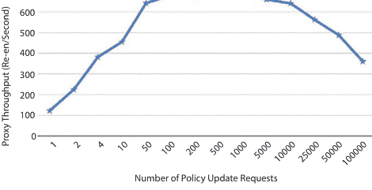

**图 11.3** 策略更新的吞吐量。

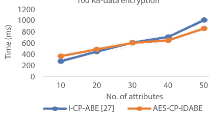

**图 11.4** 所提方案与现有方法在 100 KB 数据加密方面的对比。

图 11.4 展示了该方案的韧性，以及它如何很好地处理策略修改带来的压力。值得注意的是，终端用户消除了性能方面的担忧，因为所有与密文策略策略属性基加密（CP-ABE）相关的加密和解密过程都发生在雾层。需要指出的是，虽然我们的实验使用单机模拟了雾层，但这并未充分利用雾计算的能力。雾计算在附近的雾网节点之间分配和共享资源的能力是一项关键优势。这为进一步研究如何利用雾计算能力进一步改进我们的建议方案提供了一个迷人入胜的领域。这段讨论强调了我们的方法在提议背景下的用性和效率，特别是在处理敏感医疗数据时。所提方案最终通过加强数据安全和简化终端用户的数据访问，提高了医疗保健数据管理的有效性和完整性。该方案的设计与创建一个以患者为中心的医疗保健生态系统的总目标完美契合，该目标重视机密性、数据驱动的决策和利益相关者之间的协作。这一转变的核心是通过区块链进行医疗数据的安全交换，并结合雾计算的实时数据处理能力。患者和医疗保健专业人员可以在“个性化健康洞察面板”（Personalized Health Insights Dashboard）的帮助下关注健康，该面板提供了实时洞察、建议和交互式数据可视化。雾计算概念与方案一致，简化了协调并提供了实用性、效率和实时处理能力。该方案得到了文献的支持，强调了加密、区块链和高效计算在医疗保健中的重要性。

## 11.6 结论

结论，通过集成区块链、雾计算和 EMR 共享，医疗数据保护和有效访问发生了根本性变化。物联网驱动的 EMR 改进了护理和决策。然而，物联网设备的安全性、CP-ABE 实现以及云数据隐私问题仍然存在。最近的访问控制修订使格局变得复杂。数据隐私的讨论受益于这项对可用方案的研究。

未来，通过研究加密方法、简化通信协议并利用同态加密（允许对加密数据进行安全计算）等领先技术，系统可能会更加……。加密算法的变化以及相关方之间的持续合作将改进整体状况。为了创建一个更完整、集成的医疗生态系统，持续的研究工作应集中在提高用户体验、可扩展性和互操作性上。

## 参考文献

- 1. Tandon, A., Dhir, A., Najmul Islam, A.K.M., Mäntymäki, M., Blockchain in healthcare: A systematic literature review, synthesizing framework and future research agenda. Comput. Ind., 122, 103290, 2020. ISSN 0166-3615, mhtts://doi.org/10.1016/j.compind.2020.103290.
- 2. Bonomi, F., et al., Fog Computing: Principles, Architectures, and Applications, in: Internet of Things (IoT). Springer, 12 January 2016.
- 3. Chelladurai, U., Pandian, S., Ramasam, K., a blockchain based patient electronic health record storage and integrity management for e-Health systems. Health Policy Technol., 10, 4, 100513, 2021. ISSN 2211, https://doi.org/10.1016/j.hlpt.2021.100513.


# 健康科学中的 250 个区块链

以及未来方向。J. Netw. Comput. Appl., 215, 103633, 2023. ISSN 1084-8045, https://doi.org/10.1016/j.jnca.2023.103633.

- 5. Chiang, M. and Zhang, T., Fog计算与物联网：研究机会概述。IEEE Internet Things, 3, 6, 854–864, Dec. 2016. 10.1109/JIOT.2016.258453.
- 6. Yadav, U.C. and Ali, S.T., 密文策略隐藏的基于属性的加密，见：Proc. Int. Conf. Adv. Comput. Commun. Informat. (ICAC), p. 2067–2071, Aug. 2020.
- 7. Sanchol, P, Fugkeaw, S., Sato, H., 一种基于移动云的效力外包解密访问控制，见：Proc. 10th IEEE Int. Conf. Mobile Cloud Services Eng. (MobileCloud), pp. 1–8, Aug. 2022.
- 8. Hahn, C., Kim, J., Kwon, H., Hur, J., 具有防范云存储未经授权访问韧性的高效物联网管理。IEEE Trans. Cloud Comput., 10, 1008–1020, Apr. 2022.
- 9. Lai, J., Deng, R.H., Guan, C., Weng, J., 具有可验证外包解密的基于属性加密。IEEE Trans. Inf. Forensics Sec., 8, 8, 1343-1354, Aug. 2021.
- 10. Lin, S., Zhang, R., Ma, H., Wang, M., 重新审视具有可验证外包解密的基于属性加密。IEEE Trans. Inf. Forensics Sec., 10, 2119–2130, Oct. 2021.
- 11. Fugkeaw, S., 一种外包个人健康记录的轻量级策略更新方案，IEEE Access, 9, 54862–54871, 2021.
- 12. Sainsbury, A., Tu, Q., Sheng, N., Yao, L., Zhang, Y., 智能医疗系统基于智能合约的访问控制框架。IEEE Internet Things, 7, 8, 5941–5925, Apr. 2021.
- 13. Zhang, J., Yang, Y., Liu, X., Ma, J., 物联网的高效基于区块链的分层数据共享。IEEE Trans. Inf. Informat., 18, 7119–7150, Oct. 2022.
- 14. Alshehre, S., Bamasaq, O., Alghazzawi, D., Jamioom, A., 区块链辅助云-物联网环境中通过可信委托和重定位实现动态安全访问控制和数据共享。IEEE Internet Things J, 10, 5239–4256, Mar. 2023.
- 15. Liu, Z., Cao, Z., Wong, D. S., 可追溯 CP-ABE：如何通过在 ebay 上出售解密设备来捕捉泄露密钥的人，见：Proc. ACM SIGSAC Conf. Comput. Commun. Secur. (CCS), pp. 475–486, 2022.
- 16. Yang, K., Jia, X., Ren, K., Xie, R., Huang, L., 云端大数据的动态策略使用实现高效访问，见：Proc. IEEE Infocom. Conf. Comput. Commun., pp. 2013–2021, Apr. 2023.
- 17. Yu, J., Liu, S., Wang, S., Xiao, Y., Yan, B., LH-ABSC: 适用于云-雾辅助物联网的轻量级混合属性签名加密方案。IEEE Internet Things, J., 7, 7949–7966, Sep. 2021.
- 18. Ullah, U., Raza, B., Shah, H., Khan, S., Waheed, A., 面向物联网环境的区块链安全存储和可信数据共享方案。IEEE Access, 10, 36978–36994, 2022.

# 医疗数据的物联网与区块链安全 251

- 19. Shen, X., Zhu, L., Xu, C., Sharif, K., Lu, R., 雾计算中动态组的隐私数据聚合方案。Inf. Sci., 514, 118–130, Apr. 2020.
- 20. Tao, H., Bhuiyan, M.Z.A., Abdalla, A.N., Hassan, M.M., Zain, J.M., Hayajneh, T., 基于物联网的医疗保健的硬件加密器安全数据采集。IEEE Internet Things J., 6, 1, 410–420, Feb. 2021.
- 21. Xiong, S., Ni, Q., Wang, L., Wang, Q., SEM-ACSIT: 针对物联网云存储的安全高效多权威访问控制。IEEE Internet Things J., 7, 4, 2914–2927, Apr. 2020.
- 22. Li, J., Wang, S., Li, Y., Wang, H., Wang, H., et al., 云计算中具有策略更新的高效基于属性加密方案。IEEE Trans. Informat., 15, 12, 6500–6509, Dec. 2020.
- 23. Zhang, Z., Zhang, J., Yuan, Y., Li, Z., 基于区块链的具有可靠验证的表达性全策略隐藏密文策略基于属性加密方案。IEEE Internet Things J., 9, 11, 8681–8692, 2022.

# 药物药研究中的区块链

Soma Saha¹ 和 Bodhisatwa Mazumdar²

¹计算机科学与工程系，Prestige Institute of Management and Research, Indore, Madhya Pradesh

²计算机科学与工程系，IIT Indore, Madhya Pradesh

# 摘要

COVID-19 的出现标志着制药行业需要演进性研究。药品供应链（PSC）是具有重要意义且复杂的供应链管理（SCM）之一，主要由于两个因素。第一个因素是社区的福祉，这可以是国家也可以是全球经济。它取决于区域、国家、跨国和全球的医疗系统和供应链流程。医疗领域和真实的药品直接影响生活质量。第二个因素是PSC 涉及多个为药物生产提供原料和设备的供应商。公司生产的药物通过多个分销商和利益相关者交付生物技术公司、卫生监管机构、医院、患者和药店。PSC 中多个利益相关者的参与需要投资者的真实性、产品数据透明度、供应链中实时更新的数据流，以及由真实利益相关者生成的数据不可篡改性，以维护系统的信任。传统的供应链缺乏这些功能。在本章中，我们回顾了现有的药品供应链区块链框架及其优缺点。此外，我们分析了这些框架如何支持药物认证和追踪。最后，我们通过讨论区块链实施的现实挑战进行总结。

**关键词**：药物研究、药品供应链管理、分布式系统、区块链、分布式账本技术、假药、可追溯

## 12.1 引言

药品供应链（PSC）是具有重要意义且复杂的供应链管理（SCM）之一，主要由于两个因素。第一个因素是社区的福祉，这可以是国家也可以是全球经济。它取决于区域、国家、跨国和全球的医疗系统和供应链流程。医疗领域和真实的药品直接影响生活质量 [1]。例如，[2] 提到低质量、不标准或假冒抗生素可能导致大量肺炎儿童死亡。第二个因素是PSC 涉及多个为药物生产提供原料和设备的供应商。公司生产的药物通过多个分销商和利益相关者交付生物技术公司、卫生监管机构、医院、患者和药店。PSC 中多个利益相关者的参与需要投资者的真实性、产品数据透明度、供应链中实时更新的数据流，以及由真实利益相关者生成的数据不可篡改性，以维护系统的信任 [3, 4]。因此，由于其固有的复杂结构，此类系统的实施非常困难。目前药物的重点一直是制造设施的选址和设计、标准质量产品的生产，以及在温度或湿度等环境限制下的库存存储和产品配送。此外，平衡产能与未来市场需求的需求日益增加，这在很大程度上是由临床试验和竞争公司的性能指标驱动的。


# 医药研究中的区块链技术 255

图 12.1 展示了药品供应链（PSC）系统涉及的通用操作。这些操作涵盖了 PSC 系统中的大量参与者或利益相关者。供应链从不同国家（如美国、印度以及其他亚洲和欧洲国家）采购原材料开始，随后在印度、越南或中国进行流水线生产。接着，利用仓储设施在印度境内或其他中转国家进行存储。之后，药品通过在线商店、零售店和直销团队进行分销。这种类型的系统实现需要一系列步骤，以确保药物的溯源检查以及药品成分数据的透明度。

在 COVID-19 疫情期间，救命药物的短缺以及该时期关键的地缘政治形势，使得 PSC 的正规化成为多个国家政府及其机构的首要任务之一。根据印度药品生产商协会（简称 OPPI）的第 54 届年度报告组织，印度已按产量成为世界第三大制药生产国 [5]。由于其仿制药和低成本疫苗的生产，印度制药行业在全球市场的需求蓬勃发展。然而，被通俗地称为世界卫生组织（WHO）表示，发展中国家 PSC 内流流的药物中约有 10% 是次品和伪造品 [6]。在美国，食品药品监督管理局（FDA）负责

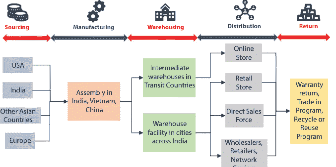

图 12.1 药品供应链中的操作。

# 256 健康科学中的区块链技术

监控药品供应链中药物移动的质量、安全有效性。在印度，中央药品标准组织（CDSCO）负责此类工作。2018 年，CDSCO 发布了良好分销规范指南，以确保在整个分销阶段（包括采购、购买、储存、分销、运输、记录实践和进一步的文件）恢复药品的良好质量 [7]。隶属于印度化学与肥料部的印度药品部（DOP）强调了其对国家制药行业创新和增长的关注与动力。此外，它还强调监管关键方面，包括：(i) 价格控制，如可负担的价格提供药物；(ii) 救命药和仿制药的研发；(iii) 药品知识产权的保护以及 (iv) 符合国际药品行业义务 [8, 9]。药品部的愿景是把印度推向全球药品研发的全球领导者，并确保国内药品和医疗器械的可获得性、可负担性和成本控制。

由于药品对人类生命有直接影响，药品质量在任何制药行业中一直是一个隐含的高价值点 [1]。因此，发展中国家出口药品时，面临着来自全球发达国家监管机构（如 FDA）的更严格审查。另一方面，对制造药品的特定成分的进口禁令、工厂关闭以及全球监管机构对价值链中质量控制的关键监测影响了出口数据，这影响了制药公司的信誉，进而影响其收入。在国家层面，印度的 CDSCO 扩大了站点范围和检查频率，以减少次品药品的营销和分销。目前，印度有近 500 个 FDA 批准的站点。全球监管机构经常检查这些站点以解决各种问题，如数据完整性缺失、发现数据造假的检查程序、不遵守标准操作程序（SOP）和数据源可追溯性、严重的交叉污染、记录实践以及设备仪器的校准不足 [5]。与全球平均水平相比，由于许多原因，印度制药行业的平均水平正在落后，例如缺乏：(i) 在各个功能部门和站点集成企业资源计划（ERP）系统；(ii) 在 IT 系统中纳入本地或全球供应链合作伙伴和第三方供应商；(iii) 基于实验室信息的文档管理系统的自动化使用；(iv) 在原材料和成品上使用无线射频识别（RFID）系统；(v) 使用智能包装和数据记录仪来控制温度；(vi) 使用智能设备，如手持设备、可穿戴设备和机器人；(vii) 创建移动和基于云的平台；(viii) 在研发中使用虚拟工程；以及 (ix) 对先进分析和数据交换的资本利用 [10]。《药品供应链安全法》（DQSA）最初由美国总统巴拉克·奥巴马于 2013 年签署，该法敦促药品供应链参与者和利益相关者进行合作，建立一个电子且互操作的系统，以便对其在美国境内运输的药物进行识别和追溯。尽管国家和通用监管机构有严格的药品分销和质量控制政策，但日益增加的伪造品生产和销售继续使数百万生命面临风险，并导致医疗欺诈成本增加数十亿美元。

由于其去中心化的本质、不可篡改性、可追溯性、隐私性、分布式属性和智能合约功能，区块链技术成为缓解这些与 PSC 系统固有相关的问题的非常有前景的解决方案 [1–15]。区块链技术支持维护日志和数据审计；这一属性结合供应链内的各种利益相关者身份验证方案和产品识别方案有助于追踪药品及药物的真实性。因此，研究人员已尝试将区块链技术用于通用供应链管理（SCM）系统。然而，每种技术都有其自身的优缺点。此外，PSC 有其自身的固有特征，因此它与其他 SCM 系统不同。由于其结构复杂，区块链技术在 PSC 中的成功实施尚未实现。在本章中，我们分析了国内和国际市场的 PSC 特性、SCM 和 PSC 的现有架构，以及 PSC 管理的区块链技术。本章的组织从药品供应链涉及的各个方面问题的详细分析开始，随后我们讨论了通用 PSC 架构。在第 12.4 节中，讨论了 SCM 的区块链特性和现有架构。接下来

我们在第 12.5 节分析了区块链技术如何缓解适用于 PSC 的问题。

258 健康科学中的区块链

## 12.2 药品供应链的主要特征

作者在 [11] 中研究了七家经营制造、技术、零售和金融服务的美国大型供应链管理（SCM）公司。作者通过对示例交易的案例研究，描述了目前财务账目记录系统的局限性。该示例交易涉及一家零售商和一家银行。零售商从供应商处收集产品，银行需要为供应商提供流动资金。先进的财务记录系统、人工审计和检查无法顺畅地连接任何 SCM 系统存在的信息流、库存流和资金流。因此，消除执行过程中的错误、改进数据驱动的决策以及解决供应链冲突变得困难。

实时检测操作错误（如漏货、库存记录错误以及同一笔付款的多次重复付款）在广泛使用的 ERP 系统和财务账目记录系统中是不可能的。当发现差异时，即使如此，通过跟踪记录在文档账目和其他文件中的活动流来确定源头或解决问题也是高成本且困难的。即使某些 ERP 系统能够捕获各种交易流，也很难分析并确定哪些账目记录（如应付账账户、重复交易的精确金额、退货贷方账户等）对应于哪些库存交易。这种场景适用于在极其巨大的利益相关者、参与者和产品网络中每天处理大量交易的大型企业。一般的供应链管理（SCM）活动由于许多其他固有因素增加了其复杂性。对于示例案例场景，订单-发货和付款可能无法顺畅同步，因为一个订单可能被分成多次发货并关联相应的发票，或者一组订单可以合并为单次运输以降低运输成本。原材料短缺、订单产品缺货、运输问题、过剩库存、降低成本

最后，我们在第 12.6 节中总结了在 PSC 管理中使用区块链技术的优缺点。


# 制药研究中的区块链 259

在运输过程中，有多种因素导致了同步问题。在制药供应链中，由于供应短缺、资源公司关闭或当地及全球国家政策和法律导致原材料不可用，会直接影响需求和人类生命。另一方面，过量的产品库存和零散的需求可能导致货架上的药物或医药设备过期，并给公司带来巨大损失。

文献 [16] 解决了测试任务顺序的设计问题，该问题考虑了资源无限可用的情况。该模型与传统项目调度的区别在于，每个测试任务都有一个失败概率。因此，单次测试任务设计可能无法保证结果。该问题通过连续时间混合整数线性规划（MILP）方法解决。另一个关键问题在于开发阶段的风险管理，即候选药物的选择、试验和工艺开发。作者 [17, 18] 提供了一种产品选择和测试计划规划的方法，同时有效处理了涉及的风险。调度问题中解决的不确定性来源包括处理时间需求、成功概率、任务成本和市场回报。[19–21] 通过将未来的制造负载分配到全球各地的潜在站点，解决了该问题的确定性版本。

此外，审计是验证交易的常用方法之一，有助于提高每家企业的供应链执行力。它有助于确保符合合同规定。然而，它在解决运营缺陷的决策过程中帮助并不大。例如，当食品公司或制药公司的零售店库存产品达到货架寿命时，就会面临真实问题。对零售店库存进行检查或审计可能会暴露过期物品的数量，但无法解释其背后的原因。零售店的产品过期可能是由于供应链流程中的故障引起的，其中包括上游库存管理、次优门店产品分配政策、广告不足、需求下降以及货架产品周转不当。此类故障包括未能将新制造的产品放在货架上旧产品的后面。简单地维护所有活动的记录有助于减少零售店产品的过期率。

使用射频识别（RFID）标签或其他电子产品代码对库存产品进行标记，当与公司的 ERP 系统以及库存产品供应商集成时，可以加强供应链 #260 健康科学中的区块链运营，生成完整的交易记录。各种电子产品代码（如条形码）通常遵循全球接受的规则，即处理供应链数据的 GS1 标准 [22]。图 12.2 展示了 GS1 标准的一个实例。

该标准消除了某些情况下的执行错误并提高了可追溯性。然而，[11] 中提出的案例研究表明，集成各种 ERP 系统并包含电子代码标记方案会导致总成本和时间的增加。领先的大型企业由于组织结构的变化、不同企业的合并以及随时间推移的收购，可能拥有大量的旧 ERP 系统。由于多种因素，这些系统很少以简单的方式相互通信。例如，这些系统在基础结构上（如数据字段定义）可能不同。此外，一家大公司可能在不同的 ERP 系统中有多个同一活动（如跟踪）账本。另一方面，其产品供应商和分销商通常有自己的基于库存、交易或其他活动的账本和 ERP 系统。

区块链可以缓解基于 ERP 的 SCM 系统涉及的问题，因为其结构由按顺序排列区块组成，旨在整合所有类型的交易流。此外，区块链结构旨在收集财务账本 SCM 系统未记录的执行和交易细节。

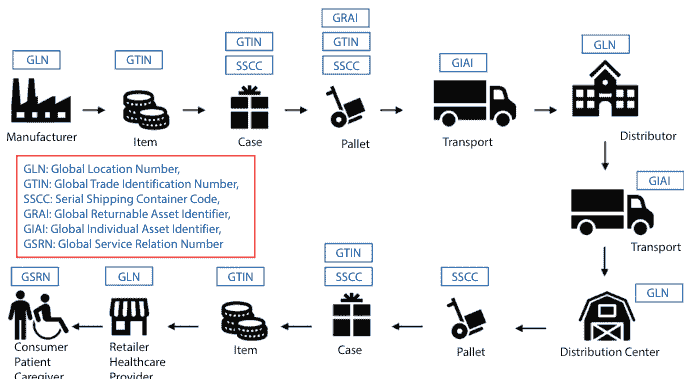

图 12.2 用于识别的 GS1 标准。

在接下来的章节中，我们分析了如何将区块链技术特征用于 SCM 以及制药 SCM 系统，以缓解传统 SCM 系统涉及的问题。

## 12.3 用于制药供应链管理的区块链

我们将使用区块链技术进行制药 SCM 系统的概念流分为：(i) 区块基础，(ii) 每个组件的数据收集和生成阶段，以及 (iii) SCM 区块链中的技术挑战。

### 12.3.1 区块基础

区块链技术依赖于区块的概念。区块链中的数据以单个区块的形式存储。作为链表，区块链数据结构是连接在一起的区块集合。通常，区块链中的每个区块包含多个字段，例如，*上一个哈希*（存储上一个区块的哈希值）和*当前哈希*（当前区块的哈希值，可用于引用该区块）[15]。参考 PCM 系统，实际数据可能包含制药交易细节或制药公司的资产细节。当执行交易且系统内经过验证的利益相关者提出请求时，就会创建一个新区块。在特定区块链系统中成功添加新区块的可能性取决于系统内参与者/利益相关者的共识。在参与者验证和批准后，新区块将以链的形式添加到之前存储区块的存储/数据库中。区块通过 Merkle 树的形成存储，链通过哈希指针维护。区块链的不可变性通过哈希指针、时间戳、名称以及参与操作的利益相关者的数字签名概念结合来实现。除了数据存储结构外，区块链模型中的数据分布不遵循广泛接受的客户端服务器模型。相反，它采用了点对点（P2P）模型，该模型不考虑任何中央控制。因此，与客户端服务器模型不同，P2P 模型中的数据存储在网络的所有节点中。

每个单独节点持有区块副本。此外，对区块的单个添加操作应更新所有节点。

图 12.3 展示了典型区块链账本的结构，其作为交易的数据存储。Tx1、Tx2、...、Txn 代表由节点验证的底层单个交易。由于单个消息或交易的大小可能大于允许的消息大小，拆分可以通过数字签名进行认证。如图所示，账本是仅追加的链式数据结构，存储整个网络的交易历史。该列表包含通过 Merkle 树组合交易的区块。为了不可变性或防篡改，哈希指针提供了区块之间的链接。此外，为了验证一组交易，区块结构中包含了时间戳和 nonce 字段。为了在区块链中添加新区块，一组矿工通过计算解决困难的工作量证明（PoW）难题来验证该区块。验证者可以遍历区块链以确定交易的所有权或目标实体，因为区块根据时间戳有序存储。账本结构和哈希指针阻止了任何篡改尝试，因为任何此类尝试都会改变区块的哈希值，从而改变所有后续区块的哈希值，使攻击变得更加困难。这从图 12.4 的交易 Merkle 树结构和交易访问顺序中显而易见。

自 2008 年中本 Nakamoto 推出比特币加密货币作为起点以来，区块链技术已经得到了广泛演进 [23]。取决于每个现有或新架构的优缺点，区块链技术


# 药物研究中的区块链技术 263

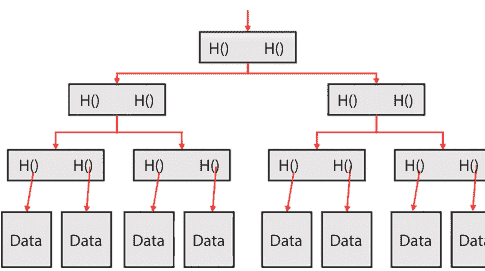

**图 12.4** 交易的梅克尔树结构和访问交易的顺序。

区块链可以大致分为无许可和许可类 [24]。无许可的区块链网络（俗称为去中心化账本平台）对所有参与节点开放，无需任何机构的许可即可发布区块。相反，许可的区块链网络（无论是中心化还是去中心化的账本平台）其区块的发布必须根据中心化或去中心化的共识算法获得某些机构的授权。
确定区块链系统中由哪个用户发布下一个区块的关键因素取决于用于区块链技术所使用的各种共识模型，包括工作量证明（PoW）模型、权益证明（PoS）模型（如基于链的权益证明）、权威证明/身份证明（PoA/PoI）共识模型以及通过时间证明（PoET）共识模型。在 NIST 8202 文档 [24] 中，作者展示了一个包含上述所有共识模型的共识矩阵，并分析了它们的目标、优缺点、模型领域，以及基于该配置直到 2018 年 10 月演变出的各种区块链技术。

## 12.3.2 各组件的数据收集和通用操作阶段

供应链管理（SCM）系统中的数据可以通过多种方式收集。利用传感器技术已开展大量工作，例如通过 RFID 形式的 IoT 设备、近场通信（NFC）从物理世界收集数据 [13]。这些数据可以转换为数字信息并作为区块链的一部分加入。在 [25] 中，作者提供了一个基于区块链的整体系统结构，如图 12.5 所示。在 [14] 中，作者展示了将区块链技术与 IoT 系统集成的去中心化 IoT 架构。在 [26] 中，作者提出了一种基于本地区块链网络的架构，其实现基于智能合约，用于构建一个安全、透明且可追溯的医药供应链（PSC）管理系统。

在区块链记录维护中，唯一标识符（分配给资产或交易流价值物品）被作为库存产品、订单下单与执行、贷款支付与发放、退货贷记以及出运运单的单位 [27]。从概念上讲，这些唯一标识符与加密货币（如比特币）中的硬币相似。此外，区块链参与者（如医药 SCM 或通用 SCM 中的利益相关者、分销商或其他代理）会生成唯一标识符或数字签名，用于验证并添加到区块链的区块。当令牌作为交易认证证明的一部分在两个用户之间传输时，交易过程涉及的每一个步骤都会记录在区块链中。区块链由于区块的时间顺序排序而变得重要，因为它结合了交易中的所有三个流并记录了财务账本系统所缺乏的细节。

此外，这些区块都经过了加密并与所有参与者共享，每个参与者都维护区块链账本的副本。凭借这些功能，区块链技术平台为供应链中的各种活动提供了可信的、完整的且防篡改的审计追踪。中心化系统中存在的任何问题（如执行、追溯和协调问题）在基于区块链的系统中都大大减少。节点拥有区块链账本的个人更新版本，每个用户都可以查看交易状态、检测错误，

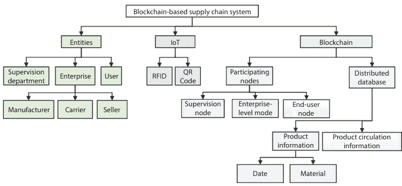

图 12.5 基于区块链的供应链系统结构。

并指出系统中任何不可信用户的不可追责性。除了透明度、缩短交易时间、更高的安全性、成本效益和不可篡改性等优点外，区块链技术在通用 SCM 系统以及医药供应链（PCM）系统中的实现还面临着许多挑战，如可扩展性、存储、互操作性、吞吐量、社会接受度和标准化 [13, 28]。此外，确保政府在州级、国家级、跨境级以及世界监测机构（如世界卫生组织 W.H.O.）发布的合规指南，并确保 PCM 系统随时间更新这些合规指南，也是一个主要挑战。我们将在下一节中讨论区块链技术在 PCM 中固有的挑战。

## 12.3.3 医药供应链区块链面临的技术挑战

医药供应链引发了许多高度依赖于制造环境的问题，如混淆、掺假、污染、交叉污染、伪劣、频繁故障、人为错误、蓄意欺诈等 [7, 13]。除了这些因素外，许多其他技术挑战可能阻碍使用区块链技术设计和实现 SCM 系统。我们将在接下来的章节中分析一些技术挑战。

### 可扩展性（Scalability）

即使在小型医药供应链系统中，也有大量利益相关者参与。如果一个大型 PSC 系统涉及药品和医疗设备的跨国流动，那么利益相关者的参与就会延伸并跨越地理本地化的障碍。在这些每个系统中，都会产生海量新创建且对时间敏感的数据/信息。时间敏感数据涉及医药产品的生产和保质期、成分、此类条件的可维护性（如温度、湿度、特定库存的需求，以及移除无需求库存等）。实施区块链的主要挑战在于它是以去中心化机制运行的，因此架构如何随着利益相关者数量的增加而扩展并运行，这通常与产生的大量交易数据相关。

区块链通过附加到区块链上的区块形式的数据不可篡改性来处理网络扩展性问题。只有在其他参与者按照我们在 12.3.1 节中讨论的共识模型验证并允许添加该区块后，才会添加新区块。由于许多因素，在现有技术中进行更新和执行更改在计算上可能是困难的 [24]。在包含许多用户的无许可区块链网络中，由于其全球分布的性质以及共识的治理，解决这一扩展性问题极其困难。区块链网络协议、算法和数据结构的修改可以通过分叉（forks）来处理。区块链技术的分叉可以分为硬分叉和软分叉两类。

软分叉是对区块链实现的修改，它与未更新的节点后兼容。如果没有或极少数节点遵循更新，更新的规则通常不会被遵循。硬分叉是对区块链实现的修改，它与未更新的节点不兼容 [23, 24]。通常情况下，在特定的区块高度的所有发布节点都需要切换到新更新协议。此外，所有节点都需要升级并修改为这种新协议，其中带有发布请求的新格式区块不会被它们拒绝。未更新的节点也可以对遵循旧格式的未更新节点区块进行交易操作。同样，未更新的节点无法对更新节点的新格式区块进行交易操作。

### 与 IoT 的集成

将去中心化的 IoT 系统结构与区块链集成面临各种挑战，因为现实世界的数据可能以各种形式收集。这些数据被转换为区块链所需的数字数据并纳入区块链。转换可能需要时间，在此过程中可能会发生安全漏洞。因此，区块链中存在不一致的时间延迟数据。区块链涉及计算密集型操作，并面临巨大的带宽延迟和资源开销，这可能不适用于基于 IoT 的系统架构 [14]。此外，IoT 架构的终端节点需要加密功能，这将与区块链实现良好集成。

### 量子计算

随着量子密码学的发展，如果强大的商用量子计算机现实，目前区块链技术中用于公钥加密（PKC）操作的加密原语将需要替换 [24]。安全性基于整数分解计算困难性（如 RSA）的 PKC 算法，或涉及解决离散对数问题的（如 Diffie-Hellman 密钥交换算法）将受到利用量子计算攻击的影响。然而，区块链平台采用的 SHA-256 哈希算法受量子攻击的影响要小得多。


# 医药研究中的区块链 267

计算攻击。然而，针对量子计算的哈希算法将被削弱。

在 [24] 中，作者指出了区块链技术的若干局限性和误区，例如：对不可变性的误解、区块链治理中参与用户对代码的可见性、处理可能因自身故障或人为干预而发生故障的现实世界数据的困难；由于源自原始版本的任何可用性，区块链关闭可能无法完全关闭系统；需要纳入网络安全计划以采取主动措施来免受网络威胁；区块链更新的风险和策略；应对诸如拒绝服务（DoS）攻击等基于网络和网络攻击的措施；区块链系统内部的恶意参与者；许可制系统管理员可能会破坏信任；加密算法可能并非无缺；区块链节点对共识算法的能量消耗可能不容忽视；以及在发布区块后可能存在奖励不足的风险。

## 12.4 基于区块链的现有医药供应链管理（PSC）：案例研究

在 [29] 中，作者描绘了一个通用的区块链生态系统，该系统包含了涵盖各种分布式账本技术（DLT）类型的介绍、区块链应用开发环境所需的主要组件以及各种区块链应用，并整合在一个图图中。大型 IT 巨头已经进军区块链领域，以使供应链管理（SCM）系统更加透明和可追溯。全球 IT 巨头 IBM 开发了 IBM Blockchain Transparent Supply 平台，以实现供应链管理的透明化运营。IBM 与 Sonoco ThermoSafe 合作，后者是领先的医药配送提供商，同时确保安全包装。此次合作旨在建立一个名为 PharmaPortal 的行业级区块链平台。PharmaPortal 的通用功能适用于所有供应商的通用需求。

PharmaPortal 的目标是让制药制造商和运输商能够生物产品、常规药物、疫苗以及其他温度敏感产品的安全交付。这个开放治理的网络基于 IBM Blockchain Transparent Supply。它聚焦于端到端追溯，旨在为环境条件的监测操作提供审计追踪。作为网络组织者，Sonoco 的目标是为供应商建立一个许可制区块链平台，从而提高整个医药供应链的透明度 [30]。尽管该倡议自成立以来有了许多改进，但冷链医药供应链仍受到低效流程的影响。例如，跨越大陆的签约和分包处理分销商之间的多次交接操作，对可信、可追溯的药品货物和文件提出了重要要求。凭借区块链追溯药品来源并形成药品生命周期及其处理不可篡改记录的固有能力，这一开放行业倡议旨在为医药行业在药品采购和配送方面的挑战提供解决方案 [30]。

在 [31] 中，作者说明了基于 QR 的数字身份系统如何与区块链技术一起应用于医药供应链。作者还包含了该系统的几个案例研究。默克（Merck KgaA）是 PSC 中最老的科技（S&T）公司之一，业务涵盖医疗、生命科学和电子领域。它与 SAP 合作开发了基于 SAP 的 POC 应用，用于 PSC 管理系统 [32]。SAP 早期的运营中并未使用区块链技术。

总部位于巴塞尔的跨国公司 Novartis 发起了 PharmaLed 项目，探索区块链技术在医疗研究行业中的潜在应用。结果，PharmaLed 协会应运而生，目标是在 PSC 管理系统中提供区块链和分布式账本技术（DLT）解决方案，以获得更好的透明度和可用性。他们的 E1 应用通过消除中心服务器的使用增强了安全性；该应用还确保了没有单点故障，并提高了可用性。然而，仍有许多障碍需要克服。药品制造商、批发商/分销商与药店之间缺乏互操作性且可用性数据不一致。存在许多 IT 接口，由于信息从一端到另一端被隔离，导致需求管理不一致和预测不准确 [31, 34]。现有的知名区块链 PSC 管理系统仍有巨大的提升空间。在下一节中，我们将分析区块链在医药供应链管理系统中的未来。

基于 Hyperledger 的区块链架构是解决 PSC 数据资产挑战的理想机制。尽管在简化医药配送、管理、存储和药品供应方面付出了巨大努力，但药房药物的供应往往由于信息不可用、数据资产安全性不一致、隐私控制不协调以及限制作为数据资产合法所有者的授权用户控制访问而受到阻碍。Hyperledger fabric 是一个基于区块链技术的企业级应用开发框架。该分布式账本平台拥有先进的隐私和访问控制功能，节点可以在许可节点或网络参与者之间共享它们想要的数据。

如图 12.6 所示，Hyperledger fabric 有三个主要组件：基于许可制区块链框架的访问控制模块、离链数据存储以及以用户为中心的移动和 Web 用户界面。为了确保高水平性能和经济可行性，与医药制造过程相关的数据资产被加密并存储在安全的云仓库中，同时存储资产统一资源标识符（URI）的哈希值。这种方法安全地连接了链上和链下数据，而不会增加区块链架构中常见的计算和存储负载。通过依赖智能合约，数据资产所有者（制造商）或其指定的（供应链中的分销商）可以以扩展且安全的方式恢复对其数据的访问控制。

网络中的所有节点都有各自的身份，该身份由成员服务提供程序（MSP）发放。MSP 使用公钥向每个网络参与者发放加密证书。由于这种特性，Hyperledger 区块的加密注册、身份发放、验证以及审计是在环境中环境中。由于这一特性，可以引入一种计算量显著低于工作量证明（PoW）机制的共识机制。在可扩展性方面，Hyperledger

- 提供数据资产
- 自由裁量访问控制
- 固定智能合约
- 发起交易请求
- 加密数据资产
- 生成数据 URI 哈希值

| Block 1 | Block 0 |
| :--- | :--- |
| 交易 | 交易 |
| 智能合约 | 智能合约 |
| 访问控制列表 | 访问控制列表 |
| 数据位置哈希 | 数据位置哈希 |
| 所有者身份 | 所有者身份 |
| 前一个区块 | 前一个区块 |

交易
Rest APIs
离链存储
离链存储服务器
资产 URI 哈希
加密数据资产

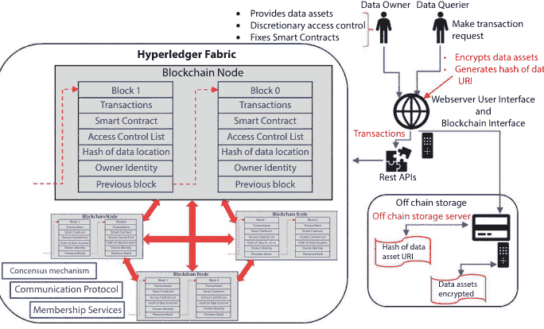

图 12.6 用于 PSC 数据资产的 Hyperledger fabric。


270 健康科学中的区块链

Fabric 允许创建和添加受信任的子网，这些子网可以被放入由固定节点集组成的共享账本。如图所示，Fabric 包含了智能合约功能和区块链代码，允许参与节点执行更复杂的交易。Hyperledger Fabric 架构是模块化的，因此在共识机制、成员服务提供者（MSPs）和接口软件开发工具包（SDK）方面具有灵活性和模块化。这些特性使得能够实现一个安全、高效且可扩展的区块链平台，并根据企业和全球使用情况，针对医药供应链（PSC）的需求进行调整。

## 12.5 结论

毫无疑问，基于区块链的医药供应链系统可能会解决许多与传统医药供应链系统相关的固有问题。然而，互操作性的技术挑战、下游数据可用性不一致以及区块链 PSC 管理系统中的许多其他因素，可以通过纳入良好的药品生产和分销政策、监管机构的频繁审计以维持标准，以及建立良好的接口以实现顺畅的互操作性来解决。由于多种因素，要在国家、跨国及范围内就药品生产、分销、质量控制、使用、盈利能力、维护知识产权以及业务政策的许多细节达成共识是困难的。例如，国家的经济状况可能与全球领先国家的经济状况不匹配。这可能会阻碍维持标准、价格和其他参数在通用 PSC 内得以满足的共同政策和实践的有效适用性。这些障碍可以通过在国家内部引入 PSC 区块链以及用于跨境互操作的接口来克服。如果不将一个州和国家内的所有本地制造商纳入，国家级基于区块链的 PSC 管理系统将无法完美运行。对于通过捐赠、商业或其他手段进行的药品和医疗设备出口及跨境交换，必须选择相关参数以解决政策歧义。只有在那种程度上，才可能在 PSC 中实施区块链技术，以追踪流通中的过期药品和假药。此外，PSC 管理系统还可以促进信任和透明度。

## 医药研究中的区块链 271

## 参考文献

- 1. Aguiar, E.J.D., Faical, B.S., Krishnamachari, B., Ueyama, J., A survey of blockchain-based strategies for healthcare. ACM Comput. Surv., 53, 1–27, March 2020.
- 2. Barton, I., Leveraging technology and education in the high-stakes fight against fake medicines, Healthcare Digital Magazine, 2020, Accessed: Dec 29, 2023. [Online]. Available: https://healthcare-digital.com/medical-devices-and-pharma/leveraging-technology-and-education-high-stakes-fight-against-fines.
- 3. Shah, N., Pharmaceutical supply chains: key issues and strategies for optimization. Comput. Eng. Eng., 28, 6–7, 929–941, 2004.
- 4. Marucheck, A., Greis, N., Mena, C., Cai, L., Product supply and security in the global supply chain: challenges and research opportunities. J. Oper. Manage., 29, 7–8, 707–720, 2011.
- 5. Healthcare accelerated: 54th annual report, OPPO (Organisation of Pharmaceutical Producers of India), 2021, Accessed: Dec 29, 2023. [Online]. Available: https://www.indiaoppi.com/wp-content/uploads/2021/05/OPPI_54th-Annual-Report-2020-Final30-04-21-Online.pdf
- 6. Ghage, A., Bourlakis, M., Kamble, S., Seuring, S., Blockchain implementation in pharmaceutical supply chains: A review and conceptual framework. Int. J. Res., 61, 19, 6663–6651, 2023.
- 7. CDSCO, Guidelines on good distribution practices for pharmaceutical products, CDSCO (Central Drugs Standard Control Organization), India, 2018, Accessed: Dec 29, 2023, [Online]. Available: https://cdscsc.gov.in/opencms/resources/UploadCDSCOWeb2018/UploadPublic_NoticesFiles/Notice-25.09.2018_Draft2020Guidelines%20on%20Good%20Practices%20for%20Pharmaceutical%Products.pdf
- 8. G. o. i., Annual report 2022-2023, Ministry of Chemicals and Fertilizers, Department of Pharmaceuticals, Government of India, 2022-2023, Accessed: Dec 29, 2023. [Online]. Available: https://pharmaceuticals.gov.in/sites/default/files/english%20report%2020-2021.pdf
- 9. G. o. i., Annual report 2022-2023, Ministry of Chemicals and Fertilizers, Department of Pharmaceuticals, Government of India, 2022-2023, Accessed: Dec 29, 2023. [Online]. Available: https://pharmaceuticals.gov.in/sites/default/files/Annual%20Report%2022-23%20Final-3.pdf.
- 10. India's Pharmaceutical Supply Chain: Does the Industry Have What It To Win?, A.T. Kearney Limited (India Branch) and OPPO (Organisation of Pharmaceutical Producers of India), 2019, Accessed: Dec 29, 2023. [Online]. Available: https://pharmaceuticals.gov.in/sites/default/files/english%20report%2020-2021.pdf
- 11. Gaur, V., Gaiha, A., Building a transparent chain: Blockchain can enhance trust, efficiency, and speed, Harvard Business Review, 2020, Accessed: Dec 29, 2023. [Online]. Available: https://hbr.org/2020/building-a-transparent-chain
- 12. Westphal, E., and Seitz, H., Digital and decentralized management of patient data, Front. Blockchain, 9, 4, 2021.
- 13. Wu, H., Cao, J., Yang, S., Tung, C., Liu, Y., Data management in supply chain using blockchain: Challenges and case study, in 28th International Conference on Computer and Networks (ICCCN), 1–8.
- 14. Abdallah, S., Lee, S., Blockchain-based solution for Pharma Supply Chain, Comput. Ind. Eng., 17, 10,2022.
- 15. Kassab, M., DeFranco, J., Malas, T., Laplante, G., Neto, V., Exploring blockchain in healthcare, 9, 4, 1835–1852, 2021.
- 16. Son, H.R., Heo, S., Lee, I., Optimal scheduling of tests for new product development, in 16th European Symposium on Computer Aided 9th International Symposium on Process Systems, vol. 21, pp.1155–1160, 2006.
- 17. Subramanian, D., Pekny, J., Reklais, G., A simulation-optimization framework for research and development pipeline, AlEE Journal, 47, 10, 2220–2242, 2021.
- 18. Blau, G., Mehta, B., Bose, S., Pekny, J., Sinclair, G., Keunker, K., Risk management in the development of new products in highly regulated industries, IEEE Sec. Privacy, 24, 2, 659–664, 2000.
- 19. Papageorgiou, L., Rotstein, G., Shah, N., Strategic supply chain optimization for the pharmaceutical industry, Ind. Chem. Res., 40, 1, 275–286, 2001.
- 20. Gatica, G., Papageorgiou, L., Shah, N., Capacity planning under the pharmaceutical industry, Ind. Chem. Res., 81, 6, 665–678, 2003.
- 21. Gatica, G., Papageorgiou, L., Shah, N., An aggregation approach for capacity planning under the pharmaceutical industry, in: Proc. Foundation of Computer-Aided Process Operations, vol. 4, pp.245–248, 2003.
- 22. GS1 global traceability standard GS1’s framework for the design of interoperable traceability for supply chains, GS1, 2017. Accessed: Dec 29, 2023, [Online]. Available: https://www.gs1.org/standards/gs1-global-traceability-standard/current-standard#2-Traceability-and-the-importance-of-standards+2-5-GS1-standards-key-enabler-for-interoperability.
- 23. Sharma, A.T., Javani, F., Zhang, H., Galaszzewski, E., On the origins and variations of blockchain technologies, IEEE Sec. Privacy, 17, 1, 72–77, 2019.
- 24. Yaga, D., Mell, P., Roby, N., Scarfone, K., Blockchain Technology Overview, NIST (National Institute of Standards and Technology) Internal Report 8202, USA, 2018, [Online], Available: https://nvlpubs.nist.gov/nistpubs/ir/2018/nist.ir.8202.pdf.


# 药物研究中的区块链技术 273

- 25. Zhang, J., Zhong, S., Wang, T., Chao, H.-C., Wang, J., Blockchain-based systems and applications: A survey. J. Internet Technol., 21, 1, 1–14, 2020.
- 26. Bandhu, K.C., Litoriya, R., Lowanshi, P., Jindal, M., Chouhan, L., Jain, S., Making drug supply chain traceable and efficient: a blockchain and smart contract based implementation. Multimed. Tools Appl., 82, 15, 23541–23568, 2023.
- 27. Westerkamp, M., Victor, F., Küpper, A., Tracing manufacturing processes using blockchain-based token compositions. Digital Commun. Net., 6, 167–176, 2020.
- 28. Zakari, N., Al-Razgan, M., Alsaadi, A., Alshareaf, H., Aligh, H., Alahaikh, M., Alomar, R., Alotaibi, S., Blockchain technology in the pharmaceutical industry: a systematic review. Peer J. Comput. Sci., 8, e840, 1–26, 2022.
- 29. Jabbar, S., Lloyd, H., Hammoudeh, M., Adebisi, B., Raza, U., Blockchain-enabled supply chain: analysis, challenges, and future directions. Multimed. Syst., 27, 787–806, Aug 2021.
- 30. Improving transparency and traceability across the temperature-controlled pharmaceutical supply chain, IBM, Accessed: Dec 29, 2023. [Online]. Available: https://www.ibm.com/blockchain/resources/transparency-supply/pharma/#:text=In%20the%20pharmaceutical%20industry%22C%20where,ecosystem%20networks%20quickly%20and%20easy.
- 31. Takyar, A., Blockchain In Pharma Supply Chain-Reducing Counterfeit Drugs, LeewayHertz, 2024, Accessed: Dec 29, 2023. [Online]. Available: https://www.leewayhertz.com/blockchain-in-pharma-supply-chain/
- 32. Penski, L., Blockchain Co-Innovation in the Pharmaceutical Industry, Technology Blogs by SAP, Accessed: Dec 29, 2023. [Online]. Available: https://blogs.sap.com/2018/04/17/blockchain-co-innova-in-the-pharmaceutical-industry/
- 33. Kayhan, H., Ensuring trust in pharmaceutical supply chains by data design approach to blockchains. Blockchain Healthcare Today, 5, 1–17, 2022.
- 34. Robinson, K., Made in Switzerland: blockchain enabled healthcare, 2023, Manufacturing Chemist, Accessed: Dec 29, 2023, [Online]. Available: https://www.manufacturingchemist.com/news/article_page/Made_in_Switzerland_blockchain_enabled_healthcare/206351.

# 使用区块链技术转型药物研究

Karnika Dwivedi1*, Preeti Garg2, Bharti Chugh2, Pankaj Bhatt3 and Ashish Kumar4

1 计算机科学与技术学院，Bennett大学，Greater Noida, 印度

2 计算机科学与工程系，KIET 机构集团，Ghiazabad, Delhi-NCR, 印度

3 Lloyd 管理与技术学院，Knowledge Park-II, Greater Noida, 印度

4 Xim 大学，Nigada Kurki Harirajpur, Odisha, 印度

# 摘要

药物研究领域正在发生许多变化，包括医疗保健、药物发现、供应链系统，打破了历史上采用的技术和创新。制药趋势中广受欢迎且受监管的技术之一是区块链，因为它有助于减少该行业的许多挑战，因为该行业不是开放的，无法追踪订单记录，并且对药品的运输缺乏信任。许多人在日常生活中需要各种药物药物。因此，需要采用像区块链这样的技术，它可以提供开放访问，并在维护完整性和信任的同时追踪记录。药物市场上存在许多假药，通过区块链技术使用一套清晰的标准和保护措施，可以对其进行监控和控制。在本研究中，讨论了区块链在制药行业的各种优缺点。首先，章节详细描述了区块链技术，通过提供药物发现供应链、药物造假等各种应用的插图及其相关框架，开启了制药行业的新时代。这项研究解释了区块链技术的去中心化和不可篡改的特性，这确保了制药部门提供了一个透明的

> *通讯作者：dwivedikarnika1995@gmail.com

Aryan Chaudhary, Rashmi Singh and Gaurav Agarwal (编)。)。健康科学中的区块链，(275–292)
© 2025 Scrivener Publishing LLC.

# 276 健康科学中的区块链

安全环境。区块链技术还在帮助制药行业处理效率低的供应链、药物和数据安全问题。块技术在医疗领域最重要的应用是供应链管理，特别是允许从制造到分发到终端用户的完全可追溯性。区块链技术确保药物的完整性和真实性，降低了药物交付风险。此外，在所有这些应用中，患者、医疗保健人员和研究人员之间交换医疗信息变得更容易。区块链通过加密改进了数据安全和隐私，使得不受限制地获取医疗信息、临床试验数据和监管遵守变得简单。药物行业面临许多需要解决的挑战，区块链技术通过提供各种应用对这些医药部门产生了重大影响。区块链增强了当前的供应链系统，通过反伪造和管理质量以及数据治理来促进新应用。总体而言，这项研究解释了区块链技术在医疗行业的价值见解，区块链技术如何转型制药部门，加强供应链并发现护理和健康交付中的新趋势和创新。在医疗保健的数字时代，区块链技术的实施可以实现在安全环境中一致性地远程监控健康状况，同时也驱动研究人员在这一领域进行更多创新以实现实时应用。

**关键词：** 区块链，临床试验，数据安全，供应链

# 13.1 引言

区块链因其不可更改的方法、维护记录的系统以及提供加密安全性而风靡，这在药物研究中催生了一种全新的革命性系统。它通过提供一个安全的平台来处理并确保结果的可靠性，改进了追踪数据的一致性。区块链与临床试验的整合无疑是变革性的，因为它提供了一个安全的平台来操作并确保发现的可靠性。区块链技术通过安全的平台改进了临床试验的透明性和可靠性。区块链的去中心化特性通过追踪交易，使医药业务变得更加透明和可靠。区块链技术在制药行业具有许多优势，因为以下因素：监控、可靠性、可追溯性、授权和实时功能。[1]。区块链技术在废物管理方面提供了帮助，因为它

药物研究中的区块链 277

[3]考虑到相关的风险，医药垃圾不能像普通垃圾一样处理，无论是源自医院、诊所、药店还是私人家庭，都需要专门处理。[4]。区块链技术可以提高信息安全、规模经济和有效的废物处置。电子医疗记录比传统记录更易获取、安全且共享。在制药行业，区块链通过不可篡改的交易、可靠的验证过程和单一权威来源确保一致性和安全性。区块链的透明性和防篡性质可以促进药物监控，消除欺诈并增强供应安全。[5]。区块链通过为所有参与方提供凝聚、透明和安全的平台，重振制药供应链。一项工作为监管机构、生产者和政府提供价值方向[23]，提出了一种基于区块链和物联网的混合框架[24]，可以帮助减少假药问题，为制药行业提供解决方案。一项工作被提出，为在线销售药品的供应链提供解决方案，通过利用以太坊智能合约来维护参与者之间的真实性[25, 26]。

区块链的不可篡改性、透明性和去中心化特性提供了强大的成果，改进了整个供应链的效率和安全性。对区块链特性的研究对增强供应链的可追溯性和具有重大影响。该系统的去中心化、协作和相互

| 挑战 | | 解决方案 |
|---|---|---|
| 区块链技术可用于整个医药价值链解决许多挑战 | 药物发现 | 分布式数据库中的存储 |
| - 研究数据和分析的潜在收益 | - 验证用户身份以访问机密数据 | 身份验证与确认 |
| | 药物开发 | |
| - 临床试验结果操纵 | | |
| - 在某些情况下患者提交 NDA | | 智能合约、数据存储和传输 |
| | 药物制造 | |
| - 不当条件下温度敏感公式 | | |
| - 追踪潜在化合物来源 | | 序列化 + 区块链 |
| | 分销 | |
| - 通过复杂的药物供应链交付药物 | 区块链驱动的供应链管理 | |
| | 销售与营销 | |
| - 根据合同收到销售药物的回款 | 智能合约 |

图 13.1 药物研究中的区块链技术。


经认可的数据库提供了一个不可篡改的交易日志，增强了整体的有效性和安全性。总之，如图13.1所示，区块链技术的不可篡改性、透明度和去中心化使其成为解决医药供应链造假问题的很有前景的解决方案。

## 13.2 区块链技术：医药研究的新时代

区块链技术通过提供药物发现、开发和交付等许多应用，正在改变医药研究的许多方面。区块链通过提供不可篡改的交易日志保护临床试验的可靠性和完整性，提高了医药研究的可追溯性和透明度。区块链技术实现的智能合约促进了科学家、组织和其他利益相关者之间安全透明的合作，促进了数据交换和科学进步的文化。此外，基于区块链的供应链解决方案使实时药品供应链监控成为可能，有助于防止假药流通并保证药品的安全性和真实性。区块链技术为不同的制药问题提供了解决方案，以提高医药供应链的治理和合规性。

区块链通过数据存储的去中心化和消除中间环节，减少了行政负担并加速了监管合规程序。这加速了药物发现和开发的创新速度。图13.2说明了区块链技术如何通过确保数据透明度、改进质量控制和增强合规管理来解决医药行业面临的关键挑战。图中的每个阶段代表了关键领域——例如数据完整性、遵守监管规定和安全信息。

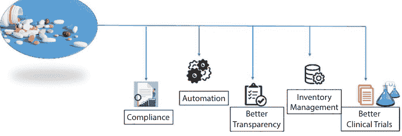

图13.2 医药领域通过区块链技术处理的问题。

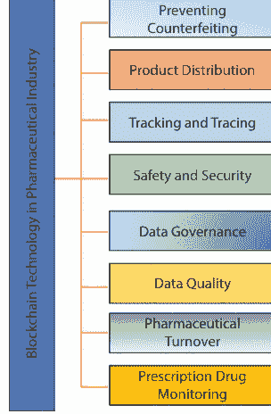

**图13.3** 区块链技术涵盖的医药行业领域。

共享——其中区块链不可篡改的账本可以提供强有力的解决方案。这种方法有助于简化流程、减少欺诈并提高医药供应链的可追溯性。

图13.3展示了区块链技术在医药行业内不同领域的应用。每个部分代表一个不同的领域，例如供应链管理、质量保证、监管合规性、数据安全和临床试验透明度，在这些领域区块链可以提供增强的安全性、追溯性和数据完整性。这种整合旨在解决与数据篡改、造假和效率低下相关的挑战，最终确保一个更安全、更可靠的医药环境。

医药行业已利用区块链技术进行了许多项出于不同目的的研究。密码加密方法被用于验证交易数据块，以应对重大的安全挑战 [6]。多个视角决定了安全方面如何体现。序列化已被用于解决假药带来的安全风险 [7]。该技术识别了并确认了跨越整个供应链系统的序列号。为了防止药品被盗，药品追溯性也得到了改进 [8]。数字签名被用于实现质量控制，而数据矿工、区块链、链码和健康信息被用于从制造商到药店的各个环节，用以确保真实的质量 [9]。

### 13.2.1 防造假

患者安全、公共健康和医药企业中药品的完整性受到假药的极端影响。医药企业、监管机构和供应链的其他成员使用了多种技术来在整个供应链中拦截假药。为了保证药品从制造到分销的真实性和完整性，采用了一项重要策略，即实施强大的防造假控制和追溯解决方案。药品对象包含安全特征和序列号，以便消费者可以验证并将其与假货区分开来。基于透明链码的交易是区块链系统提高安全性的另一种方式。对于医药部门的运行，信任和开放是至关重要的。如果没有信任和安全，造假行业就会增长，并使普通人群面临毒性药物的风险。需要开发一些防造假措施和追溯解决方案的预防机制，以确保药品从制造到分销的真实性和完整性。可以使用几种方法，包括防造假药品系统（ACMS）来防止造假。ACMS 使用星际文件系统（IPFS）网络和以太坊区块链。


### 13.2.7 药品周转率

药品周转率是医药业务的一个重要指标，可以直接影响供应链管理、收入产生和库存管理。

### 13.2.8 处方药监控

RxCoin Smart contracts [14] 使用以太坊区块链技术和一种数字货币来电子化表示药物。它的实施是为了解决阿片类问题。RxCoin 展示了利用区块链技术进行处方执行的能力。实施智能合约的主要优势是管理授权的重新配药。它没有忽略对于存储在区块链中的个人健康信息的 HIPAA 隐私标准，也没有


图 13.4 区块链支持的药品链。

它们阐述了如何利用区块链运行处方药监控系统（PDMS）的功能。

在医药业务中，区块链已被用于改进供应链运营的治理和合规性。这是因为区块链具有不可篡改性、分布式和透明等关键特征。区块链技术创建智能合约来实现自动化操作并维护每笔交易的记录。当合规条件不满足时，智能合约执行通知并创建特定的交易记录。在执行通知后，此交易的信息将发送给所有相关公司，提供有关药物完整性和真实性的信号。医药业务中区块链与供应链的集成有助于公司通过供应链系统更好地管理其库存。图 13.4 描述了区块链技术在医药供应链中的应用，展示了其增强可追溯性、透明度和废物管理的潜力。该图概述了区块链如何通过链接制造商、批发商、分销商、药店和患者在内的各种利益相关者，支持审计、数据不可篡改和防欺等关键功能。这种集成确保了安全且去中心化的数据库，促进了更安全高效的医药运营。

## 13.3 利用区块链保障药品交易：分层方法

全球范围内日益增长且紧迫的问题（特别是在发展中国家）是假药的制造和销售。假药的市场市场价值已超过数十亿美元。医药行业的供应链流向导致了药品造假。药物在到达消费者手中之前会经过制造商、批发商、分销商和药剂师。药品监管机构缺乏该系统的透明度；制造商不知道其产品发生了什么；召回既昂贵又耗时；企业在当前的供应链结构下无法跟进患者。从药物产生到到达患者手中，医药行业将使用建议的系统来监控其历程。为了统计目的，在患者使用药物后将更新数据库以反映药物的效果。为了确保只有可靠的用户可以访问网络并向区块链添加交易，它将被实施为


许可制。系统涉及的层级包括感知层、离链层、区块链层、应用层和用户层。

3.1. 感知层帮助收集沿沿药品供应链的各种信息。这包括许多物联网（IoT）资产，如传感器、二维码、RFID 标签、读取器等。物联网网关将接收收集到的数据。特别重要的是，数据（包括有关原材料来源、药品生产、物流等的信息）是由物联网网关进行定义、配置和分析的。此类数据有三个特征：持续收集、海量数据规模和持续的粒度细化。

3.2. 离链层的核心是被称为区块链网关的中间软件。设备管理、数据验证和数据缓存是其三个主要特征。物联网（IoT）设备为了设备管理目的需要其独特的身份标识，或“密钥对”。添加、删除和更改数据状态是区块链网关管理者的责任。验证数据的目的是确认数据标识和交易数据的结构。在财务交易发布到区块链网络之前，将利用数据存储进行跟踪。物联网（IoT）资产和企业信息系统为区块链网关提供预定义的 JavaScript 对象表示法（JSON）格式的输入数据。发送到区块链网络的涉及药物的利益相关者交易是区块链网关的产物。

3.3. 区块链层整合密码学、智能合约、共识和 P2P 网络等元素。我们的团队已确定 pBFT 为金标准。在监管方面，我们提供了一种既高效又有效的共识技术。区块链网络上的节点起到评估数据可靠性的作用。为了确保数据传输的安全，利用密码学。

3.4. 应用层包含四项服务：客户识别、质量控制、产品跟踪和可见性、风险分析和智能警报。追踪和溯源器使用应用程序编程接口（APIs）连接到区块链网络，允许各种用户请求适当的数据。例如，药品生产商有义务提供其 GMP 或 GSP 等法律证明以接收质量服务。追踪和溯源器允许用户搜索药品流通历史以获取产品信息。通过使用风险分析和智能警报实现智能分析和警告。此外，该区块链系统的高级经理利用身份管理来添加、删除和更新成员。

3.5. 用户层由医药公司、医药物流公司、药品零售商和终端用户这四组组成。生产者必须在制造过程中向区块链提交有关产品质量的数据，并在制造的药品添加电子代码。为了在药品配送阶段实现全链监控，物流提供商必须在区块链中监控并存储多种药品储存因素，包括温度和湿度。同时，基于区块链的网络允许质量机构快速访问药品质量信息。用户可以使用此工具访问药品质量信息，并对不良事件获得快速反馈。


286 区块链在健康科学领域

### 13.4.2 增加研发

通过区块链技术与制药行业人工智能、机器学习等其他发展技术相结合，可以增强对已发布和新创建研究信息的数据挖掘和分析。在临床研究期间保护患者的个人信息和数据是该技术的另一大用途。如果能实现这一点，可能会说更多人参与临床调查。

### 13.4.3 药物来源验证系统

区块链技术在制药行业的一个极佳用例是消除欺诈和验证药物有效性。商界人士一直对此关注。根据行业非营利组织 Pistoia Alliance 2017 年的一项调查显示，超过 70% 的制药和生命科学高管认为区块链技术对他们所在领域的影响最大。目前利用该技术的解决方案正在开发中，这并不意外。MediLedger 项目的一个目标是使药物供应链变得更加安全、私密和高效。MediLedger 的初始产品之一是基于区块链的身份验证系统，旨在简化可转售药物合法性的流程。

### 13.4.4 序列化

由于制药行业在公共卫生中发挥着关键作用，该行业受到严格的监管和监督。对于工业化经济体而言，尤为如此。全球存在大量的序列化要求，业务参与者有义务遵守这些要求。根据这些规则，所有药品及其包装必须有一个独特的标识符。此外，药物的来源和物流路径等事实必须由所有帮助将药物送达患者的供应链伙伴共享。利用区块链技术可以增强行业遵守这些规则的能力。此外，由于分布式账本的不可篡改性，监管审计可以轻松地访问区块链上的数据。

### 13.4.5 临床试验数据管理

临床试验是制药行业不可或缺的一部分，为药物发现以及其他医疗研发工作提供支持。该行业在寻找最有效的方法来处理和解释此类研究数据方面面临着巨大的挑战。同样重要的是，企业往往无法保证参与临床试验的患者获得足够的隐私保护。现在，企业正尝试在区块链技术的帮助下寻找这些问题的解决方案。总部位于马萨诸塞州波士顿的 Nebula Genomics 公司正努力利用技术增强基因组测序过程。该机构正在构建一个遗传数据库，目标是消除多余的中间环节，并帮助患者安全地管理其加密遗传数据。Encryggen 是另一家在该领域实际运营的公司。这家位于佛罗里达州的公司建立了一个基于区块链技术的平台。该平台使得遗传数据的共享、存储、销售和购买成为可能。

## 13.5 挑战

区块链在医疗保健领域的应用显著增加。在各种政府整合设施的推动下，快速的技术创新推动了市场扩张。制药行业受到了区块链技术的深远影响。区块链可以不可篡改地保留交易记录并充当公共账本。这一特性可用于创建透明的权限管理系统，从而鼓励数据交换。使用区块链进行药物研究面临着各种挑战 [15]，其中一些在此处得到了解决。

### 13.5.1 吞吐量

随着网络中交易数量的增加，需要进行更多的检查，可能会导致系统拥塞。高吞吐量是医疗系统的一个挑战，因为访问延迟可能会损害救命的诊断 [16]。有几个因素可能会影响框架的可扩展性和性能。其中一个因素是系统接收持续更新的要求 [17]、关键字密钥集大小、网络配置以及取决于框架所用区块链类型的磁盘空间。与此类似，[18] 提出通过向现有系统添加某些功能（如全球智能交易）可以减轻与性能相关的成本。

### 13.5.2 延迟

验证一个区块的时间大约需要十分钟；这可能对系统安全服务的有效性产生损害，因为这段期间可能会发生成功的攻击。在医疗行业，网络是复杂的，并且应该被频繁访问，因为任何延迟都可能阻碍检查结果分析。

### 13.5.3 标准化

区块链技术可以促进全球安全的金融交易，但互操作性问题是一个严重的问题。可以通过分布式账本技术（DLT）将区块链活动标准化。虽然国际电信联盟（ITU）正努力发现并标准化分布式账本技术（DLT）应用及服务，但还需要进一步的研究来确定实施这些应用有效方法。

### 13.5.4 隐私与数据安全

根据 Yang 等人的研究 [19]，保护患者隐私和数据安全是另一个主要关注点。区块链承诺不可篡改性和透明性，但它还需要确保关键健康信息是私密的，并且仅供授权用户可用。人们普遍认为比特币结构允许区块链确保节点匿名性 [20]。基于区块链的解决方案必须遵守隐私法律和法规中的《通用数据保护条例》。

### 13.5.5 大数据的复杂性

边缘计算、云计算和物联网应用的采用极大增强了数据的可用性。由于其广泛增长，区块链的实施面临着各种挑战，涉及数据管理、准确性冗余和隐私等问题。区块链技术努力利用运营效率并提高交易效率、患者安全和追踪过程。异构多核处理器 [21] 最近在许多应用中变得越来越重要，因为它们在调整功率限制方面的灵活性和性能得到了提高。

### 13.5.6 资源消耗

由于挖矿过程对能量的要求很高，资源需求非常大。然而，部署区块链技术可能会产生大量的计算和能量支出。通过使用并行方法 [22]，可以在一定程度上降低顺序执行算法的时间复杂度。

## 13.6 总结

区块链技术在药物开发、分销和发现中的应用正在改变制药研究的多个方面。通过提供不可更改的交易记录，区块链增强了制药研究的透明度和问责，同时保护了临床试验数据的可靠性和完整性。制药公司已利用区块链来增强供应链治理和合规性。区块链技术创建智能合约来实现流程流程并跟踪每笔交易。即使在未满足合规要求的情况下，智能合约也会生成特定的交易记录并发出警报。在本章中，讨论了区块链的应用、其分层方法以及药物研究中的各种挑战。本章展示了区块链技术的各种特性，如可靠性、可追溯性、授权性和安全性。本章还概述了制药行业中使用区块链的主要领域：产品分销、安全、追踪和药物防范。临床试验、定制化治疗和加速监管程序方面的广阔前景都是区块链的未来的一部分。然而，为了完全实现区块链的承诺，必须克服上述障碍，包括技术复杂性、监管适应和隐私问题。

## 13.7 未来研究工作

将区块链整合到制药行业有许多未来的研究可能性。为了增强数据完整性和可追溯性，在


## 290 健康科学中的区块链技术

在药物研究领域，可以通过整合人工智能和物联网（IoT）等新兴技术，对药物数据进行实时监控和验证，从而探索新型区块链解决方案。可以开发基于区块链的平台，用于去中心化的临床试验管理，在保护患者隐私的同时，实现利益相关者之间安全且透明的数据共享。总而言之，通过关注这些未来研究方向，制药行业在转型方面具有巨大的空间。

## 参考文献

- 1. Sinclair, D., Shahriar, H., Zhang, C., Security requirement prototyping with hyperledger composer for drug supply chain: a blockchain application, in: ICCSP '19: Proceedings of the 3rd International Conference on Cryptography. Security and Privacy, pp. 158–163, New York, USA, 2019.
- 2. Fernando, E., Meyliana, Surjandy, Success Factor of Implementation Blockchain Technology in Pharmaceutical Industry: A Literature Review, in: 2019 66th International Conference on Information Technology, Computer and Electrical Engineering (ITACEE), pp. 1–5, Semarang, Indonesia, 2.19.
- 3. Milanesi, M., Runfola, A., Guercini, S., Pharmaceutical industry rising the wave of sustainability: Review and opportunities for future research. J. Clean. Prod., 261, 121204, 2020.
- 4. Prtyusha, K., Gaikwad, N.M., Phatak, A., Chaudhari, P.D., Review on: Waste material management in pharmaceutical industry. Int. J. Pharm. Sci. Rev., 16, 121–129, 2012. Preprints (www.preprints.org) | NOT-REVIEWED | Posted: 17 January 2024 doi:10.20944/20240214.1211.v24.
- 5. Kontopanou, M., Tsouangas, G., Dasaklis, T., Nikolas, R, Review of sustainability concerns in the use of blockchain technology: Evidence from the agri-food and the pharmaceutical sectors, in: E3S Web of Conferences, p. 436, 2023.
- 6. Sinclair, D., Shahriar, H., Zhang, C., Security requirement prototyping with hyperledger composer for drug supply chain: a blockchain application, in: Proceedings of the 3rd International Conference on Cryptography, Security and Privacy, 2019.
- 7. Alshahrani, W. and Alshahrani, R., Assessment of blockchain technology application in the improvement of pharmaceutical industry: in 2021 international conference of women in data science At Taif University (WiDSTaif), IEEE, 2021.
- 8. Huang, Y., Wu, J., Long, C., Drugledger: A practical blockchain system for drug traceability and regulation, in: 2018 IEEE international conference on internet of things (iThings) and IEEE green computing and communications (GreenCom and IEEE cyber, physical and social computing (CPSCom) and IEEE smart data (SmartData), IEEE, 2018.
- 9. Makarov, A.M. and Pisarenko, E.A., Blockchain technology in the production and supply of pharmaceutical products; International Scientific and Practical Conference on Digital Economy (ISCODE 2019). Atlantis Press, 2019.
- 10. Saxena, N., et al., Pharmacrypt: Blockchain for critical pharmaceutical industry to counter counterfeit drugs. Supply, 53, 7, 29–44, 2020.
- 11. Hulea, M., et al., Pharmaceutical cold chain management: Platform based on distributed ledger, in: 2018 IEEE International conference on automation, quality and testing, robotics (AQTR), IEEE, 2018.
- 12. Dwivedi, S.K., Amin, R., Vollala, S., Blockchain based secured information sharing protocol in supply chain management system with key distribution mechanism. J. Inf. Sec. Appl., 54, 102554, 2020.
- 13. Plotnikov, V. and Kuznetsova, V., The prospects for the use of digital technology “blockchain” in the pharmaceutical market; in MATEC web of conferences, 193, EDP Sciences, 2018.
- 14. Ying, B., et al., A secure blockchain-based prescription drug supply in healthcare systems, in: 2019 International Conference on Smart Applications, Communications and Networking (SmartNets), IEEE, 2019.
- 15. Saeed, H., Malik, H., Bashir, U., Ahmed, A., Riaz, S., Ilyas, M., Bukhari, W.A., Khan, M., Blockchain technology in healthcare: A systematic review. PLoS One, 17, e0266462. https://doi.org/10.1371/journal.pone.0266462.
- 16. Mamoshina, P., Ojomovko, L., Yanovich, Y., Ostrovski, A., Boteazu, A., Prikhodko, P., et al., Converging blockchain and next-generation artificial intelligence technologies to decentralize and accelerate biomedical research and healthcare. Oncotarget, 9, 5, 5665, 2018. 10.18632/oncotarget.22345.
- 17. Mamoshina, P., Ojomovko, L., Yanovich, Y., Ostrovski, A., Boteazu, A., Prikhodko, P., et al., Converging blockchain and next-generation artificial intelligence technologies to decentralize and accelerate biomedical research and healthcare. Oncotarget, 9, 5, 5665, 2018. 10.18632/oncotarget.22345.
- 18. Mamoshina, P., Ojomovko, L., Yanovich, Y., Ostrovski, A., Boteazu, A., Prikhodko, P., et al., Converging blockchain and next-generation artificial intelligence technologies to decentralize and accelerate biomedical research and healthcare. Oncotarget, 9, 5, 5665, 2018. 10.18632/oncotarget.22345.
- 19. Mamoshina, P., Ojomovko, L., Yanovich, Y., Ostrovski, A., Boteazu, A., Prikhodko, P., et al., Converging blockchain and next-generation artificial intelligence technologies to decentralize and accelerate biomedical research and healthcare. Oncotarget, 9, 5, 5665, 2018. 10.18632/oncotarget.22345.
- 20. Mamoshina, P., Ojomovko, L., Yanovich, Y., Ostrovski, A., Boteazu, A., Prikhodko, P., et al., Converging blockchain and next-generation artificial intelligence technologies to decentralize and accelerate biomedical research and healthcare. Oncotarget, 9, 5, 5665, 2018. 10.18632/oncotarget.22345.
- 21. Mamoshina, P., Ojomovko, L., Yanovich, Y., Ostrovski, A., Boteazu, A., Prikhodko, P., et al., Converging blockchain and next-generation artificial intelligence technologies to decentralize and accelerate biomedical research and healthcare. Oncotarget, 9, 5, 5665, 2018. 10.18632/oncotarget.22345.
- 22. Mamoshina, P., Ojomovko, L., Yanovich, Y., Ostrovski, A., Boteazu, A., Prikhodko, P., et al., Converging blockchain and next-generation artificial intelligence technologies to decentralize and accelerate biomedical research and healthcare. Oncotarget, 9, 5, 5665, 2018. 10.18632/oncotarget.22345.

[content]
## 制药研究中的区块链

# 制药研究中的区块链应用：全面概述

摘要

区块链技术在数据管理、协作和安全方面代表了范式转移。本研究强调了该技术在制药行业中的不同应用。这种整合为医疗保健行业带来了许多益处，包括安全性、完整性、验证、透明度以及特定交易的合规性。本文观察并分析了近年来关于制药行业的论文进行了对比分析。在供应链管理、临床试验和监管合规方面，区块链技术被用于为交易或数据提供安全、可靠且追溯的环境。它还讨论了该技术如何提高制药行业数据的安全性和完整性。此外，本研究为学术界、从业者和政策制定者在快速发展的制药研究区块链领域提供了概述，通过提供策略性建议，在解决应用困难的同时最大化利用其潜力。

关键词：区块链、制药行业、去中心化、智能合约

*通讯作者：bhavna.sharma@chitkara.edu.in


## 14.1 引言

区块链是由中本聪在 2008 年为比特币提出的概念。该理念是开发一种在去中心化环境中运行的数字货币，不依赖于第三方用户或消除对中央控制的需求。从那时起区块链不断发展，并在加密货币之外许多行业中被证明有用，例如银行、医疗保健、供应链管理、药物研究等。

区块链是一种去中心化系统，以不可篡改的方式记录信息，因此没有人可以对系统进行修改。其去中心化的结构消除了对中心权威或任何第三方的需求 [1]。它被应用于医疗保健、药物研究、银行、供应链等多个应用领域。因此，人们正在利用区块链技术开发供应链可追溯解决方案。供应链过程中数据的真实性和可靠性由不可篡改性、完整性和透明性等特征保障，这表明区块链技术有助于制药行业以透明且可持续的方式处理供应链流程 [2]。本质上，区块链技术是一种分布式、去中心化的账本系统，能够为信息提供安全、可靠、透明且不可改变的环境。

区块链技术的一些重要特征是：

- 去中心化：与传统系统不同，它为记录保存提供了去中心化环境。不需要中心权威来验证网络中的交易。去中心化网络中的每个设备被称为节点。其去中心化架构提高了韧性和安全性。
- 分布式系统：区块链这一特征提高了网络的安全性和透明度。区块链网络拥有一个账本系统，在网络的所有节点参与者之间共享。网络中的每个节点都拥有这些数据的副本，这提高了网络的透明度。
- 安全性：它通过使用各种加密算法来确保交易安全。每个块都通过加密哈希值相互连接。如果块中发生任何修改，其哈希值也会随之改变。
- 透明性：它为网络中的每个节点提供了一个透明的环境，因为网络中的每个参与节点都可以获得相同的账本副本。
- 不可篡改性：一旦在网络中进行了任何交易，就不可能更改或修改该交易。因此，它在网络上提供了永久记录。

因此，这些显著特征为网络中的交易提供了一个安全、可靠、不可篡改且透明的环境。

### 14.1.1 制药行业中的区块链

制药部门是为医疗保健领域提供基本服务的重要部门。从采购到创建、制造以及用户之间的分发，是制药部门的一些关键功能。制药供应链是一种供应链，通常包括用于来源的原材料采购、单元生产、分发以及交付给终端用户或患者。供应链是制药行业医疗系统中至关重要的部分，需要确保适当的药物以最低成本在正确的时间、正确的地点送达终端用户。因此，它关注资源的恰当追溯性、安全性和可用性。区块链可用于医疗保健和制药部门，以改善患者疗、互操作性和数据安全等。它确保了药物的合法性，监控制药供应链，并保护电子健康记录（EHRs） [2]。

图 14.1 描绘了区块链在公共卫生设计中的作用，因为该设计面临着隐私、安全和整体效率等一些问题。解决这些障碍对于确保药物的安全分发至关重要。

一些挑战包括：

#### 1. 供应链流程的效率低效：

- 协调：参与者之间协调不当可能导致延迟、错误以及增加对欺诈和盗窃的敏感性。
- 可追溯性：有时可能很难在整个过程中追踪物品，这可能导致缺货、产品召回和药品过期等问题。
- 复杂性：它涉及许多方，如制造商、零售商、分销商和批发商参与到这一制药供应链过程中，这可能导致系统复杂。

#### 2. 监管合规：

- 文档工作：为了监管合规需要保留详尽的文件。文档错误或漏洞可能导致高昂的罚款、延迟和声誉损害。
- 变化的法规：由于法规的突然变化而面临复杂性。这可能会增加制药行业的支出。
- 严格的规则：制药行业遵循最严格的法规，对整个过程（如生产、测试、终端用户之间的分发）都有标准指南。

#### 3. 数据安全：

- 数据完整性：数据完整性对于确保准确的研究结果和监管合规非常重要，因此维护整个过程的数据完整性非常重要。
- 威胁：网络犯罪分子日益关注破坏用户或行业的任何重要资产。维护强大的网络安全防御系统应对威胁是非常必要的。
- 私有信息：行业处理大量私人或敏感信息，例如患者记录、临床试验和独家研究信息。因此，保护信息免受数据泄露或任何非法访问是非常必要的。

#### 4. 假药：

- 检测：由于先进的伪造手段，很难区分真品和假品。这使得医疗专业人员、客户或其他用户识别假药也变得非常困难。

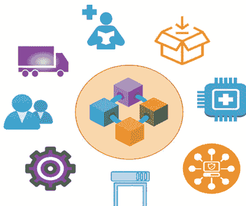

图 14.1 制药行业中的区块链。

- 风险：如果假药的剂量不当、成分不当、含有有害成分或完全没有活性成分，患者可能会面临某些健康问题的风险。
- 流行率：流通的药物中高达 10% 的被认为是假药，这使得假药成为一个全球性的严重问题。这一问题在贫穷国家尤为严重。

## 14.2 相关工作

作者讨论了 [5] 传统保险结算的人工方法，这种方法既冗长又低效。结算程序变得更加困难是由于保险者的隐藏条款和欺诈。区块链和智能合约能够提供数据存储、真实性、隐私和完整性，网络中进行的任何交易由验证者验证。

作者讨论了 [6] 区块链技术；保险行业尚未获得足够的关注。这项研究的目的是展示保险业务如何从区块链投资中获益。研究涵盖了区块链的基础，以及 Ethereum 和 Hyperledger 等知名平台，这些平台已应用于物联网、安全、供应链管理和数据处理。

根据 [7]，与中心化系统相比，区块链技术提供了更高的安全性、透明隐私性和完整性。国家保险计划旨在提供通用医疗服务，正面临腐败和欺诈带来的困难。作为回应，发布了一种基于区块链的策略来保护 NHIS。它包括序列和分析观点、智能处理系统以及数据管理框架。研究集中于使用区块链技术保护 NHIS 免受攻击和财务风险。系统的有效性通过 DeLone & McLean 信息成功模型进行了评估。

本文讨论了区块链技术的应用 [8]，开发了一种用于医疗记录平台的智能合约算法。算法确保了执行的不可更改，解决了身份和可靠性问题，并控制了对医疗系统的访问。该方法使用可执行分布式代码在分布式环境中整合病历自动化管理。该技术使用 Solidity 语言创建了一个许可私有架构。此外，实现了一种建议的共识方法，它使用速度快 22% 且消耗大量的哈希函数。

根据 [9]，物联网设备具有感知和记录数据的能力，但由于其处理能力低，它们存在处理和安全问题。这确保了信息的机密性、完整性和不可篡改性。通过区块链与物联网技术的结合，可以安全地从去中心化网络检索信息。这有助于许多问题，如患者对数据的控制、维护数据互操作性以及开发安全可靠的系统。基于区块链的物联网-EHR 架构增加了系统的安全性和有效性。


# 区块链在医药研究中的应用

通过在部署 PBFT-PoW 中利用云技术以一种经济的方式存储患者健康数据。PoW 的准确率为 92.75%，PBFT 为 90.15%，而建议的 PBFT-PoW 准确率为 99.88%。通过使用混合共识协议和区块链技术，系统解决了电子医疗应用中的安全、安全和隐私丢失问题。医生为患者提供了健康相关信息的远程访问，使医疗保健变得易获取。

作者讨论了 [11] 医疗保险部门如何利用基于区块链的 B-SAHIC 系统以安全高效的方式处理健康保险理赔。它通过允许参与过程的所有方访问基于网络的门户，确保了机密性和透明度。该系统实现了智能合约并使用 Hyperledger Fabric 构建了理赔处理算法。CouchDB 用于存储链外（OffChain）数据，保证了可靠的世界状态数据库。加密保护了客户理赔相关数据的隐私；每当客户提交私人文档时，都会生成新密钥。改进了关键信息的安全性和机密性。在每秒 1300 次查询的情况下，平均查询延迟从 0.07 秒（两个对等节点）减少到 0.02 秒（六节点），B-SAHIC 提供了一种快速且可扩展的解决方案。对于每秒 300 次交易，平均交易延迟约为 3.5 秒。系统仅需两个对等节点即可利用约 350MB 的资源。因此，它是成本效益且执行成功的。

数据隐私、欺诈理赔、欺骗行为和透明度不足是影响健康保险部门的障碍 [12]。这些问题可能来自患者、医生甚至是保险公司本身。这些问题导致健康保险市场效率降低，可能导致保费增加和医疗护理变差。将区块链技术整合到健康保险流程中可以通过带来安全性、隐私性和透明度来缓解这些担忧。

这项研究 [13] 描述了参数保险系统及其在运输行业中的应用。它研究了区块链技术在参数运输保险中的应用，涵盖了与实施和设计相关的问题。研究重点是参数保险在以下领域的可能用途：旅游、航空、农业（包括作物保险）和灾难保险。该研究扩展了我们对如何利用技术在运输领域提供参数保险的认知，并对区块链技术在多个领域的潜在用途提供了视角。

# 健康科学中的 300区块链

提出的基于以太坊区块链架构“ChainSure”旨在解决当前健康保险管理系统的缺陷 [14]。它为健康保险管理提供了一个自动化、安全、透明且可扩展的系统。该框架帮助消费者使用 TOPSIS 技术选择最符合其需求的策略。ChainSure 提供了一个具有交互用户界面的去中心化生态系统。事实证明，ChainSure 在延迟、成本和服务完整性方面优于其他先进模型。

区块链技术被认为是一种革命性的新技术，具有创造重大突破的潜力，类似于互联网和内燃机。尽管对区块链技术感到兴奋，企业对其真实利益仍持怀疑态度。这项研究 [15] 通过考察学术研究和商业实践，了解区块链在保险业的采用和使用程度。目标是识别保险行业区块链的采用趋势并进行文献比较研究。该研究基于群体知识评估了行业的潜在和实际碎片化程度。

需要检测欺诈理赔和支付的系统，因为健康保险欺诈是一个给个人、企业和政府带来巨大损失的重大问题 [16]。一项解决健康保险安全问题并基于区块链和人工智能提出解决方案的深入研究，展示了区块链技术和人工智能（AI）在确保健康保险欺诈检测中的应用。通过利用区块链技术和人工智能算法，所提出的解决方案提供了一种识别健康保险欺诈的安全智能方法。为了说明基于区块链和人工智能系统的成功运行，展示了一个健康保险欺诈的案例研究。

# 14.3 医药研究图谱

医药研究环境复杂且动态，具有不同的参与者、程序和一些挑战。图 14.2 描绘了医药研究部门的各个方面，如药物的开发与交付、生物医学科学创新、监管框架和合作研究伙伴关系。全球健康问题在整个过程中发挥着重要作用 [13]。这些方面描述如下：

# 区块链在医药研究中的应用 301

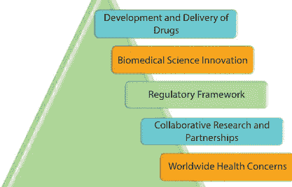

图 14.2 医药研究图谱。

-   开发与交付
    医药研究的第一阶段是确定药物开发的合适来源。然后，通过筛选化学库，确定特定治疗方案的潜在候选药物 [14]。在确定特定候选药物后，进行临床前测试，以确定其在临床试验中应用是否安全有效。执行这些程序的目的是评估人体体内的安全性、有效性和副作用。

-   生物医学科学创新
    随着生物医学科学的进步，它重点侧重于识别分子缺陷、疾病的分子基础、识别和开发针对特定客户需求的定制药物，或确定治疗反应。其目标是通过定制化治疗方案来满足每个特定患者的需求，从而减少副作用并增加有效性 [13]。

-   监管框架
    医药行业受到严格监管，有严格的准则管理标签、营销、临床试验执行、制造标准和药物许可。该过程由监管机构的批准进行监控，这些包括 EMA、美国的 FDA 以及其他国际监管机构。在向患者提供药物或将其引入市场之前，相关机构会控制药物的质量、安全和效力水平 [15, 16]。

# 302 健康科学中的区块链

合作研究与伙伴关系
医药研究紧密依赖于学术机构、政府部门、非营利组织和公司等之间的合作，以交流信息、资源和知识。研究人员之间的协作有助于开发新型、更有效的科学发现，并传播专业知识，为临床研究和医药开发提供必要的资源、基础设施和专家知识支持 [17]。

全球健康成果
医药研究必须是首要任务，以解决传染病、抗生素耐药性、慢性病、罕见病和流行大病等健康问题。研究工作重点是开发疫苗、抗病毒药物、抗生素、生物制品和其他治疗方法，以预防、治疗或控制这些健康问题并改善结果 [15]。

导航医药研究世界需要对科学原理、监管限制、伦理考虑、技术进步和合作伙伴关系的理解。研究人员可以通过使用多种信息来源、遵循伦理标准和促进合作，在药物和医疗创新方面取得进展以解决医疗需求并改善患者结果。

### 14.3.1 区块链在临床试验中的实施

这种协作为处理不同问题、提高效率数据保护提供了巨大的机会 [15]。在医疗保健领域使用区块链的各种优势包括：

-   信息的完整性和安全性：通过利用网络中的加密账本确保区块链数据的完整性。它保护数据免受未经授权的访问或意外篡改。这提高了用于决策和监管合规的数据信任度和安全性 [5]。

-   去中心化系统：区块链网络中的数据以去中心化的方式管理，消除了第三方用户对权威验证数据的需求。区块链在维护数据安全的同时促进了区块链网络中的协作、透明度和实时操作 [5]。


# 区块链在医药研究中的应用

- 3. 患者数据隐私：它提供了一个以患者为中心的系统，患者通过智能合约对其数据或信息拥有控制权，并可以决定谁可以访问其数据 [3]。
- 4. 供应链：它控制并监控医疗样本、药物、设备等的供应链。各种利益相关者可以通过验证溯源来减少分流、伪造和污染的概率 [16]。
- 5. 智能合约的使用：智能合约是在满足特定条件时自动执行的数字合同。它具有监控数据收集、运行任务、支付、患者入组等任务的能力。这种自动化加速了测试过程，并最大限度地降低了整体成本。
- 6. 审计与实时监控：它还负责监控临床试验数据的实时操作和检查。由于透明性特征，监管机构可以获取临床测试信息或所有活动的记录。这改进了决策制定和合规标准 [4, 5]。
- 7. 数据传输与互操作性：它确保了不同医疗机构和用户之间安全的数据交换和互操作性 [7]。
- 8. 监管合规：区块链通过使用透明、不可更改、可验证的记录来测试医疗保健领域的临床试验，提供了顺的监管合规。它还降低了法律风险，并为所有参与者提供了透明度 [4]。

随着区块链在临床试验中的应用日益，它还提供了安全性、数据完整性、患者安全、供应链管理、实时监控、透明度、协议自动化和监管合规。利用区块链技术可以提高测试效率、加速创新、降低成本，并为患者提供更安全、有效的治疗。

## 14.4 区块链在供应链管理中的作用

医药行业的供应链管理利用区块链技术可以很容易地管理和验证 [17]。如图14.3所示：

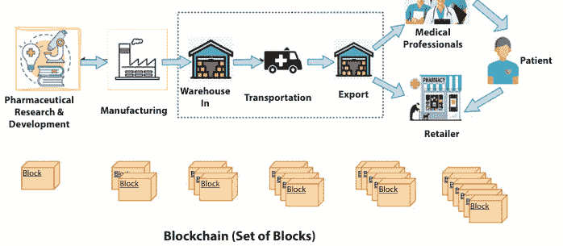

图 14.3 区块链（区块集）展示了区块链如何在医药供应链过程中发挥关键作用。

- 追踪：在供应链过程中，使用区块链技术对产品的端到端交付进行追踪。操作对参与者来说是透明的；他们了解从原材料采购到制造、分销以及交付客户的所有阶段 [3]。
- 产品伪造：通过追踪数据的所有权和溯源，可以了解产品的合法性。数字签名用于验证产品或货物的真实性。反伪造措施有助于保护消费者的信任、信心、质量和安全等 [4]。
- 审计与质量保证：通过区块链，人们可以追踪产品和服务的源头和转移。通过这项技术可以增强整体质量 [14, 17]。
- 库存控制：通过智能合约提供系列指南和警告，可以增强质量和监管程序。通过将数据重新整理为批量或进行适当分析，可以提供适当的库存控制 [15]。
- 供应商和供应商管理：通过实现对整个供应链库存水平、位置和移动的实时可视化，区块链改进了库存管理。通过自动化订单、处理、库存补货和发票，智能合约可以减少人为错误、交期和与库存相关的费用。由于供应链参与者可以获得单一、透明的库存数据视图，需求预测和库存优化变得更加容易 [17]。
- 供应链中的支付与金融：区块链将贸易金融工具数字化，包括发票、支付担保和信用证，以促进高效的供应链融资和支付 [16, 17]。供应商、制造商、分销商和金融机构可以使用基于区块链的系统增强现金流管理、加速贸易金融程序并缩短支付处理时间。通过在完全履行后自动支付结算，智能合约可以提高财务交易的透明度和信心。
- 韧性与风险管理：通过减少包括延迟、中断、政治考量和供应商依赖在内的供应链风险，区块链提升了供应链的韧性和风险管理 [12]。建立在区块链技术上的风险管理工具具有评估风险因素、追踪供应链中的事件、针对即将发生的中断发送通知以及协助反应和应急预案的能力。区块链的透明和去中心化本质使得主动风险降低方法成为可能，增强了供应链的可见性。
- 对环境和社会的影响：区块链使得透明地追踪跨整个供应链和社会环境影响成为可能，支持可持续发展活动 [16]。区块链支持系统允许利益相关者关注劳工实践、伦理采购、垃圾产生、碳排放和能源使用等问题。这种开放性鼓励了可持续报告、利益相关者问责和伦理供应链实践。

## 14.5 与监管相关的方面

以下是与医药行业合规和监管相关的方面。

- 区块链在医药行业使用的可能性和监管障碍
区块链技术在提高数据完整性、消除歧义、透明度和安全性方面的承诺，与医药业务的可能性和监管问题交织在一起。监管机构必须提供清晰度和统一性，以解决由监管模糊引起的问题，特别是在数据隐私和智能合约的有效性方面。在鼓励监管创新和合作的同时，区块链为监管机构提供了改进患者数据保护、供应链可追溯性和实时监控的机会 [18]。建立在创新与合规之间取得平衡的监管框架——通过促进医药运营中的信任、透明度和效率——对于克服这些障碍至关重要。

- 行业、技术供应商与监管机构之间的伙伴关系
只有当监管机构、行业利益相关者和技术供应商共同努力时，医药行业才能充分利用区块链技术 [17, 18]。为了确保合规、保护消费者权利并促进创新，监管机构在建立明确规则、标准和法规方面着关键作用。医药行业、学术机构和医疗提供者是能够影响监管框架和行业最佳实践的群体之一。他们还提供了用例、运营洞察和领域经验。技术供应商提供创新的思维、符合行业和监管要求的规模扩展解决方案以及技术知识。区块链开发者、解决方案提供商和平台设计商是这些供应商的示例。多个利益相关者之间的合作包括持续讨论、信息共享、试点项目和监管沙盒，以便在现实环境中测试和评估区块链技术的同时解决法律问题。

监管机构可以与行业和技术供应商合作，共同创建监管框架，以解决数据隐私、安全和合规性担忧，促进互操作性和标准化，同时促进区块链技术的负责任实施 [16, 17]。监管机构、行业内部和技术供应商可以在不断演变的医药市场中确保合规、释放业务价值、改善患者疗效并推动创新。


| 参考文献 | 框架 | 领域 | 共识机制 | 智能合约 | 数据完整性 | 隐私 | 真实性 |
|---|---|---|---|---|---|---|---|
| [20] | 以太坊 | 制造业 | ✓ | | | ✓ | ✓ |
| [21] | 以太坊 | 供应链 | | | ✓ | | | |
| [22] | 以太坊 | 供应链 | ✓ | | ✓ | ✓ | | |
| [23] | 以太坊 | 供应链 | | ✓ | ✓ | | ✓ |
| [24] | 无 | 供应链 | | ✓ | | | | |
| [25] | 以太坊 | 供应链 | ✓ | | ✓ | ✓ | | |
| [26] | 未指定 | 供应链 | | ✓ | | | | |
| [27] | Hyperledger fabric | 药品溯源 | ✓ | ✓ | ✓ | ✓ | | |
| [28] | 以太坊 | 供应链 | ✓ | ✓ | | | ✓ | |

## 14.6 对比分析

本节讨论了所回顾研究的对比分析。表 14.1 描述了基于框架、领域、共识机制、智能合约、数据完整性、隐私、真实性等不同参数的对比分析结果。不同的文章使用了不同的框架，通过分析可以发现，以太坊是最常用的框架，主要见于 [18, 19]。本分析包含了不同的领域领域，并根据上述定义的参数进行了对比分析。

### 14.6.1 区块链应用监管框架的未来发展

为了应对行业认可、监管关注和技术进步，制药领域区块链应用的法律框架预计在未来发生变化。以下重大进展可能会影响监管框架：

- **法律状态描述**：监管机构可能会通过对这些概念提供更好的定义和法律认可，解决智能合约与现法律法规的执行、有效性和合规性问题。这种透明度将增强信任，使区块链技术更容易在制药行业得到更广泛的采用 [18]。

- **适当的安全与同意程序**：为了对患者信息进行安全性分析，它确保了该信息得到了适当的同意管理。通过使用各种隐私增强技术、同态加密、去中心化系统和零知识证明，确保了数据安全和管理 [16]。

- **互操作性与标准化**：为了鼓励跨区块链网络的互操作性和数据标准化，监管机构将简化跨利益相关者之间的数据交换、集成和兼容性。标准化的数据格式、API 和协议将促进监管报告、审计和信息共享，同时促进透明度和协作 [16]。

- **监管沙箱与试点项目**：监管机构利用试点项目和监管沙箱来测试和评估区块链应用。这些倡措在鼓励创新、行业合作和监管学习的同时，降低了监管风险和不确定性 [15, 16]。

- **智能监管**：监管机构可能会决定使用“智能监管”，利用人工智能（AI）和区块链技术来自动化合规监控和监管流程。为了降低行政成本，智能合约可以提供审计追踪、监管报告、罚单执行、合规检查并提高监管效率。它们还可以保证实时观测 [7]。

在未来制药行业区块链应用的监管框架中，全球协作、透明度、自动化、数据保护和互操作性将得到优先考虑。监管机构将显著改进监管框架，以促进创新、保护消费者权益，并确保基于区块链的医疗创新的信任、完整性和合规性。

### 14.6.2 用例与案例研究

区块链技术正在彻底改变制药研究，因为它有许多实应用。例如，辉瑞和 IBM 的临床研究区块链（CRB）以及其他平台能够在临床试验数据管理中实现数据共享，同时确保所有利益相关者的安全性和开放性 [14, 16, 17]。为了防止假药，Chronicle 领导了 MediLedger 项目，该项目跟踪整个医疗供应链中的产品真实性。区块链技术还保护了制药行业的知识产权，像 WIPO 等组织正在研究如何使用区块链技术管理知识产权。MolecularMatch 使用区块链提供基因组数据的安全共享，VeChainThor 和 DNV 合作提供监管合规解决方案。这些示例展示了区块链如何增强数据完整性、供应链透明度、知识产权保护、协作等。

凭借这项技术，未来是令人兴奋的，许多问题可以以有效的方式处理。

未来展望：

- 增强有效性
- 提高透明度
- 以患者为中心
- 革命性的用例

挑战：

- 监管法规合从性
- 信息安全
- 性能与可扩展性
- 采用与教育
- 费用与资本支出

为了克服这些障碍并利用区块链在制药领域的未来，尖端监管、技术进步、行业伙伴关系以及对利用区块链潜力的集体承诺，对于改善医疗成果、患者体验和行业创新至关重要 [19]。

## 14.7 结论

综所述，制药行业的区块链应用为降低成本、革命性变化和以患者为中心的解决方案提供了许多机会。为了管理这些计划，必须克服各种挑战，包括隐私、可扩展性、互操作性、数据安全和监管合规挑战。行业利益相关者、技术提供者、医疗专业人员和监管机构之间的合作对于克服这些挑战、促进创新和确保区块链技术的合理使用至关重要。通过使用区块链技术，制药行业可以赋能患者、推进研发、培养透明度、提高运营效率，并最终提供高效安全的医疗解决方案。区块链在结合仔细规划、既定规则和遵循最佳实践的基础上被使用时，将完全重塑制药行业，开启透明、信任和创造的新纪元。

## 参考文献

- 1. Akram, W., Joshi, R., Haider, T., Sharma, Jain, V., Garud, N., 区块链技术：药品管理的潜在工具。
- 2. Sriram, V., 等，通过区块链增强网络安全。
- 3. Murala, D., Panda, S., Sahoo, S., 云环境下的安全电子健康记录。
- 4. Mahajan, H., Rashid, A., Junnarkar, A., Deshpande, S., 医疗 4.0 的区块链集成。
- 5. Hassan, A., Ali, M., II., 基于区块链的健康保险框架。
- 6. Amponsah, A., Adekoya, A., Beyori, B., 基于云的国家医疗保险财务稳定性。
- 7. Mendoza Arvivo, I., 等，基于智能合约的医疗系统。
- 8. Pratibha 和 Kaur, G., 区块链的主题和趋势计量映射。
- 9. Khatun, M., Islam, R.A., Islam, S., B-SAHIC：基于区块链的安全和自动医疗保险理赔处理。
- 10. Ananna, T.N., Saifuzzaman, M., Chowdhury, M.J.M., Ferdous, M.S., 使用区块链技术管理医疗保险。
- 11. Karmakar, A., Ghosh, P., Banerjee, P.S., De, D., ChainShare：用于医疗 4.0 的无代理保险系统。
- 12. Dhiman, P., 等，可解释人工智能的医疗信任。
- 13. Alnuaim, A., Alshehi, A., Salah, K., Jayaraman, R., Omar, I.A., Battah, A., 基于区块链的处方药医疗保险理赔处理。


# 312 健康科学中的区块链

- 14. Barenji, R.V., Hirery, R.E., Demirkol, D., Daim, T.U., 药物 4.0 质量的研究现状分析。Technol. Soc., 76, 102472, 102472, 2024.
- 15. Abdu, N.A.A. and Wang, Z., 用于临床试验审计的区块链框架。Wired. Pres. Commun., 132, 1, 39–65, 2023.
- 16. Abdallah, S. and Nizamuddin, N., 基于区块链的制药供应链解决方案。Comput. Ind. Eng., 108977, 165–177, 2023.
- 17. Juma, L., 区块链支持的应用在提高供应链性能中的作用：约旦制造趋势案例。Mag. Res. Rev., 46, 10, 1315–1333, 2023.
- 18. Trautmann, L., Hübner, T., Lasch, R., 通过增加供应链可见性对抗假药的区块链概念。Int. J. Logist. Res. App., 27, 6, 959–985, 2024.
- 19. Wenhua, Z., Qamar, F., Abdali, T.-A.N., Hassan, R., J Afri, S.A., Nguyen, Q.N., 区块链技术：安全问题、医疗应用、挑战与趋势。Electron. (Basel), 12, 3, 546, 2023.
- 20. Durá, M., et al., 用于药物制造数据原始性的区块链。J. Pharm. Innov., 18, 4, 1745–1763, 2023.
- 21. Bencic, F., Smokir, P., Zarko, I.P., Dl-tags: 用于去中心化、保护隐私和可验证供应链管理的 Dlt 和智能链。IEEE Access, 7, 46198–46209, 2019.
- 22. Bocek, T., Rodrigues, B.B., Strasser, T., Stiller, B., 制药供应链中的区块链：2017 年 IEEE/IEEE 集成网络和服务管理研讨会 (IM)，页 772–777, 2017.
- 23. Mishra, R., Ramesh, D., Mohammad, N., Mandal, B., 具有追溯性的区块链支持安全药品供应链框架，在：Anable PharmaChain 方法，2024.
- 24. Mezquita, Y., Podgorelec, B., Gil-González, A.B., Corchado, J.M., 基于区块链的供应链系统，在制药案例研究中的互操作性模型。Sens. (Basel), 23, 4, 1962, 2023.
- 25. Bandhu, K.C., Litoriya, R., Lowanishi, P., Jindal, M., Chouhan, L., Jain, S., 使供应链安全、可追溯且高效：区块链和智能合约的实现。Multimed. Tools Appl., 82, 15, 23541–23568, 2023.
- 26. Bapatla, A.K., Mohanty, S.P., Kougianos, E., PharmaChain 3.0：使用区块链集成的产品序列化机制对制药供应链中的药物进行有效跟踪和追踪。SN Comput. Sci., 5, 1, 1–20, 2024.
- 27. Ghadge, A., Bourlakis, M., Kamble, S., Seuring, S., 制药供应链中的区块链实施：综述与概念框架。Int. J. Prod. Res., 61, 19, 6633–6651, 2023.
- 28. Chen, X., He, C., Chen, Y., Xie, 物联网 (IoT)—大流行时代区块链支持的药品供应链韧性。Front. Eng. Manag., 10, 1, 82–95, 2023.

# 制药应用中的区块链创新

Dinesh Kumar¹, Rajni¹, Puja Gulati¹, Savita Deokar², Rajib Singh³ 和 Debarshi Kar Mahar⁴*

¹药剂学系，药学院, Des Bhag University, Gobindgarh, Dist. Fatehgarh Sahib, Punjab, India
²药剂学系，药学院, Pimpri Chinchwad University, Vadgaon, Sate Maval, Pune, Maharashtra, India
³药物化学系，Shakti 药学学院，Balrampur, Uttar Pradesh, India
⁴药物化学系，Chitkara 药学院，Chitkara University, India, India

# 摘要
药房必须高效处理其数据。一种名为区块链的新技术可以使许多制药过程更加安全和透明。2013年，美国制定了《药品供应链安全法》(DSCSA)，以防止被盗、污染或伪造药物的流通。区块链技术采用加密方法作为这一问题的解决方案。为了确保点对点交易网络的安全，区块链技术创建了一个非中心化的分布式账本。将其整合到产品中可以确保其安全性和市场价值。区块链技术通过促进对法律的遵守，提供了增强药品制造有效性、可靠性和效率的解决方案。此外，它提供了一个解决重大问题的机会：假药进入系统并最终到达消费者手中的泛滥问题。制药行业声称，假药对社会构成了巨大危险。假药通过直接和间接方式负面影响患者健康，可能导致严重的并发症甚至死亡。这种假药危及患者安全并损害了制造商的形象；这是制药行业供应链管理缺陷导致的。供应链管理受益于区块链在过程每一步的透明度和不可篡改性，这增加了信任、安全、追溯性和开放性。区块链作为一种管理电子数据的新技术，透明性和责任制带来了希望。计算机网络的每个用户都可以访问被称为区块链的相同不可变交易记录。

**关键词：** 区块链、制药、供应链、网络、医疗、健康、数据、技术

> *通讯作者：dkmbsp@gmail.com

Aryan Chaudhary, Rashmi Singh 和 Gaurav Agarwal (编) 健康科学中的区块链，(313–328)
©2025 Scrivener Publishing.

## 15.1 引言

区块链是一种分布式账本，系统地记录在“区块”中。在全球范围内，由节点控制的区块链。由于区块链的分布式性质，无法对双方之间的交易进行更改。区块链最初由 Nakamoto 在2008年发布，并在2009年发布。构成区块链基础设施的分布式账本是区块链的骨干 [3]。区块链最初用于加密货币，其双重目标是消除银行等中介并保护用户免受欺诈和盗窃。在药房中使用区块链技术，医疗用品的供应可能是法律上可靠安全的。21世纪的区块链目前没有已知的缺陷。区块链可以增加信任并有助于消除任何个人更改交易或数据 [5]。

## 15.2 区块链与供应链

作为一个涉及许多交易的高度复杂的过程，药品供应链必须始终遵守严格的法规。制造商目前在供应链真实性验证方面的缺乏透明度是一个问题 [6]。供应链安全由于美国通过《药品供应链安全法》(DSCA) 而日益备受关注。实施该法案的主要原因之一是解决假药问题。违禁药物缺乏必要的活性成分，对患者构成健康风险。分销、批发和制造都是复杂制药供应链的环节，最终指向患者（图15.1）。真实性可能由供应链中可见度较低的制造商进行追踪 [7]。

在药店、零售和制造行业中，制造商负责确保其药品库存准备好交付给批发商。在批发商和分销商提供订单后，制造商安排货物储存在他们的仓库中。为了确保完全透明，包括库存数据。批发商的目标是使处方药的购买更加快捷。制造商与供应成千上万药店和配药师的批发商合作。制造商可能不是逐个向药店运输药品，而是向相对较少的批发商发送大量货物。批发商在获得所有权后，提供一系列服务，包括包装、计算机订单处理和药品交付。供应链的最后环节是医疗机构和制药公司。


# 316 健康科学中的区块链

药店占了处方药市场的约 75%，而医院等非零售店提供了其余 25%。分销商将货物卖给医院和药店，再将其卖给患者 [8]。

## 15.3 区块链网络

### 15.3.1 区块链技术

由标准产生的数据在区块链中形成连续的区块。区块链的独立且不连接的版本通常存储在许多计算机上 [9, 10]。区块链网络由相互连接的计算设备组成，采用协议记录交易并向链中添加新区块 [11]。通过这种方式，区块链网络充当去中心化的数据库，记录发生过的每一次交易。此外，它在预定义的协议下运行，该协议规定了执行和验证交易以及个人在网络上活动的规则 [12]。由于网络中的每个节点都存储了每笔交易的信息，该网络有时也被分布式注册表。区块链技术的三大主要为：

- 1. 公有链
- 2. 联盟链
- 3. 私有链

公有链既允许参与共识构建过程，也允许查看所有网络交易。公有链不依赖中心管理节点来验证交易，而是使用参与者共识来保证所有交易的真实性 [13, 14]。此类网络最著名的实例是比特币和以太坊。对于无许可且开放的公有链，任何连接互联网的人都可以注册网络上的受信节点。为了在将交易添加到账本之前对其进行验证，用户必须执行挖矿操作，这包括复杂的计算。他们可以访问历史数据和当前数据 [15]。

联盟链拥有管理节点。在伙伴关系中，例如网络成员会根据该节点如何帮助他们实现自己的业务目标对其进行投票。由于存储在此类网络中的数据可能是公开访问也可能是私有访问，因此它们被视为具有某种程度的去中心化。

此类网络的示例包括 Hyperledger 平台。联盟链（通常被称为联邦链）为想要结合公有链和私有链特征的公司提供了一种创新的替代方案。通过联盟链，某些公司信息可以公开，而其他信息则保持私密 [16]。

公有链与私有链的区别在于一点：此类注册表中的任何信息对对公众开放的。管理节点确保只有获得授权的成员才能访问区块链数据。Multichain 和 Hyperledger 是用于构建此类解决方案的两个系统。在管理控制范围内或有限环境（如封闭网络）内运行的区块链网络被称为私有链。尽管规模小得多，但这种区块链在去中心化和点对点通信方面与公有网络相同。医疗和药品监管机构还在市场上发现了低质和假产品。在发生违规事件和供应链中断后，一些制药公司寻求使用区块链技术简化运营、提高患者安全并加速医疗交易 [1]。

### 15.3.2 区块链在医学领域的应用

区块链技术在制药行业有多种应用。使用加密技术验证交易数据块，这解决了主要的安全问题 [17, 18]。药物追踪也得到了加强以对抗这些问题。通过使用数据矿工、区块链链码和数字签名进行质量控制，确保了从制造商到药店的恒定质量（图 15.2）[19]。在最终确定配方之前，寻找多种药物成分是常见做法。一旦找到了完美的配方，就可以给药。药物在供应链中移动时会经过许多之手，但主要的两个是制造商和患者 [8]。

### 15.3.3 仿伪预防

药品经过序列化以包含安全特征，允许客户检查产品的真实性并识别伪造品。由于包含了有害化合物或缺少活性成分，

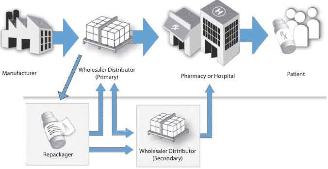

**图 15.2** 医学场景中的区块链应用。

假冒药品对客户生命构成了重大威胁 [20]。透明和基于链码的交易是区块链技术提高安全的另外两种方式。

信任和开放对于制药部门的功能至关重要。公众面临假药或不标准药物的风险，这些药物在缺乏信任的环境中盛行。应用区块链技术增强了质量控制，有助于识别假药，并最终拯救生命 [17, 21]。用于反伪的工具之一是反药品系统（ACMS）。以下是 ACMS 使用以太坊区块链 (EB) 和星际文件系统 (IPFS) 网络的一些方式：

- 1. 为小型企业启动计划。
- 2. 在以太坊区块链和 IPFS 网络之上构建增强 ACMS 的智能合约。
- 3. 为药品所有权（零售和非零售用途）制定规定，以结束克隆。
- 4. 评估问题和建议的解决方案。

### 15.3.4 产品分销

当经销商和中间商较多时，不诚实的可能性更大，供应链的效率会降低。区块链的优势之一是其停止假药传播的潜力 [22]。在涉及分销相关问题（如非法或假药的传播），区块链技术是一个极佳的匹配 [23]。序列化允许重建产品历史和包装分级结构 [24]。在一个模型中，四个节点分别是：食品药品监督管理局、生产者、分销商和商店 [25]。

在供应链中，确保制造商库存准备好分销给分销商的责任在于制造商。分销商在收到制造商订单后保留物品，并向制造商披露库存数据以保持整个过程的透明。分销商的作用是简化并加快处方药的获取。制造商不是逐个送到药店，而是大批量分销给相对较的分销商。分销商在获得所有权后提供一系列服务，包括重新包装、计算机订单处理和药品交付 [8]。

### 15.3.5 追踪与溯源

运输中的货物应从发货点到目的地进行监控和溯源。这非常有理。交付延迟对所有公司来说都是头疼的问题，但在医疗和制药行业可能是致命的。区块链技术现在已用于制药供应系统 [26]。区块链技术有机会彻底改变药品追溯性。这种设计不仅促进了客户信心，还实现了透明药品监测、用户隐私、质量控制、不可否认性和供需管理 [27]。在印度进行了一项广泛定量研究，阐明了区块链技术的关键方面，如角色、信誉和监测数据的能力 [28]。物联网 (IoT) 设备也被用于评估药品质量并确认数据源的可靠性，无论时间何地。作为数据存储和共享的中间节点，区块链保证了透明度和可追溯性。得益于区块链的追踪溯源；供应链中的重要利益相关者可以查看有关产品日期、位置和存储技术的重要信息。处理昂贵且脆弱的材料已经足够危险了；他们的目光


## 320 健康科学中的区块链

潜在问题，例如[space] 延迟或处理不当，进一步增加了复杂性 [30]。

## 15.3.6 安全性和固有安全性

由于其固有的设计缺陷，传统的药物供应链管理使得关键信息的安全可靠传输面临挑战。数据通常易于被更改、删除或篡改。追溯和跟踪能力符合监管标准，而加密技术提升了药物安全性 [31]。通过维持更高水平的安全性可以防止盗窃和假药的引入。未经授权的药物修改减少也遏制了医药利益相关者以降低药物质量的方式更改药物 [14]。

## 15.4 数据治理

被称为区块链的不可篡账本技术为处理敏感交易的系统提供了以数据为中心的安全，这些系统需要完全审计且不可篡跟踪的方法。区块链与数据治理（DG）在许多方面是互补的，尽管它们拥有独立的应用领域和运行理念。利用区块链和物联网（IoT）技术对数据治理和供应链是有益的 [32]。通过物联网的使用也确保了药品的监管合规性 [33]。

## 15.5 数据质量

通过在每个箱子中使用传感器设备，物联网（IoT）已用于在医疗货物运输期间（例如温度控制）符合 GDP 监管规定并确保质量 [17]。为了解决这些问题，区块链技术确保了所有数据都是高质量的。一旦所有节点都验证了数据的真实性，新区块将被接受。然而，不允许添加评级不良的区块。为了让区块链处理用户的交易，它必须执行几个特定的受控功能。这些功能的目的是验证交易的合法性。当此交易发布时，区块链上的每个节点都会立即收到更新。

## 药物应用中的区块链创新 321 

## 15.6 药物周转

区块链技术可能通过改进供应链运营、减少浪费和确保供应的适当分配来帮助降低药物周转。因此，制药公司可以节省成本，患者可以在需要时获得处方（图 15.3）[34]。

## 15.7 处方药监控

为了解决传统处方药监控计划（PDMPs）的问题，区块链技术提供了去中心化、透明且安全的解决方案。以下是区块链技术如何彻底处方药监控的方式：

- 1. 去中心化数据共享：为了确保授权患者能够获得最新的患者处方信息，区块链允许州、药店和医疗保健提供者实时安全地传输数据。它防止了患者通过从不同来源寻求多种药物来利用数据孤岛。

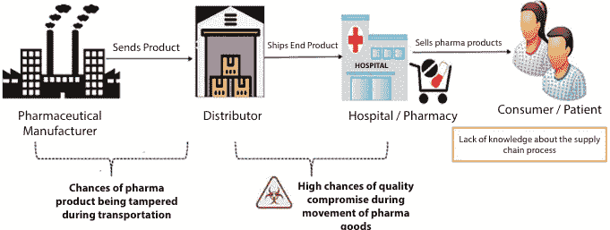

图 15.3 医药行业中的区块链技术。

## 322 健康科学中的区块链

- 2. 不可篡记录：作为一种不可变的交易，区块链记录了患者与药店之间的每一次接触。减少了欺诈行为的可能性，确保了处方数据的准确性。

- 3. 增强隐私：区块链技术的设计优先保护患者隐私。患者可以在数据在使用之前提供明确许可，且访问可能仅限于执业的医疗保健人员。这有助于增加保密性。

- 4. 互连：政府和医疗机构可以共同更好地监控和监管处方；得益于区块链技术提供无缝交互的能力。

- 5. 智能协议：智能合同的一个步骤是在发放新处方之前自动验证患者的处方历史。这让医疗保健提供者的工作变得更容易更精确。

- 6. 实时通知：当医疗保健提供人员遇到处方历史可疑的患者时，基于区块链的系统可能会实时提醒他们。这实现了早期干预并有助于减少过度开方 [35]。

## 15.8 区块链：分布式账本技术

一种加密单向哈希函数生成所谓的哈希值，它连接了区块链中的每个区块。它还确保了区块的匿名性、不可篡改性和紧密性 [36, 37]。节点在将交易发送到网络确认之前会对所有交易进行签名。通过使用私钥的数字签名可以保证交易的完整性和有效性。第一，签名交易需要特定的私钥；第二，在数据传输失败的情况下无法解密。在采用工作量证明或权益证明作为共识机制的网络中，一组被称为矿工的节点将网络分发并接受的所有交易收集到带有时间戳的区块中。在区块广播到网络后，验证节点会对其进行检查。这是通过引用链中的上一个区块，并使用与区块相关的哈希值来确保所收到的区块包含合法交易来实现的。一旦满足两个条件，节点就会将区块添加到区块链中。如果不满足条件，则消除障碍。

药物应用中的区块链创新 323

## 15.8.1 区块链节点的根本职责是

- 1. 连接到区块链系统，
- 2. 保持交易的精确记录，
- 3. 注意交换，
- 4. 发起有效的网络交易，
- 5. 监控刚密封的区块，
- 6. 通过检查交易来确保新密封区块的安全，
- 7. 创建并传输初始区块 [38, 39]。

### 15.8.2 优势

- (a) 可用性（Available）：可用意味着任何人都可以访问。
- (b) 无尽性（Endless）：由于去中心化网络，保存了大量的数据副本。
- (c) 无审查（Uncensored）：由于智能合约，交易可以在未经审查的情况下授权。
- (d) 经验性（Empirical）：使用零知识证明允许在不披露任何数据的情况下向另一方展示信息 [40, 41]。

### 15.8.3 挑战

以下是部署区块链的主要障碍：

- (a) 确保数据完整性；
- (b) 与区块链规范一致；
- (c) 认证个人和公司；
- (d) 管理合规性和安全性；
- (e) 解决互操作性问题；
- (f) 处理治理问题；
- (g) 确保数据完整性；
- (h) 与区块链规范一致；

## 324 健康科学中的区块链

- (i) 认证现有关系；以及 (j) 管理合规性和安全性 [42, 43]。

## 15.9 结论

许多行业正在寻找如区块链等的新技术来光明它们的未来。区块链研究近期转向了其在医疗保健领域的主要应用，包括健康记录、访问控制和数据交换；供应链管理和药物管理等应用目前较少。因此，区块链提供了巨大的待实现潜力。

References

- 1. Pence, H., Blockchain and the Pharmaceutical Industry. Chim. Oggi, 38, 1–5, 2019.
- 2. Poongodi, T., Ilango, S.S., Gupta, V., Prasad, S.K., Chapter 10 - Influence of blockchain technology in pharmaceutical industries, in: Hybrid Computational Intelligence for Pattern Analysis, Blockchain Technology for Emerging Applications, pp. 267–296, 2022.
- 3. Araujo, A.R.C., Santos, A.I., Reis, A., Da, C., A systematic review of the literature on the application of blockchain in the health supply chain. Int. J. Innov., 10, 4–72, 2020.
- 4. Akram, S.V., Malik, P.K., Singh, R., Anita, G., Tanwar, S., Adoption of blockchain technology in various realms: Opportunities and challenges. Security and Privacy, 3, 5, e109, 2020 Sept.
- 5. Zakari, N., Al-Razgan, M., Alsaadi, A., Blockchain Technology in Pharmaceutical Industry to Prevent Counterfeit Drugs. Int. J. Comput. Appl., 8, 840, 2018.


# 医药领域应用中的区块链创新

- 6. Aves, A., 区块链在医药领域的应用，欧洲制药制造商，欧洲制药制造商，伦敦，2018，获取自：https://pharmaceutical-manufacturer.media/pharmaceutical-industry-insights/the-application-of-blockchain-in-the-pharmaceutical-sector/

- 7. Schöner, M.M., Kourouklis, D., Sandner, P, Gonzalez, E., Förster, J., 制药行业中的区块链技术。德国法兰克福：法兰克福区块链中心，2017

- 8. Saxena, N., Thomas, I., Gope, P., Burnap, P., Kumar, N., PharmaCrypt: 用于关键制药行业防伪药物的区块链。Computer, 53, 7, 29–44, 2020年6月

- 9. Kim, H.M. 和 Laskowski, M., 面向本体论驱动的供应链溯源设计。会计财务管理智能系统。Fin. Manag., 25, 1–18, 2018。

- 10. Bryatov, S.R., 和 Borodinov, A.A., 医药供应链中的区块链技术：基于 Hyperledger Fabric 的业务模型研究；在：信息技术与纳米技术国际会议论文集 (ITNT)，俄罗斯萨马拉，第10卷，页码 1613-0076，2019年5月。

- 11. De Filippi, P. 和 Hassan, S., 作为监管技术的区块链技术：从代码到法律再到代码。第一月，关于通过分布式架构重夺互联网特刊，21, 2, 2016，获取自 SSRN：https://ssrn.com/abstract/3097430。

- 12. Bocek, T., Rodrigues, B.B., Strasser, T., Stiller, B., 无处不在区块链 - 区块链在医药供应链中的案例-IM IFIP论文，在：2017 IFIP/IEEE 集成网络与服务管理 (IM) 研讨会，法律与区块链。爱荷华州。Iowa. Rev., 104, 679–732, 2018。

- 13. Rodrigues, U., 数字技术在医药市场的使用前景，在：MATEC web of conferences，第193卷，页码 02029，EDP Sciences, 2018。

- 14. Campbell, C., Alpha 内容链：区块链技术的4种类型是什么？TechTarget，马萨诸塞州牛顿，2023。

- 16. Iredale, G., 区块链技术的不同类型有哪些？101 Blockchain，Kfar Monarch，2021，获取自：https://101blockchain.com/author/gwyneth/page/11。

- 17. Zakari, N., Razgan, A., Alomar, R., Alotaibi, S., Alharbi, M., 制药行业中的区块链技术：系统性综述。Peer J. Comp. Sci., 8, 1–6, 2022。

- 18. Sinclair, D., Shahriar, H., Zhang, C., 使用 hyperledger composer 进行药物供应链的安全需求原型设计：一种区块链应用，在：第三届密码学、安全与隐私国际会议论文集，页码 158–163,2019。

# 326 健康科学中的区块链

- 19. Makarov, A.M., Pisarenko, E.A., 医药产品生产与供应中的区块链技术。在：数字经济国际科学与实践会议 (ISCODE 2019)，页码 646–650，Atlantis Press,2019。

- 20. Clark, B. 和 Burstall, R., 区块链、知识产权与制药行业——分布式账本技术如何帮助保护医药供应链。J. Intell. Prop. Law Pract., 13, 7, 531–3, 2018。

- 21. Adsul, K.B. 和 Kosbatwar, S.P., 一种通过区块链进行假药溯源与检测的新方法。Int. J. Curr. Eng. Technol., 1–6, 2020。

- 22. Hulea, M., Rosu, O., Miro, R., Astilean, A., 分布式账本上的医药冷链管理平台，在：2018 IEEE 自动化、质量与测试国际会议 (AQTR),2018。

- 23. Fernando, E., Meyliana, H.L., Warnars, H.S., Abdurachman, E., 印度尼西亚药物分的区块链技术：一种建议模型。ICIC Express Letters., 14, 2, 2020。

- 24. Dwived, S.K., Amin, R., Vollalla, S., 带有密钥分配机制的供应链管理系统中区块链的安全信息共享协议。J. Inf. Sec. Appl., 54, 23, 102554, 2020。

- 25. Sylim, P., Liu, F., Fontelo, M., Alsaadi, A., 用于检测流通中伪劣和劣质药物的区块链技术：医药供应链交叉研究。JMIR Res. Post., 7, 9, e01603, 2021。

- 26. Zakari, N., Razgan, M., Alsaadi, A., Alshareef, H., Alashikh, L., Alharbi, M., Alomar, R., Alotaibi, S., 制药行业中的区块链技术：系统性综述。Peer J. Comput. Sci., 8, e840。

- 27. Jangir, S., Muzumdar, A., Jaiswal, A., Modi, C., Vyjayanth, C., 使用分布式账本和智能合约进行医药链管理的新型框架，在：第10届计算、通信与网络技术国际会议 (ICCNT),2019。

- 28. Kumar, A., Chaudhary, D., Raju, M.S., Sagar, R., 假药：利用区块链技术破解假药行业的定量分析；在：Confluence,页码 174–8, 2018。

- 29. Shi, J., Yi, D., Kuang, J., 结合物联网和区块链技术的医药链管理系统，在：Smart Blockchain，页码 97–108。

- 30. Zade, M.S., Tamboli, F., Salunkhe, A., Kore, M.D., Diknar, D., 医药行业中的区块链技术：全面概述。Int. J. Compr. Adv. Pharmacol. (IJCAAP), 9, 1, 24–30, 2024。

# 医药领域应用中的区块链创新

- 31. Plotnikov, V., 数字技术“区块链”在医药市场的使用前景，在：MATEC Web Conference,页码 193，获取自：https://eeexplore.ieee.org/xpl/home/6450608/proceed

- 32. Jalali, S. 和 Wohlin, C., 系统性文献综述研究：数据库搜索 vs. 雪球采样法，在：ACM-IEEE 实证软件工程与测量研讨会论文集 (SEMEM)，页码 29–38, 2012, doi.org/10.1145/2372251.237257。

- 33. Ahmadi, V., Benjelloun, S., Kim, M., Sharma, T., Chi, H., Zhou, W., 药物治理：基于区块链的2020年第六届移动与安全服务国际会议 (MobiSec)，页码 1–8, IEEE, doi/10.1109/MobiSec48690。

- 34. Lawrence, R., Watters, M., Davies, C., Pantel, K., Lu, Y., 用于早期检测的循环肿瘤细胞。Nat. Rev. Oncol., 20, 7, 487–503, 2023。

- 35. Mohanty, S., Yanambaka, V., Kougianos, E., Puthal, D., 万物物联网 (IoE) 中的硬件辅助区块链。IEEE Consum. Electron. Mag., 9, 2, 8–16, 2020, doi/10.1109/MCE.2019.295378。

- 36. 2018。获取自：doi/10.3390/sym1001470/mdpi.journal/

- 37. Dang, Q., 联邦信息处理标准 (FIPS) 180-4，安全哈希标准。Cryptology, 37, 1, 6–73, 2013。

- 38. Greenspan, G., 区块链与中央数据库。区块链：伦敦，英国。2016

- 39. Lewis, A, 区块链入门。BMC，新加坡，2018，https://bravenecoin.com/assets/Reference-Papers/A-Gentle-Introduction/A-Gentle-Introduction-To-Blockchain-Technology-WEB.pdf。

- 40. 获取自：https://www.geeksforgeeks.org/advantages-and-disadvantages-of-blockchain/

- 41. Budhi, V., 区块技术的优势与缺点，新泽西州：福布技术委员会，2022。https://www.forbes.com/councils/forbesttechnologycouncil/2022/10/20/advantages-and-disadvantages-of-blockchain-technology/

- 42. Han, Y., 和 Fang, X., 供应链管理采用区块链的系统性综述：文献计量分析与主题讨论。Int. J. Prod. Res., 62, 3, 991–1016, 2024年2月1日


# 第四部分
# 人工智能、物联网与区块链的整合

Aryan Chaudhary, Rashmi Singh 和 Gaurav Agarwal (编) 健康科学中的区块链 (331–348)
© 2025 Scrivener Publishing LLC.

## 16.1 引言

**关键词：** 人工智能、区块链技术、健康科学、数据安全、数据完整性、智能合约、患者数据隐私、个性化治疗方案

为了控制人工智能（AI）系统的处理，存在一系列被称为 AI 原则的规则，用以塑造这些技术的增长和运营理念 [1]。这些理念考虑了如对新学习的知识进行推理的能力，根据切身经验和事实使用复杂的算法做出决策或预测的能力。重要组件包括计算机视觉（CV）、自然语言处理（NLP）、机器人技术和机器学习（ML）。人工智能建立在这样一个原则之上：人类认知过程（如学习和解决问题）可以被机器模拟以识别模式 [2]。然而，同样重要的是伦理原则，如正义、透明度、问责制以及这些新型 AI 技术的首要地位应优于典型的短期经济利益 [3]。

区块链建立在安全、透明和去中心化的基础上 [4]。区块链本质上是一个在多台计算机上运行的去中心化账本，确保数据在发生后无法被更改 [5]。哈希：数据被写入一组独特的文件，每个文件通过加密哈希进行标记，以保持不可篡改性 [6]。去中心化：在不需要中间人的情况下，去中心化实现了点对点的数据存储，同时通过要求平衡确保了用户之间的透明度和信任 [7]。波斯纳法（Posner）出现（提前约十四年）是为了论证，由于维护区块链和确保符合共识算法（如工作量证明或权益证明）需要日常工作，犯罪分子想要对非法交易的利润进行垄断几乎是不可能的 [8]。这些原则的使用不仅使加密货币具有可用性，还有助于在供应链、医疗保健等领域创造价值和创新 [9]。

人工智能与区块链技术的协同结合对于行业中存在的许多部门来说可能非常有效 [10]。通过与这两项技术协同工作，我们不仅获取了二者的知识，还催生了新类型的应用，这些应用最终将改变我们的日常生活。下图（图 16.1）是人工智能与区块链结合的新兴架构 [11]。该分层框架具有四个主要层——数据层、处理层、应用层和安全层。不同层执行不同的操作 [12]。

- 数据层包含两个关键部分，即区块链存储和数据仓库。区块链存储包含智能合约的交易数据状态以及人工智能生成的输出的引用，而数据仓库存储了用于 AI 训练和分析的海量数据集，并在链外维护以最大化效率。
- 处理层由两部分组成：智能合约和 AI 引擎。这些是自动执行的合约，其买卖双方之间的协议条款直接写入代码行中，这些代码存在于分布式、去中心化的区块链网络中，因此，智能合约中的“智能”是指能够消除交易中银行或律师等中介的能力，从而增加双方之间的信任，且只有在满足某些预设条件时才会执行。此类协议可以触发人工智能（AI）动作，或使用 AI 知识来做出明智决策。

| 安全协议 | 网络基础设施 | 安全与网络 |
|---|---|---|
| 用户界面 | APIS | 应用层 |
| 智能合约 | AI 引擎 | 处理层 |
| 区块链存储 | 数据仓库 | 数据层 |

图 16.1 人工智能与区块链技术融合的架构蓝图。

- 3. 应用层包含两个部分：用户界面和应用程序接口（API）。用户界面在允许用户与 AI 交互以及验证区块链交易方面起着至关重要的作用。API 使人工智能系统的区块链元素更容易顺利地集成到许多其他应用程序中，促进高效的数据交换并运行适当的操作。

- 4. 安全层由两部分组成：安全协议和网络架构。为了维护区块链交易和 AI 数据交换的完整性，已经建立了安全协议以确保数据完整性和整体系统安全。此外，实现分布式去中心化区块链技术的网络基础设施也具有足够的带宽供 AI 计算。

## 16.2 人工智能与区块链整合的优势

以下是整合区块链和人工智能的一些优势：

- 1. 增强安全与保障：通过引入人工智能系统执行异常检测以及实时威胁响应，增强了区块链的安全协议。区块链账本不可更改的性质确保了通过确保 AI 行动的透明度、问责性和可验证性在该技术之上建立了信任 [13]。

- 2. 更好的数据真实性和机密性：作为不可篡改且安全的数据存储，这保证了人工智能算法所使用或生成的信息不受伪造 [14]。这一方面在遵守任何数据保护法律（如 GDPR）时尤为重要。此外，AI 可以通过控制和加密区块链中的数据来增强隐私。

- 3. 去中心化智能：如果 AI 与区块链集成，使得操作可以在区块链上分布成为可能，从而导致去中心化的决策过程 [15]。去中心化减少了对具有攻击和崩溃风险的中心化数据库的依赖，从而提高了系统的安全可靠性。

- 4. 提高效率和自动化：通过利用 AI 算法，可以优化区块链操作，实现复杂流程自动化，提高交易和智能合约执行的效率 [16]。这导致了成本的降低和速度的提高，最终提高了系统的效率。

## 16.3 跨行业的创新应用

人工智能（AI）与区块链技术的结合具有彻底改变各行业的巨大潜力。当 AI 的数据处理能力与区块链的安全透明的基础设施相结合时，可以驱动变革性的成果 [17]。AI 快速准确分析数据集的能力提供了宝贵的见解，实现了决策的自动化。当与区块链结合时，这种处理变得更加安全、透明且不可篡改，确保了数据完整性并在用户之间建立了信任 [18]。

- 1. 在医疗领域，AI 和区块链共同安全地存储患者病历 [19]。AI 可以利用这些数据快速准确地诊断疾病，而区块链则保护安全数据和患者隐私 [20]。例如，AI 可以分析存储在区块链上的医疗数据，识别潜在的健康问题并建议预防方法。

- 2. AI 结合区块链技术可以彻底改变金融领域的防欺和风险管理 [21]。AI 算法分析记录在区块链上的交易以快速检测可疑活动。此外，AI 可以使用区块链上的智能合约自动并完成交易或贷款审批，增加透明度并加快结算。

- 3. 人工智能与区块链技术的结合通过区块链增强了供应链管理 [22]。它还提供了货物透明且完整的历史


# 健康科学中的区块链

从生产到交付。AI 分析来自区块链的数据以优化物流并预测需求。例如，AI 可以通过分析区块链数据来预测供应链中断，使公司能够采取积极应对措施。

## 16.4 医疗保健机构在运营管理和提供优质医疗服务方面面临的当前挑战

全球范围内的医疗系统正面临着阻碍其有效提供高质量护理的严峻挑战 [23]。一个主要问题是患者信息分散在不同的系统和组织中。这使得获取所有所需信息并提供可能的护理变得困难 [24]。此外，保护医疗数据至关重要，因为数据的丢失会引发重大的隐私和安全担忧 [25]。资源利用不当导致医疗成本增加和患者等待时间延长 [26]。在复杂的法规中、确保医疗实践的透明度以及提供清晰的账单信息，仍然是医疗行业面临的持续障碍 [26]。

## 16.5 AI 和区块链在解决目前面临的障碍方面潜力巨大

- 1. 通过利用人工智能（AI），医疗专业人员可以无缝结合来自各种来源的医疗信息，实现对患者健康进行结构化且彻底的评估 [27]。将区块链技术整合到医疗保健中允许提供者安全地管理并及时访问患者数据 [28]。这种进步提高了诊断准确性并使治疗方案成为可能。
- 2. 区块链的去中心化设计使其成为保护敏感健康信息的理想选择 [29]。涉及患者记录的每次交易都永久存储在区块链上，建立了一个安全且防篡改的访问历史 [30]。人工智能（AI）通过监控可疑访问模式和可能的泄露增加了另一层安全保障，增强了整体数据保护 [31]。
- 使用区块链的历史数据，AI 可以预测患者需求并识别高流量时段 [32]。这允许医院调整人员配置、缩短等待时间并优化资源分配。AI 还可以增强药物和医疗设备的供应链，从而节约成本并改善患者护理 [33]。
- 区块链通过清除并永久记录所有与合规相关的操作和数据，帮助医疗服务提供者遵循规则。人工智能（AI）通过不断检查不同数据点的合规性发挥着关键作用，并在违合规迹象变成严重问题之前向利益相关者发出警报 [34]。
- 医疗机构使用 AI 分析基于区块链的交易，允许他们快速识别医疗账单和保险索赔中的错误和潜在欺诈 [35]。区块链技术确保了透明度，因为所有方都有平等的信息访问权限，从而减少了争议并增强了相关方之间的信任。

## 16.6 AI 和区块链在医疗行业的应用

由于人工智能（AI）和区块链技术的结合，医疗行业正在经历重大变革。这种整合带来了医疗保健多个方面的显著改进，并增强了诊断、治疗计划和记录保存等各个流程的准确性和效率。这里还包含了针对敏感患者信息的改进安全措施，确保其机密性和隐私。

- 安全透明的患者记录：区块链为存储患者医疗数据提供了安全基础。一旦记录添加到区块链，它就会变得不可更改，只有通过共识才能更改，从而免受恶意操作和未经授权的访问。人工智能（AI）可以加速这些记录数据的添加和检索过程，提高医疗服务的效率。此外，AI 系统可以分析这些庞大的数据集，为预测性医疗和定制化治疗策略提供见解 [36]。区块链和人工智能（AI）正通过引入安全去中心化的患者记录管理系统来重塑医疗保健。区块链确保了数据隐私和可靠性，允许 AI 安全地访问和处理信息。这种创新方法为 AI 算法在遵守严格机密性要求的同时与患者数据工作提供了坚实基础。研究强调了遵循全球隐私法规（如 HIPAA 和 GDPR）的以患者为中心的数据治理的重要性。它还探索了 AI 分析大量患者数据能力对改进诊断和治疗计划的潜在益处，强调了深入研究这些技术的必要性，目标将其成功整合到医疗系统中。

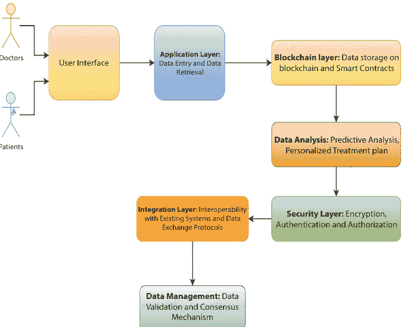

图 16.2 使用 AI 和区块链保护患者记录。

图 16.2 显示了使用 AI 和区块链保护患者记录的过程。该设计方案确保了患者信息得到有效且安全的管理。它利用了人工智能来改进数据处理和分析。区块链技术也被用于创建一个强大的基石，以保护数据的完整性和机密性。

- 2. 提高诊断准确性：AI 算法通过快速分析复杂的医疗数据来增强医疗保健，使医生能够更精确、更及时地诊断疾病。深度学习等先进技术应用于放射学和病理学，以检测可能被人类观察忽略的模式。整合区块链确保了 AI 使用和产生的数据是安全可验证的，这是临床使用的一个重要特征。

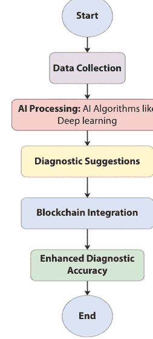

图 16.3 使用 AI 和区块链提高诊断准确性。

这种方法在研究论文《通过集成区块链和人工智能增强医院数据共享和 CT 图像检测》37] 中被强调。新方法结合了人工智能（AI）和区块链技术，使得通过 CT 扫描进行肺癌检测的数据共享更加安全高效。它建立了一个医疗数据可以在不同组织之间安全共享的系统。区块链技术用于确保数据传输的安全隐私。同时，AI 加快并改进了肺癌检测。该系统具有用于处理数据传输的智能合约和传播深度学习模型权重的去中心化网络。目标是创建一个医疗专业人员合作改进诊断的空间。图 16.3 显示了使用 AI 和集成区块链增强诊断准确性的过程。

- 3. 药物研发和供应链管理：药物研发中的 AI 可以通过模拟化学反应和预测其结果来简化药物开发。这加速了过程，节省了本应花费在实验室实验的时间和费用。

- 4. 药品供应链中的区块链：区块链技术建立了一个透明且可追踪的药品供应链。通过记录药物旅程的每个阶段，增强了利益相关者的库存监控，确保了药品供应链的完整性和效率。名为《智能医院药品供应链完整性管理的创新医疗区块链模型》38] 的文章提出了一种稳健的区块链解决方案，以增强医疗环境中药品供应链的可靠性和可见性。它承认了药理学中假药的严重问题及其对健康的不利。使用区块链框架 Hyperledger Fabric，该团队提供了一种监控药品供应链文档的安全方法，确保了所有药物交易的不可更改性和可追溯性。该系统采用智能合约管理对数字健康和药物记录的访问，提高了智能医院药品服务的安全性和效率。


# 医疗领域的 AI 与区块链：应用与挑战

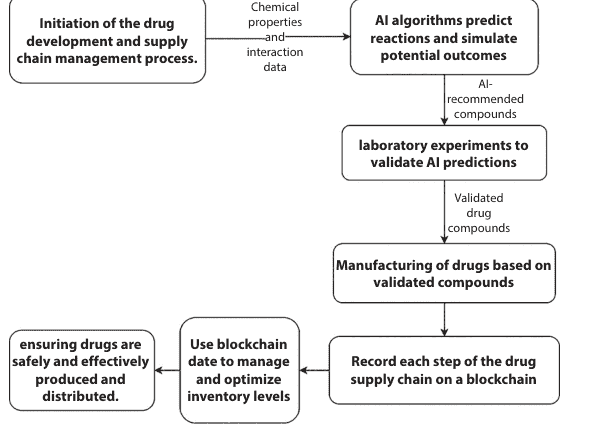

**图 16.4** 使用人工智能和区块链技术的药物开发和供应链管理。

展示了所提系统的实用性和有效性。该系统使用 Hyperledger Caliper 来测试其效率。这强调了区块链技术在减少假药风险和提升公共健康安全方面的优势。图 16.4 展示了该系统如何利用人工智能和区块链技术管理药物开发和供应链。

## 16.7 基于人工智能和区块链技术的医疗领域实时应用

- 1. BurstiIQ：该机构利用区块链技术来改进医疗数据的共享和使用。
- 2. SolLab：Solalab 利用区块链（一种安全的分布式账本系统）增强对医疗数据系统的保护。它还实现了医疗网络内重要医疗信息的顺畅交换和使用。
- 3. Medicalchain：一个医疗网络利用区块链技术追踪医疗物品的来源并保护患者信息。
- 4. Guardtime：Guardtime 采用区块链技术来增强网络安全，特别是在医疗行业内。
- 5. Avaneer：Avaneer 是一家新的医疗公司，旨在通过使用区块链技术提高医疗效率。Aetna、Antem 和克利夫兰医院是支持该业务的公司。公共账本被用于提高保险理赔处理的有效性，并确保患者信息的安全传输，同时保持提供者目录的实时更新。
- 6. Encrygen：该公司的区块链系统通过促进遗传数据的发现、共享、存储和获取，简化了相关流程。
- 7. Blockpharma：Blockpharma 尖的移动应用程序赋予了患者对抗医疗欺诈和伪造的能力。通过该应用，用户可以扫描产品供应商信息并跟踪处理过程的每一步来验证购买产品的真实性。利用区块链技术进行供应链管理，Blockpharma 旨在消除全球假药问题（目前影响了约 15% 的供应）。
- 8. FarmaTrust：FarmaTrust 的区块链技术提供了多种解决方案：
    - 简化处方管理
    - 验证医疗设备的真实性
    - 为疫苗和诊断提供患者数据安全保障
    - 打击供应链中的假药
    - 为客户提供验证药物真实性的应用程序。

## 16.8 医疗科学中人工智能与区块链整合的挑战

人工智能与区块链在医疗领域的整合在数据保护、追踪和患者结果方面具有广阔的前景。然而，它也带来了挑战：

- 可扩展性问题：处理海量健康数据可能会使系统压力。
- 数据隐私与安全：在患者数据保护与区块链透明度之间取得平衡需要谨慎的措施。
- 监管与伦理挑战：人工智能、区块链与医疗的交叉引发了伦理担忧，并需要监管框架来确保负责任的应用。

区块链技术在管理海量健康数据面临着着的可扩展性挑战。虽然区块链架构保证了数据安全性和追溯性，但它并未针对医疗行业常见的高速数据传输和大数据进行优化。由于需要多个节点验证每次交易（无论是添加新数据还是进行更改），会导致延迟。这降低了整体数据处理效率。

整合人工智能和区块链需要解决 AI 高计算需求和区块链交易容量之间的挑战。为了弥补这一差距，可以开发新协议在区块链之外处理 AI。或者，可以探索具有更高扩展性的区块链配置以增加吞吐量。

在医疗领域，结合 AI 和区块链会引发数据隐私和安全的担忧。区块链是开放的记录，很难保持患者信息的私密性。尽管区块链可以通过加密和分布式存储来使数据更安全，但其开放性也可能使敏感医疗信息的面临风险。目前已找到在保持区块链不可篡改性的同时，保持这些数据机密的方法。

在医疗领域中使用 AI 和区块链时，平衡数据的可访问性与安全性至关重要。区块链的权限系统可以限制数据访问，但它必须允许 AI 系统访问大型数据集以学习并改进患者护理。在数据隐私和可用性之间找到平衡，对于释放 AI 和区块链在医疗领域的全部潜力至关重要。

## 16.9 应对挑战

为了应对医疗挑战，全面的方法至关重要，涉及 AI 专家、区块链专家、医疗专业人员和监管机构之间的协作。通过解决可扩展性、隐私问题和伦理考量，医疗领域人工智能与区块链的有望改变患者护理并推进医学研究。通过利用这些技术，我们可以开启更好医疗结果的可能性，并促进个性化患者护理的创新。先进技术的结合有望彻底改变医疗行业，带来治理中伦理实践的增强；提高法规合规性；以及更有效的医疗管理。这些进步将推动行业迈向卓越的高度。

## 1 新兴趋势与技术

- 医疗领域的预测分析：人工智能（AI）和区块链技术将显著增强患者护理中的预测分析。通过结合这些技术，我们可以：
    - 更准确地预测患者结果
    - 为个体患者制定更有效的治疗方案
    - 尽早地发现健康问题，以便及时干预。
- 改进数据安全：区块链技术确保了用于医疗 AI 预测的数据的安全性和可靠性。数据免受未经授权的访问、操纵和更改，从而做出更准确、更可靠的临床决策。
- 构建在区块链上的去中心化自治组织（DAO）可以显著改善医疗保健：
    - 通过自动化和改进管理
    - 创建更民主、更有责任的治理结构
    - 简化运营

### 2 数据监管的演变格局

- 随着人工智能（AI）和区块链技术在医疗领域变得日益流行，监管正在演变以应对它们带来的新机遇和挑战。
- 为了保护数据，HIPAA 和 GDPR 等法规必须适应技术进步，特别是区块链的去中心化特性。

### 3 医疗科学中的伦理 AI 与区块链治理

- 伦理考量在医疗科学的伦理 AI 和区块链治理领域至关重要。考虑到 AI 系统所采用决策机制缺乏透明度，这一点尤为重要。
- 用于透明化的区块链：区块链可以使 AI 更加透明和负责。它可以跟踪所有 AI 决策，并创建可以审计伦理问题的永久记录。
- 伦理准则：为医疗领域中使用 AI 和区块链制定伦理准则很重要。这些准则将有助于以负责任和道德的方式使用这些技术。

## 16.10 未来潜力与方向

- 个性化医疗与以患者为中心的护理：人工智能（AI）和区块链的进步正在改变医疗，根据个人的基因特征、生活方式和病史制定个性化治疗方案。区块链保护敏感患者数据，而 AI 处理复杂数据集的能力使医疗向更高效、以患者为中心的系统转型。
- 跨行业协作与创新：通过在医疗科学中结合 AI 和区块链，我们可以在不同部门建立新的协作。医疗提供者和技术公司可以共同努力推动该领域的发展。此外，与大学的合作也有助于研究。此外，整合其他行业的技术（如电信领域用于更好的数据收集，金融领域用于安全交易）可以极大地增强医疗科学的能力。


346 健康科学中的区块链

人工智能（AI）与区块链在医疗保健领域的结合推动了跨行业的协作。这促进了医疗保健、科技、学术界和其他部门之间的伙伴关系。通过利用每个行业的优势，这些联盟在医疗健康领域创造了变革性的创新。这带来了更健健、更高效的系统，使患者和所有参与者受益。

## 16.11 结论

人工智能（AI）与区块链技术的结合为彻底改变医疗保健提供了一种创新方法。通过将 AI 的先进数据分析能力与区块链的安全、去中心化记录存储相结合，这种伙伴关系解决了医疗健康领域的重大挑战，例如数据碎片化、安全风险和合规性问题。然而，这些技术的广泛实施仍面临可扩展性、隐私和基础设施方面的障碍。为了克服这些障碍，跨学科协作至关重要。随着技术的进步，它不仅有望使医疗运营更加高效，还将为个性化治疗和更好的护理铺平道路。这标志着向未来的重大转变，即医疗健康将优先考虑效率和患者的个人需求。

## 参考文献

- 1. Nilsson, N.J., Principles of artificial intelligence, Springer Science & Business Media, Morgan Kaufmann, 1982.
- 2. Konar, A., Artificial intelligence and soft computing: behavioral and cognitive modeling of the human brain, CRC press, Boca Raton, 2018.
- 3. Diaz-Rodriguez, N., et al., Connecting the dots in trustworthy Artificial Intelligence: From AI principles, ethics, and key requirements to AI systems and regulation. Inf. Fusion, 1018965, 2023.
- 4. Pilkington, M., Blockchain technology: principles and applications, in: Research handbook on digital transformations, pp. 225–253, Edward Edgar Publishing, Boca Raton, University in Besançon, France, 2016.
- 5. Politou, E., et al., Blockchain mutability: Challenges and proposed solutions. IEEE Trans. Emerging Top. Comput., 9, 4, 1972–1986, 2019.
- 6. Chelladurai, U. and Pandian, S., Hare: A new hash-based authenticated reliable and efficient modified merkle tree structure to ensure integrity of data in the healthcare systems. J. Ambient Intell. Hum. Comput., 1–15, 2021.

## 医疗健康中的 AI 与区块链：应用与挑战

- 7. De Filippo, P., The interplay between decentralization and privacy: the case of blockchain technologies. J. Peer Prod., 7, 2016.
- 8. Jain, A., *et al.*, Proof of stake with the friendly gadget protocol for fair validation consensus in ethereum. Int. J. Sci. Res. Comput. Sci. Eng. Inf. Technol., 3, 291–298, 2018.
- 9. Morabito, V., *Business innovation through blockchain*, Springer International Publishing, Cham, 2017.
- 10. Hardini, M.G., Yusuf, N.A., Zahra, A.R.A., Convergence of Intelligent Networks: Harnessing the Power of Artificial Intelligence and Blockchain for Future Innovations. ADI J Recent Innov., 5, 200–209, 2024.
- 11. Pandl, K.D., *et al.*, On the convergence of artificial intelligence and distributed ledger technology: A scoping review and research agenda. IEEE Access, 8, 50705–50955, 2020.
- 12. Li, J., *et al.*, Methods and applications for Artificial Intelligence, Big Data, Internet of Things, and Blockchain in smart energy management. Energy AI, 11, 102085, 2023.
- 13. Bothra, P., *et al.*, How applications of blockchain and artificial intelligence improve performance of Internet of Things? A survey. Comput. Netw., 224, 109634, 2023.
- 14. Siddika, A., *Assessing Blockchain’s Potential to Ensure Data Integrity and Security for AI and Machine Learning Applications*, Kennesaw State University, Georgia, 2023.
- 15. Balcerzak, A.P., *et al.*, Blockchain technology and smart contracts in decentralized governance systems. Administrative Sci., 12, 3, 2022.
- 16. Wang, S., *et al.*, Blockchain-enabled smart contracts: architecture, applications, and future trends. IEEE Trans. Syst. Man Cyber.: Syst., 49, 2266–2277, 2019.
- 17. Tyagi, A.K., Aswathy, S.U., Abraham, A., Integrating blockchain technology and artificial intelligence: Synergies perspectives challenges and research directions. J. Int. Affair. Secur., 15, 5, 1554, 2020.
- 18. Kiezems, M. and Misuraca, G., AI governance in the public sector: Three tales from the frontiers of automated decision-making in democratic settings. Telecommun. Policy, 44, 6, 101976, 2020.
- 19. Pradeep, A.S.E., *et al.*, Blockchain-aided information exchange records for design liability control and improved security. Autom. Contr., 126, 106675, 2021.
- 20. Togde, P., *et al.*, Blockchain and artificial intelligence technology in e-Health. Environ. Sci. Pollut. Res., 28, 52810–528315, 2021.
- 21. Odeymi, O., *et al.*, Integrating AI with blockchain for enhanced financial services security. Finance Accounting Res. J., 6, 3, 271–287, 2024.
- 22. Wamba, S.F. and Queiroiz, M.M., Blockchain in the operations and supply chain management: Benefits, challenges, Int. J. Manage., 52, 102064, 2020. 348 健康科学中的区块链

- 23. World Health Organization, The world health report 2000: health systems: improving performance, World Health Organization, Geneva, 2000.
- 24. Olarce, I. and Oluwaseun, O., Big data in healthcare: Prospects and resolutions, in: 2016 Future technologies (FTC), IEEE, 2016.
- 25. Aburayya, A., et al., An investigation of factors affecting patients waiting time in primary health centers: An study, Manage. Sci. Lett., 10, 2020.
- 26. Kaswan, K., AI-based natural language processing for the generation of meaningful electronic health record (EHR) data, in: Advanced AI techniques and applications, CRC Press, pp. 41–86, 2021.
- 27. Rathee, G., et al., A hybrid framework for multimedia data processing in IoT-healthcare using blockchain, Multimed. Tools. Appl., 79, 9711–9733, 2020.
- 28. Deepa, N., et al., Decentralized Healthcare Management System Using Blockchain for Users, Blockchain Sec. Comput., 26, 165–282, 2022.
- 29. Zeadally, S., et al., Harnessing artificial intelligence capabilities to improve cybersecurity, IEEE Access, 8, 23817–23835, 2020.
- 30. Tanwar, S., Parekh, K., Evans, R., Blockchain-enabled smart contracts for healthcare 4.0 applications, J. Inf. Sec. Appl., 50, 102407, 2020.
- 31. Bazel, M.A., et al., The role of internet things, blockchain, artificial intelligence, and big data technologies in healthcare to prevent the spread of the Covid-19, in: 2021 International Conference on Innovation and Intelligence for Informatics (3ICT), IEEE, 2021.
- 32. Nguyen, A., et al., Data analytics in pharmaceutical supply chains: state of the art, opportunities, and challenges, Int. J. Prod. Res., 60, 22, 6888–6907, 2022.
- 33. Han, S. and Park, S., A gap between blockchain and general data protection: a systematic review, IEEE Access, 10, 103888–10905, 2022.
- 34. Amponsah, A.A., Adekoya, A.F., Weyori, B.A., A novel fraud detection and prevention method for healthcare claim processing using machine learning and blockchain technology, Decis. Anal. J., 4, 100122, 2022.
- 35. Haddad, A., et al., Systematic review on blockchain e-healthcare records management systems, IEEE Access, 10, 94583–946155, 2022.
- 36. Kumar, R., et al., An integration of blockchain and AI for data sharing and detection of CT images for the hospitals, Comput. Med. Imaging Graphics, 87, 101825, 2021.
- 37. Jamil, F., et al., A novel blockchain model for drug supply chain integrity management in a smart hospital, Electronics, 8, 505, 2019.


# 用于医学图像分析的 CNN 算法实现

Vaishali Chourey¹, Mohd. Arsh¹, Jahnvi Chourey² 和 Sunil Gautam\*

¹Adani 大学，古吉拉特，印度

²SATI，Vidisha，印度

³计算机科学与工程学院，Nirma 大学，艾哈达巴德，古吉拉特，印度

# 摘要

医学图像分析是现代医疗系统中不可或缺的组成部分。医学成像模式涵盖了 X 光、超声、磁共振成像等。通过使用计算机辅助诊断工具（CAD），已经阐明了可能的疾病过程，但基于单幅图像的分析和诊断通常非常困难。人工智能（AI）应用在优化和增强常规医疗程序方面具有巨大潜力，包括限于诊断、治疗、预防、进展监测和个性化护理。在医学影像领域，机器学习——当前人工智能（AI）革命的基石——为临床实践提供了新机会。机器学习（ML）算法能够识别这些视频或图像中的重复模式，并利用信息准确地识别不熟悉的图像。深度学习方法作为一种解决问题的方法，最近引起了广泛关注，特别是在医学影像领域。本章全面汇编了医学图像分析背景下的 CNN 以及在各种应用中的利用方法。文中对不同功能层级中的 CNN 模型进行了广泛且详尽的研究。此外，还对用于准确诊断的图像评估阶段进行了详细研究。

**关键词：** 机器学习，深度学习，CNN，分类，医学影像

*通讯作者：sunil.gautam@nirmauni.ac.in

Aryan Chaudhary, Rashmi Singh 和 Gaurav Agarwal (编) 卫生科学中的区块链，(349–368)
© 2025 Scrivener Publishing LLC

## 17.1 引言

深度学习是目前机器学习领域可用的最先进技术。深度学习在各种模式识别应用中的成功带来了令人兴奋的高远期望。深度学习也被称为人工智能（AI），它潜力在医疗保健领域带来革命性的改进。在将深度学习应用于病变检测或分类的早期阶段，所进行的研究表明，其性能优于传统技术，在某些任务中，它甚至超过了放射科医生。由于将计算机辅助诊断与基于深度学习的医学图像分析相结合的可能性，推动了计算机辅助诊断（CAD）的新型研发工作。这将为临床医生提供决策辅助，并提高各种诊断和治疗程序的准确性和效率。尽管在这个机器学习的新时代存在乐观情绪，但在临床实践中创建和使用深度学习工具仍面临许多障碍。在接下来的章节中，我们将探讨开发基于深度学习的强大工具以及将这些工具集成到临床工作流所需的某些挑战和努力。这将使我们能够朝着为患者服务提供可靠智能辅助的目标迈进。深度学习和卷积神经网络（CNNs）以卓越的协同效应共同进化，推动人工智能领域迈向新的高度。这种协同效应改变了我们分析和理解数据的能力，特别是在计算机视觉领域。深度学习利用人工网络，即从生物大脑中汲取灵感的数学结构。初始版本受限于计算能力的局限性以及训练复杂网络的困难。尽管如此，20 0 年代后期反向传播算法的进步以及高性能 GPU 的广泛使用促进了更复杂、更高效的神经网络的创建。

卷积神经网络（CNNs）是深度神经网络的一种高度专门化的形式，专门经过工程设计，以在图像分析和识别任务中获得卓越的性能。我们通过应用卷积层来提取特征并应用池化层来降低复杂性，利用图像固有的网格状布局，CNN 凭借其自定义的结构，在处理视觉输入方面优于通用深度学习模型。CNN 开发的重要里程碑如下：

- 1980 年代：Neocognitron 是一种早期的 CNN 架构，为未来的进步奠定了基础。
- 2012 年：AlexNet 以其更深层次架构在图像识别任务中取得了突破性结果。这标志着一个关键时刻，开启了 CNN 开发探索的新纪元。
- 2014-2015 年：VGG 模型推向了 CNN 深度的边界，展示了更深架构的有效性。
- 2015 年：ResNet 引入了残差学习的概念，这是一种革命性技术解决了创建更深 CNN 的问题。
- 未来展望：如今 CNN 是计算机视觉应用的基石，包括人脸识别、目标检测。正在的研究重点是优化 CNN 架构、引入注意力机制等新技术，以及在资源受限设备上提高效率。

深度学习与卷积神经网络的交织进化标志着一种强大的关系。

## 17.2 医学影像与深度学习

医学影像已被证明是诊断和理解疾病严重程度的重要工具。从 X 光到目前的断层扫描（CT）、超声、磁共振成像（MRI）以及正电子发射断层扫描，深度学习为医学影像提供了先进技术。这些技术使得对人体进行诊断、识别异常、监测治疗效果以及预测复发成为可能。在复杂功能的挑战下，人工智能、NLP、数据分析和深度学习领域确保了医学信息管理和分析的高效。然而，放射科医生的手工图像分析是一个耗时且主观的过程。卷积神经网络 CNNs 特别是人工智能开发出的以解决这些限制的强大工具。

## 17.3 深度学习与 CNN 的基础

人工智能领域真正被深度学习与卷积神经网络的优雅协同进化所改变。特别是在计算机视觉领域，这种强大的关系。深度学习已成为当前机器学习应用的一种潜在方法。DNN 或卷积神经网络通过训练获取特征表示，而不依赖于手动构建的特征作为输入。当 CNN 特征使用大型代表性数据集经过适当训练时，它们会被输出工程特征，因为它们具有高水平的选择性和不变性。深度学习是一种表示学习方法，其中神经网络架构的复杂层自动将输入数据转换为多层数据表示。在医学报告和其他应用输入图像的情况下，模式识别是一个重要阶段，并由 CNN 完成。当数据集足够大时，CNN 可以通过反向传播递归调整其权重从训练模型中学习，从而提取重要相关的特征。

### 17.3.1 CNN 的概念与定义

CNN 是一种强大的深度学习架构，专门设计用于在处理图像、视频和其他网格状数据的任务中表现卓越。本节介绍了 CNN 的一些关键概念。卷积神经网络是各种神经层的集合，旨在根据提供的数据实现所需的功能。CNN 有


# 用于医学图像分析的 CNN 算法实现 353

与人类大脑具有惊人的相似性 [1, 2]。图中的圆圈是神经元。神经元是 CNN 中的基本功能单元，类似于人类大脑中的神经元。每个神经元都连接到多个其他神经元，以聚合结果并得出结论。神经元的集合形成了一个层。参考图 17.1，共有 5 层。同样，有不同类型的层，它们被共同使用以将不同的功能整合在一起 [3]。图像处理中常用的某些层包括：

- 输入层（Input Layer）：这是卷积神经网络的第一层，它接收来自用户的输入并进行处理以满足下一层的要求。该层不进行任何计算 [1, 3]。在图 17.1 中，卷积层之前的层就是输入层。
- 隐藏层（Hidden Layers）：进行计算且不与用户直接交互的神经层是隐藏层，因为它们“隐藏”在输入层和输出层之间 [4]。这些层提取图像中的模式。从数据中提取最优特征需要隐藏层根据需求执行不同的功能。隐藏层的三个主要类型是：
- 卷积层（Convolutional Layers）—— 提取低级特征：这是 CNN 的核心。它使用较小的滤波器（内核）在输入图像上滑动，提取边缘、线条和形状等特征。过滤器学习权重，决定了图像中特定特征的重要性。单层中可以应用多个过滤器，每个过滤器检测不同的特征。


图 17.1 CNN 中的层。

通过实现反向传播和权重偏置等技术，这些层学习不同图像中的模式。CNN 中的卷积层功能类似于大脑的早期视觉处理阶段。当医学专业人员检查 X 光片时，他们从识别边缘、纹理和简单形状等基本元素开始。在 CNN 中，类似于图像内核的小过滤器扫描图像的微小区域，以提取边缘和梯度等低级信息。这些过滤器作用于整个图像，创建突出显示关键视觉特征的特征图。

- 池化层（Pool Layers）—— 总结信息：卷积层通过指数级计算需求来学习一切。因此，我们需要最大池化（MaxPool，取最大值）来过滤掉重要特征，并将这些选定的特征传递到下一层进行进一步计算。这减少了卷积层提取的数据维度，并有助于：
- 控制过拟合（当模型过度记忆了训练数据，且在未见数据上表现不佳时）。
- 使网络计算效率更高。

- 平化层（Flatten layers）：这些层减少神经网络的维度。通过在将来自 MaxPool 层的高维数据转换为一维数据结构之前，将其传递给下一层卷积层或输出层。

- 输出层（Output layer）—— 全连接层（Fully Connected Layers）：输出层是神经网络的最后一层，同样不执行任何计算。

- 激活函数（Activation Function）—— 引入非线性：在卷积神经网络（CNN）中，激活函数在向网络引入非线性方面起着至关重要的作用。这种非线性对于 CNN 学习图像和视频中的复杂模式至关重要，因为这些是本质上是非线性的数据结构。单个层的超参数有助于机器模型更好地自适应数据 [5]。虽然每层都有自己的参数，但

# 用于医学图像分析的 CNN 算法实现 355

在深入研究特定层超参数之前，我们将讨论一些常见的超参数。机器学习模型基于统计学工作，这意味着数据中存在的任何模式都会被绘制成函数，并根据推导出的最终表达式进行进一步的预测。激活函数是应用于神经元输出的操作，使其能够学习数据元素之间的非线性关系 [6–8, 11]。有一些常见的激活函数：

- 修正的线性单元（ReLU）：CNN 中使用最广泛的激活函数。如果输入为正值，它直接输出输入，否则输出为零 f(x) = max(0, x)。

```
ReLU(x) = \max(0, x)
```

该函数对于任何小于零的输入值返回零，对于任何大于零的输入值返回该输入值，见图 17.2。因此，ReLU 激活函数的范围范围是 [0,+∞]。这一特性允许 ReLU 在保持计算效率的同时为模型引入非线性。ReLU 有助于缓解梯度消失问题（即梯度在反向传播过程中变得非常小，阻碍了学习）。这意味着，如果神经元的输出小于 0，则函数返回零；如果输出

大于 0，则返回相同的值。


图 17.2 修正的线性单元。

# 356 健康科学中的区块链 [9, 10]。因此，此激活函数的范围是 [0, +\infty)

- leaky ReLU：ReLU 的一种变体，解决了标准 ReLU 的潜在缺点。Leaky ReLU 允许负输入有一个微小的非零梯度，防止某些神经元变得永久不活跃。f(x) = max (alpha * x, x)，其中 alpha 是像 0.01那样的小常数。
- Sigmoid：输出 0 到 1 之间的值 (f(x) = 1 / (1 + e^(-x)))。虽然它可以引入非线性，但 Sigmoid 在深度网络中存在梯度消失问题，在 CNN 中的不如率常用。
- TanH（双曲正切）：输出 -1 到 1 之间的值 (f(x) = (e^x - e^(-x)) / (e^x + e^(-x))))与 Sigmoid 类似，TanH 可能会产生梯度问题，在 CNN 中不如 ReLU 流行。

激活函数的选择会影响 CNN 的性能。在确定 CNN 的最优激活函数时，考虑你解决的问题的特性以及数据的特定属性至关重要 [12–15]。实验对于发现最佳方案是有价值的。


图 17.3 TanH 激活。

### 17.3.2 卷积神经网络的架构

卷积神经网络（CNN）由于其独特的架构在图像处理任务中表现，这种架构受到生物视觉系统的启发。与依赖手工特征的传统图像处理方法不同，CNN 通过一系列处理阶段自动识别模式和特征。本节通过类比医学检查 X 光的工作流来阐述 CNN 架构的基本组件，见 17.4。卷积层的参数如下：

- 内核数量（Kernel cost）：神经元被称为内核。因此，神经网络中层学习模式的复杂度与指定的内核数量直接相关。
- 内核尺寸（Kernel Size）：尺寸直接表示内核在从图像学习模式时关注的像素数量。较小的内核尺寸关注局部特征，而较大的内核以全局视角学习模式。
- 步长（Stride）：步长是指内核在覆盖图像时移动的距离。较大的步长减少了输出的空间维度，而较小的步长保留了更多的空间信息。
- 填充（Padding）：简单来说，填充用于将边界信息带到中心，以便算法良好地识别。通过这样做，内核将覆盖更多实例，从而对该特定特征赋予更大的权重。
- 名称（Name）：我们还可以使用 name 参数为单个层命名，这与计算没有关系，但有助于识别层。

虽然这些参数用于卷积层，但根据需要也可以为输入层指定它们。我们将


# 358 健康科学中的区块链

请参阅随后章节中这些每个参数的实现方法。输入层的参数主要侧重于机器学习模型预期接收的数据格式。

- 输入形状（Input shape）：此参数用于指定输入图像数据的高度、宽度和颜色通道。
- 输出层参数：这是最后一层，负责提供关于输入数据的概率输出。输出层的特征参数是神经元/单元的数量，该数量必须与图像分类中涉及的类别数量相等。

### 17.3.3 使用机器学习对图像进行分类

我们现在深入探讨构建一个有效的图像处理机器学习模型所需的详细步骤。本节将介绍从数据预处理到可视化的各个关键阶段，确保对每个组件都有彻底的理解。

- 预处理数据（Preprocessing the data）：数据预处理涉及在将数据输入机器学习进行训练或测试之前，对数据进行的所有更改，包括获取数据、将其转换为易于模型学习模式的形式，然后将数据集划分为若干组，即“批次”（batches）[16]。
- 数据获取（Data Acquisition）：将数据加载到工作环境中。
- 数据转换（Data Transformation）：将数据转换为适用于模型学习的格式。
- 数据分割（Data Segmentation）：将数据集划分为较小的组，即“批次”。

从目录获取数据（Getting data from directory）：这是机器学习过程的第一步。此步骤涉及将数据加载到工作环境中。根据数据的数据的各种来源，有不同的库及其文档可以帮助加载数据。在处理基于图像的数据时，从 zip 文件获取数据是常见做法之一。

# 面向医学图像分析的 CNN 算法实现 359

一旦导入了 zip 文件，必须检查目录结构（包括子目录），以清晰地了解训练集和测试集。步骤中提供了一个实现此功能的代码段。通过训练集和测试集中的图像，有助于对所需的超参数、预处理有一个直观认识，并为模型设定基准。例如，如果训练集中的图像是模糊或质量不佳，我们可以确保对模型的准确率不抱有过高的期望 [32–37]。

- 图像可视化（Visualizing the Images）：图像可视化是理解数据集和准备预处理的关键步骤。以下步骤概述了使用 Python 库进行图像可视化的过程：

步骤 1：导入 `matplotlib.pyplot`、`matplotlib.image` 和 `random` 库。
步骤 2：定义一个用于可视化图像的函数，通过设置查看图片的目标文件夹。
步骤 3：使用 `random` 库获取随机图像路径。
步骤 4：读取图像并使用 `matplotlib` 绘制图像。

- 图像归一化（Normalizing the images）：机器学习模型对归一化数据处理良好，这指的是将变量的值从较宽范围缩小到 -1 到 +1 或 0 到 1 之间。对于图像归一化，我们通过使用 "img/255" 命令将值更改为 0 到 255，从而对图像的 RGB 值。

- 将图像转换为张量（Transforming images into tensors）：处理图像的下一步是将它们转换为张量。张量就像数据包，使得数据处理变得容易，因为张量可以在 Google Colab 提供的 GPU 上轻松处理。使用 TensorFlow 库的常量（`img`）函数将图像转换为张量。

- 将数据划分为批次（Dividing data into batches）：现代 CPU 在处理大量表格数据方面经过了很好的优化，但对于基于图像的数据集，这是不可行的。不仅是 CPU，即使在 GPU 的帮助下处理整个数据也是一项繁琐的任务。批处理涉及仅处理数据的一个小子集，而不是一次性处理所有数据的传统方法。

我们已经看到了在将图像输入神经网络模型之前所需的各个图像预处理。这些函数可以通过以下步骤完成。

步骤 1：设置种子（seed）
步骤 2：预处理数据（获取所有归一化的值）
步骤 3：设置指向数据目录的路径
步骤 4：从目录导入数据并将其转换为批次

## 17.3.4 数据分类方法

- 二分类（Binary classification）：正如其名所示，它是两个词的组合——binary（意为二）和 classification（意为分类）。这种方法涉及将测试数据标记为两个类别之一，类别 A 或类别 B [17, 18]。典型的二分类卷积神经网络机器学习模型的流程是——模型从两个卷积层开始，后面是最大池化层，然后是两个带有最大池化层的卷积层，随后是扁平化（flattening），最后是应用 sigmoid 函数进行二分类的全连接层。神经网络的最后一层只有一个神经元/单元，因为在计算结束时只输出输出。

- 多分类（Multiple classification）：正如其名所示，当问题描述需要许多类别中的一种时，就会使用多分类。在这里，最后一层的神经元数量等于图像可以分类的可用类别数量。模型定义为：卷积层后跟最大池化层、扁平化，最后是一个由 10 个神经元（等于类别数量）组成的全连接层，应用 softmax 激活进行多分类。

- 迁移学习（Transfer learning）：用于分类图像的第三种方法是通过迁移学习。在这里，我们不是自己构建模型，而是利用已经设计的模型并将其用于我们的用例。这里有一个加载迁移学习模型的函数。

# 面向医学图像分析的 CNN 算法实现

## 17.3.4.1 拟合与编译模型（Fit and Compile Model）

之前的步骤仅涉及加载模型。为了使其生效，我们需要编译并训练它。编译模型是配置模型的过程，此步骤指定了影响模型训练的各种参数，如优化器、损失函数。

- 编译模型时的超参数（Hyperparameters in compiling）：在编译模型时，我们需要指定影响模型运行的参数。编译模型时常用的参数是：

- 损失函数（Loss function）：损失函数作为衡量神经网络的正确性。在不同情况下，损失函数的值会变化 17.1

- 优化器（Optimizer）：优化器定义了训练模型时应优化的函数。常用值为 Adam 或随机梯度下降（SGD）。

- 指标（Metrics）：指标参数定义了用于评估模型性能的指标。它可以是字符串或字符串列表。常用值包括：准确率（accuracy）、召回率（recall）和 F1 分数。

- 学习率（Learning rate）：对于 SGD 和 Adam 等优化器，我们还可以指定学习率，通常范围在 0.001 到 0.00001 之间。然而，建议尝试不同的值，并观察模型的历史曲线。

- 拟合模型时的超参数（Hyperparameters in fitting）：拟合模型的过程主要涉及机器学习模型。因此，为了避免欠拟合或过拟合，应为这些超参数选择良好的值。常用的超参数及其常用值如下：

欠拟合（Underfitting）是指模型无法确定特征与目标标签之间关系的情况。在这种情况下，只需增加模型的复杂度或增加“拟合超参数”的值即可解决该问题。关于过拟合及其应对措施的详细讨论将在下一节中提供。

### 17.3.4.2 过拟合（Overfitting）

机器学习中的过拟合是指模型学习数据而非学习数据中模式的情况；因此它无法对特定类别进行泛化。过拟合的一些指标如下 17.2：

- 训练准确率高但验证或测试准确率低：模型在训练集上实现了高准确率，但在独立的验证集上表现不佳。这表明模型记住了训练数据，而不是学习通用的特征。
- 模型复杂度：参数过多的复杂模型容易过拟合。如果模型的容量超过了捕捉数据中潜在模式所需，它可能会开始拟合噪声。

表 17.1 损失函数。

| 用例 | 损失函数值 |
|---|---|
| 二分类 | binary_crossentropy |
| 多分类 | categorical_crossentropy |

表 17.2 超参数属性。

| 超参数 | 值 |
|---|---|
| 训练数据 | 用于训练模型的图像 |
| 训练标签 | 训练数据中对应图像的标签或类别 |
| 轮次（epochs） | 模型查看图像的次数 |
| 验证数据 | 用于验证的数据 |


# 用于医学图像分析的 CNN 算法实现

无关的细节或记忆的模式。过拟合的模型无法泛化模式，因此当训练数据和测试数据之间存在视觉差异时会产生错误的结果。视觉差异可以是指亮度变化、缩放比例变化等。

- 增加训练并没有提高模型结果：训练轮数（epochs）的增加并没有带来模型性能的提升。可以通过查看模型相对于 epoch 数量的损失图直观地看到。

### 17.3.4.3 处理过拟合

过拟合的模型使我们回到起点，即我们没有高效的算法来预测图像的类别 [22, 23]。为了确保我们的努力不付虚流，我们可以实现以下方法之一：

- 数据增强：在训练过程中刻意向模型输入噪声数据。通过这样做，模型可以更好地泛化图像中的模式 [24]。
- 降低模型复杂度：考虑通过减少层数或神经元的数量来降低模型的复杂度。
- 神经元随机（Dropout）：在网络中添加 Dropout 层，在训练期间随机禁用某些神经元，防止模型过度依赖特定的神经元。
- 早停回调（Early callback）：在训练期间监控验证损失，并在验证损失停止改进或开始增加时停止训练。

### 17.3.5 CNN 在医学诊断中的应用：改进护理的强大工具

卷积神经网络（CNNs）已成为医学领域的一项变革性技术，特别是在医学诊断领域。它们分析并从医学图像提取模式的卓越能力为大量应用开启了大门，对患者护理产生了重大影响。让我们详细查看 CNN 发挥作用的一些关键领域：

- 疾病检测：CNN 擅长识别医学图像中的细微模式和异常。这允许对各种疾病进行高度准确的检测，包括：

- 乳腺检查和其他扫描中的癌病变。
- X 光中的肺结节。
- MRI 和 CT 扫描中的大脑异常。

通过分析大量的标记医学图像数据集，CNN 可以学习识别这些肉眼可能会忽略的细微疾病特征。这意味着更早的诊断、更好的患者预后以及潜在的救命干预。

- 风险评估：可以训练 CNN 根据医学影像评估患者患特定疾病的风险。例如，CNN 可以分析冠状动脉造影以预测未来心脏病风险。这赋予了医生实施预防措施并为高风险患者制定个性化治疗方案的能力。

- 治疗规划：除了诊断，CNN 在治疗规划中也可以发挥关键作用。通过分析医学图像，CNN 可以协助：

- 扫描中的肿瘤分割，为外科医生和放射肿瘤学家提供关键信息。
- 识别最佳治疗目标，从而实现更精确、有效的疗法。

将 CNN 集成到治疗规划中可以显著提高手术成功率，并最大限度地减少患者的副作用。

- 药物发现：CNN 的力量延伸到了诊断和治疗之外。分析医学图像的能力可以识别与特定疾病相关的新型药物靶或生物标志物。这可以加速药物发现过程，开发出更具针对性和更有效的药物。

尽管 CNN 具有巨大的潜力，但承认它们仍在开发中至关重要。它们在医学中的主要作用是作为医疗专业人员的决策辅助。CNN 补充人类专业知识，而不是取代它。医学诊断的未来在于先进 AI 与医疗专业人士不可替代的临床判断之间的协作力量。医学诊断和医疗保健行业中基于机器学习的图像分类有多种用途。以下是 CNN 和机器学习用于图像分类的几个典型医学应用：

- 利用机器学习处理来自 CT、MRI 和 X 光扫描仪输出输出的过程是疾病诊断。其中一个案例是识别脑图像中的恶性肿瘤 [25, 26] 或胸部 X 光中的肺炎症状 [30]。
- 皮肤病变分类：过程涉及使用皮肤科图像识别良性和恶性病变，以诊断皮肤疾病 [27]。
- 视网膜疾病识别：类似的方法也被用于底照以识别和分类视网膜疾病 [28]。
- 乳腺检查分析：这种机器学习的临床实现协助放射科医生识别关注区域并区分良性和恶性癌症，反过来有助于他们早期发现乳腺癌 [29]。
- 组织病学图像分析：该方法使用组织学照片来分类和识别组织异常（如恶性细胞）。这对于病理学诊断癌症非常有帮助 [31]。

CNN 在这些应用中被频繁选择是因为它们具有自动从图像中提取重要特征的能力。这使得非常非常模式和空间相关性对诊断至关重要的工作。使用大型标记医学图像数据集训练 CNN，使模型能够泛化并为保健人员做出及时准确的诊断提供重要支持。

## 17.3.6 总结

本章涵盖了机器学习，特别是卷积神经网络（CNNs）在医学图像分类的应用。此外，本章为机器学习从业者实现此类高效算法奠定了坚实的基础。本章的第一部分专注于卷积神经网络及其架构、工作原理及其实现。本章深入讨论了所使用的不同类型的层、参数及其常用值。章节讨论了从业人员应该实施的高效数据处理方法，以确保机器学习模型学习准确的模式。详细讨论了针对机器学习模型的采样、训练和测试，同时解释了可能遇到的过拟合的相关参数。本章进一步扩展了过拟合主题及其原因，并建议了一些减少过拟合的方法。总之，基于机器学习的算法已用于高效准确的诊断，并为提高这些算法的精确性和性能留下了巨大的潜力。


# 为医学分析实现 CNN 算法

- 7. Wang, Y., Li, Y., Song, Rong, X., 激活函数在面部识别卷积神经网络模型中的影响。Appl. Sci., 10, 5, 2019.
- 8. Rasamoelina, A.D., Adailia, F., Sinčak, P, 人工神经网络激活函数综述，in: 2020 IEEE 18th World Symposium on Applied Machine Intelligence and Informatics (SAMI), IEEE. pp. 281–286, 2020.
- 9. Chen, Y., Dai, X., Liu, M., Chen, D., Yuan, L., Lee, Z., 动态 rel; in: European Conference on Computer Vision, Springer International Publishing, Champ, pp. 351–367, 2020.
- 10. Yu, Y., Adu, K., Tashi, N., Anokye, P., Wang, X., Ayidoze, M.A., Manaf: 用于深度学习的 Remelu-ministor-like 激活函数。IEEE Access, 8, 72227–72741, 2020.
- 11. Hao, W., Zhou, Y., Waqin, L., Zhili, S., 激活函数在 CNN 中的作用，in: 2020nd International Conference on Information Technology and Computer Application (ITCA), IEEE, pp. 429–432, 2020.
- 12. Kalaiseli, T., Padmapriya, S.T., Somasandar, K., Praveenkumar, S., E-Tahn: 一种处理神经网络模型的新激活函数。Neural Comput. Appl., 34, 19, 16563–16575, 2022.
- 13. Goyal, M., Goyal, R., Venkatatta Reddy, P., Pall, B., 激活函数。Deep Learning Algorithms Appl., 1–30, 2020.
- 14. Wasef, M and Raffla, N., 多速率 SoftMax 激活函数的硬件实现，in: 2021 IEEE Midsummer Symposium on Circuits and Systems (MWSCAS), IEEE, pp. 783–786, 2021.
- 15. Dombi, J. and Tamás, J., 广义 sigmoid 函数及其与逻辑算子的联系。Int. Approximate Reasoning, 143, 121–138, 2022.
- 16. Wang, S., Emre Celebi, M., Zhang, Y.-D., Yu, X, L., Yao, X., Zhou, Q., et al., 生物医学数据融合预处理进展：方法、挑战与展望。Inf. Fusion, 76, 376–421, 2021.
- 17. Tufail, A.B., Ma, Y.-K., Zhang, Q.-N., 使用 MRI 影像模态和深度学习阿尔茨海默症的二分类。D. Digital Imaging, 33, 1073–1090, 2020.
- 18. Thoms, K., Christensen, A.L., Iversen, L., Lomholt, H.B., Winther, O., 多病变皮肤疾病诊断分类的深度学习。Front. Med., 7, 57329, 2020.
- 19. Wang, Q., Ma, Y., Zhao, K., Tian, Y., 机器学习中函数的综合综述。Ann. Data Sci., 1–26, 2020.
- 20. Postacoglu, S., 基于深度学习的图像识别优化器性能分析。Int. J. Pattern Recognit Art. Intell., 34, 02, 2051003, 2020.
- 21. Yuan, W., Hu, F, Lu, L., 一种非自适应优化方法：带动量和差分的随机梯度下降。Appl. Intel., 1–15, 2022.
- 22. Bejani, M.M. and Ghatee, M., 浅层和深度神经网络中过拟合控制的系统综述。Artif. Intell., 1–48, 2021.

# 368 健康科学中的区块链

- 23. Li, Z., Kamnitsas, K., Glocker, G., 图像分割神经网络中类别不平衡条件下的过拟合分析。IEEE Trans. Med. Imaging, 40, 3, 1065–1077, 2020.
- 24. Zoph, B., Cubuk, E.D., Ghiasi, G., Lin, T.-Y., Shlens, J., Le, Q.V., 用于目标检测的数据增强策略学习，in: Computer Vision-ECCV 2020: 16th European Conference, Glasgow, UK, August 23–28, 2020, Proceedings, Part XXII, pp. 556–583. Springer International Publishing, Conference publication, 2020.
- 25. Jia, Z. and Chen, D., 使用深度学习技术的 MRI 图像脑肿瘤识别与分类。IEEE Access, 2020.
- 26. Amin, J., Sharif, M., Yasmin, M., Fernandes, S.L., 使用 MRI 进行脑肿瘤检测与分类的独特方法。Pattern Recognit., 139, 118–127.
- 27. Dutta, A., Hasan, M., Ahmad, M., 使用卷积神经网络进行黑色素瘤识别，in: Proceedings of International Joint Conference on Advances in Computational Intelligence: IJCAI, Springer Singapore, pp. 55–66, 2021.
- 28. Badal, M., Haris, M., Fatima, A., 深度学习在视网膜图像分析中的应用：综述。Comput. Sci. Rev., 35, 1023, 2020.
- 29. Salama, W.M. and Aly, M.H., 肿腺图像和分类中的深度学习：自动化方法。Eng. J., 60, 5, 470–479, 2021.
- 30. Chikara, P., 用于 X 光肺炎检测的带迁移学习卷积神经网络，in: Bioinformatics, Multimedia, and Electronics Circuits and Signals: Proceedings of GUCON, Springer Singapore, pp. 155–168, 2020.
- 31. Zhou, X., Li, C., Rahaman, M., Yao, Y., Chang, S., Wang, Q., et al., 使用经典和深度神经网络进行乳腺病理分析的全面综述。IEEE Access, 8, 9031–9056, 2020.
- 32. [CNN 解释](https://poloclud.github.io/cnn-explainer/)
- 33. [教程](https://www.tensorflow.org/tutorials)
- 34. [犬种分类项目](https://github.com/arrshsh/ML-and-DS/blob/main/Dog-Breed-Classification-Project.ipynb)
- 35. [深度学习卷积神经网络](https://github.com/arrshsh/tensorflow-deep-learning/blob/main/03-convolutional_neural_networks_in_tensorflow.py)
- 36. [卷积神经网络](https://github.com/mrdbourke/tensorflow-deep-learning/blob/03_convolutional_neural_networks_in_tensorflow.py)

# 基于 IoT 和区块链的智能医疗系统

Aashish Kumar*, Sachi Gupta² 和 Vrinda Sachdeva³

¹ XIM 大学计算机科学与工程学院, Bhubaneswar, Odisha
² Galgotias 工程与技术学院 计算机科学与工程系, Noida, India
³ Bajaj 技术与管理学院 计算机科学与工程系， Noida, India

# 摘要

物联网（IoT）技术的实施为医疗系统带来了显著且注目的变革。IoT 设备的使用提高了医疗服务的效率、便利性和自动化。不同的 IoT 设备将大量采集的数据传输到云端，在云端进行处理以便医生获取信息。在云传感器架构中，由于数据传输和接收存在显著延迟，边缘节点被引入传感器网络的边缘。然而，由于医疗数据的极敏感性，需要隐私保护和访问控制。上述挑战可以通过采用区块链技术来解决，还可以促进医疗提供者与患者之间的信任。本章深入探讨了 IoT 技术与健康科学的整合。随后讨论了基于云和基于边缘的数据存储与计算的重要性及其挑战。它还涵盖了基于 IoT 解决方案的安全方面和挑战，以及区块链在保护医疗数据方面的重要性。最后，探讨了该主题的未来前景。

**关键词：** 物联网、医疗保健、云计算、雾边缘计算、区块链、安全、隐私

*通讯作者：ashish@xim.edu.in

Aryan Chaudhary, Rashmi Singh 和 Gaurav Agarwal (编) 健康科学中的区块链，(369–386)
©2025 Scrivener Publishing LLC.

## 370 健康科学中的区块链

## 1.1 引言

物联网（IoT）是由传感器和网络连接的物理设备组成的泛网络。这些设备中的每一个都有独特的身份和不同的处理能力。由于这些设备互联，它们可以从环境中感知数据并相互共享。IoT 领域涵盖了广泛的技术，包括计算机科学、工程、电子和通信。它还用于减少人工干预并提高效率和准确性。它提供了实时洞察、数据驱动的决策和预测分析，允许企业预测趋势、降低风险并捕捉新机会。目前，物联网（IoT）应用于农业、工业、政府、供应链、智能城市、医疗等许多部门，以转型其运营。随着 IoT 的发展和成熟，其对社会、经济和环境的革命性影响将继续增长，在未来带来更有效、更智能和可持续的解决方案。

IoT 的结合为医疗领域带来了许多变化。传统的医疗系统存在效率低下和若干缺点，例如疾病诊断晚晚、健康监测不足、缺乏关键信息以及医疗供应链效率低下。在 COVID-19 疫情期间，全球明确意识到，必须改进传统的医疗系统，以确保即使是偏远地区的人也能获得医疗服务。远程医疗和远程患者监测的使用近年来显著改变了医疗领域。他们将 IoT 技术结合互联网来改善医疗获取途径、患者结果和成本效益。远程医疗系统的使用通过在线咨询和避免与医生面对面预约，帮助患者节省时间、金钱和精力。需要住院的患者还可以选择在家接受持续的医院级监测，称为居家住院。这需要患者佩戴一些可穿式 IoT 设备，这些设备捕捉生命体征和其他健康参数，并定期通过互联网发送给医生，医生根据接收的信息进行治疗。


# 基于物联网和区块链的智能医疗系统 371

除了对患者有益之外，物联网技术还可用于简化医院运营和药物供应。大型医院在部门、资源和物资的管理方面面临许多问题。物联网可以通过提供及时准确的信息以及执行预测性分析来为这些问题提供解决方案。通过将传感器集成到病床、轮椅和其他医疗设备中，可以实现高效的资源利用并避免库存损失。它可以像资产跟踪系统一样，允许对医院设备的位置、状态和使用进行实时监控。在医院中使用物联网设备还可以通过提供床位占用率、人员分布和患者等待时间的实时数据，改善患者的流动性。此外，使用物联网技术可以使药品管理和检查药房库存水平变得更加容易。它可以消耗每种药物的趋势、库存水平和有效期，使医疗供应链物流更加高效和自动化。

尽管物联网技术在医疗领域有许多益处，但确保整个系统的安全性至关重要。所有信息，无论是与患者相关的还是与医院管理相关的，必须保密，只有授权人员才能访问。患者数据高度高度敏感，没有人希望这些数据进入公共领域，特别是当他们遭受麻风、艾滋病（HIV）或其他社会歧视性疾病时。此外，医院管理信息必须防止未经授权的访问和更改；否则可能会导致医院服务故障。此外，所有互连的物联网设备都必须经过适当验证，因为其中任何一个设备开始进行恶意行为，都可能导致患者治疗错误或医院服务中断。因此，数据和信息的机密性和完整性、物联网设备的真实性以及用户的适当授权，对于医疗保健中的物联网环境至关重要。

本章的大纲如下：第18.2节涵盖了基于物联网的医疗基础，第18.3节详细介绍了现有的基于物联网的医疗解决方案。关于当前系统中雾计算和存储必要性的讨论见于第18.4节。第18.5节阐述了区块链技术在医疗应用中增强安全性的实现，而第18.6节详细讨论了基于物联网的系统所面临的安全特性需求和挑战。第18.7节展望物联网医疗的未来前景，第18.8节结束本章。

## 18.2 基于物联网的医疗基础

基于物联网的医疗的核心要素是：1) 互连的传感器，2) 通信技术和 3) 健康数据分析。互连的医疗传感器是一组通过无线网络相互通信的物理设备。它们捕获人体数据，如脉率、湿度、氧气水平和其他健康特征，并将其发送到云端或医生也可以访问的中心化服务器。它们以可穿戴形式出现，易于附在患者身上。这些设备对计算能力要求较低，通常是无线的、长寿命的、高能效且廉价的。它们不间断地监测人类健康。感知到的数据被整合到电子健康记录中并存储在服务器上以备未来决策。

所有医疗传感器都执行本地数据处理，以防止向服务器传输不必要的信息。处理后的数据随后通过蓝牙、Zigbee或近场通信（NFC）等短距离通信协议传输到物联网网关。随后，物联网网关连接到互联网并将接收的数据发送到服务器进行存储和进一步处理。在从中央服务器获取信息后，医生或医师做出明智的决策。在向云端传输数据或从云端检索数据时，必须结合安全措施以确保通信的机密性，并将访问限制为授权人员。

尽管医疗传感器在本地处理数据处理，但为了促进医生的决策过程，仍然需要进一步的处理或高级分析。由于设备容量有限和资源限制，建议在云端或其他服务器等替代位置使用AI工具和分析软件。分析过程应高效地进行，以便根据可用事实做出及时响应或明智的决断。

## 18.3 健康监测中的物联网解决方案

研究人员已经在文献中针对基于物联网技术的医疗监测提出了许多解决方案。这些解决方案分为三类：护理支持系统、疾病检测和预测系统，以及推荐系统 [1]。这些解决方案利用了人工神经网络（ANNs）、深度学习、模糊逻辑、深度卷积神经网络、图像模式分析、机器学习、数学模型和其他方法。护理支持系统监测或跟踪个人的健康状况，并将相应的数据传输到中心化系统。在这方面，Jeong和Shin [2]提出了一种可以安装在车辆中的健康监测系统，不限于救护车。该系统在运输期间监测患者的健康，并在患者到达医院之前为医生提供有关状况的详细信息。这允许医生提前规划治疗，最大限度地减少任何潜在的延迟。Jabbar等人 [3] 和 Ullah等人 [4] 开发了他们自己的框架，以实现用于患者监测的各种异构设备之间的语义互操作性。Ramirez López等人 [5] 引入了一个跟踪经历呼吸问题个人健康的系统。Vadaei等人 [6] 开发了一个在COVID-19环境中监测个人健康状况的框架，并在必要时提醒他们保持安全距离。Ghashemi等人 [7] 设计了一个集成了针对老年患者药物管理和健康监测能力的简易家庭架构。Sahu等人 [8] 开发的患者监测系统将数据传输到云端。此外，该系统在紧急情况下会提供警报。Bushang [9] 提出的另一种监测系统实时获取远程患者的ECG数据并将其传输到云端。Rahman等人 [10] 引入了一个针对从COVID康复的合并症患者的远程监测框架。设备获取患者数据并将其传输到云端。Ali等人 [11] 开发了一种软件，有助于将患者相关数据从各种外围传感器传输到云端，用于远程健康监测。它还向医生传达患者的生命体征。

疾病检测系统利用物联网技术识别患者可能存在的健康问题。疾病预测系统的实施是为了通过分析预定义的参数来预测患者发生特定健康问题的敏感性。在这方面，Sood和Mahajan [12] 开发了一个用于潜在识别高血压的预测系统。Tan和Salim [13] 以及 Bhatia等人 [14] 开发了各自的系统来预测患者糖尿病的发病。对于预测患者的严重健康状况，Fouad等人 [15] 和 Akhbariar等人 [16] 开发了他们自己的系统。Kaur等人 [17] 开发了一个预测糖尿病、肝脏疾病和乳腺癌等疾病的框架。Azimi等人 [18] 开发了一种检测心脏病患者心律失常的技术。Khowaja等人 [19] 设计了


一种基于生理信号的系统，能够检测个体的紧张状态和跌倒。Tuli 等人 [20] 开发了一种用于检测心血管疾病的系统，Husselein 等人 [21] 开发了一种用于检测抽的系统。Kesavan 和 Arumagam [22] 设计了一种能够检测异常状况并及时通知医生的系统。Sharma 等人 [23] 开发了一个用于识别患者阿尔茨海默病并为他们提供各种形式帮助的框架。Ahmed 和 Kannan [24] 提出了另一种检测系统，该系统利用脉率、血压和患者的跌倒相关数据来识别老年人的异常状况。

医疗保健推荐系统旨在为个人提供个性化建议，以及关于如何改善其健康状况和整体福祉的指导。Ali 等人 [25] 建议了一种收集患者糖尿病信息并推荐药物的推荐系统。同样，Asghari 等人 [26] 和 Lin 等人 [27] 展示了他们各自的推荐方法。表 18.1 提供了基于 IoT 的健康监控解决方案的摘要。

## 表 18.1 健康监控中 IoT 解决方案摘要。

| 参考文献 | 年份 | 应用 | 技术/平台 | 安全性措施 |
|---|---|---|---|---|
| Jeong and Shin [2] | 2018 | 运输期间患者的健康监控 | 层次分析法 | 否 |
| Jabbar 等人 [3] | 2017 | 跨各种异构患者监控设备的语义互操作性框架 | 资源描述框架, SPARQL, Tableau, Gruff-6.2.0, MySQL | 否 |
| Ullah 等人 [4] | 2017 | 跨各种异构患者监控设备的语义互操作性框架 | 资源描述框架, SPARQL, Tableau, Gruff-6.2.0, MySQL | 否 |
| Ramírez López 等人 [5] | 2019 | 针对呼吸系统问题患者的健康追踪系统 | Arduino Uno, Raspberry Pi Model 3B (RPi3B), Android App | 是 |
| Vedai 等人 [6] | 2020 | COVID-19 环境下患者健康状况监控框架 | LoRa 模块，手机 App，雾边缘服务器，模糊推理系统、支持向量机、决策树、低功耗蓝牙 | 否 |
| Ghasemi 等人 [7] | 2019 | 老年患者的药物管理和健康监控功能 | 药物提醒设备 (Philips)，Android App | 是 |
| Sahu 等人 [8] | 2022 | 患者监控和警报系统 | Android App，云端框架，生理数据分析算法 | 否 |
| Bushang [9] | 2022 | 远程患者 ECG 数据监控系统 | PhysioNet ECG-ID 数据库，MQTT 协议，ESP8266 微控制器 | 否 |
| Rahman 等人 [10] | 2023 | 合症 COVID-19 康复患者的远程监控 | K 近邻、决策树、支持向量机、回归、聚类算法、主成分分析 | 否 |
| Ali 等人 [11] | 2023 | 负责将患者数据传输到云端进行远程健康监控的软件服务器 | Arduino IDE, React, ESP32 微控制器 | 否 |
| Sood and Mahajan [12] | 2018 | 高血压潜在识别的预测系统 | 神经网络, WEKA 3.7 | 否 |
| Tan and Halim [13] | 2019 | 预测患者糖尿病发作的系统 | 神经网络，UCI 存储库 | 否 |
| Bhatia 等人 [14] | 2020 | 预测患者糖尿病发作的系统 | iFogSim | 否 |
| Fouad 等人 [15] | 2020 | 预测患者危急状况的系统 | MATLAB, AI | 否 |
| Akhbarifar 等人 [16] | 2023 | 预测患者危急状况的系统 | K-star，多层感知器，支持向量机 | 是 |
| Kaur 等人 [17] | 2019 | 预测严重疾病的框架 | WEKA，随机森林，Python 库 | 否 |
| Azimi 等人 [18] | 2017 | 检测心脏病患者心律失常的技术 | Python 库，雾计算 | 是 |
| Kowaja 等人 [19] | 2018 | 检测个体紧张和跌倒的生理系统 | Android APIs，JavaScript 库，MySQL 数据库，开发包，低功耗蓝牙，Android 4.3 | 是 |
| Tuli 等人 [20] | 2020 | 心血管疾病检测系统 | Python，雾计算，深度学习 | 否 |
| Alhussein 等人 [21] | 2018 | 抽检测系统 | PyTorch，堆叠自动编码器方法，深度卷积神经网络，云计算 | 否 |
| Kesavan and Arumugam [22] | 2020 | 检测个体异常健康状况并通知医生的系统 | 神经网络，雾计算 | 否 |
| Sharma 等人 [23] | 2020 | 识别患者阿尔茨海默病的框架 | 深度学习 | 否 |
| Ahmed and Kannan [24] | 2022 | 识别老年人异常状况的检测系统 | Android 可穿戴 OS，REST Framework | 是 |
| Ali 等人 [25] | 2018 | 糖尿病患者药物推荐系统 | 模糊逻辑，SPARQL, MATLAB | 是 |
| Asghari 等人 [26] | 2019 | 复合健康/医疗服务的个性化推荐系统 | 模糊过滤机制，机器学习算法 | 否 |
| Lin 等人 [27] | 2019 | 居家医疗服务的个性化推荐系统 | 基于规则的逻辑，机器学习算法 | 否 |

 18.4 雾计算与云集成

基于 IoT 的系统的优势在于，农村地区的患者即使不亲身去医院仍可以获得高质量的服务。这些系统 [8–11, 16, 21] 仅包含两个层：1：传感器层；2：云层。传感器层的传感器用于收集数据并使用各种工具将其发送到云端。然而，这些系统存在一些缺点。由于大量数据不断发送到云端，如果用户流量显著增加，可能会出现存储瓶颈。此外，由于从云端接收数据的延迟显著，它们可能不适用于实时健康监控或危急状况。此外还存在隐私问题。为了解决传统架构的局限性，新设计中引入了雾层。该层位于云层和传感器层之间。雾节点的加入将计算能力和存储容量推向了更靠近传感器节点的一侧。传感器接收到数据后立即将其传输到相应的雾节点。雾节点立即处理新接收的数据，从而减少了通信延迟。此外，雾节点在内部存储使用的信息，以便从附近位置快速检索。同时，由于敏感信息不发送到云端，很容易保护数据隐私。这种新方法通过将计算能力分布在多个雾节点，增强了可靠性和可用性。在文献中，许多研究利用雾计算的概念开发了许多基于 IoT 的系统 [12, 18, 20, 22, 28–31]。


# 基于物联网和区块链的智能医疗系统 379

区块链技术固有的不可变性和透明性使其在包括医疗保健在内的各个领域的转型具有巨大的前景。由于雾节点促进了去中心化的存储和计算能力，将区块链技术集成到医疗系统中（特别是在采用雾计算时）可以增强安全性和可靠性。在医疗应用中，雾节点通常作为区块链参与者参与。此外，根据区块链技术的实现方式，医疗人员也可以作为参与节点。在某些医疗应用中，区块链可能是私有的，这意味着只有少数的节点可以访问区块链。另一方面，如果使用的区块链是公共的，任何人都可以不受限制地访问。为了保护患者隐私和数据安全，远程监控系统和医疗数据管理系统采用了私有区块链技术 [28–33]。

##18.6 安全特性与挑战

基于物联网的医疗系统涉及多层通信，数据存储和访问由多个用户在多个层完成。因此，在这些系统中实现安全机制是非常复杂的 [34–37]。基于物联网的医疗系统提供的基本安全特性包括：

- a) 端到端加密：对传感器检测到的原始数据以及存储在雾/云服务器上的处理数据进行加密，对于维护医疗系统的机密性至关重要。它确保即使通信消息在公共网络上被拦截，攻击者也无法访问实际数据或信息。同时，它应该能够防止中间攻击，即攻击者坐在两个通信方之间，在他们不知情的情况下拦截与他们交互的所有正在进行的消息。此外，加密密钥应该足够强，任何未经授权的用户都无法推导出。
- b) 安全身份验证：身份验证机制用于识别合法用户或设备。对于医疗系统在启动通信之前建立相互认证至关重要。这使得雾/云节点允许允许注册的物联网设备连接。

# 380 健康科学中的区块链

此外，它还允许传感器节点与合法的雾/云节点通信。同样，用户与云/雾服务器也应该进行相互认证。

- c) 访问控制：在基于物联网的医疗系统中，应建立多级访问权限，以确保所有授权用户（如医生、医院经理、医护人员和患者）无法访问所有信息。相反，每组用户只能访问他们需要的信息。通过访问控制，可以防止内部攻击。

- d) 数据完整性验证：数据完整性确保数据在存储或传输过程中不会在未经授权的情况下修改。为了防止篡改，需要数字签名或哈希函数等加密原语。即使发生了变化也能被迅速检测。

- e) 安全设备管理：在基于物联网的医疗系统中，必须对每个设备进行适当的管理和监控，以防止部署任何恶意设备。为此，每个设备在部署时必须正确注册。此外，所有注册设备在通信开始前必须经过验证。此外，所有设备的密钥必须安全高效地管理。

- f) 安全通信协议：由于雾节点与传感器节点之间的通信发生在公共通道上，应使用传输层安全协议（TLS）等标准通信协议来提供安全性和密性。此外，通信协议应能够抵抗窃听攻击。

尽管将安全措施纳入基于物联网的医疗系统中可以提高其稳健性和可靠性，但某些挑战阻碍了它们的实践。此类系统面临的主要挑战是：

- a) 互操作性：在医疗系统中，多个传感器节点组合在一起以感知患者、环境或设备的状况。所有传感器节点可能需要相互通信以充分发挥作用。然而，不同的传感器可能由不同的制造商制造；因此它们可能采用不同的通信协议和标准。因此，它们之间可能不兼容。这个问题可能会导致通信中的障碍。

# 基于物联网和区块链的智能医疗系统

- 可扩展性：随着基于物联网的解决方案成熟，需要部署大量的物联网设备。此外，这些大量设备将在雾服务器和云服务器产生大量数据。处理大量传感器或大量数据是一项枯燥的任务。因此，在基于物联网的解决方案中实现可扩展性是一项挑战性任务。

- 可靠性和延迟：在物联网系统中，具有低延迟和可靠的网络对于实现实时信息至关重要。引入雾服务器是为了在传感器附近处理和存储数据以最小化延迟。但物联网设备与雾节点之间建立的通信通道应保持低延迟并避免拥塞。

- 资源限制：重要的是传感器节点非常小，内存、计算能力以及电池寿命有限。尽管讨论了许多安全需求，但在传感器级别实现复杂的安全机制是非常挑战性的。在这里只能实现非常轻级的安全协议。因此，在资源限制和安全需求之间必须寻求平衡。

- 数据管理与分析：由于传感器节点不断产生大量数据，处理这些数据以立即获得价值见解变得困难。然而，进行实时监控或处理关键案例的应用需要即时见解来做出临床决策。因此，必须拥有强大且高效的数据处理分析和机器工具。

##18.7 物联网驱动的医疗保健未来进展

到目前，研究人员已经在医疗物联网领域进行了广泛研究，特别是在网络安全、患者健康监测、个性化医疗、疾病预测等领域。该领域增长非常快，为未来的研发提供了巨大的机会。本节概述了可以进一步扩大物联网在医疗领域影响和效率的潜在研究领域。

- a) 人工智能与机器学习集成：人工智能（AI）和机器学习（ML）技术的使用在改进医疗系统方面可以发挥重要作用。研究人员利用它通过处理传感器数据发现更多信息 [38]。然而，他们需要更关注系统的生产力、自动化和效率，以减轻医疗人员的负担。此外，AI驱动的医疗系统可以提供更好的实时健康监测、诊断、个性化护理和预测分析。在确保基于物联网医疗系统的隐私和安全方面已进行许多研究，仍需为此类系统开发一个健壮且全面的网络安全框架。该框架可以包括适用于传感器等功率限制设备的先进加密方法。该框架还可以涉及区块链技术，为患者数据提供安全并防止未经授权的访问 [39]。

- c) 虚拟现实（VR）与增强现实（AR）的集成：就像游戏和娱乐一样，AR/VR技术在医疗领域的使用将带来许多益处。与物联网结合，这些技术将有助于以更具互动的方式理解患者数据。这些技术在医疗人员培训期间也将有所帮助。它们还可能有助于改善手术结果。此外，它们有潜力在医疗领域开启新维度，可以在那里进行远程手术。该领域具有很大的潜力，研究人员需要对其进行更多调查。

- d) 先进远程医疗解决方案：在COVID-19疫情期间极其有用，研究人员在该领域开展了大量工作。有


# 结合物联网与区块链的智能医疗系统 383

该领域仍需要更多研究以使其变得更加先进和易于使用。未来的研究需要重点关注用于远程医疗的设备的互操作性和功能性。此外，还需要不同的标准协议以实现安全的数据共享，并开发能够在远程会诊期间为医生提供实时数据的物联网套件。

- 智能医院基础设施：将物联网整合到医院基础设施中可以提高运营效率和自动化程度。它具有节省开支和降低医疗费用的潜力。研究人员需要进一步探索智能医院，包括资产追踪 [40]、患者流管理、自动化供应链、智能能源管理等。

- 可穿戴设备与植入式设备的扩展：可穿戴和植入式设备适用于持续健康监测。尽管如此，研究人员仍需寻找使可穿戴设备更集成、更准确、更强大、佩戴更舒适，并能够监测大量的健康参数。此外，对植入式设备的可靠性、有效性和耐久性的研究有助于提高其在慢性病治疗中的接受度。

## 18.8 结论

本章重点分析了利用物联网技术的医疗系统。讨论涵盖了各种护理支持系统、疾病检测与预测系统以及推荐系统。研究调查了在医疗数据处理和存储中使用云服务器和雾计算服务器的需求。随后，探讨了区块链技术在保护医疗数据和实施访问控制方面的必要性。此外，它还强调了关键的安全参数，以及创建用于现实实现的高效稳健的物联网医疗系统所面临的挑战。作者预计这项工作将帮助未来的研究人员开发更安全、更实用且更实用的解决方案。

## 384 健康科学中的区块链

## 参考文献

- 1. Kashani, M.H., Madanipour, M., Mikravan, M., Asghari, P., Mahdipour, E. A systematic review of IoT in healthcare: Applications, techniques, and trends. J. Network Comput. Appl., 192, 103164, 2021.

- 2. Jeong, Y.S. and Shin, S.S., IoT healthcare service model of a vehicle using implantable devices. Cluster Comput., 21, 10599–1068, 2018.

- 3. Jabbar, S., Ullah, F., Khalid, S., Khan, M., Han, K., Semantic interoperability in heterogeneous IoT infrastructure for healthcare. Wireless Commun. Mobile Comput., 2017, 1–10, 2017.

- 4. Ullah, F., Habib, M.A., Farhan, M., Khalid, S., Durrani, M.Y., Jabbar, S., Semantic interoperability for big-data in heterogeneous IoT infrastructure for healthcare. Sustain. Soc., 34, 90–96, 2017.

- 5. Ramirez López, L.J., Rodriguez Garcia, A., Puerta Apon, G., Internet of things healthcare monitoring to enhance acquisition quality of respiratory disorder sensors. Int. J. Distrib. Sens. Net., 15, 5, 155041779841227, 2019.

- 6. Vedae, S.S., Fotovvat, A., Mohebbian, M.R., Rahman, G.M., Wahid, K.A., Babyn, P., Rateb, H.R., Mansouri, M., Sami, R., COVID-SAFE: IoT-based system for automated health monitoring and surveillance in postpandemic life. IEEE Access, 8, 188538–188551, 2020.

- 7. Ghasemi, F., Rezaee, A., Rahmani, M.A., Structural and behavioral reference for IoT-based elderly health-care systems in smart home. Int. J. Commun. Syst., 32, 12, e4002, 2019.

- 8. Sahu, M.L., Atlukkar, M.K., Ahirwal, M., Aham, A., Cloud-based remote monitoring system with abnormality detection and alert. Mob. New. Appl., 27, 5, 1894–1909, 2022.

- 9. Bushnag, A., Wireless ECG monitoring and analysis system using the IoT. Intell. Soft. Comput., 33, 1, 51–70, 2022.

- 10. Rahman, S., Parveen, S., Sofi, S.A., Zahoor, S., Post-covid remote monitoring using medical internet of things and machine learning. Scalable Computing. Exper., 24, 1, 1–16, 2023.

- 11. Ali, F., II, T.E., Al-Dahan, Z., Private Server-Based Telehealth Tracking and Monitoring. Int. J. Online Biomed. Eng., 19, 1, 119–134, 2023.

- 12. Sood, S.K. and Mahajan, I., IoT-fog-based healthcare framework to identify and control hypertension. Internet Things J., 6, 2, 1920–1927, 2018.

- 13. Tan, E.T. and Halim, Z.A., Health monitoring system and analytics based on internet of things framework. IETE J. Res., 65, 5, 653–660, 2019.

- 14. Bhatia, M., Kaur, S., Behal, V., Internet of things-inspired healthcare system for urine-based prediction. Artif. Intell. Med., 107, 10193, 2020.

## 结合 AI 与区块链的智能医疗系统

- 15. Fouad, H., Hassanein, A.S., Soliman, A.M., Al-Feel, H., Analyzing patient information based on IoT sensors with AI for improving patient assistance in the future direction. Measurement, 159, 10757, 2020.

- 16. Akbarbarif, S., Javadi, H.S., Rahmani, A.M., Hosseinadeh, M., secure remote health monitoring system for early diagnosis in cloud-based IoT environment. Ubiquitous Comput., 27, 3, 697–713, 2023.

- 17. Kaur, P., Kumar, R., Kumar, M., A healthcare monitoring system using random forest and internet of things (IoT). Mult. Tools Appl., 88, 19905–19916, 2019.

- 18. Azimi, I., Ananzpour, A., Rahmani, A.M., Pahikkala, T., Levorato, M., Liljeberg, P., Dutt, N., HiCH: Hierarchical fog-assisted computing architecture for IoT. ACM Trans. Emerging Comput. Syst. (TECS), 16, 5–1, 2020.

- 19. Khowaja, S.A., Prabhu, A.G., Setiawan, F., Yahya, B.N., Lee, S.L., Contextual activity Healthcare Internet of Things, Services, and People (IoTHSP): An architectural framework for healthcare monitoring using wearable sensors. Comput. Net., 145, 190–206, 2018.

- 20. Tuli, S., Basamary, N., Gill, S.S., Kahani, M., Arya, R., Wander, G., Buyyya, R., Health: An ensemble deep learning system for Automatic Diagnosis of Heart Diseases in fog environments. Future Gen. Comput., 104, 187–200, 2020.

- 21. Alhussein, M., Muhammad, G., Hossain, M., Cognitive IoT-based case study for epileptic detection. Mob. Net. Appl., 23, 1624–1635, 2018.

- 22. Kesavan, R., Arumagam, S., Adaptive convolutional neural network-based system for healthcare monitoring. Trans. Emerging Telecom., 31, 4104–4120, 2020.

- 23. Sharma, S., Dujeja, R., Blockchain-based approach for healthcare systems. J. Stat. Appl. Proc., 13, 419–434, 2024.

- 24. Ahmed, M., Kannan, S., A comprehensive review of blockchain-supported patient monitoring. King Saud Univ., 34, 6895–6908, 2022.

- 25. Ali, F., Islam, S., Yao, K., Lightweight cryptographic techniques for enhancing medical images in IoT. Biomedical Signal Proc., 88, 105511, 2024.

- 26. Sadari, S., Rahmani, A., Elmannai, H., Blockchain-based composition for healthcare. IEEE Access, 7, 3836–3847, 2019.

- 27. Lin, P., Liu, Q., Smart-home IoT-based system for healthcare. Electronics, 12, 3, 546, 2023.

- 28. Mayer, A., Rodrigues, V., da Costa, A., Blockchain-based fog computing architecture for medical records. IEEE Access, 9, 22723–22737, 2021.

- 29. Alam, S., Elandy, D., Mariddi, A., Blockchain-based security mechanism for healthcare. Int. J. Sens. Net., 31, 4104, 2020.

- 30. Elufoye, O., Omagala, T., Blockchain-enabled IoT for healthcare research. Sustainability, 14, 15312, 2022.

- 31. Nadhan, A., Jacob, I., Lightweight framework for Internet of Things (IoMT). Internet Things, 22, 10061, 2023.

- 32. Wenhua, Z., Qamar, F., Abdali, T., IoT-based system for remote monitoring. IEEE Access, 12, 4178–4212, 2023.

- 33. Abusal, A., Rahmani, K., Hadjouni, M., A comprehensive review of blockchain applications and challenges. Arabian J. Sci. Eng., 49, 3, 3163–3191, 2024.

- 34. Liu, X., Shah, R., Shandilya, A., A systematic study on integrating blockchain in healthcare for electronic health record management. J. Network Comput. Appl., 224, 10384, 2024.


# 第五部分
## 基因组学中的区块链与区块链治理

# 19
# 区块链技术与基因组研究

Odangowei Inetiminebi Ogidi* 和 Ebimobotei Mao Baru**

*1尼日利亚巴耶尔萨州耶诺戈亚，巴耶尔萨医学大学基础医学学院生物化学系
*2尼日利亚巴耶尔萨州耶诺戈亚，巴耶尔萨基础医学大学人体生理学系

# 摘要

人类基因组数据拥有关于个人的独特信息，为医疗保健提供了前所未有的前景。基因组学研究已取得显著进展，对人类遗传变异、疾病易感性和风险分类提供了无与伦比的理解。通过提供临床解释，大型基因组数据库极大改善医疗保健，并为个性化医疗的创造铺平道路。预测未来几年基因组数据的产量将大幅增加。科学的快速进步将引发新的社会、伦理和法律困境。共享基因组数据集由于基因组数据的独特性面临着巨大障碍。此类数据可能会极大间接地泄露有关所有者后代及亲属的信息，并且在所有者去世后很长时间内仍保留有效信息。因此，在处理基因组信息时，必须建立并严格执行严格的数据所有权规则。在这种复杂且相互依赖的环境中，基因组数据的传输引发了责任、真实性和开放性的问题：区块链技术为解决这些问题提供了一种新颖创新的方法。通过将分布式账本技术与数据库结合，可以增强对基因组数据使用和披露的个人控制。通过这一工具，人们可以选择谁获得他们的数据以及数据如何被使用，从而赋予他们对隐私的更多自主权。为了克服共享遗传数据带来的许多挑战，立法者和数据所有者必须合作，有效部署区块链技术。本章将涵盖对基因组研究和区块链的详细解释。

> *通讯作者：ogidiodangowei@gmail.com

Aryan Chaudhary, Rashmi Singh 和 Gaurav Agarwal (编) 健康科学中的区块链，(389–410) © 2025 Scrivener Publishing LLC.

**关键词：** 数据集、基因组学研究、医疗保健、隐私、智能合约

### 缩写表

- HTS 高通量测序
- BAM 业务活动监控
- GB 吉字节
- DLT 分布式账本技术
- DAG 有向无环图
- POW 工作量证明
- PoS 权益证明
- PBFT 实用拜占庭容错
- PKI 公钥基础设施
- ZKPs 零知识证明
- DNA 脱氧核糖酸
- USD 美国美元
- CPU 中央处理器
- EMD 德国美奈克达姆施塔特
- ARBOr 哈希区块注册中的身份验证资源
- DAO 数据访问对象
- IPFS 星际文件系统
- IDs 入侵检测系统
- CGT 计算机图形技术
- MPC 多方计算
- ABE 基于属性的加密
- IoT 物联网
- VCs 可验证凭证
- DIDs 去中心化标识符
- IP 网协议
- DDoS 分布式拒绝服务

### 19.1 引言

基因组研究具有彻底改变治疗方法的巨大潜力。作为精准医学开发的关键组成，由高通量测序（HTS）技术产生的基因组数据可以为人类健康提供独特的、非侵入性的见解 [1]。估计到2025年，已测序的人类基因组潜在数量将达到1亿到20亿个 [2]。它们带来的挑战正随着基因组数据和基因组技术的指数级增长而增加。你能告诉谁有权访问这些数据以及采取了哪些保护措施来确保安全吗？我们如何负责任地使用和共享数据，以便未来的研究人员和患者从共享中获益？在处理遗传材料时，必须在考虑必要性的同时考虑保持匿名性 [3]。一些人认为，从遗传检测中受益的人应该被法律要求向公开这些信息 [4]。

基因组数据具有区别于传统健康数据的独特属性。首先，它们具有长寿性，因为在个体去世后仍保留有价值的信息。其次，它们对数据所有者的后代和亲属有影响。最后，基因组数据规模巨大，特别是对整个基因组进行测序时，BAM文件的大小达到138 GB [5]。尽管不当使用遗传信息可能会产生深远的影响，利用基因组数据进行患者诊断、筛选和治疗具有显著收益。遗传数据的存储和传播 [6] 是文献中强调的主要技术问题。对于遗传数据的获取、分析和交换，不需要高效的方法，最重要的是安全且保护隐私的技术框架。元数据描述数据以及访问数据所需的所有内容，包括原始格式和标记，但对于这些信息尚没有通用的标准和条件。这产生了另一个障碍。这些问题阻碍了数据交换并降低了发现新信息的效率 [7]。

区块链是一种去中心化技术，具有变革医疗保健行业数据管理的潜力，特别是在遗传研究领域 [8]。得益于多个节点的利用，区块链能够存储和处理大量的遗传数据，而不依赖于单点故障。很少有公司出于同样的原因看到并使用区块链技术。区块链的可信多功能平台使得与各种分析工具的集成变得简单。另一方面，它的点点架构具有若干局限性，例如数据存储空间不足和共识成本高 [8]。区块链技术可能解决遗传研究一直存在的一些问题，这些将在本章中讨论。在这里，我们介绍并评估了展示区块链应用的研究论文。我们还对区块链技术的时间线进行了全面评估。在构建用于基因组应用的数据生态系统方面，我们全力支持使用区块链技术。

### 19.2 区块链技术概述

区块链是 DLT 的一种，使用分布式账本按顺序跟踪事件。这与普通数据库不同。尽管它们运行频繁，但区块链和 DLT 是两个不同的平台。分布式账本中的所有数据不是由一个人负责，而是由网络中的对等节点团队共同监督数据库。区块链与其他类型的分布式账本技术相比，一个显著特征是数据块的存在，它们作为了独特的数据结构。Hashgraph 和 DAG 是 DLT 在世界上显而易见的两种当代应用 [11]。

### 19.2.1 区块链的类型

如图19.1所示，存在三类不同的区块链，每种类型的特点是节点连接网络的方法以及网络所表现的行为各异。


# 区块链技术与基因组研究 393


图 19.1 区块链的类型。

区块链的类型分类如下 [14]。(1) **公有链**是所有人可用且无需许可即可使用的，使其成为一个去信任系统。网络成员之间不需要建立信任，任何未知节点都可以加入网络。所有节点都能获取交易信息。为了验证区块，网络中的任何节点都可以参与共识技术。这种类型的网络典型代表是比特币区块链，例如 [12]。(2) **许可制私有链**：为了保持用户之间高程度的信任，节点在加入网络之前会经过仔细的筛选和验证。访问控制机制增强了区块链交易数据的隐私性。此外，这种区块链在验证区块方面具有更高的效率。例如，MultiChain 就是此类类型之一 [15]。(3) **公有与许可制联盟链**：这种类型的区块链结合了公有链和许可私有链的元素，提供了一个平衡效率与信任的解决方案。一组预定义的节点负责管理账本。网络上的节点必须获得许可才能加入，这与私有链类似。当选定的节点达成共识时，会进行区块和交易验证。具体程序取决于共识方法的预定义规则。该类别中的一个特定平台特定实例是 Hyperledger [16]。

### 19.2.2 智能合约

随着以太坊的普及，区块链上的智能合约日益增加。但智能合约的概念最早由 Szabo 在 1997 年提出 [17]。自诞生以来，这一理念已不断演变，但其核心意思是让智能合约软件运行在去中心化网络上，并在独立且可验证的情况下改变系统状态，而无需任何第三方的介入。得益于区块链技术的出现，这一理念已在金融、身份管理和医疗保健等多个领域成功实施和利用 [18]。目前存在多种区块链系统，支持用各种编程语言执行智能合约，其中 Solidity 是最常用的语言之一。创建智能合约的过程包括描定一系列条件和指令，这些条件在被满足时会触发自动响应。与传统合同相比，智能合约具有许多优势，包括自主执行、公开验证和消除中间介 [18]。

### 19.2.3 区块链技术的安全性与隐私

使用多种加密技术对于区块链的安全性和隐私功能至关重要。虽然早期的比特币区块链使用了特定方法，但随后的区块链迭代采用了其他策略来增强隐私和安全性。通过利用其核心安全和隐私功能，区块链确保系统满足安全和隐私在线交易的要求。通过使用预设共识程序，区块链确保了账本在多个节点之间的一致性。无论是验证矿工还是试图修改区块链交易的外部攻击者都无法更改它们。数字签名和加密哈希使得通过检查数字签名的有效性来检测交易数据的篡改成为可能 [17]。

此外，由于交易账本由网络中的所有节点维护，修改区块链交易需要更改每个节点中包含的数据。由于其分布式账本技术，区块链网络能够免疫分布式拒绝服务（DDoS）攻击。通过利用公钥基础设施（PKI）的匿名性，区块链技术保证了隐私。使用公共地址来识别节点或用户，而不是使用真实身份。然而，由于可以通过观察不同实体之间的交易将公共地址与真实身份相关联，这种方法缺乏完全的匿名性 [19]。初始区块链实现中隐私的另一个限制是交易及其相关数据的公开可见性。区块链数据和交易的不可篡改性使其适用于多种用途，包括保护敏感个人信息。人们已经提出了许多隐私和安全措施，如混合、匿名签名和零知识证明（ZKPs），以克服上述局限性 [19]。

## 19.3 基因组研究概述

基因组学是研究生物整个遗传材料的科学学科。在基因组学中，测序使研究人员能够探索遗传与疾病之间的联系，并有助于识别导致疾病的基因突变。这反过来导致个性化的诊断和治疗策略。DNA测序技术的最新进展大幅降低了人类基因组测序的成本，使个人能够以 1000 美元的价格获取数据 [20]。然而，基因组测序量的增长带来了两个问题：首先，基因组数据数量数量需要大量的计算能力和数据存储；此外，由于基因数据的敏感性，其包含引发了隐私担忧，而数据量的扩大加剧了这些担忧。

目前的基因组研究利用了一种名为高通量测序的强大技术，它可以同时对数亿个 DNA 分子进行测序 [21]。尽管这种技术非常有用，但它产生了海量数据，需要巨大的计算能力 [20]。因此，计算分析是基因组研究的瓶颈 [20]。解决日益增长的高级计算需求的看似有效方案是使用云服务 [20, 22]。云计算是一种允许个人通过互联网提供的共享计算资源，根据其硬件能力访问和利用额外的计算处理能力或存储数据的服务 [23]。虽然这种模型有效且具有可扩展性，但像云服务那样在单个数据中心聚合数据增加了单点故障的风险。数据中心的安全泄露可能导致遗传数据和相关健康记录被未经授权的访问，2019 年 11 月 Veritas Genetics 遭受的入侵就是如此 [23]。这个问题无法通过建立更多数据中心来轻松解决，因为创建和维护它们具有挑战性。区块链替代方案可以增强这些脆弱数据网络的安全性，并促进数据提供者和买家之间遗传数据的安全商业化。本综述后续章节将在介绍加密货币和区块链的复杂性后证明这一点 [22]。

基因组学的挑战

尽管测序成本大幅降低（超过了基于摩尔定律的预测水平），基因组学仍面临变得负担起的困难 [24]。在 Schwarz 等人最近的一项研究 [25] 中，研究人员检查了在常规实践中使用基因组测序的总成本。根据报告，如果我们只考虑测序价格，估值将低于实际成本，而单个基因组的成本预计将超过 1000 美元 [25]。经典系统中中间人的存在增加了参与特定测序项目的复杂性，因为它阻止了交易过程中数据所有者与买家之间的直接联系。数据管理是基因组学领域的另一个障碍，包含了图 19.2 所示的四个关键问题。根据 Steneck 的说法，研究人员应该拥有


图 19.2 数据管理问题。


# 区块链技术与基因组研究 397

数据并意识到他们对其承担的责任。因此，研究人员在收集数据方面投入了巨大精力。因此，如图 19.3 所示，在提出数据收集技术时考虑了四个关键因素。为了确保顶尖研究的执行，必须关注细节，并对研究结果进行精确的记录和分析。

在数据收集的初始阶段，研究人员指定一个授权的个人或团队至关重要。必须获取所有相关方面并满足所有要求。遗传数据的共享是一个敏感的话题，因为它包含了个人过去、现在和未来的个人信息。基因组数据被滥用的一个例子可能是将合成基因数据用于非法活动。开发有害药物是遗传信息的另一种潜在滥用方式 [27]。人们希望自己的私有信息能够得到安全保障。完全匿名性的可能不足以及对数据访问控制的缺失，是该领域面临的其他额外问题 [28]。

遗传信息通常由政府存储在数据库中。只有通过聚合数据或频率信息产生的数据才是公开的。预计在未来十年内，基因组数据量将超过视频和内容数据。这背后的原因是，平均而言（尽管可能取决于测序方法），测序一个人类基因组产生产生 200 GB 的数据。预计到 2025 年将对两个亿人类基因组进行测序 [2]。巨大的计算需求可能达到数百万 CPU 小时，使得大容量存储、用于数据的快速数据传输以及分析海量基因组数据集所需的强大处理器至关重要 [2, 29]。


**图 19.3** 数据收集的因素。

共享遗传数据具有通过检查来自个人和组合数据集的新信息来增强我们理解的独特可能性。然而，这种做法也带来了各种伦理、法律和技术上的困难。近期，区块链技术在包括基因组学在内的多个领域引起了极大关注，因为它提供了一种新方法：分布式、安全且不可更改的系统。区块链系统由于能够解决各种安全和共识问题（例如公共网络中的数据共享和安全计算），而产生了重大影响 [29]。

## 19.5 区块链技术在基因组学中的整合

区块链技术可以高效地处理大型基因组数据库的计算和存储。目前，用于挖掘和保护比特币区块链的计算能力极高，甚至超过了伯克开放网络计算基础设施（Berkeley Open Infrastructure for Network Computing），这是全球最强大的科学计算网络。这表明区块链中巨大的计算机网络可以用于处理、交换和存储基因组数据。矿工受加密货币奖励激励，为此目的贡献其计算资源。在区块链内部，基因组数据的加密副本将分布在多个节点上，消除了单点故障的风险。由于基因组数据包含个人和敏感信息，个人自然对收集这些数据的公司产生隐私担忧 [2]。

创建一个公共区块链来存储这些基因组数据可以有效解决这些问题。公共区块链是一个去中心化的系统，其数据不由第三方拥有或控制。相反，它将基因组数据的所有权交给贡献者自己。在验证过程中，网络中的节点可以访问公共区块链上的数据，但数据可以使用同态加密进行加密，以保护贡献者的隐私。同态加密是一种允许在不需要解密的情况下处理加密数据的密码学方法。这与在分析之前需要解密的传统加密方法不同。通过使用同态加密，矿工可以使用其计算资源处理基因组数据，同时维护数据贡献者的隐私。随后，拥有数据的人可能会获得解密信息并选择将其传播给潜在买家 [29]。

## 19.6 区块链技术在基因组学中的当前应用

目前，已有多家公司利用区块链技术存储遗传数据。此类公司的一个例子是 genomes.io，它是一个 DNA 和健康数据银行，允许用户将其遗传信息进行测序并存储在他们自己的平台上。这是通过使用同态加密实现的，该技术确保了只有数据提供者可以访问自己的数据。数据提供者可以选择授予特定买家匿名权限来查看其数据，以换 GENE 代币，代币可以转换为货币。Luna DNA 是另一家公司，提供类似的平台，但通过向贡献者分配其数据份额而脱颖而出。这允许用户分享在 Luna DNA 数据库上进行的研究产生的利润。Nebula Genomics 是另一家利用区块链技术让个人控制其基因组数据的公司。

Nebula Genomics 的创始人表示，隐私和成本阻碍了人们进行基因组测序 [30]。通过区块链和同态加密，Nebula Genomics 与 genomes.io 一样，允许所有者匿名安全地共享他们的数据以换取财务奖励 [30]。为了解决基因组测序的成本，Nebula 将基因组测序的价格降至 99 美元 [30]。此外，Nebula Genomics 为部分客户提供免费测序服务；这感谢于与 EMD Serono 等公司的合作 [30]。EMD Serono 正在使用 Nebula Genomic 区块链上的数据推进其肺癌研究，这种合作可以提供价值并帮助研究人员加速医疗发展 [30]。DNATix 还提供了一种可以匿名安全地存储和销售基因组数据的区块链 [31]。它是第一个在区块链上上传 DNA 序列的公司，并使用了一种可以显著压缩数据（99% 压缩率）的专利算法 [31]。此类可以压缩基因组数据的算法可以有效解决与不断增长的基因组数据相关的数据存储问题。哈希区块注册中的验证资源（ARBoR）是一项利用区块链能力来解决基因组学中另一个问题的程序。临床测序是识别和管理多种医疗状况的有效工具 [32]。

然而，遗传学研究的持续进展需要对现有的临床基因组报告进行持续的分析和更新。这种频繁的修订引发了许多担忧。例如，很难监测该领域的演变并确保患者和医生获得最新的临床基因组结果。此外，记录的恶意更改可能不会被察觉。每份报告的数据都保存在 ARBoR 账本自己的数据块中，以处理这些可能的问题。每当报告进行修订时，都会创建一个新区块来适应并连接有之前版本数据的旧区块。最后，这一过程为记录修改创建了非常可靠且不可更改的记录 [32]。

## 19.7 在基因组研究中实施区块链的挑战

尽管区块链技术在基因组研究领域显示出潜力，但存在若干障碍阻碍了它的广泛应用。一个重大障碍可能源于加密货币与犯罪活动之间的联系。例如，恶意黑客坚持以加密货币的形式支付赎金，而非法物质使用加密货币进行在线购买。这些行为损害了区块链技术的声誉。


# 区块链技术与基因组研究 401

| 采用障碍 |
| :--- |
| 扩展性 |
| 智能合约安全性 |
| 数据隐私 |
| 可重复性与有效性 |
| 可验证性 |
| 密钥管理 |
| 伦理挑战 |

**图 19.4** 在基因组研究中实施区块链技术的障碍。

### 19.7.1 采用障碍

为了让公众在基因组学和医疗健康领域中使用区块链技术，必须具备用户友好的界面和可靠的软件性能。区块链平台处于不断演变中，其实施需要专业知识。正如许多学术研究所示，这一问题已被认为是实施解决方案的重大障碍。不稳定性的存在以及用户友好界面的缺失是阻碍公众广泛接受的重要障碍，因此将其使用限制在具有高级技术技能的人群 [33]。

### 19.7.2 扩展性

要在基因组学领域实施区块链技术，企业必须在区块链平台与现有的非区块链平台之间建立无缝集成和连接。区块链实现方式多样，且这些方式在本质上可能并不兼容，这使得问题变得更加严重。能够相互通信的区块链可以减少对任何单一区块链平台的依赖。在基因组学方面，目前提出的大多数解决方案都是针对特定平台和特征的。采用独立于任何特定区块链平台的多区块链策略将增强可扩展性并减轻所选平台固有的安全漏洞。尽管如此，现有的方法非常复杂，需要复杂的链间通信。区块链互操作性领域正经历快速增长，多区块链技术在未来可能会变得切实可行 [33]。

### 19.7.3 智能合约安全性

区块链的发展使得超越金融交易的进级应用成为可能，从而实现了智能合约的使用。智能合约提供了更多功能，但它们也使得系统更容易受到如 2016 年 DAO 泄露之类的攻击 [34]。智能合约中的安全漏洞变得越来越常见 [34]，它们可能导致巨额损失或造成人员个人信息泄露。智能合约已被应用于多篇学术文章以实现多种功能，包括提供机密数据的访问权限 [35]。实施这些合约以管理真实患者数据的一大障碍是它们固有的脆弱性。实施已建立的协议并进行严格的评估可以降低这种风险，而目前的研究继续探索智能合约的安全性 [34]。

### 19.7.4 数据隐私

尽管已有大量研究，但基因组应用中区块链技术相关的隐私问题仍未解决。隐私的某些部分需要更多研究，例如用户匿名性和通过关联攻击进行重新识别的可能性。无论出于什么目的，防止患者数据泄露都是至关重要的，即使在某些研究情况下可能需要进行重新识别。当需要花费时间和金钱进行额外调查时，重新识别变得至关重要。但必须采取措施防止患者的个人信息被重新识别和泄露。另一个挑战是维护财务和个人信息的隐私。在理想的世界里，通过用户与企业的特定交互来识别该用户在实践上是不可能的。近期关于使用零知识证明（ZKPs）的研究已经证明了这在应用中的可行性 [36]。即使在完全的去标识化过程之后，重新识别仍然可能。未来可能会出现潜在更复杂的重新识别尝试。因此，尚不清楚是否有其他保护隐私的方法以防止未来的攻击 [37]。

### 19.7.5 可重复性与有效性

为了证明基因组学及整体研究的有效性，进行重复实验是至关重要的。为了重复某项研究，研究人员或审计员需要找到相同的数据，且这些数据在多年内保持相同的格式。当使用离链存储时，必须提到区块链在科学研究中数据交换的使用。这一问题出现在依赖中心化离链存储的系统中，正如许多使用去中心化离链存储（如 IPFS）的系统一样。考虑数据在未来可能从云提供商处删除的可能性 [38]。遵循数据管理的 FAIR 原则似乎并不是基因组区块链的首要任务。当患者属于多个具有不同分配 ID 的组织时，数据冗余是另一个潜在问题。当患者在不同的匿名标识符下存在相同的患者数据时，重复数据发布的可能性是遗传数据去中心化共享和分析的障碍。这是一个大问题，因为它会影响研究的可靠性，而这在数据被用于研究时尤为重要。为了规避这一点，CG [38] 寻求了两位评审员的帮助，并开发了一套基于规则的评分系统。目前已经存在用于检测独立数据库中重复条目的各种方法，例如参考文献 [39] 中描述的方法。该方法采用安全多方计算来实现跨数据库的隐私保护记录链接。尽管如此，仍需进一步调查以解决去中心化区块链网络中的这一问题 [39]。

### 19.7.6 可验证性

当将处理任务分配给不可信方时，出现的一个障碍是需要验证结果的准确性。一种有效的方法是将分析任务委托给许多分析节点，随后对结果进行验证。尽管如此，这种方法的成本可能很高，特别是当工作分配给大量分析节点时。在区块链网络中验证执行执行的需求有待解决。

19.7.7 密钥管理

确保患者（数据所有者）能够安全地维护其密钥和身份（特别是在健康数据方面）是一个复杂的任务。在患者获得数据的完全自主权后，必须建立教育流程，让他们具备有关数据管理技术的知识。此外，建立紧急访问数据的密钥管理方案和流程（所谓的“破窗”访问）至关重要。

19.7.8 伦理挑战

Defrancesco & Klevecz [41] 以及 Ahmed & Shabani [42] 调查了遗传市场带来的伦理挑战。作者认为，当涉及财务激励时，知情同意的有效性将受到质疑，这可能导致无歧视的数据共享。这些货币激励在鼓励人们分享个人信息进行科学研究方面的成功是有待争议的。然而，应该认真考虑其他非财务激励。为了鼓励人们参与动物保护，Mofekeng & Fatima [43] 展示了如何使用非同质化代币作为数字收藏品。因此，通过更多关于参与遗传研究的非财务因素的研究来促进医学研究将是有益的。

19.8 未来方向

为了实现区块链在基因组学领域的广泛应用和接受，有必要强调需要更多研究以提高其成熟度。区块链研究涉及许多需要解决的障碍和有趣的问题。在本部分，我们旨在强调在完成评估后确定的几个潜在未来研究方向 [44]。为了在计算和研究时确保用户隐私，我们的调查显示，基于区块链的基因组技术对加密协议的使用非常有限。可信性、可验证性和安全


## 区块链技术与基因组研究 405

通过整合智能合约和区块链技术，可以有效解决分布式分析问题 [45]。最近的研究已经证明，保护隐私的去中心化区块链分析是可行的 [44, 46]。为了增强区块链应用的隐私性和，可以实施基于属性的加密（ABE） [47]。

我们还注意到，这些解决方案取决于少量的区块链平台。尽管这些平台具有良好的效能和稳定的用户群体，但去研究其他新兴的区块链平台可能会很有趣，并寄能获得值得关注的成果。值得强调的是，在本分析包含的所有出版物中，提倡的是区块链，而非分布式账本技术（DLT）。尽管分布式账本技术在物联网（IoT）及其他领域具有潜在应用，但其在基因组研究中的结合似乎被忽视了。为了评估分布式账本技术（DLT）在基因组学中的潜力，还需要进行额外的研究。利用零知识证明（ZKPs）的链外计算进展为基于区块链的应用扩展提供了巨大的潜力。链外计算是一种状态转换范式，其中节点在链外执行计算并使用零知识证明（ZKP）验证这些计算。生成的状态随后存储在链上。另一种被称为 Arbitrum 的方法通过基于激励的手段来验证链外计算 [48]。

我们认为，鉴于基因组数据量巨大且基因组研究具有计算密集型的特性，进一步的链外计算方法在基因组学领域可能被证明是有益的。此外，尽管受到关注不足，但可验证凭证（VCs）[49]和去中心化标识符（DIDs）[49]等新兴技术具有激发信任的潜力。除了保护信息的机性和完整性外，利用区块链技术构建去中心化信任系统有助于克服额外的障碍。基因组应用中使用IP信任原则 [50] 有可能增强科学研究中数据交换的可靠性。区块链技术在基因组学中的应用尚处于起步阶段，存在许多未开发的潜在应用。随着区块链解决方案的实施，预计现有基因组生态系统将发生根本性的变化。患者对数据共享产生重大影响，因为实施区块链技术的主要目标之一是授予他们对数据的权限。利用区块链技术和智能合约简化操作并增加信任将带来更多的数据共享。通过使用区块链技术可以实现对人类基因组更好的理解，它允许创建激励机制，鼓励遗传数据的公平共享、存储和研究。

## 19.9 结论

对于需要大量处理资源和可靠隐私特性的遗传数据，区块链技术提供了一种独特的解决方案。区块链系统解决多个共识和安全问题（如在公共网络上进行安全计算和数据共享）的能力具有多米诺效应。区块链平台的主要目标之一是解决与遗传数据交换监管相关的问题。组织和参与者将能够使用保护并鼓励符合伦理和法律标准的算法传输数据；这是主要目标。这些平台大多数仍处于婴儿阶段，但它们能够以新颖的方式解决遗传数据共享治理问题。

除了作为一个技术框架外，区块链还为管理去中心化网络提供了一种新方法。它意味着在利用去中心化网络力量的同时，满足需求和客户偏好。在这里，技术进步不仅是原因，也是实现关键突破的推动者。区块链网络旨在用更短的时间处理更多数据，引入新的所有权模型，并让人们对数据如何共享和管理拥有发言权。构建在区块链上的解决方案可能会使遗传数据访问变得更加透明和公平，同时简化访问控制过程。通过利用智能合约，访问协议的执行将变得更加容易。虽然这是一项艰巨的任务，但它将确保研究人员和数据保管者确定未来的任何数据使用将符合数据使用协议。此外，在成功实施后，基于区块链的解决方案有望变革数据交换的实践。具体而言，有望增强患者和个人数据共享系统的参与，同时减少公共和商业检测提供商在管理基因组数据共享方面的主导地位。

区块链具有产生存在市场与公共物品之间共享资源的能力。为了促进这一趋势，需要在教育、设计和激励方面投入巨大努力，以使患者和公民能够基于区块链的平台管理和分配他们的数据。然而，基于区块链的解决方案必须拥有支持它们的法律框架。个人基因组数据库的货币化和所有权的建立是自律可能不足的典型范例。此外，必须彻底检查这些法规在生物医学研究更广泛范围内的可能影响，并确保最终政策与科学、社会创新的最佳结果一致。

## 参考文献

- 1. Caskey, T., Precision medicine: Functional advancements. Annu. Rev. Med., 69, 1–18, 2018.
- 2. Stephens, Z.D., Lee, S.Y., Faghri, F., Campbell, R.H., Zhai, C., Efron, M.J., Iyer, R., Schatz, M.C., Sinha, S., Big data: astronomical or genomic? PLoS Biol, 13, 1–11, 2015.
- 3. Schichardt, C., Fleischer, H., Winkler, E., Do patients and research subjects have to receive their raw data? Ethical and legal analysis. BMC Med. Ethics, 21, 1–12, 2020.
- 4. Phillips, M., International data-sharing norms: from the OECD to the general protection regulation (GDPR). Hum. Genet., 137, 575–582, 2018.
- 5. Strand-NGS, Strand to: Requirements, ,0,0,1. Retrieved July 5, 2023 from https://www.strandgs.com/support/ngs-data-storage.
- 6. Ashley, A.E., Towards Precision Medicine. Nat. Rev. Genet., 17, 9, 507, 2016.
- 7. Wilkinson, M.D., Dumontier, M., Albersberg, L., Appleton, G., Axton, M., Baak, A., Blomberg, N., Boiten, J., Silva Santos, L.B., Bourne, P.E., The FAIR principles for scientific data management and stewardship. Sci. Data, 3, 1–9, 2019.
- 8. Parizi, S.G. and Dehghanta, R.M.A., The future of blockchain technology in healthcare internet of things security. Blockchain Cybersecurity Trust Privacy, 16, 1–184, 2020.
- 9. Kolb, J, Abdbaky, M., Katz, R.H., Dauer, E., Core concepts, and future directions in blockchain: A centralized tutorial. ACM Comput. Surv., 53, 1–39, 2020.
- 10. Zivi, N., et al., Directed acyclic graph tangle: An IoT alternative to blockchains, in 2019 Telecommunications Forum (TELFOR'19), IEEE, p 1–3, 2019.
- 11. Baird, L., The Swirls Hashgraph Consensus Algorithm: Fair, Fast, Byzantine Fault Tolerance, Swirls Technical Report No. SWIRLDS-TR-2016-01, Swirls, Inc, Las Vegas, Nevada , 2016.


# 408 健康科学中的区块链

12. Nakamoto, S., 一种点对点的电子现金系统。Bitcoin.org, 圣基茨和尼维斯, 2008. 检索于2024年1月12日，来自 https://bitcoin.org/bit-coin.pdf.

13. Xiao, Y., Zhang, N., Lou, W., Hou, Y.T.A., 区块链网络分布式共识协议综述。IEEE Commun. Surv. Tutor., 22, 2, 1432–1465, 2020.

14. Sultan, K., Ruhi, U., Lakhani, R., 区块链的概念与应用，康尔大学, 纽约州伊萨卡, arXiv, 1806.03693, 2018.

15. Greenspan, G., MultiChain 私有区块链 - 白皮书, Coin Sciences Ltd, 英国, 2015. 检索于2020年5月11日，来自 http://www.multichain.com/download/Multichain-White-Paper.pdf.

16. Caching, A., Hyperledger Blockchain Fabric 架构，在：分布式加密货币与共识账本工作坊，第 310 卷, 2016.

17. Szabo, N., 公网上关系的标准化与安全化，First Monday, 2, 1997. https://doi.org/10.5210/fm.v29.548

18. Khan, S.N., Loukil, F., Ghedira-Gugean, C., Benkhelia, A., Bani-Hani, A., 区块链智能合约：应用、挑战与未来趋势，在：点对点网络与应用，第 1–25 页，2021.

19. Zhang, R., Xu, R., Liu, L., 区块链上的安全与隐私。ACM Comput. Surv., 52, 3, 1–34, 2019.

20. Ozercan, H.I., Illeri, A.M., Ayday, E., Alkan, C., 基因组学中区块链技术的潜力实现。Genome Res., 28, 9, 1255–1263, 2018. https://doi.org/10.1101/gr.204764.116

21. Churko, J.M., Mantalas, G.L., Snyder, P.M., 高通量测序概述，用于阐明心血管疾病中的分子通路。Circ. Res., 112, 12, 1613–23, 2013. https://doi.org/10.1161/CIRCRESAHA.113.00939

22. Muir, P., Li, S., Lou, W., Wang, D., Spacowicz, J.D., Salichos, L., Zhang, J., Weinstock, G., Isaacs, F., Rozowsky, J., 测序的真实成本：跟上数据生成的计算能力。Generation Biol., 17, 53–78, 2016. https://doi.org/10.1186/s13059-016-0911-0

23. Navale, V. and Bourne, P.E., 生物医学研究的云计算应用：视角。PLoS Comput. Biol., 14, 6, E1006144, 2018. https://doi.org/10.1371/journal.pcbi.1006144

24. Tibbetts, J.H., 个人应该共享他们的基因组谱吗？研究人员与患者权衡隐私与伦理担忧。BioScience., 68, 9, 633–639, 2018. 10.1093/biosci/bioy085

25. Schwarz, C., Buchanan, J., Fermont, J.M., Dreau, H., Tilley, M.W., Taylor, J.M., Antoniou, P., Knight, S., Camps, C., Pentony, M., Kvikstad, E., Harris, S., Popitsch, N., Pagnenta, A.T., Schuh, A., Taylor, J., Wordsworth, S., 基因组测序的完整成本：来自英国单一中心的癌症与罕见病的微成本研究。Genet. Med., 22, 1, 85–94, 2019.

# 区块链技术与基因组研究

26. Steeneck, N.H., 负责任研究规范导论，美国政府印刷局，华盛顿特区，2017.

27. Humer, C., Finkle, J., 你的医疗记录对黑客来说比你的信用卡更有价值。路透社, 纽约, 2014. 可访问 https://www.reuters.com/article/us-cybersecurity-hospitalsUSKCN0HJ21I20140924.

28. Hubaux, J.P., Katzenbeisser, S., Malin, B., 基因数据隐私与安全：我们的现状及正向何处去。IEEE Security, 15:10–12, 2017.

29. 《自然-生物技术》，Serono 试点使用 Nebula 基因组区块链。Nat. Biotechnol., 37, 7, 706, 2019. https://doi.org/10.1038/s41587-019-0187-y.

30. DNATix [互联网]. 拉马特，以色列, 2019. [引用自2023年] 可来自：https://www.natix.com/

31. Venner, E., Murugan, M., Hale, W., Jones, J., Lu, S., Yi, V., 临床报告的身份与安全控制。J. Am. Med., 3, 2019.

32. Bel, R., Vasconcelos, A., Guerreiro, S., 区块链互操作性综述：过去、现在与未来趋势。arXiv, 14282, 2020.

33. Chen, H., Pendleton, M., Njilla, L., Xu, S., 以太坊安全综述：漏洞、攻击与防御。ACM Comput. Surv., 53, 1–43, 2019.

34. Mehar, M.I., Shier, C., Giambattista, A., Fletcher, G., Sananhie, R., Kim, H., Laskowski, M., 理解区块链中一次革命性但失败的实验。J. Infect. Technol., 21, 19–32, 2019.

35. Partala, J., Nguyen, T., Pirttangas, S., 区块链的非交互式零知识。IEEE Access, 8, 27945–27961, 2020.

36. Rocher, L., Hendrick, J., De Montoye, Y., 使用生成模型估计不完整数据重识别的成功率。Nat. Commun., 10, 1–9, 2019.

37. Glicksberg, B., Burns, S., Curry, R., Wang, Z., Haussler, D., Goldstein, E., 区块链验证的患者基因组与临床结果共享：一项前瞻性队列研究。J. Med. Internet Res., 22, e16810, 2020. https://doi.org/10.2196/16810

38. Khan, S.N., Loukil, F., Ghedira-Gugean, C., Benkhelia, A., Bani-Hani, A., 区块链智能合约：应用、挑战与未来趋势，在：点对点网络与应用，第 1–25 页，2021.

39. Zhang, R., Xu, R., Liu, L., 区块链上的安全与隐私。ACM Comput. Surv., 52, 3, 1–34, 2019.

40. Ozercan, H.I., Illeri, A.M., Ayday, E., Alkan, C., 基因组学中区块链技术的潜力。Genome Res., 28, 9, 1255–1263, 2018. https://doi.org/10.1101/gr.204764.116

41. Churko, J.M., Mantalas, G.L., Snyder, P.M., 高通量测序概述，用于阐明心血管疾病中的分子通路。Circ. Res., 112, 12, 1613–23, 2013. https://doi.org/10.1161/CIRCRESAHA.113.00939

42. Muir, P., Li, S., Lou, W., Wang, D., Spacowicz, J.D., Salichos, L., Zhang, J., Weinstock, G., Isaacs, F., Rozowsky, J., 测序的真实成本：跟上数据生成的计算能力。Generation Biol., 17, 53–78, 2016. https://doi.org/10.1186/s13059-016-0917-0

43. Navale, V. and Bourne, P.E., 生物医学研究的云计算应用：视角。PLoS Comput. Biol., 14, 6, E1006144, 2018. https://doi.org/10.1371/journal.pcbi.1006144

44. Tibbetts, J.H., 个人应该共享他们的基因组谱吗？研究人员与患者权衡隐私与伦理担忧。BioScience., 68, 9, 633–639, 2018. 10.1093/biosci/bioy085

45. Schwarz, C., Buchanan, J., Fermont, J.M., Dreau, H., Tilley, M.W., Taylor, J.M., Antoniou, P., Knight, S., Camps, C., Pentony, M., Kvikstad, E., Harris, S., Popitsch, N., Pagnenta, A.T., Schuh, A., Taylor, J., Wordsworth, S., 基因组测序的完整成本：来自英国单一中心的癌症与罕见病的微成本研究。Genet. Med., 22, 1, 85–94, 2019.

# 区块链技术与基因组研究中的应用

26. Steeneck, N.H., 负责任研究规范导论，美国政府印刷局，华盛顿特区, 2017.

27. Humer, C., Finkle, J., 你的医疗记录对黑客来说比你的信用卡更有价值。路透社, 纽约, 2014. 可访问 https://www.reuters.com/article/us-cybersecurity-hospitalsUSKCN0HJ21I20140924.

28. Hubaux, J.P., Katzenbeisser, S., Malin, B., 基因数据隐私与安全：我们的现状及正向何处去。IEEE Security, 15:10–12, 2017.

29. 《自然-生物技术》，Serono 试点使用 Nebula 基因组区块链。Nat. Biotechnol., 37, 7, 706, 2019. https://doi.org/10.1038/s41587-019-0187-y.

30. DNATix [互联网]. 拉马特，以色列, 2019. [引用自2023年] 可来自：https://www.natix.com/

31. Venner, E., Murugan, M., Hale, W., Jones, J., Lu, S., Yi, V., 临床报告的身份与安全控制。J. Am. Med., 3, 2019.

32. Bel, R., Vasconcelos, A., Guerreiro, S., 区块链互操作性综述：过去、现在与未来趋势。arXiv, 14282, 2020.

33. Chen, H., Pendleton, M., Njilla, L., Xu, S., 以太坊安全综述：漏洞、攻击与防御。ACM Comput. Surv., 53, 1–43, 2019.

34. Mehar, M.I., Shier, C., Giambattista, A., Fletcher, G., Sananhie, R., Kim, H., Laskowski, M., 理解区块链中一次革命性但失败的实验。J. Infect. Technol., 21, 19–32, 2019.

35. Partala, J., Nguyen, T., Pirttangas, S., 区块链的非交互式零知识。IEEE Access, 8, 27945–27961, 2020.

36. Rocher, L., Hendrick, J., De Montoye, Y., 使用生成模型估计不完整数据重识别的成功率。Nat. Commun., 10, 1–9, 2019.

37. Glicksberg, B., Burns, S., Curry, R., Wang, Z., Haussler, D., Goldstein, E., 区块链验证的患者基因组与临床结果共享：一项前瞻性队列研究。J. Med. Internet Res., 22, e16810, 2020. https://doi.org/10.2196/16810

38. Khan, S.N., Loukil, F., Ghedira-Gugean, C., Benkhelia, A., Bani-Hani, A., 区块链智能合约：应用、挑战与未来趋势，在：点对点网络与应用，第 1–25 页，2021.

39. Zhang, R., Xu, R., Liu, L., 区块链上的安全与隐私。ACM Comput. Surv., 52, 3, 1–34, 2019.

40. Ozercan, H.I., Illeri, A.M., Ayday, E., Alkan, C., 基因组学中区块链技术的潜力实现。Genome Res., 28, 9, 1255–1263, 2018. https://doi.org/10.1101/gr.204764.116

41. Churko, J.M., Mantalas, G.L., Snyder, P.M., 高通量测序概述，用于阐明心血管疾病中的分子通路。Circ. Res., 112, 12, 1613–23, 2013. https://doi.org/10.1161/CIRCRESAHA.113.00939

42. Muir, P., Li, S., Lou, W., Wang, D., Spacowicz, J.D., Salichos, L., Zhang, J., Weinstock, G., Isaacs, F., Rozowsky, J., 测序的真实成本：跟上数据生成的计算能力。Generation Biol., 17, 53–78, 2016. https://doi.org/10.1186/s13059-016-0917-0

43. Navale, V. and Bourne, P.E., 生物医学研究的云计算应用：视角。PLoS Comput. Biol., 14, 6, E1006144, 2018. https://doi.org/10.1371/journal.pcbi.1006144

44. Tibbetts, J.H., 个人应该共享他们的基因组谱吗？研究人员与患者权衡隐私与伦理担忧。BioScience., 68, 9, 633–639, 2018. 10.1093/biosci/bioy085

45. Schwarz, C., Buchanan, J., Fermont, J.M., Dreau, H., Tilley, M.W., Taylor, J.M., Antoniou, P., Knight, S., Camps, C., Pentony, M., Kvikstad, E., Harris, S., Popitsch, N., Pagnenta, A.T., Schuh, A., Taylor, J., Wordsworth, S., 基因组测序的完整成本：来自英国单一中心的癌症与罕见病的微成本研究。Genet. Med., 22, 1, 85–94, 2019.

# 区块链在基因组学中的作用

Sunil Gautam*, Mansi Menon and Roshni Rana

计算机科学与工程学院, 尼玛大学, 艾达达, 印度

# 摘要

区块链代表了一种数字化、去中心化且高度安全的账本，确保任何网络的可访问性、防篡改性和透明度。通过加密原理确保电子健康记录（EHR）的安全存储。区块链通过连接不同的医疗记录增强互操作性。为了增强医疗系统和决策医学，区块链提供了不可篡改性和去中心化信任等元素，增强了隐私性和以患者为中心性。区块链日益应用于供应链、加密货币、投票系统、智能合约和管理。

现在让我们转向基因组学。基因组学是一门交叉学科分支，关注基因组的结构、功能、演化过程和编辑。基因组是生物体的完整遗传信息，由基因（编码遗传性状的 DNA 序列）组成。有两种基因组：主要存在生物中的 DNA 基因组和主要存在病毒中的 RNA 基因组。DNA 基因与 RNA 基因组的对比反映了遗传多样性。

基因组学的应用包括个性化医疗的产生、个体疾病风险预测、临床试验前的药物相互作用研究以及对环境微生物的研究。

*通讯作者：sunil.gautam@nirmauni.ac.in

目前，区块链技术是基因组学中一种关键解决方案，用于处理和存储日益增长的基因组数据的挑战，以及与敏感遗传数据相关的隐私担忧。

50. Davie, M., Gisolfi, D., Hardman, D., Jordan, J., O'Donnell, D., Reed, D., 信任 ip 堆栈。IEEE Comm. Stand. Mag., 3, 4, 46–51, 2019.


## 412 健康科学中的区块链

信息。它确保了数据的完整性和隐私性。它实现了遗传数据的高效获取和分析。它还通过在计算过程中确保数学隐私并存储加密数据，提供了保护隐私的解决方案。

人们可以使用区块链网络安全地与研究人员交换基因组，这减少了数据损坏和非法访问的概率。集成后，区块链为基因组学研究提供了一个稳定且安全的平台。区块链在数据安全和可访问性方面的增强对于推进个性化医疗和研究至关重要。

在本章中，我们将探讨区块链与基因组学的相关性。在概述了区块链以及基因组学的相关概念之后，我们将详细介绍区块链如何解决基因组学研究面临的挑战以及目前的应用趋势。我们还添加了应用区块链的优势、局限性以及未来的场景。

**关键词：** 基因组学研究中的区块链、区块链技术、基因组学、分布式账本技术

## 20.1 引言

DNA 序列是生物科学的重要部分，包含了基因组信息，科学家和医生可以利用 DNA 分类在研究的早期阶段预测疾病。国家生物技术信息中心（NCBI）拥有世界上最大的基因序列数据库，但目前最关注的问题是数据安全。随着世界人口的增长以及对更好的医疗保健和更高生活标准的预期，全球医疗保健系统面临着重重挑战 [1]。目前医疗保健领域存在的危机构成了巨大的社会经济负担，需要科学界和技术领域的智慧 [1]。对于公共健康的任何巨大变化，这要求医疗保健提供者建立良好的基础设施来收集和组织海量数据 [2]。

有效数据交换的障碍不仅限于医疗记录；还包括遗传数据等重要组成部分 [3]。由于数据共享立法对信息安全的担忧，以及对与数据共享可能相关的财务后果的恐惧，健康信息的顺流动受到了阻碍 [3]。在让医疗保健体系内部和外部的各种利益相关者更容易地共享患者健康信息时，这个问题变得尤为明显。

## 区块链在基因组学科学中的作用 413

这些问题在 [4] 中被重点强调，其中也同样定义了存在的问题并讨论了解决方案。

基因组将这些问题推到了全新的高度，基因组是生物体 DNA 的综合汇编。它们像复杂的指令库，控制生物体通过发育、生理过程和遗传性状的发展。基因组提供了关于遗传多样性、患病概率以及对安全高效数据共享方法需求的宝贵信息，而这些在进化科学、健康和农业等许多领域都是问题性的。基因组的结构如图 20.1 所示。

如上所述，基因组研究面临着许多挑战，包括数据所有权和完整性，特别是考虑到个人基因组数据的敏感性。在这种情况下，区块链技术非常有用，因为它提供了不可篡改的记录，并允许数据所有者在维护数据安全的同时贡献科学发现。区块链通过使用嵌套数据库索引将遗传变异和读取存储在链上的能力，解决了基因组学研究中的大规模数据存储问题。这确保了高效的访问和分析。区块链提供了安全加密的数据存储和访问保障，以对抗个人遗传信息中潜在的隐私泄露。


图 20.1 基因组的结构。

## 414 健康科学中的区块链

然而，我们在本章中不会让读者负担区块链技术细节的负担。相反，我们将介绍与区块链的一些基本概念、特征和术语，这将帮助我们理解区块链技术如何应用于解决与遗传数据相关的挑战。

如图 20.2 所示，区块链是一种分布式账本或数据库，由数据块相互连接，并受加密技术保护不受操纵。区块链背后的工作原理是它本质上是去中心化的，依赖于拥有区块链完整副本的用户或轻量级节点的同意（区块链网络可以分类为全节点，轻量节点依赖全节点获取区块链数据）。当新区块被添加到区块链中时，其上的数据将不断增长，一旦被包含，就会变得不可篡改，除非通过共识被移除。

在这里，我们将简要描述区块链的工作原理。如图 20.3 所示，一个区块包含数据、自身的哈希值，以及上一个区块的前一个哈希值（通常为零，因为在此之前没有区块）。它被称为创世区块。矿工（也称为区块链网络上的节点）最重要的工作之一是验证交易和更新区块链交易账本。每个矿工都保留一份区块链的本地副本。使用特定的共识技术，大多数


图 20.2 连接到区块链的不同设备。

## 区块链在基因组学科学中的作用 415

# 区块 1

# 区块 2

# 区块 3

# 区块 4


img/fea41dfefcdce94be900e86661d806889_420_3.png)

| 标签 | 值 |
| :--- | :--- |
| 哈希 (HASH) | 1A2B3 |
| 前一个哈希 (PREVIOUS HASH) | 4D5E6 |
| 哈希 (HASH) | 7GH9I |
| 前一个哈希 (PREVIOUS HASH) | 0J1K2 |

图 20.3 区块链的结构

img/fea41dfefcdce94be900e86661d806889_420_2.png
img/fea41dfefcdce94be900e86661d806889_420_3.png

**区块链的类型**

主要三种类型的区块链：

-   **公有链**：此区块链内的信息所有人都可以访问，欢迎任何人参与并达成共识。虽然通过使用公钥参与者的身份是伪匿名的，但如果攻击者能够将参与者的真实身份与公钥关联，他就可以访问整个历史。公有链（如主要的加密货币）以比特币和以太坊为代表，它们属于许可制的术畴。

-   **私有链**：由单一业务监督分布式、通常是中心化管理的网络。与用户访问的公有链相比，私有链被限制在少数节点，通常在中心化管理下运行。虽然这在执行法律和数据保护政策方面非常有用，但它没有获得账本完全去中心化的特征。结果，就像中心化系统一样，它容易受到内部攻击和安全漏洞的影响。MultiChain 是私有链的一个示例。

-   **联盟链**：联盟链是部分中心化的，允许受限的特定实体参与共识协议。此类区块链的主要方向将由某些强大集团或单一控制实体引导，由它们决定哪些实体有权读取、追加和验证交易。与公有链相比，联盟链仍然受益于比私有链更快的验证和吞吐量，而网络大部分仍受单一实体的控制。联盟链的一个例子是 Hyperledger。

## 20.2 区块链的通用应用

加密货币基于区块链技术允许在没有商业银行等金融机构干预的情况下进行点对点交易 [1]。验证交易并创建相同不可篡改的记录可以通过保护用户的个人身份信息来实现匿名。

区块链通过共识程序将交易绑定来运行数字交易记录，增强了分布式网络中的信任。因此，信任是内置在去中心化系统内部的；人们不需要信任中间人或陌生的人。


# 区块链在基因组科学中的作用 417

## 20.2.1 金融服务中的区块链技术

区块链技术（BCT）在全球范围内应用最广泛的之一可能是跨境交易处理。事实上，在中心化系统中，跨境转账系统既昂贵又耗时。与此相反，在去中心化账本系统中，跨境交易的处理和验证可以瞬间完成，即使它们发生于不同的时区。

另一个显著用途是智能债券技术。现在，凭借智能合约技术的力量，可以利用 BCT 进行注册服务，实现智能债券合约——即广为人知的“智能债券”。这些智能债券的优势之一是能够即时结算交易。销售点终端（POS）系统正在使用区块链技术，允许客户和商店接受比特币支付。这种采用通过减少昂贵的支付处理解决方案和过高的卡片成本，有助于现金管理。

## 20.2.2 银行业中的区块链技术

这种区块链技术正逐渐在贸易融资中普及，用分布式账本取代了纸质信用证。这意味着传统的纸质信用证可以被区块链取代。通过这种，出口商、进口商和银行可以在其网络中无障碍地共享信息。这种独立于第三方管理交易的可能性可以将处理时间从几天缩短到几小时。

当然，这并不意味着没有国际支付网络面临可能遭受网络攻击的风险。Ripple 区块链技术赋予了金融机构在全球范围内更快、更安全、更可靠地移动资金。外汇（FX）现有的银行系统为不同的参与者需要多条记录，这意味着必须持续进行多个系统之间的对账。通过消除对独立贸易记录的需求，BCT 释放了资源，并提供了交易的共享视角。因为它与所有交易来源和场所顺畅交互，因此具有即时的效率和成本节省效益。许可费、票务费、人员成本和 IT 开销均被消除了。

## 20.2.3 保险业中的区块链技术

区块链技术在改进医疗保险和医疗保健者服务方面具有巨大前景。通过使用分布式账本技术（DLT）和强大的数据分析，可以有效、安全且透明地处理医疗保险业务。医疗机构和患者都能从中受益。对于汽车保险市场，区块链技术可以减少纸质工作、加速流程、简化承保，并确保汽车维修和损坏记录信息的安全。

结果是获得了合理的保险费率，并加快了事故理赔的处理。类似的改进也可以应用于人寿保险行业，例如消除纸质工作、提高生产力，并提高死亡理赔和受益人资金转移的透明度。DLT 可以连接人寿生态系统中的众多利益相关者。他们包括保单人、受益人、保险公司和政府实体。利用智能合约技术可以实现流程自动化，使运营更加顺畅，


图 20.4 区块链的应用。

Mahsa Shabani 等 [25] 的论文讨论了使用区块链技术共享基因组数据，并促进分布式方法作为高效处理管理复杂性的手段。为了让利益相关者参与数据访问的协作管理，该研究强调了此类平台上参与式访问控制和分布式数据托管的重要性。他们还强调了在共享基因组数据时执行信息共享协议和数据监护的必要性，并为这一目的引入了有效策略。

Omae Dib 等 [26] 进行了一项德尔菲法研究，识别并排名了在基因组学中应用分布式账本技术（DLT）的 17 有利情况和 15 个问题。结构化分析将它们归类为技术、组织和环境，有助于划分出该领域独特的机遇和挑战，从而丰富了研究和实践。

他们描述了 Pattengale 等 [27] 基于区块链的不可篡改日志和查询审计追踪，该追踪展示了使用 MultiChain 1.0.4 和 2.0 进行数据存储和检索的高效方法。这一证据证明了授权区块链账本在记录基因组查询方面的实用性，在这些用例中，具有大型数据集（数百兆字节），且几分钟内的时间是可以接受的。同时，他们的方法确保了用户执行的所有活动都被完整记录，并使查询方能够稳健地访问与基因组相关的不可篡改跨站点日志数据（如 GTEx）。

Adanur Dedetur B 等 [9] 回顾了遗传学研究和健康服务中的区块链应用，涵盖了成本分析、所有权、授权和安全等方面。他们的回顾识别了区块链对国际基因组联盟（International Genome Consortium）和癌症基因组图谱（Cancer Genome Atlas）的潜在影响。该研究重点关注为受保护的患者信息管理和监督提供的功能（如 IoMT 中的数字账本），提供了一个安全数据传播框架。它特别强调了 IoMT 设备上患者健康数据传输的隐私。

Gamze Gürsey 等 [7] 使用 MultiChain 平台/API 创建了 SAMChain，这是一种特殊的区块链网络，用于链上嵌套数据库存储下一代测序读段和个人基因组变异。SAMChain 是第一个公开可用的概念验证私有区块链网络，能够简单地存储和检索个人基因组变异（VCF 文件）和原始基因组数据（SAM 文件），并索引。

Mahmoud Elkhoder 等 [40] 描述了 BioReward (BCR) 作为一种新的框架，用于稳定的、受影响的医学记录通信。通过系统激励，BCR 使用区块链创建了一个用户管理的系统，其中

Yibin Dong 等 [41] 的研究讨论了基于区块链的共享平台（BEST）原型的开发，用于医疗提供者之间的健康记录

# 区块链在健康科学中的作用
# 区块链在基因组科学中的作用 421

患者获得补偿以共享记录。该系统通过 AI 驱动的限制和加密优先考虑隐私。此外，作者还对 BCR 的现有策略进行了评估，证明了它们如何提高保护、扩展性和消费者控制。

Mohammed Alhazwi 等 [42] 提出了 DARC——去中心化匿名研究员凭证，一种用于联邦基因组数据的去中心化、隐私的认证方法。DARC 使用智能合约和零知识证明增强了考虑和隐私，允许研究人员合并和更改凭证。该协议允许研究人员根据需要向计算服务或文件显示凭证，消除了对中介的需求。通过概念实现，展示了 DARC 的用处，并强调了它如何很好地处理去中心化凭证和扩展性挑战。

Gal Zarchi 等 [43] 的研究利用区块链改进激励、隐私和对 DNA 数据库的访问。它强调了基因组数据库标准化的潜在偏差，并区分了用于大数据管理的区块链。作者描述了一种加密的 GWAS 实验，该实验使用多密钥同态加密来改进记录存储。非同质化代币（NFT）被用于控制访问、利用标准、匿名整合遗传信息并促进交换。该方法解决了道德、法律和社会问题，确保了遗传记录的安全存储以及私有区块链和 NFT 的使用。此外，它提供了一个去中心化且有利的记录共享系统，且透明的。

Kimura 等 [28] 提出了亚马逊基因库的想法，其中区块链技术为基因数据库提供透明且可验证的 DNA 数据交易记录。作者实施了


智能合约确保了亚马逊生物基因库（Amazon Biobank）网络内参与基因信息收集、处理、存储和验证流程中的所有参与者都能获得公平份额。论文详细阐述了区块链技术如何通过增强数据管理中的协作、开放度和问责制，改变基因组学研究的潜力，并强调了区块链在确保数据完整性、所有权控制、去中心化和公平利益分配方面的作用。

Treibmaier H 等人 [44] 的研究解释了如何通过区块链技术实现医疗数据管理的创新，通过为患者提供安全、不可篡改的记录来增强信任。它还支持开发去中心化的身份以实现安全的身份管理。NFT 的概念实现是将药物信息或患者记录表示为独特的数字资产，以促进医疗保健。通常情况下，认为患者会重视区块链为医疗保健领域带来的安全性提升、透明度和连通性增强。此外，它还考虑了患者对数据安全性、隐私性和可访问性的期望。上述信息总结在下表 20.1 中。

## 表 20.1 文献综述。

| 序号 | 年份 | 贡献 |
|---|---|---|
| 1 | 2019 [16] | - 通过每秒脉冲（PPS）协议为去中心化网络开放安全的私有数据管理系统，确保隐私和数据所有权控制。<br>- 用于共享且具有隐私保护的可训练基因片段框架。<br>- 通过真实数据集实验证明了其效率和有效性。 |
| 2 | 2019 [23] | - 基于药物基因学的结直肠癌流行病学评估。<br>- 识别由于微生物和环境暴露导致基因突变的因素。 |

# 区块链在基因组学中的作用

| 序号 | 年份 | 贡献 |
|---|---|---|
| 3. | 2019 [24] | - 通过区块链框架赋能基因数据交换。<br 关于数据所有权、共享和安全性的区块链分析。<br 关于 LifeCODE.ai 平台管理个人基因组数据的案例研究。 |
| 4. | 2019 [25] | - 分布式数据治理和访问控制的重要性。<br>- 治理挑战以及区块链在其中的潜力。<br>- 系统地识别了基因组学中部署分布式账本技术（DLT）的机遇、机会与挑战。 |
| 5. | 2020 [26] | - 系统地识别了在基因组学中应用 DLT 的机会以及相关的机遇与挑战。<br>- 对机遇和挑战进行分类以进行结构化分析。 |
| 6. | 2020 [27] | - 实施区块链审计基因组日志。<br>- 通过测试检查了不同数据大小的扩展性和 Bug。<br>- 显示了添加、搜索、数据存储和内存利用的效率。<br>- 讨论了其在跨多个列的若干限制下的失效情况，以及启发式效率方法的局限性。 |
| 7. | 2021 [9] | - 对区块链在健康行业和基因组学领域的可用性进行了全面的文献综述，特别是 - 提出了一种多模态安全数据分发框架（MMSDDF），用于实现医疗物联网（IoMT）中患者数据的安全访问。<br>- 比较了区块链在健康领域使用的演变以及急救领域项目的分类。 |

表 20.1 文献综述（续）

## 表 20.1 文献综述（续）

| 序号 | 年份 | 贡献 |
| --- | --- | --- |
| 8. | 2022 [7] | - 通过将 MultiChain 整合到区块链上存储和分析基因的过程中，提出了一种新的 SAMChain 工具链。<br>- 解释了为数据操作和开发设计的算法。<br>- 算法：将就性能和准确性进行软件基准测试。获取基准结果并进行分析和解释。编写手稿总结研究发现。 |
| 9. | 2023 [40] | - BioChainReward 框架：一种安全的、基于激励的生物数据交换奖励框架。<br>- 利用区块链技术增加各种数据所有者以防篡的方式共享数据的能力。<br>- 通过使用对用户共享数据具有激励性的反馈机制提高参与度和数据丰富度。<br>- AI 根据数据需求优化隐私保护策略。 |
| 10. | 2023 [41] | - BEST 平台允许医疗提供者之间进行患者管理的安全的、可扩展的个人健康记录（PHR）共享。<br>- 提供区块链访问控制，提供感知安全、细粒度同意和由患者控制的隐私，以防止内部人员威胁。<br>- 能够*通过*策略自动响应事件的自动化安全和隐私控制。<br>- 在修改对多个 PHR 的访问权限时，系统地实现了毫秒级的可扩展效率和性能。 |

## 表 20.1 文献综述（续）

| 序号 | 年份 | 贡献 |
|---|---|---|
| 11. | 2023 [42] | - DARC 协议允许研究人员以私密方式访问联邦基因组记录。<br>- 只需要零知识证明和智能合约的结合；不需要身份提供者。<br>- 利用双层区块链和侧链并快速生成证明。<br>- 实现基因组数据集访问的去中心化安全凭证管理。 |
| 12. | 2023 [43] | - 利用区块链实现隐私、扩展访问、去标识化和加密。<br>- 提高参与度和数据丰富度。<br>- 利用区块链实现隐私、扩展访问患者数据。<br>- 由患者保证安全性、去标识化和加密。 |
| 13. | 2024 [28] | - 亚马逊生物基因库（Amazon Biobank）：在 Hyperledger 上实现的基于区块链的。<br>- 描述了与基因库交互的前端用户界面（网页应用程序）。<br>- 使用智能确保代理之间的利益分配。 |
| 14. | 2024 [44] | - 扩展区块链用于健康的去中心化身份系统。<br>- 解释了使用 NFT 表示药物信息和患者记录。<br>- 调查了患者对健康区块链的感知，特别是在安全性、隐私性和可访问性方面。 |


# 区块链在基因组学科学中的作用 427

可追踪性和数据质量被认为是多个基因组市场中的关键服务。例如，Genomes.io [11] 采用区块链生态系统为客户提供安全的数据存储，防止在销售点出现未经授权的访问。用户获得私有的访问密钥，这些密钥仅存储在他们的移动设备上，是访问数据的必要条件。Genobank [12] 以类似于 NFT 的方式跟踪数据迁移性。他们建议为每个人类唾液样本铸造唯一的 NFT，并将其保存在公共访问的区块链仓库中。这些 NFT 是多功能工具，既允许基因组测序，又能对相关的个人利益进行追踪。

## 20.4.2 非商业性应用

区块链非商业应用的主要目的是实现无阻碍的基因组数据交换，以便研究人员取得进一步进展。根据以下关于区块链应用的研究，数据可以在分析、存储和访问控制等重点的类别中进行共享。

区块链技术为基因组研究数据管理老化过程中的许多挑战提供了安全、透明和去中心化的解决方案。它为数据的共享、分析、存储和访问控制提供了改进的方案，解决了许多与数据隐私、安全和互操作性相关 [13]。

数据共享：使用区块链技术进行安全基因组数据共享的一个主要例子是癌症基因信托（CGT）。CGT 进行了一项真实患者数据研究，展示了他们的系统如何实现遗传数据安全、高效且经济的传播。患者对数据收集给予了知情同意，去标识化过程保护了患者隐私，同时允许公众访问以进行研究。CryptDist [14] 提出了一种类似的策略，它为全基因组数据交换提供了改进的程序。

此外，人们正在致力于创建专门用于遗传学和医学学科的区块链协议。例如，Coini [15] 建议用一种新的共识方法取代广泛使用的的工作量证明（PoW）架构。关于他们的技术，代币将授予给正确映射高通量测序（HTS）的竞争者。

这些比对序列被映射、拼接并上传到区块链以验证区块。

数据的处理与分析：许多研究已经探讨了利用区块链技术以安全高效的方式处理和分析遗传数据的可能性。Zhang 等人 [16] 提出了一种优先考虑数据隐私的全基因组关联研究（GWAS）策略。

他们的方法将基因片段化框架与保护隐私的共享协议相结合。用户可以使用该框架创建任何基因组文件类型的数据块。然后，由服务提供者组成的去中心化区块链网络会存储这些块。通过分布式方法，不再需要担心集中式数据存储（其中一个供应商可能会有过度控制），并且可以进行共享、分析和开展协作研究。为了创建去中心化机器学习模型，另一项研究重点关注融合区块链技术与机器学习。延续这种精神，[17] 建议使用群智学习（SL），一种基于区块链的安全分布式点对点对接方法。SL 使在没有中央协调员的情况下进行安全参与成为可能，这有助于去中心化机器学习的第一阶段。之后，对数据进行训练，并合并模型参数，使得大量遗传和医疗数据集的控制权和所有权保留在数据所有者手中。

安全存储：在评估的许多出版物，研究了使用区块链技术进行遗传数据的安全存储。例如，[18] 中的工作显示区块链技术可以用于存储和查询药理基因学数据。作者提供了一个如何使用以太坊区块链和智能合约存储和检索基因组数据的示例。当数据项存储在智能合约中时，它们会被分配唯一的标识符，在稍后检索对象时作为映射键。

该方法使用全基因组、多源数据提取来实现对数据查询的快速响应。值得注意的是，这些调查中使用的遗传数据量与其他类型的基因组数据量相比较小。一项后续研究 [7] 探讨了存储大型文件（如序列比对图 SAM 文件，大小可达 TB）的问题。作者通过将私有区块链网络与数据压缩相结合为该问题提供了新的解决方案。

数据管理与访问控制：许多论文强调同意系统是控制和监管遗传数据访问的主要动力。例如，[19] Dwarna 建议了一种基于 Web 的平台，利用区块链技术让研究人员和研究参与者更容易收集和共享动态同意。该平台完全符合通用数据条例（GDPR）的要求。通过在分布式账本上记录同意，区块链的架构赋予了参与者和研究人员拥有数据。之后，只有在数据所有者同意的情况下才能访问。

论文认为，多利益相关者同意（MSCM）管理遗传数据是一项挑战性问题。由于遗传信息可以透露个人及其家庭的信息，因此需要相关方的同意以保护隐私。

作者提议通过基于区块链的共识技术从各种利益相关者处获得特定同意。此外，这种方法记录了用户级的数据库交互。这种分区日志系统相比集中式日志具有优势，作为一种分布式、跨站替代方案。


# 430 健康科学中的区块链

隐私、可靠性、数据共享和匿名性被归类为信息优势领域。另一方面，技术优势包括适应性、智能合约适用性、增强安全性、更高的韧性、更低的复杂性、速度、真实性、身份验证以及流程自动化等方面。经济效益包括降低成本、能源管理以及以更快、更廉的价格获取份额。

组织优势可以是许多因素的结合，例如信任、透明度、可审计性、预测能力、改进的交易控制、准确且透明的所有权描述、安全的信息传输与存储，以及一些新的组织模型和流程去中心化。其他战略优势可能包括智能合约的自执行、身份管理、更好的法律服务、防止欺诈和消除腐败、可靠且不可篡改的交易与记录，以及对合规指标的监控。

在极端，这些领域在信息管理、技术创新、组织效率、成本效益和战略重点方面涵盖了几乎无尽的可实现益处。

每个领域所涵盖的问题范围反映了对这些学科创新所提供的许多益处的透彻理解，从交易控制到成本降低，从数据完整性到监管合规。这种全方位的视角强调了信息、组织、经济、战略和技术之间的强大相互作用，这些作用驱动了进步和创新 [22]。

## 20.5 基因组学中基于区块链的方法和途径

下一节将深入探讨近期研究所利用的所有现有实践、方法和程序，从而展示区块链技术如何推动基因组学研究的进展。我们将回顾不同年份的研究，并描述该领域是如何不断发展的。

### 增强数据安全与访问控制：

- [29]: 本论文提出了一种健壮的基于区块链的架构用于遗传信息的安全管理。因此，这项工作强调了引入加密程序以保护隐私信息。该设计还反映了用户在决定谁可以查看其遗传数据方面的控制功能。该工作中的研究人员还提到了医生在管理和存储数据库中患者相关信息方面的责任。这项工作将使用以太框架实现，确保通过该网络执行交易消耗最少资源，同时确保信息处理过程的安全性。

- [30]: 一种新的去中心化工作 AI 形式：群学习（Swarm Learning）。这种医学中的新型 AI 形式特别适用于医疗信息，因为大量数据存储在个人设备上。高水平的数据安全以及新成员进入这一去中心化结构的安全集成——不需要中心权威——它消除了对可能损害相关人员数据隐私的权威的需求。

- [31]: 本论文的作者描述了在癌症基因组学研究中实现了一种基于以太坊区块链的共享系统框架。模型证明了开放共享去标识化患者数据及其 XML 文件的有效性和某些潜在收益，以促进研究人员之间的协作，并加速癌症治疗发现和个性化医疗的发展。

- [32]: 旨在证明 Corda——一种分布式账本技术（DLT）在医疗保健环境中安全数据共享方面的潜力。研究重点是黑色素瘤研究，并使用名为“单样本学习”（one-shot learning）的机器学习技术来预测导致疾病的突变。因此，通过 Corda 进行的安全点对点通信避免了在实时处理和分析期间任何与患者相关的属性暴露。

- [41]: 本的研究提供了一种利用区块链技术增强 DNA 数据库数据安全和访问管理的方法。我们技术的两个独特组件确保了数据隐私：私有链和全过程的健壮加密。然而，NFTs 作为每个人数据的个人 ID，赋予了他们管理谁可以访问这些数据的能力，并可能通过其使用获利。这项技术为信息共享提供了一个安全的去中心化平台，同时解决了旧系统的问题。

- [42]: DARC（去中心化匿名研究员证）协议允许研究人员保护其身份并选择性地披露凭证，从而增强联邦基因组数据的数据安全和访问控制。该方法利用零知识证明确保研究人员仅披露访问数据所需的信息，并使用智能合约管理数据访问规则。DARC 通过消除对中心身份提供者的需求，让研究人员控制了凭证和隐私。

- [43]: 他们提出了一种基于区块链的共享平台 BEST，用于医疗从业人员之间安全且受患者控制的个人健康记录（PHR）。BEST 平台使用区块链访问控制确保了细粒度的权限管理、强大的安全性和隐私，这可以抑制内部威胁。它提供的自动安全和隐私控制设施通过事件规则对数级地增加其功能。由于其具有可扩展性，更新数百个 PHR 中的访问权限只需要毫秒；因此，性能高效。BEST 通过将区块链技术与先进的访问控制模型融合，在医疗行业的数据安全和访问控制领域做出了巨大改变。

### 促进安全数据共享与可追溯性：

- [33]: 本文讨论了区块链去中心化技术在 DNA 测序数据密集型应用中的潜力，特别是基因组研究。作者提出了一种基于区块链技术的电子健康系统通用架构，以解决医疗保健中数据存储、共享和隐私问题的关键挑战。

- [16]: 它专注于大规模全基因组关联研究环境中机密基因组数据的传播挑战。他们提出的框架将确保个人能够通过去中心化网络而非这些中心机构控制自己的数据。通过这种方式，该方法提供了更好的安全性和抗攻击能力。此外，网络内部还实现了一种内置的隐私共享协议，以避免未经授权的数据重新分配。该协议将基因测序数据碎片化并分散在不同的服务商之间，进一步减少了重新识别的机会。

- [40]: BioChainReward 系统利用区块链技术通过生物医学研究的安全数据交换进行进一步的追踪研究。本文是一种去中心化且不可篡改的系统，通过加密、访问控制和 AI 驱动的隐私保护方法确保对用户隐私的高控制。这意味着，除了安全和隐私之外，框架的可扩展性确保了对日益增长的数据量的有效管理。一种创新的反馈激励结构通过奖励提供数据来激励患者参与。这将进一步锁定 BCR 作为医疗行业有关安全、隐私和用户参与数据共享的解决方案。

### 提高效率与可扩展性：

- [7]: 它进一步探索了高效存储和查询个人基因信息（如个人遗传变异和原始测序读取）的方法。在这项技术的核心，本文提出了一种启用私有链的网络，带有嵌套索引和压缩技术，以及极大地提高了数据存储和检索线路效率的数据库。这意味着更短的分析时间更更低的内存成本，从而帮助研究人员从存储的数据中获得更多价值。

- [34]: 论文讨论了保护基因组数据集访问日志安全性的挑战。MultiChain——一个具有固有数据流能力的平台被用于为用户活动数据的有效存储和查询提供解决方案。这项研究对于确保访问日志的完整性和可审计性非常重要，从而防止对敏感基因组数据的未经授权访问。


# 促进协作与数据所有权：

- [28]: 亚马逊生物基因库使用许可许可区块链平台 Hyperledger Fabric，该平台专为企业级应用设计。后者由一个联盟运营——该联盟由多个协调系统活动和服务的组织组成：研究机构、制药公司、原住民社区或政府机构。联盟内的每个成员组织都将具有指定的角色和对平台的访问级别。

- [35]: 该研究利用区块链技术和智能合约，在跨机构共享有关基因-药物相互作用的患者数据。我们描述了三种去中心化数据共享策略，以激励医疗行业内部协作并推进医学倡议。这项调查的主要目标是为区块链在医疗、基因组学和生物医学领域的应用奠定基础。

基于上述方法和途径的示例，我们看到了区块链技术如何作为解决基因组学研究中所面临问题的解决方案。

## 20.6 局限性

### 延迟与可扩展性：
如今，信用卡/借记卡交易、网上银行和统一支付接口（UPI）交易都在几秒钟内在线完成。涉及到比特币交易，由于区块链技术的构建方式不同，存在显著差异。区块时间（Block-time）是指比特币网络中每笔交易添加到区块链所需的时间，通常在10分钟左右。因此，延迟是区块链设计的一个大问题，使其难以实现实时交易处理能力 [36]。

### 区块链实现与互操作性：
得益于区块链应用在不同行业的广泛使用，区块链应用有许多实现方式。另一方面，这种多样化严重阻碍了互操作性。比特币交易所交易基金（ETF）正在被许多机构积极追求。

## 区块链在基因组科学中的作用

### 网络安全：
区块链技术的采用并不能消除网络安全方面对主动和警惕威胁管理的需求。减少某些固有的漏洞需要人类的参与。因此，维持强大的网络安全架构对于保护网络和公司免受在线威胁至关重要。这尤其重要，因为黑客不断发现新方法来渗透区块链网络并利用其弱点 [37]。

### 网络和基于网络的攻击：
区块链创新通常被认为是安全的，因为其设计使其难以被更改。一旦交易被纳入区块链，在大多数情况下它是无法更改的。尽管如此，这种安全级别仅适用于已正式记录的交易。对于那些仍在等待被纳入区块的交易是无能为力的，这会导致各种攻击。在交易带有时间戳的框架中，通过组织内部的某些活动更改或修改时间戳可能会对交易产生正向或负面的影响，使时间戳控制成为一种可能的攻击手段。此外，分歧性攻击可以同时针对平台本身和正在运行的智能合约 [37]。

## 20.7 未来场景

健康 5.0 的诞生标志着医疗保健进步新章节的开启。区块链为当前的电子健康记录（EHR）安全和隐私瓶颈提供了解决方案；由于其去中心化、安全共享、不可篡改和高隐私性 [47]。保护医疗记录免受黑客攻击并通过身份验证访问维护患者隐私是医疗行业目前面临的两大问题之一。区块链安全是医疗进步的基石；未来，区块链安全将主要通过技术应用、应用深化和监管系统来实现。尽管在医疗领域尚未被广泛，但区块链技术具有减少数据安全问题的潜力 [45]。

健康 5.0 作为医疗保健的新时代，需要使用各种传感器和智能可穿设备从用户处远程进行大规模、实时健康数据采集。这些设备随后被用于远程健康监测。产生了大量数据，需要安全地管理、传输和监测。其他医院拒绝向保险公司提供药物信息，或其他消费者担心将他们的私人健康信息提供给分散网络。除了诊断和治疗医学问题外，区块链技术还可以帮助解决该领域的若干安全问题 [45]。

遗传学、信息技术和医疗保健的持续整合可能导致未来精准医学的进步。通过利用技术进步并克服相关挑战，医疗行业可能更接近实现真正个性化护理的目标。这将提高药物的安全性和有效性，并开启定制化、预防性、预测性参与参与性医疗保健的新时代 [46]。通往这一未来的道路充满挑战和障碍。尽管如此，考虑到对人类健康和福祉的巨大益处，每个参与精准医学和基因组学的人都认为这是一项值得的事业 [46]。

在这项研究努力的背景下，阐明区块链技术未来的可能用途是一项复杂且多样化的任务。特别是，正如 White 的分析 [38] 等著名著作所示，目前大部分研究集中在检查区块链在商业领域潜在的破坏性进展上。但我们的视野远超此局限，因为我们试图理清即将整个欧洲各个维度发生的复杂变化网。我们的目标是深入理解，考虑到商业、文化、社会、政治、立法、经济和技术等领域的各种影响。这一目标结合了一项深思的努力，旨在识别区块链不同观点的理想交汇点，鼓励学科专家进行小组调查 [38]。

我们方法论的核心是德尔菲法（Delphi method），这是一种促进与区块链采用相关的预测和场景生成的系统方法。在我们开启这段旅程时，我们意识到将从不同来源汲取的见解合成为连贯的未来预测，为后续研究提供坚实基础的重要性。考虑最重要的因素是我们制定这些预测时有多谨慎，这强调了它们对于决定我们研究大方向有多重要 [39]。我们意识到关于德尔菲法的文献缺乏用于共识分析的一致框架，但我们仍然将平均值和中位数等中心趋势指标视为澄清初步结论的有用工具。

基于技术进步是社会变化信号的认知，我们的项目采取前瞻性方法，将技术预测作为预测未来发展及其影响的手段。通过这种专注的研究，我们希望通过为欧洲可能的区块链驱动的未来提供广泛概述，为日益增长的区块链文献做出贡献，这将为主动适应和明智决策扫清道路 [39]。

## 参考文献

- 1. Aceto, J., Persico, V., Pescapé, A., Industry 40 and Health: Internet of Things, Big Data, and Cloud Computing for Healthcare 4.0. J. Ind. Inf. Integr., 18, 1, 2, June 2020, https://doi.org/10.1016/j.jii.
- 2. Dash, S., Shakhwar, S., Sharma, M., Kaushik, S., Big data in healthcare: management and future prospects. J. Big Data, 6, 1, 54, Switzerland:2019.
- 3. Chukwu, E., Garg, L., A systematic review of blockchain in healthcare: Frameworks, prototypes, and implementations. IEEE Access, 8, 1, Piscataway, NJ,2020. https://doi.org/10.1109/ACCESS.296981.
- 4. Ghazwi, M., Turkmen, E., der Velde, J., Karaleva, D., Blockchain for Genomics: A Systematic Review. Distrib. Technol. Res. Pract., 1, 2, Article 11, November 2022. https://doi.org/10.1145/356304
- 5. Sanka, A., II, Irfan, M., Huang, I., Cheung, R., A survey of breakthrough in blockchain technology: Adoptions, applications, challenges and future research. Comput. Commun., 69, 181,2021.
- 6. Hardin, T. and Kotz, D., Blockchain in Health Data Systems: A Survey, in: 2019 Sixth International Conference on Internet of Things: Systems, Management and Security (IOTMS). Granada, Spain, p. 490–497,2019. 10.1109/IOTMS48152.2019.893914
- 7. Gürsey, G., Brannon, C.M., Ni, E., et al., Analyzing and analyzing a genome on a blockchain. Genome Biol., 23, 134,2022. https://doi.org/10.1186/s13697-022-2699-y
- 8. Hasselgren, A., Kralevska, K., Ligoroski, D., Pedersen, S.A., Faxvaag, A., Blockchain in healthcare and health sciences—A scoping review. Int. J. Med. Inf., 134,2020. https://doi.org/10.1016/j.ijmedinf.2019.104040
- 9. Adaner Deteturk, B, Soran, A., Bakir-Kundur, G., Blockchain for genomics and healthcare: a literature review, current status, classification and issues. Peer J, 9, e12310,2021. https://doi.org/10.7717/peerj.12310.


# 438 健康科学中的区块链

10. Alghazhi, M., Turkmen, F, Van Velde, J., Karastoyanov, D., 用于基因组学的区块链：系统性文献综述。Distributed Ledger Technology, 第 1 卷, 第 2 期, 文章 11, 第 28 页, 美国纽约州纽约市, 2022年. 计算机协会。https://doi.org/10.1145/3563044.

11. genomes.io, Genomes.io, 于 2020年1月12日检索自 https://www.genomes.io。

12. Uribe, D 和 Waters, G., 隐私法、基因组数据与非同质代币。J. Br. Blockchain Assoc., 2020, 13164,

13. Glicksberg, B.S., Burns, S., Currie, R., Griffin, A., Wang, Z.J., Haussler, D., Goldstein, T., Collision, E., 癌症患者基因组和临床结果的区块链认证共享：一项前瞻性队列研究。J. Med. Internet, 22, 3, e16810, 2020年3月.https://doi.org/10.2196/16810. 基因组学中的区块链技术。Genome Res., 28, 9, 1225–1263, 2018.

14. Ozercan, H., Ileri, A.M., Ayday, E., Alkan, C., 实现区块链技术的潜力：一种以DNA序列对齐作为工作证明的加密货币。康奈尔大学图书馆，美国纽约州伊萨卡, 2016年. arXiv. https://arxiv.org/abs/1602.03031.

15. Ileri, A. M., Ozercan, H. I., Gundogdu, A., Senol, A. K., Ozkaya, M. Y., Alkan, C.: 一以DNA序列对齐作为工作证明的加密货币。

16. Zhang, Y., Zhao, X., Li, X., Mingyang, Z., Curtis, C., Chen, E., 去中心化网络中GWAS基因组数据隐私保护共享的支持；见：第12届ACM国际搜索与数据挖掘会议论文集, 第 204–212 页, 2019年。

17. Warnat-Herreshel, S., Schultze, H., Shastry, K.L., Manamohan, S., Mukherjee, S., Garg, V., Resarvara, R., Händler, K., Pickers, P., Ahmed Aziz, N., 等., 用于去中心化和隐私机器学习的群智学习。Nature, 594, 7862, 265–270, 2021年.

18. Gürös, G., Brannon, C.M., Gerstein, M., 使用以坊通过智能合约存储和查询药物基因组学。BMC Genomics, 13, 1, 1–20, 2020年.

19. Samo, N., Martin, G.M., Desira, M., Ellul, B., Eije, J-P., Dwarna: 生物样本库动态同意的区块链解决方案。Eur. J. Hum. Genet., 28, 5, 1–18, 2019年.

20. Beyene, M., Thiebes, S., Sunyaev, A., 基因检测中的多利益相关者同意管理：一种基于区块链的方法，见：IEEE SIGIPS 2019区块链与智能合约工作会议, 2019年。

21. Dagher, G.G., Mohler, J., Milojkovic, M., Marella, P.B., Ancile: 使用区块链技术实现电子健康记录访问与互操作性的隐私保护框架。Sustain. Cities Soc., 39, 283–297, 2018年。

22. Ali, O., Jaradat, A., Kulaki, A., Abulative, A., 比较研究：区块链技术利用的优势、挑战与功能。IEEE Access, 9, 12730–12749, 美国新泽西州皮斯卡塔韦, 2021年.https://doi.org/10.1109/ACCESS.2021.3050241.

23. Abraham, M., H., Srinivasan, C., Namboori, K., 使用区块链进行药物基因组学的医疗安全。J. Int. Pharm. Res., 6, 529–533, 2019年。

# 区块链在基因组学中的作用

24. Jin, J., Zhang, M., Zhou, Z., Yu, X., 区块链平台在基因组数据管理与安全中的应用：中国LifeCODE.ai案例研究。J. Med. Internet Res., 21, 9, e13587, 2019年。

25. Shabani, M., 基于基因数据共享平台：应对治理问题的去中心化方法？J. Am. Med. Inf. Assoc., 26, 1, 76–80, 2019年1月。

26. Dib, O. 和 Toumi, T., 去中心化身份系统：架构、挑战、解决方案与未来方向（2020年12月20日）。Emerging Technol. Comput. (AETIC), 4, 5, 19–40, 2020年. 打印ISSN: 2516-0281, 在线ISSN: 2516-029X, 教育与研究人员协会 (IAER)出版。

27. Pattengale, N.D. 和 Hudson, C.M., 通过许可链区块链账本进行去中心化基因组审计日志。BMC Med. Genomics, 13, 补充 7, 102, 2020年。

28. Kimura, L.T., Shiraishi, F.K., Andrade, E.R., Carvalho, T.C.M.B., Simplicity, M.A., 亚马逊生物库：评估基于区块链的基因组数据库的实施。IEEE Access, 12, 9632–9647, 2024年.10.1109/ACCESS.2024.3354716.

29. Arroyo-Mariños, J.C., Mejia-Valle, K.M., Ugarte, W., 用于保护遗传信息的技术模型：医疗健康部门的区块链应用：ICT4WE, 171–178, 2021年。

30. Wannert-Herchel, S., Shultze, H., Manamohan, S., Mukherjee, S., Garg, V., Resarvara, R., Händler, K., Pickers, P., Ahmed Aziz, N., 等., 用于去中心化和隐私机器学习的群智学习。Nature, 594, 7862, 265–270, 2021年。

31. Glicksberg, B.S., Burns, S., Currie, R., Griffin, A., Wang, Z.J., Haussler, D., Goldstein, T., Collision, E., 癌症患者基因组和临床结果的区块链认证共享：一项前瞻性队列研究。J. Med. Internet, 22, 3, e16810, 2020年3月.https://doi.org/10.2196/16810.

32. Iyer, V., Hima, S., Namboori, P., 区块链驱动的隐私共享系统，见：2019年IEEE学术会议 (IBC2), 第 1–5 页。

33. Neto, M.M., Coutinho, C.F., de Souza, J., 用于健康数据共享的区块链DNA序列研究机会：见：2020年IEEE学术会议 (ICSA), 第 95–102 页。

34. Gürös, G., Bjorn, R., Green, M., 使用以坊区块链进行存储和查询。BMC Genomics, 13, 7, 2020年。

35. Kuo, T.-A., Bath, S., Pattengale, N., Yang, Y., 用于基因基因相互作用分析的区块链基准测试：一项案例研究。Int. J. Environ., 15, 2021年。

36. Modani, M., Patidar, S., Verma, S., 区块链技术的应用综述。Inf. Manage., 4, 2021年。

37. Kiran, S., Niranjan, P., 区块链的使用研究。Mult Tools Appl., 156–167, 2021年。

38. Rijwijk, L., Hemsen, H., Arendsen, R., 区块链的未来展望。Springer, 2022年, https://hdl.handle.net/1887.

39. Lvis, D., Fontana, F., Gady, O., 区块链未来展望。PLOS ONE, 16, 2021年.https://doi.org/10.1371/journal.one.02595.

40. Elkhdr, M., Gide, E., Darwish, O., 用于生物医学数据共享的区块链激励框架。Int. J. Res. Public Health, 20, 6825, 2023年.https://doi.org/10.3390/ijierph20625.

41. Dong, Y., Mun, S., Wang, Y., 用于个人健康记录的区块链启用平台。Heliyon, 9, 2023年. ISSN 2455-8440,https://doi.org/10.1016/j.heliyon.e8061.

42. Alghazwi, M., Karastanova, D., Turkmen, F., 访问数据的去中心化匿名凭证。见：数字身份趋势国际会议 (TDI), 2023年。

43. Zarchi, G., Sherman, M., Herzig, T., Idan, Z., Greenbaum, D., 用于促进隐私保护、访问和激励基因数据库的区块链。Front. Digit. Health, 10, 2023年, Sec. Health Info.https://doi.org/10.3389/fdgth.2023.102849.


# 揭示区块链治理与知识产权保护释放药物发现与追溯的创新：智能健康科学中法律框架的扩展

Bhupinder Singh*¹ 和 Christian Kaunert*

*印度大格诺伊拉，沙尔达大学
²爱尔兰都尔林城市大学

# 摘要

药物发现、追溯与区块链技术在智能健康科学领域的整合，具有彻底改变药业的潜力。区块链技术的去中心化和透明化使其成为变革药物开发流程的有前景的工具。不可篡改的账本通过确保安全且不可破解的记录，简化了数据管理和利益相关者的协作。区块链治理技术旨在强调快速发展的智能健康科学领域促进合作与信任的关键方面。由于药物研究依赖团队合作和数据驱动的洞察，知识产权保护变得至关重要。区块链通过提供透明的时间标记数据，为解决知识产权保护问题提供了独特的方法。本章全面探讨了针对区块链技术的各种治理结构和知识产权保护策略。在药物发现和追溯的背景下，本章还关注了区块链治理、知识产权（IP）保护与创造力之间复杂的相互作用，强调了建立扩展法律框架的必要性。

> *通讯作者：bhupindersinghlaw19@gmail.com;
ORCID: https://orcid.org/0009-0006-4779-2553
Christian Kaunert: ORCID: https://orcid.org/0000-0002-4493-2235

Aryan Chaudhary, Rashmi Singh 和 Gaurav Agarwal (编) 《健康科学中的区块链》，(441–464)
© 2025 Scrivener Publishing LLC

# 健康科学中的区块链

**关键词：** 区块链、知识产权（IP）、医疗保健、药物发现、法律框架

## 21.1 引言

假药正严重威胁着公共健康，对患者和治疗结果产生了负面影响 [1]。世界卫生组织（WHO）将假药定义为在产地或身份上被故意且不诚实地贴错标签的货物 [2]。这些假药通常具有欺骗性的包装，并可能含有不足、不准确或虚假的成分 [3]。全球假药贸易影响了多个制药利益相关者，包括医院、药店、批发销商、全球健康倡议和监管机构 [4]。由于非法药物市场在假药传播中起了主要作用 [5]，缺乏提供追溯和溯源验证的充分技术和商业解决方案，是这一问题持续存在的原因 [6]。无证分销渠道和互联网平台的增长，加剧了供应链中保障产品安全的难度 [7]。库存和库存水平的供应可见性有限，导致了假药进入市场 [8]。药物追溯允许利益相关者通过确认物品的有效性和真实性，监控供应链中每个环节的交易 [9, 10]。区块链技术在知识产权（IP）管理方面有广泛应用，涵盖了专利、商标及所有其他类型的知识产权在内的多个类别 [11]。

区块链技术作为一种去中心化的分布式账本系统，为药物追溯提供了一种有前景的解决方案 [12]。区块链以支持加密货币而闻名，已应用于多个行业（包括医疗保健），以促进安全透明的流程。通过利用区块链，利益相关者可以建立一个共享数据平台，安全且透明地存储和共享交易数据 [13]。这项技术为制药供应链中检测和管理假药提供了一种主动方法。区块的数据保持不变，保护了完整性并避免了双重花费 [14]。此外，每个区块都连接到一个称为“哈希”的独特代码，创建了与上一个区块的链接，使得更改或篡改区块链上存储的数据极其困难 [15]。

## 智能健康科学中的区块链与知识产权保护

### 21.1.1 背景与意义

区块链技术使得开发不需要中央权威验证交易的应用程序成为可能，允许许多方通过对点网络进行直接交互 [16, 17]。在没有单一实体拥有网络的情况下，每个成员都可以安全地访问共享账本，并使用加密技术永久地记录每笔交易 [18]。供应链企业可以使用区块链在在单一账本上记录生产变更，提供单一的参考点和完整的数据可见性 [19]。由于所有交易都带有时间戳并不断更新，公司可以随时查询产品的状态和位置 [20]。

假药导致数百万人的健康面临风险，这是制药行业每年承担巨额损失的重大问题 [21]。制药企业可以使用唯一的序列号在整个区块链供应链中仔细监控药物。每个序列号的制造更新都记录在网络账本中，该账本充当不可更改的真理来源，以阻止操作者的操纵 [22]。通过在区块链上跨网络完整视图，制药企业可以识别可能导致假药进入的供应链脆弱环节 [23]。由于对患者安全的严重威胁、FDA 的严格要求以及对药物研究的大额投资，召回在制药供应链中尤为重要。当药物标签错误、受污染或存在制造缺陷时，可能需要进行召回 [24]。在召回期间，采取迅速行动对于保护患者安全和最大限地减少财务损失至关重要。准确识别受污染的主批次对于防止安全商品的无效浪费至关重要 [25]。

这有助于处理包括产品造假、不符合法规、延迟和浪费在内的问题。此外，账本的审计追踪确保了合规性，并在产品召回等危机发生时快速响应 [26]。此外，通过将区块链与物联网（IoT）等智能技术相结合，供应链可以实现运输、质量控制和生产条件的自动化监控。为了验证产品的合法性并维护供应链流程，企业还可以选择向客户提供追踪和溯源信息 [27]。益于区块链技术，制药公司现在能够通过准确识别危险药物和限制患者风险，更有效地应对召回；它还可以帮助定位生产期间受污染的区域，从而减少与质量问题相关的召回事件。例如，通过将区块链与温度传感器相结合，制药企业可以确保药物在整个供应链得到适当冷藏，从而提高产品的完整性和安全性 [29]。

### 21.1.2 本章的相关性与目标

名为区块链技术（BT）的去中心化数字账本跟踪在连接计算机网络上进行的交易 [30]。它使用加密技术确保账本中存储数据的安全性和完整性 [31]。区块链由一系列区块组成，每个区块包含若干笔交易 [32]。每个区块都与前一个区块连接，形成连续的区块链，因此有了“区块链”一词。创世纪区块是链中的第一个区块 [33]。每当发生新笔交易时，它就会与维护区块链实时更新的计算机网络共享。这些节点使用复杂的数学技术来验证交易 [34]。该交易


图 21.1 显示了本章的目标。


# 智能健康科学 445 中的区块链与知识产权保护

在通过验证后，它会被添加到链中的下一个区块 [35]。本章具有以下目标：

- 探索区块链技术在药物追踪方面的可能性和局限性；
- 强调区块链领先架构的韧性、安全性和扩展性；
- 列并讨论可能阻碍区块链技术在医药供应链中成功实施未来研究障碍；
- 利用医疗保健中的药物可追溯性，回顾基于区块链的设计，讨论限制与困难，并为进一步研究提供建议。

## 21.1.3 章节结构

本章深入揭示《区块链治理与知识产权保护释放药物发现与追溯的创新：智能健康科学中法律框架的扩展》。第21.2节详细阐述了医疗保健中的区块链技术。第21.3节阐述了药物发现与追溯性。第21.4节规定了区块链治理。第21.5节重点强调了知识产权保护。第21.6节讨论了挑战与关注。最后，第21.7节通过未来展望对本章进行总结。


图 21.2 本章的流程图。

## 21.2 医疗保健中的区块链技术

区块链技术有许多特性可以应用于加密货币以外的领域。不可篡改性是这些特性之一；一旦区块添加到区块链中，其包含的数据就无法被删除且始终保持不变 [36, 37]。这一特性使得区块链技术非常适用于透明度和数据完整性重要的情况 [38]。去中心化是区块链技术的另一个值得关注的特点。它的运行不依赖中心权威来验证交易，而是利用节点网络对账本的当前状态达成共 [39]。

由于其去中心化，区块链技术可用于安全和信任至关重要的情况。另一个使得更容易构建易于交换数据交换网络的组件是互操作性 [40]。智能合约是区块链技术的一种，它使创建执行合约更容易，因为协议的参数直接编码在代码中。由于这一特性增加了自动化效率，区块链技术非常适合需要简化流程的应用 [41]。区块链技术的核心要素是安全性。区块链通过使用复杂的加密算法保护网络内部数据的完整性，并确保交易安全 [42]。由于其对安全的强调，区块链技术特别适用于知识产权保护和医疗保健等需要强有力安全措施的领域 [43]。

### 21.2.1 理解医疗保健与药物发现中的区块链

区块链是保护敏感系统数据的极解决方案，因为它是一个去中心化的节点网络，安全地存储数据 [44]。这项技术是收集所有相关论文汇于一处的佳工具，并有助于以安全、隐私的方式共享敏感信息 [45]。此外，通过使用单一患者数据库，区块链加速了对符合特定试验要求的候选人的搜索 [46]。区块链被定义为由称为节点的计算机组成的去中心化对等点（P2P）网络，负责维护、保存和记录操作或历史数据 [47]。由于所有网络成员都通信并保留信息，该系统允许可靠的合作，并确保过去和现在的经验得到持续追踪 [48]。区块链技术因其不可篡性和安全性而受到尊重，因为它可以结合不同的网络来提供有关个体治疗相关性的见解。区块链的三个主要概念是矿工、节点和区块 [49]。区块链技术不像传统系统那样将数据集中在某处 [50]。区块链在计算机网络上复制并共享，每台机器都会更新其区块链以包含每个新区块 [51]。

### 21.2.2 区块在医疗保健中的应用

区块链技术的分布式账本架构使得安全传输患者医疗信息成为可能 [52]。它改进了医疗记录的安全性，管理医药供应链并帮助科学家追踪基因代码 [53]。区块链技术的结合具有通过改善患者服务、防止不必要的支出和保护患者数据来缓解医疗保健领域问题的潜力 [54]。其应用包括安全地加密医疗数据和高效控制疾病爆发 [55]。凭借其许多用途，区块链技术对数字健康的发展至关重要，原因如下：

- 提高供应链的透明度。
- 实现以患者为中心的电子健康记录。
- 将智能合约用于供应链和保险业务操作。


图 21.3 表示了区块链在医疗保健中的应用。

- 确认医护人员的资质。
- 确保用于远程监控的 IoT 设备是安全的。

区块链是数字健康领域的一种强大解决方案，在这一领域，患者数据管理、协调和医疗隐私对于提高治疗质量至关重要 [56]。它通过允许多个方进行安全的数据共享和访问，解决了医疗系统脱节的问题 [57]。最终，区块链使得在患者同意下安全地交换数据变得更容易，这促进了协调以及对人群级医疗数据的分析 [58]。区块链是安全的完美技术，因为它可以保持所有患者数据的不可篡改、去中心化且透明的记录 [59, 60]。此外，尽管区块链提供了透明度，但它也通过复杂的安全代码掩盖个人身份来保护隐私，保护医疗数据的敏感性 [61]。这项技术的去中心化本质也让患者、医生和其他医疗专业人员快速、安全地共享信息变得更容易 [62]。

## 21.3 药物发现与追溯性

医药供应链中的药物发现、开发和监管审批是医药研发中投入的多年工作 [63]。然而，当药物制造商和政府机构未能披露、无法控制或提供过时的药品供应信息时，就会涉及药物造造 [64]。这些不一致性导致了假药的传播、促销和使用。区块链在维护隐私和数据安全至关重要的情况下似乎是最合适的技术 [65]。通过使用现代、真实的数字技术，它突显了个人医疗服务的可靠性，并确保了销售药物的安全 [66]。医药供应链是研究该行业区块链技术可能用途的一个良好起点 [67]。在药物通常供应给批发商并最终给患者之前，它们是在专业设施中生产的 [68]。使用区块链技术提供了一种改进药物研究的方法。该系统使用了包括资产传输、分布式账本、智能等元素


# 智慧健康科学 449 中的区块链与知识产权保护

合约和工作量证明用于管理和加速药物开发过程 [69, 70]。近几十，制药行业经历了显著增长，这主要归功于医疗基础设施的改进、疾病发病率的增加以及可支配收入的提高 [71]。预计该行业将继续目前的增长轨迹，通过合并收购、合资企业和有机扩张来实现增长 [72]。其目标是通过采用尖端概念和商业策略来提高生产力和效率。由于多种原因，制药行业正经历扩张，包括医疗资金的增加、医疗技术的进步、保险以及可及性的提高 [73]。

## 21.3.1 药品追溯性的重要性

区块链技术在医疗行业的应用方式与其在行业中的应用类似。区块链充当包含交易记录的共享账本 [74, 75]。这些交易是不可篡改的，这意味着无法对其进行更改或修改。最重要的是，它不需要中央机构 [76]。区块链网络的成员在引用之前并不需要相互熟悉 [77]。例如，即使保险公司以前从未与医院有过互动，只要患者同意，它仍然可以访问保存在 EMR 系统中的患者医疗数据 [78]。首要需求是区块链必须首先验证医院和保险公司 [79, 80]。公司的存在可能因失败而受到及，但创新也带有风险，这种风险可以为发展带来巨大收益并塑造制药行业 [81]。制药公司必须不断适应新发现，这些发现对数百万人的底线具有重大影响 [82]。利用创新对于加速增长和产生可衡量的结果至关重要 [83]。制药行业可以通过高效的创新管理增加药物研发方面的投入并提高投资回报率 [84]。制药行业最重要的部分是追溯性，它指的是通过记录的识别追踪药物或产品来源、位置和应用的能力 [85]。它包括建立一个能够准确、彻底地监控材料、工艺和产品的系统 [86]。

在制药行业，追溯性对于保证商品的功效、安全和质量至关重要 [87]。它更容易发现并从市场上撤下潜在危险的产品，这有助于防止召回 [88, 89]。追溯性对于有效的供应链管理至关重要，因为它确保了产品的准确和准时交付。此外，它有助于遵守行业标准和监管法规 [90, 91]。制药行业使用一系列追溯方法。流行的技术是条形码技术，它使用条形码跟踪材料和物品 [92]。无线射识别 (RFID) 是另一种广泛使用的解决方案，它通过波形在标签和阅读器之间传输数据 [93]。另一种方法是为每个产品提供独特的标识序列化 [94]。此外，货物和资源使用区块链技术进行追踪，该技术利用了分布式账本 [95, 96]。

## 21.4 药物发现中的区块链治理

数据溯源（包括数据源的历史记录和来源）可能会增加电子健康记录 (EHR) 的开放性和可靠性，并增加患者对 EHR 软件的信任 [97, 98]。数据完整性包括数据质量和对确定标准的遵循情况，这对数据的可靠性有直接影响 [99, 100]。医疗机构面临着来自公司和研究单位的真实世界数据的压力，但私人信息盗窃、广泛报道的泄露和非法共享案例损害了公众对这些机构的信任 [101]。医疗系统中的不当行为也利用了这种信任；它们包括假药问题、不诚实的员工和涉及患者的欺诈。实施访问控制、数据源头保护、数据完整性维护和互操作性等策略是必要的，以便在与医疗网络中的其他组织交换数据时保护患者的隐私 [102]。控制访问数据的传统方法意味着数据所有者和持有者之间存在某种程度的信任 [103, 104]。不同信息系统、设备或应用程序的协调、顺畅通信和协调使用，对于跨组织边界的协作数据访问、交换和使用是必要的 [105]。这些创新导致了新型救命药物的发展，这需要对知识产权 (IPRs) 保护保护 [106, 107]。专利为制药公司提供了销售其产品的唯一权限，排除了其他任何人创建、制造或分发这些产品 [108]。制药公司依赖知识产权来发现、计划、商业化和保护他们的想法 [109]。它是保护资本、劳动力和时间的有效工具。它还促进了健康竞争，从而推动经济扩张和工业进步。激励制药企业投入研发是知识产权的另一个益处 [110]。知识产权提供的保护以以下几种方式运作：

- 为创新提供公平且有效的激励。
- 保护制药公司免受潜在侵权者的侵害。
- 为维护受侵权的专利提供强有力的执行机制。


**图 21.4** 展示了知识产权提供的保护。

## 21.5 卫生领域的知识产权保护：区块链实施

随着许多利益相关者的整合，利用区块链技术进行知识产权 (IP) 权利管理提供减少开放创新与封闭创新之间差距的方法 [111, 112]。除了提供新的技术方法外，区块链的分布式账本系统提供了一个重新平衡创新者与中间人之间权力关系的机会，促进了业务创新 [113]。从信息共享向去中间化，并最终为了社会利益转向开放创新的，有可能完全改变处理医疗问题的方法 [114]。它建议了一种基于区块链的智能合约支持的架构来实现这一目标 [115]。该平台自动识别 IP 销售、版税费以及许可和转许可计划的贡献 [116]。通过为多学科专家保留 IP 保护，并在无需繁琐谈判程序的情况下简化被许可方和许可方之间的协议，这种 IP 共享机制鼓励发明者分享他们的点子，同时降低了交易成本和时间 [117]。

### 21.5.1 知识产权在医药领域的重要性

制药行业受到知识产权 (IPR) 在多个领域的影响，包括药物研究、发现、定价、分配、竞争分析以及新药的可用性和可负担性。发达国家对知识产权 (IPR) 保护的加强推动了制药行业的爆炸式增长 [118, 119]。发展中国家经常攻击专利制度，指出对市场垄断和药品成本过高的担忧 [120]。区块链技术提供了一种在去中心化、透明和防篡的平台上记录和验证创作作品所有权的方法，保护了知识产权。区块链通过智能合约和不可篡改账本等功能创建了无可争议的创作和所有权证明 [120, 121]。通过促进全球知识产权注册，减少了冲突或未经授权使用的可能性 [122]。

## 21.6 挑战与疑虑

医疗行业面临许多困难，例如数据分散、隐私和安全问题以及由于医疗系统间标准不同导致的互操作性问题 [123]。通过分布式账本系统确保安全且不可渗透的数据存储，实现安全数据共享以改进互操作性，并通过数据加密保护患者隐私，区块链技术是一种可行的解决方案 [124]。为了解决这些问题，已经使用了多种区块链相关技术，包括联邦学习、健康信息交换 (HIE) 和电子健康记录 (EHR) [125]。然而，重要的是


图 21.5 阐明了挑战与关注点。

认识到尽管区块链具有潜力，但并非万灵药，医疗行业也在研究其他方法和技术以满足其不断的需求。医疗机构在与公司和组织合作工程和研究项目方面至关重要，因为它们提供了样本、信息源、测试参与者和专业知识 [126, 127]。它们在研究项目的规划、执行和评估中发挥着至关重要的作用，并参与未来的临床试验 [128]。作为交换，研究和工程机构让医疗部门获取先进的知识、程序和设备。因此，从事生物医学研究和工程的公司，以及培养医疗专业人员的组织，与医疗机构的运行密切相关 [129]。需要跨不同机构进行数据交换，以确保患者相关信息和证据的无缝共享以及有效的支付程序，同时保护患者的敏感数据 [130]。

## 21.7 结论与未来展望

区块链技术已经经历了实质性的扩张，成为一种适用于广泛行业（包括医疗保健）的灵活工具。通过系统制图研究技术，作者进行了系统性综述，以深入了解当今医疗领域区块链技术的使用现状。该研究旨在实现几个特定目标，包括识别基于区块链的医疗应用，查看为这些应用创建的模型，调查与基于区块链的医疗应用相关的困难和局限性，评估用于这些应用的开发过程，并确定进一步研究的可能方向。区块链技术在变革医疗保健方面具有前景，有望将患者置于医疗生态系统的中心，并增强健康数据的安全性、隐私性和互操作性。这项技术有能力引入健康信息交换（HIE）的新型模式，使电子病历更高效、更去中心化且更安全。虽然它不是一个通用的解决方案，但这一新兴领域为实验、投资和概念验证提供了充足的机会。区块链等分布式账本技术在医疗部门的利用仍处于早期阶段，需要研究人员创建更多的概念验证和原型。这一努力有助于科学家在更好地理解和增强医疗系统内部技术的不断不断。

## 参考文献

- 1. Zhang, X., Sheng, Y., Liu, Z., Using expertise as an intermediary: Unleashing the power of blockchain technology to drive sustainable management using hidden champions. Heliyon, 10, 1, 11, 2024.
- 2. Khan, T., Civas, M., Cetinkaya, O., Abbasi, N.A., Akan, O.B., Nanosensor networks for smart healthcare care, in: Nanosensors for Smart Cities, pp. 387–403, Elsevier, The Netherlands, 2020.
- 3. Agoumine, N., Kim, K., Kim, S., Rim, T., Lee, J.S., Meyyapan, M., Enabling communication and bio-nanosensor networks: toward innovative healthcare solutions. IEEE Wireless Commun., 19, 5, 42–51, 2012.
- 4. Doruj, U., Lee, M., Choi, J.Y., Lee, G., The intelligent healthcare management system using nanosensors. J. Sens., 1, 83, 2017.
- 5. Rani, P., Nanosensors and their Potential Role in Internet of Medical Things, in: Nanosensors for Futuristic Smart and Intelligent Healthcare Systems, pp. 293–317, CRC Press, USA, 2022.
- 6. Rubeis, G., Ethical implications of blockchain technology in biomedical research. Ethik Med., 1, 1–14, 2024.
- 7. Ahirwar, R. and Khan, N., Smart Wireless Nanosensor Systems for Human Healthcare, pp. 265–292, CRC Press, USA, 2022.
- 8. Han, B., Tomer, V., Nguyen, T.A., Farmani, A., Singh, P.K. (Eds.), Nanosensors for smart cities, Elsevier, The Netherlands, 2020.
- 9. Sarkar, S. and Misra, S., From micro to nano: The evolution of wireless sensor-based health care. IEEE Pulse, 7, 1–25, 2016.
- 10. Rizwan, A., Zoha, A, Zhang, R., Ahmed, W., Arshad, K., Ali, N.A., Abbasi, Q.H., A review on the role of nano-communication in future healthcare systems: big data analytics perspective. IEEE Access, 6, 41903–41920, 2018.
- 11. Datta, S.P.A., Future Healthcare: Bioinformatics, Nano-Sensors, and Emerging Innovations. Nanosensors Theory Appl. Industry Healthcare Def., 247, 230, 2016.
- 12. Pramanik, P.K.D., Solanki, A., Debnath, A., Nayyar, A., El-Sappagh, S., Kwak, K.S., Advancing modern healthcare with nanotechnology, nanobiosensors and internet of things: Taxonomy applications, architecture, and challenges. IEEE Access, 6, 65230–65266, 2020.
- 13. Archana, K. and Gloth, A., Blockchain and Entrepreneurship, in: Business Intelligence and Innovation to Entrepreneurship, p. 35–51, Global, USA, 2024.
- 14. Nazari, A., Nanosensors for smart cities: an introduction, in: Nanosensors for smart cities, p. 3–8, Elsevier, The Netherlands, 2020.
- 15. Sahi, K. and Kaushik, S., Nanosensors for Healthcare Monitoring and Disease Detection using IoT, in: Nanosensors for Futuristic Smart and Healthcare Systems, pp. 387–400, CRC Press, USA, 2022.
- 16. Oukhtar, A., Bakhouya, M., Eladhiri, D., Electromagnetic-Based Wireless Nano-Sensors Network: Architectures and Applications. J. Commun., 16, 1, 2021.
- 17. Ramasamy, M., Kumar, P.S., Varadan, V., Wearable nanosensor systems and their applications, in: Nensors, Biosensors, Info-Tech Sensors and 3D Systems 2017, p. 10167, SPIE, 2017.
- 18. Gao, Q., Artificial Intelligence and Blockchain Revolution, Springer Nature, 2024.
- 19. Paliwal, G. and Bungalow, A., Nanosensor and Actuator Technologies for Wearable Monitoring Systems: A Review, in: Computational Models of Natural, p. 83–95, 2018.
- 20. He, L. and Eastburn, M., Smart nanosensor networks for body detection, in: 2022 IEEE International Conference on Smart Internet of Things (SmartIoT), pp. 15–19, 2022.
- 21. Ali, N.A. and Abu-Elheer, M., Internet of nano-things applications: Requirements, opportunities, and challenges, in: 2015 IEEE 11th International Conference on Mobile Computing. Networking and Communications (WiMob), pp. 9–14, 2015.
- 22. Pirmagomedov, R., Hudoev, I., Shangina, I., Simulation of medical traffic, in: Distributed Computer and Communication, 19th International Conference (DCCN), Moscow, Russia, pp. 21–25, 2016.
- 23. Mujawar, M., Gohel, H., Nyak, S., Dalmaschie, C., Gómez, F.R., Materon, E.M., Smart materials for electrochemical nanosensors: advances and applications. Nanosensors Smart Manu., 3, 347–371, 2021.
- 24. Data-Driven Future Trends and Innovation in Telemedicine, 93–118, IGI Global, 2024.
- 25. ,, S., Development of nanosensors based intelligent packaging systems: food quality and medicine. Nanaterials, 11, 1515, 2021.
- 26. Kumar, S. and Kumari, P., Flexible Smart nano sensors. Nanosensors Smart Manu., 199, 87, 2021.
- 27. Nanosensors for the internet of nano-things (IoT): an overview, in: Nano-Things and Wireless Body Networks (WBAN), pp. 21–44, 2019.
- 28. Human health monitoring mobile application using the wireless nanosensor embedded system, in 2013 IEEE International Conference on Information Communication and Embedded Systems (ICICES), pp. 889–892, IEEE, USA, 2013, February.
- 29. Pradhan, M.R., Mago, B., Ateeq, K., A classification-based data processing method for the internet of things avoidable sensor technology. Cluster Comput., 26, 1,807–822, 2023.


# 智能健康科学中的区块链与知识保护

- 36. Tang, W.H., Ho, W.H., Chen, Y.J., 基于非侵入式设备设备的系统生物学数据同化与多源决策。Biomed. Eng. Online, 17, 2, 1–13, 2018.
- 37. Monogaran, G., Alazab, M., Song, H., Kumar, N., CDP-UA: 物联网辅助智能医疗保健系统中可穿戴传感器数据分析的认知数据处理方法。IEEE J. Biomed. Health. Inf., 25, 10, 3691–3699, 2021.
- 38. Hassalianeragh, M., Page, A., Soyata, T., Sharma, G., Aktas, M., Mateo, Andrescu, S., 使用云端物联网（IoT）传感器的健康监测与管理：机遇与挑战，见于2015 IEEE 服务计算国际会议，IEEE, pp. 285–292, 2015, 6月.
- 39. Suma, D.V., 用于泛在计算的可穿戴式物联网分布式框架。Ubiquitous Comm. Commun Technol., 3, 1, 23–32, 2021.
- 40. Jenkins, T., 可穿戴医疗传感器设备、机器学习算法以及基于物联网的医疗系统在COVID-19患者筛查、诊断、监测和治疗中的应用。Am. J. Med. Res., 9, 1, 49–64, 2022.
- 41. Malik, A. and Kumar, A., 区块链与物联网（IoT）的融合以及为了更好连接和适当安全的可能问题及解决方案，见于物联网（IoT）与大数据分析的新趋势与应用，pp. 187–207, Springer International Publishing, Cham, 2022.
- 42. Byer, K., Vagner, L., Grecu, I., Lăzăriu, G., 用于健康监测的实时数据处理和可穿戴医疗医疗传感器设备。Am. J. Med. Res., 6, 2, 6–72, 2022.
- 43. Kumar, P.M., Khan, L.U., Hong, C.S., 提升医疗物人工智能中可穿戴传感器数据可用性的肯定性融合。IEEE Sens. J., 2, 90, 2022.
- 44. Han, X., 一种基于先进光学系统（AOS）、物联网（IoT）和人工智能（AI）的新型组装导航模型。Quantum Electron., 55, 7, 665, 2023.
- 45. Dash, D., Farooq, R., Panda, J.S., Sandhyany, K.V., 物联网（IoT）：第四次工业革命（工业4.0）中人力资源管理与技能开发的新范式。IUP J. Inf. Technol., 15, 4, 2019.
- 46. Goethals, I., 基于系统的实时和远程健康监测：数字治疗、可穿戴及植入式医疗设备以及人体传感器网络。Am. J. Med. Res., 6, 2, 43–48, 2019.
- 47. Banerjee, A., Chakraborty, C., Rathi Sr, M., 太赫兹医疗保健技术中的医学影像、人工智能、物联网、可穿戴设备，见于太赫兹生物医学与医疗技术，pp. 145–165, Elsevier, Amsterdam, Netherlands, 2020.
- 48. Chen, E.T., 物联网：机遇、问题与挑战，见于现代商业环境中的物联网，pp. 167–188, IGI Global, USA, 2017.
- 49. Barnes, R. and Zvarikova, K., 人工智能驱动的可穿戴医疗设备、临床与诊断决策支持系统，以及COVID-19预防、筛查和治疗中基于物联网的医疗保健应用。Am. J. Med. Res., 8, 2–9–22, 2021.
- 50. Desai, D. and Shende, P, 物联网与量子点的集成：医学的前沿。Curr. Pharm. Des., 27, 17, 2068–2075, 2021.
- 51. Albalawi, U. and Joshi, S., 物联网中安全可靠的远程医疗，见于2018 IEEE 第四届世界物联网论坛（WF-IoT），IEEE, 2018, 2月.
- 52. Hurley, D. and Popescu, G.H., 疑似COVID-19患者远程监测与护理中的医疗大数据和可穿戴物联网医疗保健系统。Am. J. Med. Res., 8, 2, 78–90, 2021.
- 53. Singh, D., Divan, M., Singh, M., 用于智能社区解决方案的物联网。Sensors, 22, 2, 6440, 2022.
- 54. Tsang, Y.P., Choi, K.L., Wu, C.H., Ho, G., Lam, C.H., 用于管理供应链风险的物联网（IoT）监测系统。Ind. Manage Data Syst., 118, 7, 1432.
- 55. Goel, S., Goel, A., Kumar, M., Molt, G., 物联网述：技术与无尽边界。Reli. Envir., 7, 23–33, 2021.
- 56. Kumar, P.M., Khan, L.U., Hong, C.S., 提升医疗物人工智能中可穿戴传感器可用性的融合。IEEE Sens. J., 1, 65, 2022.
- 57. Huang, J., Wu, X., Huang, W., 健康管理中的物联网。Int. J. Commun. Syst., 34, e4683, 2021.
- 58. Malik, P.K., Sharma, R., Singh, R., Gehlot, A., Satpathy, A., Nayak, J., 工业4.0中的药物及其应用。Comput., 16, 125–139, 2021.
- 59. Singh, B., 药物负担、公共健康与TRIPS协议：比较分析。Indian Health. Law., 2, 1–7, 2019.
- 60. Kumar, P.M., Hong, C.S., Afghan, F., Ganagar, G., Hua, G., 基于物联网系统的医疗数据分析。IEEE J. Biomed. Inf., 26, 973, 2021.
- 61. Kavre, M., Ghadade, Y., A., 物联网（IoT）：综述，见于2019 IEEE国际会议（浦那纳）。
- 62. Abraham, S., 带有云计算的物联网（IoT）与机器机（M2M）通信。IJETST, 3, 4654–4661, 2016.
- 63. Xu, Z., 安全供应链的区块链设计。Research Square, 2024.
- 64. Zhu, H., Wu, C.K., Koo, C.H., Zhang, Y., Chi, H., Zhang, K.F., 物联网时代的智能医疗。IEEE Cons. Electron. Mag., 8, 5, 26–30, 2019.
- 65. Bhatt, C., Dey, N., Ashour, A.S. (编.), 下一代医疗保健的物联网与大数据技术。Springer, 2017.
- 66. Dimitrov, D.V., 医疗保健中的物联网与大数据。Healthcare Inf. Res., 22, 3, 156–163, 2016.
- 67. Javadid, M. and Khan, I.H., 物联网（IoT）医疗保健助力应对COVID-19疫情。J. Biol. Craniofacial Res., 11, 2, 209–214, 2021.
- 68. Mukati, N., Namdev, N., Dilip, R., Hemalatha, N., Dhim, V., Sahu, B., 利用物联网技术的COVID-19患者医疗援助。Today Proc., 80, 3777–3781, 2023.
- 69. West, D.M., 5G技术如何赋能物联网。Brookings Center. Innov., 3, 1, 20, 2016.
- 70. Tien, J.M., 物联网、实时决策与人工智能。Ann. Data Sci., 4, 149–178, 2017.
- 71. Zhang, W., Fe, F., Sun, Z., Guo, X., He, T., Lee, C., 5G/物联网时代人工智能驱动技术：从虚拟/增强现实到数字孪生。Adv. Intel. Syst., 4, 7, 2100228, 2022.
- 72. Jagadeeswari V., Subramaniwamy, V., Logesh, R., Vijayakumar, V., 个性化医疗系统中的物联网与大数据。Health Inf. Sci. Syst., 6, 1–20, 2018.
- 73. Reeb, A., Rejek, K., Treibmeier, H., Apollononi, A., Alghamdi, S., Alhasawi, Y., Iranmanesh, M., 医疗保健中的物联网（IoT）：采取与前行。Internet Things, 2, 100721, 2023.
- 74. Aceto, G., Persico, V., Pescapé, A., 用于医疗4.0的工业4.0以及物联网、大数据与云计算。J. Ind. Inf., 18, 100129, 2020.
- 75. Asif-Rahman, Afsana, F., Mahmud, M., Kaiser, M.S., Ahmed, M.R., Kaiwwarta, O., 通向基于异构雾、边缘与云的物联网保健框架。IEEE Internet Things J., 6, 3, 4049–4062, 2018.
- 76. Metcalf, D., Milliard, S.T., Gomez, M., Schwartz, M., 可穿戴设备与物联网带来更高效、全面的医疗保健。IEEE Pulse, 7, 35–39, 2016.
- 77. Kang, M., Park, E., Cho, B.H., Lee.S., 基于物联网智能设备的最新健康监测平台。J. Neurology, 22, Suppl 2, S76, 2018.
- 78. Manogan, G., Thota, C., Vijayakumar, V., Abbas, K.M., Sundarsekar, R., 医疗保健中的大数据知识系统，见于下一代医疗保健的物联网与大数据技术，pp. 133–157, 2017.
- 79. Singh, B., 区块技术革新医疗：法律与未来展望，见于通过人工智能与应用物联网革新医疗，pp. 177–186, IGI Global, USA, 2023.


# 460 健康科学中的区块链

- 80. Zhan, K., 基于 5G 网络和物联网系统的体育与大数据系统。Microprocess. Microsyst., 80, 103363, 2021. 

- 81. Qi, J., Yang, P, Min, G, Amft, O, Dong, F, Xu, L, 用于个性化医疗系统的先进物联网综述。Pervasive Mob. Comput., 41, 132–149, 2017.

- 82. Firouzi, F., Rahmani, A.M., Mankodiya, K., Badaroglu, M., Merrett, G.V., Wong, P., Farahani, 针对小型医疗的物联网与大数据：从设备到架构、应用与分析。Future Gen. Comput. Syst., 77, 583–586, 2018.

- 83. Al Hayani, B. and Ilhan, H, 医疗物联网 (MIoT) 中用于远程医疗和健康通信监测的基于衰落信道的译进转发协作无线多媒体网络图像传输。J. Med. Imaging Health Inf., 10, 1–160, 2020.

- 84. Singh, B., COVID-19 大流行与公共卫生保健：通过患者监测计划快速实施法律和健康服务是无尽的深渊还是解决方案。Justice Law Bull., 1, 1–7, 2022.

- 85. Gupta, P., Agrawal, D., Chhabra, J., Dhir, P.K., IoT 智能医疗包，收录：2016 年信息与通信技术计算技术国际会议 (ICTICT), IEEE, pp. 237–242, 2016, 3月.

- 86. Rahmani, A.M., Gia, T.N., Negash, B., Anzampour, A., Azimi, I., Liang, M., Liljeberg, F., 利用医疗物联网边缘的智能健康网关：雾计算方法。Future Gen. Comput. Syst., 74, 6–25–301, 2020.

- 87. Wang, W., Kumar, M., Chen, J., Gong, Z., Kong, X., Wei, W., Gao, H., 利用 5G 和 AI 实现智能正义的物联网潜力。IEEE Netw., 34, 6–295–301, 2020.

- 88. He, L., Eastburn, M., Smirk, J., Zhao, H., 用于医疗 4.0 的智能化学传感器和生物传感器网络。Sensors, 23, 12, 5754, 2023.

- 89. Noah, N.M and Ndangli, P.M., 纳米传感器阵列，收录：未来与智能医疗系统的纳米传感器，p. 350, 2022.

- 90. Asorey-Cacheda, R., Correia, L.M., Garcia-Pardo, C., Wojcik, K., Turkic, K., Kulakowski, P., 桥接纳米网络与人体网络：心血管健康应用的完整架构。IEEE Internet Journals J., 10, 5, 4507–4323, 2023.

- 91. Udd, M.H., Hossain, N.M., Rahman, A., 使用无线纳米传感器网络 (WNSN) 进行癌症细胞检测的路由协议，收录于计算与认知工程趋势国际会议论文：TCCE 2020 议集，Springer Singapore, pp. 569–578, 2021.

- 92. Mbunge, E., Muchemwa, B., Batani, J., 传感器与医疗 5.0：通过新兴数字健康技术实现虚拟护理的转型。Global Health J., 5, 4, 169–177, 2021.

# 智能健康科学中的区块链与知识产权保护

- 93. Varadan, V.K., Kumar, P.S., Oh, S., Kwon, H., Rai, P., Banerjee, N., Harsbaugh, R.E., E-纳米柔性传感器系统：基于手机的漫游健康监测。ASME J, USA, 2011.

- 94. Canovas-Carrasso, S., Asorey-Cacheda, R., Garcia-Sanchez, A.J., Garcia-Haro, J., Wojcik, K., Kulakowski, P., 理解太赫波导纳米网络在医疗应用中的适用性。IEEE Access, 8, 214224-214239, 2020.

- 95. Javaid, S., Wu, Z., Hamid, Z., Zeadally, S., Fahim, H., 用于体内纳米网络的温度感知型路由协议。J. Netw. Comput. Appl., 183, 103057, 2021.

- 96. Jin, H., Yu, J., Lin, S., Gao, S., Yang, H., Haick, H., Cui, D., 光保真通信技术辅助的基于电压原子远程医疗的纳米传感器柔性电子。ACS Nano, J 14, 15517–15532, 2020.

- 97. Javaid, S., Zeadally, S., Fahim, H., He, B., 医疗传感器在泛在无线体网络中的集成。Sens. J., 22, 5860–3877, 2022.

- 98. Rolfe, P., 生物医学测量中微纳米传感器的影响。Key. Mater., 473, 299–300, 2013.

- 99. Jabeen, T., Jabeen, I., Ashraf, H., Ullah, A., Ray, S., 用于认知无线电的健康监测传感器。MDPI, Basel.

- 100. Mohammad, H. and Shubair, R., 纳米级通信：现状与进展。Cornell University, preprint arXiv:1905.0722.

- 101. Yang, J., Carey, P., Ren, F., Gebhard, M., Pearson, S., 用于保健的纳米传感器，收录：智能城市，Elsevier, pp. 405–417, 2020.

- 102. Adam, T. and Gopinath, S., 下游应用的近期前景与前景。Process Biochem., 117, 153–173, 2022.

- 103. Varadan, V.K., Chen, L., Xie, J., 纳米医学：磁性纳米传感器的设计与应用。John Wiley & Sons.

- 104. Saylan, Y., Öztürür, S., Denizli, A., 用于手机设备的纳米传感器，收录：基于纳米技术的防灾网络，pp. 85–104, 2022.

- 105. Al-Rawahi, M., Sharma, T., Palanisamy, P., 物联网：挑战与机遇，收录：2018 Majan国际会议 (MIC), IEEE, pp. 1–5, 2018.

- 106. Angelov, G., Nikolakov, D.P., Ruskov, I.N., Gieva, E.E., Spasova, M., 健康传感与监测，收录：增强型环境：架构与系统，Springer International Publishing, Cham, pp. 226–262, 2019.

# 462 健康科学中的区块链

- 107. Khazei, M., Hosseini, M.S., Haghighhi, A.M., Misaghi, M., 纳米传感器及其在癌症早期诊断的应用。Sens. Bio-Sens. Res., 2, 100569, 2023.

- 108. Kim, S., 医疗革命：纳米传感的力量。Int. Student's J. Med., 2, 2–33, 55–61, 2016.

- 109. Yang, L. and Webster, T.J., 通过纳米传感器监测组织愈合，收录：纳米技术健康监测，pp. 41–59, 2011.

- 110. Wang, L., Lou, J., Jiang, K., Sen, G., 用于医疗设备的生物功能智能可穿戴传感器。Adv. Intell. Syst. I., 5, 1900040, 2019.

- 111. Haroun, A., Le, X., Gao, S., Dong, B., He, T., Zhang, Z., Lee, C., 微/纳米传感器与未来物联网智能应用进展。Nano Express, 2, 022005, 2021.

- 112. Akyldif, I.F., Ghovanloo, M., Guler, U., Okaya-Ahmad, T., Sarioglu, A.F., Unlurtuk, B.D., PANACEA：用于传染病早期检测和缓解的纳米物联网。IEEE Access, 8, 140512–140523, 2020.

- 113. Prabhu, R.S., Ananthi, D.S., Rajasoundarya, S., Janakan, R., Priyanka, R., 纳米物联网 (IoNT)—其应用与未来预测的简述。Int. J. Pharma. Sci. Med. (IPSWM), Sweden, 2021.

- 114. Das, P. and Farihah, R., 纳米物联网的基础应用，Brac大学, Bangladesh, 2019, 博士论文。

- 115. Cherlia, R., Khan, I., Wei, S., Makar, I.H., Sultan, G., Daliri, E.B.M., Oh, D.H., 智能包装系统：基于纳米传感器的食品质量和智能药盒，收录：生物医学应用中的智能纳米材料，健康传感器网络，pp. 555–587, Springer International Publishing, Cham, 2022.

- 116. Naranjo-Hernández, D., Reina-Tinos, J., Ro, L.M., 特刊“用于电子健康的人体传感器”。Sensors, 20, 13944, 2020.

- 117. Oatinowo, D.D., Abu-Mahfouz, A., Hancke, G., 用于远程监测的无线 LPWAN 技术综述。Sensors, 19, 23, 5628, 2019.

- 118. Solanki, M.S. and Nayak, M.V., 纳米物联网 (ion) 综述。Technology, 11, 27–280, 2020.

- 119. De Pretis, F., van Gil, M., Forsberg, M.M., 医院驱动的精准药物警戒方法。Trends Pharmacol. Sci., 1, 5, 2022.

- 120. Ayaz, M., Mohammad-Udin, M., Baig, I., 无线传感民用应用、原型与未来集成可能性：综述。IEEE Sens. J., 18, 1, 4–30, 2017.

- 121. Sagar, A.K., Banda, L., Sahana, S., Singh, K., Singh, B.K., 传感器型健康物联网系统服务质量优化。Neurosci. Inf., 1, 3, 10010, 2021.

- 122. Jabeen, T., Ashraf, H., Ullah, A., 无线体域网络中健康数据安全综述。J. Ambient Intell. Hum. Comput., 1, 1–14, 2021.


# 智能健康科学 463 中的区块链与知识产权保护

- 123. Karatas, M., Eriskin, L., Deveci, M., Pamucar, D., Garg, H., 医疗保健行业大数据 4:0.0: 应用、挑战与未来展望. Expert Syst. Appl., 200, 116912, 2022.
- 124. Fu, Q., Wu, Z., Xu, F, L., Yao, C., Xu, M., Tang, Y., A portable smart phone-based plasmonic nanosensor readout platform that measures lighted intensities of nanostubstrates using an ambient light sensor. 基于智能手机的光学等离子体纳米传感器读取平台，利用环境光传感器测量纳米基底的光强度. Lab. Chip, 16, 10–1927, 2036.
- 125. Fouad, H., Hashem, M., Youssef, A.E., RETRACTED ARTICLE: A Biosensors with optimized bio-cyber communication system based on Internet of Bio-Nano Things for thrombosis prediction. 已撤回文章：基于生物纳米物联网的优化生物计算通信系统的生物传感器，用于血栓预测. Nanopart. Res., 22, 1–17, 2020.
- 126. Gulec, O., Distributed routing and self-balancing algorithm for Medical IoNT. 医疗 IoT 的分布式路由与自平衡算法. Simul. Modell. Pract. Theory, 129, 102833, 2023.
- 127. Muthukuppankaruppaiya, S., Nagalingam, S.R., Murugasen, P., Nandaamarnath, R., Human Fatty Liver Monitoring Using Nano Sensor and IoMT. 使用纳米传感器和 IoMT 进行人体脂肪肝监测. Intell. And Soft Comput., 35, 2, 2023.
- 128. Jabeen, T., Jabeen, I., Ashraf, H., Jhanji, N.Z., Vassine, A., Hossain, M.S., An Intelligent Healthcare System Using IoT in Wireless Sensor Network. 无线传感器网络中使用 IoT 的智能医疗系统. Sensors, 23, 11, 5055, 2023.
- 129. Ji, Y., Du, W., Pan, S.L., Vendor capabilities development in blockchain sourcing: A parallel play approach. 区块链采购中的供应商开发：并行游戏法. J. Inf. Technol., 1, 066, 2024. 02683962231226399.
- 130. Balasubramani, S., Dhanalakshmi, R., Kavisankar, L., Ramesh, K., Saritha, S., Pandey, D., Revolutionizing Supply Chain With Machine Learning and Blockchain Integration, in: Utilization of AI Technology in Supply Chain Management, 用机器学习和区块链集成彻底改变供应链，载于供应链管理中 AI 技术的应用, pp. 113–125, IGI Global, USA, 2024.

# 索引

- 访问控制, 229, 230, 231, 232, 233, 249, 250, 251
- 掺假, 265
- 聚合终端, 235
- 区块链中的 AI, 309
- AlexNet, 351
- 算法, 178
- 轶事记录卡, 90
- 防伪, 280
- 药品伪伪系统, 318
- 应用, 189
- IoT 应用, 50
- AR/VR, 112, 125
- 人工智能 (AI), 88, 112, 114, 129, 131, 132, 133, 134, 135, 136, 331, 332, 334, 335, 336, 146, 147, 148, 149, 150, 151, 152, 153, 154, 161, 229–251, 293–295, 441–445
- 人工神经网络 (ANNs), 133
- ARX 加密, 116
- 攻击, 117, 122, 123, 124
- 基于属性的加密 (ABE), 230, 232, 233, 241, 248, 250, 251
- 可审计性, 24
- 审计, 303
- 增强现实 (AR), 382
- 身份验证, 441
- 真实性, 281
- 大数据, 131, 135, 136, 147, 151
- 二分类分类, 360
- BioChainReward 框架 (BCR), 420–421, 433
- 生物信息学, 161
- 生物打印, 125
- 比黄金 (Bit gold), 88
- 比特币, 3, 90, 189
- 块, 89
- 区块链, 129, 130, 131, 133, 134, 135, 137, 139, 140, 141, 142, 143, 145, 146, 147, 148, 149, 150, 151, 152, 153, 154, 161, 229–251, 293–295, 441–445, 医疗应用, 318, 基于追踪溯溯, 319, 区块链节点, 316, 制药行业中的技术, 321, 区块链采用趋势, 311, 医疗保健中的区块链, 49
- 区块链集成, 77
- 区块链平台, 170
- 区块链技术, 163, 332, 333, 334, 335, 336, 337, 340, 369, 371, 378, 379, 382, 411–414, 416–419, 422, 424, 426–436, 基于区块链的客户端-服务器架构, 135, 基于区块链的供应链管理 (PBS), 217, 缓冲区溢出, 143, 拜占庭信任 (CGT), 427
- 钙, 72
- 癌症病变, 364
- 类别, 94, 95
- 药品控制组织 (CDSCO), 256, 271
- 聊天机器人, 125
- 慢性疾病, 131, 139, 147
- 密文策略属性加密 (CP-ABE), 241
- 临床实践, 161
- 临床研究 (CRB), 310
- 临床试验, 254, 259, 295
- 克隆, 376
- 云计算, 376
- 云服务提供商 (CSPs), 235
- 计算机科学, 166
- 计算机视觉 (CV), 332
- 计算机辅助诊断, 350
- 共识, 6, 261, 263, 265–267, 269, 270
- 共识机制, 299
- 污染, 256, 265
- 伪造, 253–255, 257, 270
- 伪造药品, 296
- 新冠肺炎, 76, 99, 253, 255
- 新冠肺炎挑战, 51
- 加密协议, 427
- 加密货币, 2
- 加密货币, 129, 131, 134
- 加密的, 279
- 加密证据, 89
- 加密哈希连接, 129, 133, 139
- 加密学, 9, 38, 190
- 累计记录卡, 90
- 网络安全, 22, 296, 342
- 数据加密, 338
- 数据治理, 320
- 数据完整性, 229, 230, 231, 332, 334, 344
- 数据互操作性, 303
- 数据维护, 130
- 数据管理, 53
- 数据隐私, 129, 139, 149, 151, 296, 378, 427–428, 431, 448, 452
- 数据溯源, 145
- 数据安全, 129, 132, 136, 392, 335, 337, 384
- 数据共享, 129, 145
- 数据可视化, 229, 236, 248
- 去中心化, 129, 139, 140, 144, 189, 293, 333, 335, 337, 344
- 去中心化的, 5, 78, 276
- 去中心化自治组织 (DAOs), 344
- 去中心化数据共享, 321
- 去中心化数据库, 316
- 去中心化机器学习, 428
- 去中心化存储, 233
- 决策树, 203
- 深度学习 (DL), 133, 373, 376, 377
- 学位学院, 93, 94, 95, 96, 98, 99
- 拒绝服务 (DoS), 42, 267
- 药品部 (DOP), 256, 271
- 描述性调查, 95
- 设计科学研究 (DSR), 210, 215
- 数字公民, 90
- 数字货币, 88, 131
- 数字鸿沟, 100
- 数字医疗保健, 160
- 数字账本, 4, 444
- 数字药物, 160
- 数字孪生, 125
- 分布式共识机制, 149
- 分布式账本技术 (DLT), 212, 254, 267, 268, 418, 430
- 分布式共享账本, 129, 133
- 分布式 PoS, 16
- 药物, 286
- 药物开发, 340, 341
- 药物发现, 442, 448, 449
- 药物监控, 277
- 药物供应链安全 (DQSA), 257, 315
- 药物溯溯性, 310
- 动态链接 (DLL), 135
- 基因组关联研究 (GWAS), 419, 421, 428
- 基因组学, 411–412, 419–420, 422–423, 426, 430–431, 434
- 全球影响, 52
- 健康, 129, 135
- EHR, 116–118
- 电子医疗, 160
- 电子健康记录 (EHRs), 89, 130, 131, 134, 147–449, 210, 295
- 电子医疗记录 (EMR), 229, 231, 237
- 新兴趋势, 51
- 工程学院, 93, 94, 95, 96, 97, 98, 109
- 企业资源计划 (ERP), 256, 258, 260
- 周期 (Epochs), 362
- 以太坊, 7, 190, 300
- 以太坊区块链, 318
- 以太坊框架, 431
- 以太坊虚拟机 (EVM), 219–220
- 哈希 (Hash), 261, 266, 269
- 哈希指针, 261, 262
- 哈希现金 (Hashcash), 131
- 健康与教育, 96
- 健康信念模型 (HBM), 70
- 医疗保健与数据隐私
- 健康信息交换
- 健康保险, 299
- 健康科学, 112


# 索引 469

感知层，284
有许可的 (Permissioned), 263, 267, 269
无许可的 (Permissionless), 263, 265
个性化医疗，125
个性化医疗，161
个性化治疗方案，332, 336, 338, 344
药物的，275, 448–451
制药行业，293
制药部门，161
药品供应链 (PSC), 253–259, 261–264, 267–271
药品周转率，321
药物代基因组学，167, 419, 422
PharmaLedger，268
PharmaPortal，267
公关系 (PR)，117, 118
PoET，17
精准医疗，411, 436
预测性分析，125, 334
处方药监测，321
预防性护理，179
PRISMA，91
隐私增强功能，229, 230, 232
隐私保护共享协议，412, 421, 428, 433
容量证明 (PoC)，141
质押证明 (PoS)，11, 140
工作量证明 (PoW)，7, 140, 262, 269, 295
公共区块链，190
监管合规，294, 343, 344
监管框架，306
远程监控，53
RFID，36
机器人技术，125
SAMchain，420, 424
扩展性，265, 266, 269
扩展性问题，343
科学技术，88
安全，294
安全问题，53
学期，93–95, 96, 97, 98, 99, 106
传感器，34, 114, 117, 119, 120
血清，72
Sigmoid，356
皮肤病变分类，365
智能合约，129, 134, 145, 189, 230, 231, 233, 235, 237, 243, 244, 245, 293, 332, 333, 337, 341, 411, 415, 419, 421–422, 428, 430, 432, 434
智能医疗系统，143
智能监管，309
干细胞治疗法，125
流 (Stream),94, 95, 96, 97, 98, 199
供应链，129, 132, 146, 278, 447
供应链管理 (SCM)，203, 205, 209–210, 213, 215, 217–218, 295, 320, 336
供应链追溯性，304
可持续发展目标，3, 74
群学习 (Swarm learning)，428, 431
符号化人工智能，131
IoT 中的 QoS，54
质量保证，190
服务质量 (QoS)，217
量子，266, 267
射频识别器 (RFID)，208–209, 253, 257, 259, 263, 264
随机森林，123
实时监控，303
修正线性单元单元 (ReLU)，355
注册，189
防篡的，262, 264
技术成熟的，103
新冠-19 中的技术，51
远程医疗，112, 370, 382–383
张量，359
重测性，96
TigerConnect，115

# 470 索引
时间戳，131
可追溯性，253–254, 256–257, 260, 264, 267, 272–273
传统药品供应链管理，320
迁移学习，360
透明度，189, 294
信任权威 (TA)，235
肿瘤分割，364
本科生 (UG)，93, 94–95, 96, 97, 98, 99, 106
统一资源标识符 (URI)，269
IoT 的用途，50
用例，189
虚拟医疗助手，125
可视化研究，52
维生素 D，70
维生素 D 缺乏，70
投票系统，189
漏洞，117
可穿戴设备，53, 370, 372, 383
可穿戴技术，131, 147
可穿戴的，29, 189
西孟加尔，93, 94
WHO，74
无线体域网 (WBAN)，114
世界卫生组织 (WHO)，208, 255, 265
IoT 中的 X 因素，54
GBoost，122–124
年度研究趋势，52
年轻，79
零延迟系统，54

