# 供应链数字化转型中的区块链

# 前言

区块链正在帮助企业实现其供应链管理活动的数字化转型。供应链管理（SCM）被定义为“在供应链内对传统业务职能及其在这些业务职能之间的策略进行系统性、战略性协调，以提高单个公司和整个供应链的长期绩效为目的”。¹ SCM 旨在通过发展内部和外部联系来创建高效且协调的供应链。实现这一目标在很大程度上取决于组织有效使用其技术资源和技术能力的情况。虽然现有研究主要关注诸如云计算、射频识别（RFID）、物联网（IoT）、跟踪技术等传统技术如何影响 SCM 业务实践，但新的技术发展正在涌现，例如区块链和分布式账本技术（DLT），它们正在推动新的创新 SCM 业务实践。轶事证据表明，区块链和 DLT 可以带来诸如供应链可见性、运营效率、供应链可追溯性、供应链韧性和数据安全等 SCM 益处。关于区块链和 DLT 如何实现这些益处的经验证据很少。此外，已经提出区块链和 DLT 可能限制全球供应链中断（如 Covid19）的影响。本书分享了来自多个行业区块链供应链实施的经验教训。鉴于其范围，它主要面向希望了解区块链如何实现供应链数字化转型的学者、学生、研究人员和从业者。

¹ Mentzer, J.T., DeWitt, W., Keebler, J.S., Min, S., Nix, N.W., Smith, C.D. and Zacharia, Z.G., 2001. Defining supply chain management. Journal of Business logistics, 22(2): 1–25.

## Taylor & Francis

Taylor & Francis Group

http://taylorandfrancis.com

## Taylor & Francis

Taylor & Francis Group

http://taylorandfrancis.com

## 1

## 智能城市区块链研究议程

## 2016年至2021年9月的文献计量与网络分析文献综述

*Trevor Clohessy*

## 1. 引言

区块链是一种基础技术，由去中心化的分布式数字账本组成，用于记录数字资产和实物资产的来源 [1]。供应链中的每个参与者都拥有相同的数字账本，只有在所有参与者达成共识时，交易才会被批准 [2]。这些交易的条款和条件通过智能数字合约执行，这对过程至关重要 [2]。区块链能够在无需公认的受信任中央权威机构监督过程的情况下实现这些交易。例如，区块链的第一个用例是比特币，一种加密货币，它在 Satoshi Nakamoto 于 2008 年发布其白皮书后开始崭露头角 [3]。比特币涉及在无需中央权威机构（如中央银行）监控传统法币的情况下买卖数字资产。中央受信任权威机构的去中介化只有通过区块链技术所实现的加密和不可变安全协议才成为可能。自 2008 年以来，区块链已被多个行业采用，包括制药行业、钻石行业、金融行业、医疗保健行业、军事行业等。采用区块链技术的理由基于其独特的功能，这些功能使其区别于其他技术 [1]。这些功能包括访问权限、透明度、不可变性、智能合约、去中心化共识和分布式信任。

区块链是一种不断发展的技术，被认为对智能城市信息技术（IT）部署的安全运行至关重要 [4,5]。根据 [6] 的说法，智能城市是指“对人力和社会资本、交通和现代 IT 基础设施的投资推动可持续经济增长和高生活质量，同时通过参与式政府明智管理自然资源”的城市。本质上，智能城市结合了智能技术的使用，使其变得更宜居、可持续，并能响应其公民不断增长的经济和社会需求 [7]。例如 [7] 提出了一个名为 G-Cloud 的智能城市政府云平台，可用于在企业、消费者、商业和政府服务中推广智能政府服务（图 1）。要创建该平台，政府必须投资于一个技术栈，其中包括云计算、物联网（IoT）技术、传感器、实时数据分析捕获、监控和分析能力以及人工智能。智能技术栈从交易和流程中产生的数据随后必须得到保护。据认为区块链

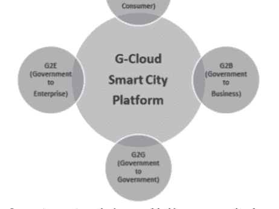

图 1. 由智能技术栈支持的智能城市服务平台 [7]。

代表了一种在抵御安全威胁的韧性；可扩展性；容错性和可靠性；安全通信；以及快速高效的智慧城市运营等方面能够出色履行此功能的技术[8]。因此，自 2016 年以来，学术研究开始探讨区块链如何在智慧城市情境中被使用[9,10]。

关于区块链和智慧城市等新兴研究情境的讨论，可以通过使用文献计量技术对该领域现有文献进行全面分析，从而为学术界和研究人员提供整体概念化而受益。此外，对现有文献的这种映射将使研究人员能够识别出适合进一步研究的途径。因此，本研究围绕以下研究问题（RQs）展开：

- RQ1：区块链在智慧城市领域最突出的研究论文有哪些？
- RQ2：区块链与智慧城市研究背景下未来研究的途径有哪些？

本文其余部分结构如下。第 2 节提供了进行文献计量分析所使用的研究方法以及所分析数据库的概述。第 3 节阐述了文献计量分析的结果。第 4 节阐述了本研究引文网络分析的结果，而第 5 节提出了未来区块链智慧城市研究的路线图。本研究在第 6 节以研究贡献的总结作结。

## 2. 研究方法

下一节详细说明了为进行文献计量分析而执行的研究方法。虽然“Smart City”和“Smart Cities”一词可追溯至 60 年代[7]，但“Blockchain”、“Smart Contract”和“Distributed Ledger Technology”一词仅从学术文献的角度来看自 2016 年以来才真正崭露头角。因此，我们的研究重点集中在 2016–2021 年的时间范围内。例如，图 2 说明了从 2016 年 1 月到 2021 年 8 月 Web of Science 数据库中智慧城市背景下区块链文献的增长情况。

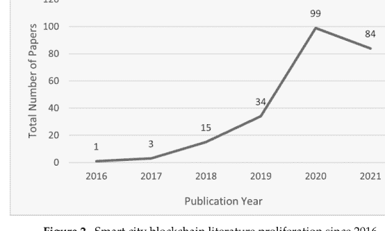

图 2. 自 2016 年以来智慧城市区块链文献的增长。

### 2.1 文献综述策略

“blockchain”一词常与“distributed ledger technology”或“smart contracts”互换使用。因此，我们将搜索标准扩展以包含这些术语。此外，在初始数据收集过程中，注意到“blockchain”一词有时拼写为“block chain”。我们修改了搜索策略以包含此关键词。因此，以下四种不同的文献检索组合与标题、摘要和关键词一起使用：

- 智慧城市 OR 智慧城市 AND 区块链;
- 智慧城市 OR 智慧城市 AND 区块 链;
- 智慧城市 OR 智慧城市 AND 分布式账本技术;
- 智慧城市 OR 智慧城市 AND 智能合约

表 1 提供了用于搜索上述 4 种检索词组合方案的数据库概述。如图所示，选择了 10 个数据库来搜索这些不同的组合方案，而不是集中于某个特定数据库。这种策略与之前的研究[11,12]一致，这些研究由于区块链研究分散在不同的学术和研究领域，因此使用多个数据库进行文献计量分析。

### 2.2 初步发现

图 3 突出了我们在 10 个数据库中标题、摘要和/或关键词检索标准下所定义检索词的初始结果。如图所示，Google Scholar 和 Web of Science 占我们检索结果的 64.85%。SSRN、Emerald Insight 和 Taylor & Francis 效率相对较低，累计贡献仅为 1%。初始 Google Scholar 检索产生了超过 +17,000 条结果。使用了高级搜索功能将结果缩小到表 1 中所示的发现。

表 1. 各数据库收集的文章总数。

| # | 数据库 | 论文数量 | 贡献百分比 |
|---|----------|--------------|--------------------------|
| 1 | Google Scholar | 306 | 33.81% |
| 2 | Web of Science | 281 | 31.04% |
| 3 | EBSCO | 73 | 8.06% |
| 4 | IEEE Xplore | 66 | 7.29% |
| 5 | Springer | 62 | 6.85% |
| 6 | MDPI | 56 | 6.18% |
| 7 | ScienceDirect | 51 | 5.63% |
| 8 | SSRN | 4 | 0.44% |
| 9 | Emerald Insight | 3 | 0.33% |
| 10 | Taylor & Francis | 3 | 0.33% |
|  | 总计 | 905 | 100% |

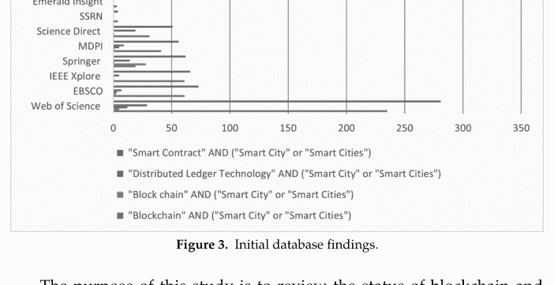

图 3. 初始数据库检索结果。

本研究的目的是回顾自 2016 年以来区块链和 DLT 智慧城市文献的现状。因此，采用了如图 4 所示的结构化文献综述（SLR）方法，使用 [13] 提供的指南，以确保文献综合过程具有高度的可复制性和透明度。根据 [14]，“SLR 是对研究结果进行的方法学严谨的综述。SLR 的目标不仅仅是汇总关于研究问题的所有现有证据；它还旨在支持基于证据的实践者指南的制定”。

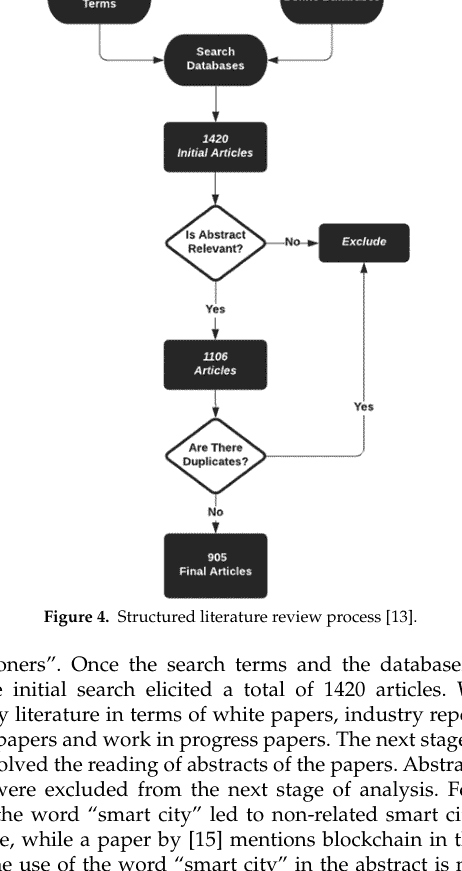

图 4. 结构化文献综述流程 [13].

一旦检索词和数据库确定，初始检索共获得 1,420 篇文章。我们未纳入灰色文献，如白皮书、行业报告、论文、讨论论文和正在进行的工作论文。SLR 流程的下一阶段涉及阅读论文摘要。被认为不相关的摘要被排除在下一阶段的分析之外。例如，“smart city”一词的使用导致了非相关智慧城市情境。例如，虽然 [15] 的一篇论文在标题和摘要中提到了区块链，但摘要中“smart city”一词的使用与实际的“智慧城市”无关，如摘要中的以下摘录所示：“游戏行业已演变为一个集综合赌场和娱乐于一体的多功能智慧城市”[15]。最终，要使摘要符合纳入条件，必须在智慧城市背景下与区块链和 DLT 之间存在明确的联系。对摘要的这种细化导致总共有 1,106 份摘要。流程的下一阶段移除了 201 篇重复文章，使本研究纳入的文章总数为 905 篇。EndNote 用于收集和分析数据并删除重复项。关于后者，在 EndNote 中使用了“Find Duplicates”选项。在某些情况下，特定期刊曾多次记录研究论文。在其他情况下，研究论文在期刊间被错误分类（例如，期号）。

## 3. 文献计量分析结果

为回答研究问题 1 和 2，对现有区块链和智慧城市学术文献进行了文献计量分析。文献计量方法，通常称为“文献计量分析”，已成为研究评估方法论中一个 well-established 且重要的要素，尤其是在科学和实践领域[16]。根据 [17]，“这种分析基于在给定主题领域内识别文献语料库，即以最广泛意义上的出版物”。智慧城市背景下的区块链研究已达到足够的成熟度，可以对现有研究文献进行文献计量分析。现在有大量定量统计工具可用于进行文献计量分析。对于本研究，使用了手动定量分析方法，结合了 Publish or Perish [18] 和 VOSviewer 等软件（稍后描述）。Publish or Perish 是一种获取和分析学术引用的软件工具。它从 Google Scholar 获取引用，对其进行分析，并生成一组引用分析指标。引用结果可以提取到其他软件程序或保存为文本文件以供将来分析。以下各节提供了使用上述软件工具进行分析的结果概述。

### 3.1 关键词统计

研究人员通过为其研究文章分配特定关键词来编目文章。它们是研究人员用来描述问题并反映其研究主题主要要素的术语。关键词统计程序作为数据收集过程的一部分手动进行，以突出研究标题和关键词部分中最常用的短语/词语。我们从最终的 905 个来源中收集了总共 3309 个关键词。表 2 列出了最受欢迎的关键词术语。此外，表 3 概述了该最终 905 篇论文中包含的排名前列的标题关键词。将两张表并列比较，可以看出“Blockchain/Blockchain Technology”被评为排名第一的关键词和标题关键词。第二大关键词是“Smart City”，第二大标题关键词是“Smart Cities”。这些术语在我们的关键词检索字符串中被使用

### 表 2. 关键词统计.

| # 排名 | 关键词 | 出现次数 |
|---:|---|---:|
| 1 | Blockchain/Blockchain Technology | 454 |
| 2 | Smart City | 280 |
| 3 | Security | 279 |
| 4 | Smart Cities | 273 |
| 5 | IoT | 209 |
| 6 | Data | 144 |
| 7 | Privacy | 106 |
| 8 | Smart Contract | 51 |
| 9 | Distributed Ledger Technology/Distributed Ledger/DLT | 39 |
| 10 | Cryptocurrency | 16 |

### 表 3. 标题关键词统计.

| # 排名 | 关键词 | 出现次数 |
|---:|---|---:|
| 1 | Blockchain/Blockchain Technology | 748 |
| 2 | Smart Cities | 430 |
| 3 | Smart City | 309 |
| 4 | IoT | 308 |
| 5 | Data | 173 |
| 6 | Security | 164 |
| 7 | Privacy | 156 |
| 8 | Sustainable | 79 |
| 9 | Health | 68 |
| 10 | Smart Contract | 30 |

总体而言，其排名并不令人意外。有趣的是，“Security”、“IoT”、“Data”和“Privacy”这两个术语在两张表中都占据了较高的排名。虽然这些术语与区块链技术相关联并不罕见 [1]，但似乎区块链技术在应对智慧城市挑战方面也发挥着作用。关键词“Smart Contract”也同时出现在两张表中。智能合约是区块链技术的核心特征。无需单一管理员，区块链允许点对点网络用户以高度可靠和透明的方式共享数据 [1]。智慧城市拥有多样化的利益相关者，它们之间的数据共享对于提供高质量的智慧城市服务至关重要 [7]。智能合约促进了智慧城市供应链所有利益相关者之间交易条款和条件的自动安全数字执行 [19]。基于此分析，智能合约代表了一个在智慧城市背景下值得进一步研究的领域。

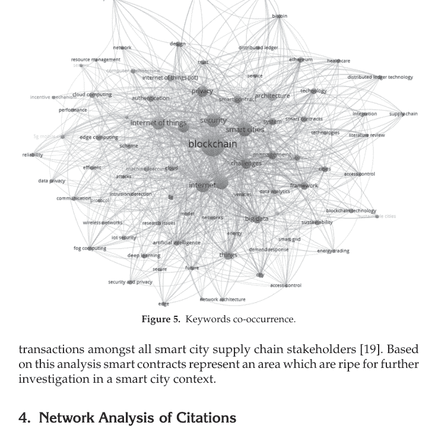

图 5. 关键词共现。

## 4. 引用网络分析

本研究的下一阶段纳入了对我们汇编的研究论文的引用网络分析。期刊引用的网络分析可用于以透明且有目的的方式研究作者、期刊和研究领域之间的各种关系 [20]。此外，引用网络分析已成为研究学术中的标准做法 [21]。有许多研究工具可用于进行网络引用分析，例如：Gephi、CiteSpace、Pajek 和 VOSviewer。在本研究中，使用 VOSviewer 分析了我们的书目数据集。VOSviewer 是一种可用于可视化和创建计量学网络（例如期刊、研究人员和出版物）的软件工具。VOSviewer 使研究人员能够基于特定的排列构建网络，包括引用、合著、合著和书目耦合。在每种情况下，节点代表已发表的期刊论文，相互连接的线代表期刊论文之间的引用。下一节详细说明了使用 VOSviewer 创建的各种网络。

### 4.1 引用分析

为了研究我们研究期刊论文/节点之间的网络连通性，915 个节点作为文本数据文件导入 VOSviewer。图 6 突出了由此产生的引用网络。网络的初始可视化提供了当前文献景观丰富性和密度的概念。该图由表 4 补充。使用 Publish or Perish 软件确定，由 [4] 进行的研究代表了引用最广泛的论文（最大节点），引用次数超过 1300 次。

图 7 表示使用 VOSViewer 创建的书目耦合网络（BCN）。根据 [22] 的说法，BCN 代表“出版物之间的共享参考文献，因此它提供了对科学活动的更深入见解，因为它揭示了作者如何使用和构建现有文献之间的联系。”作者认为 BCN 可用于检查特定研究在该领域中的立场，以确定其研究社区的规模，并且可能有助于解决

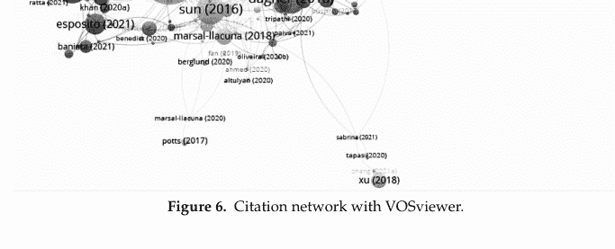

图 6. 使用 VOSviewer 的引用网络。

**表 4. 引用排名。**

| 引用排名 | 作者 | #引用次数 |
|---:|:---:|---:|
| 1 | [4] | 1349 |
| 2 | [8] | 492 |
| 3 | [41] | 407 |
| 4 | [25] | 371 |
| 5 | [42] | 353 |
| 6 | [43] | 352 |
| 7 | [44] | 343 |
| 8 | [45] | 335 |
| 9 | [46] | 327 |
| 10 | [47] | 307 |

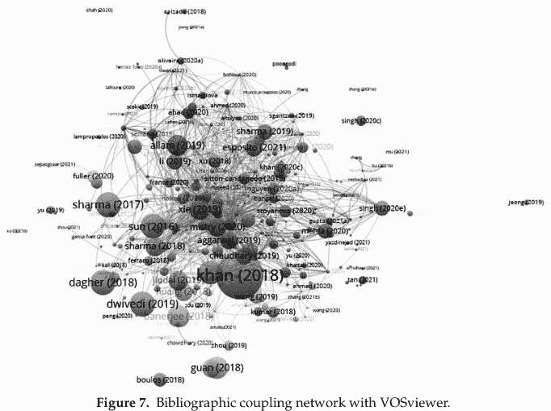

未解答的问题。最终，BCN 分析确定了出版物书目列表的重叠程度。

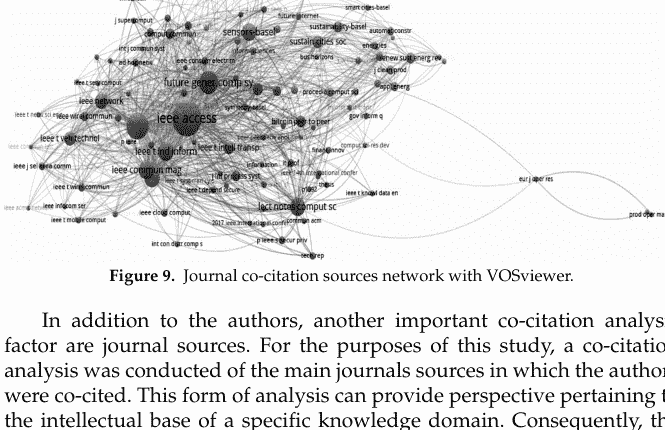

图 9. 使用 VOSviewer 的期刊合著来源网络。

除了作者之外，期刊来源是另一个重要的合著分析因素。为本研究的目的，对作者被共同引用的主要期刊来源进行了合著分析。这种形式的分析可以提供有关特定知识领域知识基础的视角。因此，图 9 中描绘的期刊来源网络包含略多于 110 个期刊来源，其引用次数等于或超过 25 次。就合著频率而言，排名前列的期刊来源是 IEEE Access、Future Generation Computer Systems、IEEE Computer Magazine、Lecture Notes in Computer Science 和 Sensors（MDPI 的开放获取期刊）。这些结果揭示了区块链和智慧城市研究现有研究的软件工程和计算机基础性质。该研究领域需要跨学科研究，特别是从商业和信息系统角度出发。例如，信息系统学科将高级篮子中的 8 本期刊列为其领域的顶级期刊 [26]。对这些篮子期刊的审查表明，缺乏专注于区块链如何在智慧城市背景下应用的研究。

## 5. 智慧城市区块链研究议程

我们的研究强调了区块链研究如何在物联网、安全、隐私、移动性、能源和公共服务等各种智慧城市背景下得到探索。就研究问题 2 而言，图 10 说明了本研究根据对区块链和智慧城市研究的计量学和合著网络分析所确定的未来研究领域的各个研究类别。我们现在将依次讨论这些未来研究领域。

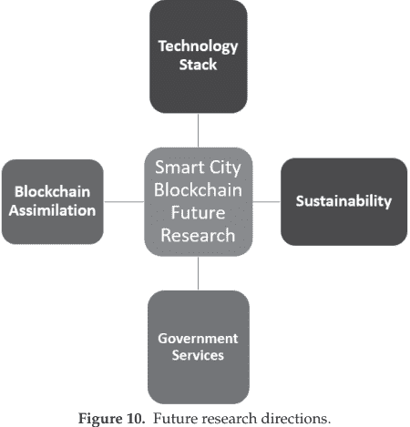

### 研究方向 #1：政府服务

从公民的角度来看，区块链和分布式账本技术有可能让全球政府推出可靠、安全、私密且值得信赖的以公民为中心的服务 [27,28]。区块链可以克服现有繁琐的纸质流程，这些流程耗时、成本高且效率低下。学位、职业执照、员工 ID 和其他身份凭证在数字化后更容易处理。然而，这些极其个人化的数据必须保密和安全。现在已有经验证据和正在进行的全球用例来说明区块链如何被政府、企业和教育机构使用，以提供安全可靠的基础设施并改善服务。Covid19 加速了政府数字化转型。例如 Covid19 追踪和追溯应用程序以及数字疫苗接种证书的引入。现在有机会研究区块链如何用于保护政府中心服务，正如图 1 中之前所强调的那样。从行业角度来看，区块链有可能改变政府在智能健康、智能能源、智能出行、智能投票、智能教育和智能物流方面的战略制定方式。例如，从医疗保健角度来看，区块链和 DLT 可以帮助医疗从业者促进：患者医疗记录的安全转移、药品供应链物流的管理，以及安全

患者医疗记录的存储和传输。从投票角度来看，区块链技术可用于克服传统电子投票的顾虑，使其更具成本效益、可靠且安全 [29]。此外，从智慧出行角度来看，区块链技术可用于汽车数据的交换，例如拼车、汽车共享或自动驾驶汽车 [30]。探讨区块链如何协助政府在各类智慧公共服务领域发挥作用的研究，值得研究人员进一步审视和讨论，特别是在区块链对公民记录不可篡改性可能带来的负面后果以及隐私泄露风险方面 [31]。

### 研究方向 #2：可持续性

智慧城市的定义各不相同，但每个定义中始终核心的两个概念是可持续性 [32] 以及技术如何从社会技术和社会经济角度提升可持续性（Bosch, 2019）。例如，[33] 将智慧城市定义为“数据、数字技术与城市场所和过程之间松散连接的交汇集合”，可由“数字赋能的数据驱动、持续感知、响应迅速且集成的城市环境”催化。目前全球范围内正在持续探索区块链如何促进智慧城市可持续发展议程。未来的研究可以探讨智慧城市如何利用区块链制定其可持续发展战略，以符合全球气候变化和可持续行动计划。例如，欢迎开展研究探讨智慧城市如何构建安全且共享的数字账本，用于交通、能源和公用事业的实时数据管理。最终，区块链技术的应用可能有助于智慧城市简化与公民的互动，减少个人和集体的资源使用，并与获批准的第三方共享公共数据。区块链还可以帮助公民减少、量化和分析其个人碳足迹，并协助工业供应链的去物质化 [34]。

### 研究方向 #3：区块链同化

虽然本研究发现区块链智慧城市研究正在增加，但也发现该研究领域仍处于胚胎阶段。因此，需要进一步研究以识别成功的区块链智慧城市研究案例成功案例，以及同时考察案例失败的研究。这些研究可以以同化概念为指导。同化可以定义为“一种组织过程，即（i）当组织个体成员首次得知创新开发时便启动，（ii）可能导致创新的获取，（iii）有时会实现创新的完全接受、利用和制度化” [35]。技术创新的同化往往具有挑战性，且很少是二元的 [36]。同化理论认为，同化可能在技术创新的采用过程中增强或恶化 [37]。每个同化阶段描述了技术创新渗透采用公司的程度。创新的成败原因往往微小。虽然已提出许多框架来理解创新同化如何影响实体 [38]，但其中最被广泛引用和使用的一个是 [36] 提出的。表 5 提供了该六阶段模型的概述。该框架包括两个采用前“早期阶段”（例如启动和采用）和 4 个采用后“后期阶段”（例如适应、接受、常规化和融合）。融合阶段包含技术创新融合的多个不同方面。在研究同化阶段时，一个显著的考虑因素是我们期望采用组织在同化阶段的进展是否呈线性。然而，已有研究表明进展可能是非线性的。例如，[37] 认为，相较于“定制”技术创新，“现成”技术更可能出现顺序模型。此外，[37] 认为解冻（例如启动和采用阶段）和再冻结（例如接受、常规化和融合阶段）的顺序模式很可能出现。

**表 5.** 创新同化阶段 [36].

| 阶段 | 描述 |
|---|---|
| **启动** | 在组织中找到了技术创新及其应用的匹配。 |
| **采用** | 做出投资资源采用技术创新的决定。 |
| **适应** | 技术创新得到开发、安装和维护。组织成员接受培训以使用新的技术创新。 |
| **接受** | 组织成员被引导使用该技术创新，而该创新现已在公司内部使用。 |
| **常规化** | 技术创新的使用被鼓励为正常活动，组织结构被调整以适应技术创新。它不再被视为不寻常的事物。 |
| **融合** | 技术创新以复杂而精细的方式使用。融合可分为几种方式： • **扩展使用：** 使用技术创新的更多功能； • **整合使用：** 使用技术创新在任务之间创建新的工作流程联系； • **新兴使用：** 使用技术创新执行以前认为不可能的任务。 |

该六阶段同化框架已在先前研究技术采用的研究中使用 [39]。我们也认为它将是审视智慧城市背景下区块链技术采用相关益处和挑战的适当视角。特别感兴趣的是与融合同化阶段相关的未来研究，可用于识别智慧城市背景下区块链的“新兴使用”案例。

### 研究方向 #4：技术栈

本研究发现，在智慧城市背景下，区块链并非孤立使用。该技术与云计算、人工智能、雾计算、基于传感器的物联网、无人机技术、泛在技术等其他技术融合使用。本研究认为，未来的区块链研究应关注如何利用我们所称的技术栈概念在智慧城市背景下部署区块链技术。技术栈涵盖部署智能技术应用时构建的整体技术基础设施和数据生态系统。本研究认为，区块链技术和 DLT 可作为基础层，为在其上构建/部署的技术和数据提供安全、不可篡改性、隐私和信任。例如，[40] 探讨了如何利用物联网传感器、商业智能和基于云的技术部署 DLT 于医疗供应链，以创建警惕的信息化系统。该多层技术栈可用于使组织在动态供应链环境中实时快速决策。它还可以协助防止假药。此外，“由区块链和 DLT 支持的智能技术栈的应用可以为智慧城市决策者提供规划、开发和维护智慧城市服务、资源和基础设施所需的实时数据。”

## 6. 结论

本研究旨在回答以下两个研究问题：

RQ1: 区块链在智慧城市领域最突出的研究论文有哪些？

RQ2: 区块链与智慧城市研究背景下未来研究的途径有哪些？

通过研究这两个研究问题，本研究取得了以下理论贡献。就研究问题 1 而言，本研究的文献计量分析和引文网络分析方法不仅揭示了智慧城市区块链研究中最突出的论文，还揭示了大多数现有研究本质上是软件工程和计算机为基础的。因此，在其他研究学科中存在机会来探索区块链如何在智慧城市背景下应用。最终，需要进一步的跨学科研究来促进更强的批判性思维，并综合其他学科的概念以推进智慧城市区块链研究。就研究问题 2 而言，本研究确定了四个不同的研究方向类别，值得进一步研究，可帮助研究人员识别更多可行的区块链智慧城市解决方案。最终，全球经济持续快速数字化意味着政府现在必须考虑如何在其智慧战略中应用区块链和 DLT。本研究强调，尽管该领域的研究处于胚胎阶段，但已有足够实证证据表明区块链和 DLT 可有效确保智慧和可持续的城市发展。虽然本研究对 2016 年至 2021 年的区块链智慧城市文献进行了深入分析，但我们鼓励其他研究人员也通过文献计量和引文网络分析技术探索该领域。

## 参考文献

- [1] Clohessy, T. and Acton, T. 2019. 探究组织因素对区块链采用的影响：创新理论视角. *Industrial Management & Data Systems*.
- [2] Sigalov, K., Ye, X., König, M., Hagedorn, P., Blum, F., Severin, B., Hettmer, M., Hückinghaus, P., Wölkerling, J. and Groß, D. 2021. 通过整合建筑信息模型和基于区块链的智能合约实现建筑行业自动化支付与合同管理. *Applied Sciences*, 11(16): 7653.
- [3] Nakamoto, S. 2008. 比特币：点对点电子现金系统. *Decentralized Business Review*, 21260.
- [4] Khan, M. A. and Salah, K. 2018. 物联网安全：综述、区块链解决方案与开放性挑战. *Future Generation Computer Systems*, 82: 395–411.

- [5] Sabrina, F. and Jang-Jaccard, J. 2021. 基于区块链的智能城市授权访问控制. 传感器, 21(16): 5264.
- [6] Caragliu, A., Del Bo, C. and Nijkamp, P. 2011. 欧洲的智能城市. 城市技术期刊, 18(2): 65–82.
- [7] Clohesy, T., Acton, T. and Morgan, L. 2014. 智能城市即服务 (SCaaS)：电子政务智能城市云计算倡议的未来路线图. 载于 2014 IEEE/ACM 第7届实用与云计算国际会议 (页 836–841). IEEE.
- [8] Biswas, K. and Muthukkumarasamy, V. 2016. 使用区块链技术保护智能城市. 载于 2016 IEEE 第18届高性能计算与通信国际会议；IEEE 第14届智能城市国际会议，IEEE 第2届数据科学与系统国际会议 (HPCC/SmartCity/DSS) (页 1392–1393). IEEE.
- [9] Botello, J. V., Mesa, A. P., Rodríguez, F. A., Díaz-López, D., Nespoli, P. and Mármol, F. G. 2020. BlockSIEM：通过基于区块链的分布式 SIEM 保护智能城市服务. 传感器, 20(16): 4636.
- [10] Vintimilla-Tapia, P., Bravo-Torres, J., López-Nores, M., Gallegos-Segovia, P., Ordóñez-Morales, E. and Ramos-Cabrer, M. 2020. VaNetChain：基于区块链和虚拟化层的 VANET 可信信息交换框架. 应用科学, 10(21): 7930.
- [11] Kousis, A. and Tjortjis, C. 2021. 智能城市的数据挖掘算法：文献计量分析. 算法, 14(8): 242.
- [12] Müßigmann, B., von der Gracht, H. and Hartmann, E. 2020. 物流与供应链管理中的区块链技术——2016年至2020年1月的文献计量文献综述. IEEE 工程管理学报, 67(4): 988–1007.
- [13] Kitchenham, B. 2004. 执行系统综述的程序. Keele, 英国, Keele 大学, 33: 1–26.
- [14] Kitchenham, B., Brereton, O. P., Budgen, D., Turner, M., Bailey, J. and Linkman, S. 2009. 软件工程中的系统文献综述——一项系统文献综述. 信息与软件技术, 51(1): 7–15.
- [15] Liao, D. Y. and Wang, X. 2018. 区块链技术在综合赌场与娱乐物流管理中的应用. 载于《信息学》(卷 5, 期 4, 页 44). 多学科数字出版研究所.
- [16] Wallin, J. A. 2005. 文献计量方法：陷阱与可能性. 基础与临床药理学与毒理学, 97(5): 261–275.
- [17] Ellegaard, O. and Wallin, J. A. 2015. 学术产出的文献计量分析：影响有多大？ 科学计量学, 105(3): 1809–1831.
- [18] Harzing 2021. 发表或消亡. [在线]. 可获取: https://harzing.com/pophelp/.
- [19] Palaio, G., Skoufos, P., Voutyras, O., Kawasaki, T., Gallissot, M., Azzabi, R., Tsuge, A., Litke, A., Okoshi, T., Nakazawa, J. and Varvarigou, T. 2021. 结合区块链、智能合约和复杂传感器管理平台用于超互联智能城市：物联网数据市场用例. 计算机, 10(10): 133.
- [20] Freeman, I. 2004. 社会网络分析的发展：科学社会学研究. 温哥华: 实证出版社.
- [21] Barnett, G. A., Huh, C., Kim, Y. and Park, H. W. 2011. 传播期刊与其他学科之间的引用：网络分析. 科学计量学, 88(2): 449–469.
- [22] Biscaro, C. and Giupponi, C. 2014. 合著与文献耦合网络对引用的影响. PLoS ONE, 9(6): e99502.
- [23] Ding, Y., Yan, E., Frazho, A. and Caverlee, J. 2009. PageRank 在合著网络中对作者排名. 美国信息科学与技术学会期刊, 60(11), 2229–2243.
- [24] Chang, C. Y., Gau, M. L., Tang, K. Y. and Hwang, G. J. 2020. 百篇最常被引用的护理学生教育研究方向：文献计量与合著网络分析. 护理教育今日, 104645.
- [25] Sharma, P. K., Moon, S. Y. and Park, J. H. 2017. Block-VN：智能城市中基于分布式区块链的车载网络架构. 信息处理系统期刊, 13(1): 184–195.
- [26] Association for Information Systems. 高级学者期刊篮. 检索于: https://aisnet.org/page/SeniorScholarBasket 于 2021年6月8日.
- [27] Bhushan, B., Khamparia, A., Sagayam, K. M., Sharma, S. K., Ahad, M. A. and Debnath, N. C. 2020. 智能城市的区块链：架构、集成趋势与未来研究方向综述. 可持续城市与社会, 61: 102360.
- [28] Rivera, R., Robledo, J. G., Larios, V. M. and Avalos, J. M. 2017. 区块链上的数字身份如何有助于智能城市环境. 载于 2017 国际智能城市会议 (ISC2) (页 1–4). IEEE.
- [29] Jafar, U., Aziz, M. J. A. and Shukur, Z. 2021. 区块链电子投票系统——综述与开放研究挑战. 传感器, 21(17): 5874.
- [30] Berneis, Moritz, Devis Bartsch and Herwig Winkler. “物流与供应链管理中区块链技术应用——系统文献综述见解.” 物流 5.3 (2021): 43.
- [31] Picone, Marco, Cirani Simone and Veltri Luca. 2021. 物联网的区块链安全与隐私. 传感器 21(3): 1–4.
- [32] Toli, A.M. and Murtagh, N. 2020. 智能城市定义中的可持续性概念. 建筑环境前沿. 6: 77. doi: 10.3389/fbuil.2020.00077.
- [33] McFarlane, C. and Söderström, O. 2017. 关于替代性智能城市：从技术密集型到知识密集型智能城市主义. 城市 21: 312–328. doi: 10.1080/13604813.2017.1327166.
- [34] Chen, J., Cai, T., He, W., Chen, L., Zhao, G., Zou, W. and Guo, L. 2020. 汽车零售业的区块链驱动供应链金融应用. 熵, 22(1): 95.
- [35] Meyer, A.D. and Goes, J.B. 1988. 创新的组织同化：多层次情境分析, 管理学报 31: 897–923.
- [36] Gallivan, M. 2001. 复杂技术创新的组织采纳与同化：新框架的开发与应用. 信息系统进展数据库, 32: 51–85.
- [37] Cooper, R.B. and Zmud, R.W. 1990. 信息技术实施研究：技术扩散方法. 管理科学, 36: 123–139.
- [38] Saga, V. L. and R. W. Zmud. 1994. IT 接受、常规化与渗透的本质与决定因素. Levine L., 编. 信息技术扩散、转移与实施, 67–86.
- [39] Basole, R. C. and Nowak, M. 2018. 供应链中跟踪技术的同化. 交通运输研究 E 部分：物流与运输评论, 114: 350–370.
- [40] Clohessy, T. and Clohessy, S. 2020. 盒子里有什么？用区块链警惕信息系统打击药品供应链中的假药. 载于 区块链与分布式账本技术用例 (页 51–68). Springer, Cham.
- [41] Sun, J., Yan, J. and Zhang, K. Z. 2016. 基于区块链的共享服务：区块链技术能为智能城市贡献什么. 金融创新, 2(1): 1–9.
- [42] Dagher, G. G., Mohler, J., Milojkovic, M. and Marella, P. B. 2018. Ancile：使用区块链技术的电子健康记录访问控制与互操作性的隐私保护框架. 可持续城市与社会, 39: 283–297.
- [43] Zhao, J. L., Fan, S. and Yan, J. 2016. 区块链中的商业创新与研究机会概述及特刊介绍. 金融创新, 2(1):1-7.
- [44] Talari, Saber, Miadreza Shafie-Khah, Pierluigi Siano, Vincenzo Loia, Aurelio Tommasetti, and João PS Catalão. “基于物联网概念的智能城市综述.” 能源 10, 期 4 (2017): 421.
- [45] Dwivedi, A. D., Srivastava, G., Dhar, S. and Singh, R. 2019. 物联网的去中心化隐私保护医疗区块链. *传感器*, 19(2): 326.
- [46] Banerjee, M., Lee, J. and Choo, K. K. R. 2018. 物联网安全的区块链未来：立场文件. *数字通信与网络*, 4(3): 149–160.
- [47] Gharaibeh, A., Salahuddin, M. A., Hussini, S. J., Khreishah, A., Khalil, I., Guizani, M. and Al-Fuqaha, A. 2017. 智能城市：数据管理、安全与使能技术综述. *IEEE 通信调查与教程*, 19(4): 2456–2501.
- [48] Bosch. *智能城市概念–明日的城市*. [在线]. 检索于: https://www.bosch.com/stories/smart-city-challenges/pdf 于 2020年5月5日.

# 2 不惜一切代价破坏比特币：对工作量证明区块链的非理性攻击

*阿希什·拉詹德拉·赛*

## 1. 引言

2009 年经济危机引发的不安被认为影响了比特币的推出，比特币是首个去中心化数字货币 [24]。比特币提出了一种在不可信环境中无需借助可信第三方即可进行价值转移的方法 [12]。比特币通过采用维护所有交易全球账本的点对点网络来实现这一点。 使用共识算法就账本对数据的视图达成一致，其中大多数网络参与者同意数据的单一视图。

比特币在数字货币领域的创新贡献在于对网络参与者应用了一种巧妙的激励机制。 预计比特币网络的参与者将解决一个计算成本高昂的平凡数学问题。 第一个解决数学问题的参与者将获得用于解决方案的计算周期的奖励。 这种数值解通常被称为工作量证明。 奖励机制作为网络中诚实行为的激励。 如果网络一半参与者不同意攻击者对数据的看法，则不诚实行为会以失去奖励的形式受到遏制。 基于经济壁垒，预设网络一半参与者是诚实的。

比特币的底层技术区块链已看到包括供应链在内的众多应用。 区块链在供应链中的效用依赖于底层共识机制的安全运行。

由于金融资产与共识纠缠在一起，因此假设攻击者会试图最大化攻击利润。 这种理性矿工的假设被众多比特币安全评估框架采用 [32]、[15]、[35]、[18]、[14]、[41]、[31]。 我们认为该假设可能会限制当前攻击策略的适用性，而这些策略没有考虑到对手对攻击过程中任何财务收益或损失都不在意的极端情况。

在本章中，我们旨在模拟一个非理性攻击者。 我们将非理性描述为损害网络的意图，无论成本如何（报酬性或声誉性）。 本章旨在回答以下研究问题：

*非理性攻击者可以使用哪些攻击策略使比特币网络陷入危险？*

为回答研究问题，我们设计了四个维度，非理性攻击可以部署攻击向量以利用网络。 比特币的设计决定了这些维度的选择。 比特币核心协议是网络参与者的实施指南。 这些指南在核心客户端中实现，该客户端部署在参与者的点对点网络上。 我们将指南导向的攻击向量的实现描述为协议层攻击。 协议通过其设计为网络中的工作量证明诱发了竞争条件，以就数据的视图建立共识。

与竞争条件相关的攻击向量被定义为共识层攻击。 共识大量依赖于网络参与者之间信息的传输。 试图利用信息传输的攻击向量被归类为网络层攻击。

上述分类对于准确计算执行实施指南至关重要，但影响网络的一个引人注目的因素是参与激励所涉及的经济因素。 我们将对激励的攻击归类为经济层攻击。 我们可以将本章建模的攻击概括为四个类别：协议、共识、网络和经济层攻击。 本章做出以下贡献：

- 1. 对比特币网络上非理性攻击者的攻击向量的新颖调查（第 3 节）。
- 2. 本章提出了协议层的新攻击策略，包括 Nonce 攻击（第 4.1 节）和难度重新校准攻击（第 4.1 节）。
- 3. 我们提出了并评估了对网络共识层进行勒索攻击的可能性（第 4.2 节）。
- 4. 我们为比特币网络层上的非理性攻击者引入了新颖的拒绝服务攻击向量（第 4.3 节）。
- 5. 在攻击者富有的前提下；我们通过模拟人为制造的恐慌性抛售和一种新颖的 Griefer 攻击来模拟对比特币网络的经济攻击的可行性（第 4.4 节）。

## 2. 背景

在本节中，我们首先探究区块链的结构，然后介绍比特币如何在点对点分布式系统上实现区块链数据结构。 我们还列出了针对基于工作量证明（PoW）的区块链的突出攻击。

### 2.1 比特币的结构

术语区块链通常用作伞形术语，指代分布式账本技术 [33] 的广阔领域。 术语区块链首次由比特币创造者中本聪在 GitHub 提交中使用，以指明比特币使用的数据结构 [49]。 比特币使用一种密码学链接的区块结构来容纳交易。 每个新的交易区块都通过密码学方式连接到前一个区块，形成区块链。 比特币网络的参与者负责就此仅追加结构的单一视图达成一致。 为了在不受约束的分布式环境中实现数据一致性，比特币利用了具有巧妙的工作量证明激励机制的点对点分布式系统。 这种系统的实施细节超出了本章的范围。

我们遵循 [25] 提出的结构，其中作者确定了三个抽象技术组件来描述比特币网络的复杂运行。 这些组件是共识协议、通信网络和交易（包括脚本）。 共识协议用于通过对数学难题解的竞争来选举领导者。 通信网络组件使参与者（也称为节点）能够交换有关网络上新交易或区块的消息以及其他协议级消息。 [25] 识别的第三个组件是交易组件；在此

#### 2.2.3 自私挖矿

在自私挖矿 [41] 中，攻击者旨在通过损害网络其他参与者来增加不公平的奖励份额。 攻击者通过在私有链上挖矿并策略性地发布私有链来实现这一点，以确保其他参与者失去奖励。 攻击者这样做是出于其他参与者将加入攻击者联盟的预期。

攻击者的成功概率在很大程度上依赖于攻击者拥有的直接网络连接 [41]。 据报道，网络连接可能是一个决定性因素。 其他利用网络连接的攻击包括日蚀攻击 [34]。

#### 2.2.4 日蚀攻击

在日蚀攻击 [26] 中，攻击者将受害者与网络其余部分隔离开来。 受害者看到的数据视图是基于攻击者意愿的实际数据的垄断版本。 在此攻击中，攻击者操纵受害者的所有传入和传出网络连接。 攻击者可以利用被日蚀的矿工的计算能力为其自身谋利。

这些类型的攻击旨在通过经济上损害其他实体（例如，失去区块奖励）来实现货币收益。 比特币网络上的经济攻击可能证明是最可能的，因为对货币价值作为安全性的依赖是一个重大限制。 其他一些利用比特币经济属性的攻击包括鲸鱼交易 [38]，通过促进更多分叉来降低网络增长率。

#### 2.2.5 鲸鱼交易

鲸鱼交易被定义为交易费用非常高的交易，这可能会在网络中促进分叉 [38]、[48]。 所有矿工都被激励将鲸鱼交易包含在其区块中，以在其区块中获得显著高的交易费用。 这种将鲸鱼交易包含在区块中的竞争限制了链的增长率，因为大多数矿工沉迷于赢得交易费用奖励的竞争。

在此攻击中，作者提出了矿工基于激励偏好链分叉的想法。 另一种利用相同经济收益激励的攻击是贿赂攻击 [28]。

#### 2.2.6 贿赂攻击

在贿赂攻击 [28] 中，攻击者意图通过激励其他矿工偏好包含冲突的

交易。结合鲸鱼交易以偏向包含冲突交易的分支可能允许成功进行双花攻击。

上述列出的攻击是文献中对比特币网络报道最广泛的攻击。这些攻击假设攻击者通过执行攻击寻求获得货币收益。这种假设似乎是合理的，因为成功执行任何这些攻击所涉及的成本都很高。然而，我们认为，如果一个大型组织有动机破坏网络，他们可能不会因攻击可能带来的收益而受到激励。在本章中，我们为非理性攻击者在上述识别的架构层中识别出更多攻击向量。下一节提供了研究设计的概述。

## 3. 研究设计

由于比特币网络相当复杂，对所有可能的攻击策略进行穷举搜索被认为是不明智的。我们通过从攻击者角度审查架构层（第 2 节）来避免穷举搜索。审查结果列出了潜在攻击。我们遵循反思行动科学研究方法 [3]。我们不验证攻击是否现实、实用或可行，将此留给未来研究。

反思行动科学方法详细描述了一个五阶段循环过程 [7]、[1]，包括诊断、行动计划、行动执行、评估和明确学习。在下一节中，我们将详细回顾行动计划。

在启动反思行动研究之前，必须建立研究环境。在我们的案例中，研究环境是上述四层架构。在建立研究环境后，循环过程以对信息系统的诊断开始。

在诊断阶段，我们旨在识别非理性攻击者的可能攻击策略。按照行动科学当前的研究，诊断包含对问题的自我解释，而不是通过简化来减少，而 preferably 以整体方式进行 [7]。诊断也有助于我们发展关于问题特征的某些理论假设 [9]。

诊断随后是行动计划阶段，研究人员和从业者在此阶段协作以确定先前识别问题的验证方法。对于本研究，行动计划阶段涉及为已识别问题识别评估技术。理论框架通常驱动这些方法。

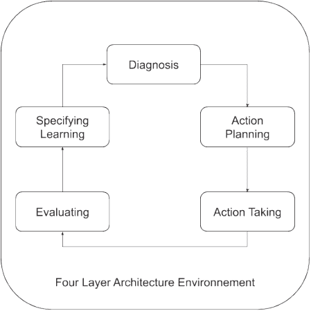

图 1. 行动研究计划。

在下一个阶段，即行动执行阶段，已识别的验证方法将被实施。在行动实施阶段之后，研究人员和从业者在评估阶段评估结果。评估阶段随后是明确学习阶段，在此阶段，通过行动研究获得的知识用于培养攻击策略，直到获得令人满意的评估结果为止。¹ 研究遵循的反思行动科学方法在图 1 中说明。

## 4. 诊断

我们将诊断中的问题定义为非理性攻击者的可能攻击策略。为了识别新的潜在攻击策略，我们依赖于对先前识别的架构层（第 2 节）上比特币设计选择的系统审查。对于每一层，我们定义非理性攻击者的目标和假设并审查该层的设计选择。分析的设计选择只是与该层相关的所有属性的子集；我们将审查限制在先前研究已识别为安全关键的组件上。本研究的这种设计选择限制了审查比特币设计组件广泛集合的复杂性。本节的其余部分回顾每一层并陈述非理性攻击者的目标和假设。

### 4.1 协议层

协议层被认为是比特币网络的核心，因为协议中定义规则驱动比特币系统。在比特币诞生之初，协议设计很大程度上由少数开发者的社区驱动，且在大多数情况下早期比特币的决策仍然存在。这些决策可能没有考虑到所有攻击向量。先前的研究已报告了与协议层设计选择相关的若干问题 [53]、[51]、[50]、[52]。我们的研究旨在识别可能引发安全威胁的协议层决策。我们定义非理性矿工在协议层上的 **Goal** 和 **Assumption** 如下：

**Goal:** *识别并利用可能被篡改以对网络造成损害的设计选择。*

**Assumption:** *我们假设我们的非理性攻击者无法更改参与节点的协议实现。*

### 4.2 共识层

比特币的新颖之处在于巧妙地使用基于激励的共识算法 [37]。如第 2 节所示，理论上的大多数攻击者都是共识机制导向的，例如双花攻击。比特币网络的安全性本质上取决于共识机制的质量。这种依赖性可能使非理性攻击者试图尝试并利用共识层构造变得至关重要。攻击者具有以下目标并在以下假设下工作：

**Goal:** *识别并利用可能被外部因素如对手计算能力篡改的设计选择。*

**Assumption:** *我们还假设攻击者拥有的计算能力少于网络的 50%，即 α < 50%。我们还通过不考虑攻击者向网络其余部分传播信息所涉及的网络延迟来降低分析的复杂性。*

### 4.3 网络层

任何连接到网络的计算系统都可能具有众多已识别的网络漏洞之一 [10]。由于比特币系统是点对点系统，系统中的大多数可能操作都在网络环境中执行。由于比特币系统的开放性，系统的网络组件暴露于公共领域，任何计算节点都可以成为比特币网络的一部分。这种依赖性和开放性使比特币成为网络攻击如 DOS（拒绝服务）[23] 的极具吸引力的目标。我们假设非理性攻击者在以下目标和假设下运行：

**Goal:** *识别并利用网络攻击以通过诱导延迟降低网络的可靠性。*

**Assumptions:** *我们假设我们的非理性攻击者可以直接建立到网络特定部分的连接。*

### 4.4 经济层

比特币的共识机制假设大多数参与者是理性的，并且会诚实于网络，因为他们因诚实行为而获得的奖励比不诚实行为更重要。比特币中的奖励以 BTC 的形式分发给参与者。BTC 的内在价值在研究中存在争议 [30]、[17]、[16]。这一论点进一步加强了比特币对参与相关经济的依赖 [36]。比特币经济的先前研究报道，确实有可能操纵 BTC 的内在价值 [43]。所说明的非理性攻击者旨在利用比特币系统的经济漏洞，其目标和假设如下：

**Goal:** *识别在非理性动机下可能被利用的经济漏洞。*

**Assumptions:** *我们假设我们的非理性攻击者拥有不受约束的货币资产供应，攻击者可用于操纵网络。*

基于上述目标和假设，使用对系统层的自我解释导致了在表 1 中识别的攻击。表 1 包含非理性攻击者可能攻击的非穷举列表。如众多行动研究研究所示，这些攻击向量的诊断主要由对问题的自我解释驱动 [7]、[4]、[8]。这些攻击的有效性将在行动研究计划的后续阶段（第 3 节）中进一步评估。本节的其余部分详细说明了已识别的攻击。

**表 1. 非理性攻击。**

| 层 | 识别出的攻击 |
| --- | --- |
| 协议层 | Nonce 攻击和难度重新校准攻击 |
| 共识层 | 勒索攻击 |
| 网络层 | 拒绝服务攻击 |
| 经济层 | 恐慌性抛售和恶意破坏者攻击 |

### 4.5 协议层攻击

#### 4.5.1 Nonce 攻击

比特币区块链中的每个区块都包含一个称为 Nonce 的 32 位字段。矿工通过改变该字段的值来寻找满足网络目标要求的区块哈希。这一计算由专门的挖矿设备执行。成功计算可能会获得奖励。尽管非理性攻击者的目标并非获取更高利润，但如果攻击者能够获得高于其算力比例的利润，则可能影响他人的利润。我们观察到，网络中诚实的部分在概率上能够挖出以下比特币作为奖励：

Reward_Honest = B_r * (100 − α)/100 (1)

如果攻击者能够在不增加 α 的情况下成功挖出更多区块，就可能会降低 Reward_Honest 的值。攻击者能够在 α 没有显著增加的情况下挖出更多区块，由此造成的奖励损失会对诚实参与者造成伤害。所提出的 Nonce 攻击正是试图利用这一点来对网络造成伤害。

我们推测，由于挖矿硬件的字节序（endianness）不同，某类硬件可能更倾向于找到奇数的 nonce 值，而非偶数。如果攻击者能够总结出 nonce 值的某种模式，就可能显著影响攻击者找到真实 nonce 值的概率，从而获得更高奖励，导致他人受损。

**攻击策略：**

- *步骤 1：* 从区块链上的所有区块中检索历史 nonce 数据。
- *步骤 2：* 观察 nonce 随时间变化的奇偶比例，以设计新的挖矿策略，最大化挖到下一个区块的机会。攻击者还可以检查 nonce 的其他模式，以观察所用硬件是否引入其他数值偏差。
- *步骤 3：* 在私有比特币部署中测试新的挖矿策略，以观察是否有任何改进。
- *步骤 4：* 根据步骤 3 的结果，攻击者可以修改步骤 2 中设计的策略。
- *步骤 5：* 将新策略部署到实际网络中，试图增加 α，从而降低*收入*honest。

#### 4.5.2 难度重新校准攻击

比特币网络的目标是平均每 10 分钟生成一个区块。为了维持这一出块时间，网络会周期性地增大或减小其余网络解决这一非平凡数学问题的难度。挖矿难度的这种变化被称为难度重新校准。在比特币中，难度重新校准在 2016 个区块后进行 [54]。

出块时间常被认为是区块链性能的瓶颈，区块链性能通常以每秒交易数（TPS）来衡量 [44], [31]。与传统支付系统相比，比特币的 TPS 速度较低。低 TPS 被推测为比特币作为支付系统主流采用的一个障碍 [40]。

非理性攻击者可以通过人为操纵比特币的 TPS 来进一步减缓其采用。我们推测，两次难度重新校准之间的时间差可能被利用来损害网络。我们设计了一种新策略，攻击者首先获得显著的 α，然后突然退出网络。我们在图 2 中展示了攻击流程。

比特币核心客户端中的安全机制在很大程度上限制了这种攻击，该机制限制每次重新校准后难度值的最大上升或下降幅度 [22]。然而，这种限制并不排除在更长时间内发动攻击的可能性。非理性攻击者引起的总算力突然变化将导致*收入*honest 随时间显著波动，使挖矿的可靠性降低。当攻击者退出网络后难度降低时，由于难度较高，出块时间将显著增加。出块时间的增加随后会导致低 TPS。如上文所批评的那样，低 TPS 非常不可取，因为它直接损害比特币作为支付系统的采用。

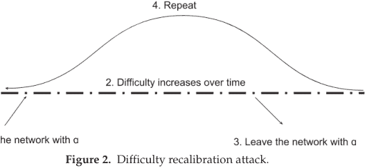

**攻击策略：**

- *步骤 1：* 拥有算力 α 的攻击者加入总算力为 H_total 的网络，形成新的更高总算力（H_network = H_total + α）。
- *步骤 2：* 假设 α 是 H_network 的重要部分，由于 D 只有在 2016 个区块之后才能改变，这种突然增长将导致 B_t 显著降低。攻击者将等待难度上升一个与 α 成比例的因子。
- *步骤 3：* 当 D 的值逐步提高到足以将 B_t 维持在 10 分钟时，非理性攻击者将决定退出网络。
- *步骤 4：* α 退出网络将导致 H_network 显著降低，但在第一个重新校准周期内 D 保持不变。这将导致 B_t 升高，从而 TPS 降低。
- *步骤 5：* 当网络重新校准难度以使 B_t 恢复到 10 分钟时，攻击者将通过重复步骤 1 的攻击来开始 B_t 操纵过程。此类攻击的可行性将在行动研究计划的后续阶段进行分析。

理论上，这种攻击可以无限期地进行，导致支付系统非常不可靠，出块时间波动很大。这可能会严重损害网络的采用。

### 4.6 共识层攻击

#### 4.6.1 勒索攻击

由于获取挖矿硬件的成本不断增加，在比特币网络中占据多数被认为很困难。一种获得高于攻击者算力比例奖励的方式是自私挖矿 [32]。正如第 2 节所述，在自私挖矿中，攻击者旨在让其他矿工加入其联盟，以减少奖励损失。其他矿工加入攻击者联盟的动机是减少奖励损失。我们提出另一种技术，旨在增加他人的利润，同时减缓网络增长率。

据报道，交易费（T_f）只占区块总奖励的一小部分 [21], [19]。我们建议利用共识机制对区块奖励（B_r）作为主要奖励分配方式的高度依赖。与先前建议使用高价值交易在网络中诱发更多分叉的攻击一致 [38]，我们建议对每个区块的 T_f 设置一个下限值。攻击者可能试图审查网络，只接受 T_f > 1BTC 的交易。这个条件将导致只有一小部分交易被包含在网络算力 α 比例所挖出的区块中。根据 α 的值，积压的交易可能相当可观，从而在不操纵 B_r 的情况下导致低 TPS 速率。

我们还推测，其他矿工将有动力加入攻击者联盟，因为平均而言，攻击者从每个区块中获得的 BTC 将高于诚实矿工，因为被审查区块的 T_f 下限值很可能高于诚实区块。网络中参与攻击的比例越大，参与者获得的奖励就越多。这种获得更多奖励的诱人机会可能会激励诚实矿工加入攻击者。

**攻击策略：**

- *步骤 1：* 拥有算力 α 的攻击者将公开宣布，其只会包含 T_f 高于攻击者所设定下限的交易。该下限高于过去 100 个区块的移动平均总 T_f。
- *步骤 2：* 攻击者使用其挖矿算力发起攻击。
- *步骤 3：* 攻击者将等待其他人加入其攻击。公开声明可能会促使理性矿工参与攻击以获取更多利润。随着更多理性的诚实矿工加入联盟，攻击者的 α 会增加。
- *步骤 4：* 攻击者无限期地持续攻击，使网络遭受大量交易积压，降低 TPS，对比特币网络造成重大伤害。

### 4.7 网络层攻击

信息系统的安全性通常基于 CIA 三元组模型（机密性、完整性和可用性）进行评价 [11]。期望的安全属性包括机密性，即信息系统处理或传输的数据不应暴露给未授权行为者。比特币的机密性通过使用已知的安全加密算法（如椭圆曲线加密）来保证 [2]。另一个关键的安全属性是数据的完整性，即信息系统传输或存储的数据不应被篡改，并应保持预期形式。这一属性对于比特币尤为重要，因为比特币旨在提供不可篡改的交易账本。为实现这一属性，比特币高度依赖安全的哈希函数，如 SHA256。

由于比特币主要是一个点对点网络系统，CIA 三元组中的最后一个属性至关重要。安全语境下的可用性是指用户能够访问信息系统所提供的信息和服务的能力。这一属性很容易被破坏。

在网络系统中，通过诱导大量流量流向网络设备进行攻击。针对信息系统这一属性的攻击被称为拒绝服务攻击，攻击者旨在在一段时间内阻碍服务[6]。

如[23]所报道，比特币已实施多项安全措施，以确保传统的DoS攻击不会导致可用性丧失。这包括将系统中发送垃圾区块数据的不良行为者列入黑名单[56]。我们提出了一种新技术，旨在绕过这一限制，并利用节点发现协议在网络中诱导噪声数据，以减缓网络速度。节点发现协议允许网络中的新节点与现有节点连接[27]。

我们旨在绕过比特币核心客户端[45]中针对DoS的两项安全规定。第一项规定旨在根据客户端应用程序为每个连接节点计算的DoS分数，确保与DoS节点的连接被断开。第二项规定将行为不当的节点封禁24小时，以确保DoS攻击不成功。在我们的攻击中，我们建议在虚拟环境中部署仅具有网络功能的轻量级比特币客户端。这些虚拟节点主动与网络中尽可能多的节点连接，并发送垃圾数据以堵塞节点的网络链路。一旦虚拟节点被某个对等节点屏蔽，就会部署一个新的虚拟节点，以不同的IP地址和节点地址与该对等节点连接。

通过虚拟化节点部署过程，我们可以增加网络上的全节点数量，并尝试连接网络上尽可能多的对等节点。这些节点的部署方式可以与[45]中提出的方式类似。

#### 攻击策略 1

- **步骤 1：** 如果比特币网络中存在的可发现节点总数为*N*，攻击者将部署超过*N*个虚拟全节点。每个虚拟节点将包含所有其他虚拟节点的列表，以避免高度互联通信。
- **步骤 2：** 部署后，攻击者的节点将充当诚实节点，仅在中继诚实节点之间的消息，同时仍然连接尽可能多的节点。
- **步骤 3：** 在预定义时间段后，攻击者将开始定期向连接的对等节点发送垃圾数据。
- **步骤 4：** 当诚实节点开始屏蔽或断开与虚拟节点的连接时，攻击者将生成更多虚拟节点，尝试重复该过程。

我们推测，这种攻击在第一次迭代中可能会造成重大损害，但很可能会被修复，因此不构成长期攻击。为了通过DoS对网络造成更大损害，攻击者可能希望利用矿池中的漏洞。以下内容探讨了一种替代DoS策略，其目标是矿池而非比特币网络本身。

如[20]所报道，即使是对矿池的蓄意DoS攻击也可能产生利润。其他矿池针对矿池精心策划的DoS策略可能是有利可图的。他们报告称，较小的矿池如果攻击较大的矿池，则更有可能获利。我们提出了蓄意攻击的一种变体，以反映攻击者的非理性。非理性攻击者不关心盈利能力，而是旨在对网络造成损害。我们推测，攻击者可能通过降低几个大型矿池的效率来显著降低网络的总算力。我们提出以下针对矿池的攻击策略：

- 步骤 1：攻击者可以先通过识别目标矿池的关联IP地址或节点地址进行筛选，以便与之通信。这可以通过恶意加入矿池并尽可能多地连接矿池中的诚实矿工来完成。
- 步骤 2：在此步骤中，攻击者将尝试通过传播大量垃圾数据来拥塞矿池网络。攻击者可以重复此过程，直到矿池屏蔽攻击者的节点。如果被屏蔽，攻击者可以类似地变形一个新节点，如攻击策略 1 中所述。

### 4.8 经济攻击

#### 4.8.1 恐慌性抛售

如[31]所报道，比特币的安全性在很大程度上取决于挖矿奖励。我们观察到，奖励的现实世界价值是赋予比特币内在价值的重要因素[39]。这种对比特币与法定货币汇率的依赖使其容易受到外部操纵。比特币的价格操纵已在[42]中进行了研究。我们现在尝试通过假设一个意图损害系统的非理性行为者来分析它。通过大幅降低比特币的兑换价值，攻击者可能因缺乏激励而破坏诚实多数。我们提出恐慌性抛售作为损害网络的机制，前提是攻击者拥有大量货币资产。所提出的恐慌性抛售攻击包括以下步骤：

- 步骤 1：非理性攻击者逐渐从众多交易所积累大量比特币，引发对比特币的人为需求。由于比特币的市场价格由供需驱动

## 5. 结论

自2009年比特币问世以来，其安全条款一直受到学术界的审视。大量研究文章调查了去中心化加密货币的安全特性。由于加密货币涉及经济因素，这些文章中有许多假设了一个理性攻击者，其目标是最大化利润。这一猜想忽略了非理性攻击者的可能性，即无论成本如何都旨在损害加密货币。

本章介绍了非理性攻击者可能利用的各种新型攻击向量来危及比特币网络。本文阐述了四个方面的攻击：共识层攻击、网络层攻击、协议层攻击和经济攻击。通过模拟非理性攻击者，我们可以调查潜在的针对比特币网络的大规模组织或政府攻击的可行性。

我们确定了随机数和难度重新校准攻击是协议层上两个潜在的非理性攻击来源。这两种策略都尚未被视为攻击向量。这两种攻击在理论上似乎都是可行的，但值得探索这些攻击向量，因为它们很可能可以通过协议级修复来解决。

我们确定的另一种攻击类型依赖于网络的共识协议。其他可能引发网络不稳定的攻击包括网络攻击和经济攻击。例如，恐慌性抛售可能导致比特币汇率下跌，从而可能影响在网络中运营的盈利能力。

### 5.1 未来工作

本章旨在说明对比特币和其他加密货币进行非理性攻击的可能性。我们认为，需要进一步研究这些策略，以排除这些攻击策略可能对网络构成的任何潜在威胁。

我们打算构建一个实验设置来测试这些攻击向量的可行性。具体来说，使用强化学习检验经济攻击的可能性，可能使我们能够理解加密经济中存在的经济动态。

## 术语表

贿赂攻击是一种攻击，攻击者意图通过激励其他矿工支持包含冲突交易的分叉来双重花费交易 t_d [7]。

- [15] Ghassan, O. Karame, Elli Androulaki and Srdjan Capkun. 2012. Doublespending fast payments in bitcoin. pp. 906–917. In: Proceedings of the 2012 ACM conference on Computer and communications security. ACM.
- [16] Fran Velde et al. 2013. Bitcoin: A primer. In.
- [17] Adrian Blundell-Wignall. 2014. The Bitcoin Question. In.
- [18] Nicolas, T. Courtois and Lear Bahack. 2014. On subversive miner strategies and block withholding attack in bitcoin digital currency. In: arXiv preprint arXiv:1402.1718.
- [19] Nicolas Houy. 2014. The economics of Bitcoin transaction fees. In: GATE WP 1407.
- [20] Benjamin Johnson et al. 2014. Game-theoretic analysis of DDoS attacks against Bitcoin mining pools. In: International Conference on Financial Cryptography and Data Security. Springer, pp. 72–86.
- [21] Kerem Kaskaloglu. 2014. Near zero Bitcoin transaction fees cannot last forever. In.
- [22] Karl, J. O'Dwyer and David Malone. 2014. Bitcoin mining and its energy footprint. In.
- [23] Marie Vasek, Micah Thornton and Tyler Moore. 2014. Empirical analysis of denial-of-service attacks in the Bitcoin ecosystem. pp. 57–71. In: International conference on financial cryptography and data security. Springer.
- [24] Beat Weber. 2014. Bitcoin and the legitimacy crisis of money. In: Cambridge Journal of Economics 40.1: 17–41.
- [25] Joseph Bonneau et al. 2015. SoK: Research perspectives and challenges for bitcoin and cryptocurrencies. pp. 104–121. In: 2015 IEEE Symposium on Security and Privacy. IEEE.
- [26] Ethan Heilman et al. 2015. Eclipse attacks on Bitcoin's peer-to-peer network. In: 24th [USENIX] Security Symposium ([USENIX] Security 15), pp. 129–144.
- [27] Andrew Miller et al. 2015. Discovering Bitcoin's public topology and influential nodes. In: et al.
- [28] Joseph Bonneau et al. 2016. Why buy when you can rent? bribery attacks on bitcoin consensus. In.
- [29] Pavel Ciaian, Miroslava Rajcaniova and d'Artis Kancs. 2016. The economics of BitCoin price formation. In: Applied Economics 48.19: 1799–1815.
- [30] Anne Haubo Dyrhberg. 2016. Bitcoin, gold and the dollar–A GARCH volatility analysis. In: Finance Research Letters 16: 85–92.
- [31] Arthur Gervais et al. 2016. On the security and performance of proof of work blockchains”. In: Proceedings of the 2016 ACM SIGSAC conference on computer and communications security. ACM, pp. 3–16.
- [32] Ayelet Sapirshtein, Yonatan Sompolinsky and Aviv Zohar. 2016. Optimal selfish mining strategies in bitcoin. In: International Conference on Financial Cryptography and Data Security. Springer, pp. 515–532.
- [33] Mark Walport. 2016. Distributed ledger technology: beyond blockchain. UK Government Office for Science. Tech. rep. Tech. Rep.
- [34] Karl Wüst and Arthur Gervais. 2016. Ethereum eclipse attacks. Tech. rep. ETH Zurich.
- [35] Samiran Bag, Sushmita Ruj and Kouichi Sakurai. 2017. Bitcoin block withholding attack: Analysis and mitigation. In: IEEE Transactions on Information Forensics and Security 12.8: 1967–1978.
- [36] Jonathan Chiu and Thorsten V. Koeppl. 2017. The economics of cryptocurrencies–bitcoin and beyond. In: Available at SSRN 3048124.
- [37] Nicola Dimitri. 2017. Bitcoin mining as a contest. In: Ledger 2: 31–37.
- [38] Kevin Liao and Jonathan Katz. 2017. Incentivizing blockchain forks via whale transactions. In: International Conference on Financial Cryptography and Data Security. Springer, pp. 264–279.
- [39] Dirk, G. Baur, Kihoon Hong and Adrian D. Lee. 2018. Bitcoin: Medium of exchange or speculative assets? In: Journal of International Financial Markets, Institutions and Money, 54: 177–189.

- [40] Mauro Conti 等. 2018. 比特币的安全与隐私问题综述. 载于：IEEE Communications Surveys & Tutorials, 20.4: 3416–3452.
- [41] Ittay Eyal 和 Emin Gün Sirer. 2018. 多数并不足够：比特币挖矿易受攻击. 载于：Communications of the ACM, 61.7: 95–102.
- [42] Neil Gandal 等. 2018. 比特币生态系统中的价格操纵. 载于：Journal of Monetary Economics, 95: 86–96.
- [43] John M. Griffin 和 Amin Shams. 2018. 比特币真的不受约束吗？载于.
- [44] Ashish Rajendra Sai, Jim Buckley 和 Andrew Le Gear. 2018. 工作量证明区块链的最优区块时间. 载于.
- [45] Bitcoin. Bitcoin Core 实现 Github. 2019. 网址：https://github.com/bitcoin/bitcoin.
- [46] Ashish Rajendra Sai, Jim Buckley 和 Andrew Le Gear. 2019. 评估比特币汇率的安全影响. 载于：Computers & Security, 86: 206–222.
- [47] Ashish Rajendra Sai, Andrew Le Gear 和 Jim Buckley. 2019. 中心化威胁度量. 载于.
- [48] Ashish Rajendra Sai. 2021. 迈向分布式账本中心化的全面评估. 载于.
- [49] Ashish Rajendra Sai 等. 2021. 公共区块链系统中中心化的分类：系统文献综述. 载于：Information Processing & Management, 58.4: 102584.
- [50] Gavin Andresen. 区块v2，Coinbase中的高度. 网址：https://github.com/bitcoin/bips/blob/master/bip-0034.mediawiki.
- [51] Gavin Andresen. 2013年3月链分叉事后分析. 网址：https://github.com/bitcoin/bips/blob/master/bip-0050.mediawiki.
- [52] CVE-2013-2273. 网址：https://nvd.nist.gov/vuln/detail/CVE-2013-2273.
- [53] CVE-2013-5700. 网址：https://nvd.nist.gov/vuln/detail/CVE-2013-5700.
- [54] 难度. 网址：https://en.bitcoin.it/wiki/Difficulty.
- [55] Finney, H. Finney攻击（Bitcoin Talk 论坛）.
- [56] 弱点. 网址：https://en.bitcoin.it/wiki/Weaknesses#Denial_of_Service_(DoS)_attacks.

## 3
## 基于区块链的监管科技系统用于产品安全执法
## 中国食品进口案例研究
Christophe Viguerie¹,* 和 Robert M. Davison²

## 1. 引言
食品安全是所有国家关注的主要领域，其监管对国际贸易有益[37]。随着贸易全球化，食品供应链变得更加多样化和复杂，因此需要更严格的食品安全监管框架[5]。当食品安全事件发生时，各国的监管机构往往会采取行动，这导致了更严格的监管[8,45]。中国政府在过去七十年中逐渐加强了有关食品进口的法律条款（见附录A）。近年来，更严格监管框架的实施受到国内事件[35]和监管国际化[9]的双重影响。在从食品卫生向食品安全监管环境转变的过程中，中国中央政府在过去二十年中为国内生产和进口产品都制定了更严格的措施。这使得有兴趣向中国出口食品的企业面临更复杂的法律环境。尽管边境拒收率较低，但向中国进口食品仍然是一个复杂的过程[15]。

2008年全球金融危机之后，严格的法规给金融机构带来了巨大压力，促使它们使用监管科技（RegTech）来简化合规流程[1]。随着近期与客户尽职调查相关的监管政策出台，要求企业在反洗钱环境中“了解你的客户”，区块链技术作为一种监管科技出现，能够在流程中带来潜在改进并减轻合规负担[30]。除此之外，区块链技术越来越多地被视为支持监管合规的解决方案[17]。然而，迄今为止关于监管的研究主要集中于分析政府决策，而非执行[16]。在本章中，我们研究基于区块链的监管科技系统在中国食品安全执法和进口方面的潜力。

所研究的案例是企业对企业（B2B）食品平台‘Foodgates’，该平台向中国买家销售法国食品。Foodgates 通过将法国小型生产商与潜在买家连接，并管理整个门到门的运输过程，为他们向中国消费者出口产品创造了机会。他们的座右铭“因为向中国出口很复杂”突显了小企业在遵守中国食品进口法规方面所面临的严峻挑战。凭借其中间地位，Foodgates 收集了满足中国法规所需的所有相关产品信息。在运输过程中还会收集更多信息，这也是 Foodgates 管理的。信息被安全地存储在区块链上，这有助于合规流程。然而，中国海关和其他监管机构要求的大量文书工作仍然妨碍了区块链作为监管技术的最优使用。尽管如此，中国中央当局已将区块链视为一项战略技术，用于在全国范围内发展电子政务。这一决定为更广泛地采用区块链来处理包括海关和进口程序在内的所有政府服务铺平了道路。在本章中，我们提供了一个详细的案例，说明区块链如何支持产品安全执法。

## 2. 中国的食品安全监管
### 2.1 内部和外部因素
自1949年以来，中国的食品监管体系一直在根据实际情况和挑战进行调整（关于监管演变的更多细节见[16]、[18]、[29]）。近年来，中国的食品安全监管受到全球监管趋同和国内食品安全问题的双重推动。经济全球化导致了一场全球监管运动，促使贸易伙伴协调其法规。这种趋同极大地影响了中国的监管措施，尤其是那些被视为非战略性的行业[9]。特别是，国际食品安全标准在过去二十年中极大地影响了中国的政策。例如，一个关键动机是20世纪90年代末与中国食品出口相关的安全问题反复出现，这危及了中国作为食品出口国的地位[7]。

过去二十年里，中国也经历了严重的食品丑闻，这使得有必要对国内生产加强监管体制[22,35]。值得注意的是，食品法规对出口产品的合规要求比国内消费的本地产品更高[7,9]。出口食品的完全合规符合国际标准，如ISO和Codex。这一更严格的执法政策也适用于进口食品，在这方面，海关总署（GACC）根据2018年的法规加强了全国所有入境口岸的检验程序[9]。

### 2.2 从食品卫生到食品安全监管
2009年6月第一部《食品安全法》的实施，体现了中国承认食品安全为公共卫生优先事项的决定[29]。正如Liu、Mutukumira和Chen[29]所解释的，次年食品安全委员会的成立证实了政府将优先事项从食品卫生转向食品安全（见附录B）。其目标是建立一个统一、集中的治理机制，确保从“农场到餐桌”的食品安全，2018年的改革进一步加强了这一机制，该改革将国家市场监督管理总局设立为食品安全执法和监管的最高机构[18]。尽管食品安全及其监管是一个全球性挑战，但美国、欧盟成员国和日本等一些发达国家的情况似乎比中国更为完善[18]。然而，中国政府已多次改革其体系，并在过去十年中显著提高了其有效性。

对进口食品采取更严格的监管是为了应对外国食品流入的增加。这种增长反映了中国对某些目前国内不生产、或至少产量不足或质量不佳的产品的需求[24]。此外，本地食品事件增加了进口商品的吸引力，因为消费者希望获得更安全的产品[26]。此外，

### 2.3 对中国食品进口的影响

过去十年中，中国政府部署了一些高度威慑性的措施，以降低食品事件对消费者的风险。这种更严格的监管也适用于外国食品的进口。2021年3月，美国农业部发布了一份关于“中国拒绝食品进口”的报告[15]。报告显示，尽管2006年至2019年期间，中国当局拒绝食品进口的平均比率仅为1%，但遵守现行监管体系仍具有挑战性。虽然百分比有限，但拒绝决定影响了数千批货物。

最新的监管改革侧重于提高产品可追溯性，这得益于对进口食品的标签和原产地认证要求[26]。文件、记录保存和跟踪也是对进口食品提出的要求之一，并且是导致进口拒绝的不合规或违反法规的重要原因[15]。对华食品出口商需要支持以减轻合规负担，而应用区块链或可提供解决方案。

## 3. 基于区块链的食品安全合规系统

### 3.1 区块链技术作为监管科技

根据贝克（Beck）、阿维塔尔（Avital）、罗西（Rossi）和撒切尔（Thatcher）的观点[4]，区块链技术的关键特征是一个加密保护的分布式账本和一个支配交易验证过程的共识机制。该账本按时间顺序记录经共识验证的交易，并安全地分发给所有区块链参与者[36]。由于账本数据对所有参与者开放，该系统是透明的[19]。此外，数据受密码学保护，因此不可篡改，这使其记录值得信赖[3]。实质上，区块链系统无需任何第三方可信实体参与，直接向参与者提供可信且可验证的记录[11]。

监管科技（RegTech）最初旨在简化和促进企业遵守法规，尤其是在2008年全球金融危机之后[1]。德菲利皮（De Filippi）和哈桑（Hassan）将监管科技定义为“一种既可用于将法律或合同条款定义并纳入代码，又可在是否存在基础法律规则的情况下强制执行这些条款的技术”[12, p.15]。近期，监管科技已被整合进一个重新概念化的监管体制中，目的是提供更高水平的服务。这一应用由政府机构推动，例如英格兰银行最近测试使用新的数字技术（分布式账本技术、人工智能和机器学习），通过使法规更清晰并向监管者提供实时信息来促进合规[31]。迄今为止，大部分基于区块链的监管科技应用都出现在金融领域[17,34]。在本章中，我们考虑基于区块链技术的监管科技系统在促进食品安全执法方面的潜在应用。

### 3.2 区块链在食品安全中的应用

食品安全是一个公共卫生问题，也是作为监管者的政府的一种特权。所有意图在特定地区销售、进口或出口产品的行为者都必须遵守规则和法规。在本章中，我们特别关注旨在向中国出口商品的外国出口商的食品安全执法。

区块链被视为一种前景广阔的技术，其特性能够带来透明度并提高商业环境中的效率[25]。特别是，区块链技术在供应链参与者之间创造了一个信任环境，促进了信息共享，避免了对账，从而提高了流程效率[27]。对账本的信任取代了对中介机构的需求。区块链作为一种解决方案，能够在经济、社会和环境复杂的供应链环境中实现信息的透明跟踪[38,44]。

基于这些关键特性，一些研究人员将区块链描述为一种记账技术[28]。这一特性对于区块链在溯源方面的应用至关重要。数据的不可篡改性不仅提供了存档信息的防篡改记录，还提供了谁验证了记录以及何时完成的痕迹。这对于记录真实性尤为重要，而记录真实性对于法规遵从至关重要。例如，中国当局要求进口食品提供有关来源、原产地认证和质量标签的信息。通过提供透明且不可篡改的记录，区块链可以促进检查[14]。区块链还可以通过提供透明度和减少安全问题的严重性来增强对食品安全的信任[37]。总之，这项技术可以从“从农场到餐桌”的角度支持食品安全[42]。然而，区块链在促进产品安全执法方面的实际应用还取决于中国当前的区块链环境。

### 3.3 中国的区块链环境

中国对区块链采取了双重态度。首先，它限制并禁止了被视为非法的活动。1 后来，它承认了这一创新在支持更加透明和高效的政府方面的益处[6]。在后一种意义上，区块链可以取代政府登记系统，并使公共记录获得全球信任[28]。2016年，中国中央政府推动采用标准，以支持区块链在经济领域的发展和应用[21]。

因此，在“十三五”规划中，中国国务院启动了可信区块链开放实验室，以拥抱区块链作为改善人们生活的技术，但拒绝了加密货币[13]。这一立场在“十四五”规划（2021-2025年）中得到确认，该规划支持区块链在全国政府中的发展[6]。北京市的深入参与已经显示了区块链如何能够大幅增强大部分政府服务[41]。中国中央当局最近制定的区块链应用国家标准也为中国区块链铺平了道路[6]。此外，2020年，中国政府正式推出了基于区块链的服务网络（BSN）。这一区块链由政府管理，旨在支持区块链在全国范围内的采用[40]。

## 4. 研究框架与方法

### 4.1 概念框架

奥格斯（Ogus）[32]强调，组织愿意支付费用来收集所需信息，以遵守法律或法规。如果未能满足信息提供方面的监管要求，组织可能面临风险。这种风险被称为错误成本，其产生原因包括意外的法律决定、组织对立法的误解或法律规则不清晰[32]。遵守食品安全法规尤其复杂，因为与产品本身及其生产过程相关的不同标准会转化为监管规则和指南，这些规则和指南要求生产者提供广泛信息，并可能要求产品事先获批[33]。因此，对于食品出口商而言，确保提交给海关和其他监管机构的文件能够完全符合外国食品安全法规至关重要。在这方面，亨森（Henson）和海斯曼（Heasman）[20]提出了一种合规过程模型，该模型支持

食品企业需应对新的食品安全法规，并得出结论认为小型企业更有可能无法合规。

多位研究人员强调了区块链技术对供应链管理的积极贡献。其中，区块链特性增强了供应链的透明度并促进了信息的共享 [38,44]。此外，食品安全监管机构所需的部分信息需要完善的产品可追溯性 [26]。在此，区块链技术为从田间到餐桌的全面透明信息系统提供了空间 [39]。此外，一些研究文章承认区块链已达到 RegTech 的地位，并在金融领域有若干案例 [1,12,17]。

本研究的目的是了解区块链作为 RegTech 如何有助于支持食品出口商遵守外国食品进口法规并促进食品安全执法。图 1 描述了这种首个概念关系，其中箭头代表信息流。

在本章中，我们研究了该概念框架的一个特定案例，即一种基于区块链的信息系统，可作为法国向中国出口产品的食品生产商的 RegTech。除文献综述中已确立的内容外，附录 C 突出了中国对外国出口商的食品安全监管体系的复杂性。六个中国行政机构参与食品安全法规的监管和执行（完整名单及各机构范围请参阅 https://www.transcustoms.com/guide/）。在装运前，外国出口商需要申请 GACC 注册，并需提交通关所需文件。文件要求因产品而异，但必须准备以下文件：商业发票、详细装箱单、提单、原产国出口证书、卫生/健康证书、原标签样本、中国标签样本，以及由质量监督检验检疫总局（AQSIQ）²签发的检验证书。在海关过程中，所有这些文件都将被审查，中国

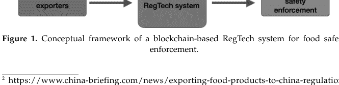

图 1. 食品安全执法区块链 RegTech 系统的概念框架。

² https://www.china-briefing.com/news/exporting-food-products-to-china-regulation-and-procedure/.

标签将被检查。然后可在放行前进行食品安全卫生检查。

正如第 2 节也强调的那样，流程的复杂性和中国法规的定期修改为外国食品生产商创造了充满挑战的环境，尤其是对于小型组织而言。在此方面，我们研究了一个贸易平台的案例，该平台应用区块链技术管理产品和运输信息并支持法国向中国出口食品。目标是回答以下问题：基于区块链的 RegTech 系统如何同时促进中国的食品进口法规执行和法国生产商的出口流程？我们通过了解系统的结构并追踪一个真实的进口流程来解决这一研究问题。图 2 中呈现的概念框架显示了信息流（编号 1、2 和 3）以及平台的基于区块链的信息系统作为法国生产商与中国食品进口当局之间中介的核心作用。细箭头代表产品从法国到中国的实物运输。

有两个信息来源。一个来自法国生产商（流程 1），另一个在运输过程中（流程 2）。流程 1 的数据与法国生产商提供的产品信息相关，是中国当局对任何食品进口所需的信息。流程 2 的数据可能来自不同来源，因为它们是在产品运输过程中捕获的，与物流信息（货物移动）和运输过程中产品的状况（温度等）相关。平台收集这些信息并将其存储在其基于区块链的信息系统中。

然后，基于区块链的信息系统在进口过程中向中国的食品进口当局提供信息。我们分析了流程 1 和 2 中收集的信息性质以及

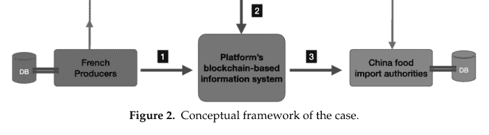

图 2. 案例的概念框架。

Foodgates 的基于区块链的信息系统如何在流程 3 中同时支持进口流程和中国食品安全执法。我们随后通过讨论基于区块链的 RegTech 系统促进中国食品进口法规执行的潜力得出结论。

### 4.2 研究方法

本章有关方法论和方法的要素受到了 Creswell [10]、Baxter 和 Jack [2] 以及 Yin [46] 的指南、设计和方法启发。我们还考虑了 Treiblmaier [43] 关于区块链案例研究的特定建议。

文献综述中出现的概念框架支持了区块链作为金融领域监管技术积极贡献的观点。本研究的动机是分析区块链在产品安全执法背景下促进监管合规的潜力。这是一个当代现象，且在金融部门以外实施此类系统的公司数量仍然非常有限。为了理解这一复杂现象，我们必须对现象进行广泛深入的分析，而这种分析需要整体和现实世界的视角。案例研究是一种经验方法，适用于在现实世界背景下对当代现象进行深入研究，是本研究最合适的方法。作为认识论取向，我们认为存在单一现实，且该现实独立于任何观察者。这种现实主义视角适用于以下部分描述的描述性案例研究。

为回答研究问题，我们具体描述了一种基于区块链技术的信息系统，该系统支持食品进口合规。这种单一案例设计是整体性的，因为只有一个分析单元。分析单元被视为关键案例，可提供与研究问题相关的数据。本研究中研究的单一案例的范围是公司 Foodgates 开发的平台。

Foodgates 自称“Foodgates is the only fully transparent food B2B platform with local presence in France and China, audited producers and products of excellence ready to be imported in China”。Foodgates 选择生产商和产品，与认证机构和中国当局如 CIQ（China Inspection and Quarantine）密切合作，确保平台上的所有产品符合中国法规。Foodgates 提供从生产商到餐桌的全部供应链和运输支持。Foodgates 是一个完全透明的平台，所有与产地、运输和报关相关的信息都存储在区块链上。

在开展实地工作之前，Foodgates 平台的一般信息已从网站（https://foodgates.cn）获取。然后数据从不同来源收集，如公司档案、交易观察和半结构化访谈。构成主要群体并代表我们案例研究直接主题的人员是公司在法国和中国的员工。在该群体之外，开发软件解决方案和区块链系统的公司是案例研究背景的一部分，可支持对技术过程的理解。法国生产商、与食品安全监管和执法相关的中国当局以及中国消费者不属于本案例研究的范围。

案例研究导致了与如何设计基于区块链技术的信息系统以促进中国食品安全法规合规相关的解释。这种对现实案例的描述性分析提供了一个概念框架，使能够得出可推广的结论。对真实案例进口流程的分析可以验证或强调此类区块链应用的局限性。通过将研究结果与理论陈述进行比较，陈述可能被修订。这种修订可能由区块链系统本身固有的问题或外部因素引起。

## 5. 案例研究：Foodgates

### 5.1 受访者

以下人员作为研究的一部分接受了访谈。

- Mr. Igal Chreky 是 ASI Group 的副总裁，驻上海。Igal Chreky 是 Foodgates 项目的领导者之一。在早期阶段，Igal Chreky 明确了区块链系统的需求和要求，确定了平台的中长期可追溯性目标，发起了与 Younicorns 的讨论并发展了与 VeChain 和 DNV 的关系。
- Ms. Hebe Liu 是 Foodgates 中国运营经理，驻上海。Hebe Liu 此前在 ASI Group 中国的食品和饮料（F&B）部门工作。她参与了 Foodgates 项目并支持了平台上的流程定义。
- Mr. Mathieu Borgé 是 Foodgates 销售和市场总监，驻法国。Mathieu Borgé 此前负责 ASI Group 的法国相关业务。他是 Foodgates 的联合创始人，并是负责活动法国部分的 ASI Group 初始项目团队成员。

- Jonathan Horyn 先生是 Younicorns 的联合创始人，同时担任 Foodgates 的首席技术官（CTO），常驻法国。Jonathan Horyn 在 Foodgates 项目早期便已参与其中，负责平台系统和区块链相关方面，例如可追溯性追踪、产品详情展示以及与交易平台的对接。
- Jérôme Grillères 先生是 VeChain Tech 欧洲区总经理，常驻法国。Jérôme Grillères 参与了 2019 年 11 月在上海的活动以及与 Foodgates 和 DNV 的合作。

在附录 D 中，我们概述了参与 Foodgates 项目的各家公司。

### 5.2 Foodgates 项目的起源

#### 最初的业务问题

最初，家乐福（Carrefour）和欧尚（Auchan）这两家法国跨国零售企业请求 ASI Group 提供支持与经验，将各自的自有品牌产品进口到中国。这些自有品牌包含多种不同性质的食品饮料（F&B）产品，并在法国不同地方生产。ASI Group 能够提供四项关键服务：

1. **法规合规：** 由于这些自有品牌产品从未进口到中国，ASI Group 进行了可进口性测试，并列出了根据中国法规需要补充的所有监管要素（额外标签、包装修改、认证、文件等）。
2. **进口许可证：** ASI Group 利用其许可证为家乐福和欧尚在中国进口产品。
3. **运输：** 家乐福和欧尚需要为其自有品牌寻找服务提供商，以协调法国多个仓库的配送并组织发往中国的货运。运输方式以海运为主。该服务还包括清关以及送货至家乐福和欧尚在中国的仓库。
4. **人民币支付：** ASI Group 还能够以人民币向家乐福和欧尚的中国子公司开具服务发票。

所有这些服务的搭建由 ASI Group 的食品饮料部门监督，参与团队包括中国的一个由 Hebe Liu 带领的团队，以及法国的一个由 Mathieu Borgé 领导的团队。为了应对大量交易流并支持进口流程，ASI Group 开始使用数字化信息。

#### Foodgates 平台的开发

在第一个项目的基础上，ASI Group 随后决定开发一个代号为“食品交易平台”（Food Trading Platform, FTP）的全球平台。Igal Chreky 表示：“目标是尽可能减少中间环节，将欧洲中小企业（SME）食品生产商与中国专业买家直接连接起来。解决方案是开发一个完全集成的端到端平台，作为从法国农场到中国分销商仓库的企业对企业（B2B）平台。”该平台还应能够将与位于特定国家的卖方（食品生产商）和位于另一国家的买方之间交易相关的所有信息数字化。信息流包括交易信息（卖方、售出产品和买方）、原产地和目的地海关的信息，以及从生产地到买方仓库运输过程中捕获的信息。支付流程也包含在流程的最后。图 3 描述了流程步骤以及不同的信息来源和信息流。

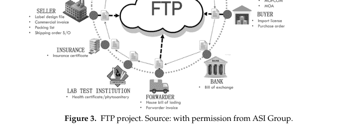

图 3. FTP 项目。来源：经 ASI Group 许可。

FTP 更名为 Foodgates，并于 2019 年 11 月在上海中国国际进口博览会（CIIE）期间推出。在这场重要的贸易博览会上，中国和法国总统品尝到了一块通过 Foodgates 平台进口的“Label Rouge”利穆赞牛肉，其原产地经 DNV 认证，并可在唯链（VeChain）区块链上获取追溯信息（见下文图 4）。Foodgates 平台被介绍为食品行业中首个面向法国生产商和中国商业买家的公开且具有颠覆性的区块链生态系统，买家可以在整个价值链中获取经过认证的信息，从法国生产到交付至其仓库（Foodgates 新闻稿，2019）。

2019 年 11 月的这场活动是一个奠基性事件。当时，市场平台尚未存在。这次活动提供了一个机会，与利穆赞质量和原产地协会（L’Association Limousine de la Qualité et de l’Origine）³ 建立合作，该协会在全球范围内推广利穆赞原产地牛肉，并展示使用区块链技术的可追溯性解决方案。这是 Foodgates 项目的一个里程碑，并确认了区块链将成为平台的基本要素。Foodgates 这个名字就是为这一特定活动而创造的。B2B 平台当时仍在开发中，而这次活动验证了该概念的可行性。

在 ASI Group 孵化后，Foodgates SAS 公司于 2020 年 3 月在法国注册成立。随后，Foodgates 平台于 2020 年 11 月上线。目前，Foodgates 以法国为运营基地，并在中国设有一个专注于销售和物流的下游运营团队。

图 4. 习近平主席与法国总统马克龙在 2019 年上海中国国际进口博览会（CIIE）上的照片。

### 5.3 Foodgates 平台流程

图 5 展示了交易相关的不同步骤。第一步，法国生产商在平台上注册。需要提供公司和产品的基本信息，以便创建档案。注册后，公司会指明通过 Foodgates 平台出口的产品类别和描述。列出的主要类别包括乳制品、肉类、海鲜、葡萄酒与烈酒、食品杂货、饮料以及面包和糕点。随后，系统会进行系统的可进口性检查，以确保该产品可以合法进口到中国。Mathieu Borgé 指出：“我们向中国买家保证，Foodgates 平台上展示的所有产品都可以进口到中国。我们不仅仅是一个市场平台，更是一个增值数字平台。”接下来，产品会在平台上展示，并标明价格和最小起订量。中国客户随后可以指定数量并选择国际贸易术语（Incoterms）来下单。在与生产商确认产品供应情况后，中国买方会收到包含运输至仓库和清关费用的价格确认。当中国买方接受此确认后，交易在平台上生效，并生成一个二维码，用于跟踪与该交易相关的所有文件和信息。

> 我们向中国买家保证，Foodgates 平台上展示的所有产品都可以进口到中国。我们不仅仅是一个市场平台，更是一个增值数字平台。

接下来是运输过程。在此过程中，平台会收集多种信息：运输单据、货物的 GPS 跟踪（可对各个步骤进行时间戳记录），以及在适用时对产品进行温度检查。以二维码为链接，Foodgates 的物流团队可以监控运输过程，并通知报关行和中国买方。

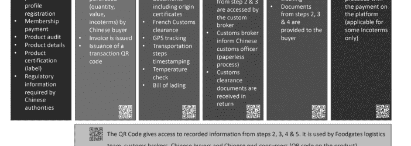

二维码可访问步骤 2、3、4 和 5 的记录信息。Foodgates 物流团队、报关行、中国买方和中国终端消费者（产品上的二维码）均可使用它。

图 5. Foodgates 流程图。由作者设计。

对于清关流程，报关行可以使用二维码检索信息，并将信息传输给海关官员。自 2013 年⁴ 起，中国海关总署（GACC）已推广无纸化通关流程，海关可通过中国电子口岸⁵ 的信息管理系统，直接对企业申报的进出境货物进行无纸化审核、查验和放行。海关会对货物进行随机实物查验。这些查验必须提交纸质文件。Hebe Liu 指出：“随机查验涉及 5% 到 20% 的货物，具体取决于产品的性质。”清关完成后，海关会出具报关单和 CIQ（中国检验检疫）入境证书。这些文件存储在 Foodgates 平台上。清关完成后，货物发送给中国买方。运输步骤会被跟踪并存储在平台上，直到交付给买方。对于某些国际贸易术语，买方还可以通过 Foodgates 平台兑付款项。

### 5.4 区块链的附加价值

#### Foodgates 平台的信息系统

Foodgates 平台是一个商业应用。Jonathan Horyn 强调：“Foodgates 平台是一个为特定需求开发的专有平台，由单一团队运营，且独立于区块链的使用。”Foodgates 平台主要是一个 B2B 市场，供亚洲食品饮料专业人士从欧洲生产商处购买产品。此外，该系统支持产品发现和交易、订单管理，进而在区块链上对从生产商到终端消费者的产品进行跟踪与追溯，包括产品信息。是否记录在区块链上由买方自行决定，取决于中国买方的选择。

如图 6 所示，Foodgates 平台的数据通过 BlockFlow 技术传输到区块链系统，BlockFlow 是 Younicorns 开发的解决方案。BlockFlow 支持与大量区块链互联，其中包括 VeChain 和 BSN。因此，Foodgates 与具体区块链类型无关，因为它兼容多种区块链。正如 Jonathan Horyn 所描述的：“BlockFlow 将任何业务流程转变为基于区块链的可追溯性系统。”

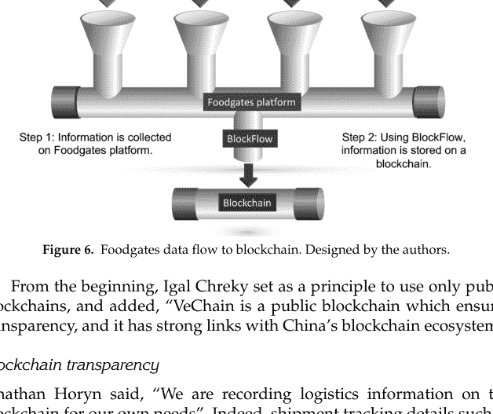

图 6. Foodgates 数据流向区块链。作者设计。

从一开始，Igal Chreky 就确立了只使用公有区块链的原则，并补充道：“VeChain 是一个确保透明度的公有区块链，它与中国区块链生态系统有着紧密的联系。”

#### 区块链透明度

Jonathan Horyn 说：“我们正在将物流信息记录在区块链上，以满足我们自身的需求。”确实，货运跟踪细节，如预计出发日期和实际出发日期，或实际到达日期和时间，有助于整个运输过程的监控。交易二维码提供了与特定货物相关的所有信息的直接链接。Hebe Liu 补充道：“通常，我们无法在同一地点访问全部信息。我们需要访问承运人网站查看运输信息，然后需要再次检查以确保状态没有变化。此外，每批货物可能有不同的经纪商、货运代理和仓库。Foodgates 系统能够实现货物的透明追踪。”面向中国买家的信息质量也得到了提升。

此外，根据中国买家的要求，可以生成二维码并贴在产品上。该二维码使终端消费者能够访问产品详情、通过区块链上带时间戳的文档实现的物流追溯信息，以及区块链上已公证的文档等信息。Jonathan Horyn 解释说：“区块链使我们能够增强所展示信息的有效性，并让中国消费者对产品质量感到放心。”Mathieu Borgé 说：“自2021年底以来，所有中国买家都要求使用这项二维码服务，这证明 Foodgates 系统是可靠的，并为交易增加了价值。”

### 5.5 交易分析：儿童牛奶

2020年8月，一位中国买家向法国诺曼底的生产商 Les Maîtres Laitiers du Cotentin 订购了法国儿童牛奶品牌 Petit Maupassant-Normandy 1905。以下信息从 Foodgates 平台获取，并通过 BlockFlow 注册到 VeChain 区块链上。⁶

首先是中国买家在决定下单前所访问的与产品相关的信息：

- 产品的图片和描述
- 标签与认证：诺曼底1905工厂已获得中华人民共和国认证认可监督管理委员会（CNCA）的认证。该认证已在区块链上公证。这确保了该产品可进口到中国。
- 显示诺曼底农场和加工厂原产地位置的地图。
- 一段展示农民、奶牛及其生活环境的视频。
- 农民姓名、农场规模、所拥有的奶牛数量以及参与此次生产的农民的年产奶量（升）。

从中国买家（确认购买产品）和法国生产商（确认产品可用性）双方确认交易的那一刻起，以下事件、数据和文档便在区块链上可查。

- 在农场收集牛奶的日期以及诺曼底工厂的接收日期。
- 工厂中配方制定和调理的日期。
- 产品从工厂出库的日期，附带法国农业部的健康证书和诺曼底国际商会（ICC）的原产地证书。这些证书在区块链上经过带时间戳的公证。

健康证书是专门为向中国出口乳制品而签发的官方文件。该证书载明产品的特征，如名称、描述、超高温处理（UHT）、净重、生产日期和有效期、生产工厂的名称和地址、原产地起运地点和目的地，并由农业部下属的官方兽医签字。证书内容的描述同时使用法语和中文。

图 7. Petit Maupassant-Normandy 1905 儿童牛奶盒图片。

原产地证书显示发货人（法国牛奶厂）和收货人（ASI Solutions）的名称和地址、原产国、运输详情、货物描述、数量和净重。为对文件真实性进行额外核验，可通过证书编号直接从国际商会世界商会联合会网站⁷获取该证书。证书内容的描述是多语言的，中文是显示语言之一。

- 从工厂提货、在原仓库入库、为运输进行重新整理、原仓库出库，以及到达始发机场（巴黎夏尔·戴高乐机场）的日期和时间戳。从提货那一刻起，货件温度受到监控，结果存储在区块链上，直至到达最终目的地。运输由 ASI Solutions 组织。
- 始发机场的离港日期和时间戳，以及提单。
- 目的机场（上海浦东机场）的到达日期和时间戳。
- 海关清关和从目的机场离港的日期和时间戳。
- 目的地仓库的入库和出库日期与时间戳，以及到达最终目的地（中国买家所在地）的日期和时间戳。

图8突出显示了从法国农场到中国买家的不同流程步骤。所收集的数据具有三种性质。第一种是事件发生的日期；第二种是针对特定事件在区块链上通过时间戳认证的日期；最后一种是文档在区块链上的公证。

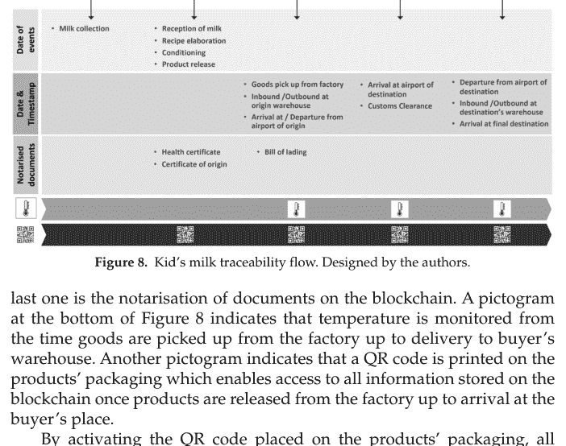

图 8. 儿童牛奶追溯流程。作者设计。

图8底部的图标表示，从工厂提货到交付至买家仓库的整个过程中，温度均受到监控。另一个图标表示产品包装上印有二维码，可访问区块链上存储的所有信息，覆盖从产品出厂至抵达买家所在地的整个过程。

用户激活产品包装上的二维码后，即可通过网页访问所有文档，该网页以中英文显示不同数据的描述和说明，并提供已公证文档的访问入口。因此，Foodgates 平台实现了产品从奶牛到中国消费者餐桌的完整追溯。Foodgates 使法国生产商能够展示其产品的认证质量，也让中国买家能够向终端消费者推广这种质量。此外，清关流程所需文件可从区块链上检索，并提交给中国主管部门。来源证明、文档公证，以及对区块链上所有数据进行带时间戳的追踪，为货物清关流程提供了支持。

在标准流程中，中国报关行（官方中介）收集进口货物所需的文件，并将其提供给中国海关人员。所需文件视产品而异，但可能包括标准文件，如提单、发票、装箱单、报关单、保险单和销售合同，也可能包括更专业的文件，如原产地证书、标签、产品及其生产过程的完整描述、进口许可证、检验证书，以及其他安全或质量许可证。⁸ 报关行可将交易二维码作为区块链上数据的链接，从 Foodgates 平台检索所有必要文件。此外，报关行可以实时访问货物信息，从而在货物到达中国之前提前在电子口岸系统上进行在线预申报。预申报的质量和准确性非常重要，因为它能确保流程顺畅，并最终获得 CIQ 入境货物通关单。

中国海关的无纸化政策和对产品可追溯性的要求，使得电子数据信息系统对于简化清关非常实用。“中国政府正朝着电子化可追溯记录的方向发展”，Jonathan Horyn 补充道。作为限制新冠疫情传播风险的一项措施，中国政府于2020年11月宣布，运输或储存进口冷冻食品的公司必须在政府搭建的在线平台上上传产品详情，包括原产地和进口路线。⁹ “纸质文件、运输时间线和追溯信息应存储在中国官方区块链 BSN 上”，Hebe Liu 明确指出。

### 5.6 区块链用于追溯

许多案例表明，食品的来源和可追溯性在中国是一个真实存在的问题。过去的一些丑闻，例如与儿童牛奶相关的丑闻 [35]，凸显了食品安全在中国是多么重要的问题。消费者往往不信任产品的质量和来源。

中国政府定期加强监管以应对这一问题。2021年12月，海关总署（GACC）发布了两项有关进口食品的法规（第248号令和第249号令），这些法规影响到海外食品生产商、加工商和储存设施。¹⁰ 自2022年1月1日起，新法规对标签与包装以及供应链安全可追溯性规定了更严格的措施。就后者而言，外国食品生产商现在必须建立完整且可追溯的食品安全与卫生控制体系，确保出口产品的生产、加工和储存符合中国法律法规（第249号令，第44条）¹¹

⁸ https://www.trade.gov/country-commercial-guides/china-import-requirements-and-documentation.
⁹ https://mp.weixin.qq.com/s/nlKhzektf_oAKhvJ3tGp1Q.
¹⁰ https://www.fas.usda.gov/data/china-decrees-248-and-249-january-1-implementation-date.
¹¹ https://www.morganlewis.com/pubs/2022/01/china-issues-stricter-regulations-on-imported-food#_ftn4.

区块链的使用可以促进对当局追溯要求的合规。Jonathan Horyn 解释道，“区块链将保证所提供信息的可靠性和透明度”。因此，2020 年，广州市市场监督管理局推出了基于区块链的农产品追溯平台，以避免食品安全事故。该解决方案使消费者能够查看存储在区块链上的追溯信息。12

目前，中国有多家公司开发了区块链支持的解决方案，以向终端消费者保证其食品产品的质量和来源。2019 年，中国第二大食品制造商光明食品开始使用 VeChain 追踪其乳制品。消费者可以通过扫描产品上的二维码追溯牛奶的来源。扫描不仅提供产品到商店的路线信息，还提供牛奶来源以及生产时所处的农场环境条件。13 此前，沃尔玛中国也在国内推出了区块链食品追溯系统。14 2021 年，澳新食品采用了区块链支持的解决方案，以增强从澳大利亚进口牛肉的真实性验证和追踪。15

新 GACC 规定的颁布表明，从农场到餐桌的整个食品供应链的安全正成为中国当局的高度优先事项，也是中国食品监管执法的重要组成部分。除了与新冠疫情相关的具体措施外，中国的食品进口监管正变得日益复杂。正如 Igal Chreky 所评论的那样，“当局给予企业遵守新规定的时间极其短暂”。例如，GACC 于 2021 年 12 月 14 日发布了 2021 年第 103 号公告，并要求外国公司在 2022 年 1 月 1 日《第 248 号和第 249 号法令》生效时遵守。16 在这方面，Foodgates 信息系统结构的灵活性和其区块链无关的特性是一个优势。如果中国当局要求通过区块链系统接收当前监管信息，Foodgates 将能够立即合规。

### 5.7 Traceability at the Core of China Food Regulation

中国食品监管正变得越来越复杂和严格。GACC 于 2022 年 1 月 1 日实施的新法规与中国更新的《食品安全法》相一致，后者突出了这种复杂性。根据第 248 号法令，所有希望出口到中国的食品生产企业必须在 GACC 的新在线平台上注册。¹⁷ 该平台名为 China Import Food Enterprises Registration¹⁸，是 China E-port data centre 的一部分。其目标是在产品出口到中国之前收集信息并对外国生产商进行资格认证。第 249 号法令侧重于食品进口安全措施，并赋予 GACC 额外的执法权力，对违反食品安全法规的外国实体采取限制措施。¹⁹ 第 249 号法令对海外出口商和食品生产商要求的食品安全审计制度和追溯与 2021 年中国《食品安全法》最新修订一致。法规加大了对外国行为者的压力，试图防止不安全产品进入中国市场，并在出现问题时能够通过产品召回迅速做出反应。从产品抵达中国之前到海关清关后直至消费者餐桌的追溯，从现在起构成了中国食品安全执法的核心。

我们在 5.6 中看到，Foodgates 平台能够收集扩展的追溯信息流并将其存储在多个区块链上，包括 BSN，然后使其可供第三方使用。因此，Foodgates 平台通过提供食品安全追溯来促进中国食品监管合规，并加快海关清关流程，因为预申报可以在流程早期由报关行建立。此外，信息追溯流的范围可以定制以符合中国法律要求。尽管如此，在现阶段，区块链数据并未直接从 Foodgates 平台传输到中国海关。中国一些使用区块链支持解决方案进行跨境清关的最新项目使得海关部门在更大范围内采用区块链成为可能。

### 5.8 Adoption of Blockchain for Customs Clearance

Powerbridge Technologies 是一家总部位于中国的跨境贸易专业技术公司，于 2019 年 6 月公开表示，作为 National Customs Cross Border Technology Innovation Initiatives 的一部分，其 Powerbridge Blockchain Cross Border Compliance Platform 已被南宁海关采用。20 南宁是位于中国西南部的广西壮族自治区的首府，与邻国越南共享近 500 英里的边界。南宁海关直接管理 26 个跨境港口。21 其目标是促进跨境交易的海关清关，并改善港口与省级政府部门之间的沟通和互操作性。

2019 年 10 月，中国当局正式宣布，将在浙江省杭州市采用区块链支持的解决方案用于跨境海关清关。22 杭州已发展出强大的物流和电子商务产业，每年进出口额超过 374 亿美元。海关当局称，进口清关平均时间已减少 85%，从 191 小时降至 27 小时，而出口流程仅需 12 分钟。23

有趣的是，中国中央政府监管机构国家外汇管理局（SAFE）于 2019 年 11 月宣布扩大其于 2019 年 3 月启动的计划，该计划旨在利用区块链支持跨境交易。24 这一政府决定在 2020 年得到了 BSN 区块链平台的推出所呼应。2020 年 7 月，创建了两个子生态系统：面向中国本土项目的 BSN China 和面向任何外国项目的 BSN International。25 政府明显的目标不仅是使 BSN 成为中国区块链运营的标准，而且通过香港和澳门的枢纽在全球范围内推广 [40]。政府对区块链发展的高度重视为所有国家和省级行政部门的大规模采用奠定了基础。这一战略举措和 BSN 的创建正在改变中国的区块链格局。这一新的法律和技术框架将极大地促进公共和私人倡议。基于 BSN 的电子政务应用的推广肯定会扩展到中国海关流程。然后，区块链支持的信息系统将能够涵盖不仅追溯要求而且海关清关。

20 https://www.powerbridge.com/ir/news-content.html?artIdx=32.
21 https://www.ledgerinsights.com/blockchain-china-customs-powerbridge/.
22 https://www.ledgerinsights.com/china-blockchain-cross-border-customs-clearance/.
23 https://www.asiablockchainreview.com/china-adopts-blockchain-to-facilitate-cross-border-trade/.
24 https://www.cointrust.com/market-news/china-widens-trial-of-its-blockchain-powered-trans-border-funding-platform.
25 https://forkast.news/chinas-blockchain-infrastructure-project-goes-live-in-hong-kong-macau/.

## 6. Conclusion

Foodgates 的研究表明，区块链支持的信息系统可以支持食品出口商遵守中国食品进口法规，无论是直接通过提供产品安全的认证追踪，还是间接通过促进海关清关流程。更大的透明度、数据的即时访问以及文件的认证使区块链成为一种 RegTech，简化了公司对与进口流程相关的法规的合规性并支持食品安全执法。

Foodgates 信息系统可以轻松调整以适应法规变化并纳入更多信息和文件。这种灵活性很重要，因为食品安全监管框架需要适应新的风险情况，而遵守新法规的时间往往很短。此外，该系统提供了一个认证的追溯记录，这现在是中国食品安全法规要求的一部分。在这方面，Foodgates 信息系统既服务于外国食品出口商的利益，也服务于中国旨在确保向消费者提供透明信息的政策。

随着 BSN 区块链的推出，中央政府能够进一步推动政府部门的区块链采用战略。此外，一些省份已开始采用区块链进行跨境交易清关。结果显示清关流程更快。此外，区块链支持的系统使信息和数据管理更具成本效益。一旦数据存储在区块链上，就不再需要信息核对，存储完全数字化且对不可变数据的访问是永久的。将区块链采用推广到执行食品安全监管似乎不可避免。

## 附录B. 中国政府从食品卫生到食品安全监管的演变

| 食品卫生管理 |  |  | 食品安全治理 |  |
|---|---|---|---|---|
| I | II | III | IV | V |
| 1949–1979 | 1979–1995 | 1995–2009 | 2009–2015 | 2015–2022 |
| 集中管理 | 多部门管理 | 矩阵管理 | 过程管理 | 综合管理 |
| 卫生部；涉及五个部委的部门 | 农业、林业、畜牧、水产、粮食、供销、商业、轻工和贸易等部门 | 全国各级卫生机构；辖区地方政府部门 | 食品安全委员会总体指导；相关部门进行过程管理 | 食品安全委员会总体指导；CFDA（2018年为SAMR）负责安全监管；NHFPC（2018年为NHC）负责风险监测、风险评估和安全标准 |
| 《食品卫生管理条例》（试行）1964年 | 《食品卫生法》（试行）1982年 | 《食品卫生法》1996年 | 《食品安全法》2009年 | 《食品安全法》（修订）2015年、2018年和2021年（4月29日） |

改编并更新自 Liu 等 [29]。

## 附录C. 中国食品进口流程图。来源：www.rjs.cn

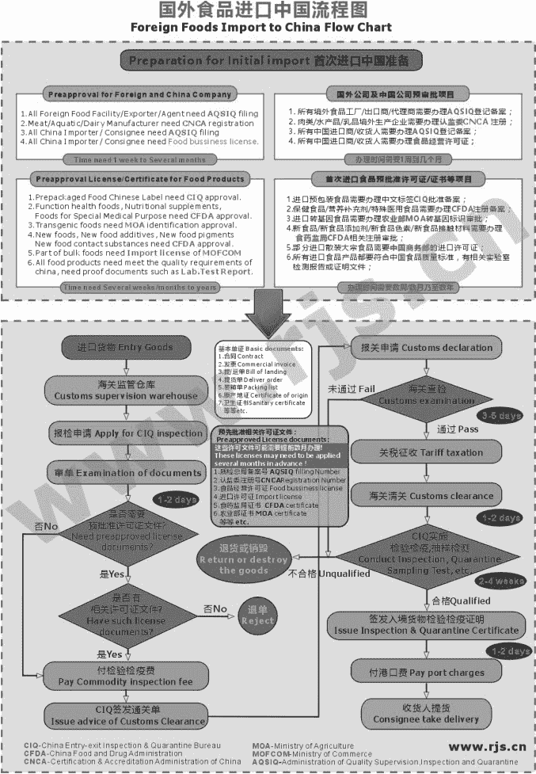

## 附录D. Foodgates 利益相关者概览

**ASI Group** 由公司创始人兼董事长 Dov Chreky 先生于2008年在上海创立。如今，ASI Group 拥有三大主要子公司：ASI Logistics、ASI Solutions 和 ASI Movers。ASI Group 在欧洲和亚洲的六个国家设有分支机构，在全球拥有200多名员工。Foodgates 项目源自 ASI Group 的倡议，由其选定不同的合作伙伴公司；参见 https://group-asi.com

**Younicorns** 是一家企业工作室，与企业共同打造成功的初创企业。他们将伟大的想法转化为真正的产品。Younicorns 在技术上开发了 Foodgates 平台。ASI Group 之所以选择 Younicorns，是因为其过去在欧洲和中国之间管理项目的经验。Younicorns 还开发了 BlockFlow 技术，该技术将业务流程与供应链领域的区块链解决方案连接起来。https://younicorns.io - https://block-flow.com

**VeChain** 技术公司成立于2015年，是全球最早的区块链技术公司之一，提供适合业务需求的区块链解决方案。VeChain 在中国、欧洲、美国、新加坡和日本设有国际办事处，并依靠战略合作伙伴普华永道（PwC）和 DNV，与多个行业的许多领先企业建立了合作伙伴关系，包括沃尔玛中国、拜耳中国、宝马集团、LVMH 等。ASI Group 选择 VeChain 是因为其参与了多个中国项目，包括与一些地方政府的合作。Foodgates 是 VeChain 合作伙伴名单中的一部分。26 https://www.vechain.com

**DNV** 是全球领先的认证机构，在保证与风险管理方面拥有深厚的专业知识。DNV 于1864年在挪威成立，是海事行业公认的顾问。在 Foodgates 项目中，DNV 担任产品原产地和标签的认证机构。https://www.dnv.com

**BSN**，即区块链服务网络（Blockchain-based Service Network），是一个跨云、跨门户、跨框架的全球基础设施网络，用于部署和运营各类区块链应用。中国政府机构国家信息中心是成立 BSN 发展协会的六个实体之一。其他五个实体是中国电信行业的领先企业（中国移动通信集团设计院有限公司和中国移动通信集团有限公司政企客户分公司）、金融行业（中国银联股份有限公司和

- [3] Beck, R., Stemi, J. C., Lollike, N. and Malone, S. 2016. Blockchain - The gateway to trust-free cryptographic transactions. Proc. ECIS Turkey, 1–14.
- [4] Beck, R., Avital, M., Rossi, M. and Thatcher, J. 2017. Blockchain technology in business and information systems research. BISE, 59(6): 381–384.
- [5] Behnke, K. and Janssen, M. F. W. H. A. 2020. Boundary conditions for traceability in food supply chains using blockchain technology. Int. J. Inf. Manage, 52: 101969.
- [6] Cai, L., Sun, Y., Zheng, Z., Xiao, J. and Qiu, W. 2021. Blockchain in China. Commun. ACM, 64(11): 88–93.
- [7] Calvin, L., Gale Jr, H. F., Hu, D. and Lohmar, B. 2006. Food safety improvements underway in China. Economic Research Service/USDA, 4(6): 16–21.
- [8] Chammem, N., Issaoui, M., Dâmaso De Almeida, A. I. and Delgado, A. M. 2018. Food crises and food safety incidents in European union, United States, and Maghreb area: Current risk communication strategies and new approaches. J. AOAC Int., 101(4): 923–938.
- [9] Chu, M. 2021. The limits to the internationalisation of regulation: divergent enforcement strategies in China’s food safety regulation. Policy & Politics, 1–21.
- [10] Creswell, J. W. 2007. Qualitative inquiry & research design: choosing among five approaches (2nd ed.). Thousand Oaks: Sage Publications.
- [11] Crosby, M., Pattanayak, P., Verma, S. and Kalyanaraman, V. 2016. Blockchain technology: Beyond bitcoin. Applied Innovation Review, 2: 6–10.
- [12] De Filippi, P. and Hassan, S. 2018. Blockchain technology as a regulatory technology: From code is law to law is code. arXiv preprint arXiv:1801.02507.
- [13] Dong, L. 2018. What’s the Future of Blockchain in China? World Economic Forum. https://bit.ly/36SI7Uu (accessed 30 October 2021).
- [14] Francisco, K. and Swanson, D. 2018. The supply chain has no clothes: Technology adoption of blockchain for supply chain transparency. Logistics, 2(1): 2.
- [15] Gale, F. 2021. China’s Refusal of Food Imports. ERR-286, U.S. Department of Agriculture, Economic Research Service.
- [16] Gao, Q., Huang, Y., Liang, Q., Sui, Y. and Zheng, Y. 2020. Food Safety Regulatory Enforcement in China: A Data-Driven Approach. SSRN: http://dx.doi.org/10.2139/ssrn.3658748.
- [17] Gozman, D., Liebenau, J. and Aste, T. 2020. A case study of using blockchain technology in regulatory technology. MIS Quarterly Executive, 19(1): 19–37.
- [18] Guo, Z., Bai, L. and Gong, S. 2019. Government regulations and voluntary certifications in food safety in China: A review. Trends in Food Science & Technology, 90: 160–165.
- [19] Hawlitschek, F., Notheisen, B. and Teubner, T. 2018. The limits of trust-free systems: A literature review on blockchain technology and trust in the sharing economy. Electron. Commer. Res. Appl., 29: 50–63.
- [20] Henson, S. and Heasman, M. 1998. Food safety regulation and the firm: Understanding the compliance process. Food Policy, 23(1): 9–23.
- [21] Hou, H. 2017. The application of blockchain technology in E-government in China. Proc. ICCCN Canada, 1–4.
- [22] Hou, J., Wu, L. and Hou, B. 2020. Risk attitude, contract arrangements and enforcement in food safety governance: a China’s agri-food supply chain scenario. Int. J. Environ. Res. Public Health, 17(8): 2733.
- [23] Hu, Y. 2016. Chinese policy on the evolution of food safety: Concept and practice. Reform, (5), 25–40.
- [24] Huang, J. and Yang, G. 2017. Understanding recent challenges and new food policy in China. Global Food Security, 12: 119–126.
- [25] Hughes, L., Dwivedi, Y., Misra, S., Rana, N., Raghavan, V. and Akella, V. 2019. Blockchain Research, Practice and Policy: Applications, Benefits, Limitations, Emerging Research Themes and Research Agenda. Int. J. Inf. Manage., 49: 114–129.
- [26] Kendall, H., Naughton, P., Kuznesof, S., Raley, M., Dean, M., Clark, B., Stolz, H., Home, R., Chan, M.Y., Zhong, Q., Brereton, P. and Frewer, L. J. 2018. Food fraud and the perceived integrity of European food imports into China. PloS one, 13(5): e0195817.
- [27] Lacity, M. C. 2018. Addressing key challenges to making enterprise blockchain applications a reality. MISQS, 17(3): 201–222.
- [28] Lemieux, V. 2016. Blockchain for Recordkeeping; Help or Hype? Social Sciences and Humanities Research Council of Canada Knowledge Synthesis Report, October. https://doi.org/10.13140/RG.2.2.28447.56488.
- [29] Liu, Z., Mutukumira, A. and Chen, H. 2019. Food safety governance in China: From supervision to coregulation. Food Sci. Nutr., 7(12): 4127–4139.
- [30] Lootsma, Y. 2017. Blockchain as the newest regtech application—the opportunity to reduce the burden of KYC for financial institutions. Banking & Financial Services Policy Report, 36(8): 16–21.
- [31] Micheler, E. and Whaley, A. 2020. Regulatory technology: replacing law with computer code. Eur. Bus. Organ. Law Rev., 21(2): 349–377.
- [32] Ogus, A. 1992. Information, error costs and regulation. Int. Rev. Law Econ., 12(4): 411–421.
- [33] Ogus, A. 1994. Regulation: Legal form and economic theory (Clarendon law series). Oxford: Clarendon Press.
- [34] Parra Moyano, J. and Ross, O. 2017. KYC Optimization Using Distributed Ledger Technology. Bus. Inf. Syst. Eng., 59(6): 411–423.
- [35] Pei, X., Tandon, A., Alldrick, A., Giorgi, L., Huang, W. and Yang, R. 2011. The China melamine milk scandal and its implications for food safety regulation. Food Policy, 36(3): 412–420.
- [36] Perboli, G., Musso, S. and Rosano, M. 2018. Blockchain in logistics and supply chain: A lean approach for designing real world use cases. IEEE Access, 6: 62018–62028.
- [37] Qian, J., Wu, W., Yu, Q., Ruiz-Garcia, L., Xiang, Y., Jiang, L., Shi, Y., Duan, Y. and Yang, P. 2020. Filling the trust gap of food safety in food trade between the EU and China: An interconnected conceptual traceability framework based on blockchain. Food Energy Secur., 9(4): e249.
- [38] Saberi, S., Kouhizadeh, M., Sarkis, J. and Shen, L. 2019. Blockchain technology and its relationships to sustainable supply chain management. Int. J. Prod. Res., 57(7): 2117–2135.
- [39] San Juan, I. H. 2020. The Blockchain Technology and the Regulation of Traceability: The Digitization of Food Quality and Safety. European Food and Feed Law Review. 15(6): 563-570.
- [40] Stockton, N. 2020. China takes blockchain national: The state-sponsored platform will launch in 100 cities. IEEE Spectrum., 57(4): 11–12.
- [41] The People's Government of Beijing Municipality 2020. The blue book on the innovative blockchain applications in the field of government services in Beijing (1st ed.). Beijing, China.
- [42] Tian, F. 2016. An agri-food supply chain traceability system for China based on RFID & blockchain technology. Proc. ICSSSM China, IEEE, 1–6.
- [43] Treiblmaier, H. 2019. Toward more rigorous blockchain research: Recommendations for writing blockchain case studies. Frontiers in Blockchain, 2: 1–15.
- [44] Wang, Y., Han, J. and Beynon-Davies, P. 2019. Understanding blockchain technology for future supply chains: A systematic literature review and research agenda. Supply Chain Manag., 24(1): 62–84.
- [45] Xiu, C. and Klein, K. K. 2010. Melamine in milk products in China: Examining the factors that led to deliberate use of the contaminant. Food Policy, 35(5): 463–470.
- [46] Yin, R. K. 2018. Case study research: Design and methods (6th ed.). Los Angeles, California: Sage Publications.

## 4
## 通过区块链变革贸易融资
## We.Trade 平台
*大卫·彼得森*

## 1. 引言

在供应链管理的众多领域中，区块链技术为数字化转型提供了潜力，而贸易融资是其中最具切实意义和最具价值的用例之一。理论和轶事证据均表明，区块链有潜力改变贸易融资领域的关键要素，满足对更透明、更可靠流程的需求，增强风险控制能力，并确保在面临如 COVID-19 等供应链中断时流程的稳健性。

本章通过区块链在贸易融资数字平台 we.trade 中的实际应用，探讨其变革能力。具体而言，本 we.trade 案例研究将评估区块链的使用如何使数字平台成员优化其组织间流程，并由此产生竞争优势。

## 2. 背景

### 2.1 贸易融资

据估计，高达 80%（约 16 万亿美元）的商品贸易依赖于某种形式的贸易融资 [1]。买卖双方可以使用各种工具和条款来促进贸易，包括贷款、担保，以及应收账款和存货的保理或融资。为此，他们可能会聘请银行、金融机构和服务提供商等各种中介机构 [1]。

贸易通常可分为跟单贸易（通过信用证）和赊账贸易（交货后付款）两种性质。尽管信用证工具能对流程提供更强的控制，但执行成本高昂且耗时。因此，全球范围内赊账贸易增长更快 [1]。然而，使用赊账贸易使得优化现金流和降低收不到付款的风险更具挑战性，尤其给中小企业（SMEs）的资源带来压力。再加上纸质流程导致的缺乏可见性和欺诈可能性，以及贸易伙伴之间不同程度的信任问题，市场对可靠的贸易和贸易融资流程有着巨大需求。

对于中小企业而言，获得贸易融资在任何时候都可能是一个重大问题，约有 6500 万家中小企业受到信贷限制，信贷申请被拒率高达 40% [2]。在国际危机时期，例如 COVID-19 大流行期间，贸易融资的需求可能变得至关重要。由于感知风险加大，信贷可用性下降，而信贷成本上升。特别是，来自贸易伙伴的赊账信贷减少，金融中介机构可提供的融资减少 [3]，而必要的贸易信用保险覆盖变得更加昂贵且更难获得 [4]。

### 2.2 商业背景下的区块链

区块链技术由多个独特组件构成，从商业角度来看，其中最重要的是其去中心化设计、所提供的增强安全性，以及它支持的“智能合约”。区块链允许指定节点在分布式数据库和网络中提交和验证交易。新数据会被追加到之前的数据上，使得数据链几乎不可篡改（即任何试图篡改的行为都会被检测到），并且所有数据都通过加密进行保护 [5,6]。智能合约可以在预定义条件触发时自动处理交易。

绝大多数商业区块链本质上是许可制的（即私有的）。在这种设计中，代表运营该区块链的团体或联盟的权威机构将控制哪些实体可以加入、交易以及背书（即验证）区块链上的交易。通常，这将包括成员身份的数字管理，以及详细规定权利和责任的链下合约。这与比特币等无许可（即公有）区块链截然不同，后者没有中央控制机构，网络自行独立管理。在许可制区块链上，允许提交交易的节点和负责背书交易的节点由控制机构指定；而在无许可区块链上，任何节点都可以提交交易，任何节点只要“赢得”背书权（例如在比特币上通过“挖矿”）就可以背书交易。

### 2.3 作为数字平台的商业网络

数字平台可以被视为一个双边或多边市场，通过网络以电子方式连接买家、卖家和中介机构 [7]。随着平台上买卖双方数量的增加，生态系统的实用性和价值也随之增长。这就是网络效应 [8]，它为成员带来了不断延伸的互惠互利良性循环 [9]。

数字化使流程能够不受地点限制地执行，消除了持有实体资产的需要，并允许创建强大的平台生态系统，补充服务提供商可以在其中参与并增加价值 [10,11]。因此，数字平台可以提供一种结构，参与者可以通过该结构寻求优化其组织间联系。借助 Dyer 和 Singh 的关系观 [12]，这一点可以进一步深入。关系观——而非关注行业力量 [13] 或企业特定因素 [14,15]——将分析领域扩展到组织参与的商业网络，并表明优化其组织间流程可成为组织产生竞争优势的一种方法。

### 2.4 区块链赋能的数字平台

区块链赋能的数字平台如何实现优化组织间流程并为其成员创造竞争优势的目标？有人提出，需要一种由以下要素协同作用的结构 [16]：

- 1. 在管理层面，必须有一套可接受且公正的规则来约束平台和成员行为。
- 2. 在基础设施层面，区块链必须在技术上安全且得到可靠治理。
- 3. 在应用层面，区块链必须使用智能合约自动处理交易，并确保各方遵守约定的贸易条款和条件。

we.trade 是运营中为数不多的利用区块链技术提供完整端到端生态系统的数字平台之一，其目的是促进贸易交易和贸易融资。本章将根据上述标准对 we.trade 进行考察。

## 3. we.trade——一个区块链贸易融资平台

### 3.1 发展历程

we.trade 的起源可以追溯到 2015 年。当时，比利时银行 KBC 的贸易融资主管 Hubert Benoot 在 KBC IT 部门向其介绍区块链技术后，回忆起两三年前的一件事情。在一次为中小企业客户举办的圆桌会议上，有人问一位土豆种植户，为什么他不把产品出口到比利时以外。这位种植户回答说，那样做风险太大：当他不了解潜在的新客户时，他如何能信任对方，又如何能确定自己会收到货款？[17,18]。

Benoot 将整个贸易过程中提供信任的需求与新的区块链技术联系起来，这段旅程就此开始。他们与几家欧洲银行接洽，提出了合作建议，并设想了一个数字平台，作为连接买方、卖方和服务提供商（尤其是相关银行，也包括保险公司、物流组织和其他实体）的端到端生态系统。该平台将简化交易流程，通过整合参与者和自动化交易来降低风险，并使银行能够提供所需的任何金融服务 [19]。

从银行的角度来看，we.trade 将使他们能够向此前服务不足的赊账贸易公司市场销售新的金融产品，同时不会损害其现有盈利的信用证业务。据估计，由

we.trade 指出超过 95% 的欧盟内部贸易基于开放账户流程，而仅考虑中小企业时这一比例上升至 99% [20]。在扩大所促进贸易量的同时，we.trade 平台还将消除开放账户贸易中各方固有的大部分风险。

各银行同意就名为 Digital Trade Chain 的概念验证进行合作，该验证于 2016 年完成。股东银行联盟于 2017 年正式成立，最初有七名成员，2017 年后期又有两家银行加入，并在 2019 年 Batavia 贸易融资联盟解散后又有三家银行加入。与此同时，下一代 we.trade 平台的设计也在进行中。虽然该模式可以说是银行为中心，因为该平台由银行联盟主导并资助，但买方和卖方的需求已纳入设计中，并且服务提供商被期望发挥重要作用。事实上，IBM 和 CRIF（信用信息提供商）随后也成为 we.trade 股东。we.trade 平台的参与者见图 1。

we.trade 合资企业（JV）公司于 2018 年在爱尔兰注册，该地被认为肯定会留在欧盟内，并为 IT 初创企业提供了有利的环境。we.trade 的测试版于 2018 年推出，we.trade 平台于 2019 年正式启动。we.trade 的发展时间线见表 1。

截至 2022 年 1 月，we.trade 平台在欧洲提供广泛覆盖，包括股东银行 Caixa（西班牙）、Deutsche

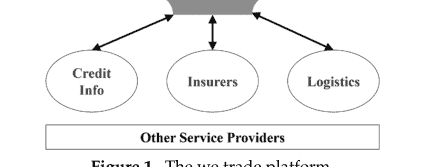

图 1. we.trade 平台。

### 表 1. we.trade 时间线。

| 年份 | 季度 | 事件 |
|------|---------|-------|
| 2015 |  | 构思形成 |
| 2016 |  | 创建名为“Digital Trade Chain”的概念验证 |
| 2017 | Q1 | we.trade 联盟成立，拥有初始成员 |
|  |  | （Deutsche Bank、HSBC、KBC、Natixis、Rabobank、Société Générale、UniCredit） |
| 2017 | Q4 | 更多银行加入 we.trade 联盟（Nordea、Santander） |
| 2018 | Q2 | 建立规则手册以提供治理 |
| 2018 | Q3 | 合资企业公司在爱尔兰成立 |
| 2018 | Q4 | 处理首笔实时交易 |
| 2019 | Q1 | we.trade 商业发布 |
| 2019 | Q1 | Batavia 联盟解散，其成员银行加入 we.trade（Caixa、Erste、UBS） |
| 2020 | Q2 | IBM 成为股东 |
| 2020 | Q3 | 额外银行成为被许可方（非股东） |
| 2020 | Q4 | 股东注资 |
| 2021 | Q1 | CRIF（信用信息提供商）成为股东 |
| 2021 | Q1 | 发布重大平台升级 |
| 2021 | Q1 | 发布 ERP 集成的第一阶段 |
| 2021 | Q4 | 首家非欧盟银行加入 we.trade（土耳其 Akbank） |

Bank（德国）、Erste（奥地利）、HSBC（英国）、KBC（比利时）、Natixis（法国）、Nordea（斯堪的纳维亚）、Rabobank（荷兰）、Santander（西班牙）、Société Générale（法国）、UBS（瑞士）和 UniCredit（意大利），以及非股东银行 Akbank（土耳其）、CBC（比利时）、Eurobank（希腊）、UniCredit（德国）以及 ČSOB、Komerční Banka 和 Česká Spořitelna（捷克共和国）。迄今为止，股东银行与非股东银行之间就持股可能带来的利益保持了一致。这在 we.trade 发展的当前阶段可能是可以预期的，此时它需要持续投资，而非提供回报。如果投资/回报平衡发生变化，未来阶段实现利益相关者之间的这种一致可能更具挑战性。参与该平台的银行需缴纳许可费以获得参与的权利。

目前控制 we.trade 的联盟由其股东银行以及股东服务提供商 IBM 和 CRIF 组成。这些组织共同拥有 we.trade JV 的股份，并提名高管进入其董事会。截至 2022 年初，we.trade 董事会的董事长是 Agnès Joly，她同时也是 Société Générale 全球交易银行创新与战略主管。

### 表 2. 截至 2021 年底的 we.trade 业务量。

| 指标 | 衡量 |
|---|---|
| 参与公司数量 | 400 |
| 迄今已完成交易数量 | 1,500 |
| 迄今已完成交易价值 | EUR 120 million |
| 2021 年交易量较 2020 年增幅 | 104% |

we.trade 联盟的角色是设定并监督平台的方向和规则，而 we.trade JV 的角色是提供和运营平台本身。与在平台上买卖的贸易公司的沟通由参与银行执行，而非由 we.trade JV 执行。目前，we.trade JV 没有首席执行官或总经理，由其首席技术官 Mark Cudden [21] 领导。

自 2019 年商业发布以来，we.trade 的会员数量稳步增加。截至 2021 年底，we.trade 发布了表 2 中所示的交易量 [22]。

### 3.2 we.trade 上的贸易融资

为满足贸易融资行业的需求，已创建了大量数字平台，但其方法各不相同。例如，截至 2021 年，Contour 和 Komgo 专注于信用证流程，Marco Polo 专注于企业融资，而 eTradeConnect 专注于文件流 [23]。

we.trade 平台面向开放账户贸易。虽然 we.trade 并非专门针对中小企业，但鉴于此类组织资源有限，中小企业对开放账户贸易的贸易融资解决方案需求最大。在 we.trade 上进行时，该流程的主要步骤 [24] 总结于图 2。

虽然采购订单创建（步骤 1）、卖方发货（步骤 3）和买方收货（步骤 4）等标准交易步骤确实存在于此流程中，但 we.trade 的独特之处体现在可选的新银行产品 Bank Payment Undertaking（BPU）（步骤 2）和 BPU 融资（步骤 5）以及通过智能合约自动结算买方银行应付款项（步骤 6）的步骤中。we.trade 贸易融资流程中的这些关键要素将在下文进一步描述 [25]。

**银行付款承诺（BPU）：** 通常，根据卖方的要求，买方可以向其银行申请 BPU，如果其银行接受，则该银行将在满足结算条件后保证直接向卖方银行支付所需款项，结算条件由

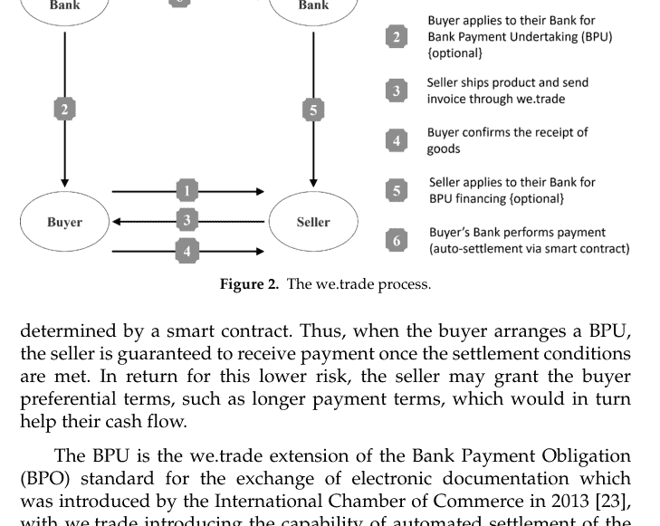

由智能合约确定。因此，当买方安排 BPU 时，一旦满足结算条件，卖方即可保证收到付款。作为这种较低风险的回报，卖方可能会给予买方优惠条件，例如更长的付款期限，这反过来有助于其现金流。

BPU 是 we.trade 对银行付款义务（BPO）标准的扩展，该标准用于交换电子文件，由国际商会于 2013 年推出 [23]，we.trade 引入了通过智能合约实现的付款流程自动结算功能。

**BPU 融资：** 如果卖方在收到买方付款前的期间内需要额外的现金流支持，卖方可以向其银行申请融资，以 BPU 作为可流通工具。

**自动结算：** 如果智能合约确定预定义的结算条件已满足（例如，货物已交付），则买方银行将向卖方银行处理付款。如果各方事先达成一致，该付款可以完全自动化。

we.trade 上的贸易融资流程高度自动化，并基于由智能合约控制的事件触发器。一旦 we.trade 流程中的任何步骤发生，实时通知将发送给每个相关方，并且数据将被写入 we.trade 区块链。

### 3.3 we.trade 中的买方和卖方

根据 2020 年按行业划分的 we.trade 成员构成，46% 的成员来自工业/制造业，40% 来自服装和

- 1. 买方在开放账户上发起采购订单（例如 60 天）
- 2. 买方向其银行申请银行付款承诺（BPU）{可选}
- 3. 卖方通过 we.trade 发货并发送发票
- 4. 买方确认收到货物
- 5. 卖方向其银行申请 BPU 融资 {可选}
- 6. 买方银行执行付款（通过智能合约自动结算）

服装，以及5%来自食品[26]。已发布的报告将表3所列公司称为we.trade成员[19,26–30]。

作为we.trade平台的一个示例成员，Ekoï是一家法国公司，为全球自行车爱好者提供服装和配件。根据2021年底对Ekoï管理层的采访，他们使用we.trade与四家同样在we.trade上的意大利供应商进行所有交易，并且在此前两个月内完成了50多笔交易。由于产品订单周期相对较长且数量大，Ekoï看重we.trade平台的沟通功能，该平台促进了他们在流程每个阶段与卖方之间的沟通，同时所有信息都确保完整和透明。Ekoï管理层表示，如果可能的话，他们会要求所有新供应商加入we.trade。

Ekoï的财务管理部门也对we.trade上可用的金融产品表示赞赏，认为它们比信用证更简单、更便宜。使用BPU允许卖方延长付款期限，为买方提供了在此期间售出大部分已交付产品的时间。与此同时，卖方可以根据需要申请BPU融资，并几乎立即获得该融资的确认。

### 表3 we.trade成员

| 成员 | 国家 | 行业 | 银行 |
|---|---|---|---|
| Actherm | 捷克共和国 | 钢铁 | CSOB |
| Ekoï | 法国 | 耐用品 | Société Générale |
| Flattered | 瑞典 | 鞋类 | Nordea |
| Fluid Pumps | 英国 | 工业 | HSBC |
| Polimer Tecníc | 西班牙 | 塑料 | Caixa |

### 3.4 区块链如何赋能we.trade平台

本节通过包含三个治理层级的结构来研究区块链如何赋能we.trade平台：管理层面机制——规定网络及其成员交互的规则；基础设施层面机制——提供核心区块链功能；以及应用层面机制——通过智能合约自动处理和执行[16]。

#### 3.4.1 管理层面机制

有观点认为，要使区块链驱动的治理结构有效赋能平台，在管理层面必须有一套可接受且公正的规则来约束网络和成员行为，以便成员愿意参与[16]。这一条件在we.trade中是否成立？

在2019年1月商业启动之前，we.trade联盟设计并实施了一套治理平台运营的通用框架，称为“规则手册”。该规则手册基于英国贸易法[27]，这或许反映了汇丰银行在其制定中的重要作用[31]。

每个使用we.trade的银行、买方和卖方都必须承诺遵守规则手册的规定[25]，这些规定包括：

- 各方的权利和责任
- 银行、买方或卖方的注册流程
- 平台服务的运营及异常处理
- 银行产品的运营及异常处理
- 安全性、保密性、数据保护和隐私
- 买方、卖方或银行访问权限的终止
- 争议解决流程，包括买方与卖方之间、与银行之间或银行之间的争议

根据规则手册，经代表联盟的董事会同意，新银行可以加入we.trade。新的买方和卖方由一家参与银行引入平台，该银行随后负责执行了解你的客户（KYC）流程，以核实公司的信誉。

也许在规则手册的所有规定中，最重要的是每个成员明确同意接受在we.trade平台上创建的任何智能合约的处理结果[25]。

在规则手册制定后的那一年，we.trade的总经理Ciaran McGowan曾表示，制定治理规则手册比平台本身的技术建设花费了更多时间[26]。

由于we.trade合资企业的董事会由各股东公司的代表组成，没有任何单一股东拥有明显更大的发言权，这有助于避免银行之间存在偏袒的说法[21]。此外，规则手册规定所有参与者享有平等的权利和责任[25]。

IBM参与we.trade项目的代表Parm Sangha在一次采访和新闻中提到，一般来说，银行更愿意接受由中立实体运营的平台，而不是加入一个由另一家银行主导的平台，以避免在平台资产的使用以及从这些资产中获取价值方面出现偏袒的可能性[18,29]。最新加入股东联盟的IBM和CRIF，也不比其他联盟成员拥有更大的控制权。

从与利益相关者的访谈及相关媒体回顾来看，确实存在一套可接受且公正的规则来治理we.trade平台及其成员。

#### 3.4.2 基础设施层面机制

有观点认为，要使区块链驱动的治理结构有效赋能平台，在基础设施层面，成员必须确信技术是安全且得到可靠治理的，才能对其建立信任[16]。在we.trade中情况是否如此？

we.trade采用Linux基金会的Hyperledger Fabric作为其区块链技术，基础设施和初始解决方案由IBM在其区块链平台上实施。we.trade联盟花了六个多月时间选择Hyperledger和IBM，这主要受到Hyperledger（当时已是成熟技术）和IBM（预计将长期从事区块链业务线）稳定性的影响。we.trade合资企业的技术人员还进行了进一步的扩展、测试和支持。

we.trade的Web界面层以SaaS（软件即服务）公共云服务的形式部署在几个欧洲数据中心，另外还允许银行选择在任何位置的数据中心安装实例，例如当地国家法规有要求时[32]。

对于区块链功能，we.trade使用Hyperledger Fabric中的“通道”功能来形成私有网络，在该网络中，交易仅与该通道的成员共享。每个银行都是网络中的一个节点。发送到通道的数据仅存在于授权节点上，节点仅存储其被授权访问的通道数据。一笔贸易交易的详细数据被上传到仅供买方、卖方及其各自银行使用的通道。跟踪与追溯数据可以匿名方式提供给更广泛的相关方。区块链不包含个人数据，也不直接保存文档附件，而是存储对外部文件存储的引用。值得注意的是，这种通道设计常用于采用Hyperledger Fabric的许可型商业区块链网络，例如用于海运管理的Tradelens网络[33]。

最重要的是，每位we.trade成员通过接受规则手册确认，在we.trade平台上创建的交易具有完全可执行性，并且通过we.trade平台发送的通信等同于书面形式[25]。

we.trade平台在技术上确实是安全可靠的，在利益相关者访谈或媒体中均未提及任何表明相反情况的事件。

#### 3.4.3 应用层面机制

有观点认为，要使区块链驱动的治理结构有效赋能平台，在应用层面，智能合约必须自动化交易处理，并确保各方约定的贸易条款和条件得到遵守[16]。在we.trade中情况是否如此？

与驱动信用证流程的纸质单据审核不同，we.trade上的交易通过智能合约自动处理。在we.trade初始实施期间，每家联盟银行都提供了各自的业务需求，并将这些需求标准化为可进一步转化为智能合约代码的形式。智能合约具有高度模块化，即被划分为执行特定功能的组件，因此可以单独管理。最终部署在区块链上运行的智能合约代码使用Node.js和Javascript编写[20]。

为we.trade创建的交易使用智能合约数据集（即模板），这些数据集反映了各方预先商定的规则和标准。一旦买方与卖方及其银行（如果已申请融资产品）就智能合约数据集达成一致，智能合约便在we.trade平台上生成。随后智能合约将扫描相关结算条件的通知。当检测到此类事件时，将触发相应的交易处理，确保买方、卖方及其银行履行各自的责任。因此，智能合约可以将传统书面合同条款的处理自动化。

例如，第三方运输商确认货物移动的接口可以触发交付结算条件，进而启动相应的支付流程。其他可能用于触发支付流程的事件包括：贸易条款的初始约定、卖方发送发票、买方接受发票、卖方确认货物发运、买方确认货物交付。需要注意的是，买方和卖方及其银行在构建交易时将共同商定支付是完全自动化，还是由银行继续控制支付流程。

we.trade成员银行的一位代表在采访中提到，他们的买方和卖方起初有时会'害怕'

智能合约的力量。然而，由于在相关结算条件达成之前，双方可以在 we.trade 平台上随时修改这些合约，买卖双方随后开始接受智能合约的使用。

一个 we.trade 智能合约数据集将包含以下强制性信息：

- 买卖双方详细信息
- 采购订单参考号
- 货币
- 金额
- 总价容差
- 买方银行及买方银行账户
- 卖方银行及卖方银行账户
- 交货条款
- 付款条款
- 结算条件
- 到期日

如果选择了银行融资产品，还将包含以下信息：

- 所涉及的商品或服务
- 所涉及任何商品的原产国
- 商品或服务的价格信息（单价、税率和数量）

智能合约确实是 we.trade 平台的核心组成部分，它促进了交易处理和执行流程的自动化，并使买方、卖方和银行因参与 we.trade 平台而能够获得更强的竞争优势。

### 3.5 we.trade 带来的竞争优势

对成员而言，这些可预期的竞争优势提升究竟是什么？

根据访谈和媒体报道，买方和卖方对 we.trade 使用的反馈是积极的，他们发现从平台会员身份中获得的价值超出了预期。这种价值主要源于 we.trade 能够在降低风险的同时改善流动性，并实现效率、透明度和安全性方面的提升。买方、卖方及其银行报告的这些好处在表 4 中进一步描述 [19,26–30,34–36]。

...表 4 续

| 类型 | 好处 | 描述 |
|---|---|---|
| 透明度 | 可管理性 | 流程的在线可见性有助于更有效地管理供应链。 |
|  | 信任 | 买方和卖方可以信任 we.trade 平台及其机制，而此前他们可能无法相互信任。 |
|  | 声誉 | 买方和卖方报告称，由于加入 we.trade 平台，他们在信誉和可靠性方面获得了声誉上的好处。 |
|  | 不可篡改性 | 不可篡改的供应链交易数据将简化可能出现的任何争议的解决。 |
| 安全性 | 网络 | 作为一个经过许可的私有区块链，we.trade 平台可以防止未经授权的访问和篡改。 |
|  | 身份 | 买卖双方的真实性由其银行在入驻过程中执行的 KYC 流程予以保证。 |
|  | 交易 | 供应链交易数据的可验证性可防止虚假订单、发票和付款请求。 |

参与银行所获的好处与买卖双方所获的好处相对应。银行为赊销贸易推出的这些新融资产品带来了额外的收入流，并且由于数字平台上的高效处理、人工流程、纸质文件和面对面会议需求被减少或消除，银行还能享受更快的贸易周期、更低的交易成本和更低的欺诈风险。

we.trade 上的绝大多数交易（95%）都使用 BPU [22]，据报道这为交易各方——买方、卖方及其银行——带来了共同的好处。

### 3.6 COVID-19 的影响

COVID-19 疫情严重影响了世界贸易，既在操作层面上通过边境关闭和隔离产生影响，也在财务层面上通过潜在的债务违约以及获得信贷和保险方面的困难产生影响。一个恶性循环开始了：公司业绩不断恶化，使公司更难获得信贷和保险。许多买方和卖方被迫寻找新的贸易伙伴，而旅行限制使这项任务变得更加困难和危险。随着业务流程不断变化，欺诈也带来了新的危险。

对 we.trade 银行、买方和卖方的访谈表明，we.trade 推动的数字化转型对其成员变得更有价值，因为它在减轻 COVID-19 影响方面发挥了作用。we.trade 平台确保成员已通过其银行的适当审查，BPU 工具可以减轻卖方面临的付款风险，尤其是与新买家交易时的风险，BPU 融资可以克服卖方在流动性方面的限制，这些因素可以鼓励卖方在向买方提供的条款上保持灵活。

随着传统沟通渠道和流程的中断，数字化运营的好处迅速显现。在 COVID-19 疫情的第一年，we.trade 商业化负责人 David McLoughlin 表示，COVID-19 实际上不是阻碍数字化转型，而是充当了其“催化剂”：“有了 COVID-19，贸易和贸易融资的数字化不再是一种奢侈品，而是一种必须”[37]。这一发现在对 we.trade 银行、买方和卖方的访谈中得到了证实，访谈中有人指出，即使是传统上抵制变革的保守公司也开始愿意转向数字平台。

与此同时，某些国家和行业的 SMEs 一直获得各种形式的政府财政支持。we.trade 成员银行在访谈中提到，随着此类支持的结束，对 we.trade 的 BPU 和 BPU 融资等产品的需求将变得更大。

### 3.7 挑战

作为一个数字平台，we.trade 必须确保其生态系统至少包含足够多的银行、买方和卖方，并产生至少足够多的交易，以使网络在其为成员提供的实用性和价值水平方面具有可行性。只有在具备这种可行性的情况下，网络有效性的其他重要方面——例如与现有和/或新合作伙伴的联系、参与和关系的数量、频率和规模——才有意义。

2020 年 5 月，we.trade 合资公司的总经理给出了在三到四年内达到 25,000 名用户和 250 万笔交易的目标 [30]。本章前面报道的 2021 年底的交易量仅占这些数字的一小部分，因此尚不能确定 we.trade 能否积累所需的规模。如果没有这种规模，买方和卖方可能会转向其他数字解决方案，银行也可能会投资于那些在管理层注意力和资源方面存在竞争的其他业务优先事项。

区块链解决方案传播的典型障碍，如缺乏知识和专业知识 [38]，在 we.trade 的情况下似乎不那么构成障碍，因为该解决方案是由目标用户（即买方和卖方）的银行推广的。那么，是什么挑战制约了 we.trade 平台的发展？

作为一个所有参与者都必须是成员的多边平台，we.trade 比那些不需要这样做的其他平台（如 Marco Polo 平台）更容易受到网络效应的影响。可以说，we.trade 一直饱受“先有鸡还是先有蛋”困境的困扰：买方希望卖方就位，卖方希望买方就位，然后任何一方才会同意加入平台。

we.trade 对贸易部门覆盖率最高的国家是捷克共和国。虽然其他国家在 we.trade 平台上各只有一两家成员银行（而且这些银行只占各国贸易总额的一小部分），但捷克共和国有三家银行（ČSOB、Komerční Banka 和 Česká Spořitelna），它们共同服务于约 80% 从事贸易的捷克公司 [26]。这种高覆盖率使 we.trade 在捷克共和国甚至能够执行国内贸易。追踪 we.trade 在捷克共和国的未来发展将具有启发意义，以确定在所有市场中银行数量和贸易覆盖率应在多大程度上扩大。应当指出，不同市场的银行对 we.trade 平台增加本国竞争对手会有不同的反应。

虽然新买方和卖方加入 we.trade 的入驻流程相对较快，尤其是对银行的现有客户而言，但新成员银行的入驻流程是资源密集型的，涉及众多内部和外部流程。银行本质上相对保守，对其流程自然十分谨慎，并且必须在许多竞争项目之间分配资源。这些因素——Loux 等人 [39] 所述的加入成本——可能对新的银行加入 we.trade 平台构成阻碍。

在访谈中，银行高管承认，在颠覆性技术的情况下，采用速度尤其缓慢。一位银行代表表示，要说服自己银行内的客户关系经理（他们会向银行客户推荐 we.trade）相信平台的价值，这本身就是一项重大挑战。将新银行入驻 we.trade 所需的大量工作（在对银行高管进行的访谈中据说至少需要一年，土耳其 Akbank 则长达两年）可能成为制约 we.trade 发展的一个重要因素。

影响买方和卖方数量增长的一个制约因素可能是将 we.trade 的业务范围扩展到欧洲以外的难度。虽然成员买方和卖方已在媒体和访谈中表达了与亚洲和南美合作伙伴进行交易的愿望 [40]，但 we.trade 尚未公布实现这一目标所需的复杂流程和治理变革的时间表。

## 4. 结论

we.trade 是一个高效、透明且安全的数字平台，它变革了赊销贸易的贸易融资周期。we.trade 平台由区块链驱动的治理结构支撑，该治理结构涵盖行政、基础设施和应用层面的机制，用以协调和保护那些传统上通过书面合同和社会结构进行人工监管的交易。

当买卖双方在 we.trade 上定义交易时，他们会纳入生成相关智能合约所需的数据集，例如商品/服务描述、定价、交货条款、支付条款和结算条件。随后，智能合约在遇到指定的事件触发条件时，会自动处理并执行交易参数。因此，买方、卖方及其银行现在将系统级信任 [41] 置于 we.trade 平台之中，不再需要依赖特定合同或个人的信任。

这是近期区块链理论观点的一个实际例证，该观点将区块链视为“一种新型制度技术，使新型合同和组织成为可能” [42]，因为它本身就具备在当事方之间自动执行和强制履行协议的能力 [43]。

借助区块链赋能的 we.trade 平台，其成员可以优化他们的组织间流程。这使得参与的银行能够通过为赊销贸易提供新型高效的创收服务来增强竞争优势，而买方和卖方则能够因其流动性改善、风险水平降低以及贸易流程效率提高而增强其潜在的竞争优势。we.trade 平台带来的数字化转型还帮助缓解了 COVID-19 疫情对贸易造成的若干严重障碍。如今 we.trade 面临的主要挑战是确保其会员数量和交易量达到可行的规模。

## 参考文献

- 1. 国际商会. 2020年. *国际商会全球贸易融资调查*. 国际商会, 2020年.
- 2. 麦肯锡. 2021年. 国际商会, 冯氏商业智能. *重塑全球贸易融资生态系统*.
- 3. Menichini, A. M. C. 2011年. 危机时期的企业间贸易融资. *世界经济*, 34(10): 1788–1808. https://doi.org/10.1111/j.1467-9701.2011.01390.x.
- 4. Deckert, A. 2021年. 贸易信用保险市场紧俏；疫情不确定性推高保单价格. *危机管理更新*. https://crisismanagementupdate.com/market-is-tight-for-trade-credit-insurance-policy-prices-inflated-from-pandemics-uncertainty/. 访问日期：12月7日.

- [5] Dhar, V. 和 Stein, R. M. 2017年. 金融科技平台与战略.
- [6] Glaser, F. 2017年. 数字基础设施的普遍去中心化：区块链赋能系统与用例分析框架. *第50届夏威夷国际系统科学会议论文集*.
- [7] Rochet, J.-C. 和 Tirole, J. 2004年. *双边市场：综述*. 巴黎产业经济研究所, 第44页.
- [8] Katz, M. L. 和 Shapiro, C. 1994年. 系统竞争与网络效应. *经济展望杂志*, 8(2): 93–115. https://doi.org/10.1257/jep.8.2.93.
- [9] Gawer, A. 2014年. 弥合技术平台的不同视角：走向整合框架. *研究政策*, 43(7): 1239–1249. https://doi.org/10.1016/j.respol.2014.03.006.
- [10] Constantinides, P., Henfridsson, O. 和 Parker, G. G. 2018年. 导言——数字时代的平台与基础设施. *信息系统研究*, 29(2): 381–400. https://doi.org/10.1287/isre.2018.0794.
- [11] Dhanaraj, C. 和 Parkhe, A. 2006年. 编排创新网络. *管理学会评论*, 31(3): 659–669. https://doi.org/10.5465/amr.2006.21318923.
- [12] Dyer, J. H. 和 Singh, H. 1998年. 关系观：合作战略与组织间竞争优势的来源. *管理学会评论*, 第21页.
- [13] Porter, M. E. 1980年. *竞争战略*. 自由出版社, 纽约.
- [14] Rumelt, R. P. 1984年. 迈向企业的战略理论. 载于 *竞争战略管理*, Richard B. Lamb主编.
- [15] Wernerfelt, B. 1984年. 企业的资源基础观. *战略管理杂志*, 5(2). https://doi.org/10.1002/smj.4250050207.
- [16] Petersen, D. 2022年. 自动化治理：区块链为商业网络提供的治理. *产业营销管理*, 102: 177–189. https://doi.org/10.1016/j.indmarman.2022.01.017.
- [17] Benoot, H. 2021年. 与Hubert Benoot的访谈，KBC前贸易融资主管，We.Trade前董事会主席. 2021年12月20日.
- [18] Sangha, P. 2021年. 与Parm Sangha的访谈，IBM EMEA区块链实践负责人. 2021年10月12日.
- [19] IBM. We.Trade案例研究. https://www.ibm.com/blogs/client-voices/we-trade-provides-intelligent-trading-solutions/. 访问日期：2021年7月25日.
- [20] Gnagnarella, D. 2022年. 贸易融资特别兴趣小组会议——Hyperledger基金会. *Hyperledger基金会*. https://wiki.hyperledger.org/pages/viewpage.action?pageId=9110663. 访问日期：2022年2月24日.
- [21] Wragg, E. 2021年. 区块链平台We.Trade补充资金，首席执行官离职. *全球贸易评论 (GTR)*. https://www.gtreview.com/news/fintech/blockchain-platform-we-trade-refills-its-coffers-ceo-departs/. 访问日期：2021年10月12日.
- [22] we.trade. We.Trade. https://we-trade.com/. 访问日期：2022年2月20日.
- [23] 经济合作与发展组织（OECD）. *数字时代的中小企业贸易融资*. 出版物24. 2021年.
- [24] we.trade. We.Trade用户手册/应用指南 v 2.9.
- [25] we.trade. We.Trade规则手册 v 2.3.
- [26] Morris, N. 2021年. 自动化贸易支付在We.Trade区块链上广受欢迎. *Ledger Insights——企业区块链*. https://www.ledgerinsights.com/wetrade-blockchain-trade-finance-automated-payments/. 访问日期：2021年12月30日.
- [27] Hyperledger基金会. 案例研究：We.Trade如何借助Hyperledger Fabric驱动的数字智能合约帮助企业成长. https://www.hyperledger.org/learn/publications/wetrade-case-study.
- [28] Rao, R. 2019年. 首个We.Trade区块链平台上线. techutzpah, 2019年3月15日.
- [29] Wragg, E. 2021年. IBM加入银行成为We.Trade股东. *全球贸易评论 (GTR)*. https://www.gtreview.com/news/fintech/ibm-joins-banks-as-shareholder-in-we-trade/. 访问日期：2021年12月10日.
- [30] Ledger Insights. 2021年. IBM投资贸易融资区块链We.Trade，准备加速发展. Ledger Insights. https://www.ledgerinsights.com/ibm-invests-in-trade-finance-blockchain-we-trade-as-it-readies-to-gear-up/. 访问日期：2021年10月12日.
- [31] Blockchain Ireland. We.Trade虚拟圆桌讨论. 2021年.
- [32] we.trade. 引领潮流 #1. we.trade. https://we-trade.com/resources/leading-the-way-1. 访问日期：2021年12月31日.
- [33] IBM. 2022年. Tradelens平台. https://www.ibm.com/downloads/cas/AAREDOBM. 访问日期：2022年2月24日.
- [34] Perger, T. 2021年. 与Tomas Perger的访谈，We.Trade经理，捷克-斯洛伐克商业银行. 2021年3月12日.
- [35] Lopez, M. 2021年. 与Michaël Lopez的访谈，Ekoi行政与财务负责人. 2021年12月28日.
- [36] PYMNTS. We.Trade完成首批企业交易. https://www.pymnts.com/news/b2b-payments/2018/blockchain-trade-wetrade/. 访问日期：2021年12月1日.
- [37] Basquill, J. 2021年. 融资放缓后区块链平台We.Trade裁员. *全球贸易评论 (GTR)*. https://www.gtreview.com/news/fintech/blockchain-platform-we-trade-cuts-jobs-following-funding-slowdown/. 访问日期：2021年10月12日.
- [38] Helliar, C. V., Crawford, L., Rocca, L., Teodori, C. 和 Veneziani, M. 2020年. 无需许可和需许可的区块链扩散. 国际信息管理杂志, 54: 102136. https://doi.org/10.1016/j.ijinfomgt.2020.102136.
- [39] Loux, P., Aubry, M., Tran, S. 和 Baudoin, E. 2020年. B2B情境下的多边平台：加盟成本与相互依赖在采纳决策中的作用. 产业营销管理, 84: 212–223. https://doi.org/10.1016/j.indmarman.2019.07.001.
- [40] Nordea银行. 2018年. 与We.Trade的交易银行思考.
- [41] Hosmer, L. T. 1995年. 信任：组织理论与哲学伦理学之间的联结纽带. *管理学会评论*, 第26页.
- [42] MacDonald, T. J., Allen, D. W. E. 和 Potts, J. 2016年. 区块链与自组织经济的边界——银行业未来预测. 载于 *银行之外与货币之外*, Springer, 瑞士, 第16页.
- [43] Lumineau, F., Wang, W. 和 Schilke, O. 2021年. “区块链治理——一种组织协作的新方式？” *组织科学*, 32(2): 47.

# 5 探究许可区块链作为组织间系统在推动供应链数字化转型中的作用

*Leo Yeung*

## 1. 引言

区块链首次在中本聪的白皮书“Bitcoin: A Peer-to-Peer Electronic Cash System”中于2008年提出[1]。在发展的早期阶段，许多人将区块链理解为比特币和以太坊等加密货币，但近几年已见其在企业对企业交易中的采用。它逐渐成为一种数字技术，改变了组织与其交易伙伴在无信任生态系统内进行业务交易的方式。然而，一些缺乏技术背景的高管并未完全理解区块链技术。因此，区块链在商业中的采用，包括供应链数字化转型，受到了不利影响。

区块链可分为无许可（如比特币）和许可型。许可区块链，包括联邦/联盟和私有区块链，只能由预先批准的参与者访问。交易数据的共享在参与者之间受控。因此，它适用于包括供应链数字化转型在内的关键业务交易。许可区块链是最新的组织间系统（IOS）一代。它们具备 IOS 的特征，但已演进为无需可信中介的去中心化模式。

从采用角度来看，了解许可区块链的特征、支持其的商业模式以及其工业应用非常重要。此外，了解驱动许可区块链技术采用的因素也至关重要。本章旨在增强对这一特定领域的理解。

本章将许可区块链介绍为区块链的两种类别之一。与通过去中心化的企业对消费者或消费者对消费者模式运作的无许可区块链不同，许可区块链是一种去中心化的企业对企业模式，可实现供应链数字化转型。本章下一节定义了许可区块链是什么；解释了该概念与无许可区块链有何不同；以及为何要区分无许可和许可区块链。IOS 是组织与其业务伙伴用于交换业务交易数据并相互协调业务流程的信息系统。IOS 对供应链数字化很重要，因为供应链生态系统由众多相互交易供应链数据的交易伙伴组成。区块链一方面使这些交易成为可能，另一方面它允许数据账本以去中心化模式保存，而无需依赖可信中介。因此，许可区块链被视为 IOS 的最新一代。本章第三部分解释了 IOS 是什么；为何许可区块链是 IOS 的最新一代；以及其如何被采用于供应链数字化转型。许可区块链被视为 IOS 的新一代，其成功取决于组织采用的意愿和能力。因此，从采用角度理解许可区块链很重要。第四节介绍了两种具体的许可区块链采用模式。第一种侧重于单个企业采用，第二种侧重于通过区块链行业联盟模式采用。第五节列出了许可区块链采用的决定因素。识别出六个因素，并根据 TOE 框架将其归类为技术、组织、组织间和环境情境。这些因素是通过对香港 10 位高级信息技术（IT）高管的访谈得出的，香港是世界上增长最快的区块链市场之一。受访的高级 IT 高管包括区块链技术的采用者和非采用者（第 6 节）。

## 2. 许可区块链

### 2.1 什么是许可区块链

区块链被定义为“a cryptographic, or encoded ledger—a database of transactions in the form of blocks arranged in a chain. These are validated by multiple users through consensus mechanism (such as proof-of-work in Bitcoin mining) shared across a public or private network.”¹ 它是一个去中心化账本，交易数据经过加密并通过参与者的相互共识进行验证。区块链以其去中心化、持久性、匿名性和可审计性为特征[2]。它为用户在无需依赖任何可信中介的情况下验证交易所提供的优势在以往技术中不存在。凭借这一优势，许可区块链可应用于业务的许多方面。世界经济论坛预测，到 2027 年，约 10% 的全球 GDP 将存储在区块链技术中。²

区块链可分为无许可区块链和许可区块链[3]。无许可区块链也称为公共区块链。它们对任何人的参与开放，且身份匿名。另一方面，许可区块链只能由预先批准的参与者访问。交易数据的共享在参与者之间受控，适用于关键业务交易[4]。一些研究人员将其分为联邦/联盟和私有区块链[5,6]。为了实现业务交易的执行和完成，许可区块链利用分布式账本技术（DLT）、智能合约和去中心化应用（DApps）[7]。基于许可区块链的业务用例在不同行业中范围广泛。例如，跟踪供应链中多方处理的物品以进行防伪和状态监控、医疗系统中患者信息的交换、金融产品从申请到批准再到结算的信息交换，这也归类为去中心化金融（DeFi）[8]。

### 2.2 无许可区块链与许可区块链的技术差异

从技术角度来看，无许可区块链（公共）和许可区块链（联邦或私有）之间存在几个关键差异。它们可在下表中观察到。

如表 1 所示，无许可和许可区块链在参与条件、访问控制、参与者识别、共识机制和源代码控制方面存在 5 个核心差异。

从参与、访问控制和身份的角度来看，无许可区块链对任何人开放，可作为节点或“miner”参与以验证交易并竞争以加密货币作为回报的奖励。任何人均可在验证后读取和写入交易数据到区块中。参与者的身份是假名的，无法识别，因为它仅来自动态 IP 地址。另一方面，许可区块链的参与者仅限邀请且必须预先批准。他们可以是具有共同利益或目的的组织。例如，他们可能都来自同一行业或同一业务生态系统。因此，两种区块链的读写访问权限存在差异。

表 1. 公共区块链与许可区块链的比较

|  | 公开 | 许可制 |
|---|---|---|
| 参与 | 任何人均可参与 | 仅限邀请，需由中央机构、共识或其他标准审核 |
| 访问控制 | 任何人可读，任何人可写（需经验证） | 读写访问可能受限以保护数据隐私 |
| 身份 | 假名化 | 参与者可识别，最好是强身份识别 |
| 共识 | 通常需要大多数验证节点 | 可由较小的节点集合完成，例如利益相关者和/或知识持有者 |
| 代码控制 | 任何人均可更改，但大多数节点决定保留哪些 | 可能集中控制或由联盟控制 |

来源：McBeath B (2018), Blockchain, Identity, and CSR in 2018³

参与者的写入权限也受到网络节点运营者的限制，而网络节点运营者可以是个体组织，也可以是以联盟形式存在的组织群组。

此外，区块链的一项主要特征是共识机制。共识是区块链对等网络上的参与者就确认交易达成一致的过程 [9]。这些是参与者就交易的真实性达成共识的规则和技术。对于无许可区块链，共识基于证明，例如工作量证明协议。参与者以区块链网络节点运营者的身份加入无许可区块链。他们必须在添加新区块到链上之前解决一个困难的密码学问题以证明其可信度，有些人称之为“挖矿”。共识基于超过 50% 参与者得出的“正确答案”，尽管奖励只给予答复用时最短的参与者。同样，参与者的大多数可以投票并决定区块链源代码的变更或增强。这种源代码治理可以通过去中心化自治组织（DAO）实现，该组织由参与者投票产生 [10]。

由于许可区块链的参与仅限邀请，因此它是一个所有参与者皆知的封闭用户社区。许可区块链中的验证节点无需证明其可信度，因为它们事先已获资格。因此，这些已知参与者采用容错共识来确保其管理下的所有账本副本的一致性。容错共识可以基于多种共识，例如权威证明、PBFT 或其他分布式共识协议 [9]。它由也是区块链网络利益相关者的参与者执行。同样，代码变更的控制权也归利益相关者所有。

### 2.3 无许可与许可区块链的不同商业模式

无许可和许可区块链具有不同的技术特征，如第 2.2 节所述。这些差异归结为它们支持何种商业模式这一关键问题。这一问题很重要，因为区块链技术与商业模式不匹配会导致区块链采用的失败。

无许可区块链适用于企业对消费者或消费者对消费者的模式。它使消费者能够在无需可信中介验证账本的情况下自由交易，包括信任程度较低的交易者。比特币等加密货币的交易就是典型例子。相反，许可区块链的参与者预先获批，适用于在企业对企业（B2B）模式中交易业务关键数据。该模式在封闭用户社区中进行交易，如 IOS，例如 EDI 和电子供应链应用 [11]。此外，它还能实现以去中心化模式处理的交易。因此，正是许可区块链的去中心化企业对企业模式与供应链数字化转型项目相关。无许可与许可区块链之间的差异要求供应链数字化转型项目关注许可区块链的特征。在此关注下，许可区块链的采用者应考虑两个关键问题。第一个问题是采用形式是什么？对于无许可区块链而言，采用形式是一个无关紧要的话题，因为它是终端用户层面的采用。然而，对于许可区块链而言，它至关重要，因为它影响采用的成功和有效性。存在两种采用形式。它们是个体企业采用和通过区块链行业联盟采用。这两种采用形式将在本章第 4 节中讨论。

第二个问题是驱动采用的因素是什么？无许可区块链的采用由终端用户决定，而许可区块链的采用由组织决定。因此，采用决定因素应是影响企业决策而非终端用户决策的因素。这些采用决定因素将在本章第 5 节中介绍。

## 3. 许可区块链作为组织间系统

### 3.1 什么是组织间系统

如前所述，IOS 指的是由两个或多个组织共同部署的计算机系统，用于跨组织边界交换信息 [12,13]。组织使用 IOS 来共享信息、交换数据并协调业务流程，以便与交易伙伴在关键业务任务上进行协作 [14]。IOS 对供应链数字化转型具有很强的相关性，因为它们是整合供应链参与者系统（如买方、卖方以及物流和金融服务提供商）的工具，用于执行和监控供应链。[14]。

IOS 的部署可以是双边的形式，即“peer-to-peer”，也可以是多边的形式，即“one-to-many”或“many-to-many”。然而，最有效的实施策略是“one-to-many”，或称为“hub-and-spoke”模型，即一个“hub”对与其交易的“spokes”具有较强的谈判力，以实施相应的 IOS。在许可区块链出现之前，电子数据交换系统（EDI）或建立在 EDI 交易之上的企业对企业应用，是供应链集成最流行的 IOS [15,16]。例如，买方实施基于 EDI 的系统并要求其供应商实施相应的基于 EDI 的系统，以便他们能够以数字化和自动化的方式交易供应链信息。该模式在零售行业很流行，例如沃尔玛等大型零售商。⁴ 反之，战略供应商也可以要求其买方做同样的事情。这可以在半导体行业看到，以英特尔为例。该半导体公司一直推广使用 RosettaNet，一种基于 XML 的技术，用于供应链集成。⁵ “peer-to-peer”模型可以在物流行业观察到，承运商、3PL 和货运代理之间点对点或点对点交换物流相关信息。

质量、正确性、完整性和可靠性是保持同一 IOS 环境中组织共享信息的数据完整性的关键。Such data integrity 由可信中介确保，可信中介可以是“hub-and-spoke”模型中的“hub”。例如，向其供应商发送采购订单的买方就是“hub”。它将跟踪订单和订单履行状态。在“peer-to-peer”模式的情况下，它将基于发送方和接收方之间的对账，即买方和供应商。如果交易外包给第三方信息服务提供商，则数据完整性将由服务提供商确保。第三方信息服务提供商的例子是 Opentext Business Network⁶，它提供用于 IOS 外包的云平台。两种模型的示意图如下图所示。

采用 IOS 的优势与采用内部 IT 系统的优势不同。采用 IOS 不仅可以提高组织的绩效，还可以提高所有参与组织的集体绩效 [13]。采用 IOS 也是竞争战略，通过将组织的业务范围扩展到其业务伙伴的业务中 [12]。通过采用 IOS，组织可以与其整个业务生态系统中的外部交易伙伴竞争。

随着许多组织供应链中断的增加，IOS 的重要性也在增加。这些中断可能是由

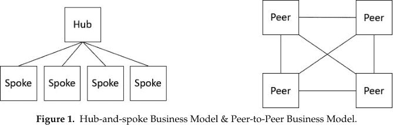

受竞争、极端天气、各国实施的贸易限制、最新的COVID-19疫情等因素的影响，组织被建议在其供应链中分散贸易伙伴基础，以降低中断风险[18]。例如，通过从不同国家招募供应商来拓宽供应商基础，而不仅仅局限于少数几个地区。然而，供应链生态系统越多样化，对IOS（跨组织系统）的依赖就越高，以确保供应链的韧性。

### 3.2 许可区块链作为最新一代的IOS

如第3.1节所述，IOS是支持跨组织交易的系统。许可区块链使得交易能够保存在区块中，并在预先批准的参与者之间共享。因此，它在促进信息的创建、存储、转换和传输方面具备IOS的特征[13]。此外，IOS用于协调贸易伙伴之间的业务流程。实施许可区块链是为了将业务流程数字化而进行的技术部署，无论是开发性还是探索性的[19]。因此，它在流程编排方面也服务于IOS的目的。然而，许可区块链有一个先前IOS所不具备的关键特性，即不依赖可信中介来验证交易的分布式信任。交易数据在去中心化模式下由相应的区块链网络节点运营商验证后记录在区块中。因此，许可区块链可以被视为最新的IOS。它改善了贸易伙伴之间的协作，以及他们之间交易的效率和可见性[20]。

部署许可区块链作为IOS有两种采用方式。它们分别支持第3.1节中介绍的IOS中的“中心辐射”模式和“点对点”模式。

对于“中心辐射”模式，组织需要运营所有许可区块链网络节点，以将去中心化网络集中化。一些研究者将其称为私有区块链。第二种模式是通过区块链行业联盟以“点对点”的方式实施。这也被称为联盟区块链。这两种模式将在第4节中详细说明。

### 3.3 许可区块链作为供应链数字化转型的IOS

端到端的供应链涉及跨不同利益相关者的产品规划、制造、采购、运输和销售活动。每个利益相关者都为链条贡献交易数据，反过来，他们也消费这些交易数据用于其业务目的。供应链中的利益相关者可分为三类：

- 1. *买方和卖方*：负责购买/销售产品。产品所有权的转移基于产品真实性以及贸易条件履行情况的证据。这些证据包括信息交易，如采购订单、提前发货通知、收货通知、发票、汇款通知等。
- 2. *物流服务提供商*：负责将产品从起始地运送到目的地。他们包括仓储运营商、卡车运输公司、货运代理、海运或空运承运人以及海关服务提供商。在提供供应链物流服务时，他们各自贡献并消费货运状态交易数据。
- 3. *金融服务提供商*：负责提供金融服务以促进贸易交易。他们是银行或保理服务提供商。

传统上，这三类利益相关者活动中产生的信息要么以非结构化格式（如纸质文件、电子邮件、电子邮件附件、传真等）提供，要么以结构化格式（如EDI、XML等）提供。通过IOS可以手动或数字化地验证双边交易数据。如果交易数据涉及或经过两个以上参与方，验证将变得不那么容易。外包服务提供商可以提供语法层面的数据验证，但数据创建者的数据库才是提供真正原始数据的地方。

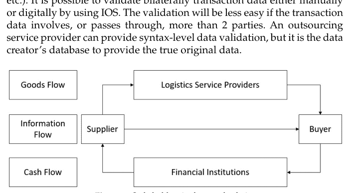

图2. 供应链中的利益相关者。

采用许可区块链作为供应链数字化的IOS，为所有三类利益相关者带来了确保交易数据准确性和真实性的价值。

对于*买方和卖方*而言，最终目标是通过执行智能合约中约定和陈述的条款来实现产品所有权的转移。如此，中间商及其为收集、验证和对账贸易信息所做的工作可以被消除。一旦存储在许可区块链中的交易数据满足智能合约中规定的贸易条件，所有权的转移即告执行。由于需要进行重大的系统和业务流程变革，实现这种自动化需要时间。即使在此之前，将生产相关数据纳入许可区块链存储也是有用的，以确保产品的真实性和质量，以及制造或组装过程中的状况得到准确且完整的记录。这对于奢侈品或食品尤为重要。最新的例子是美国海关对进口棉花和棉制时尚品提出的原产地证明新要求。⁷ 同样关键的是确保对关键产品（如COVID-19疫情期间使用的个人防护装备（PPE））可以防止假冒[21]。许可区块链可用于跟踪货物的来源。此外，采用许可区块链还可能包括采用物联网（IoT）技术来为产品创建数字孪生。这可以在运输过程中提供产品状况的动态监控。

对于*运输和海关相关利益相关者*，许可区块链可以在产品从起点到目的地的运输过程中捕获产品的位置和状况。这可以通过物流提供商静态提交该信息，或者结合物联网技术（无论是在车辆层面还是在货物层面）直接与许可区块链平台通信以实现动态物流跟踪来实现。例如，一家名为SkyCell的瑞士药品容器制造商提供带有物联网传感器的容器，以跟踪容器的温度和撞击数据，并将这些数据发送到他们的许可区块链平台。SkyCell的容器已被用于运输COVID-19疫苗。⁸

⁷ 来源：https://www.mayerbrown.com/en/perspectives-events/publications/2021/01/us-bans-imports-of-all-products-containing-cotton-and-tomatoes-from-chinas-xinjiang-region.

⁸ 来源：https://www.skycell.ch/news/skycell-increases-its-availability-in-the-us-market-with-a-new-partnership/.

许可区块链也被用于管理与货运承运商的财务交易。例如，加拿大沃尔玛使用许可区块链来管理与为其每年运输超过500,000票货物的70家第三方货运承运商之间的发票和付款管理。⁹ 这些货运发票包含全面的货物和跟踪数据，在通过许可区块链处理之前需要大量的人工对账。

对于*金融机构*而言，需要申请人提供其贸易交易记录来处理贸易融资申请，这涉及大量验证工作。例如，发票必须与其对应的采购订单和收货通知进行核对。在许可区块链出现之前，申请人需要花费大量精力将这些信息提供给贸易金融机构。有了许可区块链，与订单相关的交易数据存储在区块链中，数据的不变性得到保证。金融机构可以在其贸易融资申请中消费区块链中的数据。这加快了申请流程并节省了处理成本。例如，渣打银行与Trusple合作，将其Straight2Bank数字银行平台与后者的许可区块链平台整合以进行贸易融资。¹⁰ 该银行还加入了一个名为Contour的区块链行业联盟，以在许可区块链上完成信用证交易。

## 4. 许可区块链的采用模式

与先前的IOS相比，许可区块链为企业对企业流程（包括供应链数字化）带来了额外价值。因此，理解其采用方式至关重要。例如，它是如何被采用的，以及什么驱动了采用。如第3.2节所述，有两种采用许可区块链的模式。第一种模式是由组织单独采用。第二种是与行业内其他参与者以行业联盟的形式协作采用。为了理解企业在采用许可区块链时的考量，我们在香港对高级IT高管进行了一轮高管访谈，以获取他们的见解。访谈证实了两种采用形式的存在。本章第6节将对这些见解进行讨论。

⁹ 来源：https://hbr.org/2022/01/how-walmart-canada-uses-blockchain-to-solve-supply-chain-challenges?utm_medium=email&utm_source=newsletter_daily&utm_campaign=dailyalert_notactsubs&deliveryName=DM169499.
¹⁰ 来源：https://www.sc.com/en/media/press-release/weve-completed-the-first-live-transaction-on-new-blockchain-enabled-trading-platform-trusple/.

### 4.1 许可区块链的单一企业采用

单一企业采用许可区块链是最简单的采用模式 [22]。其运作方式是组织自行管理账本并运营所有区块链网络节点。组织是账本的受信任方。有人可能会争辩说，单一企业采用模式不符合区块链的去中心化原则，因为技术是去中心化的，但账本的控制并非如此 [7]。尽管如此，许可区块链在交易记录数据方面的不可篡改性和完整性等其他特性，是单个采用者认为对其业务具有高度价值的 [9]。

单一企业采用许可区块链作为 IOS 是可能的，前提是实施组织拥有其交易伙伴的合作，并在许多情况下拥有影响力或控制权。例如，它可能是其交易伙伴的战略买家、供应商或服务提供商。在这种情况下，这就是第 3.2 节中提到的“枢纽-辐条”模式。

该模型在供应链数字化转型中与两个领域相关。第一个是在买方与卖方之间的订单管理流程中。许可区块链可被买方或卖方用于确保产品真实性、跟踪订单履行状态，并最终通过执行智能合约自动完成产品所有权的变更。第二个是组织利用物流和融资服务提供商补充的信息来促进与其交易伙伴之间的交易。例如，组织可能会与仓库运营商和物流服务提供商合作。货物由物流服务提供商进出仓库。因此，作为托运人的组织必须从仓库和物流服务提供商处获得准确的运输状态以进行库存管理。许可区块链可为此目的而采用。单一企业采用的局限性在于无法将交易数据的验证扩展到区块链网络中的直接交易伙伴之外。

### 4.2 通过加入区块链行业联盟进行采用

#### 4.2.1 什么是区块链行业联盟

区块链行业联盟是一种商业模式，供行业参与者，特别是该行业的市场领导者，共同协作采用创新。一个例子是 2000–2001 年制定的基于联盟的“行业交易所”，旨在促进交易伙伴之间的供应链整合 [23]。在运输、零售、汽车、电子、医疗保健等行业中，曾一度至少有十八个。其中一些至今仍然存在，例如 Global Healthcare Exchange、e2Open、Covisint（已被 Opentext 收购）、Elemica 等。另一种联盟类型是为了在整个行业中推广技术标准的采用。一个例子是 RosettaNet，它由一组半导体和高科技制造公司组成，旨在开发和推广名为 RosettaNet Implementation Framework (RNIF) 的企业对企业标准，以取代其供应链生态系统中电子数据交换 (EDI) 的使用 [24]。

形成区块链行业联盟的一个关键目标是参与者共同采用许可区块链以最小化成本和风险并迅速在行业内达到关键规模 [25]。他们随后可能会就区块链网络集成的标准进行工作以实现互操作性。此外，他们还有一个额外的角色，即共享账本并控制区块链网络在共识机制和代码变更方面的治理。Furlonger 和 Kandaswamy（2019）将区块链联盟定义为

> “区块链联盟是一组公司联合起来通过共享账本并定义标准和治理模型来促进合作，以创建数字生态系统，从而降低运营风险、最小化成本或提升客户服务” [26]。

区块链联盟有不同的类别，可大致分为以技术为中心或以业务/行业为中心。以技术为中心的联盟对采用技术、分享知识和最佳实践、推广技术标准以及影响技术的未来发展感兴趣。例如，Hyperledger、Enterprise Ethereum Alliance 和 R3 是以技术为中心的联盟的例子。

以业务/行业为中心的区块链联盟，或我们所称的区块链行业联盟，是由行业参与者为协作采用许可区块链而组建的。形成区块链行业联盟的目标是解决影响行业且只能在行业层面解决的问题。区块链行业联盟的参与者来自行业生态系统的水平和垂直方向。水平参与者提供相同行业中的类似产品或服务，因此从字面上看，他们是竞争对手。然而，他们在联盟中合作以实现互利。这种竞争与合作共存的组织间关系被定义为“共创竞争” [27]。这种“共创竞争”在区块链行业联盟中是独一无二的。行业参与者能否在联盟中实现合作与竞争之间的良好平衡，对联盟的成功具有深远影响。

#### 表 2. 许可区块链行业联盟示例。

| 联盟 | 关注领域 | 参与者 |
|---|---|---|
| TradeLens https://www.tradelens.com/ | 航运解决方案 | 包括 Maersk、CMA CGM、MSC、Hamburg Sud、PIL、Zim Lines、ONE、Hapag-Lloyd 在内的 8 家航运公司，以及集装箱码头和货运代理 |
| Global Shipping Business Network https://www.cargosmart.ai/en/solutions/global-shipping-business-network/ | 航运解决方案 | 包括 CMA CGM、COSCO、Evergreen Marine、OOCL 和 Yang Ming Lines 在内的 5 家航运公司，以及包括 DP World、Hutchison Ports、PSA International 和上海国际港务在内的 4 家码头运营商。 |
| we.trade https://we-trade.com/ | 贸易融资 | 包括 CaixaBank、UBS、Nordea、Erste Group、Rabobank、HSBC、KBC、UniCredit、Natixis、Societe Generale、Santander、Eurobank、Deutsche Bank 在内的 13 家银行合作伙伴 |
| MarcoPolo https://www.marcopolo.finance/ | 贸易融资 | 包括 Raiffeisen Bank International 加入 BNP Paribas、Commerzbank、ING、LBBW、Anglo-Gulf Trade Bank、Standard Chartered Bank、Natixis、Bangkok Bank、SMBC、Danske Bank、NatWest、DNB、OP Financial Group、Alfa-Bank bayernLB、Helaba；S-Servicepartner 和 Raiffeisen Bank International 在内的 17 家银行 |
| Voltron https://www.voltrontrade.com/ | 贸易融资 | 包括 SEB、CTBC Bank、HSBC、BNP Paribas、NatWest、Bangkok Bank、Standard Chartered Bank、ING 在内的 8 家创始银行，以及 40 多家参与银行。 |
| eTradeConnect https://www.etradeconnect.net/ Portal | 贸易融资 | 包括 ANZ、BOC、BEA、恒生银行、HSBC、Standard Chartered Bank、DBS Bank 在内的 7 家发起银行，以及包括农业银行、中国银行、BNP Paribas、上海商业银行和中国工商银行在内的另外 5 家银行。 |
| Contour https://www.contour.network/ | 贸易融资 | 包括 Bangkok Bank、DBS、Citi、HSBC、ING、SEB、BNP Paribas、CTBC Holding、HDBank、SABB、Standard Chartered 在内的 11 家银行 |
| MOBI https://dlt.mobi/ | 汽车 | 汽车公司包括 BMW、Bosch、Ford、General Motors、Groupe Renault、ZF、Aioi Nissay Dowa Insurance Services USA |

区块链行业联盟模式是许可区块链在其引入阶段的流行采用方式。2014 年仅有 1 个区块链行业联盟，但到 2021 年有 53 个活跃联盟。11 下表显示了更具代表性的示例。

#### 4.2.2 通过区块链行业联盟进行采用

通过行业联盟采用许可区块链使组织能够通过参与一个或多个区块链行业联盟来数字化其组织间业务流程。分布式信任，加上交易记录数据中的不可篡改性和完整性，在此模式中至关重要。这是因为这些参与者尽管经过预先批准并共同执行联盟治理，但在同一行业中却是竞争对手，因此信任水平较低。

以行业联盟形式实施许可区块链采用第 3.2 节中提到的“点对点”模式。行业联盟模式的一个例子被称为 Contour。该联盟由 9 家全球银行组成，旨在使用许可区块链数字化信用证流程。12 在国际贸易中，银行在一种情况下可以签发信用证，但在另一种情况下可作为其他交易的背书银行。它在一次交易中向另一家银行提供数据，在另一次交易中接收数据。因此，点对点业务模式在行业联盟中很有意义。另一个例子是 TradeLens，它由 Maersk 设立并由另外 4 家领先的远洋承运商加入，作为针对以海洋运输为基础的供应链的区块链行业联盟。13 该联盟服务于由远洋承运商、集装箱码头、内陆运输提供商、集装箱堆场和海关当局组成的供应链生态系统。同样，海洋联盟中的一家承运商在一次运输中向同一联盟中的另一家承运商提供数据，它在另一次运输中接收数据。

## 5. 许可区块链作为IOS的采用决定因素

### 5.1 许可区块链采用的概念模型

由于许可区块链是供应链数字化转型的关键IOS，理解哪些因素决定了第2.3节中提到的许可区块链的采用非常重要。通过相关的概念模型来理解这些决定因素是有用的。

技术-组织-环境（TOE）框架用于评估组织层面的创新采用[28]。它是一个可以应用于理解组织层面技术采用决定因素的模型，例如EDI、电子商务应用、ERP系统和电子供应链管理系统等[11,29,30]。因此，将TOE框架作为理解许可区块链采用决定因素的概念模型是合适的。

在TOE框架中，所有外部因素都被归类到环境背景下。本章建议将组织间相关的决定因素从环境背景中分离出来。这是因为组织间因素对于作为IOS的许可区块链来说是独特的。涉及各方的组织间因素与采用组织有直接关系，例如贸易伙伴和行业联盟。这些各方参与端到端的组织间业务流程。与组织间接相关的各方，如竞争和政府政策，仍应归类为环境因素。文献综述确定了65个可能的决定因素。其中最重要的六个将在第5.2节中讨论。下图展示了一个许可区块链采用的概念模型。

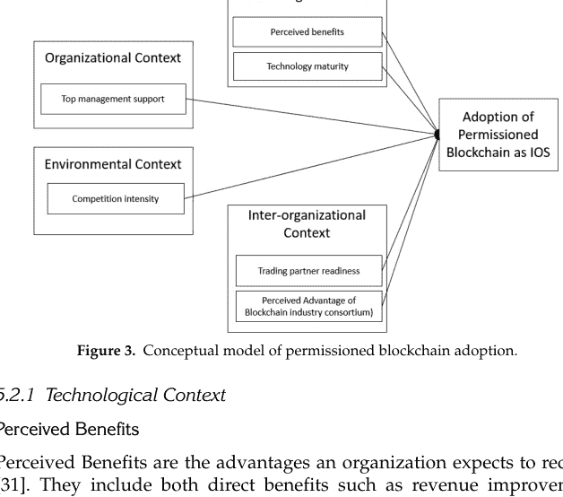

图3. 许可区块链采用的概念模型。

### 5.2 许可区块链作为IOS的采用决定因素

如上图所示，该概念模型参考了TOE框架，但增加了一个组织间维度。针对许可区块链的采用，我们确定了分类为四个背景的六个决定因素，并通过访谈的10位高级IT主管进行了确认。下面将讨论这些因素。

#### 5.2.1 技术背景

**感知收益**

感知收益是组织期望获得的优势[31]。它们包括直接收益，如收入增加和成本降低，以及间接收益，如运营效率、客户关系、竞争力和企业形象的提升[11,32,33]。虽然实际收益对于采用创新很重要，但感知收益与许可区块链的采用决策更相关，因为决策基于预期收益，而实际收益只能在采用后获得。在基于TOE的区块链采用研究中，感知收益被视为决定因素[34,35]。

**技术成熟度**

技术成熟度是指一项技术的功能特性被其他采用者验证的程度[36]。Lee等人（2017）确定了评估技术成熟度的三个参数。它们是：是否已被其他采用者成功采用；预期收益是否得到证明；以及弱点或问题是否已知并得到解决。该技术的成功采用越多，其成熟度就越高。技术成熟度对于许可区块链的采用很重要，因为采用是一个企业决策。组织总是观察其他组织的采用情况，作为其采用决策的参考[37]。这也可以从我们采访的高管身上观察到。

#### 5.2.2 组织背景

**高层管理支持**

高层管理支持是指高层管理人员在采用创新方面的承诺。高层管理人员必须通过将创新纳入企业战略、投入资源、承担风险以及充当采用的榜样来展示其承诺[38]。对于将许可区块链作为IOS采用，高层管理支持还包括高层管理人员将其纳入组织间业务流程的推动力[30]。高层管理支持对许可区块链的采用至关重要，尤其是在初始阶段。这是因为在此阶段收益和风险尚不明确，因此纯粹基于成本和收益的估算来证明采用的合理性具有挑战性。需要高层管理人员在不确定性面前做出采用决策。高层管理支持在确定采用模式方面也至关重要。

#### 5.2.3 组织间背景

**贸易伙伴就绪度**

贸易伙伴是指打算采用许可区块链的组织供应链中的供应商、买方以及物流或金融服务提供商[16]。贸易伙伴就绪度很重要，因为IOS采用的成功取决于组织及其贸易伙伴是否准备就绪[31]。如果贸易伙伴未准备好，则IOS和相关的组织间业务流程无法执行。因此，这是采用的边界条件[39]。

贸易伙伴就绪度包括技术和业务两个方面[40]。技术就绪度是指贸易伙伴的IT系统是否准备好与采用者的许可区块链平台集成和交易。业务就绪度是指贸易伙伴是否准备好在其业务流程中做出改变，以与采用者采用许可区块链后的流程保持一致。

**区块链行业联盟的感知优势**

如第4.2.1节所述，区块链行业联盟是许可区块链的一种协作采用模式，包括同行业的组织[26]。区块链行业联盟与许可区块链的采用相关，因为联盟中预先批准的参与者需要共享账本，并在共识机制和代码变更方面运行区块链网络的治理模型[26]。此外，区块链行业联盟具有推动和加速采用的感知优势。这些感知优势包括最小化采用成本和风险、提高运营效率以及加快达到临界规模的速度。这些优势无法通过单个企业的采用来实现[23]。

#### 5.2.4 环境背景

**竞争强度**

竞争强度是指组织所在行业中竞争的激烈程度[41]。采用创新一直是组织用来提高市场竞争力的策略[42]。从许可区块链的角度来看，它支持新的商业模式，并使业务流程能够数字化。这些提高了组织的效率和成本效益，这在竞争激烈的市场中非常重要。此外，组织有动力采用其竞争对手已经采用的创新[16]。因此，竞争强度一直被认为是包括许可区块链在内的区块链的采用决定因素[35]。

## 6. 对许可区块链采用的见解

### 6.1 高管访谈背景

为了验证第5节中列出的决定因素，我们采访了香港10位对许可区块链有深入了解的高级IT主管。他们来自不同的行业，包括金融与银行、交通、公用事业、信息技术和零售，能够提供广泛的视角。

我们采访IT主管是因为他们是各自组织中最早探索创新和评估采用可行性的人。他们还具有技术悟性，能够理解许可区块链并提供专业见解。

选择香港的高管是因为区块链技术在香港发展迅速。根据香港政府财经事务及库务局的报告，2019年香港成立了57家金融科技公司。其中45%正在为大型企业开发区块链应用。¹⁴

#### 表 3. 受访的许可区块链高管概况

|  | 别名 | 行业 | IT 资深级别 | 员工人数 | 企业性质 | 采用者/非采用者 | 个人/联盟 |
|---|---|---|---|---|---|---|---|
| 1 | AI-1 | 旅游 | 高层 | < 500 | 私营企业 | 采用者 | 个人 |
| 2 | AI-2 | 交通运输 | 高层 | 1,001-5,000 | 上市公司 | 采用者 | 个人 |
| 3 | AI-3 | 金融服务 | 高层 | < 500 | 私营企业 | 采用者 | 个人 |
| 4 | AC-1 | 银行 | 高层 | > 10,000 | 上市公司 | 采用者 | 联盟 |
| 5 | AC-2 | 银行 | 高级 | > 10,000 | 上市公司 | 采用者 | 联盟 |
| 6 | AC-3 | IT 与服务 | 高级 | > 10,000 | 上市公司 | 采用者 | 联盟 |
| 7 | AC-4 | 交通运输 | 高层 | > 10,000 | 私营企业 | 采用者 | 联盟 |
| 8 | N-1 | 公用事业 | 高层 | 5,001-10,000 | 上市公司 | 非采用者 |  |
| 9 | N-2 | 交通运输 | 高层 | > 10,000 | 上市公司 | 非采用者 |  |
| 10 | N-3 | 零售 | 高层 | > 10,000 | 私营企业 | 非采用者 |  |

香港区块链公司快速增长的原因之一是其作为亚洲数字技术中心的战略地位。

为确保观点平衡，既采访了采用者也采访了非采用者。对于采用者，既采访了个人采用者也采访了联盟采用者，以了解其选择背后的驱动因素。受访的非采用者均对许可区块链有良好的了解，且他们在现阶段不采用的决定是有根据的决定。

这些访谈为进一步理解许可区块链的采用提供了宝贵的见解。下表列出了受访者的概况。

### 6.2 高级 IT 高管对许可区块链采用决定因素的见解

*感知收益很重要，但高层管理支持有时作为决定因素更为重要*

感知收益是任何企业采购决策最重要的决定因素之一，正如先前的创新采用文献所述 [30,43]。在高管访谈期间，几乎所有高管都同意感知收益应作为采用决定因素进行考察，但并不总是必然是最重要的因素。一位个人采用者评论说，当成本和收益更易量化时，感知收益很重要。这将处于或超过典型产品生命周期中的成长期，此时可以从其他组织的采用中借鉴参考。然而，这并非许可区块链的开发或导入阶段。在生命周期的早期阶段，采用者可能只是想成为创新者，在看到具体收益之前成为“先行者”[37]。

因此，在收益不确定且失败风险较高的早期阶段，高层管理支持是许可区块链的关键采用决定因素。据受访的交通运输行业个人采用者称，如果他没有获得高层管理层的承诺，即认可其对整个组织的战略重要性、投入采用所需资源并愿意为失败承担风险，他就不会推进许可区块链的采用。他的观点得到了其他采用者和非采用者的呼应。一位同样来自交通运输行业的非采用者评论说，他不采用的关键原因之一是其高层管理层更优先考虑最佳服务运营，不愿承担在其供应链流程中采用许可区块链的风险。其高层管理层的担忧是，如果供应商无法遵守采用要求并导致备件供应中断，最终可能影响其服务运营。

*交易伙伴准备度对采用的关键性取决于业务案例的复杂性、交易伙伴的数量以及交易伙伴所需的变化。*

将许可区块链作为 IOS 实施用于涉及交易伙伴的外部流程。对于供应链数字化转型，这些交易伙伴包括供应商、分销商或客户，以及银行或物流公司等服务提供商。所有受访的采用者都与多个外部交易伙伴进行交易，但对交易伙伴准备度对采用的重要性看法不同。

部署许可区块链于营销忠诚度计划的 CIO 认为交易伙伴准备度（TP Readiness）对采用并非关键。这是因为他认为诸如去中心化应用（DApp）等许可区块链技术使得交易伙伴的接入并不困难，即使对于非技术熟练的交易伙伴也是如此。他们只需使用应用程序输入或提取数据即可。他们甚至无需了解许可区块链技术即可支持采用。因此，对于涉及有限业务变更和交易伙伴简单技术赋能的简单业务案例而言，TP Readiness 的关键性较低。

根据一位来自交通运输行业的个人采用者 CIO 的说法，如果组织对其交易伙伴拥有谈判权，即如果它是战略买方或供应商，则交易伙伴准备度的关键性甚至更低。这是因为交易伙伴必须做好准备以维持与该组织的业务关系。

另一位来自公用事业的非采用者 CIO 认为，交易伙伴准备度不仅应指技术方面的准备，还应包括为协调新的组织间流程而进行的业务方面准备。他强调交易伙伴必须看到收益，以便他们投入资源和精力应对许可区块链的采用。他以其涉及大量交易伙伴的多层供应链生态系统为例阐述了交易伙伴准备度的重要性。在他的案例中，部分交易伙伴的准备度不足以在涉及所有交易伙伴的用例中采用许可区块链。例如，维护备件的追踪溯源。其公司使用不同的供应商为其设备的维护提供相同的备件。可以看出，如果许可区块链无法对所有供应商实施，将使他的情况变得更加复杂。这是因为如果某些供应商已准备好采用一种许可区块链启用

组织领导者在分配资源和承担风险方面的承诺 [30]。因此，这些高管一致认为组织准备度是高层管理支持的结果，而非许可区块链的独立企业采用决定因素。他们一致认为高层管理支持的重要性。

#### 非采用是由于缺乏采用决定因素

我们采访了三位非采用者。他们都同意，他们不采用的原因是缺乏某些采用决定因素。零售集团的 CIO 表示，他尚未识别出能够证明收益足以证明投资合理的用例。其公司所在行业也没有相关的区块链行业联盟。他曾与其他行业参与者探讨组建行业联盟的想法，但未成功。因此，他仍处于现状。

公用事业公司的 CIO 提出了类似的原因。他一直在观察能源行业对许可区块链的采用，但仍无法识别出他期望能够带来足够收益以证明合理的案例。该公用事业公司为庞大的客户群体提供服务。对他们而言最重要的考虑是确保服务质量和稳定性以满足公众期望。另一方面，由于其所在行业竞争者较少，他们并未看到出于竞争原因积极采用创新的迫切需求。从这两个角度来看，他们在许可区块链采用战略上采取了保守方法。CIO 还认为许可区块链技术不够成熟，因为在其行业中缺乏为大型用户群体服务而采用许可区块链的成功案例证明。此外，CIO 也未看到所有交易伙伴都已准备就绪，正如上文关于交易伙伴准备度的论点所述。

另一位非采用者，交通运输公司的 CIO，同意所有交易伙伴准备度不足是其在供应链中采用许可区块链的关键制约因素。与公用事业部门的同行类似，他认为高层管理层的关注点是服务的安全性和稳定性。采用许可区块链并非高层管理层的关键优先事项。相反，其高层管理层认为采用直接提高成本效率的技术，如机器人流程自动化（RPA），更为实际。

## 7. 结论

许可区块链是供应链数字化转型的重要推动因素，鉴于其技术特征和业务

支持的模型。虽然许可区块链支持封闭用户群概念以及 IOS 的业务模式，但它为信任程度较低的交易伙伴之间的关键业务交易启用了一种新的分布式模型。此项使能为 IOS 在供应链数字化方面开辟了更多可能性，例如与物联网捆绑以实现自主供应链。此外，区块链行业联盟模式是一种有效的采用模式，可最大限度地降低采用风险并在解决行业范围内的业务痛点方面实现最大化收益，采用者或潜在采用者应考虑该模式以加快采用。与无许可区块链不同，许可区块链存在技术、组织、组织间和环境决定因素，因为采用它最终取决于企业决策过程。对于任何组织而言，了解这些决定因素对于做出明智的采用决策至关重要。高级 IT 高管是组织中最早识别新技术并做出采用决策的人。因此，他们的意见非常宝贵。虽然本章分享了一些这些观点，但读者应持续寻求高级 IT 高管对许可区块链及其相关技术的进一步发展以及采用可行性的建议。

## Acknowledgements

作者谨此感谢香港大学的方于林教授和西安交通大学的徐婷博士在审阅本章时提供的建议。10 位高级 IT 高管对许可区块链采用决定因素的宝贵意见也一并致谢。没有他们的见解，本章将无法完成。

## Glossary

**无许可区块链：** 又称为公有区块链。它是一种对任何人开放的区块链类型，每个人的身份保持匿名即可参与。

**许可区块链：** 它是一种仅可由预先批准的参与者访问的区块链类型。它包括联邦/联盟区块链和私有区块链。

**组织间系统：** 由组织及其业务合作伙伴用于交换业务交易数据和协调业务流程的信息系统。

**区块链行业联盟：** 一种商业模式，使来自同一行业生态系统的参与者能够集体采用许可区块链以运营区块链治理。他们还可享受分摊成本和风险以及更快达到关键规模的好处。

**TOE 框架：** 研究企业创新采用决定因素的理论。决定因素分为技术、组织和环境三类。

## References

- 1. Nakamoto, S. 2008. 比特币：点对点电子现金系统。 Www.Bitcoin.Org, pp. 1–29.
- 2. Zheng, Z., Xie, S., Dai, H., Chen, X. and Wang, H. 2017. 区块链技术概述：架构、共识与未来趋势。 Proc. - 2017 IEEE 6th Int. Congr. Big Data, BigData Congr. 2017, no. June, pp. 557–564.
- 3. Helliar, C. V., Crawford, L., Rocca, L., Teodori, C. and Veneziani, M. 2019. 无许可和许可区块链扩散。 Int. J. Inf. Manage., vol. 54, no. October 2019, p. 102136, 2020.
- 4. Rangaswami, J., Warren, S., Mulligan, C. and Zhu Scott, J. 2018. 超越区块链炒作：面向企业领导者的实用框架。 White Pap. World Econ. Forum 2018, no. April, 2018.
- 5. Singh, S. K., Jenamani, M., Dasgupta, D. and Das, S. 2021. 利用链上和链下可信数据的联盟区块链构建印度公共分配系统的概念模型。 Inf. Technol. Dev., 27(3): 499–523.
- 6. Li, K., Lee, J. Y. and Gharehgozli, A. 2021. 食品供应链中的区块链：平台、效益与挑战的文献综述与综合分析。 Int. J. Prod. Res.
- 7. Angelis, J. and Ribeiro da Silva, E. 2019. 区块链采用：价值驱动视角。 Bus. Horiz., 62(3): 307–314.
- 8. Tapscott, D. and Tapscott, A. 2016. 区块链革命：比特币背后的技术如何改变货币、商业和世界。 New York: Portfolio.
- 9. Viriyasitavat, W. and Hoonsopon, D. 2019. 现代业务流程中的区块链特征与共识。 J. Ind. Inf. Integr., 13, no. June 2018, pp. 32–39.
- 10. Helliar, C. V., Crawford, L., Rocca, L., Teodori, C. and Veneziani, M. 2020. 无许可和许可区块链扩散。 Int. J. Inf. Manage., vol. 54, no. April, p. 102136, 2020.
- 11. Kuan, K. K. Y. and Chau, P. Y. K. 2001. 基于技术-组织-环境框架的小型企业 EDI 采用的感知模型。 Inf. Manag., 38(8): 507–521.
- 12. Cash, J. I. J. and Konsynski, B. R. 1985. 信息系统重塑竞争边界。 Harvard Bus. Rev. HBR, no. March-April, pp. 134–142.
- 13. Johnston, H. R. and Vitale, M. R. 1988. 利用组织间信息系统创造竞争优势。 MIS Q., 12(2): 153.
- 14. Lyytinen, K. and Damsgaard, J. 2011. 组织间信息系统采用——配置分析方法。 Eur. J. Inf. Syst., 20(5): 496–509.
- 15. Iacovou, C. L., Benbasat, I. and Dexter, A. S. 1995. 电子数据交换与小型企业：技术采用及影响。 MIS Q., 19(4): 465–485.
- 16. Teo, H. H., Wei, K. K. and Benbasat, I. 2003. 预测采用组织间联系的意图：制度视角。 MIS Q. Manag. Inf. Syst., 27(1): 19–49.
- 17. Toppen, R., Smits, M. and Ribbers, P. 1998. 金融证券交易：物流流程绩效改进研究。 J. Strateg. Inf. Syst., 7(3): 199–216.
- 18. Sawik, T. 2017. 供应链中断管理的投资组合方法。 Int. J. Prod. Res., 55(7): 1970–1991.
- 19. Mendling, J. et al. 2018. 业务流程管理的区块链——挑战与机遇。 ACM Trans. Manag. Inf. Syst., 9(1): 31–35.
- 20. Werner, F., Basalla, M., Schneider, J., Hayes, D. and Vom Brocke, J. 2020. 从组织间系统视角看区块链采用——混合方法研究。 Inf. Syst. Manag., 38(2): 135–150.
- 21. Pun, H., Swaminathan, J. M. and Hou, P. 2021. 利用区块链打击欺骗性假冒产品。 Prod. Oper. Manag., 30(4): 864–882.
- 22. Wang, Y., Singgih, M., Wang, J. and Rit, M. 2019. 理解区块链技术：它将如何改变供应链？ Int. J. Prod. Econ., 211: 221–236.
- 23. Mitra, S. and Singhal, V. 2008. 供应链整合与股东价值：基于联盟行业交易所的证据。 J. Oper. Manag., 26(1): 96–114.
- 24. Zhao, K., Xia, M. and Shaw, M. J. 2007. 基于联盟的电子商务标准化的整合模型：具有网络外部性的协作开发与采用。 J. Manag. Inf. Syst., 23(4): 247–271.
- 25. Zavolkina, L., Ziolkowski, R., Bauer, I. and Schwabe, G. 2020. 区块链联盟中的管理、治理与价值创造。 MIS Q. Exec., 19(1): 1–17.
- 26. Furlonger, D. and Kandaswamy, R. 2019. 区块链业务炒作周期。 Gartner Inc., no. July, p. 77.
- 27. Bengtsson, M. 2000. ‘竞合’在商业网络中——同时合作与竞争。 Ind. Mark. Manag., 426: 411–426.
- 28. Tornatzky, L. G., Fleischer, M. and Chakrabarti, A. 1990. 技术创新的过程。 Lexington, Mass.: Lexington Books.
- 29. Pan, M.-J. and Jang, W.-Y. 2008. 技术-组织-环境框架下企业资源规划采用的决定因素：台湾通信业。 J. Comput. Inf. Syst., 48(3): 94–102.
- 30. Lin, H. F. 2014. 理解电子供应链管理系统采用的决定因素：运用技术-组织-环境框架。 Technol. Forecast. Soc. Change, 86: 80–92.
- 31. Chwelos, P., Benbasat, I. and Dexter, A. S. 2001. 研究报告：EDI 采用模型的实证检验。 Inf. Syst. Res., 12(3): 304–321.
- 32. Teo, T. S. H., Lin, S. and Hung Lai, K. 2009. 新加坡电子采购的采用者与非采用者：实证研究。 Omega, 37(5): 972–987.
- 33. Tsou, H. T. and Hsu, S. H. Y. 2015. 技术-组织-环境开放性、服务共创与数字资源准备度的绩效效应：以 IT 行业为例。 Int. J. Inf. Manage., 35(1): 1–14.
- 34. Clohesy, T. and Godfrey, R. 2018. 影响爱尔兰区块链采用的组织因素。 Natl. Univ. Irel. Galway.
- 35. Wong, L. W., Leong, L. Y., Hew, J. J., Tan, G. W. H. and Ooi, K. B. 2019. 把握数字演进的时机：马来西亚中小企业在运营与供应链管理中采用区块链。 Int. J. Inf. Manage., vol. 52, no. September 2019, p. 101997.
- 36. Lee, J. Y., Swink, M. and Pandejpong, T. 2017. 团队多样性与制造流程创新绩效：技术成熟度的调节作用。 Int. J. Prod. Res., 55(17): 4912–4930.
- 37. Rogers, E. M. 1962. 创新扩散，第 3 版，vol. 17, no. 1. The Free Press.
- 38. Lee, S. and Jae Kim, K. 2007. 影响基于互联网信息系统实施成功的因素。 Comput. Human Behav., 23(4): 1853–1880.

- [39] Behnke, K. and Janssen, M. F. W. H. A. 2020. Boundary conditions for traceability in food supply chains using blockchain technology. Int. J. Inf. Manage., vol. 52, no. March 2019, p. 101969, 2020.
- [40] Lin, H. F. 2006. Interorganizational and organizational determinants of planning effectiveness for Internet-based interorganizational systems. Inf. Manag., 43(4): 423–433.
- [41] Zhu, K., Kraemer, K. and Xu, S. 2003. Electronic business adoption by European firms: A cross-country assessment of the facilitators and inhibitors. Eur. J. Inf. Syst., 12(4): 251–268.
- [42] Porter, M. E. and Millar, V. E. 1985. How information gives you competitive advantage. Harvard Bus. Rev. HBR, no. July, 1985.
- [43] Wang, Y. S., Li, H. T., Li, C. R. and Zhang, D. Z. 2016. Factors affecting hotels' adoption of mobile reservation systems: A technology-organization-environment framework. Tour. Manag., 53: 163–172.
- [44] Iacovou, C. L., I. Benbasat and A. S. Dexter. 1995. Electronic data interchange and small organizations: Adoption and impact of technology. MIS Q. Manag. Inf. Syst., 19(4): 465–485.

转移未被充分利用[4]。中本聪文章的发表恰逢其时，因为其出现之际，2008年金融危机的爆发使金融机构的信任度跌至冰点[5, p. 11]。随后，这一概念在比特币的推动下得以落地实施。此后又创建了许多其他网络，即所谓的加密货币，它们描述的是“利用密码学来保障交易安全的交换媒介，与那些通过中心化可信实体进行交易的系统相对”[6, p. 9]。目前已有数千种加密货币，总市值超过5000亿美元[7]。这种新的交换媒介对中介机构和机构的传统角色产生了深远影响，可能使它们被淘汰，或至少被重新改造。所谓的变化包括经济、金融、法律和治理体系的重构[8]。

区块链是一种防篡改的分布式账本技术（DLT），不易被更改。它在共享环境中运行，所有交易均由用户验证且可追溯[2]。这一过程无需中心化中介。环境中的用户通过执行称为智能合约的代码片段来修改账本。智能合约随后获得批准并按顺序排列成一条相连的区块链（因此称为区块链），分布在多个对等节点（即用户）之间，确保数据的不可篡改性[9]。区块链技术看起来极其复杂，但通过拆解其组成部分即可理解。从宏观角度来看，分布式账本技术利用了现有的计算机科学机制（如私钥存储）、密码学算法（如哈希和非对称密钥密码学）以及记录保存概念[3]。私钥存储是指一种允许访问数字资产（如加密货币）的密码学形式。私钥通常使用称为钱包的软件来存储。这是区块链技术的一个关键方面，因为数字资产与密钥相关联。如果密钥丢失或被盗，数字资产也将丢失，因为在计算上重新生成相同的密钥是不可行的[3]。哈希是一种满足解决区块链计算所需加密要求的函数。用户可以获取几乎任意大小的输入数据，对数据进行哈希处理并获得相同的结果，从而证明数据未发生任何变化。这种方法的安全优势在于，即使数据发生最微小的变化，也会产生不同的输出[3]。非对称密钥密码学是指公钥密码学。私钥（上文已讨论）和公钥均被使用，且二者在数学上相互关联。该功能本质上就是区块链内置的信任特性。用户钱包的公钥充当对所有人可见的地址，而私钥是保密的，用于对交易进行数字签名。非对称

企业层面的信息技术采纳已得到清晰的理解。过去已提出许多理论；然而，大多数理论将技术采纳问题视为发生在个体分析层面。来自信息系统学科、采用企业层面分析的两个主要信息技术采纳理论是创新扩散理论和技术-组织-环境框架。罗杰斯提出的创新扩散（DOI）理论描述了新思想和技术如何在个体和企业层面通过文化传播的方式、原因和速度。组织创新性取决于个体特征（如对变革的态度）、组织结构的内部特征（如复杂性和相互关联性），以及组织的外部特征（如系统开放性）[19]。技术-组织-环境（TOE）模型由[20]于1990年首次提出。它指出了组织环境中影响技术创新采纳与实施过程的三个不同领域：技术情境、组织情境和环境情境[19]。技术情境指与企业相关的内部和外部技术。从更具体的角度来看，技术情境包含复杂性、相对优势、隐私、安全和兼容性等因素。此前已有研究表明，这些因素会影响现有或潜在的信息技术采纳[19,21,22]。组织情境的抽象视图通过考察企业的范围、规模和管理结构来描述企业。更具体的考虑因素包括：高层管理支持、先前的IT经验、创新能力、信息密集度和组织就绪度[19,21,23]。环境情境指公司开展业务的更广泛领域，即行业、竞争对手以及与政府的关系（包括法规）[19,21]。

本章其余部分的结构安排如下：首先概述相关工作和以往出版物，这些出版物考察了区块链在不同领域的文献计量分析以及区块链在供应链中的文献计量分析。随后介绍研究方法。接着对数据进行描述性分析和网络分析，并附上相应的可视化图表。本章最后进行讨论并得出结论。

## 2. 相关工作

近年来，人们采用了各种方法来评估出版物。文献计量和引文分析作为一种研究评估工具已十分成熟，尤其是在分析出版物的内容和网络方面。文献计量分析是一种用于评估科学出版物的定量分析形式。这种方法通过关注作者、关键词和术语等多方面因素，简化了作者和关键词分析[24]。文献计量分析有助于整体理解研究主题、描绘其边界，还有助于发现重要作者和新的研究途径[25]。它进一步有助于理解研究活动的质量、组织和模式[26]。

这种方法此前已被许多学科的众多作者频繁使用。在会计领域，[27]描绘了区块链技术在会计领域的现有知识水平，并确定了未来研究的问题和挑战。他们的重点主要是识别区块链与会计交叉领域的重要研究方向。在高等教育领域，[28]考察了区块链技术在高等教育中最常见的应用，以丰富该领域的知识体系。最终，他们确定了推进该研究领域的三个策略：工程教育、区块链和人工智能。[29]调查了区块链与物联网的重叠领域，发现自2017年以来该研究领域的兴趣迅速增长，并进一步确定计算机科学、电信、工程和通信是研究最多的领域。[30]研究了区块链技术在食品和农业领域的应用。他们发现自2019年以来出版物不断增加，表明可追溯性、供应链、物联网、智能合约和食品安全是该领域出现频率最高的关键词。从这些关键词中涌现出三个关键研究集群：可追溯性系统、区块链的技术问题以及区块链的研究进展与收益。[31]对区块链和智能合约进行了文献计量分析。研究发现，目前文献中出现了六个主要研究方向：区块链和智能合约的基础研究、智能合约在物联网中的应用、公共区块链基础设施以太坊智能合约如何实现标准化、安全和验证、智能合约的社会经济方面及其影响、智能合约的挑战与潜力并关注实际用例，以及法律问题。[25]对区块链在管理及其相关领域应用的研究进行了文献计量分析，确定了该领域的多个研究主题：影响比特币和区块链实施的战略与监管问题、区块链的独特特征及其对管理流程的适用性，以及区块链在企业框架内整合的优势与挑战，多领域

部署和理解区块链在金融市场方面的应用，特别是其作为比特币基础技术的最初创立。由 [26] 完成的电力系统区块链应用的文献计量分析考察了按国家的研究活动、关键研究领域、领先机构、作者、出版商、最常被引用的文章和关键词频率。他们发现美国和中国的作者在该领域的研究处于领先地位，且绝大多数出版物来自计算机科学和工程领域。

区块链与供应链的文献计量分析微乎其微，但正日益受到研究人员的关注。[32] 的一篇论文探讨了物流和供应链管理中的区块链技术，发现该领域存在五个不同的研究集群；理论意义建构、概念化与测试区块链应用、将区块链技术纳入供应链、面向现实物流/供应链管理应用的区块链技术应用的技术设计，以及区块链技术在数字供应链中的作用。区块链在供应链管理中的作用由 [24] 考察，使其能够识别关键的供应链领域和其他集成技术。他们确定了区块链可被视为增值项目的若干关键供应链领域；供应链管理、金融、物流、风险、信息管理、制造、智能合约和物联网。食品供应链中的区块链技术由 [33] 考察。他们发现研究人员主要关注区块链在产品认证、金融和物流方面的适用性。此外，“区块链很可能成为增强透明度和可追溯性、降低风险、最重要的，是增强食品供应链领域不同利益相关者之间信任的主导技术” [33, p.1]。[34] 对物流和供应链管理中的区块链技术进行了进一步研究。他们发现“文献主要集中于区块链的概念化；其对供应链可持续性的潜力；其采用的触发因素和障碍；以及其在支持供应链敏捷性、信任、知识产权保护以及食品/易腐供应链方面的作用” [34, p.1]。

## 3. 方法论

VOSviewer (https://www.vosviewer.com/) 是由 [35] 开发的计算机程序，主要用于构建和查看文献计量图。它具有两个关键功能，对希望可视化文献计量数据中关系的研究人员很有用——可以基于合著引文数据创建作者或期刊图，或基于共现数据创建关键词图 [35]。文献计量网络在文献计量学领域已得到数十年的广泛研究。然而，有一个领域在某种程度上被忽视了，那就是方法论，即文献计量网络的实际构建。文献图构建的核心问题是将合著出版物分配给个人作者 [36]。常见的方法是所谓的完全计数法，其中一篇出版物例如由三名研究人员合著，每位作者都被赋予权重为一。VOSviewer 的关键优势在于采用了所谓的分数计数法。该方法应用于前述示例时，将为每位作者分配 1/3 的分数权重。因此，权重总数为一被平均分配到各个合著链接中。VOSviewer 软件在用于基于 Web of Science 和 Scopus 获取的数据构建文献计量网络时效果最佳 [36]。本研究采用此方法，因为它被认为是对文献计量网络的更准确表征。Web of Science 是现存最古老的引文数据库，涵盖从 1900 年开始的引文和文献计量数据。Scopus 涵盖更广泛的期刊，但仅限于 1995 年后发表的文章 [37]。这对本研究不构成问题，因为文献综述中出现的最旧文章是中本聪于 2008 年描述比特币的文章。此外，本综述中发现的绝大多数文章发表于 2018 年之后。VOSviewer 提供三种不同的可视化类型；网络、叠加和密度可视化。现在将基于搜索字符串“blockchain” AND “supply chain” AND “adoption” 展示每种类型的示例。选择该搜索字符串是因为它产生了最大的结果，因此是最合适的可视化示例。这导致在 Web of Science 中搜索所有字段得到 307 条记录，在 Scopus 中搜索标题、摘要和关键词得到 363 条记录。选择不同的方法是为了扩展 Web of Science 的结果并缩小 Scopus 的结果。这是合理的，因为 Scopus 中所有字段搜索的结果产生了大量不直接涉及所选主题的无关论文。描述性和文献计量分析的结果如下所示。

## 4. 分析与结果

### 4.1 描述性分析

从 Scopus 和 Web of Science 数据库中提取的数据于 2022 年 3 月进行了分析。为分析目的，我们同时使用了 Scopus 和 Web of Science 提供的内置可视化工具以及 Microsoft Power BI。Power BI 是微软开发的交互式数据可视化软件包，主要侧重于商业智能。图 1 以图形方式表示使用 Scopus 数据库的搜索字符串得出的出版物类型。绝大多数出版物是期刊文章，会议论文占相当大的少数。

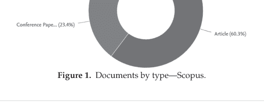

图 1. 按类型划分的文献——Scopus。

图 2 以图形方式表示 Scopus 数据库中排名前五的期刊的年度出版物。它显示供应链沿线的区块链采用研究仅在 2018 年开始获得突出地位。出版物最多的期刊大致可分为生产、计算机科学/工程和可持续性，指向实际、运营和可持续性问题。

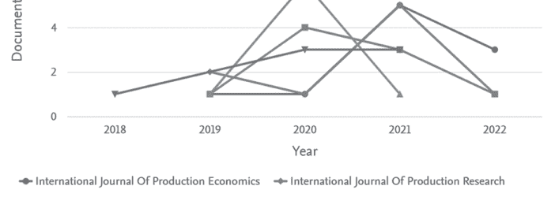

图 2. 按来源划分的年度文献——Scopus。

图 3 显示了按学科领域出现频率加权的搜索字符串结果。搜索中出现的最常见学科领域主题为商业/管理、计算机科学、工程和决策科学。

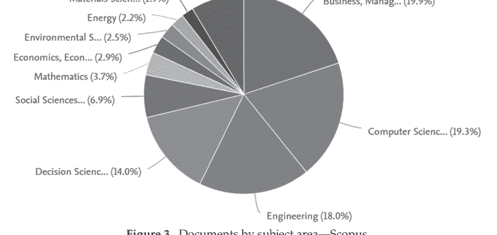

图 3. 按学科领域划分的文献——Scopus。

图 4 表示基于搜索字符串，按出版物出现次数排列的 Scopus 数据库中排名前 15 的期刊。选择前 15 名是因为剩余结果可忽略不计。大多数出版物涉及生产、运营、计算机科学、工程和物流。表 1 和图 5 显示了按学科领域出现频率加权的搜索字符串结果，包括单独计数和占总数的百分比。选择前 15 名是因为其余类别的结果可忽略不计。搜索中出现的最常见学科领域主题为管理、计算机科学和工程。

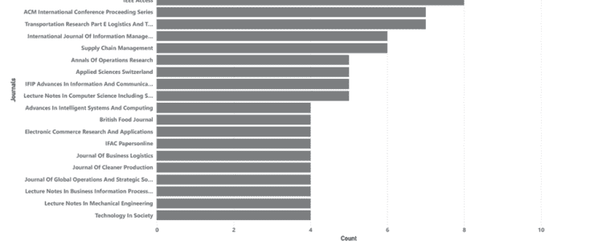

图 4. 前 15 名 Scopus 期刊——Scopus。

**表 1.** 前 15 名 Web of Science 类别。

| Web of Science 类别 | 记录数 | 占总比例 |
|---|---:|---:|
| 管理 | 90 | 29.316% |
| 运筹学 管理科学 | 48 | 15.635% |
| 商业 | 43 | 14.007% |
| 计算机科学/信息系统 | 42 | 13.681% |
| 工业工程 | 37 | 12.052% |
| 计算机科学 跨学科应用 | 30 | 9.772% |
| 电气/电子工程 | 24 | 7.818% |
| 制造工程 | 23 | 7.492% |
| 信息科学 | 23 | 7.492% |
| 环境科学 | 22 | 7.166% |
| 电信 | 21 | 6.840% |
| 绿色可持续科学/技术 | 20 | 6.515% |
| 环境研究 | 15 | 4.886% |
| 经济学 | 13 | 4.235% |
| 土木工程 | 11 | 3.583% |

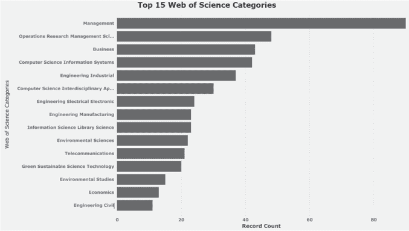

**图 5.** 前 15 名 Web of Science 类别。

### 4.2 网络分析

#### 网络可视化——文献计量与文本数据

项目由标签表示。在以下示例中，标签是源自标题和摘要（关键词）或文本的

出版物和一个圆。标签/术语和圆的大小由该项目的权重决定。权重越高，标签和圆越大。术语的位置基于标题和摘要中的共现，共现次数越多，它们之间的距离越近 [38]。图 6 表示来自 Scopus 数据库的关键词共现。图 7 表示来自 Web of Science 数据库的关键词共现。图 8 表示来自 Scopus 数据库的术语共现。图 9 表示来自 Web of Science 数据库的术语共现。颜色表示相关术语的聚类。

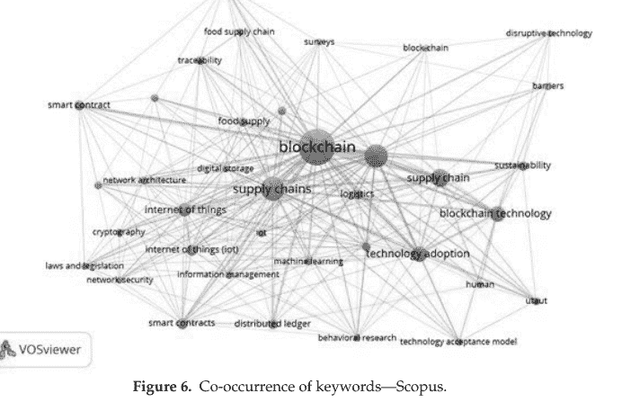

图 6. 关键词共现——Scopus.

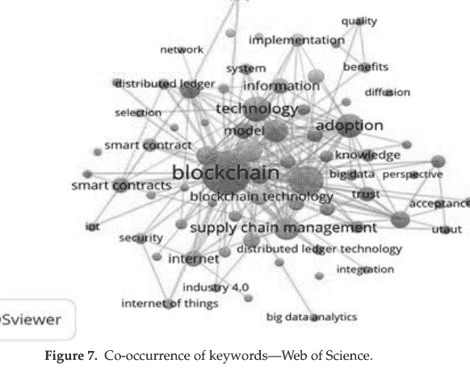

图 7. 关键词共现——Web of Science.

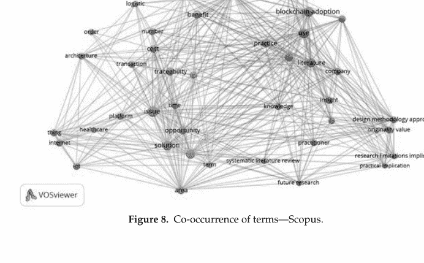

图 8. 术语共现——Scopus.

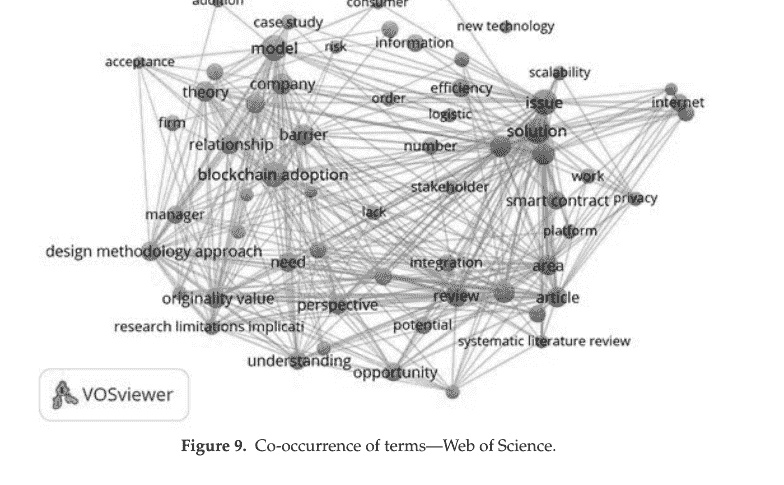

图 9. 术语共现——Web of Science.

#### 叠加可视化 – 书目与文本数据

叠加可视化表示与网络可视化相同的数据，只是颜色不同。所分配的颜色由得分表示，蓝色代表最低分，绿色/黄色代表最高分 [38]。图 10 表示来自 Scopus 数据库的关键词共现。图 11 表示来自 Web of Science 数据库的关键词共现。图 12 表示来自 Scopus 数据库的术语共现。图 13 表示来自 Web of Science 数据库的术语共现。

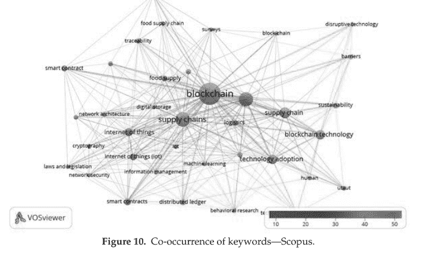

图 10. 关键词共现——Scopus.

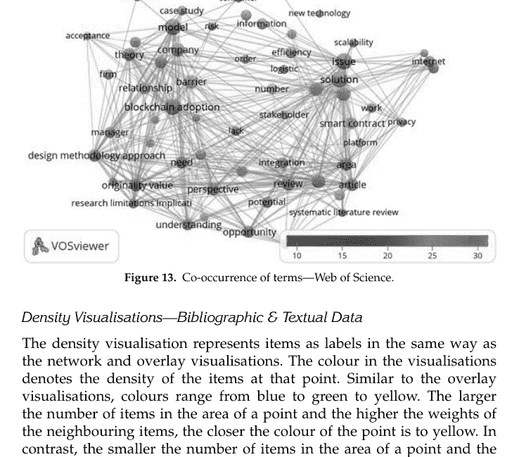

图 13. 术语共现——Web of Science.

#### 密度可视化——书目与文本数据

密度可视化以与网络和叠加可视化相同的方式将项目表示为标签。可视化中的颜色表示该点的项目的密度。与叠加可视化类似，颜色从蓝色到绿色再到黄色。某点区域内的项目数量越大且邻近项目的权重越高，该点的颜色越接近黄色。相反，某点区域内的项目数量越少且邻近项目的权重越低，该点的颜色越接近蓝色 [38]。图 14 表示来自 Scopus 数据库的关键词共现。图 15 表示来自 Web of Science 数据库的关键词共现。图 16 表示来自 Scopus 数据库的术语共现。图 17 表示来自 Web of Science 数据库的术语共现。

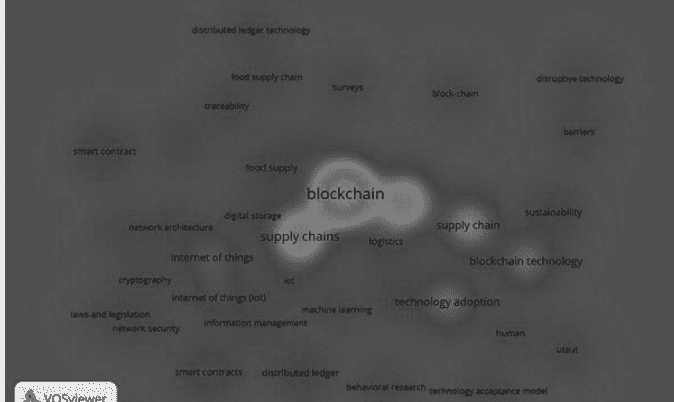

图 14. 关键词共现——Scopus.

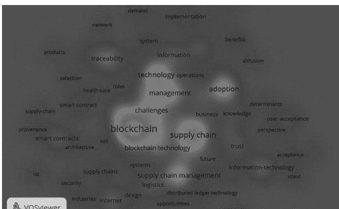

图 15. 关键词共现——Web of Science.

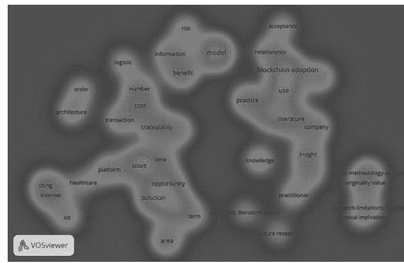

图 16. 术语共现——Scopus.

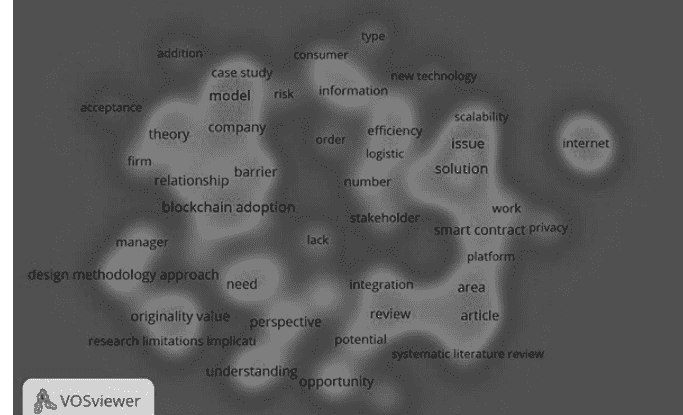

图 17. 术语共现——Web of Science.

## 5. 讨论

描述性和网络分析的结果揭示了若干有趣的见解。对 Scopus 和 Web of Science 数据库使用的检索式显示，供应链领域区块链技术采纳的研究仍处于起步阶段，出版物数量相对有限。两个数据库中共找到 670 篇文章涉及该检索式，其中大多数发表于 2016 年之后。描述性分析显示，大多数文章属于生产、运营、计算机科学、工程、管理、可持续性和物流等范畴。这些出版物大多为期刊文章和会议论文。

网络可视化分析证明是一条富有成效的途径，因为它突出了所选出版物中共同出现的术语和关键词以及出现量。网络可视化图 6–9 衡量的是文章标题、摘要和正文中出现的术语和关键词。圆圈代表这些术语和关键词，圆圈大小由出现量决定，即圆圈越大，权重越重。圆圈之间的距离表示关键词/术语的共现量，即圆圈越近，共现越高。图 6 显示关键词区块链与可追溯性和食品供应密切相关。关键词供应链与数字存储、物联网、网络架构、信息管理和智能合约密切相关。关键词技术采纳与物流、区块链和供应链明确相关。图 7 显示与图 6 相同的图形表示，但源自 Web of Science。该可视化显示出更紧密的聚类，可以解释为关键词共现更高。两种可视化之间的差异可能由各数据库收录的期刊不同所解释。在此可视化中，关键词采纳与知识、信任和接受密切相关。关键词供应链管理与集成、分布式账本技术、安全性和物联网经常共现。最后，区块链和智能合约紧密聚类在一起。图 8 显示 Scopus 的术语共现。该可视化对出现情况的界定更清晰，大致分为两个区域。第一个以术语可追溯性为中心。该术语与交易、成本、时间、机会、效益和解决方案共现。第二区域以术语区块链采纳为中心，与实践、使用、关系和接受密切相关。图 9 显示 Web of Science 的术语共现。与 Scopus 相比，术语聚类更紧密，种类更广。术语区块链采纳经常与关系、障碍、需求、经理、公司和模型共现。其他经常共同共现的术语为智能合约、隐私和平台。

叠加可视化图 10–13 是接下来分析的可视化分组。这些可视化表示与网络可视化相同的数据，但采用颜色编码表示得分。该得分在绿色和黄色之间编码，绿色最低，黄色最高。得分表示术语或关键词的共现次数。图 10 表示与图 6 相同的数据，显示关键词颠覆性技术、障碍、可持续性、行为研究和分布式账本具有最大量。图 11 表示与图 7 相同的数据，显示关键词障碍、可持续性、架构、大数据、信任、视角和用户接受度代表最大量。图 12 表示与图 8 相同的数据，显示术语洞察、实践、关系和可追溯性构成最大量。图 13 表示与图 9 相同的数据，显示出现频率较低的术语分布更广。出现频率最高的术语是智能合约、关系、接受和障碍。

最后，检查密度可视化。与叠加可视化类似，颜色从蓝色到绿色再到黄色。某点区域内的项目数量越大且邻近项目的权重越高，该点的颜色越接近黄色。来自两个数据库并以检索式为中心的关键词，图 14 和 15 产生相似结果，其中区块链、技术、供应链和挑战成为最密集的关键词。图 16 和 17 产生更广的结果，因为重点是术语。图 16 显示可视化不同区域的密集术语聚类。例如，术语区块链采纳、关系、接受、实践和使用代表密集的术语共现。Web of Science 的图 17 显示术语共现密度较低，但有趣的是，最密集的聚类与图 16 非常相似，其中术语区块链采纳、障碍、关系、理论、公司和模型最常共同出现。

## 6. 结论

本研究说明了对来自两个最大学术出版数据库 Scopus 和 Web of Science 的共计 670 篇关于区块链、供应链和采纳的文章进行的描述性和文献计量分析的结果。本研究使用 Microsoft Power BI 和 VOSviewer 开展。结果表明，区块链、供应链和采纳交叉领域的研究仍处于早期阶段，但稳步增长。大多数研究以期刊文章或会议论文形式发表。该研究发表最频繁的领域/学科是商业、管理、计算机科学、工程和决策科学。文献计量分析突出了文献中经常共同出现的关键词和术语。可视化强调了当前正在这些主题上开展的研究方向，也突出了被忽视的研究领域。我们建议以较频繁的间隔进行进一步研究以跟踪该主题的研究演变。其他出版物已利用文献计量分析研究供应链中的区块链。这是首次采用文献计量分析研究供应链中区块链采纳的出版物。这些是本研究的重点贡献。本研究的局限性很明显。由于数据提取自两个学术数据库，结果仅涵盖这些数据库所包含的期刊的范围和广度，排除了其他多个平台。

## References

- [1] Wang, Y., Han, J. H. and Beynon-Davies, P. 2019. 理解未来供应链中的区块链技术：系统文献综述与研究议程. *供应链管理*, 卷 24, 期 1. Emerald Group Holdings Ltd., 页 62–84, 2019 年 3 月 04 日, doi: 10.1108/SCM-03-2018-0148.
- [2] Dutta, P., Choi, T.-M., Somani, S. and Butala, R. 2020. 区块链技术在供应链运营中的应用、挑战与研究机会. *运输研究E部分：物流与运输评论*, 142, doi: 10.1016/j.tre.2020.102067.
- [3] Yağa, D., Mell, P., Roby, N. and Scarfone, K. 2018. 区块链技术概述.
- [4] Nakamoto, S. 2008. Bitcoin：点对点电子现金系统. *去中心化商业评论*, p. 21260.
- [5] Clohesy, T. 2019. *区块链：商业视角*. NovoRay Publishers.
- [6] Crosby, M., Pattanayak, P., Verma, S. and Kalyanaraman, V. 2016. 区块链技术：超越比特币. *应用创新*, 2: 6–10, p. 71.
- [7] Rejeb, A., Rejeb, K. and Keogh, J. G. 2021. 货币供给过程中的集中式与去中心化账本：SWOT 分析. *定量金融与经济*, 5(1): 40–66, doi: 10.3934/qfe.2021003.
- [8] Swan, M. and De Filippi, P. 2017. 迈向区块链哲学：研讨会：导言. *形而上学*, 48(5): 603–619.
- [9] Abebe, E. et al. 2019. 通过可信数据传输实现企业区块链互操作性（产业轨道），in *Middleware Industry 2019 - 2019 年第 20 届国际中间件会议产业轨道论文集，Middleware 2019 组成部分*, 2019, pp. 29–35, doi: 10.1145/3366626.3368129.
- [10] Puthal, D., Malik, N., Mohanty, S. P., Kougianos, E. and Das, G. 2018. 你想知道的关于区块链的一切：其承诺、组件、流程和问题, *IEEE 消费电子杂志*, 7(4): 6–14.
- [11] Natarajan, H., Krause, S. and Gradstein, H. 2017. 分布式账本技术与区块链.
- [12] Saberi, S., Kouhizadeh, M. and Sarkis, J. 2019. 区块链与供应链：来自广泛实践者研究的发现. *IEEE 工程管理评论*, 47(3): 95–103, doi: 10.1109/EMR.2019.2928264.
- [13] Queiroz, M. M. and Fosso Wamba, S. 2019. 供应链中区块链采用的挑战：印度和美国主要驱动因素的实证研究, *国际信息管理期刊*, 46: 70–82, Jun. 2019, doi: 10.1016/j.ijinfomgt.2018.11.021.
- [14] Kumar Bhardwaj, A., Garg, A. and Gajpal, Y. 2021. 印度中小企业供应链中区块链技术采用的决定因素. *工程数学问题*, pp. 1–14, Jun. 2021.
- [15] Allen, D. W. E., Berg, C., Davidson, S., Novak, M. and Potts, J. 2019. 区块链供应链的国际政策协调. *亚太政策研究*, 6(3): 367–380, Sep. 2019, doi: 10.1002/app5.281.
- [16] Surjandy, Meyliana, H. L. H. Spits Warnars and Abdurachman, E. 2020. 汽车零部件行业供应链管理中的区块链技术开放问题及影响 2020, doi: 10.1109/ICCED51276.2020.9415836.
- [17] Alazab, M., Alhyari, S., Awajan, A. and Abdallah, A. B. 2021. 供应链管理中的区块链技术：影响用户采用/接受的因素的实证研究, *集群计算*, 24(1): 83–101, Mar. 2021, doi: 10.1007/s10586-020-03200-4.
- [18] Gokalp, E., Coban, S. and Gokalp, M. O. 2019. 基于区块链的供应链管理系统接受度：研究模型提案, in *第 1 届国际信息学与软件工程会议，IISEC 2019*, doi: 10.1109/UBMYK48245.2019.8965502.
- [19] Oliveira, T. and Martins, M. F. 2011. 企业层面信息技术采用模型的文献综述. 电子信息系统评估期刊, 14(1): 110–121.
- [20] Tornatzky, L. G., Fleischer, M. and Chakrabarti, A. K. 1990. 技术创新的过程. Lexington 出版社.
- [21] Clohessy, T., Treiblmaier, H., Acton, T. and Rogers, N. 2020. 区块链采用的前因：一个整合框架, 战略变革, 29(5): 501–515, Sep. 2020, doi: 10.1002/jsc.2360.
- [22] Rogers, E. M. 2010. 创新的扩散. Simon and Schuster 出版社.
- [23] Wang, Y.-M., Wang, Y.-S. and Yang, Y.-F. 2010. 理解制造业中 RFID 采用的决定因素. 技术预测与社会变革, 77(5): 803–815.
- [24] Moosavi, J., Naeni, L. M., Fathollahi-Fard, A. M. and Fiore, U. 2021. 供应链管理中的区块链：综述、文献计量与网络分析, 环境科学与污染研究, 1–15.
- [25] Tandon, A., P. Kaur, M. Mäntymäki and A. Dhir. 2021. 管理中的区块链应用：文献计量分析与文献综述. 技术预测与社会变革, 166: 120649.
- [26] Rouzbahani, H. M., Karimipour, H., Dehghantanaha, A. and Parizi, R. M. 2020. 电力系统中的区块链应用：文献计量分析, in 区块链网络安全、信任与隐私, Springer, pp. 129–145.
- [27] Lardo, A., Corsi, K., Varma, A. and Mancini, D. 2022. 探索会计领域中的区块链：文献计量分析. 会计、审计与会计期刊.
- [28] Reis-Marques, C., Figueiredo, R. and de Castro Neto, M. 2021. 区块链技术在高等教育领域的应用：文献计量分析, 欧洲调查健康心理学教育期刊, 11(4): 1406–1421.
- [29] Kamran, M., Khan, H. U., Nisar, W., Farooq, M. and Rehman, S.-U. 2020. 区块链与物联网：文献计量研究. 计算机与电子工程, 81: 106525.
- [30] Niknejad, N., Ismail, W., Bahari, M., Hendradi, R. and Salleh, A. Z. 2021. 食品与农业行业区块链技术研究趋势图谱：文献计量分析. 环境技术创新, 21: 101272.
- [31] Ante, L. 2021. 区块链上的智能合约——文献计量分析与综述, 远程信息处理与信息学, 57: 101519.
- [32] Müßigmann, B., von der Gracht, H. and Hartmann, E. 2020. 物流与供应链管理中的区块链技术——2016 年至 2020 年 1 月的文献计量文献综述. IEEE 工程管理汇刊, 67(4): 988–1007.
- [33] Pandey, V., Pant, M. and Snasel, V. 2022. 食品供应链中的区块链技术：综述与文献计量分析. 技术与社会, p. 101954.
- [34] Rejeb, A., Rejeb, K., Simske, S. and Treiblmaier, H. 2021. 物流与供应链管理中的区块链技术：文献计量综述. Logistics, 5(4): 72.
- [35] Van Eck, N. J. and Waltman, L. 2010. 软件调查：VOSviewer，一个用于文献计量映射的计算机程序. 科学计量学, 84(2): 523–538.
- [36] Perianes-Rodriguez, A., Waltman, L. and Van Eck, N. J. 2016. 构建文献计量网络：全计数与分数计数之间的比较. 信息计量学期刊, 10(4): 1178–1195.
- [37] Mascarenhas, C., Ferreira, J. J. and Marques, C. 2018. 大学-产业合作：系统文献综述与研究议程. 科学公共政策, 45(5): 708–718.
- [38] Van Eck, N. J. and Waltman, L. 2013. VOSviewer 手册, Leiden: 莱顿大学, 1(1): 1–53.

## 2. 区块链

对于可能被篡改的数据。这些和其他问题存在于传统的追溯系统周围。将区块链应用于供应链可以包含这些追溯信息并解决这些问题。

区块链最初是为比特币加密货币设计的。自该技术最初出现以来，它已被应用于许多其他用途。最初的用途是交易性的。由于区块链可以应用于任何类型的交易，这为许多其他区块链应用打开了可能性。在过去几年中，供应链已被提倡作为区块链的用例 [2]。

购买商品通常涉及货币交换。在现代供应链中，这涉及银行或经纪人等第三方。中本聪 2008 年的论文首次提出了一种分布式账本，消除了对可信第三方支付系统的需求 [3]。该想法允许使用数字加密货币通过公共账本系统进行点对点支付。该公共账本系统以区块存储，使其几乎不可能被伪造。这些区块不能被更改，只能被添加，从而创建了这些区块的链。因此，它被命名为区块链。

在讨论区块链如何应用于产品追溯之前，我们需要了解区块链工作的基本原理。本文本的大多数读者将熟悉区块链的基本表示，其中每个区块都有哈希、时间戳、交易数据和其他信息。

在图 1 的视觉表示中，每个区块中都有一个“其他信息”部分。这些其他信息是产品追溯数据可以存放的地方。

该图示展示了区块链技术的基本概念。区块链有效地消除了为确保交易而需要可信第三方的需求。区块链概念也可以应用于供应链交易。

请记住，供应链交易传统上需要第三方来促进付款。该第三方通常是银行。银行会有可用资金的记录。当付款给供应商的交易通过时，银行会将交易处理给供应商。该过程自然会产生一笔费用，支付给银行以执行交易。当公司处理数百、数千或数万笔交易时，这些看似微小的交易费用会累积成大笔资金。

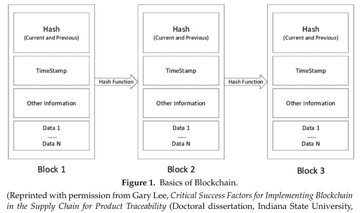

图1：区块链基础知识。

（经加里·李（Gary Lee）许可转载，《在供应链中实施区块链以实现产品可追溯性的关键成功因素》（博士论文，印第安纳州立大学，2021），第6页。）

大型公司（甚至小型公司）都可以利用区块链来避免这些费用，或者自己收取费用。这对企业来说是一个巨大的激励，促使它们降低交易成本。IBM、柯达、沃尔玛、SAP、甲骨文和马士基等公司都已投入数百万美元，研究并为其供应链或客户建立区块链[4]。

除了将避免交易费用作为在供应链中实施区块链的理由外，还有其他用例使分布式账本技术的实施成为一种日益增长的趋势[5]。

这里关注的用例是产品可追溯性。可追溯性一直是企业关心的问题。沃尔玛和IBM自2016年起便合作开发区块链应用[6]。弗兰克·扬纳斯（Frank Yiannas）是沃尔玛的食品安全副总裁。2017年，他让团队追踪一包切片芒果的路径。使用传统的记录保存方式，从门店一路追溯到农场，找到这些记录需要6天18小时26分钟。而使用他们与IBM共同构建的区块链软件，同样的可追溯性操作只用了2.2秒[6]。

基于这些实际测试，尽管区块链最初是以交易为核心开发的，但它似乎适用于可追溯性查询。下一步则是更深入地研究并确定这些系统的实施方式。区块链的实施有两种基本形式：公有链和许可链（有时称为私有链）。

公有链名副其实，对公众开放。任何能够接入网络的人都可以成为网络上的节点。一旦加入网络，该节点就拥有读取、交易和创建区块的全部权限。而在许可链中，能够访问网络的人必须获得区块链网络“所有者”的许可才能接入网络。网络“所有者”可以设置权限，决定谁可以读取区块链上的信息、谁可以在区块链上进行交易、以及谁可以向链中写入新区块[7]。在公有链中，链上存在的节点是匿名的。在私有链中，所有节点都代表可识别的成员[8]。在这种情况下，这些成员就是供应链的成员。由于许多公司经常向竞争对手采购，这类隐私问题就需要加以考虑。

许可链非常适合那些不希望其所有供应链交易对所有人可见的公司。例如，沃尔玛的芒果供应商不希望竞争对手看到价格或付款条件。相比公有链，采用许可链会带来一些直接的好处，但同时也带来一些直接的问题。

许可链网络的好处在于可以控制谁能在区块链上查看、交易和创建。通过要求获得许可才能加入区块链网络，增加了一层安全性。其他好处包括网络性能的提升，因为交易被导向单一类型的交易[9]。此外，由于无需完全的工作量证明，而是采用权益证明，性能也得到了进一步提升。

工作量证明要求网络上的每个节点都尝试对区块进行哈希运算，第一个完成的节点将获得比特币或其他加密货币形式的奖励。权益证明则指定一个节点来解决哈希。该节点由系统指定，其他节点之后可以验证解决方案以达成共识。被指定解决哈希的节点通过收取交易费来获得执行工作的激励[10]。如果这项工作由区块链所有者完成，他们不仅可以避免向银行支付交易费，还可以为自己收取费用。

伴随这些好处而来的，还有一些关于节点减少和降低工作量证明要求的安全性问题。安全性问题在技术层面仍有争议，但有人主张它实际上更安全，因为哈希计算不仅仍然完成并经过验证，而且只由获得许可访问区块链的人执行[9]。

另一个问题是，区块链上的可追溯性比当前方法好在何处？换句话说，在可追溯性系统已经存在的情况下，公司为什么还要开始在区块链上使用可追溯性？这一争论不属于本研究范围。但可以注意到，企业正在转向区块链以消除交易成本，并借此机会纳入可追溯性数据。这里研究的问题是区块链如何处理产品可追溯性的具体要求。

## 3. 可追溯性的定义

可追溯性最简单的定义是知道产品来自哪里。当然，实际情况比这个简单定义要复杂一些。约瑟夫·朱兰博士是现代质量发展中的重要人物，他将可追溯性定义为“通过记录的标识，追溯实体历史、应用或位置的能力”[11]。他在简化许多概念的同时，并未失去表述的精确性。然而，这个定义中缺少了一些要素。例如，虽然你可以了解产品（或他所说的实体）的历史，但这个定义并不能推断出你也了解构成最终产品的组件和材料的历史。这个定义中另一个不清晰的地方，是了解产品在生产之后去向何处。

例如，如果有一批面包出了问题，就需要知道酵母和面粉来自哪里。这是为了确定是否还有其他批次的面包是由同一批劣质酵母生产的。制造商还需要知道哪些商店购买了可疑面包，以便（如有必要）将其从货架上撤下。产品在生产各阶段的历史，以及产品在分销过程中的历史，都必须包含在定义中。

ISO 8402:1994 的标题是 *质量管理与质量保证——词汇*，它将可追溯性定义为“通过记录的标识，追溯实体历史、应用或位置的能力”[12]。这是一个较老的标准，此后已被撤回，并被 ISO 9000:2000 取代，后者又经历了进一步修订。最新版本（2015）对可追溯性的定义更为具体，即“通过记录的标识数据，追溯物品或其特性的历史、应用、使用和位置的能力”[13]。

GS1 是一个制定商业沟通标准的非营利组织。条形码系统就是其标准之一。GS1 已经制定了一项可追溯性标准。该标准旨在对可追溯性系统的最低要求进行标准化[14]。GS1 全球可追溯性标准采用了 ISO 9000:2000 的定义，并对其进行了扩展：“追踪在扩展供应链中经过特定阶段的移动，并追溯所考虑对象的历史、应用或位置的能力”[14]。

GS1 的定义很好地体现了 Bechine、Cimino、Marcelloni 和 Tomasi 在其定义中所阐明的将可追溯性分为“追踪”和“追溯”的思想[15]。追踪是沿着供应链下游跟踪产品，而追溯是沿着供应链上游追溯产品。

尽管关于该术语的确切定义以及应包含哪些数据仍存在争论，但这一概念已被广泛理解[16,17]。产品在整个供应链中的历史以及产品在分销过程中的历史都必须包含在定义中。

可追溯性数据的另一个方面是它包含生产信息。例如，面包制造商可能会保留每批面包的数据。这些数据将包括烘烤温度和时间、使用的具体烤箱、烘烤日期等。保留的数据类型有时是合规要求（公司必须收集和保存），有时则是可选的。许多作者正确地指出，可追溯性数据不仅存在于单个公司内部，而且延伸到整个供应链[18,19,20,21]。这意味着，不仅跟踪和追溯数据对供应链很重要，而且每个供应链环节的生产数据也很重要。

## 4. 可追溯性的要素

在追踪和追溯的背景下，可追溯性的要素可以进一步细分。卡普兰（Caplan）提出了有效可追溯性系统的五个必要要素[18]。

- 1. 批次完整性控制：批次和部件标识。这是制造商保留的有关生产历史的数据，包括物品是在何时生产、在哪台机器上生产、哪个班次等。
- 2. 加工控制：每个物品或物品组（批次）的唯一标识以及加工数据。该信息是更详细的生产数据。它不仅仅涉及物品的生产时间，还包括加工本身的数据。例如，在烤箱中烘烤的一条面包可能保留烤箱温度和物品在烤箱中的时间等数据。任何其他加工数据都属于此类。
- 3. 装配控制：显示哪些物品被组合在一起制成产品，以及在每个工艺步骤中组装时的工艺数据。这里的数据包括诸如哪些批次的酵母与哪些批次的面粉混合制成哪些批次的面包等。
- 4. 检验和测试：产品测试、返工和其他不符合标准工作的记录。如果产品需要或进行了测试，那么这些数据就属于此类。一条面包可能要求在加工过程中对部分面粉进行粗糙度测试。这些测试和检验的结果将保存在这里。

它可以用于满足法规合规义务，或者如果将来需要这些数据，它也可以作为简单的历史记录。

5. 现场活动和修改控制：现场安装、服务、交付后变更等的记录。这些数据在制造后添加到现有记录中。如果更换了复杂或安全关键的设备，这些信息就变得重要。这在航空航天工业中非常重要。例如，记录在飞机上安装关键部件的人员是合格技术员这一事实很重要。记录他们正确测试了安装等，对于保留也至关重要。

这些数据可以通过多种方式收集和存储。条形码、射频识别（RFID）标签和人类可读形式是收集数据的一些更常见的方式[22]。收集这些数据的方法超出了本综述的范围。评估的是数据的存储方式。这5个可追溯性要素是区块链的绝佳用例。如果记录以电子方式收集，那么它们可以轻松地转移并存储在供应链区块链上。如果数据记录在手写表格上，则仍然可以通过扫描文档，然后将电子记录转移到区块链上来实现转移。

## 5. 可追溯性数据的应用

在确定了整个供应链中都需要可追溯性信息，并且需要不同的可追溯性数据要素之后，下一个问题是何时应收集和维护这些信息？当产品不完全相同（例如不同的生产批次或日期）时，需要收集和维护可追溯性数据[16]。Töyrälä 确定了可追溯性数据的4种应用。

- 1. 物料流管理应用——产品在物理上处于何处。这主要适用于运输/物流公司。消费者希望跟踪包裹直到送达的情况并不少见。这也适用于了解产品特定信息。如果一家面包公司收到一批酵母，酵母在运输过程中保持在什么温度？这可能需要传感器和数据收集设备，但对食品制造商来说是一个重要的数据来源。
- 2. 法律验证应用——保修、欺诈、原产地证明和质量证明属于可追溯性的法律应用。这些应用对于保护消费者和生产者都是必要的。当消费者声称一条面包发霉时，知道面包是3年前制作的，对制造商来说是一条重要信息。相反，知道产品是否仍在保修期内对消费者很重要。
- 3. 隔离应用——用于确定哪个客户订购了哪些物品。此应用的一个简单示例是序列号跟踪。例如，在汽车行业，他们使用车辆识别码（VIN）来了解哪些消费者购买了哪辆车。如果该车辆涉及产品召回，这就变得重要。
- 4. 测量和分析应用——用于收集数据以分析营销工作、质量与设计变更的关系等。例如，哪些商店销售更多或更少产品的统计信息就属于这一类。研究这些数据使营销人员能够有针对性地开展工作，预测未来的销售趋势等。

基于 Töyrälä 的应用，可以很容易地看出，可追溯性数据不仅限于了解产品在供应链中的来源或去向[16]。[16]指出的可追溯性数据的其他用途包括物流、质量、安全、会计和售后应用。这些应用没有一项是区块链无法实现的。

许多行业使用可追溯性数据[17,21]。由于食品行业的安全要求，大多数关于可追溯性的文献都集中在食品可追溯性上[23,24,25,26,27]。无论哪个行业，可追溯性在现代社会中都扮演着重要角色，而区块链可以满足所有这些需求和规定。

## 6. 可追溯性系统的支柱

可追溯性系统是必需的，但要拥有一个有效的可追溯性系统，需要四个支柱[28]。可以证明，区块链能够满足这些支柱中的每一个。

产品识别是 Regattieri、Gamberi 和 Manzini 确定的四个支柱中的第一个。产品识别是关于产品的基本信息（重量、体积、尺寸、易腐性、成本等）。这些数据的一个复杂之处在于它包含产品的物料清单。大多数产品不是单一物品，而是由许多其他组件组成。这里的数据可能变得很大，但在供应链的每一步都很容易存储在区块链中。一旦成为区块链的一部分，它就变得不可篡改。这对于前面讨论的许多应用都很重要。

待追溯数据是第二个支柱。这本质上是系统中数据的特征。例如，存储的数据种类。这包括数据是数字还是字母数字。数据的范围是什么？数据是否机密？允许多少字符等，都是有效可追溯性系统的考虑因素。同样，区块链可以（而且必须）将待追溯数据作为可追溯性系统的一部分。

产品路由是 Regattieri 等人定义的第三个支柱[28]。这些数据非常适合区块链应用。产品如何通过供应链路由，以及在生产或交付过程中积累的数据，都包含在这个支柱中。这里的数据可以通过多种方式收集。许多关于传统可追溯性系统的文献都讨论了通过技术手段改进当前系统。改进当前可追溯性的最常见方式是使用 RFID [23,24,25,27]。所讨论的改进系统的一个关键点是假设存在中央数据库。区块链是一个分布式账本，但仍然能够保留这些改进。

讨论的最后一个支柱是可追溯性工具。这个支柱的基本组成部分是准确性和可靠性。区块链的不可篡改性在这里至关重要。由于账本是分布式的且不易更改，因此可靠性值得信赖。数据的准确性与传统可追溯性系统没有什么不同，只是数据在区块链上之后就无法更改。成本也被讨论为这个支柱的一个考虑因素。由于在供应链中实施区块链是为了通过去中介化来节省成本，因此添加可追溯性数据不会超过这些节省。

区块链可以满足可追溯性系统的支柱。这些支柱根基稳固。区块链如何处理通常与传统可追溯性系统相关的问题，是下一个需要回答的问题。

## 7. 可追溯性问题

围绕传统可追溯性系统如何改进有很多讨论。改进当前遗留系统的方法包括条形码和射频识别（RFID）标签[22]。这些方法在改进当前系统方面做得很好。然而，这些改进并没有从根本上改变流程。在系统需求超过当前流程的地方需要改进。可追溯性系统中会遇到五种常见类型的问题。可追溯性系统中遇到的问题分为以下几类：

- 1. 实时信息[29]——能够及时检索信息。信息提供得太晚不仅会让公司和消费者感到沮丧，而且还可能是一项法律要求。在许多行业，如果出现质量问题，都有时间要求。例如，在美国，国家公路交通安全管理局要求，从汽车制造商做出召回决定之日起，必须在60天内通过邮件通知消费者[30]。考虑一下，制造商必须确定哪些车辆可疑，跟踪哪个经销商收到了受影响的车辆，然后从每个经销商那里获取哪些消费者购买了每辆车的记录，然后找到任何表明车辆被转售的许可记录。在手动流程中，这些步骤中的每一步都充满复杂性。

在像区块链这样的去中心化数据库中，这个过程会变得快得多。回想一下沃尔玛的 Frank Yiannas 在2017年的例子。对于一包芒果，过去需要6天18小时26分钟，而他能够在他们与 IBM 共同构建的区块链软件上在2.2秒内完成追溯[6]。
- 2. 易于获取[31]——能够访问信息。使用上面的车辆召回示例，很容易看出这不是一个无关紧要的考虑因素。如果召回是由零部件制造商引发的，他们甚至无法完成确定哪些车辆安装了可疑零部件的第一步。零部件制造商会依赖整车制造商提供任何所需信息。随着供应链变长，这种情况会加剧。想象一下，一个三级供应商不得不发起召回。这个过程很快就会变得繁琐。如果在供应链上建立了包含可追溯性信息的区块链，信息就会在整个供应链中易于获取。
- 3. 长期存储[22]——长时间保留信息。继续以汽车行业为例，记录保留可能会变得非常漫长。在许多情况下，车辆的预期使用寿命远远超过十年。质量标准（如 IATF 16949）并未规定文件保留多长时间，但确实要求制造商制定政策[32]。通常会将这段时间指定为产品寿命加上若干指定年限。传统的归档系统（即纸质）会产生多种困难，包括物理存储空间、材料退化和仅依赖一份副本。

纸质文件的物理存储空间是一个重要的考虑因素。在21世纪初，聘请公司批量扫描文件到电子归档系统中是很常见的。拥有文件的扫描副本可以缓解物理存储和退化

问题，但并不能始终解决对单一副本的依赖。将此数据存储在区块链上可以缓解物理存储空间、材料退化以及依赖单一副本的问题。由于是电子形式，不存在纸张退化，也无需担心信息存储位置。通过分布式账本，即使其中一个损坏，也有多份数据副本。

### 4. 安全性 [16] — 防止数据被破坏。
与长期存储问题类似，人们也担心溯源数据的安全性。当这些数据以纸质形式保存时，必须建立系统以防止其丢失。此外，还必须在火灾等情况下防止其受损。在不同地点保存重复副本是一种解决方案，但对于纸质系统来说并不实用。电子副本通过扫描到集中式数据库解决了这个问题。在集中式数据库系统中，通常会定期更新另一份副本。虽然这解决了长期安全性问题，但副本更新之间存在固有的时间差。像 RAID 条带化这样的系统解决了许多潜在的数据损坏问题，但无法抵御自然灾害。更优雅的解决方案是区块链，它本质上对丢失或损坏具有安全性，并且由于区块链的分布式冗余特性，对数据损坏也具有安全性。

### 5. 准确性 [16] — 数据不包含错误。
用于录入溯源信息的自动或自动化系统远优于人工录入。Sharp 估计，即使是熟练的打字员，数据录入中每 300 个字符就会出现一次错误 [33]。相反，自动或自动化系统的错误率约为每 100 万个字符出现一次错误。录入时出现错误与集中式或存储在区块链上的溯源系统比较无关。分布式系统如区块链的关键区别在于不可变性。除非发生 51% 攻击，否则一旦条目被编入区块链的一部分，就无法更改。这可以成为支持正确记录报告的优势（防止伪造）。如果人工录入导致错误，则可能成为劣势。

区块链非常适合处理传统溯源系统相关的问题。通过克服问题来改进传统系统，是区块链在供应链产品溯源用例中的有力支撑。此外，一些作者也撰写了关于在供应链中实施区块链的潜在益处的文章 [19]。Tian 既给出了区块链的优势也给出了劣势 [25]。Tian 在将区块链技术与 RFID 系统结合的背景下进行了论述。列出的优势有：更好的追踪与溯源、增强安全信息的可信度，以及打击假冒产品。列出的劣势仅仅是高成本（每个产品的 RFID），以及区块链的不成熟。给出的例子是通过区块链可以处理的每秒交易数。区块链每秒最多可处理 7 笔交易，而 Visa 处理的交易数为每秒 47,000 笔 [25]。需要注意的是，自 2016 年撰写本文以来，区块链的每秒交易数已得到进一步发展。到 2018 年（仅两年后），例如 Hyperledger Fabric 就可处理超过 3,500 笔交易/秒，并且仍在不断发展 [34]。

Rapalis 和 Hossain 也撰写了关于区块链在供应链产品溯源中的潜在益处的文章 [35]。他们列举了 Tian 所列的大部分内容。他们还提供了一些实施区块链在供应链产品溯源方面的潜在挑战，这些挑战是他们从文献中引用的。

- 1. 供应链信息交换缺乏标准化格式
- 2. 供应链各环节之间溯源准确性水平存在差异
- 3. 供应链内部缺乏整合和透明度
- 4. 数据问题，如信任、隐私、安全和可靠性

缺乏标准化格式也存在于纸质和集中式数据库的传统溯源系统中。该挑战与区块链无关。GS1，前面提到过，正在通过发布《全球溯源标准》来标准化溯源系统的最低要求 [14]。

供应链各环节之间的准确性差异也与区块链无关，存在于传统溯源系统中。GS1 的《全球溯源标准》也解决了这一问题 [14]。

供应链内部缺乏整合和透明度是传统系统所独有的。一旦大型公司（Wal-Mart、Maersk、IBM 等）开始要求供应商使用私有区块链才能成为注册供应商，这一问题就变得无关紧要。区块链本质上是整合和透明的。

Rapalis 和 Hossain 提到的最后一个问题是关于信任、隐私、安全和可靠性 [35]。相比之下，Biggs、Hinsh、Natale 和 Patronick 断言，供应链中使用的区块链技术将建立信任和透明度。他们认为 Rapalis 和 Hossain 所称的数据问题是促进因素而非潜在挑战。他们在标题为“区块链进入市场的障碍” [36] 下列出了自己的挑战，包括：

- 1. 政府监管地位不确定
- 2. 能耗大
- 3. 跨行业整合
- 4. 黑市

这些挑战被视为接受的障碍，而非实施的障碍。Malyavkina、Savina 和 Parshutina 开始更具体地讨论实施方面的挑战 [37]。他们将挑战分为技术、组织、规范、法律、经济和心理等类别。Clohessy 将其归为技术、组织和环境（TOE）类别 [2]。他随后将每个类别细分为影响区块链在供应链中实施的因素。

Lee 在 Clohessy 的关键成功因素的基础上，通过提供一个模型来扩展，说明哪些因素对在供应链中实施区块链进行产品溯源最为重要 [38]。他发现权限（公有与私有）、组织规模和区块链知识对在供应链中实施区块链都有积极影响。

从所有这些研究中可以看出，挑战正在被克服。这一证据是区块链技术沿着 Gartner  hype 周期 的进展。为了评估一项技术从最初创新到完全接受的过程，Gartner hype 周期 很有用。它是技术从诞生到成熟的生命周期的图形表示。X 轴为时间，Y 轴为对技术的期望。取决于技术成熟度的不同，期望随时间升降，形成波形图。据 Gartner 研究，不同部分的区块链技术在图表上的位置不同。Gartner 所称的‘已验证的来源’也可以称为产品溯源。Gartner 将已验证的来源置于 2020 年期望上升的位置 [39]。

随着技术的不断成熟，Gartner 周期预测随着实施失败会出现‘幻灭低谷’。防止实施失败的是与社会问题令人鼓舞的联系。

区块链总体上受到的一个批评是其功耗要求。另一方面，溯源正在与当前社会问题相关联进行研究。已有关于溯源在可持续性中发挥作用的研究 [40,41,42,43]。纺织和服装行业现在使用的一种衡量标准，称为 Higg Index，对供应商的溯源和可持续性进行评分 [44]。溯源作为

作为社会议题的贡献者，可追溯性可以弥补区块链因电力需求而给人的负面印象。

## 8. 结论

面包制作商不再需要担心因面包重量不足而受到颈手枷或刑架的惩罚。然而，面包仍需符合监管标准，为此必须建立可追溯系统。

最初，区块链技术用于比特币和其他加密货币。近年来，各组织探索了该技术的其他用例。区块链作为一种新兴领域的新工具，前景广阔。可追溯性是这一技术的新用例，各公司正在大力投资研发。

随着各公司致力于开发区块链技术，投资持续进行。该技术的主要目标之一是去中介化。通过在供应链支付流程中移除银行和经纪人，可以消除交易成本。消除供应链交易成本后，可带来实实在在的金钱收益。人们正在探索区块链的用例。除去中介化外，区块链公认的优势之一是将可追溯性纳入其中。这个不可篡改的来源数据库使可追溯性与区块链技术自然契合。本研究考察了区块链技术在供应链可追溯性中的应用。

在将可追溯性定义为包含追踪（track）和溯源（trace）之后，我们展示了在供应链中使用区块链如何自然契合。去中介化是供应链交易的推动力。供应链交易中另一必要条件是产品可追溯性。由于这些可追溯性交易可以包含在区块链的区块中，因此自然契合。

尽管可追溯性系统与区块链结构相契合，但它必须满足可追溯性系统的五个基本要素（批次完整性控制、加工控制、构建控制、检验与测试、现场活动和修改控制）。

研究表明，区块链不仅满足可追溯性系统的基本要素，还满足可追溯性系统的四大支柱（产品标识、追溯数据、产品路线、可追溯性工具）。

由此不难相信，在供应链中使用区块链可以满足可追溯性要求。除了能够满足可追溯性系统的基本要素和功能性可追溯性系统的四大支柱外，区块链还消除了许多困扰传统可追溯性系统的问题（实时信息、可用性、长期存储、安全性、准确性）。

一旦传统可追溯性系统的问题被证明可由区块链可追溯性系统克服，就面临在供应链中实施区块链的问题。实施区块链存在许多问题。Rapalis 和 Hossain 指出了四项：缺乏标准化格式、准确性差异、缺乏集成和透明度、数据问题（如信任、隐私、安全和可靠性）[35]。

而 Biggs、Hinish、Natale 和 Patronick 则提出了其他实施挑战，包括政府监管状态不确定、高能耗、跨行业集成、黑市 [36]。

这些问题都以不同方式得到解决。有些问题是供应链中固有的，与是否使用区块链无关；另一些则是不确定性或认知问题。认知问题主要针对公有区块链，而非将在供应链中使用的私有区块链。

对供应链中产品可追溯性的深入审视表明，区块链可以解决传统系统的许多（即便不是全部）问题。区块链在供应链中的用例是可行的。该技术天然适合跨多个实体的可追溯性系统。此外，可追溯性具有积极的社会影响。随着社会问题对消费者越来越重要，像希格斯指数这样的衡量标准可能会在消费者选择中发挥更重要的作用，而供应链中可追溯性与区块链的结合能够满足这种消费选择需求。请放心享用下一块面包，因为区块链能够支持供应链保持产品可追溯性。

## 术语表

**产品可追溯性（Product Traceability）** — 利用记录的数据来了解产品的生产方式、生产地点、组成部件的来源、产品生产后的去向，以及有关产品的加工信息。

**产品来源（Product Provenance）** — 与产品可追溯性相似，常互换使用。来源仅着眼于供应链中的一个方向，以确定产品的原产地。

**Gartner 技术成熟度曲线（Gartner Hype Cycle）** — Gartner 是一家研究与咨询公司，它用图形展示了技术从诞生到成熟的生命周期。

**希格斯指数（Higgs index）** — 使用 5 种核心工具对价值链可持续性进行的标准化衡量。

**追踪（Track）** — 沿供应链下游跟踪产品的数据痕迹。

**溯源（Trace）** — 沿供应链上游跟踪产品的数据痕迹。

- [18] Caplan, F. 1989. The Quality System: A Sourcebook for Managers and Engineers, Chilton Book Company, Pennsylvania.
- [19] Abeyratne, S. A. and Monfared, R. P. 2016. Blockchain ready manufacturing supply chain using distributed ledger.
- [20] Kim, H. M. and Laskowski, M. 2018. Toward an ontology-driven blockchain design for supply-chain provenance. Intelligent Systems in Accounting, Finance and Management, 25(1): 18–27.
- [21] Espinoza Limón, A. and Garbajosa Sopeña, J. 2005. The need for a unifying traceability scheme.
- [22] Steele, D. C. 1995. A structure for lot-tracing design. Production and Inventory Management Journal, 36(1): 53.
- [23] Opara, L. U. 2003. Traceability in agriculture and food supply chain: a review of basic concepts, technological implications, and future prospects. Journal of Food Agriculture and Environment, 1: 101–106.
- [24] Dabbene, F., Gay, P. and Tortia, C. 2014. Traceability issues in food supply chain management: A review. Biosystems Engineering, 120: 65–80.
- [25] Tian, F. (2016, June). An agri-food supply chain traceability system for China based on RFID & blockchain technology. In Service Systems and Service Management (ICSSSM), 2016 13th International Conference on (pp. 1–6). IEEE.
- [26] Aung, M. M. and Chang, Y. S. 2014. Traceability in a food supply chain: Safety and quality perspectives. Food control, 39: 172–184.
- [27] Kelepouris, T., Pramatari, K. and Doukidis, G. 2007. RFID-enabled traceability in the food supply chain. Industrial Management & Data Systems, 107(2): 183–200.
- [28] Regattieri, A., Gamberi, M. and Manzini, R. 2007. Traceability of food products: General framework and experimental evidence. Journal of Food Engineering, 81(2): 347–356.
- [29] Feigenbaum, A. 1991. Total quality control. McGraw-Hill, Inc., 3rd ed., Singapore.
- [30] NHTSA. (n.d.). Roles in the Recall Process. Retrieved from https://www.nhtsa.gov/recalls
- [31] Martin, J. 1983. Managing the data base environment. Prentice Hall PTR.
- [32] IATF 16949. 2016 Quality Management System for organizations in the automotive industry
- [33] Sharp, K. R. 1990. Automatic Identification: making it pay. Van Nostrand Reinhold Computer. Shrier, D., Sharma, D. and Pentland, A. 2016. Blockchain & financial services: The fifth horizon of networked innovation. White paper excerpt, MIT.
- [34] Androulaki, E., Barger, A., Bortnikov, V., Cachin, C., Christidis, K., De Caro, A., Enyeart, D., Ferris, C., Laventman, G., Manevich, Y., Murthy, C., Nguyen, B., Sethi, M., Singh, G., Smith, K., Sorniotti, A., Stathakopoulos, C., Vukolic, Cocco, S., Yellick, J. and Muralidharan, S. (2018, April). Hyperledger fabric: a distributed operating system for permissioned blockchains. In Proceedings of the Thirteenth EuroSys Conference (p. 30). ACM.
- [35] Rapalis, G. and Hossain, S. 2019. Traceability in the Food Industry.
- [36] Biggs, J., Hinish, S. R., Natale, M. A. and Patronick, M. 2017. Blockchain: Revolutionizing the Global Supply Chain by Building Trust and Transparency. Rutgers University, New Jersey.
- [37] Malyavkina, L. I., Savina, A. G. and Parshutina, I. G. (2019, May). Blockchain technology as the basis for digital transformation of the supply chain management system: benefits and implementation challenges. In 1st International Scientific Conference" Modern Management Trends and the Digital Economy: from Regional Development to Global Economic Growth"(MTDE 2019). Atlantis Press.
- [38] Lee, G. 2021. Critical Success Factors for Implementing Blockchain in the Supply Chain for Product Traceability (Doctoral dissertation, Indiana State University).

39. Litan, A. and Leow, A. 2020. 区块链技术的炒作周期。引自 https://www.gartner.com/en/documents/3987450/hype-cycle-for-blockchain-technologies-2020.

40. Germani, M., Mandolini, M., Marconi, M., Marilungo, E. and Papetti, A. 2015. 用于提高供应链可持续性和可追溯性的系统。*《Procedia CIRP》第29卷*: 227–232.

41. Busse, C., Meinlschmidt, J. and Foerstl, K. 2017. 管理全球供应链中的信息处理需求：可持续供应链管理的先决条件。*《供应链管理期刊》第53卷*(1): 87–113.

42. Aarseth, W., Ahola, T., Aaltonen, K., Økland, A. and Andersen, B. 2017. 项目可持续性战略：系统文献综述。*《国际项目管理期刊》第35卷*(6): 1071–1083.

43. Badzar, A. 2016. 用于保障可持续运输合同和供应链透明度的区块链——物流中区块链技术的探索性研究。

44. Agrawal, T. K. 2019. *对纺织品和服装供应链安全可追溯系统开发的贡献* (博士论文, Högskolan i Borås).

# 8 工业4.0和循环经济中区块链采用的益处与障碍

Garry Lohan

## 1. 引言

几乎可以肯定，新兴的供应链技术在各行各业中将继续帮助组织更好地满足客户需求，并提高其上游供应商的整体可追溯性和问责制。尤其是区块链技术，被誉为组织在可追溯性和问责制至关重要的许多当前问题的一种潜在解决方案。BCT不仅有望解决外部上游供应问题，也能解决内部价值供应链面临的类似问题。区块链是一种分布式账本技术，其透明性和不可篡改性已内置于供应链流程中。一旦产品或服务进入链条，流程中的参与者就可以确信数据是可信的。供应链中的信任问题对大多数行业至关重要，对医疗、军事和食品行业等若干行业更是至关重要。将区块链实施到供应链中是个体参与者无法孤立做出的决定。创建链中任何一个区块至少需要两个参与者，而且通常将传统供应链流程转型涉及战略性的内部组织和跨组织决策，因为使用区块链涉及流程和工作流的改变，而这往往会遭到组织的抵制，不利于整体战略。

通过理论来概述行为问题，可以帮助简化任何新实施流程。就像任何新技术一样，接受标准都以让参与者使用新技术的最终目标为指导。诸如技术接受模型、技术接受模型 (TAM)、企业资源基础观 (RBV) 或商业模式等新技术接受模型可能对实施管理人员有用，他们可以利用这些理论的经验教训来帮助规划和实施转型。虽然存在替代方案，BCT并非总是答案，但它为整个供应链的改进提供了 promising 的机会。在供应链中使用区块链有可能提高供应链的透明度和可追溯性，同时降低管理成本，随着工业4.0 (I4.0) 加快自动化和流程精简，BCT 有望成为组织在通常被称为21世纪新循环经济的框架内以经济方式实现其特定目标的主要机制。

## 2. 技术转型接受度

循环经济的供应链管理中工业4.0的采用意味着商业模式的颠覆性变化。实施诸如BCT等技术对大多数组织而言需要变革管理计划，而变革管理文献长期以来已强调新流程和工作方式的问题。采用技术创新的社会经济挑战也得到了充分记录。例如，[1] 认为供应链中I4.0的采用是一个数字化转型过程，可能需要数年时间才能被利益相关者接受。[2] 认为产品、流程、市场和环境都提出了需要克服的主要障碍。实施区块链数据库还面临其他挑战。围绕法律和监管框架的组织挑战、围绕能源消耗的环境挑战、社会挑战如所需技术技能的缺乏，甚至从集中式向去中心化网络转变的文化挑战，这将需要其用户和运营商的认可。这些再加上集成、扩展、替换或补充遗留系统的技术挑战、支持基础设施的可用性、控制、安全和隐私的网络安全问题以及吞吐量和延迟问题，目前限制了实时进行大数据分析的潜力——表明区块链采用仍处于早期阶段，有必要进一步了解这种新技术的使用方式及其潜力是否得到充分实现。

已开发出许多理论视角来帮助理解新技术用户如何做出使用该新技术的决策。这些理论或框架可以提供工具和指导，以了解新IT应用实施过程的成败。就像任何理论一样，它们随着时间的推移而演变，随着新技术成为主流，理论会不断扩展和调整，在需要时或在需要时进行调整。在本节中，我们将介绍一些可能有助于理解区块链环境的理论示例。这绝不是可用的框架的全面列表，但它在考虑将区块链实施到供应链时为我们提供了一些指导。提出的理论是：

- 技术接受模型 (TAM) [3]
- 动态能力模型 [4]
- 商业模式 [5]
- 统一技术接受与使用理论 (UTAUT) [6]

### Table 1. Theoretical Frameworks.

| Theory | Main Independent Construct(s) | Main Dependent Construct(s) |
|---|---|---|
| TAM | 感知的有用性 感知的易用性 | 使用行为意向 系统使用 |
| 动态能力 | 能力 吸收能力 环境动荡 敏捷性 | 可持续竞争优势 |
| 商业模式 | 价值主张 目标客户细分 核心竞争力 竞争定位 经济模式 投资模式 | 决策层级 |
| 统一技术接受与使用理论 | 性别 年龄，自愿性 经验 | 绩效期望 努力期望 社会影响 有利条件 |
| 企业资源基础观 | 资产、能力、资源 | 竞争优势 组织绩效 |
| 创新扩散理论 | 技术兼容性 技术复杂性 相对优势 | 实施成功 技术采用 |

- 企业资源基础观 [7]
- 创新扩散理论 (DOI) [8]

尤其是技术接受模型 (TAM)，在学术界和工业界得到了广泛应用，是所有其他理论中最常用的理论 [9]。然而，TAM研究的结果并不总是一致的，出于这个原因，再加上终端用户接受问题可能不是区块链采用的主要障碍，以下理论被定位为对TAM的补充，用于研究转型过程的阶段。

### 2.1 技术接受模型

TAM理论基于[10]在心理学中采用的原则，展示了如何衡量态度中的行为相关成分，并指定外部刺激如何因果地联系到信念、态度和行为。TAM所基于的理论模型是理性行为理论 (TRA)，这是一个关注个人预期行为的一般模型。根据TRA，个体的表现由个体对所讨论行为的态度和主观规范决定。此外，个体的信念和动机与现有行为相互作用。随着20世纪90年代的信息技术 (IT) 时代，TRA被证明过于笼统，TAM被专门开发用于预测个人对新IT的采用和使用。它认为，个人使用新系统的行为意向由两个信念决定：感知有用性，定义为一个人相信使用IT会增强其工作绩效的程度，以及感知易用性，定义为一个人相信使用IT将免于费力的程度。它进一步理论化，外部变量（如设计特征）对行为意向的影响将通过感知有用性和感知易用性中介。TAM获得了广泛的赞誉，据说能够持续解释个人使用IT的意向和实际使用的超过40%的方差。然而，TAM假设当某人形成行动意向时，他们将能够不受限制地行动。实际上，诸如能力有限、时间、环境或组织限制以及无意识习惯等约束会限制行动自由，因此TAM从业者通常通过引入额外的或替代的信念因素和/或通过检查感知有用性和感知易用性的前因和调节因素来弥补这一点 [11]。

### 2.2 统一技术接受与使用理论

统一技术接受与使用理论 (UTAUT) 最初由 [6] 提出，并建立在另外八个模型的元素之上

(理性行为理论、技术接受模型、动机模型、计划行为理论、结合技术接受模型和计划行为理论的模型、个人电脑使用模型、创新扩散理论以及社会认知理论)。评估信息技术接受的基本模型将系统的使用定义为（a）使用意图，以及（b）个体对使用的反应。根据其作者所述，UTAUT 为需要评估新技术引入成功可能性的管理者提供了一个有用的工具，并有助于理解接受的驱动因素，以便主动设计干预措施。在 UTAUT 中，有四个构念在用户接受和使用行为的直接决定因素中发挥重要作用：绩效期望、努力期望、社会影响、促进条件；以及四个调节变量：性别、年龄、自愿性、经验。

### 2.3 商业模式
[5] 提出的商业模式概述了 6 个核心决策变量，即价值主张、目标客户细分、核心竞争力、竞争定位、经济模式和投资模式。这些决策变量是日益具体的决策层级的输入，例如从总体规则层面的决策到基础和专有决策。通过使用商业模式，数字化转型利益相关者可以评估、规划和监控供应链中的 BCT 采用情况，并将资源集中在模型评估中识别为薄弱的领域。

### 2.4 动态能力
Teece 等人 [4] 将动态能力定义为整合、构建和重新配置内部和外部能力以应对快速变化环境的能力。将区块链数据库作为供应链转型的一部分进行构建、整合或配置可以被衡量为一种动态能力。该理论的一个主要论点是，即使资源并不能直接使企业处于持续竞争优势的地位，它们在不稳定环境中仍可能对企业的长期竞争力至关重要，如果它们有助于企业随着时间的推移开发、增加、整合和释放其他关键资源。

### 2.5 企业资源基础观
资源基础观认为企业拥有资源，其中一部分使其能够实现竞争优势，而其中一部分则带来卓越的长期绩效。具有价值且稀缺的资源可以带来竞争优势的创造。这种优势可以在更长的时间内持续，只要企业能够防止资源被模仿、转移或替代。一般而言，使用该理论的实证研究强烈支持资源基础观。

### 2.6 创新扩散理论
创新扩散理论（DOI）认为创新是通过特定渠道在特定社会系统中随时间传播的 [8]。个体被认为具有不同的创新采纳意愿，因此通常观察到采纳创新的总体人口比例随时间大致呈正态分布。将该正态分布划分为若干段会导致个体被划分为以下五个创新性类别（从最早到最晚的采纳者）：创新者、早期采纳者、早期多数、晚期多数、落后者。每个类别的成员通常具有某些区别特征。实际的采纳率同时受创新起步速度和后期增长速度的支配。低成本创新可能具有快速起步，而价值随广泛采用而增加的创新（网络效应）可能具有更快的后期增长。然而，创新采纳率可能受到其他现象的影响。例如，技术适应个人需求可能会随着时间的推移改变创新的性质。此外，一项创新可能会影响另一项现有创新的采纳率，而路径依赖可能会使潜在的劣质技术得以保留。使用 DOI 的研究 consistently 发现技术兼容性、技术复杂性和相对优势（感知需求）是创新采纳的重要前因。

## 3. 工业 4.0 和循环经济中的供应链转型

### 3.1 工业 4.0
根据 [12]，工业 4.0 代表了继生产环境机械化、电气化和计算机化之后的第四次工业革命。特别是制造业，正因工业车间自动化和数字化的增加而被彻底革新。人们担心通过中央分布式和协调的主机相互通信的精简机器人会取代普通生产线工人的担忧并未成真。像特斯拉这样在自动化和机器人领域领先的组织也是主要雇主，并认为只有在正确设计、应用和实施以及用于补充而非取代人类技能、知识和直觉时，机器人和自动化才能成为强大的工具。这种互补共存的证明突出了在此类生产环境中拥有区块链机制的积极性。这很重要，因为 I4.0 技术可能会以类似智能手机技术对消费者世界通过广泛的行为和社会变化所做的那样影响制造业。

制造业如此重要的原因是，现代制造工厂中使用的数字供应链模型在概念上对于内部供应链与包含外部参与者的更广泛供应链是相同的。大多数组织都遵循 ISO 9001 等更广泛的质量框架，这将指导其供应链要求以及希望在该供应链中发挥作用者的要求。数字供应链（DSC）的益处包括对生态系统中许多参与者有利的服务和价值创造活动的成本效益，包括企业及其供应商、员工和客户。数字化已触及企业各个方面，包括供应链和运营模式。如今，RFID、GPS 和传感器等技术使组织能够将其现有的混合（纸质和 IT 支持流程的结合）供应链结构转变为更灵活、开放、敏捷和协作的数字模式。与导致组织结构僵化、数据不可访问以及与合作伙伴关系碎片化的混合供应链模式不同，数字供应链能够实现业务流程自动化、组织灵活性和企业资产的数字管理。为了从数字供应链模型中获得最大利益，公司将其作为整体商业模式和组织结构不可分割的一部分加以内化非常重要。本地化且相互脱节的举措和基于部门的运营对日益数字化的世界中的竞争力构成了严重威胁。对供应链数字转型的整体方法，从数字战略和数字运营模式开始，将为集成执行设定方向。

### 3.2 循环经济
2020 年 3 月，欧洲委员会发布了新的循环经济行动计划。¹ 该计划在欧洲绿色协议下提出，并与新的工业战略保持一致，侧重于更可持续、更注重废物和赋予消费者权力的环境的提案。欧洲议会将循环经济定义为“一种生产和消费模式，其中涉及在尽可能长的时间内共享、租赁、重复使用、维修、翻新和回收现有材料和产品”。循环经济以及总体上对可持续性和消费者赋权的推动将增加某些供应链线路和特定工业领域对区块链数据库的需求。循环经济计划特别提及区块链并认为，通过建立在单一市场和数字技术潜力之上，循环经济可以加强欧盟的工业基础，并在中小企业中促进业务创建和创业。通过使用区块链技术，可以实现计划所要求的海量非个人数据的协作和共享。事实上，该计划呼吁由数字技术驱动的创新模式，例如物联网、大数据、区块链和人工智能，并指出这种数字化转型不仅会加速循环性，还会加速经济的去物质化，并使欧洲减少对初级材料的依赖。

¹ New_circular_economy_action_plan.pdf (europa.eu).

随着传统供应链仍在从纸质标签系统和文档向数字化演进；许多组织面临的挑战是如何转向数字供应链——人们通常意识到其益处并渴望改变，但缺乏 know-how。在大型组织中，组织结构通常以职能和地理部门为特征，这些部门不开放共享信息。

### 3.3 工业 4.0 和循环经济对供应链绩效的障碍
与 I4.0 相关的技术，如网络物理系统、物联网、大数据等，具有在产品生命周期全程保持连接并提供关键信息的能力 [13]。循环经济与技术作为智能循环战略的融合可以通过智能再制造、智能再利用、智能回收和智能维护来减少循环经济实施差距。[14] 报道称，I4.0 在可持续供应链中的采用带来了组织、战略、技术、伦理和法律威胁，并强调了可持续制造业部门面临的 18 项关键障碍，指出缺乏全球标准和数据共享协议、缺乏政府支持和政策以及财务限制是限制 I4.0 接受的最重要问题。[15] 强调了阻碍 I4.0 采用的文化、技术、市场和监管挑战。[16] 指出了行业在实现 I4.0 同时履行环境保护目标时遇到的挑战。他们的研究强调了技术整合的重要性，以实现再利用、再制造和回收的能力。障碍在文化方面等方面被突出，the

经济层面，以及技术和法律层面。[17] 通过与专家讨论和文献综述，识别了采用循环经济（CE）时面临的工业4.0障碍。他们的分析表明，“流程数字化”、“基础设施标准化”和“语义互操作性”是影响工业4.0整合的主要障碍。Sharma等人[18]提出，由于缺乏技术和方法、政府政策不力以及用户意识不足，工业4.0供应链的执行正面临问题。Kumar等人[19]强调了食品供应链在实施可持续性时面临的环境、政府/政治、基础设施、金融、技术和法律挑战。Yadav等人[1]识别了供应链问题，如缺乏财政支持、技术和人力资源，可持续性政策之间的冲突，管理层对采纳可持续性和自由贸易条款的承诺不足。他们还强调，监管不确定性或缺乏政府监管、公众认知或利益相关者之间缺乏信任，是在供应链中实施区块链的关键障碍。[20]将循环经济理念描述为一种通过提高整体运营质量来改善供应链生态方面的策略，并建议整合工业4.0和循环经济，以提高生产力和解决供应链安全问题。这些研究突出了数字化转型项目面临的一些已知问题，尽管区块链技术（BCT）具有许多潜在优势，但实施障碍依然存在，正如任何新的创新解决方案一样。

## 4. 构建引入区块链技术的理由

每年，组织都因假冒商品而面临巨大的利润损失。根据经合组织（OECD）的一项研究，假冒和盗版商品的进口额每年接近5000亿美元，约占全球进口总额的2.5%。改善供应链中的透明度、可追溯性和不可篡改性，并维护数据完整性，是至关重要的关注点。根据区块链研究公司Blockdata的数据，全球市值前100家上市公司中有81家使用区块链技术，其中27家拥有功能完善的实际产品。MarketsandMarkets的另一项研究估计，到2023年，全球区块链供应链市场将超过33亿美元；高德纳（Gartner）预测，到2025年，区块链产生的商业价值将达到1760亿美元，到2030年将达到3.1万亿美元。尽管区块链技术在诸多方面带来了明显优势，且该技术未来增长可期[21]，但研究表明，当前基于区块链技术的供应链系统（BCTeSCS）的努力更侧重于提升运营层面的能力（信息共享和协调能力），而非战略层面的能力（集成和协作能力）。这些运营和战略层面的能力与BCTeSCS一起，带来了多项供应链绩效成果，如质量合规与改进、流程改进、灵活性、成本降低和流程时间缩短。然而，由于行业的不确定性以及区块链技术尚处于起步阶段，关于正在进行的BCTeSCS工作的一手数据获取有限，因此成果可能因行业类型而异。

### 4.1 区块链如何运作

区块链是一种分布式数据库，或一个庞大的全球电子表格，运行在数以百万计的分布式计算机上。任何能接入互联网的人都可以查看和修改底层代码。它是一个真正的点对点网络，不需要中间人来验证或结算交易，而是使用最先进的密码学在全球分布式数据库中记录结构化信息。自诞生以来，区块链已被视为一种不可篡改、无法破解的数字资产分布式数据库。

### 4.2 区块链在供应链管理中的好处是什么？

鉴于组织希望提高透明度和精确的资产跟踪能力，区块链技术与使用智能合约编程业务逻辑的能力相结合，为提升其供应链效能提供了合适的机制。当前供应链运营中的问题，如错误标签、非法采购、假冒等，可以通过实施公有链、私有链或混合链轻松解决，这些链将为货物和商品的流动带来可追溯性、透明度和问责制。该技术可应用于物流，以提高业务流程效率并降低供应链基础设施成本。未来，借助物联网能力，银行等组织将无法在物与物之间结算数万亿笔实时交易，因此底层需要一种区块链结算系统——这很可能成为未来区块链技术数据库使用和发展的重要因素。

区块链技术在供应链管理中的好处包括：

- 产品被精确跟踪
- 产品无法被篡改
- 供应链利益相关者之间的透明度提高
- 能够隔离问题并加以解决
- 终端消费者无需处理假冒资产
- 产品验证和认证得到增强
- 业务流程改进和成本降低

### 4.3 评估供应链

为供应链制定愿景，为企业提供转型过程的参考点，并基于对供应链业务和技术需求以及当前能力的全面评估。随着区块链的发展势头增强，企业应持续观察其行业中已开始尝试区块链的参与者。区块链极大地受益于网络效应；一旦供应链中聚集了关键规模的用户，其他人就更容易加入并获益。企业可以关注其供应链中的其他利益相关者和竞争对手，以判断开发区块链原型的最佳时机。在评估供应链适用性时，必须记住供应链包含供应商、制造商、分销商、零售商、审计师和消费者组成的复杂网络。区块链的共享IT基础设施将为所有各方简化工作流程，无论业务网络规模大小。此外，共享基础设施将为审计师提供对价值链中参与者活动的更大可见性。对许多组织而言，区块链技术在供应链中的主要好处是系统内嵌的信任。在关乎生命的行业中，这可能改变游戏规则。区块链有潜力通过可追溯性、透明度和可交易性，推动成本节约效率并提升消费者体验。

### 4.4 横向或纵向供应链参与者

每个公司的转型方法都需要反映其自身的情况、困难、机遇和目标。必须就私有链的访问权限做出决策，例如，大多数企业同时采用横向和纵向整合，在特定时间选择最适合自己的方式。是否纳入和/或整合供应商和分销商，以及整合到什么程度，都是需要由项目负责人做出的内部决策。

### 4.5 供应链能力和技术的演变

供应链数字化程度低，在很大程度上与公司直到最近才拥有的技术能力有关。供应链管理是最早经历重大技术升级的业务功能之一，因为开发人员创建了应用程序来利用ERP系统生成的数据。这些应用程序主要侧重于三个方面的改进：简化事务性活动（如端到端规划所涉及的活动）、支持主要运营（如仓库管理）、以及加强决策所依据的分析。然而，这些技术尚未提供的是供应链管理的变革性能力：整合和组合来自内部和外部来源的跨职能数据（例如库存、运输和计划）；通过同时深入探究ERP、仓库管理、高级计划和其他系统，发现绩效问题的根源；或利用高级分析预测需求和绩效，从而使规划更加精确，并能够预见和预防问题。

最新数字技术的独特之处在于，它们可以将更好的协作方法整合到公司的流程中，并防止公司退回以往效率较低的方法。当公司准备用数字技术改造其供应链时，他们需要设想自己想要的业务和技术能力，并计划同时发展这些能力。

### 4.6 工业供应链中的区块链

区块链技术是许多行业供应链问题的合理解决方案。医疗保健行业正开始转向重视透明度和可追溯性的区块链数据库。在制造过程中跟踪活性药物成分很困难，并且面临全球范围内广泛且利润丰厚的假药业务带来的日益严峻的挑战。区块链的不可篡改性为药物从生产到最终消费者的可追溯性提供了基础，从而识别供应链在何处断裂。这不仅有可能减少每年2000亿美元的损失，还可以提高公共安全，并防止每年估计有100万人死于假药的情况。在世界各地的政府层面，正在制定法规以改善政府供应商的可追溯性。美国国会于2013年11月27日颁布了《药品质量和安全法案》（DQSA），要求到2023年实现药品的单位级跟踪和可追溯性。其他数十个行业也正致力于实现类似目标，以提高其供应链的准确性和整体效能。葛兰素史克（GSK）和其他几家公司已通过部署基于区块链的供应链系统达到了监管标准。[22]表明，在供应链中利用物联网采用循环经济，可以通过提高可见性来改善食品安全。[23]的研究证明了在供应链中使用技术的潜在好处，并表明基于区块链技术的供应链系统（BCTeSCS）能够……

供应链将对食品制造和食品零售的传统实践带来重大变化。因此，实施用例正在增长，证据开始凸显各行业普遍面临的采用问题。

## 5. 理论如何指导采用

尽管 BCT 将在企业的数字化转型战略中发挥至关重要的作用，行业专家谈论着由区块链驱动的价值链，拥有为其全渠道体验生态系统提供支持的扩展数字平台。但尚不明确的是，这种转型将如何展开。BCT 仍是一种新兴技术，因此其局限性和改进措施正在不断被发现和开发。采用的障碍是什么，以及变革管理战略家如何帮助过渡？我们将看到之前讨论的一些理论如何提供帮助。通过将采用过程分为 7 个类别，我们展示了相关理论如何帮助这一过程的各个方面。

### 5.1 预算编制

预算编制是任何变革管理项目的基石，将 BCT 作为供应链解决方案的一部分实施也不例外。必须有资源来正确执行实施。对于任何软件开发项目，预算编制都可能很困难，而了解区块链实施涉及的需求和技术挑战使得前期准确预算变得困难。如同任何动态环境一样，需要采用敏捷的预算方法。对区块链实施的建议是设定支持组织愿景的绩效目标。设定绩效目标要求公司衡量其当前绩效，然后确定可实现的改进。目标可以用资本和成本衡量来定义。例如，旨在减少特定数量的丢失销售的公司需要相应的供应链绩效目标。这些目标可以帮助界定项目预算，并指导项目支出。

**表 2. BICSVIC 框架。**

| 挑战 | 描述 | 建议措施 | 指导理论 |
|---|---|---|---|
| **预算编制** | 不确定性和敏捷需求 | 快速执行和灵活机制 | 商业模式；动态能力 |
| **改进** | 持续创新；客户关注 | 强化转型主题 | 创新扩散；RBV |
| **控制** | 数据保护；隐私；安全 | 试点前的协作、信任和测试 | 商业模式；动态能力；RBV |
| **支持** | 技术能力 | 精通人才获取；清晰的数字计划 | RBV；动态能力 |
| **愿景** | 企业认可 | 战略一致性 | UTAUT |
| **集成** | 需求评估 | 规划以与战略保持一致 | TAM, RBV |
| **文化** | 劳动力变革管理 | 可持续变革与协作 | TAM；UTAUT；创新扩散 |

### 5.2 改进

数字技术可以通过给予供应链经理更多控制权并为客户提供前所未有的透明度来改善客户体验：例如，在交货期全程发送订单详细更新的追踪系统在许多情况下将非常受欢迎。通过创新和持续改进，数字供应链可以帮助公司加强其商业模式（例如，通过扩展到新的市场细分），并与客户和供应商更有效地协作（例如，通过基于自动从上游客户或下游供应商的 ERP 系统提取的信息做出决策）。

### 5.3 控制

虽然存在解决方案，包括私有或许可区块链和强大的加密，但仍有网络安全漏洞问题需要在公众将敏感数据托付给区块链解决方案之前得到解决。此外，企业可以对外部合同制造保持更多控制。区块链为各自供应链中的所有各方提供访问相同信息的能力，可能减少沟通或数据传输错误。花在验证数据上的时间更少，花在交付商品和服务上的时间更多——要么提高质量，要么降低成本，或两者兼而有之。

### 5.4 支持

射频识别（RFID）、二维条码和近场通信（NFC）今天被用来链接到实体产品。然而，为了确保信息流，供应链的每个环节和所有产品都必须进行数字化标记，需要对供应链实践进行彻底改革。数字化的供应链具有人才需求，可能与传统供应链大不相同。至少一些供应链经理需要能够将业务需求转化为相关的数字应用。管理者面临的一个关键问题是我们能否吸引、培养和留住运行和转型供应链所需的“数字原住民”人才

### 5.5 愿景

最大的问题，涉及治理。你今天读到的任何争议都将围绕这些治理问题展开。这个新社区还处于起步阶段。与拥有成熟治理生态系统的互联网不同，整个区块链和数字货币世界是狂野西部。有效的转型取决于对未来供应链的创造性、前瞻性概念。这意味着要考虑到公司的前景，同时考虑到影响其竞争状况的压力和趋势，以及客户不断变化的期望。最终，供应链愿景应与公司的战略目标保持一致。虽然这种一致性的需求一直存在，但新的是战略目标和愿景现在必须考虑到公司在日益数字化的经济中面临的压力和机遇。

### 5.6 集成

区块链解决方案需要对现有系统进行重大更改或完全更换。组织需要制定长期计划，以确定支持区块链采用所需的系统过渡要求。集成流程需要被所有参与者明确定义并充分理解。这可能是为了确保架构、运营模式和商业战略在当前已建立的开放标准（如 ISO 20022、BIAN7）上运行和扩展，并连接到下一代第三方，如数字货币市场。

### 5.7 文化

区块链代表了向去中心化网络的重大转变，这需要其用户和运营商的认可。组织的文化和组织模式是否鼓励实验、创新和持续改进？如果不是，那么变革管理者可以使用理论来帮助推广实施区块链的想法，并在实施前与利益相关者合作，以最大限度地降低过度成本或采用风险。

[14] Luthra, S. and Mangla, S. K. 2018. 评估新兴经济体中工业 4.0 倡议对供应链可持续性的挑战。 *过程安全与环境保护.*

[15] Kirchherr, J., L. Piscicelli, R. Bour, E. Kostense-Smit, J. Muller, A. Huibrechtse-Truijens and M. Hekkert. 2018. 循环经济的障碍：来自欧洲联盟（EU）的证据, *生态经济学*, 150: 264–272.

[16] Liboni, L. B., Liboni, L. H. and Cezarino, L. O. 2018. 电力公用事业 4.0：迈向过程安全与环境保护的趋势与挑战。 *过程安全与环境保护*, 117: 593–605.

[17] Rajput, S. 2019. 工业 4.0 – 实施循环经济的挑战 Benchmark Int. J.

[18] Sharma, Y. K., Mangla, S. K., Patil, P. P. and Liu, S. 2019. 当挑战阻碍食品供应链管理中循环经济驱动的可持续性实践进程时。 *决策*, 4: 995–1017.

[19] Mangla, S. K., Sharma, Y. K., Patil, P. P., Yadav, G. and Xu, J. 2019. 企业可持续性运营管理的物流和分销挑战：对领先印度乳品组织的案例研究。 *清洁生产杂志*, 238: 117620.

[20] Tseng, M. L., Chiu, A. S., Chien, C. F. and Tan, R. R. 2019. 食品系统中循环性的途径与障碍 Resources. *保护资源*, 143: 236–237.

[21] Nandi, M. 2020. 基于区块链技术的供应链系统与供应链绩效：基于资源观。 *供应链管理*, 25.

[22] Gupta, S., H. Chen, B. T. Hazen, S. Kaur and E. D.R. Santibañez Gonzalez. 2019. 循环经济与大数据分析：利益相关者视角, *技术预测与社会变革*, 144: 466–474.

[23] Klerkx, L. and D. Rose. 2019. 应对农业 4.0 的颠覆性技术：我们如何在食品系统转型路径中管理多样性和责任？ *全球粮食安全*, 24.

## 9

## 区块链的同化

## 探索区块链技术对供应链管理的影响

*Trevor Clohessy*

## 1. 引言

区块链是一种数据存储方法，使得篡改、黑客攻击或欺诈变得困难甚至不可能。区块链是交易的数字日志，被复制并分发给区块链完整的计算机系统网络。区块链技术也被称为分布式账本技术（DLT）。区块链最初于2008年发布，当时人们首次接触到比特币，这是一种由匿名的发明者或发明者群体创建的数字货币，人们称之为中本聪；因此，中本聪也被认为是区块链的创造者。另一方面，区块链的发展历程可以追溯到1982年，当时伯克利的程序员戴维·肖姆创建了盲签名技术，这是一种无法追踪的支付方式，将个人身份与其交易分离开来。目前，区块链正作为一系列行业的基础技术被使用。目前区块链技术的主要用例包括加密货币支付、供应链中的物品跟踪、非同质化代币（NFTs）和版权管理。供应链代表了区块链部署和数字供应链转型的自然场景。例如，从金融服务角度来看，区块链技术的成熟使得传统中心化金融服务参与者/托管人（如银行）的去中介化成为可能，从而催生了新的去中心化金融（DeFi）商业模式。通过利用区块链上的智能合约，DeFi无需经纪商、交易所或银行等中间人即可提供金融工具。人们可以使用DeFi平台借贷资金，使用衍生品押注资产价格波动，交易加密货币，防范风险，并在储蓄账户中赚取利息。以前缓慢且容易受人为错误影响的金融服务现在通过DeFi智能合约实现了自动化，并且由于任何人都可以阅读和评估代码，这些服务也变得更加安全。例如，币安是一个数字资产交易市场，它使用全球领先的加密货币交易所的撮合引擎和钱包技术，为全球范围内买卖加密货币提供了一个快速、安全且值得信赖的平台。

虽然各行业对区块链的采用水平正在提高，但仍存在一些挑战，这些挑战阻碍了组织在供应链中利用区块链技术的潜力。具体挑战包括缺乏区块链立法和监管、技术成熟度不足、缺乏区块链技能等。虽然现有文献使用各种采用框架和视角（TOE、TAM、创新理论）考察了供应链背景下区块链采用的好处和挑战，但尚无研究使用创新理论同化视角（Gallivan, 2001）来考察这些好处和挑战。该理论认为，技术采用是一个两阶段的过程，从“主要采用”（例如，组织选择接受一项创新）开始，以“次要采用”结束，“次要采用”包括个体采用和六个组织同化阶段。使用创新同化理论作为视角，考察区块链技术的（i）接受、（ii）常规化和（iii）注入。本研究的目标是考察以下研究问题：

*区块链技术如何从接受、常规化和注入的角度同化到供应链流程中？*

下一节将提供本研究的背景。

## 2. 背景

### 2.1 区块链技术的概念化

区块链技术可以被定义为一种去中心化的数字账本。每个数字账本将实体之间的交易记录在区块中。每个区块中的数据都是安全、分布式且匿名的[1]。区块链技术最初用于保障比特币加密货币的安全[2]，并在2015年《经济学人》杂志对其技术进行专题报道后享誉全球[3]，随后在2017年底，比特币达到2万美元的峰值时再次引起广泛关注。预计区块链将在未来十年内被多个行业主流采用[4]。此外，区块链市场预计将在未来五年内增长65%，从2020年的30亿美元增至2025年的395亿美元[5]。许多区块链定义的核心是区分该技术与其他技术的特定属性。表1概述了这六个主要属性。首先，访问权限的概念是区块链技术的一个基本特征。类似于私人和公共云计算部署[6]，区块链可以以有许可（私有）和无许可（公有）的状态部署。对于前者，中央机构控制区块链网络，

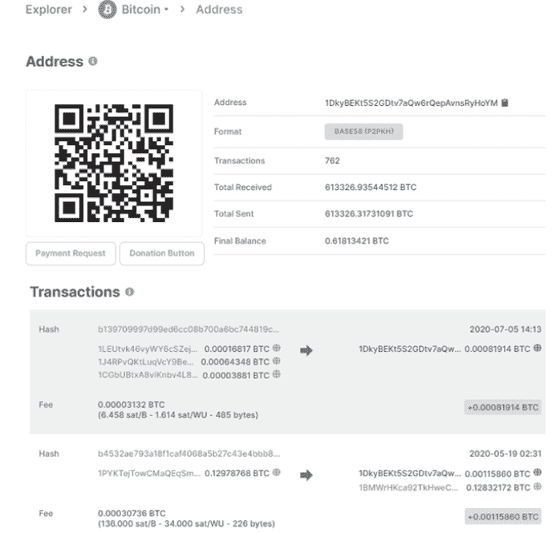

图1. 区块链浏览器：区块链数据透明度。

### 表1. 区块链属性。

| 属性 | 定义 | 优势 | 劣势 |
|---|---|---|---|
| 访问权限：有许可与无许可 | 这两种情况都描述了对数据的公共访问级别。在公有有许可区块链中，对数据读取没有限制。私有无许可区块链则限制对预定义用户的访问。 | 公有：可访问性和去中心化协作。私有：交易性能、明确的治理结构、创新速度、数据隐私、安全性和匿名性。 | 公有：交易性能、治理问题、数据隐私、安全性和匿名性。私有：成本、审查、监管和信任。 |
| 不可篡改性 | 一旦交易被添加到区块链中，就无法更改或删除。 | 可追溯性和商业价值。 | 在删除/更改数据方面缺乏灵活性。 |
| 透明性 | 区块链便于对交易进行只读访问，并检查智能合约内容。 | 高效准确的记录保存。 | 数据隐私、智能合约编码错误、遵守数据隐私法律（如欧盟GDPR）。 |
| 可编程性 | 比特币和以太坊等可编程区块链使用脚本语言编写数字智能合约。 | 智能合约的确定性执行。 | 不可编程的区块链，以及将现实世界合约编码为区块链智能合约的复杂性。 |
| 去中心化共识 | 通过创新的共识协议（如权益证明）消除中央机构/中介。 | 去中介化和创造新的权力结构 | 工作量证明（PoW）的能源消耗问题、治理问题和安全漏洞。 |
| 分布式信任 | 区块链不需要对单一机构有很高的信任度。 | 无需信任的系统。 | 对已建立的可信利益相关者托管流程的去中介化可能难以复制。 |

而后者代表一个开放的网络，任何成员都可以查看数据并将数据写入区块链。这种能力在有许可的情况下受到限制。无许可区块链的例子包括比特币、以太坊、卡尔达诺。许多企业级区块链技术部署出于安全和隐私原因使用有许可访问权限[1]。下一个特征涉及区块链的不可篡改性。也就是说，一旦数据被录入区块，它就是不可删除和不可更改的。这一特征本身有明显的优点和缺点。新兴的区块链创新正在进入市场，例如链下区块链，它允许编辑和/或删除交易数据[7]。

数据透明性是区块链技术的下一个特征。区块链网络中所有各方读取区块链数据的能力代表了一种基本的信任新标准[3]。所有网络参与者都可以通过区块链浏览器访问公共区块链地址的交易和持有量。例如，图1提供了一个由区块链浏览器提供的特定区块链地址的交易历史示例。可以看出，该浏览器提供了这个特定区块链用户完整交易历史的概览，同时确保匿名性。

### 2.2 区块链技术对供应链管理的影响

在讨论区块链技术对供应链管理的影响之前，有必要先定义供应链管理这一术语。根据Mentzer等人[8]的定义，供应链管理（SCM）是“对供应链内传统业务功能及其跨业务功能的策略进行系统、战略性的协调，以提高单个公司和整个供应链的长期绩效”。SCM旨在通过发展内部和外部联系来创建高效且协调的供应链[9]。实现这一目标在很大程度上取决于组织如何有效地利用其技术资源和技术能力[10,11]。虽然现有研究侧重于云计算、RFID、物联网、跟踪技术等传统技术如何影响SCM业务实践，但新的技术发展正在涌现，例如区块链、自主机器人和运输、人工智能、无人机、数字孪生、3D打印等，这些技术正在实现新的创新性SCM业务实践[12,13]。由于近年来对加密货币，尤其是比特币的关注度不断提高，区块链作为保障加密货币交易安全的基础技术，已受到政策制定者、商业界和学者的日益关注[11,14]。

事实上，许多组织，例如沃尔玛、马士基和可口可乐，已在其供应链中实施了区块链。过去五年中，研究已探讨区块链如何惠及供应链管理业务实践（表 2）。正如所见，四个区块链供应链收益被认为具有显著性：供应链可见性（N = 14）、运营效率（N = 11）、供应链可追溯性（N = 10）、供应链韧性（N = 10）和数据安全（N = 10）。然而，许多收益源自理论/概念性研究，缺乏来自实际供应链环境的经验证据。有趣的是，考虑到最近的 COVID-19 大流行，区块链也被誉为确保供应链韧性的潜在技术解决方案。例如，van Hoek [13] 认为，在全球大流行期间加速供应链沿线信息共享的能力可以增强其韧性。

区块链可以通过“加速信息共享并提高对库存位置和物流流量的可见性……特别是如果信息交换可以从部分和顺序的（一次一层）转变为更全面和即时的”[15] 来最大限度地降低全球大流行供应链风险。这种能够即时、迅速地沿供应链传播信息的能力与传统供应链沿线顺序且部分的信息分发方式截然不同 [11]。甚至有人认为，区块链技术具有通过在人道主义供应链背景下开发和实施区块链技术解决方案来改变灾难救援供应链的巨大潜力 [16,17]。在人道主义供应链环境中可能获得的主要收益包括迅速信任、增强协作和提高韧性 [14]。

### 2.3 创新同化阶段

同化可以定义为“一种组织过程，（i）当组织个人成员首次听说创新开发时即被启动，（ii）可能导致创新的获取，（iii）有时会以创新的完全接受、利用和制度化而得以实现”[18, p.897]。技术创新的同化往往具有挑战性，且很少是二元的 [19]。同化理论认为，同化可能在技术创新的采用之旅过程中增强或恶化。每个同化阶段描述了技术创新渗透采用公司的程度。经常，创新成功或失败的原因可能是微小的。虽然已提出许多框架来理解创新同化如何影响实体 [21]，其中最被广泛引用和使用的一个是由 Gallivan [19] 提出。表 3 提供了该六阶段模型的概述。该框架包括两个采用前“早期阶段”（例如，启动和采用）和 4 个采用后“后期阶段”

（例如，适应、接受、常态化和浸润）。浸润阶段包括技术创新浸润的几个不同方面。

当研究同化阶段时，一个突出的考虑是，我们可能期望采用组织的同化阶段进展是线性的程度。然而，现有研究已证明进展可能是非线性的。例如，[20] 认为，相对于“定制”技术创新，“现成”技术更可能出现顺序模型。此外，[20] 建议可能出现解冻（例如，启动、采用阶段）和再冻结（例如，接受、常态化和浸润阶段）顺序模式。然而，这一观点因未能考虑反馈在阶段中纳入的程度而受到批评 [22]。该六阶段同化框架已用于先前研究中，这些研究考察了供应链中的技术采用 [例如，23,24,25]。我们也认为它将是检验区块链技术在供应链绩效管理系统背景下采用相关的收益和挑战的适当视角。尽管最近已进行大量关于技术同化的研究，但研究方向集中在采用的早期阶段。作为这种不平衡关注的证据，对 Scopus 数据库中发表的所有技术同化供应链相关研究进行了分析。网络可视化显示在图 2 中。

从分析中出现的突出关键词往往是“采用”、“实施”和“扩散”。通常，这些方面单独从不同的理论视角进行考察。此外，研究集中于对与电子商务（例如，B2C、B2B）、电子数据交换和企业系统（例如，ERP、云、RFID、跟踪技术）相关的技术影响的研究。我们的研究侧重于几个后期同化阶段（例如，接受、常态化和浸润）。我们对文献的回顾确定了一个研究空白，这需要检查这些后期同化阶段，以探索一种名为区块链的新兴技术创新及其对供应链绩效管理的影响。此外，这些采用后阶段被认为对于提高对技术创新的各种下游阶段的理解至关重要 [19]。

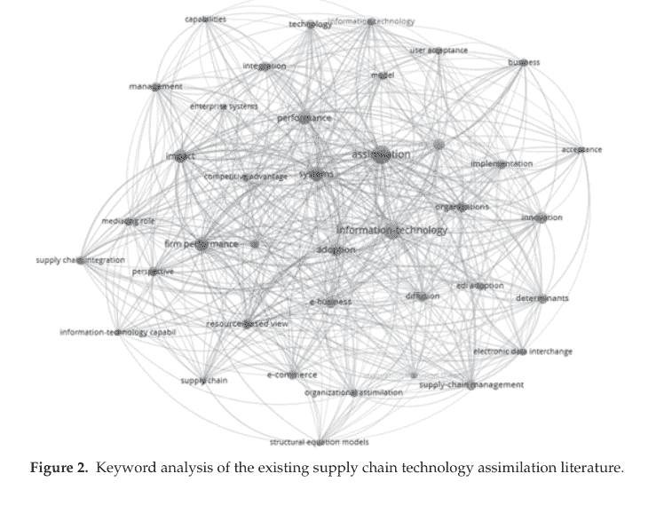

图 2. 现有供应链技术同化文献的关键词分析。

### 表 2. 供应链管理区块链收益。

| 作者 | 供应链整合 | 供应链可见性 | 供应链可追溯性 | 供应链创新 | 供应链韧性 | 数据安全 | 数据可访问性 | 数据隐私 | 运营效率 | 增强决策制定 |
|---|---|---|---|---|---|---|---|---|---|---|
| [13] |  | ✓ |  |  | ✓ |  | ✓ |  | ✓ | ✓ |
| [14] | ✓ | ✓ | ✓ | ✓ | ✓ |  |  |  | ✓ |  |
| [31] |  | ✓ | ✓ | ✓ | ✓ |  | ✓ |  | ✓ | ✓ |
| [32] | ✓ |  |  |  | ✓ |  |  |  |  |  |
| [33] | ✓ | ✓ |  |  | ✓ |  |  |  |  | ✓ |
| [34] | ✓ |  |  |  | ✓ | ✓ |  |  | ✓ | ✓ |
| [35] | ✓ | ✓ | ✓ |  | ✓ |  | ✓ |  | ✓ | ✓ |
| [36] | ✓ | ✓ |  | ✓ |  | ✓ | ✓ | ✓ |  | ✓ |
| [37] |  | ✓ | ✓ |  |  | ✓ | ✓ | ✓ | ✓ | ✓ |
| [38] | ✓ | ✓ | ✓ |  |  | ✓ |  |  |  |  |
| [39] |  |  | ✓ | ✓ |  | ✓ |  |  | ✓ |  |
| [40] | ✓ |  |  |  | ✓ |  |  |  |  |  |
| [41] |  | ✓ | ✓ | ✓ |  | ✓ |  | ✓ |  |  |
| [42] | ✓ | ✓ |  | ✓ |  |  | ✓ |  | ✓ | ✓ |
| [43] |  | ✓ | ✓ |  | ✓ | ✓ | ✓ | ✓ | ✓ |  |
| [44] |  | ✓ |  | ✓ |  | ✓ | ✓ | ✓ | ✓ | ✓ |
| [45] |  | ✓ | ✓ |  | ✓ | ✓ |  | ✓ |  |  |
| [46] |  | ✓ | ✓ | ✓ |  | ✓ | ✓ |  | ✓ |  |
| 总计: | 9 | 14 | 10 | 9 | 10 | 10 | 9 | 6 | 11 | 9 |

**表 3.** 创新同化框架 [19].

| 阶段 | 描述 |
|---|---|
| **启动** | 在组织中找到了技术创新及其应用的匹配。 |
| **采用** | 做出决定投入资源采用该技术创新。 |
| **适应** | 技术创新得到开发、安装和维护。组织成员接受培训以使用新的技术创新。 |
| **接受** | 组织成员被引导使用该技术创新，该创新现已在公司内部使用。 |
| **常态化** | 鼓励将技术创新的使用作为一项正常活动，并调整组织结构以适应技术创新。它不再被视为不寻常的事情。 |
| **浸润** | 技术创新以复杂和精细的方式使用。浸润可分为以下几种方式：
- **扩展使用：** 使用技术创新的更多功能。
- **整合使用：** 使用技术创新在任务之间创建新的工作流程联系。
- **新兴使用：** 使用技术创新执行以前认为不可能完成的任务。 |

用于探索本研究研究问题的案例研究组织。正如所见，案例A主要从事去中心化金融（DeFi）服务的区块链基础设施提供。

## 4. Results

在案例A的区块链供应链背景下，表5总结了创新同化阶段框架的后期要素，即接受、常规化和融合。我们根据数据的分析将融合阶段扩展以包含另外两个维度：扩散使用。

表5. 区块链供应链采用的同化阶段。

| 同化阶段 | 供应链采用同化 |
|---|---|
| 接受 | 2016年做出了使用区块链技术的承诺，作为黑箱技术或以某种定制方式使用 |
| 常规化 | 2016年的一项概念验证项目为案例A节点基础设施外包项目的全面推广铺平了道路。在区块链培训研讨会和教育计划推广之后，这一策略得到了案例A所有供应链利益相关者的采纳。 |
| 融合 | 区块链技术不仅被常规使用，而且以全面而复杂的方式使用，具体体现在以下方面：
- **扩展使用：** 案例A的初始用例是为客户提供节点基础设施。他们的策略扩展到质押和收益管理服务等DeFi产品和服务。
- **整合使用：** 案例A创建了一个细致的数据分析平台，该平台不仅使客户能够从其区块链供应链流程中获得实时数据洞察，还使案例A能够分析其供应链利益相关者的数据以提供更好的服务。
- **涌现使用：** 随着区块链技术的成熟，公司开始提供DeFi服务，而这些服务不在其原始战略范围内。
- **扩散使用：** 随着案例A供应链利益相关者数量的增加，其客户对教育和定制数据洞察方面的需求也随之增加。因此，公司开始在其数据分析平台上实施额外功能。他们还开始满足单个企业客户定制的区块链技术需求。
- **根深蒂固的使用：** 案例A对区块链节点基础设施技术的使用已深深嵌入组织的核心理功能中。 |

对竞争对手组织来说难以模仿。此外，这一阶段的特点是技术深深植根于组织的全部核心功能中，并且对供应链运营的日常运行至关重要。最后，有趣的是，文献中表2中确定的所有区块链供应链管理益处也在我们对案例A运营的分析中得到了确认。例如，从供应链韧性的角度来看，案例A先进的区块链分析平台可以通过DeFi预言机实时预测加密货币市场动态的变化，以保护客户的质押投资。

## 5. Conclusion

区块链技术在过去5年里在各行业中的普及度不断提高。然而，区块链技术在组织内部的使用和成熟方式研究不足。从理论角度来看，本研究提供了四个贡献。首先，本研究是首批通过创新同化视角探索区块链供应链采用的研究之一。其次，它也是首批通过关注同化的后期阶段（例如，接受、常规化和融合）来概念化同化过程的研究之一。我们对案例A使用区块链技术的分析不仅突出了区块链在其供应链流程中的同化方式，而且还使我们能够从区块链采用的角度将同化概念扩展到包括两个新的融合阶段。接下来，本研究中开发的这种扩展同化视角可以用作构建块，以更深入地定量检验DeFi行业或其他行业中区块链技术供应链同化。最后，我们对供应链文献的分析确定了与采用区块链技术相关的四个主要供应链益处：供应链可见性、运营效率、供应链可追溯性、供应链韧性和数据安全。如前所述，我们分析的大多数研究都是理论性的。因此，我们的研究使用同化框架视角证实了这些益处。

本研究对实践者也具有启示意义。扩展的区块链采用同化阶段框架和案例A对区块链技术的使用可以帮助组织理解区块链技术如何在组织内部被采用和成熟，以实现以前认为不可能的益处。本研究必须承认存在局限性。研究结果基于单一案例研究。因此，研究结果的普遍性存在问题。第二，案例A在DeFi行业运营，因此其运营独特于该特定行业，这对外部效度有影响。然而，单一案例研究的深入分析不一定需要提供整体的普遍性，而可以提供丰富的细节，并作为突出理论概念和框架如何应用的基础，这符合本研究的[content]
用于探索本研究研究问题的案例研究组织。正如所见，案例A主要从事去中心化金融（DeFi）服务的区块链基础设施提供。

## 4. Results

在案例A的区块链供应链背景下，表5总结了创新同化阶段框架的后期要素，即接受、常规化和融合。我们根据数据的分析将融合阶段扩展以包含另外两个维度：扩散使用。

表5. 区块链供应链采用的同化阶段。

| 同化阶段 | 供应链采用同化 |
|---|---|
| 接受 | 2016年做出了使用区块链技术的承诺，作为黑箱技术或以某种定制方式使用 |
| 常规化 | 2016年的一项概念验证项目为案例A节点基础设施外包项目的全面推广铺平了道路。在区块链培训研讨会和教育计划推广之后，这一策略得到了案例A所有供应链利益相关者的采纳。 |
| 融合 | 区块链技术不仅被常规使用，而且以全面而复杂的方式使用，具体体现在以下方面：
- **扩展使用：** 案例A的初始用例是为客户提供节点基础设施。他们的策略扩展到质押和收益管理服务等DeFi产品和服务。
- **整合使用：** 案例A创建了一个细致的数据分析平台，该平台不仅使客户能够从其区块链供应链流程中获得实时数据洞察，还使案例A能够分析其供应链利益相关者的数据以提供更好的服务。
- **涌现使用：** 随着区块链技术的成熟，公司开始提供DeFi服务，而这些服务不在其原始战略范围内。
- **扩散使用：** 随着案例A供应链利益相关者数量的增加，其客户对教育和定制数据洞察方面的需求也随之增加。因此，公司开始在其数据分析平台上实施额外功能。他们还开始满足单个企业客户定制的区块链技术需求。
- **根深蒂固的使用：** 案例A对区块链节点基础设施技术的使用已深深嵌入组织的核心理功能中。 |

对竞争对手组织来说难以模仿。此外，这一阶段的特点是技术深深植根于组织的全部核心功能中，并且对供应链运营的日常运行至关重要。最后，有趣的是，文献中表2中确定的所有区块链供应链管理益处也在我们对案例A运营的分析中得到了确认。例如，从供应链韧性的角度来看，案例A先进的区块链分析平台可以通过DeFi预言机实时预测加密货币市场动态的变化，以保护客户的质押投资。

## 5. Conclusion

区块链技术在过去5年里在各行业中的普及度不断提高。然而，区块链技术在组织内部的使用和成熟方式研究不足。从理论角度来看，本研究提供了四个贡献。首先，本研究是首批通过创新同化视角探索区块链供应链采用的研究之一。其次，它也是首批通过关注同化的后期阶段（例如，接受、常规化和融合）来概念化同化过程的研究之一。我们对案例A使用区块链技术的分析不仅突出了区块链在其供应链流程中的同化方式，而且还使我们能够从区块链采用的角度将同化概念扩展到包括两个新的融合阶段。接下来，本研究中开发的这种扩展同化视角可以用作构建块，以更深入地定量检验DeFi行业或其他行业中区块链技术供应链同化。最后，我们对供应链文献的分析确定了与采用区块链技术相关的四个主要供应链益处：供应链可见性、运营效率、供应链可追溯性、供应链韧性和数据安全。如前所述，我们分析的大多数研究都是理论性的。因此，我们的研究使用同化框架视角证实了这些益处。

本研究对实践者也具有启示意义。扩展的区块链采用同化阶段框架和案例A对区块链技术的使用可以帮助组织理解区块链技术如何在组织内部被采用和成熟，以实现以前认为不可能的益处。本研究必须承认存在局限性。研究结果基于单一案例研究。因此，研究结果的普遍性存在问题。第二，案例A在DeFi行业运营，因此其运营独特于该特定行业，这对外部效度有影响。然而，单一案例研究的深入分析不一定需要提供整体的普遍性，而可以提供丰富的细节，并作为突出理论概念和框架如何应用的基础，这符合本研究的
目标 [29]。

最后，有许多途径值得进一步研究。首先，未来的研究可以考察组织在同化的后期阶段采用区块链技术时出现的障碍。这将使研究人员能够揭示组织如何克服这些障碍，并回答诸如“他们使用了哪些变通方法来促进区块链采用过程？”等问题。接下来，本研究仅研究了同化的后期阶段。进一步的研究可以考察同化的早期阶段（例如，启动、采用、适应）。关于组织如何做出决定以选择采用区块链技术、部署和维护区块链技术、教育员工如何日常使用区块链技术以及在全球这些熟练员工短缺的情况下招聘具备区块链能力的员工的见解，将受到欢迎。最后，进一步的研究可以利用本研究开发的扩展同化框架来研究区块链技术被采用的其他背景或行业。此外，探索区块链技术采用失败的案例将很有趣。这将提供导致项目失败的因素的解释，并揭示可以从这些项目中学习到的经验教训 [30]。

## References

[1] Clohesy, T. and Acton, T. 2019. 调查组织因素对区块链采用的影响。Industrial Management & Data Systems. ISSN: 0263-5577

[2] Nakamoto, S. 2009 比特币：点对点电子现金系统。检索自：http://www.Bitcoin.org/bitcoin.pdf

[3] Berkeley, J. 2015. 区块链的承诺。The Trust Machine。检索自：https://www.economist.com/leaders/2015/10/31/the-trust-machine 于2021年7月2日

[4] Ito, J., Narula, N. and Ali, R. 2017. 区块链将对金融系统做互联网对媒体所做的事情。Harvard Business Review, 8.

[5] Markets and Markets 2020. 按组件（平台和服务）、提供商（应用、中间件和基础设施）、类型（私有、公有和混合）、组织规模、应用领域（BFSI、政府、IT和电信）及地区划分的区块链市场 - 全球预测至2025年。检索自：https://www.marketsandmarkets.com/Market-Reports/blockchain-technology-market-90100890.html?gclid=CjwKCAjwrwv3BRAJEiwAhwOdMzEfR6xkreRPrLu_sEpr-bzX_SD... YBL0kpTBXBoCaqsQAvD_BwE 于2020年7月4日]。

- [6] Clohesy, T., Acton, T. 和 Morgan, L. 2018. 当代数字商业模式决策：云计算供应侧视角. International Journal of Networking and Virtual Organisations, 19(1): 1–20.

- [7] IBM 2018. 为什么区块链需要新的链下存储. 检索自：https://www.ibm.com/downloads/cas/RXOVXAPM，于2021年6月5日.

- [8] Mentzer, J. T., DeWitt, W., Keebler, J. S., Min, S., Nix, N. W., Smith, C. D. 和 Zacharia, Z. G. 2001. 定义供应链管理. Journal of Business Logistics, 22(2): 1–25.

- [9] Ketchen, D. J., Hult, G.T.M., 2007. 连接组织理论与供应链管理：最佳价值供应链案例. Journal of Operations Management, 25(2): 573–580.

- [10] Ketchen, D. J. 和 Giunipero, L. C., 2004. 战略管理与供应链管理的交汇. Industrial Marketing Management, 33(1): 51–56.

- [11] van Hoek, R. 2019. 探索供应链中的区块链实施. International Journal of Operations & Production Management, 59(6): 829–859.

- [12] Zelbst, P. J., Green, K. W., Sower, V. E. 和 Bond, P. L. 2020. RFID、工业物联网和区块链技术对供应链透明度的影响. Journal of Manufacturing Technology Management, 31(3): 441–457.

- [13] van Hoek, R. 2020. 更具韧性的后疫情时代供应链的研究机会——弥合研究发现与行业实践之间的差距. International Journal of Operations & Production Management, 1–15.

- [14] Dubey, R., Gunasekaran, A., Bryde, D. J., Dwivedi, Y. K. 和 Papadopoulos, T. 2020. 区块链技术在提升人道主义供应链环境中的快速信任、协作与韧性. International Journal of Production Research, 1–18.

- [15] Remko, V. H. 2020. 更具韧性的后疫情时代供应链的研究机会——弥合研究发现与行业实践之间的差距. International Journal of Operations & Production Management, 40(4): 341–355.

- [16] Thomason, J., M. Ahmad, P. Bronder, E. Hoyt, S. Pocock, J. Bouteloupe 和 L. Joseph. 2018. 区块链——赋能发展中国家的贫困人口. 载于《Transforming Climate Finance and Green Investment with Blockchains》，Alastair Marke主编，第137–152页. Cambridge, MA: Academic Press.

- [17] Ramadurai, K. W. 和 S. K. Bhatia. 2019. 人道主义援助与灾难救援中的颠覆性技术与创新：一种整合方法. 载于《Reimagining Innovation in Humanitarian Medicine》，Krish W. Ramadurai 和 Sujata K. Bhatia主编，第75–91页. Cham: Springer.

- [18] Meyer, A. D. 和 Goes, J. B. 1988. 创新的组织同化：多层次情境分析. Academy of Management Journal, 31(4): 897–923.

- [19] Gallivan, M. 2001. 复杂技术创新的组织采纳与同化：一个新框架的开发与应用. Database for Advances in Information Systems, 32: 51–85.

- [20] Cooper, R. B. 和 Zmud, R. W. 1990. 信息技术实施研究：一种技术扩散方法. Management Science, 36: 123–139.

- [21] Saga, V. L. 和 R. W. Zmud. 1994. IT采纳、常规化与注入的本质及决定因素. Levine, L. 主编，《Diffusion, Transfer and Implementation of Information Technology》，第67–86页.

- [22] Orlikowski, W. J. 和 Hofman, J. D. 1997. 变革管理的即兴模型：群件技术案例. Sloan Management Review, 38: 11–21.

- [23] Wu, L. 和 Chuang, C. H. 2010. 基于外部前因和企业绩效的电子供应链管理扩散研究：多阶段分析. Decision Support Systems, 50(1): 103–115.

- [24] Basole, R. C. 和 Nowak, M. 2018. 供应链中追踪技术的同化. Transportation Research Part E: Logistics and Transportation Review, 114: 350–370.

- [25] Simões, A. C., Soares, A. L. 和 Barros, A. C. 2020. 影响制造组织管理人员采纳协作机器人意愿的因素. Journal of Engineering and Technology Management, 57: 1–15.

- [26] Creswell, J. W. 2013. 研究设计：定性、定量与混合方法（第3版）. London: Sage.

- [27] Kouhizadeh, M., Saberi, S. 和 Sarkis, J. 2020. 区块链技术与可持续供应链：从理论上探讨采纳障碍. International Journal of Production Economics, 107831.

- [28] Eisenhardt, K. M. 和 Graebner, M. E. 2007. 从案例中构建理论：机遇与挑战. The Academy of Management Journal, 50(1): 25–32.

- [29] Donmoyer, R. (2000). 可推广性与单案例研究. 载于《Case study method: Key issues, key texts》，第45–68页.

- [30] Dwivedi, Y. K., Wastell, D., Laumer, S., Henriksen, H. Z., Myers, M. D., Bunker, D., Elbanna, A., Ravishankar, M. N. 和 Srivastava, S. C. 2015. 信息系统成功与失败的研究：现状更新与未来方向. Information Systems Frontiers, 17(1): 143–157.

- [31] Clohessy, T. 和 Clohessy, S. 2020. 盒子里有什么？利用区块链警戒信息系统打击医药供应链中的假药. 载于《Blockchain and distributed ledger technology use cases》（第51–68页）. Springer, Cham.

- [32] Martinez, V., Zhao, M., Blujdea, C., Han, X., Neely, A. 和 Albores, P. 2019. 区块链驱动的客户订单管理. International Journal of Operations & Production Management.

- [33] Ivanov, D., Dolgui, A., Das, A. 和 Sokolov, B. 2019. 数字供应链孪生：通过数据驱动的优化、仿真和可视化来管理连锁反应、韧性与中断风险. 载于《Handbook of ripple effects in the supply chain》（第309–332页）. Springer, Cham.

- [34] Min, H. 2019. 区块链技术增强供应链韧性. Business Horizons, 62(1): 35–45.

- [35] van Hoek, R. 2019. 探索供应链中的区块链实施：向先驱和RFID研究学习. International Journal of Operations & Production Management.

- [36] Zelbst, P. J., Green, K. W., Sower, V. E. 和 Bond, P. L. 2019. RFID、工业物联网和区块链技术对供应链透明度的影响. Journal of Manufacturing Technology Management.

- [37] Cottrill, K. 2018. 区块链的益处：事实还是空想. Supply Chain Management Review, 22(1): 20–25.

- [38] Francisco, K. 和 Swanson, D. 2018. 供应链没有外衣：区块链技术用于供应链透明化. Logistics, 2(1): 2.

- [39] Kshetri, N. 2018. 区块链在实现供应链管理关键目标中的作用. International Journal of Information Management, 39: 80–89.

- [40] Wu, K. J., Liao, C. J., Tseng, M. L., Lim, M. K., Hu, J. 和 Tan, K. 2017. 迈向可持续：利用大数据探索供应链风险与不确定性的决定性属性. Journal of Cleaner Production, 142: 663–676.

- [41] Bocek, T., Rodrigues, B. B., Strasser, T. 和 Stiller, B. 2017年5月. 处处区块链——区块链在医药供应链中的应用案例. 载于《2017 IFIP/IEEE集成网络与服务管理研讨会（IM）》（第772–777页）. IEEE.

- [42] Korpela, K., Hallikas, J. 和 Dahlberg, T. 2017年1月. 面向区块链集成的数字供应链转型. 载于第50届夏威夷国际系统科学会议论文集.

- [43] Gupta, S. S. 2017. 区块链. IBM在线（http://www.ibm.com）.

- [44] Toyoda, K., Mathiopoulos, P.T., Sasase, I. 和 Ohtsuki, T. 2017. 一种新颖的基于区块链的产品所有权管理系统（POMS），用于邮政供应链中的防伪. IEEE Access, 5: 17465–17477.

- [45] Abeyratne, S. A. 和 Monfared, R. P. 2016. 使用分布式账本的区块链就绪型制造供应链. International Journal of Research in Engineering and Technology, 5(9): 1–10.

- [46] Apte, S. 和 Petrovsky, N. 2016. 区块链技术将彻底改变辅料供应链管理吗？. Journal of Excipients and Food Chemicals, 7(3): 910.

## 10

## 基于区块链的能源高效供应链管理

Bavly Hanna,* Guandong Xu, Xianzhi Wang and Jahangir Hossain

## 1. 引言

能源互联网（EI）是“一种融合电力技术、电气技术、信息技术和智能管理技术的网络”[1]。传统的能源市场交易（ET）机制和技术框架是在集中式电力供应的基础上创建的。然而，随着现代“能源系统”发展的推进，阐明电力零售市场并说服分布式可再生能源（RE）在市场上竞争的趋势日益增长。

区块链技术（BT）的现状目前日新月异，“分布式账本”（DL）技术和“智能合约技术”正被越来越多地实施[2]。分布式能源和微电网（MG）都是分布式交易“规则”、“算法”和“流程”的例子。它们旨在为当前情况下的 ET 提供基础技术替代方案，并提出了依赖于 BT 的市场的 EI 交易系统的技术大纲。

凭借其提供的优势，BT 有机会成为能源业务中最重要的数字化工具之一。随着分布式能源系统的发展和对绿色能源的需求，BT 可作为一种控制机制。区块链（BC）的分布式结构使其与智能电网（SG）和 MG 完美兼容，后者也是能源行业未来的关键组成部分[3]。许多学者和从业者对分布式能源系统的结构感兴趣[4]。

供应链（SC）和 BC 技术是天然的匹配[5]。首先，BC 的结构是一种时间序列数据，可以保存信息，类似于商品在 SC 中的流通方式。其次，SC 中信息相对较低的频率变化克服了现有 BT 的处理速度限制。

BC 上的每笔交易，包括“交易方”、“交易时间”和“交易内容”，都将被记录在区块上并保存在每个节点的 DL 上，确保信息完整性、可靠性和透明度。据 Abeyratne 和 Monfared 称，DL 技术有可能在各种金融市场用例中减少交易延迟、运营风险、流程波动、流动性需求等[6]。

能源管理（EM）已成为实现经济和环境双赢目标的关键工具。EM 减少了公司的能源支出，从而降低了生产成本。它还通过开发创新、低污染技术促进环境福祉。因此，通过部署设计良好的 EM 系统，可以解决企业和 SC 的可持续性问题[7]。

近年来，人们对全球环境影响的担忧和能源安全问题加剧了能源效率（EE）的重要性。由于能源在各种工业流程和 SC 的各个层面中使用，实施 EE 措施是一项艰巨的任务。EE 的采用需要在单个企业和 SC 层面都实施完整的 EM 计划。

EM 的目标是管理和优化各种企业活动中能源的使用。它可以被描述为明智地使用能源资源以最大化收益、降低成本并保持长期增长轨迹[8]。传统上，EM 已在企业层面进行研究。当 EM 原则扩展到 SC 层面时，它们必须在车间、企业以及 SC 的许多其他阶段（如运输）实施。

本书章节的其余部分设计如下：第 2 节是对基于 SC 的 EM 和基于 BC 的 EM 的文献综述。第 3 节报告了 BC 在供应链管理中的特征、类型、分类和实施。随后在第 4 节讨论了 EM 中 BC 的应用、优势和挑战，第 5 节为结论。

## 2. 文献综述

BC 正在吸引广泛行业的关注。这种日益增长的兴趣是因为 BT 允许以前依赖受信任中间人的应用程序无需其运行。如今，它们可以在没有验证方法的情况下运行，同时仍能达到相同的实用性和可靠性。在 BC 形成之前这是不可能的。去信任网络因 BT 的使用而出现。这是因为 BC 网络允许用户在不信任其他用户的情况下共享数据[9]。

由于没有中间人，用户交易以更快的速度增长。此外，BC 使用加密确保数据安全[10]。BC 是一个庞大的会计账本，跟踪所有用户交易。因此，物联网（IoT）学者和开发人员正在寻找将 IoT 与 BC 连接的解决方案。

对于处理商品在各方之间转移的企业而言，SC 如今是一个关键领域。该行业的问题在于其规模庞大，可能导致产品交付延迟和违约等问题。此外，庞大的分销商需要大量员工来满足所有商家的期望。因此，这可能导致严重的订单处理延迟并增加订单丢失的风险[10]。

为了解决这个问题，企业已自动化了所有流程。因此，SC 中的企业和分销商数量大幅增加。然而，随着数字数据的增加和互联网公司的发展，其数据库遭受网络攻击的可能性也在增加。黑客可能想要更改、窃取或删除信息[11]。

### 2.1 供应链基础能源管理的相关文献

使用 BT，传统的 SC 交易可以转变为更安全、合法且数字控制和加密的区块，数据篡改的可能性更小。Manupati, et al. 设计了多层级 SC 网络的“联盟 BC”结构。联盟 BC 是由多个 SC 参与者管理的半私有 BC 网络，他们在共享平台上协作[12]。

由于所有交易数据都在联盟框架内得到保护，整个环境免受外部威胁。专门的智能合约可以创建以执行既定标准和行为准则，使 BCT 更容易在绿色 SC 管理（SCM）中采用。这些智能合约会自动将新交易与指定标准进行评估，并且所有 SC 参与者都遵循智能合约协议[13]。

例如，智能合约可以包括排放或其他产品质量决定阈值限制。如果交易超过限制，智能合约将标记该交易并提醒相关方。SC 管理员可以快速识别痛点并改变系统以解决排放和产品质量问题。因此，由于 BT，信任从人工代理转移到计算机代码和智能合约以进行交易验证[14]。

研究人员近年来开始研究 BCT 在绿色 SCM 背景下的影响。Zhao et al. 启动了 BCT 在可持续水管理中应用的研究，并解决了 BCT 在可持续 SC 中的问题和未来研究可能性[15]。

BC 在能源市场中的潜在用途非常广泛。它们可能对程序和平台产生相当大的影响[16]。例如，BC 可以降低成本并实现新的商业模式和市场，更好地管理电网复杂性、数据安全和所有权，并通过降低成本和实现新的商业模式和市场作为促进能源社区发展的促进者让生产消费者参与能源市场[17]。

BC 可以提高能源市场系统的透明度和信任度，在遵守隐私法规的同时确保责任，提高点对点（P2P）ET 以确保电网的平稳运行。此外，BC 为更有效的公用事业计费程序和交易式能源运营提供了框架，并更好地处理需求响应[18]。

BT 可用于签发原产地证书，例如绿色能源和 RE 来源的生产[19]，构建 P2P 能源交易方案[20]，并为 EV 设置 EM 方案[21]。还值得注意的是，BC 被视为脱碳促进者，使能源行业能够转向更分散的能源来源[22]。

随着 BC 相关技术的日益普及，为系统供电的能源需求也在增加。在过去五年中，基于 BC 技术的全球电力消耗预测从 2500 上升到 7670 兆瓦[23]。未来的技术进步将显著影响能源需求，导致二氧化碳排放增加。据 PwC 的 BC 和加密货币专家称，基于 BC 的应用服务器的全部电力需求每年为 22 太瓦时（TWh）[24]。

这大约与爱尔兰等国家的总电力使用量相同。例如，谷歌运行其全球业务大约消耗 5.7 TWh 的能源[25]。另一个令人担忧的问题是矿工

或者说“合约”。另一方面，私有链是一种许可制区块链，只有经批准的节点才能加入。联盟区块链是公有链和私有链的混合体，其中只有预先选定的节点可以执行记账操作，而不是像公有链那样由所有节点参与[43]。因此，越来越多的组织开始采用联盟区块链，它现已被用于许多实际应用中。

区块链有望通过促进透明、安全、高效的电力能源交易来变革能源行业。区块链还有助于发展交易型能源系统，该系统使分散的参与者能够在去中心化、扁平化的交易市场中直接进行交易和互动。将“交易过程”分为两个主要阶段：“集合竞价阶段”和“连续竞价阶段”，这使得一种去中心化、分布式的记账机制能够满足能源市场中参与者分散化需求的当前要求。

能源系统可能受益于区块链点对点网络的部署，这将节省能源和资金。它使各种能源能够民主地连接起来，确保客户在任何时间、任何地点都能获得低成本、高质量的能源[44]。这对社会产生了重大影响，因为生活的许多方面都需要能源。区块链可以确保能源以高效、透明的方式得到充分消耗、供应和分配。

在需求侧，“综合需求响应”（IDR）已被证明能够通过优化“柔性负荷”、“能源转换”和“储能设备”的运行来提高系统运行灵活性和能源利用效率[45]。Zhao 等人提出了一种基于区块链技术的能源交易方法，以充分利用综合分布式 IDR 资源[46]。Mannaro 等人提出了一种基于区块链技术的能源交易系统，以最大限度地利用综合分布式 IDR 资源[34]。Mannaro 等人创建了“加密交易项目”，强调区块链技术和智能合约在管理和控制能源市场创新类型方面的重要性[47]。

区块链技术的主要特征是其“去中心化”和“安全”的信息共享平台，它可能是统一多方信息流的一个有趣示例。区块链在能源领域的应用仍处于早期阶段，仅发展数年[48]。然而，近年来各种研究、应用场景和项目实践引起了广泛关注。一些基于区块链的微电网“能源交易”（ET）框架[49]以及分布式能源定价市场[50]也被提出。

还有人提出在基于以太坊的能源交易中使用住宅智能电表和“配电系统运营商”之间的信息传输[51]。

此外，无线传感器网络和物联网通过有效的数据聚合，以及利用能够相互监控和交互的智能系统优化能源生产和消费，为隐私和安全挑战提供了替代解决方案[52]。

极为多样化的能源行业需要一个统一的智能电网管理、运行和控制平台。接入主电网的各种分布式发电单元之间的适当通信和连接有助于提高智能电网性能[53]。为了监测微电网的“电压”和“频率”，分布式发电单元之间的通信至关重要。

## 3. 区块链赋能的供应链属性

### 3.1 区块链基础特性

区块链的四个关键特性[54]是：(1) 去中心化的分布式节点和存储。(2) 由于共识、智能合约和非对称加密，它在银行、计算机软件和计算机应用等许多领域具有巨大潜力。(3) 信息经济、邮政经济，以及投资和证券。(4) 民用级微电网的共享数据结构、创建和分发，这可能得益于扩展的网络。表1显示了区块链的特点，使其在未来的工业应用中具有独特性和前景。

**表1.** 区块链基础特性

| 特性 | 描述 |
|---|---|
| 去中心化 | 数据可被多个组织访问。 |
| 可扩展性 | 随着新节点加入网络，区块链网络可以随时扩大。 |
| 匿名性 | 由于数据在节点间传输，个人身份保持隐藏。 |
| 透明性 | 通过网络共识，数据被记录并保存在网络上，在完整生命周期内可访问、可追溯。 |
| 不可篡改性 | 为提供不可篡改性，区块链提供时间戳和限制。 |
| 去信任 | 术语“去信任”指的是区块链中的节点不需要相互信任，只需信任区块链系统及其交易机制。由于在区块链共识方法下每个参与节点都可能成为监督者，因此无需担心欺诈。 |
| 智能合约 | 它是一种辅助合约执行的简单电子软件。 |

由于其在去信任环境中的突出特性和表现，区块链技术被誉为改变游戏规则的发明。它是一组带时间戳的记录，保存在去中心化的分布式账本系统上。没有中央指挥和控制机构，每个节点都维护自己的数字账本。所有区块链记录都可以公开验证，网络中的任何节点都可以访问。通过共识方法成功验证交易后，会形成一个区块并按时间顺序追加。每个区块通过唯一的加密哈希链接到前一个区块，使其本质上不可更改。

通过使用共识流程，公共账本在所有节点之间更新和同步。对于交易验证，共识流程确保所有参与节点达成一致。可用的共识技术包括“工作量证明”（PoW）、“权益证明”（PoS）、“权威证明”（PoA）和“委托权益证明”（DPoS）。共识技术是根据网络需求选择的；尽管如此，PoW 被认为比其他共识算法更安全。

在区块链中，有两种选择。第一种是无许可区块链，节点无需任何许可即可加入网络，也称为公有区块链。第二种是许可制区块链，有时也称为私有区块链，其中使用访问控制来限制可以参与的节点数量。只有私有区块链中的授权节点才能读写数据。

借助不可篡改的记录、加密货币以及智能合约部署，区块链为去中心化网络中无需可信参与者的安全能源交易提供了一个独特平台[55]。对于交易验证、区块创建以及区块上的哈希链构建，代理使用共识协议[56]。

然而，在诸如比特币等经典区块链应用中，常用的工作量证明共识系统消耗大量能源，并且交易确认延迟[36]。因此，无法在许可制能源区块链上对其进行改造。因此，解决南卡罗来纳州电动汽车充电相关的安全问题仍然是一个开放且关键的话题。

在由联网智能房屋组成的智能社区中，Liang 等人提出了一种有效的服务发现技术来保护隐私[57]。Zhang 等人分析了常见的智能电网激励方案，并采用理论契约方法研究了基于云计算的“车对车”（V2V）能源交易流程[58]。Tushar 等人研究了一种基于激励博弈的分散式可再生能源管理方法，以在能源交易中提高运营商的收益并降低总成本[59]。

### 3.2 区块链分类

现有文献中，区块链网络有多种分类方式[13]。这些类别根据网络中心化程度、网络管理和权限定义，分为 (i) “公有”、(ii) “私有”和 (iii) 联盟“联邦”。

公有区块链对公众开放，任何人都可以访问数据、提交交易并“挖掘”区块。作为新用户或节点矿工，任何人都可以加入公有区块链（无许可）。此外，所有参与方都能够开展交易和合约等活动。因此，公有区块链被视为完全去中心化的存在，因为没有实体对其有影响力。众所周知，比特币和以太坊是公有区块链的例子[36,60]。

在私有区块链中，写入权由组织或机构控制，参与其中的节点将受到严格限制。与联盟区块链一样，私有区块链也被归类为许可制区块链。通常会提供一个由允许用户组成的白名单，这些用户拥有特定的网络操作能力和权限。私有区块链网络可以避免昂贵的 PoW 技术，因为女巫攻击的可能性几乎不存在[62]。

联盟区块链是公有链和私有链的结合体[62]。在联盟链中，多个组织或机构协作进行管理。值得注意的是，与公有链不同，只有联盟中的组织才能访问数据。可以使用更广泛的基于负激励的共识技术。

尽管联盟链提供了与私有链相似的可扩展性和隐私保护，但主要区别在于，不是由单一实体，而是由一组称为领导节点的节点被选来验证交易流程。这实现了一种去中心化设计，领导节点可以授予其他用户授权。表2总结了每种区块链网络在能力、所有权、共享信息安全管理和共识机制方面的主要属性。

### 3.3 区块链在供应链管理中的实施

区块链可以改善供应链功能的整合与协调。由于区块链，多个供应链利益相关者无需中间人即可相互交易。因此，当存在影响多方的问题，且每一方都可能从解决问题中获益时，区块链似乎最适用。这种共享价值会激发参与并促进参与者之间的合作行为。借助区块链技术，相互竞争的组织也可以加入同一网络。

### 表2. 基于区块链的类型。

| 特征 | 公有链 | 私有链 | 联盟链 |
|---|---|---|---|
| 去中心化程度 | 去中心化 | 中心化 | 弱中心化 |
| 所有权 | 公有 | 中心化 | 半中心化 |
| 机制 | 每个参与者都可以访问数据库，从而保存交易副本并对其进行修改 | 中心化机构管理访问和修改数据库的权限 | 联盟中的参与者 |
| 治理 | 修改已建立的规则极其困难 | 如果控制机构做出选择，法规可以随时修改 | 通过联盟成员达成协议来修改法规将很简单 |
| 数据访问 | 任何用户都可以加入网络 | 只有授权用户才能加入网络 | 允许有限数量的节点加入网络 |
| 可识别性 | 伪匿名 | 已识别用户 | 已识别用户 |
| 隐私 | 所有数据都公开 | 隐私仅对个人可见 | 灵活且可扩展 |
| 交易证明 | PoW、PoS、PoET 等算法确定交易证明，这些证明无法提前呈现。 | 中心机构创建交易证明，如 PBFT、PoA、PoI 等。 | 认证提供交易证明，如 PBFT、PoA、PoI 等。交易验证和区块生产按照预先确定的规则进行。 |
| 共识 | 无需许可 | 需要许可 | 需要许可 |
| 工作量证明 | 昂贵 | 轻量 | 轻量 |
| 匿名性 | 恶意 | 可信 | 可信 |

区块链在供应链管理（SCM）中的部署受到全球经济不确定性和缺乏清晰框架的阻碍。这不仅影响到那些对采用区块链犹豫不决的中小型企业，也影响到大型企业，因为目前还没有明确的结构来确定供应链是否需要实施区块链。研究人员对区块链的特性进行了研究，并将其与供应链管理进行了比较。

供应链管理的方法可能因供应链而异，甚至因行业而异。区块链技术作为一种新兴技术，正日益普及，它通过提供安全、实时的信息传输来提升组织绩效[63]。毫无疑问，区块链是最新的技术，可用于通过增强所有供应链管理操作的集成来辅助供应链管理技术[64]。

然而，理解区块链提供的众多功能以及这些特性如何影响各种供应链活动至关重要[65]。如果区块链特性对大多数供应链流程产生影响，那么运营绩效可能会因此提高。端到端的可见性和可追溯性、去中心化、增强的数据安全性、决策制定、知识共享、端到端集成和有效管理是区块链技术在供应链领域的关键重点领域[66]。

像Origin Chain这样的区块链支持供应链系统的搭建正在研究中[67]。Origin Chain已经建立了一个安全、透明且能适应不断变化的监管要求的可追溯系统。它通过将原始信息和哈希数据分离，将原始敏感数据保存在链下，并在链上对数据进行哈希处理[68]。像丰田这样的大型企业过去曾因供应链流程中涂料位置缺乏可追溯性而遭受重大损失。

像埃森哲、阿里巴巴和沃尔玛这样的巨头正试图在供应链、B2B电子商务和其他领域使用区块链，以打击欺诈、简化可追溯性并使交易更便捷，重点放在高价值商品上[69]。因此，其目标是重构供应链，使其具有可扩展性和动态性，以应对市场发展。

供应链参与者重视数据共享安全，因为商业交易经常涉及极其敏感的商业信息。许可型区块链在供应链中可能特别有用，因为它能提供更好的隐私性、可审计性和运营效率[70]。参与者有能力对商品描述进行加密。他们可以在基于区块链的供应链中加密敏感信息。他们还可以应用商业准则来控制供应商或海关的访问权限[71]。

区块链提供的数据完整性和安全性还能防范欺诈和网络犯罪。网络犯罪导致数据泄露、金融犯罪、市场操纵和知识产权盗窃，同时也威胁到公共安全。最近针对全球最大集装箱航运公司“马士基”的网络攻击“NotPetya”显示了供应链和物流基础设施的脆弱性。这次网络攻击导致该公司所有业务部门关闭，造成3亿美元的收入损失[72]。

尽管可能有许多因素导致了这种脆弱性，但部署去中心化系统有助于降低风险。中心化系统的一个关键问题是，如果某个系统被黑客攻击或出现技术故障，整个系统可能会陷入瘫痪。区块链提供了一种更能抵御数据泄露的替代数据管理方法。

## 4. 区块链在能源管理中的应用

### 4.1 基于区块链的能源管理应用

区块链正在能源行业进行各种应用的试验，包括解决安全和透明度问题，以及通过部署去中心化权威理念提高流程效率，从而实现各方共赢。

表3列出了基于区块链的主要能源应用。区块链将能在批发[73]或本地层面的能源交易（ET）应用中实现无需第三方身份认证的可信交易验证流程，例如点对点能源交易（P2P ET）[74]。典型的全球区块链基础设施还可以使跨境能源交易更加顺畅。产消者将能够使用区块链技术参与本地能源市场，这有可能使交易比典型的集中式能源系统更快、更简单、成本更低[75]。

区块链还在电动汽车（EV）充电设施中进行试验。它将通过构建电动汽车和充电站网络，为所有相关方提供简单的支付和结算流程，使电动汽车驾驶员能够使用所有充电站点。一些能源企业也在考虑将区块链用于供应链和价值链，以提高可见性并防止资产从生产到消费过程中的损失。项目融资也在研究中，利用区块链来提高支付透明度和流动性。

表3. 基于区块链的能源管理应用。

| 应用 | 描述 |
|---|---|
| 去中心化存储和能源交易系统 | 允许社区对其使用的能源来源拥有更多控制权。 |
| 点对点能源交易 | 使本地分布式能源供应商能够将电力出售给愿意支付合适价格的客户。 |
| 电动汽车 | 车主可以通过区块链技术，将私人电动汽车充电器分享给有需要的人，从而进行电力交易。 |
| 碳排放交易 | 公司进行污染许可交易。 |

能源市场正日益向分布式市场转变，电网中采用去中心化存储和控制。例如，太阳能光伏业务正变得越来越受欢迎。然而，当大量产消者出现时，如何管理他们已成为我们必须应对的挑战。例如，当能源市场参与者数量增加时，保存他们的海量数据变得更加困难。

将海量数据存储在中心化管理机构中会产生许多问题。随着参与者数量的增加，数据量将增长，相应的存储成本也会上升。如果所有数据都保存在一个机构中，其他方将无法获取历史数据，开放也将难以实施。

此外，如果中心化组织遭到攻击或黑客入侵，所有数据都有被泄露或删除的危险。另一方面，电压调节在去中心化电网中至关重要，因为它影响电网的运行稳定性。然而，对于典型的中心化管理技术来说，处理这些问题似乎具有挑战性。

Wu等人创建了一种用于EI数据存储的混合区块链架构[17]。该系统的特点在于利用公有链和私有链的组合，构建一种融合两者优点的智能、高效且安全的EI管理机制。它能够以安全高效的方式存储数据。即使EI拥有大量参与者，它也能很好地存储和管理其数据。

点对点（P2P）市场可以建立以强调参与者的福祉，赋予他们最大程度的个人自由、财务独立和隐私。或者，它们可以专注于整个社区的福祉，参与者选择共享对公共资源的访问权，并朝着共同目标努力，例如总福利最大化或自治[76]。能源部门目前正在出现P2P市场[77]。基于社区的能源集体的增长证明了这一点[74]。

P2P交易发展为一种现代的EM（能源管理）模型，允许能源从产消者转移给另一个产消者，无需“中央控制器”的干预[78]，并有望克服以前系统的局限性。需要能源的产消者可以使用P2P交易平台，从网络中有多余能源的同行产消者那里以较低价格购买多余能源，从而获益[59]。另一方面，拥有多余能源的产消者通过P2P能源交易可以比在上网电价补贴（FiT）安排下赚取更多收入。

Stevanoni等人研究了同伴与微电网（MGs）之间能源共享的一个有趣概念[79]。其目标是表示各种各样的、通常

相互关联的工业微电网持续发展中利益相关者的意图是相互矛盾的。它使用两个“博弈论框架”将长期投资决策与短期运营活动结合起来。为了展示技术经济成果，该工具在模拟工业微电网上进行了评估。

微电网间能源交易机制是点对点能源交易机制，主要侧重于通过最大限度地利用可再生能源资源来解决微电网内部能源供需不平衡的问题。此类程序可降低参与点对点能源交易的微电网的电力支出[80]。

尽管负荷需求具有随机性，但通过管理电网的电力流向，平滑微电网的发电是可行的[81]。将安全性纳入点对点交易，还可以促进分布式能源的传播和需求灵活性，从而使系统在常规和非常规情况下都更加稳健[82]。

为了解决插电式混合动力电动汽车的隐私和交易安全挑战，Kang等人提出了一种采用联盟区块链解决方案的新型点对点能源交易模型[83]。Aitzhan和Svetinovic引入了一个基于多重签名和匿名加密技术的“基于代币的去中心化能源交易系统”，使参与者能够秘密且安全地进行交易[84]。Li等人使用联盟区块链技术来保障分布式能源交易市场的安全，并为工业物联网开发了一种新的能源区块链系统[85]。

更低的价格、更高的电动汽车性能、更快的充电速度，以及充电基础设施的可用性、速度、使用便利性和可负担性都将在电动汽车未来的增长中发挥作用。根据Su等人的说法，如果将区块链融入能源电网，电动汽车充电基础设施将得到改善。例如，印度和欧盟正在努力促进电动汽车生态系统的发展[86]。

然而，许多充电服务提供商面临复杂的支付安排、不统一的支付方式、有限的充电桩以及实时充电应用中电动汽车充电成本估算错误等问题。这些问题可以通过区块链技术解决[87]。区块链技术主要用于充电站运营平台，有助于减少电动汽车充电的不便性，高效管理充电基础设施，增强安全性，并鼓励使用共享电池和共享能源以促进公共利益[88]。

区块链可以通过改善碳排放交易和促进可再生能源交易来帮助气候行动[95]。在全球范围内的气候金融创新领域，消费者可以使用反映能源产出或可转让数字资产的代币购买、出售或交易可再生能源。区块链技术通过协助发展点对点金融交易以促进气候行动，并确保资金投向具有更高透明度的项目，从而帮助增加气候资金流。

### 4.2 基于区块链的能源效率优势

提高能源效率可以使企业在消耗更少能源的同时提供相同的服务（例如，产品制造、能源从一种形式转换为另一种形式）。此外，由于客户环保意识日益增强，能源效率能够提高单个企业的整体绩效，并带来可观的成本节约和额外收入[89]。

在高度全球化、技术快速发展和客户需求日益增长的环境中，同一供应链内的公司应合作，以比竞争对手更好地满足消费者期望。因此，在当今的商业环境中，在供应链的各个阶段协调战略和运营选择，对于获得和保持竞争优势至关重要。

通过与消费者和供应商密切合作，企业可以在改善经济效益的同时减少环境和社会问题。因此，认识到供应链互动对提高能源效率的可能影响至关重要。然而，大多数企业只是顺带关注其合作伙伴在运营中是否使用能源管理系统。

在不断变化的商业环境中，供应链伙伴之间的合作将为每个伙伴和整个供应链创造价值，因为可以共同承担风险、节省成本、缩短提前期和响应时间[90]。正如Jaber和Goyal所述，供应链协调方法要么是集中式的，即由单一决策者管理整个供应链；要么是分散式的，即多个具有相互竞争目标的决策者参与其中，从而导致系统效率低下[91]。

尽管许多学者最近关注到在运营和供应链管理中实施能源效率的相关性与日俱增[92]。先前的文献大多从工业角度考察单一公司内部的节能投资决策。在过去的几十年里，关于工业部门能源效率的研究大量涌现，也出现了各种文献评估。

Biel和Glock研究了在工业企业中期和短期生产计划中纳入能源考虑的决策支持模型[93]。Schulze等人对现有的工业能源管理学术期刊论文进行了全面评估[94]。Tanaka创建了一个旨在提高工业能源效率和节约能源的政策分析平台[95]。Pons等人绘制了已实施的制造业降低能源消耗技术地图，并将其与制造企业绩效相联系[96]。然而，认识到供应链互动对此类投资选择的可能影响同样重要[97]。Cosimato和Troisi展示了如何开发以产品能源标签为重点的绿色技术。最节能的供应链序列也可以发布并用作使用区块链技术重建未来供应链的蓝图。

### 4.3 基于区块链的集成挑战

对于每个供应链，集成的相关性各不相同。为了提高运营效率，一些供应链仅依赖基于集成的供应链方法。由于供应链管理流程对提前期、成本节约、灵活性等关键绩效指标（KPI）产生影响，而这些KPI被用于制定运营绩效衡量标准[108]。另一方面，文献表明供应链管理方法对运营绩效有影响。

区块链在商品可追溯性、版权以及整体经济中的供应链应用场景等领域已有若干应用。然而，在现实世界中集成基于区块链的解决方案时，仍存在大量实质性障碍。由于供应链是碎片化、多方面的且地域分散的，提出一种能同时保障供应链“信息”、“物流”和“资金”流转安全与公平的有效方案极其困难。此外，这种方案的可行性及其执行仍在探索之中[109]。

除了所有这些好处之外，使用区块链向循环经济过渡还存在某些缺点。将区块链技术与当前传统的管理信息系统集成就是这些问题之一。由于各种障碍，技术转型不可能迅速实现。这些困难可能源于多种因素，包括技术基础设施缺乏、官僚主义和人力资源不足。应强调区块链与能源管理集成面临的障碍，并应适当安排高层管理人员。

虽然深度学习技术带来许多可能的社会收益，但也带来了一些伦理和环境问题。区块链与其他技术一样，仅仅是提高系统效率的一种手段。根据Hawken等人的观点，受自然资本主义讨论的启发，需要对商业结构进行根本性的反思，以确保技术的使用以做正确的事情为中心，而不仅仅是以正确的方式做事[110]。

如果不将区块链融入价值驱动的商业模式，而仅仅关注生态效率，将对环境不利，因为这会促进在错误的商业模式中节省资源，在这种模式中，资源被更快地开采，错误的产品以更低的成本进入市场。设想一个数字平台，它将客户与商家连接起来，商家以硬币奖励客户的环保行为，客户随后可以用这些硬币从商家那里购买非绿色产品。另一个

Example 是一个数字平台，通过促进货物追踪，提高了 CO₂ 排放量高于本地供应网络的区域分布式 SC 的效率。

另一个问题是现有的 BC 协议计算需求高。例如，比特币网络存在各种可扩展性问题，包括用户通信故障、数据保留和线性交易历史，以及矿工在交易验证上竞争，导致了相当大的能源损失 [111]。

除规模问题外，该技术的当前局限性还包括 BC 的复杂性、需要去中心化的用户网络以及不可更改的人为错误。由于 BC 的不可变性，在将首批信息录入 BC 平台之前进行双重检查至关重要，因为存储在平台上的材料是不可逆的，并且必须建立系统以避免人为错误。

除技术限制外，根据文献，BC 部署的障碍还包括缺乏政府监管和利益相关者之间缺乏信任。BC 在 SC 中的其他成功要素包括数据安全、质量、可访问性和文档记录 [112]。

## 5. 结论

BC 应用的好处在新能源贸易、金融服务和能源 SCM 领域正逐渐显现。BT 似乎是 RE 发展的一种可行替代方案 [14]。此外，虽然发达国家由于掌握更复杂的 BT 而主导基础能源 BC 研究，但较贫穷的国家在全球能源 BC 研究体系中正日益成为关键参与者。就出版物而言，中国已大大超过以美国为首的发达国家，这意味着发展中国家可能很快就会超过发达国家，主导全球能源 BC 研究 [113]。

世界的能源 BC 用例在工业化国家更为普遍。这是因为工业化国家拥有相对完善的能源基础设施，例如分布式电网（MGs），这使得能源 BC 成为可行的应用环境 [114]。以中国为首的发展中国家的大多数家庭供电设施都是集中式能源供应系统。这与 BT 的去中心化特性完全相反，并阻碍了该技术在能源领域的持续发展和部署。

因此，未开发国家在未来建立能源 BC 时将面临一个重大问题：如何迅速建立一个全面的分布式电网。这直接决定了发展中国家能否将其能源 BC 研究优势转化为实际的能源 BC 应用，并随后支持 RE 发展以改善能源结构。

- [19] Park, L. W., Lee, S. and Chang, H. 2018. A sustainable home energy prosumer-chain methodology with energy tags over the blockchain. Sustainability, Switzerland, 10(3). Parliament, E.
- [20] Pop, C., Cioara, T., Antal, M., Anghel, I., Salomie, I. and Bertoncini, M. 2018. Blockchain based decentralized management of demand response programs in smart energy grids. Sensors, Switzerland 18 (1).
- [21] Huang, X., Xu, C., Wang, P. and Liu, H. 2018. LNSC: a security model for electric vehicle and charging pile management based on blockchain ecosystem. IEEE Access 6, 13565–13574. https://doi.org/10.1109/ACCESS.2018.2812176.
- [22] World Energy Council and PricewaterhouseCoopers. 2018. The Developing Role of Blockchain. White paper. Executive Summary. https://www.worldenergy.org/wp-content/uploads/2017/11/WP_Blockchain_Exec-Summary_final.pdf.
- [23] Clark, E. C. and Greenley, L. H. 2019. Bitcoin, Blockchain, and the Energy Sector, Independently published. Retrieved from https://www.hsdl.org/?view&did=828211.
- [24] PricewaterhouseCoopers. 2016. Blockchain - an opportunity for energy producers and consumers? Retrieved from https://www.pwc.com/gx/en/industries/energy-utilities-resources/publications/opportunity-for-energy-producers.html.
- [25] Baraniuk, C. 2019. Bitcoin’s energy consumption ‘equals that of Switzerland’. Retrieved from https://www.bbc.com/news/technology-48853230.
- [26] Kshetri, N. 2018. Blockchain’s roles in meeting key supply chain management objectives. Int. J. Inf. Manage., 39: 80–89.
- [27] IBM Corporation. 2016. Making Blockchain Real for Business. Explained with High Security Business Network Service. https://www.ibm.com/systems/data/flash/it/technicalday/pdf/Making%20blockchain%20real%20for%20business.pdf.
- [28] Tan, A. W. K., Zhao, Y. and Halliday, T. 2018. A blockchain model for less container load operations in China. Int. J. Inf. Syst. Supply Chain Manage., 11(2): 39–53.
- [29] Subramanian, H. 2017. Decentralized blockchain-based electronic marketplaces. Commun. ACM 61(1): 78–84.
- [30] Dorri, A., Kanhere, S. S. and Jurdak, R. 2017. Towards an optimized blockchain for IoT. In: Proceedings IEEE/ACM 2nd International Conference on Internet-of-Things Design and Implementation, IoTDI, pp. 173–178.
- [31] Polim, R., Hu, Q. and Kumara, S. 2017. Blockchain in megacity logistics. In: IIE Annual Conference. Proceedings, Institute of Industrial and Systems Engineers (IISE), pp. 1589–1594.
- [32] Lu, Q. and Xu, X. 2017. Adaptable blockchain-based systems: a case study for product traceability. IEEE Softw. 34(6): 21–27.
- [33] O’Leary, K., O’Reilly, P., Feller, J., Gleasure, R., Li, S. and Cristoforo, J. 2017. Exploring the application of blockchain technology to combat the effects of social loafing in cross functional group projects. In: Proceedings of the 13th International Symposium on Open Collaboration, OpenSym.
- [34] Holland, M., Nigischer, C. and Stjepandic, J. 2017. Copyright protection in additive manufacturing with blockchain approach. Adv. Transdiscipl. Eng., 5: 914–921.
- [35] Frey, R. M., Wörner, S. and Ilic, A. 2016. Collaborative filtering on the blockchain: a secure recommender system for E-commerce. In: AMCIS 2016: Surfing the IT Innovation Wave, 22nd Americas Conference on Information Systems.
- [36] Nakamoto, S. 2008. Bitcoin: A Peer-to-Peer electronic cash system. https://www.bitcoincash.org/bitcoin.pdf.
- [37] Li, J. X., Wu, J. G. and Chen, L. 2018. Block-secure: blockchain based scheme for secure P2P cloud storage. Inf. Sci., 465: 219–231.
- [38] Casino, F., Dasaklis, T. K. and Patsakis, C. 2019. A systematic literature review of blockchain-based applications: current status, classification and open issues. Telematics Inf., 36: 55–81.
- [39] Aggarwal, S., Chaudhary, R. and Aujla, G. S. 2019. Blockchain for smart communities: applications, challenges and opportunities. *J. Netw. Comput. Appl.*, 144: 13–48.
- [40] Morkunas, V. J., Paschen, J. and Boon, E. 2019. How blockchain technologies impact your business model. *Bus. Horiz.*, 62: 295–306.
- [41] McCallig, J., Robb, A. and Rohde, F. 2019. Establishing the representational faithfulness of financial accounting information using multiparty security, network analysis and a blockchain. *Int. J. Account. Inf. Syst.*, 33: 47–58.
- [42] Choi, T. M., Wen, X., Sun, X. T. and Chung, S. H. 2019. The mean-variance approach for global supply chain risk analysis with air logistics in the blockchain technology era. *Transport. Res. Part E* 127: 178–191.
- [43] Huang, X. H., Zhang, Y., Li, D. D. and Han, L. 2019. An optimal scheduling algorithm for hybrid EV charging scenario using consortium blockchains. *Future Generat. Comput. Syst.*, 91: 555–562.
- [44] Park, L. W., Lee, S. and Chang, H. 2018. A sustainable home energy prosumer-chain methodology with energy tags over the blockchain. *Sustainability*, 10(3): 658.
- [45] Li, Y., Wang, C., Li, F. and Chen, C. 2021. Optimal scheduling of integrated demand response-enabled integrated energy systems with uncertain renewable generations: a Stackelberg game approach. *Energy Convers. Manag.*, 235: 113996. DOI: 10.1016/j.enconman.2021.113996.
- [46] Zhao, S., Wang, B., Li, Y. and Li, Y. 2018. Integrated energy transaction mechanisms based on blockchain technology. *Energies*, 11: 2412. DOI: 10.3390/en11092412.
- [47] Mannaro, K., Pinna, A. and Marchesi, M. 2017. Crypto-trading: blockchain oriented energy market, in *AEIT International Annual Conference*, Cagliari: IEEE, 1–5. DOI: 10.23919/AEIT.2017.8240547.
- [48] Wang, Q. and Su, M. 2020. Integrating blockchain technology into the energy sector - From theory of blockchain to research and application of energy blockchain. *Comput. Sci. Rev.*, 37: 100275.
- [49] Xue, L., Teng, Y., Zhang, Z., Li, J., Wang, K. and Huang, Q. 2017. Blockchain technology for electricity market in microgrid. In *Proceedings of the 2nd International Conference on Power and Renewable Energy (ICPRE)*, Chengdu, China, 20–23 September 2017; IEEE: Piscataway, NJ, USA, pp. 704–708.
- [50] Cheng, S., Zeng, B. and Huang, Y. Z. 2017. Research on application models of blockchain technology in the distributed electricity market. In *IOP Conference Series: Earth and Environmental Science*, IOP Publishing: London, UK, 93: 012–065.
- [51] Hussain, S. S., Farooq, S. M. and Ustun, T. S. 2019. Implementation of blockchain technology for energy trading with smart meters. In *Proceedings of the Innovations in Power and Advanced Computing Technologies (i-PACT)*, Vellore, India, 22–23 March 2019; IEEE: Piscataway, NJ, USA, 1–5.
- [52] Alladi, T., Chamola, V., Rodrigues, J. J. and Kozlov, S. A. 2019. Blockchain in smart grids: A review on different use cases. *Sensors*, 19: 4862.
- [53] Galici, M., Mureddu, M., Ghiani, E., Celli, G., Pilo, F., Porcu, P. and Canetto, B. 2021. Energy Blockchain for Public Energy Communities. *Appl. Sci.*, 11: 3457.
- [54] Giungato, P., Rana, R., Tarabella, A. and Tricase, C. 2017. Current trends in sustainability of bitcoins and related blockchain technology. *Sustainability*, 9: 2214. DOI: 10.3390/su9122214.
- [55] Novo, O. 2018. Blockchain meets IoT: An architecture for scalable access management in IoT. *IEEE Internet Things J.*, 5(2): 1184–1195.
- [56] Dorri, A., Steger, M., Kanhere, S. S. and Jurdak, R. 2017. BlockChain: A distributed solution to automotive security and privacy. *IEEE Commun. Mag.*, 55(12): 119–125.
- [57] Liang, X., Zhang, K., Lu, R., Lin, X. and Shen, X. 2013. EPS: An efficient and privacy-preserving service searching scheme for smart community. *IEEE Sensors J.*, 13(10): 3702–3710.

- [79] Stevanoni C, Grève Z. D., Valle F. 和 Deblecker O. 2018. 互联工业微电网的长期规划：一种包含日常点对微电网交换的博弈论方法. *IEEE 智能电网汇刊*, PP(99): 1.
- [80] Liu, T., Tan, X., Sun, B., Wu, Y., Guan, X. 和 Tsang, D. H. K. 2015. 配电网中基于点对点能源共享的合作微电网能源管理. *IEEE 智能电网通信国际会议* (SmartGridComm)，佛罗里达州迈阿密. 第410-5页.
- [81] Fathi, M. 和 Bevrani, H. 2013. 互联微电网中的统计合作电力调度. *IEEE 可持续能源汇刊*, 4(3): 586–93.
- [82] Moslehi, K. 和 Kumar, R. 2018. 物联网环境下的自主弹性电网——嵌套式交易电网的愿景. *IEEE 电力系统汇刊*, PP(99): 1.
- [83] Kang, J., Yu, R., Huang, X., Maharjan, S., Zhang, Y. 和 Hossain, E. 2017. 利用联盟区块链实现插电式混合动力汽车之间的本地化点对点电力交易. *IEEE 工业信息学汇刊*, 13(6): 3154–3164.
- [84] Aitzhan, N. Z. 和 Svetinovic, D. 2016. 通过多重签名、区块链和匿名消息流实现去中心化能源交易的安全与隐私. *IEEE 可靠与安全计算汇刊*, 15(5): 840–852, 2016年9/10月.
- [85] Li, Z., Kang, J., Yu, R., Ye, D., Deng, Q. 和 Zhang, Y. 2018. 工业物联网中面向安全能源交易的联盟区块链. *IEEE 工业信息学汇刊*, 14(8): 3690–3700.
- [86] Su, Z., Wang, Y., Xu, Q., Fei, M., Tian, Y. 和 Zhang, N. 2019. 能源区块链中面向智慧社区的电动汽车安全充电方案. *IEEE 物联网期刊*, 6: 4601–4613.
- [87] IEA，2018年全球电动汽车展望：迈向跨模式电气化，国际能源署（IEA），法国，2018.
- [88] Liu, C., Chai, K. K., Zhang, X., Lau, E. T. 和 Chen, Y. 2018. 智能电网平台中基于自适应区块链的电动汽车参与方案. *IEEE 获取*, 6: 25657–25665.
- [89] Jayaram, J. 和 Bhatti, B. 2015. 绿色供应链：新兴经济体的视角. *国际生产经济学杂志*, 164: 234–244.
- [90] Jansen, J. H. 2014. 供应链金融管理. *HAN商业出版物*，荷兰奈梅亨，第1–36页.
- [91] Jaber, M. Y. 和 Goyal, S. K. 2018. 协调包含多个供应商、一个销售商和多个买方的三级供应链. *国际生产经济学杂志*, 116: 95–103.
- [92] Nguyen, T. Q., Donohue, K. 和 Mehrotra, M. 2015. 买方在提高供应链能源效率中的作用. *社会科学研究网络（SSRN）*. 在线获取：https://ssrn.com/abstract=2564287.
- [93] Biel, K. 和 Glock, C. H. 2016. 节能生产计划决策支持模型的系统文献综述. *计算机与工业工程*, 101: 243–259.
- [94] Schulze, M., Nehler, H., Ottosson, M. 和 Thollander, P. 2016. 工业能源管理——以往研究的系统综述与整合性概念框架. *清洁生产杂志*, 112: 3692–3708.
- [95] Tanaka, K. 2011. 工业部门能效政策与措施综述. *能源政策*, 39: 6532–6550.
- [96] Pons, M., Bikfalvi, A., Llach, J. 和 Palcic, I. 2013. 探索能效技术对制造企业绩效的影响. *清洁生产杂志*, 52: 134–144.
- [97] Wu, Z., Ellram, L. M. 和 Schuchard, R. 2014. 理解政府和买方在供应商能效倡议中的作用. *供应链管理杂志*, 50: 84–105.
- [98] Cosimato, S. 和 Troisi, O. 2015. 绿色供应链管理. *全面质量管理杂志*, 27: 256–276.
- [99] 国际能源署. 2018. 能源效率分析与2040年展望；OECD/IEA：法国巴黎，2018.
- [100] Casado-Vara, R., Gonzalez-Briones, A., Prieto, J. 和 Corchado, J. M. 2018. 用于物流活动监测与控制的智能合约：制药公用事业案例研究. 第13届工业与环境应用软计算模型国际会议，施普林格出版社，查姆（瑞士），第509-517页.
- [101] Casado-Vara, R., Prieto, J. 和 Corchado, J. M. 2018. 区块链如何改进配电网中的欺诈检测. 第13届工业与环境应用软计算模型国际会议，施普林格出版社，查姆（瑞士），第67-76页.
- [102] Banerjee, S. 和 Hecker, J. P. 2017. 一种用于分布式计算的负载均衡与资源分配的多智能体系统方法. 载于：Bourgine, P., Collet, P. 和 Parrend, P.（编）. 第一届复杂系统数字校园世界电子会议. 施普林格复杂性论文集. 施普林格出版社.
- [103] Yuan, Y. 和 Wang, F. Y. 2016. 迈向基于区块链的智能交通系统. 第19届智能交通系统国际会议（ITSC），IEEE，里约热内卢，第2663-2668页.
- [104] Daza, V., Di Pietro, R., Klimek, I. 和 Signorini, M. 2017. CONNECT：物联网中基于区块链服务的上下文名称发现. IEEE国际通信会议（ICC）2017，第1-6页，2017，ISSN 1938-1883.
- [105] Han, Y., Zhou, R., Geng, Z., Bai, J., Ma, B. 和 Fan, J. 2020. 一种结合解释结构模型和层次分析法的数据包络分析交叉模型，用于能效评估与优化建模；以乙烯工业为例. 清洁生产杂志, 246: 118965. https://doi.org/10.1016/j.jclepro.2019.118965.
- [106] Fisher, O. J., Watson, N. J., Porcu, L., Bacon, D., Rigley, M. 和 Gomes, R. L. 2021. 支持可持续过程制造的多目标数据驱动模型：工业生物过程案例研究. 清洁生产杂志, 126242. https://doi.org/10.1016/j.jclepro.2021.126242.
- [107] Fisher, O., Watson, N., Porcu, L., Bacon, D., Rigley, M. 和 Gomes, R. L. 2018. 云制造作为可持续的过程制造路线. 制造系统杂志, 47: 53-68. https://doi.org/10.1016/j.jmsy.2018.03.005.
- [108] Roespinoedji, R., Lisdayanti, A., Farida, S. 和 Isa, A. M. 2019. 供应链管理实践与运营绩效：过程控制与改进的中介作用. 国际供应链管理杂志, 8(2): 159-167.
- [109] Badal, F. R., Das, P., Sarker, S. K. 和 Das, S. K. 2019. 可再生能源并网与微电网控制问题综述. 现代电力系统保护与控制, 4: 8.
- [110] Hawken, P., Lovins, A. B. 和 Lovins, L. H. 2013. 自然资本主义：下一次工业革命. 劳特利奇出版社.
- [111] Barber, S., Boyen, X., Shi, E. 和 Uzun, E. 2012. 从糟糕到更好——如何让比特币成为更好的货币. 金融密码学与数据安全国际会议. 施普林格出版社，第399-414页.
- [112] Yadav, S. 和 Singh, S. P. 2020. 可持续供应链的区块链关键成功因素. 资源保护与回收, 152: 104505.
- [113] Wang, Q., Su, M. 和 Li, R. 2020. 中国是世界区块链领导者吗？中国区块链研究的证据、演进与展望. 清洁生产杂志, 264: 121742.
- [114] Parino, F., Beiró, M. G. 和 Gauvin, L. 2018. 比特币区块链分析：采用背后的社会经济因素. EPJ 数据科学, 7: 38.

# 索引

## A
采用 122, 124, 125, 127–129, 136, 139, 140, 161–166, 168, 169, 172, 173, 175, 176
采用决定因素 99, 109, 114, 117, 118
同化 178, 179, 183, 185–191

## B
B2B平台 51, 54, 55
障碍 161, 162, 168, 169, 173, 176
区块链技术（BCT） 161, 162, 165, 169, 170, 173
收益 161, 167–172
文献计量分析 3, 4, 7, 18, 122, 126–128, 140
文献计量学 1, 3, 4, 7, 9, 13, 18
比特币 22–39
区块链 1–8, 12–15, 17, 18, 74–77, 81, 82, 84, 85, 88, 89, 91, 94–119, 122–129, 136, 139, 140, 161–165, 167–176, 178–191, 195, 199, 201, 203, 204, 206, 209, 211
区块链行业联盟 95, 99, 101, 104–108, 111, 112, 116–119
区块链技术 7, 8, 12, 15, 17, 44, 46, 47, 49–52, 55, 70, 195
贿赂攻击 27, 39
企业对企业 94, 95, 99, 100, 104, 106

## C
案例研究 43, 51, 52
中国食品进口 50, 60
循环经济 161, 162, 166–168
引文网络分析 3, 13, 18
共引网络分析 13
竞争优势 74, 76, 86, 91
共识机制 96, 97, 98, 106, 112
合作竞争 106
COVID-19 74, 75, 78, 89, 91
COVID-19（影响） 88
海关通关 53, 56, 57, 60–62, 64–66

## D
数据 144, 147–151, 153, 154, 156–158
决策 184
去中心化金融（DeFi） 179, 187–191
描述性分析 125, 128, 136
扩散 186
数字平台 74, 76, 77, 80, 87–89, 91
数字化转型 178
颠覆 74
分布式账本技术 3, 4, 8, 96, 123, 124, 139, 178

## E
电动汽车 206
能源效率 196, 209
能源互联网 195
能源管理 196, 197, 199, 206
能源交易 200, 206
勒索攻击 24

## F
食品溯源 63
从农场到餐桌 45, 47

## G
高德纳技术成熟度曲线 155, 157
治理 79, 82–85, 90, 91
破坏者攻击 24, 38

## H
希格斯指数 157
枢纽-辐条式 99–101, 105

## I
- 工业4.0 161, 162, 166, 168
- 信息系统 43, 66
- 创新采纳 109, 114, 116, 119
- 综合需求响应 200
- 集成 168, 169, 171, 173, 175, 176
- 跨组织系统 94, 95, 99, 118
- 非理性攻击 22–25, 28–34, 37–39

## L
- 文献综述 1, 3, 5, 6

## N
- 网络分析 1, 3, 9, 13, 18, 125, 131, 136
- 网络 76, 84
- nonce攻击 24, 32

## O
- 运营 130, 131, 137

## P
- 恐慌性抛售 24, 32, 37, 38, 39
- 许可型 76, 84, 88
- 许可区块链 94–119
- 无许可区块链 95–99, 118
- 产品来源 157
- 产品安全执法 43, 44, 47, 51
- 产品可追溯性 143–145, 147, 153–157
- 工作量证明 22–25

## R
- 重新校准攻击 24, 33, 39
- 监管科技 44, 46, 51, 71
- 研究议程 1, 13
- 路线图 3
- 例行化 179, 185–190

## S
- 安全 146, 150, 153, 154, 156, 157
- 中小企业 75
- 智慧城市 2–9, 12, 13, 15, 17, 18
- 智能合约 2, 3, 8, 9, 74, 77, 80–83, 85–87, 91
- 智能电网 195
- 供应链 122, 124–129, 136, 139, 140, 143–158, 161–163, 165–175, 179, 182–190, 195–197, 201, 203
- 供应链数字化转型 94, 95, 99, 102, 105, 109, 115, 117
- 供应链管理 178, 182, 184, 187, 190, 195, 196, 203

## T
- 技术 178–180, 182–190
- 技术接受 162–165
- 技术采用 179, 187
- TOE框架 96
- 追溯 145, 147, 148, 150–152, 156, 157
- 追踪 147–149, 152, 156, 157
- 贸易融资 74, 75, 77–81, 87, 89, 91

## V
- VOSviewer 127, 128, 140

## W
- we.trade 74, 77–91
  - we.trade (优势) 87
