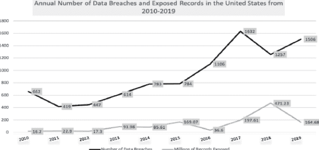
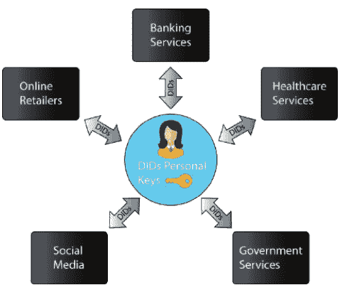
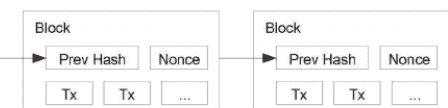
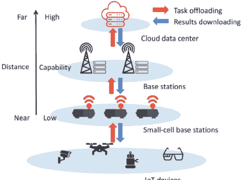
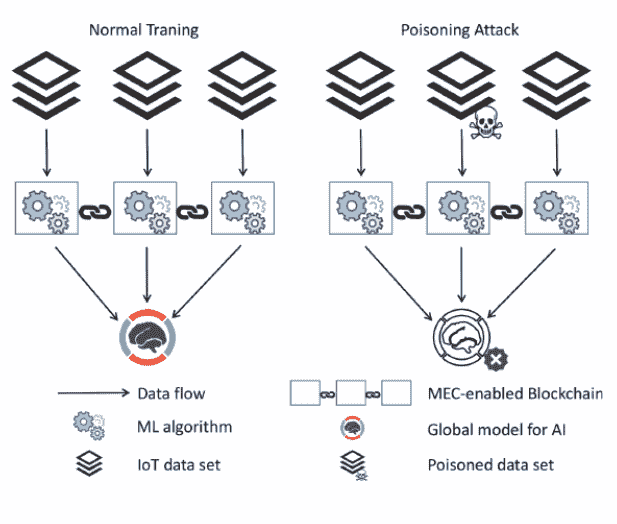
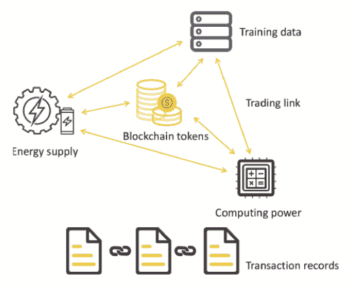
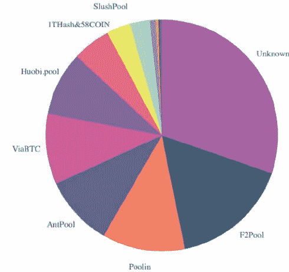
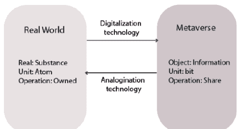

# 人工智能区块链潜力

## 导论章节：关于区块链与人工智能融合的机遇与挑战

### 1. 引言

根据 2019 年发表的一项 PwC 全球研究，人工智能（AI）有望在 2030 年前为全球经济贡献高达 15.7 万亿美元 [1]。在该公司 2020 年的一份报告中，预测区块链（BC）应用将在 2030 年使全球国内生产总值（GDP）增长 1.76 万亿美元（占全球 GDP 的 1.4%）[2]。未来十年经济价值的如此提升，显示了这两项技术作为当前数字化转型关键驱动力的潜力。

人工智能，特别是当今最广泛使用的技术——机器学习（ML）、深度学习（DL）或强化学习（RL）——能够创建学习模型，以处理和分析数据、执行任务或针对各种现实世界问题做出预测，而这些问题曾被认为不可能由非人类解决。然而，AI 的使用伴随着与数据中心化导致的数据篡改可能性、假新闻和深度伪造的兴起 [3]、隐私侵犯或数据训练偏差等问题相关的社会担忧。

分布式账本技术（DLT），特别是区块链（BC），可以在一组参与者之间建立信任和共识，从而消除对中介的需求。一方面，BC 可以帮助为可解释 AI 建立数据溯源，并确保技术中使用的数据源的真实性和可靠性 [4]。此外，面向 AI 的去中心化计算使无需中介即可在去中心化的安全共享数据上进行决策。此外，利用智能合约的自主系统可以随时间学习并做出可信决策 [5]。另一方面，AI 可以帮助解决 BC 实现中的一些当前局限性，如可扩展性或安全性、保护隐私的个性化、自动仲裁和治理机制 [6]。

AI 和 BC 正越来越多地用于相同甚至相同的应用。因此，预计 AI 和区块链将在不久的将来融合为 BC-AI 系统，为电动汽车智能电网 [7]、工业 4.0 自动化 [8]、关键基础设施（例如，智慧城市燃气系统 [9]）、6G 网络 [10]、车联网 [11] 或数据安全 [12] 等领域的重大创新铺平道路。此外，此类进步还可以通过联合使用其他工业 4.0/工业 5.0 赋能技术（如物联网（IoT）、边缘计算或增强现实（AR）、混合现实（MR）或虚拟现实（VR））来实现 [13]。

以往的研究概述了 AI 和 BC 融合的潜在机会 [5, 6]。然而，正如 Pand 等人 [14] 所指出的，大部分当前研究仅提供了一个理论框架来描述 AI 和 BC 即将发生的集成。此外，大部分可用研究集中于单向集成（即，BC 如何集成到 AI 中或 AI 如何集成到 BC 中），而没有考虑其双向性，并且一般来说，它没有考虑到不同于 BC 的 DLT 的存在，这些 DLT 可能更适合 IoT 等特定场景。本书旨在帮助 AI 和 BC 研究人员开发克服当前挑战并允许两种技术融合的系统。

### 2. 机遇与挑战

BC-AI 系统的充分发展为创新提供了众多机遇。尽管这种集成的预期未来前景广阔，但也可以指出一些未来研究人员必须面对的公开挑战。以下段落总结了需要考虑的某些方面：

- 1. 当前 BC 和 AI 的成熟度水平

采用 BC-AI 系统将在短期和中期开辟广泛的潜在应用。然而，这是一个快速发展的领域，完全部署将涉及多个潜在研究课题：BC 可扩展性或安全性、智能合约漏洞和确定性执行、可信预言机选举或 AI 专用共识协议。

- 2. 与工业 4.0/工业 5.0 赋能技术联合使用的 BC-AI 系统所驱动的创新
  - IoT. 得益于去中心化 AI 算法和移动边缘计算，设备端 IoT 数据训练是可能的 [15]。然而，BC 在 IoT 应用中的使用仍然需要面对一些公开挑战 [16]。
  - Fog and Edge Computing. IoT 设备可以将训练任务卸载到雾计算或边缘计算设备，以实现网络边缘的 AI [17]。此外，此类节点可以配备 BC 模块，允许雾节点执行本地化数据管理、访问和控制。这些分布式边缘智能框架在延迟和网络资源消耗方面具有优势，但也带来了用户隐私和数据安全等某些额外挑战 [18]。
  - Augmented Reality (AR), Mixed Reality (MR), and Virtual Reality (VR) (元宇宙). 此类技术提供了与数字内容交互以及创建新世界的新方式，在其中可以参与各种活动，这些活动将通过使用 BC 等可信技术加速，从而将数字内容转变为有价值的资产 [19]。

- 3. 量子计算
  - 在即将到来的量子计算时代，将开发出针对经典密码系统的新攻击，因此研究人员将不得不关注量子计算领域及其进展 [20]。

### 4. 碳足迹减少与能源效率优化

- 研究人员将不得不研究在部署 BC-AI 系统时如何最大限度地减少环境影响并最大限度地提高能源效率 [18]。具体而言，研究人员将不得不开发新方法来优化密码系统并减少 AI 技术的能源消耗。

### 5. 标准化与法规

- 虽然目前正在制定 BC 技术的标准 [21]，但在 AI 应用场景中 BC 部署的法规需要在地方和全球层面建立。此外，遵守当前立法指令意味着广泛的全球利益相关者合作以及创建概念验证，以定义确保互操作性的正确技术标准集。

### 6. 企业治理、企业战略与文化

- 组织尝试新业务战略并进行长期投资的能力将在采用 BC-AI 创新系统方面至关重要，因为协作方法是纳入所有利益相关者并建立在降低碳排放的同时创造价值的新方式所必需的。

### 3. 结论

本章总结了 AI 和 BC 在融合过程中将面临的最相关问题。这些问题将在本书的不同章节中得到解决，这表明了 AI 与 BC 集成的潜力。因此，本书包括了 AI 与 BC 融合的最新技术和未来研究机会。

本书还涉及了需要解决的技术和实际限制，涉及可扩展性、隐私、智能合约安全性、可信预言机、共识协议、与工业 4.0/工业 5.0 技术的交互、量子计算复原力、碳足迹减少、标准化、互操作性、法规和治理。所描述分析获得的结果将有助于指导跨学科 AI 和 BC 应用及/或该领域融合的未来开发人员，并为基于 BC-AI 系统的下一代创新的发展做出贡献。

### 利益冲突

作者声明不存在利益冲突。

### 参考文献

- [1] PwC’s 全球人工智能研究：利用人工智能革命。PwC，伦敦，英国，2017年。可从以下网址获取：https://www.pwc.com/gx/en/issues/data-and-analytics/publications/artificial-intelligence-study.html [访问日期：2021年10月24日]

- [2] PwC. 区块链技术有望通过提升追踪、溯源和信任水平，到2030年为全球经济增加1.76万亿美元。PwC，伦敦，英国，2020年。可从以下网址获取：https://www.pwc.com/gx/en/news-room/press-releases/2020/blockchain-boost-global-economy-track-trace-trust.html [访问日期：2021年10月24日]

- [3] Fraga-Lamas P, Fernández-Caramés TM. 假新闻、虚假信息和深度伪造：利用分布式账本技术和区块链打击数字欺诈和伪造现实。IT Professional. 2020;22(2):53-59. DOI: 10.1109/MITP.2020.2977589

- [4] Tanwar S, Bhatia Q, Patel P, Kumari A, Singh PK, Hong W. 基于区块链的智能应用中机器学习的采用：挑战与前进之道。IEEE Access. 2020;8:474-488. DOI: 10.1109/ACCESS.2019.2961372

- [5] Marwala T, Xing B. 区块链与人工智能。2018年。可从以下网址获取：https://arxiv.org/abs/1802.04451

- [6] Dinh TN, Thai MT. 人工智能与区块链：一种颠覆性融合。Computer. 2018;51(9):48-53

- [7] Wang Z, Ogbodo M, Huang H, Qiu C, Hisada M, Abdallah AB. AEBIS：面向智能电网平台电力管理的AI赋能区块链电动汽车集成系统。IEEE Access. 2020;8:226409-226421. DOI: 10.1109/ACCESS.2020.3044612

- [8] Qu Y, Pokhrel SR, Garg S, Gao L, Xiang Y. 面向工业4.0网络认知计算的区块链联邦学习框架。IEEE 工业信息学学报。2021;17(4):2964-2973. DOI: 10.1109/TII.2020.3007817

- [9] Xiao W et al. 基于区块链的安全天然气：面向智慧城市的AI赋能天然气预测与交易的区块链驱动安全物联网系统。IEEE 物联网期刊。2021;8(8):6305-6312. DOI: 10.1109/JIOT.2020.3028773

- [10] Li W, Su Z, Li R, Zhang K, Wang Y. 面向6G网络人工智能应用的基于区块链的数据安全。IEEE 网络。2020;34(6):31-37. DOI: 10.1109/MNET.021.1900629

- [11] Hammoud A, Sami H, Mourad A, Otrok H, Mizouni R, Bentahar J. 面向智能安全物联网车辆的AI、区块链与车载边缘计算：挑战与方向。IEEE 物联网杂志。2020;3(2):68-73. DOI: 10.1109/IOTM.0001.1900109

- [12] Wang K, Dong J, Wang Y, Yin H. 利用区块链和AI保障数据安全。IEEE Access。2019;7:77981-77989. DOI: 10.1109/ACCESS.2019.2921555

- [13] Fernández-Caramés TM, Fraga-Lamas P. 区块链在下一代网络安全工业4.0智能工厂中的应用综述。IEEE Access。2019;7:45201-45218. DOI: 10.1109/ACCESS.2019.2908780

- [14] Pandl KD, Thiebes S, Schmidt-Kraepelin M, Sunyaev A. 人工智能与分布式账本技术的融合：范围综述与未来研究议程。IEEE Access。2020;8:57075-57095. DOI: 10.1109/ACCESS.2020.2981447

- [15] Lin X, Li J, Wu J, Liang H, Yang W. 边缘AI赋能物联网中的知识可交易化：基于联盟区块链的高效激励方法。IEEE 工业信息学学报。2019;15(12):6367-6378. DOI: 10.1109/TII.2019.2917307

- [16] Fernández-Caramés TM, Fraga-Lamas P. 物联网中区块链应用综述。IEEE Access。2018;6:32979-33001. DOI: 10.1109/ACCESS.2018.2842685

- [17] Fan S, Zhang H, Zeng Y, Cai W. 面向边缘计算联邦学习的混合区块链资源交易系统。IEEE 物联网期刊。2021;8(4):2252-2264. DOI: 10.1109/JIOT.2020.3028101

- [18] Fraga-Lamas P, Lopes SI, Fernández-Caramés TM. 绿色物联网与边缘AI：迈向智慧循环经济可持续数字化转型的关键技术推动者——工业5.0用例。传感器。2021;21:5745. DOI: 10.3390/s21175745

- [19] Cannavò A, Lamberti F. 区块链、虚拟现实与增强现实如何融合及其原因。IEEE 消费电子杂志。2021;10(5):6-13. DOI: 10.1109/MCE.2020.3025753

- [20] Fernández-Caramés TM, Fraga-Lamas P. 迈向后量子区块链：抗量子计算攻击的区块链密码学综述。IEEE Access。2020;8:21091-21116. DOI: 10.1109/ACCESS.2020.2968985

- [21] Anjum A, Sporny M, Sill A. 面向合规与信任的区块链标准。IEEE 云计算。2017;4(4):84-90

## 技术社会中的比特币与伦理

### 摘要

比特币诞生为一种用于在线交易的点对点支付系统。这一成果源于关于政府控制与公民未来关系的共同愿景，以及众多为密码学领域发展做出贡献者的协作工作。这一创新及其底层技术——区块链——一直是范式转变的根源，因为区块链与人工智能（AI）的联合应用正在孕育下一场技术革命。然而，如同常见情况，这些革命性发明在金融界和整个社会也遭遇了怀疑。本文以比特币和区块链为例，分析了这些创新背后的哲学与技术之间的交汇点，以及社会中既害怕这些发展、又有人试图从中获利的群体的看法。在本章中，我们首先回顾比特币的历史及其幕后人物的历史。接着，我们回顾其进入市场后获得的褒贬不一的反响。我们评估这些创新的属性，并将其与社会的需求相对比，该社会渴望在与其参与民主进程相关的事务中获得更多清晰度并享有更高透明度。

**关键词：** 比特币，区块链，伦理，加密货币，中本聪，克雷格·S·赖特，分布式账本技术，人工智能，数据隐私，自由，加密无政府主义，自由意志主义，密码学

### 1. 引言

> “没有人能够抵挡思想的入侵。” – 维克多·雨果，《一个罪行的故事》

比特币 [1] 于2009年诞生，作为一种用于在线交易的点对点支付系统。这种电子现金系统的设计旨在无需中介金融机构来协调交易的情况下进行在线支付。当一名化名中本聪的个人于2008年10月31日广播了协议的第一个版本，并于2009年1月发布了相关软件时，该系统才为人所知 [2, 3]。任何人都可以下载该软件，运行它的任何计算机都可以加入网络。有了比特币，交易中的第三方变得多余，因为现在交易可以在没有中介连接发送方和接收方的情况下执行。相反，这些操作使用了一台计算机网络，它们通过比特币开源软件直接相互通信。

当比特币推向市场时，此前已有多次推出数字货币的尝试（如E-gold或Liberty Reserve）。鑒于比特币公开发布前悠长的技术演进历史，我们可以说，促成其成功的想法已酝酿数十年。这一成果源于关于以与在线技术同步演进相一致的方式开发电子支付系统的必要性这一共同愿景。此外，这一结果回应了超现代社会的需求，在该社会中，对隐私、效率、效力和透明度的需求无法被忽视，并且必须与个人自由的感知共享空间。因此，尽管比特币由中本聪构思，但这项技术是多个个人积极协作的结果，他们以各自方式和不同程度参与了其开发。

然而，除了许多其他概念和技术差异之外，与早期创建各类数字现金的失败尝试相比，比特币取得了成功，并且直到2011年4月Namecoin作为第一种“替代币”出现 [4] 之前，它始终是唯一的去中心化数字现金币。这一成功的关键原因在于，比特币的创造者能够在设计中融入解决两个长期难题的方案：双重支付问题和拜占庭将军问题。第一个问题指的是确保接收到的信息完整准确，且不会有虚假更新被引入账本，从而确保同一笔钱永远不会被花费超过一次。第二个问题涉及在不信任彼此（因为他们不共享相同利益）的各方之间达成共识。

自2009年公开以来，“区块链”或“时间链”——即中本聪最初称比特币底层技术的名称——一直是范式转变的根源。原因在于，区块链与人工智能的联合应用预计将孕育下一场技术革命。情况正是这样，以至于围绕在各行各业开发应用的工程师和发明者周围，已经涌现出一个新的经济部门。

伴随着这种技术扩张，革命性发展的炒作，特别是巨大潜在经济回报的承诺，也带来了大批人从事围绕这些新领域的其他活动。一些人成为创业型矿工，另一些人则担任投资者、交易员和/或这些市场的投机者等角色。这些事件发生的同时，整个世界扮演着旁观者的角色：一方面试图捕捉这项技术的本质，另一方面希望设想可能（如果有的话）的潜在用途及其对社会的有意义实施的后果。与此同时，围绕大多数此类资产的金融市场的投机性质已成为不可否认且令人担忧的事实。

阻碍对当前统归为“加密货币”或“替代货币”总称下的各种解决方案进行公平评估的一个基本障碍是这些产品的技术复杂性。这解释了为何许多出版物和投资者错误地将它们相互比较并视为等同。此外，在理解该技术的人群中，还存在一场关于是什么属性应定义其结构和实质的潜在知识与道德之争。特别是，存在可追溯性这一关键问题，它早已处于电子支付系统创建演化史的核心。

此外，正如创新常见的情况一样，这些事物在社会许多人中引发了强烈情绪。这些情绪部分源于在尝试适应新技术存在时所面临的挑战。但此外，大部分情绪潮流是由于前一段中强调的问题而汹涌的。对技术运作方式缺乏理解，以及植根于道德立场的态度的渗透性，导致许多人（包括金融界和广大社会中的相关人士）发表了高调言论。以下是相关人士敌意的三个早期示例。

对新技术革命持怀疑态度并表示憎恶的公众人物。其中包括：诺贝尔奖得主保罗·克鲁格曼撰写的“比特币是邪恶的 [5, 6]”；查理·斯特罗斯撰写的“我希望比特币在火中死去 [7]”；以及摩根大通首席执行官杰米·戴蒙的多次声明 [8, 9]。考虑到历史上比特币在被归类为“加密货币”的资产中最具辨识度和相关性，许多批评都将其作为该资产类别的代表。

### 2. 深网与赛博朋克

与各种数字资产之间的差异无关，加密货币——作为一种资产类别，以及区块链——作为一种技术，在市场观察者和参与者中唤起了强烈的情绪。问题的核心在于这些技术是否有其存在的必要；如果有，如何将其纳入财产和个人权利的常见范畴。除此之外，深网中个人早期利用这些技术进行非法交易 [10]，投下了一种难以摆脱的负面阴影。这种负面印象因人们对这些技术运作机制的普遍缺乏学术研究，以及普通读者无法将它们区分开来而进一步加深。例如，人们普遍认为比特币是“不可追踪的数字现金”。因此，这种数字现金工具可能被用来逃税，并资助毒品交易、恐怖主义、绑架和勒索等各种非法活动。因此，许多加密货币的半匿名或匿名特性正是这种不利看法的核心。尽管如此，这种情绪之所以根深蒂固，也源于赛朋克运动的传奇。

赛朋克是20世纪70年代的一场运动，主张减少政府控制——在他们看来，这抑制了经济增长 [11]。这一信念与自由主义的自由观念相结合，并认为强大的密码学可以防范政府对个人事务的干预 [12]。该群体所拥抱的目标之一，涉及重组人们在经济上相互作用的方式。而提出的解决方案是使用一种不受政府控制的数字现金货币。魏·戴在其论文“b-money [13]”中描述：

> [ ] 社区由其参与者的合作所定义，而高效合作需要一种交换媒介（货币）和一种强制执行合同的方式。传统上，这些服务由政府或政府赞助机构提供，且仅面向法人实体。在本文中，我描述了一种协议，通过该协议，这些服务可以由不可追踪的实体提供和使用。

围绕赛朋克邮件列表 [14]，该群体主张将加密作为将权力从政府转移到个人的方式。随着公钥密码学的发展，他们开始构思未来社会如何处理货币。他们开发一种不受政府控制的数字现金货币的尝试经历了多个阶段，随着时间的推移，各种出版物描述了这种未来现金的可能结构。然而，首先将数字现金作为匿名且可交换的数字价值文件提出的，是大卫·乔姆 [15]。他1981年的论文《不可追踪的电子邮件、回复地址和数字化名 [16]》，成为后来关于“匿名通信”研究的基石。

赛朋克一代在开发去中心化、强大、在线货币方面取得了重大进展。例如，乔姆创建了一种算法，允许修改硬币而不破坏铸币厂的签名。在他的1982年论文“用于不可追踪支付的盲签名 [17]”中，乔姆解释说，电子银行服务的增长和自动化支付系统的创建，将需要在个人隐私需求和支付被犯罪使用的潜力之间取得平衡。他随后总结，理想的支付系统应具备以下三个关键属性：

- 1. 第三方无法确定个人付款的收款人、时间或金额；
- 2. 个人能够提供付款证明，或在特殊情况下确定收款人的身份；以及
- 3. 能够冻结已被报告被盗的资金。

为了说明这项技术的应用，乔姆提出，通过满足上述三项属性，选民在选举活动中可以在不必前往投票站投下秘密选票的情况下进行投票。乔姆的系统将平衡保密投票的需求、验证投票已被计算的能力以及防止选民欺诈的能力。

除了乔姆，还有几位先驱也在研究其他版本的电子现金。一个例子是哈尔·芬尼，他是一位开发者，推出了可重用工作量证明（RPOW），这是一种短命的解决方案，之所以这样命名是因为它基于工作量证明 [18]。但是，如前所述，直到2009年，在数十年的技术演进、密码学研究的艰苦努力以及许多失败尝试之后，比特币才进入市场，成为第一款能够经受自身发展过程考验的数字现金硬币。

### 3. 情绪与事实，认知与现实

人们抗拒变革有许多原因。首先，变革是一种需要时间来处理的心理体验。此外，如果变革重大且出乎意料，常见的反应是否认。在这种情况下，我们可以告诉自己没有任何相关的事情正在发生，并为自己参与这一过程开脱。对新环境感到准备不足也解释了这种排斥，因为人们被推离了舒适区。变革意味着脱离“旧方式”。因此，那些没有跟上新版本的人可能会感到被取代，并对此采取防御态度。而且，如果变革涉及新技术，个人胜任力是一个常见的担忧。人们担心自己的技能会过时，并作为一种防御机制，他们可能会对创新的成功或适当性表示怀疑。此外，变革可能意味着更多工作，这可能会演变成怨恨和其他负面情绪。最终，取决于受影响者的立场，对变革的抵制可能以多种方式表现出来，从拖延行为和懒惰到破坏和反叛。

当新技术取代旧技术时，似乎整个社会部门都将受到损害。当受影响者抵制跟上时代时，这一点尤其真实。在这些情况下，受损部门可能非常庞大，因为它们可能包括旧技术的提供者和用户等不同行业。这些抵制过程的情绪体验被比作“非理性”（参见 Fineman, 1993 [19]）。从这个角度看，情绪被视为问题的根源，而非实施变革过程中所面临的潜在困难的表现。从心理学角度来看，情绪不一定具有破坏性，因为它们帮助个人适应困难的情况。但它们可能会推动不健康的抵制，从而阻止处于压力下的人适当评估局势。

前几段介绍的对变革的常见反应，部分可以解释主流媒体和社会许多有影响力的人物在报道加密货币时所展现出的强烈情绪。尽管这项创新尚新，且这些市场经历的高波动性引起了许多人的警觉，但担忧的表达方式往往显示出高度的情绪化，以及对技术的有限理解。这些“仇恨”表达通常针对所有归类于“加密货币/另类货币”标题下的产品，仿佛它们是平等或等同的资产。也就是说，一般来说，许多评论者没有区分这些资产底层技术的关键方面。无论是新闻、投资还是娱乐，电视还是书面媒体，包括社交媒体在内的在线媒体，在这些平台上发表的所有表达都塑造了数百万人思考加密货币时的视角。

例如，在《金融时报》2018年2月15日报道的一个公开论坛上，伯克希尔·哈撒韦公司副主席查理·芒格将比特币描述为“完全愚蠢 [20]”，并补充说它应该受到政府打击。2018年3月5日，哈佛经济学家肯尼斯·罗格福特向CNBC记者表示，到2028年比特币“更有可能价值100美元而非10万美元”，暗示其价值取决于其在“洗钱和逃税 [21]”中的作用。另一位直言不讳的比特币批评者是摩根大通首席执行官杰米·戴蒙 [22, 23]，他多次公开表达对比特币的蔑视。例如，在纽约的一次公开会议上，戴蒙声称交易这种虚拟货币“很愚蠢”，并且他 [24] 会“立即解雇”在其公司被发现这样做的任何人。后来，在2018年8月5日阿斯彭研究所第25届夏季庆典晚宴上，戴蒙将比特币称为“骗局”和“欺诈 [25]”，并重申了他一年前发表的言论，当时他称比特币为：

> “比郁金香狂热更糟”以及“仅适用于委内瑞拉 [26, 27]、厄瓜多尔或朝鲜 [28, 29] 之类国家的人，或者说一堆类似东西，或者如果你是毒贩、杀人犯之类，用比特币做这些事总比用美元好。”所以可能存在那样的市场，但会是个有限市场。”他进一步认为，“如果政府无法控制它们，就应该关闭它们” [30–32]。

标题本身就带有强烈情绪色彩的文章有三个例子：1）诺贝尔奖得主保罗·克鲁格曼的“比特币是邪恶的 [33]”；2）查理·斯特罗斯的“我希望比特币在火中死去，[34]”以及3）诺贝尔奖得主罗伯特·席勒的“加密货币具有神秘的吸引力——但它们只是昙花一现吗？” [35] 这些文章中所做的一些言论字面上包括：比特币带有隐含的政治议程，它被设计为不可追踪且易于隐藏，自由主义者喜欢它因为它触动了他们对黄金的癖好的相同按钮，并且它看起来不像“法定货币”，它将在商品市场中处于中心地位，交易的商品将包括暗杀、毒品、儿童色情等等，比特币是为逃税而设计的，加密货币是由那些自视高于国家政府的人设计的 [36]。

鉴于许多出版物的煽情性，2018年加雷斯·詹金森提出了测试关于加密货币的“仇恨蔓延”情绪的想法。他的研究成果发表在一篇CoinTelegraph文章中：《郁金香、泡沫、讣告：透过加密货币的FUD窥探真相 [37]》。在这篇文章中，作者指出，在比特币九年的存在期间，已有十余篇要求其“死亡”的讣告被发表。这些文章来自各行业的广泛专家和评论家，他们提供了总体

主观且带有负面评论，表现出一种恐吓心态，试图贬低区块链技术带来的突破。在作者的“比特币死亡简史”一节中，作者分析了主流媒体曾宣布比特币死亡的实例。到2017年，这些讣告[38]包含了118篇文章。截至2021年1月中旬，这一数字已增加到395。他们的结论基于各种评论家的假设或引用，这些评论家利用欺诈、洗钱、庞氏骗局等来宣布比特币的终结。浏览各种出版物的标题列表有助于评估这些标题对许多人情绪可能产生的深远影响。这里提到的例子涉及比特币，但这种类型的新闻也影响了其他加密资产[39]，例如以太坊。在此情况下，是网站Digiconomist [40]在2015年至2017年间编制了以太坊讣告列表。批评也影响了其他加密货币，伴随着大量悲观预测。

针对一些最常见的批评，反驳使用了以下论点[41]：

- 1. 法定货币的讽刺性弱点[即。美元在过去100年中已贬值了98%[42]或
- 2. 事实是，是J.P.摩根，而不是比特币，在2008年从问题资产救助计划（TARP）[44]中获得了25,000,000,000美元的政府救助[43]，同时承认他们不需要这笔资金，或
- 3. 他所在的银行只有他们声称存放的存款的10%，并每天使用“部分准备金银行制度”凭空创造90%的资金，但仍声称比特币货币才是不合法的、政府必须制止的真正问题所在，或
- 4. 他是一家银行的首席执行官，多年来一直担任纽约联邦储备银行董事会成员，而该银行正是监管其银行的机构，或
- 5. J.P.摩根将加密货币视为“竞争”和“风险”，这一点在其2017年2月27日提交给证券交易委员会（SEC）的年度报告中的“风险因素”部分关于加密货币的描述中有所体现[45–47]。

关于后一点，该报告在风险因素第1A项的“竞争”小节下使用了通用的“加密货币”一词，以解释新竞争者可能威胁J.P.摩根运营的格局变化：

> “金融机构及其非银行竞争对手都面临这样的风险：支付处理和其他服务可能会被无需中介的技术（如加密货币）所颠覆。”

这些观察并非空穴来风，因为竞争对手已经意识到了加密货币的潜力。这一点在高盛集团透露正在研究创建比特币期货[48, 49]，计划买卖加密货币并提供各种比特币敞口合约[50–52]时尤为明显。根据高盛高管Rana Yared的说法：该银行并非比特币的信徒，但不得不承认多个客户要求与比特币合作。高盛和J.P.摩根只是众多关注环境变化的银行中的两家。例如，在其2018年2月22日提交给证券交易委员会（SEC）的年度报告[53]中，美国银行（BoA）表示感到落后，并在不断增长的加密货币市场中“无法”竞争。在这份报告中，BoA承认将不得不承担重大成本，以在加密货币领域保持竞争力[54, 55]：

> “我们未能使产品和服务适应不断变化的行业标准和消费者偏好，可能会损害我们的业务，”BoA在文件中表示；“包括互联网服务、加密货币和支付系统在内的新技术的广泛采用，可能需要大量支出来修改或调整我们现有的产品和服务[ ]。”

因此，BoA决定通过申请加密货币交换系统专利来进行创新。然而，这并没有阻止该银行阻止其客户使用信用卡购买加密货币[56]，因为该银行非常清楚新竞争将对其前景造成不利影响，这一点在其SEC报告[57]中有所体现：

> “……竞争格局可能会受到非存款机构的发展所影响，这些机构提供的产品原本是传统的银行产品，还有新的创新产品，”并且“这可能会减少我们的净利差以及来自基于费用的产品和服务的收入。此外，包括互联网服务、加密货币和支付系统在内的新技术的广泛采用，可能需要大量支出来修改或调整我们现有的产品和服务[ ]。”

BoA向SEC以及其他机构（如J.P.摩根 Chase [58]）所作的声明都承认，尽管加密货币威胁着它们的业务，但它们是“创新”的且“不太可能消失”，因为它们在几个传统上存在问题或缓慢的领域（如跨境或国际支付）具有明显优势。

关于克鲁格曼的言论[59]，他的观点已受到挑战[60]，理由是比特币技术是一种电子支付系统，旨在直接在发送者和接收者之间运作，从而使用户免除处理者收取的2–3%或更高的费用。作为一种支付系统，该技术在伦理上是中立的，即使有些人将其用于不道德的目的。同样，银行系统也被许多人用于进行非法支付，但我们并不将汇丰银行或德意志银行称为“邪恶”。因此，可以解读为，克鲁格曼的观点（包括这些及其他观点）建立在对现状的情感防御之上：中央银行、万事达卡或维萨等支付中介，以及各国政府。

虚拟货币只是一种使用区块链技术记录交易的私人货币形式。但这项技术可以轻易在此基础上构建，以解决问题并在多种运营类型中提高效率和效果，因此其跨行业的潜在用途是无限的。此外，交易网络相对安全、透明、快速且无国界。因此，那些试图根据虚拟货币是“骗子和怪人”的捏造物（Skidelsky, 2018 [61]）、用于洗钱、犯罪和逃税的工具，或旧有自由主义或泡沫狂热的翻版（Shiller, 2018）等理由来贬低和诋毁其相关性的经济学家，完全是错误的。例如，很容易澄清两个最常见的误解：主张：比特币的主要用途是洗钱和进行非法交易的支付。反驳：比特币的基础技术是区块链：一个自其诞生以来保存所有交易永久记录的账本。这个永久记录登记了每枚币的每个持有者（比特币钱包）。因此，记录将每枚比特币与一个或多个钱包绑定。钱包通过智能手机和电脑管理，因此尽管从技术上讲比特币没有直接关联，但它们确实通过电子设备与个人间接关联。因此，非法交易可以被发现，无法被删除，并可以追踪到特定个人。主张：比特币有助于逃税。反驳：正如已所述，每笔比特币交易都被永久记录并公开可访问。因此，美国国税局（IRS）或任何同等组织可以追踪其流动，并轻松估算任何个人应缴纳的税款。

### 4. 社交网络中的伦理

不幸的是，社交网络内部的当前治理并不能帮助区分合法来源和那些试图搭便车的来源。显然，还存在积极起诉使用他人形象和姓名来混淆和欺骗不知情访问者的人和公司的问题。这一点在各个层面都适用：私营公司对其网络和行为负有直接责任，政府层面则有权力和责任确保公司能够在法治框架内发展。

在与Ryan X. Charles最近录制的一次对话中，克雷格·S·赖特博士提供了这样一个案例作为示例 [62]。他所描述的情况，是指他曾在Twitter上提出的一起投诉。其动机是引起其对《数字千年版权法》[63]项下版权侵权的关注，并要求该网络针对使用其受版权保护照片的人采取行动。作为对其请求的回应，Twitter将赖特博士下架，而显然对使用受版权保护图像的人未采取任何行动，这些图像之后仍可在该网络上发布。但是，Twitter并非唯一一家。例如，就在2021年1月26日，Instagram上仍有大量使用赖特博士照片和姓名的账户。

在其2021年1月的作品“关于在社交媒体和金融系统中发展社会憎恶行为的内群体行为与社会心理学探索”的摘要中，赖特博士总结了以下相关观察[64]：

> > “本文对“加密货币”子群体的增长、利用自动化系统滥用社交媒体、网络喷子行为的增强，以及这些活动构成政治和金融威胁的能力进行了初步调查。恶意行为者利用技术发挥现有心理行为，并创造部落主义反应，从而实现对个人在线控制和操纵的自动化方法。在此过程中，权威领导者可以不对称地利用通过进化优势发展起来的社会学和心理学利益，但这些利益在现代社会中却表现出不良影响。”

并得出结论[65]：

> > “恶意行为者利用匿名社交系统和技术的能力，使得犯罪团体得以创建，这些团体针对政治系统、金融系统，并普遍导致困境，导致经济机会损失，针对”

许多人，甚至可能远及社会心理学层面而造成个人伤害。在提供各种可以与虚假且可操纵的来源（例如由机器人控制的非对称系统）相关联的平台访问权限时，权威主义和社会偏差行为者可以操纵他人，使群体两极化和党派化。这些结果可以体现在通过 BTC Core 等团体对包括比特币在内的加密货币进行虚假操纵，以及为内群体引入专家语言，这些内群体相信不仅会致富，还会获得权力和声望。因此，必须调查允许个人身份与活动相分离的新技术兴起，以及允许个人与其活动保持距离的方法的创建，以监管这些系统。

### 5. 我们如何判断什么在伦理上是正确的？

在他题为《科学与革命》的塔纳讲座 [66] 中，萨格德夫表示：“知识分子群体很少直接成为革命的受益者”。用他的话说，这个群体“既扮演了患者、变革受害者的角色，也扮演了医生、准备和实施革命进程的角色 [67]”。事实是，尽管萨格德夫指的是其他类型的起义，但比特币和区块链正在提供可比的革命环境。这场革命同样伴随着利益冲突：一方面是政治口号、权力手段、现状以及利用混乱环境谋取私利的人；另一方面是追求真理、理性和进步的智力动力。

在萨格德夫看来，试图用智力思维去分析社会政治现象，是科学家成为“首批革命者，且往往在革命成功或失败后成为首批囚犯 [68]”的原因之一。例如，他引用了爱因斯坦和一批物理学家成为苏联哲学家攻击受害者的时期，这些哲学家要求将量子力学从“资产阶级”的不确定性原理中“解放出来”，并将相对论从虚构观察者所扮演的可疑角色中“解放”出来 [69]。

在那个时代，科学成为了共产主义“至高智慧”的人质，这种智慧体现在马克思主义经典宣言的公告中。许多无法经历制造“新苏联人”所需的灵魂工程过程，或无法成功躲藏的人，都被消灭了。早先的革命也经历过类似事件，例如法国大革命期间，让-保罗·马拉要求化学特别是成为一种“人民友好科学”。这导致了大规模流血事件，包括化学奠基人安托万·拉瓦锡被断头台处决，因为他关于化学本质的观点与马拉的观点不同。

如今，我们生活在不同的时代。但我们仍能感到一种隶属状态，不是对可识别的政权，而是对众多势力——无论是大型公司、多个政府、福利国家概念，还是其他现状权力来源，如通信巨头——的隶属，这些势力也在按其方便塑造一种“新现代人”，并决定谁才是合格的知识分子。面对这些攻击，每个人可以选择“内部移民”的道路保持沉默，就像在旧苏联一样，或者面对旨在终结个人声望和声誉，甚至可能危及人身安全的协调努力 [70]。

以目前的情况来看，我们当前的“知识分子阶层”似乎也需要分裂为至少两个群体。例如在西班牙，那些想要进步的人可能被迫事实上“凌驾于本国政府之上”，正如席勒所建议的 [71]，以寻找不阻碍增长的环境。原因是，在负责确保立法跟上时代现实的公务员和政客的议程中，这并非优先事项。然而，比特币和基于区块链的创新需要一个灵活、清晰、透明、敏捷且称职的监管体系。当然，这要求监管环境的人理解技术。负责机构和商业团体应当澄清什么是真实、什么是不真实，这又是另一个原因。

显然，当企业家无法获得必要的许可证，或流程被拖延导致其发明过时，或他们怀疑其税务义务不清楚时，他们被迫重新思考自己的情况。在西班牙，希望依法组织这些业务的管理人员面临的一些问题如下 [72]：

- 1. 获取电子货币许可证需要很长时间。
- 2. 鉴于主管部门对技术的理解有限，他们将其视为金融资产而非协议，因此在税务方面如何处理代币也存在不确定性。
- 3. 进入法律沙盒的可能性和敏捷性也是如此。西班牙的沙盒刚刚获批，但仍是一团官僚和行政上的混乱。
- 4. 公司无法100%远程设立和管理其企业，必须进行一些面对面活动。这一要求增加了设立成本，且没有任何附加价值。
- 5. 与美国、英国和瑞士等其他司法管辖区相比，公司的税收和管理成本更高，而这些国家在提供增长方面的障碍更少。

这些只是数字现金和区块链企业家在西班牙境内设立业务时面临的一些关键问题。这一空白很大程度上源于政府将比特币视为金融资产或金融工具而非通信协议，因此继续认为比特币用于投机和犯罪。当一个环境在法律和技术上尚未准备好接受创新时，该政府下属机构的可信度将受损。就我们的例子而言，西班牙体系中众多相关且重大的不足之处迫使许多本地创新者离开本国，在国外设立公司，主要在瑞士、英国和美国。这是因为这些国家已经成功发展出一个更透明、更用户友好的环境，既便利了公司设立率，也便利了技术向其境内的转移。

这一情况为所有相关方带来了法律和伦理问题，此外还带来了严重的财务后果。然而，往往不是解决问题，西班牙等政府试图通过制造官僚迷宫，或将发展局限于其直接或间接控制的组织内，来阻碍发展速度。再次，这一情况让人想起苏联俄国的环境，那时大多数科学发展都由政治当局安排，并通过合同或拨款工作来支持。

### 6. 诚实真实的资产

在其1986年题为《合法性能否以合法性为基础？》[73]的讲座第一部分中，尤尔根·哈贝马斯质疑“合法性”是否可能基于“合法性”。为了突出该说法中隐藏的冲突和不一致，他使用了马克斯·韦伯关于西方政治制度作为“法律统治” [74] 形式的观点。要点是，这些政治制度的合法性建立在对其行使政治权力的“合法性”的信念之上，而不是，比如说，“传统”。

在当今现代民主社会，接受这样的前提可能会产生在现有政治结构内无法解决的争议。原因在于此类系统固有的利益冲突。例如，民主制度中政党的首要目标是连任。为了实现这一目标，政客们常常会使用公共资产，如公共大众传媒通信，就好像这些是他们的私有财产一样。由于所有政党都有相同的利益并因此从这些行动中获益，制衡机制可能被取消，以便他们轮流滥用系统。此外，鉴于“福利国家”的底层基础设施包括从社会某些部门获取财富，使用其中一部分来支持机构，并将剩余部分重新分配给预期成为执政党固定选民的其他群体，我们已经可以看到前者的权利和财产受到威胁以利益后者的情况。

2015年10月，作为拉斯维加斯比特币投资者大会上“全明星小组讨论会”的主持人，Michele Seven 询问了产权的本质 [75]。第一个回答者，Craig Wright 博士 [76]，强调：

> “[ ] 我们需要能够控制自己的自由，而做到这一点的基本方式就是拥有财产权、所有权 [] 这意味着能够按我们想要的方式处置财产，能够分享它，能够拿走它——这就是一切所在。一旦我们拥有可兑现的合同并将其与区块链链接，将金钱、商品、数字权利和所有权链接到一个无法更改的东西：一个根本开放、诚实、真实的资产——即区块链，那时我们才会在世界上看到真正的自由。”

关于同一个问题，Joseph Vaughn Perling [77] 提醒听众，目前人们依赖政府账簿来保存产权记录，告诉我们谁拥有什么，而这种系统不可靠且昂贵，因为它通过税收融资。尽管如此，借助新技术，所有这些成本都有可能降低，因为产权记录将存储在比特币的账簿中。然后，在反思社会与权力中心之间可能出现的未来利益冲突时，Joseph Vaughn Perling [78] 补充说，可能会到来这样一个时刻：

> “诚实政客与不诚实政客的区别，将取决于他们是否支持在政府职能中使用比特币，因为比特币确实提供了这种可审计性以及可在其中实施的反腐败工具。政府可以以前所未有的方式使政府变得可证明地诚实，而可证明地诚实的政府是我们从未见过的” [] 这样，它可能会在人民之间制造这种分歧：政府中那些因为能够证明其诚实程度而更具选举优势的人，与那些竞争职位的人。”

利用区块链构建更透明的政治竞技场将是一项有趣的发展，特别是考虑到“法律统治”的做法，即法律所拥有的理性与道德独立。如今，无法想象一个公民不要求通过法律程序将道德论证制度化的社会。而且，这种期望需要在政府的所有方面产生实际成果，包括影响科学的方面。

Baumol (2002 [79]) 表示，“自十八世纪以来发生的几乎所有经济增长，归根结底都归功于创新。” 鉴于

被认为是自互联网问世以来最具前景的创新，区块链这项发明被预言将带来巨大的财务收益。这些收益将源于其融入流程以简化和保障全球无数领域去中心化交易所带来的经济影响。区块链尤其适用于所有权历史至关重要的场景，例如制药行业、土地登记、房地产、盗版和版权问题，以及公共服务，如医疗援助和福利支付（Tapscott et al., 2016 [80, 81]）。在这项创新的终极形式中，存在自动执行合同，它们可以在人工智能辅助和最少人工干预下运行。使用区块链将为当前困境提供更高的效率和更具成本效益的解决方案。随着旧技术的替代，区块链将减少欺诈，增加信任和安全性，并改善多方交易的透明度。

鉴于所有这些，人们本应期望公共机构会团结起来欢迎和协助推动上述发展。然而，在当前政治和经济恶化的氛围中，政治和现状议程控制着发展速度，科学界和愿意资助这些项目的企业家在一种相当敌对的心理氛围中感到无所适从。

### 7. 通过公开可扩展区块链恢复政府的信任、透明度和效率

1822年8月4日，詹姆斯·麦迪逊 [82] 在致W. T. Barry的信中表示：

> “没有民众信息或获取信息手段的民众政府，只不过是闹剧或悲剧的序幕；或者两者兼而有之。知识将永远统治无知：一个打算自己做管理者的民族，必须武装起知识所赋予的力量。”

透明度和问责制是自由民主社会中两个最基本的原则。它们是知情选民做出自信选举决策与广泛不信任“服务于自身利益、专制腐败的机构”之间的桥梁。此外，随着腐败不断削弱全球民主政府的合法性和可信度，透明度和问责制变得更加重要。根据皮尤研究中心的数据，美国公众对政府和当选官员的不信任已削弱至历史最低点 [83]。公民骚乱、暴力抗议以及反对政府政策、政客和媒体组织的频繁示威活动的兴起凸显了这一问题 [84, 85]。公众对政府和新闻媒体的信任削弱可归因于许多因素，其中许多因素与所传播信息的诚实、开放和信心或其缺乏有关。

2011年，美国启动了一项全面的数字政府战略，旨在建设21世纪的数字政府 [86]。行政命令强调：

> “政府管理人员必须从私营部门中有效的做法中学习，并将这些最佳实践应用于以更好、更快、更低成本的方式提供服务。此类最佳实践包括越来越受欢迎的低成本自助选项，可通过互联网或手机访问，以及改进的流程，能够更快、更灵敏地提供服务，从而减少对客户询问和投诉的总体需求。联邦政府有责任简化并提高其服务交付效率，以更好地服务公众。”

然而，十年后我们仍能发现政府对技术转变反应缓慢的证据。例如，2020年12月，网络安全与基础设施安全局透露，一场持续一年的黑客攻击影响了美国私营公司、政府机构和关键基础设施实体 [87]。这些包括：美国财政部、国土安全部、国务院、国防部、商务部、国家卫生研究院、疾病控制与预防中心和司法部等无数其他机构。总计，估计有18,000个实体成为俄罗斯黑客攻击的受害者。这场相对不为人知的黑客攻击预计将使美国企业和纳税人损失超过1000亿美元 [88]。针对普通公民的此类攻击如此频繁，以至于这些行为的伦理方面与所有其他后果模糊不清，而这些后果会随时间呈指数级增长。

#### 7.1 利用比特币建立信任：现在是区块链改革的时刻

与互联网的变革性特征类似，公共区块链有能力通过提供更大的透明度和可审计性以及一个超高效的“普遍真理源”数据管理平台来颠覆政府流程，该平台可用于恢复信任、验证数据并显著降低成本。自2008年中本聪发表比特币白皮书以来，这一愿景已成为现实，该白皮书为长期存在的问题（如可扩展性障碍等）提出了解决方案 [89]。

比特币被设计为一个开放和诚实系统的基础，该系统是公开的，有一系列制衡机制，并基于工作量证明提供参与激励。在比特币网络上，每笔交易都记录在由被称为交易处理器的专业分布式节点小世界网络维护的公共账本上。当交易广播时，处理器会收集、验证、加时间戳，并将每笔收到的交易添加为一系列基于哈希、事先商定的事件链，安全地保存在不可更改信息的块中。

如前所述，与普遍看法相反，比特币不仅仅是金融价值的转移或存储。比特币建立了一个普遍真理源，信息可以在那里存储、验证、共享、保护和认证。这可以与传统系统或利用云到链解决方案的新型混合选项结合使用。并非所有数据都必须存储在链上，而是可以通过在云中对信息进行哈希处理并将该哈希的副本存储在链上来简单地对其进行认证。这将确保存储在云中或其他地方的数据可以简单地进行认证，以确认其未被更改。

通过去除真正的中心化瓶颈来恢复比特币原始协议，已使真正的创新和无限的链上扩展成为可能。2020年5月，比特币SV区块链处理了一个世界纪录大小的369 Mb区块，包含了130万笔交易。事实上，该网络已经突破每秒近4,000笔交易（tps），预计今年晚些时候将达到50,000 tps。通过扩展带来成本效率，中本聪的愿景在转移微型甚至纳米交易方面依然无与伦比，中位交易费为1/100美元分。借助比特币SV安全、即时、低费的交易，政府组织可以显著降低与金融和数据交易相关的成本。这些节省可能还因审计、网络安全和网络硬件相关成本的降低而叠加。

#### 7.2 比特币可以帮助政府今日恢复透明度和信任

比特币SV已准备好通过向公共部门提供完全的透明度和效率，来实现区块链改革时代的承诺。虽然政府机构只需从常见的信息请求开始，但传统上，采购阶段长期被视为将政府技术需求与能够集成最新新兴技术的供应商连接起来的最大障碍之一 [90]。其后果是，许多小型企业和行业外部人士被完全排除在参与之外，因为该过程可能非常复杂、耗时且昂贵。相比之下，大量变革性的区块链解决方案正等待着通过改善透明度和恢复信任来为更道德的社会做出贡献。其中一些包括：

- **金融交易管理** – 作为分布式账本，比特币可即时记录网络中发生的有效交易的会计核算。只需支付少量交易费（每字节.00011），交易处理器就会在安全账本上记录一条条目。与现代交易管理系统的成本相比，比特币提供了无与伦比的节省、可审计性、安全性，并通过智能合约和代币的集成提供互操作性。示例：**代币化** [91]

- **监管合规** – 由于交易被验证并公开记录到比特币区块链，它们由不可更改的工作量证明保护。这使监管机构、新闻媒体和政府监督团体能够实时访问可共享和信赖的合规相关数据。作为回报，这减轻了政府机构的报告和审计负担，降低了成本并提高了透明度。政府采购机会的智能合约将确保合规性、公平性并提高总体实施速度。示例：**nChain** [92]

- **身份管理** – 与集中式政府数据库不同，比特币提供了一个更安全的分布式数据管理平台，可以赋予公民轻松签署和验证其身份以用于官方政府文件或福利的能力。这也将减少政府验证身份和保护敏感数据所需的时间和资源——尤其是在限制性的跨机构数据孤岛中。示例：**合法链条** [93]

- **登记** – 通过比特币独特的数据管理网络管理任何类型的记录或登记的能力，消除了政府高效管理和验证数据的整体复杂性。这将消除处理土地产权、公司注册以及包括出生、结婚、离婚、刑事或死亡在内的每一种其他类型记录的摩擦。该账本将作为一个诚实的、普遍的真理来源，可以大幅减少欺诈和腐败。示例：**Elas Digital** [94]

- **区块链投票** – 正如我们在2020年美国总统选举周期中所见，公民相信投票过程的完整性至关重要。对返回结果的怀疑，无论是由于错误、欺诈、黑客攻击、腐败还是缺乏透明度，都可能在选民中制造不信任的氛围。比特币防篡改的公共账本非常适合在未来消除选举欺诈——当与基于身份的代币结合时，选民可以使用任何类型的设备轻松投票，消除障碍并增加参与度。示例：**第二层技术（B-vote）** [95]

- **供应链可追溯性** – 冠状病毒大流行向所有人展示了在中断期间我们的全球供应链可能有多脆弱。政府机构竞相定位、采购和分发医疗装备、物资和个人防护设备。这在民众中引发了恐慌，因为医疗服务要么被拒绝、延误，要么因重复使用防护装备而受到损害。供应链缺乏可追溯性继续困扰着COVID-19

宽慰。随着传统政府供应商开始开发疫苗分发和接触者追踪技术，许多公民担心其个人医疗数据未来将如何存储和使用。Bitcoin 通过改善需要在整个价值链中共享宝贵数据的各方之间的信任和隐私来解决这些问题。示例：UNISOT [96]、VXPass [97]。

- 医疗保健 – 像阿片类药物流行病这样的公共卫生危机对社区、纳税人和政府都造成沉重成本。患者数据通常分散在各个不太能相互良好通信的数据孤岛和数据库中。这导致系统出现漏洞，持证药品处方者无法验证患者可能可以同时获得多少处方。Bitcoin 有可能通过患者控制的、可审计的记录来消除这些数据孤岛并改善公共卫生。示例：EHRData [98]

- 税收 – 通过 Bitcoin 和微交易的力量，政府和企业的税务申报变得自动化、审计友好且效率极高。通过将税务支付要求集成到可编程智能合约中，薪资和其他税款会立即提供给政府，使其能够更快地安全收款、更准确地预算并降低欺诈风险。

- 公共援助 – Bitcoin 上的智能合约也可用于创建可编程代币，这些代币可用于政府援助计划，例如食品券计划。这些代币可以通过仅批准购买特定基于需求的物品来减轻欺诈使用并防止滥用。

### 8. 区块链与人工智能

AI 的古老神话经过几个世纪的发展：从希腊，到启蒙时代 [99]，再到 20 世纪，当时它在博弈论和定理证明方面取得了初步进展。现代 AI 概念始于 20 世纪 50 年代，随着新型计算机的出现，设计出类似于人类行为的推理过程成为可能。在此背景下，艾伦·图灵在《计算机器与智能》[100] 中 20 世纪 50 年代提出的“图灵测试”提供了关键进展，其方法用于判定机器是否“智能”。在这里，问题不再是机器是否能思考，而是是否能充当思考者 [101]。七十年后，AI 任务仍难以协调足够表征的需求、能够及时做出和执行决策的有效高效决策机制以及控制之间的关系。

数据的不可篡改性、可访问性、不可否认性和去中心化，是使区块链技术可用于 AI 发展（例如智能合约）的一些属性。此外，区块链与 AI 的结合提供了可以解决区块链固有问题的方案：例如，通过降低能耗 [102]。AI 也被证明对改进区块链和智能合约的安全性很有用 [103]，例如，通过帮助代码验证过程。

AI 在机器中安装认知能力以使其能够学习、解释和适应等功能的技术能力，与所消耗的数据有关。这些数据通常从智能手机用户、社交媒体消费者和 Web 应用程序中收集 [104]。因此，收集这些数据的私营和公共组织面临着信息中心化、合法性、真实性、安全性和隐私等问题。由于 AI 项目中的数据是集中管理的，因此可能会被黑客攻击和篡改 [105]。然而，AI 也是一种工具，可为资源分配、管理大型数据集以及流程和重复性任务等重大任务提供高效解决方案 [106]。因此，区块链和 AI 的联合使用解决了与中心化相关的问题，并为与资源优化相关的问题提供了解决方案 [107]。

智能和自主应用旨在减少不同类型流程中的人工干预；因此，它们对个人和社会的影响引发了重要担忧。对隐私的危害、潜在歧视、公民选择和信息获受限、技能丧失、经济冲击、关键基础设施安全性，或对社会福祉的长期影响，只是这些技术进步对社会提出的关键担忧中的一些。这就是为什么这些创新的开发需要与一套明确的价值观和伦理原则保持一致。

### 9. 伦理设计框架

鉴于这些新技术引发的伦理问题，不同致力于技术与社会公益交叉领域的机构已发布了一系列指南。这里将引用 Beeck Center [108] 报告的指南。不过，其他例如 IEEE 全球人工智能与自主系统伦理考量倡议 [109]，也做出了巨大努力，以鼓励在制定自主和智能技术时优先考虑伦理因素。

在使用区块链和 AI 时，在设计的最早阶段确立伦理方法至关重要。原因是，在后期阶段实施改变会更加困难，甚至不可能。该框架总结如下（第 21 页）：

> (1) 为决策者提供一个以结果为导向、以用户为中心的工具，以评估其区块链设计选择的特定语境后果和伦理影响；以及 (2) 使他们能够利用这种理解做出适当的基于价值观的设计选择，以实现更好的社会成果。

> 归根结底，这些伦理考量大致可追溯到六个根本问题：治理、身份、访问、验证和身份认证、数据所有权以及安全性。

这些因素是三阶段框架的基础。第一阶段是一个五步流程，旨在以伦理为重点确立设计意图。第二阶段（第 40 页）是一个迭代过程，从每个设计决策对生态系统中其他每个元素（即用户、社区等）产生的影响来审视每个设计决策。第三阶段（第 48 页）承认，随着时间推移，语境在演变，每个元素的相关性也在变化。因此，在最后阶段，会对第一阶段和第二阶段进行重新评估，以评估环境中的重大变化。

尽管实现这些目标需要在每个项目开始时投入额外的时间和资源，但即使只考虑对智能合约环境的影响，其好处也是显而易见的。原因是，当预定义的一组条件满足时，智能合约将被部署以开始工作。也就是说，合约将由外部事件、信息系统来源或其他输入触发，这些过程将由不受伦理或法律考量约束的算法自动执行。因此，在设计智能合约时，应分析其超出合同法范畴的影响。例如，智能合约在提供技术解决方案时可以使用伦理上可接受的规则，并通过新的社会契约创建治理模型。就此而言，Reijers 等人 2016 年的著作 [110] 分析了区块链治理的建模如何反映社会契约理论的关键思想。他们的结论（第 147–184 页）是：区块链治理 a) 由卢梭的论证所证明，即它为现有腐败机构结构提供了解决方案；b) 由于不带歧视性，它反映了罗尔斯的“无知之幕”，尽管权力关系在公共账本中表达出来；c) 与霍布斯关于“以规则执行为准的极权主义主权者”的观点一致，并结合卢梭的去中心化治理理念以及罗尔斯关于所有人平等权利和自由的理念（即所有节点）。尽管如此，它未能纳入卢梭的公共利益理念，也未能实施罗尔斯认为对于克服初始状况至关重要的分配正义条件。（第 147 页）。

虽然区块链被视为一种“中立”技术，但其变革力量的政治影响在于它将重新配置经济、法律、制度和政治空间 [111]。信息时代承诺通过规模经济和更高效的资源利用带来巨大益处，但也伴随着巨大的潜在威胁，即创造大量无法跟上时代的被排斥个人。鉴于不同公民层级之间可能出现的脱节，更新的社会契约对于保护人类尊严以及所有人的权利和机会至关重要 [112]。

此外，任何使我们的民主进程更加透明、包容和参与的变化都将造福社会。梅拉妮·斯旺在其 2015 年的著作《区块链：新经济蓝图》[113] 中指出，这项技术将有助于出现新型治理模式和服务。例如，她提到政府将设计更有针对性的服务，以增加细分服务供给。她还列举了许多致力于开发系统以提高民主质量的努力。例如，她解释了大卫·乔姆的随机抽样选举理念 [114]。在此系统中，随机选中的人被要求通过包含候选人辩论和活动人士情绪的选举网站进行投票。在大卫·乔姆看来，由于成本降低，可以产生更多的咨询流程。此外，人们有时间自行了解任何事务，而不是被政治广告所淹没。此外，不需要政府介入。斯旺书中讨论的第三个理念是 DAS，即分布式自治社会。该模型制定了基于共识的去中心化治理系统和去中心化投票系统的原则。在著作中，斯旺教授将该项目讨论为一种授权民主形式，其中投票权赋予代表。此类服务的示例由 https://liquidfeedback.org/ 提供，这是一家提供开源软件的公司，帮助提出建议和做出决策。这是一个相当有说服力的提议，因为在这种方法下，人们可以基于具体行动而非“意识形态”理论相互一致。此外，权力不会长期持有。相反，个人负责特定项目。因此，如果标准化，流动民主中的“流动”将终结当今实践的永久权力政治形式。人们可以想象到的两个直接影响是：权力重新分配给人民，以及增加政治腐败行为的阻力。尽管这种提议存在许多潜在问题，例如：权力掌握在已组织的团体或可能不愿承担这些责任的公民手中，但它实际上可能为关于个人在现代技术先进社会中的责任的全国性讨论提供一个平台。

总体而言，我们可以确信，任何使用由区块链和人工智能设计的投票协议妥善组织的选举，都可以预期至少表现出以下可取属性：投票隐私、完美的选票保密性、公平性、可验证性、自计票特性、无争议性、容错性以及对严重故障的抵抗力。Kiayias 和 Yung [115]、Groth [116]、Park 等人 [117]、Benaloh 等人 [118] 和 Jonker 等人 [119] 的著作详细描述了这些内容。我们也可以确信，如果最近的2020年美国总统选举的基础技术是这种技术，那么许多动荡本可以被避免。

### 10. 结论

国家应确保每个人的人身和财产安全权利，并增强公民做出选择的机会。透明度和问责制是确保公民意愿不被超国家组织需求所取代的两个关键要求：无论是国家、大公司，还是某些资源的唯一所有者。在“监控资本主义”时代，这一点尤为重要，因为个人可能被视为并用作“原材料供应 [120]”。正是在这种环境下，在中本聪发布2008年白皮书和代码之后，比特币进入了市场。

2009年比特币的诞生为一场革命性转型铺平了道路，该转型宣告了过时技术的死亡，并证明了跨部门和政府的许多人必须付出努力以与最新技术保持同步。这是一个真正的全球解决方案，提供了更好的透明度、欺诈保护，更快、更便宜，并且总体上更高效。鉴于此解决方案威胁要在我们的社会中造成根本性和永久性的变化，且可能发展和交易的经济影响极其重大，公众舆论往往对这项技术的运作方式抱有混合的情绪和错误信息。随着比特币以高效方式构建不可篡改的公共记录，一种与潜在利益冲突所带来的问题交织在一起的恐慌心理反复宣告了该新领域的“死亡”[121]。然而，在短短十多年内，大量具有变革性的区块链解决方案已经构建完成。在众多方案中，我们列出了一些现成的解决方案，它们将具有即时的宣泄力量。当然，这些及其他当前存在的应用程序值得更长时间的讨论。

二战后的几十年里，制定了道德标准，以帮助管理未来科学如何在不重蹈过去暴行覆辙的前提下向前发展[122]。技术被视为规范中立的，但由于交易是不可逆的，并且通过将代码转化为经济法来巩固经济合同，比特币的使用提出了一系列伦理问题。例如，我们可以思考隐私问题、矿工是否行为负责、这项技术是否助长欺诈等等。然而，通过研究技术本身和交易，这些问题都可以得到解答。在这里，我们将注意力转向：比特币的使用是否有助于“伦理”，这里的伦理是指当社会恢复透明度并防止欺诈时所实现的正义。在这个可以想象的未来，比特币将使公民拥有更自愿的生活，并以此方式通过帮助创造更公平的社会来促进正义的道德规范。

约翰·菲茨杰拉德·肯尼迪 [123] 曾表示：“变革是生活的法则。只有关注过去或现在的人必定会错失未来。”我们希望本章能通过帮助读者评估这场即将到来的比特币革命将展开的变革深度，做出贡献。

### References

- [1] 请注意，Bitcoin指的是协议，而bitcoin指的是货币本身。
- [2] 请参见 https://ramonquesada.com/ 和 https://es.ramonquesada.com/glossary/bitcoin-es/; https://www.mail-archive.com/cryptography@metzdowd.com/msg10142.html
- [3] https://bitcoin.org/bitcoin.pdf
中本聪 比特币：一种点对点电子现金系统
- [4] 在本文中，我们将cryptocurrency、digital money和digital currencies用作同义词。这些术语指的是原生数字货币，例如bitcoin，而不是法定货币的数字版本，例如欧元、美元、英镑等。我们使用术语“Bitcoin”来指代整个比特币网络，而“bitcoin”指代由该网络产生的数字货币。
- [5] 保罗·克鲁格曼的文章“比特币是邪恶的” 2013年12月28日
https://krugman.blogs.nytimes.com/2013/12/28/bitcoin-is-evil/?_r=1
- [6] 保罗·克鲁格曼的文章“比特币是邪恶的” 2013年12月28日
https://krugman.blogs.nytimes.com/2013/12/28/bitcoin-is-evil/?_r=1
- [7] 查理·斯特罗斯的文章“我想让比特币在火中死去” 2013年12月28日 https://www.antipope.org/charlie/blog-static/2013/12/why-i-want-bitcoin-to-die-in-a.html
- [8] 威廉·苏伯格的文章“JPMorgan CEO Jamie Dimon 重启比特币抨击，称加密货币为‘骗局’ 2016年8月6日 https://cointelegraph.com/news/jpmorgan-ceo-jamie-dimon-returns-to-bitcoin-bashing-calls-cryptocurrency-a-scam
- [9] https://cointelegraph.com/news/jp-morgan-chase-ceo-jamie-dimon-bitcoin-is-going-to-be-stopped
- [10] http://www.smh.com.au/technology/technology-news/drugs-bought-with-virtual-cash-20110611-1fy0a.html; https://upload.wikimedia.org/wikipedia/commons/0/0b/Silk_Road_Seized.jpg
- [11] https://www.activism.net/cypherpunk/crypto-anarchy.html
- [12] https://www.activism.net/cypherpunk/manifesto.html
- [13] W. Dai，“b-money”，http://www.weidai.com/bmoney.txt，1998年。http://www.weidai.com/bmoney.txt
- [14] https://www.Cypherpunks.to/list/
- [15] 大卫·乔姆，“实现电子隐私”，《科学美国人》，1992年8月，96-101页。
- [16] 大卫·乔姆，“不可追踪的电子邮件、回复地址和数字化身”，《计算机协会通讯》. 第24卷第2期，1981年2月，第84-90页 http://citeseerx.ist.psu.edu/viewdoc/download?doi=10.1.1.79.7468&rep=rep1&type=pdf
- [17] 大卫·乔姆，“用于不可追踪支付的盲签名”，《密码学进展》Crypto. 82 (3): 199–203. doi:10.1007/978-1-4757-0602-4_18. (http://www.hit.bme.hu/~buttyan/courses/BMEVIHIM219/2009/Chaum.BlindSigForPayment.1982.PDF
- [18] http://nakamotoinstitute.org/finney/rpow/
- [19] Fineman, S. (1993). 情感与组织。在 C. Hardy (编), 组织研究手册 (第1-64页). 伦敦：Sage。
- [20] https://cointelegraph.com/news/94-year-old-berkshire-hathaway-vp-its-disgusting-people-buy-bitcoin
- [21] https://www.cnbc.com/2018/03/05/bitcoin-more-likely-to-be-100-than-100000-in-10-years-kenneth-rogoff.html
- [22] 威廉·苏伯格的文章“JPMorgan CEO Jamie Dimon 重启比特币抨击，称加密货币为‘骗局’” 2018年8月6日 https://cointelegraph.com/news/jpmorgan-ceo-jamie-dimon-returns-to-bitcoin-bashing-calls-cryptocurrency-a-scam
- [23] https://cointelegraph.com/news/jp-morgan-chase-ceo-jamie-dimon-bitcoin-is-going-to-be-stopped
- [24] https://www.theguardian.com/technology/2017/sep/13/bitcoin-fraud-jp-morgan-cryptocurrency-drug-dealers
- [25] https://twitter.com/CNBC/status/907663994613354496
- [26] https://cointelegraph.com/news/bitcoin-mining-thrives-in-venezuela-thanks-to-hyperinflation-and-free-electricity
- [27] https://cointelegraph.com/news/bitcoin-in-venezuela-bolivar-worth-50-of-world-of-warcraft-gold
- [28] https://www.theguardian.com/technology/2017/sep/13/bitcoin-fraud-jp-morgan-cryptocurrency-drug-dealers
- [29] https://www.theguardian.com/technology/2017/sep/13/bitcoin-fraud-jp-morgan-cryptocurrency-drug-dealers
- [30] https://cointelegraph.com/news/jpmorgan-ceo-jamie-dimon-returns-to-bitcoin-bashing-calls-cryptocurrency-a-scam
- [31] 威廉·苏伯格 JPMorgan CEO 严厉言论后比特币价格下跌 2017年9月13日 https://cointelegraph.com/news/bitcoin-price-drops-after-jpmorgan-ceo-harsh-rhetoric
- [32] https://www.theguardian.com/technology/2017/sep/13/bitcoin-fraud-jp-morgan-cryptocurrency-drug-dealers
- [33] 保罗·克鲁格曼的文章“比特币是邪恶的” 2013年12月28日 https://krugman.blogs.nytimes.com/2013/12/28/bitcoin-is-evil/?_r=1
- [34] 查理·斯特罗斯的文章“我想让比特币在火中死去” 2013年12月28日 https://www.antipope.org/charlie/blog-static/2013/12/why-i-want-bitcoin-to-die-in-a.html
- [35] https://www.theguardian.com/technology/2018/may/21/cryptocurrencies-fad-money-bitcoin
- [36] https://www.theguardian.com/technology/2018/may/21/cryptocurrencies-fad-money-bitcoin 在2013年诺贝尔奖获得者罗伯特·席勒最近的一篇文章中，这位经济学家指出
- [37] Jenkinson, G. (1918) 郁金香、泡沫、讣告：透过加密货币的FUD窥探。https://cointelegraph.com/news/tulips-bubbles-obituaries-peering-through-the-fud-about-crypto. 发布于2018年6月24日。
- [38] https://99bitcoins.com/bitcoin-obituaries/ 由99bitcoins.com收集
- [39] https://cointelegraph.com/tags/altcoin
- [40] https://digiconomist.net/?s=Ethereum+obituaries; https://digiconomist.net/new-ethereum-obituaries
- [41] 克鲁格曼的文章后有524条评论，查理·斯特罗斯的评论（902条）
- [42] https://cointelegraph.com/news/volatility-the-necessary-evil-of-cryptocurrency-and-how-to-handle-it
- [43] https://twitter.com/ErikVoorhees

- [44] https://en.wikipedia.org/wiki/Troubled_Asset_Relief_Program

- [45] https://cointelegraph.com/news/jp-morgan-sees-crypto-as-competition-and-risk-to-its-business-in-sec-annual-report

- [46] Molly Jane Zuckerman J.P. Morgan 将加密货币视为其业务的“竞争”和“风险”，SEC 年度报告 2018年2月28日 https://cointelegraph.com/news/jp-morgan-sees-crypto-as-competition-and-risk-to-its-business-in-sec-annual-report

- [47] http://investor.shareholder.com/jpmorganchase/secfiling.cfm?filingID=19617-18-57&CIK=19617#CORP10K2017_HTM_S440D20F00AA0567AADC9B36846A275C5

- [48] https://cointelegraph.com/tags/bitcoin-futures

- [49] https://cointelegraph.com/news/elite-investment-bank-goldman-sachs-to-clear-bitcoin-futures-for-clients

- [50] https://www.bloomberg.com/news/articles/2017-12-21/goldman-is-said-to-be-building-a-cryptocurrency-trading-desk

- [51] https://www.nytimes.com/2018/05/02/technology/bitcoin-goldman-sachs.html

- [52] https://cointelegraph.com/news/bloomberg-goldman-sachs-to-setup-cryptocurrency-trading-desk

- [53] https://www.sec.gov/Archives/edgar/data/70858/000007085818000009/bac-1231201710xk.htm

- [54] https://cointelegraph.com/news/bank-of-america-our-inability-to-adapt-could-see-a-failure-to-compete-with-crypto

- [55] https://cointelegraph.com/news/bank-of-america-our-inability-to-adapt-could-see-a-failure-to-compete-with-crypto

- [56] https://cointelegraph.com/news/jp-morgan-chase-bans-buying-cryptocurrency-with-credit-cards

- [57] https://www.sec.gov/Archives/edgar/data/70858/000007085818000009/bac-1231201710xk.htm

- [58] https://cointelegraph.com/news/crypto-unlikely-to-disappear-says-internal-report-attributed-to-jp-morgan

- [59] 保罗·克鲁格曼，P. R.（2013）. 比特币是邪恶的。检索自 http://krugman.blogs.nytimes.com/2013/12/28/bitcoin-is-evil/?_r=1

- [60] https://twitter.com/CNBC/status/907663994613354496

- [61] https://robertskidelsky.com/2018/05/23/why-reinvent-the-monetary-wheel/

- [62] https://youtu.be/ER1meMPRFRE. 3. 唐纳德·特朗普、密码学邮件列表和 SIGASH 类型 - 中本聪 - CSW & RXC，2021年1月21日在线发布，分钟 00:49-1.21

- [63] https://www.govinfo.gov/content/pkg/PLAW-105publ304/pdf/PLAW-105publ304.pdf 数字千年版权法案，由比尔·克林顿总统于 1998 年 10 月 28 日签署成为法律。

- [64] 克雷格·赖特博士。2021年1月11日。社交媒体和金融系统中发展社会反感行为的内群体行为与社会心理学探索。摘要。https://papers.ssrn.com/sol3/papers.cfm?abstract_id=3763746

- [65] 克雷格·赖特博士。2021年1月11日。在技术社会中发展比特币与伦理的内群体行为与社会心理学探索 DOI: http://dx.doi.org/10.5772/InTechLi.96798 社交媒体和金融系统中社会反感行为。摘要。https://papers.ssrn.com/sol3/papers.cfm?abstract_id=3763746 第 9 和 10 页。

- [66] 第 322-331 页 R. Z. 萨盖德夫] 科学与革命，人文价值塔纳讲座。1992年3月9-16日。https://tannerlectures.utah.edu/_documents/a-to-z/s/Sagdeev93.pdf

- [67] 第 322-331 页 R. Z. 萨盖德夫] 科学与革命，人文价值塔纳讲座。1992年3月9-16日。https://tannerlectures.utah.edu/_documents/a-to-z/s/Sagdeev93.pdf

- [68] 第 322-331 页 R. Z. 萨盖德夫] 科学与革命，人文价值塔纳讲座。1992年3月9-16日。https://tannerlectures.utah.edu/_documents/a-to-z/s/Sagdeev93.pdf

- [69] 第 322-331 页 R. Z. 萨盖德夫] 科学与革命，人文价值塔纳讲座。1992年3月9-16日。https://tannerlectures.utah.edu/_documents/a-to-z/s/Sagdeev93.pdf

- [70] https://www.washingtontimes.com/topics/parler/ ; https://www.washingtontimes.com/news/2021/jan/24/parler-provided-freedom-censorship-cost-users-data/

- [71] 2013年诺贝尔奖得主罗伯特·席勒在谈到数字现金案例时表示：“对一个高于国家政府的新创业型世界公民社群的信仰声明”

- [72] https://www.lainformacion.com/mercados-y-bolsas/la-cnmv-y-el-banco-de-espana-alertan-del-riesgo-regulatorio-sobre-bitcoin/2828815/ https://www.lainformacion.com/economia-negocios-y-finanzas/economia-criptomonedas-no-tienen-garantias-otros-activos/2828975/https://www.expansion.com/mercados/divisas/2021/02/10/6023b9bfe5fdea55778b4619.html

- [73] 尤尔根·哈贝马斯，1986年，第一讲：合法性如何在合法性基础上成为可能？

- [74] 马克斯·韦伯，《经济与社会》（科隆，1964），第3章，第2页，160页及以下。

- [75] https://www.youtube.com/watch?v=LdvQTwjVmrE&feature=emb_logo 全明星小组：埃德·莫伊，约瑟夫·沃恩珀林，特雷斯·梅耶，尼克·萨博，克雷格·赖特博士。在比特币投资者大会上发表 - 内华达州拉斯维加斯，2015年10月29-30日 http://BitcoinInvestor.com

- [76] https://www.youtube.com/watch?v=LdvQTwjVmrE&feature=emb_logo 请参见分钟 (48:18-50:01)

- [77] https://www.youtube.com/watch?v=LdvQTwjVmrE&feature=emb_logo 全明星小组：埃德·莫伊，约瑟夫·沃恩珀林，特雷斯·梅耶，尼克·萨博，克雷格·赖特博士。在比特币投资者大会上发表 - 内华达州拉斯维加斯，2015年10月29-30日 http://BitcoinInvestor.com 请参见分钟 52:22-53:42

- [78] https://www.youtube.com/watch?v=LdvQTwjVmrE&feature=emb_logo 全明星小组：埃德·莫伊，约瑟夫·沃恩珀林，特雷斯·梅耶，尼克·萨博，克雷格·赖特博士。在比特币投资者大会上发表 - 内华达州拉斯维加斯，2015年10月29-30日 http://BitcoinInvestor.com 请参见分钟 63:25-63:58

- [79] 鲍姆尔，WJ.（2002）. 自由市场创新机器：分析资本主义增长奇迹。普林斯顿大学出版社，载于 J.M. Rivière，区块链技术与知识产权 - 调查政府和立法中的利益与接受度。初级管理科学，2018，3(1)，1-15。

- [80] 塔普斯科特，D., 塔普斯科特，A.（2016）. 区块链革命：比特币背后的技术如何改变金钱、商业和世界。加拿大企鹅出版社。

- [89] https://papers.ssrn.com/sol3/papers.cfm?abstract_id=3440802 比特币：一种点对点电子现金系统 克雷格·S·赖特博士。

- [81] 塔普斯科特，D., 塔普斯科特，A.（2016）. 区块链的影响超越金融服务。《哈佛商业评论》。[访问日期：2020年12月27日] https://hbr.org/2016/05/the-impact-of-the-blockchain-goes-beyond-financial-services?autocomplete=true.

- [90] https://www.govloop.com/community/blog/built-to-fail-why-governments-struggle-to-implement-new-technology/

- [82] 詹姆斯·麦迪逊，致 W. T. Barry 信，1822年8月4日。“詹姆斯·麦迪逊致威廉·T·巴里，1822年8月4日，”创始人在线，国家档案馆，https://founders.archives.gov/documents/Madison/04-02-02-0480. [原始来源：《詹姆斯·麦迪逊文集，退休系列，第2卷，1820年2月1日至1823年2月26日，大卫·B·马特恩、J·C·A·斯塔格、玛丽·帕克·约翰逊和安·曼德维尔·科洛尼编。夏律茨堡：弗吉尼亚大学出版社，2013年，第555-558页。]

- [91] https://tokenized.com/

- [92] https://nchain.com/

- [93] https://legallychained.com/

- [94] https://www.elas.digital/

- [95] https://bitcoinassociation.net/ballots-on-blockchain/

- [96] https://unisot.com/

- [83] https://www.pewresearch.org/politics/2019/04/11/public-trust-in-government-1958-2019/

- [97] http://www.wxpass.com/

- [98] https://ehrdata.com

- [84] https://ycnews.com/political-polarization-continues-to-consume-the-vitality-of-the-united-states/

- [99] https://www.marxists.org/reference/archive/la-mettrie/1748/man-machine.htm

- [85] https://www.washingtontimes.com/news/2021/jan/21/leftists-portland-protest-biden-inauguration-vanda/

- [100] https://www.csee.umbc.edu/courses/471/papers/turing.pdf

- [86] https://obamawhitehouse.archives.gov/the-press-office/2011/04/27/executive-order-13571-streamlining-service-delivery-and-improving-custom

- [101] https://www.historyofinformation.com/detail.php?id=4289

- [87] 网络安全和基础设施安全局披露，一场持续一年的黑客攻击影响了美国政府机构和关键基础设施实体

- [102] J. 陈，K. 端，R. 张，L. 曾，和 W. 王，“区块链网络中基于 AI 的超级节点选择算法。”[在线]。可用：https://arxiv.org/pdf/1808.00216.pdf

- [88] 美国企业和纳税人损失超过1000亿美元。https://www.rollcall.com/2021/01/11/cleaning-up-up-solarwinds-hack-may-cost-as-much-as-100-billion/

- [103] T. 马瓦拉 和 B. 兴，“区块链与人工智能，” arXiv 预印本 arXiv:1802.04451，2018年。[在线]。可用：http://arxiv.org/abs/1802.04451.

- [104] K. 萨拉赫，M. H. U. 赫曼，N. 扎马努丁 和 A. 阿尔-福卡哈，“面向人工智能的区块链：综述与开放

- 研究挑战,” 载于 IEEE Access, vol. 7, pp. 10127–10149, 2019. doi: 10.1109/ACCESS.2018.2890507

- [105] 利用人工智能和区块链技术多元化数据，2018，检索自 https://www.forbes.com/sites/rachelwolfson/2018/11/20/diversifying-data-with-artificial-intelligence-and-blockchain-technology/#71272a104dad

- [106] A. Androutsopoulou, N. Karacapilidis, E. Loukis, Y. Charalabidis, 通过人工智能引导的聊天机器人转变公民与政府之间的沟通, Government Information Quarterly, Volume 36, Issue 2, 2019, Pages 358-367, ISSN 0740-624X, https://doi.org/10.1016/j.giq.2018.10.001

- [107] Gabriel Axel Montes, Ben Goertzel, 分布式、去中心化和民主化的人工智能, Technological Forecasting and Social Change, Volume 141, 2019, Pages 354-358, ISSN 0040-1625, https://doi.org/10.1016/j.techfore.2018.11.010

- [108] 2019. Cara Lapointe and Lara Fishbane. 区块链伦理设计框架.pdf https://www.researchgate.net/publication/330069634_The_Blockchain_Ethical_Design_Framework#fullTextFileContent

- [109] 符合伦理的设计 IEEE 以人工智能自主系统优先考虑人类福祉的愿景 ead_v1.pdf https://standards.ieee.org/content/dam/ieee-standards/standards/web/documents/other/ead_v1.pdf

- [110] Reijers, W., O’Brolcháin, F. and Haynes, P. 区块链技术与社会契约理论中的治理. Ledger, 1, 0 (2016), 134-151. https://www.researchgate.net/publication/312244646_Governance_in_Blockchain_Technologies_Social_Contract_Theories

- [111] Coeckelbergh, M., Reijers, W. “加密货币作为叙事技术.” SIGCAS Computers & Society, 45.3 172-178 (2015) https://www.researchgate.net/publication/281586152_Cryptocurrencies_as_Narrative_Technologies

- [112] Mason, R. O. 信息时代的四个伦理问题. MIS Quarterly, 10, 1 (March 1986), 5-12. file:///C:/Users/Usuario/AppData/Local/Temp/mason.pdf

- [113] Melanie Swan (2015) “区块链：新经济蓝图” 由 O’Reilly Media, Inc. 出版，1005 Gravenstein Highway North, Sebastopol, CA 95472.

- [114] Chaum, D. “随机样本选举：成本更低、质量更好、更民主。” 2021 年访问。https://www.chaum.com/publications/Random-Sample%20Elections.pdf.

- [115] Aggelos Kiayias and Moti Yung. 2002. 自计票选举与完美投票秘密. In Public Key Cryptography, David Naccache and Pascal Paillier (Eds.). Springer Berlin Heidelberg, Berlin, Heidelberg, 141-158.

- [116] Jens Groth. 2004. 董事会投票和匿名广播中高效的最大隐私. In Financial Cryptography, Ari Juels (Ed.). Springer Berlin Heidelberg, Berlin, Heidelberg, 90-104.

- [117] Sunoo Park, Michael Specter, Neha Narula, and Ronald L Rivest. 2020. 从糟糕到更糟：从互联网投票到区块链投票. https://people.csail.mit.edu/rivest/pubs/PSNR20.pdf

- [118] Josh Benaloh, Ronald Rivest, Peter Y. A. Ryan, Philip Stark, Vanessa Teague, and Poorvi Vora. 端到端可验证性. arXiv 预印本 arXiv:1504.03778 (2015). https://arxiv.org/ftp/arxiv/papers/1504/1504.03778.pdf

- [119] Hugo Jonker, Sjouke Mauw, and Jun Pang. 2013. 投票系统中的隐私和可验证性：方法、发展和趋势. Computer Science Review 10 (2013), 1-30.

- [120] Zuboff, 2019: 87. 监控资本主义时代：在权力新边疆为人类未来而战

- [121] https://cointelegraph.com/news/tulips-bubbles-obituaries-peering-through-the-fud-about-crypto

- [122] Dorothy Roberts - 旧的生物社会学与不道德科学的遗产 103 p.346

- [123] Kennedy, J.F. (1963). 总统公共文稿. [2021年1月25日访问] https://www.jfklibrary.org/learn/about-jfk/life-of-john-f-kennedy/john-f-kennedy-quotations

## 区块链和人工智能如何实现个人数据隐私并支持网络安全

### 摘要

安全漏洞和数字监控的近期增加凸显了改善隐私和安全的必要性，尤其是关于用户个人数据。网络安全的进步和新的立法承诺改善数据保护。区块链和分布式账本技术通过去中心化身份和其他隐私机制，为保护用户数据提供了新的机会。这些系统可以使用户通过使其能够拥有和控制自身数据的工具获得更大的主权。人工智能为增强系统和用户安全、丰富数据集以及支持改进的分析模型提供了进一步的可能性。

**关键词：** 个人可识别数据 (PII)，个人数据隐私，去中心化身份 (DID)，自我主权身份，网络安全，GDPR，零知识证明

### 1. 引言

正在收集的个人数据量正在迅速激增。企业和政府利用这些数据来对个人建档，并预测和控制他们的态度和行为。这可能导致定制体验、个性化服务和更高效的资源利用。它也可能导致收集数据的实体或购买或窃取数据的其他人进行虚假信息传播和剥削。为回应网络犯罪的增加和消费者担忧的日益增长，保护个人数据的立法正在被提出和实施。交易个人数据的组织面临着与管理和保护数据相关的不断增加的成本。它们还面临着数据被滥用或盗窃的日益增长的风险，以及可能面临法律或财务后果，以及对其声誉和与客户及其他利益相关者关系的损害。

在本章中，我们探讨了区块链和人工智能如何为保护个人数据提供解决方案。去中心化和联合身份系统使用户能够控制共享哪些个人信息、何时共享、共享多少以及与谁共享。这些系统还可以减少网络安全威胁。人工智能通过使用户能够更好地管理其数据，并确保从数据中得出的数据和模型更加准确、公平和可靠，来补充基于区块链的隐私解决方案。

### 2. 个人数据隐私

信息系统开发人员和用户面临的一个基础隐私问题是个人数据隐私。关于客户、员工、潜在客户和其他利益相关者的个人可识别数据可能会定期收集并存储在共享账本中。今天，许多组织以未加密的形式存储私人利益相关者数据甚至密码。即使数据被加密或匿名化，除非将完善的网络安全流程设计到数据管理系统中，否则仍有可能识别用户。随着网络安全失败的频繁发生和监管的日益增加，保持个人可识别信息 (PII) 的隐私已成为许多组织战略关注的问题。

PII 包括任何可以追溯到特定个人的数据，可以包括生物特征数据、社会安全号码、电话号码或地理位置数据等单独项目。PII 还可以包括数据组合，例如邮政编码、出生日期和性别，或与某个人相关联的行为数据。组织收集并存储关于当前和未来客户及员工以及其他利益相关者的个人数据。

### 3. 网络安全和隐私泄露

网络安全对政府和企业来说变得越来越重要。信息安全——网络安全的一个组成部分——侧重于保护数据在被捕获、存储和使用过程中的完整性和隐私。与数据相关的人员、流程和技术协同工作以创建和维护安全。

尽管安全协议和软件取得了进步，但隐私泄露事件却在增加。根据 Risk Based Security 2020 年数据泄露报告，“2020 年被泄露的记录总数超过 370 亿条，比 2019 年增长了 141%” [1]。系统用户的个人记录经常遭到泄露，数百万条此类记录（包括姓名、电子邮件和密码）曾遭受数据泄露，在许多情况下甚至包括地址、出生日期和财务信息 [1]。

数据泄露源于对组织数据库的未经授权的访问，使网络黑客能够窃取密码、信用卡号码、社会安全号码和银行信息等敏感个人信息 [2]。这些有详细记录的泄露事件造成了不利后果，包括信用卡欺诈和身份盗窃，这些可能对个人信用产生持久的负面影响，通常需要数月甚至数年才能补救 [2]。一些最近最大的网络攻击包括 2013/14 年被认为是国家赞助的网络攻击对 Yahoo 数据库的入侵，影响了超过 30 亿用户。黑客收集了消费者的姓名、电子邮件地址、电话号码、出生日期、哈希密码以及未加密的安全问题答案。

2017年，信用报告机构 Equifax 遭受了一次网络攻击，影响了估计 1.43 亿消费者。系统管理员在两个月内都未察觉可疑活动，并在发现泄露后整整一个月才报告。据信 Equifax 是由从事间谍活动的中国国家赞助黑客入侵的 [3]。对个人受害者的集体财务影响尚不清楚，国家所遭受的安全和战略损害也未可知，但这些案例凸显了当 PII 存储在集中式数据库中时的潜在风险。

图 1.
网络安全违规与记录曝光。

大部分被收集和存储的数据都受政府和企业的控制，这些实体收集了大量个人信息，并有责任确保其安全。与此同时，这些组织可能会将这些数据货币化，无论是通过使用它们来改进自身的运营和产品，还是将其出售给第三方。生成和收集的数据量呈指数级增长，扩大了用户的数据足迹。数据整合者能够跨数据源关联数据元素，并以数据收集方和提供信息的用户都从未预料到的方式组合数据。

**图 1** 使用了由 Statista [4] 提供的数据，展示了积累这些大型数据库的成本。Statista 是一家统计研究公司，跟踪网络安全失败和趋势。一份最近发布的 Statista 报告显示，这些事件正在增加，尤其是在过去五年中，凸显了需要改进数据保护方式。应当指出，2020 年据信由俄罗斯发动的一次大规模网络违规事件可能导致 2020 年的数字更高，尤其是在暴露记录类别中，因为该事件被认为具有重大意义。在本出版物发布时，该安全事件的范围仍在调查中。

### 4. 隐私法规

在世界上许多地区，隐私权被视为基本人权。这种隐私可能延伸到个人控制其自身个人数据的权利。必须仔细捍卫这一权利，因为个人个人数据的所有权和管理会影响与他人的关系，甚至影响数据所有者的身份 [5]。

规范个人数据如何被收集和管理的法规正在快速制定。欧盟通过《一般数据保护条例》(GDPR) 在隐私立法方面走在了前列，该条例于 2016 年通过。该法律要求，为与欧盟成员国进行交易而收集欧盟公民个人数据的组织，必须仔细保护这些数据以确保隐私。

在美国，加州隐私权法案 (CPRA) 扩展了 2018 年的《加州消费者隐私法案》(CCPA)，并从 GDPR [6] 采纳了许多原则。CPRA 旨在为加州居民提供以下权利：

- 1. 了解正在收集哪些个人数据
- 2. 了解数据是否被出售或披露以及披露给谁
- 3. 拒绝出售其个人数据
- 4. 访问其个人数据
- 5. 要求企业删除任何个人数据
- 6. 行使隐私权时不受歧视 [7]

在联邦层面，消费者在线隐私权法案 (COPRA) 于 2019 年 12 月由 Maria Cantwell 领导的民主党参议员提出。虽然该法案尚未通过，且之前的联邦隐私法案也均未成功，但政府机构仍在继续推动更严格的数据治理法律 [8]。

隐私法律直接影响公司的运营方式，并将要求使用消费者数据的企业实施系统和运营实践，以便遵守这些新法规。区块链和分布式账本技术在帮助公司遵守与个人财产和数据隐私相关的现有及潜在未来法规方面处于独特位置。

### 5. 区块链与隐私

区块链解决方案的显著好处之一在于，它们使组织能够以前所未有的方式共享数据，为增强协作、提高运营效率和扩大收入开辟了可能性。在这些环境中，关于如何保持数据隐私的问题更加突出，因为数据存储在多个区块链参与者可能访问的共享账本中。

ConsenSys（一家区块链技术解决方案公司）在讨论公有区块链安全性时认为：“实际上，隐私不是任何区块链的属性。相反，可以将隐私层应用于任何区块链……”[9]。设计师必须仔细考虑哪些各方被允许读取和写入交易，以及交易如何广播、验证和存储。关于如何更新和强制执行权限和安全措施的其他问题也是重要的考量因素。关于谁拥有数据以及组织和计算机应用程序如何使用数据的决定，进一步使隐私讨论复杂化 [9]。

#### 5.1 去中心化身份

自主身份是区块链支持者中广泛持有的观点，认为个人应当控制自己的身份，并对身份的哪些方面与他人共享拥有自主权。去中心化身份 (DID) 是自主身份的一种区块链支持实现，能够深刻改善个人数据的隐私与安全性。

DID 是指个人对与身份多个要素相关的个人数字数据的所有权。参与制定 DID 标准的 Microsoft 站在个人的角度来看：“目前，我们的身份和所有数字交互都由其他各方拥有和控制，其中一些我们甚至都不了解 [10]。”将数据所有权归还给数据所涉及的个人，既可以惠及这些个人，也可以惠及原本需要负责保护数据的组织。

区块链技术支持 DID，并为个人提供了一种在其交易对方的数据库之外存储自身数据的方式。数据由这些个人拥有和控制，指向这些数据或元数据的指针可以存储在区块链上，并可用于验证用户关于其个人数据所提出的声明的有效性。例如，驾驶执照办公室可能会向用户签发驾驶执照，用户将其私下存储。当保险公司或其他方希望验证用户是否持证时，用户可以将执照出示给诸如保险公司之类的一方，该方可以独立验证签发机构和到期日。

任何人都可以创建 DID。当此身份首次创建时，没有任何信息附加到其上。随着时间的推移，用户可以将驾驶执照或其他识别数据附加到该 DID。第三方可能用来验证特定人拥有 DID 的过程，类似于验证某人拥有电子邮件地址的过程。例如，网络游戏账户可以附加到电子邮件地址。寻求验证某人是该账户所有者的一方可以向该电子邮件地址发送私人消息（例如安全代码），并要求该人提供该代码，只有拥有该电子邮件地址密码的人才能提供。

与电子邮件账户不同，DID 将由个人拥有和存储，而不是由电子邮件服务提供商拥有和存储。密码或私钥也将由所有者妥善保管。与身份相关的个人信息可以存储在身份中心（identity hub）中——身份中心是一个加密的个人数据存储库，存储在区块链之外，可能是手机、PC 和云端数据或离线存储设备的组合 [10]。通过使用身份中心，个人可以控制向外部方共享哪些信息片段。

DID 降低了不想要的关联概率。使用通用标识符（例如不同网站上的电子邮件地址）会创造所谓的关联问题。在此语境下，关联是指实体可以在未经用户同意的情况下，跨多个系统关联关于单一身份的信息。电子邮件地址几乎用于每个网站。当用户在不同网站上提供相同的电子邮件地址（可能还附加电话号码或实际地址等额外个人信息）时，他们无意中启用了潜在的关联可能性。在这种情况下，实体可以跨网站关联这些数据。

图 2. 去中心化身份与服务提供商。

#### 5.2 基于区块链的联邦身份

跟踪 Cookie 和网页点击使得网站间 ID 链接成为可能，这可能导致外部人员了解用户的完整身份画像，包括他们居住地、性别、年龄段、兴趣及其他信息 [10]。

图 2 展示了如何让多个服务和在线网站的用户将数据存储在一个中心化的用户可控位置，并分别与每个服务提供商交互。这使用户能够控制每个提供商可以看到的具体信息片段。

DIDs 可帮助用户保障并控制其数据资产，并决定谁可以访问这些数据。区块链还可以通过使用去中心化联邦身份，提高个人在与多个互联网平台或服务交互时的安全性。

区块链允许实体保护个人隐私——这是自主身份的核心。传统上，系统或一组系统的用户拥有所谓的联邦身份，可以描述为个人用于访问由多方提供的服务或信息平台的单一身份，该单一身份由单点登录 (SSO) 身份验证启用和确定。考虑一个包含多个实体的医疗保健网络，例如医院、保险公司或紧急护理诊所，提供商在那里启用使用单点登录凭据或数字联邦身份来访问所有服务。这种类型的身份通常由服务提供商在中心位置存储和管理，容易受到安全漏洞的影响 [11]。

区块链技术的分布式特性为网络提供了更安全地实现单点登录或联邦身份的机会。ElGayyar [11] 提出了一种基于区块链的联邦身份框架（BFID），其中提供商网络本身，而非集中式第三方，管理系统、用户识别和身份验证。区块链网络中的任何实体都可以验证凭据并为系统中的任何用户颁发身份。在 BFID 中，所有交易都写入并维护在区块链中，系统利用分布式账本的安全性和不可篡改性，从而实际上消除了身份泄露和潜在盗窃的可能性。

基于区块链的联邦身份框架可以在公共和私有区块链实现上配置，并利用智能合约来应对在系统内管理身份时可能出现的潜在规则变化。此外，这些框架使用户能够审计和控制其身份的使用方式，同时也为网络业务实体提供监控其服务使用情况的能力，从而实现流程改进和更好的整体用户体验。

#### 5.3 零知识证明

零知识证明在保持个人隐私和资产控制的同时，便于访问身份及其他重要数据。零知识证明是一种加密方法，其中用户或“证明者”可以向某人或“验证者”证明关于自己的某事为真，而无需提供、透露或共享该信息。一个常见的例子是，顾客试图从要求确认顾客年龄在 21 岁或以上的调酒师那里订购含酒精饮料。提供驾照会透露顾客的完整出生日期以及身高、眼睛颜色和家庭住址——这些信息可能被滥用或盗取。

零知识证明使用加密算法，使证明者能够在不透露任何数据的情况下，向验证者数学证明某个陈述是正确的。当州政府签发 21 岁及以上驾照时，它要求司机输入一个许可局未知的秘密昵称。然后可以将此昵称与驾照号一起哈希，并存储在代表 21 岁以上有效驾驶员的公共列表中。在酒吧，你可以将昵称和驾照号输入哈希生成器，如果生成的哈希与列表中的一个匹配，调酒师就会知道你已达到法定年龄 [12]。

零知识证明有两种类型：交互式和非交互式。最常见的是，零知识协议是交互式的，其中证明者（个人或更可能是计算机）和验证者参与一系列来回的问题或挑战，当正确回答给定次数后，证明者就能以非常高的概率说服验证者，他们所声称的陈述是真实的。

交互式零知识证明的一个例子可能涉及两个颜色的球，除了颜色外各方面都相同。一个是红色，一个是绿色。假设验证者是完全色盲，无法分辨任一球的颜色。你想向验证者证明球的颜色确实不同。验证者将球放在身后并展示一个。证明者指出颜色。验证者然后再次这样做，并询问是否更换了球。因为你可以看到不同的颜色，你可以肯定地说球是否被更换。经过几轮这样的过程，统计上实际上存在两个不同球的可能性就越来越大，因为你一遍又一遍地正确猜中概率几乎降为零 [13]。

非交互式证明更像上面的例子，顾客向调酒师证明年龄，使用一份透露年龄但不透露如果出示照片可能泄露的其他信息的证明陈述。在一副 52 张牌中证明某张牌的点数而不识别其花色，可以作为这种证明的例子。证明者声称他们手中的牌是国王，但不想透露是哪一位国王——红桃、方块、黑桃或梅花。如果加密字符串还包含透露其他 48 张牌（均非国王）的信息，我们就可以确定证明者确实持有一种国王牌。

零知识证明是维护个人隐私和资产控制的强大工具，适用于可能需要提供一些个人信息但绝不多于绝对必要范围的个人。

### 6. 人工智能与隐私

人工智能（AI）是一个广泛的领域，包括机器学习和认知计算，其中计算机被编程来模仿人类认知功能，如学习和问题解决，但速度通常快得多且更加准确 [14]。AI 的使用正在扩展到大量领域，包括语音识别、面部识别、医疗诊断、金融预测、疾病暴发追踪等。AI 算法使计算系统能够合理化并采取旨在实现特定目标或一组目标的行动。

通过 AI 工具可以增强用户和利益相关者的安全性，这些工具可以利用区块链，在不获取数据所有权或控制权的情况下，开辟访问和从中学习的新途径。这可以降低组织及提供数据的利益相关者的风险。单个区块链成员以及负责制定治理规则和流程的组织或团队，都可以从在区块链网络和流程设计中尽早构建隐私相关的 AI 功能中受益。

公司已实施 AI，通过汇总所有客户接触点的交易来创建客户的全面视图。区块链参与者将有动力通过结合所有区块链合作伙伴的单个客户交易来整合数据集。这为区块链合作伙伴创造了潜在利益，但也可能对客户及其他利益相关者的隐私产生负面影响，因为这种整合是可能的。

结合通过去中心化进行身份保护的选项，AI 可用于以保持信息安全和个人数据隐私的方式，结合区块链参与者及其利益相关者的个人数据。通过这些过程，用户和利益相关者的安全性可以得到提升，数据集和 AI 模型也可以得到改进。

我们可以识别四类可能受组织数据透明度和隐私流程影响的利益相关者：
- 参与者，其直接和间接数据均被收集；
- 受害者，受基于参与者数据所做决策的影响；
- 用户，在工作中使用参与者数据；以及
- 托管者，管理和保障数据安全。

当 AI 可用于管理对数据的访问并使用该数据开发分析模型时，所有利益相关者都可以获益 [15]。

表 1 总结了 AI 在区块链环境中保护或提升用户个人数据隐私的若干方式。这种 AI/区块链组合可以通过帮助检测恶意行为者的攻击来提高系统安全性，通过共享权限和智能合约提高用户安全性，通过改进的身份管理和更好的数据实现数据集的隐私增强型使用，并通过更多样化、有效且合乎伦理来源的数据及更好的假设来改进 AI 模型。表 1 中的每一项将简要描述如下，随后是使用此技术组合的用例示例。

计算智能（CI）作为 AI 的一个子集，可以提高区块链的抗攻击能力，从而提高系统安全性，最终提高系统上数据的隐私性。AI 植根于硬计算技术，而计算智能基于软计算方法，能够适应各种变化的变量 [16]。

计算智能与区块链系统结合时，可以创建更强大的加密功能和密码，从而使网络黑客即使在计算能力和针对这些系统的攻击努力随时间增加时，也更难以攻破系统。[14] 将区块链与 AI 的交叉点恰当地称为“区块链智能”。此外，可以在区块链上构建 AI 算法，以检测区块链何时处于受攻击状态。

| 系统安全性 | 恶意攻击检测 |
|---|---|
| | 更强大的加密功能 |
| 用户安全性 | 用户决定共享哪些数据 |
| | 智能合约可以强制执行既定权限 |
| 数据集 | 改进的身份掩码和元数据 |
| | 更清洁且更准确的数据 |
| AI 模型 | 更广泛的范围和更多样的数据 |
| | 改进数据和模型的有效性 |
| | 合乎伦理地获取并获许可 |
| | 精心构建假设 |

表 1. AI 在区块链用户隐私中的作用。

通过持续监控链上区块和活动来发起攻击。此技术提升了对系统的信任，超出了原生架构所能提供的范围 [17, 18]。

当区块链参与者对自身数据拥有更大控制权时，他们有潜力决定与哪些方共享数据以及出于何种目的共享。为了收集参与者数据用于 AI 数据集，需要获得参与者许可。这为用户提供了“选择加入”式控制，而非“选择退出”，并有助于确保个人数据的使用方式符合所有者的意图。在某些情况下，如果去中心化身份解决方案被采用，这种情况可能会越来越普遍，用户可以因向寻求在传统和 AI 决策模型中利用这些数据的组织提供数据而获得补偿。

智能合约也可以保护隐私。用户授予的许可可以受到智能合约中体现的复杂规则的约束，这些规则可以强制执行关于数据使用的规定，并管理参与者数据的授予和撤销。AI 可用于扫描合同，以识别拥有或可能拥有或提供所需数据的参与者。

区块链网络中可用数据集的规模和性质也会影响有效的 AI。由于许多不同的组织和利益相关者向共享账本提供数据，可用于分析的数据数量和变化量可能远大于单一公司数据库。更大的数据集可以实现更复杂的身份屏蔽程序，元数据可能更丰富、更具信息量。

由于区块链账本的验证、安全性、时间戳和仅追加特性，获得的数据可能比许多组织在不可变数据库中捕获和维护的数据要干净且准确得多。

获得数据的道德质量也将更高，模型开发者和用户可以更有信心地遵循法规。由于多维度的用户权限可以被授予和记录——在某些情况下，还可通过智能合约强制执行——组织使用此数据时隐私泄露的风险更小。此外，由于用户数据可以使用零知识证明收集，因此可以执行需要特定用户数据的复杂分析，并捕获和使用所需信息，而无需访问或持有 PII。

使用区块链数据和工件也可以带来更高质量的分析和结果。当数据清洁且与清晰的元数据关联时，数据的有效性会提高。由于数据集中的每个项目更受信任，可以减少错误，并通过更小的数据集获得洞察。当清洁数据用于训练 AI 模型时，这些模型将更准确，这些模型做出的预测和决策也将得到改善。清洁训练数据也可用于验证非区块链数据以供 AI 模型使用。

最后，也许最重要的是，AI 模型构建所基于的假设可以因多种原因而得到改善。首先，由于必须获得参与者许可并可能需要支付费用，AI 设计师需要制定清晰的设计，以定义要执行的分析并确定这些分析所需的数据类型和数量。这将要求设计师更加了解可能为这些分析提供信息的数据宇宙，以及分布式账本和个人数据文件中有哪些可用和不可用的数据。这有助于在数据收集之前或期间识别诸如照片分类算法中缺乏黑人面孔等问题。

PII 可能永远不会被收集，而即使被收集，其使用也可能更加有意，且使用协议可能由智能合约强制执行。这使得数据收集和管理的方法更具道德性。使用道德来源和治理的数据构建的 AI 模型可以生成在预定义道德和监管限度内可操作的结果。

#### 6.1 新兴区块链和 AI 行业用例

2019–2020 年 COVID-19 大流行促使医学研究人员和技术人员研究快速收集病毒暴露和传播情报的方法，以在保持用户个人隐私的同时遏制疾病传播。即时诊断依赖于对可能已接触病毒的患者进行快速检测，已被证明是追踪传播和减少疾病影响的有效方法。德国公司 Pharmact AG 开发了一种快速 COVID-19 检测，可在大约 20 分钟内得出结果。该检测可用于即时诊断系统，并与区块链和 AI 结合，以提高诊断速度并提供阳性和阴性结果的统计数据，同时保持个人可识别数据的安全性。可以在区块链基础设施上收集数据，同时利用 AI 提供的速度创建一个集成平台，使来自不同来源的数据可以进行分析。从这些系统中获取的信息可以为社区提供一种强大的工具，用于对抗疾病传播、减轻医疗机构负担并挽救生命 [19]。

许多城市正在努力通过将 AI 和区块链与其他 Web 3.0 技术（如物联网 (IoT) 传感器和边缘设备）相结合而成为“智慧城市”。智能交通系统由这些技术支持。自动驾驶汽车利用 IoT 传感器持续监控周围情况，并使用人工智能预测发展趋势。这些汽车可以集成区块链钱包，使乘客能够在不泄露个人数据的情况下支付乘车费、租赁费、过路费等。通过将区块链作为基础架构，城市和私营公司可以简化叫车流程，从而减少租赁或共享自动驾驶汽车的摩擦。区块链的点对点特性减少了流程中涉及的人员或企业数量，去除了昂贵的中介，并降低了成本。这些系统还可以为车主和租车人提供审计追踪，并实现维护双方隐私的评级和支付系统。车辆收集的数据可以为区块链上的学习算法提供支持，以提高安全性、可扩展性和效率，同时改善城市的交通和可持续性 [20]。

既能保护用户隐私又能提供使用数据进行分析的智能家居系统，同样可以从区块链与 AI 的集成中受益。智能家居系统正在变得流行，制造商越来越多地启用设备间的连接。这些系统是消费者使用数据的宝贵来源。启用 AI 的区块链系统可以用于将机器学习和训练流程推送到消费者的移动设备和边缘计算服务器。然后用户可以提交本地训练的模型进行分析，在某些情况下可以选择添加噪声，使得共享数据很难追溯到单个消费者。去中心化技术允许分析本地生成的数据，而无需将这些数据提交到中心化服务器 [21]。

这些用例说明了区块链和 AI 在保持个人数据隐私的同时实现目标的一些方式。随着技术人员和用户社区认识到既能提供功能又能保护隐私的系统的可能性，新的用例仍在不断开发。

### 7. 结论

区块链和 AI 技术正在飞速发展，并实现了以前未曾设想的数据共享和组合可能性。

与此同时，这些技术的进步为数据的道德使用提供了新的可能性。共享个人数据时，会给企业和个人带来两难困境，虽然可以带来宝贵的益处，但也可能给个人和共享个人数据的组织带来巨大的风险和成本。区块链提供了新的机制，例如去中心化身份和零知识证明，使数据能够以保护个人隐私并允许用户掌控自身数据的方式进行共享。这些进步既能提高网络安全，又能更符合伦理地使用个人数据。区块链参与者可以通过仔细制定治理框架和机制来实现这些结果。

本章在开放获取图书中的出版由波特兰州立大学图书馆的开放获取基金资助。

### References

- 1. [1] 风险基础安全。2020 年末报告：数据泄露速览。[互联网]。2021 年。可从：https://pages.riskbasedsecurity.com/hubfs/Reports/2020/2020%20Year%20End%20Data%20Breach%20QuickView%20Report.pdf [访问日期：2021-01-12]

- 2. [2] 凯尔曼。21 世纪五大数据泄露事件。STAGE2DATA。[互联网]。2020 年。可从：https://www.stage2data.com/five-of-the-biggest-data-breaches-of-the-21st-century/ [访问日期：2020-12-17]

- 3. [3] 弗吕利格尔。Equifax 数据泄露常见问题解答：发生了什么，谁受到了影响，影响是什么？[互联网]。2020 年。可从：https://www.csoonline.com/article/3444488/equifax-data-breach-faq-what-happened-who-was-affected-what-was-the-impact.html [访问日期：2020-11-21]

- 4. [4] Statista。图 1. 网络安全泄露与记录暴露。[互联网]。2020 年。可从：https://www.statista.com/statistics/273550/data-breaches-recorded-in-the-united-states-by-number-of-breaches-and-records-exposed/ [访问日期：2020-11-12]

- 5. [5] 海斯特 S, 尤塔斯 K。技术与社会：区块链及其如何影响自我观念。2020 年。(60) https://doi.org/10.1016/j.techsoc.2019.101218

- 6. [6] 格雷姆斯。什么是个人可识别信息 (PII)？如何根据 GDPR 保护它。[互联网]。2019 年。可从：https://www.csoonline.com/article/3215864/how-to-protect-personally-identifiable-information-pii-under-gdpr.html [访问日期：2020-11-21]

- 7. [7] 乌里韦 D, 沃特斯 G。隐私法：基因组数据与非同质化代币。英国区块链协会杂志。2020 年。(3) https://doi.org/10.31585/jbba-3-2-(5)2020

- 8. [8] 尹。民主党参议员提出《消费者在线隐私权利法案》。[互联网]。2019 年。可从：https://www.insideprivacy.com/united-states/congress/democratic-senators-introduce-the-consumer-online-privacy-rights-act/ [访问日期：2021-01-08]

- 9. [9] ConsenSys。揭穿私有区块链的神话。[互联网]。2020 年。可从：https://consensys.net/enterprise-ethereum/best-blockchain-for-business/busting-the-myth-of-private-blockchains/ [访问日期：2020-12-12]

- 10. [10] 微软。去中心化身份。[互联网]。可从：https://www.microsoft.com/en-us/security/business/identity/own-your-identity [访问日期：2020-12-12]

- 11. [11] 埃尔盖亚 M, 埃尔亚马尼 H, 格罗林格 K, 卡普雷茨 M, 米尔 S。基于区块链的联邦身份与审计。区块链与加密货币国际期刊。2020 年。第 179-205 页

- 12. [12] 莱萨夫尔 L, 瓦朗 P, 梅尔 P, 大卫森 M, 舒克 J。理解新兴区块链身份管理系统的分类学方法。[互联网]。2019 年。计算机安全资源中心。可从：https://csrc.nist.gov/publications/detail/white-paper/2019/07/09/a-taxonomic-approach-to-understanding-emerging-blockchain-idms/draft [访问日期：2020-11-17]

- 13. [13] 维基百科。零知识证明。维基百科。[互联网]。2020 年。可从：https://en.wikipedia.org/wiki/Zero-knowledge_proof [访问日期：2021-01-18]

- 14. [14] 郑 Z, 戴 H, 吴 J。区块链智能：当区块链遇上人工智能。2020 年。arXiv 预印本 arXiv:1912.06485.

- 15. [15] 伯蒂诺 E, 库杜 A, 苏拉 Z。基于区块链与 AI 伦理的数据透明性。数据与信息质量；2019 年。https://doi.org/10.1145/3312750

- 16. [16] 维基百科。计算智能。维基百科：[互联网]。可从：https://en.wikipedia.org/wiki/Computational_intelligence#:~:text=According%20to%20Bezdek%20(1994)%2C,a%20subset%20of%20Artificial%20Intelligence,&text=Crisp%20logical%20is%20a%20part,be%20partially%20in%20a%20set. [访问日期：2021-01-18]

- 17. [17] 马瓦拉 T, 兴 B。区块链与人工智能 2018。Arxiv 预印本 arXiv:1802.04451.

- 18. [18] 萨拉赫 K, 曼 M, 尼扎穆丁 N, 阿尔-福卡哈 A。面向人工智能的区块链：综述与开放研究问题；IEEE；2019 年。(7) 第 10127–10149 页。DOI: 10.1109/ACCESS.2018.2890507

- 19. [19] 玛샴巴-汤普森 T, 凯顿 E。自检：用于 2019 年新型冠状病毒病的区块链与人工智能技术。诊断。2020 年。(10) 198。https://doi.org/10.3390/diagnostics10040198

- 20. [20] 斯因 S, 夏尔马 P, 尹 B, 肖贾法尔 M, 趙 G, 拉 I。面向可持续智慧城市的 IoT 网络中区块链与人工智能的融合。2020 年。可持续城市与社会。(63) 文章编号 102364

- 21. [21] 赵 Y, 赵 J, 江 L, 谭 R, 尼亚托 D, 李 A, 吕 L, 刘 Y。面向 IoT 设备的隐私保护基于区块链的联邦学习。IEEE 物联网杂志。2020 年。

## 基于区块链的移动边缘智能、机器学习和安全数据共享

### 摘要

受近期机器学习、移动边缘计算 (MEC) 和物联网 (IoT) 进步的推动，人工智能 (AI) 已成为一项新兴技术。传统机器学习方法要求训练数据被收集并在集中式服务器中处理。随着新型去中心化机器学习方法和移动边缘计算的出现，IoT 设备端数据训练如今已成为可能。为了实现网络边缘的人工智能，IoT 设备可将训练任务卸载到 MEC 服务器。然而，这些分布式边缘智能框架也引入了一些新挑战，例如用户隐私和数据安全。为解决这些问题，区块链已被视为一种有前景的解决方案。作为分布式智能账本，区块链以高可扩展性、隐私保护和去中心化而闻名。该技术还具有在可信方式下自动执行脚本和不可变数据记录的特点。近年来，随着量子计算机变得越来越有前景，区块链也面临着量子算法带来的潜在威胁。在本章中，我们通过总结基于区块链的 MEC、机器学习、安全数据共享研究领域以及后量子区块链基本介绍的可用文献，对这些前沿技术的当前最先进水平提供了概述。我们还讨论了现实世界中的用例，并概述了基于区块链的智能所面临的挑战。

**关键词：** 区块链技术，移动边缘计算 (MEC)，分布式机器学习，物联网 (IoT)，数据安全与隐私

### 1. 引言

在过去几年中，机器学习和区块链已被公认为两个最具前景的研究领域。机器学习是在计算机上构建学习模型以解析数据，并为某些现实世界问题提供类人预测或决策的实践。另一方面，区块链具有存储和处理数据、保护数据完整性以及无需任何集中式管理即可管理对等体访问的能力。这两个研究领域高度依赖数据，每种技术都有其自身的优势和瓶颈。在本章中，我们回顾了一些关于结合区块链和机器学习的新颖研究，并识别了如何通过融合这些不同的生态系统来解决它们的不足之处。受监督机器学习、深度强化学习和联邦学习等多种机器学习技术被认为是区块链相关研究的良好替代方案。我们还讨论了研究人员如何使这两种技术协同工作以解决一些现实世界问题。

物联网 (IoT) 是研究和工业领域广为人知的技术。该网络中的设备可以在无需用户干预的情况下感知并响应环境。在 IoT 中启用人工智能 (AI) 已成为一个热门研究课题 [1]。然而，机器学习是一种计算任务，对 IoT 设备 (IoTDs) 来说是沉重的工作负载。通常，这些低成本 IoT 设备是电池供电设备。一方面，计算任务执行（例如，训练机器学习模型）会消耗大量能源。另一方面，所需的强大微芯片不适用于体积小巧的 IoTDs。

移动边缘计算 (MEC) 是解决上述挑战的方案。通过将复杂的学习任务卸载到互联网边缘，IoTDs 可以执行机器学习算法以实现 AI。最初的 MEC 由 ETSI 于 2014 年提出。MEC 的描述是“一个新平台在无线接入网 (RAN) 内靠近移动用户提供 IT 和云计算能力” [2]。我们在本章中关注 RAN 内的边缘计算，因为它已成为跨行业的标准。这将帮助读者在最实际的场景下了解基于区块链的移动边缘智能。然而，安全和隐私问题仍必须考虑 [3]。IoT 数据泄露可能导致对个人的恶意攻击。幸运的是，区块链具有潜力并且适合 MEC [4]。MEC 与区块链的集成是一种双赢方案。一方面，区块链为 MEC 提供数据安全和隐私。另一方面，MEC 可以提高区块链的可扩展性和有效性。

本章的主要贡献如下：

- 首先，我们关注区块链的安全性和隐私保护特性。共识机制、许可型区块链和零知识证明被共同介绍，以让读者获得整体理解；

- 我们在 IoT 系统场景中描述了基于区块链的移动边缘智能。包含了区块链在边缘智能中的潜力；

- 区块链与 AI 的结合以双向方式进一步给出。总结了区块链在 AI 中的现实世界应用；

- 为未来研究说明了区块链威胁的讨论。例如，本章调查了量子计算威胁及其相关研究。

本章余部分的组织安排如下。在第 2 节中，我们介绍区块链的安全性和隐私保护特性。接下来，在第 3 节讨论基于区块链的边缘智能。然后，在第 4 节总结了一些区块链与机器学习相结合的研究。最后，我们讨论基于区块链系统的一些威胁并结束本章。

### 2. 区块链的安全性和隐私保护特性

区块链因其安全性而闻名，当今最著名的区块链社会实验是比特币。作为一项革命性发明，比特币

引起了许多投资者的关注。用于确定比特币受欢迎程度的一个指标是比特币网络上创建的钱包总数¹。该指标目前处于历史最高水平（约6501.5万个）。与传统银行系统不同，在传统银行系统中，一个人只能拥有有限数量的银行账户，比特币允许用户只需几个命令/点击即可创建账户，无需任何政府颁发的身份验证流程。因此，我们无法得知有多少人尝试过比特币或参与了比特币网络服务。还有另一个数字可以显示比特币的影响，即比特币网络的总哈希率（TH/s）²，这个数字也处于历史最高水平，目前约为15301.9万（TH/s）。挖矿哈希率是比特币网络的关键安全指标之一。网络中的哈希率数值或哈希算力越大，其安全性和整体抗攻击能力就越强。我们无法计算网络上的实际哈希率。然而，从区块难度来看，我们可以估算其总哈希算力 [5]。哈希算力由比特币矿工提供，他们的计算机加入区块链网络共同计算问题。这种机制通常称为工作量证明（proof-of-work，PoW），它消耗大量电力和电能。2018年发表在《自然·气候变化》上的一项研究估计，仅比特币挖矿就可能使全球变暖升高2摄氏度 [6]。

此刻，一枚比特币价值约40,000美元。问题是，人们买它是为了什么？挖矿机制如此耗能是否有什么原因？有没有其他设计系统的替代方法？在接下来的段落中，我们将向您解释比特币如何实现其尖端的安全分布式账本，以及它如何允许信任边缘的人们共同工作。接下来，我们将向您介绍另一个概念，并讨论5G边缘设备如何从区块链安全中受益。

#### 2.1 安全特性

##### 2.1.1 工作量证明（PoW共识算法）

PoW是比特币的底层共识算法 [7]。计算机科学中的共识算法是指在分布式进程或系统中就单个数据值达成一致的过程 [8]。这个术语常被分布式系统使用。它解释了在现代计算时代，多台服务器如何在高安全性和低错误率的情况下协同工作。更具体地说，一些服务器（或节点）可能会失败，或以其他方式不可靠（例如，被黑客攻击、数据丢失、空闲运行）。因此，共识算法必须具备容错性和韧性。共识机制有点像人类世界中的宪法——指导交互各方关于什么是可接受的决策。这是区块链系统的核心。PoW通常被认为是一种安全的共识算法 [7]。这是一种严重依赖计算能力和加密哈希函数（也称为CHF，一种将任意大小的数据映射到固定大小位数组的数学算法）的共识机制。在深入研究此共识模型之前，需要熟悉以下两个概念：崩溃容错（Crash-Fault Tolerance，CFT）和拜占庭容错（Byzantine-Fault Tolerance，BFT）。

崩溃容错（Crash-Fault Tolerance，CFT）。正如其名称所示，它可以对崩溃/停止事件具有韧性。假设您的系统已损坏或丢失连接，基于CFT的系统仍将运行并给出您预期的结果 [9]。CFT故障模型已被学术界讨论多年，并在工业用例中成熟。大多数基于云的公司实施了不同的CFT方法以防止关键问题。我们仍然偶尔听到关于Amazon、Alibaba或Microsoft服务器崩溃/维护的新闻，开发者制作了一些开源或免费项目来向您展示他们服务器的实时状态（例如，downdetector³）。

拜占庭容错（Byzantine-Fault Tolerance，BFT）比CFT更复杂。拜占庭容错这一名称源自Leslie Lamport、Robert Shostak和Marshall Pease在SRI International发表的一篇题为《拜占庭将军问题》（The Byzantine Generals Problems）的论文 [10]。

将上述故事转化为计算机系统用例，分布式系统应当能够抵御网络中少数计算机为恶意的情况。每个非恶性实体具有相同的状态（包括行为）。公司的服务器系统大多是CFT，因为他们在网络中设置每个节点/服务器，并且非常确信出现恶意节点的机会很低。此外，他们拥有可以从先前损失中恢复的备份系统。然而对于比特币，任何人都可以加入和离开比特币链。那么，我们如何保护网络和账本系统的完整性，确保没有人拿走不属于他们的额外资金，或防止某人的资金被盗 [7]。这是一个典型的BFT问题。

PoW解决了在多数决策中确定代表权的问题。它是由比特币的化名创始人中本聪（Satoshi Nakamoto）[7] 提出的“一CPU一票”机制。大约每10分钟，网络会打包过去10分钟内发生的所有交易。如图1所示，它使用加密哈希函数将前一个区块的哈希、Nonce和交易哈希在一起，形成新的哈希区块。每个节点将尝试不同的nonce（数字），以找到哈希结果前面一定数量的零（挖矿难度）。这个过程称为挖矿；它耗电耗能，目前尚未找到数学上证明安全的捷径。

PoW的优美之处在于结果可以即时验证，但除非恶意节点占据网络总计算能力的51%，否则很难篡改 [11]。随着越来越多的矿工加入挖矿以及该领域大量投资，篡改比特币网络的难度变得越来越大。然而，过去几十年关于区块链的批评也层出不穷，尤其是关于其效率、能耗和经济模式。环保主义者反对这种机制，原因是比特币网络的年耗电量接近每秒120吉瓦（GW）。相当于每秒峰值生产时49,440台风力涡轮机（每GW 412台涡轮机）[12]。比特币PoW机制的另一个关注点是ASIC矿机。由于比特币挖矿机制就像解决数学谜题一样，

**图 1。** _区块链结构 [7]。_

开发者从使用CPU转向使用专用集成电路（ASIC）机器来挖比特币。这一转变显著提高了比特币挖矿难度，因为ASIC是专门为挖矿目的设计的专用计算电路 [13]。因此，ASIC的性能远优于通用计算单元（CPU）。这为初学者加入挖矿带来了巨大障碍，并将进一步增强比特币挖矿的中心化，更不用说比特币矿工市场处于相对垄断状态，因为66%的矿工市场份额被Bitmain⁴占据。

##### 2.1.2 替代共识机制

由于上述缺点以及对PoW机制的担忧，设计师开发了一种名为权益证明（Proof-of-Stake，PoS）的新共识机制，其中矿工根据其贡献的“工作量（哈希算力）”获得激励。相比之下，PoS机制要求矿工质押代币以参与新区块生成。这一概念最早由Peercoin于2012年讨论 [14, 15]，后来成为许多加密货币中流行的讨论和实验话题。

与PoW机制相比，PoS更简单。你质押得越多，对确定下一个区块的影响力就越大 [14]。这一假设基于这样的前提：高质押节点不太可能撒谎，因为如果它们试图篡改链条，将面临巨大损失。在这种情况下，节点不再需要解决加密谜题。显然，与PoW相比，PoS更加环保。此外，更少的计算将进一步提升网络交易速度和吞吐量 [16]。目前有两种PoS共识模型：基于链的权益证明和联盟共识模型 [14]。基于链的权益证明选择可用性而非一致性 [17]。算法在每个时间槽中伪随机选择一个验证者。验证者随后有权创建一个区块，并将其指回之前最长的链。联盟共识模型选择一致性而非可用性。在每次投票过程中，每个节点按其质押的代币比例计数。

显然，更富有的节点获得奖励的机会更高。为了避免垄断情况，大多数PoS算法需要一种随机选择模型。每个代币都有自己的代币经济学，其中一些包含代币年龄设计，即质押时间越长的代币越有可能被选中。一般来说，网络希望持有者尽可能长时间地质押验证代币并充当主机。

随着不同国家和地区对5G网络的快速采用，边缘计算和边缘设备将在网络中发挥重要作用。区块链目前是尖端的安全网络系统，并在边缘计算中有许多用例 [18]。在即将到来的5G时代，越来越多的设备将接入网络，因为5G的主要目标之一是支持物联网（IoT）[19, 20]。如预测所示，数据传输速率和量将呈指数级增长，因此最近的研究论文已经确定了为边缘设备提供安全通信渠道和共识算法的必要性。5G网络的边缘设备通常不是为了进行重型计算而设计的。因此，5G时代需要一种新的共识模型。作为成功共识模型之一，PoS由于其更简单的结构、高安全特性和完全去中心化的特点，在物联网时代具有潜力。除了PoS，委托权益证明

(DPoS) 是另一种可能的用于 5G 用例的共识算法，具有更高的可扩展性和更快的交易速度。但是，DPoS 并非完全去中心化；它是一种寻找中心化和去中心化之间平衡的中间解决方案 [21]。

#### 2.2 隐私保护特性

2020 年，一部名为《社交困境》(The Social Dilemma) 的 Netflix 纪录片提高了人们对个人隐私风险的认识。《社交困境》向观众揭示了关于社交媒体应用程序目前如何使用智能算法控制用户行为的震撼事实，结果导致用户对自身内容上瘾，并收集用户数据以无任何监管监督的方式向用户投放广告 [22]。

传统银行系统通常需要许多文件才能设置一个账户。但是，注册公共区块链网络通常不需要任何身份验证，并且你可以创建的账户数量没有限制，创建账户也没有相关费用。Bitcoin (BTC) 和 Ethereum (ETH) 目前是最受欢迎的公共区块链网络 [5]。当你在以太坊平台上发送 Ether（以太坊中的加密货币）时，发送方和接收方都只是钱包地址，即公钥的哈希值。每笔交易都将在主网上广播。

##### 2.2.1 许可型区块链网络

区块链有许多用户场景。就 Bitcoin 而言，即使所有人都处于信任边缘，它也能让人们共同工作。Bitcoin 网络中的用户在一开始不需要相互信任，任何人都可以加入和退出网络。公共区块链网络主要面向货币系统，并拥有自己的代币经济。但是，公共区块链网络通常非常缓慢，且由于使用复杂的共识算法来防止恶意攻击，无法在特定场景中使用。为了使区块链网络更加有用并针对每个用例进行特定化，开发者提出了许可型区块链网络的概念。许可型区块链通常涉及由一组组织组成的联盟，这些组织负责验证交易历史，而不是要求匿名矿工参与挖矿过程 [23]。许可型区块链在依赖数字数据的行业中很受欢迎，例如供应链管理、金融行业的清算、制造业。这些行业高度重视数据安全、数据隐私和角色定义，并热衷于追求更高效率。这些行业的运作通常类似于连锁反应；一个流程中的一个错误会导致后续流程中出现连锁反应。

公共区块链网络对任何人开放，而许可型区块链需要身份验证作为额外的安全层。简而言之，许可型区块链上的节点都经过验证，并且它们在网络中的角色是预定义的。

许可型网络可以用于保护敏感数据。公共区块链网络给所有用户/节点分配相等的权力。相比之下，许可型区块链网络可以拥有更复杂的内部结构以确保数据安全，并设置访问控制，以指定只有拥有权限的节点才能检索数据。

##### 2.2.2 零知识证明和 zk-SNARK

人们可能会想知道，公共区块链网络是否存在可以用来隐藏某些交易或保护某人的地址不被追踪的机制。零知识证明 (ZKP) 是一种证明，允许证明者向验证者证明对某个秘密的了解，而无需透露该秘密。验证者在验证前和验证后都不应获得任何知识 [24]。这听起来不现实，因为在现实世界中，我们通过透露私人消息或信息（例如出生日期、密钥或密码）来获得对第三方的信任。关于 ZKP 有一个著名的故事。它讲的是两位数学家都声称找到了一个公式的解方程。然而，他们都不想向公众透露。后来他们举行了一场比赛，双方都为对方出了一道题，并会使用自己的方法解决对方的问题以展示他们的解决方案。验证者只需要检查他们的解决方案是否正确，以确定谁实际上找到了该公式的解。结果，双方都没有向验证者透露任何信息，但验证者仍然有足够的证据来确定谁实际上知道了解。

一般来说，ZKP 有两类，即交互式 ZKP 和非交互式 ZKP。交互式 ZKP 更直观。它需要个人（或计算机系统）之间进行干预，以证明他们的知识和验证证明的个人。例如，数学家比赛中使用的方法基于交互式 ZKP。交互式 ZKP 已在通信行业有许多应用，这样的系统需要稳定且持续的通信通道。非交互式证明不需要这些，它耗时更少，只需一条消息即可 [25]。它更高效，并可针对 IoT 系统进行优化。零知识简洁非交互式知识论证 (zk-SNARK) 是一种非交互式 ZKP，并已被加密货币 Zcash 用作其核心隐私保护机制。简而言之，Zcash 可以隐藏某些交易以使区块链更注重隐私，外部方将无法追踪许多账户的交易历史。然而，卡内基梅隆大学的研究人员发现，99.9% 的 Zcash 和 30% 的 Monero（另一种隐私保护代币）交易是可追踪的，因为用户可能没有正确使用它们 [26, 27]。

### 3. 面向 IoT 的区块链赋能边缘智能

在本节中，我们介绍区块链在边缘智能中的潜力和应用。具体来说，我们旨在描述 AI 如何在互联网边缘实现，以及区块链如何改进移动边缘智能。我们首先为读者介绍卸载策略和 MEC 架构。然后，我们列出区块链如何在数据安全方面改进移动边缘智能。最后，我们描述了在能源供应、计算能力和训练数据大小等限制条件下，移动边缘智能系统中的区块链赋能资源分配和市场交易。

#### 3.1 区块链系统中的任务卸载

虽然 PoW 可以保障 Bitcoin 和类似区块链网络中的交易记录安全，但为保障 AI 应用实施此类共识机制仍然非常具有挑战性，因为这是一项计算密集型任务。具体来说，为边缘设备（即边缘智能）实现区块链赋能 AI 需要执行两类任务。一方面，挖矿过程对于在分布式 IoTD 之间建立共识是必要的。另一方面，数据训练将在每个 IoTD 上以去中心化的方式执行。但是，IoTD 受能源限制，无法处理复杂的计算任务。幸运的是，边缘计算能够处理这个问题。在边缘网络上实现区块链赋能 AI 的主要思想是为 IoTD 使用不同的卸载策略。如图 2 所示，可以看到计算任务可以从 IoTD 卸载到位于不同位置的 MEC 服务器，包括小基站、蜂窝基站和云数据中心 [28]。随着 IoTD 与 MEC 服务器之间距离的缩短，计算能力会下降。

然而，数据泄露和其他安全问题对 MEC 构成了巨大挑战，尤其是对于 MEC 赋能的区块链和 AI 应用。在 [3] 中，作者讨论了 MEC 赋能区块链网络中的隐私问题。数据处理和挖矿任务被卸载到附近服务器。此外，本文对隐私水平进行了建模。共同考虑了能源消耗、隐私和延迟之间的权衡与优化。此外，[29] 利用区块链技术研究了边缘网络的信任机制。本文讨论了自私边缘攻击。自私攻击是指 MEC 服务器向 IoTD 提供虚假服务和更少的计算资源。为了应对这种攻击，作者探索了基于区块链的声誉记录系统，其中矿工的选择取决于 MEC 服务器的声誉。

随着 IoTD 和 AI 应用的爆炸式增长，在无线网络中协调任务卸载变得具有挑战性，尤其是对于超密集无线网络 [30]。为了解决这个问题，[30] 中的作者提出了一个基于区块链的去中心化平台。计算任务首先在此平台上发布和记录，然后根据服务延迟和能源消耗之间的权衡来评估和执行用户匹配。此外，[31] 讨论了卸载模式选择，包括将任务卸载到附近服务器或一组用户。内容缓存策略被研究以处理区块链无线网络中的流量问题。此外，内容缓存可用于扩展区块链平台的区块能力。具体来说，哈希块被缓存在 MEC 服务器 [32]。然后，图像甚至视频可以存储到块中用于 AI 应用。[33] 中的作者进一步优化并提出了一种用于视频转码的区块大小自适应方案。

图 2. 面向 IoT 设备的 MEC 架构。

另一个问题是合作激励。如前所述，附近的MEC服务器共享资源有限。合作计算卸载研究在[34]中讨论了。为了激励和建立这种合作，[35]为IoTDs提供了一种代币贷款策略。此外，大多数相关研究忽略了IoTDs和区块链支持的AI应用的实际需求。例如，快速交易写入和上传对于低延迟应用至关重要[36]。在另一种场景中，收益（例如，代币）在计算合作中可能被视为首要任务。此外，卸载策略中应考虑可扩展性和效率。为了解决这个问题，[37]探讨了区块链技术和有向无环图。

#### 3.2 移动边缘智能的区块链支持数据安全

IoT数据包含与个人相关的敏感信息。因此，在建立基于IoTDs的AI应用中，IoT数据安全至关重要。如前部分所述，基于区块链的MEC是实现IoTDs AI的关键解决方案。为了保护IoT数据和MEC，区块链是一种有前途的策略。具体来说，身份验证、安全通信、数据隐私和数据完整性是在MEC场景中实现IoT安全的四种主要策略。

虽然基于区块链的边缘智能是实现IoT系统AI应用的前沿技术，但面对恶意攻击时容易受损。基于区块链的MEC系统中的身份验证在[38]中进行了讨论。作者提出了一种基于组签名方案的数字验证策略。通过这种方式，验证并认证了区块创建者的身份，以防止边缘智能出现虚假记录。此外，为了管理隐私和数据泄露问题，[39]的作者讨论了边缘计算环境中联邦学习（FL）节点的身份验证。通过探索区块链技术和智能合约，本文提出了联邦学习和差分隐私技术。

安全数据共享是边缘智能数据安全的另一个方面。安全数据共享的基本理念是数据应以可信方式存储和共享。[40]讨论了用于安全高效数据共享的联盟链。与公有区块链网络不同，联盟链中的共识过程在一组预定义的边缘节点上执行。所提出的模型包含两种智能合约，即数据存储智能合约和信息共享智能合约，允许对数据共享进行审计和治理。此外，[41]将数据共享问题转化为机器学习问题。本文探索了联邦学习以共享学习模型而非原始数据。

在边缘智能中应考虑数据完整性。如图3所示，任何虚假信息都可能损害全局机器学习模型。例如，中毒攻击和输入攻击是AI应用中数据完整性的两种主要问题。第一种通常发生在AI模型训练的初始阶段。通过操纵训练数据，AI模型将变得无效。后一种倾向于使用操纵数据以攻击者期望的方式塑造和影响AI模型输出。区块链的设计天然保护数据完整性，因为任何对先前记录数据的篡改都未经授权。[42]使用MEC服务器来验证和存储区块链数据以确保数据完整性。本文讨论了IoT系统的数据采集过程。具体来说，在此过程中验证了数据发送者的身份。只有在验证成功时，IoT数据才会被记录和存储在区块链中。此外，区块链可以实现IoT数据的可验证完整性 [43]。

如前部分所述，隐私保护给移动边缘计算带来了巨大挑战。敏感数据不应共享给任何不可信的第三方。[44]讨论了隐私的去中心化。链下存储技术用于区块链中的隐私保护目的。此外，边缘智能网络的拓扑是另一种敏感信息。[45]提出了一种异构MEC系统，以提供受保护的MEC网络拓扑。[41]使用联邦学习来解决数据共享中的隐私问题。差分策略进一步集成到联邦学习中，以防止敏感IoT信息泄露。关于工业IoT系统，[46]的作者探索了工业4.0中的隐私问题。机器学习模型在工业IoT系统的敏感数据上进行训练。因此，在设计工业4.0方面的AI应用时，建立可信度和隐私保护是一个关键方面。通过共同探索以太坊区块链、智能合约、差分隐私和联邦学习，作者提出了一种名为PriModChain的新型区块链，以处理工业IoT系统中的隐私和安全问题。

#### 3.3 移动边缘智能的区块链市场

在社交层，区块链是一种用于点对点资源交易的有前途技术。如图4所示，能源、信息和计算能力是区块链支持市场中的三种主要资源。如前所述，MEC服务器在存储和计算能力方面比IoTDs更强大。然而，IoTDs的数量远多于MEC服务器。这意味着互联网边缘的资源仍然非常有限。因此，资源分配对区块链支持的边缘智能至关重要。幸运的是，区块链可以在IoTDs和MEC服务器之间建立一个开放市场，实现根据系统级需求进行资源交易。

能源交易在IoT系统中很重要且有用。这是因为IoTDs受能源限制。与拥有恒定电源的MEC服务器不同，IoTDs由电池供电且不太方便充电。

图4. 边缘智能的区块链支持资源市场。

[47]讨论了能源-知识交易。当IoTDs电池耗尽时，设备端AI应用将毫无用处。因此，本文作者提出了一种无线方式为IoTDs供电。一种许可型区块链用于能源和训练数据集之间的点对点（P2P）资源交易。

营销不仅是交易资源的平台，也是激励IoTDs和MEC服务器加入此区块链支持平台的有效解决方案。[48]研究了联邦学习训练市场。使用区块链的理念是在MEC服务器组之间建立一个去中心化和公平的市场。本文进一步提出了一种基于智能合约的资源交易市场，以确保自动交易。

内容市场是区块链支持的边缘智能的另一个话题。具体来说，[49]调查了视频转码和内容分发。区块链在内容分发网络中不可信实体之间建立了一个去中心化市场。本文共同考虑了内容价格、卸载成本和内容质量。此外，[50]讨论了MEC缓存的意愿。总体而言，区块链通过满足MEC服务器的预期奖励来激励它们。

最后但同样重要的是，数据是另一种数字资产，尤其是对于AI应用。具体来说，数据所有权在AI训练性能评估中至关重要。[51]的作者调查了AI训练中的数据所有权。数据所有者、AI开发者和服务提供者之间的交易在所提议的区块链系统中记录。通过这种方式，交易和数据使用行为变得可追踪和可验证。因此，训练数据集的所有权得到了很好的保留。尽管如此，对于某些类型的敏感交易，其中双方之间跨国关系的存在可能需要保持私密，当所有干预都记录在账本上时，仍然存在剩余的隐私担忧。

### 4. 区块链与机器学习结合研究

#### 4.1 区块链行业的机器学习

##### 4.1.1 区块链安全攻击检测

公众对区块链关心的一件事是其安全性能。虽然区块链利用密码学和共识来强制执行

在网络安全和隐私方面，它仍然无法免疫潜在攻击。2017年，比特币研究人员[5]发现，比特币网络容易受到一些最先进的攻击，尽管它已经成功运行了8年。2019年，以太坊网络中的一些漏洞被暴露，据报道该网络经历了多种攻击，例如51%攻击和数据泄露攻击[52]。

机器学习被视为改进区块链安全性的工具之一。Scicchitano 等人在 [53] 中引入了一种无监督机器学习方法，用于识别区块链网络活动中的异常。所提议的异常检测系统构建了一个神经编码器-解码器模型，该模型能够按序列汇总账本状态。该系统能够检测标准情况与异常情况之间状态的差异，并相应地触发警报。

Somdip Dey [54] 有兴趣改进区块链共识机制。通过利用博弈论和监督机器学习算法，引入了一种改进的工作量证明共识机制，以防止任何可量化的攻击。通过分析攻击者的活动和奖励，可以导出一个效用/回报函数，并将其输入到监督机器学习模型中。该机器学习模型能够根据商品/服务的价值检测攻击是否必然发生。如果攻击可能发生，该机器学习代理能够阻止区块链确认，直到再次生成一个包含公平交易的新块。

Hou 等人 [55] 提出了一个名为 SquirRL 的框架。这是一个深度强化学习框架，可用于分析区块链奖励。尽管 SquirRL 用于检测网络中的对抗活动，但该框架可以自动化区块链激励机制中的漏洞检测。当理论分析不可行时，SquirRL 可作为区块链工程师在开发阶段验证协议设计的强大工具。

##### 4.1.2 加密货币和挖矿

得益于区块链和密码学，加密货币的出现引起了广泛关注。与法定货币和股票不同，加密货币表现出显著的不稳定波动，并颠覆了投资行业。研究人员在如何通过应用机器学习模型分析市场表现或网络数据来提高加密货币利润方面取得了稳步进展。

该研究领域的一个主要方向是利用机器学习模型预测加密货币价格。然而，数据源和具体技术可能有所不同。Kim 等人 [56] 引入了一种可帮助预测加密货币波动的方法。所提方法收集与加密货币市场活动相关的用户在线帖子和评论，并对收集的数据与加密货币价格波动之间进行关联分析。最终模型在比特币和以太坊市场中显示出约 74% 的加权平均精度。

Madan 等人 [57] 试图通过监督机器学习算法自动化比特币交易，使用随机森林和二项逻辑回归支持向量机器。他们的学习方法使用比特币价格指数进行训练，最终结果实现了超过 55% 的精度。Jang 和 Lee [58] 使用贝叶斯神经网络算法训练监督学习模型。他们实证研究的训练数据包括加密货币市场价格和交易量、区块链属性、金融股票市场信息和全球货币比率。他们的研究在预测比特币价格时间序列和解释比特币市场高波动性方面呈现出有希望的结果。

McNally 等人 [59] 组装了两种不同的深度学习模型来预测比特币价格——使用循环神经网络（RNN）和长短期记忆（LSTM）算法。两种模型在模拟中均达到约 50% 的准确率，但 LSTM 模型有能力识别长期期间的市场依赖性。Jourdan 等人 [60] 制定了由比特币协议块设计引起的一些条件依赖性，并提出了一种概率图形模型来预测 UTXO 的价值，UTXO 记录每笔交易中的比特币数量。

该研究领域的另一个方向是利用机器学习方法改进挖矿策略和能源效率。Wang 等人 [61] 采用强化学习算法动态分析不同挖矿策略的收益，并发现随时间变化的区块链网络中的最佳挖矿策略。一些研究人员表明，比特币挖矿可以量化为马尔可夫决策过程（MDP），不同的强化学习算法可以应用于构建 MDP 模型 [62, 63]。除此之外，Nguyen 等人 [64] 提出了一种基于强化学习的卸载方案，帮助移动矿工确定最佳卸载决策、降低能耗并避免网络延迟。

##### 4.1.3 交易实体分类

比特币已成为一种替代的价值交换媒介。幕后，一些用户利用比特币网络进行非法目的。借助 CoinJoin 混合服务，比特币在暗网市场中被视为一种安全货币，也可用于洗钱。在此背景下，迫切需要开发交易和地址追踪系统。机器学习被视为执行加密货币地址聚类和标记以检测非法活动的强大工具。

2017年，Yin 和 Vatrapu [65] 使用监督机器学习模型构建了几种不同的分类器，以识别与犯罪活动相关的比特币地址。第二年，Harvey 等人 [66] 也引入了带有梯度提升算法的监督学习模型。所有这些学习模型在地址聚类的模拟中均可达到 75% 的准确率。除此之外，Akcora 等人 [67] 提出了一个名为 BitcoinHeist 的高效且可处理的框架。通过将拓扑数据分析应用于交易的过去记录，BitcoinHeist 可以自动化地址簇中新勒索软件交易的预测，并检测没有过去记录的新勒索软件。

#### 4.2 支持区块链的机器学习模型

虽然机器学习系统已成为解决现实世界问题的强大工具，但人们开始质疑其可信度。首先，机器学习系统可能容易受到数据中毒攻击。黑客可能试图通过篡改收集的数据或插入构造的毒性实例来操纵系统性能。其次，如果没有可追溯的日志或训练历史，人类很难理解机器学习系统做出的决策。第三，完成模型训练过程仍然严重依赖集中式服务器。最后，模型构建阶段不自动化，人为介入可能会将偏见带入最终系统。区块链和智能合约在解决这些挑战方面显示出巨大潜力。

##### 4.2.1 用于数据安全的区块链

区块链以保持数据安全可靠而闻名。在区块链上存储可靠且可追溯的数据后，研究人员可以确保机器学习算法产生最可信和可靠的结果。Muhammad 等人 [68] 引入了一个名为 Biscotti 的联邦学习系统。Biscotti 利用区块链和加密原语在对等客户端之间协调隐私保护的联邦学习过程。尽管所有训练迭代都存储在区块链中，但只有经过对等验证的更新才会提交到最终模型中。训练数据由数据提供者本地存储。该系统能够保护单个客户端数据的隐私，并防御数据中毒攻击。

Mugunthan 等人 [69] 提供了一个名为 BlockFlow 的隐私保护联邦学习系统。该系统结合了差分隐私，为模型贡献引入了一种新颖的审计机制，并使用智能合约来激励积极行为。然而，该系统在学习过程中无法检测任何异常。为解决该问题，Desai 等人 [70] 提出了另一个基于区块链的联邦学习框架，称为 BlockFLA。学习算法部署后，BlockFLA 框架利用智能合约通过追究责任方责任，自动检测并阻止任何后门攻击。这两个框架都确保机器学习算法能够抵御恶意对抗者。

2018年，Chen 等人 [71] 提出了一个名为 LearningChain 的安全监督机器学习系统。在 LearningChain 中，他们开发了一个用于本地梯度计算过程的差分隐私机制，以保护单个数据提供者的隐私，并开发了一种1-最近聚合方案，以防御全局梯度聚集过程中的拜占庭攻击。第二年，Kim 等人 [72] 指出 LearningChain 系统存在几种局限性，例如计算效率低、对非确定性函数计算零支持以及隐私保护薄弱。为系统地解决这些问题，他们开发了一种针对许可区块链的改进分布式机器学习模型。以差分隐私随机梯度下降方法和基于误差的聚合规则为核心原语，他们的模型对拜占庭攻击提供了更好的防御，并有能力处理定义了非确定性函数的学习算法。除此之外，Zhou [73] 还引入了一个名为 PIRATE 的类似系统，用于为分布式机器学习算法提供拜占庭容错能力，但该系统是为 5G 网络设计的。

##### 4.2.2 用于系统改进的区块链

区块链和智能合约也可用于改进机器学习过程并消除人为介入。Ouyang 等人 [74] 实现了一个名为 Learning Markets 的新颖联邦学习协作框架。在 Learning Markets 中，区块链为协作和交易创建了无需信任的环境。学习任务提供者只需将初始任务发布到市场并在网络中存入奖励。数据提供者和训练者通过存入入场费、在 IPFS 网络上上传/下载数据以及贡献其计算能力来参与学习过程。多个预定义的智能合约充当网络代理，以维护协作关系和市场机制。

Kim 等人 [75] 提出了一种基于设备的区块链联邦学习架构，称为 BlockFL。用户设备上的数据在本地处理，本地更新在区块链上累积。全局模型更新是

基于每个区块上记录的用户更新计算得出。其架构主要侧重于延迟最小化和系统可扩展性。他们还指出，由于网络延迟或间歇性可用性问题，系统可能无法及时检索所有本地模型更新。

Muhammad et al. [76] 为区块链支持的联邦学习框架给出了一份完整的需求列表，包括惩罚机制、去中心化、细粒度联邦学习、激励机制、信任、活动监控、异质性和上下文感知、模型同步以及通信和带宽效率。他们还引入了一个称为声誉（reputation，类似于权益证明 Proof of Stake）的术语，并描述了该属性在其提出的框架中的工作方式。

除此之外，该小节中的一些研究人员致力于为分布式机器学习任务设计新的区块链机制。Felipe et al. [77] 发明了一种名为“学习证明（Proof-of-Learning）”的新协议，通过对给定机器学习任务的机器学习系统进行排名来实现分布式共识。该协议的目的是减轻在解决基于哈希的谜题中的计算消耗，同时仍确保数据完整性。Toyota et al. [78] 改进了当前区块链网络中的常见激励机制，使其在涉及机器学习任务时更适用于区块链网络。

#### 4.3 面向现实场景的联合研究

这些研究人员并非提出创新且理论性的设计，而是试图探究这项联合研究如何应用于某些现实世界问题。他们的贡献在新的研究领域与交通、医院管理、供应链等传统行业之间架起了一座桥梁。

##### 4.3.1 交通

Pokhrel 和 Choi [79] 开发了一个数学框架，将基于区块链的联邦学习设计应用于自动驾驶汽车行业。他们利用共识机制和续期奖励方法，在分布式网络中实现车载机器学习训练。车载更新和全局模型在区块链中维护，每辆车都可见且可验证。奖励根据其被接受进入全局模型的更新大小分配给车辆车主。他们还基于仿真和数值分析讨论了该设计的局限性及系统性能。

Hua et al. [80] 尝试将联邦学习算法应用于重载铁路管理。在其研究中，列车控制被量化为多个类别，单个列车数据适用于基于 SVM 的混合核。全局模型由智能合约管理。这项研究解决了该行业中的数据孤岛问题，异步协作学习算法的设计无需涉及中央服务器。

##### 4.3.2 医疗健康

医疗健康行业长期以来一直是技术进步的早期采用者，并从中获益良多。Chen et al. 在 [81] 中提出了一种名为 Health-Chain 的基于区块链的疾病分类框架。在 Health-Chain 系统中，多个机构可以使用其患者记录训练模型，在区块链网络中异步协作，并在保护隐私的前提下为全局模型做出贡献。研究人员在两个疾病识别任务（乳腺癌诊断和 ECG 心律失常分类）中实现了该系统，两项仿真均显示出有希望的结果。

Kumar et al. [82] 提出了一个类似但更详细的用于检测 COVID-19 患者的监督机器学习框架。所提框架可以利用最新数据来提高 CT 图像识别率。上述两位研究人员主要专注于构建机器学习模型，区块链用于在研究机构之间强制执行共识并聚合训练模型。

Rahman et al. [83] 全面描绘了区块链如何应用于互联健康事物（IoHT）领域。在其框架中，智能合约用于管理训练计划、信任管理、参与者身份验证和设备数据加密。该框架设计在 IoHT 健康管理领域具有高安全性和可扩展性水平。

##### 4.3.3 供应链

Kamble et al. [84] 使用机器学习技术构建了一个预测模型，用于计算组织在供应链行业内成功采用区块链（BA）的概率。研究人员专注于使用技术采用文献中的心理构念来解释 BA 的意图。该学习模型可以帮助管理人员预测其组织的准备情况。

Mao et al. [85] 开发了一种基于区块链的信用评估系统，以增强食品供应链中监督和管理的效率。该系统从区块链上的交易者收集信用评估，通过深度学习网络直接分析评估，并为监管者的监督和管理提供信用结果。

Yong et al. [86] 提出了一种基于区块链和机器学习技术的详细“疫苗区块链”系统。疫苗系统旨在支持追踪疫苗库存并防止供应记录欺诈。机器学习模型还可以为免疫接种执行者和接种者提供建议。

### 5. 讨论与结论

#### 5.1 区块链研究中的当前威胁

区块链系统设计为分布式。具有讽刺意味的是，大多数区块链网络都面临中心化问题。例如，PoW 机制依赖于挖矿机制的成功。哈希率越高，比特币抵御攻击的能力就越强。然而，从市场角度来看，挖取一个比特币变得越来越难。为了获得更多奖励，矿工们在共同的矿池下共享其哈希算力。如图 5 所示，目前前 4 个矿池贡献了超过 50% 的整体哈希算力。

换句话说，如果黑客控制或操纵前 4 个矿池，他们可能能够发动 51% 攻击。这被称为矿池攻击。除了直接控制矿池外，还提出了多种矿池攻击的变体。例如，自私挖矿是指发现下一个区块的矿工扣留信息，然后一次性释放多个有效区块，导致其他矿工失去区块奖励和区块。

图 5.
比特币主网哈希算力分布 [87]。

已提出许多升级版的矿池攻击，例如“先持后分叉（Fork-after-Withhold，FAW）[88]”。

理想情况下，由于区块链的分布式特性，其对拒绝服务攻击（DDoS）具有抵御能力。然而，网络层并非完全去中心化。它包括矿池和云服务的路由器、互联网服务提供商（ISP）。超过 60% 的比特币节点托管在不到 100 个 IP 前缀中 [89]。针对网络层的此类攻击更容易实施，并可能对整个区块链网络产生更大影响。Apostolaki et al. 的《劫持比特币：加密货币的路由攻击》讨论了网络层攻击、分区攻击和延迟攻击 [89]。

#### 5.2 量子计算

量子计算机的存在和进步将给当前技术行业带来巨大变化，从密码学 [90]、人工智能 [91] 到计算机体系结构 [92]。如今，小型到中型规模的量子计算机已经存在于大学和工业实验室中（有噪声中量级量子设备，通常称为 NISQ [93]）。这类拥有约 50 个量子比特的有噪声设备有望在接下来的几年里展示量子优越性 [94]。量子计算机是利用叠加和纠缠等量子现象进行计算的设备。据信，量子计算机解决某些计算问题（如整数分解）的速度远快于传统计算机 [94]。

区块链安全高度依赖非对称加密 [90]。此外，大多数区块链网络通常使用哈希函数来压缩所有信息的内容。哈希函数和非对称加密都受到量子计算机发展的威胁，原因是 Shor 算法 [90]，这是 Peter Shor 于 1994 年发明的解决整数分解问题的多项式时间解法 [95]。非对称加密或公钥加密基于椭圆曲线密码学（ECC）[90]设计。量子计算机主导 ECDSA

（椭圆曲线数字签名算法），一种用于比特币系统的安全高效工具 [7]。因此，未来比特币/区块链开发需要一种抗量子且高效率的算法 [90]。

另一种将对区块链产生重大影响的算法称为 Grover 算法。Grover 算法是一种量子计算算法，可以对无结构搜索问题实现平方级加速 [96]。此外，该算法已被用作一种通用技巧或子程序，为许多其他算法带来运行时间的平方级改进 [97]。首先，Grover 算法可用于在哈希函数中查找碰撞，导致哈希函数失去安全性。其次，由于 Grover 算法在搜索随机数方面效率高，可用于加速挖矿，从而导致算力偏倚，并进而重建整个区块链以操纵历史交易 [90]。

最后但同样重要的是，要成功实现 Shor 算法，需要超过 5,000 个量子比特来分解具有密码学意义的数字 [98]。这仅在不考虑量子机制误差纠正特性的情况下才成立。考虑误差纠正后，要求可能高达一百万个。除了大量量子比特外，还需要数亿个门操作 [98]。这一要求在今天几乎不可能实现，因为谷歌最好的量子计算机在 2019 年只能达到 54 个量子比特。请注意，构建量子计算机有多种方法；此处提到的量子比特数量基于带有超导电路的数字化绝热量子计算机 [99]。另一种著名方法是使用量子退火 [100]，由 D-Wave 主导。

#### 5.3 结论

在本部分中，我们回顾并总结了在不同场景中结合区块链与人工智能的最新研究论文。我们提供了一项关于如何将区块链网络集成到 MEC 技术中的综述。凭借安全性和隐私保护特性，区块链可能是保障 AI 应用中数据共享和资源分配的有效方案，特别是在移动边缘智能方面。此外，我们介绍了多篇关于机器学习与区块链如何协同工作的研究论文。机器学习可以用于提升区块链的网络安全性和稳定性，而区块链也可以自动化模型学习过程并保护敏感训练数据。我们进一步讨论了一些会对区块链系统构成挑战的威胁，包括恶意攻击和量子计算。总体而言，本章表明区块链与人工智能研究仍处于早期阶段。一旦这一联合研究领域的所有瓶颈和挑战得到解决，区块链网络就可能成为一个必要且重要的平台，以跨不同行业赋能和改进 AI 应用程序。

### 致谢

本工作得到 Blockchain@UBC 和加拿大自然科学及工程研究委员会（CREATE 计划拨款 528125）的支持。

### 参考文献

- [1] Jameel F, Javaid U, Khan WU, Aman MN, Pervaiz H, Jantti R. 区块链支持的 IIoT 网络中的强化学习：最近进展与开放挑战综述。Sustainability。2020;12(12):5161.
- [10] Lamport L, Shostak R, Pease M. 拜占庭将军问题。ACM 编程语言与系统事务。1982;4(3):382–401.
- [2] Patel M 等。移动边缘计算入门技术白皮书。移动边缘计算（MEC）产业倡议白皮书。2014;29:854–864.
- [11] Gupta KD 等。针对加密货币系统中 51% 攻击的混合 POW-POS 实现。载于：2019 IEEE 云计算技术与科学国际会议（CloudCom）；2019。第 396–403 页。
- [3] Nguyen DC 等。基于深度强化学习的移动区块链隐私保护任务卸载。IEEE 网络与服务管理交易。2020;17(4):2536–2549.
- [12] Küfeoğlu S, Özkuran M. 比特币挖矿：能源和电力需求的全球综述。能源研究社会科学。2019;58:101273.
- [4] Xiong Z 等。当移动区块链遇上边缘计算。IEEE 通信杂志。2018;56(8):33–39.
- [13] Wang YZ 等。低功耗比特币挖矿 ASIC 的微架构优化。IEEE；2019。第 1–4 页。
- [5] Conti M 等。比特币安全和隐私问题综述。IEEE 通信调查与教程。2018;20(4):3416–3452.
- [14] Saleh F. 无浪费区块链：权益证明。金融研究评论。2020。
- [6] Worrall E. 研究：比特币挖矿可能将全球变暖推过 2℃ 阈值；2018。版权 - Copyright Newstex Oct 29, 2018；最后更新 - 2019-07-08。
- [15] King S, Nadal S. PPCoin：基于权益证明的点对点加密货币；2012。
- [7] Nakamoto S. 比特币：一种点对点电子现金系统。bitcoin.org；2008。
- [16] Lepore C 等。区块链共识综述及 PoW、PoS 和纯 PoS 性能比较。数学（巴塞尔）。2020;8(1782):1782。
- [8] Ferdous MS 等。区块链共识算法：综述；2020。
- [17] Reijsbergen D 等。LaKSA：一种概率权益证明协议；2021。
- [9] Tseng L. 消息传递网络中容错共识的最新结果；2016。
- [18] Mistry I 等。面向工业自动化的 5G 赋能 IoT 区块链：系统性综述、解决方案与挑战。机械系统与信号处理。2020;135:106382。
- [19] Yazdinejad A 等。SLPPoW：面向绿色 IoT 网络中区块链的安全低延迟工作量证明协议。载于：2020 IEEE 第 91 届车辆技术会议（VTC2020-Spring）；2020。第 1–5 页。
- [20] Varga P 等。工业 IoT 应用的 5G 支持 - 挑战、解决方案与研究缺口。传感器（巴塞尔，瑞士）。2020;20(3):828.
- [21] Fan K 等。基于区块链的 5G 内容中心网络高效隐私保护与数据共享方案。IET 通信。2018;12(5):527–532。
- [22] in Media BBSL, Communications, Lecturer DB. Netflix《社交困境》凸显社交媒体问题，但解决方案是什么？; 2020。可从以下网址获取：https://theconversation.com。
- [23] Podgorelec B 等。许可型区块链网络中容错性分析。IEEE；2019。第 1–6 页。
- [24] Goldwasser S 等。交互式证明系统的知识复杂度。SIAM 计算杂志。1989 年 02 月;18(1):186–23。版权 © 1989 工业与应用数学学会；最后更新 - 2012-02-05。
- [25] D RR 等。基于 LWE 的面向 NP 的非交互式零知识证明。密码学杂志。2021;34(1)。
- [26] Kumar A 等。载于：Monero 区块链的可追溯性分析。Cham：Springer International Publishing；2017。第 153–173 页。
- [27] 1 小时前 俄罗斯主要银行 Sberbank 申请推出其自身稳定币——可能与法币卢布挂钩 ALTCOINS — 20 小时前 PCMASEWSBMPA，将在直布罗陀成为数字银行 据报道，拜登政府正在拟任前 Ripple 顾问担任下一任银行监管商 比特币接近“极端泡沫”，但特斯拉更脆弱：德意志银行调查 俄罗斯禁止政府官员拥有加密货币 CCXS。并非那么私密：Chainalysis 表示 99% 的 Zcash 和 Dash 交易可追溯 – 山寨币比特币新闻；2020。可从以下网址获取：https://news.bitcoin.com/。
- [28] Abbas N 等。移动边缘计算：综述。IEEE 物联网杂志。2018 年 2 月;5(1):450–465。
- [29] Xiao L 等。面向边缘网络的基于强化学习和区块链的信任机制。IEEE 通信交易。2020;68(9):5460–5470。
- [30] Seng S 等。面向 UDNs 的基于区块链框架的 D2D 辅助 MEC 计算卸载。载于：ICC 2019–2019 IEEE 国际通信会议（ICC）。纽约：IEEE；2019。
- [31] Liu M 等。面向无线区块链网络的联合计算卸载与内容缓存。载于：IEEE Infocom 2018 - IEEE 计算机通信研讨会（infocom Wkshps）。纽约：IEEE；2018。第 517–522 页。
- [32] Liu M 等。面向移动边缘计算的无线区块链网络中的计算卸载与内容缓存。IEEE 通信交易

车辆技术. 2018;67(11): 11008–11021.

学习方法. IEEE Access. 2020;8:205071–205087.

- [33] Liu M, Yu FR, Teng Y, Leung VCM, Song M. 基于移动边缘计算的区块链视频流系统分布式资源分配. IEEE 无线通信学报. 2019;18(1): 695–708.

- [40] Kang J, Yu R, Huang X, Wu M, Maharjan S, Xie S, 等. 车辆边缘计算与网络中安全高效数据共享的区块链. IEEE 物联网杂志. 2019年6月;6(3):4660–4670.

- [34] Feng J, Yu FR, Pei Q, Chu X, Du J, Zhu L. 面向区块链支持移动边缘计算的协同计算卸载与资源分配：一种深度强化学习方法. IEEE 物联网杂志. 2020;7(7):6214–6228.

- [41] Lu Y, Huang X, Dai Y, Maharjan S, Zhang Y. 面向工业物联网隐私保护数据共享的区块链与联邦学习. IEEE 工业信息学学报. 2019;16(6):4177–4186.

- [35] Zhang Z, Hong Z, Chen W, Zheng Z, Chen X. 面向区块链赋能移动边缘计算的联合计算卸载与代币借贷. IEEE 物联网杂志. 2019;6(6):9934–9950.

- [42] Islam A, Shin SY. BUAV：面向物联网的基于区块链的无人机辅助安全数据采集方案. 通信与网络杂志. 2019;21(5):491–502.

- [36] Liu W, Cao B, Zhang L, Peng M, Daneshmand M. 面向基于区块链卸载策略的分布式博弈论方法. 在：ICC 2020–2020 IEEE国际通信会议(ICC)；2020. p. 1–6.

- [43] Zhang W, Lu Q, Yu Q, Li Z, Liu Y, Lo SK, 等. 面向工业物联网设备故障检测的基于区块链的联邦学习. IEEE 物联网杂志. 2020.

- [37] Hassija V, Chamola V, Gupta V, Chalapathi GSS. 触觉互联网环境中安全数据卸载的基于区块链的框架. 在：2020国际无线通信与移动计算会议(IWCMC)；2020. p. 1836–1841.

- [44] Zyskind G, Nathan O, Pentland A. 去中心化隐私：使用区块链保护个人数据. 在：2015 IEEE安全与隐私研讨会；2015. p. 180–184.

- [38] Zhang S, Lee J. 面向基于区块链移动边缘计算的群组签名与认证方案. IEEE 物联网杂志. 2020年5月;7(5):4557–4565.

- [45] Yang H, Liang Y, Yuan J, Yao Q, Yu A, Zhang J. 面向5G及以后移动边缘计算的分布式基于区块链的可信多域协作. IEEE 工业信息学学报. 2020;16(11):7094–7104.

- [39] Rahman MA, Hossain MS, Islam MS, Alrajeh NA, Muhammad G. 安全且溯源增强的医疗物联网框架：基于区块链管理的联邦

- [46] Arachiqige PCM, Bertok P, Khalil I, Liu D, Camtepe S, Atiquzzaman M. 面向工业物联网系统机器学习的可信隐私保护框架. IEEE 工业信息学学报. 2020年9月;16(9):6092–6102.

- [47] Lin X, Wu J, Bashir AK, Li J, Yang W, Piran J. 面向物联网的基于区块链的激励能量-知识交易：联合电力传输与AI设计. IEEE 物联网杂志. 2020:1–14.

基于深度强化学习的区块链激励机制攻击分析自动化；2020.

- [48] Fan S, Zhang H, Zeng Y, Cai W. 面向边缘计算联邦学习的混合基于区块链的资源交易系统. IEEE 物联网杂志. 2020.

- [56] Kim YB, Kim JG, Kim W, Im JH, Kim TH, Kang SJ, 等. 基于用户评论和回复的加密货币交易波动预测. PLOS ONE. 2016年8月;11(8): 1–17.

- [49] Liu Y, Yu FR, Li X, Ji H, Leung VCM. 面向移动边缘计算和区块链的视频转码与分发资源分配. 在：2018 IEEE全球通信会议(GLOBECOM)；2018. p. 1–6.

- [57] Madan I. 通过机器学习算法进行自动化比特币交易；2014.

- [50] Zhang R, Yu FR, Liu J, Huang T, Liu Y. 面向区块链和移动边缘计算的基于深度强化学习的设备到设备缓存. IEEE 无线通信学报. 2020;19(10): 6469–6485.

- [58] Jang H, Lee J. 基于区块链信息的比特币价格贝叶斯神经网络建模与预测实证研究. IEEE Access. 2018;6:5427–5437.

- [51] Somy NB, Kannan K, Arya V, Hans S, Singh A, Lohia P, 等. 使用区块链的保留所有权的人工智能市场. 在：2019 IEEE国际区块链会议(Blockchain)；2019. p. 156–165.

- [59] McNally S, Roche J, Caton S. 使用机器学习预测比特币价格. 在：2018年第26届欧微国际并行、分布和网络处理会议(PDP)；2018. p. 339–343.

- [52] Chen H, Pendleton M, Njilla L, Xu S. 以太坊系统安全性综述：漏洞、攻击与防御. ACM计算机调查. 2020年6月;53(3).

- [60] Jourdan M, Blandin S, Wynter L, Deshpande P. 比特币区块链概率模型. 在：2019 IEEE/CVF计算机视觉与模式识别研讨会(CVPRW)；2019. p. 2784–2792.

- [53] Scicchitano F, Liguori A, Guarascio M, Ritacco E, Manco G. 面向区块链安全攻击检测的深度学习方法；2020.

- [61] Wang T, Liew SC, Zhang S. 当区块链遇上人工智能：通过机器学习实现最佳挖矿策略. CoRR. 2019;abs/1911.12942.

- [54] Dey S. 使用机器学习和算法博弈论保障区块链中多数攻击安全性：一种工作量证明. 在：2018年第10届计算机科学与电子工程会议(CEEC)；2018. p. 7–10.

- [62] Eyal I, Sirer EG. 多数并不充分：比特币挖矿存在漏洞. CoRR. 2013;abs/1311.0243. 可从以下网址获取：http://arxiv.org/abs/1311.0243.

- [55] Hou C, Zhou M, Ji Y, Daian P, Tramer F, Fanti G, 等. SquirRL：

- [63] Sapirshtein A, Sompolinsky Y, Zohar A. 比特币中的最优自私挖矿策略. CoRR. 2015;abs/1507.06183. 可从以下网址获取：http://arxiv.org/abs/1507.06183.

- [64] Nguyen DC, Pathirana PN, Ding M, Seneviratne A. 面向移动区块链的深度强化学习隐私保护任务卸载. IEEE 网络与服务管理学报. 2020年12月;17(4):2536–2549.

- [65] Sun Yin H, Vatrapu R. 使用受监督机器学习对比特币生态系统中网络犯罪实体比例的首次估计. 在：2017 IEEE国际大数据会议(Big Data)；2017. p. 3690–3699.

- [66] Harlev MA, Yin H, Langenheldt KC, Mukkamala R, Vatrapu R. 打击不法行为：使用受监督机器学习对比特币区块链上的实体类型进行去匿名化. 在：HICSS；2018.

- [67] Akcora CG, Li Y, Gel YR, Kantarcioglu M. BitcoinHeist：面向比特币区块链勒索软件预测的拓扑数据分析. 在：Bessiere C, 编. 第二十九届国际人工智能联合会议论文集, IJCAI-20. 国际人工智能联合会议组织；2020. p. 4439–4445. 金融科技人工智能专题.

- [68] Shayan M, Fung C, Yoon CJM, Beschastnikh I. Biscotti：面向私密安全对等机器学习的账本. CoRR. 2018;abs/1811.09904. 可从以下网址获取：http://arxiv.org/abs/1811.09904.

- [69] Mugunthan V, Rahman R, Kagal L. BlockFLow：面向联邦学习的可审计隐私保护解决方案；2020.

- [70] Desai HB, Ozdagli MS, Kantarcioglu M. BlockFLA：基于混合区块链架构的可审计联邦学习；2020.

- [71] Chen X, Ji J, Luo C, Liao W, Li P. 当机器学习遇上区块链：一种去中心化、隐私保护且安全的设计. 在：2018 IEEE国际大数据会议(Big Data)；2018. p. 1178–1187.

- [72] Kim H, Kim S, Hwang JY, Seo C. 面向区块链网络的高效隐私保护机器学习. IEEE Access. 2019;7:136481–136495.

- [73] Zhou S, Huang H, Chen W, Zheng Z, Guo S. PIRATE：面向5G网络分布式机器学习的基于区块链的安全框架. CoRR. 2019;abs/1912.07860. 可从以下网址获取：http://arxiv.org/abs/1912.07860.

- [74] Ouyang L, Yuan Y, Wang FY. 学习市场：基于区块链和智能合约的人工智能协作框架. IEEE 物联网杂志. 2020.

- [75] Kim H, Park J, Bennis M, Kim S. 基于区块链的设备端联邦学习. IEEE 通信字母. 2020;24(6):1279–1283.

- [76] ur Rehman MH, Salah K, Damiani E, Svetinovic D. 面向基于区块链声誉感知的联邦学习. 在：IEEE INFOCOM 2020 - IEEE计算机通信研讨会(INFOCOM WKSHPS)；2020. p. 183–188.

- [77] Bravo-Marquez F, Reeves S, Ugarte M. 学习证明：基于机器学习竞赛的区块链共识机制. 在：2019 IEEE国际去中心化应用与基础设施会议(DAPPCON)；2019. p. 119–124.

- [78] Toyoda K, Zhang AN. 面向激励感知区块链支持联邦学习平台的机制设计. 在：2019 IEEE国际大数据会议(Big Data)；2019. p. 395–403.

- [79] Pokhrel SR, Choi J. 基于区块链的联邦学习用于

- 自动驾驶汽车：分析与设计挑战。IEEE Transactions on Communications. 2020;68(8):4734–4746。

- [80] Hua G, Zhu L, Wu J, Shen C, Zhou L, Lin Q. 面向重载铁路智能控制的基于区块链的联邦学习。IEEE Access. 2020;8:176830–176839。

- [81] Chen X, Wang X, Yang K. 用于疾病诊断的异步基于区块链的隐私保护训练框架。载于：2019 IEEE国际大数据会议（Big Data）；2019. p. 5469–5473。

- [82] Kumar R, Khan AA, Zhang S, Kumar J, Yang T, Golilarz NA, 等. 用于CT成像中COVID-19检测的区块链-联邦学习与深度学习模型；2020。

- [83] Rahman MA, Hossain MS, Islam MS, Alrajeh NA, Muhammad G. 安全且溯源增强的医疗物联网框架：一种基于区块链管理的联邦学习方法。IEEE Access. 2020; 8:205071–205087。

- [84] Kamble S, Gunasekaran A, Kumar V, Belhadi A, Foropon C. 一种基于机器学习的预测供应链中区块链采用的方法。技术预测与社会变革. 2020年11月。

- [85] Mao D, Wang F, Hao Z, Li H. 面向食品供应链中多方利益相关者的基于区块链的信用评估系统。国际环境研究与公共卫生杂志. 2018年08月;15:1627。

- [86] Yong B, Shen J, Liu X, Li F, Chen H, Zhou Q. 用于安全疫苗供应与监管的智能基于区块链的系统。国际信息管理杂志. 2020;52: 102024。可从以下网址获取：http://www.sciencedirect.com/science/article/pii/S0268401219304505。

- [87] blockchain com. 哈希率分布：对最大矿池中哈希率分布的估算；2021. https://www.blockchain.com/pools。

- [88] Kwon Y, Kim D, Son Y, Vasserman E, Kim Y. 自私并避免困境：比特币上的事后扣留分叉（FAW）攻击。2017。

- [89] Apostolaki M, Zohar A, Vanbever L. 劫持比特币：加密货币上的路由攻击。IEEE; 2017. p. 375–392。

- [90] Fernández-Caramés TM, Fraga-Lamas P. 迈向后量子区块链：对抗量子计算攻击的区块链密码学综述。IEEE Access. 2020; 8:21091–21116。

- [91] Choi J, Oh S, Kim J. 人工智能工程师的实用量子计算技术。载于：2020信息网络国际会议（ICOIN）；2020. p. 1–3。

- [92] Riesebos L, Fu X, Moueddenne AA, Lao L, Varsamopoulos S, Ashraf I, 等. 量子加速计算机架构。载于：2019 IEEE电路与系统国际研讨会（ISCAS）；2019. p. 1–4。

- [93] Tanimoto T, Matsuo S, Kawakami S, Tabuchi Y, Hirokawa M, Inoue K. 可靠的NISQ计算需要多少次试验？载于：2020 IEEE计算机学会年度VLSI研讨会（ISVLSI）；2020. p. 288–290。

- [94] Arute F, Arya K, Babbush R, Bacon D, Bardin J, Barends R, 等. 使用可编程超导处理器实现量子霸权。Nature. 2019年10月;574:505–510。

- [95] Shor PW. 量子计算机上的素因数分解和离散对数多项式时间算法。SIAM Journal on Computing. 1997年10月;26(5):1484–1509。

- [96] Grover L. 用于数据库搜索的快速量子力学算法。第28届年度ACM计算理论研讨会论文集. 1996年06月。

- [97] Team TQ. Grover算法。加州大学伯克利分校Data 100；2021. 可从以下网址获取：https://qiskit.org/textbook/ch-algorithms/grover.html。

- [98] Guerreschi GG, Matsuura AY. 用于Max-Cut的QAOA需要数百个量子比特才能实现量子加速。科学报告. 2019年5月;9(1)。

- [99] Barends R, Shabani A, Lamata L, Kelly J, Mezzacapo A, Heras UL, 等. 使用超导电路实现的数字化绝热量子计算。Nature. 2016年6月;534(7606):222–226。

- [100] DE FALCO D, TAMASCELLI D. 量子退火简介. 第45卷. Les Ulis: EDP Sciences; 2011. p. 99–116。

## 区块链与人工智能在元宇宙中的交汇

Hyun-joo Jeon, Ho-chang Youn, Sang-mi Ko and Tae-heon Kim

### 摘要

随着与计算机、图形和硬件发展相关的新技术的出现，虚拟世界已成为现实。随着COVID-19在全球传播，虚拟现实的需求增加，以元宇宙为代表的行业正在发展。在元宇宙中，这一超越现实的虚拟世界，人工智能与区块链技术正在融合。本章解释了人工智能和区块链如何影响元宇宙。

关键词：AI、区块链、虚拟现实、元宇宙、NFT

### 1. 引言

“元宇宙”一词由“meta”（意为“虚拟、超越”）和“verse”（源自“universe”的回构词）组成。非营利技术研究组织加速研究基金会（ASF）将元宇宙分为以下四类：体验无瑕虚拟故事的虚拟世界、反映当前现实世界的镜像世界、在现实世界中展示增强信息混合体的增强现实，以及捕获和存储关于人和事物日常信息的生命日志 [1]。随着技术的发展，使用元宇宙的人数不断增加，随着与现实同等水平的活动的开展，正在产生各种大量的数据。元宇宙中生成的数据本身具有价值。在元宇宙中，数据量增加，价值增加，可靠性和安全性的重要性也在提升。需要区块链技术来保证元宇宙中数据的可靠性，并利用人工智能来确保元宇宙的多样性和丰富内容。内容将按以下顺序展开。

在本章中，我们将以元宇宙为主题，探讨虚拟世界中人类创造本能的问题、现实与虚拟在虚拟世界中融合的现象，以及该虚拟世界中数据的可靠性。区块链和NFT技术被描述为信任技术。还将描述基于该技术构建的元宇宙平台。基本上，我们将了解区块链与人工智能之间的接口，并探讨如何通过在元宇宙中结合区块链和人工智能来创造更美好的世界。

### 2. 虚拟世界与创造欲望

#### 2.1 人类的创造欲望

人类拥有创造本能，这种创造力是区分人类与其他动物的重要因素。人类的创造力一直在创造文化。2004年发表的一篇论文将SeaCircle描述为文化的新概念，并将其视为人类创造性的文化活动。在SeaCircle的概念中，人类是精神存在，只有人类才构成文化。它解释了文化的洞察要素 [2]。根据SeaCircle理论，创造力被解释为开放心态和精神的要素 [3]。基于SeaCircle概念，元宇宙可以被解释为一个通过解决空间和资源的一些限制，让人们更深入地沉浸于创造性活动的空间。

#### 2.2 虚拟世界与现实世界的联系

近来，虚拟世界与现实世界正在融合发展。第一次和第二次工业革命是通过分工最大化效率的过程，因此材料的生产和消费被分离开来。在第三次工业革命中，随着在线交易的活跃进行，数据成为一种重要商品，线下交易逐渐被线上交易取代。在第四次工业革命中，随着事物与人类高度互连，智能革命正在发生。生产和消费同时发生的融合现象正在出现，例如社会定制或数字DIY（自己设计）。由材料组成的线下世界受帕累托法则支配，该法则试图因资源有限而拥有和集中于20%的核心部分。另一方面，在信息的在线世界中，长尾理论被应用于分享并从边缘化的80%客户中发现机会。第四次工业革命正在创造一个线下与线上相遇的融合世界。这种融合正在制造、物流、金融、汽车、体育、医疗保健、教育、食品和日常生活等领域形成。此外，随着第一次、第二次和第三次工业革命中材料生产和供应问题的解决，以及在第四次工业革命阶段对人类个人欲望和精神的兴趣增加，线下世界与线上世界之间正在形成新的融合 [4]。

图 1. 现实世界与元宇宙的关系。

#### 2.3 元宇宙中虚实结合

政治、经济、社会和文化互动在元宇宙中出现，元宇宙似乎模仿现实世界。图 1 展示了现实世界与元宇宙之间的互操作与融合过程 [4]。元宇宙表达了一个在现实世界中难以很好实现的替代世界。

在代表元宇宙的虚拟现实游戏平台 Minecraft 中，由于 COVID-19 使得上学变得困难，加州大学伯克利分校的学生在 Minecraft 游戏内创建了一个校园，并举办了一场虚拟毕业典礼活动 [5]。校长、嘉宾演讲者和毕业生都以 Minecraft 角色的形式参与，甚至毕业后抛帽子的传统也在 Minecraft 中得到了重现。

Roblox 允许游戏开发者在 Roblox 虚拟平台上创建游戏，而无需通勤到线下办公室 [6]。在 Roblox 中，代币作为劳动的回报获得，游戏中获得的代币可以带到外部进行变现。

在元宇宙中，众多用户可以根据平台提供的货币和交易方式自由交易商品和服务。The Sandbox 的虚拟资产 SAND 和 Digital Land 中的虚拟资产 MANA 均在交易所上市并积极交易 [7, 8]。这意味着以比特为单位的虚拟世界中的货币可以取代现实世界中的货币。在虚拟世界的空间中共同创建游戏意味着取代现实世界空间中的空间。这意味着现实世界中的活动是虚拟空间中的比特数据，并且这些数据的重要性和可靠性受到强调。

### 3. 虚拟世界中的数据信任

在第 4 次工业革命之后，虚拟世界迅速发展。现实事物已被转化为虚拟世界中的数据，虚拟世界甚至在引导现实世界方面发挥了作用。在此，我们对数据的可靠性提出了疑问，即现实事物是否在虚拟世界中准确地转化为数据。在虚拟世界中，信任技术正在成为一个重要问题。我们可以将区块链视为这些信任技术之一。

区块链最早在 2008 年由中本聪在论文“Bitcoin: P2P 电子货币系统”中提出。区块链可以说是一种在个人之间交易中赋予信任的技术。区块链由包含数据的块和连接它们的链组成。创建和连接块的过程称为区块链，在此过程中使用共识算法。网络中参与的任何节点都可以创建块，但并非所有生成的块都会被连接，只有唯一一个块会被认可和连接。由于众多块中只有一个块会连接到前一个块，其余块被丢弃，因此参与节点之间就选择一个块达成共识至关重要。作为达成共识的方法，使用了工作量证明（PoW）和权益证明（PoS）等共识算法。如果某个块被所有节点认可为唯一块，创建该块的节点将获得加密货币作为奖励。这种行为称为挖矿，仅由挖矿创建的块连接而成的区块链称为规范链。

区块链正在如表 1 所示发展和演进 [9]。区块链 1.0 是比特币出现后金融系统的创新时期。比特币的意义在于，它试图基于去中心化和去中心化（区块链的核心价值）构建单一的全球金融系统。

| Blockchain 1.0 | Blockchain 2.0 | Blockchain 3.0 |
|---|---|---|
| 加密货币、货币转账、汇款。数字支付系统 | 智能合约、去中心化自治组织（DAO）、股票、债券、贷款、抵押品、智能财产 | 政府、公共、科学、健康、文化、艺术、物联网（IoT）、大数据、人工智能（AI） |

表 1. 区块链范式演进方向。

区块链 2.0 是以以太坊智能合约为中心的合同自动化时期。它使得无需交易中介，仅凭计算机代码即可在线执行具有法律效力的合同。这是一个显示出作为在线交易平台发展潜力的时期。区块链 3.0 是区块链技术被普及并应用于各个行业的阶段。为了解决之前区块链的问题，正在进行共识算法变更、交易处理速度提升以及内部决策功能等技术改进 [10]。虽然预计人工智能将在区块链 3.0 中应用于更广泛的领域，但在元宇宙环境中，区块链和人工智能的更多样化应用也预计将出现。

### 4. 基于区块链的元宇宙

#### 4.1 以太坊代码

以太坊是一个基于自身区块链设计的平台网络，用于运行各种去中心化应用（DApps）。正如互联网标准的基本框架和细节以 RFC 形式记录一样，以太坊请求评论（ERC）记录了以太坊的细节。在使用以太坊网络的 DApp 中，代币发行的基本协议按表 2 所示表示为 ERC-编号。ERC-编号是使用以太坊网络的 DApp 发行代币时应遵循的协议。以太坊标准文档从 ERC-20、ERC-165、ERC-223、ERC-621、ERC-721、ERC-777、ERC-827、ERC-884、ERC-998、ERC-1155、ERC-1404 等开始 [11]。

其中，ERC-20 是与可替换代币相关的协议，ERC-20 代币具有相同的价值和功能，可以相互交换。以太坊项目正在基于 ERC-20 发行代币，并允许投资和各种业务进行。

ERC-721 是 NFT（非同质化代币）的协议。NFT 通过在区块链上永久保存加密交易历史记录来保证唯一性。每个代币都具有唯一的识别值，对数字资产的所有权进行身份验证，并为交易分配价值。NFT 主要用于纪念特殊时刻或收藏数字资产，最近它通过与元宇宙结合，正在创造新的数字内容业务。

| ERC-20 | ERC-165 | ERC-223 |
|---|---|---|
| ERC-621 | ERC-721 | ERC-777 |
| ERC-827 | ERC-884 | ERC-1155 |

表 2. ERC（以太坊请求评论）-编号。

#### 4.2 基于以太坊的元宇宙

元宇宙是一个三维虚拟空间，其中社交和经济活动就像在现实世界中一样普遍使用。NFT 在元宇宙世界中发挥着介导互动和证明私有财产的作用。NFT 应用的一个例子是 CryptoKitties。它是一款基于区块链的猫繁殖游戏。CryptoKitties 是一款基于以太坊 ERC-721 代币的 DApp [11]。在 CryptoKitties 中，游戏用户只会获得世界上独一无二的一只猫。猫的数字资产具有稀有性，因为它们包含一个单独的唯一识别值，不同于现有的虚拟资产。在一般在线游戏中，当服务终止时，会出现游戏中开发的角色不再可被拥有的问题。然而，使用 NFT 技术的数字资产可以由连接到网络的各个参与者分发和存储，以证明所有权。

Decentraland 通过结合虚拟现实和区块链技术，在元宇宙中实现了房地产概念 [12]。Decentraland 使得可以使用 ERC-20 代币 MANA 购买土地（一种虚拟房地产）。用户可以在 Decentraland 购买的土地上自由放置建筑物，通过向建筑物挂接广告牌获得收入，或者通过收集稀有数字内容开设展览。土地所有权和其他收藏品是 ERC-721 非同质化代币。这些独特资产通过以太坊智能合约创建，允许所有者在区块链账本上证明所有权。加密货币 MANA 可以在交易所购买，也可以用于购买世界各地的数字商品和服务。

Enjin Coin 是一个为游戏物品交易创建的加密货币项目，也是一个用于创建基于区块链游戏的综合平台。Enjin 是一个基于以太坊区块链的智能合约平台，是一种协议和加密货币，为游戏开发者、内容创作者和游戏社区提供创建、管理和实现虚拟商品所需的加密货币。基于以太坊的 ERC-20、ERC-721 和 ERC-1155 代币物品可以在移动加密货币钱包中存储和管理。Enjin Coin 担保所有游戏中使用的游戏物品的所有权和货币价值。当 Enjin Coin 作为元宇宙中的货币应用时，它不仅可以作为元宇宙中的货币使用，还可以作为具有货币价值的货币在现实世界中使用。

### 5. 区块链与人工智能的互补点

#### 5.1 人工智能与区块链

通过认知革命、农业革命和科学革命，人类已进入联合智能阶段，该阶段利用人类和机器的结合智能。如电影《黑客帝国》所示，人类与机器之间的共生关系已经开始，人工智能和区块链技术正在加速这一进程。

人工智能正在通过使用大量数据进行模式识别和学习，达到可以进行预测和创造的阶段。人工智能还在帮助人们减少重复性任务和人为错误。区块链技术作为一种数字资产已深入我们的社会，并正在通过去中心化发展为安全可靠的交易。人工智能是第四次工业革命的核心，它可以与区块链技术集成，使人工智能和区块链都变得更加强大 [13]。人工智能和区块链可以改变商业模式，并对社会产生变革性影响。

#### 5.2 Blockchain for artificial intelligence

人工智能具有集中化特征，数据被集中管理和存储，因此成为黑客攻击和篡改的目标，可能导致数据被篡改。此外，由于生成数据的来源及其可靠性无法保证，存在许多错误和风险。区块链的不可篡改性、来源溯源和控制机制等功能有望弥补人工智能的不足，并提升信任、隐私问题和决策的问责性。区块链与人工智能的结合有助于在海量数据上实现可信的数字分析和决策。此外，它还可用于创建安全的数据共享，使人工智能具有可解释性，并规范互不信任设备之间的信任关系 [13]。

#### 5.3 Artificial intelligence for blockchain

区块链数据的完整性得到了保障。然而，构建在区块链平台之上的应用程序的安全性并不安全。另外，当向区块链添加新块并需要所有节点达成共识时，会出现一个问题：它无法在需要高速的领域中高效使用。当智能合约脚本中发现错误或漏洞并需要修正时，区块链的不可逆性可能会阻碍此过程。利用智能合约算法漏洞窃取数千万美元加密货币的案例提醒我们，需要能够立即弥补不完美算法的代理机构 [14]。在这种情况下，人工智能的机器学习系统可以提升区块链应用的安全性，为可扩展性调整动态参数，并提供有效的个性化和治理机制。

Netflix 会提供与您喜欢的电影相关的电影列表，但这是 Netflix 中央服务器分析个人信息的结果。如果您不向 Netflix 提供个人信息，您的个人信息将得到保护，但您将无法获得个人品味分析。与其在中央服务器上收集数据，不妨考虑使用存储在去中心化区块链上的数据。然而，在公有区块链的情况下，任何人都可以查询交易账本，因此也可能存在隐私泄露风险。虽然可以允许个人在区块链中直接控制个人信息，但这可能会产生高昂的成本。人工智能可以在不侵犯个人信息的前提下为个人提供定制化服务。人工智能可以在用户的本地设备上进行分析，且不执行未经预先允许的分析。人工智能可以实现去中心化，使真实个人能够控制个人信息 [15, 16]。

### 6. Blockchain and artificial intelligence encounter in the Metaverse

区块链在元宇宙中实现经济系统方面发挥着重要作用。没有区块链的元宇宙经济最终将受到某人的控制。如果不支持区块链，元宇宙世界中使用的资源或商品将难以获得价值认可，或难以与现实经济进行等值的经济互动。基于 NFT 的区块链技术进一步激活了元宇宙。随着 Web 3.0 和区块链 3.0 的到来，元宇宙成为实现这一愿景的世界。

在元宇宙中，人们通过 3D 扫描自身或将自身转化为虚拟角色形象而出现。元宇宙中的角色被视为类似现实生活中分身的存在，而不仅仅是游戏角色。在元宇宙中，除了自己的虚拟形象外，他们还会创造能够表达自身独特性的事物。为证明这一点，使用了区块链的 NFT 技术。

#### 6.1 High quality learning data

在现实世界中，利用元宇宙中的人工智能可以轻松替代人员的时间、劳动和成本问题。在现实世界中，播报新闻时需要经历招聘播音员、在演播室拍摄、剪辑视频等大量工作。然而，在虚拟空间中，利用人工智能播音员可以快速且持续长时间地传递紧急和重要新闻。为了在元宇宙中传递新闻，有必要学习真实播音员的面部表情、肌肉动作、声音、语气和手势。当从广播机构接收长时间新闻视频以制作人工智能播音员视频进行学习时，必须应用仅检测特定人物的技术，只提取另一位记者的声音和无噪声数据，以及播音员面部和声音清晰地面向摄像头出现的部分。如果在搜索各类数据时使用区块链元信息，就可以仅筛选出学习所需的纯净数据，从而诱导高质量学习。存储在区块链区块中的元数据使所需的高质量数据能够被选择性地获取。这些数据在元宇宙中被视为可靠数据，从而增加了使用元宇宙的用户数量。

#### 6.2 Reusable data

最近，元宇宙中的创造性活动通常使用人工智能而非真人来开发。当人工智能艺术家创作作品时，他们会学习作品的趋势和风格，然后将所学内容表现出来进行创作。过去，大量数据被用于风格分析。现在，人工智能艺术家将数据存储在分布式账本中，以便轻松选择和重复使用。获取更多数据并进行迭代练习可以减少选择错误数据的机会，并缩短验证时间。

#### 6.3 Stable decentralized network

元宇宙是一个需要大量数据和服务器容量的虚拟 3D 环境。然而，通过中央服务器进行控制可能会产生高昂的成本。通过利用区块链的分布式环境系统，有必要建立一种网络系统，利用每个人的个人电脑算力来使用元宇宙环境。当个人控制自己想要使用或查看的元宇宙环境时，可以减轻集中管理海量数据的负担。它还可以防止一些大型科技公司垄断元宇宙环境。

#### 6.4 Privacy

有必要建立一套治理体系，以防止元宇宙中相关人员出现伦理问题。只有关于真实人物和虚拟人物的公开可用信息才应被告知。并且应应用个人信息安全系统，以防止对隐私造成任何损害。然而，数字虚拟人物没有法律依据，因此比真实人物更容易被操纵或篡改照片，且存在应用错误算法的担忧，这可能导致严重的种族和性别歧视。关于个人信息，可以使用区块链安全地保护，以防止外部攻击。如果个人信息被错误篡改，可以根据发生时间的清晰可追溯路径进行负责任的管理。

#### 6.5 Distinguishing between virtual and real

为了在元宇宙中创建一个使用户不会感到困惑的稳定环境，需要一种能够区分人工智能和真实人物的设备。元宇宙中使用的虚构角色目前已达到从人类角度难以分辨真假的水平。需要一套可靠的数据构建系统，以便告知真实人物与虚构人物之间的比较和判断。数据应当透明且具有描述性，以便识别假新闻和假照片。数据内容应当存储在区块链中，以便人们能够准确了解和理解人工智能生成的数据，并在需要时了解详细的历史记录。区块链技术可用于作为数据来解释人工智能生成的数据。

#### 6.6 Rich content

我们正在使用人工智能技术来模仿和替代人类行为。人工智能分析元宇宙中用户的言辞、消息等行为模式，以预测用户的性格、智力水平和经济水平。元宇宙利用人工智能创建类似人类的声音和独特内容。这些数据只需输入简单信息即可自动转换为游戏、YouTube、新闻、广告和讲座材料。利用人工智能技术配合元宇宙世界所需的海量数据，有可能创建大量模仿人类行为的模式内容。通过区块链，个人信息可以安全保护，并且可以更丰富地创建各种类型的内容。

#### 6.7 Economic virtuous cycle

在投资和商业领域，人工智能可用于决定使用哪些数据。在变化的预测中，拥有更可靠的数据至关重要。如果使用区块链数据，可以通过历史管理保证更高的可靠性，从而提高商业预测的可靠性。此外，基于区块链技术的代币和硬币支付可以进一步激活元宇宙市场。

### 7. Conclusion

在元宇宙中，由于众多用户的活动，会生成各种大量的二级和三级数据。在基于区块链的元宇宙中，这些数据带有唯一标识标签，并被用作可追溯数据。此类数据正在成为元宇宙中人工智能的良好素材。元宇宙利用人工智能和区块链技术创建一个数字虚拟世界，用户可以在其中安全、自由地进行超越现实世界限制的社会和经济活动，这些最新技术的应用将得到加速。预计人工智能和区块链技术在不断扩大的元宇宙世界中将发挥关键作用。

### 参考文献

- [1] J. M. Smart, J. Cascio, 和 J. Paffendorf，《元宇宙路线图概述》；加速研究基金会；2007年。
- [2] Oh Jeong-seok, Youn Ho-chang，《文化新概念研究》；《韩国内容协会会议论文集》；2004年。第54-60页。
- [3] Oh Jeong-seok, Youn Ho-chang, Jean Hyun-joo, Kim Tea-heon，《SeaCircle的创造性研究》；《韩国内容协会会议论文集》；2013年。第61-62页。
- [4] Lee Min-hwa，《第四次工业革命中先进国家的案例与韩国的应对策略》；高级政策丛书；汉顺基金会；2017年。第14-107页。
- [5] Gretchen Kell，《不被遗忘：COVID-19时代毕业生本周六将以虚拟方式庆祝》，媒体关系，伯克利新闻 [互联网]。2020年。可从以下网址获取：https://news.berkeley.edu/2020/05/14/unforgotten-covid-19-era-grads-to-be-celebrated-virtually-this-saturday [访问日期：2021-01-30]
- [6] Roblox Studio，《想象任何事物，立即创建它！》，Roblox [互联网]。2021年。可从以下网址获取：https://www.roblox.com/create [访问日期：2021-01-30]
- [7] 沙盒 [互联网] 2020年。可从以下网址获取：https://installers.sandbox.game/The_Sandbox_Whitepaper_2020.pdf [访问日期：2021-01-30]
- [8] Park Hyun-young，《元宇宙与区块链的结合》，数字日报 [互联网]。2021年。可从以下网址获取：http://m.ddaily.co.kr/m_m_article/?no=208850 [访问日期：2021-03-30]
- [9] Melanie Swan，《区块链：新经济蓝图》，O'Reilly Media，2015年。
- [10] Lee Je-young，《区块链3.0时代与加密货币的未来》；未来信息图；新产业战略研究中心；2021年。
- [11] Park Kyung-ho，《ERC-number》，电视创意内容，2021年。可从以下网址获取：https://www.tvcc.kr/article/view/10277 [访问日期：2021-04-30]
- [12] Decentraland，《元宇宙房产》[互联网] 2021年。可从以下网址获取：https://metaverse.properties/buy-in-decentraland [访问日期：2021-03-30]
- [13] Bhaskar Chavali, Sunil Kumar Khatri 和 Syed Akhter Hossain，《AI与区块链集成》；收录于：国际可靠性会议论文集；Infocom技术与优化；2020年。
- [14] Lucas Mearian，《区块链存在五个问题》，IT世界 [互联网] 2017年。可从以下网址获取：https://www.itworld.co.kr/news/107168 [访问日期：2021-03-30]
- [15] Thang N. Dinh, My T. Thai：《AI与区块链：颠覆性集成》。计算机：2018年。第48-53页。DOI: 10.1109/MC.2018.3620971
- [16] Kim Yun-kyung，《AI播音员眼中的内容制作环境变化》；重塑未来，TechM会议，2021年。

