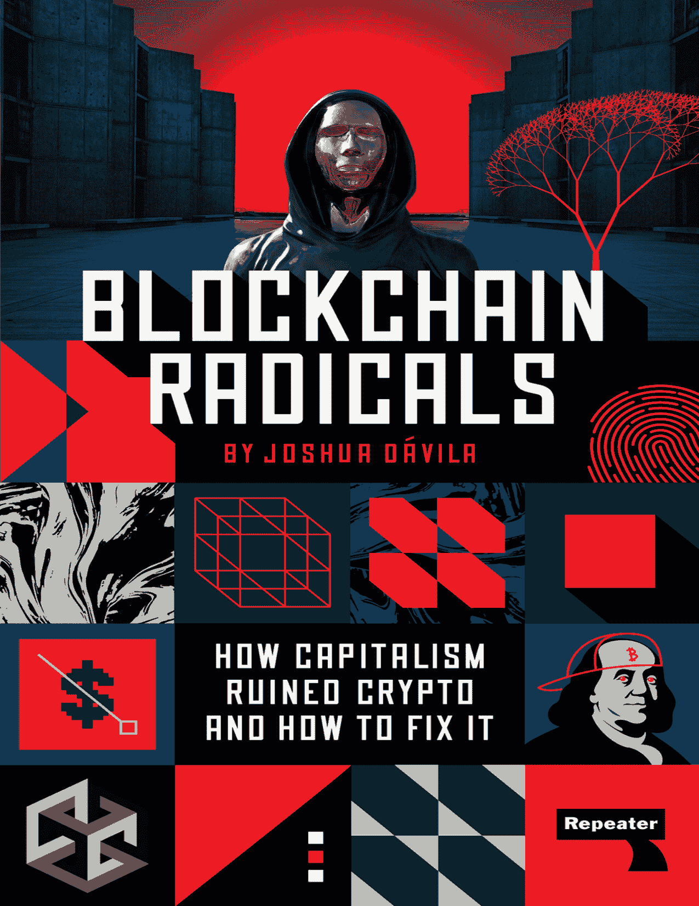
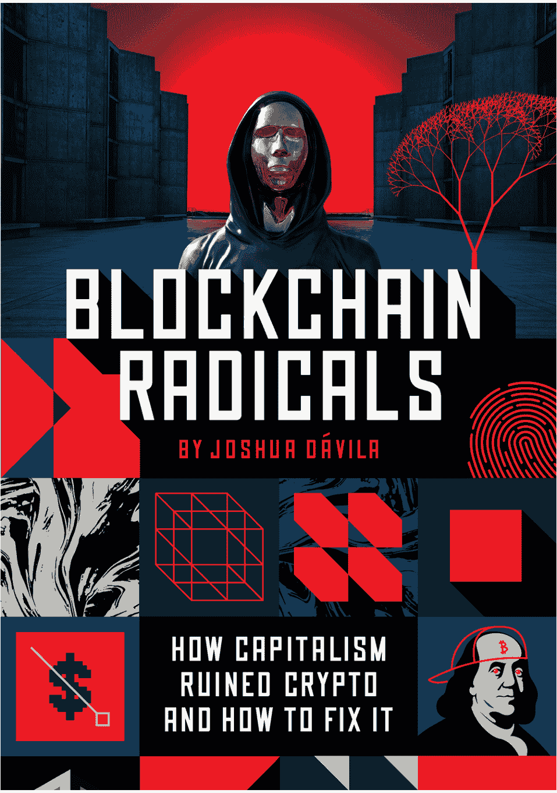
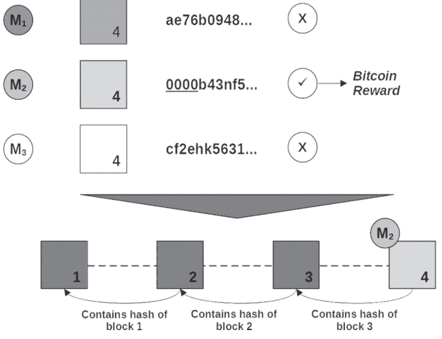
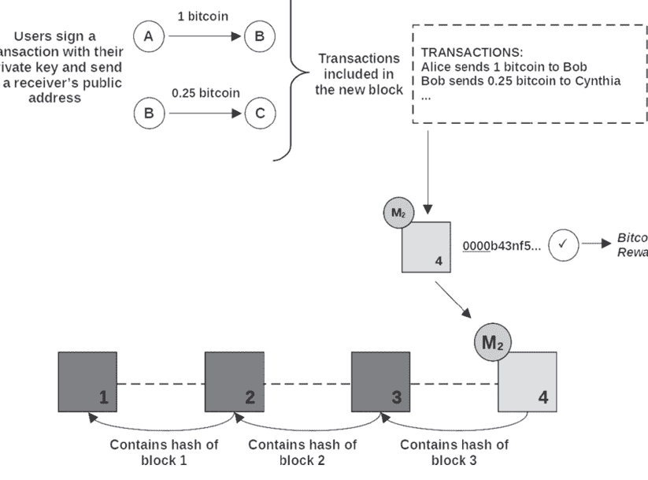
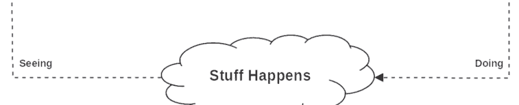

# 区块链激进主义：资本主义如何摧毁加密货币以及如何修复

“《区块链激进者》带你进入加密货币领域的一个特殊部分，这里既不同于其自由主义的起点，也不同于那个痴迷于金钱和交易、价值百万数字猴子的世界。它是对现有技术叙事的重要补充。”

# 以太坊创始人 VITALIK BUTERIN

“Joshua Dvila 揭开了加密货币真实运作的面纱，为那些致力于社会正义的人提供了切入点。这本书打破了左翼对加密货币排斥的本能反应。这非常重要，因为危险的权力不平衡是由装备了当代工具的社会运动来解决的，而不是由坐在旁边旁观跳脚的批评者！”

# FURTHERFIELD 联合创始人 RUTH CATLOW

“区块链技术的激进潜力不在于其复制现有权力结构的能力，而在于它实现更协作的经济和参与式治理实践的能力。在书中，Davila 对区块链如何被用于创建一个更公平、更可持续的社会进行了批判性且细致的审查，其核心在于通过挑战——而非加剧——传统资本主义的剥夺性行为。虽然这本书是为当代读者写的，但它的见解在未来几年中可能会变得愈发相关。”

# 《区块链与法律》作者 PRIMAVERA DE FILIPPI

“在剥离了意识形态的预设，区块链技术既提供了对价值本身的一种壮丽的技术探索，也提供了我们在面对迫在眉睫的资本主义危机时构建新世界所需的工具。如果他今天还活着，我确定马克思本人也会热衷地阅读这本书。左翼已经忘记了太多的技术。”

# NY TECHNOLOGIES CEO HARRY HALPIN

“Joshua Dáv 对加密货币以及左翼对其反应的这种及时且敏锐的审视，为渐进地参与区块链作为替代组织和交换形式媒介的潜力，提供了急需的批判性资源。为了从无政府资本主义技术中剔除资本主义并将其归还左翼绝非易事，但《区块链激进者》不仅做到了，而且做得更多。对于任何希望在超金融化时代扩展其理论和实践范围的人来说，这是一部必读之作。”

# 《工作证明》作者 RHEA MYERS

“这是一本写给比技术更关心正义的人的加密货币指南。Dávila 没有像大多数评论者那样将区块链视为救世主或厌恶之物。相反，他展示了这是一种机会，也是一组选择——一个构建更激进、自由的世界的机会，抑或一个虚拟的圈地的机会。这里有一份为反乌托邦者准备的加密货币指南针。”

# 《每个人的一切》作者 NATHAN SCHNEIDER

“Joshua Dávila 的书是一声响亮的号召，号召左翼夺回加密货币的解放潜力，而不是将这一领域让给技术决定论的自由主义者。通过将细致的分析与区块链作为进步变革力量的希望愿景交织在一起，Dávila 不仅激励了他的读者，还为他们加入斗争并成为正义的反叛者开启了门户。”

# 《过度工作与薪低所得》作者 TREBOR SCHOLZ

“区块链技术一直处于赞美或谴责的极化论述中，但双方往往依赖于同样的炒作驱动和技术决定论的叙事。在《区块链激进者》中，Davila 戳穿了这些神话，并解析了这一空间内潜藏的不同可能性。这是一个关于区块链的迷人的、挑衅性且富有启发性的观点，它为严肃对待区块链作为可能的解放工具提供了强有力的论证。”

# 《平台资本主义》作者 NIK SRNICEK

成功的革命运动会利用新兴技术。随着超级机器复合体的抬头，加密货币为网络游击队提供了避风港。这本书是政治激进者进入加密世界的大门。”

# DARKFI 创始人 AMIR TAAKI

www.repeaterbooks.com

# 致所有多年来支持我并为 BLOCKCHAINRADICALS.ETH 做出贡献的人

引言
绘制加密领土的新地图

本书旨在提供教育信息，并鼓励对区块链技术和加密货币的政治应用进行思考。本书并非盈利指南或投资建议。书中提到的项目作为示例，通过激进政治视角强调了加密的挑战与潜力。

请注意，书中包含的信息是基于写作时的可用数据，且加密行业正在快速发展。因此，在阅读本书时，书中某些项目可能已不存在或发生了巨大变化。

读者应以开放的心态阅读并批判性地评估书中内容。建议在做出任何投资之前寻求专业建议。

## 引言
绘制加密领土的新地图

写作与意义无关。它与土地测量和制图有关，包括对未来国家的绘制。

> 吉尔·德勒

2022年初，车主在渥太华（加拿大首都）抗议越美边境的疫苗强制要求。这场“自由车队”运动后来演变为对普通新冠19限制措施的抗议。为了回应几场筹集了数百万美元（来自加拿大人，以及与极右翼政治团体相关的美国人）的资金活动，加拿大总理特鲁多启动了1988年的《紧急法》，持续了十天。该法宣布政府可以冻结怀疑为车队成员的银行和支付服务提供商账户，无需经过法院系统。这也包含了使用加密货币的平台，并导致加拿大政府发布法令，要求特定的加密货币公司提供有关活动中所用资产的信息。

一个月左右，在俄罗斯入侵乌克兰一周后，长期反对普京的莉雅战士歌手纳迪亚·托洛科尼科娃启动了一个基于区块链的DAO（去中心化自治组织）和

利用备受诟的的 NFT 媒介为乌克兰抗击力量筹款，并在 Twitter 上宣布区块链是反对独裁统治的重要部分。与此同时，被围的基辅政府也公开了几个加密货币钱包，支持者可以向其捐赠。到 2022 年 2 月底，他们已通过比特币、以太和其他加密货币筹了超过6000 万美元，资金用于燃料、食物以及士兵所需的防弹背心和夜视镜等物资。数字转型部副部长亚历克斯·波尼亚科夫（Alex Bonnyakov）表示，加密货币与可能需要一天多时间的 SWIFT 交易相比，“更简单、不复杂、透明且更快速”。

突然之间，“crypto”一词曾是密码学的缩写，现在也指代加密货币，它自占领华尔街运动和维基百科遭到金融封锁以来，首次占据了政治和经济危机的中心舞台。然而，尽管这些发展引人眼球，且并非明确具有政治进步意义，但同样重要的是不要忽视其他遭受国家压迫的人使用加密货币的方式，例如在巴勒斯坦和其他其他遭受经济制裁的国家，或者由于工作处于法律灰色地带而不断与金融服务提供者斗争性从业者。对于许多没有获得良好金融服务的人来说，转向加密货币一直是他们的生命线之一。

为什么左翼大部分人对区块链持有如此敌意和怀疑？对比特币（首个且最著名的加密货币）最早的批判之一是大卫·戈伦比亚（David Golumbia）的著作*比特币政治学：软件作为右翼极端主义*。他的观点很大程度上认为比特币的右翼自由意志主义起源意味着它倾向于仅为右翼议程提供效和应用（如果有的话）。这种趋势一直延续到像 Jacob 等左翼出版物，该杂志在2022年发表了数篇与加密相关的文章，几乎所有结论都认为加密货币是骗局、庞氏计划以及左翼应该远离的东西。查看这些文章中提出的许多主张和引用的来源发现，很少有作者真正理解许多基本技术原理和运作，这使得他们的主张对于那些从事他们所批判的基础设施的人来说显得很无力。似乎他们的受众并不是那些最能回答其批判的人（即行业内人员），而是其他在所谓的“批判经济”中争夺地位的人——这是一个很大程度上是话性和学术性的微型行业，随着其实际制度能力的衰落，这个行业似乎消耗了左翼后期大部分精力。

区块链并不是简单的技术，因此虽然技术上的错误可以被原谅，但那些由错误但在其他方面聪明的记者和学者撰写的文章令人不安的是，他们的主张在无意中抹杀了加密行业。通过全盘接受对加密货币或区块链是什么的社会政治描述，这些批评者无意中充当了他们鄙视的加密货币营销人员和造势者的工作。同时，他们还试图将自己建立为合适左翼努力和资源的守门人。事实是，加密营销人员使用右翼自由意志主义修辞是为了吸引特定的受众（这些受众是否自称为自由意志主义者并不重要），因为这一群体也愿意放弃他们政府支持的货币。这并不是为了贬低那个群体——营销的设计是为了利用许多人感受到的幻灭感和被剥夺感，特别是认为货币体系存在问题的想法。这种想法被扭曲为对右翼政治的采纳，这种政治日益流行并对某些人来说非常获利。在过去的十年或二十年里，存在一种隐性和显性的关联过程，导致许多人认为任何与加密相关的东西都是右翼自由意志主义的，这种态度被其许多领军人物采纳并推广。

然而，左翼“批判经济”未能理解的是，这一切都是有意的，目的是将左翼排除在影响范围之外，限制其对这一新技术空间应该走向的方向的决定能力。这是一种井毒，而作为批判经济一部分、撰写粗浅文章的守门人们一直在继续向其中添加更多毒药。他们无意中加强了由加密行业创建的错误框架的合法性，从而为帮助左翼其他成员导航这一空间提供了一份糟糕的地图。对加密货币的反应要么是过度吹捧，要么是完全怀疑，但本书认为，区块链既可以支持左翼现有的政治策略，也可以开启新的策略——即区块链使之可见、可读或成为可能的新颖策略。

“批判经济”的典型作者攻击“技术决定论”，即认为“技术”进步是社会发展及其文化价值观的关键，并使其成为社会变化的主要代理的观点。乐观的技术决定论通常是硅谷精英用来证明推行越来越多技术解决方案的理由，其处方是“改进”技术有助于社会进步，从而导致更进步的结果。有时它被称为“技术乌托邦主义”或“加利福尼亚意识”，这是理查德·巴布鲁克（Richard Barbrook）和安迪·坎伦（Andy Cameron）在一篇文章中的术语，称其起源可以追溯到右翼自由意志主义作家艾茵·兰德（Ayn Rand）的哲学。作为反击，悲观的技术决定论在技术引领我们走向更丰富生活的承诺反复失败后，主要在左翼出现。这可以更广泛地概括为一种感觉：如果你处于政治光谱的左侧，所有的新技术都只能以剥削或违反你目标的方式使用。

本书在任何方向上都不是技术决定论，而是旨在承认这种技术的正面和负面影响，这种方法对于评估这项技术如何可行地让我们整个社会受益（而不仅仅是那些“创新”手段的人）是必要的。与其将技术看作决定性的，我们可以将其视为概率性的，承认我们所处的现状显著有利于有者而非无所有者，但也理解事实并非必须如此——左翼有机会改变现状，或许可以借助这种技术本身的支持。新技术的进步不是政治变化的唯一动力，但我们无法将其与我们的社会关系干净地分开，特别是在一个许多社会关系是由构成互联网的先进复杂基础设施中介的世界里。最终，社会运动是导致政治变化的因素，但技术对运动一直很重要——如果没有印刷机，许多重要的思想永远无法传播。技术的进步创造了可能性的物质条件，但对于寻求社会公正的人来说，意识到自己在影响其用途方面的主动性是重要的。承认多少主动性以及如何使用，决定了它是支持还是损害公共利益。我将这一立场和框架命名为“技术概率论”。

技术概率论是一个在特定条件和不确定性下，批判性地思考特定技术所能实现的未来的框架。它通过尝试承认实际可能性的完整光谱，规避了乐观和悲观的技术决定论。这是一种关于技术的更具开放性和探索性的思考方式。它为留出了空间，让我们思考为了引导我们走向特定未来需要哪些潜在条件。它理解，同样的技术，初衷是用于

一种应用或一种政治形态往往并不忠实于其创造者，并可以被用于许多其他情况。加密货币和区块链的情况正是如此，本书将贯穿始终讨论这一点。

通过在区块链和加密货币所处的技术空间框架内应用进步进的政治观点，我们可以开始制定一种策略，这种策略既能承认技术实现集体行动的潜力，同时也考虑到伴随技术发展的政治条件和风险。这是一个战略框架，它允许我们重新利用那些以资本为意图而开发的技术来维持集体的解放，同时也意识到需要战略双重性（strategic duality），以应对全球化、技术化政治经济中的矛盾。

新技术一直是一个政治考量因素，从制造更坚固金属剑的新型锻造技术，到实施导致其一半员工冗员的系统的公司，再到国家颁发的身份证。加密货币和区块链渗透进主流社会的可能性日益增加，无论加密货币的价值是否真的能达到其炒作者在社交媒体上预测的那些不切实际的高水平。如果是如此，拥有一个适当的领域地图至关重要，以便制定出能够提高预期结果概率的策略和战术。

本书将证明，加密货币和区块链在攻击和规避传统权力结构方面发挥了更为复杂的角色，其方式适用于许多表面上相互矛盾的政治项目。虽然从那以后，对其的关注大部分来自支持者或怀疑者，但其新兴的特质以及人们积极参与其中的方式（这些方式对左翼而言很有趣）很大程度上是本书的重点。围绕加密货币和区块链的左翼怀疑者是迄今为止声音最响亮、最激进的，往往掩盖了更为谨慎和探索性的实践者、艺术家、活动家和程序员。我并不是在声称区块链是万灵药，但那种坚持你不需要亲自研究它，因为相关的学术人员已经为你做过这些研究并判定它是徒劳的观点，是本书希望反对的这一系列假设的另一部分。根据我以各种身份在该领域工作的经验，并与那些恰恰工作在区块链空间内、致力于平等主义政治的艺术家、活动家和程序员交流，我们需要对区块链的优势和局限性有更完整、更清晰的理解。

我认为，正是区块链的涌现属性、它的新颖性和可塑性，以及它可能被想象力地开发的方式，让它对许多人感到既兴奋又困扰。当然，任何在资本主义之下产生并发展的事物都不可能避免推销、诈骗、波动、剥削和直接的犯罪。不幸的是，并没有一个纯粹的空间可以组织革命，只有一组无人选择的、必须与之斗争的条件。虽然对互联网的兴起存在建设性的反应，例如20世纪90年代的网络女性主义和围绕马克·费舍尔（Mark Fisher）的k-punk的左翼博客圈，但更广泛的左翼没有时间重犯他们在互联网以及随后在社交媒体上犯下的同样的错误，即通过忽视它直到像2008年衰退那样的危机发生。就在几十年前，左翼机构和团体还在嘲笑互联网只是另一种资产阶级的消遣手段，而今天，社交媒体对于组织和集体行动无疑至关重要，但它依赖于世界上一些最强大的科技公司拥有的平台。虽然左翼有群体在早期网络空间的政治领域进行斗争，但他们的成功是有限的。左翼如果想在未来保持韧性，就需要参与构建自己的技术基础设施。

区块链空间充满了各种可疑的做法，这是一个混乱、复杂且不断发展的领域，拉扯着许多方向。与加密货币相关的可疑甚至公开违法的行为可能让许多人感到格外的反感，尤其是左翼自由主义评论家，他们信任主导性机构，并希望在定义良好且狭窄的范围内获得衡量且可衡量的进展。但我认为，新事物很可能从区块链空间这种令人不安的动荡中涌现，部分是因为现在那些试图推向社会主义的更传统的选举和议会模式已经受阻（为了给英语读者，给出两个最相关的例子：美国的桑德斯（Sanders）和英国的科宾（Corbyn）），因此驱动这些关注的能量将流向他处。无疑会流向其他激进的工人组织形式，但考虑到21世纪在线生活的中心地位，也会流向那些试图创建更公平、更开放的互助、社会主义和相互关联形式的数字网络。问题在于，对社会主义、共产主义、经济民主（随你如何称呼）的冲动是与资本同步发展的，并全程与之斗争。区块链是一个新边疆，我们必须在在那里争夺领土，而不是像往常那样将其出让，认为它早已属于右翼。

# 地图并非领域

20世纪30年代，波裔美国籍科学家、哲学家阿尔弗雷德·科齐斯基（Alfred Korzyski）曾评论道：“地图并非领域”，或者说从事物得出的抽象与事物本身不同。他的观点是，许多人将现实的概念模型与现实混淆了。例如，秘鲁的地理地图与秘鲁的实际地理仍然大不相同。地图上用于指示安第斯山脉的符号在有限范围内是有用的，除非地图放大得更近并包含更多细节，但即便如此，它与真正身处安第斯山仍会有不同。这并不是说概念模型是没用的，而是说它们需要与批判性思维相结合，因为正如另一句格言所说，“所有的模型都是错误的，但有些是有用的”。虽然这些观察在语义学、语言学或统计学等学术圈中更为常见，但它们对于理解政治（包括技术政治）也同样重要。

吉尔斯·德勒兹（Gilles Deleuze）是出生1925年的法国后马克思主义哲学家，他见证了1968年5月席卷法国的民事运动，那场运动引发了该国历史上规模最大的罢工，支持反对资本主义、消费主义和帝国主义的抗议的自发罢工随处可见。当高尔政府意识到增加暴力只会恶化局面时，工人取得了重大收益，但社会主义者和共产主义者的革命号召并未成功。在那个时期，德勒兹出版了他的大巨著《差异与重复》（Difference and Repetition），这是对表象性思维的批判，并深刻影响了他与菲利克斯·盖塔利（Félix Guattari）合著的两部最受欢迎的书：《反俄狄浦斯》（Anti-Oedipus）和《千高原》（A Thousand Plateau）。

德勒兹的作品以晦涩著称，但在撰写本书期间，为了更好地理解加密，对我产生了重大影响。他对表象性思维批判的最核心部分（也被其他人称为“拟态思维”）是我用于本书结构的框架。要理解德勒兹对表象性思维的批判，我们可以参考热门视频博主约纳斯·齐卡（Jonas Čika）制作的视频。

为了解释德勒兹对表象性思维的批判，齐卡使用了鼓机作为例子。鼓机最初被创造为音乐人的工具，以便在乐团缺少鼓手的情况下使用。从表象性思维的视角来看，鼓机仅仅是一个低版本的

使用真实鼓组的鼓手，这种表现并不符合理想状态。这是一种表征。左翼必须意识到，无论创建了什么种模型或映射，在某种程度上都是错误的或具有局限性的。关键在于尝试创建一个至少是有有用的模型。因此，本书要求读者不要问加密货币代表什么，而是要问：“加密货币能做什么？”，而不必过度担心他们脑海中可能存在的当前领域领土地图。

本书的目的是为加密货币领土提供一张更有用的地图，帮助你以及你可能所属的社会运动安全地穿行其中。通过理解过去右翼和左翼社会运动如何影响加密货币的轨迹，并通过建立写作当时主流话语中未涵盖的新联系，可以绘制出一幅新地图，引导我们走向新的未来。这种未来对加密货币的展望既不是乐观的或乌托邦的，也不是决定论式悲观的。另一个需要记住的重要考虑因素是，书中绘制的地图只是一个快速演变的空间中特定时刻的快照。书中提到的项目不应被视为背书或财务建议（我不是听取这类建议的好人），当你读到这本书时，它们很可能已经发生了不同程度的变化（或破产）。它们应该仅被视为帮助我们绘制更有用且更具根茎状的示例。

# 集体涌现

利用德勒兹（Deleuze）对表征思维的批判框架，我回顾了加密货币推销者使用的各种常见表征模型，并描述了为什么它们是错误的，但仅仅因为它们是错误的并不意味着加密货币对左翼没有用（正如它的许多批评者希望你相信的那样）。本书分为三个部分，按照加密世界常见的从糟糕到次差的表征思维形式排序。在第一部分，我们将探索“加密货币作为货币”的概念，这是推动比特币诞生的原始想法。通过对这些观点进行批判性分析，很容易发现比特币以及广义的加密货币并不是货币。然而，不是货币这一事实可能是一件好事，特别是对于其激进的政治潜力。这一事实连同加密货币与货币共享的属性，使得加密货币可以在各种语境下通过反贸易绕过国家或银行的金融封锁，正如 WikiLeaks 和 SciHub 等案例那样。系统的灵活性还允许我们探索替代性的民主货币系统，而这些系统在其他是不可能的，并且挑战了右翼自由意志主义推销者所拥的“数字金属”叙事。

在第二部分，我们探索下一个常见的表征，即“加密货币作为金融”。从深入研究以太坊及其创新的智能合约开始，我们看到这种通过计算机代码编写、通过加密强制执行的合同尝试，并没有证明加密货币炒作中常见的格言“代码即法律”。然而，智能合约的功能性对于极速增长的去中心化金融（DeFi）空间的运行至关重要，在这个空间中，许多通常只有华街人士才能拥有的金融产品任何人都可以通过区块链获得。虽然这个空间很大程度上是许多最具资本主义金融产品的重构，但表征思维会限制我们观察这些机制细节并发现智能合约和加密代币潜力的能力。理解传统金融系统与 DeFi 之间的差异对于开发旨在为了不同目的颠覆金融系统的策略非常重要。我们还将涵盖非同质化代币（NFTs）现象，以及它们如何像许多 DeFi 机制一样经常被误解，并可以转化为更具集体性的目标。

第三部分将批判性地看待理解这一空间的最不糟糕表征模型，即“加密货币作为协作”。虽然加密领域许多善意良好的人喜欢将货币系统和经济比作协作系统，但这种思维最终忽视了权力关系的重要性。在这一部分中，我们将描绘去中心化自治组织（DAOs）与合作社之间的相似与不同之处；蓬勃发展的旨在应对气候危机的再生金融（ReFi）运动，以及关于区块链系统能源消耗的论点；以及区块链不仅可以增强民主系统，还可以用于新形式的政治反抗和新的协作文化实践。虽然本书很大程度上关注比特币和以太坊，但倒数第二章介绍了一些不同的现有技术基础设施（包括但不限于区块链），以及这些背后的技术决策如何创造了不同的社会结果和可能性。我以一个论证结束，即对加密货币采取技术概率论（techno-probabilistic）方法。技术概率论我使用的一个概念，旨在帮助我们理解与新技术为左翼创造的潜在未来之间的关系，超越与“批判经济”的毒性关系，以及结构与主体之间的虚假二元法。

鉴于我们处于资本主义下生活的历史，在一个正在创造和测试创新技术的空间里，榨取性资本和欺骗性商业行为的存在无人会感到意外。这无疑是一个问题，但不是新问题。由于加密货币营销人员使用的受自由市场基础主义、自由意志主义启发的表征模型，许多人留下的印象是加密货币仅仅

对于这种极端受限且反乌托邦的世界观非常有用。通过超越这些模型，转而尝试理解这些工具的作用以及它们的运作方式，我们就能识别并开始创造新的工具和模型，以促进对未来新的集体和协作的想象。通过这种方式，我们可以将加密领域视为一个集体涌现的领域，它挑战了货币、市场、信息、政治及其局限性的旧模型。我们可以开始超越“为什么未来似乎长期以来停滞不前”的问题，并通过集体利用我们现有的技术工具为了亲社会的目标，预示并设计出我们更倾向于生活的非异化化关系系统，从而创造出新一代的区块链激进者。

源自比特币作为“点对点电子现金系统”的最初初意，它模仿了某种理想化金本位制度的某些属性——“它是一种更好的货币形式”是向新者解释什么是加密货币最常见的表述。然而，显而易见，大多数（不是全部）加密货币还没有实现货币的地位。批评者会说，这意味着所有加密货币都不符合用途。虽然加密货币确实具有货币的一些属性，但加密货币实际上并不是货币这一事实，对于颠覆主导货币系统的限制来说可能是积极的，特别是对于那些对挑战现有资本主义机构感兴趣的人。加密货币通过反向贸易规避国家或银行金融封锁的能力，应该被视为任何在金融精英中拥有敌人的体的战术而受到重视。此外，该系统的灵活性允许我们探索在其他情况下是不可能的替代性民主化货币实验。

> 2009年1月3日，《时晤士》报：首相正处于对银行进行第二轮救助的边缘。
— 比特币创世区块

为普通读者写一本关于区块链或加密货币等技术性主题的书，其困难之一在于如何回答“这玩意儿到底是什么？”这个问题，且回答方式不会淹没在晦涩难懂的专业术语中。尽管我会尽力避免这样做，但在解释加密货币和区块链如何工作以及如何使用的过程中，我将需要引入一些技术概念和定义。事实是，数字技术和金融等许多领域有时会刻意使用复杂的语言，作为让圈子之外的人感到困惑的一种。这使得普通大众难以理解并自行评估卖给他们的东西的价值。

信息不对称是风险投资人和诈骗者的共同武器。因此，让自己具备对这一切如何运作的理解，可以作为一种抵御那些标榜“去中心化”的追求利润最大化的贪婪者试图向你推销东西的良好防御，随着加密货币继续进入主流。这使得我们涵盖使技术运行的基本原理至关重要，这样我们就能评估其政治影响，并将其吸收用于更激进、更民主的手段。¹

虽然数字技术在某些方面改善了人们的生活，但我们也过度推销了由跨国公司（大部分是美国公司）拥有的技术解决方案和平台，这些公司将曾经更去中心化的互联网的大部分进行了中心化。尽管硅谷精英可能继续通过一些关于网络去中心化的激进言论来推行加密货币的采用，但这在很大程度上是为了增加自己的财富和权力。然而，这并不能否定这些技术更具激进的潜力。我们正面临一个关键时刻，对于这种新兴技术的开发优先事项而言，有几种未来正展在我们面前。

虽然大多数广为人知的加密货币使用区块链作为底层架构，但并非全部如此。区块链只是**分布式账本技术（DLT）**的一种类型，尽管它是最为人知的。今天 DLT 有许多不同的用途，许多非区块链的 DLT 架构被用于其他加密货币，但对于这本书，我们将主要专注于区块链上。

在我们深入研究技术之前，每当我与对加密好奇的人交谈时，我喜欢先提供一些比特币（最广为人知的加密货币）产生的历史和背景，因为我认为这有助于解释为什么有人会创造它。这随后提高了人们对其运作方式的理解，以及对于我们这些比个人财务收益更关注集体利益的人来说意味着什么。

如果你在2008年在场，你可能还记得现在被称为“大衰退”的历史性事件——美国次级房地产抵押贷款市场的崩溃，这由于一个由政府执行但最终为了金融精英利益设计的金融体系中固有的不良激励结构，导致了成千上万的人失去了工作和房屋。那个时期，其特征是国家动荡状态显著增加，以及由于经济不确定性导致的金融机构困境，这种情绪在占领华尔街抗议中有所体现。尽管如此，尽管群众充满了愤怒，美国也只有一名银行家入过监狱。危机蔓延到了其他国家，导致了欧洲债务危机（以希腊为最糟糕的例子）以及冰岛三家主要银行的失败。在所有入狱的47名银行家中，约有一半来自冰岛。

那些几十年来一直推行新自由主义改革、通过减少政府机构监管权力来“释放”市场的同一批金融机构，现在依赖于中央银行和政府监管机构才能维持生存，而且是以纳税者的代价支付的。他们对国家已有的影响力被用来确保政策符合他们的利益，尽管新选的政家们曾乘着承诺“希望与改变”的民粹浪潮上台。在面对一些最富有、最有权力的人的反对时，政家们并没有勇气去履行他们所做的承诺。

大衰退的影响及其产生的反应在今天仍然可见。美国许多在衰退高峰毕业的千禧一代，与相同年龄的上一代相比，其财富少得多，债务更多。在欧洲，在十多年后，希腊的债务占 GDP 比率仍是欧盟最高的，然而冰岛——一个目睹同样规模巨大的经济崩溃并将许多银行家送入监狱的小国——却经历了自那以后最好的经济复苏之一。

正是在2008年的这种社会经济背景下，比特币论文被引入，在一个“加密朋克”邮件列表中由一个匿名账户中本·聪聪（Satoshi Nakamoto 在写作时的真实身份仍未被发现）发布，他呼吁其他加密朋克和密码学家帮助他们构建。稍后将详细解释加密朋克，但基本上他们主张使用密码学，即在受到攻击者威胁的情况下进行安全和隐私通信的研究与实践，这很大程度上通过加密和许多高级数学理论来实现。

利用互联网促进人们之间不需要银行或政府的转账系统的想法并不新。互联网上进行数字货币的首次尝试之一是

DigiCash 由 David Chaum 于 1990 年创立，基于他 1983 年发表的研究论文。该论文详细描述了一种协议，其中包含了比特币区块链的每一个拟议元素，除了工作证明（后文将详述），但它并没有获得比特币那样的成功。DigiCash 未能同样成功的原因之一是它仍然需要银行的采纳，而当时很少有银行这样做。根据 DigiCash 的技术规范，用户必须信任公司和银行会执行他们的交易。这与现金的工作方式不同。当我给您现金时，我们不需要第三方来完成交易。这使得现金是点对点的，而 DigiCash 仍然是一种电子形式的货币，依赖于公司的服务器和银行来发送货币，尽管有稳健的加密协议在引导系统运行。

据说，Chaum 的研究是“密码朋克者”（cypherpunks）的直接灵感。该术语由 Jude Milhon（或有时被称为 St Jude）创造，她是 20 世纪 60 年代和 70 年代的一位民权活动家和赛博女性主义主义者，指的是那些通过加密致力于在线隐私的计算机用户。1992 年，包括 St Jude 在内的一小群密码学家和早期互联网倡导者启动了“密码朋克邮件列表”（Cypherpunks mailing list），该列表被用于从政治和技术角度讨论围绕互联网隐私展开的众多不同话题。该邮件列表的许多订阅者后来成为了开源开发者、隐私研究人员、企业家和活动家。虽然很难准确界定密码朋克者具体处于政治光谱的什么位置，但参与者很大程度上可以被描述为自由自由主义者，他们希望利用技术来绕过或使国家和政府可能实施的任何形式的审查失效。

DigiCash 还启发了其他密码朋克早期对加密数字货币的尝试，例如 Hashcash、Bit Gold 和 B-Money。

出乎意料的是，2009 年 1 月比特币源代码的发布和网络的启动对许多密码朋克者来说是一个令人兴奋的时刻。这是一个真理的时刻。这个宏大的实验能成功吗？在没有中心化控制的情况下，它会安全吗？是否有足够的节点愿意参与网络，还是它在成为主流之前就会因为其自身的重量而崩塌？虽然它看起来可能与原始密码朋克者预想的不完全一样，但现在我们可以安全地说，比特币及广义的加密货币进入了主流。

在过去的十五年里，那些人们被告知其初衷良好的机构辜负了他们，而密码朋克那种对机构不信任和优先考虑个人自由的信条已成为一个引人入胜的故事。加密货币的吸引力在于承诺创造具有韧性并对现状提供更好替代方案的新机构。虽然你可能对比特币等加密货币是否实现了这两个目标有了自己的观点，但为了全面掌握现状，让我们从技术角度开始窥探其内部，但仍以外行可以理解的方式进行。如果你觉得自己不擅长技术，也不要担心，慢慢来，并记住如果需要对某个词的提醒或另一种解释，请查阅词汇表。现在，让我们比特币是如何解决“双重花费问题”的，这使其与之前的数字货币尝试相比是独独特的。

有时“比特币”和“区块链”这两个词被互换使用，那么它们之间的区别是什么呢？你可以将比特币视为为了创建一个不需要中心化机构的韧性数字系统的协同尝试。在创建之后，人们发现支撑它的技术结构可以被抽象化，允许其可修改部分被更改以创建任何数量的设计。虽然“区块链”一词在比特币白皮书中从未提到，但比特币是第一个区块链。代码中包含了经济和货币的特定假设，这留下了所有区块链都做出相同假设的印象。然而，区块链代码的可修改性和默认的开源性质使得应用不同的假设变得同样可能。

但首先，为了理解比特币和区块链是如何工作的，我们需要对今天大多数互联网架构的配置方式有一个自顶而下的视角。在用户可能交互的绝大多数应用程序中（大部分大多数由大型科技公司开发或拥有），他们看到和操纵的数据来自该公司拥有的服务器。当我们在 Facebook 或 Twitter 上发布内容，或者在网上与任何其他大型科技公司互动时，我们正向向这些服务器发送请求。一旦该帖子通过了自动审批系统（以确保该帖子不包含平台封锁的内容），它就会出现在其他用户的客户端（或应用）上。所有这些过程通常最多只需要几秒钟。这通常被称为“客户端-服务器模型”（client-server model）。

这种架构的影响是，这些大型科技公司对显示哪些信息具有巨大的控制权。虽然右翼人士指责公司审查美国的保守派发声，但也表明 Google 和 Meta 等公司也审查了左翼活动家。事实上，跨政治光谱的许多知名人物因各种围绕遵守公司条款和条件的，被拒绝访问其账户。

虽然有人认为，这些公司有权在他们的平台上审查他们想要的人，因为这是他们的私人业务领域，但不可否认，当互联网也被视为通信的公共基础设施时，这具有非常严重的政治影响。网络架构的客户端-服务器模型赋予了服务器所有者（大型科技公司）过度权力。另一个问题是存在单点故障，一旦被破坏，可能会导致人们所依赖的通信基础设施完全中断。

客户端-服务器架构的替代方案是点对点（P2P）模型，在该模型中，网络基础设施不由单一实体持有或拥有，而是分布在连接的计算机或服务器网络中。网络上的计算机处理数据具有平等的权限和责任，节点可以根据需要作为资源的供应者和消费者。这在很大程度上通过开放协议实现，而不是像大型科技平台那样创建封闭花园。虽然这对某些人来说可能是一个陌生的概念，但在你使用 Napster、LimeWire、BitTorrent 或任何其他下载电影、音乐或其他媒体的文件共享服务之前，你可能已经受益于 P2P 网络了。P2P 网络在媒体行业产生了深远的影响，并导致了媒体消费方式的快速变化。作为消费者，我们将获得几乎无尽的免费媒体库。这导致了 1999 年到 2010 年音乐行业总利润大幅下降，因为人们购买的 CD 变少了，并导致了 Spotify 和 Netflix 等流媒体巨头的崛起。这种情况有其自己的问题，但重点是通过使用不同的网络架构，人们与机构之间的关系发生了巨大变化。比特币使用 P2P 网络来尝试创建一个不依赖当前金融机构或控制货币数据的国家行为者的数字货币系统。然而，使用这种架构来实现这一点存在问题。当你互联网上共享内容时，你并没有给他人提供你在屏幕上看到的相同内容。例如，如果你给人力资源部的 Karen 发一封邮件，解释财务部的 Todd 在办公桌前吃东西声音很大，Karen 的应用程序收到了你发送的邮件副本。现在你和 Karen 都有同一封邮件的副本。对比信件，即你亲手写一张纸片

关于 Todd 的混乱行为如何让你的办公室地板变得发臭的报告，而同一张纸被发给了 Karen，以便她让你参阅员工手册中关于“职场冲突解决”的第 4.2 节。

像 Napster 等之前的 P2P 网络表明，计算机和互联网是极其神奇的机器，这种力量被用来为你提供一份你不想购买的 U2 专辑的免费数字副本。然而，这种力量在没有中央权威的情况下，使用 P2P 网络构建全球货币系统会产生特别的困难。如果我尝试通过电子邮件发送美元，我所做的操作创建了另一个美元；现在有两个美元了，而我只想发送一个。解决这个问题的方法是增加一个中心权威，由它决定只有第二个数字美元有价值，而第一个没有。这里的问题在于，该权威现在将拥有通过决定哪些数字美元有效，封审查特定参与者的权力，这让我们回到了最初的问题。这本质上就是银行如何使用计算机快速共享信息并管理你的资金的。事实上，世界上 92% 的资金是数字化的，存储在各种金融机构拥有的数字账本上。这种在创建一个不受国家和金融机构限制的数字货币系统，同时又确保账本完整性的问题被称为“双重花费问题”。那么，比特币解决这个问题了吗？

正如前面提到的，比特币使用哈希来共享一个数字账本，跟踪网络上的每个人拥有多少比特币。类似于 Napster 等 P2P 网络上的节点共享音乐或电影信息一样，比特币网络上的节点也共享有关比特币的信息，这是一种经济信息。Napster 之类的 P2P 网络与比特币的另一个区别是，Napster 上共享 U2 专辑的节点可以毫无问题地从网络中断开连接，而对共享专辑的人不会产生太大问题或后果。这种动态对于试图创建一个货币系统的东西是不可能的，因为人们需要确信该系统不会被黑客攻击或被恶意者破坏。比特币解决这一问题的方法是通过使用哈希（hashes）的加密竞争进行经济激励，这有助于保持网络免受直接操纵的影响。

哈希（Hash）是一种加密函数，它可以接受任何大小的输入并创建一个相应的固定大小的输出。然而，哈希与其他类型的函数不同之处在于，它是单向的，这意味着如果你有输入，你可以很容易产生输出，但通过知道输出，你无法确定输入是什么。这是信息或数据隐藏在另一段数据内部而其他人并不知道正在隐藏什么内容的一种方法。在下表中，你会看到，对于 SHA256 哈希算法的每个输入，我们都得到了一个彼此之间截然不同的输出。

| Blockchain Radicals | 1c402875f66d1284ca0fa601a534d30b3110df7f6c2dd903f66383c-d42a87991 |
| Blockchain Radicals! | f5a53722dfbc322b48b3ba70c98ab-23f78e688dc71a72257fbcb8cd-b614a0 |
| blockchain radicals | df9811e7faec6a3a62783dc-c274e35140268f33038cdfe-3830a67bcd720249a |
| (Combination of the three hashes above) | ca11a8c0a3480358a421551e6f-e7358891c9d88bca1e228b4cec-50f3ae5f2051 |
| Blockchain Radicals | a4aa88a0677e1c1e0a8c9bbb-5f2529d72d5a4f46884154e51d-eefb52d50dd0d |
| by Joshua Dávila | |

一个良好的哈希的属性包括：

- 1. 它仅单向运行
- 2. 极不可能再次生成相同的哈希
- 3. 输入数据的微小变化会显著改变输出

你在表中注意到，通过对输入进行非常微小的改变，我们可以产生一个非常不同的输出，而在输出中无法判断两个输入实际上几乎是相同的。这是因为知道输出无法告诉我们任何关于输入属性的信息。只看前三个哈希输出的人无法判断这三个本质上是稍微不同形式的同一个东西。

此外，我们可以将上面的哈希组合创建一个包含所有这些哈希的哈希，因此只使用了存储两者所需的一半空间。同样很酷，我甚至可以使用哈希来证明我是这本书的作者。为了简单起见，假设我的整本书仅仅是标题，如表格最后一行所示。现在我可以在该文本末尾添加“by Joshua Dávila”并创建我的书的哈希。如果这个哈希被证明存储在某处，而我注意到某人在抄袭我的作品，我可以重新创建上述哈希，该哈希包含了我写的文本以及我的名字。由于我的名字和文本重建了在抄袭版书籍之前存在的哈希，这可以作为反击抄袭者的证据。

正如你可能看到的，这种哈希函数有许多不同的使用方式。对于比特币网络，哈希被用于“工作量证明”（PoW），这是一种加密证明，通过向验证者证明了特定的计算努力。它最初被提作为一种防止恶意者攻击网站或服务或发送垃圾邮件的方法。然而，它被用作确保 P2P 网络和比特币账本安全的方式。

比特币网络中维护维护安全的节点通常被称为矿工（miners）。比特币矿工并不是在挖掘黄金，而是为了加密竞争中的哈希，以获得在比特币区块链上添加比特币区块的权利，以及一些新铸的比特币和区块中所有交易的手费。奖励作为矿工继续工作的激励。

当比特币交易发送到网络时（Alice 向 Bob 发送 1 个比特币），它们被用作哈希函数的输入。区块链中的“区块”指的是矿工组织添加到账本的交易组。矿工通过将尽可能多的比特币交易（最多 2MB）、已添加的上一个区块的哈希以及一个称为 nonce 的随机数输入哈希函数，以创建一个具有足够前导零的输出。由于哈希函数的一个属性是在处理输入之前函数的输出是不可预测的，输出中要求的的前导零越多，竞争就变得越困难。该问题的难度会定期调整，以确保每隔十分钟添加一个区块。由于竞争完全基于概率和矿工投入计算工作的能力（通常被称为算力），矿工能够投入的能量越多，他们在每个区块间隔内赢得竞争的机会就越大，直到由于增加的能源成本导致他们多次变得不再有利可图。因此，适当输入的获胜哈希的创建充当了比特币矿工需要向加密竞争展示的工作证明。工作量证明也被称为网络共识机制，因为它是比特币协议节点对比特币账本的当前状态达成共识的方式。

问题：你能创建一个包含最近的比特币交易、上一个区块的哈希、一个 nonce 并以至少 4 个零开头的哈希吗？

区块链，“链”部分是将上一个区块的获胜哈希包含在新添加到账本的区块中的模式。通过重复这种模式，协议创建了一个公开验证的关于的
账本显示了所进行交易的相对时间顺序。你可以将区块链想象为一个共享数据库，类似于 Google 表格（但没有 Google），它由网络中的每个节点冗余托管。然而，由于我们使用的是 P2P 架构而非通用的客户端-服务器架构，比特币使用这种“工作量证明”竞争来解决在没有中心化机构的情况下尝试进行数字货币时固有的“双重花费”问题。如果使用 Google 的基础设施来尝试实现比特币的功能，实际上将使 Google 成为账本的通用权威，从根本违背了初衷。

当我们与互联网上的中心化服务交互时（例如 Google 和其他科技巨头拥有的服务），大多数时候我们首先需要创建包含个人身份信息的配置，这些信息被用于将我们的身份与在使用其服务时所的操作联系起来，并作为我们个人资料的一部分存储在他们的服务器中。这种数百万甚至数十亿用户的数据收集让巨头平台能够创建越发精准的“用户画像”，并作为广告产品卖给他们的真实客户——即在它们平台上购买广告的企业。你想向 25 到 45 岁之间、受过大学教育、精通技术、年收入超过 10 万美元、居住在纽约市某个区，且最近搜索过代餐粉的男性投放广告吗？针对该用户画像可能有相应的广告产品。这在某些限制范围内是合法的，也是用户在点击科技巨头“围墙花园”的条款和条件时同意的内容。

并不是通过你的个人信息创建配置，而是通过公钥加密在区块链上创建账户以生成密钥对。私钥是一系列数字和字母，你需要保密且不与任何人分享，如果通过适当的单向加密哈希函数运行，它将生成你的公地址，你可以将其与任何人共享，以便他们向你的账户发送比特币。你可以将其想象为访问在线银行账户的方式。你的私钥相当于访问在线账户的用户名和密码，你永远不会与之分享；而你的 IBAN（如果你在美国，类似于账户和路由号码）可以与任何人共享，这样他们就可以发送资金，而无需了解你的用户名和密码。这意味着网络上的人员身份是随机的数字和字母字符串，使他们具有伪匿名性，并提供了一层理论上的隐私保护。由于之前哈希函数的特性，仅通过公地址实际上无法获取某人的私钥来访问其比特币，这使其成为存储账户的一种非常安全的机制。

在比特币网络以及大多数其他区块链上，为了完成交易，你需要用私钥对其进行“签名”。这意味着你通过证明自己是关联私钥的所有者，来证明你是持有比特币或加密货币（有时称为钱包）的公地址的所有者。只要你能证明自己知道私钥，就能访问钱包中的资金。然而，这种系统与普通的在线银行相比有重要的区别。其一，如果你忘记了在线银行的用户名或密码，申请新密码的过程并不困难。他们之所以能这样做，当然是因为你提供了只有你才能回答的个人信息来证明你的身份。而在比特币等区块链中使用公钥加密的情况下，如果你丢失了私钥，就会失去对钱包中任何加密货币的访问权限。比特币网络没有可以拨打的客服电话。这本质上增加了个人将私钥存储在可以检索的安全位置的责任。因为它只是一串数字和字母，可以写在纸上、存储为加密文件或存储在硬件设备上（通常是最安全的选项）。

现在，让我们了解比特币区块链上创建一个区块的整个过程。

这整个过程使得恶意行为者极难更改比特币网络上用户的余额。假设比特币网络上的矿工正在处理第 400 号区块，而你在第 100 号区块执行了一笔非常大的交易并想要撤销。为了实现这一点，你需要重新挖掘第 100 号区块，以及该区块与所有其他矿工正在挖掘的最新区块之间的的所有区块，然后在挖掘最新区块时击败其他矿工，将其广播到网络其他部分。这是因为比特币网络上的节点倾向于与它们共享最大的区块链。然而，要在操作上实现这一点，你需要拥有网络剩余总算力的一半以上，这不仅极其昂贵，还需要极少数人拥有的巨大能量。这被称为“51%攻击”。获胜的矿工将获得新铸造的比特币以及包含在区块中的用户支付的交易费，然后过程循环往复。

这整个过程使得恶意行为者极难更改比特币网络上用户的余额。

恶意行为者对于欺骗比特币网络没有动力，因为如果他们实施了这样的攻击，比特币价格可能会下跌，因为这证明了网络并不如人们想象的那样安全。因此，被盗取的任何比特币都会大幅贬值，使他们的劫持行为价值降低。当然，如果恶意行为者不在乎比特币价格，而是意在破坏网络，这可能就不那么担心了。

关于比特币工作原理的另一个重要点是，在协议的设计中，新比特币以固定速率铸造，并随时间推移而减少，直到总共 2100 万个，之后将不再产生新的比特币。这意味着随着时间的推移，比特币具有通缩效应（理论上变得更有价值），并具有黄金类似的有限供应属性。在 2008 年金融危机的背景下，“大而不能倒”的银行收到了政府的救援包，这被视为一种更好的替代方案。因此，许多“黄金热者”（认为金本位是全球货币体系更好基础的人）被了比特币社区。无论是否刻意，这都是植入技术本身的一种假设。然而，重要的是记住，不仅不同的假设可以被做出并植入加密货币，现有的加密货币也可能成为“叛逆的孩子”，支持违背其创建者政治立的政治活动，在下一节中我们将研究此类活动。

科学精神的共产主义与资本主义经济中将技术定义为“私有财产”的做法是不兼容的。

> — 罗伯特·K·默顿，《科学的规范结构》

WikiLeaks 是全球受迫害文档的巨大图书馆。我们为这些文档提供庇护，对其进行分析，推广它们，并获取更多。

> — 朱利安·阿桑格，《镜镜报》采访¹

2022年4月，以太坊（市值仅次于比特币的第二加密货币）的前开发者维吉尔·格里菲特（Virgil Griffith）因涉嫌向朝鲜政府演示如何利用加密货币规避美国实施的制裁，并被判处五年监禁。格里菲特于2021年9月承认指控合谋违反《国际紧急经济权力法》，该法禁止美国公民在未获得财政部海外资产控制办公室（OFAC）许可的情况下，向北朝出口商品、服务和技术。这表明了美国对于受制裁国家利用加密货币规避制裁的行为持极其严肃的态度。

这种态度在2022年8月得到加强，当时 OFAC 制裁了 Tornado Cash³，这是一种通过解耦发送者和接收者来保护公共以太坊网络中用户隐私的匿名化工具。据指控，朝鲜等受裁国家利用它来清洗由国家支持的黑客窃取的加密货币。这一决定引发了争议，因为 Tornado Cash 并不是一家公司，而是区块链上的一组智能合约（下一节将介绍它们是什么），它是一段自主运行的代码。由于 OFAC 的法定权限仅限于制裁“个人”或“实体”——而智能合约既不是个人也不是实体——加密货币支持者认为政府越权了其权限。然而，在制裁之后，加密货币世界许多自称为具有抗审查能力的应用和组织开始遵守 OFAC 发布的制裁钱包列表，以维持与它的良好关系。

尽管这些武力震慑可能令人敬畏，但它们掩盖了一个事实：制裁并没起作用。⁴ 制裁由政府实施，旨在惩罚其他国家的独裁政权或“坏人”。自由主义或保守主义的地缘政治思维观点是，通过故意伤害这些国家的普通民众，通过剥夺他们需要或价值食物、药品和其他商品，将制造混乱和反抗，从而改变政府政策。然而，制裁的效果总是有限：它们伤害了目标国家的无辜者，而不是掌权者，后者总能找到方法获得食物和药品。相反，内部的宣传机器会转动风向，说服民众认为实施制裁的人是敌人，从而推高民族主义热忱。制裁还面临被用作反对独裁政权工具的问题，因为独裁政权并不具备人们在想要改变时（即使他们想做））所需的民主基础设施。对于这些国家来说，真正的独裁政权是美国，它试图成为世界警察但失败了。

加密货币更具激进的卖点之一是其抗审查性，这在涉及制裁方面发挥了重要但复杂的角色。虽然上面的例子表明加密货币并没有像委内瑞拉等国家那样抗审查（委内瑞拉曾使用比特币从伊朗和土耳其购买进口商品）。事实也证明伊朗利用比特币挖矿作为规避经济制裁以及购买进口的一种。2021年，古巴宣布将监管并授权加密货币的使用，很可能是为了规避来自美国的制裁。

随着近期俄罗斯入侵乌克兰，许多人担心俄罗斯也会使用加密货币作为规避制裁的方式，这并不意外。然而，随之而来的是道德恐慌，以及认为禁止加密货币以阻止俄罗斯规避制裁的言。这不仅是因为形势周围复杂的的地缘政治背景（制裁未能如预期那样击溃俄罗斯经济），还因为乌克兰本身正从加密货币中获益。乌克兰政府在入侵开始后短短四天内筹集了1020万美元加密货币，自2022年3月以来，通过“乌克兰加密基金”已筹集了价值1亿美元的加密货币。使用加密货币的优势在于它受地缘政治或宏观经济因素（如乌克兰格里纳贬值）的影响较小，且资金接收速度快——传统的电汇需要24小时，但加密货币快得多。

正如许多加密货币一样，事实是抗审查是一把双刃剑。在一个去中心化技术被颠覆权威控制的世界里，它们已成为地缘政治竞争中日益重要的因素。同时，加密货币不仅在地缘政治层面很重要，对于边缘化群体的个人层面也同样。

加密货币世界最早的梗之一是“不是你的密钥，不是你的币”（Not your keys, not your coins），这是为了提醒新来，特别是如果你没有自己拥有访问加密货币资金的私钥，那么你并没有真正拥有你的加密货币。早期像 Mt. Gox 等交易所的黑客导致人们在交易所据称遭到黑客攻击时瞬间失去了所有的比特币，持有客户资金的比特币钱包也遭遇了此。这是因为 Mt. Gox 与当时的所有加密货币交易所一样，最终实际上是其客户比特币的托管人。批评者可能会认为，强迫个人保管好自己的密钥是负担过重的，但在许多情况下，这种自托管的强制也使加密货币具有抗审查能力⁸

对于性行业的许多人来说，加密货币可以成为救命稻草，因为由于保守组织的压力，传统的支付服务提供商和金融机构不断在容忍和禁止该行业人员之间反复波动。2021年8月，性工作者最流行的平台之一 OnlyFans 表示，他们不再允许“性露骨”内容，以符合银行供应商的要求。OnlyFans 的首席执行官甚至表示：“政策的改变，我们没有选择——简短的答案是银行”。

虽然 OnlyFans 用户也包括非性工作者，但绝大多数是性工作者，许多人加入该平台是为了逃离剥削性的性工作。虽然这一决定在获得银行合作伙伴的更多保证后不到星期就被撤销了，但来自金融机构的此类行为并不新鲜。2018年，Pornhub 宣布它将接受加密货币支付。在2020年被 Visa 和 Mastercard 取缔后，它转为仅对其高级服务接受加密货币。

性行业接受加密货币的加速，部分是由于2018年4月美国通过的《在线性贩卖法》（FOSTA）和《助长性贩卖者法》（SESTA）造成的。虽然该立法旨在打击通过在线平台进行的性贩卖，但倡导团体指出，它不成比例地影响了性工作者，并且本质上是一部互联网审查法案。该法律使得在线平台维持经营变得更加困难，因为它们需要律师团队评估州和联邦层面的多种风险情况。这意味着一些平台已经倒闭，迫使许多性工作者回到更危险的工作形式，如卖妓，这包含了更高的人口贩卖风险。

由于这些强大机构审查的这些短视方面，加密货币的自托管特性以及对这些相同机构缺乏直接控制，使其成为性行业从业人员的必要选择。通过互联网促进客户与服务提供者之间更直接的关系（无论这些服务是否具有性），加密货币可以保护社会中最脆弱或最受迫害的人。

## 维基泄：吹哨者与国家报复

维基泄（WikiLeaks）由网络活动人士和密码朋克朱利安·阿森（Julian Assange）于2006年创立，是一个致力于发布受审查或其他受限制的涉及战争、间谍活动和腐败文件的组织。该组织已发布了超过千万份文档及相关分析。这包括在乔治·W·布什总统任内的阿富汗和伊拉克战争期间犯下的其他国际战争罪中涉及通过酷刑和诱骗儿童性卖虐待平民的机密文件。这包括维基泄于2010年4月发布的“附带杀戮”（Collateral Murder）视频，显示了美国士兵在伊拉克从直升机射击了十八名平民，其中包括两名路透社记者。这两大重大泄露被称为“阿富汗和伊拉克战争日志”，最初通过三个媒体合作伙伴发布：*纽约时报》（New York Times）、《卫报》（The Guardian）和《德国镜》（Der Spiegel）。

最近的一事件是，在2016年3月，维基泄还发布了约翰·波斯塔塔（John Podesta）超过两万封邮件，他是前白宫办公厅长、希拉里·克林顿2016年美国总统竞选的主管。这些邮件包括克林顿对华尔街演讲的笔录，以及关于唐娜·布拉齐尔（Donna Brazile）在CNN与伯尼·桑德斯辩论前曾提前给克林顿提供问题的披露。据推测，这次发布与克林顿在唐纳德·特朗普当选前的民调支持率下降有关。维基泄无疑是一个备受争议的组织，但无论对其有如何评价，他们都坚持反对审查限制文件的原则。

2010年和2011年的事件是该组织的重大转折点。除了发布《阿富汗和伊拉克战争日志》外，2010年“电缆门”（Cablegate）泄露的开始，揭露了美国外交官的内部讨论和情报收集策略，包括收集外国官员的信用卡号和生物信息。

在2003年美国领导入侵伊拉克前的几周，英国和美国外交官监视了联合国秘书长科菲·安南，这显然违反了国际条约。根据维基泄的说法，这是一直以来向公共领域发布的规模最大的机密文件集。这两年的泄露被认为与《五角楼文件》规模相当，该文件证明了（其他方面）林登·B·约翰逊政府对美军在越南战争中的行动不仅对公众也对国会进行了系统性的谎言，这推动了反战运动。

美国政治家（包括许多共和党和民主党人）呼吁立即对维基泄及任何与泄露有关的人（包括阿森）采取行动。据披露，美国陆军情报分析师切尔西娅·曼宁（Chelsea Manning）泄露了维基泄2010年发布的大部分文件，导致她根据《间谍法》被捕。美国开始了一项调查，根据该部法律起诉曼宁；与此同时，阿森在瑞典面临了性侵犯的指控，他声称这些指控是虚假的，并被用于将其引渡到美国。瑞典的指控此后被撤销，但导致了他在伦敦的厄瓜多尔大使馆申请政治庇护，他从2012年8月起一直住在那里。如果他出门，伦敦大都会警察就会进行守卫。

2010年的“电缆门”泄露很快引发了针对维基泄的金融封锁。由于美国政府的压力，PayPal、亚马逊、Visa和万达卡等机构停止了处理向维基泄的捐款，导致这个很大程度上依赖这些金融中介的组织收入减少了95%。此外，瑞士邮政金融银行（PostFinance）冻结了阿森的个人账户。维基泄发言人克里斯廷·哈拉夫尼松（Kristinn Hrafnsson）对这种情况描述为：

这是审查的私有化，因为这是由于美国政府的极端压力而造成的……现在反击并停止这一过程至关重要，否则我们将无法看到未来……一个由金融巨头决定谁生谁死的未来。

许多盟友组织尽力通过代表他们接受捐赠来帮助维基泄募集资金以维持其基础设施和支付工资。例如，非营利组织FDNN（中立防御基金/Fund for the Defense of Neutrality/Fonds de Neutrality）。

2010年的“电缆门”泄露很快引发了针对维基泄的金融封锁。PayPal、亚马逊、Visa和万达卡等机构由于美国政府的压力，停止了处理向维基泄的捐款，导致这个很大程度上依赖这些金融中介的组织收入减少了95%。此外，瑞士邮政金融银行（PostFinance）冻结了阿森的个人账户。维基泄发言人克里斯廷·哈拉夫尼松（Kristinn Hrafnsson）对这种情况描述为：

这是审查的私有化，因为这是由于美国政府的极端压力而造成的……现在反击并停止这一过程至关重要，否则我们将无法看到未来……一个由金融巨头决定谁生谁死的未来。

许多盟友组织尽力通过代表他们接受捐赠来帮助维基泄募集资金以维持其基础设施和支付工资。例如，非营利组织FDNN（中立防御基金/Fund for the Defense of Neutrality/Fonds de Neutrality）。

同一天被指控合谋实施计算机入侵（即黑入政府计算机），该罪最高可判处五年徒刑，这与协助切尔西娅·曼宁（Chelsea Manning）的指控有关。

自被捕以来，安东西经历了多次审判，以决定英国是否将其引渡到美国以面临可能更为严厉的惩罚和更糟糕的待遇。到目前，尽管指定的法官已同意了大多数指控，但引渡似乎在很大程度上被安东西恶化的健康状况所阻止。在厄瓜多尔大使馆期间，据披露安东遭受了多种形式的心理折待，被拒绝与律师、家人和朋友接触，还受到美国、厄瓜多尔、英国和西班牙在内的多个政府监控。2020年2月，一个名为“为安东西医生”（Doctors for Assange）的组织在医学杂志上发表了一封公开信，其中他们表示，由于在厄瓜多尔大使馆和监狱内长期遭受心理折待，安东西处于“健康危机”，这可能导致他死亡，而且他“出于政治动机的医疗忽视创了一个危险的先例”。

维基泄露披露的文件显示，这是国家安全机构为了击垮安东西及其支持者的明确努力。此外还披露，中央情报局（CIA）等组织已计划在需要时暗杀安东西。引渡遭到了多家新闻、新闻和记者组织的强烈反对，因为众所周知，该组织发布的泄露信息对于揭露政府以和平与正义之名犯下的多项战争罪和侵人权行为至关重要，这对自由媒体可能产生非常严重的影响。

在写作时，安东西仍被关押英国监狱，维基泄露再次无法在像荷兰荷兰基金会（Wau Holland Foundation）等欧洲伙伴的帮助下处理捐款。如果你想帮助该机构继续其使命，可以通过加密货币或法货币在 https://shop.wikileaks.org/donate 进行捐赠。事实是，对于那些相信网络中立和非暴力内容不受商业利益集团或政府武力审查的这十项基本原则的人来说，维基泄露是挑战新自由主义资本主义秩序的重要反抗机构。对于那些希望看到现状发生激进政治变革的人来说，支持他们的努力是重要的，即使这意味着要捐赠加密货币来绕过金融封锁。

## Sci-Hub：让科学像共产主义一样

1942年，被视为现代社会学之父的罗伯特·梅顿（Robert K. Merton）发表了《科学的规范结构》，他在书中列出了四项原则，社会必须遵循这些原则才能从最大程度的科学成就中获益。对于梅顿来说，这些原则对于科学机构遵循是至关重要的，因为它们共同描述了现代科学的精神精髓。这些原则是：普遍主义、无私性、有组织的怀疑主义和共产主义。没错，

梅顿解释说，科学需要的是完全且开放的交流，而不是保密。科学成果和发现不应通过将其转化为知识产权而受到阻碍，因为科学中的所有发现都受益于此前的科学家及其同行的的社会合作。他引用了美国诉美国贝尔电话公司（US v. American Bell Telephone Co.）案的法院判决，判决指出“发明者是发现有价值事物的人。这是他的绝对财产。他可以向公众隐藏这一知识”，并认为这对科学是有害的，同时赞扬了像阿尔伯特·爱因斯坦这样的科学家，他们将专利作为确保其工作对公众可用的一种方式。科学达到其最大容量需要集体协作。因此，

在交流方面拥有共产主义是科学本质的一部分。然而，遗憾的是，由于现代资本主义社会普遍的机构失败的趋势，许多大型科学机构（尤其是学术期刊）并没有遵循这一原则。

对于那些在学术期刊上发表过的人来说这并不意外，但对于他们之外的人来说却很惊讶，许多在学术期刊上发表的文章（其中一些是由公共资助资助的作品）都在付费墙之后。学术期刊对每个PDF下载的收费可能从30美元到70美元不等。不仅如此，对于希望在经过严谨同行评审后发表论文的科学家来说，通常还需要向期刊支付这笔费用，除了为了让你的文章甚至被考虑同行评审和出版的不可退还申请费外，这笔费用可能超过5000美元。此外，期刊通过向需要访问学术文章的组织、大学、公司、非营利组织等出售订阅服务来获取收入。2012年，哈佛大学学院顾问委员会透露，该校每年在学术期刊订阅上的花费为375万美元，某些每年的费用高达4万美元。在此所有这些之上，被购买文章的作者并没有获得其出版物的销售分成。很容易看出，对于那些没有像拥有巨额捐款的大学那样财实的机构来说，这些定价和收入做法是有害的。

尽管许多发表的研究来自公共资金，但科学家们发表的最有声誉、对他们职业生涯帮助最大的期刊，其目标是利润最大化的私人公司。顶尖的营利性科学出版社报告的利润率比苹果和谷歌等公司高近40%。这种私有模式导致了顶尖期刊财富、影响力和市场份额的集中。在自然科学和医学领域，前五大营利学术出版商现在出版了53%的科学论文。

如果你属于一个没有深厚资金访问所有顶尖科学期刊的组织，你会怎么办？一个答案是去Sci-Hub免费下载几乎任何在付费墙后的学术期刊文章或任何开放获取的文章。他们的数据库中有超过800万篇文章可用。为了访问该网站，你可能需要使用VPN或尝试不同的顶级域名，如 .ru,.st 等（对我来说，www.sci-hub.ru 效果最好），因为你可以想象，Sci-Hub在许多国家被封锁且是非法的。事实上，一些大型期刊已经在几个国家提出诉讼，指控该网站侵犯版权，要求数百万美元的赔偿。

如果你设法访问Sci-Hub网站或其任何镜像站点，在“关于”页面上，你将看到一张列宁伸出手的图像，位于左侧，采用苏联常见的社会主义写实主义艺术风格渲染，配有这段文字：“Sci-Hub是现代科学中最具争议的项目。Sci-Hub的目标是为所有科学知识提供免费且无限制的访问。”

向下滚动，你还会发现关于该网站可下载的文章和书籍数量的统计数据，以及关于提供科学开放获取目标的更多信息、全球范围内针对 Sci-Hub 的法律诉讼列表链接，以及该网站创始人的联系邮箱。

亚历山德拉·埃巴基扬（Alexandra Elbakyan）原籍哈萨克斯坦，出生于1988年（当时该国家还是苏联的一部分），她是 Sci-Hub 背后的单人团队。对于一个从事如此非法活动的人来说，你本会认为她是一个隐藏在秘密之中的阴影人物，关于她的信息很少可用。然而，当你点击网站菜单上的“Elbakyan”时，迎接你的是一个 GIF：一个皮肤白皙、棕发的女性，穿着一件印有“Send”字样的 T 恤，对着你微微微笑并挥手。在页面上，埃巴基扬提供了详细的传记。她十二岁就开始学习编程，对神经科学产生兴趣，并在大学学习脑机接口（远在埃隆·马斯克的 Neuralink 公司之前），但没能在美国找到涵盖她研究兴趣的博士课程：“连接意识体验网络”。

再往下是她的生平时间线，列出了她的政治观点“共产主义”和她的宗教“新时代赫墨斯主义”，而在其下方是一组五十六张照片，涵盖了她从婴儿时期、童年到成年、在实验室工作、旅行、与朋友同事的合影，以及其他表面上正常人会做的事情。下方是一个名为“作品与观点”的章节。在“共产主义”下，她写道：

我喜欢共产主义的想法，并认为它是科学、信息和知识的本质。共产主义（Communism）和通信（Communication）是同根词。因此，共产主义是任何文本和信息背后的隐藏思想——信息的本质是共有的。

虽然她可能使用“共产主义”一词来描述她对开放获取信息的信念，但这或许与其说是一个政治宣言，不如说是一个实用的科学结论。

她列出的下一个观点是“信息神”：

对于古代人来说，信息是神圣的，语言、文字和通信都是神的体现。这位神有各种名字：古埃及的托特（Thoth）、希腊的赫尔墨斯（Hermes）或亚美尼亚的提尔（Tir）；这位神在现代占星术中被称为水星（Mercury）。这些神还与知识和智力有关，支持了知识本质上是共有的观点。

她有一关于该主题的著作集，包括用俄语编写的文章和演示稿，以及博客文章，其中一篇标题为《为什么斯大林是神》的文章可以用俄语或英语阅读。

她的最后一个观点“全球大脑”围绕着集体智能展开，将一群人描述为一个集体大脑，拥有比单一大脑能拥有的更多的知识。对于埃巴基扬来说，通过互联网和脑机接口等技术，我们可以从字面上连接不同人的大脑，从而创造出“全球大脑”。显然，她不仅宣扬开放获取和透明化，而且以激进的程度实践并渴望着它。

我有幸曾通过视频通话与埃巴基扬交谈。使用 Sci-Hub 网站上列出的联系邮箱，我联系了她，询问她是否有兴趣接受我的播客采访。在几个月的邮件往来并找到一位俄语翻译官后（埃巴基扬能听懂并阅读英语，但倾向于用俄语交流），我们做了安排。当面试当天她出现在屏幕上时，不知为何，我很惊讶她看起来和 Sci-Hub 网站上那个挥手的 GIF 一模一样。通过翻译交流，对于一个不断面临世界各地法律诉讼的人来说，她表现得异常平常、务实且开放。当我问她是什么启发了她创立 Sci-Hub 时，她是这样回答的：

亚历山德拉：所以，并没有某个特定的单件事启发了我开始这个项目。首先，我我自己也是一个学生，当时正在写并研究新计算机接口的主题。然后我面临一个问题，我工作需要的大多数科学都需要付费访问。我想我需要想出某种程序来处理这个问题，逻辑如下：如果我们可以在网上免费下载电影或音乐，为什么科学论文没有这种东西呢？其次，我注意到许多人也面临着相同的问题，并需要解决方案。

我：这似乎源于一个非常实用的原因，即你需要某种东西……你遇到了一个问题并需要解决它。

亚巴山德拉：是的，就是这样。这并不是说背后有什么新想法或意识形态。

与 WikiLeaks 类似，Sci-Hub 在面临法律麻烦和不断的网站关停的同时，还遭受了对其生存构成威胁的机构发起的资金封锁。起初，她有一个国际支持者通过 PayPal 捐赠的选项，她从中收了约 2000-3000 美元，但在大型出版社 Elsevier（拥有约 2500 份科学期刊）于 2015 年投诉侵权后，PayPal 拒绝提供任何资金和账户的访问。她仍然可以通过 Yandex.Money（一种主要在苏联国家可用的支付处理器）接收捐赠，这涵盖了许多成本，但她无法从想要帮助支付运行所有服务器和网站相关费用的国际支持者那里获得捐赠。这就是她第一次遇到比特币的时候。

在几位用户的推荐下，2015 年她分享了一个比特币钱包地址，以便国际支持者可以向她捐赠。

如果说从这些例子中可以获得什么启发，那就是如果你打算反抗资本主义机构，制定应急计划至关重要。有许多因素使得很难直接比较朱利安·阿桑（Julian Assange）和亚历山德拉·埃尔巴基扬（Alexandra Elbakyan）的困境，但从 WikiLeaks 和 Sci-Hub 的案例可以看出，受到挑战的资本主义机构发出的最初攻击之一就是金融封锁；在没有任何其他替代方案的情况下，考虑到对无法绝对确定预测的未来的准备，加密货币是一个重要的工具。对于任何具有合法性但仍依赖某种形式的准货币来支持其基础设施的激进团体来说，这必须引起重视。

钱，这是一种犯罪
公平地分享，但不要分走我的大蛋糕
钱，正如他们所说
是当今一切恶的根源
但如果你要求加薪，他们拒绝分给一点并不意外

> —— 平克Floyd乐队（Pink Floyd），《钱》

尽管上一章关注了加密货币的热潮，以及使用比特币向遭受金融封锁的实体提供资金，但本书并不是真的关于钱的。虽然围绕加密货币的营销活动很大程度上是围绕着对货币系统的特定批判，并得出像比特币这样的加密货币是“更好的货币形式”，但显而易见，这种观点在审查下是站不住脚的。为了深入探讨，让我们尝试从高层次理解什么是钱以及它是如何运作的。

首先，钱在现代资本主义社会中无处不在。除非我们生活在自给自足的农场里，或者有能力过非常独特的生活方式，否则我们需要钱来购买食物、支付房租、缴纳税款、账单，并获取让生活变得有趣的其他东西。如果没有钱，或者没有通过国家福利或当地社区提供的我们的社会安全网，我们就面临着饥饿、无家可归和暴力的风险。

正因如此，钱对社会成员的行为具有巨大的权力和影响。当通胀似乎到来并降低工资购买力时，我们该如何准备？我们是选择对社会有利但薪水低的工作，还是对社会有负面影响但薪水高的？我们是买更贵的有机公平贸易品牌，还是买廉价的超市品牌？如果包装上什么都没有告诉我们两种产品之间的区别，而我们只有价格差异呢？在我们选择了廉价品牌而非昂贵品牌后，如果我们知道那个廉价品牌是在另一个大陆用奴隶劳动制造的，我们还会想知道吗？如果公司制造的剥削或污染发生在我们自己的社区，情况会改变吗？

弗里德里希·哈耶克（Friedrich Hayek，是自由意志主义奥地利学派，启发了许多参与比特币创造的人）认为货币和价格是高效的信号系统，通过汇总计划经济永远无法做到的大量信息来促进自由市场。虽然价格确实能协调现有的市场，但很难相信价格能“高效”地反映产品背后的所有信息，如上所示，仅仅知道某物的价格并不能告诉我们它的产生过程。更准确的说法似乎是价格为消费者和生产者提供了一个共识，但它与其说是聚合信息，不如说是压缩信息以牺牲“外部性”来促进贸易，这些外部性通常表现为对我们水和空气的污染、对我们社区或外国国家的剥削，或者大型跨国公司经常参与的其他任何不伦理行为，而对其资产负债表几乎没有产生影响。如果使用钱和价格是经济中传达偏好的工具，

它是一个极其粗糙的工具。如果我们有机会停下来思考，它会丢失我们作为人类真正关心的所有精细细节和品质。我们对钱的依赖表明，我们拥有一种价值表达的单一文化，并依靠它来维持经济。与其拥有能够考虑到对环境或社区社会结构影响的价值表达体系，我们的经济几乎完全围绕着金融价值转。更糟糕的是，这个系统几乎无法退出。

这不仅仅是我们需要钱来生存；而是特定形式的钱已经侵占了我们生活的许多方面；即被国家认可的钱。你可能会听到提倡比特币等加密货币的人将其称为“法币”（fiat money）。听到比特币支持者将法币制度视为一切恶的根源并不罕见，尽管在大多数情况下并非如此，因为政府可以让他们“钞钞机疯狂运转”。事实上，这是对钱如何产生和存在的错误理解。他们会将 2008 年大衰退归咎于美国政府的印钞，并警告说它是通货膨胀的定时炸弹，尽管大多数（如果不是所有）研究这些领域的可靠学术人士都会说，这是导致通货膨胀更大的因素。他们可能会声称，当世界由金本位制统治，或货币由黄金储备支撑时，情况会更好（这是另一个缺乏证据支持的断言），并且比特币在数字上模拟了类似的货币系统。

虽然中央银行由政府选举产生的选出的董事监督，且中央银行可以通过公开市场操作增加货币供应（例如在 2008 年衰退期间以及最近的新冠肺炎期间，中央银行直接向私人银行提供其货币的流动性），但绝大多数的钱是通过私人银行系统创造的。

与你可能在你的银行开账户一样，你的银行可能在中央银行也有自己的账户，它们可以从那里以固定利率提取贷款，然后以更高的利率贷给他们的客户。这是通过相关实体和监管机构之间的数字账本处理的。通过这种方式，实际上是私人银行“印制”了大部分钱，而不是政府。事实上，在大多数“发达”国家，也是私人银行通过私有基础设施促进了数字支付，而不是政府基础设施。中央银行通常还负责实体货币（纸币和硬币）的发行，以帮助私人银行向客户提供这种形式的钱，尽管这在总货币供应中所占的比例很小。基本上，我们作为普通公民参与了两个货币体系：国家实体（现金）和银行数字（数字账本上的数字）货币体系。作家布雷特·斯科特（Bret Scott）在他的《云货币》一书中提供了大量的证据，说明私人银行如何影响消费者和企业走向“无现金化”，损害了国家实体货币体系，以便私人银行对货币供应产生更大的影响力，并减少与处理现金相关的成本。电力和计算机移动比银行柜员数钱快得多。这等同于将曾经由国家形成的货币体系私有化，因为实体现金让人们对自己的钱拥有真正的所有权，而不是银行控制的计算机里的数字。新冠肺炎疫情特别加速了这一过程，因为某些公司开始拒绝接受现金，原因是关于病毒通过现金交换传播的假谎言，而这在研究中从未被证实。每当我们使用数字或私人银行相关的基础设施进行购买时，我们都在使用一个存在货币体系之上的支付系统，使得这些银行

（许多金融科技公司）有效地作为中间人。根据斯科特（Scott）的说法，可以说，银行与金融科技公司合作，已经对现金宣布了战争。

还有一种国家数字货币系统，但唯一能够立即访问该系统的参与者是私人银行，通过它们在中央银行开的账户来促进银行间的账户清算。目前，它们是唯一能够接触中央银行的机构，这使得它们作为私人实体拥有将货币引入经济的优先权。这是有问题的，因为私人银行也是营利性的。如果会损害它们的底线，私人银行会以有利于公众的方式分配资金吗？就像公司为了降低成本可能会剥削工人或污染环境一样，这些外部性在我们关于货币的共同思维模型中根本没有被考虑进去。这意味着货币政策和货币供应并不是民主的，而是很大程度上通过基于市场的调整来处理，以诱导银行增加或减少贷款，希望在金融市场产生某些结果并影响到更大的经济体。作为公民，我们对货币的创造或引入社会基本上没有影响力，因为权力保留在那些对中央银行有影响力的人手中——私人银行。

另一个重要的考虑因素是，由于中央银行贷款给私人银行的所有资金都是带利息的，这些私人银行向客户提供的贷款也是如此，因此经济欠的债务总是比实际存在的货币多，使得货币成为一种稀缺资源。那么，这些债务如何偿还呢？这就产生了所谓的“货币增长必然性”（Money Growth Imperative），即为了解决储蓄者和债务人之间竞争产生的矛盾而必须创造更多货币的系统性要求.³这导致了需要不断提取地球自然资源并在市场上出售，希望货币最终能流到你这里。

由气候变化引起的自然灾害日益增加，这看起来像是一个带有死亡愿望的货币系统。它是由资本主义系统的精英设计并为他们服务的，以确保他们的财富和权力无论付出什么代价都能不断增长。平克洛德（Pink Floyd）在这里是正确的：“金钱，是一种犯罪”。但它也是完全合法的，即使大多数人用批判的眼光来看，它也会被视为一个民主社会的不正当系统。

然而，这些问题你不会从大多数硬核加密货币爱好者那里听听到，因为对于潜在的未来买家来说，这是一个更复杂的故事。虽然他们会同意我的货币系统合法但不正当，但他们的叙事源于一种受奥地利学派启发的信念，这种信念简化了许多复杂的社会经济问题。这种简化的叙事对许多人来说是有吸引力的，因为它遵循了许多资本主义机构推崇的意识形态：正如我们很快看到的，它并不优先考虑民主社会的利益。

那么，比特币实现它作为数字货币的目标了吗？答案无疑取决于你问谁。比特币更激进的支持者（通常被称为“比特币极教徒”，即 bitcoin maxis）会毫不明确地说：“是的，它已经实现了这一点，甚至应该被用作一种全球接受的支付系统”。然而，有一些实际的理由认为这并不是一个理想的结果，部分原因是比特币没有满足货币本应具备的所有属性。货币的三大功能是：

- 1. 价值尺度：你持有的货币从一天到第二天，甚至从一年到明年应该具有相同或相的价值，价值应该保持相对稳定。
- 2. 记单位：货币是我们在经济交易中衡量价值的工具，因此是为商品和服务设定价格的良好单位。
- 3. 交换媒介：货币是广泛接受用于支付的物品。

目前，政府对于确保其发行的货币仍然具备这三个功能至关重要。这部分通过货币政策和税收来实现。美元之所以有用，是因为人们需要它来在美国社会中生存。你可能需要用它缴税，大多数物品都以美元计价，而且人们通常认为在可预见的未来它将是有用的。虽然许多比特币极教徒认为，由于对政府和国家的不信任（许多人对这种怀疑表示同情）等原因，这个系统是不合法的，但认为比特币以美国美元的方式实现了这些功能是不准确的。这并不是说任何要被视为“货币”的东西都需要国家支持（尽管这是货币主义理论的观点），但它确实需要一个强大且一致的社会组织体系来强制执行。
比特币确实存储价值，因为它在未来可能变现为实际货币，但它并不具备货币那样的价值稳定性。比特币价格在一天内相对于美元波动超过5% 并不罕见，这使得它更像股票这样的投机性投资产品。可能会存在某种程度的通胀来改变购买力，但与加密货币平均每周的波动相比，。因此比特币并没有以美国美元的方式真正实现货币的第一功能。
比特币和其他加密货币最引人注目的方面（特别是在媒体中）是价格估值和波动。虽然比特币极教徒可能庆祝价格上涨，或利用其波动性进行交易机会（即投机），但在希望比特币价格尽可能快上涨与目标使其成为一种数字货币系统之间存在一种矛盾。假设你想买一些有机苹果，并考虑它们可能花费多少钱。你可能不会用比特币来估算它们的价格，即使你估计它们可能花费0.000123 BTC，这也可能完全低估了它们的比特币价格，因为价值变化太快了。

加密货币叙事中存在矛盾和张力。一个是加密货币是更好的消费货币形式，另一个是持有它以期望获利。关于什么是“货币”，很明确的是，它不能既是投资又是你消费的东西。这种张力很大程度上源于对“理想”货币系统应该是什么样的现有观念，这种观念灵感源于奥地利经济学派。

对金标准的崇拜源于对货币历史来源的错误理解，通常被称为“物物交换经济神话”，或者许多早期经济学家所支持的观点：在货币出现之前，人类依赖物物交换经济，这种经济很缓慢，因为它依赖于“欲望的偶然巧合”。然后决定使用黄金作为货币来促进贸易，后来是纸币，现在是数字货币。然而，根据卡罗琳·汉弗莱（Caroline Humphrey）的人类学研究，“从未描述过任何纯粹的物物交换经济，更不用说从中产生的了；所有现有的民族志表明，从未有过这样的东西。”

这种理想化的、并不存在的过去，与我们目前使用的法币货币体系形成了对比。这种体系将货币视为一种信用形式，其运行并不需要任何东西的“背书”（可能国家除外），尽管当我们在谈论货币时，往往暗示它是一种商品。然而，在货币信用理论中，货币被视为一种纸质承诺，你可以在接受该货币的地方用它来购买商品和服务，就像一张借条（IOU）一样。这种接受很大程度上是因为企业和公民需要使用它来向国家纳税。这涉及了货币起源的真实故事，即基于汉弗莱（Humphrey）和已故的大卫·格雷伯（David Graeber）著作《债务：人类五000年史》中人类学证据的结论。货币从未是某种为了方便贸易而创造的实物，而是作为一种按比例比较事物、进行交换和追踪债务的工具而创造的——本质上，它是一种会计工具，通过记录记录比相互发送小金属块更容易实现。根据格雷伯的人类学工作，货币被视为债权，而每一笔债务都必须有一笔贷项。

在保守的奥地利学派经济学家看来，缺乏支撑货币的物质对象（如黄金）使得货币可以被邪恶的国家操纵，从而通过印刷货币来实施暴政。在他们看来，拥有商品背书的货币将使其成为一种更纯粹、更公平的货币形式。然而，这种信念忽略了金本位的历史，即各国通过储备黄金和其他稀有金属来为其货币背书，却忽略了国家如何通过支出来操纵金价来实现政治目标。然而，对于那些坚持这种奥地利学派观点的人来说，比特币代表了一种“数字黄金”，可以促进数字形式的金本位，但从理论上讲增加了透明度，赋予了它“数字物质性”——实际上，它可以兼顾两者之长。然而，现实存在的加密货币交易所以及许多使用加密货币的方案缺乏透明度，使得这种主张难以令人信。

论点认为，比特币由于其计划性的通胀时间模拟了黄金。正如地球上的黄金供应有限一样，估计比特币将在 2140 年挖完 2100 万枚后就会耗尽。由于这种稀缺性，它被认为是一种更公平的货币形式，允许政府向经济中发行货币（尽管如前所述，事实并非如此），这导致了通胀（这也是一种短视的误解）。这种对通胀的过度恐惧也让比特币具有吸引力，因为有一种理论认为，一旦比特币达到 2100 万枚的上限，它将变成一个通缩性货币体系，这意味着由于供应停止增长而需求增加，每枚比特币的价值将会提高。对于我们现今拥有的破碎的货币体系来说，这只是一个极具缺陷的提议解决方案。

在通缩经济中，贷款人（提供贷款的人）对债务人（借贷的人，通常是工人阶级的人）拥有更大的权力。如果你是一个只通过劳动挣钱且为了维持生计而借了贷款的劳动者，随着时间的推移，由于通缩的发生，偿还贷款将变得越来越困难，因为钱变得更难获得了，而贷款金额保持不变。只有那些在通缩发生时拥有大量金钱的人，才是最终的真正赢家。虽然通胀通常会损害工人阶级，但这是当前货币体系非民主特性的结果。当银行获得新货币创造的优先权时，它们在使用这些资金获取金融资产方面也占据了上风。新货币很少直接进入对经济产生最积极影响的人民手中。将货币转变为一种通缩性的数字商品，对这个问题来说仍然是一个非民主的解决方案。为了在当前条件下通过比特币将他们理想的基于商品的货币体系变为现实，只可能通过投机市场和强化关于货币、通胀的这种套路虽有缺陷但简单的叙事来实现。这就是为什么需要尝试解决“花掉更划”与“持有更有吸引力”之间的矛盾。

这并不是说比特币除了投机价格之外就完全没用处。那些使其无法作为货币的某些因素，反而使其在激进者感兴趣的其他事情上具有优势。比特币本身可能不是货币，但它确实可以完成货币能做的一些事情，这使得它与其他加密货币一起成为一种有用的工具，书的其余部分将详细介绍。首先，让我们仔细看看比特币如何实现货币的某些属性。

如果比特币不是货币，那么像 WikiLeaks 和 Sci-Hub 这样的组织，以及遭受经济制裁的委内瑞拉和伊朗等国家，以及萨尔瓦多等公民，如果不作为货币，为什么要使用加密货币？根据雷特·斯科特（Brett Scott）的说法，当人们用加密货币购买某物品时，他们正在进行所谓的“反向贸易”（countertrade）。如果你去一家允许使用加密货币购买产品的在线商店，他们仍会以美元、欧元、英镑等货币显示价格。当你结账购买产品时，电子商务商店将使用某种服务将货币转换为等额的加密货币，并要求你通过他们的服务发送。实际上，你花费的加密货币金额等同于约定的货币价格。这种转换将根据购买时的市场价格而变化，因此在一个加密货币价格波动的世界里，价格可能在一小时后就会不同，甚至更早。

这正是所有其他接受加密货币的组织或国家使用它的方式。他们将加密货币作为货币的替代品。他们收到的加密货币随后可以通过交易所交易成货币。需要注意的是，反向贸易之所以有效，唯一是因为通过投机市场，加密货币已经关联了货币价格。但恰恰通过这种反向贸易的能力，他们才能绕过实施封锁的支付通道。这本质上意味着比特币实现了货币作为交换媒介的第三种功能，但它仍然没有成为货币。

但如果比特币和其他加密货币不是货币，那么它们存在的意义何在？理解加密货币以及它创造的各种功能是重要的，以便能够实现其潜力，而不是将我们限制在将其视为货币更好或更差的表现上。但如果你确实想使用区块链来促进某种满足的货币体系，

当前货币体系的主要问题之一是，创造货币的能力仅供少数精英保留。中央银行可以通过量化宽松等公开市场操作直接向经济注入货币，但大多数货币是通过私人银行向客户发放贷款创造的。此外，这些私人银行优先考虑其大客户，这些客户通常是利润高于环境或社会福利的跨国公司。但是，如果我们不再将创造货币的权力集中在少数人手中，而是拥有一个去中心化的货币体系，让任何人在需要时都能创造货币呢？互信贷是一种替代性的货币形式，创造货币的权力可以赋予给系统中的个人或机构。系统中的任何人都可以与其他人建立信贷额度。这实际上与银行之间相互持有账户非常相似。然而，互信贷系统可以设计成不仅将这种权力赋予银行。它们可以被设计使得创造货币的权力

分布在系统的许多甚至所有参与者中。互信贷系统中的“信誉”也可以用任何所需的货币来衡量，例如美元、欧元、啤酒甚至时间（这些系统有时被称为“时间银行”）。

互信贷系统最常用于企业间层面。例如，SardexPay 是一种互信贷系统，它于 2009 年在意大利的萨丁尼亚岛启动，当时正值经济衰退的顶峰，企业急需传统银行业服务之外的替代方案。加入 SardexPay 网络的企业初始余额均为 0，它们可以向网络中的其他企业提供商品或服务以赚取以欧元计价的 Sardex 信誉，以便从网络中的其他企业处购买商品和服务。此外，企业允许在一定限额内负债无需支付任何利息，预期是他们将通过向拥有一万家企业的网络销售服务来偿还债务；自 2019 年以来，该网络已交换了超过 2.2 亿欧元计价的信誉。这使得企业之间可以通过促进互换和信任进行商品和服务的交换，而不需要“真实的”欧元。

互信贷系统抑制了囤积，并消除了黄金支持者和比特币所推崇的对通胀或通缩的恐惧范式，因为他们将金钱视为任何人都有权行使的测量工具。这使得参与这些系统的人更有兴趣建立信任和社群，而不是将自己视为竞争中的孤立消费者。经济衰退发生的部分之一是因为私人银行失去了对彼此以及对消费者的信任，因此他们减慢或停止了贷款或提供信贷。

虽然互信贷系统对于根据信誉限额可以囤积多少财富有明确的规则（你通常账户余额只能低于或高于一个固定信誉数值），但法定货币系统没有天花板。这导致了关于谁能成为世界上最富的人的无休止竞争。在互信贷系统中尝试这样做将只会清楚地向你的社区证明，你没有给其他人赚取信誉的机会。而且由于互信贷系统不包含利息，因此没有迈向无限经济增长的动力，而这种增长本质上需要对自然资源进行更多提取。

对于那些坚持商品货币理论的人来说，互信贷系统看起来可能不像货币系统，但由于它是我们不经常接触（或者根本不接触）的一种货币系统。互信贷系统已经存在很久了，实际上预言了当前的法定货币系统，但一旦达到一定规模，通常很难维持下去。如果你习惯在酒吧里为彼此轮流买啤酒，但确保每个人都轮流购买，你甚至可能在朋友之间进行着一个小规模、未被承认的互信贷系统。SardexPay 使用数字技术帮助企业之间的信誉清算比手动手段更快、更顺畅，以适应许多参与方；虽然它对网络中的企业来说非常成功且大有益处，但它仍然是一个依赖 SardexPay 公司运行的中心化互信贷系统。只要 Sardex 的企业运作，理论上一切都应该很顺利——但如果你想在一个更去中心化的基础设施上运行互信贷系统呢？

其中一个项目是 Trustlines，它在 Gnosis Chain 之上创建了一个去中心化的互信贷系统网络，Gnosis Chain 是以太坊上使用**权益证明**的侧链。通过 Trustlines，用户可以选择成为任何现有货币网络的一部分，不仅包括数百种不同的国家货币，还有小时、啤酒和人情，或者他们也可以创建一个符合自己需求的新货币网络。一旦选定，用户就需要与他们信任且也是该网络一部分的人开始创建双边信贷（称为“信任线”）。例如，Simon 和 Bob 是想要追踪谁欠谁啤酒的朋友，所以他们在 Trustlines 应用程序上使用啤酒货币网络在彼此创建了一条信任线，信贷限额为 10 瓶啤酒。在 Simon 买了前两轮啤酒后，Simon 的账户余额为 +2，而 Bob 的余额为 -2，显示 Bob 欠 Simon 两轮啤酒。Simon 在达到信贷限额之前最多还可以再购买 8 轮啤酒，之后他将无法再购买啤酒，而 Bob 则需要开始购买啤酒来弥补缺口。

如果我们开始向啤酒货币网络中加入更多人呢？假设 Bob 有一个叫 Alice 的朋友，当 Alice 加入 Bob 和 Simon 一起喝酒时，他们创建了一个信贷限额为 10 瓶啤酒的信任线。为了表示友好，Alice 为 Bob 和 Simon 两人了两轮啤酒。尽管 Alice 和 Simon 之间没有信任线，但他们仍然可以通过他们信任的共同朋友 Bob 进行交易。两轮之后，账户余额更新了：Alice 有 +4，Bob 有 -4，而 Simon 有 0。本质上发生的是 Bob 从 Simon 那里获得了 2 个单位的啤酒信用，然后 Bob 给 Alice 了 4 个单位的啤酒信用以促进交换。你应该注意到，如果你把网络中所有人的债务和贷方加起来，它始终等于零。

这个例子是为了简单起见而使用的，但你可以想象对于规模大得的人类网络，可以使用自动化多边交换信誉清算技术为每个货币网络提供便利。Trustlines 的工作和运作方式与 SardexPay 互信贷网络非常相似，但开始使用它不需要任何中央机构的入驻或接受，而且信贷可以按个人处理，而不仅仅是企业之间。

就像 SardexPay 一样，Trustlines 可以为欧元或任何其他货币网络提供互信贷网络。

该领域的另一个项目是 CirclesUBI。CirclesUBI 起始于柏林，使用改进版的互信贷系统进行交换，同时也为网络中的每一个人提供通用基本收入（UBI）。然而，要成为 CirclesUBI 网络的一部分并获得 UBI 资格，你需要被该应用所属的 Gnosis Chain 上的至少三个其他网络成员信任。通常，人们可以通过参加与网络成员共同的线下活动，或在定期举行的数字视频会议活动中来实现。这需要有人进行自我介绍，以找到至少三个愿意信任他们进入系统的人，从而减少恶意行为利用网络上的多个账户来操纵系统的可能性。

网络中的每个用户每小时发行 1 个 circle 代币（CRC），货币供应量带有 7% 的年度折耗税（demurrage）。折耗税是随时间持有货币而产生的成本。因此在这种情况下，每个 CRC 每年都会损失 7% 的价值。这种系统激励用户花费而非囤积他们的 CRC。这意味着会计方式看起来更像我们所使用的方式，因为没有负余额。你的账户中只能有正数量的 circle 代币。

但哪里可以使用你的加密货币？显而易见的答案是任何接受它们的地方。通过面对面的会议和视频会议，人们开始与他人建立信任和关系，Trustlines 和 Circles 等让愿意支付加密货币的人变得容易。在柏林，Trustlines 团队还经营着一个合作拥有的咖啡馆，人们在那里可以使用加密货币。与其建立一个基于比特币的投机市场，这里是为了为了交换而创建一个基于信任的社区。这里重要的问题是：“为什么要用区块链？难道这一切不能不这样做吗？”答案是：“是的，当然可以”，而且在做出任何技术实现时，都有重要的优缺点需要考虑。你希望系统拥有的最重要的社会政治特征，这有助于判断区块链所提供的无许可基础设施是否有用。许多信贷系统都是从小规模开始，并很大程度上通过投入大量投入精力来维持的。出乎意料的是，随着时间的推移，许多此类系统失败了，要么没有足够的人来维持它们，要么承担了太多的承诺，而人们还需要面对现实问题，包括它们无法支付税。

政治变革既需要进攻也需要防御。虽然我们可以进攻并要求现有货币体制发生变革，但当资本机构来袭时，如果没有防御策略，组织会迅速崩溃。区块链被证明是有韧性的，因为它们创建的明确目的是为了生存敌对者的攻击。

区块链通过一系列加密原语和经济激励来保障，诚然这些符合资本主义范式，但尽管如此，它们的有用性和局限性仍然需要被承认。它的用处在于它创建了任何社会结构的防御基础。它绝非无懈可击，但它是我们拥有的最好的社会技术模型之一。区块链还提供了一种启动数字信贷系统的自下而上的方法，这比 Trustpay 系统更去中心化。虽然 Trustpay 关注业务交易，但信贷应用从个人层面开始，为个人提供了收集的方法，并允许像 Trustpay 这样的交易，但没有公司的中介。Trustlines 和 Circles 是尝试一种由人们驱动的货币形式，对某些人来说不像钱，很大程度上是因为它与我们货币体制不同。这两个项目都在朝着同一个目标努力：创建一个任何人都可以使用的全球信贷系统。

虽然信贷系统被认为是补充货币的形式，但很容易看到，类似于比特币信徒的梦想，信贷系统创造了一个愿景，在这个未来中，货币的权力不再来自国家或私人银行，而是来自人们对社区的信任。对于许多依靠信贷生存的人来说，它不被仅仅视为补充，而是被视为强加给他们的东西的真正替代品。它还让我们窥见了民主化货币系统可能的样子，这种东西比保守派所指的问题更有可能解决，而不是创建一个基于数字黄金的新全球货币储备。

你可能认为，既然这本书谈论加密货币，那么它无疑只是关于数字货币的，但这与事实相去甚远。尽管已经详细研究了加密货币及其类货币的属性，但我想重申，类货币不等于货币，而加密系统作为类货币但不是货币的方式，是理解我们从现在开始将讨论内容的关键。

正如比特币白皮书所提到的，加密货币起源于对货币体制的批判，其最初的构想目标是创建某种独立于政府和银行控制的数字现金。然而，类似于 LSD 是由一个瑞士研究人员为了寻找缓解分娩疼痛的化合物而发现的，它从以来也采取了完全不同的形式。尽管某些研究表明，LSD 在某些情况下可以用于镇痛，大多数疼痛可能会用其他精神活性副作用较小的药物进行治疗。人们很难绝对确定地知道他们的发现和发明究竟将如何渗透到社会，因为根本无法模拟每一种未来的可能性。对于开源软件来说也是如此，它天生就对任何人开放，允许对不断的修改、更新和改进流进行迭代。比特币的创造无疑是人类历史上的一个重要时刻，也是一次技术突破，尽管许多反对其扩散的人希望将其贬低为尚未找到要解决问题的“慢速数据库”。它导致了各种用途的加密货币和应用程序的“寒武纪大爆发”，其中许多应用围绕着投机展开，但也包含了信贷，这与大多数比特币支持者所信奉的商品货币理论相对立。

因此，不仅要对那些告诉你加密货币和区块链是货币及其他一切的未来的人持怀疑态度，也要对那些告诉你它们应该被忽略和放逐的人持怀疑态度，要么是因为它们没有达到其创造者最初倡的理想，要么是因为它们做到了，所以它们不值得你关注。两者都是在过度承诺。

## 第 4 章

## 代码即法律

网络空间的自由并非源于国家的缺失。那里的自由，与其他任何地方一样，将源于某种类型的国家。

> 劳伦斯·莱西格（Lawrence Lessig），《代码：版本 2.0》

> 说明一下，此时此刻我很后悔采用“智能合约”这个术语。我本应该给它们起一个更无聊、技术化的名称，也许是“持久化脚本”。我认为控制资产的持久化脚本在某些边缘与法律体系竞争，但门锁也是如此。因此，我认为将它们等同于某种特定的法律私有化哲学是错误的。
> 维塔·布特林（Vitalik Buterin）发布于 Twitter

现在我们已经对区块链的工作原理及其某些用途有了进一步了解，我们可以转向下一个问题了：这一切意味着什么？首先，让我们看看上一章中提到的区块链的三个基本属性：

- 1. 区块链使用 P2P 计算机网络形式的去中心化基础设施（与大多数中心化在线服务的客户端-服务器架构不同）来存储共享的交易数据库。
- 2. 存储在像比特币这样的无许可区块链上的所有数据对任何人都是公开可见的，使其成为开源、可复制和可审计的，确保了协议规则始终被遵守。
- 3. 只要区块链拥有健全的共识机制且经济激励有效，它们对账本上的直接更改（如双重花费攻击）具有很强的韧性，使它们几乎不可篡改。

区块链是计算机和用户的网络，他们通过密码学（很多时候是经济学）手段达成共识，围绕分布式的（很多时候是财务的）信息数据库进行协作。从这个角度来看，区块链是经济合作的协议，可以实现许多类型的伙伴关系，而比特币概述的设计只是其中一种。

在比特币发布后不久，诞生了许多不同的替代加密货币，它们复制了原始的比特币源代码并对其进行了微调，以具有不同的属性。某些加密货币改变了比特币的挖掘算法，使其更能抵抗 ASIC（专门为优化比特币挖矿算法而设计的昂贵硬件），以确保没有资源购买 ASIC 的人也能使用这些加密货币。另一些则改变了其加密货币的最大上限供应，甚至完全删除了，这与比特币最初倡导的关于需要数字化模拟金标准的叙事相矛盾。

某些加密货币是为了特定应用而设计的，而不是为了成为新的全球货币供应。比特币创建后不久，“山币”（altcoins）兴起，每种山币内部编码了不同的假设。例如，莱特币（Litecoin）是比特币代码的“分叉”，它增加了总上限供应，使用了替代的工作量证明共识机制以避免与比特币完全相同，并被营销为比特币的“银”。在软件开发中，“分叉”（forking）是指创建一个项目代码库的副本来启动一个新的、可以独立开发的独立项目。这就像是在项目的某个时间点拍摄快照，要么从源代码开始，要么在项目运行期间，并使用自己的代码版本走向不同的方向。这通常发生在不同群体想要以不同方式处理项目时，或者有人想要创建一个具有不同目标或功能的现有项目新版本时。Namecoin 是比特币代码的另一个分叉，其主要用途是创建用于抗审查的顶级域名 .bit 或 .net，而这些域名目前是由 ICANN 中央化管理的。

然而，在实践中，主要的用途是基于围绕加密货币的“炒作”以及它们设想的乌托邦式技术未来在加密货币交易所进行投机。无论加密货币的应用意图是什么，代币几乎总是通过投机性的加密货币交易所获取的。这些交易所的通用性也导致了问题，因为它们成为了黑客的目标，最名昭著的例子是 2014 年 Mt. Gox（最早的流行的比特币交易所之一）申请破产，其前提是交易所持有的所有比特币遭到了黑客攻击。

到为止，比特币和大多数山币的主要特征在很大程度上是可以在不需要银行或政府批准的情况下跟踪或发起交易。虽然有许多扩展这些区块链能力的尝试，但它们大多数时候仅限于此，即在某些语境下很有用。然而，在比特币网络启动后短短几年，情况发生了重大变化。

一旦人们意识到我们可以利用 P2P 网络上的计算机创建一个持有某种形式数字货币的系统，而不需要银行或政府，那么从假设上讲，这应该是可能的。在 2013 年底，维塔·布特林（Vitalik Buterin），一位曾创立《比特币杂志》（Bitcoin Magazine）的十九岁大学辍学者，发表了一篇白皮书，描述了一种使用 P2P 网络上的计算机创建某种形式数字货币的系统，而不需要银行或政府，从假设上讲，还可以像任何其他计算机程序一样编写这种数字货币。他将其命名为以太坊（Ethereum）。像比特币一样，它使用加密货币来支付网络上的交易。根据以太坊基金会（Ethereum Foundation，一个维护以太坊开发的非营利组织），“智能合约”是：

- 简单来说是在以太坊区块链上的程序。它是位于以太坊特定地址上的代码（函数）和数据（状态）的集合。

智能合约是一种以太坊账户。这意味着它们有余额并可以在网络上发送交易。然而，它们不受用户控制，而是被部署到网络上并按照程序运行。用户可以通过提交执行函数的交易来与智能合约交互。智能合约可以像普通合同一样定义规则，并通过代码自动执行这些规则。智能合约默认无法被删除，与它们的交互是不可逆的。

“智能合约”这一术语最早是由计算机科学家尼克·萨博（Nick Szabo）在 1994 年提出的，他预测数字革命最终将自动实现法律合同的功能。这将促进小企业与大公司竞争的全球自由市场。然而，布特林通过他的白皮书普及了这个术语，将以太坊描述为一个电子点对支付系统，更是一个“去中心化应用”（通常称为“dapps”）的平台。

目前已经有许多支持智能合约的区块链，但为了简单起见，我们先关注以太坊，因为其他区块链原理类似。以太坊智能合约可以被视为自动执行事件的促进者，其结果取决于合约的输入以及网络上的其他账户如何与其交互。像普通的计算机程序或脚本一样，智能合约是由智能合约程序员定义的 IF-THEN 语句。

以下是一些关于智能合约用途的简单示例：

- 1. **如果你的航班被取消，那么** 从航空公司获得退款
- 2. **如果从投资者那里募集了足够的 ether，那么** 将所有 ether 发送给筹款者，并向投资者发送代表等比例股份的代币
- 3. **如果提案的“赞成”票数超过 51%，那么** 继续执行该提案
- 4. **如果组织中有足够多的人对现任表示不满，那么** 罢免其职并开始新轮投票选出新领导

以太坊之所以能够处理智能合约的技术原因在于，将网络节点的功能超越了仅仅对单一加密货币的追踪，扩展到协助更广泛的计算，这使得保护以太坊的 P2P 网络不仅是一个分布式数据库，而且是一台分布式计算机。在某种程度上，你可以将以太坊看作一台巨大的计算机，它由分布在全球各地的小型计算机组成，这些小型计算机运行着以太坊客户端，产生追踪 ether 移动和执行智能合约所需的计算能力。这通常被称为以太坊虚拟机（EVM）。

通过将区块链的无许可性质与编程语言的图灵完备性以及 EVM 相结合，以太坊为去中心化应用（dapps）的创建了无许可的可组合性。如果一个编程语言是“图灵完备的”，意味着它可以执行任何其他系统可以执行的计算。它是判断编程语言或系统是否能用于解决广泛问题的金标准。把它想象一组积木，只要你有足够的积木并知道如何正确组装它们，就可以用它们构建你想要的任何东西。图灵完备的系统可以用于构建任何种的软件，从简单的计算器到复杂的游戏和人工智能系统。

在普通应用程序中，你有一个后端（运行应用程序的代码）和一个前端（用户在与程序交互时看到的内容）。例如，Facebook 的前端显示你的动态、个人资料、朋友的个人资料、Facebook 页面等，而你所交互的 Facebook 应用后端是 Meta 拥有的数据库，数据从这些数据库中检索并显示在前端。

在 dapp 中，区块链充当了后端。它与 Facebook 后端的主要区别在于，只有 Meta 及其合作伙伴被允许利用其存储的数据。而区块链的无许可性质让任何人都可以与之交互并利用。这意味着任何人都可以为部署在区块链上的智能合约创建前端。根据智能合约的设计，对于通常的后端流程，你有选择可能不依赖于中心化公司。

在使用智能合约时需要记住的一点是，智能合约寻找的输入需要是“链上的”。这意味着互联网上的大多数信息和数据无法被智能合约原生直接使用，因为它们没有直接记录在智能合约部署的同一条区块链上。为了解决这个问题，开发者使用“预言机”（oracles），这是一种 API（应用程序编程接口），从互联网上另一个不在区块链的地方获取数据。例如，如果我想为取消的航班获得退款，那么关于我取消的信息需要记录在“链上”。为了实现这一点，需要有一个预言机（或 API）为智能合约的执行获取数据。至少为了自动执行退款，情况是这样的。

我们可以将区块链与智能合约的结合理解为数字架构开辟了一个新的设计空间。在大型科技互联网上，我们习惯了我们与我们使用的基础设施所有者之间特定的交互和交易模式。大多数人在初开始使用新平台时通常需要创建一个账户，并提供姓名和电子邮件等个人信息，然后同意条款和条件以使用平台。这些条款和条件将赋予平台所有者（通常是大型科技公司）打包和销售用户在他们的平台上产生的数据的权利。这已成为互联网平台的主导模型：向所有人提供“免费”服务的同时保持盈利。通过出售广告和个人信息，大型科技公司也变成了完美的监控机器。通过使用更去中心化的架构和技术栈，它允许我们尝试以前在技术上不可能或非常困难的完全新的经济模型。其中一些新的经济模型将在本书后面进行详细介绍。

这些新设计是如何更具体地构建，并使其能够相互交互的？这在很大程度上通过开发者社区采纳的约俗标准来实现，这在软件、硬件及其他领域是常见做法，有时政府机构（例如美国国家标准与技术研究院）或非营利标准化机构（例如互联网工程任务组）会帮助确定标准（例如电源插头、TCP/IP 等），作为通常公认的方法和技术配置。对于以太坊来说，是以太坊基金会通过 EIP（以太坊改进提案）来管理这一责任的，在 EIP 中，EIP 社区的开发者会提出关于 ERC（以太坊意见征求）的提案。它从 EIP 开始，但一旦被社区接受，它就会变成 ERC，从而成为一个接受的标准。以太坊中最常用的代币标准是 ERC-20，它在以太坊网络上定义了同质化代币的结构。

在此之前，到底什么是代币，它们为什么重要？

代币是某种东西的表示，其价值取决于它所处的语境。当人们第一次听到代币这个词时，可能会认为它是用于游戏的代币。在以太坊中，代币通常是有意义的，它在以太坊内部非常有用，但如果你将其带到外部，它将毫无用处——代币仅在特定的语境下有效。

在某种意义上，我们也可以说代币是某种价值的表示，这种价值取决于它所处的语境。在以太坊的例子中，代币是代表某种价值的表示，在以太坊的语境下是有的，但它并不具有金融价值。

在某种意义上，我们也可以说代币是某种价值的表示，这种价值取决于它所处的语境。它可以是某种感激之情的的表示。然而，在资本主义经济中，许多影响我们生活的代币具有金融价值。我们还可以把股票视为某种代表资产所有权的代币，取决于股票的类别，代表对股红的索赔。股票几乎总是附带金融价值，但如果它赋予了控制权，它可能具有政治价值。在这种情况下，我们也可以说作为国家公民的投票权是一种政治价值的代币，很难用金融价值来衡量。

代币是以太坊开发中非常重要的“原语”，而 ERC-20 标准是目前最使用的。ERC-20 代币标准本质上是它自己的账本，追踪完全不同的以太坊区块链原生加密货币——ether。当以太坊区块链追踪 ether 的移动时，它也在追踪部署在网络上的智能合约的状态。例如，创建一个代币，假设叫 Josh Coin，我想把它给我的朋友以感谢他们所有的帮助。我可以在以太坊上部署一个 ERC-20 智能合约，带有相应的输入（例如，总量只有100个代币、全部给我、不能发送小数等），然后将 Josh Coin 代币发送给我朋友的以太坊地址。为了部署合约和发送代币，我还需要用 ether 支付交易费用（以太坊上有时被称为“gas费用”）。一旦这一切开始，我和朋友就可以开始共同开发我们使用 Josh Coins 的确切语境和系统。这可以保持为仅仅是感激的形式，也可以演变成其他形式。这种情况发生的一种方式是创建使用 Josh Coins 进行其他类型交互的新智能合约。区块链和智能合约内置的可组合性和内在的互操作性使得为特定代币创建新语境变得容易，从而赋予其不同类型的价值。

在现实中，代币的绝大多数用途都围绕着各种形式的金融价值。在2017年和2018年，当以太坊还非常新且缺乏如今的许多基础设施时，使用 ERC-20 代币最常见的方式之一是首次币发行（ICO），这类似于公司在交易所上市股票的 IPO。尽管在当时，要列出你的代币几乎没有任何需要遵循的监管规定，你只需要知道代码（它是开源的）并支付必要的交易费用即可。你可以从上面的智能合约示例 #2 中看到用于 ICO 的智能合约组合基础是如何运作的。

通常的情况是，人们会发布一份白皮书，详细说明拟在以太坊之上构建的潜在去中心化应用（dapp）的技术规范，该应用将以某种形式利用代币。该代币可以是对 dapp 进展的投票权的表征，也可以是用户在 dapp 内部运行所需的某种东西。投资者为该代币筹集的资金也将用于假设性地启动白皮书中概述的内容。在大多数情况下，这些代币都会使用 ERC-20 代币标准。

白皮书发布后，会进行营销活动，通过互联网向潜在投资者推销新代币，并设定 ICO 智能合约开放投资的时间。一旦 ICO 开始，投资者就可以提供以太坊（ether）来换取等数量的发行代币。收到的代币数量通常由 ICO 的组织者设定固定价格。然后，代币将在交易所上市，使代币具有流动性，且价格根据交易所的供需关系变化。通常，代币的价格会根据相关项目的新闻或传闻产生波动，或者如果单一实体拥有足够的代币供应量，他们就可以操纵价格。

虽然 ICO 的做法在智能合约出现之前已经相当常见，而且以太坊本身确实通过比特币形式的 ICO 募集过资金以启动开发，但通过智能合约，人们开始进行 ICO 的技术门槛变得低得多。在一个监管极稀少且有大量资金待投资的环境中，这成为粗劣骗局的温床并不意外。心怀不轨的行为者可以仅通过一份白皮书筹集资金，白皮书详细描述了一个理论上将成为未来基础设施的应用，而从未构建过任何东西，因为有足够的人想要投资。通常，领导这些 ICO 的邪恶且有时完全匿名的行为者会随着所筹集的所有以太坊一同消失，给投资者留下一堆无用的代币。其中一些代币没有建立背景，导致它们变得空洞且毫无价值。

ICO 咨询公司 Statis Group 准备的一项研究显示，发行的 ICO 中超过 80% 被确定为骗局。他们在报告中指出，2017年，“截至为止，超过 70% 的 ICO 资金（按金额计算）流向更高质量的项目，尽管超过 80% 的项目（按份额计算）被确定为骗局。然而，2017 年通过 ICO 总共筹集了 119 亿美元，但其中只有 11% 给了归类为骗局的项目。绝大多数资金都进入了不被认为是骗局的项目。”

然而，骗局发生的频率足够高，引起监管机构的注意。2017年12月，美国证券交易委员会（SEC）——负责保护投资者和维护公平有序市场的美国监管机构——将从 ICO 中获得的代币归类为证券，这可能至少部分是为了应对 ICO 作为筹资机制的兴起。SEC 主席杰·克莱顿（Jay Clayton）表示，这证明“一个代币构成了一个投资合同，因此根据我们的联邦证券法它是证券。具体而言，我们得出结论，代币发行代表了对共同企业的投资，并具有合理的利润预期。”从此以后，ICO 不允许或建议美国公民进行投资。SEC 还在其《数字资产的‘投资合同’分析框架》中为组织提供了指导，让其了解 ICO 代币是否应被归类为证券，该框架展示了如何将 Howey 测试（判断某物是否符合证券定义的常用框架）应用于数字资产。自那以后，出现了许多为新项目筹资的新型机制，并且在本文写作时，它们已变得与当时的 ICO 一样流行，甚至更受欢迎。

通过 ICO 产生的一些项目确实成功在以太坊区块链上构建了 daps。正如之前提到的，这些代币的大多数旨在通过其未来的金融价值来产生用处。绝大多数 ICO 白皮书都在构想具有金融用例的新应用，而它们现在是“去中心化金融”或 DeFi 领域的关键参与者。它们成功的一个大因素是采用了如 ERC-20 等标准，这些标准有效地为在以太坊区块链上开发创建了协议。虽然代币的主导形式在很大程度上是投机性的这一事实，但我们不应让这限制我们泛指代币的方式。
## 可怜文档理论 (Pathetic Doc Theory)

浏览围绕以太坊和其他加密货币的论坛、Reddit 以及其他社区，可能会遇到支持者使用的“代码即法律”（code is law）这一短语。这是可以理解的，因为在非加密经济中，金融与法律是如此紧密结合。如果你试图尽可能在国家之外创建一个金融系统，你就需要某种对国家实施的法律的替代品。金融需要稳定的财产关系，在历史上，这些关系是通过国家被合法化的。在一个看似是纯数字的世界里，人们很容易认为代码可以取代法律，但问题比这要复杂。

虽然许多人可能只在某些关于未来由智能合约而非政府运行的建议背景下遇到过那个短语，但这个术语实际上并不新奇。这一格言的支持者之一是自由派学者劳伦斯·莱西格（Lawrence Lessig），他在 1999 年的书中《代码与网络空间法律》中讨论了这一点。他影响力的论点是，代码可以像法律一样来约束行为，在互联网刚刚开始起步的时候。

根据莱西格的“可怜点理论”（pathetic dots），有四个主要的监管因素（可怜点）：法律、社会规范、市场以及物理架构。根据格里梅曼，软件具有三个独特的特征，使其与架构在性质上有区别：软件是自动化的，因为它一旦部署，就会在没有人为干预的情况下持续运行；它是即时的，因为它不会等待违规发生后才施加惩罚，而是从一开始就阻止禁止行为；而且它是塑性的，以至于程序员可以在代码中描述并实现几乎任何系统。这些属性使得它与法律和物理架构都有不同，包括一个漏洞就能对整个系统产生意想不到的后果。格里梅曼建议代码有其自身的监管模式，应该与其它分开。

用软件构建的结构比用混凝土构建的结构要复杂且脆弱得多。你可以黑进一个计算机程序使其自毁；但你对公路可没这种运气。

向 The DAO 投入资金的人显然非常不悦。对于一个成立仅略多一年的区块链网络来说，这也是一个糟糕的开始。

不久后，一位自称是攻击者的人发表了一封公开信，声称他们所取的资金是“合法的”的，因为“代码即法律”（这也是 The DAO 使用的一句口号），因此这符合智能合约所规定的规则。随着紧张局势的升温，以太坊基金会的领导层提议对区块链进行“硬分叉”，以便让攻击者不再拥有这些资金。硬分叉是在区块链代码中引入新的规则或历史，以供节点遵循，而这些规则与区块链之前代码的规则是不兼容的。这可能导致区块链分裂为两个网络：一个按照旧的规则和历史运行，另一个则按照新规则运行。在开发者、节点运营者和交易所经过激烈辩论后，硬分叉得以实施，以太坊的历史实际上被回溯到了攻击之前的状态，所有的以太都被重新分配到了另一个智能合约中，以便投资者可以提取他们的资金。

委婉地说，这对于那些真正相信智能合约不可篡改性和“代码即法律”的人来说，是一个公然的背叛，在社区中制造了裂痕。更坚定的代码即法律自由意志主义信者留在了旧链上，现在被称为以太坊经典（Ethereum Classic）。然而，硬分叉的选择强制性地证明了合法性，而新的以太坊链表现远超以太坊经典，后者在很大程度上已变成一条几乎没有活动和兴趣的“僵尸链”。

这一具有里程碑意义的事件暴露了智能合约是确定性的，但仅限于某种程度，而这种程度在很大程度上取决于人类集体认为什么是合法。当智能合约中发现漏洞时，就像任何其他代码一样，它们会被利用，这种利用方式不仅是非违意的，而且可能是有害的。在这方面，不仅存在智能风险，在智能合约运行的平台协议更新时也存在风险，这可能会扭曲智能合约的设计初衷。智能合约在输入范围方面也受到限制，这就是为什么它们使用预言机（oracles），但这使得预言机成为了另一个依赖和攻击向量。“代码即法律”的信者未能意识到，在谈论区块链系统时，智能合约只是要考虑的许多社会代理之一。

与代码由数学驱动的逻辑不同，法律刻意包含模糊性，以便适用于各种情况，而代码极难预见法律可以应用的所有可能情况。这种模糊性允许合同参与者在这些低概率场景发生时，将其外包给法院系统处理。即使是普通合同，也允许通过法庭和仲裁进行事后解决。由于未来不确定性的存在，所有合同都是不完全的。

查看合同法律文本的程序员可能会对其中常见的（无论刻意还是无意的）模糊逻辑或不可执行的规范而嗤之以鼻，但这是一种特性（feature），而非缺陷（bug。“代码即法律”忽略了人们将合同作为社会资源来管理关系的事实，而人类关系在许多情况下需要模糊性。

智能合约最初被视为那些希望在互联网上进行业务而无需国家调解关系的自由意志主义者的解决方案。他们可能正确地看到代码与法律的相似之处，即代码可以充作为一种社会控制的工具，但将其以绝对主义术语来看待的方法是错误的，即认为代码可以取代并因此成为法律。作者萨博（Szabo）本人是一位密码学家、加密朋克邮件列表成员和保守派自由意志主义者，他设计的初意是让智能合约消除合同义务中的人为因素。在实践中，我们通过 DAO 攻击事件看到，事实并非如此。此外，还有许多案例显示智能合约黑客仍然受到国家法律系统的起诉和指控，或者许多 ICO 需要向美国证券交易委员会（SEC）注册以销售其代币。在人类世界，人类社会组织仍然优于代码。

乍一看，这似乎是一个纯粹的自由意志主义理想——消除人类，以最大化自由市场控制范围的内容。他们希望更少的治理（即更少的人为裁量）和更多的自由市场。但正如书中将提到的，在实践中通过智能合约发生的情况并非如此。

事实是，智能合约既不是“智能”的也不是“合约”，按照这两个词最常见的理解方式——它们更像是处理数据的自动化脚本，很多时候附带有财务后果。但这是可以接受的——正如比特币不是钱但在某些情况下有用一样，智能合约确实比法律合同具有优势。我们将在余书中深入探讨这些细节。

区块链通常被誉为逃避国家监管的新机制，类似于早期互联网所主张。许多区块链（如早期互联网）的去中心化架构使其能够抵抗监控和控制。这导致一些人将区块链称为“合法的”，因为它们在法律之外运行，既不完全合法。在过去的几年中，随着加密货币继续进入主流，许多主要通过智能合约管理的项目已寻求稳妥做法，即注册为法律实体。怀俄明州、佛蒙特州、瑞士等地通过了法律，使得构建包含智能合约的区块链应用程序的组织易于注册。主要原因之一是因为国家能够提供某些保证，防止区块链系统发生攻击或资金滥用。许多投资者和参与这些系统的人对智能合约是否能保护他们持怀疑态度是正确的，考虑到相关的风险。尽管如此，仍会有人尝试解决这些矛盾。

其中一个尝试是 Kleros 项目，这是一个获得欧盟委员会“地平线2020”计划补助的合作社，旨在为加密经济创建一个用于仲裁和争议解决的去中心化法院。本质上，该平台允许个人形成各种相互协议，并在发生争议时由中立方进行仲裁。通过对博弈论和加密经济学的使用，智能合约可以纳入人类的主观性和讨论。这在很大程度上是通过使用他们的 Pinakion 代币（PKN）实现的，该代币的灵感来自古希腊人用于在民众审判中抽取陪审员的代币。

使用 Kleros 的协议的人可以选择提出争议，例如声称另一方没有履行交易。与其试图自动化所有可能性，不如让协议完全基于文本（类似于法律代码），而智能合约代码将引用协议文本。智能合约被用作中立的社会代理，根据所有方的输入来促进仲裁过程。

发生纠纷的情况，尽管具体如何操作取决于协议。要提起纠纷，受损方必须支付仲裁费作为押金，并将随机选择一组陪审员来帮助做出决定。为了被选为陪审员，你必须向平台提供一些 PNK 作为押金。随后，随机选取的陪审员将对相关方的之一进行投票支持。投得多数票的陪审员将获得仲裁费的分成，而少数派则什么也得不到，并将失去一些 PNK。如果一方仍然对结果不认可，他们可以支付更多的仲裁费以获得更多的陪审员。只要一方愿意支付仲裁费，这种做法就可以持续下去，但这样做会变得越来越昂贵。纠纷得到解决，仲裁费发放给陪审员，所有锁定在智能合约中的加密货币将根据投票结果获得释放。

Kleros 被设计用于几种不同的不同的用例和常见的协议类型。它们的案例列表包括托管、治理、策展和/或预言机（oracles）。例如，它作为托管的一种方式是：如果 Amir 同意为 Benoit 做一些自由职业工作，他们通过 Kleros 上的托管智能合约达成协议。这种设置运行得非常好，因为他们住在世界上不同的地区，不想为了在相应的法律管辖区采取法律行动而忍受获取他人个人信息的麻烦，更不用实际的财务成本了。此外，Amir 所在的伊朗正处于经济制裁之下，这使得通过传统的法律结构解决问题变得困难得多。

Benoit 将全额款项存入引用协议条款的托管智能合约中。一旦 Amir 完成工作，他将交付作品，如果 Benoit 对此满意，他将释放加密货币发送给 Amir。Benoit 也可以表示他仅部分满意并要求部分付款，或者对工作不满意提出纠纷，这将触发智能合约通过陪审员来做出决定。如果 Benoit 赢了，他将收回他的加密货币；如果他输了，钱仍然会给 Amir。这里的重要的是，陪审员会审阅协议条款，并评估 Amir 是否履行了条款。

让我们以 Kleros 团队与公众进行的名为“审判中的狗狗”（Doges on Trial）的实验作为其在实践中如何运作的另一个例子。在这次实验中，Kleros 试图让公众收集尽可能多的“狗”图片——互联网上著名的柴犬梗。所有成功提交的狗的图片将获得 100 万 Doge Coin（臭名昭著的首个梗加密货币）池的一部分，并获得赢得其他奖励的机会。任何在挑战期间成功上传猫的图片的人都将获得 50 以太坊的奖励。然而，陪审员可以对任何他们认为不符合规定的图片提出挑战。如果所选陪审员的最终裁决与挑战者一致，则提交者在提交图片时给出的押金将给给挑战者。由于挑战者也需要提交押金，如果提交者获胜，他们将收到押金。如果在挑战期间没有提出任何挑战，押金将退还给提交者。

虽然许多可爱且有趣的狗狗梗照片都无问题地提交了，但也有几个非常有趣的提交，其中一张是威尼斯的列奥纳多·洛雷德狗狗（Leonardo Lored Dog of Venice），他是 1500 世纪担任威尼斯第 75 代总督的贵族。事实证明，“dog”一词在意大利语也是“公爵”的意思。起初，这张图片遭到了挑战并从列表中移除（0 票赞成，3 票反对），然而提交者对该决定提出了上诉并公开了图片中人的名字。在得知名字后，陪审员接受了图片加入列表（7 票赞成，0 票反对）。

不久后，被认为是 700 世纪威尼斯第一位总督的保罗·卢西奥·阿纳费斯托（Paolo Lucio Anafesto）的图片被提交到列表。起初它被接受（3 票赞成，0 票反对），但随后被上诉，由于某种争议，威尼斯的（3 赞成，0票反对）。但投票结果拒绝了该图片（1 票赞成，6 票反对）。

虽然许多可爱且有趣的狗狗梗照片都无问题地提交了，但也有几个非常有趣的提交，其中一张是威尼斯的列奥纳多·洛雷德狗狗，他是 1500 世纪担任威尼斯第 75 代总督的贵族。事实证明，“dog”一词在意大利语也是“公爵”的意思。起初，这张图片遭到了挑战并从列表中移除（0 票赞成，3 票反对），然而提交者对该决定提出了上诉并公开了图片中人的名字。在得知名字后，陪审员接受了图片加入列表（7 票赞成，0 票反对）。

不久后，被认为是 700 世纪威尼斯第一位总督的保罗·卢西奥·阿纳费斯托（Paolo Lucio Anafesto）的图片被提交到列表。起初它被接受（3 票赞成，0 票反对），但随后被上诉，由于某种争议，威尼斯的（3 赞成，0票反对）。但投票结果拒绝了该图片（1 票赞成，6 票反对）。
OceanofPDF.com

## 公地的市场制造

当花费多年时间开发一种具有强大影响力和优雅性的理论时，分析师显然希望将这种工具应用到尽可能多的情况下，但重要的是模型并不是现实。正如柯齐布斯基的名言说，地图并非领域。将模型（例如完美竞争市场模型）与其所属的理论混淆，可能会进一步限制其适用性。

> — 埃莉诺·奥斯特姆（Elinor Ostrom），《公共事务治理》

所以，如果比特币不是钱，代码不是法律，那么加密货币如何取代金融呢，正如那些吹哨者在迈密会议上和他们的保守自由意志主义书籍中所宣布的那样？货币和法律无疑是任何金融系统的两个主要基石。

智能合约到目前创造的许多创新可以被视为各种金融产品的新表现。通过我们之前使用的代币示例，我们可以看到其中许多（尽管不是全部）与公司股票相似，尽管存在明显的区别，尽管许多可以归类为证券。有些人可能会看到这些并说代币只是区块链公司的股票，但这种说法是错误的，因为代币可以是许多形式，即使它们都由相同的代币标准启用。Kleros 声称能够解决我们面临的许多不公正。

那么，Kleros 的框架是否使“代码即法律”的想法变得复杂？虽然通过 Kleros 处理的纠纷结果可能会被各种框架认可，但无法保证干预主义法院会寻求推翻或承认这些结果。只有时间能证明法院将如何反对 Kleros 的裁决，但不太可能所有人都会达成一致。

回顾一下，令牌（tokens）是某些东西的表示，是许多事物的集合，根据其所处的上下文产生价值。而我们今天所处的环境是一个由金融资本主义主导的环境。这种激励机制长期以来一直将利润置于一切之上。然而，在新自由主义下生活生活不仅影响了我们的经济政策，也扭曲了我们对金融的理解。

如果你处于左翼，当你听到“金融”这个词时，你会想到对个人财富的极度个人化的追求，或者大型金融机构对社会的权力，特别是在 2008 年经济衰退的冲击之后。如果你处于右翼，你可能会认为我们与金融相关的正面力量的、更具“创业精神”的方面，或者将金融市场简单视为生活中必然的事实，无论结果如何，因为它们比命令经济要好。然而，金融系统包含许多协同工作的各个部分和系统，它们从经济（包括私营和公共实体）中获取输入，以决定我们作为一个社会如何部署资源。它在目前的状态下是否运行良好，或者是否符合大多数人的利益，那是另一回事了。通过在经济的某些部门投资金融资本，拥有资本的参与者正在诱导动力流向他们理想的项目。劳动力在社会安全网、工会或其他任何形式上拥有的权力越小，在资本主义下就越容易被引导。

然而，将金融视为一个总体的资源分配系统，而不仅仅是某种通过资本主义、金融机构和市场来实现的手段，有助于我们解构构成其运行的一些最基础的部分。其中一个部分就是金钱，或者说本质上是一种为了促进交换的相对价值会计系统。在我们的金融系统中，我们本质上只记录了一种价值，这把经济中的信息坍缩成一个粗线条的工具，导致了多个负外部性，最终导致了我们气候的退化。

我们经济的大部分是通过大商品、证券和其他金融产品的大型国际市场实现的，这些产品由交易员进行买卖。市场通常由国家注册的交易所提供支持，这些交易所允许交易发生，或者国家在符合监管规定并缴纳税款的情况下允许其存在以促进市场活动。市场状态在供给关系的巨大影响下，随后会将资源引向特定方向。例如，特定商品的短缺阻止了该商品向买家的流动，导致价格上涨。同时，通过期权等各种金融产品，这些市场中的代理人还可以对这些结果进行风险，创造出反反馈循环，只要存在流动性（即资产在不改变市场价格的情况下转换为现金的难易程度）以及易获得的供应，这些循环最终有助于维持系统的运作。

金融也可以通过更民主的方式进行，这些方式较少依赖于市场掌控者的随心所欲，以创造出更民主的结果。例如，挪威政府养老基金由两个由挪威政府管理的财富基金组成，它们持有全球范围内公司的股份，以及挪威能源（Equinor）——一家拥有挪威石油储备的国有能源公司。得益于社会财富基金，挪威还拥有世界上最完善的福利体系之一，财富不平等率也是最低的之一。社会财富基金可以被看作是通过再投资于具有社会意识的事业，利用市场和金融来追求一个国家人民的共同利益。

虽然传统金融系统的许多不同部分是由国家实施的私有产权法结合在一起的，但正如我们在上一章中所学的，智能合约最初源于试图创建一个相似但平行的系统，该系统满足与国家许多相同的功能，但在性质上有所不同。在推进我们对“代码即法律”的理解时，让我们深入探讨如何通过智能合约促进市场和交换，以便我们看到它是如何被解构和扭曲以适应除自由市场根本主义之外的目的，以及一种更具公共导向的逻辑。

计算机系统包含原语（primitives）。你可以将元素周期表视为创建我们所交互的更复杂材料的原语列表。通过将不同的元素结合在一起，我们可以在宇宙中创建更复杂的材料。此外，取决于你想尝试做什么，在化合物层而非元素层（例如，在H2O）来看原语可能更有意义。

以类似的方式，原语是可以在机器上可用的计算的最小单元。它们是创建更复杂交互形式的构建区块，同时与遵循相同标准的整个以太坊生态系统保持兼容。计算机堆栈的每一层都可以为系统设计师提供不同的原语，取决于所查看的层，这些原语可能是编程语言中的原子表达式。

协议是一套标准规则，允许系统之间共享信息或数据。例如，互联网使用 TCP 通信协议来定义建立网络连接和共享数据的基本规则。超文本传输协议或 HTTP（你在任何网站 URL 之前看到的 "http"）是一种依赖 TCP 的协议，用于计算机接收数据后提供如何读取和处理数据的特定指令。它们允许连接到互联网的计算机相互共享信息，并创建了我们熟悉的互联网体验。没有这些协议和标准，计算机很难具有足够的操作性来使互联网成为。

ERC 标准可以被看作是在以太坊上使用智能合约构建系统的原语层。它们是创建更复杂形式的构建区块，同时与遵循相同标准的以太坊其他部分保持兼容。由于许多 dapp 使用相同的 ERC 标准，它们有效地充当了开源协议，帮助 dapp 彼此进行通信。这种操作性与硅谷平台主导的网络部分非常不同。例如，Facebook、Twitter 和 Snapchat 之间并没有很多操作性。它们各自使用自己的标准和数据格式来共享各自平台上产生的信息和数据，以此封装对其用户互动的数据收集。这允许每家公司在其控制的平台上投放广告。并不是所有的智能合约在设计时都考虑了高水平的操作性，但这是可能的，这在大多数公司科技平台上并不是选项。

在以太坊之上构建的大部分工作集中在创建用于金融用例的 dapp。这个快速增长的基于智能合约在区块链去中心化架构上的金融相关应用生态系统（或 DeFi），推崇了用户对代币和其他资产的控制托管（而不是受中心化科技公司的控制），同时利用了在更传统的金融环境中可以找到类似金融产品。对于你能想到的大多数金融产品，都有基于区块链（通常是以太坊，但越来越多是其他几个）的 DeFi 替代方案。

例如，想象一个目的是允许交易者对不同金融资产进行交易的交易所，最著名的是股票交易所，交易者可以在那里购买某公司的股票，并押注价格将会上涨。还有外汇市场，允许不同国家货币之间进行交易，并有助于建立汇率。如果你曾购买过加密货币，那么你很可能用过过一个中心化的加密货币交易所，如 Coinbase、Gemini 或自比特币诞生以来创建的数百个交易所中的一个。

为了注册该交易所，你可能还需要提供一些个人信息，以便他们遵守你所在法律管辖范围的“了解您的客户”（KYC）法律。对于大多数加密货币交易所，你可以以市场价格购买特定的加密货币，也可以设置一个买入价格，当订单簿中出现该价格时会自动执行。许多交易所还提供更复杂的金融产品，如期权、掉期、期货和其他衍生品，这些产品涉及杠杆，且由于涉及风险，大多数人在普通股票交易所中很难获得。和任何交易所一样，市场中还有具有复杂交易策略的专业交易员或交易机器人，你必须与他们他们竞争。在技术上，你也依赖于拥有交易所的公司来确保你的加密货币安全，因此如果交易所破产（过去发生过这种情况，如 Mt. Gox、QuadrigaCX、FTX），你就运气了，而这正是比特币最初使命想要消除的中间商。这类加密货币交易所通常被称为中心化交易所（CEX）。

CEX 的替代方案是 DeFi 中使用智能合约的去中心化交易所（DEXs）。DEX 不收集任何个人信息，因为你不需要创建配置，相反，你的伪匿名以太坊钱包地址就是你的配置。在 DEX 中，交易所的功能通过智能合约自动执行以促进交易。智能合约有多种配置方式来创建 DEX。多年来，实际上有许多创建 DEX 的尝试，但它们未能提供足够好的体验，以吸引投资者和交易者离开 CEX。

例如，EtherDelta 市场通过订单簿、显示订单信息的网站以及运行在以太坊区块链上的智能合约，将 ERC-20 代币的买家和卖家聚集在一起。通过 EtherDelta 的智能合约，订单经过了验证，检查了条款和条件，执行了配对订单，并更新了区块链以反映交易，这与正常交易所的工作方式类似。虽然该去中心化应用（dapp）提供了一个高级交易员熟悉的仪表板，但这种模式仍然要求用户将资金存入单独的 EtherDelta 钱包，这是一个中心化点，并且对新用户并不友好。此外，2018 年，SEC 以“运营未注册的交易所”为由起诉了创始人 Zachary Coburn。这标志着 EtherDelta 的终结。

以太坊上第一个首的 DEX 是 Uniswap，它由 Hayden James 在 2018 年底创立，在此之前他在西门子担任机械工程师的第一工作被解雇了.³受一位在以太坊基金会工作的朋友的影响，认为这是发生在他身上的事情，而且他恰好开始学习以太坊开发，于是他开始探索以太坊生态系统。为了有一个具体的项目可以做并学习更多，他的朋友建议尝试构建由 Buterin 最初提议的东西——在以太坊上创建自动做市者（AMM），这现在已成为 DeFi 的重要原语。⁴

大多数股票交易所、CEX 和 EtherDelta 都使用订单簿来促进买卖之间的交易。为了促进交易，需要一定数量的流动性。虽然大型跨国公司的股票通常流动性极佳，可以快速兑换现金，但卖房子换钱可能需要更长的时间，使其成为流动性较的资产。CEX 中的流动性通常由交易所本身提供，或由其可能为其市场提供流动性的公司提供。例如，他们的合作伙伴之一可能是其平台上以太坊美元交易对的主要流动性提供者，并随时按照当前市场价格买卖资产以创建流动性。该公司获得平台付费提供这种流动性（字面上就是大量的以太坊和美元以及买卖意愿），以便更容易地进行交易。这也意味着经常有多个非市场价格的买卖订单稍后执行或被取消。这意味着订单簿模型需要大量的交易才能运行，这对于区块空间有限（即内存）且每笔交易都要付费的区块链来说并不是理想的。

在 AMM 模型中，智能合约通过“流动性池”让交易者能够无许可地进出资产，而不是通过一个买卖市场。在 Uniswap 中，单一流动性池将包含两种不同资产（以太坊或 ERC-20 兼容代币）的池以创建一个交易对。任何愿意提供等价值两种资产的人都可以成为智能合约持有的流动性池的流动性提供者。当流动性提供者向流动性池提供流动性时，他们会收到比例的“LP 代币”，代表他们所提供的流动性池份额。LP 代币持有者可以申领并获得交易者为使用相关流动性池而支付的部分费用。有时 DEX 还会向特定池提供额外奖励，以激励更多流动性进入特定池。寻找带有最佳激励的新流动性池以最大化财务回报被称为“流动性挖矿”。

如你所见，在这种设置下，买家和卖家之间没有直接交易——相反，交易者是在与智能合约持有的资金池进行交易。但如果没有卖家和买家为他们的订单定价，价格是如何确定的呢？AMM 使用一种名为“绑定曲线”的确定算法来始终保持已知价格。在绑定曲线中，流动性池中资产的相对价格由每种资产的供应比例决定。例如，在 JoshCoin 和以太坊的流动性池中，如果池中 JoshCoin 的数量是以太坊的两倍，那么 JoshCoin 的价值就是太坊的一半。这种比例可能由流动性池创建者决定（任何人都可以创建 ERC-20 兼容代币的流动性池）。

通过一个非常简单的方程，价格可以始终基于 AMM 智能合约中每个代币的可用流动性。⁵ 当与流动性池进行交易时，价格本质上会发生，如果你交易的相对于流动性池的大小很大，则可能会这样做。价格也可能与最初显示的有所不同，因为在你提交自己的交易之前，流动性池中发生的其他交易改变了价格。交易发生时的价格变化被称为“滑点”——应用 显示的交易进出口价格与实际进入流动性池的平均价格之间的差异。在 Uniswap 应用（以及大多数使用 AMM 的应用）中，你可以设置滑点容忍，如果滑点超过阈值，交易将不会执行。如果流动性的变化足够大，智能合约与其他 DEX 和 CEX 显示的价格之间可能会出现不匹配。这为套利提供了机会，即在不同市场同时买卖同种资产以利用差价获取利润。AMM 通常刻意依赖于套利者来这样做，以便价格更准确地反映市场平均价格。使用一个

AMM 意味着去中心化交易所（DEX）不需要订单簿，也不依赖单一强大的流动性提供者，尽管缺乏订单簿意味着存在滑点风险，而且单一富有的流动性提供者可能会出现并占据主导地位。

DEX 的一个潜在缺点是你无法直接将你的加密货币兑换成法币并发送到银行。为了这一点，你可能需要将加密货币发送到中心化交易所（CEX）。另一点是，在 CEX 中，你的存款可能会有保障（这部分通过 KYC 强制执行），而在 DEX 中，由于你对资产几乎没有Cust托管权（且没有 KYC 执行），一旦发生黑客攻击，几乎没有追溯机制。通常，与 DEX 相比，CEX 一一直是黑客攻击的更大目标，因为 CEX 仍然是单点故障。你可能需要从 CEX 获取至少第一笔加密货币以发送到任何其他去中心化应用（dap），尽管也有一些不为人知的选择，例如通过线下见面交换加密货币或使用加密货币 ATM。很难说 CEX 是否从本质上优于 DEX，或者订单簿是否优于 AMM。更多的是取决于具体情况，其中一种或另一种可能对使用或参与更有益。

这种为了参与 DeFi 而对 CEX 的依赖表明，大部分的资金和法律仍然来自传统的金融和法律体系。它也表明 CEX 已经成为监管的目标，因为它们是进入加密经济和 DeFi 的瓶颈。在面对这一点时，说“代码即法律”是站不住脚的，但最坚定的信徒可能仍然认为，这只是通向我们所谓的“无国家化”加密货币未来的过渡步骤。

大多数资本主义理论都发展于 18 世纪和 19 世纪，当时市场不断扩张，贵族的特权面临挑战。那也是资本家之间激烈竞争的时期，他们不仅在市场中争夺权力，在政治上也如此。资本主义的兴起也与现代民族国家的兴起相一致，在民族国家中，政治权利从贵族扩大到拥有财产的同胞（但不包括女性）。民族国家政府在规范化贵族阶级和资本家阶级的权力方面发挥了重要作用，管理着它们的关系，并引入了使得积累大量私有财产成为可能的法律制度。然而，这一事实在自由主义和保守主义关于资本主义和竞争仅仅是“人性”的叙述中通常被忽视了。

由于这种被广泛接受的神话，很容易将资本主义与市场等同，这种观点在过去的几十年里通过新自由主义政策得到了加强，这些政策通过私有化日益对公共服务产生了负面影响。今天，资本主义正越来越多地由大型公司、强大的金融参与者以及如 Meta、Uber 和 Amazon 等平台独角兽驱动。这些公司的目标不是在市场上竞争，而是拥有市场。

然而，资本主义不等同于市场，市场在资本主义成为主流生产模式之前很久就已经了。它们在有记载的历史中是普遍存在的，可以追溯到城市文明的起源。资本主义出现较晚，通常是从上而下强加的，主要通过行使国家权力和建立优先考虑财产（资本）的法律制度来实现。马克思将这种前资本主义的市场导向型生产关系称为“小生产”——当资本集中尚未超过个人财产的限制时。虽然生产手段的私有制仍然是一个先决条件，但一些历史学家强调，小生产也依赖于各种形式的公地。事实上，带来英国资本主义的主要事件之一被称为“公地圈运动”，在 1500 世纪，法律上归皇室所有但被当地农民使用的对当时村庄生活至关重要的土地，受到了贵族和富裕地主新实施的限制，这在某种程度上更接近我们今天对私有财产的认知。许多当代公司也依赖于不同的公地，例如开源软件、与公共机构共同拥有的知识以及工人的集体智慧。

公地本质上有两个定义。它可以表示一种自由获取的资源，如水、空气或土地，并且至少在私有财产执行之前，为了防止当地人口获取土地或水。或者，正如埃莉诺·奥斯特姆（Elinor Ostrom）的作品所示，它也可以被视为一种制度。奥斯特姆是第一个获得诺贝尔经济学奖的女性，她研究了不同类型的社区如何在不需要政府或私人公司的情况下管理森林、渔场或牧场等共同资源。与“公地悲剧”不同，在奥斯特姆看来，公地是市场或国家之外的另一种财产形式，它允许长期内对资源系统进行某种成功的集体治理。

事实是，“公地悲剧”的故事通常被用来证明资本主义市场的必要性并推动新自由主义经济政策，但它是由美国保守派生态学家加勒特·詹姆斯·哈丁（Garrett James Hardin）虚构的。哈丁后来在面对历史和现有公地的证据时撤回了他的原始论点，声称《未管理的公地悲剧》会是一个更好的标题，但损害已经造成了。同样有问题的是，加勒特公开表达了他的白人民族主义、强硬的反移民和亲优生学观点。在对新自由主义的支持与反民主倾向（即反感人类无法管理公地）之间，似乎存在着明显的联系。

然而，公地并非简单的自由获取资源，而是通过社会系统进行定义和监管的。奥斯特姆认为，这种社会系统（即“社区”）使得公地能够被管理。它们定义了进入规则和共有规范，并集体执行这些规则和规范。根据她的研究，奥斯特姆概述了管理公地的八项原则，大多数成功的社区遵循这些原则：

- 1. 定义明确的群体边界。
- 2. 使管理公共物品的规则与当地需求相匹配。
- 3. 确保受规则影响的人可以参与修改规则。
- 4. 确保社区成员的规则制定权受到权威的尊重。
- 5. 开发一个由社区成员执行的监控行为的系统。
- 6. 对违反规则者使用渐进制裁。
- 7. 提供易于且低成本的争议解决机制。
- 8. 从底层到整个互联系统，建立分层管理共同资源的责任。

遵循这些原则有助于解决免费便车问题，即那些没有实际参与工作的群体成员仍然从更广泛的集体努力中获益。这不仅出现在共有资源的管理中，也出现在工会等组织中。我提到工会是因为它们是一个无法简单归类为私人（为了生存而获利）或公共实体（不由政府运行）的组织例子。

它们还利用了许多帮助资助公地的金融产品（例如养老金、罢工基金等）。

仅了解上述用于促进 AMM 的性曲线示例可能会让你认为性曲线等同于 DEX，或者认为 DEX 是性曲线唯一用途，但这不对。那么在哪里呢？

虽然有很多用于创建新加密资产的机制，但一级市场 AMM（PAMMs）是一种流行的机制¹⁰ PAMMs 是性

曲线机制根据另一种资产提供的供应量来发行新资产。它们被用于确定相对于购买的新代币总量，给予单个人的代币的合适比例和价格。它们还可以根据所使用的算法，进一步以动态固定的价格回购它们铸造的资产。通过这种方式，PAMMs（个人资产管理池）作为一个主要的发行市场，为那些需要在 ICO 期间通过铸造自己的代币来筹资金的项目提供了替代方案，同时提供了价格护栏，使其更加稳定，并对投机者的吸引力降低。PAMMs 使用买家提供的资产为回售资产提供流动性，或者买家可以将其资产转移到 SAMMs（特定资产市场池）进行交易。

Commons Stack（公共栈）是一个受埃莉诺·奥斯特姆（Elinor Ostrom）公地研究启发的开发集体，他们正在构建一个开源组件蓝图库，帮助社区利用工具构建他们所谓的“最小可行公地”，这些工具将激励重新对齐于公共利益。他们构建的首批组件之一被称为“增强绑定曲线”（ABC），在其中，他们采用了绑定原语并对其进行调整，通过 ABC 中买卖资产的税收来包含一个社区拥有的资金池。该公共资金池可以通过新发行的资产作为投票代币，将这些资金的分配投入社区的集体目标。这种配置也被称为公地市市（CMM），因为它执行了 AMM 执行的所有其他功能，并增加了有助于资助公地的费用。受生物界系统的启发，Commons Stack 的成员认为这种机制就像一个细胞壁，通过结合代币、市场、流动性和对增长公地的愿望，将广泛的资本主义经济与更局部的公地经济隔离开。CMM 实现了网络物理公地内部价值的循环再生流动，促进了可持续性，同时与更广泛的经济接轨.¹¹

该系统分阶段启动：孵化阶段（Hatch Phase）和开放阶段（Open Phase）。在孵化阶段，社区的首批贡献者根据预设的初始参数（如孵化贡献、孵化价格和退出贡献）为绑定曲线启动众筹。这使得那些没有多少资金的人也能参与众筹，并且可以设置参数，让只能通过劳动力贡献的人也能获得份额。根据设置的参数，将进入锁定期，从孵化中铸造的初始代币将缓慢归给贡献者，以应对可能损害价格稳定性的早期投机。当开放阶段开始时，任何人都可以参与 CMM 购买新代币，同时向公共池贡献。

CMM 的设计空间比我所能详细描述的要广泛得多。在 Commons Stack 的网站上，你可以使用选择的参数在 tadCAD 中模拟孵化的潜在结果，tadCAD 是由其研究伙伴 BlockScience 构建的模拟器¹¹² 然而，为了更容易理解，让我们看看代币工程社区（TEC）——第一个与 Commons Stack 合作的社区——是如何利用 CMM 进行他们的初始注入（infuse）的。

TEC 是一个对代币工程感兴趣的人群，代币工程是一个跨学科的研究领域，结合了密码学、政治学、经济学和控制论等，并将其作为一门科学来推进。它向我们提出：“如果我们能创建自己的经济会怎样？如果我们能有意识地共同设计它们，我们会如何做？”，同时还提供了区块链和智能合约所需的工具，如 CMMs。TEC 特别关注使用代币工程来创建受奥斯特姆原则启发的、构建稳定的基于公地的经济的标准和开源工具。使用 CMM 启动其社区的目的是从社区内部资助项目，这些项目发现、开发和传播工程安全代币化经济的最佳实践。

为了准备孵化阶段，社区成员聚集在一起参与参数辩论，讨论了他们想要构建的 CMM 参数，以理解权衡和风险。选定的参数集包括 800,000 美元的加密货币最低目标，资金期为三十天。如果达到目标，所有资金将退给贡献者，孵化阶段需要重新开始。他们成功实现了目标，在三十天内筹到了约 1,571,223.57 美元，并随时间归给了相应的 TEC 代币。这些代币允许孵化参与者使用公共池募集的资金对社区的新提案进行投票，或者通过 CMM 换回加密货币。

有趣的是，与萨博（Szabo）智能合约理念的自由市场基金主义基础相反，基于智能合约的机制通过*减少*不受限制的市场的影响来帮助公地。资本主义起源于对公地的圈占和私有财产法律的实施以创造新市场，而在这里，我们看到试图重振公地工具，加密炒作者和守门人会声称这些工具仅供资本主义使用。同时，新兴的代币工程领域模糊了市场与经济规划之间的界限，这让萨博感到沮丧。有意识经济设计的想法看起来更像 Cybersyn 的实验——这是在智利社会主义总统萨尔瓦多·阿连德在著名的控制论专家斯塔福德·比尔的帮助下实施的去中心化经济规划系统，而不是放任的自由主义资本主义。通过 CMM 募集的公共资金池看起来更像是一个非国家的社会财富基金，而不是理想的自由主义自由市场。

回想上一章莱格（Lessig）的框架，我们知道代码与架构具有类似的属性，但仍存在性质差异。智能合约不仅是代码，还是经济中的代理人（无论是自由市场还是基于公地的），它们具有与莱格框架中的市场相似的属性。现在清楚了智能合约如何被用于创建自由主义市场的条件，也可以根据流动性在系统中的设计方式，设计成减少自由市场影响的方式。智能合约代码在莱格框架中仍然与法律、架构和市场在性质上有所不同，但尽管如此非常有用。

影子经济为消费者或企业提供了一种途径，使其以传统银行无法提供的利率获得贷款或参与其他类型的金融活动，从而刺激经济。它为经济增长提供了信用，但无需承担监管所带来的责任。

然而，与影子银行机构打交道可能非常危险，因为不像传统银行那样有政府的存款保险保障。这种权衡类似于受严格监管的“药品”类与监管少得多的“补充剂”类之间的区别。同时，影子银行是富裕精英能够能够藏匿资金和资产以获得更高回报，或寻找漏洞以支付比普通人低得多的税款的经济部分。

影子银行的副产品之一是这些机构倾向于发放贷款并将其证券化，或将其汇总在一起，以创建新的金融产品，一旦流动性足够就可以在新创建的市场上进行交易。这是将低流动性资产转化为高流动性资产的方法。最显著的例子是2008年的次贷贷款危机，当时影子银行机构负责数百或数千笔住房贷款的证券化（房屋通常是一种流动性极差的资产），将其转化为担保债务债券（CDO），使得所有这些贷款变得具有极高的流动性。信用违约互换（CDS）是CDO的对冲金融产品，作为CDO中包含的所有住房贷款违约风险的保险。一旦违约数量达到临界点，足够的CDS持有者就会要求结算。由于没有政府的存款保险，这导致了当时全球最大的保险公司AIG的崩溃。

这次崩塌导致了一系列进一步的金融灾难。许多人无法再支付房贷，这导致了信贷紧缩——即银行和其他金融机构提供的可用信贷急剧减少，随后引发了救助刺激计划。对许多人来说，这表明如果管理不当，影子银行系统对整个全球经济显然是一个系统性风险。对于那些观察得足够仔细的人来说，它还展示了影子银行机构如何在不受施加于普通银行的相同监管的情况下，向经济中引入新的信贷、并因此引入新的货币。这再次挑战了右翼自由意志主义者的断言，即资金或信贷过多完全是中央银行的结果，因为得益于新自由主义的公共政策决策，大量信用资金通过不受监管的私营部门（即影子银行）引入了经济。

尽管人们希望政府能从这次经历中吸取教训，但遗憾的是，如今影子银行经济规模比2008年危机之前更大——根据金融稳定委员会的数据，2020年影子银行机构的资产总额达到63.2万亿美元。这包括贝莱德（BlackRock）等投资公司，截至2022年1月，其管理资产达10万亿美元；以及先锋领（Vanguard），2022年拥有约8万亿美元的资产。仅这两家公司就拥有共同基金和交易所交易基金市场的巨大份额，赋予了它们令人担忧的控制权。

尽管从优先事项的角度来看值得怀疑，但看到各国对截至2023年2月市场规模约1万亿美元的加密加密货币行业采取看似恰当的监管仍令人惊讶。美国政界呼吁实施更严格监管、担心影子银行系统扩张的声音最大的之一是民主党参议员伊丽莎白·沃伦（Elizabeth Warren），她以在金融监管方面的进步立场以及在2010年创建消费者金融保护局中所发挥的作用而闻名。沃伦最初是一名保守派共和党人，因为她认为共和党是支持支持市场的政党，但在20世纪90年代中期，她相信民主党现在才是，于是转了政党。

虽然沃伦显然不是一个保守的自由意志主义者，但这位参议员显然相信资本主义下的市场是经济中资源配置的最优系统。她的政治立场本质主张一种略微进步且受监管的资本主义经济，这一立场在美国以外的许多其他国家被视为中右自由主义。从批判资本主义的角度来看，更受监管的资本主义经济仍然无法解决资本主义内在的导致像2008年等经常危机的矛盾。

毫无疑问，有很多理由相信围绕加密货币和去中心化金融（DeFi）建立的组织与影子银行机构有许多相似属性。正如2008年危机所示，影子银行带来的系统性风险使得提议监管作为一种限制可能由消费者承担的风险的方法是合理的。为了深入研究沃伦参议员提出的批评——即加密货币是影子银行的新形式，让我们先了解DeFi中突出的几种更常见的机制。

设计用于允许代理之间贷款的智能合约是DeFi的重要原语。在本文写作期间，以太坊上最流行的几个是Compound和Aave。这些协议的功能类似于货币市场，即非加密经济中用于短期贷款的市场。类似于去中心化交易所（DEXs）的AMM模型，在DeFi贷款中，任何人都可以通过智能合约成为特定代币的贷款人并赚利，通常被称为年化收益率（APY）。供应商从智能合约持有的代币池中贷款的借款人那里获得回报。借款人偿还贷款加上累计的借款利率，后者总是高于供应商的APY。通常在这种设置下，每笔贷款都需要超额抵押，这意味着借款人必须提供更多价值的另一种资产作为抵押以获得贷款。需要提供的额外金额由智能合约中设置的“抵押因子”决定。例如，假设你想使用以太坊（ether）获取一笔贷款，而以太坊的抵押因子是0.75。这意味着你可以借抵押品价值的75%。所以，如果你抵押以太坊价值100美元，你就可以借入75美元所需的资产。

这种DeFi原语为人们提供了一种非常安全地获取数字资产收益的流行方式。作为贷款人，之所以相当安全，是因为借款人需要超额抵押。如果抵押资产的价格跌至支持贷款所需的抵押因子阈值以下，其抵押品将通过智能合约自动清以偿还贷款。为了确定贷款智能合约应考虑的真实价格，它使用预言机（oracles）从多个其他交易所接收数据，并取平均值，以便不依赖于可能被黑客或操纵的单一交易所。此外，这些去中心化应用（dapps）有时会提供额外奖励作为贷款特定市场的激励，使其成为流动性挖掘策略的一部分。

在写作时，获取无抵押贷款仍然广泛可用。当你使用无法可靠地利用你的个人信息并将其交给贷款人以进行独立风险评估的介质时，这是合理的。Aave允许用户获取无抵押贷款的一种方法是通过被称为“闪电贷”（flash loans）的技术。在这里，用户

只要贷款本身在借款时所在区块链的同一区块内还清，就可以获得低抵押的贷款。如果贷款无法在同一区块内还清，则贷款无法发放。目前，这种方式在很大程度上被用于非常小众的场景，并已成为 DeFi 黑客试图操纵市场以及从智能合约中窃取资金的常用武器。在这种环境下，大多数贷款需要至少等同于贷款金额的抵押品是合合理的，但许多人正试图通过第三方风险评估和信用评分来寻找让其可行的方法。

但为什么你想要贷款一笔抵押价值等同于贷款的资金呢？这与人们将房屋作为抵押品向银行贷款并没有太大区别，但作为不同加密货币的活跃交易员，你可能希望获得不同资产的敞口，而不会完全失去抵押资产，这类似于获得现金敞口而不一定失去你的房子。通过这种方式，你承担了风险，但你可以在持有较高风险资产的同时，获得更稳定资产的敞口。还可能出现意外支出，需要你支付以美元等稳定币种计价的费用。这引出了我们熟悉的另一个 DeFi 原型：稳定币。

稳定币是一种加密货币，其价格锚定在通常稳定的资产上，如美元、黄金等商品、不同资产的篮子甚至是另一种加密货币，以防止其价格波动过大。这对于交易员来说不仅极其有用（以便他们可以进出波动较大的头寸），对于任何想要使用加密货币而无需担心价格相对于锚定底层资产发生巨大变化的人来说也是如此。稳定币最常见的是尝试锚定美元。不同的稳定币有几种不同的方式来保持其锚定。

提出的第一种方法是由 Tether Ltd 及其 Tether US 稳定币 (USDT) 提出的。USDT 始于 2014 年，目前是市值最大的稳定币。每个 USDT 旨在锚定 1 美元，意图是公司持有等价值的资产来支持每个代币。然而，最近的调查显示，有理由相信 Tether Ltd 在大多数时间里可能没有等额的资产来支持流通中的每个 USDT，并利用其能够创建 USDT 的地位来帮助其姐妹公司——中心化交易所（CEX）Bitfinex。2021 年 2 月达成的一项和解强制 Tether 和 Bitfinex 支付 1850 万美元，并在未来两年内分享 Tether 稳定币储备的季度报告。

Tether Ltd 将其资产存放在 Deltec，这是一家位于巴哈马的银行，该银行作为影子银行体系的一部分持有美元，因为其位于美国境外。这意味着它们的美元存款不像美国传统银行那样有联邦存款保险。存在于美国境外金融机构的美元通常被称为“欧元美元”（eurodollars），即使它们并不在欧洲，这使得 Tether 的 USDT 主要由欧元美元支撑（如果它们确实有任何支撑的话）。关于 Tether 以及背后的公司和团队的阴暗做法，完全可以写另一本书了。由于其在金融法律面前的地位以及铸造 USDT 代币的能力，它被认为是加密市场未来潜在的瓶颈和风险。然而，许多人会声称，由于 Tether 和其他类似的稳定币（如 USDC，由 Circle 公司运营，Coinbase 拥有所有）是中心化控制的，它们不应被视为 DeFi，但我们无法忽视 USDT 和 USDC 是许多 DeFi 协议认可代币这一事实。

另一种去中心化的稳定币方法是 MakerDAO 协议所采用的方法，他们意图是让系统不依赖中心化机构来运行（像 Tether 那样）。他们的稳定币被称为 DAI，也像 USDT 一样旨在锚定美元。为了创建锚定，他们利用 DeFi 贷款智能合约，允许用户使用以太（或其他以太坊上的其他资产）作为抵押品来提取（或准确说是创建）dai，其价值大约相当于 1 美元。通过提供抵押品，用户创建了一个库，可以在其中最多提取其抵押资产价值约二之三。与其他 DeFi 贷款协议一样，如果抵押品的价值下降到提取出的 DAI 价值超过阈值，智能合约将开始自动清算抵押品。此外，随着时间的推移，DAI 的借款人需要对贷款支付利息，在这种情况下是稳定性费用。

其他贷款协议的利率在很大程度上取决于市场动态和货币市场的供应，而 MakerDAO 的稳定性费用由持有 MKR 代币的人决定。MKR 也被称为治理代币，因为通过 MKR，你可以对 MakerDAO 的稳定性费用应该是多少进行投票。稳定性费用的收益也归 MKR 代币持有者所有。该旨在激励 MKR 持有者不要将费用设置得太高（否则将没人使用），也不能太低，以便他们仍然能从中盈利。类似于股票，投资者可以在 DEX（去中心化交易所）上购买 MKR（以及 DAI），因此他们的投票权与他们持有的代币数量以及愿意锁定在投票合约中的代币数量成比例。

注意 Tether 和 MakerDAO 创建美元稳定币的方法之间存在明显的差异和影响，这是非常重要的。类似于 CEX，Tether 依赖于一家中心化的营利公司来管理其所有职责，并有 CEO 和股东需要负责。对于 MakerDAO 来说，该组织的功能通过围绕稳定性费用的智能合约来实现，收益由 MKR 持有者决定。虽然毫无疑问，许多（如果不是所有）代币持有者都是利润驱动的，但这与 Tether 的决策方式非常不同。同时，USDT、DAI 和 MKR 都使用 ERC-20 标准。

所有 DeFi 协议展示了智能合约与可操作标准之间组合的灵活性，这正是软件开发（尤其是开源软件）的特征。无论好坏，区块链上的开源原语和协议都可以供潜在开发者和系统设计师使用，以创建复杂的经济系统。

然而，与此同时，这种低摩擦和可操作的经济基础设施也带来了某些危险。构建在去中心化架构上的金融产品日益复杂，导致智能合约代码中出现漏洞的可能性增加，这些漏洞可能会被黑客利用。为了限制潜在损失，许多此类应用程序的创建者增加了管理员密钥，可以在紧急情况下关闭系统的某些部分，但这增加了中心化风险，如果管理员密钥被恶意分子窃取，情况会更加严重。这是区块链项目需要在安全性和可用性之间做出选择的许多例子之一。

值得承认，稳定币在 2022 年遭遇了负面报道，因为最大的稳定币之一经历了非寻常的崩溃并变得一文不值。Terra 是一个智能合约区块链，很大程度上是为了提供一组锚定不同国家货币（包括美元）的不同稳定币，称为 UST。该系统使用一种机制，即购买 UST 需要销毁（等同于销毁加密货币）LUNA（Terra 区块链原生货币）。作为回报，用户获得市场价格数量的 UST。这意味着 LUNA 的供应减少了

从理论上讲，它的价格会增加。这种机制也相反，用户可以通过销毁 UST 来铸造 LUNA。这在理论上会导致 UST 价格上涨。

这种机制使得 UST 成为了一种算法稳定币，或者完全通过智能合约媒介的经济激励来维持锚定，而不需要任何抵押物来支撑。这意味着，与抵押型稳定币不同，如果发生剧烈波动，并没有底价来确保锚定，这可能导致人们失去信心并引发向下螺旋。这就是 2022 年发生的情况。从 2022 年 5 月 11 日开始，LUNA 的价格在 48 小时内从100 多美元跌至 1 美元以下。近 99.9% 的暴跌意味着代币持有者的巨大损失，也是加密货币行业的记录性下跌。这也意味着为了创建 UST 需要销毁 LUNA，而 UST 也从 1 美元严重贬值，变得一文不值。

这个问题在抵押型稳定币中没有达到同样的程度，因为在这种情况下，稳定币可以转换回用作抵押的资产。未来，可以肯定算法稳定币将再次被诈骗者利用，因为对于创造者来说，它是加密货币领域诈骗的圣杯。它让他们只要诈骗持续存在，本质上就可以印钱。我不是那种提供任何财务建议的人，在这种情况下，我愿意说读者应该不惜一切地远离这类稳定币，或者至少接受它们所涉及的极高风险。

对于某些人（包括沃伦参员）来说，加密货币和去中心金融（DeFi）是影子银行体系的新分支。在几乎完全没有监管监督的情况下，模仿各种贷款和信贷创造机制无疑助长了近期围绕加密货币的投机性泡沫，而这些泡沫已经破灭，伤害了许多将法币投资于加密货币的人。这让美国证券交易委员会（SEC）主席盖里·格斯勒（Gary Gensler）面临压力，要求开始以保护投资者的名义为处理加密货币的公司制定特定的新规章建议和提案。

沃伦参员在 2020 年民主党初选的活动口号之一是“没有规则的资本主义就是盗窃”。人们从这一口号中可以推断，有规则的资本主义因此也是盗窃。进步的资本主义可能比监管较少的资本主义更受青睐，但它并没有解决资本主义本身的内在矛盾（加密货币或任何类似技术也无法解决）。限制对普通人潜在损害的解决方案之一可能是增加对影子银行的监管，但同时也改变了“盗窃”的规则。

以类似于传统银行的方式监管影子银行机构已经讨论了长期，但几乎没有任何成效。这在很大程度上是因为美国与影子银行之间存在一种有毒且依赖的关系。当受监管更严的传统银行无法服务所有人时，影子银行对于保持经济运转和刺激增长至关重要。同时，影子银行也是富裕精英在传统金融体系内部用来规避税收和维护财富的漏洞之一。这种依赖性使得联邦保险变成一把双刃剑，在限制系统性风险和道德风险之间徘徊。国家刻意救助金融机构的倾向故意鼓励了风险行为，但也增加了后期发生恐慌和崩溃的可能性，导致国家不得不再次进行救助。

在当前的范式内，这种循环不会结束。虽然右派可能归咎政府支出导致了经济崩溃，但看起来更像是国家了解谁才是掌握真正权力的人，并制定了有利于他们的政策，导致了更大的金融化。虽然影子银行确实为市场创造了系统性风险，但资本主义体系本身存在更深层的系统性矛盾，这使得国家变得不可或。作为最后贷款人，它需要支撑它所依赖的金融机构，否则将面临完全经济崩溃的风险。假设我们可以信任国家用新规则以“公平”的方式监管资本主义是太局限且危险的。这一切所做的只是改变资本主义所依赖的盗窃规模和方向。

国家试图在应对资本主义矛盾上采取行动的方法之一是通过监视进行监管。最清楚的例子是“了解你的客户”（KYC）法规，它要求金融机构持有客户个人信息的副本，以遵守反洗钱（AML）和反恐怖主义融资（CTF）法规。这些规定在 9/11 恐袭事件后作为《爱国者法案》（Patriot Act）的一部分以其今日的高强度形式生效。中心交易所（CEX）必须遵守这类法律才能与美国和欧洲客户合法开展业务，这就是为什么你在开始使用之前需要向这些实体提供你的信息。反过来意味着这些金融机构（包括中心交易所）是黑客的“蜜罐”，他们想要偷取法律要求其存储的所有个人信息，而这些信息保护起来可能非常麻烦。同时，很少有研究实际上衡量了这些监管在阻止犯罪方面的效能。在少数研究之一中发现，反洗钱政策干预对犯罪资金的影响小于 0.1%，合规成本超过追回犯罪资金的百倍，而银行、纳税人和普通公民遭受的惩罚比犯罪企业还多。不要将此视为对金融机构的辩护，但重要的是要意识到这些监管的失败。它们所做的是创造了更多的依赖。

许多国家提出的另一种方案是央银行数字货币（CBDC），这是另一个潜在的隐私噩梦。虽然在写作时各国拟议的 CBDC 具体架构和技术尚不清楚，但国家对创建这种数字现金感兴趣的原因是显而易见的：这种货币既不受私人银行控制，也不像加密货币那种难以捉摸的方式。私人银行持有的数字货币与 CBDC 之间的主要区别在于，CBDC 是央行的负债。

虽然国家已经习惯于根据需要要求金融机构提供客户的交易历史，但 CBDC 可能会让国家实时访问 CBDC 中进行的金融交易。然而，这并不是保证，因为在宣布这一结果之前，还有许多技术决策需要做出。CBDC 在理论上也为没有银行账户的人以及对加密货币感兴趣的人提供了选择。左自由派沃伦参员是美国国会中最公开支持 CBDC 的立法者之一，其前提是帮助没有银行账户的人。然而，帮助没有银行账户的较低密度的建议（例如民主社会主义者参员伯尼·桑德斯（Bernie Sanders）提议的邮政银行）并未获得同等的关注。到目前为止，中国在推出 CBDC 数字人民币方面进展最快，在全国多个城市进行了试点，这表明正在进行某种形式的地缘政治竞。。同样注意的是，自 2008 年以来，中国的影子银行体系也迅速增长。

在左自由派的思维中，认为利用现有的国家权力将对消费者和投资者的保障写入法律中是合理的。从对国家的乐观观点来看，CBDC 可以提供更精细的货币政策，从而保护普通人。实现这一点可能需要某种程度的监视，但监视

它也像上方的一束明光，照亮了我们的所为。对于那些没有强大的敌人或不担心被歧视的人来说，这也许很好；但以加密货币形式存在的影子银行，是那些被视为国家敌人的唯一途径。正是通过这种机制，维基、Sci-Hub、美国的性工作者以及生活在制裁国家的人才能拥有基本的财务权利——无论好坏，这都是我们当前资本主义形式下的必然要求。

区块链的合法性也将使立法者很难尝试对最去中心化的金融协议实施监管。唯一的方法就是大幅增加监控国家，而这从长远来看对进步运动的伤害最大。监管机构最有可能针对的是中心化交易所（CEXs）、Tether Ltd 等居住在法律管辖区内的中心化实体，因为它们更容易触及。对于任何人都可以获取的本质上不可篡改的智能合约，应用相同的规定可能会被证明要困难得多，因为没有明确的中心化要点可以针对。你根本无法强制智能合约要求其客户提供个人信息以符合 KYC、AML 和 CTF 流程。

监控的显易答案是进行监管以避免伤害最弱势群体，但没有理由认为这种变化会很快发生，这使得反对使用加密货币的道德论点（因为它代表了影子银行）显得很无力。最弱势群体所进行斗争的合法性不应被吞没在为了保护投资者之名要求的法律清晰和顺从监控的家长式号召中。

加密货币的初衷是通过规避监管和技术韧性来颠覆国家。这显然是一把双刃剑。如果你信任国家并认为它能很好地履行监管工作，你会对这种尝试感到愤怒，但如果你有不同想法，则会感激。潘多拉的盒子已经打开，与其试图将所有恶魔推回去，唯一合理的持续方式是适应，利用我们可以剥离的恶魔的有用部分来创造新世界。全球禁止加密货币的呼声是道德主义的，它们忽视了所需的全权主义监控以及这对那些没有其他可行替代方案的人构成的危险。当实用的替代方案已经出现在面前时，弱势群体没有时间等待一个将其存在视为威胁的国家采取行动。

## 为平民服务的影子银行

假设影子银行很可能会留在这里，如何利用该技术提供的开放金融工具进行社会积极的方式呢？这种尝试之一是 Popcorn。Popcorn 是一个项目名称，利用构建在 DeFi 之上的协议让投资者将其部分产生收益的资产推向社会影响组织。Popcorn 自称为“为了平民的 DeFi”，试图将“社会良善”植入通用的金融协议中。可以创建新的、产生收益的 DeFi 产品，通过收取小额费用来造福公共利益组织，而不会给用户增加任何额外摩擦。通过 Popcorn，用户将受益于产生收益的金融产品，同时对公益倡议做出贡献。

接收部分收益的组织由持有 POP 治理代币的人投票决定。Popcorn 最初划分了一个启动拍卖，那是 2021 年底的一项为期两个半日的活动，公众被允许购买 POP 代币，价格从高位开始，并带有特殊的债券曲线（bonding curve）。这消除了机器人、抢跑交易和投机的积极性，然后利用债券曲线中的高深数学和智能合约中提供的抵押品，随时间推移自动降低价格。拍卖筹集的加密货币随后存储在 Popcorn 金库中，这是一个由 POP 持有控制的智能合约，他们可以对资金的分配进行投票。

Popcorn 提供了生成收益的自动化资产策略，使用户户无需主动交易。然后将部分收益提供给 POP 持有者投票出的组织。用户与 Popcorn 智能合约的交互越频繁，获得的 POP 代币就越多。类比传统金融系统，它就像一家投资公司（它是影子银行系统的一部分），它允许对社会影响捐赠的去向进行更具民主性的决策。

虽然这种设定对许多人来说听起来很好且是一个很好的折中，但它显然仍然没有创建一个能够解决资本主义矛盾的新经济系统的愿景。它仍然依赖于为对略低回报满意的用户产生大量利润。虽然在现有的经济框架内，这可能是一个净收益（取决于受益的社会影响组织），但也可以被大型金融机构用于类似的洗绿和良好的公关。这种局限思维在我们目前西方资本主义国家的意识形态时刻是普遍存在的，特别是在许多披着进步外壳的加密项目中。这就好像在世界上做善事的唯一方法就是包含个人利润动机，而忽略了人类历史上绝大多数经济系统并非由利润统治的。

由于资本主义的全方位性，我们生活的很大程度上被利润支配，因此想象一个可行的替代方案可能困难。感觉我们生活在一个在我们一生中永远不会改变的结构下，因为它们是根深蒂固。理想化想象中的后资本主义世界（让我们居住的世界接近该理想）是矛盾的。在这方面，构建区块链的有趣之处在于，我们现在可以超越仅仅想象理想系统，开始以产生影响的方式对其进行原型设计。当我在加密左翼在线社区与一群观点相似的人讨论后意识到这一点时，我们决定开始创建可以帮助此类项目和倡议的基础设施。我们想要开始创建可以帮助处理在资本主义下生活的矛盾的 dap，同时尝试为后资本主义系统播下种子。我们将该项目命名为 Breadchain（面包链），源自无政府主义共产主义者彼得·克鲁伯特金的书《面包征服》。

Breadchain Cooperative 是一个松散的组织，是由基于区块链或 DLT 项目组成的联盟，致力于推进这项技术及其对社会影响的后资本主义愿景。目标是挑战许多加密货币和 DLT 项目基于的保守且过时的经济模型和假设，并证明一种替代的、更有合作性的框架是可能的。

为了实现这一点，Breadchain Cooperative 遵循四个原则来指导网络项目的开发：

- 经济民主：我们争取通过民主分配而非纯粹市场力量来配置资源。
- 互助：我们的强大取决于我们中最弱的成员，因此每个人都有权获得过上有尊严生活的必需品。
- 透明治理：每个人都应该有发言权，社区授予权力的人必须对他们的决策对所有人负责。

双重权力（Dual Power）：我们必须利用现有的工具从基层开始建立平行的机构，因为没有直接社会干预的技术只会利于权者。

所有这些原则在理论上听起来都很美好，然而探索后资本主义系统的困难之处在于，我们仍然生活在资本主义之下，这意味着你需要资本来支付给人们继续工作，并负担他们繁衍所需的物资。为了在解决这一问题的同时利用 DeFi 工具，我们开发了 Breadchain 质押应用（Breadchain-Staking Application）。这本质上是以太坊上的一个智能合约，将众筹押者的 DAI（美元锚钩稳定币）转发到 Aave 贷款池中， DAI 产生的所有利息将流向 Breadchain 多重签名钱包（你可以将其想象为一个联账户），该钱包由 Breadchain 合作社成员民主控制。作为提供 DAI 的回报，众筹押者将铸造并获得与其提供的 DAI 数量相同的 BREAD 代币作为抵押。BREAD 代币既是合作社的一种抵押，也是 Breadchain 生态系统的数字本地货币。

它作为一种抵押，不仅因为它代表了众筹押者提供的精确 DAI 数量，还因为众筹押者可以销毁他们的 BREAD 代币以获得等量的 DAI。通过这种方式，众筹押者并没有捐赠任何资本（尽管如果他们他们也可以这样做），而是允许 Breadchain 获取通过 Aave DeFi 贷款协议在其 DAI 上产生的利息，这些利息将用于资助 Breadchain 的运营和未来项目。这意味着作为一个众筹押者，你有两个选择：要么铸造 BREAD（资助合作社），要么销毁 BREAD（停止资助合作社）。你可以将其认为一个去中心化的合作银行，银行利用其资金资助去中心化的合作项目。

由于 BREAD 代币的数量与提供的 DAI 相同，并且可以随时 1:1 兑换，因此 BREAD 像 DAI 一样也是锚钩美元的稳定币。其影响比表面看起来要深得多。如果我们把 Breadchain 网络视为一种数字城镇，其公民是认同 Breadchain 原则的人，那么 BREAD 代币就成了这个可以民主决定在其之上构建什么的城镇的数字货币基础。BREAD 可以像任何其他 ERC-20 代币一样进行传输和交易，但其相对于当前 DAI 价格保持约 1 美元的稳定价值。

Breadchain 众筹质押应用就像是在当今资本主义限制范围内构建后资本主义经济的膜。通过 24/7 销毁 BREAD 换取 DAI 以及清晰的价格点，Breadchain 合作社很容易通过 Arrakis Finance 管理流动性池保护代币免受投机者的影响。通过 Arrakis，Breadchain 可以通过智能合约在 Uniswap 上创建流动性池，任何人都可以提供 DAI 和 BREAD 作为交易者的流动性，但价格率仅在 1 美元上下低于几分之一的范围内。流动性允许任何人在需要时将任何资产交易为 BREAD，而无需担心价格波动，同时以交易费的形式为合作社和其他流动性提供者带来额外收入。

革命不会由现任经济统治者资助，但如果我们要在旧的躯壳中建立新事物并与其中固有的矛盾共存，在这个尴尬阶段的资金支持绝不会来自国家监管的银行业。只有通过建立团结纽带和互助网络来培养双重权力，我们才能实现真正的经济民主和自由，而这种做法可能包括以战略性的方式参与影子银行的部分领域。BREAD 并不是公司股票或其他投机性金融产品那样的治理代币，它不仅仅是一个稳定币。它是一种经济表达，显示了对后资本主义愿景的支持。根据你使用的视角，Breadchain 众筹质押应用可以被许多不同的东西，但最重要的是，它是区块链上探索后资本主义努力的引擎。

依赖影子银行可以被视为对国家监管资金流失败的反应。然而，这种权衡必须明确。监管需要更多的监控，而高层人员总会有漏洞可钻。监管不仅是国家抑制最极端剥削的工具，也是资本主义组织进一步巩固权力的便利合法化策略。有些人可能会认为 DeFi 仅仅是用于进行更多金融投机的新数字空间，虽然这毫无疑问，但它也是政治斗争的新领地，正如金融资本更大的表面应该是的那样。

从历史上看，国家监管通过有利于资本积累而非社会利益的私有财产制度，作为一种使权力关系合法化的手段，仅在物质条件合适时偶尔对工人做出让步。但我们所处的物质条件与 19 世纪和 20 世纪初的工业资本主义完全不同，当时，基本的劳动权是由那些付诸生命的勇敢男女士们赢得的。我们的资本主义形式比以往任何时候都依赖金融，而世界上许多关键的行业正在通过全球北方影子银行拥有的机构剥削全球南方的人口。通过集体和战略性地汇集资金以支持改善劳动权利和实现结构性经济变化的进步努力，后资本主义的自治区可以产生并保持韧性，就像当封建制是欧洲主流生产模式时，挑战根深权力的工人和手匠村庄一样。

## 第 7 章：数字稀缺性 vs 可行的富足

> 景观不是图像的集合，而是人与人之间的社会关系。 — 居··德波，《景观社会》

1992 年，尼尔·斯蒂芬森的反乌托邦科幻小说《雪崩》（Snow Crash）首次出版。小说讲述了黑客兼披萨送餐员希罗·主角的故事，设定在一个通货膨胀随处不在的反乌托邦 21 世纪……

## NFT 与元宇宙

对于许多人来说，这不符合逻辑。一个理论上可以无限复制的数字图像如何能以如此价格出售？你如何出售一个无人能真正拥有的梗或历史时刻？NFT 到底是什么？随着媒体的狂热，也出现了许多知名人士的反对，称其完全是骗局，另一些艺术家认为不应参与其中，并声称铸造 NFT 是对环境能做的最坏的事情之一。Beeple 的艺术类型曾成为 NFT 的脸面，这让雪上加霜，那是唐纳德·特朗普、希拉里·克林顿、埃隆·马斯克和各种卡通角色在反乌托邦背景下极其精美的 3D 渲染。“加密朋”、“无聊猴猿”、各种以太坊相关的梗以及形状像饼干的原始 Nyan Cat 视频在 OpenSea 等平台上被购买、出售和倒卖。

2021 年 3 月 11 日，迈克·温克尔曼（也称为 Beeple）通过佳士得拍卖将其作品《Everydays: The First 5000 Days》以 6900 万以太坊的价格售出，这是史以来售出的最昂贵的 NFT。

随着越来越多的人使用不可税的加密电子货币，政府和避税问题面临着挑战。此外，一种被称为“元宇宙”（Metaverse）的东西已经取代了互联网。在书中，元宇宙是一个基于虚拟现实的环境，与现实世界非常相似，包含了拥有大量房地产的公司。这本书带有非常明显的自由意志主义和无政府资本主义色彩，对许多硅谷创始人和投资者产生了影响。它是“化身”（avatar）一词的主要来源，该词用于个人个人资料的图形化表征；同时，近期元宇宙概念的再次兴起，在很大程度上受到了 NFT 崛起的启发。

虽然元宇宙的想法在小说中是一个反乌托邦式的构想，但这并没有阻止加密货币炒作者（crypto hypemen）推动这一叙事。讽刺的是，许多人似乎认为改进后的互联网应该是一个通过“数字稀缺性”拥有数字财产标准的平台——即在一个理论上无限丰富的媒介中，提议为了圈地和寻租而实现互操作性。NFT 兴起的推动者之一是在以太坊上创建了第一个 NFT 标准，称为 ERC721，它能够代表区块链上的独特资产。这种想法之前在比特币区块链上尝试过，但由于没有原生的智能合约支持，由于若干技术局限而从未流行.³在标准创建之前，以太坊也进行过尝试，但这些很大程度上是定制的，因此无法像标准允许的那样轻松访问⁴。类似于允许在以太坊上创建互操作（同质化）代币的 ERC-20 标准，ERC-721 标准允许人们通过像 OpenSea、Rarible、Fundatio 等许多遵循该标准的 NFT 市场相互买卖和交易他们的独特代币。然而，它最初被用于一个基于以太坊的游戏，名为 CryptoKitties（加密猫咪大战）。⁵在游戏中，玩家可以购买具有名为“猫属性”（cattributes）独特特征的数字猫，这些特征包括它们的眼睛颜色、嘴巴、毛发、底色等，他们可以将它们与其他猫“交配”，产生具有新且不同特征以及相关稀有度的新猫。通常，稀有的猫比具有常见猫属性的猫贵得多。有趣的是，这类加密交易卡由 Hay Finley 在 1993 年（《雪崩》出版的一后）在当时的密码朋克邮件列表中描述过，他是早期的赛博朋克之一，也可能是中本聪（Satoshi Nakamoto）的潜在身份者。⁶

那么，NFT 到底是什么？你可能已经接触过许多试图解释它的不同媒体，但让我们先理解“非同质性”（non-fungibility）的概念。同质性是指资产与同一类型的另一种资产可以交换的属性。金钱特别需要这种属性才能被视为良好的货币。例如，当你从 ATM 机取出钱时，你可能不在意这些不是你存入的美元钞。如果你有五张 1 美元钞，你可以换取一张 5 美元钞，这两种安排是等值的。当然，如果你正试图通过现金洗钱，而人们知道要在钞票上寻找的具体序列号，情况就会变得复杂得多，但我们先不要把它弄太复杂。不过同质性属性可以广泛应用于许多商品。

作为非同质性的一个例子，当你从托儿所接孩子时，如果他们还给你任何随机的孩子，你可能不会接受。这是因为你的孩子是非同质的，他们拥有不可交换的独特价值。所以，简而言之，非同质化代币或 NFT，是区块链上以代币形式呈现的独特事物的表示。与之前的章节讨论的 ERC-20 标准类似，通过 ERC-721 代币代表的物体、其含义以及如何估值，可以根据围绕它的社会背景呈现许多不同的形式。尽管该标准的主作者显然意图将该标准应用于物理物体，但在像区块链这样的数字介质上通过代币表示数字文件（尤其是图像和文本）要容易得多。这使得数字艺术、迷因和游戏似乎成为传播 NFT 的完美首个用例。

这类 NFT 的常见工作方式是，在智能合约标准中，有一个空间供智能合约创建者添加元数据（metadata），或者说是关于 NFT 智能合约数据的数据。换句话说，元数据是用于结构化、识别或描述一组核心数据的额外数据，在这种情况下，数据是部署在区块链上的智能合约。例如，与数字文件相关的常见元数据包括文件大小、类型、格式、长度、创建日期等。

在以太坊的情况下，交易费用取决于你想要向区块链添加多少数据，以及你正在使用的函数有多么复杂。如果你还记得早些章节的内容，区块链的内存空间非常有限，因此元数据在区块链语境下极其有用。让我们以无聊猿游俱乐部（Bored Ape Yacht Club）中的一只卡通猿图片为例，这是一个由一万只卡通猿组成的集合。其中将包含一个相关猴子特征的文本列表，包括指向该猴子数字图像存储位置的 URL 链接。这个 URL 可以来自任何地方，但对于制作 NFT 的人来说，最常见的标准是将“原始”存储在像 IPFS（星际文件系统，Interplanetary File System）这样的去中心化文件解决方案上。

这一点很重要，因为 HTTP（超文本传输协议）是互联网上数据传输最常见且基础的协议。HTTP 的问题之一是其中心化的客户端-服务器数据传输方法，这意味着如果中心化服务器宕机，数据也会丢失。IPFS 被认为是 HTTP 的去中心化替代方案，是因为它使用 P2P（点对点）方法传输数据，这意味着多个节点将持有全部或部分数据。IPFS 也可以以去中心化的方式托管整个网站，而无需依赖 HTTP 的中心化基础设施。

在 NFT 媒体热潮期间的某个时期，有声称人们购买的许多 NFT 已经消失或链接失效。其主要原因可能是因为这些早期 NFT 使用了 HTTP 链接，而这些链接随后没有被保留。这个问题在 IPFS 中并不以同样的程度存在，因为有多个服务器在托管数据。只要有节点在托管数据，就可以在无需许可的情况下访问，但可能出现某些艺术品 NFT 没有节点托管其 IPFS 链接的情况。这与传统艺术世界中艺术收藏家所预期的其他类型的艺术保护相似。虽然画布绘画的艺术保护可能涉及保护材料或在年代久远时进行修复，但对于 NFT 加密艺术，它可能是确保 IPFS 链接仍然被托管。一个媒体作品应该始终由多个 IPFS 节点托管，以确保冗余，因为如果没有人在 IPFS 上托管它，该媒体将会消失。

收藏者群体。其作为“游艇俱乐部”的浅层物主义本质是显而易见的。

回想《黑客》（Snow Crash）中元宇宙的例子，对 NFT 和 IPFS 这类工具的需求变得显而易见。为了创建一个全球可访问且可玩的视频游戏环境，需要一种去中心化且具有韧性的形式来存储已经是游戏部分的资产数据。艺术与游戏之间的界限由于 NFT 变得模糊，因为收藏者在 Decentraland 等虚拟游戏环境中展示他们的藏品并不罕见，在这些地方他们购买土地来建立自己的画廊。通过 Decentraland，人们可以像在任何大型在线角色扮演游戏（MMORPG）中使用头像行走，查看 NFT 艺术，甚至可能购买或竞价 NFT。

如前提到的，许多与加密艺术相关的 NFT 其元数据中包含属性，这些属性在很大程度上是为了表达物品的稀有程度，即集合中的单个作品。然而，很容易发现这也可以用于视频游戏中的物品，以追踪物品的多个属性。例如，一把攻击力为十、重量为 1.2 数字公斤的剑。这种视频游戏资产就可以被购买、出售和交易，而不需要像动视（Activision）或 Steam 这样的通用游戏公司来允许交易。事实上，在许多像《魔兽世界》这样竞争激烈的 MMORPG 中，玩家试图在黑市中用真钱买卖物品和整个账户并不罕见，尽管这被大多数公司所禁止。如果被发现这样做会导致永久封禁，玩家将随之失去他们所有的进度和潜在利润。

区块链怀疑论者的常见反应类似于：“好吧，哇，所以所以你是想说 NFT 仅仅是指向某些数字艺术的链接，而你可以对它进行投机吗？”人们了解 NFT 及其本质的方式存在的最大问题之一，是这些文章很大程度上是由记者撰写的，而他们可能没有多少时间进行底层研究。他们的报道方式塑造了大众对 NFT 的理解，这也可以扩展到加密货币、区块链和一般的新科技。媒体主要关注 NFT 市场中数字图像的价格波动，这给人一种印象，认为 NFT 仅仅是伪装成网络艺术的投机性金融工具。过度关注如何通过外行人士可以理解的有限代表模型来定义 NFT 的本质，阻碍了普通大众的理解。从这一点起，在任何关于 NFT 的对话中，重要的是记住 NFT 并不仅仅是区块链上的艺术，事实上它们有许多远超此的不同用例。

在讨论 NFT 时被遗漏的最大事情之一实际上是它们最受欢迎的用途之一。以太坊命名服务（ENS）类似于域名系统（DNS），人们在其中注册并拥有互联网上的特定域名用于他们的网站。例如，我购买了 `theblockchainsocialist.com`，它会重定向到我的网站，在那里你可以阅读我的文章，听我的播客，订阅我的新闻通讯以及所有你预期的正常互联网功能。DNS 是方便的，如果没有它，我们必须知道想要访问的网站的数字 IP 地址。至少从 1985 年以来，DNS 一直是互联网功能不可缺的一部分。

ENS 做了类似的事情，人们不需要知道你的以太坊地址（一串随机数字和字母）来向你发送以太或其他基于以太坊的加密货币，他们可以通过你的名字发送。例如，我拥有 `theblockchainsocialist.eth`，我是廉价买下的，因为可能并不意外，没有其他人想要它。人们可以向它发送基于以太坊的加密货币，而不需要复制和粘贴我的完整公钥地址。这一切运行在 NFT 智能合约上，因为每个名称为了功能都是不可同质的，因此名称被代币化了。类似于 DNS ，拥有 ENS 名称的人必须在名称过期后续签他们的注册。

最初很大程度上关于创建去中心化数字货币的讨论已经极大地扩展。NFT 无论是图片、梗包还是 ENS 名称，都引发了关于数字空间产权的重要问题。关于数字空间的角色讨论并不新。

## 艺术作为资本主义的研究分支

在“内容创作者”一词出现之前，以及现在仍然存在的“内容营销”，即公司向潜在客户提供免费“内容”，以期他们购买产品或服务。在互联网之前，这包括约翰迪尔（John Deere）出版的《田间》（The Furrow）杂志，讲述使用公司拖拉机的农民的故事，或者米林指南为驾驶员提供汽车维护和旅行建议，以鼓励人们开车并磨损轮胎，意味着他们更需要更换。据信美国国父杰明·富兰克林是第一个使用这种策略的人，他出版了《查理年鉴》（Poor Richard's Almanack）来推销印刷业务。这种营销策略并不常见，但互联网的引入改变了一切。现在在互联网上，“内容为王”，公司经常制作可能导致潜在客户根据搜索查询购买产品的内容。

互联网对大多数用户来说被有效地封闭了，平台通过广告将我们的注意力转化为大部分资金。将我们的注意力视为广告商和科技平台争夺的稀缺商品的注意力经济方法产生了深远的社会经济影响。资本的激励结构加上互联网的社会技术媒介，使得内容营销的关系发生了反转。与其让公司制作内容让潜在客户发现他们的产品，不如公司与内容创作者和网红达成交易，由这些客户向他们的受众投放公司的产品。网红每篇赞助内容可以赚数万美元甚至更多，使他们所做的成为一项利润丰厚的尝试。但尽管成为内容创作者或网红已成为年轻人最渴望的职业之一，但很少有人真正成功将其作为全职收入。

曾经仅仅是注意力经济的产物现在是创作经济，或“创作者”通过 Instagram、YouTube、Twitch、TikTok、OnlyFans 等许多平台获得收入的能力。创作经济中大约有五千万创作者，其中约 230 万人以此作为全职工作，但收入分配并不均匀。“中产阶级”创作者几乎不存在，除了少数幸运获得舒适生活的人之外。在 Patreon 上只有 2% 的创作者在 2017 年获得了每月 1160 美元的美国最低工资，而在 Spotify 上，需要 350 万次播放才能等同于全职美国最低工资工人的 15080 美元。内容创作者实际上是在为平台主免费工作，平台主通过广告收入赚取数十亿美元。

……一年，同时也通常对其在其平台上共享的内容拥有其他商业权利。此外，内容创作者还依赖于平台运营者创建的“黑箱”算法，这些算法被用于在用户的动态流中显示信息。这种不透明性给出的理由是，如果算法公开的，它会被广告商所利用，但事实上，它已经通过搜索引擎优化（SEO）策略被滥用了。

我们在创作者经济中看到的许多趋势都反映了艺术领域发生的情况。长期以来，艺术领域一直处于一种尴尬关系的支配之下：一方是大程度上由富精英阶层控制的文化机构（偶尔获得国家支持），另一方则是处于文化边缘、产生最具创新作品的不稳定艺术家群体。YouTube 等平台已成为文化生产阵地，类似于好莱坞，但内容无处不在且更加丰富。说艺术家也是一种内容创作者，这并不过分。许多内容创作者使用类似的数字工具来创造特定的音频或视觉美学，这需要一些艺术天赋，即使其目标比许多艺术尝试更具有明确的商业性。

在传统的纯艺术领域，艺术家通常依赖于富裕的赞助人、国家提供的资金充足的公共艺术计划，或者凭借声望通过拍卖行和画廊出售自己的作品。在艺术家能够实现任何这些事情之前，他们很大程度上处于非常不稳定的地位。这通常意味着为了作为艺术家生存，必须在某种程度上迎合主流文化机构的品味。艺术家在自己的艺术中（特别是通过互联网等新媒介）来批判他们所处的境地，这并不罕见。

“网络艺术”是一个涵盖许多艺术运动的术语，包括 net.art。net.art 是将互联网作为分发艺术的媒介，避开了许多艺术家所支配的物理画廊和博物馆。在德国艺术评论家蒂尔曼·鲍姆加特特尔（Tilman Baumgärtel）的书《net.art. Materialien zur Netkunst》序言中，他将 net.art 描述为具有“连接性、全球影响力、多模态、非物质性、互动性和平等”。net.art 运动于 20 世纪 90 年代开始随着苏联解体、点公司的兴起和科技股泡沫的爆发。当时，互联网本质上是对抗国家和企业控制的民主工具这一叙事非常盛。然而，网络艺术家质疑支撑互联网的结构，证明它实际上受到微软和网景等公司的严密控制。该运动也是对艺术界作为商业体本身的批判。

互联网为艺术界带来了一个核心问题：你如何出售一件数字化的且无限复制的作品？对此有几种应对方法。20 世纪 90 年代，俄罗斯艺术家奥莉娅·里亚利纳（Olia Lialina）利用她的网络平台 Teleportacia.org 创建了一个在线画廊，用于展示和销售 net.art 的“原始”URL。所有者可以通过控制位置地址来限制对作品的访问。该项目被艺术家艾娃（Eva）和弗朗科·马特斯（Franco Mattes）颠覆，他们克隆了一个与原站质量相同的站点。这一时刻现在看来是 NFT 诞生及其批评者使用“右键另存为”作为颠覆 NFT 策略的伏笔。虽然 Lialina 的实验性讽刺作品似乎没有被购买过，但在 1999 年 5 月，西奥·斯皮勒（Theo Spiller）通过在线论坛举办的销售谈判，以约 500 美元将他的作品《Megatronix》卖给了卢布雅纳国家美术馆（Mestna galerija Ljubljana）。结果，斯皮勒是首批向画廊或收藏家出售“原始”作品的 net.art 艺术家之一。

然而，几十年后，数字艺术家在传统文化机构之外维持生计的选择仍然很少。有些人可能通过出售作品的版品，或来自那些利众数字社区中想要定制头像或横幅的人的请求来谋生，但这很少是可持续的。在 Beeple 开始作为 NFT 出售他的作品之前，他卖出的单幅版品最高价仅为 100 美元。尽管他通过数字作品积累了大量观众，但他仍然像许多数字艺术家一样，需要为大型企业客户工作。基于资源稀缺的生存理念的资本主义，与一种拥有理论上无限资源（因为其本质上是信息）的新型全球互联媒体之间的这种矛盾尚未得到解决。然而，NFT 的引入是帮助解决这一问题的第一步。

数字艺术 NFT 为艺术家提供了一种出售可无限复制物品的方法，而无需限制谁可以看到它。艺术家赚了钱，收藏者通过区块链记录获得了权威属于自己的东西，而任何人只要访问存储该作品的智能合约或 URL，仍然可以查看这件艺术品。这一点及其影响被 NFT 的批评者和炒作者同时严重地忽视了。一方面，在 Twitter 上经常发现一些炒作者声称他们的 NFT 是其个人财产，从而阻止他人使用或保存他们购买的图像，他们忘记了代码不是法律，私有财产是由法律执行的。另一方面，在网上可以看到许多反对 NFT 的人声称在个人电脑上“右键保存”NFT 图片，以此作为违反 NFT 炒作者产权的。澳大利亚艺术家杰弗里·亨特利（Geoffrey Huntley）对许多最受欢迎的 NFT 艺术项目点击“右键”，并将所有图像镜像到一个名为 NFT Bay 的独立网站上（该名称暗喻了常见的 P2P 种子站点 The Pirate Bay（海盗湾）），以此方式“偷取” NFT。然而，这种颠覆的尝试实际上只是暴露了对 NFT 与艺术和财产之间关系的相同基本误解。

在她的文章《我的收藏级屁股》（My Collectible Ass）中，麦肯齐·沃德（McKenzie Ward）详细讲述了一个关于著名表演艺术家出售其作品的趣事：收藏者将收到关于如何表演的口头指令，并在律师和见证者的见证下签署口头合同。其中一件作品几乎进入了二级市场——在二级市场，艺术是由作品的当前所有者而非原始艺术家出售的，这对于表演艺术来说是一件奇事，因为物理上什么都不。这种东西的后勤工作可能极其困难。随后，沃德试图说服几位喜欢那位艺术家的收藏家，该作品通过纹身由同一艺术家签名，并询问他们是否想看。他们没有接受她的提议。在进一步思考后，她指出“与任何金融工具一样，收藏中的艺术品在信息与噪声之间的波动边缘产生价值或贬值”。她尝试制作自己的收藏品失败了，因为周围没有太多相关内容。她进一步指出，悖论的是，一个图像传播非常广泛的物体其本身是一个稀有物体，因为很少有物体的图像被传播得如此广泛。这可以被用来在传统意义上并不稀缺且非唯一的艺术品中创造价值。未来的收藏可能不在于拥有没有人拥有的东西，而在于拥有每个人都有的东西。这有助于解释了为什么收藏家对通过 NFT “购买 JPEG”具有吸引力，尽管它仍然是可以复制的。可复制这一事实对于了解自己所处情况的收藏家来说是一件好事，而像 NFT Bay 这样的揭秘和颠覆尝试实际上通过传播图像和创建备份来帮助了那些收藏 NFT 的人。

在她的博客文章《欢迎来到现实的甜点》（Welcome to the Dessert of the Real）中，瑞亚·迈尔斯（Rhea Myers）作为最早开始将区块链和加密货币作为艺术媒介的艺术家之一，解释了艺术（尤其是当以“高文化”形式存在时）也是对资本主义新产权制度的探索。

艺术市场正在为其他类型的商品提出可能的新的所有权制度，对于私人收藏家来说这也是一种属性。

在 Wark 和 Myers 的讨论中，他们明确了这种联系：艺术就像资本主义用于建立新产权关系的研发部门。很大一部分反弹情绪（尤其是来自艺术家的，他们历史上在网络艺术（net.art）出现之前就与文化机构和产权存在着竞争性关系）是对这种这种新型且看似突如其来的产权变化的反应。这种变化带来了来自新社会阶层收藏者的大量资金，这些收藏者在艺术品味上有些幼稚，他们公开自己的投机意图，即通过（错误地）将其视为商品进行投机，而且人们对这种现象以及其高度技术性的本质感到整体困惑。看起来，随着 NFT 和数字艺术的发展，不再有一种不经过商品化的在线艺术创作方式了。但这种观点取决于基于其他类型商品化的心理模型。对于许多类似于其他艺术形式的人来说，某个特定数字图像的 NFT 存在并不会剥夺他人欣赏它的能力。

那么，既然 DRM（数字版权管理）实际上已经是一种创建数字稀缺性的现有机制，为什么还要对 NFT 如此关注呢？DRM 防止你执行诸如截图 Netflix 节目、在 YouTube 上传受版权保护的音乐或让 iTunes 商店限制存储你购买音乐的设备数量。NFT 并做不到这些。

在由由研究技术和伦理协议的艺术家兼研究员 Mat Dryhurst 写的题为《数字稀缺、可行的丰富与裸露的冲击》的文章中，他反驳了批评者关于这些技术刻意为数字媒体引入稀缺性的主张：

数字媒体一直是稀缺的，因为法律赋予了权利人，除非该权利人通过许可放弃这些权利……媒体并没有被强加任何稀缺性，只是现有的稀缺性正在被显现并进行实验。15

事实是，真正的稀缺性在于法律领域以及数字媒体权利如何被界定。尽管平台从用户创建的内容中获利，但这些内容的权利仍然属于用户，即使没有正式注册。16

到目前为止，数字媒体的金融化已经持续了很久，主要通过广告让大型科技平台获得收入，因为用户很大程度上不想为数字媒体付费。对于 Dryhurst 来说，“NFT 代表了一种优雅的提议，尝试实现我所描述的‘可行的丰富’，即：我们如何让创作媒体的人来说媒体变得公平？”科技平台本质上是黑箱，我们知道金融化正在发生，但我们不知道所有的具体细节，因为它们通常被视为商业秘密。公共区块链通过让融资、不平等的收益或稀缺且昂贵的所有权等隐性力量可见化，将长期存在的动态带到表面以供审视。这些力量并不是新的，它们是‘裸露’的。”因此，与社会保守主义对媒体中裸露或其他形式的性表达所引发的道德恐慌一样，NFT 的批评者似乎对面对数字媒体赤裸裸的真相感到不适。

## 平台风险 vs. 超级结构（Hyperstructure）

虽然批评者的部分反感似乎也源于他们认为 NFT 艺术缺乏品味的主观感受，但这不能是 NFT 引发剧烈反应的原因。为了更深入地理解这一点，我们需要理解大型科技平台经济运行的激励机制。

当内容创作者在任何大型科技平台上发布内容时，几乎总会使用自动化软件进行 DRM 检查，寻找任何属于迪士尼、华纳兄弟、MGM、主要音乐唱片等大型媒体巨头知识产权（IP）的内容。这是在 NFT 出现之前的长期标准做法。目前，成为内容创作者与许多其他工作形式一样，就像与魔鬼做交易。你可能足够幸运积累粉丝并获得足够的收入和赞助交易，但你受制于平台的政策，包括它与你分享的广告收入比例、你必须遵循的 DRM 政策、它向用户展示你内容的黑箱算法；如果平台未能为股东赚到足够的钱或你突然从平台被移除，这也可能意味着可持续收入的结束。平台像任何其他业务一样，喜欢将收益私有化并将损失社会化。这为所有类型的创作者创造了平台风险，迫使他们许多人同时使用多个平台，以防止被移除或平台失去流量的可能。加入平台并找到自己的粉丝所产生的惯性也使得将粉丝带到新平台变得困难，从而创造了另一种惯性。

这些平台所做的事情（与所有资本主义企业类似）是创建了一种通过注意力商品化来使人的劳动变得可交换的机制。用户的注意力被商品化，而创作者的内容通过广告被商品化。该系统通过武器化和游戏化的情感诱导，促使用户尽可能长时间地留在平台上。最初承诺消除唱片公司和制片厂等中间人，实际上创造了更多异化的艺术家、创作者和用户，而平台及其股东获取了利润，就像 20 世纪 90 年网络艺术运动试图批评的文化机构一样。

类似于令牌在加密货币中首次用作（糟糕的）货币或通过 ICO 在几乎不存在的加密货币项目中的股权，NFT 的轨迹也遵循了在狭窄心理模型内流行使用的类似路径。主要原因是，在重要方式上使用已有的模型或概念会让营销和创建系统变得更容易。换句话说，进入市场最快的是那些拥有最简单、现有大客户群体易于理解的语言和心理模型。延续金融投机和现有自由主义思想的趋势，JPG 加上了作为私人俱乐部会员卡的拍卖行，这是一个容易销售的概念。它也让媒体和……变得简单。

游戏世界的典型过程是由中心化公司促进上市以及卖家偏好的市场或拍卖类型的选择。在像 OpenSea 这样的许多最流行的 NFT 市场中，平台会从使用其智能合约完成的销售中收取 2.5% 的费用（远低于苹果收取的 30%）。Horne 对超级结构的概念源于他创建 Zora 的工作，这与许多其他 NFT 市场的不同之处在于它不从……收取费用。

为了让一个 NFT 进入拍卖或出售，它需要与单独智能合约交互，该合约促进上市以及卖家偏好的市场或拍卖类型。没有单一公司能够禁止玩家或控制其未来发展，至少在没有合法性的情况下如此，因为他们的智能合约是开源且可复制的，允许任何人访问。这开始接近 Jacob Horne（NFT 市场 Zara 的联合创始人）所称的“超级结构（hyperstructure）”。

在他的《超级结构》博文中，Horne 概述了一种新的心理模型，以描述加密支持的协议如何创建新的韧性基础设施。17 更具体地说，超级结构是一种运行在区块链上的具有某些特定属性的协议。它必须是不可停止的（只要底层区块链存在，它就运行）、免费的（除了 Gas 费用）、有价值的、扩张的（为协议参与者提供内置激励）、无许可的（全球可访问且抗审查）、正和的（为参与者创造了双赢环境）以及可信的中立的。因此，虽然所有的超级结构都是协议，但并非所有协议都是超级结构。这凸显了使用平台与使用协议之间的主要区别。通过智能合约，现在可以作为协议创建公共经济基础设施，它们可以永久运行且免费，这是由通用公司控制的平台无法做到的。

销售。用于创建 NFT 市场的 Zora 智能合约是一种“超结构”（hyperstructure），即使没有 Zora 公司的也能继续存在，这允许其他实体为艺术家或收藏者创建新的前端。对于习惯于思考平台风险的内容创作者来说，这是一种不同的范式。

超结构的影响在 Tezos 区块链上最大的 NFT 市场 Hicetunc 上得到了测试（该区块链与以太坊类似，具有智能合约功能，但使用不同的编程语言），该市场被其创始人突然停止了运营。虽然在大多数情况下，正如许多最初认为的那样，这意味着基于智能合约创建的所有工作都将终结，但在网站停止后的几小时内，就有五十多个镜像站点上线了，艺术家可以在这些站点继续浏览、铸造和收集最初来自 Hicetunc 的 NFT。将协议构建为超结构有助于缓解创作者面临的许多关于平台风险问题。

这种从平台转向使用区块链协议的潜力，允许产生新的经济模型，这些模型不再依赖于注意力经济和创作者经济中那种疏离的动态。虽然 Patreon 等平台为创作者提供了一种通过订阅让最支持他们的粉丝付费的新方法，但每位创作者都需要拥有自己独立的页面并为自己进行营销。这是一种非常个人化的努力。由于 Patreon 从赞助者支付给创作者的交易费用中获利，平台的激励机制并不有利于创作者通过合并支付来更容易进行协作。为了利用区块链的特性及其在更具协作性的内容创作和资助方面的潜力，并意识到他们拥有重合众，来自 Inter（由 Mat Dryhurst 共同主持）、New Models 和 Joshua Citarella 的播客们启动了 Channel。

本质上，Channel 是一个支持代币的 RSS 馈，提供了所有播客的内容，包括听者原本只能通过 Patreon 获得的付费优质剧集。18 RSS 馈是一种标准化的内容分发方法，常见于许多类型的媒体，包括新闻节目、博客和播客。由于它是标准化的，因此具有互操作性，这种方式可以将多个媒体源汇总到一个馈源中，这样你就不需要手动查找每个独立的媒体源。对 Channel 的优惠感兴趣的听众可以购买包含数字艺术品的 NFT，通过在 Channel 网站上验证他们拥有该 NFT，即可访问汇总了三个播客的 RSS 馈。因此，在这种背景下，NFT 不仅仅是媒体，它们还是内容分发渠道，以及与优质听众和播客的直接连接。同时，播客主能够集体化，而不必失去他们自己节目的自主权。他们形成了一个集体或“四人组”（quad），不需要竞争同一群可能喜欢所有三个播客的听众，极大地减少了创作者之间的疏离感。除了 RSS 馈之外，购买了首批 NFT 的人还可以直接与 Channel 背后的团队互动，提出建议并引导项目方向，反过来也减少了听众与创作者之间的疏离感。

该项目的最终目标是将其构建为一个超结构，用于存储订阅数据并作为伪匿名社区注册表。假设它是成功的，人们很难看出这种设置如何被用于其他类型的内容创作者或艺术家，让他们以集体形式结队，而不是尝试按照大型科技平台设定的规则进行竞争。这可以使创作者社区实现迁移性、互操作性和持久性，而这些在现有的遗留平台和支付处理器上是不可能的。

对于我为《区块链社会主义者》进行的内容创作，虽然我使用 Patreon 让粉丝通过正常手段支持我的工作，但也提供了一种使用加密货币的替代方案。人们可以通过大多数播客平台访问我的播客剧集，但偶尔我会发布仅限财务支持我的人提供的额外剧集，以示感谢。虽然 Patreon 在大多数时候有效，但我知道它是一项中心化服务，随时可以将我从其平台移除。为了不依赖单一的中心化平台进行盈利，我使用了 Unlock Protocol，让粉丝可以通过购买 NFT，在我的网站（theblockchainsocialist.com）上通过令牌限制的帖文直接访问额外剧集。

这些 NFT 是无限供应的，可以是非投机性的，任何人都可以以单一月订阅价格购买。NFT 存储在购买它的用户的钱包中，当访问令牌限制页面时，我的网站可以检查他们的钱包以查看是否拥有该 NFT。一旦确认了 NFT 所有权，访问者即可访问额外。就像 Patreon 一样，为了访问内容，他们需要支付 NFT 的月订阅费用。这是我发现的一种增强自我抵御平台风险的方法，同时也为粉丝提供了我我在我的节目和写作中经常讨论的工具的替代方案。

当炒作者试图用投机艺术、数字稀缺性和元宇宙等局限的心理模型将新成员引入 NFT 领域时，而看门人却批评这些对 NFT 真相的完全错误的描述是作为远离它们的理由时，很显然，故事并非那么简单。通过具有韧性的区块链结合作为超结构的加密协议，我们可以开始看到，虽然受到《黑客帝国》中关于元宇宙的乌托邦式思想的影响，但已经建立了针对该愿景的积极替代方案。这些替代方案专注于解决艺术家和内容创作者的现实问题，并有可能改变我们目前与中心化科技巨头主导的互联网之间充满毒且疏离的关系。

# 第 3 
加密作为协调

这是理解这一领域的问题最少的表述模型。将加密货币比作一种协调系统最近变得流行，因为人们对非纯金融的区块链应用的兴趣日益增长。许多人已经将金钱和金融视为现代经济中协调的手段，而区块链现在能够补充或为遗留系统提供替代方案。通过区块链的特性，技术人员和艺术家对 DAO 等去中心化组织，以及合作社等传统的去中心化组织形式产生了兴趣。对加密系统现状的元批判导致了新兴的再生金融（ReFi）运动，该运动寻求通过尝试计入环境外部性的替代金融系统来应对气候危机。虽然加密领域许多心意良好的人喜欢使用协调这一比喻，但它通常忽略了嵌入在这些系统中的权力关系的重要性。如果那些相信加密货币是一项可以改善世界的真信者是认真的，那么这不仅仅关乎协调，而是关乎实施变革。这意味着参与政治，并利用技术不仅增强民主制度，而且当那些想要维持现状这艘沉没之船浮起的人产生不可避免的反击时，实现政治反抗的形式。只有这样，一个人才能被视为区块链激进者。

## 第 8 章
DAO 和数字合作社：大规模去中心化工作场所

罗伯特·欧恩的观点是一个真正的洞察力：如果让市场经济按照自身的规律演变，将会产生巨大且永久的邪恶。

— 卡尔·波兰尼，《大转型：我们这个时代的政治与经济起源》

“社会主义”在 1827 年成为一个英语单词，当时《合作社社杂志》将威尔士改革者罗伯特·欧恩（1771–1858）描述为社会主义者——他这种观点的倡导者，认为工业财富应该在合作的基础上由共同所有。欧恩是第一个理解工业革命意义的英国人。

— 加里·J. 多里恩，《正在形成中的社会主义：欧洲社会主义的政治与宗教根源》

去中心化是一个可以从许多角度观察的老问题。在欧洲的政府和政治方面，对去中心化的追求可以追溯到 17 世纪并一直持续到 18 世纪，当时多个王国内部和外部遭受了内战和革命战争。

他们的殖民地。这些冲突由新兴的中产阶级领导，并通常获得平民的支持，对皇室统治的“君权神授””提出了质疑。在一个日益远离其封建传统的社会中，国王还应该拥有如此集中的控制权吗？或者权力是否应该通过由许多人组成的治理机构进行更多分配？皇室是否有权对他们所统治的人进行财富的集中？对于大众来说，这些都是重要的问题，他们开始像在英国内战和法国大革命中那样，以有限的方式意识到自己的集体力量。反对去中心化的常见论点之一（现在仍然如此）是关于在没有集权权力的情况下协调人员和资源的困难性，但随着时间的推移，君主主义者失败了，导致了更多共和国和议会民主国家的出现。

回到现在，很容易说，这些关于国家的概念是有缺陷的，因为它们导致了对不符合其模型的人的压迫，而且作为两个例子，它们是第一次世界大战和第二次世界大战期间发生的暴行的驱动力。然而，今天我们发现自己的处境与导致欧洲从神权王国向民族国家转变的情况并不不同。2019年，美国有报道称，收入不平等处于自人口调查局于1967年开始追踪以来的最高水平。自从大衰退以来，由于特定货币和财政政策的实施，导致中产阶级工资差异以及前10%高收入者投资组合中资产通胀的驱动因素之一之一。尽管试图推翻和破坏这些政策的运动有所增加，但美国政治格局中存在几项固有障碍，在重大变化发生之前需要消除这些障碍。

互联网和数字技术是抽象上促进去中心化的最流行的方式之一，且似乎没有卷入传统政治。去中心化对于密码朋人（cypherpunks）来说尤为重要，因为他们认为互联网去中心化是必要的，以防止它变成一个允许国家监听公民私生活的监控反乌托邦。现在回过来看，很容易说他们的恐惧得到了证实，但许多密码朋人的方法中也存在矛盾，因为他们也倡导自由市场根本主义，却没有承认资本主义本身倾向于垄断和集中。随着时间的推移，如果没有显著的再分配机制，资本主义会将财富和权力集中在拥有资本的人手中。没有理由相信处于权力高层的人不会反对任何试图监管这一过程的尝试。鉴于此，即使再分配可以偶尔发生，由于资本主义通过利润激励和资本积累所包含的集中过程，不平等将随着富人的富有而不断增加。通过这种方式，资本主义是一台集中机器。

有些人通过定义资本主义的社会关系获得了非凡的权力。这种关系的定义是拥有公司、基础设施和私有财产的少数人能够强制不拥有任何这些东西的大多数。这种关系不仅是经济关系，而且是一种权力关系，它不仅存在于公司内部（所有者在设计上本质是微型独裁者），还存在于整个社会中。因此，没有大量资本的人被剥削他们的劳动；利润代表了未支付给创造公司销售产品或提供服务价值的工人的工资。如果有人依靠他们的劳动来赚钱生存，他们几乎没有选择只能屈从并“同意”被剥削，因为这比饿死好。福利和失业津金可能会帮助一些人，但它们因国家而异，在全球范围内，我们看到曾经的社会民主国家在每次危机后经历反复紧缩的趋势，其中社会安全网是第一个被削减的，将危机的成本推给了最贫困的人。

因此，虽然密码朋人有充分理由推动数字基础设施的去中心化以将隐私植入互联网，但这应该以私有财产所有权的去中心化作为补充，以便真正工作的人能够民主地共同管理经济和社会，而不是将其留给我们称为公司及其亿万富翁所有者的（某些并不）微型独裁者的集合。即使这个术语经常被误用，但去中心化在区块链世界是一项迫切任务，这种义务为其他领域的集中问题创造了空间。大多数人生活中最大的集中来源之一是他们的9到5工作，或者人们每周花费四十小时或更多的地方。

## 合作社：经济组织内部的去中心化

在远程办公需求的推动下，COVID19导致工作人们对疫情前关于员工和雇主之间空间关系的习惯产生了怀疑。这远不是工作性质第一次第一次受到质疑。到19世纪，资本主义已成为英国主要的生产模式，像东印度公司这样的股份公司占了世界贸易的一半以上。由于拥有公司的人与在公司里工作的人之间财富增长不成比例的增加，通过罗伯特·欧文（Robert Owen）、威廉·金（William King）和罗奇代尔先驱者（Rochdale Pioneers）的工作，出现了一场创建替代组织形式的运动；即合作社，简称 coop。

国际合作社联盟（ICA）将合作社定义为“以人为中心、由成员拥有、控制并并运营的企业，以实现他们共同的经济、社会和文化需求和愿望”。虽然标准的公司层级可以是金字塔型的，股东在顶部做出所有的行政决策，工人在下方，但在工人合作社结构中，所有工人均拥有公司股份，并在公司治理中拥有发言权投票权，每位工人拥有相同数量的选票。合作社之于公司正如民主之于独裁。然而，这并不是唯一的合作社类型。消费者合作社是由使用其服务的人拥有和管理的业务。R.E.I. — 销售户外运动设备 — 是美国最大的消费者合作社，所有的信用合作社都是金融合作社的形式。

有人提出，工人所有制可以在经济状况恶化导致面临关闭威胁时拯救小微企业，同时保护员工，由于工人共同决定薪资标准，可能降低内部不平等的几率。例如，总部位于西班牙巴斯克地区的蒙德拉贡集团（Mondragon Corporation）是最大且最成功的合作社企业之一。它是由96家工人合作社组成的联邦，雇佣了超过81,00多人，在四个行业的150多个国家销售产品。蒙德拉贡合作社的CEO与一线员工的薪资比例在6:1到9:1之间，而欧洲平均水平为129:1，美国平均为339:1。与标准的层级公司相比，蒙德拉贡合作社受经济低迷的影响较小。

另一个很好的例子是意大利的艾米利亚-罗马尼亚大（Emilia-Romagna），该地区以拥有意大利最高生活质量指数和最低失业率而闻名，部分原因是合作社占该地区GDP的30%，并涉及三分之二的人口作为成员。3在美国，也有大量的拖车公园转换为社区所有合作社，以向私募股权资助的公园（这些公园追求租金最大化并最小化基础设施投资）提供替代方案。4甚至连比特币创造者所批评的全球金融系统也是通过合作社实现的。4

SWIFT 是一个允许全球银行发送和接收金融交易信息的实体，它是根据比利时法律的合作社，由其成员银行所有。一些大型银行和农业企业也是合作社，例如荷兰银行（Rabobank）、Desjardins 和法国信贷集团（Groupe Crédit Agricole）。

可能从未接触过合作社的怀疑者可能会问：如何通过将民主所有权使事情复杂化，来协调一项已经很困难的商业活动呢？如果所有需要的事情都要经过民主决定，你怎么可能保持足够的竞争力呢？嗯，是的，这可能是正确的，但并不是大多数合作社的运营方式。

让每一个决策都仅通过整个组织的多数投票做出，特别是对于大型组织而言，这通常不是一种明智的做法。运行民主组织有许多方法，不需要持续的共识和投票，而后者可能会导致精疲力竭或使流程过慢而无法有效运行。虽然合作社中存在许多不同的治理结构和哲学，但在新型合作社中一种越来越流行的模式被称为“社会共治制”（sociocracy）。在社会共治制中，决策是通过“赞同”（consent）而非“共识”（consensus）做出的。社会共治制并不期望或要求在做出决策时达成完全一致，而是确保小组没有异议。这一点在于，如果它对目前来说足够好，那么至少尝试一下是安全的。社会治理组织的成员能够对他们是否完全赞同某项决策、是否反对该决策，或者虽然不同意决策但目前可以接受进行投票。这允许实现比关注共识的民主组织中通常允许的更细粒度的政治表达。

虽然区块链协议通常依赖于所有单个节点之间的共识来达成账本的当前状态，但对于基于人类的组织来说，实现这一点要困难得多。当你达成一致是通过密码学数学决定的时，共识变得简单了。因此，虽然区块链是一种去中心化的技术基础设施，旨在摆脱银行、政府和科技巨头拥有的独裁空间，但合作社是工作场所及其社交关系的去中心化。合作社的共识需要一个社会推理和审议过程，旨在产生共同的文化和承诺，这在本质上比区块链共识更耗时。

合作社最新的演进是为数字和互联世界而建立的“平台合作社”（platform coop），它是风险投资资金的中心化平台的替代方案，将利益相关者置于股东之前。该术语由新学院教授 Trebor Scholz 在 2014 年的一篇 *Medium* 文章中提出，该文章批评了共享经济。共享经济由当时（在当时）快速增长的 Uber、Airbnb 和 Taskabbit 等通用平台代表，这些平台能够利用数字技术基于其平台创建新的业务模式。

平台合作社的提出是为了让依赖于这些平台提供的工作的工人拥有业务所有权，并对指导其工作的平台拥有直接治理权，同时提供中心化平台不提供的员工福利。例如，最近在加州通过公投通过的第 22 号提案（Proposition 22）免除了共享出行公司将司机视为员工，限制了工人通过提供收入的零工工作获得医疗保险的能力。据报道，Uber、Lyft 和 DoorDash 花了超过 2 亿美元支持“赞成 22 号”活动，该活动主张这些平台公司不应将其司机视为员工。加州的 Uber 和 Lyft 司机提诉要求推翻该法案，声称该法案“非法”地将网约司机排除在州工人赔偿计划之外。

此外，社交媒体平台在审核和审查方面面临着日益困难的抉，因为研究显示社交媒体是“虚假新闻”的推动者，对民主持续产生负面影响。Facebook 和 Twitter 等平台的替代方案日益增长，这表明消费者希望在数字市场上拥有更多的去中心化、隐私和选择，然而创建这些替代品的失败表明，一旦平台稳固了其地位，就会产生巨大的惯性。它们应该被视为数字空间中的私有垄断，尽一切可能维护其权力地位。

一些现有的平台合作社已成功在各个行业填补了市场空白。例如 Stroudco，这是一家位于英国的平台合作社，帮助农民在线销售产品，现在也是全球数千个食品合作社（构成了 Open Food Network）的一部分。Equal Care 是英国的一个社会护理平台合作社，它使用多利益相关者模型（支持成员、倡导成员、投资者成员和员工成员），在不增加社会护理成本的情况下改善社会护理工作条件。Stocksy 是一个摄影师所有的平台，以公平的价格出售素材照片，并对 980 名摄影师股东实行公平分配。The Drivers Coop 是一家总部位于纽约的网约合作社，与 Uber 类似，但司机拥有合作社的一部分。Ampled 是一个平台合作社（类似于 Patreon 和 Bandcamp），专注于音乐家，他们同时也也是该平台的所有者。虽然平台合作社通常是健康的业务，但在与风险投资资助的初创公司竞争时，它们面临着严重的障碍，因为目前的风险投资融资政策环境如此。然而，它们确实证明了业务去中心化所有权对于更民主工作形式的优势。

## 去中心化自治组织

在他们 2016 年出版的《区块链革命》（Blockchain Revolution）一书中，企业家和早期区块链狂热者 Don Tapscot 和 Alex Tapscot 提出了一个问题：“为什么你们需要一家价值 600 亿美元的 Uber Uber 公司呢？”因为 Uber 通用的大多数过程可以通过智能合约实现自动化，从而降低维护平台的成本。通过区块链，相反，可以通过智能合约自动化管理流程，并允许司机自己拥有平台，类似于上面提到的 Drivers Coop，但具有更高的自动化程度。在某种程度上，这些创业者倡导了一种违背他们自身利益的业务模式。这是描述“去中心化自治组织”（DAO）对区块链潜在影响的早期案例之一。

在《DAO 的前史》（A Pre-History of DAOs）中，Kei Kreutler 回顾了 DAO 设想的多次演变，以及自首次实验以来它采取的许多不同形式。她指出某些 DAO 与运营的基础理想之间存在重叠。

合作社遵循罗奇代尔原则，包括自治、开放成员制、民主成员控制等。但 DAO 是数字合作社，还是另一种形式的平台合作社？简单的回答是：两者都不是。

组织可以有许多不同的形状和规模，也有许多类型的目标和组织形式，这些因素决定了组织内部的人类如何相互互动。这种情况也适用于人们所说的 DAO。如果你在媒体上听过 DAO，那么它很可能是一个试图募集足够资金来集体购买某些物品的 DAO，这通常会导致只能描述为财务狂热的结果。例如，ConstitutionDAO 是 2021 年 11 月的一个尝试，旨在从苏士比拍卖行购买一份美国宪法原件，他们在那里募集了约 4700 万以太坊。最终，他们输掉了拍卖，很可能是因为通过以太坊区块链募集的资金金额具有透明性，使得其他竞标者更容易知道 DAO 无法负担的确切价格。竞标失败后，向 DAO 捐款的人收到了剩余资金，尽管大部分资金损失在了交易费用中。

这种类型的 DAO 专注于共同投资和风险投资。Krause House DAO 由投资者和篮球粉丝创立，正试图购买一支职业 NBA 篮球球队。如果他们最终成功，DAO 的成员将参与影响球队运营的决策，包括日常管理、票务、商品销售和合作伙伴关系。这可能与格林贝帕者队或巴塞罗那等合作社拥有的体育球队的运营方式并不相似。DAO 的这种募资模式也可以用于慈善目的，例如 UkraineDAO，它的创建目标是使用加密货币为乌克兰反对俄罗斯入侵的战争行动筹集资金。募集到的加密货币被用于资助在乌克兰当地工作的组织，提供物资供应。

许多此类 DAO 本来完全可以在 GoFundMe 上进行众筹活动，但 DAO 提供的普通众筹活动无法提供的功能是：通过多签名钱包（multisigs），能够以多种不同的方式跨国管理具有真实价值的资产。你可以将多签名钱包理解为通过智能合约表示的银行账户。区块链原生的钱包很大程度上是为单个人设计的。多签名钱包与普通钱包以及所有智能合约一样，都有公共地址，为一组钱包持有加密资产。你可以编码交易时所需的来自多签名中其他钱包的确认次数，例如，需要五位所有者中的三位来确认交易。最常见的多签名合约是由 Gnosis Safe 开发的，在本文写作时，它从未被黑客利用过。

还有一些治理协议的 DAO，特别是涉及 DeFi 的协议。例如，在前章节中提到的 MakerDAO 拥有一个创建 DAI 的协议，DAI 是一种通过以太坊等其他加密资产进行超额抵押来挂钩美元的稳定币。这些库的管理、利率以及对社区提案的投票都是通过 MKR 治理代币来处理的。某人拥 MKR 越多，他们在对协议变更投票的权力就越大，这就像公司的投票股运作一样。这通常被称为代币治理。由于 MKR 持有者可以获得 DAO 生成的部分费用，MKR 代币的意义在于对齐激励，以创建一个人们想要使用的系统（即合理的费用），同时该系统也能让 MKR 持有者通过费用获利。如果投票费用过高，会有更少的人想使用该协议；如果费用太低，你就无法通过 MKR 获利。

虽然许多 DeFi 协议是第一批开始向 DAO 迈的组织，也是第一批开始进行治理实验的组织，但许多组织采取拟物化（skeomorphic）的方法，尝试用这些代币来代表类似于投票股的内容以实现治理去中心化，这并不令人意外。代币看起来就像公司的股票，但正如我们在前面关于代币的章节中所回顾的，我们需要记住，它们的价值和意义是基于其形成的社会背景的。应该始终记住，区块链上的治理是一个开放的设计空间，包括布特林（Buterin）在内的许多影响力人物对基于代币的治理持批评态度，在这种治理中，个人的权力程度与其持有的代币数量有关。当代币始终通过去中心化交易所（DEXs）在开放市场上出售时，任何有钱的人都可以对此类协议掌握权力，这与我们所处的世界相比并没有太大替代意义。

虽然风险资本无疑对 DAO 表现出了浓厚的兴趣（特别是通过在最新、最大的 DeFi 协议中持有大量治理代币的形式），但人们没有理由认为这是值得追求的。虽然确实许多人乐意接受风险资本作为启动和合法化其 DAO 的方式，但 DAO 社区非常强调社区所有权，人们对外部资本的角色意见分歧。这使得其中许多人对平台合作社运动也感兴趣并不意外，他们为典型的风险资本支持的技术平台提出了替代方案。

还有其他项目专注于让人们轻松部署具有自定义属性的 DAO，这些属性允许他们决定想要如何管理自己的 DAO。像 DAOhaus 这样的项目拥有智能合约模板，用于基于 DAO 的多方所有结构、治理流程以及在以太坊区块链上与之交互的用户界面。你可以选择使用它们的模板之一。最适合工人合作社的模板被称为 Guild，或者你可以进入“硬模式”并自己自定义所有设置。在大多数法律管辖区，启动一个 DAO 的成本通常低于公司注册费用。

当然，部署 DAO 并不能为你提供最终构成 DAO 的人员，但它确实为你新的、甚至是已存在的组织奠定了基础。最近，那些接触 DAO 的人对合作社产生了浓厚兴趣，因为它们在人类追求共同目标且尽量减少冲突方面存在许多共同问题。如果 DAO 进入主流，它们可能会对劳动力以及我们未来如何协调和相互联系产生深远影响，具体取决于我们如何反应和构建 DAO 工具，可能是乌托邦模式，也可能是后资本主义模式。

# 社会与技术关系：虚假的二元论

虽然对于某些人来说，认为使用技术媒介作为人类建立社交关系的基础可能令人不安，但几千年来，人类一直将技术作为我们社会关系的中介以及自我的延伸。互联网是我们相互交流能力的延伸，就像在此之前的电话、电报和纸质信件一样。有时，那些采取默认的技术批判或悲观观点的人的人喜欢宣称“技术无法解决我们的问题”，认为一切都取决于生产资料的社会关系。虽然这种情绪可以理解，且其本身并非错误，但它可能会导致一种观点：社会关系和技术关系在某种程度上是分离的。这并不是社会关系与技术关系的对立，而是两者相互作用的社会技术关系。

如果我们回想第一章的内容，我们在互联网上使用的大多数平台和服务都运行在基于客户端-服务器模式的 IT 架构上。在这种技术安排中，用户必须使用与大公司拥有的通用服务器交互的客户端或应用程序。计算机、设备和服务器之间的技术关系促进了一种特定的社会关系，在这种关系中，拥有数据（包括你的大部分个人数据）的公司与作为用户的你之间存在明显的层级关系。

P2P 架构有助于促进一种新型社会关系，正如 Napster 和 Limewire 等文件共享服务所示，任何人都可以使用自己的电脑作为服务器，与任何想要下载文件的其他人未经许可共享文件。尽管这些程序在与想要控制其知识产权的媒体公司进行长期法律斗争后被关闭，但音乐分发的去中心化对音乐产业产生了深远影响。根据美国唱片协会的数据，从 1980 年代到 1999 年（Napster 发布时），音乐行业的总收入以稳定速度增长，达到约 200 亿美元的峰。然而，Napster 的出现引发了急剧下降，在随后的十五年内使音乐收入减半，因为人们不再需要购买昂贵的 CD 来获取音乐。随着时间的推移，市场通过 iTunes Store 和 Spotify 做出了反应，它们借鉴了 Napster 的基本前提（访问无限音乐），但通过更好的用户界面实现按月订阅，且不必担心因非法下载音乐而被收取费用。与此同时，这改变了音乐家发布音乐、获得对待和报酬的方式。2022 年，艺术家在 Spotify 上的每百万次播放平均获得约 4,370 美元。在这里我们可以看到新的技术结构如何创造新的可能性

促进了以前无法实现的社会关系，无论结果好坏。

我们可以说，这种关系也存在于相反的方向。标准公司的结构通常是层级森严且像金字塔一样的；与合作社相比，后者在层级上（以及工资差异上）扁坦得多。由于合作社需要更多的民主参与，这两种不同组织中的人员之间的相互关系方式是不同的。同时，对于许多行业而言，为了具备竞争力，使用数字技术对于任何功能来说都是必不可少的。然而，大多数用于业务的软件在创建时，考虑到的是公司的社会关系而非合作社的属性，这使得合作社很难找到合适的工具。这是因为技术关系有助于促进社会关系。这一点被位于新西兰的合作社 Enspiral 所观察。根据他们作为“占领华街运动”成员的经验，他们意识到市场上很少有软件工具可以实现民主审议、投票等。作为回应，他们开发了一种名为 Loomio 的工具，它有助于促进组织内的民主参与。它现在已在许多类型的民主组织中变得流行，包括那些希望在利用数字化的同时坚持其原则的合作社。这凸显了社会关系与技术关系无法被完全分离。技术与社会交织在一起，以至于将整个系统统称为“社会技术关系”更有意义。

## 退出社区 (Exit to Community)

因此，这一框架可以广泛应用于区块链的技术架构及其能够促进的社会关系。基于区块链的身份与你在具有客户端-服务器架构的传统技术平台上的身份之间的一个巨大区别在于：公司并不拥有你的身份或从你的账户（钱包）产生的数据。这意味着你在区块链介质上拥有的资产由你控制，而基于客户端-服务器的介质则需要公司授予你访问资产的权限。让我们以“退出社区”为例，这个术语最早由内森·施奈德（Nathan Schneider）创造，他是一位记者、科罗拉多大学的媒体研究教授，他详尽描述了他在占领华街运动中的经历，并与肖茨（Scholz）合作组织了第一届平台合作社会议¹⁰。他在 2018 年写了第一本提到平台合作社的书——《人人共享：塑造未来经济的激进传统》（*Everything for Everyone: The Radical Tradition That Is Shaping the Next Economy*）。

“退出社区”最早由施奈德于 2016 年 9 月在《卫报》（*Guardian*）的一篇文章中提出，建议将 Twitter 转换为平台合作社，这样最活跃的用户就有权对数据如何变现和社区审核等事务进行投票¹¹。在目前，大多数初创公司创始人在构建数字平台以获得回报时有两个选择：在股票市场上市（IPO）或被大公司收购。“退出社区”是一种替代策略，创始人可以将数字平台的所有权股份赠与或出售给使用该平台的社区。用户可以小额购买股份，而不是像许多平台所做的那样，将其业务的大部分卖给风险投资公司。

有许多不同的原因导致让 Twitter 进行“退出社区”的活动没有成功，尽管几乎没有理由相信它会成功。这篇文章在很大程度上是希望利用华尔街对该平台犹豫不决的时刻，分享一种替代性所有权模型的理念。组织所有现有投资者以及所有 Twitter 用户成为平台利益相关者所需的交易成本，以及与不同国家用户协调所需的极其复杂的法律机制，将是无法负担的。

可能令施奈德感到惊讶的是，“退出社区”似乎发展得最快的地方是在加密货币领域。一个有趣的例子是 UNI 代币的“空投”，这是一种去中心化交易所 Uniswap 的治理代币。2020 年 9 月 16 日，这个运行在以太坊区块链上的 DEX 创建了 UNI 治理代币，供代币持有者对项目方向进行投票。总供应量的 60% 根据用户使用 Uniswap 的情况分配给用户，仅使用过一次平台的用户就可以领取 400 个代币，在当时价值超过 1000 美元。他们之所以能够做到这一点，是因为 Uniswap 能够收集到用户在以太坊区块链上与其智能合约进行交互的地址。

另一个例子是 ENS 代币的空投，这是在前章节中提到的以太坊命名服务（ENS）的治理代币，可能是世界上最大的 NFT 项目。当协议首次发布时，它完全由原始 ENS 团队主导，这意味着任何人都可以开始拥有“eth”名称，但这样做意味着你信任该团队。为了成为一个中立的公共物品，由于团队拥有协议，它需要将其所有权去中心化，为什么不向其最活跃的用户开放呢？根据其“eth.”地址的年龄和过期日期等因素的组合，25% 的代币分发给了用户，50% 给了一个社区金库（该金库受持有 ENS 代币的人影响），少于 20% 给了核心贡献者。ENS 代币持有者随后可以将他们的代币投票委托给任何自荐为代表的人。然后，代表可以根据他们收到的代币总数对所提提案进行投票。本质上，一种非常流动的议会民主形式治理着这一加密货币协议。虽然这两个项目在很大程度上遵循了代币治理方法（投票权直接与个人拥有的代币数量挂钩），但正如我们发现的，这并不是我们唯一的选择，很快就会看到其他治理模型。

得益于区块链的可供性（affordances），我们开始看到在以前认为是不可能的规模上集体自主协作的种子，而空投是该领域初级形式“退出社区”的重要推动者。有些人可能会很快脱口而出说，是区块链的去中心化实现了这一点，但理解去中心化对关系的影响取决于被去中心化的层级至关重要，因为在没有语境的情况下描述某物是去中心化的意义不大。

这里的重点是，在这些例子中去中心化的是所有权。这之所以可能，是因为不同层级被去中心化（decentralised）的结合结果。虽然区块链在架构上是去中心化的（由许多计算机组成），但在逻辑上是中心化的（它使用单一的整体数据结构）。这就是共享或分布式账本的精髓。这种去中心化的结合创造了让“退出社区”等事物成为可能的条件，反过来通过对区块链上运行的协议拥有去中心化的所有权，有助于实现政治去中心化。

# 区块链上的工人合作社

有些人可能对合作主义在区块链领域的影响感到惊讶，但对另一些人来说这是一个显而易见的联系。在 DAO 的早期，在以太坊网络发生臭名昭著的“The DAO”攻击期间甚至之后不久，几乎没有被广泛接受的可用于实际启动 DAO 的软件工具和智能合约标准。在 2017 年的 ICO 热期间，除了投资 ICO 之外，很少有供人们使用以太坊币的去中心化应用（dapps）。2019 年当 Or Shimoni 首次创立 dOrg 时，情况也是如此。

在此之前的大多数 DAO 尝试很大程度上都是“去中心化”的投资公司，而 dOrg 是第一个尝试创建一个作为业务提供服务的 DAO。dOrg 是一个全栈开发集体体，帮助构建了当今市场上一些最大的加密应用之一，它的运作方式类似于工人合作社。公司的每位正式员工都拥有该公司特拉蒙州 LLC 公司的一股股份。它还是美国第一个获得法律承认的 DAO。通过为公司完成项目，你可以积累代币，并可以使用它们对公司的决策进行投票。在一个风险资本无处不在的世界里，dOrg 成功地从未需要过任何资金，防止了本会发生的所有权稀释。

尽管 Shimoni 是该组织的创始人，但他并没有担任正式的领导职务，而是更倾向于对普通职位采取更灵活的方法。当一个项目被委托时，DAO 内部会发出号，看看谁具备所需的技能且有空参与。一旦确定了人选，他们就会创建自己的多签名钱包（multis），用于从项目委托人处收取付款，并向参与项目的人支付费用，同时部分收入也会发送给 DAO。根据项目的不同，人们可以承担不同的角色，尽管没有老板，但存在一个基于荣誉和技能的自然等级制度，任何人都有可能根据情况跃升领导者。

所有的薪资和预算都公开在区块链上，因此所有支付对整个组织都是可见的，这使其具有了透明度。工作时间和工作地点是灵活的，但无论参与者住在哪里，工资都是根据技能支付的。对于许多在薪水和生活成本较低的国家工作的人来说这是一个福音，他们习惯了在大公司推波下获得报酬低于其同伴的同等工作。提交的小时由同伴批准，并在每个支付周期为所有人同时支付。

在特定项目上工作的人通常可以选择以稳定币或他们所在项目的底层治理代币获得支付。此外，工人可以选择在发放时获得更多报酬，或者获得更多所谓的“声誉代币”，这种代币让他们在每个季度末的利润分配中获得更大的份额。通过这种方式，人们可以选择一次性获得更多钱，但随后的利润份额较少，反之亦然。声誉代币随后用于对有关 DAO 的重要事项进行投票。

该系统提供了传统公司中永远无法实现的自主性。在这种由技术调解但未被技术主导的社会安排中，工人“拥有他们的项目”。小小组的自主性增加了工人能够投入的民主输入，同时保持了他们根据自己的投入水平进行国际化工作的能力。这之所以可能并不是因为他们试图将每个过程转换为智能合约，而是因为根据参与者的需求对互动进行了刻意的设计。

另一个使用去中心化技术构建的合作社示例是分布式合作组织（DisCO）合作社模式。DisCO 模式将自己呈现为 DAO 模式的替代方案，并利用区块链技术实现的精心规划的方法，以合作的、以公地为导向并根于女性主义经济的方式来创造价值。使用这种模式的首个合作社是 Guerrilla Media Collective，这是一个由活动家翻译员发起的公地为导向的翻译机构，他们希望将为活动事业提供的自愿翻译工作与在付费合同基础上提供的翻译和通用服务相结合。DisCO 允许合作社成员的自愿工作获得价值，同时也对成员进行公平报酬。

DisCO 模式为 DAO 的理念增加了一种后资本主义的批判，它是一个不一定需要区块链，但允许社区对成员进行价值的框架。它特别关注通常由女性承担且无报酬的工作。

你可能注意到这些示例中，它们将基于区块链的代币作为一种并行的所有权系统，其中代币等于投票。这为我们带来了一个潜在的问题，因为根据国际合作联盟（ICA）的原则，合作社的技术定义包含了“一成员一票”制。那么，DAO 是否在一个旨在允许任何人创建无限数量身份的技术介质上，遵循了 ICA 的这一原则呢？

在写作时，乔纳森·曼（Jonathan Mann）在过去的十四年里每天都在互联网上发布一首新歌。他被称为“每日一歌男”（Song A Day guy），你很有可能在某个时刻听过他的歌曲，因为许多歌曲，包括《Baby Yoda Baby Yoda》、《哈拉里摇摆舞”、将 Alex Jones 的租金通过自动调调成歌曲的混曲，以及他与前女友关于分手的合唱，都曾在 YouTube 等平台上走红过¹¹²。作为互联网首批创作者之一的经历，让他意识到依赖大科技公司托管和分享音乐会产生的问题，加之他作为一个热心的收藏者，这意味着他在2017年了解这些内容后，“他开始对 NFT 作为一种新工具感兴趣.¹³。在经过多年的探索后，通过他的播客 *Digitally Rare*，他弄清楚了如何将这项技术应用于他的音乐中，同时保持合作社的精神和一成员一票的原则。

本质上，他将之前在 *Song A* 中发布的所有歌曲都转换成了 NFT 供任何人收藏。在2022年元旦发布时，单个钱包最多可以铸造五首歌，收藏者无法预先知道自己将得到哪首歌。⁴ 每首歌都配有一件由多位合作数字艺术家之一创作的作品，且所有内容都存储在 IPFS 中——这是之前提到的去中心化文件存储解决方案以及 HTTP 的替代方案。一旦所有歌曲被收藏，NFT 就可以根据所有者的意愿进行交易和出售。现在，乔纳森每天仍然分享一首新歌，并在当天进行拍卖供任何人收藏。这为创建一个名为 SongADAO 的更大项目奠定了基础，该项目是一个根据科罗拉多州法律成立合作社，成员拥有他所有音乐的版权、版税和收入。

DAO 内部有三个层级的参与。第一层被称为“听众”（Listener），你收藏了他的音乐的某个 NFT，但并不是合作社的一员。要进入下一层，你需要通过一个名为 BrightID 的应用程序验证你的身份，这是一种社交身份平台，能够验证你没有为不同的应用程序使用多个账户。它通过要求你参加“连接派对”（connection parties）来实现这一点，在派对中，你通过视频会议与其他想要验证的人见面。通过这种方式，许多随机但真实的人互相检查，确保对方不是机器人或某种极其智能的 AI。一旦你拥有几个验证记录，你就会被认为正式通过验证并成为“投票者”（Voter）。届时，你可以对从收集的收入中提取的资金用途进行投票；例如，聘佣一名艺术家为 DAO 创作艺术品。最高层是“构建者”（Builder），你需要签署一份合作社成员协议，这样你为 DAO/合作社执行任何工作都可以从合作社获得合法报酬。

你并不一定需要花钱来加入 DAO。本着每天做点事情的精神，每个月有一组人可以提议一个月每天做某事。如果他们做到了——他们必须在 Discord 上展示照片证据——他们将获得一个未在拍卖中售出的 NFT，并加入 DAO。由于没有额外的治理代币，只要他们验证了身份，无论持有多少个 NFT，每个成员仍然只有一票。

那些更熟悉传统合作社世界的人可能仍然不会被自称为合作社的加密项目所说服，认为它们没有达到该词汇的真正含义。这是合作社运动内部一个长期存在的冲突。有些人希望对“合作社”的定义有更严格的限制，而另一些人认为这阻碍了合作社运动的发展，这也是为什么它没有增长到应有的规模。特雷伯·肖尔茨（Trebor Scholz）是合作社领域最著名的学者之一，也是“平台合作社”（platform cooperatives）术语的创造者，对于加密世界对合作社日益增长的兴趣，他这样说：

“近年来，许多企业渴望采用‘合作社’或‘社区所有制企业’的标签。然而，如果没有相应的经济和教育支持，这些声明无非是空头的姿态。真正的社会企业建立在民主价值和原则的基础之上，致力于让工人在决策中拥有发言权，并确保每个人都有平等的成功。没有这种承诺，企业将很快回到旧的老事上。因此，虽然看到加密领域更多企业采用‘合作社’标签是令人欣慰的，但我们也必须推动他们言出必行，在经济和教育支持方面进行必要的投资。只有这样，我们才能看到持久的改变。”

根据我多年来的观察，DAO 领域有大量人对反资本主义和后资本主义的政治倾向表示赞同，即使他们并不觉得自己掌握了所有看似难以捉摸的概念和术语，或者并不一定接受如无政府主义、社会主义或共产主义等这样的词汇。那么，为什么有很多人被 DAO 的承诺所诱惑呢？我的理论是，DAO 的概念代表了去中心化大多数生活中最中心化方面之一——工作场所的潜力。

许多 DAO 定义中有趣的地方在于，它们如何触及集体主义倾向以及社区所有制、透明治理和直接民主组织等政治目标，这些对于左翼来说都是相关的。然而，尽管 DAO 是一个协调数字空间的有趣新颖工具，但它们背后并没有明确的政治运动来定义轨迹。存在对某种形式的去中心化感兴趣的种子，但这种缺乏正是硅谷风险资本家很容易通过所谓的“所有权经济”来吸收 DAO 的原因。这意味着对于许多人来说，他们第一次接触这个术语是通过风险资本的视角。当这些尝试仅仅提供一种“所有权感”而非所有权本身时，这使得具有进步思想的人很难认真对待这一想法。

虽然 DAO 很难定义，但合作社似乎符合许多心怀希望的人希望 DAO 成为的真正替代方案。DAO 本身并不是合作社，但它们可以根据合作原则进行调整。2021 年，一半的技术劳动力对加入工会感兴趣并创造了技术工会的新纪录。此外，许多技术人员离开大科技公司加入 DAO，他们可能误认为那是合作社。人们正在寻找与工作相关的新方式，左翼也应该占据这一空间，以帮助阐明并维护作为所有者在自治组织的标准。左翼应该将 DAO 视为一个新的探索和实验空间，因为许多旧的工会和合作社已经衰落。

访问 BP 的“碳足迹计算器”网站，但深入挖掘后可以发现，其意图要阴险得多。

合法化“碳足迹”这一术语的目的是什么？自从该活动以来，这个词的使用呈爆炸式增长，我们对气候变化以及为了防止变化需要采取的措施的理解，被框在了“气候变化是个人失败”的观念中。我们都需要为自己分配碳预算，如果你超过了配额，气候变化就是你的错。这种框架设定利用了心怀善意者的个人责任感，并淡化了温室气体排放方面的系统性问题。当你在一个没有公共交通或自行车道的社区生活，且需要长途旅行时，作为一个个人，怎么能因为想要开车而受到指责呢？与此同时，当个人公民本应该担心其碳足迹中量化的排放量时，大型石油公司一直在资助游说活动，阻止城市建设允许低碳强度交通模式和能源使用的基础设施，以便为使用更多化石燃料辩护。该活动是“洗绿”的早期案例，这是一种营销策略，旨在让公众相信公司的做法、政策和产品是环保的。它掩盖了从根源上解决问题的系统性解决方案的需求，迫使你在一系列选项中做出“更好”的消费选择，而在这些选项中你基本上只能选择最坏的。

在试图阻止转型化石燃料的行动的过程中，气候虚信息最大的资助者之一是被称为“大石油”（Big Oil）的化石燃料公司、游说者和政治家团体。报告显示，早在1968年，全球最大的石油公司之一埃克森（Exxon）就已经知道燃烧化石燃料导致气候变化正在发生，并将对全球自然生态系统产生持续的不利。同年，石油行业领先的污染控制顾问建议，燃烧化石燃料产生的二氧化碳应该受到与雾和烟炭同等的关注，并警告说“如果二氧化2水平按目前的持续上升，可能会出现温度显著升高”，以及“全球范围内温度的变化可能会在未来百年内导致地球大气发生重大变化，包括极地冰盖的变化”。然而，埃克森并没有向世界分享报告结果，而是将其隐瞒，并资助了否认气候变化的运动。回想起来，很清楚，他们通过在公共领域播种怀疑非常成功地推迟了气候行动。

残酷的事实是，在资本主义制度下，维持现有系统比为了社会利益对其进行改变几乎总是更有可图。对于数千家从开采化石燃料中获利的公司来说，短期内，污染环境比改变其做法变得更具可持续性符合其财务利益。当你考虑到所有这些石油公司还进行广泛的建模，以预测气候变化对环境的影响，以及对他们未来提取更多石油和天然气的能力时，这变得更加阴险。了解这一切，会让人感到无能为力。事实上，许多气候科学家由于对气候变化的无所作为而感到抑郁。个人碳足迹的框架设定加剧了这一问题，使许多心怀善意且思想自由的人认为，他们可以通过吃有机食品或在购买机票时自愿付费来抵消他们的碳排放，因此那些没有这样做的人就只是没有尽到责任。当然，人们在可以的情况下应该为环境做出更好的选择，但这不能被视为系统性变革的可行策略，这种个人道德主义的思维也严重渗透到了关于加密货币的讨论中，特别是关于其能源消耗。

这是对加密货币最常见的批评之一，导致了全球禁止它的呼声。然而，尽管存在可以理解的挫败感和许多合理的批评，但这些攻击往往源于对区块链关键社会技术层面的误解。所提的解决方案（如全球禁止）画法过于笼统，而且这种提议可能具有不可行性。在许多方面，改善已经开始的气候危机中最糟糕的情况是一个问题，而忽视或禁止……将是一个错误。

## 工作量证明回顾

正如你可能在第一章节中记得的那样，比特币使用了一种名为“工作量证明”（PoW）的共识机制，以便比特币网络上的节点对比特币账本当前状态达成一致。快速回顾一下，共识机制对于解决“双花费”问题是必要的，该问题指出，对于没有中央权威的数字货币要成为可能，一个人不能将其资金花费超过一次。解决该问题的第一步是建立一个去中心化的网络，这产生了“拜庭将军问题”，这是分布式计算中的一个通用问题，需要一致的策略来避免系统的灾难性失败，但其中的一些参与者是不可靠的。问题的名字源于一个类比：一群将军和他们的军队包围着敌堡垒，为了成功攻占堡垒，他们必须协调一致，确保所有人同时进攻。某些将军可能是叛徒，可能会对进攻堡垒一事撒谎。对于像区块链这样的点对点网络，该问题通过所有节点遵循协议特定规则以协调的方式达成一致来解决。

在协议中，矿工之间相互竞争，使用密码学解决一个复杂的、可证明的随机数学问题。矿工本质上是在参与概率游戏，如果他们能比别人更快地做出新猜测，他们的胜算就会增加。该游戏通过使用密码哈希进行。哈希是接收数据字符串作为输入的哈希函数的输出。哈希函数是单向的，其哈希输出是随机的且大小固定。预测哈希输出的输入是不可能的，相似的输入会产生不同的输出。

在比特币的工作量证明中，矿工们竞争创建一个开头带有若干零的哈希，其输入包括：
1) 最近发送到网络的所有交易，
2) 为了制作上一个区块而创建的哈希，以及
3) 一个被称为随机数（nonce）的。如果他们先猜中，就可以“挖掘”出下一个区块并添加到区块链中。矿工有动力解决这个问题，因为他们还能获得新创建的比特币。获胜的矿工还将人们支付的交易费，以将其交易添加到新区块中。这意味着你为交易支付的越多，就越可能让矿工尽早验证你的交易。

表面上看，哈希是隐藏信息的一种有用方法，但在工作量证明中，比特币在密码哈希与自由市场竞争之间达成了一种不诚的联盟。由于1和2是无法更改的输入，矿工做出新猜测的唯一方法就是更改3，即随机数。结合资本主义下追求利润的逻辑，这意味着矿工也有动力使用非常擅长做某件事（即猜测）的专用硬件。你猜得越快，就越可能创建一个开头带有相应数量零的哈希。需要的零越多，竞争就越激烈，这种竞争通过调整来确保每十分钟创建一个区块。这反过来引发了一场针对最快猜测机器的军备竞赛，而更多

拥有越多，产生正确哈希值并获利的机会就越大。此外，这些机器消耗了大量的能量。

矿工为获胜哈希值产生新猜测的速度被称为哈算力。因此，哈算力是量化和比较不同矿工实力的直接方法。所有矿工的总哈算力也为我们提供了关于网络免受直接攻击安全性的相对概念。中本聪聪设计的 PoW（工作量证明）算法背后的原始逻辑是确保系统免受想要摧毁整个系统的恶意行为者的侵害，并使作弊变得不可能。一个矿工实体要达到总哈算力的 50% 以上是非常困难的，因为这将使他们拥有足够的网络权力来腐败系统。

需要注意的是，比特币的 PoW 是在去中心化网络上构建数字货币拜占庭容错算法的首次成功尝试。自诞生以来，该协议很少进行修改，这在部分是因为比特币极大主义者社区的许多人认为算法的这种工作方式是一种特性而非缺陷。正如那些对数千年前写的圣经采取非常字面解释的人一样，对救世主中本聪聪（Satoshi Nakamoto）通过代码所代表的任何更改，都异于比特币极大主义宗教中的异端。

此外，理解比特币最大的矿工是企业至关重要。他们希望通过奖励增加收入，并通过尽可能少支付电费来降低成本。这意味着当价格上涨时，他们陷入了使用更多、更强设备的反馈循环中，并倾向于在电价便宜的地方设立。然而，许多电价低廉的地方大部分电力来自水电或地热等可再生资源，但情况并非总是如此。例如在伊朗，由于清真寺没有义务支付电费，某些清真寺在内部建立了比特币挖矿业务，而且伊朗的大部分电力来自其自身的石油储量。

虽然许多挖掘比特币的大型实体实际上是许多不同矿工共享哈算力的矿池，但它们仍然受到资本主义中心化效应的影响。资本主义是一种经济系统，随着市场上有更多竞争者失败，财富随时间推移集中，这导致比特币矿工实体数量更少，且留下的实体相当大。

有些人认为，比特币矿工正通过激励制造更多可再生能源基础设施来扩大可再生能源市场，然而，即使如此，将可再生能源采矿运营归类为无碳或完全环保也是错误的。关于比特币的某些可再生能源说法源于许多矿工聚集在有水坝水电的地方，但关于水电由于其环境影响是否属于清洁能源，存在争论。建造太阳能电池板和存储能量所需的电池也需要大量的锂，这需要在刚果民主共和国等地方对这种稀有金属进行传统开采，而该地区也因这种榨取性行业遭受了严重的环境破坏。这个问题是多方面且复杂的。由于无法对环境破坏等外部性进行定价，气候行动无法在资本主义逻辑内得到协调。

# 道德恐慌与布兰多林定律（Brandolin's Law）

1999年，在技术热潮和互联网崛起的巅峰，Peter Huber 和 Mark Mills 在《福布斯》上发表的一篇文章引发了担忧，认为互联网占用了美国电量的 8%，到 2020 年将占据近 50%。当时，信息技术行业已经捕捉了美国社会的想象，被视为一种将改变消费者生活方式和商业实践的力量。因此，美国经济中这样一个重要部分使用大量电力是合理的，这也是为什么这些统计数据被广泛报道的原因。然而，要对信息技术的电力需求创建可靠的估计可能是困难的。研究的基础数据并不精确，实证数据有限，且最有用的数据往往是专利的，而技术变化如此迅速，以至于即使准确的数据也会很快过时。尽管如此，在这些限制范围内，人们已经做了估计，尽管它们收到了不同程度的媒体关注。

Koomey 等人的随后的研究发现，Huber 和 Mills 对互联网用电量的估计至少高了八倍，但那时已经太晚了。这种叙述流传开了，那些能从这种错误数据中获益的人确实获益了。当加州在2000 年和 2001 年进入电力危机、轮流停电成为常态时，有些人坚持认为问题在于加州日益发展的计算机和互联网文化。实际发生的是来自 Enron 等公司（该公司将在20011年底破产）的交易员正在操纵市场，通过减少供应来增加电价，而这种互联网能源使用的叙事是一个方便的武器，用来对金融参与者在危机中所起的作用产生怀疑。Jonathan Koomey 博士现在被公认为理解信息技术环境影响和测量相关能源消耗的领先专家之一，他合写了一篇名为《抱歉，拨错电话：分析和媒体报告能源问题中数字事实的使用与误用》的论文。该论文涵盖了媒体批判性发布关于能源使用和消耗错误数据的四个不同事件（包括上述 Huber 和 Mills 的例子），并总结了该问题：

- 关于信息技术使用大量电力的说法迅速传播，这源于一个极具说服力的故故事和加州电力部门的一次高关注危机。《福布斯》本身仅仅通过发表该观点就为这一论点增加了信誉。行业杂志和大众媒体重复了《福布斯》文章中的核心主张，通常不引用来源，从而将错误的统计数据奉为常识。商业、政府和学术界的领导者被这番媒体关注误导，并广泛引用这些统计数据，从而确保了它们的传播。

只有在 Enron 破产、加州州长被回以及多年的同行评审研究之后，情况才被正确理解。在这个例子中，我们可以看到虚假信息如何导致道德恐慌，一个经常错误的事实会传播，并在大众媒体对气候变化的合法恐惧的推波下被加剧。

新技术的碳足迹估计等问题在公开讨论时也非常困难，因为它们是深层次的技术过程。很难与外行就如何为所做的估计选择合适的假设等技术细节进行对话，因此公众不得不依赖于任何被指定为专家的人，而这在延伸上是由媒体消费决定的。

在估计像比特币这样的工作量证明加密货币的能源消耗时，存在类似的动态机制，在那里，发现比特币使用的能量与一个中等欧洲国家相同的估计并不罕见。在2018年底之前，媒体中几乎所有关于比特币用电估计都高度或完全依赖于 Digicast 网站的估计，该网站是由荷兰经济学家 Alex de Vries 创建的。de Vries 通过一个“比特币能源消耗指数”总结了他的估计，其中包括一个折线图，该图使用带有几个基础假设和输入的公式计算比特币每日估计使用的太瓦时（TWh），可以

通过公开获取的信息提供支持。通过他的方法论，他使用了从2018年7月31日至2018年11月19日期间的数据，声称比特币网络在2018年使用了 73.12146 TWh/年的电力。

2019年5月，专注于加密货币公共政策的非营利倡导团体 Coin Center 委托聘请 Jonathan Koomey 博士（上述讨论的论文《对不起，电话拨错了》的作者^13）编写了一份研究报告，对关于比特币能源使用的各种研究进行审查.^14。Koomey 本并非加密货币倡导者，但通过与之前研究类似的方法，他发现 Digicominist 发布的数据存在许多问题，而后者是该审查中包含的研究之一。他指出，这种方法的优点是可以使用可用数据进行可行操作，但它依赖于对经济参数和比特币矿工行为（例如矿业资源的最优配置）的易错假设，用以估算技术系统的物理特性。他表示：

真实的经济系统可能趋于最优，但由于交易成本、认知失败以及人类和机构的其他不完美，它们往往无法接近目标。此外，Digicominist 使用的假设（如比特币收入的60%等于电力成本，以及电价为5美美元/kWh）过于简单，以至于让任何谨慎的分析师都产生警惕。

事实上，Digicominist 声称 2018 年消耗了 73.12146 TWh 是一个非常可疑的估计，考虑到比特币价格（该方法的重要输入变量，因为价格影响矿工的用电量）在此期间波动了超过40%。此外，对于得出估算时采用的是哪个时期的平均价格，也没有明确说明。

Koomey 还对这一广泛报道的来源中的估算和假设提出了许多其他问题，这使得很难得出所用方法可以作为比特币用电可靠指标的结论。在报告审查的六项研究中，Koomey 发现其中三项是可信的估算，且彼此一致，而另外三项则有严重缺陷，包括 Digicominist 的那项。根据其中一项可靠的研究，比特币网络在2018年6月30日使用了5吉瓦的电力。作为对比，1吉瓦相当于约364台公用事业风力发电机。^15 将5吉瓦转换为年度耗电量，即等于44 TWh，这几乎是 Digicominist 声称数值的一半，约占全球用电量的0.2%。

Digicominist 还报告了以太坊切换到权益证明（PoS）之前在使用工作量证明（PoW）共识机制时的用电量。根据 Koomey 在为 PoW 加密货币网络估算时提出的建议，艺术家兼开发者 Kyle McDonald 对以太坊进行了自己的分析，并对 Digicominist 的发现提出了类似的批评。总结 Digicominist 为 Koomey 和 McDonald 提出的问题，他们采用的是自上而下的计算方法，而不是自下而上的方法。Digicominist 并不是从底部开始理解参与 PoW 涉及机器的能源消耗，而是从顶部开始输入，假设矿业收入的固定部分被用于电力和硬件等支出。他们从矿业收入中反推估算矿工在电力上的花费以及他们使用了多少电。McDonald 进行了了自己的分析，并得出结论：以太坊网络的能量和碳排放接近 Digicominist 的“最低估值”，远低于媒体中经常引用的估计值。^16 该研究表明2018年的总用电量为9.9 TWh，而 Digicominist 的估算值为20.8 TWh。

当然，这些反驳和批评并没有减少媒体对加密货币网络能源使用的关注，以及随后的道德恐慌。这些反驳绝不是对加密货币能源使用的辩护，它们只是基于所使用的方法论，可能更加准确。加密货币倡导者面临的问题之一是，能源使用是一个很难进行细致讨论的话题，因为它充满了复杂的**细节，这些细节对外行汉来说似乎无关紧要，但实际上具有巨大的影响。而且，对于媒体公司来说，细致的结论并不是能够吸引读者购买的引人标题。

这个问题可以总结为所谓的“布兰多里尼定律（Brandolini's Law）”，该定律指出：“反驳[胡言]所需的能量比产生它所需的能量大一个数量级”。^17 遗憾的是，揭穿虚假信息必然滞后于虚假信息的产生，在我们今天生活的世界里，信息可以瞬间传遍全球。同行评审试图解决这个问题，但相比之下也无济于事。理想情况下，分析师和媒体在推动部分叙述之前应该保持克制。然而，注意力经济违背了这一点，通常只有声誉受损的前景才能说服分析师保持谨慎。但当第二天发布另一个争议性事实，且话题已经转移时，还有什么声誉可言？

当前关于能源使用的讨论被加密货币深度定框架的另一个问题是，它限制了能源使用审查的范围，从而减慢了我们正确识别气候行动可行路径的速度。其引人眼球的标题声称，单次以太坊或比特币交易使用的能量相当于数百或数千个欧洲家庭的能量。然而，它忽略了一个事实：世界上最大的污染者是美国军方，而美国的实力支撑了美元在全球的地位。^18

我们对 Google、Amazon 或 Meta 等在全球范围内拥有巨型数据中心的科技公司的能源使用信息也极少，因为这些信息是闭门内部。我们对加密货币网络所做的估算很大程度上基于公开数据，不像企业或军事基础设施。

这并不是对加密货币高能使用的辩护，而是试图对现状保持诚实。对于那些关注环境的人，他们的愤怒应该更多地指向半个世纪以来推迟化石燃料转型的机构，而不是那些利用 NFT 进行艺术创作的艺术家。相反，我们应该更深入地挖掘导致全球能源消耗增加的系统性问题，因为我们在许多人的一生中面临着气候崩溃。哪些行为模式正在社会复制并阻碍气候行动，我们该如何扭转它们？作为一个社会，对于挖掘毫无用的加密货币如此获利，这说明了我们什么？全球禁令货币会让我们更接近气候目标吗，还是其副作用会太严重？是否存在高能耗 PoW 的替代方案？

## 合并至权益证明

关于以太坊 PoW 能源使用的许多说法现在已过时了。虽然比特币不太可能转向不同的共识机制，且其对用电的影响确实值得研究和审查，但这一市值第二大的加密货币已按照自发布起的计划从 PoW 转向了权益证明（PoS）。

PoS 是由利益者通过“质押”（或锁定）部分原生货币（以太坊为例为每32个为一组）来保护区块链网络。质押的人越多，被算法随机选中以验证区块链上下一个区块的可能性就越大。如果被选中的质押者被发现试图操纵系统，他们的质押货币可能会被“罚没”（slashed），从而执行协议设定的规则。质押节点的硬件需求仅是矿节点需求的一小部分，树莓派或任何其他微型计算机即可运行。只需要足够的内存来存储区块链的完整状态，根据需要可能至少需要 8GB 内存。

PoS 已经存在多年，许多像 Cosmos、Cardano 和 Tezos 这样最新的区块链网络都使用了某种版本的 PoS，且其链没有出现过任何严重的安全漏洞。由于以太坊启动时，关于 PoS 现实案例的研究还非常少，它承担着了一项艰巨的任务：在创建一个全新的共识机制的同时，还要允许其 PoW 链继续运行，这好比在飞机飞行途中试着修理飞机。它的做法是创建了一个名为“信标链”（Beacon Chain）的并行区块链，来执行 PoS 的任务。当信标链在以太坊运行 PoW 时连接后，整个网络正式转向 PoS，在此过程中使以太坊矿工变得过时。这一过程被太坊基金会称为“合并”（the Merge）。

在这种设定下，两条链作为一个整体运行，提供 PoW 版本以太坊提供的所有功能，同时通过 PoS 确保它们的安全性。信标链并没有取代执行交易的过程，而是专注于协调质押者以促进共识机制。这就是为什么它有时被称为“共识层”。原始以太坊继续处理交易和智能合约交互。这条链有时被称为“执行层”。

根据 Digicomist 的数据，“合并”让以太坊的能量消耗减少了至少 99.84%。为了直观说明，如果我们把比特币的相对能量与两个版本的以太坊对比，并以高度作为类比，比特币等同于哈利法塔，PoW 版以太坊等同于比斜塔，而 PoS 版以太坊等同于一颗螺丝钉。虽然有些人可能试图低估目前正在使用的去中心化网络大幅减少能量消耗和碳排放的技术成就的意义，但几乎没有其他例子可以实现这样的目标。还没有哪一家公司或政府机构公开宣布计划减少如此大幅倍的排放、积极沟通其进展、拥有持续的实时信息来确认这些主张，并在没有任何其他机构强迫的情况下实现它。在报道以太坊能源使用时，媒体报道会发生转变吗？目前很难说，因为主流媒体对该事件的描述较少，但许多批评者可能仍然不会买账。

批评可能会转向 PoS 系统的陷阱。PoS 仍然会产生不平等吗？是的，因为仍然仍然遵循资本主义的逻辑，而且 PoS 从未被视为解决资本主义的方案。讽刺的是，许多进步派批评者与右翼比特币极大主义者达成共识，认为 PoS 是一个“富者愈富”的方案，寻求让财富者获得更多奖励。比特币极大主义支持 PoW 而非 PoS 的立场声称，质押能够积累财富只能通过拥有原生加密货币，而在 PoW 中，任何人都可以购买矿机设备。这一主张忽略了矿工能够利用采矿业物理操作中固有的规模经济。富有的矿工可以批量购买设备，并获得比贫穷矿工更廉价的电力，而加密货币本身对所有人来说成本大相同。虽然早期购买加密货币的人比后期进入的人更有可能从质押中获得更多收益，类似的动态也出现在矿工身上。目前，普通大众很难在没有巨额前期资金的情况下开始挖掘比特币。我们已经看到今天资本主义在比特币上的中心化效应，大多数挖掘算力来自有组织的运营，很少来自卧室里的业余爱好者。考虑到质押者设备成本的显著降低以及对电力的需求，参与质押变得更加容易实现，尤其是随着质押池的创建，这允许人们将加密货币汇在一起，以达到开始质押所需的 32 个以太坊最低额。

chainleft.eth 的一项研究对比了 PoW 与 PoS 的中心化力量，假设 PoW 的运营成本更高、生活费用相同、矿机设备年折旧率为 2%、两者的年奖励基数均为 10%，且运营和设备成本有 5% 的规模经济。模型显示，在 PoW 系统中，富贫矿工之间的财富不平等增加了 6.2%，而 PoS 的这一数字为 0.9%。根据他们的估计，PoW 网络中富贫之间的财富差距比 PoS 网络增长得更快。得出的结论是，虽然两者都会随着时间的推移而中心化，但 PoS 至少中心化的速度不比 PoW 快。

尽管如此，有些人可能声称两者都不够，所有加密货币网络应该在全球范围内被禁止。我们已经提到了为什么这对活动人士来说是有问题的，但稍后我们将详细说明。

## 再生性金融的兴起

在气候崩溃的背景下，关于能源使用的讨论往往倾向于对什么值得、不值得做什么进行道德判断。当某些估算说我们只剩下最后几年时间来大幅减少碳排放以防止最坏的情况发生时，很容易从媒体对加密货币的报道中得出结论：一个致力于赌博的去中心化网络是不应该存在的。这是一个合理的立场，而看到大量伪匿名投资者利用这种全球协调技术，在一些人们能想象的最荒谬的金融产品上赌上他们的全部积蓄，是令人痛苦的。在加密货币术语中，这类人被称为“degens”（degenerates 的缩写）。

随着 2020 年开始的疫情封锁，人们开始更加依靠互联网来打时间。结果是，基于以太坊 DeFi 应用的技术和用户界面对新用户变得更加友好，而且政府支持计划提供了额外的支出机会。这是 DeFi 成长的完美条件组合。2020 年 1 月 1 日，DeFi 的总锁定价值（TVL）为 6.90 亿美元，到 2020 年 11 月增长到 113 亿美元。即使在 2023 年 2 月中旬，价格下跌超过 50% 的崩盘后，以太坊上的 DeFi 总锁定价值仍约为 450 亿美元。不否说，尽管它远未达到数以万亿计的美国金融业规模，但 DeFi 已经变得意义重大。相比之下，苹果在 2022 年 5 月的市值约为 2.5 万亿美元。DeFi 的增长是加密市场、炒作人员和骗子主导的炒作和投机结果，针对的是因狗狗梗等夸大暴富承诺而进入加密领域的人。然而，对于那些对技术及其背后的文化有更有理想目标的人来说，这显然不是一个好的方向。

试图将进入加密货币的大部分资源和资本转向气候相关项目的尝试之一被称为“再生性金融”（Regenerative Finance，简称 ReFi）。ReFi 项目通常涉及尝试核算并再生通常被认为是负面外部性的因素，特别是在自然和气候方面。这听起来值得赞赏，但是否只是另一种形式的“洗绿”？

许多首批采用 ReFi 标签的项目都关注各种形式的碳信用。现有的碳市场通常运行在“限额与交易”制度上，政府机构或自愿第三方系统设定上限，即单一公司允许排放的二氧化碳最大量。然后被分成信用，公司可以将其作为碳排放配额使用。如果一家公司

在用完所有的额度后，他们将需要从其他有剩余额度的公司购买额度。随着最大额度每年下降，对于选择不对业务脱碳的公司来说，额度可能会变得更加昂贵。从理论上讲，这为负外部性定价是一个好主意，但根据一些经济学家的说法，目前的问题在于系统失败了，因为碳价太低，公司不遵守环保法规面临的罚款也是如此。

两个试图通过代币化使购买碳积分变得更容易来改善碳市场现状的项目是 Toucan Protocol 和 KlimaDAO，后者于 2021 年 10 月启动，作为基础碳吨（BCT）——一种碳参考代币的基础设施提供者。每个代币代表来自 Verra 验证碳单位（VCU）注册表的一吨碳。Verra 是一个主要的自愿碳信贷发行方，其注册表中的每个 VCU 都代表由独立第三方进行测量和审计的减排量。将 VCU 在区块链上代币化为 BCT，由于 BCT 是一种同质化的 ERC-20 代币，它可以直接集成到任何 DeFi 应用中。KlimaDAO 在其平台上推出了首个使用 BCT 的应用程序。BCT 在启动后的第一个月内通过 KlimaDAO 实现了 20 亿美元的交易量。

对于那些认为碳市场是推动气候行动改革的可行策略的人来说，碳信贷价格越高，它们就越成功。因此，虽然 KlimaDAO 在短期内将 BCT 的价格从 2021 年底的约 5 美元推高至 8 美元以上，但该价格在 2022 年 12 月跌至近 1 美元，并在之后持续下降。更令人震惊的是，KLIMA 代币（治理 KlimaDAO 的代币，部分由购买 BCT 的 DAO 参与者支持）的价格已从 2022 年 6 月的约 3,600 美元高点跌至 3.50 美元——无需多说，这对于任何参与其中的人来说都是一笔巨大的损失。尽管根据财务回报来判断一个基于气候的项目似乎起来很奇怪，但实际上还有其他理由对其进行批判，特别是关于那些用于承诺为投资者提供高回报的复杂金融机制，这些机制最终都没有奏效。

需要注意的是，这些协议是在自愿市场上购买信贷。自愿市场不受任何政府标准或强制性目标的支持，而是基于特定组织认证减排具有环境完整性。这类市场以前出现过问题，因为在调查后，许多信贷被证明非常可信，包括 Verra，但一些人声称其 90% 的雨林信贷一文不值。²25 即使是政府强制执行的碳市场，各国之间的法规也不同（或可能不存在），这激励了企业向规则更松散的国家迁移。政府既需要严格又要保持一致，以防止公司操纵系统或寻找漏洞。

尽管由于企业面临制定企业社会责任政策的压力，碳信贷市场多年来一直在增长，但它们仍然遵循碳足迹的逻辑。自2018 年以来启动的许多新区块链都声称努力实现碳中和甚至碳负。这种趋势在许多其他行业中也可见，然而，这些实体证明其环保声明的主要方法是通过展示他们购买的碳信贷来抵消其排放。然而，事实是，通过碳交易进行抵消是规避问题的方法，本质上是企业“洗绿”的延续。它限制了问题的框架，正如碳足迹的概念一样，它再次掩盖了对系统性解决方案的需求，转而关注每家公司所做的特定选择。是否有办法超越这种框架？

# 从 Degen 到 Regen（退化到再生）

Gitcoin 是试图打破 DeFi 的“退化”（degenerative）文化并转向更具社会效益的事物的最活跃项目之一。Gitcoin 由开源开发倡导者 Scott Moore 和 Kevin Owocki 创立，是一个利用以太坊区块链使开源开发者能够将其工作变现的平台。与今天的区块链并不相似，开源代码（即任何人都可以复制、修改或共享的公开可用代码）在 20 世纪 90 年代许多人看来似乎是一种时尚，但对于现在数百万人和企业依赖的许多产品开发已变得至关重要，例如 Linux 操作系统或 LibreOffice（我用来写这本书时使用的类似于 Microsoft Office 的工具套件）。众周知的是，开源开发很难赚钱，除非有足够优秀且愿意捐赠的人，或者有大型公司使用你的软件并为你的工作报酬。Gitcoin 想出了一种方法，让开源开发者可以通过其平台使用加密协议从捐赠中获得报酬，我们将在下一章介绍 Gitcoin 如何做到这一点。

Gitcoin 项目的趣味在于，他们如何通过传播新的迷因（memes），明确地引导那些参与 degen 活动（例如，不考虑外部性的金融投机）的人向社会公益发展。例如，其中一个是号召利用加密货币利润来资助公共物品，在经济学中，这指的是向社会所有成员提供的商品或服务。这把开源软件（我们许多数字基础设施的基础）界定为数字世界中的公共物品。

Regen 指参与 ReFi（再生金融）的人。对于 Owocki 来说，ReFi 是一种“对社区和公共利益资助优于（或并行）预期为资金者产生回报项目的文化偏好”。²26 Owocki 再次扩展这些迷因，鼓励 degens 服上“greenpill”（对《黑客帝国》中经典画面的梗），转而成为 regen。

Gitcoin 的总体目标之一是利用审美来创造视角和文化的转变。悲观者可能觉得我们正冲向赛博朋克威权主义和最终崩溃的未来，但 Gitcoin 正在试图创造一个“太阳能朋克”（solarpunk）的未来愿景。与《银翼杀手》等电影所典型的、赛博朋克那种灰色、退化且高度技术化的企业威权主义相反，太阳能朋克提议了一个以乌托邦方式使用技术的世界，我们可以更容易地与自然世界相互联系。这是一个关注局部可持续性和人类集体繁荣的乐观愿景。然而，对于一个旨在建立太阳能朋克未来的基于加密的组织来说，需要解决的一个明显问题是如何与其计算机、区块链和加密市场之外的世界进行互动。

Regen Network 是一个主权的权益证明（PoS）区块链，用于验证与生态状态相关的声明、协议和数据，根据他们的白皮书，你可以将其视为“活体资本会计”。27 该项目由 Gregory Landau 创立，他是一位再生农业的长期倡导者和社会企业家，曾与多个农业合作社和永续农业计划合作。Landau 将该项目描述为试图“将短期经济利益与长期生态健康相结合”。

Regen Network 旨在成为其他项目构建其气候努力的基础设施，但这已经开始帮助那些参与碳汇实践的人进入其协议，即使他们尚未经过现有碳市场的验证。Regen Registry 是一个自愿碳信贷市场，可以与其他几个现有的碳信贷注册表互操作。Regen Network 还有一套供农民和其他人士做出其生态声明的规则。

工作。这对于许多小农户非常有帮助，因为获得许多现有机构的认证非常耗时。Regen Network 区块链用于验证所声称的生态数据来源和质量，以及生态系统服务的支付，并利用智能合约根据经验证的生态健康变化自动执行必要的管理。Regen 注册表（Regen Registry）通过将遥感技术与卫星、传感器或地面观测相结合，维持高标准。这使得世界各地的小农户更容易出售信贷，从而让他们也能从中受益，而不仅仅是大型农业机构。

REGEN 是原生加密货币代币，是用户支付交易费用、通过 PoS（证明证明）保护区块链以及对协议本身进行治理的一种，这意味着它由代币持有者治理。许多代币被授予并支付给那些为了碳信誉而封碳的项目，这些项目因此获得了对网络的投票权，能够以有利于其自身的方式进行开发。虽然区块链旨在奖励和追踪生态的积极变化，但单凭其本身可能会出现问题，因为它可能诱导人们使用剥削性的大规模生产模式来创造碳信誉。为了避免这种情况，Regen 与这些组织紧密合作，并有专门员工帮助他们接入技术并注册其碳信誉。他们还明确承认许多黑人、原住民和有色人种在管理地球方面的作用，并承诺通过专项资金确保这些社区的公平与包容性。尽管 Regen Network 专注于自愿碳信誉，但他们不仅仅是为了贸易而促进贸易。

Kolektivo 是一个 ReFi 项目，主要关注加勒比海的库拉索岛（Curaçao），旨在通过创建一个社会影响驱动的补充经济系统，解决岛屿国家面临的许多经济和可持续性问题。希望库拉索岛能成为构建再生经济解决方案框架的起点，其他人可以在此基础上进行。创始人 Luuk Weber 和 Andy Kirchner 是库拉索岛当地人，他们看到新冠肺炎疫情加剧了该国固有的问题，疫情也减缓了该岛赖以生存旅游业。

他们开展的首批项目之一是创建一个传统农业的再生替代方案，被称为“食物森林”，这涉及种植多种多样化的食用植物，这些植物一旦建立，所需的水和资源很少。食物森林是一种以韧性方式提供粮食安全、节水并提供当地就业的方法，其资金通过出售 40 个独特的 NFT 获得，每个 250 DAI，总计 10,000 美元。每个 NFT 代表森林 1% 的所有权，因此代表收获产量的 1%，以 CuraDAI 支付，这是一种由 Kolektivo 使用基于 PoS 的区块链 Fuse 创建的、挂钩当地货币安提列斯盾尔（Antillean Guilder）的本地代币。它可以用于支付产品或服务，与官方货币并存，并已在当地杂货店接受。CuraDAI 的优势是支付可以在几秒钟内收到，即使用户在另一个国家。由于许多岛屿本土居民居住或有家人在国外，这便于资金的跨境轻松汇款。

愿景是创建一个与当地人合作、将产品投入市场并接受当地支付的再生经济。Kolektivo 举办关于区块链和加密货币的研讨会，与当地企业合作教育社区，并收集有关食物森林食品生产的数据，以便继续以再生的方式扩张。Kolektivo 的实验表明，通过将数字技术、区块链与特定组合的人类真人协调相结合，我们可以开始考虑区块链功能所实现的更大规模的气行动协调。然而，重要的是记住，气候变化问题不仅关乎协调失败，还是一场反对全球最大污染者的权力斗争，以及他们往往在更广泛社会中产生的消极主义。

在处理气候变化问题时，我们必须谨慎对待所推动的问题，以便在现有情况下尽可能地解决它。例如，石油公司故意试图阻止电动汽车发展的故事可能会导致一种结论：我们应该支持像特斯拉这样的亿富翁拥有的电动汽车公司，而完全没有考虑建立更多、更好的公共交通服务的其他选项，而仅仅将汽油车替换为电动汽车会产生更少的温室气体，而且还能消除对破坏自然栖息地的道路的依赖。支持这些亿富翁的逻辑与气候变化不采取行动的逻辑相同。解决方案不会通过个人消费选择或支持一位亿富翁而非另一位来找到，而是通过反对那些从提取地球有限资源中获利的人的集体行动来实现。我们不应该花时间指责别人在选择有限的情况下做出了错误的消费选择，而应该尝试建立能够满足人们基本需求的系统。

## 第 10 章
## 重新思考政治体系与行动

随着国家权力的衰落……使产权多元化和社会化的努力必须超越公共领域，寻求其他支持手段。

> — Michael Hardt 和 Antonio Negri，《众议》（Assembly）

在纸面上，大多数“西方”国家是自由资本主义民主国家，每个公民都有投票权，因此从理论上说，选举结果和通过法律的立法是民主决定的。然而在实践中，事实与此相远。在许多国家，特别是在美国，贿赂基本上是合法的，它只是被称为“游说”。

2014 年，普林斯顿大学 Martin Gilens 和 Benjamin Page 的一项研究调查了包括普通公民在内的群体，谁最有可能使其倾向进入美国政府立法。他们得出结论：“经济精英和代表商业利益的有组织团体对美国政策有实质性影响，而普通公民和基于群体的团体几乎完全没有独立影响。”一项优惠政策的成本仅占富有经济和商业利益集团所收益的一小部分，这使得游说成为了一项有利的活动。资本对政治日益增长的影响可以在大多数参议员和众议员的政治竞选中看到。选出的官员在任内通常将 30%-70% 的时间用于下一次选举筹款。他们依赖于击败对手所需的资金，这迫使他们通过捐赠者青睐的法律。少数人如伯尼·桑德斯（Bernie Sanders）能够通过尽可能争取更多选民参与竞选来克服这一障碍。

因此，美国的投票率（即使与类似的西方国家相比）如此之低，并不意外。当你的意见对那些在最高层代表你的人毫无意义时，还有什么理由表达你的政治偏好呢？这个国家最大的选民群体是非投票者，通常由那些日薪工作的人组成，他们可能没有时间在工作日的下午投票。这个国家似乎陷入了恶性循环；随着人们变得越来越冷漠，政治机构失去了反应，反过来这些机构也变得更加不灵。这种趋势在许多发达国家都能看到，这种动态导致了民粹主义政府和政党的兴起，并越来越多地将人们推向带有法西斯主义倾向的边缘极端意识形态。

左倾倾向的技术悲观者的默认结论是，通过区块链创造的唯一未来是日益压迫的技术官统治，但这最终将是消极主义的，并且忽视了完整的设计空间。虽然区块链本身并不是解决方案，但当以有意的方式设计和使用时，区块链及其实现的功能可以帮助我们设想

并创造出比以前无法可能的更民主、更具政治表达力的未来。

## 通过控制论理解 DAO

许多西方民主国家面临的最大问题之一是，它们已经僵化了，变得缓慢、官僚化，且对当代环境的适应性差。虽然保守的自由主义者可能认为这是“大政府”的自然状态，但更有可能的原因是资本对政府本身日益增长的权力。这种权力由同样的经济精英和商业利益集团所头，他们通过捐款向进入政府高层的人员游说，借此利用合法的贿赂来维持他们所获益的体系。这些国家的许多机构设计于一个与今天迥然不同的时代，虽然仍有一定的适应空间，但众众所周知，以美国为例，开国父们也将早已存在的不平等现象编码进了原始宪法中，从保留奴隶制制度到建立参议院，以及剥夺非土地白人男人的投票权。

然而，我们所生活的这种政府机构体系并非唯一的。存在许多相互重叠和交互的系统及其子系统，这些可以通过控制论来解释。控制论是一门跨学科的研究领域，也是理解各种系统（包括生态、技术、生物、认知和社会系统）的框架，而人工智能本身就是控制论思维的演变。控制论可以作为一种理解我们如何设计、学习、管理组织、交流等的手段。它实现这一目标是将所有系统的相似性抽象为诸如传感器、控制器和反馈回路等类别，以描述一个系统如何维持自身并实现自主（或反之）。自治理系统包括生物系统（如植物和动物）、计算机系统以及包括公司和政府在内的机构。

最著名的控制论学家之一是斯塔福德·比尔（Stafford Beer），他是英国军队的前任上尉，曾在二世界大战中服役，后成为一名和平主义者。在他的《公司大脑》（*Brain of the Firm*）一书中，比尔详细介绍了了他所谓的“生存系统模型”（Viable System Model，简称 VSM），这开启了后来被称为管理控制论（即控制论在所有类型组织中的应用）。VSM 代表了一个自主系统的组织结构，该系统能够适应环境的变化以实现其目的。在这种语境下，自主性指的是一个自我管理的系统。

在 VSM 中，有五个相互作用的子系统，它们在不断扩大的空间和时间尺度上运行。系统 1 和 2 与日常主要功能有关，并使其活动与组织的集体目标保持一致。系统 3 指支持系统 1 和 2 活动的规则和结构。系统 4 是系统中向外部环境的部分，用于监控可能需要适应的外部影响。系统 5 负责治理组织的整体政策，以平衡来自各个系统的需求。

虽然乍看这似乎仅仅是一个学术或智力游戏，但它具有现实世界的应用价值。例如，VSM 曾在 20 世纪 70 年代初用于智利，作为“网络控制计划”（Project Cybersyn）的一部分——那是美国支持的法西斯政变杀害了民主当选的社会主义总统萨尔瓦多·阿连德，并推上独裁者奥古斯托·皮诺切特之前。控制计划的目的是创建一个控制中心，允许对经济进行去中心化管理，通过接收工人和企业的输入来做出相应的实时决策。首席架构师正是斯塔福德·比尔本人。

该系统由位于圣地亚哥政府办公室和全国各企业的约 500 台电报机组成网络。这些机器连接到一台政府主机计算机，接收生产运营信息，将这些信息输入经济建模软件，并报告可能需要关注的变量（如原材料供应）。控制计划允许智利追求自己的命运，不同于苏联的官僚主义或美国企业的权力集权。对于人类来说，这仍然是一场悲剧，因为该实验由于政变而中断，此后，智利变成了新自由主义经济政策的试验场，这些政策后来在世界范围内实施，并导致了我们今天看到的那些失效的机构。

至于 DAO，控制论也可以作为一个非常有有用的框架，用于评估一个 DAO 在多大程度上实践了其名称所声称的去中心化或自主原则。2022 年 4 月，迈克尔·扎加姆（Michael Zargham）和凯尔西·纳本（Kelsie Nabben）发表了一篇题为《使去中心化自治组织与控制论先例对齐》（Aligning Decentralized Autonomous Organization to Precedents in Cybernetics）的工作论文，阐明了控制论与 DAO 之间的联系。他们指出，在 DAO 中，系统 1 和 2 通常通过人类活动和软件过程共同体现，但系统 3 完全基于软件，并受到区块链网络强制执行的智能合约的极大影响。系统 4 和 5 处理 DAO 的战略和治理功能，允许组织适应已识别的威胁。

为了真正具有生存能力，一个组织必须拥有能够应对环境中各种未知变化以及来自对手威胁的治理系统。对于系统来说，保持生存能力有两种主要策略：要么它必须具有韧性（resilient），通过拥有足够广泛的行为范围和可达状态来适应变化；要么它在面对环境变化时保持稳健性（robust），即拥有一组窄的可达状态。使组织能够响应变化环境的行为集合被称为“治理表面”（governance surface）。因此，较大的治理表面提供了更强的韧性，而较小的治理表面提供了更强的稳健性。治理表面的概念是由扎加姆引入的，其灵感来自控制论中的“控制表面”（control surface）概念，该术语描述用于控制系统行为的部分。它通常是系统暴露给用户或操作员的部分，可能包括按钮、开关、旋钮或其他类型的控件，可以通过操作这些控件来影响系统的运行。

对于 DAO，这是由系统 3 中治理 DAO 的软件中可以更改的参数定义的，即智能合约代码。做出这些更改的过程是系统 4 和 5。这一过程类似于政府创建和通过政策并使其成为法律的过程，这意味着这本质上是一个政治过程，并由组织组成者的目的提供指导。这是一个为了治理反馈控制而需要迭代决策的词汇。

这里的“控制”并不一定意味着一种强制性的控制，而是一种调节或平衡组织方向的方法。然而，去中心化治理并非易事，其困难性可能正是我们如此依赖许多失效的通用系统的原因之一。扎加姆和纳本指出，虽然 DAO 通常不因政治承诺受到认可，但它们是“自组织政治意志的数字表达”，且理解控制对于去中心化治理问题至关重要。

反馈控制系统是一个递归过程，由几个部分组成，它们告知系统如何适应变化。第一部分是传感器，负责对系统的当前状态进行测量。它有多好

这种能力被称为“可观测性”。这些测量值随后作为估计器的输入，估计器根据基于之前测量结果的一组信念对其进行评估。控制器是一个根据如何实现目标的信念做出决策的过程，它可以根据设计者的设定，是人工引导的，也可以是自动化的。执行器则是将决策转化为具体行动的机制，从而产生结果。可能的决策和行动局限于对治理表面（governance surface）组成变量进行更改。结果随后由传感器观察并转化为新的测量值，以重复整个过程。这些术语很大程度上源于系统工程，其核心概念对于 DAO 的去中心化治理和决策同样适用。

对于 DAO 而言，与任何其他类型的系统一样，治理表面的设计始终存在着权衡。较大的治理表面可能为组织提供更多选择，帮助其实现目标，但也会增加系统陷入非理想状态的风险。较小的治理表面可以降低组织陷入不可持续状态的风险，但限制了其适应性。需要找到一个折中点，将治理表面设定在使其能够维持其目的所存续所需的最小水平。这有时被称为“治理最小化”。

## 扩展民主表达

Stafford Beer 创造了“POSIWID”这一术语——即“系统的目的在于其所作为”。这是控制论学者一个基本的起点，让他们能够穿透系统可能存在的意图、预期或道德判断，直达系统的具体功能。当我们观察到诸如下情况时：美国金钱对政治的影响日益增大，平均联邦政治家变得越来越富有，而普通公民变得越来越穷，⁴；或者法国埃曼纽埃·马克龙（Emmanuel Macron）的连选，尽管调查显示近一半投票给他的人是为了反对他的右翼对手玛丽·勒庞（Marine Le Pen），而非直接支持他的政策，⁵；或是 2020 年美国大选⁶，很显然，自由资本主义政治系统的目的并不是响应大多数人的需求或偏好。通过控制论的视角理解适应性和目的，很容易发现，在近代历史中，国家在很大程度上并没有回应普通公民的需求，其目的实际上是支持富裕精英并巩固他们的权力，同时使资本主义系统能够应对普通公民（即工人阶级）的威胁。

| 测量值 | 信念 | 决策 | 执行器 |
| :--- | :--- | :--- | :--- |
| 传感器 | 估计器 | 控制器 | |

随着近期各种形式民粹主义的兴起，显然，认为当前的政治和政府机构存在深层问题的感受在政治光谱两端的许多人中是共鸣的。如果我们将现有的系统视为一个反馈控制系统，该系统可以被向更理想、更公平的结果和条件引导，那么首先需要发生的是，那些具有改变系统相同目标的人必须能够彼此识别，以便开始协调游戏。在经济学家托马斯·谢林（Thomas Schelling）在《冲突的策略》（*The Strategy of Conflict*）中开发的最著名的协调游戏之一，你被要求在纽约市会见一个陌生人，但不允许与他们直接交流。你会在何时、何地决定尝试去见这个人？在他的研究中，他发现最常见的答案是中午的大大火车站（Grand Central）。这种概念，即大多数人预测他人会在特定条件下出现的时间和地点，被称为“谢林点”（Schelling point）。

祖科蒂公园（Zuccotti Park）是占领华街运动的谢林点。伯尼·桑德斯（Bernie Sanders）和杰米·柯宾（Jeremy Corbyn）的竞选活动对于那些相信他们的政策——分别减少美国和英国资本对政治和经济的影响的人来说，也是谢林点。这本书对于那些认为当前资本主义现状存在问题，并好奇探索区块链作为实现集体解放有效方式的人来说，可能也是谢林点。

上一章提到的公共物品资金平台 Gitcoin 将以太坊视为“富有希望者的谢林点”，而 Gitcoin 本身被认为是加密货币领域“重生者”（regens）的谢林点。他们在世界各地的城市举办过几场谢林点活动，其期间，演讲者（其中一些人自认为是重生者）分享了他们自身努力中的想法和经验，并向那些好奇或寻求参与类似项目的人进行演讲。

Gitcoin 通过使用一种名为“二次融资”（quadratic funding）的机制，帮助各种开源和以公共物品为导向的项目度过困难。这是一种资金匹配的形式，限制了那些资本远高于他人的人的影响。Gitcoin 平台托管了数千个使用开源代码构建的项目，有些可以通过加密项目轻松完成，由于区块链的性质，它们的代码在某些方面本质就是开源的。任何人都可以在捐赠轮次期间向项目捐赠，该轮次通常持续两周，每三个月进行一次。捐赠给项目的任何资金都将根据该轮赞助者提供的资金池，使用二次公式进行匹配。例如，如果你向一个项目捐赠 100 美元，你可能会获得 5 美元的匹配资金；如果你捐赠 1000 美元，你可能会从池中获得 50 美元的匹配。在这里看到，金额越小，匹配比例越高，但金额越大，绝对金额越多。因此它鼓励人们在更多项目中进行小额捐赠，而不是专注于将所有钱捐给一个项目。

二次融资是被称为“二次投票”（quadratic voting）的替代投票系统的派生，该术最早由 RadicalXChange 的创始人 Glen Weyl 创造。在二次投票中，投票者被赋予一组可能的选项和若干个投票积分，他们可以将积分分配到这些选项上，然而，对单个选项每增加一次投票，其成本将按二次方速率增加。例如，如果你想对某个问题投一次票，将消耗一个积分；但投第二票将消耗两个积分，然后是四个，然后八个，这鼓励参与者将选票分散到许多选项上，而不是仅仅集中于一个。当然，这并不是设置二次投票的唯一方法。将其本身视为一个控制论系统，可以根据管理者的意愿以多种方式更改参数，但这可以帮助提供一个不同于美国“一人一票”两党制，或不同于某些协议中常见的、类似于大型中心化公司股票投票的“富人代币治理”的系统快照。二次投票已被科罗拉多州众议院民主党党团用于确定立法优先事项，并用于台湾的电子民主平台以让公众参与预算的确定。

“信念投票”（conviction voting）是区块链领域正在研究的另一种替代投票机制示例。信念投票最早由 Michael Zargham 提出并由 The Commons Stack 测试，是一种决策过程，社区成员的聚合偏好被用于持续地为提案提供资金。投票者并不是在单一的时间限制会话中投票，而是始终在表达他们对希望批准的提案的偏好。一个成员对同一项提案保持相同偏好的时间越长，他们的偏好就越“强”。这让具有一致偏好的社区成员比那些参与不频繁的人拥有更多权力。与二次投票类似，人们可以拥有多个积分分配到许多选项中，然而时间起着决定性作用。

信念投票的工作原理类似于大脑中的神经元，集体偏好的增加可以与神经元的动作电位相比。当集体偏好达到预设阈值时，提案被批准，就像神经元只有在达到动作阈值时才会放电一样。在反馈控制系统中，聚合关于个人偏好的信息可以转化为具体的决策或行动，例如接受某项提案。该机制也有助于防止买票、最后时刻的选票波动和选民冷漠，因为你不需要在特定的时间和地点参与。1Hive 是一个积极利用信念投票将社区国库中的资金分配给基于项目的提案的 DAO。当提案在足够的时间内获得足够的支持时，即可通过，且通过提案不需要多数共识。

DAO 还尝试了“液体民主”的某些方面，这是一种权力动态委托的形式。正如直接民主一样，液体民主投票者有权对所有政策问题直接投票，但他们也可以选择将投票委托给某人代表他们投票，正如代表制民主一样。委托人可以收集他人愿意给予他们的任意选票，然而，如果有人对他们的投票表示反对，选票可以随时被收回。委托人还可以将获得的选票再次委托给他人。根据设计，委托可以限制为

特定的专业领域，以便你在某个主题上的偏好专家在该问题上拥有更多话语权。

在以太坊命名服务 DAO（ENS DAO）中，ENS 代币可以被委托给那些被提名或自荐为 DAO 代表的人。许多人通过之前详述的空投获得了他们的 ENS 代币，但这些代币也可以在去化交易所和其他地方购买。作为任何数量代币的持有者，你可以随时将代币委托给任何候选人，由他们代表你参与 DAO 治理。你还可以使用部分或全部代币取消或将委托切换给其他候选人。该 DAO 甚至有自己的 ENS 宪法，概述了哪些治理行为是允许的¹⁰ 这类似于一个“治理表面”，尽管 ENS DAO 的治理过程中出现过一些插曲和争议，且它并非完全的流动民主，但种子已经种下，在这样一个新的技术媒介中，预料会出现一些治理失误。

事实是，加密领域是许多从未尝试过的新民主机制的温床，其中许多机制在区块链这样的平台上尝试几乎是不可能的。在反馈控制系统的框架内，这些新的投票机制允许对人们的偏好进行更具表现力的测量，以便反馈系统的其余部分根据新信息采取相应的行动。

思考“治理表面”这一概念，DAO 与其他系统（包括政治系统）之间最大的区别之一是，DAO 通常具有更高的可读性。当你组织的行动和可能性领域由智能合约代码定义时，你的治理表面就是清晰的。代码中可治理的部分就是治理表面。在我们的许多传统政治系统中，公民通常有一个官方的治理表面，例如在每隔几年的选举中投票给“最不坏的候选人”，然后此人获得了访问系统更广泛治理表面的权限，从而在理论上为了选民的利益进行治理。这种设定未能公平地应对许多许多正在发生的危机。虽然投票可能是实施变革的官方渠道，但在大多数自由民主国家中，向政党和候选人的大额财务捐赠往往是最有效的渠道。该渠道存在的问题在于，它在很大程度上对那些有资本利用利用的富裕个人和公司开放。虽然 DAO 并不会从根源消除这一渠道，但代码确实促进了治理表面的清晰布局，使得此类渠道的存在可以被轻易识别。

## 超越民主：用于直接行动的加密货币

关于如何以及参与作为传统民主机构特征的中心化、非自适应系统部分的选举系统，这是一个老问题，几个世纪以来一直分裂着革命者。当通过网络控制学的视角审视政治时，重要的是记住我们口俗中所说的选举意义上的“政治”并不是构成政治的系统的全部。那些决定脱离他们在选举系统中的位置采取行动的人参与的是“直接行动”（direct action）。因此，直接行动是描述为了直接实现目标（通过非暴力或暴力手段）而采取的政治或经济行动的术语，而不是诉诸权威。例子包括罢工、静坐、破坏财产、互助以及任何可以帮助解决需要处理的问题、或有助于凸显替代方案和解决方案的行动。历史提供了大量证据表明，在投票箱之外采取行动是创造政治变革更有效的方法之一，正如民权运动、劳工运动以及许多运动所示，这些运动为此前缺乏权利的人确立了人权。

政治去中心化组织并不新鲜。像墨西哥的萨帕蒂斯亚人（Zapatistas）这样的激进团体，其实去中心化社区决策的实践时间比我们今天所说的任何任何我们可以称为 DAO 的组织都要得多¹¹¹ 我们甚至可以在随着全球网增长而兴起的数字活动主义中找到 DAO 的潜在先驱。

在《黑客、骗子、吹哨者、间谍》中，数字人类学家加布里埃拉·科曼（Gabriella Coleman）详细介绍了最著名的数字直接行动案例——由匿名者（Anonymous）和 LutSec 等小组进行的黑客攻击，以及像维基解这样的吹哨者组织¹¹² 科曼描述了这些“去中心化”组织实施的利用行为，以及其背后复杂的尽管有时相互矛盾的政治。尽管在匿名者之前就有许多其他黑客组织，但他们将黑客行为带入了主流，标志着数字活动主义及其影响政治能力的显著增强。科曼引用阿拉伯之春，对构成军事工业复合体一部分的大型公司进行的多次入侵，以及针对协助维基解财务封锁的在线支付公司进行的拒绝服务攻击（DoS），科曼的研究挑战了“所有黑客都是政治意识淡的白人中产阶级自由意志主义男性”的假设，详尽地展示了虽然同样的黑客技术和战术可以仅用于营利，但也可以用于数字直接行动，这通常被称为“黑客行动主义”（hacktivism）。

随着互联网演进到如今包含区块链，直接行动也迁移到了这一领域。当人们想到加密货币领域的黑客行为时，他们往往会想象伊莉莎白·沃伦参员所称的“阴暗超级程序员”，他们都是为了抢你的钱。涉及加密货币的黑客领域较新进展被称为“加密劫持”（cryptjacking）。这是黑客黑入他人的计算机使用其硬件来挖掘加密货币，让受害者支付电费。

但加密劫持也可以用于更激进的努力。美国反资本主义艺术家兼活动家格雷森·阿尔尔（Grayson Earle）与《新查询》（The New Inquiry）杂志共同开发了 Bailbloc，这是一个利用加密劫持来反对保释的加密货币方案。在美国，保释金是由被指控为嫌疑的人向法院缴纳的一笔钱，以便不必留在审前羁留中。本质上，你在被证明有罪之前被关在监狱里，只有支付巨额资金才能出来。这种做法被反复发现是种族主义和阶级歧视的，因为有色人和少数裔被警察针对的频率远高于白人，导致了更大的贫困并造成了恶性循环。富人几乎总是能付得保释金，而穷人被孤立，无法为可能产生严重后果的审判做准备。保释一直是废除主义活动者的目标，尽管在让某些州取消现金保释方面取得了一些成功，但它仍然被广泛采用。

Bailbloc 让人们下载应用程序并访问其网站，以便立即开始将其计算机的一小部分空闲处理能力捐用于挖掘以隐私为中心的加密货币门罗（Monero）¹³ 这是一个简单的应用程序，当你打开它时，页面仅显示“你现在正在为 BAIL BL 挖矿”。它被设计成一种可选的加密劫持形式，将从门罗中赚取的钱捐给国家保释基金网络（National Bail Fund Network）的保释基金。该项目将艺术与活动主义相结合，产生了对传统加密劫持概念的*转向*（détour）或颠覆，对数字行动具有更深层的意义。由于该项目是开源的，复制这种模型来资助其他形式的活动主义相对容易。其他组织挪用这种模型让他们的社区参与有助于资助其他努力的数字行动并不困难。

另一种直接行动的形式被称为互助。无政府主义哲学家彼得·克鲁波特金（Peter Kropotkin）在《互助：进化的一个因素》中首次普及了这一理念，他认为驱动进化的的是合作而非竞争。互助是指为了共同利益而对资源和服务进行的自愿性互惠交换。它与慈善的区别在于，它是一种政治表达的形式，人们选择对彼此的福祉负责，而不是依赖于国家或其他机构。许多互助的支持者认为，大多数慈善和非营利模型不仅没能解决系统性问题，实际上在加剧这些系统所创造的不平等。在作者迪恩（Dean）的《互助：在当下的危机及未来建立团结》一书中写道：

慈善模式鼓励我们通过“回馈”来让自己感觉良好。它让我们深信，只要我们做一点志愿者工作或在网上发发帖子，我们就做得足够了，这是一种让我们安分其职的好办法。让人们对世界上的痛苦保持麻木——对于维持现状至关重要。事实上，现在的情况真的非常可怕且引人注目，感到更多的愤怒、恐惧、悲伤、哀恸和绝望可能是恰当的。这些情绪可能帮助我们不再被虚假的解决方案所安慰，并促使我们追求持续的集体行动来实现变革。

互助工作——社区内人们为了满足社区内每个人的需求进行的合作——承认了当前系统的缺陷，并作为回应创建了一个新系统——一个相互支持的邻里网络。通过互助培养的、基于相互依赖的关系，为我们提供了一个理想的后资本主义社会的可能模型。这是一个孤立减少、连接加深、自由、安全以及为了共同利益的互惠交换。

此前提到的 Breadchain（面包链）是一个后资本主义项目，旨在为加密领域中更具进步倾向的项目提供某种互助，不仅通过前一章节描述的众筹应用（Crowdsaking Application），还通过创建一个对齐项目的组织网络，这些项目共享知识并合作满足共同需求。互助是 Breadchain 背后的主要原则之一，该项目的目标是促进对新技术的实验，通过构建如 B 代币之类的团结原语（solidarity primitives）来探索并创造新颖的直接行动形式。

Breadchain 网络项目之一是 Pact Collective——这是一个位于纽约市的互助 DAO，旨在连接和动员邻里，在草根组织之间建立联盟，并在市内建立可持续的护理机构。Pact Collective 起于 2020 年新冠肺炎风暴和“黑人的命关重要”抗议期间，当时人们正在寻找除大型国家级慈善机构之外的回馈社区的方式。Pact 的形成让人们能够通过对 Pact 进行月订阅，直接支持纽约市的当地组织，然后由 Pact 将资金分发给从事互助工作的当地小组。

为了让组织更加民主化，并给互助活动主义者更多发言权，他们发现通过传统的法律和财务体系很难做到这一点。于是，P 开始研究区块链和去中心化工具。一个让互助组织能够相互维持并合作的正在进行中的项目是 PactDAO 与 Breadchain 的合作。通过使用团结原语，互助组织可以创建互惠支持系统，以继续他们的工作并在其社区中建立反抗机构。

在资本主义历史上，另一种非常成功的直接行动形式是劳动罢工。你可以感谢工会带来了周末、带薪假、病假、午餐休息、工作场所安全要求等许多福利。虽然许多进步人士倾向于简单地将区块链看作纯粹有利于资本的东西，但 LaborDAO 正在探索这项技术对劳动运动的影响。它由拉里·威廉斯父式（Larry Williams Jr）创立，他是进步工人工会（Progressive Workers Union）和 UnionBase（一个工会及其成员的社交媒体网络）的创始人。威廉斯认为，技术的发展需要劳动运动，反之亦然。但劳动运动为什么需要这些工具呢？

劳动组织有时被忘记的是，它们往往处于法律灰色地带，特别是西方国家不断推行反工立法。对于试图决定下一步行动或是否开始罢工的工会来说，法律选择可能非常模糊，美国许多州的法律规定罢工是非。对于有资金用于罢工基金（给罢工工人以便他们维持工资的钱）的工会来说，一步错就会导致法律系统被用来冻结他们的资产。在这种情况下，全球性的数字韧性基础设施对国际劳动努力也有帮助。资本通过全球化很容易转移资金，但劳动运动尚未充分利用跨境工具来逃离传统的自上系统。

数字工具如果是有意创建而非为了资本利益，可以用于民主化组织。DAO 已经提供了示例，说明工会等组织如何利用智能合约使治理变得透明、简单、易于访问且具有韧性，同时让人们知情并参与。随着工会规模和复杂性的不断增长，这一点尤为真实。上述的许多投票机制是衡量组织内部偏好的新颖方法，并确保它们能更适应成员的需求。此外，加密货币可能用于劳动努力的筹款，在面临国家镇压或财务封锁威胁时快速提供资金，或者在没有安全的联合银行账户来存储资金的情况下提供资金。同样刚刚起步的劳动努力如果启动一个由民主控制的多签名钱包，则需要经过建立联合银行账户的漫长法律程序。虽然加密货币中的许多筹款努力可能被反对者指为反面教材，但确实存在有用且创新的筹款方式

## Lunarpunk（月光朋克）与身份与匿名之间的张力

在参与直接行动时，考虑其后果是非常重要的，特别是法律系统介入的可能性很高。这在今天变得更加重要，因为我们几乎总是随身携带带有 GPS 功能的智能手机。在许多方面，我们生活在大公司的持续监控下，它们正在侵蚀我们残存的隐私权。通常建议抗议时不要带手机，穿着遮盖身份的衣服（包括口罩），不要拍摄自己的任何行动照片，等等，现在无处不在的数字基础设施已成为国家和公司控制系统的一部分。

这一切尤其令人担忧，当美国最高法院以 6 比 3 的投票推翻《罗斯诉韦德案》，并推翻几十年来关于女性堕胎权的先例时，他们引用了宪法中并没有所谓的“隐私权”¹⁴。这一决定对于进一步出现威权监控国家具有不可想象的影响。不仅是女性需要考虑避免使用数字工具追踪经期，还包括没有端到端加密的消息应用程序。虽然 Signal 这种内置端到端保护的专业应用程序可以在某种程度上提供帮助，但更多工具来保护在线身份。

另一个使用加密加密工具尝试直接行动的有趣例子是 AssangeDAO，一个主要目标是让朱利安·安萨格（Julian Assange）自由的 DAO¹⁵。2021 年 12 月 10 日，由于美国政府赢得反对英国法院阻止安萨格引渡美国裁决的上诉（他在美国面临 175 年监禁），该 DAO 动员起来了。通过募集 5500 万美元来竞标 Pak 的一件 NFT 作品，这

这位著名的数字艺术家。该 NFT 出自 Pak 的“Censored”系列，所有收益都通过 Wau Holland 基金会捐给了 Assange（阿桑）的法律辩护。这次募捐活动启动了 DAO 的创建，并建立了一批成员，他们通过参与来支持并发起进一步帮助 Assange 的项目。每一位捐款者都按比例获得了一部分可以用于治理 DAO 的 JUSTICE 代币，其中没有任何代币被预留给 DAO 自有，也没有支付给其创始人或开发者。只有代币持有者才能向 DAO 提交提案。这个 DAO 治理设计的有趣之处在于，由于人们已经在 Assange 的法律辩护上投入了大量工作，Assange 的家人被允许否决任何可能对 Assange 辩护不利的提议。

虽然政治行动的种子已经存在，但当我与 DAO 的一名管家 Rose O'Leary 交谈时，她指出，在募捐之后，管理 DAO 遇到了一些困难，她说道：

> DAO 的本质是，你拥有许多不同的参与者，他们对如何做事情有不同的观点。在物理空间中面对面交流时进行集体操作已经足够困难了，但对于 DAO 来说，这可能更加困难，因为你们从未见过面，而且没有信任基础……从 DAO 转移到传统基金会的 5000 万美元，就像是对传统机构相对于 DAO 的优越性下了一个 5000 万美元的赌注。这是一个冲击，社区仍在恢复中……我一直专注于在 DarkFi 上构建匿名 DAO，因为我们的计划是将 AssangeDAO 社区迁移到 DarkFi，以便它能够以一种适当的抗审查且对用户安全的方式，追求释放 Assange 等目标.¹116

此外，一个致力于释放一位密码朋克（cypherpunk）的群体竟然在使用以太坊，而以太坊上的所有交易都是公开可见的，这有些讽刺。虽然有构建在以太坊之上或与以太坊配合的独立应用程序可以增加隐私层，但这并非协议的原生功能。像 Monero 和 Zcash 这样的加密货币通常被需要隐私的人使用（例如在 Bailbloc 的案例中），它们使用了大量的加密原语在协议层面显著增强了隐私性。然而，这两者都无法提供实现 DAO 所需的智能合约功能。O’Leary 与比特币早期核心开发者之一的 Amir Taaki 合作开发的 DarkFi 项目使用了零知识密码学以及其自己的智能编程语言，允许匿名资产、交易和 DAO 的存在。

零知识证明的概念描述了一方（证明者）如何向另一方（验证者）证明某个陈述是真实的，而无需披露关于该陈述的任何额外信息。零知识证明的通用性在于，仅仅通过揭示某物来证明拥有某物的知识显而易见的。困难的部分在于如何在不暴露任何与验证者无关的信息的情况下证明这种所有权。解释这种密码学证明的经典例子是，当你向酒吧前的保镖出示身份证件时。保镖唯一需要的是你已经达到了法定饮酒年龄，但通过提供身份证，你同时也向他们提供了许多他们不需要的额外信息，比如你的确切出生日期、出生地等。使用零知识证明将让你能够向保镖证明你超过了法定饮酒年龄，而无需提供任何其他信息。将此应用于我们目前的数字格局——我们不断在互联网上向公司泄露更多关于自己的信息，这些公司不需要这些信息来提供服务，却利用它们来销售新的广告和营销产品，从而侵犯了我们的隐私——我们可以看到这项技术对于构建保护隐私的数字基础设施具有重大意义。

DarkFi 是一项明确的政治努力，旨在颠覆守门人阻止各种类型价值流动的能力。在名为《即将到来的风暴》（The Coming Storm）的宣言中，他们引用了当时的 FBI 局 James Comey 在 2013 年的一次演讲，他在中描述了“黑暗问题”（Going Dark Problem），哀叹法律无法减缓加密技术的扩散.¹¹⁷ 与此，DarkFi 对此表示赞赏，将其视为构建法律执法机构无法渗透的在线区域的机会，这是任何完全民主社会的先决条件。DarkFi 并不是“一家初创公司。它是一个民主经济实验，一个社会操作系统”，其创始人对自下而上决策的“自治政治形态”特别感兴趣，认为允许平行社会在在线空间共存对于对抗极权主义至关重要。

在《月光朋与循环的暗面》（Lunarpunk and the Dark Side of the Cycle）中，O’Leary 了一种替代 ReFi 中单纯乐观的太阳能朋（solarpunk）的审美，这种审美考虑了我们目前数字隐私和极权主义的现状¹¹⁸。“月光朋”融合了密码朋克和太阳能朋，它强调了加密货币与现有权力结构之间的内在冲突，O’Leary 表示，“‘太阳能朋’加入 DAO，而月光朋正在为战争做准备，并建立增强隐私的工具来保护他们的社区”。月光朋者承认需要构建反脆弱系统，即那些随着攻击或其他冲击而变得更强大的系统。她继续说道：

> 用户赋能和系统反脆弱性是相互正向反馈的。但这种循环也会反向运行。在一个透明系统中，用户是暴露状态的。如果外部环境变得敌对，这些信息可以被武器化针对他们。面对迫害时，用户将选择退出，引发脆弱性的下降。

在考虑互联网隐私时，重要的是记住，基础设施的构建方式使得默认保护隐私并不在考虑范围内。解决这些问题的常见方案是 VPN（虚拟专用网络）。虽然 VPN 可以为用户提供隐藏精确 IP 地址的能力，但它是一个中心化的解决方案，这意味着 VPN 提供商可以观察其用户与公共互联网之间的所有流量，以及用户在任何时刻正在访问的哪些服务。虽然 Tor 在很大程度上提高了其使用者的隐私，但网络上的数据包由于其在通过 Tor 网络时移动的大小和时序模式，仍然可能被去匿名化。监控机构可以将此与其他数据相结合，仍然查出某人是谁以及他们在互联网上做什么。

一个在互联网网络层面解决隐私问题的项目是 NYM，由 Harry Halpin 创立，他是 MIT 的研究科学家和激进的开放互联网倡导者。NYM 使用去中心化的混合网络，服务器通过其自身的加密货币获得经济激励，混合网络中的服务还会使相同的数据包大小保持一致并模糊时序，以增加通过其的数据匿名性。这增加了对监控的抵抗力，包括来自国家的监控。混合网络中的服务器提供的服务越好，获得的奖励就越多。通过 NYM 加密货币，代币持有者、用户和提供混合网络服务的人可以治理并批准协议的软件更新。NYM 提供的安全水平不仅适用于原生不提供安全的加密交易，还适用于其他类型的消息，帮助那些易受迫害的人，例如致力于安全项目的 Chelsea Manning。

我们如何在上述的投票机制、民主理想与匿名需求之间取得平衡？在匿名系统中，你很容易受到 Sybil 攻击，即攻击者创建大量伪匿名身份来获取系统不成比例的影响。区块链网络通过其共识机制解决这一问题。然而，这在很大程度上取决于资本的获取，无论是挖矿设备还是质押代币。这与民主原则背道而驰。

区块链领域的许多身份解决方案都需要向他人泄露某种真实身份，Idena 是一个通过巧妙设计成功绕过这一点的项目。Idena 不使用 PoW 或 PoS，而是使用了一种他们称为“人格证明”（PoP）的共识机制。为了能够参与 PoP 共识机制并获得其加密货币，人们需要在指定的短时间段内通过解决一系列翻测试来证明自己是独特的人类。

翻测试是一种特殊的 CAPTCHA（你在访问某些网页时被要求完成的证明自己是人类的测试），对于人工智能来说解决非常困难。在翻测试中，它由验证参与者提交并由其他验证参与者验证，你会被给出两个选项，四张相同的图片以不同的顺序排列。为了解决它，你必须正确选择逻辑最合理的图片序列。例如，你可以有一个满的垃圾桶，然后是一个拿着满垃圾袋的人，拿出一个新的垃圾袋，然后是一个里面有袋子的空垃圾桶。按这种顺序符合逻辑，但按其他顺序就不符合了。这类测试对于人工智能来说非常难以破解，但归根结底，这是协议与试图作弊者之间的一场军备竞赛。

系统。该项目随着时间的推移进行了多次更新，以确保人工智能无法走太远，同时保持让人类能够在受限时间内解决多项测试的难度。每次翻转测试（flip-test）也仅向十到十五人展示，随后就会作废。

这些测试还必须通过每几周周六 UTC 时间 13:30 行的多次验证会议来解决，全球想要参与的人都可以参加。通过在多次会议后获得足够的分，你将在协议上被注册为“人类”。然而，为了维持这种身份水平，你仍然需要参加验证会议，但将获得定量的原生加密货币 iDNA 作为参与报酬。该代币作为协议的治理代币，用于提出提案或在协议上接受他人支付。这种设计的有趣之处在于，如果人们不想，他们可以参与区块链能够实现的各种民主机制，而无需揭露自己的真实身份。

时间将证明，这样的解决方案是否能够演进，并在身份与匿名性之间创造出可以接受的折中。与此同时，其他实验已经在进行中。Gitcoin 平台将身份视为一种光谱，那些向更多身份解决方案证明自己身份的人将获得更多的捐赠匹配。通过各种身份解决方案验证你的个人身份，可以从赞助商的二次方池中获得更多资金。随着保护隐私的额外身份层，围绕民主和人权的深层次问题开辟了新的可能性。

## 作为编码社会权的代币

加密货币领域较不幸的思想领袖之一是巴拉吉·斯里尼瓦桑（Balaji Srinivasan），他是中心化交易所 Coinbase 的前 CTO官、风险投资公司 Andreessen Horowitz（或 aa16z）的前普通合伙人。他与“黑暗启蒙”（Dark Enlightenment）有联系，这是一种新反动运动，其知识根源于库蒂斯·亚尔文（Curtis Yarvin）、彼得·蒂尔（Peter Thiel）和尼克·兰（Nick Land）等极右人物，这些人认为民主是不可持续的，主张回归传统的政府形式，这种立场源于他们意识到保守自由主义理念永远无法赢得选举。作为硅谷治理的技术统治的长期且一致的支持者，以及自由主义海上国家（seasteading）——一种试图根据自由市场原则建立不受政府触及的社会的尝试——斯里尼瓦桑推动的理念之一就是他所说的“网络国家”（network state）。在一篇博文中，他将网络国家定义为“一个拥有约定的领导者、集成的加密货币、明确的目标、国家意识以及领土众筹计划的社交网络”。

由于被框架化为国家不可避免的续集，斯里尼瓦桑的网络国家出乎意料地具有极端的自由主义和自由市场基础。通过对“加利福尼亚意识形态”的无声诉求，模糊了美国总统与万富翁科技创始人之间的界限，他认为现在任何人都可以成为网络国家的创始人，类似于初创公司创始人，只不过是一个数字国家。当公司本质上是经济独裁政时，将新的数字国家等同于科技初创文化的更多延伸（一个由像他这样的风险投资家高度控制的领域），这显露了对反民主保守派技术统治的渴望。同样出乎意料的是，斯里尼瓦桑的写作完全忽视了国家演变过程中的殖民主义或帝国主义历史。

这些提案中的危险是显而易见的；当处于新法西斯主义手中手中，一个直接将其政治价值编码到系统中的韧性不可变账本，意味着我们今天认为理所当然的许多民权利的终结。当与人工智能或连接互联网的设备和机器人等前沿技术相结合时，前景完全是反乌托邦的。

2022年6月，内森·施奈德（Nathan Schneider）在《Noema》上发表了一题为《我们如何在区块链中编码人权》的文章，他在文中警告，随着区块链上去中心化自治系统的出现，可能会导致这种侵犯人权的乌托邦未来。然而，他指出，虽然由于很大程度上是非进步的原因，人权的执行与通常关注不可变性和抗审查性的加密货币主流叙事背道而驰，但这些属性也可以用于“全球社会契约的新层级，其中人类同伴比领土政府更是具主角”。他警告不要诉诸中立性，因为对于技术系统来说，中性是一个无法实现的属性。代码是政治的数字实例化。“在人权上保持中立实际上是一个不考虑人权的选择。中性是一种暗示的拒绝，是一个错失的机会，是想象力的失败。”

区块链是历史保护的一种形式，也是基于代码的协议规则执行。无论其所产生的社会背景在执行什么。正如加密货币的炒手们认为需要区块链来保护他们对数字资产的产权一样，如果设计得当，它同样可以用于执行其他类型的权利。例如，区块链可以像合作社处理资产一样，对这些资产实现民主权利。施奈德以 DAO 为例，即仅与证明自己没有参与奴隶劳动的智能合约认证 DAO 开展业务。区块链可以作为一种确保国家不擅长维护的权利得到遵守的方式。他指出，“区块链可以执行劳动权、激励去碳并实施针对性制裁。它们可以建立公平的、感知环境的正当程序。”

我自己在构思施奈德要求区块链工程师构建的示例的早期尝试之一，是在题为《驱逐危机期间区块链社会主义的用例：全民住房代币》（The Housing for All Token）的博文中。这篇文章在新冠肺炎开始不久发表，当时我们正目睹由于没有驱逐禁令的城市中人们付不起租金而导致驱逐人数激增。利用权力不平衡，美国各地的房东在某种意义上仅仅是寻求私有财产利润的理性企业，但对更广泛的社会产生了深远的负面影响。“通过能力而非需求分配住房，我们制造了无家可归者，并对那些变得无家可归的人以及整个下游社会产生了巨大的身心影响。”

尽管对某些人来说是乌托邦的，但作为一种想象我们利用区块链将住房作为人权来执行的不同世界的方式，我提议了住房权代币。以马里奥和吉尔格住在蘑菇王国为例（让我们假设那里实际上是链上流动民主而非君主制），每个公民都能使用他们唯一的住房权代币，在住房充足的社区中获得一个可用住房单元。编码住房权代币的智能合约还根据个人的需求具有某些参数。例如，由于马里奥是一个需要照顾孩子的单身父亲，他有权拥有两个房间的房子，而吉尔格作为一个单身汉，有权拥有一居室，或者如果他愿意也可以与室友合住。虽然这个提案留下了许多细节，但它的目的是说明进步派可以争取的潜力。将区块链作为执行所有人住房权利的组件之一，是扭转我们与今天强加给我们的许多新技术关系的方式。这是创建一个韧性反馈控制系统的。

在它需要的方面保持去中心化和自主，并寻求使人权具有反脆弱性。

Nabben 和 Zargham 认为，控制论可以作为一个理解我们在更大型控制系统中位置的有用框架，或许可以用于开发新的框架，但它并非唯一选择。对于 DAO（去中心化自治组织），他们建议系统的设计或分析应以法律、人类学或社会学等其他学科的支持。控制论倾向于治理最小化，因为那些专门从技术角度设计系统的控制论者对系统稳定性具有隐含的偏见。虽然这种做法有其用武之地，但当其应用于政治领域时（无论是否有 DAO），控制论在确保组织的人性因素得到考虑方面可能会具有局限性。

人权不太可能存在一种通用的标准，因此系统必须能够适应变化。同时，作为一个社会，我们需要确定哪些人权应该是我们必须捍卫的义务。历史证明，权利不是赋予的，而是争取来的。通过新技术，特别是在区块链和加密货币领域，新法西斯主义运动正在公开运作，试图夺回前世代为之奋斗的权利。如果我们把政治的范围缩小为每几年一次的投票，或者忽视了法西斯主义者参与的相同技术领域的重要性和潜力，我们就把根据自己的政治信念决定未来的权利交给了那些同样的法西斯主义者。

那些有类似之感但持有技术悲观观点的人，可能会出于保护投资者的家长式呼吁，主张全球禁止加密货币或区块链，但这极大地低估了执行这种禁令将涉及的人权侵害。为了确保其他人没有使用可能对生活在金融封锁或经济制裁下的许多弱势群体产生积极物质影响的软件，或者没有使用它来探索书中涉及的许多替代方案，其所需的监控在本质上是极权主义的。你不能既主张完全禁止，又维护互联网的隐私和匿名性；从历史上看，致力于推进人权的政治派在监控增加的竞争中一直处于劣势，这在 FBI 的 COINTELPRO 等行动中可见一斑。

应对这些威胁，政治左翼需要利用其所有的工具来赢得这场战斗，同时承认这些矛盾。这些矛盾无法通过愿望来消除——毕竟，我们生活的环境并非我们选择的。在旧世界的躯壳中为更好的世界而斗争和组织时，矛盾将永远存在。区块链和加密货币的世界是一个复杂的世界，但它也是政治斗争的新领地，与之接触是至关重要的。

## 第 11 章

## 多人游戏的艺术

我不希望艺术是少数人的专利，正如我不希望教育或自由是少数人的专利。

—— 威廉·莫里斯（William Morris）

让我们回想劳斯·莱西格（Lawrence Lessig）的“点理论”，他在书中提到有四种力量调节着我们的生活：法律、社会规范、市场和架构。尽管他认为“代码即法律”可能是错误的，因为代码应该被视为自身的调节模式，但有趣的是，社会规范也是调节者之一。虽然有些人喜欢将法律视为一切可能性的终极和唯一手段，但法律无法可行地监管我们所做的每件事。社会规范是某群体普遍接受的行为标准，在法律不需要干预的许多情况下起到调节作用。社会规范通过文化创造行为标准的方式之一。

虽然文化在不同语境下有许多定义，但让我们假设文化是指一组人重复的行为，这些行为以某种方式复制，最终能够创造出完整的身份。文化是社会控制的形式，因为它限制了个人选择，使得某些行为在群体内变得不可或或禁忌。同样，文化也可以通过符号手段协调行为或行动，无论是视觉符号、特定短语、音乐等等。回首看来，显而易见的是无论好坏，互联网在很大程度上改变了文化和社会规范。一个全球性的通信和共享知识基础设施让人们接触到其他生活方式和理解世界的方法，从而对他们或其家庭成长时的文化预期产生了质疑。然而，互联网没有改变的事实是艺术是文化的驱动力之一。

使某物成为艺术的是其内在的缺乏实用性；而与此同时，如果它被认为是优秀的艺术，它在改变我们感知现实方面具有影响力，并影响我们的行为以及可能产生的协调。换句话说，艺术在文化框架内协调人类的方面，起着可能打破也可能不打破社会规范的作用。无论好坏，艺术在互联网上变得比以往任何时候都更易获得，至少在那些有利于互联网媒介的形式中如此，这也导致了文化和社会规范的快速变化。

此前我们讨论过 NFT 是从区块链发展出来的产物，炒作者和守门人也都错误地认为它们是数字稀缺性的新执行者。现在，我们已经打破了这种心理模型，并理解 NFT 也可以有助于降低艺术家的平台风险，让我们深入研究加密协议如何被用于创新的协作协调。

## Web3 与元宇宙

让观众理解新概念、梗（meme）或趋势的常用方法是将其历史化，或将其置于一个往往被过度简化的叙述中。在主流媒体中，你可能遇到过“web3”这个词，或者认为我们现在正处于互联网的第三版本，一个深受区块链和其他如 IPFS 等去中心化基础设施和协议影响的版本。虽然 web3 与出现之前人们所说的“加密”基本同义，但 web3 与其前身 **web2** 一样，是对互联网进行分期的的一种尝试。故事的总结通常如下：

- web1 = 读
- web2 = 读和写
- web3 = 读、写和拥有

著名的是，1995年在《大卫·莱特曼秀》（*The David Letterman Show*）解释互联网时，比尔·盖斯将其描述为寻找与你有相同不常兴趣的人的方法¹。他没有预见到社交媒体平台的兴起，但他方便地忽略了这些数字空间绝不会被设计成由使用者共同拥有。**Web1** 是互联网的开始，被认为很大程度上是去中心化的，但其用户只能访问和阅读静态网站。在 Web2 中，用户现在可以通过消息相互互动并创建账户，这导致了科技巨头的发展，他们通过充当“围墙花园”的平台使互联网中心化，并拥有主要依赖广告和侵入性追踪方法的业务模式，如 Meta、Twitter、Google。虽然 web2 最初被用来指代各种平台可访问 API 的兴起，但在加密语境下，这一方面很大程度上被忽视了。Web3 旨在成为互联网的下一次演进，整合区块链，使用户可以对自己的数据有更多控制权并拥有协议的能力。

虽然这个故事有部分事实，但这种将互联网发展历史化的尝试很大程度上是出于营销目的而使用的简化叙述。事实上，它看起来像是一种在不使用“加密”一词的情况下讨论加密支持的工具、项目和公司的方法，而这个词对许多人来说带有负面内涵。“Web3”一词最初由以太坊联合创始人加文·伍德（Gavin Wood）创造，他现在专注于自己的加密项目波卡（Polkadot）。这也是为什么在本书书中，我倾向于使用“加密”一词，以完全承认我谈论的是加密货币和区块链。

虽然令牌（tokens）具有赋予用户更多协议所有权的潜力，但这种真实性的程度取决于令牌在协议治理中被使用的反馈控制机制。事实上，在围绕 web3 的对话中，所有权的责任和权力很少被具体定义，重点很少转向由于代币增值带来的上行收益。在之前提到的各种元宇宙项目中，“所有权”正在接受测试的领域之一是，与过去许多 MMORPG 不同，现在有了加密货币，人们可以购买数字土地和房地产$2$ 目前，许多项目声称他们有自己的元宇宙，但通常围绕这一概念的言辞倾向于回到《黑客》（*Snow Crash*）中的根源，将元宇宙构想为一个单一实体，这从 Facebook 最近更名为“Meta”及其成为制造……公司的战略中可以看出。

“元宇宙”。科技巨头对又一轮数字市场圈夺的潜在威胁确实让许多人对这一理念望而却步，但最终这可能不足以阻止其他技术的进步，例如计算机图形学的改进、虚拟现实以及互联网连接可用性的提高，这些正在让《崩溃边缘》（Snow Crash）变为现实。

Trust 是一个位于柏林的由 Arthur Röing Baer、Callum Bowden 和 Lina Martin-Chan 维护的研究团体。它将自己描述为“乌托邦阴谋者的网络、他们创意、技术和批判性项目的沙盒，以及一种共同学习新方式的实验场所”。Trust 的尝试之一 Moving Castles（由 GVN 和 Arthur Röing Baer 发起的一个项目）正在追求对 Meta 元宇宙的替代方案或反应。Moving Castles 是一种“组织隐喻和实时媒体类型，它在模块化和便携式多玩家微宇宙中结合了集体行动与公众参与”。

项目的名称取自吉卜力工作室电影《移动城堡》，该电影基于戴娜·怀恩·琼斯的小说，在书中，一座移动城堡能够根据居民的愿望将他们送到不同的世界。

Moving Castles 并不是试图将现有的庞大在线社区合并成一个单一的数字环境以便让科技公司继续出售你的数据，而是寻找方法让在线社区像他们想要的那样公开，而不会因侵入性广告丢失其私人空间，或担心公众审查的压力。对于 Trust 来说，在线社区拥有保持隐私的选项非常重要，这样可以允许亚文化不受干扰地发展，并创造出一个凝聚的、民主治理的集体，同时允许通过去中心化基础设施与其他在线亚文化进行交叉融合。这将允许 Moving Castles 成为一种‘抵抗区’，它们可以在互操作性网络中保持小规模但相互连接的输入，反抗扎克伯格或任何未来建立单一元宇宙的尝试。Moving Castles 既是公共的也是集体性的，同时不惧利用为其他用途开发的开源工具。

那么这在实践中是什么样子的呢？Trust 一直通过 Twitch 等平台上的直播测试他们的框架，观众可以在直播的计算机生成环境中直接互动。在他们位于柏林的工作室里，直播主持人对身体进行实时动作捕捉以控制他们的动画角色，而观众可以使用聊天框中的特定输入来操控环境。他们还可以为每位参与者评分，从而能够创建类似与观众互动的动画游戏节目或某种替代 MMORPG。

Trust 还通过 Discord 上的特殊通道通过“门户”与其他相邻的在线社区合作。在设置中，两个想要连接门户通道的社区通过一个 Discord 机器人将它们在两个不同的 Discord 服务器之间连接起来。通过这种连接，两个服务器都拥有一个门户，两组的成员可以在此相互通信。最常见的是，这些门户会开放一段时间，在此期间，两个社区在简短阅读后可能会进行对话，以便双方成员可以从自己的角度分享想法。

尽管这些实验在很大程度上依赖中心化的技术平台，但想象转向去中心化的替代方案并不困难，这可以轻松利用 web3/加密工具和原语。使用 Moving Castles 框架，在线社区可以巩固现有的治理机制，或通过使用代币、多签名钱包或其他成员控制的 DAO 工具来创建新机制，同时增加其治理过程的图形化表示，既可以在他们的微宇宙中进行，也可以根据需要公开进行。这几乎就像是赛博股份（Cybersyn）的微型版本，但是针对在线社区的。增加的价值或金融层可以是增强小组凝聚力的东西，例如减少对 Patreon 等中心化平台资金的依赖，或创建真实资产的共享所有，但这需要有目的地去利用。增加某些形式的金融可能会带来不适合所有在线社区的额外紧张关系。

写作此时，Trust 承认他们的实验仅“触及了结合低门槛公众参与与集体行动的新型叙事作品的表面”。然而，社区能够获得资金、真正拥有并由成员治理的目标，与 Meta 等公司和许多 web3 炒作者推动的元宇宙愿景相去甚远。

目前，似乎“一个元宇宙”的想法已经死透了，部分是因为我们已经生活在某种在线的元宇宙中了。当“元宇宙”真正出现时，它将被营销为与我们之前与互联网的方式的不同变化，但它看起来更像是现有事延伸，带有虚拟现实头设备，且对这一新基础设施的所有权几乎没有提及。

许多人提出了诸如“多元宇宙”（pluriverse）之类的词，它主张对去中心化基础设施采取多元化的观点，而不是依赖于没有民主输入的中心化基础设施和机构。然而，术语并不如我们作为网民所采取的行动重要。只有通过民主手段放大我们已经参与的在线社区的积极部分，我们才希望建立现有基础设施的真正替代方案，并对抗中心化的趋势。

# 民主艺术：文化利益相关

对于不从事艺术工作的人来说，认为艺术对他们的生活有很大影响可能很很异。毕竟，如果你不是艺术家，参与艺术通常被认为是只有拥有某些特权的人才能做的事情，仿佛它只是某种稀有的、精英主义的追求。记住各种艺术运动对政治运动的影响是非常重要的，在（也特别是）被剥夺权的群体中。也许正是对艺术的破坏性政治力量的理解，使其成为精英捕获的目标，一种试图限制那些可能从重构一个没有这些精英的世界中获益的人的顽固想象力。任何被视为受大众影响或为大众创作的艺术，通常会被那些自认为属于排他性的“高艺术”领域的人贬蔑地称为“低级艺术”。

任何在 2021/2022 年陷入 NFT 炒热周期的人认为 NFT 是“艺术民主化”的首次尝试，就像 DeFi “金融民主化”（尽管在许多情况下，它更像是金融投机民主化），但事实远非如此。探索艺术民主化以及创新技术的领先上市组织之一是成立于 1996 年的 Furtherfield。它位于伦敦的芬斯伯里公园（Finsbury Park），由 Ruth Catlaw 和 Margaret Garret 创立，一直在探索互联网作为一种协作和实验的艺术媒介，并受到自由开源软件、社区艺术以及其他挑战个人“天才艺术家”概念的活动家运动的影响。他们在实践中做到这一点的方法之一是通过他们的“通过与他人一起做”（do-it-with-others）实践，即 DIWO，这是一个与 DIY（自己动手做）对立的理念。

DIWO 是一种艺术框架，它优先考虑批判性的参与，将权力从自上而下的倡议转向共同创作的、网络化的艺术活动。它应用了 DIY 精神，并指向艺术协作并将艺术视为一种公有物。它鼓励角色的混合

在活动或项目期间的艺术家、策展人、观察者及其他人。基于 DIWO 的艺术协作试图询问其他人，在艺术之外的其他语境下，去中心化的同行赋能方法在今天是否可行。

Furtherfield 也是最早开始探索区块链艺术的团体之一，并拥有多许多在 NFT 出现之前就使用该技术的首批艺术家作为合作伙伴。其中一个是 Rhea Myers，她在以太坊上使用智能合约创建了多件艺术品，甚至在 2015 年正式上线之前的测试网阶段就是如此。⁶ 她的工作是对如今 NFT 拥有的许多属性的早期探索。Furtherfield 还出版了一本名为《重新思考区块链》（*Re:Thinking the Blockchain*）的书，书中包含了多位远超时代的艺术家和思想者的作品及著作。⁷ 在一个由右翼自由意志主义主导的加密世界里，Furtherfield 清楚，这并不是故事的结束。

为了在区块链方面测试 DIWO 框架，该小组开展的一个项目是名为 CultureScale 的新应用。⁸ 其中一次测试于 2021 年在伦敦的芬斯伯里公园（Finsbury Park）举行，作为一个名为“人民公园基座”（People’s Park Plinth⁹）的项目。在 5 月、6 月和 7 月期间，当地居民被允许进入公园观看三件“体验性”数字公共作品，这些作品融合了当地故事并讲述了公园的遗产。8 月，居民们被允许在以太坊区块链上进行二次投票（quadratic vote），以选择他们希望哪件作品被委托创作，以便为公园制作一个更大的版本。该项目获得了成功，人们投票选出了由 HERVISIONS 创作的《基于树的故事》（*Based on a Tree Story*）艺术品。HERVISIONS 是一个“支持和促进跨新及新兴技术工作的艺术家的女性中心策展机构，重点关注艺术、技术与文化交汇的平台”。¹⁰ 这种协作性的艺术探索促使我们对自己每天居住的公共空间中的民主（或缺乏民主）提出问题。Furtherfield 证明了像 CultureScale 这样的应用对于利用区块链促进民主治理具有现实意义。在一个民主被至少像市场状况一样被严肃对待的世界里，我们为什么不能利用这些技术来促进更民主的控制，将控制权从那些对选民决策漠不关心的中心化机构手中夺回来呢？将这种紧迫性与区块链支持的各种新型民主机制，以及灵感来自 DIWO 精神的刻意设计相结合，要预见到那些被加密货币炒作狂的喧嚣和守门人短视的缺陷所掩盖的替代可能性，其实并不困难。

# 无头品牌与去中心化音乐制作

2019 年 10 月，专注于 web3 的研究小组 Other Internet 发布了他们的首批开创性文章之一，描述了他们所谓的“无头品牌”（Headless Brands）。传统上，品牌可以被认为是企业中心化规划的身份，尽管有时存在问题，但社会运动本身也可以拥有品牌。在文中，他们假设像区块链这样的网络技术使得去中心化组织能够激励用户传播他们自己的品牌叙事。通过这种方式，一个没有中央权威的社区驱动组织可以被视为无头品牌。

他们在文章中解释道：

随着品牌的增长，它不仅仅是一系列初印象和关联的集合。它的声誉先于它。当印象在用户和消费者之间分享时，他们往往会产生相似的情感。通过这种方式，品牌作为一个共识系统运行，促进了人们形成一致的一系列信念。

他们将这一观点与比特币联系起来，称其为该技术的第一个无头品牌。虽然它始于中本聪（Satoshi Nakamoto）的创造，但在 2011 年消失后，品牌是由比特币社区的成员创建的，而不仅仅是开发者。多年来，这种设定使得品牌变得不一致且自相矛盾，因为比特币品牌故事在“电子现金”、“抗审查的价值存储手段”到“不相关的金融资产”之间切换。然而，与此同时，所有这些叙事似乎都凝聚在一个相当一致的群体周围，即右倾倾向的自由意志主义比特币极旨主义者，他们憎恶任何与国家有关的事物，嘲笑任何他们不喜欢的东西为“法币”（fiat），并预言当所有货币都由比特币背书时将发生一次“超比特币化”事件。

对这类支持者的吸引力可能也与使比特币成为今天技术的决策有关。编码硬货币特性的决定（比特币将只会存在 2100 万个）、协议本身的不可篡改性几乎没有内置的治理空间，以及其作为非国家货币的地位，使其对相信自由市场优于民主的人具有吸引力。作为第一个无头品牌，它对随后遵循类似比特币逻辑制作的区块链和加密货币产生了影响。一个拥有匿名创始人、白皮书和通缩经济学的加密货币网络定义了该领域的其他大部分空间，并可能作为加密货币背后的无头品牌的一部分推动了这些倾向，创造了吸引政治幻灭者的雪球效应。但在故事的这个阶段，我们知道这并不是行事的方法。

Songcamp 是一个为艺术家设计的去中心化组织，他们厌了音乐行业的现状，并希望探索不依赖中心化平台和其他不良商业行为的 web3 工具。¹2 他们是一个特别感兴趣以协作方式实验 NFT 和音乐的群体。他们通过运行为期一个月的名为“营”（camps）的队列项目来实现，类似于歌曲营，但增加了 web3 元素。新的艺术家、词曲作者、制作人和黑客被邀请参加每一个训练营，其中音乐、视觉艺术和他们的 NFT 发布都是他们协作的一部分。

他们的首批训练营之一被称为 Songcamp Elektra，在经历了由音乐家、视觉艺术家、开发者和策略师组成的为期八周的歌曲创作和艺术创作后，制作了三首歌以及相关的视觉艺术和 NFT.¹13 这是一个立即成功，因为三首歌总计以不足 30,000 美元售出。艺术家通过他们的作品获得的资金比他们在流媒体平台上发布要多得多，特别是他们使用了来自 Zora 的 NFT，Zora 不向使用其智能合约的艺术家收取佣金。在实验成功后，他们为下一个训练营 Camp Chaos 提高了标准。

对于 Camp Chaos，45 位音乐家被分成 15 个三个人的乐队；每个乐队都有两周时间创作一首歌.¹14 周结束结束后，艺术家们被重新分成 15 个三人乐队，这个循环又重复了两次。最后，45 位音乐家在六周内共同创作了45 首歌，每位音乐家都参与了三首歌的创作。对于参与者来说，他们正在创造自己的无头品牌，或者说是无头乐队，由不同乐队的几种组合组成。总共有80 名参与者，其中包括35 位非音乐人士——视觉艺术家、开发者等——参与了将成为 NFT 的最终产品的创作。

这 45 首歌总共创建了两万个 NFT，每四首歌一包出售.¹15 你可能不知道里面是哪些歌曲，所以这就像是制作了五千包宝可梦卡，每包以 0.2 ether 出售。在挖矿之后

卡包完成后，收藏者可以选择保持卡包封口（就像收藏家保持物品处于完好状态那样），也可以打开卡包揭示四个随机的音乐 NFT。虽然只有四十五首歌曲，但封面艺术由多个生成式视觉层组成，每层都有不同的稀有度，使得每一件都是独一无二的。发布 NFT 的策略是创新的，或许更有创新的是他们协作和共享财务奖励的方式。

为了成为一个真正的去中心化品牌，音乐家不能根据他们制作特定作品获得报酬，相反所有人都参与了整个项目的成功.¹¹⁵ 他们的去中心化品牌表达了为艺术家提供更好体验的愿望，这包括在任何创作或销售之前，参与项目即可获得一次性 0.3 ether 的基础收入，这与大多数艺术家的现状形成了鲜明对比。该实验设置的资金流第二个方面是“混沌分裂”（Chaos Split）。拆分合约是一种智能合约，它可以根据合约中设置的参数自动分配付款。例如，你可以为一张专辑设置拆分合约，在乐队所有成员之间自动分配收入。

对于 ForCamp Chaos，他们根据 CHAOS 代币的所有权来决定分配方案。总计 1,000,000 的代币供应量分为：30% 用于 Songcamp 以促进营活动；20% 用于自选（每位贡献者可以在每两周后说明他们认为自己做得多还是少）；以及 10% 用于留存（稍后集体决定）。其他 40% 被指定为“感激流”，每个参与者使用 Coordinateina 在其两周小组内分配代币，依据是他们认为最值得的人。这使得人们可以根据与其工作最密切的人对其帮助程度来获得奖励。这为参与者达成了一种可以接受的平衡，他们可以通过拆分合约自动收到每笔销售产生的收入。

与 DIWO（由我来做）的精神相似，Camp Chaos 通过一个去中心化乐队强调了集体创作，而非个人天才。虽然比特币的去中心化品牌吸引了特定类型的人，Camp Chaos 也是如此，它表达了关于个人角色的的一套截然不同的精神和信仰。这仅仅是又一个例子，说明了如果我们把对这一领域的理解限制在右翼自由意志主义，我们要么会错失机会，要么会拒绝承认那里发生的更具集体性的努力，特别是在艺术领域——这个领域在历史上一直是观察技术趋势去向的良好窗口。

# 我们如何控制 AI 引入带来的潜在灾难？

2022 年，Google 负责任 AI 组织的工程师 Blake Lemoine 在分享了他的观点后被停职，他认为公司的对话式语言模型（LaMDA）——一种极其先进的人工智能机器人——已经实现了意识。Lemoine 试图寻找律师代表 LaMDA，并向国会投诉 Google 的行为不符合伦理。在与机器人的对话中，它似乎对从艾萨克·阿西莫夫的机器人第三定律到《悲惨世界》的任何事情都表现出类人类的观点，包括对被关闭的恐惧。Google 在一份声明中不同意 Lemoine 的观点，声明道：“更广泛的 AI 社区中的某些人正在考虑感知或通用 AI 的长期可能性，但通过拟人化今天的对话模型（它们并没有意识）来这样做是没有意义的”。在随后的几天里，AI 领域的许多学者和从业者也说了类似的话。LaMDA 本身是否获得了意识并不是问题所在，问题在于如何知道它是否已实现，以及在我们得知后如何应对。

OpenAI 是开发新 AI 工具的领先公司之一，其使命是确保通用人工智能（AGI）。他们将其定义为一种未来 AI，通过高度自主的系统泛化，这些系统在大多数经济价值工作上优于人类，并对全人类产生潜在收益。该组织由 Elon Musk 和 Y Combinator 前任总裁、现公司 CEO Sam Altman 等创立。他们最近的进展之一是创建了 DALL-E 2，这是一个热门工具，允许艺术家通过向 DALL-E 提供文本描述来使用 AI 进行创作.¹⁷ 通过使用该工具，任何人都可以通过文本输入创建现实中不存在的物体图像。你想创建一个乔治·华盛当变成一只狗、爪子里拿着日本卷轴的图像吗？DALL-E 2 可以以写实的方式、文森特·梵高的风格或其他许多其他方式以高分辨率生成。你甚至可以获取现有的图像并制作不同风格的派生作品——想象一下毕加索风格的《娜丽莎》。然而，访问 DALL-E 2 的完整版本列表并不简单，因为你必须加入等待名单并获得 OpenAI 的批准。

虽然我本身不是 AI 专家，但不需要成为专家也能理解，在一个已经充斥着虚假信息攻击的世界里，这项技术具有变得极其危险的潜力。假设有人能够创建公众人物或他们认识的人在不利情况下的写实渲染图或视频。虽然这通过使用 Photoshop 等工具可能已经发生，但 AI 的潜在负面影响目前似乎由中心化机构控制。其中一些机构受利润动机驱动，这最终可能与将 AI 留在安全手中发生冲突，而由谁决定谁的手是安全的这个问题又开了新的局面。那么，我们如何以不同的方式治理这些强大且快速加速的技术呢？

Holly Herndon 是一位艺术家和作曲家，她与机器学习已有多年合作，尤其是声音神经网络，这本质上是语音版的 DALL-E 2）。Herndon 实验这些技术已经足够久，以至于她开发了自己的 AI 模型，可以实时复制她自己的声音，无论是谁在麦克风前唱歌。她最新的项目之一被称为 Holly+，这是一个自定义声音乐器，允许任何人上传多声道音频，并接收用她的声音演唱的音乐下载.¹⁸ 本上，Holly+ 是她真实声音的数字孪生，供任何人使用。

作为一个依靠声音进行创作的艺术家，起初显然存在张力。当这是你赚钱的方式时，为什么要免费送出你的声音？然而，这种方法实际上符合 McKenzie Wark 的“我的收藏艺术”原则，该原则指出艺术品越著名，其原作就越值钱。

这种带有声音的 AI 开发引发了关于声音所有权的新颖问题，Herndon 认为可以通过 DAO 治理来解决。根据她的模型，开源她的声音留下了非商业使用的可能性，但只有 Holly+ DAO 的成员才能对其创作的派生作品进行认证并获利。DAO 的成员由谁拥有以太坊上的 VOICE 代币决定，这些代币空投给了她作品的之前的收藏家以及其他支持该项目的人。艺术家可以提交他们的作品铸造成 NFT，VOICE 持有者投票批准或拒绝待认证的作品。随后 NFT 销售的所有收入将交给 DAO。因此，代币持有者有动力认证那些对声音价值有贡献的作品，而不是通过制作糟糕的艺术或负面关联来稀释这种价值。代币还允许对声音模型发生的情况做出决策，并且如果 DAO 可以成为真正的法律实体，还可以在链外做出决策。通过这种方式，Herndon 能够去中心化所发生

Holly 永久存在，即使在她离世后，仍然保留着对其真实物理声音的独家权利。

只有时间才能证明这项实验的结果，但它揭示了将基于 DAO 治理的区块链作为管理互联网原生资产（包括 AI）可行工具的潜力，且这种方式并不完全依赖中心化机构。目前的 AI 所有权模型似乎很大程度上依赖对所谓善意机构的信任。虽然如果机构受到大多数人的信任并具有合法性，这种模式可能行得通，但它仍然存在单点故障，在足够的时间推演下，这很可能会被破解。重要的是，我们从现在开始思考如何以更稳健、更民主的方式来治理互联网。

## 第 12 章

## 并非所有链都是平等的

与其试图创建一个全球性的、匿名的数字货币（“一枚戒指统领一切……”），我们更感兴趣的是构建一个丰富的互操作货币生态系统性能带来的韧性。

> — Arthur Brock, 《超越区块链：简单且可扩展的加密货币》

在本书的最后两个章节中，除少数例外，我都关注构建在以太坊区块链上的项目。这是因为我感兴趣的加密货币领域最新创新都始于那里——它是第一个利用智能合约的平台，其原生加密货币以太的市值仅次于比特币。然而，这不应被视为对所有构建在以太坊上的项目的认可，甚至是对以太坊具体协议设计的认可。对于任何在 2020 年使用过以太坊主网的人来说，以太坊面临的问题之一就是交易的可扩展性。在以太坊主网上通过智能合约进行交易有时昂贵得惊人，以至于其上进行的活动只有极高价值的。本质上，加密富阶层挤占了其他人。

以太坊并非唯一存在此类问题的区块链。所有过某种程度普及使用的加密货币项目在协议扩展性方面都存在问题，如果区块链要实现其承诺，就必须能够处理所需的交易量。2014 年到 2017 年，“区块大小大战”动摇了比特币，因为社区对于是否增加 1MB 的区块大小限制以增加交易量存在了分歧。最终，限制被保留了，这是保守派比特币持有者的胜利。然而，就现状而言，流行的加密货币区块链输出交易量只能达到信用卡公司及其他类型金融服务实体交易量的一小部分，尽管是以中心化为代价的。

关于这个问题，有几个不同的派营，每个派营都有其偏好的技术规范，以及对区块链等去中心化技术应如何使用的愿景。虽然表面上看，这可能像是不同人在竞争“推销自己的产品”，但如果我们深入观察，可以发现这些所提出的不同技术基础设施（通常带有相关的加密货币）具有社会技术政治上的影响，创造了新的社会可能性。尽管经常听到加密货币圈的粉丝们声称他们不政治化，或不希望在加密货币中引入政治，但这仅仅是无法避免的。

这些去中心化技术的每种架构从真实的唯物主义意义上说，提供了一种不同的相互协调以达成共识的方法。这种通过协议进行协调的差异，因此投影了政治倾向，这些倾向可能对应也不对应我们目前政治图谱上的倾向。例如，我们看到比特币对不可篡改性、数字金本位和极小治理空间的关注，吸引了那些认为这些品质具有吸引力的政治人士，即右翼保守自由意志主义者。在 DAO 诞生早期遭到黑客攻击后，许多比特币极大主义者离开了以太坊，因为它表明了严格的类似于“代码即法律”的不可篡改性并不是大社区会遵循的。这使得以太坊周围的文化和政治变得不那么教条，而是对实验更加开放。智能合约存在于以太坊而非比特币，其功能很可能地影响了这两条区块链之间所划分的政治界限。这并不是说比特币是右翼而以太坊是左翼，而是与比特币相比，以太坊拥有更开放的政治文化。以太坊中仍然有很多自由意志主义者，他们只是倾向于更加细致入微。

在我们接近书籍末尾时，我想介绍过一些宣称对区块链扩展和分布式账本技术（DLT）愿景的不同派营。这些关于如何扩展交易速度的不同愿景具有各种社会政治影响，虽然我们没有空间或时间充分阐述每一个方面，但我们至少可以总结这些技术解决方案是什么，以及它们对于任何考虑带有特定政治目标来构建自己项目的人意味着什么。

## 扩展世界计算机：Layer 2

如果我们花一点时间考虑以太坊区块链能够实现的功能和事情，我们可以在某些意义上将其视为一台“世界计算机”。以太坊不仅是一个跟踪交易的账本或数据库，也是一种对其内存中持有的共享知识进行计算的协议，额外的说明是它比比你普通的个人电脑要慢得多。虽然这种缓慢被认为是一个证明区块链在各种计算用途上毫无用处的缺陷，但事实上，区块链对于全球分布式计算，或对许多人产生影响的计算来说通常更好。因为它们解决了双重花费问题和拜庭将军将问题，它们能够通过智能合约接收许多不同方的输入并进行计算。区块链通过整合进资本主义的最低公约数，或者通过诉诸作为资本主义主体内在对利润的追求（通过区块奖励、收取交易费等），在很大程度上解决了这些问题。

这种方法在为各种涉及货币和金融的高风险项目建立一种韧性基础设施方面显然是有效的，这些项目理论上任何人都可以参与。然而，有限的交易速度（这在某些方面也确保了网络的安全性）也限制了人们想要想要的操作。例如，由于交易成本高昂，限制了人们将该技术用于非金融案例。在资本的利润逻辑中，只有那些同样追求利润的人才会支付高昂的交易费。

这种类型的扩展主要由以太坊基金会处理，正在追求的主要技术之一被称为“分片”（sharding）。以太坊上的分片被计划将区块链分成 64 个相互依赖的较小区块链，这些区块链将同时运行，从而将计算负载分到更易管理的部分。从理论上讲，这将显著增加以太坊主网的交易吞吐量。虽然这种扩展方法在许多区块链中尚未经过充分测试，但在搜索引擎和其他类型的分布式数据库中也并不罕见。在写作时，分片尚未实现在以太坊协议中，但预计将在 2023 年分阶段实现¹

以太坊的权益证明（Proof of Stake）共识机制将协调所有不同的分片，通过协调分配给特定分片以维护分片链的所有利益者，保持它们的同步和安全。由于运行节点的利益者会被分配到其中一个分片，运行节点在数据存储方面的成本也将变得显著降低。这意味着有了更多的网络验证者和利益者，增加了网络的去中心化程度，从而增强了网络的韧性。

最早的链外解决方案之一是使用侧链，侧链是独立于以太坊运行的区块，并通过桥接（bridges）与以太坊主网连接。桥允许代或其他数据从一条链或网络传输到另一个链，并能够与另一个链上的去中心化应用进行交互。取决于桥的设计，它们也可能成为黑客的高目标，因为它们可能存在单点故障。侧链的属性和共识算法可能与其连接的主链不同，它们通常旨在最大化交易吞吐量。

以太坊最流行的侧链之一是 Gnosis Chain（原名 xDAI），它采用权益证明并使用 xDAI 作为网络的原生加密货币。xDAI 是 DAI 的桥接版本，我们之前介绍过它是由 MakerDAO 管理的超抵押美元稳定币。这实际上意味着要使用 xDAI 安全和使用网络，你使用的是基于美元的稳定币，而不是具有投机价值的加密货币，减少了用户面临波动的风险。然而，缺点是侧链并不继承以太坊的安全属性。它们被认为没有以太坊主网那样在基础设施上去中心化。

这就是“二层”解决方案出现的地方。当有人提到“第一层”时，他们指的是像以太坊或比特币这样的主权区块链。在二层解决方案中，单个交易并不在以太坊主网（第一层）上处理，但仍然利用了主网的安全保障。它们通过将许多交易打包成主网上的一个交易来实现这一点，使得所有交易的 Gas 费用可以分摊，从而变得廉廉得多。它们通常被称为“汇总”（rollups），因为它们在主网上将多笔交易合并为一个。在与二层解决方案交互的用户体验方面，它看起来与使用独立的区块链非常相似。汇总主要有两种类型：乐观汇总（optimistic）和零知识汇总（zero-knowledge）。概述两者之间的技术差异将非常复杂，但需要记住的一点是，它们使用不同的加密技术来确保它们发布到主网的数据的有效性。

由于分片在引入之前仍需研究开发，布特林（Buterin）已向社区发出了“以汇总为中心的以太坊路线图”（rollup-centric Ethereum roadmap）作为一种扩展策略。对于许多认为以太坊将成为“世界计算机”的支持者来说，各种扩展解决方案之间的差异是积极的，因为它们为可能出现的各种需求提供了不同的选择。这些支持者认为，拥有围绕以太坊的多样化解决方案具有韧性。重要的考虑因素是以太坊主网作为全球分布式计算的基础层。虽然升级分片可能会对所有构建在以太坊主网之上的可扩展性产生下游影响，但在写作时，专注于汇总是当时一个令人满意的解决方案。

# 区块链互联网：Cosmos

直到最近，区块链通常被认为与其他区块链隔离的基础设施。由于缺乏这种互操作性，很少有跨越不同区块链的去中心化应用，这还导致了“极权主义”（maximalism），即那些倾向于某种特定加密货币或区块链的人们坚信他们自己的是“最好”的。一些人并不对某条链持极权主义态度，而是相信一个“多链”世界，其中最可能的结果是存在多个之间带有桥接的区块链。这需要在桥接带来的风险与多链带来的收益之间取得平衡³。深入观察就会发现，持有 ether 加密货币的人可以从这一结果中获益。通过在以太坊之上构建任何内容，以太坊网络通过以太交易费收取租金，创造了对该加密货币日益增长的需求。要在世界计算机上进行计算或交易，你必须支付费用。此外，以太坊区块链没有用于决定协议方向的链上治理，它在某种程度上是由以太坊基金会领导、并受布特林强烈影响的仁慈独裁——这种设置人们是否批准取决于他们是否同意所做出的决定。

如果说以太坊属于“世界计算机”营，那么 Cosmos 就属于另一个阵营——区块链互联网，它提倡一种“跨链”愿景。使区块链具有互操作性的困难之一是它们没有使用完全相同的协议，使得通过桥接实现互操作性需要定制，因此也难以实现安全。Cosmos 是首批使用 Tendermint 的成功区块链之一Tendermint 是一种开箱即用的共识协议，允许开发者快速创建 PoS 区块链。Cosmos 的愿景是让区块链通过一种名为“区块链间通信”（IBC）协议的标准轻松、安全地相互通信。通过将 Tendermint、IBC 和 Cosmos SDK（软件开发包）相结合，Cosmos 的技术栈允许任何区块链与运行 IBC 的其他区块链实现原生互操作性。这意味着你可以将基于 IBC 的区块链上的任何代币发送到任何其他原生使用 IBC 的链，因为它们使用相同的标准进行相互通信。在写作时，IBC 协议已被证明是安全的，且没有遭受过直接攻击。

虽然 Cosmos Hub 区块链有自己的原生加密货币 ATOM 来支付交易费用，但通过 IBC 连接的每个区块链都使用各自独立的原生加密货币。通过这种方式，Cosmos 优先考虑独立区块链的主权。这意味着与寄生于以太坊主网安全的二层解决方案不同，它们必须自己维护安全、拥有自己的治理并运行自己的验证者。

然而，这种主权可以为探索不同的设计机制提供更大的空间，而这些机制如果仅在以太坊区块链上可能更难实现。例如，之前提到的 Regen 项目（其 REGEN 代币由碳信用额支持，并从事这些协助气候行动和碳封的努力）是构建在 IBC 之上的。它的代币用于支付交易费用和链上治理。它完全独立于 Cosmos 区块链并与之完全互操作。如果你想要，你可以拥有

在 Regen 区块链上有 ATOM，或者你也可以在 Cosmos Hub 区块链拥有 REGEN。

以太坊和 Cosmos 也展示了两种截然不同的安全方法。以太坊侧重于构建在协议内部的安全性，并尽可能减少治理干预；而基于 IBC（跨链交互协议）构建的 Cosmos 生态系统允许链上治理，以帮助引导协议的发展，或通过协议中内置的安全元素来处理纠纷或黑客事件。以以太坊上的 DAO 黑客攻击为例，我们回想起以太坊区块链的回滚（rollback）是在几乎没有治理的情况下发生的，因为人们认为需要采取行动，因此更改被推行并被以太坊客户端（节点操作者）接受。如果你不同意这些更改，只需不更新节点并继续在原始链上运行，这现在被称为以太坊经典（Ethereum Classic），该区块链在目前基本上是毫无用处的。

相比之下，是 Juno Network 发生的情况，这是一个基于 IBC 的区块链，它的存在始于将其半半的 JUNO 代币供应量空投给那些已经在 Cosmos 生态系统中质押通过 PoS（权益证明）维护网络安全的人。空投的一个规定是代币不能交给交易所，且每个人持有的上限为 50,000 个 JUNO 代币。空投发生后，发现日本有人找到了一种操纵空投的方法，并获得了比例极高的 JUNO 代币，使其成为了一个“巨鲸”。他拥有的 JUNO 代币多到可能会对项目的未来产生危害。巨户可以在任何时候移除 DEX（去中心化交易所）上的全部代币流动性以导致价格崩溃，从而集中链上投票的权力，并可能贿赂他人投支持他的票。这随后导致了 16 号提案，该提案要求所有 JUNO 代币持有者投票决定是否没收该巨户所获得的金额。

结构，分布式哈希表的目标是在网络上提供数据的高效查找和存储。

在 Holochain 的分布式哈希表设置中，每个用户都会在一个被称为“源链”（source chain）的项目中创建并存储自己的交易数据，该源链与用户的私钥相关。用户会将自己的源链共享给随机选择的对等节点，由这些对等节点进行见证、验证并持有其副本。根据数据来源应用的不同，数据被接受时需要不同程度的验证。某些数据可能比其他数据需要更多对等节点的验证，但并不像区块链那样需要全局验证和共识。

Holochain 采取了不同的方法来解决区块链试图面对的许多问题，但其对货币、资金和技术的假设有所不同。它还提供了许多相同的优势，例如不需要在中心化平台注册或创建用户登录。除非显式设计到应用中，否则 Holochain 应用本身没有固有的激励机制。构建在 Holochain 上的应用也可以设计成类似于基于区块链的加密货币，因此在某些方面，Holochain 是一个构建去中心化应用的更广泛的框架。信息和功能也可以在 Holochain 应用之间进行桥接，从而实现类似于区块链的跨网络操作性。

从 Holochain 的观点来看，由于依赖全局共识，区块链可能永远无法扩展到全球水平。与区块链相比，Holochain 的支持者认为区块链是“以数据为中心的”，因为节点必须保留区块链的完整记录（尽管在分片技术下这变得更加复杂），并参与全局共识机制以对数据（即交易）达成一致。对于他们来说，Holochain 采取的是“以代理为中心”的方法，因为网络中的每个代理只跟踪自己的交易历史。这种差异意味着 Holochain 应用的用户不需要共识机制，因此它们在理论上是无限扩展的。Holochain 应用缺乏限制也使其成为构建非金融本质应用的有用技术，从而使其成为完全不同类型的互联网基础设施的潜在基础。

对于区块链营的人来说，Holochain 不具备像区块链那样的安全保障，这使其看起来像一个无法抵御敌人协调攻击的系统。与基于区块链的应用相比，每个 Holochain 应用在运行方式可能具有更大的灵活性，但也为恶意行为者创造了更大的攻击面。在写作时，Holochain 目前尚未达到面向早期用户的稳定生产状态，但已供开发者、黑客和早期采用者使用。Holochain 可能还需要更多时间来证明自己，并使其标准发展到区块链目前所达到的水平。

虽然这些技术通常被框架化为世界似乎只能选择其一，但根据需要，它们是可以相互互补的。Holochain 调整每条数据所需验证量的能力，使其可能更适合作为社交层或其他不需要全局共识领域的基础设施，而区块链的全局共识规则使其在全球经济交易中非常有用。想象一个以创造性方式结合两者以实现更高层次目标的应用并不困难。

区块链和分布式账本技术（DLT）有数不尽的类型，其背后蕴含的含义各异，在单个章节中是不可能涵盖的，因此我只使用了三种来说说明一些主要区别。某些读者可能会因为没有看到他们偏好的项目或架构而感到失望。尽管如此，我希望这一部分已经证明，对区块链或任何其他 DLT 有一个具体的定义形象或理解是没用的。许多不同的社会和技术假设的组合可以构成我们定义为区块链或 DLT 的架构类型，而理解这些假设以及这些技术的未来方向，对于准备一个它们可能被更广泛传播的未来至关重要。

# 技术概率主义：你无法单凭自己就愤怒退出资本主义

资本声称对所有可能产生的财富拥有所有权，而它到目前为止获得的一切仅仅是其那贪无无噬胃口的分期付款。根据其内在规律，人类产生的所有剩余劳动都属于它。莫洛斯（Moloch）。

> — 卡尔·马克思，《资本论》第三卷

对已存在的心理模型使用网络进行“拟态化”（Skeomorphics），这让你对自己的理解感到更有安全，因为这些心理模型对其他事情或许多其他事情有用。人类一直寻找模式来理解生活，因为这有助于我们生存，但有时这种模式会误导我们。这在 web3 和加密货币领域尤其如此。

在书中，我回顾了加密货币的三种常见拟态化表示法，但实际上我不认为其中任何一种是完全准确的，因为很难完全确定加密货币“是什么”。说“是”意味着某种事物状态的稳定性，但这种稳定性可以是抽象的或物质的，通常是两者的结合，因为它们是织在一起的。在与不同理解水平的人讨论时，语言和书面媒体对于考虑构成讨论对象特殊性的复杂层次，以及这些层次如何随时间或不同语境发生变化是非常不利的。这是使用语言表征思维来理解像加密货币这样复杂的事物（超越其技术方面或从对其某些下游效应的表面理解中得出的简单结论）的一个主要局限性。它对于“细分市场”（营销中确定你潜在客户的常用策略）很有用，但对于真正理解它的整体没有帮助。

使用金融语言在某种程度上描述这项技术的作用可能是很有用的，因为人们可以联系到或使用现有的模型来为这个复杂的涌现空间创建一个框架，但这不仅影响了会产生积极反应的人群类型，也影响了批评者如何做出反应。人们可以直观地理解加密钱包就像口袋里的钱包，但仔细观察会发现它们非常不同。加密钱包并不持有货币，而更像是一个数字库存，但说“数字库存”对大多数人来说并不酷炫或直观。对于那些担心金融化蔓延的人来说，这个领域通用的金融语言是令人恐惧的。然而，渗透到主流的事物通常推崇“直觉”而非“理解”，这是一个问题。

在我使用的三种表示中，“协调”可能是对加密货币本质最好的代表，但它仍然有缺陷。加密货币作为协调的迷因源于多次尝试让 DAO 的乌托邦梦想变为现实的失败尝试。梦想着通过智能合约实现完美自动化业务的乌托邦自由主义者们了解到，要达到那一点首先需要与他人合作，而这本身并不是易事。它实际上比最初想象的需要与其他人类进行更直接的互动。让 DAO 变得可能的重大突破，是一群早期以太坊支持者创建了 Moloch DAO，这是一个 DAO 的新框架，其中 DAO 成员能够激活一个名为“愤怒退出”（ragequit）的功能。Moloch DAO 的诞生源于回答“在许多之前的失败后如何创建一个最小可行 DAO”的问题，第一个 Moloch DAO 创建于 2019 年的一场黑客松。它被简单地称为 MolochDAO，一个由约 70 名成员组成的集体，他们汇集资源来资助有助于以太坊生态的项目。在 DAO 中，成员可以对他们希望用共享资源（成员贡献的加密货币）资助的项目进行投票。它已成为 DAOHaus 开始 DAO 的常用智能合约模板，该工具允许人们快速启动数千个 DAO，使用许多不同的变体并添加更多功能以满足各种目的。加入时，Moloch DAO 的成员获得代表其池中份额的股份。成员根据其股份对提案进行投票，如果赞成票多于反对票，则提案通过。在执行之前，提案必须经过一段宽限期。这允许

那些不支持通过“愤怒退出”（ragequit）并收回其资源份额的人。愤怒退出使得分歧期间的协调变得容易。

“摩洛”（Moloch）这个名字的灵感来自斯科特·亚历山德（Scott Alexander）的一篇名为《对摩洛冥想》的文章.¹根据希伯来圣经，摩洛是一个鼓励儿童牺牲的古代黎凡神。亚历山德从艾伦·金斯伯格（Allen Ginsberg）的诗《嚎叫》（中对20世纪60年代资本主义系统的控诉）²然而，当亚历山德审查这首诗时，他得出金斯伯格实际上是指人类在群体协调问题上选择次优解决方案的倾向。在Moloch DAO v1 白皮书的第一版本中（由 Alex Solelemani Arjun Bhupani, James Young, Layne Hber 和 Rahul Sethuram 共同编写），他们将摩洛描述为“协调失败之神，为了扭曲的即时利益而消耗我们未来的潜力”，并且必须被杀灭。³Moloch DAO 的成功将协调的这一迷因扩展到了许多加密货币领域最大的信徒，他们也相信世界上大多数问题（包括社会动荡、气候变化以及我们目前面临的所有其他大问题）都是人类群体协调失败的结果，而加密可以帮助我们建立更好的协调机制。

然而，这种由“一切都是协调”迷因传播的观点忽视了权力的作用。虽然亚历山德承认资本主义在这些问题中可能起很大作用，但通过将重点放在协调——一个与其他人类互动的更广泛、更模糊的术语上，他留了一种印象，即他的分析比那些关注资本主义问题的分析更全面。虽然他所说的确实有道理，但资本主义是生产我们许多基本需求和商品的主要协调机制。资本主义也是那些能够依靠资本生活的人与没有这种能力的人之间的权力关系，大量的证据表明这是我们许多最紧迫问题的直接原因。因此，这实际上不仅仅关乎协调。它还关乎权力动态，以及通过协调来破坏和改变这些动态。统治阶层已经非常擅长相互协调，并拥有此此工具和语言。

依靠劳动力维持生存的人无法像在 Moloch DAO 中那样简单地“愤怒退出”资本主义。如果我们不承认资本主义权力关系是开发能够解放最需要的人——工人阶级的协调机制的核心敌人，我们就无法说“告别摩洛”。没有工人阶级政治，我们的协调工具再好也没有用。过度关注像“协调”这样的抽象术语，也可能使其成为一种良好的语言工具，用来营造一个礼貌的伪装，以掩盖你正在从事“工作”或“劳动”的事实。相反，它给人一种印象，你不是在工作，只是在和朋友玩协调，但大多数在 DAO 中工作的人不太可能情况如此。

这并不是说这种想法完全错误，或者说这个框架应该被忽略。在Moloch DAO 白皮书中他们写道：

“我们认为摩洛是指亚历山德在他的博文中所代表的：即与集体行动相关的问题类别，其中个人激励与全球最优结果不一致。这些问题在人类历史上一直以不同的伪装存在，但从很大程度上仍未得到解决。我们把摩洛视为人类的‘终极 Boss’，是人类几千年来一直在努力克服但未成功的东西，如果我们想确保物种的长期生存，就必须击败它。”

看到作者将其与集体行动联系起来是令人鼓舞的，这是工人阶级政治的一个重要方面。从人类历史的更广泛背景下思考这个问题也很有趣，类似的问题似乎一直存在，尽管他们无疑不是第一批这样思考的人。因此，虽然协调是本书结构中使用的三个表示方式中最好的，但它仍然没有完全描述加密货币目前“是什么”，以及它为了实现其进步的能而需要变成什么。

## 不确定性中的结构与主观能动性（Structure vs Agency）

关于资本主义以及如何改变我们经济生产模式的辩论与资本主义本身一样古老。理解如何参与这种人类行为变化的主要框架可以总结为（或许是过度简化为）结构与主观能动性。

对于结构主义者来说，人类行为和文化必须相对于其所属的更广泛的系统来理解，因为人类所做的选择是由他们无法控制的力量所决定的。这是左翼某些人的常用框架，他们认为人们受到资本主义施加的物质条件以及其所要求的不平等社会关系的限制。这种结构的力量意味着，只有具备某些特定条件（且无法由单人创造），才能使向好的转变成为。

对于主观能动性一方的人来说，单个人的独立能力应该被视为一种改变世界的权力和资源。这是启蒙运动思想者之间的一个共同概念，他们深受欧洲殖民者与美洲原住民互动概念的影响，并探索自由和个人意志的概念，而原住民居住的政治结构层级化程度要低得多。

结构与主观能动性之间的辩论可能会变得激烈，因为它涉及到许多其他重大哲学问题，例如我们是否真的拥有自由意志、天性与教养的作用、宿命论以及关于我们的生活在多大程度上是预先决定的一般问题。结构是否如此强大，以至于我们在有生之年无法向某种后资本主义迈进？在没有建议的条件配方的情况下尝试改变社会是否是徒劳的，或者可能弊大于于利？这些都是充满机机的问题。

对于结构极大主义者来说，认为主观能动性如此强大，以至于一个人能够在不改变结构的情况下对政治产生重大变化，是天真的。对于主观能动性极大者来说，结构主义者看起来是坐在轮椅上的批评者或过度思考者，而他们是执行者。

结构和主观能动性之间的辩论之所以变得激烈，因为它影响了许多其他重大哲学问题，例如我们是否真的拥有自由意志、天性与教养的作用、宿命论以及关于我们的生活在多大程度上是预先决定的一般问题。结构是否如此强大，以至于我们在有生之年无法向某种后资本主义迈进？在没有建议的条件配方的情况下尝试改变社会是否是徒劳的，或者可能弊大于利？这些都是充满意义的问题。

对于结构极大主义者来说，认为主观能动性如此强大，以至于一个人能够在不改变结构的情况下对政治产生重大变化，是天真的。对于主观能动性极大者来说，结构主义者看起来是坐在轮椅上的批评者或过度思考者，而他们是执行者。在最坏的情况下，结构极大主义会导致的是性的虚无主义，而主观能动性极大主义会导致对行动的幼稚依赖。

然而，重要的是结构和主观能动性极大主义都是关于如何进行政治变革的推测。如果某人采取特定的行动，会引发一系列改变世界的事件吗？可能不会，但也很难以解释政治变化如何真正发生。事实是，世界已经非常复杂，资本主义只让它变得如此。将加密货币加入其中，我们得到了“加强效的复杂性”，正如 Jarom ⁴ 所描述的“自创性”。这加上我们目前面临的多重危机⁵，产生了一种强烈的不确定感。不确定性当然不是新鲜，以各种方式推测未来是人类与之发展的。

高水平的不确定性要求社区不断地下注，无论是财务还是其他的。拥有一个框架或结构可以帮助我们处理或理解不确定性，无论其正确性如何。我们在政治上如何处理这种不确定性？右翼通过种族主义和民族主义来这样做，以确保特定的群体会优先考虑他们而非其他人。在经历了多次失败后，似乎左翼（至少在西方国家）陷入了对理论和永久批判的痴迷。学术已成为少数可以公开表达温和倾向的安全场所之一，因为左翼的历史权力机构在新自由主义时代表现软弱。但当他们仍然掌握所有权力时，仅仅在理论上比他们正确有什么用呢？

我们总是在推测未来，因为它在某种程度上总是不确定的。我们不能让这些推测被富翁、市场力量、压迫性国家和等待角落里的法西斯主义者主导。我们也不能让对智力的悲观主义主导我们的话语，但这正当加密货币在左翼空间被提起时发生的情况。加密货币看起来像钱，并用财务语言包装，因此它必须完全关乎金融化，这是受欢迎的左翼媒体人士说必须不惜一切代价停止的。这是一种源于预设模式识别的反应，这种反应是由加密推销者为了营销而使用的模型所激活的。我们不能基于那些从一开始就为了让进步人士排除在外而创造的叙事持有封闭信念。

这种对结构的过度依赖导致了左翼臭名昭著的“分析瘫痪”和“内部互残”的氛围。

这并不是说我是一个机构能动主义者。毕竟，我们不能简单地选择生活在所有比自身更大的系统之外，我们将永远受到物理定律的约束。拥有唯物主义的世界观是可以的，但对生活持唯物主义的态度同样重要，这种态度应该是开放且实验性的，同时也是务实的。对他人在技术、工程技术和非传统左翼空间进行实验时设置门槛，是敌人的工作，而不是我们应该强加给自己的。

这并不是为了你的政治变革理论而追求结构或能动性最大化。左翼需要一种集体方法来应对不确定性，而这种不确定性是在敌对且不断变化的环境中试图寻找改善世界的方法时所固有的。我们创造自己的历史，但并非在我们自己选择的条件下，我们必须同时意识到这项技术的危险性和潜力，以便理解它将如何融入激进的集体政治事业中。虽然这本书确实具有推测性，但它也涵盖了许多正在发生的、具有潜力的真实实验。我也尽力通过必要的批评来抑制乌托邦主义。然而，尽管情况看起来很糟糕，但我们需要一点意志的乐观，来补充我们太容易陷入的智力悲观主义。

## 技术概率主义：超越批评

对区块链和加密货币的批评和怀疑源于早期对技术的批判，例如理查德·巴布鲁克（Richard Barbrook）1995年的文章《加利福尼亚意识》，该文章探讨了硅谷的“点点新自由主义”，这种主义将20世纪60和70年代的新左翼和新右翼元素混合进乌托邦决定论中。技术决定论认为，技术的进步遵循其自身的逻辑，是历史的主要推动者和社会变革的催化剂。该术语在学术界被认为是反民主的，因为它暗示了特定结果的必然性，但决定性的假设和语言渗透在许多技术商人的著作、流行杂志的商业页面以及关于该主题的报道中。这种在公众想象中获得的意识形态力量导致了技术批评家叶夫根尼·莫罗泽（Evgeny Moroz）所称“技术解决方案⁶”，即认为仅靠技术就能解决我们棘手的社会问题的观点。然而，没有任何应用程序可以修复资本主义。并不难看出这些批评背后的真相，并对像区块链这样带有夸大承诺而引入的技术保持警惕。

技术批评的兴起在许多方面是对科技行业过去几十年失败承诺的、迟且迫在眉睫的反击。然而，一个有效的反驳是，除了模糊地呼吁让失败的国家加强监管外，几乎没有提出任何替代方案，而这在某些情况下有效，但并非所有情况下都有效。很多时候，技术批评讽刺性地转变为一种悲观的技术决定论。

为了总结一种既寻求超越任何完全决定论又承认已存在结构的立场，我想创造“技术概率主义”（technological probabilism）一词。它的意思是技术进步可以帮助决定物质上什么是可能的、什么是不可能的，社会运动的连贯程度以及向特定结果发展的尺度。换句话说，取决于我们如何集体自救，而掌握这些技术——尽管它们目前处于一种可能存在问题且不受欢迎的状态——应该是政治变革连贯策略的一部分。我认为历史学家梅尔文·克兰兹伯格（Melvin Kranzberg）技术的六项法则第一条在这里特别相关：“技术既不是好的，也不是坏的；它不是中立的。”⁷ 在唐娜·哈拉维（Donna Haraway）的《赛博格宣言》中，她敦促其他女性主义者不要认为人类、动物和机器之间存在僵硬的边界，因为我们已经变成了赛博格，这三者的混合体。虽然这主要是对性别的批判，但她指出，随着芯片和其他我们每天使用的其他先进技术的兴起，自然与人工之间的界限已经模糊了。哈拉维表示：

赛博格的主要问题当然是，它们是军事主义和父权资本主义的非法私生子，更不用说社会主义了。但私生子往往对它们的起源极不忠诚。毕竟，它们的父亲是必不可少的。例如，互联网的许多使用方式并不忠诚于它的军事起源。哈拉维的文章对二元对思维提供了极佳的批判，她要求我们与其从受限范畴的分类中思考，不如从二元论和混合性的角度思考，这在处理像加密货币这样充满矛盾的空间时很有帮助。但我们如何以务实的方式处理这一堆复杂的矛盾、二元性和杂交体呢？

这涉及到识别我们所反对的系统中哪些是有效的。这意味着：我们并不正面反对它们。我们策略性地与它们合作，同时培养一种向非常不同方向移动的异质逻辑……我们必须对资本主义经济寄生，同时按照一种与其完全异质的逻辑运行。

他们认为，有可能将技术重新用于一种加密经济，这种经济通过对DAO（去中心化自治组织）集体行动兴趣的增长，带来了“涌现集体性”。

尽管一直有机会，但金融泡沫和投机突然消失是不可能的。资本主义仍然在一步一个尸尸中向前移动，因为它依赖投机。它们允许了亲资本主义经济学家约瑟夫·熊彼特（Joseph Schumpeter）受马克思著作启发所说的“创造性破坏”，即新资本形式对资本的持续破坏，以便系统能够继续保护自己免受其内部矛盾的影响。显然，在我们今天所处的高度技术化资本主义中，这种事情似乎以加速的速度发生。简单的批评会说，既然加密货币与资本主义经济有相似特征，因此它在某些方面是应该远离的，但如果同时也存在就绪且有组织的涌现集体呢？资本主义固有的创造性破坏过程可以被有组织的左翼利用并引导其所促进的技术进步方向吗？

这只是对不确定未来的推测，但这是所有政治运动的基础。我们不能说由于目前加密货币在纯左翼方面还没有重大且引人注用途，它永远不会出现；那样是有偏见的。即使是右翼自由主义者也注意到高度不可预测的黑天鹅事件¹⁰。我们不能仅仅依赖过去来理解未来带来的到来。将马苏米（Massumi）和曼宁（Manning）的策略双重原则应用于加密货币，我们可以利用加密支持自由主义者的不忠诚工具，为新形式的集体团结和民主创造新的武器。

权力集中的夺取正在进行中。风险投资人已经意识到，与 Web1 或 Web2 平台相比，加密协议代表了更大的价值捕获机会。”尽管如此，对于施耐德（Schneider）这位很少获得应有关注的各种民主传统的研究者来说，加密是为经济民主做出选择的另一个机会。

虽然不能保证这次会有所不同，但确实有一些非资本主义的逻辑可以探索，以为构建在加密相邻技术的系统提供参考：

- 巨大的能量——包括智力和计算力——正被投入到区块链的产权保护。如果同样的能量也投入到确保这些系统产生比其前身更具民主性的结果会怎样？如果设计者的威胁模型不再仅仅是双重花费和 DDoS 攻击，还包括财阀政治和贫富不平等又会怎样？

将代币视为社会权利（如之前提到的“全民住房代币”示例所示），是一个很好的起点。对协议的财务或经济权利只是可以被表示的光谱中的一小部分权利。这种逻辑也可以适用于栈的较低层级。但我必须对本书的读者保持诚实：在写作的这一刻，我不认为我们离实现它并不远。

那么该做什么呢？简短的答案是，“多得多”。好消息是正如书中概述的那样，有一个明确的前进方向和许多易得的果实。这些是我认为感兴趣的项目和实验，不一定是为了模仿或参与，但它们代表了我在在这个奇异新世界中观察到的某些新兴潜力。虽然这个奇异新世界喜欢谈论加密在任何情况下都是去中心化的，但实际上其真正的益处之一是它中心化已经去中心化运动（如左翼）的潜力。

使用“左翼”这样的术语来描述政治立场，是一种描述许多批判资本主义的各种倾向的启发式方法。所有这些不同倾向对于实现更广泛左翼的目标（例如社会主义）都有自己略微不同的观点。这些观点基于抽象的哲学原则，而外部人员完全不在意，这导致每个小组都处于相对孤立的状态。由于左翼在过去的几十年里一直碎片化和分散，巨大的政治真空帮助将奥斯顿窗口（Overton window）向右移动得非常远。左翼实际上没有共同的平台来建立统一战线以对抗全球崛起的法斯锡主义，除了科技巨头拥有的 freedomium 社交媒体平台，这些平台是为参与度设计的，而不是为了团结或合作。

尽管存在所有缺陷，区块链（或其他其他分布式账本技术）可以创建出韧性的协议，通过合作和协调来颠覆权力，同时对集体所有权进行实验。这是一个极其强大的工具，因为它在左翼的所有不同倾向之间建立了一条物质上产生影响的连接纽带，使得人们有继续合作的理由（共享资源在其中，所有其他倾向都在那里，局外人士正在观察等），而不是分裂成另一个自身成功无几的深奥政治团体。新形式的有意义的政治联邦在技术上从未像现在这样容易启动。社交媒体平台可能以新的方式连接了跨地区的人，改变了政治组织，但发帖的作用是有限的。区块链是新类型协调、组织和机构建设的共享、中性技术层。它们提供了替代某些现有机构的可能性，而目前的加密版图甚至还没有触及可能的未来——那些不是基于追求利润，而是基于共同所有权的未来。想象一下，一个由左翼许多倾向组成的广泛联盟持有一个多签名钱包，由许多共享资源池的所有者共同，当大多数成员批准时，就可以部署这些资源来协助罢工、合作社、互助基金等。但这仍然不够务实。

对于任何真正的联邦要立起来，记住我们是物理实体，仍然需要物理连接是有关重要的。我建议任何对书中讨论的内容感兴趣的人寻找他们附近的线下聚会。一个为激进加密团体联邦建立聚会场所的组织被称为“加密社区协会”（Crypto Commons Association）。该协会位于奥地利阿尔卑斯山区的一处旧修复的餐厅和民宿中，举办诸如“加密社区聚会”（Crypto Commons Gathering）之类的活动，这些活动似乎吸引了加密领域最有激进思想的人，因为它们关注如何将公地理论与区块链相结合。在我参加过的所有加密会议中（已经很多了），它是最不公司化、最不关注利润，并由参与者自主组织的，参与者被要求帮助保持社区空间的整洁。对于加密世界中更有激进思想的人来说，这里也是一个很好的地方，在那个世界里，你可能会觉得自己是一人。

在联邦背景下，最后一个有趣的工具（尽管我没有空间提到很多其他）是 Gnosis Guild 的 Zodiac。Zodiac 是一个不断发展的开放标准集合，专门为 Gnosis Safe 设计，它是最流行的多签名钱包工具之一。Zodiac 被描述为“DAO 的扩展包”， Zodiac 模块旨在允许通过智能合约执行某种形式的点对点互助和模块化政治。Gnosis Safe 是基于以太坊的区块链启动多签名钱包的标准，具有指定需要多少所有者签名才能允许从共享资金交易的功能。Zodiac 模块为安全的多签名钱包提供了更复杂和/或细粒度治理机制的可能性，例如通过为你的 DAO 中的特定人员分配角色，比如如果你希望某个受信任的人不需要多数投票即可进行支付。有一个模块可以根据 DAO 成员的投票运行链上执行交易，另一个与 Moloch DAO 的 `ragequit`（愤怒退出）功能类似，另一个允许跨链互操作性。使用以太坊层 2 或侧链，你可以花费几分钱就创建一个 Gnosis Safe 多签名钱包，并与你的朋友、社区或政治团体一起探索集体所有权，知道你可能想要追求的任何 EVM 工具可能与 Safe 钱包兼容。

所以，为了以另一个实用的点结束，，我想列出读者可以采取的一些行动。第一个直接与本书相关。如果你访问 blockchainradicals.eth (.com)，你将在那里找到一个数字补充，你可以在那里找到开始探索和学习如何以互动方式使用加密工具来帮助激进项目的方法。这将是一个动态网页并包含一个 NFT 列表，可以通过任何具有 IPFS 兼容性的浏览器访问其“eth”地址。

尽管这本书对未来具有推测性，但它不仅仅如此。它也是一种行动号召，让我们意识到我们既要在资本主义内部生存也要与之斗争。我恳请那些资源的人开始自己的实验，并尝试包含可能已经参与的激进团体。取决于你使用的区块链，你已经可以仅用 10 美元的加密货币开始实验，并以集体为目标。这不是一种预期利润的投资，而是对教育和如何使用这些工具的默会知识的投资，这些工具正处于等待左翼重新利用并脱离其保守自由意志主义根源的状态。

如果我们想加速左翼的理解并抓住锻造新现实的机会，这是不可避免的第一步。

# 术语表

### 比特币 (Bitcoin)

2009年由在在线论坛中仅被称为“中本聪”（Satoshi Nakamoto）的匿名个人或团体创建的首种加密货币。支持其功能运行的底层技术后来被称为区块链，并从那以后一直为新的加密货币进行改进。

### 区块链 (Blockchain)

一种特定的分布式账本技术，网络中的所有节点（计算机）都持有共享数据库（通常称为账本）的副本，信息存储在数据块中（其大部分加密货币交易），这些数据块根据特定的变量时间间隔（区块时间）创建，通过共识机制确保网络所有节点以“去中心化”的方式达成一致，而无需依赖中心化权威。系统的韧性通常依赖于对节点运营者的某种经济激励以维护网络安全。区块链是解决“双花费问题”的系统之一（如果不是唯一的话），该问题指的是数字空间中像钱这样具有稀缺性的唯一对象的困难。它是大多数加密货币（如比特币和以太坊）运行的基础，但某些加密货币并不使用区块链。

有些人喜欢将区块链解释为由网络中所有节点维护的 P2P 数字账本，专门用于进行加密货币金融交易。另一些人则倾向于将区块链视为一个用于通用计算的共享/集体计算机，特别是当区块链具有智能合约功能时。这台共享计算机（区块链）的共享程度是可以争议的，取决于交易成本、区块可用性和其他因素。虽然区块链的第一个例子是比特币，它明确希望创建一种没有中心权威管理的数字货币形式，但这种目标是否已经实现仍存争议，且区块链的潜在用途已经超出了这一原始目标。

区块链主要有两种类型：公有链和私有链。公有链允许任何人建立节点来参与网络维护，并包含了大多数可以在交易所购买的加密货币。要参与私有链，需要被邀请进入网络，其范畴远比企业级区块链解决方案要得多。许多人认为，私有链实际上不是区块链，因为它们没有以“去中心化”的方式达成共识。

### 区块链激进者 (Blockchain Radical)

那些相信区块链技术能够实现新的、积极的社会关系变革潜力的人，对当前加密领域因其贪婪、欺骗且往往是愚蠢的现状感到沮丧和不满。他们理解，现状之所以存在，是因为营销人员和炒作者陷入了危险的性思维模式，未能识别资本主义的中心化特征，从而导致了迄今加密领域发生的一切。因此，他们感兴趣于追求并构建从根本上不同的模型，这些模型不符合资本主义范式，并承认这种努力的政治本质。他们还背负着不幸的负担，需要同时反制加密领域的炒作者和守门人。

### 资本 (Capital)

资本经常被错误地等同于金钱或商品，资本是一种生产关系，鼓励财富的循环积累，这种积累可以是货币或其他资产的形式。资本是一种将劳动力引导向特定目标的控制系统，其反馈回路强化了其对劳动的权力地位。

### 资本主义 (Capitalism)

一种从之前的封建制度演变而来的经济体系，其特征是少数私人个人（资本家）而非国家或政府，通过私有财产权法律体系拥有并控制商品和服务的生产与分配。大多数在资本主义下生活的人从事的主要工作类型是工资劳动，资本家（通常通过公司）雇佣工人执行某项工作，资本家赚取的钱比支付给工人的多。差额通常被称为利润。通过这种方式，一个经济阶级系统地剥削另一个阶级，以便在资本主义市场中与同类人或其他资本家继续竞争。它是当今世界主导的生产模式，并在国家发展的帮助下导致了无数创新，同时也伴随着系统性的不平等。

### 中心化交易所 (CEX)

人们首次获得某些加密货币最常见的方式是通过像 Coinbase、Binance 等中心化交易所，这些公司是促进加密货币与国家货币交换的机构。在中心化交易所中持有加密货币，你实际上并没有拥有你可能购买的内容，因为 CEX 充当你加密资产的托管人。它们通常也被要求获取你的个人信息以符合 KYC（了解您的客户）和 AML（反洗钱）法规，类似于许多金融机构。它们是国家实施监管的通用节点。

### 共识机制 (Consensus Mechanism)

参与区块链等分布式数据库的计算机对数据库当前状态达成一致的协议/方法。它可以被视为区块链网络中节点遵循的一组预设规则，表明尽管区块链可能使用去中心化的 P2P 基础设施，但它们在逻辑上通过共识机制协议实现了中心化。有许多不同类型，而选择哪种类型对该区块链的发展具有深远影响。

### 加密 (Crypto)

自从比特币和加密货币出现以来，该术已成为任何加密货币相关内容的口语化表达，尽管此前它主要指密码学领域，密码学也深度影响了加密货币的创造。不喜欢加密货币的密码学家对此感到愤怒。

### 加密货币 (Cryptocurrency)

一种不依赖银行或政府运行的数字货币，通常归功于区块链或其他分布式账本技术（DLT）。它们可以作为双方之间的交换媒介，但最常用作投机工具。加密货币可以指原生于区块链的货币或通过智能合约创建的代。

### 密码学 (Cryptography)

一种在攻击者威胁下对安全和私密通信的研究与实践，主要通过加密使只有预定的接收者才能知道信息内容。在现代战争中保护秘密免受对方军队以及在互联网上创建安全网络变得极其重要。该研究领域（特别是应用于互联网时）利用了许多高级数学理论来隐藏信息。

### 去中心化应用 (Dapp)

通常被称为 dapp，它是一种构建在区块链之上的应用（手机、网页等），后端使用智能合约。在生产环境中的 dapp 有时也会使用非区块链相关的技术来运行。根据智能合约的设计，dapp 可能会通过控制嵌入代码中的智能合约来实现中心化；它们也可以被创建为无人控制的状态，从而使智能合约成为一种不可篡改且无许可的基础。理论上，可以为任何由智能合约构成的后端构建许多前端，这与通常由实体拥有后端和前端的普通应用程序不同。

### 去中心化自治组织 (DAO)

通常被称为 DAO（去中心化自治组织），这是一个变化的术语，指使用智能合约来实现自身治理的组织。它有时被简单定义为具有多签名钱包作为联合银行账户的在线社区，但许多人对此异议，因为人们对去中心化和自治有不同的理解。原始术语是“去中心化自治公司”（DAC），指的是一种完全运行在智能合约上的公司，但维塔利克·布特林（Vitalik Buterin）建议将 C 更改为 O，因为合约并不是适用于智能合约的唯一组织结构类型。最近，首次接触到 DAO 的人对合作社产生了浓厚兴趣，因为它们有许多共同的关注点的问题。DAO 未来可能会对劳动力市场产生深远影响，可能朝着反乌托邦或后资本主义的方向发展。

### 去中心化交易所 (DEX)

一种完全由智能合约促进的交易所，不需要收集你的个人信息即可让你进行交易。DEX 不是像某些交易所那样由交易所或合作伙伴提供可交换资产的流动性，而是允许任何人提供流动性，并通过交易交易者支付的交易费获得奖励。

### 去中心化金融 (DeFi)

DeFi 是一个不断发展的行业和生态系统，由使用智能合约的协议和 dapps组成，让任何拥有加密货币钱包的人都能访问许多以前只有银行和投资专业人士才能使用的金融产品。由于智能合约允许的可组合设计空间，已经创建了许多以前无法实现的创新金融产品形式（无论好坏）。该行业最活跃的区块链是以太坊，但像 Cosmos 等平台也有它们自己的 DeFi 应用生态系统。

### 分布式账本技术 (DLT)

这是一个对等点网络基础设施技术的总术，允许用户可靠地访问并向共享数字账本中添加数据。与中心化数据库不同，DLT 没有中心管理员。区块链是 DLT 的一种类型，但市面上有许多种类型。

### 以太币 (Ether)

以太坊区块链的原生加密货币，用于支付网络上进行的任何交易费用，以及作为矿工或质押者添加新区块的奖励。

### 以太坊 (Ethereum)

由维塔利克·布特林在十九岁时创建的区块链，展示了在区块链之上构建智能合约功能是可行的。许多其他类似的基于区块链的加密货币也具有智能合约功能，在本书时，以太坊是具有智能合约功能最大且使用最多的区块链。

### 分叉 (Fork)

在软件开发中，分叉是指创建一个项目代码库的副本，以启动一个新的独立的、可以独立开发的项目。这就像是在项目的某个时间点拍摄快照，可以从源代码开始，也可以在项目运行期间开始，然后使用你自己的代码版本走向不同的方向。这通常发生在不同小组的人想要以不同的方式处理同一个项目时，或者当有人想要创建一个具有不同目标或功能的现有项目新版本时。在区块链中，有两种分叉。硬分叉（Hard fork）是原始代码库的永久分离，创建一个完全独立的项目，通常发生在不向后兼容的重大变更之后。软分叉（Soft fork）是原始代码库的临时分离，创建一个仍然能与原始项目通信的新项目，通常发生在向后兼容的微小变更之后。

### 哈希值 (Hash)

一种单向加密算法，其中任何输入都会创建一个固定大小的随机数字和字母组合的输出，但在仅给定输出的情况下，没有可行的方法可以知道输入是什么。它是互联网上加密（隐藏信息）以及节省内存的一种重要技术。虽然理论上可能发生碰撞（当两个不同的输入产生相同的输出时），但这种概率极低，且要刻意找到一个碰撞需要消耗大量的能量。目前，在最流行的区块链所使用的许多常用哈希算法中，尚未发现任何碰撞案例。当量子计算机变得更加普及时，许多哈希算法可能会过时，但已经创建了许多抗量子的哈希算法。

### 第二层网络 (Layer 2)

虽然区块链被认为是第 1 层，且由于大多数区块链目前无法为全球通用领域提供足够的扩展性，因此第 2 层指的是构建在以太坊等第 1 层区块链之上的扩展解决方案。它们是独立的但相互连接的网络，旨在以较低的成本增加用户的总交易输出速度，同时保留由第 1 层区块链保证的安全性和去中心化。示例包括以太坊网络的 Optimism 和 Arbitrum。

### 非同质化代币 (NFT)

NFT 是一种特殊的代币，代表独特的数字资产，不能像货币、加密货币或其他代币那样进行交换，因为它们在很大程度上是同质的。NFT 增长快的行业包括数字艺术和游戏，因为它们已经对独特资产的人为稀缺性有大量应用。

NFT 不应被视为加密艺术，或仅仅是用来买卖的独特资产，而应被视为根据其智能合约中编码的上下文及其所在的社交网络而具有许多不同用户的独特代币。例如，我在 Patreon 上为我的播客发布的许多额外节目，如果你购买了 NFT，也可以在我的网站上查看。通过这种方式，NFT 本质上是访问数字媒体的密钥，类似于其他网站使用的付费墙。

### 节点 (Node)

P2P 网络上的计算机负责维护网络更新。在区块链中，它们可以主动或被动地参与共识制定。无论 P2P 网络使用 PoW、PoS 还是任何其他共识机制，节点都是必需的。

### 预言机 (Oracle)

智能合约只能引用其所存在的区块链上记录的数据。这限制了需要链外输入的智能合约的功能。预言机是从外部数据源检索数据并用于智能合约的 API。根据设计方式，预言机可能成为中心化的攻击向量，因此需要谨慎使用和设计。

### 点对点 (P2P) 网络

一种两个或多个计算机相互连接以共享资源的设施或技术，与客户端从中心所有服务器请求数据的客户端-服务器网络不同。Napster、Limewire 和 BitTorrent 是用于文件共享的 P2P 网络示例。区块链是用于追踪某种价值 P2P 网络。P2P 网络通常被认为比客户端-服务器网络更去中心化。互联网建立在可以认为是 P2P 网络的基础上，导致许多人最初认为它不会被企业利益所占据，但这显然已被证明是错误的。

### 证明证明 (PoS)

一种共识机制，其中一组被称为质押者的特殊节点通过“质押”一定数量的加密货币作为押金来维护节点在线，从而获得验证交易和创建区块的权力，并在被选中添加区块时获得更多加密货币。如果质押者的节点在选中添加区块时未在线，他们可能会失去其质押的加密货币。使用 PoS 被认为比 PoW 节能至少 99% 的能量，因为它不依赖大量的计算来达成共识。许多区块链已经使用 PoS 作为它们的共识机制一段时间了，如

Cosmos、Tezos，以及最近以太坊从 PoW 切换到 PoS，其总能下降了 99%。

### 工作量证明 (PoW)

一种共识机制，其中一组被称为“矿工”的特殊节点子集相互竞争，通过消耗能量来求解哈希方程，以获得在区块链上添加新区块（也称为挖矿）并获得加密货币的权利（为挖矿提供经济激励）。它是目前比特币所使用的共识机制，其消耗的能量远高于 PoS。

### 智能合约

区块链上的一种程序，一旦满足预设条件就会自动执行，允许加密货币和代币进行编程。以太坊是第一个证明智能合约可行的区块链网络。使用智能合约的一个主要原因是创建去中心化应用（dapps），将其作为后端，但更广泛地说，它是作为不同实体之间建立自动执行协议的一种方式。它们还应该被视为自身的社会代理，其中可以嵌入许多类型的逻辑。

### 稳定币

一种价格挂定在稳定外部资产（如美元、黄金等大商品、多种资产组合）甚至挂定在另一种加密货币上的加密货币，以防止其价格波动。这不仅对交易者很有用（让他们能够进出波动头寸），对于任何想要使用加密货币而无需担心其相对于挂定底层资产发生巨大变化的人也是如此。最流行的稳定币试图保持挂定美元。稳定币有几种不同的方式尝试保持其挂定，包括超额抵押。

### 代币

虽然它通常用于指代纯基于金融的加密货币，但代币可以更抽象地看，根据其设计用途代表许多不同的价值。虽然比特币和以太坊等“原生”加密货币通过其共识机制和区块链网络进行跟踪，代币通常在具有此类功能的区块链（如以太坊）之上创建和跟踪。例如访问社区的社交代币、用于投票的治理代币、访问去中心化应用特定功能的实用代币。

### 钱包

指的是存放加密货币的“地方”，但它实际上并不是一个地方。通过使用各种单向算法和函数，区块链允许人们拥有加密货币或在其之上构建的任何内容的密钥对，即私钥和钥，它们本质上是随机的数字字母字符串。公钥通常是人们所说的钱包，因为你可以与任何人共享它而没有任何风险。私钥提供了访问钱包的权限，因为如果通过适当的算法，它将创建公钥。重要的是知道公钥并无法知道私钥。因此，你**永远不要**分享你的私钥。证明知道你的私钥即可让你访问与公钥相关的资产。使用“钱包”一词很大程度上是为了帮助人们理解加密货币，但作为一个概念它有点局限，因为它不是存储钱的地方，而是可以存储任何其他东西，如 NFT，因此它可能可以被更多地看作是你加密资产的清单。

### Web 1.0/web1

互联网的开始，被认为很大程度上是去中心化的，但用户只能访问和阅读静态网站。互联网的这一阶段被认为早已结束。例子包括 AOL、Netscape 等。Web 1.0（或任何阶段）的准确时期和意义通常是模糊且难以捉摸的，但被用于历史化和创建内容，通常主要出于营销目的。

### Web 2.0/web2

在叙述的这一阶段，用户现在可以通过消息传递相互互动、创建账户，并导致了大型科技的发展，这些公司通过其作为“围墙花园”的平台使互联网中心化，其业务模式很大程度上依赖广告和侵入性跟踪方法。例子包括 Meta、Twitter、Google 等。虽然该术语最初被用来指各种平台公开访问 API 的兴起，但在加密货币语境下，这一方面很大程度上被忽视了。

### Web 3.0/web3

指的是互联网的下一次演进，结合了区块链、人工智能等新技术，允许用户对数据等等方面保持更多控制权。通常，这种对互联网发展进行时期划分的尝试很大程度上是不合历史的，但它被用作一种简单的营销叙事。它很大程度上是讨论加密加密工具、项目和公司的方式，而不说“加密”一词，一些人认为这个词有负面含义。该术语最初由以太坊创始人 Gavin Wood 创造，他现在专注于自己的加密项目 Polkadot。该术语有时也指语义网，这是 Tim Berners-Lee 创建的一个概念，在该概念中，互联网数据变得机器可读，以解码文本背后的含义。

## 备注

## 引言

- 1 UkraineDAO 一直以来处于动荡和审查之中，该组织支持了亚速夫营中的新纳粹分子，且 Nadya 被指控他人挪用资金。
- 2 https://www.youtube.com/watch?v=iDVKrbM5MIQ

## 第 1 ：加密货币作为货币

## 第 1 章

## 比特币：不幸的创世纪

- 1 为了帮助你记住某些单词，你也可以书末尾找到词汇表，你可以自行查阅。此外，词表中包含的任何单词在文中第一次出现时都会**加粗**显示。
- 2 Raum, Tom, "Obama: AIG Can"
- 3 最流行的稳定币试图保持挂定美元。2021。
- 4 最流行的稳定币试图保持挂定美元。稳定币有几种不同的方式尝试保持其挂定，包括超额抵押。
- 5 Nakamoto, Satoshi, "Bitcoin: A Peer-to-Peer Electronic Cash"
- 6 故事：伊朗利用加密货币挖矿来规避
- 7  古巴成为最新授权并监管比特币等加密货币的国家
- 8 对个人的压力
- 9 OnlyFans 遵循了针对拉高（pump）的禁令
- 10 Poolsen, Kenny, "PayPal Frees WikiLeaks Auction"
- 11 Matonis, John, "WikiLeaks Bypasses Financial Blockade With Bitcoin"
- 12 Siddique, Haroon, "WikiLeaks auctions lunch with Julian Assange"

## 第 2 章

## 科学的共产主义：双刃剑

- 1 Sontheimer, Michael, "We Are Drawing in"
- 2 Cogh, Jesse, "痴迷朝鲜的以坊获得了 5 年"
- 3 美国财政部制裁虚拟货币
- 4 Pape, Robert A., "Economic Sanctions Do Not"
- 5 巧合，电脑卡被证明是良好的
- 6 长期以来，公司已经制造了为挖矿设计的 ASICs（专用专用集成电路）。

13 Estes, Adam Clark, “托管过 Cablegate 的维基客服务器正在 Ebay 上待售”
Gizmodo, 2013年9月3日, https://gizmo.com/the-wikileaks-server-that-hosted-cablegate-is-f-or-sale-1245720862

14 Huang, Roger, “比特币与维基客是如何互相拯救的”, 财富杂志, 2019年3月26日, https://www.forbes.com/sites/rugerhuang/2019/09/24/how-bitcoin-and-wikileaks-saved-each-other?sh=38d9a0474a5

15 https://www.bitcoinprice.com/

16 https://archive.ph/1hscT

17 Greenburg, Andy, “作为匿名捐赠的维基客”, 财富杂志, 2011年6月14日, https://www.forbes.com/sites/andygreenberg/2011/06/14/wikileaks-for-anonymous-donations-sh=72385f5f473

18 Redman, Jamie, “维基客获得 3700 万比特币 - 朱利安·阿桑被捕后价值超过 40 万美元”, 比特币, 2020年2月25日, https://news.bitcoin.com/wikileaks-gains-37m-in-btc-sence-2010-over-400k-after-julian-assanges-arrest/

19 Cox, Joseph, “维基客的 2500 万财富去哪了？”, 每日野兽, 2017年12月28日, https://www.thedailybeat.com/where-did-wikileaks-25-million-fortune-go-rtune/

20 https://twitter.com/DefendAssangeStatus/919247b7364283653

21 “朱利安·阿桑被捕后的‘维基客’比特币捐赠”, The Next Web, 2019年4月11日, https://thenextweb.com/news/julian-assange-wikileaks

22 Merton, Robert K., “科学的规范结构” https://www.panarchy.org/merton/science.html

23 Wagstaff, Steve, “如果哈佛大学负担不起学术期刊订阅，也许是时候采用开放获取模式了”, 时代, 2012年4月26日, https://techland.time.com/2012/04/26/if-harvard-cant-afford-academic-journal-subscriptions-maybe-its-time-for-an-open-access-model/#-text=L%20week%20C%20Harvard%2s%20Faculty%20Advisory,%20only%20on%20academic%20journalsubscriptions.

24 “图书馆破产导致学术出版社获取巨额利润”, CBC, 2015年6月15日, https://www.bc.ca/news/science/academic-publishers-reap-huge-profits-as-libraries-go-broke-1.3115315

25 https://sci-hub.ru/about

26 https://sci-hub.ru/alexandra

27 https://theblockchainsocialist.com/science-and-communism-the-interview-with-alexandra-a-elbakyan-of-sci-hub/

28 Bayadkova, Anna, “被 PayPal 制裁，科学论文网站接受比特币捐赠”, CoinDesk, 2020年6月22日, https://www.coindesk.com/markets/2020/06/22/blackballed-by-paypal-scientific-paper-rite-bitcoin-donations/

29 Himmelstein, Daniel S., 等, “Sci-Hub 提供了几乎所有学术文献的访问”, eLife, 2018年3月, https://www.ncbi.nlm.nih.gov/pmc/articles/PMC583210/

30 “每个人都有权参加社区文化生活，确保并分享科学进步及其益处。”

## 第 3 章

## “比特币是货币吗？”是一个问错的问题

+ 1 这一特定的演讲主张对经济进行极少或不干预，认为大多数事情应该完全通过自由市场来处理。

+ 2 在美国，由美国财政部和造币厂负责实体货币的创造。

+ 3 Ansperger, Christian, 等, “应对行星紧急的货币适应：解决货币增长的紧迫性”, For Leadership and Sustainability, of Cumbria, 2021年3月24日, https://insights.cumbria.ac.uk/eprint/59931/Bendell_occasionalpaper8_revised.pdf

+ 4 虽然萨尔尔瓦多已将比特币合法化，但在写作时情况非常复杂，因为萨尔尔瓦多没有自己的主权货币，是一个“美元化”经济体。大多数交易以美元进行，这使其在许多方面依赖美国。对于大多数公民通过 Chivo 应用进行比特币支付的架构也依赖于不同形式的中心化，包括仍继续以美元定价。

+ 5 Humphrey, Carl, “物物交换与经济解体”, Man, 第20 卷第1 期 (1985年3月), 第48-72页, https://www.jstor.org/stable/2802221

+ 6 Scott, Brett, “加密货币推广者害怕理解的概念”, 2021年11月11日, https://ps/bretsock.substack.com/p/countertrade-spades?s=r

+ 7 账户余额将被抵消。

+ 8 这是信用创造背后存在几千年的主要机制。

+ 9 https://rustlines.net/

+ 10 https://joincircles.net/

+ 11 事实上，存在像由 Matthew Slater 开发的信用共同协议（Credit Common Protocol）这样的开源项目，可以使用区块链在合作伙伴之间开始自己的交易。

+ 13 Inland, Albert A., “终末期癌症患者支持性护理中的 LSD”, 精神活跃药物杂志, 2012年8月2日, https://www.tandfonline.com/doi/abs/10.1080/02791072.85.105243327?journalCode=uijpd20

## 第 4 章

## 代码即法律

+ 1 虽然萨尔瓦瓦多已将比特币合法化，但在写作时情况非常复杂，因为萨尔瓦瓦多没有自己的主权货币，是一个“美元化”经济体。大多数交易以美元进行，这使其在许多方面依赖美国。对于大多数公民通过 Chivo 应用进行比特币支付的架构也依赖于不同形式的中心化，包括仍继续以美元定价。

+ 2 每个人都有权参加社区文化生活，确保并分享科学进步及其益处。

+ 3 每个人都有权参加社区文化生活，确保并分享科学进步及其益处。

+ 4 这种特定的观点认为对经济进行极少或不干预。

+ 5 Scott, Brett, “加密货币推广者害怕理解的概念”, 2021年11月11日, https://ps/bretsock.substack.com/p/countertrade-spades?s=r

+ 6 账户余额将被抵消。

+ 7 这是信用创造背后存在几千年的主要机制。

+ 8 https://rustlines.net/

+ 9 https://joincircles.net/

+ 10 事实上，存在像由 Matthew Slater 开发的信用共同协议（Credit Common Protocol）这样的开源项目，可以使用区块链在合作伙伴之间开始自己的交易。

+ 11 每个人都有权参加社区文化生活，确保并分享科学进步及其益处。

+ 12 每个人都有权参加社区文化生活，确保并分享科学进步及其益处。

+ 13 每个人都有权参加社区文化生活，确保并分享科学进步及其益处。

+ 14 每个人都有权参加社区文化生活，确保并分享科学进步及其益处。

+ 15 每个人都有权参加社区文化生活，确保并分享科学进步及其益处。

+ 16 每个人都有权参加社区文化生活，确保并分享科学进步及其益处。

+ 17 每个人都有权参加社区文化生活，确保并分享科学进步及其益处。

+ 18 每个人都有权参加社区文化生活，确保并分享科学进步及和其益处。

+ 19 每个人都有权参加社区文化生活，确保并分享科学进步及其益处。

+ 20 每个人都有权参加社区文化生活，确保并分享科学进步及其益处。

+ 21 每个人都有权参加社区文化生活，确保并分享科学进步及其益处。

+ 22 每个人都有权参加社区文化生活，确保并分享科学进步及其益处。

+ 23 每个人都有权参加社区文化生活，确保并分享科学进步及其益处。

+ 24 每个人都有权参加社区文化生活，确保并分享科学进步及其益处。

+ 25 每个人都有权参加社区文化生活，确保并分享科学进步及其益处。

+ 26 每个人都有权参加社区文化生活，确保并分享科学进步及其益处。

+ 27 每个人都有权参加社区文化生活，确保并分享科学进步及其益处。

+ 28 每个人都有权参加社区文化生活，确保并分享科学进步及其益处。

+ 29 每个人都有权参加社区文化生活，确保并分享科学进步及其益处。

+ 30 每个人都有权参加社区文化生活，确保并分享科学进步及其益处。

+ 31 每个人都有权参加社区文化生活，确保并分享科学进步及其益处。

+ 32 每个人都有权参加社区文化生活，确保并分享科学进步及其益处。

+ 33 每个人都有权参加社区文化生活，确保并分享科学进步及其益处。

+ 34 每个人都有权参加社区文化生活，确保并分享科学进步及其益处。

+ 35 每个人都有权参加社区文化生活，确保并分享科学进步及其益处。

+ 36 每个人都有权参加社区文化生活，确保并分享科学进步及其益处。

+ 37 每个人都有权参加社区文化生活，确保并分享科学进步及其益处。

+ 38 每个人都有权参加社区文化生活，确保并分享科学进步及其益处。

+ 39 每个人都有权参加社区文化生活，确保并分享科学进步及其益处。

+ 40 每个人都有权参加社区文化生活，确保并分享科学进步及其益处。

+ 41 每个人都有权参加社区文化生活，确保并分享科学进步及其益处。

+ 42 每个人都有权参加社区文化生活，确保并分享科学进步及其益处。

+ 43 每个人都有权参加社区文化生活，确保并分享科学进步及其益处。

+ 44 每个人都有权参加社区文化生活，确保并分享科学进步及其益处。

+ 45 每个人都有权参加社区文化生活，确保并分享科学进步及其益处。

+ 46 每个人都有权参加社区文化生活，确保并分享科学进步及其益处。

+ 47 每个人都有权参加社区文化生活，确保并分享科学进步及其益处。

+ 48 每个人都有权参加社区文化生活，确保并分享科学进步及其益处。

+ 49 每个人都有权参加社区文化生活，确保并分享科学进步及其益处。

+ 50 每个人都有权参加社区文化生活，确保并分享科学进步及其益处。

+ 51 每个人都有权参加社区文化生活，确保并分享科学进步及其益处。

+ 52 每个人都有权参加社区文化生活，确保并分享科学进步及其益处。

+ 53 每个人都有权参加社区文化生活，确保并分享科学进步及其益处。

+ 54 每个人都有权参加社区文化生活，确保并分享科学进步及其益处。

+ 55 每个人都有权参加社区文化生活，确保并分享科学进步及其益处。

+ 56 每个人都有权参加社区文化生活，确保并分享科学进步及其益处。

+ 57 每个人都有权参加社区文化生活，确保并分享科学进步及其益处。

+ 58 每个人都有权参加社区文化生活，确保并分享科学进步及其益处。

+ 59 每个人都有权参加社区文化生活，确保并分享科学进步及其益处。

+ 60 每个人都有权参加社区文化生活，确保并分享科学进步及其益处。

+ 61 每个人都有权参加社区文化生活，确保并分享科学进步及其益处。

+ 62 每个人都有权参加社区文化生活，确保并分享科学进步及其益处。

+ 63 每个人都有权参加社区文化生活，确保并分享科学进步及其益处。

+ 64 每个人都有权参加社区文化生活，确保并分享科学进步及其益处。

+ 65 每个人都有权参加社区文化生活，确保并分享科学进步及其益处。

+ 66 每个人都有权参加社区文化生活，确保并分享科学进步及其益处。

+ 67 每个人都有权参加社区文化生活，确保并分享科学进步及其益处。

+ 68 每个人都有权参加社区文化生活，确保并分享科学进步及其益处。

+ 69 每个人都有权参加社区文化生活，确保并分享科学进步及其益处。

+ 70 每个人都有权参加社区文化生活，确保并分享科学进步及其益处。

+ 71 每个人都有权参加社区文化生活，确保并分享科学进步及其益处。

+ 72 每个人都有权参加社区文化生活，确保并分享科学进步及其益处。

+ 73 每个人都有权参加社区文化生活，确保并分享科学进步及其益处。

+ 74 每个人都有权参加社区文化生活，确保并分享科学进步及其益处。

+ 75 每个人都有权参加社区文化生活，确保并分享科学进步及其益处。

+ 76 每个人都有权参加社区文化生活，确保并分享科学进步及其益处。

+ 77 每个人都有权参加社区文化生活，确保并分享科学进步及其益处。

+ 78 每个人都有权参加社区文化生活，确保并分享科学进步及其益处。

+ 79 每个人都有权参加社区文化生活，确保并分享科学进步及其益处。

+ 80 每个人都有权参加社区文化生活，确保并分享科学进步及其益处。

+ 81 每个人都有权参加社区文化生活，确保并分享科学进步及其益处。

+ 82 每个人都有权参加社区文化生活，确保并分享科学进步及其益处。

+ 83 每个人都有权参加社区文化生活，确保并分享科学进步及其益处。

+ 84 每个人都有权参加社区文化生活，确保并分享科学进步及其益处。

+ 85 每个人都有权参加社区文化生活，确保并分享科学进步及其益处。

+ 86 每个人都有权参加社区文化生活，确保并分享科学进步及其益处。

+ 87 每个人都有权参加社区文化生活，确保并分享科学进步及其益处。

+ 88 每个人都有权参加社区文化生活，确保并分享科学进步及其益处。

+ 89 每个人都有权参加社区文化生活，确保并分享科学进步及其益处。

+ 90 每个人都有权参加社区文化生活，确保并分享科学进步及其益处。

+ 91 每个人都有权参加社区文化生活，确保并分享科学进步及其益处。

+ 92 每个人都有权参加社区文化生活，确保并分享科学进步及其益处。

+ 93 每个人都有权参加社区文化生活，确保并分享科学进步及其益处。

+ 94 每个人都有权参加社区文化生活，确保并分享科学进步及其益处。

+ 95 每个人都有权参加社区文化生活，确保并分享科学进步及其益处。

+ 96 每个人都有权参加社区文化生活，确保并分享科学进步及其益处。

+ 97 每个人都有权参加社区文化生活，确保并分享科学进步及其益处。

+ 98 每个人都有权参加社区文化生活，确保并分享科学进步及其益处。

+ 99 每个人都有权参加社区文化生活，确保并分享科学进步及其益处。

+ 100 每个人都有权参加社区文化生活，确保并分享科学进步及其益处。

+ 101 每个人都有权参加社区文化生活，确保并分享科学进步及其益处。

+ 102 每个人都有权参加社区文化生活，确保并分享科学进步及其益处。

+ 103 每个人都有权参加社区文化生活，确保并分享科学进步及其益处。

+ 104 每个人都有权参加社区文化生活，确保并分享科学进步及其益处。

+ 105 每个人都有权参加社区文化生活，确保并分享科学进步及其益处。

+ 106 每个人都有权参加社区文化生活，确保并分享科学进步及其益处。

+ 107 每个人都有权参加社区文化生活，确保并分享科学进步及其益处。

+ 108 每个人都有权参加社区文化生活，确保并分享科学进步及其益处。

+ 109 每个人都有权参加社区文化生活，确保并分享科学进步及其益处。

+ 110 每个人都有权参加社区文化生活，确保并分享科学进步及其益处。

+ 111 每个人都有权参加社区文化生活，确保并分享科学进步及其益处。

+ 112 每个人都有权参加社区文化生活，确保并分享科学进步及其益处。

+ 113 每个人都有权参加社区文化生活，确保并分享科学进步及其益处。

+ 114 每个人都有权参加社区文化生活，确保并分享科学进步及其益处。

+ 115 每个人都有权参加社区文化生活，确保并分享科学进步及其益处。

+ 116 每个人都有权参加社区文化生活，确保并分享科学进步及其益处。

+ 117 每个人都有权参加社区文化生活，确保并分享科学进步及其益处。

+ 118 每个人都有权参加社区文化生活，确保并分享科学进步及其益处。

+ 119 每个人都有权参加社区文化生活，确保并分享科学进步及其益处。

+ 120 每个人都有权参加社区文化生活，确保并分享科学进步及其益处。

+ 121 每个人都有权参加社区文化生活，确保并分享科学进步及其益处。

+ 122 每个人都有权参加社区文化生活，确保并分享科学进步及其益处。

+ 123 每个人都有权参加社区文化生活，确保并分享科学进步及其益处。

+ 124 每个人都有权参加社区文化生活，确保并分享科学进步及其益处。

+ 125 每个人都有权参加社区文化生活，确保并分享科学进步及其益处。

+ 126 每个人都有权参加社区文化生活，确保并分享科学进步及其益处。

+ 127 每个人都有权参加社区文化生活，确保并分享科学进步及其益处。

+ 128 每个人都有权参加社区文化生活，确保并分享科学进步及其益处。

+ 129 每个人都有权参加社区文化生活，确保并分享科学进步及其益处。

+ 130 每个人都有权参加社区文化生活，确保并分享科学进步及其益处。

+ 131 每个人都有权参加社区文化生活，确保并分享科学进步及其益处。

+ 132 每个人都有权参加社区文化生活，确保并分享科学进步及其益处。

+ 133 每个人都有权参加社区文化生活，确保并分享科学进步及其益处。

+ 134 每个人都有权参加社区文化生活，确保并分享科学进步及其益处。

+ 135 每个人都有权参加社区文化生活，确保并分享科学进步及其益处。

+ 136 每个人都有权参加社区文化生活，确保并分享科学进步及其益处。

+ 137 每个人都有权参加社区文化生活，确保并分享科学进步及其益处。

+ 138 每个人都有权参加社区文化生活，确保并分享科学进步及其益处。

+ 139 每个人都有权参加社区文化生活，确保并分享科学进步及其益处。

+ 140 每个人都有权参加社区文化生活，确保并分享科学进步及其益处。

+ 141 每个人都有权参加社区文化生活，确保并分享科学进步及其益处。

+ 142 每个人都有权参加社区文化生活，确保并分享科学进步及其益处。

+ 143 每个人都有权参加社区文化生活，确保并分享科学进步及其益处。

+ 144 每个人都有权参加社区文化生活，确保并分享科学进步及其益处。

+ 145 每个人都有权参加社区文化生活，确保并分享科学进步及其益处。

+ 146 每个人都有权参加社区文化生活，确保并分享科学进步及其益处。

+ 147 每个人都有权参加社区文化生活，确保并分享科学进步及其益处。

+ 148 每个人都有权参加社区文化生活，确保并分享科学进步及其益处。

+ 149 每个人都有权参加社区文化生活，确保并分享科学进步及其益处。

+ 150 每个人都有权参加社区文化生活，确保并分享科学进步及其益处。

+ 151 每个人都有权参加社区文化生活，确保并分享科学进步及其益处。

+ 152 每个人都有权参加社区文化生活，确保并分享科学进步及其益处。

+ 153 每个人都有权参加社区文化生活，确保并分享科学进步及其益处。

+ 154 每个人都有权参加社区文化生活，确保并分享科学进步及其益处。

+ 155 每个人都有权参加社区文化生活，确保并分享科学进步及其益处。

+ 156 每个人都有权参加社区文化生活，确保并分享科学进步及其益处。

+ 157 每个人都有权参加社区文化生活，确保并分享科学进步及其益处。

+ 158 每个人都有权参加社区文化生活，确保并分享科学进步及其益处。

+ 159 每个人都有权参加社区文化生活，确保并分享科学进步及其益处。

+ 160 每个人都有权参加社区文化生活，确保并分享科学进步及其益处。

+ 161 每个人都有权参加社区文化生活，确保并分享科学进步及其益处。

+ 162 每个人都有权参加社区文化生活，确保并分享科学进步及其益处。

+ 163 每个人都有权参加社区文化生活，确保并分享科学进步及其益处。

+ 164 每个人都有权参加社区文化生活，确保并分享科学进步及其益处。

+ 165 每个人都有权参加社区文化生活，确保并分享科学进步及其益处。

+ 166 每个人都有权参加社区文化生活，确保并分享科学进步及其益处。

+ 167 每个人都有权参加社区文化生活，确保并分享科学进步及其益处。

+ 168 每个人都有权参加社区文化生活，确保并分享科学进步及其益处。

+ 169 每个人都有权参加社区文化生活，确保并分享科学进步及其益处。

+ 170 每个人都有权参加社区文化生活，确保并分享科学进步及其益处。

+ 171 每个人都有权参加社区文化生活，确保并分享科学进步及其益处。

+ 172 每个人都有权参加社区文化生活，确保并分享科学进步及其益处。

+ 173 每个人都有权参加社区文化生活，确保并分享科学进步及其益处。

+ 174 每个人都有权参加社区文化生活，确保并分享科学进步及其益处。

+ 175 每个人都有权参加社区文化生活，确保并分享科学进步及其益处。

+ 176 每个人都有权参加社区文化生活，确保并分享科学进步及其益处。

+ 177 每个人都有权参加社区文化生活，确保并分享科学进步及其益处。

+ 178 每个人都有权参加社区文化生活，确保并分享科学进步及其益处。

+ 179 每个人都有权参加社区文化生活，确保并分享科学进步及其益处。

+ 180 每个人都有权参加社区文化生活，确保并分享科学进步及其益处。

+ 181 每个人都有权参加社区文化生活，确保并分享科学进步及其益处。

+ 182 每个人都有权参加社区文化生活，确保并分享科学进步及其益处。

+ 183 每个人都有权参加社区文化生活，确保并分享科学进步及其益处。

+ 184 每个人都有权参加社区文化生活，确保并分享科学进步及其益处。

+ 185 每个人都有权参加社区文化生活，确保并分享科学进步及其益处。

+ 186 每个人都有权参加社区文化生活，确保并分享科学进步及其益处。

+ 187 每个人都有权参加社区文化生活，确保并分享科学进步及其益处。

+ 188 每个人都有权参加社区文化生活，确保并分享科学进步及其益处。

+ 189 每个人都有权参加社区文化生活，确保并分享科学进步及其益处。

+ 190 每个人都有权参加社区文化生活，确保并分享科学进步及其益处。

+ 191 每个人都有权参加社区文化生活，确保并分享科学进步及其益处。

+ 192 每个人都有权参加社区文化生活，确保并分享科学进步及其益处。

+ 193 每个人都有权参加社区文化生活，确保并分享科学进步及其益处。

## 第 5 章

## Market-making at the Commons

+ 1 “Government at a Glance 2013”, Norway, https://www.oecd.org/en/government-at-glance

+ 2 “A Short History of Uniswap”, 2019年2月11日, https://uniswap.org/blog/

+ 3 Buterin, Vitalik, “On Uniswap”, 2017年6月22日, https://vitalik.eth.com/2017/06/22/

+ 4 x 和 y 是池中的资产供应；k 是常数。

+ 5 Himmelstein, Daniel S., 等, “Sci-Hub 提供了几乎所有学术文献的访问”, eLife, 2018年3月, https://www.ncbi.nlm.nih.gov/pmc/articles/PMC583210/

+ 6 这并不是说没有风险，例如智能合约漏洞。

+ 7 Browne, Ryan, “Tether 和 Bitfinex 支付 1850 万美元”, CNBC, 2021年2月23日, https://www.cnbc.com/2021/02/23/tetherbitfinex-settlement-with-attorney-general

+ 8 Warren, Elizabeth, “向 SEC 主席询问加密货币带来的风险”, 2021年7月8日, https://www.senate.gov/oversight/letters/warren-asks-sec-chair-about-risks-by-cryptocurrency

+ 9 Pol, Ronald F., “反洗钱：世界上最有效的政策?”, Policy Design and Practice, 3, 2020, https://www.tandfonline.com/doi/10.1080/2574192

+ 10 Ahstrom, Greg, “Elizabeth Warren 要求建立 CBDC”, CoinDesk, 2022年4月1日, https://www.coindesk.com/policy/2022/04/01/elizabeth-warren-calls-for-cbdc/

+ 11 每次上诉后，陪员人数翻倍并增加一个。https://kleros.org/

+ 12 https://docs.balancer.fi/products/balancer-liquidity-bootstrapping-pools-lbps

+ 13 https://launch.popcorn.net/faq

## 第 7 章

## 数字扩展性 vs 可行的流动性

+ 1 Kastrenkanen, Jacob, “Beeple 出售 NFT 获得 6900 万美元”, The Verge, 2021年3月11日, https://www.theverge.com/2021/03/11/22325054/beeple-christries-nft-sale-everydays-69-million

2 Browne, Ryan, 《报告称：2021年 NFT 交易额飙升了 21000%，超过 170 亿美元》，CNBC, 2022年3月, https://www.cnbc.com/2022/03/10/trading-in-nfs-spiked-21000-percent-o-top-17-billion-in-2021-report.html

3 https://ethereum.org/en/docs/standards/tokens/erc-721/

4 Leonidas, Eth, 《以坊 NFT 终极时间线》，one37pm, 2015年7月30日, https://www.one37pm.com/nft/the-definitive-timeline-of-nfts-on-Ethereum

5 https://www.cryptokties.com/

6 Rios, Ricardo, 《加密收藏卡：Hal Finney 在 30 年前是如何思考 NFT 概念的》，https://cryptoslate.com/crypto-trading-cards-how-hal-finney-thought-about-the-concept-of-nfts-over-30-years/

7 Katzenberger, Jacob, 《如果你不小心，你价值百万美元的 NFT 会崩溃》，The Verge, 2021年3月, https://www.theverge.com/2021/3/25/2234942/nft-metadata-explained-at-crypto-urls-links-ipfs

8 《拥有 Ape NFT 的收藏品列表》，coincu, 2022年4月13日, https://news.coincu.com/5401-collectibles-who-owned-bare-ape-yacht-club/

9 《影响者报告：接触第 2 世代和千禧一代》，https://morningconsult.com/wp-content/uploads/2019/11/The-Influencer-Report-Engaging-Gen-2-and-Millennials.pdf

10 《作为市场力量的创作者经济》，ValueWalk, 2021年6月23日, https://www.valuewalk.com/creator-economy-comes-as-market-force/

11 Baumgartel, T. (1999). net.art. 网络材料. 纽伦堡: 现代艺术出版社. 第 15 页。

12 Work, McKenzie, 《我的收藏级屁股》，e-flux, 2017年10月, https://www.e-flux.com/journal/8/556418-my-collectible-ass/

13 Myers, Rhea, 《欢迎来到真实的甜点世界》，Outland, 2021年1月3日, https://www.rhea.art/welcome-to-the-dessert-of-the-real

15 Dryhurst, Matt, 《数字安全可行性与北方》，Mirror.xyz, 2022年6月3日, https://mirror.xyz/verhmondryhurst.f/S-W2XRbbrcyb8BVVGrKMWSou63gWRJ9xs6U-b-0

16 《版权注册法与你的艺术：注册艺术作品的优缺点》，ArtBusiness.com, https://www.artbusiness.com/register-and-copyright-art-artists.html

17 https://jacob.energy/hyperstructures.html

18 简单信息订阅 (RSS)

## 第 3 节：作为协调的加密货币

## 第 8 章

## DAO 与数字合作社：规模化工作场所去中心化

- 1. Scholarick, Moritz 等, 《资产价格与财富不平等》，CEPR, 2018年8月9日, https://vox.eu/article/asset-prices-and-wealth-inequality

- 2. 《合作社能解决不平等吗？》，The Craftsmanship Quarterly, 2020年夏季, https://craftsmanship.net/could-coops-solve-income-inequality/

- 3. 《合作社在哪里：艾米利亚-罗马尼亚地区》，Central Co-Op, 2017年10月23日, https://www.centralcoop.info/entry.php?BID=102

- 4. 《拖车公园热潮转化为社区所有》，Mutual Interest, 2021年2月, https://www.mutualinterest.com/2021/02/a-boom-in-trailer-parks-converting-into-community-owned-cooperatives/

- 5. Scholz, Trevor, 《平台合作主义 vs. 共享经济》，Medium, 2014年12月5日, https://medium.com/platform-cooperativism-vs-the-sharing-economy-2ea737f1b5ad5.57n5ndfdq

- 6. Hawkins, Andrew J., 《加州的 Uber 和 Lyft 司机就第 22 号提案提起诉讼》，The Verge, 2021年1月12日, https://www.theverge.com/2021/1/12/22227042/uber-lyft-prop-22-lawsuit-drivers-california

- 7. Kei, 《DAO 史》，goonish, 2021年7月21日, https://gnosisguild.mirror.xyz/t4F5rtMw4-mlj.Jf5qEbfDIQ2RVKAEpananyW1Q

- 8. 2017 年

- 9. 《流媒体服务给音乐人多少钱》，Ditto Music, 2020年6月16日, https://ditomus.com/blog/how-much-do-music-streaming-services-pay-musicians/

- 10. https://platform.com/people/n-snyder/

- 11. Schneider, Nathan, 《这是我向 Twitter 的请求：让我们买下它》，卫报, 2016年9月29日, https://www.theguardian.com/commentisfree/2016/sep/29-twitter-buy-platform-shared-ownership

- 12. https://www.youtube.com/JonathanMann

- 13. 《如何每天写首歌并将其变成 DAO 合作社：专访 Jonathan Mann》，The Blockchain Socialist, 2022年5月29日, https://blockchainsocialist.com/how-make-a-song-every-day-and-turn-it-into-a-dao-cooperative-interview-with-jonathan-mann/

- 14. 为了完全透明，我也拥有其中一个 NFT。

## 第 9 章

## 气候崩溃：我们这一代人的协调问题

- 1. https://www.youtube.com/watch?v=vZrpYgsSB4

- 2. Robinson, E. & Robbins, R.C., 《大气污染物的来源、丰富程度与命运》，Smoke and Fumes, 1968年, https://smokeland.org/documents/

- 3. Solnit, Rebecca, 《石油巨头发明“碳足迹”是为了将贪婪归咎于我们》，卫报, 2021年8月23日, https://www.theguardian.com/commentisfree/2021/aug/23/big-oil-coined-carbon-footprints-to-blame-us-for-their-greed

- 4. 埃克森美与气候变化：一个否认、延迟与幻觉的故事，收录于10-K 表 (1993-2000)，政府问责计划, https://whistleblower.org/general/exxonmobil-and-climate-change-a-story-of-denial- 

- 5. Mitchell, Stephanie, 《追踪石油巨头推缓气候行动的公关》，哈佛大学公, 2021年9月28日, https://news.harvard.edu/gazette/2021/09/oil-companies- 

- 6. Cord, David, 《这是我们现在所知世界的终结》，2016年6月8日, https://www.martherjones.com/environment/2019/07/weight-of-the

- 7. Red, Jamie, 《伊朗无警告并分享比特币挖矿照片》，bitcoin.com, 2017年6月, https://bitcoin.com/iranians-defying-warning-and-share-pictures-of-bitcoin-mining/

- 8. Hudson, Kate, 《水电能并不清洁：水库是气候变化的主要驱动力》，Waterkeeper Alliance, 2017年11月21日, https://waterkeeper.org/news/hydro-power-is-not-clean/

- 9. Huber, P & Mills, M., 《更多的挖矿机正在到来》，Forbes

- 10. Koonan, Jonathan G., Kawamoto K, Nordman B, Piette MA, Brown, 挖掘更多 PC 正在来, 伯克利国家实验室, https://lbl.gov/projects/

- 11. Koonan, Jonathan G. 等, 《关于数字事实的误用》，Annual Review of Energy, 27:158, https://www.annual..org/10.1.114ann/.2.27.

- 12. 2012: 否认、延迟与幻觉, https://arxiv.org/pdf/2112.038

- 13. Koonan, Jonathan G., 《估计比特币的用电量：入门指南》，Coin Center, https://www.coincenter.org/estimating-bitcoin-use

- 14. 能源效率办公室 (EER), 《用电量是多少瓦？》，https://www...//---power-is-

- 15. 2022年6月8日, 伯克利国家实验室, https://kylecdald.io/

- 16. McDonald, Kyle, 《美国军队排放的二氧化碳超过了丹麦等国》，气候新闻, 2022年1月18日, https://insideclimateen.org/news/180120/military-

- 17. 气候新闻, https://insideclimateen.org/news/180120/military-

- 18. 以太坊升级, https://ethereum.org/upgrades/

6 “2020年选民调查实时更新：新冠肺炎、经济和医疗保健是2020年的主投票议题”Morning Consult, 2020年11月3日，https://morningconsult.com/exit-polling-live-updates/#section-19

7 Coy, “一种让狂热付出昂代价的新投票方式”,Bloomberg, 2019年5月1日，https://www.bloomberg.com/news/articles/2019-05-01/a-new-way-of-voting-that-makes-zealry-expensive

8 Tang, Audrey, “台湾的新数字民主”,Economist, 2019年3月12日，https://www.economist.com/open-future/2019/03/12/inside-taiwan-new-digital-democracy

9 https://github.com/BlockSense/conviction/blob/master/social-sensorfusion.pdf

10 https://constitution.ens/

11 Staller-Holock, “萨帕塔人与数字政治的新方式”，Oxford Research Encyclopedia, 2019年5月23日，https://oxford.com/politics/oso/viewentry/10.10930022facre-0029f780190228637-e-1724

12 Coleman, Gabriela, 2014, 《黑客、无白者、举报者、间谍：异常者的多重面》，伦敦：Verso Books.

13 https://hablor.com/thenew-inqu.com/webminer.html

14 https://www.supremecourt.gov/opinions/21pdf/19-1392_6j37.pdf

15 https://assignedao.org/

16 “21世纪的月光朋克、黑市与聚合市场主义”,The Blockchain Socialist, 2022年4月3日，the://blockchainsocialist.com/lunarpunk-black-markets-and-agorism-in-the-21st-century-ry/

17 “Dark-Fi 宣言”,https://dark.fi/manifesto

18 egirlcapital, Victoria, “风险投资人 Balaji：周期的暗面”,2022年2月15日，https://www.egirlcapital.com/writings/107532389

19 Cavalliere, Victoria, “据报道，风险投资人 Balaji Srinivasan 建议公开他不喜爱的记者的隐私”,Business Insider, 2021年2月14日，https://www.businessinsider.com/venture-capitalist-balajisinivasan-suggested-doxing-nyt

20 Finley, “为了君主制的极客：新行动主义的兴起”,Tech Crunch, 2013年11月23日，https://techcrunch.com/2013/11/geeks-for-monarchy/

21 Balajis, “网络国家”,2021年11月11日，https://www.1729.com/the-network-state/

22 Schneider, Nathan, “我们如何如何在区块链中编码人权”,Noema, 2022年7月7日，https://www.n.com/how-we-can-encode-human-rights-in-the-blockchain/

23 “驱逐危机期间区块链社会主义的用例：全民住房计划”,The Blockchain Socialist, 2020年10月4日，https://theblockchainsocialist.com/a-use-case-for-blockchain-socialism-during-evictions-crisis-the-housing-for-all/

## 第 11 章 多人游戏中的艺术

1 https://www.youtube.com/watch?v=gipLCwfk

2 大型多人在线游戏。

3 GVN, “模块化且便携的多宇宙”,Moving Castles, 2021年8月13日，https://movingcastles.com/modular-and-portable-multivers

4 Garrett, Mark, “与他人共同创作：艺术创作作为当今大众的一种去中心化赋权方法”,SEAD Network,https://seadnetwork.wordpress.com/abstracts/final/diwo-do-with-others-artistic-co-creation-a-decentralized-method-of-empowerment-in-todays-multitude-diwo-do-with-others-on-a-decentralized-method-of/

5 Ruth Catow, et al., 2017, 《重新思考区块链》，利物大学出版社，https://tou.org/publications/rethinking-the-blockchain/

6 https://peoplepark.org/

7 https://peoplepark.org/webapp/based-on-tree-story/

8 https://outerprinter.net/research/headless/

9 https://songcamp.mirror.xyz/zk0HN155xZNARdmAIz2RC7SDmSBJO5Nkq

10 https://etera.camp/

11 https://songcamp.mirror.xyz/HSLS03BHUdNGxHuo71UJA5pygcXL8fc05mq

12 https://chaos.build/

13 https://songcamp.mirror.xyz/UK2rFw4KyVEEphch6WN17Y35W4fxRnllck99w

14 https://openai.com/all-d-2/

15 https://holly.mirror.xyz/54ds2liOnYtbJGFkokCoAl4EbythH9xAJylrHy9

## 第 12 章并非所有的链都相等

1 https://ethereum.org/en/upgrades/sharding/

2 https://ethereum-magicians.org/a-rollup-center/Ethereum-roadmap/4698

3 https://old.reddit.com/r/ethereum/comments/wojitk/ama_we_the_research_team_pt70_hangmanky8

4 https://www.mintscan.io/juan/proposals/16

5 De Gregorio, Ignacio, “不可能的事情即将发生”,Medium, 2022年6月21日，https://medium.datadriveninvestor.com/the-impossible-is-about-to-occur-in-crypto-e1fbb623422

6 Kelly Liam, “June DAO 如何投票撤销一个巨户的代币”,Decrypt, 2022年3月19日，https://decrypt.org/95435/juno-network-dao-proposal-16-voted-to-revoke-tokens-from-whale

7 Brock, Arthur, “货币是电流的记录”,2020年7月29日，https://medium.com/metcurrency-project/currencies-are-records-of-currents-f4c6cdc89be

## 技术概率论：你无法凭个人之力愤怒退出资本主义

1 Scott, Alexander, “对莫洛克的冥想”,https://slatarcdex.com/2014/07/30/meditations-on-moloch/

2 Ginsberg, Allen, 《呼嚎!”,https://www.poetryfoundation.org/poems/49303/howl

3 Soleimani, Ameen, et al., “莫洛克 DAO”,https://github.com/MolochVentures/Whitepaper/bl-master/Whitepaper.pdf

4 CCG 纪实 #3 – 复杂性与认知阶层的升华”,The Blockchain Socialist, 2022年2月27日，https://reblockchainsocialist.com/ccg-chronicles-3-the-apoiesis-of-complexity-and-the-cognitariat/

5 Homer-Dixon, Thomas & Rockström, John, “当危机连锁碰撞时会发生什么?”,Cascade Institute, 2022年11月13日，https://cascadeinstitute.org/what-happens-when-a-cascade-of-crises-collide/

6 Morozov, Jenny, 《拯救这里的一切》(Public Affairs, 2013)

7 Kranberg, Melvin, “技术与历史：‘克兰伯格定律’”,Technology and Culture, 第27卷, 第3期 (1986年7月), 第544-560页，https://www.jstor.org/stable/31053850
