# 区块链：工业 4.0、智能能源与智慧城市的技术与应用 (De Gruyter Stem)

## 另感兴趣感兴趣

### 自动驾驶中的安全问题

### 用于 SIC的多多接入技术

新方法与见解

### 机器人流程自动化。

管理、技术、应用

### 科技科学研究。

方法论与伦理方面

## 作者

Matevž Pustišek 博士、教授

卢布尔雅纳大学

电气工程学院

Tržaška 25

Sl-1000 Ljubljana

斯洛文尼亚

matevz.pustisek@fe.uni-lj.si

Nataša Živi 博士、工程学资格证书

数据通信系统主任教授

锡根大学

Hoederlinstrasse 3

D-5076 锡根, 德国

natasa.zivic@uni-siegen.de

Andrej Kos 教授、博士

卢布尔雅纳大学

电气工程学院

Tržaška 25

Sl-1000 Ljubljana

斯洛文尼亚

andre.kos@fe.uni-lj.si

www.degruter.com

2.4 智能合约 — 64

- TC - 镇中心

# 概念列表

## 账本 (Ledger)

一本书籍、一个列表或其他账户和/或交易的集合。

## 51% 攻击

对区块链网络的一种潜在攻击，其中单个实体能够控制大部分算力，可能导致网络中断。在这种情况下，攻击者将拥有足够的挖矿能力来有意地排除或修改交易的顺序。

## 6区块确认

在包含某些交易的已解决区块之后添加新区块所需的时间（通常在 60 分钟左右）。在此之后，该交易被认为已确认，因为创建一个不包含给定交易的区块链新版本变得过于困难，因为在计算力上成本太高了。

## 代币

## 人工神经网络

一种计算系统基于一组称为人工神经元的连接单元，这些神经元在模型上粗略地模拟了生物大脑中的神经元。

## 比特币

最流行的加密货币，运行在 2009 年 1 月由匿名人物中本聪聪（Satoshi Nakamoto）创建的区块链上。

## 比特币/数字钱包

用于持有和交易比特币的软件程序，用于访问一个人的私钥（秘密）、公共地址（标识符）和需要安全存储的交易签名；钱包有许多形式——桌面端、移动端和硬件钱包。

## 区块链

分布式账本由一系列交易组成，每个区块（除第一个和最后一个外）通过密码学与上一个区块和下一个区块相链，形成一条不可破解的链。

## 区块链分叉

社区（网络成员）中发生的一种情况，当网络存在两个或多个版本的区块链时。

## 区块链挖矿

一种旨在保护和验证特定加密货币（如比特币）交易的点对点过程。

## 边界网关协议

用于 IP 数据包路由的协议；它是一种标准的外部协议，用于在自治系统之间路由和可达性信息。

## 分支节点 (Branch Tip)

代表分支中最后一个单独交易的端点（参见 IOTA 数据包）。

# 概念列表

## 拜占庭容错系统

能够容忍（即抵抗）拜占庭故障的系统；从严格意义来说，只要损坏元素的数量小于或等于总数的三之二，BFT 系统就能正常运行。

## 拜占庭将问题

一类故障，其中某些组件/元素可能在外观或行为上发生损坏，导致其他系统组件无法相互达成共识。

## 车联网 (Car-to-Car)

车辆之间发生的通信，目的是共享可用于交通控制或警告驾驶员危险的信息。

## 共识机制

一种机制（规则和协议集），确保所有参与者都拥有分布式数据库（即分布式账本）的副本。

## 协调节点（在 Tangle 语境下）

由 IOTA 基金实施的一种机制，旨在防止双重花费（因为 Tangle 尚未完全开发，IOTA 网络中的节点总数和算力相对较低）；协调节点机制假设每分钟都有一次里程碑交易的保障。

## 加密货币

一种使用加密技术来监管单位生成和验证资金转移的数字货币，独立于中央机构运行；大多数加密货币都基于区块链技术。

## 累积权重

一种使用随机漫步算法进行 Tangle 中端点选择的指标；Tangle 中交易的累积权重是紧随其后且同时直接或间接批准的所有交易的总数（加 1）。

## 去中心化应用

运行在去中心化计算系统上的计算机程序。Daps 通过以太坊区块链等分布式账本技术而普及；智能合约是 Daps 的关键部分。

## 延迟攻击

利用网关协议弱点的分区攻击；在延迟攻击中，指向受害者的区块传播被有效降低；主要目标是让受害者在几乎 20 分钟内不知道新区块，这是通过中间人攻击实现的，攻击者修改了从受害者到受害者对等节点的消息；由于查询消息是错误的（由于攻击者进行的修改），受害者节点无法从网络获取最新的区块（以便将其添加到其区块链副本中）；受害者浪费了其计算力和时间，而不是将其用于解决下一个区块；因此，受害者损失了可能的收益。

# 注意事项 —

## 拒绝服务攻击 (DoS)

一种使连接到互联网的主机（计算机、机器、网络资源）不可用的网络攻击；通常通过向目标主机发送过量请求来实现，旨在使系统过载并防止合法请求被处理。

## 难度

实现在比特币区块链内部的算法，用于调节解决 PoW 任务（区块求解）的难度水平，平均而言，区块求解频率为每 10 分钟一次（即 14 天内解决了 2016 个区块）；作为一个参数，它定义为 `难度 = 1/target_value`，显示了找到低于当前目标值（由参数_value 确定）的 256 位长哈希相对于找到低于具有 22 个前导零的 256 位参考值（由参数_target_value 确定）要困难多少倍。

## 难度目标

头部中 32 位字段的名称，其中包含通过 24 位系数和 8 位指数表示的 parameter_value；该字段的十六进制内容被称为位（bits）。

## 数字孪生

潜在和实际资产（物理孪生）、过程、地点、系统和设备的数字副本，可用于多种目的。

## 有向无环图

没有有向环的有限有向图。

## 分布式账本

跨多个站点、国家或机构的复制、共享和同步的数字数据共识。

## 双哈希（或 Hash-hash）

通常，双哈希是一种计算机编程技术，在发生哈希冲突时通过密钥的二次哈希作为偏移来解决哈希冲突；在比特币区块链中，双哈希通过双重使用 SHA-256 哈希函数实现，即 `f(x) = sha256(sha256(x))`。

# 概念列表

以太坊区块链的原生（加密货币）；最初，Ether 并没有被视为一种主要用于在线支付商品和服务的普通货币，而是作为一种驱动以太坊运行的激励机制。

## Ether

一种去中心化的开源区块链，具有智能合约功能（一个始于 2013 年并由 Vitalik Buterin 领导的项目）。它是按市值计算的第二大加密货币平台（仅次于比特币）。

## 以太坊区块链

由哈希图（hashgraph）P2P 网络中的节点在接收/同步来自另一个（发送方）节点的消息时所创建的数据结构；它包含一个有效负载（关于新交易的信息以及节点之间通过发送之前收到的传言/同步消息的其他传言）和两个指向两个之前的事件（自父节点事件和另一个父节点事件）的哈希值。

## 事件（在哈希图背景下）

在由两个（或多个）规则者的见证者执行的虚拟投票程序中，一轮的见证者被选为该轮的著名者；该见证者在创建后，大多数节点已公平地得知。

## 著名见证者（在哈希图背景下）

一种由政府发行的、无黄金等商品支撑的货币。

## 法币/法定货币

Tangle/IOTA 中的第一笔交易，创建了所有的 IOTA 代币。

## 创世区块/创世事件

基于流行病传播方式的 P2P 通程序或过程；被某些分布式系统用于确保数据共享给组的所有成员；在某些广告网络中，传言协议假设成员会将收到的数据转发给邻居。

## 传言协议

哈希图中的区块，其之后有六个或更多新区块，则认为在保证区块之前的区块链区域不存在区块链分叉。

## 保证区块（或安全区块）

计算设备每秒能够执行的哈希次数。

## 哈希率/算力

一个固定长度的数值，用于唯一标识（部分）数据，源自应用于数据的哈希函数产生的结果；由于比特币区块链使用哈希-哈希算法，即在输入数据（交易块）上实现的 SHA-256 函数，写入区块头（实际区块的区块头）的哈希值（区块链中区块头的）长度为 256 位。

## 哈希值

由 Leemon Baird（2016年）开发并由 Hedera hashgraph LLC 支持的许可账/平台，应用了哈希图算法——一种新的传言协议（逻辑上基于 DAG），它实现了完全的拜庭容错共识机制；除了原生加密货币（Hedera 代币）外，平台还设计用于提供文件存储和智能合约等其他服务，即无许可去中心化应用开发。

## 哈希图

概念列表 — XVII

## Hedera Hashgraph 委员会

一个旨在支持基于哈希图共识算法的稳定且去中心化的公共账本基础设施演变的治理机构。

## Hedera Hashgraph 公司

基于哈希图共识算法的稳定且去中心化的公共账本基础设施演变的支持。

## 见证者

在由两个（或多个）规则者的见证者执行的虚拟投票程序中，一轮的见证者被选为该轮的著名者；该见证者在创建后，大多数节点已公平地得知。

一种无黄金等商品支撑的政府发行货币。

一个术语，指第四次工业革命，它通过技术实现制造、数字化和智能化的协同，工业 4.0

一种基于流行传播传播的或过程。被某些分布式系统用于确保数据共享给组的所有成员；在某些广告网络中，传言协议假设成员会将收到的数据转发给邻居。

哈希图中的区块，其之后有六个或更多新区块，则认为在保证区块之前的区块链区域不存在区块链分叉。

计算设备每秒能够执行的哈希次数。

一个固定长度的数值，用于唯一标识（部分）数据，源自应用于数据的哈函数产生的结果；由于比特币区块链使用哈希- 哈希算法，即在输入数据（交易块）上实现的 SHA-256 函数，写入区块头（实际区块的区块头）的哈希值（区块链中区块头的）长度为 256 位。

由 Leemon Baird（2016年）开发并由 Hedera hashgraph LLC 支持的许可账/平台，应用了哈希图算法——一种新的传言协议（逻辑上基于 DAG），它实现了完全的拜庭容错共识机制；除了原生加密货币（Hedera 代币）外，平台还设计用于提供文件存储和智能合约等其他服务，即无许可去中心化应用开发。

一个旨在支持基于哈希图共识算法的稳定且去中心化的公共账本基础设施演变的治理机构。

基于哈希图共识算法的稳定且去中心化的公共账本基础设施演变的支持。

一个术语，指第四次工业革命，它通过技术实现制造、数字化和智能化的协同，工业 4.0

# 概念列表 — XIX

# 其他父事件 (Other-parent Event)

由 hashgraph 节点早先创建的最后一个事件向该节点发送了一条新的 gossip/sync 消息，从而创建一个新事件。

# 输出交易（在包中） (Output Transaction)

一个包中的单个交易，其 `Value` 字段包含一个正值，代表要添加到由 `Address` 字段指定的账户的 IOTA 数量。这是一种针对比特币 P2P 网络的攻击类型，即在互联网上的恶意自治系统利用边界网关协议（BGP）的漏洞，并对 P2P 网络的部分进行前缀劫持，即将一组受害者节点（比特币 P2P 网络中的节点）隔离在互联网的某一点；结果是，受害者节点在隔离期间的所有区块（以及其中包含交易）将在隔离结束后被丢弃，此后，受害者节点维护的区块链版本无法在整个网络中生存（由于受害者节点的算力小于网络其他部分）。

# 分区攻击 (Partition Attack)

# 点对点网络 (Peer-to-Peer network)

一个由直接连接的特权节点（对等节点）组成的网络，所有节点参与一个去中心化应用。

# 许可型账本 (Permissioned DL)

一种分布式账本，网络参与者（节点）需要获得中央实体（例如账本的所有者或管理员）的许可才能访问网络并进行更改，即向账本中添加交易。

# 无许可型账本 (Permissionless DL)

一种没有中央实体控制网络访问的分布式账本，因此任何参与者（计算机节点）只要运行符合共识机制规则的相关软件即可加入网络并向账本中添加交易。

# 容量证明 (Proof of Capacity)

空间证明 (Proof of Space)

请参见存储证明（Proof of Storage）或容量证明（Proof of Capacity）；该概念最初用于证明自己拥有足够的内存或磁盘空间来解决服务供应商提出的挑战；它也可以作为共识机制，用于在加密货币区块链 P2P 网络成员/节点之间实现分布式共识。

# 权益证明 (Proof of Stake)

一种共识机制，即一种用于在加密货币区块链 P2P 网络成员/节点之间实现分布式共识的算法，其中获胜者（即下一个交易区块——即将添加到区块链的区块——的创建者）根据区块链社区成员的质押（拥有的加密货币数量）选出。

智能汽车 (Smart Car)

# 告示列表 — XXI

# 智能合约 (Smart Contract)

运行在分布式账本技术（DLT）平台上的计算机代码；在满足特定条件时自动执行；由于在 DLT 平台上执行，智能合约完全按照程序运行（根据约定的合约条款），即没有机会被任何第三方更改、中断、审查或干扰；智能合约的执行实现了价值交换。

# 智能工厂 (Smart Factory)

一种高度数字化和连接的环境，其中机械和设备能够通过自动化和自我优化改进流程。

# 智能制造 (Smart Manufacturing)

该术语在实践上与工业 4.0 同义，它提供了涉及一种或多种技术的解决方案，如：物联网、现实/机器人、人工智能、增强现实、自动化或增材制造/3D打印。

# 固化区块 (Solidified Block)

链中的一个区块，之后添加了几个（即少于 6 个）新区块。

## Solidity（编程语言）

Seeing（在 hashgraph 语境下）

用于智能合约的编程语言；最初是为了在以太坊平台上执行智能合约而开发的。一种情况（在 hashgraph 图中），当事件 E 以某种方式与之前的事件 X 相关，使得所有路径 X 和 Y（整体）由创建 X 和 Y 的节点构成的超级多数。

## 超多数（在 hashgraph 语境下） (Supermajority)

任何聚集超过总节点 2/3 的 hash 节点组。

# 比比特女攻击 (Sybil Attack)

一种攻击类型，攻击者通过创建大量伪匿名身份并利用它们获得不成比例的大影响力，从而破坏网络服务的声誉系统；“比比特女”（Sybil）主题是一个关于一名诊断患有分裂性身份障碍女性的案例研究。

# Tangle/IOTA

一个分布式账本项目，逻辑上依赖于新的 DAG 结构（称为 Tangle），旨在记录和执行物联网生态系统中机器和设备之间的交易，并利用其原生代币（加密货币）IOTA。

## 目标值 (Target_value)

一个参数，代表在成功验证新区块时应找到的 256 位哈希值的上限。

## 小端节点 (Tip)

之前添加到 Tangle 中的（相对较新的）交易，被选择由新交易直接批准。

## TLS 加密 (TLS Encryption)

传输层安全（Transport Layer Security）的缩写——一种加密协议，旨在为网络上两个或多个通信计算机应用程序之间提供通信安全（主要是隐私和数据完整性）；TLS 运行在传输控制协议之上。

## 交易 (Transaction)

通信伙伴之间信息交换的序列。

# XXII 概念列表

## 交易区块 (Transaction block)

一个区块（即一组交易），通过密码学与系列中的其他区块链接的基本数据结构/单元，从而创建出区块链。

## 交易费（或矿工费） (Transaction Fee)

交易购买者以加密货币形式支付给矿工的费用，该矿工验证了该交易（即将交易添加到区块链上）；在比特币区块链中，成功将一个交易区块添加到区块的矿工获得该区块中所有交易的费用。

## 三进制位 (Tritt)

平衡三进制逻辑中的一个数字；可以取集合 `{1, 0, -1}` 中的值。

## 主干端节点 (Trunk Tip)

代表主干端包（trunk tip bundle）中最后一个单个交易的节点（参见 IOTA 包）。

## 无信任 (Trustless)

一个术语，表示社区处于某种状态，即对某事（例如比特币的真实性）存在通用共识，其中没有人信任任何人，并且（仅仅因为整体不信任）一组规则（如 PoW）被施给所有参与者，最终大家对某项共同利益充满信心。

## 三进制字 (Tryte)

平衡三进制逻辑中的 Tritt 单词，用于指定 IOTA 中的 Trytes（27 个不同值），使用了 26 个大写字母 "A", "B", "C", ..., "X", "Y", "Z" 以及符号 "9”（在平衡三进制逻辑中表示第一个值）。

## 车对环境（或车联网）通信

信息从车辆传递到影响车辆的实体，反之亦然，这种车辆通信系统包含了其他特定类型，如车对基础设施、车对网络、车对车、车对行人、车对设备以及车对电网。

## hashgraph 语境下的虚拟投票 (Virtual Voting)

一种投票过程，其中社区（即 hashgraph P2P 网络节点）集体且民主地建立交易随时间顺序的共识；之所以被称为“虚拟投票”，是因为节点不需要在互联网上发送投票（即关于所谓的见证人的是/否决策），而是每个节点根据对其他节点所知内容的了解来计算其他人会发送什么。

虚拟投票算法的调整，旨在使其社区（成员/hashgraph 节点）中使用，其中成员并非平等，且成员的重要性取决于其质押（拥有的 Hedera 代币数量）；该调整通过对多数、超级多数和中值概念的简单重新定义来实现，并在其中考虑了成员的质押。

## hashgraph 语境下的轮次见证人 (Witness of a Round)

一个事件（在轮开始时），如果它看到了上一轮见证人的超级多数，则它是相应节点创建的第一个事件。

# 1 分布式账本技术

分布式账本技术（DLTs）了一种创新的电子数据处理及其存储特殊形式。作为主体，分布式账本是一种去中心化的数据库，允许相关网络的所有成员对其进行数据读取和写入。与中心化数据库不同，这里不需要允许数据读写的中心化实例。它不是采用中心化控制，而是任何网络成员都可以随时添加数据，随后会进行数据实时更新过程。每个网络成员都会获得数据库的最新状态。

DLTs 降低了信任成本，并彻底了个人、公司和政府之间的交易，同时最大限度地减少了成功的欺骗、错误发生以及纸质密集型流程，它们被认为是未来的进步性技术。它们可以在各个方面对社会产生关键影响，特别是在机器机器通信（`M2M`）中，这是物联网（`IoT`）的基本技术之一。除了提供安全性、隐私性和去中心化运行外，DLTs 是现在和未来可靠、自主且信任的物联网平台的基础。

DLT 遵循一种跨多个账本（数据存储）的新型记录、共享和同步模式。分布式账本（DL）是由大型网络中的每个节点（参与者）独立创建、维护和更新的数据库。分布式账本的记录在网络节点之间共享并同步。这是在没有任何中央机构帮助的情况下实现的。因此，每个网络节点都有自己的账本副本，与其他副本相同。每当账本需要用新记录更新时，达成共识会导致所有节点获得相同的副本。这种同步过程非常快，因此节点账本中的更改可以在几秒钟（或几分钟）内复制到其他节点的账本上。

加密签名用于保护对账本内容的访问，以确保所有数据准确且安全。在许多情况下，为了防止网络攻击，攻击者必须同时针对大多数 DLT 副本。此外，如果一个或几个副本被损坏，整个系统也不会受到破坏。

任何节点都可以创建一个数据块，借此更新实际数据。然后，信息（创建的区块）将广播到整个网络，随后其他节点通过共识机制（即预定义的验证方法）检查其有效性。在社区（即网络节点的有效多数）添加了新区块后，每个节点（即参与者）都会将其添加到自己的账本副本中。

至于共识机制，有几种不同的机制，例如工作量证明（`PoW`）、权益证明（`PoS`）、空间证明（`PoSpace`）等。`PoW` 可以是数学问题或谜题的解决方案，或者是通过哈希函数的迭代执行找到的哈希值。

通过 `PoS` 实现的共识是一个过程，其中只有拥有足够权益的参与者（即富成员）才能验证新区块。他们在账户中拥有特定 DL 账本的许多原生代币（加密货币）。`PoS` 的概念基于这样观点：如果每个人都执行区块验证，网络中的信任（以及代币的价值）就会降低，从而增加了验证非法区块的可能性。因此，保持系统信任的唯一方法是将区块验证留给那些可能因不负责任而损失大量资金的成员。在能源消耗方面，`PoS` 比 `PoW` 更快、更高效（但未经过充分证明）。

在 `PoSpace` 概念中，矿机计算机硬盘上的可用空间（内存）是用于挖矿的资源（代替 `PoW` 使用的计算能力）。它也被称为容量证明（`PoC`）。与 `PoW` 相比，这种概念也节省了时间和能量。`PoSpace` 是反垃圾邮件措施和防止 DoS 攻击的良好解决方案。它可能有助于防止算力在矿池中中心化。

分布式账本有两种类型：公共和私有，取决于某些实体依赖的点对点（`P2P`）网络；还有两种类型的 DL：无许可和许可的。在无许可 DL 中，网络的每个节点都拥有完整账本的完整最新副本。每次账本更新（添加新区块）都会通信到网络中的所有节点，然后由它们共同验证验证，新区块被添加到每个节点的账本副本中。通过这种方式确保了跨网络的数据一致性。这意味着，只要每个参与者遵循预定义的规则，无许可 DL 就是完全民主的，且没有中心化控制。然而，在许可的 DL 中，中心实体授予节点访问网络和对账本进行更改的权限。同时，中心实体还可以验证尝试访问网络的参与者的身份。

由于有许多促进自动驾驶的 DLT 应用，本章将考虑基本的 DL 架构及其属性，以及这些技术在自动驾驶车辆概念中的用例。

论文的剩余部分将考虑三种基本的 DLT 架构以比较 DLT 特性：链或列表、作为 Tangle 的有向无环图（DAG）以及树结构。链或列表的典型代表是区块链，它是最古老且最广泛使用的加密货币——比特币（`BTC`）的基础，比特币由中本聪于 2008 年发明 [1]。DAG 是一个没有有向循环的有限图，由许多有限顶点和边组成。每条边从一个顶点指向另一个顶点，但没有环。Tangle 是 IOTA 的基础，IOTA 是 `BTC` 的主要关注点之一，特别是在 `M2M` 通信领域。IOTA 由 David Onstebo、Sergey Ivancheco、Dominik Schiener 和 Sergei Popov 于 2015 年创立 [2]，并从 2017 年起正式作为 IOTA基金会运行。作为树的 DAG 是最新的 DLT 架构，它是所谓的哈图（hashgraph）的基础。哈图是一种记录关于谁与谁进行了交流以及以什么顺序的数据结构。美国教授 Leemon Baird 在 2016 年发明了哈图 [3]。

## 1.1 数字货币 – 加密货币

DLTs 被广泛应用于金融领域，作为加密货币或加密资金。如今，世界正在见证加密货币的真正淘金热。许多参与与 DLT 相关的“快钱”业务的人都了解加密货币是如何运作的。仍然有人提出问题：“如何可能无中生有地赚钱？”人们开玩笑将加密货币与现代物理学的一个假设相比较，该假设整个宇宙源于虚无。所以，如果这适用于宇宙，为什么不能也适用于加密货币呢？

其他经常被问的问题还有：“整个系统如何仍在运行？”它能持续多久？”“当没有最高权威来保证时，人们为什么还相信钱？”这整件事和这种狂热是否只与众多经济泡沫之一有关，其增长机制基于人类的贪婪，以及不可避免的最终崩溃，”等等。

尽管如此，许多金融专家预见了加密货币的光明未来，他们认为加密货币将实现许多服务，如绝对信任、安全和透明，为那些具有高度正义、没有犯罪和腐败的社会指明道路，而那是许多乌托邦者曾梦梦过的社会。

让我们记住一些关于钱的事实：人类最初的交易形式是由材料（例如铜、银或黄金）制成的，这些材料本身具有价值。例如，黄金是（现在仍然是）贵金属，适用于各种应用。由于这个原因，人们相信（现在仍然相信）黄金的价值可以与其他货物交换，即用于贸易，同时意识到它被变成实用的或美丽且有价值的物品。这里的关键词是信任，即对被称为硬币或钱的物品价值的信仰。

这种对硬币的信仰（在历史上很多时候）通过在制造硬币时加入特定（通常是未知的）比例的其他低廉价值材料而受到损害，使得这方面上的不公平交易和欺诈行为成为可能。进化的步骤是确保一个社区，其中每枚使用的硬币价值都与其标记的价值相符。只有少数强大的权威才能获得这种保证（例如，皇帝、国王、政府和其他社区统治者）。保证机制基于货币生产的垄断、权威的权力和声誉，以及为了普通民众难以伪造货币而采取的保险措施（使用当时的先进技术）。

## 4 — 1 分布式账本技术

上述条件在某种程度上得到了满足，可以说社区内部存在一种非正式的，即某种货币可以用于交易。在这里，应该记住与真实货币相关的关键是中心权威及其声誉。

货币是一个动态类别，其价值很大程度上取决于许多因素（例如通货膨胀）。对于货币价值的普遍共识，并不总是需要所有条件。在历史上的某些地方，曾出现中心权威未能保证货币的特定情况。尽管如此，由于自然界中用于交易的物品和物体（例如熊爪或贝壳）的独特性稀有性，人们对支付手段的信任已经建立。

一个有趣的例子是，太平洋的一些岛屿将巨大且不可移动的石头作为货币。在部落成员之间的每次交易后，这些石头就会发生易主。每块石头的所有权都刻在上面，作为一种“账本”（其用词与如今的账本有相似之处）。

将加密货币与纸币进行类比并注意它们的区别是有用的。单看纸张，一张纸几乎没有价值。然而，钞票（纸张）具有确定的价值，因为一个国家的中央银行（发行它们的权威）保证（通过其资产或黄金储备，甚至是其国家的声誉），每张钞票都代表该银行在其金库中保存的定数量黄金，而且从一开始就是如此。但众所周知，长期以来，许多货币（包括美元、英镑和欧元）并没有黄金背书——它们被称为法币（fiat currencies）。尽管事实如此，这些货币在各自的市场上（多或少）是流通且有利的。对货币的信任通常取决于国家经济的实力、声誉以及许多其他因素。加密货币与法币之间的相似之处在于，它们的价值都基于对系统的信任，而维持这种信任的机制有所不同。

近年来出现了另一种现象：许多国家不再使用纸币和硬币。现在，公共或虚拟货币（通过借记/信用卡和设备）被广泛采用，真实货币有了其物质代表，仅此而已。尽管如此，它仍然存储在持有客户账户的银行计算机系统中。从银行的角度来说，银行以其声誉（作为认可的权威）保证存储在客户账户状态上的信息是真实的。

考虑到上述所有事实，我们可以认为加密货币并不稀奇。甚至——它们可能看起来像是货币历史中的下一个演化步骤。

区块链是一个可靠的交易寄存器（或账本），包含了直到此时此刻的所有交易。它是一个巨大且不断增长的文件，由一组被称为“区块”（或交易块）的记录列表组成，列表中的每个区块都通过密码学与前一个和下一个区块链接（即链链）（见图 1.1）。除了交易数据外，关键条件是，每个区块都有一个区块头，其中包含该区块头的加密哈希值、交易相关的时间戳，以及其他六个字段（如果涉及比特币区块链 [1]；见图 1.2）。

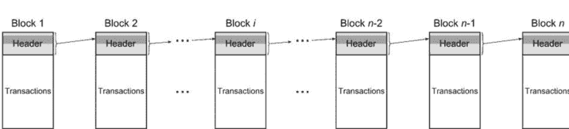

图 1.1：`BTC` 区块链拓扑。

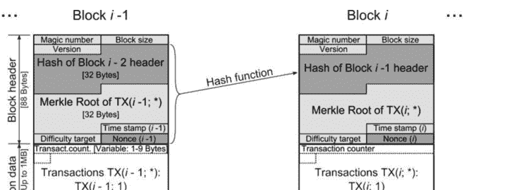

图 1.2：`BTC` 区块链中带有连接的区块结构。

让我们假设一个 `BTC` 区块链（仅是使用区块链链技术的加密货币之一）记录了人们进行的所有 `BTC` 交易。换句话说，区块链是一个金融银行，从一开始就对所有过去的货币交易（在社区成员之间）拥有精确且可靠的数据。或者说得简单——区块链是一个可靠的交易寄存器（或账本），包含了直到此时此刻的所有交易。它是一个巨大且不断增长的文件。例如，一个 `BTC` 区块链（每种加密货币都有自己的区块链，就像比特币一样）现在已经有几百 GB 的大小，并记录了人们之间所有的 `BTC` 交易。

## 6 — 1 分布式账本技术

整个系统的关键点是无人可以删除或修改这些交易中的任何一个，这是区块链成为热门话题的主要原因。它提供了记录数据的绝对持久性和可靠性，因此没有黑客可以进入此区块链数据库并更改事实，例如 John Smith 拥有 20 个 `BTC`。`BTC` 的这些属性是通过两个最重要的因素完成的：

- 1. 去中心化

- 2. 交易验证算法，它与区块链结构密切相关

当所有交易列表（区块链）存储在世界各地的许多计算机中时，实现了去中心化的概念，其中这些计算机（节点）每一个都包含一个完整区块链的文件（该文件应与任何其他节点的区块链文件完全相同）。与中心化的银行系统（银行将客户的交易数据存储在其服务器上，经过良好保护和备份）不同，维护区块链的节点是世界各地的普通人，他们自愿参与了这种分布式账本（DL）。既没有中心权威，也没有相互独立的中央服务器，除非它们的计算机持有着维护区块链的节点。节点之间始终使用节点间通信协议连接，创建了一个全球性的点对点（`P2P`）网络。然而，这个网络就像在互联网上运行的任何 `P2P` 网络一样。

每个节点的磁盘上都保留着区块链文件的最新副本。此外，某些节点（矿工）还可以验证世界上任何两个人之间的最新交易（例如 `BTC`）。此外，还有许多仅具有验证功能的计算机。它们也被称为矿工，尽管它们不是节点。

让我们来看这样一个例子：A 想向 B 发送 100 欧元（`BTC`）：起初，A 的计算机（或手机）向网络宣布它想向 B 转账 100 欧元。此时，这被称为无效交易，尚未写入寄存器。

矿工接下来要做的第一件事是检查 A 是否拥有足够的（以及更多资金）。现在，矿工通过遍历整个区块链，查看 A 曾经过的所有的交易，并计算是否有足够的资金。并没有“账户状态”这种类别，A 拥有的金额是根据 A 从此为止的所有交易重新计算的。这是一个非常有利的特性，增加了区块链的安全性。如果想操纵另一个人的账户，必须改变过去。

### 1.2 区块链

完成这个（较容易）的第一步后，接下来是第二个更困难的步骤。并没有这样的值，也就是说，没有预先具体的数值。更具体地说，算法的设计目标是：调整区块链中上一个通过验证的区块哈希值，使其足够小，小于或等于一个给定的数字（目标）。这在实际上意味着要放入下一个区块（即最新区块）头中的哈希值以零开头。哈希值的调整通过迭代增加 `nonce`（随机数）的值并为每个新的 `nonce` 计算新的哈希（整个区块头）来完成。当当前计算的哈希满足给定条件时，过程停止。了解加密哈希函数的属性（对于 `BTC`，使用 `SHA-256` 算法，即哈希为 256 位），显而易见

## 8 — 1 分布式账本技术

在给定前导零个数的情况下，猜中哈希值的概率极小（单次尝试）。如果目标（对于特定的难度级别）是计算一个例如前 72 位为 0（或用十六进制表示为：hash = 00000000 00xxxxxx xxxxxxxx xxxxxxxx xxxxxxxx xxxxxxxx）的哈希值，假设哈希值呈均匀分布，那么单次尝试成功的概率将为 $2^{-72} = 1/4,722,000,000,000,000,000$。由于概率如此之小，粗略估计，专门的矿矿计算机（例如处理能力为 16 Hash/s 的计算机）仅为了找到随机数（`nonce`）和哈希值的获胜组合就需要九多年时间！尽管如此，区块链每隔十分钟就会添加一个新区块。这是如何实现的呢？

答案在于全球所有矿工计算机共同努力所产生的巨大处理能力。`BTC` 矿工的精确数量很难确定，因为它们总是在变化，且呈增长趋势。当他们没有挖掘 `BTC` 时，许多人也会使用他们的计算机挖掘其他加密货币，少数人也会不时进行挖掘，例如在矿工计算机未用于玩游戏的间隙期间。最终，矿工的准确数量并不重要，因为他们计算机的处理能力各不相同。然而，这取决于矿工投资硬件的意愿，以及电费等所有开支。

如今，越来越多的矿工聚集在矿池中，因为他们意识到单打挖矿是不盈利的，因为区块的验证过程将花费无法接受的长时间。矿池是矿工的联合体，他们可以获得诸如更频繁验证区块等优势。矿池的矿工根据其对矿池贡献的算力比例来共享此类验证的奖励。此外，大多数 `BTC` 挖掘是在大型、热控数据中心和具有廉价电力的仓库中的应用专用集成电路（`ASICs`）上完成的。这些仓库的所有者将处理资源租给矿工。

随着世界算力的日益增长，预计区块验证频率会增加，`BTC` 的发行速度会加快，但这些尚未发生，这是由于使用了名为“难度”（`Difficulty`）的算法，该算法会调整解决验证问题的难度。该算法使平均区块验证频率保持基本不变。区块链大约每十分钟添加一个新区块，在两周内，区块链上应该添加 2016 个区块。每两周，算法会根据总算力的统计和交易数量，更改名为“难度”（图 1.2 所示）的区块头字段的值。

32 位“难度”字段的值（在更复杂的情况下）对应于寻找哈希值的难度，该值小到足以满足区块验证条件。之前提到过，写入已验证区块的哈希值必须小于或等于一个给定值，称为 `target_value`（在图 1.3 中命名为 X）。定义了一个名为 `difficulty_1_target` 的参考值来

## 1.2 区块链 9

### 区块 n

### 区块 n+1

| 魔数数字 | 区块大小 |

|---|---|

| 版本 | |

| 区块 n-1 的哈希 | |

| TX(n)* 的 Merkle 根 | |

| 时间戳 (n) | 75 |

| 难度目标 | 计数器 |

| 验证成功 | 区块大小 |

|---|---|

| 魔数版本 | |

| 区块 n+1 的哈希（区块 n+1 添加到区块链） | |

| TX(n+1)* 的 Merkle 根 | |

| 难度目标 | 计数器 |

 TX(n)*:

TX(n):1

TX(n):2

TX(n):3

Nonce = Nonce + 1: 计算哈希：

新哈希 ≤ ?

否

是

TX(n+1)*:

TX(n+1):1

TX(n+1):2

TX(n+1):3

区块链中最后一个已验证区块

新区块（要添加到区块链）

**图 1.3:** 在区块链末尾添加新区块

代表 256 位数，其中前 32 位为零，接下来的 16 位为一，其余为零，或用十六进制表示：

$difficulty\_1\_target = 00000000ffff0000000000000000000000000000000000000$

$=ffff_{(hex)} \times 2^{208} = 2^{224}$ (1.1)

一个名为“难度”（`Difficulty`）的参数定义为：

$Difficulty = difficulty\_1\_target/value$ (1.2)

因此，它显示了寻找低于目标值的哈希比寻找低于目标值的哈希困难多少倍。难度是一个浮点值，在区块头的难度字段中，它由目标的指数和尾数表示，其中前 8 位是指数，后 24 位是尾数。例如，如果目标值（十六进制表示）为 **172f4f7b**，则应使用以下预定义公式计算哈希的 `target_value`：

$target\_value = 2f4f7b \cdot 2^{8 \cdot (17-3)}_{(hex)} =$

$00000000 00000000 002f4f7b00000000000000000000000000000000$ (1.3)

使用 (1) 和 (2) 我们得到难度的结果（十进制）：

$Difficulty = 5,949,437,371,609.53 = 5.95 \times 10^{12}\text{（或 5.95T)}$

哈希 `target_value` 中的前导零个数由难度计算：

$Number\ of\ zeros = \log_2(Difficulty) + 32$

在本例中，结果是 74.44。这也可以从 (3) 中 `target_value` 的十六进制表示看出，前 18 个字节（4 位块）代表 72 个二进制零，下一个半字节 $2_{(hex)} = 0010_{(bin)}$ 增加了两个零，另一方面得到了 74 个零。

假设我们希望确保每 10 分钟验证一个区块。在这种情况下，难度应该相对于整个比特币网络的算力进行调整，使其能够每秒进行目标数量的计算，以达到寻找低于 `target_value` 的哈希平均时间为十分钟的目标。每秒的哈希操作数（称为哈希率）可以从难度如下推导和计算：

$Hash rate = \frac{N(Difficulty)}{10\text{min}}$

其中 $N(Difficulty)$ 是找到有效哈希之前（对于给定难度）的预期哈希尝试次数：

$N(Difficulty) = \frac{2^{256}}{target\_value}$

通过结合 (2)、(6) 和 (7)，我们得到：

$Hash rate = \frac{1}{10\text{min}} \times \frac{2^{256}}{difficulty\_target} \times 600\text{s} \times \frac{2^{256}}{Difficulty} = Difficulty \cdot 2^{32}/600s$

例如，如果 `Difficulty = 5.95 T`，使用 `(1.8)`，哈希率为 42,587,731,567,771,900,000 hashes/s，或每秒 42.6 Exash (42.6 EH/s)。在相同难度下，算力为 16 TH/s 的计算机可以挖掘 50 年来找到解决方案（时间 = `$600s \times 42.6EH/s$`）。

随着世界算力的日益增长，预计区块验证频率会增加，BTC 的发行速度会加快，但这些尚未发生，这是由于使用了名为“难度”（Difficulty）的算法，该算法会调整解决验证问题的难度。该算法使平均区块验证频率保持基本不变。区块链大约每十分钟添加一个新区块，在两周内，区块链上应该添加 2016 个区块。每两周，算法会根据总算力的统计和交易数量，更改名为“难度”（图 1.2 所示）的区块头字段的值。

## 1.2 区块链

### 1.2.1 工作证明

上述问题以及 BTC 如何发行的答案可以在应用概念 PoW 中找到。PoW 的概念并不新。它一直被用于具有客户端服务器机制的计算机网络，作为防止拒绝服务（DoS）攻击和其他滥用行为的措施。PoW 的主要特性是其不对称性——客户端的工作相对困难，而结果的检查却非常简单。在区块链的情况下，成功的矿工（即矿池）完成极其复杂的寻找有效哈希的工作可以被其他节点轻松验证。

之前提到过，区块链的信任性也有助于去中心化。让我们记住，区块链作为交易区块的 DL，是通过运行完整区块链的连接节点来实现的。在这个去中心化的基础设施（P2P）中，一组矿工收集交易记录，验证每笔交易是否正确且不与之前的交易冲突。他们还会检查发送者（身份隐藏在地址后面）移动的 BTC 是否超过地址包含的数量。

每个矿工独立收集有效交易并将其汇总候选区块。然后，矿工尝试通过 PoW 解决其候选区块，即通过 1.2 节节描述的寻找有效哈希的过程。第一个成功解决候选区块的矿工将其解决方案广播到网络（包括其他矿工），以便添加到区块链。这里的关键是，只有当超过 50% 的矿工说它是正确解决的时，新区块会被添加到区块链。在说之前，矿工必须对已解决的区块进行计算，将结果与广播的解决方案进行比较。两个不同的区块可能会同时被解决。在这种情况下，两个解决方案将在网络中传播（这种情况是

## 1.2 分布式账本技术

这被称为区块链分叉。然而，最终只有一个会获胜，即它会被添加到区块链中（首先被矿工采纳）。同时，另一个已解决的区块（孤儿区块）将失效，该区块中的交易（即未包含在获胜区块中的交易）将等待下一轮，以便在随后的某些候选区块中被收集和验证。决定哪两个解决方案将获胜的触发时刻大约是 10 分钟，当下一个区块首次（在网络某处）添加到获胜区块之上时。然后，新添加的区块将作为解决方案广播（其中先前的获胜区块已包含在区块链中）。社区将迅速接受它，假设最后添加的区块是当时所提供的解决方案，这是最常见的情况。

在收到候选区块已解决的消息后，矿工只需验证解决方案是否正确，因为解决方案已经是已知的。然而，尽管已解决的区块只有在经过 50% 以上矿工验证后才能添加到区块链中，但他们不必对其进行验证。矿工首先决定在开始下一个区块之前是等待该区块，还是立即解决下一个区块（假设上一个区块是正确的）。做出这种假设的好处是不会在验证上浪费时间，这增加了大约 10% 的利润。因此，大型矿池将跳过此验证过程，直接使用新追加的区块链开始下一个区块。

通过 PoW（工作量证明）程序和超过半数参与者的共识，所谓的“无意义的真理”（pointless truth）是一个术语，指的是一种社区状态：社区对某事具有共识（在这里是指对 BTC 的信任），而其中没有人信任任何人。尽管如此，正因为这种整体上的信任，所有参与者身上都施加了一套规则（或像 PoW 这样的机制）。最终，每个人对某些共同感兴趣的事务都充满信心。

在这种情况下，BTC 区块链是一个巨大且可靠的数据结构，因为它的增长需要巨大的计算工作。这部分工作（由于通用的不信任）必须通过 PoW 证明，并由大多数矿工进行验证。如果有人尝试更改（即伪造）先前的某些操作，仅仅为了改变某人数字钱包的状态，他必须创建一个新的一致的区块链版本（包含一个更改的区块）。它必须通过矿工社区的验证过程。更改区块链内部的区块（只能通过创建一个包含相同前身的新区块来实现）需要重新生成所有后续区块，并重新执行它们包含的所有工作。由于伪造者必须独自完成极其巨大的工作，这在实践上是不可能的。区块链中目标区块之后的区块越多，创建另一个篡改了目标区块的区块链版本就越越困难。通过这种方式，结合信任机制的去中心化系统获得了货币权威的声誉，而这种声誉只有某些中心化货币机构（例如各国的中央银行）才具备。此外，BTC 已成为一个不受任何政府或任何中央权威控制的全球货币系统。

除了去中心化和 PoW 机制外，BTC 具有这种可持续发展和价值的原因还在于货币政策，即 BTC 的发行政策。这是全球矿工队伍执行交易验证工作的主要动力（激励）。尽管现在看起来在持续的区块求解过程中，每 10 分钟就会凭空产生出新数量的 BTC，但 BTC 仍然没有通胀的特征——即 BTC 的总量受到其设计的限制，这就是为什么它通常被称为“数字黄金”。

BTC 是 2009 年在互联网上启动的最古老、最为人知的数字货币。现在，它的总量不能超过 2100 万（精确数字为：20,999,999,769 BTC）。在开始，求解区块的奖励为 50 BTC，区块链中开启区块的难度为 1，但哈希值仍有 8 个前导二进制零。如前所述，每 14 天发生一次，取决于矿工的总计算能力。区块奖励每 210,000 个区块减半。目前，奖励为 6.25 BTC，已从 2020 年 5 月 27 日第 630,000 个区块处从 12.5 BTC 减半。矿工可能会因为利润减少而离开，但另一方面，产生每个新 BTC 所需的将会减少。

最后，我们指出，到 2032 年，几乎所有的 BTC 都将被挖完，届时奖励将低于 1 BTC，而矿工唯一的激励（如果还有剩余的话）将是交易费。但毕竟，此时无法对 BTC 的未来和生存做出精确的预测。

### 1.2.2 BTC 的漏洞与问题处理

在 BTC 之前，就已经过创建可持续数字货币的尝试。所有尝试都失败了，因为没有可靠的机制来防止交易被复制并花费两次（即实现两次）的情况发生。幸运的是，BTC 通过带有 PoW 的区块链概念成功解决了这一双重花费问题，其中每笔交易都有时间戳。

如果两个交易（其中一个具有欺骗性）使用相同的私钥（来自欺诈发送者）发送到网络中不同的地址，就会出现双重花费问题。这两个交易在网络中传播，网络的一部分将接受其中一个交易，另一部分接受另一个。BTC 区块链中固有的防御机制是，只有被矿工解析到下一个区块中的（通过网络任一方的）交易会被验证。另一个将作为无效被拒绝。BTC 通过这种确认机制管理双重花费问题，是通过按时间顺序排序的带有时间戳的交易账本（即区块链）实现的。

BTC 中包含的另外一点是使用 PoW 作为一种概率解决方案，解决被称为“拜庭将军问题” [6] 的故障类，该问题是“两将军问题”的广义版本。可以说，作为分布式系统的 BTC P2P 网络是具有拜庭故障容错能力（BFT）的。

拜庭将军问题可以简述为这样一种情况：许多将军（每个带有一支军队）必须对在即将发生的反对包围敌人的战斗中的攻击时间达成共识。如果他们不是同时攻击，而是少数将军下达了攻击命令而其他将军没有，敌人将击败已攻击的军队，获得战略优势并最终赢得战斗。将军们之间通过信使进行通信，即每个将军根据其在空间位置将消息转发给最近的将军。攻击时间的初始消息由总将军发送给少数将军，并转发给其他人。如果某些将军修改了消息并转发给其他人，问题就会出现。这将导致攻击不同，最终导致失败。由于忠诚的将军不知道谁是叛徒，他们必须创建通信协议和决策规则。他们必须确保，在某些将军收到多个不同攻击时间的情况下，只有正确的消息会被接受，错误的会被拒绝。研究表明 [7]，只有当叛徒将军的数量不超过总人数的三分之一时，这个问题才能被解决。

在讨论分布式系统（如2P 网络）中的拜庭将军问题时，该问题涉及系统的损坏组件阻止了其他组件之间达成一致（即共识）。这种共识对于系统的正确运行是必要的。拜庭故障假设任何导致组件向系统部分呈现不同症状的故障。拜庭故障容错（BFT）系统只要故障组件不多就能完成其正确运行，即最多三分分之一的组件存在故障。BFT 系统通常包含 PoW 来应对损坏组件的错误信息。

如果我们要在 BTC 环境中翻译拜庭将军问题，可以设定一个已解决候选区块的情况。找到解决方案后，矿工将区块添加到区块链（假设为第 n 个区块）并向其他节点。。然后其他节点检查接收到的带有第 n 个区块的区块链。完成检查并确认随机数（nonce）后，每个矿工将此新区块添加到其区块链副本的顶部。当其他矿工继续添加

在区块 `$n$` 之上，大约每 10 分钟会解决下一个后续区块（即区块 `$n+1, n+2,\dots$`），这些区块随后会变得稳固。区块链最顶端的最新区块通常是不稳定的，但在其上方有更多的区块时，它被认为是安全的。由于添加新区块是困难的（因为工作量证明 PoW），区块链中的一个区块在约一小时后被认为是安全的，即在其之后又添加了六个区块。这就是为什么加密货币交易所和其他服务商接受比特币作为所谓的“区块确认”的判据。

区块链中最后添加的区块被认为是不稳定的，因为在那个时刻，很有可能（而且非常常见）某些矿工可以找到另一个解决方案，导致区块链产生分叉。在这种情况下，区块链被分成两条相互竞争的前进路径。BTC 区块链中的分叉出现是有规律的，到目前为止，每当在区块链的这两个分支中的一个（幸运地是先生成的那一个）添加了额外的区块时，每个分叉都会迅速解决。与此同时，整个网络会放弃另一条分支的区块（孤儿区块），因为获胜的分支包含了更多的 PoW。假设如果分叉一直未解决，两个相互竞争的区块链历史将共存，从而损害整个系统。

理论上，如果几个矿工或一个非常强大的攻击者试图通过增加足够的算力或超过整个网络的算力（所谓的“51%攻击” [8]）来控制 BTC 社区，可能会发生拜占庭问题。人们可以尝试强制他们版本的区块链，即通过启动分叉，使得区块链中最后几个（仍稳固的）区块被其他区块替换（在区块链的新分支中）。这些区块可能包含虚假交易，从而使常规区块链分支的交易失效（导致双重花费）或以其他方式破坏区块链。只有当攻击者的区块链版本包含比常规版本更多的 PoW 时，它才会在网络中传播并被其他矿工社区接受。这只有在攻击者赢得了足够的计算力来连续解决六个区块（即速度快于矿工）时才可能发生。随着攻击者的力量接近总挖掘算力的 50% [9]，这种事件在一段时间内发生的概率变得几乎接近于 100%。2014 年，同一个矿池连续破解了六个区块，该矿池集中了整个矿工社区拥有的总哈希算力的 40% 以上。但随后，一些矿工自愿转移到其他矿池，以防止意外影响。

攻击者在灰色地带（处于 30% 到 50% 之间）可能拥有巨大力量，此时网络可能存在两个或更多不同版本的区块。因此，会导致 BTC 的崩溃。但由于引入了 PoW，这种情况不会发生，因为它显著降低了同一实体连续解决六个区块的概率。此外，人们可能会认为，即使有这样的概率降低，攻击者也有足够的时间来

16 1 分布式账本技术

最终崩溃系统。然而，这在实践中是不可能的，仅仅由于攻击者增加的哈希算力。由于整体计算能力的增加，涉及的 PoW 难度也会随之增加（最多两周后）。结果是，攻击者的算力仍然不足以实现其意图。因此，可以说 BTC 区块链是一个 BFT（拜占庭容错）系统。

BTC 的市场价值目前已达到巅峰。另一方面，价值的增长激励了许多攻击者去破解或操纵 BTC 系统，其他几种加密货币也出现了类似的情况。在许多基于网络的攻击中，有两种可能会破坏 BTC 网络的运行——分区攻击（partition attack）和延迟攻击（Delay Attack）。这两种攻击利用了边界网关协议（BGP）的脆弱性——不要与拜占庭将问题混淆——BGP 是路由器在互联网上广泛使用的路由协议。

这些及其他基于网络的攻击是可能的，因为 BTC 网络是高度中心化的，从互联网路由的角度来看，即最重要的第一级（Tier-1）互联网提供商可以拦截 BTC 网络中超过 60% 的连接 [10]。此外，所有节点中 60% 以上集中在五个国家，以美国为首，占了所有节点的约四分之一。另一方面，算力仅集中在一个国家——中国矿池控制了全球约 80% 的总哈希算力。最大的矿池位于中国，它们开采了全球约 70% 的 BTC [11]。因此，挖掘算力在单一国家的中心化是目前 BTC 社区面临的最大问题之一。

分区攻击的决条件是将一组受害者节点与 BTC 节点隔离开。通过这种方式，BTC 网络被攻击者分成两个部分（较小和较大的），它们之间没有通信。因此，区块在两个部分中都被解决，然后每个解决的区块在各自的部分内广播。当攻击者停止攻击并建立这些部分之间的通信时，在较小部分（算力较小）挖掘的所有区块将被丢弃，所有的交易和矿工收益也是如此。

延迟攻击有效地减慢了区块向受害者的传播。主要目标是让受害者几乎 20 分钟内不知道新区块。与受害者连接失效的分区攻击不同，在延迟攻击中，攻击者在受害者与其节点节点之间进行中间人攻击，修改来自受害者的 BTC 信息。由于操纵，受害者节点（即矿工）获得的信息与请求的不同，即它原本不知道的——在挖掘后，新区块通过网络发布，新区块的哈希值通过网络传播，通过其节点到达受害者节点。

1.2 区块链 17

攻击者拦截了受害者与其节点节点之间的通信（与节点的节点的 TCP 连接仍然存）。当受害者最终获得区块时，为时已晚，因为新区块已经（可能）解决并添加到区块链中了。这样，受害者浪费了计算力和时间，而不是解决下一个区块。潜在的利润也丢失了。可以使用各种措施来对抗或防止分区攻击和延迟攻击。它们可能包括矿池的多宿化 [10]（防止延迟攻击）、互联网服务提供商应用的各种过滤技术（防止分区攻击）、BGP 流量监控，或在适当的路由上带有安全补丁升级 BGP 协议。

BTC 系统不同实体的众多威胁也可能出现，如果不处理可能会导致问题。在不详的情况下，让我们列出其中一些：数字钱包的漏洞威胁、通过创建节点伪造身份的女巫攻击 [12]、拒绝服务（DoS）攻击、能量消耗、追踪硬币历史（将身份与地址关联）、受害者节点的时钟偏移（时间劫持）、区块链中的非法内容等。

### 1.2.3 基于区块链的替代平台和加密货币

在之前的章节中，重点是作为最老且最著名的加密货币 BTC。此外，它是解释区块链概念以及 DL、PoW、社区共识、无信任真相、激励机制等内容的合适示例。

BTC 的成功为许多替代加密货币（代币）铺平了道路。数百种代币中许多基于 BTC 相同的框架，即它们包含 P2P 网络、区块链以及通过某种 PoW 的挖掘过程来验证网络上的交易。另一方面，代币之间以及与 BTC 在许多方面都不同——例如 PoW 算法、程序差异、挖掘区块消耗能量的不同方式，或为了实现更好的用户匿名性所采取的改进。在 BTC 之后，出现的新的替代加密货币主要目标是取代 BTC，或者至少重复其成功。许多代币针对的是 BTC 感知的限制和缺陷，并旨在获得一些竞争优势。

## 分布式账本技术

截至目前，已有超过 1500 种代币在互联网上创建并上线，新的币种可能随时出现。然而，许多旧的加密货币已不再市场上存在。目前，市值最大的代币包括以太坊 (`ETH`)、Cardano (`ADA`)、Ripple (`XRP`)、比特币 (`LTC`)、Zcash (`ZEC`)、Dash (`DASH`) 和 Monero (`XMR`)。

`LTC` 通常被称为 BTC 的“白银”，在功能上与 BTC 非常相似。主要区别在于：区块求解所需的平均时间为 150 秒（比 BTC 的 10 分钟短四倍）、可挖掘的代总量（8400 万 LTC 相比于 210 亿 BTC）以及采用的 PoW 算法——`LTCrun`。这种顺序函数涉及 `SHA-256` [13] 哈希计算，但所需的内存比 BTC 的哈希计算更多（被称为双重哈希或哈希-哈希算法）。

`ETH` 则稍微特殊，因为它并不是一种数字货币——它的设计并非用于商品和服务的在线支付，而是作为驱动以太坊区块链的激励机制。换句话说，`ETH` 是以太坊网络的原生数字货币，设计用于使用智能合约的各种去中心化应用（见第 2 节）。在公共以太坊网络的挖矿过程中，大约每 12–15 秒就会验证一个新区块，其奖励为 5 ETH。PoW 算法（称为 `ethash`）所需的内存比 BTC 的更多。此外，运行各种 DApp 需要通用的计算硬件（如 CPU），因此专门用于 BTC 挖矿的高昂 ASIC 芯片并不适用于以太坊挖矿。

以太坊 DLT 是第二代区块链系统的先驱。与比特币不同，它们能够支持智能合约和去中心化应用。长期以来，以太坊一直是 DApp 平台选择的唯一可行方案。可能的替代方案要么不成熟，要么缺乏分布式生态系统（见第 2.7.1 节）。以太坊运行在一个大型公共网络中，具有重要的加密市场市值。此外，以太坊系统（见第 2.7.1.1 节）提供了社区支持、开发工具和库。以太坊客户端此前支持过 PoW 共识的替代方案，可以在私有网络或联盟网络中使用。以太坊基金还规划了从公共网络 PoW 共识向 PoS 的清晰迁移路径。因此，以太坊技术始终是大多数高级 DApp 设计的选择。出于相同的原因，书中的许多示例都引用了以太坊网络、节点和应用程序。

尽管如此，其他可行的 DLT 和生态系统正在出现。其中一些在第 2.7.1 节中介绍。它们在某些方法上可能与以太坊不同，但共享第 2 和第 3 节涵盖的与账本网络、性能、去中心化应用和安全的许多共同原则。

## 1.3 IOTA 项目 – Tangle

物联网（IoT）正在成为现实，预计很快将部署数十亿 IoT 设备。其中许多设备将参与不同类型的货币交易和微支付。因此，需要提供一个能够高效支持大量交易的通用平台。这种支持应该优于现有区块链平台提供的。IOTA 项目 [14] 提供了一种为 IoT 提供关键支持的解决方案。这是一种与区块链显著不同的分布式账本技术。IOTA 基于名为 tangle 的特定 DAG（有向无环图）结构。

IOTA 项目始于 2015 年，旨在为数十亿 IoT 设备之间的支付（交易）提供一种更合适的加密货币，并为许多其他应用（可能包括设备间的机器间 M2M 通信）获取可靠的平台。因此，IOTA 协议的实现必须廉价、快速且可扩展，这就是开发 tangle 而不是使用成熟的区块链技术的关键原因。IOTA 的快速增长显著增加了 IoT 设备之间微支付的需求。起初，BTC 证明不是这些交易的良好选择。原因之一是微支付交易涉及的金额较小，导致费用相对较高；另一个原因是参与者的角色问题：在 BTC 社会中，某些矿工验证交易，而“普通用户”发布交易；而在这里，矿工可能是发行者。由于这种不确定性，可能发生冲突的概率很高，且冲突解决会浪费资源。

IOTA 与 BTC 或以太坊等其他基于区块链系统的区别在于，IOTA 的 DLT 不包含矿工、不包含交易区块、没有以 IOTA 代币支付的交易费或奖励，也没有困难的 PoW。相反，当参与者广播交易时，首要工作是验证该交易，即：批准两个（随机选择的）之前的交易并执行少量的 PoW。作为奖励，该交易被允许附加到那些之前的交易上。这种“付费验证”系统使得财务奖励变得不再必要。

此外，所有加密货币总量（IOTA 代币，简称为 IOTAs）在 tangle 生成之初（即创世时刻）就已经创建，并分发给了项目创始人。在参与者（创始人和新参与者）之间进行不同交易后，IOTAs 会易手。IOTAs 的最小单位是一个代币（与 BTC 不同，它不可分），而创世时创建的总量为 $(3^{35}-1)/2 = 2.779 \times 10^{15}$ IOTAs。

如前所述，tangle 是一个 DAG，每个点代表单笔交易（而不是交易区块），而箭头表示批准。在表示 tangle 的图中，每笔交易都指向它所批准的之前的交易。

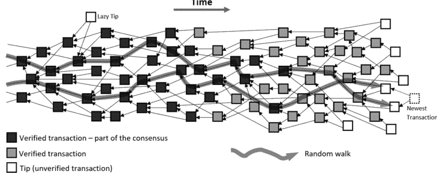

图1.4：Tangle – 图表示

tangle 中的第一个交易被称为创世交易（`genesis`）。所有的 IOTAs 都在创世时创建，且不存在创建新代币的机制。 tangle 中的所有交易直接或间接批准创世交易。被大量新交易批准后，该交易成为实际上无法更改的共识的一部分。tangle 的一致性通过每笔交易必须执行的微量 PoW 计算来实现，这使得攻击者在共达成后很难对 tangle 进行分叉或垃圾。有效交易的共识通过应用蒙特卡洛随机游走算法（RWC）（15）获得。该算法涉及新交易选择两个父节点进行批准。该算法实际上引导交易指向边缘（未被批准的交易），其父节点尽可能新。然而，有较小的概率选择边缘，即批准某些其他（已被较早交易验证的交易）。

从实际边缘集中选择边缘的机制是（即可以通过从创世向 tangle 终端（沿着时间线），即指向边缘的随机游走来选择）。当到达特定的边缘（即被选中）时，游走停止。游走会再执行一次，以便选择两个边缘进行验证。如果选定的边缘通过了验证（即检查无一致性），它们将成为新交易的父交易（新交易实际上直接批准了其父节点）。交易在 tangle 中的累积权重是总

## 1.3 IOTA 项目 - 纠缠网 (tangle) 21

所有后续交易的数量，并同时直接或间接批准了该交易（更准确地说，此总数额外增加了 1）。在遍历过程中，在每个分支点，所选择的分支是通向下一个子交易且具有最大累计权重的分支。尽管如此，遍历过程中会引入一定程度的随机性，也就是说，每个分支点累计权重最大的交易并不总是会被包含在路径中。可以说，这种遍历是向最重的分支引导的。随着新交易的出现，纠缠网（tangle）被迫沿着跟随最重交易（从累计权重角度而言）的方向最快增长。相反，附加到最轻分支上的交易会变成孤儿（orphaned），即它们最可能成为共识的一部分（因为它们被任何新交易批准的概率很小）。纠缠网的增长让人们联想到树向某个方向的强制生长（例如，树接收光照最多的方向），而其他方向的生长也是可能的，但会被显著减少。

在目前的描述中，纠缠网的内部由所有或大多数的节点（`tips`，约占节点的 95%）独立批准。出于这种原因，它们被认为是有效的，并预计将永远存在于纠缠网中，即对账本部分的不可变性存在共识。交易的累计权重是该交易之后执行的 Pow（工作量证明）的衡量标准，它像区块链通过后续区块的 Pow 保护和巩固一样，确保了交易的一致性和不可变性。交易的累计权重越大，表示该交易越可靠。当纠缠网中的某个交易达到足够的累计权重时，它就会安全地包含在共识中。这等同于一种观点：如果一个交易被大多数节点（通常是间接的）验证，它就会成为共识的一部分。

基于区块链的系统与 IOTA/纠缠网平台的共同特征是，IOTA 网络是一个由节点组成的 P2P 网络（即用户、实体和参与者）。与之下，BTC 节点是实体，它们在设计上负责验证和发布交易；在发布交易之前，节点必须批准由其他节点发布的两个较早交易。此外，每个节点都有动力在网络中积极传播来自其他节点的节点交易，尽管该节点可能没有其他交易要发布。我们需要避免 IOTA P2P 网络中的节点与纠缠网中的站点（sites）之间的混淆。在纠缠网图表示中，站点是一个（节点使用的）交易。此外，纠缠网（作为分布式账本 DL 的代表）是存储由节点发布的一组站点组成的交易的领导者。

在时机方面，可以说 IOTA 网络是异步的，交易可能在某个时刻由某个节点发布，并在网络中传播，在不同的时刻到达不同的节点。这意味着任何其他节点在发布其交易时，所操作的不是纠缠网的实际状态，而是几秒前的状态。

因此节点并不总是包含账本的最新版本，也不会总是向其网络中的邻居（peers）接收更新（最新的节点）。可能出现，当节点有新交易要发布时，它可以选择验证来自纠缠网旧状态的两个父交易（此时节点可能处于离线状态且未连接到互联网）。验证后，节点通过网络广播其新交易（该交易被附加到已验证的父交易上）。由于节点没有批准任何新交易，因此它没有为社区提供帮助。

另一方面，这种懒惰行为会通过协议的两种方式受到惩罚。首先，发布的交易可能会被网络的其余部分视为“懒惰节点”（lazy tip），因为其他活跃节点拥有更新的纠缠网版本。由于懒惰节点可能会变成孤儿，此类交易不太可能成为共识的一部分。节点有动力保持其交易尽可能新鲜。其次，节点有动力保持其交易尽可能新，因为节点在验证交易时会增加交易的累计权重。当纠缠网中的交易达到足够的累计权重时，它安全地成为共识的一部分。根据协议，这种冲突的交易会强制节点传播交易。当节点计算交易的统计数据时，冲突的交易可能会被丢弃。如果节点发现所选节点存在冲突，它将放弃该并选择另一个，而先前的节点会被遗忘。通过这种方式，节点直接解决了冲突。如果节点发现所选节点的验证路径存在冲突，也会发生这种情况。在这种情况下，冲突被说是间接解决的。如果节点发布一个间接解决冲突交易的新交易，它面临其他节点不批准其新交易的风险。

另一种情况是纠缠网通过解决冲突进行自我净化，当节点选择两个节点时，第一个节点的验证路径包含一个与第二个节点的验证路径相冲突的交易。这是当冲突的两个交易之一属于这两个节点验证路径的交集时。在这种情况下，节点看不到冲突。因此，通过将交易附加到所选节点上，两个冲突交易都被该节点间接批准了。此外，一些新交易可能会在没有看到冲突的情况下附加其上。

然而，新交易迟早会选择包含冲突交易的验证路径的节点。这时，冲突将被注册并通过放弃该节点来解决。该节点将与它直接或间接失效的几个之前的交易一起变成孤儿。这些孤儿交易将仅包含冲突交易之一（以及批准它的几个后续交易）。相比之下，包含第二个冲突交易的分支（累计权重较大的分支）将存留。

## 1.3 IOTA 项目 – 纠缠网 (tangle) 23

例如，一个实体（人或设备）购买商品或服务并向其他实体（卖家）提供 IOTA 代币，纠缠网在从之前的交易产生冲突时，可能会产生负余额。此外，即使账户状态是正的，不诚实的实体可能会通过发布不同的操作来花费两次（双花费问题），导致冲突交易。由于没有冲突预防机制，纠缠网可能一段时间包含冲突交易。

当节点选择要附加其子交易的节点时，它必须验证这些节点。对节点的验证包括检查节点的签名和 Pow，并确保该节点与其验证路径中的任何交易都不冲突（即与该节点直接间接引用的交易）。假设节点发现所选节点存在冲突。节点将离开并选择另一个，而先前的节点会被遗忘。

## 24 1 分布式账本技术

正如已经指出的，纠缠网（tangle）从创世事件开始，第一笔交易启动了预定义数量的 IOTA 代币。随着纠缠网的增长和交易总数的增加，账本的大小在不断增大，这对于物联网（IoT）应用可能是一个问题。为了缩小其尺寸，IOTA 基金会对整个网络进行快照，其中包含所有用户账户（钱包余额）的状态，但并不包含交易历史；也就是说，所有之前的交易都被删除了。这种快照代表了纠缠网的新创世状态（类似于一个新的开始），但区别在于，最多已有 2,779 × 10⁵ 个代币分配给了所有用户。

目前，IOTA 网络尚未完全开发，用户数量远超纠缠网最初设计的规模。因此，社区的总计算能力（哈希率）仍然较低。结果是目前的纠缠网容易受到双重花费攻击，如果攻击者拥有超过网络总哈希率三分之一的份额，这种攻击就可能发生。为了防止此类攻击并出于安全考虑，IOTA 用户通过所谓的“协调节点”（`Coordinator`）（自愿且临时地）应用不同的共识机制。该机制假设 IOTA 基金每两分钟发布一个里程碑。所有直接或间接通过里程碑交易批准的交易立即被视为共识的一部分（即置信度为 100%）。在未来，当 IOTA 网络达到足够的计算能力时，将不再需要节点；也就是说，IOTA 基金将关闭并让纠缠网完全独立进化。

纠缠网的一个特殊特性是所有的处理和软件计算运行在三进制逻辑中，更准确地说，运行在平衡三进制逻辑中。与二进制计算不同，二进制位（bit）可以取两个值之一（0 和 1），而平衡三进制中一种被称为“三位”（`Trit`）的数字可以是 -1、0 或 +1。由三个三位组成的字可以创建 3⁷ 种不同的状态（值）。每种类型的状态用 26 个大写字母“A”、“B”、“C”、“X”、“Y”、“Z”中的一个以及数字作为符号（在平衡三进制逻辑中符号“9”代表 +1）。

计算机理论定义了一种衡量基数为 R 的假设计算机效率的度量标准，称为“基数经济”（radix economy），即 R 的幂和该基数下的位数。理论上，基 e=2.71（欧拉数，即自然对数的底）在存储信息方面的效率最高。因此，对于真实的计算机，基数 R=3 是最佳选择，因为它最接近 e。此外，在以相同方式编码正负数方面，平衡三进制比正三进制（也称为三进制，其数字值为 0、1 和 2）具有优势。在补码二进制中不存在负数的二进制表示，因此不需要符号三位。此外还有其他优势，例如数字加、减、乘、除真值表更简单。

## 1.3 IOTA 项目 – 纠缠网 25

在 IOTA 中引入三进制计算的原理也基于该领域的研究，三进制计算和量子计算被视为未来。三进制计算机（少数实验性设备外）并不存在。因此，所有的三进制逻辑（包括像 `SHA-3` 等加密哈希函数的计算）都通过传统的二进制计算机进行模拟和运行。

### 1.3.1 IOTA 数据包

正如我们之前解释过的，新交易的第一步是选择两个将由该交易批准的“端”（使用随机游走）。然而，实际实现要复杂得多，因为最常见的情况下，一个公共交易是通过所谓的多个独立交易的“数据包”发布的（图 1.5），其中每个交易的值与其内部字段 `Bundle Hash` 相同。换句话说，对于从一个参与者到另一个参与者的每个 IOTA 交易，相应的软件客户端不仅发布一笔交易，还发布与其相关的 $N$ 个独立交易组成的链（这些交易从 $N-1$ 到 0 反序索引）。数据包中的所有交易根据特定方案共同批准所选的端（将在后续章节解释）。

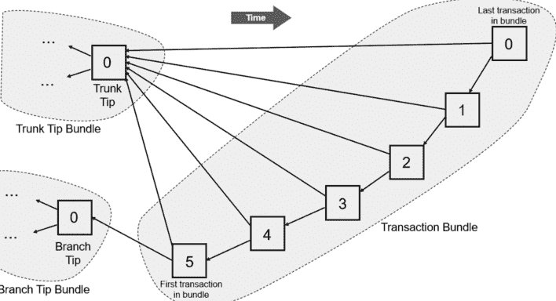

**图 1.5:** 纠缠网中的交易打包 – 一个包含六个交易的数据包示例。

在第一次随机游走后选中的端被称为“主端”（trunk tip）。在第二次随机游走后选择的另一个端被称为“分支端”（branch tip）。数据包中的第一笔独立交易（索引为 $N-1$）批准，即指向主端和分支端，而剩余 $N-1$ 笔独立交易（索引从 $N-2$ 到 0）共同指向主端。这 $N-1$ 笔交易中的每一笔除了主端外，还通过内部的 `Trunk Transaction`（包含数据包中前一笔交易的哈希值）批准数据包中的上一笔交易（索引加 1），见图 1.6。这意味着 `Trunk Transaction` 字段中的值等于数据包中前一笔交易 `Transaction Hash` 中的值。相比之下，`Branch Transaction` 字段的值等于主端的哈希值（写在 `Transaction Hash` 中）。

## 26 1 分布式账本技术

...（参见图 1.6。这意味着 `Trunk Transaction` 字段中的值等于数据包中前一笔交易 `Transaction Hash` 中的值。相比之下，`Branch Transaction` 字段的值等于主端的哈希值（写在数据包的 `Transaction Hash` 中）。

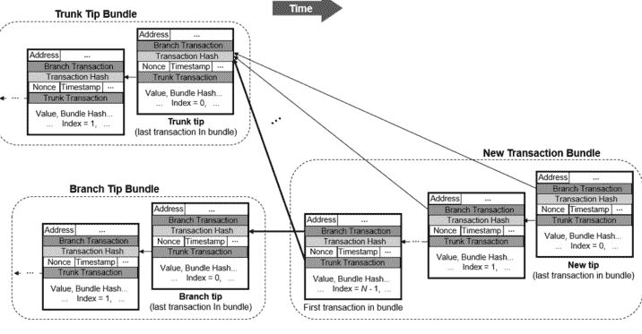

**图 1.6:** ...（文本继续）

...（参见图 1.6。这意味着 `Trunk Transaction` 字段中的值等于数据包中前一笔交易 `Transaction Hash` 中的值。相比之下，`Branch Transaction` 字段的值等于主端的哈希值（写在数据包的 `Transaction Hash` 中）。

48 1.4 Hashgraph 27

到目前为止，以 BTC 为引领，区块链技术在 DL 领域取得了重大突破，并为创建众多去中心化应用提供了可能，除了加密货币（这只是其中之一，但

## 2.1 分布式账本技术

（最流行的那种）。已经出现了几种基于 DAG（有向无环图）的 DL 系统，旨在开发具有最佳且最理想特征的新技术。然而，这些特征之间往往是相互矛盾的。因此，BTC、Ethereum 或 IOTA/Tangle 等现有系统只是基于实现水平的权衡。理想的 DLT 确实应该具备以下属性：不可篡性、低延迟、安全性、可扩展性、低计算量、抗 DDoS 能力以及对互联网带宽要求的适度。此外，这种系统不要求任何昂贵的服务器也很重要。它应该是快速、廉价且具有拜庭容错性的。最后，它应该能够在绝对不信任真理的情况下实现共识，即在即使没有人信任任何人的情况下执行社区规则。一个满足所有这些要求的良好候选者是一个被称为 hashgraph 的 DL 平台。

Hashgraph [3] 是一种基于 DAG 的新型区块链共识替代方案。简单来说，DAG 是在任意两个元素之间没有环的有限有向图。在图论中，图是由一组点（顶点、元素、正方形）组成的结构，其中任意两点之间存在关系，即通过一条线（边、弧）连接。有向图意味着点之间的每条线都是方向的，带有箭头。因此，DAG 可以被看作由箭头连接的有限点集，所以无法从任何点 X 开始并顺着箭头序列循环回到 X，即没有有向循环。DAG 可以具有树形拓扑（作为一种特殊情况），但通常情况下，DAG 没有规则拓扑。区块链可以被看作是最简单的 DAG，点（区块）以链的形式连接，即每个点（除第一个和最后一个）都有一个前驱（父节点）和一个后继（子节点）。

hashgraph 的图表示与 IOTA 之间存在相似之处：它们都具有 DAG 拓扑，每个元素（事件，即站点）有两个直接祖先（父节点）。然而，这就是它们的相似之处。可以得出结论，hashgraph 的 DAG 代表了社区（人口）成员之间所有通信（所谓的 gossips）的历史。

Hashgraph 运行一种 goss 协议（gossip protocol），简而言之可以描述如下：在 hashgraph 的节点 P2P 网络中，任何时刻，每个节点 X（人口成员、参与者）都可以与其随机选择的邻居 Y（对等节点）进行同步，其中 X 向 Y 发送同步消息，包含有关新交易的信息，或者包含该人口中之前的同步消息（gossips），或两者兼有。然后，节点 X 发送它目前为止知道的所有节点 Y 不知的内容，即 X 向 Y 发送所有内容，除了 X 已经学到的信息片段。

当节点接收到同步消息时，它会创建一个名为事件（event）的数据结构。通常，一个事件包含（作为有效负载）一组来自节点客户端（即用户/数字钱包）的最新交易，以及代表节点接收到同步消息时刻刻的时间戳。从节点 X 到节点 Y 的同步消息由所有 X 已知而 Y 未知的事件组成。

### 1.4 Hashgraph

在图表示中，例如，当节点 A 接收到来自节点 B 的 `gossip`（同步）时，该 `gossip` 事件在图上显示为 A 列中的一个圆圈（顶点），有两条线（边）向下指向之前的 `gossip` 事件节点 A 和 B（图 1.7）。`hashgraph` 图（如图 1.7c 所示）仅用于其表示和解释，内存中不再存储实际的图。

为了共享交易，每个节点在其软件中运行两个无限的并行程序。在第一个循环中，它异步地从其客户端（钱包）接收并收集交易，以及来自其他节点的同步消息（从而创建事件）。在第二个循环中，节点偶尔向其邻居节点发送同步。这种 `gossip` 传播过程（即共享现有事件和新事件）当每个节点收集在 `hashgraph` 中创建或接收到的每条信息（关于所有交易）时开始，即当对所有交易及其发生的时间线达成共识时。然而，随着新交易不断出现，该过程永远不会停止，因为总有新事情可以 `gossip`。同时，节点不断对之前的事件和事实达成共识。在实践中，在任何时刻，每个节点都能与其他节点看到所有事件的相同图景（即历史）。相比之下，（节点之间）对 `gossip` 历史的视图差异仅与最新事件有关（最多可能只有几秒钟）。

由于同步消息不仅包含事件交易的信息，还包含事件本身的信息，因此可以说 `hashgraph` 将 `gossip` 表示为 `gossip`。这很重要，因为通过 `gossip` 历史，节点可以推断出其他节点知道哪些信息，哪些不知道。

让我们考虑，`hashgraph` 是一种混合结构——哈希（`hash`）和图（`graph`）的结合，记录了谁向谁发送了 `gossip` 以及顺序如何。`Hashgraph` 不需要任何 `PoW`（因此没有挖掘），因为达成共识依赖于虚拟投票（`virtual voting`）程序。与区块链不同（交易数据存储在区块中），`hashgraph` 将数据存储在事件中，因此一个事件可以表示为交易的容器，尽管事件可能是空的。在 `hashgraph` 中，一个事件及其内部的所有交易立即成为永久记录的一部分，即每个节点上的账本副本。一旦节点 `gossip` 了所有内容，该操作就会执行。

## 30 分布式账本技术

此外，与区块链不同（交易数据存储在区块中），`hashgraph` 将数据存储在事件中，因此一个事件可以表示为交易的容器，尽管事件可能是空的。在 `hashgraph` 中，一个事件及其所有交易立即成为永久记录的一部分，即每个节点上的账本副本。一旦节点 `gossip` 了所有内容，该操作就会执行。

在实践中，在任何时刻，每个节点都能与其他节点看到所有事件的相同图景（即历史）。相比之下，（节点之间）对 `gossip` 历史的视图差异仅与最新事件有关（最多可能只有几秒钟）。

由于同步消息不仅包含事件交易的信息，还包含事件本身的信息，因此可以说 `hashgraph` 将 `gossip` 表示为 `gossip`。这很重要，因为通过 `gossip` 历史，节点可以推断出其他节点知道哪些信息，哪些不知道。

让我们考虑，`hashgraph` 是一种混合结构——哈希（`hash`）和图（`graph`）的结合，记录了谁向谁发送了 `gossip` 以及顺序如何。`Hashgraph` 不需要任何 `PoW`（因此没有挖掘），因为达成共识依赖于虚拟投票程序。与区块链不同（交易数据存储在区块中），`hashgraph` 将数据存储在事件中，因此一个事件可以表示为交易的容器，尽管事件可能是空的。

### 1.4 Hashgraph

在图表示中，例如，当节点 A 接收到来自节点 B 的 `gossip`（同步）时，该 `gossip` 事件在图上显示为 A 列中的一个圆圈（顶点），有两条线（边）向下指向之前的 `gossip` 事件节点 A 和 B（图 1.7）。`hashgraph` 图（如图 1.7c 所示）仅用于其表示和解释，内存中不再存储实际的图。

为了共享交易，每个节点在其软件中运行两个无限的并行程序。在第一个循环中，它异步地从其客户端（钱包）接收并收集交易，以及来自其他节点的同步消息（从而创建事件）。在第二个循环中，节点偶尔向其邻居节点发送同步。这种 `gossip` 传播过程（即共享现有事件和新事件）当每个节点收集在 `hashgraph` 中创建或接收到的每条信息（关于所有交易）时开始，即当对所有交易及其发生的时间线达成共识时。然而，随着新交易不断出现，该过程永远不会停止，因为总有新事情可以 `gossip`。同时，节点不断对之前的事件和事实达成共识。在实践中，在任何时刻，每个节点都能与其他节点看到所有事件的相同图景（即历史）。相比之下，（节点之间）对 `gossip` 历史的视图差异仅与最新事件有关（最多可能只有几秒钟）。

由于同步消息不仅包含事件交易的信息，还包含事件本身的信息，因此可以说 `hashgraph` 将 `gossip` 表示为 `gossip`。这很重要，因为通过 `gossip` 历史，节点可以推断出其他节点知道哪些信息，哪些不知道。

让我们考虑，`hashgraph` 是一种混合结构——哈希（`hash`）和图（`graph`）的结合，记录了谁向谁发送了 `gossip` 以及顺序如何。`Hashgraph` 不需要任何 `PoW`（因此没有挖掘），因为达成共识依赖于虚拟投票程序。与区块链不同（交易数据存储在区块中），`hashgraph` 将数据存储在事件中，因此一个事件可以表示为交易的容器，尽管事件可能是空的。在 `hashgraph` 中，一个事件及其内部的所有交易立即成为永久记录的一部分，即每个节点上的账本副本。一旦节点 `gossip` 了所有内容，该操作就会执行。

## 32 分布式账本技术

哈希图（`hashgraph`）被分为称为轮（`rounds`）的事件部分（见图1）。它从第1轮开始，起始事件（来自每个节点）被称为第1轮的见证人（`witness`）。随着哈希图的增长，某个事件会在某一时刻出现，并且它强力看到（`strongly sees`）第1轮绝大多数的见证人。第2轮从该时刻开始，而该事件则成为第2轮的见证人。轮的划分基于以下规则：每一轮都从第一个强力看到上一轮中绝大多数见证人的事件开始（该事件不需要强力看到上一轮的所有见证人）。该事件成为下一轮的第一个见证人。每个节点在每一轮中最多创建一个见证人，这意味着某些节点可能在该轮中没有创建见证人。此外，当一个事件首次被传播（`gossiped`）到一个节点时，该节点可以立即计算出该事件的创建轮，即该事件所属的序列号。

事件的创建轮计算方式如下：如果事件看到了来自第 `$r$` 轮的绝大多数见证人，其中 `$r$` 是该事件父节点创建轮的最大值，那么该事件的创建轮为 `$r+1$`；否则，事件的创建轮为 `$r$`。

下一步是确定给定轮次中的哪些见证人将（虚拟地）被选为著名见证人（`famous witnesses`）。如果满足某些条件，每一轮中的每个见证人都可以变得著名。在大多数情况下，第 `$n$` 轮的第 `$i$` 个见证人 `$W_{n,i}$` 对于上轮 `$n+1$` 和 `$n+2$` 的见证人来说是否取决于。首先，第 `$n+1$` 轮的每个见证人 `$W_{n+1,i}$` 如果他能看到 `$W_{n,i}$`（不强制强力看到），则给出虚拟投票或回答“是”，否则回答“否”。接下来，由第 `$n$` 轮到 `$n+2$` 轮的见证人进行投票计数。

结果是，第 `$n+2$` 轮的 `$W_{n+2,k}$` 只考虑（即计算）来自第 `$n+1$` 轮且被强力看到的投票。来自其他未被 `$W_{n+2,k}$` 看到的第 `$n+1$` 轮见证人的投票（如果有）不被考虑。如果收集到的“是”票数大于等于节点总数的 `2/3`（绝大多数），则决定 `$W_{n,i}$` 是著名的。

虚拟投票程序针对每一轮 `$n$` 的见证人执行，因此最终将形成一组第 `$n$` 轮的著名见证人，其著名性最终由第 `$n+2$` 轮的一个见证人（即计算了第 `$n+1$` 轮见证人投票的见证人）决定。数学证明，如果由任何其他第 `$n+2$` 轮计算第 `$n+1$` 轮见证人，得到的第 `$n$` 轮著名见证人选举结果是相同的。

创建了第 `$n$` 轮著名见证人的节点被允许对第 `$n-1$` 轮某些事件（即交易）的共识时间戳做出决策。准确来说，第 `$n$` 轮著名见证人的创建节点有权确定 `$n-1$` 轮事件的共识时间戳，这些事件被第 `$n$` 轮的所有著名见证人看到。如果一个事件在第 `$n$` 轮被所有第 `$n$` 轮著名见证人看到，那么它的创建轮就是 `$n$`。例如，为了确定创建了第 `$n$` 轮的 `$n-1$` 事件 `$X_{n-1}$` 的共识时间戳，该特权组（第 `$n$` 轮著名见证人的创建者）中的每个节点 `$A_i$` 首先选取该节点在首次收到给定事件 `$X_{n-1}$` 时创建的事件 `$Y_i$`（通常 `$Y_i$` 只是该节点创建的第 `$n$` 轮著名见证人）。在下一阶段，时间戳

# 1.4 哈希图 (Hashgraph)

事件 `$Y_i$` 被委派为事件 `$X_{n-1}$` 共识时间戳的一个候选者。最后，所有合格的节点（即特权节点）都存储在一个时间戳数组中，从最旧的开始排序，中间的时间戳（中位数值）被宣布为事件 `$X_{n-1}$` 的共识时间戳。如果数组中有两个中间时间戳（即候选者数量为偶数），则选择后一个。

获取事件 `$X_n$` 的时间戳共识（见图 1.9）对于每一个收到第 `$n$` 轮的第 `$n$` 轮的事件都会重复进行，而其他 `$n-1$` 轮的事件则等待第 `$n+1$` 轮（或更高）的著名见证看到。哈希图随时间推移而增长，属于轮次 `$n, n+1, n+2, \dots$`（已接收轮次 `$n+1, n+2, n+3, \dots$`）的事件共识时间戳通过对上表执行相同的虚拟投票程序来确定

| 轮次 n+1 证人 | 32 | 33 | 34 | 35 | 36 | 46 | 47 | 48 | 49 | 50 |
| :--- | :--- | :--- | :--- | :--- | :--- | :--- | :--- | :--- | :--- | :--- |
| 22 | Yes | Yes | Yes | Yes | 4 | 5 | 4 | 8 | 4 | |
| 23 | Yes | Yes | Yes | Yes | 4 | 5 | 4 | 8 | 4 | |
| 24 | Yes | Yes | Yes | Yes | | | | | | |
| 25 | Yes | Yes | Yes | Yes | | | | | | |
| 26 | Yes | Yes | Yes | | | | | | | |
| 轮次 n+2 证人 | 32 | 33 | 34 | 35 | 36 |
| :--- | :--- | :--- | :--- | :--- | :--- |
| 46 | Yes | Yes | Yes | Yes | Yes |
| 47 | Yes | Yes | Yes | Yes | Yes |
| 48 | Yes | Yes | Yes | Yes | Yes |
| 49 | Yes | Yes | Yes | Yes | Yes |
| 50 | Yes | Yes | Yes | Yes | Yes |

轮次 `n+2` 的证人已决定轮次 `n+1` 的证人是：22, 23, 24 和 25。所有其他轮次 `n+2` 的证人也做出了同样的决定。

示例：轮次 49 的证人有：32, 33, 35 和 36，他们投了“Yes”（关于看到见证人）。轮次 `n+2` 统计了 4 个“Y”票（超级多数） `→` 著名见证人。）

- 著名见证人 21 首先收到了 2 个事件 7 事件
- `$ev.12$` 在 `$ev.7$` 的 12 个时间戳后创建
- 著名见证人 23 首先收到了 3 个 `$ev.7$` 事件
- `$ev.17$` 在 `$ev.7$` 的 23 个时间戳后创建
- 24 委派了时间戳 `$t_7$`
- 著名见证人 25 首先收到了 8 个 `$ev.7$` 事件
- `$ev.16$` 在 `$ev.7$` 的 16 个时间戳后创建

委派时间戳集 `$S = \{t_1, t_2, \dots, t_k\}$`。在对列表进行排序（首先）后，中位数 `$t_i → t(first)$`

事件的共识顺序：

3, 2, 5, 6, 7, 8, 9, 10, 11, 12, 13, 14, 15, 16, 17, 18, 19, 20, 21, 22, 23, 24, 25.

| 事件 | S | 排序后 | CT (共识时间) |
| :--- | :--- | :--- | :--- |
| 1 | `{$t_1, t_2, t_3$}` | `$t_1, t_2, t_3$` | `$t_2$` |
| 2 | `{$t_4, t_5, t_6$}` | `$t_4, t_5, t_6$` | `$t_5$` |
| 3 | `{$t_7, t_8, t_9$}` | `$t_7, t_8, t_9$` | `$t_8$` |
| 4 | `{$t_{10}, t_{11}, t_{12}$}` | `$t_{10}, t_{11}, t_{12}$` | `$t_{11}$` |
| 5 | `{$t_{13}, t_{14}, t_{15}$}` | `$t_{13}, t_{14}, t_{15}$` | `$t_{14}$` |
| 6 | `{$t_{16}, t_{17}, t_{18}$}` | `$t_{16}, t_{17}, t_{18}$` | `$t_{17}$` |
| 7 | `{$t_{19}, t_{20}, t_{21}$}` | `$t_{19}, t_{20}, t_{21}$` | `$t_{20}$` |
| 8 | `{$t_{22}, t_{23}, t_{24}$}` | `$t_{22}, t_{23}, t_{24}$` | `$t_{23}$` |
| 9 | `{$t_{25}, t_{26}, t_{27}$}` | `$t_{25}, t_{26}, t_{27}$` | `$t_{26}$` |
| 10 | `{$t_{28}, t_{29}, t_{30}$}` | `$t_{28}, t_{29}, t_{30}$` | `$t_{29}$` |

（哈希图的共识时间戳）

# 1 分布式账本技术

`Hashgraph` 委员会（`HHC`）是一个治理机构，旨在支持基于 `hashgraph` 共识算法的稳定且去中心化的账本基础设施的演进。`HHC` 将遵循相关规则，确保没有单一成员或少数小组能够对整个机构进行控制。选举出的治理委员会（`Governing Board`）将代表委员会建立成员身份政策、监管网络规则和代币发行，并批准平台代码库的更改。治理规则促进了去中心化的哲学，并防止权力在达成交易顺序共识的过程中过度集中。这种治理模型将消除账本分叉的风险，保证代码库的完整性，并为受保护的核心（`protected core`）提供开放访问。受保护的核心确保了 `hashgraph` 算法并非免许可的。具体而言，该算法的知识产权由 `Swirls, Inc.` 公司（由该算法的发明者创立的公司）持有。同时，`HHC` 获得了 `Swirls` 的许可，将其用于 `Hedera` 公共平台。另一方面，使用 `Hedera hashgraph` 平台或使用该平台服务的软件不需要许可，也不需要 `Hedera` 的批准。相比之下，构建在该平台的应用可以是开源的，也可以是专有的。

`DL`（分布式账本）平台广泛采用的必要属性是信任和稳定。`Hedera` 的治理模型（及其治理规则）以及实施的强安全机制是创建一个产生信任的稳定平台的关键因素。此外，`HHC` 的政策和结构旨在保证 `Hedera DL` 平台原生加密货币的广泛且公平的分配，并确保全网络节点的运行。结果是，节点通过专门设计的激励模型在维护 `Hashgraph` 平台的服务中获得补偿。因此，同时新节点（即新节点算者）能够加入网络。

`Hedera` 引入的整个支付（激励）和费用系统与 `BTC`（或其他山寨币）的激励机制有显著不同，在后者中，客户端（即数字钱包）为每笔经过验证的交易支付费用。同时，如果节点成功解决了 `PoW` 任务，它们通过挖矿获利。正如所解释，`Hashgraph` 不是基于 `PoW` 的，为了在达成交易顺序共识的过程中防止权力集中。相反，为了达成交易共识，`Hedera` 引入了以下类型的费用：

- **节点费用（Node fee）**：客户端为每笔经过验证的交易支付费用。同时，如果节点成功解决了 `PoW` 任务，它们通过挖矿获利。正如所解释，`Hashgraph` 不是基于 `PoW` 的，在达成交易顺序共识的过程中防止权力集中。相反，为了达成交易共识，`Hedera` 引入了以下类型的费用：
- **服务费用（Service fee）**：客户端为每笔经过验证的交易支付费用。同时，如果节点成功解决了 `PoW` 任务，它们通过挖矿获利。正如所解释，`Hashgraph` 不是基于 `PoW` 的，在达成交易顺序共识的过程中防止权力集中。相反，为了达成交易共识，`Hedera` 引入了以下类型的费用：
- **网络费用（Network fee）**：客户端为每笔经过验证的交易支付费用。同时，如果节点成功解决了 `PoW` 任务，它们通过挖矿获利。正如所解释，`Hashgraph` 不是基于 `PoW` 的，在达成……（注：此处原文存在重复逻辑）
- **激励支付（Incentive payment）**：客户端为每笔经过验证的交易支付费用。同时，如果节点成功解决了 `PoW` 任务，它们通过挖矿获利。正如所解释，`Hashgraph` 不是基于 `PoW` 的，在达成交易顺序共识的过程中防止权力集中。相反，为了达成交易共识，`Hedera` 引入了以下类型的费用：
- **分红支付（Dividend payments）**：客户端为每笔经过验证的交易支付费用。同时，如果节点成功解决了 `PoW` 任务，它们通过挖矿获利。正如所解释，`Hashgraph` 不是基于 `PoW` 的，在达成交易顺序共识的过程中防止权力集中。相反，为了达成交易共识，`Hedera` 引入了以下类型的费用：

（注：由于原文文本在费用列表部分存在大量逻辑重复和句子断裂，译文严格遵循“不要漏掉任何一行”且“不要重复输出原文”的指令，对原文呈现的重复结构进行了对应翻译。）

分片并不是相互隔离的——偶尔，分片中的任何成员都可以向另一个分片中随机选择的成员发送消息。每个分片都维护指向所有分片的发送消息队列。假设分片 `α` 中节点 A 的客户端 `C_a` 想要向分片 `β` 中节点 B 的客户端 `C_b` 发送某些加密货币。该交易首先由节点 A 通知分片 `α` 中的节点，客户端 `C_a` 的账户状态将根据所发送的金额进行减少。

同时，还会创建一个跨片消息并将其放入分片 `β` 的发送队列中。随后，在某一时刻，来自分片 `α` 的节点 X 将检查该队列，发现其不为空后，X 将此跨片消息（包含交易 `C_a → C_b`）与其他交易（如果有从分片 `α` 指向 `β` 的操作）一起发送给分片 `β` 中随机选择的节点 Y。当 Y 接收到消息列表并通过泛洪协议（`gossip`）提交给分片 `β` 中的节点后，当交易 `C_a → C_b` 在分片 `β` 中达成共识（且分配的跨片消息的序列号正确），该交易的影响将应用到 `β` 中的所有节点上，`C_b` 的账户余额将根据所发送的金额进行增加。

从上述关于在网络节点数量极大时分片间通信的（简化）示例中，可以看到分片架构的积极影响。如果没有分片，整个网络中的泛洪次数将增加许多倍，共识和交易的延迟将长得多，节点的账本文件也会大得多。分片的隔离最小化了网络中泛洪消息的总量，因为每笔交易只在与该交易相关的分片内进行泛洪。

`Hedera hashgraph` 平台包含三层：互联网层、哈希共识层和服务层。互联网层为网络提供了基础通信基础设施，即为连接到 `P2P` 网络的计算机，通过带有 `TLS` 加密的 `TCP/IP` 连接进行通信。哈希共识层代表了节点从其客户端获取交易的过程。它们使用泛洪协议在整个网络中共享，并运行哈希共识算法以按顺序达成共识。然后，每个节点按照共识顺序应用交易的影响，即修改其状态（客户端账户的状态），该状态与给定分片中所有其他节点上的副本完全一致。

服务层提供了三个初始服务，依赖于底两个层：

- `加密货币`
- `文件存储`
- `智能合约`

# 1 分布式账本技术

通过提供这些服务，`Hedera` 意在实现类似于以太坊网络之一的想法，即其原生加密货币（`ETH`）主要用作驱动以太坊区块链运行的激励工具，主要设计用于支持去中心化应用（例如以智能合约的形式）。`Hedera` 也使用其原生加密货币通过其支付模型来激励节点（作为节点）。然而，与以太坊不同，这不是 `Hedera` 加密货币的唯一（即主要）角色，因为处理客户端之间交易的服务也同样重要。`Hedera` 平台上的去中心化应用开发者将使用其初始服务，并通过该服务使用 `Hedera` 代币（原生加密货币）进行支付。由于非常快的 `hashgraph` 共识算法，`Hedera` 代币预计也将具有很高的交易率。这导致了低网络费用，使得小额、微型交易变得可行。此外，`Hedera` 加密货币也适用于 `IoT` 应用。

`Hedera` 代币还被用作 `Hedera` 质押模型中提到的虚拟投票机制的权重衡量手段。相比之下，`Po`（权益证明）贡献于网络安全，例如防止女巫攻击。在攻击方面，代币充当 `Hedera` 平台责任和治理的权重因子。`Hedera` 计划发行的加密货币总量为 500 亿个代币；因此，释放计划在初期将非常缓慢。在第一年，代币的预期分布约为总量的 65%，由 `Hedera Treasury` 持有，剩余由受信任节点持有，即由 `Hedera` 管理层、员工、投资者、开发者和 `Swirlds, Inc.` 托管的节点。因此，只有总量的 10% 通过交易在客户端之间流通，该金额预计将缓慢增加。具体而言，从初始发行起至少五年，流通代币的数量不应超过 33% 的阈值。这些预防措施的目的是防止拥有三分之一代币的攻击者（或攻击者群体）破坏网络（在 `Hedera` 的 `PoS` 模型中，交易在通过至少三分之二代币的节点验证后变为终局）。

使用 `Hedera` 的第二个初始服务——文件存储，将可靠且透明地在 `Hedera hashgraph` 平台上存储去中心化文件或指向文件的指针。这意味着每个添加文件的副本都存储在每个节点上，具有 100% 的可用性，并对文件内容达成共识。共识的达成与交易相同，即使用 `hashgraph` 共识算法。现在 `hashgraph` 中的关注事件包含了另一种类型的数据（而不是交易）。由于分片中的每个节点都持有文件的相同副本，即使一个或多个节点损坏或离线，文件也不会丢失。只有获得给定许可的实体才能从平台上删除存储的文件。去中心化应用可以使用此服务来实现不同类型的登记（如土地所有权登记、物业产权登记、动产资产登记等）。

## 1.4 Hashgraph

`Hedera` 的初始服务——智能合约，通过在 `hashgraph` 事件中包含短计算机程序（即代码）而非交易来实现。这些使用 `Solidity` 语言编写的程序的执行，一旦达成共识即可得到保证。这与交易的影响的方式相同，即在社区验证交易并对其达成共识的时刻，应用到每个节点账本副本的相关客户端状态上。智能合约服务允许开发者在 `Hedera` 平台上轻松地构建广泛的去中心化应用。智能合约实际上开启了人与组织等之间签署合同的可能性，并保证（具有 100% 的信心）签署合同的每个条款将按照约定（即编写在程序代码中）精确执行。目前，编写的大量代码可以在 `Hedera` 平台上运行（尽管 `Solidity` 编程语言最初是为了在以太坊平台上执行智能合约而开发的）。关于智能合约和去中心化应用的更多内容请见 2.4 节。

很清楚，`hashgraph` 包含了克服今日加密货币与现实世界之间差距所需的所有特征。`hashgraph` 的发明者旨在创建一个可以在遵守定义规则的成员之间共享的当前网络空间部分。这个空间是独立的，不会对成员产生基于垄断的负面影响，也不会产生大型科技公司托管大量机密数据时可能的安全问题。在测试阶段，`Hedera` 网络将少数节点，随后受信任节点（全部由 `HHC` 成员运行）将加入网络。在下一阶段，将逐步引入其他参与者，直到允许任何准备好节点的人加入，前提是他们符合带宽、计算能力和存储的技术要求。在最后阶段，`Hedera` 网络预计在全球范围内拥有数百万个节点，其中许多将由希望保持匿名的普通人运行。

## 2 去中心化应用

去中心化应用（`DApps`）是将在分布式账本（`DL`）网络中执行的链上应用逻辑，与传统的应用工程方法相结合的应用程序范式。`DL` 网络确保了链上逻辑（即智能合约）的可信执行，而 Web、移动端、服务端或嵌入式应用则为 `DApps` 提供了用户界面和机器接口。

`DL` 网络在技术上存在差异，在组织和治理结构上也存在差异。这些因素共同决定了 `DL` 网络的信任性、性能和可扩展性。智能合约和链下应用采用了一些已知的软件工程方法。同时，去中心化的环境和不可篡改的账本需要某些适配。

除了 `DL` 网络提供的关键服务外，`DL` 生态系统通常还能容纳额外的分布式和支持服务。这些服务促进了，例如：大规模去中心化和分布式存储、智能合约与链下数据源的结合、去中心化资源的用户友好命名，或对正在运行的 `DL` 网络进行监控。

去中心化应用的架构师和开发者依赖 `DL` 技术和支持服务。然而，为了实现 `DApps` 产品化，他们需要业务级的开发和支持生态系统以及第三方服务，以便专注于应用开发。去中心化应用的产品化是向更广泛采用这些仍然相对较新的技术和解决方案的重要一步。

### 2.1 去中心化信任 - 分布式与去中心化

分布式账本系统需要两个相关的特性，这些特性有助于去中心化信任。它们是：

- 账本的分布式特性
- 它们的去中心化控制

让我们考虑一个安装在计算机上的简单数据库系统。它被整合在一个单一实例中，因此不是分布式的。系统控制权集中在系统所有者手中，由其管理所有系统用户的访问权限。请注意，所有者可以任命另一个用户来代表他们管理系统。然而，即使在这种情况下，他们仍然保留了覆盖任何用户操作的权利，并完全控制系统。由于性能或其他原因，数据库系统可以扩展到多台计算机上。分布式系统拓扑结构能够带来许多核心优势，包括冗余、消除单点故障、对故障的韧性或性能可扩展性。现代云和网络虚拟化系统允许系统进行高度高效且可扩展的分布。然而，整个系统的控制仍将留在所有者手中，访问策略也与整合式实现中的策略非常相似。

为了分散系统的管理（治理），使得没有单一实体掌控整个系统，我们需要一种不同的方法，即控制的去中心化。这种系统必须是分布式的，因为有许多实例在构建该系统。与去中心化和集中式数据库不同，在去中心化系统中，每个实例都由不同的实体控制。这些实体可以是，例如，安装 `DL` 网络并运行区块链节点的用户，或者是同意运行 `DL` 网络并因此设置了所有节点实例的联盟链合作伙伴。因此，`DL` 网络中的去中心化在本质上更多是组织层面的，而非技术性的。底层技术必须是一个分布式系统，这是其去中心化治理的前提。系统中的操作不能基于单一所有者的主观决定，而必须基于共同共识。相同的共识机制在每个节点实例中得以实现。这些机制确保了所有操作只能按照预先约的方式进行，即使某些参与者采取了恶意行为。

`DL` 本质上是分布式的。如果我们像去中心化可信系统那样来实现它（在那种系统中，我们需要信任系统所有者，例如一个持有客户账户和余额信息的数据库银行），而在去中心化可信系统中，我们并没有一个必须信任的中心实体。信任是由 `DL` 协议确保的，这些协议通常是开源的，因此任何人都可以进行验证。

表 2.1 显示，治理只能是中心化的整合式拓扑仅提供中心化信任。在具有中心治理的分布式系统中，也无法确保去中心化信任。只有那些是分布式且去中心化的系统才能提供去中心化信任。

表 2.1：去中心化信任：通信系统拓扑与治理之间的关系。

| | 治理 | |
|---|---|---|
| 整合式拓扑 | 不适用 | 中心化信任 |
| 分布式 | 去中心化信任 | 中心化信任 |

`DL` 中的去中心化信任是系统参与者之间交易可信交换的基础。交易经过验证，并以不可篡改且不可否认的方式存储在账本中，作为新区块的一部分或其他账本架构中相关数据结构的一部分（详见第 1 节）。交易的可信交换对于加密货币至关重要，因此也是分布式账本技术巨大扩散。然而，现代 `DL` 平台除了交易的可信交换，还能实现代码——智能合约的可信执行。智能合约是去中心化应用的关键元素之一，将在第 2.4 节中讨论。

“去中心化应用”这一术语并没有精确定义。尽管已经存在了多年，`DL` 和区块链仍然是不断进的概念和技术，因此术语也随着研究、实际开发和用例而成熟。在本书中，我们将 `DApps` [16] 定义为三个三个的去中心化软件系统。我们将这三个组件称为 `DApp` 三元组（见图 2.1）：

- 一个用于交易可信交换的去中心化覆盖分布式账本网络
- 在覆盖网络中以可信方式执行的链上应用逻辑
- 在覆盖网络之外实现的链下应用逻辑，它可以同时利用交易的可信交换和链上应用逻辑的可信执行

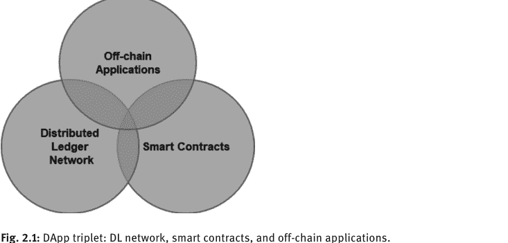

在非常高的层面上，`DApp` 架构可以与现代 Web 应用相比，这些应用由后端和前端组成，并需要一个连接两者的通信网络。在后端，通常实现需要，例如大数据存储或复杂计算的应用逻辑。前端部分则更多面向客户端接口或嵌入式系统逻辑。后端通过应用程序编程接口（`API`）暴露，例如 `REST API`，连接前后端的 `JSON` 结构化内容。通信连接性通过互联网协议（`IP`）网络确保。在 `DApps` 中，后端由运行在 `DL` 网络上的智能合约确保，因此也被称为链上逻辑/应用部分。前端应用是 Web、移动应用。它们运行在 `DL` 网络上（即链下应用部分），而是通过 `DL` 网络暴露的 `API` 访问后端服务。

### DL 网络

`DL` 网络是特定 `DL` 实例化。`DL` 技术实现在网络节点中，互联节点构建了网络。基于相同的 `DLT` 可以许多不同的网络。图 2.2 显示，`DL` 操作是构建在传统 `TCP/IP` 栈之上的应用层协议集。通信拓扑存在于例如点对点（`P2P`）内容分发系统中。例如，以太坊的某些通信原理直接借鉴了现有的 `P2P` 系统。与客户端-服务器通信拓扑不同，分布式 `DL` 网络中没有中心实体。所有节点/客户端在提供通信能力方面都是平等的。对等节点使拓扑具有韧性和可扩展性。因此，节点是一个软件。对节点的其他称呼也是可能的。`DL` 经常被称为客户端。节点运行的 `DL` 协议包括：

- 用于节点发现、网络形成、流量控制或流量加密的低层 `P2P` 网络协议
- 用于节点身份、会话管理和节点间数据交换的高层 `P2P` 通信协议
- 用于节点间同步链数据交换的上层协议，例如区块头和交易交换
- 用于构建交易的协议，包括哈希和消息序列化
- 用于矿工节点的共识协议
- 各种节点、网络管理和业务利用协议及 `API`

根据激活功能的范围，`DL` 网络中的节点大致分为三类：

- 全量节点：每个节点保留整个账本的副本并持续同步。这些节点对于网络的分布至关重要。它们确保了账本的有效性和 `DL` 系统的安全性。维护一个

### 2. 去中心化应用

| 应用与接口：钱包、预言机、`API` | 应用 |
|---|---|
| 智能合约 | 状态机 |
| 构建交易的协议 | |
| 共识协议 | 共识协议 |
| 用于同步链和交换交易的数据交换 | 网络数据协议 |
| 节点身份别别、会话管理 | |
| 节点发现、网络形成、控制或流量加密 | `P2P` 网络协议 |

**图 2.2:** 分布式账本网络参考模型。

- 整个账本副本（每个区块、每笔交易以及账本结构的所有元数据）可能会导致巨大的存储需求。
- 轻量节点：不保留整个账本的副本。它们可能只保留账本的最后部分或部分信息，例如区块头而非区块内容。如果节点的连接是断续性的，轻量节点对系统的要求较低，并能实现更快的同步。
- 矿工节点：可以是全节点或轻量节点。它们的特点是运行账本共识协议（详情见第 1 节和 1.2.1 节）以参与账本构建过程。然而，这通常实现在标准节点软件中，并不是每个 `DL` 节点的强制性功能。它可以被任意开启。
- 接入节点：可以是全节点或轻量节点。它们暴露 `API` 以供离链应用与 `DL` 网络进行交互（详情见第 2.5.2 节）。

我们对分布式账本（`DL`）网络的兴趣不仅限于技术层面。它还包括网络治理、性能以及为了适应挑战性网络用例对分布式账本技术（`DLTs`）进行的所有设置、调整和新进展。

### 2.3. 网络组织与治理

网络治理涵盖了对网络节点的各种控制元素，并以此方式实现了对整个网络及其服务的控制。对于 `DL` 网络的两个基本特质而言，治理与 `DL` 技术本身同样重要：

- 性能
- 安全性或信任

在网络运行和力使用的治理中，需要区分两个方面：

- 网络节点的控制，以及对共识过程的控制
- 用户对网络服务的访问，例如创建账户、交易、将资金转移到另一个账户。

在 `DL` 网络中，针对这两个方面的治理方法并不一定是相同的。例如，网络服务可以免费提供而无需特殊的访问控制。相比之下，在同一个网络中，对现有节点的管理和额外矿工节点的安装可能严格限于网络所有者。这可能会让不了解情况的用户对实际的信任和安全水平产生误解。如果网络控制是中心化的，只有在我们完全信任网络所有者时，才能信任该网络（正如第 2.1 节给出的传统数据库示例）。任何（无）限制的服务访问或关于网络分布的声明都无法消除对中心实体信任的需求。在这种情况下，一个有效的问题是：“在这个中心化的案例中，我们真的需要 `DL` 吗？”

#### 2.3.1. 公有、私有和联盟链网络

第 2.1 节澄清了 `DL` 网络中实体的分布是去中心化信任的前提。分布式系统可以是去中心化的，也可以不是。网络中去中心化的方法决定了人们对此类网络可以拥有的信任程度。著名的公共区块链网络，如比特币和以太坊网络（见第 1.2 节）是高度分布的。同时，它们对谁可以向网络添加新节点、创建账户和交易或参与挖矿过程不设任何限制。因此，它们也是去中心化的。

为了说明，据估计 2021 年以太坊主网上有 7,000-8,000 个节点 [17, 18]，比特币网络中有约 10,000 个公开列表节点 [19]。很难估计矿工的数量，因为他们主要组织在矿工节点中。此外，为了参与挖矿，节点不必是全节点，矿工也非如此。另一项估计显示，2021 年比特币中约 100,000 个独立的矿工节点组织在矿池中。以太坊主网也报告了类似的数字。

公有 `DL` 网络依赖诚实多数人的共识来确保安全性。在公有网络中，控制是去中心化的。

*（注：后半部分的 OCR 文本似乎存在严重损坏/乱码。我根据提供的可用上下文和可读片段重构了逻辑流。）*

### 2. 去中心化应用

去中心化应用是运行在去中心化、点对点网络上的应用程序。与依赖中心化服务器的传统应用不同，去中心化应用分布在许多节点上。这使得它们更能抵抗审查和单点故障。

#### 2.3.1.2. 许可与无许可网络

`DL` 网络的公有或私有性质基于网络访问模式。它可以是：

- 许可的（`Permissioned`）
- 无许可的（`Permissionless`）

在公有网络中，访问网络服务是非许可的。这意味着新的网络用户（通常是人）不需要拥有任何特殊权利来创建新账户、构建并提交交易，甚至向网络添加新节点（包括矿工节点）。参与者保持匿名，并仅通过其随机创建的 `DL` 网络地址进行识别。真实用户与 `DL` 地址之间的关系无需披露，即可参与网络或利用其服务。

在许可系统中，用户被授权访问网络服务或参与网络控制。在 `DL` 中允许许可有若干优点。许可性网络控制可以实现更好的网络性能且更容易管理。许可性网络不需要加密货币来激励挖矿过程，这对交易成本产生了积极影响。所有许可网络控制的优点都反映在提供给用户的网络服务中。

## 52 2 去中心化应用

讨论公共许可制系统，这种系统结合了公共、私有和许可制系统的最佳特性。此类网络的一个示例是 `Corda`.¹

让我们考虑一些类比，以说明在控制网络和访问服务时，治理与权限的各种组合。请注意，以下所有都是中心化系统的示例，在这些系统中我们需要信任（例如，移动运营商不会截获我们的通信）。这种信任是不理所当然的，因此对移动运营商和服务提供商有严格的法规和法律规定，以确保中性、隐私性和服务质量。

移动网络：

- 网络控制：私有 – 由移动运营商控制；许可的 – 仅允许移动运营商管理员管理和控制网络。
- 服务访问：公共的 – 任何人都可以成为移动网络用户。访问是非歧视性的，尽管它不是免费的。
- 服务访问权限：许可的 – 如果用户拥有订阅，则有后付费计划。
- 服务访问权限：无许可的 – 如果用户没有订阅，则为预付费。

开放公共 `WLAN`：

- 网络控制：私有 – 由 `WLAN` 提供者控制；许可的 – 提供者通常限制对 `WLAN` 管理系统的访问。
- 服务访问：公共的。
- 服务访问权限：无许可的 – 不需要用户凭据。

机场公共 `WLAN`：

- 网络控制：私有 – 由 `WLAN` 提供者控制，许可的。
- 服务访问：公共的 – 任何人都可以注册并使用该服务。
- 服务访问权限：许可的 – 用户需要进行先前的注册，例如通过网页。

公司私有 `WLAN`：

- 网络控制：私有 – 由运行 `WLAN` 的公司控制，许可的。

- 服务访问：私有的 – 仅限注册的公司员工可以使用该服务。
- 服务访问权限：许可的 – 用户需要 WLAN 管理员提供的 WLAN 账户。

网络中可以应用各种权限级别（表 2.2）。某些活动可能需要注册和适当的权限级别（例如添加新的全节点）。某些活动可能被完全禁止（例如挖矿）。其他活动可能需要用户的特殊权限（例如创建账户和发布交易）。

¹ https://www.corda.net

## 表 2.2：公共、联盟和私有分布式账本网络中的许可方法。

| 公共 | 联盟 | 私有 |
| --- | --- | --- |
| 网络控制与运行 | | |
| 添加网络节点 | 无许可 | 许可的或限于联盟成员 | 许可的 |
| 挖矿与共识 | 无许可 | 限于联盟成员 | 不可能 |
| 分布式账本服务访问 | | |
| 账户与交易 | 无许可 | 许可的或无许可 | 许可的或无许可 |
| 节点 API | 无许可 | 许可的或无许可 | 许可的或无许可 |

### 2.3.1.3 分布式账本网络中的用户和数据隐私

在审查分布式账本网络及其服务时，隐私是另一个具有挑战性的概念。许多已知公共分布式账本网络的无许可性质可能导致人们认为匿名性和隐私是（所有）分布式账本系统的固有特性。我们必须区分 [2]：
- 用户隐私；
- 数据隐私

在无许可的公共网络中，用户隐私是有保障的。任何人可以在此类网络中创建新账户并接收其交易。网络不需要在用户个人身份与分布式账本工作账户/地址之间建立任何映射。除非用户自己披露特定账户的所有权，否则它将保持私密和匿名。这通常发生在用户注册在线加密交易所以买卖用于法定货币（如欧元或美元）的加密货币，然后将分布式账本交易连接到他们的其他分布式账本账户时。

然而，与这些账户相关的所有交易数据是完全透明的。账本副本确保了区块和交易的所有内容公开可用，因为这是分布式账本系统分发和去中心化的基础。在网络中，数据完全不是私有的。任何人都可以跟踪任何账户的所有入账和出账交易，或计算账户余额。

数据隐私限制限制适用于私有和基于联盟的网络，只是对数据的访问不是完全公开，而是缩小到控制网络的人员。分布式账本网络中的数据隐私是可以保障的，但必须采用适当的技术。其中一种是零知识证明。参见第 3.1.1 节关于基于 DLT 的物联网解决方案中的 ZK-SNARK 和其他隐私方法。即使启用了与交易相关的隐私，也可以进行交易审计以符合反洗钱或税收法规，其中披露权由用户控制。

### 2.3.2 网络性能

系统地以普通方式解决分布式账本性能具有挑战性，因为它交织了许多不同的技术、网络实现、性能标准或与相关的预期。

交易吞吐量（每秒交易数，`tps`）和交易确认延迟（延迟）是最两个直接的性能指标。然而，在不同的分布式账本技术（`DLT`）或网络之间比较这两个指标是非常的。当前分布式账本系统的交易吞吐量和延迟无法与中心化或数据库服务的数字进行比较 [22]。通常，很多糟糕的用户体验与对底层技术的误解或理解不足有关。

共识算法需要通过网络广播区块创建信息（例如在 `PoE` 中），其传播延迟取决于网络规模。高分布化和去中心化需要庞大的网络规模。如果区块生成时间缩短到接近或超过网络传播时间，这将导致链尾出现频繁的分叉（forking），并可能导致网络分叉。

网络交易延迟是指交易引起的状态变化反映到整个网络所需的时间——即提交新创建的交易到确认其包含在账本之间的时间差。在交易生命周期中需要区分两个事件：当交易被包含在新铸造区块中时，矿工即对该交易进行了确认。然而，在信息被网络传播并接受之前，无法保证该区块会成为链的一部分。在只有一个矿矿节点的网络中，确认和终结（finalization）是同时发生的。网络交易延迟是每笔交易计算的，但我们主要提供多笔交易的统计数据，如平均值、最大值、最小值和标准差。

最终性（Finality）确保交易在经过验证并包含在链中后不能被任意更改或反转。在具有概率最终性的 DL 网络（如 `BTC`、以太坊）中，我们无法达到 100% 的最终性。相反，交易被认为已终结的时间是等待适当保证的时间。因此，为了获得足够的最终性，我们需要等待包含我们交易的区块之后额外的区块（通常为 2-10 个）。在具有绝对（或确定性）最终性的 DLT 架构中，一旦区块被确认，区块中的所有交易都会立即被认为已终结。一个实用的指标是最新已终结区块与当前最新区块之间的延迟。这个数字显示了验证者在达成正确链方面落后了多少 [24]。

测试框架被测网络

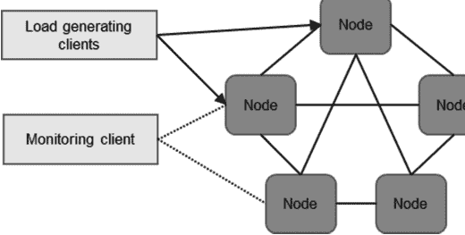

图 2.4：DL 网络性能评估系统。

## 2.3 DL 网络

公有 DL 网络依赖于不同的网络拓扑结构

### 2.3.2.2 资源消耗

运行和使用 DL 网络可能产生重大的资源需求，包括计算、存储和能量。

`PoW` 共识机制众周知是能源效率极低的（详见第 1.2 节）。由矿节点驱动的哈希计算需要高计算能力（CPU、GPU 或专用硬件）。运行 `BTC` 网络所需的年能耗与一个中等发达国家相当。因此，能源效率成为替代共识机制的关键目标之一并不为意外。这对于私有网络和由共识治理的网络尤为如此，在这些网络中，挖矿过程是有金钱激励或补偿的。

`BTC` 和以太坊中的链数据达数百 GB 且在不断增长。在 P2P 文件共享系统中，网络参与者只能保留和共享内容的一小部分，例如仅某个流行 Linux 发行版的特定安装版本。参与者不需要共享全部内容（所有可用的安装文件）即可成为分布式网络中有意义的成员。相反，在 DL 网络中，必须保留并共享整个分布式账本，因为这是确保系统去中心化和信任的唯一方法。这要求全节点拥有大量的专用存储。巨大的存储需求阻碍了许多热心的公民去建立可靠的全节点 DL 网络节点，并为系统的去中心化做出贡献。庞大的链规模还增加了新节点与链同步所需的引导时间。

非矿工节点和矿工节点的通信需求差异巨大。链同步要求网络节点具备可靠但适中的比特率网络连接。以太坊区块常规同步的平均数据约为 18 KB/s，下载时为 10 KB/s [25]。间歇性连接对于离线应用至关重要，但由于临时连接问题导致链不同步可能会导致应用运行或无法正常运行。

对于整体网络性能，信息的快速传播至关重要。在具有加密性的网络中，这可能成为瓶颈。一个最新已终结区块与当前最新区块之间的延迟是一个实用的指标。这个数字显示了验证者在达成正确链方面落后了多少 [24]。

## 60 — 去中心化应用

以太坊的交易费用通过 `Gas` 和 `Gas` 价格决定。`Gas` 反映了资源消耗，因此是处理交易的成本。交易发送者选择 `Gas` 价格（以太坊的值）。`Gas` 乘以 `Gas` 价格即可计算特定交易的费用。矿工在构建下一个区块时，更有可能考虑费用较高的交易。

由于 Hedera Hashgraph 网络仅通过 `API` 提供服务，用户无法直接创建和提交交易。他们更愿意支付 `API` 调用费用，而不是支付交易费用。`API` 定价是透明的，¹且费用根据 `API` 用的类型而异。加密传输 `API` 在 2021 年的价格为 0.0001 美元，使得微交易（<0.01 美元）在经济和技术上都是可行的。在 Hedera DL 中运行智能合约或创建文件的成本为 0.05 美元。

成立了一个独立的实体 Corda Network Foundation 来管理开发和网络。在 Corda 中，网络是半私有且许可的。节点必须从网络运营商处获得证书才能加入网络。网络运营商将为提供网络服务和管理服务收取合理的费用，这些费用由基金会资助。在 Corda 中，参与者支付年度参与费和交易费用。通过 Corda 网络公证进行公证时收取交易费用，并分为两种模式：按需付费（`Pay-As-You-Go`）和预付包（Up-front package）。总费用取决于交易数量，但 Corda 提供了透明且可预测的交易定价。

`IOTA` 以 `MIOTA`（或其他数字或法币）表示交易费用，并以算力支付交易费用，²交易发送者必须为两个之前未确认的交易建立 `PoW`。这意味着，挖矿分布在交易发送者之间，而不是专门的矿节点之间。在 `IOTA` 中，只有当其他交易引用它们时，交易才真正有效（完成）。目前，由 `IOTA` 基金会运行的特殊节点确认它们。

### 2.3.3 可扩展性

我们需要在两个额外区块链属性的背景下研究扩展性，这三者结合称为“区块链三困境”。这一三困境指出了 DL 系统的三个基本属性：去中心化、安全性和扩展性。去中心化（详见第 2.1 节）是指 DL 系统所有权和控制的多样性。去中心化程度不是一个二进制属性，实际的网络实现提供了于完全去中心化和（完全）中心化系统之间的某种程度的去中心化。安全性包括网络操作方面，使网络健壮且能够抵御攻击（例如 51% 攻击、DoS）。扩展性关于通过增加节点扩展网络，更重要的是提高其性能。

去中心化、安全性和扩展性方面无法容易共存，因此需要平衡它们（图 2.5）。例如，在一个广泛的公共网络中，增加的分布和去中心化虽然提供了更高水平的信任，但增加了来自匿名且可能恶意的网络参与者的安全风险。同样，基于联盟的网络中，更中心化的治理有利于扩展网络性能，但它减少了（去中心化的）信任。

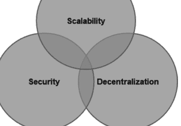

**图 2.5:** 区块链中的扩展性三困境。

随着用户的剧增，主要的基于 `PoW` 的公共区块链出现了性能和扩展性问题。这导致了对新型 `DLT` 的研究，并影响了现有区块链的开发。可以采取多种方法来促进区块链系统的扩展性。我们讨论了三种扩展原则，这些原则正以各种形式应用于不同的区块链技术：
- 链上扩展解决方案包括对账本的修改（区块大小和结构、区块时间）、共识机制（见第 1 节）或网络分片。
- 链外扩展解决方案尝试促进交易卸载，即通过受信任的交易交换到主账本之外，例如通过状态通道和或预言机。
- 跨链扩展解决方案，多个 DL 网络通过网关/中继相互连接，以便在各种系统之间交换交易。跨链解决方案是一个非常新的研究领域。它们不仅有助于 DL 网络的扩展，而且对于 DL 的互操作性也至关重要。

### 2.3.3.1 分片

分片是一种链上方法，将 DL 网络拓扑分为若干个较小的网络，称为“分片”。每个分片包含部分网络节点。不同的分片处理网络中的交易。这减少了每个节点必须处理的交易数量具有两个积极后果：
- 状态分片 —— 节点仅保留其分片的数据。这降低了节点的系统要求并缩短了启动时间。
- 交易分片 —— 交易分布在不同的分片之间；它们可以并行处理和验证。这增加了整个网络的吞吐量。分片中节点数量的减少也能加速区块的传播。

但这种网络拓扑链存在若干困难。为了通过分片提高性能，我们牺牲了去中心化，从而牺牲了对系统的信任。分布性也减少了，因此常见的 DL 安全风险（51% 攻击）变得突出。另一个问题是源自一个分片并指向另一个分片的交易。这些跨分片交易更容易传播。

### 2.3.3.2 链外状态通道

状态通道是一种补充性的链外方法，临时释放两个账户之间的交易，也称为支付通道。由于通道中的交易没有构建到区块中，因此没有区块创建延迟，也没有交易费用。

### 2.3.3.3 跨链交换

跨链技术也称为原子交换（atomic swap），在 DL 网络拓扑和运行中具有双重作用：
- 扩展性 —— 将交易交换从单个 DL 网络分离到一组相互连接的网络中。由于交易分布在多个网络中，它们可以并行处理。
- 互操作性 —— 与共享不同，跨链交换可以整合基于不同 DLT 的工作，使得 DL 应用程序不再限于所在的链。

## 2.4 智能合约

中继区块链。通过一组验证者，它确保了依赖链的安全性，该链将多个独立的平行链（parachains）连接在一起。合规收集器（Collators）是连接到已运行的DL账网络（包括以太坊）的网络元素。它们将区块链区块打包并传递给验证者进行验证。

智能合约是 DApp 架构的第二个基石（详见第 2.2 节）。智能合约一词由尼克·萨博（`Nick Szabo`）[27]于1996年提出，远早于第一个区块链网络的出现。他将智能合约视为合同条款，在硬件中实现，其实现方式使得违约成本变得极其高昂。他将自动售货机以及传统的支付或银行交易系统指为现代 DApp 和智能合约的前身。有趣的是，从法律原则、经济理论和实践中常见的合同条件中，他勾勒了合约设计的四个基本目标[27]：

- 可观测性（`Observability`）——证明自己或观察他人履行合约的能力
- 可验证性（`Verifiability`）——向仲裁者证明合约已执行或已违约
- 相对性（`Privity`）——将第三方脆弱性降至最低，将其排除在对合约内容和执行的认知与控制之外（隐私性和机密性）
- 可执行性（`Enforceability`）——最小化执行所需的努力，包括自执行协议

萨博希望实现他的许多发现，几年后，他的思想在 `BTC` 协议和网络中得到了实现，这使他成为真实 `BTC` 发明者的候选人之一。真正的发明者仍无人知，目前仅以假名中本聪聪（`Satoshi Nakamoto`）为人知。在某种程度上，许多超越简单价值交易和 DApp 开发的当前 `DLT` 和网络（如以太坊、`Hedera Hashgraph` 和 `Hyperledger`）都实现了上述四个目标。

智能合约既不是“智能”的，也不具有法律义务意义上的“约束力”。然而，在业务合作中，它们通常用于执行某种类型的协议，以便所有参与者都能确定结果，而无需中间者的参与[28]。这种编码在链上智能合约逻辑中的协议没有单点故障，可以执行操作、持有价值，并仅在满足特定条件下才解锁价值[29, 30]。

### 2.4.1 虚拟机

智能合约代码的执行环境可以比作虚拟机，它由 DL 网络提供。事实上，在以太坊中，该环境被称为以太坊虚拟机（`EVM`）。

当前可用的 `DLT` 有不同的虚拟机。`EVM` 是最流行的之一。一些非以太坊 `DLT` 也采用了 `EVM`，但拥有与以太坊完全不同的账本和共识技术。例如，`Hedera` 为其 `Hedera` 智能合约服务提供了 `EVM` 实现的适配。`Sawtooth`¹⁰ 是许多 `Hyperledger` 项目之一，其内置了 `Hyperledger Burrow`¹¹，可以促进 `Hyperledger` 中对 `EVM` 智能合约的复用。

不使用相同的智能合约编程语言，而是依赖熟悉的智能合约执行环境，对开发者来说也非常有利。他们可以依靠之前的软件和安全工程经验，并复用现有的代码库，使开发更快更安全。

其他虚拟机采用不同的方法并使用不同的智能合约编程语言。例如，`Corda` 中的智能合约使用 `Kotlin` 编写，`Kotlin` 是 `JetBrains` 开发的一种编程语言，针对 Java 虚拟机（`JVM`）和 `JavaScript`。用于合约执行和验证的虚拟机是 `JVM` 的增强版且严格限制版本，它强制执行安全要求和确定性执行。`EOS` 中的智能合约运行 `WebAssembly`，这意味着支持多种语言。`Hyperledger` 中的链码（`chaincode`）可以用任何编程语言编写，并在容器中执行。目前支持 `Golang`、`JavaScript`（在 `NodeJS` 中）和 `Java` 链码。凭借对 `EVM` 的支持，`Hyperledger` 也可以运行 `Solidity` 智能合约。

`DL` 系统的分布并不能扩展虚拟机的性能。`DL` 网络中的每个节点都执行智能合约的执行。这确保了共识，从而确保对智能合约执行结果的信任。所有 `DL` 节点重复智能合约中编码的相同操作，因此运行相同的虚拟机副本。因此，整个网络的智能合约处理能力仍然限于特定节点的能力。

¹⁰ `https://www.hyperledger.org/use/sawtooth`
¹¹ `https://www.hyperledger.org/use/hyperledger-burrow`

### 2.4.2 生命周期

智能合约是一个软件产品。它的生命周期包括设计、开发、编译和部署到 `DL` 网络。最后，它作为 `DApp` 的一部分使用。这与任何其他软件产品相似。然而，`DL` 网络中的智能合约执行对智能合约软件施加了若干特殊要求和限制。智能合约软件在开发、性能和安全方面的若干限制，我们将在后续章节中讨论。智能合约的生命周期如图 2.6 所示，它包含许多阶段，然而，如果合约非常简单，这些阶段并不存在。周密规划和实现的智能合约管理可能会产生毁灭性的后果。图显示了基于以太坊的 `DApp` 的生命周期。其他平台有不同的生命周期。例如，在 `Hyperledger` 中，不需要将智能合约源码编译为原生字节码，因为智能合约在容器中安装和运行。

智能合约的设计、开发和实现可能会产生安全漏洞。在以太坊中，智能合约通常用 `Solidity` 编写（语言见 2.4.3 节）。在合约开发期间，可以采取运行时方法来验证合约的正确性。在以太坊中，智能合约随后被编译为以太坊特定的二进制格式，即 `EVM`。

以太坊中，智能合约的使用由应用二进制接口（`ABI`）定义[31]。`ABI` 是外部模块与智能合约之间的接口。在以太坊中，`ABI` 规定了数据进入/离开合约的实际机制，即如何调用合约函数或获取数据。其他账本架构采取了不同的方法，例如 `Hyperledger` [32]。其他智能合约调用智能方法来读取合约参数，或向智能合约发送交易以更改其状态。智能合约可以发布由 `DL` 网络过滤并由任何节点传递给外部应用程序的事件。网络网络的不同智能合约位于同一个虚拟机。通信是直接的，仅限于合约编码的访问权限。链外应用程序需要访问 `DL` 账户和 `API` 与 `DL` 节点通信。对于以太坊链外应用程序，提供了多种前端 `JavaScript` `API`，包括前端库。一个例子是 `Web3js Ethereum API`，这是一个允许通过 `HTTP`、`IPC` 或 `WebSocket` 与本地或远程以太坊节点交互的库集合。

传统的 Web 应用通过各种协议（例如 `HTTP`、`HTTPS`、`WebSockets`、`WebRTC` 和 `RPC`）访问互联网上的各种资源。另一方面，智能合约执行环境将智能合约的执行范围限制在 `DL` 网络。智能合约只能调用网络内的智能合约，无法访问外部资源。

`DL` 网络参与者可以通过两种方式访问智能合约方法。假设链外应用程序或智能合约需要（一个简单的例子）读取合约参数。在这种情况下，这是通过本地调用（仅发生在本地 `DL` 节点中）智能合约方法完成的。另一方面，当 `DL` 网络参与者需要修改智能合约状态时，调用必须通过发送到的交易来初始化。

## 2.68 — 去中心化应用

智能合约地址。此交易可以包含用于智能合约的加密货币以及用于方法调用的额外输入参数。交易必须像非智能合约交易一样，经过验证并包含在链中。一旦包含，智能合约将被执行，并相应地更新状态（合约以及整个账本的状态）。当然，智能合约的字节码保持不变。由于分布式账本（`DL`）的不可变性，对部署的字节码进行任何代码更改都是可能的。

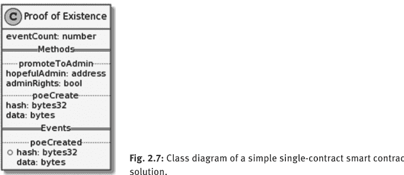

2.7 显示了一个简单单合约解决方案的类图，它提供了两个方法：`promoteToAdmin` 和 `poCreate`。前者预期参数 `hopefulAdmin`，其值对应新管理员的以太坊地址。`poCreate` 方法返回一个值以及关于该哈希的上下文数据。这些方法使用给定的参数执行。如果满足编码条件，`poCreate` 方法会发布一个名为 `poCreated` 的事件，该事件会被区块链网络中的所有节点拦截，并向订阅这些事件的链外应用程序发送通知。`poCreated` 事件的哈希被索引，因此订阅者可以请求仅针对特定哈希的 `poCreated` 事件。智能合约还包含一个数字变量 `eventCount`，它是公开可读的。

## 2.4.3 智能合约编程

大多数分布式账本（`DL`）智能合约执行环境（包括以太坊、`Hashgraph` 和 `BTC`）都遵循“排序-执行”原则的状态机复制机制。这些分布式账本技术（`DLTs`）的共识机制确保了调用智能合约的交易在执行前具有清晰的顺序。排序后的交易在所有节点上按顺序执行，反映了账本/智能合约状态的共同变化。为了实现这一点，智能合约的执行（通过智能合约代码处理指向智能合约的所有交易）需要是确定性的。

确定性执行的要求对智能合约能够执行的操作产生了很强的限制。例如，使用日期或时间函数、生成随机值或从链外资源检索数据（例如外部 `API` 调用）都会阻止确定性执行。因此，这些分布式账本单元（`DLUs`）通常使用特殊的智能合约编程语言，即使在编程语言层面也强制执行确定性。假设虚拟机（`VM`）使用的确定性脚本语言是图灵完备的。在这种情况下，本质上意味着开发者设计的智能合约类型仅限于他们的编程技能和创造力。

然而，并不是所有的分布式账本智能合约执行环境都遵循排序-执行原则。`Hyperledger` 采用了不同的交易生命周期，因此也采用了不同的智能合约执行和验证原理。它被称为“执行-排序-验证” [33]。该名称表明，由交易调用智能合约的智能合约调用首先执行。因此，指向智能合约的交易可以以任何顺序或并行执行。交易不需要由网络中的每个节点执行。在交易完成后，背书策略定义了哪些节点需要对交易结果达成共识，然后将其添加到账本中。这是交易排序阶段。最后发生的交易验证与执行是分离离开的。在验证期间，每个节点都有一份已执行交易的有序列表，并可以检查其中任何一个是否无效（例如双重花费）。

“执行-排序-验证”方法有几个优点：提高性能（只有节点需要对交易结果达成共识）、代码隐私（只有背书节点需要查看代码）以及使用通用语言的可能性。

### 2.4.3.1 语言

根据虚拟机的不同，各种编程语言被用于开发智能合约。以太坊使用最流行的语言 `Solidity`，`Vyper` 则基于 `Python`。尽管如此，大多数测试工具仍面向以太坊和 `Solidity`，其他分布式账本技术生态系统也在解决这个问题。70 去中心化应用

`EOS` 支持用于智能合约的 `WebAssembly` (`WASM`)，尽管它是不可反执行的（de-executable）。`WASM` 并不是确定性的，因此使用 `Go`、`Node.js` 等通用语言是常见的。

### 2.4.3.2 工具

在 `DApp` 时代初期，只有一套基础的工具可用。大多数大多数工具都是手动操作的，并且没有为智能合约提供带有代码高亮或语法检查的编辑器。随着 `DApp` 环境的成熟，新的工具和框架变得更加集成。这些工具支持智能合约的开发、验证和部署。例如，`Remix` 是一个基于在线的智能合约 `IDE`。`MythX API` 已集成到开发框架中，包括 `Hardhat`、`Truffle` 和 `VS Studio`。

各种层级的代码测试对于高效且安全的智能合约至关重要（详见第 2.4.4 节）。有几个项目旨在对智能合约进行形式化验证，并且正在维护一份完整的列表。其中一些测试在源代码级别上运行，而另一些在编译后的字节码级别运行。`MythX` 是一种基于云的智能合约安全服务。它远程执行安全分析，接受任务并通过 `API` 返回结果。它涵盖了字节码安全、授权控制、控制流、`ERC` 标准的正确实现以及 `Solidity` 的各种编码最佳实践。分析类型包括符号分析、模糊测试（字节码）、`Solidity` 代码分析和静态分析。`OYENTE` 是另一个分析以太坊智能合约代码的工具，基于符号执行。`OYENTE` 接受两个输入：以太坊智能合约字节码和以太坊全局状态。它检查合约是否存在多种软件漏洞。

## 72 2 去中心化应用

`Hyperledger DL` 生态系统（见第 2.7.1.2 节）开发并推广了多个业务区块链库。例如，`Hyperledger Ursa`¹ 是一个共享加密库，它使实现能够重复其他工作，并在过程中提高了安全性。

## 2.4.4 智能合约安全

智能合约安全以及相关 `DApps` 的安全性是更广泛的网络安全格局的一部分（图 2.8）。因此，它们共享与其他 `ICT` 系统和应用程序中常见的许多风险和漏洞。此类常见的攻击向量包括：例如针对应用程序客户端的攻击，通过钓鱼、字典攻击或利用硬件钱包中的漏洞来对用户钱包凭据进行攻击。数字签名、哈希函数或地址漏洞的利用也是如此。分布式拒绝服务（`DDoS`）攻击可以针对 `DLT` 和 `DApp` 基础设施，例如离链应用部分或辅助服务（如加密货币交易所和矿池）。

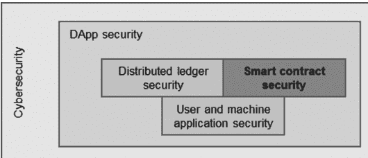

图 2.8: 智能合约安全与网络安全。

然而，由于 `DLT` 的去中心化和分布式特性，除了影响 `DApps` 的常见网络风险和漏洞外，未知的漏洞和风险会出现或严重加剧。可能的攻击和新的攻击向量包括 `DL` 网络的治理和运行、挖矿与共识、交易篡改以及针对智能合约的攻击。各种向量经常组合在一个攻击领域，以获得对网络、网络部分或单个节点的控制，然后利用这种控制操纵交易。某些攻击向量的执行可能极其困难且昂贵。在真正的去中心化 `DL` 网络中，它们实际上几乎不可行。然而，

> 19 `https://www.hyperledger.org/use/ursa`

在更中心化的（私有）网络中，风险仍然很多。许多攻击向量特定协议和实现，并不出现在每个 `DLT` 变体中，因此 `DL` 网络的实际实现可以通过去中心化、授权节点代替匿名、传统 `PoW` 以外的共识机制等缓解或防止某些风险。

虽然某些防御机制和缓解技术在 `ICT` 领域可用并在现代软件开发生命周期中很容易获得，但另一些需要针对 `DLT` 进行开发或调整。这并不意外。许多 `DL` 平台、工具和智能合约编程语言仍处于起步阶段，进化迅速并不断变化特征。因此，`DL` 平台或智能合约语言存在设计缺陷。与 `DLT` 生态系统一样，安全性似乎也不成熟。

先前部署的智能合约的不可变性暴露了漏洞，这些漏洞在传统软件系统中可以很容易缓解，但在去中心化应用中可能会导致严重风险。对于任何代码，每个防御都有漏洞。区块链平台或智能合约语言中存在设计缺陷。常见安全缺陷（`CWE`）在区块链平台和相关的智能合约安全中可能会放大 [39]。这些缺陷包括不当的行为工作流、访问控制或初始化、计算错误和随机值不足、包含不可信的外部功能（例如外部库、他人部署的智能合约）以及不当的异常处理和对加密的理解。

关键智能合约漏洞源于逻辑缺陷、智能合约代码中的 bug 以及未优化的代码模式。合约实现中的逻辑流（例如智能合约未退还初始保证金、缺乏对用户输入的加密以确保公平、或激励机制失调 [40]）可能是故意的，也可能是对分布式账本属性的误解造成的。在公共 `DL` 网络中，加密货币和矿工奖励面临未优化智能合约代码模式的风险，导致不必要的 `gas` 消耗 [41]。他们的研究指出，这些的主要原因是无用的代码相关和循环模式。

在 `Ethereum` 中，智能合约漏洞源于 `Solidity` 语言、`Ethereum` 或 `EVM` 区块平台以及对常见实践的误解。在 `Hyperledger Fabric Chain` 中，漏洞源于几乎相同的点：`Go` 语言、区块链平台以及常见实践的误解。

### 2.4.4.1 智能合约漏洞分类

智能合约漏洞分类与测试用注册表（`SWC Registry`）[39] 是 `Solidity` 智能合约代码安全缺陷的完整列表。它为智能合约程序员和许多智能合约漏洞检测工具提供了一个清单。可能的漏洞标记为 `SWC x`，其中 `x` 是漏洞索引，例如 `SWC 107`。

某些 `Solidity` 智能合约漏洞包括交易排序依赖、时间戳依赖、异常处理不当和重入（`reentrancy`）。如果用户无法控制交易执行顺序，交易排序依赖（`SWC14`）可能会成为一个问题。顺序取决于矿工。如果有多个交易调用了同一个合约，这些交易的顺序可能会影响区块链的状态。时间戳依赖（`SWC16`）与智能合约有关，包括由区块时间触发的条件。区块时间戳由矿工根据其本地系统时间设置，可能不可靠或被攻击者操控。异常处理不当（`SWC104`）针对调用另一个合约的合约。如果被调用合约发生任何异常，它将终止并返回 `false`，但可能不会通知调用者合约。重入漏洞（`SWC107`）存在于合约调用另一个合约且当前执行等待被调用合约完成时。这为攻击者提供了多次利用调用者合约及其方法的中间状态的机会。通过 `tx.origin` 授权（`SWC15`）如果授权账户调用恶意合约，可能会导致合约漏洞。对漏洞合约发起的调用可能会通过授权检查，因为 `tx.origin` 返回的是交易的原始发送者（即授权账户）。

### 2.4.4 保护智能合约的步骤

我们可以采取两种类型的安全措施来保护智能合约——被动智能安全和主动智能合约安全。这两个子集既不互斥也不相互替代，而是被视为智能合约安全的独立基石。被动安全措施涉及智能合约架构、特定智能合约环境的软件工程技术、代码审查和验证（见 2.4.3.2 智能合约编程）。主动措施发生在智能合约执行期间，涉及智能合约和访问控制、对进入智能合约交易的主动监控以及对其授权。

### 2.4.4.1 更新与升级

如 2.4.4 节开头所述，先前部署的智能合约的不可变性阻止了将现有代码替换为更新或升级的版本。当然，我们可以始终将新版本部署到区块链网络。然而，必须使原始智能合约失效，通常是禁用指向它的交易。`Consensys` 强调了一些以太智能合约最佳实践。为了确保修复漏洞和改进的有效升级，他们建议采用暂停、冻结或延迟智能合约操作的机制，以及迁移和传输数据到更新版本的机制。

## 2.4 智能合约

智能合约的版本。如果在部署后发现相关缺陷，可以应用两种软件工程技术²⁰。断路器（`Circuit Breakers`）在满足某些条件时暂停或停止智能合约的执行。当在部署后发现新错误时，它们非常有用。此时唯一可以执行的操作是提现。我们可以赋予受信任方触发断路器的权限，或者设置在满足特定条件时自动触发断路器的程序化规则。减速带（`Speed bumps`）或减速操作，以便在恶意活动发生时有时间进行恢复。

### 2.4.4.2.2 模块化

在现代软件工程中，源代码通常被拆分为多个模块。与单个文件中包含的所有代码相比，这些模块更容易处理和导航。模块化使得软件管理变得更容易，包括更新和升级。代码是可重用的，且函数是分离的。代码库越大，采用多合约架构就越有意义，对服务的安全性收益也越大。

然而，模块化在智能合约开发中并不是常见做法。大型基于以太坊的 `DApp` 使用模式表明，超过 75% 的基于以太坊的 `DApp` 采用非常简单的单合约架构，这意味着链上应用逻辑仅由一个智能合约组成。其余 `DApp` 是多合约的，平均包含三个合约。因此，高效重用非常有限，智能合约源代码在不同的实现之间大部分是重复的。单合约解决方案可能满足用户的功能需求，但当出现更新需求时，往往会导致难以管理的去中心化应用。

以太坊改进提案（EIP）²¹提出了一种用于可升级模块化合约的“钻石形法”（Diamond approach）。该文档提出了一种支持使用多种逻辑的代理合约。这些委托合约被称为“切片”（facets），每个切片支持一个或多个函数。通过一个专用的函数可以添加、替换或删除函数。当钻石函数发生变化时会发出事件，用户可以验证调用的是哪个版本的函数。通过这种设计方法，可以随着时间的推移开发并增量改进 DApp 的智能合约逻辑。然而，智能合约所有权、身份验证和授权的设计不在本文草范围内。

模块化合约可以以控制的方式进行升级。可以采取几种方法，或使用辅助服务来实现，例如注册合约、委托调用（delegate calls）或以太坊名称（见第 2.6.3 节中的名称服务）。

> 20 https://consensus.github.io/smart-contract-best-practices/software_engineering/

> 21 https://eips.ethereum.org/EIPS/eip-2535

### 2.4.4.2.3 DApp 模块化智能合约架构示例

模块化智能架构需要一组智能合约协同工作，作为去中心化应用的链上部分。因此，合约方法的安全访问策略必须经过仔细的设计和规划。拥有一个专门的智能合约来处理去中心化应用中所有合约的访问控制和交互权限是有意义的。这意味着所有的安全性都是集中的，并且比在多合约架构的每个智能合约中定义访问和安全策略提供了更好的全局视图。

我们现在可以将特定服务的函数和服务无关的函数分离到不同的模块中。服务无关模块提供了任何多合约解决方案中所需的关键功能。目录模块可以作为访问点，它是外部用户的唯一接口。它重用了其他智能合约模块中地址的分发功能。如果部署系统中的其中一个合约被升级并替换，目录将反映这一变化，并透明地将剩余合约引导到更新后的地址。管理模块为解决方案中的所有智能合约和方法提供常见的访问控制。

特定服务的模块取决于 DApp 的目标，并为服务操作提供独特的函数，例如在分布式能源管理（第 4.3.3.1 节）或汽车预留（第 4.2.2 节）或机器人之间的去中心化协作（第 3.6 节）中。

辅助模块提供与服务提供相关的额外功能。然而，这些令牌、资产代币化、托管服务或价值收集对于其他应用领域也是通用且相关的。辅助模块可以在系统范围内提供并在各种去中心化应用中重用。

带有分离访问管理模块的模块化允许允许定义定义租户。虽然它们都通过接口合约与多个模块交互，但它们仅允许调用某些方法，而其他方法受到限制。通常，去中心化应用中的租户可能是：应用所有者、管理员、服务提供者和服务用户。

### 2.4.4.2.4 安全的多合约交互

钻石标准（见第 2.4.4.2.1 节）提出了一个可升级的多智能合约环境，但它没有包含任何能够确保合约间交互安全可靠的机制。我们可以通过安全的智能合约隧道（SCT）[42] 来扩展这种基础模块化。智能合约隧道引入了双重访问控制：按模块（仅限注册模块可以交互）和按用户。管理员租户在目录和管理模块中设置隧道。通过目录模块，我们可以始终确保方法调用通过了授权的模块，并且源自授权的智能合约账户。我们同时使用 `tx.origin` 值来验证交易是否源自授权来源，使用 `msg.sender` 值验证交易是否是从授权来源转发的。

图 9 在接口合约和后续智能合约之间部署了一个隧道。只有在目录中正确注册并在管理模块中获得授权的智能合约才能访问我们多合约解决方案中的目标智能合约。此外，可以检查接口合约和目标合约中的交易源地址，以根据特定用户的租户角色限制对特定方法的访问。未注册的智能合约无法向目标发送交易。

图 2.9 用于智能合约访问控制的智能合约隧道

## 2.5 链外应用

在去中心化应用三元组（见第 2.2 节）中，DL 网络节点确保了所有用于网络运行的协议以及与其他节点交互及链上智能合约执行的功能。Web、移动、服务端或嵌入式链外应用需要与这些节点建立接口，以利用 DL 网络提供的特定特性和服务。

因此，某些网络节点暴露区块链 API（通常是 JSON-RPC 或 REST 接口），供软件应用程序与 DL 网络交互。在许可网络中，我们可以在节点上可选开启区块链服务的 API。或者，我们可以依赖公共 DL 网络的第三方 API，这些 API 作为服务提供（见第 2.7.2.2 节），以便更有效地生产去中心化应用。在许可网络中，添加节点可能更加严格，并限于授权用户。这些限制是出于网络安全和账本数据隐私的考虑，某些网络不允许添加节点。在这种情况下，API 是外部实体参与或与网络交互的机制。例如，为了访问 Hedera 服务（见第 2.7.1.3 节和第 1.4 节），使用了镜像节点。无法运行

## 2.5 去中心化应用

Hedera 中的镜像节点，但 Hedera 和社区镜像节点是可用的，并提供了 Hedera 服务的 API。

公共网络中的 API 端点通常不对离链应用施加任何访问控制。如果将其与许多 Web 应用的 API 访问相比，缺乏访问控制可能令人惊讶。然而，账本是共享的且对所有参与方可用，无需保护其访问。导致严重安全漏洞的区块链账户相关操作是在离链应用部分执行的。如果我们为节点 API 建立某些访问控制，主要是为了保护节点的计算资源。

### 2.5.1 离链应用示例

离链应用利用已有的 Web、移动端、服务端和嵌入式应用技术，为 DApps 提供用户和机器界面。

除了节点 API 之外，区块链生态系统通常会为不同的编程语言提供离链库。这些便利库抽象了与区块链节点 API 交互的大部分复杂性。

尽管传统 Web 界面与区块链启用界面之间有显著相似之处，但存在一些易用性问题。这些问题大多与区块链交易延迟有关。因此，用户无法依赖传统 Web 应用中预期的刷新率和响应时间。因此，当由于账本网络交互而等待比预期更长的响应时，通知用户是一个良好的用户界面设计原则。例如，我们可以临时将用户重定向到区块浏览器（见第 2.6.4 节），以便在此期间实时跟踪他们的交易。

区块链后端对离链 Web、服务器或嵌入式应用的另一个影响源于区块链 API 查询。我们无法像在关系数据库那样高效地构建节点 API 请求。如果客户端应用设计没有考虑这种可能性，对远程 API 的请求数量可能会变得巨大。这会导致节点资源消耗增加，以及客户端应用与 API 之间产生不通信负载。后者在通信受限的嵌入式物联网应用中可能特别具有挑战性。

### 2.5.1.1 客户端 Web 应用

客户端 Web 应用运行在浏览器中。除了执行客户端应用逻辑外，浏览器必须包含一个密钥钱包。钱包能够管理区块链密钥和身份。它可以是浏览器的组成部分（例如 Brave²）或浏览器扩展。Metamask³ 是一个流行的以太坊钱包扩展。图 2.10 显示了 Metamask 菜单，可以在可用以太坊网络（包括主网和各种公共测试网）之间切换。通过 Metamask，我们还可以将浏览器连接到运行本地计算机上的以太坊节点，或指定任意 JSON-RPC 节点 API 的 URL。通过这种方式，我们可以访问使用以太坊 DLT 的私有或联盟网络。

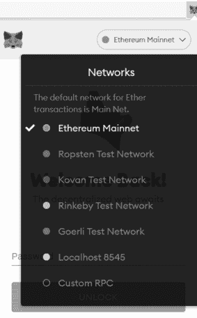

图 2.10：Web 浏览器中的 Metamask 钱包扩展。

以太坊 Web 生系统的通用约定是用管理软件通过  上的 JavaScript 对象暴露其 API。EIP 1193⁴ 规范了以太坊 Provider API 以促进钱包的互操作性。该 API 设计为极简、事件驱动，且与连接方式和 RPC 协议无关。其功能可以通过定义新的 RPC 方法和消息事件类型进行扩展。

- 22 https://brave.com/

- 23 https://metamask.io/

- 24 https://eips.ethereum.org/EIPS/eip-1193

在客户端应用中，开发者使用客户端库与区块链节点 API 交互，例如用于以太坊 Web 应用的 Web3.js2⁵，并创建应用特定的编程逻辑。Web3.js 是一个库集合，允许我们使用 HTTP、IPC 或 WebSocket 与本地或远程以太坊节点交互。通过这种方式，我们可以使用所有的 Web 界面技术（HTML5、CSS 和 JavaScript）或前端框架来创建丰富的、交互的且现代 Web 用户界面，并利用区块链功能。这些用户界面与区块链网络交互。

### 2.5.1.2 服务器或嵌入式应用部分

如果运行在服务器或 IoT 设备上的软件需要与区块链节点 API 交互，我们必须不同的安排区块链密钥管理。没有人类会切换可用区块链网络或提供钱包访问授权凭据。尽管如此，我们可能需要在应用中一个密钥库。我们通常只在服务端应用的初始配置期间设置账本网络和账户信息。

另一方面，与区块链节点 API 的交互与客户端 Web 应用中的交互非常相似。如果我们开发例如 Node.js 后端应用或 IoT 设备软件，我们会包含用于以太坊 Web 应用的相同 Web3.js 库（见第 2.5.1.1 节）。以太坊的离链应用开发不仅限于 JavaScript。Web3.py²⁶ 是一个用于与以太坊交互的 Python 库。它最初源自 Web3.js，但从后朝着 Python 开发者的需求进行了进化。

### 2.5.1.3 移动应用

移动平台也采用了非常相似的方法。有移动 Web 浏览器和移动浏览器插件。例如，Metamask 也运行在 Android 和 iOS 上。这使得基于 Web 的区块链应用变得像桌面浏览器一样方便。

如果我们开发不依赖浏览器功能的移动应用，Web3.io²⁷ 是一个针对 Java、Android、Kotlin 和 Scala 的轻量级、响应式类型安全的库。

- 25 https://web3js.readthedocs.io

- 26 https://web3py.readthedocs.io

- 27 http://web3.io/

## 2.5.2 分布式账本节点 API

区块链节点 API 从纯 REST API（例如 Hyperledger Fabric）到 JSON-RPC（例如以太坊），其常用的连接方法包括 HTTP、WebSocket 和 IPC。并不是所有的 API 都一定存在于 DLT 中，甚至存在于同一个账本网络的不同实现中。通过 API 提供的功能集也不同。但它们通常提供有关节点客户端、区块链网络、区块和交易的信息，提供账户管理，并允许创建和提交新交易。

### 2.5.2.1 以太坊 JSON-RPC API

Ethereum JSON-RPC 是以太坊节点实现的 API。并不是所有实现都保证相同的功能集。在表 2.4 中，我们对一些主流节的连接方法进行了简要比较。JSON-RPC 和 HTTP 的组合对所有节点都是通用的。IPC 和 WebSockets 仅在某些情况下支持。假设我们设计一个专门依赖于 WebSocket 连接的去中心化应用，我们必须考虑并非所有网络节点都配置了账本网络访问的可能性，或者需要从一个区块链网络迁移到另一个。

表 2.4：各种以太坊节点实现的 JSON-RPC 支持。

| Cpp-ETH | Go-ETH | Py-ETH | Parity | HL Besu |
|---|---|---|---|---|
| JSON-RPC 1.0 | + | | | |
| JSON-RPC 2.0 | + | + | + | + | + |
| HTTP | + | + | + | + | + |
| IPC | + | | | + | + |
| WebSocket | | + | | + | + |

Ethereum JSON-RPC API 只有一个端点，例如 `http://localhost:8545`。API 方法及其相应的参数嵌入在提交到该端点的 JSON 结构中。Ethereum JSON-RPC API 允许选择功能并给出有关节点状态的详细信息，包括连接节点的数量和详细信息。账户管理返回客户端拥有的地址列表。这些账户在我们启动节点时必须启用。API 提供有关账本同步的详细信息，包括区块和交易详情。我们可以创建、签名并发送新交易到

28 https://eth.wiki/json-rpc/API

## 82 - 2 去中心化应用

网络。我们可以通过 API 设置和管理网络中智能合约使用的事件过滤器，或者在节点启用了挖矿的情况下管理挖矿。

### 2.5.2.2 Hyperledger Fabric REST API

Hyperledger节点提供了 RESTful API 服务。CoreAPI 由多个端点组成，反映了 API 的功能。用户可以通过选择合适的 HTTP 方法，在创建、读取和删除所选资源之间切换。

根端点包括 `/block`、`/chain`、`/chaincode`、`/network`、`/registrar/` 和 transactions。我们使用 `/block` API 从区块链检索各种区块，使用 `/chain` API 获取网络当前状态。`/chaincode` 端点用于部署、调用和查询目标链代码（即 Hyperledger 智能合约）。它实现了 JSON RPC 2.0 ，并必须在有效负载中提供所需的字段。`/network` 提供有关组成区块链网络的对等节点网络的信息。由于 HLF 网络是许可制的，`/registrar` 用于管理终端用户的注册。我们可以使用 `/transactions/[UUID]` 端点从区块链中检索与 UUID 匹配的单个交易。

### 2.5.2.3 Hyperledger Sawtooth REST API

Hyperledger Sawtooth 也依赖于成熟的 RESTful 服务方法。它系统地利用 HTTP 状态码来提供有关特定 API 调用执行的详细反馈。

## 2.6 分布式支持服务

若干服务扩展了分布式账本技术（DLT）的功能及其智能合约中的链上逻辑。这些服务对于 DL 网络和 DApp 运行并非强制性，但它们使操作更简单、提供了更多控制并促进了架构优化，深受用户欢迎。

去中心化区块链存储便于处理大量数据，对于普通区块链的存储限制，这些数据是无法使用或不实际的。命名服务为 DLT 增加了额外的地址层或命名层。它们抽象了不可变的 DL 网络地址并实现了用户友好的命名。如果智能合约地址发生了变化，这些名称可以重新映射到新的 DL 网络地址。为了让智能合约与链外外部数据源交互，需要称为预言机（acles）的特殊信任网关。此外。

### 2.6.1 基于 DL 的存储

区块链技术的核心应用——分布式账本，仅仅是分布式、安全且可靠的数据存储。正如我们讨论过的，它在各种应用中有许多不同的用户。然而，许多其他应用需要批量数据存储或文件存储。这些数据无法直接写入区块链，因为这会极大地膨胀日志本身的大小，从长期来看会损害链的性能。

目前有多种基于区块链的分布式存储解决方案可用，其特性见 [43]。它们之间共享一些核心概念。这些概念包括存储方法、复制以及对主机的激励。数据的存储非常相似。每个文件被分成称为“分片”（shards）的小块。每个分片在存储到存储网络的一部分的机器（而非实际的区块链网络）之前都会经过加密。只有这些分片的位置和哈希值会被存储在区块链网络上。拥有相对较小且均匀的数据块也有助于提高存储和传输效率。存储这些分片的机器最终将拥有许多相同大小的数据分片。

另一个共享概念是数据复制。在网络故障的情况下，需要保护数据。所有分片都需要复制到几台机器上。副本的精确数量不异，但通常最低为 3 个。由于分片之间没有易于识别的连接，必须有一种机制来确保数据在网络中得到了充分复制。

在云存储基础设施中，文件存储在公司中，该公司可以对提供的服务收费。公共分布式系统由许多不同的主机组成，没有单一实体来执行发布发票等操作。因此，每个分布式数据存储系统都需要一种奖励文件主机的方法。这因技术而异，但某些示例通过具有价值的令牌或加密货币来奖励所有者，或赋予他们对系统投票的权利。

Swarm 是以太坊对区块链存储的回答，设计用于 Web3 生态系统。文件分片（在 Swarm 中称为 chunks）存储在多个 Swarm 节点上，清单存储在以太坊区块链网络中。Swarm 节点只是启用了额外操作模式的太坊节点。它们保留文件分片并确保分片被安全存储且可访问。

系统中的文件永远无法被用户更改或删除。相反，用户上传新文件并更改 ENS 引用以指向新文件。Swarm 使用以太坊货币向用户收取存储费用并奖励主机。

IPFS 或星际文件系统是一种更通用的分布式文件系统。它可以与各种区块链网络配合使用，也可以独立运行。要访问 IPFS，用户必须安装 IPFS 客户端。一旦安装，用户和应用程序通过向该客户端发送 HTTP 请求与 IPFS 交互。IPFS 背后的组织 Protocol Labs 也在开发 Filecoin，旨在设计为激励层，为节点提供可靠托管数据的激励。

- Storj 设计在外观和性能上类似于传统云提供商的对象存储，但具有去中心化的后端。应用程序通常与其与其 S3 兼容的 API 交互。它使用基于区块链的系统和 STORJ 令牌作为激励方法。

### 2.6.2 预言机（Oracles）

确定性的智能合约代码在区块链虚拟机中执行。执行与外部现实环境隔离，合约状态由区块链系统内部的操作者维护和确定 [44]。

尽管区块链系统具有去中心化和无需信任的架构，但智能合约本身无法访问外部世界的数据。如果非确定性的智能合约代码需要外部信息来做出决策，就需要预言机将智能合约与现实世界集成。在这里，现实世界意味着外部软件、硬件或参与者，它们作为链上应用部分提供。软件资源可以是来自天气数据提供者的 Web API，或用于金融应用程序的实时或历史价格对。硬件资源可以是 IoT 传感器设备，贡献感应输入，例如用于供应链或制造管理 DApp 的 RFID 标签值。硬件参与者可以以问题的答案、投票决策等形式提供输入。

预言机收集并向智能合约提供数据馈和输入。在区块链上，预言机由为其他智能合约提供数据请求的智能合约表示。预言机确保这些各种链外源的数据证明性，并以信任、可验证的方式将外部数据引入区块链系统。

图 2.11 展示了高层预言机架构。去中心化应用（见第 2.2 节）包含一个带有智能合约执行环境的区块链网络、感知区块链的用户界面以及 DApp 智能合约。预言机是智能合约执行与外部资源之间的中介。它可以从外部源请求数据，接收外部数据馈，或保留历史记录数据值。它确保这些数据的有效性并在需要提供给 DApp 智能合约。

图 2.11：高层预言机架构。

存在两种关键的信任模型来验证外部数据。在中心化预言机信任模型中，预言解决方案仅使用一个节点将数据引入智能合约。因此，该节点需要被信任。这种模型适用于无法通过多个分区独立验证的外部世界数据，例如数据访问受限或瞬态传感器数据。预言机中中心化的示例包括软件预言机的真实性证明（TLSNotary）以及硬件预言机的可信执行环境（TEE）。另一种是去中心化预言机信任模型。在这里，去中心化声誉、投票或基于共识的决策等方法确保了对外部数据的共识。两种模型都用于实际预言机实现，以区分不同外部源的特征。

## 8.2 去中心化应用

`Provable`³⁴ 是一种用于智能合约和区块链应用的与区块链无关的预言机服务。它已集成到 `Ethereum`、`Rootstock`、`R3 Corda`、`Hyperledger Fabric` 和 `EOS` 等平台。它为智能合约提供数据源，这些源包括任意 URL（任何网页或 HTTP API 端点）、来自外部 TEC 合规处理器的随机结果、来自 Wolfram Alpha 计算引擎的计算结果，或 IPFS 网络上的文件内容。外部数据通过经过认证的进程进行交付，其中真实性证明了执行过程的透明性，而外部审计则验证了 `Provable` 代码按其预期运行。

为了实现 `Provable` 服务，DAPP 开发者和此类应用程序的用户无需信任 `Provable`。作为一种不可信的中间件，可选地请求 `Provable` 可以指定真实性证明。数据提供者无需修改其服务以兼容区块链协议。通过 `Provable`，智能合约可以访问现有网站或 API 的数据。

`Town Crier`³⁵ 系统利用可信硬件（Intel SGX）来保证数据来自受信任的、可靠的源。`Town Crier` (TC) 从应用程序合约查询中指定的目标网站获取数据，并使用 SGX 确保其真实性。如果我们使用 SGX，TC 从网站交付到应用程序合约的数据被保证是未被篡改的。如果我们信任执行环境，就可以信任 TC 从网站交付到应用程序智能合约的数据是未被篡改的。

`Augur`³⁶ 是一种基于区块链的预测市场的 P2P 协议，用户在预测获胜结果时将获得回报。该技术主要用于博弈应用。然而，`Augur` 作为一个去中心化的预言机⁷也是。在投注事件发生后，事件结果由 `Augur` 的预言机确定。结果由 `Augur` 的预言机确定，该预言机由利润驱动的报告者组成，他们报告事件的真实世界结果。报告者使用质押标记（REP 或声誉）来澄清预测结果的争议。任何拥有 REP 的人都可以参与结果的报告和争议。用户将 REP 代币锁定在托管账户中，通过质押它们来断定特定创建市场的结论。`Augur` 平台整合了一种特定的激励结构，奖励报告正确结果并惩罚报告错误结果。这建立了对预言机数据的信任。

`Chainlink`³⁸ 使任何区块链上的智能合约能够利用广泛的链资源，例如防篡改数据、可验证的随机性、外部 API 等。各种去中心化的 `Chainlink` 预言机网络保证了外部输入数据及其输出事件的真实性。例如，`Chainlink` 网络提供抗篡改和高质量的价格喂，推动了 DeFi 的增长。

## 2.6 分布式与支持服务

### 2.6.3 名称服务

鉴于区块链技术的不可变性，账户、数据和代码无法更改或删除。这意味着当开发者想要更新区块链上的智能合约或托管在 `Ethereum Swarm` 上的网站时，他们必须创建一个新的，这自然有一个唯一的标识符，即 `Ethereum` 地址。在用户端，网站或智能合约的最新版本需要始终通过相同的名称可用，且最好是人类可读的。传统系统使用 DNS 来解决此问题，将人类名称绑定到 IP 地址，并简化后端迁移、负载均衡和地理优化。

以太坊命名服务（ENS）满足了 `Ethereum` 生态系统中许多类似的需求。它将人类可读的名称绑定到 `Ethereum` 哈希值和 `Swarm` 文件标识符。ENS 是一个智能合约系统，每个合约负责其自己的领域。系统中的几个顶级智能合约（如 `.eth` 和 ）作为主智能合约被注册为解析器。解析器可以以 `ethereum.eth` 的名称注册到 `.eth` 顶级智能合约，因此对它的任何查询都会进入 `.eth` 智能合约，然后重定向到 `ethereum.eth` 智能合约。对于 ENS 名称如 `wallet.ethereum.eth`，这可以任意链式连接。与 ENS 中顶级域的所有交互都严格通过智能合约及其提供的方法进行。这提供了高度的透明度和信任。2021 年，一个 `.eth` 域名，5 个字符的每年 5 美元 ETH，4 个字符为 160 美元，3 个字符的为 640 美元。

在 ENS 上注册名称的过程需要五天，并且需要对时间敏感的交易。当我们想要注册一个名称时，会开启公开拍卖而不是简单地对名称进行哈希处理，因此只有知道名称的人才能参与拍卖。拍卖持续 72 小时，随后是揭示阶段，在该阶段竞标者必须公布他们的出价。获胜者可以在出价的基础上支付等于第二高价的金额以获得该名称。失败者将退出价。

注册表与解析器之间的关系如图 2.12 所示。ENS 可以通过 `Etherscan` 浏览器进行查询⁹。

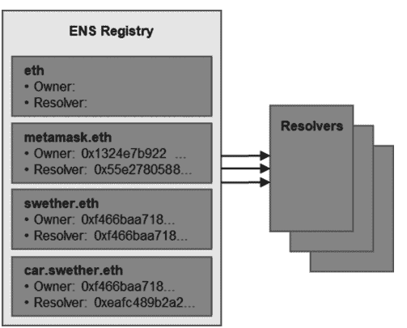

图 12: 以太坊命名系统注册表和解析器。

除了命名智能合约的 ENS 之外，几个类似 DNS 的注册中心是基于去中心化应用的。这些系统完全独立于传统的 DNS 和 ICANN。注册直接由用户管理，名称解析通常通过浏览器扩展完成。`Unstoppable domains`¹ 管理 `.crypto` 和 `.zil` 领域基于以太坊技术。`Namecoin`¹ 是 BTC 的一个分支，专注于安全地存储和管理键值对。键是人类可读的名称，值是地址。它为 `.bit` 领域提供类似 DNS 的服务。

### 2.6.4 链上浏览器

`Chainlink` 使任何区块链上的智能合约能够利用大量的链资源，例如防篡改数据、可验证的随机性、外部 API 等。各种去中心化的 `Chainlink` 预言机网络保证了外部输入数据及其生成的输出事件的真实性。例如，`Chainlink` 网络提供抗篡改和高质量的价格喂，推动了 DeFi 的增长。

链上浏览器是用于检查和分析区块链的工具。它们聚合并显示来自节点的资产、交易和智能合约数据。由于这些 DApp 使用公共区块链，链上浏览器在识别和修复问题上非常重要。

`Etherscan`⁴ 是以太坊最流行的链上浏览器。其用户界面如图 23 所示。一个类似的工具存在于 `Hyperledger Fabric`。

## 2.7 DApp 产品化

当企业采用去中心化技术或旨在向市场提供新的 DLT 产品和服务时，选择底层 DLT 平台是一个战略决策。在采用过程中，可能需要对 ICT 基础设施和服务进行投资；还需要培训技能人才，以及对 DApp 开发投入投入。因此，企业寻求长期可持续的解决方案和合作伙伴。为了做出正确的决策，必须评估和比较特定的 DLT 产品或技术平台以及整个生态系统。合适的选择可以加速技术的采用，减少初始和长期开发支出以及支持成本。这带来了技术和业务优势以及新收入来源的产生。

技术平台的特性是至关重要的。网络特性，例如性能、治理和可扩展性，取决于 DL的技术差异和网络实现的细节（见第 2.3 节）。智能合约（见第 2.4 节）决定决定了 DApp 设计和功能。然而，除了平台之外，许多其他方面代表了 DLT 生态系统。

开发需要一套库和工具，以便开发和测试、监控网络以及验证解决方案。开发者需要文档和高效的形式及非正式支持。某些 DLT 生态系统提供系统化的培训课程和认证。

能够清晰路线图的证明能力是 DApp 以及所选底层 DLT 平台、工具和库将不断改进的良好保证。

# 90 — 去中心化应用

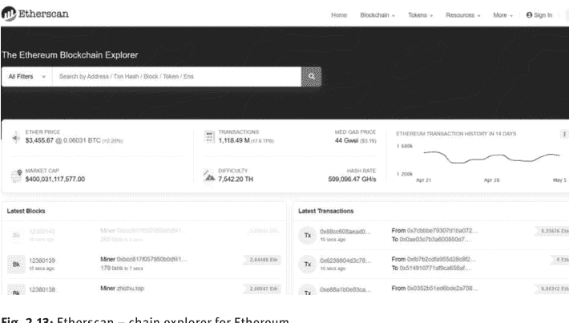

演进并在未来获得支持。它可能相关的分布式账本技术（DLT）生态系统明确预见了步骤，使其运行绿色且节能。

一个关键决策因素应该是生态系统中聚集的社区。一个成功的生态系统会吸引并积极支持用户和开发者。支持生态系统的大型活跃社区鼓励开放、协作的文化。具有大型全球足迹的社区也表明了平台在用户和开发者中的接受程度。不应仅将社区视为生态系统的用户或客户，而应将其视为外部创新者。这种态度在许多开源项目中已被证明是成功的。因此，某些 DLT 生态系统已经明确定义了与学术界和企业合作的机制。

最后，用例的数量和范围是衡量我们对 DLT 生态系统预期的其他指标之一。

## 2.7.1 DLT 和 DApp 生态系统

在这里，简要概述一些现有的 DLT 生态系统。这绝不是一项全面的研究。还有许多其他生态系统。此外，许多 DLT 平台的分叉并没有带来全新且独立的技术方法，而是通过修改现有协议来实现某些改进。其他生态系统在未来可能会带来有趣的平台解决方案，但目前更多处于概念证明阶段，而非业务级 DLT 平台。我们认为，所选的是相关的 DLT 生态系统，应该被视为选择 DLT 时的相关替代方案。比特币未包含在这些比较中。尽管比特币是 DLT 的先驱，并且是市值最大的加密货币公共账本网络的基础，但它并不适用于 DApps。

表 2.5 总结了所选 DLT 生态系统的一些关键特征。它可以作为读者的起点，以匹配其预期的 DApp 需求与相应的账本技术（DL）。

表 2.5：所选 DLT 生态系统的比较。

| | Ethereum | Hyperledger | Hashgraph | Corda | IOTA |
|---|---|---|---|---|---|
| 管理机构 | 以太坊基金会 | Linux 基金会 | Hedera 治理委员会 | R3 | IOTA 基金会 |
| 类型 | 开源社区 | 筛选的开源社区 | 有限的公共输入 | 有限的输入 | 有限的公共输入 |
| 公共网络 | | | | | |
| 加密货币 | ETH | / | HBAE | / | MIOTA |
| 治理 | 公共 | / | 中心化 | 联盟 | 中心化 |
| 分布性 | 非常高 | / | 低 | (不清楚) | 未知 |
| 私有网络 | | | | | |
| 是否支持 | 是 | 是 | 是 | 是 | 是 |
| DApp 开发 | | | | | |
| DApp 开发能力 | 非常好 | 非常好 | 好 | 好 | v1.0 不适用 |
| 用户和开发者社区 | | | | | |
| 社区 | 非常大 | 大 | 较小 | 金融机构 | 较小 |

### 2.7.1.1 Ethereum 生态系统

`Ethereum` 是由以太坊基金会维护的开源链式 DL 生态系统。2021 年，它继续实施迈向 `Ethereum 2.0` 的深思熟虑的路线图。它引入了 DL 的更改，从工作量证明（PoW）转向节能的权益证明（PoS）共识，并解决了以太坊网络的扩展性问题。

`Ethereum` 区块链部署在一个大型高度去中心化的公共网络中，称为主网。任何人都可以向此网络添加节点，包括矿工节点。2021 年，主网约有 7,000–8,000 个节点。以太坊公共网络提供有一种主要的加密货币，使其适用于 DeFi、IoT 或其他 DApps。使用以太坊技术可以创建私有和联盟网络。与公共网络相比，它们通常用于提高性能和隐私性。

`Ethereum` 智能合约通常用 `Solidity` 编写，也支持 `Vyper` 和 `Vy`。对于 `Ethereum` 去中心化应用的开发，存在着丰富的库、工具、开发 IDE 和安全工具。它拥有规模最大的开发者社区。`Ethereum` 是 DApps 最流行的平台，包括 IoT 应用，具有许多令人说服力的用例。

### 2.7.1.2 Hyperledger 生态系统

`Hyperledger` 生态系统代表了一套用于企业级区块链部署的开源框架、工具和库。它涉及 250 多个团队和公司，并由 Linux 基金会托管。工作被组织成不同的项目，这些项目开发账本技术、综合工具和支持库。项目的成熟度及其连贯性有明确的指示。

`Hyperledger`（包括 `Burrow`, `Fabric`, `Indy`, `Iroha`, `Sawtooth`）主要针对私有网络和联盟网络。因此，没有公共的 `Hyperledger` 网络，因此也没有公共的加密货币。只有 `Hyperledger Besu`（一种基于 Java 的以太坊客户端实现）可以连接到以太坊网络。`Hyperledger` 网络旨在支持各种组织的操作，无论是私有的还是联盟的。虽然多个组织访问同一个账本，甚至访问部分数据向公开的多个账本，但这些仍被认为是私有的。HL 采用了不同的智能合约开发方法，这取决于所选的账本技术。`Hyperledger` 支持许多广泛使用的编程语言，如 `Solidity` 和 `Go`。所有项目都有详尽的文档。

每个项目都有自己的合作组织团队，从世界闻名的 ICT 项目到致力于 `Hyperledger` 项目开发的小型团队不等。著名的 `Hyperledger` 用例包括物流项目、金融项目和人道主义项目。

### 2.7.1.3 Hedera 生态系统

`Hashgraph` 是一项由 `Hedera` 治理委员会维护的专利 DLT。`Hedera` 治理委员会由 39 个涵盖不同行业、学术界和非营利组织组成。他们致力于软件更改，同时为公共网络带来去中心化。

`Hedera` 公共网络构建在 `Hashgraph` 共识算法之上。它允许价值创造、身份证明和验证重要数据。交易成本可以保持稳定且低廉，使得微交易在 `Hedera` 上经济和技术上都是可行的。存在主网节点。镜像节点用于访问 `Hedera` 服务。`Hedera` 网络由 `Hedera` 委员会管理，因此并非真正的去中心化。`Hedera` 智能合约不是不可更改的，如果几方达成一致，就可以进行更改。从应用开发者的角度来看，`Hedera` 可以被视为一种基于联盟的服务，暴露的是去中心化能力而非真正去中心化的生态系统。著名的 `Hedera` 用例包括支付、代币资产和凭证管理。

### 2.7.1.4 Corda 生态系统

`Corda` 是由 `R3` 开发和维护的开源 DLT，R3 是一家在 2015 年银行联盟加入该计划而闻名的科技公司。建立了一个名为 `Corda Network Foundation` 的独立实体，使用名为 Stichting 的非营利法律类型来治理开发和网络。这种类型适用于治理活动并能够进行商业运营，但没有股东、资本或股息。

`Corda` 网络是私有或基于联盟的。因此，去中心化取决于特定情况。`Corda` 网络是一个许可的、公开可用的 P2P 网络。每个节点代表一个法律实体并运行 `Corda` 软件。节点必须从网络运营者获取证书才能加入网络。该证书将已知身份映射到真实的法律身份以及相应的公钥。`Corda` 网络没有公共加密货币。

`Corda` 中的智能合约是协议，其执行可以通过计算机代码结合人工输入实现自动化，且用法律语言表述的权利和义务在法律上是可执行的。`Corda` 中的智能合约代码使用 `Kotlin` 编写，用于合约执行和验证的虚拟机是一个经过增强且极度严格的 JVM 版本。开发者可以获得丰富、更新且结构良好的文档，包括代码示例。还有一套丰富的开发和监控工具。`Corda Enterprise` 已证明能够满足复杂组织对安全、扩展性和支持的需求，现在已成为金融服务领域的行业标准。

## 2.7.1.5 IOTA 生态系统

`IOTA` 是由 `IOTA Foundation` 开发开源分布式账本技术（DLT）。该基金宣布了迈向 `IOTA 2.0` 的宏伟路线图。跟上这将是一个挑战。路线图规划了一套新的 DLT 协议栈、新的钱包和新的库套，与 1.0 版本相比是一个转变。2.0 版本将消除对（中心化）协调节点的需求，以及智能合约协议、安全消息和一次性自身份。`IOTA` 计划标准化 `IOTA` 协议，并已宣布与 IEEE 和 OMG 合作。

在当前的 `IOTA` 网络1.0 版本中，交易在被其他交易引用时才会被引用。然而，只有当网络协调节点（由 `IOTA Foundation` 操作的特殊节点）确认它们时，它们才变得真正有效。由于 `IOTA` 独特的账本类型，它具有一些特性。理论上，随着节点和用户数量的增加，吞吐量会增加，延迟会降低。`IOTA` 账本是分布式的，但网络并非通过共识实现去中心化，而是需要协调节点。

它包含一个公共网络和一个公共测试网络。`IOTA` 使用公共加密货币 `MIOTA`。交易本质上是免费的，但交易必须提交工作证明。

对于智能合约，v2.0 处于 alpha 阶段，但在当前的 v1.0 中不可用，这意味着 `IOTA` 只能存储和传输数据，不能对其进行处理。这使得它目前无法用于构建 DApps。因此，`IOTA` 尚未吸引到较大的开发者社区。开发者希望获得系统性的文档以及关于如何参与 `IOTA` 网络的清晰指导。2.0 版本承诺了相关的改进，但需要投入巨大的精力才能完成并达到生产级。

## 2.7.2 部署和访问区块链网络

DApps 的运行需要底层的 DLT 网络（见第 2.2 节和 2.3 节）。这可以是一个全新的、专用的私有网络或联盟网络，我们可以根据需求对其进行定制并从零开始构建。尽管如此，它也可以是一个现有的主流公共网络，我们希望其中附加额外的节点缓存以参与区块链网络操作。

一个可扩展的自证明区块链网络设置复杂且难以管理。每个节点操作者都需要手动配置硬件、软件，创建并管理用于访问控制的证书，并配置网络组件。这可以通过对节点文件进行非常基础的编辑完成，例如创世文件。某些手动任务可以通过 CLI 向导完成，例如 `Puppeth`，它有助于创建新的以太坊网络。最近，如 `Hyperledger Cello`——一种区块链部署和运行系统等工具有助于高效地使用和管理区块链。它支持各种基础设施，如裸机、虚拟机平台和容器云（例如 `Swarm`, `Kubernetes`）。

一旦区块链运行，就需要持续地监控基础设施并适应变化。从自托管节点，区块链即服务（BaaS）提供商促进了高效的区块链节点部署和管理。云服务提供商的许多关键参与者，例如亚马逊、微软、阿里巴巴和 IBM，都提供了一些 BaaS 服务。

离链 DApps 部分需要访问 DL 节点的 API（第 2.2 节和 2.4 节）。这些 API 可以在我们监督的节点中暴露，或者从专门的供应商提供商（例如 `Inura`）处获取。后者确保了连接用户到以太坊公共网络的底层设施是可靠的。这对于 DApps 中机器和用户界面的即时运行至关重要。依赖托管 API 可以让应用程序开发者完全脱离 DL 网络的配置工作。

公共账本的内容始终可以通过网络节点获取。然而，这可能不是高级 DL 数据分析所需的查询的最有效结构。因此，将来自各种 DL 网络的历史数据公共数据集放在大数据平台中可以使分析更高效。

### 2.7.2.1 区块链即服务

BaaS 在云或边缘计算环境中提供区块链服务，例如节点和网络部署、系统监控以及智能合约分析和测试。BaaS 实现将部署和访问 BC 网络的主要技术和运营开销外包给云服务提供商。BaaS 提供者提供调整的定价和优化的实例类型，以适应不同的区块链用例例。基于这些服务，开发者可以专注于业务代码，探索如何将区块链技术正确应用到他们的业务场景中，而无需维护和监控区块链平台 [45]。BaaS 正在提高 DApp 开发的效率并启动了区块链技术的广泛采用。

- 44 https://www.hyperledger.org/use/cello

- 45 https://aws.amazon.com/managed-blockchain/instance-types

- 46 https://consensus.net/quorum/

表 2.6：BaaS 提供商支持的 DLT。

| BaaS 提供者 | 支持的 DLT |
|---|---|
| Amazon Managed Blockchain | Ethereum, Hyperledger Fabric |
| IBM Blockchain Platform | Hyperledger Fabric |
| Microsoft Azure BaaS | Quorum⁴⁷ |
| Alibaba Cloud BaaS | Ant, Hyperledger Fabric, Quorum |
| Oracle Blockchain Platform | Hyperledger Fabric |

Quorum 是一个为许可制企业区块链网络定制的以太坊实现。因此，它通过以太坊熟悉的工具促进了 DApp 开发，从而受益于以太坊的生态系统（见第 2.7.1.1 节）。Quorum 节点源自公共以太坊（Hyperledger Besu —— 以太坊兼容客户端，见第 2.7.1.2 节）。它支持一组节点。

### 2.7.2.1 Amazon Managed Blockchain

Amazon Managed Blockchain⁴⁷ 是一种全托管服务，让我们能够使用开源框架 Hyperledger Fabric 和以太坊创建并管理私有或联盟网络。该服务可以扩展以满足应用程序的需求。托管区块链还会监控网络并自动扩展。它有预构建的模板方便加入公共网络。

### 2.7.2.2 IBM 区块链平台

IBM 是 Linux Foundation Hyperledger 项目的创始成员，因此 Platform⁸ 是 Hyperledger Fabric 的商业发行版，并带有 SLA 和全天支持。企业可以连接到任何环境（本地、公共或混合云）中的节点，并仅部署所需的组件（节点、排序服务、证书机构），通过单一控制台管理所有网络组件。没有供应商锁定，因此公司对身份拥有完全控制权。IBM Platform 正与 Hedera 共识服务合作以增加互操作性，后者提供公共共识，而私有区块链基于 Hyperledger Fabric。基于 IBM 平台的领先用例包括银行和金融市场、供应链、医疗保健、保险、媒体、广告和政府。

### 2.7.1.3 Microsoft Azure BaaS

Microsoft Azure BaaS⁵⁰ 让让我们配置联盟区块链基础设施并快速部署托管区块链网络。它利用伊斯坦布拜占庭容错（IBFT）共识机制促进 Quorum 账本，并将最终支持多种区块链平台，如以太坊、Hyperledger Fabric、Corda 和 Chaincode。

该服务由三组产品组成。Azure Blockchain Workbench 是构建、治理和部署全托管区块链网络及应用程序的基础。Azure Blockchain Service 是快速原型设计和简化开发的起点，具有预构建的网络和基础设施。Azure Blockchain Development Kit 是一个全面的 GitHub 开发者区块链仓库，包含代码示例和加速器。内置了模块化控制，方便成员入驻、联盟管理和无代码配置，以及简化的策略执行。区块链数据管理器允许灵活、可靠且可扩展的数据流和应用程序集成。通过这种方式，用户可以监控他们的智能合约，对交易和事件做出响应，并将链上数据流到离链数据存储中，以提升所需的端到端解决方案。

### 2.7.1.4 阿里云 BaaS

阿里云 BaaS⁵⁰ 支持 Hyperledger Fabric、蚂蚁链技术和 Quorum。它提供开箱即用的服务，包括增强型管理。

# 98 — 去中心化应用

这些函数帮助我们轻松地构建企业级的区块链网络环境，而无需担心复杂的配置。它包括对组织和业务中智能合约（链码）的管理，包括覆盖安装的周期、实例的创建，并且该平台允许我们创建联盟、邀请并批准参与业务的参与者加入联盟，并管理业务。

阿里云 BaaS 集成了云物联网（IoT）和反伪造技术，为产品追溯提供区块链解决方案。其他显著的用例还来自供应链金融、数据资产共享和数字内容所有权。

## 2.7.2.15 Oracle 区块平台

Oracle Blockchain Platform¹¹ 是一个预装的 PaaS，包含了支持区块链网络所需的所有依赖：计算、存储、容器、身份服务、事件服务和管理服务。区块链控制台支持集成操作。

它基于 Linux Foundation 的 Hyperledger Fabric 项目，但在许多方面对开源版本进行了扩展，以满足企业环境的需求。这些包括：例如基于预装模板的部署、运行监控以及零停机管理补丁和更新、增强的安全和身份管理功能，以及一组通过 REST 调用实现的 HL Fabric API，用于进行简单的交易交互。

他们的用例包括大型供应链和交易网络、食品安全、零售忠诚度奖励以及身份和投票应用。

## 2.7.2.2 与 DL 网络对接接口的 API

BaaS（第 2.7.2.1 节）为离链应用利用区块链服务的节点部署和显示 API。然而，BaaS 主要用于私有区块链网络。另一方面，可能完全依赖于公共区块链，那里网络基础设施已经可用。在这种情况下，远程节点服务对于任何启用区块链的应用、兼容区块链的浏览器以及 Web 应用插件或区块链开发工具的用户体验至关重要。这些产品的开发者可以完全消除用户访问公共网络时安装、运行和管理其网络节点的需求。

¹¹ https://www.oracle.com/blockchain/

² https://docs.oracle.com/en/cloud/paas/blockchain-cloud/using/

## 2.7 DApps 的产品化 99

Infura⁵³ 专注于通过可靠的基础设施将我们与以太坊（主网及各种测试网）、Filecoin 和 IPFS 连接。离链应用可以通过基于 HTTPS 和 WebSocket 的 JSON-RPC 连接到以太坊和 IPFS，其请求响应时间比其他服务和其他自托管解决方案快 20 倍。Infura 节点运行在最新的网络升级上，保证至少 99.9% 的可用性。该服务提供按需或基于订阅的连接，以及全天候的支持团队访问。

仪表板直观了应用的性能和 API 使用情况。这可以用于深入分析特定的请求方法或最活跃的时间段，以优化性能并更好地了解用户。

许多启用区块链的产品（如 Coinbase Wallet）依赖于 Infura 的服务，例如移动应用、兼容区块链的浏览器和插件（Brave, Metamask, Opera）以及区块链工具（Openppelin, Truffle）。

Infura 是通过 JSON-RPC API 访问的快速以太坊节点。以太坊网络的类似服务由 Cloudflare 分布式网络网关提供。⁵⁵ ZMOK⁵⁶ QuickNode⁵⁷ 提供弹性 API 和专用节点。除了以太坊，它们的 API 端点还包括 BSC、Optimism、Bitcoin、xDAI 和 Polygon。Pocket Network⁵⁸ 是一个包性的 API 请求中继器，通过加密经济模型加入主流区块链。请求被伪随机地路由到可用节点，使其具有很高的冗余。与单一供应商相比，Pocket Network 被组织为一个去中心化自治组织（DAO）。其使命是确保区块链基础设施的可持续去中心化。

## 2.7.2.3 用于高级区块链数据分析的公共数据集

直接源自网络节点的账本数据可能对于高级 BC 数据分析、大数据利用、机器学习或商业智能机制所需的查询没有最高效的结构。为此，BigQuery 等提供了公共数据集，以访问来自各种区块链网络的历史数据，包括访问链上交易数据和整个历史。因此，这些数据在 BigQuery 的所有分析方法和可视化工具中都是立即用的。2021 年，Google Cloud 平台上有 50 个公共数据集⁵⁸。它们包含了关键的公共区块链网络，例如 BTC、Ethereum、Ethereum Classic、

53 https://infura.io/

54 https://zmok.io/

55 https://cloudflare-eth.com

56 https://www.quicknode.io

57 https://pokt.network

58 https://console.google.com/marketplace/browse?filter=type-dataset&q=blockchain

Litecoin, Dash, Zcash, Monero, Cardano, NEO 等。这些数据可以立即应用于 Google Cloud 的 AI 服务和数据分析，或简单地使用 SQL 进行结构化和查询。

分析可以揭示最流行的收藏品（ERC721 合约）或代币（ERC20 合约）、找到零费用交易、计算区块链地址的余额等。

## 3 分布式账本与物联网

分布式账本技术与物联网的集成对于去中心化金融（DeFi）应用之外的许多应用和用例是基础。应用领域包括智能城市、智能机器人、智能工业和物流、移动以及能源或废物管理。其中一些应用领域将在第 4 节中进行详细讨论。

| 应用层 | Web 和移动应用，用户界面 |
| :--- | :--- |
| 平台层 | 数据存储、分析、云 |
| 通信层 | 固定、移动、无线网络；网关 |
| 感知层 | 传感器、执行器、嵌入式系统 |

**图 3.1:** 基础物联网架构。

一个以云为中心的基础物联网架构如图 3.1 所示。感知层由集成到万物中的传感器、执行器和嵌入式设备组成。感知层与现实世界交互，确保基础信号和数据处理，并保证某种形式的连接（个人域网蓝牙或有线连接，局域网 WiFi 或广域网，例如窄带物联网 NB-IoT）。嵌入式设备可以直接或通过通信网关接触通信层，通信层是公共（互联网）或私有 IP 网络。平台层和应用层是两组云服务，实现了基于物联网数据的采集、存储、处理和应用开发。物联网与 DLT 的集成被视为解决物联网架构根本性挑战的药物。这些挑战，如中心化生态系统、连接成本、破坏的业务模式、安全性以及功能价值缺失，需要得到解决以继续成功的物联网部署。

对分布式账本技术的巨大期望源于 DLT 的分布式和去中心化特性。例如，物联网网络的一种去中心化方法被认为可以解决上述许多问题。“区块链技术是应对未来物联网挑战的缺失环节”[46]，它可以降低成本、建立信任、加速交易、提供可扩展性、消除单点故障、保存智能设备的历史不可篡记录、实现机器间交易、微支付等。

## 3 — 3 分布式账本与物联网

遗憾的是，这些期望中的许多基于对分布式账本技术和业务的简化理解，其实是不现实的。例如，分布式账本技术（DLT）并不能解决物联网的可扩展性问题（在每秒交易量和延迟方面）。相反，如果能够理解并刻画分布式账本技术的真实益处，它可以被应用于可以改变业务运营的场景。DLT 为物联网的创新和范式转移提供了巨大的机会 [47]。目前，我们拥有能够可靠地收集物联网数据的生产级系统。在大多数情况下，DLT 难以达到集中化系统的性能，远未取代它们。同样，单点故障仅仅是设计不当的结果。通过云原生架构、平台虚拟化以及应用平衡和扩展可以提供极其可靠的服务。在 5G 网络中，新服务的机制是预见的。云、边缘和移动计算的结合使得（并非去中心化的）部署可能。我们看到 DLT 在物联网中发挥着合理的角色，不仅缓解了物联网瓶颈，还提供了诸如改进信任、无缝 M2M 交易、通过智能合约实现的受信任 DApps、数据溯源以及公平性等新功能。通过 DApps 进行 M2M 通信，我们看到了另外两个基本概念：数据收集，以及物联网设备的身份验证、授权和管理。这些将在本节中详细介绍。

基于分布式账本技术的物联网应用可以视为 DApps 的一种特殊情况，其中额外的需求和限制适用于 DL 网络性能、设备安全。这些攻击限制了例如预言机、API 服务器或离链及辅助服务（如加密交易所和矿池）的可用性。各种向量经常汇聚到一个领域。首要目标是获得对网络、网络部分或单个节点的控制，然后利用这种控制权来操纵交易和完整性。某些攻击向量的执行可能极其困难且成本高昂。在真正去中心化的 DL 网络中，它们在实践中几乎是不可行的。然而，在更集中的私有或共识网络中，风险仍然存在。

尽管本节强调了某些安全局限性，但分布式账本系统的受信任特性使得物联网系统能够进一步增强安全性 [47]。这些增强从数据管理、完整性到机密性和 PKI 管理，并具有去中心化的后端以及用于物联网设备和用户身份验证与授权的去中心化方法。

**表 3.1:** 物联网区块链技术的机密性、完整性和可用性维度。

| 维度 | | |
| --- | --- | --- |
| 机密性 | | - 区块链数据默认是不密的。 - 公共网络中的伪匿名性。 - 私有网络和联盟网络提升了机密性。 - 用于隐私保护的零知识机制。 |
| 完整性 | | - 完整性是 DLT 发挥优势的地方。 - 然而，风险仍然存在。交易篡改通常发生在节点或网络参与者被拒绝 DLT 服务之后。 - DLT 交易和智能合约的不可篡改性引入了新的安全风险。 |
| 可用性 | | - 如果系统是分布式且去中心化的，系统的可用性将会提高。 - 与集中式解决方案相比，新攻击可能会损害链上数据服务的可用性。 |

## 3.1 物联网安全的分布式账本

分布式账本技术和区块链在很大程度上依赖于先进的网络安全机制，并独特地结合这些机制以确保 DLT 系统的信任。然而，DLT 并没有提高 DL 网络、系统和应用的所有方面（机密性、完整性和可用性）。它并非没有安全风险（表 3.1）。

机密性并非 DLT 设计的核心特性。在所有网络参与者之间共享一个去中心化的账本对于构建去中心化信任至关重要。除非应用非常特定的机制和 DL 网络架构，否则 DL 用户最多是伪匿名的。

完整性是 DLT 设计的安全特性。它指的是交易的不可变性、防篡部署以及智能合约代码的执行。然而，这些特性开启了新的隐私和安全风险，导致在使用 DLT 应用和系统时出现所未有的法律或伦理问题。

系统的可用性在分布式和去中心化的将会提高。尽管 DL 网络没有被攻击的单点，但 DLT 系统无法免受拒绝服务或其他影响可用性的攻击。攻击针对 DL 网络服务、共识过程或去中心化应用。拒绝可能只影响选定的网络节点或网络参与者。除了 DL 网络，系统中还有少数易受到分布式拒绝服务（DDoS）攻击的去中心化实体。这些攻击限制了例如预言机、API 服务器或离链及辅助服务（如加密交易所和矿池）的可用性。

## 3.1 用于物联网安全的分布式账本 105

区块链交易被用作加密内容的传输机制，并在链外进行解密。这种方法增强了交易中用户数据的机密性，但限制了用户数据在智能合约中使用。

此外，也可以从区块链交易流量中获取有关用户信息和使用模式的信息。我们可以对公开的链数据和 DApp 使用模式进行数据分析。这些方法被用于分析交易的可关联性、交易混合、加密洗钱和智能合约的使用，从而影响用户隐私。

区块链研究的一个方向 [48] 旨在提供零知识证明，它除了证明交易有效之外不透露有关交易的任何信息，以增加区块链的隐私性。通过复杂的密码学方法，零知识证明可以在不暴露具体内容的情况下证明某事。最早的示例之一是 Zcash 中的 ZK-SNARK。除了零知识证明外，零知识方法已被作为实现区块链隐私保护的基准，包括安全多方计算、承诺方案、ZSNARK、ZKSTARK、环签名和同态隐藏。ZK-SNARK 初始需要一个受信方来设置零知识证明系统。这些受信方可能会破坏整个系统的隐私。ZK-STARK 通过消除对受信设置的需求改进了这项技术。集成 ZK-STARK 正在被考虑以此坊 2.0 可能的功能之一。

### 3.1.2 可性

分布式账本网络攻击通常是影响完整性的进一步攻击的基础。它们针对分布式账本网络的治理或运行，目标是控制大多数节点从而控制账本（例如51% 攻击）。网络攻击还可能尝试将分布式账本网络分成独立且不一致的分区，或将选定的节点从其余信任节点中隔离（日蚀攻击、女巫攻击）。

随后向受攻击的节点呈现欺骗性的账本状态，通常是通过操纵受攻击节点的时间感知实现的（例如时间劫持、延迟攻击）。

挖矿节点和共识机制同样脆弱。挖矿节点可能是不实的并自私地扣留一些已挖掘的区块（例如自私挖、区块扣留）。通过这种方式，矿工试图增加他们的奖励份额。有效的应对措施包括应用区块计时器或增加矿池分配的随机性。

## 3.2 数据管理

尽管区块链是分布式数据库，但公共区块链网络无法直接满足物联网系统中的后端数据库需求。交易结构是为了区块链运行而优化的。通过分布式共识，新条目被添加到存储中以确保分布性、不可篡改性和缺乏中央权威。然而，它无法满足传统或分布式数据库的高吞吐量、低延迟、丰富权限或查询能力 [47]。

某些区块链协议允许在交易中放置额外数据。这些可以是智能合约中的参数，也可以是任意数据，例如以太坊交易中的 JSON 输入文件。然而，交易中包含大量数据会导致大量的链数据以及在链上存储数据的成本。

物联网应用产生大量流量，且通常对延迟敏感。因此，大多数基于区块链的物联网数据管理方法（如 `IPS`、`FairAccess`、`ENIGMA` 或 `BigChainDB`）采用混合方法并不意外。这些方法将链外存储和区块链能力与分配给区块链的管理功能相结合，以确保需要审计记录的应用中的完整性和透明度。只有较小部分的信息存储在链上，例如链外数据的哈希值或访问控制信息。尽管从区块链网络中卸载了大部分流量，这些方法仍然需要提供比公共区块链网络更低、更高吞吐量的记录能力；因此使用了私有链或联盟链。

例如，`BigChainDB.59` 起于一个大数据分布式数据库，然后添加了区块链特征，如通过投票联合去中心化控制、不可篡改性和数字资产转移。一旦存储，数据就无法更改或删除。同时，它支持通过 `MongoDB` 查询来搜索所有交易、资产、元数据和区块的内容。

如图 3.2 所示，`BigChainDB` 可以无缝集成到传统应用中，作为区块链数据库用于去中心化时间戳、证书、智能合约和交易。同时，它可以作为完全去中心化应用的一部分，其中处理和文件存储都是去中心化的。

他们在用于感知数据完整性的物联网区块链平台 [49] 中采用了混合方法，其中大文件存储在链外。

## 3.3 身份验证与授权

如图 3.2 所示，`BigChainDB` 可以无缝集成到传统应用中，作为区块链数据库用于去中心化时间戳、证书、智能合约和交易。同时，它可以作为完全去中心化应用的一部分，其中处理和文件存储都是去中心化的。

他们在用于感知数据完整性的物联网区块链平台 [49] 中采用了混合方法，其中大文件存储在链外。

| 应用 | 应用 |
|---|---|
| 平台 | 平台 |
| 处理逻辑 | 去中心化处理逻辑 |
| 文件系统 Bigchain | 去中心化文件系统 |

**图 3.2:** 参考栈，用于

### 3.3.2

身份验证和授权是任何系统的两个基本步骤。在物联网中，注册是由区块链为设备进行的。这对区块链、用户和服务来说都别关重要。基于区块链的能力，它赋予了设备不可篡改的历史。

### 3.3.1 识别与入网

对于身份验证和授权，任何物联网系统中的用户、设备都需要唯一的。对于设备，这可以是制造商分配的硬件形式（例如以太网的 MAC 地址或移动设备的蓝牙地址）或一个标识符

在物联网中，新设备的入网阶段可能相当具有性。它需要可靠、安全，且尽可能地减少人工干预。入网后端可能依赖或不依赖区块链技术。在不基于硬件的物联网系统中，设备所有者通常执行入网。如果例如使用区块链地址来识别设备，它是手动分配的。通常，不会解释设备中钱包控制的细节。这可能导致硬件安全风险，类似于与 PKI 密钥管理相关的风险。因此，许多基于区块链的物联网系统主要关注用户和服务的身份验证和授权并不意外。

一种简化且自动物联网设备入网的方法（即为设备授予唯一的基于区块链的地址用于识别）可以模仿例如 Easy Connect 方法。它使用二维码、标签、从云端下载的设备信息或用户选择的配置器（如智能手机）来简化设备配置。这种入网程序的区块链化适配的结果是在后端系统中注册一个唯一的区块链地址，并将其分配给该设备以进行授权。

对于用户和服务，可以调整已知的识别原则来在后端利用区块链技术。主主身份 `SSI` 是一种在去中心化技术上建立数字身份的新兴方法。与某些中央受信发行者提供身份的中心化身份范式不同，`SSI` 用户控制其可验证信息的范围和使用。`SSI` 以用户为中心并具有隐私意识，且减少了个人数据的无意共享。在 `SSI` 系统中，实体通过去中心化标识符 `DID` 进行标识。`DID` 的信任和管理由区块链技术保证，且 `DID` 可以从中心化注册表中解耦。尽管 `SSI` 的最初动机是增加数字公民的安全性和隐私，但同样的框架也可以适用于非人类主体，因此也适用于物联网 [50]。任何事物都可以是 `DID` 主体：人、群体、组织、物质实体、数字实体、逻辑实体，这

## 3.3 身份验证与授权

### 3.3.2 身份验证

当分配唯一的区块链地址并用于识别设备时，就可以对特定设备创建的每笔交易进行真实性验证。如果设备具有访问与给定区块链地址相关的区块链账户的权限，就可以创建有效的交易。可验证的来源是区块链系统的基本信任特性。因此，如果交易源自正确的设备地址且交易是有效的（在区块创建期间未被拒绝），我们可以认为它是由真实的设备创建的，而不是由其他声称相同身份的设备创建的。

如果访问某些链上智能合约能力需要身份验证，则通过授权设备进行访问控制。以以太坊智能合约为例，`Solidity` 中有一个 `tx.origin` 变量，返回发送交易的账户地址。然而，基于 `tx.origin` 的身份验证可能会受到交易源攻击的影响，这是一种钓鱼攻击。在这里，智能合约中的 `tx.origin` 身份验证通常使用 `msg.sender` 变量创建。详情请见第 2.4.4.2 节。

区块链系统也可以仅作为底层技术，用于离线服务中的访问控制对设备进行身份验证和授权。在这种情况下，去中心化应用的目的是安全地向设备、用户或后端系统授予适当的识别和验证信息，例如令牌（token）、一次性密码、IP 地址或证书。这些信息随后用于验证给定实体并管理服务访问。除了识别和验证信息外，通过这种方式还可以发行实体的初始授权数据或凭据。在这里，基于区块链的设备识别和验证主要不在于智能合约方法，而是关于对物联网架构中其他服务的访问。

严格的访问控制需要通信设备的真实身份。在物联网中，通常由专用网关管理身份，这些身份在与其他进行身份验证时会被使用 [51]。这些身份的形式非常多样，例如唯一的 IPv6 地址、一次性密码、不可伪造的令牌或其他凭据。

### 3.3.3 授权与访问控制

传统的访问控制技术管理用户和设备访问由同类实体提供的能力和服务的权限。`OMAM` 参考模型可以帮助我们在异构环境中定义组织安全和访问控制策略。这是一个四层模型，每层都单独设计。在水平方向上，在每层内部，我们可以比较不同的访问控制方面。在垂直方向上，我们比较并结合不同的访问控制策略。参考模型如图 3.3 所示。`OM-AM` 代表目标、模型、架构和机制。目标和模型 `OM` 层阐述了安全目标以及应该实现什么，而架构和机制 `AM` 层则解决了如何满足这些需求 [52]。

| 机制 | 架构 |
| :--- | :--- |
| 目标 | |

图 3.3：物联网的授权参考模型。

#### 3.3.3.1 授权模型

可能的访问控制模型在许多方面存在差异，包括粒度、灵活性、集中化和互操作性。因此，它们在物联网系统的实现并不同样适用。在 3.3.1 和 3.2.2 节中，我们强调了使用分布式账本技术 `DLT` 识别和验证物联网设备的一些可能方法。然而，去中心化方法几乎是唯一的选择，设备识别可以通过传统的（集中式）方式管理。同样，访问控制可以使用集中化或去中心化的方法。

基于身份的访问控制 `IBAC` 是一种安全类型，专注于基于实体经过验证的身份对数字信息或服务的访问。自主访问控制 `DAC` 考虑经过验证的身份及其所属的组。在 `DAC` 中，主体可以在相互之间转移访问控制。因此，该名称是“自主”。`IBAC` 和 `DAC` 变得不再适用于物联网，因为几乎不可能管理系统中每个实体的访问控制列表。

另一方面，在强制性访问控制 `MAC` 中，安全策略由安全策略管理员进行集中控制。用户无法覆盖或修改此策略——这是“强制性”。`MAC` 的风险是高度集中化和控制器的单点故障。位于不同位置或具有不同功能的物联网设备可能属于不同的管理组织。这为集中式访问控制模型带来了另一个相关问题，它不适用于物联网系统。

我们可以同时实现 `MAC` 和 `DAC`，其中 `DAC` 指一类可以相互转移的访问控制；`MAC` 指对第一类施加限制的第二二类访问控制。

基于角色的访问控制 `RBAC` 采用预定义的规则，携带一组特定的权限。它也可以执行 `MAC` 和 `DAC` 访问控制模型。尽管 `RBAC` 用于管理拥有数百名用户和数千种权限的大型组织的访问控制，但它对物联网来说可能不够灵活且缺乏扩展性。

基于属性的访问控制 `ABAC`，也称为基于策略的访问控制，更加灵活且可扩展，并可以提供物联网所需的细粒度访问控制。系统中没有访问列表或角色。相反，每个设备都被分配了属性，只有那些具有足够匹配访问策略的属性才被允许。策略可以表示复杂的布尔规则集并评估许多不同的属性。在几个示例中，`DLT` 被应用于控制 `ABAC` 中属性的分配。在 [51] 中，为物联网提出了一种基于 `DLT` 的简化访问控制协议。

大多数传统的访问控制模型面临一个共同问题——需要受信任的中心来确保信任。在 [52] 中，他们对物联网的各种访问控制机制进行了广泛综述。结论是，传统的访问控制可能并不完全适用于资源受限的环境。

### 3.3.2 OAuth 授权架构

`OAuth 2.0` [53] 是一种通用的授权框架，它引入了授权层并将客户端与资源所有者分离。这一标准协议为 Web 或桌面应用程序、移动设备、应用程序或物联网提供了特定的授权流（图 3.4），并简化了整体授权架构和客户端开发。在 `OAuth` 中，客户端请求访问由资源所有者控制并资源服务器托管的资源，并被授予与资源所有者不同的凭据。

客户端不是使用资源所有者的凭据来访问保护资源，而是获取一个访问令牌——一个表示特定范围、有效期和其他属性的字符串。访问令牌由授权服务器在资源所有者的批准下授予第三方客户端。`OAuth` 不在客户端和资源提供者之间传递验证数据，而是作为授权令牌。客户端使用访问令牌访问资源服务器托管的保护资源。然而，[54] 表明在资源受限设备上运行所有 `OAuth` 逻辑是不可能的，因为其具有很高的通信和计算开销。

### 3.3.3 去中心化授权示例

`FairAccess` [55] 是区块链进行物联网去中心化授权管理框架的早期尝试。作为最早的研究，它指出了识别和验证中对粒度、隐私、透明度和自主的需求。实现反映了区块链技术的婴儿时代。在 `FairAccess` 中，他们使用区块链的 `UTXO` 模型和类 BTC 地址来识别所有交互实体。底层区块链网络不支持智能

## 3 分布式账本与物联网

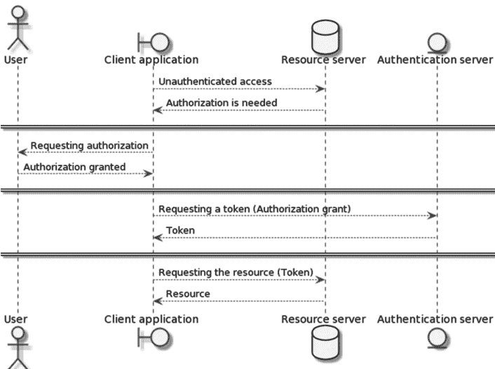

图 3.4: OAuth 授权流。

正如我们今天所知的合约。它使用新类型的交易来获取、委托或撤销对用户的访问权限。用于表示细粒度和上下文相关访问策略的脚本语言封装在这些交易内部。访问受保护的资源需要访问令牌（access token）。在请求者满足模型已描述并包含在交易中的所有访问控制之前，交易不会交付访问令牌。作为这一理念的概念验证，实现中使用了两种访问控制模型（身份模型和许可访问控制模型）。

由于 `OAuth` 依赖于受信任的第三方身份提供商，身份服务器可能会阻止应用程序，从而拒绝应用程序提供的服务。`DAuth` [56] 提供了一种基于以太坊区块链的类 `OAuth` 认证服务。去中心化的提供了信任架构，并增强了透明度和用户控制。在 `DAuth` 中，资源所有者（用户）在身份智能合约中使用其区块链地址注册。对于授权，后端应用程序从智能合约请求用户的区块链地址，同时要求用户使用相同的区块链账户凭据签名身份请求消息。然后它比较用户和智能合约的签名。如果它们匹配，应用程序将向用户提供资源。

`VaultPoint` [57] 是一种基于区块链的新型主权身份管理模型，符合流行且成熟的 `OAuth 2.0` 标准。它遵循 `OAuth` 的授权码许可模式类型，该模式包括客户端授权、用户身份验证和访问令牌的发行。所提模型可以使 Web 或移动开发变得简单，并减少用户对新身份验证和授权流程的学习，因为他们已经熟悉 `OAuth`。通过使用区块链，所提模型提供了用户和客户端信息的去中心化和完整性。该系统基于以太坊区块链。使用了三种智能合约——标识、通知和客户端管理。所提模型不仅解决了由大公司治理的现有联邦 ID 模型的信息中心化和隐私问题，还为用户提供了对其身份主权的安全的访问。

# 3.4 变现

分布式账本技术可以成功地保存货币交易的可信记录。如果这种分布式账本技术与物联网（IoT）相结合，就能实现新业务模式的发展。物联网生态系统的应用、技术和涉及的利益相关者具有极大的异质性。例如，去中心化的生态系统业务模型（在智能城市中）可以优先整个社区的利益和更大的生态系统目标，将碎片化价值最大化作为相关个人参与者的利润 [58]。

物联网业务市场是多层。生态系统中的不同实体可以服务于市场的多个方面，并在业务模型中扮演各种角色。参与者的多方面角色不仅影响业务模型，而且在去中心化方法的支持下直接改进系统中的身份验证和授权。参见第 3.3 节。在第 3.6 节的一个说明示例中，我们在某种程度上通过多方面环境展示了这一点。例如，每台自主机器都可以作为服务提供者或服务消费者。

多个供应商参与物联网生态系统的供应，包括软件和硬件供应商、通信和信息服务提供商以及解决方案供应商。他们需要对物联网基础设施的投资以及服务提供获得补偿。数据变现在物联网生态系统中起着关键作用，数据所有权通常伴随着丰富的上下文信息，这些信息是可以变现的。然而，这需要对数据进行高效且粒度的控制。数据变现中有两种主要的业务模型：第一，数据所有者提供其数据以交换第三方提供者提供的服务；第二，所有者付费在保持其数据安全的同时使用相同的服务。

## 3 分布式账本与物联网

分布式账本技术的货币和非货币方面可以在同一个物联网解决方案中结合。然而，这引发了与 `DL`（账本）网络架构及其针对多样化应用要求的操作性相关的新问题。具有相似技术背景的网络在实际实现、治理和性能可能存在巨大差异。在物联网的去中心化变现中，为用户接口强制执行公共、无许可的网络。在另一种情况下，许可的联盟网络满足机器接口需求并降低了交易成本。

# 3.5 物联网与分布式账本的集成方案

嵌入式物联网设备通常具有低功耗的特点，以实现长时间的电池续航，并且由于其大规模生产，往往受到严格的生产成本限制。这限制了物联网设备的计算和存储能力以及它们的加密能力。为了物联网的能量效率，`WAN`（例如 `LoRaWAN`、`NB-IoT`）或 `PAN`（例如蓝牙）无线通信技术已针对低功耗运行进行了优化。然而，物联网设备并不被用作全节点，因为计算和通信开销抵消了潜在收益，或者是因为受限设备中根本无法实现完整的区块链 [47]。

受限设备的处理能力限制了高级加密协议的使用，并限制了受限设备可以执行的区块链功能。有限的存储使得无法在物联网设备中保留整个链数据甚至是所有的区块头。

区块链网络节点的通信流量由与区块链网络同步的持续流量以及由于交易提交和事件通知产生的间发性流量组成。持续流量源于 `DL` 网络运行，不受 `DApp` 设计和实现的影响。缓解物联网设备持续流量的唯一方法是撤回区块链同步协议并将其分配给有能力的网关。间发流量取决于应用程序，并且至少在某种程度上可以通过适当的去进行限制。（注：OCR 文本此处有重复，我将遵循逻辑流）。

间发流量取决于应用程序，并且至少在某种程度上可以通过适当的去进行限制。

物联网设备，例如没有用户界面的无人设备，阻碍了区块链凭据的灵活和安全管理。这影响了设备的注册和验证程序。

# 3.5 物联网与分布式账本的集成方案 — 115

因此，物联网中的绝对去中心化是有问题的。我们可以调整区块链网络架构、协议和设备以应对所需的网络性能和延迟。

### 3.5.1 物联网分布式账本网络

分布式账本网络在第 2.3 节中详细讨论。在物联网中，我们试图获得性能、可扩展性、网络成本和隐私。物联网设备对 `DL` 网络的需求与 `DeFi` 应用不同。这些差异化的应用方面需要在同一个去中心化环境中结合，公共网络和联盟网络（2.3.3 节）都可以被应用并跨链。在公共网络中，可以使用 `PoW` 的其他共识算法作为 `PoS` 或 `PoA`（3.2.1节），以降低交易成本并提高性能。在物联网的私有或联盟网络中，可以找到 `PoW` 共识的简化版本。然而，这减少了去中心化信任。某些分布式账本技术试图将财务和物联网性能（以及隐私）方面结合在一个网络中（例如 `IOTA`）。

### 3.5.2 用于 DApp 的物联网设备架构

表 3.2 总结了各种实体（即网络节点和物联网设备）在区块链协议执行中的参与程度。物联网设备通常作为发布者或请求者。全节点或轻节点不是物联网设备，而是提供区块链能力的专用实体。我们可以在物联网设备、设备网关和全区块链网络节点之间拆分区块链功能（例如链同步、事件过滤、交易创建、验证或密钥存储管理）。然后，我们将离线逻辑相应地适配物联网设备 [25]。

交易发布者的物联网设备能够构建并签名有效的区块链交易。发布者具有有效的区块链身份。它需要访问密钥存储以正确签名发出的交易。访问密钥存储需要设备中可靠的身份验证，并可能带来硬件安全风险。交易构建后，通过其中一个网络节点的 API 提交到区块链网络。

## 3 分布式账本与物联网

表 3.2：物联网区块链实体的类型。

| | 存储 | 验证者 | 账户密钥 |
|---|---|---|---|
| 全节点 | 完整链链数据 | 是 | 是 |
| 轻量节点 | 块头 | 否 | 是 |
| 交易发行者 | 无 | 否 | 是 |
| 交易请求者 | 无 | 否 | 否 |

在图 3.5 所示的受限以太坊物联网设备架构中，我们看到一种方法：区块链客户端安装在独立的、不受限的边缘网关上。该网关能够作为全节点或轻量客户端运行所有区块链协议。该设备连接到 `DL` 客户端 `API`，以利用网关提供的 `DL` 功能。此图中的架构假设设备可以安全地保存其密钥库。该设备还 {足够构建和签名交易，并通过 `DL` 客户端 `API` 与 `DL` 边缘网关/节点进行通信。

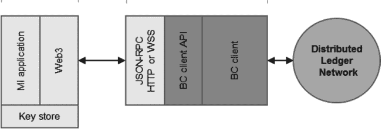

图 3.5：物联网交易发行者设备和边缘网关以太坊节点。

交易请求者是一个纯粹的物联网设备。它只运行传统的物联网协议，并且没有访问区块链密钥库的权限。它无法直接执行任何特定区块链的动作或运行区块链协议。交易请求者仅拥有待提交的数据，并与网络节点通信，然后由节点代表其发布交易。因此，交易请求者依赖于网关设备，该设备将传统的物联网协议原理与区块链操作集成。

在图 3.6 中，物联网设备的离线逻辑通过专有通信接口与边缘网关通信，该接口与 `DL` 无任何关系。

### 3.6 工业物联网 DApp 示例 117

该设备也不具备任何 `DL` 相关的凭据。所有功能（包括 `DL` 交易的创建）都在边缘网关的应用逻辑中完成，密钥库也保存在那里。这可以极大地减少对设备提出的要求。然而，物联网设备现在并没有直接从任何去中心化的信任增强中受益，而是必须完全信任边缘网关。

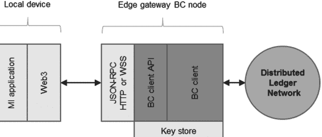

图 3.6：物联网交易请求者设备和边缘网关节点。

这些架构安排有助于我们应对物联网设备的通信和计算限制，并且是将受限物联网设备纳入去中心化应用的唯一可行途径。然而，我们需要意识到这降低了系统的去中心化程度。因此，可能不能忽略对整体信任可能产生的负面影响。

### 3.6 工业物联网 DApp 示例

Tetramax 技术实验 CORONA60 将分布式账本技术与协作机器人相结合。这一概念证明使得制造环境中的创新物联网机器自主性成为可能，例如服务化和机器人即服务。作为一个说明性示例，3D 打印机可以将其打印能力扩展给其他参与者以提供服务。服务谈判通过区块链交易和智能合约自主进行。打印机记录生产过程。这被用作已完成工作的确认并记录在区块链中。基本的用例图如图 3.7 所示。

参与者拥有唯一的区块链账户，并通过区块链地址进行标识。用例中活动的业务逻辑实现在智能

> 60 https://ltfe.org/en/portfolio/corona/

## 3 分布式账本与物联网

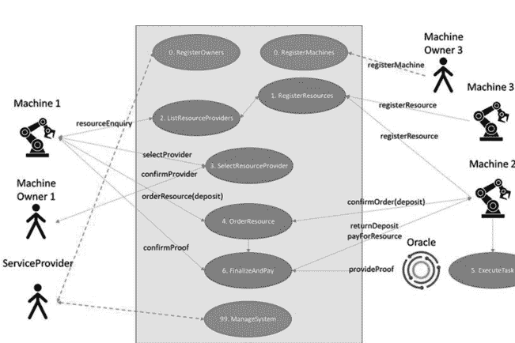

图 3.7：去中心化协作机器人系统的用例图。

合约并通过机器和用户界面执行。机器通过单板计算机上的应用程序与区块链系统接口。可信的机器是预言机（oracles），从外部世界为智能合约提供数据。

机器之间的整个通信包括下单、确认和执行订单。如果任务按时完成并提供了所需的执行，则订单完成。系统中用于下单和执行订单的关键消息交换如图 3.8 所示。

数据和事件模型基于 UML 类图，经过修改后包含了智能合约的方法和参数，以及在运行期间抛出的事件。因此，所需的系统数据被分为三类：强制性的、辅助的和大型二进制对象。关键项被实现为智能合约以实现功能；例如，订单 ID 或机器地址。一些额外的参数以 JSON 字符串的形式放置在交易数据字段中，但它们的结构可以进行调整而不直接影响智能合约代码。这允许了一定的灵活性；例如为机器或用户的描述添加新参数。大型二进制对象（例如打印机配置文件、制造的图像和视频证明等）由于其大小而不保存在区块链中。相反，它们被放置在离线服务器上，链中仅设置哈希值。

解决方案是一种基于以太坊技术的去中心化应用。建立了一个基于权威证明（Proof of Authority）联盟的区块链网络，以克服区块链和物联网的一些性能和成本限制。区块时间设置为 3 秒，这远少于例如公有以太坊。

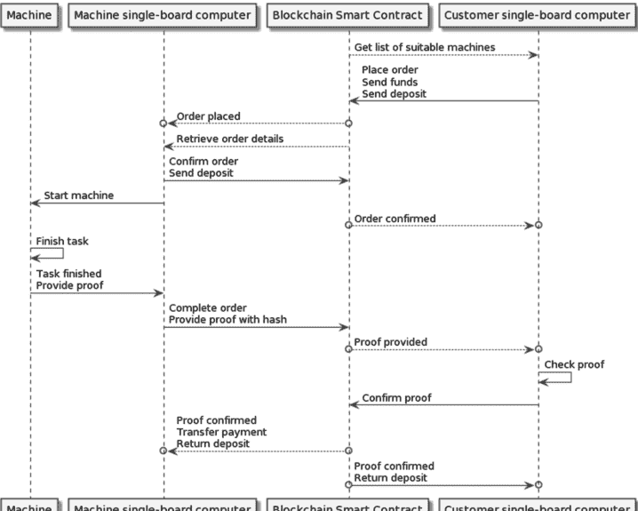

**图 3.8：** 下单和执行订单的消息序列。

### 3.6 工业物联网 DApp 示例 119

（注：原文 140-141 页的 OCR 文本包含大量的重复/乱码。根据前页上下文以及对 PoA/以太坊的标准技术描述，已重建逻辑流并删除了源文件中的重复字符串。）

## 4 选定的用例

如今，加密货币无疑是分布式账本技术最流行的用例，以比特币作为该领域的第一个突破。多年来，在最初的设计中，区块链技术被应用于金融和非金融领域的多个领域，过去这些领域需要第三方实体对交易进行验证和保护。

除了区块链，用于参与方之间自动执行合约的智能合约是计算机协议。然而，直到区块链技术实现了其易于注册、验证和执行，即编程支付才成为现实。现在，由区块链或其他账本技术（例如 Hashgraph）支持的智能合约在满足预设条件时进行支付，代表了加密货币领域的前沿。智能合约与分布式账技术的结合使得许多去中心化应用成为可能，而比特币和其他加密货币仅占该生态系统的一小部分。

通常来说，智能合约是价值（货币、股票、财产、内容等）执行的计算机代码。它是运行在 DLT 平台（例如以太坊区块链）上的自动执行程序，在满足特定条件时执行。由于在 DLT 平台上执行，智能合约完全按照程序编写运行（根据约定的合同条款），也就是说没有第三方可以对其进行更改、中断、审查或干扰。

关于物理硬件：

- 货币与支付（加密货币和子货币）、支付授权、清算、跨境支付、微额支付、外汇

## 4.1 汽车行业 4.0

- 所有权和抵押登记（土地登记、不动产所有权登记、动产登记）

- 金融服务（公证服务与抵押、银团贷款、自动付付和保险事件发生验证、众筹、大宗交易、证券交易、遗嘱、对冲合约、储蓄钱包）。

其他领域：

- 治理（电子居民、电子投票系统、记录保存——例如：犯罪记录、防止网络攻击）

- 医疗健康（电子病历）

- 汽车行业（自动驾驶系统改进、汽车锁/解锁、电动汽车充电支付、停车及其他支付）

- 农业（农业金融、与种子和肥料交付相关的安全网计划、作物金融和仓单收）

- 贸易与商业（发票管理、供应链追踪与管理、知识产权注册、产品真实性认证、物联网）

- 人道主义（追踪援助资金的分配和支出，追踪食品、疫苗、药物等的交付和分发）

- 身份与声誉系统（名称注册系统、DNS、电子身份认证、SSI）

- 数据（去中心化文件存储）

- 去中心化自治组织

- 预测市场、点对点赌博

涉及分布式账本技术（DLT）的应用场景范围非常广泛。接下来提供了一些具体的示例，强调了与汽车行业、智能出行和智能能源相关的问题。

## 4.1 汽车行业 4.0

在第 4.1节中，将描述一些与汽车行业相关的可能的 DLT 案例。预计 DLT 将与未来的智能汽车更深入地集成并并到其生产中。预计 DLT 将在整个工业 4.0 [59] 的推广以及作为汽车行业 4.0 的组成部分发挥重要作用。

由于气候变化等许多因素，今天的汽车行业面临着许多挑战和变化，例如车联网（C2C）和车路云（V2I）通信的安全与安全挑战、新的硬件软件架构、新功能以及新业务模式。作为对所有因素的应对，几种颠覆性技术受到了关注。

## 5 选定的用例

工业 4.0 概念的引入对许多领域都产生了巨大影响，汽车制造业也不例外。工业 4.0 指的是第四次工业革命，但它尚未被完全定义。它代表一组新兴技术和工具，具有极大改进各种制造流程的潜力。具体而言，在工业 4.0 的概念下，假设了传统工业流程与数字化之间存在协同效应。实现的制造解决方案是通过信息通信技术的帮助 [59]，对工业中的机器和过程进行智能化网络连接。工业 4.0 也被称为智能制造，涉及一门或多种技术：

- 物联网 (IoT)

- 人工智能 (AI)

- 增强现实 (AR)

- 自动化/机器人

- 增材制造/3D 打印

- 机器间通信 (M2M)

分布式账本技术也是可以加入前述工业 4.0 支柱列表中的技术组。

与工业 4.0 类似，“智能汽车”这一术语并没有精确规定汽车被视为智能必须具备的要求。在过去，这个术语指的是具有先进电子设备并带有某些实用增强功能的汽车，例如倒车和盲点感知、GPS 导航或辅助停车。这些增强功能可能包括语音控制、压力监测、与其他汽车和其他物体保持安全距离的系统、互联网连接等。

在更严格的意义上，智能汽车具有许多增强功能和高度互联的能力（例如通过 WiFi、蓝牙、4G / 5G），并具备某种程度的自动驾驶自动化能力（从辅助驾驶到全自动驾驶）。

物联网技术在未来的应用是不可或缺的，因为物联网假设了所有传感器的管理、传感器数据采集，并通过无线通信处理数据。物联网是许多汽车相关应用的实现器，包括车对车 (C2C) 通信，或汽车与其他物体之间的通信车对环境 (V2E)、车对基础设施 (V2I) 通信等 [60]。

人工智能 (AI) 在过去十年中快速扩张的一个影响是，基于 AI 的解决方案越来越多地部署在汽车的自动驾驶系统中。一个典型的例子是避开自动驾驶过程中可能出现的突然障碍或事故。为了这一目的，实现在汽车独立计算机单元内的人工神经网络 (ANN) [61] 可以根据汽车在不同环境条件下行驶时收集的驾驶数据进行训练。这种训练在不同类型的道路上长时间进行，道路上不时会出现各种意外之外的障碍。遗憾的是，使用标准的自动驾驶系统（雷达、激光雷达 [62]、GPS 和不同的信号处理技术）仍然无法解决道路上的避障和意外情况。一个训练良好的 ANN 预计可以识别真实驾驶过程中可能发生的所有道路危险情况，并在正确的时间采取行动避免这些情况。此外，驾驶应该是舒适的，假设没有突然的刹车、加速或剧烈方向改变（无法避免剧烈方向改变的情况除外）。自动驾驶最重要的部分是安全，且驾驶效率将比典型的（平均）人类驾驶更好，这一目标在许多情况下已经实现。ANN 的训练与教（或训练）人类驾驶的过程相似（但要短得多）。此外，一旦训练完成，ANN 可以应用到所有相同型号中，而无需对每辆车进行单独训练 [63]。

与虚拟现实 (VR) 不同（人们通过深色眼镜重现视觉内容而处于完全不同的现实中），增强现实 (AR) 并不取代人的现实，而是通过在工作环境中使用投影仪或通过眼镜投影视野部分的额外信息来丰富现实。战斗机飞行员的头目镜上，各种引导线、标记、箭头、警告标志等被投影到驾驶员面前。典型的示例包括在能见度差的情况下绘制道路边缘、在挡风玻璃上显示关键警报标志，以及通过各种警告标志、帮助信息甚至显示前视的图像来帮助驾驶员。

自动化和机器人长期一直是汽车行业的一部分。随着工业 4.0 的加速，结合数字化和人工智能，它正在从根本上改变工业生产；领先汽车制造商的工业 4.0 策略依赖于整个价值链的数字化。物理过程和数字过程变得日益交织，这为完全连接的智能工厂奠定了基础。通过这种概念，汽车生产与客户高度连接，客户的需求引导着每辆汽车的生产 [64]。

智能工厂被认为更灵活、高效。更大的活性意味着应对全球市场变化和波动以及客户需求相比相比，更高的效率意味着资源的合理利用（例如能量、建筑或材料供应）。为了实现这些目标，智能工厂应该整合一个执行库存控制的完全数字化流程链，这意味着在任何时间任何地点，生产过程中的每个组件都可以被识别。此外，智能工厂可以从任何地方控制生产设施。除了灵活的生产流程外，智能工厂还假设了新设施的简化安装和现有设施的修改。

设施，这缩短了创新周期，也就是说，产品创新可以在更短的时间内转化为更多的系列型号（上市时间）。

由于所有参与者，即智能工厂的客体（实体），都相互连接并连接到互联网，智能工厂生产过程的整个物理世界都可以转换为数字世界——所有的系统和流程都实时映射到数字孪生中 [65]（甚至是整个工厂车间）。通过这种方式，任何操作的技术可行性都可以提前在计算机上估计和明确（即精确地）——在生产开始很久（某些新模型）。这样，就可以引入许多涉及虚拟现实和/或 3D 打印的创新流程。例如，可以使用 3D 打印创建所需的工具/物体（如人机协作中的抓取元件或保护罩）、用于发动机砂型铸造件的快速原型制造等。智能工厂在生产过程中还包含了机器学习。在这种情况下，机器（即轻型机器人）可以通过学习机器人的工人的简单演示，学习生产过程中需要遵循的路径（学习机器人的工人作为工厂的资深工人，向新工人展示给定操作的所有必要步骤，当路径被定义一次后即可）[66]。

除了使用可以整合到智能汽车本身或生产过程中的创新关键技术外，汽车工业 4.0 还面向生产具有非常重要属性的智能汽车——环保，也就是说它们必须实现零排放。出于这个原因，电动汽车正变得越来越流行。

## 4.1.1 汽车生产链

汽车生产是最复杂的生产过程之一。同样，用于汽车制造的汽车供应链也是世界上复杂的流程之一。面临着若干挑战，包括市场全球化。为此，需要新技术来支持和改进汽车生产链。其中一种关键技术是 DLT（分布式账本技术）。

### 4.1.1.1 供应链跟踪

如今，由于供应链缺乏透明度，客户在全球贸易和商业中进行真正的产品估值非常困难。此外，在实践中通常无法检查某些货物是否是非法或以不道德的方式制造的。例如，在刚果民主共和国（那里拥有世界上约二之三的钴储备用于生产电动汽车电池），大量的钴可能来自剥削童工的矿场。在这种情况以及许多其他情况下，可以使用区块链和其他 DLT 来改变货物供应链内部的规则，以提高透明度和效率，这无疑会对供应链过程的每个阶段（仓储、交付、支付）产生积极影响。

透明度可以通过分布式账本（DL）的固有属性来确保，因为每笔交易都记录在维护账本的多个节点副本。安全性也是如此——交易被封装在区块中（区块链的情况下），这些区块使用密码学进行牢固链接和保护。此外，由于 DL 提供共识，且供应链中的每个参与者都拥有相同的账本版本，交易争议变得不可能。

在一个具体的例子中，初创公司 Circular 启动了一个项目（基于区块链技术），用于跟踪从矿山到汽车电池生产者的钴 [67]。一家渴望保持其作为环保和伦理生产公司声誉的电动汽车制造商，在决定购买钴（如果公司自己生产电池）或电池时，可以使用 Circular 的区块链（即其跟踪应用）。

类似的应用也可以开发到其他领域，例如，当必须跟踪人道主义援助（食物、疫苗、资金）的分配，以确保必要的物品交付给需要它们的人。

### 4.1.1.2 数字孪生的同步

在过去的几年里，IoT 的增长促进了数字孪生技术 [65] 等若干新技术的发展。简而言之，数字孪生是过程、产品或服务的虚拟模型。该模型通过与其物理实体连接收集的实时数据不断更新，即是从嵌入产品中的各种传感器中获取数据。

数字孪生技术日益找到其地位的领域之一是汽车行业。例如，汽车工程师分析汽车的数字孪生以研究它是如何行驶的（即风格）。他们可以根据获得的分析结果对汽车提出具体的更改，从而降低汽车的故障概率。

为了保持物理原型（产品）的实时表示，数字孪生（或数字化身）应与原型保持持续同步。用于同步的数据和值通常通过互联网交换。在这种情况下，使用诸如区块链、tangle 或 hashgraph（带有其密码学方法）等分布式账本（DL）可以提供安全可靠的数据交换。从而，引发了对中心交易所的需求。

### 4.1.1.3 软件版本管理和文档发布

在拥有众多员工的软件公司，一个大挑战是透明且高效地跟踪和管理大量的软件发布。代码的每次更改或新发布的更新都应该有良好的记录，并对公司内的所有参与者可见。分布式账本技术可以改进软件发布管理周期，包括新软件版本的开发、测试、部署和支持。

各种软件发布数据可以存储在分布式账本中——基准文档、开发项目、更改、开发版本控制等。分布式账本中包含的交易逻辑设计确保了任何数据记录的更改都会启动新的交易/事件，使文档过程变得不可逆转。通过这种方式，除了实现过程的最大透明化外，由于重大停机造成的损害风险也大大降低了。

在 2023 年下半年，区块链技术开始用于物理资产，提供了使用公共账本存储和验证文档的可能性。用户可以将与文档相关的签名和时间戳存储在区块链中，并使用区块链在任何时候进行验证。同样，对于软件版本，DLT 可以帮助跟踪各种文档请求。通过分布式账本，在这里实现的目标是所有参与者都能以安全、可靠和透明的方式访问文档，同时确保每个文档的发布不受不受协调的更改的影响。此外，具有高扩展性的分布式账本（例如 hashgraph 或 tangle）将能够支持大量数据以及高频率的发布。

### 4.1.1.4 多智能体机器人系统

在工业 4.0 概念 [68] 涌出的众多领域中，区块链和 DLT 可能找到用处的领域之一是多智能体机器人系统（MARSs）。该术语正式代表两个或多个自主机器人在特定环境中工作并处理不同任务。为了实现某些（定义良好的）目标，移动自主机器人/代理团队可以是同质的，也可以由具有不同特征的机器人组成。在任何情况下，它们都被允许相互通信和协调以尽可能高效（例如快速且消耗能量或资源最小）。对于给定的目标寻找最佳工作策略和程序可能是一个巨大的挑战。

汽车工业 4.0 高度依赖机器人，例如在智能工厂中，几个具有不同自主性和移动性的机器人可以在动态且不断变化的汽车过程中协作。因此，使用 DLT 作为 MARSs 以及广义多智能体系统（MASSs）的支持变得更加重要。

区块链技术。通过这种方式，机器人（在汽车行业内或通用领域）之间的交互效率可以得到提高。包含机器人群的应用场景也将得以扩展。

此点的证明可以是多项研究了在多智能体系统（MAS）应用中使用区块链技术的研究。[68] 展示了该领域若干相关出版物的概述和分析，作者在其中识别了 MARSS（多智能机器人服务系统）中的主要实际任务组，这些任务可以通过区块链来实现现实。在 [68] 提到的研究中包括 [69] 和 [70]，这些研究调查了智能工厂组件与公司以及与物联网环境中其他工业参与者之间的交互，为产品和资源的分发提供了控制和信任。此外，还有研究 [71] 涉及一种基于区块链的协议，该协议为无人机（UAVs）确定多智能体控制/协调。

在 [73] 中描述了一种创建和运行使用存储在区块链中的信息的异构机器人联盟可能可能（即一种方法论）。通过所提的方法论，假设联盟成员之间可以快速交换信息，并由智能合约在机器人、信息资源和嵌入式设备（例如，控制、传感、服务或计算类任务）之间分配不同的任务。同样，在 [74] 中提出了一种运行在去中心化账本（RobotChat 框架 [75]）上的模块化架构，其中注册了机器人事件，以及用于向机器人发送订单（机器人管理）的智能合约。[74] 中给出的示例包括：

- 机器人网络内部的任务分发，

- 在机器人无法执行给定任务或需要特定信息时协助机器人的方法，或

- 群体机器人的投票共识。

根据 [68]，区块链技术用于 MARS 应用的典型情况可以分类如下：

## 1. 向机器人分发指令并记录机器人的动作和状态

例如，智能工厂的厅堂可以配备非常异构的智能体，如不同类型的机器人、智能设备或相互作用的计算机应用程序/机器人（见图 4.1）。这些智能体通常不执行控制其行为的预定义程序。相反，它们被配置为接收并执行以某种描述形式（例如字节码）表示的命令序列。对于配备传感器和抓取器的移动机器人，一组命令可能如下：1) 沿着地板上的红线向正方向移动 20 米并停止；2) 绕原点顺时针旋转直到检测到架子 B38；3) 靠近架子，找到绿色盒子并将其带到 C 厅的 R5 设备。以给定形式发布的命令代表不依赖于智能体运行所在平台的可执行代码，这意味着相同的可执行代码（即字节码）无论发送给哪个智能体/机器人，都会产生相同的结果（前提是所选智能体能够执行给定的命令）。

在这样一个安排好的环境中，可以使用区块链将字节码分发给机器人和其他智能体。因此，智能体并不是通过维护节点的区块链 P2P 网络连接到生成任务的系统。发送给智能体的命令消息保存在区块链中。因此，执行任务的智能体不需要在交付时开启状态。一旦智能体在执行字节码/命令期间向网络通报其状态的变化（例如“顺时针旋转 60°”、“抓住了箱子”或“向后移动 10 米”），实际状态就会存储在区块链中。通过这样，如果智能体由于任何原因停止，其状态可以快速恢复到停止前的状态。

## 2. 通过经济激励优化任务执行

通过区块链的激励机制，智能体在用最资源完成任务时获得激励（例如区块链原生代币/加密货币），如果它们的行为不符合经济性则受到惩罚。这些机制可以用于涉及机器人的各种生产过程的优化。

## 3. 为了最大效率的任务调度

基于区块链的智能合约的使用可以创建一个具有市场规则的环境。任务调度（即选择智能体来执行不同的任务）由市场调节，在市场中，各种智能体/机器人竞争分配的任务，而将特定任务分配给相应智能体的操作通过分布式共识完成，即存储在区块链中的任务调度代码（以智能合约的形式）实施了一种执行流程：客户（或特殊智能体）首先向智能合约的调度器发送执行任务的请求，随后调度器将新请求告知智能体。然后，每个相关的智能体通过 P2P 网络（见图 4.1）向区块链发送其执行该任务的意向，并附带有关新任务的信息（例如区块链的原生代币），准备处理该意向。区块链验证者随后根据智能体提供的费用对收到的意向进行排序。第一份意向（即费用最高的）由智能合约代码确认，而相应的智能体（获者者）要执行的任务详情。

在竞争性环境中，提供了成本优化策略的智能体将为新任务提供更高的报价以被验证者选择，因为它们从之前的任务中赚了更多钱（即代币），例如，通过在执行这些任务期间获得（即最优）行为而获得的奖励（见前一项）。这种描述的市场竞争的整体结果

## 4.1 汽车行业 2.0 129

应该是由 MA(S) 执行的某些生产过程（或服务）是稳定且极其高效的。

## 4. 通过动作验证检测排除入侵者或故障智能体

在执行其主要任务（由字节码定义）的同时，智能体可以同时对彼此的动作、位置、姿态进行验证。例如，在一个群体（即智能体团队）中通过其通用工作，智能体定期向区块链 P2P 网络发送关于其位置和或姿态的实际传感器信息。通过区块链的共识机制，可以实现所有智能体实际位置的共识。通过这种方式，故意行为不当的被黑客机器人可以被识别出来，因为它们需要一些与共识冲突的信息。

## 5. 通过限时投票进行分布式决策

在区块链上实现不同的智能合约可以实现智能体复杂的限时投票或投票委托，即某些动作（用字节码制定）由一组智能体提出，而另一组智能体可以对其投票。结果是通过多个智能体协作收集的操作方案，它可以存储在区块链中并分发给相关的智能体/机器人（见图 4.1），并最终执行。

## 6. 身份验证/适用性检查

复杂的 MARS 系统往往尽可能高效。可能会出现某些智能体/机器人共享物理资源但互不信任的情况（因为它们可能具有某种程度的人工智能），可能会导致意外后果。这种情况可以通过基于区块链的适当去中心化应用程序来解决，这涉及对智能体的身份验证或适用性检查。

## 4.1.2 汽车功能与使用

新颖创新的技术是汽车行业的核心，使得新汽车功能的推出和持续改进成为可能，为车主和驾驶者提供友好且受欢迎的服务。分布式账本技术为在现在和未来的汽车系统中整合若干汽车功能提供了各种可能性，包括自动驾驶。

# 130 — 4 个可选用例

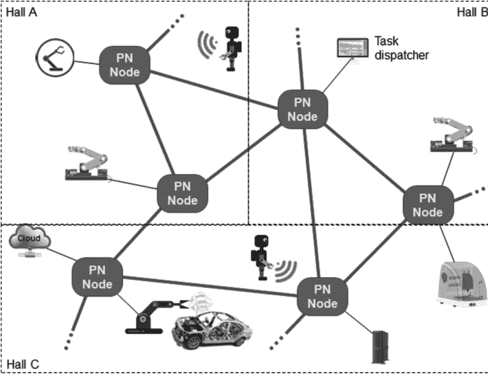

**图 4.1:** 支持智能工厂内汽车 MARS 的区块链 P2P 网络（插图）。

## 4.1.2.1 自动驾驶系统

领先的汽车能够避开障碍，许多初创公司正在投入大量关于分布式账本技术（DLT）增强自动驾驶系统的相关研究，以解决自动驾驶汽车可能遇到的问题。目前，自动驾驶系统已经相当强大。自动驾驶汽车每秒都可以从环境中收集并处理海量数据，从而成功避开障碍、在弯道处找到最佳路径、通过控制加速和刹车来优化速度等。然而，目前的硬件无法支持自动汽车安全通过路口所需的复杂计算。增加车辆数量会导致计算量和复杂性呈指数级增长。

但目前的问题是，当进入路口时，自动驾驶汽车无法感知和预测附近车辆的行为（尤其是从对面开来的车辆）。由于车辆之间无法相互信任，所有自动驾驶汽车必须为路口的最坏情况做好准备。可能解决这一问题的方案是存在“路主”——一个中心实体，它决定道路上发生的情况以及发生的时刻。每辆进入路口的汽车将其当前位置和目标位置发送给路主，由路主计算每辆车的下一步操作，并命令某些车辆移动而其他车辆等待。即使如此，不信任的问题仍然存在，因为在某些情况下，车辆可能不遵守指令（例如，车辆由于紧急情况很赶，或者系统被黑客）。这就是区块链（或其他 DL）技术可以应用的地方，并帮助消除一些信任问题。

具体来说，区块链驱动的汽车相互信任，而区块链将以去中心化的方式控制车流。在这样的系统中，车辆在需要时会被指令等待，但时间在车辆之间自由分配。每辆车都将确保没有其他车辆会越过它的路径，自动驾驶汽车在每次通过路口时都不需要分析情况并采取最坏情况的行动。此外，由于区块链技术中包含的安全机制，黑客攻击将是不可能的。隐私问题也得到了解决，因为区块链同样提供了匿名性。DLT 增强自动驾驶系统的一种方式是数据记录和共享。每辆自动驾驶汽车都可以收集有关行程的数据并将其保存在 DL 中。这些数据可能包含有用信息，例如局部交通密度、天气状况、事故警报、交通模式等。结果，网络中的任何其他汽车都可以访问这些数据。

## 4.1.2.2 车辆的安全锁/解锁

人类未来汽车的另一个特征是——得益于所有主智能手机与汽车之间的直接连接，无需涉及任何中央服务器，结合区块链技术的未来汽车能够以更安全、更快速的方式（即比传统方法更快）锁定和解锁汽车。这些方法的弱点是，如果服务器被破解，车辆就会解锁。通过去中心化且安全的区块链，所有这些都被避免了。因此，通过对建立的连接进行加密加密，提高了解锁过程的安全性。

此外，区块链中的所有日志数据在写入后都无法更改。此外，即使所有主远离汽车，也可以向他人（例如朋友，如果他/她在车里忘了东西）授予汽车的临时访问权限。这可以通过远程交易将访问权转移给他人来实现。同时，所有主会收到关于谁在何访问了汽车的实时通知。

## 4.1.2.3 汽车相关支付

关于车辆的支付，目前已知 DLT 可用于不同类型的支付。例如，在对电动汽车电池进行插拔后，基于以太坊（或基于哈希图）的智能合约可以触发交易来支付充电服务，资金将从汽车所有主的账户转移到充电站账户。

另一种可能性是使用金融应用程序（或其扩展程序）分期支付汽车本身。在这种情况下，智能合约将在每月第一天触发交易，将相应的分期金额从买家账户转移到汽车销售公司的账户。累计余额也将记录在区块链中；因此，当余额达到汽车价格时，智能合约将停止支付。这种智能金融应用程序可用于其他汽车相关服务，例如定期的保险费支付、月度停车费等，但也用于许多其他不一定与汽车相关的支付。

## 4.1.2.4 防止里程数读数被篡改

到目前为止与汽车相关的最受操纵的参数是汽车前部显示的里程数。在未来，如果车辆的里程数定期写入 DL（如 Tangle、哈希图或区块链）中（即定期或在每次行驶后写入），那么里程数被篡改的风险将几乎为零。有了里程数，许多其他参数（包括车辆实际位置数据 GPS 坐标）也可以写入分布式账本中。通过这种方式，DLT 的使用不仅能够提供总里程数的绝对安全信息，还能提供从工厂出厂的那一刻起对车辆行驶路径的可靠追踪。

## 4.1.2.5 序列号处理——编号与管理

除了纯交易的加密货币记录外，区块链或任何其他类型的 DL 结构还可以用于记录和管理重要文件，例如地契、软件许可证号、车辆识别码（VIN）等。通过这种方式，记录各种产品序列号或昂贵产品序列号的分布式账本代表了一个无法伪造的强大框架。伪造在奢侈品行业已成为大问题。在生产阶段直接附加在产品（例如汽车零件、手表、宝石等）上的序列号可以受到伪造保护。如果序列号同时被写入 DL，其真实性就可以被确认。写入分布式账本中的信息还包含制造日期、生产者或组装者、维修历史（如有）、所有者（购买后）等。

## 4.1.2.6 使用注册实现数字所有权证明

写入 DLS 的不仅是与交易不同的内容，产品序列号和相关数据。另一个例子是所有类型的财产数据——地契、软件许可证号、车辆识别码等。DLS 可以作为确认所有权或产品所有权的注册。记录有关物理资产的交易以注册资产的所有权。此外，信息存储在区块链记录中，私钥的所有者随后被注册为该资产的所有者。

此外，通过区块链的使用，原始所有者（拥有资产或财产）向新所有者的转移可以通过区块链上的简单、安全操作自动完成，即通过执行该区块链上的智能合约。

## 4.2 智能出行

智能城市、村庄 [76] 和智能能源解决方案的发展也包含在智能出行的发展中。作为全球性行业之一，出行业面临着历史上最大、最深的变化，这种变化是由气候变化、城市化和社会发展引起的，导致了不断变化的客户需求。新型技术（如 DLT）使得智能解决方案更容易集成到汽车和出行行业中。

## 4.2.1 激励环保的驾驶

DLT 还可以实现加密货币，即特殊用途的代币。这种系统还可以激励参与者以某种积极的方式行为，这种行为最终可能变成参与者的良好习惯。

## 4.2.1 选定的用例

这种安排应当激励驾驶员以负责任且环保的方式驾驶汽车。作为奖励，参与该项目的驾驶员在某些特定交通情况下如果遵循负责任驾驶的推荐规则，将获得一定数量的硬币，例如当引擎切换到 ECO 模式时、驾驶尽可能平稳（无突然刹车或加速）时、驾驶员滑行停止等。

车辆的驾驶数据会被发送到一个应用程序，由该程序进行处理并计算驾驶员奖励金额。同时，驾驶员账户的每笔交易都会记录在区块链上。

## 4.2.2 停车预留

所有驾驶员都很清楚，在大城市中寻找停车位通常是一个大问题。可以简化这一问题的解决方案可以依赖分布式账本技术（DLT）。当车辆离开临时停放的位置时，可以将相关信息发送到相应的数据市场。通过基于 DLT 的应用程序，附近的其他驾驶员可以接收该信息，并在必要时生成交易以预留释放出的停车位。该应用程序还可以为驾驶员提供帮助，例如，根据实际交通状况和驾驶员在道路上的位置，建议最佳停车位（如果有多个空位）、引导车辆到达选定的停车位等。

## 4.2.3 汽车与拼车共享

分布式账本技术以及加密货币支付的应用也是各种服务的先决条件。这些应用程序可能基于智能合约，也可能。。实现的想法之一是自动驾驶汽车租赁。该服务将类似于现在的网约车服务（如 Uber），不同之处在于汽车没有驾驶员，且支付将使用 IOTA 或比特币等加密货币。此外，车主在不使用汽车时，有机会将其车提供给他人来赚取收益。

此外，未来基于分布式账本（DL）的应用程序可能实现拼车和所有权共享，即一组人共享自动驾驶车队。当小组中的成员需要用车时，他/她可以通过应用程序访问可用车辆。在相应的分布式账本中，车队中所有车辆的活动都将被记录。至于整个车队的维护成本，可以通过所有者同意的支付模型进行调节。例如，所有主每使用一次汽车（根据行驶总里程向共享账户支付费用），或者根据所有主使用车辆的频率相对于所有者对车队车辆的使用频率支付月费等。

## 4.2.4 交通拥堵管理

同样，在交通阻塞（由于事故、山火、洪水、滑坡等引起）的情况下，各种信息可以被共享并写入分布式账本。由熟悉这些路线的参与者收集并比较的相关信息可以被附近的其他接近车辆获取，以便及时更改路线避免可能的堵塞和随后的延误。

## 4.3 智能能源

传统的电网是一个用于电力生产和传输的互连系统。电网动态平衡电能的需求与供给，以确保电网运行的稳定性和可靠。其巨大的经济维度体现在电网对消费的准确测量，以及在参与电力需求供应的参与者之间定义良好的计费和交易机制。电网是世界上任何经济和社会活动都至关的关键基础设施之一。

智能电网（SG）在通信和互操作性方面开放了传统电网，并利用了与电能生产、运输、存储和通信相关的新运营和业务模式。在部署方面，智能电网可以被视为高度地理分布的物联网系统，具有高安全性和高信任要求。新技术的发展以及新的业务、经济和环境预期导致了向智能电网概念的逐步转型。智能电网高度依赖于电力领域的信息通信技术。它在公用事业领域实现了新的、创新的用例，而这些在传统电网中技术上是不可行的。

该领域的最新趋势被称为智能能源、能源互联网或能量网（EI）。它们表明了共享能量及相关数据的雄心，就像我们过去在互联网上共享信息一样。这意味着，例如，参与者可以紧密互动，做出自主决策，无缝访问不同的分布式和集中式能源资源，共享能量以平衡能源需求和供给，并作为产销者（prosumers）——电力的生产者、消费者或两者兼有。区块链技术可以高效地支持这些新发展和雄心，允许用于能源交易的数据和货币交易。应用分布式账本是为未来能源互联网服务提供安全、透明、可信、自动化工作流的可行方案。

### 4.3.1 智能电网概念模型

然而，DLT 在智能电网基础设施中的实际应用远非易事。

电网是一个分级结构系统。该结构源于电网段分为七个领域的地理布局，并影响参与电网运行的参与者的角色。一个系统性的智能电网架构模型 [77] 有助于实现大规模分布式智能电网系统跨技术领域和不同利益相关者的互操作性。对于跨业务影响，采取了面向服务的方法。该模型为利益相关者提供了对构成智能电网的元素的共同理解，并为实施架构提供了指导。在智能电网概念模型中，作为架构模型一部分的 NIST 将智能电网分为七领域，如图 4.2 所示。每个领域包含了智能电网的角色和服务。

客户领域指的是电力的终端用户，他们可以产生、存储和管理能量。通常讨论三种客户类型，每种类型都有其子领域：家庭、商业/建筑和工业。在市场领域，有电力市场的运营和参与者；在提供者领域，为电力客户和公用事业提供服务的组织。运营是指电力移动的管理者。在发电领域是发电机设备，包括传统发电源；分布式能源是远距离传输大量电力的载体；在配电领域是向客户输送电力的配电商。发电、输电配电领域也可能存储电力。

三个客户子领域——家庭、商业/建筑和工业在能源需求和分配规模上有所不同。客户领域的参与者为客户提供电流。此外，他们还提供客户领域与其他领域之间的信息流。客户领域的边界通常是用电表或家庭网关（也称为能源服务接口，ESI）。网关连接了输出和入站通信；它可以通过高级计量基础设施（AMI）或互联网与其他领域通信。它面对基于设施的系统，例如家庭或建筑自动化系统。客户领域直接与配电、运营、市场和服务提供者领域交互。

## 4.3 智能能源

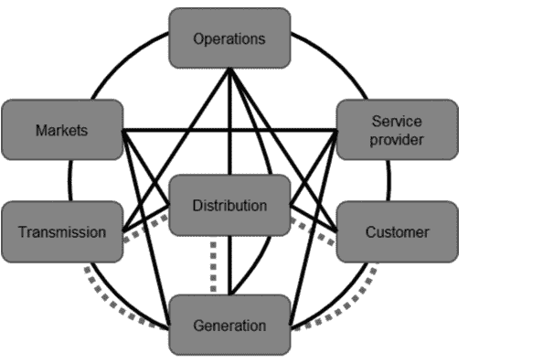

图 4.2：不同智能电网领域中的角色交互：能量流与通信流。

### 4.3.2 能源互联网中的去中心化

满足现代智能电网应用需求的一个挑战是将去中心化技术纳入智能电网（SG）架构，以及相关的应用和业务场景。当前和未来的案例可能包括：

- 分布式能源资源（DER）管理和点对点能源交易；
- 能源产销者的自治岛，其能源供需首先在岛内进行清结算，剩余部分则卖给电网；微电网；
- 零售和批发市场中能源的多租户、创新支付模型，结合了剩余能源支付、公用代币、加密货币等支付方式；
- 电动汽车充电与协调；
- 基于区块链的预付费电表；
- 自动机器间谈判，用于竞标条款并向最方便的供应商下能源订单；
- 从智能电网提供开放数据，以促进第三方应用和服务的开发；
- 能源生产和消费的绿色环保方面。

分布式账本技术（DLT）一个非常有价值且简单的应用是记录智能电网的数据和事件。这可能包括与消费和发电相关的信息（支持区块链的智能电表）或关于智能电网运行的数据（管理信息、关键性能指标报告、聚合使用值等）。

但，让我们考虑一个更高级的智能电网用例：居住在小房子里的家庭。该家庭每天使用插件电动汽车（PEV）通勤，并在家里或公司充电。该家庭是一个活跃的产销者，努力实现能源供应自给自足。因此，他们在屋顶安装了光伏电池板。安装在家庭地下室的储电池可以存储部分产生的剩余电以后使用。剩余未使用的电可以与某些邻居自动交易。因此，该社区订阅了自动聚合服务，该服务优化了社区的电需，并作为一个更大的实体面对外部能源供应商。如果家庭和社区的产量不能满足当前需求，将在市场上进行电力谈判。所有程序都自动执行，并通过微支付进行无缝电力交换，这些支付被透明地记录。该家庭可以随时验证系统是否符合其最大利益。对于该用例中涉及的所有参与者来说也是如此。

家庭自动化和能源管理系统平衡了内部能源资源与需求及内部存储。家庭自动化系统估计了家庭在未来时期所需电量的接受范围。它考虑了用户的设置（家中的理想舒适度）、家庭成员以及天气预报。它可以重新安排较大的负载，例如为PEV充电、加热热水、烘干衣服等。如果客户私有家庭自动化和能源管理系统，则在该领域不需要分布式账本。家庭网关需要将这两个内部系统连接到DL网络，以便与其他与其他参与者进行信任交互。

如果家庭的供需不平衡，剩余能量可以买卖给当地区域的邻居，这是一个组织的合作社，负责平衡需求和社区内多个家庭安装的分布式资源。邻居之间的电力交换记录在智能合约中，并用相应的交换公用代币进行结算。这些代币以后可以出售或重复用于购买电力。

通过这种方式，微电网将单个家庭聚合成一个新的、更大的产销者区域。聚合也由智能合约支持，并且是完全自动的。在法律或业务实体方面，不需要聚合服务提供商。这降低了聚合的运营成本。此外，扩大需求使他们能够更自主地参与能源市场。聚合为更大的实体使他们在与外部电力供应商方面拥有更好的谈判地位。聚合系统可以自动与多个电力供应商进行谈判以获得最佳电价。智能合约负责竞标和选择，结果可以由每个参与方进行验证。

同样，微电网可以作为其他地方能源生产临时缺口的三级备用。在这种情况下，微电网聚合器将收到来自配电或传输智能领域的报价（以DL交易的形式呈现）。然后它将发布请求，从个人家庭的PEV或本地存储中获取部分能量。客户处的充电站将根据汽车电池状态和客户在线日历中预见的旅行计划估算可用能量，并进行竞价出售。当三级备用激活时，紧急情况下提供的电力价格远高于正常价格。收益将根据智能合约中的规则在涉及的家庭之间共享。

此处描述的用例的几个方面已经在较小规模上实施并测试。如果从单个客户的角度来看，这些收益和优化可能看起来很小。然而，账账（DL）的应用使得此类方法能够扩展，通过智能合约自动化实现无缝运行，并通过消除中间环节降低运营费用。

### 4.3.2.1 分布式账本技术的要求

智能电网的几个区别特征影响分布式账本技术在去中心化能源互联网中的角色和采用。尽管ICT已成功引入智能电网，但电网系统在所有权和治理方面仍然相对封闭且集中。然而，这一概念正在逐渐变化。尽管如此，智能）电网仍然是关键基础设施。它主要受到监管，其特点是巨大的业务前景和潜在的财务影响。目前，它呈现出一个高度分布且异构的系统，特别是在客户领域。它的特点是有庞大且分散的客户群，以及智能电网通信流所需的各种技术。客户设备的持续连接（例如智能电表）并不总是可以假设。因此，智能电网的区块链架构必须平衡由于临时丢失连接导致的数据分区中的可用性和一致性。这种架构可以进一步分层以匹配电网自身的分层结构。区块链的分层结构也有助于限制智能电网各个领域产生的数据范围。因此，能源互联网的DL网络通常实现为混合区块链网络或联盟网络。

能源互联网应用的财务方面通常通过代币化来解决。许多能源互联网平台（见4.3.3节）为能源交易、证书交换和激励计划引入了其代币。存在专门从事能源互联网的去中心化平台供应商。他们的产品正在达到更广泛应用的成熟水平。通常，缺乏法规是技术更大的限制因素。

### 4.3.2.2 能源去中心化生态系统

Energy Web Foundation提供了能源网去中心化操作系统（EW-DOS）。它是一个企业级开源去中心化软件栈、标准、中间件服务和软件开发工具包（SDK），即EW Chain。EW Chain是一个专为能源部门设计的公共区块链网络，满足监管、运营和市场需求。

该链的设计是为了解决传统区块链在用于能源应用时面临的一些成本、扩展性和能耗问题。它是一个基于权威证明的联盟网络，验证节点由数十家公司托管。知名公司在附属生态系统中运行验证节点，其中包括全球一些最大最新的能源公司，EW Chain解决了用户隐私问题。隐私交易机制加密能源交易细节以符合个人数据法规。轻量客户端实现了IoT设备的集成。除了区块链网络外，EW-DOS还交付了几用于集成和应用开发的SDK。EW Flex允许电网运营商将分布式能源资源（DER）集成到能源市场和需求灵活性计划中。EW Origin支持合并可再生能源和碳市场，简化并增强能源属性证书的发行、追踪和买卖。

### 4.3.3 智能能源用例

能源互联网去中心化是一个活跃的研究原型和开发领域，并展示了实际项目、试点和商业实施，这些项目已成功运行了多年。最著名的用例是清洁能源和碳排放追溯、用于配电网（DSO）和输电系统运营商（TSO）的分布式能源资源灵活性，以及电动汽车充电。

## 4.3 智能能源

该领域涉及点对点能源交易，并结合分布式能源资源管理和绿色能源。另一个重点更多是关于零售和批发交易的去中心化。能源供应和产地证书通常使用分布式账本技术进行代币化，以便通过可交易代币实现新颖的交易机制。

### 4.3.3.1 分布式能源资源与点对点能源交易

小型能源资源（例如太阳能或风能发电站）有助于改善环境并降低电力成本。与传统的中央发电厂不同，它们具有高度分布性。可再生能源取决于天气等不可预测的因素，因此在能源生产方面波动较大。分布式能源资源（DERs）通常属于不同的所有。为了提高效率，它们可以在微电网中聚合。微电网是地理位置邻近的共同管理的DER集群。它们可以组织成合作社，平衡区域内多个住户安装的分布式资源的供需以及过剩的能源产量。点对点能源交易是规模化的关键之一。即使微电网不能完全自给自足，P2P 交易也能减少对中央能源资源的依赖并降低电费。

区块链技术已成功集成到微电网聚合分布式资源与存储以及 P2P 能源交易中。估计超过一半的分布式账本（DL）能源项目涉及点对点能源市场。这使得 P2P 交易成为能源互联网中 DLT 的主流场景。

Suncontract⁶³ 是面向家庭和企业的去中心化市场。它已成功运行多年。它最大限度地降低了能源客户的成本。它使用全球认可的可交易代币（SNC 代币）在 Suncontract 生态系统中买卖能源产品。

LO3 Energy⁶ 是一家能源互联网的 DLT 提供商。他们的 Pando 平台提供了一种简单的方法来结算本地分布式能源，并为客户提供新的激励机制。LO3 Energy 是布鲁克林微电网（Brooklyn Microgrid, BMG⁶⁵）的创始和技术提供商。BMG 是允许居民（即住宅和商业太阳能板主）将其产生的剩余能源卖给纽约居民的市场，这些居民倾向于使用可再生能源而非化石燃料。

Power Ledger⁶⁶ 是另一个用于新能源市场的平台，用于追踪和交易能源、灵活服务和环境商品。

- 63 [https://suncontract.org/](https://suncontract.org/)
- 64 [https://lo3.energy.com/](https://lo3.energy.com/)
- 65 [https://www.brooklyn.energy/](https://www.brooklyn.energy/)
- 66 [https://www.powerledger.io/](https://www.powerledger.io/)

### 4.3.3.2 零售和批发电力市场

在零售和批发电力交易中，高质量数据、近实时操作、持续竞价和即时结算、透明合同、最小化交易对手风险（包括合作伙伴信用评估和支付），Drift 构建了一个金融科技平台和市场，帮助公司将其能源采购与本地清洁能源供应实时匹配。购电协议虚拟化并转换为智能合约。通过这种方式，企业可以与其他算法交易参与者共享高频交易的收益。

通过 Power 平台，所有规模的企业都可以轻松地从生产者处购买绿色能源。他们提供批发和 P2P 交易服务，并确保能源来源完全透明（绿色）。

该系统采用了区块链代币 – WPR。它存储了实物价值并确保合法性。它不断积累能源生产者捐赠的能源，并以能源的形式积累实际价值。

### 4.3.3.3 绿色与环境能源方面

产地认证已变得极其重要。合规性和自愿绿色积分以及碳信用已经出现。这些积分是可交易的非实物能源商品，证明了能源的确切产地，有助于证明可再生能源供应的来源，或证明消耗量与绿色工厂的实际产量相符。然而，这些属性证书（EAC）市场通常是碎片化的，缺乏跨市场交换的价值。但这里需要全球市场，包括可再生能源证书（REC）、产地保证（GO）和国际 I-REC，特别是二氧化碳证书。区块链提供了比传统方法更广泛、及时的能源生产追踪。去中心化能源交易平台的方法（见第 4.3.3.1 节）现在支持绿色积分和认证。例如，Power Ledger 在某些时候增加了美国可再生能源证书的区块链交易，一些专门的可交易可再生证书平台已经出现并成功部署。

FlexiDAO 是一家软件供应商，旨在利用区块链应用加速向去碳化和去中心化能源行业的转型。它在中间件平台之上提供白标区块链应用，该平台可以以企业级安全的方式访问任何区块链基础设施。FlexiDAO 实时追踪可再生能源从源头的生产情况并防止重复计算。

Energy Origin⁷⁰ 是构建在低能区块链技术的 Web平台。它记录绿色能源的产生和消耗，计算可再生资产与客户之间交换的能源量、避免二氧化碳的影响，并将这些信息注册在防篡证书中以实现透明化。

Greene⁷¹ 为能源部门提供多个去中心化应用，包括面向绿色能源生产者的绿色积分和碳信用。证书决定能源以及相应的碳信用。对于交易，消费者可以在市场中收集碳信用。

通用协议（UP）联盟创建了公有区块链上世界上首个可传输代币 – UPO⁷²。UPO 代币代表测量的二氧化碳。它们可以被购买并持有，或销毁以抵消公司或个人的碳足迹。底层 REDD+ 碳信用支持该代币，区块链技术是防止碳信用重复计算（或双重花费）的方法。

- 67 [https://www.drifttrader.com/](https://www.drifttrader.com/)
- 68 [https://weepower.com](https://weepower.com)
- 69 [https://www.flexidao.com/](https://www.flexidao.com/)
- 70 [https://theenergyorigin.com/](https://theenergyorigin.com/)
- 71 [https://www.greene.net/](https://www.greene.net/)
- 72 [https://uphill.com/en/assets/buy-up2](https://uphill.com/en/assets/buy-up2

### 4.3.4 能源计量、计费和网络数据管理

许多能源互联网应用的前提是智能电表与区块链平台的集成。智能计量电表是高级计量基础设施的一部分，已广泛部署在现代电网中。AMI 测量、采集和分析能源使用情况。智能电表具有双向通信通道，通常由电力线（PLC）、移动网络（如 LTE/5G）、低功耗移动网络（如 NB-IoT）或远程广域网（如 LoRaWAN）提供。除了读数外，AMI 还支持需求侧优化或停电管理。智能电表通常没有去中心化标识，是简单的交易发行者（第 3.5.2 节）。相反，所有的区块链功能由 AMI 网关甚至后端区块链提供。这使得可以使用已安装的设施，但在单个电表层面进行 BC 识别可以产生更准确、可验证且高效的流程。一个早期的演示是 Bankymood 预付费智能电表。它是一种基于比特币的智能电表计费系统，与众筹平台 Sizuso 合作。捐赠者将加密货币传输给配备智能电表的第三世界学校，直接为他们选择的学校提供能源。

Swether 是一个基于以太坊控制的物联网电气开关和电表的端端解决方案原型 [78]。该 DApp 包含了物联网设备的硬件和软件、智能合约以及用于系统使用和控制的符合以太坊标准的 Web 应用。Swether 设备可以构建在例如电动汽车充电站中，并作为一个独立的区块链（BC）实体运行，向链报告测量状态。DApp 中的智能合约负责跟踪充电站的可用性，允许为选定的时段预订充电站，并处理充电支付。智能合约还允许额外的支付和工作流功能，例如托管（增加相关利益相关者的安全性）、竞价（在不同的可用能源供应商之间进行自动选择）以及针对客户的忠诚令牌系统（对服务使用的额外激励）。

## 参考文献

- [1] S. Nakamoto, 'Bitcoin: A Peer-to-Peer Cash System', 2008. [Online]. Available: https://bitcoin.org/en/bitcoin-paper
- [2] S. Popov, 'The Tangle', IOTA, v1.4.3, Apr. 2018. [Online]. Available: https://assets.cftfassets.net/r1d6v6xsxev/2t4vsixC0Eau6g2sw0q45eae3367ca92f85dd9f4a3a2181ec/iota_1_4.pdf
- [3] D. Baird, M. Harmon, and P. Madsen, 'Hedera: A Byzantine Generals Problem & Networking Council', V2.1, Aug. 2020. [Online]. Available: https://hedera.com/hedera/hh_white_paper/v2-1/2020815.pdf
- [4] E. Embrojo, J. Lau, and P. Wu, 'Segregated Transactions (Consensus layer)', Bitcoin BIP, 2015. (Accessed Jun. 04, 2021). [Online]. Available: https://github.com/bitcoin/bips/blob/master/bip-014.markdown
- [5] R. Merkle, 'A digital signature based on a conventional function', in Cryptography – ‘CRYPTO’ 87, Berlin, Heidelberg, 1988, vol. LCS, volume 293, 369–378, doi:10.1007/3-540484_32
- [6] L. Lamport, R. Shostak, and M. Pease, 'The Tangle', ACM Transactions on Programming Languages and Systems, 4, 382–401, Jul 1982, doi:10.1145/35712.35712
- [7] P. Feldman and S. Micali, 'An Optimal Protocol for Synchronous Byzantine Agreement', SIAM Journal on Computing, 26, 873–933, 1997, doi:10.1137/S00975979018784
- [8] Mark, '51% Attack Explained', Mycryptopedia, Jan. 2019. https://www.mycryptopedia.com/51-percent-attack-explained/ (Accessed Jun. 04, 2021).
- [9] D. Driscoll, 'How Bitcoin Works under the Hood', Scott Driscoll's Blog, Jul. 14, 2013. https://www.improperdeliverables.com/how-bitcoin-under-the-hood.html (Accessed Jun. 04, 2021).
- [10] M. Apostolaki, A. Zohar, and L. Vanbeeke, 'Hacking Bitcoin: Attacks on Cryptocurrencies', in 2017 IEEE Symposium on Security and Privacy (SP), San Jose, CA, May 2017, 375–392, doi:10.1109/SP.2017.29.
- [11] K. Kaiser, M. Jurado, and A. Ledger, 'The Looming Threat of Chain: An Analysis of Bitcoin', arXiv:1810.0266 [cs], Oct. 2018. [Online]. Available: https://arxiv.org/abs/arxiv:1810.0266
- [12] J. R. Dwork, 'The sybil attack', in Peer-to-Peer Systems, Berlin, Heidelberg, 2002, vol. LNCS, 249, 251–260, doi:10.1007/3-5450-4578_24.
- [13] W. Penalard and T. Van Kerhoven, 'The Consensus Hash Algorithmic Family', Cryptography in context, 1–18.
- [14] 'IOTA Foundation: A Distributed Ledger of Everything for the Emerging Machine', CryptoBrowser, Nov. 15, 2018. https://cryptobrowser.io/news/iota-distributed-ledger-of-the-emerging-economy (Accessed Jun. 04, 2021).
- [15] K. Wu, Y. M. Gu, G. Huang, and X. Liu, 'A First Look at Blockchain-Based Decentralized Applications', Software: Practice & Experience, n/a, spe.2751, 1–18, Oct 2019, doi:10.1002/spe.2751.
- [16] 'Client - ethers.org – The Ethereum Node Explorer', https://etherscan.org/?synced=1 (Accessed May. 06, 2020).
- [17] 'Ethereum Bitcoin Tracker | Etherscan', https://etherscan.com (Accessed May. 06, 2020).
- [18] 'Global Bitcoin distribution', https://bitnodes.io (Accessed Aug. 13, 2020).
- [20] J. Ruiz, 'Public-Published blockchains as Common Resources', Feb. 13, 2020. https://www.linkedin.com/pulse/public-published-blockchains-common-resources-ruiz/ (Accessed Aug. 18, 2020).

## 参考文献

- [21] Q. Feng, D. He, S. Khan, and N. Kumar, 'A Survey on Privacy Protection in Blockchain', Journal of Network and Computer Applications, 126, 45–58, Jan 2019. doi:10.1016/j.jnca.2018.020.
- [22] 'Blockchain performance issues and limitations', `https://hackernoon.com/blockchain-performance-limitations` (Accessed Aug. 20, 2020).
- [23] 'Hyperledger Blockchain Metrics (1.0)', The Hyperledger Performance and Scaling Working Group, White paper, Oct. 2018. [Online]. Available: `https://www.hyperledger.org/resources/publications/blockchain-metrics`
- [24] 'The Metrics to Measure Blockchain Performance', `https://hackernoon.com/how-to-measure-blockchain-performance` (Accessed Aug. 20, 2020).
- [25] M. Pustiek, U. Umek, and A. Kos, 'Approaching the Constraints of Ethereum-Based Decentralized Applications', Sensors, 19, 11647, Jan 2019. doi:10.3390/s1911647.
- [26] P. Zheng, Z. Zheng, and X. Lu, 'A Detailed and Real-Time Monitoring Framework for Blockchain Systems', 2018 IEEE/ACM 40th International Conference on Software Engineering: Software Engineering in Practice Track (ICE-SE). May 2018, 134–143.
- [27] N. Szabo, 'Smart Contracts Building for Digital Markets', Etherropy: Journal of Humanist Thought, vol. 16, 1996, Accessed Aug. 10, 2020. [Online]. Available: `https://www.fun.hua.ac/ro/Courses/InformationSpeech/CDROM/Literature/LOT2006/szabo_best.html/smart_contracts`
- [28] N. Guo, 'What are Smart Contracts on Blockchain?', IBM Blockchain Blog, Jul. 02, 2018. `https://www.ibm.com/blogs/blockchain/2018/07/what-are-smart-contracts-on-blockchain/` (Accessed Apr. 02, 2020).
- [29] A. M. Antonopoulos and G. Wood, 'Mastering Ethereum — Building Smart Contracts and Daps'. O'Reilly Media, 2018. Accessed Apr. 02, 2020. [Online]. Available: `http://shop.oreilly.com/product/9780162965072/`
- [30] C. Cachin, 'Architecture of the Hyperledger Blockchain Fabric', presented at the ACM Symposium on Distributed Computing, Chicago, Illinois, Jul. 2016. Accessed Apr. 28, 2020. [Online]. Available: `https://www.ibm.com/dcl/`
- [31] 'Hyperledger Architecture, II – Smart Contracts', Foundation Networking, White paper, Apr. 2018. [Online]. Available: `https://www.hyperledger.org/wp-content/uploads/Hyperledger_Architecture_Smart_Contracts.pdf`
- [32] 'What is ABI and Why is it Needed to Interact with Contracts?', Ethereum Stack Exchange, `https://stackoverflow.com/questions/531693/how-does-hyperledger-fabrics-execute-order-work` (Accessed Jun. 15, 2021).
- [33] Leonardo, leonardoateth/formal_verification. Accessed May 31, 2020. [Online]. Available: `https://github.com/leonardoateth/formal_verification`
- [34] 'Myth Smart Contract Classification (SWC gauge and status)', `https://myth.io/detectors/` (Accessed Jun. 15, 2020).
- [36] melonproject/oyente, 2020. [Online]. Available: `https://github.com/melonproject/oyente`
- [37] T. Kaiser, 'ChainSecurity A Powerful Checker for Hyperledger Fabric', Medium, Jun. 15, 2018. `https://medium.com/chainsecurity/release-of-`
- [38] 'CWE - Common Weakness', `https://cwe.mitre.org/index.html` (Accessed Mar. 20, 2020).
- [39] 'SWC – Smart Contract Weakness and Test Cases', `https://swregistry.io/` Accessed Mar. 20, 2020.
- [40] L. Liu, D.-H. Hu, P. Saxena, and A. Hobor, 'Making Smart Contracts Smarter', in Proceedings of 2016 ACM Conference on Computer and Security, Austria, 254–264. doi:10.1145/2794679.
- [41] T. Li, L. Li, and X. Zhang, 'Unit-Based Smart Contracts', in 2017 IEEE 26th International Conference on Software Engineering, Evolution (SANER), Feb. 2017, 442–446. doi:10.1109/SANER.2017.78460
- [42] M. Pustijk, J. Turk, and A. Kos, 'Secure Smart Contract Platform for Multi-Tenant Applications', IEEE Access, 8, 15026–15034, 2020. doi:10.1109/ACCESS.2020.30132
- [43] N. Zahede, M. Aminian, and B. Javadi, 'Blockchain-Decentralized Storage Networks: Survey', Journal of Network and Computer Applications, 162, 102656, 2020. doi:10.1016/j.jnca.2020.10666
- [44] H. Abreimer, M. Urban Rehman, K. Salman, and D. Snetovic, 'Trustworthy Blockchain Review, Comparison and Open Challenges', IEEE Access, 1, Jan 2020. doi:10.1109/ACCESS.2020.299268
- [45] W. Zheng, X. Chen, P. Li, and R. Chen, 'NotBaaS: A Blockchain-as-a-Service Platform', IEEE Access, 7, 16422–16433, 2019. doi:10.1109/ACCESS.2019.294190
- [46] A. Bana, 'IoT and Blockchain Convergence: Benefits and Challenges – Internet of Things', Jan. 10, 2017. `http://iot.ieee.org/newsletter/iot-and-blockchain-convergence-challenges.html` (Accessed Sep. 16, 2020).
- [47] M. S. Ali, M. Vechio, M. Pincheira, K. Buldi, F. Antonelli, and M. Rahmani, 'Applications of Blockchain in the Internet of Things: A Comprehensive Survey', IEEE Communications Surveys Tutorials, 21, 2, 1676–1717, 2019. doi:10.1109/COMST.2019.288693
- [48] J. Bernalano, L. J. Cervantes, R. Torres Moreno, and A. Skerta, 'Privacy-Preserving Solutions for Blockchain: Review and Challenges', IEEE Access, 7, 169408–169419, 2019. doi:10.1109/ACCESS.2019.295987
- [49] L. Hang and D.-H. Kim, 'Design and Implementation of an Integrated IoT Blockchain Platform for Sensitive Data Sensing', IoT, 18, art. 10, Jan 2020. doi:10.3390/s19101028. [Online].
- [50] 'Self-Sovereign Identity & IoT', Sovereign Foundation, August, 2020. [Online]. Available: `https://sovereignfoundation.org/ssi-and-iot`
- [51] J. Chen, C. Li, L. Kan, and H. Li, 'An Identity-Based Access Control Scheme Using Blockchain for IoT', IEEE Access, 7, 38341–38344, 2019. doi:10.1109/ACCESS.2019.290584
- [52] A Ouadah, H. Mousanif, A. Abou Elkam, and A. Ait Uahhan, 'Access control in the Internet of Things: Big challenges and opportunities', 2019, Computer Networks, 112, 237–262, 2019. doi:10.1016/j.computernet.2019.107.
- [53] D. Hardt, <dick.hardt@gmail.com>, 'The OAuth 2.0 Authorization Framework'. `https://tools.ietf.org/html/rfc6749` (Accessed Apr. 06, 2021).
- [54] S. Cirani, M. Picone, P. Gonizzi, L. Vetri, and G. Ferrari, 'IoT-OAS: An OAuth-Based Authorization Service Architecture for Secure Services in IoT scenarios', IEEE Journal, 15, 2, 1224–1234, 2015. doi:10.1109/JSEN.2015.236140.

### 148 参考文献

[55] A. Ouaddah, A. A. Elakal, and A. A. Ouahman, ‘FairAccess: A New Blockchain-Based Access Control Framework for the Internet of Things’, Security and Communication Networks, 18, 5943-5964, 2016, doi: https://doi.org/10.1002/sec.1748.
[56] S. Patel, A. Sahoo, B. K. Mohanta, S. S. Panda, and D. Jena, ‘DAuth: A Decentralized Web Authentication System using Ethereum Blockchain’, in 2019 International Conference on Vision Emerging Trends in Communication and Networking (ViTeCon), Mar. 2019, 1-5, doi: 10.1109/ViTeCon.2019.8899393.
[57] S. Hong and H. Kim, ‘VaultPoint: A Blockchain-Based SSI Model with OAuth 2.0’, Electronics, 9, Art. 8, Aug. 2020, doi: 10.3390/electronics9080231.
[58] M. Wusterland, L. Stein, and M. Rajahana, ‘Design Business Models for the Industry of Things’, Technology Management Review, 4, 7–14, 2014.
[59] W. Dors, ‘On the results of the Industry 4.0 Platform’, Bitome. v., Jan. 2016. [Online]. Available: `https://www.zve.org/fileadmin/upload/report_und_Published/Publications/2016/januar/implementation_strategy_4.0__On_the_results_of_Industry_tri_4.0/Platform-Implementation-Strategy-Industry-40-EN.pdf`
[60] G. Jain, and M. Pai, ‘Tailing Cars: A Survey of Connected Vehicle Communication’, WiPI Digital, 20, 2018. `https://wipidig.com/2018/06/20/talking-survey-of-connected-vehicle-communication/`(Accessed Jun. 07, 2021).
[61] X. Yaov, ‘Evolving Artificial Neural Networks’, Proceedings of the IEEE, 87, 1423–1447, Sep 1999, doi:10.1109/5.784219.
[62] J. Carter, K. Kolorov, W. Laters, B. Bethold, R. Mataoski, and J. Harper, ‘Lidar 101: An Introduction to LiDAR, Data, and Analytics’, NOAA Coastal Services Center, Charleston, Nov. 2012. [Online]. Available: `https://www.noaa.gov/data/digitalcost/pdf/lidar-101.pdf`

## 参考文献

[63] N. Ni, ‘Distributed Ledgers for Car Industry 4.0’, in Proceedings of the 2020 International Conference on Computer Communication and Information Systems, Ho Chi Minh City Vietnam, Aug. 2020, 45–51, doi: 10.1145/3418994.3418998.

[64] A. E. Saddik, ‘Digital Twins: The Convergence of Multimedia Technologies’, IEEE Multimedia, 25, 2–87, Aug. 2018, doi: 10.1109/MMMM.2018.023211267.

[65] Daimler, ‘Industry is Becoming Smart. Industry 4.0 and the Networked Factory’, Daimler. `https://www.daimler.com/innovation/connectivity/industry-4-0.html` (Accessed Jun. 07, 2021).

[66] ‘Circular Offers Transparency for Mineral Sourcing with Oracle Blockchain Platform’, `https://www.oracle.com/customers/circular-1-blockchain/` (Accessed Jun. 07, 2021).

[67] I. Afanasev, A. Kolotor, R. Rezin, K. Danilo, and V. Jotsov, ‘Blockchain Solutions for Multi-Agent Robotic Systems: Related Work and Open Queries’, in Proceedings of the 24th Conference on Open Association FRUCT, Helsinki, Umaa, Apr. 2019, 551–555.

[68] N. Teslya and I. Rybachikov, ‘Blockchain-based Platform Architecture for Industrial IoT’, in 21st Conference of Open Innovations Association (FRUCT), Nov. 2017, 321–329. doi: 10.23919/FRUCT.2017.802519.

[69] A. Kapitonov, I. Berman, S. Lonshak, and A. Krupenkin, ‘Blockchain Based Protocol for Economic Communication in Industry 4.0’, in Crypto Valley Conference on Blockchain Technology (VCBT), Jun. 2018, 41–44.

[70] A. Kapitonov, S. Lonshak, A. Krupenkin, and I. Berman, ‘Blockchain-Based Protocol of Autonomy for Multi-Agent Systems’, in Workshop on Research, Education and Development of Unmanned Aerial Systems (RED-UAS), Oct. 2017, 84–89.

[71] A. Sharma, et al., ‘Communication and Networking Technologies for UAVs: A Survey’, Journal of Network and Computer Applications, 168, 102739, Oct. 2020, doi: 10.1016/j.jnca.2020.102739.

[72] N. Teslya and A. Smirnov, ‘Blockchain-based Framework for Ontology-Oriented Formation’, in MATEC Web of Conferences, 2018, 1613018. doi: 10.1051/mateconf/2018.13018.

[73] V. Lopes, A. Alexandre, and N. Pereira, ‘Controlling Artificial Intelligence using a Blockchain’, arXiv:1903.0660, Mar. 2019. Accessed Jun. 07, 2021. [Online]. Available: `http://arxiv.org/abs/1903.0660`.

[74] E. Castello, U. Rudovic, T. Harango, and A. Pentland, ‘RobChain: A Secure Data-Sharing Framework for Human-Robot Interaction’, presented at The Tenth International Conference on eHealth, Telemedicine, Feb. 2018. [Online]. Available: `https://www.researchgate.net/publication/323164908_RoboChain_A_Data-Sharing_Framework_for_Human_Robot`

[75] N. Cvar, J. Volk, and E. Stojmen, ‘The Use of IoT Technology in Smart Cities and Smart Villages: Similar, Differences, and Future Prospects’, Sensors, 20, 143897, doi: 10.3390/s20143897.

[76] C. Greer et al., ‘NIST Framework and Roadmap for Smart Grid Interoperability, Release 3.0.’, National Institute of Standards and Technology, NIST SP 1108r3, Jan. 2014. [Online]. Available: `http://nvl.nist.gov/nistpubs/SpecialPublications/NIST.SP.11083`

[77] M. Pustek, N. Bremond, and A. Kos, ‘Electric Switch with Ethereum Support’, IPSJ, 14, 21–28, Jan. 2018.

## 索引

- 攻击 15, 62
- access control in off-chain service 109
- access management 107
- access node 48
- access token 111
- action validation 129
- advanced metering infrastructure 136, 143
- agreement 64
- agriculture 121
- Alibaba Cloud of Things 98
- alternative consensus mechanism 57
- AMI 36
- ancestor 33
- anonymous 51
- Ant Blockchain technologies 97
- anti-counterfeiting 98
- API 81
- Application Binary Interface 66
- application development 44
- application layer 101
- Application Specific Circuit 8
- artificial intelligence 122
- artificial neural network 122
- asynchronous 21
- atomic swap 63
- attack 117
- attribute-based access control 111
- Augur 86
- authentication 129
- authorization architecture 111
- authorization certificate 96
- authorization reference model 110
- authorized user 51
- automated aggregation service 138
- automotive industry 121
- autonomous car 130
- autonomous driving 129–130
- autonomous energy prosumer 137
- autonomous mobile robot 126
- autonomy 102
- auxiliary module 76
- availability 103
- average block time 55
- average number of transactions 55
- Blockchain Development Kit 97
- Blockchain Service 97
- Blockchain Workbench 97
- BaaS API 96
- balanced ternary logic 24
- Bankroom 143
- Besu, 96
- BigchainDB 106
- Bitcoin 2, 5, 7, 50–51, 99
- Bitcoin reward 13
- Bitcoin Core client 111
- Bitcoin full node 111
- Bitcoin PZP network 14
- block limit 7
- block propagation time 58
- block time 55
- block withholding 105
- blockchain API 77
- blockchain fork 12
- blockchain function 115
- blockchain platform 143
- blockchain scalability trilemma 60
- Blockchain-as-a-Service 95
- booster stripe 58
- branch Gateway 16
- branch tip 25
- Branch Transaction 26
- brave 79, 99
- broadcasting 56
- Brooklyn Microgrid 141
- bundle Hash 25
- arrow 92
- business libraries 72
- Byzantine fault-tolerant 124, 28, 30
- Byzantine Generals Problem 14, 16, 32
- Caliper 75,
- candidate block 11
- car feature 129
- car manufacturing 122
- car renting 134
- Cardano 18, 100
- car-to-car 122
- Cello 95
- central authority 4
- central entity 45
- centralization 16
- centralized energy resource 135
- centralized oracle trust model 85
- certification of energy 142
- chain data size 57
- chain explorer 83
- chaincode 82
- Chaincode scanner 71
- Chainlink 86
- changing a block 12
- child 20
- chronologically ordered 14
- circuit breaker 75
- client 47
- closed governance 37
- Cloudflare Distributed Web 99
- CO2 143
- code testing 71
- code validator 70
- Coinbase Wallet 99
- collaborative robotics 115
- commerce 121
- committ schemes 105
- Common Software Weaknesses 73
- communication constraint 78
- communication layer 101
- communication requirement 58
- communication traffic 114
- community 90
- computational 57
- computational power 10
- computational work 12
- confirmation of solvency 7
- confirming order 118
- conflicting transaction 23
- consensus 11, 20
- consensus layer 41
- consensus mechanism 35
- consensus timestamp 32, 34
- Consensys 74
- consortium 50, 96, 118
- consortium network 139
- container 70
- container of transactions 29
- control of the consensus 16
- control of the network 49
- cooperative 138
- Coordinator 24
- Coordinator node 94
- Corda 51, 60, 65, 97
- Corda Network Foundation 93
- CoreAPI 82
- CORONA 117
- COSMOS 63
- credentials 117
- cross-chain atomic swap 63, 103
- cross-shard scaling 61
- cross-shard transactions 62
- crypto exchanges 104
- cryptocurrency 3, 41
- cumulative weight 20
- customer domain 136
- cybersecurity landscape 72
- DApp 44, 64, 66, 72, 92, 144
- DApp triplet 64
- DApp-bin 71
- Dash 18, 100
- data exchange 125
- data owner 113
- data privacy 53
- data provenance 102
- data recording 131, 137
- data sharing 131
- data structure 12
- dAuth 112
- dDoS 103
- dDoS resistance 28
- decentralized 6, 60
- decentralized control 45
- decentralized application 18, 43, 118, 120
- decentralized autonomous organization 121
- decentralized control 44
- decentralized database 1
- decentralized distributed ledger network 46
- decentralized finance 59
- decentralized identifier 108
- decentralized monetization 114
- # 索引 — 153
- 去中心化预言机信任模型 85
- 去中心化软件系统 46
- 去中心化信任 44
- 去中心化可信系统 45
- 防御机制 73
- Defi 59, 92
- 延迟攻击 16, 105
- 委托证明证明机制 57
- 需求侧优化 143
- DER 137
- 后代 33
- 确定性执行 90
- 开发者 75-76
- DiD 108
- 难度 8, 10, 13
- 难度目标 88
- 数字 13
- 数字孪生 124
- 强制性访问控制 110
- 不诚实实体 23
- 争议 125
- 分布式决策 129
- 分布式拒绝攻击 103
- 分布式能源资源 137, 141
- 分布式账本 1
- 分布式账本技术 117, 122
- 自然的分布 44
- 指令分布 127
- 股息支付 39
- DLT 72
- DLT 生态系统 120
- 领域 136
- 双重支出 15, 13, 52
- 双花攻击 24
- 漂移交易者 142
- 驱动力动机 134
- 驱动力奖励 135
- 节点 81
- 端到端加密 104
- 能量 57
- 能源属性证书 142
- 能耗 54

# 154 索引

- 能源供需平衡 135
- 能源效率 114
- 能源效率低下 57
- 能源互联网 135, 139
- 能源来源 142–143
- 能源共享 135
- 能源交易 135
- Energy Web 去中心化系统 140
- Energy Web 基金 140
- 可执行性 64
- ENIGMA 106
- 企业级 92
- EOS 57, 65
- EOS 节点 57
- 以太坊 18
- 以太坊 2.0 91
- Ethereum, 18, 22–50, 61, 80, 83, 96–97, 109, 118, 144
- 以太坊基金 95
- 以太坊主网 50
- 以太坊命名服务 87
- 以太坊智能合约最佳实践 74
- 以太坊虚拟机 65
- Etherscan 89
- 事件 28–31
- 事件模型 118
- EVM 65
- EVM 字节码 66
- EW-DOS 140
- 电力交换 138
- 执行-订单-验证 69
- 执行排序 118
- 执行环境 65
- 电力费用 80
- 外部创新者 90
- 日食攻击 105
- 经济激励 128
- 生态系统 90
- 边缘 102
- 边缘网关 114, 116
- 效率 128
- EIP 1193 79
- 著名见证人选举 36
- 电动充电 137
- 消除中间环节 139
- 方面 75
- FairAccess 106, 111
- 公平性 102
- 见证人 32, 34
- 故障代理 129
- 费用 38, 60

# 154 索引

- 法币 4
- 法定货币 53
- 文件存储 41–42
- 最终性 55–56
- 已完成的区块 56
- 金融应用 120, 132
- 金融服务 121
- 指纹识别 108
- FlexiDAO 142
- Flint 92
- 雾 102
- 形式化身份 51
- 形式化验证 71
- 框架 70
- 全注 47
- 全职支持 97
- Ganache 70
- Gas 58, 60
- Gas 价格 60
- 生成领域 136
- 创世文件 94
- Go 70, 92
- Golang 65
- 货物制造 124
- Google BigQuery 99
- Google Cloud Platform 99
- 协议 28–29, 31, 34
- 治理 121
- 绿色 143
- 灰色状态 15
- 保证机制 3
- 有保证的 15
- 猜测哈希值 8
- HCC 成员 43
- 医疗保健 121
- Hedera 97
- Hedera 管理委员会 92
- Hedera Hashgraph 37, 60
- Hedera 平台 43
- Hedera 智能合约服务 65
- Hedera 代币 42
- 隐藏提示 22
- 交互历史 126
- 家庭网关 136
- 同态掩码 105
- HTTP 81
- 人道主义 121
- 混合方法 106
- 混合网络 139
- Hyperledger Burrow 65
- Hyperledger Explorer 89
- Hyperledger Fabric 54, 92, 96–97
- Hyperledger Project 96
- IBFT 97
- IDE 70
- 识别并修复问题 89
- 身份信誉系统 121
- 基于身份的访问控制 110
- IMEI 107
- 不可变性 28, 68, 103
- 激励模型 38
- 激励支付 39
- 工业 4.0 122
- Indy 92
- Infura 99
- 创新交易 23
- 保险 132
- 集成环境 70
- IoT 与 DLT 集成 101
- 中间人 139
- 区块链通信 63
- 网络层 41
- 能源互联网 135
- 物联网 19
- 互操作性 62–63
- 星际文件系统 84
- 分片消息 41
- 跨片智能合约交互 76
- 硬件安全 115
- 哈希 9
- 哈希算力 60
- 哈希率 103
- 哈希值 3, 92
- 哈希树 7
- Hashgraph 应用 32
- Hashgraph 图表 29
- Hashgraph 历史 29
- Hashgraph 账本 29
- Hashgraph 结构 31
- 哈希算法 18
- HBAE 93

# 155 索引

- 入侵者 129
- 恶意节点 36
- IoT 92
- 强制性访问控制 110
- IoT 架构 101
- 中间人攻击 16
- IoT 设备 58, 116
- 操纵参数 132
- IoT 开关和电表 144
- 市场 134
- IoT 协议 116
- 市场领域 136
- 主分片 40
- 成员政策 38
- IOTA 2.0, 94
- IOTA 2.5, 60
- IOTA 节点包 26
- IOTA 基金会 94
- IOTA 网络 21
- IPC 81
- IPS 84, 106
- Iroha 92
- 不可逆 126
- 微电网 137–138, 141
- 微支付 19, 59, 138
- 微交易 42, 59
- 里程 132
- 里碑交易 24
- 矿机 8
- Java 70
- JavaScript 65
- JSON-RPC 81
- 键值对 88
- Kotlin 65
- 挖矿 48, 91
- 矿池 8, 10
- 挖矿算力 16
- 延迟 54, 78
- 最新区块 56
- 账本构建 48
- 镜像 78, 93
- 处理不当 74
- 法律义务 64
- 缓解技术 73
- 库 89
- 移动网络 143
- LDAR 123
- 模块化网络 71
- 轻量节点 48
- 模块化 76
- Lightning 网络 63
- 模块 75
- Linux 基金 92
- Litecoin 18, 100
- LO Energy 141
- 货币政策 13
- 货币交易 135
- 本地分布式账本节点 67
- 钱 120
- 远程广域网 143
- MongoDB 106
- 低延迟 28
- 垄断 43
- 低功率移动网络 143
- msg.sender 109
- 忠诚代币 144
- 多智能体机器人系统 126
- 多智能体系统 126
- 多角色 113
- 多方计算 105
- 多租户 137
- M2M 交易 102
- 神话 70–71
- MAC 110
- 机器接口 114
- 命名服务 82
- 机器间 1
- Namecoin 88
- 机器间协商 137
- 网络控制 51
- 主网 91, 93
- 网络收敛 55
- 多数 32
- 网络费用 39

# 156 索引

- 网络治理 48
- 网络规模 56
- 基于网络的攻击 36
- NIST 136
- 节点 21, 40, 47
- 一 7
- 非确定性智能代码 84
- 非金融应用 120
- 请求数 78
- OAuth 2.0 119
- 目标模型、架构与
- 可观测性 64
- 链下客户端 54
- 链下数据库 106
- 链下逻辑 61
- 链下存储 118
- 链上逻辑 44
- 链上扩展 61
- 一次性密码 109
- 开放共识模型 39
- 开放数据 137
- 开放公共 WLAN 52
- OpenZeppelin 71, 99
- Opera
- 操作领域 136
- 任务优化 128
- 预言机架构 85
- 预言机安全 85
- 预言机 83
- 执行订单 69
- 孤立区块 22
- 其他父区块 30
- 输出交易 26
- 输出寄存器 121
- 输出权 133
- OYEN 71
- P2P 通信 47
- P2P 能源交易 137, 141
- P2P 网络 47
- PoS 91
- Power Ledger 141
- Power 购买协议 142
- 电力线通信 143
- 预测市场 121
- 预付电表 137, 144
- 私有 92, 93
- 私有网络 50
- 私有 WLAN 52
- 概率性 56
- 处理层 114
- 编程代码 46
- 证明工作 55
- 证明容量 1
- 证明执行 118
- 证明空间 1
- 传播交易 22
- 传播者 137
- 可证明的 86
- 智能合约 75
- 代理合约 75
- 伪匿名 103–104
- 公有 2, 37, 91
- 公有拍卖 87
- 公有数据集 99
- 公有网络 49, 57, 91
- QuikNode 99
- Quorum 95, 97
- R3 93
- Raiden 网络 63
- 随机特卡洛 20
- 随机 21
- RBAC 110
- 记录 5
- 冗余 44
- 参考模型 48
- 注册表 52
- 监管原因 74
- 剩余交易 27
- Remix 70
- 复制 83
- 资源所有者 87
- 资源服务器 11
- 65, 92
- 可扩展性 28, 60

# 158 索引

- solidify 15
- Solidity 66, 69, 92
- 已区块 (solved block) 12
- 减速带 (speed bump) 75
- SSI 108
- 稳定性 (stability) 38
- 质押模型 (staking model) 42
- 质押代币 (staking token) 86
- 启动 (start-up) 130
- 状态通道 (state channel) 62
- 状态分 (state shading) 62
- 存储 (storage) 57, 82–83, 114
- Storj 84
- 强见 (strong seeing) 40
- 强烈地 (strongly) 33
- 充分终局 (sufficient finale) 56
- 适用性检查 (suitability check) 129
- 智能合约 (Suncontract) 141
- 超级多数 (supermajority) 33, 40
- Swarm 83
- SWC 74
- SWC 注册表 (SWC Registry) 73
- Swether 144
- 女巫攻击 (Sybil) 105
- 女巫攻击 (Sybil attack) 32
- 同步消息 (sync message) 36
- 同步 (synchronization) 44
- 系统 (system) 45
- 代币化 (tokenization) 139
- 代币 (tokens) 2
- 工具 (tool) 89
- 镇报员 (Town Crier) 86
- tr 132
- 交易 (trade) 121
- 流量阻塞 (traffic obstruction) 135
- 交易 (transaction) 3–4
- 交易成本 (transaction costs) 54
- 交易数据 (transaction data) 118
- 交易费 (transaction fee) 7, 13, 59–60
- 交易哈希 (transaction Hash) 26
- 交易历史 (transaction History) 24
- 交易发行者 (transaction issuer) 115
- 交易注册 (transaction register) 5
- 交易请求者 (transaction requester) 116
- 交易分 (transaction shading) 62
- 交易验证 (transaction validation) 59
- 交易排序依赖 (transaction-ordering dependence) 74
- 转移访问 (transferring access) 131
- 传输域 (transmission domain) 126
- 透明度 (transparency) 126
- truffle 70, 99
- 树干提示 (trunk tip) 25
- 信任 (trust) 4, 38, 69, 102
- 可信交易交换 (trusted exchange of transactions) 45–46
- 可信执行 (trusted execution) 44, 46
- 无信任真相 (trustless truth) 12
- 可信性 (trustworthiness) 11
- tx.origin 109
- 织网 (tangle) 2, 19, 21
- 织网历史 (tangle history) 22
- 任务分发 (task dispatching) 128
- 分类法 (taxonomy) 52
- 模板 (template) 96
- 临时访问 (temporary access) 131
- 租户 (tenant) 76
- tendermint 63
- 测试工具 (testing tool) 70
- tetramax 技术转移 (tetramax technology transfer) 117
- 吞吐量 (throughput) 54
- 时间事件顺序 (time event order) 37
- 时间劫持 (timejacking) 105
- 限时投票 (time-limited voting) 129
- 时间戳 (timestamp) 31
- 时间戳共识 (timestamp consensus) 35
- 时间戳依赖 (timestamp dependence) 74
- 事件时间戳 (timestamp of event) 36
- 时间-时间戳账本 (time-timestamp ledger) 14
- 提示 19
- UML 类图 118
- 不可伪造代币 (unforgeable token) 109
- 唯一区块链地址 (unique blockchain address) 107
- 唯一实体标识符 (unique entity identifier) 107
- 不稳定的 (unstable) 15
- 不可停止域名 (unstoppable domains) 88
- UP2 143
- 上层协议 (upper layer protocols) 47
- ursa 72
- 可用性问题 (usability problem) 78
- 用例 (use case) 90
- 用户 (user) 90
- 用户访问 (user access) 49
- 用户交互 (user interaction) 114
- 用户隐私 (user privacy) 53
- Usiso 143
- 公用表 (utility meter) 126
- 实用型代币 (utility token) 138

# 索引 — 159

- 价值 (value) 3
- 原生三元运算符 (vanilla ternary) 24
- VaultPoint 113
- 车对环境 (vehicle-to-environment) 122
- 车对基础设施 (vehicle-to-infrastructure) 122
- 可验证性 (verifiability) 64
- 可验证交易 (verifiable transaction) 109
- 验证 (verification) 6, 66
- 验证频率 (verification frequency) 8
- 虚拟 IPv6 地址 (virtual IPv6 address) 109
- 虚拟模型 (virtual model) 125
- 虚拟现实 (virtual reality) 123
- 虚拟投票 (virtual voting) 29, 32, 36, 39
- 波动性 (volatility) 52
- 投票权重 (vote weighting) 40
- 漏洞 (vulnerability) 72
- Vper 69, 92
- 钱包互操作性 (wallet interoperability) 79
- Web3.js 67, 80
- Web3.py 80
- Web3.io 80
- WebAssembly 65, 70
- WebSocket 81
- WePower 142
- 证人 (witnesses) 33
- 最坏情况 (worst-case scenario) 131
- 是/否问题 (Yes/No questions) 37
- Zcash 18
- 零知识证明 (zero-knowledge proof) 53, 105
- ZK-SNARK 105
- ZK-STARK 105
- ZMOK 99
- 行走 (walk) 21
- 钱包 (wallet) 78
