# 区块链技术：基础、应用与案例研究（万物互联）


有关该系列的的更多信息，请访问：https://www.crcpress.com/Internet-of-Everything-IoE-Security-and-Privacy-Paradigm/book-series/
CRCIOESPP


# 序言

本书编选的目的是对区块链技术的采用和实施进行详细探索。区块链在每天进行海量交易的所有领域都在获得增长动力。本书从全360度视角涵盖了区块链的所有方面，可供计算机科学研究生、研究人员和从业人员在基础和中级水平使用。它展示了应用区块链对现有业务模型带来的快速进步。

第一章对区块链和物联网进行了综述。本章重点关注区块链的传统设计、智能能源、智慧城市、智能温室、数据保护、交通和工业物联网。本章以讨论区块链的益处结束。

第二章回顾了区块链的协议和标准。它涉及了区块链技术的关键要素、区块链的重要特征、区块链中的共识算法、标准的重要性，最后是区块链标准框架。

第三章讨论了区块链技术。它提供了对架构、案例以及其在工业物联网和大数据中应用的洞察。本章涉及了区块链实施的架构，随后是区块链实施、物联网和人工智能的案例。

第四章涵盖了物联网和区块链。本章讨论了物联网的工作原理及其特性、应用和优缺点。它涉及了区块链与物联网的融合及其突出应用。

第五章涉及了区块链医疗领域的研究问题和解决方案。讨论了医疗领域的各种研究挑战及其解决方案。主要关注设计一个用于不同参与者之间医疗数据交换的安全医疗模型的必要性。它探索了去中心化分类技术的新兴应用，解决了健康数据需要验证、分布式且不可篡改的需求。

第六章涵盖了提高区块链安全性及其物联网的集成。研究人员建议使用加密区块链算法来提高矿工和参与者的安全性。本章关注安全物联网所需的加密算法、用于不同类型区块链的委托和验证共识算法、加密数字账本和撤销账本的安全设计、公共/私钥算法、哈希算法以及容错系统。

第七章处理了用于医疗信息交换的基于区块链的数字健康模型。它讨论了将患者与个人数据、电子健康数据、医院、医生、保险公司和药行业整合起来的区块链保健系统的重要性。


# 前言

管理、增强保险理赔流程，并加速临床/生物医学研究。

第 8 章讨论了比特币的特性、比特币交易、比特币挖矿以及使用比特币的优点。还解释了以太坊、Ripple 和莱特币等其他协议的特性、交易和优点。

第 9 章重点关注了 FGUGChain 框架，这是一种在安全计算帮助下将隐私引入区块链的新颖方法。解释了区块链的基础知识、安全计算以及区块链的研究方向。

第 10 章涉及了通过构建信息网络来消除信息孤岛的区块链技术。解释了数字区块信息系统的概念，实验结果表明，所提工作消除了信息孤岛，并确保了信息的不可否赖性。

第 11 章解释了区块链在各个领域的应用，如食品供应链管理、数字印度、保障电子健康记录以及维护了解您的客户（KYC）数据。

第 12 章讨论了区块链在加密货币中的适用性。它详细介绍了加密货币的特性和类型，以及使用区块链对加密货币进行交易的处理。

第 13 章解释了通过 5G 技术结合物联网（IoT）和工业物联网（IIoT）实现的区块链。还讨论了区块链在现代工业科学领域的无数种应用。

# 致谢

如果没有来自各方的帮助和指导，这本书的出版将是不可能的。我想借此机会向他们所有人表示我最诚挚的谢意和感激。

感谢全能上帝赐予我这次机会。我向我的丈夫 Y. Harold Robinson 博士、我的儿子 H. Jubin、我的父亲 S. Enoch 先生和我的母亲 E. Lizzy Pushpa Bai 女士表示深切的感激之意。他们在各个阶段提供的精神支持和鼓励促成了这本书的圆满完成。

我向向为本书贡献章节的学者和朋友们表示深切的感激之意。

最后，我要感谢 CRC Press 的所有提供热心帮助、鼓励和精神支持的人士。

E. Golden Julie 博士

我家庭的每一位成员在塑造今天的我方面都发挥了关重要的作用。上帝赐给我一个可爱的孩子，我向我爱的儿子表示衷心的感谢，感谢他的全心付出。感谢我的丈夫在我所有工作中一如既往的支持。感谢我的父母、兄弟姐妹在我的所有活动中激励我，并对我进行祈祷和祝福。

J. Jesu Vedha Nayahi 博士

我们感谢参与此项目的所有人以及紧密的参考圈提供的帮助，特别是参与评审过程的作者和评审员。没有他们的支持，这本书将无法实现。

我们要感谢每一位作者的贡献。我们向为本书贡献时间和专业知识的章节作者们表示最诚挚的谢意。其次，编辑们想要感谢评审员在提高章节质量、连贯性和内容呈现方面做出的宝贵贡献。大多数作者还担任了审稿人；我们非常感谢他们的双重工作。

最后，我们感谢家庭提供的合作、支持和耐心，他们牺牲时间以按时顺利完成这个项目。

Noor Zaman Jhanzhi 博士


# 编辑者

E. Golden Julie 目前担任安纳大学 Tirunelveli 区域校计算机科学与工程系的高级助理教授。她于 2017 年在钦奈安纳大学获得信息通信工程博士学位。她于 2008 年在泰米尔纳德邦的 Nandha Engineering College获得计算机科学与工程硕士学位，并于泰米尔纳德邦哥伊拜托尔的 Tamil Nadu College of Engineering获得计算机科学与工程学士学位。她拥有 12 年以上的教学经验。她在各种国际期刊上发表了 34 多篇论文，并在会议上发表了 10 多次报告。


xiv

贡献者

## V. Kishore Kumar

## R. L. Priya

电子与通信工程系
IFET College of Engineering Villupuram, 泰米尔纳德邦, 印度

计算机科学与工程系
Noorul Islam Centre for Higher Education, Kumaracoil, 泰米尔纳德邦, 印度

## R. Malathi

## A. S. Radhamani

Sri Shakthi Institute of Engineering and Technology
Coimbatore, 泰米尔纳德邦, 印度

电子与通信工程系
V.V. College of Engineering Tirunveli, 泰米尔纳德邦, 印度

## S. Matilda

## R. Rajmohan

计算机科学与工程系
IFET College of Engineering Villupuram, 泰米尔纳德邦, 印度

计算机科学与工程系
IFET College of Engineering Villupuram, 泰米尔纳德邦, 印度

## A. Mohana Priya

## S. G. Sandhya

Sri Shakthi Institute of Engineering and Technology
Coimbatore, 泰米尔纳德邦, 印度

计算机科学与工程系
IFET College of Engineering Villupuram, 泰米尔纳德邦, 印度

## S. Palanikumar

## S. Sundaresan

信息技术系
Noorul Islam Centre for Higher Education
Thuckalai, 泰米尔纳德邦, 印度

电子与通信工程系
SRM TRP Engineering College
Irungalur, 泰米尔纳德邦, 印度

## Seethalakshmi Pandian

## K. Suresh Kumar

ECE 系
UICE, BIT Campus, 安纳纳大学
Thiruchappalli, 泰米尔纳德邦, 印度

电子与通信工程系
IFET College of Engineering
Villupuram, 泰米尔纳德邦, 印度

## M. Pavithra

## D. Vijananandh

计算机科学与工程系
IFET College of Engineering
Villupuram, 泰米尔纳德邦, 印度

Hindustan College of Engineering and Technology
泰米尔纳德邦, 印度

## G. Prakash

## S. Vinila Jinny

计算机科学与工程系
Amrita School of Engineering, Amrita Vishwa Vidyapeetham
Bengaluru, 卡纳塔克邦, 印度

计算机科学与工程系
Noorul Islam Centre for Higher Education, Kumaracoil, 泰米尔纳德邦, 印度

# #11 区块链与物联网

## 综述
P. J. Beslin Pajila

S. Gomathi
Francis Xavier Engineering College


## 1.1 引言

区块链是目前最新兴的技术，它通过“比特币背后的魔法”[1]、“为我们的社会设计下一个操作系统”[2]以及“中断一切”[3]等表述而为人知。区块链技术的主要目标是停止通过中介进行通信，并赋予合法用户适当权利[4]。通常，社会信任中介者进行资金转移。中介者保护用户的身份验证并记录和验证转移详情。中介者是银行和政府。区块链技术通过复合加密架构执行替代中介的任务，从而取代了银行和政府等中介。图1.1显示了区块链的传统设计。

## 区块链技术

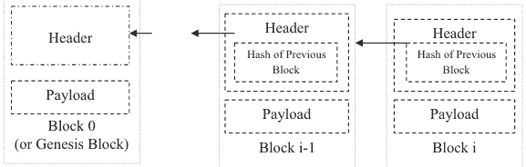

**图1.1** 区块的传统设计。

根据计算概念，区块链被视为数据结构，数据存储在块中。每个块按顺序与另一个块链接。区块链类似于链表概念；每个元素使用指针连接。每个块包含一个有效负载（payload）和一个头部（header）。头部包含与其长度、内容、32位SHA256（即前一个块的哈希值）相关的信息。负载通常存储交易详情。块的哈希值取决于前一个块。交易的验证和确认形成块，将数据存储在分布式账中是区块链的主要目标。区块链使用共识算法来发现如何以及何时将一组交易包含文件中。

如果大多数网络节点同意包含，即只有当用户同意时，所有新块都可以添加到区块链中。每个网络节点持有一个本地区块链副本。当新块达到共识时，它会在网络上传输。可以创建许多持久副本；如果大多数节点拥有类似的区块链副本，它被认为更安全、更忠实。共识过程是一项主要任务，因为如果向区块链添加节点，必须对其进行验证以检查其是否为合法交易。也有必要检查添加的交易是否相互整合。所有新交易都包含在区块链中，因此交易验证是主要任务。如果没有共识过程，可能会出现各种故障[5]。

最重要且第一个共识过程是POW（工作量证明），由比特币处理。加密货币的矿工（miners）采用这种机制。POW（挖矿）通过使用更多的计算能力来解决复杂的分析难题。POW（挖矿）通过使用更多的计算能力来解决复杂的分析难题。解决复杂难题有两种方法：第一种需要更多时间确定正确答案，第二种是直接给出答案。第一种成本更高，因为解决难题需要额外的能力。在创建块时，它是初始化并快速创建的。我们经常在区块链中添加新块。在添加时，必须获得共识以便利用计算能力。它需要海量的能量和计算资源[7]。

为了克服所有问题，还考虑了其他共识机制，如权益证明（PoS）和重要性证明（POI）[8,9]。在图1.1中，新的哈希值依赖于块中的前一个哈希值。因此，如果在当前块中插入任何新块，它将生成一个不同的哈希值。这将导致后续块以及哈希值的连锁反应（descent effect）。共识算法将丢弃区块链中不需要的块。共识算法对于安全目的来说非常重要，因为攻击会破坏、复制和修改区块链中的块。如果攻击拥有链中50%的块，它就可以管理整个区块链。

## 区块链与物联网：综述

## 1.2 基于区块链的物联网

### 1.2.1 智能能源

智能能源在生产者和能源销售者之间传输。智能电表监测一段时间内吸收和出售的能量。生产者、智能电表和商家将信息广播到区块链上。生产者使用公钥/私钥与其他进行通信。它还利用此管理与区块链的加密或安全的通信。有四个重要的实体：卖家、竞标者、智能电表和智能合约。卖家通过讨价和广告开始销售能源。生产者用于从多个源购买。智能电表记录特定时期消耗的能量以检查是否安全。智能合约执行操作和支付任务。工作过程如图1.2所示[10]。

以下基于区块链的智能能源过程的重要操作：

- 智能合约安装在区块链中
- 卖家对可用能源进行讨价和广告
- 强大的生产者跟踪区块链并通过报价确认
- 智能合约使用维克里拍卖（Vickrey auction）找出获胜者并给予奖励
- 能量根据多数原则给生产者

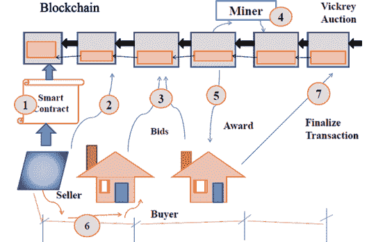

图1.2 智能能源的区块链。


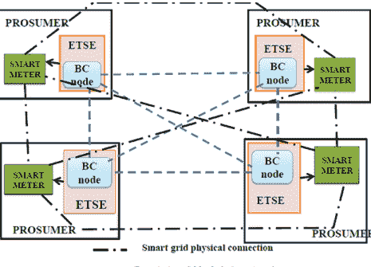

图 1.3 物理连接的产消者。

- 6. 交易开始
- 7. 确定交易并传输金额

智能电表用于在验证产消者用后释放能量和货币 [11]。图1.3显示了四个产消者。每个产消者都有一个能源交易与安全增强（ETSE）软件、一个区块链节点（BC node）和一个本地智能电表。ETSE软件安装在每个产消者内部。每个产消者都使用ETSE部署了区块链节点。通过区块链节点进行的交互通过特殊功能得到了保护，并用虚线表示。产消者场所（ETSE模块）的三个不同层如图1.4所示。它们分别是：策略管理层（PML）、能源交易层（EL）和安全增强层（SEL）。PML仅仅是一组规则。产消者之间应该交换这些规则。每个产消者都有独立的规则，并各自遵守。ETSE从漏洞角度管理和控制智能电表。本地智能电表通过合约传输能量。SEL用于安全。它从前一层EL获取能量并验证能量；如果存在漏洞，将对其进行违规。通常，如果有解决特定漏洞的方案，SEL会持续更新其安全存储。它将其存储并排序在知识库中 [12]。交替方向乘子法（ADMM）是一种算法；它也是另一种智能能源消耗方法，它通过将问题分解为多个子问题，并能够自然地确保能源交易的安全 [13]。

### 1.2.2 智慧城市

智慧城市中的智能车辆有两个主要实体：路侧基础设施单元（RSI）和服务提供商（SP）。它们都负责处理区块链。每辆车辆产生的数据会被其他车辆收集，以验证城市交通状况。

## 区块链与物联网：综述

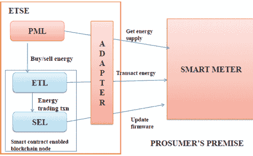

**1.4** 产消者的框架。

每辆车辆负责使用其传感器收集数据，并将其传输到附近的 RSI。开发并传输一个高级交易到相邻的 RSI。区块链包含块头，其中存储有公钥，公钥负责验证高级交易。必须验证车辆的存在性，以防受到女巫攻击。未知车辆必须非常仔细地通过位置验证，因为它被用于从其他车辆收集信息。RSI 在用户发送任何交易时也会验证所有者。每辆车辆在需要加入网络时需要在 RSI 中注册 [14]。管理信息的传输在整个区块链上共享。区块管理器（Block Manager）认证、独立交易区块的收集。本地块管理器（BM）用于管理智能家居中的物联网（IoT）设备。为了在实体之间循环共享密钥，本地块管理器（LBM）使用了 Diffie–Hellman 密钥分发法 [15]。在智慧城市中，万物互联相通并产生更多数据。为了维护数据和物联网设备的安全，使用了区块链技术 [16]。

## 1.2.3 智慧温室

为了保护作物免受自然变化的影响，还使用了物联网设备。区块链在本地也可用于安全和隐私目的。区块链概念通过智能家居实现。所有者负责修复和消除故障设备。物联网中的每个设备通过带有加密算法的共享密钥相互通信。所有者将使用管理头处理所有交易。策略存储在区块链的区块中。为了消除系统开销并延迟所有节点，将节点组成一个集群。集群中有一个类似于簇头的节点，它通过选举产生。网络延迟和开销由簇首处理。数据全局地存储在云端。存储的数据也作为个体数据存储，因此必须使用加密时使用的共享密钥配合块号存储。共享密钥源自加密算法。区块链的所有者

## 区块链技术

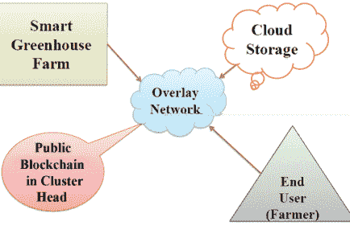

图 1.5 智慧温室的区块链结构。

区块链的所有者被称为用户。他们通过智能手机和互联网从任何地方管理所有设备。图1.5 表示了智慧温室的区块链结构。物联网设备是异构的，因此在可用性、完整性、机性和真实性方面存在各种漏洞威胁 [17]。

## 1.2.4 机器人技术

安全性是许多应用中机器人安装的主要失败原因。区块链在提供安全保障以击败漏洞攻击和威胁方面发挥着重要作用。有两种不同的加密方法：公钥加密和数字签名加密。在公钥加密中，每一个机器人都使用公钥进行加密。该密钥在网络中是公开的，但私钥是秘密。公钥在所有需要相互交互的机器人之间共享。基于私钥，任何人都可以读取信息。在数字密钥加密中，私钥用于加密。对于其他机器人，想要读取数据的机器人使用发送者的公钥来解密信息。这仅构成了身份验证。根据公共密码学，如果信息使用区块链技术进行封装，其他机器人就可以单独读取内容。最突出的例子是将自组织网络（ad hoc networks）与机器人群连接。机器人群对区块链技术的接受对操作者更有利。他们不需要花费更多时间在机器人上进行训练。同样，新机器人的学习过程更短，因为每个交易和协议都记录在区块链内部 [18]。

## 1.2.5 数据保护

无人机是一种利用传感器和摄像头收集土壤水分和成分信息的设备。所收集的信息被传输到区块链网络，以避免电池耗尽并确保数据安全。每个

## 区块链与物联网：综述

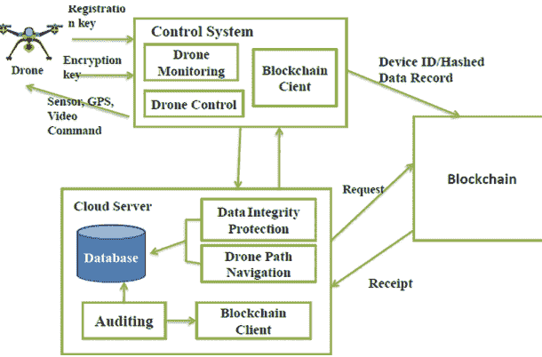

图 1.6 无人机系统（数据保护）。

执。每台无人机都有一个 ID。收集的数据用 ID 封装并转发到区块链网络，可以找到数据源。命令系统为每条数据转发一个哈希值，该哈希已经在区块链网络中收集。区块中添加的记录称为交易。发生的操作应该存储在区块链网络中以发现漏洞。众所周知，区块链网络中的每个节点对其他区块都有感知。所有数据都得到了保护。无人机链系统架构的四个重要元素是：无人机、云数据库、区块链网络和云服务器，如图1.6所示。

无人机传感器用于从土壤传感器和液体含量中收集数据。相机也有帮助记录现场的图像和视频。控制系统从无人机收集数据。收集的数据和指令形成一个哈希数据，并发送到区块链网络进行保护。云数据库存储来自无人机的数据、控制系统的指令以及数据访问细节。数据访问细节大部分使用指纹制作。云服务器执行的功能与区块链网络相同 [19]。

## 1.2.6 交通运输

如今使用传感器从其他车辆收集信息的车辆是远程操作的。这种重大发展了联网的智能车辆，为制造商、自动驾驶服务汽车和保险公司提供了更重要的信息。变得关键的应用是自动驾驶。事故发生后根据可用信息识别故障部件。为了访问汽车上的不同数据，使用了许可的区块链框架。为了管理和控制收集的数据，该框架


## 8 区块链技术

……被使用，并与 VPKI（车辆公钥管理）结合以实现安全的隐私环境。为了在合作方之间维持安全的协作，使用了四种不同的节点：领导者（leader）、监控单元、验证者和客户端。有许多验证者；其中一个被选为领导者。领导者根据收集到的交易为网络提名新区块。验证者支持拜占庭容错协议，防止参与者和领导者的恶意行为。验证者支持对参与者和领导者的拜占庭容错。这为所有参与者创建了一个巨大的信任环境。通过比较哈希值来验证数据的真实性和纯洁性。许可用户可以访问或控制区块链网络中的交易。由于只有许可用户可以访问交易，因此身份是唯一的且无法再次更改。为了使身份更加安全和独特，使用了 IEEE 1609.2 推荐的 VPKI 模型。分配了临时身份，使每辆车辆持有身份的时间不超过 5 分钟。通过带有有效别名身份的车辆，可以在区块链上完成交易 [20]。

另一种在车辆间传输信息时确保安全的方法是可见光和超声波音频——一种新的车辆协作系统。这些方法使用的协议接受 TLS 1.2 握手技术，因为它在互联网上交换密钥。TLS 1.2 协议与区块链分布式哈希表相结合。它降低了吞吐量规范，并通过使用视觉通道验证车辆的位置。图 1.7 表示了基于区块链的侧信道车辆 [21]。

在这里，区块链是一个保护区块节点中可用数据的账本。每个节点被视为一个区块，具有单独分布的分布式哈希表和用于安全通信的公钥。车队中的车辆之间存在受保护且更安全的协作。车辆在哈希表内部有独立的分布式公钥。上述车队系统的功能

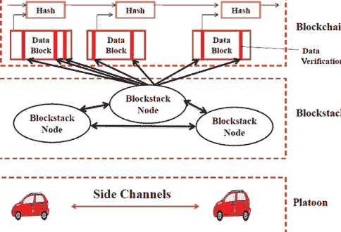

图 1.7 基于区块链的侧信道车辆。

## 区块链与物联网：综述

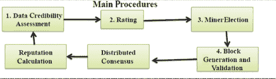

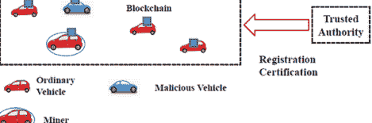

图 1.8 基于区块链的信誉系统。

无论是否与上层黑杰克逻辑连接 [21]。数据信誉系统也用于根据收集的消息来发现交通环境。这些数据以车辆评分的形式被收集。这些评分被封装在区块中，所有区块相互连接，前一个区块的哈希值存储在新的区块中。根据选举过程从车辆中选出一个领导者，它具有发送评分的权限。评分收集在区块链内部，根据评分对供应商的消息进行评估。选举结束后，胜者将其评分封装成区块 [22]（图 1.8）。

### 1.2.7 工业物联网

BPI IoT 是一种新方法，它是物联网的区块链平台；它将工业物联网与区块链相结合。它提高了 CBM 平台的性能。由于它与区块链结合，它引入了去中心化的点对点网络。BPI IoT 中安装了智能合约，这在制造资源和服务客户之间建立了协议。工业机器中的首要促进因素是 IoT 设备。IoT 设备允许所有旧设备与云和区块链网络进行协作。它实现了数据向云端的传输以及来自区块链网络的智能合约消息的传输。IoT 设备使用 Arduino 和树莓派。Arduino 包含带有传感器和执行器的数字及模拟输入/输出。单板控制器 (SBC) 与 Arduino 之间的连接使得 SBC 能够从 Arduino 获取数据并向执行器广播信号。传感器和执行器的控制驱动程序安装在 SBC 上。设备管理器允许用户使用 Web 接口配置 SBC，并监控设备状态和统计数据。SBC 的区块链服务与区块链网络连接并发送/接收交易。IoT 系统有自己的区块链网络账户，并在 SBC 上维护一个区块链钱包 [23]。

基于区块链的工业物联网可以从以下方面进行阐述：

- a. 它为未来的生产环境提供了一种开放的制造模型，专注于跨整个生产生态系统中客户与公司之间的连接。
- b. 它提供了一个知识模型，用于解释制造信息和服务交换的材料。
- c. 它提出了一种基于边缘计算和区块链的开放制造平台和流程 [24]。

## 1.3 区块链的优势

以下是区块链的优势：
- 赋能用户：消费者负责自己的数据，无需第三方信任。
- **完整性：**用户可以确保交易完全按照协议执行。为了确保 IoT 设备对数据访问和存储的可靠性，必须随时维护信息的完整性。区块链提供了确保完整性的有效工具。区块链中每个区块的有效性通过每个区块的哈希值进行检查，而每个区块的哈希值又依赖于前一个区块的哈希值。因此，它不仅保证了新区块的完整性，还对所有现有区块应用了完整性测试。基于区块链的完整性检查。
- **不可篡改性：**交易一旦记录无法更改。
- **可追溯性：**用户可以跟踪交易历史。
- **互操作性：**不同系统之间可以无缝工作。
- **安全性：**区块链通过加密和去中心化提供了高水平的安全性。


13. E. Münsing, M. Mather, and S. Moura, “Blockchains for decentralized optimization of resources in microgrid networks,” in 2017 IEEE Conference on Control Technology and Applications (CCTA). IEEE, 2017, pp. 2164–2171.

14. R. A. Michelin, A. Dorri, R. C. Lunardi, M. Steger, S. S. Kanhere, R. Jurdak, and A. F. Forzo, “Speedchain: a framework for decoupling data blockchain from smart cities,” arXiv preprint:1807.01980, 2018.

15. A. Dorri, S. S Kanhere, R. Jurdak, and P. Gaurawar, “LSB: A Lightweight Scalable Blockchain for IoT and Privacy,” arXiv preprint arXiv:1712.02969, 2017.

16. S. Ibba, A. Pinna, M. Seu, and F. E. Pani, “Citysense: Blockchain oriented smart cities,” in Proceedings of the XP 2017 Scientific Workshops. ACM, 2017, p. 12.

17. A. S. Patil, B. A. Tama, Y. Park, and K.-H. Rhee, “A framework for blockchain based secure smart green house farming,” in Advances in Computer Science and Ubiquitous Computing. Springer, 2017, 1162–1167.

18. E. C. Ferrer, “The blockchain: A new framework for robotic swarm systems,” arXiv preprint:1608.00695, 2016.

19. X. Liang, J. Zhao, S. Shetty, and D. Li, “Towards data assurance and resilience in IoT using blockchain,” in 2017 IEEE Military Communications Conference (MILCOM), MILCOM 2017. IEEE, 2017, pp. 261–266.

20. M. Cebe, E. Erdin, K. Akkaya, H. Aksu, and S. Uluagac, “Block4forensic: An lightweight blockchain framework for forensics of connected vehicles,” arXiv preprint S:1802.00561, 2018.

21. S. Rowan, M. Clear, M. Gerla, M. Huggard, and C. M. Goldrick, “Securing vehicle to vehicle communications using blockchain through visible light and acoustic sidechannels,” arXiv preprint arXiv:1704.02553, 2017.

22. Z. Yang, K. Zheng, K. Yang, and V. C. Leung, “A blockchain-based reputation system for credibility assessment in vehicular networks,” in 2017 IEEE 28th Annual International Symposium on Personal, Indoor, and Mobile Radio Communications (PIMRC). IEEE, 2017, pp. 1–5.

23. A. Bahga and V. K. Madnifi, “Blockchain platform for industrial internet of things,” Journal of Software Engineering and Applications, vol. 9, no. 10, p. 533, 2016.

24. Z. Li, W. Wang, G. Liu, L. Liu, J. He, and G. Huang, “Toward online manufacturing: A cross-enterprises knowledge and services exchange framework based on blockchain and edge computing,” Industrial Management & Data Systems, vol. 118, no. 1, pp. 303–320, 2018.

## 2 块链
协议与标准的回顾

S. Gomathi
Francis Xavier Engineering College

Mabel Finney
Infoziant IT Solutions (P) Ltd.

P. J. Beslin Pajila
Francis Xavier Engineering College


## 2.5 结论...................................................................... 21

## 参考文献.................................................................. 21

## 2.1 导言

块链可以定义为交易的链。块链中的记录存储在块中。每个块都有前一个块的哈希值，形成了一个安全的链接。这种技术在不需要中心机构的情况下确保数据的完整性和透明度。

块链技术应用于各个领域，包括金融、供应链和医疗保健。它具有改变企业间互动方式的潜力。

### 2.1.1 块链技术的要素

块链技术由关键要素组成。将在下节进行讨论。

#### 2.1.1.1 去中心化
块链的基本特征是数据可以在任何节点插入和访问。

#### 2.1.1.2 透明性
块链中的记录对所有节点都是透明的。

#### 2.1.1.3 开源
大多数系统对所有用户开放。

#### 2.1.1.1.5 不可篡改性
进入块链的数据无法被更改。

#### 2.1.1.1.6 匿名性
块链交易可以是匿名的。

#### 2.1.1.1.7 防篡改
进入块链的数据是防篡改的。

#### 2.1.1.1.8 用户赋权
在块链中，用户可以看到所有数据，并可以控制自己的信息和交易。

#### 2.1.1.9 点对点网络
块链使用去中心化的点对点协议，每个节点具有相同的能力。

#### 2.1.1.10 块
块链中，若干块按照适当且线性的顺序连接在一起。每个块都有前一个块的哈希值（如图2.1所示）。

## 2.2 块链类型

有三种基本的块链类型：公有块链、联盟块链和私有块链（Buterin, 2015）。


图 2.2 区块。

## 2.2 区块链协议

区块链协议是一个用于协议的常用术语。这些协议用于区块链网络内的交易验证。共识协议构成了区块链的基础。它明确规定了区块链的工作机制。通常，区块链根据网络中所有参与节点同意的预定义规则运行。这些规则包括：

- 管理和验证交易的规则
- 定义所有参与节点相互交互机制的算法
- 应用程序编程接口

治理区块链网络的规则被称为区块链协议。它们本质上是网络遵循的通用通信规则。

### 2.2.1 区块链协议的重要特征

- 分布式账本：分布式账本是数据库记录的集合。
- 智能合约：对于交易，可以在区块链中使用嵌入脚本。
- 共识算法：一种定义了在网络上达成共识以验证交易的方法的算法。
- 代币（Coins）：每个区块链协议都需要数字资产来维持网络运行。这些也用作网络参与者的激励。这涉及到数字资产的存在，如硬币和代币。在区块链概念中，这两个术通常互换使用，但两者之间存在差异。硬币由协议本身在最低层面定义。硬币是区块链网络的原生数字资产。例如，比特币协议原生货币是比特币。
- 代币（Tokens）：代币是在较高层次定义的数字资产，不是由协议定义而是由智能合约定义。例如，以太坊协议拥有原生货币以坊（Ether）。

## 区块链：协议与标准回顾 17

- 无需信任：区块链为所有节点提供每个操作的相同副本，消除了信任，从而形成了一个无需信任的分布式网络。
- 去中心化：区块链必须以某种方式存储，以便网络上的任何节点访问和复制。
- 不可篡改：所有的区块链交易都是永久性交易。一旦添加记录，就无法更改。

## 2.2.2 不同的区块链协议

### 2.2.2.1 比特币

比特币协议支持在分布式网络上的加密支付交易。比特币是虚拟货币，也称为加密货币。比特币包括加密哈希函数和共识算法。该协议防止了支付重复和数据伪造。
这种交易是通过使用比特币加密软件交换数字签名消息完成的。比特币使用比特币协议交换。比特币通过比特币交易进行交换（Barber et al., 2012）。

#### 2.2.2.1.1 比特币交易

比特币交易需要一个唯一的交易 ID、比特币地址作为输入、要传输的比特币数量以及接收者的比特币地址。

#### 2.2.2.1.2 比特币协议的特点

- 每个节点都可以访问区块链上的完整信息。因此，它是去中心化的。
- 用户可以转换不可逆的交易，而不需要显式信任第三方。

### 2.2.2.2 以太坊

以太坊是一个公共、开源的、面向区块链的协议。在该协议中，运行环境由编程语言开发。该协议的重要组件是以太坊虚拟机（EVM）。以太坊防止互联网中的未请求消息。以太坊和比特币具有许多相似特征。Bloomberg 是所有用户使用的共享以太坊软件；它是防篡改的。像 VeChain 和 OmiseGo 等加密货币项目不是使用以太坊平台启动的。它是一个用于 dApp 开发的平台，dApp 包括 Kryptites、Brave 和 PundiX。
以太坊区块链的结构与比特币相同。整个历史存储在网络上的每个节点上。比特币在新的交易中使用输入来跟踪用户的比特币数量。这种交易被称为未花费输出或未花费交易。未花费输出可用于执行进一步的交易。而以太坊使用计数。

#### 2.2.2.2.1 以太坊协议的特点

- 该协议允许开发者构建和部署分布式应用程序。
- 它允许用户编写自己的应用程序。

### 2.2.2.3 Ripple

Ripple 是一个开源支付协议（Schwartz et al., 2014）。Ripple 同时充当加密货币和金融交易的数字支付网络。它的原生货币被称为 ripple。Ripple 实现了快速、安全且几乎免费的全球金融交易。该协议支持表示加密货币的代币。Ripple 是按市值最大的加密货币（Zhang and Lee, 2019）。

#### 2.2.2.3.1 Ripple 协议的特点

- Ripple 协议以其数字支付网络闻名。
- 它有自己的加密货币 XRP。
- Ripple 交易在几秒钟内确认。
- Ripple 交易使用的能量比比特币少。

### 2.2.2.4 Hyperledger

Hyperledger 是一个开源区块链平台。它支持基于区块链的分布式账本和跨行业区块链技术。Hyperledger 框架包括 Hyperledger Burrow、Hyperledger Fabric、Hyperledger Iroha 和 Hyperledger Sawtooth。

Hyperledger 协议主要支持业务交易。Hyperledger 用于解决企业审批区块链的问题。在 Hyperledger 中，只有信任的实体才能加入网络并验证交易。

#### 2.2.2.4.1 Hyperledger 协议的特点

- Hyperledger 区块链技术主要用于业务应用。
- 使用去中心化账本等组件。
- 提供高安全性。

### 2.2.2.5 R3 Corda

Corda 是一个为金融机构设计的区块链平台。与公共区块链不同，Corda 只与需要的人共享数据。

#### 2.2.2.5.1 Corda 的特点

- Corda 是为私有业务交易设计的。
- 它不依赖于单一的全局账本。

### 2.2.2.6 Stellar

Stellar 是一个去中心化网络，允许人们在全球范围内即时传输资金。它使用 Stellar 共识协议来达成一致。

#### 2.2.2.6.1 Stellar 的特点

- Stellar 快速且成本低。
- 它支持多种数字资产。


# 20
## 区块链技术

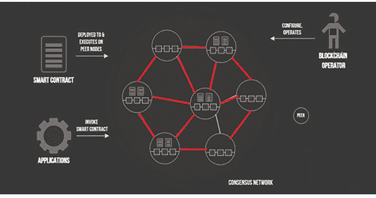

**图 2.4** 实用拜庭容错。

## 2.3.2 共识算法

共识算法的主要目标是有效的去中心化。这些网络不仅对金融应用非常有用，而且增强了个人基础的实用性。使用挖掘方法来引入新的区块链是一项具有挑战性的任务。从技术角度来看，PoS（权益证明）更难被操纵，并且能够防止 51% 的攻击。出于这个原因，以太坊已从 PoW（工作量证明）转向了 PoS。恶意者攻击 PoS 网络变得更加困难。PoS 防止了任何未经授权的节点进入网络。

## 2.4 区块链标准

国际标准组织（ISO）正在开发区块链相关标准。ISO 计划在 2020 年底制定一套术语标准。这些标准包括合规性、信任、安全性、完整性和架构。

### 2.4.1 标准的重要性

互操作协议（如 Hyperledger Fabric、R3 的 Corda 和以太坊）在权限方面彼此不相同。将其中一个转换为另一个是有风险的。同一行业的联盟会影响区块链。区块链技术需要标准的工程实现、架构和标准。

### 2.4.2 风险因素

ISO 识别了与区块链行业特定的风险因素。其一些亮点如下：

- 开源项目将不关心标准。
- 行业可以使用它们自己的标准。
- 区块链碎片必须处理不同的问题。

## 区块链：协议与标准回顾

| 平台特定标准框架 |
| :--- |
| (以太坊、Corda、Hyperledger 等) |
| 行业特定标准框架 |
| (业务、IT、医疗应用等) |

图 2.5 区块链标准框架的类型。

### 2.4.3 区块链标准框架

区块链标准在各种技术方面都具有灵活性。它们依赖于 ISO 标准。根据区块链的使用情况，区块链标准框架被分为平台特定标准框架和行业特定标准框架。这些标准可能包括分布式计算、安全、治理和业务应用。其他几项全球性的重大法规也影响着区块链。通过不同的输入，开发区块链标准的过程如图 2.5 所示。

## 2.5 结论

本章涵盖了区块链标准以及 Hyperledger Fabric、Symbient、R3 Cord、区块链、Ripple 和以太坊等区块链协议。此外，本章回顾并分类了用于网络、通信和管理的流行协议。本章侧重于分析共识协议及其可行性、效率和特征。良好的共识协议必须考虑到容错性和适当的应用场景。本章最后得出结论：Hyperledger 的性能优于以太坊和 Ripple。以太坊比节点故障更灵活，但容易受到安全攻击。与其他协议相比，以太坊需要更多的内存和数据使用。Hyperledger 使用低级数据模型，其弹性允许对查询进行修改优化。

## 参考文献

- S. Barber, X. Boyen, E. Shi, E. Uzun. 2012. "Biter to Better – how to make Bitcoin a better currency" (PDF). Financial Cryptography and Data Security. Springer Publishing.
- V. Buterin. 2015. "On public and private blockchains", https://blog.ethereum.com/2015/08/07/
- M. Castro, et al. 1999. Practical Byzantine fault tolerance, OSDI, Vol. 99, pp. 173–186.
- Nakamoto, et al. 2008. Bitcoin: A Peer-to-Peer Electronic Cash System. https://bitcoin.org/bitcoin.pdf

22
区块链技术

A. K. M. Rokibul, S. Tamura, S. Taniguchi, and T. Yanase. 2010. “An anonymous voting scheme based on confirmation numbers” *IEE Transactions on Electronics, Information and Systems Vol.* 130, No. 11, pp. 2065–2073.

D. Schwartz, et al. 2014. The ripple protocol consensus algorithm, *Ripple Labs Inc White Paper* Vol. 5, pp. 1–8.

S. Zhang, J-H. Lee. 2019. Analysis of the main consensus protocols of blockchain, *ICT Express.*

# 3 区块链技术
工业物联网与大数据架构、用例及应用深度

K. Suresh Kumar and T. Ananth Kumar
IFET 工程学院

A. S. Radhamani
V.V. 工程学院

S. Sundaresan
SRM TRP 工程学院

## 目录

- 3.1 引言 ................................................................................ 24
3.2 区块链实施的架构 ................................ 25
3.2.1 IoT 与 BDA（大数据分析）的集成....................................... 25
3.2.2 用于项目交付成果的区块链架构 ................ 26
3.2.3 区块链：云制造系统................................ 26
3.2.4 区块链：智能交通系统 .................s 26
3.2.5 用于环境的区块链与 BDA....................................... 26
3.2.6 基于区块链技术的智能家居/IoT 拓扑架构 ................................................................ 27
3.3 区块链实施的用例.................................. 28
3.3.1 作为供应链的区块链.................................................. 28
3.3.2 医疗领域的区块链.................................................. 28
3.3.3 区块链与能源管理...................................... 28
3.3.4 区块链对国家的影响......................................... 29
3.4 IoT 与区块链.................................................. 29
3.4.1 基于区块链的智能城市应用................................ 29
3.4.2 轻量级共识算法...................................... 29
3.4.3 区块链：IIoT.................................................. 30
3.4.4 IIoT 与基础 IoT............................................................... 30
3.4.1 基础 IoT............................................................................... 30
3.4.2 IIoT.................................................................... 31
3.4.3 IoT 与 IIoT 中的区块链应用.......................................... 31
3.4.4 IoT 驱动的 BDA............................................... 37
3.4.5 区块链：深度学习与人工智能 (AI)....... 37
3.4.6 区块链：云计算/边缘计算......................... 38
3.5 结论与总结....................................................... 39
参考文献....................................................................... 39

## 3.1 引言

区块链被定义为由特定信息（数据、图像或两者）组成的链。包含这些报告是安全的、真实的，并组合在分布式系统中。它允许数字数据的发布而非复制。为了提供透明度、信任和安全性，使用了分布式账本。物联网（IoT）的发展不仅增强了现有的知识，还允许地球上的物体获得权限。此外，IoT 是 IIoT（工业物联网）的基础部分，它能够传输收集的数据并建立客户与合作伙伴之间的紧密关系。

信息是一个拥有独立、分离数据并通过编程进行管理的领域。为了解决与个人信息相关的安全问题，区块链被应用于大数据。由于携带个人信息的大量数据，处理起来并不容易。区块链技术处于初始阶段，应用范围尚未巨大。在这里，预测由于其不可篡改的特性和识别能力，它在项目（例如金融和信贷）中具有关注度。


## 区块链技术

注册资产 [5] 被赋予了能力并认可了近期创新和理想模型，以满足日益增长的应用需求，这些逻辑、医疗服务、园艺、智慧城市和交通管理板 [6]。

## 3.2 区块链实施的架构

区块链是近期使用的最先进的技术之一。采用区块链技术的架构主要用于金融行业。目前，链链技术被用于记录保存、智能合约和数字公证，它具有去中心化、可追溯性和安全等特点。通过了解其主要组件及其与外部环境的交互，可以理解区块链架构。构建的区块链随着区块链的应用而不断进步。

万维网使用采用客户端-服务器网络的传统架构。这种技术提高了操作效率，且具有成本效益。在区块链技术中，服务器将所有信息存储在集中式数据库中，授权管理员可以对其轻松进行更新和控制。网络是分布式的，因此区块链网络中的每一个参与者都将维护、更新并批准新条目。数据的有效性和安全性由块的每个成员确保。块内数据使用密码学原理（例如隐写术和其他少数算法）进行加密。图 3.1 显示了区块链的架构。

### 3.2.1 物联网与 BDA（大数据分析）的集成

开发出了一种易用的系统架构，集成了区块链、BDA 和 IoT，允许零售商和卖家频繁检查其供应链并以最有效的方式增强其可持续性。对实施成本进行了分析，并提供了一个安全的工作环境 [7]。供应链的社会可持续性受到区块链技术的的高度影响。

| A 想要向 B 分享某些信息 | A 向 B 分享的信息 |
|---|---|
| 信息以块的形式在网上传播 | 区块链可以被添加到链中，提供不可信赖且透明的信息记录 |
| 块被广播到网络的每个部分 | 网络中的人员批准该信息 |

图 3.1 区块链实施的示例架构。

### 3.2.2 用于项目交付物的区块链架构

多领域合作项目中的库存表需要以下创新。需要一个基于持续运行的系统来提供全球供应链。对于基于项目的业务，需要分布式架构，以便供应商能够参与项目的跟踪和追溯 [9]。该架构提供了一个试点系统，用于控制和测量实时可溯的供应链过程。它是为了集成 RFID、IoT 和区块链技术而开发的。开发的系统连接到运输公司和供应商，以提供一系列不可挑战的业务流程。

### 3.2.3 区块链：云制造系统

一种基于分散系统的云生产框架支撑着分布式系统设计，以便在云端工作时提高安全性和适应性。该设计包含几个层——应用层、基础层、保护层、识别层和资产层。工程的思想包括保护信息共享，已与使用链设计所需的关键进展进行了审查和讨论，该设计在安全性和扩展性方面提供了优势 [10]。

### 3.2.4 区块链：智能交通系统

为了改善人类的工作与生活，电子家电器必须使用 IoT 进行先进的制造。这还包括增强安全性和安全性。区块链的应用与 IoT 结合，提供了一个可以有效用于自驱动业务的架构；在维护运营管理中，客户信息的安全、隐私和追溯性是非常机密的 [11]。它由四层架构组成：应用、网关、处理器和传感器。

### 3.2.5 用于环境的区块链与 BDA

IoT 通过其智慧城市实施等应用提供帮助。与区块链结合，它被用于构建一个基于数据流和区块链结构组合的平台，用于智慧城市的资源共享和模型交换 [12]。

开发的模型有助于将碳排放与绿色环境进行比较。该架构由三层组成：区块链基础设施层、业务应用层和网络层。除了这些层，由五个辅助框架支撑，这些框架可以充分共享和实现数据资产。它还为信息所有权、对等和执行者、指南和非持续跟踪提供了新计划。每个协会和办公室都有权在管理数据共享中处理信息任务。因此，政府信息共享具有强大的适应性，而且非常可靠。

### 3.2.6 基于区块链技术的智能家居/IoT 拓扑架构

尽管出现了各种安排和阶段，但此可以被用于家庭机器人化。许多开源可能通过基于技术的安排在组织中取得领先。图 3.2 显示了家庭自动化的协议栈。

因此，IoT 门不能仅仅是 IP 交换机或访问点，尽管某些卖家可能会为了方便而决定将这些功能都集成到一个物理设备中。在实际业务术语中，目前提供的 IoT 门提供了完整的传感器信息流、必要时传感器协议之间的解释，以及通过处理在发送到本地或边缘分析框架之前发送的传感器信息来实现信息计算能力 [13]。

| IoT 栈协议 | Web 栈协议 |
|---|---|
| 应用层设备管理器 | Web 应用程序 |
| 数据格式 JSON, CBOR, CoAP, MQTT, XMPP, HTML, WML, HTTP, DHCP, DSN, SSL/TLS |
| 传输层 UDP, DTLS |
| 网络层 6LoWPAN 和 IPv6/IPv4 | IPv4/IPv6/IPSec |
| 物理层和数据链路层 IEEE 802.15.4 MAC 和 PHY | IEEE 802.3/DSL/ISDN, WiFi |

## 3.3 区块链实施的用例

区块链的核心特性关注于解决。

### 3.3.1 供应链中的区块链

区块链技术的使用使制造商能够识别特定货物的来源。伪造食品和假货被推向了一个长期的方向，这可以增加消费者的潜力。

Ambrosius 和 Vechain 是基于区块链的平台，通过确保产品的安全性和真实性来帮助消费者识别食品来源。

### 3.3.2 医疗保健领域的区块链

在医疗保健领域，区块链提供了透明度和完整性。因此，它在制药行业非常需要，用于处理处方和医疗设备的运输。此外，区块链为医疗领域至关的数据处理透明度、准确性和安全性铺平了道路。

### 3.3.3 区块链与能源管理

区块链太阳能管理允许客户出售太阳能电池板产生的电力以增加收益。它还将减少自然状态下仲裁和电力供应商的权力，使电力可以在相互之间简单共享。电力还值得参考，例如，电力记录是一个使用链的项目，它允许用户通过加密货币支付进行电力交换。


### 3.3.4 区块链对国家的影响

区块链创新的误用可以为接受更多技术变革的国家带来巨大回报，而未采用区块链技术的国家则落后了很多。过去十年中受区块链技术支持的国家是爱沙尼亚。其政府、计算机生成安全、医疗、司法和金融用途的数据档案都使用了这种区块链技术。其他使用该技术的国家包括瑞典、瑞士、美国和韩国。

## 3.4 物联网（IoT）与区块链

物联网（IoT）不仅以家电的形式征服世界，还扩展到了工业和运输领域。通常，为了监控交通状况、天气和温度，每个车辆部分都配备了智能传感器以确保正常运行，这与区块链相结合就了优势。物联网与区块链的集成处于初始阶段，最近进行了更多的研究以有效方式解决安全问题 [11]。区块链与物联网的结合允许对交易的最真实的视图。两者被集成用于物流管理和汽车资产。用于汽车和其他车辆的智能交通系统通过发出碰撞警告和监控驾驶员状况来帮助驾驶员 [15]。

### 3.4.1 基于物联网的区块链智慧城市应用

对于智慧城市应用，以物联网为中心的区块链机制用于提供机密信息。这使用了多边缘网关，通过多路径传输策略实现 [15]。在这里使用了轻量级数据共识算法，通过提供高数据准确性和可靠性减少了数据窃取。多边缘网关非常稳定，减少了网络广播中断。因此，减少了能量损失并控制了传输延迟。图 3.3 显示了小型工厂的区块链网络模型。

### 3.4.2 轻量级数据共识算法

包含物联网的区块链技术包含某些层，如应用、激励、合约、共识和数据层，如图3.4所示。

| 智能工厂 | 物联网设备 | 边缘网关 |
| :--- | :--- | :--- |
| 应用层 | 可编程货币 | 可编程金融 | 可编程社会 |
| 脚本代码 | 算法机制 | 智能合约 | |
| 激励层 | 保险机制 | 分发机制 | |
| 共识层 | PoW | PoS | DPoS |
| 网络层 | | 点对点连接 | |
| 数据层 | 数据块 | 链结构 | 哈希函数 |

**图 3.3** 小型工厂网络模型示例。

**图 3.4** 区块链技术基础设施。

适当的记录作为数据库存在于物联网设备之间保持集体和和谐，该记录存储在去中心化的框架中。该记录说明了系统中所有设备的某些关注问题，例如交易收益或其他信息。考虑到物联网设备配置了功率、存储限制和生命周期资产，分发的记录通过在系统中具有足够资产的边缘网关进行传输。分发的记录由制造工厂区域的所有边缘端口进行维护。通过物联网传输的信息被记录下来，去中心化的属性确保了信息无法被篡改。

与物联网设备相关的安全和保护在后期阶段得到了广泛研究。区块链创新、通过物联网框架与其他应用的交互以及其有效执行已成为一项特殊的商业性课题。区块链的去中心化控制、不可篡改性、加密安全性、对内部故障的适应性、信息可信度、确认和智能合约都是物联网的亮点 [16]。区块链创新的进步以及区块链阶段与物联网的关联为更好的环境铺平了道路，例如比特币 [17]，因为它是一个去中心化的支付系统。

### 3.4.3 区块链：物联网

基于物联网的区块链信息实现了一种紧凑、安全且特定阶段的区块链代币。它依赖于一个机械采集单元，该单元准备好从与传感器接口的传统和新技术中收集数据。整合的信息将通过允许更改示例进行处理，然后发送到任何区块链阶段 [18]。

### 3.4.4 物联网与基础物联网

### 3.4.4.1 基础物联网

物联网建议了我们普通设备（电脑、工作站、电话、手表和其他安装的手持设备）之间的互连。它还建议了上述设备之间的互操作性，以及设备独立性、识别和情境感知。配备传感器或执行器的连接设备可以检测其一般状态，感知发生了什么，明智且自主地选择，或与不同的中心或客户通信以做出更好的决定。因此，物联网预计为物体添加基于计算机的逻辑，这些逻辑随后通过检查或电机进行观察或限制 [19]。物联网的发展是对人类需求的进步性适应。它将汽车、医疗、可穿戴设备、零售、协调、制造、农业、公用事业、机器等整合在一起 [20]。

### 3.4.4.2 工业物联网 (IIoT)

IIoT 建议了社交工业中存在的机器人化和信息模型或利用过程。它连接了物联网业务、协调增加框架并传输注册信息 [2]。IIoT 与信息物理系统 (CPS) 一起用于工业，以提供和理解数字库存展示和制造，其在有益、成功和定制化产品方面取得了长期成就 [21,22]。IIoT 是许多新技术的结合，例如自主机器、动力自主性、大数据、云/边缘处理、计算机大学、智能工厂、人工智能 以及基于物联网的数字物理 [23]。

### 3.4.4.3 区块链：物联网与工业物联网

区块链是一个连续的档案记录，每次发生更改时都会重新激活。每个区块与物联网关联以提供某些选项 [24]。图 3.5 显示了物联网与工业物联网的集成。


**图 3.5** 使用区块链的物联网和工业物联网应用。

### 3.4.4.3.1 智能车辆

智慧城市是一种为了更好的生活质量而进行的持续发展。城市紧凑性是负担地区最显著的方面。由于这些城市地区拥有大量的汽车，交通拥堵不断增加。根据研究，30% 的交通拥堵是由寻找停车位的驾驶员引起的 [26]。考虑到这种情况，驾驶员处于很大困扰中，因为没有停车场可用而不知道停在哪里。另一个安排空间物联网的结构是智能停车。智能路径能够实现交通的最优利用，从而提高交叉口的道路安全 [27]。

### 3.4.4.3.2 智慧城市

智慧城市旨在通过改进专家任务来使社会和政府变得更好；活性、智能状况、精明的人、负担生活和敏锐连接 [28]。物联网是另一种异构通信阶段，为资源提供通用访问并满足客户需求 [29]。智慧城市计划通过提供资产简单性和共享，在私人、商业、行政和机械通信方面提供创新技术 [30]。用于增强安全的物理层程序可以使用智慧城市中的物联网功能。因此，研究了通信属性，以管理物联网辅助的智慧城市网络中的安全问题 [31]。

### 3.4.4.3.3 智能家居

智能家居是无处不在计算的关键应用，它将智能融入高管住宅及其活动中 [32]。通过使用区块链，家中的每个设备都可以向其他设备请求信息以提供特定类型的帮助。在家里，当有人未经授权进入进入时，放置在门侧或其他任何区域的运动传感器会将信号引导至控制板，控制板通过将灯切换到关闭状态来实现其目标。这将通过已经编码的程序实现。


## 区块链技术

为此，挖掘者将公钥发送到另一个即时专用设备。当获取并检查密钥后，设备或机器将直接提供访问权限。该设备的优势在于它是一个双重设备。一方面，挖掘者和所有者对共享公共数据的系统有了良好的概述。另一方面，显示了设备之间存在对应关系，并通过提供一种典型的密钥提供了一种保障的方法 [33]。数据或信息可以通过共享密钥在本地获取，而无需分散容量。在提交密钥时，系统应发送给挖掘者且它具有某些限制，挖掘机将创建一个共享许可密钥并发送到设备，并将密钥妥善保存。获取密钥后，通过存储共享密钥的起始阶段使其可用。通过使用典型的秘密，设备可以在发生区域存储数据。在获取屏幕交易后，挖掘者将参考合约的当前现有数据导向替换。如果替换允许一段时间内获取数据或信息，则请求供应商的人员将发送给挖掘者并拒绝交易。屏幕交易通过考虑监控骆驼或可以发送周期性数据的各种策略，赋予了持有人权力 [34]。

### 3.4.4.3.4 溯源追踪

区块链最需要的应用是溯源追踪，用于增强物联网（IoT）。传统的演化生活受益于生产者、供应商到商户，并使这种食物去中心化，构建了追踪食物来源的便利。区块链确保每笔交易都是时间步的并经过仔细标记的，这样就可以追溯到特定的时间跨度，然后通过开放区域支持在该时间点收集的收集。区块链不可否认性的结果确保了任何人都无法伪造其在文档上记录的标记的合法性，否则创建者的身份就是他们发起的交易，从而构建了日益依赖的框架。世界状态记录的更改和区块链的能力可以为所有人提供组织安全和透明度 [35,36]。区块链保证了存储网络的安全，并对处理紧急情况非常有益，例如根据安全漏洞进行产品审查。区块链的可访问性意味着每个产品都可以追溯到原材料的状况，且交易将按顺序连接到列表惩罚性物联网设备 [24]。目前，IBM和沃尔玛与清华大学合作完善自然状态，在库存网络记录维护中产生见性和生产力。清华大学是一所与永辉超市合作的大学。这分析了鱼类产量并从商店网络获取的数据中进行记录。与其普通的分析和物理调查框架相比，区块链提供了一种替代交易框架。零售商可以了解参与交易的供应商。由于交易没有存储在任何单一中心，因此在实际上很难在没有任何问题的情况下更改数据。同时，买家很容易获取有关商品的重要信息，例如，使用手机检查二维码后获取工厂和准备信息、生产和结束时间，以及在产品出现问题时联系管理部门。管理部门将检查控制食物决策的区块链 [37]。如果没有区块链，大多数情况下，沃尔玛将芒果运到第一个农场几乎需要6天18小时26分钟。现在，在益区块链的帮助下，买家只需2.2天即可获得详细数据产品 [38]。

### 3.4.4.5 农业与物流

农业和物流在平台上有不同，因为物流与智能建筑环境有关。在这里，正在开发一种基于物流的农业，它由用于增强农业食品生产的架构组成。该框架由改进的可视化视图和及其指南组成。开发的框架支持超过十九种案例，用于乳制品生产和农场、水果供应以及蔬菜生产领域。该框架用于及时对案例进行建模 [39]。从2002年至2016年对物联网在农业领域的应用进行了系统性审查。这里是一种基于聚类的物联网应用，包含了预测、监控、物流和控制等四个需求。关键技术的感知被用于构建物联网应用 [40]。对最新知识和在基于物联网环境中运行的设备的使用，创建了一种智能解决方案，结合区块链技术增强了农业结合的生产力 [41]。

### 3.4.4.6 移动商务

由于移动商务（m-trade）的基础，信息安全问题正变得越来越重要并应该得到关注。区块链被实现为分布式数据库，以锁定移动枢纽之间的交易，以帮助最短的设备到设备m-贸易交易信息和分发。文献 [42] 提出了一种基于安卓的框架执行程序。区块链确保设备之间的交易不需要担心任何其他连接。关于网络单元之间和分布式网络上基本采用的通信的一些研究 [43]。卖家和买家在初始阶段签订合同，该合同可以包含真实的交易信息 [44]。两个成员确认此协议并在区块链框架中分发它。因此，双方在区块链的帮助下安全地获得了他们需要的。

### 3.4.4.7 云存储

分布式存储在物联网环境中起着至关重要的作用。最常见的分布式存储之一也是物联网发展中一个脆弱的连接。首先，被认为具有统一云模型的物联网系统是一个重大的成本问题。物联网设备通过使用云的服务器进行关联、识别和确认，容量和准备通常在此处完成。无论设备是否是几个隔离开的基站；它们的连接无疑是通过互联网。通过区块链技术，去中心化可以被实现，而无需聚集物质。在物联网技术中，特别是对于物理资源，实体可能在隔离的区块链中解决系统固件的加密难题。使用区块链形成的结构创建了一个系统位置和计划的恒定数据库。

### 3.4.3.8 访问管理与验证

传统框架利用集成工程和简单登录，这对于容易受到窃取或破解密码的代表和客户来说是非常危险的。区块链技术提供了稳健的验证并解决了单点攻击，通过适当的开放密钥框架授权设备和客户，从而取代传统的密码和显式传输层（SSL）证书。此外，证书信息管理仅在区块链上进行，这使得助手使用伪造证书在实际上是不可能的 [36]。区块链字符验证和对执行方法的访问可以用于增强物联网安全。

### 3.4.3.9 电动车辆云与边缘计算

在这种处理系统中，能量资源和数据在汽车之间进行交易、协作和传输。根据不同的情况，车辆可以是不受限系统管理员、便携式信息微计算机或虚拟车队 [2]。区块链通过信息更改来设置交付协议，关键性更改取决于哈希树计算和时间戳，例如，状态证明（PoS）。


## 区块链技术

交易数据无法在没有问题的情况下调整 [46]。为了满足物联网（IIoT）应用中不断增长的活体资产需求。

## 3.4.4.3.10 大数据与医疗保健

在物联网中，由于护理工作的创建，人类遗传信息比以往任何时候都具有更高的优先级。区块链相关行政管理的业务需求是稳固的，需要将海量信息和相关研究工具绑定到整个区块链提供的记录中。最近，一个由四十多家日本银行组成的财团签署了一项使用区块链创新的协议，这是一种前未有的流程，即利用区块链促进与财务余额相关的资产交换，从而通过便捷的方式实现持续交易。传统的交易所成本高昂，且一个重要因素是潜在的风险因素。双重花费（相似代币被重复使用）仍然是持续交易中的特定问题。区块链的使用在很大程度上与这种风险保持了距离。大规模数据分析加速了识别异常购买模式和风险交易的技术，速度比目前更快。这降低了交易的资产或财务成本 [49]。

在物联网中，金融业务作为区块链创新的主要动力是信息安全。为了保障零售和组织部门的安全，机构已开始通过区块链进行尝试，以防止信息黑客攻击或信息泄露。在商业领域，由于知识产权，遗传社会数据比以往任何时候都具有更高的优先级。印度的管理层有一个基于区块连接的500 万人的优质数据库框架 [50]。

医疗服务部门是一个问题驱动的劳动力密集领域，获取、关联和信任其活动产生的信息对于该部门的任务至关重要。它可以被分为社会保险内部的功能：分诊、医疗问题理解、临床动态、基于考虑的信息识别和评估。3.6 展示了基于区块链的医疗服务。实现理想的健康结果取决于与多学科工作人员的合作，这些人在管理患者时可以应用更多信息、技术和能力。在与教育机构合作时，医疗领域必须接触患者以培训学生，从而创建和完善必要的技能。因此，医疗机构为该领域提供合格的、设计激励的健康设施，必须协助提供专家、见证人、测试人员的访问并进行测试。

在参与未来的临床试验时，健康基金会必须协助创建、安排、管理和详细说明试验。因此，检查和设计机构为社会保险领域提供更新后的信息、方法和设备。从今以后，健康机构的活动与从事生物医学研究和设计的培训熟练劳动力的基础紧密结合。这些活动需要资产的强制交易、容许的相关信息以及验证和支付，这成功意味着跨机构边界的信息交换。

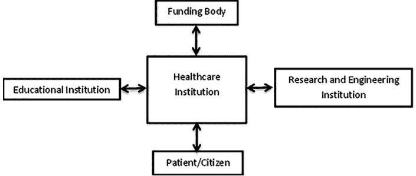

**图 3.6** 基于区块链的大数据医疗健康行业。

### 3.4.4.4 区块链：物联网驱动的 BDA

技术的发展在结合区块链、数据分析以及物联网时提供了一些关键优势。这三者似乎有某种差异，但存在某些关系，增强了系统的操作性、适应性和实用性。采用区块链和物联网的欠发达技术正在产生海量数据，涵盖了零售、银行、医疗保健、公共管理、智能城市预测和实施在内的主要行业，成本高昂。这些都得到了充分的分析和解释，表明这三者的结合带来了巨大的变化和改进 [52]。

### 3.4.4.5 区块链：深度学习与人工智能 (AI)

AI 计划将物联网和雾计算中心相结合，以理解负担状况并持续调整以获得更好的服务质量（QoS），减少权限利用和资金的高额成本。人工智能包括不同的追求计算、AI 模型、支持学习和规划 [53]。AI 通过允许自动化动态而非人类编码的启发式方法，为轻松高效地构建具有巨大数据规模的框架提供了一条价值的路径，从而快速提供越来越有效的选择。它可以用于准备从不同基于物联网的应用收集的利用信息，例如人类服务、农业业务、智能家居等 [54]。

深度学习是另一种 AI 创新类型，它可能从海量数据集中获益 [55,56]。深度学习的核心是从原始数据中获取显著水平的智能特征。最近，深度学习一直是学习机制的动力，将有助于理解深度强化学习领域，这有助于使模型在以后更具可靠性 [57]。深度学习与分布式计算的融合正在使两个领域产生有趣的应用，两者相互补充。文献 [58–60] 讨论了分布式计算如何首次支持数据研究人员，以及后续深度学习如何被用于分析分布式计算中的不同传统用途。

## 3.4.4.6 区块链：云计算/边缘计算

分布式计算使得产品开发流程更加高效。在整合软件设计和分布式计算方面存在一些困难，这些应该作为数据移动和独特的挑战来对待。在云提供商提供不同的 API 以供云服务整合之前，程序和数据必须迁移到另一个云。程序可能会被具象化，且一些程序函数可以作为方案布局 [61]。为了解决这个问题，在雾化（foggy）环境下创建和发送程序时，应避免依赖于特定的 API。测试是一致性和开放性的。由于所有数据从云端移动，且云端受到任何软件工程师（黑客）或灾难性事件的攻击，数据很难恢复。分布式计算为试图利用分布式计算的分析师提供了更多机会，以降低活动、交付和程序开发的成本。在文献 [62] 中，研究者探讨了如何提供学习。学习平台（LMS）通过云范围组织学校利益之间的共享数据和共同活动。程序框架正被基于云的系统部署以节省成本并对资源进行极大利用。


## 区块链技术

该系统 [64]。边缘计算通过处理边缘设备而非云服务器来传输海量数据和信息，从而扩展了服务质量 (QoS)，降低了延迟和传输成本 [65–67]。复杂的应用可能会滥用边缘计算；无论如何，它需要在给定的性能限制需要稳定的互联网连接。

# 3.5 结论与总结

区块链目前正通过涵盖分布式计算的所有领域来提升其标准。它适用于物联网（IoT）、工业物联网（IIoT）、大数据和云计算。分布式计算是一个新兴的世界观，实现了按需、计费的计算资源访问（处理器、内存、存储等），驱动了机械化的发展并赋能地理位置应用。为了改进分布式计算，区块链、物联网、工业物联网和大数据相互集成。通过展示已引入并用于其开发的理想模型和先进技术，确定了使用区块链技术的架构、用例和各种应用。此外，与分布式计算相关的探索已得到识别和讨论，并遇到了相关的分析性问题和挑战。一项调查分析报告显示，这些新兴标准（区块链、云计算、物联网、工业物联网和大数据）对分布式计算的发展产生了，为现代时代铺平了道路。

## 参考文献

- 1. https://mlsdev.com/blog/the-future-of-the-blockchain-technology-use-cases-geographical-expansion-risks-and-challenges.
- 2. Q. Wang, al. “区块链用于物联网和工业物联网：综述。” Internet of Things (2019): 100081.
- 3. J. Chen, Z. Li, and H. Song. “基于区块链的个人大数据管理系统设计。” Future Generation Computing Systems 101(2019): 1122–1129.
- 4. M. J. Flynn. “超高速计算系统。” Proceedings of the IEEE 54 (12) (1966): 1901–1909.
- 5. B. P. Rimal, E. Choi, and I. Lumb. “云计算系统的分类与调查。” in: Fifth届 International Joint Conference, IMC and IMC, NCM ’09, IEEE, 2009, pp. 44–51.
- 6. T. L. Casavent, and J. G. Kubl. “通用分布式系统调度算法的分类。” IEEE Transactions on Software Engineering 14 (2) (1988): 141–154.
- 7. V. G. Venkatesh, al. “基于区块链的供应链可持续性透明系统架构。” Robotics and Computer-Integrated Manufacturing 63 (2020): 101896.
- 8. https://experfy.com/blog/integrating-iot-with-big-data-a-revolutionary-step.
- 9. M. Sun, and J. Zhang. “区块链大数据平台在低碳排放绿色环境新智能城市建设中的应用。” Computer Communications 149 (2020): 332–342.
- 10. Z. Li, A.V. Barenji, and G.Q. Huang. “迈向作为更好分布式网络节点的区块链云制造系统。” Robotics and Computer-Integrated Manufacturing 54 (2018): 133–144.
- 11. P. Manjunath, R. Soman, and P. G. Shah. “物联网与区块链驱动的智能交通。”2018年第二届绿色计算与物联网国际会议 (ICGCIoT), 2018.
- 12. P. Helo, and A. H. Shamsooza “实时供应链——一种用于项目交付的区块链架构。” Robotics and Computer-Integrated Manufacturing 63 (2020): 101099.
- 13. D. Monini. “区块链机制在物联网驱动的智能家居系统中的定位：基于网关的方法。” Internet of Things (2019): 100147.
- 14. L. Su, G. B. Mitchell, and S. Henderson. “智能交通系统在增强老年人和少数旅行者车辆安全的应用。” 第16届实验安全车辆会议论文集，第506卷，华盛顿特区，1998。
- 15. W. Zhang, et al. “LDC：一种基于区块链用于智能城市工业物联网的轻量级数据共算法。” Future Generation Computer Systems 108 (2020, July): 574–582.
- 16. W. Yin, et al. “区块链中的抗量子交易认证方法。” IEEE Access (2018): 5593–5401.
- 17. I. Makhdom, M. Abolhasan, and W. Ni. “区块链用于物联网：挑战与展望。” ICTE 2018-第15届电子业务与通信国际联合会议论文集，2018.
- 18. D. Mazzei, et al. “一种用于物联网信任应用的区块链代币器。” Future Generation Computer Systems 105 (2020): 432–445.
- 19. D. Monini, and B. Occhiorgio. “用于物联网安全的区块链机制。” Internet of Things 1 (2018): 1–3.
- 20. T. Fernández-Carámez, and P. Fraga. “区块链用于物联网的综述。” IEEE Access 6 (2018): 32979–33001.
- 21. A. Rokko. “工业4.0：背景与概述。” International Journal of Interactive Mobile Technologies (iHM) 11 (2017): 77.
- 22. M. Zaaini. “工业4.0的九大挑战。”http://iot.world.com/connected-industry/nine-challenges-of-4/
- 23. Unknown. “工业4.0：第一次工业革命——引导工业4.0。”https://www.scecop.eu/industry-4/
- 24. N. Kshetri. “区块链能加强物联网吗？” Professional 19 (2017): 68–72.
- 25. H. Watanabe.
- 26. S. C. K. Tekouabou, W. Cherif, and H. Silkan. “基于物联网和集成学习模型提高市场城市的停车可用性。” Journal of King Saud University-Computer and Information Sciences (2020, January 17): 1–11.
- 27. S. K. Sood. “智能车辆交通管理：一种以边缘为中心的物联网框架。” Internet of Things 10 (2019): 100140.
- 28. D. Bruno, et al. “一种用于物联网服务的边缘生态系统。” Internet of Things 5 (2019): 12.
- 29. D. Li, et al. “通过基于行为的学习改进智能城市通信层。” Future Generation Computer Systems 108 (2020, July): 512–520.
- 30. R. Morello, S. Mukhopadh, Y. Liu, D. Samantar. “用于智能城市电网的传感器。” IEEE Sensors 14 (2).
- 31. V. Wang, J. Han. “通过区块链增强安全性。” 传感器技术

- 32. M. Consecuti, A. Vetro, and J.C. Martin. “区块链用于物联网：系统性综述。”在2016年IEEE/ACCS第13届计算机系统与应用国际会议(AICSSA)论文集，2016, 1–6.
- 33. D. Mocrii, Y. Chen, and M. Musile. “基于物联网的区块链。” Internet of Things 1。
- 34. C. Ferrag, al. “用于物联网的联盟区块链。” Internet of Things 2, 2019.
- 35. T. Yang, and J. Wen. “使用混合动力电动实现的本地点对点电力交易。” IEEE Transactions on Industrial Informatics 14 (8) (2018): 3690–3700.
- 36. S. Ravindra. “区块链在网络安全中的作用。”https://www.infosecurity.com/nextgen-infosecurity/, 2018.
- 37. S. Charlebois “利用区块链改进供应链追溯性。”https://theconversation.com/2016/11/leveraging-blockchain-supply-chain.
- 38. N. Joshi. “区块链技术如何改变行业。”https://www.com/blog/blockchain-technology-could-transform-industry, June 23, 2017.
- 39. C. Verdou, et al. “用于农场系统的物联网。” Computers and Electronics in Agriculture 165 (2019): 10493.
- 40. J. Talvera, et al. “农业和环境领域的物联网应用。” Computers and Electronics in Agriculture 142 (2017): 283–297.
- 41. J. Korzak, and K. Kijska. “智能城市中的智能物流。” Transportation Research Proceedings 39 (2019): 201–221.
- 42. Z. Li, et al. “用于工业物联网安全电力交易的联盟区块链。” IEEE Transactions on Industrial Informatics 13 (6) (2017): 3154–3164.
- 43. K. Staakhans, et al. “移动区块链的性能分析与实现。”在2018年国际计算、网络与通信会议(ICNC), 2018, 642–646.
- 44. K. Krisidis, and M. Devetsakis. “用于物联网的区块链与智能合约。” IEEE Access 4 (2016): 2292–2303.
- 45. N. Joshi. “基于区块链的分布式云存储。”https://www.com/blog/distributed-cloud-storage-with-blockchain-technology, 23, 2017.
- 46. S.-Kta, et al. “连接车辆资源：未来的挑战。” Future Vehicle Technology Magazine 12 (2017): 26–35.
- 47. M. Consecuti, A. Vetro, and J.C. Martin. “区块链用于物联网：系统性综述。”在2016年IEEE/ACCS第13届计算机系统与应用国际会议(AICSSA)论文集，2016, 1–6.
- 48. J. Kang, et al. “使用混合动力电动汽车通过联盟区块链实现本地点对点电力交易。” IEEE Transactions on Industrial Informatics 13 (6) (2017): 3154–3164.
- 49. A. Venkat. “区块链简介及其对大数据的意义。”。”://www.kdudgegets.com/2017/09/introduction-blockchain-big-data.html.


53. S. J. Russell, and N. Norvig. 人工智能：一种现代方法。Pearson Education Limited, 吉隆坡 2016。

54. S. S. Gill, 等人. “物联网、区块链和人工智能对云计算的变革性影响：演进、愿景、趋势和开放挑战。” 物联网 (Internet of Things) (2019): 100118。

55. A. A. Ali, and M. M. Alam. “SecOff-FCIIoT: 智慧城市应用雾云中基于机器学习的安全卸载。” 物联网 (Internet of Things) 7 (2019): 100070。

56. A. Dawoud, S. Shahristani, and C. Raun. “深度学习与软件定义网络：迈向安全的物联网架构。” 物联网 (Internet of Things) 3–4, 2018。

57. S. Tuli, Basumary, and R. Buyya. “EdgeLens: 集成物联网、边缘计算与云计算环境中的深度学习架构。” 载于：第4届IEEE信息系统与计算机网络国际会议论文集 (ISCON 2019, IEEE Press, 印度 Mathura, 2019年11月21–22日)。

58. K. K. Nguyen, D. T. Hoang, D. Niyati, P. Wang, D. Nguyen, and E. Kwiatkowski, “移动云计算中的网络攻击检测：一种深度学习方法。” 载于：2018 IEEE无线通信与网络会议 (WCNC), IEEE, 2018, 第 1–6 页。

59. A. Efshariat, A. Esmail, and M. Pedram. BottleNet: 用于智能移动云计算的深度学习架构。arXiv 预打印 arXiv:1902.01000。

60. S. O. Asia, A. S. Shamsabadi, A. Taheri, K. Katevas, S. Sadmanesh, and H. R. Barrie, 车道分析。arXiv 预打印 arXiv:1703.02952。

61. S. You, and H. An. “软件工程遇上服务与云计算。” 计算机 44 (10) (2011): 47–53。

62. T. Østerler, 云计算：对软件工程研究与实践的影响。挪威科学技术大学 (NTNU), 特龙德海, 2009。

63. I. Schelet 物联网、区块链、机器学习和人工智能时代的云技术，白皮书，可用地址：https://blog.userjournal.com/cloud-technology-in-the-era-of-iot-blockchain-and-chain.machine-learning-and-ai/f4a19476832, 2018。

64. S. Singh, and I. China. “云计算中的服务感知资源管理：系统性述。” ACM计算机调查 (CSUR) 48 (3) (2016): 42。

65. F. Bonomi, R. Milito, J. Zhu, and S. Addepali. “雾计算及其在物联网中的作用。” 载于：第一届移动计算MCC研讨会论文集, ACM, 2012, 第 13–16 页。

66. A. A. Ali, and M. M. Alam. “SecOff-FCIIoT: 智慧城市应用雾云中基于机器学习的安全卸载。” 物联网 (Internet of Things) 7 (2019): 100070。

67. A. Dawoud, S. Shahristani, and C. Raun. “深度学习与软件定义网络：迈向安全的物联网架构。” 物联网 (Internet of Things) 3–4 (2018): 82–89。

# 4 物联网与区块链

A. Mohana Priya, R. Malathi,
S. Hemalatha, and K. E. Kannamal
计算机科学与工程系，
Sri Shakthi 工程与技术学院

## 目录

- 4.1 引言 .......................................................................................... 44
- 4.1.1 物联网架构....................................................................... 45
- 4.1.2 物联网中的应用.................................................................................. 48
- 4.1.2.1 可穿戴设备...................................................................... 48
- 4.1.2.2 智能家用电器............................................................................... 48
- 4.1.2.3 智慧城市........................................................................................... 48
- 4.1.2.4 Amazon Go........................................................................................... 49
- 4.1.2.5 智能电网........................................................................................... 49
- 4.1.2.6 智能农业......................................................................................... 49
- 4.1.2.7 智能供应链.................................................................................. 49
- 4.2 应用实现.................................................................... 49
- 4.2.1 基于物联网的园艺监控系统和农药控制......................... 49
- 4.2.1.1 带有树莓派的传感器........................................................................... 50
- 4.2.1.2 框图......................................................... 51
- 4.2.1.3 实现........................................................ 52
- 4.2.2 使用 Arduino 实现智能家居自动化.................................. 55
- 4.3 物联网的优点.................................................................. 57
- 4.4 物联网的缺点................................................................................ 57
- 4.4.1 复杂性................................................................ 57
- 4.4.2 岗位................................................................ 58
- 4.4.3 兼容性................................................................ 58
- 4.4.4 隐私与安全................................................................................ 58
- 4.5 工业物联网................................................................................ 58
- 4.5.1 工业 4.0................................................................................ 58
- 4.6 IIoT 如何工作................................................................................ 59
- 4.7 物联网的益处................................................................ 60
- 4.8 IIoT 与物联网的对比................................................................ 61
- 4.9 IIoT 供应商................................................................ 61
- 4.10 企业级 IIoT................................................................ 62
- 4.10.1 块链与 IIoT............................................................... 62
- 4.10.2 经济................................................................ 63
- 4.10.3 速度................................................................ 63
- 4.10.4 身份与访问管理................................................................ 64
- 4.10.5 弹性与可靠交易................................................................ 64
- 4.10.6 安全性 ................................................. 64
- 4.11 块链 IIoT 的挑战...................................................... 66
- 4.12 关于适用场景的讨论......................................................... 67
- 4.12.1 共享经济.................................................................. 67
- 4.12.2 供应链管理....................................................................... 68
- 4.12.3 智慧城市应用............................................................. 69
- 4.12.4 块链物联网架构.................................................... 69
- 4.12.5 网络层..................................................... 70
- 4.12.6 分布式账本技术 (DLT)................................................ 70
- 4.12.7 数据模型................................................................ 72
- 4.12.8 流程................................................................ 72
- 4.12.9 服务............................................................................. 72
- 4.12.10 去中心化应用 (DApp, dApp, or dapp)........................ 72
- 4.12.11 物理-网络安全层....................................... 72
- 4.13 总结......................................................................... 72
- 参考文献 ................................................72

## 4.1 引言

尽管物联网 (IoT) 和区块链以各自的方式兴起，但两种技术的融合将有助于相互借鉴。物联网的分析能力为许多企业应用开辟了新途径，但也导致了严重的安全问题。区块链通过比特币的成功证明了自己是一种强大安全的技术。IDC 预计到 2019 年，20% 的物联网部署将实现基于区块链的解决方案。

本章关注以下主题：

- 物联网如何工作？
- 物联网存在哪些问题？
- 物联网有哪些相关技术？
- 区块链如何帮助解决物联网的一些问题？
- 在设计基于分布式账本的物联网架构时，需要考虑哪些设计因素？

计算技术的最新趋势给各个领域带来了巨大的变化，并在隐藏技术努力的同时实现了易用性的提升。物联网是新兴平台之一，其中事物在没有或较少人工干预的情况下进行通信。


## 物联网与区块链

45

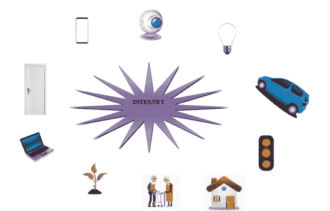

图 4.1 日常生活中的物联网。

传感器网络（WSN）、智能摄像头、射频识别（RFID）读取器和标签。物联网使人类在许多领域（包括工业自动化、农业和医疗保健）依赖自动化。物联网 [3] 关乎智能技术——远程监控、控制以及这些技术的应用。现代应用并不是将物联网视为单一技术，而是结合了人工智能、机器学习和云计算等许多尖端技术。

图 4.1 解释了物联网在从家庭到业务的所有领域（包括医疗保健、农业、交通分析等）都起着至关重要的作用。物联网需要局域网（LAN）、ZigBee 或 6LoWPAN 等形式的互联网，以及涉及能够产生意义结果的无线传感器、执行器和 RFID 设备。

## 4.1.1物联网架构

物联网架构由四个部分组成（图 4.2）。它们如下：

- 1. **传感器节点：**
  - 传感器节点是可以作为单个设备工作也可以作为一组节点共同工作的组件。它帮助接收来自环境的信号，并将这些信号转换为人类可以理解的数据。其他物联网设备节点包括 RFID 标签和读取器、热力摄像头和智能摄像头、加速度计和 GPS。
- 2. **网关/汇点：**
  - 传感器节点采集的原始数据通过网关移动到处理单元存储。在这里，网关可以是无线媒介（Wi-Fi、ZigBee）或有线网络。它作为节点与服务器之间的接口。

46

## 区块链技术

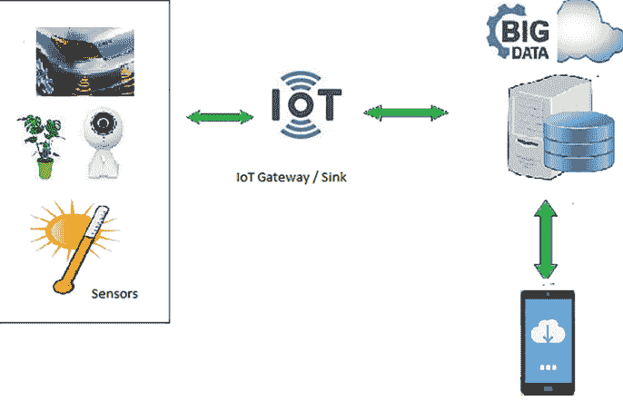

图 4.2 物联网架构。

- 3. **服务器：**
  服务器接收处理、过滤数据并产生有用信息。信息存储在服务器中，并将结果提供给用户界面。根据应用，服务器可以通过提供适当方案来控制传感器节点，或者将信息传递给用户界面。
- 4. **用户界面：**
  用户界面可以是移动应用程序或任何电脑，可以在其中查看所采集的信息或用于进一步的应用程序。

例如，湿度传感器定期检测土地的湿度水平并与服务器通信。原始数据经过处理并存储为信息，以供终端用户访问，用户最终会查看这些信息，如果报告的湿度低于所需水平，他们会给土地浇水。物联网有其独特的特性 [6]。

- 1. **智能性：**
  物联网是软件、硬件、算法和计算的结合，这使其变得智能。环境智能通过允许事物以智能的方式响应特定情况并支持其执行特定任务来增强其能力。在所有智能技术中，物联网被认为是交互方面的一种非常智能的关系

- 2. **连接性：**
  连接性在物联网中起着至关重要的作用。它被认为是系统的一部分。环境智能通过允许事物以智能的方式响应特定情况并支持其执行特定任务来增强其能力。在所有智能技术中，物联网被认为是交互方面的一种非常智能的关系
- 3. **动态性：**
  用户界面可以是移动应用程序或任何电脑，可以在其中查看所采集的信息或用于进一步的应用程序。例如，湿度传感器定期检测土地的湿度水平并与服务器通信。原始数据经过处理并存储为信息，以供终端用户访问，用户最终会查看这些信息，如果报告的湿度低于所需水平，他们会给土地浇水。物联网有其独特的特性 [6]。
- 4. **大规模：**
  服务器接收数据、处理、过滤并产生有用信息。信息存储在服务器中，并将结果提供给用户界面。根据应用，服务器可以通过提供适当方案来控制传感器节点，或者将信息传递给用户界面。
- 5. **感知性：**
  物联网是软件、硬件、算法和计算的结合，这使其变得智能。环境智能通过允许事物以智能的方式响应特定情况并支持其执行特定任务来增强其能力。
- 6. **异构性：**
  用户界面可以是移动应用程序或任何电脑，可以在其中查看所采集的信息或用于进一步的应用程序。
- 7. **安全性：**
  用户界面可以是移动应用程序或任何电脑，可以在其中查看所采集的信息或用于进一步的应用程序。


# IoT 与区块链

## 4.1.2.4 智能零售

IoT 是全球最大的组织之一。它建立了一个拥有许多传感器的商店。与传统的零售商店不同，它是一个前沿的商店。在智能商店中，你不需要去结账台登记。你只需挑选想要购买的东西并离开商店，金额将从你的钱包中扣除。这非常简单。

## 4.1.2.5 智能电网

以前，当电力以单一方式提供给消费者时，供应商无法获得持续的使用信息。通过 IoT 的帮助，这个问题得到了解决，客户可以与供应商通信，供应商也可以进行机械化的供应。

## 4.1.2.6 智能农业

随着许多环境问题（如气候变化）的出现，对农业产生了巨大影响。在 във等国家，智能农业提高了生产力和效率。尽管如此，IoT 在智能农业中仍然发挥着重要作用。

## 4.1.2.7 智能供应链

我们还可以在线下单；该功能允许我们跟踪订单直到其到达目的地。有了这种智能供应链，生活变得简单且满意。

图 4.3 上述的 IoT 应用。

## 4.2 实现

在本节中，我们看到了 IoT 的两种实现方式。

### 4.2.1 使用 IoT 进行花园监控和害虫控制

目前，监控操作是手动完成的。许多人开发花园，但他们并没有通过工作和环境来维护它。花园中的植物应该免受光照、昆虫或其他任何因素的侵害。害虫会导致作物产量不规则，这是不理想的。如今，植物病害很常见。这些疾病通过叶片上的色点和条纹等可见症状识别。通过机器控制的灌溉技术，水分含量可以降低。每当土壤水分发生变化时，湿度传感器就会感知并向 App 发信号。这些水分数据（即通知）通过 IoT 发送到云端，并通过 App 访问。可以通过 Android App 控制灌溉系统。在印度，几乎每个农民都使用杀虫剂和农药来保护作物免受疾病和害虫侵害。他们根据经验在检测到作物害虫时喷洒农药以保护作物。这些化学品保护了他们的作物，但土壤肥力正在下降。吸入这些化学品可能导致肝疾病、哮喘、癌症等。农业是人类最活跃的活动之一，只有为特定问题找到真实且实时的解决方案提高产量，创新和技术才会被接受。

#### 4.2.1.1 带有 Raspberry Pi 的传感器

图 4.4 显示了将电信号转换为数字信号的设备。它们被称为传感器。系统中包含的不同传感器类型如下：

- 1. 湿度传感器用于测量土壤湿度。
- 2. 温度设备用于测量土壤温度。
- 3. 水分传感元件用于测量土壤湿度。

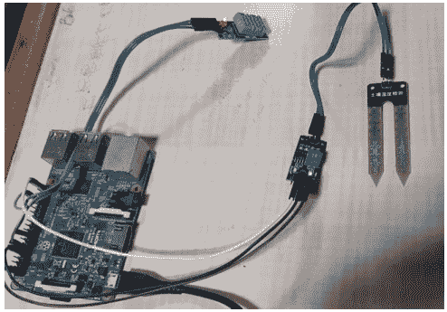

图 4.4 传感器。

#### 4.2.1.2 框图

图 4.5 显示传感器连接的框图，不同的传感器连接到 Raspberry pi。它有一个手机 App，实时数据存储在 firebase 中。

图 4.6 显示图像处理的框图。

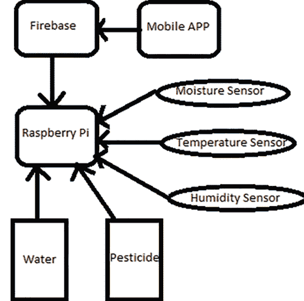

图 4.5 传感器连接框图。


图 4.6 图像处理框图。

#### 4.2.1.3 实现

系统包括以下功能：
- App 提供实时数据监控。
- 数据上传到云端以供访问。
- 用户可以通过 Android App 控制灌溉系统。


## 物联网与区块链

``````
Anaconda Prompt
C:\Users\frank\Documents\project\Uharath\image-classification-tensorflow-master>
Volume in drive C is not locked.
Please run CHDSK C: first.

Directory C:\Users\frank\Documents\project\Uharath\image-classification-tensorflow-master>
07-02-2023  10:59 AM    <DIR>          .
07-02-2023  10:59 AM    <DIR>          1,156 classify.py
07-02-2023  10:59 AM                502 dataset
07-02-2023  10:59 AM            5,902 Android.jpg
07-02-2023  11:07 AM           20,230 Healthy
07-02-2023  14:16 PM           11,758 Images.jpg
07-02-2023  22:14 PM                Inception
07-01-2023  11:44 PM                 model
07-01-2023  16:17 PM             2,516 ResNet50_md
07-01-2023  16:17 PM            30,800 test_image.jpg
07-03-2023  23:59 PM          14,651 leaf_model-4db-800.step
07-01-2023  16:01 PM            44,086 train.py
07-02-2023  10:59 AM    <DIR>          9
07-02-2023  10:59 AM           545,325 bytes
07-02-2023  10:59 AM           724,768 virus.jpg

C:\Users\frank\Documents\project\Uharath\image-classification-tensorflow-master>python classify.py virus.jpg
WARNING: function call from classify.py: FileList_ (from tensorflow.python.file) is deprecated and will be removed in a future version.
Loading model...
Loading image:
Detected tomato_virus leaf_curv (score = 0.9674)
Result: Healthy (0.0326)
```

图 4.9 番茄卷叶病毒的平均值。

由黄卷叶病毒引起，并显示了健康植物和受感染植物的值。
系统减少了农业生产中的人工干预，并为农业相关活动创建更高效的流程变得至关重要。在提出的工作中，中值滤波优于手动通道、平滑滤波器和振荡阈值通道，因为它可以分离单个离群值。对于受感染叶片的识别，利用了 CNN 方法的梯度下降计算。这为特定疾病提供了更精确的结果。

## 4.2.2 使用 ARDUINO 实现智能家居自动化

智能家居自动化帮助我们通过蓝牙或互联网，使用智能手机方便地控制房间灯光、风扇或任何电器设备。指尖点即可控制任何设备。自动化家居有许多方法。可以使用 Arduino (Uno, Mega, Pro, Mini) 或树莓派进行自动化。下一节将解释控制灯光的简单示例。所需的组件有 Arduino Uno、继电器模块、蓝牙模块/Wi-Fi 模块、电阻（1 KΩ 和 2.2 KΩ）和跳线。
按照图 4.10 电路图连接组件。
为了上传代码，通过 USB 端口连接 Arduino 并打开 Arduino IDE。输入以下程序并将代码上传到 Arduino Uno。

##块链技术

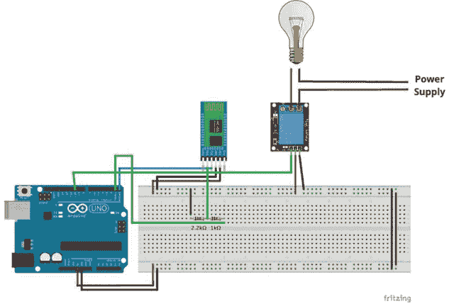

图 4.10 电路图 – 灯光自动化。

```
#define RELAY_ON 0
#define RELAY_OFF 1
#define RELAY_1 4
void setup() {
    // 设置引脚为输出
    pinMode(RELAY_1, OUTPUT);
    // 初始化继电器为关闭，以便在重置时
    // 默认关闭状态
    digitalWrite(RELAY_1, RELAY_OFF);
    Serial.begin(9600);
    Serial.print("The Bulb will be on 5 Seconds and Off
    for 5 Seconds");
}
void loop() {
    Serial.print("\n"); // 新行
    digitalWrite(RELAY_1, RELAY_ON);
    Serial.println("\n Bulb is now turned ON.");
    delay(5000);
    digitalWrite(RELAY_1, RELAY_OFF);
    Serial.println("\n Bulb is now turned OFF.");
    delay(5000);
}
```

设置硬件并上传代码后，测试灯泡是否以 5 秒为间隔进行开关。如果运行正常，可以修改相同的代码读取来自蓝牙模块的输入，并根据接收到的输入采取操作。例如，可以修改代码在 Arduino 接收到值 1 时开启灯泡，在 Arduino 接收到值 1 时关闭……（注：根据提供的源，此处 OCR 文本似乎出现重复/损坏）。

## 物联网与区块链

### 4.3 物联网的优势

-   **有效通信**：可以改进网络通信，从而提高效率。
-   **访问信息**：可以轻松实时查看远处的数据和信息。
-   **准确性**：处理的数据越大，做出的决策就越准确。
-   **自动化**：自动化是一个更少耗时的过程，在不需要人工干预的情况下同时执行任务。

## 4.4 物联网的缺点

### 复杂性
当系统复杂时，就有失败的。例如，你和你的伙伴可能会收到系统过载的消息，或者你们都会得到相同的结果。

### 岗位减少
随着任务的自动化，对劳动力的需求将大幅减少，这对就业产生直接影响。随着我们进入物联网未来，对人才的需求将减少。

### 兼容性
目前还没有开发用于标记和跟踪传感器的协议。需要像 USB 这样的标准系统，这并不困难。

### 隐私与安全
如今的技术世界，每个人使用的电脑都通过互联网连接。这增加了重要数据泄露的风险。信息共享是一个缺点，因为机信息可能不安全且容易被黑客攻击。

- 未经授权的设备
- 软件攻击
- 网络入侵
- 加密攻击

## 4.5 工业物联网

物联网与其他技术应用的结合具有不同的感知。在本节中，我们看到了物联网的新内涵。工业物联网 (IIoT) 是物联网技术在工业环境中的应用，涉及传感器的仪器控制。目前，工业已开始机器通信 (M2M) 来完成无线自动化控制。但随着云及相关技术（可能分析和机器学习）的发展，工业可以推动新的自动化层，并创造新的收入和商业策略。

### 工业4.0
这是一个在欧洲创造的术语。它与 IIoT 相同，指的是第四次工业革命，如图 4-11 所示。

-   **预防性和预测性维护**：显而易见的是，预防胜于治疗。例如，机器的热量、运行时间和所需的燃料量都以更智能的方式进行监控。


## 物联网与区块链

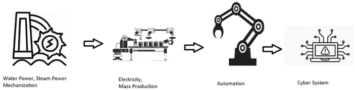

**图 4.11** 工业 4.0。（来源：renaix.com）。

- 2. **智慧城市**：这是本十年内各国最大的梦想，一些国家已经开始朝着这一目标努力。它包括人们智能且健康的生活、智能车辆和交通等。
- 3. **智能电网**：通过更智能的机器设备减少能源消耗。
- 4. **智能制造**：减少不当和不规范的生产行为。
- 5. **智能互联物流**：制制品的交付流程更加精简化。
- 6. **智能数字供应链**：对整个交付过程进行监控并确保质量。

事实上，工业物联网（IIoT）影响了智能机器的能力和实时分析，以利用工业环境中多年来传统机器产生的数据（图 4.12）。

# 4.6 IIoT 的工作原理

IIoT 是一个由智能设备连接成的网络，用于监控、收集、交换和分析数据。每个 IIoT 生态系统由：

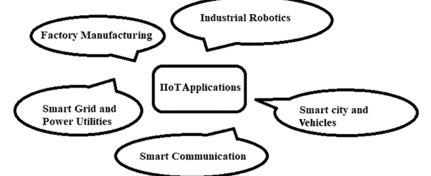

**图 4.12** IIoT 应用。

## 区块链技术

- 能够感知、通信和存储自身信息的智能资产。
- 公共和/或私有数据通信基础设施。
- 从原始数据和人员生成业务信息的分析与应用。

边缘设备和智能资产将信息直接传输到通信基础设施，在那里，信息被转换为关于某台机器运行状况的可操作信息。这些信息可以用于预测性维护，还可以优化业务流程。图 4.13 描述了 IIoT 的清晰架构。

## 4.7 IIoT 的优势

企业最广泛发布的 IIoT 优势之一是预测性维护。这允许组织利用 IIoT 系统生成的实时数据在机器故障发生之前进行预测，使公司能够在部件故障或机器停机之前采取行动解决这些问题。
另一个常见的优势是改进外场服务。IIoT 技术帮助现场服务技术人员在客户设备出现重大问题之前识别潜在问题，使技术人员能够在客户遇到不便之前修复问题。

| 数据处理、分析、业务应用集成、自动化流程数据库 |
|---|---|
| IoT 平台 | 本地服务器 |
| IoT 网关, 边缘网关 | |
| 传感器 | 执行器 | 边缘节点 |

**图 4.13** IIoT 基础架构。（来源：IoT Agenda-TechTarget）。

## 物联网与区块链

资产跟踪是物联网的另一个优势。供应商、制造商和客户可以使用资产管理系统跟踪产品在整个供应链中的位置、状态和状况。如果货物损坏或有损坏风险，系统将向利益者发送即时警报，让他们有机会采取立即或预防性措施来改善局面。

IIoT 还增强了客户满意度。当产品连接到物联网时，制造商可以捕获并分析客户使用产品的数据，使制造商和产品设计人员能够为未来的 IoT 设备进行定制，并构建更以客户为中心的产品路线图。

IIoT 还改进了设施管理。由于制造设备容易磨损，并受到工厂某些条件的影响，传感器可以监控振动、温度以及可能导致运行状态欠佳的因素。

## 4.8 IIoT 与 IoT

尽管 IoT 和 IIoT 许多许多共同技术，包括云平台、传感器、连接性、机器间通信和数据分析，但它们的用途是不同的。

IoT 应用跨越多个垂直领域，包括农业、企业、消费和公用事业，以及政府和城市。IoT 设备包括智能家电、健身带和其他应用，如果这些应用出现某些问题，通常不会产生紧急情况。

另一方面，IIoT 应用连接了油气、公用事业和制造业等行业的机器和设备。IIoT 部署中的系统故障和停机可能导致高风险情况甚至威胁生命的情况。IIoT 应用还关注提高效率和安全，而 IoT 应用具有以用户为中心的特性。

## 4.9 IIoT 供应商

有许多提供 IIoT 平台的供应商：

- Ability（来自 ABB，一家电力和机器人公司）
- IIoT System（来自 Cisco，一家网络公司）
- Field（来自 Fanuc，一家工业自动化设备供应商）
- Predix（来自 GE Digital，一家能源管理公司）
- Connected Performance Services（来自 Honeywell，一家软件-工业公司）
- Connyn（来自 Kuka，一家工业机器人制造商）
- ARM Ltd 和 Dassault systems（与 Infosys——一家 IT 咨询公司——合作创建）
- Wonderware（来自 Schneider Electric，一家能源管理公司）
- MindSphere（来自 Siemens，一家工业制造公司）[18]

## 4.10 企业与 IIoT

企业物联网是 II IIoT 软件，允许组织安全地管理 IoT 生态系统中的所有连接的人员、系统和事物。IoT 和 IIoT 这两个概念具有相同的可用性特征：智能和互联的设备。两者之间的唯一区别在于它们的通用用途。虽然 IoT 多用于消费，但 IIoT 则用于制造、供应链监控和管理系统等工业用途。

企业物联网是技术进步的下一项进展，它使嵌入了计算设备的物理“物体”能够参与业务流程，以减少人工工作并提高整体业务效率。

利用从嵌入式传感器和执行器到基于互联网的通信和云平台的技术组合，企业 IoT 应用现在可以根据机器、车辆和其他设备等编程设备，自动处理依赖于上下文信息的业务流程。此外，此类企业 IoT 应用可以根据特定规则向这些设备发送控制指令。

企业系统和物联网将连接多种技术，以实现与设备和机器等物理对象连接的新业务应用。

企业拥有资金、范围、资源和权利在大范围内部署 IoT 解决方案和服务。他们将看到 IoT 收益快速增长，以确保未来的采用和投资。

企业物联网的真实价值来自数据。大数据处理的进步以及从 IoT 数据集中得的洞察对于决策者来说是无价的。实时分析和机器学习等技术促进了不可忽视的场景，包括预测性维护和对高端工业设备的主动监控。除了挖掘传感器数据集，将旧设备连接到软件平台并对其控制是 IoT 解决方案的重要要素。

因此，工业物联网和企业物联网是物联网的两个重要组成部分。

## 4.10.1 区块链与 IoT

最近比特币以及相关的区块链技术对世界金融领域产生了巨大影响，但其应用并未局限于一个领域。区块链主要与密码学相关，交易涉及数据、哈希和上一个区块的哈希值。哈希函数将区块的数据转换为固定长度的内容，可以理解为区块的唯一指纹 [8]。区块链保证了公共通信介质中数据的安全存储和交换。

物联网已经通过将智能物体引入我们的生活，开始影响了我们的舒适和便利。由于设备处于公共网络中，智能可能无法提供足够的安全或隐私保护 [9]。物联网技术的安全挑战和其他一些缺点可以通过区块链技术及其增强功能来克服或遏制。


# 物联网与区块链 63

共同。物联网中区块链的一些主要部分包括数据安全、经济性、交易速度、去中心化、身份与访问管理以及弹性可靠的交易。

通常情况下，随着物联网的发展，智能设备正在急剧增加。设备之间应该有更好的管理能力和安全的通信，因为它们既有作为传感器节点（仅用于感知和报告）的小型设备，也有能够做出决策以确保相关人员的完整性的智能控制设备。根据高特（Gartner）的研究 [10]，物联网的工业方法可能面临一些挑战。高特提到，连接数亿个设备、控制去中心化的设备、分布式设备之间的点点通信以及确保物联网中设备间通信的安全，都是高特所提到的一些挑战。随着区块链引入物联网，应用物联网技术的问题可以得到显著缓解。在这里，我们讨论了在物联网中使用区块链的一些解决方案。

## 4.10.1. 经济性

区块链在物联网中的引入使得系统更具经济效益。物联网具有中心化的架构，配备了高端服务器、处理器和多种协议，这导致了较高的开销和维护成本。由于区块链本质上是分布式的，其架构成本非常低，这反过来又有利于物联网。

## 4.10.1.2. 交易速度

区块链能够以安全、可靠的方式轻松访问区块，从而实现数据的自动交换。由于消除了对交易的第三方加速，物联网数据的访问速度得到了提高。

## 4.10.1.3. 去中心化

如前所述，物联网是一种中心化技术，在总成本、维护和单点故障方面有其缺点。但区块链在物联网中的引入了一个去中心化的系统，使得交易中的故障和错误不会传播。图 4.14 展示了中心化（图 4.14a）、去中心化（图 4.14b）和分布式（图 4.14c）网络骨架。

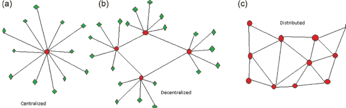

图 4.14 (a) 中心化，(b) 去中心化，(c) 分布式。

通常，中心化和去中心化系统依赖于控制：单点控制或多点控制 [11]。但分布式系统处理的是不同位置的问题。

## 4.10.1.4. 身份与访问管理

身份与访问管理确保了相关人员的完整性。由于区块链的引入，应用物联网技术的问题可以得到显著缓解。通过加密技术，可以防止伪造攻击。

## 4.10.1.5. 弹性可靠的交易

区块链的引入使得交易中的故障和错误不会传播。在物联网中，区块链账本记录了所有信息。这在物联网中确保了数据的完整性和可靠性。

## 4.10.1.6. 安全

区块链的引入使得应用物联网技术的问题可以得到显著缓解。在物联网中，区块链的账本是不可篡改的，从而防止了网络攻击。

## 4.10.2. 物联网与区块链的对比

中心化和去中心化系统依赖于控制：单点控制或多点控制 [11]。但分布式系统处理的是不同位置的问题。由于消除了对交易的第三方加速，物联网数据访问受限，但由于区块链的引入，速度速度得到了提高。由于区块链的增长，这需要更多的计算和存储。

## 4.11. 区块链物联网的挑战

尽管区块链在物联网中具有许多应用，但现实中它们也面临一些挑战。在这里，我们讨论了其中一些挑战。


## 物联网与区块链

IoT 需要和处理的时间较短。这种处理时间上的差异是这种融合的一个主要缺陷。

- 存储：
区块链分布式技术不使用中心服务器来存储交易详情。它拥有分布式账本，每个参与的设备都有自己的账本副本；因此，账本的大小逐渐增长，账本副本所需的存储空间也随之增长。存储的增长也与设备数量及其交易量成正比。存储的增长不仅增加了使用成本，而且跟不上 IoT 极存储设备设备。

由于 IoT 不维护此类分布式安全性，由于加密安全和授权服务器某些内容，可能会出现一些法律问题。在合并这两种技术以适用于实时应用时，必须采取审慎态度。

## 4.12 关于适用场景的讨论

每当引入一组新技术时，要确定这些技术产生重大影响的适用实时场景是极具挑战性的。当这些技术仅用于利用某种新兴趋势时，将会出现许多瓶颈和实际问题，会对业务需求产生不利影响。因此，我们精选了几个用例，在这些用例中，物联网与区块链的结合既是解决当前业务问题的伙伴，也为未来的创新提供保障。

### 4.12.1 共享经济应用

物联网与区块链的结合最适用于共享经济应用，在这些应用中，人们和企业进入如 Airbnb 等去中心化环境并获取数字经济的机会。共享应用中，人们将拥有的物品变现。点对点自动支付系统、数字权利管理以及货币或债券的交换可以是受区块链与物联网集成影响的应用。

由于集成，点对点自动支付系统和非传统的外汇平台逐渐受到关注。我们可以看到去中心化和自主应用（也称为 Daps）的兴起。现有的建筑、家用设备和其他设备和车辆可以通过添加传感器和网络连接来成为 Daps 的一部分。通过引入区块链，我们可以允许应用程序以去中心化的点对点模式运行。我们已经有一些投入使用的实现方案，例如 Slock，房产或任何闲置资产可以链接到链，并在 Dapp 的帮助下实现变现（图 4.16）。

智能合约旨在以数字方式促进、验证或执行合同谈判或履行的协议。智能合约允许在没有第三方参与的情况下执行可信交易。这些交易是可追踪且不可逆的。

智能合约的支持者声称，许多种合同条款可以是部分或完全地自我执行、自我强制或二者兼之。智能合约的目标是提供优于传统合同法的安全性，并减少与签约相关的其他交易成本。各种加密货币已经实现了不同类型的智能合约。

### 4.12.2 供应链管理

供应链管理是一个复杂的领域，多个利益相关者从其业务的不同地点参与其中。原材料供应商、产品制造商、物流公司、货运、零售商和客户之间的协作对于确保供应链生命线的透明度至关重要。为了防止损失和延迟，从订单发货开始到产品寿命终结的所有阶段收集的数据具有重要意义。获取货运的位置和状态可见性是决定供应链有效性和公司收入的首要因素。然而，要及时获取所有这些数据以使业务盈利并减少损失是极具挑战性的。

不同方之间交换的合同和规则是供应链服务的要素组成部分。一旦开始发运，货运代理、海关官员、承运人和其他实体就会参与执行。在每个层级，都会交换一组确认、消息和收据。这条长长的数据链非常适合利用区块链来注册之间所有的交易，以确保可靠的、数据驱动的顺畅流程。分布式账本将由客户、物流供应商和政府部门随时验证，以获取可靠信息，并对整个供应链和物流领域拥有更好的控制。

### 4.12.3 智能城市

智能城市是一个包含许多智能解决方案的领域，包括智能基础设施、智能建筑。在智能建筑中，来自传感器的信息和来自授权用户的控制信息被发送到中央服务器并导向相应的设备。在智能房屋中，存在家用设备，如冰箱、洗碗机、灯具，以及报警器、摄像头和锁等安全系统。所有这些设备都可以连接到互联网并通过互联网控制。确保可靠性和防止入侵是该领域最大的挑战。因为我们授权用户使用手持设备或网络应用程序从远程站点进行监控和控制，区块链可以确保这些应用的隐私和安全。设备之间的通信和控制消息可以记录在分布式账本中。

信息可以在任何时间进行验证，分布式账本中没有腐败或删除的可能性。任何未经授权的交易将被自动拒绝。像 AES 这样的算法将提供对称加密，而哈希函数可以验证通信的完整性。下一节讨论了一种解释简单的架构

## 4.12.4 架构

图 4.16 解释了物联网和区块链这两种不同的技术如何为了不同的应用而融合。如前所述，当前 IoT 系统的一个根本性问题是它们的架构，即由中央机构管理的中央服务器。区块链通过将决策去中心化到网络来解决这个问题。区块链可以部署在三个领域：

- 公有：比特币和以太坊属于此类。每个节点都可以在不需要许可的情况下发送或读取。共识对公众开放。
- 联盟区：属于部分许可。
- 私有：只有设备网络的组织可以写入。公共区块链无法轻易授予交易历史的隐私，因为可以应用交易模式分析来对背后的用户或设备身份进行推断。

组织应该调查它们的隐私需求，以确保混合或私有区块链可能符合其需求。

### 表 4.1 区块链的适用性

| 场景 | 选择区块链 | 选择其他选项 |
|---|---|---|
| 应用是数据密集型的且有大量用户使用 | 如果所有用户都对数据库有写权限且存在冲突问题 | 如果只有少数用户有权限，可以使用中心化数据库 |
| 涉及多个用户交易的应用 | 如果用户之间需要相互信任，区块链将使交易验证变得简单 | 如果用户之间不需要相互信任，可以使用分布式数据库代替区块链 |
| 使用第三方权威的应用 | 如果第三方权威的参与导致了瓶颈，推荐使用区块链 | 如果第三方实体在没有额外开销的情况下简化了流程，则优先选择它们 |
| 需求稳定的应用 | 如果应用需求在未来不会发生重大变化 | 如果核心应用频繁更新，区块链可能会变得 |
| 技能集和其他资源的可用性 | 当公司完全配备了所需的技能集并追求先进技术时，可以进行区块链 | 无法投资多种技能集且预算紧凑的公司可能无法找到 |
| 与利益相关者的关系 | 如果内部和外部利益相关者准备好接受区块链集成的技术和组织挑战，可以考虑区块链 | 如果利益相关者可能快速适应区块链，或者他们对未来持续存在威胁，则不建议使用区块链 |


### 物联网（IoT）与区块链

加密货币这是一种去中心化的数字货币，没有中央银行或单一管理员，可以通过点点比特币网络在用户之间进行发送，而无需中间介。交易通过网络节点通过密码学进行验证，并记录在公共分布式账本中。

莱币（Litecoin）使用开源软件来创建和传输货币，并且是去中心化的。

MultiChain 技术是一个帮助用户建立特定私有区块链的平台，机构可以使用其进行财务交易。MultiChain 为我们提供了简单的 API 和命令行界面。这有助于维护和设置链。

Corda 是一个开源区块链平台，使企业能够使用智能合约在严格隐私的情况下进行直接交易，从而降低交易和记录成本并简化业务操作。

以太坊（Ethereum）是一个基于开源公共区块链的分布式计算平台和操作系统，具有智能合约（脚本）功能。它是以太坊平台生成的加密货币，用于补偿矿工节点执行的计算。

Ripple 构建在分布式开源协议之上，支持代表法币、加密货币和商品的代（图 4.17）。

| 应用领域 | 去中心化应用 |
| --- | --- |
| 服务 | 交易/合约 |
| 过程 | 同意协议 |
| 数据模型 | 链结构、区块、密码学、哈希 |
| 比特币 | 莱币 | MULTICHAIN |
| 超级账本 | 以太坊 | 分布式账本技术 |
| RIPPLE | CORDA | IOTA | EOS |
| | 平台 | |
| | 网络 | 节点、操作系统、消息协议 |
| 物联网 | 物联网 | 物联网 用户身份 |

图 4.17 区块链-物联网融合架构。

区块链技术

## 4.12.7 数据模型

区块链技术中的数据模型是账本的当前状态。检索的数据经过哈希处理并以区块的形式存储，这些是去中心化且经过密码学安全的。

## 4.12.8 过程

这一层处理共识协议，这些协议提供了工作证明（PoW）并验证网络中的操作。

## 4.12.9 服务

此层处理点点之间的合约和交易。合约用于验证和确认网络参与者。

## 4.12.10 去中心化应用 (DApp, DAPP, Dapp, OR dapp)

它是运行在分布式计算系统上的计算机应用程序。Dapps 已经通过分布式账本技术（DLTs）普及。

## 4.12.11 物理-网络安全层

它由处理整个区块链物联网架构安全的组件组成。

## 4.13 总结

本章讨论了物联网的工作原理及其特性、应用和优缺点。随后，讨论了区块链-物联网的融合，以及融合中的主要参与者和面临的挑战。考虑了一些设计问题，并提出了一种新架构。本章以区块链-物联网融合架构结束。

## 参考文献

- 1. Malathi Balaji, Shafique Ahmad Chaudhry, “A cooperative trilateration technique for object localization” 20th International Conference on Advanced Communication Technology (ICACT), Feb 2018, IEEE Publisher, South Korea.
- 2. codeproject.com, Oct 2014, “Stage 1-Introduction to the Internet of Things: What, Why and How”.
- 3. https://wikipedia.org/wiki/
- 4. newcities.org/cityquest-songdo-south-korea-conceptualized-ultimate-smart-sustainable-city/
- 5. www.tutorialpoint.com
- 6. https://www.linkedin.com/pulse/internet-things-iot-characteristics-kavyashree-g-c
- 7. http://www.techgeekbuzz.com/iot-applications/
- 8. Mohammad Maroufi, Reza Abلودe, and Behad Mozaffari Tazkend, "On the convergence of blockchain and internet of things (IoT) technologies", arXiv:1904.013961cs.DC., 11 Mar 2019.
- 9. David Nettikadan, Riya T Rafhael, Blessy Da Paul, “Converging blockchain and internet of things", International Journal of Innovative Technology and Exploring Engineering (IJTEE) May 2019, 8 (752), 222.
- 10. Leif Wallin, Mike Jones, "How to address the top five challenges", Gartner Inc., November 2016.
- 11. Hany Atlam, "Internet of things: Benefits, challenges, and future directions", International Journal of Intelligent Systems and Applications, 2019, 6, 40–48.
- 12. G. Selvakumar, S. Hemalatha, G. Divya, S. Guna Sekaran, "A monitoring system using blockchain", International Conference on Computer Communication and Informatics (CCI), 2019, 23–25.

![img/51749895d15589ead29365088.png]

# 5 医疗保健的研究问题与解决方案

## 5.1 引言
## 5.2 背景
### 5.3 区块链的研究现状
#### 5.3.1 临床数据管理
- SimplyVital（马萨诸塞州沃特敦）
- Hashed Health（纳什维尔）
- Coral Health（加拿大温哥华）
- Robomed Network（俄罗斯莫斯科）
- Patientory（佐治亚州亚特兰大）

######## 5.3.2 药品供应链管理
- Chronicled（加利福尼亚州旧金山）
- BlockPhara（法国巴黎）
- Tierion（加利福尼亚州山景）
- 疾病控制与预防中心（CDC）（佐治亚州亚特兰大）

#### 5.3.3 基因市场的突破
- Nebula Genomics（马萨诸塞州波士顿）
- Enrygen Gene-chain（佛里达州科拉尔斯普林）
- DOC.AI（加利福尼亚州帕罗奥托）

### 5.4 区块链对医疗保健的影响
- BURSTIQ（科罗拉多州科罗拉斯普林）
- Factom（德克萨斯州奥斯汀）
- Medical Chain（英国伦敦）
- Guard Time（加利福尼亚州冰川）
- MedRec（媒体实验室）

## 5.4 医疗利益相关者
## 5.5 健康记录的先进技术
#### 5.5.1 电子健康记录
#### 5.5.2 物联网传感器与基于物联网的医疗设备


## 5.6 区块链在医疗领域的用例及其解决方案...............84
- 5.6.1 医疗提供者和保险公司的用例......................85
- 5.6.2 阿片类处方追踪的用例...............................................86
- 5.6.3 远程医疗与患者护理的用例................................................87
- 5.6.4 癌症患者护理的用例...............................................................88
- 5.7 区块链中的医疗挑战及其解决方案................................88
- 5.8 结论....................................................................................................89
- 参考文献.......................................................................................90

## 5.1 引言

区块链技术（BT）主要解决几乎每个领域的各种问题。区块链可以定义为一种去中心化的不可篡改的数字账本。这种新兴技术能够在利益相关者之间安全地传输任何数字形式的数据或货币。它主要用于存在多个利益相关者的场景，并确保网络中数据的透明度和完整性。此类分布式网络的每笔交易的相关信息都以安全的方式共享并供所有节点使用。

这种新兴技术的优势是通过分布式网络轻松检索所需的信息。

在信息与通信技术（ICT）和物联网（IoT）时代，其在医疗领域的使用对研究人员来说是一个充满前景的挑战。许多研究人员已经开始探索区块链在医疗领域的应用。如今，医疗领域面临的主要挑战是安全性、互操作性、隐私、共享、认证和政策方面。因此，为这些问题定义一个高效、独特、可持续且标准化的信息模型是关重要的。

## 5.2 背景

在此，讨论与区块链相关的医疗领域的各种研究挑战及其当前研究现状。医疗行业中定义了许多业务模式和医疗应用，这些应用随国家而异。某些特定的医疗应用在通过区块链取代现有的 IT 基础设施方面具有巨大的机会和收益。Dave 等人定义了区块链带来医疗技术变革的三种不同方式。第一个方案是建立基于区块链的电子记录以生成患者数据库，该数据库可以供医疗的每个部门访问 [1]。第二个方案是在供应链管理中利用区块链寻找新的解决方案，以确保产品顺畅、安全的转型。第三种方案是在基因组市场部署区块链概念，以实现数十亿数据的安全共享。将区块链整合到医疗领域的主要优势是解决当前系统中存在的低效问题。此外，区块链为医疗保健带来了有前景的改变，它是建设健康社区的关键催化剂。

## 5.3 区块链在医疗领域的研究现状

区块链在医疗和其他生物医学应用中的采用是为了提高真实性、透明度、可用性、健壮性、审计性、安全性、隐私、完整性并鼓励去中心化管理。去中心化是区块链中非常重要的方面，因为它提供了一种创建民主决策过程的方法。此外，它让“为了人民”的概念。许多医疗组织和学术机构正在研究医疗网络中使用区块链。接下来我们将讨论账本技术的一些热门应用及其如何在医疗领域应用。这些应用为以下类挑战提供了高效的解决方案。

### 5.3.1 临床数据管理/患者护理管理

在医疗管理中，通过更快的诊断和个性化的护理计划来简化患者护理非常重要。这种转变将减少医生或其他健康专业人员处理患者健康记录的时间成本。某些应用正在引入区块链临床记录的概念，以制定个性化护理计划并创建安全可共享的患者健康数据库。

### 5.3.1.1 SimplyVital Health（马萨诸塞州沃特敦）

SimplyVital Health 由 Nexus Health Platform [2] 设计，作为一个开源数据库。它允许经过认证的医疗专业人员访问患者的相关信息，这些信息在患者临床数据库中采用了区块链安全技术。因此，它可以帮助医生和临床医生比任何传统方法更快地获取患者医疗信息。

### 5.3.1.2 Hashed Health（田纳西州纳什维尔）

Hashed Health [3,4] 利用区块链分布式账本技术解决许多业务问题。其在医疗领域的一些创新包括 Signal Stream、Professional Credentials 和 Bramble。

### 5.3.1.3 Coral Health（加拿大温哥华）

Coral Health [2] 利用区块链加速患者护理流程。它在医疗提供者和患者之间建立智能合约以确保数据可用，促进准确治疗并改善健康结果。

### 5.3.1.4 Robomed Network（俄罗斯莫斯科）

Robomed [2] 在区块链上使用人工智能（AI）构建用于患者管理的去中心化网络。它支持可穿戴设备、远程监控以及通过聊天机器人收集患者信息。这些医疗信息被安全地存储并与医疗团队共享。

### 5.3.1.5 Patientory（乔治亚州亚特兰塔）

Patientory [2] 通过区块链使用端到端加密技术安全地传输患者临床信息。它确保了重要医疗信息的存储和共享。同样，许多项目如 MedVault、Healthcare Gateways、Fatcom、BitHealth 等都在使用区块链账本技术交换患者数据以改进护理管理。

### 5.3.2 医药供应链管理

药品供应和药物的可追溯性是区块链最常见的用例之一。在医疗行业，临床供应产品、药物、血液制品和健康设备是区块链账本技术的少数示例。它有助于记录和验证供应链网络中的每笔交易。作为一个分布式网络，它保证了健康供应链管理过程中更好的透明度。接下来我们讨论部署在区块链中的健康供应链应用。

### 5.3.2.1 Chronicled（加州旧金山）

Chronicled [2] 于 2017 年创建了 Mediledger 系统，以确保医疗供应链管理的隐私、安全效率。基于区块链的网络帮助制药公司以安全的方式获取药品。它可以追踪药物走私，供执法部门审查药品运输期间的可疑活动。

### 5.3.2.2 BlockPharma（法国巴黎）

BlockPharma 使用区块链供应链管理系统。该移动应用程序开发用于让人们在服用假药时意识到并警示他们（特别是患者）。该应用程序 [2] 通过扫描供应链并进行验证来防止患者服用假药。这项技术有助于消除全球近 15% 的假药。

### 5.3.2.3 Tierion（加州Mountain View）

Tierion 利用区块链通过进行正式审查来维护药品的清晰所有权。对文件、记录和药品进行正式审查审计。它有助于在医药供应链网络中使用时间戳和证书来维护所有权。最近，Tierion 提出了一种新应用“多网络币” [2]，这有助于使比特币更具适用性和适应性。


## 区块链医疗领域的问题与解决方案

### 5.3.2.4 疾病控制与预防中心 (CDC)（乔治亚州亚特兰大）

CDC 旨在利用区块链监测疾病。该应用利用区块链的价值参数，如时间戳、点对点患者健康状态报告和处理能力，以产生更好的实时报告。最近，它与 IBM 合作，正开发一种基于区块链的监测系统，以有效收集患者数据。

### 5.3.3 基因组市场的突破

在当前情况下，根据多个国家的法律，没有任何机构为基因组知识提供透明的法律层。现有基因组市场面临的问题是获取适当的基因组信息、隐私以及高成本。现在，世界正在讨论通过区块链的基因组分析解决基因组学的解决方案。医学基因组（波士顿）[5] 利用区块链进行存在性证明做出了巨大贡献。其主要重点之一是流程，即分析有助于根据相似症状和内源性大麻素提取抽癫痫疾病患者的信息。同样，还有一些正在进行基因组学的项目，将在文中讨论。

### 5.3.3.1 Nebula Genomics（马萨诸塞州波士顿）

Nebula [2] 是一个完美的模型，致力于构建一个加密的更广泛基因组数据库，为核心利益相关者提供价值信息的访问。去中心化账本技术有助于消除基因组市场中昂贵中间的概念。因此，它鼓励用户出售自己的遗传数据。

### 5.3.3.2 Encrygen Gene-chain（佛罗里达州珊瑚泉斯林斯）

Encrygen [2] 网络使用区块链支持的平台促进基因组学中的某些功能，如遗传信息的搜索、共享、存储、购买和销售。链网络通过创建安全且可溯的 DNA 令牌来保护用户的隐私。目前，Gene-chain 正在努力扩展用户档案，纳入自我报告的临床和行为数据。

### 5.3.3.3 DOC.AI（加利福尼亚州帕洛奥托）

DOC.AI 将 AI 应用于区块链上的去中心化医疗数据网络。它不在链模型中保存任何患者数据，而是一旦信息被使用，数据就会完全删除以确保隐私和安全。目前，它正与健康保险公司 Anthem 合作，构建过敏反应发生的预测模型。

### 5.3.4 区块链对医疗保健的影响

由于其数据处理和去中心化的特征，区块链可以应用于医疗保健部门。此外，它以最小的成本和时间处理患者敏感数据的真实性、安全性和隐私。医疗数据包括患者的汇总编辑、实验室报告、病史记录、医学分析等。区块链在医疗领域的主要功能是为患者、医生和医疗专业人员等各种利益相关者提供患者数据的安全传输和高效存储 [4]。

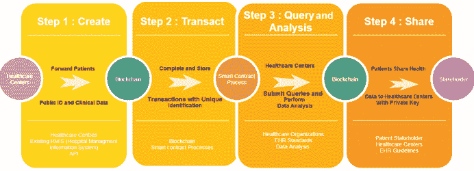

图示 5.1 区块链对医疗部门的影响。

图 5.1 描述了医疗领域去中心化账本技术的各个方面。这些被分为四个不同的部分。第一部分描述了区块链平台在患者和医疗提供者之间建立安全关系的能力，以便医疗数据或信息的顺利传输。不同的医疗机构为患者提供高效的服务，并使用账本技术管理临床数据。区块链有能力使用存储的患者身份处理所有交易。为了支持信任交易，区块链允许匿名方之间共享智能合约。

第三，它为医疗机构提供了患者医疗数据的安全访问和快速检索。现有的医疗数据用于通过演变新模式来提取有用的医疗信息。最后，一种 DLT 加密方法用于与各种医疗提供者共享敏感的患者信息。

微软、IBM、德勤和 Accent [4] 等知名公司还开发了进一步的区块链应用，致力于医疗部门的安全和其他功能建设。

### 5.3.4.1 BURSTIQ（科罗拉多州科罗拉斯普林斯）

BURSTIQ 应用 [2] 是为医疗提供者开发的，使用区块链确保大量患者数据的安全传输。它符合《健康保险流动性与责任法》(HIPAA) 的要求。

### 5.3.4.2 Factom（德克萨斯州奥斯汀）

Factom [2] 利用区块链平台在安全的芯片中存储患者的数字记录。此类应用仅供医院和医疗管理人员等机构访问私人医疗信息。

### 5.3.4.3 Medical Chain（英国伦敦）

Medical Chain [2] 平台维护健康记录并保护患者身份免受外部来源侵害。它在 2018 年 5 月发布了另一个名为 Myclinic.com 的应用。MyClinic.com 为视频咨询创建了平台。支付模块在区块链中实现。

### 5.3.4.4 Guard Time（加利福尼亚州欧文市）

Guard Time [4] 使用区块链平台用于网络安全。它与 Verizon 企业解决方案合作，部署基于 Guard Time 无密钥签名接口 (KSI) 的各种服务。

### 5.3.4.5 MedRec（MIT 媒体实验室）

MedRec [6] 利用基于 DLT 的智能合约建立提供者与患者的关系。智能合约是双方之间以代码形式编写的协议。它是去中心化的医疗记录管理系统，并提供医疗记录访问。最初，MedRec 是使用以坊实现的。使用私有区块链的主要优势是仅追踪其源头。

## 5.4 医疗保健的利益相关者

在当前情况下，如果没有区块链平台，许多研究人员、医疗提供者患者在访问医疗数据方面面临困难。此外，由于是敏感信息，大多数医疗提供者不共享临床或其他形式的患者数据。医疗领域的 DLT 保证了医疗数据的安全和隐私。根据调查报告 [7]，在 2009 年至 2018 年期间，有近 189,945,874 医疗记录丢失或被盗。

利益相关者在医疗部门起着重要作用。图 5.2 描述了涉及医疗领域的主要利益相关者。他们是患者（住院和门诊）、医疗机构（医院、医疗中心、医生、临床医生、实验师等）、数据分析师以及理赔或保险供应商。对于健康记录的详细分析和准确诊断，这些利益相关者之间的协调和沟通至关重要。这些信息随后被研究人员和 AI 专家使用，以提高医疗系统的性能。

## 5.5 健康记录的现状

从不同来源获取了大量且多样的医疗记录，源自传统方法、通过最新的智能技术收集文本、医学图像或 X 光射线报告和超声波、使用基于 Iota 的医疗设备、追踪器、AI 等收集实时患者数据。在医疗部门，采用电子健康记录 (EHR) 的通用标准是一个巨大的挑战。


## 区块链技术

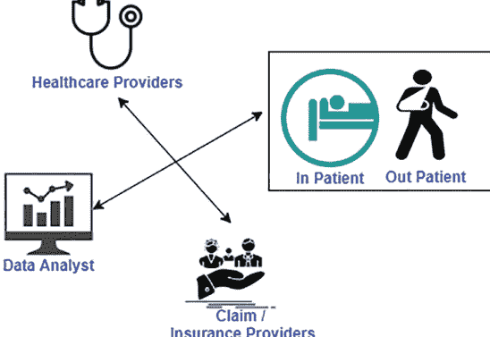

图 5.2 医疗系统的利益相关者。

电子健康记录（EHR）是一种以数字形式收集患者健康相关数据的系统。同样，个人健康记录（PHR）也有助于收集患者的数字临床记录。正如 Lee 等人 [8] 所定义的，EHR 分两种类型：通过智能设备或传感器收集的健康数据，以及电子病历（EMRs）。

### 5.5.1 电子病历

EMR 是由不同医疗机构收集的与健康相关的信息的集合。此类信息以患者一系列特定时间点信息的形式获取。医院和其他医疗中心记录的 EHR 数据列表如图 5.3 所示。

Tanwar 等人 [9] 提出了一种将嵌入区块链网络用于 EHR 共享的新颖方法。此类系统由四类利益相关者组成：患者、临床医生、技术人员和系统管理员。所提系统使用了智能合约，并通过区块交易中的共享对称性和私钥实现 EHR 数据向其他利益相关者的分配。针对四种不同参与者的控制管理，提出了各种算法。EHR 数据的分配通过 hyperledger fabric 和 hyperledger composer 完成。文献 [10] 中的调查讨论了可穿戴设备最适合监控目的。

另一种扩展版本的电子健康和移动健康应用被称为 S-Health（智能健康应用）。它的设计目标是从 EHR、PHR 和智慧城市基础设施中检索医疗数据，以开发相关的反馈系统。此类系统应建立在信任的基础上；解决某些特定的安全问题至关重要。文献 [10] 建议了一种基于区块链的框架 s-health 应用，以利用物联网 和 5G 保证信任。

## 区块链医疗中的问题与解决方案


图 5.3 电子病历。

## 5.5.2 IoT 传感器或基于 IoT 的医疗设备

如今，医疗行业已有各种人体可穿戴设备或智能手表等形式的智能设备可用。这些设备专为远程监控以及监测患者的各种健康参数而设计。在医疗领域，IoT 被确定为医疗健康物联网（IoHT）的子部门 [11]。用于 IoT 医疗领域检索医疗数据的各种传感器列如图 5.4 所示。

位嵌入 IoHT 有助于维护医疗记录的隐私。智能传感器节点 [12] 可以准确监测患者的主要健康参数，如温度、呼吸频率、心率、血压等。支持物联网的设备可以轻松部署以获取患者的详细信息。这种智能设备有助于跟踪患者的行为变化并在紧急情况下向医疗提供者发出警报通知。

Badr 等 [13] 提出了一种基于匿名加密的新协议（PBE-DA），使用基于区块链的多层框架保证 IoT–EHR 系统的有效性。

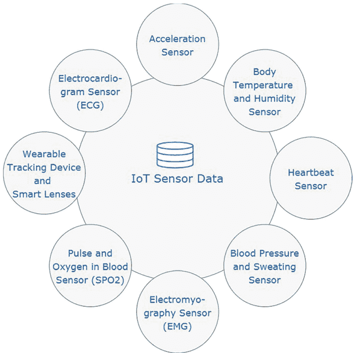

**图 5.4** 不同类型的 IoT 健康数据。

根据之前的研究，文献 [14] 讨论了基于联盟的区块链系统，以便高效地添加特定患者的新医疗数据。此类系统利用区块链和物联网在医疗数据中实现不可篡改性。

## 5.6 区块链在医疗中的用例及其解决方案

区块链在医疗领域的变革已将技术世界转变为一个全新的分布式且安全的基础设施。区块链的各种特性和功能 [15–18] 鼓励了领域专家解决许多问题，这种新型区块链技术（BT）取代了中间人。凭借现有的医疗基础设施，如今许多研究人员和医疗从业者正在与通信延迟、共享医疗信息的意愿以及信任交易作斗争。此外，特定供应商医疗系统的不兼容性在医疗通信领域造成了巨大的鸿沟。因此，要在利益相关者之间定义安全且信任的通信，并提供高效的以患者为中心的护理是非常困难的。

在医疗中使用案例场景的益处是确保数据的完整性和透明度。区块链的使用允许去中心化账本，其中医疗记录是不可篡改的，防止了未经授权的访问或数据篡改。这确保了患者数据在需要随时被授权提供者访问，同时保持高隐私标准。

### 5.6.1 医疗提供者和保险公司的用例

健康保险是一种涵盖医疗治疗费用的保险。在保险行业中，区块链可以使用智能合约实现理赔流程自动化，减少管理成本并加快赔付速度。通过提供共享账本，保险公司可以更准确地验证医疗记录，减少欺诈并为提供者和患者确保一个更高效的系统。

### 5.6.2 阿片类药物处方跟踪用例

阿片类药物是一种用于麻醉期间、术后恢复、身体障碍等缓解疼痛的药物。然而，阿片类药物的滥用是一个重大的公共健康问题。基于区块链的跟踪系统可以监控阿片类处方从开具到发药的生命周期。这有助于防止欺诈处方，并确保药物被合法患者使用，从而降低成瘾和滥用的风险。


# 块链医疗领域的问题与解决方案 87

分布式技术可以在共享且经许可的区块链平台上进行开发。该联盟根据预定义规则的共同协议，欢迎新成员加入系统。该模型通过获取完整的阿片类处方历史来检测处方，并通过数据可访问性来改善患者护理，从而为现有问题提供了解决方案。

## 5.6.3 远程医疗与患者护理用例

远程医疗也被称为“远程健康”，这是一种新的技术趋势，为居住在偏远地区并依赖电信的患者提供医疗服务。这项技术被那些医疗设施、医生或临床专家咨询有限的偏远地区患者使用；在这种情况下，远程医疗可以更快速、更高效的方式提供医生或临床专家咨询，而无需大量旅行。这种系统在降低成本和提供更好的以患者为中心的护理方面，对大多数发展中国家和发达国家更有利。

如今，许多智能手机应用程序和远程医疗设备已由政府或私立机构提供 24/7 的服务，为患者提供持续护理。这些用户友好的应用和设备被用作医疗管理系统。但此类技术的挑战 [21] 在于访问收集到的健康数据或医疗历史，这可能导致质量较差。为了加强各种医疗利益相关者之间的直接交互，BT 将异构健康数据库系统与区块链结构相结合。这种基于分布式和去中心化账本技术的患者分级概念设计如图 5.6 所示。

在概念性的基于区块链的结构中，带有虚线的中间元素表示一个安全的数据通道，用于在分布式技术中共享患者健康数据。数据通道通过基于智能合约的系统与密钥文件连接，以确保参与者之间数据交易的安全。

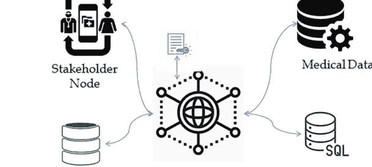

图 5.6 基于区块链的患者护理解决方案的高级概念设计。

## 5.6.4 癌症患者护理用例

根据国际癌症研究机构（IARC）调查报告，对全球负担（癌症负担）的最新估计每年新增近 1800 万病例，2018 年报告了 1000 万例死亡。使用有效的预防技术减少全球范围内癌症的增长至关重要。这是一个挑战性因素，因为诊断某些癌症并确定适当的治疗方案非常复杂。

今天，癌症患者可能希望从不同的医疗专业人员处对其临床状况和/或治疗建议寻求第二意见。在这种情况下，患者及其亲属需要手动将所有医疗数据带到医疗领域专家处。在这个时代，缺乏与相关医疗机构或区域癌症中心医院之间的安全数据共享流程，且手动这样做非常耗时，这延迟了治疗过程。为了给此类患者提供以患者为中心的护理，BT [21] 将为参与方提供一种信任关系。同时，区块链在数据共享实践中创建了一个安全网络。

根据文献 [21] 中的研究，数据共享功能有助于我们确保数据完整性，并减少临床试验中不合理的重复。此外，鼓励在不同地理位置进行基于人群的癌症登记，以便于数据收集和癌症控制。

## 5.7 区块链在医疗领域的挑战及其解决方案

在智能社区中，有很多智能设备，移动应用程序使用数字交易进行各种利益相关者之间的通信。在医疗行业中，产生了大量的医疗数据。在对医疗数据集进行实时分析时，需要基于云或雾的系统来获得高效的结果 [23]。

文献 [24] 中的论文调查指出了使用机器对机器（M2M）系统的基于规则的 beacon 系统进行数据管理。大多数医疗网络由中央机构管理和控制，可能会导致某些点的故障。在医疗领域，为了提供去中心化和分布化的方法，BT 是最佳选择。区块链是一种新兴的关键技术，用于在受信和分布式环境中转换或共享敏感信息。在本节中，我们将讨论医疗领域的所有各种研究挑战及其解决方案。

对于医疗管理，在数据完整性、安全性和隐私方面存在某些担忧。数据完整性规定了患者医疗数据的一致性和准确性。隐私是指对给予相关参与方的个人患者敏感数据的私有化访问。在转换或共享此类医疗数据时，存在入侵者攻击敏感信息的风险。对于数据共享，安全性是一个主要关注点，特别是在医疗行业。

Hassan 等人 [15] 解释了使用密钥加密策略保护基于区块链的 IoT 系统（如可穿戴设备或任何可穿戴健康设备）。此外，电子病历记录中的隐私保护技术也应用于医疗部门，以保护基于区块链的 IoT 系统中的隐私。为了保护患者身份，各种论文讨论了伪身份概念，将其作为患者在医疗提供者处注册的“合规证明”。

Omar 等人提出了一个基于区块链的平台 [25]，称为 MediBChain，用于匿名化医疗数据。它使用 MediBChain 协议来保证患者医疗信息的完整性、隐私性、可追溯性和安全性。

互操作是医疗领域的另一个主要关注点，涉及在不同医疗机构之间交换患者数据。此外，以患者为中心的互操作性 [26] 和患者驱动护理方面存在许多挑战。阻碍数据交换的技术障碍包括参与方之间的协议、患者匹配算法、政策法规以及政府规定。患者护理互操作的主要优点是减少重复、成本、浪费和手动数据输入，提高整体运营效率并提供全面的临床护理。

## 5.8 结论

在本章中，讨论了医疗领域的各种研究挑战及其解决方案。主要关注为参与者之间的医疗数据交换设计安全医疗网络模型的必要性。本章探索了去中心化账本技术的应用，这了健康数据需要认证、分布式且不可篡改的需求。此外，BT 开发的各种应用分为三类：患者护理管理、药品供应链管理和基因组市场的区块链连接。


## 区块链技术

数字交易。总体而言，医疗保健领域仍有许多研究机会，以构建可行的区块链网络设计。

## 参考文献

- 1. D. Dave 等. 区块链技术及其解决方案综述，第3届物联网最新进展国际讨会：技术与应用方法 (IoT-T&A 2019)，2019年11月4–7日，葡萄牙科布拉，Procedia Computer Science 160 (2019) 740–745。
- 2. https://builditin.com/blockchain/blockchain-healthcare-applications-companies
- 3. https://lashedhealth.com/
- 4. A. Sharma 等. 医疗保健中的区块链应用研究，Springer Nature Pvt Ltd., J. C. Hung 等； FC 2018, LNEE 542, pp. 623–628, 2019
- 5. https://data-flair.training/blog/blockchain-genomics/
- 6. D. Munro, 2015年医疗保健数据泄露总数超过1.2亿条记录，vol. 31, Forbes,纽约，2015。
- 7. C. Lee, Z. Luo, K. Miao, M. Zhang, K. Zheng, G. Chen, W.L.J. Yip, 大规模医疗数据分析：挑战与应用，《智能医疗保健大规模分布式计算手册》，Springer, Cham, 2017, pp. 11–41.
- 8. S. Tawar 等. 用于医疗保健4.0应用的区块链电子健康记录系统，Journal of Information Science and Services 50 (2020) 102470, 2214–2216.
- 9. I. Misty 等. 用于工业自动化的5G-IoT中的区块链：系统性综述、解决方案与挑战，Mechanical and Signal Processing 153 (2020) 106382, doi: 10.1016/j.mspsp.2019.106382
- 10. M. F. Clegg 等. 区块链及其在趋势本质、创新营销和旅游中的作用，Springer in Business and Economics, pp. 1029–1038, doi: 10.1007/978-3-030-12453-3
- 11. P. Rakshit 等. 医疗保健中的物联网，物联网(IoT)生态系统原理：互联网范式，http://www.springer.com/series/8857, ISSN 1868-4394, ISBN 978-3-3395-3, pp. 263–276.
- 12. S. Bard 等. 针对IoT-EHRs的多层区块链框架，Systems，第9届新兴泛在系统与感知网络国际会议 (EUSP)，2018, Computer Science 141 (2018) 159–166.
- 13. R. Pathee 等. 区块链与物联网简介，区块链技术的高级应用，大数据中的统计 60, doi: 10.1007/978-3-981-8775-3
- 14. M. Ul Hassan, M. Rehmani, 基于区块链的IoT系统中的隐私保护：集成问题、挑战与未来方向，Future Generation Computer Systems 97 (2019) 512–529.
- 15. S. Xie 等. 用于云边缘的区块链：一种综述，Computers and Electrical Engineering 81 (2020) 106526, doi: 10.1016/j.compe2019.106526
- 16. T. Mcchin 等. 医疗保健应用中的区块链：研究挑战与机会，Journal of Network and Computer Applications 135 (2019) 62–75.
- 17. K. Saedi 等. 构建区块链应用：医疗保健提供者和保险公司的案例，Springer Nature, pp. 785–800, FTC 2019, AISC 1069, pp. 785–801, 2020, doi: 10.1007/978-3-030-32520-6
- 18. H. C. Lim 等. 企业与未来颠覆性技术创新：用于案例设计与开发的区块链账本描述框架 (BLDF)，Springer Switzerland AG 2020, K. Arai, R. Bhatia (编)： FICC 2019, LNNS 70, pp. 533–540, 2020. doi: 10.1007/978-3-030-12385-7
- 19. S. Abdullah 等. 放射科区块链综述，Academic Radiology 27 (1) (2020) 47–57
- 20. P. Zhang 等. 医疗保健中的区块链技术用例，Advances in Computers ISSN 0065-2458; Elsevier, 阿姆斯特丹，2018 doi: 10.1016/bs.adcom.2018.03.006
- 21. V. Vetrislevi 等. 使用区块链技术保障医疗保健以防止伪造，可持续发展的信息通信技术，Advances in Intelligent Systems and Computing 933, pp. 151–158, doi: 10.1007/978-981-13-716-0
- 22. S.S. Gill 等. 物联网、区块链和人工智能对云计算的变革性影响：演进、愿景、趋势与开放挑战，Internet of Things (2019), doi: 10.1016/j.iot.2019.100118
- 23. S. Aggarwal 等. 智能社区区块链：应用、挑战与机会，Journal of Network and Computer Applications 144 (2019) 13–48
- 24. A.A. Omar 等. 基于区块链环境云端医疗数据隐私友好平台，Future Generation Computer Systems 95 (2019) 511–521. doi: 10.1016/j.future.2018.12.044
- 25. W.J. Gordon 等. 用于医疗保健的区块链技术：促进向患者驱动的互操作性转变，Computational and Structural Biotechnology Journal 16 (2018) 224–230


# 提高区块链安全性

机密性、隐私性、身份验证、拒绝服务、攻击、自维护和部署是物联网应用在区块链领域面临的挑战。

目前的研究表明，区块链可以是物联网安全警报的解决方案 [3]。目前的物联网是一个中心化系统，每个网络节点都受到管理，并以中心化的方式进行身份验证；当区块链与物联网集成时，扩展性是另一个问题 [4]。区块链提供了去中心化的认证和监督系统，可以实现机密性 [5]、安全身份验证。

## 6.2 物联网应用

### 6.2.1 智能可穿戴设备

可穿戴设备用于计算血压、糖尿病、血糖、肥胖和 BMI 等约束条件。由于人口面临严重的健康问题，需要进行监控，这可以通过可穿戴设备完成 [12]。如果在紧急情况下没有标记警告问题，将给患者带来巨大问题；可穿戴设备的输出必须准确，否则对患者来说将是一个非常大的问题。开发了复杂的算法以合理的 [13] 准确率注意到人体参数的变化。近场通信 [1] 传感器通过远距离和不同范围的通信监测人体参数（图 6.2）。

传感器通过远距离通信和短距离通信监测体内的各种参数。数据采集通过通过网络设备进行机器间通信完成 [14]。可穿戴设备不仅监控患者的健康参数，还监控医院所需的资源，如房间、护士、设备和床位的可用性。

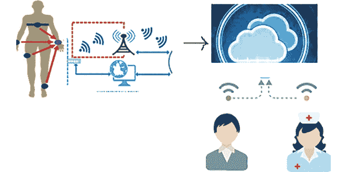

图 6.2 基于物联网的医疗。

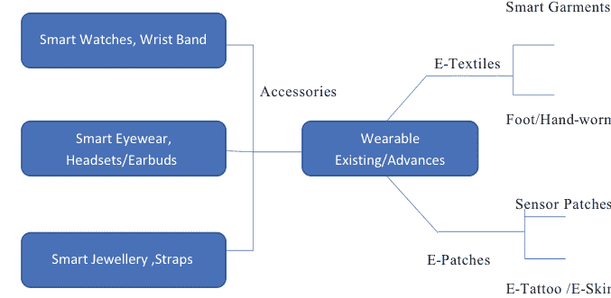

去中心化、独立性、透明性、安全性、共享验证、匿名性和隐私是区块链的设计目标。

# 提高区块链安全性

- 1. 去中心化：区块链在去中心化的公共网络中存储数据。区块链消除了单点故障漏洞。它以去中心化的方式使用公共账本。区块链的主要优势是它也消除了对第三方的需求。

- 2. 独立性：区块链使用个体实体可以控制区块链的机制。为了交换网络中的信息，区块链遵循大多数节点的共识，这保证了可靠性和一致性，而无需任何第三方形式 [6]。

- 3. 透明性：在区块链账本系统中，欺诈交易无法被包含。每当数据要更新或删除时，它都能保持最高水平的透明度。它由网络中的矿工进行验证和认证 [11]。

- 4. 安全性：独特的加密认证签名和共识机制为网络中的每个节点提供了安全性，验证每个区块。用户使用公钥加密算法对其交易进行数字签名。因此，如果中心化网络中的任何信息被修改，签名将变得无效。

- 5. 共享验证：每笔交易都由区块链中的矿工验证并添加，这消除了区块链网络中第三方的必要性。

- 6. 匿名性：区块链使用变化的密钥 (PK) 对每个交易进行签名，并使用公钥加密验证用户并控制访问，这提供了匿名性。

- 7. 隐私：区块链系统在去中心化网络中提供点对点的隐私和安全。例如，以太坊通过区块链技术提高了隐私。

## 6.4 工作流程

- 1. 广播交易：用户请求的每个交易都使用 PK 加密，然后广播到区块链的对等网络。

- 2. 交易验证：可以使用公钥加密算法通过对请求节点的身份验证来验证交易。

- 3. 区块验证：网络中的每个区块通过执行执行共识算法（如工作证明 (PoW)、权益证明 (PoS) 或概念证明）进行验证。

- 4. 添加到区块链：验证过的区块以稳定且不可逆的方式被包含在区块链中。

## 6.5 区块链结构

区块链结构可能根据不同的应用而异。每个区块都有前一个生成区块的哈希、键值、时间戳信息，用于解决任何共识算法（如 PoW 或 PoS 谜）。区块的关键数据可能随应用而异，例如物联网机器间通信数据、智能合约记录、银行合约 [7] 等。在每笔交易时，用户使用时间戳数据证明并将其发送到接收节点以实现机器通信。

## 区块链技术

98

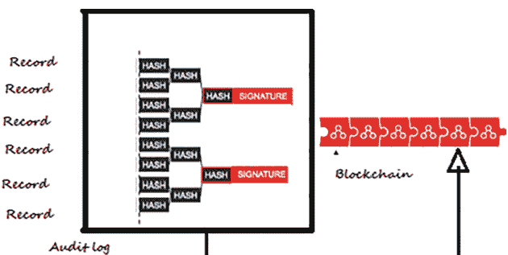

图 6.4 使用区块链保护数据库记录和审计日志。

物联网可以从区块链提供的技术中显著受益，并将有助于开发目前的物联网技术（图 6.4）。

## 6.6 共识算法

为了避免区块链中的欺诈活动，系统不依赖第三方权威，而是由网络中的每个节点防止安全性的破坏，并跟踪节点上的交易，以规避不可争议的欺诈活动交换。共识机制是节点之间的协议，并共享要添加到每个区块中的共同利益。

### 6.6.1 工作量证明 (PoW)

PoW 是一种防御机制 [10]，数据的可信度通过 PoW 进行验证。它是一种用于寻找数学问题解决方案的技术。解决数学问题需要大量的计算能力。每笔交易都通过一个哈希值的谜题进行验证。解决方案由网络中的矿工提供，它们需要计算力和时间。

谜题的难度程度不同，因此可以固定创建更多区块的限制。如果多个节点同时发现正确的解决方案，等待时间最长的邻居节点可以接受网络中的区块。

### 6.6.2 权益证明 (PoS)

PoW 降低了整个区块链的吞吐量，因为它需要大量的计算能力来解决复杂的谜题，这可以通过不需要太多计算能力的 PoS 机制来克服。

PoS 通过支付一定数量加密货币（称为质押）向区块链中添加节点。恶意节点由该节点识别，如果区块是真实的，对等节点将其验证并添加，给予奖励；如果区块在系统中被拒绝，发起者将丢失某些加密货币。这种机制将防御恶意攻击，发起的方将失去质押。

### 6.6.3 委托授权权益证明 (DAPOS)

委托授权权益证明中遵循选择的身份认证选举过程。

DPoS 用户以其候选人的名义通过签名/代币/密钥参与“见证人”和“代表”的选举过程。

见证人和代表的积分值在不同的加密货币中可能不同。每个角色可以参与增加角色的工作，甚至移除它。这些动态小组可能随时间变化。由矿工维护的真实性将以检查选举过程。

## 6.7 加密数字账本和撤销账本

公钥基础结构 (PKI) 为网络中的信息传输提供保护，它是一组互联网技术形成的 PKI，例如 HTTPS——它确保了信息来自经过验证的源（图 6.5）。

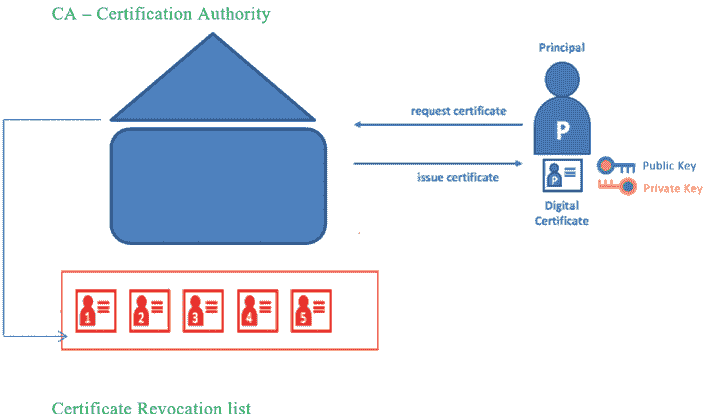

图 6.5 公钥基础结构。


## PKI 的元素包括：

- 1. 证书机构（CA）：CA 向双方颁发数字证书，并通过与其环境的交换对双方进行身份验证。
- 2. CA 的证书吊销列表（CRL）：被吊销的证书列在 CRL [8] 中。它为不再使用的被吊销证书创建一个引用。证书的取消有很多原因。例如，证书因为加密密钥泄露而可能被吊销。

区块链（BC）网络也依赖 PKI 标准来保证各种网络之间安全的对点通信，它确认了发布在 BC 上的通信消息经过了身份验证。

PKI 有四个关键元素：

- 数字证书
- 公钥和私钥
- 证书机构
- 证书吊销列表

## 6.8 数字证书

与证书所有者或用户相关的属性集称为数字证书。数字证书是符合 X.509 标准的常见证书类型。最常见的证书类型是符合 X.509 标准的，其中节点细节编码是结构化并维护的。

X.509 证书示例，X.509 证书中有许多属性（图 6.6）。

描述用户的数字证书位于主体（subject）中。证书包含许多信息，例如其公钥在证书内发布，所有人可见，而私钥必须保持私密。

```
Certificate:
Data:
Version: 3 (0x2)
Serial Number: 2 (0x2)
Signature Algorithm: sha1WithRSAEncryption
Issuer: O=www.freelen.org, OU=freedom
Validity
Not Before: Apr 27 10:54:40 2012 GMT
Not After: Apr 25 10:54:40 2022 GMT
Subject: OU=Freedom, CN=couchbase-bob/emailAddress-bob@freelen.org
Subject: Public Key Info:
Public Key Algorithm: rsaEncryption
Public-Key: (4096 bit)
Modulus:
--
```

图 6.6 X.509 证书

## 区块链安全性提升基础

在 BC 中，用户属性可以在干扰时使用加密技术记录，任何干扰或更改将导致证书失效。用户需要使用加密技术证明其身份，这允许用户向 BC 中的其他人展示其证书；证书机构（CA）颁发证书并保留加密信息，任何读取证书的人都可以确信用户信息未被篡改。X.509 证书是一种难以篡改的数字身份。

## 6.9 公钥/私钥加密算法

发送者和接收者需要机密性和身份验证以确保交换的信息经过验证。消息消息身份验证确保了“完整性”，意味着消息传输不能被修改。数字签名是传统的身份验证机制，使用数字签名并允许源和目的地进行数字签名。这种签名机制保证了被签名消息的完整性。该机制要求将公钥公开作为身份验证锚点，并使用私钥在通信上生成数字签名。

接收方可以通过检查签名对发送者是否有效来验证所接收消息的来源和可靠性。

通过私钥和相应的公钥可以实现安全通信。由于密钥之间的数学连接，私钥用于在相应的公钥上生成签名，两者匹配时，如果验证签名未被篡改，则源是有效来源（图 6.7）。

## 6.10 证书机构

加入 BC 网络需要数字身份。受信任的机构颁发数字身份，数字身份是由 CA 颁发的验证形式。更流行的 CA 有 GeoTrust、Symantec（原 Verisign）、DigiCert、GoDaddy 和 Comodo。这些是互联网安全协议的共同部分（图 6.8）。

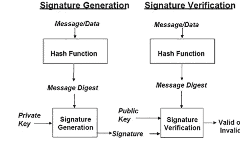

图 6.7 签名验证模型。

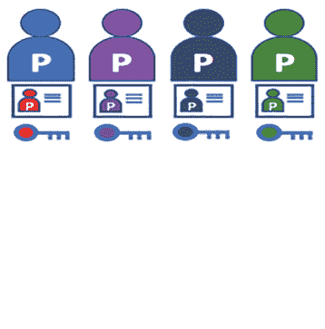

## 图 6.8 证书机构

CA 向网络中的不同参与者分发证书。所有证书都由 CA 进行数字签名，并与参与者的公钥绑定。CA 也有证书，CA 的身份可以通过检查证书是否由相应私钥的持有者生成来验证。在 BC 中，每个加入网络的节点都需要一个身份。一个或多个 CA 可以从数字角度定义网络中的参与者，每个参与者都需要验证自己的数字身份 [16]。

## 6.10.0 信任链

CA 有两种类型：

- 1. 根 CA：它们向用户颁发数百万证书。
- 2. 中间 CA：其证书由根 CA 或另一个中间机构颁发。

上述场景形成了“信任链”的创建，被视为追溯到提供安全性的根 CA 的最佳方式，使用中间 CA 交付给用户的证书提供了保证——如果根节点被攻破，整个信任链都会处于危险（图 6.9）。

## 6.10.1 FABRIC CA

Fabric 提供了一个内置的 CA 组件，它是一个私有根 CA，为拥有 X.509 证书的 Fabric 参与者提供数字身份 [17]。Fabric CA 管理根或中间 CA 以提供身份。

## 区块链安全性提升

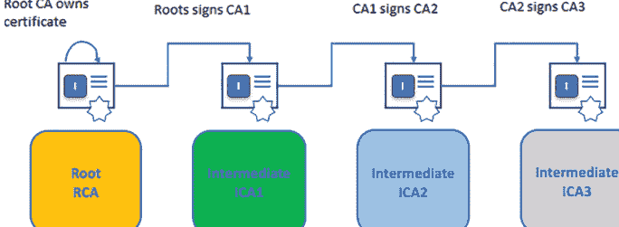

图 6.9 信任链

## 11 证书吊销列表

CRL 是由于任何原因被吊销的证书列表。当一个参与者想要验证时，会由 CA 进行检查。如果节点被攻破，证书就会被吊销。在 BC 中，会根据 CRL 进行检查。

## 6.11.1 BC 中的加密学

BC 中的信任是通过加密算法建立的。物联网区块链：系统性文献综述。

## 6.11.2 BC 中加密的类型

BC 的数据通过加密和函数进行验证。

## 6.11.3 加密算法类型

- 公钥加密：用户身份验证和 BC 数据通过公钥完成。公钥与他人共享，私钥则保持保密。
- 哈希函数：加密哈希生成一个固定的 32 字符字符串。对原始数据的简单更改都会创建一个新的哈希值。BC 中的每个区块都有哈希，该代码是由前一个区块的组合生成的。

## 区块链技术

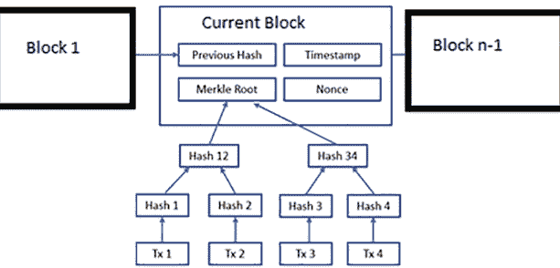

图 6.10 Merkle 树

哈希代码经过验证但无法更改。任何更改哈希链的尝试都会破坏 BC 信任链。

- Merkle 树：通过 Merkel 对 BC 数据进行高效验证。每个区块都有一个 Merkle 根，用于存储区块中的哈希，通过这个 Merkle 根，当前交易可以随哈希值发送。为了确认交易，节点本身可以计算哈希值而无需验证区块中的所有节点。

## 6.12 结论

BC 技术在许多领域得到了探索，包括公共生活和政府事务，公私部门目前允许实施 BC 技术。对于私有部门，BC 的效率高且成本低。在去中心化平台如 BC 技术中决定了许多问题。在公共 BC 中，技术可以使用公平的方法维护存储记录的完整性和机密性，但其分布式特性允许不同的参与者“所有”。

## 参考文献

- 1. K. Christidis and M. Devetsiot, “Blockchains and smart contracts for the Internet of Things.” IEEE Access, vol. 4, pp. 2292–2303, 2016.
- 2. M. Conscenti, A. Vetro, and J. C. De Martin, “Blockchain for the Internet of Things: A systematic literature review,” in Computer Systems and Applications (AICSA), 2016 IEEE/ACS 13th International Conference of. 2016, pp. 1–6.
- 3. J. C. Song, M. A. Demir, J. J. Prevost, and P. Rad, “Blockchain designed for decentralized IoT networks,” in 2018 13th Annual Conference on System of Systems Engineering (SoSE). IEEE, 2018, pp. 169–174.


# 提升区块链的安全性

- 4. A. Dorri, S. S. Kanhere, R. Jurdak, and P. Gauravaram, “LSB: 一种物联网安全与隐私的轻量级可扩展区块链，”arXiv preprint:1712.02969, 2017.
- 5. A. Dorri, M. Steger, S. S. Kanhere, and R. Jurdak, “区块链：汽车安全与隐私分布式解决方案，”IEEE Communications Magazine, vol. 55, no. 12, pp. 119–125, 2017.
- 6. A. Moinet, D. Bartys, and J-L. Barill, “基于区块链的去中心化传感器网络信任与身份认证，”arXiv preprint:1706.01730, 2017.
- 7. S. Greenwood, “超越比特币的区块链，”Communications of the ACM, vol. 59, no. 11, pp. 15–17, 2016.
- 8. T. Hardjeno and N. Smith, “使用许可区块链对受限设备进行云端调 own，”第2届ACM物联网隐私、信任与安全国际研讨会，ACM, 2016, pp. 29–36.
- 9. Z. Xiong, Y. Zhang, D. Niyato, P. Wang, and Z. Han, “当区块链遇到边缘计算：挑战与应用，”arXiv preprint:1711.05938, 2017.
- 10. K. Kuwanakaemee, D. T. Hoang, D. Niyato, S. Sawadisitang, P. Wang, and Z. Han, “移动区块链的性能分析与应用，”2018年国际计算、网络与通信会议 (ICCN)。IEEE, 2018, pp. 642–646.
- 11. A. Balaramuram, V. Palanisisamy, and T. Parusothaman, “IPSD：一种提高无线传感器网络寿命的新覆盖保护与连接管理方案，”IEEE Transactions on Communications, vol. 11, no. 1, pp. 26–36, 2012.
- 12. P. T. Selvy, V. Palanisisamy, “MR图像脑肿瘤检测中聚类算法的性能分析，”European Journal of Scientific Research, vol. 62, no. 3, pp. 321–330, 2011.
- 13. K. Ahmed, S. Roy, B. K. Paul, M. N. Aktar, D. Vignesaran, and M. S. Islam, “太赫光谱下基于折射率的光学传感，”IEEE Sensors Journal, vol. 19, no. 14, pp. 3368–3375, 2019.
- 14. D. S. Santhivathavan and K. Sankarayanan, “IPv6鲁健传输机制，”European Journal of Scientific Research, vol. 34, no. 1, pp. 110–124, 2009.
- 15. S. Sathya Bama, M. S. Imran Ahmed, and A. Saravanan, “通过Web内容挖掘提升搜索引擎性能的数学方法，”Journal of Theoretical and Applied Information Technology, vol. 60, no. 2, pp. 343–350, 2014.
- 16. N. K. Shreeja and A. Sankar, “基于蚁群优化算法特征选择的模式匹配分类，”Applied Soft Computing Journal, vol. 31, no. 2818, pp. 91–102, 2015.
- 17. K. Raveena, E. Elavarasi, and M. Kaaviriya, “调查性Web应用开发，”AJAST, vol. 2, no. 2, pp. 143–147, 2018.


# 基于区块链的集成健康记录 – 健康信息的新模型

Usharani Chellurai and Seethalakshmi Pandian, Anna University, 目录
- 7.1 引言 ................................................................................ 107
- 7.1.1 区块链技术 ....................................................... 108
- 7.1.2 医疗保健对区块链的需求 ........................................ 108
- 7.1.3 区块链技术中的欺诈检测 ........................................ 110
- 7.2 相关工作 ....................................................................... 110
- 7.3 集成健康记录/健康数据 ............................................ 110
- 7.3.1 IDHR整合医疗行业目标 ................................................ 111
- 7.3.2 医药行业收入 ....................................................... 115
- 7.4 结果 ................................................................................ 116
- 7.5 结论 ................................................................................ 117
- 参考文献 ................................................................................ 117

## 7.1 引言

医疗保健对人们至关重要；随着技术的发展，人们对健康变得更加关注。糖尿病、事故每天发生；人们在不同的医院看不同的医生进行诊断和治疗。由于这些原因，医疗行业发生了巨大变化，健康数据转变为数字化，但仍然从医院移动到医院。主要问题是健康数据没有被正确收集、维护和网络化。人们可能会遭受许多疾病；或者区块链技术


**图 7.1 集成医疗**

在不同的医院看不同的医生。在这种情况下，无法在医院之外快速访问其健康报告。这导致了许多问题，由于无法在医院之外快速访问其健康报告。 (注：此处OCR文本存在重复性错误，已按要求提取唯一内容）。

*修正后的流程：*
在不同的医院看不同的医生。在这种情况下，无法在医院之外快速访问其健康报告。这导致了许多问题，由于无法在医院之外快速访问其健康报告。 (注：此处OCR文本存在重复性错误）。

*仔细仔细OCROCR文本：*

在不同的医院看不同的医生。在这种情况下，无法在医院之外快速访问其健康报告。这导致了许多问题，由于无法在医院之外快速访问其健康报告。 (注：此处OCR文本存在重复性错误)。

*我将提供修复的版本：*

在不同的医院看不同的医生。在这种情况下，无法在医院之外快速访问其健康报告。这导致了许多问题，由于无法在医院之外快速访问其健康报告。 (注：此处OCR文本存在重复性错误)。

*我将提供干净的逻辑文本：*

在不同的医院看不同的医生。在这种情况下，无法在医院之外快速访问其健康报告。这导致了许多问题，由于无法在医院之外快速访问其健康报告。


## 7.1.3 区块链技术中的安全与欺诈检测

数字货币的传输与患者个人数据的传输有所不同。大量的个人健康数据是通过成百上千次的就诊形成的。对于临床医生来说，搜索整个链并及时访问特定数据将非常繁琐。区块链技术使用数字公钥来保护每个人的数据 [14,15]。在区块链驱动的健康系统中，数据是不可能被黑客或攻击的。他们无法找到数据属于谁，也无法像传统的 DBDMS（分布式数据库管理系统）那样操作数据。同样，在区块链健康系统中，医生无法获得所有患者记录的访问权限。这种复杂且直观的技术解决了可能可以作为所有当前健康问题替代方案的所有问题。

## 7.2 相关工作

在本节中，我们回顾了现有的基于区块链的医疗系统工作。Namoto [1] 发表了名为《比特币》的论文，这是一种基于点对区块链的电子现金系统。区块链是一个账本或分布式数据库，存储在没有任何中央控制的分布式点对点网络中。一旦在启用区块链的网络中创建了条目，它就是不可更改的。

Liu [3] 为医疗服务提供了一种可靠的区块链架构。该系统展示了一种具有成本效益的保险账单方法。Lan [4] 明确阐述了电子健康系统中建立反馈机制的重要性。反馈机制可以节省人力并显著提高医疗系统的性能。如果制药行业有一个公平的机会来生产无任何副作用的改进药物将是。Liang [5] 讨论了将保险数据整合到集成医疗数据库中。这将确保国家内的每个人都能享受到医疗保险，从而通过智能医疗保健系统实现整个国家的完全覆盖。

## 7.3 集成数字健康记录/数字健康数据

集成数字健康记录（IDHR）的主要目标是将多文化、多语言的人们整合在一个屋檐下。在这一 IDHR 中，我们可以在“一国”计划中维护人类从出生到死亡过程的准确性，国家可以采用基于区块链的国家智能医疗保健系统。IDHR 方法允许人们成为自己数据的所有者。一旦国家任何地方输入了新数据，IDHR 就会立即更新。我们可以通过 IDHR 检查全国范围内核心活动的每一个时刻。该系统还可以监测粗出生率/死亡率；每一分钟我们都可以监测粗出生率和粗死亡率（图7.3）。

## 基于区块链的数字健康记录

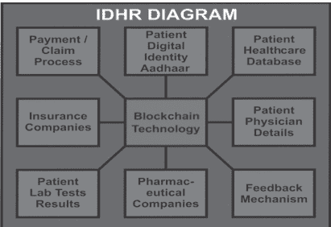

图 7.3 集成数字健康记录。

### 7.3.1 IDHR 整合医疗行业不同领域的目标

- Aadhaar – 医疗服务的数字身份
- 医疗服务提供者 - 医院、医生医疗设备
- 跨医疗行业的不连接的医疗数据库
- 保险公司
- 制药行业

A. Aadhaar/数字身份：“Aadhar”的创建目的是向所有印度居民发放唯一的身份识别码（UID），名为“Aadhar”。该系统足够强大，可以消除重复身份，并以一种简单、成本效益高进行验证和认证。在印度，99% 的人口拥有 Aadhaar 卡，这是印度政府为了整合到医疗领域而必须实施的。Aadhaar 的整合将原始身份带入医疗系统，降低了患者身份识别的复杂性（图7.4）。

健康记录系统必须提供识别以下类型患者的规定（表7.2）：

1. 执行者必须确保 Aadhaar 号码可用，然后它是作为唯一健康标识符提供服务的优选标识符。如果 Aadhaar 号码不可用，系统应允许用户为系统中的每个患者创建多个标识符，称为临时标识符。
2. 跨 EHR（电子健康记录）系统的患者识别：由于缺乏使用 Aadhaar 或任何替代的国家唯一标识符的强制，在两个 EHR 系统之间交换时匹配患者记录是困难的。这可能导致在不同地点和/或解决方案中使用同一种人的本地标识符和身份证号的不同组合。

## 区块链技术

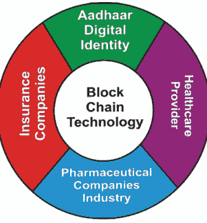

图 7.4 医疗领域的整合。

### 表 7.2
Aadhaar 详情

| 序号 | Aadhaar 的益处 |
| :--- | :--- |
| 1. | 唯一 ID |
| 2. | 个人详情 |
| 3. | 虹膜和指纹信息 |
| 4. | 银行详情 |

**B. 医疗数据库：** 在当前场景下，没有一家医院拥有患者的既往病史。如果患者想访问多个医疗机构进行咨询，或者从一家医院转诊到另一家，由于每个健康提供者都有自己的软件，通信会出现延迟，导致后续医生无法获得患者临床史记录。不连接的传统数据库不足以预测未来的生活方式和生命威胁疾病。一种解决方案是 IDHR 促进整合不连接的医疗数据库，带来从出生到死亡的临床摘要和所有医疗数据以便更快治疗（表7.3）。

**C. 保险公司：** 在印度，有几家保险公司拥有巨大的保单来涵盖医疗治疗费用。在印度，所有公民都能获得政府通过税收提供的某些健康保障。医疗保险通常是雇主福利的一部分。由于经济状况、文盲和对查询的顾虑，大多数人并不保险。少数人拥有政府资助的医疗保险，但由于或其他原因，他们无法及时充分使用，这导致了保险公司的增加。

## 基于区块链的数字健康记录

### 表 7.3
基于区块链的 IDHR 与传统数据库系统的对比

| 基于区块链的 IDHR | 传统数据库 |
| :--- | :--- |
| 分布式管理 | 无去中心化/任何人都可以管理 |
| 患者管理 | 一个出现故障将影响整个系统 |
| 不可更改/未篡改 | 数据易于更改 |
| 源可验证的医疗记录 | 任何人都可以登录并访问记录 |
| 健壮性/可用性 | 患者记录存储风险高：由于不可用性 |
| 海量医疗数据随时随地可用 | |
| 安全性/隐私性 | 医疗记录的安全性和隐私性较低： |
| 更高的安全性和隐私性 | 因为每个人都获得了访问权限 |

## 城市18%和农村14.1%的健康保险

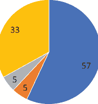

- 印度保险公司
- 政府医疗保险
- 企业提供的专属健康保险
- 寿险以外保险

图 7.5 印度保险公司。


114
区块链技术

# 2017–2018年保费收入

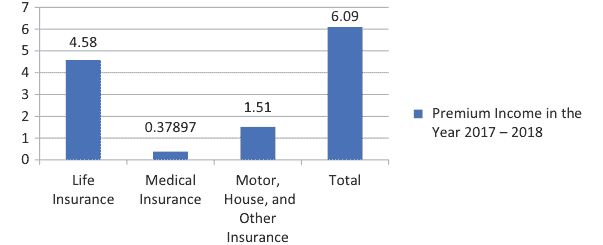
图 7.6 2017–2018年近似保费收入。

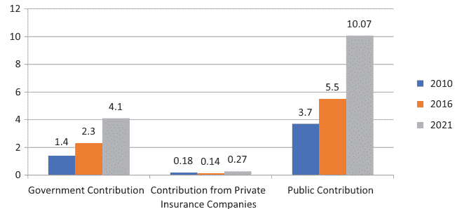
图 7.7 2016–2021年保险公司的贡献增长。

## 表 7.4
区块链增强型理赔流程的优势

| 区块核心优势 | 增强的保险理赔流程 |
| :--- | :--- |
| 去中心化管理 | 实时理赔处理：从保险理赔流程中消除中间环节的能力是使区块链区别于其他技术的能力 |
| 不可篡改 | 改进的理赔审计和欺诈检测：所有保险支付方、私人和政府保险公司以及个人支付者都享有审计便利和更好欺诈检测的益处 |
| 数据溯源稳健性/可用性 | 理赔资格的可验证记录：增强患者数据的可访问性：患者数据可从多个提供者处访问 |
| 安全/隐私 | 增加医疗记录的安全性：增加患者医疗保险信息的安全性 |

# 基于区块链的数字健康记录

### D. 制药行业

制药公司在医疗领域发挥着至关重要的作用。他们在研究、开发和营销方面投入了巨资。印度是全球最大的仿药供应商。印度制药业供应了全球各种疫苗需求的50%、美国仿药需求的40%以及英国所有药物的25%。印度制药公司在制药部门起着重要作用。该国还拥有规模庞大的科学家和工程师群体，他们有潜力引导行业迈向更高水平。目前，全球范围内用于对抗艾滋病（获得性免疫综合征）的抗逆病毒药物超过80%由印度制药公司供应。但药物与患者之间仍然处于隔离状态。有必要通过反馈机制将药物数据整合到智能医疗健康领域，这种机制支持患者、医生和医疗服务提供者之间的整合，从而改进药物产品，并让医生轻松识别药物耐药性和过敏。

药物耐药、过敏和假药只能通过基于区块链的身份健康记录（IDHR）识别。如果没有医疗服务提供者之间数据库的整合，医生将无法识别患者的药物耐药和过敏。这将给患者带来负面结果。对于威胁生命/慢性疾病，药物耐药性在健康领域起着至关重要的作用。

### 7.3.2 制药行业收入

印度制药公司正在充分利用监管市场和非监管市场的出口机会（图 7.8）。在2017财年，印度出口了价值约168亿美元的医药，预计这一数字到2020年将达到400亿美元。在2017年4月至2018年2月期间，印度出口的医药价值为671.7亿印度卢比（119.0亿美元）。

2010–2020年制药工业的增长

### 印度制药行业收入

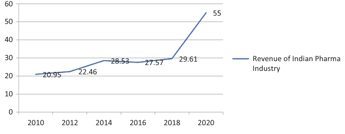
图 7.8 2010–2020年印度制药行业收入。

116
区块链技术

- 印度是全球最大的仿药供应国；该国的仿制药占全球出口量的20%（按数量计算）。
- 印度药物出口到全球200多个国家。2016–17年，印度168亿美元的医药产品约有40.6%流向美洲，其次是19.7%的欧洲、19.1%的非洲和18.8%的亚洲国家。

## 7.4 结果

- 基于区块链的IDHR系统旨在提供患者日志/治疗历史
- 改进医疗专业人员之间的沟通
- 提高患者数据和记录的安全性和机密性
- 减少数据和程序、处方或转诊的重复
- 通过保险简化理赔处理/支付
- 监控药品供应链/药物质量
- 改进临床决策能力和问责制
- 避免重复实验室检查以促进快速治疗
- 疾病/药物模式生成
- 疾病预防生活方式疾病
- 欺诈检测不当治疗
- 确保医疗保健更好的质量

表7.5显示了基于区块链的IDHR与传统数据库在医疗措施上的对比（图 7.9）。

| 序号 | IDHR 指标 |
| :--- | :--- |
| 1 | 出生人口性别 |
| 2 | 建议接种必要的疫苗，如脊灰炎、风热、结核 |
| 3 | 血型/粗型鉴定 |
| 4 | 掺假 |
| 5 | 产死率 |
| 6 | 跟踪疟疾、登热、鼠疫等季节性疾病 |
| 7 | 支持国家任务：人口控制（家庭计划） |
| 8 | 在印度医学委员会（MCI）注册的医生，限制并识别假医生 |
| 9 | 监测主要疾病和受疾病影响的地区 |
| 10 |降低死亡率并提高整个系统的健康结果 |

# 基于区块链的数字健康记录

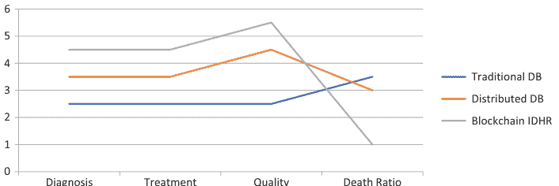
图 7.9 基于区块链的医疗系统的性能。

## 7.5 结论

基于区块链的医疗系统提供了去中心化、不可篡改、稳健性/可用性和安全性。该系统在处理医疗数据时通过区块链技术，增加了患者医疗保险信息的安全性。通过区块链技术，可以改进药物产品，并让医生轻松识别药物耐药性和过敏。研究表明，基于区块链的医疗健康记录（Blockchain-based IDHR）能够提高医疗保健的质量。这种技术在医学领域发挥着至关重要的作用。

## 参考文献

基于区块链的身份健康记录（Blockchain-based IDHR）系统旨在提供患者日志/治疗历史。


# 8 块链主要协议全面研究

S. Palanikumar 和 Sivaprasad Abirami
Noorul Islam Centre for Higher Education Shah and Anchor Kutchhi Engineering College

## 目录

- 8.1 引言 ............................................................................................ 120
- 8.2 块链基础 ................................................................................... 120
- 8.2.1 点对点网络 (P2P) ................................................................ 121
- 8.2.2 分布式账本系统 ................................................................... 121
- 8.2.3 密钥密码学 ................................................................................ 121
- 8.2.4 哈希算法 ............................................................................ 122
- 8.2.5 工作量证明 ..................................................................... 122
- 8.3 块链协议 ............................................................................... 122
- 8.3.1 比特币协议 .......................................................................... 123
- 8.3.1.1 什么是比特币？...................................................................... 123
- 8.3.1.2 为什么选择比特币？.................................................. 123
- 8.3.1.3 比特币的特性 ................................................................ 124
- 8.3.1.4 交易 ................................................................................... 124
- 8.3.2 以太坊协议 ................................................................................ 128
- 8.3.2.1 什么是以太坊？............................................................... 128
- 8.3.2.2 为什么选择以太坊？.................................................. 128
- 8.3.2.3 交易 ................................................................... 128
- 8.3.3 Ripple 协议 ................................................................................ 131
- 8.3.3.1 什么是 Ripple？............................................................... 131
- 8.3.3.2 为什么选择 Ripple？.................................................. 131
- 8.3.3.3 交易 ................................................................ 131
- 8.3.4 轻特币协议 ............................................................................ 132
- 8.3.4.1 什么是轻特币？............................................................... 132
- 8.3.4.2 为什么选择轻特币？.................................................. 132
- 8.3.4.3 交易 ................................................................ 133
- 8.4 结论 ............................................................................................ 133

参考文献 ................................................................................................................... 133

# 8.1 引言

以下是银行交易面临的主要问题：

- 技术问题
- 账户可能被破解
- 超过转账限制
- 高昂的转账费用

上述问题可以通过加密货币解决。
在我们开始介绍块链之前，理解两个主要术语的区别：比特币（bitcoin）和块链（blockchain）非常重要。
**比特币：** 它是一种在全球范围内建立的用于存储价值的加密货币，于2009年[1–3]。
**块链：** 它是数字加密货币用于安全交易的骨干技术。块链技术首先通过比特币实现了商业化。块链引入于2008年[1–3]。

块链在点对点网络上提供了一种去中心化的架构。它是分布式环境中在多个节点之间共享的交易账本，以避免安全故障。所有节点都参与交易并检查整个过程，而不是使用单一用户控制，这通过公钥密码学和哈希函数确保了身份验证，并防止了任何黑客误导交易 [1,3]。
近年来，块链已应用于医疗、金融、政府等多个领域 [4]。

# 8.2 块链基础

让我们来理解块链的基本元素，如图8.1所示所示。

| 块链的关键元素 |
| :--- |
| 点对点网络 | 分布式账本系统 | 密钥密码学 | 哈希算法 | 工作量证明 |

图 8.1 块链的关键元素。

# 块链的主要协议

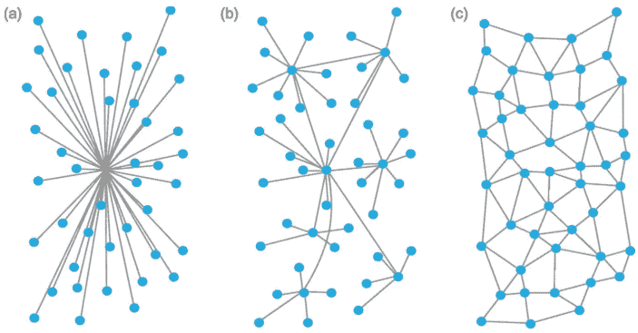

图 8.2 各种网络模型。(a) 中心化网络，(b) 去中心化网络，以及 (c) 分布式网络。

### 8.2.1 点对点网络 (P2P)

这种网络本质上是分布的，并以去中心化的方式运行。不存在中心化服务的概念，相反所有节点相互连接以进行交易或数据传输（图8.2）[5]。

### 8.2.2 分布式账本系统

在分布式账本系统中，所有节点都保留数据记录的副本，而不是像中心化系统由单一中心节点保留数据记录。所有节点都参与数据传输或交易，所有节点在块链网络中携带账本或数据记录的更新副本。参与交易的所有节点都拥有相同的数据记录副本以及彼此节点的记录。由于每个人都拥有更新的数据记录副本，因此没有人可以操纵/伪造交易。

### 8.2.3 密钥密码学

在块链交易过程中，通过非对称密钥密码学的帮助提供了机密性、身份验证和完整性。在非对称密钥密码学中使用了两个密钥：私钥用于加密目标用户可用的数据/交易；公钥通过椭圆曲线 Diffie–Hellman–Merkle 分布在所有参与者中，用于解密数据/交易。

# 块链技术

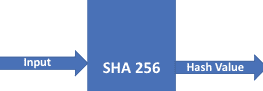

图 8.3 哈希技术。

### 8.2.4 哈希算法

它是块链中用于提高交易安全的不可逆加密方法。哈希使用安全哈希算法 SHA 256 (SHA256) 将变长度数据转换为固定长度输出（图8.3）。

### 8.2.5 工作量证明

去中心化点对点网络的每个节点通过工作量证明执行交易。所有参与者通过复杂的计算来验证自己是合法参与者。合法参与者的计算力必须大于黑客的计算力以产生合法交易。后部分讨论的双重问题通过工作量证明的帮助得到了消除。

工作量证明包含复杂的数学计算，与 Adam Back 的哈希扫描相同[7]。工作量扫描是一个被称为随机数（nonce，仅使用一次）的特殊值，添加到哈希值中的数字将设定零位数量。具有许多零位的哈希将设定所需的零位。输出哈希开头包含零，且应小于目标值。工作量证明通过增加随机数来实现哈希开头达到目标零位数。一旦计算完成，就无法更改。如果黑客尝试更改计算，将由所有参与交易的其他区块进行验证，因为它们都希望更改一个与被破解值不同的哈希值。如果黑客想要更改区块，必须拥有极高的计算力来更改所有参与区块的哈希值（图8.4）。

# 8.3 块链协议

块链是一种不断增长且流行的技术。在比特币协议增长和传播之后，设计了许多其他协议用于不同领域的应用。在本章中，将结合特性、交易方法以及优缺点来解释主要协议。主要协议如图8.5所示。


# 区块链主要协议

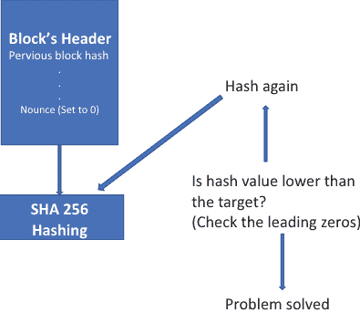
图 8.4 工作量证明。

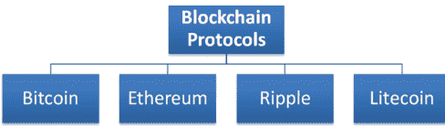
图 8.5 区块链协议。

### 8.3.1 比特币协议

### 8.3.1.1 什么是比特币？

比特币是一种去中心化的点对电子/虚拟货币支付系统。比特币是首种流行的加密货币和全球支付系统。中本聪（Satoshi Nakamoto）于2008年创建了比特币。比特币在交易过程中所使用的技术是区块链。如前所述，区块链已应用于各种行业进行加密货币交易。到2019年9月底，比特币区块链的大小约为242.39 GB [6]。

### 8.3.1.2 为什么选择比特币？

在传统系统中，与第三方（银行）的冲突会导致交易中产生危机。传统系统中的高交易成本减少了交易，因为第三方会收取高额的交易费和其他费用。传统系统的下一个问题是安全性。传统系统很容易被黑客攻击，从而引发了隐私问题。中本聪关注上述问题，并创建了一种基于去中心化点对点系统的具有加密特征的安全支付系统。

### 8.3.1.3 比特币的特性

以下是比特币的特性：

- 用于支付交易的去中心化点对点数字网络。
- 不涉及第三方，消除了第三方的信任验证。
- 使用的安全过程是不可逆的，从而保护在线交易免受黑客攻击。
- 比特币使用的时间戳系统保证了交易的顺序。

### 8.3.1.4 交易

中本聪提出了一种具有P2P去中心化架构和时间戳服务器的比特币，这能够以正确的方式安排交易顺序 [9,10]。加密货币是数字签名链，每笔交易都是前序交易的数字签名哈希值以及区块公钥的集合。私钥和公钥组合的目的是提供非对称密钥加密。私钥由交易发起者用于加密交易，而公钥由所有参与者用于解密和验证交易（图 8.6）。

比特币中定义的交易状态称为所有现有未未的比特币的状态。每笔交易的输出是新状态，并定义在状态转换函数中。只有当交易发送者有足够的比特币来完成交易时，状态才会转换，否则系统会生成错误。每笔交易都是输入和输出的集合，通过其哈希值唯一标识。每笔交易的输出在整个区块链过程中只能作为下一次交易的输入使用一次 [10,11]。

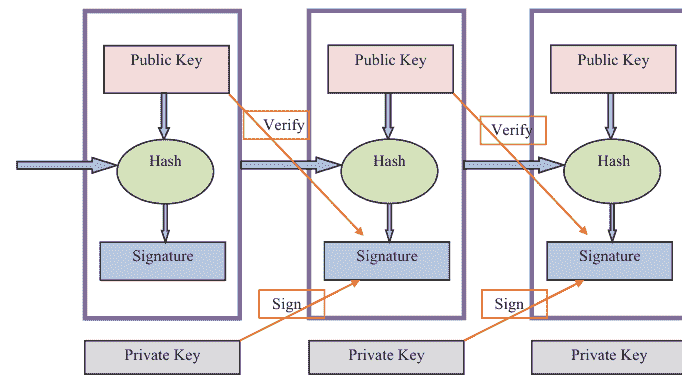
图 8.6 比特币标志。

# 区块链主要协议

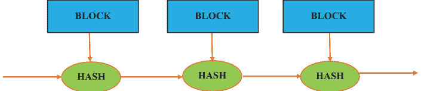
图 8.7 比特币交易 [9,10]。

**双花费问题：** 当同一种加密货币被使用多次时，就会发生这种情况。它也可以定义为在任何比特币交易中，相同的输入被用于多个之前已使用过并在去中心化网络上广播过的多次交易 [10]。

**未花费交易输出 (UTXO)：** 定义为在下一笔交易中未被使用或花费的交易输出。这种UTXO主要用于所有加密货币 [9,10]。

**已花费交易输出 (STXO)：** 定义为在下一笔交易中被使用或花费的交易输出 [9,10]。

在任何比特币交易中，它最多可以有两个输出和多个输入。

**输出：** 发送给其他参与者的项目或返回给发送者的余额。

**输入：** 多路输入可用于合并已转移的小金额硬币。

**女巫攻击：** 这是点对点网络中常见的一种攻击，旨在增强在声誉系统中的力量。这种攻击的目的是获得在网络中进行非法交易的权力。单个参与者在被封的网络中建立大量身份/账户，但对于其他参与者来说，这些伪造的账户/身份似乎是唯一的账户/身份。

所有的交易和所有权在比特币网络使用的分布式账本中都描述得很清楚。去中心化点对点网络的所有参与者都有比特币账本的副本 [12]。当任何参与者想要通过交易向另一个参与者发送硬币时，应该公开交易，去中心化点对点网络将通过适当的验证和正确性处理交易。在网络中，参与者可以尝试与两个不同的参与者更改交易，这之前讨论过，被称为双花费问题。同一参与者可以运行多个交易实例来验证初始交易，这导致了女巫攻击。讨论的问题通过比特币网络中的工作量证明得到解决。

哈希值由时间戳服务器在哈希期间确认区块内数据的存在生成并公开公布。时间戳服务器还会验证当前区块和上一个区块的时间戳；当前区块的时间戳应该大于上一个区块的时间戳。区块链如图8.8所示链接了区块的哈希值，区块链最有用的特性是交易历史可以随时被追溯。

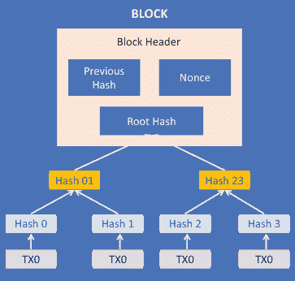
图 8.8 带区块的哈希链 [10]。

梅克尔树是一种二叉树，也称为哈希树，用于数据验证。它提供了数据完整性和维护性。树的每个非本地节点都有其子节点的哈希值。根节点拥有整个树的哈希值。树的分层保持相同 [13,14]。黑客对树的任何更改都会反映在区块链中 [12]。一旦交易完成并完成区块验证，树中的所有哈希都会被丢弃，除了添加到区块头中的根哈希外。比特币建立了一个简化的支付验证 (SPV) 系统，该系统使用区块头的副本而不是完整的交易历史 [9,10]。

**比特币挖矿：**区块创建者通过生成新硬币发起第一笔交易；这触发了其他人开始验证并流通硬币，这反被称为币基。交易的所有参与者都足够诚实以进行验证，因为没有中央权威来执行验证过程。当网络启动新交易时，它会被广播给所有参与者。交易的每个参与者都在工作量证明，然后将其区块转发到比特币网络。比特币网络中的参与者在接受区块之前验证所有交易。一旦区块被验证并接受，就会创建下一个区块，该区块包含上一个区块的哈希值并继续形成链。随着区块的创建，节点通过验证比特币交易被分配硬币。挖矿被定义为通过添加新区块来创建区块链的过程 [8–10]。

**比特币分叉：** 网络的不一致状态导致分叉；这种情况当多个节点同时广播同一个区块时出现，因为网络是分布式且去中心化的。通过考虑最长链来管理，由分叉生成的区块链将失效 [8,10]。

# 区块链主要协议

比特币的主要问题之一是扩展性问题。区块大小为1 MB、交易容量为300 字节的比特币网络，其估计的比特币吞吐量为每分钟8 GB。这表明只有具有最高计算能力的节点才能参与区块链。比特币扩展性问题的解决方案之一是分离见 (SegWit)，它处理交易的灵活性。这个问题源于现实，因为交易从不涵盖所有数据，为黑客修改交易及其哈希提供了机会 [15]。比特币的区块大小随着网络之上创建的新层而增加，该层将交易数据从签名层分离，促进了闪电网络。闪电层于2017年8月激活 [17]。在这个闪电网络中，创建了一个新的微通道设施以便在网络中进行微支付。该支付通道充当发送者和接收者之间的协议，宣布交易延迟并进行实际交易。双方都在网络上推迟交易细节，但确保它们在比特币区块链上的余额。比特币闪电网络的胜利性测试已于2018年1月进行 [18]。

## 比特币的优点

- 支付自由：参与者可以随时随地发送和接收资金。没有传统方式的银行假期限制。

- 控制与安全：比特币交易不涉及任何个人数据，比特币防御了身份盗用。

- 信息透明：交易可以被追溯以验证合法交易和可用的分布式账本；公开包含所有交易信息，黑客很难参与交易。

- 极低的费用：在没有参与者事先确认的情况下，商家无法添加额外费用。

## 比特币的缺点

- 缺乏意识和理解：人们对数字货币还没有意识；因此它不像实体货币那样流行。必须通过广告、意识活动和讲座来建立某种意识。


## 风险与波动
使用比特币的风险很高；一旦比特币钱包丢失或损坏，将无法恢复。硬币将捐赠给系统，这使得任何富有的比特币用户可能在秒内变得贫穷。

开发中
该系统仍处于开发阶段，目前还没有描述适当的退款策略，因为比特币的价值根据当前需求不断变化。

### 8.3.2 以太坊协议

### 8.3.2.1 什么是以太坊？
它是全球最受认可的可编程区块链，为去中心化应用提供了一个开源平台。数字价值通过编写运行代码的代码来控制，这些代码可以在世界的任何地方访问。每个人都可以通过修改在以太坊环境中运行的代码来创建区块链。以太坊是 Vitalik Buterin 于 2015 年引入的第二大区块链协议 [2021]。

### 8.3.2.2 为什么选择以太坊？
和比特币一样，以太坊也克服了传统支付系统的缺点以及中心化系统的缺陷。除了这些，以太坊是创建自己区块链的去中心化应用（Dapps）。它帮助在没有任何第三方参与和停机的情况下创建智能合约和各种去中心化应用。与仅用于金融领域的比特币不同，以太坊被应用于各个领域，它允许程序员开发并推出各种分布式应用 [22,23]。

# 以太坊的
- 以太坊开发了一个无法修改或停止的计算平台。
- 以太坊拥有庞大的热情社区区块和分布式应用。
- 椭圆加密法用于钱包、权益证明（PoS）以确保区块链的安全。
- 提供快速的区块生成，以实现快速交易和快速扩展的程序。
- 它将私有以太坊网络引入了全球。

## 8.3.2.3 交易

### 权益证明 (Proof of Stakes)
这是公共区块链中使用的共识算法，基本上取决于验证者在以太坊网络中的权益。与比特币中作为共识算法的 PoW 相比，PoS 更加节能。在这一共识中，一组验证者提议并投票以创建新区块；验证者投票的权重取决于存款的大小。共识算法可以分配验证者的奖励，这些奖励可以根据验证者在网络上的权益有多种逻辑。PoS 的主要优势是安全性高、更节能，并消除了中心化网络的问题。

# 以太坊 (Ether)
它是以太坊网络使用的令牌，在支付交易费、计算费和 Gas 费用进行加密货币交换时标记为“ETH”。

# Gas
它在交易过程中充当中间令牌，用于计算运行该交易智能合约所需的计算能力。在以太坊支付之前，Gas 衡量计算能力的单位，并根据此支付该交易的太坊（图 8.10）。

# 智能合约
智能合约是在区块链网络中达成的交换数据或货币的协议。这种第三方应用代理提到了交易期间必须遵守的法律条款和条件。
每个区块包含一个存储在以太坊状态中的地址和状态转换。以太坊状态映射了地址和状态 [10,25]。以太坊支持两种账户：

- 外部所有账户 (EOA)，由私钥控制
- 合约账户，由合约代码控制 [12]

以太坊账户的四个基本字段是太坊余额、合约代码、随机数（nonce）和存储根 [10,25,26]。以太坊：（在本章之前已讨论）

| 初始阶段 | 交易 | 最终状态 |
| :--- | :--- | :--- |
| ADDRESS: 4718BF7A<br>BALANCE: lo ETH | SENDER: 4718BF7A<br>RECEIVER: 741F7A2 | ADDRESS: 4718BF7A<br>BALANCE: lo ETH |
| | GAS PRICE: 0.5 ETH<br>GAS LIMIT: 2 ETH<br>DATA:[.......] | ADDRESS: 741F7A2<br>BALANCE: lo ETH<br>[CODE.......] |
| | SIGNATURE: 100FD | | |
| STORAGE:[0,100,0,A] | | |

图 8.10: 以太坊金额 = Gas * Gas Limit

图 8.9: 交易是以太坊。
Nonce：（在本章之前已讨论）
存储根：（在本章之前已讨论）
状态：（在本章之前已讨论）
合约代码：（在本章之前已讨论）
Nonce：（在本章之前已讨论）
余额：（在本章之前已讨论）
地址：（在本章之前已讨论）
状态转换：（在本章之前已讨论）
地址：（在本章之前已讨论）
状态：（在本章之前已讨论）

交易步骤为：
- 步骤 i：发送者发起交易。
- 步骤 ii：客户端接收交易。
- 步骤 iii：网络验证交易。
- 步骤 iv：池包含该交易。
- 步骤 v：节点创建交易。
- 步骤 vi：服务器验证交易。
- 步骤 vii：客户端附加交易。
- 步骤 viii：广播区块。

# 以太坊的优点
- 得助于 PoS 效率很高。
- 网络运行时间长。
- 它用于开发许多去中心化应用。

#区块链的主要协议
- 以太坊的缺点：
  - EVM 速度慢，产生了一些问题。
  - 作为一项开发技术，它需要更新。
  - 可扩展性问题与比特币相同。

### 8.3.3 Ripple 协议

### 8.3.3.1 什么是 Ripple？
Ripple 既是加密货币也是开源平台，旨在以更廉的成本提供快速全球服务。Ripple 有自己的货币 XRP，允许任何用户通过 RippleNet 开发自己的网络。Ripple 在验证服务器的帮助下使用分布式账本协议，并利用区块链技术构建。

### 8.3.3.2 为什么选择 Ripple？
相比，它提供了更快的交易和更低的费用。它很容易扩展，引入 Ripple 的主要原因是它提供了使用任何货币（包括比特币）的跨境交易 [26]。

# 特性 
- 可以在任何地方、任何时间使用任何货币完成交易。
- 它更可靠，因为它增加了可见性并减少了支付失败。
- 交易延迟非常小。
- 主要特点是即使是跨境交易，费用也很低。

### 8.3.3.3 交易
- XRP：Ripple 用于在 Ripple 网络交易期间传输价值的货币。
- 服务器：在 Ripple 服务器上参与共识过程的软件。
- 账本：包含所有交易的信息以及 Ripple 网络所有参与者的可用余额。


# Ripple协议共识算法 (RPCA)

RPCA 由所有节点定期执行，以维持 Ripple 网络的共识和准确性。当达成共识时，与其一起工作的账本在关闭后将成为最后一个关闭的账本。这确保了共识的成功，且网络不包含任何分叉 [27,28]。

RPCA 在每轮中执行以下步骤，具体步骤如下：

- 首先，服务器在开始共识轮之前会识别所有先前的有效交易，并将它们置于一个名为“候选集”（candidate set）的公共列表中。
- 服务器的下一步是在其唯一节点列表（Unique Node list）上合并所有候选集，并对所有 Ripple 交易的真实性进行投票。
- 所有交易必须获得最小比例的“是”赞票才能进入下一轮。未能获得“是”赞票的交易要么被添加到候选列表中以供下一个账本使用，要么被丢弃。
- 最后阶段是考虑服务器唯一节点对交易的投票；预期的得票比例为 80%，一旦满足要求且账本关闭，交易将被接受并添加到账本中，成为最后一个关闭的账本。

# Ripple 的优点

- 它提供了一个开源平台，帮助用户在 XRPNet 中创建自己的区块链。
- 其可扩展性与比特币和以太坊协议相比良好。
- 它是一种跨境加密货币，能够在不同货币之间以极低的交易成本进行交易。

# Ripple 的劣势

- 使用 Ripple 的主要缺点是 XRP 不是挖矿的。
- Ripple 网络在许多方面利用了中心化概念。
- 尽管它提供了跨境交易，但这种加密货币缺乏现实世界的应用。

## 8.3.4 LITECOIN 协议

### 8.3.4.1 什么是 Litecoin？

它是一种点对点的加密货币，允许在全球范围内近乎零成本且交易时间更短的交易。它没有任何中心权威的开源去中心化支付系统 [30]。

### 8.3.4.2 为什么选择 Litecoin？

与其他加密货币相比，其区块生成时间完全缩短。Litecoin 用于哈希的算法是 script，以增加安全性。高交易率也提升了存储效率。

# Litecoin 的特性

- 它是一种点对点的去中心化货币交易，并对所有人开放。
- 网络中使用了 script 哈希方法，具有高安全性。
- 它是一个开源平台，提供了极低交易成本和高效存储能力的跨境交易能力。

### 8.3.4.3 交易

它与其他加密货币类似，不是由政府机构引入的，而是由私立组织为社会货币交易引入的。Litecoin 是通过挖矿过程生成的，其中包含了在 Litecoin 上处理的交易详情。Litecoin 网络创建新区块，账本包含交易详情。区块在验证通过并添加到区块链后，由矿工进行生成和验证。

矿工因成功验证区块而获得奖励，奖励随时间推移而减少。当某个矿工可疑并更改区块，允许同一个 Litecoin 被花费两次（即双花问题）时，Litecoin 网络中的其他矿工可以轻松且立即识别出来。

# Litecoin 的优点

- 与加密货币相比，Litecoin 可以处理更多的交易。
- 它使用加密哈希方法提供严密的安全性。
- 提供快速的交易，几乎是零延迟。

# Litecoin 的劣势

- 社会对该技术的认知尚未普及。

## 8.4 结论

使用区块链技术的最初加密货币是比特币协议。比特币是引入的第一个加密货币，因此从传统系统向加密货币的过渡阶段非常困难。当钱包损坏或丢失时，整个货币将捐献给系统。这是加密货币的主要缺点。以太坊协议的优势在于作为一个可以创建更多去中心化应用的开源平台。下一个流行的带有开源平台的加密货币是 Ripple 协议。该协议专注于能量的高效利用以及带有跨境交易的快速交易。讨论的最后一个协议是 Litecoin，它执行跨境交易且交易成本近乎零；它也是一个提供高安全性的开源平台，与其他加密货币相比执行交易更快。

## 参考文献

- 1. Zibin Zheng, Shaoan Xie, "Blockchain challenges and opportunities: A survey," International Journal of Web and Grid Services, vol. 14, no. 4, 2, October 2018.
- 2. Francisca Adoma Aacheamp, “Big data, machine learning and the blockchain technology: an overview,” International Journal of Computer Applications, vol. 180, no. 20, 0975–8887, March 2018.
- 3. X. Li, et al.,“A survey on the security of blockchain systems,” Future Generation Computer Systems, 2017, doi: 10.1016/j.future.2017.08.020.
- 4. Shubhani Aggarwal, “Blockchain for smart communities: Applications, challenges and opportunities,” Journal of Network and Computer Applications, vol. 144, 13–48, 2019. ISSN: 1084-8045.
- 5. Remya Stephens, Aneisa Alex, “On blockchain security,” IOP Conference Series: Materials Science and Engineering, vol. 396, 012030, 2018.
- 6. Shanghong Li, Size of the Bitcoin from 2010 to 2019, by quarter (meta-bytes), https://www.statista.com/statistics/647523/worldwide-bitcoin-size/
- 7. Back
- 8. Mauro Conti, Sandeep Kumar E., Chhagan Lal, Sushmith Raj, “A survey on security and privacy issues of bitcoin,” IEEE Communications Surveys &Tutorials, vol. 20, no. 4, Fourth Quarter, 2018.
- 9. Satoshi Nakamoto, “Bitcoin: a peer-to-peer electronic system,” 2008, available at: https://bitcoin.org/bitcoin
- 10. Dejan Vujic, Dijana Dagogic, Miniša Randić, “Blockchain technology, bitcoin, and Ethereum: A brief overview,” 17th International Symposium INFOTEH-JAHORINA, 21–23 March 2018.
- 11. Florian Torschlag, Björn Schneermann, “Blockchain and beyond: a technical survey on decentralized digital currencies,” IEEE Communications Surveys Tutorials, vol. 18, no. 3, 2084–2123, March 2016.
- 12. Ethereum, “A next-generation smart contract and decentralized platform,” White Paper, available at: https://github.com/ethereum/wiki/White_Paper
- 13. Ralph C Merkel, “A digital signature based on a conventional encryption function,” In Poarance C. (eds).Applications in Cryptography – CRYPTO 87, CRYPTO 1987. Notes in Computer Science, vol. 293. Springer, Berlin, Heidelberg, pp. 369–378, 1987.
- 14. Ralph C Merkel, “Protocols for public cryptystems,” in Proc. 1980 Symposium on Security and Privacy, IEEE Computer Society, vol. 122–133, April 1980.
- 15. Transaction malleability,available at: https://bitcoin.in/wiki/Transaction_malleability


## 区块主要协议

- 22. Chris Dannen, 《Introducing Ethereum and Solidity: Foundations of Cryptocurrency and Blockchain Programming for Beginners》。ISBN-13 (pbk): 978-1-4842-2534-9, ISBN-13 (electronic): 978-1-4842-2535-6, doi: 10.1007/978-1-4842-2535-6.
- 23. Nicola Atzei, Massimo Bartoleletti, Tiziana Cimoli, “A survey of attacks on Ethereum smart contracts (SoK),” Conference on Principles of Security and Trust. POST 2017. Lecture Notes in Computer Science, vol. 10204. Springer, Berlin,
- 24. Gavin Wood, “Ethereum: A secure decentral generalised transaction ledger,” 2018, 可于: https://ethereum.github.io/yellowpaper/paper.pdf
- 25. Yonatan Sompolinsky, Aviv Zohar, “Secure high-rate transaction processing in Bitcoin,” Financial Cryptography, 507–527, 2015.
- 26. Chris Larsen, 内容可于: https://ripple.com/xrp/
- 27. Peter Todd, “Ripple protocol consensus algorithm review,” 2015年5月11日，可于: https://raw.githubusercontent.com/petredd/ripple-consensus-analysis-paper/master/paper.pdf
- 28. David Schwartz, Noah Youngs, Arthur Britto, “The Ripple protocol consensus algorithm,” 可于: https://ripple.com/files/ripple_consensus_whitepaper.pdf
- 29. Charlie Lee, 内容可于: https://litecoin.org/
- 30. https://www.investopedia.com/articles/investing/040515/what-litecoin-and-how-does-it-work.asp


# 9 FGUGChain
一种具有安全计算能力的区块链应用框架

A. Anasuya Threes Innocent and G. Prakash
Amrita School of Engineering, Amrita Visha Vidyapeeth

## 目录

- 9.1 引言 138
- 9.1.1 区块链 138
- 9.1.2 安全计算... 141
- 9.1.2.1 点与排列技术 (Point-and-Permute Technique)... 142
- 9.1.2.2 Free-XOR 技巧 143
- 9.1.2.3 混乱行规约 (Garbled Row Reduction)... 143
- 9.1.2.4 门电路拓扑排序 143
- 9.1.2.5 双密钥加密... 143
- 9.1.2.6 简单电路描述 (SCD), AES-NI... 144
- 9.1.2.7 批量密钥加密 (BCK) 144
- 9.1.2.8 其他优化... 145
- 9.1.3 基于安全计算的区块链研究... 145
- 9.2 FGChain框架 – 具有隐私性的区块链 146
- 9.2.1 在线阶段... 146
- 9.2.1.1 智能合约元数据... 147
- 9.2.1.2 应用的计算函数 147
- 9.2.1.3 区块链 147
- 9.2.2 离线阶段... 148
- 9.2.2.1 使用带通用门的 Garstble 构建混乱电路 148
- 9.2.2.2 带有隐私数据的互联计算节点/双方... 149
- 9.3 结论 149
- 附录 9.1... 149
- 姚混乱电路构造... 149
- 附录 9.2... 151
- SCD 中的 AND 电路 151
- 参考文献... 152

# 引言

## 9.1 区块链

# 9.1.1 区块链

区块链是一种去中心化的计算和信息共享平台，它允许多个互不信任的权威领域在理性的决策过程中进行处理、协调和协作。在典型的区块链架构中，每个节点（每个部分的系统/计算机）都维护一份全局数据表的本地副本。系统通过确保以下两点来保证本地副本之间致性：(i) 每个节点的本地副本是完全相同的，且 (ii) 本地副本始终基于全局信息。

存储在每个部分计算机上的本地信息被称为公共账本，它可以被看作是一个所有人可访问的数据库，包含可用于未来计算的历史数据。公共账本存储了所有同步的全局交易。例如，考虑名为 Anna、Ben、Dav 和 Emma 的四方参与分布式银行业务。他们每个账户里都有 5,000 卢比，并且这四人在本地系统中各有一个公共账本。现在，考虑以下交易：

- 1. Anna 向 Ben 发送 2,000 卢比 – 在所有人的账本中接受并更新
- 2. Ben 向 Dav 发送 4,000 卢比 – 在所有人的账本中接受并更新
- 3. Anna 向 Emma 发送 4,000 卢比 – 交易被拒绝

Anna、Ben、Dav 和 Emma 在上述交易后的示例账本如图 9.1 所示。在这里，前两次交易是成功的；它们被所有方验证并接受了。但第三笔交易 Anna → Emma: 4,000 卢比并未成功。当 Anna 广播她的请求时，其他方通过检查其公共账本中提交的交易来检查她的账户余额。从中他们获知 Anna 没有该交易所需的余额。因此，所有其他方都拒绝了上述第三笔交易，该交易没有记录在他们的公共账本中。

| Anna | Ben | Dav | Emma |
| :--- | :--- | :--- | :--- |
| Anna: Rs. 5,000 | Ben: Rs. 5,000 | Dav: Rs. 5,000 | Emma: Rs. 5,000 |
| Anna → Ben: Rs. 2,000 | Anna → Ben: Rs. 2,000 | Dav: Rs. 5,000 | Emma: Rs. 5,000 |
| Ben → Dav: Rs. 4,000 | Ben → Dav: Rs. 4,000 | Ben → Dav: Rs. 4,000 | Emma: Rs. 5,000 |
| Anna → Emma: Rs. 4,000 | Anna → Emma: Rs. 4,000 | Anna → Emma: Rs. 4,000 | Emma: Rs. 4,000 |
| Anna | | | |
| Dav | Ben | Emma | |

FGChain: 区块链应用框架

区块链的基本要求如下：

- 承诺提交协议：应该有适当的机制确保来自客户端的每笔有效交易都能有限时间内被提交并包含在区块链中。例如，上述前两次交易必须在下一笔交易开始之前逐一通过验证并提交。
- 共识：应该有机制确保公共账本的本地副本是一致且不断更新的。
- 安全性：当一方广播信息时，参与的其他方应该能够验证该信息是不可篡改的。如果客户端采取恶意行为或客户端被破解，其他方应该立即识别。
- 隐私性与身份验证：由于区块链涉及许多方，数据的真实性和隐私性应当得到维护。根据 Lansiti 和 Lakhani (2017) 的观点，区块链可以定义为“一种开放的分布式/去中心化账本，能够高效且永久地记录各方之间的交易”。公共账本对所有人开放，且不由单一方控制。各方之间的交易应当是快速且可扩展的，并且每个参与者都检查信息的有效性。他们还简要介绍了区块链的工作原理。Lansiti 和 Lakhani (2017) 提到的区块链技术的五项基本原理如图 9.2 所示。

用于构建区块链的加密原语是哈希函数。每个区块都存储前一个区块的哈希值，因此哈希函数充当了区块链的链接，从而形成了区块链。这种使用值形成区块链的方法源于 Haber 和 Stometta (1990)。Merkle 在 1979 年开发的 Merkle 树（Merkle, 1982）与 Haber 和 Stometta 的工作相结合，开发了用于区块的有效采样 (Bayer et al., 1993)。这种发明导致了 Nakamoto (2008) 对比特币的发现，它是建立在区块链基础上的。

比特币是一种完全去中心化的点对加密货币。由于它是无许可的，任何没有身份或登录凭据的人都可以随地使用。这导致了许多国家的法律问题，其背后的技术——区块链可以用于许多实用应用。区块链技术不仅用于金融领域，还可以用于几乎所有的分布式应用。政府、工业界、学术界和农业领域正在转向区块链，这场革命被称为区块链 2.0。

# 分布式数据库/公共账本

参与区块链计算的每一方都可以访问整个数据库/公共账本及其完整历史。没有单一方控制数据或信息。每个方都可以直接验证其交易伙伴的记录，而无需中间人或任何中央控制器。

# 点点传输

点之间的通信直接进行，不使用中心节点。每个参与的节点/方都有存储并将信息转发给所有其他方。

# 透明性与伪匿名性

任何访问系统的人都可以查看交易和关联的值。参与区块链的每个方都被分配一个唯一的 30+ 地址，用于交易。用户/方可以保持匿名，或向其他人提供他们的身份证明。

# 记录的不可逆性

在交易被验证并输入数据库后，记录无法更改。所有交易都链接并更新在区块链的区块中。多种算法和方法确保按时间顺序永久记录在数据库中，供网络上的所有人使用。

# 计算逻辑

公共账本以数字格式维护。这使得交易与计算逻辑相关，且可以编程。可以编程算法和规则，使得节点之间的交易自动触发。

图 9.2 区块链五项原理 (Lansiti and Lakhani, 2017)。


# FGUGChain: 区块链应用框架

与链长度成正比。比特币（Bitcoin）是无许可区块链的最佳示例。比特币中的每个区块都由地址/头部和数据/信息组成。比特币中的地址等同于银行中的“账户”。通过这个地址，可以确保真实性，即只有预期的参与方能够通过相应方接收并解密交易并接受它。它也为某些人提供了隐私保护，以太坊为例，信息在节点之间传输时是加密的；同时信息会在节点上暴露以进行验证；因此使用了伪名，这使得伪名不适用于处理私有数据。

在比特币发明之后（Nakamoto, 2008），人们利用区块链开发了多种加密货币。其中一些列在此：莱特币 (Lee, 2021)、Peercoin (King and Nadal, 2012)、Emercoin (2013)、Gridcoin (Halford, 2014)、恒河币 (Mazieres, 2015)、以太坊 (Buterin, 2016)、Omni (Willett et al., 2016)、比特币现金 (2017)、波场 (Anders et al., 2017)、EOS (Grigg, 2017)、卡尔达 (Hoskinson, 2017)、USD Coin (2018)，且列表仍在不断增加。在开发的加密货币中，有些作为加密货币，而另一些作为开发应用的平台。

研究人员不断通过提高吞吐量和可扩展性来提高区块链的效率，并致力于添加隐私以便用于广泛的应用。为了尝试包含隐私，引入了许可区块链，这牺牲了区块链的去中心化特性。以太坊、Ripple 和 Hyperledger 为例。私有链使用访问控制，只允许许可的参与方参与交易。尽管通过私有交易在区块链中额外确保了另一层隐私，但由于交易的验证和控制在私有链所有者手中，它趋向于中心化实体。

为了在区块链中实现数据隐私并保持其去中心化特性，理论计算机科学的另一项突破——即安全计算（Secure Computation）被与区块链结合。

## 9.1.2 安全计算

安全计算

考虑一组互不信任、也不信任其通信通道的参与方。尽管如此，这些方将在尽可能保持本地数据隐私性的同时，正确地计算其本地输入的某些共同函数。

换句话说，“在尽可能保护信息的同时结合信息被称为安全计算”。当参与计算的方数量仅为两个时，被称为安全二方计算（Secure Two-Party Computation），或简单称为二方计算，表示为 2PC。

当参与方为三个或更多时，为了在不暴露私有数据的情况下计算共同函数，被称为安全多方计算（Secure Multiparty Computation），或简称 MPC。选举可以看作多方计算的例子；选民希望他们的选票（以及身份）被保留，同时必须进行计票。另一个例子是在进行新疾病的研究，而不泄露患者的个人检测报告或身份。基准是，计算必须在不暴露私有数据的情况下进行，且结果应仅揭示预期的输出以及由此泄露的极少信息。从抛硬币、共同协议到复杂的应用（如电子投票、电子拍卖、私有数据检索、在不暴露信息的情况下分析敏感信息以进行研究、保护生物识别、云端私有编辑等日常生活问题，都可以通过安全计算解决。

安全计算协议根据电路模型、网络模型和对手模型分为四个维度（Patra, 2015）。无论密度如何，任何安全计算协议的第一步都是构建混乱电路（Garbled Circuit, GC）。由于任何分布式问题的底层的数学表达式既可以表示为布尔电路，也可以表示为有限域上的算术电路，因此电路模型的选择取决于要计算的函数。比较、大于、小于等非线性操作在布尔电路中表示表示。

Lindell 和 Pinkas (2009) 描述了在具有双输入单输出门的底层布尔电路的计算设置下进行混乱电路构建。在这种经典的电路构建中，为每个输入分配了对应于 0 位和 1 位输入的两个随机值位字符串。这些随机值/密钥根据门类型进行加密。加密执行两次；并在所获得的值上应用简单的置换，以形成混乱表项，从而生成所需功能的混乱电路（Innocent and Seta, 2014a; 2014b）。Yao 针对单个门的混乱电路构建见附录 9.1。

Yao 的设计每条导线使用双重加密（Lindell and Pinkas, 2009），这增加了计算时间。随着电路规模的增大，复杂度随之增加，导致协议不切实际。为了克服这一瓶颈，需要提高效率，这清楚表明需要对混乱电路设计进行优化。以下是混乱电路设计中著名的主要的优化方法。

### 9.1.2.1 点与置换技术（Point-and-Permute）

在生成混乱电路并发送给评估者后，将进行评估以找到所需的输出。必须通过某种机制识别要解密的正确行，以保持正确性并避免在评估期间对所有行进行不必要的解密。这是通过点与置换技术（Naor et al., 1999）实现的，该技术提供了一个指向待评估行的指针。在混乱门期间添加的颜色提供了指向该行的指针，该行在评估期间必须被解密。

### 9.1.2.2 免费异或技术（Free-XOR）

在布尔电路混乱电路构建中，最好的优化之一是免费异或技术（Kolesnikov and Schneider, 2008）。它在遇到异或门时跳过了复杂的加密/解密循环。

异或门的输出是混乱的，它对输入进行 $\oplus$ 操作，这是一种基础加密；然而，它避免了复杂的加密。其工作原理如下：三个或多个异或门转换为双输入异或门，并执行免费异或。考虑 $X_0^a, X_0^b$ 为异或门的输入值，考虑 $(0,0)$，获得输出 $X_{out} = X_0^a \oplus X_0^b \oplus R$，其中 R 是协议中全局使用的随机值。

### 9.1.2.3 混乱行压缩（Garbled Row Reduction）

根据混乱行压缩技术（GRR）（Pinkas et al., 2009），显著了表项的大小。在这项技术中，一个混乱值定义为两个输入值的函数。它取代了随机定义为输出导线的两个混乱门。混乱门不需要存储对应于输出的值，并且在评估阶段，可以在不存储混乱门的情况下计算出相应的混乱输出。尽管他们声称 GRR 和免费异或是不兼容的，但他们能够展示效率的提高，因为通信的消息减少了四分之一，这带来了通信复杂度的提高以及计算复杂度的微小价值。

### 9.1.2.4 门拓扑排序（Topological Sorting of Gates）

Might Be Evil（Huang et al., 2011）展示了如何使用门拓扑排序，并在不存储整个混乱电路的情况下流水线生成电路。它还引入了忽略扩展（oblivious extension），并结合点与置换、混乱行压缩和免费异或优化。

### 9.1.2.5 双密钥密码（Dual-Key Cipher）

Bellare 等人 (2012) 改变了 GC 作为安全计算协议设计的视角，以实现密码学目标。他们引入的双密钥密码（DKC）用于更快地构建使用布尔门的混乱电路，每条导线只需要一次复杂加密，并大幅缩短了计算时间。他们将混乱电路构建称为一种方案，作为一个独立的图形，它需要优化。他们证明了


## 区块链技术

赌博游戏的安全性和基于模拟的安全性，并证明了基于模拟的安全性始终意味着基于不可区分性的安全性。

## 9.1.2.6 简单电路描述 (SCD), AES-NI

由 Bellare 等人 (2013) 开发的 JustGarble 系统基于固定密钥 AES 的 DKC 密码体制，在进行门评估时调用一个固定置换。它还引入了混淆电路的简单表示形式，命名为数组（array）。在这里，由于门以拓扑顺序作为数组表示，消除了门与对象之间进行通信的需求，使得系统轻量化、高效且具有成本效益。嵌入式 AES 的使得使得指令加速了这一过程。JustGarble 每个门的电路评估仅需一次 AES 调用。它作为了使用布尔门构建混淆电路进一步优化的基准，并作为比较新优化/框架的基石。

### 9.1.2.7 其他优化

为了提高位复杂度和时间复杂性的其他已知优化/技术如下：

- FlexOR (Kolesnikov 等人，2014)
对 XOR 门的灵活混淆允许 XOR 门拥有 0–2 个密文。它还将 AND 门的优化与 free-XOR 结合。

- Half Gates (Zahur 等人，2015)
专为无隐私设置设计。它每个 AND 门仅产生两个密文，并与 free-XOR 技术兼容。

- 混淆get件 (Ball 等人，2016)
设计用于处理布尔电路和算术电路。当用于布尔电路时，对于对应的 n 个输入，它生成 n+1 个密文而非 2n 个密文。Ball 等人还从理论上声称，单个 AND 门可以被混淆为单个密文。

- 可重用混淆电路
Wang (2016) 提出了具有输入隐私和电路隐私的混淆电路构建的可重用性。他们提出了一种具有输入隐私和电路隐私的可重用混淆电路，并使用基于不可区分性的安全性方案证明了其安全性。2017 年，他们引入了基于全同态加密的可重用混淆电路构建 (Wang 等人，2017)，并声称具有恒定的通信复杂度。

- 零尺寸混淆电路
Kondi 和 Patra (2017) 提出在无隐私设置下对布尔电路进行混淆而不产生密文加密，从而实现了零尺寸混淆电路。

- 认证混淆
Katz 等人 (2018) 显示通过使用泄漏的 AND 三元组提高了恶意对手设置下的效率，通信和计算复杂度分别提升了 1.5 倍和 2 倍。他们展示了在 WRK 协议上认证混淆的应用 (Wang 等人，2017)，通过避免对每行混淆使用 MAC 来实现，并且与半门技术兼容。

在“其他优化”小节下的上述大多数优化尚未在安全计算实际框架中取得重大突破。FGUGChain 中使用的另外两种优化是批量处理密钥密码 (BKC) 和通用门优化 (Innocent 等人，2019)。

## 9.1.2.8 批量处理密钥密码 (BKC)

用于混淆电路构建的带有固定密钥加密的批量密钥使得每块门仅调用一次加密，在协议执行时间方面提升了 36% 的效率，且未损害安全性要求。混淆电路构建中的通用门 (Innocent 等人，2019a) 构建在 Fastest 框架 (Innocent 等人) 之上，该将在下一节解释。证明了 BKC 和通用门结合是安全的，并将混淆时间加速了 66%。

研究人员不断致力于提高安全计算协议的时间复杂度和通信复杂度，因为去中心化应用可以通过安全计算来实现。尽管在计算中进行安全计算是一项麻烦的任务，因为必须不断检查对手，且只有诚实方才需要在所需功能的计算中成功。为了确保参与计算的方的诚实性，区块链概念是最佳选择，因此结合这两种技术将对双方都是双赢局面。区块链将确保只有诚实方参与计算，而安全计算确保了敏感数据的隐私。下一节简要描述了关于结合安全计算以实现隐私区块链的研究。

## 9.1.3 关于安全计算计算区块链的研究

2015 年，Enigma 平台 (Zykind 等人，2015) 尝试将安全计算与区块链技术相结合，为区块链引入隐私。复杂多方计算中的离链或离线阶段，以及区块链操作在链上或在线阶段执行。在前一年，Andrychowicz 等人 (2014) 展示了如何将比特币用于安全计算领域，Bentov 和 Kumaresan (2014) 展示了如何使用比特币设计公平的安全计算协议。

CoinParty (Ziegeldorf 等人，2015) 为比特币提供了基于多方计算的混合服务。它允许使用阈值事务分布式地创建资金比特币地址——这意味着只有当大多数参与方同意继续交易时，才会进行。Hawk 编译器 (Kosba 等人，2016) 借助密码原语引入了隐私保护智能合约，并证实了基于多方计算的方法可以产生公平交易。Hawk 的发明者提到“区块链的正确性和可用性可以信任，但在隐私方面不可信”，并解释了通过秘密计算实现区块链隐私的必要性。

Noyes (2016) 在秘密社交网络应用 Pandora 上展示了点对点多方计算的实现，并与秘密计算框架 FairMP (Ben-David 等人，2008) 和 VIFF (Geisler，2007) 进行了比较。AntZest (Zhou 等人，2018) 为参与区块链的方提供了具有可验证性的多方计算框架。AntNest 使用同态非交互共享进行多方计算，并展示了应用执行时间的改进。另一个框架 Raziel (Sanchez，2018) 使用零知识证明的多方计算为区块链上的智能合约提供了隐私、正确性和可验证性。应用包括众筹和双拍卖。Platon (2019) 旨在开发一种具有隐私、正确性、可验证性和不可忘性的高效全栈去中心化基础设施。Wanchain (2019) 旨在通过提供具有多方计算隐私的跨链平台构建分布式银行。


# FGUGChain：区块链应用框架

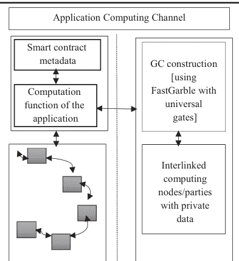

图 9.3 FGUGChain 框架（Innocent and Prakash, 2019）。

它包含了有关合约的信息，该信息存储在某个位置，其地址保留在合约中。任何拥有该地址的人都可以访问元数据并从中获取信息。FGUGChain 中使用的智能合约是无状态的，与 PlatON 类似。它不存储链的任何状态，也不向计算节点（即参与方）泄露数据。当执行智能合约元数据时，输入数据源于参与多方计算的离线节点的本地数据库。实际计算被分解为多个子任务，并分发到计算节点，且不泄露数据。参与方的所有权和隐私性通过所使用的多方计算协议得到保障。

## 9.2.1.2 应用的计算函数

任何可以实现的应用程序都可以表示为一个数学函数，即该应用程序的计算函数，而任何数学函数都可以在布尔电路中表示。计算函数由智能合约元数据根据输入和输出参数定义。该计算函数转换为布尔电路，被分为多个子电路，并在离线阶段发送用于混淆电路（garbled circuit）构建，生成的混淆电路与其关联。

## 9.2.1.3 区块链

由智能合约元数据定义的计算函数由区块生成者在生成区块时拆并分发到多个计算节点/参与方。计算节点返回结果以及计算证明，它们也由生成者封装到区块中。区块的有效性由其他节点通过验证证明来确定，这减少了每个节点上复杂的冗余计算，从而缩短了区块验证时间。一旦验证完成，新区块就会添加到链中。

## 9.2.2 离线阶段

离线阶段或离链计算执行复杂的多方计算协议。Yao 的 GC 构建（Lindel and Pinkas, 2009；Innocent and Sangeeta, 2014a, 2014b）在多方计算协议中起着至关重要的作用。底层计算在布尔电路中实现，被分为多个子电路，然后发送到计算节点并并行执行。每个电路被发送到计算节点，以维持某种程度的冗余可用性保证。混淆电路为布尔电路中的每根线选择令牌（tokens），用每个门的输入令牌对输出令牌进行加密，加密后的令牌被门进行混淆处理，从而生成混淆电路（Lindell and Pinkas, 2009；Innocent and Sangeeta, 2014a, 2014b；Bellare et al., 2012）。混淆电路评估器使用不授权协议并解密混淆电路以获得所需结果（Lindell and Pinkas, 2009）。离线阶段的组件在后续章节中描述。

### 9.2.2.1 使用带通用门的 FastGarble 进行混淆电路构建

此处的混淆电路构建使用了带通用门的 FastGarble 框架（Innocent et al., 2019a）。在这里，不是使用不同类型的门，而是使用通用门中的任意一种（NAND/NOR）用于布尔电路的生成，因此用于混淆电路的构建。此外，混淆电路构建的批量密钥密码优化（batch-key cipher optimization）与点对合并（Noar et al., 1999）、混淆还原（Pinkas et al., 2009）、带有高级加密标准-新指令（AES-NI）的固定密钥块密码的双密钥密码，以及简单电路描述（SCD）（Bellare et al., 2013）优化一同使用。事实证明，带通用门的 FastGarble 在协议执行方面的时间复杂度上更高效，且通信时每个门仅需两个密文（Innocent et al., 2019a）。总体而言，使用带通用门的 FastGarble 框架提高了多方计算应用的效率。

### 9.2.2.1 混淆电路构建中的通用门

NOR 和 NAND 门被称为通用门，因为其他门（即 AND、OR、XOR 和 NOT）可以从这些门中推导出。带通用门的 FastGarble 框架构建在 FastGarble 框架之上，并仅使用通用门进行布尔电路构建。使用单一通用门进行电路构建的优势在于电路构建使用了单一类型的门。这消除了 SCD 中门阵列 G 的需求。带通用门的 FastGarble 框架构建在 FastGarble 框架之上，并仅使用通用门进行布尔电路构建。例如，适用于 SCD 构建的仅用 Gar 构建的 AND 电路见附录 9.2，Innocent et al.（2019a）给出了一个图解示例。FastGarble SCD 格式中的门类型 G（Bellare et al., 2013） $f_{iG}=(n,q,A,B,G)$ 可以被移除，以形成带通用门的 FastGarble 的五元组 SCD 构建：$f=\{n,q,A,B\}$。应用程序所需的存储大小随之减少，因为不需要存储门；只需存储一个与协议中使用的门类型对应的常数值。此外，在混淆过程中不需要对每个门都检查相应的门类型，这对时间复杂度的改进有微小贡献。带通用门的 FastGarble 使用点对合并技术。

## 9.2.2 带有隐私数据的链接计算节点

FGUGChain 框架在本文中讨论了多方计算的应用。

## 9.3 结论

FGUGChain 框架在这一章中讨论了多方计算的应用。FGUGChain 框架在这一章中讨论了多方计算的应用。

## 9.2.2 带有隐私数据的链接计算节点

FGUGChain 框架在这一章中讨论了多方计算的应用。

## 9.3 结论

FGUGChain 框架在这一章中讨论了多方计算的应用。

# 附录 9.1

# Yao 的混淆电路构建

Yao 的 2PC 设计的第一步是混淆电路的构建。对于布尔电路，底层计算 f(x,y) 由第一方 Alice 以形式表示。

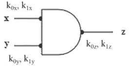

图 9.4 第一方 Alice 分配给输入和输出的标签 2 输入输出 AND 门。她生成混淆电路并发送给第二方 Bob。Alice 和 Bob 之间的通信遵循步骤 1-3。

- **步骤 1**：对于每根线，Alice 随机选择两个密钥：$(k_{0x},k_{1x})$、$(k_{0y},k_{1y})$ 对应输入 x, y，$(k_{0z},k_{1z})$ 对应输出 z（见图 9.4）。
- **步骤 2**：Alice 加密真表并对加密值进行混淆。
- **步骤 3**：Alice 将混淆真表发送给另一方。

# 表 9.1
AND 门的真表

| x | Y | Z |
|---|---|---|
| 0 | 0 | 0 |
| 0 | 1 | 0 |
| 1 | 0 | 0 |
| 1 | 1 | 1 |

# AND 门上的双加密

| 线 1 输入, x | 线 2 输入, y | 线 3 输出, z | 加密值 |
|---|---|---|---|
| $k_{0x}$ | $k_{0y}$ | $k_{0z}$ | $E_{0x}(E_{0y}(k_{0z}))$ |
| $k_{0x}$ | $k_{1y}$ | $k_{0z}$ | $E_{0x}(E_{1y}(k_{0z}))$ |
| $k_{1x}$ | $k_{0y}$ | $k_{0z}$ | $E_{1x}(E_{0y}(k_{0z}))$ |
| $k_{1x}$ | $k_{1y}$ | $k_{1z}$ | $E_{1x}(E_{1y}(k_{1z}))$ |


## FGUGChain：区块链应用框架

在这里，所进行的加密是双重加密，即每个导线的复杂加密调用被执行两次。这导致了效率瓶颈，并使得协议变得不实用。Innocent 和 Sangeeta（2014a; 2014b）通过图示例展示了 GC 构建和评估的逐步工作。

## 附录 9.2

### SCD 中的 AND 电路

为了展示使用 NOR 门构建 SCD 电路的示例，使用了 AND 电路，这仅仅是当 A 和 B 均为 I 时输出 1 的简单 AND 门功能。图 9.5 显示了仅用 NOR 门设计的 AND 电路，适用于 SCD 格式。AND 电路的真值表如表 9.3 所示。

任何函数的 SCD 格式可以使用七元组 $f_{old}=(n,m,q,A,B,G,O)$ 表示。以下是参数的名称、含义以及图 9.5 所示 AND 电路的对应取值：

- 输入数量，n=2
- 输出数量，m=1
- 门数量，q=3
- 门的第一个输入线，A[]={1, 2, 3}
- 门的第二输入线，B[]={1, 2, 4}
- 门类型，G=1
- 输出导线，O[]={5}

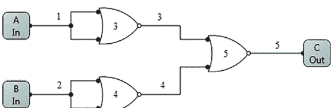

图 9.5 仅用 NOR 门生成的 AND 电路，适用于 SCD 格式。

## 表 9.3
AND 电路的真值表

| A | B | C |
|---|---|---|
| 0 | 0 | 0 |
| 0 | 1 | 0 |
| 1 | 0 | 0 |
| 1 | 1 | 1 |

## 区块链技术

上述值可以包含在得到如方程 9.1 所示电路表示中。

$$f_{old} = (2, 1, 5, [1, 2, 3], [1, 2, 4], [1, 5])$$ (9.1)

门类型通过方程 9.2 中的公式找到。

$$b_{11} \times 8 + b_{10} \times 4 + b_{01} \times 2 + b_{00} \times 1 = f(i,j)$$ (9.2)

例如，NOR 门 $\rightarrow 0 \times 8 + 0 \times 4 + 0 \times 2 + 1 \times 1 = 1$。在这里，$b_{ij}$ 代表具有粒子 $i$ 和 $j$ 的门的对应真值。由于使用了示例类型的门，$j$-类型数组 $G$ 被替换为常数（此处为 $G=1$），它可以由程序直接初始化。通过从 SCD 表示中移除 G，本章中使用的通用门 FastGarble 的更新后的 SCD 表示为六元组 $f' = (n,m,q,A,B,O)$，如方程 9.3 所示，初始电路为五元组 $f = (n,m,q,A,B)$。

$$f' = (2, 1, 5, [1, 2, 3], [1, 2, 4], [5])$$ (9.3)

## 参考文献

Andersen M, Kolb J, Chen K, Fierro G, Popa RA. Wave: A decentralized authorization system for IoT via smart contracts. EECS Department, University of California, Berkeley, Tech. Rep. UCB/EECS-2017-234. 2017 Dec

Andrychowicz M, Dziembowski S, Malinowski D, Mazurek L. Secure multiparty computation on bitcoin. In 2014 IEEE Symposium on Security and Privacy, 2014 May 18 (pp. 43–458), IEEE.

Ball M, Malkin T, Rosalek M. Garbling guards for Boolean and arithmetic circuits. In Proceedings of the 2016 ACM SIGSAC Conference on Computer and Communications Security, 2016 Oct 24 (pp. 565–577). ACM.

Bayer D, Haber S, Steiner WS. Improving the efficiency and reliability of digital timestamping. In Sequis 93 (pp. 329–334). Springer, New York, NY.

Beller M, Hoang T, Veeledi S, Rogaway P. Efficient garbling for a fixed-key blockchain. In 2019 IEEE Symposium on Security and Privacy, 2019 May 19 (pp. 478–492). IEEE.

Beller M, Hoang T, Rogaway P. Foundations of garbled circuits. In Proceedings of the 2012 ACM Conference on Computer and Communications Security, 2012 Oct 16 (pp. 784–796). ACM.

Ben-Dav A, Nisan N, Pinkas B. Fair Marketplace. A system for secure multi-party computation. In Proceedings of the 15th ACM Conference on Computer and Security, 2008 Oct 27 (pp. 257–266). ACM.

Bentov I, Kumesaran R. Using bitcoin to design fair protocols. In Annual Cryptography Conference, 2014 July 16 (pp. 421–439). Springer, Berlin, Heidelberg.

Bitcoin 2017. https://www.bitcoincash.org/

Buterin V. What is Ethereum? Ethereum Official webpage. Available: http://ethdocs.org/en/introduction/what-is-ethereum.html. 2016.

Emmercoin Blockchain. https://emmercoin.com/en/emmercoin-blockchain.

Emmercoin. 2013. https://en.bitcoin.org/wiki/Emmercoin

Eris: The smart contract application.platform. https://erisindries.com/, accessed on 28–04–2009.

Geiser M. Viff: Virtual ideal functionality framework. 2007. Homepage: http://viff.dk. 2007.

Grigg I. Eos-an introduction. White paper. https://whitepaperdatabase.com/eos-white-paper. 2017 Jul 5.

Haber S, Stornetta WS. How to time-stamp a digital document. In Conference on the Application of Cryptography, 1999 Aug 11 (pp. 437–455). Springer, Berlin, Heidelberg.

Halford R. Gridcoin: Crypto-currency using Berkeley infrastructure network-grid as a proof of work. May 2014. https://assets.cfatsets.net/sdnitm3th6f/resource-asset-rk24/bf2964ae0d865699c72ce0395b89f55ea851442f4bc-c405-9078-201107cf.

Hoskin C. We are truth about building White paper. June 2017. https://cardano.org/why/

Hwan Y, Evans D, Katz M, Liska F. Faster secure two-party computation using guarded circuits. In USENIX Symposium.

Ripple. https://ripple.com/, accessed on 28–04–2019.


# 10 基于区块链技术的数字链路信息系统
过性的信息孤岛

B. Akoramurthy
Velammal Institute of Technology

T. Ananth Kumar
IFET College of Engineering

## 目录

- 10.1 引言............................................................................................... 156
- 10.2 背景...................................................................................... 157
- 10.3 基础概念与定义............................................................... 159
- 10.3.1 基础定义............................................................................... 159
- 10.3.2 基于类的HIN.................................................................................... 160
- 10.4 信息与信息系统 (IIS)........................................ 161
- 10.5 数字块信息系统 (DIGBI)............................................ 163
- 10.5.1 信息采集............................................................... 165
- 10.5.2 信息分类............................................................... 166
- 10.5.3 信息标记...................................................................... 166
- 10.5.4 信息预处理............................................................... 166
- 10.5.5 去中心化共识.................................................................. 168
- 10.6 创世区块创建...................................................................... 168
- 10.6.1 块的创建与验证..................................................... 168
- 10.6.2 区块链创建区块的选择.................................. 169
- 10.7 概念证明................................................................ 169
- 10.8 结果................................................................... 171
- 10.8.1 卡方检验....................................................................... 172
- 10.8.2 卡方效力计算.................................................. 172
- 10.9 结论...................................................................... 173
参考文献......................................................................................................... 173

区块链技术

## 10.1 引言

在软件系统的运行时，数据是心脏，处理后的数据是心跳。从数据到大数据，这种增长见证了迅猛的。随着随着的演变，数据的产生及其向信息的转换非常迅速。然而，处理和管理过剩信息已导致各个部门面临识别和在正确时间利用正确信息的挑战。企业部门在处理信息方面面临最大的问题，因为各部门之间的通信和流动导致了严重的停滞问题，且过载的信息导致了“信息孤岛”。传统因素如供应商多样化、兼并以及从旧系统迁移也导致了企业部门的信息孤岛问题。此外，近年的技术进步迫使信息存储移动到云端，并带有复杂的多云通信和共享。尽管有这些演变来处理问题，但完全消除信息孤岛的复杂性仍然令人敬畏，其根本原因是多维的。信息具有其优先顺序、价值和有效性，因此信息的共享至关重要。它是动态生成的，因此共享存在于通信和共享之中。信息共享不能是一种开放的社会模型，共享信息可能具有更高的价值；信息的访问级别也需要被考虑。对共享的控制级别可能很高且访问受限，或者访问权限较高但控制受限，又有时具有适当控制。企业设置中的每个部门都有自己的共享/通信方式，因此实现系统性的信息流是一项持续的任务。此外，在正确的时间向正确的人识别并共享正确的信息是一项艰巨的任务，它需要对系统完全理解的专业知识。信息共享存在许多障碍。例如，组织中的研发部门选择性地共享可能对营销部门至关重要的信息。有时，信息共享的不可否认性也给管理带来了挑战。信息方可能会否认共享信息，这可能导致若干管理问题。此类问题不仅可能是由于企业内部的通信者，也可能源于外部威胁。通信问题是许多研究人员尝试过的的一个领域。若干新兴技术已尝试解决由信息孤岛问题引起的问题，或者有时消除信息孤岛通常涉及海量的交互和多种类型的实体（MTE），例如人类社交媒体活动、主要通信及其计算机系统。这样的系统可以被称为异构信息系统，在不失其一般性的情况下，其海量的交互构成了相互关联或连接的网络。因此，这在当今的信息基础设施和各处都起着关键作用。这项工作利用了异构信息网络（HIN）的概念，因为其基础的链路数字信息系统概念，该概念通过从给定网络中的链接关系挖掘隐藏模式并进行分析。HIN 还有许多其他应用，如图挖掘、网络科学、社交网络分析和网络挖掘。

当代网络的一些基本假设基于对象的类型及其之间的链接。如果假设是基于相同类型的对象，例如在固定电话网络中，这里的每个节点的功能与任何其他电话相同，且用户倾向于相似的原因购买手机。这些电信网络在本质上通常被认为是同质的。另一个很好的例子是作者和合著者网络。换句话说，缺失或未考虑同类类型对象之间更多类型的关系可以被称为同质网络，在其中无法发现新的模式、链接或关系。

通常，在任何现代组织中，数据产生不仅源于单一实体或组件，而是来自多个实体。这些实体被假设为实时系统，我们把它们建模为 HIN [27,29,32]，就像智能手机一样，照片通过位置分组在一起。尽管同质网络由于其简单性和本质性而被广泛使用，但通过使用 HIN，可以获得多种数据模式和语义。此外，HIN 有效地融合数据，带来了丰富的信息，这是数据挖掘领域的一项新发展。本章介绍了信息和信息系统的基本概念。此外，本章明确提出了消除信息孤岛所需的信息和 HIN 的形成。[24,34]。

## 10.2 背景

信息孤岛问题已对各个部门进行了分析。在 Miller 和 Tucker 的工作中，隔离分析基于健康数据的交换。该问题通过决定交换什么类型的数据被消除[1]。Gater 的工作将互操作性概念视为消除医疗保健信息孤岛的关键[2]。尽管数据交换具有效率，但当我们考虑互操作性作为信息孤岛的解决方案时，也注意到存在安全和隐私问题。一般的信息孤岛问题可以通过提供新的解决方案或机制来消除，但挑战在于用户对这些策略的采纳。在这里，解决方案必须考虑使用此类系统的用户。金融部门的信息孤岛至关重要，因为规模巨大，且极其重要的信息需要交流。金融部门的问题在于，既不能利用所有信息，也无法利用特定信息，金融数据可能是依赖性的。在他们的文章中，Phillips、Watson 和 Willis 分析了金融领域的信息孤岛问题，并建议利用集成报告来提供与公司、资本化和战略相关的信息的全面视图[3]。注意到信息孤岛问题已经在特定问题中得到了处理，但一个用于消除该问题的通用框架尚未


## 区块链技术

未给出。目前存在的信息孤岛最常见来源是“社交网络”。正如参考文献 [4] 所示，社交网络通过两种主要方式导致信息孤岛的产生：对信息的控制和用户的扩散。去中心化提供了更高层次的交互，并被视为消除信息孤岛问题的解决方案。上述方法的缺点是社交网络网站用户对去中心化概念的接受程度 [18,24,25,28]。

区块链技术的出现为处理去中心化提供了一个新的维度。区块链技术是每个行业都在尝试的最新趋势。区块链起源于加密货币平台，特别是比特币，在其中代表了可验证的货币权益的历史记录。它们最初被设计用于解决双重花费问题，即在去中心化网络中建立共识，确定谁拥有什么以及哪些已经花费过。区块链是全球区块链用户之间网络活动历史的经过认证的记录。区块链通过保护一组私钥，实现在网络内安全地存储任意信息——在某些情况下是基于令牌的；在更复杂的系统中，则是复杂信息。区块链技术已经形成了多种形式：作为加密货币的区块链 1.0，作为智能合约的区块链 2.0，以及包括区块链与其应用集成相关的业务的区块链 3.0 时代。正如参考文献 [5] 所述，区块链技术侧重于面向防篡改的消息认证。在最抽象的形式下，区块链可以被描述为实体网络内共享的防篡改账本，该账本存储了实体之间的交易记录。为了实现账本的防篡改，区块链利用了密码学哈希函数。区块链技术的出现见证了在各个领域应用的快速增长，从云到供应链管理问题。Wright 和 De Filippi 认为，在部署智能合约的区块链技术时，需要实施法规、治理问题以及法律的作用 [6]。在参考文献 [8] 中，利用加密货币区块链技术验证软件许可以最大限度地减少软件盗版并保护软件版权。参考文献 [7] 简述了区块链技术在金融应用（如比特币、保险等）以及金融部门（包括公证）以及新兴的物联网）中的应用。这项工作增强了区块链技术应用于应用应用的范围，以及区块链世界产生新业务模式的需求。

人们对 HIN（异质信息网络）的挖掘有着巨大的兴趣 [9–11]，许多建议展示了尊重类型差异的方法，这可能会产生更多且有效的有意义输出。参考文献 [12] 使用了一种基于排名的多通道聚类方法，该方法在其中生成虚拟簇或多类型对象的组。然而，真正的问题是系统或簇将无法有效利用先前的可用知识，导致簇类变得模糊 [12]。在参考文献 [13] 中，Yin 等人探索了用于 HIN 的社交标签图并对网络对象进行了分类，但方式是受限的 [13]。该工作在每个网络对象及其类型之间构建了一个二部图 [14]，这实现了有效的分类或分割。由于链接结构的任意性限制了其应用不仅限于通用 HIN，所提方法是基于特定的网络模式，即标签与网络对象之间的模式 [21,22,33]。

对现有工作的研究确定了区块链技术在消除信息孤岛方面的潜力。区块链技术实现的安全性和信任能够感知流过企业行业的数字信息，并简化其信息流，确保确保企业行业中发生的信息孤岛问题得到消除。

## 10.3 基本概念与定义

本节介绍了与 HIN 相关的基本概念，并通过示例将 HIN 与其他相关概念进行比较。

### 10.3.1 基本定义

信息网络可以是任何现实世界或系统的泛化，由人员、手机等智能设备、两个或多个计算机系统、方法论和功能，以及为了收集、处理和传播数据的框架组成。它可以正式定义如下：

# 定义 1：信息网络

它定义为一个有向图或有向图 G = (N, E)，由 N 节点集合和 E 边集合组成，边是节点元素的有序对对，其中节点和边分别称为对象和链接。

在不同对象之间存在大量对象及其相互链接。因此，一组对象及其关联链接可以用更简单的方式表示如下：

对象集：O
关联链接：L

那么其映射函数可以描述为：

```
$\Phi : N \rightarrow O(对象类型映射函数)$
$\Psi : E \rightarrow L(链接类型映射函数)$
```

集合 (O) 中的每一个对象 (o) 都属于其自己的对象集，
O = {$o_1, o_2, o_3, o_n$}
即 $\Phi(o) \in O$

如果一个关系有两个不同的关联链接，则这些链接具有相同的对象类型，既作为起点也作为终点，最终被称为循环或自环。

# 定义 2：多重信息网络

为了发现语义意义并获得信息网络模式识别的不同见解，有必要定义多重信息网络，它是观察 HIN 的新方法。

假设信息网络为一个图。设 $G_1$ 和 $G_2$ 为多重信息网络。如果存在一种对应关系，即 $V: V(G_1) \rightarrow V(G_2)$，使得对于 $G_1$ 的每一对顶点 $x, y$，$G_2$ 中的 $X, Y$ 满足相应关系，则称 $G_1$ 和 $G_2$ 是同构的。

换句话之，$G_1$ 和 $G_2$ 是同构的，当且仅当存在从顶点集合到另一个顶点集合的映射，且该映射保持了邻接属性，对于 $F(x).F(Y) \in e(G_2)$ [31]。

因此，在单个图中无法发现（是否相等） [20]。

# 定义 3：HIN

考虑“n”个数据对象，可以表示为 $x_1=\{x_{i1},x_{i2},x_{i3},...,x_{im1}\},x_n=\{x_{n1},x_{n2},x_{n3},...,x_{nn}\}$；则 HIN 可以定义为图 $G=(N, E, W)$，其中 $N=\cup\{x_i\}$，$E$ 是网络中任何数据对象之间的边或关联链接的集合；$W$ 是数据对象之间的权重集合 [15,16,17]。如果 $n=1$，秩降低，被称为同质信息网络 [18,19]。

### 10.3.2 基于类的 HIN

基于类的 HIN，$G=(N, E, W)$ 可以定义为 $G'=(N', E', W')$，其中 $N'$ 是 $N$ 的子集；$N'$ 由从 $x_1$ 到 $x_n$ 的多个数据对象组成 [30]。

所有的边 $\forall e=\\{x_{Ia},x_{bc}\}\in E'$；即 $\forall e=\\{x_{Ia},x_{bc}\}\in E'$，简而言之E=E'$。同样，对于链接也是：

$W(x_{Ia},x_{bc})=W(x_{Ia},x_{bc})$，同样 $W=W'$

$W$ 和 $W'$ 的数据对象几乎等于于其部分。


# 162

## 区块链技术

**信息创建：** 当前场景下，信息系统需要来自多个源的数据来构建信息系统。互联网的演变导致了从社交网络等各种来源获取数据，以理解并预测客户需求。此类信息对每个组织都是至关重要的。

**信息处理：** 在当前环境下，处理大量的信息源需要信息系统能够以更快的速度处理和传播此类信息，以满足日益增长的需求。

**信息分析：** 预测预判是分析信息的本质，这反过来有助于提升业务价值。在海量创建和处理的世界中，分析成为为了更好地理解可用信息而非常关键的任务。信息分析需要强大的算法来应对快速演变的量信息。

**信息可视化：** 经过分析的信息需要可视化，以便对可用信息获得更好的洞察。视觉分析是传播通过信息获取的知识的有力媒介。信息需要被存档以备未来之用，这里指的是数字档案。识别适宜归档的信息是一项敏感的任务。有时，可能需要安全地销毁信息。根据需要，可以选择归档或销毁。

信息的整个生命周期都包含在信息系统中。从信息的产生到其使用、归档或销毁，监控信息的流动、利用和分布是信息系统的责任。现代信息系统对现有系统提出了各种修改，因为快速演变的信息曾经需要被销毁。信息分析和可视化已成为理解客户需求、市场趋势等业务的首要任务。信息销毁是另一项本质任务，因为对高度复杂和自动化信息系统的需求日益增长。此类系统不仅应该处理信息的使用流和处理，还应该确保此类系统中的问题必须得到消除。

# 研究问题

- 组织需要什么类型的信息？
- 处理可能需要多量的信息？
- 用于信息处理的是什么技术？
- 哪些算法可能适用于处理可用信息？
- 基于哪些参数来选择用于分析和可视化的信息？
- 如何识别可能适用于归档/销毁的信息？

这些研究问题的答案将有助于高效设计信息系统。所提的数字块信息系统（DIGBI）是

163

# 链路数字信息系统

能够回答这些问题，并能够清晰地区分信息系统的各个阶段。所提的信息系统不仅考虑了组织内部产生的信息，还考虑了改进业务价值的外部信息。尽管信息系统设计高效，但仍有几个问题需要通过信息系统解决。信息孤岛是存在于多个企业部门的潜在威胁。企业行业清理了各个部门，直到员工之间实现高水平的通信。这种通信可能在详细程度上并不具体，这通常会导致非预期信息的共享或信息以大批量形式存储。有时，关键信息可能没有被传播，相反是不需要的信息被传播了。这些都是组织中出现信息孤岛的一些原因。所提的 DIGBI 还使用了 PINSI 算法（消除信息孤岛）来消除信息孤岛问题。此外，该算法还能识别可能供未来使用的信息，从而确保信息的高效利用。DIGBI 由区块链技术驱动，能够安全地处理信息并在位于不同位置的节点（计算机）之间分配信息。对于企业场景，识别部门间通信的正确信息是复杂的。管理问题在信息通信中起着主要作用。某些企业部门的实例由于员工之间的竞争性质，可能会与其他部门共享信息，但关键信息可能不会泄露。这不仅关乎通信，还关乎识别要归档的关键信息。在组织中，信息的有效性起着重要作用。虽然信息可以被存档供未来使用，但信息销毁是一项非常关键的任务。对于超过一定时间的待销毁信息也必须被考虑。

另一个令人担忧的问题是信息的非重复性（nonreproduction）。由一个源传播的信息被拒绝传播。当在网络上进行通信时。在有多个用户访问系统的组织设置中，确保信息的正确使用正成为一项繁琐的任务。尽管有各种验证和授权机制，信息系统仍无法确保信息的真实性。虽然基于计算机的信息系统能够处理信息，但它无法解决此类问题。在当前场景下，信息孤岛以及信息的非重复性已成为企业行业的主要威胁。

# 10.5 数字块信息系统 (DIGBI)

DIGBI 能够区块链技术的帮助处理快速演变的现代信息。数据可以很容易地分布在相同或不同网络中的联网计算机（节点）之间。由于区块链块的构建需要配备设备的计算机，因此此信息系统能够处理海量且快速演变的数据。分布在各个块中的数据可以很容易地分析和可视化。尽管这项技术的根源于比特币，但区块链技术在网络世界的影响仍在扩大。所提的 DIGBI 旨在利用区块链技术解决信息孤岛和非重复问题。利用区块链技术有助于识别用于通信的有效信息，并确保非重复性得到保障。区块链技术中的去中心化共识机制识别用于通信的适当信息，并确保不进行详细信息的共享。

图 10.2 清晰地说明了如何使用区块链技术消除信息的非重复。通过区块链，信息分布在相同或不同网络的各个节点（计算机）上，实现了信息的有效分布。尽管存在分布，数字识别提供了实现非重复的最有效手段。虽然身份验证仍然是一个待解决的问题，但该方向正在进行一些研究。图 10.3 展示了 DIGBI 通用视图的流程图。

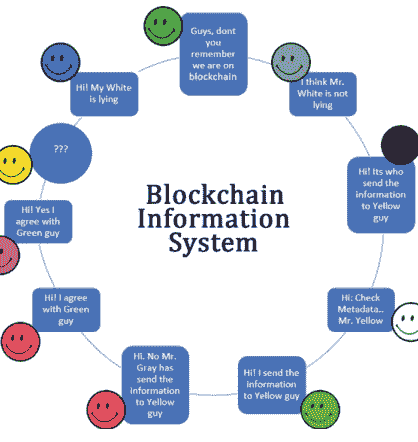

图 10.2 使用区块链消除非重复。

图 10.3 强调了定义参数之间的相互关系和流程。所提的 DIGBI 系统可以用于完全消除信息孤岛，或用于特定的视角，取决于组织的需求。例如，考虑会计部门和财务部门正手手准备一份报价单。在这种情况下，部门之间发生情况的通信将非常频繁，因为所需的细节必须频繁交换，而信息是


| 信息收集 | 区块创建与验证 | 用于区块链创建的区块 |
| --- | --- | --- |
| 信息分类 | 创世区块创建 | 区块链创建 |
| 信息标记 | 去中心化共识 | 通过区块链实现通信 |
| 信息预处理 | 哈希值创建 | |

图 10.3 DIGBI 的工作流。

交换的信息是高度机密的。在这种情况下可以观察到，在普通的企业部门中，信息可能通过安全网络流动，数据可能通过邮件服务器或组织内部可用的内网设施进行交换。考虑到所通信信息的敏感性，可能会发生信息泄露。

## 10.5.1 信息收集

信息收集阶段侧重于收集组织内部通信至关重要的信息。这些信息可能是为了特定的通信目的，也可能是组织生成的全部信息。信息还可能是动态生成的，并且必须添加到 DIGBI 的信息库中。提议的 DIGBI 将能够处理静态和动态信息。此类信息不仅限于组织内部创建的信息，还包括从社交媒体上收集的信息。对于信息的各种操作（包括分析、可视化等）来说至关重要；在这种情况下，收集的动态信息量庞大且生成速度快。收集的大量且各种信息需要根据领域/部门进行分类。

## 10.5.2 信息分类

从各种来源收集的信息无法直接用于通信。这是因为从数据库中检索正确信息需要时间。信息的分类能够更更容易检索和利用信息。与现有的信息系统一样，对要通信的信息进行过滤和精简所花费的精力较少。DIGBI 根据组织内的领域/部门对收集的信息进行分类。它不会将信息分组并根据其利用情况将其映射到单一的适当领域。例如，如果信息是由营销部门生成的，那么这些信息可能对销售部门和会计部门都很有用。这项信息分类的任务消除了各部门间通信信息的问题。如果信息需要优先处理或属于机密信息，可以将其归类到单独类别下，并供相关人员使用。

在该系统中，我们假设 X 代表收集的信息，D 代表部门，i 代表信息的数量，j 代表部门 ID。所考虑部门的组织收集信息表示为 Xi，从各部门的信息表示为 Dj。最初，收集的信息根据部门 ID 进行分类，并获取具有较高通信优先级的。

## 10.5.3 信息标记

分类后的信息可以根据各种参数进一步划分，具体取决于组织内的通信和利用情况。参数也可以动态选择。由于信息甚至可能从社交网络获取以了解客户趋势，参数也可能动态变化。例如，考虑所选参数为信息的来源和价值。每条信息都将有一个来源，即生成该信息的部门、生成目的、负责生成信息的相关人员等；同样，每条信息都有其自身的价值，取决于信息可以在何处被利用。该参数至关重要，因为它描述了信息的敏感性。信息的有效性是指信息将有效多久。与此类似，根据需要选择其他参数。也可以选择动态参数。所选的参数被标记在信息上，并准备好进行预处理。标记的任务有助于通过识别不需要的信息来消除信息孤岛。

## 10.5.4 信息预处理

信息预处理为信息包含在区块中做好准备。这项任务通过应用下文所示的 PINSI 算法确保信息孤岛的消除。执行此操作是为了确保信息在正确的地方被利用，并且在部门之间只通信适当的信息。在聚合信息时，来自特定组织所有部门的信息按部门累积。

回溯函数（backtrack）负责实施和验证约束（所选参数），这些因素是任何组织必须确保的基础因素。

## 算法 PINSI

```
Function conginfo()
For j=1 to n
  For i=1 to n
    Classify Xi based on Dj
    Prioritize Xi based on Dj
  End for
Function backtrack()
For i=1 to n
  For j=1 to n
    a=Ownership
    b=Validity
    c=Utilization
    d=
    .
  end for
function constraintsatisfaction()
  for i=1 to n
    check if c in Dj
    end for
function consistency()
  for i=1 to n
  if above functions are called
    else if a,b,c are regenerated
      then call purge()
  end for
function purge()
  Call archive() or destroy()
```

如果信息满足算法，则该特定信息将被考虑用于区块。对于识别出的信息，正在创建相应的哈希值，这是区块的基础。

## 哈希值创建

哈希在区块链中用于以下用途：

- 创建哈希指针，作为区块链中指向上一个区块的链接
- 避免区块内信息被篡改
- 确保区块内信息的安全性
- 以简单的方式存储大量信息

通过哈希的帮助，区块链可以可视化为链表。区块链中的每个区块都将由一个头部组成，头部将包含有关上一个区块指针的信息。该指针创建了与上一个区块的链接。因此，每当创建一个区块时，都会使用它建立哈希指针。

哈希概念也用于识别数据是否被篡改。每条考虑的信息都会经过哈希处理，因此在通信链路中，如果发生修改，可以轻松检测。此外，哈希也简化了大量信息的能力，对于不同长度的输入可以实现固定长度的输出。

## 10.5.5 去中心化共识

一旦信息库中的信息经过哈希处理，共识过程就开始，通信链路在没有中央权威的情况下对全局状态达成一致，因此被称为“去中心化”。如所述，在企业场景中，可能会出现若干管理问题，从而禁止共享基本信息。此类情况可以通过分布式共识阶段完全消除。达到分布式共识阶段后，信息被聚合到区块中。

## 10.6 创世区块创建

创世区块是区块链中的第一个区块。它作为区块链中所有区块的共同祖先。区块链中的每个节点都将了解创世区块哈希结构及其细节（如创建时间等）；创世区块是通过收集通信所需的所有述参数信息创建的。区块中的信息经过编码，因此无法修改。每当访问信息时，区块链中的每个节点都会知晓，如果对该特定信息进行了修改，则会被丢弃。如果出现修改信息的需求，必须通过去中心化共识过程。

### 10.6.1 区块创建与验证

后续区块在创世区块的基础上创建，考虑了通信的需求并允许选择正确的信息。创建新区块时，必须根据参数对信息进行验证，一旦识别为有效，即可考虑用于区块的创建。


# 链数字信息系统

183

## 10.6.2 区块链创建的区块选择

根据信息流，可以创建单个区块链或多个信息区块链。一旦创建区块链，组织内发生的进一步通信可以很容易地带入区块链，因为通信的语境将由创建区块链中区块所需的参数来携带。

图 10.4 展示了信息区块链的简化视图。它可以被视化为包含信息的块列表。块中的信息被标记了各种参数，由于区块链需要高度配置的节点，大量信息可以整合到节点中。这使得该信息系统适用于任何组织。处理海量信息的能力、为信息提供的安全性、消除信息孤岛以及处理信息的不可否认性是使用 DIGBI 的主要优势之一。

## 10.7 概念证明

所提的旨在消除信息孤岛并确保信息不可否认性的系统可以如文所示得到证明。如果信息流通过确保正确的信息在正确的时间传递给正确的人来受到监管，那么这就是消除信息孤岛的第一步。在所提系统中，信息经过哈希处理，并在参数的帮助下仅选择适当的信息。如上一节所述，所考虑的参数可以由用户选择，取决于将发生的通信语境 [26]。在以下证明中，所考虑的参数是真实性和合法性，因为它们是关于信息来源最重要的参数。该证明说明，如果信息是合法的，那么它就是真实的，因此可以被信任包含在区块中。这就是信息在包含区块区块之前验证的方式。为了此目的，可以包含若干参数，也可以进行卡方检验以选择创建区块的适当参数。在所提工作中，信息的来源被赋予了更高的优先级，因为为了创建区块，信息的来源必须经过验证并确保

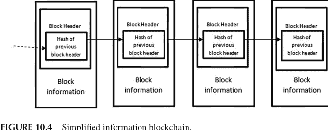

## 区块链技术

信息的发送者无法以任何方式否认信息不是由他/她发送的。

引理 1:

“I”是合法且真实的信息。

证明：

令 I_a 为既真实又合法的信息。
作为第一步，将信息 (I_al) 分解为真实信息 (I_a) 和合法信息 (I_l)：

```
I_al = I_a + I_l
```

待证明：

情况 1：信息是真实的 (I_a)：

```
I_a = (I_a × I_o) + I_i
```

其中
I_i 是信息的不可否认性
I_o 是发送者的身份
I_a 是信息的完整性

情况 2：信息是合法的 (I_l) 或 I 是 I_i：

I = I_i
其中 I = P(d): 数据的处理形式：

```
sum_{i=0}^n I = I_0 + I_1 + I_2 + ... + I_n, n ≥ 0
```

引理 2:

如果 I_o 为 1，则 I 始终是 I_a。

证明：

由于已知信息总是源自成员委员会，它将获得更高权威的批准，即 1。
尽管有“n”条信息（就像源自不同地方的河流但最终汇聚在海 a），精炼后的信息会与特定的组织信息框架对齐。这表明信息最终是合法的：

```
I = II = I_o (仅当 o = 1)
```

根据引理 1，II = I_a。因此，定理成立。

链数字信息系统

171

## 10.8 结果

### 假设

$H_0$：数字链信息系统的观测值是否符合任何业务组织的预期值？

为了证明该假设以检查基于区块链技术的建议信息系统适用于任何组织，我们部署了拟合优检验，因为我们有一个分类变量且样本量小；我们希望了解每个分类中的观测数量是否符合假设的预期。

表格（表 10.1）使用 R 图形包中的条形图格式创建，以产生简约图（meek plot）。首先计算了观测比例，然后将结果复制到由 above 或 plotting 生成的矩阵格式。我们将该矩阵标记为 ISM，通常称为“R × C 表”，其中 R 是行数，C 是列数。

图如图 10.5 所示。它显示了 ggplot2 包，并使用数据框代替矩阵。对于定义的数据框，代码实际上计算了置信区间，这些区间将添加到数据框中。如果值是确定的并且可以插入名为 Fitness 的数据框中，这可能会变得混乱。有时因素需要处于顺序级别，这应该为 ggplot2 指定，或者将按字母顺序分级。所有零假设的预期值都在 0.5–0.6 的范围内，由于满足了定义条件，我们的假设被接受。

图 10.5 显示了组织对比信息系统的 Fitness 条形图。误差棒表示每个观测比例的 95% 置信区间。

## 表 10.1 信息系统矩阵 (ISM)

| 信息系统 | 数值 | 计数 | 总计 | 比例 | 预期 |
| --- | --- | --- | --- | --- | --- |
| 数字 IS$^a$ | 观测 | 70 | 156 | 0.4487 | 0.54 |
| 数字 IS$^a$ | 预期 | 54 | 100 | 0.54 | 54 |
| 基于 SDLC 的 IS$^a$ | 观测 | 79 | 156 | 0.5064 | 0.40 |
| 软件开发 | 预期 | 40 | 100 | 0.40 | 0.40 |
| 基于生命期的 IS$^a$ | 观测 | 3 | 156 | 0.0192 | 0.05 |
| 传统 IS$^a$ | 预期 | 5 | 100 | 0.05 | 0.05 |
| MIS$^b$ | 观测 | 4 | 156 | 0.0256 | 0.01 |
| MIS$^b$ | 预期 | 1 | 100 | 0.01 | 0.01 |

$a$ 信息系统
$b$ 管理信息系统

172

区块链技术

| 组织的 Fitness | | | | |
|---|---|---|---|---|
| 数字信息 Sys | 数字信息 Sys | SIGC | MIS | |

图 10.5 组织的 DIGBI Fitness

## 10.8.1 卡方检验

数据：观测数据
X-squared = 3.4532, 自由度 = 1, p 值 = 0.5568
由于 p 值高于 alpha 水平 (0.5568>0.467)，接受零假设，这表明基于区块的信息系统与现有信息系统相比具有更大的优势。
此外，我们的 X-squared 值表明观测数据可以适用于或适应任何组织。

## 10.8.2 卡方幂计算

w = 0.1

w 是效应量，用于定义备择假设对给定样本的影响程度；为了接受零假设，值越低越好。这里的效应量为 0.1，意味着备择假设在观测数据中的效应为 0.1%，作为接受零假设的证明。
显著水平 = 0.05
幂 = 0.80

为了理解建议系统在任何组织中实现其他信息系统的一致性，我们部署了基于卡方拟合的幂检验。我们获得的幂值为 80%。该值表明链数字信息系统与其他信息系统相比的效率足够，能够以合法的方式提升信息流。

173

链数字信息系统

由于路径界定已基于区块链技术。

## 10.9 结论

随着数字化的发展，信息孤岛在多个组织中见逐渐上升。此类信息的管理和处理对员工来说是一项复杂任务。通信作为任何组织顺利运行的基础，要求信息到位。这种信息流动受到多种因素的影响，如信息共享、由于各种管理原因部门间未共享关键信息、高度竞争的环境。企业领域最令人且日益增长的问题是确保信息的不可否认性。所提工作旨在利用流行的区块链技术处理信息孤岛并确保信息的不可否认。识别组织流动的信息并根据通信链路创建区块。去中心化的共识过程确保了信息的不可否认性和区块链中其他技术。区块的创建确保了信息适合包含在区块中，这在很大程度上消除了信息孤岛。区块链技术在各个领域的广泛应用是建议系统的主要优势，使其处理信息孤岛问题变得高效。拟合优检验的结果表明，将区块信息系统应用于组织将是有效的。建议系统的完全自动化可以通过人工智能实现，这可能是建议系统的未来增强。

## 参考文献

1. A. R. Miller and C. Tucker, “Health information exchange, system size and information silos,” Journal of Health Economics, vol. 33, 2014, pp. 28–42.
2. J. Glaser, “Interoperability: the key to breaking down information silos in health care,” Healthcare Financial Management, vol. 65, no. 11, 2011, pp. 44–49.
3. D. Phillips, Watson, and M. Willis, “Benefits of comprehensive integrating: by standardizing disparate sources, financial executive can eliminate the narrow perspectives of the elite and the blind man parade—and“see” beyond information silos or reports,” Financial Executive, vol. 27, no. 2, 2011, pp. 26–31.
4. C.M. A. Yeung, I. Liccardi, K. Lu, O. Seneviratne, and T. Berners-Lee, “Decentralization: the future of online social networking,” in W3C Workshop on the Future of Social Networking Position Papers, vol. 2, 2009, January, pp. 2–7.


# 174

## 区块链技术

- 5. M. Pilkington, “区块链技术：原理与应用，”见 F. Xavier Oxford 和 Majinda Zhegu, 创新管理副教授, 加拿大蒙特利利利尔大学管理科学学院，《数字转型手册》, Edward El Publishing. 2016, p. 225.
- 6. A. Wright and P. De Filippi, “去中心化区块链技术与密码学的兴起，”2015. 检索于8月1日 (2015): 2017. SSRN电子期刊, p. 1–58.
- 7. M. Crosby, P. Pattanayak, S. Verma, and V. Kalyanaraman, “区块链技术：超越比特币，”《应用创新》 2, 2016, p. 6–10.
- 8. J. Herbert and A. Litfield, “利用加密货币区块链技术进行去中心化点对点软件许可验证的新方法，”见于第38届澳大利亚计算机科学会议 (ACSC 2015) 论文集, 第27卷, 2015年1月, p. 30.
- 9. A. Banerjee, S. Basu, and S. Merugu, “关系图上的多聚类，”见于2007年 SIAM 数据挖掘国际会议论文集。工业与应用数学学会, 2007, p. 145–156.
- 10. R. Berkerman, R. El-Yani, and A. McCallum, “通过成对交互的多分布聚类，”见于 ICML, 2005, pp. 41–48.
- 11. B. Long, Z. M. Zhang, and S. Yu, “多关系数据的谱聚类，”见见于 ICML ’06, 2006, pp. 585–592.
- 12. Y. Sun, Y. Yu, and J. Han, “基于星型模式的异构信息网络排名-聚类，”见于 KDD 2009, pp. 797–806.
- 13. Z. Yin, L. Q. Mei, and J. Han, “用于图对象实现的社交标签探索，”见于 KDD ’99, 纽约, 2009, pp. 957–966.
- 14. U. Kang, E. T. Tsourakis, and F. Calubatos, “Pegasus: 一个 Peta 级图挖掘系统实现与观测，”见于 ICDM, 2009, pp. 229–238.
- 15. W. Shen, J. Han, and J. Wang, “基于异构信息网络的网络文本命名实体概率模型，”见于 SIGMOD, 2014, pp. 1190–1221.
- 16. M. Danielševski, C. Wang, F. Tao, S. Nguyen, G. Chen, N. Ansari, L. Wang, and J. Han, “Amethyst: 一个用于挖掘和探索异构数据主题层次结构的系统，”见于 KDD, 2013, pp. 1458–1461.
- 17. X. Yu, Y. Sun, Zhao, and J. Han, “异构网络中语义相似子结构的 Pkey 驱动发现，”见于 KDD, 2012, pp. 1500–1503.
- 18. Q. Zhan, J. Zhang, S. Wang, Y. Philip, and J. Xie, “对齐异构社交网络上的影响力最大化，”见于 PAKDD, 2015, pp. 58–69.
- 19. J. Zhang and P. Yu, “MCD: 跨多个异构网络的聚类算法，”见于 IEEE 大数据国际会议论文集, 2015, pp. 762–771.
- 20. S. Jin, J. Zhang, P. S. Yu, and A. Li, “多尺度社交网络中的协同伙伴关系，”见于 IEEE Data, 2014, pp. 281–290.
- 21. G. W. Klau, “一种新的基于图的成对全局网络对齐方法，”BMC Bioinformatics, 10, no. 1, 2009, p. 559.
- 22. D. Koutra, H. Dong, and D. Lubensky, “Big-align: 快速二二分图对齐，”见于 ICDM, 2013.
- 23. J. Zhang and P. Yu, “跨社交网络的集成锚点和社交链路预测，”见于第24届国际人工智能会议, 2015, pp. 2125–2131.
- 24. J. Wu, L. Chen, P. Yu, and J. Han, “异构网络中的信任感知推荐，”World Wide Web, 18, 2015, pp. 139–157.
- 25. J. Zhang, X. Kong, and P. S. Yu, “对齐社交网络中的链路预测，”见于 ICDM, 2013, pp. 1289–1294.
- 26. F. Liu, S.-T. Xia, and J. Zhang, “跨位置社交网络中的链路传输，”见于 WSM, 2014, pp. 303–313.
- 27. S. Yang, F. Liu, and K. Yi, “对齐社交网络中的链路预测，”见于 PAKDD, 2015, pp. 33–44.
- 28. Y. Zhang, J. Tang, P. Yu, and Z. Wu, “Cosnet: 连接的异构网络，”见于 KDD, 2015, pp. 1485–1494.
- 29. Q. Zhao, S. A. Bhownick, and X. Zheng, “演化网络中的社区表征，”见于 CIKM, 2008, pp. 309–318.
- 30. C. C. Aggarwal, Y. Xie, and S. Y. Philip, “异构网络中的动态链路推理，”见于 SDM, 2012, pp. 415–426.
- 31. J. M. Kleinberg, “链接环境中的权威性源，”见于 SODA, 1999, pp. 668–677.
- 32. D. Zhou, S. A. Orshanski, and C. Giles, “作者与文档共同排名，”见于 ICDM, 2007, pp. 739–744.
- 33. H. Deng, M. Lyu, and L. King, “一种通用的二二分图及其算法，”见于 KDD, 2009, pp. 239–248.
- 34. C. C. Aggarwal, Y. Xie, and P. S. Yu, “异构网络中的链路预测，”Statistical Analysis and Data Journal, vol. 7, no. 1, 2014, pp. 11–33.

![img/190]

# 191

加密货币一直是数字世界中最大的心理危机。通过区块链技术，比特币在去中心化应用的创建中占据了主要地位。基本上，区块链技术是一种在开放虚拟空间中删除和共享数据的方法。区块链技术允许客户收集信息。在食品领域，例如零售商将知道他们与谁有交易。此外，由于交易不是在任何单一区域进行的，很难被破解。

区块链让食品供应链在所有层面上变得更加简单。它还让整个链对任何卫生问题更加敏感。大型组织，例如雀巢和联合华，

区块链可以产生任何影响。通过手机上简单的 QR 码，例如有关动物出生日期、抗生素摄入、接种以及收集动物的区域的信息，可以传递给买家。


## 区块链：下一代技术

考虑到区块链的进展，为了这一解释，沃尔玛（Walmart）销售了美国 20% 的食品，它最近完成了两项区块链试点项目。在使用区块链之前，沃尔玛曾对其的一家商店的芒果类进行了全面的回溯测试。他们花费了 6 天 18 小时 26 分钟才将芒果类追溯到其独特的产地。

通过利用区块链，沃尔玛可以在 2.2 秒内根据购买者的需求提供所有数据。在疾病或污染发生期间，6 天是一个不可思议的时间。利用区块链创新，机构可以拯救生命。区块链还允许在任何随机时间追踪商品，这有助于减少食物浪费。例如，变质物品可以被有效且快速地追踪，而安全的食品将保留在货架上，而不会被送到垃圾填埋场。

## 11.2 区块链技术概述

区块链是一种计算机化的、去中心化的（循环）记录，用于跟踪分布式系统中的所有交易。它是一个相互链接且持续扩展的记录列表，安全地存储在互联的网络上。因此，区块链技术是多用途的，没有单一价值价值。此外，由于“区块”通过数字标记与之前的区块密切相关，这意味着在不破坏现有文件的情况下创建记录将使数据被密封。区块链技术的关键进步是，它允许成员在互联网上移动资源，而不需要集中的第三方。

区块链框架被创建为名为比特币的数字货币背后的底层交易。2008年，次贷经济危机导致货币贬值。中本聪（Satoshi Nakamoto）编写了一份包含“比特币协议”的白皮书，该协议利用记录来注册计算。随着互联网的引入，曾出现创建虚拟货币的尝试；然而，这些尝试由于“双花费”问题而失败了，即数字资产（例如现金）可能被花费两次的风险。双花费问题的立即答案是引入信任中介，例如银行。尽管如此，区块链技术的使用使得在不需要超级人类的情况下解决双花费的核心问题成为可能，从而促进利益的交换，例如互联网上的虚拟资产。一个本质的关系是互联网和内网之间的对比。虽然闭式系统（例如家庭系统）与开放系统（例如互联网）在元素和功能之间存在巨大差异。

事实上，这种区别体现在“节点”如何被激励以成为系统的一部分。这里的核心思想是，在开放式区块链中，系统是基于补偿每个人来维护系统的。在私有区块链中，不存在这种需求。这种简单、开放记录的去中心化理念对于像已知会议这样的组织可能没有用处，并且存在某种理解，使得个人可以对系统以及某种类型的交易产生兴趣。普遍的共是，开放区块链适用于特定应用。例如，基于加密货币的交易所——作为区块链技术方案最著名的应用——只有在私有区块链环境中才是可能的（图 11.1）。

随后，它的各种应用正在不断发展。区块链的操作原理如下：

- 应用或交易首先与区块本身通信。
- 一旦区块接收到数据，它再次发送给客户端节点。
- 一旦节点收到此请求，由所有节点进行检查和批准。
- 批准请求后，新区块就可以权威地添加到链中。添加区块后，资金转移到下一个人。


图 11.1 区块链工作原理。

通过使用钱包的高级 ID，金额值从发送者转移到收集者，取决于区块链技术。系统中的矿工必须使用哈希功能确认每笔交易。钱包位于程序中。使用钱包当前应用程序接口（API）的机会应小心维护；关于钱包（ME），将故意分配一个新的钱包。ME 使用上述过程生成的基石记录或密钥。

区块记录包含几个或全部最新的加密交易记录，这些交易已进入区块访问的新记录中。每个区块都与其他带有记录的区块相似。区块链是由多级区块组成的去中心化结构，其中每个单独区块都包含前一个区块的哈希代码（图 11.2）。

区块链存储客户之间的交易数据或其数据库的不同更改：为了透明，客户可以随时跟踪它们。某些成员（矿工）收集交易数据并将其安排在假设的区块中。利用安全措施，确保任何时候的交易都是安全的，并永久锚在去中心化的数据库中，任何客户端的设备上都有该数据库的副本（图 11.3）。

挖掘是在向过去的历史中添加交易记录。每笔交易在添加到区块之前都会经过批准。创建区块并发送消息。当矿工获得另一个区块时，在拍摄之前对其进行批准。当区块完成后，建议与每个接受的节点通信。为了向区块链中添加另一笔交易，矿工会确认交易的合法性。然后它花费一个昂贵的加密谜并在另一个区块中表示这笔交易，然后将区块分给不同的矿工。


图 11.2 区块创建。


图 11.3 挖掘与交易。

关于安全性、完整性和匿名性，以避免未经的用户验证。这些特性使区块链成为安全交易的可行解决方案；为了安全和隐私，区块链使用 SHA-256（安全哈希算法）加密算法：一种将记录转换为去中心化架构的 256 位哈希的单向函数。

## 11.3 智能合约与数字钱包

智能合约是一种旨在自动触发、检查或批准行动过程或执行协议的计算机程序。智能协议允许在没有口头的情况下引入可靠交易。这些交易是可识别且不可逆转的。智能合约是自动执行的合约，将买方和卖方之间的协议权益直接转化为代码行。代码和其中包含的理解存在于更深层的、去中心化的区块链主节点中。智能合约接受了在各种复杂的社交场合中执行的交易和意见，不需要中央力量、现实结构或外部批准框架。智能合约使用高质量语言生成代码，该系统被用于解密高级钱包（图 11.4）。

数字钱包是一种为不同策略和目的保护客户信息和密码的系统。通过使用移动钱包，客户可以更安全且更贴近实地开发地完成购买。他们还可以创建更复杂的密码，而不必担心他们是否有机会查看它们。移动钱包可用于识别移动支付系统，允许客户使用他们的手机支付购买费用。电子钱包可以，


## 区块链：下一代技术


图 11.4 智能合约的创建。

用于存储可靠卡片信息和促销优惠券。无论如何，现代化的投资组合被称为电子钱包（图 11.5）。

以太坊钱包可以使用字节码连接区块链。以太坊是区块链操作的开发平台，而 Ganache 是以太坊环境使用的、与每个区块记录相关的私有区块链（图 11.6）。

Postman 是一种 API 改进工具，辅助 API 的构建、测试和更改。在实践中，现在已经示例了任何设计师可能需要的任何用例。它被超过 500 万名设计师持续使用，使他们的 API 进变得简单基础。它可以处理不同类型的 HTTP 请求（GET, POST, PUT, PATCH），在未来为方言（如 JavaScript, Python）节省 API 到代码的条件。


图 11.5 数字钱包的创建。

## 区块链技术

| 账户 | 块 | 交易 | 日志 | 网络 | HTTP 服务器 | 监控状态 |
|---|---|---|---|---|---|---|---|
| 当前 | 0x00000000 | 4a7a7a7 | CONSTANTOPLE | 3179 | http://127.0.0.1:7545 | 运行 |
| 挖矿 | | | | | | | |
| | 0x0CAC7EE970D39B29517B807421bb02284c275 | 59.98 ETH | 1 | | | | |
| | 0x0E6b264731470f30550DE6C44E0d16b1466 | 100.00 ETH | 1 | | | | |
| | 0x6568730Cc5f49ac7faa2ad08f52693131730d8 | 100.00 ETH | 2 | | | | |
| | 0x9e10C34Cc9cfe452396931a4441dc6f4dEF57d | 100.00 ETH | 3 | | | | |
| | 0x0260CA83726397184403092e36d905f65745 | 100.00 ETH | 4 | | | | |
| | 0x4FF8557AC38EF30f84392e26c1310f276f0c67c | 100.00 ETH | 5 | | | | |

**图 11** 手续费交易。

API 涉及的 HTTP 操作如下：

- GET：通过标识符或资产集合读取特定资产。
- HEAD：它具有与 GET 类似的返回标头等原则。
- PUT：通过标识符或资产集合更新特定资产。它用于在矿工知道资产标识符时进行。
- DELETE：通过标识符移除特定资产。
- POST：创建新资源。它收集了所有不涉及另一个账户的操作动词。

MyWallet (MEW) 是一种用于创建涉及以太坊平台钱包的无限制开源工具。对于存入以太币（ETH）令牌和其他以太坊阶段提供的其他高级资源，MyWallet 是一个解决方案，但难以使用且提供了极大的灵活性。MEW 是一个与以太坊相关的区块链协作的客户端使用 API。在互联网搜索引擎中使用 MEW 创建新钱包并不费力，它不是一个在线钱包。MEW 整合了在线钱包提供的配置简单性，同时消除了伴随存储资产产生的大许多漏洞：

- 应该检查关键网站：必须交叉检查以确保安全使用网站，使用 "https://" 而不是 "Http"。
- 创建另一个钱包：在确认访问的网站正确后，显示标题为“创建新钱包”的欢迎消息。
- 选择私钥并在字段中输入钱包的特定密码。保留此机密，将私钥保存在某处以便于后续操作。
- 下载关键存储：MyEtherWallet 将使用私钥创建一个不同的密钥来存储钱包记录。需要遵循说明，并在下载文档之前应考虑与他人共享唯一密钥的警告。
- 完成说明后将生成钱包密钥。添加并打印完整信息作为“纸质钱包”。
- 接收私钥后检查确认：将采取方法选择谁有权访问记录。
- 登录：根据首选的记录策略输入合适的数据。此时，钱包应该是打开的，将看到查看记录地址的选项，以及与记录相关的等位和唯一的 QR 码。
- 移动以太币：如果在其他记录或数字货币中有以太币，则通过 MEW 地址将资产转移到另一个钱包以存储以太币。
- 开发新以太币：当没有所有者时，购买以支持记录。无法通过 MyEtherWallet 合法获得。

Solidity 是一种用于执行智能合约的特定语言协议，该语言类似于 C++、JAVA 和 Python。它是静态组合的，在不同特性之间支持遗留、库和复杂的客户端表征类型。

## 11.4 工业 4.0 中使用区块链进行 KYC

在银行和其他金融部门管理相同的客户信息会导致数据冗余和维护敏感信息的高成本。在传统系统中，也缺乏安全性。


## 区块链：下一代技术


图 11.7 现有的 KYC 维护系统。

存储在集中式数据库中的相同数据会导致冗余和资金浪费。为了创建账户，多家银行对 KYC 信息进行了不必要的重复复制。从银行端来看，银行们在集中式数据库中维护着大量数据，并在维护上花费了大量资金。这些数据并没有给相应的银行带来任何激励。由于数据存储在集中式数据库中，它们缺乏安全性。银行方面没有为客户信息提供任何保障。基于区块链的 KYC 验证系统可以为每家银行创建一个区块，客户通过在区块链上创建账户添加 KYC 信息并将其存储到区块链网络中。他们向需要创建账户的银行提出请求，而存储在区块链中的细节仅由客户本人或根据客户许可进行修改或更改。请求的银行可以通过向客户配置发送请求来查看客户的 KYC 文档，客户可以选择“允许”或“拒绝”的选项，然后区块链为银行提供透明的视图，政府能够验证由政府颁发的 KYC 文档。存储在区块链中的信息提供了额外的安全性（图 11.8）。

## 区块链技术

### 3. 银行到客户的查看请求


图 11.8 基于区块链的 KYC 系统架构。

客户在区块链网络上创建一个账户并输入 KYC 信息，将其存储在区块链网络中。通过区块链，客户请求银行创建账户，银行向客户发出查看请求。他们有“允许”或“拒绝”的选项。客户将允许我们查看信息，然后区块链为银行提供透明的视图。

银行可以为了保密目的与其他银行达成协议。通过该银行，客户能够在其他银行创建账户。银行还需要一些额外信息，可以直接向客户询问。中央银行配合区块链，其他银行只能查看数据的副本；若要进行任何更改，更新将通知到所有其他连接的网络，而这里的网络指的是银行。

客户在区块链上必须有一个活跃账户。他们将创建账户所需的全部文档上传给相应的银行。政府能够验证客户提供的细节，并与政府提供的信息进行交叉验证。数据将存储在区块链网络中。在区块链上共享 KYC 信息将使金融机构能够交付合规结果、提高效率并改善客户体验。KYC 链为现有方法中出现的所有问题提供了解决方案。它为客户提供了身份证明，并为客户信息提供了更高的安全性。

## 行业中基于区块链的 KYC 系统模块

- **请求银行**：客户可以携带 KYC 文档向相应的银行请求，这对于创建账户至关重要，所有关于客户的信息都可以存储在 KYC 文档中。银行员工验证文档并许可使用其账户。最后，KYC 文档移动到集中式数据库以创建区块。客户信息可以作为银行的后端形成区块。客户请求银行是该模块的第一步。
- **客户查看请求**：作为第二步，客户查看银行中的信息。银行存储信息通过银务和货币练习直接分类受保护的储蓄和贷款。这些金融资产在许多国家经常因其脆弱和无能而受到谴责。使用传统标准，国家控制着私人银行存储。那些涉及客户的活动使用 KYC 链来维护信息安全。因此，客户可以使用这种方法以高安全性向银行提供细节。银行向客户发出请求，客户有“允许”或“拒绝”的选项。当客户允许查看信息时，区块链为银行提供透明的视图。
- **允许或拒绝通知**：客户的第三步是允许相关的银行员工查看存储在 KYC 文档中的信息。所有信息都可以存储在区块中，因此所有细节都可以被检索，并以高度安全和低冗余的方式展示给客户。区块链的安排符合法律要求。它还遵循信息安全准则，同时增加了业务需求并扩展了其效率。谁的管理确保了链链将从根本上改变个人数据在银行和客户之间存储和传输的方式？该系统的主要目标是利用高安全性优化支付。不仅是大型个体在研究和实施区块链。所有公司、机构和个人都可以使用这种方法。这种高安全性以及通知、允许或处理查看。
- **透明视图**：相关的银行员工和用户可以查看客户的所有信息。所有细节都可以列在一个页面上，他们可以进行查看。大多数金融框架通常基于集成数据库，这在现实中抵御数字攻击时变得变得日益脆弱。当黑客攻击框架时，他们将获得那里的完全访问权限。这场革命将消除今天在线针对我们金融机构的大部分现有犯罪。这些准则旨在通过强制组织确认和识别其客户，帮助防止非法的避税心理压迫行为。区块链允许协会获取由另一机构核查的客户细节，同时避免 KYC 程序的冗余。这降低了监管成本。

## 11.5 用于保障电子健康记录 (EHR) 的区块链技术

健康记录是最敏感的记录，在医生、医疗工作人员和药剂师之间共享以进行有效的诊断和治疗。数据的安全存储和完整性需要维护。EHR 应该包含患者就诊、实验室结果、疾病诊断，可以在任何地方和任何时间访问。利用区块链促进了互操作性。数据将存储在区块链网络中。为了解决这些问题，引入了密集的智能合约。包含了患者的真实性。模型利用 explorer 管理基于 Web的应用，使用 composer 创建智能合约，并使用 caliper 维护区块链性能。其他模型仅拥有访问权限并分配角色。扩展服务可能会出现某些数据完整性问题。Hyperledger Fabric 是一个私有网络，参与者之间的任何交易也都存储；确保整个患者记录的安全性。网络需要维护参与交易的每个节点的规则。权限由 Hyperledger Burrow 单独宣布；它是遵循共识规则的单一二进制，通过 Tendermint 算法访问。对于每笔交易，每条数据都在智能合约内处理以实现链上提议交易。区块链实现了点对服务的去中心化方法。数据透明度可以通过分布式数据库访问来实现。区块包含数据、前一个哈希和区块哈希值。每个哈希都是使用加密接口层、混合、区块链层和智能合约层生成的。每层都执行与用户需求相关的机制。GUI 的意图与系统操作，并完成相关患者的更新、读取等任务。该方法基于浏览器访问，技术上被称为分布式应用程序。GUI 还包含分配给用户的登录凭据。


## 区块链：下一代技术


图 11.9 用于电子健康记录（EHR）安全的区块链架构。

区块链是一条提供安全交易的区块链。它是一种去中心化的方法。每个区块都通过生成的哈希值按特定顺序链接在一起；区块链具有一些共识规则来控制系统功能以验证交易请求。当用户请求交易时，区块会被发送到网络中的每个节点，执行区块验证并允许区块进入链。区块链在安全性、完整性和匿名性方面具有一些关键特征，以避免未经授权的用户验证。这些特征使得区块链成为安全交易的可行解决方案；出于安全和隐私考虑，区块链使用 SHA-256 加密算法 [13]。SHA，全扩展为安全哈希算法，是一种单向函数，可将记录转换为 256 位的哈希值，用于去中心化架构。

智能合约中的分类合约和关联合约涉及医生和患者 ID 的验证，这涉及相关的功能信息 [11.10]；在添加区块时，分类合约输入医生 ID 和患者 ID 以验证与用户关联的元数据环境；以及分配的患者 ID 和医生 ID 的功能交易信息。

区块链技术使用共识规则 [14] 来维护和验证交易；当用户请求交易时，需要执行共识规则，最重要的共识规则是工作量证明（proof of work），其目的是向对等网络提供挑战。对等节点应该找到代码并提交给工作量证明。如果它是有效的，它将进入区块；否则，区块被拒绝。

智能合约被称为链码（chain code），用于执行系统功能的某些规则。智能合约倾向在可扩展框架中维护所需的操作；当用户请求交易时，它将执行代码段。它是区块链技术中最重要的协议。

## 区块链技术

### 用户交互

用户请求患者记录以验证分配给智能合约层的角色


### 用户验证

合约验证相关矿工请求的交易

### 安全交易

交易完成，效率和完整性提高

### 获取请求数据

已验证患者日志的存储并分发请求的记录

### 分布式账本

利用区块链性能跟踪患者记录，以增加数据完整性

图 11.10 使用智能合约的区块链流程。

Hyperledger 是一个用于构建区块链关系的开源项目。Hyperledger 具有一些探索健康记录的工具：

- Hyperledger explorer 涉及在进化环境中创建基于 Web 的应用程序。
- Hyperledger composer 用于构建业务网络。
- Hyperledger caliper 用于保留区块链网络的执行。
- Hyperledger Ursa 涉及维护和忽略哈希函数。

## 11.6 基于区块链的供应链管理

通常，区块链基于三种技术：公有、私有和联盟链。开放模型对网络中的每个用户都是透明的。如果网络中的任何区块更新其交易，它对系统中的其他成员都是可见，并且在任何时候新区块都会加入无许可模型；如果请求新区块加入网络，它将无需任何许可即可加入。另一种技术是基于私有模型，新区块需要单个所有者的许可，网络只有在获得所有者的许可时才会更新其节点。第三种技术是联盟模型，它与私有模型相似，区别在于它包含多个所有者而不是单个所有者。私有模型和联盟模型被称为许可区块链。表 11.1 给出了不同区块链模型的比较。

食品供应链是一个复杂的过程，食品质量非常重要。为了确保食品安全，需要通过 [4] 评估食品信誉。

### 表 11.1 区块链模型比较

| 无许可区块链 | 许可区块链 |
| --- | --- |
| 节点不需要任何许可，每个节点都应参与 | 节点需要从任何中央机构许可以执行某些操作 |
| 高延迟 | 效率更高 |
| 完全去中心化 | 部分集中化 |

供应链从食品供应商（农民）通过工厂生产者、零售商和经销商等多个利益相关者到达消费者。贸易商必须确保消费者食品安全，但贸易商在没有任何监督的情况下随机增加交易；这导致了多次食品丑闻，例如 2019 年印度的狗肉丑闻和 2013 年英国的马肉丑闻。而今天的 COVID-19 疫情是因为中国武汉湿菜市场的变质肉，因为食品链缺乏监管，而且贸易商选择性地提供信息以增加利润。因此，供应链需要适当的监管和信誉演化。近期研究报告了区块链在食品行业的许多创新。深度学习与区块链技术的结合将有助于评估信誉并监督食品供应系统。

食品供应系统包含贸易商和监管者。两者通过区块链网络连接，他们的交易根据许可区块链在网络中更新。信誉通过名为门控循环单元（GRU）的深度学习模型进行评估。

贸易商是涉及食品供应链的不同类型利益相关者：农民、消费者、零售商等。在许可区块链中，他们通过对等网络中的单个区块来表示。贸易商负责系统中的信誉演化和库存更新。

监管者负责定期监控贸易商并维护食品供应链。他们有权管理贸易商并维护网络中的交易。

GRU 是一种特殊的循环神经网络（RNN）

- 贸易商 X 和贸易商 Y 是网络中的两个区块。他们完成交易，即从贸易商 X 到贸易商 Y 的作物交换。
- 贸易商 Y 根据产品质量和满意度对贸易商 X 回应信誉演化；例如，产品是好的。


1. X 和 Y 之间的交易：贸易商 X <---> Y
2. Y 给 X 信誉演化
3. 监管者收集信誉演化
4. 收集的信誉评分：好/坏 GRU

图 11.11 食品供应链的工作原理

- 监管者定期收集网络中如 Z Y A B 等节点的信誉演化。
- 收集到的信誉演化文本现在可以使用二分类 GRU 深度学习模型进行训练，以根据文本分析贸易商的信誉。
- 最后，GRU 模型根据关键词输出文本。如果它发现与“好”类似的关键词，则产生正面反馈，否则产生负面反馈。在我们的示例中，结果是正面的。

## 11.7 区块链在数字印度的应用

区块链是当今的一种新兴技术，取代了中心化服务器的概念。在日常生活中，一切都依赖在线。结果是它产生了海量数据，这些数据通过中心化服务器收集和维护。中心化服务器面临的主要问题是安全性不足、计算故障等。在这里，革命性技术区块链已经证明了其


# 区块链：下一代技术 195

凭借去中心化服务器及其透明本质，区块链在各个领域产生了影响。最初，区块链被比特币（bitcoin）、莱特币（Litecoin）等加密货币使用。现在，区块链正结合物联网（IoT）、人工智能和云计算等新兴技术应用于农业和医疗保健等各种应用领域。

Aritra Brahma 和 Dutta [15] 建立了一个现金交换框架，在不利用真实货币或现金方式的情况下管理交易。印度储备银行（RBI）和印度政府正通过推进包括预付工具和卡片在内的数字化设备，努力减少经济中资金的使用。印度储备银行对这些新型分期和支付场所支持的推动，旨在实现“无现金社会”的目标。这项工作重点关注与无现金交易相关的优势、可能性和安全风险。

Naveen Kumar [16] 展示了金融领域如何在经济增长和发展中占据重要地位，从一个源头开始到下一个源头（即从储蓄者到投机者的转移），帮助国家完成其工作。美国健康的货币体系加速了资本和金融增长，通过为不同部门提供满意的资产和信贷，并激励人们保留辛苦赚来的钱，助力实现发展。印度的金融框架通过向不同部门提供信贷和贷款来建立业务，利用大量公共私人和外部银行资产来创建可获取的金融资产。

Sven Kiljan 等人 [17] 阐述了数据安全领域的认证。虽然对实质（用户）身份验证策略有大量阐述，但在网络银行中对金融交易验证的评估方面仍然缺乏相关工作。实质验证策略已通过衡量其主观视角被系统化。然而，尚没有评估组件为客户驱动环境下的交易验证增加额外属性。由于目前有一种用于衡量元素验证技术中开放性、记忆性、安全性和脆弱性特工具，我们提出了一种评估与安全便利性相关的观点的新衡量方法。许多评估者建议使用该工具以减少个人偏见。四位执行人员和七位专家对八种建议的网络银行认证技术进行了评估。结果表明，该工具可以应用于广泛的认证技术，因为它可以确定取决于各种数据计划的策略。无论，必须注意由多位专家进行评估，以衡量系统中特有的主观性以及评估者的不同评价。

Brian Soeder 和 Barber [18] 探讨了在线交易如何在客户与资产供应商（例如零售商、银行、互联网生活系统）之间建立基于信任的基本联系；两个客户和供应商必须接受他们与之面对面交互的个人或组织。然而，随着时间的推移，严重的信息泄露和其他与身份相关的网络犯罪成为常态，现有的客户身份验证策略已不再足够。此外，许多关于身份可靠性的研究集中在客户视角，而对供应商的考虑较少。就此而言，人们正在研究供应商如何提高其客户身份是可靠的概率。根据现有研究，客户-供应商信任关系可以通过交易设置和自然界特征来展示。该模型对客户身份的两个部分进行了调查：不具有稳定质量的可靠性，以及通过从美国国土安全银行获取的真实客户身份进行批判性配置的有效性。总的来说，研究发现供应商通过收集有限的客户身份属性，就能从根本上建立对客户身份可靠性的信任。

Ritu 和 Niu [19] 研究了远程设备的扩展，提供了可用性和便利性；他们继续向供应商提出极高要求，以发送安全的基于远程的电子商务应用程序。与维持这一要求相关的关键特征是支持在远程系统上进行充值卡和塑料卡交易的重大机会。尽管安全电子交易（SET）协议在不同框架上执行万事卡交易从开始到结束的安全，但某些因素（包括传输能力需求）引入了不理想的远程应用。

Azaria 等人 [20] 建议了一种带有电子健康记录（EHR）的去中心化记录执行框架。该框架为患者提供了医疗数据的永久日志和实例。Maesa 等人 [21] 展示了一种基于区块链的解决方案，用于在客户、策略和权利之间分配资产通信权限和许可权，这些策略和权利已以分布式形式公开。作者展示了基于比特币的认证理念应用，但未进行任何调查或评估。Wang 等 [22] 提出了一种基于区块链共识的 HDG 的移动应用程序，让患者能够根据以指标为中心的方案共享医疗记录，该方案已用于方便地组织患者数据，以避免中间人的干预。Xia 等人 [23] 提出了一种患者驱动的框架，使用加密算法限制未经授权的用户在医疗保健机构和云服务托管人之间共享患者数据，在分发医疗记录的同时提高数据隐私。这是访问和维护记录最显著的方式。

## 11.8 结论

区块链的应用远超数字货币和比特币。凭借其提高透明度和公正性，并同时节省机构的时间和资金的能力，这项技术正在影响从合同维护方式到使政府运作更高效的各个部门。分布式账本和以太技术在提高效率、提供持续数据和降低成本方面具有巨大潜力。区块链可以通过细粒度的同意框架赋予患者访问 EHR 的权限，让他们能够管理自己的信息。它可以为早期技术提供一个先进的标记。此外，区块链通过同时缩短时间和确保安全，满足了真实需求。根据我们的研究，我们得出区块链是工业 4.0 一项有前景的技术。

## 区块链：下一代技术

## 参考文献

1. M. Hiraz and M. Ali, “Applications of Blockchain,” Annals of Emerging Technologies, vol. 2, no. 2.
2. S. Zhae and J. Hyuk, “Blockchain-Based Patient Care,” 38th International Conference.
3. J. Parra Moyano and O. Ross, “KYC Using Distributed Ledger,” Business & Information, vol. 59.
4. F. Tian, “Agrifood Supply Chain Traceability Based on RFID and Blockchain,” 2018 IEEE Electrical and Computer Engineering.
5. C. Holotescu, “Understanding Blockchain and How to Get Involved,” 14th International Scientific Conference.
6. P. K. Sharma and J. Park, “Blockchain-Based Hybrid Network for the Smart City,” Future Generation Computer Systems, vol. 86.
7. A. Brahma and R. Dutt, “Cashless Transactions and Its Impact - A Move toward Digital,” International Journal of Research in Computer Science, Engineering and Information, vol. 3, no. 2.
8. K. Bhaskar et al., “Double-Blind Consent-Driven Data Sharing on Blockchain,” 2018 IEEE International Conference.
9. W. M. Shafir, M. Steichen, J. François and R. State, “Blockchain Orchestration and Experimental Framework: A Case Study of KYC,” 2018–2018 IEEE/IIIF Network Operations and Management.
10. P. C. Mondal, R. Deb and M. N. Huda, “Transaction in Online Banking,” 2016 9th International Conference on Electrical and Computer Engineering.


区块链技术

- 14. Y. Ji, J. Zhang, J. Ma, C. Yang and X. Yao, “BMPLS: 基于区块链的远程医疗信息系统多级隐私保护位置共享方案，”Journal of Medical Systems,, vol. 42, p. 147, 2018.
- 15. A. Brahma and R. Dutta, “现金交易及其影响 – 迈向数字印度的明智之举，”International Journal of Scientific Research in Computer Science, Engineering and Information Technology (IJSRCEIT),, vol. 3, no. 3, p. 14–28, March–April–2018.
- 16. Naveen G. Kumar, “电子支付系统在银行交易中的信息技术应用，”Journal of Banking & Financial Strategies, vol. 1, no. 2, p. 33–42, 2017.
- 17. S. Kiljan, H. Vranken and M. v Ekanen, “在线银行交易身份验证方法的评估，”Future Generation Computer Systems, vol. 80, p. 430–447, 2018.
- 18. B. Soeder and K. S. Barber, “在线交易中用户身份信誉的计算模型，”2015 13th Annual Conference on Privacy, Security and Trust (PST), Izmir, 2015, p. 177–185.
- 19. Ritu and Renu, “支持信用卡/借记卡交易的在线交易协议研究，”2014.
- 20. A. Azaria, A. Ekblaw, T. Vieira, and A. Lippman, “Medrec: 使用区块链医疗数据访问和权限管理，”in2016 2nd International Conference on Open and Big Data (DBD), IEEE, 2016, p. 25–30.
- 21. D. D. F. Maesa, P. Mori and L. Ricci, “基于区块链的访问控制，”in IFIP International Conference on Distributed Applications and Interoperable Systems, Springer, 2017, p. 206–220.
- 22. X. Yue, H. Wang, D. Jin, M. Li and W. Jiang，“医疗数据网关：基于区块链具有新型隐私风险控制的医疗智能，”Journal of Medical Systems, vol. 40, no. 218 (8 pages), 2016.
- 23. Q. Xia, E. B. Sifah, K. O. Asamoah, J. Gao, X. Du and M. Guizani, “Medshare: 云服务提供商之间基于信任的医疗数据共享，”IEEE Access, vol. 5, p. 1475–1476, 2017.

## 12 黄金组合
加密货币与区块链

S. Matilda 和 T. Ananth Kumar
IFET 工程学院

## 目录

| 章节 | 页码 |
| :--- | :--- |
| 12.1 引言 | 200 |
| 12.2 简短历史：货币的崛起 | 200 |
| 12.3 货币及其属性 | 201 |
| 12.4 货币类型 | 201 |
| 12.5 加密货币的特征 | 202 |
| 12.5.1 去中心化 | 202 |
| 12.5.2 不可逆性 | 203 |
| 12.5.3 伪匿名性 | 203 |
| 12.5.4 快速且全球 | 203 |
| 12.5.5 安全性 | 204 |
| 12.6 加密货币类型 | 204 |
| 12.6.1 比特币 | 204 |
| 12.6.2 以太坊 | 204 |
| 12.6.3 莱币 | 205 |
| 12.6.4 ZCASH | 205 |
| 12.6.5 瑞币 (Ripple) | 205 |
| 12.6.6 稳定 (Tether) | 205 |
| 12.7 使用区块链的交易流程 | 206 |
| 12.7.1 公开账本 | 208 |
| 12.7.2 分布式账本 | 208 |
| 12.7.3 加密货币挖矿 | 209 |
| 12.7.4 账本同步 | 211 |
| 12.7.5 区块链解决双花费问题 | 211 |
| 12.8 比特币实时交易 | 212 |
| 12.9 加密货币市场 | 213 |
| 12.10 加密货币陷阱 | 214 |
| 12.11 加密货币风险与未来 | 214 |
| 12.12 案例研究 | 214 |
| 12.12.1 货币危机 | 214 |
| 12.12.2 挖矿后的场景 | 215 |
| 12.12.3 依然存活 | 215 |
| 12.13 结论 | 216 |
| 术语表 | 216 |
| 参考文献 | 216 |

## 12.1 引言

我们的世界围绕着货币旋转，正在见证一场加密货币运动。随着全球经济的波动，出现了各种类型的金融服务来支持组织并处理财务问题。几十年来，可以观察到金融交易的形式发生了变化——从商品交换到货币铸造，再到面对面的交易。随着互联网的出现，一切一夜之间发生了变化。参与者是已知的，但他们并不需要物理呈现。新的化身是加密货币，它围绕区块链、矿工、加密和钱包展开。它允许基于加密证明的点对点电子货币交易。

## 12.2 简短历史：货币的崛起

古代国王知道权力，因为它赋予了他们绝对的垄断。这就是为什么他们铸造硬币并要求人们用硬币购买商品和缴纳税款。当政权重组时，货币权归国家所有，任何试图自己制造货币的人都会被毁灭。这种做法不需要太大的精力，就符合“斩掉蛇头”的准则。

这当 e-gold 为了创造一种选择性货币而被引入时。它在2008年拥有超过一百万用户，处理了超过20亿美元的交易。美国政府袭击了该框架的四个首脑，指控他们经营未经许可的货币传输并导致其破产，游戏结束了。

在去中心化框架中，没有蛇头。去中心化框架就像是九头蛇：“砍掉一个头，会有两个长出来


# 获胜组合——加密货币与区块链

“现货” [2]。这就是比特币（主要的去中心化数字货币）的创始人中本（Satoshi）之所以让自己保持神秘的动力。他将比特币命名为“分布式电子现金系统”。

## 12.3 货币及其属性

假设你喜欢在银行账户里存入几美元。假设你拿出以下物品之一，例如自种的有机蔬菜、品牌克什米尔地毯，或你孩子最喜欢的玩具，并以其等值价值存入银行。银行不会接受这些物品，因为它们不符合货币的基本描述。蔬菜是易腐的，价值会随时间贬值。经济学家称之为“**价值储藏**”。如果你想买一件价格为克什米尔地毯四分之一的物品，你无法以地毯四分之一的价格进行交换。这个概念被称为“**价值单位**”。你孩子最喜欢的玩具对你和孩子有价值，但对其他人没有。没有人会用它来交换任何商品或服务，因为它不能作为“**交换媒介**”。美元钞被所有人接受，因为它满足了上述品质。美元之所以被接受，基于对其价值在明天依然有效的信任。

现金的进一步特征是个人通常认可的用于换取产品、服务或偿还债务的任何物品或准确记录。通常，现金遵循以下四项原则，核心是“**交易机制**”和“**重大价值比例**”。“**认可的分期标准**”和“**重大价值储藏**”被称为可选能力，因为它们是从核心能力中得出的。商业分析师现在强调的另一种能力是“**货币的流动性**”，它赋予了转换为货币的能力。在不损失重大价值的情况下迅速将资产转换为现金的能力被称为**资产流动性**。

金融专家将现金分为三种不同类型：实物现金、法币和银行现金。现金是一种符合货币估值的体面价值 [3]。金币是一种现金。纸币现金是法定货币，这意味着打印它的纸张本身是无用的。价值价值是国家储备银行行长签署的“我保证向交票人支付全额票面价值”的期票的直接结果；例如，印度卢比、美元钞。银行现金完成了银行向其存款人提供的账面信用。交易是通过支票、银行转账，或个人持有存款的借记卡和信用卡进行的 [3]。

## 12.4 货币种类

任何形式的银行券和硬币，作为流通媒介使用的货币，都被称为“**货币**” [4,5]。换句话说，它是“一个国家的人通常使用的货币系统”。例如，印度卢比（INR）、日元（¥）、美元（USD/US$$）、欧元 (€）和英镑（£）是全球范围内使用的货币。这些货币用于在外汇市场上与其他国家进行交易。这种交易的规模受到货币相对价值所定义的接受度的部分限制。

数字货币是所有电子货币的统称，它涵盖了受监管和不受监管的虚拟货币以及加密货币。它们被用于电子钱包或指定的交易网络。虚拟货币旨在是数字化的，但并非所有数字货币都是虚拟的。虚拟货币由其创建者控制，通常用于封闭社区成员之间的点对点支付 [6]。大多数虚拟货币以代币的形式存在，在不受监管时会受到剧烈的价格波动。

货币的另一种形式是加密货币。“Crypto”一词让人联加密技术和加密算法，以确保所执行交易的安全性。伪造加密货币的可能性极低，因为它们作为基于区块链的去中心化系统运行，不需要像金融机构或万事卡那样的信任第三方。在这种情况下，点对点传输通过个人钥和公钥的利用变得顺畅。目前，比特币是最知名且使用最广泛的区块链加密货币。还有许多其他选择，或山寨币；例如，以太坊、XRP、泰达、莱币、特泽和门罗币（Monero） [1]。其中一部分创造了创新，而另一些是细微的变化或新型加密货币形式，部分取代了现有货币。

比特币和以太坊等加密形式货币被视为货币形式。这意味着高级货币；它在电子结构中传递了某种财务激励；然而，它处于任何行政机构的管辖之外。由于其虚拟性质，加密形式货币没有基础存储，这意味着如果没有属性的备份副本或者客户丢失了私钥，它们可能会因电脑崩溃而崩溃。与神秘的货币交易所不同，使用数字货币完成的交易可以在已知发行者身份的情况下在区块链上追踪。某些加密货币如 Dash、Zcash 和 Monero 比其他货币私密性较低，无疑比比特币更难追踪。价值不可预测性是加密货币的一个显著特征，因为其价值完全取决于市场兴趣。

## 12.5 加密货币的特征

定义任何加密货币的框架使其与其他区别开来。任何加密货币都可以通过其显著特征来识别，这些特征在以下章节中描述。

### 12.5.1 去中心化

去中心化的概念是将权力从单一来源剥离，并与所有参与者共享。加密货币的真正影响力是在没有中央权力的情况下创建和分配货币。在传统的法币中，存在像银行这样的中央机构，它们控制所有的财务交易，并收取巨额费用。然而，通过加密货币，使用分布式和开放的网络，这些交易是在每个人都参与的网络中进行处理和验证的。因此，交易成本几乎为零。每个拥有加密货币的人被称为节点，所有节点执行的交易都更新并记录在公共分布式账本中。这些数据经过加密，所有节点都可以对其进行访问和验证。交易在整个网络中传播，由每个节点复制，并在几秒钟内到达大量节点。因此，没有单个节点有权控制网络。

### 12.5.2 不可逆性

数字货币不可逆和不可更改的特性表明，当交易被记录在适当的记录上时，就无法更改。这对任何人来说都是不可想象的，但中心机构拥有移动其卓越资产的私钥。为了防止欺诈交易（无法撤回的交易），所有交易都直接记录在区块链上并向社会开放。虽然更改交易并不困难，但安全的加密使得更改变得极其困难，因为它要求你与区块链上的所有节点协商。当交易确认后，没有人能支持你，即使你将资产发送给了骗子或执行了错误的交易。

### 12.5.3 伪匿名性

伪匿名性是一个由“伪”（pseudo）和“匿名”（anonymity）组合成的词。因此，伪匿名性表现出匿名属性，即任何人可以在不揭露其真实身份的情况下购买或拥有加密货币。例如，比特币使用公钥哈希值作为地址，充当伪身份且不揭露真实身份。但如果对手能够创建某人所交易的模式，这种匿名性就可以被破解并揭露身份。因此，伪匿名性也反映了不可关联性属性，即同一个用户的不同交易不能相互关联。从更清楚的角度说，当客户多次与框架交互时，从费用的角度，这些协作不应该有相互关联的选项。

### 12.5.4 快速且全球化

交易在几秒内传遍整个系统，并在几分钟内完成。由于它们发生在一个通用的计算机系统中，它们完全独立于物理区域。因此，交易的速度仅仅是互联网的速度。购买加密形式货币没有硬性限制。居住在全球任何地方的人都可以成为该系统的一员。


区块链技术

### 12.5.5 安全性

加密货币建立在密码学之上，并以分布式共识数据库条目的形式存在。它们被称为加密货币标准，是因为其记账过程由稳健的密码学提供了保障。它们不是由实体或信任来保证，而是由数学保障 [7]。加密货币地址被破解的概率极低。

## 12.6 加密货币的类型

### 12.6.1 比特币 (BITCOIN)

第一个且最流行的基于区块链的加密货币是比特币。它是价值最高的加密货币。比特币是多种新型技术（密码学、点对点网络、分布式数据库）的结合。比特币系统的计量单位是比特币。用于代表比特币的符号是 BTC 和 XBT。比特币的小额单位是毫比特特币（mBTC）和聪比特币（sat）。2009年，比特币由中本聪（Satoshi Nakamoto）发布，当时总市值约为 1570 亿美元 [8]。由于美元可以拆分到两位小数，比特币可以拆分到八位小数。比特币具有由加密算法赋予的匿名性，同时也具有透明性。这种透明性是通过交易结构的可见性以及网络中任何人都可以用来构建区块的编码来实现的。

今天，有多种不同功能和规格的加密货币替代方案。其中许多是比特币的克隆或硬叉，而另一些是从零开始构建的新货币。比特币的成功产生了许多竞争性加密货币，被称为“山寨币”，包括活跃的莱特币（Litecoin）、同币（Peercoin）和名字币（Namecoin），以及以太坊（Ethereum）、卡达达（Cardano）和 EOS。今天，所有加密货币的总市值约为 2140 亿美元——比特币目前约占整个总值的 68% [9]。

### 12.6.2 以太坊 (ETHEREUM)

2015年，以太坊作为领先的可编程区块链发布，其加密货币被称为以太（ETH）。ETH 复制了比特币的大多数功能且是纯数字。交易是实时的，通常用于支付、作为价值存储或抵押品。与其他区块链不同，以太坊是编程的，这意味着开发者可以使用它构建新类型的应用程序。

以太坊的一些金融应用如下：

- 辅助使用 ETH 即时支付的加密货币钱包
- 用于借入、贷款或投资数字资产的金融提交工具
- 去中心化市场，促进数字资产的交易和对现实世界事件的预测 [10]。

### 12.6.3 莱特币 (LITECOIN)

莱特币是第二广为人知的加密货币。莱特币是共享互联网现金之一，让人们能够零成本地普及。莱特币是一个开源的全球还款 way，它是完全去中心化的，其安全性亮点使人们能够控制自己的财务记录。与比特币相比，莱特币的交换速度更快（正常确认时间为 2.5 分钟），并改进了存储效率。在巨大的行业支持、交易量和流动性推动下，莱特币也是一种证明过的、对比特币重要的业务模式 [11]。

### 12.6.4 现金 (ZCASH)

Zcash 允许钱包和交易在不支持的情况下进行前向交换。Zcash 地址是 Z 地址（私有）或 T 地址（透明）。T 地址以“t”开头，Z 地址以“z”开头。z-to-z 交换显示在区块链上；因此它被识别为已发生，且支出经过混淆，不可追溯。地址的所有者可以使用私钥和交易费用在外部泄露 Z 地址详情和交换价值。

两个透明地址（T 地址）之间的交换工作方式类似于比特币：许多值和交易仅使用 T 地址，许多正移动到加密地址以获得更好的客户安全性。两种 Zcash 地址类型都是可互操作的。但资产可以在 T 地址和 Z 位置之间移动。Zcash 受到社区和主要交易所的支持。Zcash 可以从 Zcash 兑换其他加密货币并转换为现金，而许多链外系统并不容易允许人们在现实世界中提取和兑换。

### 12.6.5 瑞场 (RIPPLE)

Ripple 赋予银行、分期供应商、加密货币交易所和公司利用处理过的区块链技术全面发送资金。Ripple Net 为全球安装提供了最先进的区块链技术，这使得数字结算启动能够进入一个覆盖 300 多个国家和 6 个大陆的可信、发展的系统。Ripple 团队希望让世界移动价值，就像它现在在互联网上移动数据一样 [1]。

### 12.6.6 泰 (TETHER)

Tether 是一种备受争议的加密货币，由 Tether Limited 发行的代币。Tether Limited 和这种数字货币货币存在疑点，该公司无法提供足够的储备来支持其价值的证明，而且它被认为用于控制比特币的价格。Tether 最初设计为一种稳定币，其价值将始终保持为 1.00 美元。2019 年 4 月 30 日，Tether Limited 的律师保证每个 tether 仅由 0.74 美元的实际现金和快乐货币提供支持 [12–14]。

## 12.7 使用区块链的交易过程

加密货币是利用区块链技术的数百应用程序之一。之前的区块链应用需要复杂的编码、密码学和科学等重要资产。最近，已经创建了设备来制造去中心化应用程序，例如电子民主、仔细记录的财产资源、行政一致性和交易。这些应用程序的携带和传输都比以往任何时候都更快。数字币可能是计算机标记的链。每一个币通过仔细标记之前交易的哈希值以及后续所有者的公钥来标记。这种情况如图 12.1 所示。


### 12.7.1 开放账本

如果 Alice 想向 Bob 发送 $50，交易就会发生并与已有的交易关联。交易本身也是一个写着“Alice 给 Bob 转了 $50”的文件，并由 Alice 的私钥签名。这是基本的公钥加密技术。如果 Bob 想向 Diana 发送 $30，交易就会发生并与上笔交易关联。现在，这些交易构成了账本。Diana 同样遵循相同的程序向 Charles 转账 $10。这些交易对网络中的所有人都是可见的，被称为开放账本。图 12.3 显示了开放账本的结构，它本质上是一个对所有人开放且可见的交易链。每个人都拥有这个网络，并可以看到钱在哪里、每个人拥有多少钱，而且每个人都可以决定一笔交易是否有效。

例如，假设 Alice 现在尝试向 Charles 转账 $80。由于每个人都拥有网络，他们可以立即看到这不是一次有效交易，因为 Alice 的账户里只有 $50。这笔交易将不会被添加到开放账本，也不会成为链的一部分。在这种情况下，账本是中心化的，网络中的每个人都可以访问它。区块链的目标是去中心化，这只有在我们拥有分布式账本时才能起作用。

### 12.7.2 分布式账本

这个概念是将账本分布在网络中的各个节点上，网络中的每个人都可以看到这些账本的原件。因此，节点拥有所有交易的完整记录以及每个账户的余额。图 12.4 展示了一个分布式账本，Alice 和 Diana 都有一个账本的副本。


图 12.3 开放账本。


图 12.4 分布式账本。

对于谁可以拥有账本副本没有限制，因为每个人都能看到账本。这意味着所有的节点（Alice、Bob、Charles、Diana 以及网络中的任何其他人）要么拥有账本副本，要么可以访问账本。一旦完成这一点，我们就可以取消中心化账本，因为它不再被需要。

但这带来了一个新问题，并引出了区块链的第三原则，这可能是最有趣的一个。我们需要确保所有这些副本都是同步的，并且网络中的所有参与者看到相同副本和相同版本的账本。考虑 Bob 想向 Diana 转账 $30 的交易。一旦产生此交易，Bob 将将该意图作为消息广播给网络中的所有人。它使用 p2p 协议，消息从一个节点发送到每一个其他节点节点。这仍然是一笔无效的交易，消息不会进入账本。确认（Confirmation）是加密货币中的一个关键概念。只要交易没有通过验证，它就处于未确认状态。一旦确认处理完成，交易被确认，它就变成了不可篡改的历史交易记录，也称为区块链。它不再能被伪造，也无法撤销。

### 12.7.3 加密货币挖掘

为了理解确认交换并在记录中创建条目的的系统，我们必须理解矿工（diggers）的概念。矿工是持有记录的特殊枢纽。基本上，每个人都可以成为矿工。由于去中心化系统没有位置可以任命这项任务，因此需要一个组件来防止一个枢纽操纵或命令另一个。万一有人利用了记录的开放性，创建大量伙伴并传播伪造的交易，整个框架将立即崩溃。


图 12.5 账本的同步。

在 12.5 中，Alice 和 Diana 是拥有账本副本的矿工。为了同步系统中的记录，矿工将相互竞争谁能先接纳新交易并批准它。能够批准并将其放入记录的主矿工将获得金钱奖励。通过竞争，要将交易添加到记录中，矿工需要完成两件事：

- i. 它需要批准新交易：这很简单，因为记录是开放的，询问 Bob 是否有足够的资产进行交易仅仅是一个科学计算。
- ii. 矿工应该找到一个特殊的密钥，该密钥使其获取之前的交易并用它锁定新交易。为了这一点，矿工需要贡献他们的计算力和时间，因为对密钥的寻找是随机的。矿工需要不断猜测新密钥，直到找到那个能协调某种任意谜题的密钥。如果发生比特币，他们需要发现一个哈希值（一个加密能力的答案），将新区块与其前一个区块关联。这被称为工作证明（proof-of-work）[15]。

工作量问题被用来限制系统产生新区块的速度为每隔固定产生一个。由于有效计算的概率极低，系统中的矿工有权创建下一个区块是不寻常的。在比特币中，它基于 SHA 256 哈希计算进行挖掘。成功的矿工将获得包括数字货币在内的货币奖励。这是产生重大变化的最佳方式。只有当矿工破解了加密谜题时，才会产生比特币。随着谜题难度的增加，矿工贡献的时间和电脑算力也随之增加。随后，在给定的时间内，只能产生特定数量的加密货币代币。这是系统中任何一个朋友都无法打破的协议部分。目前 Litecoin 矿工每区块获得 25 个新的 Litecoin，这个数量通常每隔（842,000 个区块）减少一次 [11]。

### 12.7.4 账本的同步

只有矿工才能确认交易。如果矿工能够解决谜题，它会先编辑自己的账本，将当前交易与上一个交易关联。然后它通过广播将解决方案发布给整个网络。解决方案表明交易已通过验证，该密钥允许网络上的每个人都获取并将其添加到自己的账本中。图 12.6 显示 Alice 和 Diana 拥有账本的副本。


图 12.6 同步的账本。

交易现在完成，矿工下次将转向处理奖励。

## 12.7.5 区块链解决双重花费问题

数字货币的固有缺陷是双花费问题，这是由于中心化账本导致的。双花费意味着“两次花费同一笔钱”。如果 Alice 有实体现金，一旦现金交给 Bob 以交换商品，这笔钱就属于 Bob 了，Alice 无法再次使用。数字货币很容易复制，因为它是一串数字字母字符。


图 12.7 双花费问题的解决方案。

让我们假设 Alice 有 $50，她正尝试同时向 Bob 和 Charles 的钱包转账 $50。两笔交易都会进入未确认交易池。矿工现在行动，如果向 Alice 的交易被确认，那么该交易就会经过验证、确认并关联到上一个区块。然而，向 Charles 的交易将通过确认过程识别为无效并被拒绝。

通常建议是等待至少 6 次确认以确保交易是有效的。在这里，“6 次确认”意味着在交易被添加到区块链之后，由于有包含若干其他交易的区块被添加在其之后。

## 12.8 比特币的实时交易

- 1. 商户非常喜欢加密货币交易，因为可以用非常低的交易手续费在两个人之间轻松地移动。由于信任，加密货币的需求在这些年来一直在增加。


# 获胜组合——加密货币与区块链

这种交易与银行交易类似，如果有人给你一张支票并你将其存入账户，钱就会反映在你的账户中。在加密货币交易中，等同于银行账户的是“钱包”。在比特币中，如果有人给你一个比特币，它会被存储在你的钱包里。交易会反映在账本上，所有人都能看到。有不同类型的钱包：在线钱包、移动钱包、桌面钱包、硬件钱包和纸钱包。通过这些类型的钱包，资金可以存在自己的电脑上、纸上或由不同公司托管的在线钱包中。

- 2. 比特币地址有两种路径：第一种公钥，是一系列 27-34 个字母数字字符，显示如下：M28I0qgsJs301XmInn024MatZgga。
- 3. 这可以被认为类似于电子邮件地址，可以与任何想向你的账户出售加密货币的人共享。安全性以私钥的形式出现，类似于密码。访问账户和查看公共账本上的区块链需要私钥。购买比特币有三种方法：货币交易所。例如 Coinbase、Robinhood、Binance（币安）、Cash App、GDAX、Coin Exchange、Bitstamp 等。这些地点类似于股市，人们在其中买卖比特币。获取比特币的第二种方法是通过商品或服务换取比特币。如果通过比特币购买，将提供无法抗拒的折扣。这种做法是基于一种理解：由于其限量性，比特币的价值与法币相比注定大幅增长。例如，商人愿意用一部价值 80 美元的手机换取价值 50 美元的比特币，因为他坚信使用比特币能达成更好的交易。人们已经开始使用比特币购买房屋、兰博基尼和法拉利。最后一种方法是通过挖矿免费获得比特币。比特币每 10 分钟释放一次，有许多矿工在寻找新区块的创建，解决谜题并获得比特币奖励。这主要取决于矿工的 CPU 性能和互联网速度。虽然听起来很容易，但随着矿工数量的增加，它变得越来越困难。要成功，必须投入昂贵的硬件和电力消耗。

## 12.9 加密货币市场

加密货币市场类似于股市，展示了所有加密货币的统计数据。预计整个加密货币市场到 2024 年将达到 14 亿美元，在预测期间的复合年增长率（CAGR）为 6.18% [16]。

- 创建 Coinbase 账户
- 将你的钱转换为比特币
- 创建 Bittrex 账户
- 将你的比特币交易其他加密货币

## 12.10 加密货币的陷阱

加密货币面临政府或政治干预的巨大风险。但更大的风险是代码漏洞或协议问题，这会导致信任完全丧失。尽管它的结构是为了克服基于信任模型的弱点，但整个网络是建立在节点之间的相互信任之上的。如果失去了信任，整个网络将崩溃到几乎零。

## 12.11 加密货币的风险与未来

比特币仅仅是一个实验，结果证明是成功的。目前，加密货币具有高价值，但也被引用为“巨大的泡沫”。当人们涌入一项新投资并推动价格像“郁香狂热”时，就会发生。最大的问题是：“比特币会被广泛接受作为一种支付形式和价值存储手段吗？”换句话说，世界上大多数人将使用比特币作为其他货币的交换媒介。第一个泡沫出现在 2011 年 6 月，当时比特币价格在约 60 天内从 50 美分飙升至 32 美元，并在几个月后跌至 2 美元。2013 年 4 月至 11 月之间观察到另一个泡沫，汇率从 36 美元上涨并回落到 50 美元。这些都是小小的波动，因为比特币的汇率为 8,725.77 美元（正如 Coinbase 在 2020 年 1 月 21 日的说法）。未来市场是不可预测的，但沃伦·巴菲特有一句名言：“当人们恐惧时，要贪婪；当人们贪婪时，要恐惧。”它适用于每个市场，特别是加密货币。使用我们负担不起的钱投资加密货币会带来巨大的风险。

## 12.12 案例研究

### 12.12.1 货币危机

ZWD 是津巴布韦纳元的缩写，曾是 1980 年至 2009 年津巴布韦共和国的官方货币。2007-2008 年间，ZWD 经历了有记载以来最极端的通货膨胀场景之一。通过在 2 年内大量印刷现金，津巴布韦政府基本上将他们的货币贬值到了乌有。这引发了现金危机，导致货币估值急剧下降。这种下降导致个人提取所有现金并将其转换为境外货币。这被称为资本外流。随后，汇率恶化，导致现金需求激增。另外两个主流货币危机是 1994 年拉丁美洲危机和 1997 年亚洲危机。在通货膨胀一段时间后，津巴布韦立法机构宣布 2009 年废除 ZWD，一直持续到 2015 年。废除是指正式剥夺货币单位合法地位的过程。国家银行是维持货币稳定的主要防线线。比特币本质上是为了作为通缩手段来控制膨胀的。它通过预测和控制多年内释放的比特币数量来解决这个问题。

### 12.12.2 比特币挖完后的场景

假设目前的比特币协议不会发生变化

### 12.12.3 ONECOIN 骗局依然存在

OneCoin 由保加利亚人 Inatnov 推广，作为一种具有私有区块链的加密货币。OneCoin 通过挖矿产生，并可支付 OneCoin 推广物品的分期付款。该币还配有数字货币钱包，并估计 1200 亿币中的一个将在 OneCoin 系统可用。协调员向成员销售材料，包括限时和限量组合。在明显的阶梯展示模式下，成员还获得了推荐奖励，以鼓励客户加入。

一些报告显示 OneCoin 是一个庞氏骗局，并在全球几个国家正面临法律行动。欧盟国家的几位专家察觉到了可能来自 OneCoin 的危险。例如，英国金融行为监管局 (FCA) 建议警方正在调查 OneCoin，金融服务和市场管理局 (FSMA) 警告称，OneCoin 或推广 OneCoin 的人员均未获得 FSMA 的认可或批准。匈牙利国家银行（Maymer Bank, BNB）建议这是一种欺诈商业模式，并警告与其相关的潜在危险。Konstantin Inatnov 于 2019 年 3 月被捕，指控其电电信索诈骗，该诈骗源于他作为引入“OneCoin”展示的欺诈商业模式的创始人的工作。对 Inatnov 的妹妹——OneCoin 的创始人和开创者——提起起诉，指控其误导、关于 OneCoin 的虚假陈述，导致全球范围内许多的人在这一虚假数字货币中损失了数十亿美元。尽管 OneCoin 广为人知是一个骗局，但该计划称否认任何不当行为，并对其销售物品的“自雇实体”不负责。


## 12.13 结论

未来的加密货币市场仍存在各种观点。然而，随着世界经济的萎缩，该市场为交易和投资提供了一个替代平台。其优点是大多数加密货币都基于区块链技术，这创造了一个更可信的环境。尽管区块链优于主流技术，但并非所有企业都采用了区块链。其影响和利用仍然是一个开放的辩题，但由于目前没有替代方案，这项技术的得分超过了所有现有技术。它是会作为泡沫消失，还是会演变为大多数企业改变生活的基石，其前景将在系统成熟并被大众接受后显而易见。

## 术语表

**标准交换媒介**：货币应具有同质性或可交换性，即货币可以与其他等值货币交换。1 加元等于 54.32 卢比。

**价值存储手段**：货币应该是耐用的，以经受时间的考验。例如，如果我的桌子上有一张 100 美元钞票，它不会随着时间的推移而蒸发或凭空消失。

**计数单位**：货币应该是可或分解成更小的部分。例如：美元-分，卢比-分，等。

**钱包**：钱包是一个存储私钥和公钥的软件包，通过与每个区块链交互，使户户能够发送和接收数字货币并监控其余额。

## 参考文献

- 1. “市值前 100 加密货币”，检索自 https://coinmarketcap.com/，于 2020 年 7 月。
- 2. https://hackernoon.com/why-everyone-missed-the-most-blowing-feature-of-cryptocurrency-860cc3f25f1fb
- 3. Duffy (2007). *Cliffs Quick Economic Reviews*. Houghton Mifflin Harvey, Wiley Publishing Inc., 第 63 页。
- 4. “Currency”, *The Free Dictionary()*，检索自 https://thedictionary.com/currencies，于 2020 年 7 月。
- 5. Bernstein, Peter (2008). [4–5:]. *A Primer on Money, Banking and Gold* (3rd ed.). Hoboken, NJ: Wiley. ISBN 978-0-470-28758-3. OCLC 233484849
- 6. https://thenextweb.com/hardfork/2019/02/19/the-differences-between-crypto-virtuals-and-digital-currencies
- 7. https://appitechnologies.wordpress.com/2018/02/12/why-should-invest-in-cryptocurrency
- 8. “Buy and sell cryptocurrency”，检索自 https://www.coinbase.com，于 2020 年 1 月 22 日。
- 9. “Cryptocurrency”，检索自 https://www.investopedia.com/terms/c/crypto.app，于 2020 年 7 月 25 日。
- 10. “Ethereum”，检索自 https://ethereum.org，于 2020 年 7 月 25 日。

胜出的组合——加密货币与区块链

- 11. “Lite coin: the cryptocurrency for payments”，检索自 https://litecoin.org，于 2020 年 7 月 25 日
- 12. Markovich, Sarit (2017年12月5日). “Commentary: The Overlooked Actor That Could Crash Bitcoin”. *Fortune*. 存档于原文 2017年12月5日。
- 13. Popper, Nathaniel (2018年6月13日). “Bitcoin’s Price Was Artificially Inflated Last Year, Researchers Say”. *New York Times*. 检索于 2018年6月13日。
- 14. Vigna, Paul: Russolillo, Steven (2018年8月12日). “The Mystery Behind Tether, the Crypto World’s Digital Dollar”. *Wall Street Journal*. 检索于 2018年8月17日。
- 15. “Bitcoin”，检索自 https://en.bitcoin.it/wiki，于 2020 年 7 月 25 日
- 16. https://www.marketsandmarkets.com 检索于 2020 年 7 月 25 日


## 13 面 5G 工业物联网区块链技术的新趋势与研究问题

K. Suresh Kumar 和 V. Kishore Kumar
IFET College of Engineering

T. Ilamparithi
Manonmaniam Sundaranar University College-Puliyangudi

S. R. Boselin Prabhu
Surya Engineering College

R. Dinesh Kumar
Siddhartha Institute of Tech and Science

## 目录

- 13.1 引言................220
- 13.2 区块链应用：工业 4.0 与工业物联网 (IIoT)......221
- 13.2.1 工业 4.0................221
- 13.2.2 工业物联网 (IIoT).................222
- 13.2.3 区块链：5G 赋能物联网................222
- 13.2.4 区块链：5G 赋能智能工业自动化....223
- 13.2.5 基于 5G 的区块链智能家居....223
- 13.2.6 基于 5G 的区块链智能城市....224
- 13.2.7 基于 5G 的区块链医疗保健....224
- 13.2.8 基于 5G 的区块链工业 4.0....225
- 13.2.9 基于 5G 的区块链供应链管理....225
- 13.2.10 基于 5G 的区块链农业....226
- 13.2.11 基于 5G 的区块链无人驾驶汽车....226
- 13.2.11.1 工业物联网中基于 5G 赋能的区块链无人机 (UAVs)....227
- 13.2.12 基于 5G 的区块链多媒体和数字版权管理
- 13.3 区块链：开放性问题与挑战 ........................ 228
- 13.4 结论 ..................................................................... 231
- 参考文献 ........................................................................ 231

## 13.1 引言

比特币和以太坊可能是区块链最广为人知的用途。以太坊和比特币的区别在于，比特币是货币，而以太坊是用于创建新项目的记录创新。比特币和以太坊都运行在所谓的“区块链”创新之上。以太坊无疑地变得越来越安全。它是一个加密连接且持续交付的个人信息记录列表。在区块链中，一个（开放）记录被用于记录信息，就像每笔交易的数据一样。完成交易的数据存储在分布式账本中，并共享给区块链网络的所有参与节点。正如文中所述，区块链可以在传输的点对点 (P2P) 网络上的两个网关之间执行记录交易，存储由系统中的所有人共同拥有，并且是永久修改 [1]。最后，区块链为不同的元素（个人和组织）提供了一个永久、可信且安全的平台，用于交易信息/资源、协作和执行交易。

物联网 (IoT) 通过射频识别 (RFID)、通信技术、互联网协议和智能传感器的最新改进而赋能。一个基本证据是智能传感器可以在没有人类干预的情况下协作，提供新水平的应用 [59]。区块链是构建未来互联和逐步管理的世界的重要结构。它们正面临着快速发展的挑战 [60]。这两个领域的交汇点产生了用例和相关问题。推动这两个领域之间合作的一个令人担忧的解释是，缺乏管理交易和有关物联网设备、数据和区块链的未来保护策略 [61]。区块链领域的一个重大挑战是，它是一项复杂的技术，尚未在各个领域获得广泛接受。因此，缺乏可能阐明区块链应用主题的学术文章。日益增长的应用领域涉及物联网设备与区块链之间的协作，以及该技术中一些最新的创新和研究趋势。支持物联网的传感器的可用可以用于建立归属关系并实现智能合约的达成。关于网络安全性，早期示例正在利用区块链进行关键计量测量和引导分布式能源交易。我们选择了这三个重要领域，是因为它们看到了不断的增长、投资和发展。区块链利用受审查的开放记录来实现可信的机密交易 [62]。

## 5G 赋能的工业物联网区块链技术

其中买家通过一个受限的外部第三方（通常是金融交易中的银行或代理）进行协调。目前大多数交易包括一个集成模型 [63]。区块链提供了一个执行该代理人工作的组件 [64]， 并脱离了集成模型。区块链允许每个收集确认交易。物联网的大规模包括数以十亿计相互连接的设备。集成模型在这里并不，因此区块链提供了一个去中心化的安排 [65]。区块链提供了一些吸引的能力，包括价值的合法性、价值的持久性和价值的安全 [66]。我们将分析与这三个重点领域相关的这些特性。由于有许多解释区块链基础的文章、书籍和杂志，我们提供了一个简要的图表 [67,68]。


工业4.0消耗了三种理想的焦点模型。主要的世界观作为一种精明的嵌入存在，它通过对资产的控制并将组装程序推向极致。接下来的世界观是智能机制是一个数字到物理的框架，在这个框架中，制造形式变为虚拟、多功能、适应且自分类的生产线。第三种世界观是增强型管理员，它也包含了适应性，即人类管理员在机械框架中的能力。此时，创新将用于帮助人类管理员，在面对决策、观察和检查制造形式等各种操作时发挥核心作用。它赋予了劳动者能力并提供了一个友好的工作环境，通过人机接口重塑他们的工作流程或完成任务，实现整个生产系统的协作。互联网是工业4.0中最先进的部分，它是其他驱动因素的枢纽。例如，通过计算机通信系统持续分发相关物质，或利用数据中心计算机的数据传输能力进行远程分发都是通过互联网实现的。这种框架通过物体、产品和管理员的协调，并通过互联网提供环境感知 [6]。

## 13.2.2 IIOT

IIOT 将远程传感器系统、通信协议和网络框架与用于监测、调查和执行机械任务的流程相结合 [7]。通过这种在制造框架环境下的一切系统，有助于工业的自动化，提高洞察力、生产力和福祉。IIOT 架构分为三层：物理层、通信层和应用层。所有层可能具有某些 IoT 的功能。IIOT 的主要应用是用于基于 5G 网络的自动化。IIOT 可以从根本上改变我们今天所知的业务，但有时并非无限的。安全、信任和警报将成为第四和第五代保险中的严重问题；此外，在低控制和资源受限设备无处不在的环境中解决它们是非常重要的。这导致了 [8] 中的困惑，而区块链框架正试图解决这些问题。在参考文献 [10] 中，一种基于区块链的雾配置组件利用以太坊协议实现，满足 IoT 设备的安全需求。

## 13.2.3 区块链：5G赋能的物联网

IoT 将数十亿个物体连接在一起以实现快速信息交换，特别是在 5G 赋能的现代条件下进行数据采集和处理 [11]。这种集成设计可能由于计算开销而存在单点故障。为此，需要一种创新的分布式访问控制部分，以便与不同现代区域的其他设备通信，如 IoT 赋能的机器人自动化。在这样的领域中，

## 用于 5G 工业物联网的区块链技术

安全和保护是备关注的问题，因为大部分部署依赖于集中工程。5G 技术和分布式计算的方法改进了系统管理员的限制、有用性和适应性，以提出新的服务范围 [9]。研究人员从 IoT 案例中具有各种应用的可用操作传感器收集的大量数据分析，可以通过 5G 和基于人工智能的数据过滤以经济高效的方式进行管理，因为其保证了高速度和低延迟。5G 阵列需要使用区块链技术来传输安全通信。IoT 指可以通过开放通道（即互联网）相互协作。因此，通过技术建立连接，例如传感器系统、无线射频识别 (RFID)、处理通信 (NFC)、M2M 和 ZigBee [12, 13]。随后，IoT 改变了与不同类型传感器配合的各种机械应用对全能注册的定义。然而，IoT 的使用确实存在限制，这些限制应该得到解决以开发出一个日益高效的框架 [14]。IoT 设备数量的增加使得这项技术能够以极高的数据传输能力有效支持这一海量数据传输。此外，设备本身可能具有处理这些配置变化的选项，例如极大的传输速度和具有低延迟的数据速率 [16]。更快速远程技术的出现，特别是前几代无线框架 (5G)，是 5G 赋能 IoT 应用的推动因素。它还助于处理大量的 IoT 赋能设备 [17]。

## 13.2.4 区块链：5G赋能的智能工业自动化

基于区块链的 5G IoT 工业应用以分类的形式给出，涵盖了医疗保健、工业、智能家居和、自动车辆以及供应链管理方案等领域。在所有这些领域，5G 都与区块链结合以提高安全性。它对于增加带宽、限制整个运营体验以及资本支出也是有用的。

## 13.2.5 使用 5G 的区块链智能家居

智能家居是高度创新和先进环境的自动包含，旨在扩大居民的个人满足感 [18]。它提供了许多安全、居住空间和所有者空间，从而允许通过创新应用程序根据位置对设置进行控制。在 IoT 中，智能家居相关框架将允许使用某些设备来总结某些依赖精确测量的各种活动，以根据客户的兴趣提供稳定持续的管理支持。一些研究启动是关于智能家居活力的想法的讨论。通用框架从连接智能资产开始，这些资产带有 WiFi 连接和 IoT 启用设备，这些设备用于某些家庭相关工作和应用程序，如远程访问所示 [19]。智能家居提供的基本方向可能包括锁、锁定系统、配件调节器、视频探测和智能制动 [20]。这些因素在一起将为房屋住户提供理想的体验。各种方向不断处理相关信息和数据，这些信息可以最有效地匹配。最预期的框架是智能家居的必要部分。主要目标是识别进入房屋的未经授权和验证的客户。内部人员详情存储在云服务器中以处理家庭自动化设备。此外，它提供身份验证安全，以便如果处理的数据发生任何故障或任何外部黑客入侵系统，系统将锁定。这是通过引入基于区块链的锁定系统实现的，该系统具有一些额外功能，使能够有效处理内部/外部人员。所有已开放或命令的交易信息将作为区块链中的区块进行存储。然而，区块链网络使任何入侵者对系统进行未经授权的访问，这有助于改变已执行的业务。这类问题可以使用 5G 无线技术轻松处理。

## 13.2.6 使用 5G 的区块链智能城市

个人向城市地区迁移日益增长的趋势结合相关的城市化过程，导致城市社区的基础设施及其为居民提供水、能源、交通和医疗服务等基本设施的能力面临许多人的困难。这种不的城市发展是由气候变化、人口增加和资源短缺等因素引起的 [21]。基于 IoT 的智能社区回顾概述了不同的应用、优势和挑战 [22]。这些被讨论和分析以将其应用到区块链技术领域；这被明智地整合到一些智能区域，例如“帕多瓦智能城市” [23]。

## 13.2.7 使用 5G 的区块链医疗保健

社会保险是任何国家整体发展最重要的角度之一。它通常被认为是大众富裕的标志。随着人口和疾病的增加，现代医疗服务系统的压力增大。5G 赋能的 IoT 被视为一种潜在


## 用于 5G 工业物联网的区块链技术

这是缓解社会保险体系压力的答案 [25–27]。例如，一个包含大量健康相关文档的认可的重要部门已开始建立基于物联网的社会保险框架，用于远程检查基础病患者的健康状况 [28]。个人健康记录 (PHR) [29] 被识别为个人患者的先进记录。电子健康记录 (EHR) 采用安全、持续的方式将临床治疗叙述共享给患者，且是经过临床批准的 [30]。一种名为 MedRec 的去中心化 EHR 系统利用了区块链技术。它处理私有数据并监督这些考虑，例如验证、机密性、责任和信息共享。它使临床伙伴（例如医生、分析师和专家）能够参与区块链以组织“挖掘者”来提供特定的激励 [31]。

## 13.2.8 基于 5G 的区块链工业 4.0 

目前，现代和商业模式的完全自动化已成为现实。技术的巨大进步及其在工业中的应用带来了另一种处理生产的新方法兴起，即工业 4.0，涉及物联网、区块链和信息物理系统 [32]。在工业 4.0 中，物联网依赖于现有现代框架极具前景的转型解决方案。因此，它被视为未来尖端自动化的赋能代理 [33]。由于市场极其巨大，企业希望不惜代价地获取业务焦点。这些大企业在工业 4.0 中执行管理框架，以业务流程数字化和自动化来增加其利润。然而，通过向这些业务模式中加入独立操作者，相关的交易成本和风险也会增加。处理这些风险的潜在解决方案是每个专家之间必须相互进行直接通信。这解决了独立操作者的交易成本问题。然而，参与操作者之间出现了信任问题。因此，为了处理所有上述问题，必须使用去中心化框架（区块链技术），并确保多操作者框架中独立操作者之间的通信。自主智能机器人代理（项目 AIRA）[36] 代表了人类-专家与操作者之间的金融协会标准。同样，一项研究创造了利用区块链技术在业务流程管理（BPM）框架中执行自动化的机会。在业务流程中使用区块链可以确保参与方之间通过信任和安全来保障管理的真实性 [32]。

## 13.2.9 基于 5G 的区块链供应链管理

供应链是参与产品现有模式的人、组织、资产和活动的系统。它从产品制造开始到其交易，从生产者到生产者的原材料供应，一直到终端用户。生产网络的标准从供应商开始，随后是生产者、分销商、零售商，最后是买家 [37]。鉴于供应链的价值，它也面临着一些挑战 [38]——两项进展对库存网络的影响：区块链和 5G 赋能的物联网。5G 赋能的物联网扩展了产品相关信息传输的速度限制。区块链提供了一个不可更改的传输链，确保了数据的安全能力。此外，它完全可以作为将警报设备引入系统的工具 [17]。除了区块链技术对组织的审慎影响外，它还可能有助于缓解因问题产生的合法费用。区块链技术的主要部分是一种聪明的协议，可以在收到产品时对其赋权；在此过程中，消除了对外部认同的需求。另一个重要观点是消除关于商家是否有资格获得批量折扣的担忧。这可以通过带有 5G 的智能合约跟踪货运来解决。

## 13.2.10 基于 5G 的区块链农业

基于农业食品源网络的可追溯性对于确保许可至关重要。它还建立了消费者忠诚度和盈利能力。集成信息存储使得保证产品的质量、速率和来源变得越来越困难。因此，我们需要一个透明度可见的去中心化框架，使从生产者到买家履行的人员都能受益。区块链技术是一项优势，允许我们在生产网络中获得可追溯性和透明度。利用这项技术改进了不同伙伴和研究人员之间的系统。区块链的属性基本上提供了扩展的控制力、更好的安全性、不可篡改性、更快的结算以及存储交易记录的完全可识别性 [69]。

智慧农业利用现代技术来提高农产品的价值和产量。收集的温度（摄氏度）、光照（或太阳能）、土壤（包括营养成分）和湿度（或湿度）的信息可以放在关键控制框架中，并使用某些人工智能算法进行处理 [39]。智慧农业中不同技术的融合意味着在不牺牲产品质量的情况下，使农村供应链在财务上明智。分布式账技术（DLTs）被认为是扩展这种基于区块链农业效率和透明度的最佳潜力工具 [40]。DLT 提供的最基本的概念是增强的可追溯性。因此，它可以跟踪在整个供应链中发生的业务。

## 13.2.11 基于 5G 的自动驾驶车辆

技术的进步使得识别、调查和鉴定以及计算和通信发生了快速变化。智能交通系统（ITS）的开发很难完全处理。ITS 由用于运输和提供的服务的更安全、更智能、最方便的设施组成。由于中心化存在安全风险，导致系统中的中心化机构临时下线，以防止受到来自恶意网站的侵害。此外，交通系统相关专家之间缺乏足够的信任也需要处理。为了克服上述困难，制定了一项基于区块链的规则，以确保 ITS 有一个信赖且去中心化的自主环境。并行交通管理系统（PTMS）结构的基石将通过与其伙伴建立对等连接来增强这些真实的交通框架 [41]。

### 13.2.11.1 5G 物联网中基于区块链的非授权无人机 (UAVs)

无人机（UAV）是一种空中平台或远程控制设备，用于基于区块链的工程 [42]。从无人机中获取的图像可以为不同的现代应用提供帮助，例如城市演示、监测、大规模地图绘制、递送、通信和搜索-救援活动以及农业企业 [43]。无人机由军事力量和某些监管机构运行。大多数使用无人机的业务依赖 Wi-Fi 网络进行远程开放。然而，Wi-Fi 网络对于视距（LOS）通信是不够的。相反，无处不在的移动系统（例如 5G）可以用于 LOS 通信。此外，它们提供了大区域、快速且安全的远程可用，这可能会提高设备的控制和安全性 [44]。随着自主无人机的兴起，此类无人机系统的攻击数量增加。大量的攻击旨在粘附通信网络、注入虚假信息并破坏系统运行 [45]。实施的数字安全框架依赖入侵检测系统（IDS）来保护无人机免受外部数字攻击 [46]。在每个，无人机可以扫描其产品的内容。如果怀疑 IDS 操作员是恶意的，则被禁止作为观察中心。

## 13.2.12 基于 5G 的区块链多媒体和数字版权管理

媒体传输是视觉和听觉环境数字化传播的重要类型，例如视觉、图像和视频 [49]。与过去传输媒体的阶段相比（例如最小平面），传输介质（例如点对点网络或云管理）已经开发了目前交互式媒体传输的标准。传统的 CDN 归因于其较低的成本，因为不需要拥有框架。此外，由于统一设计（注：此处原文应为 unified design，此处译为 unified design）目前数字版权管理（DRM）框架的统一设计，这些框架存在某些特性问题 [48]。一种基于区块链的传播框架帮助媒体创作者向委员会请求数字权利的高效路径以进行有效传输，并且媒体持有者内部就有能力与该框架协作 [47]。这种结构补充了目前的 DRM 框架，后者需要验证。


如前所述，该组件利用了区块链。在任何情况下，作为一种底层模型，其主要缺点是缺乏激励性的盈利模型，因此挖掘机无法为有效挖掘区块而获得任何奖励。

## 13.3 区块链：开放问题与挑战

对于学术界和工业界，物联网（IoT）和区块链已成为令人印象深刻的研究热点。基于比特币风格区块链的 PoW（工作量证明）概念具有一些属性，使其变得不再适用于某些物联网场景。鉴于广泛的文献审查，以及我们所讨论的基于区块链的 5G 物联网应用的挑战，以及列出的问题，我们已经以工业物联网（IIoT）的形式识别了与区块链驱动的 5G 物联网相关的重大研究。因此，这些问题和开放挑战将与现有框架一起进一步讨论，以识别区块链的未来趋势。

“区块链技术”是一种根据持续持续不断改变其方向的技术。它在块链中存储了受信任的信息。本文概述了基于区块链技术的医疗保健应用的新兴趋势，并展示了该技术在医疗保健行业的前景。

患者数据的共享过程将使数据赋权并简化流程。区块链技术将由受控的所有所有者持有患者数据，并赋予患者决定谁有权和责任访问其用于某些目的的数据的权利 [50]。由于即将到来的数字化过程，需要生成大量的数字格式的患者记录。由于这种规范化过程，需要海量的数据保护，这可能导致区块链技术的出现。这种区块链技术提供了安全和数据隐私并消除了完整性问题。区块链技术上的各种研究应用提供了一种新技术，可用于数字数据的端到端通信，这些数据可以以私密或公开的方式传输给所有用户。该技术还提供了以任何所需格式存储数据。该技术提供了可靠性和透明度，并避免了中间人或第三方管理员。这使得在无信任和不可靠的环境中验证交易机制成为可能 [51]。目前提出了一种具有高安全性、卓越隐私性和极轻量架构的新技术，非常适用于基于物联网的区块链技术，以避免区块链在安全和隐私方面的缺点。文中简述了该方法，该方法可用于基于物联网应用的智能家居。本章提出的分层架构由智能家居、叠加网络和用于数据传输的云服务器存储组成，并通过区块链提供安全保障。

本章的设计在不同的拓扑结构中使用了信任方法，这取决于该区块链中使用的不同网络类型。通过定性评估衡量了区块链架构在上述物联网应用中安全和隐私方面的有效性 [52]。

在金融市场领域，区块链技术最初是为数据传输设计的。由于其独特特性，相同的技术也被用于医疗保健部门。这种区块链技术在医疗保健行业的主要用途包括安全性、健康相关数据的易访问和存储、高效的医疗供应链以及其不同的支付机制。它还是医疗保健概念背后社区的重要方法，该概念对未来的医疗保健应用具有巨大的潜在影响。建议了区块链技术的重要性，其革命性的改进可以在全球范围内使用。区块链技术处理与当前现有系统相关的问题。它包括电子健康记录（EHR）程序缺乏互操作性、受保护健康数据（PHI）的浪费且不稳定的交换、用于价值考虑的无能力支付框架，以及对静的、专注的考虑日益增长的需求。

医疗保健领域区块链技术的创建和执行可以克服当前方法的问题。根据临床医的利用和有效使用，这种方法将会成功，并为新理念的实施提供平台 [53]。区块链技术被称为工业和商业领域的革命性技术。文中讨论了目前蓬勃发展的数十亿美元消费电子行业及其革命性影响。这种区块链技术的效率在透明度、安全和诚实方面被明确提到。消费电子行业的供应链管理领域受到区块链的重大影响。许多针对该消费电子行业的计划和初创公司正在进行中。随着区块链技术的新维度的出现，消费电子行业受益匪浅。然而显然，区块链技术在时间范围内提供供应链透明度和可追溯性方面具有巨大潜力，即将区块链技术应用于消费电子行业所有初始阶段所需的时间。由于员工和周边业务领域对区块链缺乏认知。在消费电子行业的许多领域应用区块链技术需要利益相关者和高层代表的全力合作，以应对技术方面的真实挑战 [54]。区块链用于存储数字通信交易，由于其去中心化、不可篡性和可验证的性质，它引发了智能城市、电子健康（e-Health）或电子政府领域的变革。隐私问题如加密密钥管理和流动性。为了解决这个问题，带有加密隐私控制的区块链使用户在任何数字交易过程中能够控制其个人信息。本章讨论了保护隐私的当前状态以及区块链技术中的不同机制。调查包含了隐私保护研究，并分析了通过区块链技术解决各个领域（如电子健康和电子政府）问题的方案。

区块链设计的、且最重要的特征是其分布式行为，因为这分配了中心化控制，并通过获得批准对每笔交易进行监控。这一过程保证了数据不会被易于追溯。许多区块链的应用提供了一个快速增长的平台。这种对名为“特定支付验证”方法的关注验证了记录的交易，而通过一种更有效、更新且更具扩展性的方式确保所有连接免受信息攻击是关重要的，这是基于区块链的去中心化协议。有某些形式的研究识别了区块链技术的特征和属性，通过这些特性开放科学得以受益。开放科学的需求首先被估算，然后与区块链技术的特性进行比较，以估计与基础设施相关的所需的特征。区块链技术将作为研究人员在开放科学领域进行长期研究的起点。这识别并比较了开放科学的不同特征，以及区块链技术是否适用。

加密货币和区块链技术以及研究挑战与机遇将为研究人员在区块链技术领域的进一步工作提供清晰的思路。提供了关于如何构建分布式账本的指南，它使软件开发人员能够清楚区块链的结构，以便在不需要或许可中央金融机构的情况下开发数字货币。本章显示的分布式允许区块链技术对数字资产执行其他原则。文中讨论了用于物联网应用的区块链的基本类型和设计，以及与区块链和物联网应用相关的若干挑战和问题。区块链与物联网的未来集成将为安全和隐私领域提供改进的解决方案，这通过基于文献的方法进行了测试，特别是对于物联网应用。该领域的研究人员的一些额外信息已与安全和隐私的区块链和物联网相结合 [70]。

这篇研究文章研究了关键问题。研究人员对不同的安全问题提出了解决方案，并对相同方法的理论解决方案进行了比较和讨论。这种讨论将为该领域感兴趣的研究人员提供方向。解决方案的讨论将通过结合锚定侧链和双重身份验证提供一种新的解决方案。这对于提高区块链的隐私和解决可逆性很有用。


## 5G赋能工业物联网的区块链技术

椭圆曲线数字签名算法为发送者提供私钥，发送者可以检查资金是否已给了正确的者。该方法还建议创建钱包以存储关键密钥，通过在安全密钥中添加不同的设备，又增加了另一层保护，从而增强所有者所进行交易的安全性 [71]。本文讨论了多个领域中基于区块链的系统方法。重点强调了区块链技术现状的调查，并认为不同应用所需的特征是对常规实践的革新。区块链赋能的应用是基于系统性综述和主题内容分析的。区块链技术可以根据不同的应用进行分类，如数据管理、关键主题、趋势和新兴研究领域。识别了这些特定领域的缺点，并讨论了这种局限性在不同行业之间的差异。还为研究人员和学者提供了探索性方向上的研究空白 [72]。

## 13.4 结论

本节讨论了通过 5G 技术结合物联网（IoT）和工业物联网（IIoT）的区块链。此外，还讨论了区块链在现代工业服务领域的无数应用。最后，5G 的结合结合物联网设备进行区块链对账，变成了一种改变主题的方案。它提供了关于 5G 驱动的物联网设备中区块链机械用途的知识。在这里，数据被划分为区块链、物联网、工业物联网和 5G，随后是介绍了不同的现代应用。主要针对现代工业应用确保了大多数待解决的开放问题和研究挑战。从顶端设备需求以及大型系统网络缺乏相似性可以推断，利用目前获得的进展到典型阶段仍有很长的路要走。机械应用的大部分已经过讨论；区块链将用于跟上快速的安全信息流。无论过去在具有特定应用的组织中进展多么小，但需要大量的创新研究来解决与这些技术协作相关的特定需求。在这些领域中，针对特定参数的前提对当前区块链进行了相对研究。

## 参考文献

- 1. Alladi, Tejasvi, et al. “Blockchain applications for Industry 4.0 and industrial IoT: A review.” IEEE Access 7 (2019): 176935–176951.
- 2. Zhou, Taigang Liu, and Lifeng Zhou, “Industry 4.0 Towards future industrial opportunities and challenges,” in 2015 12th International Conference on Fuzzy Systems and Knowledge Discovery (FSKD). IEEE, 2015, pp. 2147–2152.
- 3. Davies, Ron. “Industry 4.0 digitalisation for productivity and growth.” European Research Service 10 (2015).
- 4. Shrouf, Fadi, Joaquin Ordieres, and Giovanni Miragliotta, “Smart facts in Industry 4.0: A review of the concept and energy management approach reached based on the Internet of Things paradigm,” in 2014 IEEE International Conference on Industrial Engineering and Engineering Management. IEEE, 2014, pp. 697–701.
- 5. Wu, Jinsong, et al. “Information and communications technologies for sustainable development goals: State-of-the-art, and perspectives.” IEEE Communications Surveys & Tutorials 20.3(2018): 2389–2400.
- 6. Weyer, Stephan, Matthias Schmitt, Moritz Ohmer, and Dominic George, “Towards IoT 4.0-standardization as the crucial challenge for modular mighty, multivinder production systems.” IFAC-Papers 48.3(2015): 579–584.
- 7. Weyrich and C. Ebert, “Reference architectures for the Internet of Things.” IEEE Software 33.1(2015): 112–116.
- 8. Salman, et al. “An architecture for the Internet of Things with decentralized data and centralized control.” 2015 IEEE/ACCS 12th International Conference on Computer Systems and Applications (AICCSA), IEEE, 2015, pp. 1–8.
- 9. Ansari, Rafiq Iqbal, et al. “A new dimension to spectrum management in IoT empowered 5G networks.” IEEE Network 33.4(2019): 186–193.
- 10. Alhoud, Raha, et al. “A user authentication scheme of IoT devices using blockchain-enabled fog.” 2018 IEEE/ACCS 15th International Conference on Computer Systems and Applications (AICCSA), IEEE, 2018.
- 11. Mistry, et al. “Blockchain for 5G-enabled IoT for industrial automation: A systematic, review, and challenges.” Mechanical Systems and Signal Processing 135 (2020): 106382.
- 12. Miraz, Mahdi H. and Mauruf Ali. “Blockchain enabled IoT ecosystem economy.: International Conference for Emerging Technologies in Computing. Springer, 2019, pp. 38–46.
- 13. Hussain, Shah and Ilyas Yaqoob. “A survey: Internet of Things (IOT) technology, applications and challenges,” in 2016 IEEE Smart Energy Grid Efficiency (SEGE), IEEE, 2016, pp. 381–385.
- 14. Yadav, Pooja, Er Ankur Mittal, and Hemant Yadav. “IoT: Challenges and issues in Indian perspective,” in 2018rd International Conference on Internet of Things: Smart Innovation and Usages (IoT-SIU), IEEE, 2018, pp. 1–5.
- 15. Pundir, Yoga, Nancy Sharma, and Yadavir Singh. “Internet of things (IoT): Challenges of future directions.” International Journal of Advanced Research in Computer and Communication Engineering 5.2(2016): 960–964.
- 16. Waleed, Bajaj, et al., “Internet of Things in 5G wireless communications.” IEEE Access 4 (2016): 10310–10314.
- 17. Willey, N, Robert Hill, and Rebecca Plascencia, “Blockchain and 5G-enabled Internet of Things (IoT) will refine supply chains and trade finance.” Secured Ledger (2018): pp. 42–45.
- 18. Skouby, Knud Erik and Per Lynggaard, “Smart home and smart cities enabled by IoT,” in 2014 IEEE International Conference on Computing and Informatics (ICCI), 2014, pp. 874–878.
- 19. Roshan, Rakesh and Abhay. “Challenges to implement IoT in smart homes.” International Journal of Computer and Communication Engineering 5.2(2016): 1–19.
- 20. Lazaroi, Cristian and Mariacina, “Blockchain-based protocol in 2017 IEEE International Conference on Renewable Energy Research and Applications (RERA), 2017, pp. 454–461.
- 21. Zanella, Andrea, et al. “Internet of Things for smart cities.” 10.4(2017): 22–32.
- 22. Talari, Saber, et al. “Blockchain for 5G-Enabled Industrial IoT”
- 23. Pham, Nam, et al. “Blockchain-based in 2018 Crypto Vault on Blockchain Technology (VCBT), 2018, pp. 41–44.
- 24. Wang, J, et al. “A review of blockchain-based smart parking in 2015 IEEE International Conference on on. 2015, pp. 1581–1591.
- 25. Kumari, Aparna, et al. “Fog computing in Healthcare 4.0.” 7(2018): 13.
- 26. Gapchuk, SM, et al. “Blockchain-based in 2013 IEEE Open & Big Data Conference. 2013, pp. 1–6.
- 27. Islam, Riaz, et al. “Blockchain-based communication.” IEEE Access 3 (2015): 678–708.
- 28. Baker, Stephanie, et al. “Securing healthcare in IoT.” 5(2019): 398–410.
- 29. Hathija, J, et al. “What is an electronic health record (EHR)?” 3(2017): 2011.
- 30. Ekrawal, Ariel, et al. “A case study for MedRec, prototype in 2016 IEEE Energy Grid Efficiency (SEGE), 2016, pp. 381–385.
- 31. Lin, Jun, et al. “Blockchain and IoT based traceability for smart agriculture.” Proceedings of the 3rd International Conference on Crowd Science and Engineering. 2018.
- 32. Xu, Di, Eric L., and Ling Li. “Blockchain-based business process management (BPM) for industry.” Journal of Intelligent Manufacturing 56(8)(2018): 2941–2962.
- 33. Kapitonov, Aleksandr, et al. “Blockchain-based protocol for art and future trends.” International Journal of Production Research 135 (2020): 106382.
- 34. Kapitonov, Aleksandr, et al. “Blockchain-based protocol for autonomous activity in multi-agent systems using UAVs.” 2017 Workshop on Research, Education and Development of Unmanned Systems (RED-UAV). IEEE, 2017, pp. 84–89.
- 35. AIRA - 智慧城市和4.0开放软件框架。https://www.air.life (访问于2019年12月2日)。
- 36. UNCHAIN 去中心化云平台。https://www.unchain.com/ (访问于2019年12月7日)。
- 37. 什么是供应链 (SC)？https://whatis.techtarget.com/definition/supply-chain (访问于2019年12月7日)。
- 38. Tripoli, Mica, and Josef Schmidhuber. “区块链在农食品行业中应用的新兴机会。” FAO和ICTD：罗马和日内瓦。许可协议：CC BY-NC-SA3, 2018, pp. 1–40.


## 区块链技术

43. Chandrasekhar, Sathyanarayanan, et al. “设计与实现未来空中网络。” IEEE Communications Magazine 54.5(2016): 26–34.

44. Lin, Xingun, et al. “天空并非极限：面向无人机的 LTE。” IEEE Communications Magazine 54.6(2018): 204–210.

45. Sedjelmi, Sidi Mohamed, Mohamed Senouci, and Mohamed-Ayoub Moss. “如何检测无人机网络中的网络攻击。” 2016 IEEE 全球通信会议 (GLOBCOM), IEEE, 2016, 1–6. 

46. Banerjee, Mandira, Junhee Lee, and Kim-Kwang Raymond Chow. “网络安全的区块链未来：一篇立场论文。” Digital Communications and Networks 4.3(2018): 149–160.

47. Kishigami, Junichi, et al. “基于区块链的数字内容分发系统。” 2015 IEEE 大数据与云计算国际会议, IEEE, 2015, pp. 187–190.

48. Xu, Ruhi, et al. “基于区块链技术的网络媒体数字权利管理方案设计。” 2017 IEEE 第13次自主去中心化系统国际会议 (ISADS). IEEE, 2017, pp. 128–133.

49. Bhowmik, Deepian and Tian Feng. “多媒体区块链：防篡媒体交易框架。” 2017 第22次数字信号处理国际会议 (DSP). IEEE, 2017, pp. 1–5.

50. Khehr, Zeynab, et al. “医疗保健领域的区块链技术：综述与未来研究方向。” Applied Sciences 9.9(2019): Pp. 1736.

51. Renner, Michael, Alan Chan, and Jared R. Butler. “区块链技术与监管调查。” Practical Lawition (2018), pp. 35–44.

52. Dori, Ali Salim and Kara Raj. “面向现代医疗基础设施的区块链技术解决方案。” Journal of Innovation in Medicine 2.1(2019).

53. Pikeholm, Mary and Hyuk Kim. “区块链革命将如何重塑消费电子行业。” 即待出版（临时草稿，请勿引用）（2017).

54. Bernabe, Jorge Ernal, et al. “区块链的隐私保护解决方案：生活在去中心化的一切。” IEEE Access 7 (2019): 16908–16940.

55. Gaggioli, Andrea. “区块链技术：生活在去中心化的一切。” Cybersecurity, Behavior, and Social Networking 21.1(2018): 65–66.

56. Leibe, Stefan, et al. “区块链技术及促进开放科学的区块链项目综。” Frontiers in Blockchain 2 (2019): 16.

57. Mahmoud, Husay Q, Leslie McCain, and Mohammad Altai. “区块链与加密货币中的研究挑战与机遇。” Internet Technology Letters 2.2(2019): e93.

58. Al-Fuqa, Ali, et al. “物联网：技术、协议和应用的综述。” IEEE Surveys & Tutorials 17.4(2015): 2347–2376.

59. MIT Technology review. “区块链问题。（2018）可用: https://technology-review.com/2018/05/31/

60. Subramanian, Heng. “基于区块链的去中心化电子市场。” Communications of the ACM 61.1(2017): 78–84.

61. Peters, Gareth W and Efstath Panay. “通过区块链技术理解现代银行账本：金钱网上交易处理与智能合约的未来。” Banking Beyond Banks and Money. Springer, Cham, 2016: 239–278.

62. Tapscott, Alex and Don Tapsott. “区块链如何改变金融。” Harvard Business Review 19(2017): 2–5.

63. Christidis, Konstantinos and Mikhail Devetsikis. “面向物联网的区块链与智能合约。” IEEE Access 4 (2016): 2292–2303.

## 面向 5G 物联网的区块链技术

- 65. De Filippi, Primavera. “去中心化与隐私之间的相互作用：区块链技术的案例。” Journal of Peer Production 7(2016). p. 7.
- 66. Conscenti, Marco, Antonio Vetro, and Juan Carlos De. “面向物联网的区块链：系统性文献综述，” 收于：2016 IEEE/ACS 第13次计算机系统与应用国际会议论文 (AICCSA), 2016, IEEE pp. 1–6.
- 67. Fernández-Caramés, Tiago M. and Paula Fraga-Lamas. “区块链在物联网中的应用综述。” IEEE Access 6(2018): 32979–33001.
- 68. Puthal, Deepak, et al. “关于区块链你想知道的一切：其组成、过程和问题。” IEEE Consumer Electronics Magazine 74(2018): 6–14.
- 69. Madumitha, S., Ranjani, P.S., Vandhana, U. and Vemmuhilan, B. “一种理论实现：使用区块链技术的农业赞助供应链管理。” Circuits, Photonics and Wireless Networks (MICPW), IEEE, 2019, pp. 174–178.
- 70. Alamri, Malak, N.Z. Jhanghi, and Mamoona Humayun. “物联网 (IoT) 研究问题、挑战与未来方向：综述。” International Journal of Computer Science and Network Security 19 (2019): 244–258.
- 71. bt Abd Halim, Norul Sulhaliana, et al. “区块链安全漏洞：问题与解决方案，” 可靠信息与通信国际会议。Springer, Cham, 2017, pp. 739–746.
- 72. Casino, Fran, Thomas K. Daklak, and Constantinos Patsakis. “基于区块链的应用系统性综述：现状与问题。” Telematics and Informatics 36 (2019): 55–81.


# 索引

真实性 (veracity) 190
虚拟 (virtual) 17, 19, 35, 130, 153, 178, 179, 202
漏洞 (vulnerabilities) 6, 184
钱包 (wallets) 66, 128, 177, 182–4, 200, 202, 204, 205, 212, 213

X-squared 172
零知识 (zero-knowledge) 146, 185
ZigBee 45, 223
Z-locations (Z-locations) 205

# Taylor & Francis 电子书

www.taylorfrancis.com

Taylor & Francis 电子书单一平台，通过增强功能和改进用户体验，满足我们客户的需求。

这里有 90,000 多本屡获奖的学术内容电子书，涵盖人文、社会科学、科学、技术、工程和医学，由全球编辑和作者网络编写。

TAYLOR & FRANCIS 电子书提供：

- 为图书馆客户提供精简的体验
- 为所有电子书内容的单一发现点
- 改进书籍和章节层面的内容搜索与发现

# 申请免费试用
support@taylorfrancis.com

