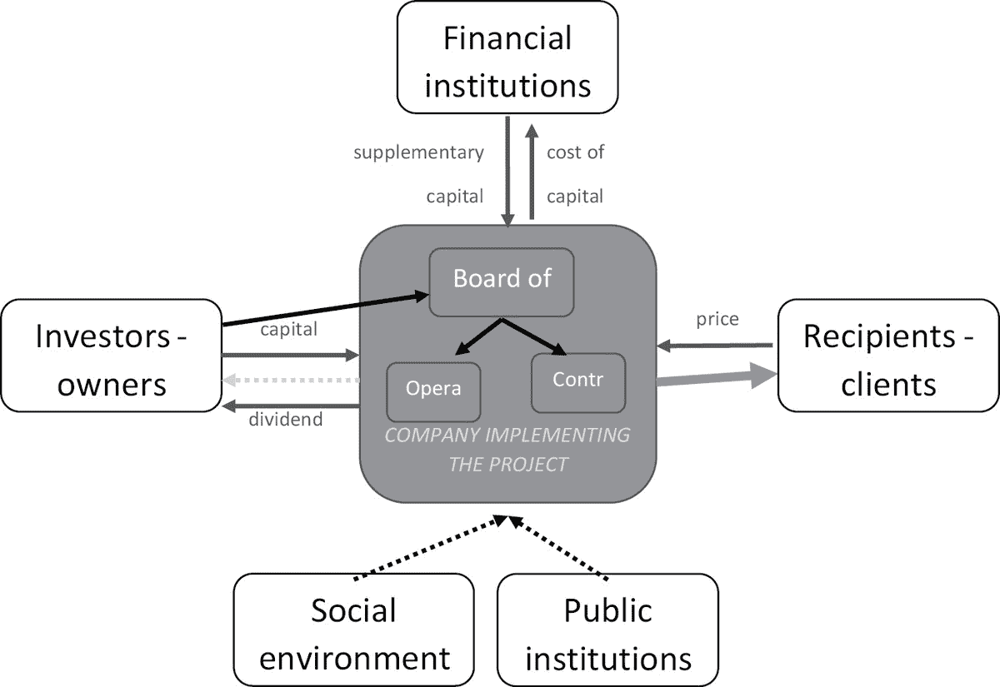
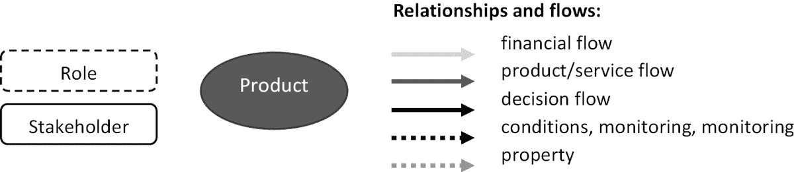
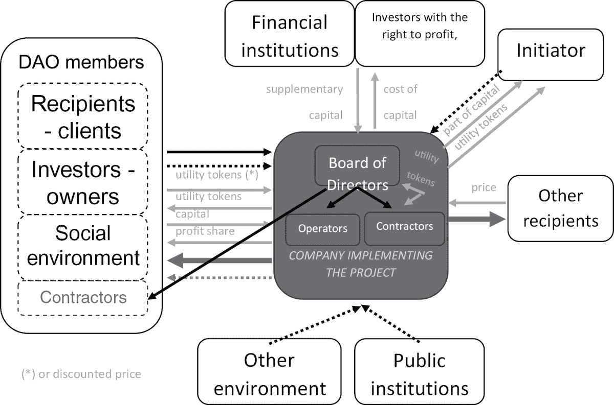
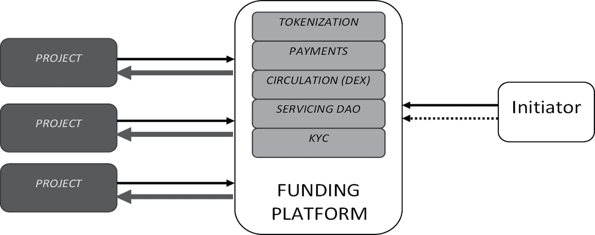

# 项目融资中的区块链技术：巨额投资融资的法律与实践模型

## 关于作者

`Witold Srokosz` 是波兰波罗拉夫大学法律、行政与经济学院的教授，也是波罗拉夫的法律顾问。

`Paweł Lenio` 是波兰波罗拉夫大学法律、行政与经济学院的助理教授，也是波罗拉夫的律师。

`Grzegorz Sobiecki` 是波兰华沙 SGH 经济大学金融系统学系的助理教授。

## 引言

DOI：`10.4324/9781003568797-1`。本章根据 CC BY NC ND 4.0 许可提供。

在世界文献中，目前还没有一项全面的科学研究能够解决利用 `DLT`（区块链）技术为那些本身未嵌入区块链生态系统的项目进行融资的问题，特别是涉及长期和资本密集型投资的项目。本专著填补了这一空白，因此不仅对经济和法律科学很重要，而且作为基础研究的结果，它可以成为商业交易实践中规划巨型投资融资的起点。

本专著是根据波兰国家科学中心授予的资助（决定号 `DEC-2020/39/B/HS5/00120`）编写的。项目的科学目标是开发一种利用分布式账本技术为长期和资本密集型投资融资的理论法律和财务模型。本专著是该资助项目下开展的研究成果之一。

本书提出了若干与资助目标一致的研究问题，包括：在长期投入大量资金的情况下，哪种融资模型或机制最有效？在人类历史上可以找到类似的类比吗？是否存在相应的法律法规？`DLT`（区块链）技术能否为资本密集型投资的融资提供可用解决方案？

本书提出了一个研究假设：可以建立一种基于特制集成平台的、为长期和资本密集型投资提供有效融资的法律经济模型。该平台通过智能合约机制，不仅能够发行和服务股权代币、辅助或实用型代币，还能实现利益相关者之间关系的自动化。它还允许创建一个控制项目的虚拟去中心化自治组织（`DAO`），以及允许代币交易的去中心化交易所。

在经济和法律研究过程中，该假设得到了积极验证，研究结果就是本书[第七章](#ch15.xhtml#c8)中构建的长期和资本密集型投资融资模型。

研究的复杂性需要多维度的法律和经济方法。在法律领域，使用的研究方法包括教义学方法和比较法。在经济领域，进行了文献研究、因果分析和过程建模。

书中考虑的内容涉及具有以下四个特征的投资：

- 大规模（`LS`）——具有广泛的（国际）影响力；
- 资本密集型（`CI`）——需要积累单一实体无法获得的大资金和流动性；
- 长期（`LT`）——涉及多年的实施期；
- 投资项目（`IP`）——具有项目性质，即有明确的目标和工作范围、预期的结果、投资者、预算、阶段和时间表，而非持续发展性质。

为了本研究和专著的目的，本文使用了“巨型项目”和“资本密集型投资”这两个术语来定义这些投资。在此需要说明的是，直接考虑的对象是投资融资的方案、系统和结构，以及利用 `DLT` 对这一过程的支持，而不是对投资组织和协调全过程的支持，尽管某些建议对项目的整体正式形式和法律形态产生影响。

本专著未详细论述盈利评估、杠杆担保、流动性管理、收入规划、预付款、成本估算或谈判等问题。

# 1 资本密集型和长期投资

DOI：[`10.4324/9781003568797-2`](http://doi.org/10.4324/9781003568797-2)。本章节根据 CC BY NC ND 4.0 许可发布。

## 1.1 长期和资本密集型投资的历史案例

定义研究问题的起点是观察到，历史上有很多投资案例需要多年时间才能实施，消耗了大量的资本，并且具有相似的项目性质并面临着类似的挑战。为了更好地理解它们的特殊性，我们展示了几个选定的资本密集型和长期投资，以及与工作目的相关的选定信息，例如建设成本、建设时间和融资方式。

完全通过私人资金为长期和资本密集型投资融资的尝试案例包括苏伊士运河的建设（1859 年–1869 年）和巴拿马运河的建设（1879 年–1889 年——第一次尝试；1904 年–1914 年——主要建设时期）。

在这两种情况下，都成立了公司，分别是于 1859 年成立的 `Suez Canal Company` 和于 1880 年成立的 `Compagnie Universelle du Canal Interocéanique de Panama`。它们发行了股票；在 `Compagnie Universelle du Canal Interocéanique de Panama` 的情况下，还发行了债券，包括与彩票相关的债券。

苏伊士运河的建设由私人投资者的股本资助，占约 55%，其中 52% 由法国投资者所有，约 45% 由埃及政府所有，随后通过债券补充。债券主要由埃及政府提供，最终政府融资占比超过 60%（Hansen and Tourk, 1978，第 938–958 页）。

通过这种方式获得的资金投资于运河建设。按现在的价格计算，建造苏伊士运河的成本约为 100 亿美元，根据 1870 年的估算约为 4.7 亿美元（Alfred, 2012）；巴拿马运河按现在的价格约为 115 亿美元，根据 1913 年的估算为 3.75 亿美元（Onion et al., 2009）。

`Suez Canal Company` 为投资者带来了巨额利润：法国股东和英国政府的回报约为 8%–9%，机会成本为 3%–4%；而埃及政府的回报在机会成本为 11% 的情况下为 2%–5%。相比之下，`Compagnie Universelle du Canal Interocéanique de Panama` 于 1889 年破产。

最终，两条运河都被归国有化。苏伊士运河于 1956 年归国有化；而在巴拿马运河案例中，由 `Compagnie Universelle du Canal Interocéanique de Panama` 在破产后启动的项目被美国政府收购，并于 1914 年完成。1977 年，美国政府签署了新协议。

可以认为，苏伊士运河在 2014 年至 2016 年间通过投资者资助的资金由政府（`SCA`）管理。苏伊士运河按现在的价格约为 100 亿美元，根据 1870 年的估算约为 4.7 亿美元。

另一个完全通过私人资金为长期和资本密集型投资融资的例子是 19 世纪美国跨大陆铁路的建设（1863 年–1869 年）。该项目得到了联邦政府的支持。对于当时 19 世纪的银行家来说，这种融资具有风险性，且预期回报难以估计。

此外，在内战时期，美国联邦政府并不希望产生这样的支出。跨大陆铁路的最终成本为 100 万美元，按现在的价格约为 20–30 亿美元。因此，政府创建了一种机制，通过发行债券获得的资金来支持苏伊士运河。

反之，一个仅使用公共资金资助长期且资本密集型项目的例子是国际热核聚变实验反应堆，即 `ITER`。该项目将基于托卡马克（Tokamak）原理运行。建设于 2013 年开工，计划于 2025 年完成，预计于 2035 年全面运行（Edwardes-Evans, 2021）。

该项目由国际 `ITER` 组织领导。该组织是根据 2006 年签署的国际协议建立的，由中华人民共和国、欧洲原子能共同体（`Euratom`）、印度共和国、日本、大韩民国、俄罗斯联邦和美国签署。

尽管协议于 2006 年签署，但建立国际机构建造托卡马克的构想是在 1985 年 11 月的日内瓦峰会期间提出的。次年，欧盟（`Euratom`）、日本、苏联和美国同意共同实施大型 `ITER` 国际核聚变设施项目。

概念设计工作于 1988 年开始，随后进入了越发详细的工程设计阶段，直到 2001 年成员最终批准了 `ITER` 的最终设计。中华人民共和国和大韩民国于 2003 年加入该项目，印度于 2005 年加入。

`ITER` 场地的选择是一个漫长的过程，于 2005 年完成。当时，`ITER` 成员一致同意欧盟在法国南部艾恩普罗旺附近的 `ITER` 设施选址。

项目最初预算为 56 亿美元（Geert De Clercq, 2016），预计可能会增加到 180 亿至 250 亿美元（Hutt and Breene, 2019）。

欧盟负责 `ITER` 约 45.5% 的建设成本，中国、印度、日本、韩国、俄罗斯和美国各贡献了约 9.1%。在运营阶段，成员之间的成本分配将如下：欧洲——34%，日本和美国——13%，中国、印度、韩国和俄罗斯——10%。

假设建设阶段的大部分贡献，即 90%，将由参与项目的国家以“实物”形式提供。也就是说，这些国家不是提供现金，而是向 `ITER` 组织提供组件和建筑。

`ITER` 组织成员的实物贡献被分为约 140 份公共采购协议。这些文件详细说明了系统、组件和设施结构采购的技术规范和管理要求。

然而，从本专著主题的角度来看，特别重要的是每份采购协议的价值是以 `ITER` 会计单位——`IUA` 表示的。这是一种旨在随时间一致衡量对 `ITER` 实物贡献价值的货币。

其使用方式如下：采购分配根据组件估值分配给各成员。当给定的组件成功完成后，相应的信贷价值将保存在该成员的账户中。因此，项目 9.1% 的贡献相当于各项个人贡献的 `IUA` 值总和。

与 `ITER` 项目一样，欧洲还有另一个研究项目——大型强子对撞机（`LHC`），由 `CERN`（欧洲核子研究组织）控制。它的建设耗时 12 年（1995–2007 年），成本约 47 亿美元（Roche, 2022）。

该项目的资金来自 `CERN` 自有资金，即成员国政府的贡献，其中德国占年度预算的 70% 以上，英国、意大利、法国和西班牙也提供了贡献；此外还包括观察国政府（包括美国）提供的资金、欧洲投资银行（`EIB`）的贷款以及欧洲公共资金（第六次欧盟研究框架计划）。

由于缺乏完整的来源信息，很难确定这笔资金的结构（Smit, 2002）。尽管如此，资金来源列表表明资本并非来自私人实体。

太空征服提供了资本密集型和长期投资的案例。首批此类计划完全由公共实体通过公共资金资助，例如阿波罗计划和航天飞机计划。国际空间站的建设始于 1985 年，也属于这一类。

在 1985 年至 2015 年期间，估计建设成本约为 1500 亿美元，并由计划成员的自有资金资助：`NASA`（84%）及其伙伴：俄罗斯（8%）、欧洲（3.3%）、日本（3.3%）和加拿大（1.3%）（Lafleur, 2010）。

在 21 世纪，我们可以观察到不再完全依靠公共资金资助太空征服的现象，转而使用公私合作伙伴关系（`PPP`），甚至将融资负担完全转移给私人实体，这意味着该研究资金的逐渐去中心化（Weinzierl, 2018，第 173–192 页；Heracleous et al., 2019，第 1–3 页；Pomeroy et al., 2019，第 44–50 页）。

结果是，2021 年全球太空活动价值达 468 亿美元，其中 79.8% 属于商业太空产品和服务基础设施，而 11.6% 属于美国政府。此外，2021 年共进行了 145 次轨道发射，商业任务数量增长快于军事和政府任务。其中一些发射涉及维珍银河（Virgin Galactic）、蓝色起源（Blue Origin）和 `SpaceX` 的载具。

太空征服提供了长期且资本密集型投资的案例。另一个典型的私人资本投资是阿联酋迪拜的哈利法塔。这座摩天大楼耗时 5 年建成（2004–2009 年）。

项目实施成本计划为 8.76 亿美元。由于原材料价格上涨，最终成本估计约为 15 亿美元（Abraham, 2019，第 694 页）。投资者是一家私人房地产公司（艾马尔物业），资金通过自有资金和银行贷款筹集。

遵循大型项目资本私有趋势的有趣案例是 `Inmarsat`（国际海事卫星）。这是一个 1979 年由国际海事组织（联合国的一个专门机构）创建的国际非营利组织，旨在为海事社区建立并运营卫星通信网络。

最终，`Inmarsat` 被私有化并转变为一家为全球用户提供电话和数据服务的私人公司。目前，`Inmarsat` 是一家英国卫星电信公司（Wolfe, 2022）。

其他巨型项目的例子还包括：

- 空客 `A380` 的建设（127 亿美元）；
- 协和客机的制造（159 亿美元）；
- 切尔诺贝利核电站的新安全围护结构（21 亿美元）；
- 深水地平线溢油事故（清理费用、罚金和罚款：650 亿美元）；
- 福岛核电站事故后的清理工作（1870 亿美元）；
- `COVID-19` 疫苗开发（930 亿美元）；
- 曼哈顿计划——核弹研发（240 亿美元）；
- 深地中微子实验（`DUNE`）（65 亿美元）；
- 三十米望远镜（15 亿美元）；
- 全球定位系统（`GPS`）（900 亿美元）；
- 中央新干线——日本连接东京与名古屋的磁悬浮铁路（6120 亿美元）；
- `Bharatmala` 计划——印度的道路生态系统（1100 亿美元）；
- 德里–孟买工业走廊（900 亿美元）；
- 跨欧洲交通网络（`TEN-T`）（6250 亿美元）；
- 圣哥达基底隧道（103 亿美元）；
- 新行政首都——埃及计划中的新首都（2500 亿美元）；
- 禁寺——麦加的圣寺（106 亿美元）；
- 新世界贸易中心（34 亿美元）；
- 南水北调工程——将中国南方的水资源引至北方（790 亿美元）；
- 尼加拉瓜运河——巴拿马运河的替代方案（约 1000 亿美元）；
- 英吉利海峡隧道（`Eurotunnel`，英吉利海峡）（26 亿美元）。

本工作的目的并非分析历史案例，但识别长期和资本密集型投资的现有融资机制至关重要，以便能够指出它们的共同特征和挑战，并以此确定资本密集型投资模式的特征。

反过来，这将开发出支持此类投资实施的假设、通用功能和解决方案。该列表不包括非项目性质的项目，或难以区分设计阶段的项目，例如在几百年内分段建造的中国长城。

## 1.2 组织方面

在分析资本密集型、长期、大规模投资项目的案例时，可以识别出许多特定特征，使它们与较小项目（局部范围）、周期较短项目（在几个月内实施）以及不需要大量资本支持的项目（在单一实体范围内实施）区分开来。

这些特征被分为四个维度：

1. 组织；
2. 社会；
3. 形式与法律；
4. 经济与财务。

### 1.2.1 项目的特定特征——组织维度

在组织维度上，所有从本专著目的来看重要的项目特征，包括长项目周期、资金需求和地理范围，都源于项目本身非常重大的预期结果。

在这种情况下，投资者意图创造某些通常是独特的、甚至是独一无二的东西。重大的结果会产生一系列进一步的特征：多阶段项目、项目多维度的复杂性，包括项目的技术、组织、形式和法律方面；项目活动的大范围；以及利益相关者，包括投资者的多样性。

因此，大型投资项目的开发像一个独立的组织一样进行，并且通常采取这种形式，即特殊目的载体，以进行项目协调。同时，此类项目对项目组织有高度的形式化要求，并面临资源限制。

资本密集型项目通常本质上是基础设施性的，并在多个领域实施，其中最大的项目，包括上述项目，在以下领域实施：

- 研发与创新（知识获取）；
- 电力工程；
- 交通；
- 房地产；
- 航空；
- 航天工业；
- 灾后恢复；
- 通信；
- 安全；
- 水和污水设施；
- `IT/ICT`；
- 环境保护与资源利用率；
- 社会包容；
- 应对气候变化；
- 工业；
- 军事。

值得注意的是，具有相似特殊性的投资组除了全球性项目外，还包括在规模较小的区域或局部范围内实施的项目，例如：

- 交通项目：交通系统的建设与改造，如公路网、铁路、机场、海港；
- 能源项目：能源生产与分配投资，如风能、太阳能、水能和核电站的建设，以及能源输配系统的改造；
- 水务与污水项目：供水和污水处理系统的投资，如污水处理厂和供水系统的改造；
- 房地产项目：住宅、办公、商业建筑以及体育馆的建设与改造；
- 电信项目：电话、无线数据、互联网和电视网络；
- 教育与健康领域项目：学校、大学和医院的建设与改造；
- 安全领域项目：民防、边界保护以及消防、警察系统的建设与改造；
- 文化与旅游项目：旅游景点、博物馆、美术馆的建设与改造。

这表明，为资本密集型和长期投资开发的解决方案也可以适用于较小规模的场景。

### 1.2.2 实施阶段和时期

长期资本密集型投资包含许多阶段，这些阶段通常作为项目的一部分共同规划，且在开始研发工作之前的文档通常非常复杂、详细、广泛且形式化，因为大型项目无法使用初创公司的方法实施。

每个项目都是特定的，某些阶段可能以不同的顺序发生或在时间上重叠；然而，可以识别出投资过程中的几个重复阶段。

在投资前阶段，可以识别出以下阶段：

- 初始组织阶段；
- 融资阶段；
- 设计阶段。

#### 初始组织阶段

该阶段从投资想法形成和活动开始，到其开发、利益相关者围绕共同项目目标聚集、定义组织假设、组织结构和公司治理，直到规划概念性工作。

在此阶段，签署合作协议、意向书和备忘录，制定项目开发路线图，可能创建联合体以协调活动，并选拔管理团队。

#### 融资阶段

在该阶段开发投资融资机制的假设，与基础或额外资金供应商进行会谈，并获得当前工作的首批流动资金。

#### 设计阶段

在该阶段开发投资想法并准备解决方案的设计，并进行初步的市场分析和初步业务假设，包括后续活动的融资机制和来源。

## 设计阶段

在此阶段，将对投资想法进行详细分析，开展市场分析，准备解决方案的最终详细设计和业务计划；编制设计文件；计算成本、制定技术计划并获得必要的许可和同意。

此外，根据项目的不同，如果项目文件的内容，即解决方案机制的功能，取决于研发，则还可能开展研发工作。

## 投资阶段

投资阶段应分为两个阶段：

1. 建设与执行；
2. 测试与实施。

### 建设与执行阶段

该阶段包括项目的实际实施。它涵盖了能够获取实践知识的研究工作，以及对概念开发和设计阶段确定的问题进行系统性的解决。

其结果将用于开发工作，即构建正确的解决方案，包括基础设施的建设、设备的安装、施工，以及所有机制和物流的组织。

### 测试与实施阶段

在解决方案建设完成后，将进行测试和质量控制，加强营销活动，进行工程验收，验证是否符合标准。

同时，正在进行漏洞修复和必要的更新工作；准备正式的法律结构，即成立公司以处理运营阶段的解决方案；招聘人员并进行培训。

## 投资后阶段

投资后阶段应分为运营阶段和维护与现代化阶段。

### 运营（运作）阶段


项目投入使用，在目标地点面向目标客户推出；在运营阶段之前，可能会进行启动阶段（Beta 测试）——在测试完成并获得必要的许可后，基础设施将进行首次市场投放；收集首次反馈并进行调整。

### 维护与现代化阶段

基础设施通常是大型投资项目的结果，需要定期的维护和现代化，以保持其对客户的功能和可用性。

## 1.2 周期与预测

对于长期的资本密集型基础设施投资，整个投资过程的总持续时间可能从几年到十年左右不等，取决于投资的性质；其中投资前阶段持续一到三年，而大型投资的实施需要 5 至 15 年。比此更长的项目基本上不存在。

长期项目需要对经济状况和经济参数（利率）、市场（产品需求）、成本发展、技术潜在变化以及劳动力可用性进行长期预测。预测期越长，伴随的不确定性就越大（无法评估风险），以及黑天鹅事件发生的概率增加——即异常、不规则或令人惊讶的事件，其影响是巨大的，但与其发生时一样不可预测，因此无法防止其发生。悖论的是，事后分析显示存在可能发生的迹象的情况并不不少，但这些迹象在信息噪音中被忽略了。此类事件的示例包括：

- 全新技术的出现破坏了所融资解决方案的经济意义；
- 国际经济危机；
- 军事冲突；
- 自然灾害；
- 流行病；
- 结构性经济变化（例如货币制度的变化）。

### 1.2.3 利益相关者

计划结果的复杂性和项目的重要性要求在投资实施的每个阶段都有许多方的参与。在大型项目中，可以识别出几类利益相关者——每一类人都有自己的利益、期望、法规、技术和组织体系、文化和语言：

- 投资者（核心资金提供者、所有者）；
- 金融机构（补充资金供应商、金融中介、额外服务：租赁、保险、担保、评）；
- 组织者：
  - 发起者；
  - 协调员（经理）；
- 目标解决方案的（员工）；
- 承包商和分包商：
  - 设计师、建筑师（概念开发、项目文档）；
  - 顾问、顾问（税务、法律、公关/营销机构）；
  - 为目标解决方案提供服务或商品的承包商，包括建筑工；
- 解决方案的接收者：
  - 客户；
  - 最终用户；
- 社会环境：
  - 当地社区；
  - 媒体；
- 公共机构：
  - 中央和地方当局（资金来源、特许经营、许可、担保、拨款、特殊规定和解释），国家或地方政府部门可能通过其控制的金融机构采取行动；
  - 监管机构（监测、合规性验证）。

因此，资本密集型投资涉及广泛的利益相关者。值得注意的是，在大型项目中，投资者群体（所有者和贷款人）、目标客户、广泛的社会环境、当局和媒体观察者是相互渗透的，也就是说，从项目的角度来看，一个实体（人）往往可以同时承担多个角色：目标客户、投资者、项目外部效应的接收者（社区成员）以及员工。

### 1.2.4 资源限制

项目的巨大规模意味着，类似于买方垄，项目从项目角度来看，是当地和全球各种必要资源的重要接收者。大型投资的实施需要大量的资源：

- 自然环境（水、森林、矿床沉积等）；
- 人力资源（所需能力、专业人员、管理人员的可用性）；
- 半成品（总可用量以及生产所需数量的能力）；
- 当地基础设施（员工的住宿、交通网络、供水和污水网络、服务员工所需的能源网络）；
- 技术（特定解决方案的许可可用性、设备可用性、现有技术问题解决方案的存在）。

在较小的项目中，没有必要验证获取所需资源数量的绝对可行性，因为它们在市场上是可以获得的。在大型项目中，必须通过独立的流程规划如何确保它们的可用性，这有时通过特殊协议形式化。

这也意味着，一方面，将项目安置在空间上接近必要的资源比安置在目标接收者附近更为重要，同时这可能对环境造成严重负担。

### 1.2.5 协调与管理

高复杂度且实施周期较长的项目管理方法将类似于大型国际集团的管理方法。具体的管理方法通常会根据管理人员的资质和经验、项目范围以及其地理和文化背景进行调整。然而，关键方面是在所有过程中采用一种方法化和正式化的方法，这种需求源于：在背景多元化的项目团队和投资者中建立一个通用的沟通平台，以用于计划、职责分工、任务及其执行状态的沟通，以及根据能力和经验进行任务的专业化和清晰分工。因此，在项目管理层面，典型的初创企业和小型投资项目的“敏捷”方法、方法论和工具（包括流行的 `Scrum`、`DSDM`、`Crystal`、`Kanban` 和 `Lean`）在这里并不适用，特别是那些项目管理层在做出 `ad hoc` 决策时具有很大裁权的方法。

传统的“级联式”方法更接近具有许多利益相关者、投资者和阶段的巨型项目；它由系统地实施连续的、预先计划的步骤组成，最终导致解决方案。整个项目的规划旨在帮助减少与失败相关的风险。因此，在初始阶段进行市场研究至关重要：对现有供应商以及目标产品需求的研究，而这些往往被小型项目所忽略。

敏捷方法需要灵活性，这种灵活性受到正式化的限制，但在大型项目中是必须的。我们认为这种关系并非永久的，特定的正式、组织和技术解决方案可以结合大型项目的需求和小型项目的灵活性，而不会丢失项目协调的质量。然而，本工作仅限于分析通过这种方式支持一个项目流程——融资的潜力。我们声称，得益于适当的技术解决方案（基于区块链技术），可以让这一过程更加灵活。

## 1.3 社会方面

投资巨型项目的独特特征是其显著的社会角色——既需要从环境中获取资源，又对环境产生影响。

资本密集型投资在项目开发期间是就业的来源，直接和间接地地为项目准备和实施每个阶段（以及随后的运营阶段）的具有各种资质的大群人员提供机会。同时，它们直接为项目周边（桥梁、大坝和知识）提供公共服务，或者作为与之相关的正外部效应的来源（连接地区、加速并降低运输成本、支持旅游、体育和公共健康）。由于开展科学研究的需求，它们刺激了科学的发展和文明的进步。

大型基础设施投资（公共工程）一直被用作经济政策实施的战略元素，在经济危机期间支持许多国家的全球（总）国内需求。服务的出口潜力增加了该地区的竞争潜力。它们具有系统性重要性。因此，它们对于市场、行业或地区来说并不是中立的——它们的成功可能会引发效益的多米骨牌效应。然而，它们的失败可能会产生相反的效果。尽管如此，由于在规划、准备中付出的努力、投入的巨额资金以及一种“惯性”，它们基本上总是完成的——尽管这并不总是意味着投资者在经济上的获利。

之前引用的例子表明，项目产生的货物性质，以及它们的规模和社会经济重要性，意味着在几乎每一个巨型项目中，地方、区域和中央当局，或由许多国家当局组成的国际组织，都起着非常重要的作用。最初，是当局发起了此类项目，组织了融资或提供了自己的资金，监督并经常直接协调了它们的实施。随着时间的推移，责任的负担已转向私人资本；然而，由于对环境的广泛影响使得当局仍然是这些项目的重要利益相关者。因此，某些项目决策可能具有政治因素——即使在项目启动后也是如此，而且某些决策如果没有特殊的规定是无法实现的。

由于依赖关系的复杂性和多样化结构，大型投资项目的特点是缺乏透明度。这也适用于 PPP 模式（政府和社会资本合作模式）。

- 在每个阶段为受项目影响的当地社区利益服务的活动；
- 应用职业健康安全规则；
- 尊重结社自由（员工）；
- 确保管理制度和人员变化的公平性；
- 维护多样性、非歧视和机会均等（残障人士、不同性别、种族、民族、宗教、世界观或性倾向的人士）；
- 符合可持续发展原则的活动（尊重 `6R` 原则：重新思考 Rethink、拒绝 Refuse、减少 Reduce、重复利用 Reuse、回收 Recycle 和恢复 Recover）。

在气候危机时代，联合国大会决议《转型我们的世界：2030 年可持续发展议程》中制定的可持续发展原则。

文献承认了可持续发展原则对项目融资的重要性，特别是当项目在全球范围内实施时，人权在此背景下也被提及（`Dufey and Grieg-Gran, 2011`，第 12 页及后续）。

## 1.4 法律方面

### 1.4.1 引言

## 法律与监管维度

在法律和监管维度，巨型项目实施的特殊性在于，在每个阶段，它都可能涉及越许多司法管辖区（即使正式上的主要管理中心位于一个明确定义的司法管辖区），并且在每个司法管辖区，它可能同时受到许多法规的约束。如果当地法规意味着相互斥的不同活动，这种复杂性将更具挑战性。在极端情况下，这可能意味着放弃向某些司法管辖区的客户提供该产品的想法。由于参与方众多，安排的正式化通常需要多边协议或利益相关者（主要是投资者）之间的协议网络。一些巨额投资是中央机构长期计划的一部分，或者是由特殊规章（法案）设立或监管的。值得注意的是，尽管大型投资具有特殊性和重要性，但其融资并不总是直接受法律的监管。

### 国际项目中的法律规定

对于具有国际范围的项目，必须考虑至少四类法律规定：

1. 适用于执行项目实体的法律（例如，适用于公司注册地点的法律），该法律适用于该实体及其在该国领土内及域外的活动；
2. 外国法律（例如，承包商或投资者的注册地所在地，或项目部分或全部的实施地）；
3. 国际公法和私法；以及
4. 包含法律冲突规则的规定——规定哪些法院或仲裁庭将适用于纠纷（Hoffman, 2008, p. 20）。

### 法规分类

应当识别出两大类法规：

- 定义承担和实施投资的组织和法律框架的法规；
- 关于投资融资的法规。

第一组法规包括关于以所有组织和法律形式（公司、合作社，甚至是基金会和协会）启动和经营业务的规定，以及关于国家通过适当组织组织法律形式履行公共任务的公法规定（预算单位、政府机构和国家基金）。

另一方面，第二组法规包含了规定为此类经济活动多种融资方法的规定，涵盖了私法（例如，贷款、租赁或发行债券或股票）和公法（例如，规定公共支出原则的公共财政规定）。

## 1.4.2 项目融资

通常情况下，没有为资本密集型长期投资制定特殊法律规定的立法实践。然而，确实有一些国家以不同程度的细节制定了关于项目融资的规定。这些可以是不同的方法：

- 国家对合同的标准化（英国）；
- 通用项目融资立法（意大利）；
- 通用项目融资立法中的特定行业关注（土耳其）（Pédamon, 2000, pp. 1278–1286）；
- 还可以识别出一种涉及为特定的资本密集型长期投资创建专门法律和其他法律行为的方法（波兰）。

### 英国

正如 2023 年的行业出版物所示，目前英国通常没有专门规范项目融资的特定立法。与财务和破产相关的法律通常适用。某些针对项目融资的特定规定对一般规定引入了例外，例如关于项目融资公司的破产规定（Wood et al., 2023, p. 227）。

如前所述，英国是国家合同标准化的示例；然而，这是一个历史性的案例。英国财政部发布了 `PFI 合同标准化`。

### 意大利

意大利是一个通过单一法律全面监管项目融资的国家示例——2023 年 3 月 28 日的《意大利新公共合同法典》，该法已 2023 年 4 月 1 日生效。

根据《意大利新公共合同法典》第 194 条 (1) 款，对于根据法典第 14 条第 (a) 款所述阈值的授予，以项目融资形式进行的授予要求招标方成立特许经营公司。

《意大利新公共合同法典》第 194 条规定，对于由多个实体组成的竞争者，要求其形式为股份有限公司或有限责任公司。招标公告说明了各实体的持股比例。在不需要行政批准或授权的情况下，其接了特许关系。在授予方在建设期间支付款项的情况下，公司成员与特许经营公司共同承担连带责任。

该部分由三条非常详尽的条款组成：

- 193 `Procedura di affidamento`（授予程序）；
- 194 `Società di scopo`（特许经营公司）；
- 195 `Obligazioni delle società di scopo`（特许公司债券）。

从本文主题的角度来看，第 195 条是最有意义的。它规定了目的公司（SPV）运营的融资方法。根据该条款，SPV 可以发行债券和债务证券（尽管存在某些限制）。投资所述所述债券和债务证券可以证券化，且不能转让给非机构投资者或专业客户。此外，发行债券仅允许为基础设施或连接公共服务的建设债务融资或再融资，且招标文件必须清晰地包含与运营相关的风险警告。同样重要的是，债券和债务证券在特许人开始管理基础设施之前或债券自身到期之前，可以根据经济财政部与基础设施交通部共同确定的方法获得担保（《公共合同法典》第 194 条 (3) 款）。

### 土耳其

土耳其是一个既没有单一 PPP 模式，也没有适用于特定工业部门实施的所有 PPP 项目的框架法的国家。不同的 PPP 模式在不同的法案中受到监管。这些包括以下 PPP 模式：

- 建设-运营-移（BOT）；
- 经营权转（TOR）；
- 建设-运营（BO）；
- 建设-租赁-移（BLT）。

近年来，人们一直尝试制定一部全面的 PPP 法案。此类法律的相应草案首次于 2007 年编写并提交议会。然而，该法律未被采纳。此类草案又于 2020 年再次提交，但再次失败了（Bürosu, 2023, pp. 9–10）。

土耳其最流行的 PPP（公私合营）模式是 `BOT` 模式，该模式根据 `第 3096 号法律`（关于授权土耳其共和国电力管理局以外企业进行发电、输电、配电和贸易）引入。该模式也被用于 `第 3465 号法律`（《关于授权公路总局以外企业进行受控公路建设、管理和运营的法律》。此外，1994 年颁布了 `第 3996 号法律`《采用建设-经营-转移模式的某些投资和服务》，并已用于多个 `BOT` 项目。该法适用于能源、交通、通信、旅游投资和市政服务等部门。

相反，人气较低的 `TOR` 模式定义在 `第 4046 号法律`（《私有化程序法》）中。在这种模式下，可以将运营权转移给 (i) 现有项目整体或 (ii) 现有公司的生产单位，每种情况均须满足特定条件并在规定期限内。然而，`TOR` 模式下，相关项目公司的资产并不转移。

`BO` 模式受 `第 4283 号法律`（《建设-经营模式下发电设施设立与运营条例以及能源销售条例》）监管，该法律仅适用于发电的建设和运营。在 `BO` 模式下，企业家建设并运营电厂，然后以保底价格将产生的电力出售给国家实体。该模式与 `BOT` 模式的区别在于，企业家是电厂的所有者，且不承诺在合同结束后将其转移给公共实体。`BO` 模式的范围仅限于发电厂项目，因此在土耳其的实施规模较小。

土耳其的医疗保健部门也有独立的 PPP 法规。`第 6428 号法律`（《关于通过 PPP 模式由卫生部（简称“卫生部”）提供的设施建设、翻新和服务》）以及对某些法律和法令的修订引入了 `BLT` 模式。该法允许投资者通过 `BLT` 模式在医疗保健项目中提供除医疗服务以外的服务。`第 6428 号法律`监管的 `BLT` 模式的特征是：投资者建设医疗设施，并在医院园区内提供某些通用支持服务和医疗支持服务；但医疗服务由“卫生部”的医生和护士向公众提供。重要的是，在合同期结束时，投资者必须将医院设施移给“卫生部”（`Bürosu, 2023`，第 9–10 页）。

另一个资本密集型长期投资的例子是波兰中部的中央交通枢纽（CPK）的建设，这包括建立一个旨在作为中欧转运枢纽的新机场，以及包括铁路网络在内的广泛通信网络。投资的主体是建设一个公共使用机场以及用于其建设的设施、设备、器材、网络和装置，特别是公共道路和传输网络。

在这种情况下，波兰立法者决定引入仅针对此项投资的特殊法律。在波兰，没有法律规定能够完全确定此类投资的实施原则和融资方式。

### 波兰《中央交通枢纽法案》

从法律和财务角度来看，该投资的资金将主要根据多年计划筹措。中央交通枢纽政府全代表负责该计划的编制和监督。该投资还可以通过国库转让国库证券以增加注册资本来融资。波兰财政部长可以在多年计划规定的日期和金额向特殊目的载体转让国库证券。公司通过出售国库证券获得的资金可用于资助其任务的实施。这意味着实施产生了国家债务。

该法案的规定允许公司以外的投资者进行投资。根据波兰《中央交通枢纽法案》`第 2 条第 2 款`，这些投资者可以是由特殊目的载体建立的公司、公共财政部门单位或其他依赖于这些单位的国家属组织单位。如果存在公司以外的投资者，则由投资者根据中央交通枢纽政府全代表批准的管理原则进行投资管理。颁布的规则规定（包括限于），中央交通枢纽计划的建立是为了确保本法案关于 CPK 的目标能够有效、及时地实现，并基于类似规模项目的全球最佳实践制定多年计划。该计划是用于战略性管理、协调和监督旨在实现特定目标、利益和结果的相互关联项目及活动组的管理与实施的工具。《管理原则》构成了一套确保中央交通枢纽管理活动一致性的规程。这些是实施整个投资的统一条件、程序和说明书。《管理原则》定义了投资管理的原则，包括投资者对实施情况的监督原则和模式，以及投资者之间合作和信息交换的原则。

波兰《中央交通枢纽法案》并不禁止国库向私营实体出售股份。也没有排除私人投资者加入公司并认购公司发行的新股的可能性。考虑到此，可以认为，波兰关于中央交通枢纽建设的特殊法律并未规定其融资的单一来源。它没有规定该投资将仅通过公共资金融资。允许私人资本参与。然而，该法案并未规定私人资本参与的规则。2023 年 10 月，公司选择了一个财团作为私人战略投资者：威尼机场集团（Vinci Airports）和 IFM 全球基础设施基金（`IFM`）。

`联合国国际贸易法委员会（UNCITRAL）`于 2001 年编写的《私营部门融资基础设施项目立法指南》旨在促进项目融资领域的法规制定。

毫无疑问，资本密集型和长期投资的区别在于，由于涉及资金量巨大且投资执行期限较长，其产生的风险比其他投资更。。此外，在起草合同、法规以及使用履约金时，应特别考虑这两个问题。例如，有必要在合同（法规）中引入确保双方在价格波动（特别是通货膨胀和利率变化）时利益的条款。协议和法规还应考虑到法人主体组成随时间推移而发生的自然变化。

作为项目融资项目合同（项目协议）的标准，与以下相关的问题受监管（参见 Yescombe, 2014, p. 129）：

- 合同期限；
- 支付机制；
- 购电方/承包当局对合同的监控；
- 履约金及其他担保；
- 补偿事件；
- 免责原因；
- 宽免事件；
- 购电方/承包当局的介入；
- 终止；
- 所有权变更；
- 争议解决。

如果合同期较短，投资者的投入必须迅速偿还。这可能意味着提供的产品或服务的成本增加到市场无法接受的水平。反之亦亦然。这意味着延长项目实施期可能会降低产品或服务的成本（参见 Yescombe, 2014, p. 130）。


债务期限取决于投资者希望投资或借入资金持续多久。在市场上获得长期贷款可能存在困难。此外，投资者实现回报率的时间也同样重要。对于长期投资，还应考虑投资的灵活性。例如，投资可能会受到未来技术变化的影响，而这些在签订合同阶段是难以预测的。在某些情况下，期限可能由税法规定决定（参见 Yescombe, 2014, pp. 130–132）。

关于支付机制，Yescombe 指出，原则上，在项目完成之前，投资者无权获得任何付款。这可能存在例外，即如果投资分为特定阶段，可以在完成给定阶段后进行付款。合同付款在整个投资期间应保持金额金额。然而，该金额可能由于客观原因发生变化。付款可能受到通货膨胀（近年来欧洲受新冠肺炎疫情和乌克兰武装冲突的影响）以及特定货币汇率的影响（参见 Yescombe, 2014, pp. 132–133）。在这种类型的投资中，发生争议的概率很高。文中指出，此类争议初应由专家或认可的法院/仲裁庭通过仲裁解决（参见 Yescombe, 2014, p. 161）。

有必要持续监控法律的拟议变化，以便提前对内部法规做出适当且必要的调整。通常，法律的频繁变动会产生重大的法律风险，在为资本密集型和长期投资建立法律框架时必须考虑这一点。公法法规（包括税法）在此尤为重要。

### 1.4.3 资本公司

某些组织和法律形式在法律本质上具有“隐藏”的长期运行并进行长期及资本密集型投资的能力——在民法领域，这些是资本公司（主要是股份公司），而在公法领域，它们是国家机构。

关于股份公司的规定为长期投资创建了法律框架，其目的是参与可能持续多年的企业发展。这一法律框架保护了股东投资者的利益，使投资更加安全（参见 Charkham and Simpson, 1999, p. 44）。目前，资本公司长期运营的这种特性也在可持续发展的背景下被认知。其中，还假设引入一种法律框架，旨在引导企业和其他经济参与者放弃关注短期快速盈利的方法，转而采取长期思考和行动；在力争限制气候变化的情况下，这一时期可以以几十年计算，甚至超过 50 年（参见 Sjåfjell and Richardson, 2015, p. 323）。

股东将资金委托给一个具有法律人格的实体以换取股份，一方面对公司利润拥有无限的份额，另一方面将亏损限制在股份购买价格内。此外，他们对公司的行为不承担法律责任。再者，股份易于转让，因此可能随时轻松退出投资。这些特征对于长期和资本密集型投资非常重要，因为这类投资从本质上说其风险比短期投资更大，且所需资金较少。股份公司的实用性已通过实践得到证明（参见 Section 1.1）。

此时，可以提到欧洲公司，其法律结构已在`2001 年 10 月 8 日关于欧洲公司章程的欧洲理事会第 2157/2001 号条例`中规定。

### 1.4.5 欧洲长期投资基金

目前尚无专门针对长期和资本密集型投资的规定，尽管金融市场领域的法律法规详细规定了投资的各种融资方法，例如监管股票或债券发行的法律，或关于贷款发放的规定，这些通常根据其性质也考虑了长期融资期（例如抵押贷款）。例外是欧盟法律，其在资本市场法领域有一项直接涉及长期融资，即涉及大量资金的长期投资。这就是关于欧洲长期投资基金的`欧盟条例 2015/760`。

该条例规定了欧洲长期投资基金（ELTIF）的创建和运行规则，这些基金旨在为各种基础设施项目、未上市公司或上市的中小型企业（SMEs）提供长期融资，这些企业发行了没有易于识别买方的股权或债务工具。

`欧盟条例 2015/760`与欧洲议会和理事会关于替代投资基金经理的`2011/61/EU 指令`规定密切相关。

欧盟 (EU) 2015/760 号条例对欧洲长期投资基金（ELTIFs）的投资活动实施了严格限制，以确保 ELTIF 真正面向长期投资，并确保它们对欧盟经济的可持续增长融资做出贡献。因此，ELTIF 应至少将其 70% 的资本投资于合规投资资产中（例如，股权或准股权工具、合格投资组合企业的债务工具，以及提供给这些企业的贷款。更多信息请参阅条例第 17 条序言）。此外，根据条例第 18 条序言，合规投资资产应包括价值超过 10,000,000 欧元且能产生经济和社会效益的实体资产。此类资产包括基础设施、知识产权、船只、设备、机械、飞机或轨道车辆以及不动产。允许对商业地产或住房进行投资，前提是其有助于促进智能、可持续和包容性增长，或符合欧盟的能源、区域和凝聚政策。因此，ELTIF 负责资助需要大量资金的投资，包括资本密集型投资。

从法律角度来看，有趣的是，欧盟立法者在条例 (EU) 2015/760 的序言中提到了长期投资概念的定义，并称该定义是“宽泛的”。因此，并没有定义特定的时间范围，例如投资年限。然而，在序言第 15 点中，欧盟立法者定义了长期投资除时间之外的以下特征：

1. 合规投资资产通常是缺乏流动性的；
2. 合规投资资产需要一定期限内的承诺；
3. 合规投资资产具有长期性质的经济特征。

通过这种方式，欧盟立法者充分地勾勒了长期投资的概念，而且对于本专著的主题来说，它为与长期投资相关的正式和法律考量提供了一个具体的起点。

这里必须强调的是，根据条例 (EU) 2015/760 的第 1(2) 条，该条例的宗旨定义为“募集并引导资本流向欧洲实体经济的长期投资，以符合欧盟智能、可持续和包容性增长的目标”，因此 ELTIF 应仅资助对“实体经济”的长期投资。实体经济的概念并未在条例立法者在条例定义，也没有在序言中解释。考虑到条例第 18 条序言的内容，其明确指出条例并非寻求促进投机性投资，应当假设对实体经济的引用是为了额外强调一项要求，即 ELTIF 进行的长期投资不应具有投机性。

结合本专著的主题，欧盟立法者如何为了条例 (EU) 2015/760 的目的而理解基础设施项目概念也很有趣。序言 19 指出，基础设施项目的规模意味着它们需要大量资金并长期投入。通过这种方式，欧盟立法者明确将基础设施项目归类为长期和资本密集型投资。序言还提供了此类基础设施项目的例子：

- 公共建筑基础设施，如学校、医院或监狱；
- 社会基础设施，如社会住房、交通基础设施（如道路、大众交通系统或机场）；
- 能源基础设施，如电网、气候适应与缓解项目、发电厂或管道；
- 水资源管理基础设施，如供水系统、污水或灌溉系统；
- 通信基础设施（如网络）以及废物管理基础设施（如回收或收集系统）。

### 1.4.6 公共反垄断法

公共反垄断法同样重要。长期和资本密集型投资的实施，尤其是其影响，可能对全球经济产生影响，或至少对投资实施国家的经济产生影响。存在一种风险，即此类大规模投资可能会扭曲特定商品或服务市场的竞争。投资者与投资项目本身的关系也可能很重要。在竞争规则方面，投资者与公司之间的贸易可能具有相关性。首要的是，允许作为独立经营者的投资者优先使用投资的成果，在竞争法下可能会产生特定影响。

高度发达国家在反垄断法领域拥有相当严格的法律解决方案。首先，欧盟国家作为一个在竞争保护和内部市场领域的国际组织，受欧盟条约规定和欧盟次级法律的约束。美国也拥有广泛的反垄断立法。

根据欧盟法，对竞争的保护是在两个层面实施的，即通过首要法和次级法。根据《欧盟运行条约》第 101 条：

但重要的是，如果某些被禁止的活动有助于提高产品的生产或分销，或促进技术或经济进步，同时为用户保留公平的利润，则条约是允许的。假设除了投资者获利外，资本密集型投资的实施还将实现上述目标，那么对投资及其投资者施加的限制可以少于直接由《条约》第 101 条第 (1) 款产生的限制。

此类大规模投资的实施可能导致其及其投资者在其运营的市场上获得支配地位。《欧盟运行条约》第 102 条的规定指出，任何一个或多个企业在内部市场或其大部分范围内滥用支配地位的行为均是禁止的，因为这与内部市场是不兼容的，只要它可能影响成员国之间的贸易。

重要的是，条约并不禁止公司持有支配地位。只是在特定市场持有支配地位的实体不能滥用该地位。此外，未持有支配地位的实体的特定行为在欧盟竞争法下可能被认为是允许的。如果某一实体获得了支配地位，相同的行为可能构成对该地位的滥用。支配地位伴随着特殊的责任和一系列相关的限制，以防止竞争扭曲。

欧盟法院将支配地位理解为一种能够在相关市场上阻碍有效竞争的经济力量。公司之所以能够滥用地位，是因为这种情况使其能够很大程度上独立于竞争对手、承包商和最终消费者。

根据法庭的裁定，滥用支配地位需要满足三个条件。首先，相关企业必须在内部市场或其大部分市场内具有支配地位。其次，必须对支配地位进行滥用。这发生在处于支配地位的企业通过优于性竞争范围以外的手段，使得同样高效的竞争对手在进入或留存在相关市场时变得更加困难的情况下。第三，滥用支配地位必须影响成员国之间的贸易。只有当根据一组客观的法律和事实要素，能够以足够的概率预见到，处于支配地位的企业的行为可能对成员国之间的贸易产生直接或间接、实际或潜在的影响，并以可能阻碍成员国之间单一市场的实现时，该条件才能满足。企业行为产生的纯假设影响并不符合该标准。

法庭还判定`Article 102 TFEU`的解释应当意味着：一种在竞争法背景之外是合法的行为，当由处于支配地位的企业实施时，如果它能够产生排斥效应且基于使用优于性竞争范围以外的手段，那么就该条款而言，它可以被定性为“滥用”的。即使满足了这两个条件，如果相关的支配地位企业能够证明所涉行为在客观上是正当的且与正当性成比例，或者被有利于消费者的效率优势所抵消甚至超过，那么该企业仍可以规避`Article 102 TFEU`的禁止。

该条约还禁止成员国对公共企业实施上述任何可能侵犯竞争规则的措施。此外，根据条约`Article 106`，受托经营一般经济利益服务或具有创收性垄断性质的企业，应遵守条约包含的规则，特别是竞争规则，只要这些规则的适用不阻碍其在法律或事实上履行所受托的特定任务。

上述内容对于考虑利用公共企业或公共资金为长期投资至关重要。国家或公共实体的任何干预都可能导致与条约不兼容的竞争规则干扰。此外，根据欧盟竞争法，企业应被理解为任何从事经济活动的实体，无论其法律形式和融资方式如何。

在由非国家资金资助的长期投资背景下，条约关于通过对贸易伙伴同等服务实施不同条件来滥用支配地位、从而制造不利于竞争的条件的禁止可能具有重远意义。如果从事经营活动的投资者除了获得利润（例如，以股息的形式）外还有权获得任何其他利益，可能会出现进行投资的公司通过偏袒特定类承包商来滥用其在相关市场的支配地位，而这些承包商的共同特征是他们已经投入了前期资金。

欧盟竞争法不仅限于内部市场以及在内运营公司之间的关系。欧盟委员会与第三国合作以防止不公平竞争。联盟签署双边竞争保护协议，或将竞争保护法作为其他协议（如自由贸易协定或协会协议）的一部分。

总之，长期投资由于其规模和经济重要性，可能会显著影响相关市场的运作。进行投资的公司可能会获得支配地位。随后，其每项行动都必须在滥用地位的背景下进行评估，以确保不会对承包商、客户或消费者造成损害。

因此，塑造投资者与进行投资的公司之间的关系至关重要，使其在获得支配地位后，法律允许投资者从投资中获得利润（或更广泛地说——利益），而不仅仅是以股息的形式，同时不会对特定市场产生竞争扭曲。

美国反垄断法规定任何限制贸易的协议以及试图垄断市场的尝试均为非法。有关该主题的文献也指出了美国竞争法与《欧盟联盟运行条约》`Articles 101`和`102`之间的相似性。文献还关注了美国与欧盟委员会在竞争保护规则方面的制度化合作（`Thomsen, Hoxie and Wright, 2016`，第 534 和 545 页）。

竞争法和反垄断法的适用范围取决于许多因素。这些因素首先包括实施和投资所在地，以及基于`DAO`法律人格的实体所在地。这些地域方面产生的因素将对适用特定竞争保护法律的义务产生重大影响。

## 1.5 经济与财务方面

### 1.5.1 特点——经济维度

在经济维度上，关键特征是必要资金的范围——完成投资所需的资本总额以及相关的流动性（在短时间内需要大量资金）。这需要对项目范围、必要工程、劳动力强度及其成本估计以及材料成本进行详细确定，并考虑到随时间变化的成本趋势和影响未来成本的经济状况。除了每个项目的投资实施成本和运营成本外，投资融资还必须涵盖以下大多数项目共有的成本组：

- 房地产成本；
- 固定资产和无形资产的折旧成本；
- 协调和监控项目工作的行政和管理团队的成本；
- 关键人员成本——在这些知识领域内协调研发工作的专家成本；
- 与谈判及准备投资利益相关者之间协议相关的成本；
- 准备项目假设的成本（可能涉及额外的顾问人员）；
- 市场研究成本；
- 预测成本；
- 公关、与环境沟通的成本（包括社会咨询）；
- 国际成本（翻译、差旅）；
- 融资组织成本——针对不同机制特定；
- 与项目文件开发和准备相关的成本；
- 与融资过程相关的行政、会计和法律成本。

只有在制定了此类计划和预算后，才能确定必要的资金范围，概述资金流入计划，选择融资机制并开始与投资者的投资谈判。

漫长的实施周期和广泛的项目范围为投资的成功带来了许多风险（涉及产品创造和预期回报的实现）。项目透明度的匮乏意味着投资者评估这些风险结构以及整个基础设施市场所需的信息要么缺失或广泛分散，从而造成了不确定性。许多投资者还认为，缺乏衡量投资业绩的清晰参考基准是此类此类投资的主要障碍之一，这增加了投资者的风险，并降低了项目融资的效率。从长期投资的角度来看，如前所述，影响成本和收益的许多因素，以及基本条件（行政决策、法规）可能会发生变化，而且根据大数定律，在小规模上不太可能发生的事件在大规模上必须被视为预期事件。在规划项目时应考虑的风险类别包括：

- 法律风险——合同之间的相互依赖或矛盾，对新现象缺乏监管；
- 财务风险——在预期期限内缺乏盈利能力、投资者撤资或破产（导致后续融资轮次损失）、信用风险、汇率风险、利率风险、熟练劳动力可用性有限；
- （地）政治风险——根据当局政治目标而做的设计决策；
- 技术风险——新出的技术挑战；
- 一般经济风险——经济危机、供给冲击、中央当局对市场的干预；
- 管理、协调和运营风险、利益冲突风险；
- 市场风险——消费者偏好的变化；竞争的出现或加剧；
- 社会环境风险。

某些风险发生的概率是可以估计的；因此可以确定风险并规划对风险的对冲。然而，随着项目时间跨度的增加，项目实施的不确定性也随之增加，由于缺乏足够的数据来估计那些已知但时间遥远的风险，或者是由于所谓的“黑天鹅”事件发生的概率（这些是无法估计的）。这使得人们无法防止其发生和影响，同时也严格限制了即使是最大的投资项目的周期。

由于整个项目的长期性，预测其盈利能力也更加困难——随时间发生的重要变化可能会影响成本和收益、资本投资的替代方案以及折现率。项目的规模和复杂性、重重风险以及不确定性意味着投资者期望高投资回报，贷款人可能要求更高的溢价和额外的抵押。在巨额投资的情况下，筹资金成本很高。尽管成本巨大，投资者仍被以下事实所吸引：在进入运营阶段后，他们可以在长期内获得较高且稳定的收入。同时，大型投资需要在某一时间点积累大量的资金（流动性），然后将资本转移到投资中。

项目的规模使其在全球范围内或特定的地理或功能范围内具有独特性，这意味着它们基本上构成了自然垄断。然而，垄断在本质上是私有的且不受控制的，并追求利润（特别是当边际成本随产量的增加而减少时），通过比竞争市场上同类产品更高的价格和更低的销量来实现利润，从而获取了消费者的剩余利益。同时，垄断企业的就业水平通常比竞争市场上的公司`lower`。

投资也伴随着高预期。

### 1.5.2 投资融资机制

投资融资的基本方法可以归于项目发展的不同阶段。

#### [1] 投资前阶段

- 投资者自有资金融资（或`FFF`原则：朋友、家人、傻瓜）——在此阶段，投资者通常承担与市场研究、项目假设、可行性分析、准备份技术文件以及获得许可相关的成本；
- 公共资金融资——在此阶段，可以向各种公共来源申请补贴或拨款（例如欧盟的结构基金）——与详化方案、开展深度研发工作相关的成本；然而，如果投资是由公共实体（例如政府机构）发起的，可以从国家预算中融资；
- 私人资金外部融资——在此阶段，可以向私人投资者（天使投资人）、风险投资（`VC`）基金或风险投资基金申请资金支持，或使用现代众筹融资方案来完善项目方案、开发原型并开发`MVP`（最小可行性产品）。

#### [2] 投资阶段

- 投资者自有资源——在此阶段，投资者通常涵盖大部分投资成本；
- 银行融资——投资者可以为了投资目的贷款；
- 证券发行融资；
- 国家预算融资——全额（例如完全通过国家机构的国家预算进行融资）或部分（例如，通过国家预算向实施投资的实体提供补贴）。

#### [3] 运营阶段——现代化与扩张的融资

- 开展活动产生的收入——投资者通过在完成的项目运营获得收入，这使他们能够实现投资回报并进一步开发项目；
- 分红和利息收入。

在实践中，投资融资可能采取涵盖项目开发不同阶段各种形式的计划，在每个阶段，项目都可能获得银行担保、确认信誉的机制或自身流动性支持的支持。

在资本密集型长期投资中，可以识别出两类项目：

1. 旨在带来经济效益的项目——在投资完成后，投资者将获得收入和回报，其结果是提供私有物品（如哈利法塔）或“俱乐部”物品（如高速公路）的解决方案，很大程度上由私人资本资助；
2. 旨在提供非经济效益的项目——它们通常不产生收入，其结果是公共物品（有关保护地球的项目：如天空监测系统，以及通过使用`LHC`或`ISS`等产生的知识），在原则上完全由公共资金资助。

旨在提供公共服务（包括知识和文化价值）的项目，而非在市场上销售、能产生收入并为投资者实现投资回报的私有物品，大多由公共资金资助。考虑到公共物品基础设施的固有属性以及此类设施经常产生的正外部性，政府一直是这一领域的主要参与者。然而，公共赤字、公共债务占 GDP 比重的上升，以及有时公共部门无法确保有效的投资支出，导致许多经济体对基础设施的公共支出水平下降。因此，需要强调的是需要替代融资渠道来支持大型投资项目（尤其是基础设施项目），强调机构投资者的潜在参与，这是由于许多类型机构投资者的债务具有长期性，以及对相应长期资产的需求。

还有一大类较大的投资项目，尤其是基础设施项目，如公路、水利设施和污水系统，它们提供通用服务但能产生收入，因此对私人公共投资者都感兴趣。此类项目通常受益于混合融资——`PPPs`。

一些作者指出，虽然私人融资是进步和创新的动力，但它无法完全满足资本密集型投资的融资需求。在贫困地区或利润率低（或无利润）的公共物品情况下，它无法替代公共资金，因为家庭缺乏支付服务和设备的手段，但无法排除对这些物品的消费（`Severino, 2020`，第 84–87 页）。


目前已知的投资需要极高的投资准入门槛，以避免融资来源（尤其是股权融资）的过度碎片化。由于其他原因（例如服务大量小微投资者的成本），巨型投资的融资通常不针对中小型投资者或个人投资者。同时，较小的投资者对需要长期冻结大量资金的投资感兴趣，这意味着他们不使用所谓的投资者“长尾”群体（`Kendall and Tsui, 2011`）。这一规则存在例外，已在`Section 1.1`中讨论过。

有许多工具传统上用于不同特征投资的融资过程中——为投资者带来固定收入的工具；取决于收入或利润的可变收入（浮动利率），或不产生收入的工具。

### 1.5.3 巨型投资的融资

资本密集型投资的特殊性在于它们通常需要大量的预付资金。资本密集型投资的一个特定特征是`绿地`项目——从零开始创建项目。

资本密集型投资的特殊性在于它们通常涉及高风险。资本密集型投资的特殊性在于它们通常有很长的回收期。资本密集型投资的特殊性在于它们通常需要复杂的法律结构。

资本密集型投资的特殊性还增加了投资者的某些风险，迫使投资持续，并将项目风险转嫁给投资者，因为投资者在项目完成前退出投资的机会有限。由于实施所需的流动性以及分散风险的需求，通常需要从许多来源（通常是地理上分散的）投资者募集资金（股权）或使用金融工具。在某些情况下，资本密集型长期投资可能作为基础设施建设的一部分由政府或公共机构提供。投资项目本身非常复杂，因此很少找到使用大量不同金融工具的项目。

### 1.5.4 投资融资的组织

在巨型项目的融资中，正确的财务和组织模型至关重要。它包括：

- 利益相关者和角色识别：谁是投资者、谁是发起人、谁监督项目、谁管理项目、谁提供资金、谁是产品所有者或谁拥有优先购买权等；
- 项目的正式和法律结构：特殊目的载体（`SPV/SPE`、`SPAC`）、财团或在单一实体内实施（`Akbiyikli et al., 2011`，第 209–210 页；`Wolfe, 2022`）；
- 独立性水平、管理主权；
- 资金来源：发起人的自有资金、私人投资者的股本、发行债券的债务资本、投资基金或公共基金的股份；
- 金融工具类型：传统股票、债券、具有特殊结构的股份（例如流转股份），以为计划的工作范围获得足够的资金并维持安全的债资比；
- 向项目出资资本的形式：财务资源、实物出资动产、土地、许可证、技术、专家外派；
- 公共伙伴的参与：以赠款形式提供的资金、补贴、股份、税收减免、公共机构的担保、公共机构或开发银行的直接贷款、以建立战略储备形式提供的项目保障；特殊法规（法律）；
- 利益相关者之间签署的合同类型以及其中规定的承诺：针对特定目的的成本加成合同（如 NASA 的案例）、交钥匙合同、工时材料合同、固定价格合同、拆分合同——项目责任被分配在几个承包商之间（“拆分包合同”）；
- 使用了支持融资组的工具。

`SPAC`（特殊目的收购公司）是一种没有实际业务经营的壳公司，其主要资产是用于收购现有公司的资金。`SPAC` 被用作金融工具，通过首次公开募股（`IPO`）渠道从投资者处募集资金。`IPO` 募集的资金将在一到两年内用于资助创业，例如收购私人公司并将其在交易所上市，或与初创企业联系，为其提供长期可负担的资金以资助基础设施的发展和扩张。“转让股”（`Flow-through shares`）是一种普通股的特殊发行，其勘探、基础设施建设和初始运营的早期损失直接作为税收扣除转给股东，并在税收扣除完成后成为普通股（`Wolfe, 2022`）。

对于长期和资本密集型投资的融资组织，需要考虑许多组织方面，例如：

- 风险管理（包括市场、信贷、监管和运营风险）；
- 与合作伙伴合作（政府机构、地方当局、私营部门实体和当地社区）；
- 项目管理——项目管理方法的选择应考虑技术、预算、时间相关的行政问题，以及国际因素；
- 融资——融资模式（公私合营/私营合营）、融资机制（发行股票/`IPO`、债券、风险投资）的选择必须考虑这些项目的特殊性；
- 社会和环境因素。

为了实施如此大范围的设计活动，标准方法并不总是足够的。专注于大型投资项目融资的方法之一是项目融资（`Project Finance`，有时也称为结构化项目融资或`SPF`）。项目融资是一种财务结构——一套为需要大量资本支出的项目获取长期债务融资的规则以及正式且组织化的方法。

它基于对与建设、运营和项目收入相关的风险进行详细评估，以及这些风险在合同安排下在投资者、贷款人和其他方之间的分配。在美国，自然资源的开采是以这种方式组织的，从原油开采开始，然后是其他原材料，例如美国铁路的建设、苏士运河、巴拿马运河、伦敦地铁或雅典机场。类似的方法也用于较小规模私营投资的实施，包括由个人发起人进行的投资（`Yescombe, 2014`，第 13–14 页）。

文献中建议使用特殊目的载体（`SPV/SPE`）和证券化机制，该过程是将一个或多个资产相关的现金流汇总并转移到`SPV`中，然后由`SPV`发行代表对这些底层资产或现金流所有权的债务或股权证券。在大多数情况下，原始资产由`SPV`的发起者（赞助人）转移，随后其向投资者发行证券。`SPV`的目的是尽可能减少发起人的风险敞口，并帮助维护其自身的信誉以及未来进入金融市场的渠道。结果，与母公司贷款形成显著对比的是，`SPV`的创建是为了表外融资和资产处置。`SPV`通常由建立它们的母公司拥有并控制（`Yescombe, 2014`，第 40 页）。

根据发起人的责任，根据`SPF`方法强调了两种基本类型的项目融资：有限追索和无追索的（`Akbiyikli et al., 2011`，第 209 页）。在有限项目融资中，贷款人利用项目现金流来偿还债务服务，但在发生故障时允许债权人和投资者对发起人拥有一定的追索权。在无追索项目融资中，贷款人以同样的方式使用现金流，但仅以项目资产作为抵押。因此，贷款面向没有信用记录的实体，并以项目持续及未来产生的现金流作为担保。

项目融资的特殊性和条件使其成为适用于声誉良好、经验丰富且成熟者（包括投资者和发起人）的方法。

## 致谢

本出版物是波兰国家科学中心资助项目的一部分，依据编号为`DEC-2020/39/B/HS5/00120`。

## 注释

1. 新埃及提出的以促进贸易的苏士运河项目，Cairo News.Net，2014 年 8 月 6 日，[`www.caironews.net/news/224460353/new-suez-canal-project-proposed-by-egypt-to-boost-trade`](http://www.caironews.net/news/224460353/new-suez-canal-project-proposed-by-egypt-to-boost-trade)
2. 三峡大坝成本：建造如此巨大的项目花费了多少钱？[`www.travelchinaguide.com/river/three-gorges-dam-cost.htm`](http://www.travelchinaguide.com/river/three-gorges-dam-cost.htm)
3. `ITER` 组织，[`www.iter.org`](https://www.iter.org)
4. 100 年，[`www.iter.org`](https://www.iter.org)
5. 空间 2021 年报告，[`www.spacefoundation.org/wp-content/2022/04/SpaceFoundation_2021-Annual-Report_Final-1.pdf`](http://www.spacefoundation.org/wp-content/2022/04/SpaceFoundation_2021-Annual-Report_Final-1.pdf)
6. 网站：[`https://100yss.org/`](https://100yss.org/)
7. 基础设施融资工具与激励，OECD 2015，[`www.oecd.org/finance/pensions/Infrastructure-Financing-Incentives.pdf`](http://www.oecd.org/finance/pensions/Infrastructure-Financing-Incentives.pdf)
8. 社会问责，国际社会责任组织。
9. `AA1000` 原则，Account Ability。[`www.accountability.org/standards/aa1000-accountability-principles/`](http://www.accountability.org/standards/aa1000-accountability-principles/)
10. 网站：[`https://sdgs.un.org/2030agenda`](https://sdgs.un.org/2030agenda)
11. 标准化 `PFI` 合同，英国财政部，第 4 版，2007 年 3 月，[`https://ppp.worldbank.org/public-private-partnership/sites/ppp.worldbank.org/files/documents/UK_Standardisation_20of_20PFI_20Contracts_20(ver4.2007).pdf`](https://ppp.worldbank.org/public-private-partnership/sites/ppp.worldbank.org/files/documents/UK_Standardisation_20of_20PFI_20Contracts_20(ver4.2007).pdf)
12. `PF2` 合约标准化，草案，英国皇家财政部，2012 年 12 月，[`assets.publishing.service.gov.uk/government/uploads/system/uploads/attachment_data/file/207383/infrastructure_standardisation_of_contracts_051212.PDF`](https://assets.publishing.service.gov.uk/government/uploads/system/uploads/attachment_data/file/207383/infrastructure_standardisation_of_contracts_051212.PDF)（截至[2025/01/18]无法访问）；另参见：英国财政部 – `PF2` 合约标准化（`SoPC`），[`ppp.worldbank.org/public-private-partnership/library/united-kingdom-treasury-standardisation-pf2-contracts-sopc-december-2012`](https://ppp.worldbank.org/public-private-partnership/library/united-kingdom-treasury-standardisation-pf2-contracts-sopc-december-2012)（截至[2025/01/18]无法访问）
13. `PFI` 和 `PF2` 项目：2023 年摘要数据，[`www.gov.uk/government/publications/pfi-and-pf2-projects-2023-summary-data`](http://www.gov.uk/government/publications/pfi-and-pf2-projects-2023-summary-data)；政策文件，私人融资倡议（`PFI`）和私人融资 2（`PF2`）：2018 年预算简报，[`www.gov.uk/government/publications/private-finance-initiative-pfi-and-private-finance-2-pf2-budget-2018-brief`](http://www.gov.uk/government/publications/private-finance-initiative-pfi-and-private-finance-2-pf2-budget-2018-brief)
14. 第 2023 年 3 月 31 日第 36 号立法法令，发表于 2023 年 3 月 31 日第 77 号《意大利官方公报》。
15. `Ustawa` 2018 年 5 月 10 日关于中央交通枢纽的法律（Dz. U. z 2023 r. poz. 892）。
16. 基础设施部长 2020 年 9 月 24 日签署的第 1 号公告，关于公布管理原则的公告。
17. 网站：[`www.cpk.pl/pl/aktualnosci-2/vinci-z-francji-i-ifm-z-australii-spolka-cpk-wybrala-strategicznego-inwestora-lotniska`](http://www.cpk.pl/pl/aktualnosci-2/vinci-z-francji-i-ifm-z-australii-spolka-cpk-wybrala-strategicznego-inwestora-lotniska)（在线访问：2023.12.19）。
18. 立法私人融资基础设施项目指南。纽约：联合国国际贸易法委员会，2001 年。
19. 理事会 2001 年 10 月 8 日第（`EC`）2157/2001 号条例，关于欧洲欧洲公司（`SE`）章程，OJ L 294，2001.11.10，第 1–21 页，经修订。
20. 理事会欧洲议会和理事会 2015 年 4 月 29 日第（`EU`）2015/760 号条例，关于欧洲长期投资基金，OJ L 123，2015.5.19，第 98–121 页。
21. 指令欧洲议会和理事会 2011 年 6 月 8 日第 2011/61/EU 号指令，关于替代投资基金经理，并修订指令 2003/41/EC 和 2009/65/EC 以及第（`EC`）No 1060/2009 号条例和（`EU`）No 1095/2010 号条例，OJ L 174，2011.7.1，第 1–73 页，经修订。
22. 合并版《欧盟联盟条约》（OJ C 202 7.6.2016, p. 13，页，经修订）。
23. 理事会 2002 年 12 月 16 日第（`EC`）No 1/2003 号条例，关于执行《条约》第 81 条和第 82 条中规定的竞争规则，OJ L 1，2003.4.1。
24. 欧洲法院 2003 年 9 月 30 日（审（第三法庭）判决，Manufacture des pneumatiques Michelin v European Communities，`T-203/01`，`ECLI:EU:T:2003:250`。
25. 欧洲法院 1978 年 2 月 14 日判决，United Brands Company and United Continenta BV v European Communities，`C-27/76`，`ECLI:EU:C:1978:22`。
26. 欧洲法院 2023 年 9 月 21 日判决，`C-510/22`，`ECLI:EU:C:2023:694`。
27. 欧洲法院 2022 年 5 月 12 日判决，`C-377/20`，`ECLI:EU:C:2022:379`。
28. 欧洲法院 1991 年 4 月 23 日（第六法庭）判决，Klaus Höfner and Fritz Elser Macrotron，`C-41/90`，`ECLI:EU:C:1991:161`。
29. 双边竞争问题。竞争政策。访问地址：[`https://competition-policy.europa.eu/bilateral-relations`](https://competition-policy.europa.eu/bilateral-relations)
30. 基础设施融资工具与激励，OECD 2015，页 7。
31. Kendall 和 Tsui（2011，第 15 页）。

## 参考文献

- Abraham, O（2019）“当代发展中的有效项目管理：伯爵塔研究”，IRE Journals，3(3), 690–701。
- Akbiyikli, R., Dikmen, S., Eaton, D.（2011）“英国私人融资项目：现状”，Transport，26(2)，[`https://doi.org/10.3846/1648142.2011.58946`](https://doi.org/10.3846/1648142.2011.58946)
- Alfred, R.（2012）“4 月 25 日，1859 年：苏伊士运河开工”，Wired，4 月 25 日，[`www.wired.com/2012/04/april-25-1859-big-dig-starts-suez-canal/`](http://www.wired.com/2012/04/april-25-1859-big-dig-starts-suez-canal/)
- Bürosu, E（2023）《Legal 500 国家指南：土耳其项目融资》，[`www.cergun.av.tr/wp-content/uploads/Legal-500-Guide-2023-Turkey.pdf`](http://www.cergun.av.tr/wp-content/uploads/Legal-500-Guide-2023-Turkey.pdf)
- Charkham, J., Simpson, A.（1999）《公平份额：股东权力与责任的未来》。纽约：牛津大学出版社，[`https://doi.org/10.1093/acprof:oso/9780198292142.001.0001`](https://doi.org/10.1093/acprof:oso/9780198292142.001.0001)
- DiMaria, S（2016）“星舰与企业：私人航天公司的产权与《美国商业航天发射法》”，St. John’s Law Review，90(2)，[`https://scholarship.law.stjohns.edu/lawreview/vol90/iss2/5`](https://scholarship.law.stjohns.edu/lawreview/vol90/iss2/5)


- Dufey, A., Grieg-Gran, M. (2011) “项目融资与可持续发展之间的联系”，见 D. Ong, S. Leader（编）《全球项目融资、人权与可持续发展》。剑桥：牛津大学出版社，[`https://doi.org/10.1017/CBO9780511974311.0`](https://doi.org/10.1017/CBO9780511974311.0)

- Edwardes-Evans, H. (2021) 欧洲理事会同意 ITER 项目提供 56 亿欧元资金，[`www.spglobal.com/commodityinsights/en/market-insights/latest-news/022221-european-council-agrees-eur561-billion-for-iter-project`](http://www.spglobal.com/commodityinsights/en/market-insights/latest-news/022221-european-council-agrees-eur561-billion-for-iter-project)

- Geert De Clercq (2016) 核聚变反应堆 ITER 建设因成本估算增加而加速，路透社，10 月 7 日，[`www.reuters.com/article/us-france-nuclear-iter-idUSK1271b`](http://www.reuters.com/article/us-france-nuclear-iter-idUSK1271b)

- Hansen, B., Tourk, K. (1978) “苏伊士运河作为私人企业的盈利能力，1859–1956”，《经济史杂志》，38(4), 938–958。

- Heracleous, L., Terrier, D., Gonzalez, S. (2019) “NASA 向商业航天能力的演进”，《空间政策》，50。

- Hutt, R., Breene, K. (2019) 科学家们离实现核聚变目标又近了一步，世界经济论坛，[`www.weforum.org/agenda/2019/05/nuclear-fusion-could-solve-the-world-s-energy-problems-and-scientists-just-got-closer-to-making-it-work/`](http://www.weforum.org/agenda/2019/05/nuclear-fusion-could-solve-the-world-s-energy-problems-and-scientists-just-got-closer-to-making-it-work/)

- Jackson, S., Sleigh, A. C. (2001) 《中国三峡大的政治经济与社会经济影响》，《亚洲研究评论》，25(1), [`doi.org/10.1080/10357820108713295`](https://doi.org/10.1080/10357820108713295)

- Kendall, T. D., Tsui, K. (2011) 《长尾经济学》，《B.E. 经济分析与政策杂志》，11(1), [`doi.org/10.2202/1935-1682.2845`](https://doi.org/10.2202/1935-1682.2845)

- Lafleur, C. (2010) 美国试点计划的成本，[`www.thespacereview.com/article/1579/1`](http://www.thespacereview.com/article/1579/1)

- McCarthy, K. (2015) 《H.R.2262 – 第 114 届国会（2015–2016）》《美国商业航天发射竞争法》，[`www.congress.gov/`](http://www.congress.gov/)

- McCurdy, H. E. (2019) 《新航天产业的融资：摆脱重力与政府支持》，Cham：Springer 国际出版社，[`doi.org/10.1007/978-3-030-32292-2`](https://doi.org/10.1007/978-3-030-32292-2)

- Onion, A., Sullivan, M., Mull, M. (2009) 巴拿马运河移交给巴拿马，[`www.history.com/this-day-in-history/panama-canal-turned-over-to-panama`](http://www.history.com/this-day-in-history/panama-canal-turned-over-to-panama)

- Pédamon, C. (2000) 《国际金融如何实现收敛？》，《福特姆法学院杂志》，24(4), 1272–1318，[`ir.lawnet.fordham.edu/ilj/vol24/iss4/8`](https://ir.lawnet.fordham.edu/ilj/vol24/iss4/8)

- Pomeroy, C., Calzada-Diaz, A., Bielicki, D. (2019) 《为月球筹资：众筹与航天经济》，《空间政策》，47，[`doi.org/10.1016/j.spacepol.2018.005`](https://doi.org/10.1016/j.spacepol.2018.005)

- Roche, C. (2022) 欧洲核子研究组织的大强对撞机建造花了多少钱？谁买单的？Diario AS，[`en.as.com/latest_news/how-much-money-did-cerns-large-hadron-collider-cost-to-build-and-who-paid-it/`](https://en.as.com/latest_news/how-much-money-did-cerns-large-hadron-collider-cost-to-build-and-who-paid-it/)

- Romitelli, G. et al. (2023) 新意大利公共合同，[`www.dlapiper.com/hu-hu/insights/publications/the-new-italian-public-code`](http://www.dlapiper.com/hu-hu/insights/publications/the-new-italian-public-code)

- Rostoff, J. (2016) 《出售的小行星：外层空间的所有权与 2015 年〈航天法案〉》，《新英格兰法律杂志》，51, 373–400。

- Severino, J. M. (2020) 《基本服务融资的新模型》，《现场行动科学报告》。

- Sj, B., Wright, G. (2015) 《法律、实践与战略》，剑桥：剑桥大学出版社。

- Weinberger, S. (2014) 《100 年星际：梅·杰逊走向星辰》，[`www.bbc.com/future/20120518-reaching-the-stars`](https://www.bbc.com/future/20120518-reaching-the-stars)

- Weinzierl, M. (2018) 《空间，最后的前疆》，《经济展望杂志》，32(2)，[`doi.org/10.1257/jep.32.173`](https://doi.org/10.1257/jep.32.173)

- Wolfe, S. (2022) 《大型航天基础设施项目的先进融资方案，SpaceRef——你的航天参考》，[`spaceref.com/calendar/html?pid=10268`](http://spaceref.com/calendar/html?pid=10268)

- Wood, Y. (2023) 《金融原理》，伦敦。

- Yescombe, E. (2014) 《金融原理》，阿姆斯特丹：学术出版社。

- Zhang, Y. (2021) 《基于区块链的基础设施框架》，IEEE，[`doi.org/10.1109/ACCESS.2021.3119589`](https://doi.org/10.1109/ACCESS.2021.3119589)

# 2 使用 DLT 进行融资的潜力

DOI：[`10.4324/9781103378`](http://doi.org/10.4324/9781103378)

本章节根据 CC ND 4.0 许可开放。

## 2.1 区块链/DLT

### 2.1.1 数据：类型与结构

区块链是一种用于存储数据的特殊技术。首先，它是为了存储在`账本`中而设计的，网络中的特定地址会被分配特定的值，通常还会有其他值。其次，账本数据通过`链`保存，这种结构在 1991 年由`Haber and Stornetta (1991)`描述。

### 2.1.2 去中心化 P2P 网络

对区块链概念广泛理解的第二个支柱是将这种特殊的数据结构嵌入到 p2p 网络中。这种每个节点都可以直接与另一个节点通信（点对点，或`p2p`）的网络是区块链的基础，它是虚拟的（逻辑上的），这取决于该网络中的节点在物理上是如何连接的。

区块链网络存在的关键假设是它分散在具有自主权且在决策上拥有主权的节点之间——它们不受单一决策中心（实体、公司或个人）的控制。同时，区块链网络中的节点拥有平等权利，没有哪个节点可以承担更大的角色并控制其他节点的行为，这赋予了区块链网络政治上去中心化（从控制角度来看）的特征。

在某些网络中，管理机制的结构设计使得存在一些特殊的节点组（`masternodes`，主节点），但它们仍然是独立节点组。与另一个网络节点（`p2p`）直接通信的可能性使得网络在基础设施方面（技术层面）具有了去中心化的特征。

网络是基于`network protocol`构建的。它产生于按照共同网络规则运行的节点之间，这些规则包括网络中生成、处理和保存数据的方法，以及节点之间为了同步节点（达成所谓的共识）的识别、认证、激励和通信机制。

在区块链网络中，可以执行基础设施过程（处理新交易、验证交易、写入区块、验证新区块的正确性、账本数据存储和中继）以及使用过程（读取账本、交易排序和数字签名）。协议可以向所有用户授予网络内执行这些过程的权限，也可以授予一个有限的授权组。

实施基础设施过程不需要预先许可的网络被称为“无许可”网络。需要许可的网络被称为“许可”网络。“公共/私有”或“开放/封闭”等术语有时也会使用，但使用得并不一致。为了本专著的目的，简化假设：私有区块链是一个在执行各种过程（尤其是基础设施过程）时需要预先许可的网络，而公共或开放区块链是指不需要此类许可的网络（Kopeć, Sobiecki and Piech, 2022, 第 23–29 页）。

### 2.1.3 同步机制

在区块链网络中，多个网络节点持有整个账本的副本。最初，每个“全节点”都存储数据库的完整副本，但现在已使用各种解决方案来限制存储的数据量并减少通过网络传输的数据量。

在云系统中，这些节点是被中心化控制和同步的。在区块链网络中，节点是主权的，因此它们需要特定的状态同步解决方案。由于进入交易数据流请求不断，在没有中央协调的情况下实现所谓的网络共识变得更加困难。

解决此问题的标准方案（也称为“拜庭故障”）是采用两条规则。首先，数据按区块输入，并选择后续节点来验证和保存后续区块。其次，一个节点负责保存自上一个区块被批准以来流入的数据，其他节点则适应它，并在对记录进行正确验证后对其进行识别。

因此，区块链网络之间的特征差异之一是选择在特定时刻保存交易的节点的方法。在使用工作量证明（proof-of-work）机制的网络中（例如比特币网络），将选择最快解决最新加密任务的节点。在这一过程中使用更多算力的节点或节点组有更大的概率解决任务（即“区块解”）。

该任务使用区块交易数据，并具有可变量的难度，以保持解决它（并添加新区块）的平均时间，无论投入到此过程的总节点算力有多少。工作量证明机制的主要替代方案是权益证明（proof-of-stake）机制。

在这种机制中，获得写入的概率取决于被网络投票的单位数量，并取决于委托节点（`masternode`）。在其他机制中，写入可能取决于可用空间、声誉以及许多因素，而在许可网络中，它是中心化控制或基于时间的推移。

区块链网络在验证交易块的过程中会消耗大量的电力，并磨损计算机设备。这意味着维护区块链网络的基础设施伴随着不可忽视的成本。因此，为实现基础设施流程提供计算机资源，目前与对特定经济收益的预期相关联。

因此，区块链网络必须为维护网络的节点提供特定的价值。在闭环网络中，网络提供的实用程序和可以货币化的应用通常已经足够。在开放的公共网络中，区块链协议必须包含激励机制。

在生成和维护原生（自有）加密货币的网络中，验证当前区块的节点将获得新生成的加密货币作为奖励。这通常是新的原生加密货币出现在系统的主要或唯一方式。

预期收益的满足程度，一方面取决于区块通过的难度（所使用的资源），另一方面取决于报酬计价的加密货币的市场价格。得益于浮动汇率，这些因素使得区块链网络保持动态平衡。

区块链网络仍在维持（某些网络甚至由数千个节点维护），这一事实证明这些预期得到了满足。然而，情况并非总是如此。比特币网络中最早生成的单位没有交换价值，因为没有将其与官方货币或具有认可用途的商品进行交换的市场。

然而，最初的动力源于自然的好奇心或参与有趣项目的愿望，亦或是基于意识形态；因此，尽管矿工收到了无价值的奖励，网络仍然生存了下来。意识形态问题可能对投资者参与巨额投资也重要，例如，对抗全球变暖的想法或征服太空的想法（Kopeć, Sobiecki and Piech, 2022, pp. 23–29）。

### 2.1.6 虚拟机与去中心化应用

区块链网络的最后一个支柱是一种解决方案，它增加了构建和自动执行用户间相互关系规则的灵活性——这补充了由维护加密资产基础账本的网络实用性，增加了处理单个交换规则的机制，即引入了虚拟去中心化机器。

得益于此，用户可以通过构建所谓的`智能合约`，用正式编程语言指定并保存不同地址之间资金的规则。这提供了构建高级去中心化应用（dApps）的机会，这些应用涵盖了相关的智能合约系统和补充的链机制（在区块链网络之外实现），例如用户界面。DApps 是去中心化金融服务（DeFi）的骨干。智能合约是存储在去中心化账本中的计算函数和过程集合，由去中心化网络中的机器执行。

智能合约是用正式编程语言编写的，并转换为机器可以直接执行的格式。它们不能自动启动——它们必须从链外启动（调用），通过一个指向智能合约地址的正确设置的交易（在这种情况下，该地址显示为“虚拟人物”——交易的接收者）。

智能合约无法直接访问链外数据（未嵌入链中的数据），并需要外部实体（所谓的`预言机`oracles）的支持，预言机通过作为交易的一部分调用智能合约的适当函数，可以从外部提供或接收数据。

为了在开放的公共网络中运行，智能合约需要原生代币，这种代币——正如报酬一样——允许人们产生收益。受益于去中心化网络中的记录结构和记录冗余结构（其中每个节点作为主权实体，都有动力投入资源来维护网络（存储注册表、进行计算）并遵循协议——要更改账本中的历史记录或永久控制新数据的记录非常困难），对网络的攻击变得非常昂贵且困难。

某些区块链网络允许实现选定的功能（`Ethereum`、`Hyperledger Fabric`、`EOS`、`Corda`、`NEM`、`Stellar`、`Waves`）。前者被某些人称为“图灵完备”，后者被称为“图灵不完全”（Suvitha and Subha, 2021）。作为去中心化应用的一部分，可以构建解决方案（包括`NFT`）（Kopeć, Sobiecki and Piech, 2022, pp. 23–29）。

### 2.1.7 区块链在融资过程中的应用

区块链提供了全新的机会和用途，可以为融资过程带来效率。这种潜力将来自几项用途（Sobiecki, 2021, pp. 14–16）：

- **信任的工业化**：用执行正式语言编写的合同的自动化机制，取代和社会经济网络中缺乏信任，而不是通过一个信赖的第三方；

- **记录不可否认性的保证以及证明历史事件的能力**：得益于顺序输入和带有时间戳的数据记录结构，并得益于密码技术的使用——历史记录几乎无歧义地指示了一个特定事件，例如，在实践中，它允许证明文档创建的时间不晚于那个时候，并且文档内容正是人们所想要证明的内容；

- **历史的连续性与透明性**：得益于区块链技术，可以追踪和审计在给定账本中记录的事件完整历史；

- **代币（Tokens）**：一种新的稀缺资产类别，可用于传输价值（支付）、额度和数据，借此可以赋予它们市场交换价值；这既涉及支付手段，也涉及传输权利、实用程序和数字商品的代币；

- **基于区块链技术和代币的解决方案的生态系统属性**：数字商品的通用标准使得各种和服务解决方案得以渗透，并创建网络化解决方案（类似于网络公司）；

- **协调与控制的民主化**：`DAO`机制允许在扁平化组织结构内利用直接民主原则进行控制，即使是在大型动态的社区中也是如此，并能自动执行社区决策；

- 机制的开放性与透明度——得益于开放网络协议和账本可用，可以验证服务或组织的实际运行规则；

- 允许在保持高度隐私性的同时，维持持久且具有弹性形状的社会经济关系；

- 业务关系延迟的最小化——区块链账本中的记录几乎是实时的，且资产所有者的变更不需要额外的结算步骤；

- 与智能合约交互的原子性——智能合约要么完全执行，要么失败；因此，不存在结算风险，用户也无需将其数字资产的控制权委托付给第三方；

- 在维护用户安全的同时保护隐私——零知识证明等机制允许对公开披露的承包商及其交易历史的相关信息进行控制；

- 交易的全可审计性——交易账本（无论是公有的还是私有的）允许对交易数据、余额和身份进行审计，审计范围可以涵盖审计期间的所有事件；

- 严格的访问控制——智能合约实现了对融资流程访问的灵活且透明的控制；

- 智能法律合同——合同流程的自动化。

在为投资项目实施集资的过程中，可以使用多种基于区块链技术的解决方案：

1. 加密资产、加密货币、代币化；
2. 使用代币的众筹过程（ICO/STO/IEO）；
3. 业务逻辑和合同执行的自动化；
4. 以 DAO 形式存在的协调结构。


## 5. 自主交易所和流动性池

## 6. 贷款（包括无担保贷款）

## 7. 匿名技术

## 8. 持久介质

## 2.2 投资融资过程中将使用的 DLT 过程和服务

### 2.2.1 加密资产、加密货币

有很多服务能够并支持基于区块链技术的解决方案（特别是在去中心化金融领域投资加密资产市场，例如质押（质押即服务或 `SaaS`）、流动性池（流动性即服务）、收益性挖矿（yield farming）、自动共同基金（基于所谓的 `oracles` 和群体智慧或基于自动规则）。质押服务是加密货币领域类似于合资企业和共同基金机制的服务，由蓄意积累加密资产以换取某些收益组成。此类服务是自动化的。在 `SaaS` 的情况下，收集的资金被用于基于 `proof-of-stake` 机制的区块链网络——它们增加了给定节点获得验证交易区块权限的机会，并获得分配给投资者的奖励。流动性池作为一种流动性资源，供特定的去中心化服务（借贷、交易或博彩服务）使用。流动性即服务是一种类似于 `SaaS` 的融资服务，但目的不同——使去中心化服务能够运行。然而，在工作的范围内，技术有潜力支持融资过程本身（这可以适用于任何投资项目——不仅是最终旨在基于区块链运行的项目），以及在此过程中可以使用的工具。

加密资产是指其余额记录在类似于银行账户系统的账本中的资产。主要的区别在于，该账本由由一个去中心化的、全球分布的网络（例如 `DLT`，如 `blockchain`）运行，且该网络通常是公开的。在不满足正式要求或没有预设权限的情况下，也可以加入提供基础设施服务的节点网络，读取账本内容（交易）或作为网络客户端使用传输单位的功能。

通过传输加密资产单位来实现价值转移是可能的，因为存在将加密货币直接兑换为官方国家货币以及有时为其他资产的市场（包括组织化的市场）。得益于区块链账本灵活且无限制的结构，加密资产可以作为各种价值、效用和权限的载体。在嵌入区块链网络的账本中，加密资产单位可以被分配结构化的属性描述，这使得它们比银行账户中积累的现金单位复杂得多。得益于此，加密资产可以作为各种资产类的载体（Cienfuegos, 2022）：

- 支付手段（加密货币、稳定币、私人货币、`CBDC`、`EMT`）；

- 金融工具（证券、基金份额、债券、期票等）；

- 其他价值载体（优惠积分）；

- 权利载体（发票、更改服务参数的权利、入场券）；

- 凭载体（毕业证书、课程、俱乐部会员、出席证明（`POAP`）、去中心化交易所上的流动性存款证明——`LP`）；

- 数据载体（身份数据、认证数据、数字签名；指令）；

- 数字、虚拟商品（收藏品、数字艺术品、虚拟服装、头像——`PFP`、徽章、电脑游戏道具）。

加密资产可以以两种形式存在：

- 可交换的——即同质化代币——可以在质量和数量上用相同的代币替换此类代币（一个比特币始终等于另一个比特币）；

- 不可变的——非同质化代币或 `NFTs`——这些具有个人特征和独立估值，不可分也无法直接相加，并且在最新版本（`NFT 2.0`）中——其特征可能会随时间而变化。

值得记住，区块链是一个账本系统，而不是经典的数据库。它并不直接存储数字商品（数字艺术品或头像），而是存储“链接”到特定可视化内容的结构化描述的数字收据。然而，这些连接是模糊的，这也导致了法律问题，并且需要额外的法律解决方案来澄清转移这些虚拟商品产生的权利（包括条款和条件）。

加密货币通常由公共网络发行（如 `Bitcoin` 或 `Ethereum` 网络），而代币则是通过智能合约的帮助下创建的。在理论和实践中，此类代币有时被称为加密货币。广泛认为加密货币和代币都是加密资产。

即时支付领域的潜力源于加密货币的特殊特性，即缺乏支付结算阶段，这是传统银行卡支付或银行转账的特征。换句话说，清算和结算是同时发生的。同时，从支付订单下达到订单执行（即余额变更记录或交易信息记录）之间通过的时间非常短——从几分钟到几秒钟不等。这是记录由于所采用方案导致的账本变更所需的时间（特别是同步节点状态的方法——即所谓的共识协议）。在 `Bitcoin` 的情况下，每 10 分钟通过一个区块，平均交易确认时间估计为 40 分钟（Groves, 2023）。在 `Terra` 加密货币的情况下，平均交易确认（批准）时间为六秒，同样，确认一个 `XRP`（Ripple 项目加密货币）的交易也需要几秒钟。因此，加密货币可以被定义为 `RTGS`（实时全额结算）系统。

使用公共开放区块链网络的加密货币在本质上是全球性的。要使用它们，只需要接入互联网和相应的应用程序（加密货币钱包）。使用加密货币进行国际价值转移可以比传统银行系统快得多且便宜得多（有时甚至与国际转账服务相比）。

由于潜在的低传输成本，在使用某些解决方案时，进行价值不超过 1 分的微支付是值得的。在最老的加密货币 `Bitcoin` 案例中，过去十年的平均交易费用从大约几十分到多达 50 美元不等；然而，在这一方面最便宜的网络中，例如 `Stellar`，单笔交易的最低成本为 100 个所谓的“stroops”（等同于“分”），即 `XLM 0.00001`（Stellar 项目的货币），按照本文撰写时每个 `XLM` 约 0.1 美元的汇率，每笔交易的成本为 0.000001 美元（0.0001 分）。

每种加密货币的交易成本主要受汇率变化和交易量变化的影响。尽管如此，由于交易成本与交易金额无关，它实现了低成本、高价值的转移。加密货币作为支付手段的一个特定特性是其支付“能力”以及与汇率的挂钩，即在特定时刻、特定网络中，存在特定数量的代币（供应），它们具有特定的市场价格，该价格决定了总市值（可用供应与当前市场价格的乘积），这在一定程度上限制了加密资产与官方货币（法币）的交换，从而在一定程度上限制了加密货币的获取。

此外，值得指出几个额外的区分特征：

- 交易的相对匿名性（隐私性），这是某些应用（也包括非法应用）的额外用途；

- 由于无法对固定账本条目进行更改而导致的不可退款和不可逆转交易。

### 2.2.2 基于代币的融资（ICO/STO/IEO/IDO）

使用新生成的代币作为价值积累手段是对加密货币（加密资产）作为价值积累手段的补充。项目所有者、开发者或发起者（通常是去中心化的）向感兴趣的投资者提供项目代币，以筹集资金运营业务。代币可以向封闭的投资者群体（私募）或公开提供。以加密资产（通常是受认可的加密货币，包括稳定币）的形式积累资金，以交换新生成的代币（这些货币可以是各种权利的载体）的过程被称为 `ICO`（首次代币发行）。

`ICO` 通常自动执行，并使用智能合约，合约中严格定义了收集资金的规则（算法）。当收到资金时，合约会生成或签回一个之前生成的代币。融资智能合约可以是大型服务系统的一部分。`ICO` 过程的规则非常灵活。例如，`ICO` 可以实现为：使得生成的代币包含若干项自动执行的获取收益的权利（定义为贡献的百分比或平台产生利润的百分比）、获得使用未来解决方案服务的机会、或获得折扣或奖金的权利、管理未来服务、管理服务开发过程（筹集资金的分配）、新代币的优先购买权或将代币转移到另一个地址的权利。这些权限可以单独授予也可以共同授予。然而，传统上，一组权限通常对应于三类加密资产：

- 实用型代币（utility tokens）；

- 符合金融工具标准的代币，包括证券（此时发行过程被称为 `STO` – 证券代币发行）；

- 支付型代币。

为了避免发行金融工具（严格监管的资产）所产生的广泛义务，大多数发行者声明发行实用型代币。生成的实用型代币最常见的权利载体包括：

- 未来获得服务或商品的权利，这些服务商品的开发和生产是由集资资助的——该权利来自执行集资的实体；

- 投票权：

  1. 在运营事务中：例如，目标电子服务参数的更改，或在选定的与传统服务相关的事务中（例如具有投票权的体育俱乐部忠诚度代币）；

  2. 在战略事务中：例如关于项目发展的方向（应用程序代码中业务逻辑的更改或实体资金拟投资的选择）。

投票结果可以自动执行（例如通过 `Maker` 项目中 `MKR` 代币持有者的投票来更改服务参数），也可以在额外批准后执行（例如通过 `Dash` 网络中主节点 Masasternodes 的投票来资助拟议的或特定项目，或者在使用 `Socios` 服务的俱乐部对球员球衣模板选择的决策）。

发行作为金融工具的代币（证券代币），即 `STO` 过程的实施，可以是各种传统金融工具发行过程（包括 `IPO` 首次公开募股）的代币化等物。

在 `STO` 过程中，生成的代币可以等同于责任公司股份、债券、投资基金的份额等。正如每种传统金融工具在发行过程、发行者对持有者的义务、销售规则、交易组织、监管、参与这些过程的实体等方面都有严格定义的组织结构一样，在 `STO` 下发行的代币可以被定义为从几种传统工具中选择的权利和特征组合。代币可以同时赋予投票权、固定报酬权以及项目利润权和免费使用目标服务的权利。

有时，生成的代币的用途仅限于支付。当受融资项目涉及支付系统的构建时，在融资过程中会生成支付代币，例如 Ripple 和 `XRP` 代币的情况。

`ICO` 过程可以由相关实体直接进行（由该实体准备适当合同或使用能够生成代币的平台）。也可以由具有特定法律人格的中心化加密资产交易所组织。我们随后称之为首次交易所发行（`IEO`）。`IEO` 是一种 `ICO`，在加密货币交易所出售代币之前，会对项目进行细致的筛选和分析。交易所负责评估项目的信誉；因此，它将不得不仔细审查代币发行者，以维护交易所的信誉。结果是，加密货币交易所可以防止诈骗者和可疑项目通过 `IEO` 筹资。此外，由于交易所充当了中间人的角色，项目可以获得更多的曝光率、关注和信誉。

`ICO` 过程也可以由去中心化交易所（`DEX`）组织。我们称之为首次去中心化交易所发行（`IDO`）。`IDO` 是 `IEO` 的去中心化版本，起源于 2019 年，当时加密货币交易者之间直接进行交易的去中心化交易所（`DEXs`）开始流行。`IDO` 使用 `DEXs` 通过 `IDO` 启动平台促进代币的销售。启动平台是完全自动化的，并在区块链上通过智能合约运行。为了筹集资金，融资项目会被提交到 `IDO` 启动平台。如果项目符合启动平台的标准（由社区、启动团队或第三方审计师判断），项目所有者就可以在 `DEX` 上列出他们的代币。这些评估过程通常仅项目代码和白皮书，不需要披露项目所有者的身份，使得该过程比 `IEO` 过程要严谨得多（Tachachatwanich, 2022）。

使用 `ICO`（`STO`/`IEO`/`IDO`）进行项目融资是一种能够支持出现网络效应的产品的过程。如果结构合理，它反映了影响项目形状的可能性不仅可以由所有者（如股票）或发起者产生，还可以由用户本身产生，用户成为其开发的共同责任人。通常情况下，得益于 `ICO`，开发项目的团队实现了两路融资：一方面，这些是通过直接出售大部分生成的代币所筹集的资金；另一方面，它们是剩余的一小部分代币，给了协议的主要创作者，以认可他们迄今为止的工作，这些代币在未来可能会被变现。`ICO` 使得风险最高的项目或处于开发早期的项目融资成为可能：在初创阶段，甚至是概念阶段。

`ICO` 可以被视为传统形式的替代性投资融资模型。作为一种模型，它包含了几个已成为市场惯例并可以总结的原则（Samieifar and Baur, 2021）：

- 需要一个团队来准备目标项目；

- 还需要一个能够执行 `ICO` 过程的团队；

- 它针对大量的风险投资提供者；

- 团队正在准备白皮书或类似的文档；

- 如果项目具有编程性质，则将应用程序代码放在开放仓库中（例如 `GitHub`）；

- 进行广泛的营销以接触尽可能多的人，同时使用项目专用的网站，该网站包含有关项目进展的最新信息以及社交媒体。

项目白皮书包括以下内容（Moxoto et al., 2021, p. 4181）：

- 项目的总体假设；

- 所使用的技术和平台；

- 项目的目标形状及其运行机制；

- 项目开发计划（路线图）；

- 项目团队及合作人员；

- `KYC` 规则，即投资者识别；

- 管理原则；

- 形式、法律和税务方面；

- 支出计划；

- 代币经济学（tokenomics）描述。

项目的代币经济学包括：

- 根据募集资金生成和分配代币的规则；

- 投资轮；

- 预期规模：最低（`soft cap`）和最高（`hard cap`），以及达到或未达到这些值的后果；

- 发行人的义务（代币持有者的权利）描述，包括回购代币的规则、以特定服务兑换代币持有者的报酬；

- 代币交易规则；

- 可交易的交易所。

市场需求研究、可行性研究和预期收益的呈现非常罕见，但在发行股票之前的招股说明书、公共资金申请或贷款的商业计划书中是必不可少的。

`ICO` 也可以更多地被视为一种融资支持机制，而非融资模型。广义的 `ICO` 过程可以用于从各种资金提供者那里筹集资金以及各种组织形式，取决于实施哪些机制以及在哪些法规下使用。项目融资过程中的代币也可以未使用自动 `ICO` 机制。

### 2.2.3 财务流程的业务逻辑自动化

许多项目流程可以作为去中心化解决方案的一部分自动执行，其中一些与融资阶段有关。人们广泛接受区块链“替代信任”；然而，在存在信任的环境中，不需要这样的技术。区块链和智能合约作为一种“替代缺乏信任”的技术，实现了各种利益相关者之间特定合作规则执行的自动化，包括他们与外部实体之间的价值流动（转账交易、交换交易和其他复杂的交易），通过投票协调这些过程，其结果可以自动部署（见 `DAO`）。

智能合约最初由 Nick Szabo 在一篇在线文章（Szabo, 1996）中定义，是一个抽象概念，指的是对已约定合约的自动化执行。因此，智能合约指的是利卡德式合同（Ricardian contract）的概念（Grigg, 2004）。利卡德式合同由 Ian Grigg 于 1996 年发明，是一种将协议或合同保存为法律文件的方法，使其安全地与其他系统（如会计系统）结合。利卡德式合同将法律合同的定义（关键）元素（参数）转换为可以在软件中表达和执行的格式。关键在于，这种格式既应该是机器可读的（以便实现执行的自动化），又能作为纯文本文档被阅读（以便律师和签约方能够方便地理解合同的本质）。所谓的利卡德式合同并不包含实现机制，其目的是捕捉双方关系严格且参数化的规则。智能合约对于律师来说并非直接可读，需要编程专家的干预，但它提供了更多可能性——不仅是参数化，还有整个流程和协作机制的算法化。值得加上，从法律角度来看，利卡德式合同和智能合约均不视为具有法律约束力的合同或协议。

智能合约本身是否具有法律效力尚有争议，尽管主流观点认为，在没有额外合约的情况下，它们本身不具有法律效力。然而，如果在先达成的协议中有明确定义，那么基于这些协议准备的解决方案可以作为其执行的工具。这些问题在第 6 章中进行了讨论。

### 2.2.4 去中心化自治组织（DAO）

除了金融和业务流程外，得益于 `DAO`（去中心化自治组织），项目控制也可以实现去中心化并在很大程度上自动化。`DAO` 是一种组织机制，将一群具有固定结构的人（业务网络中的实体）聚集在一起共同工作以实现共同目标，其特点是使用去中心化技术作为协调小组活动（投票机制）和传输小组决策的机制。`DAO` 引入了一种新的制度秩序（Berg et al., 2019, p. 3）。

`DAO` 可以使用智能合约和在区块链网络协议中编写的机制来构建。它通常用于监督和管理去中心化服务（如 Maker）或网络（如 Dash）。

`DAO` 成员是独立的，并拥有与组织相关的共同目标，但 `DAO` 与协会、公司、基金会和其他经典组织相比，具有几个特定特征。`DAO` 成员：

- 可能在地理位置上非常分散；

- 进行远程通信和远程决策；

- 可以对服务行使直接控制，即使在大群体中也是如此，但在某些情况下会创建专门负责特定领域的子小组（`sub-DAO`）；

- 主要以民主和去中心化的方式做出决策（没有中央实体控制或引导投票过程），尽管包括投票在内的协作规则可以灵活成型；

- 可以交替且同时兼任经理、开发者、投资者、项目创始人/发起者、外部服务提供者、其控制的平台内提供的服务的提供者或消费者，或方案推广者的角色；

- 通常也是 `DAO` 管理员，对小组及其下属活动的影响承担连带责任，但并不难想象 `DAO` 的组织结构，即设立一个具有不同权限的独立管理委员会、其他机构，并将成员划分为具有不同任务的小组；

- 既可以是项目的投资者、开发者、顾问，也可以竞争项目的代表；

- 仅可以通过区块链网络的地址进行识别，这确保了高隐私性，但也带来了额外的管理风险（例如，无法确定是否有人在不同的地址下收集了大部分选票）。

组织的所有规则、运行机制、决策机制以及成员的角色都写在智能合约中，这使得组织具有去中心化的特征，并限制了成员的影响（Ziolkowski, Schwabe, 2020）。

“自治”一词意味着该组织是自决的，尽管并非总是如此——并非每个 `DAO` 成员都有能力影响算法（即智能合约的算法）。每个人通常都有自由加入或离开这种以代码形式组织的 `DAO`。然而，由于缺乏法律形式化，权利的使用并不受强制，且对于履行义务没有特定的后果（尽管由于代码的灵活性，可以引入某些影响，例如对于未采取行动的 `DAO` 不退还押金）。

在广义上，`DAO` 可以作为以下实体的群体运行：

- 管理去中心化服务（`DeFi`）——其运行规则写在智能合约中；

- 管理区块链基础设施服务（治理规则写在应用程序代码中，该应用实际上是基础设施的一个元素并执行基础设施任务）——其运行规则写在区块链网络协议中；

- 使用区块链工具来实现传统组织（协会、公司或机构）内部决策的自动化和决策整合。

`DAO` 通常与去中心化服务相关，但由于流程透明，该机制也可用于传统组织内部的协调、整合和验证决策。`DAO` 决策的结果（投票结果）通常记录在区块链上。如果它们与相应的机制相关联，也可以自动部署。

控制区块链网络本身节点的实体群体也应该被视为 `DAO`，因为很难质疑它们是为共同目标行动的独立实体——即直接为网络或应用服务的矿工和验证者。某些投票机制也编码在网络协议中。

`DAO` 可能对以下事项做出决策，例如：

- 去中心化服务参数；

- 相关服务的规则或流程变更；

- 外部服务提供者；

- 从成员中选举代表；

- 选择项目开发提案或网络协议；

- 分配资金；

- 向投资者返回资金；

- 向投资者支付利息；

- 智能合约更新；

- 停用智能合约。


在去中心化服务的生态系统中，`DAO` 可以决定更改接受来自外部数据提供者数据的规则（包括所谓的“预言机”，这是智能合约从区块链外部获取数据的唯一途径；以及参与创建和市场做市的“维护者”）。

在融资过程中，可以使用 `DAO` 机制，例如用于协调运营决策并管理上述的详细去中心化流程。如果使用 `ICO` 机制筹集资金，`DAO` 可以对收集过程进行持续控制，决定结束收集、排除投资者或更改已发行代币的权利。`DAO` 还可能负责分配收集到的资金（Bizzer, 2018）、向投资者进行选择性回购（代币的回赎和销毁）或支付利息，或者协调生成代币的交易，或决定为系统连接额外的外部服务，例如金融、信息或安全服务（身份识别/`DID`、身份验证或 `KYC`）。

`DAO` 概念可以用于组织去中心化的特殊目的收购车辆/公司（或 `SPAV/SPAC`）或特殊目的收购 `DAO`（Ghavi et al., 2022）。

### 法律风险与挑战

追求自治的 `DAO` 支持者认为，`DAO` 的自执行性质使其免受监管审查。这种观点要么基于理想化（`DAO` 是一种任何监管机构都无法触及的技术），要么基于实践（`DAO` 不是实体，因此无法在法律程序中接受服务或承担法律责任）。嵌入在公共领域的 `DAO` 若未纳入组织和法律形式，且在没有正式或法律协议的情况下运行，将为这些服务的用户带来重大的法律风险。`DAO` 组织者这样做使 `DAO` 相关利益者暴露于对 `DAO` 活动的个人责任的不确定性之中。事实上，某些 `DAO` 可能会刻意利用其缺乏法律形式所产生的不确定性寻求庇护，试图规避或延迟对 `DAO` 运营的监管责任和问责。

在没有通过合同或具有明确角色和预期的法律形式定义责任的情况下，`DAO` 相关利益者面临不确定性：谁欠谁什么责任？如果发生问题谁来负责——例如，代码运行不符合预期，或者在流动性池中积累的资金被挪用？`DAO` 创始人、推广者、利益相关者软件开发人员可能会让自己（有时也是无意中——通过购买管理代币）暴露于巨大且不确定的责任中，因为将由法院来决定他们在 `DAO` 背景下对他负何种种的义务，或者是否有任何保证适用于 `DAO` 服务。这对于 `DAO` 客户也同样重要——让法院来决定 `DAO` 相关利益者是否有对客户所遭受的损害承担责任是有风险的。

全球各地的监管机构开始看到“排除” `DAO` 的问题，至少是将那些为了最大化隐私、灵活性和减少形式手续而创建、并嵌入公共领域（公共、开放的区块链网络）的 `DAO` 排除在现有法律法规之外。值得注意的是，`DAO` 包含了控制机制：通过同样嵌入区块链网络中的机制对特定服务的自动提供进行协调、控制或参数化。某些服务的运行并不意味着具有控制它们的能力（即指定参数、更新或任何更改）。在这种情况下，很难谈论 `DAO`。

尽管如此，在确定这些机制运行的责任人员（即在区块链上准备并嵌入去中心化服务的启动者）方面仍存在法律问题。然而，本专著的目的不是分析 `DAO` 或解决这些疑虑，因为其假设是在法律法律定义的环境中运行。提出的问题是：如何正式且合法地实施 `DAO`（Balthazor et al., 2023）？

### 结构与法律框架

`DAO` 定义了组织在技术层面的运行原则，但并未明确指示成员的权利和义务、税务、信息和报告义务、成员对 `DAO` 运行的责任和义务、成员对 `DAO` 财产的权利、代表 `DAO` 的方式、人格、管理或监督机构的划分、`DAO` 资产所有权的分离、资本形式的获取等。由于技术的灵活性，`DAO` 机制理论上可以适应几乎所有现有的正式和法律结构。

一些作者认为，通过传统的组织正式和法律结构棱镜来对 `DAO` 进行解释和监管可能不是正确的方法（Park et al., 2022）。尽管如此，已经存在几种法律结构（主要以有限责任公司的形式存在），目前允许去中心化组织进行法律运行（Mienert, 2021）。这些在第 6 章中进行了讨论，示例包括：

- 基于区块链的有限责任公司（BBLLC）`Vermont` 和 `Delaware LLC`
- `怀俄明州去中心化自治组织条例（DAO LLC）`
- `田纳西州 DAO LLC`
- `马绍尔群岛 LLC`
- `瑞士基金会`
- `开曼群岛基金公司`

除了针对 `DAO` 准备或泛包含对 `DAO` 施加法律结构可能的规定外，还有自下而上的倡议来使 `DAO` 的运行适应现有法规。其中一种尝试是 Dash 生态系统中的一个组织。

Dash 是一个基于两级协议的区块链网络：工作量证明（`proof-of-work`）和服务证明（`proof-of-service`）。矿工新生成的 90%的代币（按市值计算）部分交给矿工，部分交给负责基础设施服务的所谓主节点，例如确保财务隐私（`CoinJoin`）、即时交易（`InstantSend`）、对矿工和网络的监督，以及一个去中心化的管理和预算系统。

Dash 的区块链协议和其系统的组织确保了项目的财务独立和自我管理。然而，挑战在于开发一种法律结构，允许 `DCG` 接受来自匿名、分散实体（或由此类群体控制）的资金来资助其活动，以维持项目的去中心化。

由于因此，在新西兰设立了所谓的不可撤销信托——`Dash Trust`。受托人（委托人）对信托没有控制权。

受保护者的控制权由主节点（masternodes）行使，主节点每年选出保护者。2017 年信任文件中的 Dash DAO 被定义为一个存在但并非实体实体的组织，但具有管理权。其治理机构是主节点，它们拥有管理权，授权信托将 DAO 资产贡献给信托、更换保护者或解散信托。

受托人可能控制着金库地址的资金处置密钥，而金库中的资金会自动出现，而不受 DAO 的干预。为了确保信托的持续性，即使 Dash 网络的主节点不再存在（例如，网络崩溃），还存在一个额外的受益人——国际红十字会（Valenzuela, 2018）。

主节点向 `DCG` 和 Dash 信托提供资金以支付其运营成本。Dash 信托是 `DCG` 的大股东，因此主节点通过这种方式向保护者发出的投票和指令，在事实上作为所有者控制着信托和 `DCG` 的运营，但实际上实际上它们并不是这些者的所有者（Taylor, 2018）。

需要注意的是，Dash 的案例说明了 `DAO` 在普通法系中使用信托法律结构的情况（在成法法系中这困难或不可能）。信托的法律制度与公司的法律概念不同，包括委托方的权利（在基于信托将资产委托给受托人的情况下）和合伙人的权利（在获得股份或股票的情况下）。

与合伙人不同，委托方对资产的管理方式没有这种影响力（资产由受托人根据委托方的利益完全管理），章程和法律授予了合伙人关于公司资产及其管理方式的若干权利。

通常情况下，融资过程中使用的金融工具是由项目之外的专业实体发行和提供服务的。同样，如果它们被准入交易，它们的交易（包括组织化交易）也发生在项目之外。正如所指，区块链技术的潜力使得许多过程能够实现内部化，包括根据发起者的假设生成（发行）各种金融工具。

然而，这种潜力也可以（并且已经）用于那些能够自动处理此类工具组织化交易的解决方案。数字代币的自动去中心化交易平台（通常统称为“去中心化交易所”，`DEXs`）的构建方式是将各方连接到交易所交易，而无需其他实体的运营参与，同时没有其他实体影响的可能性。它们可以分为几种类型：

- 基于订单簿的交易所（`OBBs`），其中自动机制持续收集卖出和买入订单，并在 `DVP`（交货交付）模式下根据收集到的订单产生的汇率执行交易所交易；主体根据系统的匹配与他人进行直接交易（例如 `StellarX`），而这种交易的副产品是反映市场供需关系的汇率。
- 去中心化交易所办事处（自动做市商或 `AMMs`）是基于流动性池的算法代币交易平台，即由独立用户向系统投入的流动性储备，而不是基于订单表；交易主体与池（pool）进行交易，而不是与其他主体交易（示例包括 `Bancor` 和 `Uniswap` 协议）；这类交易所没有确定反映市场汇率的能力，但需要预设汇率（由预言机提供的信息）或使用基于可用资产池变化的特殊定价公式（定价曲线）。
- `p2p` 市场平台是类似于基于订单簿的分布式交易所的平台，但对订单条件有更多控制；交易发生在个人直接 `p2p` 关系的基础上——主体（买方或卖方）执行所选报价，根据个人报价中指定的参数进行交换（例如 `LocalCryptos`）。
- 交易平台是类似于基于订单表的分布式交易所的平台，但对订单条件有更多控制；允许建立多头空位的广泛解决方案，通常与提供杠杆的平台结合，还包括保证金通知（补充资金）的功能（Sobiecki, 2021）。

原则上，与中心化交易所不同，去中心化交易所没有经过认证。它们没有资产列表要求。其结果是某些代币池是有误导性的。例如，`Uniswap` 上的许多代币具有相同的 `USDC` 代码。

组织金融工具交易的证券交易所在此类融资过程中起着补充作用，通过发行金融工具（证券）有助于项目融资的实用性和价值。它们提供了多样化金融工具的访问，允许自由使用，为双方之间提供结算设施，支付股息并计算利息。

它们增加了项目的流动性，允许实施特定的投资策略，并由于对资金的较高控制灵活地实现了资本收益。同时，中心化交易所确保了交易安全——它们保护客户（投资者）免受欺诈和操纵，提供财务数据和法律合规性。

融资过程中的去中心化交易所有助于投资过程的去中心化和民主化，这有助于为项目融资提供更好的流动性可用性，并促进和鼓励所谓的长尾投资者委托资金。由于 `DEX` 是全自动的并基于代币运行，它们可以作为融资过程中产生代币的自动接收者，同时减少与处理交易过程相关的成本，并像中心化交易所一样增加市场的流动性，而在流动性有限的情况下，自动做市商使用的定价机制几乎总是能够执行交易并实现证券相对真实的市场估值。

### 2.2.5 无担保贷款

贷款（信用）是提供资金的重要金融工具之一，但并非去中心化金融生态中的所有贷款服务都适用于此目的。

大多数贷款服务（或其他服务中的贷款功能，例如 `MakerDAO`）都需要流动性资金（加密货币形式）作为抵押，其市场价值通常超过借入加密资产的价值。所谓的超抵押率可以是借入加密货币价值的 150% 到 200%。

然而，从项目融资的角度来看，这些贷款用处不大。它们仅对一小部分借款人有用——主要是不想出售持仓的保证金交易者和加密货币持有者。抵押品要求一直是阻碍去中心化金融发展的因素之一（Clear Chain Capital, 2021）。

抵押贷款由于风险较低，成本会更低，但人们很难将其视为一种筹资手段。从项目融资的角度来看，核心动力是在没有未来收入承诺的情况下，在缺乏实物抵押的情况下获得流动性资金。

然而，无担保贷款需要审查借款能力以评估发放贷款的风险并计算利率，然后计算出可以发放的最大金额。在去中心化的、匿名化的环境中，用户通常通过加密货币地址进行标识，这是其中的一个关键挑战，就像贷款违约时的债务催收或法警执行一样。

不过，已经有很多尝试解决这个问题。去中心化贷款可以通过其他流动性手段（加密资产）进行部分担保，也可以是不经任何资产担保的无担保贷款，还有抵押贷款。

### 去中心化信用评分

去中心化信用评分结合了传统信用系统和去中心化信用系统的方面，考虑了链下数据以计算信用状况。链外整合涵盖了广泛的信息源，从传统信用报告到社交媒体信息（Packin and Lev Aretz, 2023）。在第三方风险评估模型的情况下，风险评估由专门从事风险评估的实体进行。借款人必须提供流动性，这将作为违约时的准备金。

加密原生信用评分模型涉及利用用户现有链上活动信息创建链上用户画像。在这种情况下，可以使用特定的评估算法自动进行评估，基于例如：各种链转账数据、各种服务的历史贷款还款自有或集成数据、DeFi 投资利润数据以及交易所的交易活动数据。

在链外信用整合模型中，信用分基于从链外导入的信用，从而将链上用户画像与可用的链外数据（如金融交易和其他信任信号）联系起来。

在个人网络引导模型中，借款人必须直接获得贷款组成员的批准。真实世界资产贷款（`RWA loans`）模型是抵押贷款/贷款的去中心化版本。代币化的真实世界资产（`RWAs`）是贷款还款保证。

这些资产将根据风险进行评估，并被所谓的资产发起者（`AO`）接受为贷款担保——`AO` 是该过程中证明资产存在和来源的中介公司。类似的解决方案是数字资产贷款模型，该模型是杠杆贷款做准备的。资产被存放在智能合约中，直到贷款还清。如果发现用户的交易表现威胁到还款能力，合约可能会清算您的头寸。

最后一个已知模型是闪电贷（`flash loans`），其特点是贷款和还款必须在同一交易内发生（在一个提交的订单执行期间）。贷款的使用可能涉及例如，在一个交易所购买代币并在另一个交易所出售（并获利）。虽然它是无担保贷款，但它对于项目融资的可能性并不重要（Sobiecki, 2022, p. 401）。

### 2.2.6 匿名化技术

区块链是一种能够实现安全交易、交互以及金融服务的同时保持高匿名性（隐私）的技术。此外，匿名程度可以灵活调整，通常在解决方案的设计阶段。现有的技术解决方案能够几乎完全披露实体的身份，例如加密货币交易所（无论是中心化的还是去中心化的）在比特币网络中使用的地址是众所周知的。感谢网络注册的透明性，人们可以追踪该地址的存款和取出的完整历史。

目前存在某些解决方案，可以在实际使用中使用区块链网络地址（这些由较长的字母数字字符串组成）替换为用户选择的较短名称，类似于 `DNS` 系统将域名（如 `www.sgh.waw.pl`）替换为分配给该地址的机器 `IP` 地址（`194.145.100.219`）。此类解决方案的示例是 `ENS`（以太坊命名服务）。

这意味着使用以太坊网络并希望被唯一标识的公司可以使用此域名系统。然而，这不能保证明确的连接，因为选择域名并不需要证明地址持有者确实是与给定名称相关的公司（或个人）。这可能是许多误解和欺骗的源头。

因此，目前正在开发一些能够在去中心化环境中实现明确标识的项目——`DIDs`（去中心化身份），包括允许用户独立创建和控制去中心化标识而无需信任认证中心中介的身份——`SSIs/SSIDs`（自主主权身份）。示例包括 `DICE ID`（Wipro）、`ION`（Microsoft）、`AID:Tech` 和 `EDIW`（EU）（Boyle, 2023, p. 3）。

这些解决方案将为去中心化服务的用户提供更大的安全性，并使他们在超出智能合约操作的特殊情况下识别可以求助的实体。`DIDs/SSIDs` 也可以用于去中心化服务生态系统之外。

大多数公共解决方案是伪名的，这意味着它们使用假名（例如地址），在使用具有各种数据源的适当工具后（在许多情况下）可以将它们连接到真实的控制实体。然而，也存在去中心化解决方案，专注于最大可能的匿名性并隐藏所有关于交互的信息，同时仍保证证明其已发生的能力。

其中最频繁被提到的是 `Beam`、`Monero (XMR)`、`Horizen (ZEN)`、`Dash`、`Verge` 和 `ZCash`。它们使用如 `MimbleWimble`、环签名（ring signatures）、`RingCT addresses` 和隐身地址（stealth addresses），以及所谓的零知识证明，例如 `zk-SNARKs`。

这些解决方案使得在区块链账本中记录的交易数据中隐藏发送者地址成为可能，隐藏敏感交易信息（价值、发送者和接收者地址），隐藏用于签署交易的公私钥，混合来自多笔交易的资金以至于无法明确地识别资金来源，放弃使用网络地址，并将区块链网络节点与用户之间的流量重定向到 `Tor` 网络，从而隐藏用户的身份（`IP`）。

确保融资过程中的隐私性——理解为不披露投资者数据或关于股份所有权或交易的数据——可能是一个吸引某些投资者的理由（尽管到目前为止，这很大程度上是出于投机考虑或操纵不受控市场的愿望）。

然而，有一个前提条件，即隐私的确保不能以牺牲该过程参与者的保护为代价。民事法允许公司中存在“隐名合伙人”，并存在 `OTC` 市场（在这些市场中有关所有者变更的信息是不公开的），现金货币系统本身也提供了高隐私性。

但与此同时，也有相关的监管规定以防止匿名性用于洗钱、恐怖主义融资或避税。由于经济或法律原因，完全匿名（完全防止访问任何有关融资和用户识别过程中活动的任何信息）即使在自由市场上是不可能的，投资者或客户也极少有此类预期。

由于法律要求实施 `KYC` 流程以确保系统和市场免受洗钱和恐怖主义融资的影响，完全匿名也不适用。然而，区块链使得构建解决方案成为可能从而获得隐私的控制权以及控制谁可以访问信息的能力。

### 2.2.7 持久载体

由于数据冗余度高，区块链并不是设计用于存储大量数据的解决方案。数据存储成本排除了其作为通用数据库的可能性。它被适用于那些使用账本记录的应用程序——这些单元可以代表价值、权利和数字商品的载体。

区块链网络的用处在于一旦录入的数据在实践中是无法修改的，这使其作为记录各种类型文档的方法非常有效，而文档本身并不保存在区块链网络中，仅保存其表现形式，例如以加密缩略词的形式或对另一个存储文档的系统的无歧义引用。因此，它提供了一种“公证”服务，包括确认文档内容及其创建（记录）时间。这一属性被用于确保闭环业务网络中公共和私有文档的透明度，并降低与将这些文档发送给客户或承包商相关的成本。

区块链技术的潜力能够实现监管机构对提供某些服务的公司（银行或保险公司）施加的使用“持久介质”的监管义务。欧盟法院（`CJEU`）的判决强调了存储在持久介质上的信息必须具有不可篡改性的要求。在 2012 年 7 月 5 日的判决中，`Content Services Ltd v. Bundesarbeitskammer`，

## 2.3 在投资项目中使用 `DLT` 概念的示例

许多作者已经开始探讨利用区块链技术实现各种财务流程（不一定考虑项目融资）的可能性，强调了在这些流程中消除中间环节、流程自动化、减少实施成本和时间、实施侧边流程、合并会计账目、在提高隐私性和数据机密性的同时实现流程透明化、由事件（立即）而非由订单（已保存并等待执行）触发的流程，以及投资者直接进入市场。

此类过程中被考虑的应用包括价值转移、创建（生成）、分配（分发）、传输和管理、提取（兑回）、金融工具的交易、清算、结算和审计。其中，一些学者（例如 Pombo-Romero and Rúas-Barrosa (2022)）对金融领域区块链应用的文献进行了分析。

一些作者还分析了与实施各种项目流程相结合使用区块链技术的可能性。除了从投资角度具有补充性的纯技术流程、生产和物流外，拟议的应用还包括：


* 基于实用型代币的众筹：`Bansan, 2017`，第 55 页；`Strausz, 2017`，第 23 页；`Chanson, 2018`（注：原文链接为 r018，此处按逻辑保留或未翻译锚码，原文未注页码）；`Lee et al., 2019`，第 10 页；`Fisch et al., 2020`，第 26 页；`Lee et al., 2021`，第 9 页；`Hsieh et al., 2021`，第 59 页；`Zhang et al., 2022`，第 86 页。
* 去中心化证券化：`Ahmad et al., 2020`；`Chong and Diamant, 2020`；`Das et al., 2020`；`Hamled and Fischer, 2021`；`Sigalov et al., 2021`。
* 资源代币化（资产的数字化表示）：`Picillo et al., 2022`。
* 合同管理：`Msawil et al., 2022`。
* 文档管理、设计信息流：`Ciot al., 2021`；`Erri et al., 2021`；`Lee et al., 2021`；`Sigalov et al., 2021`；`Tao et al., 2021`；`Das et al., 2022`。
* 建筑信息模型（BIM）是一种由适当软件支持的项目（施工）数据共享过程；质量管理：`Barbon and Ranaldo, 2022`。
* 支持争议解决流程：`Saygili et al., 2022`。

从资本密集型投资融资流程的角度来看，以下两个至关重要：基于实用型代币的众筹和去中心化证券化。

绝大多数使用 ICO 的项目是在不受监管的环境下进行的，允许以成熟加密货币或稳定币的形式筹集资金，用于构建自身将使用区块链技术的项目。与现有众筹相比，这种众筹形式的创新之处在于发行的数字资产能够在二级市场进行易交易。发行的代币通常具有实用性质，赋予持有者投票权或参与未来利润的权利，或者类似于未来项目提供的服务的代金。在某些司法管辖区，通过发行代币筹集的资金可能符合监管金融工具的定义。判断特定代币是否为证券非常困难，通常取决于发行条款中持有者权利的详细描述或代币执行的功能（见第 5.1 节）。许多作者提到与其他融资形式相比使用 ICO 的优点——融资成本较低（资本成本）、省略中间环节并直接获得投资收益、更短的筹资时间以及可以集取的更大金额（`Arnold et al., 2019`，第 260–262 页）。

正如 `Lee and Parlour (2022)` 所出的，通过 ICO 筹资的项目通常由其未来客户出资。小投资者的直接参与虽然是众筹的核心特征，但在传统的间接融资中这种参与是有限的，因为投资者无法控制银行的贷款决策，且监管规定将风险投资限制在合格投资者。在标准的企业融资范式中，资本提供者、创业者和消费者是三个不同的群体。中介机构为创业者提供资金，创业者利用资金进行生产销售。消费者处于局外，被动地为创业者创造收入。

`Lee and Parlour (2022)` 显示，即使在缺乏典型摩擦（如道德风险和信息不对称）的情况下，间接融资也不足以资助所有社会有效的项目，而众筹可以通过资助中介机构放弃的项目来显著提高效率。虽然经纪人根据项目产生的现金流对项目定价，但消费者也能获得消费收益。值得注意的是，根据 Lee 和 Parlour 的观点，客户投资者并不拥有项目（代币不反映项目的所有权），因此，对于客户的价值（以及代币估值）将略低于作为所有者的投资者。结果是，实施项目、保留所有权并主要以利润为目标的创业者，将与其他具有相似特征的项目竞争资金。

由 ICO 资助的去中心化金融服务项目的一个创新方面在于：项目启动后开发项目的创建者和创业者可以给自己支付报酬，这些报酬并非来自服务产生的利润或收入，而是来自收集的资金池。这导致的结果是：首先，出于保持服务尽可能去中心化的愿望；其次，是因为创业者可能无法从消费者那里提取全部现金盈余（例如由于市场上项目之间的竞争以及需求方中度高兴趣）；第三，是因为项目的潜在回报（盈亏平衡）在时间上很遥远。这意味着此类项目的间接融资可能无效甚至不可行，同时，众筹可能通过资助某些中介机构放弃的项目来提高经济的生产效率。众筹作为一种消费者参与工具：消费者选择放弃部分未来的盈余以换取产品的生产。然而，受流动性冲击影响的消费者会对未来产生的生产价值进行大打折。因此，当创业者的市场话语权较且项目属于短期时，与间接融资相比，众筹更容易提高效率。作者还指出，众筹存在“免费便车”问题，但可以通过向初始投资者提供折扣，或向投资者以及在二级市场上从他们手中购买索权的人授予产品市场的优先访问权来克服。在最后的结论中，作者还指出，尽管投资者获得了两种收益（源于项目权利的收益和消费收益），但这两种收益是正相关的。

`Chod and Lyandres (2021)` 开发了一种关于使用代币为创业项目融资的理论，该理论不仅限于使用区块链技术的创业项目。他们将代币融资（代表对创业成果的债索权）与传统的股权融资进行了对比，重点关注与这两种融资方法相关的代理问题和信息不对称摩擦，以及创业者与投资者之间的风险分担。代币融资引入了股权融资不存在的代理问题，同时减少了通常与股权相关的代理问题。他们证明，对于开发具有低边际生产成本的服务、创业者的努力至关重要且支付波动性的小项目，代币融资比传统融资更有效。同时，代币在向外部投资者传递项目质量方面可能比资本更有优势。风险规避型创业者可以将项目的风险转移给投资者，而无需放弃控制权。

`Catalini and Gans (2019)` 分析了使用代币的项目融资，假设是创业者通过发行代币筹集资金并承诺接受这些代币作为支付手段。作者显示，ICO 机制允许创业者产生对代币的购买竞争，从而赋予其价值。同时，他们注意到创业项目的回报与代币供应的增加无关。

`Garratt and van Oordt (2022)` 也分析了一个代币作为未来产品支付手段的模型。他们强调，作为 ICO 部分筹集的资金并不意味着“白得钱”。尽管创业者原则上不出售股份，也不向投资者承诺还债，而是接受代币作为支付手段，但这并不意味着创业者没有产生成本，或者发行的代币没有价值。他们还指出，理性投资者为 ICO 部分出售的代币所支付的总金额，仅限于项目整个持续期间预期销售收入（取决于未来产品价格）的一部分。一旦代币售出，投资者就不再从初始投资中受益，尽管平台仍在运行，而股权所有权确保了投资者在项目生命周期内分红。ICO 筹资金额的限制可能会损害 ICO 融资的优势，因为该金额可能少于初始投资所需的，即使项目的净值为正。然而，他们也证明，对于某些项目和情况，ICO 可能是引导创业者做出努力的唯一融资形式。

`Wang 等 (2022)` 在假设 ICO 过程存在额外阶段（预 ICO 阶段）的情况下分析了 ICO 模型。在这一闭环阶段，创业者通常向有限的精选投资者免费赠送或出售代币。文章作者分析了机构投资者在预 ICO 阶段的参与情况，并得出结论：机构投资者的引入增加了公开发阶段代币的均衡价格，以及代币价格随时间的变化的波动。

`Pombo-Romero 和 Rúas-Barrosa (2022)`，世界经济论坛，2023 年 1 月，[www.weforum.org/reports/decentralized-autonomous-organization-toolkit](http://www.weforum.org/reports/decentralized-autonomous-organization-toolkit)

2. DAO 实体矩阵，Paradigm，[`daos.paradigm.xyz`](https://daos.paradigm.xyz)

3. Dash 文档：挖矿。访问地址：[`docs.dash.org/en/stable/docs/user/mining/index.html`](https://docs.dash.org/en/stable/docs/user/mining/index.html)

4. Dash 文档：特性，[`docs.dash.org/en/stable/docs/user/introduction/features.html#block-reward-reallocation`](https://docs.dash.org/en/stable/docs/user/introduction/features.html#block-reward-reallocation)

5. Dash 预算提案生成，[`proposal.dash.org/`](https://proposal.dash.org/)

6. Dash 中心：主节点监控和预算投票，[www.dashcentral.org](http://www.dashcentral.org)

7. 结算契书构成了 DASH DAO 不可撤销信托，[`assets.website-files.com/5713afec1b6331b577731396/6282520934c76c32925251ea_DASH%20Deed%20of%20Settlement.pdf`](https://assets.website-files.com/5713afec1b6331b577731396/6282520934c76c32925251ea_DASH%20Deed%20of%20Settlement.pdf)

8. 法院判决（第三法庭），2012 年 7 月 5 日。`Content Services Ltd v Bundesarbeitskammer`，案件 C-49/11，ECLI:EU:C:2012:419。

9. 另见：构建抵押贷款区块链生态系统，Redwood Trust, Inc.，[www.redwoodtrust.com/about-redwood/primers-and-white-papers/detail/8267/building-a-mortgage-blockchain-ecosystem](http://www.redwoodtrust.com/about-redwood/primers-and-white-papers/detail/8267/building-a-mortgage-blockchain-ecosystem)

10. 资产代币化以及对金融市场的潜在影响。OECD 2022 年。

## 参考文献

* Ahmadisheykhsarmast, S.，Sonmez, R. (2020) “一种用于建筑合同支付安全的智能合约系统”，“建筑自动化 (Automation in Construction), 120，[`doi.org/10.1016/j.autcon.2020.103401`](https://doi.org/10.1016/j.autcon.2020.103401)
* Arnold, L.，等 (2019) “区块链与首次代币发行：区块链对众筹的影响”，见 H. Treibl 和 R. Beck (编) 区块链驱动业务转型 (第一卷)。夏姆：Springer 国际出版社，[`doi.org/10.1007/978-319-98911-2`](https://doi.org/10.1007/978-319-98911-2)
* Balthazor, A. 等 (2023) 对英国法律委员会 DAO 征求证据的回复，Holland & Knight，[www.hklaw.com/en/insights/publications/2023/response-to-dao](http://hklaw.com/en/insights/publications/2023/response-to-dao)
* Barbon, A.，Ranaldo, A. (2022) “加密货币的质量：中心化与去中心化”，“小型企业经济 (Small Business Economics), 57,2
* Chod, J.，Lyandres, E. (2021) “ICO 理论：多元化、代理与信息不对称”，“管理科学 (Management Science), 67(10)，[`doi.org/10.1287/mnsc.2020.3754`](https://doi.org/10.1287/mnsc.2020.3754)
* Chong, H.-Y.，Diamantopoulos, A. (2020) “集成先进技术维护支付安全：数据流图”，“建筑自动化 (Automation in Construction), 114，[`doi.org/10.1016/j.autcon.2020.103158`](https://doi.org/10.1016/j.autcon.2020.103158)。
* Cienfuegos, M. (2022) NFT 效用分类——现状与未来趋势，Blockchain Biz, 11 月 5 日。 [`medium.com/blockchain-biz/nft-utility-classification-current-and-prospective-trends-3fe0b0c5b43a`](https://medium.com/blockchain-biz/nft-utility-classification-current-and-prospective-trends-3fe0b0c5b43a)
* Ciotta, V.，等。 (2021) “区块链与智能合约在建筑信息流中的整合：概念验证”，建筑自动化 (Automation in Construction), 132，[`doi.org/10.1016/j.autcon.2021.103925`](https://doi.org/10.1016/j.autcon.2021.103925)
* Clear Chain Capital (2021) 抵押不足 DeFi 贷款的现状——2021，Coinmonks, 7 月 4 日，[`medium.com/coinmonks/the-current-state-of-undercollateralized-defi-lending-2021-1f84e14527b5`](https://medium.com/coinmonks/the-current-state-of-undercollateralized-defi-lending-2021-1f84e14527b5)
* Cohen, L.R., Samuelson, L., Katz, H. (2017) “证券化如何从区块链技术中受益”，结构化金融期刊 (The Journal of Structured Finance), 23(2)，[`doi.org/10.3905/jsf.2017.23.2.051`](https://doi.org/10.3905/jsf.2017.23.2.051)
* Das, M., Luo, H., Cheng, J.C.P. (2020) “基于区块链的框架保障建筑项目中期付款”，建筑自动化 (Automation in Construction), 118，[`doi.org/10.1016/j.autcon.2020.103284`](https://doi.org/10.1016/j.autcon.2020.103284)
* Erri Pradeep, A.S.，等。 (2021) “用于设计责任控制和安全性的区块链辅助信息交换记录”，建筑自动化 (Automation in Construction), 126，[`doi.org/10.1016/j.autcon.2021.103667`](https://doi.org/10.1016/j.autcon.2021.103667)
* Fisch, C., Meoli, M., Vismara, S. (2020) “区块链技术是否让创业金融民主化？ICO、风险投资和 REITs 的实证比较”，创新与新技术经济 (Economics of Innovation and New Technology), 31(1–2)，[`doi.org/10.1080/10438599.2020.1843991`](https://doi.org/10.1080/10438599.2020.1843991)
* Garratt, R.J., van Oordt, M.R.C. (2022) “创业激励与首次代币发的作用”，经济动态与控制期刊 (Journal of Economic Dynamics and Control), 142，[`doi.org/10.1016/j.jedc.2021.104171`](https://doi.org/10.1016/j.jedc.2021.104171)
* Ghavi, A.，等。 (2022) DAO 入门，哈佛大学公司治理学院论坛 (The Harvard School Forum on Corporate Governance), 17。[`corpgov.law.harvard.edu/2022/09/17/a-primer-on-daos`](https://corpgov.law.harvard.edu/2022/09/17/a-primer-on-daos/)
* Grigg, I. (2004) “李嘉德合同”，载于首次国际电子合同会议论文集。圣地亚哥，加州：IEEE 学会。
* Groves, K. (2023) 2023 年比比特币发送速度快的 10 种加密货币。HedgewithCrypto。[www.hedgewith.com/fastest-to-transfer/](http://www.hedgewith.com/fastest-to-transfer/)
* Haber, S., Stornetta, W. (1991) “如何为数字文档打戳”，加密学杂志 (Journal of Cryptology), 3(2), 99–111.
* Hamledari, H., Fischer, M. (2021) “使用区块链支持的智能合约和现实捕捉进行建筑支付”，建筑自动化 (Automation in Construction), 132，[`doi.org/10.1016/j.autcon.2021.103926`](https://doi.org/10.1016/j.autcon.2021.103926)


* Hsieh, H.-C., Oppermann, J. (2021) “首次代币发行及其初始回报”，亚太地区管理评论 (Asia Pacific Management Review), 26(1), [`doi.org/10.1016/j.apmrv.2020.0503`](https://doi.org/10.1016/j.apmrv.2020.0503)
* Kamat, U. (2020) “比特币最大的重组长度是多少？”，Bitcoin Stack Exchange, [`bitcoin.exchange.com/a/9281`](https://bitcoin.exchange.com/a/9281)
* Kopeć, A., Sobiecki, G., Piech, K. (2022) “去中心化金融”，载于 R. Aneja 和 R. Dygas（编）数字货币与新金融体系。伦敦：Routledge, [`doi.org/10.4324/978103165`](https://doi.org/10.4324/978103165)
* Lee, D., 等. (2021) “支持建筑项目可共享信息的集成数字孪生框架”，建筑自动化 (Automation in Construction), 127, [`doi.org/10.1016/j.autcon.2021.10368`](https://doi.org/10.1016/j.autcon.2021.10368)
* Lee, J., Parlour, C.A. (2022) “作为金融者的消费者：消费者剩余、众筹与首次代币发行”，金融研究评论 (The Review of Financial Studies), 35(3), [`doi.org/10.1093/rfs/hab058`](https://doi.org/10.1093/rfs/hab058)
* Lipusch, N. (2018) 首次代币发行 —— 范式转移颠覆性创新。罗彻斯特，纽约：Elsevier, [`doi.org/10.2139/ssrn.31481`](https://doi.org/10.2139/ssrn.31481)
* Meinzer, K. (2022) 代币化 —— 从非流动性到流动性的房地产所有权，[`www.ey.com/en_ch/real-estate-hospitality/tokenization-from-illiquid-to-liquid-real-estate`](http://www.ey.com/en_ch/real-estate-hospitality/tokenization-from-illiquid-to-liquid-real-estate)（截至 2025/01/18 无法访问）
* “去中心化自治组织 (DAO) 如何进行法律架构？”，法律革命期刊 (Legal Revolutionary LRZ), [`doi.org/10.2139/ssrn.39923`](https://doi.org/10.2139/ssrn.39923)
* Moxoto, A.C., Melo, P., Soukiazes, E. (2021) “首次代币发行 (ICO)：文献综述”，载于第 54 次夏威夷国际科学会议集，[`hdl.handle.net/10125/71124`](http://hdl.handle.net/10125/71124)
* Msawil, M., Greenwood, D., Kassem, M. (2022) “建筑项目区块链支持合同管理的系统评估”，建筑自动化 (Automation in Construction), 143, [`doi.org/10.1016/j.autcon.2021.10523`](https://doi.org/10.1016/j.autcon.2021.10523)
* Packin, N.G., Levarez, Y. (2023) 去中心化信用评分：黑盒 3.0。罗彻斯特，纽约：Elsevier, [`doi.org/10.2139/ssrn.43750`](https://doi.org/10.2139/ssrn.43750)
* Panin, A., Kemell, K.-K., Hara, V. (2019) “作为筹资策略的首次代币发行 (ICO)：成功的多案例研究”，载于 S. Hyrynsal（编）软件业务。钱姆：Springer 国际出版社，[`doi.org/10.4324/978-3-030-33742-1`](https://doi.org/10.4324/978-3-030-33742-1)
* Park, S.Y., Chun, K., Kim, M.-S. (2022) “理解作为公司治理反应的去中心化自治组织 (DAO)”，数字策略 [预印]，[`smatoos.org/article/33717-understanding-decentralized-autonomous-organizations-daos-as-a-reaction-to-corporate-governance`](https://smatoos.org/article/33717-understanding-decentralized-autonomous-organizations-daos-as-a-reaction-to-corporate-governance)（截至 2025/01/18 无法访问）
* Piccirillo, I.N., Amaral, D.C., De Oliveira, M.G. (2022) “区块链技术支持协作路线图的研究议程”，可持续性 (Sustainability), 14(20), [`doi.org/10.3390/su142013093`](https://doi.org/10.3390/su142013093)
* Pombo-Romero, J., Rúas-Barrosa, O. (2022) “基于区块链的灌溉农业去碳化金融工具”，可持续性 (Sustainability), 14(14), [`doi.org/10.3390/su14148848`](https://doi.org/10.3390/su14148848)
* Samieifar, S., Baur, D.G. (2021) 《如果你能看的话请读读！ICO 白皮书的分析》，《Finance Research Letters》, 38, [`https://doi.org/10.1016/j.frl.2020.101427`](https://doi.org/10.1016/j.frl.2020.101427)
* Saygili, M., Mert, I.E., Tokdemir, O.B. (2022) 《混合区块链网络中减少和解决施工纠纷的去中心化结构》，《Automation in Construction》, 134, [`https://doi.org/10.1016/j.autcon.2021.104056`](https://doi.org/10.1016/j.autcon.2021.104056)
* Sigalov, K., et al. (2021) 《通过整合建筑信息模型与基于区块链的智能合约实现建筑业的自动化支付与合同管理》，《Applied Sciences》, 11(16), [`https://doi.org/10.3390/app11167653`](https://doi.org/10.3390/app11167653)
* Sindle, G., et al. (2017) 《区块链在证券化中的应用：重塑的机遇》。伦敦，英国：德勤，[`www2.deloitte.com/content/dam/Deloitte/us/Documents/regulatory/us-sfig-report-applying-blockchain-in-securitization-opportunities-for-reinvention.pdf`](https://www2.deloitte.com/content/dam/Deloitte/us/Documents/regulatory/us-sfig-report-applying-blockchain-in-securitization-opportunities-for-reinvention.pdf)
* Sobiecki, G. (2021) 《去中心化金融 (DeFi)》，收于 Związek Banków Polskich (编) 《银行部门的区块链》。波沙华，波兰：Centrum Prawa Bankowego i Informacji，[`https://bank.pl/wp-content/uploads/2021/12/Raport_Blockchain-w-sektorze-bankowym.pdf`](https://bank.pl/wp-content/uploads/2021/12/Raport_Blockchain-w-sektorze-bankowym.pdf)（截至 2025/01/18 无法访问）
* Sobiecki, G. (2022) 《去中心化个人财务》，收于 K. Waliszewski (编) 《个人财务》。波沙华：波兰科学院，[`https://publikacje.pan.pl/chapter/124238/waliszewski-red-krzysztof-finanse-osobiste-2022?language=pl`](https://publikacje.pan.pl/chapter/124238/waliszewski-red-krzysztof-finanse-osobiste-2022?language=pl)
* Southurst, J. (2021) 《区块链攻击与重组：过去的经验》，CoinGeek，[`https://coingeek.com/blockchain-attacks-and-reorgs-experiences-from-the-past/`](https://coingeek.com/blockchain-attacks-and-reorgs-experiences-from-the-past/)
* Strausz, R. (2017) 《众筹理论：一种考虑需求不确定性和道德风险的机制设计方法》，《美国经济评论》, 107(6), [`https://doi.org/10.1257/aer.20151700`](https://doi.org/10.1257/aer.20151700)
* Suvitha, M., Subha, R. (2021) 《智能合约平台与特征综述》，收于 2021 年第 7 届高级计算与系统国际会议 (ICACCS)，[`https://doi.org/10.1109/ICACCS51430.2021.94410`](https://doi.org/10.1109/ICACCS51430.2021.94410)
* Szabo, N. (1996) 《数字市场的构建基石》，[`www.truevaluemetrics.org/DBpdfs/Nick-Szabo-Smart-Contracts-Building-Blocks-for-Digital-Markets-1996-14591.pdf`](https://www.truevaluemetrics.org/DBpdfs/Nick-Szabo-Smart-Contracts-Building-Blocks-for-Digital-Markets-1996-14591.pdf)
* Tachachatich, P. (2022) 《小白级加密货币融资及为何对初创公司和投资者很重要》，Beacon Venture Capital，[`www.beaconvc.fund/knowledge/cryptocurrency-fundraising-for-dummies-and-why-it-matters-investors`](https://www.beaconvc.fund/knowledge/cryptocurrency-fundraising-for-dummies-and-why-it-matters-investors)
* Tao, X., et al. (2021) 《集成建筑信息模型 (BIM) 的分布式通用数据环境》，《自动化施工》, 130, [`https://doi.org/10.1016/j.autcon.2021.103851`](https://doi.org/10.1016/j.autcon.2021.103851)
* Taylor, K. (2019) 《边界虚构：美国法案》，《埃默法律评论》, 33(4)
* Taylor, R. (2018) 《Dash 核心发布细节》，Dash 论坛，[`www.dash.org/threads/dash-core-group-legal`](https://www.dash.org/threads/dash-core-group-legal)
* Valenzuela, J. (2018) 《Dash 核心发布：允许主节点拥有法律结构》，Dash 新闻，[`https://dashnews.org/dash-core-releases-legal-structure-allowing-masternode-network-to-own`](https://dashnews.org/dash-core-releases-legal-structure-allowing-masternode-network-to-own)
* Wandmacher, R., Wegmann, N. (2020) 《代币化与证券化》，收于 Y. Thorhauer 和 C.A. Kexel (编) 《数字化面：人类与管理的挑战》。波沙华：Springer Fach Medien，[`https://doi.org/10.1007/978-3-658-29870-8`](https://doi.org/10.1007/978-3-658-29870-8)
* Wang, S., et al. (2022) 《机构投资者带来了什么？》，《交通研究 E 部分：物流与运输》, 167, [`https://doi.org/10.1016/j.tre.2022.102876`](https://doi.org/10.1016/j.tre.2022.102876)
* Zhang, X., et al. (2023) 《区块链在施工合同管理中的应用：系统性文献综述》，《建筑工程管理杂志》, 149(1), [`https://doi.org/10.1061/(asce)co.1943-7862.000428`](https://doi.org/10.1061/(asce)co.1943-7862.000428)
* Ziolkowski, R., Miscione, G., Schwabe, G. (2020) 《探索去中心化组织：共同利益与“代码即法律”》，收于第四十届信息系统国际会议 (ICIS)，虚拟（印度），2020 年 12 月 13 日至 12 月 16 日，[`https://doi.org/10.5167/UZH-193663`](https://doi.org/10.5167/UZH-193663)

# 使用 DLT 进行全球融资的法律后果

DOI: `10.4324/9781003568797-4` 本章节根据 CC BY NC ND 4.0 许可开放。

分布式账本技术本质上具有全球范围。因此，使用该技术进行投资融资也具有这种范围。然而，需要强调的是，这种融资也可以以局限于某个国家甚至是某个地区的方式进行，例如使用所谓的本地货币。

通常情况下，将特定法律适用于某公司的标准是其注册地办事地。这在公法中尤为如此，因为民法（包括国际私法）在此方面提供了更大的自由度，允许当事人选择适用法律，甚至是非国家法律（Takahashi, 2022, p. 354）。关于《国际私法协会数字资产与私法原则》（`UNIDROIT Digital Assets and Private Law Principles`）的研究已取得进展，这是一个专门针对加密资产的非国家私法体系。

在高资本投资的情况下，国家强制和国家司法体系在未来许多年无疑将具有决定性，而基于智能合约的自执行仲裁系统现在和未来将继续用于解决许多现实中无法提交各国法院的互不相关的小额索赔（Ortolani, 2019, p. 303）。

政府机构受创建和管理该机构的国家法律管辖（对于欧盟机构，即为欧盟法律）。然而，对于国际组织，适用法律由设立该组织的国际协议规定（例如，参见《关于建立 ITER 国际聚变能源组织联合实施 ITER 项目协议》第 5 条和第 12 条）。

使用分布式账本技术（DLT）对资本密集型和长期投资进行全球性融资的重要性取决于支持此过程的解决方案中使用 DLT 的范围和方法。例如可以给出以下示例（这仅是一种可能的方法）：

1. 法人为“全球”买家发行代币；
2. 法人为“全球”买家发行代币，同时为“全球”用户运营交易平台；
3. 由`DAO`为“全球”买家发行代币（这是基于`DeFi`理念的完全去中心化发行）；
4. 由`DAO`为“全球”买家发行代币（完全去中心化发行），同时`DAO`为“全球”用户运行交易平台。

当然，存在各种中间变体，例如代币发行可以是部分去中心化的。此外，还存在一种可能：一个实体发行代币，而另一个实体进行其公开发。

代币发行（`ICO`、`STO`和`IEO`）应始终基于相关条款，这些条款定义了发行者和代币买者的权利和义务。这些条款的规定对于指示代币发行以及随后该代币交易的类型和相应法律监管至关重要。这涉及相关监管（例如针对证券或受监管的电子货币）以及对特定代币发行或交易应适用其法律的国家。使用白皮书是常见做法；但从法律角度来看，这通常不是符合条款条件的文件（更多信息，请参见第 5.1 节）。

大型全球代币发行的规定包含了通常对发行者有利的条款，即将发行者注册地国家或方便发行者的法律规定为适用法律。还规定了对发行者注册地具有管辖权的法院。此类保留通常对企业主有效，但对消费者无效。此说明也适用于在全球范围内交易代币（`crypto-assets`）的平台运营商。如果代币发行者或平台运营商位于欧盟，则必须考虑欧洲议会和理事会 2008 年 6 月 17 日关于合同义务适用法律的第`Regulation (EC) No 593/2008`条例。

## 致谢

本出版物是波兰国家科学中心资助项目的一部分，根据决策`DEC-2020/39/HS5/001`。

## 注释

1. 数字资产与私法（`Digital Assets and Private Law`），UNIDROIT，`www.unidroit.org/work-progress/digital-assets-law/`.7`。
2. 国际能源机构（`International Agency`），`www.iaea.org/sites/default/files/inf702.pdf`。
3. 欧盟公报（OJ）L177，4.7。
4. 欧盟公报（OJ）L351，12。

## 参考文献

* Jordan, C. (2021) 《国际资本市场：法律与机构》，牛津大学出版社。
* Lehmann, M. (2019) 《全球市场规则？金融科技提供者的监管》，`https://doi.org/10.2139/ssrn.342163`。
* Ortolani, P. (2) “区块链的司法化”，收录于 P. Hacker 等编《监管区块链：技术、社会与法律》，牛津大学出版社，`https://doi.org/10.1093/oso/9780842187.003`。
* Takahashi, K. (2022) “加密资产的所有权问题”，“国际私法杂志》, 18(3)，`https://doi.org/10.1080/17441048.2022.2138102`。

# 4 使用分布式账本技术进行长期和资本密集型投资融资的背景下的加密货币和加密资产现有法规

DOI: `10.4324/97810356897-5` 本章根据 CC BY ND 4.0 许可开放。

## 4.1 国家在法律监管中的作用

随着区块链技术的传播以及加密货币（近期也有加密资产）在交易中日益广泛，各国对此技术法律监管的参与逐渐增加。在这里可以识别出四种方法：

1. (a) 禁止，可能是全面或部分禁止；
2. (b) 监管机构开展监管沙盒、创新中心和公私合作伙伴关系；
3. (c) 将加密货币（虚拟货币）纳入现有法律，主要是在反洗钱和反恐怖主义融资以及税收法规中；
4. (d) 创建专门针对区块链技术的法律文件，这些法规可能仅适用于虚拟货币（加密货币），或适用于更广泛的问题，即关于加密货币（虚拟货币）和加密资产（Srokosz, 2021, pp. 154–158）。

特别是最后这种趋势目前最受欢迎。


对于长期和资本密集型投资的融资而言，各国监管机构开展的监管沙盒和创新中心的重要性相对较小。监管沙盒“为符合某些标准的金融创新测试提供了一个受控的环境。沙盒倾向于在现有监管框架内降低测试门槛，同时确保相关方获得充分保护”。

2021 年，欧盟境内在欧洲市场完成融资交割的公私合营（PPP）交易总额达到 80 亿欧元（2020 年为 92 亿欧元），平均笔交易规模缩小至 2.01 亿欧元（2020 年为 2.15 亿欧元）。2021 年完成了三笔大型交易，而 2020 年则完成了七笔。这三笔交易的总价值为 38 亿欧元，占市场总价值的 47%。这所有三笔交易均涉及建设项目——道路建设，即：意大利的 Pedemontana Lombarda 高速公路（21 亿欧元）、土其的 Aydin-Denizli-Burdur 高速公路（11 亿欧元）以及捷捷克的 D4 高速公路（Haje-Mirotice）（5.3 亿欧元）。

在欧盟法中，公私合营由欧洲议会和理事会 2014 年 2 月 26 日关于特许经营合同授予的 `Directive 2014/23/EU` 监管。

监管沙盒和创新中心的引入本应作为全面监管的替代方案（Kohen, 2021），但看来全球加密货币市场，尤其是加密资产市场，已经达到了需要适当法律法规的发展阶段，包括由职能部门实施的国家监管。欧盟已准备了一项相关的法律法规——《加密资产市场法规》（`Markets in Crypto-Assets Regulation (MiCA)`）草。

这里值得注意的是联合国贸易和发展会议（UNCTAD）的立场，它敦促当局“监管加密交易所、数字钱包和去中心化金融，以确保对加密货币进行全面的金融监管”。此外，UNCTAD 认为“应禁止受监管金融机构持有加密货币（包括稳定币）或向其客户提供相关产品”。

关于现有法规，应分为两类：狭义适用于加密货币（虚拟货币）的法规，主要涉及将加密货币（虚拟货币）兑换为合法支付手段的背景（限制加密货币交易所和加密货币交易所的操作），可能还额外涉及其支付方面；另一类则是针对加密资产整体处理该主题，因此也涉及代币化。

主要涉及监管加密货币交易所（及加密货币交易所）运营的第一种狭义监管示例是《2017 年爱沙尼亚反洗钱和反恐怖主义法》中包含的规定。

从这种狭义监管向加密资产全面监管过渡的国家示例是日本，其特点是日本的此类监管被包含在支付服务法规的框架内——即《支付服务法》。

这些规定引入了对与加密资产相关活动的监管，但上述法规并未使用相同的术语，且没有一个直接使用“加密资产”一词，这使得实施跨境项目（投资）变得困难，更不用全球项目了。它们使用的术如“DLT 资产”（`Malta Virtual Financial Assets Act`）、“价值”（`Gibraltar Distributed Ledger Technology Providers Regulations 2017`）、“代币”（`Liechtenstein TVTG`）、“开放区块链代币”（`Wyoming Utility Token Act`）、“数字资产”（`Nebraska Financial Innovation Act`）、“数字金融资产”（`California Digital Financial Assets Law`）和“数字代币”（`Colorado Digital Token Act`）。这通常指的是未被分类为证券（或更广泛地视为金融工具）的加密资产。作为金融工具（包括证券）的加密资产受相关的金融工具及证券法规约束（更多请见第 3.3 节）。监管通常包括获得授权（执照）或至少在相关登记中备案的要求。

特别是从本专著主题的角度来看，应当强调并突出：上述与加密资产相关的法规通常不适用于不受公司法律和组织形式的去中心化自治组织（DAO）（即它们可能适用于功能由 DAO 支撑的公司）。

`MiCA 法规` 与上述欧洲和美国的法规相比脱颖而出。其实质性范围非常广泛，特别是在上述已存在法规背景下。监管范围将涵盖在欧盟境内发行加密资产、在欧盟境内提供加密资产以及在欧盟境内提供与加密货币交易的服务（但在 `MiCA 法规` 下，也将维持以下原则：有关金融工具（包括证券）的相关法规将适用于分类为证券（及更广泛的金融工具）的加密资产）。从事在欧盟发行加密资产、在欧盟提供加密资产以及在欧盟提供与加密货币交易相关的服务的资本密集型长期跨境（全球）投资的法人，将义务获得适当授权，即使它们位于欧盟境外。很难假设这种投资由于其全球性质，能够在没有欧盟客户参与的情况下进行。无疑，`MiCA 法规`的规定将决定欧盟至少未来十年的监管方向。重要的是，它们也将对非欧盟国家的监管产生强大影响。通过观察欧盟和美国的立法方向，可以认为欧盟侧重于全面监管。

对于 `MiCA 法规`的主题范围，加密资产的概念、各种类型代币的定义、发行加密资产和提供加密资产的概念以及加密资产服务的概念至关重要。在制定 `MiCA 法规`期间，加密资产的定义发生了显著变化（Tomczak, 2022, p. 367 及后续）。在 `MiCA` 法的最终版本中，“加密资产”是指使用分布式账本或类似技术以电子方式传输和存储的价值或权利的数字表示”。这一定义与 `FSB`（金融稳定委员会）和 `IOSCO`（国际证券监管机构组织）青睐的加密资产定义相关，它们接受“加密资产是私人资产的一种，其感知价值或内在价值主要取决于密码学和 `DLT` 或类似技术”。

这里值得补充说明的是，`MiCA 法规`中加密资产的定义将主要适用于公法监管。对于民法关系，例如，可能适用 `UNIDROIT 数字资产与私法原则（2022 年 12 月）`中的数字资产定义。

`MiCA 法规`（加密资产市场法规）区分了以下类型的加密资产：资产参考代币（`ART`）、电子货币代币（`EMT`）和实用代币（`UT`）。这与实践及监管机构对代币的现有划分并不完全对应，后者还存在支付代币（详见第 3.4 节），但这种划分对于 `MiCA 法规`的主要目标是合理的，即对稳定币（特别是所谓的全球稳定币）进行法律监管。需要强调的是，开展 `MiCA 法规`立法工作的原因，除了监管动态发展的加密资产市场的普遍需求外，首先是欧盟国家和中央银行对所谓稳定币（主要是所谓的全球稳定币）的担忧。

英国金融行为监管局（FCA）区分交易代币、证券代币和实用代币。

`MiCA 法规`提出的“加密资产服务”定义对于旨在融资长期和资本密集型投资的平台运营实践具有意义。这意味着与任何加密资产相关的下列任何服务和活动：

1. 代表客户提供加密资产的托管和管理；
2. 运营加密资产交易平台；
3. 将加密资产兑换为资金；
4. 将加密资产兑换为其他加密资产；
5. 代表客户执行加密资产订单；
6. 发行加密资产投放；
7. 代表客户接收和传输加密资产订单；
8. 提供加密资产方面的建议；
9. 提供加密资产的投资组合管理；
10. 代表客户提供加密资产转移服务。

`MiCA 法规`的生效将填补加密资产市场密集发展领域缺乏监管的空白，这些领域未被欧盟现行的《单一金融市场法规》规定覆盖，即资本市场监管（主要是金融工具的发行、报价和交易）以及支付服务市场，包括受监管的电子货币（关于这些规定的更多信息，请参见第 3.3 和第 3.4 节）。因此，将有一个完全受监管的代币发行和报价过程——实践中通常被称为 `ICO`——尽管根据发行代币的法律分类也会使用其他名称。根据发行和报价代币的类型，该过程可能受现有法规约束（例如关于金融工具的发行和报价或电子货币的发行），或者该过程不受监管，通常情况下，`MiCA` 将适用于这一未监管的范围。特别是 `ICO` 监管的缺失导致了许多不规范、扭曲甚至欺诈行为，这主要影响了小型投资者（消费者）。

对 1,000 多个 `ICOs` 进行的科学研究表明：

- 在 31% 的案例中，白皮书未包含发起者或支持者的信息；
- 在 57.68% 的案例中，白皮书未提供发起者的名称或任何背景信息（如地址）；
- 在超过 96% 的案例中，白皮书对于参与者提供的资金是汇总还是保持隔离保持沉默（Zetzsche 等人，2018，第 279–289 页）。

值得注意的是，2017 年时，只有 48% 的 `ICOs` 是成功的，但初创公司仍然成功筹集了 56 亿美元（Williams-Grut, 2018）。这些数据显示了消费者（包括小型投资者）所面临的风险规模，同时也证明了对 `ICO` 现象进行全面监管的必要性。

### 欧洲议会开发的 2022 年 4 月版 `MiCA 法规`草案

> 当加密资产没有可识别的发行者时，它们不应属于本法规第二章[除资产参考代币或电子货币代币外的加密资产]、第三章[资产参考代币]或第四章[电子货币代币]的范围。然而，提供此类加密资产服务的加密资产服务提供商应受本法规约束。

因此，代币发行领域的 `DAO` 在原则上不会受 `MiCA 法规`第二章、第三章或第四章所规定的涵盖。由法律或自然人运营并提供加密资产服务的平台可能完全受 `MiCA 法规`的约束（例如，加密货币交易所）。目前，问题仍然是，考虑到立法进程以及 `MiCA 法规`（在 2022 年早期版本中）删除了 `DAO` 定义，仅基于 `DAO` 结构的平台是否应被认为是完全去中心化的。对于这种区分，可能证明是重要的，例如，谁为平台提供软件——是法律实体（公司、基金会），还是平台运行在所谓“社区”准备的开源软件上。尽管在实践中，毫无疑问，`MiCA 法规`的第 62 条（关于作为加密资产服务提供商运营的授权）不能适用于 `DAOs`。

2022 年，世界上没有任何国家对 `DeFi` 有直接法律监管，而且对 `DeFi` 概念也没有单一、既定的理解，包括在法律适用方面。

## 致谢

本出版物是波兰国家科学中心资助项目的一部分，基于编号为 `DEC-2020/39/B/HS5/00120` 的决定。

## 备注

1. 全球加密货币：2021 年 11 月 监管。
2. EIOPA 研讨会：技术和数据如何重塑格局。由 EIOPA 在 2017 年 4 月 28 日组织的研讨会摘要，[`register.eiopa.europa.eu/Publications/Reports/08.0_BoS17-165_InsurTech_Roundtable.pdf`](https://register.eiopa.europa.eu/Publications/Reports/08.0_BoS17-165_InsurTech_Roundtable.pdf)
3. 跨境测试，GFIN。访问：[`www.thefin.com/crossborder`](http://www.thefin.com/crossborder)
4. 市场更新：2021 年欧洲公私合作市场回顾。欧洲投资银行，第 1 页，[`www.eib.org/en/publications/epec-2021`](http://www.eib.org/en/publications/epec-2021)
5. `OJ L 94`，2014 年 3 月 28 日，第 1–64 页。
6. 法规 `(EU) 2021/1060` 欧洲议会和理事会 2021 年 6 月 24 日条例，关于欧洲区域发展基金、欧洲社会基金、凝聚基金、公正转型基金以及欧洲海洋、渔业和水产基金的共同规定，以及亚洲移民和整合基金、内部安全基金和边境管理与签证政策财政工具的财务规则，`OJ L 231`，2021 年 6 月 30 日，第 159–706 页。
7. 提议 欧洲议会和理事会关于加密资产市场的条例草案，修订指令 `(EU) 2019/1937` (`COM/2020/593 final`)。
8. 法规 `2023/1114` 欧洲议会和理事会 2023 年 5 月 31 日条例，关于加密资产市场，修订条例 `(EU) No 1093/2010` 号和 `(EU) No 1095/2010` 号以及指令 `2013/36/EU` 和 `(EU) 2019/1937` (`OJ L 150`，2023 年 6 月 9 日，第 40–205 页)。
9. `《确保数字资产负责任发展的行政命令》`，白宫 2022，[`www.whitehouse.gov/briefing-room/presidential-actions/2022/03/09/executive-order-on-ensuring-responsible-development-of-digital-assets/`](http://www.whitehouse.gov/briefing-room/presidential-actions/2022/03/09/executive-order-on-ensuring-responsible-development-of-digital-assets/)
10. `国会图书馆`，[`www.congress.gov/bill/116th-congress/house-bill/6154/all-info?s=1&r=1`](http://www.congress.gov/bill/116th-congress/house-bill/6154/all-info?s=1&r=1)
11. `国会图书馆`，[`www.congress.gov/bill/117th-congress/senate-bill/4356/all-info`](http://www.congress.gov/bill/117th-congress/senate-bill/4356/all-info)
12. `联合国贸易机构呼吁停止发展中国家的加密货币兴起 | 联合国新闻 2022`，[`news.un.org/en/story/2022/08/112436`](https://news.un.org)
13. `《为防止恐怖主义融资而防止洗钱法案》（2017 年 10 月 26 日通过）`，`RT I`，2017 年 11 月 17 日，[`www.riigiteataja.ee/akt/121112020013`](http://www.riigiteataja.ee/akt/121112020013)；[`www.riigiteataja.ee/en/eli/517112017003/consolide`](http://www.riigiteataja.ee/en/eli/517112017003/consolide)
14. `《法律杂志》` 2022 年，修订案第 593 条。
15. `《2017 年洗钱、恐怖主义融资和资金转移（付款人信息）条例》`，第 692 号。[`www.legislation.gov.uk/uksi/2017/692/contents/made#pageTitle`](http://www.legislation.gov.uk/uksi/2017/692/contents/made#pageTitle)
16. `欧洲议会和理事会 2015 年 5 月 20 日第 2015/849 号指令，关于防止金融系统被用于洗钱或恐怖主义融资，修订欧洲议会和理事会第 (EU) 648/2012 号条例，并废止欧洲议会和理事会 2005/60/EC 号指令以及委员会 2006/70/EC 号指令，OJ L 141，2015 年 6 月 5 日，第 73–117 页，修订版。`
17. `OJ L`，2024/1624，2024 年 6 月 19 日。
18. `OJ L`，2024/1640，2024 年 6 月 19 日。
19. `《支付服务法》（2009 年第 59 号）`，[`www.japaneselawtranslation.go.jp/en/laws/view/3965/enhttps://www.loc.gov/law/cryptocurrency/php`](http://www.japaneselawtranslation.go.jp/en/laws/view/3965/enhttps://www.loc.gov/law/cryptocurrency/php)
20. `纽约州编译法典与法规第 23 卷，§ 200 (2015 年)，纽约州法典、法规汇编第 23 卷。金融服务第一章。`
21. `《虚拟资产法》（第 590 章）`，2018 年法律公告；[`eur-lex.europa.eu/legal-content/EN/TXT/?uri=NIM:20210392`](https://eur-lex.europa.eu/legal-content/EN/TXT/?uri=NIM:20210392)；[`legislation.mt/eli/cap/590/pdf`](https://legislation.mt/eli/cap/590/pdf)
22. `《2017 年金融（分布式账本技术）条例》`，法律公告 204，直布罗特公报第 440 号（2017 年 10 月 12 日），[`perma.cc/QG2W-TQ6`](https://perma.cc/QG2W-TQ6)
23. `《代币提供商法：2019 年 10 月 3 日关于代币和 TT 服务者的法律》`，序列号 (950)。[`www.lcx.com/wp-content/uploads/2020_Liechtenstein_Laws.pdf`](http://www.lcx.com/wp-content/uploads/2020_Liechtenstein_Laws.pdf)
24. `《金融（区块链技术）法》(2015 年 ILCS 730)`，[`www.ilga.gov/legislation/ilcs3.asp?ActID=4030&ChapterID=20`](http://www.ilga.gov/legislation/ilcs3.asp?ActID=4030&ChapterID=20)（2023 年 4 月 12 日访问，仅限美国境内）。
25. `怀俄明州法典 § 34-29-101 至 34-29-105`，[`wyoleg.gov/statutes/34`](https://wyoleg.gov/statutes/34)
26. `怀俄明州法典 § 40-22-101 至 40-22-129`，[`wyoleg.gov/statutes/40`](https://wyoleg.gov/statutes/40)


27. `2021 NE L 649`，[`custom.statenet.com/public/resources.cgi?id=bill:NE2021000L649&ciq=user:PA679250&client_md=641676d8d62cc3f6dd370c2d773&mode=current_text`](https://custom.statenet.com/public/resources.cgi?id=bill:NE2021000L649&ciq=user:PA679250&client_md=641676d8d62cc3f6dd370c2d773&mode=current_text)

28. `科罗拉多州修订法典 § 11-51-308.7`，[`leg.colorado.gov/sites/default/files/documents/2019A/bills/2019a_023_01.pdf`](https://leg.colorado.gov/sites/default/files/documents/2019A/bills/2019a_023_01.pdf)

29. `《加密资产交易平台的问题、风险和监管考虑。最终报告》。国际证券委员会组织`，2020 年 2 月，第 3 页，[`www.iosco.org/library/pubdocs/pdf/IOSCOPD649.pdf`](http://www.iosco.org/library/pubdocs/pdf/IOSCOPD649.pdf)；加密资产市场对未来金融稳定影响的潜在渠道，金融稳定委员会，2018 年 10 月，第 3 页，[`www.fsb.org/wp-content/uploads/P101018.pdf`](https://www.fsb.org/wp-content/uploads/P101018.pdf)

30. `国际私法统一`，[`www.unidroit.org/wp-content/uploads/2022/12/W.G.7-Doc.-3-Issues-Paper.pdf`](http://www.unidroit.org/wp-content/uploads/2022/12/W.G.7-Doc.-3-Issues-Paper.pdf)

31. `理事会和委员会关于“稳定币”的联合声明`。

32. `金融行为监管局，加密资产指南`。

33. `瑞士金融市场监管局（FINMA）关于首次代币发行（ICO）的指南`。

34. `MiCA：加密资产市场条例草案——三方磋商表`，`ST 7694` 2022，[`data.consilium.europa.eu/document/ST-7694-en`](https://data.consilium.europa.eu/document/ST-7694-en)

35. `致欧洲议会经济和货币事务主席的信函`，`ECOFIN 965`，2022，[`eur-lex.europa.eu/legal-content/EN/TXT/?uri=NIM:20210392`](https://eur-lex.europa.eu/legal-content/EN/TXT/?uri=NIM:20210392)

36. `《IOSCO 去中心化金融报告》`，国际证券委员会组织委员会，2020 年 3 月。

- Brett, J. (2019) 《2020 年新加密货币法案中国会考虑联邦加密监管机构》，富比时，2019 年 12 月 19 日，[`www.forbes.com/sites/jasonbrett/2019/12/19/congress-considers-federal-crypto-regulators-in-new-cryptocurrency-act-of-2020/`](http://www.forbes.com/sites/jasonbrett/2019/12/19/congress-considers-federal-crypto-regulators-in-new-cryptocurrency-act-of-2020/)

- Dewey J., Patel S. (2023) 《2023 年区块链与加密货币法律与法规》，美国。

- Dhanani, A., Hausman, B.J. (2022) 《去中心化自治组织》，知识产权技术法杂志，34(5)，[`www.bakerbotts.com/thought-leadership/publications/2022/may/decentralized-autonomous-organizations`](http://www.bakerbotts.com/thought-leadership/publications/2022/may/decentralized-autonomous-organizations)

- Dye, B., Lipana, L.S. (2022) 《加州数字金融资产法否否决对加密货币监管的未来意味着什么》，JD Supra，[`www.jdsupra.com/legalnews/what-the-veto-of-california-s-digital-7546857/`](http://www.jdsupra.com/legalnews/what-the-veto-of-california-s-digital-7546857/)

- Haynes, A., Yeoh, P. (2020) 《加密货币与加密资产：监管与法律问题》。Routledge，[`www.routledge.com/Cryptocurrencies-and-Cryptoassets-Regulatory-and-Legal-Issues/Haynes-Yeoh/p/book/9780367486365`](http://www.routledge.com/Cryptocurrencies-and-Cryptoassets-Regulatory-and-Legal-Issues/Haynes-Yeoh/p/book/9780367486365)

- Kohen, M.E. (2021) 《虚拟货币和区块链技术的州级监管（2021 年 3 月更新）》，[`www.carltonfields.com/insights/publications/2021/state-regulations-virtual-currency-blockchain-tech`](http://www.carltonfields.com/insights/publications/2021/state-regulations-virtual-currency-blockchain-tech)

- Srokosz, W. (2021) 《基于区块链的活动的监管问题》，收录 L. Gąsiorkiewicz, J. Monkiewicz (编)《金融服务创新：平衡公共利益与私有利益》。伦敦：Routledge。

- Tomczak T. (2022), 《MiCA 监管下的加密资产与加密资产子类》，资本市场法杂志，17(3)，[`doi.org/10.1093/cmlj/kmac008`](https://doi.org/10.1093/cmlj/kmac008)

- Williams-Grut, O. (2018) 《去年只有 48%的 ICO 成功了——但初创公司仍成功筹集了 56 亿美元》，美国商业内幕，[`www.businessinsider.com/how-much-raised-icos-2017-tokendata-2017-2018-1`](http://www.businessinsider.com/how-much-raised-icos-2017-tokendata-2017-2018-1)

- Zetzsche, D.A., 等人. (2018) 《ICO 热潮：这是一场骗局、一个泡沫，也是监管机构面临的超级挑战》。卢森堡大学法律工作论文第 11/2017 号，新南威尔士大学法律研究论文第 17-83 号。[`doi.org/10.2139/ssrn.3072298`](https://doi.org/10.2139/ssrn.3072298)

# 使用 DLT 将公法应用于资本密集型和长期投资的 5 个选定方面

DOI: [10.4324/9781003568797-6](http://doi.org/10.4324/9781003568797-6) 本章节根据 CC BY NC ND 4.0 许可协议开放。

## 5.1 使用 DLT 进行长期和资本密集型投资融资背景下的资本市场法

区块链技术的发展导致了所谓的“代币化”现象。根据`IOSCO`（国际证券监管委员会组织）的定义，这是“以数字方式表示资产或资产所有权的过程。代币代表资产或资产的所有权。此类资产可以是货币、商品、证券或财产”。

在利用 DLT 进行长期和资本密集型投资融资的背景下，资本市场法。


DOI: [10.4324/9781003568797-6](http://doi.org/10.4324/9781003568797-6) 本章节根据 CC CC NC ND 4.0 许可协议开放。

## 5.1 使用 DLT 进行长期和资本密集型投资融资的背景下的资本市场法

区块链技术的发展导致了所谓的“代币化”现象。根据`IOSCO`（国际证券监管委员会组织），这是“以数字方式表示资产或资产所有权的过程。代币代表资产或资产的所有权。此类资产可以是货币、商品、证券或财产”。

在利用 DLT 进行长期和资本密集型投资融资的背景下，资本市场法。

Howey 测试（Howey test）是一个三部分测试法：(1) 资金投入；(2) 在一项共同事业中；(3) 预期利润完全源于他人（推销人员或其他第三方）的努力。为了符合美国证券法的精神，必须根据交易的经济实际情况来应用 Howey 测试（Rechtschaffen, 2014, p. 256）。在相关文献中，人们通常关注于区分代币的非金融、效用属性与其投资属性之间的困难性，以及由此在法律领域内引发的监管不确定性。因此，建议由`SEC`或美国国会与`SEC`合作采取适当的立法行动（Rohr and Wright, 2017, pp. 90–91; Shadab, 2019, p. 255）。如果没有充分的规定，对于联邦证券法何时适用于加密资产，仍然存在重大的不确定性（Goforth, 2023, p. 606 以及其中引用的文献）。`SEC v. Wahi`案被引用为例。

因此，取决于发行代币的条款和条件（从法律角度来看，此处所谓的白皮书是不够的，但在实践中，白皮书往往取代了条款和条件），并考虑到其发行情况以及特征和功能（这一点也被 Gurrea-Martínez and Remolina Leon, 2019, p. 121 指出），以及分配给它的功能且在实践中实施的功能（无论是从法律角度还是从技术可行性的角度来看），监管机构必须决定给定的代币是否受证券法律的监管（更广泛地说：金融工具），或是否不属于此类监管范畴。例如，`MiCA`规定在加密资产公开发行时必须发布白皮书，其目的是为了方便主管监管机构评估和分类给定的加密资产。如果代币未被归类为金融工具（包括可转让证券）——取决于特定国家的法律秩序，它要么不受监管，要么受加密资产监管的影响——例如`MiCA`规例。各个监管机构已经在就这一问题制定实务方法。

将给定的加密资产归类为`MiFID 2`意义上的金融工具，对于`MiCA`规例的范围至关重要。如果所涉及的加密资产是金融工具，则不适用`MiCA`规例。这个问题在实践中如此重要，以至于在 2014 年 1 月 29 日，`ESMA`发布了关于加密资产作为金融工具资格条件和标准的草案咨询文件。

> 对于应认定为金融工具的加密资产，从监管角度来看，无论采用了何种代的技术，都应被视为此类工具。金融市场法律的应用取决于任何技术的实际使用或其种类。

然而，在草案指南 27 中，`ESMA`进一步阐述了其立场，指出：

> 在评估加密资产是否属于金融工具时，国家主管机构和市场参与者不应将这些资产的技术结构视为关键因素。因此，通过 DLT 发行的金融工具（代币化金融工具）不应改变这些资产的本质属性。

根据`ESMA`的观点，加密资产若要在`MiFID 2`下被认定为可转让证券，它必须是可交易的、可转让的，并包含与证券相关的权利。这些关键条件和标准应由国家主管机构根据个案进行评估（草案指南 35）。正如`ESMA`正确指出的：

> 当混合代币显示出金融工具的特征时，这一特征在其分类中应具有优先性。因此，混合代币的分类过程不仅应考虑其多方面的性质，还应在适用时优先将其识别为金融工具。

（草案版 ESMA 指南 79）

还存在明确适用于使用区块链技术发行股票的法律规定，例如法国 2017 年 12 月 8 日的第 2017-1674 号法令（Ordonance Regulation），关于使用电子共享记录设备代表和传输金融证券的法案（Seretakis, 2019, pp. 224–225），以及最重要的欧洲议会和理事会 2022 年 5 月 30 日关于基于 DLT 的市场基础设施试点制度的第 2022/858 号条例。

第 2022/858 号条例对`MiCA`规例同样重要，因为它包含了`MiCA`规例中使用的法律定义，例如 DLT、分布式账本、共识机制和`DLT network`（这些定义在`MiCA`规例第 3 条）。此外，这些概念对于加密资产的监管是重要的，特别是使用 DLT 进行长期投资。

另一个问题是代币发行的众筹。在许多国家，众筹已受到监管，从法律角度看，代币的发行实际上是众筹。例如，在欧盟，众筹由欧洲议会和理事会 2020 年 10 月 7 日关于业务众筹服务提供者的第 2020/1503 号条例进行监管。

## 5.2 支付服务法与使用 DLT 进行长期投资

在利用 DLT 进行长期投资的平台上，不仅发行了投资（股权）代币，还发行了支付代币。已有使用内部账目的案例（见 1.1 节）。支付代币可用于平台用户与运营平台（或发行者即使它是`DAO`）之间的结算，也可以用于平台内部用户之间的结算（封闭生态系统），此类代币甚至可以在其他平台或交易所使用（其他生态系统）。为代币分配支付功能并不决定适用的法律条款。因此，首先应判断支付功能是该代币的主要（基础）功能还是唯一功能，或者代币是否还具有其他功能，而支付功能仅是附加功能。此外，对于支付代币的法律分类，其是在有限生态系统（单一平台）内由有限用户使用，还是在不同平台（不同生态系统）内供无限用户使用非常重要。对于适用法律的选择，发行支付代币并运营平台的公司的注册地同样重要。

支付代币不属于欧洲议会和理事会 2015 年 11 月 25 日关于内部市场支付服务的指令 (EU) 2015/2366（`PSD 2`）的管辖范围。

如果支付代币不符合`AMD 2`意义上的电子货币的所有条件，但将与国家货币挂钩，即符合`MiCA Regulation`意义上的`资产参考代币`（`ART`）定义，尽管其发行和交易不受`AMD 2`监管且`PSD 2`不适用于使用其进行的支付，但`MiCA Regulation`的规定将适用于其发行和交易。根据该`MiCA Regulation`第 3(1) (6) 条：

> “资产参考代币”是指一种非电子货币代币的加密资产，其旨在通过参考任何其他价值、权利或其组合（包括一种或多种官方货币）来维持稳定价值。

反之，根据`MiCA Regulation`第 3(1)(7) 条，“电子货币代币（`EMT`）或‘e-money 代币’是指一种加密资产，其旨在通过参考一种官方货币的价值来维持稳定价值”。在`MiCA Regulation`的制定过程中，一个重大问题是建立电子货币代币（`EMT`）与第 2009/110/EC 指令意义上的电子货币之间的关系。该问题得到了解决：根据`MiCA Regulation`第 48(2) 条，`EMTs`应被视为电子货币。该条款位于`MiCA Regulation`标题“电子货币代币”的第四章，自 2024 年 6 月 30 日起生效（而非`MiCA Regulation`绝大多数规定规定的 2024 年 12 月 30 日生效）。在 2023 年，符合电子货币条件的代币应被视为电子货币，这意味着它们的发行受`AMD 2`和`PSD 2`的监管。然而，这种认定有时可能存在争议，或者代币的发行可能在法律上进行设计以避免被认定为电子货币。2024 年 6 月 30 日之后，`EMT`被视为电子货币，并且根据`MICA Regulation`第 48(4)–(7) 条，`AMD 2`和`PSD 2`将适用于它。这里的重点是`AMD 2`第 1(4)–(5) 条和第 9(1) 条提供的豁免适用于`EMT`。

这种方法在`PSD 3 Directive`草案中得到了保留。

因此，在`PSD 3 Directive`和`PSR Regulation`下，取代电子货币机构的支付机构授权体系也应适用于电子货币代币的发行者（参见`PSD 3 Directive`草案序言第 6 点）。这同样适用于排除条款，即如果`PSD 3 Directive`范围的排除适用于支付服务，则它也适用于电子货币代币。但必须强调的是，在`PSD 3 Directive`和`PSR Regulation`生效以及现行的第 2009/110/EC 指令废止后，`MiCA Regulation`的某些规定仍适用于构成电子货币的代币。该条款位于`MiCA Regulation`标题“电子货币代币”的第四章，自 2024 年 6 月 30 日起生效。

加密货币以及更广泛地说，加密资产被大量用于洗钱和恐怖主义融资（例如，参见 Colins, 2022, p. 15 及后续；Durrant and Natarajan 2019, p. 73 及后续；欧洲刑警组织报告）。

自加密货币发展之初，FATF 就注意到利用加密货币进行洗钱的现象：

> 一种价值的数字表示形式，可以进行数字交易或转移，并可用于支付或投资目的。虚拟资产不包括法货币、证券和其他在 FATF 建议中其他地方已涵盖的金融资产的数字表示形式。

> 《反洗钱指令 V》尚未适用于加密资产，但仍适用于虚拟货币（见 AML V 第 3(18) 和 (19) 条）。除其他外，该指令适用于义务实体，例如从事虚拟货币与法货币之间交换服务的提供者以及托管钱包服务提供者（AML V 第 2(1)(g) 条和第 2(1)(h) 条）。

> 美国关于反洗钱的法律规定在这方面更为先进，即它不仅适用于虚拟货币（加密货币），还适用于加密资产，更广泛地适用于分布式账本技术（DLT）——见包含在 2021 财年国防授权法（NDAA）中的《2020 年反洗钱法》（AML Act）。

> 虽然某些 DeFi 服务声称在没有中央公司、团体或个人的支持下自主运行，但许多服务拥有控制组织——通过去中心化自治组织、集中的所有权或治理权或其他方式——这提供了某种程度的中心化管理或治理。

> 欧盟认为必要将反洗钱条例明确扩展到涵盖加密资产。欧洲议会于 2022 年 4 月提出的 MiCA 版本包含了与反洗钱相关的法律规定，例如在序言第 8 点和第 1 条中。然而，在随后的 MiCA 条例版本中，第 1 条删除了对 AML/CFT 的引用，并从 FATF 建议中撤回了加密资产定义应与虚拟资产定义相对应的明确声明，取而代之的是一个更通用的陈述：“联盟应继续支持国际努力，通过金融稳定委员会、巴塞尔银行监管委员会和金融行动特别工作组等国际组织或机构促进加密资产和加密资产服务处理方法的统一”（MiCA 序言第 5I 点和 MiCA 条例序言第 8 点）。

> 2023 年 6 月 29 日欧洲议会和理事会 2023 年 5 月 31 日的第 (EU) 2023/1113 号关于随资金和某些加密资产转移信息的条例。

> 有关反洗钱的法律（包括执行 FATF 建议的法律）始终定义义务实体的责任——法人或可能的自然人。FATF 还将“虚拟资产服务提供者”定义为“任何自然人或法人”。无论哪种，FATF 都对“虚拟资产服务提供者”提供了非常详细的定义。

> 在 DeFi 安排中保持控制权或足够影响力的或其他人员，即使这些安排看起来是去中心化的，在提供服务时也可能符合 FATF 对 VASP 的定义。这种 FATF 方法遭了不公平的批评（Lipton and Cohen, 2021, pp. 14–15）。无疑，近年来（2017–2022）DeFi 的密集发展是逃避 AML/CFT 程序的结果，各国正日益加强对 VASPs（主要包括加密货币交易所）执行这些程序的要求。这种日益增长的反洗钱合规压力中，一个重要因素是监管机构对银行和其他金融机构施加的压力。DeFi（以及在某种程度上稳定币）的发展是加密货币用户试图逃避这种压力的结果，而且不能排除是有组织的有意识行为。

> 如果用于融资长期资本密集型投资的平台由法人（例如公司）运营，它有义务在其注册地适用反洗钱规定。然而，不能排除在公司运营的国家（即“投资者”——通过平台购买加密资产的人）适用现行的反洗钱规定。这是因为如果此类平台向特定国家的居住或设立的人员提供服务，则应认为其在该国家境内运营。需要强调的是，根据 FATF 使用的“虚拟资产服务提供者”定义，旨在利用 DLT 为长期资本密集型投资融资的实体（法人或自然人）符合该定义。一种例外情况是在平台上发行的或交易的代币被定性为证券或其他金融工具，在这种情况下，适用于证券（更广泛的金融工具）的反洗钱规定将适用。

> 随着特定项目金额的增加，打击洗钱和恐怖主义的重要性随之增加。此外，正如前面提到的，加密货币和加密资产的特性增加了洗钱和恐怖主义的高风险。因此，使用加密货币和加密资产融资资本密集型项目需要考虑 AML/CFT 要求。这里应该强调，从长期来看，预计 AML/CFT 规定的详细程度将增加，金融体系也将收紧——从这些规定的发展趋势所示。此外，即使用于资本密集型投资的平台（或更广泛地说，整个过程）完全基于去中心化金融，根据 FATF 的立场，此类平台的运行也应考虑到该组织制定的建议和指南。

这里首先需要考虑的是 DAO 结构运行在所得税方面所产生的税务后果。在这方面，应当进行内部的划分。

### 实体与投资者收入的税收

需要分析的第一个方面是实体本身（即组织和法律形式）的税收，DAO 结构基于此类实体建立；或者取决于所采用的 DAO 结构概念，如果是基于特定国家的立法，它可能被视为所得税纳税人。第二个方面涉及与购买和出售构成加密资产的代币相关的投资者收入（收益）税收。由于投资者的多样性、分散性以及投资的全球性，无法为每笔代币买卖确定统一的税务后果。投资者可能来自许多国家，法律税务负担可能取决于其税收居住地。因此，有必要分析不同国家的税收体系。

### 营业税与 DLT 融资

其次，利用分布式账本技术（DLT）为长期和资本密集型投资融资可能会在营业税方面产生某些法律和税务后果。可以假设，在大多数法律下，使用加密资产组织和开展此类投资由于其持久性以及组织性和专业性，将构成经济活动。因此，在这方面，有必要分析投资在增值税或类似性质税收方面的影响，这些税收征收于商品、货物、服务，尤其是对代币和其他加密资产等财产权的交易。这一方面不仅适用于组织本身使用 DLT 作为融资手段的活动（尽管这对其而言可能具有重大意义），当潜在投资者为了给长期和资本密集型投资融资而购买加密资产并随后在二级市场出售时，也会出现营业税问题。

还有一种可能，即投资者将是私人个人，他们对经营专业性业务不感兴趣，而是希望通过购买作为管理和融资投资的 DLT 结构一部分颁发的以代币形式呈现的加密资产来投资其资产。在这种情况下，私人投资者之间的交易可能被征收非专业性货物贸易（包括财产权）的税。

### 方法论

为了对本文部分进行分析，作者选择了法律稳定、信息技术普及且具有良好经营自由度的发达国家税收体系。因此，将选择一些欧盟国家（并考虑到欧盟在所得税（有限范围内）、营业税、避税和避税天堂领域的法律规定），以及美国和英国。

### 敏捷美国税收体系

美国税收体系具有双层性质。在联邦层面，主要有经典的所得税（个人所得税和企业所得税）以及消费税。

联邦个人所得税基于国籍身份标准，这与欧盟国家所得的征税方式形成对比，在后者，实际的（经济）利益中心具有根本性意义。一个附加标准（独立于国籍）是所谓的“居住地测试”。税收居民主要是具有美国国籍的自然人，以及在美国境内一年停留至少 31 天，且在给定年份及前两年内每年至少满 183 个日历日的个人。非美国纳税人承担有限纳税责任（`Miller and Oats, 2016`，第 35 页）。

大部分个人收入征收联邦所得税。根据美国《国内收益税法》第`§ 61`条，收入来源的开放目录主要包括就业报酬、养老金和房地产收入。从确定加密资产征税规则的角度来看（加密资产是长期和资本密集型投资的融资来源），最重要的来源应当包括除房地产以外的财产权收入以及经营活动收入。

联邦个人所得税基于累进税率。例如，在 2022 年，最低率为税基的 10%，最高率不超过 40%（`Hybka, 2016`，第 12 页）。对于自雇人员，2022 年的税率一般为税基的 12.4%（《国内收益税法》`§ 1401`）。

出于联邦所得税目的，加密资产（包括虚拟货币）被视为财产（`Dhanani and Hausman, 2022`，第 6 页）。它们不是法定货币。因此，适用于作为法定货币货币的税法规定不能适用于它们。

在出售适用财产税的加密货币时，纳税人对任何收益或亏损承担责任。

美国税务机关认为，从联邦所得税的角度来看，对于以虚拟货币形式提供的服务报酬，纳税人有义务确认收入。

在某些条件下（`Arciniegas and Conner, 2022`，第 15-16 页）。这是将 DAO 确认为纳税人的特定方式，因为它并不是任何组织单元。

### 州税收

在州一级，各州在塑造税收负担方面具有广泛的自主权。在大多数情况下，会对从事经营活动的自然人和法人征收间接税，这是欧盟国家实行的增值税的一种替代方案。由于税收自主权，各州可能以不同的方式制定这种税种的法律结构，或者完全放弃。

如上所述，在美国联邦的所得税体系中，加密资产交易具有法律和税务后果。通过虚拟货币形式提供的服务报酬所获得的收入须征税。购买或出售具有财产价值的加密资产的收入也缴纳所得税。这从本文的角度来看是重要的。

首先，在具有所得税纳税人身份的私人实体管理的 DAO 下发行加密资产，将产生与发行和出售代币价值相等的税收入。这意味着用于长期和资本密集型投资的资金必须扣除应交的所得税。因此，在美国拥有税收居民身份的 DAO 机构将需要对其平台发行代币或其他类型加密资产的收入进行征税。


## 第二其次，加密资产与税收

加密资产的二级交易也须征税。这些资产赋予了参与`DAO`平台、管理项目以及从资本密集型投资中获得未来潜在利润的权利——这对于潜在投资者可能很重要。需要注意的是，对于赋予人们管理`DAO`平台等权利的加密资产的投资并非永久性的。换句话说，通过将代币出售给第三方或其他投资者来退出投资的可能性，是投资者使用`DAO`平台管理长期和资本密集型投资融资的基本特征。

构成加密资产的代币出售将缴纳`US income tax`，因为假设这些代币具有特定的、市场决定的财务价值。当然，可能会出现某些交易没有给投资者带来任何收入的情况，因为代币的售价低于购买价。因此，根据财产财产税规则将产生税损失，该规则适用于加密资产。

取决于投资者的法律身份及其个人情况，可能还由于美国公法税系统中剩余负担而产生其他税收和其他责任。

## 英国税制

转向英国税制，应当指出它主要基于所得税（`个人所得税`和`企业所得税`）和增值税。其他税种包括资本利得税、消费税和地方税。其中最重要的是个人所得税和增值税，其次是企业所得税（Ghodsi and Webster, 2018, pp. 84–85）。

在个人所得税方面，对于收入征税存在一种经典的阶进式税制。根据税基，2022年的税率从20%到45%不等，英国拥有相对较高的免税额。从4月6日开始到次年4月5日结束的税年应被视为一个特征性特征。

`UK income tax`主要征收工资收入（报酬）、社会保险福利、财产、储蓄和投资。

对于受`UK personal income tax`约束的实体对加密资产进行的偶然买，在大多数情况下，该交易将按照资本利得税征税，该税在`Taxation of Chargeable Gains Act 1992`中规定。在这种情况下，其优先级优于个人所得税。换句话说，如果纳税人的行为不具备专业业务的特征，他们将缴纳资本利得税。

资本利得税率取决于纳税人的总收入，2022年的税率从10%到28%不等。

加密资产的交易和发行也属于企业所得税，该税主要由`Corporation Tax Act 2009`确定。法人通过出售、交换或将加密资产作为获得商品的支付手段或提供服务的补偿所获得的所有利润均须纳税。

总结`DAOs`运行、代币发行以及投资者随后对其交易的税收后果，有必要强调对运营`DAO`的实体（法人）征税的必要性。这些利润将来自投资者购买代币时支付的价格/报酬，该代币赋予投资者参与`DAO`、共同决定所实施的投资并在未来从中收益的权利。

加密资产的二级交易也将缴纳`UK income tax`，前提是出售代币的投资者获得了利润。

不能排除英国其他税和其他征收项目的法律影响，这将取决于具体事实和投资者的税收居住地。

## 德国税制

在德国税制中，代币被理解为价值的数字单位，可能包含具有各种功能的特定权利或要求。代币的发行被视为替代融资方法的一种，包括初创企业的融资。重要的是，代币还包括实用代币，其本质是为其持有者提供特定的权利、访问和投票机会。此外，还有包含资本相关权利的代币，它们类似于金融工具。还可以观察到可能包含实用和投资相关元素的混合代币。

购买实用代币、资本代币以及包含实用和资本代币元素的混合代币的法律和税务后果，受《1934年10月16日个人所得税法（Einkommensteuergesetz – EstG）》——2009年10月8日发布的版本约束。

基于`DAO`经营业务可能会在增值税方面产生特定的税收后果，这在欧盟尤为重要。这种税是一种协调税，其法律结构由理事会关于增值税共同体系的`Council Directive 2006/112/EC`（`VAT Directive`）决定。

根据`VAT Directive`第9条，“纳税人”被理解为在任何地方独立从事任何经济活动的人，无论该活动的目的或结果如何。因此，欧盟立法者对纳税人采取了非常广泛的定义。在税收文献中，有人声称`VAT`的主观范围不仅涵盖自然人和法人，还涵盖所有没有法律人格的组织单位（Terra, 2003, p. 315）。

这意味着，无论为了实施长期和资本密集型投资而采用何种法律形式，`DAO`管理实体乃至`DAO`本身（如果我们假设它是任何税法下的组织单位）——都可能被视为增值税纳税人。在目前的法律情况下，国家税务机关更有可能承认`DAO`本身不具备该税种缴纳人的属性，因为它将只是服务和管理投资的工具。最重要的是，它没有组织结构或自己的资产。

在针对`DAO`内部活动增值税征收的背景下，即允许管理涉及长期投资项目的加密资产发行，以及潜在投资者对加密资产的二级交易，欧盟司法法院的判例具有极重要意义。

在`CJEU`2015年10月22日著名的判决中，

在上述引用的判决中，`CJEU`还承认将加密货币兑换`FIAT currency`（反之亦然）构成了金融交易。结果是，也假设`VAT Directive`第135(1)(d)条适用于此类活动。根据该规定，欧盟成员国被要求对存款账户、来账户、支付、转账、债务、支票和其他可流通金融工具相关的交易（债务收回外）免税。

引用的`CJEU`裁决从加密资产征税背景下解释欧盟税法规定的角度来看，应该是重要的。然而，它并没有预判这些代币发行及其二级交易的税收后果，因为这些代币并不具备虚拟货币的全特征。根据上述`CJEU`判决认定加密货币是货币，这证明了它们的唯一目的是支付手段的功能。

识别`DAO`平台发行的代币的主要标准，是确定它们所包含的权利范围。该平台的本质在于允许加密资产持有者对投资进行管理，这些资产是通过支付费用（以交换法币货币或其他任何货币，包括加密货币）而发行的。在某些情况下，这些代币可能构成双方之间的合同约支付手段，这一事实是次要的。它们的主要特征是实现投资者的权利，并利用这些权利对长期投资的方向产生实际影响。因此，不能说在这种情况下我们处理的是免征欧洲增值税的金融交易。换句话说，只有支付代币可以享受增值税豁免。效用型代币和投资代币——且只有这类代币从`DAO`运行的概念来看是关重要的——是无法豁免税的。

在加密资产征税的背景下，必须强调，上述考虑主要涉及`DAO`平台发行加密资产的问题，具体而言是由管理该平台的实体（单位）进行的。这是因为税收适用于作为纳税人业务活动一部分开展的活动。潜在投资者之间加密资产的二级交易不需要产生基于增值税的税务后果。税收取决于投资者是否根据`Article 9 of the VAT Directive`的含义，作为其业务活动的一部分出售或购买加密资产。

在作为管理个人资产的一部分购买或出售代币的情况下，将没有增值税。根据给定国家的税收制度，可能会产生适用于非专业交易的不同营业额税。

考虑到上述对`DAO`平台活动征税以及代币发行和交易征税的选税制分析，无法找到针对长期资本密集型投资的法律规定。然而，在法律中，管理`DAO`平台的实体或平台本身可以使用符合法定条件的所有纳税人规定的法律和税务机制。但是，这仅适用于某些国家，且通常限于特定税种。

### 案例研究：爱沙尼亚税制

这方面的例子可能是爱沙尼亚运行的企业所得税法律结构。这是一个基于利润转移（支付）给股东或持股人时的分配所得税模型。因此，在爱沙尼亚，产生纳税义务的时刻从产生收入的时刻转移到了向股东或持股人分配利润或类似利益的时刻，税率为2%。在这里还需要强调爱沙尼亚税制是所有OECD国家中最具竞争力的。

用这种所得税对法人（主要是公司）收入进行征税的想法，归结为：公司产生的利润积累使得规避税收成为可能。这些利润可以专用于任何用途，包括实施投资，特别是长期投资。关于在`DAO`平台实施长期资本密集型项目下获得的收入的征税，可以强调的是，只要其获得的任何收入（或由指定的管理法人获得的收入）未提供给持有权参与并管理平台的代币的投资者，将不被征税。

这是一个对于此类企业非常有利的所得税体系，此类企业假设持续时间远超过一个税年度。它允许人们合法地规避对产生收入的征税，并将其用于投资的进一步开发。采用经典的所得税规则意味着，从发行加密资产获得的任何收入都必须在同一税年度内花，以以缴纳所得税。由于长期资本密集型投资的特殊性，有可能且非常有必要在`DAO`平台运营的前几年内积累利润，这可能导致沉重的所得税负担，极大限制投资过程的财务可能性。

为了限制`DAO`平台活动实施的税务后果，也可以使用避税天堂或其他性质的地区。然而，这涉及巨大的避税风险，甚至是逃税风险（另见`Srokosz, 2015`，第257–261页）。欧盟目前列出的避税天堂国家包括美属萨摩亚、巴哈马、哥斯达黎，以及马绍尔群岛和特立尼达及Tobago（关于修订后的欧盟不合作税务管辖区名单的欧盟理事结论）。

因此，使用避税天堂或其他性质的地区不能作为`DAO`平台活动征税问题的解决方案。应该指出，对任何合法开展活动的收入进行征税是高度发达国家和发展中国家的自然现象。由于经济实体与特定的经济活动产生利润，考虑到社会需求——包括联合国引入的可持续发展目标——它义务以某种方式通过支付在该国家应缴纳的公共费用（包括税收）的形式分享利润。

`DAO`平台及其投资者的活动应该是税收透明的，平台本身不应用于税收优化或避税目的。这将与其首要目标不一致，其主要目标是实施长期资本密集型投资。

然而，需要注意的是，匿名化的`DeFi`活动在税收征和确定纳税实体方面引起了相当的问题（`Makarov and Schoar, 2022`，第176页）。确定交易双方的身份可能会产生重大问题，因此，正确识别纳税人将非常困难。在确定合适的税收管辖区和将应税归于特定国家也可能存在问题。对此，文献认为需要改变KYC和AML法规。然而，作者指出这可能太昂贵且不切（`Makarov and Schoar, 2022`，第177页）。

国内法和国际法的发展（包括税收合作领域的欧盟立法）旨在限制逃税和激进税收优化，这应该被积极看待。对于基于开发新技术开展业务的纳税人，这从有效执行税务义务来看至关重要。

加密资产领域此类活动的示例主要是`DAC8`指令草案。

欧盟委员会还指出，适用于报告加密资产服务提供商（CASPs）的尽职调查规则、报告义务和其他规则是基于`OECD Crypto-Asset Reporting Framework`的。

此外，`OECD`在2022年准备了一项加密资产报告框架。

根据上述文件，报告义务特别适用于将加密资产兑换为法定货币（FIAT）以及兑换为其他加密资产的情况。

### 税负分析与组织结构

在总结与实施长期且资本密集型投资相关的税负分析时，首先应该指出，从适用税法的角度来看，应该考虑两种基本情况：第一种是长期且资本密集型投资的融资由法人进行；第二种是使用`DAO`智能合约进行长期且资本密集型投资的融资。

在第一种情况下，可以根据商法（公司）、合作社法（合作社）或协会法（协会或基金会）设立法人，也可以是国家法人（例如政府机构）或地方政府法人（例如公社）。在第二种情况下，`DAO`结构可以“强加”于第一种情况下指定的组织形式之一，但更有可能是加于私法领域的形式之上（对于在公法领域运营的法人，这种情况下需要单独、明确的法律规定——立法者完全没有考虑到这种方法），或者`DAO`可能与赋予法人地位的组织和法律形式无关，主要与公司的组织和法律形式有关。无疑，对`DAO`征税更容易将其“包装”在一个专门的有限责任公司中，例如`Wyoming Limited Liability Company`（更多信息请参见第6章）。这些发现对于适用于纳税人（通常为法人或自然人）的税法适用角度来说非常重要。

发达国家的税制已经意识到没有法律人格的组织单位的概念，但根据本研究的假设，用于融资长期且资本密集型投资的`DAO`将不满足组织单位的条件，因为它仅仅是处理投资的工具和管理工具。首先，它将不具备组织结构或自己的资产。为了维持经济交易的安全性，此类平台应根据执行投资的法人的法律能力进行运营。从形式角度来看，纳税人身份可能由该人员持有。最终，只有在选择业务所在地并获得税务居民身份后，才能确定法律和税务主体。然而，取决于税务居民身份，可能会发现`DAO`可能是一个独立的纳税人；但这是罕见的。正如上文所述，这种情况可能根据美国的联邦所得税发生。

### 收入与代币的征税

虽然由于`DAO`缺乏法律能力，对`DAO`本身征税的问题值得怀疑，但对于参与`DAO`并据此获得收入（收益）的自然人或法人的征税是没有疑问的。

通常情况下，此类收入（收益）发生在参与`DAO`的人员将获得的代币兑换为法定货币或其他财产权利（例如加密货币）之日。在21世纪第二个十年初，很少有国家决定对一种加密货币兑换为另一种加密货币的收入征税。总的来说，自然人和法人在出售代币（更广泛地说是加密货币）的收入（收益）税收细节上仍然存在相当大的差异。在全球范围内，对于例如所得税法律规定中代币的定义，并没有统一的方法。各国的法律使用“加密货币”、“虚拟货币”和“加密资产”等术语。然而，可以假设出于税收目的，所有这些术语将指向由`DAO`发行的代币，除非在既定的法律规定下，代币被归类为证券或更广泛地归类为金融工具（在这种情况下，适用包括证券在内的金融工具征税规则）。

在各国关于所得（收益）税的法律规定中，通常会对（通过不同的方式征税）进行区分：从事将加密货币（加密资产）兑换为法定货币以及将加密货币（加密资产）兑换为其他加密货币（加密资产）的实体（即加密货币交易所、加密货币交易所和其他实体的特征活动），以及从将加密货币（加密资产）兑换为法定货币或兑换为另一种加密货币或用于商品或服务获得收入（收益）的实体。

### DLT与监管考量

本专著提出的假设表明，使用`DLT`运营长期且资本密集型项目融资平台的实体，可以在该平台上组织其发行的代币的兑换。此类活动可能根据税法的规定被认定为经济活动，即将加密货币（加密资产）兑换为法定货币，或将加密货币（加密资产）兑换为其他加密货币（加密资产）。例如，根据欧盟的立法，这可能导致增值税义务的产生。

在总结有关`DAO`活动及其发行代币购买者的税收分析时，必须明确说明，税负的范围在任何方面可能无法决定长期且资本密集型投资实施的组织概念，也不可能决定税务管辖区的选择。

首先，作为运营`DAO`法律人格基础的实体，注册地应位于稳定、税制健全且尊重所有权和经济活动自由的国家。在长期投资的情况下，从税收角度选择国家时，不能仅根据税负的大小来指导。

此外，从税负的角度，无法预测个人税制演变的方向，包括加密资产交易及据此获得收入的征税规则。

本作品部分仅介绍了`DAO`融资目前基于加密资产市场的法律和税收规定。这些规定受到各国管辖区和国际组织为了防止洗钱和收紧税制而引入的动态变化。

在预算法和更广泛的公共财政法背景下，对长期且资本密集型投资的融资进行分析，首先要确定的是，在公共资金资助的公共实体内部实施此类投资的可能性。此外，还需要确定各国和国际组织（例如欧盟联盟）的公共财政法规定是否具有特定的机制，以确保投资的稳定实施，最重要的是为了为其实施提供资金保障。

从利用公共资金（特别是基于分布式账本技术`DLT`的）对这类投资进行融资的观点来看，无论是由国家直接资助，还是由专门负责项目的国际组织资助，国家或国际组织的行为都承担着特定的风险。在民主国家，此类项目可能被用于国家内部政治斗争，并实现当前的政治目标。

必须记住，对于国家和国际组织而言，长期且资本密集型投资的实施主要基于公共资金。无论法律体系如何，在发展中国家和发达国家，公共资金的管理者——尤其是那些直接来自特定预算的资金——都承担着某种类型的责任。

### 责任与监督

这主要涉及一种在欧洲国家常见的独立纪律责任，这种责任仅保护国家的财政利益，并且基本上与其他类型的制裁相互独立。在这方面，对于欧盟国家而言，注意到对公共资金支出的双级监督至关重要。首先，在国家层面，国内法对公共资金征收和支出中广泛意义上的违规行为实施了特定制裁。其次，在欧盟层面，欧盟审计院对资金支出行使额外控制。然而，应当指出，审计院的主要任务是对欧盟账目进行一般审计，这是根据《欧盟功能运行条约》第285条的明确规定（`expressis verbis`）得出的。

无论财务和法律责任如何，大多数国家对处置公共资金还还具有更深层次的制裁。这主要涉及对挪用公共资金以及将其用于履行公共性质任务之外的其他用途的刑事责任。

人们也不应忘记非法律责任，这种责任对大多数社会和个人具有大得大的意义。具体来说，它是关于政治家（公权力持有者）对于公共资金（这些资金绝大多数来自纳税公民）的支出方式、目标和范围所做决策的政治责任。

### 风险评估

上述类型的责任对于在公共实体参与（特别是使用公共资金）实施长期且资本密集型投资具有深远影响。必须记住，在做出某些决策时，公共当局并不仅受社会经济方面的指导。最重要的是，他们会考虑这些直接影响他们的决策的后果。因此，他们会进行风险评估。

风险评估也在非法律层面进行。如果不对此类活动进行评估，某些与公共资金使用的决策将取决于选举周期以及特定时间特定地执政政党的目标。

考虑到上述对责任的分析以及将公共资金参与资助基于`DLT`的长期项目相关的风险，可以提出以下论点：公共当局在实施此类项目时可能会采取非常谨慎的态度。首先，由于担心因`DLT`产生责任（无论其性质如何），因为`DLT`并非所有公民都熟知，且对其缺乏足够的知识，包括与风险相关的问题。其次，考虑到民主国家行使权力的原则和政治格局的运作情况，应当指出，组织或加入一项长期投资，从根据民意授权而执政的个人政党的短期目标角度来看，可能是不获利的。由于其特殊性，融资和组织长期投资所带来的潜在收益在时间上被推迟了。

### 预算规划与框架

上述考量仅指向了基于`DLT`的长期投资公共融资的潜在吸引力。还需要检查是否存在允许各国或国际组织规划超过一年的支出的法律机制。

在公共财政中，普遍接受的收入和支出规划原则是年度预算。大多数欧盟国家的预算期限为一个财政年，这在大多数情况下相当于日历年。

在美国，财政年也是12个月。但例外是，财政年从10月1日开始，到次年的9月30日结束。英国也存在类似的情况。

考虑到上述对责任的分析以及公共资金参与资助基于`DLT`的长期项目的风险，各国和国际组织在意识到规划被定义为连续12个月的年度问题后，正在引入允许长期规划的解决方案。在这里，将以欧盟作为一个具有广泛结构且对运作至关重要的国际组织为例，分析长期规划的法律机制。


欧盟的多年度财务框架非常通用。毫无疑问，它是国际组织长期规划的一项良好的法律和财务工具。其具体化表现为预算，即作为收入和支出的年度计划。要将这种多年度财务框架应用于长期且资本密集型投资的融资方法是困难的。毫无疑问，长期财务规划方面，特别是从长期角度获取资金方面，对于这类投资至关重要。财务框架 5 年的有效期相对于本专著所涵盖的投资实施截止日期来说，似乎太短了太短了。

在长期且资本密集型投资中建立多年度财务框架的方法，可以参考欧盟初级法律的规定。鉴于投资者众多且资本分布非常分散，定义接纳多年度规划文件的规则是至关重要的。

专为实施特定项目而设立的组织是国际核聚变能组织（在第 1.1 节中有详细描述）。该组织根据 2006 年 11 月 21 日在巴黎签署的关于建立国际核聚变能组织的协议而成立。

《ITERITER 协议》的有效期为 35 年，这无疑说明了投资的长期性质。根据《ITER 协议》第 24 条第 3 款，该期限可以延长。还应该指出，《ITER 协议》可以通过共同协议终止，并考虑到完成操作所需的时间以及为报废提供必要的资金。重要的是，《ITER 协议》第 25 条还规定了如何解决任何争议。

组织的管理方法在《ITER 协议》第 6 条中已明确规定。ITER 的主要机构是委员会，由组织成员的代表组成（每个组织成员最多任命四名代表）。委员会负责促进、全面管理和监督国际核聚变能组织的各项活动，以实现其目标。

对于 ITER 委员会而言，存在双重决策模式。在最重要的事项上，委员会通过一致通过做出决定。这特别涉及总干的任命和任期延顺、ITER 项目各阶段的总预算、对总成本分配变更的批准以及成员国加入 ITER 组织（《ITER 协议》第 6 条第 8 款）。在不需要意见一致的的事宜上，委员会通过投票加权做出决策。ITER 成员的投票加权反映了他们对国际核聚变能组织的贡献（《ITER 协议》第 6 条第 10 款）。

同样重要的是，任何实体都可以从已签署的协议中退出，但有效期前 10 年除外。重要的是，其中一个实体退出项目不会对组织的财务状况产生重大影响，因为根据《ITER 协议》第 26 条，退出协议不应影响退出方对 ITER 设施建设成本的贡献。

国际组织在所分析投资中处于主导地位的一个积极论据，主要是资金的多样化。这是因为这些资金来自至少几个国家。此外，各国可以以各种方式和通过自己的手段获得组织实施投资所需的资金。各个国家的资源可以等同于一种会费。

此外，国际组织利用各成员国购买的加密资产对投资进行融资，允许他们使用在 DAO 下购买的代币。他们不仅可以在基于给定的投资的基础上使用代币进行内部之间的结算。因此，代币可以构成缔约国之间的结算单位。类似的情况主要发生在 ITER，其中每份采购协议的价值都以 ITER 结算单位表示（更多信息请见第 1.1 节），尽管当然没有使用区块链技术。

基于国际组织进行投资融资的另一个优势是决策在各个国家之间的分散。这很重要，因为权力集中在一个实体手中以决定投资的形状和未来（一种所有权）可能会导致投资被用于特定目的，并可能构成一种用于国际政治的工具。然而，历史案例，特别是《ITER 协议》，表明，长期投资需要该组织成员在最重要的问题上达成共识。这种一致性使得保护少数人的利益成为可能，但另一方面，它可能导致无法做出决策。

考虑到国际政治和地缘政治问题方面，也有必要强调由国际组织融资给投资带来的威胁。首先，在投资实施阶段，各国——为了争夺其国际地位——可能会尝试不惜一切代价来影响投资的方向。换句话说，各国的特殊利益可能决定投资的范围，特别是其融资范围。可能会出现这样的情况：其中一个国家竭尽全力停止投资的实施，仅用以迫使其他国家在另一个领域采取特定行动。

此外，近年来国家之间爆发的冲突（包括武装冲突）显示了国际关系的不稳定性。因此，在投资实施阶段，国际组织成员之间可能会产生冲突。这种冲突可能导致资金中断和开发停滞。

该专著作者认为，上述威胁可能不支持使用国际组织对长期且资本密集型投资进行融资。这种概念无疑具有积极方面；然而，它也带有某些风险。在考虑建立国际组织的概念时，确保缔约国之间建立妥当的关系以减轻冲突风险并防止组织被利用来追求个别国家的利益至关重要。例如，上述《ITER 协议》在某种程度上引入了限制上述风险的机制。

反之，在英国，多年财务规划是基于支出审查的，该审查以四年为一个周期进行（最初为三年期）。其本质是为各部委设定支出限额（Zawadzka-Pąk, 2014b，第 178–182 页）。然而，也存在支出审查执行时间不足四年的情况（Smith, 2020）。当前的支出审查于 2021 年引入，适用于 2024–2025 预算。

值得注意的是，英国的支出审查并未涵盖国家所有的公共支出（Smith, 2020）。

在捷克共和国，多年财务规划是一个中期视角。它应主要涵盖国家预算和国家基金在 във视角期内每年的收入和支出。重要的是，该视角还涵盖了国家承担的负债。该视角的中期性质意味着它的有效期为两年，尽管实际上，它涵盖了一个特定的财政年度及其后续的两年（Ruśkowski, 2014 条下意义上的国家援助概念的通知》）。

在条约的含义内，其他，授予个人消费者的社会性质援助或弥救由自然灾害或异常事件所造成损害的援助与内部市场是兼容的。

国家在长期和资本密集型投资中作用的主要问题是竞争扭曲的可能性。欧盟初审法院在 2006 年 2 月 22 日对 `Le Levant 015 EURL and Others vs European Commission` 案的判决中指出：

```
包含以下前提。首先，必须存在国家的干预或通过国家资源进行的干预。其次，该干预可能影响成员国之间的贸易。第三，它通过优惠某些企业或某些产品而为接收者提供优势。第四，它扭曲或威胁扭曲竞争。
```

重要的是，在欧盟法律中，特定实体的活动目的本身并不排除国家援助条款的适用。非营利性实体也可能受到国家援助规则的约束（欧盟法院，2008 年，第 27-28 节）。例如，受禁止的国家援助也可能适用于非营利或社会性活动。

在欧盟援助法下，对于国有企业提供公共援助的情况尚无明确规定。在所分析的投资案例中，它们对其进行了共同融资。欧盟司法法院（CJEU）强调，仅凭将某种援助措施归类于公共企业的可能性，并不意味着非法国家援助就存在。因此，当一项援助措施可能归类于国家时，应当考虑所有情况，例如：在授予援助时，公共企业必须考虑政府部门的指导意见、企业经营的性质、其法律地位，以及它是受公法管辖还是适用于商业实体的通用规则管辖，以及公共机构对业务活动的监督程度。

总结来说，为了认定某项具有援助措施特征的措施是否构成《欧盟联盟运行条约》第 107 条意义上的违法国家援助，应当进行“私人投资者测试”。这涉及评估国家在授予任何形式的援助时，是否表现得像一个私人投资者。因此，国家的行为必须与在正常市场条件下经营的类似私人投资者的行为进行比较。欧盟委员会强调，这是评估国家活动是否在正常市场条件下进行的适当措施（《关于〈欧盟联盟运行条约》第 107 条第(1)款所指国家援助概念的委员会公告》，第 75-77 节，`Article 107(1)...`）。

私人投资者测试的结果取决于长期、资本密集型投资在实施和融资方面的详细规则。该测试可以在 `ad casum`（个案）的基础上进行，且在确定了所实施投资的范围、类型，特别是其主体（预期效果）后是可靠的。

然而，利用公共实体和公共资金为长期投资融资具有许多缺点。需要大量现金支出的长期投资融资要求投资者采取灵活的方法。对于那些运作本质上依赖于使用公共资金资助支出的国家来说，出现了一个相当大的法律障碍。公共财政法规定为公共资金的管理（包括处分）设定了一个非常僵化的框架。这从其所监管的国家活动领域的特殊性来看是完全合理的，但可能会严重阻碍投资的融资，尤其是基于 `DLT` 的投资。此外，投资的融资需要所追求政策的稳定性。民主系统的本质是能够根据选举周期或通过公投更换执政政党。并没有法律保证可以命令连续上届的政府继续投资，因为这可能与它们的假设和选民的预期不符。

开展经济活动不是国家的主要目的。其本质主要是为与其有特定联系的公民提供公共物品和服务。这些服务包括安全、教育、高等教育、国防和医疗保健，这些在近年来具有重大的社会意义。因此，国家的活动不能以利润为导向。并不排除利润，但它不能是公共活动的主要原因。换句话之，国家的角色是履行公共任务，而非私人任务（后者的核心在于目标，即特定的利润）。重要的是，使用 `DLT` 融资的长期、资本密集型投资的本质是盈利。否则，投资者可能对购买加密资产来为其融资感兴趣。

因此，在本专著作者看来，利用国家支配的公共资金实施投资是不切实际的。这种投资应当是以利润为导向的，并且原则上追求的是广泛定义的私人利益，而非公共利益。

## 5.5 通过分布式账本技术实现可持续发展目标的长期、资本密集型投资的法律方面

2015 年 9 月 25 日，联合国大会通过了《转型我们的世界：2030 年可持续发展议程》。它包含了 17 项可持续发展目标和 169 项相关任务。从这些目标来看，`DLT`（特别是区块链技术）有一个明显的缺点，也有许多有助于其实现的优点。不可否，区块链技术在开发之初就被注意到的一个重大缺点是 `proof of work` 过程的能量消耗（Bala, Kopyścia and Srokosz, 2016，152 页）。这个问题日益严重，并且与可持续发展问题密切相关（Fadeyi et al., 2020,6 页；Jiang et al., 2021,4 页；Náñez Alonso et al., 2021，3 页）。在能源危机和减少碳排放的背景下，这是一个巨大的缺陷。因此，为了符合多元化的发展目标，资本密集型投资（特别是全球性的投资）的融资必须基于能极大减少能量消耗的 `DLT`。这在技术上是完全可能的。

目前使用的是能量密度较低的权威证明（`PoA`）机制（此类机制已被 `Hyperledger Fabric` 区块链使用），尽管权益证明（`PoS`）机制及其三个主要变体在能量消耗方面似乎无可比拟的：纯权益证明（`PPoS`，例如 `Algorand`）、委托权益证明（`DpoS`，例如 `EOS` 和 `TRON`）以及质押权益证明（`BPoS`，例如 `Ethereum 2.0`）。

区块链技术对自然环境的负面影响也可以改变其恰当用途——即它可以被更有效地管理能源分配，特别是“绿色能源”，从而对可持续发展目标第 7 和第 13 的实现产生积极贡献（Khezami et al., 2022，12、19 页；Barceló et al., 2023，1 页及后续）。从本专著的主题视角来看，这可能是例如对“绿色能源”以及从不导致全球变暖的来源（如核电站或西红柿）的能源的生产和分配进行长期、资本密集型投资。

在 `MiCA`（2022 年 4 月）中，在序言内容的提案中，欧洲议会起草了一项立法提案，旨在从法律上限制区块链系统的能量强度（此外还指出，除了碳足迹外，工作量机制由于挖矿硬件的频繁更换还导致了大量的电子垃圾产生）。具体而言，该提议建议基于工作量机制运行的加密资产白皮书应包含对加密资产可能能源消耗的独立评估。此外，欧洲议会还打算在序言中直接引用 `MiCA Regulation`，这是一项关于在欧盟单一金融市场上实施可持续发展理念的欧盟法规，即 `Regulation (EU) 2019/2088`（《可持续金融披露条例》——`SFDR`）。

似乎在 `MiCA` 生效后，`SDFR` 将必须经过修订以涵盖加密资产发行者、加密资产提供者和 `CASPs`。因此，`SDFR` 对于基于 `DLT` 资助的资本密集型长期项目无疑也同样重要。因此，利用区块链技术资助的资本密集型和长期投资必须更多地考虑到可持续发展目标进行规划和实施。应当指出，这些投资特别可以实现可持续发展目标 8.1、8.3、8.10、9.1、9.5。

文献表明，区块链技术可以用于实现许多其他可持续发展目标，例如：支持水权的点对点交易（目标 6）；为运输和物流开发智能合约（目标 9）；创建更具居住性的城市，实施监控能源消耗、废物等的平台（目标 11）；实现供应链和自然资源使用的跟踪和追溯（目标 12）；监测水质污染和保护海洋资源的实施机制（目标 14）；提供小额现金支付以换取保护自然（目标 15） (Parmentola et al., 2022, p. 210)。

## 5.6 个人数据保护与欧盟数字身份

长期和资本密集型投资的融资也可能受到与加密资产直接相关、或更广泛与 `DLT` 相关的法律法规的负面影响。这里可以提到，例如关于个人数据保护的规定（特别是在高度重视这一问题的欧盟，首先请参见 `GDPR`），或关于消费者和非专业投资者保护的规定（欧盟在监管这一问题方面也领先）。同样值得注意的是商法的规定，包括公司法和证券法，这些规定在不同层面——取决于国家和法律文化（例如，英美法和欧洲大陆法创造了不同的可能性）允许公司股份和股票的代币化（另见第 3.3 节）。

首先，个人数据保护法的发展在数字时代显而见且无疑必要的，这可能会部分阻碍基于 `DLT` 的资本密集型投资的实施。某些实体利用他人的个人数据进行自身活动并滥用信任，以及非法出售数据，导致了个人立法者的兴趣增加。在欧盟，这主要涉及欧洲议会和理事会 2016 年 4 月 27 日通过的 `Regulation (EU) 2016/679`，关于在个人数据处理方面保护个人以及此类数据自由流动的条例。

`GDPR` 的序言规定，在处理个人数据时对自然人的保护是一项基本权利。关于处理个人数据时保护自然人的原则和规则，无论其国籍或居住地如何，都应尊重其基本权利和自由，特别是个人数据保护的权利。本条例旨在有助于自由、安全和司法领域以及经济联盟的实现，促进经济和社会进步，加强和统一内部市场内的经济体，并提高自然人的福祉。个人数据的处理设计应当为人类服务。个人数据保护权不是绝对的；必须结合其在社会中的功能进行考虑，并根据比例原则与其他基本权利进行平衡。序言还提到，内部市场运行带来的经济和社会整合导致跨境个人数据流大幅增加。跨欧盟公共和私人参与者（包括自然人、协会和企业）之间的个人数据交换增加。技术的快速发展和全球化为个人数据保护带来了新挑战。个人数据收集和共享的规模显著增加。技术允许私人公司和公共机构以以前未有的规模利用个人数据来开展其活动。自然人越来越多地在公开和全球范围内提供个人信息。技术改变了经济和社会生活，应当进一步促进个人数据在欧盟内的自由流动以及向第三国和国际组织的转移，同时确保对个人数据的高水平保护，这些发展需要欧盟内部一个更强大、更一致的数据保护框架，并有强力执法的支持，因为考虑到创建允许数字经济跨内部市场发展的信任至关重要。

序言还规定，在欧盟境内控制者或处理者设立的背景下进行的任何个人数据处理都应按照本条例进行，无论处理本身是否发生在欧盟境内。设立意味着通过稳定的安排有效且真实地活动。此类安排的法律形式（无论是通过分支机构还是具有法人人格的子公司）在这方面并不是决定性因素。为了确保自然人不会丧失其根据本条例应享有的保护，非设立在欧盟的控制者或处理者对欧盟境内数据主体进行的个人数据处理应受本条例约束，只要处理活动与提供商品或服务相关，无论涉及支付。为了确定此类控制者或处理者是否在向欧盟境内的数据主体提供商品或服务，应确定其是否明显计划向欧盟境内一个或多个成员国提供服务。虽然控制者、处理者或中间人网站在欧盟内的可访问性、电子邮件地址或其他联系方式的访问性，或使用控制者所在地第三国通用的语言，不足以确定此类意图，但诸如使用一个或多个成员国通用的语言或货币并可能以该其他语言订购和服务，或提到欧盟境客户或用户等因素，可能表明控制者计划向欧盟境内的数据主体提供商品或服务。

在基于 `DLT` 的投资融资问题背景下，应关注 `GDPR` 的 `Article 3`（构成了对序言的部分重申），该条款规定了其适用地域范围。本法规适用于在欧盟境内设立的控制者或处理者在活动背景下所进行的个人数据处理，无论该处理是否在欧盟境内进行。重要的是，它还应适用于未在欧盟境内设立的控制者或处理者对居住在欧盟的数据主体进行的个人数据处理，前提是这些处理活动涉及向此类数据主体提供商品或服务。根据这一规定，无论投资发生地在何处以及适用法律如何，都可以以很大概率确定，该投资必须遵守欧盟关于个人数据保护的规定。在区块链技术背景下，`GDPR` 的地域性问题在该文献中经常被提及（Berberich and Steiner, 2016, p. 423）。

数据处理责任由控制者承担，根据 `GDPR` `Article 4(7)` 的定义，控制者是指自然人或法人、公共当局、机构或其他实体，其单独或与他人共同决定个人数据处理的目的和手段。在所分析的投资案例中，这将是 `DAO` 赖生存的公司（法人）。由于具有个人数据性质的数据可以存储在区块链中，因此关于 `GDPR` 规定的责任范围是涵盖控制网络节点的人，还是涵盖没有法律人格的 `DAO` 成员，引发了争议。

`GDPR` 的规定引入了一个非常广泛的个人数据概念，应理解为任何关于已识别或可识别的自然人（“数据主体”）的信息；可识别的自然人是指可以直接或间接识别的人，特别是参考诸如名称、识别码、位置数据、在线标识符等标识符，或特定该自然人的物理、生理、遗传、心理、经济、文化或社会身份的一个或多个因素来识别。通过使用 `DAOs` 和发行代币进行投资融资需要处理投资者的个人数据，无论他们是消费者还是商业实体。文献表明，区块链网络中可以存储两类数据。首先是与特定交易相关的元数据（例如，发送者和接收者的地址，因为它们决定了自然人的身份）。其次，是关于交易标体的数据。公钥也被视为 `GDPR` 意义上的个人数据。即使数据经过了假匿名化处理，它仍然是受假匿名化的个人数据（Flick, 2018, p. 22）。

因此，`DAO` 运行的基础法人必须满足欧洲立法者对数据控制者提出的所有要求。这主要涉及限制处理目的（数据收集是为了特定、明确且合法的目的，且不以与这些目的不兼容的方式进一步处理）、处理充分性原则以及确保数据完整性（以确保数据充分安全的方式进行处理的数据）。

`GDPR` `Article 35` 引入了评估处理影响的义务。在这方面，`GDPR` 高度重视数据保护。在投资规划和启动阶段，有必要对计划的处理操作的影响进行详尽评估。根据 `GDPR` `Article 24`，考虑到技术水平、实施成本以及处理的性质、范围、目的和风险，控制者和处理者应实施技术和组织措施（`Article 32` `GDPR`）。


尽管如此，根据`GDPR`的规定，个人数据控制者在收集和处理数据方面有若干项义务。首先，控制者应采取适当措施，以简洁、透明、易懂且易于获取的形式，使用清晰通俗的语言向数据主体提供任何与处理相关的信息。数据主体有权要求控制者不拖延地纠正关于自身的不准确的个人数据。考虑到处理目的，数据主体有权要求控制者补全不完整的个人数据，包括通过提供补充声明（`Article 16` `GDPR`）。此外，数据主体有权要求控制者删除个人数据（被遗忘权）、限制处理权、数据可携带性权和反对权。

如果某项计划投资的活动以任何方式与欧盟领土有关，则必须履行所有这些义务。在`fact`区块链技术背景下，研究指出`GDPR`的目标与此类技术的目标并不冲突。然而，`GDPR`并未对区块链运行中出现的问题提供明确答案。首先，人们关注个人数据控制者的身份问题。很难确定区块链网络中处理的个人数据的控制者是谁。假设作为其业务活动的一部分向该网络传输数据的区块链用户可能被视为数据控制者。例如，如果无法确定谁义务行使这些权利，那么被处理数据的人行使这些权利可能会出现问题。

投资的全球性与将个人数据传输到欧盟之外的问题有关。根据`GDPR`的`Article 45(3)`条，当欧盟委员会认定该第三国、地区或该第三国的特定行业或多个行业能够确保充分的保护水平时，可以将个人数据传输到第三国。此类传输不需要任何特殊授权。欧盟委员会未做出裁定并不完全排除数据传输的可能性，因为在这种情况下，控制者只有在提供适当保护措施，且确保数据主体拥有可强制执行的权利和有效的法律保护措施的情况下，才可以将个人数据传输到第三国。然而，这由控制者自行决定，并由其承担责任。根据`GDPR`的`Article 49`条，可以在无需获得欧盟委员会裁定且建立适当保护措施的情况下，将个人数据传输到欧盟之外。也就是说，在不满足上述要求的情况下，向第三国进行单次或一组个人数据传输可能发生，但不限于：数据主体在获悉由于缺乏充分性认定和适当保护措施而导致此类传输对其可能产生的风险后，对提议的传输表示明确同意；该传输对于履行数据主体与控制者之间的合同，或实施根据数据主体要求采取的合同前措施是必要的的；以及该传输对于控制者与另一自然人或法人之间为了数据主体利益而订立或履行的合同是必要的。似乎这些法律机制将用于资助巨额投资，因为这些投资具有全球性质，且投资者对它们的访问权限在主观上是无限的。

从投资全球性的角度来看，在欧盟以外国家运行的个人数据保护法律法规同样重要。例如，英国适用《2018 年 5 月 28 日数据保护法案》。

然而，目前个人数据保护领域的新型法律法规正在制定中。2023 年 3 月 8 日，《数据保护和数字信息（第 2 号）法案》提交至下议院。

需要强调的是，2021 年 6 月 28 日，根据欧洲议会和理事会关于英国对个人数据充分保护的`Regulation (EU) 2016/679`条，发布了 2021 年 6 月 28 日的`委员会执行决定 (EU) 2021/1772`。

在个人数据保护方面，欧盟与美国之间的关系略有不同。这是由于与`隐私盾牌`相关的问题——即根据欧洲议会和理事会关于欧盟-美国隐私盾牌提供的保护充分性的`Directive 95/46/EC`指令，于 2016 年 7 月 12 日通过的`委员会执行决定 (EU) 2016/1250`。

目前，欧盟委员会正在起草一项决定案，该决定将根据`GDPR`的`Article 45`条发布，关于向美国传输个人数据。该决定旨在像英国一样，实现个人数据的自由流动。2023 年 2 月 28 日，欧洲数据保护委员会通过了关于欧盟-美国数据保护框架充分性认定决定草案的意见。

## 参考文献

4. **合并文本**：欧洲议会和理事会 2009 年 7 月 13 日的第 2009/65/EC 号指令，关于可转让证券集体投资机构计划（UCITS）的法律、法规和行政规定的协调，OJ L 302, 2009.11.17, 第 32–96 页，以及修订后的第 2011/61/EU 号指令，OJ L 173, 2014.6.12, 第 349–496 页。

5. **欧洲议会和理事会 2014 年 7 月 23 日的第 2014/91/EU 号指令**，就托管功能、薪酬政策和制裁修订关于可转让证券集体投资机构计划（UCITS）的法律、法规和行政规定的第 2009/65/EC 号指令，OJ L 257, 2014.8.28, 第 186–213 页。

6. **证券交易委员会根据 1934 年《证券交易法》第 21(a)条进行的调查报告**，发布号 81207/2017 年 7 月 25 日。

7. **案号** 2:22-cv-01009，华盛顿西区地方法，2022 年 7 月 21 日，[`perma.cc/C2TK-HVSA`](https://perma.cc/C2TK-HVSA)

8. **监管机构**关于首次代币发行的声明。[www.iosco.org/publications/](http://www.iosco.org/publications/?)

9. **欧洲**证券及市场管理局，[www.esma.europa.eu/sites/default/files/2024-01/ESMA75-453128700-52\_MiCA\_Consultation\_Paper_-\__Guidelines\_on\_the\_qualification\_of\_crypto-assets\_as\_financial\_instruments.pdf](http://www.esma.europa.eu/sites/default/files/2024-01/ESMA75-453128700-52_MiCA_Consultation_Paper_-_Guidelines_on_the_qualification_of_crypto-assets_as_financial_instruments.pdf)

10. **欧洲议会和理事会 2022 年 5 月 30 日的第 2022/858 号条例**，关于基于分布式账本市场基础设施的试点制度，并修订第(EU) No 600/2014 号条例和第(EU) No 909/2014 号条例以及第 2014/65/EU 号指令，OJ L 151, 2022.6.2。

11. **欧洲议会和理事会 2020 年 10 月 7 日的第 2020/1503 号条例**，关于欧洲业务众筹服务提供商，并修订第(EU) 2017/1129 号条例和第(EU) 2019/1937 号指令（OJ L 347, 2020.10.20）。

12. **欧洲议会和理事会 2015 年 11 月 25 日的第 2015/2366 号指令**，关于内部市场支付服务，修订第 2002/65/EC、2009/110/EC 和 2013/36/EU 号指令以及第(EU) No 1093/2010 号条例，并废止第 2007/64/EC 号指令，OJ L 337, 2015.12.23, 第 35–127 页，经修订。

13. **欧洲议会和理事会 2009 年 9 月 16 日的第 2009/110/EC 号指令**，关于电子货币机构业务的设立、经营和审慎监管，修订第 2005/60/EC 和 2006/48/EC 号指令并废止第 2000/46/EC 号指令，OJ L 267, 2009.10.10, 第 7–17 页，经修订。

14. **2023 年 6 月 28 日的提案**：关于欧洲议会和理事会关于内部市场支付服务和电子货币服务的指令，修订第 98/26/EC 号指令并废止第 2015/2366/EU 和第 2009/110/EC 号指令（`COM(2023) 366 final`）。

15. **2023 年 6 月 28 日的提案**：关于欧洲议会和理事会关于内部市场支付服务的条例，修订第(EU) No 1093/2010 号条例（`COM(2023) 367 final`）。

16. **参见** `MiCA`条例的序言 9 条；欧洲中央银行 2021 年 2 月 19 日关于加密资产市场条例草案的意见，并修订第(EU) 2019/1937 号指令（`CON/2021/4`），第 10 页。

17. **欧洲**中央银行，稳定币：对货币政策、金融稳定、市场基础设施和欧元区银监管的影响，间歇系列，第 247/2020 年，第 7 页。

18. **更多信息参见**：稳定币工作小组，调查全球稳定币的影响，国际结算银行，2019 年 10 月，页 iii。

19. **IOSCO**全球稳定币倡议，2020 年 3 月，[www.iosco.org/library/pubdocs/pdf/IOSCOPD650.pdf](http://www.iosco.org/library/pubdocs/pdf/IOSCOPD650.pdf)

20. **支付与市场基础设施委员会**，数字货币，国际结算银行，2018 年 3 月，第 3 页。

21. **更多信息参见**：欧洲中央银行，数字欧元报告，2020 年 10 月，[www.ecb.europa.eu/pub/pdf/other/Report_on_digital_euro~4d726b58.en.pdf#page=37](https://www.ecb.europa.eu/pub/pdf/other/Report_on_digital_euro~4d726b58.en.pdf#page=37)

22. **货币与支付**：数字转型时代的美元，联邦储备体系，2022 年。

23. **欧洲**中央银行，[www.ecb.europa.eu/paym/digital_euro/html.html](http://www.ecb.europa.eu/paym/digital_euro/html.html)

24. **欧洲刑警组织(Europol)**焦点——加密货币：追踪犯罪资金的演变，欧盟出版局，2021 年，[`doi.org/10813`](https://doi.org/12813)

25. **2020 年加密犯罪现状**：关于暗网市场、交易所攻击、洗钱的所有信息，CHAINALYSIS，2020 年 1 月；2022 年加密犯罪报告，基于加密货币的犯罪研究，Chainalysis。

26. **国家**反洗钱/反恐怖主义融资(`AML/CFT`)制度——FATF 指南，国家洗钱和恐怖主义融资风险评估，2013 年 2 月，[www.fatf-gafi.org/media/fatf/content/images/National_ML_TF_Risk_Assessment.pdf](http://www.fatf-gafi.org/media/fatf/content/images/National_ML_TF_Risk_Assessment.pdf)

27. **财政部**，国家洗钱风险评估，2022 年 2 月，第 40 页及后续；国家恐怖主义融资风险评估，2022 年 2 月，第 25–27 页，[`home.treasury.gov/system/files/136/2022-National-Money-Laundering-Risk-Assessment.pdf`](https://home.treasury.gov/system/files/136/2022-National-Money-Laundering-Risk-Assessment.pdf)，洗钱与恐怖主义融资国家评估（Krajowa Ocena Ryzyka Prania Pieniędzy oraz Finansowania Terroryzmu），华沙，2019 年，[www.gov.pl/attachment/717264b0-2867-4e41-98da-2e64cf1588](http://www.gov.pl/attachment/717264b0-2867-4e41-98da-2e64cf1588)

28. **FATF**报告虚拟货币：关键定义和潜在 AML/CFT 风险，2014 年；虚拟货币基于风险的方法，2015 年。

29. **更新的**虚拟资产及虚拟资产提供商基于风险的方法指南，2021 年 10 月；FATF 报告虚拟资产洗钱和恐怖主义融资红旗指标，2020 年 9 月。

30. **更新的**虚拟资产及虚拟资产提供商基于风险的方法指南，2021 年 10 月，第 21–22 页。

31. **公方法法**第 116–283 号，第 16 届议会（[www.govinfo.gov/content/pkg/PLAW-116publ283/pdf/PLAW-116publ283.pdf](http://www.govinfo.gov/content/pkg/PLAW-116publ283/pdf/PLAW-116publ283.pdf)），有关从美国当局视角看数字资产的更多信息，参见 CFTC、FinCEN 和 SEC 领导人关于涉及数字资产活动的联合声明，2019 年 10 月，[www.fincen.gov/sites/default/files/2019-10/CVC%20Joint%20Policy%20Statement_508%20FINAL_0.pdf](http://www.fincen.gov/sites/default/files/2019-10/CVC%20Joint%20Policy%20Statement_508%20FINAL_0.pdf)

32. 财政部（Department of the Treasury），国家洗钱风险评估，2022 年 2 月，第 40–42 页，[`home.treasury.gov/system/files/136/2022-National-Money-Laundering-Risk-Assessment.pdf`](https://home.treasury.gov/system/files/136/2022-National-Money-Laundering-Risk-Assessment.pdf)

33. 欧洲议会和理事会 2023 年 5 月 31 日第 `Regulation` (EU) 2023/1113 号条例，关于资金转移及某些加密资产转移的附带信息，并修订第 (EU) 2015/849 号指令，OJ L 150，2023 年 6 月 9 日，第 1–39 页。

34. 欧洲议会和理事会 2024 年 5 月 31 日第 `Directive` (EU) 2024/1640 号指令，关于成员国为防止将金融系统用于洗钱或恐怖融资而建立的机制，修订第 (EU) 2019/1937 号指令，并修订和废止第 (EU) 2015/849 号指令（具有 EEA 相关性文本），OJ L，2024/1640，2024 年 6 月 19 日。该指令应在 2027 年 7 月 10 日前转化。

35. 欧洲议会和理事会 2024 年 5 月 31 日第 `Regulation` (EU) 2024/1624 号条例，关于防止将金融系统用于洗钱或恐怖融资（具有 EEA 相关性文本），OJ L，2024/1624，2024 年 6 月 19 日。

36. 虚拟资产及虚拟资产服务提供商基于风险方法的 `Updated` 指南，2021 年 10 月，第 21–22 页 页。

37. 虚拟资产及虚拟资产服务提供商基于风险方法的 `Updated` 指南，2021 年 10 月，第 27 页。

38. `‘Internal Revenue Bulletin: 2014-16’`，内部税务公报，2014 年 4 月 14 日。[www.irs.gov/irb/2014-16_IRB](http://www.irs.gov/irb/2014-16_IRB)（访问日期：2023 年 4 月 13 日）。

39. 关于虚拟货币交易的 `Frequently` 常见问题，美国税务局 2023 年，[www.irs.gov/individuals/international-taxpayers/frequently-asked-questions-on-currency-transactions](http://www.irs.gov/individuals/international-taxpayers/frequently-asked-questions-on-currency-transactions)

40. 关于虚拟货币交易的 `Frequently` 常见问题，美国税务局 2023 年，[www.irs.gov/individuals/international-taxpayers/frequently-asked-questions-on-currency-transactions](http://www.irs.gov/individuals/international-taxpayers/frequently-asked-questions-on-currency-transactions)

41. `IRS` 虚拟货币指南（Internal Revenue Bulletin: 2014–2016 | Internal Revenue Service），内部税务公报：2014–2016，2023 年 2 月 9 日,[www.irs.gov/irb/2014-16_IRB](http://www.irs.gov/irb/2014-16_IRB)

42. 2007 年 `Income` Act，2007 c. 3。法律汇，[www.legislation.gov.uk/ukpga/2007/3/contents](http://www.legislation.gov.uk/ukpga/2007/3/contents)

43. 2007 年 `Income` Act，2007 c. 3。法律汇，[www.legislation.gov.uk/ukpga/2007/3/contents](http://www.legislation.gov.uk/ukpga/2007/3/contents)


44. `‘CRYPTO20050’` – 个人加密资产：适用哪些税种，HMRC 内部手册：加密资产手册，2021 年 3 月 30 日，[www.gov.uk/hmrc-internal-manuals/cryptoassets-manual/crypto20050](https://www.gov.uk/hmrc-internal-manuals/cryptoassets-manual/crypto20050)

45. `‘CRYPTO20250’` – 个人加密资产：什么是交易，HMRC 内部手册：加密资产手册，2021 年 3 月 30 日，[www.gov.uk/hmrc-internal-manuals/cryptoassets-manual/crypto20250](https://www.gov.uk/hmrc-internal-manuals/cryptoassets-manual/crypto20250)

46. `‘CRYPTO22050’` – 个人加密资产：资本利得税：什么是资产，HMRC 内部手册：加密资产手册，2021 年 3 月 30 日，[www.gov.uk/hmrc-internal-manuals/cryptoassets-manual/crypto22050](https://www.gov.uk/hmrc-internal-manuals/cryptoassets-manual/crypto22050)

47. `‘CRYPTO22100’` – 个人加密资产：资本利得税：什么是处置，HMRC 内部手册：加密资产手册，2021 年 3 月 30 日，[www.gov.uk/hmrc-internal-manuals/cryptoassets-manual/crypto22100](http://www.gov.uk/hmrc-internal-manuals/cryptoassets-manual/crypto22100)

48. `Capital` 利得税：纳税项目，GOV.UK，[www.gov.uk/capital-gains-tax/what-you-pay-on](https://www.gov.uk/capital-gains-tax/what-you-pay-on)

49. `‘CRYPTO41250’` – 个人加密资产：企业税：应纳税利得：什么构成处置，HMRC 内部手册：加密资产手册，2021 年 3 月 30 日，[www.gov.uk/hmrc-internal-manuals/cryptoassets-manual/crypto41250](https://www.gov.uk/hmrc-internal-manuals/cryptoassets-manual/crypto41250)

50. `‘CRYPTO41200’` – 个人加密资产：企业税：应纳税利得：引言，HMRC 内部手册：加密资产手册，2021 年 3 月 30 日，[www.gov.uk/hmrc-internal-manuals/cryptoassets-manual/crypto41200](https://www.gov.uk/hmrc-internal-manuals/cryptoassets-manual/crypto41200)

51. `‘CRYPTO41300’` – 个人加密资产：企业税：可扣成本，HMRC 内部手册：加密资产手册，2021 年 3 月 30 日，[www.gov.uk/hmrc-internal-manuals/cryptoassets-manual/crypto41300](https://www.gov.uk/hmrc-internal-manuals/cryptoassets-manual/crypto41300)

65. 关于为共同实施 ITER 项目而建立 ITER 国际核聚变能量组织的协议，公报 OJ L 358, 2006.12.16, 第 62–80 页。

66. 现行的 1958 年 10 月 4 日宪法全文 (Texte intégral) | 宪法委员会，[www.conseil-constitutionnel.fr/le-bloc-de-constitutionnalite/texte-integral-de-la-constitution-du-4-octobre-1958-en-vigueur](http://www.conseil-constitutionnel.fr/le-bloc-de-constitutionnalite/texte-integral-de-la-constitution-du-4-octobre-1958-en-vigueur)

67. 2021 年秋季预算与支出审查：为英国人民提供更强大的经济，2021 年。

68. 2009 年 8 月 27 日关于公共财政的法案（2022 年法律杂志，第 1634 项，经修订）。

69. 理事会 2011 年 11 月 8 日关于成员国预算框架要求的指令 2011/85/EU，公报 OJ L 306, 2011.11.23, 第 41–47 页。

70. 2006 年 2 月 22 日初审法院（第一法庭，扩大合法庭）的判决。EURL Le Levant 001 及其他诉欧洲共同体委员会。案件 T-34/02，ECLI:EU:T:2006:59。

71. 1999 年 9 月 21 日法院的判决。Albany International BV 诉 Stichting Bedrijfspensioenfonds Textielindustrie，ECLI:EU:C:1999:430。

72. 2002 年 5 月 16 日法院的判决。法国共和国诉欧洲共同体委员会，ECLI:EU:C:2002:294。

73. 公报 C 262, 2016.7.19, 第 1–50 页。

74. [新]主题报告：区块链技术的能效，欧盟区块链观察与论坛，2021 年，第 11–15 页，[www.eublockchainforum.eu/sites/default/files/reports/Energy%20Efficiency%20of%20Blockchain%20Technologies_1.pdf](http://www.eublockchainforum.eu)

75. [新]主题报告：区块链技术的能效，欧盟区块链观察与论坛，2021 年，第 15 页，[www.eublockchainforum.eu/sites/default/files/reports/Energy%20Efficiency%20of%20Blockchain%20Technologies_1.pdf](http://www.eublockchainforum.eu)

76. 欧洲议会和理事会 2019 年 11 月 27 日关于金融服务领域可持续性披露的条例 2019/2088，公报 OJ L 317, 2019.12.9, 第 1–16 页。

77. 欧洲议会和理事会 2016 年 4 月 27 日关于个人数据处理保护及此类数据自由流动的条例 2016/679，废止第 95/46/EC 指令，公报 OJ L 119, 2016.5.4, 第 1–88 页，经修订。

78. [国家]档案馆，[www.legislation.gov.uk/ukpga/2018/12/contents/enacted](http://www.legislation.gov.uk/ukpga/2018/12/contents/enacted)

79. [英国]议会，[bills.parliament.uk/bills/3430](https://bills.parliament.uk/bills/3430)

80. 委员会 2021 年 6 月 28 日根据欧洲议会和理事会关于英国数据充分保护的条例 (EU) 2016/679 通过的执行决议 2021/1772（C(2021)4800 文件），公报 OJ L 360, 2021.10.11, 第 1–68 页。

81. 委员会 2016 年 7 月 12 日根据欧洲议会和理事会关于欧盟充分保护指令 95/46/EC 通过的执行决议 2016/1250（C(2016)4176 文件），公报 OJ L 207, 2016.8.1, 第 1–112 页。

82. 数据保护保护局 Osobowych，[uodo.gov.pl/pl/138/2644](https://uodo.gov.pl/pl/138/2644)

83. [欧洲]委员会，[commission.europa.eu/strategy-and-policy/priorities-2019-2024/europe-fit-digital](https://commission.europa.eu/strategy-and-policy/priorities-2019-2024/europe-fit-digital)

84. [欧洲]委员会，[commission.europa.eu/strategy-and-policy/priorities-2019-2024/europe-fit-digital](https://commission.europa.eu/strategy-and-policy/priorities-2019-2024/europe-fit-digital)

85. 欧洲议会和理事会草案修订条例 (EU) 第 910/2014 号，关于欧洲数字身份框架的通用方法（2022 年 12 月 6 日），机构间文件：`2021/0136(COD)`，[data.consilium.europa.eu/doc/document/ST-15706-2022-INIT](https://data.consilium.europa.eu/doc/document/ST-15706-2022-INIT)

## Bibliography

- Arciniegas, J. “数字资产监管格局开始塑造：负责任的金融创新，《投资律师》(The Investment Lawyer)，29(10), 9–18。”

- Azgad-Tromer, S. “加密证券：区块链资产投资的风险与证券监管困境，《美国大学法律评论》，68(1), 69–137。”

- Bala, S. 作为电子支付手段的加密货币：计算机科学、经济和法律层面，Wrocław Wydawnictwo Uniwersytskiego，[depot.ceon.pl/handle/123456789/12406](https://depot.ceon.pl/handle/123456789/12406)

- Barceló, E. “去中心化系统集成的监管范式与挑战：可再生能源电网，《可持续性》(Sustainability), 15(3), 2571，[doi.org/10.3390/su1503251](https://doi.org/10.3390/su1503251)”

- Berberich, M., Steiner, M. (2016) “区块链技术与 GDPR——如何平衡隐私与分布式账本？，《欧洲数据保护评论》，2(3)，[doi.org/10.21552/EDPL/2016/3/21](https://doi.org/10.21552/EDPL/2016/3/21)

- Clark, K. 国家会在 DeFi 监管中领先吗？2022 年 9 月 15 日，LexisNexis，[www.lexisnexis.com/community/insights/legal/capitol-journal/b/state-net/posts/will-states-lead-way-in-regulating-defi](http://www.lexisnexis.com/community/insights/legal/capitol-journal/b/state-net/posts/will-states-lead-way-in-regulating-defi)

- Collins, J. (2022) 加密、犯罪与控制。瑞士日内瓦：全球跨国犯罪倡议组织。

- Dhanani, A. “去中心化自治组织，《知识产权法杂志》，34(5)，[www.bakerts.com/thought-leadership/publications/2022/may/decentralized-autonomous-organizations](http://www.bakerts.com/thought-leadership/publications/2022/may/decentralized-autonomous-organizations)

- Durrant, S. “加密货币与洗钱机会”，收于 M. Natarajan (编) 国际与跨国犯罪与正义。第 2 版。剑桥：剑大学出版社，[doi.org/10.1017/9781108597296.012](https://doi.org/10.1017/9781108597296.012)

- Fadeyi, O., 等人 (2020) “加密货币挖矿带来的能源挑战背景下智能城市可持续性的意见，《可持续性》(Sustainability)，12(1)，[doi.org/10.3390/su1201069](https://doi.org/10.3390/su1201069)

- Ghodsi, Z., Webster, A. (2018) 《英国税收与税收收入：构成与趋势》，收于 J. Iwin-Garzyńska (编) 《税收与课税趋势》中。伦敦：InTech，[doi.org/10.5772/intechopen.74380](https://doi.org/10.5772/intechopen.74380)

- Goforth, C.R. (2023) 《政治现实与加密货币监管，《查普曼法律评论》，26(2), 599–643，[digitalcommons.chapman.edu/chapman-law-review/vol26/iss2/6/](https://digitalcommons.chapman.edu/chapman-law-review/vol26/iss2/6/)

- Griffoli, T.M., et al. (2018) 《阐明央行数字货币》，国际货币基金组织 (IMF) [预印本，[www.imf.org/en/Publications/Staff-Discussion-Notes/Issues/2018/11/13/Casting-Light-on-Central-Bank-Digital-Currencies-46233](http://www.imf.org/en/Publications/Staff-Discussion-Notes/Issues/2018/11/13/Casting-Light-on-Central-Bank-Digital-Currencies-46233)

- Gurrea-Martínez, A., Leon, N.R. (2019) 《首次币发行的法律与金融》，收于 C. Brummer (编) 《加密资产：法律、监管与货币视角》中。纽约，牛津：牛津大学出版社，[doi.org/10.1093/oso/9780190077310.003.0006](https://doi.org/10.1093/oso/9780190077310.003.0006)

- Huang, J.Y. (2015) 《美国反洗钱法监管的有效性与汇丰银行案例研究，《洗钱控制杂志》，18(4)，[doi.org/10.1108/JMLC-05-2015-0018](https://doi.org/10.1108/JMLC-05-2015-0018)

- Hybka, M.M. (2016) 《美坚联邦所得税——法律结构与财政意义》，波兹南经济研究，第 4 期，[doi.org/10.18559/SOEP.2016.4.1](https://doi.org/10.18559/SOEP.2016.4.1)（截至 2025/01/18 无法访问）

- Jakobi, A.P. (2018) 《治理跨国安全空间中的非法金融：洗钱行动工作组与反洗钱，《犯罪、法律与社会变革》，69(2)，[doi.org/10.1007/s10611-017-9750](https://doi.org/10.1007/s10611-017-9750)

- Jiang, S., et al. (2021) 《中国比特币运营的碳排放与可持续性政策评估，《自然通讯》，12(1)，[doi.org/10.1038/s41467-021-22256-3](https://doi.org/10.1038/s41467-021-22256-3)

- Jordan, C. (2021) 《国际资本市场：法律与制度》。牛津，纽约：牛津大学出版社。

- Khezami, N., et al. (2022) 《能源领域的区块链技术实施：文献综述与映射，《可持续性》，14(23), 15826，[doi.org/10.3390/su14231526](https://doi.org/10.3390/su14231526)

- Laskai, L. (2022) 《从中国数字货币并非什么开始开始，《DigiChina》，[digichina.stanford.edu/work/lets-start-with-chinas-digital-currency-is-not/](https://digichina.stanford.edu/work/lets-start-with-chinas-digital-currency-is-not/)

- Lieverse, K. (2017) 《MiFID 的范围》，收于 D. Busch, 等人 (编) 《欧盟金融市场监管：MiFIR》。纽约：牛津大学出版社。


- Lipton, A., Cohen, L. (2021) 《DeFi：前行之路》，《国际金融评论》[预印本]，[www.iflr.com/article/2a646xn930psw/defi-a-pathway](http://www.iflr.com/article/2a646xn930psw/defi-a-pathway)（截至 [2025/01/18] 无法访问）

- Makarov, I., Schoar, A. (2022) 《加密货币与去中心化金融 (DeFi)》，布鲁金学会活动报告 [预印本]，[www.brookings.edu/wp-content/uploads/2022/03/16265-BPEA-Sp22-MakarovSchoar-Appendix.pdf](http://www.brookings.edu/wp-content/uploads/2022/03/16265-BPEA-Sp22-MakarovSchoar-Appendix.pdf)

- Matras, T. (2022) 《DAC 8——向加密资产扩展税务管理》，《税务咨询——税务学院杂志》，9(313), [`doi.org/10.5604/013001.0186`](https://doi.org/10.5604/013001.0186)

- Miller, A., Oats, L. (2016) 《国际税收原则》。第 5 版。海沃德希斯斯，西萨克斯郡：布姆斯伯专业。

- Náñez Alonso, S.L, et al. (2021) 《从经济和环境角度看加密货币挖掘：最高与最低国家分析》，《能源》，14(14), [`doi.org/10.3390/en1414254`](https://doi.org/10.3390/en1414254)

- Pan, R. (2019) 《区块链、证券与《证券法》第 11 条和第 12 条》，《纽约大学法律与商业杂志》，15(2), [www.nyujlb.org/_files/ugd/716e9c_41bbea0752df4d6d810c3709a534f68.pdf](http://www.nyujlb.org/_files/ugd/716e9c_41bbea0752df4d6d810c3709a534f68.pdf)

- Parmentola, A., et al. (2022) 《区块链能够增强环境可持续性吗？从可持续发展目标视角的系统综述和研究议程》，《可持续发展目标 (SDGs)》，商业与环境，[`doi.org/10.1002/bse.2882`](https://doi.org/10.1002/bse.2882)（截至 [2025/01/18] 无法访问）

- Rechtschaffen, A.N. (2014) 《区块链、证券与资本市场的民主化》，《SSRN 电子期刊》[预印本]，[`doi.org/10.2139/ssrn.3048`](https://doi.org/10.2139/ssrn.3048)

- Rohr, J. (2017) 《区块链、证券与资本市场的民主化》，收于 P. Hacker, I. S (编) 《监管区块链》。纽约：牛津大学出版社。

- Srokkowski, W. (2022) 《国外模式：爱沙尼亚、格鲁吉亚——简要介绍》，收于 M. Guzek 等人 (编) 《爱沙尼亚 CIT 在实践中》。华沙：Wolters Kluwer。

# DAO 在融资长期和资本密集型投资背景下的 6 个特定法律问题

DOI: [10.4324/9781003568797-7](http://doi.org/10.4324/9781003568797-7) 本章节根据 CC BY NC ND 4.0 许可发布。

智能合约是一种计算机程序（编程代码），运行在专门为支持此类程序而适配的区块链上——在 IT 术中，这种区块链被称为“虚拟机”。早在 1996 年，智能合约概念的发明者尼克·萨博（Nick Szabo）就指出，此类程序与“智能性”无关（Szabo, 1996）。

值得注意的是，尼克·萨博使用“合同”（contract/agreement）一词非常具体——他指的是一组承诺。对他而言，智能合约“是一组以数字形式说明的承诺，其中包括各方在其中履行这些承诺的协议”（Szabo, 1996）。另一方面，在民法中，合同被理解为双方意志的共同声明，据此双方必须能够订立合同。

通常情况下，这种严格的语言学问题是关于“智能合约”含义理解的第一层误解——虽然不接触法律的人似乎往往只是从字面上将此术语理解为法律意义上的“合同”，但对于律师来说，这并非如此明显（正如 Mik (2019, p. 4) 正确指出的，科学出版物的作者对智能合约的法律和技术方面的误解是非常普遍的）。

一些作者正确地强调，智能合约是可用于各种目的的计算机程序，而这一点被那些过度关注智能合约法律可执行性问题的律师们所忽视了（Reyes, 2021a, p. 1000）。正如文献所指出的，当然，智能合约可以用于“以数字形式表示一份具有法律执行力的合同”，但它们也可以用于“履行其传统文档化合同下的部分义务”，或创建与法律执行力合同没有联系的去中心化软件（Reyes, 2021a, pp. 1000–1001）。

因此，可以将智能法律合约（SLC）与其他类型的智能合约区分来。例如，SLC 可以定义为“一份书面的、具有法律执行力的合同，其中某些义务可以通过代码表示或写在代码中”。

该理论指出将此类计算机程序分类为法律意义上的合同存在许多问题（例如，在区块链技术提供的伪匿名、去中心化和自动化背景下订立合同的能力问题；参见 Dutta, 2020, pp. 75–77）。Mik (2019, p. 9) 也提到了订立合同的能力。

智能合约通常由 IT 专家编写，并以就绪的形式进入作为虚拟机运行的特定区块链。用户目前通常是名为“智能合约”的计算机程序发行的代币买方，他们对该程序的内容没有影响力。更重要的是——通常情况下，他们不知道也不理解这个程序，因为理解该程序需要相当先进的技术知识。

用户（代币买方）知道并理解被称为“智能合约”的程序的这一论点在技术开发之初是可以提出的；但现在，在 DLT 技术已广泛使用的今天，大多数用户并没有检查或“阅读”智能合约的编程代码（这通常是公开的）。事实上，用户根据白皮书和条款做出购买代币的决定。

条款应当定义权利和义务，而用户对条款的接受意味着与发行方（即控制智能合约的人）达成合同。关键且最具争议的问题是在实践中如何定义“控制智能合约”——这应该在特定国家的背景下进行评估。

大量的代币发行（ICO/STO）是使用智能合约执行的，毫无疑问，这些合同由法律实体（如资本公司或基金会）控制。是由法律实体准备智能合约、将其引入区块链并组织代币销售，代币买方通常通过接受条款与该法律实体订立合同（有时是通过接受白皮书）。正是基于这种市场实践，以监管各种类型的代币发行。

当资本公司控制一个被认定为 DAO 的智能合约，且发行代币目的是赋予其股份（或股权）的属性时，就出现了一种更为复杂的法律分类情况。在这种情况下，可以认为在资本公司上“叠加”（“包装”）了 DAO 结构（或反之：在 DAO 结构上“叠加”资本公司），但其意义在于：现有的资本公司（作为法律人）以代币的形式发行股份（股权），而代币购买者——他们也是股东——利用 DAO 提供的技术和组织能力来管理公司。

因此，这是一个“混合”解决方案，似乎并没有完全符合 DAO 应该满足的理论假设条件（参见第 2.2.4 节）。该方案假设使用各国国家法规监管的资本公司，而这些法规通常没有考虑到资本公司与 DAO 这种组合形式。因此，可能会产生实际影响，导致在许多国家实施此类方案变得困难（有时甚至是不可行的）。

例如，在实践中，`Delaware LLC` 被认为是一种极具前景的法律解决方案，允许 DAO 采用 `LLC` 的组织和法律形式，或者可能采用 `Delaware corporation` 的形式。

## 特拉华州有限责任公司法

- 在任何争议中，`LLC 协议`几乎总是具有主导地位（例如《特拉华州有限责任公司法》中的 `§§ 18–1101`，根据 `§§ 18–1101(a)`，“对偏离普通法的制定法应进行严格解释的规则不适用于本章”，以及根据 `§§ 18–1101(a)(i)`，“规定适用`特拉华州法律`的有限责任公司协议应根据其条款受特拉华州法律的管辖并根据该法律进行解释”）；
- `LLC 协议`允许合伙人详细规定管理、所有权结构、法律义务等等；
- 可以制定条款以允许所有权和投票权的自由转让；
- `LLC 协议`可以规定成员是否受受信义务的约束；
- 合伙人还可以选择最适合成员的税收结构，让他们避免双重征税；
- `LLC` 的一个特征当然是有限责任（这允许 DAO 代币购买者不对公司的活动负责）。

然而，更详尽的法律分析揭示了若干法律争议，显示了该解决方案的显著劣势，例如，`Delaware` 州的法律要求 `LLC` 必须存储所有 `LLC` 成员或 `Delaware corporation` 股东的姓名和地址，并且在要求时必须向 `LLC 成员`提供这些个人信息（Nielsen, 2020，第 1116 页）。

根据 `§§ 18–305(a)(3)`：

```text
有限责任公司的每个成员，亲自或通过律师或其他代理，都有权根据有限责任公司协议中规定的或由经理（如果没有经理，则由成员）规定的其他合理标准（包括关于在何时、何地及由谁承担提供哪些信息（包括账簿、记录和其他文件）的标准），在合理要求下，为了与该成员作为有限责任公司成员利益相关的任何目的，定期从有限责任公司获取任何信息：……一份每个成员和经理的姓名及最后已知业务、居住或邮寄地址的最新列表。
```

这意味着任何 DAO 代币的持有者（该代币是 `Delaware LLC` 的股份）都可以要求披露其他此类代币持有者的个人信息。

一个“包装”在 `Delaware LLC` 中的 DAO 示例是 `Tribut Labs`（`LAO`）。它是一个全球性的以太坊爱好者和专家群体，支持以太坊构建者的工作。根据创始人的说法，`LAO` 被组织为一个由成员引导的风险投资基金，在美国注册以遵守美国法律。`LAO` 允许成员集合资金、投资项目并分享任何投资收益。

怀俄明州法律也明确提供了将公司法适用于 DAO 的可能性。《怀俄明州去中心化自治组织补充法》：

```text
除非章程或运营协议另有规定，去中心化自治组织的任何成员对组织或任何成员均不承担任何受信义务，除非成员受诚实公平交易的隐含契约约束。
```

《田纳西州 DAO 法规》：

1. 组织的成员，如果是成员管理的；或
2. 智能合约，如果是智能合约管理的”。

反过来，第 48-250-109 节与《怀俄明州 DAO 补充法》中的 `§ 17-31-110` 类似，规定除非章程或运营协议另有规定，否则去中心化组织的成员对组织或另一成员不具有受信义务，除非该成员受诚实公平交易的隐含契约约束。

上述`特拉华`、`怀俄明`和`田纳西`州的法律不仅对美国居民相关。根据这些法律设立的 DAO 公司对于其他国家的居民来说很容易获得注册的；但是，通常需要通过适当的代理——注册代理人来操作。

从业者指出使用瑞士基金会法规的 DAO（去中心化自治组织）具有许多优势。首先，可以在基金会章程中规定基金机构的原则和管理方法，包括使用智能合约进行投票。这允许 DAO 成员根据智能合约和章程中规定的规则进行投票。投票结束后，基金会管理机构（通常为基金会董事会）使用智能合约执行成员做出的相应决策（Zharun, 2024）。

访问丰富的瑞士银行基础设施也同样重要。此外，瑞士可能对其他投资者具有吸引力，因为他们以瑞士基金会的形式运行着加密世界最大的项目（例如，`Ethereum` 或 `dxdao`）。瑞士的楚格州“加密谷”尤为受欢迎，注册地有：`Ethereum`、`Cardano`、`Polkadot`、`Aave`、`Cosmos`、`Solana`、`Tezos`、`Dfinity`、`Near`、`Nexo` 和 `Diem`。

这也是一个明显的缺点：在瑞士设立和运营基金会的成本（例如，董事会当地董事的费用以及 5 万瑞士法元的初始资本，以及审计费用，这取决于基金会的资产规模；对于过去两年资产负债总额小于 20 万瑞士法元的基金会，可以免除审计义务——更多信息请参见 Zharun, 2024）。

## 替代方案：瑞士协会（Swiss Association）

DAO 的一种替代方案是在瑞士成立一个协会。协会受《瑞士民法典》第 60 至 79 条的监管。根据《瑞士民法典》第 60 条第 (1) 款，具有政治、宗教、科学、文化、慈善、社会或其他非营利目的的协会，只要其作为法人存在的意图在其章程中显现出来，即可获得法律人格。

然而，如果协会为了实现其宗旨而进行经营性活动，则必须注册（《瑞士民法典》第 61 条第 (1) 款第 1 项）。对于 DAO 来说，重要的是章程必须以书面形式，并注明协会的宗旨、资源和组织结构（《瑞士民法典》第 60 条第 (2) 款）。但是，如果在以下情况下协会必须注册：(1) 它为了实现宗旨而从事商业活动；(2) 须履行审计（《瑞士民法典》第 61 条第 (1) 款）。

## 去中心化自治协会（DAA）

在实践中，建议这样使用瑞士协会来实现 DAO（去中心化自治协会 – `DAA`），以尽可能减少中心化。`DAA` 的大会仅拥有基本权力（例如修改章程和解散协会）。董事会（`DAA Delegates`）仅拥有自然人活动所需的权力，例如代表权和记账权。

然而，`DAA` 的本质是一个使用智能合约的去中心化成员社区（`DDA Member Community`）。通过智能合约投票，社区可以对提案、支持新项目以及向项目分配资金做出决定。

## 案例研究：Aragon 协会

DAA 的一个例子是 Aragon 协会——这是一个位于瑞士楚格的非营利实体，由 Aragon Network Token（`ANT`）持有者治理。这是一个历史性的案例，因为成员大会在 2023 年 11 月投票解散了 Aragon 协会。解散协会的重要之一之一官僚程序的复杂性以及修改管理的尝试失败——总而言之，协会的形式被证明不适合该项目的进一步管理。

Aragon 协会使用了多个 DAO，即主 DAO、执行 DAO 和合规 DAO。主 DAO 是一个 `Aragon Govern DAO`，负责执行 `Aragon Voice`，使 `ANT` 持有者行使代币民主。执行 DAO（`ESD`）担任 `AN DAO` 的策略促进和财务主管，负责安排支付并决定资助哪些计划。

合规 DAO 的成员审查 `Charter` 内的法律合规性，并向提案者提供适当反馈。此外还有技术委员会，负责监督网络代码和智能合约的质量。

## 法律考量与责任

这里需要注意的是，目前智能合约并非自发产生。它们仍然由人类编写，并由人类部署到区块链上进行营销，以传播有关智能合约及其发行代币的知识（诚然，不能排除未来由人工智能取代的可能性）。

智能合约创建者的这种行为足以构成刑事责任和民法上的侵权责任。然而，仅此认为这些人构成了合伙（特别是普通合伙）似乎是不够的。

在特定案例中，对于共同开发 `DAO` 智能合约代码、将其部署到区块链上并行使衍生权利的自然人，将代码等同于合同的概念可能适用于，因为这些自然人无疑具备 IT 知识。然而，在假设将计算机程序等同于合同的情况下，此类 `DAO` 是否能被归类为合伙企业，更不用资本公司，仍然存在疑问。

2. 规定 `BBLLC` 利用或启用的去中心化共识账本或数据库是完全中心化还是部分中心化，以及此类账本或数据库是完全或部分公开还是私有的，包括参与者对信息的访问范围以及对于协议的读取和写入权限；

3. 采用投票程序（可能包括在区块链技术上执行的智能合约）来解决以下问题：

   1. `BBLLC` 管理人员、成员或其他参与小组提出的对软件系统或协议（或两者）的升级或修改提案；
   2. 对 `BBLLC` 运营协议的其他拟议变更；或
   3. `BBLLC` 宗旨范围内的任何其他治理事项或活动；

4. 采用协议以应对系统安全泄露或其他影响 `BBLLC` 所利用的区块链技术完整性的未经授权的操作；

5. 规定具有利益的人如何成为 `BBLLC` 的成员，该利益可能以单位、资本股或其他所有权或利润利益的形式计价；以及

6. 规定 `BBLLC` 内部每组参与者的权利和义务，包括哪些参与者有权享有成员和管理人的权利和义务”。

`BBLLC` 的成员或经理可以以多种身份与 `BBLLC` 互动，包括作为 `BBLLC` 的成员、经理、开发者、节点、矿工或其他参与者，或者作为其账户及他人账户的货币交易者和持有，前提是该成员或经理遵守任何适用的信义义务（`11 V.S.A. § 4174`）。

这些法规并非“技术中立”。一些作者指出，`BBLLCs` 的分离和特殊处理没有意义，因为没有政治理由要让区块链优于其他技术（Bayern, 2023, p. 980）。因此，无法确定这种分离和特殊处理的立法方法是否会普及。

正如文献所示，怀俄明州和田纳西州的 DAO 法规与佛特蒙州法规的主要区别在于，《怀俄明 DAO 补充》和《田纳西 DAO 法》明确将 DAO 成员排除在“普通” `LLC` 内部信义义务之外，而佛特蒙州的“第 012 章：基于区块链的有限责任公司”并未免除 `BBLLC` 佛特蒙州法的任何其他司法、法定或监管规定（Lafarre and Van der Elst, 2023, p. 11; Conway, 2022, p. 136）。

最著名的第一个佛特蒙州 `BBLLC` 是 `dOrg LLC`，它于 2019 年 5 月成立。它是由 100 多名 Web3 开发者组成的自治集体。`dOrg` 的成员身份由一种不可转让的 `ERC20` 令牌表示，被称为“REP”。成员通过从事客户项目或内部工作自动获得 `REP`。`REP` 为成员提供比例投票权重、代币奖励以及其他福利。DAO 可以投票剔除任何被发现违反《成员公约》或低于 `dOrg` 标准的成员。


`dOrg LLC` 的组织方式使得区块链技术仅支持业务活动。公司仍需要人员来运营——它并不是一个完全的“自治业务”(Conway, 2022, p. 136; Reyes, 2021, p. 442)。还应注意到，实践中，信托（无法律人格）的法律结构正被用于 DAO 结构的形式化，并与公司相关。区块链技术仅支持业务活动。公司仍需要人员来运营——它并不是一个完全的“自治业务”(Conway, 2022, p. 136; Reyes, 2021, p. 442)。还应注意到，实践中，信托（无法律人格）的法律结构正被用于 DAO 结构的形式化，并与公司相关。区块链技术仅支持业务活动。公司仍需要人员来运营——它并不是一个完全的“自治业务”(Conway, 2022, p. 136; Reyes, 2021, p. 442)。

- `BBLLC` 的成员或经理可以以多种身份与 `BBLLC` 互动，包括作为 `BBLLC` 的成员、经理、开发者、节点、矿工或其他参与者，或者作为其账户及他人账户的货币交易者和持有，前提是该成员或经理遵守任何适用的信义义务（`11 V.S.A. § 4174`）。

- 这些法规并非“技术中立”。一些作者指出，`BBLLCs` 的分离和特殊处理没有意义，因为没有政治理由要让区块链优于其他技术（Bayern, 2023, p. 980）。因此，无法确定这种分离和特殊处理的立法方法是否会普及。

正如文献所示，怀俄明州和田纳西州 DAO 法规与佛特蒙州法规的主要区别在于，《怀俄明 DAO 补充》和《田纳西 DAO 法》明确将 DAO 成员排除在“普通” `LLC` 内部信义义务之外，而佛特蒙州的“第 012 章：基于区块链的有限责任公司”并未免除 `BBLLC` 佛特蒙法的任何其他司法、法定或监管规定（Lafarre and Van der Elst, 2023, p. 11; Conway, 2022, p. 136）。

- 最著名的第一个佛特蒙州 `BBLLC` 是 `dOrg LLC`，它于 2019 年 5 月成立。它是由 100 多名 Web3 开发者组成的自治集体。`dOrg` 的成员身份由一种不可转让的 `ERC20` 令牌表示，被称为“REP”。成员通过从事客户项目或内部工作自动获得 `REPs`。`REP` 为成员提供比例投票权重、代币奖励以及其他福利。DAO 可以投票剔除任何被发现违反《成员公约》或低于 `dOrg` 标准的成员。

- `dOrg LLC` 的组织方式使得区块链技术仅支持业务活动。公司仍需要人员来运营——它并不是一个完全的“自治业务”(Conway, 2022, p. 136; Reyes, 2021, p. 442)。

11. Aragon X AG，[`aragon.org/aragon-association`](https://aragon.org/aragon-association)；[`blog.aragon.org/a-new-chapter-for-the-aragon-project/`](https://blog.aragon.org/a-new-chapter-for-the-aragon-project/)；[`legacy-docs.aragon.org/aragon/readme-1/legal-and-technical-infrastructure`](https://legacy-docs.aragon.org/aragon/readme-1/legal-and-technical-infrastructure)

12. 《亚利桑那州修订法》章节 第 44-7061 节“通过区块链技术保护的签名和记录；智能合约；信息所有权；定义” [`www.azleg.gov/viewdocument/?docName=https://www.azleg.gov/ars/44/07061.htm`](http://www.azleg.gov/viewdocument/?docName=https://www.azleg.gov/ars/44/07061.htm)；[`law.justia.com/codes/arizona/2017/title-44/section-44-7061/`](https://law.justia.com/codes/arizona/2017/title-44/section-44-7061/)

13. 北达达科塔州《世纪法典》，经第 1045 号众议院法案修订（2019 年 8 月 1 日起生效；仅第 17 节自 2020 年 7 月 1 日起生效），[`www.ndlegis.gov/assembly/66-2019/documents/19-0127-06000.pdf`](http://www.ndlegis.gov/assembly/66-2019/documents/19-0127-06000.pdf)

14. 田纳西州公共法第 591 (2018)，[`legiscan.com/TN/text/SB1662/2017`](https://legiscan.com/TN/text/SB1662/2017)

15. 安蒙特州关于区块链业务发展的法案 2018 – VT S0269，[`legislature.vermont.gov/bill/status/2018/S.269`](https://legislature.vermont.gov/bill/status/2018/S.269)（仅限美国境内访问）。

16. `dOrg` 有限责任公司，[`www.dorg.tech/#/faqs`](http://www.dorg.tech/#/faqs)；[`docs.dorg.tech/`](https://docs.dorg.tech/)

## 参考文献

- Bayern, S. (2023) “隐含组织与技术治理”，“威廉与玛丽莎法律评论”，64(969)，[`scholarship.law.wm.edu/wmlr/vol64/iss4/3`](https://scholarship.law.wm.edu/wmlr/vol64/iss4/3)

- Conway, K.A. (2022)，“区块链技术：有限责任公司与北卡罗来纳州立法的需求”，“坎贝尔法律评论”，45(1)，[`scholarship.law.campbell.edu/clr/vol45/iss1/5/`](https://scholarship.law.campbell.edu/clr/vol45/iss1/5/)

- Dimitropoulos, G. (2020) “区块链法”，“SSRN 电子期刊 [预印本]”，[`doi.org/10.2139/ssrn.355970`](https://doi.org/10.2139/ssrn.355970)

- Dutta, S. (2020) 《会计区块链权威指南：理解革命性技术》。英国宾格利：Emerald Publishing Limited，[`doi.org/10.1108/978178973850`](https://doi.org/10.1108/978178973850)

- Fleischer, H. (2023) “德国法中的组织形式多物化”，“欧洲公司与金融法律评论”，4, 593–622.

- Lafar, A. Van der Elst, C. (2023) 《公司治理中区块链可行性》，欧洲公司研究所——法律工作论文 No. 712/2023，[`ssrn.com/abstract_id=448321`](http://ssrn.com/abstract_id=448321)

- Mienert, B. (2021) “去中心化自治组织 (DAO) 如何进行结构化？”，“Legal Journal LRZ”，2021，[`doi.org/10.2139/ssrn.399239`](https://doi.org/10.2139/ssrn.399239)

- Mik, E. (2019) “智能合约：哀歌”，“合同法杂志”，即将出版，[`doi.org/10.2139/ssrn.34998`](https://doi.org/10.2139/ssrn.34998)

- Nielsen, T. (2020) “加密公司：去中心化自治组织合法化的提议”，“犹州法律评论”，2019(5), 1105–1129，[`dc.lawutah.edu/ulr/vol2019/iss5/5/`](https://dc.lawutah.edu/ulr/vol2019/iss5/5/)

- Reyes, C.L. (2021a) “代码连接的统一理论”，“公司法杂志”，46(4)，[`ssrn.com/abstract=31076`](https://ssrn.com/abstract=31076)

- Reyes, C.L. (2021b) “自治现实”，“内华达法律杂志”，21(2)，[`scholars.law.unlv.edu/nlj/vol21/iss2/2`](https://scholars.law.unlv.edu/nlj/vol21/iss2/2)

- Szabo, N. (1996) 《数字市场的构建区块》，[`www.truevaluemetrics.org/DBpdfs/Nick-Szabo-Smart-Contracts-Building-for-Digital-Markets-1996-14591.pdf`](http://www.truevaluemetrics.org/DBpdfs/Nick-Szabo-Smart-Contracts-Building-for-Digital-Markets-1996-14591.pdf)

- Szczerbowski, J.J. (2018) 《加密法：基于 `blockchain` 的合同和结算单位的法律意义》。华沙：Wydawnictwo Naukowe PWN.

- Wright, A. De Filippi, P. (2015) 《去中心化区块链技术与加密法学的兴起》，[`doi.org/10.2139/ssrn.258064`](https://doi.org/10.2139/ssrn.258064)

- Zharun, T. (2024) 《瑞士基金会作为 DAO 法律封装：你需要了解的》，[`legalnodes.com/article/swiss-foundation-dao-legal-wrapper`](https://legalnodes.com/article/swiss-foundation-dao-legal-wrapper)

# 7 资本密集型投资的经济与法律模型

DOI: [`10.4324/9781003568797-8`](http://doi.org/10.4324/9781003568797-8)

本章节根据 CC BY NC 4.0 许可发布。

## 7.1 模型假设

### 7.1.1 目的与领域

本文的目标是寻找一种利用区块链技术的系统性解决方案，为资本密集型投资项目提供融资。提出一种可能整合多个领域功能的方案至关重要：

- 形式与法律（关于协议/合同的假设、形式和组织结构、法规）；
- 组织（用于实施和管理的协调系统、使用的服务）；
- 经济与财务（金融工具的结构）；
- 技术（技术、应用、信息通信系统（ICT）和网络）。

这将通过限制寻找法律上可行的财务解决方案阶段，以及选择与计划金融工具匹配的工具阶段，来简化融资流程。所提出的方案特殊之处在于，它考虑了资本密集型项目的特定特征，特别是它们的社会方面。

已提出一个模型的概念框架，该模型在实践中实施前需要详细阐述。尽管强调了技术和特定机制带来的潜在效率，但尚未详细验证该方案是否具有成本效益，因为这将取决于具体的应用，且对盈利能力的详细评估需要单独的分析。

开发新方案的条件是 `compliance-by-design`（设计即合规）方法，即设计并构建适应现有法规的解决方案。因此，实施的条件是存在现在或在可预见未来可以实施它的法规，或者实施专门 `ad hoc` 法规的现实可能（Lohmann, 2013）。

### 7.1.2 标准

在寻找上述资本密集型投资组织和融资机制现有问题的解决方案并希望利用区块链技术的有效性时，定义了此类方案应满足的若干通用标准。该方案应当：

- 提高投资融资的效率：降低成本或增加潜在募集资金，或降低风险；
- 产生其他有形的效益和效用，特别是对于社区；
- 为所有利益相关者带来利益；
- 适应资本密集型投资项目的特殊性；
- 支持可持续发展原则；
- 产生极少数的法律风险，特别是由于缺乏法律法规以及在金融市场法、税法、反洗钱和反恐怖主义融资监管领域产生的风险。

### 7.1.3 假设

为了使方案满足上述标准，对其特征提出了以下若干假设：

1. 方案至少是部分去中心化的，并尽可能广泛使用“标准”代币；
2. 方案应激活利益相关者并实现管理民主化；
3. 将 `DAO`（去中心化自治组织）叠加在现有的法律实体之上；
4. 方案能够实现某些流程的自动执行。

### 7.1.4 去中心化与代币化

正如前述文献分析所示（参见第 2.2 节和第 2.3 节），利用分布式账本技术（`DLT`）融资投资项目（包括长期和资本密集型投资）具有带来新效率和可衡量收益的潜力。这项技术使得创建一个动态（“活”）结构成为可能，且长期投资的融资不必由单一实体控制。基于 `DLT` 的长期和资本密集型投资融资机制的基本特征源于该技术的属性。

其主要优势是分散和去中心化，这主要表现为没有一个控制计划（投资）实施的法律实体，同时也利用了灵活代币化和代币交易的潜力。使用“标准”代币旨在促进价值流转，实现对额外效用和交易处理的灵活编程，并为目前为止缺乏流动性的市场引入流动性。同时，使用代币化的官方交易媒介（例如 `CBDC`）或私有媒介（例如 `EMT`、受监管的电子货币或 `EMT` 以外的稳定币）旨在增加方案的灵活性一致性，使所有转移的价值都代币化。作者未假设使用加密货币进行支付，由于其汇率价值波动、估值困难以及与其使用相关的多种风险。

可以创建一个基于分布式账本并完全由法律实体控制的机制（例如控制网络节点或提供非开源软件的股份有限公司）。然而，这不是一个充分利用 `DLT` 潜力的解决方案。此外，使用该技术的结果之一是项目的高可用性——即其通用性，这通常表现为对有意投资的人员没有限制。例如，用于资助项目发行的代币可以在全球范围内，并且原则上可以被任何人获得。由于这些原因，使用 `DLT` 消除某些领域的中央控制是作者所提模型的基本假设。这方面的可能的局限性与其说源于技术，不如说源于法律法规（更多参见第 3 章）。

利用 `DLT` 消除某些领域的中央控制是作者所提模型的基本假设。在可用形式中，最合适的似乎是资本公司。

### 7.1.5 利益相关者的激活以及民主化与管理

`DLT` 为激活利益相关者以及实现管理的民主化和分散提供了机会。这是我们提出的长期和资本密集型投资融资模型的另一个假设。这可以通过利用 `smart contracts` 来实现。

### 7.1.6 叠加在现有法律形式上的 DAO

法律限制（在第 2.3 节中提到并在第 6 章中进行了详细讨论），特别是在公司法和公法领域（加密资产市场和金融服务监管；税法；以及反洗钱和反恐怖主义融资条例）可能大到阻碍 `DLT` 的实际实施，至少在短期内是如此。因此，应该提出一种方案，涉及将现有的受法律监管的组织法律形式的 `DAO` 结构“叠加”，同时使用在一定程度上受该 `DAO` 控制的区块链网络，即一个比完全公共网络更私有的区块链网络。

### 7.1.7 某些流程的自动化

所提方案包含了与融资相关的选定流程的自动化。使用 `DLT` 最容易自动化的流程涉及不同、独立主权实体之间的关系，而不是单一实体内部的关系（后者，中心化的流程自动化似乎更有效）。

作为技术方案的部分内容，还可以实现以下内容：通信（信息门户、论坛）、投资者分析、项目监控、财务审计、资金转换为代币化支付手段、承包商和投资者的支付能力验证以及身份确认。然而，这些过程可能需要中心化的处理方法，或者需要参考外部系统。正如前文提到的，该解决方案可能还会涵盖与项目相关的其他流程，例如路线图规划（roadmapping）。该模型不应包含与单一实体相关或与项目实施紧密相关的内部流程，包括：

- 预算；
- 项目活动的协调与实施；
- 会计、成本控制；
- 流动性管理；
- 发票；
- 保理、债务催收；
- 所有权转移（股票发行和交易）——如果无法发行代币化金融工具。

未来，可能会开发出一种包含目前尚未有法律法规且在实践中使用的元素的解决方案，例如智能法律合同（SLCs）的使用或股票和股份的代币化。

分析将省略许多显而易见的实际影响和实施挑战，例如：对限制不受限制交易、投机、市场操纵（拉高出货和内幕交易）、犯罪活动融资、金字塔计划或针对去中心化市场的欺诈（如“ICO 跑路”或“赏金诈骗”）、文档和代码的抄袭、用户密钥丢失的问题、被遗忘权的实施以及其他不利于项目的情况。然而，分析无法忽视 AML/CFT（反洗钱/反恐怖主义融资）监管，因为洗钱和恐怖主义融资与加密资产的关联过于紧密，被视为与使用加密资产相关的最大威胁（参见第 5.3 节）。

## 7.2 模型描述

本章介绍了用于资助某些资本密集型和长期项目的概念框架和结构。

### 7.2.1 组织架构图

在资本密集型和长期投资项目的基于模型的方法中，资本所有者和投资者（发起人）——单一公司、财团或公私合营伙伴——中心化地组织并监督与项目启动、融资和实施相关的整个过程。它提供资金、安排补充融资、实现分红并监督项目——且对管理决策没有任何运营上的影响。项目与社会环境和公共机构进行沟通，并支付贷款费用。项目创建后，向接收者交付产品（服务），接收者为此付费。持续成本从收入中筹集，贷款进行偿还，分红从利润中支付。投资者的角色是相对被动的，且人数通常较少。在小型项目中，投资者在项目开发初始阶段或刚启动后就可以以较快的资本收益退出项目，甚至在项目实现盈利之前。在大型项目中，在开发过程中识别项目价值的增加更为困难，且市场流动性较低。投资者被迫长期牺牲流动性，从启动那一刻直到产品生命周期的大部分时间内与项目相关——他们的角色并未项目投入使用而结束（图 7.1 和 7.2）。



图 7.1 传统的投资融资方案。




图 7.2 对图 7.1 的说明。

新方法提出了几项原则和解决方案，结合了去中心化服务市场（DeFi）和传统市场的元素。在所提模型中，引入了一个发起者——一个假设为私有的、专门负责项目概念的实体，其基本角色在筹资和开始项目实施后结束。随后它将项目控制权交给一组分散的投资者——所有者，他们也是未来的客户。投资者对项目和管理层行“传统的”所有权监督，但作为`DAO`的一部分，他们也可以更直接地影响项目的实施（图 7.3）。



图 7.3 利用 DLT 技术的投资融资方案。

### 7.2.2 DAO 或投资者-客户

所提解决方案的一个核心特征是，通过直接主要面向未来客户开展项目，将客户和投资者（所有者）的角色相结合。考虑到项目的大规模和潜在客户的广泛群体，这意味着项目社会环境的潜在整合，其成员同时承担多种角色——客户、所有者、投资者、观察者，有时还是承包商。

为了利用技术增加投资者对项目的价值，作者设想的不仅是让他们能够更容易地获得由于行使所有权（例如通过股票）而传统监督，而且让他们对项目产生直接影响。对于许多分散的非专业投资者来说，做出运营决策会产生额外成本。此外，直接民主作为协调项目实施的详细项目决策的主要手段是不可行的。由于项目涉及流程的复杂性，运营工作必须进行中心化协调。

在传统的股票市场上，尽管离散的投资者拥有此项权利，但往往没有机会通过参加股东大会和投票来参与对公司工作的监督。原因之一是需要监控此类会议的信息，并且必须亲身到达指定地点。股票的代币化或远程监督显著促进了这一过程——特别是对于新发行的证券——并可以增加发行证券的单位价值，从而提高发行的效率。

此外，为了使投资者客户（利用技术潜力）能够对项目进行更远程、更直接且更具个人化的影响，从而减少委托人-代理问题（董事会努力不足）产生引发的风险，并可能进一步提高投资者对证券价值的评估，目前提议在项目中引入实时进度监控，这将使投资者能够观察到已产生的费用。同时，投资者客户群体构成一个`DAO`。除了监控外，其成员还有权对某些项目相关的事务进行投票。这些权利并非源于所有权，而应源于平台的条款和条件或单独的协议。根据该协议，项目的（公司的）管理层同意接受来自`DAO`的决策指令（基于投票结果），但在形式上保留做出最终决定的权利。如果管理层做出的决策违反了指令，可能会受到惩罚，例如（根据协议）不发放奖金，或（根据所有权法）做出解雇的正式决定。

`DAO`对项目影响的一个关键领域是监控和控制管理层所执行费用的能力。管理层在执行协议和合同产生的固定费用之外的支出时，会将其分组并提交给`DAO`投票。为了考虑到并非所有投资者都有机会和时间直接参与项目监督的局限性和问题，`DAO`并不对批准进行投票，而是对后续款项支出的否决权进行投票。以此类推，投票也可能涉及与承包商或员工签订协议。当至少有 80% 的投资者投赞否决时，否决即是有效的。管理层被否决的决定没有形式效力；然而，管理层考虑到协议的后果，应当克制执行，并采取措施消除违规行为并消除`DAO`的疑虑。采用否决而非批准并设置高票数门槛，应当消除破坏项目、阻碍项目以及少数投资者对项目的控制尝试。

通过编制潜在的投票事项，`DAO`可以：

- 否决（批准）支出以及与承包商的协议；

- 批准管理层的奖金支付（例如以产品代币的形式）；

- 提交并对任何提案进行投票，从而建议对公司管理层引入某些变更（在代币发行条款和规定的范围内）；

- 监管代币交易交易所（`DEX`）的运行参数；

- 行使与股票（股份）相关的正式权利，例如批准管理层的成员组成（如果`DAO`成员也是股东）。

与传统的资本市场和典型的民主程序不同，`DAO`对项目的监督可以通过群体智慧效应构成一种有效的监督机制，能够发现项目可能潜在的违规行为。这是由于大型投资者群体中的多样化成员得益于与项目的多维度关系以及他们的个人、个体动机而变得更加活跃。他们本身就是目标客户，同时又实现了投资回报——他们对项目也产生了直接影响。这种方案让投资者更贴近他们本应作为主要接收者的项目。在一个大型社区中，有具有不同能力和投入程度的人，也有拥有知识和信息的人，其中包括那些即使在缺乏正式雇佣的情况下也能对项目实施进行实质性控制的人。

### 7.2.3 执行项目的实体

项目应通过由投资者客户拥有的中央实体来实施。在该实体中，中央管理层将提供比大型离散投资者群体更有效的运营协调形式，即使在有助于决策（投票）工具的支持下也是如此。同时，目前大多数管辖区还没有`DAOs`的法律框架，使得该组织做出的决策能够根据法律生效。执行项目的实体不能是非营利组织，因为投资者需要对服务拥有所有权并具备实现投资回报的能力。根据目前适用的法规，应假设投资应由商业公司进行。在这里，可以建议设立一家股份有限公司，其结构允许发行股票和资本分散，并根据公司注册地或通用法律条款的变更，它可能允许股票的代币化。由于投资在性质上是全球性的，采用受`理事会条例 2157/2001`监管的法律结构的欧洲公司也是一种选择。

执行项目的公司应该是代币的发行人，并根据代币发行条款和条件规定的条件对代币持有者的支付利润和其他收益承担法律责任。反过来，代币者将根据他们与公司之间的协议对投资管理产生影响，该协议通过接受条款和条件签署，这在许多投资者/利益相关者的情况下是最方便的选择。支持投资融资的工具将是一个利用智能合约的应用。最方便的解决方案是赋予此类代币以执行投资的公司股份性质，但这种可能性严格取决于公司注册地的法律，且目前仍存在争议。考虑到目前的立法趋势，未来无法排除使用`DLT`进行长期和资本密集型投资的形式和法律结构的假设：

- 基于`DLT`技术发行代币进行融资，代表持有者参与投资利润和投资管理的权利，这些代币具有证券——股份的性质；

- 以这种方式发行的代币的购买者也将成为股份有限公司的股东；

- 对公司事务以及公司实施投资的影响将由代币持有通过智能合约（`DAO`或`SLC`）行使（这指的是在`DAO`结构上进行法律有效的叠加）；

- 发行的代币可以在`DAO`控制的去中心化平台上进行二次交易。

在这里，可以重点介绍一种值得考虑的正式法律选择，即投资者通过购买欧洲长期投资基金（`ELTIF`）的参与份额或股份进行投资。这些份额或股份以使用`DLT`技术发行的代币形式存在。这种目标变体不仅需要涉及公司股份（或潜在的参与份额）代币化的适当法律监管（包括实际应用），还需要监管机构的批准；根据`Regulation (EU) 2015/760`的`Article 3`，这种批准允许欧盟替代投资基金（`AIF`）作为`ELTIF`运营。另一方面，欧盟`AIFs`由替代投资基金经理（`AIFMs`）管理，这些经理已根据`Directive 2011/61/EU`以及实施该指令的相关国家法规获得了适当授权。该解决方案的优点在于利用了`Regulation (EU) 2015/760`和`Regulation 2011/61/EU`规定建立的法律框架，从而最大限度地减少了法律风险并提供了深远的投资安全。然而，该方案的一个显著缺点是剥夺了投资者对投资进程的任何影响力。

如果由于公司注册地的法律规定，在法律上无法赋予代币股份或其他参与形式的性质，或者该解决方案会产生过高的法律风险，代币买者可以根据他们与实施项目的公司之间的协议（例如通过接受条款和条件）来影响投资管理。在这种情况下，条款和条件必须规定代币买者的权利内容、代币买者发布指令的方式（即`DAO`的运行规则）以及公司未能遵守代币买者指令的法律后果（例如，同意可能无法根据`DAO voting`获得奖金或其他后果）。

因此，建议实施（主导）投资的公司应为一种资制公司。这种解决方案为实施项目筹集近乎无限的资金提供了可能，并为投资的稳定性奠定了基础。从投资开始，它就能够实现关键投资者和大量资金的参与，还创造了在特殊情况下引入公共资金的潜力（通过公私合作伙伴关系，甚至通过国家或地方政府接管公司的完全控制）。与`DAOs`的法律基础类似，股份或股票的代币化尚未得到通用监管；因此，在基础模型中，作者假设执行公司发行传统股份。根据额外协议（平台的条款和条件），代币化权利可以与股份相关——与部分利润、投票权或未来产品相关。不能排除金融工具的法律代币化将变得流行；在这种情况下，所提模型中融资的实施可能会便利。

### 7.2.4 项目发起者

通常，每个去中心化项目（基于去中心化网络运行、由`DAO`管理的自动服务），无论其最终是在公共领域（在公共区块链网络上）运营并将其控制权（运营或战略性）交给分散的群体，还是最终以以中心化的方式进行控制运营，它通常都有一个明确标识（通过公司名、个人名或地址）的发起实体。该实体作为企业家，负责从概念到可运行产品的项目准备工作。它组织建设资金（例如通过`ICO`筹资）、开发并监控项目，并开展营销活动；然而，如果项目自主运行，它就不会产生运营成本。类似地，提供服务和产品的中心化结构中的私人投资大多由最终所有者发起，该所有者是项目产生收益的接收者。提供公共物品的通常由地方政府、国家或国际层面的中央机构发起，因为其本质上具有为了一般利益而采取的社会使命。在创建或影响人际关系并以去中心化模式融资的社会项目中，可能会出现发起者-创始人的问题——即负责开发初始概念、分析潜力、进行营销以告知项目益处以及准备筹资流程的发源者。可能会出现一种情况：大型实体群体（无论是个人还是公司）的每个成员都认为实施某种解决方案将为所有成员带来真实利益，但没有人决定花力去发起它。与责任分散或机会主义相关的效应（“我为什么要开始某件对他人有利的事呢？”）将发挥作用。某些个人可能觉得没有能力提出提议，或者可能没有资源或时间来发起。同时，付出努力并承担项目准备成本的实体期望保留对项目尽可能大的份额和控制权，并在未来获得最大的利益，这对于社区并不总是有益的，这也是应用法规的原因——例如，反垄断或消费者保护法规，或者简单地由国家提供类似的服务（这并不总是有效的），这降低了私人实体发起项目的积极性。

一种解决方案是利用现有的方案，例如众筹平台，这有助于资助项目的这种初始“零”阶段。由于准备产品建议涉及的成本很低（尽管仍不是零），通常主意本身就足够了，不需要一个完整的团队、准备好的的原型或`PoC`或`MVP`。另一种解决方案是利用平台、专业投资者（天使投资人）或投资基金，这使得此类初始活动得以实施并提供组织和法律知识。另一种选择是将资本密集型项目的发起留给公共机构，这些机构持续监控社会需求，并在实施大型投资方面拥有数据和经验。

在所提的解决方案中，资本密集型项目由专门的私人实体发起。这些实体的角色在某种程度上类似于天使投资人和咨询公司，他们专门专业地启动项目，让大量客户使用他们共同资助的解决方案。因此，发起的项目根据定义，只有当它们最终致力于其所运行的社区时才有意义。为了使该解决方案具有系统意义，资金也应主要来自该社区，而不是发起者，且社区应该是项目收益的主要受益者。

因此，发起者将实施一种新型服务，结合多种类型的技能（咨询、管理、法律、财务、编程）。此类发起者的角色是准备项目，以便为项目的实施筹集资金，而他们不会成为项目的所有者、经理、承包商或监督者。根据所提模型启动大型项目意味着了一种新业务模式的出现，这涉及项目准备初期基础阶段的实施，包括：

* 以投资漏斗的形式筛选想法；

* 根据所提模型准备所选想法的初始概念；

* 进行初步可行性和效率分析；

* 组织利益相关者（目标客户）工作小组，以探索需求和投资潜力，并鼓励更多客户加入；

* 验证项目筹集资金的可能性，包括来自补充来源；

* 组织一个可以担任管理委员会的人员，根据他们的能力进行选择（为此，他们可以运行自己的专业经理库或使用猎头公司）；

* 路线图——为项目准备详细假设、收集并编写白皮书；

* 准备工具（使用区块链技术）或使用现有工具进行收集和未来的交易；

* 获取公共担保；

* 在目标客户群体中进行广告宣传；

* 任命实施项目的组织及其管理委员会，负责监督、做出自己的贡献，同时约定转移部分收益和代币；

* 将文档、技术秘密（know-how）和无形资产分配给公司；

* 监督公司的融资。

为了让发起者具有经济上的生存意义，以承担实施这些步骤的成本和风险，他的努力必须获得较早且慷慨的回报，例如，在筹集到资金资助项目实施后不久。最终，可能会出现发起者不是为项目提供资金，而是从筹资过程中过程中获得特定部分资金作为报酬的情况。发起者的报酬取决于形式和法律规定，可以通过以下方式支付：从收集的资金中、作为公司股份的一部分，或作为反映未来服务的效用代币池的一部分。发起者承担风险并支付成本，但他们可以获得较高且快速的现金回报，并且对未来补充收益有所预期。他们的有效性和效率决定了他们将多快以什么金额获得回报。然而，与传统投资者不同，他们不需要等待多年才能获得其发起的项目的回报。

因此，发起者的角色是重要且特殊的——投资者既不是投资者也不是经理，而是从某种意义上说是未来项目（实施该项目的未来公司）的服务提供者。他是大型项目的专业发起者，最初连接社区，使他们意识到需求，组织一个潜在投资者-客户的社会工作小组，承担调解和首席协调人的角色。发起者的角色在成功筹集必要资金并任命协调项目准备的公司管理委员会后结束。此外，项目由由投资者-客户组成的分布式且在某种程度上自治的组织（`DAO`）控制，该组织监督管理委员会，监控项目并影响某些项目决策。

值得注意的是，通过这种发起者的专业化，他也可以承担现成`技术平台`（基于智能合约的应用程序）供应商的角色，以实现所有融资流程的实施。该平台可以根据单独协议（或发起者将对平台的访问权作为对已建立公司的贡献）提供后续由发起者发起的项目。

### 7.2.5 融资的来源和形式

在不同的经济系统中，存在市场力量、销售、生产努力和资金来源集中在少数实体上的现象，这些实体分别提供狭窄且热门的产品线。结果是其他可以为系统提供价值的实体潜力没有被利用。在产品方面，小型供应商由于缺乏兴趣而处于劣势（兴趣被流向大型供应商），不热门产品的生产没有利润；在投资方面，获取和维护小型资金供应商的成本太高。然而，ICT 技术的发展引入了利用来自“长尾”（long tail）公司、产品或投资者所提供的价值潜力的可能（`Anderson, 2008`）。几十年来，小额投资者一直能够投资资本市场，但这通常与成本相关——主要是由中介产生的交易成本。去中心化系统的发展使得使用一种新形式的资产——`token`（代币）来传输各种权利成为可能，从而在利用“长尾”产品和服务价值方面实现进一步的效率成为可能（`Swan, 2017`，p. 6；`Fitriningrum et al., 2018`，pp. 154–164）。

大型项目的用处分散在未来的很长一段时间，需要资金来资助开发，当这些资金转化为单个投资者-客户时，可能会成为真正的准入门槛——极高的流动性，这种流动性通常难以收集，更难以“牺牲”。例如，简单来说，为小镇社区的需求资助建设`SNR`（小型核反应堆）意味着在约三年的建设期内成本约为 10 亿欧元。假设交付功率为 300 MW，每户家庭耗电约为 0.23 MW（每年 2 MWh），电厂可以为 1300 户家庭提供电力。10 亿欧元分摊到 1300 户家庭，意味着每户的投资额为 77 万欧元。这一金额即使分成四个季度，也意味着每户每季度需要提供约 6 万 5000 欧元的资金。

在所提模型中，仅基于客户的投资者“长尾”可能变得过于短缺，即使考虑了随着项目发展而进行的系统性资本筹措。这意味着项目的融资潜力无法得到充分利用，因为它排除了一部分对投资该项目有兴趣但并非潜在客户的投资者。因此，融资来源必须进行补充和多样化，不能排除客户群体之外的投资者。为了保持投资者的关键作用，他们应作为唯一的所有者，其他投资者可以通过其他工具（例如债务工具）、公司债券或传统贷款参与融资。其他投资者也不应成为所有者，因为他们对未来投资回报的预期增加，这将增加资本成本，并降低项目对投资者客户的价值。

该模型的一个重要特征应该是融资的高可用性：代币无论是在初级发行还是在交易中，都应该供任何自然人或法律人购买，既可以通过专业中间机构（例如经纪行），也可以在技术和法律允许的情况下直接通过无中介的方式购买。这里可以考虑对某些类别的人进行某些排除，这源于法律限制，无论是由于某个人居住地或注册地适用的禁令，还是由于实施制裁的结果。资金的高可用性意味着实施法律规定的反洗钱和反恐怖融资机制——主要是由发行者执行`KYC`。代币购买者将无法匿名，并且由于`AML`和税收法规（在资本公司上叠加`DAO`的情况下，还由于公司法），必须提供许多个人数据——不仅是姓名，还有居住地、出生国以及收入来源和金额。首先，他们必须经过身份验证（根据`EU AML`法规，有必要使用合规电子签名或与发行者的授权员工进行视频会议）。确保项目所有权保留在项目主要利益相关者（客户和社交环境）手中的主要机制，涉及专门设计的激励措施（例如，未来产品的权利，或通过投票塑造项目的能力），并且从一开始就面向目标客户群体。

### 7.2.6 交易机会与市场估值

从广义经济意义上说，众筹允许人们利用投资者的长尾（Swan, 2017, p. 6; Fitriningrum et al., 2018, pp. 154–164）。在许多为客户项目筹集资金的众筹平台上，投资者多年来一直无法退出投资。众筹二级市场的存在可以带来额外收益，允许他们退出市场，从而增加此类解决方案对投资者的价值；然而，这是以确保该市场的流动性的前提（Lukkarinen and Schwienbacher, 2023）。为了让投资者能够灵活退出市场，有人建议实现一种（技术上的）去中心化交易所平台（`DEX`），利用自动做市员的机制。在市场流动性有限的情况下，自动做市员使用的定价机制几乎总是允许执行交易，并同时对证券进行相对真实的市场估值（Angeris and Chitra, 2020, p. 1; Lehar and Parlour, 2021, pp. 28–29）。

发行的代币可以在发起者运营的平台或外部去中心化平台上进行二级交易。由于从法律角度来看，此类代币可能具有证券（至少是金融工具）的性质，因此可以在实现代币交易解决方案的证券交易所上交易此类代币。在`EU`，这种可能性是由第 (EU) 2022/858 号条例创造的。

### 7.2.7 技术方面


区块链技术并不是起点；尽管如此，该技术的使用可以满足目标解决方案的所有标准，特别是它将使投资者能够直接访问融资和项目监督过程。然而需要强调的是，不必构建自己的区块链网络（开发网络协议、准备符合协议的应用程序并组织维护节点的实体网络）来利用该技术提供的全部功能。只需将支持融资流程的技术解决方案基于现有网络支持的智能合约——无论是私有网络（如`Hyperledger Fabric`或`Cardano`）还是公共开放平台（如`Ethereum`、`Solana`或`EOS`），以及允许与它们以及存储网络和应用验证所需密钥的用户钱包通信的应用程序即可。

在所提解决方案中，使用智能合约机制的应用发挥着关键作用，这些机制实现了许多关键流程的自动化，实现了复杂功能的实施，确保了所有利益相关者更大的实用，并降低了运营成本。在长期投资中，可以使用区块链网络或基于智能合约的应用：

- 创建一个`DAO`，允许投资者做出某些设计决策；
- 投资者之间确认（认证）项目份额（一种不可转让的证券证书），如果存在允许实施`STO`（证券代币发行）的司法管辖区，可以通过发行股份代币（对应股份或股票的证券）进行常规融资流程；
- 发行项目代币（可能的股权代币，以及管理代币、产品代币、忠诚代币等）；
- 组织代币交易；
- 处理项目内部的支付；
- 实施投资的实体之间在供应链中交换和认证文档（例如组件）；
- 许多投资者与许多承包商之间——用于确认、保证和跟踪项目进度。

在提议的解决方案中，最优选择似乎是使用私有区块链平台，即已实现访问控制机制的平台——在网络内执行特定过程（创建智能合约、读取账本中记录的事件历史或作为用户使用），给定实体（通过其地址在网络中识别身份）必须被分配相应的权限。私有区块链通常对信息流具有更强的控制力，特别是对允许用户访问服务的控制力。在公共网络中，也可以实施访问限制，但这需要额外的操作。然而，通常对账本本身和交易的访问缺乏控制（尽管在某种程度上，匿名化的交易可能对公众可见）。维护整个网络的软件由区块链即服务（BaaS）提供商提供或根据项目发起者的请求专门提供。在这种情况下，标准的解决方案是开发包含数字钱包功能的应用程序，以维护加密资产（代币）的访问密钥。专用钱包使得编写出能够应对区块链网络特定困难（例如访问密钥丢失）的解决方案成为可能。

## 代币类型

作为提议模型的一部分，我们假设将使用多种类型的代币。

### 基础代币

一方面，有反映官方货币的基础代币。这些既可以是电子货币代币（欧盟称为 EMT），也可以是中央银行数字货币（CBDC）或其他区块链生态系统中公认的货币名义表示。它们将实现平台内的快速清算。获取这些代币的实际过程属于平台用户，但作者假设这将会得到支持，例如由项目发起者支持。在解决方案中使用支付代币可能需要开发或使用桥接，将应用程序连接到支持这些代币的系统。项目下的支付应顺利进行，支付形式的变更（代币化形式或账户中的资金）应通过上述桥接自动完成。

### 利润分配代币（所有权、管理权和所有权）

第二类代币是赋予参与公司利润权利的代币——例如，反映实施项目并最终交付产品的公司所有权。所有权代币可能在技术上实现了集成的功能，使其能够参与投票、在持有者之间创建 DAO（去中心化自治组织），以及接收产品代币的授权（见下文）。这些代币可能是可传输的。或者，如果无法使用代币化的所有权工具，则转移投票权的代币（管理代币）可以与确认或转移所有权的正式工具（股票或股份）分开，但它们应当与所有权保持明确且不可分割的联系，这在这种情况下也需要开发技术桥接或使用接口（`APIs`）来在提议的解决方案中反映这些工具的所有权证明。投资者代币（管理代币、集成代币或所有权管理代币）也应能够监控项目内部的资金流。

### 工具代币和发起者代币

为了鼓励未来客户的参与，投资者有权以发行的具有支付用途的工具代币（本质上是代币化的金券）的形式获得产品的系统性折扣。这些产品代币反映了免费接收部分产品的权利，例如，根据个人对项目的贡献成比例。它们定期发行（例如每月），并在预定期间内有效（例如，直到下一期代币发行为止）。这些代币是可传输的。在支付时，它们会被兑换（技术上是““销毁”的）。在特定批次中，可能会发行对应于近期 50% 产量的代币（对应 50% 的折扣），并根据贡献比例分配给投资者。投资者（所有权代币或投票代币持有者）和发起者代币持有者（见下文）有权免费接收。得益于此，其持有者可以部分免费使用平台的服务。在技术上，代币支付和多余代币的处理都可以自动执行，并将持有者在应用程序中设置的个人偏好。发起者代币赋予发起者系统性接收产品代币的权利，发起者可以在市场上出售这些代币，从而在参与项目结束后获得收入。另一种可用的代币是证明贷款人债务的代币——它们可以反映由公司债券或其他流动性债务证券产生的权利。得益于针对所有类型代币的集成交易市场（`DEX`），它们可以变现。这意味着多余代币可以为投入更多资本的投资者带来额外回报。

## 经济模型与激励

为了确保与未来用户的资金融资建立强有的关系和融资动力，代币不仅应当是未来利润或收入权利的载体，还应该是对重要项目事项做出决策的权利，以及对服务用户的额外奖励（回扣）。得益于此，投资社区将受益于量身定制需求的产品的存在和可用（因为它是根据他们的决策而开发的）、由于开发成本降低（包括融资成本）而导致的产品价格降低，以及限制产品垄断对价格的影响。未来服务的用户还将获得额外收益——降低价格的折扣（限制在边际成本水平）。这种结构可能会增加未来客户的投资意愿，并限制寻求资本收益的投资者的投资意愿。这种解决方案倾向于社区成员，特别是投资性成员，同时并没有完全排除其他投资者。因此，长期和资本密集型投资融资的初始法律经济模型的基本假设包括：基于使用`DLT`技术发行代币进行融资，代表其持有者参与投资利润分配的权利（如果可能，还包括所有权）、对未来产品的权利以及参与投资管理的权利。

## 技术实现

为了实现代币兑换功能，提议了一种（技术上）去中心化的交易平台（`DEX`），它使用自动做市商机制。去中心化是指类似于代币，基于`智能合约`的机制来实现这项服务。这使得代币持有者能够变现他们的股份或其他转移权利的工具代币。

智能合约和项目应用程序中的自动机制和功能应使用可以使用解决方案的所有功能，而无需了解区块链技术原理、金融工具市场或其估值、采用的策略等。它们尽可能自动化许多过程，允许设置选定的、直观的参数。

所有的技术流程都可以作为专用应用程序的一部分实施，或者使用发起者提供的技术解决方案来实现。这种集成平台可以实现为各种项目提供的功能（服务）标准化（图 7.4）：



图 7.4 集成资金平台方案图。

- 支付（包括股息支付、利息支付、使用代币支付）；
- 发行代币；
- 创建 DAO：
  - 使用代币权利；
  - 提交提议；
  - 投票；
- 去中心化交易所（DEX）运营；
- 监控；
- KYC 流程；
- 身份识别服务、数字签名；
- 审计、信息服务、向机构报告；
- 用户分析。

得益于将这些功能集成到一个解决方案中，发起者有机会获得额外的规模效应，而平台的用户（各种项目的利益相关者）可以灵活切换到对其他项目的投资。在实践中，为了同时保持对整个平台的控制和整合，并限制各个服务的运行风险，它们可以作为子公司分离。作为平台的一部分，`DEX`组织实现了“设计合规”（compliance-by-design）方法，并且不需要使用外部平台，在那里交易可能包括不会产生法律风险的代币或数字商品。

扩展后，该平台还可以被实施投资的实体用于在供应链中交换和认证文档（例如，子组装），或供投资者和承包商用于确认和跟踪投资实施进度——这不仅涉及财务（开支），还涉及建设过程的状态。

另一个出现的问题是确定具有管理应用程序本身权限的实体。取决于应用程序是专为项目设计的、由发起者准备的，还是发起者为许多项目提供融资和 DAO 组织的平台，更改应用程序和智能合约代码（或更改网络协议，如果正在构建独立的区块链网络）的权利可能属于不同的实体——发起者、实施该项目的公司（其管理委员会）或投资者（DAO 成员）。在传统上，虽然 DAO 成员有能力投票或调整智能合约的参数，但更改应用程序代码的权利（该代码包含了连接各种利益相关者的平台运行规则）被限于一个更小的群体。支持项目的应用程序在其成功中起着战略性作用，因为它包含了指示发行代币数量以及其分配和转移的系统机制。其代码应让每个项目的代表能够随时知晓并进行审计，以防止滥用，并确保其运行规则透明。似乎，无论是投资者还是执行公司的管理层都不应该对处理他们所持代币的应用程序拥有完全控制权——这将会产生利益冲突。在作者看来，最有效的解决方案是由发起者准备并运营的应用程序，发起者提供了一个现成的管理平台。在这种情况下，对代码的控制应在所有项目代表和发起者之间共享。项目代表可以授权给董事会成员或项目投资者。得益于此，他们可以建立一个能够影响平台运行的独立授权人员。

合约应具有更新的能力，以修复潜在的错误或安全漏洞，并引入新功能。由于应用程序对整个生态系统运行的影响巨大，更新此类合约应被限制到最低度，并需要所有或几乎所有利益相关者的共识。修改权可以分配给存储在合约代码中的地址，使其更难以更改。然而，这可能会限制异质且多变群体的运行灵活性，因为每个项目都是独立运行的，因此似乎更有效的解决方案是引入另一种类型的管理代币，转移管理整个平台的权利（创建一个“主 DAO”），这需要例如 80-90% 的实体的同意来修改平台的运行。在定义与授权系统运行相关的使用条款或协议内容时，还需要考虑许多特殊情况，例如访问密钥丢失、所有权/管理代币的出售、项目完成等。

## 7.3 解决方案的合法性与有效性

全球分散投资者社区已经通过资助许多项目（包括去中心化项目）证明了去中心化融资是可能的（除了合规方面和与涉嫌未经授权发行证券相关的待决诉讼外）。单个项目已经在 ICO 时代积累了超过 10 亿美元的代币市值。这超过了旨在构建数字服务平台的项目的最大风险投资轮次。例如，`EOS` 项目募集了 42 亿美元，`Tezos` 项目募集了 17 亿美元（Allen, Fatas and Weder di Mauro, 2022，第 2 页）。

ICO 募资者与风险投资人和天使投资人竞争，但通常使用来自较小私人投资者的资金。ICO 可以是在项目仅处于想法阶段从更广泛受众募集资金的替代方式。去中心化融资在这一早期阶段就实现了高流动性。这与传统的风险投资形成对比，后投资在首次公开募股（IPO）或公司出售之前的几年内通常是非流动性的（Allen, Fatas and Weder di Mauro, 2022），第 2 页）。

迄为止，资本密集型长期项目被分为两类：

- 提供公共物品——通过公共或部分私人资助；
- 提供私人物品——主要通过私人资助，有时通过众筹。

第二种情况涉及最终归私人所有、并允许项目股权所有者产生收益的项目。由于筹资成本高以及许多项目相关的风险，预期回报较高。到目前，此类项目一直是发起者（创始人）关注的主题，他们拥有大量资金，并能够资助大部分活动，包括发起活动以及随后组织融资的活动。

技术和去中心化解决方案的使用可以产生一类公共项目，但这些项目是完全由私人资助的。区块链既实现了所有权的分散，也让小型实体能够启动大型项目。它分散了责任和风险，降低了所需的最低自有资金，并让小型投资者能够从大型项目的投资中获利，而不会增加服务小型投资者的成本。集成解决方案使得利益相关者之间的许多过程和合同关系能够自动化，前提是找到一个正式的法律解决方案，使项目在开发和运营阶段能够运行。`ICO`的最初理念是利用加密货币的实用（技术）和意识形态基础来组织融资——让任何连接互联网的人都能匿名参与风险投资市场，即使资金量很少也行。自 2018 年“ICO 泡沫”破灭以来，监管政策正在不断制定中，以组织、、并在程度上程度上限制实施这种理想化模型的可能性。尽管如此，去中心化金融的潜力依然存在。

风险投资和私募股权领域往往局限于合格投资者，且准入受到许多中介机构的控制，部分原因是波动性且流动性差的资产要求投资者能够承受较高程度的风险。大型项目的众筹使得那些投资者既是该项目目标接收者又是客户、有时也是其他直接利益相关者的项目得以实施，这类似于合作社的运作，但在这种情况下，它不仅通过对完成服务的合作管理扩张，还通过合作（社区）融资得到了扩展。在这种情况下，必要的社会咨询被消除或限制，因为受项目影响的社区既是接收者又是决策者，同时也是项目产生的潜在利润的受益者。因此，项目可以被规划为最适合整个社区，同时它在意义上也是有效的，因为它不仅关注投资者的极高收益率，而是实现多维度的利益：来自应收账款（债务）或所有（利息、股息或资本增值）的经济利益，以及社会利益——项目所有利益相关者共有的实用利益，源于对商品的使用以及与垄断供应相比更低的价格（对投资者的回扣）。因此，投资者从多个方面获益：投资收益和消费收益，部分还包括声誉（心理）收益，同时对项目产生真实、直接的影响。回扣以及针对特定客户群体定制产品的可用性，进一步降低了其他投资者群体股权投资的收益率，鼓励社区所有成员进行投资，并减少了所谓“免费车者”（指尽管未共同投资其开发但获得了商品使用权限的客户）的利益。同时，目标商品的可用性（其价格仍比营利导向的私人投资者提供的便宜）并没有受到绝对限制。得益于此，项目与投资者之间的联系比其他融资方法（股票或众筹）更紧密，因为投资者对项目的成功有直接且多方面的利益，且投资者是这些不仅限于利润的收益的受益者。

如前所述，资本高度集中的同时将项目导向投资者-未来客户的需求，可能需要大量的补充债务资本，这将增加项目的杠杆。杠杆机制通常允许业务规模扩大并获得更高利润。然而，这并不总是有益的。例如`Brusov (2012)`所示，当股权价值保持不变时，`NPV`往往随着杠杆增加而减少。然而，当所有权主要分配给潜在客户时，为融资超过目标客户群体能力的投资而募集额外（债务）资金的限制较少，因为项目对所有者的价值在很大程度上源于消费收益。

投资者-所有者与客户之间的联系也减少了由于解决方案垄断或买方垄断导致的低效率，这种现象对消费者的目标产品价格和可用性产生负面影响。对利润的追求不再是唯一目标。它仍然是一个目标，因为利润反映了项目的效率并是投资者获得回报的基础。然而，这不是唯一目标，因为投资者也获得了消费收益。虽然一个不追求利润最大化的项目不会像其他投资那样为投资者带来回报，但投资者作为未来客户将从服务的可用性和潜在就业中受益，并成为他们将使用的服务的共同所有者。限制利润的重要性意味着项目虽然在保持高规模和“技术”垄断（市场上单一公司）的情况下，在市场上的行为并不像垄断那样，这意味着市场上销售商品的价格应与类似的竞争市场接近，并考虑到更低的成本曲线可能更低，且生产规模更大，对任何有需求的人开放。

大型项目融资去中心化的另一个额外好处可能是系统性地利用所谓的“群体智慧”，这种智慧能够对项目开发的所有阶段及后续运行进行社会化监督和监控，其结构比传统投资项目更具透明度。同时，群体参与投票以及项目相关的代币市场，这种市场通过信号效应反映项目的状态。研究表明，即使是一小群非专业单位所拥有的分散知识，也能像专家一样预测资本市场上的股票价格变化（例如 Wagner et al., 2010; Chen et al., 2014）。在去中心化网络中，社会影响可以产生一种学习动态，增加群体智慧，从而提高监控效率（Budescu and Chen, 2015; Becker, Brackbill and Centola, 2017）。

正如 Lee and Parlour (2022), p. 1131) 所注意到的，由于客户倾向于对商品价值进行大幅打折，短期项目的众筹更有意义。换句话说，客户是不耐烦的。在满足需求时，他们不愿将消费推到遥远的的未来。给予投资者客户对项目的一些直接控制权（但又不至于让工作瘫痪），旨在增加他们的耐心。此外，营销和公关在项目中起着重要作用，尽管与传统项目略有不同。营销部门让未来的客户感到他们是项目的一部分，而项目也是他们日常生活的一部分。针对特定投资者采取个人化、定制化的方法可以进一步加强他们与项目的纽带，并减少对未来消费价值的折扣程度。同时，将项目作为一种养老基金对其进行广告投资，可以影响对项目及其收益的长期思考。

一个重要的效率挑战是在短时间内（一次性）筹集足够的资金，以涵盖从项目实施到启动之前的几乎所有相关费用。因此，有人建议资金应该系统性地收集，反映所有权的工具代币应生成一次，但要系统性地出售——例如，通过年度、季度甚至每周的公开发，根据`smart contract`的规定自动进行，并且给定批次中出售的所有权代币数量应反映未来时期将产生的成本。所有公开发总额应分布在项目的持续时间内（几年），以资助略高于项目预估成本的 100%（120–150%），并在项目预计结束时结束。得益于此，整个项目的实施资金可以在需求产生时收集，这将减少单个客户-投资者所需的资金量，从某种程度上解决了储蓄一次集中的问题。同时，投资者预先知道他们所投资的目标项目的所有权比例。首批投资者的额外好处是他们将对项目产生最大的初始影响。然而，将项目引导投资者客户允许他们系统性地投资项目，而不会像单一公开发行那样负担个人预算。发售的设计应使任何未来的客户都能够购买代币，同时又不放弃确保融资过程效率的市场机制。

对通过分布式技术进行融资的支持可以显著促进提供公共物品或俱乐部物品项目的创建，即那些受益者为`large group of people`（定义为某一类型，例如住宅小区或社区）的项目——在极端情况下，甚至是整个社会——因为这种方法的可扩展性问题少于中心化资金的可扩展性问题。随着决策者和主要受益者为单一实体的项目范围和资本密集度的增加，项目规模的扩大会降低其资金潜力，并通过更大的社会责任和固定成本的不比例增加增加潜在困难。社会化融资项目范围的扩大使得有必要适应更多客户、接受更多利益相关者并筹集更多资金。这些方面的促进在于，更大的范围意味着更多受项目直接影响的意向投资者。可以预计，社会化融资项目的整体效率可能会随着项目规模的去中心化增长而增加——至少在某一点程度上。太小的项目可能接触并惠及客户太少，因此无法获得足够的资金。

以代表股份的可转代币集合形式使用去中心化融资，其有效性的一个明显局限在于：投资者购买代币的动机可能不是因为他们相信项目并最终想使用其服务，而是因为潜在的资本收益（他们可能从代币价格上涨中获利）。这是一个明显的局限性，因为这种机制已经在股市中运行了长期，而且，股票价格的变化也是项目决策者观察到的市场信号。


通常情况下，中心化平台（包括提供 Uber 或 eBay 等实用服务的平台，以及证券市场）主要通过销售佣金（服务费）来为开发筹资金；而构建去中心化平台并通过发行代币（`ICO`）进行去中心化融资的项目则放弃了佣金（尽管在技术上他们可以将其设定到目标服务中），转而保留代币。这也被称为收益共享。

在生成的代币总池中，只有一部分出售给投资者/未来客户（他们并非所有者），从而为服务的初始开发提供资金，其余代币则被保留。所有生成的实用代币总池（作为未来服务权利的载体）在没有其他服务费用（例如在其他代币或官方货币中指定）的情况下，反映了项目开发团队总收入的价值（尽管在池子生成时，该价值可能无法直接用官方货币来表达）。

另一种方式是，他们可以不是出售整个代币池的 `fraction`，而是像众筹一样，变现特定 `number` 的目标产品（服务），这被称为`输出预售`。保留的代币激励项目开发以增加其市场价值，并为未来提供额外融资。

正如 Allen 和 Fatas 所示（[Allen, Fatas and Weder di Mauro, 2022]），两种开发杠杆都有助于克服道德风险并鼓励平台建设。然而，它们并非完美的替代品，需要进行策略性的权衡。佣金法为平台创始人带来更高的长期回报，而代币保留可以带来更高水平（质量）的服务，使服务提供者和用户受益（[Gan, Tsoukalas and Netessine, 2022]，p. 30）。Malinova and Park (2018)，p. 36）补充说，所有可以通过自有资本（股权）融资的盈利项目也可以通过代币融资；然而，某些仅能通过代币融资的盈利性活动却无法通过自有资本融资。

这表明，保留代币以及放弃服务费或利润空间，与该社区所使用的项目建设和开发的社会融资概念是互补的。但值得注意的是，通过发行提供兑换服务权的实用代币所筹集的资金，必须不仅涵盖项目的开发成本，还要涵盖未来所有服务的生产成本。在作为去中心化金融（DeFi）一部分启动的项目中，服务的边界成本基本接近零，用户支付能够使用 DeFi 服务的交易成本。

在所提的概念中，资助项目的客户也是其所有者，发起者的角色仅限于启动项目并“使其运转”。目标服务的生产成本并不一定接近零，特别是当正在开发的项目是基础设施性的时。因此，上述的保留机制是无法实现的。

只有当发起者发行反映未来收入价值的代币并同时保留部分代币时，保留才有意义。在所提的模型中，这意味着一个与项目无关的实体对商品拥有控制权。另一方面，由项目所有者（投资者）控制代币供应也是不合理的，因为所有者无法在市场上出售此类代币以获得额外的开发资金，因为所有者原则上本身就是项目产品的接收者（客户）。

此外，这意味着所有者在这种情况下通过两种方式为开发融资：通过购买反映所有权的工具，以及通过出售反映产品权的代币。然而，这将剥夺其自身消费的可能性。

因此，建议投资者同所有权工具一起，接收系统性的（例如每月的）实用代币，使其有权免费获得预计在近期生产的等比例产品（例如，给定时期内通过这种方式转移的所有产品的 30–50%，以兑换——即“销毁”一个实用代币为代价）。该代币将在期限结束时过期。得益于此，在无法消费的情况下，他们可以在市场上出售代币。

这意味着较大的投资者（项目仍然需要的）将能够折扣（类似于回扣）转售权利，并产生额外收入。代币可以根据投资者在应用程序中设置的偏好自动自动。

为了利用鼓励发起者、管理层和员工长期思考的机会，他们可以接收类似于财产工具的代币，但本身不具备所有权，却有权获得类似的实用代币。实用代币和发起者代币可以在市场上交易。

从投资者的角度来看，他们为项目提供的不仅反映了潜在利润的价值，还反映了可以免费获得的产品的价值。一方面股份和股票的市场价值，另一方面实用（产品）代币将反映产品的当前估值。

作为奖励发放给管理会的产品代币由 DAO 控制。未能授予奖励意味着管理会没有额外利益，且这种利益不会被任何其他小组获得。额外的报酬，以及持有代币的事实（其价值取决于管理会的工作质量），激励了管理会勤勉高效地工作。

项目发起者也是如此。尽管根据假设，他们的角色在项目移交给投资者（DAO）和管理会后就结束了，但他们将以后续公开发行中筹集资金的一部分作为其贡献的报酬。为了激励发起者准备一个可以高效开发并从长远来看使用户和其他利益相关者受益的项目，他们还获得了可以在市场上变现的产品代币权利。

值得注意的是，如果项目并非以利润最大为目标，那么在这种情况下以利润共享形式向发起者支付奖励是不合理的。

通过使用智能合约可以实现额外的效率，特别是当它们具有法律效力时（这是一个在未来立法条件有利时可以实施的替代方案）。智能合约的使用不仅作为补充业务关系的工具（智能合约已经可以定义并执行由具有法律约束力的合同产生的义务），而且作为形式化合同条款的载体，通过实施所谓的智能法律合约（SLCs），可以带来额外的可衡量收益。

SLC 的设计（在形式和结构上）旨在创建符合其拟适用管辖区法律法规要求的法律约束力合同。它们构成了一种具有法律约束力的协议，其中部分或全部合同义务由计算机程序定义或执行。此类应用程序代码需要双方之间的额外协议和额外的使用条款。

SLC 涉及有关双方意图以及如何利用自动化来实现该意图的安排。这使得在发生纠纷、执行错误或计算机代码故障时，法院系统介入。智能合约和 SLC 可以连接到外部数据源（预言机）。

如果所有利益相关者都能受益，该解决方案在系统上是有意义的。投资者客户拥有投资者-消费者利益。公司提供想法（发起者）也可以实现效率——这并非得益于想法的独立实施，而是得益于发现和构建亲社会项目想法的专业化、规模效应以及一次性或系统性支付的额外现金流（收集金额的份额），这确保了他们的收入有保障。

这可以鼓励此类企业的创建、现有咨询公司的转型，或商业天使人业务的扩张。此类公司的活动不像像基础设施项目那样资本密集。发起者主要需要涵盖个人性质的成本。提议将发起者与项目实施过程分离，使得发起者能够限制与项目实施相关的风险，同时在启动实施的一刻、以及在成功后就能获得收益。

并非所有项目都能通过所提解决方案进行有效融资。预计该模型对于符合以下条件的项目将更有效：

- 提供统一的产品，并为每个人带来相似的益处（例如，能量）；
- 嵌入在相对同质的客户群体中，这些群体有共同的需求，对产品的最终形式具有相对共识，并在出现不一致时可以达成内部妥协；
- 嵌入在拥有高于平均水平储蓄且可能具有高于平均水平风险好的客户群体中；
- 涉及较长的交付周期，以便将流动资金的收集分散在时间上；
- 涉及每个投资者-客户的总体成本最低。

值得注意的是，所提模型并非利用分布式账本技术（DLT）处理资本密集型投资过程的唯一可能性。然而，所提方案地结合了经济、技术、形式和法律方面，提供了一种整合方法，可以产生许多新的大型且社会有效的投资。

## 致谢

本出版物是波兰国家科学中心资助项目的一部分，基于决策编号 `DEC-2020/39/B/HS5/00120`。

## 备注

1. 智能法律合同。政府的建议》。英国法律委员会，2021，`https://s3-eu-west-2.amazonaws.com/lawcom-prod-storage-11jsxou24uy7q/uploads/2021/11/Smart-legal-contracts-accessible.pdf`（`https://s3-eu-west-2.amazonaws.com`）

## 参考文献

- Allen, F., Fatas, A., Weder di Mauro, B. (2022) 《ICO 热潮仅仅是比特币和以太坊动量的侧边节目吗？》、《国际金融市场、机构和货币杂志》，80，`https://doi.org/10.1016/j.intfin.2022.101637`（`https://doi.org/10.1016/j.intfin.2022.101637`）
- Anderson, C. (2008), 《长尾理论：为什么业务的未来是卖得更少的多》。纽约：Hyperion-Acquired Assets。
- Angeris, G., Chitra, T. (2020) 《改进的价格预言机：恒定函数做市者》，在第二届 ACM 金融技术进展会议上，`https://doi.org/10.1145/3419614.3423251`（`https://doi.org/10.1145/3419614.3423251`）
- Becker, J., Brackbill, D., Centola, D. (2017) 《群体智慧中社会影响的网络动力学》、《美国科学院论文》，114(26)，`https://doi.org/10.1073/pnas.1615978114`（`https://doi.org/10.1073/pnas.1615978114`）（截至 [2025/01/18] 无法访问）
- Boyle, K. 部分或全部义务由计算机程序定义或执行。此类应用程序代码需要双方之间的额外协议和额外的使用条款。SLC 涉及有关双方意图以及如何利用自动化来实现该意图的安排。这使得在发生纠纷、执行错误或计算机代码故障时，法院系统介入。智能合约和 SLC 可以连接到外部数据源（预言机）。
- Malinova, K., Park, A. (2018) ‘代币经济：当代币胜过股权’, *Management Science*, 69(11), 6568–6583, `https://doi.org/10.1287/mnsc.2023.4882`
- Swan, M. (2017) ‘预测区块链的经济效益’, *Technology Innovation Management Review*, 7(10), [`doi.org/10.22215/timreview/1109`](https://doi.org/10.22215/timreview/1109)
- [Wagner, C]., et al. (2010) ‘不情愿群众的智慧’, in 2010 43rd Hawaii International Conference on System Sciences. Honolulu, HI: IEEE, [`doi.org/10.1109/HICSS.2010.483`](https://doi.org/10.1109/HICSS.2010.483)

# 8 结论

DOI: [10.4324/9781003568797-9](http://doi.org/10.4324/9781003568797-9) 本章节根据 CC BY NC ND 4.0 许可协议开放。

本专著设立的主要目标是建立一个经济和法律模型，利用 `DLT`（分布式账本技术）的潜力，为长期和资本密集型投资项目提供融资，使得这种新解决方案成为一种有效的替代方案，并适应现有的法律可能性（“设计即合规”方法，*compliance-by-design approach*）。本专著是受波兰国家科学中心资助的研究工作最重要的成果，并包含了对该模型的建议（参见第 7 章）。

开发该模型的起点是对长期和资本密集型投资项目特殊性及其融资机制的分析，该分析在第 1 章中完成。文中强调了长期和资本密集型投资的若干历史案例以及特定的组织、社会、法律、经济和财务特征。根据这一分析，确定了其他几点，大型投资项目通常：

- 是基础设施性的；
- 计划实施周期为几年到十年左右，基本上没有计划实施时间超过 15 年的项目；
- 涉及广泛的利益相关者——包括投资者（所有者和贷款人）以及广泛的社会环境，包括目标客户群体；
- 对经济体系产生系统性影响，并因此必须考虑到政府部门的重要作用；
- 涉及许多风险和不确定性，其程度高于短期和低资本密集型项目；
- 由于规模和风险，需要承担高昂的资金成本；
- 最终可能提供私人物品——如果是这样，则通过很大比例的私人资金或公共物品融资（减少消费的可能性有限）；在这种情况下，公共资金是融资的主要来源；
- 利用在资本市场上发行债券或股票的机制进行融资，但由于这些资产的流动性较低（难以在市场上出售）；
- 需要积累大量资本，这使得此类投资仅限于大型投资者，且通常需要多个资金来源；
- 通常以项目协调的特殊目的载体（SPV）形式存在；
- 要求项目准备和实施组织工作具有高度的形式化水平；
- 可能伴随着重大的资源限制。

文中概述了投资的各个阶段和环节，并将其与基本的融资方法联系起来。识别了利益相关者和资源限制。发现在已知的方法中，管理和协调中的“级联”方法（*cascade approach*）适用于大型工程。它需要长期的规划过程，或者一次性筹集实现目标所需的所有资金。第 1 章还强调了资本密集型和长期投资的社会和媒体重要性，特别是可持续发展目标的实现。

已经确定，在现有的组织和法律形式中，进行长期和资本密集型投资的最佳形式是股份有限公司。然而，通常（项目融资运作的某些例外外），并没有专门针对长期和资本密集型投资的法律规定。在这种背景下，脱颖而出的是关于欧洲长期投资基金（ELTIFs）的详细且全面的法律规定，如条例 (EU) 2015/760 所述。

由于法律规定有限，因此与投资者签署的协议通常对资本密集型和长期投资具有决定性意义。然而，投资者与执行投资的公司之间的关系应以这种方式构建，以避免扭曲特定市场的竞争（特别是由于本专著分析的投资规模，它们通常构成了自然垄断）。

在研究过程中，识别了与资本密集型和长期投资相关的成本类型和风险类型。需要强调的是，尽管投资者可能需要等待多年才能获得收益，但那些承担风险的人可以获得高回报率。巨型投资的融资通常不是针对小型、中型或个人投资者的；小型投资者对锁定大量资金的投资感兴趣。因此，为了吸引小型投资者，模型中提出针对潜在客户群体提供解决方案，这些投资者将通过利润分配、折扣或免费产品从项目中获益。

根据在第 1 章中进行的分析结果，本专著的范围被限于旨在产生至少经济效益（提供私人物品）的资本密集型和长期投资。因此，研究范围不包括提供非经济效益（通常不产生收益，其结果为公共物品）的项目，这些项目在很大程度上由公共资金资助并由公共实体控制。然而，可以将第 4 章中描述的模型提出的解决方案适用于投资者为许多国家（或许多地方政府部门）的项目。

迈向第 4 章开发模型的另一个重要步骤是对 `DLT` 技术潜力的详细分析，该技术可用于投资项目，特别是资本密集型投资，分析在第 2 章中完成。分析了技术的关键属性及其产生的用途。区块链技术特别有潜力：

- 通过智能合约实现互不信任实体之间关系的自动化，同时减少某些流程的成本，并保持用户隐私和访问的可编程性；
- 记录，借此可以保证内容的不可否认性和创建时刻；
- 启用一类新物品（一种新形式的物品）——代币，它可以作为各种权利和功能的载体，并且可以进行灵活编程。

本文还分析了在投资项目融资过程中可能使用的流程和服务，并分析了文献中描述的在此类项目中使用 `DLT` 的概念。此外，还讨论了使用 `DLT` 进行资本密集型投资融资的法律框架，该框架在第 3 章中已介绍。这一分析为第 4 章中描述的模型构建奠定了基础。

### DLT 在融资中的分析

经确定，`DLT` 技术提供的匿名化解决方案对于资本密集型和长期投资的融资而言似乎用处最小，这不仅是因为 `AML/CFT`（反洗钱和打击恐怖融资）法规，更重要的是由于税法和公司法的要求（在采用一种提供项目运营公司股份代币化的变体模型的情况下）。

此外，由于加密货币汇率波动以及无担保贷款机制（作为 `DLT` 生态系统的一部分）尚未充分完善，使用加密货币为此类投资融资用处也较小。相反，对于资本密集型和长期投资最有价值的流程和服务被确定为：发行和维护代币的概念、创建去中心化自治组织（`DAO`）的能力、业务逻辑的自动化以及持久介质的使用，并以去中心化交易所（`DEX`）概念和持久介质作为文件公证的可能性。

对使用 `DLT` 进行资本密集型投资融资可能的多方面法律分析在第 3 章、第 4 章、第 5 章和第 6 章中进行。它考虑了欧盟、美国州法和联邦法律以及全球选定国家的法规。然而，分析还评估了 `DLT` 提供的某些看似前景良好的业务和技术解决方案在资本密集型和长期投资融资中的实际适用性，假设其具有全球和跨境性质。

这主要指的是在专著出版之日的生效法律下，将公司法规定适用于 `DAO` 而不会产生对项目成功产生法律风险的可能性。另一方面，全球趋势是清晰的，表明在未来几年内，与股份代币化以及 `DAO` 结构和功能在股份公司之上的“叠加”相关的法律风险将会减少，最终这种解决方案对于运营资本密集型和长期投资将具有完全的吸引力。此外，就消除各国立法中股份代币化的障碍提交一份“应行立法建议”（`de lege ferenda proposal`）。

### 监管框架与展望

然而，目前已经得益于监管浪潮的兴起，主要在欧洲（`EU` 通过 `MiCA` 法规领先）和美国（监管负担由各州承担），有可能完全合法且安全地发行实用型代币和支付代币（包括稳定币），这些代币可用于实施第 7 章中提议模型所提供的功能。

目前也有用于投资的监管电子货币可用监管框架，在不久的将来，将存在央银行数字货币（`CBDC`）广泛使用的可能性。

从第 7 章开发的模型来看，重要的是现行法律和监管机构的立场能够创造安全且低法律风险的机会，以发行代币，允许投资者参与资本密集型和长期投资的利润分配。然而，此类代币通常被视为金融工具，因此其受到的监管与实用型代币和支付代币不同——这种方法的最佳示例是 `MiCA` 法规，但在美国法律中也存在。

### 合规与税务考量

在第 4 章中开发的模型并不直接意味着执行投资的公司是 `AML/CFT` 法规意义上的显性义务机构；然而，不能排除这种可能性，因为适用这些法规的义务主要取决于实施项目的实体（资本公司）的注册地，以及其运营（实施投资）所在国家的法规。

由于除了专门的 `AML/CFT` 规定外，大多数文明化国家均有刑法规定，对洗钱罪规定了刑事制裁，因此，对于使用 `DLT` 技术融资进行资本密集型和长期投资的实体，似乎有对代币买家（及持有者）至少执行一套完整的 `KYC`（“了解您的客户”）程序，并且最好能完全应用相关的 `AML/CFT` 法规。这也是由使用加密资产进行洗钱和恐怖融资的极高风险决定的。


根据 OECD 的建议，由于税法的规定，对代币买家和持有者实施 `KYC` 程序也是必要的。通常情况下，如第 5.4 节所述，税法是使用和开发 `DLT` 技术的重要障碍，包括当其用于融资长期和资本密集型投资时。研究识别出了若干此类障碍，特别是当此类投资具有跨境性质时。这指的是缺乏专门针对加密资产征税规则的法律规定。例如，根据欧盟法，加密资产交易的增值税（`VAT`）原则目前尚未规定。在司法实践中，仅尝试在现有法律框架下确定代币交易的法律地位。此外，基本上没有针对基于 `DLT` 的长期和资本密集型投资的法律和税务解决方案。注意的是，关于区块链技术（特别是加密资产）使用的税务监管近年来取得了进展；因此，该领域的法律风险已大幅降低，并在未来继续减少。这主要涉及所得税，增值税的影响较小。

本专著的主要目标是寻找一种利用区块链技术潜力以实现大型资本密集型投资项目融资的系统解决方案，这一目标已在第 7 章中实现。提出一种可能整合了法律与监管、系统与组织、经济与财务以及技术等多个领域功能的方法至关重要。

为了解决此前确定的资本密集型投资组织和融资机制中存在的问题，并希望利用区块链技术的有效性，作者确定了此类解决方案应满足的几项通用标准，并根据前章节的结论提出了若干项假设。在此基础上，模型的概念框架在第 7.1 节中给出。该模型最重要的特征包括：

*   一个专门实体——发起者——开始项目开发流程，将其推至股权筹资阶段并退出项目，同时获得报酬和/或保留未来利润或产出的某些权利；
*   项目面向一个潜在客户社区，这些客户将成为主要投资者；
*   尽管需要使用额外的资金来源，但项目对大量小投资者开放，并由他们控制项目；
*   投资者利用技术潜力，并对持续监控项目实施具有共同的核心利益，且有机会影响其成型，他们将成为 `DAO` 的成员，并可以对项目相关事项进行投票；
*   由于目前 `DAOs` 广泛缺乏监管，它仍然是一个虚拟的非正式组织，项目的运营管理仍保持集中化，执行实体为传统的资本公司，而额外的监督以及 `DAO` 成员影响项目的能力则通过额外协议进行；
*   将使用多种类型的代币，包括管理（或集成管理与股份）代币（赋予利润权和对项目的积极控制权）、产品（效用）代币（赋予未来产品权）以及支付代币。

接下来，作者确定了所提解决方案的有效性来源：

*   投资者客户至少获得两路收益：利润分配和消费者福利（获得产品访问、免费产品或折扣产品）；
*   得益于系统性效率，项目可以产生更低的风险和更低的资本成本；
*   交易的可能性以及自动做市器的使用允许引入代币变现选项，即使在流动性较差的市场中也是如此；
*   垄断的低效性可能被限制；
*   项目监督中利用了“群体智慧”；
*   项目的社会（社区）属性减少了对项目完整规划的需求，并允许更灵活的管理形式，并将融资过程分散在时间上，这对于投资者客户来说负担更小；
*   将项目适应于法律允许的可能性，从而降低了完全基于业务潜力构建的项目的法律风险；
*   利用基于区块链技术的流程自动化，降低了业务及潜在法律流程中的交易成本并消除了中间环节。

文中还强调，所提模型对于某些类型的投资项目将更加有效，且该模型具有扩展性，即它不仅可以应用于巨型投资，还可以应用于较规模的投资。

## 致谢

本出版物是波兰国家科学中心资助项目的一部分，依据为 `DEC-2020/39/B/HS5/00120` 号决定。

# 索引

*   Aave 64, 148
*   会计 30, 56, 67, 159
*   可持续发展议程 16, 125
*   空中客客 8
*   替代投资基金 (AIF) 25, 165
*   替代投资基金经理 (AIFM) 见替代投资基金
*   美国证券法 94
*   反洗钱 (AML) 81, 84, 101–5, 113, 134, 156, 158–9, 170, 188, 190
*   APOLLO 计划 6
*   Aragon 149–150
    *   Aragon 网络 149
*   资产支持证券 (ABS) 71
*   资产发起人 65
*   资产参考代币 (ART) 86–8, 99–100
*   自动做市器 (AMM) 62, 64, 170, 173, 191
*   Bancor 63
*   Bharatmala Pojana 8
*   比特币：比特币网络 44, 45, 50, 65, 78
    *   比特币协议 44, 50
    *   加密货币 51, 110
    *   账户单位 50
    *   公共网络 50
*   BitLicense 84
*   黑天鹅 12, 31
*   区块链：许可链 43, 44
    *   无许可链 43
    *   私有 43
    *   公共 43
*   区块链即服务 171
*   区块链有限责任公司 (BBLLC) 60, 151–2
*   区块链技术法 85
*   区块重组 42, 44
*   赏金骗局 见骗局
*   预算 60, 159
*   建设租赁-转让 (BLT) 19–20
*   建设-经营 (BO) 19–20
*   建设-经营-转让 (BOT) 19–20
*   哈利法法塔 7, 34
*   销毁代币 见代币
*   拜庭故障 43
*   上限：硬上限 55
    *   软上限 55
*   资本公司 24–5, 144, 145, 148, 150, 152, 153, 158, 165, 170, 190, 191
*   Cardano 148, 171
*   开曼群岛基金 60
*   央银行数字货币 (CBDC) 49, 101, 157, 172, 189
*   中央通信端口 20–2
*   CERN 6
*   气候 26, 127
    *   变化 10, 16, 24, 190
    *   危机 16, 77
*   CoinJoin 60
*   科罗拉多数字代币法 85
*   打击恐怖主义融资参见反打击恐怖主义融资
*   合规 11, 13, 63, 95, 149, 155, 176, 186
*   设计即合规 155, 174, 186
*   复合 64
*   共识机制 43, 44, 97, 127, 151, 175, 190;
    *   共识协议 50
*   控制 159
*   Cosmos 148
*   打击恐怖主义融资 (CFT) 101–5, 158, 159, 188–90
*   欧盟法院 (CJEU) 28, 67, 110–11, 124, 133, 145
*   众筹 33, 69, 70, 166, 170, 176, 177, 179, 181;
    *   去中心化的 46, 48, 68–97
*   加密资产提供者 (CASP) 88, 103, 113, 114, 127
*   加密谷 148
*   水晶 14
*   Dash 60, 66;
    *   Dash Core Group (DCG) 60–2
    *   Dash DAO 61
    *   Dash Trust 61, 62
    *   网络 53, 56, 60–2
*   去中心化应用 (dApp) 46, 158
*   去中心化自治协会 (DAA) 149
*   去中心化交易所 (DEX) 1, 49, 53, 62–4, 163, 170, 173–4, 189
*   去中心化金融 (DeFi) 46, 48, 57, 64–5, 69, 83, 89, 103–5, 113, 161, 177, 181
*   去中心化身份 (DID) 45, 59, 66, 127
*   数字身份 45, 133–4;
    *   欧洲数字身份 133–4
*   美国高级计划计划 (DARPA) 7
*   特拉华有限责任公司 (Delaware LLC) 60, 145–7
*   特拉华有限责任公司法 145–6
*   委托权益证明证明 (DPoS) 44, 126
*   交付 vs 支付 62
*   数字欧元 101
*   数字人民币 101
*   行政合作指令 (DAC) 113;
    *   DAC 13
*   域名系统 (DNS) 65
*   持久性载体（持久介质） 48, 67, 189
*   e-CNY 101
*   电子货币 79, 87–8, 98–100, 157, 189
*   第二版电子货币指令 (EMD 2) 98–9
*   电子货币机构 98–100
*   电子货币代 (e-money, EMT) 49, 86–8, 99–100, 157, 172
*   能源：能耗 125–7, 169;
    *   能源基础设施 26
    *   能源网络 14
    *   政策 26
    *   部门 20
*   环境：法律 68;
    *   自然环境 10, 13–16, 32
    *   社会环境 13, 160–2, 170, 186
*   EOS 46, 126, 171, 176
*   e-RMB 101
*   以 78, 147, 148, 171;
    *   以坊 2.0 126
    *   网络 46, 50, 65
*   以坊服务 (ENS) 65
*   欧洲原子能社区 (Euratom) 5, 118
*   欧洲中央银行 (ECB) 100–1
*   欧洲投资银行 (EIB) 6
*   欧洲长期投资基金 (ELTIF) 25–6, 165, 187
*   欧洲证券及市场管理局 (ESMA) 96, 127
*   执行子 DAO (ESD) 149
*   退出诈骗参见诈骗
*   保账 159
*   第一条跨大陆铁路 4
*   金融行动特别工作 (FATF) 101–5
*   金融市场监管局 (FINMA) 87
*   金融资源 1, 36, 116
*   2000 年金融服务与市场法 (FSMA) [注：原文缺失，但参考上下文]
*   金融稳定委员会 (FSB) 86
*   通用数据保护条例 (GDPR) 13, 93
*   GitHub 54
*   全球定位系统 (GPS) 8
*   治理 57, 103
*   硬上限参见上限
*   Horizen 66
*   Howey 测试 95
*   100 年星舰 7
*   Hyperledger Fabric 46, 126, 171
*   IFM 全球基础设施基金 22
*   代币发行 (ICO) 48, 51–8, 68–71, 79, 87–8, 144, 159, 166, 176–7, 180
*   初始去中心化交易所 (IDO) 51, 53–4
*   初始交易所发行 (IEO) 48, 51, 53–4, 79
*   国际证券委员会组织 (IOSCO) 86, 93, 101
*   国际空间站 (ISS) 6
*   国际热核聚变实验堆 (ITER) 5–6, 78, 98, 119–21
*   投资者客户 162, 168–9, 178–9, 191
*   投资者所有者 178
*   发票 159
*   ITER 单位 (IUA) 6
*   看板 14
*   了解您的客户 (KYC) 54, 59, 67, 113, 158, 170, 174, 190
*   大型对子撞机 (LHC) 6
*   精益 (Lean) 14
*   流动性即服务 (LaaS) 48
*   流动性池 48–9, 59, 62, 63, 180
*   LocalCryptos 63
*   长尾 35, 63, 169, 170
*   LP 代币 49
*   MakerDAO 52, 56, 64
*   曼哈顿计划 8
*   加密资产市场法规 (MiCA) 83–9, 96–103, 126–7, 144, 189
*   金融工具市场指令 2 (MiFID 2) 93–4, 96, 134
*   马绍尔岛有限责任公司 60
*   主 DAO 149, 175
*   主节点 43–4, 60–2
    *   主节点 53
*   大型工程 2, 8, 11–17, 32, 36, 187
*   最小可行性产品 (MVP) 33
*   门门币 66
*   监控 13, 23, 30, 34, 102, 159, 161, 162, 172, 174, 179
*   垄断 29, 32, 178, 187, 191
*   美国国家航空太空空间局 (NASA) 6, 7, 36
*   原生加密资产 44–6
*   内布拉斯加金融创新法 85
*   网络协议 43, 56, 57, 58, 171, 175
*   Nexo 148
*   尼加拉瓜运河 8
*   预言机 46, 48, 58, 63, 183
*   基于订单的交易所 (OBB) 62
*   经济合作发展组织 (OECD) 112, 114, 190
*   场外市场 66
*   输出预售 181
*   巴拿马运河 3, 4, 8, 37
*   支付 2, 23, 158, 163, 171, 172
    *   加密货币 157
    *   高价值 50
    *   即时 50
    *   利 58, 174
    *   国际 50
    *   贷款 65
    *   微支付 50, 51
    *   监管 149
*   支付：支付代币 47, 52, 53, 86, 87, 97–9, 111, 172, 173, 189, 191
    *   法规 110
*   支付服务法 84
*   支付服务指令 2 (PSD 2) 98–99
*   支付服务指令 3 (PSD 3) 99–100
*   点对点 (P2P) 42, 43, 63
*   许可区块链见 `blockchain` (ch17.xhtml#term1-020)
*   无许可区块链见 `blockchain` (ch17.xhtml#term1-020)
*   个人数据 8, 127–33, 170, 190
*   Polkadot 148
*   购电协议 (PPA) 71
*   ICO 前 71
*   私有货币 49
*   私有融资 2 (PF2) 18
*   私有融资倡议 (PFI) 18
*   头像 (PFP) 49
*   项目融资 16, 18–19, 22, 37–9, 187
*   出席证明 (POAP) 49
*   权威证明 (PoA) 126
*   概念证明 (PoC) 166
*   权益证明 (PoS) 44, 49, 126
*   工作量证明 (PoW) 12-5, 126
*   原型 33, 35, 166
*   公法 8, 17, 18, 24, 77, 86, 93, 113, 114, 124, 158
*   公私合营 (PPP) 6, 15, 18–20, 34, 81–3, 160, 165
*   纯权益证明 (PPoS) 126
*   实时全额结算 (RTGS) 51
*   现实世界资产 (RWA) 65
    *   贷款 65
*   监管沙盒 81–3
*   收益共享 180
*   Ricardian 合约 56
*   Ripple 51, 53
*   风险 32, 57, 64, 71, 102, 121, 131, 132, 152, 157, 176, 178, 186, 187, 191
    *   评估 37, 65
    *   恶恶 70
    *   类别 31
    *   法律 31, 59, 156, 174, 191
*   风险评估 64, 117
*   路线图 54, 68, 159, 167
*   诈骗：赏金诈骗 159
    *   跑路诈骗 159
*   Scrum 14
*   证券交易委员会 (SEC) 95, 147
*   证券化 37, 71
    *   去中心化 68, 71
*   证券代币发行 (STO) 52
*   新干线 8
*   中小型企业 (SME) 25, 97
*   小型核反应堆 (SNR) 169
*   智能法律合约 (SLC) 48, 143, 159, 164, 182, 183
*   Solana 148, 171
*   SpaceX 7
*   特殊收购公司 (SPAC) 36, 59
*   特殊目的收购工具 (SPAV) 59
*   特殊目的载体 (SPV) 9, 18, 19, 21, 36, 37, 71, 187
*   稳定币：资产类别 49;
    *   加密货币 52;
    *   全球稳定币 (GSC) 87, 100;
    *   监管 83, 86, 157, 189;
    *   在中 68;
    *   监管 87, 100
*   质押即服务 (SaaS) 48, 49
*   加利福尼亚州数字资产法 85
*   StellarX 62
*   结构化项目融资 (SPF) 37
*   苏伊士运河 3, 4, 37
*   可持续发展目标 (SDG) 125–7, 187
*   可持续金融披露条例 126
*   瑞士基金会 60, 148
*   税收监管 81, 116, 170, 190
*   Tennessee DAO LLC 60
*   Terra 50, 110
*   Tezos 46, 148, 176
*   token：销毁 58, 172, 181,
    *   同质化代币 50;
    *   Horizen 代币 (ZEN) 66;
    *   发行 1, 50, 52, 53, 69, 78, 85, 88, 89, 99, 107, 145, 163,


* `Maker 代币 (MKR)` 52;

* `管理代币` 59, 171, 172, 175;

* `门罗币代币 (XMR)` 66;

* `非同质化代币 (NFT)` 46, 50;

* `支付代币` 47, 52, 53, 86, 87, 97–9, 111, 172, 173, 189, 191;

* `赎回` 58;

* `Ripple 代币 (XRP)` 51;

* `证券代币` 53, 69, 71, 87, 171;

* `代币保留` 180, 181;

* `代币销售` 55;

* `实用型代币` 1, 52, 68, 86, 87, 109, 168, 172, 173, 180–2;

* `代币化` 48, 84, 93, 156, 157, 159, 162, 189;

  * `法律方面` 128, 164, 165, 188;

  * `资源代币化` 68

* `代币经济` 54

* `运营权转移 (TOR)` 19

* `波场` 126

* `图灵完备` 46

* `图灵不完备` 46

* `Uniswap` 63

* `联合国贸易发展会议 (UNAD)` 83

* `指令` 109

* `风险投资 (VC)` 33, 37, 54, 69, 147–7

* `边缘` 66

* `虚拟资产服务商 (VASP)` 102

* `虚拟资产法` 85

* `投票` 44, 52, 53, 55–7, 58, 60, 62, 69, 109, 146, 148–9, 152, 158, 163, 164, 165, 170, 172–4;

  * `法律方面` 151, 162;

  * `股票市场` 162;

  * `投票权` 53, 69, 146, 172

* `白皮书` 53–4, 79, 88, 95–6, 126–7, 144, 167

* `怀俄明去中心化组织补充法` 60, 147

* `怀俄明有限责任公司` 114, 147

* `怀俄明资金汇款法` 85

* `怀俄明实用型代币法` 85

* `收益挖矿` 48

* `ZCash` 66

* `zk-SNARKs` 66
