# 变化中的营销领域的区块链 2024

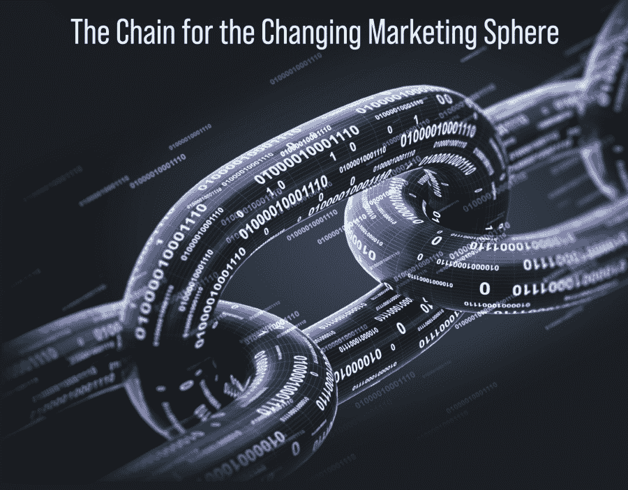

## 前言

营销在过去十年里发生了很大变化，但得益于区块链，它即将迎来另一场革命。是的，虽然我们大多数人将数字营销与人工智能和分析等事物联系起来，但区块链可能是迄今为止对各行业营销人员最具颠覆性的技术。区块链正在改变数字营销，谁将受益可能会让你惊讶。在过去几年中，区块链对技术造成了剧烈变化，被称为分布式账本技术 (DLT)，通过去中心化和加密哈希，使任何计算机资源的历史记录不可更改且透明。理解区块链技术的一个简单关系是 Google Doc。当我们创建文档并与一群人共享时，文档是分布式的，而不是复制或移动。确实，区块链在数字营销中的真正影响不仅在于正在开发的新用例。它在于这些用例将如何影响整个系统，这些系统已成为管理数字市场的一种方式。在数字营销似乎每时每刻都在变化和增长的时代，区块链正在以颠覆性、甚至可能不可逆转的方式改变数字营销。

本书将对所有涉及使用区块链技术的人员以及研究人员和政策制定者有用。毫无疑问，区块链技术的中介及其营销人员也将从阅读本书中受益。假定本书将向学生提供关于区块链技术的适当见解，并在相关主题上引起兴趣。

在过去几年中，它被称为分布式账本技术（Distributed Ledger Technology, DLT），利用去中心化和密码学哈希使任何计算机资源的历史记录不可篡改且透明。理解区块链技术的一个简单类比是 Google 文档。当我们创建一份文档并与一群人共享时，该文档是被分发的，而不是被复制或移动。的确，区块链在数字营销中的真正影响不仅在于正在开发的新用例，更在于这些用例将如何影响那些作为管理数字市场方式而出现的整个系统。在数字营销似乎每时每刻都在变化和增长的时代，区块链正在以颠覆性、甚至可能是不可逆转的方式改变着数字营销。

本书将从以下几个方面强调区块链在数字营销中的优势：

- 1. 去中心化
- 2. 不可篡改性
- 3. 透明度

鉴于围绕这项技术的诸多炒作，以下正在改变营销格局的最佳实践将受到广泛影响：

- 1. 网红营销
- 2. 联盟营销
- 3. 忠诚度计划
- 4. 用户数据保护
- 5. 用户奖励
- 6. 广告欺诈防范
- 7. 基于区块链的社交平台
- 8. 社交电商

本书涵盖 9 个章节，试图覆盖区块链的广阔领域。

## 第 1 章
营销领域的区块链技术

## 第 2 章
区块链：转型数字营销的工具

## 第 3 章
区块链辅助数字化转型——综述

## 第 4 章
工业 4.0 中区块链的相关性与重要性及新视角——构建框架

## 第 5 章
区块链技术及其在数字经济中的作用研究——印度视角

## 第 6 章
区块链技术：商业、战略与环境中的关键参与者

## 第 7 章
客户细分与客户满意度的大数据分析

## 第 8 章
面向更美好明天的转型实践：迈向社交媒体平台

## 第 9 章
区块链与企业数字化转型：文献综述与未来研究

## 第 1 章

## 营销领域的区块链技术

V. 瓦里沙·贝格姆 和 M. 卡维塔*，博士

商学院，维尔科学技术与先进研究学院，帕拉瓦拉姆，钦奈，印度

### 摘要

电子商务是指通过计算机网络进行商品和服务的买卖以及资金或数据的转移。电子商务交易有不同类型，包括企业对消费者（B2C）、企业对企业（B2B）、消费者对企业（C2B）和消费者对消费者（C2C）。电子商务自计算机技术早期就已存在，但在过去二十年里，随着新技术的出现，变得更加普遍。一种流行的电子商务形式是在线零售购物，即“电子零售”（e-tail），它允许客户在线购买日常用品。

本章概述了区块链技术，包括其工作原理及各种应用。通过现实案例，本章探讨了区块链技术对组织和普通公众的实用性。

关键词：电子邮件，电子商务，区块链技术

* 通讯作者电子邮件：kavitha.sms@velsuniv.ac.in.

收录于：《区块链》 编者：阿曼迪普·辛格，桑迪尔·沙尔马，阿姆林德·辛格 等。ISBN：979-8-89113-219-1 © 2024 Nova Science Publishers, Inc.

### 引言

在技术和计算机的推动下，以客户为中心的市场至关重要。几十年来，组织一直采用多种方法与消费者沟通。例如，早期是物物交换制度，随后转变为硬币和货币，计算机、人工智能（AI）、机器人等技术兴起后，出现了电子零售（e-tail）、电子商务、在线服务、音频语音中的反馈和错误纠正等创新应用。互联网提供了广泛的服务来满足人们的基本需求。区块链的引入在环境领域和营销领域都产生了一定影响。

区块链最初通过比特币加密货币而闻名。但如今，区块链不仅应用于数字货币。它是一种去中心化账本，用于记录、共享和保密维护不可更改或破坏的交易。数据以数字形式存储在区块中，即客户的数据以数字格式存储，任何普通人都无法篡改。

### 区块链技术的工作原理

所有输入的信息都存储在区块中。只有授权人员才能访问数据。指定人员可以输入数据。所有交易都保存在哈希中。第一个创建的区块没有哈希。每个区块都包含存储所有交易的哈希。每个区块都包含各所有者接管交易的日期和时间。这些区块安全地相互链接，这意味着交易不能被篡改或滥用。此过程称为不可逆区块链。

输入的数据首先被加密，即转换为易于以数字形式保存的数字代码。然后，客户的详细信息保存在每个独立的区块中，交易连同所有日期、时间和事件清晰地存储。未经授权的人员无法访问这些数据，它们不能被更改或删除。数据首先被编码（即加密），之后当客户需要其信息时，该技术通过密码学解码区块，从而将信息传递给客户。

### 区块链应用

区块链应用于以下领域，

- 1. 网络安全
- 2. 供应链
- 3. 会计
- 4. 医疗领域
- 5. 加密货币
- 6. 物流
- 7. 教育领域

区块链技术的出现对银行、IT、医疗保健和旅游业等多个行业产生了重大影响。电子商务通过移动应用得到了极大转变，这些应用改变了消费者对商业、品牌和营销的看法。尽管电子商务中使用了各种技术和应用程序，让我们关注区块链技术的变革力量。它最初由中本聪在 2007 年开发，他还将比特币加密货币引入市场。当今世界的营销领域已达到顶峰。一种产品要在市场中生存，必须配备各种吸引人的广告、广告牌、大型户外广告牌、吸引人的标语等。

例如，以旅游业为例，区块链技术在为公众组织旅游和出行方面发挥着重要作用。众所周知，无论是国际还是本地旅游或出行的安排过程都非常繁琐且分散。这项区块链技术有助于整合并使旅游预订变得轻松便捷。2017 年，一家名为 Winding Tree 的私营企业在瑞士成立。该网站使公众能够轻松预订旅行机票、机票、酒店住宿、导游服务等。它消除了对把关人的需求，并允许所有预订都在一个网站上完成。这有助于在规划旅游和出行时防止额外费用。

在过去几十年里，品牌和在线营销一直备受炒作。随着计算机和在线资源（如 Facebook、WhatsApp、YouTube 等各种社交媒体）在过去几十年的进步，公司开始通过社交媒体进行广告和营销。由于有许多更容易接触最终消费者的选择，公司可以通过提供频繁的优惠、吸引人的折扣、优惠券和礼品等方式来推广其品牌。在线下订单和购买商品最近已成为一种时尚，这也导致了许多在线威胁。这里

区块链技术如救世主般出现。它帮助客户远离网络上的虚假欺诈活动。它保护客户免受许多网络威胁、网上洗钱等的侵害。在引入区块链技术后，守门人或中间人的链条长度已缩短，并为消费者提供了可信的网站和链接，消费者可使用正确密码和一次性密码（OTP）进行访问，这显著降低了威胁和欺诈活动（Chai, 2021）。

### 区块链技术的特征

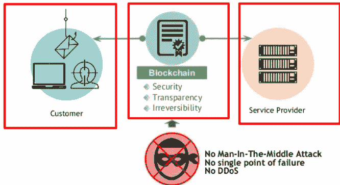

图 1. 区块链技术的特征。

### 区块链技术工作原理的图示表示

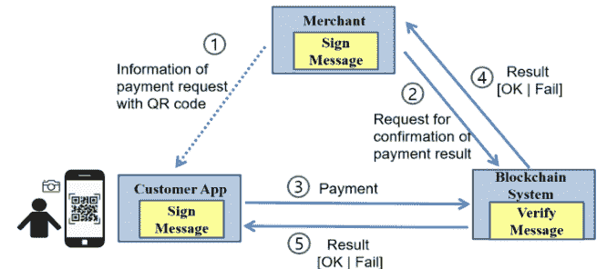

图 2. 区块链技术工作原理的图示表示。

### 使用区块链技术的公司实时案例

### 银行业

在过去几十年中，随着技术的进步，诈骗、欺诈和威胁也利用了技术。通过电话、互联网、电子邮件、短信等进行的欺诈活动层出不穷。黑客只需轻轻一点，就试图窃取普通公众的钱财。但银行家为消费者的金融交易和利益提供安全与保障。他们有效地提供了一个全球平台，帮助客户转账，作为实物现金的替代方案。比特币等加密货币近年来很受欢迎，可以替代目前使用的货币。尽管其受欢迎程度不断提高，但加密货币目前只被少数企业接受。这主要归因于其复杂的性质，导致公众对加密货币及其用途缺乏基本了解。尽管如此，加密货币有潜力为交易的数字化铺平道路，如图 1 和图 2 所示（Howell, 2022）。

### IBM

它使用区块链技术分析供需和广告链条。其目标是消除对第三方或中介的不必要支出。他们还利用这项技术监控正在发生的欺诈活动，例如揭露虚假数据、广告等，从而提升其声誉（Singh, 2021; Singh, Bansal, 和 Sharma 2022）。

### 电信领域

印度电信监管局（TRAI）正在缓慢整合区块链技术，以打击自移动电话问世以来日益普遍的虚假信息、垃圾信息、骚扰电话和欺诈活动。这项技术有助于过滤未注册的虚假来电和短信。由于区块链技术常与人工智能（AI）结合使用，据 Daley (2022) 称，它可以有效解决组织的弱点。

### SEBI

印度证券交易委员会（SEBI）在早期阶段面临许多欺诈活动和第三方入侵，后来他们将公司细分为上市公司和非上市公司以避免这些活动，这带来了巨大变化，并在股票和证券中实现了透明度。在引入区块链技术后，他们可以为记录保存和证券监控带来更多透明度。

### 结论

尽管技术不断进步，网络上仍然大量发生欺诈活动。不幸的是，许多毫无戒心的客户成为这些骗局的受害者。需要注意的是，技术本身不应对这些事件负责。然而，公司和银行已采取措施加强其安全保障措施。他们不断通过社交媒体、电视及其他平台上的广告提醒消费者不要信任虚假广告或信息。因此，消费者需要保持警惕，在采取任何行动之前彻底检查这些技术提供的任何优惠或利益。

### 参考文献

Chai, W. (2021). 技术撰稿人，Wesley Chai 和 Brian Holak，访问自 www.techtarget.com/searchcio/definition/e-commerce，日期为 01.01.2023。

Daley, S. (2022). 区块链在营销和广告中吸引我们关注的 9 种方式，访问自 https://www.forbes.com/sites/danielnewman/2019/09/18/how-blockchain-is-changing-digital-marketing/?sh=2b2fb44616eb，日期为 20.04.2023。

Howell, J. (2022). 区块链对营销的影响，访问自 www.101Blockchains.com/blockchain-in-marketing/，日期为 2023 年 2 月 20 日。

Singh, A. (2021). 面向数字营销的大数据分析：提升准确性、效率和决策能力. IGI Global. https://doi.org/10.4018/978-1-7998-7231-3.

Singh, A., Bansal, R. & Sharma, S. (2022). 大数据：成功数字营销之路. Berlin, Boston: De Gruyter. https://doi.org/10.1515/9783110733716.

## 第 2 章

## 区块链：转型数字营销的工具

Priya Jindal*,
Tanvi Jindal
和 Dikshant

印度旁遮普邦拉杰普拉奇特卡拉大学奇特卡拉商学院

> * 通讯作者电子邮件：priya.jindal@chitkara.edu.in.

载于：《Blockchain》
编辑：Amandeep Singh、Sandhir Sharma、Amrinder Singh 等
ISBN: 979-8-89113-219-1
© 2024 Nova Science Publishers, Inc.

### 摘要

区块链技术在互联网广告中的应用目前尚处于起步阶段。随着新技术的发展，品牌与客户之间的持续关系已经发生变化，从而有可能定位更大但更专业的受众，以提高消费者信心和品牌认知度。区块链技术如今已超越单纯追踪数字货币的范畴。电信公司、航运公司、零售商、护理提供商和媒体公司都定期使用区块链处理各种任务。自动化已经对企业当前的运营方式产生了巨大影响。然而，它有能力改变客户使用小工具以及在电子商务网站上购物的方式。本拟议章节将探讨区块链在营销中的潜在用途，以及将这项突破性技术付诸实践的好处和弊端。互联网目前使营销组织能够创建虚拟平台、现代交易平台和市场需求。区块链终端提供有用的电子商务平台、更低的交易处理成本、作伪证系统、有效的支付结构以及委托管理，以挑战庞大组织的霸权。通过收集和传播客户文档，并使每个人都能跟踪业务交易的状态，它在商业数据交换中营造了一种信心和可靠性的氛围。个人信息在借助基于区块链技术的数据保持匿名性的同时，直接与经销商和客户共享。数据在受信任的环境中以保密和安全的方式出售。鉴于其对经济概念和社会可能产生的巨大影响，尽管区块链技术及其实现是一种精简的实施功能方面，但其已经发展。

本章展示了区块链技术对企业家及其活动的影响。区块链可以维护最新的数据记录，公开表达消费者偏好并增强数据安全性，已被证明是营销领域在营销和推广方面的颠覆者；区块链已成为一种有效的工具。广告、营销团队更好的数据处理，以及持久客户关系和数据公开的发展，都因区块链的去中心化账本技术而成为可能。过去三年在这方面所做的一切，都展示了全球商业人士开展的活动。

### 关键词：虚拟平台、区块链、电子商务、去中心化账本

### 引言

信息和通信技术（ICT）显著影响了当前数字时代虚拟商业模式的重组。区块链是有史以来最具革命性和颠覆性的技术，它显著改变了商业结构，并在各个行业开辟了新的机遇。区块是不断增长的数据列表，作为分布式账本技术的一部分，区块链通过加密技术安全地相互关联。双向数据传输通常表示为 Merkle 树，其中数据节点由叶子表示，每个区块还包括日期和前一个区块的加密哈希。时间戳证明交易数据在区块生成时已经存在。每个区块都引用前一个区块，因为每个区块包含关于其前一个区块的信息。因此，区块像链条一样运作。因此，区块链交易一旦记录就不可逆，因为撤销它需要撤销之后的所有区块。

从技术角度看，数字数据是通过一种相对较新的技术（称为区块链）进行记录和传输的。区块链在数字营销中提供具有可访问性、安全性和开放性的金融和数据转移（Erragcha & Babay, 2021）。消费者可能从更好的数字营销中受益，而企业则可能通过减少在昂贵的数字广告活动上的支出而获利。借助这项新近开发的技术，消费者现在可以直接将其数据出售给营销人员和广告商。

当今，市场由数据驱动。区块链技术可以让数据所有者重新掌控其使用的广告数据（Urban et al., 2019）。因此，客户与品牌之间的直接数据交换正在发展。用于监控用户活动的高质量监控提高了消费者数据的可用性和信心。

### 区块链的历史与运作

2008年，由中本聪（一个人或一群人）创建了第一个去中心化的区块链。中本聪通过对区块进行时间戳标记而无需第三方验证，极大地改进了架构。为了限制区块添加到区块链的速度，他还设立了难度等级。第二年，中本聪将该创建作为比特币（加密货币）的关键组成部分投入使用，作为该渠道所有交易的主要公共账本。在中本聪的第一篇论文中，“块”和“链”这两个术语是分开使用的，但到2016年，“blockchain”这一术语变得更加常见。事实上，每项活动都作为一块“数据块”被记录（Singh, 2021; Singh, Bansal, and Sharma, 2022）。

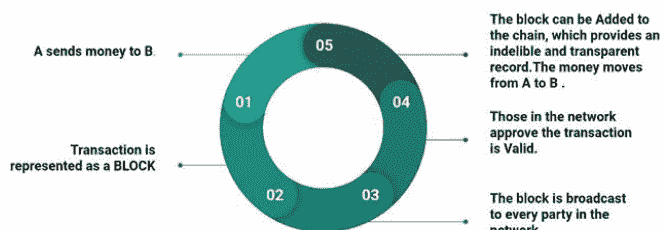

来源：金融时报。

### 图1. 使用区块链。

这些交换显示资产的传输，资产可以是有形或无形的。包括谁、什么、何时、何地以及多少等数据的选择，以及状态，都可以记录在数据块中。前后相连的区块相互关联。随着资产从一处移动到另一处或管理发生变化，这些区块构建了一条数据链。这些区块保证操作的精确时间和顺序，并安全地链接在一起，防止任何区块被更改或一个区块被插入到两个已知区块之间。在像区块链这样不可破坏的链中，几项操作是被禁止的。每个新区块都会加强前一个区块的有效性，从而加强整个区块链的有效性。结果，区块链获得其基本的不可逆性特征，变得不可篡改。用户和其他远程用户可以通过这种方式建立可靠的交易记录，并减少恶意行为者进行操纵的可能性（图1）。

### 数字营销

数字营销利用互联网、社交网络、便携设备、浏览器以及其他渠道来接触客户。参与式数字营销的目标是特定用户群细分市场。数字营销将营销与客户反馈或与客户的双向对话相结合（Rabby et al., 2022）。它涉及付费推文、邮件广告和Google搜索结果广告，并且越来越流行。数字营销可以在便携设备上、通过视频游戏或通过智能手机应用程序采取行动，尽管互联网营销是在线进行的。在数字营销中，收到相关广告的个人通常被称为接收者，而广告主通常被称为提供者。

数字营销是经济中变化最快的领域之一。随着区块链技术的出现，数字营销策略将采取一种新的方式，促进开放，并为公司提供开始在其运营中进行创新的潜力。区块链技术旨在作为一种机制融入营销中，让公司能够追踪数据的转移并确保其真实性。区块链技术便于监控和安全，使我们能够更快地响应问题、找到精确的答案，并为客户提供更出色的互联网形象。在涉及信息安全和开放性时，区块链是数字营销领域在信息安全和开放性方面的最佳合作伙伴。

### 营销的重要性

要理解区块链对营销的重要性，首先要掌握客户管理的重要性。当今高度竞争的企业对消费者（B2C）市场要求企业与客户进行沟通。此外，客户必须能够向其他客户阐明其商品或服务的价值。企业渠道在不同时期有所进步，尽管不同行业有所差异。但无论时间范围如何，营销人员确实会坚持与客户联系相关的相同主要目标和风险（Sharma et al., 2021）。随着互联网向分布式系统发展，对于蓬勃发展的企业来说，加密货币广告活动的需求似乎显而易见。由于现代创新，必须优先考虑安全性、透明度、可靠性和保密性。多年来，用户的冷漠和可靠性问题显著增加。

### 区块链在营销中的适用性

2008年的全球金融危机削弱了公众对传统银行业的信心。在这个时期，被称为比特币的点对点（P2P）虚拟货币的发明，展示了密码学方法可用于管理金融交易。BTC为数字现实中的货币和可衡量概念创造了具有约束力的先例，同时也解决了双重支出问题（Schulze et al., 2020）。软件的工作方法侧重于认证活动的有效性，这是分布式账本技术对营销的影响最明显的另一个领域。随着交易逐渐以带时间戳的捆绑形式结构化，现有区块链交易的数据无法被更改。区块链营销人员可能会从根本上改变客户与企业的互动方式。加密货币提供了多种技术的优势；然而，其最好的方面是区块链网络用户所进行活动的去中心化数据库（Verma & Kaur, 2022）。尽管它可能用于多种其他经济过程，但分布式账本技术的主要目标是资产认证。

### 区块链在数字营销中的作用

区块链技术吸引了大量关注，并通过有记录的用例在多个不同行业中证明了其有效性。例如，在金融、医疗、租赁物业和供应链管理领域，区块链已有几种知名的实现。因此，营销是区块链的可能应用之一。

### 增强数字广告活动和营销

区块链使零售商与广告商之间建立连接，实现数据透明、点击和互动，减少欺诈，并消除中间商。由于数字广告活动数据有时不可靠，因此增强效果可能具有挑战性。区块链使得实时跟踪营销活动并收集可靠信息成为可能。

联合利华等领先品牌正在成功使用区块链来提高数字广告的效果。该技术将投入全面生产，之后它将与IBM一起推出区块链广告解决方案。

### 欺诈预防

区块链网络允许跟踪公认的数字渠道，并将登记表与经过测试的广告实践进行比较以防止欺诈。只有授权的利益相关者才能安全地访问这些指标。欺诈可能发生在数字广告、机器人、点击农场和幽灵网站等场所。聘请第三方会增加人为错误、网络安全漏洞和数据丢失的风险。为了减少其数字广告活动中的欺诈，丰田等主要企业一直在数字营销中使用区块链应用程序。他们注意到，网站访问量随时间增加了。

### 建立信誉与信任

企业选择区块链，是因为该技术允许多方安全地验证、存储和共享数据，从而赢得信任。近年来，区块链技术已稳健地展示了其促进信任的能力。当市场中存在已建立的竞争对手时，小型企业要想脱颖而出可能面临挑战。企业主将能够使用区块链来展示其商品的来源以及正在激发消费者对其产品兴趣的供应链。

### 提高透明度

使用在线广告时，无法判断网站点击率或 Instagram 粉丝数是否为可靠统计数据。即使是被雇用来人为虚增广告数据的机器人，也会产生虚假结果。由于区块链采用的数字账本机制，链条是透明且加密的。对于每个经过供应链的产品，透明度都是理所当然的。通过确认看到其广告的人属于目标人群，企业可以节省数百万的广告成本。企业可以放心，他们获得的正是所付费的广告。

### 促进内容货币化

在营销方面，内容是公司最关键的要素之一。要推广商品和服务，高质量的内容至关重要。区块链使普通内容创作者（如消费者、博主和广播者）能够直接获得报酬，而非通过第三方内容平台。社交媒体巨头通过出售广告空间赚取数百万美元，而人们正在网站上观看他们。许多平台正在通过用加密货币直接支付用户内容创作报酬来取消中间商。

### 广告展示和点击的验证

区块链技术是解决广告目前面临问题的最佳方案，一切迹象表明它将对互联网广告行业产生重大影响。基于区块链的广告系统将使用智能合约来追踪广告，并仅为合同中指定的已验证展示付费。

### 减少广告欺诈

每一位数字营销人员无疑都了解为生成更快、更频繁点击而实施的广泛广告欺诈。然而，区块链技术提供的端到端加密使生成不可篡改的交易记录成为可能，从而消除了欺诈和未经授权活动的风险。

### 维护数据完整性和隐私

通过区块链交易，用户现在可以管理自己的数据。他们将成为数据的所有者，并能够凭借私钥和公钥阻止他人获取和滥用其数据。通过将数据存储在区块链上，可以管理第三方何时以及如何访问其拥有的数据。

### 区块链对营销的影响

区块链技术具有巨大的颠覆潜力，其对市场的影响广为人知。区块链技术的快速创新有效地推动了行业的重大转变，在资本管理、监控和法规合规等应用场景中带来了好处。对于各行各业，区块链技术开辟了新的生产力机遇，尽管尚处于起步阶段。但由于缺乏对区块链营销计划可能性的研究，可能对区块链技术在营销方面的价值存在重大误解。以下是区块链技术可能影响商业营销的几种重要可能性。

### 将去中心化置于更高优先级

去中心化最初由互联网推动，互联网也改变了企业分销商品和服务的方式。通过为现代贸易提供多种解决方案和服务，最新的技术中介已取代了传统中介。

然而，集中式数字中介可以封存其持有的数据，使企业更加依赖他们。此外，关于货币化客户数据和控制通信渠道的问题，对当前数字营销工具的可行性造成了怀疑。

借助一种能帮助公司和客户克服中介带来的障碍的技术，区块链可能是解决所有这些问题的绝佳方案。品牌可以扩展其推广活动，提升服务可用性，并增强消费者触达。

### 在线广告和营销的安全性增强

区块链以威胁防护加密算法为基础而创建。区块链营销策略的讨论将强调安全问题，即对广告媒介和活动构成严重风险的情况、事件或危险。企业必须首先专注于构建坚实的技术基础，以弥补现有的安全漏洞并增强客户对数字营销环境的信心，然后再将信息安全纳入其营销策略。凭借去中心化和分布式数据存储，区块链技术可以为品牌和客户提供独特优势。

此外，人们还可以从包括非对称加密、访问控制和数字签名在内的各种安全措施提供的功能中受益。这些安全措施有助于保护转移、存储和检索大量客户数据的流程。

### 赋予转化能力

使用区块链后，客户可以决定谁可以访问其数据以及访问的程度。此外，某些区块链平台会用加密货币代币奖励分享个人数据的用户。这将使我们能够收集对品牌或产品感兴趣的客户的信息，这对营销人员来说不太可能是挑战。公司以这种方式将客户转化为忠诚客户拥有巨大潜力。

### 告别不一致的关键词追踪

对于数字营销人员，关键词追踪可能是一项重大难题，但现在有了区块链技术，关键词可以使用实际数据进行追踪。无论位置或设备如何，现在都可以更成功地追踪关键词排名，并制定非常精确的数据驱动型活动。

### 摧毁广告的有效性

区块链将使他们能够高效地访问和挖掘海量数据，并将其转化为相关信息，以更好地了解消费者并定位正确的受众。通过正确使用数据并选择合适的目标受众，人们可以大幅提高业务点击率并提高广告的有效性。

### 使用智能合约推动协作

在区块链网络上，智能合约是涉及两个或多方的计算机化合同。当今，我们所有人都可以将其用于各种数字营销目标，包括广告展示、网页构建和活动管理，以及为与客户和营销人员打交道设定条款和条件。

### 归功于区块链技术，更高的开放性现已成为可能

这将使消费者和公司都受益。此外，如果使用加密货币或纸币进行支付，可能有助于提供非凡的开放性。这对增强消费者对公司的信心可能产生重大积极影响。区块链不仅促进比特币支付，还让客户能够访问公司的供应链和运营，使企业能够利用生态友好和环保责任等新兴市场趋势，同时培养持久的客户体验。

### 重要的安全交易

移动环境面临一些可信度挑战，区块链可能有助于解决这些问题。如何确保自己能收到所付款项的货物，是网购者的主要担忧之一。如果订单始终未能送达，谁能帮助我们？区块链可以通过提供信心和透明度，大幅提高数字购买的安全性。区块链通过一个开放的电子系统运行，使用户能够在活动发生时追踪共享数据库上的每一项操作。未经所有其他网络用户的同意，任何个人都无法添加或取消任何操作。这意味着，由于合同的参数对整个过程中的所有参与方都可见，区块链解决了电子支付中最常见的隐私问题之一。因此，个人和公司都不再需要担心一方可能违约。

### 支持数据完整性和隐私

组织在使用客户信息进行在线营销时，面临最大的保护难题。客户越来越好奇公司如何使用其私人数据。为了在数字营销中取得成功，企业需要高度的数据完整性和一致性。区块链是维护数据安全的得力助手，因为它确保信息全面、准确且可靠，并确保不会丢失任何重要数据。

### 结论

区块链是未来的商业。通过降低成本并提升透明度和消费者信任，区块链将使小型企业能够

在未来几年与大型公司竞争。在可预见的未来，最具前景的技术之一是区块链，其采用率仅次于机器学习和人工智能。从制造业到农业、金融、保险及更多行业，区块链已帮助几乎所有应用过的领域。

审视使用区块链技术为营销领域带来的潜在优势后显而易见，这是一项明智的投资。由于区块链默认就是去中心化、安全且私密的，它远远是营销领域最好的技术。区块链营销公司的主要目标是将这些优势与其现有商业模式相结合，以提供增长机会。得益于区块链技术，用户可以对个人信息负责，这进一步使客户参与活动更加私密。此外，借助区块链营销解决方案，企业可能会寻求在打击点击欺诈等诈骗方面的假设性改进。通过使用分布式账本技术，公司可以降低现有广告活动的成本，并增加实质性的价值收益。

### 参考文献

- Erragcha, N., & Babay, H. (2021). 面向去中心化数字营销的区块链. In *区块链技术及其在数字营销中的应用* (pp. 32-51). IGI Global.
- Makridakis, S., Polemitis, A., Giaglis, G., & Louca, S. (2018). 区块链：AI快速进步中的下一次突破. *人工智能-新兴趋势与应用，10*.
- Rabby, F., Chimhundu, R., & Hassan, R. (2022). 区块链技术通过增强消费者信任正在转型数字营销. *通过区块链技术的转型*，265-289.
- Schulze, T., Seebacher, S., & Hunke, F. (2020, 2月). 数字平台业务中区块链技术作用的概念化. In *探索服务科学国际会议* (pp. 150-163). Springer, Cham.
- Sharma, S., Kumar, A., Bhushan, M., Goyal, N., & Iyer, S. S. (2021). 区块链技术用于工作是否安全？In *工业物联网中的区块链和人工智能技术* (pp. 66-80). IGI Global.
- Singh, A. (2021). 用于提高数字营销准确性、效率和决策能力的大数据分析. *IGI Global*. https://doi.org/10.4018/978-1-7998-7231-3.
- Singh, A., Bansal, R. & Sharma, S. (2022). *大数据：成功数字营销的路线图*. Berlin, Boston: De Gruyter. https://doi.org/10.1515/9783110733716.
- Urban, T., Tatang, D., Degeling, M., Holz, T., & Pohlmann, N. (2019). GDPR之后在线广告中主体数据访问的研究. In Data Privacy Management, Cryptocurrencies and Blockchain Technology (pp. 61-79). Springer, Cham.
- Verma, J., & Kaur, J. (2022). 区块链技术：它将如何影响营销领域？In Developing Relationships, Personalization, and Data Herald in Marketing 5.0 (pp. 146-160). IGI Global.

## 第3章

## 区块链助力数字化转型——综述

### N. Ambika

圣方济各学院计算机科学与应用系，印度班加罗尔

### 摘要

区块链是一种最初为比特币加密货币开发的用于管理交易和数据的去中心化技术。公共账本存储数据，其中包括每笔交易的详细信息。区块链是一种分布式密钥，不需要中介。在区块链中，所有节点都可以访问有关曾经发生过的每笔交易的信息。由于这一特性，该方案比涉及第三方的集中式交易更加清晰。此外，所有区块链节点的匿名性使得其他节点验证交易更加安全。本章对该系统进行了总结。

**关键词：** 区块链，去中心化，可靠性，比特币加密货币，公共账本

### 引言

数字化转型（Vial, 2021）通常用于指代通过落实细节和发展技能来改变组织多个方面的过程，例如创建新的商业模式、修改现有组织流程以及改善客户服务。

* 通讯作者电子邮件：akrb33@gmail.com.

收录于：《区块链》编辑：Amandeep Singh, Sandhir Sharma, Amrinder Singh 等. ISBN: 979-8-89113-219-1 © 2024 Nova Science Publishers, Inc.

最近的计算机进步为公共领域和各种组织提供了改变游戏规则的机会。数据和通信机械也在更高层面上解决了住房、气候变化、福祉和人类迁移等关键社会问题（Ambika, 2021; Khezr et al., 2019）。区块链是一种用于存储数据的透明、分布式和不可篡改的方法。它可以通过两种方式创建区块链，每种方式都有其自身特征，但具有不同的认证和记录程序——许可型（也称为私有或联盟区块链）和无许可型（也称为公有区块链）。在多个组织之间，私有和公共区块链可用于解决保密性问题，从私有区块链开始，再过渡到公有区块链（图1）。

区块链是一种共享记录，存储区块链中所有已提交的交易。当新块添加到该链时，它会不断增长。通过一个引用（本质上是前一个块的哈希代码，称为父块），每个块都链接到之前的块。原始块（没有父块）是区块链中的第一个块。块头和块体构成一个块。业务输入和交易创建块格式。块大小和每个交易的大小决定其可以包含的最大交易数量。它采用加密程序来验证交易是否已通过身份验证（图2）。

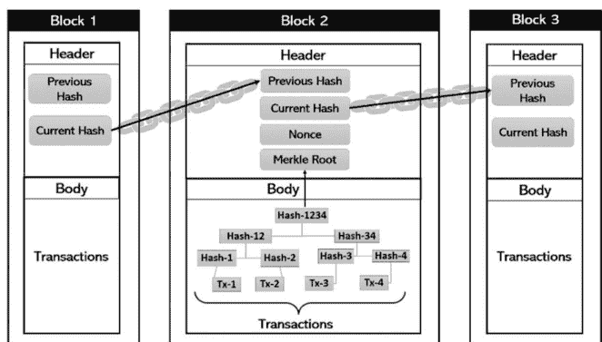

图1. 区块链架构（Krichen, Ammi, Mihoub, & Almutiq, 2022）。

研究人员高度关注比特币（Vranken, 2017）可以对冲或分散股票、债券、货币或商品等传统资产的风险。数值信息通过分布式账本中的点对点系统进行同步、复制、分散和共享。每个连接设备都保存共享账本的最新版本。它只能通过向链中添加新块来扩展数据库，账本的主要特征是其安全性。在计算上不可能更改已注册到链中的记录（图3）。

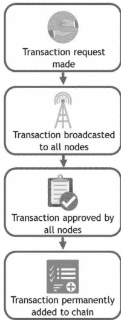

图2. 区块链流程（Siyal, 等, 2019）。

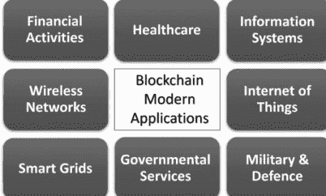

图3. 区块链应用（Krichen 等, 2022）。

### 应用

### 财务活动

金融和经济部门已广泛采用区块链技术。区块链技术能够记录、转移和验证资产所有权，以及敏感数据或文件的完整性和有效性。它预计将对社区和孤立领域的计算请求产生高度变革性和授权作用。分散账本是分布式、共享的、模拟的和协调的交易记录，由加密封闭保护，记录合同各方之间的交易。成员们共同决定用于规范分散账本中“证据”发展的指令称为智能合约。这些智能合约是计算机算法，保证所有交易都遵循主要允许的合同，并且只有DLT登记册才能说明基础合同是什么、在哪里以及如何变化。智能合约可作为一种覆盖层，用于自动转移文本并在与跟踪资产所有权变化的区块链匹配时执行协议条款。此外，智能合约有可能自动化规则和法律，这可以显著提高政府服务的透明度和效率（图4）。

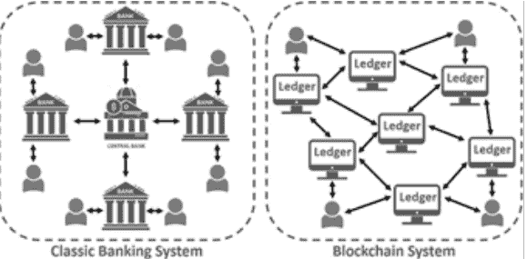

图 4. 银行系统示意图（Krichen 等，2022）。

DeFi（Schär，2021）采用多层架构。每层都有特定用途。任何人都可以在其上构建、重组或使用其他堆栈部分，因为各层相互叠加，形成一个开放且具有极高可组合性的架构。理解这些层是分层结构的也至关重要。区块链及其固有的处理能力构成了结算层。它保证状态修改遵守系统规则，并允许安全地存储所有权信息。区块链是一个用于解决争议并充当忠实实现基础的层。结算层之上发行的所有资产构成了资产层。算法表为分布式连接、债务市场、衍生品和链上所有权管理等精确实践用例提供基准。面向用户并连接到特定协议的应用程序在应用层构建。基于网页浏览器的前端通常汇总智能合约之间的交互，使流程更易于使用。累积层补充请求单（Singh，2021；Singh、Bansal 和 Sharma，2022）。

Ziyen（Tian 等，2020）是一家位于美国的石油和天然气生产商，专注于对能源资产进行代币化，以开发新的专业知识，提高燃料制造效率并实现能源资产流动性。Ziyen 一直在大力开发能源代币的公共交易平台。它向公众推广代币化。它扩展了区块链代币化在能源领域的应用。该研究构建了利用区块链代币化为资金结构属性制定理论框架。代币交易记录由以太坊网络节点验证，并存储在以太坊区块链上。每个节点执行相同的交易并记录在单个区块中。每个区块按逆序时间添加。利用记录在区块链上的智能协议中的讨论，每个文件夹中的 ZiyenCoin 可以被追踪。浏览该课程允许公众访问代币的基本密码、业务历史和协议详情。公司的安全策略和限制被纳入每个代币的智能合约中。Solidity 编程语言用于编写智能合约的密码。Polymath 提供 ZiyenCoin 的安全代币协议，协助加密货币发行、管理和转移代币。

它（Kowalski、Lee 和 Chan，2021）通过访谈收集定性数据，以了解区块链知识如何影响零工经济中交易伙伴之间的信任关系。通过从更深层的知情者信息、意见和心态中汲取资料，访谈是一种有用的工具，使研究人员能够对所调查的现象构建全面的理解。半结构化谈话是标准的，因为它们在保证一定程度方法一致性的同时，允许一定灵活性超越访谈脚本进行提问。访谈分为两部分。第一部分是关于知情者对区块链方法特性和实施的普遍视角的查询。第二部分特别包含关于信任关系与区块链技术如何相互作用的问题。信任模型的六个视角是开发访谈问题的基础。进行访谈有严格的指南。在设定峰会或电话会议日期后，它将访谈脚本发送给知情者。

LR 和 SVM 算法在（Poongodi 等，2020）的提案中预测以太币加密货币的价格。可以使用 LR 确定两个连续变量之间的关系。可以使用 LR 算法确定统计关系。机器学习算法的主要目标是找到最能拟合数据的直线。线性方程表示一个一次多项式的算法。SVM 是一种监督学习模型，用于分析统计数据以进行分类和回归分析，并与学习算法相关。给定数据集中的每个数据点都被归入单一类别。它使用概率二元线性分类器，SVM 训练过程构建一个用于分类数据的原型。在 SVM 模型中，数据点使用适当的宽间隔映射到类别中。测试数据被映射到空间并放置在间隔足够大的类中。使用核技巧，SVM 在非线性分类中也表现良好。核函数应用并激活 SVM 算法。它可以通过使用一些一次多项式线性方程将任何问题转换为超平面，特别是针对 SVM 中的线性核。线性核使用点积。因为距离定义了这些输入或配对的线性组合，线性 SVM 算法或线性核使用点积来衡量相似性，特别是两个团队之间。交易 ID、发送方、瑞波中的受益人激励以及时间戳均包含在每个记录的每个部分中。使用具有相同交易 ID 的多行来指代具有多个发送方和接收方的交易。这些文档不是用于解决并查集计算，而是用于将我们的信息集转换为按“客户”实体排列的重新排列集。在预措辞时间之前的一周和一个月内的某个时间点，为 60 分钟的时间分配生成了特征。它构建应用机器学习计算，实验收集了一些系统特征。实验中使用了一台运行 4.1 GHz 的六核 i7 处理器、16 GB DDR4 内存和固态存储设备的系统。实验在 Jupyter Notebook 中进行，脚本大约需要 10 分钟完成。算法处理 34,428 条多变量数据集后生成了图表。

资产支持证券（Wu & Duan，2019）基于资产支持证券化（ABS）中的未来现金流。实物、信贷、证券和现金资产证券化是资产支持证券化的子集。首先，将实物资产转换为证券资产被称为实物资产证券化。第二，受誉资产的证券化强调重组资产和资源财团的过程，这可能成为证券发行的理论基础。第三，证券资产证券化是将证券资产证券化的过程。第四，对于现金持有者，货币资源的证券化模拟了从现金资产到证券的转变。发起人将证券化资产交给特殊目的载体，通过将其出售给特殊目的载体将它们全部放入资产池中。资产支持证券由特殊目的载体利用资源集合中的现金流发行。发行的证券可以用现金流偿还。证券化所支持的常规资产包括多种类型的资产和不同的人。

### 农业

区块链是一种高度安全的数字账本，使用各种哈希连接序列的不同部分。对特定部分中的信息进行任何篡改都会导致加密连接中断，使得数据无法在不被发现的情况下被修改。这使得区块链成为一个绝对的数字目录，确保其中存储信息的完整性。每个区块链区块中至少有四个字段：

- 区块编号。
- 存储的交易或数据。
- 来自前一部分的混淆部分。
- 当前片段哈希。

食品供应链的巨大复杂性经常导致需要更多的透明度和可追溯性。农业可追溯性需要大量的供应链数据收集。食品产品可追溯性包括食品产品的成分、来源、加工和储存条件。此外，在理想的农业可追溯性系统中，还将包括每个成品组件的信息。因此，要使可追溯性系统被认为是有效的，它必须包含关于最终营养结果及其起源的可衡量和定性细节。

农业营养供应链系统的每个级别都有自己的条款和条件，带有多级交易。从分发到包装，再到运输、储存和交付，这些级别跟踪所有产品。这些是冗长而复杂的过程。智能合约有可能简化整个流程并提高供应链透明度。它可以通过将基于区块链的智能合约与物联网设备集成来跟踪供应链和库存，并更改所有权权利。虚拟区块链平台（例如以太坊虚拟机）用于部署、实现和监督智能合约状态机等。API 用于为外部组件提供接口。最终，所有当事方在运行时签署合同。智能协议的条款和条件根据来自各种来源的实时数据动态强制执行，区块链和分布式账本技术保障业务交易。在智能供应链场景中，它可以将相关工作流程和跨企业价值流程与互联的智能生产网络或供应链进行比较。在这个供应链中，商品和服务被生产

向下游交付，数据和资金向上游流动，智能合约使用自动化交易协议（图 5）。

该工作满足农业供应链业务的需求，Agri-SCM-BIoT 系统（Bhat et al., 2022）使用多个区块链。它由一组在逻辑上彼此不同的区块链组成，这些区块链集成到农业供应链网络的各个部分中。当边缘计算节点和物联网网关充当区块链的成员节点时，每个本地区块链片段可以拥有自己的参与条款、访问控制策略和区块链账本。每个边缘级区块链组织可以代表不同的物联网农业业务垂直领域。通过将银行信息等敏感信息远离潜在的安全风险节点，可以在农业供应链中使用区块链的多层架构来减少安全攻击面并防止供应链中的潜在安全风险。本地区块链部署使用私有区块链。

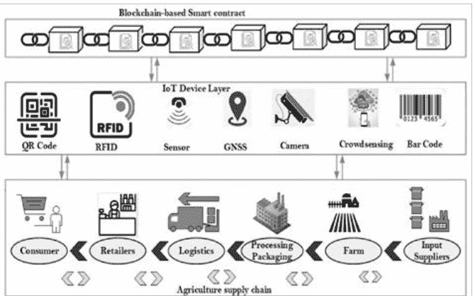

图 5. 基于区块链的智能农业（Bhat et al., 2022）。

对于时间敏感的应用和交易，数据存储在物联网边缘层，边缘区块链层负责处理需要更靠近它完成的任务。它避免了区块链账本大小不断增长的问题。只有最近的交易哈希值存储在核心区块链上。它还通过物联网区块链架构将数据从较低的边缘层传输到云计算层。

当提供节点（Lin, et al., 2017）创建新区块时，来自实时水质监测系统的数据会在本地备份并添加到区块链中。每个矿工节点都持有完整水质数据的一部分，因为数据分布在网络中。任何单一节点都无法访问完整的数据。如有必要，提供节点可以通过创建查询以供参考，将区块链数据与备份数据进行交叉引用。为了验证链，网络中的矿工节点贡献其硬件、电力和处理能力。结果，链得到验证，每个节点“工作”的奖励是所有水质数据的汇编。水质监测 API 使各节点的系统操作更加简便。记录管理应用程序可以将结构化查询语言（SQL）数据查询作为图形用户界面，并用于数据上传/下载。利用区块链基础设施，ICT 电子农业可以保证该数据的不可篡改性，并提供一种方法，用于在农产品从生产源向消费者流动的过程中，在空间和时间上追踪当前的农业数据。ICT 电子农业可以促进国际交流，并支持农业中的本地信息交换（图 6）。

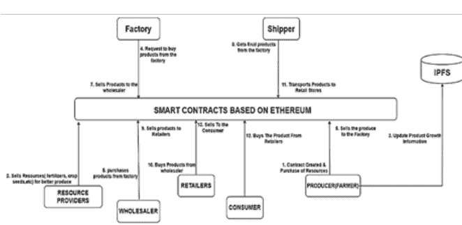

图 6. 系统架构（Prashar et al., 2020）。

本工作提出了一种具备拜占庭容错（BFT）能力的共识算法（Prashar et al., 2020）。系统会联系零售商、承运商、农民或生产商等用户。事件数据必须由客户端进行哈希处理、加密，并上传到 IPFS。它还负责创建和签署交易。农民是农业供应链中最关键的参与者，因此供应链从公司开始。它会在农作物生长过程中监测土壤肥力、温度和湿度水平。生产者必须在链上保存的记录包括位置、高度、产品类型、产地、灌溉、处理和修剪等。企业与供应商密切合作，通过获取原材料、协助其提高产量以及寻找更好的原材料替代品来优化其产品。工厂生产或贴牌商品，是生产链中不可或缺的一环。零售商承担商品交易的双重角色。消费者选择自己所需的产品和服务，无论是为自己、朋友、家人还是商业客户。在做出购买决策时，数据信息非常有帮助。控制器用于管理错误、调度和排序交易，并分配负载。其中包含两个智能合约。一个智能合约代表信息对象的所有权和贡献者，另一个智能合约则表示信息对象本身。验证者运行区块链节点的程序。它构建一个区块链网络，验证者与系统的智能合约进行通信。许多其他验证者连接到验证者。

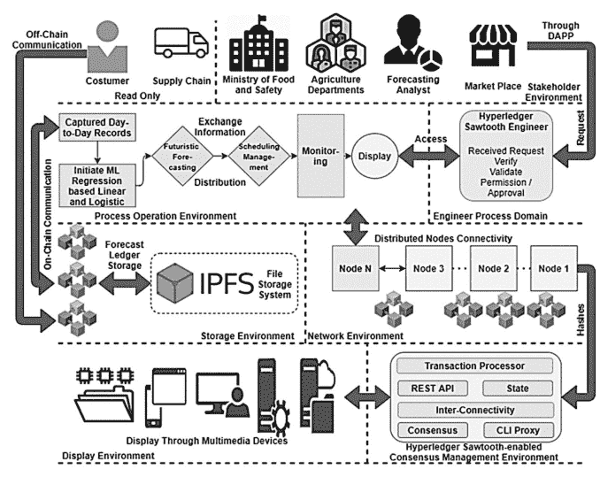

图 7. 系统架构（Khan, et al., 2022）。

不可变的分布式星际文件存储（图 7）（IPFS）（Khan, et al., 2022）存储各部门的初始数据。参与的利益相关方通过边缘节点直接请求只读访问权限或信息交换。链上和链下网关管理与农产品相关的交易和存储访问控制，以保留信息和讨论。在繁忙时期，利益相关方从区块链超级账本 Sawtooth 工程师处请求与产品定价预测相关的各种服务。分布式账本存储系统确保预测任务调度的数量安全存储，用于流程和输出管理。虽然存储环境只能通过链下通信存储和交换已执行的交易，但网络环境中农业节点之间的交易关系可以在验证后，从超级账本 Sawtooth 工程师处获取进一步处理的许可。当系统持续预测商品并将这些信息与利益相关方共享时，延迟成本会不断被衡量。

捕获、检查、分析、调度、管理、预测、组织、优化和监控网络层是这种协作方法过程的各个阶段。

该研究（Alkahtani, et al., 2021）基于数字营销政策，通过增强网页设计元素来推广农产品并影响在线客户，以提升电子农业供应链中的电子市场需求。一种三层供应链模型，其中单一零售商、农产品加工公司和供应商通过各种分成协议共同努力以最大化利润（图 8）。通过电子农业供应链（其中信息、商品和付款使用区块链技术进行数字化交换），区块链技术得到了良好的处理。它使用区块链，所有数据在供应链参与者之间集成并存储在数据库中，然后由云计算管理系统永久共享。该研究为客户（网页设计师）提供了一个交付基本设计和用于安全性和可追溯性的区块链工具的平台。纳入产品网页设计中用于推广和需求的重要 WDEs 为网页设计指数提供了基础。它确定进步对整体利润的影响。WDI 进一步与农业供应链的变量方向相关联。为了研究农业供应链中的电子广告合作政策，它选择了一个由单一供应商、加工公司和多个零售商组成的供应链（SC）。

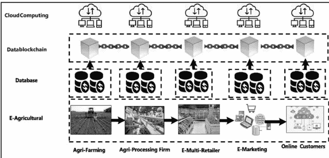

图 8. 系统框架（Alkahtani, et al., 2021）。

该建议（Lin et al., 2018）是一个可靠、自组织、开放且环保的食品可追溯性系统。它涉及智能农业生态系统中的所有各方，即使他们彼此之间可能不相互信任。所有创新的农业生态系统门户共同构成了虚拟 TTBNCP。这些门户也是区块链系统中的对等（P2P）节点。在该系统中，存在两种类型的节点：一种节点可以访问区块链节点的所有功能，包括对称加密和解密、共识算法、Merkle 树构建、分布式账本和其他功能。SPV 节点存储与交易相关的数据，并具有简化支付验证功能。数据在发送到所有区块链系统节点（直接或通过物联网网关）进行验证、包含在交易池中以及存储在区块链上之前，将被哈希处理并数字签名。客户可以在其计算机或智能手机上验证和检索所有交易数据。

### 医疗保健

在许多医疗保健应用中，区块链技术正在重新定义数据建模和治理。来自社交媒体、实验室、医疗设备和其他来源的所有数据都被结合起来生成原始数据，最终扩展为大数据。构成堆栈第一层的主要组件是这些数据，它们是整个基于区块链的医疗保健系统的基本组件。区块链技术位于

原始数据层被视为开发四部分安全医疗架构的基本框架。例如，共识算法和协议因平台而异。区块链平台使用户更容易创建和管理交易。

患者与其专科医生之间的交互是主要的数据来源。病史、当前问题及其他生理数据均包含在此数据中。使用第一步收集的初步信息，为每位患者创建一个电子健康记录（EHR）。只有属性所有者才能为拥有敏感 EHR 的单个患者自定义访问控制。希望访问这些有价值数据的各方必须提交权限请求，该请求将转发给 EHR 的所有者。所有者将决定谁有权访问。记录以分布式方式存储在云存储和数据库中，区块链提供极端隐私以保证真实的用户访问。所有者授权的、希望访问安全可靠的医疗服务交付系统的最终用户是医疗服务提供商，例如专设诊所、社区护理中心或医院（图 9）。

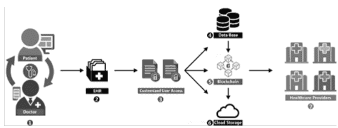

图 9. 数据管理系统（Khezr 等人，2019）。

该系统（Dwivedi 等人，2019）使用 ARX 算法或对称密钥加密对区块链数据进行加密。它不专注于保护单个节点，而是致力于保护网络免受攻击。数据使用发送方的私钥（也称为签名密钥）进行签名（图 9）。接收方的公钥用于传输端的验证。签名者将数据或明文输入哈希函数以生成哈希值。之后，明文哈希值和签名密钥被提供给签名算法，并与加密数据一起发送。验证者在验证过程中使用相同的哈希函数生成接收数据的哈希值。他们还使用验证算法和签名者的公钥提取明文的原始哈希值。如果两者相同，则数据已验证且在传输过程中未发生更改。

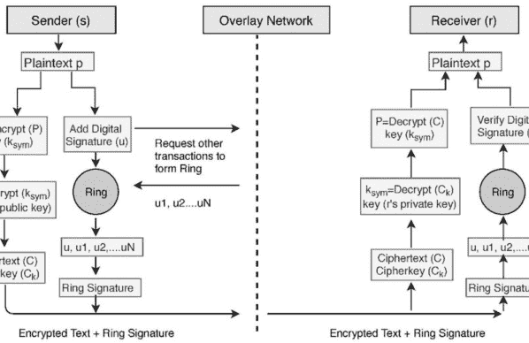

图 10. 系统架构（Dwivedi 等人，2019）。

要实现该框架（Khatoon，2020），将使用带有后端分布式文件系统（DFS）和私有区块链网络支持的去中心化应用程序（DApp）（图 10）。面向医疗的创新区块链智能合约系统已使用以太坊实现。它创建包含记录所有权、权限和数据完整性元数据的智能合约。该系统的区块链交易以密码学方式对管理这些属性的指令进行签名。只有在发生强制数据变更的合法交易时，策略才由状态转换合同函数执行。只要能够进行计算表示，这些法规就可以实施管理特定医疗记录的规则。可以创建存储在区块链上的智能合约，包含所有条件，包括管理各种权限和数据访问。智能合约具有用于授权数据的规则。它还可以协助使用唯一标识符跟踪从开始到完成的每项活动。数据的哈希是提交到链上的区块的数据元素，所有医疗记录数据均存储在本地数据库存储中，以保持性能和经济可行性。所有者的私钥用于对数据交易进行签名。系统的区块内容代表对等私有网络的数据所有权和查看权限。区块链技术支持使用智能合约，这些合约使我们能够自动化和跟踪特定状态转换。患者可以同意在提供者之间共享记录，提供者可以为特定患者添加新描述。为管理身份验证，它使用类似 DNS 的实现，将用户的以太坊地址映射到已存在且广泛接受的身份形式（如姓名或社会安全号码）。

MedChain 网络中的对等节点（Shen, Guo, & Yang, 2019）分为两类：边缘节点和超级节点（图 11）。仅存储实际患者数据的较小提供商（如社区诊所）的服务器构成了边缘节点。其中包含两个子网络：目录服务和从医疗数据派生的各种信息的区块链服务网络。超级节点的资源分为三个模块：医疗数据库、目录服务和区块链服务。区块链服务器维护完整的区块链，用于审计和数据完整性验证。目录服务器管理数据共享会话，并跟踪用户医疗数据的库存、位置和存储位置。所有超级节点上的两种服务器形成两个子网络。实际患者医疗信息存储在最终组件 HDB 中。

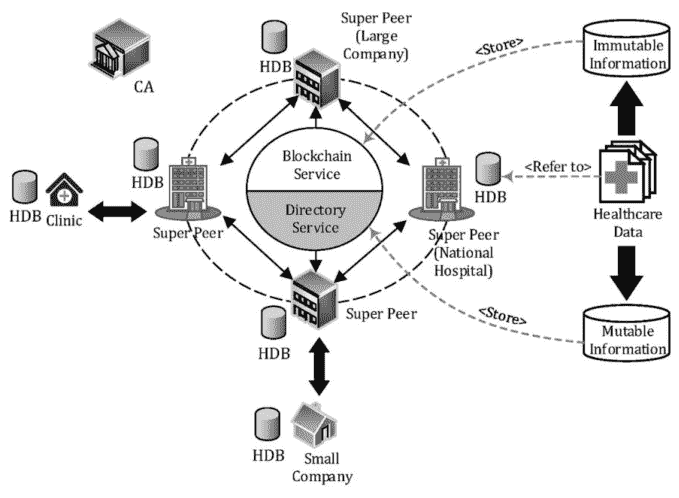

图 11. 系统架构（Shen, Guo, & Yang, 2019）。

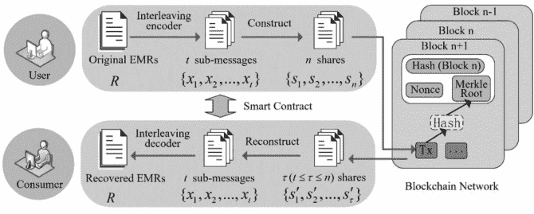

图 12. 系统架构（Fu, Wang, & Cai, 2020）。

框架（Fu, Wang, & Cai, 2020）中包含一种用于医疗区块链系统的轻量级隐私保护机制。为加密原始电子病历（EMR），使用交织编码器。它主要由两部分组成：EMR 的恢复与使用以及 EMR 份额的创建与存储（图 12）。初始 EMR 的主要参与者是患者和医疗专业人员。授权数据用户必须先在区块链上搜索 EMR 的索引，以定位所有存储 EMR 份额的节点，然后才能尝试浏览 EMR。交织解码器将在 EMR 子部分被重建后对已恢复的 EMR 子部分进行解码，从而得到原始 EMR R。之后，授权客户可以出于各种目的处理这些已恢复的 EMR。利用存储的 EMR 份额的索引，创建然后链接在一起形成区块链的块。授权数据用户或机构可以通过从区块链节点请求至少 t 个份额来恢复 EMR。

### 供应链

去中心化结构、分布式节点和存储机制、共识算法、智能合约以及非对称区块链加密确保了网络安全性、透明度和可见性。区块链是一种将这些功能独特地结合在一起的技术。区块链有望彻底改变供应链（SC）功能，包括 SC 溯源、业务流程再造和安全性增强。通过在公共账本中创建无可辩驳的记录，区块链实现了分布式共识机制，使所有相关方都能了解每个事件和交易。给定供应链成员网络的需求端和供应端构成了供应网络。“供应端”一词是指直接或间接为主要公司做出贡献的任何供应链组件。产品在其到达最终消费者的过程中所遇到的所有供应链成员构成了需求端。

用户服务框架（Jamil 等人，2019）是所开发应用程序的基础，该应用程序使用分布式账本和智能合约作为中间件。最终用户使用该应用程序发送交易提案，以调用由所提议的区块链网络提供的后端服务，例如医疗处方、个人资料管理、预约、EDR、数据共享、药房管理等（图 13）。完整的 CRUD 操作在区块链交易的连接节点之间转换正在进行的数据。用户身份管理器为用户注册和身份验证提供证书。共识的同意管理器控制交易顺序，并通过提供的接口将部门连接到子网络。分布式账本和节点构成了药品配送区块链的部门。节点配备了智能合约，用于批准交易提案或向账本写入交易块。分布式账本技术记录了所有网络事件和操作不可更改且透明的交易、日志和历史记录。区块链的节点由智能合约、块、状态数据库和策略组成。给定时间的账本状态在状态数据库中表示和存储。节点的示例白盒表示中显示了状态数据库与块之间的连接。由于智能合约是一种可以执行交易并访问区块链块和历史记录的计算机程序，因此它为区块链添加了功能。

Gcoin 区块链（Tseng 等人，2018）记录制造商将交易数据直接转移给药品接收方（图 14）。链验证药品信息、药品数量以及卖方和买方的数字签名交易数据。然后对所有这些数据的摘要进行哈希处理并存储在 Gcoin 区块链上。由于 Gcoin 区块链中存储了关于未花费交易输出（UTXO）的欺诈信息，任何非法分销商向买方出售假药的行为都将被视为无效。使用正确的私钥，未经授权的人员可以使用此系统购买药品。因此，任何交易异常都会立即被买方或卖方察觉。

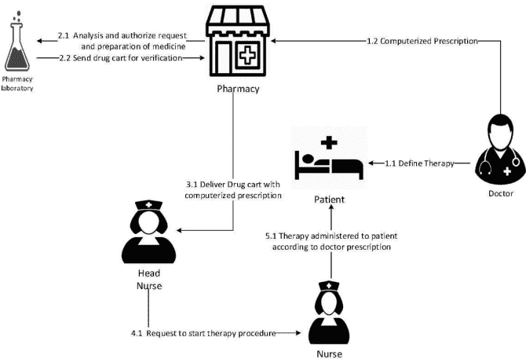

图 13. 系统架构 (Jamil et al., 2019).

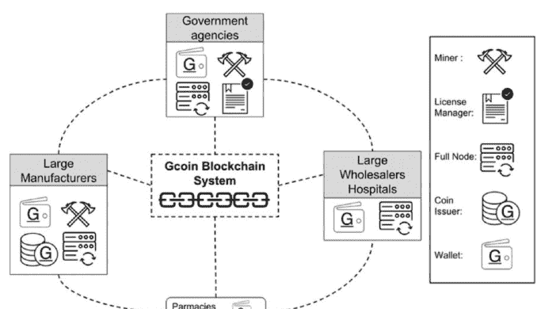

图 14. 提出的区块链系统 (Tseng et al., 2018).

拟议系统包含两个主要组件 (Abbas et al., 2020) —— 面向消费者的基于机器学习的药物推荐系统和基于区块链的供应链管理。参与者和区块链网络作为 DSCMR 机制的一部分被提出。用户可以更新和管理供应链中的所有活动。基于区块链的系统存储关于系统用户的信息——供应商、制造商、分销商、药房、医院、医生和患者。药物、原材料、订单和记录存储库是 DSCMR 系统的资产。为每个系统用户提供基于客户端应用程序的前端，使他们能够快速进行交易并与区块链网络通信。客户端应用程序使所有相关系统参与者能够监控整个 DSCMR 过程中的药物配送状态。另一方面，数据存储池，也称为离链存储，是一个独立的数据库。

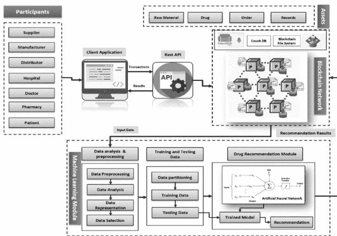

图 15. 系统架构 (Abbas et al., 2020).

为了协调农业供应链中的食品追踪，拟议模型 (Casado-Vara et al., 2018) 使用 MAS、智能合约和区块链。生产者和进口商位于当前模型的开头。这两个供应链成员的产品和数据被发送到链条的下一层。出口商、加工商和批发商位于这一后续层 (图 15)。供应链接收的基本产品在此中间层进行处理。零售商和食品服务（销售产品）构成最终层。当区块链融入农业供应链时，模型会发生转移。区块链的每个成员都可以访问其运营所需的关键数据，因为数据是去中心化的。有五个 MAS 层。生产者代理位于生产者层。该代理协调生产者的整个运营。加工商代理位于加工商层。该代理协调该层的所有活动。运输提供商代理位于运输层。该代理协调供应链其他成员之间的所有运输。零售商代理位于零售商层。该代理与加工商合作，向客户买卖材料。区块链代理位于区块链层。该代理与其他层的代理同步，以确保所有交易数据都正确存储在区块链中 (Singh, 2021; Singh, Bansal, and Sharma 2022).

### 挑战

### 性能与安全性

区块链是在开放环境中建立信任、存储信息、执行功能和执行交易的一种新方法。从数据管理角度来看，区块链是一个分布式数据库，它将不断变化的交易记录列表组织成分层的区块链。哈希指针 (Chelladurai & Pandian, 2021) 和默克尔树 (Hu & Gharavi, 2013) 是使用哈希链式存储在比特币中实现区块链的两个基本构建块。由于其他金融机构使用的不同架构和业务流程以及手动流程的使用，金融机构之间的对账、清算和清算过程容易出现错误，以及不同金融机构持有的账簿之间的不一致性。这不仅会导致客户端和金融机构后台业务产生的高额交易费用，还会导致高额交易费用。当在线交易用于投资和资产管理时，不同的中介机构管理股票、债券、票据、收入凭证、仓单和其他资产。这不仅增加了交易成本，还增加了证书被故意伪造或伪造的可能性。

### 隐私

区块链保护所有数据（包括敏感数据）的能力被称为“数据隐私”功能。尽管区块链最初是为比特币数字货币系统设计的全球分布式账簿，但其潜在用途远远超出了虚拟货币。推理攻击（将敏感交易数据和假名与实际用户的真实身份关联起来，即使仅使用假名）在过去几十年中一直是数据隐私研究的重点。

### 互操作性

尽管存在例如数据结构、数字签名方案、传输协议、验证机制、共识机制、代币发行机制和富有想象力的合同语言等差异，但连接区块链证明是一种可管理的策略。在中期，区块链、其他分布式账簿技术和企业系统之间的互操作性通过区块链的区块链和混合连接器得以实现。因此，鼓励制定区块链互操作性标准。

### 能源消耗

区块链是共享和分布的数据结构或账簿。它们可以在没有中央机构的情况下安全存储数字交易。根据能源领域决策者的说法，区块链技术可以显著增强能源企业和公用事业公司当前运营的内部流程、客户服务和成本。分布式能源资源和信息与通信技术 (ICT) 的发展在能源系统中引发了范式转移。区块链凭借其固有特性，可以控制和管理日益去中心化的复杂能源系统和微电网。整合分布式发电、灵活性服务、小规模可再生能源和消费者参与能源市场具有挑战性。客户的和分布式发电者的计费可以使用区块链、智能合约和智能电表进行自动化。

### 结论

区块链网络或系统的规则和系统架构会根据所需的操作和用例而有所不同。网络用户和验证者通常构成区块链系统。用户节点保存账簿副本并可以发起或接收交易。像比特币这样的应用代表了一个完全安全的分布式生态系统，其完整性需要花费大量资金来维护。验证者负责批准账簿修改、就账簿的有效状态在整个网络中达成共识，并拥有读取访问权限。根据系统的配置，它可以全部或部分应用访问和验证权限。任何互联网用户都可以加入公共区块链系统。相比之下，私有区块链的访问仅限于授权参与者。因为任何网络成员都可以参与验证交易，无需许可的账簿是完全分布式的且抗审查的。本章是对为技术所做的各种贡献的总结。

### 参考文献

- Abbas, K., Afaq, M., Ahmed Khan, T., & Song, W. C. (2020). 基于区块链和机器学习的智能医药行业药品供应链管理和推荐系统。 *电子*, 9(5), 852.
- Alkahtani, M., Khalid, Q., Jalees, M., Omair, M., Hussain, G., & Pruncu, C. (2021). 耦合区块链效应和合作策略的电子农业供应链管理。 *可持续性*, 13(2), 816.
- Ambika, N. (2021). 针对 IIoT 网络的可靠基于区块链的图像加密方案。载于 *工业物联网中的区块链和人工智能技术* (第 81-97 页)。美国：IGI Global.
- Ambika, N. (2021). 针对 IoT 网络的可靠混合基于区块链的身份验证系统。载于 S. Singh, *基于区块链的隐私与访问控制的革命性应用* (第 219-233 页)。美国：IGI Global.
- Bhat, S., Huang, N. F., Sofi, I., & Sultan, M. (2022). 基于区块链和 IoT 的农业-食品供应链管理：关于企业区块链互操作性的叙述。 *农业*, 12(1), 40.
- Casado-Vara, R., Prieto, J., De la Prieta, F., & Corchado, J. M. (2018). 区块链如何改善供应链：食品供应链案例研究。 *第 15 届移动系统与普适计算国际会议 (MobiSPC 2018) / 第 13 届未来网络与通信国际会议 (FNC-2018) / 附属研讨会*。 134, pp. 393-398. ELSEVIER.

- Chelladurai, U., & Pandian, S. (2021). Hare：面向医疗系统数据完整性的新型基于哈希的认证可靠高效修改型Merkle树数据结构. 环境智能与人性化计算期刊, 1-15.

- Dwivedi, A., Srivastava, G., Dhar, S., & Singh, R. (2019). 面向IoT的去中心化隐私保护医疗区块链. 传感器, 19(2), 326.

- Fu, J., Wang, N., & Cai, Y. (2020). 基于轻量消息共享的医疗区块链系统中的隐私保护. 传感器, 20(7), 1898.

- Hu, B., & Gharavi, H. (2013). 基于动态密钥分发与Merkle树四次握手的智能电网网状网络安全. IEEE智能电网期刊, 5(2), 550-558.

- Jamil, F., Hang, L., Kim, K., & Kim, D. (2019). 智慧医院药品供应链完整性管理的创新医疗区块链模型. 电子学报, 8(5), 505.

- Khan, A., Shaikh, Z., Belinskaja, L., Baitenova, L., Vlasova, Y., Gerzeliiva, Z., ... Barykin, S. (2022). 用于智能农业分析和账本保存方案的区块链与元启发式赋能分布式架构：协作方法. 应用科学, 12(3), 1487.

- Khattoon, A. (2020). 基于区块链的医疗管理智能合约系统. 电子学报, 9(1), 94.

- Khezr, S., Moniruzzaman, M., Yassine, A., & Benlamri, R. (2019). 医疗保健中的区块链技术：全面综述与未来研究方向. 应用科学, 9(9), 1736.

- Kowalski, M., Lee, Z. W., & Chan, T. K. (2021). 贸易金融中的区块链技术与信任关系. 技术预测与社会变革, 166, 120641.

- Krichen, M., Ammi, M., Mihoub, A., & Almutiq, M. (2022). 现代应用中的区块链：调查. 传感器, 22(14), 5274.

- Lin, J., Shen, Z., Zhang, A., & Chai, Y. (2018). 用于智能农业的区块链和IoT基础食品可追溯性. 第3届人群科学与工程国际会议（第1-6页）。新加坡：ACM.

- Lin, Y. P., Petway, J., Anthony, J., Mukhtar, H., Liao, S. W., Chou, C. F., & Ho, Y. F. (2017). 区块链：ICT电子农业的进化性下一步. 环境, 4(3), 50.

- Poongodi, M., Sharma, A., Vijayakumar, V., Bhardwaj, V., Sharma, A. P., Iqbal, R., & Kumar, R. (2020). 工业金融系统中以太坊区块链加密货币价格预测. 计算机与电气工程, 81, 106527.

- Prashar, D., Jha, N., Jha, S., Lee, Y., & Joshi, G. (2020). 农产品的基于区块链的可追溯性与可见性：确保印度食品安全的去中心化方式. 可持续性, 12(8), 3497.

- Schär, F. (2021). 去中心化金融：基于区块链和智能合约的金融市场. 圣路易斯联储评论.

- Shen, B., Guo, J., & Yang, Y. (2019). MedChain：通过区块链实现高效医疗数据共享. 应用科学, 9(6), 1207.

- Singh, A. (2021). 用于提升数字营销精度、效率和决策能力的大数据分析. IGI Global. https://doi.org/10.4018/978-1-7998-7231-3.

- Singh, A., Bansal, R. & Sharma, S. (2022). 大数据：成功数字营销之路. 柏林，波士顿：德古特出版. https://doi.org/10.1515/9783110733716.

- Siyal, A., Junejo, A., Zawish, M., Ahmed, K., Khalil, A., & Soursou, G. (2019). 区块链技术在医学和医疗保健中的应用：挑战与未来展望. 密码学, 3, 3.

- Tian, Y., Lu, Z., Adriaens, P., Minchin, R. E., Caithness, A., & Woo, J. (2020). 基于区块链代币化的金融基础设施. 工程管理前沿, 7, 485-499.

- Tseng, J. H., Liao, Y. C., Chong, B., & Liao, S. W. (2018). 通过Gcoin区块链进行药品供应链治理. 国际环境研究与公共健康杂志, 15(6), 1055.

- Vial, G. (2021). 理解数字化转型：综述与研究议程. 管理数字化转型, 13-66.

- Vranken, H. (2017). 比特币和区块链的可持续性. 环境可持续性当前观点, 28, 1-9.

- Wu, B., & Duan, T. (2019). 区块链技术在金融市场中的应用. 物理学杂志：会议系列, 1176(4), 042094.

- Zheng, Z., Xie, S., Dai, H. N., Chen, X., & Wang, H. (2018). 区块链挑战与机遇：调查. 网络与网格服务国际杂志, 14(4), 352-375.

## 第4章

## 区块链在工业4.0中的相关性与重要性及新视角 - 框架演进

Y. Fathima¹, PhD
N. Sathyanarayana¹*, MBA, M. Com
and R. Ravichandran², FCA

¹商学院，JAIN（被认定大学），印度卡纳塔克邦班加罗尔
²基尔塔尼和潘迪特合伙律师事务所，印度卡纳塔克邦班加罗尔

### 摘要

区块链是一项将在工业4.0进步中发挥作用的新兴数字技术。各种规模的组织可以使用区块链来提升其安全性、隐私性和数据透明度。“工业4.0”一词描述了多种尖端制造方法的集成，这些方法加速了企业实现目标的步伐。近年来，已经开展了关于广泛工业4.0技术可能造成的重大颠覆潜力的研究。这些技术包括人工智能（AI）、物联网（IoT）、大数据和区块链。工业和供应链等部门从这些技术进步中受益匪浅。由于区块链有潜力改善供应链和工厂的商业环境，因此备受关注。区块链的有趣优势最近已得到多个领域专家的广泛认可。在本文中，我们探讨了区块链在工业4.0背景下的深远可能性。对包括驱动因素、推动因素及相关能力在内的区块链技术的几个关键方面进行了剖析，以得出结论。作者通过确定关键的基于区块链的工业4.0用例来结束他们的工作。几项近期创新和巨大潜力的承诺正在推动工业4.0的发展。这项技术的每个组成部分都会单独推动流程，并共同提供卓越的结果。因此，这将对新商业模式的发展产生深远影响，其中一些可能与当前使用的模式截然不同。

*通讯作者邮箱：n.sathyal985@gmail.com。

**关键词：** 区块链，不可篡改性，数据保护，不可否认性，信任，控制，特定行业协议，金融科技，监管科技

### 引言

在当前环境中，要成功执行工业4.0，必须了解区块链技术及其提供的价值。某些行业可能从区块链技术中受益，例如金融交易应用，其中区块链可以提供信心。法定货币和其他外币的问题不予考虑，并允许受监管的供应交易。说到工业4.0，产品本身及其组装的识别元素都可以与区块链的其他部分相关联。这提醒我们，在识别存在问题的商品可能有利的情况下，具备识别能力是有益的。在这种情况下，将使用区块链技术来保护产品的所有信息，包括其子组件、部件、销售渠道等。它降低了相关成本以及供应链在任何点为恢复而中断的时间。最近由摄像头和传感器获得的信息有潜力用于构建区块链网络。它使我们能够获得比一个人在如此短时间内所能收集的更多信息（Chang et al., 2020; Tang & Veelenturf, 2019; Ferreira et al., 2020）。

如果没有内部结构转变，就无法维持最终用户支持。区块链技术有潜力颠覆广泛的行业（Huang et al., 2019; Faramondi et al., 2019）。

近年来，这项技术的制造应用大幅增加（Epiphaniou et al., 2019; Sandner et al., 2020）。这是一个术语，它是

常与“智能工厂”和“工业4.0”相提并论。区块链是一种去中心化、加密且带时间戳的数字账本，可用于以不可篡改的方式记录计算机之间的交易。

工业4.0的多个方面仍未被充分理解和解释。得益于这项新技术，智能制造解决方案的未来影响将得到增强。从当前部署和早期销售经验中已经学到了很多。它通过使用和整合许多被宣传为公司资源的新技术，为分销提供了一种全面的方法。区块链技术可以帮助中小企业（SMEs）通过使专利环境更加精简、透明且无中介来保护其创新。这将促进那些难以进入专利领域的企业之间的竞争。它将使人们能够通过自由协商的协议生产绿色能源（Liu et al., 2020; Esmaeilian et al., 2020; Sikorski et al., 2017; Singh, 2021; Singh, Bansal, and Sharma 2022）。

这项尖端技术消除了商业交易中对中介的需求，这可能会导致商品和服务分销更加精简和经济。由于此记录与链中前一条记录相关联，它永远不会被修改或删除。未经授权、开放且可参与的论坛即所谓的去中心化论坛。这种类型的论坛允许任何人读写交易。相比之下，区块链技术是专门为某些用户设计的，并具有在封闭网络上读写的优势。在考虑用户角色和参与系统的激励措施时，私有区块链与公有区块链之间的差异最为明显。供应链是一个不断发展的框架，由许多公司组成，它们通过在从采购原材料到交付成品的每个生产环节提供价值来协作满足消费者需求。供应链生态系统（Kapitonov et al., 2018; Fernández-Caramés et al., 2018）由次级链和三级链组成，它们共同支撑主链。金融交易和信息交易都对链的复杂性有所贡献，链必须保持平衡状态。有必要相信区块链可以在整个供应链中保持连续性并提供可追溯性。他们调查了区块链技术在工业4.0中可能发挥的关键作用，并还考察了是否可以设计并提出与其他技术的链接框架，以及跨行业的各种应用。

中本聪据称在2008年银行业崩溃后创建了一种去中心化电子货币系统的协议。区块链分布式账本系统构建在此协议之上。区块链可以被视为一个全球电子表格或账本。由于它缺乏集中式数据库，并在全球志愿者捐赠的计算机上运行，因此它是去中心化的。区块链的分布式特性意味着任何人随时都可以查看它，而不是仅限于单一实体。如果您想保障数字交易的安全，可以使用区块链，它经过加密，并依赖公私钥系统。若要安全可靠地向另一个人或组织汇款，而无需通过银行或其他金融机构，可以使用区块链。

### 研究目标

- 1. 研究区块链在工业4.0背景下的重要性、相关性和关键性。
- 2. 找出可以应用区块链的不同行业。
- 3. 了解区块链中使用的技术类型。
- 4. 找出区块链在一般情况及特定领域中的问题。

### 区块链在工业4.0背景下的重要性

使用分布式账本在受邀群体中记录“协议/交易”可促进贸易和业务。多个用户之间的重复记录可以验证同步的协议或交易。

自2008年以来，比特币的兴起展示了区块链应用。这种流行的加密货币解决了去中心化信任问题。交易是永久的、可验证的且不可追踪的。不再需要集中式银行，因为每个协议、方法、任务和交易都有可以被检测、验证、归档和共享的数字记录和签名。仅包含有效交易的区块将被收集并永久封存。

此数字交易的去中心化特性消除了对任何中介的需求，包括经纪人、代理人甚至银行家。最终，人类、企业和机器人将能够在统一且安全的环境中协作，在无需人工干预的情况下完成交易，并保持畅通的沟通渠道。在这方面，区块链技术希望能提供帮助。最终，人类、企业和机器人将能够在统一且安全的环境中协作，在无需人工干预的情况下完成交易，并保持畅通的沟通渠道。在这方面，区块链技术希望能提供帮助。

### 通过区块链改变经济和行业阶段

区块链的透明共识机制使用户能够确认交易的合法性以及过程中对数据所做的更改或添加。虽然金融行业曾是区块链技术的主要关注点，但制造业、农业、医疗保健、供应链和物流显示出更大的前景。区块链技术支持新的组织结构、劳动流程和商业模式。层级组织正在让位于以自组织经济为范式的模式。区块链为参与者之间方便可靠的直接财富转移创造了广泛的新机遇。智能合约将用于工作流执行，以自动化合规工作流。报告和监控所需数据、验证合规性以及完成审批流程将比以往任何时候都更简单。

区块链技术如今正出现在社会和商业的各个领域。例如，区块链可以在金融领域简化公司程序，同时生成安全可靠的协议和交易记录。通过实时金融交易的自动化执行，已创建了一个由80多家机构参与的全球联盟，用于开发概念验证和原型金融系统。此外，启用区块链的生态系统可以使端到端服务成为可能，以减少因欺诈商品（如食品供应链中的情况）出现而导致的供应链中断。通过将供应链管理与简化机器对机器通信的物联网（IoT）解决方案相结合，价值可以在流程中快速且安全地转移。

在即将到来的工业时代，制造商必须使用数字技术定义和设计其核心价值驱动因素。工业4.0中的智能工厂和智能供应链将提升客户价值和运营效率。数字化将使新的商业模式和服务成为可能。区块链可以通过与工业4.0技术平台（包括物联网（IoT）、机器人、3D打印、增强现实和智能传感器）连接，更好地集成网络物理系统。正在利用集成区块链和安全端到端服务建立工业和经济模式（Subic et al., 2018）。

区块链允许在工业4.0中通过一个确认所有交易和时间点的坚固框架，在多个处理步骤中进行去中心化交易和信息共享。区块链让企业能够自信地测试和运营。它促进了生态系统的发展并获得了认可。制造商缓慢的数字化转型不应忽视数字化的优势、竞争力和敏捷性。传感器和机器数据可优化系统并为制造商节省资金。区块链将推动数字革命创新。大多数人交付、生产和销售消费品（Ammar et al., 2021; Hathaliya et al., 2019）。

智能区块链合约可以约束并强制执行合规性。区块链可以打击电子、奢侈品和生活方式领域的假冒伪劣产品，这些产品在整个供应链中可追溯。设备供应商可以在使用设备的仓库中进行销售。由于汽车行业的持续增长，关于联网汽车涉嫌黑客攻击的安全问题被加剧。区块链可以用于解决多个问题。（Fu et al., 2018; Swami et al., 2021）。

### 金融与银行业

区块链在金融和银行业务中提供了透明度、安全性和更佳记录保存等多方面优势。这使其成为防欺诈、客户开户和反洗钱等银行需求的理想选择。明显的应用是监控，因为区块链的数字化特性实现了透明度、更好的可追溯性和更快速的分析。

另一种选择是与监管机构共享分布式账本，这将通过消除撰写报告的需求来节省时间，同时也能更容易地发现风险。利用区块链将促进自动化，从而降低程序成本并加快决策速度。

RegTech（监管技术）：为了在金融领域履行监管义务，监管技术利用现代技术。RegTech的主要部分包括风险评估、报告要求、监控程序、报告生成、身份管理和控制。……的优势

利用区块链技术和比特币的分布式账本，旨在保护交易并促进透明度。因此，它在改进和促进跨行业的GRC（治理、法规与合规）实践方面发挥着关键作用。

### 大问题

监管科技（RegTech）应运而生，源于2008年金融危机。全球金融危机的一个后果是监管法律增长了492%（2008–2015年）。与此同时，2009年至2014年间，对最大银行的罚款增长了45倍。自那时起，金融机构被要求遵守控制系统标准，这些标准既针对用户数据安全，也针对犯罪活动。

尽管实施新法规成本高昂，但因调整不完整而产生的金融处罚是无法避免的。自2008年全球经济危机以来，美国的银行机构已被处以超过1600亿美元的罚款。

合规成本估计每年使银行支出超过700亿美元。RegTech可以通过提高有效性和效率来帮助降低这些费用。

### 使用RegTech的优势

在金融行业与监管机构之间实现数据交换的最佳协调、使用AI工具进行更高效的数据处理，以及简化的风险识别和分析，是部署RegTech解决方案的最显著优势。

未来的发展可能包括技术驱动的流程效率、数据共享与积累、实时数据监督、异常检测以及基于区块链的合规系统。

RegTech是一个快速增长的行业，因为适用于金融机构的法规非常严格。利用现代技术将降低人为错误、数据存储和监管适应的成本，同时也有助于避免处罚和降低欺诈。

区块链是解决银行及其他金融机构所面临问题的一项出色技术，因为它具有区块链账本、智能合约、数据跟踪等特性。

### 医疗保健技术

与大多数企业所认为的恰恰相反，医疗保健领域与新兴技术有更多共同点。全球医疗保健区块链行业到2025年可能达到56.1亿美元，这并不令人意外。实施区块链技术可能有助于解决医疗保健领域每年耗费巨额资金的紧迫问题。在本节中，我们将讨论医疗保健领域面临的问题，以及区块链技术如何提供帮助。

### 紧迫的医疗保健问题

缺乏患者身份识别和记录管理的全球系统是最关键的问题之一。为什么这一点至关重要？这正是导致患者电子健康记录（EHRs）或数字个人医疗记录（DPMR）不匹配的原因之一。据统计，在医疗系统之间传输数据时，多达50%的患者医疗记录是不正确的。即使在同一医疗保健系统内，也有五分之一的患者记录无法可靠关联。据认为，2009年至2018年间，因数据安全泄露，超过1.76亿条患者记录遭到泄露。这些记录包含基因检测结果和银行信息。令人担忧的趋势是，2019年10月，医疗数据泄露按月环比增长了44.44%。这表明在此类泄露中，超过60万条医疗记录被报告为被不当释放、暴露或盗取。虽然将记录保存在纸上可能更安全，但管理每天产生的数据量几乎是不可能的。

保险欺诈是医疗保健领域必须面对的重大问题。它涉及不必要的医疗服务、非法药物处方以及毫无根据的腐败指控。仅在美国，医疗欺诈每年的成本估计约为680亿美元。非法药物销售的严重问题也影响着医疗保健行业。健康研究资助组织估计，发展中国家销售的药品中有10%至30%是假药。一个更大的问题是，假药中分别有16%和17%含有不当成分剂量。因此，制药企业必须强调整个药品供应链的安全性。企业可能因假药每年损失2000亿美元。

### 医疗保健区块链解决方案

根据BIS Research的一项研究，到2025年，区块链技术每年可能为医疗保健行业节省多达1000亿美元。这些节省源于与数据侵权相关的支出、IT成本、维护成本、支持功能和人员成本、假冒欺诈以及保险欺诈成本的降低。

制药公司可以利用区块链技术追踪整个供应链中的药品，这使得盗窃更加困难，并能快速发现不一致之处。它确保我们的数据存储更加安全，提供信息透明度，并使我们能够获取实时和最新信息。这使得更快速地发现虚假索赔成为可能，并减少保险欺诈。爱沙尼亚是最早引领世界在区块链技术方面发展的国家之一。它拥有一个全国电子健康记录系统，利用区块链整合和存储来自医疗保健领域及其他领域的信息。区块链功能确保数据保护、完整性和系统访问日志，从而提高安全性。阿拉伯联合酋长国是另一个强国。根据阿联酋的愿景，医疗系统将使用区块链技术追踪医疗专业人员的执照。

### 保险行业

保险生态系统正在快速发展，但随之而来的扩张也带来了新问题。区块链可以成为保险行业的一个极佳答案，帮助进行欺诈检测、降低与承保相关的风险量，或改进网络保险计划。到2023年，全球保险区块链行业可能达到13.9亿美元。通过简化信息共享并通过自动化操作降低费用，区块链技术可以帮助再保险公司节省多达100亿美元，同时降低风险和成本。65%的保险高管认为采用分布式账本技术（DLT）对于其公司保持竞争力是必要的，这很合理。

### 保险行业面临的问题

- a) 与保险相关的欺诈活动：保险行业做出了重大努力，但未能将欺诈降至最低。欺诈成本是保险行业最大的支出之一。保险行业有超过7000家公司，据估计，它们每年收取的保费超过1万亿美元。这是一个庞大的市场，随着市场增长，从事非法活动的机会也随之增加，这些活动每年可能价值超过400亿美元。此外，使用常规技术发现欺诈活动相当具有挑战性。

- b) 承保：由于可用于简化流程的数字工具和资源很少，纸质记录在当今的承保过程中仍被广泛使用。提供了哪些信息、由谁提供、何时提供，这些都是导致记录维护方面大量支出和争议的原因，这对承保人及其客户来说可能是个问题。

- c) 网络保险：网络保险单是一项相对较新的发展。网络保险旨在保护被保险人免受黑客攻击、网络攻击和数据泄露所产生的费用。勒索软件攻击每年都在增加。2019年第一季度，报告的攻击数量比2018年同期增加了105%。在同一时期，勒索请求数量增加了93%，黑客要求平均支付224,871美元以解锁数据。

### 区块链技术作为保险行业的解决方案

通过实现保险行业各参与方之间更快、更安全的信息共享，区块链技术可以帮助改善对金融和价格风险的理解。它建立了一层信任，增强安全性，并使各实体能够相互建立信任。这样一来，保险公司可以借助区块链工具创建更贴合市场的产品。

在竞争激烈的保险市场中，客户要求其资金获得最高价值。在资产管理中使用区块链技术有望在速度、安全性、透明度、成本效益和流动性方面大幅提升行业水平。实施区块链技术有许多好处，其中之一是在减少欺诈的同时，使各方之间能够进行可靠且可追溯的实时数据共享。智能合约有可能使财产和意外险（P&C）保险公司的运营成本每年减少超过2000亿美元，并分别降低5至13个百分点。利用智能合约和区块链技术，可以自动收集协议、交易和

其他有用的信息。目前保险行业中区块链技术的应用案例并不多。

### 网络安全

据估计，2020年，每个人每秒大约产生1.7 MB的数据。每天，总计超过2.5百万亿字节的数据。我们手头掌握着大量数据和信息，使得安全漏洞成为可能。据估计，重大泄露的来源包括人为错误（95%）、黑客攻击（45%）、网络钓鱼（22%）和恶意软件（17%）。企业每年花费超过750亿美元来尝试从勒索软件攻击中恢复。

### 网络安全领域的问题

互联网和数字技术对当今企业至关重要。一方面，企业和消费者受益于5G推广带来的更快互联网接入。另一方面，速率不断上升也带来了更严重的网络安全风险。牛津大学出版社（Oxford University Press）《网络安全期刊》（Journal of Cybersecurity）最近一期提供了许多令人担忧的证据。企业面临许多网络安全问题，包括未能承认威胁、员工缺乏意识、远程工作或操作员失误导致的安全问题、定向网络犯罪、安全修复引入缓慢，以及由于安全问题被视为IT问题而非财务问题而缺乏关注。

切记，不仅仅是投入大量资金防御攻击的中小企业（SMEs），其他企业也关注网络安全。例如，2016年10月，对Dyn（最大的DNS（域名服务）提供商之一）的一次重大攻击导致Spotify、Netflix和Twitter等重要在线业务中断。2020年2月，Amazon Web Services也遭遇了类似攻击。区块链技术拥有可在此类情况下改善网络安全的解决方案。

### 网络安全中的区块链技术

去中心化和基于共识的无信任框架——这两项区块链技术的基本特征——使其本质上安全、警惕且能抵御泄露。区块链利用自动化数据存储来解决主要网络安全问题，即人为错误。区块链系统节点会自动比对数据，并对任何伪造的信息发出警报。

由于数据不可篡改，基于区块链的解决方案是安全的。黑客通常占有优势，因为他们通常会谨慎地使用自己的分布式网络。

通过实施区块链技术并去中心化数字资产和安全基础设施，有可能在黑客的领域内击败他们。例如，去中心化DNS记录有助于挫败DDoS攻击。区块链技术能够在执行之前验证安全补丁、固件更新和安装程序。这将消除任何意外进入防护系统的恶意软件篡改或其他危险。此外，使用加密和区块链集成来确认和验证系统访问流程，可防止任何不必要的入侵。DAC。区块链技术咨询和数字服务可以帮助您识别和处理公司的网络安全需求，同时提高安全性、信任度和隐私性。

### 供应链管理（SCM）

供应链管理（SCM）非常复杂，涉及大量数据。这主要是因为纸质记录保存仍被广泛使用，尤其是在海运业，而海运业占全球供应链相当大的比例。供应链管理领域仍需要进行重大的数字化转型工作。COVID-19大流行最近引起的供应链中断给该领域企业造成了巨大损失。然而，这也已显现为一个巨大的潜力，正如几家国际公司（麦肯锡、德勤、安永）所指出的。

### 当前供应链管理的严重问题

目前，供应链管理（SCM）中存在显著的数据存储和交换瓶颈。特别是，运营流程中涉及的人员性质严格，以及企业结构中的小型供应商。安全被列为不进行数字化的主要原因。这导致许多行业利益相关者遭受重大损失。货物运输延误、纸质文件丢失、腐败等都是必须消除的关键障碍之一。

网络安全、关税或交易费用上涨、通货膨胀、现金流滞缓及其他关键SCM挑战近期已浮出水面。同一研究还强调，对供应变化进行管理和监督以及消除冗余的需求日益增加。

然而，在解决问题方面，区块链技术是所有可能替代方案中采用率最低的。这表明人们缺乏对区块链技术在SCM中应用优势的了解。

### 利用区块链解决供应链问题的应用

SCM中区块链技术的首个重要应用是智能合约。这样一来，供应链活动将变得更加自动化、透明、安全和高效。区块链技术对国际交易将产生更大的积极影响。第二，区块链技术应用可以增强信息安全性和共享性。使用基于区块链的系统进行数据存储将保证快速访问和强大安全性，因为未经报告即篡改数据将是不可能的。

第三，区块链技术可大幅改善货物及所需运单的可追溯性，从而减少诈骗、中断、腐败及相关成本。区块链技术的“无信任”（trustless）特性还有助于解决SCM交易参与方之间常产生的信任问题。总体而言，区块链可以帮助解决SCM当前面临的关键问题，并能提升该行业现有商业模式的竞争力。

### 交通与出行

在COVID-19大流行期间，交通与出行行业受到严重冲击。它可能是受危机影响最大的行业之一。这导致全球范围内出行行为和交通方式发生了变化。欧盟关于客运出行的研究指出，汽车是最受欢迎的交通方式。然而，共享交通市场正在快速增长，到2030年可能超过7510亿美元。出行模式的转变也带来了一些问题和困难。由于具有共同点，其中许多问题与物流和供应链领域相互交叉。

### 区块链可帮助解决当今的交通与出行问题

区块链可以帮助解决当今的交通与出行问题。自动驾驶出行越来越受欢迎，并需要联网的车辆与车辆通信。这引发了安全问题以及保护车辆的需求。基于区块链的加密可以帮助保护这些车辆。要攻破它将非常困难。追踪车辆里程的需求十分迫切。已有多起里程表被篡改的报告。基于区块链并连接GPS的智能里程表可以解决这个问题。通过使用保存在区块链分布式网络上的GPS数据进行防篡改数据存储，也可以解决这个问题。

支持共享出行发展需要个人与界面（I2I）直接协助第三方。基于区块链的解决方案可以使此类I2I交互在连接的设备或汽车之间更容易地进行。最后，正如保险部分中提到的，BC技术在车辆保险方面发挥着重要作用。拥有防篡改里程表，再加上基于区块链网络的汽车信息系统，将会很有帮助。

### 娱乐行业

在COVID-19大流行及随之而来的封锁期间，娱乐行业见证了向数字世界的加速转移。到2022年底，全球总收入可能接近300亿美元。由于技术进步、数字化、个性化、代际行为差异以及大流行影响的持续演变，市场规模不断扩大，这既带来了许多机遇，也带来了挑战。娱乐行业面临的困难与大流行之前存在的问题相似，但规模更大。虽然娱乐行业已出现一些BC技术采用的早期迹象，但采用速度加快仍有很大空间。

#### 娱乐行业面临的困难

网络安全是娱乐行业面临的最大风险之一。对持续服务的需求、保护知识产权的措施以及

随着数字化分发（如流媒体网站）的发展，保障用户隐私的问题日益凸显。内容盗版是娱乐行业自数字化转型以来一直面临的另一个问题。与内容存储和流媒体相关的高昂费用也是另一个因素。去中心化的数据存储和访问是必要的，因为这些费用对于 Netflix 或 Amazon Prime 等大型平台来说可能会累积。让我们来审视这些问题的可能解决方案。

### 娱乐行业的区块链技术

通过分布式账本技术和智能合约，区块链技术已被用于更公平地共享内容。因此，收入可以根据预先确定的合同安排自动分配，这对各方都有利。2021 年，电影和电视行业的区块链公司资金同比增长 713%，总计 252 亿美元。唯一预期的增长在北方。

由区块链技术驱动的去中心化媒体库也开始出现，近年来，许多区块链初创企业和公司已被大型企业收购。例如，区块链初创企业 Media chain 被 Spotify 收购。得益于区块链技术，游戏行业可以从更透明的竞争和奖金分配中受益。加密货币在博彩行业的使用也有所增加。另一方面，NFT 和元宇宙概念以及相关数字资产的发展在很大程度上得益于区块链。

### 信息和通信技术（ICT）

信息和通信技术（ICT）的引入已经改变了商业和社会的方方面面，尽管这一点已被无数次提及，但我们还是忍不住要重复。预计到 2022 年底，全球 ICT 市场规模将达到 5.5 万亿美元。COVID-19 疫情期间，多个行业观察到了 ICT 采用的加速，这有助于推动远程办公等趋势，如今这些趋势在许多企业中已司空见惯。5G、Web 3.0、人工智能和元宇宙开辟了令人兴奋的新可能性，但也引发了许多担忧和问题。企业和政府组织提出的数字化转型路线图将决定未来十年经济和社会如何发展和变化。

### ICT 行业的当前关注点

国际电信联盟报告称，ICT 部门不断增长的碳足迹是当前的一个重大问题。尽管最近的技术进步使排放曲线趋于平缓，但仍迫切需要硬件和软件干预。此外，随着个人和企业对处理和存储能力需求的不断增长，有必要提高现有资源的效率。例如，拥有额外 ICT 基础设施容量的大型公司可以向其他组织或个人授予特定访问权限。这将对共享资源的组织或企业在环境足迹和财务方面产生积极影响。

ICT 部门面临的其他重要问题是数据隐私和安全。随着物联网设备和技术在更多行业引入，解决安全问题比以往任何时候都更加关键。提供 ICT 服务的公司也有责任保护不具备技术能力的普通用户的隐私和用户身份。

### 针对 ICT 行业的基于区块链的解决方案

区块链应用可以回答 ICT 行业当前面临的大多数重要问题。基于区块链的去中心化云解决方案可以帮助企业或其他实体安全地共享其额外或闲置资源，以换取有利的激励。可以使用公共账本或私有账本来实现网络中的设备共享资源。区块链系统可以带来更高的透明度、更广泛的服务或资源、更低的维护成本、更少的网络拥塞、更少的环境损害，甚至可以降低单点故障的风险。

与其他 ICT 安全问题一样，分布式账本技术可能有助于提供解决方案。存储的数据不能由单一实体管理。此外，由于数据分布在网络的节点中，任何人都很难黑客攻击或篡改数据。这也意味着没有任何机构或权威可以压制任何类型的信息。此外，通过最大限度地提高利用率和改善能源效率，区块链有可能推动可持续性。因此，它可以帮助降低 ICT 部门的碳足迹。区块链在应对气候变化方面的应用在欧盟的数字议程中一直备受强调。

### 能源与基础设施

当今国际政府的一大关切是获得负担得起的可再生能源。低碳技术获得了接近 80% 的公共研发资金，且这一数字还在增加。2020 年，受 COVID-19 疫情影响，全球能源利用下降了 4.5%，但 2021 年增长了近 5%。根据当前投资趋势，基础设施行业存在超过 15 万亿美元（占 GDP 的 0.55%）的资金缺口。世界某些地区的这一差距比其他地区更大。除了投资之外，基础设施和能源领域还有许多需要全球解决的重大问题。

### 能源部门需要解决的问题

能源管理系统正在发生变化。它们越来越分散和数字化。政府和企业必须扩大对分散技术的研究、考虑和快速部署，以跟上这一趋势。基于 ICT 的新兴技术已经在改善能源市场，产消者、智能电网、智能电表、动态定价和微电网等理念正在获得关注。这提到了 ICT 行业部分讨论过的底层问题，以及控制、交易惯例、客户服务和资源共享等问题。

### 基础设施部门需要解决的挑战

尽管国际政府和组织做出了多方面的努力，为全球基础设施提供动力仍存在显著的资金缺口。

经济、贫困、环境和可持续性都与基础设施相关。必须正确关注扩大发电能力、电信、卫生设施、铁路和道路基础设施以及供水线等，尤其是供水。

### 市场营销与销售

区块链可以与 AI 和 ML 结合使用，帮助企业更好地响应消费趋势和个人偏好。同时，得益于区块链技术，企业可以保护特定消费者的隐私。

当今，大多数企业都在经历数字化变革，但制造业颠覆要明显得多。工业 4.0 扩展了虚拟数据和流程，并经历重大进步。变革已经开始，并且可能会产生重大影响。整个工业生态系统预计将实现技术、经济和社会进步。因此，工人开始从近岸外包转向离岸外包。3D 打印、自动化、物联网和供应链数字化等众多变量都推动了工业 4.0 革命（Haleem et al., 2020; Teslya & Ryabchikov, 2017; Holland et al., 2018）。下一种可以帮助提升数字革命水平的技术是区块链。区块链还可以在商业网络中的多个合作伙伴必须在保持可信环境的同时进行交易、交换和传输数据的情况下，为工业 4.0 带来益处。

区块链技术有望应用于多个其他行业，包括智能电表，可用于更安全地管理建筑能效证书或更高效地使用电力。其工作原理基于永久性、记录和保护。作为工业 4.0 中的智能网络，区块链技术开辟了广泛的机遇。由于网络的灵活性，区块链交易承诺带来更高级别的自动化和减少各方间摩擦，从而降低成本并加快流程（Khan et al., 2021; Leng & Jiang 2018; Zhang et al., 2017）。它可以以多种方式应用于各种供应链系统，为所有相关方带来巨大益处。客户拥有很大自由度，企业可以通过实时控制供需来增强竞争力（Pinheiro et al., 2019; Kuhi et al., 2018; Saberi et al., 2019）。业务运营中实现的效率通过不可篡改性、可追溯性、安全性、韧性和开放性等标签特征得以体现。

### 区块链技术在能源行业的应用

基于区块链的解决方案正在严重颠覆能源市场。以下是基于区块链的能源解决方案的几个潜在优势。

- a) 计费：基于区块链的技术（如智能合约和智能电表）可能可以为分散式发电机和客户实现自动化开票。

- b) 市场与交易：基于区块链的交易平台可能有助于推动商品交易、风险管理和预测以及批发能源市场的发展。

- c) 电网管理：基于区块链的解决方案自然有助于数据存储、控制智能电网、简化实体间交互以及保护数据传输。

- d) 资源共享：在电动汽车及其他未来出行形式的情况下，实施区块链技术以促进私营和商业产品之间共享充电解决方案将非常有益。

### 区块链在不同行业的应用

### 表1. 不同行业中区块链应用汇总

| 行业领域 | 范围与应用 - 状态/技术 |
| :--- | :--- |
| 农业 | 高效灌溉、水资源管理、作物种植模式识别、生产力和效能 |
| 供应链 | 完整物流，涵盖制造业及相关行业。可基于标准协议建模，并通过一些定制化调整来满足各个行业或单位的特定需求 |
| 物流 | 车队管理系统、分销物流和客户触达增强 |
| 交通运输 | 路线规划、碳足迹最小化、旧车识别、报废和处置维护规划 |
| 工程 | 产品规划、生产力提升计划、更好的厂房布局和效率增强 |
| 制造 | 工艺控制、产出质量监控及相关方面、成本降低和控制计划 |
| 废弃物管理 | 物料资源规划、有效的城市废弃物处理 - 固体废弃物和液体废弃物 |
| 旅馆业 | 基于规划的有效房间入住率。设施和成本管理，与提供旅游服务、航空公司等的第三方联系 |
| 金融服务与产品 | 有效的合规与控制、更强大的KYC系统、集成到数字平台、UPI、账簿完整性、缩短贷款审批时间、降低交易成本、提高信任度 |
| 能源 | 热力发电、配电、输配电损耗最小化、更高的PLF、基于自动化的控制以减少工厂停机时间 |
| 土地记录和市政 | 授权资金审批并将支出限制在预算内、流程透明度、控制欺诈和支出水平、减少腐败 |
| 智慧城市发展 | 与物联网和其他设备的完全集成，数字化控制大楼综合体的设施管理和设备，水资源管理、能源管理和有效废弃物管理 - 综合模块 |
| 医疗保健 | 通过缩短周转时间改善医疗保健服务，整合流程中的服务和设施，有效利用设备，为患者提供及时的更好服务，同时确保患者数据保护 |
| 铁路 | 更好的列车调度、有效使用动车组、避免通过承包商造成的收入泄漏、燃料、维护、备件、采购和控制领域的运营泄漏 |
| 教育 - 大学 试卷命题、评估和成绩发布系统 | 流程的完整性、避免学术不端、剽窃等，提高对科研机构的信任度、透明度，并增强学术证书/学位的价值。 |
| 零售连锁 | 零售连锁商品管理、库存和销售控制、收入泄漏避免，以及在短时间内持续进行的定期审计。 |
| 制药 | 避免假药、劣质药识别、跨地点分销控制，以及对药物及其效益和局限性的误导性陈述。 |
| 行业法规合规要求 | 申报回报、身份验证机制、文件有效性、原始文件验证，以及向MCA、税务部门、SEBI和RBI等各个监管机构提交各类文件，均可通过区块链技术更好地简化并大幅提升信任度 |

### 区块链技术与加密货币

本节在《金融科技手册》（一种点对点电子现金系统协议）（表1）中简要介绍了区块链技术和加密货币（如“比特币”）。

加密货币作为一种交易媒介、价值储存和计量标准。尽管内在价值较低，加密货币仍被用作其他资产价值的代理。比特币作为最早的数字货币之一，于2009年推出。它是数字货币（一种交易媒介），也有潜力在公开市场上进行交易（其交易价格是多少）。由于区块链技术和加密技术的进步，数字资产（或“加密资产”）现在可以作为数字领域中价值的表示存在。其最初功能是在无需中央银行或其他受信中介的情况下促进财富转移。加密货币、加密货币商品和加密代币是加密资产（数字资产）的三种主要类型。稳定币是与稳定资产（如美元）挂钩的加密货币，目前是讨论的热点，因为它们可能在去中心化金融（DeFi）中发挥关键作用。

### 区块链背后的技术

分布式账本技术，即区块链，是讨论区块链在银行和金融领域潜在应用时的常用术语。许多人也相信，从长远来看，区块链将证明是一个更值得信赖的数据库系统。由于数字货币的广泛使用以及如今被认为拥有智能手机的人数众多（世界上超过一半的人口），有些人预测区块链技术最终可能取代银行业目前使用的过时系统。这种新的金融技术合作伙伴关系有可能为数字金融产品的广泛普及打开大门。

世界各国政府开始关注加密货币。为了恰当描述比特币和其他虚拟货币，美国商品期货交易委员会于2015年做出了决定。

### 区块链应对的工业4.0挑战

众多工业4.0难题可以通过区块链技术轻松克服。所有数据均可使用此技术进行数字存储，从而改进制造流程。商业模式只有在拥有合适员工队伍并成功运行的前提下，才能采用新技术。当正确使用时，该技术可以解决数据隐私问题。许多企业可以轻松共享数据并实现跨组织数据交换。现有及新的生产漏洞所构成的威胁是重大担忧。区块链技术中的智能工厂实现了实时互操作性。该技术可以连接一个或多个网络。任何这些机械部件都可能存在缺陷，使系统易受攻击。工业4.0可以解决各种安全挑战。（Schönle et al., 2021; Lim et al., 2021; Bhushan et al., 2021）。

作者提出了一种新框架，用于将区块链技术集成到技术可能演进的不同方面以及解决方案结构化可能发生的方式中。图1中的图表旨在捕捉上述内容，其简要说明如下：

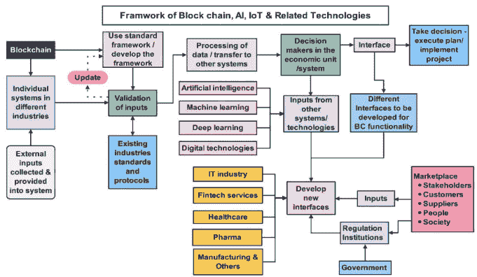

### 图1. 区块链、人工智能、物联网及相关技术框架。

当今，区块链技术在各行各业的广泛应用已经普及，许多行业仍在不断发展，正处于技术应用和吸收的不同阶段，其采用在规模、范围和业务拓扑或格局方面将至关重要。这些技术很可能会彻底改变当前的商业模式，并且默认情况下会更具颠覆性。虽然各个系统正在从外部和内部代理人或利益相关者处获取输入，但这些输入需要经过验证，以确保其符合当前工业生态系统中存在的标准行业和技术协议。验证后，数据正在被处理或传输到其他系统，在区块链应用中起主要作用的关键领域包括制造与工程、金融服务、医疗保健、制药、物流以及IT行业。之所以如此，是因为这些行业的回报类似于低垂果实的树，其带来的益处

可以轻易向其他领域渗透，并对其他领域的增长产生变革性影响。由此可见，某些领域（如医疗保健和金融服务）涉及敏感的数据相关问题，可能涉及隐私与个人公民权利的重叠，如果管理不当，处理起来会很困难。

开发用于管理不同行业特定需求的接口将是一项重大挑战，采用模块化方法开发行业特定解决方案，或许比为某个行业完全定制解决方案更可行。这反过来将影响规模化和数量、该行业相关利益方对技术的采纳，并因此默认影响区块链产品和解决方案的接受度。随着人工智能（AI）、机器学习（ML）、深度学习（DL）和数字技术（DTL）日益发挥作用，且这些技术已改变未来商业模式的运作方式，情况变得更加复杂。此外，QR 码、UPI 及相关技术的采用正在改变会计、记录保存以及各行业的采用方式，因此当与区块链应用结合时，这些技术变得至关重要，能够实现向其他领域的飞跃。

然而，危险在于，负责理解这些变化影响的监管机构很可能不知道相关问题，因此随之发生的事件可能会迅速失控，这变得更加具有挑战性。随着金融科技（fintech）和监管科技（regtech）的出现，区块链已渗透到金融服务和保险服务的整个领域，这可能导致控制问题，并可能成为金融市场监管机构（RBI）和资本市场监管机构（SEBI）的头痛问题。在像印度这样更倾向于中央层面控制的国家，这势必以未来某一项或另一项适用于区块链的立法形式体现出来。

行业特定区块链的发展将在开发和设计合适的接口（包含所需必要控制）时发生，而这正是技术采用面临的挑战所在。这些接口将基于市场参与者、客户、供应商、社会以及可能的监管机构的反馈进行设计。监管机构肯定会希望在批准前确保获得高水平的安全感，鉴于系统性风险的出现和市场波动性的增加，他们可能会推迟审批流程或规定额外的控制措施。反馈循环对于让区块链应用以正确形式按时成形至关重要。

印度政府也正在积极推动发展区块链生态系统的措施，并且需要与生态系统、在其他国家设计和开发过区块链的技术人员以及他们采用的应用进行更多接口和协调，这可能有助于我们交换协议，快速重新设计流程，并在比以前更短的时间内推出产品。因此，与其他技术一样，区块链也将从跨国界的协作与合作中获益匪浅。

以下是一些可能有助于我们更快地扩大流程并使区块链产品渗透到各个领域的额外优势点：

- 学术界 – 产业界接口需要加强 – 知名院校的计算机科学与信息技术系应与产业界密切合作，努力为各行业开发所需的区块链产品。
- 政府应鼓励对区块链初创公司提供补贴资助。
- 改进和增强区块链生态系统中的扩大流程。
- 与其他地理区域（例如俄罗斯、德国、乌克兰、罗马尼亚、日本、美国、以色列等）拥有大量区块链技术专家的科学家、工程师、技术人员和经济体进行协作与合作。与这些经济体建立共生安排将有助于增强印度区块链生态系统。
- 将实用应用纳入教育系统的课程，使人们能够开发技术，最好使用开源技术和人工智能的开源应用。
- 区块链的未来掌握在开发者社区手中，因此他们与 IT 产业界之间更紧密的互动现在比以往任何时候都更加必要。
- 可以鼓励举办类似于黑客马拉松或网络攻击竞赛的国家级竞赛，以使技术人员能够开发出更强大的区块链技术，并以具有成本效益的方式在各行业中快速部署。

### 建议和推荐

- 区块链应用可以通过初创公司、产业界、学术界和开发者社区之间良好的连接来更好地开发和启动。开源代码和平台是实现行业特定区块链应用产品和工具开发的正确方法。
- 政府对初创公司及学术创业的支持和协助，可以帮助为实体产生针对行业特定情况的良好应用。这些应用可以在扩展之前，根据适用性和成本效益分析进行商业化。
- 更多类似 GitHub 等的合作平台可能有助于加速某些领域区块链应用的发展。与学术界学生社区共享接口也将有助于为区块链发展创建正确的生态系统。
- 初创公司融资应涵盖区块链技术，并使与学术界的接口更加富有成效和有用。

### 区块链的未来

区块链的使用将迫使我们重新考虑当前在商业金融、供应链运营、运营管理及其他相关领域使用的流程和方法。定制化将有助于快速解决争议。因此，金融服务行业将能够消除目前使用的大量繁琐手工劳动。为了协助决策者进行批准和拒绝，人工智能方法还可以检测文本中的任何不一致或重大印刷错误。许多组织致力于推动区块链与物联网（IoT）的联系。该公司制定了一项策略，通过将互联设备的资源与安全、最新的数字数据档案相结合，来帮助企业使用区块链。数据将通过此方法存储并持续共享。当区块链被纳入时，它将使商品流动更加智能和安全，允许对产品暴露进行实时跟踪。供应链流程的交易数据将全面且永久地记录在区块链上。这将能够连接供应链上的任何供应商、生产设施和履行设施。许多行业的未来商业实践将因区块链而改变，但采用将需要一些时间。不久，这项技术将帮助改善金融和政府服务。数据存储在带有时间戳、相互连接且无法伪造的区块中。客户将能够在区块链上查看任何产品（无论新旧）的完整来源。（Hu et al., 2016）用于拥抱个性化生产系统和整体规划。这种区块链应用很快将能够缩小工业 4.0 领域中战略与实施之间的差距。研究人员必须关注这些问题，因为工业 4.0 的成功依赖于这种互连性。此外，需要定量解决识别出的驱动因素、促进因素和限制因素，以便决策者和管理人员采纳区块链并朝着工业 4.0 迈进。

### 结论

预计区块链将在本十年内以多种方式发展和传播。数字化作为工业 4.0 的关键原则，帮助企业从 IT 和管理咨询到供应链策略与优化的各个方面简化流程。这种区块链有很多好处，可能对各种行业都有用。如今，银行、保险公司、政府部门和公共服务公用事业使用技术来简化其流程并降低客户费用。银行业并非唯一可能从使用区块链技术中受益的行业；信息行业同样可以从中受益。

这个不可篡改的记录证明了产品是按照所有适用法规和标准制造的，且生产方法已被接受。区块链不仅确保安全高效的数据交换，还生成所有链接智能设备之间所有通信的不可篡改日志。保护身份安全是区块链技术的另一个绝佳用途。凭借其保护隐私的特性，这项技术允许用户建立私人且可信的在线身份。一个人的区块链身份可能被用于从最基本的任务到运行复杂软件或签署具有法律约束力的电子文档等更复杂的用途。区块链技术有望通过为中小企业和服务提供商提供高质量交易数据的可信数据库来简化此流程。

BC技术在工业4.0各领域的采用和适应方式，将更侧重于在基于根本可信的平台上构建数据库，从而降低交易成本，增加与经济中其他子系统和参与者（即社会、客户、供应商、税务机关、监管机构以及政府）的集成。考虑到各行业采用区块链的效益将显著更高，可用的总体效益可能更大，因此政府应成立一个适当的研究小组，汇集来自各行业的专家，并授权其提出建议，以帮助加速印度经济增长并推动区块链产业发展，其效益很可能超过成本，且越早踏上这条道路，经济增长就越大，从而也能提升GDP水平。这一切都预示着印度区块链生态系统的光明未来。结合金融科技和超过10,000+家技术驱动型初创公司，这将成为印度语境下经济增长的强大加速器。与其他国家的初创企业以及全球金融科技生态系统开展协作与合作，也将有助于我们吸取经验、缩短学习曲线，并以更快的速度将更多产品推向市场。

### 参考文献

- Ammar, Mohd, Abid Haleem, Mohd Javaid, Rinku Walia, and Shashi Bahl. “通过工业4.0技术改进材料质量管理和制造组织体系。” Materials Today: Proceedings 45 (2021): 5089-5096.

- Bhushan, Bharat, Chinmayee Sahoo, Preeti Sinha, and Aditya Khampariа. “区块链与物联网（BIoT）的统一：要求、工作模式、挑战与未来方向。” Wireless Networks 27 (2021): 55-90.

- Chang, Victor, Patricia Baudier, Hui Zhang, Qianwen Xu, Jingqi Zhang, and Mitra Arami. “区块链如何影响金融服务——基于专家访谈的概述、挑战与建议。” Technological forecasting and social change 158 (2020): 120166.

- Epiphaniou, Gregory, Herbert Daly, and Haider Al-Khateeb. “区块链与医疗保健。” Blockchain and Clinical Trial: Securing Patient Data (2019): 1-29.

- Esmaeilian, Behrad, Joe Sarkis, Kemper Lewis, and Sara Behdad. “面向工业4.0可持续供应链管理未来的区块链应用。” Resources, Conservation and Recycling 163 (2020): 105064.

- Faramondi, Luca, Gabriele Oliva, Roberto Setola, and Luca Vollero. “医院场景中的工业物联网：医院4.0、区块链与强健的数据管理。” Security and privacy trends in the industrial Internet of things (2019): 271-285.

- Fernández-Caramés, Tiago M., Oscar Blanco-Novoa, Manuel Suárez-Albela, and Paula Fraga-Lamas. “面向工业4.0库存和可追溯性应用的基于无人机和区块链的系统。” Multidisciplinary digital publishing Institute proceedings 4, no. 1 (2018): 26.

- Ferreira, Célio Márcio Soares, Ricardo Augusto Rabelo Oliveira, Jorge Sá Silva, and Carlos Frederico Marcelo da Cunha Cavalcanti. “工业4.0中的机器对机器交互区块链应用。” Blockchain Technology for Industry 4.0: Secure, Decentralized, Distributed and Trusted Industry Environment (2020): 99-116.

- Fu, Bailu, Zhan Shu, and Xiaogang Liu. “时装服装制造业中区块链增强的排放交易框架。” Sustainability 10, no. 4 (2018): 1105.

- Haleem, Abid, and Mohd Javaid. “COVID-19大流行期间医疗4.0及其在医疗保健中的作用：综述。” Journal of Industrial Integration and Management 5, no. 04 (2020): 531-545.

- Hathaliya, Jigna, Priyanka Sharma, Sudeep Tanwar, and Rajesh Gupta. “医疗4.0中的基于区块链的远程患者监测。” 在2019年IEEE第9届先进计算国际会议（IACC）论文集中，第87-91页。IEEE，2019.

- Holland, Martin, Josip Stjepandić, and Christopher Nigischer. “基于区块链技术的3D打印供应链知识产权保护。” 在2018年IEEE工程、技术与创新国际会议（ICE/ITMC）论文集中，第1-8页。IEEE，2018.

- Hu, Yingbai, Zhijun Li, Guanglin Li, Peijiang Yuan, Chenguang Yang, and Rong Song. “面向机械手眼系统的基于感觉-运动融合的操作与抓取控制研发。” IEEE Transactions on Systems, Man, and Cybernetics: Systems 47, no. 7 (2016): 1169-1180.

- Huang, Junjin, Linghe Kong, Guihai Chen, Min-You Wu, Xue Liu, and Peng Zeng. “面向安全工业物联网：基于信用共识机制的区块链系统。” IEEE Transactions on Industrial Informatics 15, no. 6 (2019): 3680-3689.

- Javaid, Mohd, Abid Haleem, Ravi Pratap Singh, Shanay Rab, and Rajiv Suman. “探索机器视觉对进步型工业4.0文化的影响与特性。” Sensors International 3 (2022): 100132.

- Kapitonov, Aleksandr, Ivan Berman, Sergey Lonshakov, and Aleksandr Krupenkin. “工业4.0中基于区块链的经济通信协议。” 在2018年加密谷区块链技术会议（CVCBT）论文集中，第41-44页。IEEE，2018.

- Khan, Shahbaz, Rubeena Singh, and Kirti. “区块链技术实施的关键因素：供应链视角。” Journal of Industrial Integration and Management 7, no. 04 (2022): 479-492.

- Kuhi, Kristjan, Kati Kaare, and Ott Koppel. “使用区块链确保物流中绩效测量的完整性。” 在2018年IEEE服务运营与物流及信息学国际会议（SOLI）论文集中，第256-261页。IEEE，2018.

- Leng, Jiewu, and Pingyu Jiang. “协作制造网络内外评估：制造商交互与属性比较。” International Journal of Production Research 56, no. 15 (2018): 5131-5146.

- Lim, Chun Hsion, Steven Lim, Bing Shen How, Wendy Pei Qin Ng, Sue Lin Ngan, Wei Dong Leong, and Hon Loong Lam. “可持续可再生棕榈油行业中工业4.0革命潜力的综述：HAZOP方法。” Renewable and Sustainable Energy Reviews 135 (2021): 110223.

- Liu, X. L., Wai Ming Wang, Hanyang Guo, Ali Vatanakhah Barenji, Zhi Li, and George Q. Huang. “工业4.0中产品生命周期管理的工业区块链框架。” Robotics and computer-integrated manufacturing 63 (2020): 101897.

- Pinheiro, Pedro, Ricardo Santos, and Ricardo Barbosa. “通过区块链实现基于工业4.0多代理系统的知识表示。” 在“环境智能——软件与应用——第9届环境智能国际研讨会”中，第331-337页。Springer International Publishing，2019.

- Singh, A. (2021). 《数字营销中提升准确性、效率和决策能力的大数据分析》. IGI Global. https://doi.org/10.4018/978-1-7998-7231-3.

- Singh, A., Bansal, R. & Sharma, S. (2022). 《大数据：成功数字营销的路线图》. Berlin, Boston: De Gruyter. https://doi.org/10.1515/9783110733716.

- Saberi, Sara, Mahtab Kouhizadeh, Joseph Sarkis, and Lejia Shen. “区块链技术及其与可持续供应链管理的关系。” International Journal of Production Research 57, no. 7 (2019): 2117-2135.

- Sandner, Philipp, Anna Lange, and Philipp Schulden. “工业公司首席财务官的角色：区块链技术影响分析。” Future Internet 12, no. 8 (2020): 128.

- Schölke, Daniel, Kevin Wallis, Jan Stodt, Christoph Reich, Dominik Welte, and Axel Sikora. “区块链技术的行业用例。” 在“物联网与金融领域区块链技术应用的行业用例”中，第248-276页。IGI Global，2021.

- Sikorski, Janusz J., Joy Haughton, and Markus Kraft. “化学工业中的区块链技术：机器对机器电力市场。” Applied Energy 195 (2017): 234-246.

- Tang, Christopher S., and Lucas P. Veelenturf. “工业4.0时代物流的战略作用。” Transportation Research Part E: Logistics and Transportation Review 129 (2019): 1-11.

- Teslya, Nikolay, and Igor Ryabchikov. “工业物联网的基于区块链的平台架构。” 在2017年第21届开放创新协会会议（FRUCT）论文集中，第321-329页。IEEE，2017.

- Zhang, Hao, Qiang Liu, Xin Chen, Ding Zhang, and Jiewu Leng. “中空玻璃生产线设计与多目标优化的数字孪生方法。” IEEE Access 5 (2017): 26901-26911.

## 第 5 章

## 区块链技术及其在数字经济中的作用研究——印度视角

R. Vennila*, 博士 和 Reshma Sultana, 博士

耆那被认定为大学商学院，印度班加罗尔

### 摘要

区块链是跨广泛对等网络访问和共享交易数据的新兴技术之一，在该网络中，互不信任的用户可以在无需中介的情况下以可验证的方式相互通信。本文回顾了区块链的基础、其用途、种类及运作方式。该技术的安全性、隐私性和共识机制同样至关重要且令人担忧，也是这种新颖技术的主要驱动力。匿名性、完整性、可扩展性和透明性是区块链技术的几项关键优势。各种技术、社会、经济和监管障碍使得区块链的大规模集成变得复杂。本文描述了区块链技术、它对印度经济的影响，以及其在将经济转型为数字经济中的作用。

关键词：区块链，数字经济，数字化转型

### 引言

“区块链本质上是一个分布式数据库，即公共账本，记录了在参与各方之间传输的所有已执行交易或数字事件。”在交易被记录到公共账本之前，系统的大多数用户必须就每笔交易达成一致。此外，一旦输入的数据绝对无法删除。在区块链上，所有曾经进行过的交易都以精确且可验证的方式记录。作一个直观的类比，从隐藏的罐子里偷饼干，比从市场上数百人可见的罐子里偷饼干更简单。区块链技术最著名的用途可能是比特币。作为无监管、数十亿美元的全球匿名商业行业增长的主要因素，它也是最具争议的。因此，它必须面对影响金融机构和国家政府的广泛监管问题。另一方面，区块链技术不存在争议，并且长期以来一直完美运行。它已成功用于现实世界中的金融和非金融应用。

当前数字经济的基础是依赖被认可的权威机构。每一笔在线交易都依赖于告诉我们真相的可靠来源。这可能是像 Facebook 这样的社交媒体网站提醒我们，我们的帖子仅被熟人阅读，也可能是一家银行向我们保证，我们的资金确实已以可信的方式转移到我们的账户。事实是，由于我们依赖第三方来保障数字资产的安全和隐私，因此我们在数字世界中处于危险的环境之中。尽管如此，这些额外的来源可能会被控制、黑客攻击或渗透，这是准确的。在这种情况下，区块链技术很有用。通过提供分布式共识，它可以在任何未来时间验证过去或当前涉及数字资产的任何在线交易，有可能彻底颠覆数字世界。它在不危及各方或相关数字资产保密性的前提下实现这一目标。分布式共识以及匿名性是区块链技术的关键特征。

### 研究意义

共享经济理念在过去十年中不断发展，目前我们使用奥拉（Ola）、优步（Uber）、OYO 等共享服务。区块链技术已经在一些特定情况下正在改变社会。理论上，如果买家在区块链上注册笔记本电脑并选择在 Olx 上出售，他们应该能够了解笔记本电脑的位置、当前价值和状况。想象一下，一位客户购买了您的笔记本电脑并要求购买保险。在这种情况下，他可以快速将区块链数据（包括“是什么”、“价格是多少”、“处于什么状态”等）与保险公司共享，从而获得保险。当物品长期闲置不使用时，将其出租比保留它们更便宜。在未来几年，区块链将提高共享经济的效率和安全性。尽管区块链技术的采用速度较慢，但许多国家已逐渐采纳支持区块链和虚拟货币的法规。印度正在逐步采用区块链技术，随着新计划“国家数字健康使命（NDHM）”的推出以及全新教育政策的采纳。政府正在尝试提供一个可快速部署的数据库。

### 文献综述

- 将其视为“分布式账本”更易于理解区块链的技术可行性，而这是其最基本、最关键的定义（Tan et. al., 2021）。

- 例如，电气和电子工程师学会对这一新技术工具进行了大量思考，特别是在其第六届国际大数据大会期间（Varghese et. al., 2019; Poonia et. al., 2021）。然而，直到最近才探讨是否将这项技术仅作为安全数字交易的原型在财务上可行。（Parekh et. al., 2021）

- 有一个预计的万亿美元产业可以利用这一技术进步，特别是在数字印度等雄心勃勃的发展背景下（Singh, 2021; Singh, Bansal and Sharma 2022）。

- 审视和理解如何增强和发展安全数字交易维度，对于提供真正能够满足不断增长的经济需求的安全可扩展基础设施至关重要。（Kamble et.al., 2019）。

### 研究目标

- 了解区块链技术对印度经济的影响。
- 评估区块链对印度经济的影响
- 提出适当的建议。

### 印度经济与区块链

印度目前是世界第七大经济体。为打击腐败，政府于2016年11月8日突然宣布全面废钞，并禁止所有500卢比和1000卢比纸币。自那时起，局势已显得严峻。12亿人口的国家不得不一夜之间转向无现金和数字交易。由于GST实施困难、2020年COVID封锁以及废钞政策，印度经济发展缓慢。一项新的联合国研究预测，这种冠状病毒情景将导致2020年印度经济下降5.9%。

数字或无现金支付方式的大幅扩张和增长十分突出，尽管只有少数亮点，但这些亮点无疑已被印度经济目前面临的严峻状况和情形所掩盖。可以看到，金融科技行业经历了巨大增长，并以某种方式促进了经济扩张。根据世界经济论坛（WEF）的说法，由于废钞策略，印度发生的数字交易激增使政府获益匪浅。因此，追踪经济内资金流动的能力将得到改善。此外，区块链技术和加密货币的进入是一大利好。尽管政府在2018年突然决定禁止该国80%的货币，但对加密货币交易的限制在随后几个月里遭遇了欺诈浪潮。加密货币交易所在法庭上挑战了禁令，并于2020年3月获得缓期（Alaeddin and Rana, 2008）。

印度政府必须找到长期解决方案，解决阻碍更顺畅、更流畅的无现金经济普及的问题，任何希望扩大无现金经济的全球政府都将面临同样的情况。金融包容性、高昂的设置和交易费用以及交易延迟时间长，是这些困难之一。从根本上说，区块链是一个很好的起点，因为政府迫切需要一种替代传统金融解决方案来管理无现金经济。区块链技术几乎消除了要成为传统金融结构一部分才能实现货币包容性的需求。通过促进政府与私营部门接口之间的透明度，它还可以促进更轻松的商业合作，并提高印度公民的生活质量。此外，技术可以完全转变当前的做法，以挖掘新的效率和价值来源（Chillakuri and VS Prakash, 2022; Grover et. al., 2019）。

自2015年以来，印度有了巨大进步，在2020年版《营商环境》中上升79位，位列第63位，但在若干需要立即关注的其他领域表现仍极差，包括“合同执行”（190国中排名第163）、“财产登记”（190国中排名第154）和“开办企业”（190国中排名第136）。解决这些问题并拯救印度经济的长期方案，可能是引入区块链技术和比特币交易。就整个世界而言，预计到2030年，区块链将产生3万亿美元的年度经济价值。根据世界经济论坛的预测，到2025年，全球10%的GDP预计将存储在区块链上。区块链还被列为七种预计将彻底改变我们生活各个方面的技术之一。采用和接受尖端技术是共享经济解决方案的基石。

### 区块链在印度数字经济中的作用

- 区块链在印度及世界其他多个行业的应用正在加速。到2024-2025年，区块链技术将大大促进印度到2022年实现5万亿美元GDP增长的目标。

预计与政府相关的区块链项目将在2032年前使印度GDP增长51亿美元。

- 在印度，各种初创企业正在尝试仅利用技术来提供多种应用，尤其是在银行、保险和金融服务行业。大型企业试图将区块链技术集成到日常运营中。印度政府也在积极采用技术，并将资源投入到作物保险、教育和土地产权登记（包括电子健康管理等）等领域的用例中。

- 区块链使用将增加，加速印度的数字化革命。在过去几年中，政府通过部署“Aadhar、UPI、Digi-locker、e-Sign以及GSTN等数字化税收治理网络”等技术，已成功为存储和传输数据的数字基础设施奠定了基础。

- 尽管印度在人口数量上位居世界第二，是世界上最大的民主国家，但其政府面临着多重困难。考虑到公共分配服务（PDS）管理的多样性和复杂性，区块链为支持更好的治理提供了特殊的优势和机遇。由于供应链的每一步都可以在区块链上追溯，它提供了一种追踪和管理分发给受益人商品的机制。信息可以在区块链上实时轻松追溯，确保PDS内部没有泄漏，并且分配的产品和服务能够送达最终接收者。

- 区块链采用率的增长将通过加强质量控制、合同管理和采购，以及减少供应链中的泄漏和浪费，立即推动经济增长。

- 随着区块链采用率的增长，私营部门将能够更有效地运营，这将有利于中小企业。如果政府允许“自我监管”，区块链的实施将显著改善治理，因为实体对繁重的监管审查和合规性的依赖会降低，并能更多地通过受信任的媒介在分布式账本上直接相互连接。

通过将该技术纳入“国家农产品市场（eNAM）”（印度的农产品在线交易平台），区块链也有助于该国的农业行业。所有农产品的审计追踪都是通过在区块链上记录信息流生成的，由于区块链上的每条记录都经过了加密哈希处理，数据无法被篡改。因此，农民与阿哈特亚（mandi中的中间商）之间的不信任减少，交易成本降低，从而促进了印度各地商品贸易。

区块链还通过将财务激励与农产品产出挂钩（以有机产品产地认证的形式），鼓励农民生产高质量商品，这种认证在出口市场上能要求更高的价格。

区块链还可以在灾害管理中充当辅助作用，并在自然灾害后协助保险索赔，通过智能合约实时自动释放索赔并检索索赔管理所需的数据，从而节省相关流程中的时间和金钱。由于区块链使验证凭证和保存记录变得更加简单，教育领域也因此受益。

与电力、蒸汽机车、计算机以及互联网等其他革命性技术类似，区块链有可能影响社会结构和经济。

尽管更多区块链应用的这些优势被认为是无与伦比的，但若干原因将显著加速其发展，而且应该将区块链技术的教育与理解融入教育体系。

在政府支持下，组织、行业与学术界之间的跨界协作对于充分利用该技术至关重要。由于该技术是去中心化的。此外，强烈建议政府与其他国家合作，仅在区块链上构建数据与处理互操作性，以便在供应链、金融系统、医疗记录等方面轻松应用。

### 建议

- 在日常公司运营中使用时，区块链能带来商业效率，因为其本质消除了中间人，并生成了相关方可供查询以作出决策的去中心化数据库。
- 数字化进程将从加大将区块链与多种应用相关联的努力中受益，因为印度已经在数据收集方面拥有坚实的基础。
- 随着透明度和问责制的提高，企业将运营得更高效，因为嵌入式智能合约将显著缩短授予权限和给予批准所需的时间和成本，从而提升“营商便利度”。
- 区块链为印度人开辟了大量的职业机会，尤其是因为该技术需要软件开发、商业头脑和法律方面的专业知识。通过重新思考系统当前的治理流程，引入区块链技术也可以作为催化剂，提高系统的有效性和透明度。

### 结论

区块链技术在金融行业之外也有应用，例如在网络、数字广告、网络安全和预测方面。“货币转移、供应链管理、数据共享、数字选民登记、房地产交易”以及车辆产权转让只是区块链技术可以实现的少数操作。此外，它还能保护版税和版权。印度正在逐步采用区块链，因此事情正在好转。考虑到印度政府目前面临的公共服务提供规模、多样性和复杂性，区块链提供了一种独特的选择。区块链经济需要技术创新。构建基于区块链的数字经济所需技术的发展，需要政府与各级管理层之间的强强协作。它还必须传达这项技术的潜力。如果政府和组织采用区块链部署工具，由COVID-19引起的供应链中断以及印度当前的经济困难都可以得到解决。区块链技术可以改变印度的金融科技格局以及未来数字交易的进行方式。印度通过实施区块链技术可以获益良多。

### 参考文献

- Alaeddin, O. and Rana, A. (2008). 信任、技术意识和满意度影响马来西亚Z世代使用加密货币的意向. *国际工程与技术杂志*, 7(4), 8-10.
- Chillakuri, B. and VS Prakash, A. (2022). 区块链在人力资源应对新常态中的作用. *组织分析国际期刊*, 30(6), 1359-1378.
- Grover, P., Arpan, K., Marijn, J., and P. Vigneswara, I. (2019). 感知有用性、易用性和用户对数字交易区块链技术的接受度——来自Twitter用户生成内容的洞察. *企业信息系统*, 13(6), 771-800.
- Kamble, S., Angappa, G., and Himanshu, A. (2019). 理解供应链中的区块链技术采用——印度背景. *生产研究国际期刊*, 57(7), 2009-2303.
- Norman, AT. (2017). 区块链技术解释：关于区块链钱包、挖矿、比特币、以太坊、莱特币、Zcash、门罗币、瑞波币、达世币、IOTA和智能合约的终极初学者指南，126. Scotts Valley: CreateSpace Independent Publishing Platform.
- Parekh, J., Azain, J., Urvi, B., and Shekhar, S. (2021). 通过区块链技术在医疗旅游中去中介化：基于价值聚焦思维方法的分析. *信息技术与旅游*, 23(1), 69-96.
- Poonia, V., Manish, G., Gupta, BB. and Gupta, A. (2021). 印度不同河流域干旱发生及基于区块链技术的灾害管理框架. *清洁生产杂志*, 312, 127737.
- Singh, A. (2021). 大数据分析以提高数字营销的准确性、效率和决策能力. *IGI Global*. https://doi.org/10.4018/978-1-7998-7231-3. 3.
- Singh, A., Bansal, R. & Sharma, S. (2022). 大数据：成功数字营销的路线图. Berlin, Boston: De Gruyter. https://doi.org/10.1515/9783110733716.
- Tan, L., Keping, Y., Caixia, Y., and Bashir, AL. (2021). 基于区块链的Shamir阈值密码学用于智能城市工业物联网数据保护. 在 *人工智能与区块链技术在6G智能城市中的第一届研讨会论文集* 中，13-18.
- Varghese, JJ., Sharma, D. and Singh, NK. (2019). 分析区块链技术对印度数字经济的影响. *企业信息系统全球期刊* 11(1), 94-99.

## 第 6 章

## 区块链技术：商业、战略和环境中的关键角色

Divya Bansal*，博士 与 Mona Chaudhary

阿米蒂大学，诺伊达，印度

### 摘要

区块链技术是构建在信息和计算技术之上的一种颠覆性突破，且仍在快速增长。

这种基础性颠覆技术使各方（即使不一定互相信任）能够共享数字历史记录并进行更新，同时避免了协调所需的中央可信机构。

从加密货币的起步开始，区块链已经在银行、法律、教育、医疗保健、供应链和制造业等多个行业中找到应用案例。

比以往任何时候都更甚，营销人员必须学习如何使用新技术并快速部署。

但是，尽管区块链技术诞生已十余年，学术营销研究者对此关注甚少。

由于区块链的独特特征——透明度、去中心化和不可篡改性——它可以为个人和公司营造一个更安全、以客户为中心和开放的市场。

本研究的主要目标是增加知识并填补与区块链创建和使用相关的知识空白。

其旨在为学者和行业专业人士提供一个平台，以批判性地审视、调查和解释区块链技术所采取的新模式和形式，以及技术与企业、供应链及其利益相关者之间的交互。

本研究认为，区块链是营销人员应当充分了解并准备使用的技术，因为它有能力改变企业。

我们希望就区块链技术在五个不同领域（加密货币、数字平台、供应链和在线营销）的影响产生讨论并开展未来研究。

关键词：区块链技术、策略、供应链、数字平台

* 通讯作者电子邮件：Divyadogra26@gmail.com。

收录于：区块链
编辑：Amandeep Singh、Sandhir Sharma、Amarinder Singh 等
ISBN: 979-8-89113-219-1
© 2024 Nova Science Publishers, Inc.

### 介绍

区块链是一种分布式、不可篡改的数据库，它简化了企业网络中交易的记录和资产的跟踪。

无形资产可以与有形资产（如房屋、汽车、现金或土地）（知识产权、专利、版权和品牌）并存。

区块链网络可以追踪和出售几乎任何有价值的东西，降低所有相关方的风险和成本。

信息是公司的命脉。信息接收得越早、越准确，效果越好。

区块链非常适合分发该信息，因为它提供即时、可共享且完全透明的数据，记录在不可篡改账本上，只有拥有权限的网络成员才能读取。

区块链网络还可以追踪订单、付款、账户和产出。

此外，由于成员对真相有统一的认识，你可以从头到尾查看交易的所有方面，从而增强信心并带来额外的效率和机会。

### 区块链的优势

必须改变什么：重复的记录保存和第三方验证通常会浪费运营中的时间和精力。欺诈和网络攻击可以利用记录保存系统。缺乏透明度可能会阻碍数据验证。而且，自引入物联网以来，交易量激增。所有这一切都会减缓业务并降低利润，强调了对更好解决方案的需求。区块链技术应运而生。

### 增强信任

作为区块链支持的会员专属网络的一员，你可以确信自己接收到的是准确且及时的数据，且你的敏感区块链记录仅会共享给你明确授权访问的网络成员。

### 增强安全性

由于已确认的交易被永久记录，所有网络参与者必须就数据真实性达成一致。没有人，甚至系统管理员，都不得删除交易。

### 提高效率

借助网络参与者共享的分布式账本，避免了耗时的记录对账。智能合约是一组可以编写在区块链上并自动实现的规则，以加快交易速度。

### 区块链的工作原理

- 1. 每笔交易发生时，都会作为“数据块”被记录。
  这些交易显示资产的流动，资产可以是有形的（产品）或无形的（服务）（知识产权）。
  数据块可以记录任何类型的信息，例如谁、什么、何时、何地、多少，甚至状态——例如，食品运输的温度。

- 2. 每个区块都与其前后的区块相连。
  这些区块在资产从一个位置移动到另一个位置或所有权转移时，构建了一条数据链。区块确认交易的时间和顺序，并被安全地链接在一起，以防止任何区块被篡改或插入两个现有区块之间。

- 3. 区块链是一条连接交易的不可逆链。
  每个后续区块都会强化对前一个区块（进而对整个区块链）的验证。这使得区块链防篡改，赋予了其不可篡改的关键优势。这消除了恶意行为者操纵的可能性，为你和其他网络用户创建了可靠的交易记录（Singh, 2021; Singh, Bansal and Sharma 2022）。

### 区块链的优势

- 1. 应改变什么：
  重复的记录保存和第三方验证通常会浪费运营中的时间和精力。欺诈和网络攻击可以利用记录保存系统。缺乏透明度可能会阻碍数据验证。而且，自引入物联网以来，交易量激增。所有这一切都会减缓业务并降低利润，强调了对更好解决方案的需求。区块链已经到来。

- 2. 增强信任：
  作为区块链支持的会员专属网络的一员，你可以确信自己接收到的是准确且及时的数据，且你的敏感区块链记录仅会共享给你明确授权访问的网络成员。

- 3. 增强安全性
  作为区块链支持的会员专属网络的一员，你可以确信自己接收到的是准确且及时的数据，且你的敏感区块链记录仅会共享给你明确授权访问的网络成员。

- 4. 耗时
  借助网络参与者共享的分布式账本，消除了记录对账。智能合约是一组可以编写在区块链上并自动实现的规则，以加快交易速度。

### 区块链对营销的影响

B2C 商业中最重要的发展之一是具有移动功能的现代电子商务系统的兴起。电子商务的引入改变了许多传统的组织结构，并彻底改变了价值创造过程。与此同时，在营销中使用新技术（例如区块链）改变了品牌营销的传统动态。互联网为营销人员提供了众多选择，以建立新的在线市场并扩展到其现有市场的新领域。另一方面，区块链的到来导致人们和组织使用互联网的方式发生了巨大变化。

在这种情况下，了解区块链技术对营销的影响概述将帮助你熟悉区块链如何现在和未来彻底改变营销。

### 区块链对营销的影响

区块链技术引起了广泛关注，并通过多个行业中的实际应用案例证明了其价值。例如，区块链在金融、医疗保健、房地产和供应链管理方面找到了主要应用。因此，营销并非潜在区块链用例中的例外。大多数正在寻求“区块链在营销中如何应用？”这一问题答案的人，都会在区块链技术的特性中找到答案。

### 区块链为何适合营销？

2008 年全球金融危机动摇了传统银行业的根基。在此期间，点对点电子现金系统比特币的出现展示了密码学技术在金融交易处理中的应用。比特币的密码学机制包括哈希、共识程序、非对称加密和时间戳。

比特币解决了双重支付问题，同时还为在在线环境中进行金融交易和交换价值建立了新标准。此外，区块链在营销中的影响

将重点放在区块链如何验证交易真实性上。因为所有交易都按顺序带有时间戳地分组在区块中，所以篡改区块链上的公共交易记录是不可能的。

基于区块链的营销应用将带来客户与企业连接的重大变化。区块链带来了多种技术的优势，最重要的是，由区块链网络参与者执行的交易的分布式账本。区块链技术的主要目标是资产认证，并有潜力应用于其他商业流程。

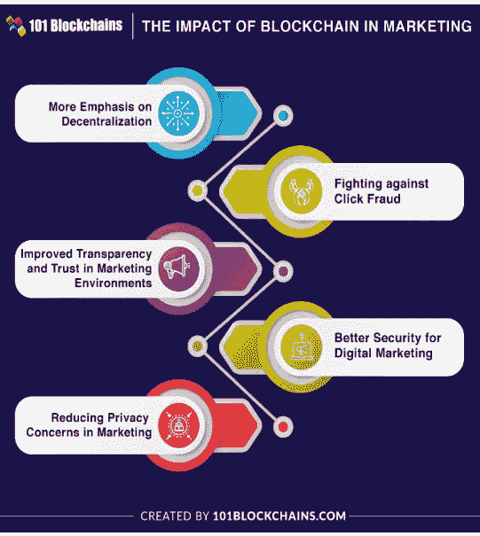

图 1. 区块链对营销的影响。

### 供应链中区块链的影响/应用

区块链创新正在对全球银行业产生重大影响，但人们对于新兴技术如何影响其他行业了解较少（图 1）。尽管该领域的实际研究较为稀缺，但供应链业务是区块链实现不可信利益相关方之间透明度，以及提升制造和分销运营效率与可追溯性的重要且极具前景的应用场景（Scully & Hößig, 2019）。

市场条件变得更加动态和苛刻，导致竞争环境充满挑战。为了适应这种变化的环境，供应链越来越依赖于利益相关方之间的协作、集成、灵活性和信任。因此，新技术应用在供应链中的重要性愈发凸显。必须安装现代专用应用程序以更好地控制供应链流程。区块链技术已被证明是当今竞争格局中不可或缺的组成部分。在当今动态的商业世界中，企业应投资于区块链技术，以便快速应对不断变化的市场条件和需求（Meidute-Kavaliauskiene et al., 2021）。

在当今竞争激烈的商业环境中，供应链管理被广泛视为成本控制和经济绩效提升的关键工具。然而，随着供应链复杂性增加、透明度和灵活性要求等障碍的出现，如果企业和工业部门希望保持竞争力，针对特定任务的挑战和供应管理方法必须实现现代化（Helo and Hao, 2019）。

需求和产品组合的变化使得同步供应链的供需计划变得困难，因为它们分布在多个不同的地点（Heidary et al., 2021）。在敏感产品从一家公司运输到另一家公司直至到达最终消费者的过程中，防止产品损坏至关重要。运输过程中篡改产品、延误、欺诈、身份验证、缺乏数据管理以及数据准确性和完整性不足，都是传统供应链管理中普遍存在的问题。许多现代企业已建立识别系统，以保持并维护其全球领导地位，并保留对其供应商进行教育的权利。否则，它们将不得不依赖并遵循主要监管机构或中间商。

本研究探讨了区块链技术对供应链灵活性、透明度和信任的影响。由于区块链技术对企业而言是新事物且不为人所熟知，因此备受怀疑。结果，企业可能会将其在这项技术上的投资视为高风险。本文试图揭示该技术可以为企业带来的一些好处。许多研究者已将透明度、灵活性和信任作为因变量，因为这些是供应链的关键问题。因此，许多研究者发现，使用区块链技术对供应链透明度、灵活性和信任有着实质性影响。

根据相关文献，组织可以通过提供更透明的供应链运营来提升客户满意度，进而增强客户忠诚度。此外，供应链开放性可以通过增强组织间的信心来增加供应链合作。此外，供应链灵活性可以成为寻求获得持久竞争优势的组织的重要工具。根据研究结果，区块链在这三个方面都是一项必不可少且有价值的技术。

### 区块链在数字平台上的影响/应用

Airbnb 是所谓平台经济的一个例子，它通过互联网平台连接寻租者与房东。尽管 Airbnb 在 2018 年的营业额超过 36 亿美元，但它并不拥有任何公寓（Hook, 2018）。然而，许多平台经济商业模式建立在强大的垄断或寡头垄断之上。这就是为什么许多利益相关方（例如出版商、广告商和用户）寻求更加平衡的生态系统。一种新的颠覆性技术能否改变这一现状？

区块链技术正在引起日益增长的媒体关注（Nofer, 2017）。加密货币用户数量从 2015 年的 500 万激增至 2019 年的 4400 万。（Statista, 2020）。比特币是最受欢迎的加密货币，当前市值为 1740 亿欧元，位居德国 DAX30 指数榜首。这就引出了一个问题：区块链技术究竟是什么？

营销人员面临着以前所未有的速度理解和采用新技术的挑战。尽管区块链技术已存在十余年，但营销学界的学者对此关注甚少。考虑到区块链的独特特征（透明、去中心化和不可篡改），它有潜力为消费者和企业构建一个更安全、以客户为中心且更开放的市场。

区块链技术在数字营销中的应用仍处于起步阶段。区块链技术对数字营销的影响包括（但不限于）增强数字营销安全性、减少点击欺诈、增加信任和透明度，以及开发忠诚度计划。

区块链技术基于点对点通信，这鼓励了去中介化，即移除处理和过滤数据流并增加成本的中介机构。通过生成不可更改且共享的数据记录，区块链技术还可以帮助提高数据质量并便于数据访问。从消费者的角度来看，区块链技术有潜力通过增加数据和信息的可用性以及隐私和安全性，从根本上改变客户关系。它还允许新型的消费者忠诚度计划，这可能有助于提供价值。

### 区块链对加密货币的影响

区块链技术对所有行业和组织来说都是极具创新性的实现。在商业领域，系统的主要组成部分是制造商、生产商、零售商和消费者。因此，在未来，我们可以考虑创建并实施一种单一的区块链方案，可用于任何公司，无论它是土地网络、食品店网络、服装生产网络、汽车工业、药品组织还是任何其他业务，从而使区块链方案的传播变得不那么复杂。

区块链技术的首个商业可行应用是加密货币，它有望成为全球资本转移网络的主要动力源。采用具有创新特性的区块链协议，有潜力为在线游戏领域带来一场革命。区块链技术能够实现永久记录，非常安全，在提供透明性的同时还提供一层匿名性，取消了对中介机构的需求，包含验证和确认流程，并能实现可证明公平可信的交易。区块链技术和加密货币尚未实现广泛采用，并且对于大多数消费者和公司来说可能继续过于难以使用。目前，操作区块链需要非常高的技术专业水平。

加密货币仅限于数字领域。出于这个原因以及与其相关的中性含义，“数字货币”通常比“虚拟货币”更受青睐。当提到存储在“数字”或“电子登记簿”中的货币时，“虚拟”带有负面含义，因为它意味着某物是“表面上真实”但并非“真实”的。

尽管无法预知区块链技术未来的发展，但普遍认为它将在近期成为一项非常重要的技术进步。一些学者认为，就其重要性而言，它可与互联网相提并论，因为它可能对行业和社会产生广泛影响。

区块链技术的潜力似乎非常有前景，掌握该技术所能实现的进步将是不可想象的。归根结底，该发明如何被吸收将决定其如何使金融市场和全球受益。尽管目前大多数现有企业主要被说服接受区块链技术作为降低成本并推动行业标准化的手段，但由于该创新的现代架构特性，一些老牌企业可能无法很好地应对该创新的长期影响。比特币在解决其设计所针对的问题方面非常有效，即允许全球网络在无需昂贵中介的情况下自由运行和交换价值。这个问题是为比特币设计的，而比特币在解决此问题方面非常成功。区块链技术取代了以前的密码学技术，而加密货币利用这项技术。尽管仍有大量研究正在进行，以确定其在各种不同学科中的有用性，但比特币的工作原理，以及其在大数据中的有用应用及其对大数据的影响，仍然是大量研究的主题。由于各种数据的快速生成和收集速度的不断提高，其处理和管理变得越来越混乱。世界正在向信息时代迈进，在这个时代，“数据是新的黄金”。

### 区块链对金融领域的影响

区块链技术现在备受关注。我们不断被充斥着的关于技术将如何改变世界的故事所淹没。虽然它可能改变我们生活的许多方面，但我们强烈预感，变化将发生在我们只会间接受影响的领域。也就是说，区块链技术将显著改变不可见操作（即组织视为其后台任务的工作）的部署。技术与金融的“结合”在某些圈子里被称为“金融技术”（有时拼作“FinTech”）。当技术与金钱结合在一起时，就会发生一种“化学反应”，产生的乘数效应远比两者分别结合更为显著。

区块链技术被视为金融领域的重要工具，有可能在互联网发展、经济增长和金融创新等领域带来令人兴奋的进展。金融行业迫切需要数字化转型，以及确保有效使用区块链技术的措施。因此，本研究的目的是评估信息技术对齐的调节作用，以及区块链采用在新数字流程创新与战略创新以及财务绩效之间的中介作用。未来十年，区块链技术预计将对电子商务产生重大影响。如果该创新应用的初始关键要素之一是支付和全球转账，那么最近的举措浪潮——以及家喻户晓的品牌参与这些举措——清楚地表明，区块链技术可能会扩展并对支付服务行业以外的经济产生深远影响。

技术的扩张在商业世界，尤其是金融领域，造成了重大转变。一种被称为区块链的技术已被开发出来，为金融交易带来信任和透明度。区块链技术可以提高运营效率，提高透明度水平，通过在交易中占用更少资产来降低风险敞口，并削减开支，例如金融行业产生的交易费用。多种应用可能对金融部门有用，包括智能合约——区块链技术最重要的应用之一；不过，还有其他可能性。鉴于区块链技术仍处于早期发展阶段，现在下结论它究竟能实现什么还为时过早；然而，该技术有潜力对当前金融体系造成重大颠覆。最不切实际的理论是，分布式账本技术最终会使银行过时。专业市场参与者无法满足创新的前提条件，是阻碍区块链技术在金融行业实施的客观障碍的根本原因。除了纯粹的技术挑战（例如缺乏可靠性、可扩展性、性能等）之外，还存在实施障碍，即每项发明都具有的风险。这涉及法律问题、重大决策者对创新的明智判断，以及技术领域判断过时的风险。

### 区块链应用

区块链正在各行各业中被广泛研究，众多用例正在被测试。虽然大多数用例涉及价值链或行业层面的众多利益相关者，但有些则特定于单一组织，例如忠诚度计划和了解你的客户（KYC）流程。尽管金融服务公司正在成为开发区块链用例的领先者，但其他行业也在赶上。

### 银行和金融服务领域

金融服务行业基于区块链的用例数量正在增加，这些用例有可能提高运营效率和客户体验。金融服务巨头正在尝试“跨境汇款”、“交易后结算”、“贸易融资”甚至“忠诚度计划”等应用。

尽管金融参与者是最早研究这种分布式账本技术的，但非金融参与者也在关注并寻求利用区块链提供的优势的方法。零售、旅游、医疗保健、电信和公共部门是领先者。区块链的去中心化数据存储、数据不可篡改性和分布式所有权特性是适用于这些行业的主要用例的关键（图 2）。

| 零售与日用消费品 | 石油与天然气 | 医疗保健与生命科学 | 电信 | 公共部门 |
| :--- | :--- | :--- | :--- | :--- |
| **保修收据** 该解决方案使用 Facebook Messenger 聊天机器人将保修收据存储在区块链上。它有助于 - 减少零售商和客户之间因丢失收据和无法读取的收据而产生的争议 - 跟踪所有权历史 | **数字供应链** 基于区块链的油气（资产）在整个供应链中的追踪 - 对资产生命周期内所有事件的不可篡改视图 - 基于智能合约的租赁执行和终止，从而降低法律成本 - 由于网络中透明度更高，加强了租赁的财务管理 | **患者记录管理** 基于区块链的记录管理系统，使公司能够 - 简化索赔处理 - 保障医疗记录安全 - 监控制药供应链 - 与网络利益相关者协作 | **漫游欺诈** 基于智能合约的解决方案，旨在 - 基于呼叫事件数据自动触发漫游合同 - 近乎即时的计费和减少漫游欺诈 - 取消第三方清算所带来的成本节约 | **土地登记** 基于区块链的土地登记系统 - 探索区块链如何在降低人为错误风险的同时，为文件所有权转移创建更安全的流程 |

图 2. 非金融服务行业的区块链用例。

### 结论

尽管区块链最初是构建虚拟货币系统（比特币）的提案，但它已扩展为一种广泛的技术，用于以更高的便利性、安全性和匿名性记录、共享和利用数据。其营销应用潜力巨大，范围从改进交易和客户数据记录，到更好地连接市场参与者、量化无形资产和实体，以及更高效的细分和营销。

区块链技术可能是当今最热门的概念之一。随着数字化成为一种常见（甚至必要）的现象，我们已经开始将资产数字化。将事实转换为可以在计算机环境中保存、转移和评估的 0 和 1（数据）的过程被称为数字化。我们已经开始研究如何使用这项技术保护所有可以数字化（转换为数据）的资产。因此，区块链技术最初是为确保数字资产（即加密货币）的安全而设计的。

### 参考文献

Antoniadis, I., Kontsas, S., & Spinthiropoulos, K. (2019). 区块链在营销中的应用. 第 7 届 ICCMI 论文集.

Banerjee, S. S., & Chandi, A. (2022). 金融领域区块链应用面临的挑战：一项定性研究. 经济与行政科学期刊, (提前出版).

Bansal, D., & Suresh, E. (2017). 变革印度：一个数字赋能的社会. Adarsh 管理研究期刊, 1-6.

Beck, Roman; Müller-Bloch, Christoph; and King, John Leslie (2018) “区块链经济中的治理：一个框架与研究议程,” 信息系统协会期刊, 19(10),

Catalini, C. (2017). 区块链技术将如何影响数字经济. 区块链、智能合约与物联网, 4, 2292-2303.

Chang, V., Baudier, P., Zhang, H., Xu, Q., Zhang, J., & Arami, M. (2020). 区块链如何影响金融服务——基于专家访谈的概述、挑战与建议. 技术预测与社会变革, 158, 120166.

Chuen, D. L. K. (编). (2015). 数字货币手册：比特币、创新、金融工具与大数据. 学术出版社.

Collomb, A., & Sok, K. (2016). 区块链/分布式账本技术 (DLT)：对金融领域的影响. 数字世界经济期刊, (103).

Dwivedi, S. K., Amin, R., Volla, S. (2020). 供应链管理系统中基于区块链的带密钥分发机制的安全信息共享协议. 信息安全与应用期刊, 54, 102554, https://doi.org/10.1016/j.jisa.2020.102554.

Gainsbury, S. M., & Blaszczynski, A. (2017). 区块链和加密货币技术如何彻底改变在线赌博. 博弈法律评论, 21(7), 482-492

Gleim, M. R., & Stevens, J. L. (2021). 区块链：营销人员的颠覆者？营销快讯, 32(1), 123-128.

Hashemi Joo, M., Nishikawa, Y. and Dandapani, K. (2020), “加密货币：区块链技术的成功应用,” 管理财务, Vol. 46 No. 6, pp. 715-733. https://doi.org/10.1108/MF-09-2018-0451

Heidary Dahooie, J., Zamani Zaboghli, A., Meidutė-Kavaliauskienė, I. and Govindan, K. (2021). 基于其对多个相互作用障碍的影响优先排序可持续供应链管理实践. 可持续发展世界生态国际期刊, 2021, 28, 267–290, https://doi.org/10.1080/13504509.2020.1795004.

Helo, P. and Hao, Y. (2019). 运营与供应链中的区块链：一个模型与参考实现. 计算机与工业工程, 2019, 136, 242–251, https://doi.org/10.1016/j.cie.2019.07.023.

Hook, L. (2018) Airbnb 在 2017 年实现首个完整年度盈利. 金融时报, 检索自 http://www.ft.com/content/96215e16-0201-11e8-9650-9e0ad2d7c5b5

Jutila, L. (2017). 区块链技术及其在金融领域的应用.

Kamble, S.S., Gunasekaran, A., Kumar, V., Belhadi, A., Foropon, C. (2021). 基于机器学习的供应链区块链采用预测方法. 技术预测与社会变革, 2021, 163, 120465.

Khalil, M., Khawaja, K. F., & Sarfraz, M. (2022). 第四次工业革命时代金融领域区块链技术的采用：一个调节中介模型. 质量与数量, 56(4), 2435-2452

Knezcic, D. (2018). 区块链技术平台对改变金融领域及其他行业的影响. 蒙特内哥罗经济期刊, 14(1), 109-120.

Kruglova, I. A., & Dolbezhkin, V. A. (2018, October). 金融领域实施区块链技术的客观障碍. 在 2018 年人工智能应用与创新国际会议 (IC-AIAI) (第 47-50 页). IEEE.

Meidute-Kavaliauskiene, I., Yildiz, B., Ciğdem, S., & Činčikaitė, R. (2021). 区块链对供应链应用的综合影响. 物流, 5(2), 33.

Nofer, M., Gomber, P., Hinz, O., & Schiereck, D. (2017). 区块链. 商业与信息系统工程, 59(3), 183-187

Rabby, F., Chimhundu, R., & Hassan, R. (2022). 区块链技术通过增强消费者信任改变数字营销. 区块链技术的转型, 265-289.

Rahman, K. T. (2021). 数字营销中区块链技术的应用：系统综述. 数字营销中的区块链技术与应用, 16-31.

Rejeb, A., Keogh, J. G., & Treiblmaier, H. (2020). 区块链技术如何惠及营销：六个待研究领域. 区块链前沿, 3.

Singh, A. (2021). 数字营销中提高准确性、效率和决策能力的大数据分析. IGI Global. https://doi.org/10.4018/978-1-7998-7231-3

Singh, A., Bansal, R. & Sharma, S. (2022). 大数据：成功数字营销的路线图. 柏林, 波士顿: 德古特出版. https://doi.org/10.1515/9783110733716

Scully, P., & Hőbig, M. (2019, June). 探索区块链对数字化供应链流程的影响：文献综述. 在 2019 第六届软件定义系统国际会议 (SDS) (第 278-283 页). IEEE.

Sharma, S. K., Modanval, R. K., Gayathri, N., Kumar, S. R., & Ramesh, C. (2020). 大数据应用对加密货币的影响. 加密货币和区块链技术应用, 181-195.

Yadav, S. P., Agrawal, K. K., Bhati, B. S., Al-Turjman, F., & Mostarda, L. (2020). 基于区块链的加密货币监管：概述. 计算经济学, 1-17.

Zetzsche, R. P. Buckley, D.W. Arner, J.N. (2017). Barberis 从金融科技到科技金融：数据驱动金融的监管挑战. SSRN 电子期刊, 6, 1-36, https://doi.org/10.2139/ssrn.2959925

## 第 7 章

## 客户细分和客户满意度中的大数据分析

Sanjay Taneja^{1*}, 博士 和 Prince Marwaha^{2}, 博士

^1USB-BBA, 昌迪加尔大学, 莫哈利, 旁遮普邦, 印度

^2Arya College, 卢迪亚纳, 旁遮普邦, 印度

### 摘要

员工必须是公司最重要的资产。但是，为了在长期取得成功，公司维持客户并根据其需求为其提供最佳服务/产品至关重要。客户细分正是为此而存在。为了发挥最佳水平，公司必须选择并划分目标受众群体。这一做法被称为客户细分。本文讨论了客户细分的各种优势，以及改进它的某些策略。最后，建立了客户细分与满意度之间的关系。

关键词：客户细分，满意度，关系，优势，大数据，确定，方面，产品，服务

- 通讯作者电子邮件：drsanjaytaneja1@gmail.com.

收录于：区块链  
编辑：Amandeep Singh, Sandhir Sharma, Amrinder Singh 等.  
ISBN: 979-8-89113-219-1  
© 2024 Nova Science Publishers, Inc.

### 引言

商业企业、公司或组织将其客户群划分为相似、相关且不同群体的过程称为客户细分方法。商业组织划分这些客户群体措施，是为了更加重视并关注其客户群及其客户。遍布全球的商业组织都有一个组织目标，即扩展业务并增加销售额。为了做到这一点或实现其组织目标，他们必须了解客户的口味和需求，并评估其不同客户群所需的内容。商业企业、公司或商业组织越大，其业务基础就越大，对客户需求的重视和评估就越多。为了了解客户群，商业组织会评估和分析客户的偏好、口味和各种需求。商业公司或商业组织的首要原则和策略之一是识别其客户并更多地专注于获得他们。客户细分是通过使用客户细分管理的策略或方法来完成的。这种方法帮助商业公司和商业组织将客户划分为不同的独特群体。划分是由商业组织基于客户相似和相关的口味和需求完成的，并将其细分为相似群体。商业公司或商业组织的市场部和执行部门在其商业组织内实施客户细分流程。这些部门有权实施客户细分，因为最终，这有助于商业组织评估客户行为，并获取关于谁在购买或使用其产品和服务的信息。

### 客户细分

客户细分是商业公司或商业组织中一项关键、主要且最重要的程序。商业组织通过评估客户的需求和特征，将客户分隔并划分为不同的独特群体。使用各种营销策略和战术来实现商业公司或商业组织的组织目标，即将...

将客户数据划分为不同的客户细分群体。此程序可由组织或商业公司的市场分析师执行（Christy et al., 2021）。商业组织采用这种客户细分方法以增加其销售额和利润率。这也有助于他们从被划分为不同细分群体的客户那里获得更大的响应，并通过强调和满足客户需求来帮助留住客户。世界各地的各种商业组织也会进行客户细分过程，以维护和管理客户与其组织之间的关系。客户细分过程在某种程度上以多种方式帮助不同的商业组织。商业组织在评估和实施客户细分的基础上，获得设计营销计划和销售策略方面的帮助。组织或商业公司的品牌形象、价值和品牌忠诚度也随该商业组织的客户满意度而提升。这些全部都是在其细分客户群的各种需求和要求下完成的。然而，行业内所有商业组织和商业公司都认为客户细分是通往客户满意度的第一步。作为营销策略的一部分，由各种不同商业组织采用的客户细分方法为他们带来某些好处。商业组织了解并获得理解其客户群中不同模式和多种差异的能力（An et al., 2018; Taneja et al., 2023a, 2023b, 2023c, 2023d, 2023e, 2023f）。

### Beneficial Aspects

组织或商业企业采用客户细分方法有不同的有益方面。这些商业组织和商业公司获得的一些有益方面包括：

- Oriented campaigns: Customer segmentation is stated as the first step toward customer satisfaction. The process of customer orientation helps business enterprises, companies, and business organizations to create successful campaigns. These campaigns can be termed as better or more oriented ones from the others as these successful campaigns and advertisements help business organizations get better results and outcomes. Better and more returns on their invested capital are also required by these business enterprises, companies, and organizations.

- Better customer support: Customer segmentation is done by different business firms and organizations to understand the tastes and demands of their customers by segmenting them into different similar and relevant groups. This process helps business companies and business organizations to better understand the needs of their customer bases and customers. Thus, this method helps business organizations to enhance their efficient operations and provide better customer service and customer support to their customers. This is a point of providing better and greater customer satisfaction (Alkhayrat, Aljnidi & Aljoumaa, 2020).

- Customization: The idea of products and services being customized or the content of the business organization being personalized helps brand loyalty and the brand image of that particular distinctive organization increases even more.

- New products: A business organization or a business company gets the opportunity of producing new products or launching services by customer segmentation. The evaluation and the assessment of customer behaviors help them to do so.

- Premium services for some customers: The method or process of customer segmentation is done by business companies, enterprises, and organizations by evaluating and assessing various customer behaviors. The assessment is done based on the customers who use their services and buy their products. The business organization can create premium services or launch a range of special products for such customers and increase the brand loyalty and sales of the business organization as well (Taneja et al., 2022a, 2022b).

Several types and various products determine different criteria for the segmentation of the customers of a certain business company or business organization. Many parameters are distinct from each other, and they are assessed for undertaking the process of customer segmentation. The process of customer segmentation is performed by undertaking different surveys and collecting pieces of data to evaluate and assess them (Singh, 2021; Singh, Bansal and Sharma 2022).

There are different types and ways of carrying out the procedures of customer segmentation by any business organization or business enterprise. These methods and techniques are evaluated and assessed by the marketing department and the executive department of a business organization. The techniques and ways are finalized and are chosen based on the characteristics of some customers and their demands, as well as the type of business the organization is running. There are different divisions for customer segmentation. Demographic segmentation, Geographic segmentation, Technological segmentation, Need-based segmentation, Psychographic segmentation, Behavioral segmentation, Value-based segmentation, and Industry segmentation are the different types and ways of undertaking the process and methods of customer segmentation. Apart from these types and ways, some distinctive indicators are used to identify and then process the method of customer segmentation by a business organization or a business company or enterprise. Some of these indicators are determined by certain aspects of the assessment of the segmentation of customers. The process should be identifiable, it should be substantial, it should be accessible, it should be stable, it should be actionable, and the process should be distinguishable. These are all the main indicators of the process of customer segmentation, that are undertaken by various business enterprises and organizations (Müller et al., 2018; Bhatnagar et al., 2022a, 2022b, 2023a, 2023b).

### Customer Satisfaction

The next step that comes in order after the step of customer segmentation is undertaken by the business organizations or business enterprises is the process of looking after customer satisfaction. Customer satisfaction is a measurement used by business enterprises, companies, and business organizations to determine the happiness of their customer bases. It should be one of the primary organizational aims and goals of business organizations to look after the satisfaction of their customer bases and improve them along with them. This is a method that has become crucial for customer retention and attracting some new customers and people as well. Feedback, customer reviews, and ratings all play a crucial part in developing a survey and determining the factors to improve customer satisfaction in the business organization. After the evaluation and assessment of the determining factors play an important and crucial role in improving the products and services of an organization or business enterprise under satisfactory measures (Budur & Poturak, 2021; Özen et al., 2022; Singh et al., 2021; Dangwal et al., 2022). This step of looking after customer satisfaction is needed and applied to business firms belonging to and operating in every market and industry that exists. Customer satisfaction is a very crucial step along with customer segmentation because no matter the innovativeness and pricing of an organization, unhappy customers are going to go away. The step or method of customer satisfaction can be undertaken and done by carefully listening to the demands and voices of various customers. Poll votes, polling booths, focus groups, and customer surveys are all part of determining the satisfactory point and measures of their customers and the customer bases present all across the globe. The experience of the customers using the products and services of an organization, the pricing set by the organization, and the launched products by the organization are all part of determining factors. These factors are all considered and evaluated as well as assessed to gain and acquire valuable detailed insights about the customer behaviors of the customer bases of a business organization (El-Adly, 2019; Dahiya, 2023; Bansal, 2023). These detailed insights are further used by the business organization to tailor the needs and expectations of their customers to provide them with satisfaction with the organizational services and products. A business organization also emphasizes and focuses on these measures and determining factors and tries to exceed their expectation as well to provide even more customer satisfaction to their customer bases.

### Customer Satisfaction Chart

Businesses worldwide prioritize retaining their customers while also aiming to attract new ones. Their focus is on providing excellent customer satisfaction. Providing better customer satisfaction by an organization or business enterprise to their customer bases also provides an image or an indication of how successful the business organization is. Customer satisfaction can be measured by a business company or a business organization by calculating the scores of customer reviews and feedback in a bar or graph.

Figure 1 shows an evaluation and calculation of the aspects and factors of customer satisfaction of an organization or business enterprise. This chart is calculated by evaluating and assessing several factors. These factors are calculated based on customer feedback and customer reviews of the business organization or business enterprise.

- Z1: 第一部分，即图表中 Z1 区域，显示出低满意度和高重要性。该部分确定了一些客户认为组织的产品和服务至关重要但对此不满意的领域。该部分被认为对于留住客户以及为组织的发展和改进制定战略非常重要。

- Z2: 该部分识别出组织最重要的产品和服务，且客户对其高度满意。

- Z3: 该部分确定了组织客户认为产品重要性非常低且对此不满意的方面。该领域需要企业进行重大改进。

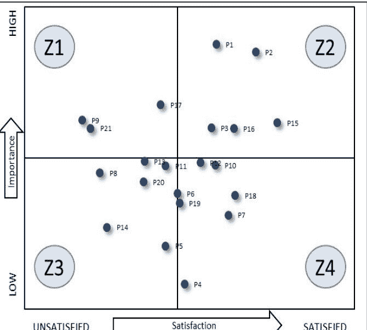

(来源：Otto, Szymanski & Varadarajan, 2020).

### 图 1. 满意度调查图。

- Z4: 该部分确定了客户认为方面和产品重要性非常低但对此感到满意的领域（Kurdi, Alshurideh & Alnaser, 2020；Reepu 2023）。

### 大数据分析：案例研究 1

谈到大数据分析，它能帮助公司了解客户的行为和需求。它逐步帮助公司对服务进行适当调整，以进一步推广其品牌。分析工具至关重要，因为它们帮助企业收集有关其实时受众的信息。当前选择在线方式的用户数量正在激增，并显著增加。大数据分析帮助公司更多地了解其受众，并相应地确保市场细分的机会。它在细分中发挥着重要作用，因为通过收集的数据，可以发现受众的需求，因此公司可能会对特定优惠进行必要的调整，并确保其最适合公司选择的特定受众细分。大数据分析可用于跟踪在线流量，从而获得足够的覆盖面来触达受众细分群体。收集的数据还可用作洞察，从长远来看将有助于公司。数据分析非常有用，因为它帮助企业充分衡量其业务和营销计划的有效性。

细分工具和 Web 分析工具在分析收集的大数据方面发挥着重要作用。谈到星巴克，他们使用其在线网站作为分析工具。他们保留客户的每一条数据，从他们经常点的内容到他们未来可能喜欢的内容。收集并存储为洞察的数据量相当大，因此需要进行完美分析。这进一步帮助星巴克构建用于制定假设的工具，并识别其细分受众可能喜欢的模式，从而从大数据中提取最有价值的洞察。它最终帮助星巴克了解其受众的人口统计特征，从而为他们提供基于数据洞察对客户群进行细分的机会。大数据分析还帮助星巴克识别需要关注的指标以及应作为细分受众群体基础的客户属性。此外，它清晰地展示了在细分基础时应使用的理想差异化模型。它因此通过向星巴克提供可能是高转化或表现最佳受众群体的想法，帮助其实现营销优化。

谈到客户满意度，星巴克使用的大数据分析工具帮助他们建立一个活跃且忠诚的、相信其公司的客户群。星巴克在其业务中提供两种观点：定性和定量。这有助于他们安排大数据，从而完美地分析这些数据，为受众提供最好的服务。这最终创造了一个快乐且忠诚的客户群。

### 大数据分析：案例研究 2

商业组织通过使用大数据分析并评估其中存储的数据，为在业务组织内实施某些关键方法获得巨大帮助。商业组织通过评估大数据分析来识别新的增长和繁荣机会。通过评估大数据分析来把握机会，可以进行更智能、更好的商业运营（Ghani et al., 2019; Gupta et al. 2023）。组织（特别是商业组织）对大数据进行分析和评估，有助于他们从实时客户那里获得有价值的洞察和数据。通过这种评估和实施过程，该方法帮助商业组织了解客户行为的变化以及不断转变的多样化口味。大数据分析为商业组织提供了这些有价值的洞察，这些数据帮助他们改进面向客户的服务和生产效率。这最终将帮助商业组织或企业保留现有客户并进一步吸引新客户。客户细分是组织在通过评估大数据分析提取数据并相应地细分其客户基础以实现更好的有效性和效率后专门进行的。在客户细分过程之后，接下来是客户满意度，这是组织保留和吸引更多客户的最关键步骤之一。这些商业组织和企业也通过评估和从大数据分析中提取关于客户的数据来实现客户满意度。分析大数据为他们提供了关于如何改进并专注于可以让现有客户感到满意的细分市场的信息。

商业组织在分析和评估其大数据以获取结果后，会制定各种商业策略和营销策略。

客户细分和客户满意度的过程或方法具有一些工具，这些工具在评估或分析大数据分析后在任何商业组织内实施。亚马逊是一家跨国公司，是一家专注于云计算和电子商务的技术公司。作为一家技术公司，亚马逊使用其在线网站作为工具，收集和提取关于客户需求、品味、偏好和行为的各种数据（Hariri, Fredericks & Bowers, 2019）。在分析大数据以从中提取和获得有价值的洞察后，关于客户行为变化和品味的数据片段会从在线工具和网站中收集。亚马逊使用在评估商业组织大数据后收集和提取数据片段和信息碎片的技术，是在其客户浏览其引擎之后。正在使用的推荐引擎以及网站上存在的其他工具被浏览，为组织提供了足够的数据以供在其内部收集或提取。亚马逊在客户使用或浏览完其在线网站后，会访问并收集关于客户的信息，然后收集其数据并致力于其开发。除了商业组织的在线网站和在线论坛之外，亚马逊还拥有多种不同形式的业务。每一种业务都有其独特的手段和方法，通过分析这些细分市场的大数据来收集数据。亚马逊有机会了解其客户基础的各种人口统计方面。评估和分析这些方面为他们提供了洞察，通过这些洞察，他们可以采取有效措施，通过提供高效的服务和产品来留住客户。这也导致了跨国商业组织客户基础的高效客户细分，然后通过提供高效的产品和服务来提供更高的客户满意度（Mariani, & Wamba, 2020）。

客户满意度是一个应该成为商业组织非常重要方面的步骤，对亚马逊也是如此。作为一家跨国科技公司，亚马逊拥有成千上万的客户，分为各个细分市场和其提供的服务。亚马逊关注其客户基础，并强调满足客户的因素，以留住客户并建立品牌忠诚度和品牌形象。这种方法帮助他们吸引、获取和留住客户，进而帮助他们发展和扩大业务以及在线销售。亚马逊提供两种不同的观点和视角，这些观点和视角按定量和

定性。Amazon评估其大数据，其分析提供洞察，追踪业务组织可以增长并为其客户提供更好产品和服务的机会。倾听遍布全球的庞大客户群的需求和行为变化，有助于业务组织创建非常快乐、忠诚且满意的客户群。分析大数据分析及其评估，为业务组织向其客户群和客户提供最佳服务的地点和方式提供了完美或精确的细分。大数据技术还帮助管理存储在其中并随后由业务组织收集和评估的各种数据。Amazon对大数据分析的评估或分析，也提供了关于客户购买的宝贵洞察，并帮助他们监控浏览和活动。组织对大数据分析的分析或评估，极大地影响了客户细分和客户满意度的过程或方法（Urbinit et al., 2019）。

### 结论

客户细分和客户满意度的方面对遍布全球的不同各种商业公司和商业组织至关重要。这些是彼此相关的两个连续步骤，商业组织认为它们至关重要、主要且重要。商业组织通过评估营销策略所采取的第一步是客户细分的过程或方法。接下来或第二步是客户满意度步骤，由组织的高管和营销团队或部门进行评估和评价。这些方面或因素基于对组织产品和组织服务的各种反馈和评论。这些方法和方面的决定因素和主要指标全部包含在本文中并进行评估，展示了评估后的各种结果和成果。本文还展示和描绘了一个经过计算和评估的图表，以对这些对商业组织而言优先的因素进行评估。归根结底，所有这些因素为商业公司和商业组织提供了改进和构建其发展成长以走向成功的空间。

### 参考文献

- Alkhayrat, M., Aljnidi, M., & Aljoumaa, K. (2020). 基于深度学习和PCA的电信客户细分比较降维研究. Journal of Big Data, 7(1), 1-23.

- An, J., Kwak, H., Jung, S. G., Salminen, J., & Jansen, B. J. (2018). 使用在线平台进行客户细分：通过聚合用户数据为人物画像创建隔离行为和人口统计细分. Social Network Analysis and Mining, 8(1), 1-19.

- Bansal, N., Bhatnagar, M., & Taneja, S. (2023). 通过绿色乐观平衡优先事项：阐明可持续供应链管理举措、方法和策略的研究. In 设计可持续供应链以实现循环经济研究手册 (pp. 60-81). IGI Global, USA.

- Budur, T., & Poturak, M. (2021). 员工绩效与客户忠诚度：客户满意度的中介效应. Middle East Journal of Management, 8(5), 453-474.

- Bhatnagar, M., Taneja, S., Kumar, P., & Özen, E. (2023a). 财务教育是否充当中小企业竞争力的催化剂. International Journal of Education Economics and Development, 1(1), 1. https://doi.org/10.1504/ijeed.2023.10053629

- Bhatnagar, M., Özen, E., Taneja, S., Grima, S., & Rupeika-Apoga, R. (2022a). 印度金融科技市场风险与收益的动态关联性：基于GARCH-M方法的证据. Risks, 10(11), 209. https://doi.org/10.3390/risks10110209

- Bhatnagar, M., Taneja, S., & Özen, E. (2022b). 印度绿色初创企业浪潮——绿色金融作为可持续创业支持系统的研究. Green Finance, 4(2), 253–273. https://doi.org/10.3934/gf.2022012

- Bhatnagar, M., Taneja, S., & Rupeika-Apoga, R. (2023b). 消息（冲击）对加密货币市场波动影响的揭秘. Journal of Risk and Financial Management, 16(2), 136. https://doi.org/10.3390/jrfm16020136

- Christy, A. J., Umamakeswari, A., Priyatharsini, L., & Neyaa, A. (2021). RFM排名——客户细分的有效方法. Journal of King Saud University-Computer and Information Sciences, 33(10), 1251-1257.

- Dahiya, K., Taneja, S., & Özen, E. (2023). 分析多媒体技术对农村创业发展的影响. In 新兴技术风险当代研究，A部分 (pp. 221-240). Emerald Publishing Limited.

- Dangwal, A., Kaur, S., Taneja, S., & Taneja, S. (2022). 基于Scopus平台的绿色旅游计量分析. In J. Kaur, P. Jindal, & A. Singh (Eds.), 营销5.0中的关系发展、个性化和数据先驱：第i卷 (pp. 1–327). IGI Global. https://doi.org/10.4018/9781668444962

- El-Adly, M. I. (2019). 酒店感知价值、客户满意度和客户忠诚度关系的建模. Journal of Retailing and Consumer Services, 50, 322-332.

- Ghani, N. A., Hamid, S., Hashem, I. A. T., & Ahmed, E. (2019). 社交媒体大数据分析：一项综述. Computers in Human Behavior, 101, 417-428.

- Gupta, M., Arora, R., & Taneja, S. (2023). 员工参与和人力资源管理计量分析. In 通过基于位置的营销增强客户参与 (pp. 185-205). IGI Global. USA. DOI: 10.4018/978-1-6684-8177-6.ch013

- Hariri, R. H., Fredericks, E. M., & Bowers, K. M. (2019). 大数据分析中的不确定性：调查、机遇和挑战. Journal of Big Data, 6(1), 1-16.

- Kumar, P., Verma, P., Bhatnagar, M., Taneja, S., Seychel, S., Todorović, I., & Grima, S. (2023). 印度公共部门银行的财务绩效和偿付能力状况：CAMELS评级和Z指数方法. International Journal of Sustainable Development and Planning, 18(2), 367-376. doi:10.18280/ijsdp.180204

- Kumar, P., Taneja, S., Özen, E., & Singh, S. (2023b). 保险中的人工智能和机器学习：一项计量分析. In 全球数字化经济中的智能分析、人工智能和可持续绩效管理 (pp. 191-202). Emerald Publishing Limited.

- Kurdi, B., Alshurideh, M., & Alnaser, A. (2020). 员工满意度对客户满意度的影响：理论和实证基础. Management Science Letters, 10(15), 3561-3570.

- Mariani, M. M., & Wamba, S. F. (2020). 探索消费品公司在数字时代如何创新：大数据分析公司的作用. Journal of Business Research, 121, 338-352.

- Müller, J. M., Pommeranz, B., Weisser, J., & Voigt, K. I. (2018). 工业采购中的数字、社交媒体和移动营销：是否仍需要客户细分？来自波兰和德国的实证证据. Industrial Marketing Management, 73, 70-83.

- Özen, E., & Sanjay, T. (2022a). 计算机和通信服务外贸对印度经济增长影响的实证分析. Journal of Economics and Business Issues, 2(2), 24-34. https://jebi-academic.org/index.php/jebi/article/view/41

- Otto, A. S., Szymanski, D. M., & Varadarajan, R. (2020). 客户满意度与企业绩效：来自超过四分之一世纪实证研究的洞察. Journal of the Academy of Marketing Science, 48(3), 543-564.

- Reepu, R., Taneja, S., Özen, E., & Singh, A. (2023). 营销未来的环球旅行者：元宇宙. In 文化营销与元宇宙用于消费者参与 (pp. 1-11). IGI Global. USA.

- Singh, A. (2021). 数字营销中提高准确性、效率和决策能力的大数据分析. IGI Global. https://doi.org/10.4018/978-1-7998-7231-3.

- Singh, V., Taneja, S., Singh, V., Singh, A., & Paul, H. L. (2021). 印度和澳大利亚电子商务公司的在线广告策略：一项比较研究. 在《数字营销中提高准确性、效率和决策能力的大数据分析》中，124-138. https://doi.org/10.4018/978-1-7998-7231-3.ch009

- Singh, A., Bansal, R., & Sharma, S. (2022). 大数据：成功数字营销的路线图. Berlin, Boston: De Gruyter. https://doi.org/10.1515/9783110733716.

- Taneja, S., Kaur, S., & Özen, E. (2022a). 利用绿色金融以可持续方式促进全球增长. International Journal of Green Economics, 16(3), 246-257. https://doi.org/10.1504/ijge.2022.10052887

Taneja, S., Jaggi, P., Jewandah, S., & Ozen, E. (2022b). 可持续城市发展中社会包容的作用：基于PRISMA技术的分析. 《设计与自然及生态动力国际期刊》, 17(6), 937–942. https://doi.org/10.18280/ijdne.170615

Taneja, S., & Özen, E. (2023a). 分析银行绿色融资与环境绩效之间的关系. 《电子金融国际期刊》, 12(2), 163–175. doi:10.1504/IJEF.2023.129919

Taneja, S., Bhatnagar, M., Kumar, P., & Rupeika-apoga, R. (2023b). 印度自然资源租金总额（NRR）与GDP：基于增广自回归分布滞后（ARDL）边界检验. 《风险与金融管理期刊》, 16(2), 91. https://doi.org/10.3390/rfm16020091

Taneja, S., Bhatnagar, M., Kumar, P., Grima, S. (2023c). 印度农业公司资产管理效果的小组分析. 《可持续发展与规划国际期刊》, 第18卷，第3期，第653-660页. https://doi.org/10.10820/ijdp.180301

Taneja, S., Ozen, E. (2023d). 欧洲绿色协议（EGD）对土耳其农业碳（CO2）排放的影响. 《可持续发展与规划国际期刊》, 第18卷，第3期，第715-727页. https://doi.org/10.18280/ijsdp.180307

Taneja, S., & Sharma, V. (2023e). 信标营销在改善客户购买体验中的作用. 收录于：基于位置的营销提升客户参与度 (第176-184页). IGI Global. 美国. DOI: 10.4018/978-1-6684-8177-6.ch012

Taneja, S., Gupta, M., Bhushan, P., Bhatnagar, M., & Singh, A. (2023f). 数字时代的文化营销. 收录于：消费者参与的文化营销与元宇宙 (第109-122页). IGI Global. 美国.

Urbinati, A., Bogers, M., Chiesa, V., & Frattini, F. (2019). 从大数据中创造和获取价值：提供商公司的多案例研究分析. 《技术创新》, 84, 21-36.

## 第8章

## 迈向更强大的明天的实践转变：面向社交媒体平台

Kirti Sharma¹
Tania Mittal²
Reena Rani³
and Taranjit Singh Vij⁴

¹昌迪加尔大学旅游与酒店管理学院，加鲁安，旁遮普邦，印度
²敦商学院，德拉顿，北阿坎德邦，印度
³CT工程、管理与技术学院（CTIEMT）商业管理系
⁴昌迪加尔学院集团，兰德兰，旁遮普邦，印度

### 摘要

本文旨在探究社交媒体对企业的影响。具体而言，其目的是探讨社交媒体与业务运营之间的关系，揭示不同年龄群体的情况。数据通过分层随机抽样从70名使用在线社交媒体进行商业目的的在线客户中收集。研究发现，使用社交媒体平台运营业务是有影响的，而年龄因素不影响社交媒体平台的使用。如今，不同年龄群体的人都在社交媒体上运营其业务。本研究的结果帮助企业家利用社交媒体平台更深入地了解产品营销并更好地运营业务。社交媒体沟通和品牌管理应给予最高重视。此外，社交媒体平台代表了营销人员的巨大机遇。本文为世界上最重要的虚拟市场之一中的这一关键社交媒体细分领域提供了宝贵的见解。

收录于：《区块链》
编辑：Amandeep Singh, Sandhir Sharma, Amrinder Singh 等
ISBN: 979-8-89113-219-1
© 2024 Nova Science Publishers, Inc.

关键词：社交媒体，平台，业务运营，客户

### 引言

在当今Web 3.0时代，用户通过个性化搜索检索和共享信息；结果基于浏览器所学习的用户行为。因此，Web 3.0将传统互联网升级为一个更开放、互联且智能的互联网。

Web 3.0使互联网具备人工智能，这意味着，与Web 2.0不同，互联网不再展示企业想要向客户展示的搜索结果，而是展示客户希望从企业获得的结果。最好的例子是谷歌搜索，早先，基于我们的关键词，谷歌会显示最相关的结果。然而，现在谷歌会考虑我们的过往关键词、点击过的搜索结果、偏好、兴趣领域、影响者、在线连接、我们与他人建立联系的方式等。基于汇编后的信息，谷歌显示最准确的结果。

社交媒体平台是基于网站和移动应用程序的在线工具，能够让人们快速创建和共享内容（如数据、图片、音频和视频），并与新的人实时互动。它使沟通比以往任何时候都更加便捷。

根据麦肯锡2018年的数据，印度人每周在Facebook、Instagram、Twitter等社交媒体网站上花费17小时，位居世界首位。根据Statista 2017年的一份报告，由于数字化程度不断提高、廉价安卓智能手机普及以及4G网络的覆盖，印度超过4.62亿人正在使用互联网。其中约2.5亿人是活跃的社交媒体用户。Facebook和YouTube的渗透率最高，均为30%。在所有平台中，Facebook和TikTok在印度均拥有超过2亿活跃用户。

拥有如此庞大的用户基数，社交媒体确实是个人和社区丰富的内容来源。这吸引了大量来自快速消费品、电子、手机、个人护理、手工艺品和娱乐行业等品牌涌入社交媒体，以推广其产品和服务。在本文中，我们对印度哈里德瓦尔的200名个人和企业主进行了调查，以探讨社交媒体对企业和消费者的影响。我们知道，社交媒体平台旨在与新人及熟人建立联系并分享内容；上述数据表明，目前大多数人（包括供应商/企业主）都在使用社交媒体，但问题是：企业是否真的从中获益，在众多社交媒体平台中哪些最适合开展业务，以及社交媒体用户（非供应商）对在平台上弹出的商业广告和帖子持何种态度。他们如何反应这些广告和帖子。

Web 3.0将其基于人工智能的技术和分析应用于个人和群体在社交网络（社交媒体平台）上产生的大量信息或数据。没有社交网络的参与，就无法利用Web 3.0。

### 文献综述

### 社交媒体对企业和消费者的影响

社交媒体平台已成为一个焦点，相当长一段时间以来日益受到重视。印度当前和未来的电子供应商有兴趣通过在线社交媒体平台扩展业务，因为它们能够占据大市场，并帮助覆盖不同地理因素的客户；此外，还有一系列有利于此类电子供应商增长的政策。印度一直专注于技术创业，以增强信息技术与通信（ICT）的贡献（Singh, 2021; Singh, Bansal and Sharma 2022）。

社交媒体丰富性可分为博客、内容社区（YouTube）、协作项目（维基百科）、虚拟游戏世界和社交网络网站（Facebook、Instagram）等部分（Kaplan and Haenlein, 2010）。

在如此竞争激烈的环境下，企业需要为电子商务和电子营销沟通（无论是内部还是外部）构思一些智能且聪明的解决方案；与此同时，这也带来了新的压力，以应对当代商业关系的“多层性”（Gronroos, 1994; Paswan, Blankson, and Guzman, 2011）。

它表明，社交媒体可以根据所有权划分为公共社交媒体和企业社交媒体。公共社交媒体已被分为三部分：社交网络网站、基于网络的

社区，以及虚拟世界，而企业社交媒体也已被分为三部分，即企业自有社交、企业社交书签系统和企业维基（Wang et al., 2017）。

随着互联网的出现，消费者通过在线社交媒体平台购买产品的兴趣日益增加。它还有助于连接国内以及国际业务。它有助于营销传播，因为社交媒体平台缩小了国内与国际业务沟通之间的差距（Costa e Silva and Elo, 2018）。

市场研究报告表明，公司使用社交媒体平台来建立良好的客户关系。对于任何公司来说，建立品牌形象非常重要，而社交媒体平台是业务推广组合的重要组成部分。

随着社交网络站点充当定位客户并将市场转变为基于用户内容的技术平台的平台，人们彼此之间以及与企业之间的沟通方式发生了转变（Lorenzo-Romero et al., 2014）。为了推广品牌和分享有关品牌内容的信息，使用了社交媒体渠道，结果表明，纳入企业品牌名称、功能和情感诉求以及信息搜索提示，增加了品牌内容的受欢迎程度（Swani et al., 2017）。

已确定公司或品牌使用社交媒体平台有三个因素，即：通过聊天或讨论板与其他策划者轻松快速地共享信息，与其他会议策划者沟通查询以及问题解决方案和意见，并在会议后从人们那里获得反馈（Lee, Tyrrell and Erdem, 2018）。

还指出，公司规模与其使用社交媒体作为平台的频率之间没有直接关系，但与此同时，使用社交媒体作为平台的原因各不相同，因为中小型企业主要将其用于客户服务，而大型公司则将其用于品牌建设（Olivas-Lujan et al., 2013）。

企业通过使用社交媒体平台来提升其业务曝光度和品牌知名度，并创建一个庞大的客户池，为组织员工提供适当的访问权限（He et al., 2017; Wizig et al., 2012）。

信息沟通是让客户满意的重要方面。它还通过强调消费者对持续信息可用性和及时性的期望，将这一点作为确保客户满意度的重要方面，给予了重视。

此外，还有一项研究发现，消费者在使用社交媒体平台进行在线购物时面临一些信任问题。

结果表明，缺乏可见的利益、缺乏知识，以及对将社交媒体作为发展业务平台的消极情绪/看法（Olivas-Lujan et al., 2013）。

像Instagram这样的社交网络平台是更有效的营销平台，因为它有助于影响购买行为，因为更注重视觉的社交网站有利于快速的情感反应（Leng et al., 2013; Jensen et al., 2015）。

在文献综述之后，研究者提出了以下假设

- *H01: 社交媒体对业务运营没有显著影响。*
- *H02: 年龄对使用社交媒体进行业务没有显著影响。*

### 研究方法

为了检验所提议的假设，开发了一份调查问卷。数据通过分层随机抽样从70名用于商业目的的在线社交媒体的在线客户中收集，分层是根据受访者的年龄组形成的。总共直接向消费者分发了100份问卷。从哈里德瓦尔使用在线社交媒体进行商业目的的消费者中收集了总共70份可用的调查问卷。那些不将在线社交媒体平台用于商业目的的消费者被排除在研究之外。为了减少回应偏差，要求用户在调查中不透露自己的姓名。

基于这些调查，提出了以下研究问题以展示社交媒体对企业的影响。

- *研究问题 1: 社交媒体的存在是否会影响企业？如果是，对总销售额贡献多大？*
- *研究问题 2: 企业从社交媒体平台获得哪些好处？*
- *研究问题 3: 哪种社交媒体最适合开展业务？*

### 调查结果与解读

### 受访者人口统计学概况（参见表 1）

表 1. 受访者人口统计学概况

| 人口统计学概况 | 频数 |
|---|---|
| 性别 | |
| 男性 | 42 |
| 女性 | 28 |
| 年龄组 | |
| 18-25 | 49 |
| 26-35 | 13 |
| 36-45 | 5 |
| 45岁以上 | 3 |
| 受访者总数 | 70 |

### 使用社交媒体的平台

### 解读

表 2 显示，大多数人偏好使用 Facebook 和 WhatsApp 进行商业活动。其他社交媒体平台（如 YouTube、Twitter 和 Snapchat）的偏好度最低。

表 2. 使用社交媒体的平台

| 社交媒体频数 | | 回应 | | 案例百分比 |
|---|---|---|---|---|
| | | N | 百分比 | |
| 社交媒体平台a | 您使用或不使用的 Facebook 平台 | 41 | 34.2% | 58.6% |
| | 您使用或不使用的 Instagram 平台 | 25 | 20.8% | 35.7% |
| | 您使用或不使用的 WhatsApp 平台 | 40 | 33.3% | 57.1% |
| | 您使用的任何其他社交媒体平台 | 14 | 11.7% | 20.0% |
| 总计 | | 120 | 100.0% | 171.4% |

a. 二元分组在值 1 时进行表格汇总。

### 使用社交媒体的基本目的

### 解读

表 3 中的上述分析表明，大多数人偏好使用社交媒体进行新闻更新/信息、聊天和内容共享。

表 3. 使用社交媒体的目的

| 目的 | N | 百分比 | 案例百分比 |
|---|---|---|---|
| 您使用社交媒体账户进行新闻更新/信息 | 37 | 28.5% | 52.9% |
| 您使用社交媒体账户进行聊天 | 33 | 25.4% | 47.1% |
| 您使用社交媒体账户共享内容 | 26 | 20.0% | 37.1% |
| 您使用社交媒体账户与人们联系 | 14 | 10.8% | 20.0% |
| 您使用社交媒体账户用于商业目的 | 18 | 13.8% | 25.7% |
| 您使用社交媒体账户用于任何其他目的 | 2 | 1.5% | 2.9% |
| 总计 | 130 | 100.0% | 185.7% |

a. 二元分组在值 1 时进行表格汇总。

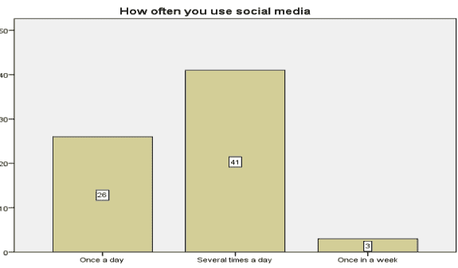

图 1. 社交媒体使用情况。

### 社交媒体的使用情况

### 解读

图 1 中的上述分析表明，大多数人每天多次使用社交媒体。很少有人每周使用一次社交媒体；否则，大多数人每天多次使用社交媒体。

### 社交媒体上的业务

### 解读

表 4 显示，在70名受访者中，有63名受访者是在社交媒体上运营业务的人。

表 4. 在任何社交媒体上运营任何业务

| 在任何社交媒体上运营任何业务 | 频数 | 百分比 | 有效百分比 | 累计百分比 |
|---|---|---|---|---|
| 有效 | 是 | 63 | 90.0 | 90.0 |
| | 否 | 7 | 10.0 | 10.0 |
| | 总计 | 70 | 100.0 | 100.0 |

### 不同行业的业务运营

表 5. 不同行业的业务运营

| 您在哪个行业运营业务 | 频数 | 百分比 | 有效百分比 | 累计百分比 |
|---|---|---|---|---|
| 有效 | 制造业 | 19 | 27.1 | 27.1 |
| | 教育 | 25 | 35.7 | 35.7 |
| | 销售商品 | 20 | 28.6 | 28.6 |
| | 其他 | 6 | 8.6 | 8.6 |
| | 总计 | 70 | 100.0 | 100.0 |

### 解读

表 5 的分析表明，在70名受访者中，25人在教育领域运营业务，20人在销售商品领域运营，19人在制造业领域工作，而只有6名受访者是

那些在网络安全、自创文章商业及技术等其他领域工作的人。

### 社交媒体平台带来的业务效益

### 解读

表 6 显示，在 70 名受访者中，31 人认为借助社交媒体可以与客户建立或培养良好的关系，29 人认为它有助于吸引新客户；而 25 人认为社交媒体平台有助于营销业务，仅 6 人表示还有其他益处。

### 表 6. 社交媒体平台带来的业务效益

| | | 响应 | | 病例百分比 |
|---|---|---|---|---|
| | | N | 百分比 | |
| 社交媒体带来的益处 | 有助于营销业务 | 25 | 27.5% | 35.7% |
| | 有助于与客户建立良好关系 | 31 | 34.1% | 44.3% |
| | 有助于吸引新客户 | 29 | 31.9% | 41.4% |
| | 其他益处 | 6 | 6.6% | 8.6% |
| 总计 | | 91 | 100.0% | 130.0% |

a. 二分法组在值 1 处汇总。

### 社交媒体平台带来的益处

### 解读

图 2 显示，在 70 名受访者中，34 人通过使用社交媒体平台获得 30%-50% 的益处，18 人获得 10%-30% 的益处；仅 10 人获得 50%-70% 的益处，仅 8 人通过使用社交媒体平台获得不到 10% 的益处。

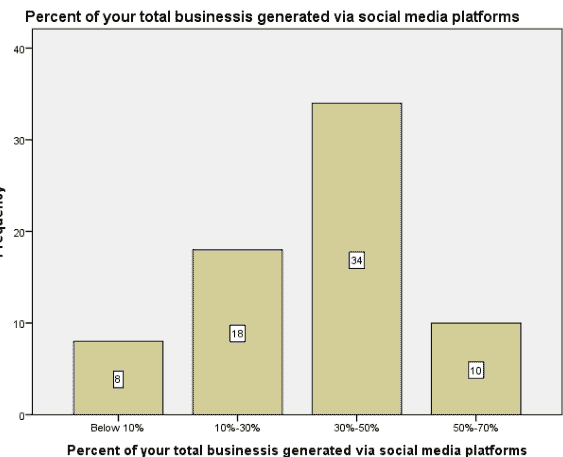

### 图 2. 社交媒体平台带来的益处。

### 社交媒体平台有利于商业

### 表 7. 社交媒体平台有利于商业

| | 频数 | 百分比 | 有效百分比 | 累计百分比 |
|---|---|---|---|---|
| 有效：是 | 43 | 61.4 | 61.4 | 61.4 |
| 否 | 5 | 7.1 | 7.1 | 68.6 |
| 有时 | 22 | 31.4 | 31.4 | 100.0 |
| 总计 | 70 | 100.0 | 100.0 | |

### 解读

表 7 显示，在 70 名受访者中，43 人认为社交媒体平台有利于商业用途，而 22 人认为它有时有利但并非始终如此，5 人认为社交媒体平台不利于商业用途。

### 年龄对使用 Facebook 作为社交媒体平台的影响

### 表 8. 年龄对使用 Facebook 作为社交媒体平台的影响

| | 平方和 | 自由度 | 均方 | F | 显著性 |
|---|---|---|---|---|---|
| 组间 | .138 | 1 | .138 | .370 | .545 |
| 组内 | 25.305 | 68 | .372 | | |
| 总计 | 25.443 | 69 | | | |

### 解读

ANOVA f 比值和显著性值表明，年龄对使用 Facebook 作为社交媒体平台没有显著影响，f(1,68) = .370，p > .05（表 8）。

### 年龄对使用 Instagram 作为社交媒体平台的影响

### 表 9. 年龄对使用 Instagram 作为社交媒体平台的影响

| | 平方和 | 自由度 | 均方 | F | 显著性 |
|---|---|---|---|---|---|
| 组间 | .305 | 1 | .305 | .825 | .367 |
| 组内 | 25.138 | 68 | .370 | | |
| 总计 | 25.443 | 69 | | | |

### 解读

ANOVA f 比值和显著性值表明，年龄对使用 Instagram 作为社交媒体平台没有显著影响，f(1,68) = .825，p > .05（表 9）。

### 年龄对使用 WhatsApp 作为社交媒体平台的影响

### 解读

ANOVA f 比值和显著性值表明，年龄对使用 WhatsApp 没有显著影响，f(1,68) = .115，p > .05（表 10）。

### 表 10. 年龄对使用 WhatsApp 作为社交媒体平台的影响

| | 平方和 | 自由度 | 均方 | F | 显著性 |
|---|---|---|---|---|---|
| 组间 | .043 | 1 | .043 | .115 | .736 |
| 组内 | 25.400 | 68 | .374 | | |
| 总计 | 25.443 | 69 | | | |

### 年龄对使用其他社交媒体平台进行商业运营的影响

### 表 11. 年龄对使用其他社交媒体平台进行商业运营的影响

| | 平方和 | 自由度 | 均方 | F | 显著性 |
|---|---|---|---|---|---|
| 组间 | .514 | 1 | .514 | 1.403 | .240 |
| 组内 | 24.929 | 68 | .367 | | |
| 总计 | 25.443 | 69 | | | |

### 解读

ANOVA f 比值和显著性值表明，年龄对使用其他（Tik-Tok、Snapchat、YouTube、Meesho、Unacademy）社交媒体平台没有显著影响，f(1,68) = 1.403，p > .05（表 11）。

### 结论

社交媒体平台作为推广业务的载体，在食品、福利和生活方式等各个商业领域都很有用。为了创造品牌价值，企业家使用社交媒体平台与客户保持联系，并通过快闪广告提醒客户。

社交媒体平台已成功帮助企业家接触大量客户。它使企业家能够分享客户想了解的产品或服务内容，并传达他们希望潜在客户知道的信息。

由于结构良好的内容充当商业推广信息并建立品牌形象，因此社交媒体充当传递该信息的桥梁。

那些持续通过优质内容和信息在线推广其产品和服务的企业，在客户眼中形象更好，这有助于提高产品的可见性和可行性。

在 Web 3.0 时代，在线形象对当今企业至关重要。社交媒体改进了传递结构，小型领导者正在利用此类媒体改进其商业推广技术，并在竞争时代中生存下来。

研究人员还指出，社交媒体平台是开展业务的良好媒介。人们可以通过多种平台成功开展业务运营，例如 Unacademy、YouTube 频道、Meesho 应用、Facebook、WhatsApp 等。通过这些平台，他们可以开展不同类型的业务，例如提供教育、商业用途和技术领域。

因此，我们拒绝 H01，因为社交媒体对商业运营有显著影响；而 H02 被接受，因为年龄对使用社交媒体平台开展商业活动没有显著影响，不同年龄段的人使用社交媒体开展业务，且大多数人通过社交媒体平台获得 30%-50% 的利润。

## 参考文献

Aghniotri, R., Dingus, R., Hu, M. Y. and Krush, M. T. (2016). 社交媒体：影响 B2B 销售中的客户满意度. 工业市场营销管理, 53, 172-180.

Costa e Silva, S. and Elo, M. (2018). 商业关系的新数字层–来自 B2B 社交媒体的经验. 《信息与数字时代的国际商业》(217-241). Emerald Publishing Limited.

Fernando J. Garrigos-Simon, Rafael Lapiedra Alcami, Teresa Barberá Ribera. (2012). “社交网络与 Web 3.0：其对组织管理和营销的影响”. 管理决策, 50 (10), 1880–1890.

Gavino, M. C., Williams, D. E., Jacobson, D. and Smith, I. (2019). 拉丁裔企业家与社交媒体采用：个人和商业社交网络平台. 管理研究评论, 42(4), 469-494.

He, W., Wang, F. K., Chen, Y. and Zha, S. (2017). “小企业社交媒体采用的探索性调查”. 信息技术与管理, 18(2), 149-160.

Kaplan, A. M. and Haenlein, M. (2010). 全世界用户，团结起来！社交媒体的挑战与机遇. 商业视野, 53(1), 59-68.

Lee, W., Tyrrell, T. and Erdem, M. (2013). 探索技术采用的行为方面：会议策划师对社交网络媒体的使用以及感知临界质量的影响. 款待与旅游技术杂志, 4(1), 6-22.

Leng, N., Dawson, J. A., Thomson, J. A., Ruotti, V., Rissman, A. I., Smits, B. M., Haag, J. D., Gould, M. N., Stewart, R. M. and Kendziorski, C. (2013). EBSeq：RNA-seq 实验推断的经验贝叶斯层次模型. 生物信息学, 29(8), 1035-1043.

Lorenzo-Romero, C., Constantinides, E. and Alarcón-del-Amo, M. D. C. (2014). 社交媒体作为营销策略：零售商采用和使用的探索性研究* 本研究在框架项目编号 ECO2009-08708（西班牙科学与创新部，西班牙政府，2009–2013）内开展. 《战略管理中的社交媒体》, 197-215. Emerald Group Publishing Limited.

Paswan, A. K., Blankson, C. and Guzman, F. (2011). 营销渠道和营销策略中的关系主义. 欧洲营销杂志, 45(3), 311-333.

Shin, D. H. and Kim, W. Y. (2008). 将技术接受模型和流理论应用于 Cyworld 用户行为：Web2.0 用户接受的启示. 网络心理学与行为, 11(3), 378-382.

Singh, A. (2021). 大数据分析：提升数字营销中的准确性、效率和决策能力. IGI Global. [大数据分析：提升数字营销中的准确性、效率和决策能力](https://doi.org/10.4018/978-1-7998-7231-3).

Singh, A., Bansal, R. & Sharma, S. (2022). 大数据：成功数字营销的路线图. 柏林，波士顿：De Gruyter. [大数据：成功数字营销的路线图](https://doi.org/10.1515/9783110733716).

Storbacka, K., Strandvik, T. and Grönroos, C. (1994). 为了盈利而管理客户关系：关系质量的动态. 国际服务业管理杂志, 5(5), 21-38.

Swani, K., Milne, G. R., Brown, B. P., Assaf, A. G. and Donthu, N. (2017). 发布什么消息？评估商业与消费者市场中社交媒体传播的受欢迎程度. 工业市场营销管理, 62, 77-87.

Vinerean, S., Cetina, I., Dumitrescu, L. and Tichindelean, M. (2013). 社交媒体营销对在线消费者行为的影响. 国际商业与管理杂志, 8(14), 66.

Wang, Y., Rod, M., Ji, S. and Deng, Q. (2017). B2B 营销中的社交媒体能力：迈向定义与研究模型. 商业与工业营销杂志, 32(8), 1125-1135.

## 第9章

## 区块链与企业数字化转型：文献综述与未来研究

Jaskiran Kaur*

Lovely Professional University, Phagwara, Punjab, India

### 摘要

数字经济在 Dazhiyiyun（大数据、人工智能、移动互联网和云计算）时代迅速增长，基于技术优势，企业的数字化转型已成为该领域的热门议题。本研究从企业数字化转型文献中梳理了区块链技术在组织数字化转型中的意义、机制、应用场景、局限性及对策。大多数文献表明，区块链技术有助于企业数字化转型，但缺乏证据和实际研究来支持这一观点。同时也发现，缺乏系统的理论框架和经验总结，未考虑组织数字化转型的动态，且企业数字化转型后的演变研究不足。

**关键词：** 区块链; 数字化转型; 数字经济

* Corresponding Author's Email: er.kaur.jaskiran@gmail.com.

In: Blockchain
Editors: Amandeep Singh, Sandhir Sharma, Amrinder Singh et al.
ISBN: 979-8-89113-219-1
© 2024 Nova Science Publishers, Inc.

### 引言

大数据、人工智能、云计算、区块链等技术正在快速发展，这体现在印度数字经济的快速步伐、广泛覆盖和深远影响。根据2021年《中国数字经济发展白皮书》，2020年中国数字经济整体规模为39.2万亿元人民币，占GDP的38.6%，并在国家经济中占据越来越大的份额。《数字经济发展第十四个五年规划》也提出了实施全面“上云用数赋智”服务（即上云、用数、赋智）、加快企业数字化转型升级，以及使区块链等技术在银行、证券、保险等领域更合理地应用的建议。自2017年以来，邮政储蓄银行、招商银行、蚂蚁金服、腾讯等企业也已在资产托管、跨境人民币清算、信用证结算、中小企业融资等领域应用区块链技术。因此，通过技术使企业实现数字化转型已成为该领域的普遍趋势和热门话题。区块链技术如何帮助企业实现数字化？转型过程中的局限性是什么？数字化转型是否有可行的替代方案？这些都是需要解决的关键问题。本文对区块链技术在企业数字化转型中的重要性、机制和应用场景进行了总结。同时探讨了区块链技术与数字化转型之间的联系，为企业以信息化方式转型提供了未来研究方向。现有文献已被整理，以提供关于区块链技术在数字化转型中的约束和提升方案的见解。

### 文献综述

为解决用户信息获取不均的问题，采用信息技术（IT）。随着兴趣量的增加和访问限制的减少，每个人都可能从更窄的数字鸿沟中获益。它侧向于发布大量信息，并改变了信息在互联网上的传输方式。数字技术有潜力减少互联网上仍然存在且信息技术无法解决的社会信用问题。此外，它对区块链技术的引入和发展至关重要。各种技术自然融合形成了区块链技术。通过整合分布式存储、共享协议、共识算法、加密算法等技术，创建了一种高度安全、可追溯、防篡改且去中心化的数据存储方式。（Zhang et al., 2020）。此外，它以最低风险和零信任成本创造了新的信用、交易和规则系统（Zhao, 2020）。数字化转型是指利用数字技术改变企业，特别是改变其组织结构、管理模式和生产标准等。它帮助企业重塑原有的商业理念。

### 区块链技术在企业数字化转型中的重要性

许多学者关注区块链的技术优势及其在企业数字化转型中的有益实际应用。Huang (2019) 声称，区块链的非对称加密技术可以保障企业数据的安全性和可靠性，帮助企业数据资产化，加速数据流动和变现，使企业能够保留和追溯数据来源，并实现其可管性和可控性。根据 Lu et al. (2021)，去中心化、去中介化、集体维护和可靠数据库是区块链技术的四大优势，可用于创建金融黑名单和白名单，以提升现有金融信用参考系统的有效性。根据 Yang (2019)，实施“区块链+大数据”金融模式有助于降低融资风险、增加提供资金的意愿，并改善资源配置效率。Tan and Wu (2018) 指出，专用链账本、共享链账本、证书管理和SaaS层服务等链上数字价值转移技术，有可能简化现有流程、降低业务风险并提高数据准确性。根据 Chen et al. (2019)，政府和企业在数字化方面的投资可以使区块链应用更容易改善企业内部资本市场的有效性。金融机构利用区块链技术，提高了中小企业（SMEs）伪造信用信息和价差所需付出的成本。Silva and Santos (2022) 断言，区块链技术可以提高供应链的效率和透明度，其去中心化结构为供应链各环节提供了不可变性，密码学也保障了安全性。CAICT (2021) 表示，以粤港澳大湾区为例，创建跨境贸易金融区块链平台可以解决跨境贸易背景真实性的问题，提高商业银行跨境贸易结算的服务有效性，并增加商业银行跨境贸易金融业务的安全性。根据 Fang and Hu (2017)，区块链通过使产业链各方清晰了解货物、资金和信息的流动，提高了银行和贸易融资业务的交易效率，使整个贸易融资渠道更加顺畅。根据 PWC 的最近分析，区块链可能帮助保险业节省50亿至100亿美元的成本，即其总成本的15%至20%（Zhao, 2020）。根据 Gartner Group 的预测，区块链的市场价值将在2025年达到约1760亿美元，2030年达到3.1万亿美元。此外，西班牙银行认为，区块链技术可帮助其在2022年节省200亿美元的会计费用。所有这些统计数据都表明区块链对企业数字化的重要性。

### 区块链技术在企业数字化转型中的应用机制

根据 Zhang et al. (2020)，使用分布式数据账本、去中心化网络、共识机制、加密哈希算法和数字证据存储等技术可以帮助企业实现数字化转型，他们以碧桂园控股为例。通过打破数据孤岛并加速数据流动，这些技术可以有助于防止企业信息操纵和恶意欺诈等道德风险，如 Gong, Ban, and Zhang (2021) 所指出。Liao (2021) 提出了一种逻辑相关性模型，强调区块链技术可以通过推动数字化产业化、产业数字化、数字化治理和数字化环境的发展来促进数字经济的发展。Huang (2019) 建议，区块链技术的防篡改性和实时交易

能力可能有助于点对点借贷。Chen et al. (2019) 通过将联盟链技术与超级账本 Fabric 融合，并以保理行业为例，探索了 Fabric 技术在特定业务领域中的应用。他们还引入了一种新颖的区块链信息共享方案，该方案采用了同态加密来解决安全问题。Chen et al. (2021) 指出，跨境区块链服务平台可以通过为供应链中所有用户提供同等的信息访问权限来提高支付效率，这消除了银行依赖中介公司获取实际信息的需求，并节省了时间、金钱和人力资源。这些平台与银行及其他金融机构共享数据，包括企业贷款信息、资金流向信息、信用信息和物流信息，这些数据来自各种政府部门，如国家外汇管理局、税务机关和物流办公室。

### 区块链在企业数字化转型中的应用场景

除了在智慧医疗、智慧交通、智慧城市和供应链管理等领域中安全存储、访问控制和审计方面的应用之外，Yang et al. (2020) 分析了区块链技术在数据共享场景中的典型应用框架。Yang (2019) 通过建立技术检测模型并将区块链技术应用于海洋行业的数字化图景，得出结论：区块链技术的应用及其进一步发展对航运相关领域可能产生显著影响。Pal (2021) 强调有必要进一步研究数据安全问题，尤其是制造业的数据安全，并指出区块链技术可以通过与物联网技术的适当融合，使制造领域的事务数据处理更加智能和灵活。根据 Lu et al. (2021)，“区块链+农业物联网”模型、“区块链+农业供应链”模型、“区块链+农业数据共享模型”等，都是区块链技术在农业数据管理中的应用示例。Zhang (2020) 探讨了区块链技术如何用于几个商业和贸易相关问题，包括信用证、跨境支付、供应链融资、数字物流、商品可追溯性以及数字海关和管理。

通过构建不对称联盟链系统，Fu et al. (2021) 促进了跨境交易的有效和及时执行。他们创建了一种新的智能合约以减少每个节点的机会损失，并改进了利润分配方法。随后，他们在深圳和香港的实际跨境交易场景中使用了该系统以验证其有效性和可行性。根据 Zhang et al. (2019)，碧桂园控股和蚂蚁金服应合作开发基于区块链的电子发票平台、农产品追踪平台以及权益与信用权利交换平台等应用场景。根据 Nie et al. (2017)，可以通过将区块链技术推进到基于大数据的“去中心化+中心化”双通道征信技术来解决互联网金融风险控制问题。根据 Guo (2019)，中国保险业已进入由大数据和区块链等数字技术主导的时代。保险公司的数字化转型有潜力改善与关联企业的协同效应，推动保险产品创新，优化客户体验场景，并改变保险组织的运营方式。摩根大通、汇丰银行和美国银行等大型银行已成功使用区块链技术，并且现在正在寻求技术创新。该技术展示了极高的有效性、经济性和直接性，并还探讨了银行使用区块链技术提高交易安全性和银行安全性的方法。列举了区块链技术在商业银行、供应链金融、跨境支付、风险管理和资本市场中的应用。Chen et al. (2021) 开发了电子商务支付平台安全算法，改进了标准支付流程，并利用区块链金融优化了安全支付方式（Singh, 2021; Singh, Bansal, and Sharma 2022）。

### 区块链在企业数字化转型中应用的制约因素

CAICT (2021) 指出，跨境贸易金融业务本身的复杂性（包括智能合约的可强制执行性、技术的标准化和安全性等）源于对区块链技术监管法规的出台滞后以及缺乏统一的区块链应用技术标准。需要建立区块链监管框架并标准化技术要求。区块链技术在降低交易成本、降低交易对手风险以及去中心化合同执行等方面具有优势。但也存在安全性、技术危险以及来自政府法规的风险等问题。根据 Zhang et al. (2020)，区块链技术存在某些缺陷，包括防篡改性、较差的容错率、低共识效率和小数据容量，这些缺陷限制了企业数字化转型的效果。根据 Gong et al. (2021)，区块链技术仍处于发展阶段，可用的实证研究和数据有限。需要更多研究来评估其对市场营销和企业管理的影响，并解决可扩展性、隐私和安全问题、软件缺陷、网络攻击、高昂的投资成本以及缺乏法律法规等挑战。考虑到其相对年轻和不成熟，许多专家强调建立区块链技术国际技术标准的重要性。

### 对策

为了提高中小企业在物流、资金流和信息流方面的数据透明度，Lu et al. (2021) 建议将区块链分布式账本应用于公司生产和运营的所有节点，并采用“区块链+征信”技术。根据 Yang et al. (2020)，构建知识产权数据平台、交易平台和估值平台都是提升中小企业价值的有效方式。这些步骤包括利用“区块链+大数据”模型确定企业的发展阶段、评估其融资和金融稳定性需求，以及确定中小企业的发展阶段。Tang (2018) 以德国中小企业的数字化转型为例，建议该国应制定统一的数字化转型框架，建立互联网监管机制，加强数据处理中的信任和安全性，高度重视并增加研发投入，并提供职业培训机会。Zhang (2021) 断言，中小企业需要加强自身能力，培养数字管理、技术和业务人才，并利用标杆企业引导其将关键行业业务作为数字化转型的突破口。他们还应发展开放共享的工业互联网平台。

### 结论

本文简要回顾了区块链技术在组织数字化转型中的关联性、方法、应用场景、挑战及缓解策略。（1）区块链技术对企业的数字化转型产生积极影响，特别是通过分布式数据账本、非对称加密、去中心化和共识机制等方式。（2）现有文献关于区块链技术与企业信息化关系的研究提供了更多参考，但大部分文章仍停留在理论解释阶段，其关系的重要性尚未通过实证研究得到验证；并且（3）在对策方面，往往很少讨论机制背后的技术细节和原理。此外，相关风险和制约因素常常被忽视。

根据最近的研究，以下事项需要更多关注：

- 1) 在“大智至云”时代，企业数字化转型过程中公民信息的安全性需要被赋予最高优先级。企业使用数据不仅提高了营销精度，也暴露了客户隐私。区块链在提升数据安全性和标准化技术方面能否得到加强？应如何建立区块链技术的法律框架和特定技术要求？需要对这些问题进行进一步研究。

- 2) 需要更多研究来证实区块链在企业数字化转型期间对企业的影响。重要的是要认识到，这种转型是一个持续的过程，值得探究区块链在数字革命各个阶段是否发挥一致的作用。实证数据有助于阐明这些问题并指导未来研究。

- 3) 虽然区块链技术提供了多种当前的应用场景，但它缺乏系统的理论基础和实际实施，因此作为其他企业的基准价值有限。未来研究应集中于提供一个

数字化转型流程及其系统架构概述。此外，一旦区块链帮助企业完成数字化转型，它将对企业管理运营、营销和可持续增长的能力产生什么影响，以及是否会增加企业经营成本？此外，这是未来研究的关键领域。

### 参考文献

- CAICT, (2021). 《2021年中国数字经济发展白皮书》，访问自 http://www.199it.com/archives/1237607.html。
- Chen, W., McKenna, A., Schreiber, J., Haeussler, M., Yin, Y., Agarwal, V., Noble, W. S., & Shendure, J. (2019). 基于CRISPR/Cas9介导的双链断裂修复结果的大规模并行分析与预测建模。《核酸研究》, 47(15), 7989-8003. https://doi.org/10.1093/nar/gkz487。
- Da Silva, J. O. D., & dos Santos, D. R. (2022). 区块链在物流行业的应用研究。《理论经济学通报》, 12, 321-342. https://doi.org/10.4236/tel.2022.122017。
- Fang, H., & Hu, W. (2017). 低维光电探测器中的光栅效应。《先进科学》, 4(12), 1700323. https://doi.org/10.1002/advs.201700323。
- Gong, Q., Ban, M. and Zhang, Y. (2021). 区块链、企业数字化与供应链金融创新。《管理世界》, 7(2), 22-34。
- Guo, J. (2019). 保险公司数字化对行业转型发展价值的简要分析。《中国CIO新闻》, 10, 119。
- Huang, R. (2019). 以区块链为代表的新技术赋能企业数字化转型。《湛江科技学报》, 2, 46-50。
- Liao, R. (2021). 区块链对数字经济高质量发展的推动作用。《合作经济与科学》, 15, 19-21。
- Lu, L. N., Shang, S. J., Yu, X., Yin, L. H., & Yin, J. F. (2021). 区块链+农业科学数据管理的研究进展与前景。《出版者之声》, 7, 163-171. https://doi.org/10.4236/vp.2021.74013。
- Nie, E., Chen, S. and Miao, X. (2017). 基于“区块链+”的互联网金融大数据双通道征信技术研究。《征信参考》, 35(6), 39-41。
- Pal, K. (2021). 制造业数据处理架构中的区块链技术与物联网。载于 A. Ben Mnaouer & L. Fourati (Ed.), 《安全网络与通信区块链技术赋能》(第229-247页). IGI Global. https://doi.org/10.4018/978-1-7998-5839-3.ch010。
- Singh, A. (2021). 大数据分析助力提升数字营销的准确性、效率与决策能力。IGI Global. https://doi.org/10.4018/978-1-7998-7231-3。
- Singh, A., Bansal, R. & Sharma, S. (2022). 大数据：成功数字营销的路线图。Berlin, Boston: De Gruyter. https://doi.org/10.1515/9783110733716。
- Tan, Y. and Wu, B. (2018). 利用区块链技术帮助企业进行数字化转型。《电信网络技术》, 7, 1-8。
- Wan, Y. and Chen, X. (2021). 企业区块链应用、信息化投资与内部资本市场效率。《投资研究评论》, 40(3), 79-94。
- Yang, Chung-Shan (2019). 海运数字化：基于区块链的技术应用、未来改进与使用意向。《交通运输研究》, 131, 108-117. https://doi.org/10.1016/j.tre.2019.09.020。
- Yang, W., Xuan, S. and Wei, Wang. (2020). 基于区块链技术的数据共享发展与挑战（英文版）。《广州大学学报（自然科学版）》, 19(3), 1-25。
- Zhang, L., Du, W. and Wang, Y. (2019) 区块链：推动数字创新的强大引擎。《软件与集成电路》, 12, 12-17。
- Zhang, L., Du, W., and Wang, Y. (2020). 区块链：助力企业数字创新。《软件与集成电路》, 2020(4), 54-59。
- Zhao, L. Q. (2020). 区块链技术在保险行业中的应用、关键问题及未来发展趋势分析。《美国工业与商业管理杂志》, 10, 305-314. https://doi.org/10.4236/ajibm.2020.102019。

## 关于编辑

### 阿曼迪普·辛格博士

阿曼迪普·辛格博士已获得BIT、MBA和博士学位，并通过了UGC-NET资格认证。他曾在多所知名大学和学院担任院长/校长。辛格博士目前是印度旁遮普邦奇特卡拉大学奇特卡拉商学院教授。他拥有15年以上的教学经验，并于2008年被评为“最佳教师”。他还是印度北部多所商学院和知名大学教学委员会的成员。他在Scopus、Web of Science和ICI收录的各种期刊和会议上发表了35篇研究论文。此外，他还与Wiley、Nova和IGI Global等知名出版社合作编辑了九本书籍。辛格博士担任三本国际期刊的编辑委员会成员，并主持过许多国家和国际会议。他的主要研究领域是营销，特别关注数字营销。

### 桑迪尔·夏尔马博士

桑迪尔·夏尔马博士是战略管理博士，在高等教育领域拥有近22年的经验，在电信行业有5年的经验。在全国及国际各类期刊和会议上发表40多篇研究论文，夏尔马博士在战略制定领域发展了其核心专长。他的研究已广泛发表于各类报纸。目前，他担任印度旁遮普邦奇特卡拉大学奇特卡拉商学院协理校长，同时也是印度尼西亚比纳斯大学和德国奥斯纳布吕克应用科学大学的客座教授。他在8年内将奇特卡拉商学院的运营规模从60名学生和一个课程扩展到1200多名学生和12个以上课程，功不可没。迄今为止，他在商务管理领域（涵盖商业和管理各个方向）指导了5000多名学生。他目前担任多家中小型企业组织的战略制定顾问。他是来自学术界和工业界8名博士生的主要指导教师。他在健康科学、生命科学、社会科学、技术和工业产品领域申请了14项专利。

### 阿姆林德·辛格博士

阿姆林德·辛格博士目前担任班加罗尔贾恩大学副教授。他从旁遮普大学帕蒂亚拉分校获得工商管理硕士和商学研究博士学位。拥有超过15年的教学经验，他在市场营销和研究领域是举足轻重的人物。他在各类国家和国际知名期刊上发表了约30篇研究论文，还出版了一本书。他在国内外多所大学和机构的学术和行政机构中担任成员。

### 吉提卡·马丹博士

吉提卡·马丹博士是印度莫哈里昌迪加尔大学大学研究与发展中心助理教授。

## 索引

### A

优势，5, 13, 17, 20, 49, 54, 55, 61, 66, 81, 85, 90, 92, 94, 105

广告，3, 5, 12, 13, 18, 34, 107, 130

农业，20, 29, 30, 31, 32, 35, 42, 45, 46, 53, 67, 85

分析，vii, ix, 6, 20, 46, 77, 87, 103, 105, 112, 113, 114, 115, 116, 117, 132, 141

应用，1, 2, 3, 9, 12, 14, 20, 23, 26, 27, 31, 32, 35, 37, 40, 42, 45, 46, 47, 50, 51, 52, 59, 61, 64, 66, 67, 68, 69, 70, 71, 72, 73, 74, 76, 77, 80, 85, 86, 93, 94, 95, 96, 98, 99, 100, 101, 102, 103, 120, 133, 134, 135, 137, 138, 139, 140, 141, 142

方面，10, 13, 23, 50, 51, 67, 70, 90, 96, 105, 107, 109, 110, 111, 112, 114, 115, 122, 132

### B

银行业，3, 5, 27, 31, 52, 54, 55, 56, 69, 74, 84, 89, 93, 94, 100, 134, 138

益处，vii, viii, 6, 9, 16, 17, 18, 20, 49, 50, 51, 58, 59, 63, 66, 68, 70, 72, 73, 74, 75, 79, 82, 84, 85, 86, 90, 92, 95, 98, 100, 103, 121, 123, 127, 128, 135, 137, 139

大数据，ix, 6, 7, 20, 35, 46, 47, 49, 77, 81, 87, 98, 102, 103, 105, 112, 113, 114, 115, 116, 117, 118, 132, 133, 135, 138, 139, 141, 142

比特币加密货币，2, 3, 23

区块链，vii, viii, ix, 1, 2, 3, 4, 5, 6, 9, 10, 11, 12, 13, 14, 15, 16, 17, 18, 19, 20, 21, 23, 24, 25, 26, 27, 28, 30, 31, 32, 33, 34, 35, 36, 37, 38, 39, 40, 41, 42, 43, 44, 45, 46, 47, 49, 50, 51, 52, 53, 54, 55, 56, 57, 58, 59, 60, 61, 62, 63, 64, 65, 66, 67, 68, 69, 70, 73, 74, 75, 76, 77, 79, 80, 81, 82, 83, 84, 85, 86, 87, 89, 90, 91, 92, 93, 94, 95, 96, 97, 98, 99, 100, 101, 102, 103, 133, 134, 135, 136, 137, 138, 139, 140, 141, 142

区块链技术，vii, 1, 3, 4, 5, 6, 10, 11, 12, 14, 15, 16, 17, 18, 20, 26, 28, 34, 35, 38, 46, 47, 50, 51, 53, 55, 56, 57, 58, 59, 60, 61, 62, 63, 65, 66, 67, 68, 69, 74, 76, 77, 79, 80, 81, 82, 83, 84, 86, 87, 89, 90, 91, 93, 94, 95, 96, 97, 98, 99, 101, 102, 103, 133, 134, 135, 136, 137, 138, 140, 142

业务运营，66, 119, 120, 123, 131

企业，ix, 1, 3, 5, 9, 10, 11, 13, 14, 15, 16, 17, 18, 19, 20, 23, 24, 26, 28, 30, 31, 33, 39, 43, 49, 51, 52, 53, 54, 56, 57, 59, 60, 61, 63, 64, 65, 66, 69, 70, 71, 73, 83, 86, 89, 90, 92, 94, 95, 96, 97, 98, 99, 100, 103, 106, 107, 108, 109, 110, 111, 112, 113, 114, 115, 117, 119, 120, 121, 122, 123, 124, 126, 127, 128, 130, 131, 132, 133, 134, 135, 136, 137, 138, 139, 140, 142, 143, 144

### C

协作，18, 72, 83, 85, 86, 95

约束，134, 138, 140

### G
消费者, 1, 2, 3, 5, 6, 9, 10, 11, 13, 15, 17, 18, 19, 20, 32, 33, 40, 41, 44, 51, 54, 59, 65, 95, 96, 97, 103, 116, 117, 118, 120, 121, 122, 123, 132

控制, 11, 17, 31, 34, 36, 44, 45, 50, 54, 55, 65, 67, 68, 71, 76, 84, 95, 137

对策, 133, 139

可信度, 15

加密货币, 3, 5, 11, 13, 15, 17, 18, 21, 23, 28, 46, 63, 68, 69, 82, 87, 89, 90, 96, 97, 98, 101, 102, 103

客户细分, ix, 105, 106, 107, 108, 109, 113, 114, 115, 116, 117

客户, ix, 1, 2, 4, 6, 9, 11, 12, 13, 17, 18, 19, 20, 23, 34, 35, 39, 43, 44, 53, 58, 65, 66, 67, 71, 74, 75, 89, 94, 96, 97, 100, 101, 105, 106, 107, 108, 109, 110, 111, 112, 113, 114, 115, 116, 117, 118, 119, 120, 121, 122, 123, 127, 130, 131, 132, 138, 140

网络安全, 3, 14, 59, 60, 62, 86

### D
数据完整性, 16, 19, 37, 38

数据保护, 50

去中心化, viii, viii, 17, 23, 59, 89, 140

分布式账本, 2, 10

人口统计, 15, 109, 114, 116, 124

确定, 105, 109, 115, 139

数字, vii, viii, ix, 2, 6, 7, 9, 10, 11, 12, 13, 14, 15, 16, 17, 18, 19, 20, 23, 29, 34, 40, 49, 44, 46, 47, 49, 51, 52, 53, 54, 56, 58, 59, 60, 62, 63, 64, 66, 67, 68, 69, 71, 73, 76, 77, 79, 80, 81, 82, 83, 84, 86, 87, 89, 90, 96, 97, 99, 101, 102, 103, 117, 118, 131, 132, 133, 134, 135, 136, 137, 138, 139, 140, 141, 142, 143

数字经济, 79, 80, 86, 87, 102, 133, 134, 136, 141

数字营销, vii, viii, 6, 7, 9, 11, 12, 14, 17, 18, 19, 20, 34, 46, 47, 77, 87, 96, 103, 117, 132, 141, 142, 143

数字平台, 67, 90, 96

数字化转型, 23, 47, 54, 60, 63, 79, 99, 133, 134, 135, 136, 138, 139, 140, 141, 142

### E
电子商务, 1, 2, 3, 6, 9, 10, 93, 99, 117, 138

经济, ix, 12, 53, 63, 65, 75, 79, 81, 82, 83, 84, 86, 96, 99, 102, 116, 117, 134, 138, 141

有效性, 14, 18, 55, 58, 67, 86, 112, 113, 118, 135, 139

电子邮件, 1, 5

能源, 27, 44, 51, 64, 65, 66, 67, 68, 77, 97

企业, 44, 49, 59, 63, 73, 90, 96, 107, 108, 109, 113, 133, 134, 135, 136, 137, 138, 139, 140, 141, 142

娱乐, 62, 63, 120

环境, ix, 10, 17, 19, 34, 43, 46, 50, 51, 52, 64, 65, 66, 76, 80, 89, 93, 95, 121, 136

### F
金融, 20, 26, 31, 46, 47, 54, 69, 73, 93, 98, 100, 102, 103, 116, 117, 118, 134, 135, 138, 141

金融部门, 53, 54, 55, 77, 98, 99, 102, 103

金融科技, 50, 71, 75, 82, 116

欺诈, viii, 4, 14, 16, 54, 55, 56, 57, 58, 82, 90, 92, 95, 96, 136

### H
医疗保健, 3, 35, 36, 37, 38, 39, 46, 47, 53, 56, 57, 75, 76, 85, 89, 93, 100

### I
不可篡改性, viii, 32, 50, 66, 89, 92, 100

影响, vii, viii, 2, 3, 6, 9, 10, 16, 21, 34, 66, 75, 76, 77, 82, 87, 90, 93, 94, 95, 96, 97, 98, 99, 102, 103, 116, 117, 118, 119, 120, 121, 123, 131, 132, 139

印象, 16, 18

印度经济, 79, 82, 83

行业, vii, ix, 3, 10, 13, 14, 16, 20, 36, 45, 49, 50, 51, 52, 53, 54, 55, 56, 57, 58, 60, 61, 62, 63, 64, 65, 66, 67, 68, 69, 70, 71, 72, 73, 74, 75, 76, 77, 80, 81, 82, 83, 84, 85, 86, 89, 93, 94, 97, 98, 99, 100, 101, 103, 107, 109, 110, 120, 132, 137, 139, 141, 142, 143

基础设施, 32, 47, 60, 64, 65, 82, 84

解释, 124, 125, 126, 127, 128, 129, 130

### M
市场营销, vii, viii, 1, 2, 3, 6, 9, 10, 11, 12, 13, 14, 15, 16, 17, 19, 20, 21, 65, 89, 90, 93, 94, 96, 101, 102, 103, 106, 109, 112, 113, 114, 115, 116, 117, 118, 119, 121, 122, 123, 127, 131, 132, 139, 140, 141, 143, 144

营销领域, viii, 1, 2

流动性问题, 62

### N
不可否认性, 50

### P
平台, viii, ix, 5, 6, 9, 15, 17, 20, 27, 30, 34, 36, 54, 63, 67, 73, 75, 77, 85, 87, 89, 96, 103, 116, 119, 120, 121, 122, 123, 124, 127, 128, 129, 130, 131, 136, 137, 138, 139

优先级, 17, 140

隐私, 16, 19, 21, 36, 39, 44, 45, 46, 49, 60, 63, 64, 65, 69, 71, 75, 79, 80, 97, 139, 140

产品, 3, 15, 18, 27, 29, 30, 32, 33, 34, 40, 42, 46, 50, 51, 54, 58, 67, 69, 71, 72, 73, 74, 75, 77, 84, 85, 91, 95, 105, 106, 108, 109, 111, 112, 114, 115, 119, 120, 122, 131, 138, 143

公共账本, 23, 39, 80

### R
实时, 5

监管科技, 50, 54, 71

关系, vii, viii, 9, 21, 28, 34, 46, 77, 97, 105, 116, 118, 119, 121, 122, 127, 131, 132, 140

可靠性, 10, 13, 23

### S
满意度, ix, 87, 96, 105, 107, 108, 109, 110, 111, 113, 114, 115, 116, 117, 122, 131

行业特定协议, 50

部门, 5, 14, 26, 49, 54, 61, 63, 70, 72, 75, 95, 126, 127, 131, 137

安全, 5, 6, 10, 11, 12, 13, 17, 19, 28, 31, 34, 38, 39, 43, 46, 49, 54, 55, 56, 57, 58, 59, 59, 60, 61, 62, 64, 70, 75, 79, 80, 81, 91, 92, 96, 97, 101, 102, 127, 135, 137, 138, 139, 140

服务, 1, 2, 3, 15, 17, 20, 23, 26, 30, 33, 34, 38, 40, 43, 44, 47, 51, 53, 54, 59, 60, 62, 64, 65, 67, 68, 70, 71, 73, 74, 75, 76, 81, 84, 86, 91, 99, 100, 101, 102, 105, 106, 108, 109, 111, 112, 113, 114, 115, 116, 117, 120, 122, 131, 132, 134, 135, 137

意义, 81, 98, 129, 130, 133, 135, 140

社交媒体, ix, 3, 6, 15, 35, 80, 116, 117, 119, 120, 121, 122, 123, 124, 125, 126, 127, 128, 129, 130, 131, 132

策略, ix, 12, 17, 44, 45, 73, 74, 82, 89, 90, 99, 105, 106, 111, 114, 115, 116, 117, 132, 140, 143

供应链, 3, 14, 15, 19, 30, 31, 32, 34, 39, 40, 42, 45, 46, 47, 49, 50, 51, 53, 54, 56, 57, 60, 61, 66, 67, 73, 74, 75, 76, 77, 84, 85, 86, 87, 89, 90, 93, 94, 95, 96, 102, 103, 116, 136, 137, 141

### T
技术, vii, viii, ix, 1, 2, 3, 4, 5, 6, 9, 10, 11, 12, 13, 14, 15, 16, 17, 18, 20, 21, 23, 26, 34, 35, 39, 40, 45, 46, 47, 49, 50, 51, 52, 53, 54, 55, 56, 57, 58, 59, 60, 61, 62, 63, 64, 65, 66, 67, 68, 69, 70, 71, 74, 75, 76, 77, 79, 80, 81, 83, 84, 85, 86, 87, 89, 90, 93, 94, 95, 96, 97, 98, 99, 100, 101, 102, 103, 114, 115, 116, 119, 121, 122, 132, 133, 134, 135, 136, 137, 138, 139, 140, 141, 142, 143

交易, 1, 2, 5, 9, 10, 11, 12, 13, 16, 19, 23, 26, 27, 30, 31, 32, 34, 35, 36, 37, 40, 42, 43, 44, 45, 46, 50, 51, 52, 53, 54, 55, 58, 60, 61, 66, 67, 73, 75, 76, 80, 81, 82, 83, 85, 86, 87, 90, 91, 92, 93, 94, 97, 99, 101, 135, 136, 138, 139

转型, ix, 23, 47, 101, 133, 134, 135, 136, 137, 138, 139, 140, 141

转变, vii, 9, 102, 122

透明度, viii, 6, 13, 14, 15, 19, 26, 30, 39, 49, 54, 55, 57, 58, 64, 67, 68, 79, 83, 86, 89, 90, 92, 95, 96, 97, 99, 136, 139

交通运输, 61, 62, 67, 77, 95, 137, 142

信任, 6, 15, 19, 20, 28, 35, 43, 46, 50, 52, 58, 60, 61, 67, 68, 87, 89, 91, 92, 95, 96, 103, 123, 135, 139

### V
验证, 15, 16, 26, 35, 36, 38, 44, 60, 68, 80, 90, 92, 95, 97

虚拟平台, 9, 10

### 区块链

变革营销领域的链条

- Amandeep Singh
- Amrinder Singh
- Sandhir Sharma
- Geetika Madaan

编辑

www.novapublishers.com

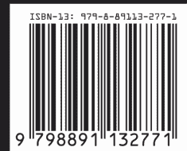
