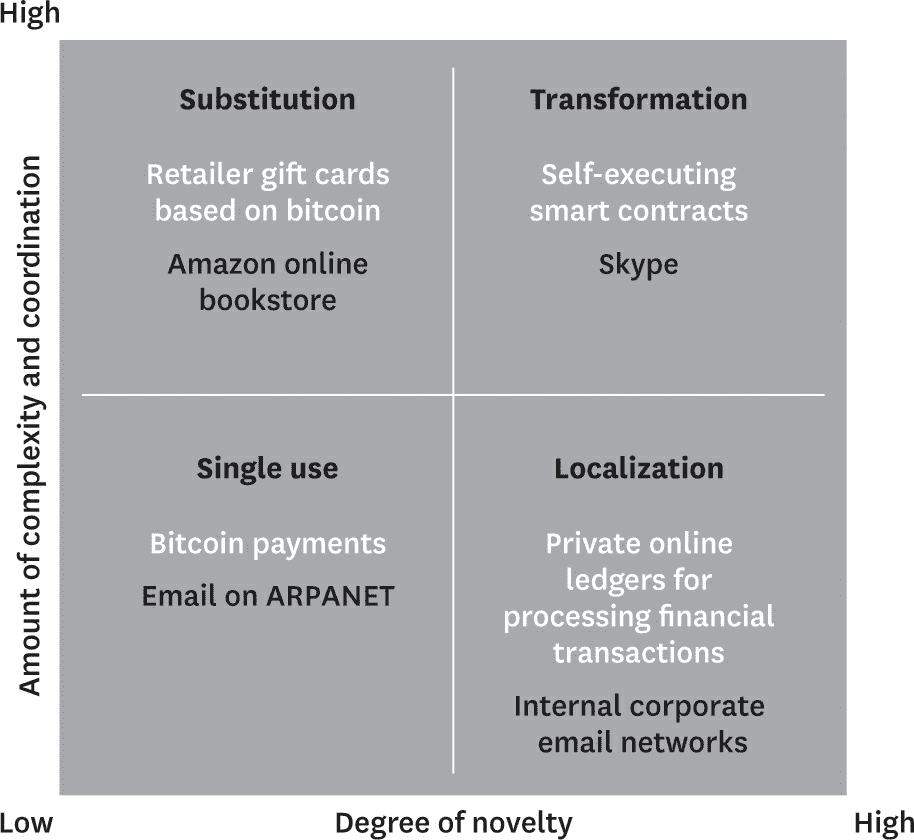

# 区块链：来自哈佛商业评论的必备洞察 (HBR Insights 系列)

# 系列页面

## 来自哈佛商业评论的洞见

商界正在变化。你会适应还是被抛在后面？

赶上步伐并加深你对正在塑造公司未来的主题的理解，借助《来自哈佛商业评论的洞见》系列。

涵盖 HBR 对快速变化议题——区块链、网络安全、人工智能等——的最睿智思考，每本书都提供了组织在当今竞争所需的奠基性介绍和实用案例研究，并汇集了最佳研究、访谈和分析，使其为明天做好准备。

你无法忽视这些议题将如何改变商业和社会格局。《洞见》系列将帮助你掌握这些关键思想——并为你和你的公司做好未来准备。

系列书籍包括：

*敏捷*
*人工智能*
*区块链*
*网络安全*
*垄断与科技巨头*
*战略分析*

# 引言：区块链与数据完整性革命

## 引言

区块链与数据完整性革命
作者 Catherine Tucker

尽管互联网令人目眩的演进改变了我们获取数据和交流的方式，但数据完整性和存储方面的进展却举步维艰。我们可以利用互联网瞬间定位婆罗洲的某家冷门餐馆、观看猫咪视频，或在全球分享我们的观点。但即使在云存储技术出现后，数据仍然会丢失、损坏、被审查、意外删除、被黑客攻击、被盗或被毁灭。
区块链可以消除所有这些问题。区块链于 2008 年首次出现，作为验证加密货币交易的方法，它由时间戳、仅追加的、不可变数据块序列组成，且不由任何单一实体拥有。一旦使用密码学将一份*区块*数据添加到*链*中，它就无法被移除或修改。恶意行为者无法更改它。审查者无法移除它。黑客无法窃取已分享的内容。它对于数据完整性和记录而言可能与互联网对数据访问的革命性一样具有革命性。
更好的数据完整性带来新的可能性。许多商业决策都依赖于知道我们所拥有的数据实际上反映了现实。例如，供应链：如果通过审查区块链，能够确切知道库存位于特定地点，或在特定时间到达或离开，那么验证其存在的成本将大幅下降。而且由于这些带时间戳的交易记录无法被操纵，欺诈的可能性也会同样急剧下降。在许多其他行业和职能中，区块链可以减少摩擦、精简官僚程序，以至于全新的商业模式成为可能。本书将帮助你了解将会发生什么变化、何时发生以及如何准备。
作为专注于数字经济的麻省理工学院教授，以及麻省理工学院加密经济学实验室的联合创始人，我花费大量时间研究区块链将如何影响行业。区块链的影响可能进展缓慢，但最终可能令人震惊。深远的新技术和创新带来的影响可能需要数十年才会显现，而且它们带来的变化往往不会发生在人们预期的地方。伏打在 1800 年发明了电电池，但开发出适用于工业应用的电池至少花了六十年。2000 年互联网泡沫破裂后，很容易得出互联网作为销售商品方式潜力有限的结论。现在，随着比特币泡沫的破裂和几家区块链初创公司的高调失误，一些人将会犯类似的错误。不要否定区块链，也不要因为它看起来太复杂而忽视它——误判我们所处的关键时刻可能会让你的企业难以追赶。有多少低估互联网的公司如果可以的话希望重来一次 2000 年？
*《区块链：哈佛商业评论为您提供的洞见》* 将告诉你现在需要知道的内容，并帮助你更好地预测它将如何影响你的业务和行业。它将帮助非技术领导者，包括高管、董事会成员和任何角色的管理人员，快速掌握相关知识。本书分为三个部分：
理解区块链是对区块链的深入探讨，涵盖其历史、当前轨迹和设计，以及它能做什么和不能做什么。
区块链与商业探讨了企业今天如何使用区块链，涉及金融、支付、供应链、营销和创意产业。
区块链的未来探讨了区块链影响隐私、监控、政府监管和环境可持续性观念的能力。
在整本书中，请自问几个重要问题，以便更好地理解区块链如何帮助（或颠覆）你的业务、行业或整个社会：
1. 这种结果在没有区块链技术的情况下也能发生吗？区块链技术在这里真正增加了什么价值？
2. 区块链的真正价值在于放在区块链上的数据具有更高的完整性，还是主要价值源于数据结构是去中心化的且无人拥有数据？
3. 哪些企业的商业模式最容易受到区块链的威胁？是银行、保险公司、像谷歌这样的数字平台，还是其他尚未被发现的东西？
4. 政府会采用区块链吗？他们会将其用于货币、记录保存还是其他用途？在政府背景下，用基于区块链的系统取代旧技术会带来什么独特后果？
5. 既然无人拥有它，区块链的最终受益者会是谁？是既得利益者还是新兴企业，是公司还是个人，是想要隐私的人还是不想要的人，是政府还是异见者？
在区块链采用的早期阶段，我们可以承认，即使我们尚不确定区块链技术将如何改变社会，我们也不应袖手旁观，让变革在我们之外发生。本卷中的见解勾勒出，一旦数据完整性取得飞跃，主要行业、政府、营销实践和投资模式如何可能发生实质性变化。利用它们为你自己和你的公司做好准备，迎接充满希望的区块链未来。

# 第一部分：理解区块链

## 1. 关于区块链的真相
关于区块链的真相
作者 Marco Iansiti 和 Karim R. Lakhani

合同、交易及其记录是我们经济、法律和政治体系中的基本结构之一。它们保护资产并设定组织边界。它们建立和验证身份并记录事件。它们规范国家、组织、社区和个人之间的互动。它们指导管理和社会行动。然而，这些关键工具以及为管理它们而形成的官僚机构并未跟上经济的数字化转型。它们就像堵在赛道上的高峰期交通堵塞，困住了 F1 赛车。在数字世界中，我们监管和维持行政控制的方式必须改变。
区块链承诺解决这个问题。比特币的核心技术是

## 关于区块链的真相

除了其他虚拟货币，区块链是一个开放的、分布式的账本，可以高效地以可验证和永久的方式记录双方之间的交易。账本本身也可以被编程以自动触发交易。（参见侧边栏“区块链的工作原理”。）

## 区块链的工作原理

以下是该技术的五项基本原则。

### 1. 分布式数据库
区块链上的每个参与方都可以访问整个数据库及其完整历史记录。没有任何一方控制数据或信息。每个参与方都可以直接验证其交易伙伴的记录，而无需中介。

### 2. 点对点传输
通信直接在对等方之间进行，而不是通过中央节点。每个节点都会将信息存储并转发给所有其他节点。

### 3. 透明性与假名性
每个交易及其相关价值对系统中任何访问者都是可见的。区块链上的每个节点或用户都有一个唯一的、30 多个字符的字母数字地址来标识其身份。用户可以选择保持匿名或向他人证明其身份。交易发生在区块链地址之间。

### 4. 记录不可逆性
一旦交易被输入数据库并更新账户，记录就无法更改，因为它们与之前的所有交易记录相链接（因此得名“链”）。各种计算算法和方法被部署以确保数据库上的记录是永久的、按时间顺序排列的，并且对网络上的其他所有人可用。

### 5. 计算逻辑
账本的数字特性意味着区块链交易可以与计算逻辑相联系，本质上是可以被编程的。因此，用户可以设置算法和规则，自动触发节点之间的交易。

有了区块链，我们可以设想一个世界，在其中合同被嵌入数字代码并存储在透明的共享数据库中，在那里它们受到防删除、防篡改和防修改的保护。在这个世界里，每一份协议、每个流程、每项任务和每一笔付款都将拥有可被识别、验证、存储和共享的数字记录和签名。律师、经纪人和银行家等中介可能不再必要。个人、组织、机器和算法将能够自由地以极少的摩擦进行交易和互动。这就是区块链的巨大潜力。

的确，几乎每个人都听过区块链将革新商业并重新定义公司和经济的说法。虽然我们对它的潜力同样充满热情，但我们担心炒作。让我们担忧的不仅仅是安全问题（例如 2014 年一家比特币交易所的崩溃以及最近其他交易所的黑客攻击）。我们研究技术创新的经验告诉我们，如果要实现区块链革命，许多障碍——技术、治理、组织乃至社会层面的——都必须被消除。在不了解其可能如何扎根的情况下贸然投入区块链创新将是一个错误。

我们认为，由区块链主导的商业和政府转型仍需数年时间。这是因为区块链不是一种“颠覆性”技术，后者可以用更低成本的解决方案攻击传统商业模式并迅速取代现有企业。区块链是一种*基础*技术：它有潜力为我们的经济和社会系统创造新的基础。但尽管影响将是巨大的，区块链渗透到我们的经济和社会基础设施中仍需要数十年时间。

采用过程将是渐进而稳定的，而非突然的，随着技术和制度变革的浪潮积聚势头。那种洞见及其战略意义正是本文将要探讨的内容。

## 技术采用模式

在深入区块链战略和投资之前，让我们反思一下我们对技术采用的了解，特别是其他基础技术典型的转型过程。其中最相关的例子之一是分布式计算机网络技术，体现在 TCP/IP（传输控制协议/互联网协议）的采用上，它为互联网的发展奠定了基础。

1972 年推出，TCP/IP 最初在一种*单一用途*案例中获得 traction：作为 ARPANET 研究人员之间电子邮件的基础，ARPANET 是美国国防部商业互联网的前身。在 TCP/IP 之前，电信架构基于“电路交换”，其中两个当事人或机器之间的连接必须在交换过程中预先建立并持续维持。为了确保任意两个节点能够通信，电信服务提供商和设备制造商已投入数十亿美元建设专用线路。

TCP/IP 颠覆了这一模式。新的协议通过将信息数字化并拆分为非常小的包来传输信息，每个包都包含地址信息。一旦释放到网络中，数据包可以采用任何路线到达接收方。网络边缘的智能发送和接收节点可以拆分和重新组装数据包并解释编码数据。无需专用私人线路或庞大基础设施。TCP/IP 创建了一个开放的、共享的公共网络，没有任何中央权威或负责其维护和改进的方。

传统电信和计算部门对 TCP/IP 持怀疑态度。很少有人想象在新架构上可以建立稳健的数据、消息、语音和视频连接，或相关系统可以安全且扩展。但在 20 世纪 80 年代末和 90 年代，Sun、NeXT、Hewlett-Packard 和 Silicon Graphics 等越来越多的公司使用 TCP/IP，部分是为了在组织内部创建*本地化*的私有网络。为此，他们开发了构建模块和工具，使其用途超越电子邮件，逐渐取代更传统的本地网络技术和标准。随着组织采用这些构建模块和工具，它们看到了生产力的显著提升。

随着 20 世纪 90 年代中期万维网的出现，TCP/IP 进入了广泛的公众使用。新的技术公司迅速出现，提供“管道”——连接现在公共网络并交换信息所需的硬件、软件和服务。Netscape 将浏览器、Web 服务器和其他工具和组件商业化，有助于互联网服务和应用的开发和采用。Sun 推动了 Java 应用编程语言的发展。随着网络上的信息呈指数级增长，Infoseek、Excite、AltaVista 和 Yahoo 应运而生，以引导用户浏览。

一旦这一基础基础设施达到临界规模，新一代公司利用低成本连接，通过创建对现有企业具有吸引力的*替代*互联网服务来获益。CNET 将新闻搬到网上。亚马逊提供的图书比任何书店都多。Priceline 和 Expedia 使购买机票变得更容易，并为该过程带来了前所未有的透明度。这些新进入者能够以相对较低的成本获得广泛覆盖的能力，对报纸和实体零售商等传统企业施加了巨大压力。

依靠广泛的互联网连接，下一个浪潮的公司创建了新颖的、*变革性*的应用，从根本上改变了企业创造和获取价值的方式。这些公司建立在新的点对点架构之上，并通过协调用户的分布式网络来创造价值。想想 eBay

## 1. 区块链的真相

通过拍卖改变了在线零售，Napster 改变了音乐产业，Skype 改变了电信业，而 Google 通过利用用户生成的链接提供更相关结果，改变了网络搜索。

最终，TCP/IP 花了超过 30 年才经历所有阶段——单一使用、本地化使用、替代和转型——并重塑经济。今天，全球最有价值的上市公司中超过一半拥有由互联网驱动的、基于平台的商业模式。我们经济的根本基础已经改变。

物理规模和独特的知识产权不再赋予无可匹敌的优势；日益成为经济领袖的是充当“keystones”的企业，它们主动组织、影响和协调广泛的社区、用户和组织网络。

## 新架构

区块链——一种建立在互联网之上的点对点网络——于 2008 年 10 月作为比特币提案的一部分被提出，比特币是一种虚拟货币系统，它摒弃了中央机构发行货币、转移所有权和确认交易。比特币是区块链技术的第一个应用。

区块链与 TCP/IP 之间的相似之处很明显。正如电子邮件实现了双边消息传递，比特币实现了双边金融交易。区块链的开发和维护是开放的、分布式的和共享的——就像 TCP/IP 一样。全球一支志愿者团队维护核心软件。就像电子邮件一样，比特币最初在热情但相对较小的社区中流行起来。

TCP/IP 通过大幅降低连接成本释放了新的经济价值。同样，区块链也可能大幅降低交易成本。它有可能成为所有交易的记录系统。如果那样发生，经济将再次经历根本性转变，因为新的基于区块链的影响力和控制来源出现。

考虑一下现在的商业运作方式。保存交易的持续记录是任何企业的核心职能。这些记录追踪过去的行动和绩效，并指导未来的规划。它们不仅提供组织内部运作方式的视角，也提供组织外部关系的视角。每个组织都保存自己的记录，而且是私有的。许多组织没有所有活动的总账；相反，记录分布在内部部门和职能中。问题是，在各个独立且私有的账本之间核对交易需要花费大量时间且容易出错。

例如，典型的股票交易可以在微秒内执行，通常无需人工干预。然而，结算——股票的所有权转移——可能长达一周。这是因为各方无法访问彼此的账本，也无法自动验证资产是否确实拥有并可转移。相反，一系列中介机构在交易记录穿越组织、账本分别更新的过程中充当资产担保人。

在区块链系统中，账本被复制到大量相同的数据库中，每个数据库由一个感兴趣的各方托管和维护。当在一份副本中输入更改时，所有其他副本会同时更新。因此，随着交易的进行，交换的价值和资产的记录会永久录入所有账本。无需第三方中介来验证或转移所有权。如果股票交易发生在基于区块链的系统上，它将在几秒钟内完成结算，且安全可验证。（臭名昭著的攻击比特币交易所的黑客事件暴露的弱点并非区块链本身，而是与使用区块链的各方相关联的独立系统。）

## 区块链采用框架

如果比特币像早期的电子邮件，那么区块链是否还需要几十年才能达到其全部潜力？我们认为答案是有限制的“是”。我们无法准确预测转型需要多少年，但我们可以猜测哪些类型的应用会首先获得关注，以及区块链的广泛接受最终将如何实现。

在我们的分析中，历史表明有两个维度会影响基础技术及其商业用例的演变。第一个是新颖性——应用对世界而言的新程度。越新颖，就需要付出更多努力来确保用户理解它解决了什么问题。第二个维度是复杂性，由涉及的生态系统协调水平表示——需要共同合作以利用技术创造价值的各方数量和多样性。

例如，仅有一个成员的社交网络用处不大；社交网络只有在你自己的许多联系人都加入后才有价值。必须让其他应用用户加入，才能为所有参与者创造价值。许多区块链应用也将如此。随着这些应用的规模和影响力增加，它们的采用将需要重大的制度变革。

我们开发了一个框架，将创新映射到这两个情境维度，并将其分为四个象限。（参见图 1-1。）每个象限代表技术发展的阶段。确定区块链创新属于哪一个象限，将有助于高管了解它带来的挑战类型、所需的协作和共识水平，以及所需的立法和监管工作。该地图还将提示必须建立何种流程和基础设施以促进创新的采用。管理者可以用它来评估任何行业的区块链发展状况，以及评估自身区块链能力的战略投资。

### 图 1-1

基础技术如何确立

基础技术的采用通常发生在四个阶段。每个阶段由应用的新颖性和使其可行所需的协调努力的复杂性定义。新颖性和复杂性较低的应用首先获得接受。新颖性和复杂性较高的应用需要数十年才能演变，但可以改变经济。1972 年在 ARPANET 上引入的 TCP/IP 技术已达到转型阶段，但区块链应用（in white）仍处于早期阶段。

### 单一使用

第一象限中低新颖性和低协调性的应用创造了更好、成本更低、高度集中的解决方案。电子邮件，作为电话、传真和 snail mail 的廉价替代品，是 TCP/IP 的单一用途应用（尽管其价值随用户数量增加而上升）。比特币也落入这一象限。即使在早期，比特币作为一种替代支付方式，也为少数使用者提供了即时价值。

（你可以把它想成一封复杂的电子邮件，不仅传输信息，还传输实际价值。）到 2016 年底，比特币交易价值预计将达到 $92 billion。与 $411 trillion 的总全球支付相比，这仍然是微不足道的，但比特币增长迅速，在即时支付和外汇及资产交易等当前金融系统存在局限性的背景下变得越来越重要。

### 本地化

第二象限包括相对新颖但只需有限数量用户即可创造即时价值的创新，因此推广其采用相对容易。如果区块链遵循网络技术所走的道路

业务方面，我们可以预期区块链创新将基于单用途应用，构建本地私有网络，多个组织通过分布式账本在其中连接。

大部分初始的私有区块链开发正发生在金融服务领域，通常是在少数公司的小型网络中进行，因此协调需求相对适中。纳斯达克正在与 Chain.com 合作，Chain.com 是众多区块链基础设施提供商之一，共同提供用于处理和验证金融交易的[content]
业务方面，我们可以预期区块链创新将基于单用途应用，构建本地私有网络，多个组织通过分布式账本在其中连接。

大部分初始的私有区块链开发正发生在金融服务领域，通常是在少数公司的小型网络中进行，因此协调需求相对适中。纳斯达克正在与 Chain.com 合作，Chain.com 是众多区块链基础设施提供商之一，共同提供用于处理和验证金融交易的技术。美国银行、摩根大通、纽约证券交易所、富达投资和渣打银行正在测试区块链技术，以在贸易融资、外汇、跨境结算和证券结算等领域取代基于纸张和人工的交易处理。加拿大银行正在测试一种名为 CAD-coin 的数字货币用于银行间转账。我们预计将出现大量服务于各行业特定用途的私有区块链。

## Substitution

第三象限包含的应用在新颖性方面相对较低，因为它们建立在现有的单用途和本地化应用之上，但在协调需求方面很高，因为它们涉及更广泛且日益公开的使用。这些创新旨在取代整个商业运作方式。然而，它们面临很高的采用壁垒；不仅需要更多的协调，而且它们希望取代的流程可能已在组织和机构内部全面展开并根深蒂固。替代品的例子包括加密货币——新型的、完全成型的货币系统，它们源于简单的比特币支付技术。关键区别在于，加密货币要求从事货币交易的每个参与方都采用它，这对长期以来处理和监督此类交易的政府和机构构成了挑战。消费者也必须改变行为并了解如何实现加密货币的新功能。

麻省理工学院的一项最新实验凸显了数字货币系统未来面临的挑战。2014 年，麻省理工学院比特币俱乐部为麻省理工学院的 4,494 名本科生每人提供了 100 美元的比特币。有趣的是，30% 的学生甚至没有报名领取这笔免费资金，而报名者中有 20% 在几周内就将比特币兑换成现金。即使是技术娴熟的人也很难理解比特币如何或在哪里使用。

最雄心勃勃的替代区块链应用之一是 Stellar，这是一个非营利组织，旨在为从未获得过服务的人提供负担得起的金融服务，包括银行、小额支付和汇款。Stellar 提供自己的虚拟货币 lumens，并允许用户在其系统上保留各种资产，包括其他货币、电话分钟数和数据积分。Stellar 最初专注于非洲，特别是那里的最大经济体尼日利亚。它在其目标人群中获得了显著的采用，并证明了其成本效益。但其未来绝非确定，因为生态系统协调挑战很高。虽然草根采用证明了 Stellar 的可行性，但要成为银行标准，它需要影响政府政策并说服中央银行和大型组织使用它。这可能需要数年的 concerted 努力。

## Transformation

完全新颖的应用落入最后一个象限，如果成功，可能改变经济、社会和政治体系的本质。它们涉及协调众多参与者的活动并就标准和流程达成机构共识。它们的采用需要重大的社会、法律和政治变革。

“Smart contracts” 目前可能是最具变革性的区块链应用。这些应用在协商条件得到满足时自动执行付款和货币或其他资产的转移。例如，智能合约可能在货物交付后立即向供应商发送付款。公司可以通过区块链发出已收到特定商品的信号——或者产品具有 GPS 功能，这将自动记录位置更新，进而触发付款。我们已经在风险投资、银行和数字版权管理等领域看到了这种自我执行合约的早期实验。

其影响令人着迷。公司建立在合约之上，从成立到买方-供应商关系再到员工关系。如果合约被自动化，那么传统公司的结构、流程以及律师和会计师等中介机构会发生什么？经理人呢？他们的角色都会发生根本性变化。不过，在我们过于兴奋之前，让我们记住，我们距离智能合约的广泛采用还有数十年的时间。例如，它们在没有机构支持的情况下无法有效运行。需要对智能合约的设计、验证、实施和执行方式进行极大的协调和清晰度。我们认为负责这些艰巨任务的机构需要很长时间才能演变。而且技术挑战——尤其是安全——也令人望而生畏。

## Guiding Your Approach to Blockchain Investment

高管应如何思考区块链对其自身组织的影响？我们的框架可以帮助公司识别正确的机会。

对于大多数公司来说，最容易开始的地方是单用途应用，因为它们风险最小，因为它们并非新事物，并且与第三方协调很少。一种策略是增加比特币作为支付机制。比特币的基础设施和市场已经发展成熟，采用这种虚拟货币将迫使包括 IT、财务、会计、销售和营销在内的各种职能部门建立区块链能力。另一种低风险的方法是内部将区块链用作数据库，用于管理有形和数字资产、记录内部交易和验证身份等应用。这可能对 struggling to reconcile multiple internal databases 的公司尤其有用。测试单用途应用将帮助组织培养其进行更高级应用所需的技能。而且得益于初创公司和亚马逊、微软等大型平台提供的基于云的区块链服务的出现，实验变得越来越容易。

本地化应用是公司的自然下一步。我们现在看到对私有区块链网络的大量投资，而相关项目似乎已准备好产生真正的短期影响。例如，金融服务公司发现，他们与有限数量的可信交易对手建立的私有区块链网络可以显著降低交易成本。

组织还可以使用本地化应用解决边界间交易中的特定问题。例如，公司已经在使用区块链跟踪复杂供应链中的物品。这在钻石行业正在发生，宝石从矿山到消费者都被追踪。用于此类实验的技术现在已可直接购买。

开发替代应用需要仔细规划，因为现有解决方案可能难以撼动。一种方法可能是专注于不会要求终端用户大幅改变行为但能提供昂贵或不吸引人的解决方案的替代品。要获得 traction，替代品必须提供与传统解决方案一样好的功能，并且生态系统必须易于吸收和采用。 首先

## 1. 关于区块链的真相

数据进军基于区块链的礼品卡是一个深思熟虑的替代方案的良好范例。零售商向消费者提供它们，可以通过使用区块链追踪账户内货币的流动——而无需依赖外部支付处理商，从而大幅降低每笔交易成本并增强安全性。这些新礼品卡甚至允许通过共同账本在商家之间转移余额和交易能力。

变革性应用仍遥不可及。但现在评估其可能性并投资开发能够实现它们的技术的确有意义。它们在与一种新的商业模式结合时将最具威力，在这种模式中，价值创造和捕获的逻辑脱离了现有方法。这样的商业模式难以采用，但可以为公司释放未来的增长。

考虑律所为了使智能合约可行将不得不如何改变。它们需要培养软件和区块链编程方面的新专业知识。它们可能还必须重新思考按小时计费的模式，并考虑对合约收取交易费或托管费的想法，仅举两种可能的方法。无论采取何种做法，高管必须确保在做出任何转变之前理解并测试了商业模式的影响。

变革性场景将最后起飞，但它们也将带来巨大的价值。它们可能产生深远影响的两个领域：用于护照控制等功能的 large-scale 公共身份系统，以及在反洗钱和涉及多方的复杂金融交易中基于算法的决策。我们预计这些应用至少还要再十年甚至更久才会达到广泛采用和临界规模。

变革性应用还将催生新的平台级参与者，它们将协调和治理新的生态系统。这些将是下一代的谷歌和脸书。实现此类机会需要耐心。虽然现在开始在它们上进行重大投资可能为时过早，但为它们开发所需的基础——工具和标准——仍然是值得的。

## 结论

除了为区块链的采用提供良好的模板外，TCP/IP 很可能为其铺平了道路。TCP/IP 已变得无处不在，区块链应用正在建立在数字数据、通信和计算基础设施之上，这降低了实验成本，并将允许新的用例迅速出现。

借助我们的框架，高管可以弄清楚今天从哪里开始构建其区块链组织能力。他们需要确保员工学习区块链知识，开发我们在已识别的象限中特定于公司的应用，并投资于区块链基础设施。

但鉴于实现 TCP/IP 水平的接受度所需的时间范围、采用障碍以及巨大的复杂性，高管应仔细思考尝试区块链所涉及的风险。显然，从小处着手是培养更大思维所需知识的好方法。但投资水平应取决于公司和行业的背景。金融服务公司在区块链采用方面已走得很远。制造业则不是。

无论背景如何，区块链很可能会影响你的业务。非常大的问题是何时。

## 要点

区块链将彻底改变商业，但这需要数十年时间。这是因为它是一种基础技术，需要广泛的技术、监管和社会协调才能实施。

区块链是比特币和其他虚拟货币的核心技术，是一种开放的分布式账本，可以高效、可验证且永久地记录双方之间的交易。

TCP/IP 的采用表明区块链将遵循相当可预测的发展模式，因此企业开始规划并不为时过早。

借助映射区块链应用新颖性和复杂性的 2 × 2 框架，管理者可以评估任何行业的区块链发展状态，并评估其自身区块链能力的战略投资。

组织可以通过从单一用途应用开始，然后随着时间的推移转向更复杂、新颖、最终具有变革性的应用来发展其区块链能力。

改编自《哈佛商业评论》2017 年 1 月–2 月刊的文章（产品 #R1701J）。

## 2. 区块链简史

作者：Vinay Gupta

我们现在习以为常的许多技术在当时都是悄无声息的革命。只要想想智能手机如何改变了我们的生活和工作方式。过去，当人们不在办公室时，他们就消失了，因为电话是绑定在地点而不是个人身上。现在我们有全球游牧者直接从手机上建立新业务。而且，想想看，智能手机才存在了仅仅十年。

我们现在正处于另一场悄无声息的革命之中：区块链，一种分布式数据库，维护着一个不断增长的有序记录列表，称为“blocks”。看看过去仅仅 10 年里发生了什么：

第一个主要的区块链创新是比特币，一种数字货币实验。比特币被数百万人用于支付，包括庞大且不断增长的汇款市场。

第二个创新被称为区块链，其本质上是认识到运行比特币的底层技术可以从货币中分离出来，用于各种其他组织间合作。目前世界上几乎每家主要金融机构都在使用区块链或进行区块链研究。

第三个创新被称为“智能合约”，体现在一个名为以太坊的第二代区块链系统中，该系统直接在区块链中构建了小型计算机程序，允许金融工具，如贷款或债券，得以表示，而不仅仅是比特币的现金类代币。以太坊智能合约平台现在市值达数十亿美元，数百个项目正走向市场。

第四个主要创新，即区块链思维的当前前沿，被称为“权益证明”。当前一代区块链通过“工作量证明”得到保护，在其中总计算能力最大的群体做出决策。这些群体被称为“矿工”，运营着庞大的数据中心以提供这种安全性，换取加密货币支付。新的系统取消了这些数据中心，用复杂的金融工具取而代之，以获得相似甚至更高的安全程度。

第五个主要创新在地平线上被称为区块链扩展。目前在区块链世界中，网络中的每台计算机都处理每笔交易。这很慢。扩展的区块链通过计算验证每笔交易所需的计算机数量并高效地分配工作，加快了流程，而不会牺牲安全性。在不损害区块链传奇般的安全性和稳健性的前提下管理这一问题是一个困难的问题，但并非不可解决。预计扩展的区块链将足够快，能够为物联网提供动力，并与银行界的主要支付中介（Visa 和 SWIFT）正面竞争。

这一创新格局仅代表了一群精英计算机科学家、密码学家和数学家 10 年的工作成果。随着这些

突破性进展冲击社会，事情肯定会变得有点奇怪。自动驾驶汽车和无人机将使用区块链为充电站和降落平台等服务付费。

国际货币转账将从需要数天缩短到一小时，然后再缩短到几分钟，可靠性将高于当前系统所能管理的水平。

这些变化，以及其他变化，代表着交易成本的普遍降低。当交易成本降至不可见的阈值以下时，现有的商业模式会出现突然的、戏剧性的、难以预测的聚合和解体。例如，拍卖过去是狭窄且本地化的，而不是像现在在 eBay 等网站上那样通用且全球化。随着触达人们的成本下降，系统发生了突然的变化。区块链很合理地预期会触发与电子商务自 1990 年代末发明以来所产生的同样多的连锁反应。

预测其发展方向很难。有谁预见到社交媒体的到来？谁会预测点击朋友的头像会取代在电视前花费的时间？预测者通常会高估事物的发生速度，而低估其长期影响。但区块链行业内部的规模感是，即将到来的变化将“与互联网最初的发明一样大”，这种说法可能并不夸大。我们可以预测的是，随着区块链的成熟，越来越多的人接受这种新的协作模式，它将扩展到从供应链到可证明公平的网络约会（消除假资料和其他不光彩手段的可能性）等一切领域。而且鉴于区块链在 10 年内取得的进展，也许未来确实会比我们任何人想象的都要早到来。

直到 1990 年代末，在互联网上安全处理信用卡是不可能的——电子商务根本不存在。区块链又能多快带来另一次革命性变化呢？请考虑迪拜的区块链战略（披露：我设计了它），即到 2020 年在区块链上签发所有政府文件，其中大量初始项目早三年就已上线。在世界政府峰会上提出的“协议互联网”概念在此战略基础上，设想利用区块链来平滑因英国脱欧和美国退出跨太平洋伙伴关系协定而造成的一些波折，从而实现全球贸易的实质性转型。这些雄心勃勃的议程必须在实践中得到证明，但迪拜的预期是，成本节约和创新效益将远远超过实验成本。

## 2. 区块链简史

正如 Mariana Mazzucato 在 *《创业国家》* 中所写的那样，创新的前沿，特别是基础设施，往往掌握在国家手中，而在区块链领域似乎注定如此。

### 要点

区块链格局在短短 10 年内从比特币发展到智能合约再到权益证明系统。这些发展都指向未来交易成本的普遍降低。

当交易成本降至某些阈值以下时，现有的商业模式会出现突然的、戏剧性的、难以预测的聚合和解体。

预测者通常会高估技术的采用速度，而低估其长期影响。即使如此，区块链行业的观点是，即将到来的变化可能与互联网最初的发明一样大。

政府和非政府组织已成为区块链创新的驱动力量。

*摘自发布在 hbr.org 上的内容，原刊于 2017 年 2 月 28 日*

*(产品 #H03HW6)。*

## 3. 区块链将对金融系统做互联网对媒体所做的事情

作者：Joichi Ito、Neha Narula 和 Robleh Ali

即使在互联网部署多年后，许多人仍认为它只是一时风尚。当然，互联网此后已成为我们生活中的重要影响，从我们购买商品和服务的方式，到我们与朋友社交的方式，再到阿拉伯之春，到 2016 年美国总统选举。然而，在 1990 年代，主流媒体嘲笑 Nicholas Negroponte 预测我们大多数人很快就会在线阅读新闻而不是从报纸上阅读。

快进二十年：我们是否很快会看到加密货币和区块链带来类似的影响？当然有很多相似之处。像互联网一样，比特币等加密货币由核心技术的进步以及新的开放架构——比特币区块链驱动。像互联网一样，该技术旨在去中心化，具有“层”，每一层由可互操作的开放协议定义，企业和个人可以在其之上构建产品和服务。像互联网一样，在发展的早期阶段存在许多竞争技术，因此指定你所说的 *哪个* 区块链非常重要。而且，像互联网一样，区块链技术在每个人都使用同一网络时最强，因此未来我们可能都会谈论“the”区块链。

互联网及其各层花了数十年时间发展，每一层技术层都释放出创造性和创业活动的爆炸。早期，Ethernet 标准化了计算机通过电线传输比特的方式，像 3Com 这样的公司能够在其网络交换产品上建立帝国。TCP/IP 协议用于寻址和控制数据包如何在计算机之间路由。Cisco 利用该协议构建了网络路由器等产品，到 2000 年 3 月，Cisco 已成为世界上最有价值的公司。1989 年 Tim Berners-Lee 开发了 HTTP，又一个开放、无许可的协议，网络使 eBay、Google 和 Amazon 等企业成为可能。

### 区块链的杀手级应用

但这里有一个主要区别：早期的互联网是非商业性的，最初通过国防资金开发，主要用于连接研究机构和大学。它不是为了赚钱而设计，而是为了开发构建网络最稳健有效的方式。这种最初缺乏商业参与者和利益的情况至关重要——它允许形成一种网络架构，以市场驱动系统下不会出现的方式共享资源。

早期互联网的杀手级应用是电子邮件；它推动了采用并加强了网络。比特币是区块链的杀手级应用。比特币推动其底层区块链的采用，其强大的技术社区和健全的代码审查流程使其成为各种区块链中最安全可靠的。像电子邮件一样，很可能某种形式的比特币会持续存在。但区块链还将支持多种其他应用，包括智能合约、资产登记以及许多将超越金融和法律用途的新型交易。

我们最好将比特币理解为一种新的、去中心化和自动化的金融系统可能如何运作的缩影。虽然其当前能力仍然有限（例如，与传统支付系统相比，交易量较低），但它提供了一个引人注目的未来愿景，因为代码描述了监管和经济系统。例如，交易必须满足某些规则后才能被接受到比特币区块链中。不同于当前金融系统通过制定规则并任命监管机构监督违规行为的方式，比特币的代码设定规则，网络检查合规性。如果 a

## 3. 区块链将对金融系统做互联网对媒体所做的事情

交易违反规则（例如，如果数字签名不匹配），就会被网络拒绝。甚至比特币的“货币政策”也写入了其代码中：新货币每 10 分钟发行一次，且供应量有限，因此比特币总数永远只有 2100 万枚，这是一种类似金本位的硬性货币规则（即货币供应量固定于商品而非由政府决定）。

这并不是说比特币目前提供的选择是完美的。事实上，许多经济学家不同意比特币的硬性货币规则，律师们也认为仅通过代码进行监管是僵化的，不允许任何有用的自由裁量权发挥作用。然而，无法否认的是，比特币是真实的，并且有效。人们赋予比特币真实的经济价值。“矿工”，他们维护比特币区块链，以及“钱包提供商”，他们编写人们用于比特币交易的软件，严格遵守规则。它的区块链对攻击保持了韧性，并支持一个稳健的、 albeit 基本的支付系统。将区块链的使用扩展以重塑金融系统的这一机会在同等程度上令人不安和着迷。

## 为时过早？

不幸的是，金融科技投资者的狂热远远超出了技术的发展。我们经常看到所谓的区块链实际上并不创新，而只是存在了几十年的数据库，自称区块链以搭上流行语的顺风车。

在互联网之前，有许多参与者，例如电信运营商和有线电视公司试图通过其网络提供交互式多媒体，但没有人能产生足够的吸引力创造出你会记住的名字。我们可能正在看到区块链技术出现类似的趋势。现状是既有金融机构进行渐进式改进与新创公司在快速变化的基础设施之上构建的混合体，希望流沙在它们耗尽跑道前会变硬。

就加密货币而言，我们看到的风险投资比互联网在类似的早期发展阶段更为激进的投资要多得多。投资者和企业这种过度的兴趣使得加密货币与互联网根本不同，因为它们没有经历数十年的相对默默无闻，在此期间非商业研究人员可以摆弄、实验、迭代并重新思考架构。这就是为什么我们在麻省理工学院媒体实验室数字货币倡议所做的工作如此重要的一个原因：这是少数几个地方之一，在那里人们在远离财务利益和动机的情况下对技术和基础设施进行大量努力的地方。这至关重要。

目前现有的金融系统非常复杂，而这种复杂性会产生风险。借助加密货币实现的新去中心化金融系统可以通过消除中介层而变得更简单。它可以帮助抵御风险，并通过以不同方式转移资金而为不同类型的金融产品开辟可能性。加密货币可以向目前被排除在外的人群开放金融系统，降低进入壁垒，并实现更大的竞争。

监管机构可以通过重新思考实现政策目标的最佳方式来重塑金融系统，而不会稀释标准。我们也有机会降低系统性风险：与用户一样，监管机构也深受不透明之苦。研究表明，使系统更加透明可以减少中介链条并降低金融系统用户的成本。

## 结论

随着新技术和基础设施的成熟，使用这些技术和基础设施的人的主要用途甚至价值观往往会发生巨大变化。区块链技术也一定如此。

比特币最初是作为对 2008 年金融危机的回应而创建的。创始社区具有强烈的自由主义和反建制色彩，在许多方面与自由软件文化相似，具有强烈的反商业价值观。然而，很可能正如 Linux 现在嵌入几乎每一种商业应用或服务中一样，区块链的许多最终用途可能会成为大型公司、政府和中央银行等既有参与者的标准配置。

同样，许多人将区块链技术和金融科技视为仅仅是一种新的交付技术——也许类似于 CD-ROM。事实上，它更可能对金融系统和监管做互联网对媒体公司和广告公司所做的事情。对经济核心部分进行如此根本性的重组是对靠此谋生的既有企业的一大挑战。为这些变化做好准备意味着投资于研究和实验。那些这样做的人将在新的新兴金融系统中占据有利地位。

### 要点

人们常常用互联网的兴起和主流化来预测区块链的未来。但早期的互联网是非商业的，并在研究人员可以实验、迭代和重新思考其架构的数十年相对默默无闻中度过。然而，区块链在其发明仅几年后就开始吸引投资者的兴趣。

金融科技投资者对区块链的狂热超出了技术的发展水平。许多企业家都在搭顺风车，将“区块链”这一流行语应用于实际上并非基于区块链的数据库。

世界现有的金融系统非常复杂，而这种复杂性会产生风险。一种新的去中心化、基于加密货币的金融系统可以帮助降低风险，向目前被排除在外的人群开放金融系统，并实现更大的竞争。

*改编自发布在 hbr.org 上的内容，原刊于 2017 年 3 月 8 日（产品编号 #H03I8K）。*

## 4. 谁控制区块链？

作者 Patrick Murck

区块链网络倾向于支持诸如开放访问和无许可使用等原则，这些原则应与早期互联网的倡导者熟悉。为了保护这一愿景免受政治压力和监管干预，区块链网络依赖于去中心化的基础设施，无法由任何个人或团体控制。与政治监管不同，区块链治理并非源自社区。相反，它是先验的，被编码在协议和流程中，作为原始网络架构不可分割的一部分。成为支持区块链的社区的一部分，就是接受网络最初建立时的规则。

在区块链交易中，你不必信任你的交易对手履行其义务或正确记录交易数据，因为这些流程是标准化和自动化的，但你必须相信代码和网络会按预期运行。如果网络政治化，区块链账本条目会有多不可变呢？事实证明，并不十分。

考虑 The DAO 的案例。简称为 *去中心化自治组织*，DAO 是一种软件，旨在在没有任何人工干预的情况下管理持有和分配区块链资产的受托义务。为（令人困惑地命名为）The DAO 应用程序开发的代码被称为“智能合约”，并作为 DAO 应用程序运行在以太坊区块链之上。The DAO 通过其智能合约发行代币，并将其兑换为以太坊的区块链代币，即以太。

## 4. 谁控制区块链？

本次代币销售通过一次广泛宣传的众筹活动进行，筹集了超过 1.5 亿美元的以太币价值。

以太坊创建者的原始愿景是，计算机代码应该被字面意义上视为其社区中的法律，并作为法律协议和监管的替代。The DAO 的创建者拥抱了这一愿景，并指出参与者应仅将应用程序的代码作为所有事项的决定性依据。

代码就是 The DAO 的合约和法律。不幸的是，The DAO 的智能合约存在缺陷：它允许一名利用代码漏洞的 DAO 代币持有者将应用程序中持有的三分之一价值（约 5000 万美元）转移到自己的账户。这次资金提取虽然出乎意料，但并未违反以太坊或 The DAO 的规则，尽管这些规则可能很天真。也不太可能违反任何法律。

但归根结底，太多以太坊社区成员，包括其中一些最知名的领导者，因用以太币交换 DAO 代币而遭受损失。他们认为必须采取行动来扭转损失。以太坊领导层能够与网络利益相关者协调，创建所谓的“硬分叉”，即以太坊区块链的永久分裂，以便将抽走资金的控制权转移到一组受信任的领导者手中。

这次硬分叉创建了新的以太坊区块链，并被批评者贴上“救助”的标签。新的以太坊区块链仅选择性地为那些不明智地用以太坊区块链代币交换 The DAO 应用程序代币的代币持有者回滚了损失。如果你以其他任何方式丢失以太币代币，无论是通过市场操纵还是另一次黑客攻击，僵化的“代码即法律”原则仍然适用——你只能自认倒霉。

对于社区中的一些成员来说，硬分叉的决定是对社区核心原则的肆意违反，类似于为了烤猪而烧毁房屋。抗议之下，他们决定继续运行未经改动的原始以太坊区块链，因此现在出现了两个以太坊网络。令人有些困惑的是，旧的以太坊网络已被重新命名为“以太坊经典”；新网络保留了原名以太坊。

区块链神话制造者可能会声称像 The DAO 这样的智能合约应用程序将取代律师并颠覆法律行业。但正如这一事件充分证明的那样，现实是智能合约既不智能，也谈不上是可执行的协议。区块链确实是网络和机器治理的一种创新方法。但我们必须抵制将代码拟人化并将机器治理错误应用于社会系统的诱惑。代码是机器的法律，法律是人的代码。当我们混淆这些概念时，就会产生像 The DAO 这样的情况。

考虑一下围绕比特币的一些争议。首先要明白，在比特币区块链上，权力本意是分散在社区所有利益相关者之间。这些利益相关者中没有任何一方应比其他方拥有更大的影响力或权力来改变比特币协议的条款。他们相互依存，并有激励合作以维护现有的网络规则。任何对网络规则的更改都需要所有利益相关者之间的协调和共识。因此，当比特币软件开发者开始就如何提高网络容量进行辩论时，讨论演变成一场多利益相关者混战，被大众媒体称为“治理危机”。一些开发者希望引入对比特币代码库的更改，这些更改不向后兼容，从而将网络分裂成多个区块链——即硬分叉。

大多数比特币开发者反对硬分叉扩容提案，而倾向于一种更保守的方法，以确保单一比特币区块链的连续性。其他利益相关者开始将这一过程视为阻碍主义，并出现了民粹主义运动试图绕过它。但尽管经历了诸多 Sturm und Drang，这些旨在改变比特币权力结构并规避比特币开发者共识的努力迄今为止均已失败。对于社区中的许多人来说，比特币抵制此类民粹主义运动的能力证明了区块链治理结构的成功，并表明“治理危机”是一个虚假叙事。

随着区块链社区的增长，利益相关者就更改网络规则达成共识变得越来越困难。这是出于设计，并强化了区块链创建者的原始原则。改变规则意味着分裂网络，创建新的区块链和新的社区。区块链网络抵制政治治理，因为它们由参与其中的每个人治理，而又不由任何特定的人治理。

区块链技术的力量在于，它可以通过将信任和协调的成本转移到网络上来，在全球范围内以算法方式执行私人协议和社区原则。这正是区块链能够创造以前不存在的新市场的原因，无论是出于政治还是经济原因。要做到这一点，我们必须能够信任区块链，并信任没有人控制它。

## 要点

区块链网络倾向于支持理想主义原则，如开放访问和无许可使用。为了保护这一愿景免受政治压力和监管干预，区块链网络依赖于无法被任何个人或团体控制的去中心化基础设施。

在区块链交易中，你不必信任你的交易对手会履行其义务——但你必须信任代码和网络会按预期运行。

实际上，如果足够多的网络参与者希望更改它们，区块链账本条目并非不可变。The DAO 的案例中，代码缺陷允许用户将其价值 5000 万美元的资金转移到自己的账户，这表明“代码即法律”在现实世界中并非简单适用。

随着区块链社区的增长，利益相关者就更改网络规则达成共识变得越来越困难。区块链网络抵制政治治理，因为它们由参与其中的每个人治理，而又不由任何特定的人治理。

*改编自发布在 hbr.org 上的内容，原刊于 2017 年 4 月 19 日（产品编号 #H03LUX）。*

## 5. 区块链有多安全？取决于

作者 Allison Berke

区块链，即支撑比特币的分布式账本技术，可能比其所支持的货币更有价值。但其价值仅取决于其安全性。当我们开始将分布式账本技术付诸实践时，确保我们建立的初始条件不会为日后的安全问题埋下隐患非常重要。

为了理解区块链技术固有的安全风险，了解公有链和私有链之间的区别很重要。

比特币依赖于公有区块链，一种记录交易并允许任何人读取或写入交易的系统。任何人都可以汇总并发布这些交易，前提是他们能够证明为此付出了足够的努力，而他们可以通过解决一个困难的密码学难题来证明这一点。网络节点确认先前已验证交易记录并验证新交易的过程被称为共识协议。在比特币系统中，由于没有用户被隐含信任来验证交易，所有用户都遵循一个

## 5. 区块链有多安全？取决于情况

算法通过投入软件和硬件资源进行暴力求解（即解决密码学难题）来验证交易。第一个找到解决方案的用户会获得奖励，而每个新解以及用于验证它的交易则构成了下一个待解问题的基础。

这种去中心化和相对自由的访问导致了一些意想不到的后果：由于任何人都可以读取和写入交易，比特币交易助长了黑市交易。由于共识协议耗能，大多数用户都在电价便宜的国家运营，导致网络中心化以及串谋的可能性，并使网络容易受到电力补贴政策变化的影响。这两种趋势都导致了对私有区块链的兴趣增加，而私有区块链最终可能让企业获得更大的控制权。

主要用于金融领域，私有区块链让其运营者控制谁可以读取已验证交易的账本、谁可以提交交易以及谁可以验证交易。私有区块链的应用包括多种市场，在这些市场中，多方希望同时参与但彼此并不完全信任。例如，支持土地和实物资产登记、商品交易以及私募股权分配的私有区块链系统都正在接受测试。随着这些系统的发展和演进，它们也可能遇到意想不到的后果，其中一些后果会影响系统及其管理或存储的资产的安全性。正如在软件和产品开发中一样，早期考虑安全问题可以减轻日后为解决安全漏洞而对产品进行根本性更改的难度。

## 安全始于网络架构

建立私有区块链时要做出的第一个决定之一是关于系统的网络架构。区块链通过通信就其账本、已验证交易的列表达成共识，而写入和批准新交易也需要通信。这种通信发生在节点之间，每个节点都维护账本的副本并向其他节点通报新信息：新提交或新验证的交易。私有区块链运营商可以控制谁被允许运营节点，以及这些节点如何连接；连接更多的节点会更快地接收信息。同样，节点可能需要保持一定数量的连接才能被视为活跃。限制信息传输或传输错误信息的节点必须能够被识别并绕过，以维护系统的完整性。支撑商品交易的私有区块链可能会在网络中给予已建立的交易伙伴更核心的位置，并可能要求新节点与其中一个核心节点保持连接，作为安全措施以确保其按预期行为。

网络架构建立中的另一个安全问题是如何处理不通信或间歇性活跃的节点。节点可能因无害原因离线，但网络必须能够在没有离线节点的情况下运行（对先前已验证的交易达成共识并正确验证新交易），并且如果这些节点返回，必须能够迅速让它们恢复同步。

## 公共与私有区块链中的共识协议和访问权限

用于达成共识的过程（通过解决问题来验证交易）被有意设计为耗时，目前约为 10 分钟。交易在大约一到两个小时后才被认为完全验证，之后它们在账本中已足够“深入”，以至于引入账本的竞争版本，即分叉，在计算上会很昂贵。这种延迟既是系统的漏洞，因为最初似乎已验证的交易可能后来失去该状态，也是比特币系统用于快速交易，例如金融交易的重要障碍。

相比之下，在私有区块链中，运营商可以选择只允许某些节点执行验证过程，这些受信任方将负责向网络其他部分传达新验证的交易。对这些节点的访问进行保护，以及确定何时以及为谁扩展受信任方集合的责任，将是由区块链系统运营商做出的安全决策。

## 公共与私有区块链中的交易可逆性与资产安全

虽然区块链交易可用于存储数据，但比特币交易的主要动机是比特币本身的交换。每次比特币交易都包含与所交换比特币相关联的唯一文本字符串。同样，其他区块链系统记录交易中涉及的资产或股份的持有情况。在比特币系统中，所有权是通过使用私钥来证明的，私钥是由旨在提供随机且唯一输出的算法生成的长数字，与付款相关联，尽管这些密钥很有价值，但与任何数据一样，它们可能被盗或丢失，就像现金一样。这些盗窃并非比特币安全性的失败，而是个人安全的失败；盗窃是由于私钥存储不安全造成的。一些估计认为丢失的比特币价值达数十亿美元。

因此，私有区块链运营商必须决定如何解决身份凭证丢失的问题，特别是对于管理实物资产的系统。即使没有人能证明一桶石油的所有权，这桶石油也必须存放在某处。比特币目前对丢失私钥的人没有任何补救措施；同样，被盗的比特币几乎无法追回，因为使用被盗密钥提交的交易对验证节点而言与合法交易无法区分。

私有区块链所有者必须决定是否以及在何种情况下撤销已验证的交易，特别是如果该交易可以证明是盗窃。交易撤销可能会削弱人们对系统公平性和公正性的信心，但一个因漏洞被利用而导致大量损失的系统会失去用户。这是由 The DAO 的案例说明的，The DAO 是一个基于代码的风投基金，设计在以太坊上运行，以太坊是一个基于公共区块链的平台。运营 The DAO 的代码中的安全漏洞导致了财务损失，这要求以太坊开发者对以太坊协议本身进行更改，即使 The DAO 的漏洞并非以太坊协议的过错。对这些更改的决定具有争议性，并强调了公共和私有区块链开发者都应考虑他们可能面临类似决定的情况这一观点。

## 权衡回报

私有区块链提供的优势——更快的交易验证和网络通信、修复错误和撤销交易的能力，以及限制访问并降低外部攻击可能性的能力——可能会让潜在用户对系统产生戒心。区块链系统的存在本身就预设了一定程度的不信任，或至少承认所有用户的激励可能不一致。维护比特币等公共区块链系统的开发者仍然依赖于

## 5. 区块链有多安全？取决于情况

个人用户才能采用他们提出的任何变更，这确保了只有在符合整个系统利益的情况下变更才会被采纳。另一方面，私有区块链的运营者可能会单方面部署一些用户不同意的变更。为了确保私有区块链系统的安全性和实用性，运营者必须考虑用户对系统规则变更或缓慢采用新规则的救济途径。目前仍在运行未安装最新补丁的操作系统的数量强烈表明，即使是无争议的变更也不会迅速被采纳。

虽然在公共区块链上构建金融市场或其他基础设施的风险可能会让新进入者犹豫不决，但私有区块链在参与者行为和交易验证过程方面提供了一定程度的控制。使用基于区块链的系统是该系统透明度和可用性的信号，而这些又得益于对系统安全的早期考虑。正如企业会决定其哪些系统更适合托管在更安全的私有内联网或互联网上，但很可能会同时使用两者一样，需要快速交易、交易可逆的可能性以及对交易验证的集中控制的系统更适合私有区块链，而那些受益于广泛参与、透明度和第三方验证的系统将在公共区块链上蓬勃发展。

## 要点

区块链的价值仅与其安全性一样高。在建立区块链网络时，重要的是确保初始条件设置得当，以免日后造成安全问题。

正如企业决定其哪些系统更适合托管在互联网或更安全的私有内联网上一样，它们也将面临关于哪些应用更适合公共或私有区块链的选择。

由于围绕公共区块链（例如比特币）的商业风险，私有区块链的兴趣日益增长，这些风险从黑市交易到串谋担忧不等。

私有区块链的应用包括多方之间并不完全互信的市场，包括实物资产登记、商品交易和私募股权分配。

公共区块链对丢失或被盗的私钥没有任何补救措施。私有区块链的所有者将不得不决定是否以及在何种情况下撤销交易，特别是如果该交易可以证明是盗窃行为。

*改编自发布在 hbr.org 上的内容，原刊于 2017 年 3 月 7 日（产品编号 #H03IAZ）。*

## 6. 区块链做不到什么

*作者 Catherine Tucker 和 Christian Catalani*

区块链技术有潜力实现令人惊叹的事情。它可以提供不可变的数字交易审计轨迹，并且可以廉价地验证数据的完整性。它可以帮助企业和个人在全球范围内就市场内的真实状况达成一致，而无需依赖昂贵的中间人。

这是通过经济激励和密码学的巧妙结合实现的，并确保在任何时间点，数字记录都反映出相关关键利益相关者之间的真实共识。因此，在共享数字记录和资产方面，它可以取代玩家之间信任的需求，或取代中央机构验证和维护交易记录的需求。

然而，在评估区块链商业模式时，了解区块链做不到什么是有用的。

想想在医院病房及以后追踪婴儿的问题。这是一个非常严重的问题。婴儿被误认为是另一个婴儿的后果可能非常可怕。因此，以使这些数据点不可变且可验证的方式存储包含婴儿当前位置的记录似乎是区块链技术的绝佳用途。

但使用区块链解决此类问题存在一个大问题。数字记录可能不可变且可验证，但某人如何知道哪个数字记录附加到哪个婴儿？要将区块链上的条目链接到实际的真实婴儿，我们需要通过物理标签为婴儿提供物理标识符，或者在更具未来感的世界中，通过小型芯片或数字基因组记录将婴儿与其数字记录链接起来。而这正是区块链的不足之处。它无法帮助这一过程，也无法验证也许最重要的验证步骤是否正确进行。

在线下世界与其数字表示之间的界面上，该技术的有用性仍然严重依赖于受信任的中间人，以有效地弥合数字记录与物理个人、企业、设备或事件之间的最后一公里。在我们的例子中，该技术将不得不依赖人类正确且诚实地实施婴儿与数字记录之间的匹配。而且如果人类在数据录入时弄错或操纵数据，在一个记录被事后认为具有完整性的系统中，这可能产生严重的负面后果。

另一方面，如果个人与其医疗记录之间的链接成功建立，并且最后一公里问题得到解决，那么区块链不仅可以用于确保数据完整性，还可以让个人控制其医疗数据的使用方式（例如用于学术研究、健身应用或商业药物开发）。

还有其他平行的例子。在营销领域，经常出现的一个问题是，广告商付费的一双眼睛可能并不属于他们应该属于的人。广告商可能认为自己付费是为了向三十多岁、正在考虑购买兰博基尼的男性展示广告，但广告实际上可能展示给了一位开厢式车的学者，他根本没有购买另一辆车让孩子们破坏的意图，但喜欢做梦。或者更糟糕的是，机器人可能正在查看广告。区块链技术可以追踪哪些数字标识符与广告的观看相关联，但它无法帮助验证人的真实性或买家意图的诚实性。验证数字标识符背后实际是谁需要离线验证。验证明显的购买意图的诚实性也许超出了我们今天所拥有的任何技术的能力。

好的一面是，区块链技术可用于改变数字内容创作者、广告商和消费者之间的关系。广告商可以通过让用户访问他们原本需要付费的独家在线内容来奖励用户的注意力。内容创作者可以探索新的货币化模式，从区块链廉价有效地结算交易的能力中受益。虽然消费者讨厌微支付，因为它们涉及心理成本——微支付就像消费者脑海中令人讨厌的“出租车计价器”——但这可能会重塑不同数字资产背后付费墙和订阅的工作方式。此外，如果我们不担心验证一双眼睛的人性，而是希望确保对浏览数据等数字记录的所有权，那么区块链可以完美发挥作用。我们在建立隐私经济学时不断面临的一个问题是数据所有权的财产权问题。而区块链恰好处于定义它们的理想位置。

随着区块链技术生态系统的不断发展，新的中间人类型将出现，它们将最后一公里问题，即保持数字记录与其

离线对应物，转化为实际的商业机会。虽然该技术仍处于早期阶段，但随着这些关键补充要素的成熟，区块链有可能从根本上重塑我们对数字数据的所有权，以及我们每天使用的数字平台。

## 要点

在评估区块链商业模式时，了解区块链 *不能* 做什么非常重要。对许多商业环境而言，区块链的实用性仍然依赖于值得信赖的中介机构，以有效地在数字记录与物理个人、企业、设备或事件之间架起最后一公里的桥梁。

例如，区块链技术可用于防止医院病房中新生儿被误认。但区块链技术在验证正确的标识符（例如手腕标签）是否应用于正确的婴儿方面没有任何帮助。

随着区块链技术生态系统的不断发展，围绕那些使数字记录与其离线对应物保持同步的中介机构，将会出现新的商业机会。

*改编自发布在 hbr.org 上的内容，原刊于 2018 年 6 月 28 日（产品编号 #H04F3C）。*

# 第 2 部分：区块链与商业

## 7. 区块链如何改变金融

作者 Alex Tapscott 和 Don Tapscott

我们的全球金融系统每天转移数万亿美元，服务数十亿人。但该系统问题重重，通过费用和延迟增加成本，通过冗余且繁琐的文书工作造成摩擦，并为欺诈和犯罪提供了机会。举例来说，每年有 45% 的金融中介机构（如支付网络、证券交易所和汇款服务）遭受经济犯罪；整个经济体的这一比例为 37%，而专业服务和技术行业分别为 20% 和 27%。1 监管成本持续攀升并仍是银行家最关心的问题也就不足为奇了。所有这些都会增加成本，最终由消费者承担负担。

这不禁让人问：为什么我们的金融系统如此低效？首先，因为它陈旧，是工业技术和纸质流程的拼凑物，只是披上了数字外衣。其次，因为它集中化，这使其抗拒变革且易受系统故障和攻击。第三，它具有排他性，剥夺了数十亿人使用基本金融工具的权利。银行家在很大程度上回避了那种虽然混乱但对经济活力和进步至关重要的创造性破坏。但解决这一创新瓶颈的方案已经出现：区块链。

区块链最初是作为比特币等加密货币背后的技术而开发的。它是一个庞大、全球分布式的账本，运行在数百万台设备上，能够记录任何有价值的东西。货币、股票、债券、产权、契约、合同以及几乎所有其他类型的资产都可以安全、私密且点对点地转移和存储，因为信任并非由银行和政府等强大的中介机构建立，而是由网络共识、密码学、协作和巧妙的代码建立。

在人类历史上首次，两个或更多方，无论是企业还是可能互不相识的个人，都可以在不依赖中介机构（如银行、评级机构以及美国国务院等政府机构）来验证其身份、建立信任或执行关键业务逻辑——即对所有商业形式都至关重要的签约、清算、结算和记录保存任务的情况下，达成协议、进行交易并创造价值。

鉴于这种颠覆性技术所带来的希望与风险，金融行业中许多公司，从银行和保险公司到审计和专业服务公司，都在投资区块链解决方案。是什么推动了这股资金和兴趣的涌入？大多数公司都提到减少摩擦和成本的机会。毕竟，大多数金融中介机构本身也依赖于令人眼花缭乱、复杂且昂贵的中介机构组合来运营自身业务。欧洲银行桑坦德将潜在节省额定为每年 200 亿美元。2 咨询公司凯捷估计，通过基于区块链的应用，消费者每年可在银行和保险费用上节省高达 160 亿美元。3

当然，区块链可能使摩根大通、花旗集团和瑞信等现有机构——它们目前都在投资该技术——能够以更少资源做更多事、精简业务并在此过程中降低风险。但虽然机会主义的观点有利且往往必要，但它很少足够。毕竟，如何从结构已根本改变的企业或市场中削减成本呢？

在这里，区块链是一个真正的游戏规则改变者。通过降低经济中所有参与者的交易成本，区块链支持点对点大规模协作模式，这可能使我们许多现有的组织形式变得多余。

例如，考虑一下新商业企业如何获取成长资本。传统上，公司在新业务的早期阶段瞄准天使投资人，后来转向风险投资人，最终在证券交易所进行首次公开募股（IPO）。这一行业支持着众多中介机构，如投资银行家、交易所运营商、审计师、律师以及众筹平台（如 Kickstarter 和 Indiegogo）。区块链通过使任何规模的公司能够通过全球分布式股票发行以点对点的方式筹集资金，从而改变了这一等式。这种新的融资机制已经在改变区块链行业。2016 年，区块链公司从传统风险投资人那里筹集了 4 亿美元，几乎 2 亿美元是通过我们所称的首次代币发行（ICO 而非 IPO）筹集的。这些 ICO 不仅仅是伪装成公司的加密货币。它们代表了内容和数字版权管理平台（如 SingularDTV）、分布式风险投资基金（如 The DAO，即去中心化自治组织），甚至是使投资 ICO 和管理数字资产变得容易的新平台（如 ICONOMI）。ICO 的管道已经很深，例如 Cosmos，这是一种统一技术，将连接世界上每一个区块链，这就是为什么它被称为“区块链互联网”。其他公司也肯定会效仿。

现有机构正在关注。纽约风险投资公司 Union Square Ventures（USV）扩大了其投资策略，以便可以直接购买 ICO。Menlo Park 风险投资公司 Andreessen Horowitz 加入 USV 投资 Polychain Capital，一家只购买代币的对冲基金。区块链行业最大投资者之一的 Blockchain Capital 近期宣布，将通过 ICO 发行代币为其新基金筹集资金，这是行业内的首次。当然，像高盛、纳斯达克公司以及拥有纽约证券交易所的美国控股公司洲际交易所等主导 IPO 和上市业务的公司，已成为区块链投资的最大投资者之一。

与任何激进的新商业模式一样，ICO 也有风险。监管监督几乎为零。尽职调查和披露可能很少，且一些发行过 ICO 的公司已破产。买者自负是关键词，许多早期支持者更像是赌徒而非资助者。但精灵已经出瓶。做得好的话，ICO 不仅可以提高筹资效率，降低企业家和投资者的资本成本，还可以使全球资本市场的参与民主化。

## 区块链如何改变金融

如果风险投资的世界能在一年内发生根本性变化，还有什么不能被改造？区块链可能颠覆行业中的许多复杂中间职能：身份和声誉、转移价值（支付和汇款）、存储价值（储蓄）、借贷（信贷）、交易价值（类似股票交易所的市场）、保险和风险管理，以及审计和税务职能。

这是否意味着我们所知银行的终结？这取决于既有机构如何反应。区块链对那些拥抱新技术范式并从内部进行颠覆的人来说并不是生存威胁。问题是，金融服务业中谁将引领革命？纵观历史，老范式的主导者一直难以拥抱新事物。为什么 AT&T 没有推出 Skype，或 Visa 没有创建 PayPal？CNN 本可以建立 Twitter，因为它全是关于金句。通用汽车或赫兹本可以推出 Uber；万豪本可以发明 Airbnb。区块链技术这股不可阻挡的力量正席卷现代金融的基础设施。如同之前的范式转移一样，区块链将创造赢家和输家。个人而言，我们希望不可避免的碰撞能将旧的赚钱机器转变为全民繁荣平台。

加密货币允许任何两个或更多方在不依赖中介验证身份、建立信任并执行其他行政任务的情况下缔结协议、进行交易并创造价值。

区块链使任何规模的公司都能通过首次代币发行（ICO）以点对点、全球、分布式的方式筹集资金。

区块链可能颠覆金融行业中的许多复杂中间职能，但这是否意味着我们所知银行的终结，可能取决于既有机构如何反应。区块链对那些拥抱新技术范式并从内部进行颠覆的公司来说并不是生存威胁。

## 要点

我们陈旧的金融体系效率低下，易受攻击，具有排他性，且抗拒变革。区块链可以为这一创新瓶颈提供解决方案。

## 注释

1. 普华永道，“经济犯罪：对全球企业的威胁”，PwC [2014 经济犯罪调查, https://www.pwc.com/gx/en/financial-services](https://www.pwc.com/gx/en/financial-services/publications/assets/pwc-gecs-2014-threats-to-the-financial-services-sector.pdf) [/publications/assets/pwc-gecs-2014-threats-to-the-financial-services-sector.pdf](https://www.pwc.com/gx/en/financial-services/publications/assets/pwc-gecs-2014-threats-to-the-financial-services-sector.pdf)。

2. Yessi Bello Perez，“Santander：区块链技术每年可为银行节省 200 亿美元”，[CoinDesk，2015 年 6 月 16 日，https://www.coindesk.com/santander-blockchain-tech-can-save](https://www.coindesk.com/santander-blockchain-tech-can-save-banks-20-billion-a-year) [-banks-20-billion-a-year.](https://www.coindesk.com/santander-blockchain-tech-can-save-banks-20-billion-a-year)

3. Saktipada Maity，“消费者有望通过基于区块链的智能合约节省高达一百六十亿美元的银行和保险费用，据 Capgemini [报告称，” Capgemini，2016 年 10 月 11 日，https://www.capgemini.com/news/consumers-set-](https://www.capgemini.com/news/consumers-set-to-save-up-to-sixteen-billion-dollars-on-banking-and-insurance-fees-thanks-to/) [to-save-up-to-sixteen-billion-dollars-on-banking-and-insurance-fees-thanks-to/.](https://www.capgemini.com/news/consumers-set-to-save-up-to-sixteen-billion-dollars-on-banking-and-insurance-fees-thanks-to/)

*改编自发布在 hbr.org 上的内容，原刊于 2017 年 3 月 1 日（产品编号 #H03HJK）。*

# 8. 随着加密货币的兴起，谁还需要银行？

作者 Antonio Fatás 和 Beatrice Weder di Mauro

你用美元估值比特币，还是用比特币估值美元？很少有严肃的经济学家会想象，新的加密货币尽管炒作不断，却会使国家货币过时。总的来说他们是对的，因为传统货币实际上做得相当不错。

美元和其他储备货币在历史上作为交换媒介和价值储存手段都表现良好——这是货币的两个主要功能。比特币及其衍生产品在这两方面都表现不佳，不会颠覆我们所知的货币。

但这并不意味着新技术不会给金融体系带来大量颠覆。传统经济学家（是的，这个标签很可能也适用于我们两人）经常忽略货币（“是什么”）与支付技术（“如何”）之间的关键区别。这种混淆源于对于旧形式的货币——黄金或纸币——“是什么”和“如何”之间没有区别；你只需把美元钞票或金币交给卖家即可付款。

然而今天，我们越来越少地使用实物现金。相反，在交易时，我们通常会转移数字代码以换取所购买的商品或服务。而正是数字化货币的技术，使得新进入者能够挑战金融体系。

我们在发展中国家已经看到了这种变化，那里并非每个人都有银行账户。例如在东非，移动电话公司通过让人们相互转移可兑换现金的手机话费， leapfrogged 银行成为支付中介。这意味着人们可以用手机话费作为数字交换媒介，支付基础设施也变成了移动网络。

当然，在发达经济体中，大多数消费者都有银行账户和借记卡及信用卡，这意味着他们已经在进行数字资金转移。这使得美国和欧洲的传统银行远 less 容易受到颠覆性创新者的冲击，即使它们的电子支付技术在某些情况下可能笨拙且不可靠。更重要的是，要在发达经济体中直接与银行竞争，你必须证明你的技术与现有基础设施兼容，并通过所有监管障碍才能被承认为银行。

这就是比特币的出现。加密货币的优势不在于它们是电子货币；美元、欧元、日元和人民币今天都是电子货币。相反，优势在于区块链技术提供了一个完整、自包含的传统支付转移系统的替代方案；就好像所有比特币用户都在同一家银行进行银行业务。而且由于加密货币最初不受监管，因此无需经过任何监管流程即可作为加密货币银行等价物启动。

这正是两家初创公司所做的。Circle 成立于 2013 年，提供使用比特币的点对点支付系统。Ripple 于 2012 年推出，提供跨境支付系统，最初依赖加密货币 XRP 作为支付工具。由于 XRP 也依赖区块链技术（事实上比比特币更高效），它也将提供中央清算系统。

那么怎么样？传统银行通过中央银行的实时全额银行间结算流程提供非常相似的服务。但银行面临两个困难：改变遗留系统和在既有支付网络之间协调既昂贵又耗时。而且在国际交易的情况下，它们面临在不同货币中管理流动性池的困难，因为世界上没有中央银行。在这种环境下，一个基于加密货币（“全球货币”）的全新系统起初看起来像是获胜的方案。

问题在于，使用比特币及其同类产品要求用户应对另一种货币，

## 8. 加密货币崛起，谁还需要银行？

汇率，以及随之而来的价值不确定性，这引发了对货币贮藏价值的担忧。这必然限制了 Circle 和 Ripple 等初创公司的吸引力——这正是它们远离加密货币，并寻求将技术应用于传统货币并直接与银行和中央银行连接的原因。

这一领域的金融科技公司将受益于新规，而新规可能成为真正的颠覆者。英国的开放银行倡议和欧盟的 PSD2 指令现在要求银行通过 API 向客户账户提供访问权限。这是关键性变化，因为它使除持币银行之外的各方也能执行转账：个人可以使用自己偏好的智能手机应用进行支付，而无需接受拥有独立货币余额甚至独立货币的世界。应用将通过 API 访问相关账户，交易即可完成。

实际上，新规将使货币职能分离。商业银行可能继续以传统货币持有我们的资金余额，并用这些余额向企业放贷，但交易可能由独立的支付技术中介，至少在最终用户看来如此。

如果我们希望支付系统实现整合，是否还需要多个中介？为什么不直接将支付转账作为中央银行的功能呢？如果每个个人都在中央银行开设账户，且这些账户跨国互联，那将为整个经济体创建一个集中式账本，这无疑会提高支付的速度、安全性和效率。中央银行正在考虑这一想法，但迄今为止已得出结论，金融系统面临的风险非常高，而收益尚不确定。1 如果真的发生，金融系统无疑将被彻底改变。

## 要点

美元和其他储备货币历史上在作为交换媒介和价值储存方面都表现良好。加密货币在这两方面目前表现都不佳，但它们仍将为金融系统带来大量颠覆。

人们使用现金的频率越来越低，而将货币数字化的新进入者则绕过了既有的金融体系。例如在东非，手机公司越过了银行成为支付中介。

区块链作为数字化货币具有优势，因为它提供了传统支付转账系统的完整、自包含的替代方案；就好像所有比特币用户都在同一家银行开户。

使用加密货币会带来挑战。用户需要担心汇率以及加密货币贮藏价值的不确定性。

新规可能使货币的交换和储存职能分离。商业银行可能继续以传统货币持有我们的资金余额，并用这些余额向企业放贷，但交易可能由独立的支付技术中介。

## 注释

1. 支付与市场基础设施委员会，“中央银行数字货币”，国际清算银行，2018 年 3 月 12 日，https://www.bis.org/cpmi/publ/d174.htm

改编自发布在 hbr.org 上的内容，原刊于 2018 年 5 月 7 日（产品编号 #H04BB3）。

## 9. 全球供应链即将因区块链而变得更好

作者 Michael J. Casey 和 Pindar Wong

2015 年，Chipotle Mexican Grill 门店发生大肠杆菌爆发，导致 55 名顾客生病，相关新闻报道、停业和调查摧毁了该连锁餐厅的声誉。销售额暴跌，Chipotle 股价下跌 42%，创三年新低。

这家总部位于丹佛的公司危机的核心，是依赖多家供应商提供零部件和配料的公司所面临的长期问题：复杂供应链缺乏透明度和问责制。由于无法实时监控供应商，Chipotle 既无法防止污染，也无法在发现后有针对性地遏制。

现在，一系列初创公司和企业正在探索这一问题的激进解决方案：使用区块链转移所有权并记录权限和活动日志，以追踪企业之间以及跨国界的货物和服务流动。

借助区块链技术——支撑比特币的核心系统——独立所有实体的计算机遵循加密协议，不断验证对共同共享账本的更新。这种无人公司控制的分布式系统的基本优势在于，它解决了利益未必一致的个人和机构之间披露和问责的问题。相互重要的数据可以实时更新，省去了与彼此内部记录繁琐、易出错的核对的需要。它使网络中的每个成员对整体活动拥有更大、更及时的可见性。

简而言之，这是一个调解信任和选择性透明的全球系统。其倡导者称它将把互联网的赋能潜力提升到下一个层次。尽管大量关注和资金投入了该技术的金融应用，但同样有前景的测试案例在于全球供应链关系，其复杂性和利益多样性正是该技术寻求解决的挑战类型。该技术可以揭示此前隐藏的信息，并允许用户将数字代币——一种独特的、可交易的数字资产，以比特币为模型——附加到中间产品上，随着它们在供应链的生产、运输和交付阶段推进，以及所有权在不同参与者之间转移。这可以使企业在链条的任何一点捕获其在过程中投入的价值，从而获得更大灵活性以寻找市场和定价风险。我们最终得到的是动态需求链取代僵化的供应链，从而实现所有人的资源更高效利用。

各种尝试已经开始。英国初创公司 Provenance 告诉潜在客户，他们可以使用其基于区块链的技术来“分享您产品的旅程以及您对环境和社会的业务影响”。沃尔玛正与 IBM 和北京清华大学合作，使用区块链追踪中国猪肉的流通。矿业巨头 BHP Billiton 使用该技术追踪外部供应商进行的矿物分析。初创公司 Everledger 已将一百万颗独立钻石的唯一识别数据上传到区块链账本系统，以建立质量保证并帮助珠宝商遵守禁止“血钻”产品的法规。

芯片和传感器技术的进步，能够将实物商品自动移动的数据转化为信息，应能极大增强这些新兴的区块链系统。当与“智能合约”结合时，其威力可能尤其强大，在智能合约中，合同权利和义务，包括货物和服务的付款和交付条款，可以由所有签署方信任的自主系统自动执行。

但这项技术的潜在可追溯性和自动化优势不仅适用于物品；它还可能约束人类。员工和来自不同

## 9. 全球供应链即将因区块链而变得更好

供应商可以被授予特殊的加密权限，这些权限在置于区块链环境中时将表现为唯一的、可追溯的标识符——最好是加密的，以保护员工的个人信息。这将使供应链社区的所有成员能够监控彼此持证人员的活动。

Chipotle 例如，可以实时看到其牛肉供应商拥有的设施中一名持有适当资质的人员是否正在执行适当的杀菌和消毒程序。

这种可证明的、透明的资质认证对于增材制造尤其重要，增材制造是所谓的工业 4.0 运动中动态、按需生产模式的核心。精密零件制造商 Moog Inc. 的一个团队推出了名为 VeriPart 的服务，旨在克服其增材制造与创新部门主管 James Regenor 向我们描述的挑战：“美国航空母舰上的维修人员如何能绝对确信，他们下载用于 3D 打印战斗机新零件的软件文件没有被外国对手黑客入侵？”这凸显了区块链技术最有说服力的论点之一：没有其对信任问题的解决方案，许多人预测的复杂、去中心化、物联网驱动的经济可能根本无法实现。

这些由迄今为止不可用的信息所推动的潜在效率提升表明，区块链技术可能为各地的公司带来巨大的节省。但首先必须克服重大的障碍。

一个挑战在于该技术的开发和治理。理想情况下，为了鼓励自由访问、竞争和开放创新，全球供应链应有选择锚定到没有任何实体控制的公共区块链。换句话说，从商业和生产活动中提取的数据将被加密记录在开放账本中。但不可避免的是，由公司联盟运营的私有、封闭账本也会出现，因为其成员寻求保护市场份额和利润。这两种要求都带来了挑战。首先，实现最重要公共区块链——数字货币服务 bitcoin 和智能合约平台 Ethereum——的全球经济容量受到其开源社区分歧的制约，使得就协议升级达成一致变得困难。其次，需要在私有和公共区块链之间实现互操作性，这将需要标准和协议。

另一个重大障碍：法律。复杂的法规、海洋法和商法体系规范着世界航运路线及其多个司法管辖区沿线的所有权和占有权利。将那个旧世界的法律体系以及管理它的以人为导向的机构，与区块链和智能合约的数字定义、非物质化、自动化和去国家化特性相结合将是困难的。甚至在各国政府能够被说服支持这一努力并以全球协调的方式进行之前，行业必须在国际边界和司法管辖区之间就技术和合同结构的最佳实践和标准达成一致。在香港，一带一路区块链联盟寻求通过采用 ICANN（互联网名称与数字地址分配机构，负责管理域名）开创并测试的互联网治理方法来为这一过程带来秩序。作为一个国际、私营部门主导的机构，ICANN 已证明自己是有效的全球管理者和仲裁者。

这些挑战必须与全球经济的需求相权衡，该经济自 2008 年金融危机以来一直面临挑战，并正在美国和欧洲助长瓦解的孤立主义力量。任何承诺通过消除遏制贸易的商业间摩擦来抵消这些趋势，同时也增强企业及其客户的透明度和控制权的系统都值得深入探索。这就是为什么越来越多的投资者、企业、学者甚至政府开始将区块链技术视为经济复苏急需的平台。

## TAKEAWAYS

大量初创公司和企业正在探索在全球供应链中使用区块链来转移所有权、记录权限并记录活动，以跟踪并加快企业之间以及跨境的货物和服务流动。

这种分布式跟踪和管理系统的基本优势在于，它解决了利益不一定一致的各方之间的披露和问责问题。相互重要的数据可以实时可靠地更新，消除了与彼此内部记录进行核对的需要。

治理、私有和公共区块链之间的协作、互操作性以及法律挑战可能会阻碍这些技术的采用。

*Adapted from content posted on hbr.org, originally published March 13, 2017 (product #H03J07).*

## 10. 区块链对共享经济意味着什么

*by Primavera De Filippi*

看看当今互联网巨头的运作方式——例如 Google、Facebook、Twitter、Uber 或 Airbnb——你会注意到它们有一个共同点：它们依赖用户的贡献作为在其平台内创造价值的手段。

在过去 20 年里，经济逐渐远离传统的集中式组织模式，在该模式下，拥有主导地位的大型运营商通常负责为一群被动消费者提供服务。今天，我们正转向一种日益去中心化的组织新模式，在这种模式下，大型运营商负责聚合多个人的资源，为一群更加活跃的消费者提供服务。这种转变标志着一个新一代“非物质化”组织的出现，它们不需要实体办公室、资产甚至员工。

这种模式的问题在于，在大多数情况下，群众创造的价值并没有在所有为价值生产做出贡献的人之间平等再分配；所有利润都被运营平台的大型中介捕获。

最近，一种可能改变这种不平衡的新技术出现了。区块链以安全和去中心化的方式促进价值交换，而无需中介。

但区块链技术最具革命性的方面是它可以以安全和去中心化的方式运行软件。有了区块链，软件应用程序不再需要在集中式服务器上部署：它们可以在不受任何单一方控制的点对点网络上运行。这些基于区块链的应用程序可用于协调大量个人的活动，他们可以在没有第三方帮助的情况下自行组织。区块链技术最终是个人协调共同活动、直接相互互动并以更安全、更去中心化的方式自我治理的手段。

已经有相当数量的应用程序部署在区块链上。例如，Akasha、Steem.io 或 Synereo 都是分布式社交网络，像 Facebook 一样运作，但没有中央平台。它们不依赖集中式组织来管理网络并规定应显示哪些内容

## 10. 区块链对共享经济意味着什么

它们（通常通过不向公众披露的专有算法），这些平台以去中心化的方式运行，汇聚不同群体的同行的工作，这些同行仅通过并完全通过铭刻在区块链上的基于代码的规则进行自我协调。人们必须支付微额费用才能在网络上发布信息，这些费用将支付给为维护和运营网络做出贡献的人。贡献者可能会随着他们的信息在网络上传播并得到同行的积极评价而收回费用（外加额外补偿）。

同样，OpenBazaar 是一个去中心化的市场，很像 eBay 或 Amazon，但独立于任何中介运营商运作。该平台依赖区块链技术来确保买家和卖家能够直接相互互动，而无需经过任何中心化中间人。任何人都可以自由在平台上注册产品，该产品将对连接到网络的所有用户可见。一旦买家同意该产品的价格，就会在比特币区块链上创建一个托管账户，该账户要求三人中的两人（即买家、卖家和潜在的第三方仲裁员）同意资金才能释放（所谓的 multisignature 账户）。一旦买家将款项发送到该账户，卖家就会发货；买家收到产品后，会从托管账户中释放资金。只有在双方之间出现问题时，系统才需要第三方（例如随机选择的仲裁员）的介入来决定是否将付款释放给卖家或将钱退还给买家。

还有去中心化的拼车平台，例如 LaZooz 或 Arcade City，其运作方式与 Uber 非常相似，但没有中心化运营商。这些平台仅由部署在基于区块链的基础设施上的代码治理，该代码旨在管理司机和用户之间的点对点互动。这些平台依赖区块链来奖励为平台做出贡献的司机，奖励是专门设计的代币，代表平台的股份。司机对网络的贡献越多，他们就能越从该平台的成功中受益，并在该组织的治理中拥有更大的影响力。

区块链技术因此促进了新型组织形式的出现，这些组织不仅是*非物质化*的，而且是*去中心化*的。这些组织——没有董事或首席执行官，也没有任何等级结构——由所有在区块链上互动的个人集体管理。因此，重要的是不要将其与传统的众包模式混淆，在传统众包模式中，人们为平台做出贡献，但无法从该平台的成功中受益。区块链技术可以支持一种更具合作性的众包形式——有时被称为“平台合作主义”——在这种形式中，用户既是他们所贡献平台的*贡献者*也是*股东*。而且由于没有中介运营商，这些平台内产生的价值可以更公平地在为价值创造做出贡献的人之间重新分配。

随着这种增加“合作主义”新机遇的出现，我们正迈向真正的共享或协作经济——一种不受少数大型中介运营商控制的经济，而是由*由*和*为*人民治理的经济。

你可能会说，这没什么新奇的——我们难道没听过这些承诺吗？互联网的主流部署难道不是本应为个人和小企业与企业巨头竞争创造公平的竞争环境吗？然而，随着时间的推移，互联网早期的许多承诺和梦想都逐渐消失，因为巨头形成并控制了我们的数字环境。

今天我们有新的机会来实现这些承诺。区块链技术使得用分布式、自下而上的合作系统取代自上而下的等级组织模式成为可能。这种转变可能会改变财富分配的方式，使人们能够为创造共同利益而合作，同时确保每个人都能对其努力和贡献得到应有的补偿。

然而，没有什么可以理所当然。就像互联网从高度去中心化的基础设施演变为由少数大型在线运营商控制的越来越集中的系统一样，区块链领域最终也会形成巨头的风险始终存在。我们已经失去了互联网上的第一个机会窗口。如果我们作为社会真的重视真正的共享经济的概念，即从事工作的人能对其努力得到公平回报，那么我们所有人都应该参与并尝试这种新兴技术，探索它提供的新的机遇，并部署大型、成功的、社区驱动的应用，以帮助我们抵制区块链巨头的形成。

## TAKEAWAYS

今天的互联网巨头——想想 Facebook、Google 和 Twitter——依赖用户对其平台的贡献来产生价值。这种模式的问题在于，群众创造的大部分价值都被运营平台的大型中介所捕获。区块链可以改变这种不平衡。

区块链提供了增加“合作主义”的机会，我们将迈向真正的共享或协作经济——一种不受少数大型中介运营商控制的经济，而是由*由*和*为*人民治理的经济。

协作经济不应被视为理所当然。就像互联网从高度去中心化的基础设施演变为由少数大型运营商控制的系统一样，区块链领域最终也会形成巨头的风险始终存在。

*改编自发布在 hbr.org 上的内容，原刊于 2017 年 3 月 15 日（产品编号 #H03J7F）。*

## 11. 区块链如何帮助营销人员与客户建立更好的关系

作者 Campbell R. Harvey、Christine Moorman 和 Marc Toledo

区块链对营销和广告具有重要影响。但根据《首席营销官调查》，只有 8% 的公司认为区块链在营销中的使用属于中等或非常重要。1

区块链技术并不为人所熟知，并且存在大量炒作。这种结合造成了自然的进入壁垒，很可能导致营销人员采取观望态度。然而，现在投入时间了解该技术并开始探索特定行业的营销应用是有很多理由的。像数字平台、社交媒体、营销技术、金融科技以及众多其他创新一样，区块链的红利可能属于致力于无情创新的早期采用者。

区块链的属性——透明性、不可变性和安全性——使其在供应链管理、智能合约、财务报告、物联网、私有信息（例如医疗）管理、甚至电网管理等应用中可靠且值得信赖。与此同时，其传输模式降低了交易成本，使验证和高效的产权交换成为可能，并为实时微支付打开了大门。它可能使支付摩擦缩小、中介淡出，并使消费者能够拥有和控制其个人信息。在这里，我们看到了区块链对营销的颠覆潜力。

### 近乎零交易成本的营销影响

金融交易具有相当大的成本。零售商通常向信用卡公司支付 3% 的支付处理费，而加油站支付的费用甚至更高。使用 eBay 和 Shopify 的卖家需支付刊登和销售费用，而消费者在 PayPal 等支付门户上需支付交易费用。所有这些费用都会增加商品成本，通常转嫁给消费者。随着信用卡和借记卡的广泛使用，许多商家为其设定了最低消费，以避免因费用而破坏盈利能力。

区块链技术可实现近乎零的交易成本——即使在微交易中也是如此。Mastercard 和 Visa 等金融机构已提供通过区块链而非刷信用卡发送任何本地货币的能力，利用该技术的额外安全性和透明度层。此外，能够削减中介并直接连接每笔交易两端的银行，可以避免大多数跨境费用。

对营销人员和广告商也有影响。营销人员通常试图通过向第三方（如 Facebook）付费来获取客户数据以分享信息。但区块链可以让商家使用微支付来激励消费者直接分享个人信息——无需经过中介。例如，拥有移动应用的超市连锁店可以向用户支付 1 美元安装应用到手机上，如果允许启用位置跟踪则额外支付 1 美元。每次他们打开应用并至少使用一分钟，零售商可以向他们支付几美分或等值于忠诚积分的商店积分，上限为每天最高额度。在此期间，他们向用户推送优惠和特别促销。确实，量身定制的用户优惠提供了一种合法机制，可根据消费者档案提供个性化价格。这种方法有可能减少欺诈，并最大程度减少目前困扰这些计划的客户不准确或不完整的信息。

同样，营销人员可以启用“smart contracts”（虚拟协议，可消除由中介进行验证、审查或身份验证的需求），用户在订阅电子邮件通讯或注册奖励计划时可以激活。只要用户与商业电子邮件互动——或与广告互动——微支付就会直接存入用户的钱包，这就引出了我们的下一个观点。

### 终结 Google-Facebook 广告双头垄断

类似的模式可用于网站广告，通过为每次页面浏览补偿消费者。大多数互联网用户不喜欢大多数形式的弹出广告和移动广告，并认为在线广告具有侵入性和负面干扰性。越来越常见的应对方式是安装广告拦截器，这一趋势对行业产生了重大的惩罚性影响。预计到 2020 年，广告拦截的采用将使出版商损失 350 亿美元。

区块链技术使营销人员有可能通过不同类型的模式收回部分收入：营销人员直接向消费者支付其注意力的费用——并切除 Google-Facebook 层。

我们认为，区块链技术很快将威胁到数字广告中的 Google-Facebook 双头垄断。虽然基于关键词的搜索不会完全消失，但其重要性将大大降低。最终，个人可以控制自己的在线资料和社会关系图谱。

借助区块链技术，公司可以通过直接与消费者互动来绕过当今的社交媒体巨头，并可直接与他们分享广告曝光的回报。据报道，2016 年 Google 通过广告平均每位活跃用户产生 73 美元。当然，73 美元只是近十亿活跃用户的平均值。可以合理预期，Google 对某些高价值人群的收入远超 1,000 美元。想象一下，当公司能够通过区块链技术实现的自愿消费广告高效地将这些价值转移给消费者时，营销的可能性。

区块链技术还可以验证广告投放和消费者参与度；避免过度投放广告或电子邮件，这会激怒消费者并使其失去购买意愿；并防止不再相关的跟随广告（例如当消费者已购买该公司或竞争对手的产品时）。

### 终结营销欺诈和垃圾邮件

通过区块链的欺诈验证也有助于验证营销人员的来源和方法。微支付也将有效摧毁目前稀释所有人营销效果的大规模网络钓鱼垃圾邮件概念。

每天发送约 1,350 亿封垃圾邮件，目前占所有发送邮件的 48%。垃圾邮件发送者每发送 1,250 万封邮件仅收到一个回复。向电子邮件收件人支付一笔非常小的区块链启用付款将通过增加该活动的成本来阻止垃圾邮件发送者。它还应帮助公司通过消费者愿意进行此交换来识别对交易感兴趣的消费者。

同样，对于互联网而言，每当用户点击链接时，都可能进行一次微支付。在大多数情况下，用户将进行一笔小额微支付（例如，阅读一篇新闻文章花费一美分）。这将挫败 DoS 攻击——一种招募机器人向网站发送数百万请求导致网站宕机或响应时间变差的网络攻击类型。

区块链还可能使机器人难以设置虚假社交媒体账户、向用户发送欺骗性信息并窃取大品牌在线广告资金。在线真实性实际上已融入区块链技术。一家正在解决社交媒体欺诈问题的公司是 Keybase.io，它使个人能够使用区块链证明他们是其各种社交媒体账户的合法所有者。这将使营销影响更容易追踪，营销支出更容易证明——两者都是该行业的重大胜利。

截至 2016 年，76 亿美元（占显示广告总额的 56%）因欺诈或欺骗性活动而损失，预计该数字将增长至 109 亿美元。通过使用区块链技术追踪其广告，营销团队可以保留对其所有自动化实践的控制，确保营销支出集中于产生投资回报的活动，并直接衡量营销影响直至按用户、按邮件的指标。通过将用户行为和微支付联系起来，区块链可以解决困扰营销人员数十年的归因问题。

### 重新货币化媒体消费

区块链支持的编辑内容可能允许公司加强质量控制和版权保护。例如，（重新发明的）Kodak 创建了 KODAKOne，其特点是数字账本记录个人图像的权利归属，使摄影师能够对其作品主张控制权。目前，在线内容的盗窃是一个普遍问题，创作者除了昂贵的诉讼外几乎没有追回损失资金的途径。在未来，他们将自动、轻松地收到内容使用费。

此外，创建病毒式内容的普通人，例如观看量大的视频或社交帖子，可以为每次点击获得报酬。（目前，这些创作者

## 11. 区块链如何帮助营销人员与客户建立更好的关系

除非他们的工作在拥有订阅者的在线渠道上展示，否则几乎收不到或收不到钱。）

在所有这些场景中，内容创作者能够制作与其成功程度成比例估值的相关作品。

Coupit 等公司正准备最大化这种改进内容的影响。Coupit 的基于区块链的技术允许营销人员加入选择加入的消费者忠诚度和联盟计划，这些消费者可以相互交易奖励。营销人员获得了可见性和透明度，以区分休眠客户和忠诚客户，从而扩展其策略，为每个群体发送有针对性的优惠。

即使需要数据聚合商或分析中介，微支付也将使公司能够绕过广告拦截。个人将控制他们分享的个人信息的数量，并将直接因广告曝光而获得奖励，许多隐私问题将得到合理缓解。

一个例子是 Brave，这是一款由 Mozilla 项目联合创始人、JavaScript 语言创建者 Brendan Eich 创建的新网络浏览器。除了提供新的隐私和安全级别外，Brave 还正在启用一个基于区块链的系统，旨在改变用户、广告商和内容创作者之间的关系。基本注意力代币（BATs）将允许出版商货币化增值服务并获取与广告相关的部分增长，其中 73% 由 Facebook 和 Google 主导。

## 更好的公司和消费者成果

随着区块链走向主流，所有中介机构都需要调整其商业模式。决策链将被结构性改变：个人将对如何分享个人信息以及如何花费时间与广告商互动拥有更多控制权。垃圾邮件和网络钓鱼诈骗将因其自身特性而停止——垃圾邮件发送者发送的垃圾邮件越多，从经济角度来看就越不可持续。对于公司而言，这可能意味着对其所有营销工作入站流量的质量拥有更高水平的控制，以及对客户行为的急需的更深入理解。

另一方面，广告曝光不会在没有向每个受影响个人进行交易性付款的情况下强加。消费者也会有动力在线发布准确的社交资料——详细说明他们感兴趣的内容——因为他们会因此获得报酬。营销人员将直接向消费者付款——而不是社交媒体中间层。针对高价值客户时，激励措施也会相应提高。

区块链技术有可能使社会变得更值得信赖和更有能力，增加可见性，连接各方，并奖励个人对交易的贡献。营销和广告从根本上受到这些变化的影响。寻找设计和实施措施以实现区块链相关转型的方法，不仅应成为首席营销官的优先事项，也应成为所有战略、财务和技术决策者的优先事项。在运营上，公司可能能够与个人建立新的信任水平，并最终以区块链不可实现的方式和规模将产品和服务与消费者联系起来。

营销和技术领导者有潜力利用区块链重新打造客户关系。对这一深远技术的早期行动将使公司处于最佳位置，以从我们认为将广泛采用的情况中受益。

## 要点

区块链缩小支付摩擦并使中介机构淡出其视野的能力意味着它有巨大的潜力颠覆营销。

区块链支持的技术可以让营销人员收回因广告拦截而损失的收入，并通过采用一种新模式来打破 Google-Facebook 广告双头垄断：通过微支付直接向消费者支付其注意力的费用。

通过区块链进行的欺诈验证，配以微支付系统，可以减少垃圾邮件和网络钓鱼邮件，解决假社交媒体账户的问题，并防止拒绝服务攻击。

区块链可以加强在线编辑内容的拥有权和版权保护，允许内容创作者，无论是专业还是业余，都能对其创作获得公平的补偿。

## 注释

1. The CMO Survey, “Highlights and Insights Report,” February 2018, https://cmosurvey.org/results/february-2018/
2. Mimi An, “Why People Block Ads (and What It Means for Marketers and Advertisers),” Hubspot, July 13, 2016, https://blog.hubspot.com/news-trends/why-people-block-ads-and-what-it-means-for-marketers-and-advertisers
3. Jessica Davies, “Uh-oh: Ad Blocking Forecast to Cost $35 Billion by 2020,” Digiday, June 7, 2016, https://digiday.com/uk/uh-oh-ad-blocking-forecast-cost-35-billion-2020/
4. “Google’s Average Revenue per Monthly Active User from 1st Quarter 2015 to 4th Quarter 2016 (in U.S. Dollars),” Statista, https://www.statista.com/statistics/306570/google-annualized-advertising-arpu/

*摘自发布在 hbr.org 上的内容，原刊于 2018 年 10 月 1 日（产品编号 #H04K0R）。*

## 12. 区块链可以帮助艺术家从其创意作品中获得更多利润

by Don Tapscott and Alex Tapscott

任何关注文化产业——艺术、音乐、出版、戏剧、电影——的人都知道艺术家与其才能的受益者之间的争斗。例如，电影制作的传统食物链很长：在创作电影的人和为其付费的人——电影观众、有线电视订阅者、按次付费观众、广告商、权利许可方以及国家艺术基金会等机构赞助商——之间存在大量中间商：在线零售商（Amazon、Walmart）、流媒体视频服务（Netflix、YouTube、Hulu）、影院场所（Wanda’s AMC、Regal、Cinemark）、产品植入和媒体代理（Propaganda GEM、Omnicom 的 OMD）、电影制作公司（Columbia Pictures、Marvel Studios、Disney-Pixar）、电影发行商（Sony Pictures、Universal、Warner Bros.）、家庭营销商（Fox、HBO）、有线和卫星服务（Comcast、DIRECTV）、视频分销商（PMI、TVS）、电影资料馆和档案馆（Eastman House、Getty Images）以及经纪公司（WME、CAA、ICM），每个都有自己的合同和会计系统。这是一个令人震惊的长名单。

这些中间商中的每一个都从收入中抽取一部分并转交剩余部分，剩下的通常要等到几个月后根据合同条款才到达艺术家本人。

这种喂食狂欢中的权力如此集中，以至于许多演员通过在现有行业模式内创办自己的公司而将自己从菜单上撤下。音乐也是如此。例如，格莱美获奖歌手兼词曲作者 Imogen Heap 在该领域是一个先驱，她推出了 Mycelia，这是一个集思想与行动于一体的智库，其目标是“利用区块链赋予一个公平、可持续且充满活力的音乐产业生态系统，该生态系统涉及所有在线音乐互动服务”。

# 12. 区块链可以帮助艺术家从其创意作品中获得更多利润

Artlery 是一家由技术人员和艺术家创立的公司，正在尝试对雕塑和绘画等实体艺术做同样的事情。但对于大多数艺术家和创作者来说，这并不是一个选择。

进入基于区块链的平台和名为 *智能合约* 的可编程模板。

区块链是一个新的技术平台，运行在数百万台设备上，对任何人都开放，在那里不仅信息，而且任何有价值的东西——金钱、产权和地契，但也包括音乐、艺术、科学发现和其他知识产权——都可以被安全、私密地移动和存储，在那里信任不是由电影制片厂、流媒体服务、银行或其他公司等强大的中介机构建立的，而是通过大规模协作和巧妙的代码建立的。

将这项强大的新技术与一个重视包容性、诚信、交易透明度、尊重权利、隐私、安全和价值公平交换的艺术社区结合起来，你就拥有了一个用于电影、电子游戏和其他创意追求的新生态系统。

“大量未开发的创造性能量被浪费在生活在中心化范式所带来的实际问题上，”SingularDTV 首席执行官 Zach LeBeau 写道，SingularDTV 是一个基于区块链的数字内容管理和分发平台。他的愿景是去中心化娱乐产业，以便创意人士能够从他们参与制作的电影、视频、游戏和艺术中获利。他期望去中心化能够“实现一个利用每个人最大潜力的世界。”

LeBeau 的愿景并非空中楼阁。各种公司已经在区块链上进行合作，以开发具有艺术家友好功能的生态系统，例如：

- 用于构建尊重艺术家作为企业家和任何事业中平等合作伙伴的交易的价值模板。LeBeau 认为 SingularDTV 的引擎是其智能合约系统，该系统根据协议的自动化条款持续引导资金流向项目以及项目收入。
- 艺术家可以筹集风险资本的融资机制。例如，演员 Mitzi Peirone 使用了基于区块链的众筹平台 WeiFund 来资助她首部惊悚片 *Braid* 的部分资金。与 Kickstarter 或 Indiegogo 不同，WeiFund 将支持者转变为投资者，如果电影盈利，他们将分享利润。
- 包容性收入，使用自执行的智能合约根据每个人对创作过程的贡献公平且无延迟地分配利润。这不仅有利于演员、编剧和导演，例如，还有其他艺术家和工程师。
- 分布在区块链上的透明账本，以便每个人都能看到电影产生的收入有多少以及谁获得了什么百分比。
- 微计量和微货币化功能，可将收入立即流向艺术家和贡献者，就像电影本身流向在线观众一样。例如，电影制作人可以通过 Wiper 直接货币化其内容，Wiper 是一款带有比特币钱包的加密消息应用程序。消费者可以用比特币交换在移动设备上观看电影。
- 掌握在艺术家手中的使用数据分析，以吸引合适的商品化商和分销商，规划促销活动，并为与[content]
# 12. 区块链可以帮助艺术家从其创意作品中获得更多利润

Artlery 是一家由技术人员和艺术家创立的公司，正在尝试对雕塑和绘画等实体艺术做同样的事情。但对于大多数艺术家和创作者来说，这并不是一个选择。

进入基于区块链的平台和名为 *智能合约* 的可编程模板。

区块链是一个新的技术平台，运行在数百万台设备上，对任何人都开放，在那里不仅信息，而且任何有价值的东西——金钱、产权和地契，但也包括音乐、艺术、科学发现和其他知识产权——都可以被安全、私密地移动和存储，在那里信任不是由电影制片厂、流媒体服务、银行或其他公司等强大的中介机构建立的，而是通过大规模协作和巧妙的代码建立的。

将这项强大的新技术与一个重视包容性、诚信、交易透明度、尊重权利、隐私、安全和价值公平交换的艺术社区结合起来，你就拥有了一个用于电影、电子游戏和其他创意追求的新生态系统。

“大量未开发的创造性能量被浪费在生活在中心化范式所带来的实际问题上，”SingularDTV 首席执行官 Zach LeBeau 写道，SingularDTV 是一个基于区块链的数字内容管理和分发平台。他的愿景是去中心化娱乐产业，以便创意人士能够从他们参与制作的电影、视频、游戏和艺术中获利。他期望去中心化能够“实现一个利用每个人最大潜力的世界。”

LeBeau 的愿景并非空中楼阁。各种公司已经在区块链上进行合作，以开发具有艺术家友好功能的生态系统，例如：

- 用于构建尊重艺术家作为企业家和任何事业中平等合作伙伴的交易的价值模板。LeBeau 认为 SingularDTV 的引擎是其智能合约系统，该系统根据协议的自动化条款持续引导资金流向项目以及项目收入。
- 艺术家可以筹集风险资本的融资机制。例如，演员 Mitzi Peirone 使用了基于区块链的众筹平台 WeiFund 来资助她首部惊悚片 *Braid* 的部分资金。与 Kickstarter 或 Indiegogo 不同，WeiFund 将支持者转变为投资者，如果电影盈利，他们将分享利润。
- 包容性收入，使用自执行的智能合约根据每个人对创作过程的贡献公平且无延迟地分配利润。这不仅有利于演员、编剧和导演，例如，还有其他艺术家和工程师。
- 分布在区块链上的透明账本，以便每个人都能看到电影产生的收入有多少以及谁获得了什么百分比。
- 微计量和微货币化功能，可将收入立即流向艺术家和贡献者，就像电影本身流向在线观众一样。例如，电影制作人可以通过 Wiper 直接货币化其内容，Wiper 是一款带有比特币钱包的加密消息应用程序。消费者可以用比特币交换在移动设备上观看电影。
- 掌握在艺术家手中的使用数据分析，以吸引合适的商品化商和分销商，规划促销活动，并为与[content]
# 12. 区块链可以帮助艺术家从其创意作品中获得更多利润

Artlery 是一家由技术人员和艺术家创立的公司，正在尝试对雕塑和绘画等实体艺术做同样的事情。但对于大多数艺术家和创作者来说，这并不是一个选择。

进入基于区块链的平台和名为 *智能合约* 的可编程模板。

区块链是一个新的技术平台，运行在数百万台设备上，对任何人都开放，在那里不仅信息，而且任何有价值的东西——金钱、产权和地契，但也包括音乐、艺术、科学发现和其他知识产权——都可以被安全、私密地移动和存储，在那里信任不是由电影制片厂、流媒体服务、银行或其他公司等强大的中介机构建立的，而是通过大规模协作和巧妙的代码建立的。

将这项强大的新技术与一个重视包容性、诚信、交易透明度、尊重权利、隐私、安全和价值公平交换的艺术社区结合起来，你就拥有了一个用于电影、电子游戏和其他创意追求的新生态系统。

“大量未开发的创造性能量被浪费在生活在中心化范式所带来的实际问题上，”SingularDTV 首席执行官 Zach LeBeau 写道，SingularDTV 是一个基于区块链的数字内容管理和分发平台。他的愿景是去中心化娱乐产业，以便创意人士能够从他们参与制作的电影、视频、游戏和艺术中获利。他期望去中心化能够“实现一个利用每个人最大潜力的世界。”

LeBeau 的愿景并非空中楼阁。各种公司已经在区块链上进行合作，以开发具有艺术家友好功能的生态系统，例如：

- 用于构建尊重艺术家作为企业家和任何事业中平等合作伙伴的交易的价值模板。LeBeau 认为 SingularDTV 的引擎是其智能合约系统，该系统根据协议的自动化条款持续引导资金流向项目以及项目收入。
- 艺术家可以筹集风险资本的融资机制。例如，演员 Mitzi Peirone 使用了基于区块链的众筹平台 WeiFund 来资助她首部惊悚片 *Braid* 的部分资金。与 Kickstarter 或 Indiegogo 不同，WeiFund 将支持者转变为投资者，如果电影盈利，他们将分享利润。
- 包容性收入，使用自执行的智能合约根据每个人对创作过程的贡献公平且无延迟地分配利润。这不仅有利于演员、编剧和导演，例如，还有其他艺术家和工程师。
- 分布在区块链上的透明账本，以便每个人都能看到电影产生的收入有多少以及谁获得了什么百分比。
- 微计量和微货币化功能，可将收入立即流向艺术家和贡献者，就像电影本身流向在线观众一样。例如，电影制作人可以通过 Wiper 直接货币化其内容，Wiper 是一款带有比特币钱包的加密消息应用程序。消费者可以用比特币交换在移动设备上观看电影。
- 掌握在艺术家手中的使用数据分析，以吸引合适的商品化商和分销商，规划促销活动，并为与[content]
# 12. 区块链可以帮助艺术家从其创意作品中获得更多利润

Artlery 是一家由技术人员和艺术家创立的公司，正在尝试对雕塑和绘画等实体艺术做同样的事情。但对于大多数艺术家和创作者来说，这并不是一个选择。

进入基于区块链的平台和名为 *智能合约* 的可编程模板。

区块链是一个新的技术平台，运行在数百万台设备上，对任何人都开放，在那里不仅信息，而且任何有价值的东西——金钱、产权和地契，但也包括音乐、艺术、科学发现和其他知识产权——都可以被安全、私密地移动和存储，在那里信任不是由电影制片厂、流媒体服务、银行或其他公司等强大的中介机构建立的，而是通过大规模协作和巧妙的代码建立的。

将这项强大的新技术与一个重视包容性、诚信、交易透明度、尊重权利、隐私、安全和价值公平交换的艺术社区结合起来，你就拥有了一个用于电影、电子游戏和其他创意追求的新生态系统。

“大量未开发的创造性能量被浪费在生活在中心化范式所带来的实际问题上，”SingularDTV 首席执行官 Zach LeBeau 写道，SingularDTV 是一个基于区块链的数字内容管理和分发平台。他的愿景是去中心化娱乐产业，以便创意人士能够从他们参与制作的电影、视频、游戏和艺术中获利。他期望去中心化能够“实现一个利用每个人最大潜力的世界。”

LeBeau 的愿景并非空中楼阁。各种公司已经在区块链上进行合作，以开发具有艺术家友好功能的生态系统，例如：

- 用于构建尊重艺术家作为企业家和任何事业中平等合作伙伴的交易的价值模板。LeBeau 认为 SingularDTV 的引擎是其智能合约系统，该系统根据协议的自动化条款持续引导资金流向项目以及项目收入。
- 艺术家可以筹集风险资本的融资机制。例如，演员 Mitzi Peirone 使用了基于区块链的众筹平台 WeiFund 来资助她首部惊悚片 *Braid* 的部分资金。与 Kickstarter 或 Indiegogo 不同，WeiFund 将支持者转变为投资者，如果电影盈利，他们将分享利润。
- 包容性收入，使用自执行的智能合约根据每个人对创作过程的贡献公平且无延迟地分配利润。这不仅有利于演员、编剧和导演，例如，还有其他艺术家和工程师。
- 分布在区块链上的透明账本，以便每个人都能看到电影产生的收入有多少以及谁获得了什么百分比。
- 微计量和微货币化功能，可将收入立即流向艺术家和贡献者，就像电影本身流向在线观众一样。例如，电影制作人可以通过 Wiper 直接货币化其内容，Wiper 是一款带有比特币钱包的加密消息应用程序。消费者可以用比特币交换在移动设备上观看电影。
- 掌握在艺术家手中的使用数据分析，以吸引合适的商品化商和分销商，规划促销活动，并为与[content]
# 12. 区块链可以帮助艺术家从其创意作品中获得更多利润

Artlery 是一家由技术人员和艺术家创立的公司，正在尝试对雕塑和绘画等实体艺术做同样的事情。但对于大多数艺术家和创作者来说，这并不是一个选择。

进入基于区块链的平台和名为 *智能合约* 的可编程模板。

区块链是一个新的技术平台，运行在数百万台设备上，对任何人都开放，在那里不仅信息，而且任何有价值的东西——金钱、产权和地契，但也包括音乐、艺术、科学发现和其他知识产权——都可以被安全、私密地移动和存储，在那里信任不是由电影制片厂、流媒体服务、银行或其他公司等强大的中介机构建立的，而是通过大规模协作和巧妙的代码建立的。

将这项强大的新技术与一个重视包容性、诚信、交易透明度、尊重权利、隐私、安全和价值公平交换的艺术社区结合起来，你就拥有了一个用于电影、电子游戏和其他创意追求的新生态系统。

“大量未开发的创造性能量被浪费在生活在中心化范式所带来的实际问题上，”SingularDTV 首席执行官 Zach LeBeau 写道，SingularDTV 是一个基于区块链的数字内容管理和分发平台。他的愿景是去中心化娱乐产业，以便创意人士能够从他们参与制作的电影、视频、游戏和艺术中获利。他期望去中心化能够“实现一个利用每个人最大潜力的世界。”

LeBeau 的愿景并非空中楼阁。各种公司已经在区块链上进行合作，以开发具有艺术家友好功能的生态系统，例如：

- 用于构建尊重艺术家作为企业家和任何事业中平等合作伙伴的交易的价值模板。LeBeau 认为 SingularDTV 的引擎是其智能合约系统，该系统根据协议的自动化条款持续引导资金流向项目以及项目收入。
- 艺术家可以筹集风险资本的融资机制。例如，演员 Mitzi Peirone 使用了基于区块链的众筹平台 WeiFund 来资助她首部惊悚片 *Braid* 的部分资金。与 Kickstarter 或 Indiegogo 不同，WeiFund 将支持者转变为投资者，如果电影盈利，他们将分享利润。
- 包容性收入，使用自执行的智能合约根据每个人对创作过程的贡献公平且无延迟地分配利润。这不仅有利于演员、编剧和导演，例如，还有其他艺术家和工程师。
- 分布在区块链上的透明账本，以便每个人都能看到电影产生的收入有多少以及谁获得了什么百分比。
- 微计量和微货币化功能，可将收入立即流向艺术家和贡献者，就像电影本身流向在线观众一样。例如，电影制作人可以通过 Wiper 直接货币化其内容，Wiper 是一款带有比特币钱包的加密消息应用程序。消费者可以用比特币交换在移动设备上观看电影。
- 掌握在艺术家手中的使用数据分析，以吸引合适的商品化商和分销商，规划促销活动，并为与[content]
# 12. 区块链可以帮助艺术家从其创意作品中获得更多利润

Artlery 是一家由技术人员和艺术家创立的公司，正在尝试对雕塑和绘画等实体艺术做同样的事情。但对于大多数艺术家和创作者来说，这并不是一个选择。

进入基于区块链的平台和名为 *智能合约* 的可编程模板。

区块链是一个新的技术平台，运行在数百万台设备上，对任何人都开放，在那里不仅信息，而且任何有价值的东西——金钱、产权和地契，但也包括音乐、艺术、科学发现和其他知识产权——都可以被安全、私密地移动和存储，在那里信任不是由电影制片厂、流媒体服务、银行或其他公司等强大的中介机构建立的，而是通过大规模协作和巧妙的代码建立的。

将这项强大的新技术与一个重视包容性、诚信、交易透明度、尊重权利、隐私、安全和价值公平交换的艺术社区结合起来，你就拥有了一个用于电影、电子游戏和其他创意追求的新生态系统。

“大量未开发的创造性能量被浪费在生活在中心化范式所带来的实际问题上，”SingularDTV 首席执行官 Zach LeBeau 写道，SingularDTV 是一个基于区块链的数字内容管理和分发平台。他的愿景是去中心化娱乐产业，以便创意人士能够从他们参与制作的电影、视频、游戏和艺术中获利。他期望去中心化能够“实现一个利用每个人最大潜力的世界。”

LeBeau 的愿景并非空中楼阁。各种公司已经在区块链上进行合作，以开发具有艺术家友好功能的生态系统，例如：

- 用于构建尊重艺术家作为企业家和任何事业中平等合作伙伴的交易的价值模板。LeBeau 认为 SingularDTV 的引擎是其智能合约系统，该系统根据协议的自动化条款持续引导资金流向项目以及项目收入。
- 艺术家可以筹集风险资本的融资机制。例如，演员 Mitzi Peirone 使用了基于区块链的众筹平台 WeiFund 来资助她首部惊悚片 *Braid* 的部分资金。与 Kickstarter 或 Indiegogo 不同，WeiFund 将支持者转变为投资者，如果电影盈利，他们将分享利润。
- 包容性收入，使用自执行的智能合约根据每个人对创作过程的贡献公平且无延迟地分配利润。这不仅有利于演员、编剧和导演，例如，还有其他艺术家和工程师。
- 分布在区块链上的透明账本，以便每个人都能看到电影产生的收入有多少以及谁获得了什么百分比。
- 微计量和微货币化功能，可将收入立即流向艺术家和贡献者，就像电影本身流向在线观众一样。例如，电影制作人可以通过 Wiper 直接货币化其内容，Wiper 是一款带有比特币钱包的加密消息应用程序。消费者可以用比特币交换在移动设备上观看电影。
- 掌握在艺术家手中的使用数据分析，以吸引合适的商品化商和分销商，规划促销活动，并为与[content]
# 12. 区块链可以帮助艺术家从其创意作品中获得更多利润

Artlery 是一家由技术人员和艺术家创立的公司，正在尝试对雕塑和绘画等实体艺术做同样的事情。但对于大多数艺术家和创作者来说，这并不是一个选择。

进入基于区块链的平台和名为 *智能合约* 的可编程模板。

区块链是一个新的技术平台，运行在数百万台设备上，对任何人都开放，在那里不仅信息，而且任何有价值的东西——金钱、产权和地契，但也包括音乐、艺术、科学发现和其他知识产权——都可以被安全、私密地移动和存储，在那里信任不是由电影制片厂、流媒体服务、银行或其他公司等强大的中介机构建立的，而是通过大规模协作和巧妙的代码建立的。

将这项强大的新技术与一个重视包容性、诚信、交易透明度、尊重权利、隐私、安全和价值公平交换的艺术社区结合起来，你就拥有了一个用于电影、电子游戏和其他创意追求的新生态系统。

“大量未开发的创造性能量被浪费在生活在中心化范式所带来的实际问题上，”SingularDTV 首席执行官 Zach LeBeau 写道，SingularDTV 是一个基于区块链的数字内容管理和分发平台。他的愿景是去中心化娱乐产业，以便创意人士能够从他们参与制作的电影、视频、游戏和艺术中获利。他期望去中心化能够“实现一个利用每个人最大潜力的世界。”

LeBeau 的愿景并非空中楼阁。各种公司已经在区块链上进行合作，以开发具有艺术家友好功能的生态系统，例如：

- 用于构建尊重艺术家作为企业家和任何事业中平等合作伙伴的交易的价值模板。LeBeau 认为 SingularDTV 的引擎是其智能合约系统，该系统根据协议的自动化条款持续引导资金流向项目以及项目收入。
- 艺术家可以筹集风险资本的融资机制。例如，演员 Mitzi Peirone 使用了基于区块链的众筹平台 WeiFund 来资助她首部惊悚片 *Braid* 的部分资金。与 Kickstarter 或 Indiegogo 不同，WeiFund 将支持者转变为投资者，如果电影盈利，他们将分享利润。
- 包容性收入，使用自执行的智能合约根据每个人对创作过程的贡献公平且无延迟地分配利润。这不仅有利于演员、编剧和导演，例如，还有其他艺术家和工程师。
- 分布在区块链上的透明账本，以便每个人都能看到电影产生的收入有多少以及谁获得了什么百分比。
- 微计量和微货币化功能，可将收入立即流向艺术家和贡献者，就像电影本身流向在线观众一样。例如，电影制作人可以通过 Wiper 直接货币化其内容，Wiper 是一款带有比特币钱包的加密消息应用程序。消费者可以用比特币交换在移动设备上观看电影。
- 掌握在艺术家手中的使用数据分析，以吸引合适的商品化商和分销商，规划促销活动，并为与[content]
# 12. 区块链可以帮助艺术家从其创意作品中获得更多利润

Artlery 是一家由技术人员和艺术家创立的公司，正在尝试对雕塑和绘画等实体艺术做同样的事情。但对于大多数艺术家和创作者来说，这并不是一个选择。

进入基于区块链的平台和名为 *智能合约* 的可编程模板。

区块链是一个新的技术平台，运行在数百万台设备上，对任何人都开放，在那里不仅信息，而且任何有价值的东西——金钱、产权和地契，但也包括音乐、艺术、科学发现和其他知识产权——都可以被安全、私密地移动和存储，在那里信任不是由电影制片厂、流媒体服务、银行或其他公司等强大的中介机构建立的，而是通过大规模协作和巧妙的代码建立的。

将这项强大的新技术与一个重视包容性、诚信、交易透明度、尊重权利、隐私、安全和价值公平交换的艺术社区结合起来，你就拥有了一个用于电影、电子游戏和其他创意追求的新生态系统。

“大量未开发的创造性能量被浪费在生活在中心化范式所带来的实际问题上，”SingularDTV 首席执行官 Zach LeBeau 写道，SingularDTV 是一个基于区块链的数字内容管理和分发平台。他的愿景是去中心化娱乐产业，以便创意人士能够从他们参与制作的电影、视频、游戏和艺术中获利。他期望去中心化能够“实现一个利用每个人最大潜力的世界。”

LeBeau 的愿景并非空中楼阁。各种公司已经在区块链上进行合作，以开发具有艺术家友好功能的生态系统，例如：

- 用于构建尊重艺术家作为企业家和任何事业中平等合作伙伴的交易的价值模板。LeBeau 认为 SingularDTV 的引擎是其智能合约系统，该系统根据协议的自动化条款持续引导资金流向项目以及项目收入。
- 艺术家可以筹集风险资本的融资机制。例如，演员 Mitzi Peirone 使用了基于区块链的众筹平台 WeiFund 来资助她首部惊悚片 *Braid* 的部分资金。与 Kickstarter 或 Indiegogo 不同，WeiFund 将支持者转变为投资者，如果电影盈利，他们将分享利润。
- 包容性收入，使用自执行的智能合约根据每个人对创作过程的贡献公平且无延迟地分配利润。这不仅有利于演员、编剧和导演，例如，还有其他艺术家和工程师。
- 分布在区块链上的透明账本，以便每个人都能看到电影产生的收入有多少以及谁获得了什么百分比。
- 微计量和微货币化功能，可将收入立即流向艺术家和贡献者，就像电影本身流向在线观众一样。例如，电影制作人可以通过 Wiper 直接货币化其内容，Wiper 是一款带有比特币钱包的加密消息应用程序。消费者可以用比特币交换在移动设备上观看电影。
- 掌握在艺术家手中的使用数据分析，以吸引合适的商品化商和分销商，规划促销活动，并为与[content]
# 12. 区块链可以帮助艺术家从其创意作品中获得更多利润

Artlery 由技术人员和艺术家创立，试图为雕塑和绘画等实体艺术实现同样的目标。但对大多数艺术家和创作者来说，这并非选项。

引入基于区块链的平台和名为 *智能合约* 的可编程模板。

区块链是一个运行在数百万设备上、向任何人开放的新技术平台，在这里不仅信息，而且金钱、产权、地契、音乐、艺术、科学发现和其他知识产权等任何有价值的东西，都可以被安全私密地移动和存储。信任不是由电影制片厂、流媒体服务、银行等强大中介建立，而是通过大规模协作和巧妙代码建立。

将这项强大的新技术与重视包容、诚信、交易透明、尊重权利、隐私、安全和价值公平交换的艺术社区结合，就形成了电影、电子游戏和其他创意追求的新生态系统。

“大量未开发的创造性能量被浪费在中心化范式带来的实际问题上，”SingularDTV 首席执行官 Zach LeBeau 写道，SingularDTV 是一个基于区块链的数字内容管理和分发平台。他的愿景是去中心化娱乐产业，让创意人士从参与制作的电影、视频、游戏和艺术中获利。他期望去中心化能“实现一个利用每个人最大潜力的世界”。

LeBeau 的愿景并非空想。多个公司已在区块链上协作，开发具有艺术家友好功能的生态系统，例如：

- 价值模板，用于构建尊重艺术家作为企业家和平等合作伙伴的交易。LeBeau 认为 SingularDTV 的引擎是其智能合约系统，按自动化协议条款持续引导资金流向项目及收入分配。
- 融资机制，艺术家可借此募集风险资本。例如演员 Mitzi Peirone 用区块链众筹平台 WeiFund 为其首部惊悚片 *Braid* 募资。与 Kickstarter 或 Indiegogo 不同，WeiFund 将支持者转为可分享利润的投资者。
- 包容性收入，利用自执行智能合约按创作贡献公平无延迟分配利润，惠及演员、编剧、导演及其他艺术家和工程师。
- 区块链上分布的透明账本，让所有人可见影片收入及各方分成比例。
- 微计量和微货币化功能，可将收入实时流向艺术家和贡献者，如同影片流向观众。例如制片人可通过带比特币钱包的加密消息应用 Wiper 直接变现，消费者用比特币在移动设备上观看。
- 使用数据分析掌握在艺术家手中，用于吸引合适的商品化和分销商、规划推广并为未来创作合作众筹资源。
- 数字版权管理，即部署智能合约以最大化数据库中数字权利的价值。例如 SingularDTV 将影视和软件项目在区块链上表示为 SNGLS 代币。
- 通过公钥基础设施的防盗版保护，使艺术家能安全地在网络上与消费者交换资产。例如南非初创公司 Custos Media Technologies 已部署比特币区块链，通过激励文件分享社区打击盗版内容来追踪媒体盗版。
- 动态定价机制，用于尝试促销和拍卖式方案，甚至可将点播和广告费率与影片在线需求挂钩。
- 声誉系统，从代币地址的交易历史和社会媒体中提取数据，为该地址创建声誉评分。艺术家可建立自身信誉并评估潜在合作伙伴，避免与声誉不佳或账户资金不足的实体交易。

在这个新生态系统中，有 Netflix 和 YouTube 的位置，有工作室策展的位置，也有粉丝生成内容的位置。电影行业仍需人力筛选全球每天产生的数亿小时视频。关键是艺术家终于能在自己的生态系统中心受益，而非在众多生态系统的边缘挨饿。

## TAKEAWAYS

在艺术和其他创意产业中，创作者与消费者之间常有无数中介。每位中间人抽取收入分成，剩余部分通常数月后才到达艺术家手中。

基于区块链的智能合约可逆转这一范式，创建以包容、交易透明、尊重权利和价值公平交换为基础的创意追求新生态系统。

多个公司已在区块链上协作，开发具有艺术家友好功能的生态系统，包括融资机制、微货币化、防盗版和声誉系统。

*Adapted from content posted on hbr.org, originally published March 22, 2017 (product #H03JVQ).*

# 第 3 部分：区块链的未来

## 13. 你的想法真的需要区块链吗？

by Catherine Tucker and Yudan Pang

我们教授和指导学生时的一项主要工作，与 #MeToo 运动有关，令人很有趣。

2017 年底，关于中国大学性骚扰和权力滥用的故事在中文社交媒体上被越来越多地分享。起初，该运动被称为 *woyeshi*，即“Me Too”的中文拼写。中国政府和科技平台多次试图过滤这些故事

## 13. 你的想法真的需要区块链吗？

审查活动人士在微博和微信上使用的各种话题标签和关键词。首先，*woyeshi* 被审查，然后是 #MeToo，最后是“Rice Bunny”，其发音与中文中的“Me Too”相同。因此，活动人士转向区块链技术，以“Every Snowflake”的名义记录他们的故事。该网站仅使用区块链账本流程来记录有关性骚扰的故事。

这是一个符合上述三个标准的用例。受害者迫切希望不被审查，其他方则有强烈兴趣审查他们，而人们只有在这些歧视故事未被审查时才能从中获得价值。“Every Snowflake”是一个令人信服的案例，区块链帮助人们克服了数据完整性的真正问题。

然而，这个项目也凸显了使用区块链技术的一些挑战。

使用区块链的普遍弱点在于其与其他技术和现实世界的接口（请参阅本卷的第 6 章了解有关区块链“最后一公里问题”的更多信息）。在这种情况下，“最后一公里”挑战来自于仍然可以限制对基于区块链构建的数据的访问——例如，通过禁止显示该数据的网站。

最后，也许对我们隐私最大的挑战在于数字数据通常会永久存在，除非有人付出巨大努力去删除它。区块链甚至更极端；它几乎保证数据永久存在。无法进行更正。故事无法修改。这引发了挑战。当记录无法从区块链中删除时，诽谤诉讼会是什么样子？那么一些国家隐私政策中包含的“被遗忘权”呢？在性骚扰的情况下，这些不仅仅是保护被指控者的问题。如果受害者后悔公开发表声明并希望撤回它，也许是为了保护他们的隐私甚至安全呢？

尽管如此，“Every Snowflake”暗示了区块链在我们后真相世界中的可能性。并非每个有趣的想法或商业提案都需要区块链。但在数据完整性至关重要的地方，它可以产生变革性影响。

## 要点

并非每个商业想法都需要区块链。如果数据完整性对您的业务或用例不关键，则可能不需要区块链。

有几个问题可以帮助确定数据完整性对您的用例有多重要：*如果我的业务收集的数据被损坏，人们会遭受多大痛苦？外部人士是否有动机扭曲或更改我的业务所基于的数据？我的业务在多大程度上依赖于其他人能够信任其所构建的数据？* 数字货币满足这三个特征。

区块链的一个更令人惊讶的用例是中国 #MeToo 活动人士使用该技术来避免审查。区块链的这种使用也符合上述三个标准。

这一案例也提出了区块链的一些挑战：区块链的不可变性和永久性意味着无法进行更正，故事也无法修改。如果受害者后悔公开发表声明并希望撤回它，也许是为了保护他们的隐私或安全，他们就无法做到。

*改编自“Chinese Activists Are Using Blockchain to Document #MeToo Stories” on hbr.org，October 30, 2018 (product #H04MNY)。*

## 14. 监管如何帮助加密货币成长

## 监管如何帮助加密货币成长

by Stephen J. Obie and Mark W. Rasmussen

无知对某些人来说可能是幸福，但问问任何从事商业或金融的人，他们都会清楚地表明：无知就是风险。因此，美国市场拥抱合理的监管以确保透明和公平。股票由证券交易委员会（SEC）监管，大宗商品由商品期货交易委员会（CFTC）监管，而政府货币则由财政部和联邦储备系统监管。但一种新兴的第四类资产——加密货币，却没有单一监管机构，这导致了不确定性和混乱。

2018 年，SEC 宣布任命该机构的一名资深律师 Valerie Szczepanik 为公司融资司副主任兼数字资产和创新高级顾问。这是一个受欢迎的发展。作为“crypto czar”，她的职责是合理化美国证券法对加密货币的适用，并与其他机构合作协调监管监督。

说起来容易做起来难。但这至关重要。

如果没有明确的法规，美国的加密货币创新正受到扼制。企业家因担心无意中触犯法律而按兵不动。与此同时，投资者因估值不确定而持观望态度。而公共利益也受损，因为其他国家通过制定使本辖区对这一增长中的资产类别更具吸引力的规则，吸引创新者离开美国。

鉴于监管不确定性，美国还面临着允许加密货币的欺诈提供者驱逐良善者的风险。当然，联邦和州执法官员积极努力打击欺诈性的首次代币发行（ICO）和加密货币交易平台。1 但如果没有明确连贯的指导方针来吸引好行为者进入美国市场，骗子可能会挤走好行为者。至少有一个估计认为 ICO 诈骗的频率高达 80%。

尽管仍处于萌芽阶段，但全球加密货币仍在增长，发行者在 2018 年上半年的筹资额超过了 2017 年全年。

然而，这一 21 世纪创新的增长在美国受到了阻碍，因为我们的监管机构被迫使用数十年前创建的执法工具，早在互联网兴起之前，在某些情况下甚至早于第二次世界大战。此外，各机构重叠的监督造成了结构性变革障碍，并推高了加密货币创作者的成本。这种临时做法需要改进。

SEC 表示，证券法是否适用于特定加密货币取决于发行的“事实和情况”。它还强调，加密货币的销售方式是该分析的关键。事实上，推广者只是为了让买家在完全开发的网络上购买商品或服务而出售加密货币的情况相对罕见。相反，更常见的是买家希望基于推广者的工作从该工具中获得回报，这很可能使其成为 1946 年最高法院在 *SEC v. Howey Co* 判决中的“投资合同”，因此属于证券。

超越 *Howey* 之后，SEC 和 crypto czar 可以采取一些深思熟虑的步骤来促进加密货币市场的清晰度和创新：

鼓励成立一个自律机构，在加密社区中推广和执行标准。

召集一个跨机构工作组，包括加密社区的代表，以协调现有的监管做法并制定正式的美国加密货币政策。

与上述相关，提供拟议的加密货币管理规则的公众通知并征求公众意见。（这是金融危机后重新定义所谓掉期实体所使用的流程。）

## 14. 监管如何帮助加密货币成长

正式承认去中心化的程度是在确定加密货币是否属于证券时的重要因素。

超越任命加密货币沙皇。美国证券交易委员会应效仿商品期货交易委员会的做法——后者创建了 LabCFTC，这是一项促进金融科技创新的举措——为 SEC 监管机构提供直接与行业接触的机会，以便在推出前解决关于证券法适用于区块链技术的疑问。

这些措施将有助于在不施加不当负担的情况下促进加密货币市场的秩序、一致性和问责制。它们还将帮助美国成为加密货币监管方面的明智领导者，从而促进本国的创业和创新。毕竟，智慧——胜过无知——才是更真实的幸福。

## 要点

加密货币没有单一监管机构，这导致了不确定性、混乱和风险，正在放缓发展和投资。企业家因担心无意触犯法律而按兵不动，投资者则因估值不确定而犹豫不决。美国证券交易委员会的“加密货币沙皇”应采取措施为加密货币市场提供监管清晰度并支持创新：

鼓励成立自律组织以在加密社区中推广和执行标准。

召集跨机构工作组，包括来自加密社区的代表，以协调现有的监管实践并制定政策。

公布拟议的加密货币管理规则并征求公众意见。

正式承认去中心化的程度是在确定加密货币是否属于证券时的重要因素。

为 SEC 监管机构提供直接与行业接触的机会，以便在推出前解决关于证券法适用于区块链技术的疑问。

*本文代表作者的个人观点和意见，不一定代表其所属律所的观点。*

### 注释

1. “网络执法行动”，美国证券交易委员会，https://www.sec.gov/spotlight/cybersecurity-enforcement-actions

*改编自发布在 hbr.org 上的内容，原刊于 2018 年 7 月 17 日（产品编号 #H04FZP）。*

## 15. 利用区块链保持公共数据公开

作者 Brian Forde

特朗普总统上任几个月后，其政府对白宫网站进行了更改。该网站的数字更新通常很小且无关紧要——更新照片、修复损坏的链接——因此可能不会被注意到。但这次不同，它可能对每个美国人产生影响。该更新删除了白宫的开放数据。

表面上看，那九千兆字节的数据集似乎无关紧要：它们包括白宫访客记录、白宫每位雇员的职称和薪水以及政府预算数据。但这些信息有助于确保政府透明度。例如，它帮助记者和公民弄清谁获得了总统及其工作人员的关注。针对这一问题，民主党人提出了《让获取记录可用以引领美国政府开放法案》，或称 MAR-A-LAGO 法案，该立法要求特朗普政府公布白宫以及总统定期进行公务的任何其他地点的访客记录。

奥巴马政府大幅提高了政府数据的开放性，通过行政命令将其制度化，使开放的机器可读数据成为政府信息的默认设置，以确保政府透明度。因此，尽管特朗普政府的举动是回到过去政府的不透明状态，但这是错误的方向。或许最重要的是，这可能对美国政府整个开放数据战略意味着什么，因为政府控制着许多企业、组织和个人美国人每天都依赖的信息。

如果你今天早上查看了天气，你依赖的是政府开放数据提供的信息。用 GPS 去开会？这些信息来自政府开放数据。收到你购买的婴儿床被召回的警报？那也是政府开放数据提供的。

不幸的是，被抓到删除或篡改重要数据的不仅仅是特朗普政府。公司也在这么做。大众汽车在排放测试中作弊。Uber 向政府雇员展示了关于可用司机的虚假信息。而 Airbnb 在承诺“建立开放透明的社区”的一部分中向公众分享数据之前，被抓到在违反纽约州法律的情况下删除了超过 1,000 条房源。

数据正受到攻击。而发动这场战争的是政府和经济的领导者。他们使以有利于自己财务或政治的方式操纵原始数据变得可以接受——这降低了公众对信息真实性的信心。这些是我们每天都依赖的机构，用来做出影响整个经济和社会的大政和商业决策。如果任何人都可以随意更改数字或删除数据集，公民应该相信谁——相信什么？我们如何取回我们的数据？

答案在于公众——具体来说，是公共区块链。

公共区块链，如比特币使用的那种，是一种账本，保存每笔交易的带时间戳记录。在公共区块链上记录交易相当于在数字世界中刻石为证——它是永久的。更重要的是，它对任何人公开可见且可验证。

第一个公共区块链最初被设想为记录金融交易的方式，但人们开始将其用作对数字文件（如文档或图像）存在进行时间戳的方式。公共区块链证明特定个人或实体在特定日期和时间拥有该文件。对于专利或版权主张很有用，区块链还可以确保政府机构或公司可验证地发布其数据——并允许公众访问并确认他们拥有的文件与创作者签署并加盖时间戳的文件相同。

当然，仅靠时间戳和签名并不能证明数据的准确性。可以增加其他形式的制衡，例如将数据与税务或 SEC 文件进行比较，以确保操纵数据的实体承担法律后果。同样，政府数据，如就业或气候数据，可以与地方、州或学术机构收集的、已由可信机构加盖时间戳并签署的信息进行核对。

以这种方式使用公共区块链不仅可以解决我们的数据访问和操纵问题，还可以为更高效、更有效地监管发展最快的初创企业建立更好的系统奠定基础。一些科技公司凭借近乎即时的反馈循环，认为它们可以用比政府更高效、更有效的方式监管其生态系统，而政府则依赖过时的现场检查努力。这确实有一定道理。目前，许多地方和州政府监管拼车和房屋共享的方式与它们监管

## 15. 利用区块链保持公共数据公开

出租车和酒店，通过警察、标识以及通过 3-1-1 电话的消费者投诉的组合进行监管。与此同时，政府目睹这些初创公司操纵其数据，因此不愿信任一家可能将财务动机置于监管之上的公司。

双方对彼此的动机和做法都心存戒备，因此很难达成妥协。但如果政府和新兴技术公司使用公共区块链，双方都能实现各自想要的目标。公司可以快速发展，而消费者安全和权利将得到保护。

正如受人尊敬的风险投资家和作者 Tim O’Reilly 所说，“法规规定了如何更详细地执行法律，应被视为与程序员对待其代码和算法的方式大致相同——也就是说，作为实现法律中规定的结果的不断更新的工具集。” 5

可以设想，公司会将其信息更新到区块链上，并设立安全机制以保护个人和企业隐私，而政府将使用这些实时提交的数据，对这些公司、其员工或承包商以及消费者适用当地法律。负责监督该行业的政府机构随后将分析数据，例如消费者反馈评分和其他相关信息（例如，拼车司机是否带游客走更长的路线），以提高安全性和更好地保护所有相关方的权利。换句话说，政府将使用轻量级算法监管来保护当地公民的权利和安全。

公共区块链将从根本上改变我们治理和做生意的方式。与其要求公司和消费者降低其数字互动以符合法律，政府将创建一个适应性系统，减少企业和消费者的文书工作和合规负担。与其将新兴技术和商业模式强行推入法律灰色地带，政府将使用算法监管为各自行业中的现有公司创造公平竞争环境。

除非我们现在解决数据危机，否则政府、企业和公民之间的不信任将达到难以承受的顶峰。我们的初创经济的增长和创新将被遏制，而地方和州政府有效治理的能力将简单地侵蚀。我们需要开放数据来继续做出重要的商业和政策决策——并且我们需要将其重新交到公众手中。我们的 数据问题不必是一场危机。它可以是一个机会——让我们的商业领袖和政策制定者重建我们所有人都依赖的关键数据信任基础的机会。

## 要点

我们政府和经济的领导者正在对数据发动战争。他们使得以财务或政治利益为目的操纵原始数据变得可以接受——这降低了公众对信息真实性的信心。公共区块链可以帮助扭转这一局面。

在公共区块链上记录一笔交易相当于数字世界中的刻石。它永久公开，任何人都可以查看和验证。

区块链还可以确保政府机构或公司可验证地发布其数据——并允许公众访问并确认他们拥有的文件与创作者签署并加盖时间戳的文件相同。

以这种方式使用公共区块链不仅可以解决我们的数据访问和操纵问题，还可以为更高效、更有效地监管发展最快的初创公司建立更好的系统奠定基础。

## 注释

1. Tracie Mauriello, “政府监督机构批评特朗普删除开放数据集”, Government Technology, 2017 年 2 月 22 日, http://www.govtech.com/data/Government-Watchdogs-Criticize-Trumps-Removal-of-Open-Data-Sets.html
2. Jordain Carney, “民主党提出 MAR-A-LAGO 法案以公布访客日志”, The Hill, 2017 年 3 月 24 日, https://thehill.com/blogs/floor-action/senate/325651-dems-introduce-bill-to-publish-mar-a-lago-white-house-visitor-logs?amp
3. Jeffrey Liker, “评估大众、丰田和通用汽车的罪过”, hbr.org, 2015 年 9 月 24 日, https://hbr.org/2015/09/assessing-the-sins-of-volkswagen-toyota-and-general-motors
4. Jonah Engel Bromwich, “报告称 Airbnb 清除了纽约房源以营造更乐观的形象”, New York Times, 2016 年 2 月 11 日, https://www.nytimes.com/2016/02/12/business/airbnb-purged-new-york-listings-to-create-a-rosier-portrait-report-says.html
5. Tim O’Reilly, “第 22 章：开放数据与算法监管”, Beyond Transparency, https://beyondtransparency.org/chapters/part-5/open-data-and-algorithmic-regulation/

改编自发布在 hbr.org 上的内容，原刊于 2017 年 3 月 31 日（产品编号 #H03JGL）。

## 16. 区块链将帮助我们在数字世界中证明我们的身份

作者 Michael Mainelli

“你是谁？”很可能就是世界上问得最多的问题。在网站上、在夜总会、在机场，或是在银行柜台前，每个人都希望我们证明自己就是我们所声称的那个人。

但全球约有 24 亿贫困人口，其中约 15 亿人年龄超过 14 岁，无法令当局满意地回答这个问题。虽然他们当然知道自己是谁，但由于无法证明身份，他们经常被排除在财产所有权、自由流动和社会保障之外。他们更容易受到腐败和犯罪的侵害，包括人口贩运和奴役。（值得注意的是，联合国正试图改变这一状况，联合国可持续发展目标 #16《和平、正义与强大机构》旨在“到 2030 年为所有人提供法律身份，包括出生登记。”）

全球化和人口增长增加了寻找具有成本效益的身份证明解决方案的压力。生物识别技术的最新进展，从虹膜扫描到 DNA 分析和声纹识别，很可能在解决这一问题中发挥重要技术作用，然而身份并不一定是固定的。我们的身份是我们过去行为的记录，并且会随着时间而改变。我们的身份也会因识别者而异。例如，税务部门可能对你的学校成绩单几乎没有兴趣，但可能非常关心你成年后在国外度过的日子。

## 16. 区块链将帮助我们在数字世界中证明我们的身份

身份证明可能对富人和穷人来说都是一个问题。对富人而言，反洗钱、了解你的客户以及最终受益所有权相关的法规增加了法律和监管成本以及麻烦。国际商会在 2016 年《贸易融资全球调查》中回复的企业中有百分之九十指出反洗钱是贸易面临的最重大阻碍。

对穷人而言，著名的研究非正规经济的秘鲁经济学家埃尔南多·德索托观察到：“没有一体化的正式产权制度，现代市场经济是不可想象的。”因此，没有适当的身份识别，现代市场经济是不可想象的，因为没有经证实的产权持有者。

虽然富人的麻烦与“伟大的无证者”日常的劳作相距甚远，但他们问题的解决方案可能相同：互助分布式账本（MDLs），即区块链技术。MDLs 是不可更改的登记册，允许一组人通过去中心化计算机系统网络验证、记录和追踪交易。计算机遵循通用协议，允许个人添加新交易并使用点对点架构进行分发。

MDLs 是具有超级审计跟踪的多组织数据库。中央数据库可能导致每个人都必须使用的自然垄断，而 MDLs 是互助的——即共同持有——意味着它们很难被用作自然垄断。你不能向我收取账本副本的费用，因为你不拥有它。没有人拥有。

经过二十年的 MDLs，一个常见问题是“杀手级应用是什么？”自 2009 年比特币推出以来，简短而有些不稳定的答案是加密货币。比特币经历了起伏。它因其社区的自由主义“新货币”议程和高价格波动而引发经济争议。比特币还因贩毒和枪支的重度刑事交易传闻而引发社会争议，理应引起执法机构的关注。然而，这种去中心化加密货币及其底层 MDL 技术是可行的，一些监管机构勉强允许金融机构使用它。

现在，MDLs 更根本的杀手级应用正在出现：具有超级审计跟踪的数字签名文档的安全存储和传输。这些不可变的文档交换网络正在贸易融资、航运和保险领域出现，在这些领域，每个人都面临验证人员和资产身份的重大问题。身份文档交换通常有三个参与方：（1）主体，即个人或资产，（2）认证方，通常是公证文件的组织，如政府机构、会计师事务所或信用参考机构，以及（3）查询方，即对主体进行了解你的客户/反洗钱（KYC/AML）检查的组织。

通常有两个不同的 MDL：一个内容账本，保存单独加密的文档；一个交易账本，保存一系列“密钥环”上的加密密钥访问权限，“密钥环”是身份、健康或学术资格等文档的文件夹。主体可以授权身份认证方将数字认证的文档放在主体的密钥环上。例如，律师事务所可能会向主体提供其已公证的文档的数字签名副本，供其保存和使用。政府可能会为我们每个人提供一份数字签名的驾驶执照副本供我们控制。认证方不再访问数据，但查询方依赖数据由受信任的第三方盖章，就像公证员对实体文件进行公证一样。

主体向查询方授予受控的密钥使用权限，以便通过记录在 MDL 上的智能合约——代码片段——检查文档。网络可以限制查询的次数或时间，并为主体记录所有查询。银行、保险公司或政府等第三方可以根据编码到 MDL 中的权限框架获得访问文档的权限。商业认证方，如会计师、律师或公证员，可能会向查询方收取费用以提供赔偿，例如有效性保险。

值得注意的是，自 2007 年以来，爱沙尼亚一直运营着一项普遍的国家数字身份计划，其中所有关于个人的政府数据都存储在个人控制并可传递给他人的分布式账本上。这一数字身份系统通过数字签名推动了低文书工作社会。该计划如此有用，以至于非本国公民在欧洲其他地方也使用它进行个人数字签名。

无论是高净值还是低净值客户，都期望拥有一种合理、廉价、全球化的方式来证明其身份，无论是用于支付、信贷、政府记录、健康记录还是学术资格。MDL 技术非常适合不可变的身份文档交换网络，并且已有许多举措正在进行以实现其潜力。赋予个人存储、更新和管理其数据访问权限的能力似乎相当明显，包括通过取消其密钥行使“被遗忘权”。

今天证明身份是一个昂贵的过程。每次身份文档验证都需要花费大量时间和使用低技术文书工作。人们希望从昂贵验证的身份文档中获得更多用途。一种方法是增加使用次数。例如，在爱沙尼亚，银行意识到账户访问可以在国家身份证上进行，而不仅仅是银行卡。多用途身份证的兴起反过来可能推动向少数竞争性全球系统整合。

但这并非万灵药。围绕不可变身份账本的最终问题是：它会成为人们的生命线，还是负担？使用永不丢失数据的账本可能会从根本上改变社会对身份、隐私和安全的看法。官僚失误，如名字打错，可以纠正，但失误永远无法被遗忘。行为会改变，其结果是社会惯例也会改变。例如，当他们可以看到我们自己的未缴罚款或轻罪时，我们可能会对他人的历史更宽容。也许我们会对重要问题，如对学术资格撒谎，更加苛刻，而对较轻的问题，如几个平庸的成绩，则更加宽容。

再想想我们的永久遗产。也许如果我们的遗产是不可磨灭的，我们会更负责任地行动。例如，我们可能会选择通过由死亡证明触发的智能合约将我们的健康数据捐赠给研究。当我们的身份永远刻在不可变的石头上时，“别忘了我”可能证明是一首比我们想象中更持久的曲子。

## 要点

身份证明可能对富人和穷人来说都是一个问题。区块链可能能够提供一种合理、廉价、全球化的方式来证明其身份，无论是用于支付、信贷、政府记录、健康记录还是学术资格。

互助分布式账本可用于具有超级审计跟踪的数字签名文档的安全存储和传输。这些不可变的文档交换网络正在贸易融资、航运和保险领域出现，在这些领域，每个人都在努力验证人员和资产的身份。

围绕不可变身份账本的最终问题是：它会成为人们的生命线，还是负担？使用永不丢失数据的账本可能会从根本上改变社会对身份、隐私和安全的看法。

## 备注

*埃尔南多·德·索托，《资本的奥秘：资本主义为何在西方成功而在别处失败》（纽约：Basic Books，2003），第 164 页。*

*改编自发布在 hbr.org 上的内容，原刊于 2017 年 3 月 16 日（产品编号 #H03JA8）。*

## 17. 让加密货币更具环境可持续性

作者 Marc Blinder

区块链有能力在许多方面让我们的世界变得更好。它可以为无银行账户的人提供数字钱包，防止欺诈，并用更高效的系统取代过时的系统。但我们仍然需要这个新且改进的世界是一个我们想要生活其中的世界。最大的加密货币——比特币、比特币现金和以太坊——需要大量能源消耗才能运行。2017 年，区块链消耗的电力超过了包括乌拉圭、尼日利亚和爱尔兰在内的 159 个国家。毫不奇怪，这正在制造一个巨大的环境问题，对《巴黎协定》构成威胁。
这对于这样一项前景光明的技术来说是一个残酷的、 albeit 非预期的后果，而“挖矿”正是问题的核心。比特币近十年前首次构想时，只是几百名爱好者的小众迷恋，或“矿工”。由于比特币没有银行监管，矿工使用他们的计算机通过解决密码学难题来验证交易，类似于复杂的数学问题。然后，他们将已验证的交易组合成“区块”并将其添加到区块链（所有交易的公共记录）中以记录它们——所有这一切，都换取少量比特币。但单枚比特币在公开市场上曾经售价不到一美分，现在售价接近 7,000 美元，而且每天大约有 20 万笔比特币交易。随着这些数字的增长，创建加密货币“矿场”的激励也随之增加——服务器农场现已遍布世界各地，往往规模庞大。想象一下，25,000 台机器 24 小时不间断地计算数学问题的能源消耗量。
除了环境问题外，这种低效率也威胁到区块链作为企业有意义平台的地位。高昂的能源成本已嵌入系统之中，而且由于运行网络的成本通过交易费用转嫁，用户最终要为此买单。起初，使用比特币的公司可能看不到财务后果，但随着规模扩大，成本可能会变得致命。
好消息是：有多种替代方案可以帮助组织削减巨大的能源成本。目前，它们尚未被足够迅速地采用。想要保持头上水面——以及其他所有人——的公司需要自行学习。下面是两个可以开始的好地方。

## 绿色能源区块链挖矿

立即可行的解决方案是使用太阳能和其他绿色能源进行挖矿。仅得克萨斯州每天接收的太阳能就足以取代世界上所有非太阳能发电厂。有许多商业服务可为仅使用清洁、可再生能源的服务器农场上的加密挖矿供电。例如，Genesis Mining 能够在云端进行比特币和以太坊的挖矿。该冰岛公司使用 100% 可再生能源，现已成为全球最大的矿工之一。
我们也需要为未来的区块链激励绿色能源。每个使用区块链的公司也定义了自己的矿工补偿系统。新的区块链可以轻松地为使用绿色能源的矿工提供更好的激励，例如更多的加密货币——最终迫使污染矿工退出。它们也可以要求所有矿工证明他们使用绿色能源，并拒绝向不使用绿色能源的矿工付款。

## 节能区块链系统

虽然比特币、比特币现金和以太坊都依赖于被称为“工作量证明”的能源低效密码学问题求解来运行，但许多更新的区块链使用依赖市场激励的“权益证明” PoS 系统。PoS 系统上的服务器所有者被称为“验证者”——而不是“矿工”。他们缴纳一笔存款，或“质押”，大量加密货币，以换取将区块添加到区块链的权利。在工作量证明系统中，矿工相互竞争，看谁能最快解决难题以换取奖励，消耗大量能源。但在 PoS 系统中，验证者由考虑其质押的算法选出。去除竞争元素节省了能源，并允许 PoS 系统中的每台机器一次只处理一个问题，而与工作量证明系统不同，在后者中大量机器争相解决同一个问题。此外，如果验证者未能诚实行为，他们可能会被从网络中移除——这有助于保持 PoS 系统的准确性。
特别有前景的是委托权益证明 DPoS 系统，其运作方式有点像代议制民主。在 DPoS 系统中，拥有加密货币代币的每个人都可以投票决定哪些服务器成为区块生产者并管理整个区块链。然而，有一个缺点。DPoS 的抗审查性略低于工作量证明系统。因为它只有 21 个区块生产者，理论上网络可能因同时的传票或停止令而被停止，使其更容易受到以太坊上成千上万个节点的攻击。但 DPoS 已被证明在处理交易时速度快得多，同时使用更少的能源，而这是在业内我们应该愿意做出的权衡。
在最大的加密货币中，以太坊已经在进行向 PoS 的过渡，我们应该采取更多集体行动来加快这一进程。开发人员在创建新的工作量证明区块链之前需要深思熟虑，因为它们越成功，其生态影响可能越糟。想象一下，如果几十年前汽车公司足够明智，聚在一起为自己设定排放标准。那将有助于培育一个更健康的星球——并在这些标准最终被强加于他们时， preempted 数十亿美元的成本。区块链行业现在处于类似的转折点。问题是，我们是否会比我们之前改变世界的行业更明智。

## 要点

最大的加密货币需要大量能源消耗才能运行。2017 年，区块链消耗的电力超过了包括乌拉圭、尼日利亚和爱尔兰在内的 159 个国家。这正在制造一个巨大的环境问题，对《巴黎协定》构成威胁。
随着加密货币价值的增加，创建“矿场”的激励也随之增加——遍布世界各地的庞大服务器农场，24 小时不间断地计算数学问题。
有多种替代方案可以帮助组织削减与区块链相关的巨大能源成本，但它们尚未被足够迅速地采用。
立即可行的解决方案是使用太阳能和其他绿色能源进行挖矿。每个使用区块链的公司也定义了自己的矿工补偿系统。新的区块链可以轻松地为使用绿色能源的矿工提供更好的激励。
使用权益证明系统而非工作量证明系统的区块链能源消耗更少。如果区块链行业现在能做出艰难的选择采用更绿色的决策，它可能避免在未来被迫执行绿色标准。

## 注释

1. “比特币能源消耗指数”，Digiconomist，`https://digiconomist.net/bitcoin-energy-consumption`

*改编自发布在 hbr.org 上的内容，原发表于 2018 年 11 月 27 日*

*(产品 #H04O38).*

# 关于贡献者

ROBLEH ALI 是 MIT 数字货币倡议的研究科学家。

ALLISON BERKE 是斯坦福网络倡议的执行主任。

MARC BLINDER 是基于区块链的初创公司 AIKON 的首席产品官。他开发了名为 MobilePlay 的社交网络（已售予 Good Technology），并在 Context Optional 和 Efficient Frontier（已售予 Adobe）担任领导职务。请在 Twitter 上关注他 [@mblinder](https://twitter.com/mblinder?lang=en)。

MICHAEL J. CASEY 是 *《加密货币时代：比特币和区块链如何挑战全球经济秩序》* 的作者。他是 MIT 媒体实验室数字货币倡议的高级顾问，也是 Agentic Group 的合伙人。

CHRISTIAN CATALANI 是 MIT 斯隆管理学院 Fred Kayne（1960）创业职业发展教授兼技术创新、创业与战略管理助理教授。Christian 是 MIT 数字加密货币研究项目的首席研究员之一，该项目于 2014 年为所有 MIT 本科生提供了比特币访问权限。

PRIMAVERA DE FILIPPI 是巴黎国家科学研究中心（CNRS）的永久研究员。她是哈佛法学院伯克曼·克莱因互联网与社会中心的研究员，在那里她研究“治理即设计”概念与其与在线分布式架构的关系。

ANTONIO FATÁS 是 INSEAD 的教授。他也是英格兰伦敦经济政策研究中心的客座研究员。

BRIAN FORDE 是 MIT 斯隆管理学院比特币和区块链高级讲师。他曾在奥巴马白宫担任移动和数据创新高级顾问，并在美国和平队服役后共同创办了尼加拉瓜最大的手机公司之一。Brian 被评为全球青年领袖，并被世界经济论坛评为比特币和区块链领域最具影响力人物十强之一。

VINAY GUPTA 是 Hexayurt Capital 的创始人，该基金投资于创建“协议互联网”。他在制定迪拜区块链战略中发挥了关键作用，主导了以太坊区块链平台的发布并发明了 hexayurt 难民庇护所。

CAMPBELL R. HARVEY 是杜克大学富夸商学院金融学教授兼 J. Paul Sticht 国际商务教授。他曾担任美国金融协会 2016 年主席。他是 Man Group PLC 的投资策略顾问，也是 Research Affiliates LLC 的合伙人和高级顾问。

MARCO IANSITI 是哈佛商学院 David Sarnoff 商务管理学教授，在那里他主持技术与运营管理单元和数字倡议。他为包括 Microsoft、Facebook 和 Amazon 在内的许多科技公司提供咨询。

JOICHI ITO 是 MIT 媒体实验室主任兼 MIT 媒体艺术与科学实践教授。

KARIM R. LAKHANI 是哈佛商学院 Charles Edward Wilson 商务管理学教授兼 Dorothy 和 Michael Hintze 院士。他也是哈佛创新科学实验室的创始主任。

MICHAEL MAINELLI 是 Z/Yen Group 的执行主席。Z/Yen 自 1995 年以来一直从事互惠分布式账本工作。他的著作 *《鱼的价格：一种处理棘手经济问题和更好决策的新方法》* 与 Ian Harris 合著，荣获 2012 年独立出版商图书奖金融、投资与经济金奖。

CHRISTINE MOORMAN 是杜克大学富夸商学院 T. Austin Finch Sr. 商务管理学教授，也是 *《营销学杂志》* 的拟任主编。

PATRICK MURCK 是哈佛大学伯克曼·克莱因互联网与社会中心的研究员，在那里他从事数字金融倡议工作并研究区块链、智能合约和金融科技的法律和政策影响。此外，Patrick 还在全球律所 Cooley 担任特别顾问，隶属于金融科技团队。他被《国家法律杂志》评为“美国 50 位杰出总法律顾问”之一，也是国际货币基金组织金融科技高级别咨询组成员。

NEHA NARULA 是 MIT 数字货币倡议的研究主任。

STEPHEN J. OBIE 是 Jones Day 的合伙人，也是公司区块链计划的负责人。

YUDAN PANG 是哈尔滨工业大学市场营销博士生。

MARK W. RASMUSSEN 是 Jones Day 的合伙人，也是公司区块链计划的负责人。

ALEX TAPSCOTT 是 Northwest Passage Ventures 的创始人兼首席执行官，该公司是区块链行业的咨询、顾问公司和投资者。他是 *《区块链革命：比特币背后的技术如何改变货币、商业和世界》* 的合著者。请在 Twitter 上关注他 [@alextapscott](https://twitter.com/alextapscott%0D%0A)。

DON TAPSCOTT 是 *《维基经济学》*、*《数字经济》* 以及十多本关于技术、商业和社会的获奖著作的畅销书作者。根据 Thinkers50，Don 是世界上最重要的四位在世管理思想家之一；他是罗特曼管理学院的兼职教授，也是 Trent 大学的校长。他与儿子 Alex 合著了 *《区块链革命：比特币背后的技术如何改变货币、商业和世界》*。请在 Twitter 上关注他 [@dtapscott.](https://twitter.com/dtapscott%0D%0A)

MARC TOLEDO 是专注于区块链和数字转型的普华永道高级顾问。在他在世界银行和苹果的先前工作中，他领导了与网络安全、机器学习和人工智能相关的多个大型项目。

CATHERINE TUCKER 是 MIT 斯隆管理学院管理科学杰出教授。

BEATRICE WEDER DI MAURO 是德国美因茨大学经济政策与国际宏观经济学讲席教授。她也是 INSEAD 新兴市场研究所的研究员，以及英格兰伦敦经济政策研究中心的研究员。

PINDAR WONG 是 VeriFi Ltd. 的董事长，该公司是一家低调的互联网金融基础设施咨询公司，也是 OBOR.IO 的创始人，该公司开创了“ Belt and Road Blockchain”。他是比特币协议爱好者，并担任 ScalingBitcoin.org 主席。

# 索引

访问权限, 55–56

问责制, 86, 92, 133

广告拦截器, 105, 109

增材制造, 89

广告, 63–64, 101–112。*另请参见* 营销

联盟计划, 109

Airbnb, 137

Akasha, 95

算法驱动的决策制定, 23–24

Amazon, 9, 35, 95

Andreessen Horowitz, 73

Arcade City, 96–97

ARPANET, 8, 16

Artlery, 114

艺术, 113–119

资产安全, 56–57

加拿大银行, 17

银行, 70, 77–83. *另见* 金融服务业；金融体系

基本注意力代币 (BATs), 109

一带一路联盟, 91

最佳实践, 90

BHP Billiton, 87–88

生物识别, 146

比特币, 18, 90. *另见* 加密货币

关于, 15, 28

银行与, 77–83

泡沫, xiii

争议, 46–47, 148

能源消耗, 154–155

作为杀手级应用, 35–37, 147–148

挖矿, 154

起源, 11, 39–40

支付系统, 21

公共区块链与, 52

规则, 36–37, 47

安全风险, 52–53, 56–57

交易, 52–53, 56

黑市交易, 52

区块链

关于, xii, xiv–xv, 70–71

94

索引

采用框架, 13–20

应用, 102

架构, 11–13, 53–55

艺术与, 113–119

采用障碍, 6

技术基础, 4–5

构建能力, 24–25

社区, 47–48, 49

与互联网相比, 33–41

控制, 43–49

数据完整性与, xi–xiii, 123–128

能源消耗与, 153–159

金融系统和， 33–41, 69–76
作为基础技术， 7, 25–26
历史， 27–32
影响， xii–xv, 6–7, 25–26, 30–31, 34–35, 40, 74–75
互联网， 73
投资， 21–24, 38, 72–74
杀手级应用， 35–37, 147–148
局限性， 61–66, 125–126
营销和， 101–112
需求， 123–128
概述， 3–7
身份证明和， 145–152
公共数据和， 135–142
公有与私有， 51–53, 55–60, 90
扩展， 29
安全性， 25, 51–60
共享经济和， 93–99
供应链和， xii, 22, 31, 85–92
区块链资本， 73
机器人， 107
Brave， 109
英国脱欧， 31
商业模式， 23, 30, 62
CAD-coin， 17
Capgemini， 71
### 资本
获取， 72
风险投资， 38, 72–74, 116
中央银行， 81–82
Chain.com， 17
Chipotle Mexican Grill， 85–86, 88–89
Circle， 79, 80
电路交换， 8
Cisco， 35
95
## 索引
花旗银行， 71
云技术， xi, 21
CNET， 9
代码即法律， 45–46
商业银行， 81
大宗商品交易， 54

商品期货交易委员会（CFTC），129
复杂性，14
计算逻辑，5
共识协议，52，55–56
内容创作，108–109
合同
投资，132
智能，19–20，23，28，44–47，88，104，115
用法，3–4
合作主义，97，99
版权保护，108，138
Cosmos，73
Coupit，109
资质认证，88–89
信用卡，103
瑞士信贷，71
犯罪，69，148
众包，97
加密货币。*另见* bitcoin, Ethereum
区块链技术与，34–35
环境可持续性，153–159
金融体系与，77–83
增长，131
投资，38–39
监管，129–134
作为替代品，18
文化产业，113–119
客户数据，103–104
Custos Media Technologies，118
The DAO（去中心化自治组织），44–46，57，73
数据库，21
数据完整性，xi–xiii，123–128
数据操纵，137，138
借记卡，103
去中心化基础设施，43, 49, 94, 95, 99
去中心化组织，95–98
委托权益证明（DPoS）系统，157
需求链，87
财政部，130
de Soto, Hernando，147
96
索引
发展中国家，78
钻石行业，22, 88

数字货币，18, 21, 28, 77–83, 124。*另见* 加密货币

数字货币倡议，38

数字签名文档，148–149

数字记录，62–66, 138

数字版权管理 (DRM)，117

数字代币，87

颠覆性技术，7

分布式计算机网络，7–11

分布式数据库，4

分布式账本技术。*参见* 区块链

DoS 攻击，107

无人机，30

迪拜，31

动态定价，118

东非，78

eBay，10, 30, 35, 95

电子商务，31

电力成本，52–53

电子邮件，11, 13, 15, 35, 106–108

能源消耗，153–159

能源效率，156–158

娱乐产业，113–119

爱沙尼亚，149–150

以太坊，28, 44–46, 57, 90, 157

以太网，34

Everledger，88

“每一片雪花”，125–126

Expedia，9–10

Facebook，24, 95, 103, 105, 109

联邦储备，130

电影产业，113–119

金融中介，69, 71, 72, 81–82

金融服务业，17–19, 22, 25, 28, 77–83

金融体系

区块链和，33–41, 69–76

加密货币和，77–83

97

# 索引

金融交易, 17, 18, 24, 36–37, 103

First Data, 22–23

基础技术, 7, 13–20

欺诈, 69, 106–108, 130–131

Genesis Mining, 155–156

礼品卡, 22–23

全球经济, 91

全球化, 146

全球供应链, 85–92

全球贸易, 31

金本位, 36

Google, 10, 24, 35, 105–106, 109

治理, 43–44, 90, 92

政府数据, 135–142

绿色能源来源, 155–156

硬分叉, 45, 47

HTTP, 35

ICANN, 91

ICONOMI, 73

ICOs. *参见* 首次代币发行

身份凭证, 56–57

身份验证, 145–152

包容性收入, 116–117

工业 4.0 运动, 89

首次代币发行 (ICOs), 72–74, 131

首次公开募股 (IPOs), 72

创新, 31–32

制度变革, 14

银行间转账, 17, 80

## 中介

在文化产业中, 113–114

金融, 69, 71, 72, 81–82

缺乏, 6, 12–13, 20, 61, 70–71, 94, 102

最后一公里问题和, 63

新类型, 65

国际交易, 30, 80

## 互联网

与区块链相比, 33–41

发展, 7–11, 34–35

# 索引

进化， xi, 97–98

影响， 33–34

互联网名称与数字地址分配机构 (ICANN)， 91

网上约会， 31

协议互联网， 31

物联网， 29, 89

互操作性， 90, 92

投资合同， 132

IPO。*参见* 首次公开募股

Java， 9

摩根大通， 71

Keybase.io， 107

基石企业， 10–11

杀手级应用， 35–37, 147–148

KODAKOne， 108

LacCFTC， 132–133

“最后一公里”问题， 62–63, 65, 125–126

法律。*另见* 法规

代码即法律， 45–46

国际， 91

LaZooz， 96–97

LeBeau, Zach， 115–116

分类账， 12–13, 44, 49, 86, 117

遗留， 151

法律行业， 46

Linux， 39–40

本地化应用， 15–17, 22

本地私有网络， 16–17

忠诚度计划， 109

流明， 18–19

《使获取记录可用以促进美国政府公开法案》（MAR-A-LAGO）法案， 136

市场经济， 147

营销， 101–112

欺诈和垃圾邮件， 106–108

在线广告和， 105–106

降低交易成本和， 103–104

万事达卡， 103

媒体消费， 108–109

医疗记录， 63

#MeToo 运动， 124–125, 127

微计量， 117

微支付， 64, 102–104, 106–107, 109

矿工， 29, 37, 154

移动广告， 105–106

货币。*另见* 加密货币；数字货币

形式， 77–78

存储价值， 80

# 索引

洗钱, 24, 146–147

Moog Inc., 89

电影产业, 113–119

音乐产业, 114–115

互惠分布式账本 (MDLs), 147–152. *参见* 区块链

Mycelia, 114–115

Napster, 10

Nasdaq, 17

国家货币, 77–78

Netflix, 118

Netscape, 9

网络架构, 53–55

网络规则, 36–37, 47–48

新颖性, 13–16

奥巴马政府, 136

在线广告, 105–106

网络盗窃, 108

开放获取, 43, 48

开放银行倡议, 81

OpenBazaar, 95–96

开放数据, 135–142

O’Reilly, Tim, 139

巴黎协定, 154

护照管控, 23

专利, 138

支付技术, 78, 81–82

点对点传输, 4, 10, 72, 94–95

无许可使用, 43, 48

个人信息, 102–104, 109, 110

钓鱼攻击, 106, 110

防盗版, 118

平台合作主义, 97, 99

平台级参与者, 24

Polychain Capital, 73

人口增长, 146

弹出广告, 105

Priceline, 9–10

定价机制, 118

隐私问题, 64, 109, 115, 126, 140, 151

私有区块链, 53–60, 90

私钥, 56

私有网络, 16–17, 22

权益证明 (POS) 系统, 28–29, 156–158

工作量证明，29，156–157
财产权，64, 147
溯源，87
PSD2 指令，81
假名性，4–5
公共区块链，137–142
公共数据，135–142
公共身份系统，23
公钥基础设施，118
100

# 索引

记录。*另见* 交易
不可逆性，5，56–57
监管，80–81, 90, 129–134, 139
监管成本，69–70
可再生能源，155–156
声誉系统，118
储备货币，77–78, 82
“被遗忘权，”126，150
Ripple，79–80
风险，21，38–39，51。*另见* 安全问题
安全问题。*见* 安全问题
Santander，71
美国证券交易委员会 (SEC)，129–132
安全问题，6，29，51–60
*SEC 诉 Howey 公司*，132
自动驾驶汽车，30
自我监管，132
共享经济，93–99
单次使用应用，15，21
SingularDTV，72，115–117
Skype，10
智能合约，19–20，23，28，44–46，88，104，115
智能手机，27
社交媒体，30，105，107，110
社交网络，14，95
太阳能，155
垃圾邮件，106–108，110
初创企业，139，141
Steem.io，95
Stellar，18–19

101

# 索引

## 股票交易所
12, 72, 129

## 替代应用
17–19, 22–23

## Sun
9

## 供应链
xii, 22, 31, 85–92

## 可持续发展目标
146

## Synereo
95

## 系统性风险
39

## Szczepanik, Valerie
130

## TCP/IP
7–11, 15, 16, 24, 35

## 技术采用
### 区块链
13–20
### 模式
7–11
### 电信
8

## 3Com
34

## 交易成本
11–12, 22, 30, 32, 72, 102–104

## 交易
3–4, 91
### 自动化
44
### 金融
17, 18, 24, 36–37, 103
### 国际
30, 80
### 不可逆性
5
### 读写
52
### 记录
11–13, 61–62, 137–138
### 可逆性
56–57
### 验证
52, 55–56
### 变革性应用
10, 19–20, 23–24

## 跨太平洋伙伴关系
31

## 透明度
4–5, 59, 86, 117, 129, 136

## 特朗普政府
135–136

## 信任
44, 48, 62, 70, 89

## Uber
96, 137

## 联合广场风险投资 (USV)
73

使用数据, 117
美元, 77–78, 82
用户生成内容, 93
验证者, 156–157
风险投资, 38, 72–74, 116
VeriPart, 89
病毒式内容, 108
Visa, 103
Volkswagen, 137
钱包提供商, 37
沃尔玛, 87
网络广告, 105–106
WeiFund, 116
Wiper, 117
YouTube, 118
102
