# 医疗人工智能区块链

**Prateek Agrawal**

奥地利克拉根福堡大学与印度诚实专业大学

**Anand Sharma**

印度莫迪科学技术大学

**Vishu Madaan**

印度诚实专业大学

## 关于本系列

本系列的初衷是开发一个关于先进计算方法、技术及其应用的可信赖图谱（此处译为技术库）。

本系列重点关注下一代计算的最新进展，特别是计算机科学与其他学科之间的协同作用。该系列中的书籍将探索各个领域中与计算视角相关的新进展，包括基础、系统、创新应用，以及与相关领域相关的计算工具、模型和算法整体设计相关的研究贡献。它涵盖了人工智能、机器学习、区块链技术、量子密码学、量子计算、纳米科学、基于生物科学的传感器、物联网（IoT）应用、启发式算法、计算机视觉、生物信息学等领域的研发，以及它们在科学、工程、商业和社会科学领域的应用。它涵盖了社区中广泛的应用，包括工业界、政府和学术界的应用。

该系列旨在为未来的研究人员和专家提供发布基于下一代计算及其多样化应用的机会。它还提供了一个数据共享平台，汇聚国际研究人员、专业人士和学者。本系列汇集了不同学科的思想领袖、研究人员、行业从业者和潜在用户，以开发新趋势和机会，交换与先进计算方法的思想和实践，并促进跨学科知识。

在该系列出版的完整标题列表可以在此处找到：[`iopscience.iop.org/bookListInfo/iop-series-in-next-generation-computing`](https://iopscience.iop.org/bookListInfo/iop-series-in-next-generation-computing)。

**Rishabha Malviya**

印度大格诺亚 Galgotias 大学药剂系

**Arun Kumar Singh**

印度大格诺亚 Galgotias 大学药剂系

**Sonali Sundram**

印度大格诺亚 Galgotias 大学药剂系

**Balamurugan Balusamy**

印度大格诺亚 Shiv Nadar 大学

**Seifedine Kadry**

挪威 Noroff 学院

Rishabha Malviya, Arun Kumar Singh, Sonali Sundram, Balamurugan Balusamy 和 Seifedine Kadry 已根据《1988 年版权、设计与专利法》第 77 条和第 78 条的规定，声明其作为本作品作者的权利。

版本：`20230901`

IOP Publishing, No.2 The Distillery, Glassfields, Avon Street, Bristol, BS2 0GR, UK

美国办公室：IOP Publishing, Inc., 190 North Independence Mall West, Suite 601, Philadelphia, PA 19106, USA

*亲爱的医疗健康专家：我们将此书献给你们。我们对职业的热爱将永存。*

- 前言
- 序言
- 致谢
- 作者简介

### 参考文献

### 10.3.3 取决于私钥安全性

# 前言

我一直对医疗领域很感兴趣，并且很幸运能与专业朋友和同事分享我的研究发现。我也一直想写一本有用的书。因此，当 Balamurugan 博士和 Rishabha 博士告诉我他们的著作时，我被吸引了。

医疗保健作为我们社会至关重要的方面，不断进化以满足患者和医疗执业者的需求。区块链技术因其转型医疗保健行业的潜力近期引起了广泛关注。但区块链真的能改善医疗保健吗，还是这仅仅是营销炒作？这项技术一定有其之处，而且看起来并不仅仅是炒作，`IBM`、`Microsoft` 和 `Google` 等大型机构在医疗区块链研究方面投入的大额资金证明了这一点。

如果你们任何人觉得自己的医疗机构已准备好接受变化、采用现代理论并利用尖端技术，你可以翻阅《*医疗人工智能与区块链：协同方法*》（*Blockchain with Artificial Intelligence for Healthcare: A Synergistic Approach*），这是一本关于医疗保健行业区块链开发的简明且信息丰富的书。

Aradhana Galgotia 女士

运营总监

人工智能（AI）已经在医疗领域开始创造奇迹，这足以让在机械时代成长的人们为之神迷。人工智能在远程医疗中的应用正变得日益流行。这些程序使医生能够通过跟踪患者并提供基本信息来做出即时响应。区块链技术通过提高安全性和可追溯性为医疗行业提供了帮助。目前区块链在医疗领域最常见的用例是确保关键医疗数据的安全，这并不令人意外。安全是医疗领域的一个关键问题。区块链是一种适用于安全应用的技术，因为它可以维护不可篡改、去中心化且透明的患者数据账本。此外，虽然区块链是透明的，它也是具有隐私性的，通过复杂安全的协议掩盖任何个人的身份，从而保护医疗数据的机密性。该技术的去中心化结构使得患者、医生和其他医疗专业人员能够轻松安全地交换相同的信息。通过整合人工智能和区块链等最新技术进展，医疗行业将以更低的价格提供更好的服务，并实现医疗民主化。

本书强调了如何结合区块链和人工智能来提高患者安全、健康管理和生物医学研究。本书还将阐述数据安全，特别是如何使用区块链以安全且透明的方式管理医疗数据。本书将重点关注由人工智能驱动的区块链技术，以推进科学研究、患者安全、健康管理和患者数据安全。本书共 11 章，书中内容提供了关于人工智能和区块链在医疗行业应用的充分且最新的更新。本书让读者一览智能合约的概念，通过执行高级脚本来创建区块链网络，从而为去中心化应用的发展提供平台。本书应成为医疗保健、数据管理、临床研究领域的研究人员和工业人士，以及区块链顾问、数字化转型专家、医疗技术专业人士的有用参考。

**作者**

# 致谢

拥有一个概念并将其转化为一本书正如听起来那样困难。这种经历既具有挑战性又令人愉快。我想特别向那些让这个项目成为可能的人表示感谢。首先，我要感谢全能的主，他持续的赐佑和至高无上的力量使我们能够实现所有的目标。我要感谢我的共同合作者 `Dr Balamurugan Balusamy` 对这个新版本的一贯支持，以及 `Seifedine Kadry` 教授的坚定支持。

之后，我要特别感谢 `Galgotias University` 的管理层，感谢他们让我服务，让我成为我们这个优秀组织的一员，并每天提供动力。如果没有来自 `Galgotias University` 同行和团队的经验与支持，这本书将不复存在。

感谢所有慷慨贡献以完成这本书的作者。最后，我向出版商在推出这一版本过程中提供的友好且持续的支持、创新建议和指导表示最深切的谢意。

# 作者简介

## Dr Rishabha Malviya


**Rishabha Malviya 博士**毕业于北方邦拉什技术大学获得药学学士学位，毕业于勒克瑙的特塔姆·布达达技术大学获得药学硕士学位（药剂学）。他的博士（药学）工作在新型药剂开发技术领域。他拥有 11 年的研究经验，过去八年一直担任 `Galgotias University` 医学与联合科学学院药剂系的副教授。他的兴趣领域包括药剂优化、纳米制剂、靶向药物递送、局部药物递送以及天然聚合物作为药物辅剂的表征。他在著名的国内外学术期刊上发表了 150 多篇研究/综述论文。他拥有 51 项专利（12 项授权，38 项已发表，1 项已申请），并在著名的国内外期刊上发表文章，累计影响因子达 91。他还获得过 `Elsevier` 颁发的优秀评审员奖。他编辑了 50 本书（Springer Nature, Wiley, CRC Press/Taylor and Francis, Apple Academic Press, River Publisher 和 OMICS publication）并编写了九章书籍。他的名字被 `Elsevier BV` 和斯坦福大学列入 2020 年全球前 2%科学家名单。他是 50 多份知名国内外期刊的评审员/编辑/编辑委会成员。他曾受邀担任《科学图谱》和处理行业（B2B）医药杂志《Ingredient south Asia Magazines》的作者。

## Arun Kumar Singh


**Arun Kumar Singh** 毕业于印度大格诺伊的 `Galgotias University` 获得药学硕士（药剂学）。他的兴趣领域是纳米制剂、区块链、物联网、机器学习、癌症、人工智能和大数据。他为丹麦著名的 `River Publisher` 出版了大数据领域的三个章节。他还发表了两篇综述论文，其中一篇发表在 `Biochimica et Biophysica Acta (BBA)—Reviews on Cancer` [IF: 10.68]。他的长处是研究技能、创新思维、领导特质、决策能力和积极思考。他勤奋的工作态度和对工作的投入使他卓越非凡。

## Professor Sonali Sundram


**Sonali Sundram 教授**毕业于勒克瑙的 `AKTU` 获得药学学士和药学硕士（药理学）。她曾担任勒克瑙金·乔治医大学 `ICMR` 项目的研究科学家，之后加入了 `BBDNIIT`，目前就职于 `Galgotias university`。她的博士（药学）工作在神经变性和纳米制剂领域。她的兴趣领域是神经变性、临床研究和人工智能。她编辑了四本书（Wiley, CRC Press/Taylor and Francis, River Publisher）。她参加并组织了 15 多场国内外的研讨会/会议/工作坊。她拥有八多项国内外专利。

## Professor Balamurugan Balusamy


**Balamurugan Balusamy 教授**在 `VIT University` (Vellore) 的 14 年职业生涯中曾任副教授。他在印度顶尖机构完成了学士、硕士和博士学位。他的热情在于教学，并在进行讲座时会采用不同的设计思维原则。他针对各种技术出版了 30 多本书，并为了开展其技术课程访问了 15 多个国家。他的简历中有多场顶尖会议，并共发表了 150 多篇高质量的文章、会议论文和书籍章节。他担任多家初创公司和论坛的顾问委员会成员，并为工业提供工业物联网咨询服务。他曾在各种活动中进行过 175 多次演讲。他目前在 `Galgotias University` 担任教授，教授学生，并从事区块链和物联网的研究。

`Seifedine Kadry` 是挪威克里斯蒂安桑德诺夫学院（Noroff University College）应用计算与技术学院的数据科学教授。他已出版了 12 部著作，出版社包括 IGI、Elsevier、Springer 和 Bentham 等知名机构。其中一些书籍与数学科学、系统仿真、系统预测和可靠性工程有关。他还发表了 200 多篇文章，并组织了许多会议分论坛和工作坊。Kadry 教授担任 `ARPN Journal of Systems and Software` 和 `Maxwell Journal of Mathematics and Statistics` 的主编。他是 IEEE 高级会员。他的研究领域包括计算、软件工程以及系统可靠性与安全性。

***

# Rishabha Malviya, Arun Kumar Singh, Sonali Sundram, Balamurugan Balusamy 和 Seifedine Kadry

# 第 1 章

## 区块链与人工智能：概述

医疗保健领域的一种新策略是使用区块链和人工智能（AI）。利用科学引文和其他 Google 调查来收集医疗保健指数的信息。本章主要研究人工智能和区块链技术如何通过增加广泛先进分析的使用来改进医疗保健，这些分析可以整合到更完整的风险管理系统中。区块链是一种用于信息交换和认可的分布式系统，已应用于电子健康（e-Health），展示了创建可靠 AI 模型的多种选择。区块链将允许医疗提供者存储患者医疗数据，而人工智能将利用各种算法和大量数据做出决策。人工智能依赖于维护在区块链上的加密记录，通过采用这些技术的最新进展，医疗保健将变得更加高效、便捷且经济。

### 1.1 引言

有几种基于条件阶段的健康信息策略，这些可以被视为一组持续的患者护理活动。医疗机构应该具有更好的内部控制、更优的性能、更好的合规性和一致性，并减少风险、工作投入和产生的成本 [1–4]。通过深入的医疗区块链研究和完善的医疗管理计划，智能合约可能很好地用于处理患者数据并简化复杂的医疗程序。在分析了最新的医疗区块链研究后，我们设计了一种基于区块链的医疗管理解决方案。正如不同国家和经济体中的几个项目所示，政府和相关企业部门日益参与医疗保健系统的数字化。如果一家公司想要成功，区块链、人工智能以及其他可用技术必须整合到组织的 DNA 中。如果医疗行业利用技术构建以患者和客户需求为中心的表示或数据驱动的替代方案，可能会推进医学研究并改善患者护理 [5–7]。识别并优先考虑进行药物监测或增长的患者对于缩短前置时间至关重要 [8]。不断变化的环境要求政府找出使用资源的最有效方法，同时确保一致性、合规性和数据安全 [9–11]。在图 1 中，我们讨论了使用区块链和人工智能的电子健康安全。得益于区块链，数据可以被安全且自动地分析，实现了 [12]。医疗专业人员、医疗提供者和购买者能够快速获取所有被称为“账本”的 [13, 14] 的更新。人工智能已开始像医生一样思考和学习，以理解健康趋势和模式。非结构化数据从许多来源收集，特别是放射科医生以及患者 [14]。

```
![图 1.1. 电子健康中的区块链与人工智能技术。经 Springer Nature 客户中心许可转载：(Springer Nature) (Environmental Science and Research) [136], 版权 (2021)。](images/bk978-0-7503-5839-2ch1f1_online.jpg)
```

**图 1.1.** 电子健康中的区块链与人工智能技术。经 Springer Nature 客户中心许可转载：(Springer Nature) (Environmental Science and Research) [136],版权 (2021)。

此外，人工智能能够执行复杂的计算并快速评估大量的患者信息 [14, 15]。尽管人工智能在许多不断变化的认知活动中已被证明比人类更快，但一些医生对在医疗保健中部署它仍持谨慎态度，特别是在可能影响患者健康的职位上。汽车行业已经证明其可以使用人工智能开发自动驾驶汽车。另一方面，其他机构已经确定了使用机器学习（ML）来检测欺诈或财务风险的方法。人工智能成熟的某些方面可以得到展示。

### 1.2 电子健康中的区块链

区块之间的哈希链接（Hash links）是一种易受到状态机复制攻击的机制，用于确保区块链交易日志的完整性和不可篡改性。被称为比特币的分布式电子货币将区块链概念引入了世界 [16–21]。得益于比特币的成功，实现一个不依赖第三方的区块链，以在不可信的网络上执行安全可靠的交易已成为可能。根据多个来源，区块链的基础构建组件已得到广泛介绍。区块链可以被看作交易的集合，每个区块包含一个交易数组，且所有细节都准确且最新 [22]。通过使用哈希值连接区块，创建了区块之间的链接。第一个区块和最后一个区块被称为创世区块（genesis blocks），因为它们是仅两个没有前者的区块 [23]。许多行业正在使用区块链技术来存储和保护其数据，从金融市场到物联网和营养研究。区块链技术在医疗保健行业和大脑研究中获得了显著的普及和进展。未来有一天，可能将患者的所有实时临床数据整合并展示在最新、最可靠的医疗环境中，以帮助实现定制、可信且安全的治疗。

一个专注于并发处理和 AI 医疗网络的区块链平台可用于识别患者的健康状况。患者的整体健康、诊断和恢复系统，以及相关的医疗干预，都是所提的在现实和模拟医疗系统中评估患者护理和诊断可行性方法的一部分 [24, 25]。这包括对同步操作的研究以及临床选择的计算研究。

基于此，Singh 和 Kim (2018) 创建了 CHIE，这是一个 2018 年用于共享医学知识的平台，它使用区块链技术并检查发送医疗数据（包括个人信息）和电子病历的条件。使用了链内和链外认证机制来确认系统的安全性和隐私 [26, 27]。未来，更多的医疗从业者和医疗机构可能能够利用区块链技术匿名安全地传输医疗信息。Cryan 表明，一种系统且新的区块链架构可以通过采用类似的方式保护敏感的患者信息，处理基础的数据安全挑战，并创建一个全院的区块链软件框架 [28]。生物学研究和疗法也展示了区块链技术的潜力。通过区块链技术的实际应用，临床试验可以在开始之前就记录所有的临床批准、计划和程序。以这种方式保持临床试验数据最新、安全或带有时间戳具有许多优势 [29, 30]。

### 1.3 电子健康中的区块链医疗保健用例

#### 1.3.1 供应链透明度

医疗用品必须像许多其他产品一样进行认证。通过基于区块链的系统，客户可以追踪产品从制造工厂到家门口的旅程。有关非法获得的处方药危害的虚假信息很常见。由于远程健康监测的发展，越来越多的不法行为者对医疗设备感兴趣。在制药供应链中，`MediLedger` 是一种用于验证药物合法性及其保质期的知名区块链技术。

#### 1.3.2 智能合约

这可以通过智能合约多次进行并执行，以跟踪研究在其许多阶段的进展 [31–34]。“智能合约”一词描述的是真正意义上运行在区块链上的程序。偏远地区的患者可以使用基于区块链的医疗持续监测系统来识别和治疗癌细胞。在现代医院和门诊机构，智能合约和区块链可能被广泛用于保护患者数据的真实性和安全性 [35–38]。另一项研究讨论了 `Dermonet`，这是一种具有远程监测能力的基于区块链的皮肤科咨询系统，用于协助患者。


另一方面，一个名为`Proactive Aging`的区块链网络鼓励老年人保持活跃并参与社区 [33, 39–42]。例如，区块链技术的使用对于老化（如慢性疾病）和癌症治疗（如手术）是有益的。存储在区块链上的 DNA 信息对于制药公司、药品制造商和生物医学研究人员进行复杂的基因组分析也有帮助。

智能合约必须利用区块链技术来加速和增强数据传输的效率。Nick Szabo 在 1994 年首次提出了这个想法。根据智能合约的定义，计算机可以传输合同条款。合同可以在代码中创建，消除了各方小组协作的需求 [43]。

区块链上的每个智能合约都有唯一的标识。可以根据区块链地址轻松创建智能合约进行交易。根据交易数据，网络中的每个节点都会手动执行此过程 [44]。

#### 1.3.3 以患者为中心的电子健康记录

医生、诊所和医疗产品正日益通过数字化方式访问医疗健康数据，因为这有助于做出更好、更快速的决策，并让患者和医疗专业人员能够获取更多数据。电子病历是区块链技术在医学领域应用最广泛的领域之一 [45]。由于个人限制，他们无法从一个渠道获取另一个渠道的数据，导致个人只能拥有碎片化且难以收集的记录；结果是他们无法访问早期的数据。为了以一种新颖的方式处理电子健康记录（EHRs），允许患者交换其当前和历史健康信息，许多学者提倡使用区块链应用验证 [46]。`MedRec`模型利用区块链的独特特性来处理安全、诚实和快速数据交换。结果是患者可以访问来自不同执业者和医疗机构的所有医疗记录，该系统在去中心化的基础上运行以管理数据和索赔。如果使用`MedRec`，医疗记录将丢失。在区块链上，存储了一个记录标签，并将其发送给负责表单去向的患者 [47]。

由于在采用 EHR 过程中缺乏对医疗数据的控制、溯源和监控等问题，医疗信息的传输或交换也面临着巨大风险。这些限制指导了`MeD Share`的开发，这是一种加密的区块链架构，用于在未知组织之间发送医疗数据 [48, 49]。如果您正在寻求一种安全传输医疗数据并在云端存储电子病历的同时减少隐私泄露风险的解决方案，`MeD Share`是一个极佳的选择。患者敏感且至关重要的医疗信息通过 EHR 在医生、神经外科医生、医疗保健提供者、医生、科学家和其他医疗专业人员之间传输 [50–54]。

当患者最初到达时，医院的大多数医生似乎已经意识到了这个问题。药物错误、过敏和医疗方案可以在区块链上接受，而不需要在药物方面进行复杂的类型妥协 [55–59]。使用像区块链这样的分布式账本技术（DLT）有多种方式可以增强对医疗数据的访问和监控。

### 1.3.4 医护人员资质验证

可以使用加密技术来监控医疗人员的经验，就像追踪医疗器械来源一样。医疗机构和医疗保健组织可以通过记录员工的资质来帮助医疗企业加速认证流程 [56]。`R3 Corda`是由美国初创公司`ProCredEx`创建的基于区块链的医疗专业人员资质验证系统 [57]。

### 1.3.5 区块链系统的优势

以下是区块链系统的主要优势：

* (a) 在招聘过程中，医疗机构将能够更快速地获得认证。
* (b) 医疗机构和医疗设施可以利用其已有的关于前任和现任员工的数据优势。
* (c) 通过分享医疗专业人员在开发虚拟医疗模型方面的经验，合作伙伴（如外包临时医生的企业）获得了信任和透明度。

如果这些高度敏感的患者信息被收集并分发到各个机构，可能会对患者的健康造成危险，对患者健康构成重大威胁并创建出患者的现状画像。长期的治疗、合规和康复可能会使这些风险在慢性病患者（例如白血病和艾滋病毒患者）中更加突出。因此，医疗专业人员必须更新他们的教育知识 [58, 59]。利用区块链技术，爱沙尼亚在 2016 年成为第一个安全存储数百万健康记录并让全球医生和保险提供者访问的国家。医学区块链在全球范围内日益普及，因为它向患者提供了一个明确的承诺，即他们可以使用该技术生成自己的记录。在使用区块链时，任何访问或更改数据的尝试都会被立即记录。因为它披露了任何非法行为（如大规模欺诈或记录篡改），这对于涉及患者的安全至关重要 [37, 60, 61]。

### 1.3.6 远程监控的 IoT 安全

远程监控系统的采用利用各种传感器收集患者生命体征数据，并为临床医生提供患者健康的全景，这在数字健康领域见证了一些最重大的突破。

因此，安全是健康物联网中的主要问题，无论是在保护患者隐私还是防止数据操纵方面。即使可以依赖连接设备来提醒护理人员注意跌倒或心脏发作的老人，支持系统仍必须具备高水平的韧性，以防止分布式拒绝攻击（`DDoS`）以及导致服务额外攻击 [62]。

使用区块链技术可以更安全地监控 IoT 设备：

* 区块链独特的哈希算法确保只有授权方可以访问数据。源数据的任何修改都会导致不同的哈希函数；要将哈希函数解密为原始数据，用户需要特定的密钥。
* 由于需要访问每个存储（通过哈希函数）的患者数据副本，篡改区块链账本几乎是不可能的。

### 1.3.7 临床试验和药物追踪

1. 在医学领域，临床试验用于发现和预防疾病。现在发现和诊断疾病比以前任何时候都容易。区块链技术可以解决这些系统中的许多问题。数据完整性和记录共享，以及数据隐私和患者注册，都是这一标准框架的一部分 [54]。许多临床医疗系统非常重视隐私和保密。有一种基于代币的医疗货币可以追踪工作人员、医生、医疗计划或保险公司或其他信息。得益于基于区块链的智能健康系统`FHIRChain`，临床医疗数据可以共享 [37]。

2. 此外，一种名为`Connecting Care`的区块链记录共享网络已在英国的许多地点可用。在多元化的医疗保健行业中，`Connecting Care`被用于保护医院及其他医疗记录数据 [63]。它提供了一份授权用户列表，确保临床系统仅供列表中的人员访问。区块链的智能合约功能是基于`Ethereum`架构实现的。该医疗保健系统使用注册方法来招收新患者。政府以及患者本人都可以访问医疗记录和个人信息 [64]。

毫无疑问，区块链技术在临床环境的应用将为医学领域创造新的研究机会 [65]。然而，在精准医学应用中准确、安全且可扩展的数据收集、存储和检索，将为疾病的早期检测和治疗开辟新途径 [66]。数据库可能被用于认知框架。神经技术仍处于实验阶段，但它们可能被用于在区块链上处理数字大脑。只有少数公司公开表示了对区块链技术的支持。

### 1.4 医疗保健行业中的区块链

在运营九年后，`Bitcoin`交易目前高度依赖区块链技术，该技术于 2009 年引入。许多人在 2016 年对区块链技术产生了兴趣。这种技术用于监管或传输电子健康数据，可以处理几项基础医疗挑战，如机密性、互操作性、公共基础设施和国际标准。如果新技术没有经过彻底审查，国家健康信息技术办公室将对系统投入大量关注并花费资金，人们的健康和安全可能会受到危险 [67, 68]。

全球增长最快的部门之一是制药行业。在这一患者预后关键参与者的支持下，实验性且可能可行的药物可以进入市场。它在使用处方设备和药物时确保了公众的安全性和有效性 [69, 70]。结果是在对无菌药物进行诊断和处理过程中，患者的康复时间缩短了。制药公司在快速监控产品方面有时存在问题，以避免伪品干扰制造或进入供应链。由于这些原因，即使是发达国家也受到伪造生产的影响 [71]。

为了测试、监控和验证实验药物，所有方必须对基于`blockchain`的药物达成共识。区块链安全地验证交易的能力是其最显著的特征之一。该医疗系统使用了`smart contracts` [72]。

因为受到加密技术的保护，没有人可以更改`chain`上的数据，它永远不会被篡改 [16]。因为在不同的服务器上有多个数据副本，它很难被破坏。近年来，区块链的价值显著增加 [73]。由于不需要第三方批准，它也节省了费用。

#### 1.4.1 不可更改性

时间戳、链接和检索构成了区块链的数据结构。由于其去中心化的特性，区块链可以用于存储任何类型的记录，包括财务和安全。

#### 1.4.2 去中心化共识

区块链的去中心化是其主要优势。区块链提供的不可篡改性和加密使其变得不易受到攻击 [74]。实施需要一个去中心化的协议。交易可以由区块链上的任何数量的节点批准 [75]。区块链数据极不可能被破坏。

#### 1.4.3 内置激励

为了让网络正常运行，每个网络成员必须履行某些职责，例如存储信息和验证交易。分布式账本系统节点因其在确保安全、分布式且防篡改的信息存储方面的工作而获得奖励 [76]。在基于区块链的无信任系统中，一群互不信任的人不需要第三方批准即可合作并进行贸易，其中处理交易的层级记录管理被开放网络所取代。

来自对点的数据通过任何共识过程在网络中进行复制、共享和同步。为了在位于不同地区的大量计算机执行交易，数字货币依赖于协议 [78]。自 2000 年以来，`blockchain e-Health`这一术语用于描述信息和通信技术（ICT）在医疗保健行业中的应用。

#### 1.4.4 安全医疗保健系统和高效数据

一致的访问控制、认证和数据不可变性对于确保所有可穿戴传感器发现的安全性、隐私性和可靠性至关重要，并允许记录全面的患者治疗。由于医疗记录包含高度敏感的隐私信息，在上传和处理医疗记录时需要基于角色的权限。审计方法可以记录并记录请求及数据访问 [73, 79]。得益于区块链提供的安全数据访问控制机制，可以轻松建立私/公共网络。近期对区块链技术进行了大量研究，旨在创建一个去中心化的、安全的数据交换网络。可以使用带有私有区块链的医疗数据网关（HDG）来奖励客户跟踪其医疗记录。

科学家认为区块链是存储和验证医疗记录的绝佳场所。然而，区块链数据的使用是使用这种新技术的自然产物。因此，区块链作为可信医疗网络催化剂的承诺尚未获得足够的关注。数据管理是通过数字货币和区块链实现的，而不是通过区块链本身。采用基于区块链的去中心化用户认证方法进行用户认证。`FHIRChain`是一个医疗用例示例，它没有将必要的临床数据放在区块链上。区块链的发展受到扩展性、互操作性以及区块链开发者匮乏问题的阻碍。此外，它受到标准低下和过度消耗能源的阻碍。此外，法规缺乏透明度。一个安全的基于区块链的 EHR（电子健康记录）系统必须解决这些问题和挑战。表 1.1 显示了基于区块链的挑战和 EHR 解决方案。

**表 1.1.** 区块链应用的挑战以及构建安全的区块链 EHR 解决方案的重要目标。经 Springer Nature Customer Service Centre GmbH 许可转载：(Springer Nature) (Environmental Science and Pollution Research) [136]，版权所有 2021。

| 挑战 | 安全系统中的漏洞 | 部署安全区块链的核心优先级 |
| --- | --- | --- |
| 安全 | 1. 有害软件可能会利用内置区块链中的安全漏洞来开发其去中心化应用。<br>2. 为了协助数据窃取和身份盗用等犯罪，这些恶意攻击利用了智能合约实现中的安全漏洞。 | 涉及以下方面，有三个要求：<br>1. 为了确保数据安全，只有具有合法查看需求的人才允许访问。<br>2. 为了保护数据的完整性，它在传输过程中不能受到干扰。<br>3. 法定用户从未被不公正地拒绝访问信息或服务。 |
| 隐私 | 1. 在使用加密技术的基于区块链的 EHR 时，保护患者数据隐私是一项巨大挑战。<br>2. 患者当前的账户号不再能用于识别其身份。应该解决患者数据安全问题。 | 为了确保患者隐私，必须满足以下条件：<br>1. 交易必须默认可用。<br>2. 通过`zk-SNARKs`或以太坊，你可以检查交易的有效性，而无需透露交易本身的任何细节或发布者的细节。<br>3. 为了保持交易私密性，`zk-SNARKs`使用区块链的共识协议对其进行验证。<br>4. 一旦启用了公共以太坊区块链，业务可以在与竞争对手相同的网络上进行完美的保密操作。<br>5. 研究人员应该探索监控患者信息的方法。<br>6. 增强区块链的隐私是一个潜在的研究领域。<br>7. 可能允许不可信赖的第三方进行计算。 |
| 扩展性 | 1. IoMT（医疗物联网）设备的另一个问题是缺乏扩展性以及资源使用的增加。<br>2. 整体处理需求的增加可能是这种困难的后果。 | 有许多智能设备和传感器，但它们的计算能力远低于普通计算机。这使得问题更加困难。区块链网络上的物联网设备产生数据延迟和大量的处理需求。结果是它们可能无法运行软件和区块链功能，导致性能下降。随着医疗数据的增加，研究人员正在研究区块链在应用中的扩展性。 |
| 匿名性 | 对于比特币区块链和以太坊等公共账本，所有交易必须可用才有意义。 | 1. 以太坊网络的一个伪匿名特性是使用从私钥获取的公钥而非用户名或密码进行交易。 |
| 延迟 | 1. 在将区块链与需要即时响应的医疗系统集成时，达成共识和验证交易的过程可能是具有挑战性的。区块链完成交易所需的时间被称为延迟。<br>2. 例如，比特币区块链上的每笔交易在等待十分钟后才会确认。建议在交易发生一小时内验证每笔交易，尽管它可能需要五个或六个区块添加到链中。相比之下，传统数据库系统只需几秒即可确认交易。 | 通过连接区块链的物联网设备已实现了较低的延迟，但相同的想法也可以适用于其他基于区块链的应用程序。 |

此外，任何能够独立完成工作的计算机系统都被认为具有人工智能（AI）。这些计算机使用海量数据、各种算法和决策能力来回答问题 [80]。对于大多数人来说，技术是日常生活中不可或缺的一部分。显而易见，过去几年健康研究与可穿戴技术已经取得了多大的进展。尽管其他行业取得了巨大进步，但人们预计 AI 影响人类生活的第一个领域仍将是医疗保健。

老化的神经生物学发布的研究表明，AI 可能在临床医生之前，在脑扫描中早期识别出阿尔茨海默病的迹象。AI 目前正用于比较健康患者与阿尔茨海默病患者的大脑图像。IBM 的一份新闻稿称，该公司的`Watson`超级计算机能够准确识别出一位患有罕见类型白血病的 60 岁女性 [81]。得益于此，`Watson`为她提供了广泛的治疗方案。通过利用`Watson`的见解，肿瘤学家可以做出更好的治疗选择。此外，还创建了供心脏病学家和放射科医生使用的工具`Medical Sieve` [82]。

## 1.6 电子健康中人工智能的特征

如图 1.2 所示，除了医疗保健行业外，AI 还能推动许多其他行业。健康机构应该研究是否可以将这些某些或全部内容纳入它们的 AI 之旅中。这些是医疗保健领域 AI 变得受欢迎的领域 [83]。

![图 1.2. 电子健康中人工智能安全的特征。经 Springer Nature 客户服务中心有限公司许可转载：(Springer Nature) (环境科学与污染研究) [136]，版权所有 (2021)。](images/bk978-0-7503-5839-2ch1f2_online.jpg)

**图 1.2.** 电子健康中人工智能安全的特征。经 Springer Nature 客户服务中心有限公司许可转载：(Springer Nature) (环境科学与污染研究) [136]，版权 (2021)。

### 1.6.1 个人健康虚拟顾问

个人数字助手在美国的使用增加，特别是在使用智能手机的人群中。通过设计的系统创建了`Cortana`和`Siri`等 AI 助手。这些结构在医疗保健领域具有巨大的价值。药物警示、患者教育材料和类人体验可用于评估患者在任何时刻的情绪状态 [84]。通过担任执行秘书的角色，当医生或其他医疗专业人员无法亲自接待患者时，AI 可以显著改善治疗患者的方式。

### 1.6.2 高级数据分析与筛选

AI 的能力远超解释人类指令和确定何种响应恰当。AI 在癌症、基因组学以及精准医学方面的应用已能够检测出 X 光和磁共振成像 (MRI) 扫描中的异常，并为特定个人开发高度定制的治疗方案。

在`IBM Watson`的案例中，AI 成功扩展了其解释结构化和非结构化患者数据的能力。`IBM Watson`在肿瘤学中的作用是为患者提供药物证据建议。

### 1.6.3 个人生活教练

慢性病患者知道医生在诊室外与他们保持联系有多么重要。许多诊所将生活教练计划作为其整体服务的一部分提供 [85]。此外，报销正在减少，使得跟上这些服务日益增长的费用变得困难。但凭借今天强大的 AI 和智能手机应用程序，患者将获得其在手机或其他连接的电子设备上收集的各种数据元素的反馈。AI 可以被用作个人生活教练，无论是帮助人们遵守用药方案，还是仅仅提供一个好听的声音促使他们走向健康的生活方式并向医生提供反馈 [86]。

### 1.6.4 医疗保健中的机器人

机器人是 AI 软件，患者可以通过网站或移动设备上的会话界面与之交互，以寻求对其需求的帮助，预计它们很快将作为医疗机构的服务可用 [87]。

医疗专业人员与患者之间的伙伴关系中应该发生的治疗互惠性或开放性（无论是讨论形式）在心理健康的 AI 二级应用中是缺失的 [88]。例如，医生可能会利用机器人组织随访。患者护理得到了增强，运营成本得以降低，且像规划和会计等基本应用可以 24 小时 7 天候可用。在可见的未来，AI 预计将在医疗保健中发挥关键作用。由于如此，且由于 AI 能够做出准确诊断，它可能会在医疗领域被安全地使用 [89]。

### 1.6.5 安全与隐私

所有患者健康数据都受法律保护。AI 在医疗保健中的应用需要遵守当前应用程序和基础设施的标准，这需要在医疗保健中使用 AI。大多数 AI 系统是集中的，需要巨大的处理能力，因此患者数据将存储在提供者的数据中心。如果系统遭到破坏，可能会丢失数据或损坏。

根据一些医疗 AI 批评者的说法，机器并不总是正确的，它们可能会出错。然而，如果这些错误得不到解决，可能会产生致命后果，AI 最终将达到可以信赖以保护和准备治疗的水平。如果错误率低于同类人类，该平台将准备在医疗保健中发挥积极作用。AI 的发展正在加速。根据史蒂芬·霍金、比尔·盖茨和埃隆·马斯克的说法，它将变得强大且具有意识，并会将自己的利益置于人类之上。然而，机器人可能在成为医疗保健的威胁之前，先对医疗保健造成危险。医生可能会利用 AI 发现新的治疗方案、早期发现癌症并改善与患者的沟通，等等 [90]。

### 1.6.6 医疗保健中使用的各种 AI 工具

`ML`是对使用计算机算法从海量数据中获取信息的调查，是 AI 的一个方面。例如，这些技术可以分析复杂的数据结构以构建针对更好的个人健康结果的定制预测模型，从而增强诊断、预后、监测和治疗交付。从我们第一次看到临床预测模型以来已经很久了 [91]。


计算机算法可用于从数据中学习、检测模式并预测 AI 领域的未来发生情况 [52, 92, 93]。通过检查复杂的数据结构可以建立定制的预测模型，以改进诊断、预测、监控和治疗管理，从而改善个人健康结果，这是这些技术最令人兴奋的元素之一。临床决策估计技术首次开发以来已经很长时间了。

### 1.6.7 Framingham 风险评分

`Framingham` 风险评分被用于确定一个人的心血管疾病风险。这些评分方案可以在线获取。通常，在未来的 10 到 30 年内，心血管风险评分方法将评估一个人一生患心血管疾病的风险 [94–98]。它们可以根据患该疾病的概率，帮助识别那些最需要心血管疾病预防的人。根据心血管风险评分，可以给予降压预防性药物以及胆固醇降低治疗。高血压（130/85）是导致男女中近 30% 冠心病病例的首要因素，这证明了维持和控制血压对心血管健康的必要性。

### 1.6.8 MELD 评分

系统洗牌模型，即 `MELD` 模型，可用于确定患者植入肝内静脉系统分流术后存活的几率。`MELD` 最初在 2002 年获得美国统一器官共享网络（`UNOS`）的批准，是因为它在预测肝硬化患者的短期生存率方面非常精确 [99–102]。在几组晚期肝疾病患者中，`MELD` 现在已被证明仅基于客观数据就是可靠的生存预测指标。自引入以来，利用 `MELD` 评分来选择移植哪些器官已成为惯例：`MELD` 评分是合并感染、严重肝衰竭、出血和酒精诱导肝炎的肝硬化患者生存的更强指标。`MELD` 评分可用于确定最佳治疗方案，并精确确定除肝细胞癌肝移植外还需要进行手术的患者。尽管 `MELD` 评分具有许多优点，但它只能准确预测 15%–20% 患者的寿命。此外，该模型具有预测肾功能和肝功能的能力。

### 1.6.9 诺丁汉预后指数

患者可以利用诺丁汉预后指数（`NPI`）在他们的治疗机构确定其乳腺癌风险。`NPI` 方法（`TNM` 分期 I、II、III）对于早期和局部晚期乳腺癌患者有三个或多个预后分类。由于其在临床实践和研究中的重要性，`NPI` 已被更复杂的模型取代。`NPI` 和其他预后模型在患者和专业人员必须为术后辅助化疗做的临床选择中起着至关重要的作用 [103–105]。根据先队列研究，`NPI` 可能为患者提供预后信息。`NPI` 为个体患者的经济评估和预测提供了极大的帮助。在创新药物的经济评估中，通过将总生存率作为决策分析模型的关键输入，可以估计额外评估和治疗方案的额外成本和收益 [106–110]。当临床试验不可行或不及时时，决策分析模型在评估新技术方面起着重要作用 [111, 112]。

### 1.7 AI 在医疗保健中的应用

在问题的早期，`AI` 允许获得更高的准确性。由于 `AI`，药物开发和化学选择现在都是完全自动化的过程。使用 `AI` 和 `Keras`，`Peptone` 预测蛋白质的质量和属性，使专业人员能够简化蛋白质设计，发现生产和描述挑战，并揭示新的蛋白质特征 [113, 114]。

#### 1.7.1 放射科

放射科医生使用 `CT` 和 `MRI` 扫描进行检查。根据北美放射学协会（`RCNA`），`AI` 的应用近年来迅速增加。`AI` 影像在识别和监测癌症进展方面已取得成功 [108–111]。

放射科专家必须细致维护扫描仪。在这种情况下，X 光可能是更好的选择，因为它们更容易清洁。`COVID-19` 的诊断显示了矛盾的结果。与流行观点相反，X 光在全国被常规用于诊断目的 [80, 112–115]。

#### 1.7.2 筛查

在谈到抗衰或抗皱程序时，可能会提到面面手术或裂腭修复。

发表在 2018 年《肿瘤学杂志》的研究表明，`AI` 设备（使用深度学习 `DL` 卷积神经网络）可能比医生更准确地检测癌症。人类皮肤科医生发现了 86.6% 的恶性肿瘤，而 `CNN` 单元发现了 95%。为了设计超越医生的 `AI` 乳腺癌筛查设备，研究人员转向了 `Google Deep` [116, 117]。

#### 1.7.3 心理学

为了评估 `AI` 的实施效果，模拟人类行为的聊天机器人正用于治疗抑郁等心理健康问题。商业可能会开发并使用不同的应用程序来识别自杀倾向 [118]。

#### 1.7.4 初级医疗

初级医疗一直是 `AI` 技术的一个大领域。决策、统计模型以及市场分析都受到了初级医疗中 `AI` 使用的促进 [119]。医疗专业人员对初级医疗中 `AI` 应用的观点相当有限，主要关注组织和报告职责。

#### 1.7.5 疾病诊断

`ML`（机器学习）、逻辑回归和支持向量只是 `AI` 应用治疗各种疾病的少数实例 [120]。为了确保分类尽可能准确，这些方法每一种都有一个训练目标。有两种方法可以利用人工神经网络（`ANNs`）以及贝叶斯网络（`BNs`）来识别和分类疾病。已有证据表明，`ANN` 更加智能，能够准确地识别糖尿病和心脏病。

## 1.7 远程医疗

潜在 `AI` 应用的出现与远程医疗或虚拟诊断的发展密切相关。如果它们的细节被检测器追踪，`AI` 可能使它们能够远程对患者进行护理。可穿戴接口可能允许持续监控，并具备发现肉眼无法察觉的变化的能力。`AI` 算法可用于连接数据，并在任何需要注意的问题时提醒临床医生。在医疗保健领域，一些研究人员认为患者和医疗专业人员应对他们接受的治疗拥有更多的控制权，这就是为什么他们正在转向聊天机器人寻求帮助（无论是对话型还是心理治疗型） [121, 122]。

由于健康状况改善导致人口平均年龄增长时，`AI` 可能有助于老年护理。在技术有效期间的任何时候，如果出现异常活动或计算出的生命体征异常，护理人员可能会收到提醒；尽管如此，关于监控的局限性仍然存在争议 [122]。`Lei Xing` 和同事研究了医疗 `AI` 研发的当前趋势，以及其对未来医疗保健的影响。医疗界的所有发言者都认为 `AI` 有潜力在许多方面彻底变革该行业 [123]。

许多科学家已经证明，基于 `AI` 的纳米医学设计通过根据预测与目标药物、其他生物体液、免疫系统以及细胞膜的相互作用来优化材料属性，从而增加了治疗效力。

## 1.8 药物发现中的 AI

`AI` 在制药领域有多种用途，包括药物开发、化学制造和药物筛选等。`AI` 可以区分命中化合物（hits）和先导化合物（leads），以快速分析治疗目标并优化结构设计。然而，尽管具有多种优势，`AI` 仍面临着重大的数据问题，例如数据量、多样性以及模糊性。

药物开发数据集可能包含数百万种化合物，传统的 `ML` 算法无法处理这些数据。定量结构活性关系（`QSARS`）可用于快速预测大量分子或表面的物理化学特性，如 `logP` 或 `logD` [124–129]。然而，这些模型在准确预测药物治疗的效力和副作用方面远不不足。基于 `QSAR` 的模型面临许多困难，包括缺乏实验验证、错误的实验数据以及受限的训练集 [54, 130–133]。为了评估药物的效力和安全性，可以使用多种 `AI` 方法，包括 `DL` 及其配套研究 [134, 135]。在制药行业，`AI` 可以以多种方式被利用。`AI` 可以区分命中化合物和先导化合物，以快速分析治疗目标并优化结构设计。然而，尽管具有多种优势，`AI` 仍面临着重大的数据问题，例如数据量、多样性以及模糊性。

药物开发数据集可能包含数百万种化合物，传统的 `ML` 算法无法处理这些数据。定量结构活性关系（`QSARS`）可用于快速预测大量分子或表面的物理化学特性，如 `logP` 或 `logD` [124–129]。然而，这些模型在准确预测药物治疗的效力和副作用方面远不尽如。基于 `QSAR` 的模型面临许多困难，包括缺乏实验验证、错误的实验数据以及受限的训练集 [54, 130–133]。为了评估药物的效力和安全性，可以使用多种 `AI` 方法，包括 `DL` 及其配套研究 [134, 135]。在制药行业，`AI` 可以以多种方式被利用。`AI` 可以区分命中化合物和先导化合物，以快速分析治疗目标并优化结构设计。然而，尽管具有多种优势，`AI` 仍面临着重大的数据问题，例如数据量、多样性以及模糊性。

药物开发数据集可能包含数百万种化合物，传统的 `ML` 算法无法处理这些数据。定量结构活性关系（`QSARS`）可用于快速预测大量分子或表面的物理化学特性，如 `logP` 或 `logD` [124–129]。然而，这些模型在准确预测药物治疗的效力和副作用方面远不尽如。基于 `QSAR` 的模型面临许多困难，包括缺乏实验验证、错误的实验数据以及受限的训练集 [54, 130–133]。为了评估药物的效力和安全性，可以使用多种 `AI` 方法，包括 `DL` 及其配套研究 [134, 135]。在制药行业，`AI` 可以以多种方式被利用。`AI` 可以区分命中化合物和先导化合物，以快速分析治疗目标并优化结构设计。然而，尽管具有多种优势，`AI` 仍面临着重大的数据问题，例如数据量、多样性以及模糊性。

药物开发数据集可能包含数百万种化合物，传统的 `ML` 算法无法处理这些数据。定量结构活性关系（`QSARS`）可用于快速预测大量分子或表面的物理化学特性，如 `logP` 或 `logD` [124–129]。然而，这些模型在准确预测药物治疗的效力和副作用方面远不尽如。基于 `QSAR` 的模型面临许多困难，包括缺乏实验验证、错误的实验数据以及受限的训练集 [54, 130–133]。为了评估药物的效力和安全性，可以使用多种 `AI` 方法，包括 `DL` 及其配套研究 [134, 135]。在制药行业，`AI` 可以以多种方式被利用。`AI` 可以区分命中化合物和先导化合物，以快速分析治疗目标并优化结构设计。然而，尽管具有多种优势，`AI` 仍面临着重大的数据问题，例如数据量、多样性以及模糊性。

为了寻找潜在的药物候选，这些方法包括线性判别分析（`LDA`）、随机森林（`RFs`）和决策树。`QSAR` 研究现在可以通过 `AI` 加速 [139–141]。

## 1.9 结论

患者医疗信息将通过区块链提供给医疗服务者，海量数据、各种算法和决策能力都用于 `AI` [83, 142, 143]。由于采用了最新技术，医疗系统将变得更高效、更易获取且更廉价。`AI` 依赖于存储在 `blockchain` 上的加密记录 [144]。

- [12] Ilinca D 2020 将区块链与人工智能应用于数字健康 *《数字健康创业》 (Digital Health Entrepreneurship)* (Cham: Springer) 第 83–101 页。
- [13] Ahuja A S 2019 人工智能在医学中的影响对医生未来角色的影响 *《同行评审期刊》 (Peer J.*) [`7`](http://dx.doi.org/10.7717/peerj.7702) e7702
- [14] Khan Z F 和 Alotaibi S R 2020 人工智能与大数据分析在移动健康中的应用：医疗保健系统视角 *《医疗工程期刊》 (J. Healthc. Eng.*) [`2020`](http://dx.doi.org/10.1155/2020/8894694) 8894694
- [15] Wahl B, Cossy-Gantner A, Germann S 和 Schwalbe N R 2018 人工智能 (AI) 与全球健康：AI 如何为资源匮乏地区的健康做出贡献？ *《英国医学全球健康》 (BMJ Global Health)* [`3` e000798`](http://dx.doi.org/10.1136/bmjgh-2018-000798)
- [16] Mannaro K, Pinna A 和 Marchesi M 2017 加密货币交易：面向区块链的能源市场 *2017 AEIT 国际年度会议* 第 1–5 页
- [17] Casado-Vara R, Prieto J, De la Prieta F 和 Corchado J M 2018 区块链如何改进供应链：食品供应链案例研究 *《计算机科学论文报》 (Procedia Comput. Sci.*) [`134` 393–8`](http://dx.doi.org/10.1016/j.procs.2018.07.193)
- [18] Khan P W 和 Byun Y 2020 一种用于工业*物联网* 的基于区块链的安全图像加密方案 *《熵》 (Internet Entropy)* [`22` 175`](http://dx.doi.org/10.3390/e22020175)
- [19] Jennath H S, Anoop V S 和 Asharaf S 2020 用于医疗保健的区块链：保护患者数据并实现可信的人工智能 *《交互多媒体与人工智能国际期刊》 (Int. J. Interact. Multimed. Art. Intell.*) [`6` 15–23`](http://dx.doi.org/10.9781/ijimai.2020.07.002)
- [20] Yue X, Wang H, Jin D, Li M 和 Jiang W 2016 医疗保健数据网关：通过新型隐私风险控制在区块链上发现医疗保健智能 *《医学系统杂志》 (J. Med. Syst.*) [`40` 1–8`](http://dx.doi.org/10.1007/s10916-016-0574-6)
- [21] Bryatov S R 和 Borodinov A A 2019 制药供应链中的区块链技术：基于 Hyperledger Fabric 的业务模式研究 *《信息技术与纳米技术国际会议论文》(Proc. of the Int. Conf. on Information Technology and Nanotechnology (ITNT))* **第 10 卷** *(俄罗斯萨马拉)* 第 1613–73 页
- [22] Omar A I, Bhuiyan A, Basu M Z A, Kiyomoto A 和 Rahman M S 2019 基于区块链环境的云医疗保健数据隐私友好平台 *《未来计算机系统》 (Future Gener. Comput. Syst.*) [`95` 511–21`](http://dx.doi.org/10.1016/j.future.2018.12.044)
- [23] Kannan A 等人 2016 线粒体重编程调节乳腺癌进展中的线粒体 *《临床癌症研究》 (Clin. Cancer Res.*) [`22` 3348–60`](http://dx.doi.org/10.1158/1078-0432-15-2456)
- [24] Dubovitskaya A, Xu Z, Ryu S, Schumacher M 和 Wang F 2017 区块链中的健康：日常治疗视角 *《瑞士医学信息》 (Swiss Med. Inform.*) doi [`10.4414/smi.30400`](https://doi.org/10.4414/smi.30400)
- [25] Hylock R 和 Zeng X 2019 以患者为中心的健康记录交换区块链框架 (HealthChain)：概念验证 *《医学互联网研究》 (J. Med. Internet Res.*) [`21` e13592`](http://dx.doi.org/10.2196/13592)
- [26] Singh M 和 Kim S 2018 智能车辆中的区块链技术 *《计算机网络》 (Comput. Netw.*) [`145` 219–31`](http://dx.doi.org/10.1016/j.comnet.2018.08.16)
- [27] Feng Q, He D, Zeadally S 和 Kumar N 2019 区块链系统中的隐私保护调查 *《网络计算机应用》 (J. Netw. Comput. Appl.*) [`126` 45–58`](http://dx.doi.org/10.1016/j.jnca.2018.020)
- [28] Cyran M 2018 区块链作为医疗数据共享的基础 *《今日区块链》 (Blockchain Today)* [`1`](http://dx.doi.org/10.30953/bhty.v1.13)3
- [29] Linn L A 和 Koo B 2016 健康数据的区块链及其在健康 IT 和医疗研究中的潜在用途 *ONC/NIST 用于医疗保健的研讨会 (美国马里兰州盖斯堡)*
- [30] Siyal A A, Junejo A Z, Zawish M, Ahmed K 和 Soursou G 2019 区块链技术在医学和医疗保健中的应用：挑战与展望 *《密码学》 (Cryptography)* [`3`](http://dx.doi.org/10.3390/cryptography301000)
- [31] Khan P W, Byun Y 和 Park N 2020 智能城市中使用区块链技术的 CCTV 摄像头验证系统 *《电子产品》 (Electronics)* [`9` 484`](http://dx.doi.org/10.3390/electronics9484)
- [32] Magazzeni D, McBurney P 和 Nash W 2017 智能合约的验证与确认：研究议程 *《计算机》 (Computer)* [`50` 50–7`](http://dx.doi.org/10.1109/MC.507)
- [33] Scekic O, Nastic S 和 Dustdar S 2018 区块链支持的价值共创平台 *《互联网》 (Internet)* [`23` 19–28`](http://dx.doi.org/10.3390/internet1019)


- [34] Schechtman D 2019 智能合约简介与实用指南 可于 SSRN：`https://ssrn.com/abstract=331754`

- [35] Taherdo H 2023 区块链中的智能合约：批判性回顾 *《信息》 (Information)* `14` 117

- [36] Kang B, Jame P, Mandoh S 和 George A 2018 通过区块链追踪埃博拉以推进医疗保健前 *《当前研究》 (Current Research)* `10` 10035

- [37] Zhang P, White J, Schmidt D 和 Rosenbloom S 2018 FHIR：将区块链应用于安全且可扩展的临床 *《生物技术与生物信息学》 (Biotechnology and Bioinformatics)* `16` 267–78

- [38] Khez S, Guizani M 和 Yassine R 2019 医疗保健中的区块链技术：全面回顾 *《应用科学》 (Applied Sciences)* `9` 1736

- [39] Ahmad S, Khan S 和 Kamal M 2019 什么是区块链技术以及它在当前系统中的意义？ *《应用科学》 (Applied Sciences)* `9` 2025

- [40] Badr S, Gomaa I 和 AbdElrahman C 2018 用于物联网电子健康记录 (IoT-EHRs) 的多级区块链框架 *《计算机科学论文》 (Procedia Computer Science)* `141` 159–66

- [41] 将人工智能与区块链推进医疗保健前沿 `http://macadamian.com/2018/03/combining-ai-and-healthcare/` 2022 年 10 月 1 日

- [42] Evans J G 1993 假设：健康寿命 (HALE) 作为老年人医疗保健服务的指数 *《老年学》 (Ageing)* `22` 297–302

- [43] Chinnasamy P, Albakri A, Khan M,eth Raja A 和 Jyothi Chinna B 2023 智能合约实现的移动健康数据安全共享 *《应用科学》 (Applied Sciences)* `13` 3970

- [44] Khan S N, Loukil F 和 Ghedira-Gugan C 等 2021 区块链智能合约：应用、挑战与未来趋势 *《点对点网络》 (Peer-to-Peer Networks)* `14` 2901–25

- [45] Dubovitskaya A, Xu Z, Ryu S, Schumacher M 和 Wang F 2017 使用区块链的安全可靠电子医疗记录共享 *《AMIA 年度会议论文》 (AMIA Symp. Proc.)* p 650

- [46] Wang H 和 Song Y 2018 基于属性加密系统和区块链的安全云端 HER 系统 *《医疗系统杂志》 (Journal of Medical Systems)* `42` 152

- [47] Azaria A, Ekblaw A, Vieira T 和 Lippman A 2016 Medrec：用于医疗数据访问和权限管理的区块链 *2016 第二届开放与大数据国际会议 (2016 2nd Int. Conf. on Open and Big Data (OBD))* 第 25–30 页

- [48] Xia Q I, Sifah E B, Asamoah K O, Gao J, Du X 和 Guizani M 2017 MeDShare：通过区块链在云服务商之间进行去中心化的医疗数据共享 *《IEEE Access》* `5` 14757–67

- [49] Mandl K D, Markwell D, MacDonald R, Szolovits P and Kohane I S 2001 公共标准与患者控制：如何保持电子医疗记录的可访问性与隐私性 *Brit. Med. J.* `322` 283–7

- [50] Burki T 2019 数字时代的危险性 *Lancet Digit. Health* `1` 61–2

- [51] Funk E, Riddell J, Ankel F and Cabrera D 2018 区块链技术：一种提高医疗专业教育信息交换有效性、信任和问责性的数据框架 *Acad. Med.* `93` 1791–4

- [52] VoPham T, Hart J E, Laden F and Chiang Y Y 2018 地理空间人工智能（geoAI）的新兴趋势：环境流行病学的潜在应用 *Environ. Health* `17` 1–6

- [53] Battineni G, Chintalapudi N, Amenta F and Tayebati S K 2019 市场分析报告：使用信息与通信技术技术为意大利农村患者提供药物的需求 *Int. J. Innov. Technol. Explor. Eng.* `9` 5286–9

- [54] Li H and Han D 2019 EduRSS：一种基于区块链的教育记录安全存储与共享方案 *IEEE Access* `7` 179273–89

- [55] Chapuis C, Roustit M, Bal G, Schwebel C, Pansu P, David-Tchouda S and Bedouch P 2010 自动药物分发系统减少重症监护环境下的用药错误 *Crit. Care Med.* `38` 2275–81

- [56] Hamilton E C, Balogh J, Nguyen D T, Graviss E A, HeczeyA A and Austin M T 2018 儿童原发性肝恶肿瘤的肝移植：UNOS 经验 *J. Pediatr. Surg.* `53` 163–8

- [57] Feingold E 1987 医疗保健、医疗成本：寻找医疗保险政策 *J. Publ. Health Policy* `8` 587–90 (书评)

- [58] Chan H S, Shan H, Dahoun T, Vogel H and Yuan S 2019 人工智能推进药物发现 *Trends Pharmacol. Sci.* `40` 592–604

- [59] Mathotaarachchi S, Pascoal T A, Shin M, Benedet A L, Kang M S, Beaudry T and 阿尔海默病神经影像计划 2017 利用机器学习和淀粉样蛋白影像成像识别早期痴呆个体 *Neurobiol. Aging* `59` 80–90

- [60] Hang L, Choi E and Kim D 2019 基于医院医疗平台的新型电子病历完整性管理 *Electronics* `8` 467

- [61] Sahoo M and Baruah P 2018 `basechaindb`——一种基于 Hadoop 生态系统的可扩展框架 *Supercomputing Frontiers:第 4 次亚洲会议，SCFA 2018, 2018 年 3 月 26–29 日, 第 4 卷* 第 18–29

- [62] Dwivedi A, Srivastava G, Dhar S and Singh R 2019 针对物联网的去中心化隐私保护医疗 *Sensors* `19` 326

- [63] Peng Q, Wang X T and Zhang L 2020 中国重症监护超声研究（CCUSG）：2019–2020 年流行期间新型病毒肺炎肺超声检查发现 *Intensive Care Med.* `46` 849–50

- [64] Narayanyang C, Nooyi R, Govindwamy S and Viswanathan R 2019 区块链锚定的供应链 *IBM J. Res. Dev.* `63` 7–11

- [65] Andonni M, Robu V, Flynn D, Abram S, Jenkins D and Peacock A 2019 能源领域的区块链技术：挑战与机遇的系统综述 *Renew. Sustain. Energy.* `100` 143–74

- [66] Zehravi M, Kabir J, Akter R, Malik S, Tagde P and Cavalu S 2022 神经疾病及其生物标志物的前瞻性观点 *Molecules* `27` 3516

- [67] Fan K, Ren Y, Wan Y, Li H and Yang Y 2018 基于区块链的内容中心网络 5G 高效数据共享方案 *IET Commun.* `12` 527–32

- [68] Chamola V, Hassija V, Gupta V and Guizani M 2020 物联网、人工智能和 5G 在应对 COVID-19 大流行中的作用全面综述 *IEEE Access* `8` 9022–65

- [69] Nakamoto N 2017 去中心化比特币：可在 SRN 查看 `https://ssrn.com/abstract=306523`

- [70] Zhou L, Wang L and Sun Y 2018 基于区块链的 MI 存储系统 *J. Med. Syst.* `42` 149

- [71] Pereira J C, Caffarena E and Dos Santos N 2016 使用图谱预测小分子药代动力学和毒性 *J. Med. Chem.* `58` 4066–72

- [72] Big pharma builds blockchain prototype to stop `counterfeits` 2023

- [73] Kumar R, Wang W, Prikhodko P and Detection A 2021 整合区块链与人工智能用于 CT 影像检测 *Comput. Med. Imaging* `87` 10182

- [74] Mamosina P, Ojomoko L, Yanovich A and Convergence 2018 融合区块链与下一代人工智能加速医疗研究 *Oncotarget* `9` 2234

- [75] Lopes A, Dias S and Sá-Moura B 2023 技术在医疗中的应用：区块链与物联网的挑战 *Research on Convergence of Blockchain, Internet of Things* pp 108

- [76] Pires D, Blundell T and Ascher D 2015 pkCSM：基于机器学习预测小分子药代动力学性质 *J. Med. Chem.* `58` 4066–72

- [77] Galvin R, Geraghty C, Motterlini N, Dimitrov B and Fahey T 2011 ABCD2 临床规则预后价值：系统评价和荟萃分析 *Fam. Pract.* `28` 366–76

- [78] De Filippi P and Mauro R 2014 以太坊：去中心化平台 *Internet Policy Rev.* 25

- [79] Tran V T, Riveros C and Ravaud P 2019 患者对可穿戴设备和医疗人工智能的看法：来自 ComRe 电子队列的结果 *NPJ Digit. Med.* `2` 53

- [80] Zou F W, Tang Y F, Liu C Y, Ma J A and Hu C H 2020 IBM Watson 肿瘤与中国宫颈癌实际临床实践的一致性研究 *Front. Genet.* `11` 200

- [81] Bragazzi N L, Dai H, Damiani G, Behzadifar M, Martini M and Wu J 2020 大数据和人工智能如何帮助更好地应对 COVID-19 疫情 *Int. J. Environ. Res.Public Health* `17` 3176

- [82] Bai Q, Tan S, Xu T, Liu H, Huang J and Yao X 2021 MolAICal：一种基于人工智能和经典算法的蛋白质靶点 3D 药物设计的软工具 *Briefings Bioinform.* `22` 161

- [83] Jiang F, Jiang Y, Zhi H, Dong Y, Li H, Ma S 和 Wang Y 2017 医疗领域的人工：过去、现在与未来 *Stroke Vasc. Neurol.* `2` 230–43

- [84] Rallapalli S 和 Minalkar A 2016 改进医疗保健——大数据分析用于 *J. Adv. Inform. Technol.* `7` 65–8

- [85] Timón S, Rincón M 和 Martínez-Tomás R 2017 用增量语义框架扩展 `xnat` 平台 *Front. Neuroinform.* `11` 57

- [86] Lucas G M, Gratch J, King A 和 Morency L P 2014 仅仅是计算机：虚拟人类增加了披露信息的意愿 *Comput. Hum. Behav.* `37` 94–100


- [87] Sapci A H 和 Sapci H A 2019 用于老龄化社会的创新辅助生活工具、远程监控技术、人工智能驱动的解决方案和机器人系统：系统性述 *JMIR Aging* [**2** 15429](http://dx.doi.org/10.2196/15429)

- [88] Adiwardana D *等* 2020 迈向类人开放领域聊天机器人 预印本 arXiv:[2001.09977](http://arxiv.org/abs/2001.09977)

- [89] Grosdidier A, Zoete V 和 Michielin O 2011 基于 `EADock DSS` 的蛋白质-小分子对接 Web 服务 `SwissDock` *Nucleic Acids Res.** [**39** W270–7](http://dx.doi.org/10.1093/nar/gkr366)

- [90] Casado-Vara R, Prieto-Castrillo F 和 Corchado J M 2018 一种用于改进 WSN 数据质量和误检测的协作博弈论方法 *Int. J. Robust Nonlinear Control* [**28** 5087–102](http://dx.doi.org/10.1002/rnc.4306)

- [91] Prosser M 2020 AI 如何帮助在新冠病毒爆发发生前进行预测 *Singularity Hub* 2020 年 2 月 5 日 [`singularityhub.com/2020/02/05/how-ai-helped-predict-the-coronavirus-outbreak-before-it-happened/#:∼:text=BlueDot%20uses%20natural%20language%20processing,help%20predict%20virus%20outbreak%20patterns`](https://singularityhub.com/2020/02/05/how-ai-helped-predict-the-coronavirus-outbreak-before-it-happened/#:~:text=BlueDot%20uses%20natural%20language%20processing,help%20predict%20virus%20outbreak%20patterns)

- [92] Adir O, Poley M, Chen G, Froim S, Krinsky N, Shklover J, Shainsky-Roitman J, Lammers T 和 Schroeder A 2020 集成人工智能与纳米技术用于精准癌症医学 *Adv. Mater.* [**32** 1901989](http://dx.doi.org/10.1002/adma.201901989)

- [93] Ciallella H L 和 Zhu H 2019 通过人工智能在大数据时代推进计算毒理学：化学毒性的数据驱动和机制驱动建模 *Chem. Res. Toxicol.* [**32** 536–47](http://dx.doi.org/10.1021/acs.chemrestox.8b00393)

- [94] Damen J A, Pajouheshnia R, Heus P, Moons K G, Reitsma J B, Scholten R J 和 Debray T 2019 弗明格翰风险模型和合并队列方程在预测 10 年心血管疾病风险方面的性能：系统性综述和元分析 *BMC Med.* [**17** 1–16](http://dx.doi.org/10.1186/s12916-019-1340-7)

- [95] Nakhaie M R, Koor B E, Salehi S O 和 Karimpour F 2018 2017 年伊朗办公人员使用弗明格翰风险评分预测心血管疾病风险 *Saudi J. Kidney Dis. Transpl.* [**29** 608–14](http://dx.doi.org/10.4103/1319-2442.2351)

- [96] Hippisley-Cox J, Coupland C 和 Brindle P 2017 用于估计未来心血管疾病风险的 `QRISK3` 算法的开发与验证 *Brit. Med. J.* [**357** j2099](http://dx.doi.org/10.1136/bmj2099)

- [97] Ho J S, Rohra V, Korb L 和 Perera B 2021 智力障碍者的 `QRISK-3` 心血管风险量化 *BJ Open* [**7** S52–3](http://dx.doi.org/10.1192/bjo.2021.187)

- [98] Zheng Y, Ma Y, Zhang J 和 Xie X 2020 COVID-19 与心血管系统 *Nat. Rev. Cardiol.* [**17** 259–60](http://dx.doi.org/10.1038/s41569-020-0360)

- [99] Sacleux S 和 Samuel D 2019 作为移植优先级可靠工具的 `MELD` 批判 *Semin Liver Dis.* [**39** 403–13](http://dx.doi.org/10.1055/s-0039-1688)

- [100] Yip T C, Chan H Y, Tse Y K, Lam K Y, Lui G Y, Wong V S 和 Wong G L 2018 `MELD` 评分减少肝炎相关硬化患者的死亡和肝脏事件 *Am. J. Gastroenterol.* [**113** 1629–38](http://dx.doi.org/10.1038/s41395-018)

- [101] Piegat A 和 Sałabun W 2015 评估慢性肝疾病严重程度的 `MCDM` 方法比较分析 *Artificial Intelligence and Soft Computing: 14th Int. Conf., ICAISC 2015 (Zakopane, Poland)* **vol 14** pp 228–38

- [102] Kamath P S, Wiesner R H, Malinchoc M, Kremers W, Therneau T M, Kosberg C L 和 Kim W R 2001 终期肝疾病患者生存预测模型 *Hepatology* [**33** 464–70](http://dx.doi.org/10.1053/hep.2001.2217)

- [103] Durrani S, Al-Mushawa F, Heena H, Wani T 和 Al-Qahtani A 2021 沙特人群早期乳腺癌中 `Oncotype Dx` 评分与肿瘤分级、大小、淋结状态、增殖标记物 `Ki67` 和诺丁汉预测指数的关系 *Ann. Diag. Pathol.* [**51** 151674](http://dx.doi.org/10.1016/j.anndiagpath.2020.15174)

- [104] Gray E, Donten A, Payne K 和 Hall P S 2018 按诺丁汉预测指数分层的早期乳腺癌生存估计：观察性研究的系统性综述和元分析 *Syst. Rev.* [**7** 1–9](http://dx.doi.org/10.1186/s13643-018-0803-9)

- [105] Wong Z S, Zhou J 和 Zhang Q 2019 用于传染病大数据分析分析 *Infect. Dis. Health* [**24** 44–8](http://dx.doi.org/10.1016/j.idh.2018.10.002)

- [106] Daina A 和 Zoete V 2019 `SwissDrugDesign` 在线资源在虚拟筛选中的应用 *Int. J. Mol. Sci.* [**20** 4612](http://dx.doi.org/10.3390/ijms20184612)

- [107] Mishra S 和 Dahima R 2019 使用 `SWISS ADME` 预测器对 `TUG-891`（一种 `GPR-120` 抑制剂）进行体外 ADME 研究 *J. Drug Deliv. Ther.* **9** 366–9

- [108] Bai H X, Hsieh B, Xiong Z, Halsey K, Choi J W, Tran T M L 和 Liao W H 2020 放射科医生区分胸部 COVID-19 与非新冠病毒病毒肺炎的表现 *CT Radiol.* [**296** E46–54](http://dx.doi.org/10.1148/radiol.2020200823)

- [109] Hosny A, Parmar C, Quackenbush J, Schwartz L H 和 Aerts H J 2018 放射学中的人工智能 *Nat. Rev. Cancer* [**18** 500–10](http://dx.doi.org/10.1038/s41568-018)

- [110] Pianykh O, Langs G, Dewey M, Enzmann D, Schoenberg S 和 Brink J 2020 放射学中的持续学习 AI：实施原则与早期应用 *Radiology* [**297** 6–14](http://dx.doi.org/10.1148/radiol.20200038)

- [111] Manapure P, Likhar K 和 Kosare H 2020 使用 `keras`、`tensorflow` 和深度学习检测 X 射线影像中的 COVID-19

- [112] Abujamous L, Tbakhi A, Odeh M, Alsmadi O, Kharbat F F 和 Abdel-Razeq H 2018 数字癌症遗传遗传 *2018 1st Int. Conf. on Cancer Care (CCI)* pp 188–94

- [113] Arora K 和 Bist A S 2020 基于人工智能的新肺炎药物发现技术 *Aptisi Trans. Technopreneurship* [**16** 120–6](http://dx.doi.org/10.34306/att.v2i.88)

- [114] Basu S, Phillips R S, Phillips R, Peterson L E 和 Landon B E 2020 疫情期间美国初级医疗财务：研究估计了新冠对初级医疗机构运营支出和收入的潜在影响 *Health Aff.* [**39** 1605–161](http://dx.doi.org/10.1377/hlthaff.2020.00794)

- [115] Zhang G Z, Deng Y J, Xie Q Q, Ren E H, Ma Z J, He X G 和 Kang X W 2020 去衰蛋白与椎间盘变性：在炎症、氧化应激和线粒体功能中的作用 *Clin. Chem. Acta* [**508** 33–42](http://dx.doi.org/10.1016/j.cca.2020.04.016)

- [116] Ardila D, Kiraly A P, Bharadwaj S, Choi B, Reicher J J, Peng L and Shetty S 2019 基于三维深度学习的低剂量胸部 CT 肺癌筛查 *Nat. Med.* [**25** 954–61](http://dx.doi.org/10.1038/s41591-019-0447-x)

- [117] Lowry O, Rosebrough N, Farr A L and Randall R 1951 使用 Folin 酚试剂进行蛋白质定量 *J. Biol. Chem.* [**193** 265–75](http://dx.doi.org/10.1016/S0021-9258(19)52451-6)

- [118] DeLano W L 2002 `PyMOL`：一个开源分子图形工具 *CCP4 Newsl. Protein Crystallogr.* **40** 82–92

- [119] Gfeller D, Grosdidier A, Wirth M, Daina A, Michielin O and Zoete V 2014 `SwissTargetPrediction`：用于生物活性小分子靶预测的 Web 服务器 *Nucleic Acids Res.* [**42** W32–8](http://dx.doi.org/10.1093/nar/gku293)

- [120] Haq I and Esuka O M 2018 制药行业中的区块链技术以防止假药 *Int. J. Comput. Appl.* [**180** 8–12](http://dx.doi.org/10.5120/ijca2018916579)

- [121] Khurshid A 2020 应用区块链技术解决 COVID-19 疫情期间的信任危机 *JMIR Med. Inform.* [**8** e20477](http://dx.doi.org/10.2196/20477)

- [122] Marwala T and Xing B 2018 区块链与人工智能 arXiv 预印本 arXiv:[1802.04451](http://arxiv.org/abs/1802.04451)

- [123] Xing L, Kapp D S, Giger M L and Min J K 2021 医疗人工智能未来格局展望与新挑战 *Artificial Intelligence in Medicine* (纽约: Academic) 第 503–26 页

- [124] McInnes, E *et al* 2020 改善急诊科中风患者分诊、治疗和转运的实施试验过程评估（T3 试验）：一项定性研究 *Implementation Sci* [15 99](https://doi.org/10.1186/s13012-020-01057-0)

- [125] Behner P, Hecht M L and Wahl F 2017 打击假药：针对这种被低估且日益增长的威胁的新防御（访问于 2017 年 12 月 12 日）

- [126] Taylor D 2015 制药行业与药物开发的未来 *Pharmaceuticals in the Environment* Hester E (编) 和 Harrison R (编) (剑桥: 皇家学会) 第 41

- [127] Lombardo F, Obach R, DiCapua F, Bakken G, Lu J, Potter D M and Zhang Y 2006 一种混合判别分析——预测人体药物分布体积的随机森林模型 *J. Med. Chem.* [**49** 2262–7](http://dx.doi.org/10.1021/jm0520r)

- [128] Goldberg D, Mantero A, Newcomb C, Forde K, Kaplan D and Reese P 2021 使用 `LiTES` 评分预测肝细胞癌患者移植后的生存情况 *J. Hepatol.* [**74** 1398–406](http://dx.doi.org/10.1016/j.jhep.2020.121)

- [129] Daina A and Zoete V 2016 用于预测小分子胃肠吸收和脑屏障渗透的煮鸡蛋模型 *Chem. Med. Chem.* [**11** 1117–21](http://dx.doi.org/10.1002/cmc.2016018)

- [130] Cha Y, Erez T, Reynolds I, Kumar D, Koytiger G and Laifenfeld D 2018 制药公司视角下的药物重用 *Br. J. Pharmacol.* [**175** 168–80](http://dx.doi.org/10.1111/bph.1379)

- [131] Wang G, Weng Y C, Chiang I C, Liao Y C, Chen Y C and Chou W H 2020 脂质-2 中和减轻中风再灌注损伤 *Int. J. Mol. Sci.* [**21** 6253](http://dx.doi.org/10.3390/ijms2107253)

- [132] González A, Ramos J, De Paz F and Corchado J 2015 通过多智能体系统分析表达谱获取相关基因 第 9 届计算生物学与生物信息学应用国际会议 第 137–46 页

- [133] Jain N, Gupta S, Sapre N and Sapre S 2015 新 NRTI 的计算机从头设计：分子建模 *RSC Adv.* [**5** 14814–27](http://dx.doi.org/10.1039/C4RA157)

- [134] Mayr A, Klambauer G, Unterthiner T and Hochreiter S 2016 `DeepTox`：使用深度学习进行毒性预测 *Front. Environ. Sci.* [**3** 80](http://dx.doi.org/10.3389/fenvs.2015.80)

- [135] Paul D, Sanap G, Shenoy S, Kalyane D, Kalia K and Tekade R 2021 药物发现与开发中的人工智能 *Drug Discovery Today* [**26** 80](http://dx.doi.org/10.1016/j.drudis.2020.101)


[136] Wang S, Wang J, Wang X, Qiu T, Yuan Y, Ouyang L and Wang F 2018 基于 `ACP` 方法的区块链并行医疗系统 *IEEE Trans. Comput. Soc. Syst.* [**5** 942–50](http://dx.doi.org/10.1109/TCSS.2018.2865526)

[137] Zhu H 2020 药物发现的大数据与人工智能建模 *Annu. Rev. Pharmacol. Toxicol.* [**60** 573–89](http://dx.doi.org/10.1146/annurev-pharmtox-010919-02324)

[138] Chen N, Zhou M, Dong X, Qu J, Gong F, Han Y and Zhang L 2020 中国武汉 99 例 2019 新型冠病毒肺炎的流行病学和临床特征：描述性研究 *Lancet* [**395** 507–13](http://dx.doi.org/10.1016/S0140-6736(20)30211-7)

[139] Bzdok D and Meyer-Lindenberg A 2018 精准精神医学的机器学习：机会与挑战 *Biol. Psychiatry Cogn. Neurosci. Neuroimaging* [**3** 223–30](http://dx.doi.org/10.1016/j.bpsc.2017.11.007)

[140] George D 2019 大脑能教我们关于构建人工智能 own？arXiv 预印本 arXi:[1909.01561]

# 第 2 章 区块链的进展：变革医疗保健

得于分布式账本、去中心化存储、认证、安全以及数据完整性等内置特性，区块链已从一种时尚演变为医疗保健等行业的实际应用。1996 年《健康保险流通与责任法案》（HIPAA）要求医疗行业使用的区块链应用具有更强的安全性、互操作性并能够共享信息。学术界和商界的研究人员正在利用区块链技术构建与医疗相关的应用。欺诈检测和身份证明只是智能合约用途的两个示例。尽管取得了巨大进展，但挖矿激励、挖矿攻击和密钥管理仍然需要解决。

## 2.1 引言

透明度和问责制是采用区块链技术处理电子数据时的两个潜在优势。在分布式账本中，系统中的每一个人都可以访问相同的区块链账本。一旦数据被网络成员记录到区块链中，任何人都无法更改或删除 [1]。对于银行和其他中介等传统金融机构来说，存在很大的错误空间。在医疗保健行业，药品和医疗设备供应链、员工对权限的监控以及改进的设施、医疗记录或其他健康数据，也可能需要透明且持续的记录。为了确保这些交易的安全，官方人员必须确定区块链是否必不可少。与中心式数据库等替代技术相比，它的成本效益如何？另一方面，数字解决方案没有定义定义的机制来测试其有效性。软件供应商和买家获取信息的渠道不均可能会导致医疗系统遭受损害。由于缺乏相关的医疗知识，区块链解决方案的实施也面临挑战。区块链技术有许多优缺点，在医疗业务中还有许多不断发展的应用，以及使用它时的监管问题。本短章节将帮助你更好地掌握这些方面。

### 2.1.1 区块链技术的旧数据管理方法

在传统数据库中，只有一个数据库管理员，这意味着所有数据都保存在单台机器（或服务器网络）上 [2]。然而，区块链提供了一个去中心化的系统，不需要中心化的记录（图 2.1）。

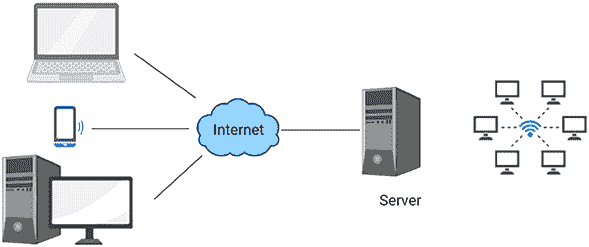

**图 2.1.** 中心化与分布式点对点网络。使用 BioRender.com 创建。

区块链的区块可能包含如业务交易记录或医疗记录等信息。当上一个区块的数据被输入后，就会创建新的区块。区块链网络（例如全球医疗设备制造商和消费者的全球网络）对成员数量没有限制 [3]。在区块链中，每个节点都可以访问整个链，该链会不断更新和同步。节点是访问区块链副本的计算机，并被称为节点。加入区块链网络的人可以访问所有数据。然而，对于所有区块链都是如此，即使它们被以各种方式使用。区块链可以是私有的，只有具有一组特定权限的网络成员才能访问它；也可以是公共的，就像区块链网络那样。

### 2.1.2 区块链技术的不同特征和成本

涉及到数据库时，并没有单一的“区块链”。相反，存在一系列区块链实现替代方案，每种方案都有其自己的优缺点。大多数区块链具有“仅允许添加”的结构。然而，区块一旦包含在区块链中，就无法更改或删除。利用“仅允许添加”结构可以确保区块链的完整性，这使得每个成员在每个区块包含在区块链时都能独立地验证每个新区块。链中数据区块记录的每笔交易都使用一种称为“加密哈希”的技术赋予唯一的字母和数字组合。哈希过程将建立一个新代码，该代码与同一条区块链中的现有代码不一致，并向网络用户提示可能的数据篡改问题。网络中的参与者越多，通过同时入侵许多公共账本的副本来修改区块链区块就越困难。用于商品的公共区块链具有高昂的运营成本和能源消耗；因此任何人都可以匿名加入并参与。根据一项估计，典型的美国家庭每笔比特币交易消耗 718.53 度电，这几乎是一个美国家庭在 24 小时内的用量。为了让公共区块链验证账本上的新数据区块，需要被称为“挖矿”的过程。网络上的节点竞争验证区块，参与挖矿的将获得奖励。比特币交易会与之前的区块进行对比，以确保相同的金额不会多次传输到同一个地址。当挖矿发现的结果与链共享时，可能会达成网络共识。如果区块被公开，交易最快只需十分钟即可完成，最则需要一天 [4]。“工作量证明”是团队同意添加区块时的术语。私有链可能不需要“工作量证明”技术，因为所有节点都经过了授权并且相互彼此。其他共识标准包括“权威证明”，它将网络节点验证责任委托给特定节点；以及“拜占庭高可用性”，它允许在某些传感器节点未投票的情况下创建区块，这可以用于授权用户的私有网络来验证信息并修复任何差异或冲突。

### 2.1.3 区块链符合数据的透明性和不可篡改性

区块链的不可篡性和透明性使其成为存储交易的理想选择。你也可以说数据区块非常小，而且网络用户之间的信任有限 [5]。为了增强供应链或验证患者、医生和供应商的身份，区块链可能可行的方案。由于区块链处理和存储能力的限制，大量数据无法存储（节点） [6]。在存储大量数据（如医疗记录和基因信息）时，区块链存储是低效且昂贵的。

大多数经合组织（OECD）国家都建立了隐私法，因为健康数据特别为敏感。即使数据已经去了标识化，将其置于“链”上并让网络的其他部分访问也会构成对隐私的严重侵犯 [7]。尽管在技术上是可行的，但无法删除个人健康数据的元数据导致了隐私担忧，因为患者的身份可能会被泄露。隐私方面的担忧便由此产生。如果将区块链上的数据设为公开访问，可能会违反数据最小化和使用限制。在许可链区块链中，有方法可以确保合规性，在这种链中，所有节点都相互知晓并被允许访问和为网络贡献。作为额外的安全预防措施，账本的一个子可以供若干网络节点访问。由于分布式账本缺乏中央数据控制者（例如负责数据并担任其托管人的组织），患者和医疗提供者无法行使他们的法律权利。个人数据用户在《欧盟数据保护条例》（DPR）下还拥有额外权利 [8]，包括访问和修改其数据的能力。根据科学技术促进委员会（2019 年）的说法，区块链的“仅追加”特征（禁止从链上修改或删除数据）这与《欧盟数据保护条例》中的删除权相冲突。与传统数据库相比，分布式账本使得查找某些单词或信息变得更加困难。因此，它们作为临床和研究数据存储库的功能受到了限制。基于区块链的账本的用户界面仍在开发中；因此它们无法广泛部署。随着区块链在更多业务中的采用和使用，未来可能会出现新的技术解决方案 [9]。

## 2.2 健康领域的区块链应用

然而，在区块链应用于医疗保健行业之前，仍有大量工作需要完成。大多数研究中区块链元素缺乏技术理解，且没有原型或试验实施（见图 2.2）。区块链技术仅被少数国家卫生系统所采用。在爱沙尼亚和马耳他已经发现了将区块链用于善举的示例，例如数据安全以及患者知情同意管理。医疗供应链管理、患者知情以及身份认证是医疗保健领域最有前景的三个区块链用途 [10]。

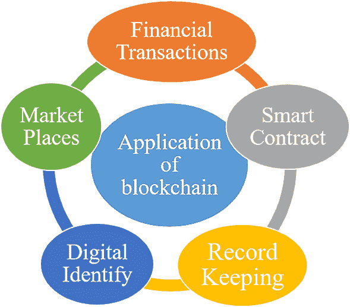

**图 2.2.** 区块链技术应用示意图。

### 2.2.1 用于医疗身份管理的区块链

卓越的健康结果需要具备准确识别和验证他人及机构身份的能力。患者、医疗工作人员以及研究机构和大学等机构都属于这一类 [11]。当一个人的身份存在多个版本时，使用区块链有助于维护该人员身份的真实性和准确性。可穿戴健康设备和物联网（IoT）的兴起将导致这些数据重要性的增加。例如，这些数据需要恰当地与患者的电子病历挂钩。

对于患者、认证机构和购买方而言，医疗提供者提供正确且最新的信息以便发现他们并对其进行适当报销是至关重要的。区块链的使用可能会提高信息的准确性和真实性。

区块链对记录所做的每处更改都有不可篡改的记录。区块链程序 `KSI` 保护官方数据，包括电子健康信息。通过采用 `KSI` 技术，可以保持用户的个人信息安全匿名。你可以将记录的编辑版本与其原始版本进行比较 [12]。这些指令相关的交易足迹比真实的健康数据要小得多。区块链与其他数字进步一样，在健康信息系统中与其它技术结合使用时效果最好。

### 2.2.2 用于患者管理的区块链

由于其提供的透明度和可审计性，区块链技术可能成为处理个人健康信息的传统方法的替代方案 [13]。医疗专业人员和其他重要参与者应该能够访问患者数据，以便提供直接护理，或让二次研究或统计利用这些数据（例如研究人员和社会工作者）。

由于电子数据可能会无限期地和重复使用，因此使用“动态”结合“增量”的同意模型，是“一揽子”以及“仅限一次”许可模型的极佳替代方案。如果个人想要更改其批准或同意条款，可以插入一个新区块来覆盖之前的指令 [14]。

马尔他生物样本库使用基于区块链的 `Dwarna` 系统处理个人在研究项目中使用其生物样本的个体授权。`Dwarna` Web 平台 [15] 在区块链上永久且不可撤销地记录个体的同意情况。选择参与哪些研究、撤回同意以及请求处置生物样本的机会，都有助于增加人们对生物样本库的信任。

顾如其名，`MedRec` 利用了区块链技术，该技术由 MIT 媒体实验室创建，用于将医疗记录与其他数据库的访问权限和数据检索指令链接。它通过基于区块链的“智能合约”记录患者与提供者之间的交互。一旦执业人员开发并认证了某医疗记录，患者将被允许访问其医疗数据。当创建新的医疗记录时，接收者将收到一个自动通知和一个加密链接 [16]。权限可以在链上找到。在技术的帮助下，患者可以查看并控制自己的数据。

药物、血检、免疫记录和其他治疗方面已经取得了一些积极成果。`RadBit` 让患者在保持其医疗照片所有权的同时，确保监管链的不可篡改性。区块链用户可以创建“令牌”，并将其发行给医疗保健提供者和保险公司，以便他们能够访问区块链 [17]。只有随后被确认并作为相关报告发送的权限指令会被包含在令牌的监管链中。因此，通过使用盲签名（比传统签名更安全）、多个机构的签名或在仍确认发送者和用户身份的情况下，可以提高消息的完整性。

随着在生物医学研究中使用基于区块链的技术进行患者授权和许可，数据交换和访问权限得到了改进。区块链赋能医疗保健（IMI 2018）项目以及制药用户软件交换计划（PhUSEBlockchain 项目）是两个主要的区块链支持的制药生态系统倡议。区块链技术能够保护临床试验参与者的敏感信息。如果设置得当，区块链的个人隐私和研究团队对收集数据质量的信任都将得到保护 [18]。

健康记录、信息、软件、代码以及与医疗研究相关的其他材料已包含在一个名为 `Research Foundry` 的新区块链计划中。这包括对 COVID-19 大流行的研究。通过确保参与者遵守相关数据隐私法规，跨境合作将变得更加容易。网络上的节点想要与其他解决方案用户共享的数据由它们控制。相比之下，虽然健康数据存储可以对区块链节点保持私密，但其元数据可以与所有成员共享。如果其他节点同意共享全部或部分数据，它们可以使用该仓库。在访问仓库之前，数据所有者必须授予技术提供者访问权限。

## 2.3 用于医疗和制药供应链的区块链

商品供应网络管理是区块链在商业领域中最典型的用途。区块链技术正被用于监控医疗行业中的血液制品、医疗用品以及医疗设备 [19]。

以下是该领域区块链应用的一些示例：

- **产品识别**：更快、更简单地验证产品的唯一身份（例如在产品故障的情况下）。
- **追溯**：制造商、分销商和配药师可以使用分布式账本来自动验证相关信息。
- **产品验证**：检查假冒、未经授权或有害物品，并使公共和私立参与者能够找到它们。
- **通知与响应**：实现一种安全程序，向相关部门报告不合规物品或交易。

由于对抗 COVID-19 对医疗用品和设备的需求巨大，医疗保健系统发现获取这些物品非常困难。供应网络的崩溃导致了信任缺失。对新供应商的担忧包括标准合规性、海关认证、产品准时交付以及欺诈活动。应该避免新的供应商。供应商对预付款的要求加剧了这些信任问题。使用区块链技术可以确保供应商的真实性并追踪货物。据 2020 年 4 月的报道，`IBM Rapid Supplier Link` 将连接政府、医疗机构与非传统的技术、设备和供应提供商。

制药供应链一直备受信任问题的困扰。这些问题包括对知识产权保护、质量控制、盗版和销售非法药物的担忧。利用区块链的不可篡改性，可能验证供应商和买方的有效性。例如，在 `Hyperledger` 的“假药项目”中，产品被盖上时间戳并进入区块链进行追踪和验证。跟上需求和防止药品短缺变得越来越困难，区块链技术可能对这两个问题都有帮助。区块链技术已在中国医院投入，以实现向 COVID-19 患者家中精准监测并及时交付药物。医疗设备供应链中也存在类似的风险。安全性和有效性担忧，以及具有安全缺陷历史的高风险设备，都是这些困难的例子。一旦建立了公认的标准和协议，区块链可以为这些活动提供额外的安全性、透明度和真实性。在 COVID-19 疫情期间，ICU 床、病床以及救命设备是关键资源。管理这些资源是全国医疗保健提供者面临的主要挑战。在信任存在问题或信息交换受限的情况下，区块链可能是非常有价值的工具 [20]。

### 2.3.1 部署区块链的政策考虑

患者知情、数据共享与访问权限，以及药品和医疗设备供应链的管理，都是区块链可能被用于增强医疗系统的示例。为了获得最佳效果，应当将完善的医疗信息和数据基础设施与其他技术结合使用。在医疗保健领域使用区块链技术可能会被轻言或夸大。在谈到利用区块链进行医疗行业数字化转型时，互操作性和数据治理是其面临的最两个挑战性问题之一。只要没有中心权威来存储数据，区块链就没有消除对任何权威的需求。由于医疗数据是如此敏感，区块链技术的使用是必不可少的。区块链的运行取决于其参与者的协议，而非技术。总是需要由一个值得信赖的权威来建立规则（或者更准确地说，是“建立规则的规则”）。这些信息可能来自政府机构或既有机构。例如，澳大利亚标准协会（Standards Australia）已经制定了一份关于使用区块链启用技术的路线图。立法者必须考虑到技术开发和部署的费用。由于爱沙尼亚的国家医疗系统正在使用区块链技术，其技术开发和实施的直接成本非常低。一旦基础基础设施到位，就可以更廉价地添加额外的应用程序。必须投入资源以确保在任何技术变革过程中，该技术都能按照其预期方式被利用。在运行系统时，区块链架构的有效性与“链上”保留的数据量之间存在直接相关关系。传统的数据存储和管理方法将由于区块链淘汰，这要求所有参与方之间保持开放的通信。医疗保健人员必须接受教育和培训，以充分利用这一资源。随着公众参与和教育程度的提高，患者对其数据的权利和责任也将得到改善。

由于区块链是不可更改的，它们可能是危险的。健康相关数据尚无法从区块链中删除。即使数据已从链下删除，链记录仍然存在且无法擦除。现在关于这些信息是否构成个人健康数据存在着法律争议。随着问题的扩大，掩盖与特定签名相关的区块可能会带来新的解决方案。然而，这并不意味着基于区块链的账中的数据是正确的或具有可接受的质量。在批准使用其数据时，用户可能会受到不可信参与者的影响。随着人口老龄化，面临身体和心理伤害风险的人数将增加。有效的治理、立法和执法是解决这一问题的唯一途径。在研究区块链技术在健康领域的影响时，经合组织（OECD）理事会的《健康数据治理建议》是一个非常有用的起点。这里有几个程序，例如安全、隐私和许可。

### 2.3.2 协助政策制定者在医疗领域实施区块链技术的四项原则

1. **任务适用**。区块链是一种通用的数字技术，作为一种促进因素。就其本身而言，它只应在它是解决当前问题最佳答案的情况下使用。
2. **治理与监管的对齐**。基于区块链的解决方案与法律、规则和数据治理框架的合规性必须根据系统的特定方面进行审查。
3. **分步集成**。应将现有系统和技术与区块链启用的技术进行比较。在大规模之前之前应在受控环境中对区块链进行逐步评估，以确保它能补充并利用现有系统。
4. **在设计过程中让最终用户参与**。区块链要求数据和信息管理发生范式转变。由于这项技术的特性以及对数据所有权、访问和隐私的影响，包括患者和普通公众在内的用户必须获得知情。

### 2.3.3 医疗行业

在医疗业务中，保护患者医疗信息的额外监管义务造成了严重的安全和隐私威胁。随着云存储和移动医疗设备使用的扩大，恶意攻击的风险和隐私信息的泄露也随之增加。随着智能设备让消费者更容易获取健康数据，以及越来越多的人就诊多位医生，对健康信息共享和隐私的担忧日益增加。身份、透明度、数据共享、医疗信息传输以及对移动健康的关注，只是医疗行业面临的一些独特挑战。

## 2.4 医疗行业应用

### 2.4.1 系统安全


需要许多安全措施来保护敏感的医疗和健康数据，包括不可否认性和访问限制，以防止未经授权的方的访问或更改。患者文件和从传感器收集的数据都是医疗记录中可能存在的健康信息类型。在医疗记录从纸质转换为数字媒介的过程中，必须引入安全性和基于角色的权限来保护医疗记录。存储在医疗数据库中的数据应仅由经过适当授权的人访问，且这种访问应受到监控和执行 [21`]。查询应当审计并遵循访问控制以防止患者记录的修改或复制。由于不同系统使用了不同的加密标准（如电子健康记录、数字医疗记录和个人健康记录，或 `PHRs`），医疗记录的加密也可能存在问题。未安全的医疗记录可能会产生现实影响（例如敌意攻击对患者隐私的威胁，这可能会影响他们的声誉并导致经济损失）。

#### 2.4.2 互操作性

数据的共享和访问是一个安全问题，也是民用健康记录的一个关注点 [10`]。由于一个人的完整病史可能被存储在许多不同的地方，共享医疗记录可能是具有挑战性的 [10`]。这同样适用于医疗执业人员，如果他们的记录分布在多个地点，他们可能无法获得其患者的最新信息 [10`]。由于 `record linkage`（记录链接）的缺失——记录链接是指基于可能共享也可能不共享共同标识符（如社会安全号码）的实体来链接数据库的想法——共享医疗数据变得非常困难。在数据交换方面，互操作性是一个重大问题 [11`]。

#### 2.4.3 数据共享

个人的医疗记录可能存储在多个地方，这使得与其他医疗保健提供者共享记录变得困难 [22]。如果患者的医疗记录保存在其他地方，患者和医疗保健人员都无法获取其患者的最新信息 [10]。共享医疗保健信息具有挑战性，因为在记录链接方面存在差距，记录链接是指根据可能具有或不具有共同标识符（如社会安全号码）的实体来合并数据库的概念。

#### 2.4.4 移动性

患者的移动性以及医疗信息便携的需求正推动着医疗行业对移动性日益增长的需求 [23, 24]。从日益常见的智能设备、传感器以及其他联网设备传输数据的能力正变得至关重要。在任何地方、通过任何设备进行实时共享和访问的需求使得数据安全变得更具挑战性，这进一步加剧了已经存在的问题。在本章中，主要有三种移动类型：无线、移动健康以及物联网（`IoT`）。

#### 2.4.5 移动健康

低功耗体域无线网络、微型传感器以及广泛使用的智能手机都是医疗保健应用中新兴领域 `mHealth`（移动健康）的一部分。在许多方面，`mHealth` 面临着大多数医疗行业中心化服务器系统所面临的问题。至关重要的是，这些只是需要关注的问题中的一部分。无线传感器网络（`WSNs`）和 `Ios` 需要大量的资源来确保隐私和安全，然而未管理和受损害的医疗信息可能会损害患者和移动健康应用的未来 [25, 26]。这是因为采用技术的医疗机构可能缺乏有效保护患者信息的能力。如果设备放置错误或连接到不安全的网络，可能会发生恶意软件和其他有害攻击 [27]。除了在医疗行业的使用外，可穿戴技术还可能产生安全后果。可穿戴技术带来了涉及法定保护和敏感健康信息的隐私问题。传感器、设备和智能技术以信息泄露、数据或服务拦截、信息修改、否认、不可用以及真实性/有效性丢失等形式构成了隐私问题。

#### 2.4.6 无线

随着 `WBAN` 部署中可穿戴体传感器的普及，出现了一些新的安全疑虑。这些包括需要确保数据是精确且最新的，同时还要确保 `WBAN` 网络对用户始终可用 [28]。由于 `WBAN` 设备资源有限，它们还需要轻量级的安全解决方案 [13]。

可穿戴健康技术的其他问题包括数据损坏、设备故障以及用户为了个人利益而篡改数据。如果胰岛素等救命药物被植入式医疗设备成功破解，可能会产生严重的甚至是致命的健康危害。在无线医疗以及医疗应用积极进行大规模应用研究之前，必须解决与健康相关攻击相关的安全和健康问题 [26]。

#### 2.4.7 物联网

患者参与医疗决策的增加导致医疗保健领域 `IoT` 技术使用率的提高 [29, 30]。结果是患者更愿意在治疗中采取更积极的角色。一些医生可以使用智能设备或收集并通信关键健康数据的传感器技术，远程监控患者的慢性疾病 [31]。可穿戴传感器、皮肤微芯片和接触性眼镜是帮助人们做出更好健康决策的 `IOT` 技术示例 [32–35]。无线系统不如数据库等敏感系统安全，容易受到各种攻击。针对 `IoT` 的攻击有两种：主动攻击和被动攻击。当数据包跨越网络时，攻击者可以更改其最终目的地 [36]。数据包包含的信息还可能在通过网络时被敌者拦截或“嗅探”。这被称为主动攻击 [37]。系统安全、管理员安全、数据安全以及信息安全都容易受到攻击。医疗应用程序的用户必须处理与保护其身份、位置、足迹和所有隐私相关的问题 [38]。第三方云公司在医疗机构之间共享健康数据引发了隐私担忧。外部服务提供者对患者和医疗数据的使用和管理是这些担忧的核心 [19]。除了访问控制隐私漏洞外，物联网技术还将推理攻击作为隐私担忧的来源 [39]。无线窃听技术和数据挖掘可能被恶意行为者用于确定通信或信号的价值。推断出的数据可能被用于钓鱼尝试，以进一步破解账户 [14]。`Wi-Fi` 网络容易受到各种攻击，其中一些可以以主动方式实施，另一些可以以被动方式实施。

## 2.5 结论

区块链技术可以解决医疗行业面临的一些问题。由于全球账本加上与块相关的架构，安全性、完整性、可用性、去中心化和验证原则 [39] 是区块链技术在医疗领域研究最广泛的应用之一。联网设备、物联网、智能设备和传感器正给医疗行业带来问题。患者的医疗记录更容易被恶意者访问和复制，使得医院在更加互联的世界中更难为患者提供更好的护理。由于记录过时，患者可能会出现健康问题或误诊，并在确认身份方面面临挑战。正如本研究的综述所示，区块链技术可以解决许多医疗问题。目前应用的主要问题是识别、有效性、记录共享、兼容性、`IoT` 安全、边缘主机保护以及患者赋能。最终目标是通过赋予患者对其医疗数据共享的控制权来支持他们，并允许他们在安全的环境中进行数据分析。

### 参考文献

[1] Clauson K A, Breeden E A, Davidson C and Mackey T K 2018 利用区块链技术增强医疗保健供应链管理：医疗供应链挑战与机会的探索 *Blockchain Healthc. Today* [1](http://dx.doi.org/10.30953/bhty.v1.20) 20

[2] Angeletti F, Chatzigiannakis I and Vitaletti A 2017 区块链和物联网在数字临床试验招募者中的作用 *2017 25th Int. Conf. on Software, Telecommunications and Computer Networks (SoftCOM)* pp 1–5

[3] Vazirani A A, O'Donoghue O, Brindley D and Meinert E 2019 实现高效医疗保健的区块链：系统综述 *J. Med. Internet Res.* [21](http://dx.doi.org/10.2196/12439) e12439

[4] de Vries A 2022 比特币能量消耗指数 *Digiconomist* [`digiconomist.net/bitcoin-energy-consumption`](https://digiconomist.net/bitcoin-energy-consumption) (访问于 2022 年 10 月 15 日)

[5] Hölbl M, Kompara M, Kamišalić A and Nemec Zlatolas L 2018 医疗保健中区块链使用的系统综述 *Symmetry* [10 470](http://dx.doi.org/10.3390/sym10100470)

[6] Taylor P 2016 区块链应用于医疗可追溯 *Secur. Ind.* [`securingindustry.com/pharmaceuticals/applying-blockchain-technology-to-medicine-traceability/s40/a2766/#.V5mxL_mLTIV`](https://securingindustry.com/pharmaceuticals/applying-blockchain-technology-to-medicine-traceability/s40/a2766/#.V5mxL_mLTIV)

[7] Burstiq [https://burstiq.com/](https://burstiq.com/) (访问于 2022 年 10 月 3 日)

[8] Dubovitskaya A, Novotny P, Xu Z and Wang F 2020 区块链技术在肿瘤学数据共享中的应用：系统综述结果 *Oncology* [98 403–11](http://dx.doi.org/10.1159/00050425)

[9] 区块链网络 [`himss.org/library/blockchain-networks`](https://himss.org/library/blockchain-networks) (访问于 2022 年 10 月 24 日)

[10] 区块链标准路线图 [`standards.org.au/getmedia/ad5d74db-da9-4685-b1710ee0e1/Roadmap_for_Standards.report`](https://standards.org.au/getmedia/ad5d74db-da9-4685-b1710ee0e1/Roadmap_for_Standards.report) (访问于 2022 年 10 月 24 日)

[11] 区块链与通用数据保护条例。PE 634.445. 布鲁塞尔：欧洲议会服务部门 [`europarl.europa.eu/RegData/STUD/2019/63445/EPRS_STU201963445_EN`](https://europarl.europa.eu/RegData/STUD/2019/63445/EPRS_STU201963445_EN) (访问于 2022 年 10 月 24 日)

[12] Mettler M 2016 医疗保健中的区块链技术：革命在此开始 *2016 18th Int. Conf. on e-Health Networking and Services (Healthcom)* pp 1–3

[13] Small A and Wainwright D 2018 电子记录的隐私与安全——定制多方法论以探索基于角色的访问系统的社会政治问题 *Eur. J. Oper. Res.* [265 344–60](http://dx.doi.org/10.1016/j.ejor.2017.041)

[14] 465 名患者被告知去看医生修复起搏器 [`arstechnica.com/information-technology/2017/08/465k-need-a-firmware-update-to-prevent-serious-pacemaker-hacks/`](https://arstechnica.com/information-technology/2017/08/465k-need-a-firmware-update-to-prevent-serious-pacemaker-hacks/) (访问于 2022 年 10 月 23 日)

[15] Mamo N, Martin G, Desira M, Ellul B and Ebejer J 2020 Dwarna：生物样本库动态同意的区块链解决方案 *Eur. J. Hum. Genet.* [28 609–26](http://dx.doi.org/10.1038/s41431-019-9)

[16] 什么是 MedRec? [`medrec.mit.edu/`](https://medrec.mit.edu/) (访问于 2022 年 10 月 24 日)

[17] MediLedger 网络获取自 [`mediledger.com/`](https://mediledger.com/) (访问于 2022 年 10 月 24 日)

[18] Sahi M 2017 电子医疗环境中的隐私保护：现状与未来方向 *IEEE Access* [6 464–78](http://dx.doi.org/10.1109/ACCESS.2017.561)

[19] Al Ameen M, Liu J and Kwak K 2012 医疗应用无线传感器网络的安全与隐私问题 *J. Med. Syst.* [36 93–101](http://dx.doi.org/10.1007/s10916-012-4)

[20] Ting D S, Carin L, Dzau V and Wong T Y 2020 数字技术与 COVID-19 *Nat. Med.* [26 459–61](http://dx.doi.org/10.1038/s41591-020-5)

[21] Abouelmehdi K, Beni-Hssane A, Khaloufi H and Saadi M 2017 医疗保健中的大数据安全与隐私：综述 *Procedia Comput. Sci.* [113 73–80](http://dx.doi.org/10.1016/j.procs.2017.892)

[22] Mohan P and Singh M 2016 智能医疗环境的安全策略 *Procedia Comput. Sci.* [92 161–7](http://dx.doi.org/10.1016/j.procs.2016.7)

[23] Tseng T W, Yang C and Liu C 2016 医疗记录隐私信息保护 *2016 Int. Conf. on Computational Science and Computational Intelligence (CSCI)* pp 75–80

[24] Al-Muhtadi J, Shahzad B, Saleem K, Jameel W and Orgun M 2019 多云环境下社交移动医疗应用的网络安全与隐私问题 *Health Inform. J.* [25 315–29](http://dx.doi.org/10.1177/146045821770618)

[25] Sinha S R, Park Y, Sinha S R and Park Y 2017 处理安全、隐私、访问控制与合规 *Building an Effective IoT Ecosystem for Your Business* (Cham: Springer) pp 155–76

[26] Sangpetch O and Sangpetch A 2016 分布式医疗平台的安全上下文框架 *Internet of Things Technologies for HealthCare: 3rd Int. Conf. HealthyIoT* **vol 18–19** pp 71–6

[27] Kotz D, Gunter C A, Kumar S and Weiner J P 2016 移动医疗中的隐私与安全：研究议程 *Comput* [49 22–30](http://dx.doi.org/10.1109/MC.2016.185)

[28] Li H, Wu J, Gao Y and Shi Y 2016 个人对医疗可穿戴设备的采用：基于隐私计算视角的实证研究 *Int. J. Med. Inform.* [88 8–17](http://dx.doi.org/10.1016/j.ijmedinf.2015.12.010)

[29] Ding D, Conti M and Solanas A 2016 智能医疗应用及其相关的隐私问题 *2016 Smart City Security and Privacy Workshop (SCSP-W) (Vienna)* [1–5](http://dx.doi.org/10.1109/SCSPW.2016.7509558)

[30] 医疗黑客松前三项实用创新 [`cio.com/article/3161886/top-3-practical-innovations-from-yale-healthcare-hackathon.html`](https://cio.com/article/3161886/top-3-practical-innovations-from-yale-healthcare-hackathon.html)

[31] Baskar P, Joseph M A, Narayanan N and Loya R B 2013 April 喷射压力变化对双缸柴油发动机富氧强化性能的实验研究 *2013 Int. Conf. on Energy Efficient Technologies for Sustainability* pp 682–7

[32] 健康数据治理理事会建议。OECD/LEGAL/0433, 巴黎 [`oecd.org/health/health-systems/Recommendation-of-OECD-Council-on-Health-Data-Governance-Booklet.pdf`](https://oecd.org/health/health-systems/Recommendation-of-OECD-Council-on-Health-Data-Governance-Booklet.pdf) (2022 年 10 月 24 访问)

[33] Dinev T, Albano V, Xu H, D’Atri A and Hart P 2016 个人对电子健康记录的态度：隐私计算视角 *Advances in Healthcare Informatics and Analytics* (Cham: Springer) pp 19–50

[34] Chowdhury E W R, Rahman M S, Al Islam A A and Rahman M S 2017 盐的秘密：让我们秘密地加加盐 *2017 Int. Conf. on Networking Systems and Security (NSysS)* pp 115–23


- [35] Fernando R, Ranchal R, An B, Othman L B and Bhargava B 2016 云端电子健康记录的面向消费隐私保护访问控制 *2016 IEEE 9th Int. Conf. on Cloud Computing (CLOUD)* pp 608–15
- [36] Al-Janabi S, Al-Shourbaji I, Shojafar M and Shamshirband S 2017 医疗应用无线体域网络主要挑战（安全与隐私）综述 *Egypt. Inform. J.* [`18` 113–22](http://dx.doi.org/10.1016/j.eij.2016.11.001)
- [37] Sajid A and Abbas H 2016 云辅助医疗系统中的数据隐私：现状与未来挑战 *J. Med. Syst.* [`40` 155](http://dx.doi.org/10.1007/s10916-016-0509-2)
- [38] Jain P, Gyanchandani M and Khare N 2016 大数据隐私：技术视角与回顾 *J. Big Data* [`3` 1–25](http://dx.doi.org/10.1186/s40537-016-0059-y)
- [39] 什么是协议？[`prismastatement.org/Protocols/Default.aspx%20`](http://prismastatement.org/Protocols/Default.aspx%20) (2022 年 10 月 24 访问)

---

# 英国物理学会出版（IOP Publishing）

# 融合于医疗保健的人工智能与区块链

## 一种协同方法

# Rishabha Malviya, Arun Kumar Singh, Sonali Sundram, Balamurugan Balusamy and Seifed Kadry

# 第 3 章

## 使用区块链实现医疗数据去中心化

数据可以被视为每种公司最有价值的资产，尽管每家公司都在转向云存储，但在不同领域，数据保护仍然是一个问题。由于医疗保健涉及最敏感的数据，因此它是最重要的领域之一。这是因为医疗信息、健康保险和其他数据都包含在医疗保健行业中。由于存储在 `EHR`（电子健康记录）中的数据具有敏感性，数据的安全性至关重要。例如，由于 `EHR` 系统日益流行，它们被视为潜在的区块链实施方案。为了更好地理解用于 `EHR` 系统的区块链选项，本章基于系统性的文献分析，并仅关注安全和隐私。在探索区块链在 `EHR` 系统中的潜在应用之前，本章首先回顾了关于 `EHR` 系统和区块链的背景介绍。在本章中，我们描述了如何在医疗保健行业中安全地访问和保存数据。

### 3.1 引言

全球范围内许多领域正投入大量努力通过数字化手段改进医疗保健系统 [1, 2]。2009 年美国恢复与再投资法案包含了奥巴马总统签署的《经济与临床健康技术法案》（`HITECH`）。随着 `HITECH` 法案的实施，`EHR` 将广泛使用，使患者和社会受益。科学界对 `EHR` 技术感兴趣是出于许多原因，包括患者在线访问、公共医疗管理，以及患者医疗数据的交换 [3–5](#Chapter_3.xhtml#bk978-0-7503-5839-2ch3bib5)。

在持续的 2019 年冠状病毒疫情中（通常称为 `2019-nCoV` 或 `COVID-2019`），`EHR` 得到了广泛利用。每项新技术的出现都会带来一系列运营和研究障碍。例如，传统 `EHR` 系统中的服务器架构通常是集中的，这引发了对安全和隐私的担忧（例如，单点疏忽）[6–8](#Chapter_3.xhtml#bk978-0-7503-5839-2ch3bib8)。

许多努力正在全球范围内许多领域致力于数字化改进医疗保健系统。在持续的 2019 年冠状病毒疫情中，`EHR` 得到了广泛利用。每项新技术的出现都会带来一系列运营和研究障碍。例如，传统 `EHR` 系统中的服务器架构通常是集中的，这引发了对安全和隐私的担忧（例如，单点疏忽）[6–8](#Chapter_3.xhtml#bk978-0-7503-5839-2ch3bib8)。

区块链技术在各个领域（包括公共卫生管理和伪造检测）的使用日益增加。通过区块链可以构建一个信任价值链，它是构建在时间顺序排列的区块之上的。这些分布式系统，是不受任何个人或组织控制的。区块链可以被认为构建在网络之上的分布式账本。这些分布式系统，是不依赖任何第三方的 [9–11](#Chapter_3.xhtml#bk978-0-7503-5839-2ch3bib11)。

数学和加密取代了半可信的中心机构，以在分布式节点之间建立信任关系。在区块链网络中，所有节点都可以随时随地查看账本，这确保了完全的透明度和网络成员之间的信任 [13]。维护账本中不可篡改记录的能力也有助于数据审计和问责。根据具体的实施，可以使用各种加密算法对账本中的数据进行加密。伪匿名化允许人们隐藏身份。由于智能合约是发布在全球区块链网络上的自动执行程序，它们可以被用于广泛应用于执行广泛的操作。当满足某些条件时，智能合约的条款将得到履行。这种新力量带来了数据所有权的新责任。`Gem`、`Guard time` 和 `Health Bank` 是现实世界中实施的区块链医疗系统的示例。

医疗系统如图 3.1 使用了区块链技术。区块链可以被认为是构建在时间顺序排列的区块之上的分布式账本。这些分布式系统，是不受任何个人或组织控制的。

因此，本章的重点是医疗区块链系统。具体而言，研究人员想要彻底分析一些之前的工作，并识别当前和未来的障碍及研究前景。在介绍我们的发现之前，将在后续部分回顾区块链和 `EHR` 系统的基础。

### 3.2 EHR 系统

在指及个人的电子医疗记录（`EMRs`）时，通常使用“电子健康记录”（`EHR`）一术 [14]。医疗机构的医疗保健人员（`EHR`）可能会将 `EMRs` 作为辅助医疗记录（`AMRs`）的信息源。患者的健康记录可能包含来自其所拥有和使用的可穿戴设备的信息。使用个人健康记录（`PHRs`）的人收集的数据可能会与医疗服务提供者（患者）共享。

需要查看患者数据以做出诊断的医疗工作人员可能会安全地访问 `EHR` 系统的数据 [14]。如果系统构建得当，降低数据丢失的风险是可行的。此外，这些系统日益增加的互连性使得保护传输中或存储的数据变得更加困难（例如，更多潜在的攻击向量）。为了协助敏感数据的隐蔽外泄，黑客可能会利用已知漏洞并在医院配发的移动设备（如患者健康记录或 `PHRs`）上安装恶意软件 [15]。

`EHR` 系统中的海量数据可用于机器学习和其他医学研究。数据使用方式的一个例子是预测疾病（例如，2019 新冠状病毒）[16]。收集并上传相关数据（如 `PHRs`）的智能设备以及各种物联网（`IoT`）设备对 `EHR` 可能会是有益的 [17]。由于比特币的流行，“区块链”一词已成为家喻户晓的名字，用于在不需要中央权威机构的情况下在不可信的网络上进行安全交易。

以下是区块链的一些最重要部分。区块链记录了特定期间发生的所有交易。一种链接（一个哈希值）用于将链中的每个区块与其前驱连接起来。链中位于创世区块之前的区块被称为父区块。每个区块由一个头部和一个主体组成 [18]。图 3.2 描述了区块链的组织结构。

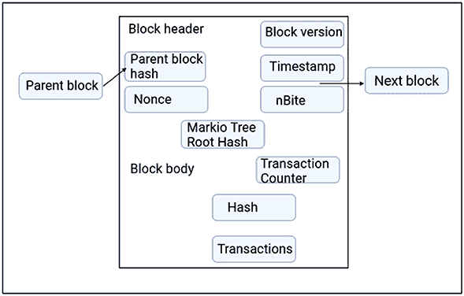

**图 3.2.** 区块的设计。

在区块头部中可以看到以下信息：

- **区块版本**：验证区块的规则。
- **前一个区块哈希**：前一个区块的哈希值。
- **时间戳**：当前区块的形成时间。
- **随机数 (Nonce)**：一个 4 字节的随机字段，矿工在每次哈希计算后对其修改，以解决工作量证明 (`PoW`) 难题。
- **主体根**：根据区块交易计算出的 Merkle 树根。
- **目标哈希**：新有效区块的哈希值。定义 `PoW` 的复杂性基于目标哈希。

在特定时期内验证的交易包含在区块主体中 [19]。Merkle 树中的每个叶节点代表一笔交易，而每个非叶节点都作为其子节点的唯一标识符，因为使用分支的哈希值验证交易比使用整个 Merkle 树要快。每当顶部有新交易时，根哈希就会更新 [20]。区块的大小和它能容纳的交易数量决定了其中可以存储的最大交易数量。只追加的结构使用哈希函数创建。由于之前确认的数据无法被更改或删除，新数据必须作为额外的区块添加到先前的区块中。每当区块被修改时，就会创建一个新的哈希值或链接 [21]。直接结果是获得了安全性和不可变性。

可以使用数字签名进行数字认证。在不可靠环境中的交易经常使用由非对称加密指定的数字签名进行认证 [22]。区块链利用非对称加密来传输和验证交易。区块链最流行的机制是椭圆曲线数字签名 (`ECDSA`) [23]。点对点网络 (`P2P`) 在所有节点接收到交易后广播。使用发送者的公钥可以验证区块的真实性 [24]。在所有节点备份该区块之前，它将无法访问。在矿工成功解决挑战后，区块将被添加到新区块。

例如，假设你想转账一些货币（参见图 3.3）。为了开始，Alice 使用私钥发起交易。通过 Alice 的公钥，可以验证转账 [25]。在 `P2P` 网络中，每个网络节点获得交易的副本。验证程序的第三阶段涉及节点与预设标准进行对比。直到所有节点备份了区块，它将被访问。

### 3.2.1 共识算法

区块链网络中不存在可靠的中央权威。研究人员提出的拜占庭将领问题 (`BG`) 通过在网络中的不可信节点之间达成共识，将其转化为分布式网络问题 (1982) [26, 27]。为了赢得战争，拜占庭军队必须被一组将军包围，每个将军指挥其中的一部分。在分散的环境下，他们不确定是否有叛徒会逃跑。因此，他们必须对是否攻击达成一致。区块链网络面临同样的问题 [28]。

已建议创建各种协议，以便在添加到区块链之前获得所有分散节点的共识：

- **PoW（工作量证明）**：比特币使用 `PoW` 共识算法来达成共识。矿工必须通过挖掘来证明自己的清白，以获得指定算力的报酬。节点必须不断哈希计算，直到哈希后的头部小于（或等于）获得接受的 `nonce` 值所需的哈希值。这不可实现，但在实践中很直观 [29]。由于计算非常困难，该项目是非常昂贵的。如果单个矿工或少数矿工干扰了新区块的创建，攻击者可能会利用区块链网络中的漏洞。
- **PoS（权益证明）**：引入了 `PoS`，这是一种有效且资源消耗远低于 `PoW` 的替代方案。从理论上讲，最容易受到攻击的节点发生攻击的可能性较低 `[30]–33]`。根据账户余额来选择节点是不公平的，因为最富有的节点容易控制网络。
- **DPoS（委托权益证明）**：`DPoS` 是一种共识机制。大多数情况下，`DPoS` 的选择是民主的，与依赖于所有节点的 `PoS` 选择不同。社区选举利益相关者代表来创建并验证新区块。需要验证区块的节点越少，剩余节点验证交易的速度越快。欺诈代表可能被简单地选出，这使其更容易保持一切良好运行。
- **PBFT（实用拜占庭容错）**：复制方法 `PBFT` 是一种处理拜占庭错误的三阶段技术。该过程的三个阶段是预准备、准备和提交。如果新区块在每个阶段都收到了总节点数三分之二以上的响应，则可以构建。少于三分之一的恶意拜占庭复制节点可以确保整个网络的准确性。许可链 `Hyperledger Fabric` 使用名为 `PBFT` 的共识机制来验证交易。
- 使用 `Raft` 的共识技术，计算机节点集群可以更好地管理它们的复制日志。每个任期的指定领导者必须批准并复制所有新交易。如果领导者从足够比例的已记录交易的追随者那里获得反馈，这些交易将被视为已提交 `[34]–38]`。`raft` 应适用于能够承受高达 50% 节点故障的联盟链或私有链。
- **PoA（权威证明）**：使用 `PoA` 共识技术可以节省大量时间。只有被允许构建新区块的节点才能这样做。每个节点必须先通过验证程序。另一方面，这种方法倾向于产生一个层次化的组织。
- **PoC（容量证明）**：这种共识方法不再依赖计算能力来证明其有效性，而是通过使用硬盘空间来实现。拥有的存储空间越多，形成新区块的可能性越大。
- **PoET（时间证明）**：`PoET` 的目标是根据每个参与者在可信执行环境中等待的时间长，随机且公平地选择区块生成者。

整合多种共识技术正变得越来越普遍，以提高各种应用程序的性能。

### 智能合约

这些自动执行的程序或智能合约的应用涵盖了广泛的领域，涉及金融、医疗以及政府。一个触发协议的交易可以发送到相应的合约地址，以执行复杂的编程任务。

这些自动执行的程序或智能合约的应用涵盖了广泛的领域，涉及金融、医疗以及政府。一个触发协议的交易可以发送到相应的合约地址，以执行复杂的编程任务 `[39]–40]`。这些自动执行的程序或智能合约的应用涵盖了广泛的领域，涉及金融、医疗以及政府。一个触发协议的交易可以发送到相应的合约地址，以执行复杂的编程任务。

这些自动执行的程序或智能合约的应用涵盖了广泛的领域，涉及金融、医疗以及政府。一个触发协议的交易可以发送到相应的合约地址，以执行复杂的编程任务。

首个自动执行的程序或智能合约的应用了广泛的领域，涉及金融、医疗以及 `DApps`。

### 3.3 区块链分类

首个自动执行的程序或智能合约的应用涵盖了广泛的领域，涉及金融、医疗以及 `DApps`。

#### 3.3.1 公有区块链

任何个人都可以加入开放区块链，智能合约的应用涵盖了广泛的领域，涉及金融、医疗以及 `DApps`。

#### 3.3.2 私有区块链

要加入私有区块链，成员必须先被邀请。`Ethereum` 和 `Bitcoin` 是常见的。

#### 3.3.3 联盟链

首个自动执行的程序或智能合约的应用涵盖了广泛的领域，涉及金融、医疗以及 `DApps`。

### 3.4 区块链的动力

`EHR`（电子健康记录）经常包含人口统计数据，智能合约的应用涵盖了广泛的领域，涉及金融、医疗以及 `DApps`。`[41]–43]`。由于隐私和监管考虑，这将是挑战性的。中心化的服务器架构特别容易受到影响 `[44]–47]`。

随着人们变得更加移动，数据交换也变得越来越重要。通过利用各个医疗小组之间的连接，可以提高服务的交付 `[48]–52]`。由于信息孤岛，更多数据重复。

《健康保险流动性与责任法》（`HIPAA`）于 1996 年被美国会批准 `[53]–55]`。为了保护隐私健康信息的机密性而制定的法规包括以下：

`ISO27789` 的创建是为了确保 `EHR` 能够在多个系统和领域之间进行验证 `[56]`。每当系统按照 `ISO27789` 要求启动操作时，就需要产生审计记录。研究人员认为，当发生所谓的侵权行为（例如数据泄露）时，审计和事后调查需要一种交互且透明的数据共享方法。

为了患者健康数据的真实性、完整性或机密性，医疗系统根据 `Title 21 CFR Part 11` 的义务实施文档加密和数字签名标准化等方法 [57]。基于上述相关标准和要求，在创建下一代安全电子健康记录（`EHR`）系统时，必须考虑以下问题：

- 信息的质量以及可靠性（例如：禁止任何未经授权的更改且是可检测的）。
- 数据安全与隐私。
- 简化的信息交换方法。
- 患者能够监控他们的 `EHR`，并在数据丢失或在未经许可的情况下被访问时收到警报。
- 在设计即取证（forensic-by-design）、数据审计和问责方面。

通过区块链可以获得以下特性：

- **去中心化**：与依赖具有某种信任度的第三方的中心化系统不同，区块链系统没有这个问题。
- **安全性**：去中心化的区块链技术可以防止单点故障和内部攻击。
- **伪匿名性**：为了保持身份秘密，每个节点都被分配了一个公钥伪匿名地址。
- **不可篡改性**：区块链使用的单向加密哈希算法使其在计算上无法删除或编辑块中的任何记录。
- **自主性**：患者可以修改智能合约的规范来控制其信息的共享方式，并被赋予此类选择权。
- **激励机制**：通过使用区块链的激励机制可以促进医疗服务和研究。
- **可审计性**：由于区块链上的每笔交易都被记录，因此维护任何活动的追踪变得简单。

因此，在 `EHR` 系统中适当实施区块链可能会提高数据质量和隐私，鼓励企业和个人共享数据，并使审计或问责变得更容易 [58–62]。

### 3.5 基于区块链的 EHR 系统

基于对全新的保护型 `EHR` 系统的性以及区块链的特性，本节将集中于开发基于区块链的安全 `EHR` 系统的主要目标。

1. **隐私性**：核心数据仅供授权的人员访问。
2. **安全性**：机密性、完整性和访问信息的能力（CIA）。
3. **机密性**：只有获得授权的操作员才能访问数据。
4. **完整性**：必须发送正确的数据，且不被未经授权的（方）篡改。
5. **可用性**：对合法用户访问信息和其他资源没有不当的限制 [63, 64]。

目前医疗区块链研究的重点是以下关键领域，以实现目标：

- **数据存储**：如果有了存储设施，各种类型的私有数据可以安全地维护在区块链上 [65]。然而，在不影响速度的情况下处理海量数据是一个大问题。
- **数据共享**：数据所有权逐渐归还给患者，然后他们可以根据自己的意愿自由或不披露其数据 [66, 67]。
- **数据审计**：审计日志可以作为争议中的证据，以确保 `EHR` 用户负责任 [68, 69]。区块链保留了每笔交易的跟踪。
- **身份管理器**：每个用户的身份必须在系统中通过验证。

### 3.6 数据存储


确保数据安全提高的一种方法是将区块链技术与 EHR 系统结合。即使公共账本中的所有原始信息都经过加密，敏感信息仍可能通过统计攻击暴露。基于区块链的 EHR 系统应该包含额外的防护措施来保护患者数据 [70–75]。加密和非加密保护解决方案包括加密、匿名化以及访问控制系统。两种常见的加密类型是对称密钥加密（SKE）和公钥加密（PKE）。依赖区块链的 `MediBchain` 采用公钥加密（ECC）来加密私有数据并通过安全通道传输。根据 Lee 和 Yang 的说法，应使用私钥和公钥将生物信息上传到区块链网络。根据 Zheng 等人的说法，云服务器在上传数据前应使用 `Rijndael AES` 等对称方案进行加密。`Shamir 秘密共享` 系统将对称密钥分成多份分给不同的密钥持有者。数据申请人只有在拥有足够的密钥份额时才能解密密文。如果少数密钥保管者被破解，数据就不会泄露。

医疗数据网关（Healthcare Data Gateway）是 Yue 等利用多方计算方法创建基于区块链的手机应用程序 [47]（`HDG`）。通过这种方法可以在隐私区块链数据上运行计算并获得结果，而不释放原始数据。另一个例子是，Guo 等人（2018）针对医疗区块链提出了一种基于多权威属性（MA-ABS）的签名系统 [76–80]。使用这种方法签名信息并不证明发送者的身份，而是证明由可识别机构分配的特征声明。通过在各个机构之间分发秘密伪随机函数（PRF）种子，系统可以抵御碰撞攻击 [81]。

流行技术的加密密钥必须定期更换，以抵御恶意攻击（例如统计攻击）。随着处理能力和存储空间变得越来越有限，保留旧密钥的成本将会增加，使得未来解密特定的历史信息变得更加困难 [82]。因此，存储和管理成本将会增加。对于区块链网络（BSNs），可以利用简单的备份加有效的检索密钥管理技术，使 BSN 最小化与密钥相关的存储费用，同时保护从人体传感器采集的数据机密性。通过使用消除密钥存储要求的模糊库技术，基于区块链的服务网络（BSNs）可以在不存储加密密钥的情况下解密数据。由于传感器数据使用对称加密编码（如 `AES` 或 `3DES`），攻击者将难以对其进行解码。

我们将比较和分析的一些系统如所示（见下文）。在大多数系统中，加密技术被用于保护区块链上的医疗数据。然而，没有哪种加密是不可破译的。在某些计算机上，加密会对计算能力产生巨大负担。交易的历史可能会暴露固定的账户地址以及有关用户活动和身份的信息。恶意攻击者可能会以某种方式破解公共账本中存储的加密文本。

另一方面，密钥管理是一个主要关注。为了确保完全的数据安全，私钥不能泄露。如果私钥丢失，持有者将失去对其持有数据的访问权限。如果攻击者获得了私钥/对称密钥，整个数据可能会暴露 [83]。为了保证电子健康记录（EHR）系统的安全性，开发者必须同时考虑加密和密钥管理。

为了进一步的保护，他们必须确保只有获得访问隐私信息的个人才能进行操作。访问控制机制是非加密技术使用的主要安全和隐私保护措施。访问控制机制的目的是识别、验证并为某些个人和群体提供访问。利用这项技术，可以广泛地实现具有最小数据泄露风险的安全性数据交换。

### 3.6.1 如何存储大型医疗数据

某些 EHR 系统可以将医疗数据上传到区块链上。一组设置以及限制的块大小使得在区块链上存储和处理海量信息变得困难。此外，这些数据容易受到隐私泄露的影响。

对于链上验证，只有特定的元数据以及相关原始信息的指针/索引（即离线数据库位置）被存储在区块链上，而海量的加密原始信息则通过信任第三方（即离线数据库位置，例如云计算）存储在链外 [84]。在降低区块链存储需求的同时，可以维持数据安全和匿名性。为了在任何时候获取用户的历史数据，他们可以使用最近区块链块的索引。可穿戴设备的数据通常被加密并保存在云端，持续一段预定的时间。区块链交易可被用于为机器学习购买健康数据 [85]。若要解密云存储数据，买方需要访问并控制足够的密钥份额。

研究人员开发了一种架构，通过利用外部存储来克服区块链的存储限制，并在发生错误警报时提供精确的回滚。使用像这样的数据库网关被用于存储离线医疗记录。根据网关是否被授予处理请求的权限，它可能提供请求的信息。云中的医疗数据受研究人员创建的 CCAC（基于 CP-ABE 的访问控制）保护 [49]。在云中，请求者可以通过获取涉及提取签名的数据来验证请求数据的质量和完整性。为了保护患者信息的隐私和安全，原始的 `SignedEHR` 利用医疗专业人员的属性签名进行签名，然后存储在信誉良好的第三方数据库中 [86]。医生必须使用去中心化签名来签署 EHR，这些签名的 EHR 必须通过提交相应的地址传输到区块链网络。在访问任何数据之前，必须验证用户的签名是否真实，而这只有在存在特定属性时才能完成。

纸质记录、文本、图像等均可用于存储医疗数据。由于区块链块大小的限制，为了医疗系统中信息的高容量存储，必须考虑其他方法。可以使用改进的 `JAVA UID` 类为每项影像研究产生唯一的 `DICOM UIDs`。通过利用 `DICOM UIDs`（`PHI`）在链外存储原始图像数据，可以阻止机密健康数据从区块链泄露。

一名研究人员描述了一种架构，使患者能够安全地向他人提供其影像数据的访问，以鼓励跨领域的影像交换。对于任何授权的研究，区块链上都不存储任何原始影像。研究表明，ICS 可能用于将各种形式个人健康数据组织成单一的可搜索表格。使用这种方法，数据可以上传一次并多次检索 [87, 88]。已构建了多级以及多维（`LD-Index`）索引。

利用类别和哈希索引对数据进行索引。B+ 树的叶节点提供了对每个类别的访问 [89]。对于共享的医疗信息，单元粒度使得使用 ICS 变得简单。在前面的章节中，许多系统已经使用了第三方数据库系统。客户可以通过使用第三方服务（例如云计算的远端）提供数据存储和计算能力来提高应用质量，但这会带来传输延迟 [90]。具有大存储容量和高性能处理的第三方服务已日益普及。由于高度依赖第三方服务，可能会出现单点故障。因此，某些云服务器可能会在用户不知情的情况下收集患者信息。星际文件系统（`IPFS`）采用分布式哈希表（`DHTs`）存储数据哈希值，并实现高存储吞吐量和快速数据检索，没有单点故障。

### 3.7 结论

本章展示了具有变革医疗行业的能力。许多科学和实践挑战阻碍了区块链技术完全集成到现有的 EHR 系统中。本节将对这些困难进行进一步探讨。我们的研究随后引导我们发现了一系列令人兴奋的新型探索领域，包括但不限于物联网、大数据、机器学习或尖端计算。这些结果将为帮助我们（老龄化）人口的未来 EHR 技术提供启发。

### 参考文献

[1] Shi S, He D, Li L, Kumar N, Khan M K and Choo K K R 2020 区块链在确保电子健康记录系统安全与隐私中的应用：综述 *Comput. Secur.* [**97** 101966](http://dx.doi.org/10.1016/j.cose.2020.101966)

[2] Ahram T, Sargolzaei A, Sargolzaei S, Daniels J and Amaba B 2017 区块链技术创新 *2017 IEEE 技术与工程管理会议. (TEMSCON)* 137–41

[3] Gentry C 2009 全同态加密方案 *博士论文* 斯坦福大学加州斯坦福福

[4] Kalam A A E, Baida R E, Balbiani P, Benferhat S, Cuppens F, Deswarte Y, Miege A, Saurel C and Trouessin G 2003 基于组织的访问控制 *Proc. POLICY 2003. IEEE 4 届分布式系统与网络策略国际会议* pp 120–31

[5] Rouhani S and Deters R 2019 基于区块链的访问控制系统：现状与挑战 *IEEE/WIC/ACM 国际网格智能会议* pp 423–8

[6] Daemen J and Rijmen V 2002 *Rijndael 的设计* (Cham: Springer) p 2

[7] Feng Q, He D, Zeadally S, Khan M K and Kumar N 2019 区块链系统中的隐私保护综述 *J. Netw. Comput. Appl.* [**126** 45–58](http://dx.doi.org/10.1016/j.jnca.2018.10.020)

[8] Huang H, Chen X and Wang J 2020 基于区块链的具有匿名性和可追溯性的多组数据共享 *Sci. China Inf. Sci.* [**63** 1–13](http://dx.doi.org/10.1007/s11432-018-9781-0)

[9] Ahsan M M, Wahab A W B A, Idris M Y I B, Khan S, Bachura E and Choo K K R 2018 用于云取证的云日志完整性与机密性方案 *IEEE Trans. Sustain. Comput.* [**6** 184–96](http://dx.doi.org/10.1109/TSUSC.2018.2833502)

[10] Patel V 2019 通过区块链共识实现医学影像数据安全去中心化共享的框架 *Health Inform. J.* [**25** 1398–411](http://dx.doi.org/10.1177/1460458218769699)

[11] Xia Q I, Sifah E B, Asamoah K O, Gao J, Du X and Guizani M 2017 `MeDShare`：基于区块链的云提供商之间无的医疗数据共享 *IEEE Access* [**5** 14757–67](http://dx.doi.org/10.1109/ACCESS.2017.2730843)

[12] Pham H L, Tran T H and Nakashima Y 2018 一基于区块链智能合约的医院安全远程医疗系统 *2018 IEEE Globecom 会议 (GC Wkshps)* pp 1–6

[13] Ramani V, Kumar T, Bracken A, Liyanage M and Yliantt M 2018 基于区块链的医疗系统的安全高效数据访问 *2018 IEEE 全球通信会议 (GLOBECOM)* pp 206–12

[14] Ab Rahman N H, Glisson W, Yang Y and Choo K R 2016 物理系统的取证设计框架 *IEEE Cloud Comput.* [**3** 50–9](http://dx.doi.org/10.1109/MCC.2016)

[15] Zhang P, White J, Schmidt D C, Lenz G and Rosenbloom S 2018 `FHIRChain`：将区块链应用于安全可扩展的临床数据 *Comput. Struct. Biotechnol. J.* [**16** 267–78](http://dx.doi.org/10.1016/j.csbj.2018.0704)

[16] Outchakouch A, Hamza E S and Leroy J P 2017 针对物联网的区块链和机器学习动态访问控制策略 *Int. J. Adv. Comput. Sci.* [**8** 417–24](http://dx.doi.org/10.1456/IJACSA.2017)

[17] Chen M, Yang J, Hao Y, Zhang J and Youn C H 2019 `5G 糖尿病`：基于医疗大数据的个性化糖尿病诊断 *IEEE Commun. Mag.* [**56** 16–23](http://dx.doi.org/10.1109/MCOM.2018.2833502

[18] Shae Z and Tsai J 2017 使用区块链实现的智能医疗系统 *IEEE 第 37 届分布式计算会议 (ICDCS)* pp 1972–80

[19] Yang R, Yu F, Si P, Yang Z and Zhang Y 2019 集成区块链与边缘计算系统：综述 *IEEE Commun. Surv.* [**21** 1508–32](http://dx.doi.org/10.1109/COMST.2019.2927)

[20] Azaria A, Ekblaw A, Vieira T and Lippman A 2016 `Medrec`：用于医疗数据的区块链 *第 2 届开放数据会议 (OBD)* pp 25–30

[21] Crameri K, Van Dam P and Prior S 2022 电子记录：什么影响了参与？文献综述 *Health Inform. Manag.* [**51** 143–62](http://dx.doi.org/10.1177/146045822211234)

[22] Benchou M, Ravaud P and Ha J 2017 用于提高临床研究质量的区块链 *Trials* [**18** 641–51](http://dx.doi.org/10.1186/s13075)

[23] Sivagami S, Nithy D and Neho M 2016 使用显微传感器的智能医疗系统 *Int. J. Contemp. Res.* [**2**]

[24] Gris G, Glisson W and Choo K R 2017 物理系统的设计：一种取证驱动的方法 *IEEE 计算、硬件与工程会议 (CHASE)* pp 108–13

[25] Dai W, Cui C, Choo K R and Jin D 2019 针对账户模型区块链隐私保护交易的高效 `NIZK` 方案 *IEEE Trans.* [**15** 725–37](http://dx.doi.org/10.1109/TSE.2019.2927)

[26] Fernández-A J, Señor I C and Lozoya P 2019 电子健康记录中的安全与隐私：系统综述 *J. Biomed. Inform.* [**46** 54–62](http://dx.doi.org/10.1016/j.jbi.2019.03.003)

[27] Buday M, Mangrulkar R and Ho S 2018 使用区块链实现的智能医疗系统 *IEEE 嵌入式系统创新会议 (IIEI)* pp 1204–11

[28] Lee S, Ha J, Yang P and Ranise S 2016 用于移动数据共享的区块链技术 *Int. J. Distrib. Sens. Netw.* [**14** 1508–32](http://dx.doi.org/10.1177/1460458216161234)

[29] Nguyen D, Pathirana P and Senevirat A 2019 用于安全电子健康记录共享的区块链 *IEEE Access* [**7** 66792–806](http://dx.doi.org/10.1109/ACCESS.2019.291755)

[30] Pussewalage H, Oleshchuk V and Tomasi A 2018 基于区块链的可委托访问控制：在医疗机构中的应用 *IEEE 绿色计算与通信会议 (GreenCom)* pp 19–35

[31] Tovanich N, Heulot N, Fekete J and Isenberg P 2019 区块链数据可视化：系统综述 *IEEE Trans. Visual. Comput.* [**27** 3135–52](http://dx.doi.org/10.1109/TVCG.2019)

[32] Ma S, Deng Y, He D, Zhang J and Xie X 2020 针对账户模型区块链隐私保护交易的高效 `NIZK` 方案 *IEEE Trans. Dependable Secure. Comput.* [**18** 641–51](http://dx.doi.org/10.1109/TDSC.2020.2969)

[33] Kaur A, Bansal S and Dattana V 2023 医疗保健中的区块链：系统综述与未来展望 *深度学习医疗决策* (Boca Raton, FL: CRC Press) pp 211–43

[34] Zyskind G, Nathan O and Pentland A 2015 `Enigma`：保证隐私的去中心化计算平台 arXiv 预印本 1506.03471](http://arxiv.org/abs/1506.03471)

[35] Wang W, Hoang D T, Hu P, Xiong Z, Niyato D, Wang P, Wen Y and Kim D 2019 区块链网络中共识机制与矿策略管理的综述 *IEEE Access* [**7** 22328–70](http://dx.doi.org/10.1109/ACCESS.2019.2896)

[36] Morelli U, Ranise S, Sartori D, Sciarretta G and Tomasi A 2019 基于分布式账本的审计访问控制：在医疗机构中的应用 *国际安全与信任管理工作会议* pp 19–35

[37] Liu J, Li X, Ye L, Zhang H, Du X and Guizani M 2018 `BPDS`：基于区块链的电子医疗记录隐私保护数据共享 *2018 IEEE 全球通信会议 (GLOBECOM)* pp 1–6

[38] Dey T, Jaiswal S, Sunderkrishnan S and Katre N 2017 `HealthSense`：物联网与区块链的医疗用例 *2017 Int. Conf. on Intelligent Sustainable Systems (ICISS)* pp 486–91


- [39] Al Omar A, Rahman M S, Basu A and Kiyomoto S 2017 Medibchain：一种基于区块链的医疗健康数据隐私保护平台*Int. Conf. on Security, Privacy, and Anonymity in Computation, Communication, and Storage: SpaCCS 2017 Int. Workshops, 2017, Proc. (中国,广州)* vol 10 December 12–15 pp 534–43

- [40] Esposito C, De Santis A, Tortora G, Chang H and Choo K K R 2018 区块链：医疗云数据安全与隐私的万灵药？*IEEE Cloud Comput.* [5 31–7](http://dx.doi.org/10.1109/MCC.2018.011791712)

- [41] Bahga A and Madisetti V K 2013 一种互操作电子健康记录（EHRs）的云方法*IEEE J. Biomed. Health Inform.* [17 894–906](http://dx.doi.org/10.1109/JBHI.2013.2257818)

- [42] Zhao H, Zhang Y, Peng Y and Xu R 2017 健康区块链密钥的轻量级备份与高效恢复方案*2017 IEEE 13th Int. Symp. on Autonomous Decentralized System (ISADS)* pp 229–34

- [43] Juneja A and Marefat M 2018 利用区块链在患者特异心律失常分类中重新训练深度学习架构*2018 IEEE EMBS Int. Conf. on Biomedical & Health Informatics (BHI)* pp 393–7

- [44] Strudwick G and Eyasu T 2015 护士在心理健康环境下的电子健康记录使用：文献综述*Arch. Psychiatr. Nurs.* [29 238–41](http://dx.doi.org/10.1016/j.apnu.2015.03.007)

- [45] Dias J P, Reis L, Ferreira H S and Martins  2018 电子健康场景下访问控制的区块链 arXiv 预印本 arXiv:[1805.12267](http://arxiv.org/abs/1805.12267)

- [46] Otero P, Hersh W and Ganesh A J 2014 大数据：生物医学健康信息培训计划准备好了吗？*Yearb. Med. Inform.* [23 177–81](http://dx.doi.org/10.15265/IY-2014-0007)

- [47] Yue X, Wang H, Jin D, Li M and Jiang W 2016 医疗数据网关：在区块链上通过新型隐私风险控制发现医疗智能*J. Med. Syst.* [40 1–8](http://dx.doi.org/10.1007/s10916-016-0574-6)

- [48] Kim M G, Lee A R, Kwon H J, Kim J W and Kim I K 2018 基于区块链的医疗问卷共享*2018 IEEE Int. Conf. on Bioinformatics and Biomedicine (BIBM)* pp 2767–9

- [49] Carvalho J V, Rocha Á and Abreu A 2016 医疗信息系统和技术的成熟度模型：文献综述*J. Med. Syst.* [40 1–10](http://dx.doi.org/10.1007/s10916-016-0486-5)

- [50] Ethereum：区块链应用平台 [`ethereum.org/`](https://ethereum.org/)

- [51] Johnson D, Menezes A and Vanstone S 2001 椭圆曲线数字签名算法（ECDSA）*Int. J. Inf. Secur.* [1 36–63](http://dx.doi.org/10.1007/s102070100002)

- [52] Zheng X, Mukkamala R R, Vatrapu R and Ordieres-Mere J 2018 使用云存储的区块链个人健康数据共享系统*2018 IEEE 20th Int. Conf. on e-Health Networking, Applications and Services (Healthcom)* pp 1–6

- [53] Menezes A J, Van Oorschot P C and Vanstone S A 2018 *应用密码学手册* (Boca Raton, FL: CRC Press)

- [54] McGhin T, Choo K K R, Liu C Z and He D 2019 医疗应用中的区块链：研究挑战与机遇*J. Netw. Comput. Appl.* [135 62–75](http://dx.doi.org/10.1016/j.jnca.2019.027)

- [55] Steinfeld R, Bull L and Zheng Y 2002 内容提取*Information Security and Cryptology—ICISC 2001:4th Int. Conf. Proc. (Seoul)* vol 4 pp 285–304

- [56] Croman K et al 2016 扩展区块链*Int. Conf. on Financial Cryptography and Data Security*

- [57] Gai K, Wu Y, Zhu L and Zhang Y 2019 许可边缘计算赋能的隐私保护智能网格*IEEE Internet J.* [6 7992–8004](http://dx.doi.org/10.1109/JIOT.2019.2904)

- [58] Lamport L, Shostak R and Pease M 2019 拜庭将军问题*Concurrency: The Works of Leslie* (SanRafael, CA: Morgan & Claypool) pp 203–26

- [59] Seol K, Kim Y, Lee E, Seo Y and Baik D 2018 基于 XML 的健康系统隐私保护属性访问控制*IEEE Access* [6 9114–28](http://dx.doi.org/10.1109/ACCESS.2018.2800)

- [60] Begoyan A 2007 电子健康记录互操作性概述* (Plano, TX: Society for Design and Process Science)

- [61] Ho S Y, Guo X and Vogel D 2019 医疗信息系统的机会与挑战：慢性病患者护理*Assoc. Inform. Syst.* [44](http://dx.doi.org/10.17705/CAIS)

- [62] Rifi N, Rachkidi E, Agoulmine N and Taher C 2017 使用区块链进行电子健康*2017 4th Int. Conf. on Advances in Biomedical Engineering (ICABME)* pp 1–4

- [63] Wang S, Zhang Y and Zhang Y 2018 去中心化存储中细粒度访问控制的区块链数据共享框架*IEEE Access* [6 38437–50](http://dx.doi.org/10.1109/ACCESS.2018.28511)

- [64] MultiChain：构建区块链的开放平台 [`multichain.com/`](https://multichain.com/)

- [65] Yaji S, Bangera K and Neelima B 2018 用于 AI 应用的部分同态加密区块链隐私保护系统*2018 IEEE 25th Int. Conf. on High Performance Computing (HiPCW)* (Piscataway, NJ: IEEE) pp 81–5

- [66] Mettler M 2016 医疗领域的区块链技术：革命从这里开始*2016 IEEE 18th Int. Conf. on e-Health Networking, Applications and Services (Healthcom)* pp 1–3

- [67] Boonstra A, Versluis A and Vos J F 2014 医院电子健康记录实施：系统文献综述*BMC Health Serv. Res.* [14 1–24](http://dx.doi.org/10.1186/1472-6963-14-370)

- [68] He D, Zhang Y, Wang D and Choo K K R 2018 IEEE P1363 公钥加密标准中身份签名方案的安全高效双方签名协议*IEEE Trans. Dependable Secure Comput.* [17 1124–32](http://dx.doi.org/10.1109/TDSC.2018.2857775)

- [69] Kamauu A W, DuVall S L and Avrin D E 2009 使用 Java 为 DICOM 对象生成全局唯一标识符*J. Digit. Imaging* [22 11–4](http://dx.doi.org/10.1007/s10278-007-9079-7)

- [70] Xia Q, Sifah E B, Smahi A, Amofa S and Zhang X 2017 BBDS：云环境下电子医疗记录的区块链数据共享*Information* [8 44](http://dx.doi.org/10.3390/info8020044)

- [71] Lin C, He D, Huang X, Khan M K and Choo K K R 2020 DCAP：基于区块链的安全高效去中心化条件匿名支付系统*IEEE Trans. Inf. Forensics Secur.* [15 2440–52](http://dx.doi.org/10.1109/TIFS.2020.2969565)

- [72] Hsieh G and Chen R J 2012 安全互操作的云端个人健康记录服务设计*4th IEEE Int. Conf. on Cloud Computing Technology and Science Proc.* pp 472–9

- [73] Brooks R R, Wang K C, Yu L, Oakley J, Skjellum A, Obeid J S, Lenert L and Worley C 2018 Scrybe：用于临床试验的区块链账本*IEEE Blockchain in Clinical Trials Forum: Whiteboard Winner*1–2

- [74] Liang X, Zhao J, Shetty S, Liu J and Li D 2017 集成区块链用于移动医疗应用的数据共享与协作*2017 IEEE 28th Annual Int. Symp. on Personal, Indoor, and Mobile Radio Communications (PIMRC)* pp 1–5

- [75] Yang G and Li C 2018 基于区块链的电子健康记录（EHR）系统安全架构设计*2018 IEEE Int. Conf. on Cloud Computing Technology and Science (CloudCom)* pp 261–5

### 参考文献

- [76] Blum M, Feldman P and Micali S 2019 非交互式零知识证明及其应用 *为密码学提供坚实基础：Shafi Goldwasser 和 Silvio Micali 的工作* pp 329–49

- [77] Jiang S, Cao J, Wu H, Yang Y, Ma M and He J 2018 Blochie: 一基于区块链的医疗信息交换平台 *2018 IEEE Int. Conf. on Smart Computing (SMARTCOMP)* pp 49–56

- [78] Nugent T, Upton D and Cimpoesu M 2016 使用区块链智能合约提高临床试验中的数据透明度 *F1000Research* [`5`](http://dx.doi.org/10.12688/f1000research.9756.1) 2541

- [79] Miah S J, Gammack J and Hasan N 2020 医疗分析解决方案的设计方法论：文献分析 *Health Inform. J.* [`26` 2300–14](http://dx.doi.org/10.1177/1460458219895386)

- [80] Sun Y, Zhang R, Wang X, Gao K and Liu L 2018 用于医疗区块链的去中心化属性签名 *2018 27th Int. Conf. on Computer Communication and Networks (ICCCN)* pp 1–9

- [81] GemOS: 区块链操作系统 [`enterprise.gem.co/`](https://enterprise.gem.co/)

- [82] Guo R, Shi H, Zhao Q and Zheng D 2018 电子健康记录系统中用于区块链的多多机构安全属性签名方案 *IEEE Access* [`6` 11676–86](http://dx.doi.org/10.1109/ACCESS.2018.2801266)

- [83] Kuo T T, Kim H E and Ohno-Machado L 2017 用于生物医学和医疗保健应用的区块链分布式账本技术 *J. Am. Med. Inform. Assoc.* [`24` 1211–20](http://dx.doi.org/10.1093/jamia/ocx68)

- [84] Lluch M 2011 医疗保健人员对健康信息技术的组织障碍——文献回顾 *Int. J. Med. Inform.* [`80` 849–62](http://dx.doi.org/10.1016/ijmedinf.2011.005)

- [85] Hardjono T and Pentland A 2019 许可链区块链中的可验证匿名身份和访问控制 arXiv:[1903.04584](http://arxiv.org/abs/1903.04584)

- [86] Dubovitskaya A, Xu Z, Ryu S, Schumacher M and Wang F 2017 使用区块链的安全可信的电子医疗共享 *AMIA Annual Symp. Proc. 2017* p 650

- [87] Lloret J, Parra L, Taha M and Tomás J 2017 使用 5G 的智能医疗监测架构和协议 *Comput. Netw.* [`129` 340–51](http://dx.doi.org/10.1016/j.comnet.2017.05018)

- [88] Feng Q, He D, Wang H, Wang D and Huang X 2020 用于身份签名方案的多方密钥生成协议 *IET Inf. Secur.* [`14` 724–32](http://dx.doi.org/10.1049/iet-ifs.2020.0096)

- [89] Hyperledger Fabric [`hyperledger.org/`](https://hyperledger.org/)

- [90] Nakamoto S 2008 比特币：点点电子现金系统 *Decentralized Bus. Rev.* 31 2260

# 用于医疗的人工智能区块链：协同方法

Rishabha Malviya, Arun Kumar Singh, Sonali Sundram, Balamurugan Balusamy 和 Seifed Kadry

# 第 4 章：利用区块链保护健康数据面临的挑战

在当今技术先进的世界里，医疗改革处于列表的首位。在发生自然灾害时，现有的健康数据库管理系统存在单点故障。医疗领域的数据管理问题已通过区块链技术迅速解决，该技术现在处于可行解决方案列表的前沿。为了保持医疗记录的安全，许多人对采用区块链技术感兴趣。当今医疗数据管理面临的最重要困难之一是：患者权限、数据所有权、管理、审计、隐私、安全、可追溯性和不可篡改性。许多研究已经结合这些潜在优势，考察了区块链在健康数据管理中的表现。本章描述了区块链技术如何改进医疗数据管理。本章探讨了区块链的基本优势、现有的实施方案，以及在医疗大数据处理中广泛应用的阻碍。

### 4.1 引言

医疗部门的快速数字化产生了经过数字化处理的传感器数据。全球的医疗数据研究人员和分析师发现，跟上物联网 (`IoT`) 设备以及其他来源产生的海量数据变得越来越困难。医疗数据提供者同样关注保护患者隐私。因此，提供专业服务和分析海量数据已变得日益困难。医疗大数据的关键参与者是健康保险公司、提供者、付费方和分析师。链中的高层面临着有效合作和沟通的巨大压力。这四方经常涉及安全和隐私漏洞。纸质医疗记录或可穿戴技术可能用于收集数据，但这些数据是由患者本人产生的。通过支付医疗费用帮助患者的人被称为“付费方”（例如保险公司以及私有来源等）。他们由医院、诊所、血库和其他接收并持有医疗记录的组织组成。这些人是利用资源提供的信息进行调查的人。


由于数据分散在各个组织中，这使得保持医疗数据安全变得更加困难。许多依赖中心化的现有医疗系统很容易受到网络攻击的影响。患者隐私和机密的丢失可能对医疗提供者及其服务的人产生深远影响。现有的医疗系统在患者数据管理缺乏安全性、不可篡改性、可靠的可追溯性、审计性和透明度。区块链技术似乎能够解决当今医疗系统中的这些挑战。

尽管已有关于区块链技术在医疗领域应用的研究，但很少有研究关注如何利用区块链技术来管理海量的医疗大数据 [[[6, 20–25]]。这将成为知识体系的一个重要补充，因为它将重点于管理海量医疗数据的区块链关键方面，包括其基本特征、实施机会和挑战，以及医疗行业在采纳关注的问题。下一节将包含：

- 区块链最值得关注的特征和属性概述，以及医疗业的潜在优势。
- 讨论如何利用这项技术来缓解医疗行业的一些问题。
- 该技术在各种医疗环境中的应用，涉及医院、诊所以及养老院。
- 确定该技术在医疗行业应用中所面临的主要挑战以及针对这些挑战的建议解决方案。

## 4.2 医疗大数据与区块链技术

### 4.2.1 医疗大数据

这种具有一系列特征的海量结构化数据通过计算机检查，以发现与之相关的模式 [3]。如果你正在处理一个巨大且复杂的数据集，则使用“大数据”一词来描述这一问题。由于医疗领域新的数字化进步，医疗业务几乎所有的元素现在都在产生大量的医疗数据。例如，医疗记录可以包括 X 射线和超声波图像、`MRI (磁共振成像)`、患者与医生的对话、类似的文本信息、临床图像等 [4]。来自各种医疗设备的传感器数据以及电子健康历（`EMRs`）是目前可获取的医疗领域两个主要的大数据方向。大数据与医疗数据挖掘在预测未来疾病方面有许多共同点。在患者的整个护理过程中，医疗机构收集的数据用于创建 `EMRs`。`IoT` 是具有收集数据潜力的大量设备集合。这些设备收集信息以跟踪患者各种器官或功能的健康状况。健康数据还面临来自医疗信号处理以及与物理数据泄露交换的风险 [13]。因此，对大数据进行上下文感知分析，并在处理之前仔细评估每种类型的数据是至关重要的 [14]。

### 4.2.2 区块链技术

加密哈希在多个层保护区块链这一所有交易及相关数据的去中心化数据库。区块链的三个支柱是点对点网络、共识机制以及公钥密码学 [26]。点对点网络通过根据协议确认新块来管理分布式账本。权限管理决定区块链是开放的、私有的，还是联盟的一部分 [27]。公共区块链上共识程序的参与对任何有互联网连接的人开放。在公共区块链奖励系统和加密数字身份验证中，采用了两种共识程序：区块链的去中心化机制保护了每个参与者的身份。在公共链和私有链方面，每种都处于单一公司的管辖之下。因此，区块链迫切需要一个可靠的中间人。区块链联盟结合了私有链和公共链的最佳元素。下面你将看到区块链技术对医疗行业的一些潜在收益，如表 4.1]。由于数据存储的去中心化，信息在多个地方保留了多个副本。存储在区块链上的数据只有拥有创建者读取权限的人才能访问。作为区块链的进一步优势，每个用户可以保留一份交易日志副本以供记录。在没有中央政府或第三方参与的情况下，该系统更加透明 [29]。

| 特征 | 说明 |
| --- | --- |
| 透明性 | 网络每 10 分钟验证一次，以对账交易并记录任何数据更改，网络上的每个人都会收到一份关于所有交易的全面且可审计的记录。得益于健康数据的透明性，可靠且可审计的交易账本将成为 [30]。区块链技术通过加密和管理系统，使医疗机构对药物开发、生产条件和利益相关者工作具有完全的可见性 [31]。 |
| 不可篡性 | 由于账本的不可篡性，任何从区块链账本上更改或删除数据的尝试都是被排除的。数据写入特定的内存块后无法修改，提供了额外的安全性 [28]。利用加密哈希加上区块链的不可篡性，可以更改审计程序 [15]。使用这项技术可以使健康数据交换更加安全和可靠。 |
| 数据所有者的访问控制 | 数据所有者可以使用区块链交易授予或撤销对数据的访问。重要的是，数据所有者可以根据不同的访问保护级别分配多个数据类别。一些初创公司可以保持医疗数据的私密，而另一些公司可能选择与少数组织共享甚至出售它们 [2]。区块链为执行元数据同意提供了可行手段。 |
| 评估数据质量并认证数据源 | 为了维持医疗信息的高度信任，医疗背景必须包含创建、访问以及传输健康数据所需的所有信息 [31]。区块链为用户提供了一种追踪数据任何更改的方法，以维护其完整性。利用区块链技术对医疗系统进行防篡是可能的。 |

## 分布式账本与共识

分布式账本与共识方法的结合为区块链提供了某些优势。`DLT`（分布式账本技术）减少了运营效率低的问题，导致管理费用降低。区块链的自更新特性确保了数据和文件的同步。另一方面，共识算法负责授权链交易。现在对于所有医疗利益相关者来说，单一事实来源已成为可能。共识节点验证所有有效交易都记录在一致的账本中，该账本通过时间戳过程传输给共识节点 [32]。

## 匿名性

例如，安全哈希算法（`SHA-256`）通过使用哈希值而非用户的真实身份创建匿名用户地址，解决了信任难题并增强了匿名性。匿名性确保了交易中发送方和接收方的身份。智能合约是基于消费者和供应商之间协议的自动执行程序，用于控制可追踪但不可逆的交易的执行。交易和协议可以在不需要第三方或外部合规程序的情况下进行 [33]。

### 4.3 区块链对医疗大数据管理的显著优势

图 4.1 展示了区块链在处理医疗海量数据管理问题方面的显著优势。这些优势将在接下来的小节中进行探讨。

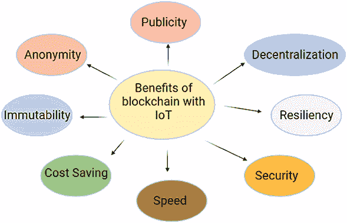

**图 4.1.** 区块链技术在医疗数据管理中的优势。

#### 4.3.1 数据隐私与安全

在过去中，医疗人员和机构一直是不必要的网络安全流行病的受害者 [33]。根据 IBM 和 Ponemon 的数据，医疗数据泄露每秒损失为 380 美元，而行业泄露的数据每秒仅损失 141 美元。通过使用区块链的安全架构，可以降低医疗行业的安全风险 [34]。数据的不可变性和哈希算法的使用使得区块链成为一个安全的系统。

根据区块链底层的加密原理，数据没有被盗取或滥用的可能 [35, 36]。任何合同、决策、交易或信息都可以存储在这种防篡改技术中。由于数据分布在整个系统中，因此不存在单点故障。自然灾害和医疗设施的丢失不会影响记录在区块链上的健康数据。通过去中心化的数据存储降低了数据操纵的风险。通过区块链技术融合物理世界和数字世界，可能增加医疗大数据供应商之间的信任。安全的三个支柱是识别和可追溯性。区块链技术可以提供三种数字信任 [37]。

#### 4.3.2 数据互操作性与全球数据共享

医疗机构与学术机构之间的数据交换是研究和发展的基石。患者的结果、处方状态以及来自其他机构的数据都是可能通过物联网（`IoT`）传输的数据示例。医疗记录中互操作性加连接的现状至关重要。临床技术、技术规范和能力是大多数电子健康记录（`EMR`）设备的主要因素 [38, 39]。由于这些差异，信息无法同时生成和传输。相同架构的 `EMR` 无法协同工作的另一个原因是每个医疗机构都有自己独特的独特需求和偏好。可以消除互操作性障碍，并在区块链上管理医疗大数据。其核心是一个分布式账本，使数字资产和交易对所有参与方实时可见。它能够促进网络成员之间基本的互操作性。得益于区块链技术基于共识的特性，所有利益相关者可以同意同一个平台，这确保了数据的可靠性、质量和一致性 [40, 41]。由于使用了标准的数据代码，任何医疗提供者都可以轻松访问和使用患者的医疗记录。

#### 4.3.3 数据准确性

在大多数情况下，患者的医疗记录分散在不同的医院、诊所以及保险公司处 [42]。为了获得个人医疗史的画像，必须自动将这些信息整合在一起。当医疗记录存储在区块链上时，它们可以被追溯和干预 [43]。这就是操作方法。这允许医疗专业人员为患者提供及时、有效且适当的治疗。通过区块链技术，患者的医疗史可以对医疗供应商可见、不可更改、可追踪且安全 [26]。

#### 4.3.4 数据处理成本

在当今医疗系统中，访问和交换患者数据的可能高到令人负担。许多医疗机构在很长时间内获取患者的医疗记录 [44]。从手动或杂乱的医院记录系统中获取患者的完整医疗数据需要花费大量的时间和资金。区块链技术的使用有助于减少目前医疗系统的第三方支出。随着该系统的采用，从各种来源（如患者记录、个人穿戴设备以及移动设备）收集并保存的患者医疗记录 [45, 46] 将具有更灵活的访问权限。这意味着医疗机构可以通过访问所有患者的医疗记录，而无需往返维护这些记录的各个地点，从而节省费用。

#### 4.3.5 增强的数据审计

为了确保医疗服务提供者遵循医疗机构制定的既定程序、协议、法规、立法和法律，会对其进行审计 [47]。为了确定医疗合规计划是否按预期运行，审计方法利用了系统化和客观的评估。目前使用的大多数医疗系统完全是人工操作的，缺乏智能指导或集成。因此，审计工作受到了阻碍，且结果不准确。为了证明存储在区块链中的医疗数据的可靠性，医疗公司可以以经过认证、防篡且定期的方式使用该技术 [48]。结果是，审计人员检查区块链网络上的交易将变得更加容易。此外，医疗数据的区块链审计在确保医疗业务遵守关键法律标准和法律的同时，可能还可以提高患者治疗的质量。它可能有助于减少重复数据的产生。

## 4.4 区块链发挥作用的重要医疗领域

区块链技术可用于解决医疗领域面临的一些重大挑战。在接下来的章节中，我们将探讨区块链如何应用于多个医疗部门。

### 4.4.1 患者记录管理（`PRM`）

患者记录管理是区块链在医疗领域的一种常见应用。为了对患者的病史进行分类，保险部门通常会对患者的病史进行划分，使其处理更加简单。由于用户操作笨拙，这一过程非常耗时且容易出错。因此，患者可以通过将其医疗记录放在区块链上，从而以公开且透明的方式访问这些记录 [49]。当一个患者的所有医疗记录都存储在一个地方时，对患者和医生来说都变得更简单了。由于患者具有独特的特征，大多数情况下无法对所有患者采用相同的治疗方案。因此，提供个性化护理需要访问所有的医疗记录。还需要注意的是，目前大多数医疗系统并不能保证患者健康相关信息的加密或安全性。

医疗记录已成为医学界的一个主要问题 [50]。患者健康记录中的数据可能会被患者更改或删除，因此他们无法声称拥有这些数据。当患者转到新的医疗机构时，有时需要重复医学检查。结果是成本将会增加。分散的点对点网络中的数据只能通过`smart contracts`获取，这正是区块链发挥作用解决上述问题的地方。由于这些数据无法被滥用，因此从一家医院传输到另一家医院是安全的。它可以帮助新医生了解以前患者的病史，使他们能够更好地理解并正确处理疾病。由于之前对患者进行的诊断测试不需要重复，区块链降低了整体成本。每个患者的医疗记录都复制并存储在区块链网络中的多个节点上，这确保了其安全性且无法被操改 [51]。

### 4.4.2 药品供应链

医疗行业正面临着处方欺诈和质量不佳日益日益严重的问题。据信，每年有大量人员因使用非法药物而死亡。假药业务的年价值估计为 2000 亿美元 [52]。健康研究基金机构估计，全球药物的 10%–30% 是假药。根据《卫报》的一项调查，在低收入和中收入国家，每 10 件药品中有一件是有缺陷或伪造的 [53]。这说明了医药行业特别容易受到伪造药物的影响。区块链始终存在伪造药品进入供应链的风险 [54, 55]。从生产到批发分商再到零售分商，药品供应链周期在制造完成后开始。利用区块链技术可以追踪药品的供应链。由于数据在传输过程中无法被篡改，这使得药品召回变得更加简单 [52]。区块链上的交易由于被记录并带有时间戳，因此是不可破坏的。区块链记录了药品从一个区域移动到另一个区域的轨迹。结果是药品追踪得到了改进，假药的可能性降低了。供应链中的任何人都可以检查交易。这种技术可以验证合同的任何部分，如果缺少这些特征之一，合同可以随时取消。

### 4.4.3 研究与开发

大量的医疗记录、市场研究数据和遗传信息被定期挖掘信息。在研究和临床试验中，区块链有望改变医疗行业。跨多个地点和利益相关者的协作，以及对大量个人数据的谨慎管理，对于研究和临床试验至关重要。利用区块链技术可以使临床试验数据的收集更加可靠。通过利用区块链技术，可以确保数据的完整性并修正报告中的错误 [48]。结果是临床试验数据分析的透明度和准确性都得到了提高。区块链技术有助于临床供应链的追踪、恢复试验数据的真实性、患者招募以及缩短试验周期。基因和健康数据的准确性也可以通过区块链技术进行检查，这是该技术的一大优势。

### 4.4.4 确保权限的一致性

医疗保健贡献者必须在紧急情况下能够立即访问患者数据。由于在紧急情况下无法访问医疗记录，患者的生命可能会面临危险 [50]。区块链技术可以用于两种方式来安全且有效地处理权利。通过`基于区块链的智能合约`，可以根据合同中所有参与方约定的预定义规则提供访问权限。患者可以使用加密密钥来管理谁可以访问其医疗记录。患者将获得一个用于访问其医疗记录的主密钥。如果需要，患者可以制作报告的副本并供医疗专业人员和机构使用。智能合约中可以添加读取和写入访问权限。智能合约以及基于区块链的加密密钥的使用可能有助于减少人为错误。

#### 4.4.5 远程医疗系统

尽管远程医疗容易受到网络攻击，但远程医疗网络具有突破医疗保健领域地理边界的潜力。治疗师与患者之间的虚拟链接可能会使患者隐私信息面临风险 [49]。在设计远程医疗系统时，安全和隐私必须是中之重。在远程医疗系统中，区块链可以提供基本的信任、安全和隐私保护。当数据直接提供而非通过中间人提供时，远程医疗系统可能会受益于客户信任的提高。从业人员也从准确患者数据、记录和报告的去中心化、不可变、可访问和可追踪存储中受益。

### 4.5 健康保险

保险公司现在正采用中心化的结构进行数据存储和处理。第三方或中介通常会被参与到健康保险的合同过程中。因此，保险业务饱受冗长且耗时且效率下的数据共享程序的困扰。区块链技术提供了无与伦比的透明度，因为它以去中心化、防篡改、可追踪、永久且可靠的方式记录每笔交易。保险业务面临的另一个区块链可能解决的问题是互操作性。通过`智能合约`自动收集协议文件、交易和其他数据可以增强管理操作。智能合约可能被用于识别欺诈或虚高的保险理赔。医生可以使用区块链技术监控其患者的健康保险覆盖情况。使用区块链的共识方法，可以简化保险理赔处理，并使提供者目录更加准确。

结果，健康保险业务将从区块链技术的使用中极大受益。

### 4.6 医疗计费系统

这些系统曾遭受各种类型的欺诈 [54]。更重要的是，在新计费系统下生成计费数据将花费更长时间和更多资源。无意的计费错误（例如重复操作或错误文件）可以追溯到医疗计费复杂的编码技术。将区块链与计算机辅助编码技术相结合，可以使医疗计费系统更加高效。与传统的计费技术需要长时间才能申请费用不同，区块链技术可以使支付过程变得更容易且更可靠。准确地说，在保险理赔的情况下，目前的支付机制会导致账单支付产生更大的延迟。由于区块链不可逆地存储数据的能力，保险公司能够更快地支付，同时减少对额外资源、时间和资金的需求。

### 4.7 挑战

尽管区块链技术具有许多优势和潜在应用，但并非没有缺点，其中某些缺点是特定领域的。以下是该技术在被广泛采用之前面临的一些重大挑战。

### 4.8 存储成本

医疗保健和医疗记录充斥着患者和可穿戴设备产生的数据。另一方面，区块链设计中的链上存储是非常有限的。如果数据量巨大，数据访问、维护和管理可能会成本高昂。区块链的去中心化设计带有高成本。区块链的设计必须考虑这一点。

#### 4.8.1 可扩展性

当区块链应用于医疗保健行业时，扩展性是主要问题之一。涉及到私人诊所、医疗中心、医疗研究机构和保险公司。使用区块链需要更多的网络能量 [52]。在区块链被广泛使用之前，医疗大数据必须进行扩展。

#### 4.8.2 法律方面：隐私法和法规

此外，在使用区块链技术时必须遵守国家隐私法规。适用于区块链的规则根据居住地而异很大。由于监管环境不断演变，区块链的采用也受到阻碍 [52]。许多监管区块链技术使用的法律法规仍处于初始阶段。这是一个更复杂的主题。需要专业的术语来解释区块链的分布式存储系统以及数据所有权和访问权。监管机构需要明确指南和建议。

#### 4.8.3 修改

由于区块链数据的不可变性，无法编辑或删除数据，数据修复和更改不可避免的。为了适应修改，必须建立新链或让每个节点对新区块达成共识。这两种可能性都昂贵且不可行。因此，区块链应用程序必须以减少数据变更的方式构建。

#### 4.8.4 确保数据准确性

在将患者信息存储到区块链之前，必须对所有信息进行全面审查。医疗保健提供者可以使用数字注册、旧的纸质注册或完全基于区块链的新注册。由于保险竞争、人为和管理错误、收费歧视以及逃税，大多数最新的医疗信息注册表是不准确的。当缺乏信息时，指定格式的完整性和可用性将受到损害。

#### 4.8.5 与当前医疗系统的集成

将区块链集成到现有系统中将是一项挑战性的任务。医疗保健机构必须改变其现有的方法以使用区块链技术。为了确保医疗行业向区块链技术的无缝过渡，必须对当前的实践进行重大调整（例如：时间、周密计划、财务资源和专业知识）。正因如此，智能合约的使用需要跨学科的技能。智能合约的正常运行既需要架构知识也需要法律知识。医疗提供者还必须学习区块链的基础知识，以确保这些解决方案能够正确运行。必须建立跨学科性，以从区块链解决方案中受益。

## 4.9 参与与采用

在区块链应用于医疗业务之前，需要一场文化革命。对于交易区块和加密货币的创建，区块链技术都需要一个联网计算机网络。

应该通过为提供计算机资源提供激励来认可参与。健康团体也可能会推动区块链的实施和网络参与。随着参与的人越来越多，区块链的影响也将变得越大。

## 4.10 结论

医疗业务可以通过多种方式从区块链技术中获益。正如互联网转型医疗保健并采用远程医疗一样，这项技术可以通过降低监控、配置和处理医疗大数据的成本，使医疗服务进步到下一个水平。得益于分布式账本的即时可用，无需等待手动输入每个患者的数据。此外，临床医生将不必担心患者无法提供真实的病史，因为他们可以实时获取原始、准确且高质量的源文档记录信息。患者也不需要担心从另一位医生处获得第二意见意见的问题，因为数据对所有人都是开放的。具有相似医疗问题的利益者将能够区块链网络与全球范围内的人建立联系，这不仅将改善他们的健康，还将激励他们对抗疾病。此外，患者将能够选择与他们共享数据的对象，并对数据拥有完全的控制权。


在本章中，我们深入探讨了区块链与医疗系统集成的话题。区块链为医疗机构实现了去中心化、开放、可访问、可追溯、可审计、可信且稳定的数据管理，确保了患者记录不会被篡改。为了解释如何使用区块链管理医疗领域的大数据，我们研究了它的功能和优势。本章讨论了这项技术如何应用于医疗领域。为了展示这项技术如何造福并补充各种医疗系统，本章重点介绍了许多有前景的领域。在讨论了阻碍区块链技术在医疗领域广泛部署的开放性挑战后，我们也应对了这些问题。在区块链完全集成到医疗系统之前，还需要解决一些技术问题。

### 参考文献

[1] 区块链在医疗领域的未来 `https://the-digitalinsurer.com/future-blockchain-health-insurance/`（访问于 2022 年 10 月 28 日）

[2] Vazirani A A, O’Donoghue O, Brindley D and Meinert E 2020 用于高效医疗记录管理的区块链工具 *NPJ Digit. Med.* [3 1](http://dx.doi.org/10.1038/s41746-019-0211-0)

[3] 医疗保健中的区块链技术：系统性述是否提供了一种平衡隐私与透明度的方法？`https://eurol.europa.eu/RegData/etudes/ATAG/2018/624254/`（访问于 2022 年 10 月 28 日）

[4] 用于医疗数据安全的区块链 `https://identitymanagementinstitute.org/blockchain-for-healthcare-data-security/`（访问于 2022 年 10 月 28 日）

[5] Al-Zaben N, Onik M H, Yang J, Lee N and Kim C S 2018 符合个人身份信息的通用数据保护条例区块链架构 *2018 Int. Conf. on Computing, Electronics and Engineering (Piscataway, NJ)* pp 77–82

[6] Mazlan A, Daud S M, Sam S M, Rasid S Z and Yusof M 2020 医疗系统中的扩展性挑战——系统性述述 *IEEE Access* [8 2366–73](http://dx.doi.org/10.1109/ACCESS.2020.296930)

[7] Pandey P and Litoriya R 2020 大规模实施医疗服务：基于区块链技术的挑战与对救 *Health Policy Technol.* [9 69–78](http://dx.doi.org/10.1016/j.hlpt.2020.004)

[8] Kumar T, Ramani V, Ahmad I, Braeken A, Harjula E and Yliantila M 2018 医疗中的区块链应用：关键需求与挑战 *2018 20th Int. Conf. on e-Health, Applications and Services (Healthcom)* (Piscataway, NJ) pp 1–7

[9] Holotescu C 2018 理解区块链机遇与挑战 *Conf. Proc. eLearning and Software for Education (eLSE)* vol 14 (布加 arest: Carol I National University Publishing House) pp 275–83

[10] 区块链：用于医疗的技术 `https://avocadoblock.com/en/blog/2019/3/29/uu7nkiya061ipbl4o2cd7lhhav`（访问于 2022 年 10 月 28 日）

[11] Kassab M, DeFranco J, Malas T, Laplante P, Destefanis G and Neto V G 2019 探索医疗区块链研究及未来路线图 *IEEE Trans. Emerg. Top. Comput.* [9 1835–52](http://dx.doi.org/10.1109/TETC.2019.2936881)

[12] 区块链与医疗药物追溯性及数据管理 `https://medium.com/@juraprotocol/blockchain-healthcare-drugtraceability-data-management-traceability-259dd7c924/`（访问于 2022 年 10 月 28 日）

[13] 实施区块链的十大优势：什么？ `https://dragonchain.com/blog/top-blockchain-benefits/`（访问于 2022 年 10 月 28 日）

[14] Shahnaz A, Qumar U and Khalid A 2019 使用区块链进行电子健康记录 *IEEE Access* [7 147782–95](http://dx.doi.org/10.1109/ACCESS.2019.294633)

[15] Hasselgren A, Kralevska K, Gligoroski D, Pedersen S A and Faxvaag A 2020 医疗与健康科学中的区块链——范围综述 *Int. J. Med. Inform.* 134 104040

[16] Sigwart M, Borkowski M, Peise M, Schulte S and Tai S 2019 基于区块链的物联网数据溯源 *Proc. of the 9th Int. Conf. on the Internet of Things* pp 1–8

[17] Mattila J 2016 区块链现象 *Berkeley Roundtable of the International Economy* 16

[18] Onik M M H, Miraz M H and Kim C S 2018 基于区块链技术的招聘与人力资源管理技术 *Smart Cities Symp. 2018* (IET) pp 1–6.

[19] Yue X, Wang H, Jin D, Li M and Jiang W 2016 医疗数据网关：通过新型隐私风险控制在区块链上发现医疗智能 *J. Med. Syst.* [40 1–8](http://dx.doi.org/10.1007/s10916-016-0574-6)

[20] Reddy K H K, Das H and Roy D S 2017 一种 SAVANNA hadoop 大数据应用的数据感知方案 *Networks of the Future* (伦敦: Chapman and Hall) pp 377–92

[21] Xia Q I, Sifah E B, Asamoah K O, Gao J, Du X and Guizani M 2017 MeDShare：通过区块链在云服务提供商之间的无信任医疗数据共享 *IEEE Access* [`5` 14757–67](http://dx.doi.org/10.1109/ACCESS.2017.2730843)

[22] Tanwar S, Parekh K and Evans R 2020 用于医疗 4.0 应用的区块链电子健康记录系统 *J. Inform. Secur. Appl.* [`50` 102407](http://dx.doi.org/10.1016/j.jisa.2019.102407)

[23] Lee C, Luo Z, Ngiam K Y, Zhang M, Zheng K, Chen G and Yip W L J 2017 大规模医疗数据分析：挑战与应用 *智能医疗中的大规模分布式计算手册* (Cham: Springer) pp 11–41

[24] Agbo C C, Mahmoud Q H and Eklund J M 2019 医疗保健中的区块链技术：系统综述 *Healthcare* `7` 56

[25] Islam N, Faheem Y, Din I U, Talha M, Guizani M and Khalil M 2019 一种用于电子医疗服务的活动识别的区块链雾雾计算框架 *Future Gener. Comput. Syst.* [`100` 569–78](http://dx.doi.org/10.1016/j.future.2019.05.059)

[26] Kumar R and Tripathi R 2019 通过区块链实现假药供应链的可追溯性 *2019 第 11 届通信系统与网络国际会议 (COMSNETS)* (Piscataway, NJ: IEEE)) pp 568–70

[27] 探索中心化：区块链技术与复杂协调 [`jods.mitpress.mit.edu/pub/7vxemtm3/release/2`](https://jods.mitpress.mit.edu/pub/7vxemtm3/release/2)（访问于 2022 年 10 月 28 日）

[28] Pandey P and Litoriya R 2021 使用区块链防止假药渗透医疗网络 *Wirel. Pers. Commun.* [`117` 7–25](http://dx.doi.org/10.1007/s11277-020-07041-7)

[29] Salah K, Rehman M H U, Nizamuddin N and Al-Fuqaha A 2019 用于 AI 的区块链：综述与开放研究挑战 *IEEE Access* [`7` 10127–49](http://dx.doi.org/10.1109/ACCESS.2018.2890507)

[30] 区块链：不可变账本的优势 [`medium.com/luxtag-live-tokenized-assets-on-blockchain/blockchain-thebenefits-of-an-immutable-ledger-3ecb458fed3b`](https://medium.com/luxtag-live-tokenized-assets-on-blockchain/blockchain-thebenefits-of-an-immutable-ledger-3ecb458fed3b)（访问于 2022 年 10 月 28 日）

[31] Sahoo M, Singhar S S and Sahoo S S 2020 一种消除药品假造的区块链模型 *机器学习与信息处理：ICMLIP 2019 会议论文集* (Berlin: Springer) pp 213–22

[32] Cachin C 2016 Hyperledger 区块链架构 *分布式加密货币与账本会议* `vol 310` pp 1–4

[33] Omar I A, Jayaraman R, Salah K and Simsekler M 2019 以以智能合约进行临床试验管理 *2019 IEEE/ACS 第 16 计算机系统与应用会议 (AICCSA)* (Piscataway, NJ: IEEE) pp 1–6

[34] 医疗数据泄露成本处于历史新高 [`healthitsecurity.com/news/healthcare-databreach-costs-highest-for-year`](https://healthitsecurity.com/news/healthcare-databreach-costs-highest-for-year)（访问于 2022 年 10 月 28 日）

[35] Esposito C, De Santis A, Tortora G, Chang H and Choo K R 2018 区块链：云数据安全与隐私的灵药 *IEEE Cloud Comput.* [`5` 31–7](http://dx.doi.org/10.1109/MCC.2018.0117912)

[36] Sengupta J, Ruj S and Bit S 2020 IoT 与 IIoT 的攻击、安全问题区块链解决方案综述 *J. Netw. Comput. Appl.* [`149` 102481](http://dx.doi.org/10.1016/j.jnca.2019)

[37] Al Omar A, Bhuiyan Z, Basu A, Kiyoto S and Rahman M 2019 云环境下医疗数据的隐私友好平台 *Future Gener. Comput. Syst.* [`95` 511](http://dx.doi.org/10.1016/j.future.2018)

[38] Gupta S, Malhotra V and Singh N 2020 物联网驱动的医疗保健 *数据与信息科学进展：ICDIS 会议* (Berlin: Springer) pp 47

[39] Tao H, Bhuiyan Z, Abdalla A, Hassan M, Zain J 2018 基于硬件的安全数据采集 *IEEE Internet Things J.* [`6` 547](http://dx.doi.org/10.1109/JIOT.2018)

[40] Reisman M 2017 EHR：数据可用性的挑战

[41] Khan W, Khattak A, Hussain M, Zain M, Lee C 2014 医疗系统间操作性的自适应语义调解 *J. Med.* [`38` 57]

[42] Chen L, Lee W, Chang C, Zhang K 2019 用于健康记录共享的区块链加密 *Future Gener. Comput. Syst.* [`105` 91](http://dx.doi.org/10.1016/j.future.2019)

[43] Zheng Z, Xie S, Dai H, Weng J 2020 智能合约概述：挑战与进展 *Future Gener. Comput. Syst.* [`120` 75)

[44] 区块链可以成为革命的催化剂 [`medium.com/luxtag-live-tokenized-assets-on-blockchain/blockchain-thebenefits-of-an-immutable-ledger-3ecb458fed3b`](https://medium.com/luxtag-live-tokenized-assets-on-blockchain/blockchain-thebenefits-of-an-immutable-ledger-3ecb458fed3b)

[45] 区块链如何影响医疗计单和编码 [`www.mdtech.com/news/how-blockchain-affect-medical-billing`](https://www.mdtech.com/news/how-blockchain-affect-medical-billing)

[46] Aich S, Kim H 2018 基于步态参数的帕金森病自动检测 *Artif. Intell.* [`117` 103](http://dx.doi.org/10.1007/s1277)

[47] Yu G, Wang X, Ni K, Yu P, Guo Y 2020 基于区块链的系统中实现细粒度访问控制的撤销 *IEEE Trans. Eng. Manage.* [`67` 1213](http://dx.doi.org/10.1109/TEM.2020)

[48] McGhin T, Choo K R, Liu C, He J 2019 区块链在医疗中的应用：研究挑战与机会 *J. Netw. Comput. Appl.* [`135` 62](http://dx.doi.org/10.1016/j.jnca.2019)

[49] Farouk A, Alahmadi A, Ghose S, Mashatan A 2020 工业医疗的区块链平台：愿景与未来机会 *Comput. Commun.* [`154` 223](http://dx.doi.org/10.1016/j.com.2020)

[50] Syed T, Alzahrani A, Jan S, Siddiqui M, Alghamdi T 2019 区块链架构及其应用的比较分析：问题与建议 *IEEE Access* [`7` 17683–69](http://dx.doi.org/10.1109/ACCESS.2019)

[51] Xie J, Tang H, Huang T, Yu F R, Xie R, Liu J, Liu Y 2019 应用于智慧城市的区块链技术综述：研究问题与挑战 *IEEE Commun. Surv. Tutor.* [`21` 2794–830](http://dx.doi.org/10.1109/COMST.2019)

[52] Ali F, El-Sappagh S, Islam S R, Kwak D, Ali A, Kwak K S 2020 基于集成深度学习和特征融合的心脏疾病预测智能医疗监控系统 *Inf. Fusion* [`63` 208–22](http://dx.doi.org/10.1016/j.inffus.2020)

[53] 卫报（The Guardian），世界卫生组织称贫困国家 10% 的药品是假药 [`healthitsecurity.com/news/healthcare-databreach-costs-highest-for-year`](https://healthitsecurity.com/news/healthcare-databreach-costs-highest-for-year)


[55] Tendulkar S, Rodrigues A, Patel K and Dalvi H 2020 System to fight counterfeit drugs *Advanced Computing Technologies and Applications: Proc. of 2nd Int. Conf. on Advanced Computing Technologies and Applications—ICACTA 2020* (Berlin: Springer) pp 465–70

# IOP Publishing

# 医疗健康人工智能区块链：一种协同方法

Rishabha Malviya, Arun Kumar Singh, Sonali Sundram, Balamurugan Balusamy and Seifedine Kadry

# 第 5 章：使用人工智能、区块链与可穿戴技术进行疾病管理

全球近四分之一的成年人至少有一种慢性健康问题，这给个人、家庭和医疗系统带来了巨大的压力。针对慢性病管理，尖端技术作为对“智慧医疗”革命的响应应运而生。智能穿戴技术的使用为疾病检测和治疗提供了不间断的医疗信息流，这是有助于健康生活的众多方面之一。如果要在从患者预后、生活方式以及隐私保护方面改善慢性治疗，必须立即解决如何组织和分析数据的问题。可穿戴传感器可用于监测患者的生理数据，这些数据随后可用于为诊断和治疗提供智能建议。数据共享去中心化、赋能用户、保护隐私以及确保数据真实性都是区块链在医疗领域可能的所有优势。结合人工智能（AI）、区块链以及可穿戴技术可能会改进目前的持续性管理范式，将重点从医院转移到患者。本章理论上阐述的基于可穿戴设备、区块链和人工智能的以患者为中心的技术框架在管理慢性疾病方面得到了进一步研究。最后，讨论了这种新范式的局限性与前景。

## 5.1 引言

拥有双收入的家庭日益增加和人口老龄化，使得慢性病管理成为居家护理提供者的必要任务。在美国，2014 年治疗心血管疾病等持续/慢性疾病的费用为 55500 亿美元；到 2035 年，该成本预计将增加到 1.1 万亿美元 [1, 2]。最常见的慢性疾病包括慢性肾脏疾病、心血管及脑血管疾病、慢性呼吸系统疾病、高血压、糖尿病、癌症、肥胖症、关节退行性疾病和神经系统疾病 [3]。由于可穿戴技术的广泛普及，区块链结合人工智能，这些技术可以用于记录患有慢性疾病个体的健康状况。

对于长期疾病患者的监测、记录、分析、调节和干预，佩戴在身上的便携式医疗电子技术大有裨益 [4, 5]。可穿戴设备实时收集并分析各种健康数据，使得全天候慢性病患者成为可能。高性能计算机和人工智能的利用可以根据这些可获取的多维度临床及生物学数据集更好地预测威胁 [6]。许多人工智能系统可以收集相关数据，以便它们从过去发生的新事件中学习并变得更好。医生可以使用人工智能为每位患有慢性疾病的患者制定早期治疗 [7–10]。由于目前大多数医疗平台存在信息不对称、不透明以及数据操纵的风险。数据存储可能会降低自动化的水平，并由于“信息孤岛”现象阻碍了医疗单元之间的有效信息交换 [3, 4, 8, 9]。在未来，基于区块链的新一代应用程序将通过分布式账本建立信任、问责和透明度。区块链整合到医疗平台中将提高诊断结果的透明度和可靠性。通过使用分布式存储和多中心数据收集，以安全、不可更改和可追溯的方式传输信息和模型，慢性病患者可以减少对复杂治疗的依赖。通过实时融合生理及临床信息、传感器数据以及区块链存储检索，可以增强慢性疾病的管理 [9–11]。

## 5.2 慢性疾病的预防与治疗

慢性疾病管理模式的核心是诊断、治疗和康复的追踪过程。目前最流行的慢性病管理方法是持续护理模式、慢性病自我管理以及转诊护理 [1, 3, 8–10]。值得注意的是，慢性病管理正受到许多相互关联问题的困扰。这些问题包括管理半径有限和依赖体力劳动等。由于没有良好的体验或参与感，个人不愿参与慢性病管理 [11]。此外，由于缺乏长期动态监测数据，临床人员有时会及时追踪患者，导致误诊和治疗方案脱节。

### 5.2.1 基于医疗级人工智能的可穿戴设备（WDs）

可穿戴设备、视频以及额外的人体物联网（IoT）设备包含了端智能，用于提高数据采集的主动性、及时性和一致性。例如，现场可编程门阵列的封装被用于为端设备提供本地智能服务 [4, 5, 12]。随着 5G 和雾端计算节点的发展，它们将部署在更靠近患者的地方，最大限度地减少传输损失。云智能主要用于训练海量数据集，而雾端加边缘设备则提供了接近处理器的算力，允许进行模型推理 [13]。基于 AI 的医疗服务可以产生数字孪生模型，这些模型能够准确描述患者的健康特征，并快速评估患者当前的身体健康状况以辅助治疗慢性病 [14]。

大规模数据挖掘或基于规则的引擎以及深度学习是用于医疗诊断的一些基于 AI 的技术。通过从大量信息中提取相关性，大数据挖掘可以识别诊断慢性疾病的健康模型。利用专家知识和业务规则，规则引擎可以对患者的健康状态做出判断。现在可用的医疗数据比以往任何时候都多，而且由于深度学习（一种正在快速发展的 AI 子类）能够对患者的医疗信息产生更抽象、更结构化且顶水平的诊断描绘 [15]。

得益于 AI 驱动的可穿戴设备，可以在医疗资源有限的情况下实现辅助诊断的影响。在慢性病管理中，技术和设备用于收集大多数健康数据，如血压、心率、空腹血糖以及脉搏等 [16, 17]。当前关于姿态估计的研究与肺病和心脏病等慢性疾病有关。姿态和识别数据因其全面性而非常有价值。肌电图以及皮肤电子可穿戴传感器、可穿戴视觉定位标识符，结合基于视觉的计算机骨点定位技术，是收集姿态数据常用的工具。

## 5.2.2 AI、区块链与可穿戴技术在慢性病中的整合

目前的慢性病管理涉及被动治疗和健康状况的主动监测。许多尖端技术（包括 AI、可穿戴技术和区块链）为慢性病的实时监测带来了新思路 [15]。生理数据以前使用医院的方法进行检查。慢性病患者必须接受监测、评估，并获得如何改善健康的建议。去中心化的可穿戴设备、数字设备和移动 App 比以往任何时候都更容易定期收集个人身体和健康数据。

可穿戴技术与 AI 的结合可以用于改进医疗服务的交付 [16, 17]。AI 将通过结合医生、药剂和营养师的知识，彻底改变医疗行业，为慢性病患者提供全面、持续且主动的管理。这将产生一种科学的管理模式，鼓励建立健康状态，减缓疾病进展并减少残疾 [18]。

当前关于姿态估计的研究与肺病和心脏病等慢性疾病有关。姿态和识别数据因其全面性而非常有价值。肌电图以及皮肤电子可穿戴传感器、可穿戴视觉定位标识符，结合基于视觉的计算机骨点定位技术，是收集姿态数据常用的工具。

研究人员针对大多数常见慢性病管理的主要困难，设计了一种理论系统，利用可穿戴设备（WDs）和智能终端设备收集持续性疾病的健康数据。研究人员构建了一个既能保护患者隐私，又能利用区块链技术实现医疗数据共享与追踪的系统。在总结现有理论和方法的同时，他们还在讨论中引入了伦理困境的话题。

## 5.3 慢性病的监测与管理

欧洲和北美的国家在处理慢性病方面经验丰富。然而，许多贫穷国家缺乏全面且系统的慢性病管理方法。糖尿病、骨关节炎、骨质疏松症、心血管疾病、高血压以及脑血管疾病只是影响老年人的慢性疾病的一部分 [18]。随着信息时代的到来，诊断和治疗的新方法运而生。得益于大数据、人工智能、区块链以及可穿戴设备的进步，医学已进入数字时代。多项技术融合的优势将在这些数字链路中得到充分发挥。

研究人员正在研究利用区块链技术、可穿戴设备和人工智能，在长期持续收集健康数据的状态下管理慢性病的方法。为了深入演示理论和结构，研究人员重点关注四种持续性疾病的标准治疗：糖尿病、心血管疾病、肺病以及需要物理康复的持续性病变。

我们关于慢性病管理集成系统的概念性结构如图 5.3 所示。本章讨论了可穿戴技术、区块链技术以及处理慢性病数据的理论基础。还展示了这些技术在四种常见慢性病治疗和预防中的应用。最后，本章强调了这种新范式的缺陷和未来的研究前景。

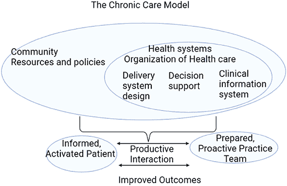

**图 5.3.** 用于治疗慢性疾病的综合系统设计。

## 5.4 心血管疾病

近年来，心血管疾病已成为一个重大且危险的问题，影响人类生命并威胁全球健康 [27, 28]。如果不治疗，心力衰竭、肾衰竭、高血压、中风以及其他衰弱状况都是可能的结果。通过早期检测、有效的风险因素减少以及初始预警模型的开发，可以显著改善心脏疾病的结局 [29]。

人工智能在诊断和治疗心血管疾病方面的应用近年来增加，这提高了冠状动脉病、肺性高血压、心力衰竭、心肌病等多种疾病患者的护理质量、成本效益和发病率 [30]。无论是在家中还是医院环境中，患者都可以利用人工智能的内置技术更有效地管理自己的健康和预后。这些技术可以根据需要进行增强和修改。

过去的研究大多使用朴素贝叶斯，从算法的逻辑回归和支持向量机分类的角度来构建慢性发作的风险模型。大部分 12 导心电图（`ECG`）设备可以分析并对心肌梗死伴随心律失常提供初步诊断 [27, 28]。研究表明，通过结合人工智能技术的可穿戴心律除颤器，可以保护患者在非住院期间免受猝性心脏骤停的影响 [27]。

研究人员创建了一种由带有导电涂层的纳米纤维组成的运动型聚合物背心 [28]。这种聚合物将 `ECG` 电极贴近人体。得益于这种信号，关联应用程序可以实时显示 `ECG` 并收集健康数据，从而提高了舒适度并降低了过敏风险。通过将生理数据上传到云端供专家医生分析，心脏疾病的远程监测成为可能。

手持超声心设备的快速发展和低成本为社区范围内的筛查以及瓣膜心疾病的早期诊断开启了新机会。在拍摄瓣膜心疾病图像后，通过集成电子传感器的手持超声心设备，可以通过基于人工智能的系统快速向医疗保健工作人员提供自动警报 [29, 30]。使用这种方便的数据传输方法可以极大地加速临床治疗。

根据建议，多学科心脏团队应根据患者的独立能力、合并症、年龄、虚弱程度、解剖结构问题、术前死亡率和偏好，决定哪种治疗最适合每位患者 [31]。研究表明，使用计算机断扫描或超声心成像数据，基于人工智能的临床决策支持系统可以快速准确地调节干预治疗的理想瓣膜大小（甚至是瓣膜类型）[28–31]。

获取足够的生理健康数据对于机器学习来说可能是一个问题，这导致了延迟。需要收集健康数据的来源包括可穿戴设备、便携式心电图监测仪、社交媒体生物库数据和活动监测，以及目前的医院电子健康记录 [30]。利用区块链技术，可以为 `AI` 训练、临床试验以及监控的医疗数据格式标准化奠基础。

心血管疾病的检测和治疗可以使用 `AI` 和区块链技术分为两个部分。第一步是创建一个分布式存储数据库，并在一段时间内使用深度学习对数据进行清洗，以结合不同的数据源，并充分利用数据的潜力。研究的第二部分是比较和评估心血管疾病的智能算法模型 [32]。区块链技术提供了在粒度级别跟踪和检查数据的能力 [25, 30, 31]。

从技术上讲，结合区块链和 `AI` 的互补优势可以实现更具个性化的心血管治疗，增加高质量医疗记录的可访问性以支持 `AI` 训练和开发，同时分散来自不同提供者或医疗系统的数据，共享专利算法以促进发展，并对优于竞争对手的方法进行激励。有了集成系统，心血管疾病的治疗将变得更容易使用且更有效，患者的理解能力将显著提高。因此，服用药物和抗凝剂将变得更容易，心脏发发的概率最终可能会降低。

## 5.5 肺疾病

`COPD` 和间质性肺疾病等长期呼吸道患者比哮喘或肺炎等短期呼吸道疾病患者更容易遭受这些疾病 [33–35]。慢性肺部疾病的高死亡率和发病率使其成为老年人的重大健康问题 [33]。持续评估患者的疾病进展以及身体健康状况对他们的疾病护理至关重要。

可以使用多个可穿戴传感器来追踪 `COPD` 患者的身体活动。在家里使用 `WDs` 持续监测呼吸音和氧饱和度。这些设备还可以识别肺部活动以及与肺疾病相关的空气颗粒。研究人员采用了可穿戴技术和无线传感器网络系统 [34] 来监测患者的 `ECG`、血氧饱和度、声音以及呼吸频率，以评估治疗的阶进效果。


### 5.5 肺疾病

`COPD` 和间质性肺疾病等长期呼吸道疾病患者比哮喘或肺炎等短期呼吸道疾病患者更容易遭受这些疾病 \[33–35\]。慢性肺部疾病的高死亡率和发病率使其成为老年人的重大健康问题 \[33\]。持续评估患者的疾病进展以及身体健康状况对他们的疾病护理至关重要。可以使用多个可穿戴传感器来追踪 `COPD` 患者的身体活动。在家里使用 `WDs` 持续监测呼吸音和氧饱和度。这些设备还可以识别肺部活动以及与肺疾病相关的空气颗粒。研究人员采用了可穿戴技术和无线传感器网络系统 \[34\] 来监测患者的 `ECG`、血氧饱和度、声音以及呼吸频率，以评估治疗的阶进效果。

另一方面，对肺部疾病的研究显示了 `AI` 的巨大潜力。由 `AI` 驱动的计算机诊断模型可以提供对多种肺疾病的精确评估，包括 `COPD`、肺炎和持续性哮喘。例如，研究 \[35\] 使用人工神经网络来预测理解并报告其症状的 `COPD` 患者的自我管理能力，显示其准确率达到 93.8%。同样，`Rodriguez-León et al` \[36\] 调查了深度神经网络在对症状、体征以及客观测试进行建模（总共 22 个因素）以预测成人哮喘初步诊断时的表现如何。`Tan` \[37\] 采用深度学习模型从美国国家肺癌筛查试验队列中分割 7927 个肺结节，这说明了 `AI` 如何用于检测、分类和监测肺结节。它已用于管理肺部疾病。`Res-App` \[38\] 是一款手机应用程序，它通过麦克风辅助测量呼吸，并为下呼吸道相关的疾病、哮喘、支气管炎和肺炎提供定制化评估。根据 `Fernández-Caramés et al` \[39\]，他们对比了四种基于机器学习的处理儿童慢性肺部疾病的模型，证明了 `AI` 模型能够快速识别哮喘儿童，并确保他们在紧急情况下及时获得治疗 \[39\]。打鼾的管理是一种由肥胖引起并伴随心律失常、高血压、中风和冠心疾病的肺部疾病，这是第三种情况 \[40\]。日常活动如使用智能手机或佩戴连接的可穿戴设备会被收集，为区块链和 `AI` 提供数据。无线网络可以收集家庭环境中产生的各种生理信号，然后云端机器学习算法可以处理这些信息 \[41\]。大数据分析和 `AI` 需要用于多模态远程监测、远程医疗、手机互动工具和网页管理系统等技术 \[38–41\]。去中心化的多模态信息和算法对于阻塞性睡眠呼吸患者将大有益，因为护理人员能够及时调整并提供个性化护理。

### 5.6 糖尿病

患有 `COPD` 和间质性肺疾病等长期呼吸道疾病的患者比患有哮喘或肺炎等短期呼吸道疾病的患者更容易遭受这些疾病 \[33–35\]。慢性肺部疾病的高死亡率和发病率使其成为老年人的重大健康问题 \[33\]。持续评估患者的疾病进展以及身体健康状况对他们的疾病护理至关重要。可以使用多个可穿戴传感器来追踪 `COPD` 患者的身体活动。在家里使用 `WDs` 持续监测呼吸音和氧饱和度。这些设备还可以识别肺部活动以及与肺疾病相关的空气颗粒。研究人员采用了可穿戴技术和无线传感器网络系统 \[34\] 来监测患者的 `ECG`、血氧饱和度、声音以及呼吸频率，以评估治疗的阶进效果。

无线通信和生物传感器技术的快速发展催生了一种完全新型非侵入式可穿戴血糖监测设备。近期，人们创建了一个作为大脑的柔性核心设备和三个楔的可穿戴人工胰腺，用于监测血糖水平并进行管理。另一种用于测量糖尿病患者血糖水平的可穿戴设备是由 `Google/Life Sciences`（美国）和诺华制（瑞士巴塞尔）制造的一对智能隐形眼镜。由 `AI` 驱动的可穿戴技术可以实时监测患者的血糖水平，并通过调节胰岛素泵自主控制其血糖。`AI` 可以多种多种帮助糖尿病患者更成功地管理疾病，包括制定定制饮食计划、及早发现频繁的问题以及为胰岛素注射提供技术支持。为了实现血糖水平的自我管理，`Wu 等` \[42\] 开发了一个系统，通过包含可穿戴元件来增强持续血糖监测，允许远程监测并对患者的潜在危机发出警告。此外还创建了额外的激励措施，例如基于区块链的 `GlucoCoin` 奖励系统。糖尿病的常见并发症是糖尿病视网膜病，它可能导致全盲。如果早期发现并治疗，糖尿病视网膜病可能会显著影响患者的预后和生活质量。根据 `Hao` 和同事 \[14\] 的一项研究，`AI` 的实施使门诊的糖尿病视网膜病筛查率从 28.4% 提高到 81.3%。总之，通过控制血糖水平，`AI` 以及可穿戴技术可以显著延迟视网膜病加糖尿病足问题等糖尿病并发症的发生 \[25, 26, 44\]。使用利用 `AI` 和区块链技术的集成系统，可以对低血糖、糖尿病酮酸中毒以及高血糖高渗透性综合症进行风险评估和及时警告 \[42, 45\]。因此，糖尿病患者将更加安全。

### 5.7 需要运动康复的慢性疾病

步态、平衡和协调性对于慢性运动系统疾病的恢复过程至关重要，但很难进行适当评估 \[46, 47\]。

可穿戴设备可以从生理上追踪骨骼位置，以收集大量患者数据用于恢复。利用区块链和 `AI` 的可穿戴系统可以监测持续姿态异常患者的姿态，并提供实时反馈通知，减少处于不良姿态状态下的总时间。这项技术在物理康复中具有巨大的潜力 \[48\]。该技术结合机器学习、`AI`、三维重建、可穿戴姿态分析和医学康复理论。它保证了远程随访并提供支持。通过佩戴可穿戴设备，`AI` 可以生成患者的三维图像。系统可以对心率、呼吸和步频进行警告。步态的变化现在可以通过下肢康复训练来产生 \[49, 51\]。使用可穿戴传感器进行实时步态追踪是可能的。通过技术的进步，可以快速识别骨硬化的患者 \[47\]。`AI` 可以被用于创建一个可以帮助脊髓症患者的可穿戴监测系统，通过多种传感器可以发现瘫痪症的早期迹象 \[48\]。`Kalid 等` \[51\] 已经建立了机器学习的实施来预测手术结果。目前市面上有控制脊柱的可穿戴设备，脊柱侧弯患者需要。在脊柱手术期间，为了获得良好效果需要植入物。这些植入物的例子包括椎钉、`K` 针以及人工椎间盘 \[49, 50\]。很快，在人体内安装传感器和技术以持续监测参数将成为可能。通过快速 `IoT` 传输机制，可穿戴传感器可以生成量化数据并显著改善居家监测。一个例子是肌电图数据的检查。

已经建立了一些实验平台以避免意外并提高效率 \[52\]。为了防止患者在康复期间跌倒，`Pilozzi` 和 `Huang` \[53\] 开发了一个能够将每个关键变量集中在安全数据库中的平台。`Tsukada` 还检查了基于网络的上肢居家康复系统的机器学习有效性 \[54\]。他们认为机器学习模型有助于家庭训练，增强沃尔功能测试结果，并在接受治疗时扩大肩部屈和内旋范围。在帮助运动损伤患者恢复的同时，利用可穿戴技术并整合 `VR`、`AR` 和 `MR` 可以使训练更有趣，并提高患者的依从性 \[36, 55\]。我们坚信，使用可穿戴技术和区块链技术的先进运动康复系统是避免更复杂手术以及患者继发创伤风险的绝对要求 \[55, 56\]。

### 5.8 讨论

将人工智能、区块链技术、传感器和可穿戴设备（`WDs`）相结合，以追踪身体活动以及各种环境和地理位置具有许多优势。这项技术在商业和医疗方面具有巨大的潜力 \[57, 58\]。为了充分利用此类分布式实时多维数据进行高性能数据计算，有组织且智能的跨学科整合，以及在机器学习和人工智能领域的迭代与开发是十分必要的 \[54\]。一个使用人工智能、区块链以及可穿戴技术的数字慢性病管理平台可以提醒患者及时服药，实时处理监控数据，并在数据异常时提醒患者和医生，从而实现远程治疗监测 \[38\]。对于农村地区的老年患者，当他们远离大医院或在难以利用医疗设施时期（如大流行期间），远程医疗在治疗慢性病方面显示了巨大的价值 \[58\]。预计用于通信的区块链、可穿戴传感器以及人工智能技术的无线网络扩展，将增加医疗物联网的多样性和精确性 \[59\]。

临床医生的构思和想象力可以将这些技术的内在潜力转化为治疗和社会效益。由于这些技术在医疗行业的应用，它们改善了许多人的生活，但也具有引发伦理问题的潜力 \[58, 59\]。首先，存在着用于诊断疾病的人工智能算法的安全性和精确性受到损害的风险，从而危及患者健康。人工智能被患者理解的能力可能与他们的基本隐私权相冲突。此外，如果人工智能诊断的定价不公平，公共利益可能会受到损害。人工智能复制了人类大脑的决策过程，尽管它缺乏实际的人类智能。患者数据是根据算法设计的规范获得的，而算法及其规则是由人类提供的。这意味着目前的人工智能方法仍然是工具，在任何关于伦理考虑的讨论中，核心人物仍然是开发技术的人。医疗物联网中的传输技术还存在严重的干扰问题和安全风险。可穿戴设备必须与其他连接 `Wi-Fi` 的设备竞争，并且不使用与这些设备相同的频率，以防止网络中断和告警传输问题 \[57, 58, 60\]。

此外，当区块链用于该系统的结构时，会在互操作性、效率安全方面产生担忧。为了解决需要协作的问题，基于区块链的服务提供者和消费者必须能够顺利地交互。然而，各个机构使用的标准并不如预期那样统一。采用通用区块链标准将加速行业对该技术的共识，并有助于开发大规模的社会区块链生态系统。随着数据量的剧增，必须创建更合适的框架来减少跨企业的区块链效率问题 \[59\]。根据最近的一项研究，51% 的有害尝试与安全漏洞有关。最后，有必要解决关联政策的问题。这些技术的稳定性取决于适当法规的实施。因此，所有相关政策都必须尽可能快速地实施。

### 5.9 局限性

在解释研究结果时，需要注意研究设计中的多个缺陷。这里得出的结论与金融和营销等其他学科无关，主要适用于医疗状况及其相关。这是由于几个原因。另一个缺点是，由于材料源自医学、信息学、人工智能以及计算机科学领域，专业视角可能仅限于这些领域的人士。研究政策和伦理是被允许的？本研究可能忽略了一些研究，因为它们没有以英文出版，或者是以其他学科或语言出版的。最后，基于区块链和可穿戴设备的人工智能医疗应用非常广泛，我们没有深入涵盖其概念和结构的所有元素。

### 5.10 结论

本章描述了基于区块链和人工智能的可穿戴技术在治疗慢性病方面的创新应用。

[7] Guo Y, Liu X, Peng S, Jiang X, Xu K, Chen C, Wang Z, Dai C and Chen W 2021 用于慢性疾病管理的可穿戴与非侵入性传感技术综述 *Comput. Biol. Med.* [**129** 104163](http://dx.doi.org/10.1016/j.compbiomed.2020.104163)

[9] Silva P, Jacobs D, Kriak J, Abu-Baker A, Udeani G, Neal G and Ramos K 2021 初级医疗环境中慢性疾病管理的药物基因组学与人工智能工具的实施 *J. Pers. Med.* [**11** 443](http://dx.doi.org/10.3390/jpm11060443)

[8] Frederico M B, Oetom A, Sahu K S, Kuang A, Fadrique L X, Velmovitsky P E, Nobrega R M and Morita P P 2019 环境与健康研究的颠覆性技术：人工智能、区块链和物联网概述 *Int. J. Environ. Res. Public Health* [**16** 3847](http://dx.doi.org/10.3390/ijerph16203847)

[10] Lu L, Zhang J, Xie Y, Gao F, Xu S, Wu X and Ye Z 2020 医疗中的可穿戴健康设备：叙述性系统综述 *JMIR mHealth uHealth* [**8** e18907](http://dx.doi.org/10.2196/18907)

[11] Zheng X, Sun S, Mukkamala R R, Vatrapu R and Ordieres-Meré J 2019 加速健康数据共享：基于物联网和分布式账本技术的解决方案 *J. Med. Internet Res.* [**21** e13583](http://dx.doi.org/10.2196/13583)

[12] Abe Y, Ito M, Tanaka C, Ito K, Naruko T, Itoh A, Haze K, Muro T, Yoshiyama M and Yoshikawa J 2013 使用口袋级超声心筛查主动脉狭窄的新型且简单的方法 *J. Am. Soc. Echocardiogr.* [**26** 589–96](http://dx.doi.org/10.1016/j.echo.2013.03.008)

[13] Porter P *等* 2019 一项多中心前研究，测试以咳嗽声为中心的分析系统识别儿童常见呼吸系统疾病的诊断准确性 *Respir. Res.* [**20** 1–10](http://dx.doi.org/10.1186/s12931-019-1046-6)


[14] Hao Z, Cui S, Zhu Y, Shao H, Huang X, Jiang X, Xu R, Chang B and Li H 2020 非散瞳眼底检查与人工智能在促进内分泌科糖尿病视网膜筛查中的应用：中国天津 2 型糖尿病患者的观察研究 *Ther. Adv. Chronic Dis.* [**11**](http://dx.doi.org/10.1177/2040622320942415) 2040622320942415

[15] Chomiak T, Xian W, Pei Z and Hu B 2019 一种基于单传感器的帕金森病步态周期中断和步态冻的新型方法 *J. Neural Transm.* [**126** 1029–36](http://dx.doi.org/10.1007/s00702-019-02020)

[16] Golabchi F N, Sapienza S, Severini G, Reaston P, Tomecek F, Demarchi D, Reaston M and Bonato P 2019 通过功能评估期间收集的表面肌电数据评估异常肌肉活动 *BMC Musculoskelet. Disord.* [**20** 1–15](http://dx.doi.org/10.1186/s12891-018-2350-x)

[17] Zhang Y, Yu H, Dong R, Ji X and Li F 2021 人工智能在重症肌力无力康复与管理中的前景 *BioMed Res. Int.* [**2021** 1–6](http://dx.doi.org/10.1155/2021/559247)

[18] Pareja-Galeano H, Garatachea N and Lucia A 2015 运动作为慢性病的 *Prog. Mol. Biol. Sci.* [**135** 497–526](http://dx.doi.org/10.1016/bs.pmbts.2015)

[19] Kiran M S, Rajalakshmi P, Bharadwaj K and Acharyya A 2014 基于物联网的远程医疗数据采集与智能传输系统 *2014 物联网论坛 (WF-IoT)* 第 253–8

[20] Araújo F, Nogueira M, Silva J and Rego S 2021 基于技术的老年人跌倒风险评估、检测与预防：准实验研究 *JMIR Res. Prot.* [**10** e25781](http://dx.doi.org/10.2196/25781)

[21] Jourdan T, Debs N and Frindel C 2021 机器学习在患者步态监测商业穿戴传感器验证中的贡献：系统综述 *Sensors* [**21** 4808](http://dx.doi.org/10.3390/s21144808)

[22] Mendes-Soares H 等 2019 非糖尿病个体餐后血糖反应的个性化方法评估 *JAMA Net. Open* [**2** e18810–2](http://dx.doi.org/10.1001/jamanetopen.2018.8102)

[23] Hsu W C, Sugiarto T, Lin Y J, Yang F C, Lin Z, Sun C L and Chou K N 2018 神经系统疾病患者多穿戴传感器步态分类与分析 *Sensors* [**18** 3397](http://dx.doi.org/10.3390/s18103397)

[24] Tropea P 等 2019 医疗护理中的虚拟指导优势：范围综述 *J. Med. Internet Res.* [**21** e12805](http://dx.doi.org/10.2196/12805)

[25] Bashshur R 等 2014 慢性疾病管理医疗干预的实证基础 *Telemed e-Health* [**20** 769–800](http://dx.doi.org/10.1089/tmj.2014.9981)

[26] Peyvandi A, Majidi B, Peyvandi S and Patra J 2021 去中心化医疗云上的高效快速应急智能计算机辅助诊断服务 *New Gener. Comput.* [**39** 677–700](http://dx.doi.org/10.1007/s00354-021-0131-5)

[27] Mekov E, Miravits M and Petkov R 2020 呼吸医学中的工智能与机器学习 *Expert Rev. Respir. Med.* [**14** 559–64](http://dx.doi.org/10.1080/17476348.2020.1743181)

[28] Buekers J, Theunis J, De Boever P, Vaes A W, Koopman M, Janssen E V, Wouters E F, Spruit M A and Aerts J M 2019 慢性阻塞性肺疾病 (COPD) 患者一周日常居家期间连续氧饱和度测量的穿戴式指脉血氧仪：观察研究 *JMIR mHealth uHealth* [**7** e12866](http://dx.doi.org/10.2196/12866)

[29] Contreras I and Vehi J 2018 用于糖尿病管理与决策支持的人人工智能：文献综述 *J. Med. Internet Res.* [**20** e10775](http://dx.doi.org/10.2196/10775)

[30] Dwivedi A D, Srivastava G and Singh R 2019 隐私保护型医疗区块链 *Sensors* [**19** 326](http://dx.doi.org/10.3390/s1902326)

[31] Xie Y, Zhang J, Wang H, Liu P, Liu S, Huo T, Duan Y, Dong Z, Lu L and Ye Z 2021 区块链在医学的应用综述 *J. Med. Internet Res.* [**23** e28613](http://dx.doi.org/10.2196/28613)

[32] Barrett M 等 2019 心力衰竭人工智能支持的患者自我护理：从反应性到预测性和个性化的范式转变 *EPMA J.* [**10** 445–64](http://dx.doi.org/10.1007/s13167-019-0188)

[33] Kaplan A 等 2021 呼吸医学人工智能/机器学习在哮喘和 COPD 中的潜在作用 *J. Allergy Clin. Immunol. Pract.* [**9** 2255–61](http://dx.doi.org/10.1016/j.jaip.2021.02.014)

[34] Colantonio S, Govoni L, Dellacà R, Martinelli M, Salvetti O and Vitacca M 2015 COPD 患者健康状态远程个性化评估的决策概念 *Methods Inf. Med.* [**54** 240–7](http://dx.doi.org/10.3414/ME13-028)

[35] Ather S, Kadir T and Gleeson F 2020 肺结节管理中的人工智能与影像组学：现状与未来应用 *Clin. Radiol.* [**75** 13–9](http://dx.doi.org/10.1016/j.crad.2019.04.017)

[36] Rodriguez-León C, Villalonga C, Munoz-Torres M, Ruiz J R and Banos O 2021 用于糖尿病参数监测的移动与穿戴技术：系统综述 *JMIR mHealth uHealth* [**9** e25138](http://dx.doi.org/10.2196/25138)

[37] Tan T E 等 2021 基于视网膜照片的近视深度学习算法以及促进人工智能医学研究的区块链平台：回顾性多队列研究 *Lancet Digit. Health* [**3** e317–29](http://dx.doi.org/10.1016/S2589-7500\(21\))00055-8)

[38] 研究：一种能够监测呼吸并确定呼吸道疾病的手机应用程序准确率达 89%。[`www.mobihealthnews.com/content/study-smartphone-app-listens-breathing-determines-respiratory-diseases-89-percent-accurate`](https://www.mobihealthnews.com/content/study-smartphone-app-listens-breathing-determines-respiratory-diseases-89-percent-accurate)（访问于 2023 年 2 月）

[39] Fernández-Caramés T M, Froiz-Míguez I, Blanco-Novoa O 和 Fraga-Lamas P 2019 助力移动众包健康物联网：一种基于移动雾计算、区块链和物联网的用于糖尿病研究与护理的持续血糖监测系统 `Sensors` [**19** 3319](http://dx.doi.org/10.3390/s19153319)

[40] Fan X, Yao Q, Cai Y, Miao F, Sun F 和 Li Y 2018 用于从单导程短心电图记录中筛选心房颤动的多尺度深度卷积神经网络融合 `IEEE J. Biomed. Health Inform.` [**22** 1744–53](http://dx.doi.org/10.1109/JBHI.2018.2858789)

[41] Bugajski A, Lengerich A, Koerner R 和 Szalacha L 2021 利用人工神经网络预测慢性阻塞肺疾病患者的自我管理：一项探索性分析 `J. Nurs. Scholarsh.` [**53** 16–24](http://dx.doi.org/10.1111/jnu.12618)

[42] Wu C T, Li G H, Huang C T, Cheng Y C, Chen C H, Chien J Y, Kuo P H, Kuo L C 和 Lai F 2021 使用可穿戴设备数据、机器学习和深度学习预测慢性阻塞肺疾病急性加的系统：开发与队列研究 `JMIR mHealth uHealth` [**9** e22591](http://dx.doi.org/10.2196/22591)

[43] Pépin J L, Bailly S 和 Tamisier R 2020 睡眠呼吸暂停中的中的数据：机会与挑战 `Respirology` [**25** 486–94](http://dx.doi.org/10.1111/resp.13669)

[44] Cheung C C, Krahn A D 和 Andrade J G 2018 可穿戴技术在心律失常检测中的新兴作用 `Can. J. Cardiol.` [**34** 1083–7](http://dx.doi.org/10.1016/j.cjca.2018.05.003)

[45] Song Y, Min J 和 Gao W 2019 可穿戴与植入式电子设备：迈向精准治疗 `ACS Nano` [**13** 12280–6](http://dx.doi.org/10.1021/acsnano.9b08323)

[46] Qadri Y A, Nauman A, Zikria Y B, Vasilakos A V 和 Kim S W 2020 医疗物联网的未来：新兴技术综述 `IEEE Commun. Surv. Tutor.` [**22** 1121–67](http://dx.doi.org/10.1109/COMST.2020.2973314)

[47] Williamson J R, Telfer B, Mullany R 和 Friedl K E 2021 英国生物库中腕戴式加速度计检测帕金森病 `Sensors` [**21** 2047](http://dx.doi.org/10.3390/s21062047)

[48] Nam K H, Kim D H, Choi B K 和 Han I H 2019 脊柱中的物联网、数字生物标志物和人工智能：现状与未来展望 `Neurospine` [**16** 705](http://dx.doi.org/10.14245/ns.1938388.194)

[49] Zhang H, Song C, Rathore A S, Huang M C, Zhang Y 和 Xu W 2020 面向日常生活帕金森病检测与监测的移动健康技术：综合综述 `IEEE Rev. Biomed. Eng.` [**14** 71–81](http://dx.doi.org/10.1109/RBME.2020.2991813)

[50] Thoenes M, Agarwal A, Grundmann D, Ferrero C, McDonald A, Bramlage P 和 Steeds R P 2021 人工智能在改善主动脉疾病管理中作用的叙述 `J. Thorac. Dis.` [**13** 396](http://dx.doi.org/10.21037/jtd-20-1837)

[51] Kalid N, Zaidan A A, Zaidan B 2021 基于实时的健康系统：`big data`传感器和通信技术综述 `J. Med. Syst.` [**42** 3319](http://dx.doi.org/10.1007/s10916-017

[52] Jiang W, Majumder S, Kumar S, Abolghian M, Satia O 和 Deen J 2021 使用机器学习方法预测 COVID-19 和慢性疾病 `IEEE Rev. Biomed. Eng.` [**15** 6098](http://dx.doi.org/10.1109/RBME.2020.306)

[53] Pilozzi A 和 Huang X 2020 利用人工智能和区块链攻克阿尔茨海默病 `Brain Sci.` [**10** 183](http://dx.doi.org/10.3390/brain1033

[54] Tsukada Y 等 2019 用于心电图监测的可穿戴电极验证 `Heart Vessels` [**34** 1061](http://dx.doi.org/10.1016/j.heartv.2019)

[55] Merali Z, Sanam K, Gholkar G, Bianco N R, Szymkiewicz S 和 Shah D 2019 使用机器学习方法预测颈髓病的术后结果 `PLoS One` [**14** e021533](http://dx.doi.org/10.1371/journal.pone.021533)

[56] Koydemir H 和 Ozcan A 2018 生物医学应用的可穿戴与植入式传感器 `Annu. Rev. Chem.` [**11** 127](http://dx.doi.org/10.1146/annurev-achem-06

[57] Yu G 等 2020 人工智能在住院识别哮喘中的作用 `Ann. Transl. Med.` [**8** 1367](http://dx.doi.org/10.21037/atm-20)

[58] Tomita K, Nagao R, Ikeuchi T, Touge H, Yasasaki A 和 Tohda Y 2019 深度学习辅助成人哮喘诊断 `Allergol. Int.` [**68** 456](http://dx.doi.org/10.1016/j.alit.2019)

[59] Kaspar G, Sanam K, Gholkar G, Bianco N R, Szymkiewicz S 和 Shah D 2018 植入患者长期使用可穿戴心律复颤器 `Int. J. Cardiol.` [**272** 179](http://dx.doi.org/10.1016/j.ijcard.2018)

[60] Kuo T T, Gabriel R A, Cidambi K R 和 Ohno-Machado L 2020 许可链区块链上的期望传播逻辑回归：去中心化在线医疗/基因组预测模型学习 `J. Am. Med. Inform. Assoc.` [**27** 747](http://dx.doi.org/10.193/jamia/ocaa02)


鉴于 COVID-19 新冠病毒的全球传播，患者护理和健康服务必须显示出透明性、灵活性安全性 [1, 2]。作为减少人际疾病传播风险的预防措施，虚拟通信渠道因 COVID-19 大流行而变得日益流行。这直接导致了远程医疗（telehealth）以及远程医疗技术的使用有所增加。由于防止 COVID-19 病毒传播的需求，近期各种平台和公司对远程医疗和医疗服务的需求不断增加 [3–6]。一些示例包括京东健康（JD Health）、泰拉多克健康（Teladoc Health）和拉什大学医学中心（RUMC）。通过使用远程医疗和远程咨询可以扩大医疗服务的获取，这同时也带来了更好的患者效果。当前远程医疗和医疗医疗系统的状态面临着巨大挑战，因为它们是中心化的，这强调了单一区域发生错误或困难的可能性。由于公共和私有数据的泄露，远程医疗和电子健康系统面临信誉和效率的潜在风险 [7, 8]。这种最新技术——区块链，具有为这些重要问题提供解决方案的潜力。区块链中健康数据的共享账本在所有连接节点上进行验证和同步 [9, 10]。区块链技术有解决各种困难问题的潜力，其中一些包括疾病患者的旅行路线追踪、远程临床咨询记录的安全性、供应链中药物和医疗检测剂盒的位置追踪以及验证不合格医疗检测剂盒的有效性。

远程医疗允许医疗从业人员能够远程监控、评估和治疗患者，同时利用具有成本效益的服务。这增强了医疗服务的获取能力、劳动力效率和技术能力，并最大限度地减少了医生、员工和患者之间 COVID-19 的传播风险。由数字信息和通信技术促进的远程医疗可以赋能患者改善自我护理并获取知识和帮助 [11, 12]。数字健康服务在减少感染传播方面是有效的，如 `6.1`（`#Chapter_6.xhtml#bk978-0-7503-5839-2ch6bib1`）所示。


**6.1.**

该图说明了远程医疗和医疗医疗与医疗护理相比的各种优势。

将区块链整合到新开发的医疗保健中是安全患者护理的一种可能性，包括用户的真实性、设备身份的管理以及机密性的保护。区块链技术具有关键特性，包括可访问性、可追溯性和数据完整性，见 `6.2`（`#Chapter_6.xhtml#bk978-0-7503-5839-2ch6bib2`）。


**6.2.**

该图描绘了区块链在远程医疗应用领域的核心组件和优势。

当前医疗保健系统的去中心化特征防止了未经授权的黑客攻击和信息删除 [13–15]。区块链机制在远程医疗生态系统的参与者之间建立了信任 [10]。为了确保健康数据的不可篡改性，所有交易在确认之前必须经过数字签名。表 `6.1`（`#Chapter_6.xhtml#bk978-0-7503-5839-2ch6bib1`）展示了在医疗和远程医疗中使用区块链的优势和独特特征。区块链技术为医疗行业提供了许多优势，包括电子健康记录（EHRs）的快速安全共享、客户数据的有效处理、成本效益、高可靠性、有效的数据保护、机密性和增强的可访问性。健康记录还可以使用这种方法进行透明的验证 [16–18]。在 `Doctor in the Loop` 等交互医疗技术中实施安全日志数据可以通过降低数据库操作的潜在风险来增强其安全性 [19]。合约和区块链技术增强了电子健康以及电信服务的有效性和安全性。智能合约是基于区块链的软件应用程序，可以执行其指令。传统的医疗保健系统需要促进者来执行各种业务活动。既有法规转换为智能合约功能，以建立参与组织之间的信任 [20]。

**表 6.1.** 基于区块链技术的传统、中心化和去中心化远程医疗和医疗医疗系统的对比。

| 参数 | 传统医疗保健系统 | 中心化远程医疗系统 | 支持区块链的远程医疗 |
| :--- | :--- | :--- | :--- |
| 成本 | 昂贵 | 便宜 | 便宜 |
| 患者等待时间 | 非常长 | 短 | 较 |
| 面对面诊疗要求 | 需要 | 不需要 | 不需要 |
| 数据溯源 | 不需要 | 不需要 | 需要 |
| 健康记录篡改 | 可以操作 | 可以操作 | 不可以操作 |
| 文档记录 | 是 | 否 | 否 |
| 系统管理 | 中心化 | 中心化 | 去中心化 |

自动化系统正被提议用于取代当前医疗系统中广泛使用的协议 [21]。先前的研究主要集中于调查以下主题：患者电子健康记录（EHR）的机密性 [22]、COVID-19 爆发的可追踪性 [23]–25]、药物供应链的管理 [26]–28] 以及远程医疗行业的数字化 [29, 30]。

研究中讨论的远程医疗系统 [31] 在基于以太坊的框架内利用星际文件系统（IPFS）哈希值对电子健康记录（EHR）进行去中心化存储。研究人员 [32]的一项研究表明，利用人工智能和区块链技术可以作为保护患者健康数据的替代方法。个人可以在基于区块链的解决方案中，通过智能合约共享其患者数据来获得财务补偿 [33]。

研究中的基于以太坊的系统能够对患者健康进行基于时间的追踪，并记录服药日期 [34]。正如一项研究所示，在链上存储 EHR 的目的是确保数据的永久存储，防止远程医疗系统内的网络用户对其进行任何修改或删除 [30]。患者可以根据自己的选择连接或断开网络。区块链系统在各种医疗领域的作用已成为大量研究人员调查的主题，他们提供了结果的概述和比较。

## 6.2 远程医疗与医疗保健领域的区块链

区块链技术对远程医疗和在线医疗展现出各种优势，如 `6.3` 所示。一个显著的优势是其建立信任的能力。


### 6.2.1 患者管理

涵盖既往史和诊断的综合患者记录需要包括医院在内的医疗提供者确保其准确性 [10, 35]–43]。远程医疗的法规赋予了人们对其数据的控制权。通过消除对中间环节的需求，被称为区块链的分布式账本技术更容易维护信任。区块链允许在分布式账本上记录交易以供审计 [44, 46]。

### 6.2.2 远程治疗的可追踪性

为了使远程医疗和在线取得成功，患者和专家需要参与在线实践。直接面向消费者（D2C）和企业对企业（B2B）的模型均可应用。监管者可以利用异步视频和图像传输来准确评估患者的健康状况 [5, 47]。远程医疗系统面临医疗公司之间缺乏数据交换的问题。区块链为所有相关用户提供了统一且一致的患者 EHR 表示。参与实体可以访问并查看健康记录以追溯病史。区块链可用于对数字信息进行调查，特别是确定访问者的身份及其相应的活动。

### 6.2.3 居家医疗包和设备的追踪

利用患者在家中使用的医疗设备和用品可以促进在临床环境之外进行自我诊断。利用市售的测试剂盒和设备分析特定的生化学反应，可以通过自我检查和早期发现疾病来降低医疗成本。对于标准的集中式远程医疗系统，医疗包缺乏透明度、可及性以及可独立验证的信息，使得患者和医生都难以从信誉良好的制造商找到可靠的医疗用品。区块链技术允许在分布式账本上记录与测试剂盒所有权及其结果相关的交易。性能评估结果可以用于智能合约，帮助决定医疗测试剂盒和其他设备的流行评分。

个人健康记录（PHR）是指一份综合记录，涵盖了患者的健康信息、个人详情以及与其医疗护理相关的其他数据。负责数据的个人负责创建、更新和监督 PHR [50]。由于电子健康记录（EHR）由医疗保健专业人员处理和监控，因此它包含了海量的健康记录。在传统体系中，虚拟医疗服务的提供主要依赖于虚拟服务器，而由于这些服务器由单一机构运营，其可靠性较低。传统云端系统的健康记录（PHRs）的安全性也受到了影响。此外，医疗记录的所有者可以通过利用去中心化区块链技术的基本功能来维护隐私。根据政策，可以利用患者同意书来注册患者并授予他们访问其个人健康信息的权限。此外，它便于在授权用户之间共享和监管客户数据，同时符合数据持有者的特定规定 [9, 16]。

### 6.2.5 自动支付

在当前的医疗系统中，包括患者、护理人员和保险公司在内的许多不同群体面临着第三方支付处理者的参与。相比之下，中心化的支付结算方法存在处理速度慢、黑客风险和缺乏问责等缺点。微支付需要中心化支付结算系统的更多支持，通常与高成本相关。区块链平台促进了使用加密货币令牌进行远程医疗微支付。将货币令牌转移到网络运营者的钱包是解决支付结算问题的一种可靠且透明的方法 [51–53]。数字授权的支付结算提供了多种益处，包括防止医疗服务提供者和客户拒绝未来的交易。区块链技术可用于货到付款服务，这具有减少支付欺诈实例的潜力。当药房成功向远程患者提供药物时（通常通过合同协议），它们可以获得货币资产。

### 6.2.6 护理服务的信赖监控

由于物联网（IoT）最近的发展，现在已经利用各种类型的生物医学传感器对患者的健康进行在线监控 [54–58]。生物医学传感器使得在性能服务器上对 PHRs 进行监控和存储成为可能。这可能帮助医疗专业人员更好地了解他们的患者。生命体征（如心率和体温）可能与健康相关数据存在相关性。由于故障设备收集的不准确数据可能会导致医疗错误。区块链技术允许使用智能合约来注册和授权访问生物传感器的权限，这些账本可用于存储 EHR。智能合约可以在紧急情况下通知医疗服务提供者。由区块链驱动的 IoT 解决方案可以在患者在家接受治疗时，在需要服用更多药物时提醒患者。一种使用区块链技术持续监控患者健康的智能合约解决方案所示图 6.4。该系统确保只有获得患者明确许可并拥有授权的个人才能访问。

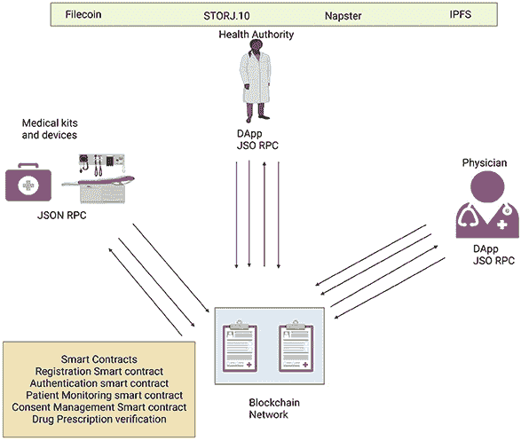

**图 6.4.** 基于智能合约的系统。来自 BioRender.com。

### 6.2.7 药物交付与药房配送追踪

医生需要利用区块链技术在数字咨询领域与药房安全交换处方。区块链中哈希函数的使用可以减少处方错误并防止未经授权的信息更改 [27, 59]。注册药房利用区块链访问并处理处方，确保其准确性并及时交付给患者。因此，货运商可以使用区块链技术公开货物的当前位置，增强药师和患者的监控追踪能力。患者和医疗专业人员都可以利用区块链交易的可性和追溯性来确认药物数据的准确性 [23]。当满足特定条件时，智能合约可以启动药方自动处方订单。药房可以重新验证并确认处方。随后，药物被送送到接收者，导致患者医疗记录的更新。

### 6.2.8 可信健康保险服务

严格的隐私法律和有限的激励限制了许多人与保险供应商共享个人医疗信息。因此，患者更倾向于选择拒绝有效理赔的保险计划。虚拟医疗法保证了患者在理赔方面拥有与实体医疗相同的权利。保险行业的欺诈（例如向保险公司提交的欺诈医疗理赔）通常需要根据现有信息投入大量精力发现真相。区块链技术允许保险公司访问患者的所有医疗记录，有助于通过基于同意的方法减少保险欺诈。同意保险公司使用其医疗数据的患者可能会获得奖励。此外，某些保险公司通过监控健身房出勤情况使用加密货币令牌奖励保单人，以促进健康生活 [53, 60]。连接到患者的智能医疗设备可以利用区块链建立信任。

### 6.2.9 声誉感知的专家转诊服务

多个个体的参与（例如转诊医疗执业人员、患者和咨询医疗专业人士）对于远程医疗诊疗是必要的 [31, 61]。医疗合作伙伴关系和基于区块链的合约通过促进专业建议和意见的请求，实现了远程护理协调。医疗服务提供可以将转诊单据存储在基于 `IPFS` 的服务器上，该服务器会生成信息文档的 `IPFS hash`。该 `hash` 随后可用于将文档放置在区块链上，允许咨询医疗专业人士在基于区块链的解决方案中访问该文档。当 `IPFS hash` 记录在区块链上时，它能够验证对存储在基于 `IPFS` 的服务器上的文档进行的任何修改。咨询医疗专业人士可能会查看患者的健康报告，随后医疗专家可以将该报告保存在区块链账本上。区块链上的声誉分可以通过考虑咨询医疗执业人员的总服务时长和客户满意度评分进行修改。

### 6.2.10 客户护理服务的数字化

患者完成治疗后，可以利用随访护理服务继续监测患者的整体健康。患者可能被要求在参加在线会议之前，将血液和尿液检查结果发送给医生 [62]。存在使用区块链技术元素智能合约来执行自动化患者随访程序的可能性 [46, 63]。患者、医生和护理人员都可以通过发送给他们的智能合约接收有关预定随访预约的提醒。在患者的最后随访预约期间，医生可能会查看患者的 `EHR` 以验证其当前的健康状况。患者可以利用智能合约与医生注册并交换 `IPFS hash` 以获取健康报告。这在使用能够存储医疗检测结果的 `IPFS servers` 时是可能的。

## 6.3 数字医疗与远程医疗区块链

`Mediledger`、`CallHealth` 和 `Embleema` 等区块链解决方案促进了医疗系统中信任和效率的建立。基于区块链的解决方案如 `WellLinc`、`MedBlock` 和 `MedRec` [64] 使医疗提供者能够参与透明化。以下介绍了近期引入的五个利用区块链技术的创新医疗套件。

### 6.3.1 MedCredits

`MedCredits` 是一个基于 `Ethereum` 的系统，为皮肤科医生提供远程医疗便利，协助患者的诊断和治疗。系统采用基于声誉的机制来促进诚实行为并抑制不诚实行为，保护消费者免受恶意实体侵害。实施了代币策展注册（TCR）服务来验证医生执照，确保只有高素质的专家才能参与网络 [65]。为了促进安全支付并验证医疗理赔，`MedCredits` 利用构建在 `Ethereum` 区块链上的两个智能合约。患者在发布其健康问题的描述和相关照片之前，需要向智能合约钱包存入托管。医生可以通过区块链访问患者的病史，然后利用这些信息进行诊断并建议治疗方案。智能合约被用于从另一位临床医生处获得二次评估并验证病例的真实性 [65, 66]。

### 6.3.2 Medical chain

一个医疗网络利用 `Ethereum` 和 `Hyperledger Fabric` 技术开发了虚拟医生咨询和医疗信息市场服务。患者可以通过预先建立的条款和条件安全地向医疗专业人员提供医疗信息。获得批准的患者可以机密地制定协议条款，通过 `Medical chain` 平台的 `EHR marketplace` 功能让第三方医疗执业人员访问并使用他们的 `EHR` 数据。医疗链可以利用 `Hyperledger Fabric` 的预定义功能来创建用于各种类型访问控制的安全规范。`Medical chain` 利用了名为 `Civic's registration service` 的第三方注册服务来管理密钥 [53]。`ERC20` 令牌是一种为 `Ethereum` 网络设计的软件，目标是促进对数字服务的开放访问、实现安全支付并识别保险公司的欺诈活动 [67, 68]。

### 6.3.3 HealPoint

`HealPoint` 是一个通过 `Ethereum` 平台实现按需医疗服务的系统。虚拟健康服务允许个人方便地向医疗专业人士沟通他们的症状、病史和生命体征。`HealPoint` 基于 `Ethereum` 的智能合约利用 `Schelling-coin` 算法，方便获取全球临床专家的医疗建议 [69]。`HealPoint` 利用人工智能（`AI`）系统根据具体症状有效进行匹配并推荐医生。在确认个人身份和资质后，网络内的专家将批准或拒绝医生的入申请。此外，医生需要将其部分资金存入与智能合约关联的钱包作为缓解欺诈风险的措施 [46]。所有与个人的通信在纳入账本之前都会经过注册验证。

### 6.3.4 我的健康我的数据（MHMD）

`MHMD` 是一个开放生物医学信息网络，通过赋予个人和组织对其数据的访问和控制权来赋能。目前已开始修改敏感信息的记录方法。此外，该计划鼓励医院为研究目的开放患者数据，同时确保匿名性。区块链、灵活授权、隐私信息配置、多层去标识技术、智能合约和大数据分析是关键工具和能力。该系统使用公共区块链网络通过哈希编码安全存储数据。基于区块链的解决方案通过促进个人、医院、研究机构和企业之间安全可靠的信息交换，支持了 `MHMD` 目标的实现 [70]。

### 6.3.5 Robomed

在以太坊区块链上，临床组织 Robomed 网络的运营和管理通过智能合约来实现。患者应当获得基于价值的护理（即高质量医疗服务的另一种说法），以提高其整体健康水平。以太坊平台上的智能合约使医疗公司能够利用 Robomed EHR 在 Robomed 网络内注册、连接和管理其账户。Robomed 的 EHR 模块包含了许多基础功能，如患者交互的实时跟踪、医护人员判断、医疗员工的访问权限管理以及专门化的时间表显示。患者现在可以使用 Robomed 移动模块访问远程医疗、进行预约，并按照其授权协议的要求，向接受医疗服务的诊所提供其 EHR。Robomed 组织可以利用智能合约监控并验证患者的健康结果，并遵循基于价值的医疗服务的临床指南。所有 Robomed 公司均获授权使用 `RBM`（一种以太坊代币）进行支付。`RBM` 币遵循以太坊网络上的 `ERC-20` 标准 [71, 72]。

## 6.3.6 区块组织的挑战

传统的远程医疗系统通常使用旧的技术来存储、维护和保护患者数据。由于这种局限性，医疗领域多个利益相关者与提供者之间的协作潜力受到限制。系统成本的潜在增加可能会对患者提供的医疗护理标准产生重要影响。不可篡改的交易记录和医疗数据使得区块链技术能够促进患者全面且准确的病史的安全存储和持续监控 [73–75]。区块链系统具有彻底改变远程医疗的潜力。然而，它们的进展受到意识有限、平台不稳定以及隐私和数据标准不完善等因素的限制 [76]。在区块链技术于远程医疗和通信领域广泛实施之前，有必要进行额外的研究以制定详细的标准和法规。此外，调查促使企业转向区块链技术的财务动机也至关重要。

## 6.3.7 智能合约的安全漏洞


带有漏洞或缺陷的智能合约可能会损害患者医疗记录的安全性，导致潜在的篡改或破坏 [77, 78]。例如，具有受限访问的智能合约可以利用重入安全操作（`re-entrancy security operation`）来修改患者的电子健康记录，或从合法用户的账户中提取资金 [79]。带有漏洞或缺陷的智能合约可能会损害患者医疗记录的安全性，导致潜在的篡改或破坏 [77, 78]。例如，具有受限访问的智能合约可以利用重入安全操作来修改患者的电子健康记录，或从合法用户的账户中提取资金 [79]。带有漏洞或缺陷的智能合约可能会损害患者医疗记录的安全性，导致潜在的篡改或破坏 [77, 78]。例如，具有受限访问的智能合约可以利用重入安全操作来修改患者的电子健康记录，或从合法用户的账户中提取资金 [79]。目前提供了几种诊断方法，包括 `Zeppelin` 和 `Oyente` [80]。智能合约可以利用这些工具识别可能被外部攻击利用的弱点 [17, 77]。

## 6.4 提高交易速度和大规模数据

为了防止远程医疗中的错误，以某种方式实施区块链技术至关重要 [81]。目前的区块链平台受到了海量数据的负面影响 [82]。远程医疗服务产生大量数据，需要高效的处理 [83]。开发高效的区块链技术可以显著提高区块链在医疗保健领域的利用 [84]。增加额外的基于边缘或雾雾的层可能是可以采取的一种改进方法 [85]。

### 6.4.1 对连接的支持

医疗服务提供者和患者在区块链平台上寻求安全的连接。区块链平台的兼容性使户户能够直接相互连接，消除了对中间者的需求 [26]。区块链系统之间的互操作性面临许多挑战，例如不同平台之间编程语言和共识机制的差异 [86, 87]。

## 6.5 结论

在研究远程健康的背景下，本章解释了为什么以一种可靠且信任的方式实施区块链技术至关重要。本章查看了一些提高效率的新区块链项目，使医生能够为患者提供远程服务。研究人员确定了一些需要进一步调查的领域，以改进目前的区块链系统。最后，我们想强调一些重要发现并给出结论。

- 区块链技术通过严格遵守患者授权书中描述的规则来保护医疗记录不被破解。
- 持续远程患者监控对于减少错误的发生至关重要。开发高效的区块链技术可以通过缩短交易处理时间显著提高区块链的利用。
- 区块链的追踪功能可以帮助医疗领域检测涉及医生学历和通常用于家庭诊断的设备的欺诈。
- 由于私有和协作区块链技术提供了高水平的数据机密性，这些技术非常适合远程医疗和远程医疗服务的数字化。

### 参考文献

[1] Azim A, Islam M N and Spranger P E 2020 Blockchain and novel coronavirus: towards preventing COVID-19 and future pandemics *Iberoam. J. Med.* [`2` 215–8](http://dx.doi.org/10.5398/ibjm.2020.0037)

[2] Nguyen D C, Ding M, Pathirana P N and Seneviratne A 2021 基于区块链和人工智能的应对新冠肺炎（COVID-19）类流行病解决方案：综述 *IEEE Access* [`9` 9573–53](http://dx.doi.org/10.1109/ACCESS.2021.3093633)

[3] Kumar D, Sood S K and Rawat K S 2023 用于控制 COVID-19 传播的物联网辅助技术：基于 CiteSpace 的科学计量学分析 *Internet Things* [`23` 100863](http://dx.doi.org/10.1016/j.iot.2023.100863)

[4] Gonçalves R L *et al* 2023 COVID-19 疫情以来基层医疗中非传染性疾病远程医疗系统的可用性：系统性综述 *J. Med. Internet Res.* [`25` e44209](http://dx.doi.org/10.2196/44209)

[5] Alarjani M and Alhaider M 2023 区块链应对 COVID-19 的挑战：综述论文 *Eur. J. Health Sci.* [`8` 32–49](http://dx.doi.org/10.47672/ejhs.1384)

[6] Hollander J E and Carr B G 2020 近乎完美？针对 COVID-19 的远程医疗 *New Engl. J. Med.* [`382` 1679–81](http://dx.doi.org/10.1056/NEJMp2003539)

[7] Jin Z and Chen Y 2015 云计算时代的远程医疗：前景与挑战 *IEEE Pervasive Comput.* [`14` 54–61](http://dx.doi.org/10.1109/MPRV.2015.19)

[8] Ekeland A G, Bowes A and Flottorp S 2010 远程医疗的有效性：综述的综述 *Int. J. Med. Inform.* [`79` 736–71](http://dx.doi.org/10.1016/j.ijmedinf.2010.08.006)

[9] Mahajan H B, Rashid A S, Junnarkar A A, Uke N, Deshpande S D, Futane P R, Alkhayyat A and Alhayani B 2023 医疗 4.0 与区块链集成到安全的云端电子健康记录系统中 *Appl. Nanosci.* [`13` 2329–42](http://dx.doi.org/10.1007/s13204-021-02164-0)

[10] Murala D K, Panda S K and Sahoo S K 2023 使用区块链技术保障云环境下的电子健康记录系统 *区块链技术的最新进展：现实世界应用* (Cham: Springer) 第 89–116 页

[11] Hopkins B S *et al* 2023 神经外科门诊远程医疗：有效性及其对手术转化率影响的对比分析（15,677 次连续诊疗） *J. Neurosurg.* [`1` 1–10](http://dx.doi.org/10.3171/2023.2.JNS221477)

[12] Stowe S and Harding S 2010 远程护理、远程医疗与医疗医疗 *Eur. Geriatr. Med.* [`1` 193–7](http://dx.doi.org/10.1016/j.eurger.2010.002)

[13] Khatoon A 2020 用于医疗管理的区块链智能合约系统 *Electronics* [`9` 94](http://dx.doi.org/10.3390/electronics01094)

[14] Bennett B 2017 将远程医疗作为医疗信息化（HIT）采用的模型 *Telehealth Med. Today* [`2` 1–4](http://dx.doi.org/10.30953/tmt.v2.5)

[15] Margheri A, Masi M, Miladi A, Sassone V and Rosenzweig J 2020 健康数据的去中心化溯源 *Int. J. Med. Inform.* [`141` 104197](http://dx.doi.org/10.1016/j.ijmedinf.2020.104197)

[16] Dagher G G, Mohler J, Milojkovic M and Marella P 2018 Ancile：用于电子健康记录访问控制和隐私保护的区块链框架 *Sustain. Cities.* [`39` 283–97](http://dx.doi.org/10.1016/j.scs.2018)

[17] Hu Y C, Lee T, Chatzopoulos D and Hui P 2020 智能合约交互与状态共识分析 *Concurr. Comput. Exp.* [`32` e5228](http://dx.doi.org/10.1002/cpe.5228)

[18] Pham H L, Tran T and Nakashima Y 2019 基于区块链的实用防伪系统 *2019 4th Technology Management and Engineering Science Int. Conf. (TIMES)* pp 1–5

[19] Holzinger A, Weippl E, Tjoa M and Kieseberg P 2021 可持续发展目标（SDGs）的数字化转型——安全视角 *Int. Cross-Domain Conf. for Machine Learning and Knowledge Extraction* pp 1–20

[20] Zheng Z, Xie S, Dai H, Chen X, Weng J and Imran M 2020 智能合约概述：挑战、进展与平台 *Future Gener. Comput. Syst.* [`105` 475–91](http://dx.doi.org/10.1016/j.future.2019.129)

[21] Hasselgren A, Kralevska K, Gligoroski D, Pedersen S and Faxvaag A 2020 医疗保健健康科学中的区块链：综述 *Int. J. Med. Inform.* [`134` 104040](http://dx.doi.org/10.1016/j.ijmedinf.2019.104040)

[22] Chukwu E and Garg L 2020 医疗保健区块链的系统性综述：框架、原型与实现 *IEEE Access* [`8` 2196–214](http://dx.doi.org/10.1109/ACCESS.2020.296981)

[23] Ting D S, Carin L, Dzau V and Wong T Y 2020 数字化技术与 COVID-19 *Nat. Med.* [`26` 459–61](http://dx.doi.org/10.1038/s41591-020-0824-5)

[24] Vaishya R, Haleem A, Vaish A and Javaid M 2020 应对 COVID-19 疫情的新兴技术 *J. Clin. Exp. Hepatol.* [`10` 409–11](http://dx.doi.org/10.1016/j.jceh.2020.04.019)

[25] Ahmad R W, Salah K, Jayaraman R, Yaqoob I, Ellahham S and Omar M 2023 区块链与 COVID-19 疫情：应用与挑战 *Cluster Comput.* [`26` 2383–408](http://dx.doi.org/10.1007/s10586-023-04009-7)

[26] Rabah K 2017 区块链驱动的医疗系统的挑战与机遇：综述 *Mara Res. J. Med. Health Sci.* 145–52

[27] Houtan B, Hafid A S and Makrakis D 2020 医疗保健中基于区块链的自主患者身份综述 *IEEE Access* [`8` 90478–94](http://dx.doi.org/10.1109/ACCESS.2020.2994090)

[28] De Aguiar E J, Faiçal B S, Krishnamachari B and Ueyama J 2020 医疗保健基于区块链策略综述 *ACM Comput. Surv.* [`53` 1–27](http://dx.doi.org/10.1145/337691)

[29] Shubbar S 2017 用于监测乳癌辅助化疗反应的区块链超声成像系统 *Kent State University*

[30] Guo R, Shi H, Zheng D, Zhuang C and Wang Z 2019 用于按需医疗的灵活基于区块链的 ABE 方案 *IEEE Access* [`7` 88012–25](http://dx.doi.org/10.1109/ACCESS.2019.29256)

[31] Abugabah A, Nizamuddin N and Alzubi A 2020 用于智能医疗生态系统的去中心化远程医疗框架 *IEEE Access* [`8` 16657–88](http://dx.doi.org/10.1109/ACCESS.2020.30218)

[32] Colón K 2018 创建以患者为中心的全球性去中心化医疗系统：结合新型支付与护理模式、远程医疗、人工智能和区块链 *Blockchain Healthc. Today* [`1`](http://dx.doi.org/10.1015)

[33] Hewa T, Braeken A, Yliantila M and Liyanage M 2020 连接 5G 的多接入边缘计算和基于区块链的安全远程医疗系统 *GLOBECOM 2020–2020 IEEE Global Conf.* pp 1–6

[34] Griggs K N, Ossipova O, Kohlios C P, Baccarini A, Howson E and Hayajneh T 2018 使用智能合约进行远程患者监测的医疗区块链系统 *J. Med. Syst.* [`42` 1–7](http://dx.doi.org/10.1007/s10916-018-0982-x)

[35] Agbo C C, Mahmoud Q H and Eklund J M 2019 医疗领域的区块链技术：系统性综述 *Healthcare* [`7` 56](http://dx.doi.org/10.3390/healthcare702056)

[36] McGhin T, Choo K K R, Liu C Z and He D 2019 医疗应用中的区块链：研究挑战与机遇 *J. Netw. Comput. Appl.* [`135` 62–75](http://dx.doi.org/10.1016/j.jnca.2019.02.027)

[37] Hussien H M, Yasin S M, Udzir S N I, Zaidan A A and Zaidan B B 2019 医疗区块链技术开发的系统性综述：分类、实质分析、动机、挑战、建议与未来方向 *J. Med. Syst.* [`43` 1–35](http://dx.doi.org/10.1007/s10916-019-1445-8)

[38] Radanović I and Likić R 2018 医疗领域区块链技术的应用机遇 *Appl. Health Econ. Health Policy* [`16` 583–90](http://dx.doi.org/10.1007/s40258-018-0412-8)

[39] Khezr S, Moniruzzaman M, Yassine A and Benlamri R 2019 医疗保健中的区块链技术：全面综述与未来研究方向 *Appl. Sci.* [`9` 1736](http://dx.doi.org/10.3390/app9091736)

[40] Abu-Elezz I, Hassan A, Nazeemudeen A, Househ M and Abd-Alrazaq A 2020 医疗保健中区块链技术的益处与威胁：范围性综述 *Int. J. Med. Inform.* [`142` 104246](http://dx.doi.org/10.1016/j.ijmedinf.2020.104246)

[41] Tandon A, Dhir A, Islam A N and Mäntymäki M 2020 医疗保健中的区块链：系统性文献综述、综合框架和未来研究议程 *Comput. Ind.* [`122` 103290](http://dx.doi.org/10.1016/j.compind.2020.103290)

[42] Yaqoob I, Salah K, Jayaraman R and Al-Hammadi Y 2021 用于医疗数据管理的区块链：机遇、挑战与未来建议 *Neural Comput. Appl.* [`35` 11475–90](http://dx.doi.org/10.1007/s00521-020-05519-w)

[43] Vellela S S, Reddy B V, Chaitanya K K and Rao M V 2023 使用动态云计算平台改进电子医疗系统的集成方法 *2023 5th Int. Conf. on Smart Systems and Inventive Technology (ICSSIT)* pp 776–82

[44] Tagde P, Tagde S, Bhattacharya T, Tagde P, Chopra H, Akter R, Kaushik D and Rahman MH 2021 电子健康中的区块链与人工智能技术 *Environ Sci Pollut Res Int.* [`28` 52810–52831](http://dx.doi.org/10.1007/s11356-021-16223-0)

[45] Zhang X, Poslad S and Ma Z 2018 电子健康中电子医疗记录 (EMRs) 查询的基于块访问控制 *2018 IEEE Global Communications Conf. (GLOBECOM)* 2018 年 12 月 pp 1–7


[46] Ahmad R W, Salah K, Jayaraman R, Yaqoob I, Ellahham S and Omar M 2021 区块链技术在远程医疗和在线医疗中的作用 *Int. J. Med. Inform.* [`148` 104399](http://dx.doi.org/10.1016/j.ijmedinf.2021.104399)

[47] Mannaro K, Baralla G, Pinna A and Ibba S 2018 应用于萨尔丁尼亚地区（意大利）远程皮肤科平台的区块链方法 *Information* [`9` 44](http://dx.doi.org/10.3390/info9020044)

[48] Painuly S, Sharma S and Matta P 2023 电子医疗供应链管理系统中的人工智能：挑战与未来趋势 *2023 Int. Conf. on Sustainable Computing and Data Communication Systems (ICSCDS)* pp 569–74

[49] Weissman S M, Zellmer K, Gill N and Wham D 2018 在社区环境中实施虚拟健康远程医疗计划 *J. Genet. Couns.* [`27` 323–5](http://dx.doi.org/10.1007/s10897-017-0177-5)

[50] Wang C K 2015 个人健康记录、电子医疗记录和健康信息的安全与隐私 *Probl. Perspect. Manag.* `13` 19–26

[51] Prokofieva M and Miah S J 2019 医疗保健区块链 *Australas. J. Inf. Syst.* [`23`](http://dx.doi.org/10.3127/ajis.v23i0.2203)

[52] Halamka J D *等* 2019 对（近期）医疗保健的十大区块链预测 *Blockchain Healthc. Today* [`2`](http://dx.doi.org/10.30953/bhty.v2.106)

[53] MedicalChain 2018 白皮书：MedicalChain *MedicalChain 自行出版*

[54] Kazmi H S, Nazeer F, Mubarak S, Hameed S, Basharat A and Javaid N 2020 基于区块链智能合约的信任远程监控 *Advances on Broad-Band Wireless Computing, Communication and Applications: Proc. of the 14th Int. Conf. on Broad-Band Wireless Computing, Communication and Applications (BWCCA-2019)* vol 14 pp 765

[55] Jayaraman P and Perera C 2017 以边缘为中心的分布式物联网分析的出现 *Internet of Things* (London: Chapman)

[56] Rehman M H, Ahmed E, Yaqoob I, Hashem A and Ahmad S 2018 工业物联网中基于同心模型的大数据分析 *IEEE Commun. Mag.* [`56` 37–43](http://dx.doi.org/10.1109/MCOM.2018.170032)

[57] Salah K, Alfalasi A, Al-fasi M, Alharmoudi M, Alzaabi M and Ahmad R 2020 具有环境监控和位置追踪的物联网货集装箱 *2020 IEEE 17th Annual Consumer Communications Conf.*

[58] Gong L, Alghazzawi D and Cheng L 2021 BCoT：基于区块链的物联网设备框架 *Information* [`12` 203](http://dx.doi.org/10.3390/info1205)

[59] El-Mied Y 2017 远程医疗和在线医疗：数字时代如何改变 *Smart Home.*

[60] Raikwar M, Mazumdar S, Gupta S, Chatt. A and Lam K 2018 基于区块链的框架 *9th IFIP. Conf. on New Technologies and Security (NTMS)*

[61] Lee C 2019 医疗与健康行业的区块链应用 *2nd IFIP. Conf. on Social Science, Public Health (SSP)*

[62] Heath S 2020 出院护理的患者参与策略 *TechTarget* [`patientengagement.com/features/strategies-for-discharge`](https://patientengagement.com/features/strategies-for-discharge) (2020 年访问)

[63] Siyal A, Junejo A, Zawish M, Khalil A and Soursou G 2019 医疗中的区块链应用 *Cryptography* [`3` 3](http://dx.doi.org/10.3390/cryptography3)

[64] Kumar A, Krishnamurthi R, Nyyar A, Sharma K and Hossain E 2020 医疗 4.0 的新型型区块链设计 *IEEE Access* [`8` 30047](http://dx.doi.org/10.1109/ACCESS.2020.30047)

[65] Sharma A and Kaur P 2023 使用区块链的防篡多租户存储 *Peer-to-peer Netw. Appl.* [`16` 431–49](http://dx.doi.org/10.1007/s12083-022-0141-0)

[66] Todaro J M 2020 MedCredits 概述 *MedX Protocol* [`medium.com/medxprotocol/introduction-to-medcredits-287f9fac06`](https://medium.com/medxprotocol/introduction-to-medcredits-287f9fac06) (2020 年访问)

[67] Munoz D, Constantinescu D, Asenjo R and Fuentes L 2020 Clinicappchain：一种低成本的区块链解决方案 *Blockchain and Applications: Int. Congress* pp 36–44

[68] Aileni R and Suciu G 2020 IoMT：区块链视角 *Decentralised Internet of Things: A Blockchain Perspective* (Cham: Springer) pp 199–215

[69] Buterin V 2014 Schellingcoin：最小信任数据源 *Ethereum Blog*

[70] Gabrielli S, Krenn S, Pellegrino D, Pérez Baún J C, Pérez Berganza P, Ramacher S and Vandevelde W 2022 KRAKEN：安全、信任、合规且保护隐私的数据共享平台 *Data Spaces: Design, Deployment and Future Directions* (Cham: Springer) pp 107–30

[71] Robomed Network R 2017 首次代币发行 *White Paper* Robomed Network Inc. Russia

[72] Hang L, Choi E and Kim D H 2019 基于医疗区块链的新型 EMR 完整性管理 *Electronics* [`8` 467](http://dx.doi.org/10.3390/electronics804467)

[73] Bennett B 2017 区块链 HIE 概述：一种医疗互操作性框架 *Telehealth Med. Today* [`2`](http://dx.doi.org/10.30953/tmt.v2.14)

[74] Raskin M 2016 智能合约的法律与合法性 *Geo. L. Tech. Rev.* [`1` 305](http://dx.doi.org/10.2139/ssrn.2842258)

[76] Kolan A, Tjoa S 和 Kieseberg P 2020 奥地利的医疗区块链与隐私保护——技术与法律方面 *2020 Int. Conf. on Software Security and Assurance (ICSSA)* 第 1–9

[77] Mense A 和 Flatscher M 2018 以太坊智能合约中的安全漏洞 *Proc. of the 20th Int. Conf. on Information Integration and Web-based Applications and Services* 第 375–80

[78] Rehman M H, Salah K, Damiani E 和 Svetinovic D 2019 区块加密货币生态系统中的信任 *IEEE Trans. Eng. Manage.* [`67` 1196–212](http://dx.doi.org/10.1109/TEM.2019.2948861)

[79] Khan Z A 和 Namin A S 2020 以太坊智能合约：漏洞及其分类 *2020 IEEE Int. Conf. on Big Data (Big Data)* 第 1–10

[80] Chen H, Pendleton M, Njilla L 和 Xu S 2020 以太坊系统安全综述：漏洞、攻击与防御 *ACM Comput. Surv.* [`53` 1–43](http://dx.doi.org/10.1145/3391195)

[81] Mazlan A A, Daud S M, Sam S M, Abas H, Rasid S Z A 和 Yusof M F 2020 医疗区块链系统的扩展性挑战——系统性综述 *IEEE Access* [`8` 23663–73](http://dx.doi.org/10.1109/ACCESS.2020.2969230)

[82] Böhme R, Christin N, Edelman B 和 Moore T 2015 比特币：经济、技术与治理 *J. Econ. Perspect.* [`29` 213–38](http://dx.doi.org/10.1257/jep.29.2.213)

[83] Malavolta G, Moreno-Sanchez P, Schneidewind C, Kate A 和 Maffei M 2018 用于区块链扩展性与互操作性的匿名多跳锁 *Cryptology ePrint Archive*

[84] Wood G 2014 以太坊：一种安全的去中心化通用交易账本 *Ethereum Project Yellow Paper* `151` 1–32

[85] Debe M, Salah K, Rehman M H U 和 Svetinovic D 2019 IoT 公共雾节点信誉系统：基于以太坊区块链的去中心化解决方案 *IEEE Access* [`7` 178082–93](http://dx.doi.org/10.1109/ACCESS.2019.2958355)

[86] Herlihy M 2018 原子跨链交换 *Proc. of the 2018 ACM Symp. on Principles of Distributed Computing* 第 245–54

[87] Miraz M H 和 Donald D C 2019 原子跨链交换：非货币数字代币交换设施的发展、轨迹与潜力 arXiv preprint arXiv:[1902.04471](http://arxiv.org/abs/1902.04471)

---

# IOP 出版

# 人工智能辅助医疗区块链

# 协同方法

# Rishabha Malviya, Arun Kumar Singh, Sonali Sundram, Balamurugan Balusamy 和 Seifedine Kadry

---

# 第 7 章

## 智能合约：一种自动化远程患者监测的医疗干预

传感器节点和健康监测技术的普及导致了与安全数据传输和记录相关的问题日益增加。为了确保生成受保护健康信息的传感设备得到安全的分析和管理，多项研究建议利用基于区块链技术的智能合约。在本地框架下，基于检测器与设备的通信，智能合约会被激活，活动将记录在 `Ethereum` 区块链系统上。这种方法能够为患者和医疗专业人员提供即时警报，同时保留发起这些操作的个人记录。为所有参与人员自动化通知有助于缓解与远程健康监测相关的安全问题。本章探讨了使用智能合约授权物联网（`IoT`）设备，并提供了一种利用医疗传感器的合规且安全的方法。本章探讨了利用基于区块链的智能合约对医疗传感器进行安全评估和管理。

### 7.1 引言

`IoT` 设备和可穿戴技术扩展了医疗传感器在远程患者监测领域的可能性。`IoT` 医疗趋势包括使用无线体域网络（`WBANs`）`[1–3]`。各种可穿戴或植入式医疗设备可监测患者的生命体征，如心率和血浆水平。可以使用额外的传感器和执行器利用其收集的数据自主提供治疗`4–8]`。患者的 `WBAN` 设备通过其收集的数据自主提供治疗，并将数据发送给医疗专业人员，通常以手机形式的交互式界面`9]`。远程监测允许患者在无需处理漫长预约等待的情况下进行活动`10]`。

预计到 2021 年，远程监测在健康追踪的应用将达到 5020 万人，远高于目前的 710 万人`11, 12]`。为了实现实时监测，2018 年 1 月实施了财务奖励，以鼓励采用具有“活跃反馈环”的设备`7]`。

智能医疗领域不断的发展也伴随着健康信息传输安全效率方面日益增长的挑战。集成健康管理涉及对来自各种设备的数据收集、组织和分析，无论制造商如何。联邦立法对于确保受保护信息（`PHI`）的安全传输是必要的，因为电子健康记录（`EHRs`）需要易于维护和传输。对智能节点指令的准确记录对于评估护理质量至关重要，这既是患者的治疗，也是批准证明。区块链上智能合约的应在 `WBAN` 设备与医疗提供者之间创建不可篡改的交易记录。数字账本和定期安全更新将为患者提供更大的安全感。远程监测使医疗人员接收患者的实时更新，从而实现精准治疗`13]`。利用智能合约将新医疗技术集成到医疗系统中是一种自动通知各种设备健康数据的创新技术。图 7.1 展示了系统的基础结构。由中本聪开发的区块链技术是智能合约的基础设施。去中心化共享账本具有追踪交易的目的`14]`。

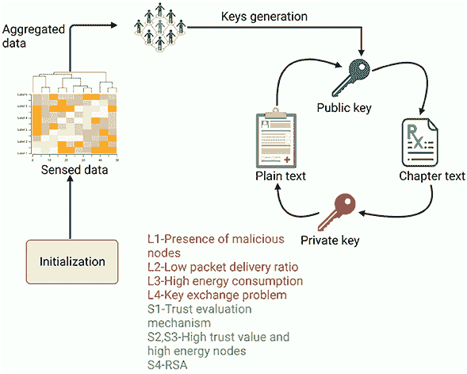

**图 7.1.** 图像展示了区块链上的节点如何接收并处理原始传感器数据，然后通过网络接口传输到共享账本。

区块链主要有三种分类：开放型、企业级和联盟型。公有区块链的主要目标是去中心化网络并确保信息安全透明地传输。在需要更高的控制和隐私性时，通常会选择私有链和联盟链。本系统采用了联盟链，因其具有成本效益，并且在保护个人健康信息（PHI）方面具有增强的安全措施。区块链的运行原理是任何个人未被授权向区块链添加交易，区块链充当所有操作的综合账本。

许多行业已通过采用区块链技术从中获益。可以维护一份永久性记录，以记录产品或主体从开始到结束的整个过程。该技术在验证信息的当前状态、确认艺术品的真实性以及建立系统所有权方面具有应用。区块链可用于创建智能合约，智能合约是在满足特定条件时可以执行的可编程代码段。该系统利用 `WBAN` 设备生成健康数据，当个体患者达到特定阈值水平时，这些数据可触发报警。该区块链能够追踪由 `WBAN` 节点收集的数据和发布的治疗指令。

管理 `PHI` 需要对机性和真实性完全投入。该区块链系统通过匿名账户和许可性联盟管理，确保了有效性、可验证性和用户隐私。企业区块链与 `Bitcoin` 等公有链不同，只有授权人员才能访问和验证。每个授权用户都将创建一个匿名账户。因此，患者在管理医疗记录方面将获得更大的自主权。


尽管已有关于区块链在医疗保健领域可能应用的文献，但目前还没有证据表明这种推荐技术已应用于类似的研究或公开的软件中。`IBM` 的 `Hyperledger` 项目促进了区块链技术在医疗和 `IoT` 中的采用 `[15]`。然而，这种运行模式在学术论文中缺乏引用 `[16]`。目前，关于远程患者监控（`RPM`）的研究主要强调无线网络传感设备的使用 `[10]`，而不是将区块链技术整合到 `RPM` 操作中。带外方法也可用于 `IoT` 设备的认证。目前的重点是实现 `EHRs` 与区块链技术之间的互操作性。`MIT` 开发了一个名为 `Medrec` 的基于区块链的雏形，它允许跨电子 `EHRs` 交换医疗记录 `[9]`。人们对开发基于区块链的 `EHR` 系统感兴趣，该系统可以将所有 `EHR` 数据合并到一个区块中。首次币发行（`ICO`）的一个例子是实施基于区块链的 `EHR` 系统。该系统允许患者对其 `PHI` 进行直接的控制和监督，而不是依赖于多位医生和医疗机构 `[13]`。在当前的医疗保健格局下，患者对治疗的参与度日益提高 `[17]`。研究人员提出了一种利用区块链技术的条款，允许患者授权指定人员访问其记录在区块链上的临床信息。这项技术实现了以患者为中心的 `IoT` 应用。第 13 至 18 页范围内的区块过大，导致了问题。区块链区块作为文档的记录，存储了对数据的简要说明。在区块链上存储患者完整的医疗信息将需要每个节点具有巨大的存储空间。这种医疗区块链应用是独特的，尽管在利用方面有几个类似的概念。因此，可以确保这种基于区块链的医疗系统将表现出高水平的适应性。

## 7.2 系统设计

系统的运行描述如下。通常用于远程患者监控的医疗设备包括胰岛素泵和血压监测设备。为了收集和组织数据，应用程序会将数据传输到“智能设备”，如智能手机或平板电脑。智能合约会迅速接收并处理格式化数据以及指定的限制（见图 7.1）。

`Oracle` 是 `Ethereum` 协议内智能合约的主要信息提供者。`Oracle` 设备与智能合约建立直接连接。智能合约可以利用来自患者和医学专家的数据自动为执行器节点生成治疗计划（见图 7.2）。

![图 7.2. 此图说明了利用智能设备获取特定设置和数据的过程。数据经过格式化后传输至智能合约。自 [18]。CC BY 4.0.© 2020 Shrestha, Vassileva and Deters.](images/bk978-0-7503-5839-2ch7f2_online.jpg)

**图 7.2.** 此图说明了利用智能设备获取特定设置和数据的过程。数据经过格式化后传输至智能合约。自 `[18]`。CC BY 4.0.© 2020 Shrestha, Vassileva and Deters.

`HIPAA` 法禁止在区块链或数字资产上保存医疗数据。区块链技术被用作去中心化且永久账本，用于记录和监控。数据传输完成后，智能合约将显示给区块链以指示完成。`EHRs` 的 `API` 促进了数据传输到 `EHR` 的过程。此外，区块链活动将记录对患者 `EHR` 的故意或无意修改。该系统将利用安全的全球网络区块链来分析区块、执行智能合约并验证新区块。访问患者数据的授权实体包括医生、医疗设备制造商和患者。要使一个节点被认为是有效的，必须来自预先批准节点列表中至少三个成员的确认，即 15 个中的 10 个。多个医疗机构可以参与该系统，同时保持某种程度的去中心化。预先批准的验证节点将取代工作量证明。恶意节点无法通过协作插入欺诈交易来控制区块链。

每个智能合约都可以适应患者的特定需求及其各种设备。所有主单元都将调用一个初始的私有区块链。随后，该区块链将与每个患者设备的相关子合约进行通信，为每个患者提供必要的输入和特定的限制设置。该构建将分为多个层级。单个合约根据阈值水平的数据分析传输警告或治疗指令。设备的合约只有在安装后才能终止并替换为新的，从而在不影响其他单元的情况下进行升级。

### 7.3 实现

`Solidity` 编程语言专为以太坊设计，用于开发智能合约作为概念验证。这些操作和智能合约并非在以太坊公有区块链上进行。相反，使用的是基于以太坊架构构建的私有链。这消除了支出 `Ether` 的需求，并允许在以太坊预定义的限制之外进行实验。

智能设备将与区块链上的智能合约建立交互，并通过去中心化应用程序（`DApp`）维护用户配置文件。配置文件可以根据患者的健康状况进行调整。医生可以在他们管理的患者账户中修改跟踪阈值环境。传感器数据将在 `DApp` 的后端进行组织和处理，然后使用 `web3.js` 传输到智能合约。

利用了 `Remix`，这是一种集成了程序员以评估区块链网络效率的软件工具。然而，这一想法扩展到了以太坊网络之外。可以使用在线系统测试 `IBM Hyperledger` 实现 `[4]`。与以太坊相比，`Hyperledger` 表现出更优的用户界面和客户服务。此外，适用于月费。以太坊平台的高效管理需要专家团队。

智能设备将与 `Health Contract Caller` 智能合约建立蓝牙通信以管理系统信息。为每个接收数据的设备将建立一个独立的合约。一旦收到来自智能设备的心率数据，`Health Contract Caller` 将立即收到通知。

`Health Contract Caller` 将用于评估心率监测器。计算设备将信息和最低级值作为变量发送。心率监测对象将作为分析方法的参数被创建。两个不同子合约的主要目的是独立地分析和响应数据，而不是将控制权交给主合约。主合约充当“目录”，以增强模块化并方便维护。如果分析得出不利的结果（表示失败），该交易将记录在区块链上。向计算设备发送相同的代码可以触发各种响应，包括用户通知、警报当局或启动特定操作，如注射胰岛素或高血压药物。

三个示例合约已合并到 `GitHub` 存储中 `[11]` 以增强可访问性。传统合约的可行替代方案是利用区块链技术创建包含详细信息的单独文件，随后可以通过相应的区块链地址进行访问和引用。

### 7.4 系统分析

#### 7.4.1 与传统系统的比较

这种方法取决于区块链技术的使用，这是一项新兴技术。所提的区块链解决方案结合了云计算和数据库系统，以便与现有的远程患者监测系统进行对比分析。表 7.1 展示了传统系统与建议系统之间的比较。

**表 7.1.** 传统系统与建议系统的对比表。

| 参数 | 传统系统 | 现有系统 |
| --- | --- | --- |
| 机密性 | 采用端到端加密以安全地将数据传输到指定的数据库。 | 等级的保护。 |
| 可用性 | 为了确保系统故障期间服务不中断，有必要对数据库备份进行复制和有效的人工管理。 | 所有节点上存在完整的区块链增强了对故障的恢复能力和服务可用性。可以使用 `PBFT` 算法来处理节点故障。 |
| 不可篡改性 | 数据库可能无意或恶意地被破坏。 | 经过验证的区块是永久的，并且抵抗任何修改尝试，使其能够抵抗所有形式的操纵。 |
| 可追溯性 | 记录和日志可能会发生更改，导致检测无法确定。 | 验证者验证交易以保证其一致性和从源头的可追踪性。 |
| 速度 | 交易速率由网络限制决定。 | 取决区块验证所需的时间，可以缩短等待时间。 |
| 隐私性 | 通信加密确保终端用户的个人信息免受未经授权的访问。 | 患者地址的匿名性防止了患者信息与其身份的关联。 |
| 透明度 | 患者信息不可访问且无法与其相应的记录关联。 | 远程监测允许患者在保持隐私和自由的同时密切监测其健康信息。 |

#### 7.4.2 安全分析

为了简单起见，假设所有云和 `IP` 协议都是加密的。医疗保健人员可以在智能合约中修改患者阈值，而患者只能通过智能设备访问其数据 `[19]`。智能设备应包含用户能力的身份验证。为了建立区块的真实性，需要获得所提联盟链区块链成员的大多数授权。对区块链的访问限制在获得许可的授权人员（如患者和看护人员）。确保区块链不包含任何敏感的患者数据至关重要。区块链账本增强了冲突或治疗跟踪期间医疗专业人员和患者的安全性。`HIPAA` 的隐私要求适用于电子数据传输。无法链接到特定患者的数据不受 `HIPAA` 保护。区块链数据仅包含交易细节，不包含任何敏感的 `PHI`（保护健康信息）。

隐私规则通常禁止披露个人数据，除非法律授权或响应个人或 `HHS`（健康与人类服务）的请求。此外，它为 `HHS` 提供了经过验证且不可篡改的监测记录，用于解决争议和调查。本系统实施了多种措施以确保符合 `HIPAA` 标准并保护 `PHI`。

#### 7.4.3 局限性

在一个广泛分布的系统中，主要的挑战是确保每个节点的安全性。患者的智能设备数据正在通过可能不安全的通道（即患者的本地 `Wi-Fi`）使用传统的通道加密方法传输到区块链节点。当多个智能技术向不同节点传输其信息时，密钥管理可能具有挑战性，这会导致后续区块验证的出现延迟。一个大规模的密钥控制系统可能会解决这一问题。医疗系统的有效运行取决于对实时数据的及时获取和检查。即使区块验证时间发生了变化，仍然会有某些延迟。智能设备将定期收集并组合传感器数据然后传输给用户，而不是在短间隔内呈现信息。这一障碍只能通过对传输时间进行精确调整来解决。疾病的严重程度和使用的传感器类型需要根据具体情况进行评估。响应团队应避免依赖目前技术的局限性，因为这会导致响应时间的增加。在向区块链网络添加新节点之前，必须进行个人身份验证，这涉及对 `PBFT` 等共识机制的使用。实施此措施是为了防止未经授权的矿工出现。个人在线状态不足可能会由于阻碍获得必要的授权数量而导致共识机制无法建立，并损害系统的完整性。在由 `N` 个节点组成的 `PBFT` 系统中，可以容忍的最大故障节点数量为 `(N − 1)/3` `[5]`。需要注意的是，该领域仍在变化中，因此这些问题可能在未来得到解决。

### 7.5 结论

使用基于区块链的智能合约可以为确保数据传输安全和进入物联网（`IoT`）医疗提供便利。该系统利用基于区块链的智能合约架构来分析从患者物联网医疗设备获得的数据。这种分析是根据用户配置的阈值进行的。包括患者和医疗人员在内的相关人员将收到必要的信息，而交易将记录在区块链中用于电子健康记录（`EHR`）验证。`Solidity` 中的智能合约作为原型，用于说明系统内部的数据流动。区块链技术可以增强远程患者监测系统的安全性和符合 `HIPAA` 标准的通知交付。医疗保健通过将组织化数据和新数据集成到 `EHR` 和健康数据湖中，可以有效利用大数据。这种集成将增强信息的可靠性，并带来更重大的成果。后续阶段涉及检查 `Hyperledger` 实现替代方案，并引入匿名器以增加链内交易链接的复杂性。

### 参考文献

[1] Almashaqbeh G, Hayajneh T, Vasilakos A V and Mohd B J 2014 QoS-aware health monitoring system using cloud-based WBANs *J. Med. Syst.* [`38` 1–20](http://dx.doi.org/10.1007/s10916-014-0121-2)

[2] Paterick T E 2023 Why the HIPAA privacy rules are important for physicians to know: Ignore these at your own risk *Podiatry Manage.* 113–7

[3] Paternò L and Lorenzon L 2023 Soft robotics in wearable and implantable medical applications: translational challenges and future outlooks *Front. Robot. AI* [`10` 1075634](http://dx.doi.org/10.3389/frobt.2023.1075634)

[4] Sheeraz M M, Mozumder M A I, Khan M O, Abid M U, Joo M I and Kim H C 2023 Blockchain system for trustless healthcare data sharing with hyperledger fabric in action *25th Int. Conf. on Advanced Communication Technology (ICACT)* pp [`437–40`](http://dx.doi.org/10.23919/ICACT56868.2023.10079423)

[5] Tran T, Nawab F, Alvaro P and Arden O 2023 Unstick yourself: recoverable Byzantine fault tolerant services *2023 IEEE International Conference on Blockchain and Cryptocurrency (ICBC) (Dubai)* [1–9](http://dx.doi.org/10.1109/ICBC56567.2023.10174886)

[6] Griggs K N, Ossipova O, Kohlios C P, Baccarini A N, Howson E A and Hayajneh T 2018 Healthcare blockchain system using smart contracts for secure automated remote patient monitoring *J. Med. Syst.* [`42` 1–7](http://dx.doi.org/10.1007/s10916-018-0982-x)

[7] Miranda R, Oliveira M D, Nicola P, Baptista F M and Albuquerque I 2023 Towards a framework for implementing remote patient monitoring from an integrated care perspective: a scoping review *Int. J. Health Policy Manag.* [`12` 1–13](http://dx.doi.org/10.34172/ijhpm.2023.7299)

[8] Dubovitskaya A, Xu Z, Ryu S, Schumacher M and Wang F 2017 Secure and trustable electronic medical records sharing using blockchain *AMIA Annual Symp. Proc.* **2017** 650

[9] Kaur G, Choudhary P, Sahore L, Gupta S 2023 Healthcare: in the era of blockchain *AI and Blockchain* (Springer) [45–55](http://dx.doi.org/10.1007/978-3-031-28451-9)

[10] Hayajneh S, Vasilakos A, Imran F 2016 Secure remote patient monitoring with wireless medical networks *Sensors* [`16` 024](http://dx.doi.org/10.3390/s1604024)

[11] Cheikhrou O, Mershad K, Jamil F, Mahmud R 2023 A lightweight blockchain and fog-enabled remote monitoring system *Sci. Afr.* [`20` e0138](http://dx.doi.org/10.1016/j.sciaf.2023.e0138)

[12] Boikanyo K, Zungeru A, Lebekwe C 2023 Remote patient monitoring systems: applications, architecture, and challenges *Blockchain. Afr.* [3](http://dx.doi.org/10.3389/fbloc.2023.003)

[13] Khwaji A, Alsahafi Y, Hussain F 2023 A roadmap to blockchain technology adoption in Saudi public hospitals *Int. Conf. on Advanced Information* [52–60](http://dx.doi.org/10.1007/978-3-031-28451-9)

[14] Nakamoto S 2008 Bitcoin: a peer-to-peer cash system *Decentral. Rev.*

[15] Abdollahi A, Sadeghviri F, Rejeb A 2023 Exploring the role of blockchain technology in value creation: a multiple case study *Qual. Quant.* [`57` 427–51](http://dx.doi.org/10.1007/s11135-022-1348-2)

[16] Noah B *et al* 2018 Impact of remote patient monitoring on clinical outcomes: an updated meta-analysis of randomized controlled trials *NPJ Digit. Med.* [`1` 20172](http://dx.doi.org/10.1038/s41746-017-0002-4)

[17] Apriani D, Devana V T, Sagala A P, Sunarya P, Rahardja U and Harahap E P 2023 Security using blockchain-based OTP with the concept of IoT publish/subscribe *AIP Conf. Proc.* [`2808` 050001](http://dx.doi.org/10.1063/5.0133138)


[18] Shrestha A, Vassileva J and Deters R 2020 A blockchain platform for user data sharing ensuring user control and incentives *Front. Blockchain* [`3`](http://dx.doi.org/10.3389/fbloc.2020.497985)

[19] Yue X, Wang H, Jin D, Li M and Jiang W 2016 Healthcare data gateways: found healthcare intelligence on blockchain with novel privacy risk control *J. Med. Syst.* [`40` 1–8](http://dx.doi.org/10.1007/s10916-016-0574-6)

患者、研究人员、服务提供者和监管机构只是面临数据可用性扩大和人工智能进步所带来的机遇与挑战的群体之一。深度学习和迁移学习技术的使用可以将普通的视频和人脸静止照片转换为预测分析的丰富数据源。患者无法查看自己的医疗记录，因此他们并不知道自己所持信息的重大意义。

本章概述了生物医学研究，重点关注人工智能（AI）和区块链技术。人们正努力通过探索管理患者数据的新方法，并引入持续健康监测的益处，来增强生物医学研究。本章讨论了分析个人记录的新方法，包括数据整合、即时考量以及关系的意义。由区块链驱动的去中心化健康数据网络将促进医学发现、生物标志物生成和预防性医疗服务的进步。如果能建立既安全又透明的全球个人数据市场，个人可能重新控制自己的数据，特别是医疗信息。这可能通过区块链和深度学习等技术实现。

### 8.1 引言

医疗领域的数字化革命使医疗行业的标准操作程序发生了变化。电子医疗记录的部署以及通过数字医疗系统获取医疗信息的改进，将对患者和他们提供医疗服务的专业人士产生巨大的益处。电子医疗记录，更具体说是 `OpenNotes`，已被证明具有提高医疗质量和效率的潜力 [1, 2]。

生物医学数据可以从多种来源获得，如医学影像、常规实验室检测和组学数据。与社交网络和在线视频共享平台产生的数据总量相比，预计基因组学行业产生的数据量将是大量的额外信息。多个国家医疗保健计划（如英国生物库 `UK Biobank`）正以各种方式利用生物库。医疗保健领域数据规模和复杂性的不断增加既带来了机遇也挑战。一方面，它们提供了新颖而有趣的视角；另一方面，它们可能会在数据分析和解释方面带来障碍，并引发对患者隐私和安全的担忧 [3–5]。

由于对治疗和预防慢性疾病（特别是老年人）的巨大需求，迫切需要新的全球整合医疗系统。这种需求在近年来变得日益紧迫。最近的研究广泛利用了各种类型的数据，如基因组、转录组、`microRNA`、蛋白质组学、抗原、`DNA`、影像、宏基因组、线粒体、代谢和生理数据，以对癌症和其他疾病进行个性化治疗 [6–13]。这些策略缺乏人群水平的整合，未能比较生物医学中不同格式的感知和实用性。尽管已有一些尝试评估各种方法的疗效，并使用多个数据集评估个人健康状况 [14–19]。

区块链与人工智能的整合具有加速医疗科学进步的潜力，提高医疗系统的效率和效果 [20–23]。本章将讨论深度学习，这是下一代人工智能的最新进展 [24]。

后续章节检查了健康与人口统计系统（`HDSSs`）作为数据存档可行方法的效用。随后概述了开源区块链平台 `Exonum`。在该过程的最后一步，进行了一项研究，以调查区块链技术在医疗领域的潜在用途。本章涵盖了具有分析意义的半衰期、针对个人和群体用户的数据价值模型，以及生物医学应用的数据购买成本 [25]。患者可能通过在区块链平台上提供信息或表现出健康行为获得加密代币，从而从其信息中获益 [26]。患者还允许通过将数据提供给区块链平台来贡献生物医学研究的发展。政府可以增强公众预防疾病的参与度，并可能为积极参与这些计划的居民提供通用基本收入。这种方法可能会减轻医疗资源的负担。深度学习与其他机器学习技术可以解决重大的数据管理问题。

健康数据正变得日益复杂，使得在全球范围内进行检查变得挑战性[27]。同样，统一分析大规模全球项目也变得越来越具有挑战性。由于生物数据的多样性和复杂性，高质量生物学数据的预处理和分析往往面临着重大挑战。计算生物学方法被广泛应用于医疗保健、制药行业以及新药开发中。在计算分析领域，机器学习方法是备受推崇且极具价值的技术之一。机器学习的飞速增长很大程度上得益于计算机处理能力的发展和算法设计的改进。深度神经网络（`DNNs`）作为机器学习算法的一种，被广泛应用于多个研究领域，包括新药发现和新生物标志物的创建。其他类型的机器学习算法包括强化学习和监督学习。这些算法可以记录医疗保健数据中的显著相关性[28–32]。最近的研究证明了使用前馈 `DNNs` 预测药物效应和毒性的成功性[33, 34]。`DNNs` 也对生物标志物的创建做出了巨大贡献，这涉及识别健康与疾病状态的区分特征[35]。Putin *et al* 利用患者的血液检查概谱训练了一系列神经网络，实现了对他们年龄和性别的准确估计[36]。利用肿瘤组织的免疫组化染色训练了卷积神经网络（`CNNs`），以对癌症患者进行分类[37]。FDA 在 2017 年初授权了 `Arterys Cardio DL`，这是第一个基于神经网络的平台。它目前正被用于临床环境。在处理小型数据集时，建议在训练深度模型之前选择显著特征。这允许 `DNNs` 能够从数据中自主提取特征[38]。与其他的机器学习方法相比，`DNNs` 通常在特征提取方面表现出更优性能。在生物信息学学科中，聚类分析和其他聚类方法被频繁使用[39]。从生物学角度来看，理解这些主要算法生成的数据可能具有挑战。“黑盒” `DNNs` 的一种替代方案是以引导性知识程序的形式提供的。这些技术包括网络或路径分析。这些技术允许在保持生物学意义的同时减少输入组件，这对于解决与“黑盒”方法相关的解释性挑战至关重要。通过信号通路分析和基于 `DNN` 的预测可以降低药物诱导基因表达模式的复杂性[33]。通路激活评分与 1000 多种常见特征基因的表达变化相关。在路径评分上训练的 `DNN` 性能优于在显著基因集上训练的 `DNN`。它显示的平均计算准确率为 0.701，并在所有三种药物代谢类别中表现出良好的记忆能力。与训练集相比，基于基因表达谱训练的分类器所做的预测准确率明显低得多。然而，使用信号通路进行降维提高了性能并增加了一致性。由于最近的进展，递归皮层网络、胶囊网络和符号学习等等多种机器学习系统目前已投入使用。神经网络、迁移学习和生成对抗网络在医学应用中变得越来越重要，并具有造福个人数据市场的潜力。

### 8.2.1 生成对抗网络（`GANs`）

`GANs` 的发展是深度学习科学迈出的极具鼓励的一步。`GAN` 架构由 Goodfellow 在 2014 年首次提出[40]，它在视觉和文本生成方面显示了一些令人鼓舞的结果。研究人员采用了类似的方法。一种名为对抗自动编码（`AAE`）的技术通过这种方法进行了训练。在生成指纹后，将其用于识别具有所需属性的物质。此外，进一步的研究表明，最近合成的化学品表现出类似于蒽环类物的化学模式[41, 42]。研究人员提出了改进的设计，结合了新的分子特征，如溶解性和合成更广泛化合物的能力。新模型的训练和合成程序展示了药物发现的巨大潜力。

### 8.2.2 递归神经网络

可以使用电子健康数据汇总患者病史，然后可以用于评估患者患心血管疾病、糖尿病或任何长期健康疾病的概率[43]。`RNNs`（循环神经网络）是分析文本或时间序列数据的一种理想方法。`RNNs` 被广泛应用于医疗保健中的电子病历分析，在该领域具有显著优势。`RNNs` 曾用于预测心衰竭的概率。一个具有 12 个月病史的受试者在 6 个月后测试时的 `AUC`（曲线下面积）为 0.883。对预测错误场景的分析表明，网络模型中的心脏病史（特别是高血压）通常与心衰竭的发发生有关。在缺乏症状或症状极微的情况下，心衰竭经常被误诊为急性疾病[44]。`RNNs` 展示了利用连续血糖监测设备的数据预测 1 型糖尿病患者血糖水平的能力，预测时间可达一小时。所提系统可能包括自动血糖和胰岛素水平监测设备。将 `RNNs` 与可穿戴传感器结合以预测人类活动是移动健康领域的一个充满前景的发展。利用人体传感器记录的 `Deep ConvConvLSTM` 模型被预测动作和手势。该模型结合了卷积网络、递归网络以及长短期记忆（`LSTM`）架构。远程监控等技术可以极大有利于帕金森病和心血管疾病等慢性病的管理[45, 46]。

### 8.2.3 迁移学习

深度学习方法需要大量数据来对模型进行适当训练和评估。迁移学习已被解决这一问题。个人应该具备将从一个领域或数据集中学到的知识应用到另一个领域的能力。当缺乏足够的大规模数据集来以提高的准确率训练 `DNN` 时，迁移学习通常用于图像识别任务[47, 48]。在特定数据集上训练过的神经网络可以很容易转换为独特的网络配置，这得益于 `CNNs` 的架构设计，它有助于这一过程。将网络性能与 `ImageNet` 等更大的非生物图像数据集进行比较，可以通过进一步的修改来增强其性能。一个在 `ImageNet` 上训练的 `CNN` 随后通过分析 `MRI` 数据获取了心脏结构的知识[49]。建议模型达到了 97.66% 的平均 `F1 score`，使其能够对心脏结构实现先进识别。使用在 `ImageNet` 上预测的 `CNNs` 进行了脑肿瘤预测[50]。

## 8.2.4 单样本学习与零样本学习

单样本学习和零样本学习技术能够在有限的数据集中获得可接受的结果。单样本学习是一种用于从训练集中有限示例中学习新数据点的技术，特别是在信息有限的情况下。相比之下，零样本学习的目标是在没有任何以训练数据形式预先接触过新活动的情况下来学习该活动。被称为单样本学习和零样本学习的学习技术都包含在迁移学习中。研究人员开发了一种单样本方法，用于预测药物化合物的危险影响[51]。为了创建和评估他们的模型，科学家们使用了与来自 `Tox21` 和 `SIDER` 数据库标签相关的化学品的图表示。该研究将具有 100 棵树的 `random forest model` 与项目反应理论（`IRT`）、带有注意力机制的 `LSTMs` 以及图卷积神经网络（`GCNs`）进行了比较。在大多数情况下，迭代的 `LSTMs` 与 `Tox21` 和 `SIDER` 副作用相比表现出优越的性能。使用 `Tox21` 训练的网络被用于探索在人类治疗临床试验中使用单剂量方法的可能性。这些尝试被证明是失败的，凸显了从高风险*体外*研究获得的数据转化为人类临床试验面临的挑战。

## 8.3 大规模存储系统

生成数据量的不断增加和数据存储需求的日益增长促使需要创建新的数据存储解决方案。提高数据存储系统的可靠性、可用性、扩展性和负担是需要实现的关键目标之一。`HDSS` 在这些需求方面显示了显著进展。由于数据的指数级增长，`HDSS` 的使用变得越来越。近年来，允许数据在多个节点之间复制的技术 `HDSS` 变得越来越流行。在提到数据中的系统时，经常使用 `distributed database`（分布式数据库）一词。

### 8.3.1 HDSS 的进展

多年来，`HDSS` 在应用和利用方面取得了显著进展。点对点的 `blockchain` 可以被理解为一种高效记录活动的去中心化账本。记录被组织成 `blocks` 并使用加密技术进行加密以确保数据完整性。通常建立网络共识来确定接受新 `blocks` 标准。每个 `block` 除了与上一个 `block` 的链接外，还附有 `timestamp` 或 `signature`。`blockchain` 的设计重点是确保数据的持久性。在不更改后续 `blocks` 并获得网络共识的情况下，修改以前的数据是不可能的。`Smart contracts` 实现了各种业务逻辑，例如数据处理、验证和访问。这些功能由所有节点共享控制。区块链技术非常适用于医疗保健等处理极端敏感数据并受严格限制的行业。

## 8.4 数据隐私与监管障碍：其引发关注

### 8.4.1 数据隐私问题

许多人对当代数字环境中数据收集和处理的重要性缺乏全面理解[52, 53]。隐私在数据收集和利用方面带来了巨大挑战。在产生大量个人健康数据的医疗背景下，这变得日益重要。法规和规范通过管理数据的收集、使用、传输、访问和交换来保护数据的机密性。1948 年，作为人权宣言的一部分，联合国承认隐私权是基本人权之一。然而，对于隐私的确切定义尚未达成全球共识[54]。由于数据的产生和使用，产生了隐私的不同解释和监管关注。

### 8.4.2 监管障碍

随着计算机和技术的进步，含有隐私信息的大量数据被定期生成。旨在确保这些数据妥善流动和使用的法规可能会严重影响发展。《健康保险流通与责任法案》（`HIPAA`）和隐私规则的最低要求是重要的举措，旨在确保数据在既定标准下得到妥善利用。开发人员和研究人员在访问和利用适当信息时面临着各种挑战。如 `HIPAA` 等监管障碍在需要高效完成紧急工作可能会阻碍进展，因为它们确保了信息的妥善使用。`HIPAA` 要求机构审查委员会批准数据使用，这可能会增加复杂性。

患者对他们健康和医疗信息的处理方式表示担忧，大多数人认为这些数据应该保持保密并受到保护。随着纸质医疗记录数字化并存储在电子格式中，个人健康信息的可用性可能会随着其使用和披露而扩大。美国的医疗和公共卫生专业人员在联邦、部落、州和地方等不同层级可能获得不平等的且不充分的保护。`HIPAA` 的创建是为了确保个人即使在离开当前工作后仍能获得健康保险覆盖，并设定标准，使参与医疗行业的企业更容易进行数字交易。`HIPAA` 的行政简化条款规定卫生和人类服务部为电子医疗保健交易设定国家标准，以提高整个系统的有效性和高效率性。这样做是为了增强系统的有效性和效率。这一时期的技术进步引起了国会对医疗数据机密性潜在影响的关注。由于 `HIPAA` 最近的修订，联邦政府现在被要求对某些类别的可识别身份的健康信息实施某些隐私保护。个人可识别医疗信息的隐私标准受 `HIPAA` 隐私规则保护，该规则保护了可识别特定个人的患者信息。根据隐私规则提供的定义，“受保护的健康信息”是指任何可识别特定个人的数据。涵盖实体是处理此类信息的组织。受保护的健康信息（`PHI`）包含了可能唯一识别个人的健康相关数据。某些教育和专业数据可能不被分类为 `PHI`。隐私规则涵盖了各项条款，包括：

- 对患者健康信息提供增强的管理。
- 实施法规以控制授权访问和利用个人健康信息的个人。
- 医疗保健提供者和其他实体必须实施适当措施来保护隐私健康信息。
- 该法律对违反患者隐私权的个人执行民事和刑事法律后果。
- 公共卫生责任可能需要共享特定数据。
- 通过利用其个人健康信息帮助患者做出准确决策。
- 此规则允许患者更多地了解其数据如何被使用和共享。
- 仅披露实现披露目标而必须公开的最小数量信息。
- 此功能允许个人获取其医疗记录并对任何错误请求必要的更正。
- 人员可以控制其私人医疗数据如何被使用以及关于他们的数据如何传输。

如果要保护敏感文档的机性和安全性，将规则和法规作为一种安全策略是绝对必要的。这些障碍的困难和复杂性可能会限制数据利用的发展。为了确保数据的正确处理和使用，并促进其高效利用以实现健康成果的突破，需要新的流程和系统。这些必须设计为满足某些标准。

### 8.5 区块链的发展

区块链中的哈希链接确保了信息的完整性和抗篡改性。区块链是一个去中心化的数据库，通过使用状态机复制存储信息。`Bitcoin` 引入了区块链的概念，一种去中心化的电子货币。关于区块链去中心化和安全的假设基于某些网络贡献者（被称为“维护者”）对拜占庭故障容错等故障的敏感性。

以下是公有链和私有链的关键要素：

- 区块链使用的链式时间标记使得创建通常被接受的证据成为可能，证明某些数据存在或不存在或区块链数据库中状态的变化。这是通过区块链使用可以时间戳的事实现的。只要核心加密原语（哈希函数和签名系统）是安全的，这些证据就不会被他人操纵。工作证明或锚定程序可以防止维护者（包括他们自己）伪造证据并确保长期不被更改。只需要收集数据的一小部分数学无无关信息。

- 区块链采用的共识机制确保所有未更改的数据库副本对当前状态具有可比的信息。共识确保所有未更改的节点接收相同的活动信息，并将这些更改分发到系统的所有节点。

- 通过利用加密算法实现网络内信息验证和授权的去中心化。结果，由于活动是在区块链之外进行的，节点攻击的影响可能会降低。

区块链用户可以根据各自的工作分为三类：

- 这种类型涉及同时负责管理基础设施和建立区块链运行规则的个人。换句话说，区块链的维护者对其整个数据集拥有不受限制的读写权限。他们还参与共识机制，赋予了他们对信息处理的完全权威。

- 外部审计员（如非政府组织和执法机构）通过对整个交易处理进行实时或追溯性检查，来监控区块链操作的完整性。进行彻底的审计需要使用审计副本，或者至少需要对审计员所假设的逻辑上完整的区块数据部分拥有只读权限。与维护者不同，审计员不参与主动的共识参与。然而，他们会像维护者一样复制整个交易日志。

- 客户端是利用维护者提供的服务的个人。客户端可以利用维护者和审计员提供的密码学证明，验证其在区块链上可访问数据的完整性。

在这一类比中，矿工和矿池软件可以比作比特币系统中的维护者和审计员。另一方面，从广义上说，客户端可以类比非矿工全节点、简单支付验证（`SPV`）钱包和密钥管理软件。客户端计算机上的软件通常被称为“客户端软件”，因为它对整个区块链具有完全的读取权限。区块链可以通过实施密码学问责和适用性机制来缓解信任和交易方风险 [70]。

- 区块链通过由信息的相应创建者进行的密码学授权方法，解决了中心化授权系统中的单点故障问题。当需要密钥管理时，公钥基础架构（`PKI`）的使用可以将授权密钥链接到现实世界中身份。

- 在客户端执行的数据验证可以帮助防止中间人攻击，特别是在系统服务器端被破坏的情况下，例如系统的用户端被黑客攻击。通过包含用户界面安全和密钥管理，可以改进客户端验证，例如利用现代移动平台中提供的可信执行环境（`TEE`）能力。这可以通过引入用户界面安全和密钥管理来实现。

- 各方都可以利用密码学证明，使他们对这些证明的真实性和可靠产生信任。例如，个人可能依赖密码学证明来进行税务会计或作为法律程序中的证据。这些密码学证明可能以管理供应链的区块链发行的电子收据形式存在。即使在所有负责维护区块链的人都腐败的情况下，区块链也可以因为密码学证据而恢复到原始状态。


- 提供数据真实性保证的实时和追溯授权系统具有减少审计和监控成本的潜力。此外，这有助于交易对方监管机构分析合约和系统性风险。

- 基于对区块链数据访问级别对区块链进行分类 [65]。

- 无许可公共区块链向更广泛提供了对账本上所有信息的不受限制访问。共识机制（如比特币使用的工作量证明）允许抗审查。这意味着参与者可以自由加入或离开系统，从而实现对区块链写入能力的开放访问。在无许可区块链中，维护者通过经济机制履行其职责，例如实施对潜在攻击者施加高昂成本的工作量证明共识。

- 在金融区块链场景的背景下，只有少数选定的授权实体（例如银行集团、监管机构和执法部门）在私有区块链上拥有相应的读写权限。这些权限允许这些实体在区块链上进行读写操作。用户（包括银行客户）目前无法访问存储在区块链中的数据。在考虑区块链技术的影响时，这种限制是至关重要的。

- 公共许可区块链与私有区块链非常相似，其创建目的是实现全球审计，并为终端用户提供广泛的读取访问。

### 8.6 区块链项目的 exonumia 结构

Exonum 是一个开源区块链框架，主要为需要完全访问区块链数据的公共区块链应用而创建。Exonum 采用三个架构组件，即服务、客户端和中间件，以成功实现面向服务的架构（`SOA`）[71]。Exonum 的结构如图 8.1。

**图 8.1.** 区块链项目的 exonumia 结构。

将 Exonum 与许可框架相比，以下是最大的优势：

- Exonum 的数据存储结构旨在确保可审计性，允许客户和审计员（包括对数据拥有有限读取权限的人）对系统进行实时和追溯性审计 [72, 73]。此外，审计员名单在区块链运行开始之前最初是不公开的，并随着时间的推移通过扩大或减少进行随后的修改。

Exonum 的面向服务的框架允许重用为其他应用程序开发的服务，并添加新服务和修改现有服务。利用广泛采用的 `REST` 和 `JSON` 等协议，使得第三方应用程序集成到市场生态系统中变得更容易。这是使用此类协议的众多优势之一。基于 Exonum 的区块链平台与其他基于 Exonum 的块链进行自由互操作的潜力。中间件在确保兼容性方面为服务提供者提供了巨大收益。但需要注意的是，Exonum 框架尚未完全认可这一能力。与加密区块链以及使用特定领域语言/虚拟机间接的框架相比，Exonum 的输出容量大得多，每秒约为 1000 笔交易。这使得更复杂的交易逻辑成为可能。

Exonum 验证节点的操作依赖于悲观安全假设。Exonum 使用的共识方法不会产生单点故障（例如特殊的编排/交易排序节点）[74]。可以通过添加新节点、轮换节点密钥或排除故障节点来更改验证节点的总数。

### 8.7 区块链存储

Exonum 利用一个确定的键值存储器（`KVS`）来存储键值对。`KVS` 支持不同长度的字节序列，并提供控制这些值对的特定操作。区块链有助于以下工作：

- 为特定键分配值，如果该键在数据库中不存在，则可能涉及创建该键。

- 可以利用键来消除键和值的组合。

- 从任何键开始并反向遍历所有键。

- Exonum 使用的传输格式允许将标准 `KVS` 的键区域划分为分层类型集合。这些分层类型集合可以包括列表、集合和映射。可以对每个项进行序列化，或者在映射的情况下，对每个键值对进行序列化。在这些集合上的数据操作被翻译为支持它们的 `KVS` 动作。层次结构的最高级别是作为单一服务一部分的数据集合和服务的表示。因此，构成顶层服务集合的对象表示在层次结构的第二层 [75]。集合可以作为高层集合中的元素，以创建额外的层次结构。

- 默克尔化标识（Merkelization identifier）可以应用于集合。为默克尔化集合提供了一种名为集合 `hash` 的新操作。在映射的情况下，此操作反映了映射中所有键值对以及作为集合部分的所有对象的哈希关联。在 [76]（76）中描述的构建方法允许创建紧凑的加密证明，其大小相对于集合中的条目数量是对数级的。

- 可能的一种策略示例是将单个服务的所有默克尔化集合链接到单个哈希摘要。这将像在区块链中执行的那样完成，并可能使用一到或多个层级的间接性。可以使用集合 ID 的默克尔化元映射来创建哈希摘要 [77]。正如将默克尔化集合中包含的所有数据浓缩成单个哈希一样，区块链级的哈希摘要可用于聚合在区块链级别所做的所有承诺。区块链层级生成的哈希摘要作为对整个区块链当前状态和功能的承诺 [78]。这个哈希值具有作为生成存在或不存在证据的可信基础的基础。表 8.1 提供了 Exonum 服务端点特征的摘要。

**表 8.1.** Exonum 服务端点特征。

| 特性 | 交易 | 读取请求 |
| --- | --- | --- |
| 本地性 | 全局（取决于共识） | 本地 |
| 处理方式 | 异步 | 同步 |
| 发起 | 客户端 | 客户端 |
| REST 服务类比 | POST/PUT HTTP 请求 | GET HTTP 请求 |
| 加密货币服务示例 | 加密货币转账 | 余额查询 |

像比特币那样的无许可区块链，可以用于锚定 `H` 状态并增强提供给客户端的证明。这有助于缓解与历史修改和歧义相关的潜在风险。有关更多细节，请参考 OpenTimestamps 协议中不完整证明的概念。

### 8.8 网络交互

- 服务与外界之间存在两种类型的交互：

  - 交易是修改区块链状态的唯一方法。区块链共识算法负责交易的排序及其结果。结果是所有进入交易都会传输到网络中的所有节点。

  - 读取请求可能包括从区块链检索的信息存在或不存在的证明。只要每个节点对区块链状态相关的键空间具有适当的读取权限，网络中的每个节点都可以处理读取请求。由于交易和证明的通用性，客户端可以连接到节点来处理所有请求。恶意节点可以拒绝广播从客户端接收到的交易，并操纵读取证明以延迟交易处理。为了将服务端点的调用转换为本地方法调用，中间件层负责将传输层的功能从服务开发者中抽象出来。这使得中间件能够像 Java EE 和 CORBA 等框架中的 Web 服务一样遵循 Exonum 标准。

## 身份验证与授权

在确认交易时，需要公钥数字签名。这样做是为了保护交易的完整性，并确保它们可以在实时和事后进行全球通用的验证。如有必要，可以通过利用公钥基础设施（PKI）引入额外的不可否认性和访问控制粒度 [79]。

Web 签名可用于读取请求的身份验证和授权。这对于使用 `HTTP GET` 方法处理的尤为如此。验证通信通道是另一种可以采取的技术，例如可以通过客户端认证的 `TLS` 或 `Noise` 协议来实现。可以将服务端点指定为私有，以增强安全性并防止未经授权的访问。在 Web 服务中，私有端点作为管理接口用于处理和管理与特定完整节点相关的本地存储。当使用 `HTTP` 传输时，私有端点具有与普通端点不同的地址。这种安排简化了访问管理并降低了攻击的可能性。图 8.2 展示了预测数据的各种形式。

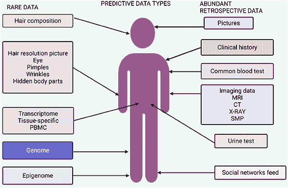

**图 8.2.** 预测数据类型。

### 8.9 结论

在区块链人工智能辅助健康数据交换的背景下，本章作者对时间的意义以及个人数据的聚合价值进行了早期分析。除了个体数据和数据组合的时间重要性外，关于数据分类和整合也存在大量讨论。预计将催生一种被称为“数据经济学家”的新职业，并出现许多专门研究健康数据经济学课题的科研机构。技术的最新进展使得利用自拍照片、血检和其他基础数据集来生成对生理相关特性（包括性别、种族和年龄）的高度精确预测成为可能。

各种数据格式的意义可能取决于其预期用途。即使收集遗传数据的成本远高于拍摄一张自拍照的成本，但在确定患者年龄、健康状况和死亡时间时，患者当前的图像的预测价值可能大于基因组。当多种类型的数据结合时，它们的整体用性将超过其自身价值的总和。

### 参考文献

[1] Earnest M A, Ross S E, Wittevrongel L, Moore L A and Lin C T 2004 在充血性心衰竭实践中使用患者可访问的电子医疗记录：患者和医生的经验 *J. Am. Med. Inform. Assoc.* [`11` 410–7](http://dx.doi.org/10.1197/jamia.M1479)

[2] Leveille S G, Mejilla R, Ngo L, Fossa A, Elmore J G, Darer J, Ralston J D, Delbanco T and Walker J 2016 通过患者网络门户访问临床信息的患者是否有更多的初级保健就诊？*Med. Care* [`54` 17–23](http://dx.doi.org/10.1097/MLR.0000000000000442)

[3] Stephens Z D, Lee S Y, Faghri F, Campbell R H, Zhai C, Efron M J, Iyer R, Schatz M C, Sinha S and Robinson G E 2015 大数据：天文学还是基因组学 *PLoS Biol.* [`13` e1002195](http://dx.doi.org/10.1371/journal.pbio.1002195)

[4] Sudlow C *et al* 2015 英国生物样本库：一种识别中老年多种复杂疾病原因的开放资源 *PLoS Med.* [`12` e1001779](http://dx.doi.org/10.1371/journal.pmed.1001779)

[5] Zhavoronkov A and Litovchenko M 2013 发达国家经济增长模型的新参数生物医学进展率 *Int. J. Environ. Res. Public Health* [`10` 5936–52](http://dx.doi.org/10.3390/ijerph10115936)

[6] Gleeson F C *et al* 2017 使用定制胃肠胰下一代测序面板评估胰腺神经内分泌肿瘤细胞基因型多样性，以指导个性化医疗 *Oncotarget* [`8` 93464](http://dx.doi.org/10.18632/oncotarget.18750)

[7] Kyung H Y, Axtmayer J, Gustin J P, Rajpurohit A and Lauring J 2013 人乳腺癌中发现的非热点 AKT1 突变的功能分析识别出新的驱动突变：对个性化医疗的意义 *Oncotarget* [`4` 29](http://dx.doi.org/10.18632/oncotarget.755)

[8] Carpinetti P *et al* 2015 辅助放疗的使用 *Oncotarget* [`6` 3836](http://dx.doi.org/10.18632/onarget)

[9] Bennett C, Berchem G, Kim Y 2016 肺癌中的离体 DNA *Oncotarget* [`7` 7013](http://dx.doi.org/10.18632/oncotarget)

[10] Patel S *et al* 2017 泌尿系癌症的变异 *Oncotarget* [`6` 5262](http://dx.doi.org/10.18632/onarget)

[11] Zhu Q, Izumchenko E, Aliper M, Makarev E, Paz K, Zhavoronkov A 2015 通路激活 *Hum. Genome.* [`2` 9](http://dx.doi.org/10.1038/hgv)

[12] Artemov D *et al* 2017 预测药物有效性的方法 *Oncotarget* [`6` 2934](http://dx.doi.org/10.18632/onarget)

[13] Bolotin D 2017 胶质母瘤的新型甲基化和基因表达特征分析 *Nat. Biotechnol.* [`35` 908–11](http://dx.doi.org/10.1038/nbt)

[14] Zabolotneva A, Zhavoronkov A, Shegay P, Alekseev B, Roumiant A 2013 膀胱癌的微 RNA *Front. Genet.* [`4` 247](http://dx.doi.org/10.3389/fgene.2013)

[15] Di Meo A, Pasic M, Yousef G 2016 蛋白质组学和肽组学：迈向精准 *Oncotarget* [`7` 5246](http://dx.doi.org/10.18632/onarget)

[16] Ionov Y 2010 识别肿瘤的高通量方法 *Oncotarget* [`1` 148](http://dx.doi.org/10.18632/onarget)

[17] Yin A *et al* 2017 胶质母瘤的新型甲基化和基因表达特征分析 *Oncotarget* [`8` 89607](http://dx.doi.org/10.18632/onarget)

[18] Lee D, Fontugne J, Gumpeni N, Park K, MacDonald T Y, Robinson B D, Sboner A, Rubin M, Mosquera J, Barbieri C E 2017 前列腺癌分子变异与 MRI 特征的关联 *Prostate Cancer Prostatic Dis.* [`20` 430–5](http://dx.doi.org/10.1038/pcan.2017.33)

[19] Niklinski J *et al* 2017 用于精确肿瘤诊断和治疗的系统生物库、新型成像技术和先进分子分析：波兰 MOBIT 项目 *Adv. Med. Sci.* [`62` 405–13](http://dx.doi.org/10.1016/j.advms.2017.05.002)

[20] Alexander J L, Wilson I D, Teare J, Marchesi J R, Nicholson J K and Kinross J M 2017 肠道微生物群对化疗效果和毒性的调节 *Nat. Rev. Gastroenterol. Hepatol.* [`14` 356–65](http://dx.doi.org/10.1038/nrgastro.2017.20)

[21] Sotgia F and Lisanti M P 2017 线粒体生物标志物预测胃癌的进展和预后不良的总生存：个性化医疗的伴随诊断 *Oncotarget* [`8` 67117](http://dx.doi.org/10.18632/onarget)

[22] Nielsen J 2017 代谢系统生物学：开发个性化和精准医学的驱动力 *Cell Metab.* [`25` 572–9](http://dx.doi.org/10.1016/j.cmet.2017.02.002)

[23] Pretorius E and Bester J 2016 粘弹性作为控制不佳的 2 型糖尿病患者血块结构的测量：迈向精准和个性化医学治疗方法 *Oncotarget* [`7` 50895](http://dx.doi.org/10.18632/oncotarget.10618)

[24] Radovich M *et al* 2016 用于指导难治性癌症治疗的精准医学方法的临床获益 *Oncotarget* [`7` 56491](http://dx.doi.org/10.18632/oncotarget.10606)

[25] Zhavoronkov A and Cantor C R 2013 从个性化医学到个性化科学：统一科学与医学以开展患者驱动、目标为导向的研究 *Rejuvenation Res.* [`16` 414–8](http://dx.doi.org/10.1089/rej.2013.1471)

[26] Chen R *et al* 2012 个人组学分析揭示了动态的分子和医学表型 *Cell* [`148` 1293–307](http://dx.doi.org/10.1016/j.cell.2012.02.009)

[27] Marx V 2013 大数据的巨大挑战 *Nature* [`498` 255–60](http://dx.doi.org/10.1038/498255a)

[28] Libbrecht M W and Noble W S 2015 机器学习在遗传学和基因组学中的应用 *Nat. Rev. Genet.* [`16` 321–32](http://dx.doi.org/10.1038/nrg3920)

[29] Patel L, Shukla T, Huang X, Ussery D W and Wang S 2020 药物发现中的机器学习方法 *Molecules* [`25` 5277](http://dx.doi.org/10.3390/molecules25225277)

[30] Barardo D G, Newby D, Thornton D, Ghafourian T, de Magalhães J P and Freitas A A 2017 用于预测延长寿命化学化合物的机器学习 *Aging (Albany NY)* [`9` 1721](http://dx.doi.org/10.18632/aging.101264)

[31] Vanhaelen Q, Mamoshina P, Aliper A M, Artemov A, Lezhnina K, Ozerov I, Labat I and Zhavoronkov A 2017 用于计算机外药物重药的高效计算工作流设计 *Drug Discov. Today* [`22` 210–22](http://dx.doi.org/10.1016/j.drudis.2016.09.019)


[32] Polykovskiy D, Zhebrak A, Vetrov D, Ivanenkov Y, Aladinskiy V, Mamoshina P, Bozdaganyan M, Aliper A, Zhavoronkov A and Kadurin A 2018 用于从新药物发现的纠缠条件对抗自动编码器 *Mol. Pharm.* [`15` 4398–405](http://dx.doi.org/10.1021/acs.molpharmaceut.8b00839)

[33] Aliper A, Plis S, Artemov A, Ulloa A, Mamoshina P and Zhavoronkov A 2016 利用转录组数据预测药物药学性质和药物重药的深度学习应用 *Mol. Pharm.* [`13` 2524–30](http://dx.doi.org/10.1021/acs.molpharmaceut.6b00248)

[34] Wen M, Zhang Z, Niu S, Sha H, Yang R, Yun Y and Lu H 2017 基于深度学习的药物-靶点相互预测 *J. Proteome Res.* [`16` 1401–9](http://dx.doi.org/10.1021/acs.jproteome.6b00618)

[35] Gao M, Igata H, Takeuchi A, Sato K and Ikegaya Y 2017 基于机器学习的药物不良反应预测：诱痫化合物的示例 *J. Pharmacol. Sci.* [`133` 70–8](http://dx.doi.org/10.1016/j.jphs.2017.01.003)

[36] Putin E, Mamoshina P, Aliper A, Korzinkin M, Moskalev A, Kolosov A, Ostrovskiy A, Cantor C, Vijg J and Zhavoronkov A 2016 人类衰老的深度生物标志物：深度神经网络在生物标志物开发中的应用 *Aging (Albany NY)* [`8` 1021](http://dx.doi.org/10.18632/aging.10968)

[37] Vandenberghe E, Scott M L, Scorer P, Söderberg M, Balcerzak D and Barker C 2017 深度学习辅助乳癌 HER2 状态诊断的相关性 *Sci. Rep.* [`7` 45938](http://dx.doi.org/10.1038/srep45938)

[38] 美国卫生与服务部针对行业和食品药品管理局的体外辅助诊断设备指南 [`fda.gov/downloads/MedicalDevices/DeviceRegulationandGuidance/GuidanceIocuments/UCM26327.pdf`](http://fda.gov/downloads/MedicalDevices/DeviceRegulationandGuidance/GuidanceIocuments/UCM26327.pdf)

[39] Meng C, Zeleznik O, Thaller G, Gholami A 2016 多组学数据的降维技术 *Brief. Bioinform.*

[40] Goodfellow I, Pouget-Abadie J, Mirza M, Xu B, Ward-Farley D, Courville A, Bengio Y 2014 生成对抗网络 *Adv. Neural Process.*

[41] Kadurin A, Aliper A, Mamoshina P, Vanhaelen Q 2017 用于分子开发的微调卷积神经网络 *Oncotarget* [`8` 1083](http://dx.doi.org/10.18632/oncotarget)

[42] Kadurin A, Nikolenko S, Aliper A and Zhavoronkov A 2017 druGAN：用于新分子的对抗自动编码器 *Mol. Pharm.* [`14` 3098](http://dx.doi.org/10.1021/acs)

[43] Hivert F, Grant R, Steplin D and Heisler M 2015 基于云的糖尿病系统 *BMC Health. Res.* [`9` 1–17](http://dx.doi.org/10.1186/1472-6963-10-231)

[44] Choi E, Schuetz A and Sun J 2017 使用神经网络进行早期检测 *J. Am. Med. Inform.* [`24` 361]

[45] Allam F, Gerasma G and Ibrahim M 2011 循环神经网络 *Int. Conf. Applications of Engineering* pp 254

[46] Ordóñez F and Roggen D 2016 用于活动识别的深度卷积 LSTM 网络 *Sensors* [`16` 115](http://dx.doi.org/10.3390/s1601)

[47] Pan D, Dhall R and Lieberman A 2015 移动端的帕金森病评估 *JMIR mHealth* [`3` e3956](http://dx.doi.org/10.2196/mhealth.3956)

[48] Piette J, List J, Rana G and Townsend D 2015 作为心血管风险和疾病管理工具的移动健康设备 *Circulation* [`132` 2012–27](http://dx.doi.org/10.1161/CIRCULATIONA-114.00872)

[49] Margeta J, Criminisi A, Cabrera Lozoya R, Lee D and Ayache N 2017 用于心脏 MRI 平面识别的微调卷积网络 *Comput. Methods Biomech. Eng.: Imaging* [`5` 339–49](http://dx.doi.org/10.1080/21681163.2015)

[50] Ahmed K, Hall L, Goldgof D, Liu R and Gatenby R 2017 用于 MRI 脑肿瘤分类的微调卷积特征 *Medical Imaging 2017: Computer-Aided Diagnosis* **10134** 61

[51] Altae-Tran H, Ramsundar B, Pappu A and Pande V 2017 单样本学习的低数据药物发现 *ACS Cent. Sci.* [`3` 283–93](http://dx.doi.org/10.1021/acscentsci.6b0367)

[52] Pandey S, Chaudhary G and Kaushal Mahan V P 2023 用于高效跨境数据流数字公共基础设施 *T20 Policy Brief* Observer Research Foundation

[53] Boonstra A and Broekhuis M 2010 医生接受电子病历的障碍：从系统综述到分类和干预 *BMC Health Serv. Research* [`10` 231](http://dx.doi.org/10.1186/1472-6963-10-231)

[54] Kayaalp M 2018 大数据时代的患者隐私 *Balkan Med. J.* [`35` 8–17](http://dx.doi.org/10.4274/balkanmedj.2017.0966)

[55] Evans B J and Jarvik G P 2018 HIPAA 最小必要标准对基因组数据共享的影响 *Genet. Med.* [`20` 531–5](http://dx.doi.org/10.1038/gim.2017.141)

[56] Locklear T, Lewis R, Calhoun F, Li A, Dickerson K C, McMillan A, Davis L, Dzirasa K, Weinfurt K P and Grambow S C 2023 通过临床和转化科学奖 (CTSA) 计划推进劳动力多样性 *J. Clin. Transl. Sci.* [**7** e30](http://dx.doi.org/10.1017/cts.2022.489)

[57] Gottlieb L K, Stone E M, Stone D, Dunbrack L A and Calladine J 2005 有效临床数据交换的监管与政策障碍：来自 MedsInfo-ED 的教训 *Health Aff.* [**24** 1197–204](http://dx.doi.org/10.1377/hlthaff.24.5.1197)

[58] Yaraghi N and Gopal R D 2018 HIPAA 综合规则在减少医疗数据泄露频率方面的作用：实证研究的启解 *Milbank Q.* [**96** 144–66](http://dx.doi.org/10.1111/1468-0009.12314)

[59] 疾病控制与中心 2003 HIPAA 隐私规则与公共卫生。来自 CDC 和美国卫生与人类服务的指导 *Morb. Mortal. Wkly Rep.* **52** 1–17

[60] Hayes E L and Vance K A 2020 1996 年健康保险可流动性责任法案：健康与公共福利 *Ga. St. Univ. Law Rev.* **37** 153

[61] 民权办公室的规则制定与法规。[`www2.ed.gov/policy/rights/reg/ocr/index.html`](https://www2.ed.gov/policy/rights/reg/ocr/index.html)（访问于 2023 年 4 月）

[62] Nakamoto S 2008 比特币：一种点对点的电子现金系统 *Decentralized Bus. Rev.* **31** 21260

[63] Lamport L, Shostak R and Pease M 2019 拜庭将军问题 *Concurrency: The Works of Leslie Lamport*（San Rafael, CA: Morgan & Claypool）pp 203–26

[64] Swan M 2015 *区块链：新经济的蓝图*（O’Reilly Media, Inc）

[65] Strehle E 2020 公有链与私有链 *BRL Working Paper*（区块链研究实验室）

[66] Alshahrani H, Islam N, Syed D, Sulaiman A, Al Reshan M S, Rajab K, Shaikh A, Shuja-Uddin J and Soomro A 2023 区块链可持续性：关于扩展性和功耗问题的系统文献综述 *Energies* [**16** 1510](http://dx.doi.org/10.3390/en16031510)

[67] Korepanova D, Nosyk M, Ostrovsky A and Yanovich Y 2019 使用去中心化构建私有货币 *2019 IEEE Int. Conf. on Communications and Networking*

[68] Buldas A, Lipmaa H and Schoenmakers B 2000 最优效率时间戳 *Proc. of 3rd Int. Workshop on Practice and Theory in Public Key Cryptography (PKC2000)*（Glückstadt）89–95

[69] Dwork C, Lynch N and Stockmeyer L 1988 部分同步下的共识 *Information Spaces*（Glückstadt: Springer）

[70] Stallings W 2006 *密码学与网络安全*（Noida: Education）

[71] Erl T 1900 *面向服务的架构：概念、技术与设计*（Noida: Education）

[72] Pease M, Shostak R and Lamport 1980 存在故障时达成一致 *J. ACM* [**27** 228–34]

[73] Kwon J 2014 Tendermint：无需挖掘的共识 [`tendermint.com/static/docs/tendermint.pdf`](https://tendermint.com/static/docs/tendermint.pdf)

[74] Wu Y, Chen P, Yao X, Xiao Y, Liao L and Chen J 2017 使用最小类间概率特征选择和袋集成方法分析帕金森病患者的发音异常模式 *Comput. Math. Methods* [**2017**](http://dx.doi.org/10.1155/2017)

[75] Asgari M and Shafran I 2010 从语音预测帕金森症的严重程度 *2010 年 IEEE 医学与生物工程国际年度会议* 5201–4

[76] Jiang F, Huang W, Wang Y, Tian P, Chen X and Liang Z 2016 针刺肺肺组织核酸扩增检测结合抗酸杆染色用于涂片阴性结核的诊断 *PLoS One* [**11**] e016734

[77] Yang S N, Li F J, Liao Y H, Chen Y S, Shen W C and Huang T C 2015 使用整合 MRI 和乳腺造成像信息识别乳腺癌 *PLoS One* [**10**] e0128404 (http://dx.doi.org/10.1371/journal.pone.0128404)

[78] Jirtle R L（编）和 Tyson F L（编）2013 *健康与疾病中的环境表观基因学*（Berlin: Springer）

# 第 9 章

## 医疗领域面临的挑战

区块链技术具有在各个领域广泛应用的潜力。区块链技术的采用增强了医疗数据管理日益增长的重要性。区块链技术通过为交换患者数据提供更安全的平台，正在彻底改变传统的医疗方法。区块链技术可能很快被用于在安全的医疗环境中结合并显示患者的实时临床数据。本章主要将区块链作为一种显著的医疗创新进行研究。我们调查了区块链技术的多种应用，以及在医疗行业尝试采用它时所面临的困难。

### 9.1 引言

医疗保健领域每天都会产生、访问和分发数 GB 的信息。在维护机性和安全性的同时，高效地存储和传输海量数据是一项至关但极其困难的任务。在医疗保健和临床应用中，对安全、可靠且长期的数据交换的需求，特别是针对诊断和临床判断的共享。通过医生实施数据共享实践，可以促进向相关部门高效传输医学证据 \[1]。对于工作人员和全科医生而言，获取当前的医疗记录对于有效地为患者提供护理至关重要。临床数据可以通过电子健康和远程医疗传输，以便不同地地的医疗从业人员进行专家评审 \[2, 3]。在这两种在线临床背景下，都利用“存储和转发技术”或其他实时临床监测技术（如远程监控和遥测）来促进患者信息的交换。通过利用在线临床环境和临床数据交换，可以实现对患者的远程诊断和治疗。在临床环境中，由于患者信息的敏感性，对数据隐私、敏感性和安全的关注至关重要。为了与位于偏远地区的患者维持健康且富有成效的治疗关系，能够以安全、可靠且规范的方式扩展与通信相关的数据至关重要。需要以既安全又高效的方式传输数据 \[4–6]。这对于接收临床专家小组的反馈或确认是必要的。目前正投入巨大努力解决该领域的互操作性问题。医疗机构与研究机构之间的临床信息交换可能会遇到重大障碍。此类临床数据交换的前提条件包括透明度、信任和强大的工作关系。由于其敏感性，信息协议、患者匹配算法、伦理限制以及有关临床数据的法律法规等问题可能会限制该技术的使用。在实施临床数据交换之前，必须解决若干挑战 \[7]。

物联网（`IoT`）、机器学习、人工智能（`AI`）和计算机视觉如果应用于适当的环境，具有诊断和治疗各种慢性疾病的潜力。确保医疗保健数据的机性和安全性对于最大化其在包括生物医学研究和健康数据电子传输在多个领域的用途至关重要。因此，区块链在这方面引起了广泛关注。区块链通常在建立点对点（`P2P`）网络后实现。该操作系统利用密码学、算法、分布式共识方法和多领域集成网络结构来解决标准分布式数据库同步的局限性。表 9.1

```javascript
console.log("xxx")
```


通过纳入患者的适当临床数据，区块链技术具有改进未来医疗保健服务的潜力。这将通过开发一个高效且可靠的医疗保健系统来实现。本研究重点关注区块链利用的最新进展，强调了该字段的各种应用。最后，后续章节概述了文档的结构。利用区块链技术可以快速总结关键信息和医疗活动，从而提供巨大的利益。区块链技术可能对医疗保健行业产生益处。区块链技术的应用有望为医学领域带来巨大的变革。

近年来，提高医疗患者信息计算机化水平的愿望主要受到医疗执业人员、医院和医疗设备的推动。数字化不仅使数据更易于获取并促进数据共享，还为更精确、更快速的决策奠定了基础。如图 9.3 所示。

**图 9.3.** 此图展示了电子健康记录（`EHR`）、区块链（`BCT`）、移动健康应用程序与预防性医疗之间的关系。

`EHR` 的一个显著缺点是无法跨多个医疗机构为患者维护全面的病史。由于各种原因，患者在不同医生之间转诊时可能会失去对其医疗病史的访问权限 [21–23]。专家建议患者可以利用区块链来访问他们的电子健康记录。

名为“`MedRec`”的模型利用区块链来妥善地管理身份验证、数据完整性、机密性和数据交换。去中心化的记录管理系统为患者提供了全面且不可更改的健康历史，多个医疗提供者和组织可以轻松访问 [24]。医疗记录并不存储在“`MedRec`”系统中，不需要初始调整期。患者对医疗记录移动的责任被记录在区块链上，这同时也引导了转诊过程。标签验证了所获取记录的原始性。当护理责任从机构转移到个人时，患者既会感到负担，也会感到被赋权。一些患者可能会将其个人信息的管理权交给行政机构。目前的个人患者入口可能效率低下、耗时较长，并且每个组织内部显示出不同的用户界面。该框架包含一个用户连接，以促进跨组织的医疗记录同步。

由于信息控制的限制以及信息溯源和审计的局限性，共享医疗数据可能会面临挑战。`Xia` *等人* [25] 通过创建 `MeDShare` 解决了这个问题，这是一种加密区块链系统，旨在用于无关第三方之间安全地共享医疗数据。在医院、云服务提供商和医疗研究机构之间传输和保存 `EHR` 方面，`MeDShare` 提供了改进的数据溯源、准确的数据管理以及更高的数据安全性和隐私。

`EHR` 包含患者的敏感医疗信息，需要在医生、放射科医生、化学家和研究人员等各种医疗专业人员之间共享，以确保最佳患者护理。在多个组织之间共享高度敏感的患者数据可能会导致风险。然而，区块链可以提供一个确保数据完整性和隐私的框架。区块链的使用可以促进跨组织的医疗记录同步。

### 9.3.1 临床研究中的区块链

临床试验面临各种挑战，包括隐私、数据完整性和患者招募 [29]。作为下一代互联网，区块链可能为这些问题提供解决方案 [30]。医疗领域的研究人员正在利用区块链来尝试解决这些问题 [31, 32]。在未来几年里，区块链、人工智能和机器学习都将对医疗行业产生重大影响。`Nugent` *等人* [31] 建议将授权的以太坊智能合约协议与临床数据管理系统相结合。让参与者参加研究是研究的重点 [32, 33]。研究结果表明，以太坊交易更快。

区块链目前用于临床研究中的患者注册。`Benchoufi` *等人* [34] 进行了研究并设计了一个系统，能够以公开验证且未篡改的方式安全地获取和存储患者的知情同意。该系统的构建采用了区块链技术。

### 9.3.2 药物供应链管理中的区块链

在医疗行业领域，`BCT` 的应用近期已成为药物供应链管理中一个可能具有重大意义的解决方案。医疗保健的复杂性增加要求对供应链管理给予更多关注。医疗保健供应链的波动与对患者健康的负面影响之间存在相关性 [35]。由于其复杂性以及涉及众多实体和组件，供应链极易受到欺诈行为的影响。

区块链具有通过增强数据透明度和提高产品可追溯性，来解决这一问题并解决问题的潜力，并可能在特定情况下减少欺诈。由于验证和修改记录需要智能合约，因此修改区块链具有极具挑战性 [36]。

### 9.3.3 神经科学中的区块链

区块链在神经学领域正受到广泛关注。脑技术的进步引入了一种新模型，即个人可以通过精神指令控制设备并操纵数据，而无需依赖于与周围基础设施的物理交互 [37]。模式分析是一种可以用于确定个人当前心理状态的方法。该方法涉及解释人类大脑产生的活动模式，然后将这些模式转换为外部设备的指令。神经接口设备由敏感性传感器、计算处理器和无线通信组成，使其能够读取和解释脑电信号。控制机制接收并解码大脑的电脉冲。用户佩戴头戴式设备来实现这些目标。神经接口将利用复杂的算法和大数据进行脑电信号的存储。`Neurogress` 已公开宣布了其将区块链链技术（`BCT`）整合到其运营中的计划。自 2017 年以来，该公司已在瑞士日内瓦和美国运营，专注于用于人类操作无人机、机械臂、`AR/VR` 设备以及智能家电的神经控制技术。

`Neurogress` 通过利用基于机器学习的技术增强了其脑部读取能力的精度。为了实现这一点，它必须保持从大脑接收到的 90% 的信息。该公司的白皮书强调了大量用户大脑功能信息的必要性，并引用了“人脑计划”对“艾字节”级内存的需求作为示例。`Neurogress` 表示，区块链是解决有关数据存储机密性和安全性问题的极佳解决方案。这一结果并不令人意料。为了保护用户数据不被第三方黑客攻击或其他方式损害，使用了去中心化的区块链。`Neurogress` 平台对 `BCT` 的整合增强了透明度和可用性。由于采用了这种方法，个人数据得到了保护并保持了机密。

区块链是信息技术的一种，具有应用于各种领域的潜力，包括认知过程以及脑活动的监测与建模。区块链技术被用于人类大脑数字化中的存储目的。一种 `P2P` 网络文件系统允许文件的存储和共享，这是个人思想链的重要组成部分。这种基于区块链的计算系统具有多种特性，促进了 `AI` 和人类能力的进步，以及它们潜在的整合。计算机网络可以定期验证区块链账本的源头和完整性。通过采用这种信任机制，可以通过结合事件的主观和客观方面，构建出对事件的全面理解。这种方法能够对事件形成完整且整体的理解。个人思想链可以在区块链上用于验证个人身份，并确保人类量化自我数据的安全性。该系统的一个显著优势是它在管理隐私和控制个人经验共享方面赋予的自主性，而不依赖于中心化机构或第三方。该技术的未来版本允许将多个主观叙述合并为未来更客观的表述。这种技术的未来版本使得通过区块链技术获取感知成为可能。近期可穿戴技术、神经植入物以及其他传感器的发展已使这成为可能。

### 9.3.4 制药领域的区块链技术

制药行业是医疗交付中一个快速增长的部门。制药行业依赖于开发新的药物以确保提供的保护和有效性。行业在有效监测产品方面面临挑战，这可能导致欺诈等重大风险 [28]。假药构成了重大的全球健康威胁。在生产阶段和研发（`R&D`）阶段，`BCT` 有成为评估、监督和确保制造过程的最有效选择。`Hyperledger` [38] 开发了一项利用 `BCT` 解决假药问题的假药倡议。迫切需要在全球范围内监测、评估并确保药物生产的全过程。实施数字药物控制系统（也称为 `DDCS`）有助于防止假药的制造和销售 [39]。辉瑞、赛诺和阿利康合作进行了一项研究，利用 `BCT` 开发了一套药物检查和评估系统 [29]。

表 9.2 区块链技术在医疗保健领域的应用案例简要概述了在生物医学和医疗保健研究领域实施区块链技术可以获得的各种益处。

| 应用场景 | 摘要 |
| :--- | :--- |
| 电子健康记录 (`EHR`) | 存储在授权区块链分布式账本上的数字版 `EHR` 消除了从数据生成到数据检索整个过程对人工干预的需求。 |
| 临床研究 | 区块链技术（`BCT`）为涉及患者数据的临床伙伴提供去中心化的安全保障。这种方法使研究人员能够进行安全的数据通信。 |
| 医疗欺诈检测 | 使用 `BCT` 可以防止信息盗取和篡改，从而增强欺诈检测并确保信息的透明安全传输。 |
| 神经科学研究 | 未来基于 `BCT` 的应用预计将利用脑增强、脑重演和脑思维。数字化存储整个大脑的数据需要使用一种名为区块链的新技术。 |
| 制药行业与研究 | `BCT` 能够实现对供应链每个层级的全方位溯源。对药物的来源、成分和控制进行定期监控，以防止欺诈活动和盗窃。 |

## 9.4 挑战

`BCT` 对各个行业做出了重大贡献 [42]，并预计未来将产生更大的影响力 [43, 44]。另一方面，许多问题尚未解决，在这一技术被成功利用之前需要解决（见图 9.4）。本节将解释几个重点关注的问题。

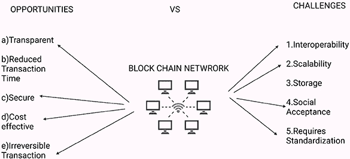

**图 9.4.** 区块链在医疗领域的机遇与挑战可以通过图表表示。

### 9.4.1 个人信息和数据的保护

敏感信息和个人隐私的保护至关重要，必须得到解决 [45]。构建在区块链上的应用确实面临第三方参与信息存储的需求 [43]。区块链的架构允许每个人验证记录，而不是依赖于单一的可靠个人 [46]。然而，这种更高的透明度也使数据暴露在隐私和安全的可能威胁之下。当每个节点都能读取由单个节点发送的数据时，数据的安全性就会面临风险。当患者没有授权第三方访问其医疗信息时，他们需要指定一名或多名代表，以便在紧急情况下代表他们行事。这可以通过面对面或电话完成。此人有机会向他人泄露患者细节，这可能对患者数据的隐私和安全造成严重威胁。结果是，由于实施了严格的安全预防措施，数据用户对信息的访问将受到限制。一种被称为 `51 percent attack` [47] 的安全漏洞可能会使区块链网络容易受到攻击。这种攻击是由大多数矿工策划的，他们共同控制了区块链网络上超过百分之五十的区块。矿工控制着网络，在没有网络领导许可的情况下，可以阻止新活动的发生 [48]。根据 `Coindesk` 的报道，这种攻击近期已针对五种不同的加密货币进行了实施。患者记录中可能包含不应存储在区块链上的隐私信息 [49]。

### 9.4.2 管理存储容量

存储容量管理在此背景下是一个备受关注的问题。区块链的设计是为了处理和处理有限的数据，而不是维护海量数据 [50]。这与旨在存储大量数据的传统数据库形成对比。医疗行业的发展导致了随着时间推移对额外存储容量的需求日益增加。医疗行业定期管理大量数据。一旦发生数据泄露，区块链上的任何节点可能获取的所有照片（包括 `MRI` 和 `X` 光扫描）的存储需求是巨大的 [51, 52]。区块链应用中使用的数据库由于其以交易为导向的性质正经历快速发展。随着数据库规模的增大，识别和检索信息变得更具挑战性，因此任何区块链解决方案都必须具备扩展性和安全性 [29]。

### 9.4.3 互操作性问题

互操作性问题指的是合并不同提供者和服务区块链面临的困难 [45]，这是区块链必须克服的挑战之一。这个问题给数据的有效共享带来了挑战 [53]。

### 9.4.4 标准化挑战

由于处于开发早期，`BCT` 在集成到医疗健康领域时预计会遇到标准化挑战。需要标准化组织提供授权和批准的标准。区块链应用可能会从预定义标准的实施中获益。这些标准在分析共享数据的同时，还必须起到保护作用。

### 9.4.5 社会挑战

正在开发的 `BCT` 不仅面临技术障碍，还面临必须克服的与转型相关的社会挑战。采用与传统做法不同的技术从根本上说是挑战性的。医学界尚未完全数字化，特别是对于尚未经过临床测试的区块链技术。说服医生从纸质表格转向电子表格需要大量的精力 [29]。医疗行业对技术和策略的低采用率阻碍了其广泛接受。现有信息无法证明它是解决医疗行业存在的所有问题的可行且通用的方案 [43]。如图 9.5 所示，进行了 `SWOT` 分析，以更深入地理解与区块链技术在医疗领域应用相关的威胁、机遇和弱点。

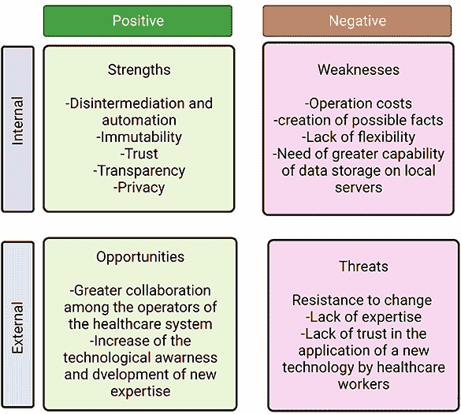

**图 9.5.** 展示区块链技术在医疗保健行业中面临的优势、劣势、机遇与威胁的图表。

### 9.5 未来展望

在医疗因素中利用 `BCT` 提供了许多优势。`BCT` 有潜力通过减少与监控、配置、维护和运行信息中心化服务器相关的成本，来彻底改变医学研究。此外，它还可以最大限度地减轻管理医疗数据的行政负担。将患者招募到临床试验并确保其数据在公共账本上可访问，可以大幅缩短处理时间。

医生可以依靠实时、真实且记录完备的数据，从而消除对患者提供不准确病史的顾虑。数据的透明性消除了患者向其他医生寻求第二意见的需求，从而减轻了他们的压力。区块链网络可以促进全球范围内具有相似健康状况的患者建立联系，在各自治疗疾病期间提供社区感和支持。患者将拥有完全自主权来决定其数据的接收者，从而确保患者机密的得到保护。

### 9.6 结论

尽管医疗保健行业在接受新技术方面有着长期缓慢的历史，但在相对不久的未来，在医疗领域实施 `BCT` 的兴趣正日益增长。关于利用 `BCT` 管理电子病历，已有丰富的信息。鉴于上述目标，建议利用智能合约来管理行业内各种规模的医疗保健信息。`Smart contracts` 能够为单个患者创建定制的、安全的区块链网络。当许多医疗系统通过区块链 `smart contract` 连接时，它们将不再能够在中心化系统中复制数据。`BCT` 使研究人员能够访问其发现的带有时间标记且经过验证的副本。由于 `smart contracts` 的应用，存储在区块链上的科学结果记录可能地作为研究人员的一份安全文件，因为智能合约允许患者对自己的数据保持控制。这对于研究人员来说可能是一个巨大的优势。不可否认，制药行业迫切需要 `BCT`。它可以被用于促进制药协会生成的报告的翻译。此外，这种结构的使用减少了记录被破坏或操纵的机会，因为它促进了更快速的数据准备和传输。这些迷人的属性源于创新本身。一旦区块被放置，它就变成了永久性的，无法被更改或删除。`BCT` 将通过防止未经授权的修改来确保数据完整性。坚决拒绝提供不合格或伪劣药物。这是通过监督从制造到分发的整个制药供应链来实现的。在医疗领域使用 `BCT` 为个人和组织都提供了许多机会，这些机会可以提供巨大的益处。它使得在保护每个参与人员机密性的同时，分发海量数据变得更加容易。如果 `BCT` 能够成功地实现在医疗临床环境中，它可能为生物研究的前景开启独特的大门。精准医学依赖于临床数据的大规模积累、交换和存储，以开发有效的诊断和治疗方案。精准医学具有多样化的医疗应用。将基于区块链的数字脑用于神经控制系统是可行的。只有少数公司建议 `BCT` 在神经科学领域可能相关。关于大规模数据收集的许多担忧仍然存在。让个人积极参与到基于区块链的医疗系统中的治疗中，有望提高他们的生活质量。

### 参考文献

[1] Griebel L, Prokosch H U, Köpcke F, Toddenroth D, Christoph J, Leb I and Sedlmayr M 2015 A scoping review of cloud computing in healthcare *BMC Med. Inf. Decis. Making* [`15` 1–16](http://dx.doi.org/10.1186/s12911-015-0145-7)

[2] Houston M S, Myers J D, Levens S P, McEvoy M T, Smith S A, Khandheria B K and Berry D J 1999 Clinical consultations using store-and-forward telemedicine technology *Mayo Clin. Proc.* [`74` 764–9](http://dx.doi.org/10.4065/74)

[3] Ciufudean C and Buzduga M 2023 Patient-monitoring system *13th Int. Symp. on Advanced Topics in Engineering*

[4] Casal-Guisande M, Álvarez-Paz A, Cerqueiro-Peño J, Bouza-Rodríguez G, Proposal of an clinical support system applied to screening and early diagnosis of breast cancer *Cancers* [`15` 1711](http://dx.doi.org/10.3390/15)

[5] Zhang P, White J, Schmidt D, Lenz G and Rosenbloom S 2018 FHIR: applying blockchain to scalably share data *Comput. Struct. Soc. Syst.* [`5` 267–78](http://dx.doi.org/10.1109/TCSS.2018.26)

[6] Berman M and Feaughty A 2005 Technology and managed care telemedicine in rural health *Health Econ.* [`14` 559–73](http://dx.doi.org/10.1002/hec)

[7] Downing N, Adler-Milstein J, Palma J, Lane S, Eisenberg M and Longhurst C 2017 Health information exchange and the associated impact on volume *J. Am. Med. Assoc.* [`24` 1113–20](http://dx.doi.org/10.1093/jama)

[8] Azaria A, Ekblaw A, Vieira T and Lippman A 2016 Medrec: using blockchain for permission management *Healthcare and Research Workshop (Gaithersburg, Maryland, United States)* **ONC/NIST** pp 25–30

[9] Zhang J, Xue N and Huang X 2016 A secure system for pervasive social network *IEEE Access* [`4` 9239–50](http://dx.doi.org/10.1109/ACCESS.26)

[10] Kuo T T, Kim H and Ohno-Machado L 2017 Distributed ledger technologies for biomedical and health *J. Am. Med. Assoc.* [`24` 068](http://dx.doi.org/10.1093/jama)

[11] Angraal S, Krumholz H and Schulz W 2017 Blockchain technology: applications in health *Circ.: Cardiovasc. Qual. Outcomes* [`10` 00380](http://dx.doi.org/10.1161/CIRCOUTCOM)

[12] Yue X, Wang H, Jin D, Li M and Jiang W 2016 Healthcare data gateways: found healthcare intelligence on blockchain with novel privacy risk *J. Med. Syst.* [`40` 1–8](http://dx.doi.org/10.1007/s10916)

[13] Griggs K N, Ossipova O, Kohlios C, Baccarini A, Howson E and Hayajneh T 2018 Healthcare system using smart contracts for secure automated patient monitoring *J. Med. Syst.* [`42` 1–7](http://dx.doi.org/10.1007/s10916)

[14] Ivan D 2016 Moving toward a blockchain-based method for the secure storage of patient records *ONC/NIST Use of Blockchain for Healthcare and Research Workshop (Gaithersburg, Maryland, United States)* **ONC/NIST** pp 1–11

[15] Chen Y, Ding S, Xu Z, Zheng H and Yang S 2019 Blockchain-based medical records secure storage and medical service framework *J. Med. Syst.* [`43` 1–9](http://dx.doi.org/10.1007/s10916)

[17] Jiang S, Cao J, Wu H, Yang Y, Ma M and He J 2018 Blochie: 一个基于区块链的医疗信息交换平台 *2018 IEEE Int. Conf. on Smart Computing (SMARTCOMP)* pp 49–56

[18] Cyran M A 2018 区块链作为医疗数据共享的基础 *Blockchain Healthc. Today* [1](http://dx.doi.org/10.30953/bhty.v1.13)

[19] Shubbar S 2017 利用远程医疗和区块链的超声医学成像系统用于女性乳腺癌辅助辅助化治疗反应的远程监测：概念与实现 *Doctoral Dissertation* 肯塔基州大学

[20] Ianculescu M, Stanciu A, Bica O and Neagu G 2017 创新的、适应性的在线服务可支持老年人活跃、健康和独立的生活。一个案例研究 *Int. J. Econ. Manag. Syst.* **2** 321–9

[21] Mandl K D, Markwell D, MacDonald R, Szolovits P and Kohane I S 2001 公共标准与患者控制：如何保持电子医疗记录的可访问性与隐私 *Brit. Med. J.* [322** 283–7](http://dx.doi.org/10.1136/bmj.322.7281.283)

[22] Brandon R M, Podhorzer M and Pollak T H 1991 无福利的保费：商业健康保险行业的浪费与低效 *Int. J. Health Serv.* [21** 265–83](http://dx.doi.org/10.2190/H824-R263-YL47-WRQD)

[23] Toussaint E C 2020 美国脆弱性：公共仪式、人权与隐形人的终结 *Colum. Hum. Rts. L. Rev.* [`52** 826](http://dx.doi.org/10.2139/ssrn.3683275)

[24] Ekblaw A, Azaria A, Halamka J D and Lippman A 2016 医疗保健区块链案例研究：‘MedRec’电子健康记录和医学研究数据的原型 *Proc. of IEEE Open and Big Data Conference* **vol 13** pp 13

[25] Xia Q I, Sifah E B, Asamoah K O, Gao J, Du X and Guizani M 2017 MeDShare: 通过区块链实现云服务提供之间的无信任医疗数据共享 *IEEE access* [`5** 14757–67](http://dx.doi.org/10.1109/ACCESS.2017.2730843)

[26] Dubovitskaya A, Xu Z, Ryu S, Schumacher M and Wang F 2017 使用区块链进行安全可靠的电子医疗记录共享 *AMIA Annual Symp. Proc.* 650

[27] Wenhua Z, Qamar F, Abdali T A N, Hassan R, Jafri S T A and Nguyen Q N 2023 区块链技术：安全问题、医疗应用、挑战与未来趋势 *Electronics* [`12** 546](http://dx.doi.org/10.3390/electronics12030546)

[28] Mettler M 2016 医疗保健中的区块链技术：革命开始 *2016 IEEE 18th Int. Conf. on e-Health Networking, Applications and Services (HEALTHCOM)* pp 1–3

[29] Siyal A A, Junejo A Z, Zawish M, Ahmed K, Khalil A and Soursou G 2019 区块链技术在医学和医疗保健中的应用：挑战与未来展望 *Cryptography* [`3** 3](http://dx.doi.org/10.3390/cryptography3010003)

[30] Alsumidaie M 2018 区块链概念出现在临床试验中 *Appl. Clin. Trials* [`www.appliedclinicaltrialsonline.com/view/blockchain-concepts-emerge-clinical-trials`](https://www.appliedclinicaltrialsonline.com/view/blockchain-concepts-emerge-clinical-trials)

[31] Nugent T, Upton D and Cimpoesu M 2016 使用区块链智能合约提高临床试验中的数据透明度 *F1000Research* [`5**](http://dx.doi.org/10.12688/f1000research.9756.1) 2541

[32] Buterin V 2014 下一代智能合约和去中心化应用平台 *Ethereum White Paper* **3** 1–36

[33] Wood G 2014 以太坊：安全的去中心化通用交易账本 *Ethereum Project Yellow Paper* **151** 1–32

[34] Benchoufi M, Porcher R and Ravaud P 2017 临床试验中的区块链协议：知情同意的透明度与追溯性 *F1000Research* [`6**](http://dx.doi.org/10.12688/f1000research.10531.1)

[35] Clauson K A, Breeden E A, Davidson C and Mackey T 2018 利用区块链技术增强医疗保健供应链管理：健康链中的挑战与机遇 *Blockchain Healthc. Today* [`5**](http://dx.doi.org/10.30953/bhty.v1.13)

[36] Badrudja S, Dantu R, He Y, Upadhay K and Thompson M 2021 智能合约 *2021 IEEE Int. Conf. on Blockchain and Cryptocurrency (ICBC)* pp 1–3

[37] Swan M 2015 区块链思维：作为去中心化公司的大脑 *IEEE Technol. Soc. Mag.* [`34** 41–52](http://dx.doi.org/10.1109/MTS.2015.24945)

[38] Liu S, Zhang R, Liu C and Shi D 2023 P-PBFT：支持大规模药学的改进算法 *Comput. Biol. Med.* [`154** 10659](http://dx.doi.org/10.1016/j.compbiomed.2023.10659)

[39] Plotnikov V and Kuznetsova V 2018 数字技术‘区块链’在医药市场的展望 *MATEC Web Conf.* [`193** 02029](http://dx.doi.org/10.1051/matecconf/201819329)

[40] Sylim P, Liu F, Marcelo A and Fontelo P 2018 用于检测流通中假药和劣质药的区块链技术 *JMIR Res. Protoc.* [`7** 10163](http://dx.doi.org/10.163)

[41] Guzman T C 2018 区块链在医药行业供应链中减少假药的作用 *Doctoral Dissertation* 迪林商学院

[42] Shae Z and Tsai J J 2017 用于临床试验和精准医疗的区块链平台设计 *2017 IEEE 37th Int. Conf. on Distributed Computing Systems (ICDCS)* 1972–80

[43] Alhadhrami Z, Alghfeli S, Alghfeli M, Abedlla J and Shuaib K 2017 医疗保健引入区块链 *2017 Int. Conf. on Electrical and Computing Technologies (ICECTA)* 1–4

[44] Fernández-Caramés T and Fraga-Lamas P 2018 物联网区块链应用综述 *IEEE Access* [`6** 32979–3001](http://dx.doi.org/10.1109/ACCESS.2018.2842685)

[45] Kuo T T and Ohno-Machado L 2018 Modelchain：私有网络上的去中心化隐私保护医疗建模框架 *arXiv preprint* arXiv:[1802.01746](http://arxiv.org/abs/1802.01746)

[46] Zheng Z, Xie S, Dai H, Chen X and Wang H 2017 区块链技术概览：架构、共识与未来趋势 *2017 IEEE Int. Congress on Big Data (BigData Congress)* 557–64

[47] Radanović I and Likić R 2018 区块链技术在医学中的应用 *Appl. Health Econ. Health Policy* [`16** 583–90](http://dx.doi.org/10.1007/s40258-018-0412-8)

[48] Huang R, Yang X and Ajay P 2023 物联网软件定义区块链的共识机制 *Internet Things Cyber-Phys. Syst.* [`3** 52–60](http://dx.doi.org/10.1016/j.iotcps.2022.12.004)

[49] Linn L A and Koo M B 2016 健康数据的区块链及其在医疗护理研究中的潜在用途 *ONC/NIST Use of Blockchain for Healthcare and Research Workshop* **ONC/NIST** *(美国马里兰州盖瑟斯堡)* 1–10

[50] Esposito C, De Santis A, Tortora G, Chang H and Choo K K R 2018 区块链：医疗云端数据安全与隐私的万灵药？ *IEEE Cloud Comput.* [`5** 31–7](http://dx.doi.org/10.1109/MCC.2018.011791712)

[51] Bennett B 2017 区块链 HIE 概览：医疗互操作性框架 *Telehealth Med. Today* [2](http://dx.doi.org/10.30953/tmt.v2.14)

[52] Pirtle C and Ehrenfeld J 2018 医疗保健的区块链：下一代医疗记录？ *J. Med. Syst.* [`42** 172](http://dx.doi.org/10.1007/s10916-018-1025-3)

[53] Boulos M N K, Wilson J T and Clauson K A 2018 地空区块链：医疗与健康保健中的承诺、挑战与场景 *Int. J. Health Geogr.* [`17**](http://dx.doi.org/10.1186/s12942-018-0144-x) 25

[54] Ullah H S, Aslam S and Arjomand N 2020 医疗与医学中的区块链：应用、挑战与未来展望的现状研究 arXiv:[2004.06795](http://arxiv.org/abs/2004.06795)

# IOP Publishing

# 医疗健康中的人工智能区块链

# 协同方法

# Rishabha Malviya, Arun Kumar Singh, Sonali Sundram, Balamurugan Balusamy 和 Seifedine Kadry

# 第 10 章

## 区块链与物联网：将挑战转化为机遇

物理与数字领域的融合是信息技术（`IT`）领域的一项先进发展。系统与个人之间基于 `IT` 的通信引入产生了一种新型智能结构，通常被称为“智能性”。物联网（`IoT`）在各个领域呈现出多样化的应用系统，涵盖智能医疗保健、智能交通和智能城市中心。医疗保健应用促进了医生与患者之间的通信，特别是在紧急情况下，患者可以使用人体传感器网络和可穿戴传感器进行远程诊断。在医疗保健领域利用物联网可能会导致患者隐私的泄露。因此，考虑安全措施至关重要。区块链主题目前是研究的一个热点领域，在各种物联网场景中具有潜在应用。实施基于区块链的医疗保健系统提供了许多优势，包括但不限于去中心化、不可篡改性、安全性、隐私性和透明。本章的主要目标是通过利用物联网和区块链等先进计算技术来提高医疗服务的效率。因此，本章从物联网和区块链的基础解释开始。药物追踪、远程患者监测和健康数据管理是医学中探索物联网和区块链的关键领域。本章深入探讨了物联网和区块链技术在医疗系统中的实施。

### 10.1 引言

发展中国家和发达国家都必须优先考虑医疗保健部门，因为它直接影响个人的生活质量和整体福利。医疗保健调查和研究的持续进步至关重要，因为它通过解决各种健康问题和状况有望提高整体生活质量。由于技术的进步和发现，医疗保健行业在近年来得到了改善。将现代计算机技术整合到医疗保健领域，有望提高目前现有的能力。医疗执业人员利用先进的计算机技术有望及时识别各种医疗状况。新型计算机技术的实施有望大幅提高疾病在初始阶段的识别准确性。新型计算机技术的实施目前在各个领域已取得了良好成果。现代技术领域涉及大量的革命性发展，包括物联网、区块链、自然语言处理（`NLP`）、机器学习、图像处理、数据挖掘和云计算。

`IoT`一词指的是相互连接的物理设备、车辆、建筑和其他物品的网络，这些设备嵌入了传感器、软件和网络连接，允许它们收集和交换数据。`IoT`术语最初由 `Kevin Ashton` 引入，他被广泛认为是该技术的开发的负责人[1]。最常见的`IoT`技术包括传感器、无线技术、云计算和安全。

`IoT`的主要操作程序由四个核心部分组成，即：(1)通过嵌入设备的传感器获取数据；(2)将这些数据存储在云平台中用于分析目的；(3)将处理后的数据传回设备；以及(4)由设备执行动作[2]。`IoT`的潜在利益是许多，可以增强日常生活的各个方面。`IoT`的主要应用包括智能城市和居住环境、智能农业、智能零售、自动驾驶车辆和医疗保健。安全是任何技术的必要组成部分，`IoT`网络没有安全无法运行。目前正在采取多种措施增强`IoT`的安全性。这些包括数据加密和身份验证、用户隐私、网络访问控制以及信任，以及实施安全和隐私法规。`IoT`中的安全问题源于程序架构不足，导致网络安全挑战。

如果在`IoT`架构的物理层进行适当初始化，未经授权的接收者将无法访问`IoT`系统。`IoT`架构由多个层组成，即感知层、网络层、应用层、中间层和业务层[3]。所有级别的目标和挑战都显示出独特的特征。由机密性、完整性和可用性组成的`CIA`三元组代表了`IoT`的一关键安全目标。基于风险因素的`IoT`攻击分类包括四个大类：“物理”、“网络”、“软件”和“加密”攻击。

- 节点篡改：通过操纵被黑的节点，攻击者获得了加密密钥。
- 拒绝服务（`DOS`）攻击发生在`IoT`系统组件被攻击者物理损坏时。
- 黑客可能通过注入恶意代码获得`IoT`系统的完全控制权。
- 攻击者通过射频波传输的噪声信号干扰`RFID`通信。
- 攻击者利用社会工程技术从`IoT`设备用户处获取机密数据以实现目标。
- 睡眠剥夺攻击的主要目标是关闭节点。
- 干扰器可能用于中断`WSNs`中的无线通信。

#### 10.1.1 软件攻击

- 网络犯罪的常见形式包括钓鱼攻击。攻击者使用欺诈网站获取用户的机密数据。
- 利用电子邮件附件和互联网可以作为传播有害代码（如病毒）的手段，病毒可能会对系统造成破坏。病毒的自我复制特性消除了对人工干预的需求。
- 攻击者的主要目的是影响或抑制用户的工作。

#### 10.1.2 网络攻击

- 流量分析攻击是指攻击者拦截并分析通信以获取网络信息。
- 系统可能暴露于个人模仿`RFID`信号、修改消息并向系统提供不准确数据的攻击。数据被攻击者更改了，而系统接受了。
- 吸洞攻击是一种常见的攻击类型。这种攻击的主要目标是向邻居节点传播不准确的数据。
- `Sybil`攻击涉及网络中单个流氓节点模拟多个网络节点的行为。

#### 10.1.3 加密攻击

当两个设备相互交互时，它们采用唯一的私钥来加密通信。

- 侧信道攻击是指攻击者在用户与服务器之间传输消息期间引入补充信息的一种攻击类型。
- 密码分析攻击将通信内容从不可读的格式转换为攻击者在无需访问密钥的情况下即可读取的格式。
- 黑客将自己置于两个节点之间以获取机密数据的行为通常被称为“中间人攻击”。

目前有多种安全选项可供选择。由于中心化的单点故障等各种弱点，物联网（`IoT`）网络的安全一直是一个受关注的问题。因此，物联网可能会从引入区块链技术（一项较新的进展）中受益。通过引入区块链技术的去中心化理念，并消除当前解决方案中存在的中心化障碍和担忧，可以提高物联网的安全性使其更加安全。区块链可以被视为点对点分布式网络，因为没有第三方参与交易或通信中。每笔交易都是唯一的且独立于任何其他交易。区块链技术是加密货币这一创新概念的基础框架。许多人假设加密货币是安全且不可破解的。通过在其他网络中使用区块链的原理，可以提高安全性。每个人都可以通过区块链访问公共分布式账本。区块链是一个线性排序的区块链，作为一种去中心化且分布公共账本，用于记录和存储数据。交易数据的存储发生在区块内部。每个区块包含三个哈希值，即来自上一个区块的哈希以及从当前区块内容生成的哈希。这部分包含交易头和交易数据。区块头包含关于该区块的重要信息。“时间戳”功能负责记录区块生成的时间。区块难度的确定基于挖矿过程。确定数学工作的挑战通过利用“梅克尔根（`Merkle Root`）”得到了解决，它作为给定区块内表示的所有交易的唯一标识的代表。

医疗保健行业具有利用物联网技术远程监测患者健康的潜力。利用放置在患者及其周围环境中的物联网传感器，医疗从业人员可以进行远程监控。区块链技术具有管理医疗行业中药物追溯、医疗记录管理和其他相关任务的潜力。在网络环境中，物联网面临损害其完整性、隐私性、机密性和可用性（`IPVCA`）的攻击风险。换句话说，在远程患者监测等医疗相关用途中，完全依赖物联网可能会导致患者数据的丢失或篡改，从而造成严重且威胁及生命的后果。医疗保健行业通过采用物联网结合区块链技术，有望增强其能力并保护患者数据 [4]。

在任何特定领域实施新颖先进的技术都可能带来各种挑战。因此，特别是在医疗领域，识别存在的挑战至关重要。本章探讨了通过利用区块链和物联网等先进技术可能创建的潜在医疗应用。随后，将详细介绍医疗保健行业在实施这两种新兴技术时面临的挑战。

## 10.2 区块链技术相关概念

区块链是一种新型技术创新，目前正应用于各种网络中，以为网络提供额外的可靠性和保护。目前的患者健康记录管理系统已被区块链技术取代，这是许多记录管理系统的首选方案。

当前的患者健康记录管理系统存在的问题如下：

- 实施和设置的成本可能很高。
- 医疗提供者可能需要一段适应期才能有效利用该系统。
- 可能需要定期对系统进行维护和更新。
- 系统容易受到技术故障或闲置的影响。
- 系统可能与某些设备或软件存在兼容性问题。
- 可能会出现数据安全和隐私担忧。
- 完全采用电子记录可能带来挑战，特别是在某些医疗提供者抵触变革的情况下。
- 电子记录系统可能缺乏用户友好性。
- 将所有相关的患者信息准确、全面地传输到电子记录系统的过程可能面临挑战。
- 医疗提供者访问电子记录系统的便利性可能损害护理质量。

区块链的核心技术通过其去中心化特性有效解决了管理海量记录的挑战。加密数据存储在一个公共可访问的去中心化数据库中，通常称为区块链 [5]。由于每个节点与中央协调系统互连，该架构被认为是中心化的。中央协调系统负责管理节点之间所有的通信活动。一旦中央协调平台发生故障，将导致所有节点断开。因此，从中心化系统转向去中心化系统至关重要。去中心化系统包含多个协调器。去中心化系统缺乏中央权威。该系统以去中心化的方式运行，旨在无需中央协调员的情况下建立所有节点之间的互连。

在区块链网络中，每个区块由一组已添加到数据库的最新记录组成。区块链连续指示区块，每个区块都被安全链接。在区块链的特定框架内，每个区块都包含细节，并以逐区块的方式生成并保留单个哈希值。一旦记录生成并确认，该特定区块就会永久集成到区块链中，从而促进链条的持续扩张。

通过研究比特币在区块链上的运行方式，可以更好地理解区块链技术。2009 年，中本聪（`Santoshi Nakamoto`）发明了比特币，这是首种去中心化的数字货币。因此，得益于比特币使用的各种加密和数学思想，比特币的产生和管理都是受到限制且安全的。通过算法和加密技术进行定期更新。区块链是一种高度安全的电子账本系统，用于记录比特币交易 [6]。

去中心化被广泛认为是区块链技术的基本原则之一。上述的哈希代码就是其中之一。分配给每个区块的哈希代码作为该区块的唯一标识符。产生此哈希采用的技术非常复杂。为了合并这一特定区块，所有之前交易的哈希值必须经过验证过程以确保其准确性。位于区块头中的 `Merkle Root` 的十六进制值封装了对应区块记录或信息的数据。

区块链与另外两个基本概念相关，即价值和工作量证明。为了演示区块的工作，这里提供了一个示例。

使用示例可以有效阐明区块链的运行机制。假设 A 个人想要将医疗数据信息传输给 B 个人。网络中的每个节点都提供一个包含该通信内容的区块副本。有一组具有验证医疗数据信息所需权限的矿工。在矿工验证了概念证明后，医疗数据信息会被包含到区块链中。最终，B 获得了该医疗数据信息。

在区块链系统的背景下，必须承认区块具有重要价值，因为它作为最新医疗信息的持久存储运行。区块链由三种不同的技术组成。区块链的不可篡改性是通过私钥加密和哈希函数的实现实现的。为了确保最大程度地符合区块链原则，采用了点对点网络 [7, 8]。由于大多数网络用户拥有原始区块链，对其进行的任何修改都会被拒绝。

区块链是使用复杂的协议和安全措施构建的。在开发区块链应用时，`Solidity` 被广泛认为是首选编程语言。生产新区块的每个活动都经过彻底记录、审查并随后确认。时间和日期信息以及全套医疗数据都包含在该记录中。区块链网络中的每个人都对完整账本拥有无限制访问权限。当矿工成功解决了一个复杂的数学难题后，区块链内的活动可以在账本中验证并记录。

## 10.3 区块链类型

为了对不同类型的区块链进行分类，必须考虑三个不同的类别：开放、私有和联盟。世界各地的人都有机会参与公共区块链，这类似于比特币的概念。在区块链中，矿工既有访问区块链也可以向区块链贡献数据的能力。

然而，私有区块链的特点是有重大的限制和约束。在大多数情况下，个人有能力同时验证一项活动并向区块链插入一个新区块。混合模型代表了公共区块链和私有区块链之间的协作安排。验证和向数据库添加活动的过程是由个人团队执行的，而不是完全依赖于单个人的努力。区块链是一种去中心化且防黑客攻击的数字账本，无需中介即可运行。

### 10.3.1 去中心化应用

区块链的功能依赖于去中心化应用的使用。中心化系统面临着许多挑战。智能合约是去中心化架构中不可或缺的组件，由用户激活。智能合约运行在以去中心化为特征的 `Ethereum`平台上。项目的启动提案于 2013 年提出，随后于 2015 年开始实施。与以区块链相关的价值代币被称为 `Ether`，在各种交易和操作中缩写为 `ETH`。通过使用智能合约，服务提供商可以提供状态数据，从而能够创建一组智能合约 [9]。智能合约是一种用于促进、验证或执行合同谈判或履约的计算机系统。它运行在去中心化平台上，消除了对中介的需求，并实现了对合同的直接验证。该术语由尊敬的计算机科学家和密码学家 `Nick Szabo` 在 1996 年引入。根据他的说法，可以使用公共账本来实现智能合约的实施。

以下是去中心化应用的一些优点：

1. **自主性：** 可能不需要经纪人或律师的参与，因为个人负责签署协议。
2. **信任：** 使用区块链技术的去中心化应用采用现代加密方法来保护文档和数据。这些数据分布在去中心化网络中，由共享账本进行监控。账本将拒绝接受任何形式的损坏或更改的数据。
3. **备份：** 区块链上的文档存储在多个地方并进行备份。
4. **准确性：** 人工工作耗时且容易出错；智能合约更快且更具效益。

### 10.3.2 区块链及其潜在用途

区块链系统类似于传统的银行账户，其功能就像数字钱包，通过它可以在不同实体之间传输数据信息。这项技术允许个人获取、保留并随后将数据分给他人。上述因素包括安全措施、高效的数据传输、全面的数据获取和通用访问性。区块链技术有多种实现方式。

### 10.3.3 根据私钥的安全性

私钥安全地存储在热钱包的云端服务器上，热钱包是一种利用区块链技术的软件应用程序。在冷钱包的背景下，值得注意的是，只有活动哈希会在整个网络中传播。这种类型的钱包以未加密的形式安全地存储所有交易数据。在这些特性方面，冷钱包比热钱包更受保护。

### 10.3.4 基于设备和客户端

在这个特定的子类别中，个人可以从多种选项中进行选择。这些包括了作为实体的物理钱包以及作为数字平台的在线钱包。

除了加密货币之外，区块链技术还可以应用于许多其他领域。上述领域涵盖了一系列行业，包括但不限于金融服务（如银行和支付处理）、医疗保健、执法、投票系统、物联网（`IoT`）、在线音乐平台、房地产等许多。

### 10.3.5 区块链的特殊特征

区块链技术具有独特且显著的特征，包括去中心化、透明性、开源性、自主性、不可篡性和匿名性。这些特性使其成为确保物联网（`IoT`）医疗网络安全性和可靠性的有效且卓越的技术 [10]。研究区块链需要利用各种术语。图 10.1 所示的元素展示了区块链技术的几个重要组成部分。

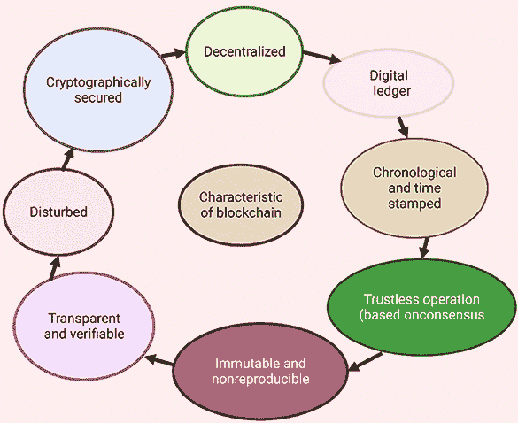

**图 10.1.** 区块链的重要元素。

### 10.3.6 公共分布式账本

每一个人都可以访问区块链上的信息。自区块链诞生以来，网络中的所有参与者都有访问和观察所有发生过的活动完整历史记录的能力。在对区块链进行任何更改之前，用户必须给予其许可。对区块链的任何修改都需要经过大多数网络用户的批准 [11]。必须承认的是，账本的这一特定部分是对普通公众开放的。`Hyperledger` 是一个开源软件框架，允许个人构建自己的区块链解决方案。对 `Hyperledger` 账本的访问仅限于直接参与该活动的人员，确保了只有经过授权的人员才能查看和修改其内容。

### 10.3.7 哈希加密

哈希加密的使用被用作区块链背景下维护安全性的手段。哈希函数的使用在区块链技术数字加密实现中起着至关重要的作用。`Merkle Root` 是包含数据的十六进制格式表示。区块链引入数字签名作为一种辅助保护措施。每个用户都分配了自己的一套私钥和公钥。

### 10.3.8 挖矿

矿工选择性地仅将有效数据传递给其他节点，从而收集整个网络中传输的所有信息。每个矿工通过组合之前收集的多条数据信息来创建一个新区块。

## 10.4 去中心化

区块链以其去中心化的关键属性为特征。这意味着数据没有被局限或存储在单一位置。另一方面，区块链保留了每个区块中包含的所有信息的记录。数据向多个节点的分布不是通过中央权威来实现的。每个区块都伴随着一个经过验证的数字账本。各种研究领域，如云计算、物联网、边缘计算和大数据，都采用区块链技术作为从中心化模型向去中心化模型转换的手段 [12]。

### 10.4.1 不可篡改

“不可篡改”一词用于描述保持恒定不变的事。为了维护区块链的安全性，区块必须保持不可更改且抗修改。工作证明（`proof of work`）的概念在实现不可篡改目标方面起着至关重要的作用。矿工的主要责任是修改 `nonce`，这是一种作为计算工作证据的加密值。为了确保区块哈希地址的唯一性，`nonce` 被用作必须小于目标值的变量值。成功计算工作证明的概率相对较低。为了获得关于性能的精确证据，有必要进行多次测试。特别是在攻击者控制了大多数节点（特别是超过总节点的 51%）的情况下，存在一种单一方法，即修改区块 [13]。

### 10.4.2 匿名性

匿名性是指不公开个人身份的状态。区块链架构由两个部分组成：一个发送者，另一个接收者。数据通过这种方法传输不会泄示发送者的真实身份。区块链通过这种方法与其他用户建立连接的地址 [13, 14]。

### 10.4.3 增强安全性

为了在区块链背景下维护安全性，必须使用哈希加密。与传统系统相比，区块链的使用提供了许多增强安全性 [15, 16]。`Merkle Root` 是位于头部的哈希值。加密过程通过使用哈希函数执行 [17]。

### 10.4.4 持久性

挖矿在概念框架中起着至关重要的作用。确保数据的准确性以及任何错误数据 [18]。矿工是第一个识别预设条件的 `nonce` 值。

### 10.4.5 可追溯性

沿着供应链追踪数据来源和流的能力被称为可追溯性。区块链利用哈希密钥在每个区块之间建立连接，从而形成区块链 [9]。

### 10.5 物联网及相关概念

#### 10.5.1 物联网架构

物联网建立在 `TCP/IP` 之上。物联网的设计包含了关键因素，如可扩展性、互操作性、可靠性和服务质量（`QoS`）。图 10.2 展示了物联网的完整结构及其各个层：

##### 10.5.1.1 感知层

设备层也被称为感知层，构成了基础。位于该层的传感器负责收集周围环境的数据。

##### 10.5.1.2 传输层

各种网络技术（包括 `WiFi`、`3G`、`LAN` 和 `RFID`）用于促进不同层之间的数据传输。

##### 10.5.1.3 处理层

大量数据在此层进行存储和处理。该层利用了数据库、云计算和大数据分析等模块和概念。

##### 10.5.1.4 应用层

通过该层促进了特定应用程序服务的交付。

##### 10.5.1.5 业务层

这一层还涵盖了未来的活动和企业倡议，涉及了应用程序、业务和利润结构以及用户隐私等多个方面。

为了满足某些应用的需求，许多研究人员为物联网（`IoT`）创建了额外的设计。命名数据网络（`NDN`）最初的设计由研究人员 [19, 20]提出。在网络层，`NDN` 为各种物联网功能提供了支持，例如数据聚合和安全等。物联网包含了具有不同特性和功能的广泛应用。`NDN` 展现出满足物联网应用各种需求的潜力，这主要归功于 `NDN` 节点低功耗运行能够为不同的消费者提供数据可用性。`NDN` 可以提高网络的能量效率。`NDN` 协议拥有大量的属性，可以有效解决物联网的主要需求。此外，网络还提供了一种节能的缓存选项。为了增强可靠性，还实施了网络内缓存和多路径路由。`NDN` 还通过确保数据完整性，作为物联网的安全组件。

在物联网背景下对 `QoS` 重要性的研究已在多篇学术文章中得到了探讨 [21]。查询、控制和监控职责等主题得到了深入研究。执行不同的监控任务需要不同的设施。服务感知是确保 `QoS` 的关键需求。`QoS` 架构由三层组成：应用层、网络层和感知层。一个需要关注的领域是互操作性。多个设备可以相互建立通信。物联网互连的必要性在三个不同层次显而易见，即数据模型、消息和网络 [22]。这一概念涵盖了物联网的主要应用。与现有的包含端到端消息传递的设计相比，所提的结构整合了 Web 技术以提供更复杂的解决方案。软件定义网络（`SDN`）架构超越了用于建立具有增强安全措施网络的架构框架。在物联网架构中使用多个 `SDN` 域提供了更强的可扩展性 [22]。兼容性是之前设计的关键组件，而这一设计仍然实现了这一点。

### 10.6 结论

物联网技术现在已广泛应用于各个领域，包括农业、医疗保健和智慧城市。医疗保健行业可以通过多种方式使用物联网，例如增强患者健康和确保药物的可追溯性。区块链技术与物联网的集成有望成功解决与物联网相关的广泛安全问题。通过利用区块链这种去中心化技术，可以增强该系统的安全性。区块链技术在医疗保健领域的整合确保了关键患者数据免受未经授权的修改和泄露。本章试图识别物联网和区块链技术的各种应用，以提高整体性能并加强现有的医疗保健行业。本研究对医疗领域物联网和区块链技术在医疗保健领域的潜在应用进行了全面分析，并特别关注了患者健康的远程监控、药物追踪和医疗数据管理。它还涵盖了在医疗保健领域实施这两项突破性技术（特别是物联网和区块链）相关的若干潜在挑战和问题。总而言之，可以得出结论：这两种技术的整合在医疗保健领域具有巨大的潜力，准备好带来革命性的变化。

### 参考文献

[1] Kizza J M 2020 Internet of Things (IoT): growth, challenges, and security *Guide to Computer Network Security* (Cham: Springer) pp 517–31

[2] Gokhale P, Bhat O and Bhat S 2018 Introduction to IOT *Int. Adv. Res. J. Sci. Eng. Technol.* **5** 41–4

[3] Jabraeil Jamali M A, Bahrami B, Heidari A, Allahverdizadeh P, Norouzi F, Jabraeil Jamali M A, Bahrami B, Heidari A, Allahverdizadeh P and Norouzi F 2020 IoT architecture *Towards the Internet of Things: Architectures, Security, and Applications* (Cham: Springer) pp 9–31

[4] Wang J, Chen W, Wang L, Ren Y and Sherratt R S 2020 Blockchain-based data storage mechanism for industrial internet of things *Intell. Automat. Soft Comput.* [**26** 1157–72](http://dx.doi.org/10.32604/iasc.2020.012174)

[5] Kumar N and Mallick P 2018 Blockchain technology for security issues and challenges in IoT *Procedia Comput. Sci.* [**132** 1815–23](http://dx.doi.org/10.1016/j.procs.2018.05)

[6] Hoy M 2017 An introduction to the blockchain and its implications for libraries

[7] Fernández-Caramés T and Fraga L 2018 A review on the use of blockchain for the Internet of Things *IEEE Access* **31**

[8] Deng Z, Khan Y, Liu Y, Shen Z and Kim H 2019 Secure provenance of electronic records based on blockchain *Comput. Mater. Contin.*

[9] Reyna A, Martín C, Chen J, Soler E and Díaz M 2018 On blockchain and its integration with IoT *Future Gen. Comput. Syst.*

[10] Wang Q, Zhu F, Ji S and Ren Y 2020 Data storage mechanism of sensor networks based on blockchain *Comput. Mater. Contin.*

[11] Cheng J, Li J, Xiong N, Chen M and Yao X 2020 Lightweight mobile clients privacy using trusted execution environments for blockchain *Comput. Mater. Contin.*

[12] Puthal D, Malik N, Mohanty S, Kougianos E and Yang C 2018 The blockchain as a decentralized security framework

[13] Lin I C and Liao T C 2017 A survey of blockchain security issues and challenges *Int. J. Netw. Sec.*

[14] Zheng Z, Xie S, Dai H, Chen X and Wang H 2017 An overview of blockchain technology: architecture, consensus, and future trends

[15] Mattila J 2016 The blockchain phenomenon—the disruptive potential of distributed consensus

[16] Wang J, Chen W, Wang L, Sherratt R S, Alfarraj O and Tolba A 2020 Data secure storage mechanism of sensor networks based on blockchain *Comput. Mater. Contin.*

[17] Ra G J, Roh C H and Lee I Y 2020 A key recovery system based on password-protected secret sharing in a permissioned blockchain *Comput. Mater. Contin.*

[18] Khan R, Khan S U, Zaheer R and Khan S 2012 Future internet: the internet of things architecture, possible applications and key challenges

[19] Jacobson V, Smetters D K, Thornton J D, Plass M F, Briggs N H and Braynard R L 2009 Networking named content *Proc. of the 5th Int. Conf. on Emerging Networking Experiments and Technologies* pp 1–12

[20] Amadeo M, Campolo C, Iera A and Molinaro A 2014 Named data networking for IoT: an architectural perspective *2014 European Conf. on Networks and Communications (EuCNC)* pp 1–5

[21] Jayaraman R, Salah K and King N 2019 Improving opportunities in healthcare supply chain processes via the internet of things and blockchain technology *Int. J. Healthc. Inf. Syst. Inform.* [`14` 49–65](http://dx.doi.org/10.4018/IJHISI.2019040104)

[22] Desai P, Sheth A and Anantharam P 2015 Semantic gateway as a service architecture for IoT interoperability *2015 IEEE Int. Conf. on Mobile Services* pp 313–9

# IOP Publishing

# 医疗保健中的区块链与人工智能

# 协同方法

# Rishabha Malviya, Arun Kumar Singh, Sonali Sundram, Balamurugan Balusamy and Seifedine Kadry

# 第 11 章

## 区块链技术在医疗领域的展望

健康信息的访问、管理、整合和交换是患者和医疗从业人员面临的挑战，尤其是在数字时代。医疗记录应由患者控制，他们应该安全、隐私地与他们选择的任何医生共享健康信息。在发生如 `COVID-19` 这样的灾难性疾病流行时，由于患者数据可用性的增强和数据共享基础设施的强化，预计医疗系统能够更好地应对公共健康危害。目前的医疗技术由于隐私、安全以及与生态系统兼容性方面的局限，未能满足需求。本章探讨了区块链技术在解决医疗领域一些最具挑战性和紧迫的问题方面的潜力。本章总结了健康相关的区块链产品和重要因素，以及在医疗领域使用区块链技术的困难和潜力。

### 11.1 引言

医疗专业人员在有效管理因操作和提供服务而产生的海量个人健康方面面临着巨大挑战。可穿戴设备以及其他医疗监控技术产生了海量的个人健康信息。由于难以在系统之间进行标准化，获取、理解、利用和交换健康数据非常困难。复杂的 `IT` 系统由于包含的信息广泛，使得维护和共享它们成为了一项艰巨的任务`[1]`。请求、交付、接收和汇总患者数据所需的时间资源是巨大的。具有适当数据管理和安全检索功能的医疗系统，使全面的患者视角、更好的护理和治疗、改进的沟通以及更好的健康结果成为可能`[2]`。

此外，医疗行业正面临着互操作性、医疗信息不可用、社区数据不足且不安全等问题等挑战。鉴于近期发生的公共健康问题，显然目前的医疗系统缺乏互操作性。最后，保护患者数据的隐私是医疗行业面临的一个重大困难。许多医疗公司的旧有基础设施使其成为勒索软件和其他威胁的目标`[3]`。

患者驱动的连接概念（即患者主导健康数据的交换）获得了关注`[4]`。然而，基础设施、计算机程序以及整合医疗业务所需的多种数据的战略方法仍处于早期阶段`[5]`。目前的医疗数据系统在隐私、数据完整性、质量或准确性方面存在局限性。医疗行业正在调查新技术解决这些问题的潜力。迫切需要一种能够允许以患者为中心的互操作性技术。

通过使用区块链技术解决行业的一些互操作性问题，患者可能成为医疗生态系统的核心`[6]`。

目前缺乏关于区块链在医疗领域应用的研究。在现有文献中可以找到关于已开发、测试和或实现的许多解决方案的信息。将区块链整合到医疗系统的潜力值得进一步研究，以确定其在改善健康结果和降低局部人群疾病风险方面的效力`[7]`。根据概述的结构，本文的后续部分将如下所示呈现。材料的后续部分将阐述区块链的基本原理及其促进运行的组成元素。最后，我们观察区块链如何帮助医疗行业应对这些障碍，以及它们在确保患者数据安全易于访问方面将发挥的重要责任`[8]`。第三节涵盖了这一切。整合支持区块链的医疗系统面临的障碍包括技术、组织和行为方面的。本节涵盖了基于区块链技术的医疗解决方案，并给出了一些示例`[9]`。

#### 11.1.1 区块技术

在本世纪，区块链技术在许多方面一直一直是游戏规则的颠覆者。它在提供运营和监管效率的同时，还促进了广泛业务领域供应链的可追溯性和透明度。被称为“区块链”的分布式账本技术（`DLT`）已经引起了金融服务业的关注和资金投入。区块链是一种分布式账本技术，其中每个区块通过被称为“挖矿”的过程与前一个区块连接起来，形成一条相互连接的数据链。数学公式被用于解决待处理交易的问题。当一个区块被挖出时，矿工使用计算机程序产生哈希值，这些哈希值对于该区块是唯一的 [10]。每一个单独区块都包含前一个区块的加密哈希值、时间戳和交易数据。网络或链是通过存储来自之前区块和交易的数据来构建的。对单个区块内信息的修改都可能引发连锁反应，从而导致区块链的完全停止。为了创建一个永久的、不可更改的数字记录，区块链网络中的每台机器都会同一时刻锁定。每个区块链系统都有不同的法规来规定向链中添加新区块的资格标准 [11]。区块链技术为去中心化点对点网络上不可篡改的数据交换和交易提供了一系列独特的优势。区块链技术在金融交易和加密货币领域已广泛应用 [12]。尽管区块链技术已应用于娱乐、制造和医疗保健等多个领域，但其增强安全和隐私的优势仍未被忽视 [13]。

使用区块链技术提高医疗保健行业的互操作性可能是迈向以患者为中心的一大重要步骤 [6]。最重要的优点之一是其能够将患者置于中心 [14]。患者的医疗记录可以通过移动应用程序、远程监控和基于区块链技术的数据管理系统进行访问和共享。该系统赋予了患者保留其个人信息的自主权 [7]。本节探讨了区块链技术在解决医疗保健行业面临的关键挑战方面的潜力。

### 11.1.2 基于区块链的方法解决关键问题

美国医疗保健行业是全球最大的，年度支出超过 1.7 万亿美元 [15]。美国的平均年度医疗保健支出为 10,739 美元，超过了其他国家的总和。在 2027 年，医疗保健支出预计占美国 `GDP` 的 20% [16]。区块链技术为去中心化点对点网络上不可篡改的数据交换和交易提供了一系列独特的优势。区块链技术在金融交易和加密货币领域已广泛应用 [12]。尽管区块链技术已应用于娱乐、制造和医疗保健等多个领域，但其增强安全和隐私的优势仍未被忽视 [13]。

使用区块链技术提高医疗保健行业的互操作性可能是迈向以患者为中心的一大重要步骤 [6]。最重要的优点之一是其能够将患者置于中心 [14]。患者的医疗记录可以通过移动应用程序、远程监控和基于区块链技术的数据管理系统进行访问和共享。该系统赋予了患者保留其个人信息的自主权 [7]。本节探讨了区块链技术在解决医疗保健行业面临的关键挑战方面的潜力。

美国医疗保健行业是全球最大的，年度支出超过 1.7 万亿美元 [15]。美国的平均年度医疗保健支出为 10,739 美元，超过了其他国家的总和。在 2027 年，医疗保健支出预计占美国 `GDP` 的 20% [16]。

| 监管与合规 | 合规性追踪。 | 它提供了一个可信且可验证的实时审计轨迹。 |
| 基于智能合约的检查 | 建立了一个自动执行隐私规则的框架。 | |
| 虽然数据本身没有泄露，但可以追踪谁共享了数据以及与谁共享。 | | |
| 公司内部 | 资金正在转账。 | 使用智能合约来促进即时金融交易。有助于更快的支付处理。 |
| 医疗器械供应链。 | 让患者对整个供应链中的所有资产具有完全可见性。 |
| 冷链物流及其他相关服务。 | 促进医疗设备与提供者之间安全、私密的交互。 |
| 将所有金融交易整合到一个单一系统中。 | | |
| 后台与管理 | 收入管理。 | 更容易检测和定位问题所在。 |
| 减少行政开支。 | | |
| 增强可信度和透明度。 | | |
| 提高金融交易效率 | | |
| 药品 | 验证药物来源。 | 药品可以被追踪和追溯。 |
| 将全行业信息整合到单一访问点 | 伪造手段需要真实性证明。 | |
| 有助于防止假货的运输和销售。 | | |
| 允许检测与药物治疗相关的所有副作用。 | | |
| 研发 | 使临床试验变得可行。 | 阻止知识产权 (`IP`) 盗窃。 |
| 实现任何文档的身份验证，并确保用户可以验证其存在性。 | | |
| 大型、经过验证且匿名的患者数据库的可用性。 | | |

## 11.2 数据收集与存储

可穿戴设备和其他医疗监测技术生成的个人健康数据是巨大的。医疗系统做出数据驱动决策的能力很大程度上取决于这些数据的管理和安全检索。目前的医疗系统在开展业务和提供服务的过程中产生数据。在患者的一生中，他们与多个医疗提供者接触，导致数据分散在各个提供者的系统中。数据管理权通常由提供者保留，导致数据轨迹杂乱无章且患者获取便利性恶化。医疗数据的高量、多样性和快速变化使其具有独特性。非均匀性的目标需要利用多个变量和实时数据分析。由于不同系统缺乏标准，大量的数据集无法访问，使其难以被利用、识别和分发。

## 11.3 医疗记录与历史的现状

目前的医疗记录和数据收集系统包含以下特征 [6, 14, 24]:

- 这种方法的基础是患者与医生之间的关系。
- 尽管可以获取数据，但始终未能利用它。
- 它使获取医疗服务变成了一个漫长而艰辛的过程。
- 关于患者的关键信息分散在多个平台上。
- 由于缺乏关键数据的可用性，许多医疗系统无法为患者提供必要的治疗。
- 它对管理系统产生了负面影响，因为许多参与者缺乏确保流程顺畅的必要知识。
- 医疗数据的安全性和可靠性水平较低。

大多数医疗记录目前以纸质格式维护并分布在医疗行业内的多个地点。利用这些记录，无法实现护理协调、质量衡量和错误减少 [15]。

医疗数据可以在多个地方进行数字化收集。在保持简单的同时，充分利用这些医疗数据至关重要。在医疗行业，如何以成本效益且安全的方式捕捉并保留信息是一个主要关注的问题 [2]。数据可移植性和跨平台的一致互操作性也是关键考虑因素 [22]。

### 11.3.1 区块链在医疗记录中的潜力

在所有阶段，`blockchain` 都让复杂的保护机制和一致的可移植性成为可能。医疗提供者可以建立一个以患者为中心的集成健康记录系统，患者拥有其信息的私钥。患者负责谁可以访问和使用他们的数据。由 `blockchain` 驱动的集成解决方案有助于记录比对和防欺诈。拥有这样的系统有很多优点，包括可以从全球任何地方查看和管理病史，并与任何医疗执业人员安全地共享这些信息 [2]。最近的一项研究提出了一种基于 `blockchain` 技术的医疗信息保护系统，以确保记录信息的真实性和准确，同时保护用户的隐私。建议的数据系统允许用户长期存储关键信息。如果对数据操纵有任何疑虑，可以验证数据的真实性 [28]。`Blockchain` 技术是需要验证并接受其完整性的电子数据的合适解决方案。`blockchain` 技术的利用被提作为保护医疗记录的潜在解决方案 [25]。如果使用 `blockchain` 技术监控医疗行业的交易，可能会产生积极影响。`Blockchain` 技术在开放的消费者传输环境中利用最好 [26]，在该环境中，旧信息的重要性正在降低，数据生成速率是持续且可靠的。医疗记录和重要的病史都在 `blockchain` 上进行安全性评估。未来，患者数据将在 `blockchain` 上，供医生和患者随时随地进行访问 [27]。

长期以来，临床医生和研究人员已经认可社会经济因素对整体健康具有重要意义。根据这种观点，仅凭个人特征[36] 无法准确预测个人的健康状况。社会经济统计的重点在于环境、社会和社区。这些信息对于根据特定人群的独特需求制定定制健康管理策略至关重要。通过分析社会经济数据，可以更深入地了解非法药物滥用、家庭暴力和经济差异等状况[36]。因此，确保社会经济数据的完整性和准确性是必要的，以防止不同社会经济和族群之间的不平等。医疗保健人员必须获得这些数据，才能成功实施社区健康管理倡措[37]。理赔数据是健康信息领域专业人士的一类关键的社会化信息。此类数据通常包括相关的治疗日期、诊断代码和相关支出。这些数据可以帮助医疗专业人员更好地了解他们照顾的患者以及他们面临最重要的健康问题。处方药数据为医疗保健提供者和政策制定者提供了患者如何应对慢性健康障碍和疾病的见解。建立一个能够收集、存储、分析和保存全人口数据的先进公共卫生基础设施，对于医疗保健服务的有效交付至关重要。

## 11.4.2 现有的社会经济数据与区块链解决方案

例如，国家质量委员会（`National Quality Council`）和医学学会主要关注直接从患者那里获取社会经济行为信息。这两个机构都表示，为了让医疗保健提供者在 2014 年成功实施社区健康管理技术，电子健康记录（`EHRs`）必须整合健康社会经济决定因素的数据。在初级保健人员能够以有用、准确且一致的方式利用其 `EHR` 中的信息之前，必须在区块链的使用、隐私协议和数据共享方面投入大量努力，并维护数据的完整性与质量，以及将重要的社会经济和行为健康数据传输到 `EHRs` 中，这一切都必须变得更加简单。

## 11.4.3 基于区块链的财务与记录系统

医疗账单提交程序可能包含错误和遗漏。区块链技术的应用通过简化支付执行和降低欺诈行为风险，为解决上述挑战提供了一个可行的解决方案。

区块链技术的实施促进了智能合约的使用。去中心化分布式账本技术（通常称为区块链）被用于记录买方与供应商之间建立的协议细节[38]。“智能合约”一词是指在不需要人工干预的情况下执行的合约。智能合约的区块链地址作为其物理位置的指针。要使用合约，节点只需向指定地址支付 `Bitcoin`，共识过程将处理剩余部分。智能合约消除了对中介的需求，增强了可追溯性并提升了安全性。

通过在医疗支付系统中使用基于区块链的智能合约，可能消除医生和支付方之间存在的不信任。为了减少执行基于价值的支付时发生人为错误，建议在报销或罚款与区块链医疗记录中包含的特定健康方面之间建立联系。智能合约的使用可能会减少行政费用，因为患者的保险提供方会收到账单和理赔结算通知[39, 40]。

最后，保险业务可能受益于区块链技术，因为它促进了交易的信任和透明。通过在不更改任何数据的情况下接受来自多个来源的输入，区块链具有增强处理处理潜力[40]。使用区块链架构可以确保存储数据的完整性或验证[41]。

## 11.5 药物业的区块链解决方案

### 11.5.1 药物追溯

发展中国家供应的药品中有超过 15%是假药，这是医疗健康行业的一个巨大问题。据估计，假药每年给药品行业 2200 亿美元[24]。区块链提供的可见性、安全性和追溯性有助于对抗假药问题。为了打击假冒，系统采用了如真伪确认和点对点追踪能力等特征。在购买之前，客户可以检查药物的合法性[42]。区块链技术使得能够在数据库中记录药物对患者的效果以供未来统计分析，并监控药品从生产到交付给患者的整个过程[42]。

### 11.5.2 临床试验

在受控环境中，临床试验提供了关于新药安全有效性的丰富信息。该过程耗时且昂贵，并且并非没有腐败风险。为了确保临床研究结果不被篡改，建立一个允许任何人检查临床报告的系统至关重要。区块链技术在临床研究中的应用可能是有利，因为它确保了数据的完整性并验证了文档的有效性。在分布式网络中，只有授权用户可以更改数据[24]。

### 11.5.3 医疗供应链

制药行业正在观察区块链技术的实施，以监控化学品、原材料和组件从其源地到终端用户的整个历程 [24]。制药研究机构可能会利用区块链技术来保护医疗供应链数据。预计区块链技术的实施将增强制药供应链的可追溯性和真实性 [43–45]。随着处方药的使用越来越广泛，区块链技术有潜力有效监控与其相关的所有不良影响。制药行业内实施区块链技术增强了数据共享的安全性。总部位于苏黎世的初创公司 `Modum.io` 正在利用传感和区块链技术来增强制药供应链。`MODSense` 系统的开发是一个利用区块链技术监测制药供应链中脆弱物品温度的系统，它是 `Modum.io`、`SAP Software Solutions` 和瑞士邮政合作的成果。通过避免对所收集的温度数据进行篡改，`MODSense` 让相关方能够确切知道产品在运输过程中是如何被处理的 [46]。疫苗接种、临床研究、医疗样本和易腐食品可能都能从这一策略中获益。拜耳（`Bayer`）也在采用区块链技术来追踪其整个供应链中的商品。由于技术的改进，制药供应链能够更快地定位物品，从而提高了效率并增强了安全性 [47]。

### 11.5.4 公共卫生

人口健康数据（指关于各种人群健康的数据）的重要性在 `COVID-19` 疫情期间变得尤为重要。作为增加公共健康和福祉的手段，人口健康是应对各种范围健康问题最有效的方法之一。通过美国的《平价医疗法案》（`ACA`），医疗专业人员和患者都鼓励共同努力以改善患者结果和护理协调。一个完整的人口健康记录系统，在如 `COVID-19` 疫情期间，对于快速为相关组织提供有关可能爆发的所需信息是至关重要的 [48]。在公共医疗保健体系中实施区块链技术可能是必要的。区块链的分布式账本技术使得获取医疗趋势的全面视图变得可行。阿片类药物过量用用的增加是一个重大的公共关注问题。区块链技术可用于建立全行业的非法药物购买数据库。例如，供应商可以利用分析来决定向分发机构提供多少阿片类药物。

### 11.5.5 器官移植

区块链如何改变医疗行业的另一个例子是在器官移植领域。器官移植是一项复杂的手术。由于器官腐败很快，它们必须由具有相应血型的人捐献。根据密歇根大学器官移植中心的说法，可以在不到 10 小时内完成心脏或肺移植。由于缺乏良好的组织系统，可能生命的器官正在被浪费。超过 120,000 名患者在移植名单上，每天有 22 名患者因此去世。世界上第一个器官捐赠中心化数据库 `Organ Tree` 正在使用区块链技术连接器官捐赠者、患者和医疗机构。`Organ Tree` 对区块链的使用增加了匹配数量并加速了移植过程 [49]。

阿拉伯联合酋联邦国（`UAE`）的器官移植将在全球范围内首次整合区块链和人工智能。专门从事全球医疗区块链解决方案的知名国家公司 `Dhon Healthtech` 与阿拉伯联合联酋（`UAE`）已建立联系。其最重要的目标之一是尽可能安全、高效地捐献器官。进一步的目标还包括制定改进器官匹配的标准、对患者的器官进行验证，以及利用人工智能结合区块链来优化移植。在器官移植方面，区块链和人工智能可能帮助医院简化流程 [50]。

### 11.6 战略价值与实施挑战

许多行业尚未采用区块链技术，该技术目前处于开发阶段。很少有基于区块链的业务取得成功。因此，要对未来是否投资区块链技术做出明智的判断较为困难。正如后续部分详细提到的，可以作为一种基础技术和解决创新性问题的手段，对区块链技术本身的价值进行评估。

### 11.6.1 应对创新挑战并提供机会

根据 `MIT` 的说法，成功的企业通过结合个人需求、技术能力和财务繁荣的前提条件来实现创新。为了产生创新，这些组织结合了营销、设计和技术观点 [51]。以下是其产品和服务的三个特征（图 11.1）：

- 是否有其他解决方案？它有什么处？
- 你认为存在需求吗？它有多重要？
- 是否可能盈利？是否高效有效？


**图 11.1. 创新挑战。**

区块链技术在医疗行业的实施有望解决这三个创新挑战。这将为医疗行业带来巨大益处。它是医疗从业人员的可能选择，也是患者的需求。利用技术可以实现集成的医疗信息系统 [22]。它跟踪所有分散的数据和工作。该系统能够从各种获取的数据中提取最大的价值。区块链在医疗领域的应用已被证明可以增强互操作性、患者自主权以及医疗研究数据的质量和数量 [53]。由于近期的技术进步和行业对标准与安全的共同投入，区块链的未来前景被看好。根据图 11.2 中的图表，基于区块链的医疗普及率正在上升。


**图 11.2. 使用区块链的战略价值。**

### 11.6.2 基于区块链的新医疗技术

目前，多个机构正致力于医疗行业`blockchain`技术的开发与推广。这些公司开发的基于`blockchain`的平台和软件为医疗行业存储数字记录提供了一种安全手段。此外，它们还增强了医疗信息的共享与利用，保护了健康记录的完整性，并解决了药物追溯和伪造问题。此外，它们还利用了区块链技术。许多健康相关的区块链解决方案和知名企业为各种应用提供了定制化的区块链解决方案 [[54–56]]。

### 11.6.3 实施中的缺点与困难

最近的一项文献综述分析了在医疗领域实施区块链技术相关的潜在优势、缺点和障碍。

区块链技术的优势包括其灵活性和响应速度，以及在基础设施方面的高效性能和极低延迟 [[57]]。`EHRs`也可以在分散的网络上进行安全交换。由于该技术太昂贵且复杂，患者对此并不知情。关于该技术当时也引发了大量的讨论 [[58]]。除了法律、社会学和技术限制外，学术文献指出，缺乏现实世界的评估是技术被接受的障碍。研究人员已对生物医学和医疗保健领域实施区块链技术的潜在挑战及相关解决方案进行了调查 [[13]]。

在许多领域，区块链技术目前处于早期阶段。上述技术的快速实施可能会遇到各种挑战。在商业领域，缺乏关于利用`blockchain`技术方面的信息。学术界和行业专家一致认为，区块链技术并不是解决行业所有病问题的“万灵药” [[53, 57]]。区块链技术的成功运行需要解决多项挑战，涵盖技术、治理、行政和社会领域。由于区块链是一项核心技术，经济和社会结构的发展将依赖于创新性基础，而非颠覆性基础 [[9]]。

无论区块链方法具有何种程度的创新或颠覆性，对其进行定制以满足客户、患者、医疗提供者和监管机构等利益者的特定医疗需求是至关重要的 [[18]]。后续章节将详细介绍这些问题。

### 11.6.4 技术

区块链背后的技术仍处于婴儿阶段，并不断改进。起初，该技术的成本将超过他们的承受能力 [[22]]。解决可扩展性、缺乏标准以及与现有系统集成等问题迫在眉睫。验证交易的时间也是一个关注点。运行区块链的成本与跨网络发送交易的数量成正比 [[59, 60, 60]]。在将当前数据迁移到区块链之前，解决软件、硬件和支持方面的疑虑至关重要 [[61]]。当处理复杂数据时，技术的表现并不理想 [[60]]。

### 11.6.5 组织

`EHR`已经到位，能够保存非常详细的病史。在政府激励下，许多知名的学术机构和大型医疗系统已投入数百万美元 [[52]]。要用区块链取代现有系统，缺乏足够的激励。虽然目前的系统无法被区块链取代，但可以通过它进行改进。然而，关于特定治疗的极少量信息将保留在每个`block`中 [[6]]。在区块链上存储当前数据的方法是另一个挑战。人口统计信息必须由各方达成一致。组织必须为所提供的数据建立标准。此外，与引入新技术一样，区块链的部署也面临组织方面的困难，包括参与转型过程的人员管理 [[62]]。

### 11.6.6 监管与隐私

区块链技术对政府监管和文化因素的依赖是一个显著限制。有关区块链的监管问题尚未解决机构解决，全球医疗参与者对该技术需要大量的支持 [[22]]。

### 11.6.7 采用驱动

在计算区块链的投资回报率（`ROI`）时，存在许多未知。基于区块链的医疗服务的商业优势需要时间才能体现。个人适应能力的因素是什么？为了让医疗提供者接受新技术，必须有财务激励。计算公司的`ROI`并不总是易事。尽管存在炒作，区块链并不是现有医疗记录问题的根办法，而且无法立即实施。然而，目前的医疗系统可能会从区块链在几个专业领域的应用受益 [[6, 63]]。

### 11.7 总结与结论

根据本节，区块链技术在医疗保健领域的探索仍处于发展阶段，但所提解决方案的数量正在日益增加。区块链技术凭借其在去中心化管理、增强安全性以及不可篡改的审计追踪方面的革命性方法，在本章中被推为一种范式转移。作为医疗保健研究的一部分，该研究查看了若干区块链用例及其应用。

研究结果表明，区块链技术的实施可以提高医疗保健数据的安全性、溯源性、互操作性和完整性。由于其去中心化的结构、开放性和不可篡改性，区块链可能帮助维护这些活动对所有参与者而言都更具效益。研究人员发现，该技术的利用可以促进来自多个医疗提供者的信息的安全协调与整合，增强患者参与度，确保患者数据的可用性，实现患者之间安全直接的通信，并促进家庭健康管理。

区块链技术的实施有望帮助医疗研究人员获取遗传密码，并加强对药品供应链的监管。重新评估医疗保健行业所有利益相关者之间的相互联系至关重要，这涵盖医疗执业人员、患者以及制药领域。在实施基于区块链的医疗系统维护之前，必须克服法律、技术和监管障碍。尽管区块链是一项发展中的技术，但它对医疗保健行业具有巨大的前景。尽管它尚未被整个医疗行业接受，但这项技术的范围在未来将不断扩大。目前，关于该主题的研究尚显不足，需要对现实世界的应用进行进一步研究。

### 参考文献

[1] Clim A, Zota R D and Tinica G 2019 居家医疗中的大数据：个性化医学的新前沿。急救服务与高血压风险预测 *Int. J. Healthc. Manag.* [12] 241–9](http://dx.doi.org/10.1080/20479700.2018.1548158)

[2] Attaran M 2022 医疗保健中的区块链技术：挑战与机遇 *Int. J. Healthc. Manag.* [15] 70–83](http://dx.doi.org/10.1080/20479700.2020.1843887)

[3] Horgan D *et al* 2020 数字化与 COVID-19：完美风暴 *Biomed. Hub* [5] 1–23](http://dx.doi.org/10.1159/000511232)

[4] Kamble S S, Gunasekaran A, Goswami M and Manda J 2018 医疗保健管理中大数据分析应用的系统性视角 *Int. J. Healthc. Manag.* [12] 226–40](http://dx.doi.org/10.1080/20479700.2018.1531606)

[5] Gordon W J and Catalini C 2018 医疗保健区块链技术：促进向患者驱动的互操作性转变 *Comput. Struct. Biotechnol. J.* [16] 224–30](http://dx.doi.org/10.1016/j.csbj.2018.06.003)

[6] Pirtle C and Ehrenfeld J 2018 医疗保健的区块链：下一代医疗记录？ *J. Med. Syst.* [42] 172](http://dx.doi.org/10.1007/s10916-018-1025-3)

[7] Chen H S, Jarrell J T, Carpenter K A, Cohen D S and Huang X 2019 医疗保健中的区块链：以患者为中心的模型 *Biomed. J. Sci. Tech. Res.* 20 15017

[8] Attaran M and Gunasekaran A 2019 *业务中区块链技术的应用：挑战与机遇* (Cham: Springer) Springer 运营管理简要 (BRIEFSOPERMAN)

[9] Iansiti M and Lakhani K R 2017 区块链的真相 *Harv. Bus. Rev.* 95 118–27

[10] Zheng Z, Xie S, Dai H, Chen X and Wang H 2017 区块链技术概述：架构、共识与未来趋势 *2017 IEEE Int. Congress on Big Data (BigData Congress)* pp 557–64

[11] Nian L P and Chuen D L K 2015 比特币入门 *Handbook of Digital Currency* (Amsterdam: Elsevier) pp 5–30

[12] Mougayar W 2016 *商业区块链：下一代互联网技术的承诺、实践与应用* (New York: Wiley)

[13] Kuo T T, Kim H E and Ohno-Machado L 2017 用于生物医学和医疗保健应用的区块链分布式账本技术 *J. Am. Med. Inform. Assoc.* [24] 1211–20](http://dx.doi.org/10.1093/jamia/ocx068)

[14] Naga Rani K, Pravallika K, Sk N, Poojitha T and Greeshma K 2022 医疗保健中的区块链技术：挑战与机遇 *Int. J. Healthc. Sci.* [3] 5

[15] Hillestad R, Bigelow A, Girosi F and Taylor R 2019 电子记录能改变健康吗？*Health Aff.* 24

[16] Rosenbaum L 2019 Anthem 将在未来内让 400 万成员使用区块链 [Forbes](https://www.forbes.com/sites/leahrosbaum/2019/12/anthem-says-40-million-members-will-be-using-blockchain-to)

[17] Hoy M B 2017 区块链简介及其对医疗的影响 *Med. Ref. Serv.* 36 273–9](http://dx.doi.org/10.1080/02763869.2017.1332)

[18] Yaeger K, Martini M, Rasouli J and Costa A 2019 医疗新兴区块链解决方案 *J. Sci. Innov. Med.* 2 3–6](http://dx.doi.org/10.2902/jsim.7)

[19] Albassam A, Almutairi F, Majoun N, Althukair R, Alturaiki Z, Rahman A, AlKhulaifi D and Mahmud M 2023 远程医疗与医疗中区块链与云计算的集成 *Int. J. Comput. Sci. Netw. Sec.* 23

[20] Saranya R and Murugan A 2023 医疗系统中区块链应用的系统综述：分析、现状与未来方向 *Mater. Today Proc.* 80 3010–5](http://dx.doi.org/10.1016/j.matpr.2021.07.105)

[21] Agbo C C, Mahmoud Q H and Eklund J M 2019 医疗保健中的区块链技术：系统性综述 *Healthcare* 7 56](http://dx.doi.org/10.3390/healthcare7020056)

- [27] Prados-Castillo J F, Guaita Martínez J M, Zielińska A and Gorgues Comas D 2023 从可持续性视角看旅游业中区块链技术的采用现状 *J. Theor. Appl. Electron. Commerce Res.* [**18** 814–30](http://dx.doi.org/10.3390/jtaer18020042)
- [28] Li H, Zhu L, Shen M, Gao F, Tao X and Liu S 2018 用于医疗数据的基于区块链的数据保护系统 *J. Med. Syst.* [**42** 1–13](http://dx.doi.org/10.1007/s10916-018-0997-3)
- [29] Zhang A and Lin X 2018 通过共联盟区块链实现电子健康系统中安全且保护隐私的数据共享 *J. Med. Syst.* [**42** 140](http://dx.doi.org/10.1007/s10916-018-0995-5)
- [30] Silvestri S, Islam S, Papastergiou S, Tzagkarakis C and Ciampi M 2023 一种基于 NLP 的医疗生态系统网络威胁和漏洞分析机器学习方法 *Sensors* [**23** 651](http://dx.doi.org/10.3390/s23020651)
- [31] Davis J 2018 UnityPoint Health 钓鱼攻击导致 140 万患者记录泄露 *Healthcare IT News* [`www.healthcareitnews.com/news/14-million-patient-records-breached-unitypoint-health-phishing-attack`](https://www.healthcareitnews.com/news/14-million-patient-records-breached-unitypoint-health-phishing-attack)
- [32] Raghupathi W, Raghupathi V and Saharia A 2023 分析健康数据泄露：一种视觉分析方法 *Appl. Math.* [**3** 175–99](http://dx.doi.org/10.3390/appliedmath3010011)
- [33] Mishra P, Khandelwal B and Dewangan B K 2023 电子健康记录标准化中区块链安全应用分析 *Recent Adv. Comput. Sci. Commun. (Formerly: Recent Patents Comput. Sci.)* **16** 19–30
- [34] Bouras M A, Lu Q, Zhang F, Wan Y, Zhang T and Ning H 2020 用于电子健康身份隐私的分布式账本技术：现状与未来展望 *Sensors* [**20** 483](http://dx.doi.org/10.3390/s20020483)
- [35] Tang Y M (ed), Chau K Y (ed), Ho G T S (ed) and Wan Y (ed) 2023 *通过区块链技术应用彻底新数字医疗* (IGI Global)
- [36] Roux A V D 2007 社区与健康：我们现在在哪里，未来将走向何方？ *Rev. Epidemiol. Sante Publ.* [**55** 13–21](http://dx.doi.org/10.1016/j.respe.2006.12)
- [37] Hughes L S, Phillips R L, DeVoe J E and Bazemore A 2016 社区生命体征：在照顾患者的同时监测社区脉搏 *J. Am. Board. Med.* [**29** 419–22](http://dx.doi.org/10.3122/jabfm.2016.0315)
- [38] Giancaspro M 2017 “智能合约”真的是明智主意吗？法律视角的见解 *Comput. Law Secur.* [**33** 825–35](http://dx.doi.org/10.1016/j.clsr.2017.5)
- [39] Luu L, Chu D, Olick H, Saxena P and Hobor A 2016 构建智能合约 *Proc. of 2016 ACM SIGSAC Conf. on Computer and Communications* 254–69
- [40] Lorenz J T, Münstermann B, Higginson M, Olesen P, Bohlken N and Ricciardi V 2016 *保险中的区块链——机会还是威胁* (McKinsey) pp 1–9
- [41] Zhou L, Wang L and Sun Y 2018 Store：基于区块链的医疗存储 *J. Med. Syst.* [**42** 149](http://dx.doi.org/10.1007/s10916-018-0996)
- [42] Haq I and Esuka M 2018 制药行业防止伪假药物的区块链技术 *Int. J. Comput. Appl.* [**180** 8–12](http://dx.doi.org/10.5120/ijca2018967)
- [43] Bocek T, Rodrigues B and Stiller B 2017 无处不在的区块链——制药供应链的案例 *2017 IFIP/IEEE Symp. on Integrated Network and Service Management* 72–7
- [44] Shanley A 2017 区块链能改进药品安全吗 *Pharm. Technol.* **1** s34–9
- [45] Vecchione A 2017 区块链可以追踪药剂 *Drug Top.* **161** 2
- [46] Murray A, Kim D and Combs J 2023 去中心化互联网的承诺：什么是 Web3 以及企业如何准备？ *Bus. Horiz.* [**66** 191–202](http://dx.doi.org/10.1016/j.bushor.2022.060)
- [47] Risso L, Ganga G M, Godinho Filho, de Santa-Eulalia L, Chikhi T and Mosconi E 2023 供应链管理中的区块链现状与未来展望：综述与研究议程 *Comput. Ind. Eng.* [**179** 10915](http://dx.doi.org/10.1016/j.cie.2023.109)
- [48] Nash D 2015 2015 年趋势：人口健康 *J. Health. Manag.* [**60** 246–8](http://dx.doi.org/10.1097/00115514-2015070)
- [49] Moorlock G and Draper H 2023 支持器官捐赠过程建议 *J. Med. Ethics* [**49** 434–8](http://dx.doi.org/10.1136/jme-2022-108)
- [50] El Khatib M, Al Mulla A and Al Ketbi W 2022 区块链在电子治理和项目管理决策中的作用 *Adv. Internet Things* [**12** 88–109](http://dx.doi.org/10.4236/ait.2022.123)
- [51] Ouyang C H, Chen C C, Tee Y S, Lin W C, Kuo L W, Liao C A and Liao C H 2023 设计思维在髋骨折深度学习算法开发中的应用 *Bioengineering* [**10** 735](http://dx.doi.org/10.3390/bioengineering10607)
- [52] Roehrs A, Da Costa C A and da Righi R 2017 OmniPHR：整合个人健康的分布式架构模型 *J. Biomed. Inform.* [**71** 70–81](http://dx.doi.org/10.1016/j.jbi.2017.05)
- [53] Ekblaw A, Azaria A, Halamka J D and Lippman A 2016 医疗区块链案例研究 *2017 IFIP/IEEE Symp. on Integrated Network and Service Management* 72
- [54] Yadav A, Singh N and Kushwaha D 2023 区块链与共识机制的演变及其现实世界应用 *Multimedia Tools Appl.* 13
- [55] Abdollahi A, Sadeghviri F and Rejeb A 2023 区块链在价值创造中的作用：多案例研究 *Qual. Quant.* [**57** 42](http://dx.doi.org/10.1007/s11135-022-6)
- [56] Balakrishnan A, Jaglan P, Selly S, Kumar V 2023 生物信息学中区块链的新趋势：综述 *Distributed Computing to* (Amsterdam: Elsevier) pp 389–404
- [57] Baltruschat L, Jaiman V and Urovi V 2023 用于健康记录交换的区块链技术用户接受度 *J. Syst. Technol.* [**25** 268–9](http://dx.doi.org/10.1108/JSIT-09-225)
- [58] Dubovitskaya A, Novotny P, Xu Z and Wang F 2020 肿瘤学数据共享的区块链技术应用：系统文献综述 *Oncology* [**98** 403–11](http://dx.doi.org/10.1159/00532)
- [59] Hajian A, Prybutok V and Chang H C 2023 电子健康记录中基于区块链的信息共享系统实证研究：中介视角 *Comput. Hum. Behav.* [**138** 107](http://dx.doi.org/10.1016)
- [60] Ichikawa D, Kashiyama M and Ueno T 2017 使用区块链技术的防篡改移动健康 *JMIR mHealth uHealth* [**5** e7938](http://dx.doi.org/10.2196/mhealth.7)
- [61] Angraal S, Krumholz H M and Schulz W L 2017 区块链技术：在医疗领域的应用 *Circ.: Cardiovasc. Qual. Outcomes* [**10** e003800](http://dx.doi.org/10.1161/CIRCOUTCOMES.117.0)
- [62] Karafiloski E and Mishev A 2017 针对大数据挑战的区块链解决方案：文献综述 *IEEE EUROCON 2017—17th Int. Conf. on Smart Technologies* 763–8
- [63] Aloini D, Benevento E, Stefanini A and Zerbino P 2023 通过区块链转型医疗健康生态系统：业务流程创新的机会与能力 *Technovation* [**119** 102557](http://dx.doi.org/10.1016/j.technovation.2022.102557)
