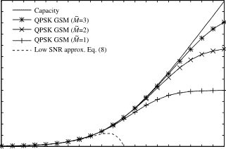

# 基于卷积神经网络和孪生网络的PPG信号血压估计

在低 SNR 区域的阶 [12]。因此，(3) 被视为在 CSIR 情况下实现二阶容量的必要且充分条件。当 $C(\gamma)$ 在低 SNR 区域内与对应容量在二阶上相等（$\alpha \in (0,1]$ 时为 $O(\gamma^{1+\alpha})$）时，具有可达速率 $C(\gamma)$ 的信号方案称为二阶最优 [12]。根据定义，二阶最优方案的 EE 在 $\gamma \to 0$ 时等于最优 EE $C_{\mathrm{opt}}(\gamma)/\gamma$ 加上 $O(\gamma^\alpha)$。

## II. 广义空间调制

在 GSM 中，发射机在符号周期 $t$ 内激活 $\tilde{M}$ 个发射天线 $\mathcal{M}_t \subset \mathcal{M}_{\mathrm{all}} = \{1,\ldots,M\}$，其中 $|\mathcal{M}_t| = \tilde{M}$，并且仅从激活的天线 $\mathcal{M}_t$ 发送数据符号。因此，在符号周期 $t$ 内传输的稀疏向量 $x_{\mathcal{M}_t,t} \in \mathbb{C}^M$ 满足 $x_{m,t} = (x_{\mathcal{M}_t,t})_m = 0$ 对所有 $m \notin \mathcal{M}_t$ 成立。我们假设 $\mathcal{M}_t$ 对所有 $t$ 从基数为 $\tilde{M}$ 的 $\mathcal{M}_{\mathrm{all}}$ 的所有可能子集中均匀随机采样，并且 $x_{\mathcal{M}_t,t}$ 对所有 $t$ 彼此独立。协方差矩阵 $\Sigma_{\mathcal{M}_t} = \mathbb{E}[x_{\mathcal{M}_t,t} x_{\mathcal{M}_t,t}^H]$ 满足约束 $\operatorname{Tr}(\Sigma_{\mathcal{M}_t}) \le 1$ 以满足平均功率约束。此外，我们假设具有有限四阶矩的复数据符号 $x_{m,t}$ 满足

$$
\mathbb{E}[x_{m_1,t}] = 0, \quad \mathbb{E}[x_{m_1,t} x_{m_2,t}] = 0, \quad \mathbb{E}[x_{m_1,t}^* x_{m_2,t} x_{m_3,t}] = 0, \quad \mathbb{E}[x_{m_1,t} x_{m_2,t} x_{m_3,t}^*] = 0, \tag{4}
$$

## III. 主要结果

### A. 接收端完美 CSI

我们首先分析 GSM 在固定已知信道矩阵 $H$ 下的相干可达速率 $C_{GSM}^{CSI}(\gamma; H)$。在第 III-A 节中，信道矩阵 $H$ 被视为确定性矩阵，因此关于 $H$ 的条件被省略。

$$
C_{GSM}^{CSI}(\gamma; H) = \frac{1}{T} \sum_{t=1}^{T} I(\mathcal{D}_t; y_t). \tag{6}
$$

由于给定 $H$ 时互信息 $I(\mathcal{D}_t; y_t)$ 与 $t$ 无关，为记号方便，我们在第 III-A 节中省略所有变量的时间索引 $t$。以下定理通过在低 SNR 区域求值 (6) 得到。

**定理 1：** 假设非零元素 $x_{\mathcal{M}}$ 的调制方案满足假设 (4)。则对于任意 $\tilde{M}$ 和信道矩阵 $H$ 的任意实现，

$$
C_{GSM}^{CSI}(\gamma; H) = \gamma \operatorname{Tr}\left(H \mathbb{E}_{\mathcal{M}}[\Sigma_{\mathcal{M}}] H^H\right) - \frac{\gamma^2}{2} \operatorname{Tr}\left\{ \left(H \mathbb{E}_{\mathcal{M}}[\Sigma_{\mathcal{M}}] H^H\right)^2 \right\} + o(\gamma^2). \tag{7}
$$

*证明：* 见附录 A。

**推论 1：** 假设非零元素 $x_{\mathcal{M}}$ 的调制方案满足假设 (4)，并且非零元素 $x_{m,t}$ 是平均功率为 $\mathbb{E}[|x_{m,t}|^2] = \tilde{M}^{-1}$ 的独立变量。则对于任意同时激活天线数 $\tilde{M}$，遍历可达速率 $C_{GSM}^{CSI}(\gamma) = \mathbb{E}_H[ C_{GSM}^{CSI}(\gamma; H) ]$ 由下式给出

$$
C_{GSM}^{CSI}(\gamma) = N\gamma - \frac{N(M+N)}{2M} \gamma^2 + o(\gamma^2). \tag{8}
$$

### B. 无 CSI

已知在无 CSI 情况下在时间上分散发射功率是浪费的。一种节能方案是闪烁信号 [14]，其中数据传输仅在所有衰落块的一部分中进行以减少需要估计的衰落块数量。闪烁信号将发射功率集中在部分衰落块上。因此，它应被视为时间上的功率分配。

我们提出闪烁 GSM 作为无 CSI 情况下的节能方案。在闪烁 GSM 中，传输仅在所有衰落块的 $\delta(\gamma)$ 分数中进行。当在衰落块中传输激活时，使用 SNR 为 $\gamma' = \gamma/\delta(\gamma)$ 的 GSM 以满足所有衰落块上的平均功率约束。

在第 III-B 节中考虑对信道矩阵 $\boldsymbol{H}$ 的平均，而 $\boldsymbol{H}$ 在第 III-A 节中是固定的。注意第 III-B 节中关于 $\boldsymbol{H}$ 的条件未被省略。

我们定义无 CSI 下 MIMO 信道 (1) 的闪烁 GSM 的可达速率 $C_{\mathrm{FGSM}}(\gamma)$ 为

$$
C_{\mathrm{FGSM}}(\gamma)=\frac{\delta(\gamma)}{T}I\left(\mathcal{D}_t:\text{ all }t;\boldsymbol{Y}\right). \tag{9}
$$

**定理 2：** 假设 $\boldsymbol{x}_{\mathcal{M},t}$ 满足推论 1 中的所有假设。对于任意 $\alpha\in(0,1]$，无 CSI 下具有 $\delta(\gamma)=\gamma^{-\alpha}$ 的闪烁 GSM 的可达速率 $C_{\mathrm{FGSM}}(\gamma)$ 由下式给出

$$
C_{\mathrm{FGSM}}(\gamma)=N\gamma-\frac{N(M+N)}{2M}\gamma^{1+\alpha}+o(\gamma^{1+\alpha}), \tag{10}
$$

若存在某个 $\epsilon>0$ 使得 $T$ 满足 (3)。

*证明：* 见附录 B。

比较 (2) 和 (10) 可知，闪烁 GSM 对 MIMO 信道 (1) 在无 CSI 下是二阶最优的。

## IV. 数值结果

为验证推论 1，给出了 QPSK GSM 的数值结果。图 1 显示了 CSIR 情况下 GSM 的遍历可达速率 $C_{\mathrm{GSM}}^{\mathrm{CSIR}}(\gamma)\triangleq\mathbb{E}_{\boldsymbol{H}}[C_{\mathrm{GSM}}^{\mathrm{CSI}}(\gamma;\boldsymbol{H})]$ ——由 (6) 的蒙特卡洛积分估计得到——以及其低 SNR 近似 (8)。为比较，信道容量也被绘制出来。

图 1. QPSK GSM 在具有 CSIR 的 i.i.d. 瑞利衰落 MIMO 信道上的遍历可达速率随 SNR $\gamma$ 的变化。$M=8$，$N=2$，且 $T=1$。

低 SNR 近似 (8) 在 $\gamma<-5$ dB 时是准确的。在相同的低 SNR 区域，GSM 的可达速率与容量对于所有 $\tilde{M}$ 均无法区分，正如推论 1 所预测的。随着以比特计的最大传输速率 $R=2\tilde{M}+\log_2\binom{M}{\tilde{M}}$ 的增加，可达速率在中等 SNR 区域更接近容量，而在高 SNR 区域则受限于 $R$ 以下。

## V. 结论

本文的主要结果有两个：一是无论同时激活的发射天线数量如何，QPSK GSM 对于具有 CSIR 的 i.i.d. 瑞利块衰落 MIMO 信道都是二阶最优的。二是在相干时间条件下，QPSK 闪烁 GSM 对于无 CSI 情况是二阶最优的。本文的结论是，在丰富的散射环境下，具有 QPSK 的单 RF MIMO 系统在信息论 EE 方面实际上是最好的选择。

一个有趣的未来工作是为具有 CSIR 的相关 MIMO 信道或具有全 CSI 的 MIMO 信道构造预编码 GSM。定理 1 中可达速率的低 SNR 近似可作为低 SNR 区域设计节能预编码器的目标函数。目标函数在输入协方差矩阵上的最大化是凹的，因此预编码器设计问题可以高效求解。

## 附录 A

### 定理 1 的证明

我们将在纳特单位下求值 $I(\boldsymbol{D};\boldsymbol{y})=h(\boldsymbol{y})-h(\boldsymbol{y}|\boldsymbol{D})$。由 (5) 可知，给定 $\boldsymbol{H}$ 时 $h(\boldsymbol{y}|\boldsymbol{D})$ 等于 AWGN 向量 $\gamma^{-1/2}\boldsymbol{w}$ 的微分熵 [15]，即 $h(\boldsymbol{y}|\boldsymbol{D})=N\ln(\pi e\gamma^{-1})$。

给定 $\boldsymbol{H}$ 时微分熵 $h(\boldsymbol{y})$ 定义为

$$
h(\boldsymbol{y})=-\int p(\boldsymbol{y}|\boldsymbol{H})\ln p(\boldsymbol{y}|\boldsymbol{H})\,d\boldsymbol{y}, \tag{11}
$$

其中

$$
p(\boldsymbol{y}|\boldsymbol{H})=\mathbb{E}_{\mathcal{D}}\left[p(\boldsymbol{y}|\boldsymbol{H},\mathcal{D})\right], \tag{12}
$$

其中 $p(\boldsymbol{y}|\boldsymbol{H},\mathcal{D})$ 表示符号周期内具有 GSM 的 MIMO 信道 (1)，

$$
p(\boldsymbol{y}|\boldsymbol{H},\mathcal{D})=\frac{1}{(\pi\gamma^{-1})^N}e^{-\gamma\|\boldsymbol{y}-\boldsymbol{H}\boldsymbol{x}_{\mathcal{M}}\|^2}. \tag{13}
$$

从 (13) 中提取与 $\mathcal{D}$ 无关的因子得到

$$
p(\boldsymbol{y}|\boldsymbol{H})=\frac{1}{(\pi\gamma^{-1})^N}e^{-\gamma\|\boldsymbol{y}\|^2}G(\sqrt{\gamma}\boldsymbol{y};\gamma), \tag{14}
$$

其中

$$
G(\boldsymbol{u};\gamma)=\mathbb{E}_{\mathcal{D}}\left[\exp\left\{2\sqrt{\gamma}\,\Re\left[(\boldsymbol{H}\boldsymbol{x}_{\mathcal{M}})^H\boldsymbol{u}\right]-\gamma\|\boldsymbol{H}\boldsymbol{x}_{\mathcal{M}}\|^2\right\}\right]. \tag{15}
$$

将 (14) 代入 (11) 并使用变量替换 $\boldsymbol{u}=\sqrt{\gamma}\boldsymbol{y}$，我们得到

$$
h(\boldsymbol{y})=N\ln(\pi e\gamma^{-1})+\gamma\mathbb{E}_{\mathcal{D}}\left[\|\boldsymbol{H}\boldsymbol{x}_{\mathcal{M}}\|^2\right]+H(\gamma), \tag{16}
$$

其中

$$
H(\gamma)=-\mathbb{E}_{\boldsymbol{u}}\left[G(\boldsymbol{u};\gamma)\ln G(\boldsymbol{u};\gamma)\right], \tag{17}
$$

其中 $\boldsymbol{u}\sim\mathcal{CN}(\boldsymbol{0},I_N)$ 被视为标准复高斯随机向量。

式 (16) 右边第一项等于微分熵 $h(\boldsymbol{y}|\mathcal{D})$。此外，第二项化简为式 (7) 右边的第一项。因此，证明以下式子就足够了

$$
H(\gamma)=-\frac{\gamma^2}{2}\operatorname{Tr}\left\{\left(\boldsymbol{H}\mathbb{E}_{\mathcal{M}}[\boldsymbol{\Sigma}_{\mathcal{M}}]\boldsymbol{H}^H\right)^2\right\}+o(\gamma^2). \tag{18}
$$

我们遵循 [4] 在低 SNR 极限 $\gamma\to0$ 下将 (17) 关于 $\sqrt{\gamma}$ 展开到四阶。尽管推导被省略，作为 [4] 的自然推广，在假设 (4) 下我们得到

$$
H(\gamma)=-\gamma\mathbb{E}_{\boldsymbol{u}}[a_1(\boldsymbol{u})]-\gamma^2\mathbb{E}_{\boldsymbol{u}}\left[a_2(\boldsymbol{u})+\frac{a_1(\boldsymbol{u})^2}{2}\right]+o(\gamma^2). \tag{19}
$$

其中  
$a_1(\boldsymbol{u}) = 2\mathbb{E}_\mathcal{D}\big[\{\Re\big[(\boldsymbol{H}\boldsymbol{x}_\mathcal{M})^\mathrm{H}\boldsymbol{u}\big]\}^2\big] - \mathbb{E}_\mathcal{D}\big[\|\boldsymbol{H}\boldsymbol{x}_\mathcal{M}\|^2\big],\quad(20)$  
$a_2(\boldsymbol{u}) = \tfrac12\mathbb{E}_\mathcal{D}\big[\|\boldsymbol{H}\boldsymbol{x}_\mathcal{M}\|^4\big] + \tfrac23\mathbb{E}_\mathcal{D}\big[\{\Re\big[(\boldsymbol{H}\boldsymbol{x}_\mathcal{M})^\mathrm{H}\boldsymbol{u}\big]\}^4\big] - 2\mathbb{E}_\mathcal{D}\big[\{\Re\big[(\boldsymbol{H}\boldsymbol{x}_\mathcal{M})^\mathrm{H}\boldsymbol{u}\big]\}^2\|\boldsymbol{H}\boldsymbol{x}_\mathcal{M}\|^2\big].\quad(21)$

为了求解 (19)，我们使用以下两个性质  
$\mathbb{E}_{\boldsymbol{u}}\big[\{\Re[\boldsymbol{a}^\mathrm{H}\boldsymbol{u}]\}^2\big]=\tfrac12\|\boldsymbol{a}\|^2,\quad \mathbb{E}_{\boldsymbol{u}}\big[\{\Re[\boldsymbol{a}^\mathrm{H}\boldsymbol{u}]\}^4\big]=\tfrac34\|\boldsymbol{a}\|^4,\quad(22)$  
对于任意 $\boldsymbol{a}\in\mathbb{C}^N$。在 (19) 中交换两个期望 $\mathbb{E}_\mathcal{D}[\cdot]$ 与 $\mathbb{E}_{\boldsymbol{u}}[\cdot]$，我们得到 $\mathbb{E}_{\boldsymbol{u}}[a_i(\boldsymbol{u})]=0$，其中 $i=1,2$。

在 $\mathbb{E}[x_m x_{m'}]=0$ 对所有 $m$ 和 $m'$ 成立的条件下，对 (20) 中的期望关于 $\boldsymbol{x}_\mathcal{M}$ 进行计算，得到  
$a_1(\boldsymbol{u}) = \operatorname{Tr}\big\{\boldsymbol{H}\mathbb{E}_{\mathcal{M}_t}[\boldsymbol{\Sigma}_\mathcal{M}]\boldsymbol{H}^\mathrm{H}(\boldsymbol{u}\boldsymbol{u}^\mathrm{H}-\boldsymbol{I}_N)\big\}.\quad(23)$

对 $\boldsymbol{u}\sim\mathcal{CN}(\boldsymbol{0},\boldsymbol{I}_N)$ 求 $a_1(\boldsymbol{u})^2$ 的平均值$^1$，我们得到 $\mathbb{E}_{\boldsymbol{u}}[a_1(\boldsymbol{u})^2]=\operatorname{Tr}\{\big(\boldsymbol{H}\mathbb{E}_{\mathcal{M}}[\boldsymbol{\Sigma}_\mathcal{M}]\boldsymbol{H}^\mathrm{H}\big)^2\}$。由这些观察可知，(19) 化简为待证的 (18)。

## APPENDIX B
### PROOF OF THEOREM 2

该证明是 [14] 的一个应用。利用互信息的链式法则 [15]，由 (9) 可得  
$C_{\mathrm{FGSM}}(\gamma)=(\delta(\gamma)/T)\{I(\{\mathcal{D}_t\},\boldsymbol{H};\boldsymbol{Y})-I(\boldsymbol{H};\boldsymbol{Y}|\{\mathcal{D}_t\})\}$  
$=\delta(\gamma)\big\{C_{\mathrm{GSM}}^{\mathrm{CSI}}(\gamma')+T^{-1}[I(\boldsymbol{H};\boldsymbol{Y})-I(\boldsymbol{H};\boldsymbol{Y}|\{\mathcal{D}_t\})]\big\}$  
$\ge \delta(\gamma)C_{\mathrm{GSM}}(\gamma'),\quad(25)$  
其中  
$C_{\mathrm{GSM}}(\gamma')=C_{\mathrm{GSM}}^{\mathrm{CSI}}(\gamma')-\tfrac1T I(\boldsymbol{H};\boldsymbol{Y}|\{\mathcal{D}_t\}),\quad(26)$  
其中 $C_{\mathrm{GSM}}^{\mathrm{CSI}}(\gamma')$ 表示信噪比为 $\gamma'$ 时的遍历相干可达速率 $T^{-1}I(\{\mathcal{D}_t\};\boldsymbol{Y}|\boldsymbol{H})$。在 (26) 中，第二项被解释为由于信道不确定性带来的惩罚。

若 (3) 对某个 $\epsilon>0$ 成立，则上界 (28) 为 $o(\gamma'^2)$ [14, Eq. (9)]。由 (25) 和 (26) 可得下界 $C_{\mathrm{FGSM}}(\gamma)\ge C_{\mathrm{GSM}}^{\mathrm{CSI}}(\gamma)+o(\gamma'^2)$。将该下界与由 (2) 给出的平凡上界 $C_{\mathrm{FGSM}}(\gamma)\le C_{\mathrm{opt}}(\gamma)$ 结合，根据推论 1，我们得到 $\alpha=1$ 时的 (10)。

假设 $\alpha\in(0,1)$。我们已经证明  
$C_{\mathrm{GSM}}(\gamma')=N\gamma'-\dfrac{N(M+N)}{2M}\gamma'^2+o(\gamma'^2),\quad(29)$  
若 $T=M^2(M+N)^{-2}\gamma'^{-2(1+\epsilon)}$ 对某个 $\epsilon>0$ 成立。由 $\delta(\gamma)=\gamma^{1-\alpha}$ 且 $\gamma'=\gamma/\delta(\gamma)$，这等价于  
$\delta(\gamma)C_{\mathrm{GSM}}(\gamma')=N\gamma-\dfrac{N(M+N)}{2M}\gamma^{1+\alpha}+o(\gamma^{1+\alpha}),\quad(30)$  
若 $T=M^2(M+N)^{-2}\gamma^{-2\alpha(1+\epsilon')}$。因此，由 (25) 可得定理 2，其中令 $\epsilon=\alpha\epsilon'$。

## REFERENCES

- [1] R. Y. Mesleh, H. Haas, S. Sinanović, C. W. Ahn, and S. Yun, “空间调制,” IEEE Trans. Veh. Technol., vol. 57, no. 4, pp. 2228–2241, Jul. 2008.  
- [2] A. Stavridis, S. Sinanović, M. Di Renzo, and H. Haas, “多天线基站上空间调制的能量评估,” in Proc. IEEE 78th Veh. Technol. Conf., Las Vegas, NV, USA, Sep. 2013, pp. 1–5.  
- [3] M. Di Renzo, H. Haas, A. Ghrayeb, S. Sugiura, and L. Hanzo, “广义 MIMO 的空间调制：挑战、机遇与实现,” Proc. IEEE, vol. 102, no. 1, pp. 56–103, Jan. 2014.  
- [4] K. Takeuchi, “空间调制实现信息论最优的能量效率,” IEEE Commun. Lett., vol. 19, no. 7, pp. 1133–1136, Jul. 2015.  
- [5] J. Jeganathan, A. Ghrayeb, and L. Szczecinski, “MIMO 信道的广义空间移位键控调制,” in Proc. IEEE 19th Int. Symp. Pers., Indoor, Mobile Radio Commun., Cannes, France, Sep. 2008, pp. 1–5.  
- [6] A. Younis, N. Serafimovski, R. Mesleh, and H. Haas, “广义空间调制,” in Proc. 44th Asilomar Conf. Signals, Syst., Comput., Pacific Grove, CA, USA, Nov. 2010, pp. 1498–1502.  
- [7] S. Sugiura, S. Chen, and L. Hanzo, “相干与差分空时移位键控：一种色散矩阵方法,” IEEE Trans. Commun., vol. 58, no. 11, pp. 3219–3230, Nov. 2010.  
- [8] M. Di Renzo, D. D. Leonardis, F. Graziosi, and H. Haas, “具有实际信道估计的空间移位键控 (SSK-) MIMO,” IEEE Trans. Commun., vol. 60, no. 4, pp. 998–1012, Apr. 2012.  
- [9] P. Zhang, S. Chen, and L. Hanzo, “用于相干空时移位键控的低复杂度近容量联合信道估计与三级 Turbo 检测,” IEEE Trans. Commun., vol. 61, no. 5, pp. 1902–1913, May 2013.  
- [10] X. Wu, H. Claussen, M. Di Renzo, and H. Haas, “空间调制的信道估计,” IEEE Trans. Commun., vol. 62, no. 12, pp. 4362–4372, Dec. 2014.  
- [11] Y. Yang and B. Jiao, “用于高速率无线通信的信息引导信道跳变,” IEEE Commun. Lett., vol. 12, no. 4, pp. 225–227, Apr. 2008.  
- [12] S. Verdú, “宽带区域中的频谱效率,” IEEE Trans. Inf. Theory, vol. 48, no. 6, pp. 1319–1343, Jun. 2002.  
- [13] V. V. Prelov and S. Verdú, “互信息的二阶渐近性,” IEEE Trans. Inf. Theory, vol. 50, no. 8, pp. 1567–1580, Aug. 2004.  
- [14] S. Ray, M. Médard, and L. Zheng, “关于宽带区域中的非相干 MIMO 信道：容量与可靠性,” IEEE Trans. Inf. Theory, vol. 53, no. 6, pp. 1983–2009, Jun. 2007.  
- [15] T. M. Cover and J. A. Thomas, 信息论基础, 2nd ed. Hoboken, NJ, USA: Wiley, 2006.  
- [16] T. L. Marzetta and B. M. Hochwald, “瑞利平衰落下移动多天线通信链路的容量,” IEEE Trans. Inf. Theory, vol. 45, no. 1, pp. 139–157, Jan. 1999.  
- [17] M. Di Renzo and H. Haas, “广义衰落信道下 SM-MIMO 的误码概率,” IEEE Trans. Veh. Technol., vol. 61, no. 3, pp. 1124–1144, Mar. 2012.  
- [18] M. Maleki, H. R. Bahrami, A. Alizadeh, and N. H. Tran, “关于空间调制的性能：最优星座分解,” IEEE Trans. Commun., vol. 62, no. 1, pp. 144–157, Jan. 2014.  

