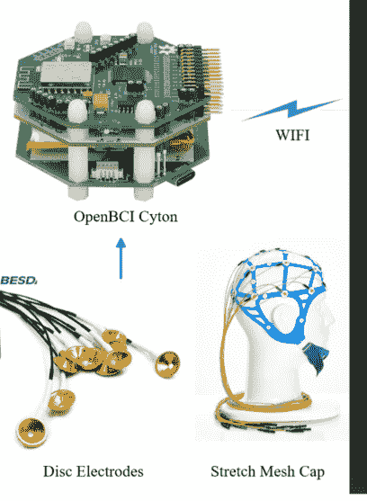
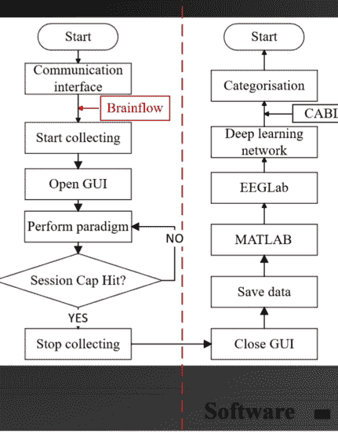
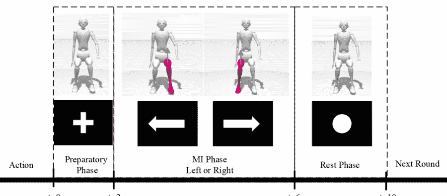
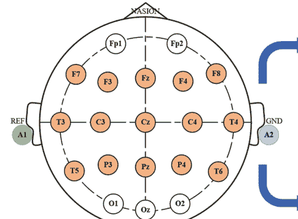
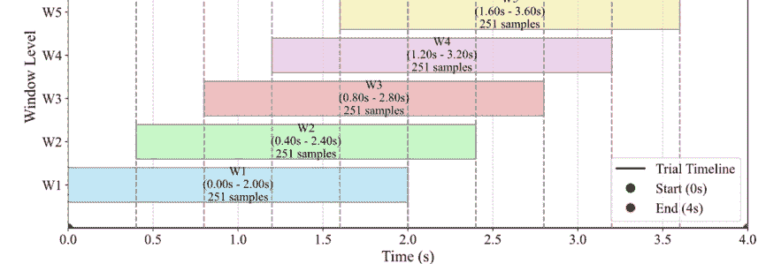

# 桥接思维与肢体：一种基于低成本 EEG 下肢运动想象分类的新型混合深度学习方法

Zhengdi Sun, Anle Mu*, Ye Qian, Xudong Sun

中国西安科技大学 医疗与精密工程学院

# 摘要

本研究旨在开发一种高成本效益的脑机接口（BCI）系统，专门用于检测中风康复期间的下肢想象信号。现有的 BCI 系统通常面临成本高且易受环境干扰的问题。为了解决这些问题，我们的系统构建在改进的带有无线通信的 `OpenBCI` 平台上，具有信号处理算法和设计。我们使用 16 通道从健康受试者处收集了脑电图（EEG）数据。我们开发了一种新型混合深度学习方法进行特征提取和分类，该方法结合了卷积神经网络（`CNN`）、双向长记忆网络（`LSTM`）、粒子群优化（`PSO`）和注意力机制。该系统在测试数据集上达到了 72.4% (±3.6%) 的准确率，其中 `CNN-LSTM` 模型比基准方法提升了 4.1%。这些结果与现有文献相当，尽管样本量较小，但展示了良好的潜力。未来的工作将重点于扩大样本量和长期临床验证，以解决目前的局限性并进一步提高系统在实际应用中的功效。

关键词：

- 下肢想象分类
- 中风康复 BCI
- EEG 信号处理
- 带注意力机制的深度学习
- 低成本 OpenBCI 平台

# 1. 引言

脑机接口（BCI）技术通过允许活动直接控制外部设备改变了人机交互。这在康复中特别有用，因为 BCI 可以调节运动活动——特别是通过对下降通道的抑制控制——有助于促进运动恢复 [2–4]。大脑与运动系统的整合以提高神经塑性是机器人学和神经科学领域的一个重点。BCI 系统可以通过脑电图（EEG）等非侵入性方法捕捉活动，提供较高的信噪比，但存在显著的风险和误差。功能磁共振成像（fMRI）、近红外光谱（NIRS）、磁脑图（MEG）和脑电图（EEG）等非侵入性技术提供了更安全的替代方案，但由于电极与大脑活动源之间的距离，通常信号质量较低 [6]。

EEG 因其便携性、廉价和高可靠性被广泛应用于 BCI。运动想象（MI）是基于 EEG 的 BCI 研究中广泛使用的范式，特别是通过 8–12 Hz 频段（mu 节律）中的诱发相关电位（ERP）检测运动，以及事件相关的去同步和同步（ERS）进一步协助解码运动意图。然而，EEG 信号经常受到心电图（ECG）和肌电图（EMG）等伪迹的影响，使得活动分析和特征提取对 BCI 性能面临挑战 [10–13]。各种方法，如独立成分分析（ICA）和小波变换，常用于处理复杂的伪迹。相似特征提取技术，如功率谱密度（PSD）和共同空间模式在不同的运动信号中表现良好 [14–16]。深度学习的最新进展在改进 EEG 信号处理方面显示前景。卷积神经网络（CNN）和长短期记忆网络（LSTM）在特征提取和分类方面展现了强大的性能。


然而，独立的 CNN 可能无法处理时间序列数据，而 LSTM 网络在处理高维数据时可能要求严苛。因此，结合 CNN 和 LSTM 的混合深度学习模型提供了一种极具前景的方法，利用了两种网络的优势。应用中使用的多数商业 EEG 设备价格昂贵，限制了它们在家庭使用的可用性。OpenBCI 是一个开源 EEG 平台，提供了一种成本效益且便携的解决方案，使研究人员更易获取资源并实现民主化 [22–24]。

# 2. 材料与方法

## 2.1. 硬件与软件

### 2.1.1. OpenBCI

`OpenBCI` 系统支持 16 通道，允许在运动皮层上放置 16 个电极。

Z. Sun 等人

## 2.2. 框架





图 1. BCI 系统的整体框架。



耳垂，实验分别是在配备了 i7-V1800 处理器、NVIDIA GTX3090 GPU 和 16 GB RAM 的系统上使用 `MATLAB` 进行的。募健康受试者进行 EEG 采集，由于他们在中风康复方面的经验，实验重点关注运动想象。

使用 `MATLAB R2021b` 中的 `EEGLAB` (v20.2) 通过 `ICA`（独立成分分析）将 EEG 信号分解为独立成分，以便对 EEG 数据进行识别和去除。为了提高效率，原始 EEG 信号被下采样至 25 Hz。应用 1 Hz 高通滤波器和 40 Hz 低通滤波器以消除无关的频率成分，例如典型运动想象频带（8–30 Hz）之外的低频和高频噪声。对于伪影去除，使用了基于独立成分分析（ICA）的 `EEGLAB` 插件 `Artifact Removal Toolbox`（伪影去除工具箱）。该工具箱通过 EEG 信号分解为独立成分，用于识别和去除 EEG 眼动运动、伪影和其他来源 [31]。用户手动或自动识别伪影成分，以确保剩余信号能够揭示与运动想象相关的底层脑活动。

该研究包含来自十名参与者的 EEG 记录，他们执行了 150 次运动想象任务。每次试验包含 15 个 通道的 501 个时间点（包括参考电极和接地电极）。为了训练和评估所提模型，数据集按 7:3 进行划分。对于每位参与者，分配了 105 次试验（70%）用于训练，45 次试验用于测试。这种划分是针对每个受试者单独进行的，以确保模型在不同受试者的数据上进行训练和测试。

图 2. 运动想象的 EEG 范式。



图 3. 电极分布位置和实验配置。Fz（中央额叶）、F3（左额叶）、F4（右额叶）、F7（左后额叶）、F8（右后额叶）、Cz（中央顶叶）、C3（左顶叶）、C4（右顶叶）、T3（左颞）、T4（右颞）、Pz（后顶叶）、P3（左后颞）、T5（左后颞）和 T6（右后颞）。

## 2.3. 数据增强



图 4. 数据扩展的时间线图。

## 2.4. 数据扩展

EEG 采集是一项耗时的任务，从初始准备到数据收集。长时间的监测任务还可能导致疲劳。在本研究的 EEG 数据中，实验生成了 150 组训练数据。深度学习技术通常需要大型数据集，由于在 EEG 研究中招募足够数量受试者的成本高且困难，其规模受到限制。因此，本研究中的可用数据相对较少。

为了解决 EEG 数据集固有的尺寸限制，我们采用了保留时间依赖性的重叠窗口分段方法。每次试验持续 4 秒，采样频率为 125 Hz，产生 501 个样本（额外的一个通过包含起始点获得）。为了增强数据集，使用了步长为 2 秒、样本大小为 50 个样本的滑动窗口。因此，每个 4 秒的试验被分成了 6 个重叠段，计算公式为：`N = \frac{501}{50} + 1 = 6`。尽管如此，每个段保留与原始数据相同的标签，数据扩展的时间线图如图 4 所示。所得的折增加了训练样本的数量（数据集尺寸放大），而没有引入人工特征或改变光谱特性，这了数据完整性原则。

## 2.5. 数学方法

### 2.5.1. 卷积神经网络

卷积神经网络（CNNs）由于其在人工神经网络中捕捉和学习相似模式的能力，已成为 EEG 信号分析的强大工具，它们是广泛用于视觉图像分析的深度学习模型 [32]。EEG 多通道、连续性和空间性质使得 CNN 特别适用于从此类数据类型中提取相关特征。典型的 CNN 由五层组成：(1) 输入、(2) 卷积、(3) 激活、(4) 池化和 (5) 全连接。一个完整的 CNN 结构包含这些层的多个数据块，末尾有一个分类器：

`f(X) = \sigma(W_i \otimes X + b_i)`

在这里，`X` 代表第 `i` 个卷积层，`W_i` 表示卷积核（权重），`b_i` 是偏置。算子 `\otimes` 表示卷积操作，通过在输入上滑动卷积核并执行逐元素乘法和求和来计算特征图。对于每个卷积层：

- 输入 `X` 与卷积核 `W_i` 卷积。
- 将偏置 `b_i` 加到卷积中。
- 结果随后通过激活函数（例如 `ReLU`）和池化层以降低维度并保持重要特征。

### 2.5.2. 长短期记忆

由于其捕捉时间序列中长期依赖的能力，长短期记忆（LSTM）网络对 EEG 处理至关重要。这对于监测任务中的时间模式特别重要。LSTM 使用三个门：遗忘门、输入门和输出门来控制信息流，遗忘门控制上一步的信息是保留还是丢弃：

`f_t = \sigma(W_f \cdot [h_{t-1}, X_t] + b_f)`

其中，`f_t` 是 `t` 刻的遗忘门激活，`X_t` 是输入，`h_{t-1}` 是上一步的隐藏状态，`W_f` 是与遗忘门的权重，`b_f` 是偏置，`\sigma` 表示将值映射到 [0,1]。

输入门控制长期记忆中更新哪些新信息：

`i_t = \sigma(W_i \cdot [h_{t-1}, X_t] + b_i)`，`\tilde{C}_t = \tanh(W_c \cdot [h_{t-1}, X_t] + b_c)`

其中，`i_t` 是输入门激活，`\tilde{C}_t` 是候选细胞状态，`W_i` 和 `W_c` 分别是输入门和细胞的权重，`b_i` 和 `b_c` 是对应的偏置，`\tanh` 是双曲正函数。

细胞状态 `C_t` 通过结合上一步细胞状态和新细胞状态进行更新：

`C_t = f_t \odot C_{t-1} + i_t \odot \tilde{C}_t` (5)

其中 `\odot` 表示逐元素相乘，`C_{t-1}` 是细胞状态。

最后，输出门通过将更新的细胞状态通过非线性变换控制当前隐藏状态 `h_t`：

`o_t = \sigma(W_o \cdot [h_{t-1}, X_t] + b_o), h_t = o_t \odot \tanh(C_t)` (7)

与仅考虑过去的 LSTM 模型不同，LSTM 的双向结构能够对过去和未来信息进行建模。这对于医学成像（MI）任务特别有利，例如跨越多个尺度的 EEG 非平稳信号。双向结构改进了网络捕捉长期时间相关性和相位偏移的能力，导致更准确的特征表示。

图 5 展示了 LSTM 架构和内部机制。在这里，LSTM 在跨多个时间步（t-1, t, t+1）上以“展开”格式显示，包括正向和反向。每个块代表一个 LSTM 单元，详细说明遗忘门 (`f_t`)、输出门 (`o_t`)、细胞门 (`c_t`) 和隐藏状态 (`h_t`)。

### 2.5.3. 粒子群优化

CNN 网络可以有效地从 EEG 中提取空间特征，但 LSTM 卷积核影响其性能。粒子群优化（PSO）算法可以通过粒子间的竞争与合作来优化参数数量 [5]。在 PSO 中，解候选被称为“粒子”，它们具有位置和速度。`D` 维空间中第 `i` 个粒子的位置和速度表示为：

`v_i^{d+1} = v_i^d + c_1 r_1 (p_i^d - x_i^d) + c_2 r_2 (g^d - x_i^d)` (8)

`x_i^{d+1} = x_i^d + v_i^{d+1}`

通过在我们的架构中应用 PSO 优化算法，我们优化了卷积层数和卷积核大小。具体而言，我们将卷积核的数量设置在 12 到 16 之间，卷积核大小设置为 10 × 10 和 15 × 15。这种优化通过为分类任务找到这些超参数的最有效组合，显著提升了网络的整体性能。

```
算法 1 PSO
1: 遍历每个粒子 i
2: 遍历每个维度
3: 在允许范围内初始化 x_i
4: 在允许范围内更新速度 v_i
5: 结束循环
6: 结束循环
7: 迭代次数 = 1
8: 遍历每个粒子 i
9: 计算适应度
10: 如果适应度优于 g_best
11: 将当前适应度设为 g_best
12: 结束循环
13: 结束循环
14: 为粒子选择最优值 g_best
15: 更新粒子的 v_i'
16: 更新粒子的 x_i'
17: 当未达到迭代次数或最小误差时
18: 结束循环
```


图 5. 双向长短期记忆 (Bi-LSTM) 网络结构。


图 6. 挤压与注意力机制 (Squeeze-and-Attention mechanism)。

| X | H × W × C |
|---|---|
| 全局池化 | 1 × 1 × C |
| 全连接层 (FC) | 1 × 1 × C |
| ReLU | 1 × 1 × C |
| 全连接层 (FC) | 1 × 1 × C |
| Sigmoid | 1 × 1 × C |

配置如图 7 所示，其详细超参数见表 1。

### 2.5.4 注意力提取

在深度学习中，通过挤压与注意力机制动态增强各种空间位置或通道的重要性，使其能够聚焦于当前任务最相关的特征。在我们的模型中，我们将注意力机制集成到 CNN 网络中，添加了注意力层。注意力机制并非使用所有通道，而是根据它们对我们任务的贡献来学习其重要性。这种数据驱动的方法使模型能够在不依赖先验假设的情况下学习重要特征。其详细架构如图 6 所示。

- 第一层 1D 卷积层 (`Conv1d`) 应用 16 个 10 × 10 尺寸的过滤器来捕捉空间模式。
- 第 2 层卷积层 (`Conv2d`) 使用 15 × 15 卷积核精炼提取的特征。
- 这些层之后是批归一化 (`BN`) 和 `ReLU` 激活函数，以确保梯度的稳定并改进特征表示。
- 随后对特征图应用池化层，在保留空间信息的同时降低计算复杂度。

### 2.5.5. SE 融合网络

本研究提出了一种融合了 CNN、挤压与注意力 (SE) 机制以及双向长短期记忆 (Bi-LSTM) 网络的融合网络，以有效捕捉 EEG 信号的空间和时间特征。网络架构遵循 CNN。

#### B. SE 注意力：自适应特征提取

注意力机制增强了模型关注信息丰富通道的能力。它通过以下策略动态校准特征重要性：

- 1. 全局平均池化 (GAP)：将特征图映射到 1 × 1 × C 图，这编码了信号的全局分布。


表 1：混合深度学习网络参数。

| 图层 | 过滤器 | 尺寸 | 激活函数 |
|---|---|---|---|
| CNN | 输入 | (251,251) | |
| Conv_1 | 16 | (10,10) | ReLU |
| Conv_2 | 12 | (10,1) | ReLU |
| SE | Maxpool | (15,15) | ReLU |
| FC_1 | 3 | | |
| FC_2 | 12 | | Sigmoid |
| Bi-LSTM | Flatten | 13,080 | |
| FC_3 | 16 | | |
| SoftMax 输出 | 2 | | |

- Sigmoid 激活函数将学习到的注意力权重归一化到 [0,1] 范围内，强调特定通道。
- 将这些权重与原始特征图进行逐元素相乘，选择性地增强重要通道，同时抑制不相关的的通道。

通过这一过程，SE 机制动态调整不同通道的重要性，确保包含噪声的通道被优先考虑。这种加权改进了有效区分图像模式的能力。

- Bi-LSTM 组件：时间依赖建模。来自 SE 模块的加权特征图随后由 Bi-LSTM 网络处理，该网络捕捉 EEG 信号中正向和反向的时间依赖。
- Bi-LSTM 层包含 16 个隐藏单元，使其能够有效地编码跨时间的长程依赖。
- 全连接 (FC) 层将特征维度从 C 减少到 C/r（其中 r 是压缩比例，设置为 3），确保了紧凑的特征表示。
- 第二个 FC 层将特征维度恢复到 C，保持与原始特征的一致。
- 带有 tanh 激活的全连接层整合了双向信息，使网络能够构建更全面的表示。

## 2.6. 降维与恢复

# 3. 通道加权

## D. 优化与训练。


为了优化算法，使用了粒子群优化 (PSO) 算法来确定卷积核的最佳数量。使用自适应动量估计 (ADAM) 优化器进行训练，初始学习率设置为 0.01。为了评估模型，我们采用了三种指标：准确率、Kappa 值和灵敏度。这种优化通过找到分类任务的最有效超参数组合，显著提升了整体网络性能。通过网格搜索进行参数优化，在 300 个迭代后平衡收敛速度和准确性。

## 3. 结果

### 3.1. 分类性能

## 表 2

各算法的准确性对比。

| 受试者 | CSP + SVM | EEGNet | Kovnet | CNN | CNN-LSTM | 提议方法 | | | |
| :--- | :--- | :--- | :--- | :--- | :--- | :--- | :--- | :--- |
| 0 | 0.58 | 0.157 | 0.34 | 0.71 | 0.42 | 0.263 | 0.73 | 0.526 |
| 1 | 0.455 | -0.019 | 0.163 | 0.46 | 0.012 | 0.252 | 0.675 | 0.638 |
| 2 | 0.532 | 0.068 | 0.623 | 0.751 | 0.492 | 0.152 | 0.718 | 0.737 |
| 3 | 0.484 | -0.036 | 0.629 | 0.722 | 0.218 | 0.619 | 0.685 | 0.743 | 0.412 |
| 4 | 0.526 | 0.064 | 0.778 | 0.628 | 0.541 | 0.551 | 0.623 | 0.668 | 0.758 |
| 5 | 0.591 | 0.016 | 0.684 | 0.232 | 0.709 | 0.451 | 0.651 | 0.675 | 0.721 |
| 6 | 0.548 | 0.147 | 0.602 | 0.378 | 0.513 | 0.227 | 0.642 | 0.652 | 0.722 | 0.432 |
| 7 | 0.545 | 0.106 | 0.718 | 0.242 | 0.377 | 0.553 | 0.648 | 0.246 | 0.708 | 0.471 |
| 8 | 0.558 | 0.056 | 0.621 | 0.269 | 0.333 | 0.648 | 0.706 | 0.397 | 0.416 |
| 平均值 | 0.538 | 0.095 | 0.627 | 0.261 | 0.305 | 0.296 | 0.638 | 0.741 | 0.436 |

## 表 3

各算法的灵敏度对比。

| 受试者 | CSP + SVM | EEGNet | Kovnet | CNN | CNN-LSTM | |
| :--- | :--- | :--- | :--- | :--- | :--- | :--- |
| 0 | 0.622 | 0.668 | 0.691 | 0.573 | 0.674 | |
| 1 | 0.622 | 0.601 | 0.559 | 0.667 | 0.689 | |
| 2 | 0.553 | 0.669 | 0.603 | 0.653 | - | |
| 3 | 0.514 | 0.617 | 0.566 | 0.672 | 0.695 | |
| 4 | 0.544 | 0.619 | 0.560 | 0.671 | 0.691 | |
| 5 | 0.538 | 0.623 | 0.563 | 0.673 | 0.698 | |
| 6 | 0.553 | 0.629 | 0.568 | 0.676 | 0.701 | |
| 7 | 0.551 | 0.628 | 0.564 | 0.674 | 0.696 | |
| 8 | 0.545 | 0.621 | 0.562 | 0.661 | 0.692 | |
| 10 | 0.538 | 0.611 | 0.618 | 0.561 | 0.669 | |
| 平均值 | 0.549 | 0.614 | 0.623 | 0.569 | 0.675 | |

### 3.3. 混淆矩阵分析

图 9 展示了适用于受试者的分类混淆矩阵。该矩阵说明了左右想象任务的分类性能，其中对角线元素代表真实分类正确（真阳性），非对角线元素表示分类错误。在所有方法中，精度最高的方法识别出 71% 的左侧试验和 74% 的右侧试验。相比之下，如 CSP + SVM 等传统方法在左侧试验中的准确率为 56%，右侧试验为 53%，在特征提取方面存在巨大差异。CNN 以 64% 和 67% 的准确率显著提升了这一性能。KNN 和 CNN-LSTM 表现出中等的分类准确率，左侧试验占比 58%，右侧试验占比 62%。 图 9. 混淆矩阵

### 3.4. 频谱与拓扑分析

功率谱密度（PSD）分析是对 EEG 信号进行的。PSD 分析关注了 C3 和 C4 电极的 mu 波（8-12 Hz）和 beta 波（13-30 Hz）频段。PSD 展示了每个受试者的拓扑图。左侧想象导致右侧皮层出现瞬态 ERD；右侧想象导致左侧皮层出现更明显的反应。

### 4. 讨论

EEG 信号的分类具有挑战性，受生理差异、想象差异、心理状态以及设备限制的影响。为了应对这些挑战，提议的方法使用了传统的分类方法，增强了其在不同受试者之间的鲁棒性。1 Hz 高通滤波器和 40 Hz 低通滤波器在消除基线漂移方面起了至关作用，在保留神经活动的同时减少了由眼动运动和肌肉伪影引起的干扰。这种过滤策略有助于维持运动震荡，特别是在 mu（8-12 Hz）和 beta（13-30 Hz）频段，这些频段已知对运动想象至关重要 [4]。通过优化信号质量，这些处理步骤改善了-

### 3.5. 事件相关去同步（ERD）分析

事件相关去同步（ERD）在左右运动想象期间均被观察到。图 11 显示了 C3 和 C4 电极处的 ERD 现象。左侧想象导致右侧区域出现 ERD；右侧想象导致左侧区域出现功率下降。

尽管收集了所有 15 个电极的数据，但我们专门展示了 C3 和 C4 电极的数据，因为这些通道被广泛认为是检测运动活动的关键。值得注意的是，多项研究已证明肢体想象可以在 C3 和 C4 产生 ERD 模式，反映了对侧控制。

混淆矩阵的分析证实，提议的方法显著优于 CSP 等传统技术。传统方法（如 CSP-SVM）难以捕捉复杂的时间空间维度。随时间变化的分类准确率。

## 6 结论

本研究提出了一种用于检测下肢运动想象的新型脑机接口（BCI）系统，在康复领域具有应用潜力。通过使用 OpenBCI 和深度学习框架，该系统确保了硬件能力和 EEG 信号处理能力。所提方法通过利用 CNN 进行空间提取、Bi-LSTM 进行时间识别以及利用注意力机制进行特征融合，捕捉了运动想象分类中的关键特征。

研究证明了使用消费级 EEG 设备进行运动想象的可行性，在成本和性能之间取得了良好的平衡。高准确性进一步验证了该系统在临床应用中（特别是中风患者）的需求，并对其针对现实生活康复进行了优化。未来的研究应侧重于将所提方法与机器人集成，并完善其对个性化康复的适应性。

# 贡献声明

Zhengdi Sun: 初稿撰写；Ale Mu: 概念化；Y. Jiang: 方法论；Xudong Sun: 调查。

# 资助

作者在本论文的研究、分析和/或出版方面接受了以下资金支持：工作由某理工大学博士创新基金支持（编号：102-25027202）。

# 利益冲突

作者声明，他们没有可能影响本文所报告工作的竞争利益或个人关系。

# 数据可用性

所使用的数据已被认为可用。

# 参考文献

[1] H.B. Bohlein, D. Raj, J. Chen, K. Xu, L. Li, Z. Zhou, Motor imagery features and outcomes for neural rehabilitation. J. Phys. 575 (2007) 637–642. https://doi.org/10.1016/j.jphys.2006.09.012

[2] F. Li, D. Zhang, J. Chen, K. Xu, L. Hou, Motor imagery features and outcomes in stroke rehabilitation: visualization analysis. Fron Neur. 17 (2023) 938. https://doi.org/10.3389/fronneur.2023.1154332

[3] C.C. Dadda, V.A. Naz, V. Vachrakov, F. Role of the Contralateral Lesion in Ipsilateral Hemorrhagic Stroke. Hum Res. 11 (2007) 189–201. https://doi.org/10.1007/s0046-006-011-y

[4] A. Mcabria, M. Y. Sun, U. Chandary, J. del, R. Miller, S. Cox, A. Gugelsberger, P. Valance, EEG-based neurofeedback for upper limb motor imagery rehabilitation in chronic stroke: Stroke 48 (2021) e662–e670. https://doi.org/10.1161/STROKE0000000000003933

[5] M. Wang, H. Hu, G. Wang, L. Zhang, J. Gao, Automatic sleep stage mapping of EEG signal based on fusion learning and neural network. Front Comput Neurosci 15 (2021) 693500. https://doi.org/10.3389/fcompneu.2021.693500

[6] B. Cuscasi, A. Centagnelli, G. Gu, The origin of cortical features and classification of motor imagery. Neuroimage. 122 (2012) 417–420. https://doi.org/10.1016/j.neuroimage.2012.03.018

[7] A. R. Holmes, V.A. McNaughton, and N. Pearson, Prediction of functional connectivity surfaces and their applications for rehabilitation, and control of human brain patients. Phys. Rep. 918 (2021) 1–123. https://doi.org/10.1016/j.re.2021.03.011

[8] A. M. Roy, Adaptive transfer learning-based multiple feature fusion decoding for EEG classification in brain-computer interface. Eng. Art. Med. Inf. Art 116 (2022) 105347. https://doi.org/10.1016/j.ejami.2022.105347

[9] P. Ochsler, F.R. Lopes da Silva, Event-related EEG synchronization and desynchronization: basic principles. Clin Neurosci. 110 (1999) 1842–1857. https://doi.org/10.1097/01.300016

[10] W. Wu, S. Rahid, Y. Feng, Classification of associated events with the EEG-related motor imagery. Signal Process Comput. 62 (2021) 10271. https://doi.org/10.1016/j.sigpro.2021.10271

[11] M. Klag, K. Grimm, Identifying key features for ICA-based decomposition of EEG data in motor imagery classification and experiments. Eur. J. Neuro. 22 (2005) 1033–1040. https://doi.org/10.1111/j.1460-9744

[12] N. Manban, F. Ebrahim, Hamnous, T. Tang, Automated Component Analysis for Motor Imagery Classification. IEEE Access 9 (2021) 7762–7763. https://doi.org/10.1109/ACCESS.2021.311285

[13] S. El-Ghazawi, J. Jimenez, M. Perez-Vicente, E., Optimization of Real-Time EEG-Related Feature Removal for Human-Robot Interactions. Front. Comput. 56 (2019) 100233. https://doi.org/10.1016/j.futurec.2019.100233

[14] H. Cizmas, C. Rocaj, D. Zhang, Channel selection and feature extraction for EEG-based motor imagery using deep learning. Soft Computing. 44 (2021) 10734. https://doi.org/10.1016/j.soft.2020.10734

[15] L. Sun, Y. Zhang, J. Liu, Deep learning for motor imagery design: Using Transformer and New Algorithms. Front. Robotics 58 (2021) 68501. https://doi.org/10.3389/s12871-021-0394

[16] Y. Roy, H. Horvath, F. Ganguly, Deep learning for brain-computer interfaces: A review. J. Neural Eng. 16 (2019) 02601. https://doi.org/10.1088/1741-2535/aa66d

[17] J. Elgash, P. Rafahi, C. Mougli, End-to-end CNN networks for motor imagery. EEG Interfaces 18 (2016) 641–650. https://doi.org/10.1016/j.eprebi.2016.03002

[18] Y. Kim, S. Kim, J. Park, Deep Learning Network with Bi-LSTM. Med. Biol. 124 (2020) 104192. https://doi.org/10.1016/j.mbio.2020.104192

[19] G. Peng, Y. Wang, J. Zhang, Deep Convolutional Network and LSTM for EEG-Based Brain-Computer Interface. Front. Bios. Eng. 108 (2021) 107733. https://doi.org/10.1016/j.bpe.2021.10733

[20] K. Woller, M. Müller, CNN-LSTM deep learning reconstruction for motor imagery classification using electroencephalography. Int. Neurosci. 333 (2021) 131–144. https://doi.org/10.1007/s00423-021-1935-z

[21] P. Petersen, G. Hamander, R. Spies, Feasibility of using a low-cost consumer-grade EEG device for motor imagery classification. Sensors 16 (2016) 6120. https://doi.org/10.3390/s16060120

[22] A. Gasy, A. Mishra, M. Gao, J. Zhang, Robotic control algorithms for assistance and rehabilitation in stroke patients. J. Neuro-Rehab. 16 (2019) 1–13. https://doi.org/10.1186/s12982-019-040-x

[23] S. Pattissio, R. Say, Sinusoidal-induced band gamma oscillations in the brain using consumer-grade low-cost imagery, Plos One 18 (2023) e280018. doi:10.1371/journal.pone.028018


## 参考文献

[24] H. Li, M. Zheng, J. Zhang, C. Liu, Motor imagery classification based on EEG convolutional neural network with attention mechanism. IEEE Access. 10 (2022) 103432.

[25] J. Zhang, Y. Wang, H. He, Deep Learning for Motor Imagery using Brain-Computer Interface. Med. Biol. 145 (2022) 105558. https://doi.org/10.1016/j.mbio.2022.105558

[26] D. Wang, S. Kim, J. Lee, A review of deep learning for motor imagery classification. Front. Comput. Neurosci 5 (2021) 663000. https://doi.org/10.3389/fcompnu.2021.663000

[27] D. Wolker, K. M. Hammar, Optimization for 1D-CNN-Neat Neural Network.. 95 (2022) 3724. https://doi.org/10.1007/s10403-022-2193

[28] D. Wolker, K. M. Hammar, Optimization for 1D-CNN-Neat Neural Network.. 95 (2022) 3724. https://doi.org/10.1007/s10403-022-2193

[29] A. Delborne, S. Maekki, E., EEGLAR: an open system for single-channel EEG data. EEG Interfaces 14 (2019) 1033–1040. https://doi.org/10.1111/j.1460-9744

[30] B. Manban, F. Ebrahim, Hamnous, etc., Deep learning for image-based land cover in remote sensing. J. Photogramm. Remote Sens. Eng. 168 (2022).

[31] K. R. Biff, S. Sivak, J. Schluler, Search for Space Odyssey IEEE Trans. Neural. Syst. 28 (2017) 2775.

[36] V.J. Lawrence, T. Springberg, L.D.J. Fehner, M. Glasner, K. Eggermont, EEGNet: a compact convolutional neural network for brain-computer interfaces. J. Neural Eng. 15 (2018) 05601, https://doi.org/10.1088/1741-2552/aa995

[37] R.T. Schmitter, T. Springberg, L.D.J. Fehner, M. Glasner, M. Tomitsch, Deep learning with convolutional neural networks for EEG decoding and visualization. Hum. Brain Map, 38 (2017) 5231–5240.

[38] M.J. Kim, S. Lee, J.K. Kim, A.A. Gardner, M. Shafahi, J. Choi, Classification of EEG using Independent Component Analysis with CSP interfaces. Sensors 22 (2022) 7596, https://doi.org/10.3390/s22237596

[39] J.J. Escobar, F Rodríguez, B. Prieto, A. Deagi Kimski, M.D. Ortiz, A distributed and energy-efficient SSN for EEG classification with dynamic money-saving policy in heterogeneous clusters, Clustering Signal Processing and Control 112 (2026) 2487–2514, https://doi.org/10.1007/s10967-023-01193-7

[40] B. Kim, S. Lee, M. Elarian, and M. Lee, EEG-based emotion recognition using CNN and LSTM classification, Front. Comput. Neurosci. 16 (2022) 101979, https://doi.org/10.3389/fncn.2022.101979

[41] A. Wang, J. Li, X. Zhang, and Y. Vas, Motor Injury-Related Changes of Neural Oscillation in Unilateral Lower Limb Amputation, Front. Neurosci. 16 (2022) 855232, https://doi.org/10.3389/fnins.2022.855232

[42] W. Ahmed Shahi, et al., Event-related changes in Oscillatory Activity within same Hemispheres in BCI: a review and meta-analysis, Frontiers in neuroinformatics 13 (2019) 78, https://doi.org/10.3389/fninf.2019.0021.5
