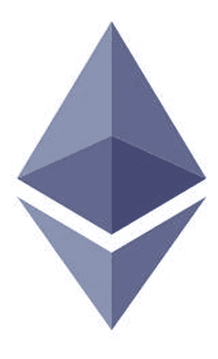
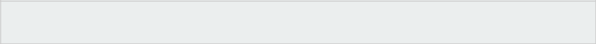
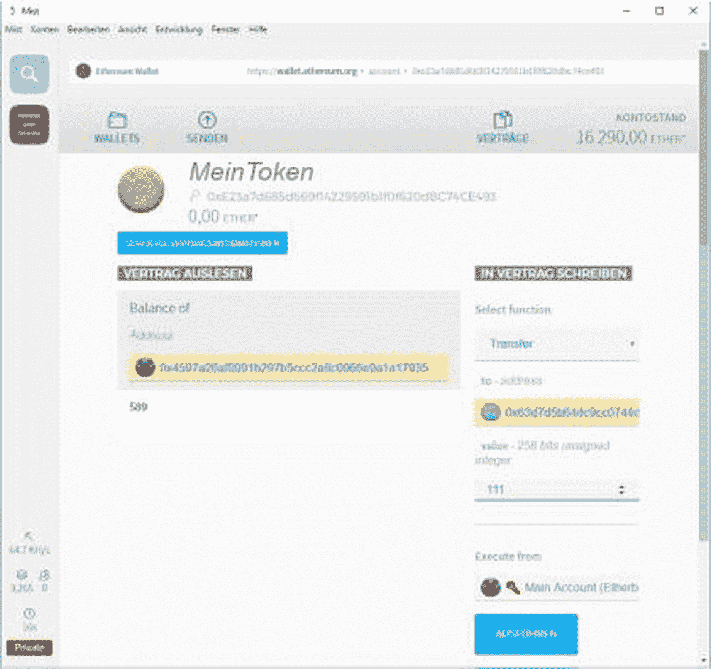
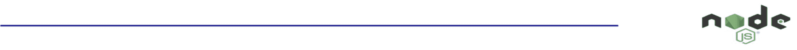
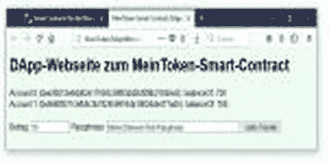
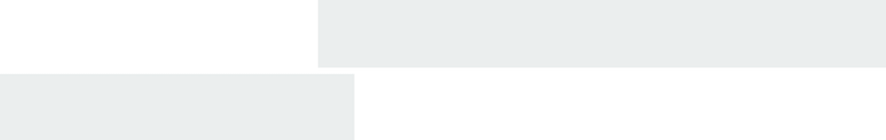
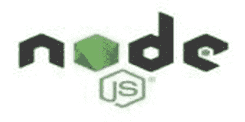
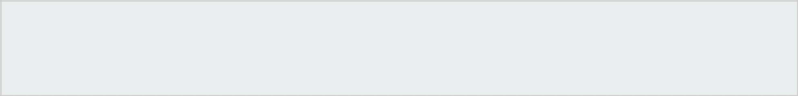

# 区块链构建指南：在你的电脑上制作属于自己的区块链和交易机器人


## 以太坊智能合约

| | | |
| --- | --- | --- |
| | **+** | [加密货币](https://www.torsten-horn.de/techdocs/Kryptowaehrungen.html) |
| | **+** | [技术文档](https://www.torsten-horn.de/techdocs/index.htm) | | | |

## 区块链

| | | 查找 | | | |
| --- | --- | --- | --- | --- |
| | | | | | |
| | | | | | |

[区块链](https://de.wikipedia.org/wiki/Blockchain)是指一个不断扩展的数据记录列表，这些记录通过加密过程相互链接，使得数据记录链是不可更改且防伪造的。新的交易经过验证并打包成区块，区块在通过共识算法并发送到所有其他区块链服务器后会被添加到区块链中。



[以太坊](https://www.ethereum.org/) 基于公有区块链，该区块链用于](https://www.ethereum.org/)许多以太坊服务器上的去中心化对等网络，并以](https://www.ethereum.org/) `DLT` 的方式运行。以太坊](https://www.torsten-horn.de/techdocs/Kryptowaehrungen.html#DLT)包含了加密货币`Ether` 并且](https://www.ethereum.org/)还支持“智能合约”。这使得合约](https://www.torsten-horn.de/techdocs/Kryptowaehrungen.html#Kryptowaehrung)可以被编程，然后进行电子化的执行和检查。](https://www.torsten-horn.de/techdocs/Kryptowaehrungen.html#Ethereum-Ether-ETH-ETC)为了这一目的，创建了脚本（主要使用编程语言 `Solidity`）并在以太坊虚拟机（`EVM`）中执行。


这开启了非常多样的可能性，例如许多项目是基于 `ICOs` 的。](https://www.torsten-horn.de/techdocs/Kryptowaehrungen.html#ICO)然而，在编写智能合约时必须格外小心：那些被编程的](Images/rId28_edit_140086947773200.png)安全漏洞可能会导致致命后果，例如“DAO 被黑客攻击”，](https://www.wired.de/collection/wie-aus-dem-hack-blockchain-fonds-ein-wirtschaftrimi-wurde)这导致了以太坊的硬叉——以太坊经典（Ethereum Classic）。


基础解释可以在此处找到：[加密货币](https://www.torsten-horn.de/techdocs/Kryptowaehrungen.html)、`Bitcoin`、以太坊、区块链](https://www.torsten-horn.de/techdocs/Kryptowaehrungen.html)。下面展示了几个智能合约的简单编程示例。

Images/rId32_edit_14008694777328.png)

1. 基础安装：`Geth`、`Solc`、私有测试以太坊`blockchain](https://www.torsten-horn.de/techdocs/Ethereum-Smart-Contracts.html#Installation-Geth-Solc-Test-Blockchain)](https://www.torsten-horn.de/techdocs/Ethereum-Smart-Contracts.html#Installation-Geth-Solc-Test-Blockchain)


2. 第一个智能合约：hello world demo](https://www.torsten-horn.de/techdocs/Ethereum-Smart-Contracts.html#Hallo-Welt-Demo)


3. 微型代币智能合约：MeinToken demo](https://www.torsten-horn.de/techdocs/Ethereum-Smart-Contracts.html#MeinToken-demo)


4. 使用图形界面（`GUI`）的 Remix 编译器](https://www.torsten-horn.de/techdocs/Ethereum-Smart-Contracts.html#Remix-IDE) 5.--------------. ](https://www.torsten-horn.de/techdocs/Ethereum-Smart-Contracts.html#Remix-Compiler)


5. 使用 GUI 进行 `MeinToken`](https://www.torsten-horn.de/techdocs/Ethereum-Smart-Contracts.html#MeinToken)


6. 基于 `Node.js` 的 DApp 网页-](https://www.torsten-horn.de/techdocs/Ethereum-Smart-Contracts.html#Node.js-App)


7. 使用 `Web3` 进行 `Ether`](https://www.torsten-horn.de/techdocs/Ethereum-Smart-Contracts.html#Ether)


8. 使用 `Web3` 你自己的智能合约代币](https://www.torsten-horn.de/techdocs/Ethereum-Smart-Contracts.html#Web3)


9. 使用 `Java` 的 DApp 网页-](https://www.torsten-horn.de/techdocs/Ethereum-Smart-Contracts.html#Java-App)


10. 公有 `Rinkeby` 区块链](https://www.torsten-horn.de/techdocs/Ethereum-Smart-Contracts.html#Rinkeby-Blockchain)


11. 在公有 `Rinkeby` 区块链上部署智能合约-](https://www.torsten-horn.de/techdocs/Ethereum-Smart-Contracts.html#Smart-Contract-Rinkeby)


12. 在 `Rinkeby` 区块链上的 DApp 网页-](https://www.torsten-horn.de/techdocs/Ethereum-Smart-Contracts.html#Rinkeby-DApp)


13. 使用 `Truffle` 进行快速开发-](https://www.torsten-horn.de/techdocs/Ethereum-Smart-Contracts.html#Truffle-Development)
14. 使用 `Embark` 进行快速开发和测试


15. 使用 `Oraclize` 服务获取外部信息

16. 分析区块和交易


17. JetBrains `IntelliJ IDEA` 的 `Solidity` 插件


18. 文档记录


以下文本侧重于简单性和良好的可读性。目前仅使用命令行工具。图形化工具将在稍后介绍。


在本示例中，将建立一个仅存在于个人电脑上的私有以太坊区块链。稍后将展示如何使用公共以太坊区块链。


显示的命令适用于 Windows 系统。当使用 Linux 或 Mac OS X 时，通常只需将路径规范中的 `\` 替换为 `/`，将 PATH 规范中的 `;` 替换为 `:`，并将占位符 `%MEINE_VARIABLE%` 替换为 `$MEINE_VARIABLE`。

按照下面列出的步骤操作。

### 1. 切换到你所在的工作目录（例如 `\MyWorkspace`）


进入你的 Workspace 并执行以下命令：

```bash
cd \MyWorkspace
```


```bash
mkdir EthereumDemo
```


```bash
cd EthereumDemo
```


```bash
mkdir solc
```


```bash
mkdir src
```


```bash
tree /F
```


### 2. 安装 solc (Solidity 编译器)

从 `https://github.com/ethereum/solidity/releases` 下载适用于你操作系统的安装文件，例如适用于 Windows 的：`solidity-windows.zip`。


在 Windows 下，将此 zip 文件解压到目录：
`\MyWorkspace\EthereumDemo\solc`。

对于其他操作系统，请以类比的方式操作或按照：[安装 Solidity 编译器](https://solidity.readthedocs.io/en/develop/installing-solidity.html) 中的描述进行。

1. 在命令行窗口执行：
```bash
cd \MyWorkspace\EthereumDemo\solc
solc.exe --version
solc.exe --help
```

两个命令都必须显示合理的结果。


### 4. 安装 geth (Go Ethereum)


从 `https://geth.ethereum.org/downloads/` 下载适用于你操作系统的 Geth 版本，例如适用于 Windows 的 "Geth 1.8.2 for Windows"。

不要使用 Geth 1.8.0 和 1.8.1 版本，因为会出现 [Web3j](https://github.com/web3j/web3j/issues/318) Issue 318 问题。对于 Windows，你将获得文件 `geth-windowsamd64-1.8.2-b8b9f7f4.exe`。运行此文件。安装会将 Geth 目录扩展 Windows PATH。


对于其他操作系统，请按照 `https://www.ethereum.org/cli` 或 `https://github.com/ethereum/ethereum/wiki/Building-Ethereum` 中的描述操作。


[构建以太坊](https://github.com/ethereum/ethereum/wiki/Building-Ethereum)

1. 打开一个新的命令行窗口以使配置和 PATH 扩展生效。在其中执行：
```bash
cd \MyWorkspace\EthereumDemo
geth version
geth help
```


两个命令都必须显示合理的结果。你可以在[命令行选项](https://github.com/ethereum/ethereum/wiki/Command-Line-Options) 下找到 `geth` 的选项列表。


### 6. 元区块

要启动自己的私有以太坊区块链，需要手动初始化元区块。在 `src` 子目录中创建文件：`genesis-block.json`。


```json
{
  "alloc": {},
  "coinbase": "0x0000000000000000000000000000000000000000",
  "config": {},
  "difficulty": "0x4000",
  "extraData": "0x4711",
  "gasLimit": "0xffffff",
  "mixhash": "0x00000000000000000000000000000000",
  "nonce": "0x0000000000000042",
  "parentHash": "0x00000000000000000000000000000000",
  "timestamp": "0x00"
}
```

保存时，确保文件以 Unix 换行符和无 BOM 的 ASCII 格式保存。你可以在[创建元区块](https://github.com/ethereum/ethereum/wiki/Private-network) 查看关于元区块的一些注意事项。


1. 通过运行以下命令创建元区块：
```bash
cd \MyWorkspace\EthereumDemo
geth -datadir "Private-Blockchain" init src/genesisblock.json
```


你会收到如下信息：


Successfully wrote genesis

### 8. 启动自己的以太坊区块链（目前不挖矿）：执行（一行）：

```bash
geth -networkid 77 --identity "MyDevChain" -datadir "Private-Blockchain" --nodiscover --rpc --rpcapi "db, net, web3, personal, txpool" --rpccors "*" console
```


你会收到如下信息：


Starting peer-to-peer node
HTTP endpoint opened: `http://127.0.0.1:8545`
欢迎来到 Geth JavaScript 控制台！你获得了 Geth-JavaScript-Console，你可以在其中输入 Geth-JavaScript 命令。

### 9. 分别查看 `web3.eth` 命令的文档：[web3.eth](https://web3js.readthedocs.io/en/1.0/web3-eth.html)。Web3 0.20.x JavaScript API。

查询你正在使用的 Web3.js 版本：
```javascript
web3.version.api
```


1. 测试账户是否已存在。如果 Ctrl + V 插入命令无效，请尝试右鼠标键点击“插入”并回车：
```javascript
web3.eth.accounts
```


你会得到空结果：


### 11. 创建账户

创建一个账户（想一个复杂的密码并记住它）：

```javascript
personal.newAccount("My Passphrase")
```


你会收到一个 40 位的十六进制作为账户地址，例如：
`0x2f94831a57a9604106d9d0c24583b12f80f2a5`

1. 再次测试现有账户：
```javascript
web3.eth.accounts
```


例如，这次你会得到：`["0x2f94831a57a9604106d9d0c24583b12f80f2a5"]`

### 13. 查询账户余额

在 `src` 子目录中创建 JavaScript 文件：`checkAllBalances.js`。


```javascript
function checkAllBalances () {
  web3.eth.getAccounts (function (err, accounts) {
    accounts.forEach (function (id) {
      web3.eth.getBalance (id, function (err, balance) {
        console.log ("" + id + ": \tbalance:" + web3.fromWei (balance, "ether") + "ether");
      });
    });
  });
}

checkAllBalances ()
```

1. 在 Geth JavaScript 控制台中运行：`loadScript ('src / checkAllBalances.js')`

你收到：


# 0x2f94831a57a96041064d9d0c24583b12f807f2a5:balance: 0 ether

### 15. 手动开始挖矿：

执行（不要过快地连续执行单个 JavaScript 命令）：

```
miner.setEtherbase (web3.eth.accounts [0])
miner.start (1)
```


你将看到持续输出的挖矿命令：


启动挖矿操作 Commit
成功密封新挖矿任务 Successfully sealed
挖掘新区块潜在区块 potential block
. ...

如果挖矿没有启动：有时挖矿可能在 10 分钟后才开始。
给挖矿一些时间，大约一分钟。之后你将在账户上发现 Ether。

### 16. 退出测试以太坊区块链：exit


### 17. 启动脚本：

在 EthereumDemo 项目目录中创建名为 `start-test-Ethereum-Blockchain.bat` 的批文件，内容如下（一行）：

```bash
geth --networkid 77 --identity "MeineDevChain"
```


*   `- datadir "Private-Blockchain" --nodiscover --rpc`
*   `- rpcapi "db, eth, net, web3, personal, txpool"`
*   `- rpccorsdomain "*" --mine --minerthreads 1 console 2 >> priv-geth.log`


注意，这次通过 `"--mine -- minerthreads 1"` 自动激活了挖矿，并且通过 `"2 >> priv-geth.log"` 将大量输出重定向到日志文件中。

### 18. 启动我们包含挖矿的测试以太坊区块链：执行：

```bash
cd \\ MeinWorkspace \\ EthereumDemo
start-test-Ethereum-Blockchain.bat
```

例如，你会得到：


欢迎来到 Geth JavaScript 控制台！
instance: Geth / MeineDevChain / v1.8.2-stable-b8b9f7f4 / windows-amd64 / go1.9 coinbase:
0x2f94831a57a96041064d9d0c24583b12f807f2a5
at block: 1448 (Mon, 22 Jan 2018 12:53:13 CET)
datadir: \\ MeinWorkspace \\ EthereumDemo
modules: admin: 1.0 debug: 1.0 eth: 1.0 miner: 1.0 net: 1.0 personal: 1.0 rpc: 1.0 txpool: 1.0 web3: 1.0

### 19. 在 Geth JavaScript 控制台中运行：

```javascript
loadScript ('src / checkBalances.js')
```


这次你将收到一个正数金额，例如：


0x2f94831a57a96041064d9d0c24583b12f807f2a5:balance: 4.711 ether

1. 执行进一步命令以互相了解，例如：

```javascript
admin.datadir()
```


```javascript
admin.nodeInfo()
```


### eth

```javascript
eth.getBlock ("latest")
```


```javascript
miner.getHashrate ()
```


```javascript
personal.listAccounts()
```


```javascript
txpool.content()
```


### web3

请查看管理命令的解释：https://github.com/ethereum/ethereum/wiki/Management-APIs.


### 21. 退出测试以太坊区块链


### 22. 检查密钥文件和测试以太坊区块链：执行：


这是密钥文件：https://www.torsten-horn.de/techdocs/


UTC - 2018-01-22T09:50-2f94831a57a96041064d9d0c24583b12f807f2a5

### 23. 我们的测试以太坊区块链结构现在如下（Windows 和 Linux 下）：


```text
\\ MeinWorkspace \ EthereumDemo
- start-test-Ethereum-Blockchain.bat
- priv-geth.log
- target
  - Greeter.abi
  - Greeter.bin
- src
  - checkBalances.js
  - Greeter.js
- genesis.json
```

### 第一个智能合约：hello world


遵循以下步骤：

1. [基础安装](https://www.torsten-horn.de/techdocs/Ethereum-Smart-Contracts.html#Installation-Geth-Solc-Test-Blockchain) 如下：Geth、Solc、测试以太坊区块链。上述步骤都已执行。


这个 demo 展示了：
-   一个简单的 Solidity 脚本可以像这样。
-   Solidity 脚本被编译。
-   智能合约被部署到以太坊区块链。

在这个 demo 中，仅使用了命令行工具。请在下方查看。


2. 切换到你的 EthereumDemo 目录：cd \\ MeinWorkspace \\ EthereumDemo


3. 在 src 子目录中创建 Greeter.sol：

```solidity
pragma solidity 0.49;

contract mortal {
    address owner;

    function Mortal() public {
        owner = msg.sender;
    }

    function kill () public {
        if (msg.sender == owner) {
            selfdestruct(owner);
        }
    }
}

contract Greeter {
    string greeting;

    function Greeter(string _greeting) public {
        greeting = _greeting;
    }

    function greet() public constant returns (string) {
        return greeting;
    }
}
```

4. 编译 Solidity 脚本：cd \\ MeinWorkspace \\ EthereumDemo

```bash
solc -o target --bin --abi --overwrite src / Greeter.sol
```


你 target


你将获得一个新的 "target" 目录，其中包含四个文件：


`var greeterFactory = eth.contract ( {Contents of the file target / Greeter.abi} )var greeterCompiled = "0x" + "{Content of the file target / Greeter.bin}" . . .`

这两个占位符表达式 `"{...}"` 必须被相应的文件内容替换。

在 Windows 下，在 `src` 目录创建以下三个文件，每个文件都不包含换行符：

`greeterJsTeil1.txt`


`var greeterFactory = eth.contract (**`

`greeterJsTeil2.txt`



`)`

`var greeterCompiled = "0x" + ""`

`greeterJsTeil3.txt`


`"`

`var \_greeting = "Hello world!"`

`var greeter = greeterFactory.new (\_greeting, {from: eth.accounts \[0\], data:greeterCompiled, gas: 47000000}, function (e, contract) {`

```
if (e) {
  console.log (e);
} else {
  if (! contract.address) {
    console.log ("Contract transaction send: TransactionHash:" + contract.transactionHash + "waiting to be mined ...");
  } else {
    console.log ("Contract mined! Address:" + contract.address);
    console.log (contract);
  }
}
})
```

然后执行：

`copy / B / Y src \\ greeterJsTeil1.txt + target \\ Greeter.abi + src \\ greeterJsTeil2.txt + target \\ Greeter.bin + src \\ greeterJsTeil3.txt src \\ GreeterDeploy.js`


`type src \\ GreeterDeploy.js`


6. 或者，你可以在 Remix Online Solidity Compiler（位于 [`remix.ethereum.org`](http://remix.ethereum.org/)）中使用上述 Solidity 源码，点击 "Start to compile" 和 "Details"，并将 "WEB3DEPLOY" 下的 JavaScript 代码复制到文件 "src \\ GreeterDeploy.js" 中。

7. 项目结构现在如下：


`[\\ MeinWorkspace \\ EthereumDemo\]`

*   `- priv-geth.log`
*   `- start-test-Ethereum-Blockchain.bat`
*   `| - [private blockchain]`
    *   `| - History`
    *   `| - [geth]`
        *   `||`
        *   `'- [keystore]`
        *   `'- UTC 2018-01-22T09-50-58 ...`
    *   `| - [solc]`
        *   `| - msvcp140.dll`
        *   `| - solc.exe`
        *   `'- test.exe`
    *   `| - [src]`
        *   `| - checkAll.js`
        *   `| - genesis-block.json`
        *   `' - Greeter.sol`
        *   `| - GreeterDeploy.js`
        *   `| - greeterJsTeil1.txt`
        *   `| - greeterJsTeil2.txt`
        *   `| - greeterJsTeil3.txt`
    *   `' - [target]`
        *   `- Greeter.abi`
        *   `- Greeter.bin`
        *   `- Mortal.abi`
        *   `- Mortal.bin`

1. 启动测试以太坊区块链，包括挖矿 `cd \\ MeinWorkspace \\ EthereumDemo start-test-Ethereum-Blockchain.bat`


9. 在 Geth 控制台中执行以下三个命令，并检查每个情况的结果（两个 `loadScript()` 响应来自 `GreeterDeploy.js`，而 `Greeter.greet()` 响应来自智能合约）：

`personal.unlockAccount(web3.eth.accounts \[0\], "My Ethereum Passphrase")`


`true`


`loadScript ('src / GreeterDeploy.js')`


`Contract transaction send: TransactionHash: 0xe194 ... 7dad waiting to be mined ... true . . .`

`Contract mined! Address: 0xcd5e3f508e24fb8424ea38425f3f0c86b52372d`

`Greeter.greet ();`


`"Hello World!"`

你已成功执行以太坊智能合约。

10. 由于 Solidity 脚本包含 `kill()` 方法，可以按照以下方式从区块链中移除：

`personal.unlockAccount (web3.eth.accounts \[0\], "My Ethereum test passphrase")`


`Greeter.kill.sendTransaction ({from: eth.accounts \[0\]})`


通过 `eth.getCode (Greeter.address)` 进行控制。


你收到了：


`"0x"`


小型代币智能合约：此演示展示了：

*   一个自己的代币（可以代表加密货币），但是一个非常简单的版本，用于说明基本原理。
*   更完整的 ERC20 代币可以在此处找到：[Token](https://www.ethereum.org/token)


*   最初使用命令行工具 `Geth` 和 `Solc` 实现。下面是使用图形化工具 `Remix Online IDE` 和 `Damn` 实现的相同演示。


开发框架 `Truffle` 和 `Embark`。


*   首先，智能合约部署并在自己的私有区块链上执行。后续在公共 Rinkeby 区块链上完成。

按照下面的步骤操作：

1. 以上所有基础安装：Geth, Solc, 私有以太坊。

2. 进入准备好的 EthereumDemo 目录（例如 `cd MeinWorkspace \\ EthereumDemo`）：


3. 在 `src` 子目录下创建 Solidity 脚本：

`MyToken.sol`


### 5. 在 EthereumDemo 项目目录中，创建批文件：`build-MeinToken.bat`


```bash
solc \ solc -o target --bin --abi --overwrite src / MeinToken.sol dir target
copy / B / Y src \ meinTokenJsTeil1.txt + target \ MeinToken.abi + src \ meinTokenJsTeil2.txt + ^
target \ MeinToken.bin +
src \ MeinTokenJsTeil3.txt src \ MeinTokenDeploy.js
type src \ MeinTokenDeploy.js
```

1. 执行以下命令：
```bash
cd \ MeinWorkspace \ EthereumDemo build-MeinToken.bat
tree / F
```


### 第 7 步 项目结构现在看起来如下（如果你也使用了[上方](https://www.torsten-horn.de/techdocs/Ethereum-Smart-Contracts.html#Hallo-Welt-Demo) 的[第一个智能合约：Hello World](https://www.torsten-horn.de/techdocs/Ethereum-Smart-Contracts.html#Hallo-Welt-Demo) 演示，你会几个额外的文件，它们不会影响你）：


`[\\ MeinWorkspace \ EthereumDemo]`
- `- build-MeinToken.bat`
- `- priv-geth.log`
- `- start-test-Ethereum-Blockchain.bat`
- `| - [private blockchain]`
    - `| - History`
    - `| - [geth]`
- `|`

`|`
- `'- ...`
- `'- [keystore]`
    - `'- UTC - 2018-01-22T09-50-58 ...`
- `| - [solc]`
    - `| - msvcp140.dll`
    - `| - solc.exe`
    - `'- soltest.exe`
- `| - [src]`
    - `| - checkAllBalances.js`
    - `| - genesis-block.json`
    - `'- MeinToken.sol`
        - `| - MeinTokenDeploy.js`
        - `| - meinTokenJsTeil1.txt`
        - `| - meinTokenJsTeil2.txt`
        - `'- meinTokenJsTeil3.txt`
- `'- [target]`
    - `- MeinToken.abi`
- `'-MeinToken.bin`

### 8. 启动区块链：

```bash
cd \ MeinWorkspace \ EthereumDemo start-test-Ethereum-Blockchain.bat
```


1. 在 Geth JavaScript 控制台中执行以下命令（不要太快地连续执行单个 JavaScript 命令）：

// 第一个账户必须有 ether（你可能需要等待挖挖完成）：
```javascript
loadScript ('src / checkAllBalances.js')
```


// 创建另一个账户（至少需要两个账户）：
```javascript
personal.newAccount ("My Ethereum Test Passphrase")
```


### )

```javascript
web3.eth.accounts
```


// 部署智能合约：
```javascript
personal.unlockAccount (web3.eth.accounts [0], "My Ethereum passphrase")
```


```javascript
loadScript ('src / MeinTokenDeploy.js')
```


- 等待出现 "Contract mined!"。
- 定义并解锁默认账户：
```javascript
web3.eth.defaultAccount = web3.eth.accounts [0]
```


```javascript
personal.unlockAccount (web3.eth.defaultAccount, "My Ethereum passphrase")
```


// 检查新代币的余额（初始：88/0，参见 MeinTokenDeploy.js）：
```javascript
MeinToken.balanceOf (web3.eth.accounts [0])
```


```javascript
MeinToken.balanceOf (web3.eth.accounts [1])
```


// 执行代币转账（转移 188 个代币）：
```javascript
MeinToken.transfer (web3.eth.accounts [1], 188);
```


- 等待约 30 秒进行挖矿。
- 检查余额余额（700/188）：
```javascript
MeinToken.balanceOf (web3.eth.accounts [0]) MeinToken.balanceOf (web3.eth.accounts [1])
```
你收到：

```javascript
MeinToken.transfer (web3.eth.accounts [1], 188); "0xc99b4eff8724c6e774f8dd36ab71da385d14b330479514e90f41")
```
```javascript
MeinToken.balanceOf (web3.eth.accounts [0])
```
700
```javascript
MeinToken.balanceOf (web3.eth.accounts [1])
```
188
你成功使用自己的代币实现了智能合约，并将代币从一个账户转移到另一个账户。

1. 在 Geth-JavaScript-控制台中执行：`MeinToken.address`


你需要记住这个用于后续演示的十六进制地址。将其保存在 `MeinToken.address` 文件中。

11. 这个小代币演示显然缺少许多真实代币的功能。请参阅 [ERC20 代币示例。](https://www.ethereum.org)

### 作为图形化开发环境的 Remix Solidity Compiler

此演示展示了：
与其使用命令行工具 `Geth` 和 `solc`，通过图形化开发环境 [Remix Online Solidity Compiler](http://remix.ethereum.org/) 可以实现上述[微代币智能合约](https://www.torsten-horn.de/techdocs/Ethereum-Smart-Contracts.html#Mini-Token-Demo) [MeinToken 演示](https://www.torsten-horn.de/techdocs/Ethereum-Smart-Contracts.html#Mini-Token-Demo)。


基于浏览器的 Remix Online Solidity Compiler 不仅可以编译 Solidity 代码，还提供语法高亮、自动补全（代码补全）和查找引用。它可以显示语法错误，创建用于部署的 Web3 JavaScript 代码，甚至部署、运行和调试 Solidity 代码。

查看 [Remix - Solidity IDE](http://remix.readthedocs.io/) 和 [Remix Wiki](https://theethereum.wiki/w/index.php/Remix) 的文档。以下是上述[微代币](https://www.torsten-horn.de/techdocs/Ethereum-Smart-Contracts.html#Mini-Token-Demo) 演示-智能合约的实现和用法。

1. 必须安装你自己的本地测试以太坊区块链，如果可能，与下面的基础安装类似：Geth, Solc,](https://www.torsten-horn.de/techdocs/Ethereum-Smart-Contracts.html#Installation-Geth-Solc-Test-Blockchain) [私有测试以太坊区块链](https://www.torsten-horn.de/techdocs/Ethereum-Smart-Contracts.html#Installation-Geth-Solc-Test-Blockchain)。


1. 启动包含挖矿的测试以太坊区块链：
```bash
cd \ MeinWorkspace \ EthereumDemo start-test-Ethereum-Blockchain.bat
```


3. 打开 Remix Online Solidity Compiler 网站：`http://remix.ethereum.org`


4. 点击网站左上角的加号启动新项目。
对于“文件名”，输入：`MeinToken.sol`

5. 在上方中间标题为 "browser / MyToken.sol" 的空窗口中粘贴来自 [MeinToken.sol.](https://www.torsten-horn.de/techdocs/Ethereum-Smart-Contracts.html#MeinToken.sol) 的 Solidity 脚本源码。


1. 点击右上三分处的“Compile”选项卡，然后点击“Start to compile”按钮。

2. 点击 Details 按钮查看编译结果。在“WEB3DEPLOY”下你会找到一个部署 MeinToken 智能合约的完整 JavaScript 程序。你可以像上面所示，使用命令行工具 Geth 在 Geth JavaScript 控制台中执行该 JavaScript。但在本演示中，所有操作都通过图形化开发环境完成。


点击右上三分处的“Run”选项卡，在“Environment”下选择“Web3 Provider”，确认“Are you sure you want to connect to an ethereum node?”提示框，并在“Web3 Provider Endpoint”中输入“http: // localhost: 8545”。

### 9. 测试连接：

在下方中间的窗口的最底部，紧邻 `>` 符号的地方，输入：

```javascript
web3.eth.accounts
```

你将收到你的账户地址，例如：


* `web3.eth.accounts`

```json
[
  "0x4597a26af9991b297b5ccc2a8c0966e9a1a17035",
  "0x63d7d5b64dc9cc0744dedf87971f8b0777d7e226"
]
```

### 10. 将你的 MeinToken 智能合约部署到本地区块链：

在下方中间的窗口的最底部，紧邻 `>` 符号的地方，输入：

```javascript
web3.personal.unlockAccount(web3.eth.accounts[0], "My Ethereum test passphrase")
```

然后在右侧窗口的中间部分为 `uint256 initialSupply` 输入一个初始代币数量，例如 888，并点击旁边的“Create”按钮。例如，你将收到：


* `web3.personal.unlockAccount(web3.eth.accounts[0], "My Ethereum test passphrase") true`

creation of MeinToken pending ...

`[block: 2532 txIndex: 0] from: 0x459 ... 17035, to: MeinToken. (constructor), value: 0 wei, 0 logs, data: 0x606 ... 00378, hash: 0xc25 ... c86b1`

MeinToken 智能合约已成功部署到本地区块链。

### 11. 查询通过 `web3.eth.accounts` 确定的第一个账户地址的代币余额：

在右侧三分处“address”下方`balanceOf`按钮旁边连续输入两个账户地址，并在每次情况下点击`balanceOf`按钮。确保你输入的是以“0x”开头并用引号括起来的十六进制地址，例如如下：

"0x4597a26af9991b297b5ccc2a8c0966e9a1a17035"

你将获得 888 和 0。

### 12. 使用 MeinToken 智能合约转账代币：

在下方中间的窗口的最底部，紧邻 `>` 符号的地方，输入：

```javascript
web3.personal.unlockAccount(web3.eth.accounts[0], "My Ethereum test passphrase")
```

然后在右侧三分处“transfer”按钮旁边的 `address _to, uint256 _value` 输入第二个账户地址（同样包含引号）和一个金额，例如所示：

"0x63d7d5b64dc9cc0744dedf87971f8b0777d7e226", 111 点击“transfer”按钮并稍等候挖矿。

1. 使用“balanceOf”按钮再次检查两个账户的代币余额：

你获得了 777 和 111。

代币已在 MeinToken 智能合约的账户之间成功转账。


### 使用 GUI 工具 Mist 进行 MeinToken 转账

此演示展示：



- 使用 GUI 工具代替命令行工具 geth [Dam](https://www.torsten-horn.de/techdocs/Kryptowaehrungen.html#Mist)。
- 程序如何与它自己的以太坊交互。
- 如上述示例部署的智能合约“[MeinToken.so](https://www.torsten-horn.de/techdocs/Ethereum-Smart-Contracts.html#MeinToken.sol)”，如何调用其转账方法以及如何查询实现的代币账户余额。


- `Node.js 9.6.1`
- `npm 5.6.0`
- `web3 0.20.4`
- `Windows 10`

请查看文档 `git`、`npm` [文档](https://docs.npmjs.com/) [Node.js 文档](https://nodejs.org/en/docs/) 以及 [web3.js 文档](https://web3js.readthedocs.io/en/1.0/index.html)。


如果您使用的是比上述提到的更高的版本，可能会收到关于缺少 `web3.min.js` 的错误信息。在这种情况下，请参考该网站：`web3.min.js` [缺失。](https://ethereum.stackexchange.com/questions/67604/web3-min-js-is-missing-in-node-modules-web3-dist)


请按照下方列出的步骤操作。

### 1. 以上所有内容
[Mini token 智能合约：MeinToken](https://www.torsten-horn.de/techdocs/Ethereum-Smart-Contracts.html#Mini-Token-Demo) [演示](https://www.torsten-horn.de/techdocs/Ethereum-Smart-Contracts.html#Mini-Token-Demo) 必须已经执行了上述步骤。


### 2. 切换到您的工作目录（例如 `\MeinWorkspace`）并与 `EthereumDemo` 项目目录并行创建一个新的项目目录：

```bash
cd \MyWorkspace
```


```bash
mkdir EthNodejsDApp
```


```bash
cd EthNodejsDApp
```


### 3. 您需要最新版本的 `Git`。如果您还没有安装 `Git`，或者您的 `Git` 版本不够新，请从 `https://git-scm.com/download/` 下载适用于您操作系统的[安装]文件，例如 Windows 的 `Git-2.16.1-64-bit.exe`，并使用它安装 Git。通过以下命令检查安装：


```bash
git --version
```


```bash
git --help
```


### 4. [您需要当前版本的 Node.js。](https://nodejs.org/) 请从 `https://nodejs.org/` 下载适用于您操作系统的[安装]文件，例如 Windows 的 `node-v9.6.1-x64.msi`，并使用它安装 Node.js。通过以下命令检查安装：


```bash
node -v
```


```bash
node -h
```


```bash
npm -v
```


```bash
npm -h
```

### 5. 切换到您的新的 `EthNodejsDApp` 项目目录并初始化 Node.js 项目：

```bash
cd \MeinWorkspace\EthNodejsDApp
```


```bash
npm install web3@0.20.4
```


```bash
npm install ethereum/web3.js npm
```


```bash
init
```


```bash
npm list
```


```bash
type package.json
```


```text
node_modules\web3\dist\web3.min.js
```

### 6. 在 `EthNodejsDApp` 目录中创建 DApp HTML 文件：`MeinTokenDApp.html`


```html
<html>
<head>
    <title>MeinToken-Smart-Contract-DApp</title>
    <meta http-equiv="content" content="text/html; charset=utf-8">
    <style>*{font-family: sans-serif; }</style>
    <script type="text/javascript" src="./node_modules/web3/dist/web3.min.js"></script>
    <script type="text/javascript">
        // 在此处输入 MeinToken 智能合约的地址
        const contractAddress = "0xf0a9248ac0cf039a6f7";
        // 在此处输入 MeinToken.abi 文件的内容
        const abi = [
            {"constant":true,"inputs":[{"name":"address","type":"address"}],"outputs":[{"name":"","type":"uint256"}],"payable":"view"},
            {"constant":false,"inputs":[{"name":"to","type":"address"},{"name":"value","type":"uint256"}],"outputs":[{"name":"","type":"uint256"}],"payable":false,"type":"transfer"},
            {"constant":false,"inputs":[],"outputs":[{"name":"initialSupply","type":"uint256"}],"payable":false,"type":"constructor"}
        ];
        const Web3 = require('web3');
        const web3 = new Web3(new Web3.providers.HttpProvider('http://localhost:8545'));
        const myTokenContract = web3.eth.contract(JSON.parse(abi));
        const myTokenInstance = myTokenContract.at(contractAddress);
        const account0 = web3.eth.accounts[0];
        const account1 = web3.eth.accounts[1];
        web3.eth.defaultAccount = web3.eth.accounts[0];

        function myTokenGetBalance () {
            try {
                var balanceOf0 = myTokenInstance.balanceOf(account0);
                var balanceOf1 = myTokenInstance.balanceOf(account1);
                document.getElementById('account0').innerText = "Account 0 (" + account0 + "):" + balanceOf0;
                document.getElementById('account1').innerText = "Account 1 (" + account1 + "):" + balanceOf1;
            } catch (e) {
                document.write("<br><b>Error:" + e.message + "</b>>");
            }
        }

        function myTokenTransfer () {
            var amount = document.MyForm.Amount.value;
            var passphrase = document.MyForm.passphrase.value;
            if (null == amount || amount == "") {
                alert("Amount missing!");
                return false;
            }
            if (null == passphrase || passphrase == "") {
                alert("Passphrase missing!");
                return false;
            }
            var message = "Transfer with amount " + amount + ".";
            document.getElementById('message').innerText = message;
            try {
                if (passphrase != "-") {
                    web3.personal.unlockAccount(account0, passphrase);
                }
                myTokenInstance.transfer(account1, amount);
                if (passphrase != "-") {
                    web3.personal.lockAccount(account0);
                }
                message += "Wait about 30 seconds for mining, then press F5 refresh.";
                document.getElementById('message').innerText = message;
                alert(message);
            } catch (e) {
                document.write("<br><b>Error:" + e.message + "</b>>");
            }
        }
    </script>
</head>
<body bgcolor="#EEFFEE" onload="myTokenGetBalance()">
    <h1>DApp website for the MeinToken smart contract</h1>
    <div id="account0"></div>
    <div id="account1"></div> <br/>
    <form name="MyForm" method="post" onSubmit="myTokenTransfer()">
        Amount:<input type="text" name="amount" size="10" maxlength="10">
        Passphrase: <input type="text" name="passphrase" size="45" maxlength="42">
        <input type="submit" value="start transfer">
    </form>
    <div id="message"></div>
</body>
</html>
```

在 `const contractAddress = ...` 中，您必须输入存储在 `MeinToken.address.priv.txt` 文件中的 MeinToken 智能合约地址。

### 7. 现在的项目结构看起来如下：


```text
[\MyWorkspace]
| - [EthereumDemo]
|   '- ...
| - [EthNodejsDApp]
|   - MeinTokenDAppWebseite.html
|   - package-lock.json
|   - package.json
|   - [node_modules]
|   '- ...
```

### 8. 如果您还没有启动，请启动测试以太坊区块链：

```bash
cd \MyWorkspace\EthereumDemo start-test-Ethereum-Blockchain.bat
```


### 9. 打开 DApp 网站：

```bash
cd \MyWorkspace\EthNodejsDApp start MeinTokenDAppWebseite.html
```

例如，您将收到：


1. 记录当前账户余额，输入要传输的代币金额以及口令 "My Ethereum test passphrase"，点击“Start transfer”（开始传输）按钮。等待足够的时间让交易通过挖矿添加到区块链中。然后刷新网页，在大多数网络浏览器中可以使用 `F5` 或 `Ctrl + R`。你将看到账户余额按输入的金额发生了变化。


## 使用 Web3j 和 Java 传输 Ether

## 本此演示展示了：


- 如何使用 Java 与以太坊区块链交互。
- 如何设置集成了 Web3j 的 Maven 项目。
- 如何使用 Java 程序传输 ether。

### 使用了以下版本：

- `Java JDK 9`
- `Maven 3.5.0`
- `geth 1.8.2`
- `Web3j 3.3.1`
- `Windows 10`

看看自己：Java, JDK [9, M](https://www.java.com/de/about/whatis_java.jsp) a ven, We](http://www.oracle.com/technetwork/java/javase/downloads/jdk9-downloads-3848520.html) b [3j project](https://www.torsten-horn.de/techdocs/maven.htm) t, [Web3j documentation](https://web3j.io/) on, Web3j doc](https://docs.web3j.io/) mentation.](https://web3j.readthedocs.io/)。


##按照下面列出的步骤操作。

1. 必须安装真实的 `JDK 9 和](http://www.oracle.com/technetwork/java/javase/downloads/jdk9-downloads-3848520.html) 和当前的 Maven m](https://www.torsten-horn.de/techdocs/maven.htm)。


2. 不绝对需要如 JetBrains IntelliJ IDEA 或 Eclipse 这样的 Java IDE 的](https://www.torsten-horn.de/techdocs/IntelliJ-IDEA.html)，但但](https://www.torsten-horn.de/techdocs/java-eclipse.htm) 它们会极大地简化开发过程。


3. 切换到你的工作区目录（例如 `\\ MyWorkspace`）并执行以下命令：

```bash
cd \ MyWorkspace
```


```bash
mkdir EthJavaDApp
```


```bash
cd EthJavaDApp
```


```bash
md src \ main \ java \ de \ mycompany \ myproject tree /
```


4. 在 `EthJavaDApp` 项目目录下创建 Maven 配置文件：`pom.xml`


```xml
<project xmlns="http://maven.apache.org/POM/4.0.0" xmlns:xsi="http://www.w3.org/2001/XMLSchema-instance"
    xsi:schemaLocation="http://maven.apache.org/POM/4.0.0 http://maven.apache.org/xsd/maven-4.0.0.xsd">
    <modelVersion>4.0.0</modelVersion>
    <groupId>de.mycompany.myproject</groupId>
    <artifactId>EthJavaDApp</artifactId>
    <version>1.0-SNAPSHOT</version>
    <packaging>jar</packaging>
    <name>EthJavaDApp</name>
    <properties>
        <project.build.sourceEncoding>ISO-8859-1</project.build.sourceEncoding>
    </properties>
    <build>
        <plugins>
            <plugin>
                <groupId>org.apache.maven.plugins</groupId>
                <artifactId>maven-compiler-plugin</artifactId>
                <version>3.7.0</version>
                <configuration>
                    <source>1.8</source>
                    <target>1.8</target>
                </configuration>
            </plugin>
        </plugins>
    </build>
    <dependencies>
        <dependency>
            <groupId>org.web3</groupId>
            <artifactId>core</artifactId>
            <version>3.3.1</version>
        </dependency>
    </dependencies>
</project>
```

5. 在 `src/main/java/de/mycompany/myproject` 子目录下创建 Java 类：`EtherTransfer.java`

```java
package de.mycompany.myproject;
import org.web3j.protocol.Web3j;
import org.web3j.protocol.admin.Admin;
import org.web3j.protocol.admin.response.PersonalUnlockAccount;
import org.web3j.protocol.core.DefaultBlockName;
import org.web3j.protocol.core.request.Transaction;
import org.web3j.protocol.core.response.EthGetTransaction;
import org.web3j.protocol.core.response.EthSendTransaction;
import org.web3j.protocol.core.response.TransactionReceipt;
import org.web3j.protocol.http.HttpService;
import org.web3j.tx.Contract;
import org.web3j.tx.ManagedTransaction;
import org.web3j.utils.Convert;
import java.math.BigInteger;
import java.util.Optional;

public class EtherTransfer{
    public static void main(String[] args) throws exception {
        // 扩展程序以读取或传输参数：
        transfer("http://localhost:8545",
            在此在此处输入两个账户的地址（web3.eth.accounts 的结果）：
            "0x4597a26af991b297b5ccc2a8c0966ea1a7035",
            "0x63d7d5b64dc9cc074dedf87971f8b0777de26",
            在此处输入要传输的金额和口令：
            "10", "My Test Passphrase");
    }

    public static void transfer(String ethereumUrl, String senderAdresse, String receiverAddress, String amountEther, String passphrase) throws exception {
        Admin admin = Admin.build(new HttpService(ethereumUrl));
        PersonalUnlockAccount personalUnlockAccount = admin.personalUnlockAccount(senderaddress, passphrase).send();
        if (!personalUnlockAccount.accountUnlocked()) {
            System.out.println("\nError: Account unlock failed.");
            return;
        }
        Web3j web3j = Web3j.build(new HttpService(ethereumUrl));
        EthGetTransaction txCount = web3j.ethGetTransactionCount(senderAdresse, DefaultBlockName.LATEST).sendAsync().get();
        BigInteger nonce = txCount.getTransactionCount();
        BigInteger amount = Convert.toWei(amountEther, Convert.Unit.ETHER).toBigInteger();
        Transaction transaction = Transaction.createEtherTransaction(senderAdresse, nonce, ManagedTransaction.GAS_PRICE, Contract.GAS_LIMIT, receiverAddress, amount);
        EthSendTransaction response = web3j.ethSendTransaction(transaction).sendAsync().get();
        if (response.hasError()) {
            System.out.println("\nError:" + response.getError().getMessage());
            return;
        }
        String txHash = response.getTransactionHash();
        System.out.print("\nTxHash:" + txHash + "\nWaiting for mining");
        for (int i = 0; i < 600; i++) {
            Optional<TransactionReceipt> transactionReceipt = web3j.ethGetTransactionReceipt(txHash).send().getTransactionReceipt();
            if (transactionReceipt.isPresent()) {
                System.out.println("\nTransfer of" + amountEther + "Ether completed, amount of gas used: "+ + transactionReceipt.get().getGasUsed());
                return;
            }
            System.out.print(".");
            Thread.sleep(1000);
        }
        System.out.println("\nThe transfer could not be completed within 10 minutes. Is mining active?");
    }
}
```


6. 编译 `EtherTransfer.java`：`cd \ MyWorkspace \ EthJavaDApp mvn clean package`


Java 程序可以编译，且 Web3j 已成功集成。

7. 现在的项目结构看起来如下：


[\\ MyWorkspace \ EthJavaDApp]

- `pom.xml`
- `src`
    - `main`
        - `java`
            - `de`
                - `mycompany`
                - `myproject`


## `EtherTransfer.java`

- `[target]`
    - `EthJavaDApp-1.0-SNAPSHOT.jar`
    - `...`

### 8. 以上所有内容
[基础安装：Geth, Solc, 私有测试链](https://www.torsten-horn.de/techdocs/Ethereum-Smart-Contracts.html#Installation-Geth-Solc-Test-Blockchain) [Ethereum](https://www.torsten-horn.de/techdocs/Ethereum-Smart-Contracts.html#Installation-Geth-Solc-Test-Blockchain) **区块链**。必须执行上述描述的步骤。


1. 启动测试以太坊区块链：`cd \ MeinWorkspace \ EthereumDemo start-test-Ethereum-Blockchain.bat`


**在 Geth JavaScript 控制台中查询账户和以太坊余额：**

```
loadScript ('src / checkAllBalances.js')
```


必须至少有两个账户。如果只有一个，请按照上述描述的方法创建另一个。


### 10. 现在有三种选择：

- 最合理的方案是，至少在开发阶段，使用 IDE（例如，[IntelliJ IDEA](https://www.torsten-horn.de/techdocs/IntelliJ-IDEA.html) 或 [Eclipse](https://www.torsten-horn.de/techdocs/java-eclipse.htm)) 在其中打开并运行项目。


- 或者，你可以通过组装插件（assembly plug-in）来扩展 `pom.xml`，如下文所示：[包含可执行 jar 文件](https://www.torsten-horn.de/techdocs/maven.htm#MvnJarMitLibs)


[带有组装插件的依赖](https://www.torsten-horn.de/techdocs/maven.htm#MvnJarMitLibs)


然后你就可以直接运行生成的 jar 文件。

- 第三种可能性是将所有需要的 jar 库拷贝到子目录，将此目录添加到类路径中，并用运行编译后的 `EtherTransfer.class`。

### 11. 运行 EtherTransfer 程序。
例如，你将收到：


```
TxHash: 0xdc96314d6443c81d86c7a4afc6413b2b4127fee739b9bb7ae607ef7267bad417 Waiting for mining ........................................ Transfer of 10 Ether completed, amount of gas used: 21000
```

使用你的钱包应用程序或在 Geth JavaScript 控制台中通过 `loadScript ('src / checkAllBalances.js')](https://www.torsten-horn.de/techdocs/Ethereum-Smart-Contracts.html#checkAllBalances.js) 以太坊账户余额。

10 个以太成功从一个账户传输到另一个账户。


## 使用 Web3j 和 Java 传输自己的智能合约令牌

此演示展示了：


- 如何使用 Java 与以太坊区块链上的智能合约交互。
- 如何从智能合约定义文件自动生成 Java 接口类。
- 如何使用 Java 程序传输你自己的智能合约令牌。
- 此示例创建了一个 Java 命令行应用程序。在下方创建了与 Java 智能合约对应的 [DApp 网站](https://www.torsten-horn.de/techdocs/Ethereum-Smart-Contracts.html#Java-DApp-Webseite)。


上述显示用作智能合约 [MeinToken](https://www.torsten-horn.de/techdocs/Ethereum-Smart-Contracts.html#Mini-Token)。


执行以下操作：

上述的 [MeinToken](https://www.torsten-horn.de/techdocs/Ethereum-Smart-Contracts.html#Mini-Token) **智能合约**与 [Web3j 和 Java 传输 Transfer of Ether with Web3j and Java](https://www.torsten-horn.de/techdocs/Ethereum-Smart-Contracts.html#Mini-Token) 所示的步骤已执行。

2. 为了与智能合约交互，从 [github.com/web3j/releases](https://github.com/web3j/releases) 下载 `web3j` 工具。

将其解压到 `EthereumDApp` 目录。

3. 下述命令假设 `EthereumDApp` 目录位于以太坊区块链上的 [MeinToken](https://www.torsten-horn.de/techdocs/Ethereum-Smart-Contracts.html#Mini-Token) **智能合约**。如果不同，请调整路径：

4. 在 `src/main/java/de/project` 子目录中创建 Java 类：

`EtherTransfer.java`

```java
package de.project;
// ... (省略代码，实际翻译应根据原文保留)
```

(此处为代码块，保持不翻译)


`String keystoreDir = (args.length> 5) ? args[5] : "";`

`String ethereumUrl = (args.length> 6) ? args[6] : DEFAULT_ETHEREUM_URL;`

`List<String> accounts = determineAccounts(ethereumUrl);`

`String senderAddress = (args.length> 2) ? args[2] : accounts.get(0);`

`String receiverAddress = (args.length> 3) ? args[3] : accounts.get(1);`

`System.out.println ("Accounts: "+ accounts);`

`List<String> keystoreDirs = new ArrayList<>();`

`keystoreDirs.add(keystoreDir);`

`keystoreDirs.addAll(DEFAULT_KEYSTORE_DIRS);`

`MyToken myToken = null;`

`List<BigInteger> accountBalances = null;`

```java
try {
    
    myToken = initMyToken(ethereumUrl, contractAdr, senderAdresse, pssPhrOrPrvK, keystoreDirs);
    accountBalances = readAccountBalances(myToken, senderAddress, recipientAddress);
    System.out.println ("Account balances:" + accountBalances.get(0) + "/" + kontostaende.get(1));
} catch (exception ex) {
    System.out.println ("Error when querying the MeinToken Smart Contract." + "Are contract address and passphrase or private Key correct? ");
    ex.printStackTrace();
    return;
}
long amount = Long.parseLong(amountStr);
if (amount> 0) {
    System.out.println(amount + "tokens are transferred, approx. 30 seconds wait for mining ... ");
    accountBalances = transferTokens(myToken, senderAddress, recipientAddress, amount, 180);
    System.out.println("Account balances:" + accountBalances.get(0) + "/" + kontostaende.get(1));
}
```

```java
public static List<String> determineAccounts(String ethereumUrl) throws IOException {
    Web3j web3j = Web3j.build(new HttpService(ethereumUrl));
    return web3j.ethAccounts().send().getAccounts();
}

public static MyToken initMyToken(String ethereumUrl, String myTokenContractAdresse, String account, String passphraseOrPrivateKey, List<String> keystoreDirs) {
    Web3j web3j = Web3j.build(new HttpService(ethereumUrl));
    Credentials credentials = null;
    try {
        credentials = getCredentialsFromKeystore(account, passphraseOrPrivateKey, keystoreDirs);
    } catch (exception ex1) {
        try {
            credentials = Credentials.create(passphraseOrPrivateKey);
        } catch (exception ex2) {
            
            throw new RuntimeException(ex1);
        }
    }
    return MeinToken.load(myTokenContractAdresse, web3j, credentials, ManagedTransaction.GAS_PRICE, Contract.GAS_LIMIT);
}

public static List<BigInteger> readAccountBalances(MeinToken myToken, String senderAddress, String recipientAddress) throws Exception {
    List<BigInteger> accountBalances = new ArrayList<>();
    kontostaende.add(myToken.balanceOf(senderAddress).send());
    kontostaende.add(myToken.balanceOf(recipientAddress).send());
    return accountBalances;
}

public static List<BigInteger> transferTokens(MeinToken meinToken, String senderAdresse, String receiverAddress, long amount, int timeoutSec) throws exception {
    if (amount> 0) {
        RemoteCall<TransactionReceipt> rc = myToken.transfer(recipientAddress, BigInteger.valueOf(amount));
        CompletableFuture<TransactionReceipt> txFuture = rc.sendAsync();
        for (int i = 0; i < timeoutSec; i++) {
            if (txFuture.isDone()) { break; }
            System.out.print(".");
            Thread.sleep(1000);
        }
        if (timeoutSec > 0) { System.out.println(""); }
        if (txFuture.isCompletedExceptionally() || txFuture.isCancelled()) {
            throw new Exception("MyToken transfer failed:" + txFuture.get().getStatus());
        }
        if (!txFuture.isDone() && timeoutSec > 0) {
            throw new Exception("The MeinToken transfer could not be done within" + timeoutSec + "Seconds to be completed. Is mining active?");
        }
        if (txFuture.isDone()) {
            TransactionReceipt txReceipt = txFuture.get();
            
            System.out.println("MeinToken transfer successful, GasUsed:" + txReceipt.getGasUsed() + ", BlockNumber:" + txReceipt.getBlockNumber() + ", TxHash:" + txReceipt.getTransactionHash());
        }
    }
    return readAccountBalances(myToken, senderAddress, recipientAddress);
}

private static Credentials getCredentialsFromKeystore(String account, String passphrase, List<String> keystoreDirs) throws IOException, CipherException {
    File[] ksDateien = null;
    for (String ksDir : keystoreDirs) {
        ksDateien = new File(ksDir).listFiles(f -> f.isFile() && f.getName().contains(account));
        if (ksDateien != null && ksDateien.length != 0) { break;
    }
    if (ksDateien == null || ksDateien.length == 0) {
        throw new IOException("No keystore file matching " + account + " in " + keystoreDirs);
    }
    return WalletUtils.load(passphrase, ksDateien[0]);
}

Enter `DEFAULT_PASSPRASE_OR_PRIVKEY` from your `keystore`, and store `DEFAULT_CONTRACT_ADDRESS` in `address`. The two structures now look like:


`MeinWorkspace\EthDApp`
- `pom.xml`
- `src`
    - `main`
        - `java`
            - `de`
                - `company`
                    - `myproject`
                        - `EtherTransfer.java`
                        - `MyToken.java`
                        - `MeinTokenTransfer.java`
- `target`
    - `web3j-3.3.1`
- `lib`

1. Compile the Java classes:
   `cd MeinWorkspace\EthDApp mvn clean package`


7. To run the `MeinTokenTransfer` Java class, there are three again mentioned:


8. If you run `MeinTokenTransfer` without command line parameters, a text appears that lists the possible parameters and the two account addresses.

If you call up `MeinTokenTransfer` with `0 "My Ethereum Test Passphrase"` you will then receive the two account addresses and their `MeinToken` account balances.

If you call up `MeinTokenTransfer` with `10 "My Ethereum test passphrase"` you will then receive for example:


`Accounts: [0x4597a26af9991b297b5ccc2a8c0966e9a1a17035, 0x63d7d5b64dc9cc0744dedf87971f8b0777d7e226]`
`Account balances: 828/60`
`10 tokens are transferred, wait approx. 30 seconds wait for mining ...`
`...............`
`MeinToken transfer successful, GasUsed:33924, BlockNumber:3390, TxHash:0xae0d815da94ef13354dfc8 ...`
`Account balances: 818/70`

Wait a while for the mining and check the account balances again.


## 10 我的 MeinTokens 已成功从一个账户转移到另一个账户。

## 9. 如果你收到以下错误消息：

`org.web3j.protocol.exceptions.TransactionException: Error processing request: unknown transaction`

那么你可能在使用 Geth 和 Web3j 的某种不兼容的组合。例如，当 Geth 1.8.0 到 1.8.1 与 Web3j 3.2.0 到 3.3.1 组合时，会出现此错误。另请参见：

`Web3j` [Issue 318.](https://github.com/web3j/web3j/issues/318)


请使用 1.7.3 或至少 1.8.2 版本的 Geth 以避免此错误。


## 使用 Java 智能合约的 DApp 网站

### 此演示展示了：


- 可以创建一个 `DApp` [(去中心化应用)](https://www.torsten-horn.de/techdocs/Kryptowaehrungen.html#DApp)，并使用上述以太坊智能合约 [`MyToken`](https://www.torsten-horn.de/techdocs/Ethereum-Smart-Contracts.html#Mini-Token-Demo)。
- 如何使用由 [Java](https://www.java.com/de/about/whatis_java.jsp) 和 [JSP is](http://www.oracle.com/technetwork/java/javaee/jsp/index.html) 创建的网站来实现。
- 像一个 Maven Web 项目一样，通过集成 [Web3j](https://web3j.io/) 并使用 [Jetty web server](https://www.eclipse.org/jetty/) 可以可以部署运行。
- 如何通过 Java DApp 网站转移你自己的智能合约代币。

此演示使用了 `JSP` (JavaServer Pages) 以保持示例简洁。](http://www.oracle.com/technetwork/java/javaee/jsp/index.html)。在实际应用中，更有可能使用可以与 Java 配合的其他 Web 框架，例如 `JSF`、`Spring MVC` [or](https://www.torsten-horn.de/techdocs/jsf.htm) `Angular`](https://www.torsten-horn.de/techdocs/Spring-DI-AOP.html#Spring-MVC-Demo)。


作为一个智能合约，上面显示的再次使用了 [`MeinToken`](https://www.torsten-horn.de/techdocs/Ethereum-Smart-Contracts.html#Mini-Token-Demo) 智能合约](https://www.torsten-horn.de/techdocs/Ethereum-Smart-Contracts.html#Mini-Token-Demo)。


## 按照下面列出的步骤操作。

1. 必须执行下 [使用 Web3j 和 Java 转移你自己的智能合约代币](https://www.torsten-horn.de/techdocs/Ethereum-Smart-Contracts.html#MeinTokenWeb3jDemo) [and](https://www.torsten-horn.de/techdocs/Ethereum-Smart-Contracts.html#MeinTokenWeb3jDemo) 中描述的步骤。


2. 在 `EthJavaDApp` 项目目录中，替换 Maven 项目配置文件的内容：`pom.xml`


```xml
<project xmlns = "http://maven.apache.org/POM/4.0.0" xmlns: xsi = "http://www.w3.org/2001/XMLSchema-instance"
xsi: schemaLocation = "http://maven.apache.org/POM/4.0.0 http://maven.apache.org/xsd/maven-4.0.0.xsd ">
<modelVersion> 4.0.0 </modelVersion>
<groupId> de.mycompany.myproject </groupId>
<artifactId>EthJavaDApp</artifactId>
<version> 1.0-SNAPSHOT </version>
<packaging> was </packaging>
<name> EthJavaDApp </name>
<properties>
<project.build.sourceEncoding> ISO-8859-1 </project.build.sourceEncoding>
</properties>
<build>
<plugins>
<plugin>
<groupId> org.apache.maven.plugins </groupId>
<artifactId> maven-compiler-plugin </artifactId>
<version> 3.7.0 </version>
<configuration>
<source> 1.8 </source>
<target> 1.8 </target>
</configuration>
</plugin>
<plugin>
<groupId> org.eclipse.jetty </groupId>
<artifactId> jetty-maven-plugin</artifactId>
<version> 9.4.0 </version>
<configuration>
<contextPath>/</contextPath>
</configuration>
</plugin>
</plugins>
</build>
</project>
```

3. 创建 `src/main/webapp` 目录。

4. 在 `src/main/webapp/WEB-INF` 目录下创建 `web.xml` 文件：


5. 在 `src/main/webapp` 目录下创建 `index.jsp` 文件：


```xml
<?xml version="1.0" encoding="UTF-8"?>
<web-app xmlns="http://xmlns.jcp.org/xml/ns/javaee"
         xmlns:xsi="http://www.w3.org/2001/XMLSchema-instance"
         xsi:schemaLocation="http://xmlns.jcp.org/xml/ns/javaee http://xmlns.jcp.org/xml/ns/javaee/web-app_3_1.xsd"
         version="3.1">
    <welcome-file-list>
        <welcome-file>index.jsp</welcome-file>
    </welcome-file-list>
</web-app>
```


```html
<meta http-equiv="content-type" content="text/html; charset=utf-8">
<style> * {font-family: sans-serif; } </style>
</head>
<body bgcolor="#EEEEFF">
  <h2>使用 Java 为 MeinToken 智能合约创建 DApp 网站</h2>
  <form name="myForm" method="post" onSubmit="alert ('点击 OK，等待约 30 秒进行挖矿，然后按 F5 刷新。')">
    <table border="0" cellspacing="9" cellpadding="0">
      <tr>
        <td valign="top">合约:</td>
        <td><input type="text" name="contract" value='<% = contract%>' size='45 ' maxlength='42'> <br></td>
      </tr>
      <tr>
        <td valign="top">账户 0:</td>
        <td><input type="text" name="account0" value='<% = account0%>' size='45 ' maxlength='42'>:**
        <input type="text" value='<% = kontostaende.get (0)%>' size='12 ' maxlength='10' readonly> MyToken <br>
        <input type="text" name="password" value='<% = password%>' size='45 ' maxlength='66'> <br></td>
      </tr>
      <tr>
        <td valign="top">账户 1:</td>
        <td><input type="text" name="account1" value='<% = account1%>' size='45 ' maxlength='42'>:**
        <input type="text" value='<% = kontostaende.get (1)%>' size='12 ' maxlength='10' readonly> MyToken <br></td>
      </tr>
      <tr>
        <td valign="top">金额:</td>
        <td>
          <input type="text"
          
          name="amount"value='<% = amount%>' size='12 ' maxlength='10 '>
          <input type="submit" name="calculate" value="开始转账"> <br>
          <input type="hidden" name="timestamp" value='<% = "" + newTimestamp%>'>
        </td>
      </tr>
    </table>
  </form>
</body>
</html>
```

检查上方 [MeinTokenTransfer.j](https://www.torsten-horn.de/techdocs/Ethereum-Smart-Contracts.html#EtherWeb3jDemo-MeinTokenTransfer.java) 中填写的 `DEFAULT_CONTRACT_ADRESSE`、`DEFAULT_PASSPHRASE_OR_PRIVKEY` 和 `DEFAULT_KEYSTORE_DIRS` 值。

### 6. 项目结构现在看起来如下：


`\MyWorkspace\EthJavaDApp`

- `- pom.xml`
- `[src]`
  - `[main]`
    - `[java]`
      - `[de]`
        - `[my company]`
          - `[my project]`
            - `EtherTransfer.java`
            - `MyToken.java`
          - `MeinTokenTransfer.java`
  - `[webapp]`
    - `index.jsp`
    - `[WEB-INF]`
      - `web.xml`
  - `[target]`
    - `...`
- `[web3j-3.3.1]`
  - `[am]`
    - `web3j`
    - `web3j.bat`
- `[lib]`
  - `...`

1. 如果你还没有启动，请启动测试以太坊：`cd \MeinWorkspace\EthereumDemo`


`start-test-Ethereum-Blockchain.bat`


2. 启动带有 EthJavaDApp Web 应用的 Jetty 服务器：
`cd \MeinWorkspace\EthJavaDApp`


`mvn jetty:run-war`


等待片刻直到 "Started Jetty Server" 出现。访问网站：`http://localhost:8080/EthJavaDApp`


3. 记录当前账户余额，输入所需的账户地址、密码或私钥以及要转账的代币数量，然后点击“开始转账”按钮。等待足够的时间让交易通过挖矿添加到区块链中。然后在大多数浏览器中使用 `F5` 或 `Ctrl + R` 刷新网站。你会看到账户余额发生了相应金额的变化。

4. 如果你交换两个账户地址，也可以反向进行转账。其前提是接收代币的账户有足够的 Ether 来支付交易费用。通过 Web3j 支付 Ether 费用的示例如下（使用 `Transfer`）：

5. 示例显示了在你的本地电脑上创建一个可以运行的 Rinkeby 区块链副本。


这显示了 Rinkeby 测试网络。


在你的本地电脑上创建一个 Rinkeby 区块链副本。


这显示了 Rinkeby 块链。


在你的本地电脑上创建一个 Rinkeby 区块链副本。


这显示了 Rinkeby 测试网络。


在你的本地电脑上创建一个 Rinkeby 区块链副本。


这显示了 Rinkeby 块链。


在你的本地电脑上创建一个 Rinkeby 区块链副本。


这显示了 Rinkeby 测试网络。


在你的本地电脑上创建一个 Rinkeby 区块链副本。


这显示了 Rinkeby 块链。


在你的本地电脑上创建一个 Rinkeby 区块链副本。


这显示了 Rinkeby 测试网络。


在你的本地电脑上创建一个 Rinkeby 区块链副本。


这显示了 Rinkeby 块链。


`loadScript ('src / checkAllBalances.js')` 你接收到：


**0x39bbbe004272e72dba0c13a0e60443cfcceead3c:balance: 0 ether**

## 10. 检查 keystore 文件和目录结构：

执行：
进入你的 `\MeinWorkspace\EthereumDemo\Rinkeby- Blockchain\keystore`


这里有一个 `Keystore` [文件，例如](https://www.torsten-horn.de/techdocs/Kryptowaehrungen.html#Keystore):


`UTC - 2018-02-02T16-17-18.123456789Z - 39bbbe004272e72dba0c13a0e60443cfcceead3c`

### 1. 项目结构现在看起来如下（取决于你执行了哪些示例，文件可能会多或少）：


**`[\MeinWorkspace\EthereumDemo]`**

* `- build-MeinToken.bat`
* `- MeinToken.address.priv.txt`
* `- priv-geth.log`
* `- rinkeby-geth.log`
* `| - start-Rinkeby-Ethereum-Blockchain.bat`
* `- start-test-Ethereum-Blockchain.bat`
* `| - [私有链]`
* `'- ...`
* `| - [Rinkeby 区链]`
* `| - [geth]`

| `|` || || `| - [chaindata]` |
| --- | --- | --- |
| `|` || || `|` || `'- ...` |
| `|` || || `'- ...` ||  |

* `| -`
* `'- [keystore]`
* `'- UTC - 2018-02-02T16-17-18 ...`
* `| - [solc]`
* `'- ...`
* `- [src]`
* `| - checkAllBalances.js`
* `| - genesis-block.json`
* `| - MeinToken.sol`
* `| - MeinTokenDeploy.js`
* `| - meinTokenJsTeil1.txt`
* `| - meinTokenJsTeil2.txt`
* `'- meinTokenJsTeil3.txt`
* `'- [target]`
* `- MeinToken.abi`
* `'-MeinToken.bin`

`Rinkeby-Blockchain \ geth \ chaindata` 目录包含 Rinkeby-区块链的数据，在完全同步后大小为几个 GB。

## 12. 向账户转账 ether：

由于这是一个测试区块链，此区块链中的 ether 是没有价值的。尽管如此，如果你想进行进一步的实验，你的测试账户需要 ether。在 `https://faucet.rinkeby.io` 下你可以找到相关操作说明：你需要一个来自 Facebook、Google Plus 或 Twitter 的“社交网络 URL”。例如，在 Google Plus 上，在“What's new for you?”窗口中输入你的账户地址（带有“0x”前缀）（例如：`0x39bbbe004272e72dba0c13a0e60443cfcceead3c`）并点击 `[public] post`。然后在自己的独立窗口中打开该帖子，并复制浏览器中显示的 URL，例如：`"https: //plus.google.com/1016 ... / posts / ZZLx ..."`。请包含此 URL [`faucet.rinkeby.io`](https://faucet.rinkeby.io/)并在右侧“Give me Ether”旁边选择：“3 Ethers / 8 hours”。你将收到确认信息“Funding request accepted”。然后等待大约 1 分钟进行矿。

## 13. 由于 Rinkeby-Ethereum-Blockchain 是公有链，你可以通过公共的 Etherscan 互联网服务查询账户余额：`https://rinkeby.etherscan.io/address/`[`[我的账户](https://rinkeby.etherscan.io/address/0x39bbbe004272e72dba0c13a0e60443cfcceead3c) [地址}`（将 `{my ac](https://rinkeby.etherscan.io/address/0x39bbbe004272e72dba0c13a0e60443cfcceead3c) count address}`替换为你的账户地址）。


### 1. 通过 Geth JavaScript 控制台再次确定账户余额：

`loadScript ('src / checkAllBalances.js')` 你接收到：


**0x39bbbe004272e72dba0c13a0e60443cfcceead3c:balance: 3 ether**

## 15. 在 [`www.rinkeby.io.`](https://www.rinkeby.io/) 查看关于 Rinkeby 的信息和统计


## 在公有 Rinkeby 上部署智能合约

这介绍了：
如何在 Rinkeby 区块链上部署自己的智能合约。
如何在 Rinkeby 上执行自己的智能合约。
使用上述合约。

### 1. 遵循以下步骤。
### 2. 必须完成上述所有步骤。
### 3. 需要所有描述的文件。
### 4. 执行以下命令：`cd\MeinWorkspace\EthereumDemo\build-MeinToken.bat`
### 5. 如果尚未执行，请启动 `\MeinWorkspace\EthereumDemo\start-Rinkeby-Ethereum-Blockchain.bat`
### 6. 账户必须有 ether。
### 7. 等待区块链同步。
### 8. 检查 `rinkeby-geth.log` 日志文件中的赋值。类似于：

| `INFO [02-02 | 12: 13: 14] Submitted contract creation contract =` | ``fullhash = 0x5759 ...` |
| --- | --- |
| `0xF07a ...` | |

### 1. 获取部署的合约地址：`MeinToken.address`

你需要记住这个 40 位十六进制地址。将地址保存到 `MeinToken.address.Rinkeby.txt` 文件中。

### 2. 使用部署的智能合约进行 MeinToken 转账。如果没有第二个账户，请先创建一个。检查至少第一个账户是否有 ether。读取转账前后的 MeinToken 账户余额。

`personal.newAccount ("My Ethereum Test Passphrase")`

`web3.eth.accounts`

`loadScript ('src / checkAllBalances.js')`


```javascript
web3.eth.defaultAccount = web3.eth.accounts[0]
```


```javascript
personal.unlockAccount(web3.eth.defaultAccount, "My Ethereum Test Passphrase")
```


```javascript
MeinToken.balanceOf(web3.eth.accounts[0])
```


```javascript
MeinToken.balanceOf(web3.eth.accounts[1])
```


```javascript
MeinToken.transfer(web3.eth.accounts[1], 19);
```


```javascript
// Wait about 30 seconds for mining.
MeinToken.balanceOf(web3.eth.accounts[0])
```


```javascript
MeinToken.balanceOf(web3.eth.accounts[1])
```


```javascript
// Check that the ether balance on your account has been reduced by a small amount:
loadScript('src / checkAllBalances.js')
```


11. 你也可以通过公共的 Etherscan 网络服务追踪你的交易：`https://rinkeby.etherscan.io/address/0x39bbbe004272e72dba0c13a0e60443cfcceead3c`（将 "{my account address}" 替换为你的账户地址）。

12. 通过下方描述的区块和交易的分析：


JavaScript 的 `getTransactionsByAccount()` 方法，你也可以追踪 Rinkeby 区链上的交易。传入你的账户地址作为参数，这样你就不需要在太多的其他区块中搜索了。


## Rinkeby 区链上智能合约的 DApp 网站

此演示展示了：
- 如何使用上述为 Node.js 和 Java 实现的 DApp 网站在 Rinkeby 区链上使用智能合约。

1. 在公共的 Rinkeby 区链上部署上述所有的智能合约。必须已经执行了文中描述的步骤。


2. 使用 Node.js 的智能合约 DApp 网站：



在 Node.js-DApp-Website `EthNodejsDApp/MeinTokenDAppWebseite.html` 的行 `const contractAddress = "0x ...";` 中，将 MeinToken 智能合约的地址替换为从 Rinkeby 区链上获取的新地址（存储在 `MeinToken.address.Rinkeby.txt` 中）。

启动 Node.js DApp 网站：
```bash
cd \MeinWorkspace\EthNodejsDApp start
```


MeinTokenDAppWebseite.html


你可以像往常一样 MeinToken 数量：



3. 使用 Java 的智能合约 DApp 网站：


你可以从 Rinkeby 区链选择 MeinToken 合约的新地址以及第一个账户的密码，既可以在 Java 源代码 `MeinTokenTransfer.java`（位于 `EthJavaDApp/src/main/java/company/myproject` 目录）中的两行中：
```java
public static final String DEFAULT_ADDRESS = "0x ...";
public static final String DEFAULT_PASSPRASE = "...";
```
或者也可以在运行时在网站上输入它们。

当区块链运行时，使用应用程序 `EthJavaDApp` 启动 Jetty Web 服务器：

```bash
cd \MeinWorkspace\EthJavaDApp
mvn jetty:run-war
```


等待一会儿直到 "Started Jetty" 出现。访问网站：`http://localhost:8080`。你可以像往常一样 MeinToken 数量：


此演示展示了：
- 使用上述 JavaScript 框架在 Rinkeby 区链上追踪交易。


请注意：
- 此演示使用了：
- `nvm` 0.33
- `npm` 5.6
- `node` 9.5
- `truffle` 4.0
- `ganache-cli` 6.0
- `Solidity` 0.49
- `Ubuntu` 16.04
- `Windows` 10

在 WSL (Windows Subsystem for Linux) 上运行 Truffle 比在 Windows 上更简单。如果你直接在 Windows 上工作，可以跳过这些步骤。


```bash
exec bash
```


```bash
nvm --version
```


```bash
nvm --help
```


```bash
nvm ls
```


```bash
nvm install node
```


```bash
node -v
```


```bash
npm -v
```


```bash
npm install -g truffle ganache-cli ls -al ~
```


```bash
ls -al ~/.nvm/versions/node/v9.5.0/bin
```


```bash
ls -al ~/.nvm/versions/node/v9.5.0/lib/node_modules/truffle
```


```bash
version
```


```bash
truffle init
```


```bash
ls -al
```


## tree


**你收到：**


```text
.
+ - - contracts
| + - - Migrations.sol
+ - - migrations
```


```text
| + - - 1_initial_migration.js
- - test
- - truffle-config.js
- - truffle.js
```

5. 在 EthTruffle 项目目录中，替换 [the](http://truffleframework.com/docs/advanced/configuration)  [Truffle 配置](http://truffleframework.com/docs/advanced/configuration) **文件（使用正确的端口号，见下文）：**


`truffle.js`

```javascript
module.exports = {
  networks: {
    development: {
      host: "localhost",
      port: 8545,
      network_id: "*"
    }
  }
};
```


6. 为了创建测试，应再次使用上述智能合约，即 [MiniToken 智能合约：MeinToken 演示](https://www.torsten-horn.de/techdocs/Ethereum-Smart-Contracts.html#Mini-Token-Demo)。

你可以手动将上述 [MeinToken.sol](https://www.torsten-horn.de/techdocs/Ethereum-Smart-Contracts.html#MeinToken.sol) 的智能合约 Solidity 源代码复制到 contracts 子目录下的新 `MeinToken.sol` 文件中。

或者，如果你已经运行了上述的 EthereumDemo 项目目录，请在 bash 中拷贝文件：

```bash
cp ../EthereumDemo/src/MeinToken.sol contracts /
ls -al contracts
```


7. 在 migrations 子目录下为 MyToken 智能合约创建部署配置文件：

`2_MyToken_migration.js`


```javascript
var MyToken = artifacts.require("./MyToken.sol");
module.exports = function (deployer) {
  deployer.deploy(MeinToken, 999);
};
``` 如果你指定 `999`，则 `MeinToken` 的金额将初始存入第一个账户（你可以指定其他值）。

8. 为 test 子目录下的 MeinToken 合约创建 JavaScript 测试：`MeinTokenTest.js` 

```javascript
const MyToken = artifacts.require("MyToken");
contract('MyToken', function () {
  let instance;
  before(async function () {
    instance = await MeinToken.deployed();
  });
  it("Initial MeinToken account balances:999/0", async function () {
    let balance0 = await instance.balanceOf(accounts[0]);
    let balance1 = await instance.balanceOf(accounts[1]);
    assert.equal(balance0.valueOf(), 999, "Account 0 MeinToken balance is not 999");
    assert.equal(balance1.valueOf(), 0, "Account 1 MeinToken balance is not 0");
  });
  it("Transfer of 11 MeinToken, then988/11", async function () {
    await instance.transfer(accounts[1], 11);
    let balance0 = await instance.balanceOf(accounts[0]);
    let balance1 = await instance.balanceOf(accounts[1]);
    assert.equal(balance0.valueOf(), 988, "Account 0 MeinToken balance is not 988");
    assert.equal(balance1.valueOf(), 11, "Account 1 MeinToken balance is not 11");
  });
});
``` 你必须将初始金额 999 发送至上述 [2_MyToken_migration.js](https://www.torsten-horn.de/techdocs/Ethereum-Smart-Contracts.html#MeinToken) 中。

9. 编译两个 Solidity 文件：`ls -al contracts` 

```bash
truffle compile
ls -al build/contracts/
```

 你将收到两个 `.json` 文件。

10. Truffle 提供了各种测试区块链，参见 [Truffle Ethereum](https://truffleframework.com/docs/getting_started/client)。使用 [truffle develop](https://truffleframework.com/docs/getting_started/client) 会通过 JavaScript 控制台进行测试区块链。相反，以下是常用的 [Ganache blockchain](https://github.com/trufflesuite/ganache-cli)：

```bash
ganache-cli --help
```


```bash
mkdir ganache_blockchain
```


```bash
ganache-cli -d -i 66 --db ganache_blockchain
```


Ganache CLI v6.0.3 (ganache-core: 2.0.2)
Available accounts
===================
1. 0x90f8bf6a479f32ead074411a4b0e7944ea8c9c1
2. 0xffcf8fdee72ac11b5c542428b35eef5769c409f
Private keys
===================
1. 4f3edf983ac636a65a842ce7c78d9aa706d3b113bce9c46f30d7d21715b23b1d
2. 6cbed15c793ce57650b9877cf6fa156fbef513c4e6134f022a85b1ffdd5b2a1
Listening on localhost:8545 创建了 10 个账户，每个 100 ether。这些账户及其私钥。

使用 Truffle 启动的不同区块链使用不同的端口号。因此，你必须密切关注“Listening on …” 输出。此规范必须与 truffle.js 中的匹配。


11. 最终生成的项目结构：

打开第二个命令行窗口，切换回 WSL-bash，并查看生成的项目结构：

```bash
cd ~/Workspace/EthTruffle
```


```text
.
+ - - build
| + - - contracts
| + - - MyToken.json
| + - - Migrations.json
+ - - contracts
| + - - MeinToken.sol
| + - - Migrations.sol
+ - - Ganache blockchain
| + - - blockHashes! ...
+ - - migrations
| + - - 1_initial_migration.js
| + - - 2_MyToken_migration.js
- - - test
| + - - MeinTokenTest.js
- - - truffle-config.js
- - - truffle.js
```


12. 智能合约的自动化测试：

带有 MeinTokenTest.js 的测试会临时部署 MeinToken 智能合约并执行 JavaScript 测试程序：

```bash
truffle test
```


Using network 'development'.
Contract: MyToken
Initial MeinToken account balances:999/0 (39ms)


# 转移 11 个 MeinToken，然后：988/11 (65ms)

**2 passing (126ms)**

你已成功在 ganache 区块链中临时部署了自己的智能合约，并在可重复和自动化的测试中执行了它，并对智能合约进行了测试。

与其他区块链不同，你不需要等待挖矿。

## 13. 为手动测试部署智能合约：

你可以使用[部署](http://truffleframework.com/docs/getting_started/migrations) Yo 来将智能合约用于进一步的手动测试（例如通过 DApp）[进入 ganache 区块](https://www.torsten-horn.de/techdocs/Ethereum-Smart-Contracts.html#DApp-Webseite-Truffle-Embark)：

```bash
truffle migrate
```


使用网络 'development'。

运行迁移：`1_initial_migration.js`

正在部署迁移 ...
. . . 0xb787070eb6a20cece690a7f9ded231a2a8c74466685156b4d244e745dc7a7b83 迁移: 0x26b4afb60d6c903165150c6f0aa14f8016be4aec 正在保存
成功迁移到网络 ...
* . . 0x4ae2f8c27694fc1ed60f892e0bd5eaa845a03d8d8a505259c51ce45f6930f5a1 正在保存制品 ...
运行迁移：`2_MyToken_migration.js`


正在部署 MyToken...
. . . 0xd60f0c6b6dd4d26cbfca7d1b735703d1baf43c2fbf3d7446cbe2b52d0e2d754f
MeinToken: 0x0e696947a06550def604e82c26fd9e493e576337
正在保存成功迁移到网络 ...
* . . 0xe81f630f8d07e4121b0be7d30280de301edab5e28e675aa619a6d8e6f60d85b5 正在保存制品 ...

## 14. 打开 truffle 控制台 [:](http://truffleframework.com/docs/getting_started/console)


truffle console


在这里你可以执行 truffle JavaScript 命令，例如：

```javascript
web3.eth.accounts
MyToken.address
MeinToken.at(MeinToken.address).balanceOf.call(web3.eth.accounts[0]);
MeinToken.at(MeinToken.address).balanceOf.call(web3.eth.accounts[1]);
```

## 15. 在下方查看如何使用 Node.js 或 Embark 通过 DApp 在 truffle 区块链中调用智能合约，以便于快速开发和快速测试

此演示展示了 [Embark 开发框架](https://github.com/embark-framework) 的安装：
- 如何使用 Embark 创建、部署和执行你自己的智能合约。
- 如何使用 Embark 和集成的测试区块链用 JavaScript 创建非常快速的测试。
- 请注意：此演示仅使用了 Embark 许多功能中的一小部分。
- 查看 [Embark 文档](https://embark.readthedocs.io/)，它可以与上面介绍的 [ Truffle](https://www.torsten-horn.de/techdocs/Ethereum-Smart-Contracts.html#Truffle) 相竞争。

使用了以下版本：
- `nvm` 0.33.8
- `npm` 5.6.0
- `node` 9.5.0
- `Solidity` 0.4.17
- `embark` 2.6.6
- `ganache-cli / ethereumjs-testrpc` 6.0.3
- `Ubuntu` 04/16/3 LTS
- `Windows 10` 版本 1709

如顶部所示，使用了 WSL (Windows 的 Linux 子系统) 的 bash。如果你直接在 Linux（例如 Ubuntu）下工作，可以直接跳过某些步骤。

1. 如果你尚未安装，请按照描述安装 `WSL`、`npm` 和 Node.js [`www.microsoft.com/en-us/windows/wsl/install-win10`](https://docs.npmjs.com/)。
2. 进入你的工作目录（例如 Mein Workspace）：`cd MyWorkspace`
3. 启动 WSL-Bash，更新你的 Linux 并安装 Embark：

```bash
sudo apt-get update -y && sudo apt-get upgrade -y npm -g install ethereumjs-testrpc
ls -al ~
ls -al ~/.nvm/versions/node/9.5.0/bin
embark --version
embark --help
```

1. 创建一个新的 Embark 项目：`embark new EthEmbark`

```bash
cd EthEmbark
tree
```


你收到：


```text
contracts/
  MeinToken.sol
migrations/
  1_initial_migration.js
  2_MyToken_migration.js
tests/
  MeinTokenTest.js
package.json
config.json
```

为子目录中的 MeinToken 智能合约创建 JavaScript 测试程序](https://embark.readthedocs.io/en/2.6.6/tests.html)：`MeinTokenTest.js`。


```javascript
describe ("MyToken", function () {
  before (function (done) {
    this.timeout (0);
    var contractsConfig = {
      "MyToken": {
        args: [999]
      }
    };
    EmbarkSpec.deployAll (contractsConfig, done);
  });

  it ("Initial MeinToken account balances: 999/0", function () {
    web3.eth.getAccounts (function (err, accounts) {
      balance0 = MeinToken.balanceOf.call(accounts[0]);
      balance1 = MeinToken.balanceOf.call(accounts[1]);
      assert.equal(balance0.valueOf(), 999, "Account 0: The MeinToken account balance is not 999");
      assert.equal(balance1.valueOf(), 0, "Account 1: The MeinToken account balance is not 0");
    })
  });
});
```


```javascript
MeinToken.transfer(accounts[1], 11);
balance0 = MeinToken.balanceOf.call(accounts[0]);
balance1 = MeinToken.balanceOf.call(accounts[1]);
assert.equal(balance0.valueOf (), 988, "Account 0: The MeinToken account balance is not 988 ");
assert.equal(balance1.valueOf (), 11, "Account 1: The MeinToken account balance is not 11 ");
});
});
```

### 1. 结果项目结构：树


```text
+ - - app
  + - - contracts
    ¦ + - -MeinToken.sol
  + - - css
  + - - index.html
  + - - js
  - - chains.json
  - - config
    + - - blockchain.json
    + - - communication.json
    + - - contracts.json
    + - - development
      ¦¦ + - - genesis.json
      ¦¦ + - - password
    - - - storage.json
    - - - testnet
      ¦ + - password
      + - - webserver.json + - - embark.json
+ - - package.json + - - test
  - - contract_spec.js
  - - MeinTokenTest.js
```

### 9. 智能合约的自动化测试

使用 `MeinTokenTest.js` 进行测试会临时启动自己的测试区块链，部署智能合约，执行 JavaScript 测试程序并再次结束测试区块链：

```bash
cd \MeinWorkspace\EthEmbark
```


```bash
embark test
```


你收到：

| 已部署的合约 | 初始 MeinToken 账户余额 |
| :--- | :--- |
| MyToken | 999/0 |
| 传输 11 个 MeinToken，然后：988/11 |
| 通过 (4s) | |

你已在测试区块链中成功部署了了自己的智能合约，并完成了自动化测试。与其他区块链不同，你不需要长时间等待挖矿。

### 1. 使用 JavaScript 命令对智能合约进行手动测试

与 Geth Console 类似，你也可以在 Embark 终端中直接执行 `Web3` 命令。在 bash 中启动 Embark 集成的测试区块链：

```bash
embark simulator
```


将显示自动创建的账户及其私钥。至少复制第一个私钥，以便你能够使用 DApp 网站。打开第二个命令行窗口，启动 bash，打开 Embark 仪表板并部署智能合约：

```bash
cd \MeinWorkspace\EthEmbark
```


```bash
embark run
```

在 Embark 仪表板（见截图）底部的“Console”部分，你可以直接执行 JavaScript 命令，例如：

```javascript
MyToken.address
MeinToken.balanceOf(web3.eth.accounts[0])
MeinToken.balanceOf(web3.eth.accounts[1])
MeinToken.transfer(web3.eth.accounts[1], 11)
MeinToken.balanceOf(web3.eth.accounts[0])
MeinToken.balanceOf(web3.eth.accounts[1])
```


### 11. 实时区块链

当然，你不仅可以将 Embark 用于配合 Embark 测试区块链，还可以用于所有其他以太坊区块链。不要为此模拟器使用上述命令，而要使用 `embark blockchain`。



### 12. DApp 网站

请参后续章节，了解如何使用 Node.js 或 Java 在 Embark-Test-Blockchain 中通过 DApp 网站调用智能合约。


同时使用 Truffle 和 Embark 的智能合约 DApp 网站

#### 1. Node.js DApp 网站



你可以使用在 truffle 或 embark 测试区块链中部署的智能合约，配合上述使用 Node.js 的[智能合约 DApp 网站](https://www.torsten-horn.de/techdocs/Ethereum-Smart-Contracts.html#Node.js-DApp-Webseite)。 [创建](https://www.torsten-horn.de/techdocs/Ethereum-Smart-Contracts.html#Node.js-DApp-Webseite) DApp 网站。

在 Node.js-DApp-Website 的 `EthNodejsDApp/MeinTokenDAppWebseite.html` 中，将 `const contractAddress = "0x ...";` 行替换为来自 truffle 或 embark 测试区块链的 MeinToken 智能合约地址，该地址可以通过在 truffle 或 embark 控制台中获取：

```javascript
MyToken.address
```


当测试区块链运行时，启动 Node.js DApp 网站：

```bash
cd \MeinWorkspace\EthNodejsDApp
```


MeinTokenDAppWebseite.html


显示正确的 MeinToken 账户余额。传输 MeinToken 时，输入负号“-”。

#### 2. Java DApp 网站

即使使用 Java[智能合约 DApp 网站](https://www.torsten-horn.de/techdocs/Ethereum-Smart-Contracts.html#Java-DApp-Webseite)，你可以使用 truffle 或 embark 区块链中部署的智能合约。你需要 `MyToken.address` 以及发送者账户的私钥（例如第一个账户）。账户的私钥将在执行 `ganache-cli -d -i 66` 或从“embark simulator ”启动集成区块链时使用。


```bash
cd \MeinWorkspace\EthEmbark
```


```bash
mvn jetty:run-war
```


等待片刻出现“Started Jetty Server”。访问网站：

**begin** **http:** [// localhost: 8080 / EthJavaDApp](http://localhost:8080/EthJavaDApp)


显示正确的 MeinToken 账户余额，你可以像往常一样传输 MeinToken 容量。


### 使用 Oraclize 服务进行外部信息查询

此演示展示了


- 如何查询外部信息，例如通过 JSON-REST 接口并将其加载到以太坊智能合约，尽管智能合约无法访问外部服务。


智能合约可以执行程序代码和计算，并将结果存储在区块链中。但智能合约无法与外部世界进行通信。然而，对于某些智能合约，必须执行查询才能检查特定的“现实世界”条件，例如股市价格、航班延误或天气数据。所谓的预言机（Oracles）被程序化为中间件（“数据馈送”）（例如在 `Solidity` 中）并被添加到区块链中。[A](https://solidity.readthedocs.io/) 智能合约可以查询预言机，预言机可以调用外部接口（例如通过 REST `/ JSON`），并通过回调将结果传输给智能合约。另见：Oracle Services (Christoph Niemann), Types of oracles, [, 为[以太坊构建一个预言机](https://www.maibornwolff.de/sites/default/files/news/files/javaspektrum_orakeldienste_blockchain_drchristophniemann.pdf) [Ethereum](https://www.maibornwolff.de/sites/default/files/news/files/javaspektrum_orakeldiese_blockchain_drchristophniemann.pdf) (** [John Weldon), O](https://blockchainhub.net/blockchain-oracles/) 预言机为区块链带来数据（Jules](https://medium.com/@mustwin/building-an-oracle-for-an-ethereum-contract-6096d3e39551) [Dourlen](https://medium.com/@mustwin/building-an-oracle-for-an-ethereum-contract-6096d3e39551) s), 以太坊与预言机 (Vitalik Buterin), Oraclize.it:](https://ethereumdev.io/oracles-getting-data-inside-blockchain/) 数据载体](https://blog.ethereum.org/2014/07/22/ethereum-and-oracles/) 用于去中心化应用。](https://blog.ethereum.org/2014/07/22/ethereum-and-oracles/)


此类预言机服务最著名的提供商之一[是](http://www.oraclize.it/) `Oraclize.it`。下面展示了一个使用该服务的智能合约。


### 1. 使用 Oraclize 服务
在私有以太坊区块链上使用 Oraclize 服务要复杂一些，因为需要安装 `Ethereum bridge`（以太坊桥接）。[这就是为什么](https://docs.oraclize.it/#integrations）在这里使用了 Rinkeby 以太坊区块链，在其中不需要这一点。


### 2. 设置环境
如果你还没有这样做，请从上述创建的由[B](https://www.torsten-horn.de/techdocs/Ethereum-Smart-Contracts.html#starte-Rinkeby-Ethereum-Blockchain.bat) 创建的 Rinkeby-Test-Ethereum-Blockchain 文件开始：

```bash
cd \Workspace\Demo start-Rinkeby-Ethereum-Blockchain.bat
```


你可能需要等待区块链同步。

1. 你的账户必须有 Ether：`web3.eth.accountsload('src/checkBalances.js')`


如果你还没有创建任何账户：参见上文[Public Rinkeby](https://www.torsten-horn.de/techdocs/Ethereum-Smart-Contracts.html#Rinkeby)


你有账户但还没有 ether：请看上文如何将 eth 转移到 Rinkeby 账户。如果你[已经](https://www.torsten-horn.de/techdocs/Ethereum-Smart-Contracts.html#Rinkeby) 转移了 Ether，但在重启后 Ether 数量显示为 0：你可能需要等待更长时间的区块链同步。最好通过 `https://rinkeby.etherscan.io/address/`（将 `{my account address}` 替换为账户地址）检查 Rinkeby 账户是否有 ether。

（注：原文包含一些碎片换行，已合并以提高读性）

### 3. 汇率查询
1. 将演示从英镑到欧元的汇率查询。为此应通过以下 REST URL 访问的服务：`http://api.fixer.io/latest?symbols=USD,GBP`


例如，JSON 结果如下（显示方式取决于不同的网页浏览器）：

```json
{
  "base": "EUR",
  "date": "2018-02-13",
  "rates": {
    "GBP": 0.88935,
    "USD": 1.2333
  }
}
```

### 4. 使用 Oraclize 演示程序
5. 使用 Oraclize 演示程序 `ExampleContract` 作为调用此外部服务的智能合约 `https://docs.oraclize.it/#ethereum-quickstart`。


6. 按照 Oraclize 网站的建议，使用了[`Remix Online`](http://remix.readthedocs.io/) `Solidity Compiler IDE](http://remix.readthedocs.io/)。


7. 打开 Remix Online Solidity IDE：`http://remix.ethereum.org/`。


### 5. 项目开发
8. 点击网站左上角的加号启动新项目。在“File Name”中输入：`ExampleContract.sol`

9. 在位于中间标题为“File / ExampleContract.sol”的窗口中粘贴来自 `https://docs.oraclize.it/#ethereum-quickstart` 的 `ExampleContract-Sourcecode`（见下方截图）。


在 `ExampleContract` 源代码中，特别注意：
- 使用 `import github.com/oraclize/ethereum-api/oraclize.sol ";` 导入了另一个 Solidity 源代码，
- `contract ExampleContract is usingOraclize` 定义，
- 如何实现回调方法 `function __callback (bytes32 myid, string result)`
- 以及如何通过 `oraclize_query("", json(http://api.fixer.io/latest?symbols = USD, GBP).rates.GBP)` 查询外部 JSON 接口并从 JSON 响应中提取值。

1. 点击右上角的“Compile”选项卡，然后点击“Start to compile”按钮。你会看到许多警告，但没有红色错误信息。

2. 点击“Details”按钮查看编译结果。在 `WEB3DEPLOY` 下你会找到一个用于部署 `ExampleContract` 的 JavaScript 程序。你可以在 Geth JavaScript 控制台中执行此程序。但在本演示中，所有操作都应该通过 Remix IDE 完成。

3. 将 Remix Online Solidity Compiler 连接到你的 Rinkeby 区块链：点击右上角的“Run”选项卡，在 Environment 下选择“Web3 Provider”，确认“Are you sure you want to connect to an ethereum node?”并将“Web3 Provider Endpoint”设置为 `http://localhost:8545`。Environment 右上角显示：“Rinkeby (4)”。Account 下方会出现你的账户地址，括号内是你的账户余额。

### 6. 测试与部署
13. 测试连接：在下方窗口中，在 `>` 符号处输入 Geth 命令，例如：

```bash
web3.eth.accounts
```
并按回车键。

14. 将你的 `ExampleContract` 智能合约部署到 Rinkeby 区块链：在下方窗口底部的 `>` 符号处输入：

```bash
web3.personal.unlockAccount (web3.eth.accounts [0], "My Ethereum test passphrase")
```
点击右侧窗口中间部分的“Create”按钮。

例如，你将收到：


*   `web3.personal.unlockAccount(web3.eth.accounts [0], "My Ethereum test passphrase") true`

`ExampleContract` 的创建等待中 ...

`[block: 1764901 txIndex: 2]` 源自: `0x39b ...ad3c`, 到：`ExampleContract.(constructor)`, 值: `0` wei, 2 条日志, data:

`0x606 ... 0029, hash: 0xfb1 ... bda4`

`ExampleContract` 智能合约已在 Rinkeby 区块链上成功部署。

点击底部窗口的 `Details` 按钮查看更多信息。例如，你可以在那里看到所需的 gas 数量。

15. 重要提示：记下合约地址，以便以后再次找到 `ExampleContract` 智能合约。点击 "ExampleContract at 0x ... (blockchain)" 右侧的复制图标，并将复制的合约地址保存到文件 `Oraclize.ExampleContract.address.Rinkeby.txt` 中。

16. 点击右侧的 `EURGBP` 按钮查询最初确定的 EUR-GBP 汇率。对于 `JSON REST query` 你将获得与上述相同的值](http://api.fixer.io/latest?symbols=USD,GBP)


访问外部 `JSON REST` 接口成功。

17. 首先通过执行解锁来运行 `ExampleContract` 智能合约的 `updatePrice()` 方法：

`web3.personal.unlockAccount(web3.eth.accounts [0], "My Ethereum test passphrase")`

然后点击右侧的 `updatePrice` 按钮。你将收到：


> `web3.personal.unlockAccount(web3.eth.accounts [0], "My Ethereum test passphrase")`

`true`



交易到 `ExampleContract.updatePrice` 等待中 ...

`[block: 1764970 txIndex: 2]` 源自: `0x39 ...3c`, 到：`ExampleContract.updatePrice()` `0xfb ... 26`, 值: `0` wei, 1 条日志, data: `0x67 ... 28, hash: 0x20 .. .0e`

执行 `ExampleContract` 智能合约的 `updatePrice()` 方法，包括对外部 `JSON REST` 接口的刷新访问成功。

如果你幸运 EUR-GBP 汇率在此期间发生了变化，你将看到新值。

18. 当然，仅仅将市场价值转移到区块链是没有意义的。但根据市场价值，智能合约可以做出进一步的决策或启动操作。在 `http://dapps.oraclize.it [你可以找到](http://dapps.oraclize.it/) “基于 Oraclize 的 DApps”示例。

19. 从理论上讲，`Oraclize` 服务可能会伪造传输的信息。为了排除这一点，可以查看 [Oraclize 真实性证明](https://docs.oraclize.it/#ethereum-quick-start-authenticity) (Images/rId618_edit_140086949768144.png) 区块和交易的分析 (Images/rId620_edit_140086949768528.jpeg)

在 `Common JavaScript snippets for get` 下，你会找到一些实用的 Geth 脚本，例如当区块链运行时使用的 `getTransactions()`：

```javascript
function getTransactionsByAccount(myaccount, startBlockNumber, endBlockNumber) {
  if (endBlockNumber == null) {
    endBlockNumber = eth.blockNumber;
    console.log("Using endBlockNumber:" + endBlockNumber);
  }
  if (startBlockNumber == null) {
    startBlockNumber = endBlockNumber - 50;
    console.log("Using startBlockNumber:" + startBlockNumber);
  }
  console.log("Searching for transactions to " + myaccount + " within blocks" + startBlockNumber + "and" + endBlockNumber);
  for (var i = startBlockNumber; i <= endBlockNumber; i++) {
    if (i % 10 == 0) {
      console.log("block" + i);
    }
    var block = eth.getBlock(i, true);
    if (block != null && block.transactions != null) {
      block.transactions.forEach(function (e) {
        if (myaccount == "*" || myaccount == e.from || myaccount == e.to) {
          console.log("tx hash: " + e.hash +
            "nonce: " + e.nonce +
            "blockHash: " + e.blockHash +
            "blockNumber: " + e.blockNumber +
            "transactionIndex: " + e.transactionIndex +
            "from: " + e.from +
            "to: " + e.to +
            "value: " + e.value +
            "time: " + new Date(block.timestamp * 1000).toGMTString() +
            "gasPrice: " + e.gasPrice +
            "gas: " + e.gas +
            "input: " + e.input);
        }
      });
    }
  }
}
```
(Images/rId624_edit_140086949766480.png)

2. 随后你可以在 Geth JavaScript 控制台中查看某些交易，例如所有账户的最后交易：`getTransactionsByAccount("*")`


3. 或者在特定区块范围内特定账户：`getTransactionsByAccount(eth.accounts [0], 100, 200)`


4. 假设你获得了最后两个区块：


tx hash: `0x7f3ef240d563e843f2cc577d63cc9f9382da8526aff4c7ea65db137c093fc4e`
nonce: `110`
blockHash: `0xeae4e8e1c9b2d73f35fc4f3d5013e37184bbf36ef4b27a303b6fccdcd80f4f4e`
blockNumber: `9087`
transactionIndex: `0`
from:
to:
value:
time:
gasPrice:
gas:
input:


# 文件 | 设置 ... | 插件 | 浏览仓库 ... | Solidity | IntelliJ-Solidity | 右键 | 下载并安装。

## 4. 重启 IntelliJ IDEA 后，你可以通过以下方式创建 Solidity 文件：

`File | New | Smart contract.`

在 `2.0.4` 版本中，该插件提供了语法高亮、自动补全（代码补全）和查找引用。

## 6th 然而，这还提供了 [Remix 在线 Solidity 编译器](http://remix.ethereum.org/)，它还提供了许多其他功能，例如显示语法错误、编译、创建用于部署的 Web3 JavaScript 代码（在 `Details | WEB3DEPLOY` 下），甚至可以部署、执行和调试 Solidity 代码。


## 文档

关于加密货币、区块链、以太坊、Geth、智能合约和 Solidity 的文档：

- [加密货币、比特币、以太坊、区块链](https://www.torsten-horn.de/techdocs/Kryptowaehrungen.html)


- [以太坊命令行工具 (Ethereum.org)](https://www.ethereum.org/greeter)


- [合约教程 (GitHub 上的以太坊)](https://github.com/ethereum/go-ethereum/wiki/Contract-Tutorial)


- [Solidity (ReadTheDocs 上的以太坊)](http://solidity.readthedocs.io/en/develop/)


- [Solidity 教程（GitBook 版本的以太坊构建指南)](https://ethereumbuilders.gitbooks.io/guide/content/en/solidity_tutorials.html)


- [以太坊开发者教程 (EthereumDev.io)](https://ethereumdev.io/)


- [Solidity 智能合约 (Techracers)](http://www.techracers.com/smart-contract-solidity) - [通过示例学习 Solidity (Bill Brock)](https://www.verypossible.com/blog/ethereum-smart-contracts-learning-solidity-by-example) - [以太坊 Stack Stack Exchange](https://ethereum.stackexchange.com/) - [Grid to ethereum / web3.js](https://gitter.im/ethereum/web3.js)


- [Grid to ethereum / solidity](https://gitter.im/ethereum/solidity)


- [以太坊上的智能合约存在 34,000 个漏洞](https://www.heise.de/newsticker/meldung/Forscher-finden-34-000-Sicherheitsluecken-in-Smart-Contracts-auf-Ethereum-3986439.html)


## 其他主题：

[加密货币、技术](https://www.torsten-horn.de/techdocs/Kryptowaehrungen.html)[文档](https://www.torsten-horn.de/techdocs/index.htm)


© 2018 Torsten Horn, Aachen

© 2021 Magelan Cybersexurity

版权所有。

ISBN: `9783755711360`

制作与出版：`BoD - Books on Demand`, Norderstedt


