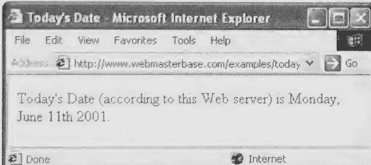
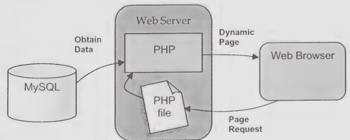
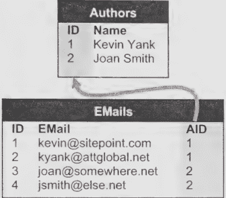
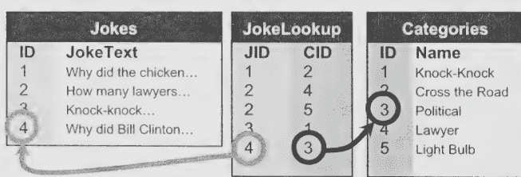
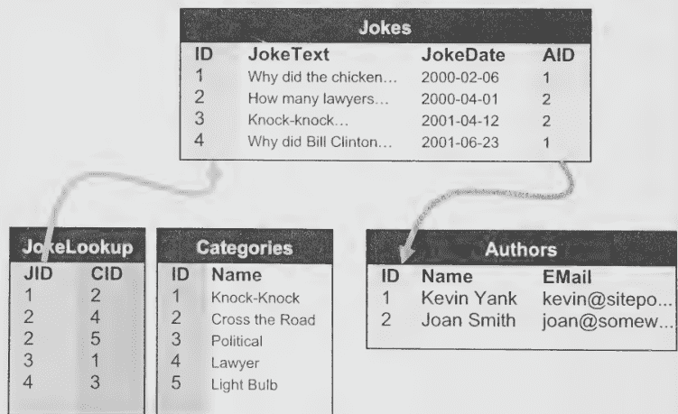
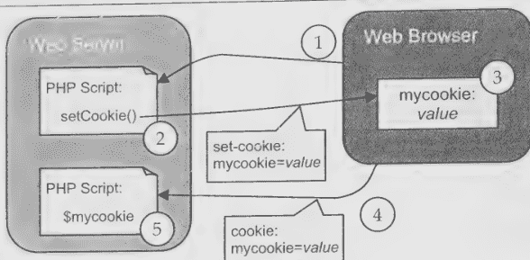

# PHP 和 MySQL 数据库驱动网站构建指南


## 作者简介

Kevin Yank 是 SitePoint.com 的技术内容总监，深受欢迎的许多教程和文章的作者，也是 SitePoint Tech Times 的编辑，这是一份面向 Web 开发者的极受欢迎的技术导向电子通讯。

在蒙特利尔的麦吉尔大学获得计算机工程学士学位之前，Kevin 不仅自己是一名初出茅庐的 Web 开发者，还是 Sausage Software Web 开发论坛的活跃顾问，以及多本关于高级 HTML 和 JavaScript 的实用指南的撰写人。

如今，当他不在探索新技术、编写书籍或补觉时，Kevin 可以在 SitePoint 论坛（www.sitepointforums.com）上帮助其他初出茅庐的 Web 开发者。

## 关于 SitePoint.com

SitePoint.com 是一个面向 Web 开发者的在线社区和基于内容的资源网站。在本书印刷之时，SitePoint.com 每月页面浏览量超过 260 万次，拥有超过 73,000 名通讯订阅者和 7,200 多名活跃社区论坛成员。

提供定期的前沿文章、深入的产品评测、循序渐进的教程、实用建议和充满活力的社区，SitePoint.com 是世界上与构建和发展成功网站相关资源最全面的网站之一。

访问 SitePoint：www.sitepoint.com。


## 简介

在今天的网络世界中，内容为王。一旦你掌握了 HTML 并学会了在 JavaScript 和动态 HTML 中使用一些小技巧，你可能就能构建出外观相当出色的网站设计。但随后就是用真实信息填充那个花哨页面布局的时候了。任何成功吸引回访者的网站都必须拥有新鲜且不断更新的内容。在传统的网站构建世界里，这意味着 HTML 文件——大量的 HTML 文件。

问题在于，大多数时候，为网站提供内容的人并不是负责其设计的人。很多时候，内容提供者甚至不懂 HTML。那么，内容如何从提供者那里传到网站上呢？不是每家公司都能雇佣全职的网站管理员，而且大多数网站管理员也有更好的事情可做，而不是把 Word 文件复制到 HTML 模板中。

维护内容驱动型网站也可能是一件真正令人头疼的事。许多网站（也许包括你的？）觉得被锁定在枯燥、过时的设计中，因为重写那些数百个 HTML 文件以反映新设计需要花费很长时间。服务器端包含（SSI）可以稍微减轻负担，但如果你希望对网站进行根本性更改，你最终还是会面对数百个需要维护的文件。

解决这些头痛问题的办法是数据库驱动型网站设计。通过实现网站设计与要呈现的内容之间的完全分离，你可以分别处理两者而互不干扰。与其为网站的每个页面写一个 HTML 文件，不如只为你想要呈现的每种信息写一个页面。与其将新内容无休止地粘贴到你那些老套的页面布局中，不如创建一个简单的内容管理系统，让作者们自己发布新内容，而不需要懂任何 HTML！

在本书中，我将带你亲身体验构建数据库驱动型网站所需的方方面面。为此我们将使用两种工具，它们对你来说可能都是新的：PHP 脚本语言和 MySQL 关系型数据库管理系统。如果你的网络托管商提供 PHP 和 MySQL 支持，那你就太幸运了。如果不提供，我们将介绍在 Linux 和 Windows 下的安装过程，所以别担心。

## 谁应该阅读本书

本书面向希望跨入服务器端编程领域的中级或高级 Web 设计师。我们假定你能熟练使用简单的 HTML，因为我会在不做太多解释的情况下使用它。在某个时刻，少量的 JavaScript 也可能对我们有帮助，但我会确保对初学者而言保持简单。

读完本书，你可以期望掌握设置和构建数据库驱动型网站所涉及的内容。如果你跟随示例，你还将学习 PHP（一种服务器端脚本语言，让你不仅能轻松访问数据库，还能做更多事情）和结构化查询语言（SQL——与关系型数据库交互的标准语言）的基础知识，MySQL 支持这些语言，它是当今最流行的免费数据库引擎之一。最重要的是，你将带走开始你自己的数据库驱动网站所需的一切，而且用时不长！

## 本书内容

本书包含以下 12 章。按从头到尾的顺序阅读，可以全面理解该主题；如果你需要复习某个特定主题，也可以跳着读。

# 第 1 章 安装

在开始构建你的数据库驱动型网络形象之前，你必须首先确保自己拥有完成工作所需的正确工具。在本章中，我将告诉你去哪里获取所需的两个关键组件：PHP 脚本语言和 MySQL 数据库管理系统。我将逐步引导你完成 Windows 和 Linux 下的安装过程，并向你展示如何测试 PHP 是否在你的 Web 服务器上正常运行。

# 第 2 章 MySQL 入门

尽管我相信你急于开始构建动态网页，但我将先介绍数据库的一般概念，特别是 MySQL 关系型数据库管理系统。如果你以前从未使用过关系型数据库，这一章肯定会让你开阔眼界，激发你对后续内容的兴趣！在此过程中，我们将构建一个简单的数据库，用于后续章节。

# 第 3 章 PHP 入门

这里才是真正有趣的地方。在本章中，我将向你介绍 PHP 脚本语言，它可以用来轻松构建为访问者提供最新信息的动态网页。有编程经验的读者可能只需快速浏览本章即可，因为我将从基础开始解释这门语言的要点。然而，对于初学者来说，这是一章必读内容，因为本书其余部分很大程度上依赖于此处介绍的基本概念。

# 第 4 章 在 Web 上发布 MySQL 数据

在本章中，我们将前两章中分别学到的 PHP 和 MySQL 结合起来，创建你的第一批数据库驱动型网页。我们将探讨使用 PHP 从数据库中检索信息并实时在 Web 上显示的基本技术。我还将向你展示如何使用 PHP 创建基于 Web 的表单，用于向 MySQL 数据库添加新条目和实时修改现有信息。

# 第 5 章 关系型数据库设计

虽然我们在前几章中使用了一个非常简单的示例数据库，但大多数数据库驱动型网站需要存储比我们目前处理的更复杂的数据形式。许多数据库驱动型网站设计在设计数据库结构的早期阶段因为犯了错误而被迫中途放弃，或被迫从头开始。在这个关键章节中，我将教授良好数据库设计的基本原则，并强调数据规范化的重要性。如果你不知道那是什么意思，那么这绝对是你应该阅读的重要章节！

# 第 6 章 内容管理系统

在很多方面，这是本书的高潮，这一章是对所有厌倦了每次需要修改网站设计就要更新数百个页面的沮丧网站构建者的巨大回报。我将引导你了解一个基本内容管理系统的代码，它允许你管理一个笑话、其分类和作者的数据库。这样的系统可以用于管理你网站上的简单内容，经过少量修改，你应该能够构建一个 Web 管理系统，让你的内容提供者在短时间内就能向你的网站提交待发布的内容——而这一切都不需要懂 HTML！

# 第 7 章 内容格式化与提交

仅仅因为你实现了一个很好用的工具，允许网站管理员在不懂 HTML 的情况下向网站添加内容，并不意味着你必须将内容限制为纯文本、未格式化的文本。在本章中，我将向你展示一些可以对显示数据库内容的页面进行的巧妙调整，这些调整允许它加入诸如粗体或斜体文本等简单格式，以及其他内容。我也将向你展示一种简单的方法，安全地让你的内容提供者直接使用内容提交表单，以便他们可以直接向你的系统提交新内容，待管理员批准后发布。


# 第 8 章 MySQL 管理

虽然 MySQL 对于不需要太多花哨功能的用户来说是一个不错的、简单的数据库解决方案，但它本身也有一些复杂性，如果你打算依赖 MySQL 数据库来存储内容，就需要理解这些复杂性。在本节中，我将教你如何对 MySQL 数据库进行备份和管理访问权限。除了几个内部技巧（例如忘记 MySQL 密码时该怎么办），我还将解释如何修复因服务器崩溃而损坏的 MySQL 数据库。

# 第 9 章 高级 SQL

在第 5 章中，我们了解了在类似 MySQL 的关系型数据库中对信息之间复杂关系进行建模所涉及的内容。尽管理论很扎实，但将这些概念付诸实践要求你再学习一些结构化查询语言的技巧。在本章中，我将介绍该语言的一些更高级功能，让你能够像专业人士一样高效地处理复杂数据。

# 第 10 章 高级 PHP

PHP 让你能做的远不只是从 MySQL 数据库中检索、显示、插入和更新信息。在本章中，我将让你一窥使用 PHP 可以做的其他一些有趣的事情，例如服务器端包含、处理文件上传和发送电子邮件。当然，正如我们将看到的，这些功能对于提升数据库驱动型网站的性能和安全性，以及向访问者发送反馈非常有用。

# 第 11 章 在 MySQL 中存储二进制数据

数据库驱动型 Web 设计中一些最有趣的应用涉及对二进制文件的处理。像如今已停运的 iDrive 这样的在线文件存储服务是典型示例，但像个人相册这样简单的系统也可以从在数据库中存储二进制文件（例如图片）中受益，以便即时检索和管理。在本章中，我们将开发一个非常简单的在线文件存储和查看系统，并学习在 MySQL 中处理二进制数据的方方面面。

# 第 12 章 PHP 中的 Cookie 与会话

PHP4 中最受炒作的新功能之一是对会话的内置支持。但什么是会话？它们与 Cookie（一种用于在 Web 上保存存储数据的历经磨难的技术）有何关系？是什么使得持久数据在当前的电子商务系统和其他 Web 应用程序中如此重要？本章通过解释 PHP 如何同时支持 Cookie 和会话，并探讨两者之间的联系，来回答所有这些问题。在本章末尾，我们将开发一个简单的购物车系统来演示它们的用法。

## 代码存档

随着你阅读本书的进展，你会注意到许多关于代码存档的引用。位于 http://www.sitepoint.com/books 的本书网站不仅包含本书中所展示的所有代码的存档，还包含勘误表、更新以及其他 SitePoint 出版物的信息。

## 你的反馈

如果你对本书涵盖的任何信息有疑问，在 SitePoint.com 论坛（www.sitepointforums.com）上发布你的查询是获得快速回复的最佳机会。当然，如果在那里得不到答案，你随时可以通过 kevin@sitepoint.com 给我发送电子邮件，我会在时间允许时处理你的查询。特别欢迎改进建议，以及你可能发现的任何错误通知（可能有一两个错误漏网了）。

那么，废话不多说，让我们开始吧！

## 1 安装

## 欢迎登场

你好，欢迎阅读 SitePoint.com *实用指南* 系列的第一本书！在本书的过程中，我的职责是指导你迈出客户端网站设计（HTML 和 JavaScript 世界）的第一步。我们将共同探讨构建当今如此成功的大型内容驱动型网站所需的条件，但如果做得不好，维护起来可能会是个真正的头痛问题。

在开始之前，你需要收集工作所需的工具。在本章中，我将指导你下载和设置所需的两个软件包：PHP 和 MySQL。

**PHP** 是一种服务器端脚本语言。你可以把它看作是 Web 服务器的一个“插件”，它允许服务器在浏览器请求时不仅仅发送普通的 Web 页面。安装 PHP 后，你的 Web 服务器将能够读取一种新型文件（称为 **PHP 脚本**），该文件可以从数据库中检索最新信息并在将 Web 页面发送给请求的浏览器之前将其插入页面中。PHP 完全免费下载和使用。

要从数据库中检索信息，你首先需要 *拥有* 一个数据库。MySQL 正是为此而生。MySQL 是一种关系型数据库管理系统，即 RDBMS。它具体扮演什么角色以及如何工作，我们将在后面介绍，但基本上它是一个非常擅长组织和管理大量信息的软件包。MySQL 还使得使用 PHP 等服务器端脚本语言访问这些信息变得非常容易。MySQL 根据 GNU 通用公共许可证（GPL）发布，因此在其支持的所有平台上的大多数用途都是免费的。这包括大多数基于 Unix 的平台，如 Linux 甚至 Mac OS X，以及 Windows 9x/ME/NT/2000。

如果你运气好，你当前的 Web 主机可能已经在你的 Web 服务器上为你安装了 MySQL 和 PHP。如果是这种情况，本章的大部分内容不适用于你，你可以直接跳到标题为“如果你的 Web 主机提供 PHP 和 MySQL”的部分，以确保你的设置状态良好。

本书中我们讨论的所有内容都可以在基于 Windows 或 Unix 的服务器上完成。安装过程将根据你可用的服务器类型而有所不同。接下来的两个部分分别介绍在基于 Windows 的 Web 服务器上安装，以及在 Linux（和其他基于 Unix 的平台）下安装。除非你特别好奇，否则你只需要阅读适用于你的部分。

## Windows 安装

### 安装 MySQL

如上文所述，MySQL 可免费下载。只需访问 http://www.mysql.com/downloads/ 并选择推荐的稳定版本（撰写本文时为 MySQL 3.23）。在“Standard binary (tarball) distributions”（基本上意味着程序无需编译，下载后即可运行）标题下，找到并单击 Windows 95/98/NT/2000 (Intel)。如果你使用高速连接，可能想查看 http://www.mysql.com/downloads/mirrors.html 中列出的一个下载镜像，以获得合理的下载速度。下载文件后（撰写本文时约为 12MB），解压缩并运行其中的 setup.exe 程序。

安装后，MySQL 即可运行（除了一小会儿我们将稍后介绍的配置任务外），只有一个小问题仅影响运行 Windows NT/2000/XP 的用户。如果你使用其中任何一种操作系统，请在刚刚安装 MySQL 的目录中找到名为 my-example.cnf 的文件。将其复制到 C: 驱动器的根目录，并重命名为 my.cnf。如果你不想让 MySQL 配置文件位于 C: 驱动器的根目录，则可以将其命名为 my.ini 并放置在 Windows 目录中（例如，如果 Windows 2000 安装在 D: 驱动器上，则为 D:\WINNT）。无论选择哪种方式，都请在 WordPad 中打开该文件（记事本可能会显示不正确），并查找以下行：

```
#### basedir = d:/mysql/
```

通过删除行首的 '#' 符号来取消此行的注释，并将路径更改为指向你的 MySQL 安装目录，使用正斜杠（/）而不是反斜杠（\）。例如，我将系统上的行更改为如下内容：

```
basedir = d:/Program Files/mysql/
```

做出该更改后，保存文件并关闭 WordPad。MySQL 现在将在你的 Windows NT/2000/XP 系统上运行！如果你使用的是 Windows 95/98/ME，则不需要此步骤 – MySQL 安装后即可正常运行。


就像你的 Web 服务器一样，MySQL 是一个应该在后台运行的程序，以便随时响应信息请求。
服务器程序位于安装 MySQL 的文件夹的 "bin" 子文件夹中。不过，这让事情变得复杂了，实际上有几个版本的 MySQL 服务器可供选择：

- **mysqld.exe** 如果你运行的是 Windows 95、98 或 ME，这是 MySQL 的基本版本。它支持所有高级功能，并包含调试代码，以便在崩溃时提供额外信息（如果你的系统设置为调试程序）。不过，由于该代码的存在，服务器可能会运行得稍慢一些，而且我普遍发现 MySQL 非常稳定，崩溃并非真正需要担心的问题。

- **mysqld-opt.exe** 此服务器版本缺少基本服务器的一些高级功能，且不包含调试代码。它经过优化，可在当今的处理器上快速运行。对初学者而言，高级功能并非大问题。在完成本书中的任务时，你肯定不会用到它们。这是在 Windows 95、98 或 ME 上运行的初学者的首选版本。

- **mysqld-nt.exe** 此服务器版本像 `mysqld-opt` 一样编译和优化，但设计为在 Windows NT/2000/XP 下作为服务运行。如果你使用的是这些操作系统中的任何一个，这很可能是适合你的服务器。

- **mysqld-max.exe** 此版本类似于 `mysqld-opt`，但包含支持事务的高级功能。

- **mysqld-max-nt.exe** 此版本类似于 `mysqld-nt`，但具有支持事务的高级功能。

所有这些版本都已为你安装在 `bin` 目录中。如果你运行的是 Win98/ME，我目前建议使用 `mysqld-opt` - 如果你需要高级功能，再切换到 `mysqld-max`。在 Windows NT/2000/XP 上，`mysqld-nt` 是我的推荐。当你需要更多高级功能时，升级到 `mysqld-max-nt`。

在 WinNT/2000/XP 下启动 MySQL 也略有不同，但这次让我们从 Win95/98/ME 的步骤开始。打开 MS-DOS 命令提示符，进入 MySQL `bin` 目录，然后运行你选择的服务器程序：

```
C:\mysql\bin> mysqld-opt
```

当你再次收到命令提示符时，不要惊讶。此命令启动服务器程序，使其在后台运行，即使关闭命令提示符后也是如此。如果按 Ctrl-Alt-Del 调出任务列表，你应该能看到 MySQL 服务器被列为系统上活动的任务之一。

为确保 Windows 启动时服务器也会启动，你可能希望为该程序创建一个快捷方式并将其放在启动文件夹中。这就像为系统上的任何其他程序创建快捷方式一样。

在 WinNT/2000/XP 上，你必须将 MySQL 安装为系统服务。幸运的是，这非常容易。只需打开命令提示符，并使用 `-install` 选项运行你选择的服务器程序：

```
C:\mysql\bin> mysqld-nt --install
```

这将把 MySQL 安装为下次重启 Windows 时启动的服务。要在不重启的情况下手动启动 MySQL，只需键入此命令（可以从任何目录运行）：

```
C:\> net start mysql
```

要验证 MySQL 服务器是否正常运行，请按 Ctrl-Alt-Del 并打开任务列表。如果一切正常，服务器程序应该列在进程选项卡中。

## 安装 PHP

下一步是安装 PHP。在撰写本文时，PHP 4.x 已成为首选的成熟版本；然而，一些旧服务器仍在使用 PHP 3.x（通常是因为没人费心去更新它）。这里我将介绍 PHP 4 的安装，所以请注意，如果你仍在使用 PHP 3，可能存在一些细微差别。

从 http://www.php.net/（或其 http://www.php.net/mirrors.php 上列出的镜像之一）免费下载 PHP。你需要 Win32 二进制包，如果有选择，请确保获取同时包含 CGI 二进制文件和服务器 API 版本的版本。

除了 PHP 本身，你还需要一个 Web 服务器，例如 Internet Information Services (IIS)、Apache、Sambar 或 OmniHTTPD。PHP 被设计为现有 Web 服务器软件的插件运行。要使用 PHP 测试动态网页，你需要为自己的计算机配备 Web 服务器软件，以便 PHP 有东西可以插入。如果你有 Windows 2000/XP，则安装 IIS（如果系统中尚未安装）：打开控制面板，添加/删除程序，添加/删除 Windows 组件，从组件列表中选择 IIS。如果你不巧没有 IIS 可用，可以改用免费的 Web 服务器，如 Apache。我将详细介绍这两种选项。

首先，无论你是否有 IIS，都完成以下步骤：

- 将下载的文件解压到你选择的目录中。我推荐 C:\PHP，并将从今以后引用此目录，但如果你愿意，可以随意选择另一个目录。

- 在 PHP 文件夹中找到名为 php4ts.dll 的文件，并将其复制到 Windows 文件夹的 System32 子文件夹中（例如 C:\Windows\System32）。

- 在 PHP 文件夹中找到名为 php.ini-dist 的文件，并将其复制到 Windows 文件夹。之后，将其重命名为 php.ini。

- 在你喜爱的文本编辑器中打开 php.ini 文件（如果记事本无法正确显示文件，请使用写字板）。这是一个大文件，包含许多令人困惑的选项，但请查找以 extension_dir 开头的行，并将其设置为指向 PHP 文件夹的 extensions 子文件夹：
extension_dir = C:\PHP\extensions
再往下看，查找以 session.save_path 开头的行，并将其设置为 Windows TEMP 文件夹：
session.save_path = C:\WINDOWS\TEMP
保存所做更改并关闭文本编辑器。

现在，如果你有 IIS，请按照以下说明操作：

- 在 Windows 控制面板中，打开管理工具 | Internet Information Services。

- 在树视图中，展开标记为"本地计算机"的条目，然后在"网站"下查找"默认网站"（除非你设置了虚拟主机，在这种情况下，选择你想要添加 PHP 支持的站点）。右键单击网站并选择"属性"。

- 单击"ISAPI 筛选器"选项卡，然后单击"添加..."。在"筛选器名称"字段中，输入 PHP，并在"可执行文件"字段中，浏览并选择 PHP 文件夹 sapi 子文件夹中名为 php4isapi.dll 的文件（例如 C:\PHP\sapi\php4isapi.dll）。单击"确定"。

- 单击"主目录"选项卡，然后单击"配置..."按钮。在"映射"选项卡中单击"添加"。再次选择 php4isapi.dll 文件作为可执行文件，并在扩展名框中输入 .php（包括'.'）。保持其他所有内容不变，然后单击"确定"。如果你希望 Web 服务器将其他文件扩展名视为 PHP 文件（.php3、.php4 和 .phtml 是常见选择），请对每个扩展名重复此步骤。单击"确定"关闭应用程序配置窗口。

- 单击"确定"关闭网站属性窗口。关闭 Internet Information Services 窗口。

- 再次，在控制面板的管理工具下，打开"服务"。在列表底部附近查找"World Wide Web Publishing"服务。右键单击它并选择"重启"，以使用新的配置选项重启 IIS。关闭"服务"窗口。

- 搞定！PHP 已安装！

如果你没有 IIS，首先需要安装其他 Web 服务器。就我们的目的而言，我假设你已从 http://httpd.apache.org/ 下载并安装了 Apache 服务器；不过，PHP 也可以安装在 Sambar Server (http://www.sambar.com/)、OmniHTTPD (http://www.omnicron.ab.ca/httpd/) 和其他服务器上。

下载并按照随附说明安装 Apache 后，在 Web 浏览器中打开 http://localhost/，以确保其正常工作。如果你看不到说明 Apache 已成功安装的网页，那么要么你尚未运行 Apache，要么安装有故障。在安装 PHP 之前，请检查文档并确保 Apache 正常运行。

如果你已确保 Apache 正常运行，则可以添加 PHP 支持：

- 在"开始"菜单中，选择"程序"，Apache httpd Server，配置 Apache 服务器，编辑配置。这将在记事本中打开 httpd.conf 文件。

- 此冗长且令人生畏的配置文件中的所有选项都应由 Apache 安装程序正确设置。你只需要将以下三行添加到文件的最底部：

```
LoadModule php4_module c:/php/sapi/php4apache.dll
AddType application/x-httpd-php .php .php3 .phtml
AddType application/x-httpd-php-source .phps
```

确保 LoadModule 行指向你系统上的 php4apache.dll 文件，并注意使用正斜杠而非反斜杠。

- 保存更改并关闭记事本。

- 通过"开始"菜单选择"程序"，Apache httpd Server，控制 Apache 服务器，重启来重启 Apache。如果一切正常，Apache 将毫无异议地再次启动。

- 搞定！PHP 已安装！

安装 MySQL 和 PHP 后，你就可以继续进行第 20 页的安装后设置任务部分了。


## 在 Linux 下安装

本节介绍在大多数当前 Linux 发行版中安装 PHP 和 MySQL 的流程。这些说明已在最新版本的 RedHat Linux 和 Mandrake Linux 上进行了测试；不过，它们也应该可以在其他发行版（例如 Debian）上顺利工作。相关步骤将非常相似，甚至可能完全相同。

作为可用 Linux 发行版之一的用户，您可能会被诱惑下载并安装 PHP 和 MySQL 的 RPM 发行版。RPM 是预打包的软件版本，安装起来非常方便。不幸的是，它们也限制了您可用的软件配置选项。如果您已经以 RPM 形式安装了 MySQL 和 PHP，那么可以继续使用这些版本，并跳转至“安装后设置任务”部分。如果您遇到任何问题，随时可以返回此处，卸载 RPM 版本并手动重新安装 PHP 和 MySQL。

由于许多 Linux 发行版会自动为您安装 PHP 和 MySQL，因此您的第一步应该是从系统中删除任何旧的 PHP 和 MySQL RPM 版本。如果存在，请使用您发行版的图形化软件管理器，删除所有名称中包含“php”或“mysql”的软件包（mod_php 是一个经常被遗漏的软件包）。

如果您的发行版没有图形化软件管理器，或者您没有为服务器安装图形用户界面，则可以从命令行删除这些软件。您需要以 root 用户身份登录才能发出这些命令。请注意，在以下命令中，“%”代表 shell 提示符，无需输入。

```
% rpm -e mysql
% rpm -e mod_php
% rpm -e php
```

如果这些命令中的任何一条告诉您相关软件包未安装，除非您确切知道它已安装，否则无需担心。在这种情况下，您需要手动删除相关项。如果您不知道如何操作，请向经验丰富的用户寻求帮助。如果第二条命令成功运行（即未显示任何消息），那么您确实安装了 PHP 的 RPM 版本，并且还需要做一件事才能将其完全删除。在您喜爱的文本编辑器中打开 Apache 配置文件（通常为 /etc/httpd/conf/httpd.conf），并查找此处显示的两行。它们通常出现在文件的不同部分，因此如果它们不在一起也无需担心。libphp4.so 文件的路径也可能略有不同（例如 extramodules 而不是仅 modules）。如果您找不到它们，请不要担心——这只是意味着 RPM 卸载程序足够智能，已为您将其删除。

```
LoadModule php4_module modules/libphp4.so
AddModule mod_php4.c
```

这些行负责告诉 Apache 将 PHP 作为插件模块加载。由于您刚刚卸载了该模块，您需要删除这些行，以确保 Apache 继续正常工作。您可以在两行开头各添加一个井号（#）来将这些行注释掉。

为确保 Apache 仍处于正常工作状态，您现在应在不加载 PHP 插件的情况下重新启动它：

```
% /etc/rc.d/init.d/httpd restart
```

一切就绪后，您即可下载并安装 MySQL 和 PHP。

### 安装 MySQL

MySQL 可从 http://www.mysql.com（或 http://www.mysql.com/downloads/mirrors.html 列出的其镜像之一）免费获取，适用于 Linux。下载最新的稳定版本（在下载页面上标记为推荐）。您应该获取 Source downloads 下的 Tarball 版本，文件名为 mysql-3.xx.xx.tar.gz。

下载程序时（撰写本文时约为 10.5MB），在继续安装之前，请确保您已以 root 身份登录，除非您只想在自己的主目录中安装 MySQL。首先，解压下载的文件并进入创建的目录：

```
% tar xfz mysql-3.xx.xx.tar.gz
% cd mysql-version
```

接下来，您需要配置 MySQL 安装。除非您确实知道自己在做什么，否则您只需要告诉它安装位置即可。我推荐 /usr/local/mysql：

```
% ./configure --prefix=/usr/local/mysql
```

在浏览一连串配置测试屏幕后，您最终将回到命令提示符。请确保配置已成功完成。如果在配置退出前看到错误消息，您需要解决它所指出的问题。例如，在 Mandrake 8.0 上，它会抱怨“无法找到 curses/termcap 库”。我只是在 Mandrake 的软件管理器中安装了 libncurses5-devel 软件包，第二次尝试时配置就正常工作了。配置完成后，您即可编译 MySQL：

```
% make
```

在再次浏览一连串编译屏幕后（在某些系统上可能长达半小时），您将再次回到命令提示符。您现在可以安装新编译的程序了：

```
% make install
```

MySQL 现已安装，但在发挥作用之前，其数据库文件也需要安装。仍在您安装所在的目录中，键入以下命令：

```
% scripts/mysql_install_db
```

完成后，您可以删除一直在使用的目录，该目录仅包含所有源文件和临时安装文件。如果您需要重新安装，可以简单地重新提取 mysql-version.tar.gz 文件。

MySQL 已安装并准备好存储信息，剩下要做的就是在您的计算机上启动服务器。虽然您可以以 root 用户身份运行服务器，甚至可以以您自己的身份运行（例如，如果您将服务器安装在自己的主目录中），但最好的办法是在系统上设置一个特殊用户，其唯一目的是运行 MySQL 服务器。这将消除有人利用 MySQL 服务器作为进入系统其余部分途径的任何可能性。要创建特殊 MySQL 用户，您需要以 root 身份登录并键入以下命令：

```
% /usr/sbin/groupadd mysqlgrp
```

```
% /usr/sbin/useradd -g mysqlgrp mysqlusr
```

默认情况下，MySQL 将所有数据库信息存储在安装目录的 var 子目录中。我们希望确保除了新的 MySQL 用户之外，没有人可以访问该目录。假设您将 MySQL 安装到 /usr/local/mysql 目录，可以使用以下命令：

```
% cd /usr/local/mysql
```

```
% chown -R mysqlusr.mysqlgrp var
```

```
% chmod -R go-rwx var
```

现在一切就绪，您可以首次启动 MySQL 服务器了。从 MySQL 目录中，键入以下命令：

```
% bin/safe_mysqld --user=mysqlusr &
```

如果您看到消息“mysql daemon ended”，则 MySQL 服务器启动被阻止。错误消息应已写入 MySQL var 目录中名为 hostname.err 的文件（其中 hostname 是您计算机的主机名）。您通常会发现，这种情况是因为您的计算机上已经有另一个 MySQL 服务器在运行。

如果 MySQL 服务器未报错即启动，服务器将一直运行（就像您的 Web 或 FTP 服务器一样），直到计算机关机。要测试服务器是否正常运行，请键入以下命令：

```
% bin/mysqladmin -u root status
```

应显示一段关于 MySQL 服务器统计信息的简短说明。如果您收到错误消息，则表示出了问题。再次检查 hostname.err 文件，看看 MySQL 服务器在启动时是否输出了错误消息。如果您回溯步骤以确保遵循了上述过程，但这仍未解决问题，那么在 SitePoint.com 论坛上发帖将帮助您迅速找出问题所在。

如果您希望 MySQL 服务器在系统运行时自动运行（就像您的 Web 服务器可能做的那样），则需要将其设置为如此。在 MySQL 目录的 share/mysql 子目录中，您会找到一个名为 mysql.server 的脚本，可以将其添加到系统启动例程中以实现此目的。

首先，假设您已设置特殊 MySQL 用户来运行 MySQL 服务器，则需要告诉 MySQL 服务器默认以该用户身份启动。为此，请在系统的 /etc 目录中创建一个名为 my.cnf 的文件，包含以下两行：

```
[mysqld]
user=mysqlusr
```

现在，当您运行 safe_mysqld 或 mysql.server 来启动 MySQL 服务器时，它将以 mysqlusr 身份启动，无需您另行指示。剩下要做的就是设置系统在启动时自动运行 mysql.server。

设置系统在启动时运行脚本是一项高度依赖于操作系统的任务。如果您不确定如何操作，最好向知道的人寻求帮助。但是，以下命令（从 MySQL 目录开始）对大多数 Linux 版本都有效！：

```
% cp share/mysql/mysql.server /etc/rc.d/init.d/
% cd /etc/rc.d/init.d
% chmod 500 mysql.server
% cd /etc/rc.d/rc3.d
% ln -s ../init.d/mysql.server S99mysql
% cd /etc/rc.d/rc5.d
% ln -s ./init.d/mysql.server S99mysql
```

- 在当前的 SUSE Linux 发行版中，没有 init.d 目录，只有一个指向 /etc/rc.d 的符号链接；因此，启动文件的符号链接应指向 /etc/rc.d 目录（例如 ln -s ./mysql.server S99mysql）。


搞定！要测试这是否有效，请重启系统，并像之前一样请求服务器状态。

为了方便起见，最后还有一件你可能想做的事，就是将 MySQL 客户端程序（稍后你将用它们来管理 MySQL 服务器）放入系统路径。为此，你可以在 /usr/local/bin 目录中为 mysql、mysqladmin 和 mysqldump 创建符号链接：

```
% ln -s /usr/local/mysql/bin/mysql /usr/local/bin/mysql
% ln -s /usr/local/mysql/bin/mysqladmin /usr/local/bin/mysqladmin
% ln -s /usr/local/mysql/bin/mysqldump /usr/local/bin/mysqldump
```

## 安装 PHP

如前所述，PHP 本身并非一个独立程序。相反，它是 Web 服务器（可能是 Apache）的一个插件模块。实际上，有三种方式可以为 Apache 安装 PHP 插件：

- 作为 Apache 每次需要处理 PHP 增强型网页时都会运行的 CGI 程序。
- 作为编译进 Apache 程序的 Apache 模块。
- 作为 Apache 启动时加载的 Apache 模块。

第一个选项安装和设置最为简单，但每次请求 PHP 页面时，Apache 都需要在计算机上将 PHP 作为程序启动。这会显著降低 Web 服务器的响应速度，尤其是在需要同时处理多个请求时。

第二个和第三个选项在性能上几乎相同，但鉴于你很可能已经安装了 Apache，或许更愿意避免从头下载、重新编译和重新安装它。因此，我们将采用第三种选项。

首先，从 http://www.php.net 下载 PHP 源代码包（或其 http://www.php.net/mirrors.php 列出的镜像之一）。在撰写本文时，PHP 4.x 已成为首选的稳定版本；不过，一些旧服务器仍在使用 PHP 3.x（通常是因为无人费心将其更新）。这里将介绍 PHP4 的安装过程，请注意，如果你仍在使用 PHP3，可能会有一些细微差别。

你下载的文件应名为 php-version.tar.gz。首先，我们将提取其中包含的文件：

```
% tar xfz php-version.tar.gz
% cd php-version
```

要将 PHP 作为可加载的 Apache 模块安装，你需要 Apache apxs 程序。大多数版本的 Apache 都自带此程序，但如果你使用的是随 Linux 发行版一起安装的副本，可能需要安装 Apache 开发 RPM 包才能使用 Apache apxs。你应当能够通过软件发行版提供的任何方式安装此包。默认情况下，RedHat 和 Mandrake 会将该程序安装为 /usr/sbin/apxs，因此如果你看到这个文件，就说明它已安装。

其余安装过程中，你需要以 root 用户身份登录，以便修改 Apache 配置文件。

下一步是配置 PHP 安装程序，告知它要启用哪些选项，以及在哪里可以找到它需要知道的程序（如 Apache 和 MySQL）。除非你非常清楚自己在做什么，否则只需按如下方式输入命令（全部在一行）：

```
% ./configure
    --prefix=/usr/local/php
    --with-config-file-path=/usr/local/php
    --with-apxs=/usr/sbin/apxs
    --enable-track-vars
    --enable-magic-quotes
    --enable-debugger
```

同样，检查是否有错误消息，并安装它标识为缺失的任何文件。例如，在 Mandrake 8.0 上，它抱怨找不到 'lex' 命令。我在 Mandrake 包列表中搜索了 'lex'，结果出现了 'flex'，它被描述为许多程序构建过程中用于文本模式匹配的程序。安装后，配置过程顺利完成。在看到几个测试屏幕滚动后，你将返回到命令提示符。以下两个命令将编译并安装 PHP。歇会儿喝杯咖啡：这需要一些时间。

```
% make
% make install
```

PHP 现已安装在 /usr/local/php（除非你在上面的 configure 脚本中使用 --prefix 选项指定了不同目录），它期望在 lib 子目录中找到名为 php.ini 的配置文件（除非你在上面的 configure 脚本中使用 --with-config-file-path 选项指定了不同目录）。PHP 附带两个示例 php.ini 文件，分别名为 php.ini-dist 和 php.ini-optimized。将这些文件从安装工作目录复制到 PHP 期望查找 php.ini 文件的目录，然后复制 php.ini-dist 文件并将其命名为 php.ini：

```
% cp php.ini* /usr/local/php/lib/
% cd /usr/local/php/lib/
% cp php.ini-dist php.ini
```

现在你可以删除编译 PHP 的目录了 - 它不再需要。

稍后我们会再处理 php.ini 的微调问题。目前，我们需要确保 Apache 知道在哪里可以找到 PHP，以便它在启动时能加载该程序。使用你喜欢的文本编辑器打开 Apache httpd.conf 配置文件（如果你使用的是 Linux 发行版自带的 Apache，通常为 /etc/httpd/conf/httpd.conf）。查找如下所示的行：

```
LoadModule php4_module lib/apache/libphp4.so
```

找到新的、未注释的行（行首没有 #），而不是你可能之前注释掉的旧行。它可能不会与文件中的其他 LoadModule 行出现在一起。找到它后，你可能需要更改路径，使其与文件中的其他 LoadModule 行一致。在 RedHat Linux 上，这意味着你需要将该行更改为如下所示：

```
LoadModule php4_module modules/libphp4.so
```

即使不做此更改，PHP 也很可能能够正常运行，但在较旧版本的 RedHat 上，Apache 将无法找到 libphp4.so 文件，直到你做出此更改。如果你愿意，现在可以先不改动该行 - 如果遇到问题，以后可以再回来更改。

接下来，查找以 DirectoryIndex 开头的行。在较新的发行版中，这可能位于名为 commonhttpd.conf 的单独文件中。这行告诉 Apache 在查找给定目录的默认页面时应使用哪些文件名。你会看到常见的 index.html 等等，但如果列表中还没有，你需要添加 index.php、index.php3 和 index.phtml：

```
DirectoryIndex index.html ... index.php index.phtml index.php3
```

最后，转到文件的最底部（同样，如果你有 commonhttpd.conf 文件，这也应放在那里），并添加以下行，以告诉 Apache 哪些文件扩展名应被视为 PHP 文件：

```
AddType application/x-httpd-php .php .php3 .phtml
AddType application/x-httpd-php-source .phps
```

就这样！保存更改并重启 Apache 服务器。如果一切顺利，Apache 应该能在没有任何错误消息的情况下启动。如果遇到任何问题，SitePoint.com 论坛的热心人士（包括我自己）将很乐意提供帮助。

## 安装后的设置任务

无论你运行的是哪种操作系统，一旦 PHP 安装完毕且 MySQL 服务器正在运行，你首先需要做的就是为 MySQL 设置一个“root 密码”。MySQL 只允许授权用户查看和操作其数据库中存储的信息，因此你需要告知 MySQL 哪些用户是授权用户，哪些不是。MySQL 首次安装时，配置了一个名为 root 的用户，该用户无需输入密码即可执行几乎任何任务。你的首要任务应该是为 root 用户设置密码，以防止未授权用户在你的数据库中随意操作。

重要的是要意识到，MySQL 就像 Web 服务器或 FTP 服务器一样，可以从同一网络中的任何计算机访问。如果你正在使用连接到互联网的计算机，这意味着世界上任何人都可能尝试连接到你的 MySQL 服务器！选择一个难以猜测的密码的必要性不言而喻！

要为 MySQL 设置 root 密码，请在 MySQL 安装目录的 bin 目录中输入以下命令（包含引号）：

```
mysqladmin -u root password "your new password"
```

为确保 MySQL 已登记此更改，你应该指示它重新加载其授权用户和密码列表：

```
mysqladmin -u root reload
```

如果此命令返回错误消息告诉你访问被拒绝，请不要担心：这仅表示密码已生效。

要试用你的新密码，请求 MySQL 服务器告诉你其当前状态：

```
mysqladmin -u root -p status
```

出现提示时输入你的密码。你应该会看到一条简短消息，提供有关服务器及其当前状态的信息。-u root 参数告诉程序你希望被标识为名为 root 的 MySQL 用户。-p 参数告诉程序在尝试连接之前提示你输入密码。status 参数只是告诉它你有兴趣查看系统状态。

如果你随时想要关闭 MySQL 服务器，可以使用以下命令。请注意使用与之前相同的 -u root 和 -p 参数：

```
mysqladmin -u root -p shutdown
```

既然你的 MySQL 数据库系统已免受入侵，剩下的就是配置 PHP 了。为此，我们将使用一个名为 php.ini 的文本文件。如果你


在 Windows 下安装 PHP 时，你应当已将 php.ini 复制到 Windows 目录中。如果按照上述说明在 Linux 下安装了 PHP，你应当已将 php.ini 复制到 PHP lib 文件夹（/usr/local/php/lib），或你选择放置的任何位置。

用你喜欢的文本编辑器打开 php.ini，浏览一下。大多数设置都有相当详细的说明，大部分默认设置对我们来说也都很好用。只需检查确保你的设置与以下内容一致：

```
register_globals = On
magic_quotes_gpc = On
doc_root = the document root folder of your web server
extension_dir = the PHP install directory
```

保存对 php.ini 的更改，然后重启 Web 服务器。要在 Linux 下重启 Apache，以 root 身份登录并输入以下命令：

```
/etc/rc.d/init.d/httpd restart
```

大功告成！现在你只需测试一下，确保一切正常（请参阅下文“你的第一个 PHP 脚本”）。

## 如果你的 Web 主机提供 PHP 和 MySQL

如果为你提供 Web 空间的主机已为你安装并配置好 MySQL 和 PHP，而你只想学习如何使用它们，那么你实际上没什么要做的。现在正是联系你的主机并索取访问这些服务所需信息的好时机。

具体来说，你需要一个用户名和密码来访问他们为你设置的 MySQL 服务器。他们可能还为你提供了一个空数据库供你使用（这可以防止你干扰共享同一 MySQL 服务器的其他用户的数据库），你还需要知道你的数据库名称。

你可以直接访问 MySQL 服务器的方式有两种。首先，你可以使用 telnet 或安全外壳协议（SSH）登录到主机。然后，你可以使用那里安装的 MySQL 客户端程序（mysql、mysqladmin、mysqldump）直接与 MySQL 服务器交互。第二种方法是将这些客户端程序安装到你自己的计算机上，并让它们连接到 MySQL 服务器。你的 Web 主机可能支持这两种方法中的一种或全部，因此你需要询问支持哪一种。

如果你的主机允许你通过 telnet 或 SSH 登录以完成工作，你需要一个登录用的用户名和密码，此外还需要访问 MySQL 服务器所用的用户名和密码（两者可能不同）。务必同时索取这两组信息。

如果他们支持远程访问 MySQL 服务器，你会想下载一个能让你连接到并与服务器交互的程序。本书假设你已从 http://www.mysql.com/ 下载了包含三个客户端程序（mysql、mysqladmin 和 mysqldump）的 MySQL 二进制发行版。Windows、Linux 和其他操作系统都有免费的软件包可供下载。安装基本上就是找到这三个程序并将它们放在一个方便的位置。软件包的其余部分（包括 MySQL 服务器）可以随意丢弃。如果你更喜欢更图形化的界面，可以下载类似 MySQL GUI 的东西（也可从 http://www.mysql.com 获取）。不过，我真心建议你先熟悉基本的客户端程序，因为你使用它们的命令将类似于你将在 PHP 脚本中用于访问 MySQL 数据库的命令。

如今，一些价格较低的 Web 主机既不支持 telnet/SSH 访问，也不支持直接访问他们的 MySQL 服务器。相反，他们提供一个管理控制台，让你可以通过 Web 浏览器浏览和编辑数据库。虽然这是一个相当方便且不过分限制的解决方案，但它无法帮助你学习。相反，我建议在你自己的系统上安装一个 MySQL 服务器以提供帮助，尤其是在下一章中。一旦你熟悉了在学习服务器上工作，就可以开始使用 Web 主机及其管理控制台提供的服务器。有关在 Windows 和 Linux 下安装 MySQL 的说明，请参见上一节。

## 你的第一个 PHP 脚本

如果我帮你把所有东西都安装好，却直到第 3 章才让你尝尝 PHP 驱动的 Web 页面是什么样子，那实在不公平，所以这里先给你点小尝头，开开胃。

打开你喜欢的文本或 HTML 编辑器，创建一个名为 today.php 的新文件。请注意，要在记事本中保存带有 .php 扩展名的文件，你需要将文件类型选择为“所有文件”，或在“另存为”对话框中用引号将文件名括起来；否则，记事本会“贴心地”将文件保存为 today.php.txt。将以下内容键入文件中：

```html
<html>
<head>
<title>Today's Date</title>
</head>
<body>
<p>Today's Date (according to this web server) is
<?php
echo( date("l, F dS Y.") );
?></p>
</body>
</html>
```

如果你愿意，可以从 http://www.sitepoint.com/books/ 的代码存档中下载本文件以及本书中的其余代码。

保存此文件，并像放置任何常规 HTML 文件一样将其放置在你的 Web 站点上，然后在浏览器中查看。请注意，如果你在自己的机器上查看该文件，不能使用浏览器的“文件”>“打开”功能，因为 Web 服务器必须介入以解释文件中的 PHP 代码。相反，你必须将文件移动到 Web 服务器软件的文档根文件夹中（例如，IIS 中的 C:\inetpub\wwwroot\，或 Windows 版 Apache 中的 C:\Apache Group\Apache\htdocs\），然后在浏览器中键入 http://localhost/today.php 加载它。这样可以让 Web 服务器运行文件中的 PHP 代码，并在将其发送到 Web 浏览器之前用日期将其替换。输出结果应如下所示：



挺不错的，对吧？如果你在浏览器中使用“查看源代码”功能，你只会看到一个包含日期的常规 HTML 文件。PHP 代码（上述代码中 <?php 和 ?> 之间的所有内容）已由 Web 服务器解释，并在发送到你的浏览器之前转换为普通文本。PHP（以及其他服务器端脚本语言）的优点在于，Web 浏览器不需要知道任何关于它的信息——Web 服务器完成所有工作！

而且不要太担心我在这个示例中使用的精确代码。过不了多久你就会对它了如指掌。

如果你看不到日期，那么你的 Web 服务器的 PHP 支持出了问题。在浏览器中使用“查看源代码”查看页面的代码。你可能会在页面中看到 PHP 代码。由于浏览器不理解 PHP，它只是将 <?php ... ?> 视为一个长长的无效 HTML 标签并予以忽略。请确保 PHP 支持已在你的 Web 服务器上正确安装，无论是按照本章前几节提供的说明进行安装，还是由你的 Web 主机安装。

## 总结

现在你应该已拥有在 Web 服务器上安装 MySQL 和 PHP 所需的一切。如果上面的小示例无法正常工作（例如，原始 PHP 代码出现而不是日期），那么你的设置过程出了问题。欢迎访问 SitePoint.com 论坛（http://www.sitepointforums.com/），我们很乐意帮助你找出问题所在！

在第 2 章中，你将学习关系型数据库的基础知识并开始使用 MySQL。如果你以前从未接触过数据库，我保证这会让你大开眼界！

# MySQL 入门

在第 1 章中，我们安装并设置了两个软件程序：PHP 和 MySQL。在本章中，我们将学习如何使用结构化查询语言（SQL）来操作 MySQL 数据库。

## 数据库简介

正如我已经解释的那样，PHP 是一种服务器端脚本语言，它允许你向 Web 页面中插入指令，这些指令将由你的 Web 服务器软件（无论是 Apache、IIS 还是其他软件）在将页面发送给请求它们的浏览器之前执行。在一个简短的示例中，我展示了如何在每次请求 Web 页面时向其中插入当前日期。

这一切都很好，但当加入数据库时，事情才真正变得有趣。数据库服务器（在本例中为 MySQL）是一种程序，可以将大量信息以有组织的格式存储，并通过 PHP 等脚本语言轻松访问。例如，你可以让 PHP 在数据库中查找一份你希望显示在 Web 站点上的笑话列表。

在这个示例中，笑话将完全存储在数据库中。这样做的好处有两点。首先，你不必为每个笑话编写一个 HTML 文件，而是可以编写一个专门设计用于从数据库中获取并显示任何笑话的单个 PHP 文件。其次，向你的 Web 站点添加笑话只需将笑话插入数据库这一简单操作即可。PHP 代码将处理其余部分，当它从数据库中获取列表时，会自动将新笑话与其他笑话一起显示出来。

让我们沿用这个示例，来看看数据库中数据是如何存储的。数据库由一个或多个表组成，每个表包含一系列事物。对于我们的笑话数据库，我们可能会先从一个名为“jokes”的表开始，该表包含一份笑话列表。数据库中的每个表都有一个或多个列，或称为字段。每个列保存表中每个项目的某一特定信息。在我们的示例中，我们的“jokes”表可能包含笑话文本列和将笑话添加到数据库的日期列。存储在此表中的每个笑话都被称为表中的一行。这些行和列构成了一个如下所示的表：


| ID | 笑话文本 | 笑话日期 |
|---|---|---|
| 1 | 鸡为什么……？ | 2000-04-01 |
| 2 | "叩门叩门！"<br>"谁在那儿？" | 2000-02-22 |

请注意，除了存储笑话文本（"JokeText"）和笑话日期（"JokeDate"）的列之外，我还添加了一个名为"ID"的列。作为良好设计的要求，数据库表应始终提供一种唯一标识每行的方法。由于同一天可能会多次输入同一个笑话，因此无法依靠JokeText和JokeDate列来区分所有笑话。因此，ID列的作用是为每个笑话分配一个唯一编号，这样我们就有了引用它们的简便方法，并能跟踪哪个笑话是哪个。此类数据库设计问题将在第5章中更深入地介绍。

因此，回顾一下，上面是一个包含两行（或条目）的三列表格。表格中的每一行都包含一个笑话的ID、其文本以及笑话的日期。掌握了这些基本术语后，我们就可以开始使用MySQL了。

## 登录到MySQL

使用MySQL数据库的标准界面是连接到MySQL服务器软件（你在第1章中设置过），然后逐条输入命令。要建立与服务器的连接，你需要MySQL客户端程序。如果你在Windows或某种UNIX品牌下自己安装了MySQL服务器软件，那么这个程序已经安装在与服务器程序相同的位置。例如，在Linux下，该程序名为mysql，默认位于/usr/local/mysql/bin目录中。在Windows下，该程序名为mysql.exe，默认位于C:\mysql\bin目录中。

如果你不是自己设置MySQL服务器（例如，你将在Web主机的MySQL服务器上工作），则有两种方法可以连接到MySQL服务器。第一种方法是使用Telnet或安全外壳（SSH）连接登录到你的Web主机服务器，然后从那里运行mysql。第二种方法是从http://www.mysql.com/（Windows和Linux均可免费获取）下载并安装MySQL软件到你自己的计算机上，并使用它通过Internet连接到MySQL服务器。这两种方法都很有效，你的Web主机可能支持其中一种、另一种或两者皆支持（你需要询问）。

无论你使用哪种方法和操作系统，最终都会来到命令行，准备运行MySQL客户端程序并连接到你的MySQL服务器。你应该输入以下内容：

```
mysql -h hostname -u username -p
```

你需要将hostname替换为运行MySQL服务器的计算机的主机名或IP地址。如果客户端程序与服务器运行在同一台计算机上，你可以省略命令中的-h hostname部分，而无需输入-h localhost或-h 127.0.0.1。username应为你的MySQL用户名。如果你自己安装了MySQL服务器，那么它就是root。如果你使用的是Web主机的MySQL服务器，则应为他们分配给你的MySQL用户名。

-p参数告诉程序提示你输入密码，它应在你输入上述命令后立即执行此操作。如果你自己设置了MySQL服务器，那么这个密码就是你在第1章中选择的root密码。如果你使用的是Web主机的MySQL服务器，则应为他们给你的MySQL密码。

如果你输入正确，MySQL客户端程序会自我介绍，然后将你放到MySQL命令行：

```
mysql>
```

现在，MySQL服务器实际上可以跟踪多个数据库（例如，这允许Web主机为其多个订阅者设置单个MySQL服务器），因此你的下一步应该是选择要使用的数据库。首先，让我们获取当前服务器上的数据库列表。输入此命令（不要忘记分号！），然后按Enter。

```
mysql> SHOW DATABASES;
```

MySQL将向你显示服务器上的数据库列表。如果这是一个全新的服务器（即你在第1章中自己安装了该服务器），列表应该如下所示：

| 数据库 |
| :--- |
| mysql |
| test |

2 行记录（0.11 秒）

目前我们将避开这个数据库，并在第8章讨论MySQL管理时再回到它。第二个名为`test`的数据库是一个示例数据库。你实际上可以删除这个数据库。我不会在本书中提到它（我们马上就会创建自己的示例数据库）。在MySQL中，删除某物被称为“丢弃”（dropping），执行此操作的命令命名也很贴切：

```
mysql> DROP DATABASE test;
```

如果你输入此命令并按Enter，MySQL将乖乖删除数据库，并以“Query OK”作为确认。请注意，系统不会显示任何“确定要删除吗？”类型的提示。在MySQL中，你必须非常小心地正确输入命令，因为，如本例所示，一条命令就可以毁掉你的整个数据库——以及其中包含的所有信息！

在继续之前，让我们先了解MySQL命令行的几点内容。如你可能已注意到，MySQL中的所有命令都以分号（;）结束。如果你忘记分号，MySQL会认为你尚未输入完命令，并允许你在下一行继续输入：

```
mysql> SHOW
-> DATABASES;
```

MySQL通过将提示符从`mysql>`更改为`->`，向你显示它正在等待你输入更多命令。对于长命令，这非常方便，因为它允许你将命令分布在多行上。

如果你在输入命令的中途发现早期出现了错误，可能希望完全取消当前命令并重新开始。为此，请输入`"\c"`并按Enter：

```
mysql> DROP DATABASE\c
mysql>
```

MySQL将完全忽略你开始输入的命令，并返回提示符以等待另一个命令。

最后，如果你想随时退出MySQL客户端程序，只需输入"quit"或"exit"（两者皆可）。这是唯一不需要分号的命令，但如果你愿意，也可以使用分号。

```
mysql> quit
Bye
```

## 那么什么是SQL？

在本书的其余部分中，我们用来指导MySQL执行操作的命令集合属于一种名为结构化查询语言（Structured Query Language，或SQL）的标准（SQL的发音可为“sequel”或“ess-cue-ell”，任选其一）。SQL中的命令也称为查询（在本书中，我将互换使用这两个术语）。

SQL是与大多数数据库交互的标准语言，因此即使你将来从MySQL转向像Microsoft SQL Server这样的数据库，你也会发现大多数命令都是相同的。理解SQL和MySQL之间的区别很重要。MySQL是你正在使用的数据库服务器软件。SQL是你用来与该数据库交互的语言。

## 创建数据库

在Web主机的MySQL服务器上工作的你，很可能已经分配了一个要使用的数据库。请稍候，我们稍后再回到你这里。那些自己运行MySQL服务器的你，需要创建自己的数据库。创建数据库与删除数据库一样容易：

```
mysql> CREATE DATABASE jokes;
```

我将数据库命名为"jokes"，因为这符合我们正在使用的示例。不过，你可以随意为数据库命名。在Web主机的MySQL服务器上工作的你，可能无法选择数据库名称，因为它通常已经为你创建好了。

既然我们有了数据库，就需要告诉MySQL我们要使用它。同样，这个命令不难记住：

```
mysql> USE jokes;
```

现在你可以使用你的数据库了。由于在添加表之前数据库是空的，我们的首要任务是创建一个用于存储笑话的表。

## 创建表

我们迄今遇到的SQL命令相当简单，但由于表非常灵活，创建表需要一个更复杂的命令。命令的基本形式如下：

```
mysql> CREATE TABLE table_name (
-> column_1_name column_1_type column_1_details,
-> column_2_name column_2_type column_2_details,
-> ...
-> );
```


让我们回到我们的示例 "Jokes" 表。回想一下，它有三个列：ID（一个数字）、JokeText（笑话的文本）和 JokeDate（输入笑话的日期）。创建此表的命令如下：

```
mysql> CREATE TABLE Jokes (
->   ID INT NOT NULL AUTO_INCREMENT PRIMARY KEY,
->   JokeText TEXT,
->   JokeDate DATE NOT NULL
-> );
```

看起来挺吓人的，对吧？让我们来拆解一下：

- 第一行很简单：它表示我们要创建一个名为 Jokes 的新表。

- 第二行表示我们要一个名为 ID 的列，它将包含一个整数（INT），即一个完整的数字。这一行的其余部分涉及此列的特殊详细信息。首先，此列不允许留空（NOT NULL）。接下来，当我们向表中添加新条目但未指定任何特定值时，我们希望 MySQL 选取一个比表中当前最高值大 1 的值（AUTO_INCREMENT）。最后，此列将充当表中条目的唯一标识符，因此此列中的所有值都必须是唯一的（PRIMARY KEY）。

- 第三行非常简单；它表示我们要一个名为 JokeText 的列，它将包含文本（TEXT）。

- 第四行定义了我们的最后一列，名为 JokeDate，它将包含 DATE 类型的数据，并且不允许留空（NOT NULL）。

请注意，虽然您可以随意使用大写或小写输入 SQL 命令，但在 UNIX 系统上运行的 MySQL 服务器在涉及数据库名和表名时会区分大小写，因为这些名称对应 MySQL 数据目录中的目录和文件。除此之外，MySQL 完全不区分大小写，但有一个例外：在同一命令中多次使用时，表名、列名和其他名称的拼写必须完全一致。

另请注意，我们为创建的每个列分配了特定的数据类型。ID 将包含整数，JokeText 将包含文本，JokeDate 将包含日期。MySQL 要求您提前为每个列指定数据类型。这不仅有助于保持数据的组织性，还允许您以强大的方式比较列中的值（稍后我们将看到）。有关受支持的 MySQL 数据类型的完整列表，请参阅附录 C。

现在，如果您正确输入了上述命令，MySQL 将响应 Query OK，您的第一个表将被创建。如果您输入有误，MySQL 会告诉您输入的查询有问题，并会尝试给出一些指示，说明它在理解您的意图时遇到了困难。

对于如此复杂的命令，Query OK 是一个相当无聊的响应。让我们看看您的新表，确保它已正确创建。输入以下命令：

```
mysql> SHOW TABLES;
```

响应应如下所示：

| jokes 中的表 |
|---|
| Jokes           |

共 1 行

这是我们数据库中所有表的列表（我上面将其命名为 jokes）。列表中只包含一个表：我们刚刚创建的 Jokes 表。到目前为止一切看起来都很好。让我们更仔细地看看 Jokes 表本身：

```
mysql> DESCRIBE Jokes;
```

| 字段   | 类型      | 允许为空 | 键 | 默认值 | 额外          |
|--------|-----------|----------|----|--------|---------------|
| ID     | int(11)   |          | PRI | 0      | auto_inc      |
| JokeText| text     | YES      |    | NULL   |               |
| JokeDate| date     |          |    | 0000-00-00 |             |

共 3 行

这提供了表中列（或字段）的列表。正如我们所见，此表中有三列，它们显示为结果表中的 3 行。这些细节有些晦涩，但如果您仔细看一段时间，应该能弄清楚其中大部分的含义。不过，不用太担心。我们有更好的事情要做，比如向表中添加一些笑话！

不过，在做那之前，我们还需要看一个东西：删除表。删除表和删除数据库一样，轻松得令人害怕。事实上，该命令几乎相同：

```
mysql> DROP TABLE tableName;
```

## 将数据插入表中

我们的数据库已创建，表已构建；剩下的就是将一些实际笑话放入数据库中。向数据库中插入数据的命令恰如其分地称为 INSERT。该命令有两种基本形式：

```
mysql> INSERT INTO table_name SET
    ->    columnName1 = value1,
    ->    columnName2 = value2,
    ->    ...
    ->    ;
mysql> INSERT INTO table_name
    ->    (columnName1, columnName2, ...)
    ->    VALUES (value1, value2, ...);
```

因此，要向表中添加一个笑话，可以从这两个命令中选择一个：

```
mysql> INSERT INTO Jokes SET
    ->    JokeText = "why did the chicken cross the road? To get to the other side!",
    ->    JokeDate = "2000-04-01";
```

```
mysql> INSERT INTO Jokes
    ->    (JokeText, JokeDate) VALUES (
    ->    "why did the chicken cross the road? To get to the other side!",
    ->    "2000-04-01"
    ->    );
```

请注意，在 INSERT 命令的第二种形式中，列出列的顺序必须与列出值的顺序匹配。否则，列的顺序无关紧要，只要为所有必填字段提供值即可。

现在您知道如何向表中添加条目了，让我们看看如何查看这些条目。

## 查看存储的数据

我们用来查看数据库表中存储数据的命令 SELECT，是 SQL 语言中最复杂的命令。这种复杂性的原因在于，数据库的主要优势在于其在数据检索和呈现方面的灵活性。考虑到在我们目前的数据库经验中，我们只需要相当简单的结果列表，因此我们将仅考虑 SELECT 命令的简单形式。

此命令将列出 Jokes 表中存储的所有内容：

```
mysql> SELECT * FROM Jokes;
```

大声读出来，这个命令的意思是"从 Jokes 中选择所有内容"。如果您尝试此命令，您的结果将类似于此：

```
+----+----------+------------+
| ID | JokeText | JokeDate   |
+----+----------+------------+
| 1 | why did the chicken cross the road? To get to the
other side! | 2000-04-01 |
+-----+...
1 row in set (0.05 sec)
```

这看起来有点乱，因为 JokeText 列中的文本太长，表格无法正确适应屏幕。出于这个原因，您可能希望让 MySQL 省略 JokeText 列。执行此操作的命令如下：

```
mysql> SELECT ID, JokeDate FROM Jokes;
```

这一次，我们没有让它"选择所有内容"，而是精确地告诉它我们想要查看哪些列。结果如下：

```
+----+------------+
| ID | JokeDate   |
+----+------------+
| 1  | 2000-04-01 |
+----+------------+
1 row in set (0.00 sec)
```

还不错，但我们想至少看到一些笑话文本，对吧？除了列出我们希望 SELECT 命令显示的列之外，我们还可以使用函数来修改这些列。一个名为 LEFT 的函数允许我们告诉 MySQL 在显示列时最多显示指定的最大字符数。例如，假设我们只想查看 JokeText 列的前 20 个字符：

```
mysql> SELECT ID, LEFT(JokeText,20), JokeDate FROM Jokes;
```

```
+----+-------------------------+------------+
| ID | LEFT(JokeText,20)       | JokeDate   |
+----+-------------------------+------------+
| 1  | why did the chicken     | 2000-04-01 |
+----+-------------------------+------------+
1 row in set (0.05 sec)
```

看到了吗？这工作得怎么样？另一个有用的函数是 COUNT，它仅让我们计算返回的结果数量。因此，例如，如果我们想查明表中存储了多少个笑话，可以使用以下命令：

```
mysql> SELECT COUNT(*) FROM Jokes;
```

```
+----------+
| COUNT(*) |
+----------+
| 1        |
+----------+
1 row in set (0.06 sec)
```

正如我们所见，我们的表中只有一个笑话。


迄今为止，我们所有的示例都获取了表中的所有条目。但是，如果向 SELECT 命令添加所谓的 WHERE 子句（稍后你就会明白原因），我们可以限制作为结果返回的条目。请看这个示例：

```
mysql> SELECT COUNT(*) FROM Jokes WHERE JokeDate >=
'2000-01-01';
```

此查询将统计日期"大于或等于"2000年1月1日的笑话数量。在处理日期时，"大于或等于"意味着"在……之后或当天"。

此主题的另一种变体允许你搜索包含特定文本的条目。请看这个查询：

```
mysql> SELECT JokeText FROM Jokes WHERE JokeText LIKE
"%chicken%";
```

此查询显示 JokeText 列中包含单词"chicken"的所有笑话的文本。LIKE 关键字告诉 MySQL，指定的列必须与给定模式匹配。在此示例中，我们使用的模式是"%chicken%"。这里的 % 符号表示单词"chicken"前面和/或后面可以跟任意字符串。

WHERE 子句中还可以组合多个条件以进一步限制结果。例如，若要仅显示2000年4月的敲门笑话，可以使用以下查询：

```
mysql> SELECT JokeText FROM Jokes WHERE
-> JokeText LIKE "%knock%" AND
-> JokeDate >= "2000-04-01" AND
-> JokeDate < "2000-05-01";
```

向表中再输入几个笑话，并稍微尝试一下 SELECT 语句。熟悉 SELECT 语句在本书后面会很有用。

SELECT 语句还有很多可用之处，但我们将把对其部分高级特性的探讨留到以后需要时再进行。

## 修改存储的数据

一旦你将数据输入数据库表中，以后可能需要更改它。无论是要纠正拼写错误，还是更改笑话附带的日期，都使用 UPDATE 命令进行此类修改。该命令包含 INSERT 命令（用于设置列值）和 SELECT 命令（用于选出要修改的条目）的要素。UPDATE 命令的一般形式如下：

```
mysql> UPDATE table_name SET
-> col_name = new_value, ...
-> WHERE conditions;
```

例如，如果我们想更改上面输入的笑话的日期，可以使用以下命令：

```
mysql> UPDATE Jokes SET JokeDate="1990-04-01" WHERE ID=1;
```

这时 ID 列就派上用场了。它让我们可以轻松地选出某个笑话进行修改。此处的 WHERE 子句与 SELECT 命令中的工作方式相同。例如，以下命令更改所有包含单词"chicken"的条目的日期：

```
mysql> UPDATE Jokes SET JokeDate="1990-04-01"
-> WHERE JokeText LIKE "%chicken%";
```

## 删除存储的数据

SQL 中删除条目异常容易（如果你还没看出来，这是一个反复出现的主题）。命令语法如下：

```
mysql> DELETE FROM table_name WHERE conditions;
```

因此，要从表中删除所有鸡肉笑话，可以使用以下查询：

```
mysql> DELETE FROM Jokes WHERE JokeText LIKE "%chicken%";
```

需要注意的一点是，WHERE 子句实际上是可选的。但是，如果你省略它，应当非常小心，因为 DELETE 命令将作用于表中的所有条目。以下命令将一次性清空 Jokes 表：

```
mysql> DELETE FROM Jokes;
```

可怕，对吧？

## 摘要

MySQL 数据库系统和 SQL 语言远比我们在此介绍的几个基本命令丰富，但这些命令是使用最广泛的。迄今为止，我们仅使用过单个表。要发挥关系数据库的真正威力，我们还需要学习如何一起使用多个表来表示数据库实体之间可能复杂的关系。

第5章将介绍所有这些内容及更多内容，届时我们将讨论数据库设计原则，并探讨一些更高级的示例。不过目前，我们希望已经完成了目标，你可以使用命令行界面轻松与 MySQL 进行交互。

在第3章中，我们将深入学习 PHP 服务器端脚本语言，并使用它创建动态网页，乐趣还在继续。如果你愿意，在继续之前可以先练习使用 MySQL，创建一个规模不小的 Jokes 表——这在第4章中会很有用！

# 3 PHP 入门

在第2章中，我们学习了如何使用 MySQL 数据库引擎将笑话列表存储在简单的数据库中（该数据库由名为 Jokes 的单个表组成）。为此，我们使用 MySQL 命令行客户端输入 SQL 命令（查询）。在本章中，我们将介绍 PHP 服务器端脚本语言。除了我们将在此探讨的基本功能外，该语言还完全支持与 MySQL 数据库通信。

## 介绍 PHP

如前所述，PHP 是一种服务器端脚本语言。这个概念并不直观，尤其是如果你习惯于仅使用 HTML 和 JavaScript 来设计网页。服务器端脚本语言在很多方面与 JavaScript 相似，因为两者都允许你将小程序（脚本）嵌入到网页的 HTML 中。执行时，此类脚本允许你以纯 HTML 无法实现的灵活性来控制浏览器窗口中实际显示的内容。

JavaScript 与 PHP 之间的关键区别很简单。包含脚本的网页下载完成后，JavaScript 由 Web 浏览器解释。与此同时，像 PHP 这样的服务器端脚本语言由 Web 服务器解释，即使页面尚未发送到浏览器。一旦被解释，脚本的结果将替换网页本身中的 PHP 代码，因此浏览器看到的是标准 HTML 文件。脚本完全由服务器处理，因此被称为：服务器端脚本语言。

让我们回顾一下第1章中展示的 today.php 示例：

```
<html>
<head>
<title>Today's Date</title>
</head>
<body>
<p>Today's Date (according to this web server) is
<?php
echo( date("l, F dS Y.") );
?>
</p>
</body>
</html>
```

这大部分是纯 HTML。但是，`<?php` 和 `?>` 之间的行是用 PHP 编写的。`<?php` 表示"开始 PHP 代码"，`?>` 表示"结束 PHP 代码"。Web 服务器被要求解释这两个分隔符之间的所有内容，并在将网页发送到请求的浏览器之前将其转换为常规 HTML 代码。浏览器看到的内容类似于这样：

```
<html>
<head>
<title>Today's Date</title>
</head>
<body>
<?php Today's Date (according to this web server) is
Wednesday, May 30th 2001.</p>
</body>
</html>
```

请注意，所有 PHP 代码的痕迹都已消失。取而代之的是脚本的输出，看起来就像标准 HTML。此示例展示了服务器端脚本的几个优势：

- **无浏览器兼容性问题。** PHP 脚本由 Web 服务器解释，除此之外别无他物，因此你无需担心所使用的语言是否会被访问者的浏览器支持。

- **访问服务器端资源。** 在上述示例中，我们将 Web 服务器的日期放入了网页。如果我们使用 JavaScript 插入日期，只能显示运行 Web 浏览器的计算机上的日期。现在，尽管这并非利用服务器端资源的特别令人印象深刻的示例，但我们同样可以轻松插入仅供运行在 Web 服务器上的脚本访问的其他信息，例如，存储在运行在 Web 服务器计算机上的 MySQL 数据库中的信息。

- **降低客户端负载。** JavaScript 可能会显著减慢慢速计算机上网页的显示速度，因为浏览器在显示网页之前必须先运行脚本。使用服务器端脚本，这变成了 Web 服务器机器的负担。

## 基本语法和命令

熟悉 C、C++、Java、JavaScript、Perl 或任何其他 C 派生语言的人对 PHP 语法会感到非常熟悉。PHP 脚本由一系列命令或语句组成，每个语句都是一条指令，该指令


Web 服务器在继续下一步之前必须遵循的规则。PHP 语句，如上述提到的语言中的那些，始终以分号 (;) 结尾。

这是一个典型的 PHP 语句：

```
echo( "This is a <b>test</b>!" );
```

这条语句会调用一个名为 echo 的内置函数，并将一段文本传递给它：This is a <b>test</b>！内置函数可以被视为 PHP 已经知道如何执行的操作，无需我们详细说明。PHP 提供了大量内置函数，让我们能够完成从发送电子邮件到处理存储在各种类型数据库中的信息等各种工作。不过，echo 函数只是将给定的文本放置在页面当前位置的 HTML 代码中。请参阅以下示例（echo.php 在代码包中）：

```
<html>
<head>
<title> Simple PHP Example </title>
</head>
<body>
<p><?php echo("This is a <b>test</b>!" ); ?></p>
</body>
</html>
```

如果将此代码粘贴到名为 echo.php（或者如果您的 Web 主机未将 .php 文件配置为 PHP 脚本，则为 echo.php3）的文件中，并将其放置在 Web 服务器上，查看该页面的浏览器将看到以下内容：

```
<html>
<head>
<title> Simple PHP Example </title>
</head>
<body>
<p>This is a <b>test</b>!</p>
</body>
</html>
```

请注意，该文本字符串包含 HTML 标签（<b> 和 </b>），这完全可以接受。

您可能会疑惑，为什么要同时用括号和引号将文本字符串括起来。在 PHP 中，引号用于标记文本字符串的开始和结束，因此它们的存在是完全合理的。括号起着双重作用。首先，它们表示 echo 是您想要调用的函数。其次，它们标记您希望提供的“参数”列表的开始和结束，以告知函数要做什么。对于 echo 函数，您只需提供希望在页面上显示的文本字符串。稍后，我们将了解接受多个参数（我们将用逗号分隔这些参数）的函数，以及完全不接受任何参数的函数（对于这类函数，我们仍然需要括号，尽管括号之间不需要输入任何内容）。

## 变量和运算符

PHP 中的变量与大多数其他编程语言中的变量相同。对于初学者来说，变量是赋予虚构盒子的名称，可以将任何值放入其中。以下语句创建一个名为 $testvariable 的变量（PHP 中所有变量名称都以美元符号开头），并将其赋值为 3：

```
$testvariable = 3;
```

PHP 是一种弱类型语言。这意味着单个变量可以包含任何类型的数据（无论是数字、文本字符串还是其他类型的值），并且在其生命周期内可以更改类型。因此，如果以下语句出现在上述语句之后，它会为现有的 $testvariable 赋予一个新值。在此过程中，变量会更改类型：它曾经包含数字，现在包含文本字符串：

```
$testvariable = "Three";
```

我们在最后两个语句中使用的等号称为**赋值运算符**，因为它用于为变量赋值。其他运算符可用于对值执行各种数学运算：

```
$testvariable = 1 + 1;   // Assigns a value of 2.
$testvariable = 1 - 1;   // Assigns a value of 0.
$testvariable = 2 * 2;   // Assigns a value of 4.
$testvariable = 2 / 2;   // Assigns a value of 1.
```

以上每一行都以注释结束。注释是描述代码功能的一种方式——它们在代码中插入说明性文本，并告诉 PHP 解释器忽略它们。注释以 // 开始，并在同一行结束。您可能熟悉其他语言中的 /* */ 风格注释——这些注释在 PHP 中也适用。在本书的其余部分，我将使用注释来帮助解释我所呈现的代码的作用。

现在，回到上面的四条语句，我们在此处使用的运算符允许您对数字进行加、减、乘、除运算。此外，还有一个运算符用于将文本字符串粘合在一起，称为**连接运算符**：

```
$testvariable = "Hi " . "there!"; // Assigns a value of
"Hi there!".
```

变量几乎可以在任何使用实际值的地方使用。
请参阅以下示例：

```
$var1 = "PHP"; // Assigns a value of "PHP" to $var1
$var2 = 5; // Assigns a value of 5 to $var2
$var3 = $var2 + 1; // Assigns a value of 6 to $var3
$var2 = $var1; // Assigns a value of "PHP" to $var2
echo($var1); // Outputs "PHP"
echo($var2); // Outputs "PHP"
echo($var3); // Outputs 6
echo($var1 . " rules!"); // Outputs "PHP rules!"
echo("$var1 rules!"); // Outputs "PHP rules!"
echo('$var1 rules!'); // Outputs '$var1 rules!'
```

请特别注意最后两行。您可以直接在文本字符串中包含变量名，如果将字符串用双引号括起来，则会将值插入到其位置。将变量名称转换为其值的过程在技术圈中被称为变量插值。然而，如最后一行所示，用单引号括起来的字符串不会插值字符串中的变量名。

## 用户交互和表单

对于许多 PHP 应用程序，能够与查看 Web 页面的用户进行交互是必不可少的。JavaScript 老手往往倾向于使用事件处理程序来思考，这让您可以直接响应用户的操作——例如，鼠标在页面上的链接上方移动。像 PHP 这样的服务器端脚本语言在用户交互方面的范围更为有限。由于 PHP 代码在从服务器请求页面时被激活，用户交互只能以来回的方式进行：用户向服务器发送请求，服务器则用动态生成的页面进行回复。

使用 PHP 创建交互的关键是了解我们可以使用哪些技术，将关于用户交互的信息与对新 Web 页面的请求一起发送。PHP 使这变得相当容易，正如我们即将看到的那样。

我们可以用来在页面请求中随带信息的最简单方法是使用 URL 查询字符串。如果您曾经见过文件名后跟问号的 URL，那么您就见过这种技术的应用。让我们来看一个简单的示例。创建一个名为 welcome.html 的常规 HTML 文件（不需要 .php 文件扩展名，因为该文件中不会包含 PHP 代码），并插入此链接：

```
<a href="welcome.php?name=kevin"> Hi, I'm Kevin! </a>
```

这是指向名为 welcome.php 文件的链接，但除了链接到文件外，我们还随页面请求传递了一个变量。该变量作为“查询字符串”的一部分传递，即 URL 中问号后面的部分。该变量名为 name，其值为 Kevin。

换句话说，我们创建了一个加载 welcome.php 的链接，并通知文件中包含的 PHP 代码 name 等于 Kevin。

要真正理解结果，我们需要查看 welcome.php。将其作为新 HTML 文件创建，但这次要注意 .php 扩展名——这告诉 Web 服务器它可以期望解释文件中的一些 PHP 代码。如果您的 Web 服务器未配置为接受 .php 作为 PHP 文件的文件扩展名，则可能需要将其命名为 welcome.php3（在这种情况下，您还需要相应调整上面的链接）。在此新文件的正文中，输入：

```
<?php
echo ( "welcome to our web site, $name!" );
?>
```

现在，如果使用第一个文件中的链接加载第二个文件，您会看到页面显示“Welcome to our Web site, Kevin！”URL 查询字符串中传递的变量值会自动放入名为 $name 的 PHP 变量中，我们使用它来显示作为文本字符串一部分传递的值。

如果需要，可以在查询字符串中传递多个值。让我们来看同一示例的一个稍微复杂的版本。将 HTML 文件中的链接更改为如下内容（这是位于 http://www.sitepoint.com/books/ 的代码存档中的 welcome2.html）：

```
<a href="welcome.php?firstname=Kevin&lastname=Yank"> Hi,
I'm Kevin Yank! </a>
```

这次，我们将传递两个变量：firstname 和 lastname。变量在查询字符串中由 & 分隔。您可以通过用 & 将每个 name=value 对与下一个分隔开来，传递更多变量。

与之前一样，我们可以在 welcome.php 文件中使用这两个变量值（这是位于 http://www.sitepoint.com/books/ 的代码存档中的 welcome2.php）：

```
<?php
echo ( "welcome to my website, $firstname $lastname!" );
?>
```

这一切很好，但我们仍未实现真正的用户交互目标，即用户可以实际输入任意信息并由 PHP 处理。为了延续我们个性化欢迎消息的示例，我们希望允许用户实际输入姓名并将其显示在消息中。为了允许用户输入值，我们需要使用 HTML 表单。

以下是代码（welcome3.html）：


<form action="welcome.php" method="get">
First Name: <input type="text" name="firstname" /><br />
Last Name: <input type="text" name="lastname" /><br />
<input type="submit" value="Go" />
</form>

不要被某些标签中出现的斜杠吓到（例如 `<br />`）。为编写网页而制定的新 XHTML 标准，要求在所有没有闭合标签的标签中使用这些斜杠，其中包括 `<input>` 和 `<br>` 等标签。当然，当前的浏览器并不要求你使用斜杠，但为遵循标准，本书中的 HTML 代码将遵守这一建议。如果你愿意，可以随意省略斜杠（我同意它们看起来并不太美观）。

这个表单与我们之前看过的第二个链接效果完全相同（查询字符串中为 firstname=Kevin&lastname=Yank），只不过你可以随意输入喜欢的名字。当你点击提交按钮（其标签为 "GO"）时，浏览器将加载 welcome.php 并自动为你把变量及其值添加到查询字符串中。它从 input type="text" 标签的 name 属性中获取变量名，并从用户在文本字段中输入的信息中获取值。

form 标签的 method 属性用于告诉浏览器如何将变量及其值随请求一起发送。值为 get（如上文所示）会使它们通过查询字符串传递，但还有另一种选择。并不总是可取——甚至在技术上可行——让值出现在查询字符串中。如果我们在表单中包含一个 <textarea> 标签，让用户输入大量文本怎么办？查询字符串中包含几段文本的 URL 将会长得离谱，并且远远超出当今浏览器中 URL 的最大长度。替代方案是让浏览器在后台不可见地传递信息。此处的代码看起来完全一样，但与上一示例中将表单 method 设置为 get 不同，这里我们将其设置为 post（welcome4.html）：

<form action="welcome.php" method="post">
First Name: <input type="text" name="firstname" /><br />
Last Name: <input type="text" name="lastname" /><br />
<input type="submit" value="Go" />
</form>

这个表单在功能上与之前的表单相同。唯一的区别是，当用户点击 "GO" 按钮时加载的页面 URL 中不会包含查询字符串。一方面，这允许你在表单提交的数据中包含大型值或敏感值（如密码），而无需将它们出现在查询字符串中。另一方面，如果用户将表单提交后产生的页面加入书签，该书签将毫无用处，因为它不包含提交的值。顺便说一句，这是 AltaVista 等搜索引擎使用查询字符串提交搜索词的主要原因。如果你将 AltaVista 上的搜索结果页面加入书签，以后可以使用该书签重新执行相同的搜索，因为搜索词包含在 URL 中。

这就介绍了使用表单与 PHP 进行基本用户交互的方法。我们将在后续示例中介绍更高级的问题和技术。

## 控制结构

目前为止我们所见的所有 PHP 代码示例，要么是向网页输出文本字符串的简单单语句脚本，要么是按顺序逐个执行的一系列语句。如果你曾使用过其他任何语言（无论是 JavaScript、C 还是 BASIC）编写过程序，你就知道实际程序很少如此简单。

PHP 像其他任何编程语言一样，提供了让我们能够影响脚本中 **控制流** 的设施。也就是说，语言包含特殊语句，允许你偏离迄今示例中所占主导地位的一条接一条的执行顺序。这类语句被称为 **控制结构**。没明白？别担心！几个示例就会说得清清楚楚。

最基本、也最常用的控制结构是 `if-else` 语句。它的形式如下：

```
if ( condition ) {
  // Statement(s) to be executed if
  // condition is true.
} else {
  // (Optional) Statement(s) to be
  // executed if condition is false.
}
```

这种控制结构允许我们让 PHP 根据某个条件是真还是假，执行一组语句或另一组语句。如果你能听我自夸一下，下面是一个对之前创建的 `welcome.php` 文件的改进示例：

```
if ( $name == "kevin" ) {
  echo( "Welcome, oh glorious leader!" );
} else {
  echo( "Welcome, $name!" );
}
```

现在，如果传递给页面的 name 变量的值为 `kevin`，将显示一条特殊消息。否则，将显示普通消息，并包含用户输入的名字。

如上述代码结构所示，`else` 子句（即 `if`-`else` 语句中用于指定条件为假时该做什么的部分）是可选的。假设你希望仅在输入了适当的名字时才显示上面的特殊消息，否则不显示任何消息。代码如下：

```
if ( $name == "Kevin" ) {
echo( "welcome, oh glorious leader!" );
}
```

上面条件中使用的 `==` 是 PHP 用于比较两个值是否相等的运算符。请务必记住输入双等号，因为如果使用单个等号，你将使用上面讨论过的赋值运算符。这样，你不是将变量与指定的值进行比较，而是给变量赋予一个新值（顺便说一句，该操作的求值结果为真）。这不仅会导致条件始终为真，还可能改变你正在检查的变量中的值，从而引发各种问题。

条件可以比单个等值比较更复杂。回顾一下，我们修改了 `welcome.php` 以获取名和姓。如果我们希望仅对特定个人显示特殊消息，就需要检查两个名字的值（`welcome3.php`）：

```
if ( "Kevin" == $firstname and "Yank" == $lastname ) {
echo( "welcome, oh glorious leader!" );
} else {
echo( "welcome to my website, $firstname $lastname!" );
}
```

此条件仅在 `$firstname` 的值为 Kevin 且 `$lastname` 的值为 Yank 时才为真。上述条件中的单词 `and` 使得只有当两个比较都求值为真时，整个条件才为真。另一个这样的运算符是 `or`，如果两个简单条件中有一个或两个都为真，它使整个条件为真。如果你更熟悉 JavaScript 或 C 中这些运算符的形式（分别用 `&&` 和 `||` 表示 `and` 和 `or`），它们在 PHP 中同样适用。

需要时我们将探讨更复杂的比较。目前，对 `if`-`else` 语句有基本了解就足够了。

另一种常用的 PHP 控制结构是 `while` 循环。`if`-`else` 语句允许我们根据某个条件选择是否执行一组语句，而 `while` 循环允许我们使用条件来确定重复执行一组语句的次数。`while` 循环的形式如下：

```
while ( condition ) {
// statement(s) to execute over
// and over as long as condition
// remains true
}
```

其工作方式与不带 else 子句的 if-else 语句非常相似。区别在于，当条件为真且语句被执行时，程序不会继续执行右大括号（}）之后的语句，而是再次检查条件。如果条件仍为真，则语句会被执行第二次、第三次，并会一直执行下去，只要条件保持为真。当条件首次求值为假时（无论是第一次检查还是第一百零一次），执行会立即跳转到 while 循环之后的下一条语句（右大括号之后）。

处理长列表（例如存储在数据库中的笑话……嘿嘿！）时，这样的循环非常有用，但目前我们将用一个简单的例子来说明：数到十。该脚本作为 count10.php 位于代码存档中（位于 http://www.sitepoint.com/books/）。

```
$count = 1;
while ($count <= 10) {
 echo "$count ";
 $count++;
}
```

我知道这看起来有点吓人，但让我为你逐行讲解一下。第一行创建一个名为 $count 的变量并给它赋值为 1。第二行是 while 循环的开始，其条件是 $count 的值小于或等于（<=）10。第三行和第四行构成 while 循环体，只要该条件保持为真，就会反复执行。第三行只是输出 $count 的值，后面跟一个空格。第四行给 $count 的值加 1（$count++ 是 $count = $count + 1 的简写，两者皆可）。

那么，执行这段代码时会发生什么呢？第一次检查条件时，$count 的值为 1，因此条件肯定为真。输出 $count 的值（1），并将 $count 赋予新值 2。第二次检查条件时，条件仍为真，因此输出值（2）并赋予新值（3）。这个过程会继续下去，输出值 3、4、5、6、7、8、9 和 10。最后，$count 被赋予值 11，条件为假，循环结束。该代码的净结果是输出字符串 "1 2 3 4 5 6 7 8 9 10 "。

本示例中的条件使用了一个新运算符：<=（小于或等于）。此类数值比较运算符还包括 >=（大于或


等于)、<（小于）、>（大于）和 !=（不等于）。顺便说一句，最后一个在比较文本字符串时也适用。

另一种专门用于处理上述示例的循环类型，即在满足某个条件之前遍历一系列值，称为 for 循环。它们如下所示

```
for ( initialize; condition; update ) {
    // statement(s) to execute over
    // and over as long as condition
    // remains true after each update
}
```

上面的 while 循环示例实现为 for 循环后如下所示：

```
for ( $count = 1; $count <= 10; $count++ ) {
    echo( "$count " );
}
```

## 多用途页面

假设你希望在网站的每个页面顶部都显示访问者的姓名。利用上面的自定义欢迎消息示例，我们已经完成了一半。要将该示例扩展到我们需要的程度，我们需要解决以下问题：

- 我们需要在网站的每个页面都显示姓名，而不仅仅是一个页面。

- 我们无法控制用户会先访问网站的哪个页面。

第一个问题不难解决。一旦我们在某个页面的变量中存储了用户的姓名，就可以将姓名添加到所有链接的查询字符串中，从而在任何请求中将其传递到另一个页面：

```
<a href="newpage.php?name=<?php echo(urlencode($name)); ?>"> A link </a>
```

注意，我们将 PHP 代码直接嵌入到了 HTML 标签中间。这完全合法，而且运行良好。当你只想在 HTML 代码中间输出一个 PHP 值时，存在一个快捷方式。该快捷方式如下所示：

```
<a href="newpage.php?name=<?=urlencode($name)?>"> A link </a>
```

`<?= ... ?>` 标签的功能与更冗长的代码 `<?php echo( ... ) ; ?>` 相同。这是一个方便的快捷方式，我将在本书剩余部分多次使用它。

你应该熟悉 echo 函数，但 urlencode 可能对你来说是新的。该函数会将字符串中的任何特殊字符（例如空格）转换为查询字符串中所需的特殊代码。例如，如果 $name 变量的值为 "Kevin Yank"，由于查询字符串中不允许空格，urlencode（以及 echo 输出的字符串）的输出将是 "Kevin+Yank"。PHP 在 newpage.php 中创建 $name 变量时，会自动将其转换回来。

好了，现在用户的姓名会随着网站中的每个链接被传递。我们所需要的只是一开始就获得这个姓名。在我们的欢迎消息示例中，我们有一个特殊的 HTML 页面，其中包含一个表单，用于提示用户输入姓名。这个问题（如上文第二点所指出）在于，我们无法——也不希望——强迫用户每次访问我们的网站时都通过该页面进入。

解决方案是让我们网站的每个页面检查是否指定了姓名，并在必要时提示用户输入姓名。这意味着，我们网站的每个页面将根据 $name 变量是否有值，要么显示其内容，要么提示用户输入姓名。如果你觉得这听起来像是一个使用 if-else 语句的好地方，那你学得真快！

我们将根据某些条件能够显示完全不同内容的页面称为“多用途页面”。多用途页面的代码看起来大致如下：

```
<html>
<head>
<title> Multi-Purpose Page Outline </title>
</head>
<body>
<?php if (condition) { ?>
<!-- HTML content to display if condition is true -->
<?php } else { ?>
<!-- HTML content to display if condition is false -->
<?php } ?>
</body>
</html>
```

初看可能会让你感到困惑，但事实上，这只是一个正常的 if-else 语句，其中包含依赖于条件的 HTML 代码段，而不是 PHP 语句。这个示例说明了 PHP 的一大卖点：你可以随意在“PHP 模式”之间切换。如果你将 `<?php` 视为切换到“PHP 模式”的命令，将 `?>` 视为返回“正常 HTML 模式”的命令，那么上面的示例应该就很容易理解了。

if-else 语句有一种替代形式，可以在这样的情况下使你的代码更易读。使用替代 if-else 形式的多用途页面大纲如下：

```
<html>
<head>
<title> Multi-Purpose Page Outline </title>
</head>
<body>

<?php if (condition): ?>

<!-- HTML content to display if condition is true -->

<?php else: ?>

<!-- HTML content to display if condition is false -->

<?php endif; ?>

</body>
</html>
```

好了，现在我们已经拥有了所有需要的工具，让我们来看看我们网站的一个示例页面（位于 http://www.sitepoint.com/books/ 的代码存档中的 samplepage.php）：

```
<html>
<head>
<title> Sample Page </title>
</head>
<body>

<?php if ( !isset($name) ): ?>

<!-- No name has been provided, so we
prompt the user for one. -->

<form action="<?= $PHP_SELF ?>" method="get">
Please enter your name: <input type="text" name="name"
/>
<input type="submit" value="GO" />
</form>

<?php else: ?>

<p>Your name: <?=$name?></p>

<p>This paragraph contains a <a
href="newpage.php?name=<?=urlencode($name)?>">link</a>
that passes the name variable on to the next
document.</p>
<?php endif; ?>
</body>
</html>
```

上面的代码中有两个新技巧，但总的来说，你应该对它的工作原理相当熟悉。首先，我们在条件中使用了一个名为 isset 的新函数。如果给该函数的变量已被赋值（即已提供姓名），则该函数返回（输出） true 值；如果变量不存在（即尚未给出姓名），则返回 false 值。出现在函数名称前面的感叹号（也称为否定运算符或 not 运算符）会将返回值从 true 反转为 false 或反之。因此，当 $name 变量未设置时，会显示表单。第二个新技巧是使用变量 $PHP_SELF 来指定表单标签的 action 属性。该变量是 PHP 自动赋值的几个变量之一。具体来说，$PHP_SELF 始终设置为当前页面的 URL。这为我们提供了一种简便方法来创建一个表单，当提交时，它会加载同一个页面，但这次会指定 $name 变量。

如果我们以这种方式组织网站上的所有页面，访问者在尝试查看的第一个页面（无论是哪个页面）都会被提示输入姓名。一旦他们输入姓名并点击“GO”，就会看到他们请求的精确页面。从那一刻起，他们输入的姓名会传递到每个链接的查询字符串中，确保他们只被提示一次。

## 总结

在本章中，我们通过探索所有基本语言特性（语句、变量、运算符和控制结构），初步了解了 PHP 服务器端脚本语言。我们看到的示例应用程序相当简单，但不要因此而气馁。PHP 的真正威力在于数百个内置函数，它们让你能够做几乎所有事情：访问 MySQL 数据库中的数据、发送电子邮件、动态生成图像，甚至即时创建 Adobe Acrobat PDF 文件。

在第 4 章中，我们将深入探讨 PHP 中的 MySQL 函数，以展示如何将我们在第 2 章中创建的笑话数据库发布到 Web 上。这将为本系列的终极目标奠定基础——使用 PHP 和 MySQL 为你的网站创建一个完整的内容管理系统。

# 在 Web 上发布 MySQL 数据

这就是你要找的东西！在本章中，你将学习如何获取存储在数据库中的信息并在网页上显示出来，供所有人查看。到目前为止，你已经安装并学习了关系型数据库引擎 MySQL 和服务器端脚本语言 PHP 的基础知识。现在你将看到如何将这两个新工具结合起来，创建真正的数据库驱动网站！

## 回顾基本原则

在向前迈进之前，值得回头简要看看，以提醒自己正在为何目标而努力。我们手头有两种强大的新工具：PHP 脚本语言和 MySQL 数据库引擎。理解这两者如何配合使用非常重要。

数据库驱动网站的整个理念是允许网站的内容存储在数据库中，并动态地从数据库中提取该内容，以创建人们可以使用常规 Web 浏览器查看的网页。因此，在系统的一端，你有访问者使用 Web 浏览器加载 http://www.yoursite.com/，并期望查看标准 HTML 网页。在另一端，你有网站的内容，它位于 MySQL 数据库的一个或多个表中，而该数据库只能响应 SQL 查询（命令）。



如上图所示，PHP 脚本语言是能同时理解这两种语言的中介。它处理页面请求并获取


从 MySQL 数据库获取数据，然后动态地将其输出为浏览器期望的格式精美的 HTML 页面。使用 PHP，你可以将网站的表现层内容（精美的图形和页面布局）作为常规 HTML 中的“模板”来编写。在需要内容出现的模板位置，你使用一些 PHP 代码连接到 MySQL 数据库，并 -- 使用与你在第 2 章中创建笑话表时使用的 SQL 查询类似 -- 在该位置检索并显示一些内容。

为了让你印象清晰且记忆犹新，当有人访问我们的数据库驱动网站上的页面时，将会发生以下情况：

- 访问者的 Web 浏览器使用标准 URL 请求该 Web 页面。
- Web 服务器软件（Apache、IIS 或其他）识别到请求的文件是一个 PHP 脚本，因此服务器使用其 PHP 插件解释该文件，然后再响应页面请求。
- 某些 PHP 命令（我们尚未学习）连接到 MySQL 数据库并请求属于该 Web 页面的内容。
- MySQL 数据库通过将请求的内容发送到 PHP 脚本来响应。
- PHP 脚本将内容存储到一个或多个 PHP 变量中，然后使用现在已熟悉的 `echo` 函数将内容作为 Web 页面的一部分输出。
- PHP 插件通过将其创建的 HTML 副本交给 Web 服务器来完成工作。
- Web 服务器将 HTML 发送到 Web 浏览器，就像发送普通 HTML 文件一样，只不过页面不是直接来自 HTML 文件，而是由 PHP 插件提供的输出。

## 使用 PHP 连接到 MySQL

在你能够从 MySQL 数据库中获取内容以包含到 Web 页面之前，必须首先了解如何从 PHP 脚本内部建立到 MySQL 的连接。在第 2 章中，你使用了一个名为 `mysql` 的程序，该程序允许你建立这样的连接。不过，PHP 不需要任何特殊程序；对 MySQL 连接的支持已直接内置在语言中。以下 PHP 函数调用建立连接：

```
mysql_connect(address, username, password);
```

在这里，`address` 是运行 MySQL 服务器软件的计算机的 IP 地址或主机名（“`localhost`”表示它与 Web 服务器软件运行在同一台计算机上），而 username 和 password 是你在第 2 章中用来连接到 MySQL 服务器的相同 MySQL 用户名和密码。

你可能记不记得，PHP 中的函数在被调用时通常会返回（输出）一个值。如果你对此没有印象，也不必担心——当我最初讨论函数时，我对此一带而过了。除了在被调用时执行某些有用的操作外，大多数函数会输出一个值，该值可以存储在变量中以供后续使用。例如，上面显示的 mysql_connect 函数返回一个标识已建立连接的数字。由于我们打算使用此连接，应该保留这个值。以下是连接到我们 MySQL 服务器的示例：

```
$dbcxn = mysql_connect("localhost", "root", "mypasswd");
```

如上所述，这三个函数参数的值可能因你的 MySQL 服务器而异。这里重要的是看到，mysql_connect 返回的值（我们将称其为连接标识符）被存储在一个名为 $dbcxn 的变量中。

由于 MySQL 服务器是完全独立的软件，我们必须考虑服务器不可用、或因网络中断而无法访问、或因为你提供的用户名/密码组合不被服务器接受等可能性。在这种情况下，mysql_connect 函数不会返回连接标识符（因为未建立连接）。相反，它返回 false。这允许我们使用 if 语句来响应此类故障：

```
$dbcxn = @mysql_connect("localhost", "root", "mypasswd");
if (!$dbcxn) {
    echo( "<p>Unable to connect to the ".
    "database server at this time.</p>" );
    exit();
}
```

上述代码片段中有三个新技巧。首先，我们在 mysql_connect 函数前面放置了 @ 符号。包括 mysql_connect 在内的许多函数在失败时会自动显示难看的错误消息。在函数名前面放置 @ 符号会告诉函数静默失败，从而允许我们显示自己更友好的错误消息。

接下来，我们在 if 语句条件的 $dbcxn 变量前面放置了一个感叹号。感叹号是 PHP 的取反运算符，它基本上会将 false 值翻转为 true，或将 true 值翻转为 false。因此，如果连接失败且 mysql_connect 返回 false，!$dbcxn 将求值为 true，并导致我们 if 语句主体中的语句被执行。或者，如果建立了连接，存储在 $dbcxn 中的连接标识符将求值为 true（在 PHP 中，任何非零数字都被视为“真”），因此 !$dbcx 将求值为 false，if 语句中的语句将不会被执行。

最后一个新技巧是 exit 函数，这是我们遇到的第一个不带参数的函数示例。该函数所做的一切就是导致 PHP 在此点停止读取页面。这是对数据库连接失败的良好响应，因为在大多数情况下，如果没有该连接，页面将无法显示任何有用信息。

如同在第 2 章中一样，一旦建立连接，下一步就是选择要使用的数据库。假设我们要使用在第 2 章中创建的笑话数据库。我们创建的数据库叫做 jokes。在 PHP 中选择该数据库只需进行另一个函数调用：

```
mysql_select_db("jokes", $dbcx);
```

请注意，我们使用包含数据库连接标识符的 $dbcx 变量来告诉函数使用哪个数据库连接。此参数实际上是可选的。当省略时，函数将自动使用最近打开的连接的链接标识符。该函数在成功时返回 true，在发生错误时返回 false。再次强调，使用 if 语句处理错误是明智的：

```
if ( ! @mysql_select_db("jokes") ) {
    echo( "<p>Unable to locate the joke " .
    "database at this time.</p>" );
    exit();
}
```

请注意，这一次，我没有将函数结果赋给变量，然后检查变量是 true 还是 false，而是直接使用函数调用本身作为条件。这可能看起来有点奇怪，但这是一种非常常用的快捷方式。要检查条件是 true 还是 false，PHP 执行函数，然后检查其返回值——这正是我们需要发生的情况。

在建立连接并选择数据库后，我们现在准备好开始使用存储在数据库中的数据了。

## 使用 PHP 发送 SQL 查询

在第 2 章中，我们使用一个名为 mysql 的程序连接到 MySQL 数据库服务器，该程序允许我们键入 SQL 查询（命令）并立即查看这些查询的结果。在 PHP 中，存在类似的机制：mysql_query 函数。

```
mysql_query(query, connection_id);
```

在这里，query 是一个包含我们想要执行的 SQL 命令的字符串。与 mysql_select_db 类似，连接标识符参数是可选的。

该函数的返回值取决于所发送查询的类型。对于大多数 SQL 命令，mysql_query 分别返回 true 或 false 以指示成功或失败。请考虑以下示例，它尝试创建我们在第 2 章中创建的 Jokes 表：

```
$sql = "CREATE TABLE Jokes (
 ID INT NOT NULL AUTO_INCREMENT PRIMARY KEY,
 JokeText TEXT,
 JokeDate DATE NOT NULL
 )";
if ( @mysql_query($sql) ) {
 echo("<p>Jokes table successfully created!</p>");
} else {
 echo("<p>Error creating Jokes table: " .
 mysql_error() . "</p>");
}

```

同样，我们使用 @ 技巧来抑制 mysql_query 产生的任何错误消息，而是打印我们自己更友好的错误消息。此处使用的 mysql_error 函数返回一个文本字符串，描述 MySQL 服务器发送的最后一条错误消息。

对于 DELETE、INSERT 和 UPDATE 查询（用于修改存储数据），MySQL 还会跟踪查询影响的表格行数（条目）。请考虑下面的 SQL 命令，我们在第 2 章中使用它来设置所有包含单词 "chicken" 的笑话的日期：

```
$sql = "UPDATE Jokes SET JokeDate='1990-04-01'
 WHERE JokeText LIKE '%chicken%'"

```

当我们执行此查询时，可以使用 mysql_affected_rows 函数来查看此更新影响的行数：

```
if ( @mysql_query($sql) ) {
 echo("<p>Update affected " . mysql_affected_rows() .
 " rows.</p>");
} else {
 echo("<p>Error performing update: " . mysql_error() .
 "</p>");
}

```

SELECT 查询的处理方式略有不同，因为它们可以检索大量数据，并且 PHP 必须提供处理该信息的方法。

## 处理 SELECT 结果集

对于大多数 SQL 查询，mysql_query 函数返回 true（成功）或 false（失败）。对于 SELECT 查询，这还远远不够。你会记得，SELECT 查询用于查看数据库中存储的数据。除了指示查询是否成功或失败之外，PHP 还必须接收查询的结果。因此，当它处理一个 SELECT


query，mysql_query 返回一个标识“结果集”的数字，该结果集包含查询返回的所有行（条目）的列表。如果查询因任何原因失败，仍会返回 False。

```php
$result = @mysql_query("SELECT JokeText FROM Jokes");
if (!$result) {
    echo("<p>Error performing query: " . mysql_error() .
    "</p>");
    exit();
}
```

前提是处理查询时未出现错误，上述代码将把一个包含 Jokes 表中所有笑话文本的结果集放入变量 $result 中。由于数据库中笑话数量没有实际限制，该结果集可能非常大。

我们之前提到过，while 循环是处理大量数据的有用控制结构。以下是逐行处理结果集中行的代码大纲：

```php
while ( $row = mysql_fetch_array($result) ) {
    // process the row...
}
```

while 循环的条件可能与你习惯的条件不太相似，让我来解释它的工作原理。请将该条件视为一个独立的语句：

```php
$row = mysql_fetch_array($result);
```

mysql_fetch_array 函数接受一个结果集作为参数（在此例中存储在 $result 变量中），并将结果集中的下一行作为数组返回。如果你不熟悉数组的概念，请不用担心：我们稍后会讨论它。当结果集中没有更多行时，mysql_fetch_array 反而返回 false。

现在，上述语句给 $row 变量赋值，同时整个语句本身也采用该值。这正是使我们能够在 while 循环中使用该语句作为条件的原因。由于 while 循环会一直循环，直到其条件求值为 false，因此循环次数将与结果集中的行数相同，每次循环执行时，$row 都会取下一行的值。剩下的就是弄清楚如何在循环每次运行时从 $row 变量中取出值。

结果集的行表示为数组。数组是一种包含多个值的特殊变量。如果你将变量视为包含值的盒子，那么数组可以看作是带有隔间的盒子，每个隔间能够存储单个值。对于我们的数据库行，这些隔间以结果集中的表列命名。如果 $row 是结果集中的一行，那么 $row["joketext"] 就是该行 JokeText 列中的值。因此，如果我们想要打印数据库中所有笑话的文本，我们的 while 循环应如下所示：

```php
while ( $row = mysql_fetch_array($result) ) {
 echo("<p>" . $row["JokeText"] . "</p>");
}
```

总结一下，下面是一个 PHP 网页的完整代码，它将连接到我们的数据库，获取数据库中所有笑话的文本，并以 HTML 段落的形式显示它们。本示例的代码可作为 jokelist.php 在代码存档中找到（位于 http://www.sitepoint.com/books/）：

```php
<html>
<head>
<title> Our List of Jokes </title>
</head>
<body>
<?php
// Connect to the database server
$dbcxn = @mysql_connect("localhost", "root",
"mypasswd");
if (!$dbcxn) {
 echo( "<p>Unable to connect to the " .
 "database server at this time.</p>" );
 exit();
}
// Select the jokes database
if ( ! @mysql_select_db("jokes") ) {
 echo( "<p>Unable to locate the joke " .
 "database at this time.</p>" );
 exit();
}
?>

<p> Here are all the jokes in our database: </p>
<blockquote>

<?php

// Request the text of all the jokes
$result = @mysql_query("SELECT JokeText FROM Jokes");
if (!$result) {
 echo( "<p>Error performing query: " . mysql_error() . "</p>" );
 exit();
}

// Display the text of each joke in a paragraph
while ( $row = mysql_fetch_array($result) ) {
 echo("<p>" . $row["JokeText"] . "</p>");
}

?>
</blockquote>
</body>
</html>
```

## 向数据库插入数据

在本节中，我们将了解如何利用现有的所有工具，允许网站访问者将自己的笑话添加到数据库中。如果你喜欢挑战，在继续阅读之前，或许可以尝试独立解决这个问题。本节几乎没有新内容，它主要是对迄今所学所有内容的示例应用。

如果你想让网站访问者输入新笑话，显然需要一个表单。以下是一个合适的表单代码：

```
<form action="?=$PHP_SELF?>" method="post">
<p>Type your joke here:<br />
<textarea name="joketext" rows="10" cols="40" wrap>
</textarea><br />
<input type="submit" name="submitjoke" value="SUBMIT" />
</p>
</form>
```

如前所述，提交此表单时，将加载同一页面（由于在表单的 ACTION 属性中使用了 $PHP_SELF 变量），但请求中会附带两个变量。第一个变量 $joketext 将包含在文本区域中输入的笑话文本。第二个变量 $submitjoke 始终包含值 "SUBMIT"，可用作已提交笑话的标志。

要将提交的笑话插入数据库，我们只需使用 mysql_query 运行 INSERT 查询，使用 $joketext 变量作为要提交的值：

```php
if ($submitjoke == "SUBMIT") {
    $sql = "INSERT INTO Jokes SET
        JokeText='$joketext',
        JokeDate=CURDATE()";
    if (@mysql_query($sql)) {
        echo("<p>Your joke has been added.</p>");
    } else {
        echo("<p>Error adding submitted joke: " .
            mysql_error() . "</p>");
    }
}
```

本示例中唯一的新技巧出现在这里的 SQL 代码中。请注意使用 MySQL 函数 CURDATE() 将当前日期作为要插入数据库的 JokeDate 列的值。MySQL 实际上有几十个这样的函数，但我们将仅在需要时介绍它们。有关完整函数参考，请参阅附录 B。

我们现在拥有允许用户输入笑话并将其添加到数据库的代码。剩下的只是以实用的方式将其插入到我们现有的笑话查看页面中。由于大多数用户只想查看我们的笑话，除非用户表达添加新笑话的意愿，否则我们不想用一个又大又丑的表单来破坏页面。出于这个原因，我们的应用非常适合作为多用途页面实现。以下是代码（可作为 jokes.php 在代码存档中找到，位于 http://www.sitepoint.com/books/）：

```php
<html>
<head>
<title> The Internet Joke Database </title>
</head>
<body>
<?php
if (isset($addjoke)): // If the user wants to add a joke ?>
<form action="<?=$PHP_SELF?>" method="post">
<p>Type your joke here:<br />
<textarea name="joketext" rows="10" cols="40" wrap>
</textarea><br />
<input type="submit" name="submitjoke" value="SUBMIT" />
</p>
</form>
<?php
else: // Default page display
// Connect to the database server
$dbcnx = @mysql_connect("localhost", "root",
"mypasswd");
if (!$dbcnx) {
echo( "<p>Unable to connect to the " .
"database server at this time.</p>" );
exit();
}
// select the jokes database
if (! @mysql_select_db("jokes") ) {
echo( "<p>Unable to locate the joke " .
"database at this time.</p>" );
exit();
}
// If a joke has been submitted,
// add it to the database.
if ($submitjoke == "SUBMIT") {
$sql = "INSERT INTO Jokes SET
    JokeText='$joketext',
    JokeDate=CURDATE()";
if (@mysql_query($sql)) {
    echo "<p>Your joke has been added.</p>";
} else {
    echo "<p>Error adding submitted joke: " .
        mysql_error() . "</p>";
}
}
echo("<p> Here are all the jokes in our database: " .
    "</p>");
// Request the text of all the jokes
$result = @mysql_query("SELECT JokeText FROM Jokes");
if (!$result) {
    echo "<p>Error performing query: " .
        mysql_error() . "</p>";
    exit();
}
// Display the text of each joke in a paragraph
while ( $row = mysql_fetch_array($result) ) {
    echo("<p>" . $row["JokeText"]. "</p>");
}
// when clicked, this link will load this page
// with the joke submission form displayed.
echo("<p><a href='$PHP_SELF?addjoke=1'>" .
    "Add a Joke!</a></p>");
endif;
?>
</body>
</html>
```

搞定了！使用一个包含少量 PHP 代码的文件，我们既可以查看现有笑话，也可以向 MySQL 数据库添加笑话。

### 挑战

作为作业，看看你能否想出如何在页面中每个笑话旁边放置一个标记为“删除此笑话”的链接，点击后将从数据库中删除该笑话并显示更新后的笑话列表。以下是几个入门提示：

- 你仍然可以在单个多用途页面中完成所有操作。
- 你需要使用 SQL DELETE 命令，我们在第 2 章中学习过。


这是个难题。要删除特定的笑话，你需要能够唯一标识它。Jokes 表中的 ID 列就是为此目的而设计的。你需要在删除笑话的请求中传递要删除的笑话的 ID。“删除此笑话”链接的查询字符串是存放这个值的绝佳位置。

如果你觉得自己有答案，或者只想看看解决方案，请翻到下一页。祝你好运！

## 摘要

本章中，你学习了一些新的 PHP 函数，这些函数允许你与 MySQL 数据库服务器进行交互。使用这些函数，你构建了第一个数据库驱动的网站，将 Jokes 数据库发布到网上，并允许访问者向其中添加自己的笑话。

在第 5 章中，我们将回到 MySQL 命令行。我们将学习如何使用关系数据库原理和高级 SQL 查询来表示更复杂的信息类型，并为访问者添加的笑话记功！

## "作业"解决方案

这是上面提出的“作业”挑战的解决方案。要在每个笑话旁边插入“删除此笑话”链接，需要做以下更改：

- 此前，我们在页面底部的“添加笑话！”链接中传递了一个 $addjoke 变量，以告诉脚本显示笑话录入表单，而不是通常的笑话列表。同样地，我们在“删除此笑话”链接中传递一个 $deletejoke 变量，以表示我们希望删除某个笑话。

- 对于每个笑话，我们从数据库中获取 ID 列，连同 JokeText 列一起获取，以便知道数据库中每个笑话关联的是哪个 ID。

- 我们将 $deletejoke 变量的值设置为要删除的笑话的 ID。为此，我们将从数据库获取的 ID 值插入到每个笑话的“删除此笑话”链接的 HTML 代码中。

- 使用 if 语句，我们在页面加载时检查 $deletejoke 是否被设置为某个特定值（通过 isset 函数）。如果是，我们就在 SQL DELETE 语句中使用它被设置的值（即要删除的笑话的 ID）来删除相关的笑话。

完整代码如下，也可作为代码存档中的 challenge.php 获取（位于 http://www.sitepoint.com/books/）。如果你有任何问题，请毫不犹豫地在 SitePoint.com 论坛中发帖！

```php
<html>
<head>
<title> The Internet Joke Database </title>
</head>
<body>
<?php
if (isset($addjoke)): // The user wants to add a joke
?>
<form action="<?=$PHP_SELF?>" method="post">
<p>Type your joke here:<br />
<textarea name="joketext" rows="10" cols="40" wrap>
</textarea><br />
<input type="submit" name="submitjoke" value="SUBMIT" />
</p>
</form>
<?php
else:
    // Connect to the database server
    $dbcxn = @mysql_connect("localhost", "root",
      "mypasswd");
    if (!$dbcxn) {
      echo( "<p>Unable to connect to the " .
        "database server at this time.</p>" );
      exit();
    }

    // select the jokes database
    if ( ! @mysql_select_db("jokes") ) {
      echo( "<p>Unable to locate the joke " .
        "database at this time.</p>" );
      exit();
    }

    // If a joke has been submitted,
    // add it to the database.
    if ($submitjoke == "SUBMIT") {
      $sql = "INSERT INTO Jokes SET
        JokeText='$joketext',
        JokeDate=CURDATE()";
      if (@mysql_query($sql)) {
        echo("<p>Your joke has been added.</p>");
      } else {
        echo("<p>Error adding submitted joke: " .
          mysql_error() . "</p>");
      }
    }

    // If a joke has been deleted,
    // remove it from the database.
    if (isset($deletejoke)) {
      $sql = "DELETE FROM Jokes
        WHERE ID=$deletejoke";
      if (@mysql_query($sql)) {
        echo("<p>The joke has been deleted.</p>");
      } else {
        echo("<p>Error deleting joke: " .
          mysql_error() . "</p>");
      }
    }

    echo("<p> Here are all the jokes in our database: " .
      "</p>");

    // Request the ID and text of all the jokes
    $result = @mysql_query(
      "SELECT ID, JokeText FROM Jokes");
    if (!$result) {
      echo("<p>Error performing query: " .
        mysql_error() . "</p>");
      exit();
    }
    // Display the text of each joke in a paragraph
    // with a "Delete this Joke" link next to each.
    while ( $row = mysql_fetch_array($result) ) {
        $jokeid = $row["ID"];
        $joketext = $row["JokeText"];
        echo("<p>$joketext .
            "<a href='$PHP_SELF?deletejoke=$jokeid'>" .
            "Delete this Joke</a></p>");
    }

    // when clicked, this link will load this page
    // with the joke submission form displayed.
    echo("<p><a href='$PHP_SELF?addjoke=1'>Add a " .
        "Joke!</a></p>");

    endif;

?>
</body>
</html>
```

# 5 关系数据库设计

自本系列第 2 章以来，我们一直使用一个非常简单的笑话数据库，它由一个名为 Jokes 的单表组成。虽然这个数据库作为 MySQL 数据库的入门很好用，但关系数据库设计的内容远比这个简单的示例所展示的要多。在本章中，我们将扩展我们的示例，并学习 MySQL 的几个新特性，以便认识和欣赏关系数据库所能提供的功能。

事先声明，许多主题将仅以非正式、动手实践（即非严谨）的方式介绍。正如任何计算机科学专业学生会告诉你的那样，数据库设计是一个严肃的研究领域，有经过测试且可数学证明的原理，虽然有用，但超出了本文的范围。如果你想了解更多信息，可以访问 http://www.datamodel.org/ 查看一些好书列表，以及关于该主题的几个有用资源。

## 该归功时就归功

首先，让我们回顾一下 Jokes 表的结构。它包含三个列：ID、JokeText 和 JokeDate。这些列共同使我们能够识别笑话（ID），并跟踪它们的文本（JokeText）和输入日期（JokeDate）。创建此表并插入几条记录的 SQL 代码作为 jokes1.sql 提供在代码存档中（位于 http://www.sitepoint.com/books/）。

现在假设我们想要跟踪关于笑话的另一条信息：提交它们的人的姓名。为 Jokes 表添加一个新列似乎是自然而然的。SQL ALTER 命令（我们以前没见过）让我们能够精确地完成所需操作。像第 2 章中那样，使用 mysql 命令行程序登录到 MySQL 服务器，选择你的数据库（如果你使用了该章建议的名称，则为 jokes），然后输入此命令：

```
mysql> ALTER TABLE Jokes ADD COLUMN
-> AuthorName VARCHAR(255);
```

这将向你的表添加一个名为 AuthorName 的列。声明的类型是可变长度字符串，最多 255 个字符（即使是非常古怪的名字也足够了）。让我们也添加一个作者电子邮件地址的列：

```
mysql> ALTER TABLE Jokes ADD COLUMN
-> AuthorEmail VARCHAR(255);
```

有关 ALTER 命令的更多信息，请参阅附录 A。为确保两列已正确添加，我们应该让 MySQL 为我们描述该表：

```
mysql> DESCRIBE Jokes;
```

| 字段 | 类型 | 空值 | 键 | 默认值 |
|---|---|---|---|---|
| ID | int(11) | | PRI | 0 |
| JokeText | text | YES | | NULL |
| JokeDate | date | | | 0000-00-00 |
| AuthorName | varchar(100) | YES | | NULL |
| AuthorEmail | varchar(100) | YES | | NULL |

```
5 rows in set (0.01 sec)
```

看起来不错，对吧？显然，我们需要对第 4 章中创建的用于向数据库添加新笑话的 HTML 和 PHP 表单代码进行更改，但我将把那些细节的弄清楚留给你作为练习。使用 UPDATE 查询，我们现在可以向表中的所有笑话添加作者详细信息。但在对此过于兴奋之前，我们需要停下来考虑这种新表设计是否是这里的正确选择。在这种情况下，结果证明并非如此。

## 经验法则：保持事物分离

随着你对数据库驱动网站的了解不断加深，你可能会觉得个人笑话列表还不够。事实上，你可能会收到比你自己原创笑话更多的用户提交笑话。假设你决定开设一个让世界各地的人们可以互相分享笑话的网站。你听说过互联网电影数据库（IMDB）吗？你决定开设互联网笑话数据库（IJDB）！为每个笑话添加作者姓名和电子邮件地址当然很有意义，但我们上面的做法会导致几个潜在问题：

- 如果你的网站上一位名叫 Joan Smith 的常客更改了她的电子邮件地址怎么办？她可能会开始使用新地址提交新笑话，但所有旧笑话仍然附带着旧地址。查看你的数据库时，你可能会简单地认为有两个名叫 Joan Smith 的人提交笑话。如果她特别体贴，她可能会告知你地址的变更，你可能会尝试用新地址更新所有旧笑话，但如果你漏掉了哪怕一个笑话，你的数据库中仍然会存储错误的信息。数据库设计专家将这种问题称为“更新异常”。


依赖数据库为你提供所有曾在你的网站上提交过笑话的人员名单，这再自然不过了。事实上，你可以通过使用以下查询轻松获取邮件列表：

```
mysql> SELECT DISTINCT AuthorName, AuthorEmail
-> FROM Jokes;
```

上述查询中的 DISTINCT 关键字告诉 MySQL 不要输出重复的结果行。例如，如果 Joan Smith 在你的网站上提交了 20 个笑话，如果你没有使用 DISTINCT 选项，她的姓名和电子邮件地址就会在列表中出现 20 次，而不是只出现一次。

如果出于某种原因，你决定删除某位作者提交到你网站上的所有笑话，那么你也会从数据库中删除该人的所有记录，而且你将再也无法给他们发送关于你网站的信息了！由于你的邮件列表可能是网站的一大收入来源，你肯定不想仅仅因为不喜欢某人提交的笑话就扔掉他们的电子邮件地址。数据库设计专家称这为“删除异常”。

你无法保证 Joan Smith 不会有一天把她的名字录入为 "Joan Smith"，第二天录入为 "J. Smith"，又在另一天录入为 "Smith, Joan"。这将使得追踪特定作者变得极其困难（尤其是如果 Joan Smith 还有几个她喜欢使用的电子邮件地址的话）。

这些问题及其他问题可以很快解决。与其在 Jokes 表中存储作者信息，不如为我们的作者列表创建一个全新的表。既然我们在 Jokes 表中使用了一个名为 ID 的列来用数字唯一标识每个笑话，那么我们将在新表中使用同名的列来标识作者。随后，我们可以在 Jokes 表中使用这些“作者 ID”来将作者与他们的笑话关联起来。完整的数据库布局如下所示：

| ID | 笑话文本 | 笑话日期 | AID |
|---|---|---|---|
| 1 | 为什么... | 1990-04-01 | 1 |
| 2 | 一个人走了... | 1999-01-26 | 1 |
| 3 | 敲门敲门... | 1999-03-10 | 2 |

| ID | 姓名 | 电子邮件 |
|---|---|---|
| 1 | 凯文·扬克 | kevin@sitepoint.com |
| 2 | 琼·史密斯 | joan@somewhere.net |

上述两个表显示了三个笑话和两位作者。Jokes 表中的 AID 列（“作者 ID”的缩写）在两个表之间提供了一种关系（表明凯文·扬克提交了笑话 1 和 2，琼·史密斯提交了笑话 3）。还要注意，由于每位作者现在在数据库中只出现一次，并且与其提交的笑话相互独立，我们已经避免了上述列出的所有问题。

然而，这种数据库设计最重要的特点是，由于我们存储的是两种“事物”（笑话和作者）的信息，因此拥有两个表是最合适的。设计数据库时，你应该始终牢记这一经验法则：你想要存储信息的每种实体（或“事物”）都应该有自己的表。

从头设置上述数据库相当简单（只涉及两个 CREATE DATABASE 查询），但由于我们希望以非破坏性的方式（即不丢失我们宝贵的敲门笑话）进行这些更改，我们将再次使用 ALTER 命令。首先，我们删除 Jokes 表中的与作者相关的列：

```
mysql> ALTER TABLE Jokes DROP COLUMN AuthorName;
Query OK, 0 rows affected (0.00 sec)
Records: 0  Duplicates: 0  warnings: 0
```

```
mysql> ALTER TABLE Jokes DROP COLUMN AuthorEMail;
Query OK, 0 rows affected (0.00 sec)
Records: 0  Duplicates: 0  warnings: 0
```

现在我们创建新表：

```
mysql> CREATE TABLE Authors (
-> ID INT NOT NULL AUTO_INCREMENT PRIMARY KEY,
-> Name VARCHAR(100),
-> EMail VARCHAR(100)
-> );
```

最后，我们向 Jokes 表添加 AID 列：

```
mysql> ALTER TABLE Jokes ADD COLUMN AID INT;
```

如果你愿意，用于从头创建这两个表的 CREATE TABLE 命令已包含在代码存档中的 2tables.sql 文件中（位于 http://www.sitepoint.com/books/）。

剩下的就是向新表中添加一些作者，并通过填写 AID 列将作者分配给数据库中所有现有的笑话。如果你愿意，现在就可以去做。这将让你有机会练习 INSERT 和 UPDATE 查询。

## 处理多个表

现在你的数据已分离到两个表中，数据检索过程可能看起来变得复杂了。例如，考虑我们最初的目标：显示笑话列表，并在每个笑话旁边显示作者的姓名和电子邮件地址。在单表方案中，你可以在 PHP 代码中使用单个 SELECT 语句来获取生成此类列表所需的所有信息：

```
$jokelist = mysql_query(
    "SELECT JokeText, AuthorName, AuthorEmail FROM Jokes");
while ($joke = mysql_fetch_array($jokelist)) {
    $joketext = $joke["JokeText"];
    $name = $joke["AuthorName"];
    $email = $joke["AuthorEmail"];

    // Display the joke with author information
    echo( "<p>$joketext<br />".
        "(by <a href='mailto:$email'>$name</a>)</p>" );
}
```

在新系统中，这起初似乎不再可能了。由于关于每个笑话作者的详细信息不再存储在 Jokes 表中，你可能认为需要为每个想要显示的笑话单独获取这些详细信息。实现此功能的代码如下：

```
// Get the list of jokes
$jokelist = mysql_query("SELECT JokeText, AID FROM
    Jokes");

while ($joke = mysql_fetch_array($jokelist)) {

    // Get the text and Author ID for the joke
    $joketext = $joke["JokeText"];
    $aid = $joke["AID"];

    // Get the author details for the joke
    $authordetails = mysql_query(
        "SELECT Name, EMail FROM Authors WHERE ID=$aid");
    $author = mysql_fetch_array($authordetails);
    $name = $author["Name"];
    $email = $author["Email"];

    // Display the joke with author information
    echo( "<p>$joketext<br />".
        "(by <a href='mailto:$email'>$name</a>)</p>" );
}
```

这相当混乱，并且对于每个显示的笑话都要对数据库执行一次查询，这可能会显著拖慢页面的显示速度。考虑到所有这些因素，尽管存在缺点，“旧方法”似乎仍然是更好的解决方案。

幸运的是，像 MySQL 这样的关系型数据库就是为了使处理存储在多个表中的数据变得容易而设计的！使用一种称为“连接”（join）的新形式 SELECT 语句，你可以兼得两者之长。连接允许你将多个表中的相关数据视为存储在单个表中。以下是连接语法的示例：

```
mysql> SELECT columns FROM tables
-> WHERE condition(s) for data to be related;
```

在你的例子中，你感兴趣的列是 Jokes 表中的 JokeText，以及 Authors 表中的 Name 和 EMail。Jokes 表中的条目与 Authors 表中的条目相关联的条件是：Jokes 表中 AID 列的值等于 Authors 表中 ID 列的值。以下是一个连接示例（前两个查询只是向你展示两个表中包含的内容——它们并非必需）：

```
mysql> SELECT LEFT(JokeText,20), AID FROM Jokes;
```

| LEFT(JokeText,20) | AID |
| --- | --- |
| 为什么鸡 | 1 |
| 一个人走进了 | 1 |
| 敲门敲门。谁在那 t | 2 |

3 行记录，耗时 0.00 秒

```
mysql> SELECT * FROM Authors;
```

| ID | 姓名 | 电子邮件 |
| --- | --- | --- |
| 1 | 凯文·扬克 | kyan@attglobal.net |
| 2 | 琼·史密斯 | joan@somewhere.net |

2 行记录，耗时 0.00 秒

```
mysql> SELECT LEFT(JokeText,20), Name, EMail
-> FROM Jokes, Authors WHERE AID = Authors.ID;
```

| LEFT(JokeText,20) | 姓名 | 电子邮件 |
| --- | --- | --- |
| 为什么鸡 | 凯文·扬克 | kyan@attglobal.net |
| 一个人走进了 | 凯文·扬克 | kyan@attglobal.net |
| 敲门敲门。谁在那 t | 琼·史密斯 | joan@somewhere.net |

3 行记录，耗时 0.00 秒

明白了吗？第三个 SELECT（即连接查询）的结果将两个表中存储的值分组为一个结果表，并正确地将相关数据组合在一起。尽管数据存储在两个表中，你仍然可以通过单个数据库查询获取生成网页上笑话列表所需的所有信息。


请注意，在查询中，由于两个表中都有名为 ID 的列，当您引用 Authors 表中的 ID 列时，必须指定表名（Authors.ID）。如果您不指定表名，MySQL 将不知道您指的是哪个 ID，并会产生此错误：

```
mysql> SELECT LEFT(JokeText,20), Name, Email
-> FROM Jokes, Authors WHERE AID = ID;
ERROR 1052: Column: 'ID' in where clause is ambiguous
```

既然您已经知道如何高效访问两个表中存储的数据，就可以重写笑话列表的代码，以利用连接查询。
以下代码在 jokelist2.php（位于代码存档中，网址为 http://www.sitepoint.com/books/）中完整复现了包含完整错误检查（此处为简洁起见省略）的内容：

```
$jokelist = mysql_query(
"SELECT JokeText, Name, Email
FROM Jokes, Authors WHERE AID=Authors.ID");
while ($joke = mysql_fetch_array($jokelist)) {
$joketext = $joke["JokeText"];
$name = $joke["Name"];
$email = $joke["Email"];
}
// Display the joke with author information
echo( "<p>$joketext<br />" .
"(by <a href='mailto:$email'>$name</a>)</p>" );
}
```

您使用数据库越多，就会越意识到，将分离表中的数据组合成单个结果表的这一简单能力是多么强大。例如，请考虑以下查询，它会显示 Joan Smith 撰写的所有笑话列表：

```
mysql> SELECT JokeText FROM Jokes, Authors WHERE
-> Name="Joan Smith" AND AID=Authors.ID;
```

上述查询输出的结果仅来自 Jokes 表，但该查询使用了连接，使其能够根据存储在 Authors 表中的值来搜索笑话。本书中会有许多类似的巧妙查询示例，但希望仅此示例就能说明连接的实际应用多种多样，并且在几乎所有情况下都能为您节省大量工作！

## 简单数据关系

对于给定情况，最佳数据库布局类型通常由需要存储的数据片段之间存在的关系类型决定。在本节中，我将考察典型的关系类型，并解释如何在关系型数据库中最佳地表示它们。

对于简单的一对一关系，只需一个表即可。您在笑话数据库中见过的一对一关系示例是每位作者的电子邮件地址。由于每位作者有一个电子邮件地址，每个电子邮件地址对应一位作者，因此没有必要将地址拆分到单独的表中。

多对一关系稍微复杂一些，但您也已经见过一个示例。数据库中的每个笑话仅关联一位作者，但该作者可能撰写了许多笑话。这种笑话-作者关系是多对一。我已经介绍过将笑话作者的关联信息存储在与笑话相同的表中所导致的问题。简而言之，这会导致大量相同数据的副本，这些副本难以保持同步，并且浪费空间。如果我们将数据拆分到两个表中，并使用 ID 列将两者链接在一起（如上所示，使连接成为可能），所有这些问题都会消失。

您尚未见过一对多关系，但找到示例并不困难。到目前为止，在我们的数据库中，我们假设每位作者只有一个电子邮件地址。虽然这不一定总是如此，但这是一个合理的限制，因为您实际上只需要一个电子邮件地址来联系作者。您只需信任他或她在将自己添加到数据库时会输入最常用的电子邮件地址——或者至少是一个定期检查的地址。但是，如果您确实想支持多个电子邮件地址，您将面临一对多关系（一位作者可能有多个电子邮件地址，但每个电子邮件地址仅属于一位作者）。

当不熟悉数据库设计的人面对像这样的一个对多关系时，他们的第一反应通常是尝试在单个数据库字段中存储多个值，例如：

| ID | 姓名 | 电子邮件 |
|---|---|---|
| 1 | Kevin Yank | kevin@sitepoint.com, kyank@attglobal.net |
| 2 | Joan Smith | joan@somewhere.net, jsmith@else.net |

虽然这样可行，但要从数据库中检索单个电子邮件地址，我们需要通过查找逗号（或您选择用作分隔符的任何特殊字符）来拆分字符串——这并非简单操作，可能非常耗时。试想一下，从某位特定作者那里删除某个特定电子邮件地址所需的 PHP 代码！此外，您还需要允许 EMail 列中存储更长的值，这可能导致磁盘空间浪费，因为大多数作者只有一个电子邮件地址。

对于像这样的一对多关系，解决方案与我们之前看到的多对一关系的解决方案非常相似。正如您所料，模式只是反过来了。您只需将 Authors 表拆分为两个表（Authors 和 EMails），然后使用 EMails 表中的 Author ID (AID) 列将电子邮件地址与其作者关联起来：



使用连接，列出与特定作者关联的电子邮件地址非常简单：

```
mysql> SELECT EMail FROM Authors, EMails WHERE
-> Name="Kevin Yank" AND AID=Authors.ID;
+
| EMail |
+
| kevin@sitepoint.com |
| kyank@attglobal.net |
+
2 rows in set (0.00 sec)
```

## 多对多关系

好吧，您现在拥有一个在网站上不断增长的笑话数据库。事实上，它增长得如此之快，以至于笑话数量已变得难以管理！访问您网站的人面对着一个庞大的页面，上面列出了数百个笑话，毫无结构可言。

总得有所改变。

您决定将笑话分类，例如“敲门笑话”、“过马路笑话”、“律师笑话”和“政治笑话”。

牢记我们之前的经验法则，您将笑话类别识别为另一种类型的“事物”，并为它们创建一个新表：

```
mysql> CREATE TABLE Categories (
-> ID INT NOT NULL AUTO_INCREMENT PRIMARY KEY,
-> Name VARCHAR(100)
-> );
Query OK, 0 rows affected (0.00 sec)
```

现在您面临为笑话分配类别的艰巨任务。您意识到，“政治”笑话也可能是“过马路”笑话，“敲门”笑话也可能是“律师”笑话。一个笑话可能属于多个类别，每个类别都包含许多笑话。这是一种多对多关系。

再次，许多缺乏经验的开发人员开始思考如何在单个列中存储多个值，因为显而易见的解决方案是向 Jokes 表添加一个 Categories 列，并用它来列出每个笑话所属类别的 ID。在这里，第二条经验法则很有用：如果您需要在单个列中存储多个值，那么您的设计很可能是有缺陷的。

表示多对多关系的正确方法是使用“查找表”。这是一个不包含实际数据，但定义了相关条目对的表。以下是我们笑话类别的数据库设计示意图：



JokeLookup 表将笑话 ID (JID) 与类别 ID (CID) 关联起来。在上面的示例中，我们可以看到，以“有多少律师……”开头的笑话同时属于“律师”和“灯泡”类别。

创建查找表的方式与创建任何其他表大致相同。区别在于主键的选择。迄今为止我们创建的每个表都有一个名为 ID 的列，在创建表时将其指定为主键。将列指定为主键会告诉 MySQL 不允许两个条目在该列中具有相同的值。它还可以加速基于该列的连接操作。


在查找表的情况下，没有单个列是我们希望强制要求具有唯一值的。每个笑话ID可能出现不止一次，因为一个笑话可能属于多个类别，每个类别ID也可能出现不止一次，因为一个类别可能包含许多笑话。我们不希望允许的是同一对值在表中出现两次。由于该表的唯一目的是方便连接，主键提供的速度优势将非常有用。因此，我们通常使用多列主键创建查找表，如下所示：

```
mysql> CREATE TABLE JokeLookup (
-> JID INT NOT NULL,
-> CID INT NOT NULL,
-> PRIMARY KEY(JID,CID)
-> );
```

这会创建一个表，其中JID和CID列共同构成主键。这强制执行查找表所需的唯一性（防止特定笑话被分配给特定类别多次），并加速使用该表的连接。

在查找表就位并包含类别分配后，您可以使用连接来创建几个有趣且非常实用的查询。此查询列出“敲门笑话”类别中的所有笑话：

```
mysql> SELECT JokeText
-> FROM Jokes, Categories, JokeLookup
-> WHERE Name="Knock-Knock" AND
-> CID=Categories.ID AND JID=Jokes.ID;
```

以下查询列出包含以“How many lawyers...”开头的笑话的类别：

```
mysql> SELECT Categories.Name
-> FROM Jokes, Categories, JokeLookup
-> WHERE JokeText LIKE "How many lawyers%"
-> AND CID=Categories.ID AND JID=Jokes.ID;
```

这个查询也使用了我们的Authors表来形成四表连接（!!!），列出所有撰写过敲门笑话的作者姓名：

```
mysql> SELECT Authors.Name
-> FROM Jokes, Authors, Categories, JokeLookup
-> WHERE Categories.Name="Knock-Knock"
-> AND CID=Categories.ID AND JID=Jokes.ID
-> AND AID=Authors.ID;
```

## 摘要

在本章中，我解释了良好数据库设计的基础知识，我们学习了MySQL（以及所有关系型数据库管理系统）如何提供支持，以表示实体之间的不同类型关系。从你对一对一关系的初步了解，你现在应该已经扩展了知识，包括多对一、一对多和多对多关系。

在此过程中，你还学习了常用SQL命令的一些新功能。特别是，你学习了如何使用`SELECT`将分布在多个表中的数据连接到单个结果集中。

在第6章中，你将运用目前所学的所有知识，加上一些新技巧，在PHP中构建一个基本的内容管理系统。此类系统的目的是提供一个自定义的、安全的、基于Web的界面来管理数据库的内容，而不是要求你在MySQL命令行中手动输入一切。

# 6 内容管理系统

到目前为止，我们已经看到了几个数据库驱动的网页示例：在请求页面时从MySQL数据库中提取信息并显示的页面。但是，到目前为止，我们还没有看到一个解决方案，如果将其扩展到涵盖像SitePoint.com这样庞大且复杂的网站，它将比原始HTML文件更易于管理。当然，我们的互联网笑话数据库很不错，但在管理类别和作者方面，我们总是必须返回到MySQL命令行，并试图记住复杂的SELECT和INSERT语句以及表名和列名，才能完成最琐碎的任务。

要从显示数据库中存储信息的网页跨越到完全由数据库驱动的网站，我们需要添加一个内容管理系统。此类系统通常采用一系列网页的形式，访问权限仅限于有权更改网站的用户。这些页面提供数据库管理界面，允许用户轻松查看和更改存储在数据库中的信息，而无需处理SQL语法的琐碎细节。

内容管理系统的雏形在第4章末尾出现，在那里我们允许网站访问者使用基于Web的表单和一个“删除此笑话”链接分别向数据库添加笑话和（如果你完成了挑战）从数据库中删除笑话。虽然令人印象深刻，但这些通常不是你会在面向普通网站访问者的界面中包含的功能。例如，你不希望有人在你不知情的情况下向你的网站添加冒犯性材料。你当然也不希望任何人都能从你的网站删除笑话。

通过将这些“危险”功能置于受限访问的站点管理页面，你可以避免将数据暴露给普通用户的风险，并保持管理数据库内容的能力，而无需背记SQL查询。在本章中，我们将扩展笑话管理系统的功能，以利用我们在第5章中对数据库所做的改进。具体来说，我们将允许站点管理员管理作者和类别，并将它们分配给相应的笑话。

如我们所见，这些管理页面必须通过适当的访问限制方案进行保护。一种方法是将相关PHP文件放入受Apache样式.htaccess文件保护的目录中，该文件列出了授权用户。有关如何限制对网页访问的信息，请查阅Web服务器的文档。

由于在本部分中我们将处理一些相当大的PHP文件，出于空间限制，有必要略过一些细节。本章讨论的所有文件的完整代码（这些代码连同你需要从头创建数据库表所需的SQL代码，将构成一个完整的内容管理系统）已在代码存档中提供（位于 http://www.sitepoint.com/books/）。

## 前台页面

截至第5章末尾，您的数据库包含三种实体的表：笑话、作者和笑话类别。此数据库布局在下图中表示。请注意，我们坚持原始假设，即每个作者有一个电子邮件地址。



因此，内容管理系统的首页将包含管理这三项内容的页面链接：

```
<!-- admin.html -->
<html>
<head>
<title>JMS</title>
</head>
<body>
<h1>Joke Management System</h1>
<ul>
<li><a href="jokes.php">Manage Jokes</a></li>
<li><a href="authors.php">Manage Authors</a></li>
<li><a href="cats.php">Manage Joke Categories</a></li>
</ul>
</body>
</html>
```

## 管理作者

让我们从authors.php开始，这是允许管理员添加新作者、删除和编辑现有作者的文件。如果你习惯于多用途页面的概念，你可能希望将所有这些代码都放在单个文件authors.php中。由于此文件的代码相当长，我将在示例中使用单独的文件将其稍微拆分一下。

我们将向需要管理作者的管理员展示的第一件事是数据库中当前存储的所有作者列表。从代码角度来看，这与列出数据库中的笑话相同。由于我们希望允许管理员删除和编辑现有作者，您应该在每个作者姓名旁边包含这些功能的链接。就像第4章末尾挑战中的“删除此笑话”链接一样，这些链接将附带作者的ID，以便目标文档知道用户希望编辑或删除哪个作者。最后，我们将提供一个“创建新作者”链接，该链接指向一个与第4章中创建的“添加笑话”链接操作类似的表单。

```
<!-- authors.php -->
<html>
<head>
<title> Manage Authors </title>
</head>
<body>
<h1>Manage Authors</h1>
<p align="center"><a href="newauthor.php">Create New
Author</a></p>
</ul>
<?php
$dbcnx = mysql_connect('localhost','user','password');
mysql_select_db('jokes');
$authors = @mysql_query("SELECT ID, Name FROM Authors");
if (!$authors) {
```


echo("<p>Error retrieving authors from database!".
         "<br />Error: " . mysql_error() . "</p>");
    exit();
}
while ($author = mysql_fetch_array($authors)) {
    $id = $author["ID"];
    $name = htmlspecialchars($author["Name"]);
    echo("<li>$name ".
         "<a href='editauthor.php?id=$id'>Edit</a>|".
         "<a href='deleteauthor.php?id=$id'>Delete</a>]".
         "</li>");
}
?>
</ul>
<p align="center"><a href="admin.html">Return to Front
Page</a></p>
</body>
</html>

代码上方 while 循环中使用的 htmlspecialchars 函数可能会让你感到有些担忧。暂时，你可以简单地忽略它。我将在下面的“编辑作者”部分详细说明它的作用。

## 删除作者

deleteauthor.php 将允许我们根据 ID 从数据库中删除作者。如前所述，这件事本身非常简单，但这里存在额外的复杂性。请记住，我们的 Jokes 表中有一个 AID 列，用于指示给定笑话的作者。当我们从数据库中删除作者时，还必须清除其他表中对该作者的任何引用。如果不这样做，数据库中可能会残留与不存在的作者关联的笑话。这是 MySQL 的一个弱点——它不会自动清理与你删除的条目相关的孤立数据。更高级的数据库管理系统实际上可以跟踪哪些条目与哪些条目相关，并确保数据库中所表示关系的完整性始终得到维护。然而，MySQL 的设计是为了牺牲这些精致功能以实现显著的性能提升，因此清理孤立条目的任务落到了我们的 PHP 脚本上。

- 当我们删除作者时，也删除归属于该作者的任何笑话。
- 当我们删除作者时，将归属于该作者的任何笑话的 AID 设置为 NULL，以表示它们没有作者。

由于大多数作者不希望我们在不给他们署名的情况下使用他们的笑话，我们将选择第一个选项。这也省去了在展示笑话库时处理 AID 列中为 NULL 值的笑话的麻烦。

<!-- deleteauthor.php -->
<html>
<head>
<title> Delete Author </title>
</head>
<body>
<?php
$dbcnx = mysql_connect('localhost','user','password');
mysql_select_db('jokes');
// Delete all jokes belonging to the author
// along with the entry for the author.
$ok1 = @mysql_query("DELETE FROM Jokes WHERE AID=$id");
$ok2 = @mysql_query("DELETE FROM Authors WHERE ID=$id");
if ($ok1 and $ok2) {
echo("<p>Author deleted successfully!</p>");
} else {
echo("<p>Error deleting author from database!<br />".
"Error: " . mysql_error() . "</p>");
}
?>
<p><a href="authors.php">Return to Authors list</a></p>
</body>
</html>

## 添加作者

接下来是 newauthor.php，它允许管理员向数据库添加新作者。同样，这就像添加新笑话一样，我们在第四章中已经处理过。

<!-- newauthor.php -->
<html>
<head>
<title> Add New Author </title>
</head>
<body>
<?php
if ($submit): // A new author has been entered
// using the form below.
$dbcnx = mysql_connect("localhost", "root",
"mypasswd");
mysql_select_db("jokes");

$sql = "INSERT INTO Authors SET
Name='$name',
EMail='$email'";

if (@mysql_query($sql)) {
    echo("<p>New author added</p>");
} else {
    echo("<p>Error adding new author: " .
    mysql_error() . "</p>");
}

?>

<p><a href="<?= $PHP_SELF?>">Add another Author</a></p>
<p><a href="authors.php">Return to Authors list</a></p>

<?php
else: // Allow the user to enter a new author
?>

<form action="<?= $PHP_SELF?>" method="post">
<p>Enter the new author:<br />
Name: <input type="text" name="name" size="20"
maxlength="255" /></br />
EMail: <input type="text" name="email" size="20"
maxlength="255" /></br />
<input type="submit" name="submit" value="SUBMIT" /></p>
</form>

<?php endif; ?>

</body>
</html>

## 编辑作者

剩下的就是 editauthor.php，它必须为我们提供一个界面来编辑现有作者的详细信息。这个页面实际上与 newauthor.php 非常相似，只是表单字段最初将包含数据库中存储的值，并且在提交表单时将使用 UPDATE 查询而不是 INSERT 查询。

这里出现了一个小小的复杂情况。为了用数据库中存储的值初始化表单字段，页面显然会使用从 authors.php 传递的 $id 变量来检索值并将其存储在 PHP 变量中（比如 $name 和 $email）。那么，我们的表单代码应该如下所示：

<form action="<?= $PHP_SELF?>" method="post">
<p>Edit the author:<br />
Name: <input type="text" name="name" value="<?= $name?>"
size="20" maxlength="255" /></br />
EMail: <input type="text" name="email"
value="<?= $email?>" size="20" maxlength="255" /><br />
<input type="hidden" name="id" value="<?= $id?>" />
<input type="submit" name="submit" value="SUBMIT" /></p>
</form>

顺便说一句，请注意这个隐藏表单字段，当提交表单时，我们使用它来连同更新后的值一起传递作者的 ID。

但请考虑一下，如果作者的名字是 "The Jokester"（带引号）会发生什么。PHP 脚本生成的 input 标签将如下所示：

<input type="text" name="name" value=""The Jokester"" size="20" maxlength="255" />

显然，这是无效的 HTML。我们需要将名字中的引号替换为其 HTML 字符实体等价物。具体来说，名字中的任何双引号都应转换为字符代码 &quot;，如下所示：

<input type="text" name="name" value="&quot;The Jokester&quot;" size="20" maxlength="255" />

PHP 提供了一个名为 htmlspecialchars 的函数，它会自动将 <、> 和引号（以及其他）等特殊 HTML 字符转换为它们各自的字符代码，就像上面那样。请考虑以下基本示例：

$text = htmlspecialchars("<HTML> can be dangerous!");
echo($text); // output: &lt;HTML&gt; can be dangerous!

如果你对从数据库检索并打算在 HTML 属性值中使用的所有变量值都使用这个函数，你就可以避免文本字符串中引号引起的问题。

// Convert special characters for safe use
// as HTML attributes.
$name = htmlspecialchars($name);
$email = htmlspecialchars($email);

说到令人烦恼的特殊字符，还有另一种情况，即字符串中的特定字符可能会引起问题。请考虑以下 SQL 查询：

mysql> INSERT INTO Authors SET
-> Name='Molly O'Reilly',
-> EMail='mollyo@hotmail.com';

显然，作者姓氏中的撇号在这里会引起问题。在这种情况下，解决方案是使用 PHP 提供的另一个函数 addslashes。这个函数与 htmlspecialchars 类似，将字符串中的不安全字符转换为安全字符。两者的区别在于，addslashes 通过在特殊字符前加上反斜杠来对其进行“转义”，如下所示：

mysql> INSERT INTO Authors SET
-> Name='Molly O\'Reilly',
-> EMail='molly@hotmail.com';

反斜杠告诉 MySQL 将下一个字符（撇号）视为字符串中的一个字符，忽略它通常可能具有的任何特殊含义。因此，上述代码将正确地将姓名 Molly O'Reilly 插入 Authors 表中。

那么，为什么在此之前我们不需要担心这个问题呢？PHP 有一个名为 magic quotes 的实用小功能，我们通过在 php.ini 文件中使用以下设置启用了它：

magic_quotes_gpc = On

这个设置基本上告诉 PHP 对通过页面请求传递的任何变量自动使用 addslashes 函数。“gpc”代表“get、post、cookies”，即随 Web 页面请求传递信息的三种方法。由于到目前为止我们插入数据库的所有值都是作为表单提交的一部分传递的，PHP 的 Magic Quotes 功能每次都会自动为它们添加斜杠。但是，从 MySQL 数据库检索的值无法从 Magic Quotes 功能中受益，因此我们必须在将它们用于可能出现引号、撇号和其他特殊字符的任何情况之前先添加斜杠。

在某些情况下，你可能实际上不希望 magic quotes 功能为你的文本字符串添加斜杠。例如，如果你只是打印通过表单提交的一个值，那么这些反斜杠可能会非常碍眼。要撤销 addslashes 函数或 magic quotes 功能的工作，你可以使用另一个名为 stripslashes 的函数。

关于所有这些函数的完整信息，可以在 PHP 在线手册 http://www.php.net 中找到。

牢记这些问题，我们现在可以创建 editauthor.php 了，完整代码已包含在代码存档中（位于 http://www.sitepoint.com/books/）。

## 管理类别

当你比较数据库中作者和笑话类别的角色时，它们其实非常相似。它们都位于自己的表中，并且都以某种方式用于将笑话分组。因此，类别可以

与我们为作者开发的代码几乎完全相同，
只有一个重要例外。

当我们删除一个类别时，不能同时删除属于该类别的任何笑话，因为这些笑话也可能属于其他类别。我们可以检查每个笑话，看它是否属于其他任何类别，并仅删除那些不属于的笑话，但与其进行如此耗时的过程，不如允许在数据库中包含根本不属于任何类别的笑话。这些笑话对网站访问者不可见，但会保留在数据库中，以防我们以后想将它们分配给某个类别。

因此，要删除一个类别，我们还需要删除引用该类别的JokeLookup表中的任何条目：

```
<!-- deletecat.php -->
...
// Delete all joke lookup entries for the
// category along with the entry for the category.
$ok1 = @mysql_query("DELETE FROM JokeLookup WHERE
CID=$id");
$ok2 = @mysql_query("DELETE FROM Categories WHERE
ID=$id");
...
```

除此之外，类别管理在功能上与作者管理相同。如果需要，cats.php、newcat.php、
deletecat.php 和 editcat.php 的代码可在代码存档中找到
（位于 http://www.sitepoint.com/books/）如果需要。

## 管理笑话

除了在数据库中添加、删除和修改笑话外，我们还需要能够为笑话分配类别和作者。

此外，我们可能拥有的笑话比作者或类别多得多。因此，尝试显示完整的笑话列表（就像我们为作者和类别所做的那样）可能会导致一个难以管理的长列表，并且无法轻松找到我们想要的那个笑话。因此，我们需要创建一种更智能的方法来浏览我们的笑话库。

在不同时间，我们可能知道要处理的笑话的类别、作者或其中的一些文本，因此让我们支持所有这些方法来定位数据库中的笑话。提示管理员提供所需笑话信息的表格必须展示类别和作者列表。该代码如下：

```
<!-- jokes.php -->
<html>
<head>
<title> Manage Jokes </title>
</head>
<body>
<h1>Manage Jokes</h1>
<p><a href="newjoke.php">Create New Joke</a></p>
<?php
$dbcnx = mysql_connect("localhost", "root", "mypasswd");
mysql_select_db("jokes");
$authors = mysql_query("SELECT ID, Name FROM Authors");
$cats   = mysql_query("SELECT ID, Name FROM
Categories");
?>
<form action="jokelist.php" method="post">
<p>View jokes satisfying the following criteria:<br />
By Author:
<select name="aid" size="1">
<option selected value=" ">Any Author</option>
<?php
while ($author = mysql_fetch_array($authors)) {
  $aid = $author['ID'];
  $aname = htmlspecialchars($author['Name']);
  echo("<option value='$aid'>$aname</option>\n");
}
?>
</select><br />
By Category:
<select name="cid" size="1">
<option selected value=" ">Any Category</option>
<?php
while ($cat = mysql_fetch_array($cats)) {
  $cid = $cat['ID'];
  $cname = htmlspecialchars($cat['Name']);
  echo("<option value='$cid'>$cname</option>\n");
}
?>
</select><br />
Containing Text: <input type="text" name="searchtext" />
<br />
<input type="submit" name="submit" value="Search" />
</form>
<p align="center"><a href="admin.html">Return to Front
Page</a></p>
</body>
</html>
```

请注意，echo 函数输出的字符串末尾的 \n 是换行符的特殊代码，用于使该脚本输出的 HTML 代码更易读。另外，请注意使用 htmlspecialchars 以确保显示时作者和类别名称不包含任何麻烦的字符。

由 jokelist.php 负责使用上述表单中提交的值来构建满足指定条件的笑话列表。显然，这将通过 SELECT 查询完成，但该查询的确切性质将取决于通过我们上面定义的表单输入的内容。由于构建这个 SELECT 语句是一个相当复杂的过程，让我们逐步分析 jokelist.php。

首先，我们先处理一些准备工作：

```
<!-- jokeslist.php -->
<html>
<head>
<title>Manage Jokes</title>
</head>
<body>
<h1>Manage Jokes</h1>
<p><a href="jokes.php">New Search</a></p>
<?php
$dbcnx = mysql_connect("localhost", "root", "mypasswd");
mysql_select_db("jokes");
?>
```

首先，我们定义几个字符串，将它们串联在一起，即可形成如果在表单中未选择任何约束时所需的 SELECT 查询：

```
// The basic SELECT statement
$select = "SELECT DISTINCT ID, JokeText";
$from = " FROM Jokes";
$where = " WHERE ID > 0";
```

上述代码中的 WHERE 子句可能有点令人困惑。其思路是，我们可以根据表单中选择的约束，在此基本 SELECT 语句的基础上进行扩展。这些约束将要求我们向 SELECT 语句的 FROM 和 WHERE 子句（部分）添加内容。但如果未指定任何约束（即管理员想要数据库中所有笑话的列表），则根本不需要 WHERE 子句！因为很难向不存在的 WHERE 子句添加内容，所以我们需要想出一个“什么都不做”的 WHERE 子句。因此，我们引入了 Jokes.ID 必须大于零的要求。这非常合适，因为 MySQL 的 AUTO_INCREMENT 功能（负责为此列分配值）将始终选择大于零的整数。

我们的下一项任务是检查表单中可能设置的每个可能的约束（作者、类别和搜索文本），并相应地调整 SQL。首先，我们处理指定了作者的情况。

表单中的“任何作者”选项被赋予了 ""（空字符串）的值，因此如果该表单字段的值（存储在 $aid 中）不等于 ""，则表示已指定作者，我们必须调整我们的查询：

```
if ($aid != "") { // An author is selected
    $where .= " AND AID=$aid";
}
```

 .= 运算符用于将新字符串附加到现有字符串的末尾。在此情况下，我们向 WHERE 子句添加条件，即 Jokes 表中的 AID 必须与表单中选择的作者 ID（$aid）匹配。

接下来，我们处理笑话类别的指定：

```
if ($cid != "") { // A category is selected
    $from .= ", JokeLookup";
    $where .= " AND ID=JID AND CID=$cid";
}
```

由于特定笑话关联的类别存储在 JokeLookup 表中，我们需要将此表添加到查询中以创建连接。为此，我们只需将表名附加到 $from 变量的末尾。为了完成连接，我们还必须指定 Jokes 表中的 ID 列必须与 JokeLookup 中的 JID 列匹配，因此我们将此条件添加到 $where 变量中。最后，我们要求 JokeLookup 中的 CID 列必须与表单中选择的类别 ID（$cid）匹配。

处理搜索文本非常简单，使用了我们在第二部分中学到的 LIKE SQL 运算符：

```
if ($searchtext != "") { // Search text was specified
    $where .= " AND JokeText LIKE '%$searchtext%'";
}
```

现在我们已经构建了 SQL 查询，可以使用它来检索和显示笑话，以及允许我们编辑和删除它们的链接（就像我们为作者和笑话类别所做的那样）。为了可读性，我们在 HTML 表中显示笑话：

```
?>
<table border="1">
<tr><th>Joke Text</th><th>Options</th></tr>
<?php
$jokes = mysql_query($select . $from . $where);
if (!$jokes) {
    echo("</table>");
    echo("<p>Error retrieving jokes from database!<br />".
        "Error: " . mysql_error() . "</p>");
    exit();
}
```

```
while ($joke = mysql_fetch_array($jokes)) {
    echo("<tr valign='top'>\n");
    $id = $joke["ID"];
    $joketext = htmlspecialchars($joke["JokeText"]);
    echo("<td>$joketext</td>\n");
    echo("<td><a href='editjoke.php?id=$id'>Edit</a>|".
        "<a href='deletejoke.php?id=$id'>Delete</a></td>".
        "</td>\n");
    echo("</tr>\n");
}
?>
</table>
</body>
</html>
```

处理完 jokelist.php 后，让我们来处理 newjoke.php，它在 jokes.php 顶部链接。此页面将与 newauthor.php 和 newcat.php 非常相似。但是，除了指定笑话文本外，此页面还必须允许管理员为笑话分配作者和类别。这些功能使得这个文件的代码值得仔细审查。

从查看 newauthor.php 的代码可知，处理表单提交的 PHP 代码位于表单代码本身之前（不一定非要如此，但这是我们迄今为止使用的布局）。但让我们先看看表单代码，以便处理表单提交的代码更容易理解。

首先，我们获取数据库中所有作者和类别的列表：

```
<?php
else:
    $dbcnx = mysql_connect("localhost", "root",
        "mypasswd");
    mysql_select_db("jokes");
    $authors = mysql_query("SELECT ID, Name FROM Authors");
    $cats    = mysql_query("SELECT ID, Name FROM Categories");
?>
```

接下来，我们创建表单。我们从一个标准的文本区域开始，用于输入笑话文本：

```
<form action="<?=$PHP_SELF?>" method="post">
<p>Enter the new joke:<br />
<textarea name="joketext" rows="15" cols="45" wrap></textarea>
```


我们将提示管理员从数据库中那些作者的下拉列表中选择一位作者：

```html
<p>Author:
<select name="aid" size="1">
<option selected value="">Select One</option>
<option value="">------------------------</option>
<?php
while ($Author = mysql_fetch_array($authors)) {
    $aid = $Author["ID"];
    $aname = htmlspecialchars($Author["Name"]);
    echo("<option value='$aid'>$aname</option>\n");
}
?>
</select></p>
```

然而，下拉列表不足以用于类别的选择，因为我们希望管理员能够选择多个类别。因此，我们将使用一系列复选框——每个类别一个。由于我们无法预先知道需要多少个复选框，因此为它们命名的问题变得很有挑战性。我们实际上会做的是为所有复选框使用一个 *单个* 变量；因此，所有复选框将具有相同的名称。要能够从单个变量名接收多个值，我们必须将该变量设为 **数组**。回顾一下，数组是一个带有“隔间”的单个变量，每个隔间都可以保存一个值。要将表单元素作为数组变量的一部分提交，我们只需在变量名末尾添加一对方括号（在此情况下，将其变为 `cats[]`）。

当所有复选框都使用相同名称时，我们需要一种方法来识别选中了哪些特定复选框。为此，我们为每个复选框分配一个不同的值——数据库中相应类别的 ID。因此，表单提交的是一个数组，其中包含新笑话应添加到的所有类别 ID。

```html
<p>Place in categories:<br />
<?php
while ($cat = mysql_fetch_array($cats)) {
    $cid = $cat["ID"];
    $cname = htmlspecialchars($cat["Name"]);
    echo("<input type='checkbox' name='cats[]' ".
          "value='$cid'>$cname<br />\n");
}
?>
</p>
```

然后，我们照常完成表单：

```html
<p><input type="submit" name="submit" value="SUBMIT"></p>
</form>
<?php endif; ?>
```

由于我们第一次提交数组，处理此表单的代码并不完全直接。当我们将笑话添加到 Jokes 表时，它开始得相当简单。由于需要作者，我们确保 $aid 包含一个值。这防止管理员在作者选择列表中选择“Select One”选项，因为该选择的值为 ""（空字符串）。

```php
if ($submit): // A new joke has been entered
    // using the form.

if ($aid == "") {
    echo("<p>You must choose an author " .
    "for this joke. Click 'Back' " .
    "and try again.</p>");
    exit();
}

$dbcx = mysql_connect("localhost", "root",
    "mypasswd");
mysql_select_db("jokes");

$sql = "INSERT INTO Jokes SET
    JokeText='$joketext',
    JokeDate=CURDATE(),
    AID='$aid'";
if (@mysql_query($sql)) {
    echo("<p>New joke added</p>");
} else {
    echo("<p>Error adding new joke: " .
    mysql_error() . "</p>");
}

$jid = mysql_insert_id();
```

上述代码的最后一行使用了一个我们以前没有见过的函数：mysql_insert_id。该函数返回由 MySQL 的 AUTO_INCREMENT 功能分配给最后插入条目的编号。换句话说，它检索新插入笑话的 ID，我们稍后会用到它。

根据选中了哪些复选框向 JokeLookup 添加条目的代码并不那么简单。首先，我们以前从未见过复选框如何将其值传递给 PHP 变量。此外，我们需要处理这样一个事实：这些特定的复选框将提交到一个数组变量中。

典型的复选框在被选中时会将其值传递给 PHP 变量，而在未选中时不做任何操作。未分配值的复选框在被选中时会将 "on" 作为其相应变量的值传递。但是，我们已为复选框分配了值（类别 ID），因此这不是问题。

这些复选框提交到数组这一事实实际上为我们的代码带来了相当大的便利。本质上，我们从提交的表单中接收到的要么是 1) 一个要添加笑话的类别 ID 数组，要么是 2) 根本什么都没有（如果没有复选框被选中）。首先，让我们处理后者（特殊情况），即当发现 `$cats` 变量为空时创建一个空数组：

```php
if ($cats == "") $cats = array();
```

这里出现的 array 函数用于在 PHP 中创建一个新数组。传递给它的参数将成为数组的元素。因为我们在这里没有向它传递任何参数，所以它将简单地创建一个空数组。

既然我们已保证 `$cats` 变量包含一个数组，就可以使用循环依次考虑数组中的每个类别 ID，并将适当的条目插入数据库。由于此数组不是基于数据库行的，你可能会想知道如何访问数组中的值。毕竟，我们以前是使用数据库列名（例如 `$cat["Name"]`）来检索数组值的。在这种情况下，我们的数组只是通过将一系列值馈送到同一个变量名来创建的。当这种情况发生时，PHP 会自动为数组中的值分配数字标签或 **索引**。例如，第一个被选中的复选框的值会首先提交到数组中，并可以通过 `$cats[0]` 访问。也就是说，PHP 为其分配数组索引 0。第二个被选中的复选框的值将以索引 1 存储，可以通过 `$cats[1]` 访问。因此，如果有 `n` 个复选框被选中，则最后一个复选框的值将在 `$cats[n-1]` 中。通过在代码循环中依次递增数组索引，我们可以逐个处理此数组的元素。

但是等等... `n` 是什么？我们无法预先知道会有多少个复选框被选中，那么如何知道何时停止计数呢？嗯，有两种方法。第一种是使用名为 `count` 的 PHP 函数，它以数组作为参数并计算其中的元素数量。如果使用此方法，我们的 while 循环将如下所示：

```php
$i = 0; // First index
while ($i < count($cats)) { // while we're not at the end
    // process $cats[$i]
    $i = $i + 1;
}
```

如你所见，此循环使用一个 **计数器变量** (`$i`)，也就是说，一个计算循环执行次数的变量。第一次循环时，它的值为 0，然后在循环结束时我们给它加 1。因此，第二次循环时它的值为 1，以此类推。在循环内部，我们可以将此变量作为数组索引，从 `$cats` 数组中取出一个类别 ID。当 `$i` 达到 count($cats)（即 $cats 数组中的元素数量）时，循环停止。如果 $cats 不包含任何元素（即如果没有选择任何类别），则 $i 将开始时等于 count($cats)，循环内容根本不会执行！

这一切看起来都很酷，但实际上有更好的方法。我们不使用 count 函数，只需一直进行，直到达到 $cats[$i] 为空的 $i 值为止。当我们这样做时，我们知道我们已经到达了类别 ID 列表的末尾：

```php
$i = 0; // First index
while ($cats[$i] != "") { // while we're not at the end
    // process $cats[$i]
    $i = $i + 1;
}
```

这样运行会快一点，因为我们不需要在每次循环时调用函数。而且它聪明了一点点，我们程序员得趁机乐一乐！不过，请不要难以相信，PHP 通过拥有一种完全不同的循环类型（专门用于遍历数组，称为 foreach 循环）来破坏我们的乐趣。在这种情况下，代码如下所示：

```php
foreach ($cats as $catID) {
    // Process $catID
}
```

这将对 $cats 数组中的每个项目执行一次循环内部的代码（你看到 foreach 循环名称的由来了），并将每次循环的项目赋值给变量 $catID。由于此代码无可争议地比等效的 while 循环更整洁，我们将采用此方案。剩下要做的就是确定对每个选定的类别 ID 该执行什么操作。

好了，在被所有这些不同类型的循环分散注意力之前，我们正要拿我们的类别 ID 数组，并用它将新插入的笑话放入其相应的类别中。对数据库布局的粗略检查显示，我们只需为该笑话应成为成员的每个类别向 JokeLookup 表插入一条条目。回顾一下，JokeLookup 表中的每个条目由一个笑话 ID (JID) 和一个类别 ID (CID) 组合而成，这两者共同表示特定笑话属于特定类别。以下是完成的 foreach 循环：

```php
foreach ($cats as $catID) {
    $sql = "INSERT IGNORE INTO JokeLookup
    SET JID=$jid, CID=$catID";
    $ok = @mysql_query($sql);
    if ($ok) {
        $numCats = $numCats + 1;
    } else {
        echo("<p>Error inserting joke into category ".
        " $catID: " . mysql_error() . "</p>");
    }
}
```


}
}
?>

<p>Joke was added to <?=$numCats?> categories.</p>
<p><a href="<?=$PHP_SELF?>">Add another Joke</a></p>
<p><a href="jokes.php">Return to Joke Search</a></p>

这里使用的 INSERT 查询中的 IGNORE 一词仅仅是一种预防措施。回想一下，当我们定义 JokeLookup 表时，我们将 JID 和 CID 列设置为表的主键。如果要插入的 JID/CID 对已经存在于表中，再次尝试插入它通常会导致错误。通过在命令中添加 IGNORE，MySQL 会简单地忽略同一对的重复插入，不会发生错误。这种情况实际上永远不应该发生，但谨慎总比后悔好。

剩下的两个文件，editjoke.php 和 deletejoke.php，与它们的作者和类别对照文件相似，仅做微调。editjoke.php 必须提供与 addjoke.php 相同的作者选择框和类别复选框，只不过这次它们必须初始化为反映数据库中为所选笑话存储的值。与此同时，deletejoke.php 不仅必须从 Jokes 表中删除所选笑话，还必须删除 JokeLookup 表中该笑话的任何条目。这两个文件的代码都提供在代码存档中（位于 http://www.sitepoint.com/books/），但我们不会花时间检查其细节，因为这些文件只是你现在应该相当熟悉的技能的应用。

## 摘要

我们的内容管理系统仍有几项小任务无法处理。例如，它目前无法提供不属于任何类别的所有笑话的列表——随着数据库中笑话数量的增长，这可能会非常有用。你可能还希望按各种标准对笑话列表进行排序。这些特定功能需要一些更高级的 SQL 技巧，我们将在后面看到。

如果我们暂时忽略这些小细节，你会发现你现在拥有一个系统，它可以让没有 SQL 或数据库知识的人轻松管理你的笑话数据库！结合一组 PHP 驱动的页面，普通网站访问者可以通过这些页面查看笑话，这个内容管理系统让我们可以建立一个完全由数据库驱动的网站，并且可以由完全没有数据库知识的人进行维护。如果你觉得这听起来像是当今希望上网的企业的一种宝贵商品，那你是对的！

事实上，我们网站只有一个方面的使用需要特殊知识（超出使用 Web 浏览器的范围）：内容格式。例如，有人想要输入包含多个段落文本的笑话，这并不罕见。在我们当前的系统中，这可以通过直接将笑话的 HTML 代码输入到“创建新笑话”表单中来完成。为什么这是不可接受的？

正如我们在本书的介绍中早先所述，数据库驱动网站最理想的功能之一是，负责向网站添加内容的人不需要熟悉 HTML。如果我们要求仅仅为了将笑话分段这样简单的事情就了解 HTML，那么我们就未能实现目标。

作为本章的额外收获，你还学习了更多关于 PHP 中数组的知识。你学习了如何将一组表单元素的值提交到单个数组变量中，以及如何在接收端通过循环处理该数组，既可以使用 while 循环，也可以使用 foreach 循环。

在第 7 章中，我们将看到如何利用 PHP 的一些功能，提供一种更简单的方式来格式化内容，而无需要求网站管理员了解 HTML 的方方面面。我们还会将“提交你自己的笑话”链接带回我们的网站，并发现如何安全地接受普通网站访问者的内容提交。

# 内容格式和提交

我们几乎就要完成了。我们已经设计了一个数据库来存储笑话、将它们组织成类别并跟踪它们的作者。我们已经学习了如何创建一个向网站访问者展示这个笑话库的网页。我们甚至开发了一组网页，网站管理员可以使用这些网页来管理笑话库，而无需了解任何数据库知识。

通过这样做，我们建立了一个网站，网站管理员不再需要不断地将新内容插入到陈旧的 HTML 页面模板中，也无需维护一大堆难以管理的 HTML 文件。现在 HTML 与其显示的数据完全分开。如果你想重新设计网站，只需对网站访问者所见的 PHP 文件中包含的 HTML 进行修改即可。对一个文件的更改（例如更改字体）会立即体现在所有笑话的页面布局中，因为所有笑话都是使用该单个 PHP 文件显示的。只有一项任务仍然需要 HTML 进入管理网站内容的方程式：内容格式。

对于除最简单的网站之外的任何网站，都有必要允许对内容（在我们的案例研究中，即笑话）进行格式化。在简单的情况下，这可能仅仅是将文本分段的能力。然而，通常内容提供者会期望诸如粗体或斜体文本、超链接等功能。

我们当前的数据库和网站设计已经支持所有这些要求。网站管理员可以在笑话文本中包含 HTML 标签，当笑话文本插入到浏览器请求的页面中时，这些标签将发挥其通常的效果。但是，要完全从系统中消除 HTML，我们必须提供一种其他格式化文本的方法。

在本系列的这一部分中，我们将学习一些不使用 HTML 提供基本文本格式化的新 PHP 函数。通过这样做，我们将完成一个任何拥有 Web 浏览器的人都可以使用的内容管理系统。然后我们将充分利用这种易用性，允许网站访问者再次提交他们自己的笑话——这次不会有用户用不当内容填充我们网站的风险。

## 淘汰旧方法

在引入一种新的文本格式化方法之前，我们应该先禁用旧方法。一个不了解 HTML 的用户可能会在纯文本文档中不知不觉地包含 HTML 语法（无论是否有效），如果仍然接受这种语法，可能会产生意外结果——甚至搞乱你精心调整的页面布局。请考虑以下句子：

持枪歹徒拔出了他的武器。<BANG!>

将此文本输入数据库的用户可能会惊讶地发现，显示此内容的网页中丢失了最后一个词（<BANG!>）。虽然任何具备基本 HTML 知识的人都知道 Web 浏览器会将该段文本作为无效 HTML 标签丢弃，但我们正在努力迎合完全不了解 HTML 的用户。

在第 6 章中，我们看到一个 PHP 函数非常巧妙地解决了这个问题：htmlspecialchars。当该函数应用于笑话文本并在其插入网页之前使用时，它会将上述字符串转换为以下“HTML 安全”版本：

持枪歹徒拔出了他的武器。&lt;BANG!&gt;

当网站访问者的 Web 浏览器解释此字符串时，将产生所需的结果。因此，作为第一步，我们必须修改网站上显示笑话文本的 PHP 文件，使其在将所有文本输出到 Web 之前对其使用 htmlspecialchars。由于到目前为止我还没有给你显示笑话页面的完整代码，我将从头开始。考虑到本章全部内容，joke.php 的完整代码已提供在代码存档中（位于 http://www.sitepoint.com/books/），所以不要觉得你必须通过输入我将向你展示的代码来跟随操作。

以下是从数据库中获取指定 ID 的笑话并将其格式化为“HTML 安全”版本以供显示的基本代码：

```
<!-- joke.php -->
...
// Get the joke text from the database
$joke = mysql_query("SELECT JokeText FROM Jokes ".
"WHERE ID=$id");
$joke = mysql_fetch_array($joke);
$joketext = $joke["JokeText"];
...
// Filter out HTML code
$joketext = htmlspecialchars($joketext);
...
echo( $joketext );
...
```

我们现在已经中和了网站内容中可能出现的任何 HTML 代码。有了这个干净的起点，我们准备实施我们自己的标记语言，让管理员能够格式化内容。


## 正则表达式

要实现我们自己的标记语言，我们需要一个脚本来识别笑话文本中的自定义标签，并将它们替换为相应的 HTML 等价物，然后再将笑话文本输出到用户的浏览器。任何有正则表达式经验的人都知道，它们非常适合这类工作。

正则表达式是包含特殊代码的文本字符串，这些代码允许它与几个 PHP 函数一起用于搜索和操作其他文本字符串。例如，这是一个搜索文本 "PHP"（不含引号）的正则表达式：

PHP

没什么复杂的，对吧？要使用正则表达式，你必须熟悉 PHP 中可用的正则表达式函数。ereg 是最基本的，可用于确定特定文本字符串是否满足正则表达式。请考虑以下代码：

```
$text = "PHP rules!";

if (ereg("PHP", $text)) {
  echo( '$text contains the string "PHP".' );
} else {
  echo( '$text does not contain the string "PHP".' );
}
```

在这个示例中，正则表达式被满足，因为变量 $text 中存储的字符串包含 "PHP"。因此，上述代码将输出以下内容（请注意，单引号防止 PHP 填充变量 $text 的值）：

$text contains the string "PHP".

eregi 是一个与 ereg 行为几乎相同的函数，区别在于它在查找匹配项时忽略文本的大小写：

```
$text = "What is Php?";

if (eregi("PHP", $text)) {
  echo( '$text contains the string "PHP".' );
} else {
  echo( '$text does not contain the string "PHP".' );
}
```

同样，这将输出相同的消息，尽管该字符串实际上包含 "Php"：

$text contains the string "PHP".

如前所述，正则表达式中可以使用一些特殊代码。其中一些非常令人困惑且难以记住，因此如果你打算广泛使用它们，一份好的参考资料可能会很有用。标准正则表达式语法的教程式参考可在 http://www.delorie.com/gnu/docs/rx/rx_toc.html 找到。让我们通过几个示例来学习基本的正则表达式语法。

首先，插入符号 (^) 可用于指示字符串的开头，而美元符号 ($) 可用于指示字符串的结尾：

```
PHP // Matches "PHP rules!" and "what is PHP?"
^PHP // Matches "PHP rules!" but not "What is PHP?"
PHP$ // Matches "I love PHP" but not "What is PHP?"
^PHP$ // Matches "PHP" but nothing else
```

显然，你有时可能希望使用 ^、$ 或其他特殊字符来表示搜索字符串中的相应字符，而不是正则表达式语法所暗示的特殊含义。要删除字符的特殊含义，请在其前加上反斜杠：

```
\$\$\$$ // Matches "Show me the $$$!" but not "$10"
```

方括号可用于定义可能匹配的字符集。例如，以下正则表达式将匹配任何包含 1 到 5（含）之间数字的字符串。

```
[12345] // Matches "1" and "39", but not "a" or "76"
```

也可以指定数字和字母的范围。

```
[1-5] // Same as previous
^[a-z]$ // Matches any single lowercase letter
[0-9a-zA-Z] // Matches any string with a letter or number
```

字符 ?、+ 和 * 也具有特殊含义。具体来说，? 表示“前一个字符是可选的”，+ 表示“一个或多个前一个字符”，* 表示“零个或多个前一个字符”。

```
bana?na // Matches "banana" and "banna",
     // but not "banaana".
bana+na // Matches "banana" and "banaana",
     // but not "banna".
bana*na // Matches "banna", "banana", and "banaaana",
     // but not "bhna".
^[a-zA-Z]+$ // Matches any string of one or more
     // letters and nothing else.
```

括号可用于将字符串分组，以便将 ?、+ 或 * 应用于整个分组。

```
ba(na)+na // Matches "banana" and "banananana",
     // but not "bana" or "banaana".
```

以下是正则表达式中匹配特殊字符的几个代码：

```
\n   // Matches a newline character
.   // Matches any character except a newline
\r   // Matches a carriage return character
\t   // Matches a tab character
```

正则表达式还有更多特殊代码和语法技巧，任何参考资料（如上面提到的）都应该涵盖所有这些内容。目前，我们已有足够多的内容来满足我们的目的。

### 使用正则表达式进行字符串替换

使用我们刚刚学习的正则表达式语法配合 ereg 或 eregi，可以轻松检测给定文本字符串中是否存在标签。然而，我们需要做的是定位这些标签，并将它们替换为相应的 HTML 标签。为此，我们需要了解 PHP 提供的另外几个正则表达式函数：ereg_replace 和 eregi_replace。

ereg_replace 与 ereg 类似，接受一个正则表达式和一个文本字符串，并尝试在字符串中匹配正则表达式。此外，ereg_replace 还接受第二个文本字符串，并将正则表达式的每个匹配项替换为该字符串。

ereg_replace 的语法如下：

```
$newstr = ereg_replace(regexp, replacewith, oldstr);
```

在这里，regexp 是正则表达式，replacewith 是将替换 oldstr 中 regexp 匹配项的字符串。该函数返回替换操作产生的新字符串。在上述代码中，这个新生成的字符串存储在 $newstr 中。

如你所料，eregi_replace 与 ereg_replace 相同，区别在于查找匹配项时不考虑字母的大小写。

我们现在准备好构建我们的自定义标记语言了。

### 加粗和斜体文本

让我们从实现创建加粗和斜体文本的标签开始。假设我们希望 [B] 开始加粗文本，[EB] 结束加粗文本。显然，我们必须将 [B] 替换为 <b>，将 [EB] 替换为 </b>。实现这一点是 eregi_replace 的简单应用：

```
$joketext = eregi_replace("\[[b]\]", "<b>", $joketext);
$joketext = eregi_replace("\[[eb]\]", "</b>", $joketext);
```

请注意，因为 [ 通常表示正则表达式中可接受字符集的开始，所以我们在其前加上反斜杠以删除其特殊含义。如果没有匹配的 [，则 ] 失去其特殊含义，因此不需要反斜杠，尽管如果你想要周全，也可以在其前加上反斜杠。

还要注意，由于我们使用的是不区分大小写的 eregi_replace，因此 [B] 和 [b] 都将在我们的自定义标记语言中作为标签工作。

斜体文本也可以以同样的方式实现：

```
$joketext = eregi_replace("\\[i\]", "<i>", $joketext);
$joketext = eregi_replace("\\[ei\]", "</i>", $joketext);
```

### 段落

虽然我们可以像上面为加粗和斜体文本创建标签一样为段落创建标签，但更简单的方法更有意义。由于用户将在允许他们使用回车键格式化文本的表单字段中输入内容，我们将把单个换行符 (\n) 作为换行符 (<br />)，双换行符 (\n\n) 作为新段落 (</p><p>)。当然，因为 PC 将新行表示为换行符-回车符对 (\n\r)，我们必须先去除回车符。实现这一切的代码如下：

```
// Strip out carriage returns
$joketext = eregi_replace("\\r","",$joketext);
// Handle paragraphs
$joketext = ereg_replace("\\n\\n","</p><p>",$joketext);
// Handle line breaks
$joketext = ereg_replace("\\n","<br />",$joketext);
```

就是这样！文本现在将以用户期望的段落形式出现，而用户无需学习任何自定义标签来格式化他们的内容。

### 超链接

虽然在笑话文本中支持超链接包含似乎有些愚蠢，但此功能在其他应用程序中很有意义。超链接比将固定代码片段简单转换为 HTML 标签要复杂一些。我们需要能够输出 URL，以及应作为链接出现的文本。

ereg_replace 和 eregi_replace 的另一个功能在此发挥作用。如果用括号括起来正则表达式的一部分，你可以捕获匹配文本的相应部分，并在替换字符串中使用它。为此，你将使用代码 \n，其中 n 是正则表达式中第一个带括号的部分的 1，第二个的 2，一直到第九个的 9。请考虑以下示例：


$text = "banana";
$text = eregi_replace("(.*)(nana)", "\\2\\1", $text);
echo($text); // outputs "nanaba"

在上述内容中，\\1 在替换字符串中被替换为 ba，这对应正则表达式中的 (.*)（零个或多个非换行字符）。\\2 被替换为 nana，这对应正则表达式中的 (nana)。

我们可以利用同样的原理来创建超链接。先从一种简单的链接形式开始，其中链接文本与 URL 相同。我们希望支持以下语法：

```
visit [L]http://www.php.net/[EL].
```

我们希望输出的相应 HTML 代码如下：

```
visit <a href="http://www.php.net/">http://www.php.net/</a>.
```

首先，我们需要一个能够匹配这种形式链接的正则表达式。正则表达式如下：

```
\[L\][-_.\/a-zA-Z0-9!&%#?,':=~+]\[EL\]
```

同样，我们在 [L] 和 [EL] 的开方括号前放置了反斜杠，以表明它们应被字面理解。然后，我们使用方括号列出希望作为 URL 一部分接受的所有字符。在方括号后放置一个 + 号，以表示 URL 将由从该列表中选取的一个或多个字符组成。

为了输出我们的链接，我们需要捕获 URL，并将其同时作为 A 标签的 HREF 属性和链接文本输出。要捕获 URL，我们用括号括起正则表达式中的相应部分：

```
\[L\]\([-_.\/a-zA-Z0-9!&%#?,':=~+]\)\[EL\]
```

因此，我们使用以下代码转换链接：

```
$joketext = eregi_replace(
 "\[L\]\([-_.\/a-zA-Z0-9!&%#?,':=~+]\)\[EL\]",
 "<a href=\"\\1\">\\1</a>", $joketext);
```

请注意，我们必须在链接的 HTML 代码中双引号前放置反斜杠，以确保 PHP 不会将其与围绕替换字符串的引号混淆。与此同时，\\1 将被链接的 URL 替换，输出结果如预期！

我们还希望支持链接文本与 URL 不同的超链接。假设我们的链接形式如下：

```
Check out [L=http://www.php.net/] PHP[EL].
```

以下是我们的正则表达式：

```
\[L=([-_./a-zA-Z0-9!#%&',:=~+]+)]([-_./a-zA-Z0-9 !#%&',:=~+]+)\[EL
```

看起来相当混乱，不是吗？仔细看看，你会发现它正好实现了我们需要的功能，同时捕获链接的 URL (\1) 和文本 (\2)。执行替换的 PHP 代码如下：

```
$joketext = ereg_replace(
"\[L=([-_./a-zA-Z0-9!#%&',:=~+]+)]".
"([-_./a-zA-Z0-9 !#%&',:=~+]+)\[EL",
"<a href=\"\\1\">\\2</a>", $joketext);
```

## 将文本分页

虽然不太可能有任何笑话长到需要分成多页，但许多内容驱动型网站（如 SitePoint.com）都有冗长内容，分页呈现效果最佳。PHP 中的另一个正则表达式函数使此变得异常简单。

split 是一个函数，它接受一个正则表达式和一个文本字符串，并使用正则表达式的匹配项将文本拆分为数组。

考虑以下示例：

```
$regexp="[ \n\r\t]+"; // One or more whitespace chars
$text="This is a test.";
$textarray=split($regexp,$text);
echo("$textarray[0]<br />"); // Outputs "This<br />"
echo("$textarray[1]<br />"); // Outputs "is<br />"
echo("$textarray[2]<br />"); // Outputs "a<br />"
echo("$textarray[3]<br />"); // Outputs "test.<br />"
```

如果我们搜索 [PAGEBREAK] 标签而不是空白字符，并且只显示我们感兴趣的页面（例如由随页面请求传递的 $page 变量指示），而不是文本的所有结果部分，我们就可以成功地将内容分页。

```
// If no page specified, default to the
// first page (Page = 0)
if (!isset($page)) $page = 0;

// Split the text into an array of pages
$textarray=split("\[PAGEBREAK\]",$text);

// Select the page we want
$pagetext=$textarray[$page];
```

当然，我们希望为用户提供页面间导航的方式。让我们在当前页面顶部放置一个指向上一页的链接，在底部放置一个指向下一页的链接。

当然，如果这是第一页，我们不需要指向上一页的链接。如果 $page 等于零，则说明我们在第一页。

同样，在内容的最后一页，我们不需要指向下一页的链接。要检测最后一页，我们需要使用我在第 6 章中简要介绍过的 count 函数。count 接受一个数组，并返回该数组中的元素个数。当将 count 传递给我们的页面数组时，它会告诉我们有多少页。如果有 10 页，那么 $textarray[9] 将包含最后一页。因此，如果 $page 等于 count($textarray) 减去一，则说明我们在最后一页。

用于翻页的链接代码如下：

```
if ($page != 0) {
    $prevpage = $page - 1;
    echo("<p><a href='$PHP_SELF?id=$id&page=$prevpage'>".
        "Previous Page</a></p>");
}

// output page content here...

if ($page < count($textarray) - 1) {
    $nextpage = $page + 1;
    echo("<p><a href='$PHP_SELF?id=$id&page=$nextpage'>".
        "Next Page</a></p>");
}
```

## 综合示例

用于输出笑话文本（包含所有特殊字符、分页和自定义标签转换）的完整代码如下。该文件，连同更新后的笑话列表脚本（jokelist.php）以及允许访客选择要查看的笑话类别的首页（index.php），均可在代码存档中找到（位于 http://www.sitepoint.com/books/）。

```
<!--- joke.php -->
...
// Get the joke text from the database
$joke = mysql_query("SELECT JokeText FROM Jokes ".
    "WHERE ID=$id");
$joke = mysql_fetch_array($joke);
$joketext = $joke["JokeText"];

// Filter out HTML code
$joketext = htmlspecialchars($joketext);

// If no page specified, default to the
// first page ($page = 0)
if (!isset($page)) $page = 0;

// Split the text into an array of pages
$textarray=split("\\\\[PAGEBREAK\\\\]",$joketext);

// select the page we want
$joketext=$textarray[$page];

// Bold and italics
$joketext = eregi_replace("\\[b\]", "<b>", $joketext);
$joketext = eregi_replace("\\[eb\]", " </b>", $joketext);
$joketext = eregi_replace("\\[i\]", "<i>", $joketext);
$joketext = eregi_replace("\\[ei\]", " </i>", $joketext);

// Paragraphs and line breaks
$joketext = eregi_replace("\\r", "", $joketext);
$joketext = eregi_replace("\\n\\n", "</p><p>", $joketext);
$joketext = eregi_replace("\\n", "<br />", $joketext);

// Hyperlinks
$joketext = ereg_replace(
  "\\[L=([-_.-/a-zA-Z0-9!&%#?,'=~:+]+)\\[EL]",
  "<a href=\"\\1\">\\1</a>", $joketext);
$joketext = ereg_replace(
  "\\[L=([-_.-/a-zA-Z0-9!&%#?,'=~:+]+)".
  "([-_.-/a-zA-Z0-9 !&%#?,'=~:+]+)\\[EL]",
  "<a href=\"\\1\">\\2</a>", $joketext);

if ($page != 0) {
  $prevpage = $page - 1;
  echo("<p><a href='$PHP_SELF?id=$id&page=$prevpage'>".
    "Previous Page</a></p>");
}

echo( "<p>$joketext</p> " );

if ($page < count($textarray) - 1) {
  $nextpage = $page + 1;
  echo("<p><a href='$PHP_SELF?id=$id&page=$nextpage'>".
    "Next Page</a></p>");
}
...
```

不要忘记提供文档，以便使用你的笑话提交表单的用户知道有哪些标签可用，以及每个标签的作用。

## 自动内容提交

投入如此多时间和精力构建一个如此易于使用、任何人都能上手的内容管理系统，却只有网站管理员被允许使用，这似乎有些可惜。此外，尽管管理员无需编辑 HTML 即可更新网站内容非常方便，但他或她仍然必须将提交的文档转录到“添加新笑话”表单中，并将任何格式化文本转换为我们上面开发的自定义格式语言——这无疑是一项乏味而令人疲惫的任务。

如果我们将“添加新笑话”表单交给普通网站访客使用，会怎样？

如果你还记得，我们在第 4 章中实际上已经这样做过，当时我们为用户提供了一个提交自己笑话的表单。当时，这只是一个演示如何在 PHP 脚本中制作 INSERT 语句的示例。我们没有将其包含在本章从零开始开发的代码中，是因为其中存在固有的安全风险。毕竟，谁愿意让自己的网站内容任由任何人篡改呢？

但新提交的笑话不必立即显示在网站上。如果我们在 Jokes 表中添加一个名为 Visible 的新列，该列可以采用两个值之一：'Y' 和 'N'，会怎样？新提交的笑话可以自动设置为 Visible='N'，并且如果我们在任何面向公众访问的 Jokes 表查询中添加 WHERE Visible='Y'，就可以防止它们出现在网站上。Visible='N' 的笑话将留在数据库中，等待内容经理审核，经理可以编辑每个笑话，然后决定将其设为可见或直接删除。

要创建一个包含两个值之一（其中一个为默认值）的列，我们需要一个名为 ENUM 的新 MySQL 列类型：

```
mysql> ALTER TABLE Jokes ADD COLUMN
-> Visible ENUM('N','Y') NOT NULL;
```

括号中列出的第一个值（本例中为 'N'）是默认值，如果 INSERT 语句中未指定值，则将其分配给新条目。

在新笑话对公众隐藏后，剩下的唯一安全细节是作者身份识别。我们希望能够识别数据库中哪个作者提交了特定笑话，但依赖“添加新笑话”表单中旧的作者下拉列表是不合适的，因为任何作者都可以冒充另一位作者。显然，需要某种用户名/密码身份验证方案。

要在 Authors 表中存储密码，只需添加另一列。然后，你可以要求作者在向数据库提交笑话时正确输入其电子邮件地址和密码。在允许作者修改其详细信息（姓名、电子邮件地址等）之前，你希望实施相同的登录流程。你甚至可以为每个作者提供一个类似“控制中心”的地方，让他们可以查看提交到网站的笑话状态。


## 摘要

虽然深入探讨上文所述的内容提交系统的细节会很有趣，但你应该已经具备自己构建它所需的全部技能。想让用户给网站上的笑话评分吗？怎样允许笑话作者修改自己的笑话，但要求管理员在更改上线前批准呢？系统的功能和复杂性仅受你想象力的限制。

此时此刻，你应该已掌握构建自己的数据库驱动型网站所需的所有基本技能和概念。在本书的其余部分，我将介绍更高级的主题，帮助优化网站性能。哦，当然，我们还将探索 PHP 和 MySQL 更多令人兴奋的特性。

在第 8 章中，我们将暂时离开我们的笑话数据库，深入了解 MySQL 服务器的维护与管理。我们将学习如何备份数据库（对于任何基于 Web 的公司来说都是一项关键任务！）、管理 MySQL 用户及其密码，当然，如果忘记了密码，我们还将学习如何登录 MySQL 服务器。

# MySQL 管理

任何设计良好、内容驱动型网站的核心都是关系型数据库。在这个系列中，我们使用了 MySQL 关系型数据库管理系统（RDBMS）来创建我们的数据库。MySQL 在 Web 开发者中是一种流行的选择，不仅因为它在 GPL 下对所有平台的非商业用途免费，还因为激活 MySQL 服务器相当简单。正如我在第 1 章中演示的，只要有适当的指导，新用户可以在 30 分钟内让 MySQL 服务器运行起来（如果稍加练习，甚至不到 10 分钟！）。

如果你只想拥有一个 MySQL 服务器来运行几个示例并做些实验，那么第 1 章中我们经历的初始安装过程很可能就是你所需要的全部。但另一方面，如果你想为一个真实的、运行中的网站搭建数据库后端——也许是公司依赖的网站——那么在你能日复一日地依赖 MySQL 服务器之前，还需要学习一些额外的内容。

备份对你或你的业务重要的数据，应该是任何基于互联网的企业的组成部分。不幸的是，由于设置备份并不是管理员职责中最有趣的部分，此类程序通常只在出于必要时安排一次，并被认为对所有应用程序都“足够好”。如果你到目前为止对“我们应该备份数据库吗？”的回答是“没关系；它们会随着其他所有内容一起备份的”，那么你真的应该继续读下去。我将向你展示为什么通用的文件备份方案对许多 MySQL 安装来说是不够的，并演示备份和恢复 MySQL 数据库的“正确方法”。

在第 1 章中，我们设置了 MySQL 服务器，以便你可以使用自己选择的密码以 'root' 身份连接。这个 'root' MySQL 用户（顺便说一句，与 UNIX 'root' 用户无关）对所有数据库和表都具有读写权限。在许多组织中，有必要创建访问权限仅限于特定数据库和表的用户，并以某种方式限制该访问（例如，对特定表的只读访问）。在本章中，我们将使用两个新的 MySQL 命令：GRANT 和 REVOKE 来实现此目的。

在某些情况下，例如停电，MySQL 数据库可能会损坏。然而，这种损坏并不总是让你不得不匆忙寻找备份。我们将通过学习如何使用 MySQL 数据库检查和修复实用程序来修复简单的数据库损坏，从而结束对 MySQL 数据库管理的回顾。

## 标准备份不够用

与 Web 服务器一样，大多数 MySQL 服务器都预期每天 24 小时、每周 7 天保持在线。这使得 MySQL 数据库文件的备份变得棘手。由于 MySQL 服务器使用内存缓存和缓冲区来提高对磁盘上数据库文件更新的效率，这些文件在任何给定时间都可能处于不一致状态。由于标准备份程序仅涉及复制系统和数据文件，因此 MySQL 数据文件的备份不可靠，因为它们无法保证被复制的文件在发生崩溃时处于可作为替换件使用的合适状态。

此外，由于许多数据库全天都在接收新信息，标准备份只能提供数据库数据的“快照”。如果 MySQL 数据文件被毁坏或变得不可用，最后备份之后发生更改的任何存储在数据库中的信息都将丢失。在许多情况下，例如当 MySQL 服务器用于跟踪电子商务网站上的客户订单时，这种损失是不可接受的。

MySQL 中存在一些设施，可保持备份的最新状态，且不受生成备份时服务器活动的不利影响。不幸的是，它们要求你专门为 MySQL 数据设置备份方案，完全独立于你为其余数据建立的任何备份措施。然而，与任何良好的备份系统一样，当需要使用它时，你会感激不尽。

在本章中，我将提供的说明旨在用于运行 Linux 或其他基于 UNIX 的操作系统的计算机。如果你在 Windows 下运行 MySQL 服务器，这里提供的方法和建议同样适用，但你需要自己想出一些特定的命令。如果有任何问题，请不要犹豫，在 SitePoint.com Forums 中发布你的问题。

## 使用 mysqldump 备份数据库

除了 mysqld（MySQL 服务器）和 mysql（MySQL 客户端）之外，MySQL 安装还附带许多有用的实用程序。例如，我们已经见过 mysqladmin，它负责控制和检索关于运行中 MySQL 服务器的信息。

mysqldump 是另一个此类程序。运行时，它连接到 MySQL 服务器（方式与 mysql 程序或 PHP 语言非常相似）并下载你指定的数据库的完整内容。然后，它将这些内容输出为一系列 SQL CREATE TABLE 和 INSERT 命令，如果在空的 MySQL 数据库中运行，这些命令将创建一个与原始数据库内容完全相同的 MySQL 数据库。

如果将 mysqldump 的输出重定向到文件，你可以将数据库的“快照”存储为备份。以下命令以用户 root 和密码 mypass 连接到运行在 myhost 上的 MySQL 服务器，并将名为 dbname 的数据库备份保存到文件 dbname_backup.sql 中：

```
% mysqldump -h myhost -u root -pmypass dbname > dbname_backup.sql
```

服务器崩溃后恢复此数据库，你将使用这些命令：

```
% mysqladmin -h myhost -u root -pmypass create dbname
% mysql -h myhost -u root -pmypass dbname < dbname_backup.sql
```

第一个命令使用 mysqladmin 程序创建数据库。第二个命令使用常规的 mysql 程序连接到 MySQL 服务器，并将我们的备份文件作为要执行的命令输入。

这样一来，我们就可以使用 mysqldump 来创建数据库的备份。mysqldump 通过 MySQL 服务器执行备份，而不是直接访问 MySQL 数据目录中的数据库文件。因此，它生成的备份保证是数据库的有效副本，而不是数据库文件的快照，只要 MySQL 服务器在线，这些文件可能一直处于变动状态。

但是，我们如何弥补这些快照之间的差距，以保持一个始终是最新状态的数据库备份呢？解决方案很简单：指示服务器保留更新日志。

## 使用更新日志进行增量备份

如上文所述，在许多使用 MySQL 数据库的场景中，任何数据的丢失都是不可接受的。在这种情况下，我们需要某种方式来弥补上述使用 mysqldump 所制作的备份之间的差距。解决方案是指示 MySQL 服务器保留更新日志。更新日志是数据库接收到的所有 SQL 查询的记录，这些查询以某种方式修改了数据库的内容。这包括 INSERT、UPDATE 和 CREATE TABLE 语句（以及其他语句），但不包括 SELECT 语句。

基本思想是，你可以恢复数据库在灾难发生那一刻的内容，方法是应用一个备份（使用 mysqldump 制作），然后应用在该备份制作之后生成的更新日志的内容。


你也可以编辑更新日志来撤销可能发生的错误。例如，如果同事在不小心发出 DROP TABLE 命令后找到你，你可以在使用最后一次备份和日志应用程序恢复数据库之前，编辑你的更新日志以删除该命令。这样，你甚至可以保留事故发生后对其他表所做的更改。而且，作为预防措施，你可能还应该撤销同事的 DROP 权限（请参阅下一节了解如何操作）...

要让 MySQL 服务器保留更新日志，只需在服务器命令行中添加一个选项：

```
% safe-mysqld --log-update=update
```

上述命令将启动 MySQL 服务器，并指示其在服务器的数据目录中创建名为 update.001、update.002 等等的文件（如果你根据第 1 章的说明设置了服务器，该目录为 /usr/local/mysql/var）。此后，每当服务器刷新其日志文件时，就会创建一个新文件（在实践中，这发生在服务器重启时）。如果你想将更新日志存储在其他位置（通常是个好主意——如果包含数据目录的磁盘损坏，你可不希望它把备份也一并毁掉！），你可以指定更新文件的完整路径。

不过，如果你全天候运行 MySQL 服务器，可能已经将系统设置为在启动时启动 MySQL 服务器。在这种情况下，向服务器添加命令行选项可能比较困难。创建更新日志的更简单方法是将选项添加到 MySQL 配置文件 my.cnf 中，你应当已在系统的 /etc 目录中创建该文件，作为自动启动 MySQL 服务器流程的一部分（请参阅第 1 章）。要设置 MySQL 默认创建更新日志，只需在 my.cnf 文件的 [mysqld] 下方添加一行 log-update。对于 Windows 用户，my.cnf 文件应位于 C: 驱动器根目录；或者，它可能命名为 my.ini 并放置在 Windows 目录中。

```
[mysqld]
log-update=/usr/backups/mysql/update
```

当然，你可以随意指定服务器写入更新日志的任何位置。保存文件并重启 MySQL 服务器。从现在起，服务器默认行为将好像你在命令行中指定了 --log-update 选项一样。

显然，更新日志在活跃服务器上会占用大量空间。出于这个原因，以及因为 MySQL 在创建新日志文件时不会自动删除旧日志文件，管理更新日志文件由你决定。例如，以下 UNIX shell 脚本指示 MySQL 刷新其日志文件，然后删除最后修改时间超过一周的所有更新文件。

```
#!/bin/sh
/usr/local/mysql/bin/mysqladmin -u root -ppassword \\
flush-logs
find /usr/backups/mysql/ -name "update.[0-9]"* \\
-type f -mtime +6 | xargs rm -f
```

第一步（刷新日志文件）会创建一个新的更新日志，以防当前日志即将被删除。如果服务器已在线超过一周，并且未收到任何更改数据库内容的查询，则会发生此删除。

如果你是有经验的用户，设置一个使用 "cron" 定期（例如每周一次）执行数据库备份和删除旧更新日志的脚本应该相当容易。如果你在这方面需要一点帮助，可以咨询当地的 UNIX 专家，或在 SitePoint.com Forums（www.sitepointforums.com）上发帖（我们很乐意提供帮助！）。

如果你有备份以及自备份制作以来的更新日志副本，那么数据库恢复应该相当简单。在创建空数据库并按照上一节所述应用备份后，应用更新日志，为 mysql 使用 --one-database 命令行选项。这将指示服务器仅运行更新日志中与你要恢复的数据库（本示例中为 db）相关的查询：

```
% mysql -u root -ppassword --one-database db < update.100
% mysql -u root -ppassword --one-database db < update.102
...
```

## MySQL 访问控制

在本书前面，我提到过，名为 mysql 的数据库（出现在每个 MySQL 服务器上）用于跟踪用户、他们的密码以及他们被允许执行的操作。然而，到目前为止，我们一直以 root 用户身份登录服务器，这使我们可以访问所有数据库和表。

如果你的 MySQL 服务器仅通过 PHP 访问，并且你谨慎对待谁获得 root MySQL 账户的密码，那么 root 账户可能足以满足你的需求。然而，在多用户共享 MySQL 服务器的情况下（例如，如果 Web 主机希望使用单个 MySQL 服务器为每个用户提供数据库），通常设置访问权限更受限的用户账户是个好主意。

MySQL 访问控制系统在 MySQL 参考手册第 6 章中有完整文档 <http://www.mysql.com/documentation/mysql/commented/manual.php?section=Privilege_system>。本质上，用户访问由 mysql 数据库中的五个表内容控制：user、db、host、tables_priv 和 columns_priv。如果你打算直接使用 INSERT、UPDATE 和 DELETE 语句编辑这些表，我建议你先阅读 MySQL 手册中关于此主题的章节。但是，自 3.22.11 版本发布以来，MySQL 提供了一种更简单的方法来管理用户访问。使用 MySQL 提供的非标准命令 GRANT 和 REVOKE，你可以创建用户并设置其权限，而无需担心它们在上述表中的表示细节。

## 使用 GRANT

GRANT 命令用于创建新用户、分配用户密码和添加用户权限，其形式如下：

```
mysql> GRANT privileges ON what
   -> TO user [IDENTIFIED BY "password"]
   -> [WITH GRANT OPTION];
```

如你所见，这个命令有很多空白需要填写。让我们逐一描述它们，然后查看一些示例，让你了解它们如何协同工作。

privileges 是你希望授予的权限的逗号分隔列表。你可以指定的权限可分为三组：

### 数据库/表/列权限

- ALTER：修改现有表（例如添加/删除列）和索引。
- CREATE：创建新数据库和表。
- DELETE：删除表条目。
- DROP：删除表和/或数据库。
- INDEX：创建和/或删除索引。
- INSERT：添加新表条目。
- SELECT：查看/搜索表条目。
- UPDATE：修改现有表条目。

### 全局管理权限

- FILE：在 MySQL 服务器上读取和写入文件。
- PROCESS：查看和/或终止属于其他用户的服务器线程。
- RELOAD：重新加载访问控制表、刷新日志等。
- SHUTDOWN：关闭 MySQL 服务器。

### 特殊权限

ALL：允许执行任何操作（类似于 root）。

USAGE：仅允许登录——没有其他权限。

其中一些权限适用于我们尚未接触的 MySQL 功能，但许多应该对你很熟悉。

what 定义了权限适用的数据库服务器区域。

*.* 表示权限适用于所有数据库和表。dbName.* 表示权限适用于名为 dbName 的数据库中的所有表。

dbName.tblName 表示权限仅适用于名为 dbName 的数据库中名为 tblName 的表。你甚至可以为单个表列指定权限 - 只需列出待授权权限后面括号中的列即可（我们稍后将看到一个示例）。

user 指定这些权限应适用的用户。在 MySQL 中，用户既由登录时提供的用户名指定，也由用户连接所在的机器的主机名/IP 指定。这两个值都可以包含 % 通配符（例如 kevin@% 将允许用户名 kevin 从任何主机登录并使用你指定的权限）。

password 指定用户连接到 MySQL 服务器所需的密码。如上方方括号所示，GRANT 命令的 IDENTIFIED BY "password" 部分是可选的。任何指定的密码都将替换该用户的现有密码。如果新用户未指定密码，则连接时不需要密码。

命令的可选部分 WITH GRANT OPTION 指定允许用户使用 GRANT/REVOKE 命令将授予他的任何权限给予另一位用户。要小心这一点——后果并不总是显而易见！例如，两个启用了此选项的用户可以聚在一起相互共享他们的权限。

让我们考虑几个示例。要创建一个名为 dbmanager 的用户，该用户可以从 server.host.net 连接，密码为 managedb，并且仅对名为 db 的数据库具有完全访问权限（包括将对该数据库的访问权限授予其他用户的功能），请使用此 GRANT 命令：

```
mysql> GRANT ALL ON db.*
    -> TO dbmanager@server.host.net
    -> IDENTIFIED BY "managedb"
    -> WITH GRANT OPTION;
```

要随后将该用户的密码更改为 funkychicken，请使用：

```
mysql> GRANT USAGE ON *.*
    -> TO dbmanager@server.host.net
    -> IDENTIFIED BY "funkychicken";
```


请注意，我们没有授予任何额外权限（USAGE 权限除了允许用户登录之外，不允许用户做任何其他事情），但用户现有的权限保持不变。

现在让我们创建一个名为 jessica 的新用户，她将从 host.net 域中的各种机器连接。假设她负责保持数据库中用户的姓名和电子邮件地址为最新状态，但有时可能需要查阅其他数据库信息。因此，她将拥有 db 数据库的只读（即 SELECT）访问权限，但能够更新 Users 表的 name 和 email 列。以下是命令：

```sql
mysql> GRANT SELECT ON db.*
   -> TO jessica@%.host.net
   -> IDENTIFIED BY "jessrules";
mysql> GRANT UPDATE (name,email) ON db.Users
   -> TO jessica@%.host.net;
```

请注意在第一个命令中，我们如何在主机名中使用 %（通配符）字符来指示 Jessica 可以从哪里连接。还请注意，我们没有给她将权限传递给其他用户的能力，因为我们没有在命令末尾添加 WITH GRANT OPTION。第二个命令演示了如何为特定表列授予权限——它在被授予的权限后的括号中列出用逗号分隔的列。

## 使用 REVOKE

顾名思义，REVOKE 命令用于从用户中撤销之前授予的权限。该命令的语法如下：

```sql
mysql> REVOKE privileges [(columns)]
   -> ON what FROM user;
```

该命令中的所有字段的工作方式与上面 GRANT 中的相同。要撤销 Jessica 的同事的 DROP 权限（例如，如果他或她偶尔不小心删除表和数据库的习惯已被证明），您将使用此命令：

```sql
mysql> REVOKE DROP ON *.* FROM idiot@%.host.net;
```

撤销用户的登录权限几乎是唯一无法使用 GRANT 和 REVOKE 完成的事情。REVOKE ALL ON *.* 肯定会阻止用户除了登录之外做任何有后果的事情，但要完全删除用户，需要在 user 表中删除相应的条目：

```sql
mysql> DELETE FROM user
   -> WHERE User="idiot" AND Host="%.host.net";
```

## 访问控制提示

由于 MySQL 访问控制系统的工作方式，在开始创建用户之前，您应该了解一些特性。

当您创建只能从运行该服务器的计算机上登录到 MySQL 服务器的用户时（即，您要求他们使用 Telnet 或 SSH 登录到服务器并从那里运行 MySQL 客户端，或使用 PHP 等服务器端脚本进行通信），您可能会问自己 GRANT 命令的用户部分应该是什么。假设服务器运行在 www.host.net 上。您应该将用户设置为 username@www.host.net 还是 username@localhost？

答案是，您不能完全依赖其中任何一种来处理所有连接。理论上，如果用户在连接时指定主机名（无论是使用 mysql 客户端还是使用 PHP 的 mysql_connect 函数），该主机名都必须与访问控制系统中的条目匹配。但由于您可能不想强迫用户以特定方式指定主机名（事实上，mysql 客户端的用户可能根本不想指定主机名），因此最好使用一个权宜之计。

对于需要能够从运行 MySQL 服务器的同一台机器上连接的用户，最好在 MySQL 访问系统中创建两个用户条目：一个使用机器的实际主机名（例如 username@www.host.net），另一个使用 localhost（例如 username@localhost）。当然，您需要分别向这两个用户条目授予/撤销所有权限，但这是您真正可以依赖的唯一权宜之计。

MySQL 管理员面临的另一个常见问题是，主机名中包含通配符的用户条目（如上面的 jessica@%.host.net）无法正常工作。出现这种情况时，通常是由于 MySQL 对访问控制系统中条目排序优先级的方式造成的。具体来说，它会对条目进行排序，使更具体的主机名排在前面（例如，www.host.net 是完全具体的，%.host.net 不那么具体，% 则完全不具体）。

在全新安装中，MySQL 访问控制系统包含两个匿名用户条目（允许从本地主机使用任何用户名进行连接——这两个条目是为了支持从 localhost 和服务器实际主机名进行连接，如上所述），以及两个 root 用户条目。上述问题发生在匿名用户条目优先于我们的新条目时，因为它们的主机名更具体。

让我们看看在向我们虚构的 MySQL 服务器 www.host.net 添加了 Jessica 的条目后，user 表的精简内容。以下行按 MySQL 服务器在验证连接时考虑它们的顺序排序：

| 主机 | 用户 | 密码 |
|---|---|---|
| localhost | root | (加密值) |
| www.host.net | root | (加密值) |
| localhost | | |
| www.host.net | | |
| %.host.net | jessica | (加密值) |

如您所见，由于 Jessica 的条目具有最不具体的主机名，它排在列表的最后。当 Jessica 尝试从 www.host.net 连接时，MySQL 服务器会将其连接尝试与一个匿名用户条目匹配（空 User 值匹配任何人）。由于这些匿名条目不需要密码，而 Jessica 显然输入了她的密码，MySQL 会拒绝连接尝试。即使 Jessica 设法在没有密码的情况下连接，她也将获得分配给匿名用户的（非常有限的）权限，而不是分配给她在访问控制系统中的条目的权限。

解决这个问题的办法是，要么将 MySQL 管理员的首要任务定为删除那些匿名用户条目（DELETE FROM user WHERE User=""），要么为所有需要从 localhost 连接的用户再提供两个条目（即针对 localhost 和服务器实际主机名的条目）：

| 主机 | 用户 | 密码 |
|---|---|---|
| localhost | root | (加密值) |
| www.host.net | root | (加密值) |
| localhost | jessica | (加密值) |
| www.host.net | jessica | (加密值) |
| localhost | | |
| www.host.net | | |
| %.host.net | jessica | (加密值) |

为每个用户维护三个用户条目（以及三组权限）过于繁琐，因此我建议您删除匿名用户，除非您特别需要他们：

| 主机 | 用户 | 密码 |
|---|---|---|
| localhost | root | (加密值) |
| www.host.net | root | (加密值) |
| %.host.net | jessica | (加密值) |

## 被锁定？

就像把钥匙锁在车里一样，在花一个小时安装和调试新 MySQL 服务器后忘记密码，可以说是相当尴尬。幸运的是，如果您对运行 MySQL 服务器的计算机拥有 root 访问权限，或者可以以您设置用于运行 MySQL 服务器的用户身份登录（如果您遵循第 1 章中的说明，则为 mysqlusr），那么一切尚未失去。接下来的程序将使您重新控制服务器。

首先，您必须关闭 MySQL 服务器。由于您通常会使用 mysqladmin 执行此操作，而 mysqladmin 需要您忘记的密码，因此您将不得不终止服务器进程来关闭它。使用 ps 命令，或查看服务器的 PID 文件（在 MySQL 数据目录中）以确定 MySQL 服务器的进程 ID，然后使用此命令终止它：

```
% kill pid
```

pid 是 MySQL 服务器的进程 ID。这应该足以停止服务器。除非万不得已，否则请勿使用 kill -9，因为这可能会损坏您的表文件。但是，如果您被迫这样做，下一节提供了随后检查和修复这些文件的说明。

既然服务器已关闭，您可以通过运行 safe-mysqld（mysqld-opt.exe、mysqld-nt.exe 或您在 Windows 下决定使用的任何服务器可执行文件）并带上 --skip-grant-tables 命令行选项来重新启动它。这指示 MySQL 服务器允许任何人无限制访问。显然，您会希望尽可能少地以这种模式运行服务器，以避免固有的安全风险。

连接后，将您的 root 密码更改为您能记住的内容：

```sql
mysql> USE mysql;
mysql> UPDATE user SET Password=PASSWORD("newpassword")
-> WHERE User="root";
```

最后，断开连接，并指示 MySQL 服务器重新加载授权表以开始要求密码：

```
% mysqladmin flush-privileges
```

搞定——没人需要知道您做了什么。至于把钥匙锁在车里，那您就得自己想办法了。

## 检查和修复 MySQL 数据文件

在停电、需要 kill -9 MySQL 服务器进程的情况，或者当 Jessica 的朋友 idiot@%.host.net 把插头从墙上踢掉时，MySQL 数据文件可能会损坏。这可能会


如果在服务器正在对文件进行更改时发生干扰，可能会出现这种情况，因为文件可能处于损坏或不一致的状态。由于这种损坏可能很隐蔽，可能几天、几周甚至几个月都未被发现。因此，当你最终发现问题时，所有备份可能都包含相同的损坏。

MySQL 参考手册第 15 章（http://www.mysql.com/documentation/mysql/commented/manual.php?section=Maintenance）介绍了随 MySQL 提供的 myisamchk 实用程序，以及如何使用它来检查和修复 MySQL 数据文件。虽然对于任何想要为其 MySQL 服务器设置严格的预防性维护计划的人来说，都推荐阅读该章节，但我们将在此处介绍所有要点。

然而，在继续之前，重要的是要意识到 myisamchk 程序期望对其检查和修改的 MySQL 数据文件拥有独占访问权。如果 MySQL 服务器同时处理这些文件，并对 myisamchk 正在检查的文件进行修改，myisamchk 可能会错误地检测到错误并尝试修复它——这反过来可能会导致 MySQL 服务器出问题！因此，为了避免适得其反，在处理数据文件时，通常最好关闭 MySQL 服务器。或者，关闭服务器仅足够长的时间来复制文件，然后在副本上进行操作。完成后，再次短暂关闭服务器，用新文件替换旧文件（并可能应用期间生成的任何更新日志）。

MySQL 数据目录并不难理解。它为每个数据库包含一个子目录，每个子目录包含相应数据库中表的数据文件。每个表由三个文件表示，这些文件与表同名，但具有三个不同的扩展名。tblName.frm 文件是表定义，用于跟踪表中包含哪些列及其类型。tblName.MYD 文件包含所有表数据。tblName.MYI 文件包含表的任何索引（例如，它可能包含帮助表的主键列加速基于该表的查询的查找表）。

要检查表是否有错误，只需运行 myisamchk（在 MySQL bin 目录中），并提供这些文件的位置和表名，或表索引文件名即可：

```
% myisamchk /usr/local/mysql/var/dbName/tblName
% myisamchk /usr/local/mysql/var/dbName/tblName.MYI
```

上述任一命令都将对指定表进行检查。要检查数据库中的所有表，请使用通配符：

```
% myisamchk /usr/local/mysql/var/dbName/*.MYI
```

要检查所有数据库中的所有表，请使用两个：

```
% myisamchk /usr/local/mysql/var/*.*.MYI
```

如果不带任何选项，myisamchk 将对表文件进行常规检查。如果你怀疑表有问题，而常规检查未发现任何问题，可以使用 --extend-check 选项进行更彻底（但也慢得多！）的检查：

```
% myisamchk --extend-check /path/to/tblName
```

检查错误是非破坏性的，这意味着你不必担心对数据文件进行检查可能会使现有问题变得更糟。另一方面，修复操作虽然通常安全，但会对数据文件进行无法撤销的更改。出于这个原因，强烈建议在尝试修复任何损坏的表文件之前先复制它们。和往常一样，在复制数据文件之前，请确保 MySQL 服务器已关闭。

有三种修复类型可用于修复损坏表的问题。每次都应按顺序尝试，并使用新的数据文件副本（即，不要在第一种修复方法失败后产生的文件集上尝试第二种恢复方法）。如果在任何时候收到错误消息，指出无法创建临时文件，请删除消息所引用的文件并重试——有问题的文件是之前修复尝试的残留。

可以按以下方式执行三种修复方法：

```
% myisamchk --recover --quick /path/to/tblName
% myisamchk --recover /path/to/tblName
% myisamchk --safe-recover /path/to/tblName
```

第一种最快，可修复最常见的问题；最后一种最慢，可修复其他方法无法修复的少数问题。

如果这些方法无法修复损坏的表，在放弃之前还可以尝试几个其他技巧：

- 如果你怀疑表索引文件 (*.MYI) 损坏无法修复，甚至完全丢失，可以从头重新生成它，并与现有的数据 (*.MYD) 和表格 (*.frm) 文件一起使用。首先，复制表数据 (tblName.MYD) 文件。重新启动 MySQL 服务器并连接到它，然后使用以下命令删除表的内容：

```
mysql> DELETE FROM tblName;
```

此命令不仅删除表的内容，还会为该表创建一个全新的索引文件。注销并再次关闭服务器，然后将保存的数据文件 (tblName.MYD) 复制到新的（空的）数据文件上。最后，执行标准修复（上述第二种方法），并使用 myisamchk 根据数据和表格文件的内容重新生成索引数据。

- 如果表格文件 (tblName.frm) 丢失或损坏无法修复，但你足够了解该表，可以重现定义它的 CREATE TABLE 语句，则可以生成一个新的 .frm 文件，并将其与现有的数据文件和索引文件一起使用（如果索引文件不可用，之后可使用上述方法生成一个新文件）。首先，复制数据文件和索引文件，然后删除原始文件（并从数据目录中删除表的任何记录）。

启动 MySQL 服务器，并使用完全相同的 CREATE TABLE 语句创建一个新表。注销并关闭服务器，然后将保存的两个文件复制到新的（空的）文件上。新的 .frm 文件应该可以与它们一起使用，但为保险起见，请执行标准表修复（上述第二种方法）。

## 摘要

诚然，本章并非你现在可能已经习惯的通常不间断、充满动作的代码狂欢。但我们专注于这些主题——MySQL 数据的备份和恢复、MySQL 访问控制系统的管理，以及表的检查和修复——这为我们提供了所需的工具，以搭建一台经得起时间考验（更不用说在此期间网站将承受的持续流量）的 MySQL 数据库服务器。

在第 9 章中，我们将回到有趣的内容，学习一些高级 SQL 技术，这些技术可以让关系型数据库服务器执行你可能从未想过可能实现的操作。

# 9 高级 SQL

在我们处理互联网笑话数据库网站示例的过程中，有机会探索结构化查询语言 (SQL) 的大多数方面。从 CREATE TABLE 查询的基本形式，到 INSERT 查询的两种语法，你现在可能已经记住了其中许多命令。

在本章中，为了了结未竟之事，我们将介绍一些之前未见过的更多 SQL 技巧，无论是因为它们太高级，还是仅仅因为“未曾涉及”。典型的是，其中大部分将扩展我们对已有的最复杂且可能令人困惑的 SQL 命令的了解：SELECT 查询。

## 对 SELECT 查询结果进行排序

当信息以某种顺序提供时，长长的信息列表总是更容易使用。例如，如果我们的数据库中有几十位注册作者，从 Authors 表列表中查找单个作者可能会变得令人沮丧。虽然乍看之下，它们似乎按数据库插入顺序排序（最旧的记录在前，最新的记录在后），但你会很快注意到，从数据库中删除记录会在这个顺序中留下不可见的空白，这些空白会随着新条目的插入而被填补。

这意味着 SELECT 查询没有可靠的内置结果排序功能。幸运的是，SELECT 查询还有另一个可选部分，允许我们指定用于对结果表进行排序的列。假设我们想打印 Authors 表中条目的列表以供将来参考。如果你记得，该表有三个列：ID、Name 和 EMail。由于 ID 本身并不真正有趣（它只是提供一种将本表中的条目与 Jokes 表中的条目关联起来的手段），因此在处理此表时，我们通常只列出剩余的两列。以下是作者表的简短列表：


```
mysql> SELECT Name, EMail FROM Authors;
+---------------+--------------------------+
| Name          | EMail                    |
+---------------+--------------------------+
| Joan Smith    | jsmith@somewhere.net     |
| William Shatner | rocketman@earth.net    |
| Kevin Yank    | kevin@sitepoint.com      |
| Amy Mathieson | aym@hotmail.com          |
+---------------+--------------------------+
```

如你所见，这些条目没有特定顺序。对于像这样的简短列表，这没问题，但如果要在作者列表（比方说几百个作者）中查找特定作者的电子邮件地址（例如 Amy Mathieson 的地址），那么按字母顺序排列作者姓名会更方便。具体做法如下：

```
mysql> SELECT Name, EMail FROM Authors ORDER BY Name;
+---------------+--------------------------+
| Name          | EMail                    |
+---------------+--------------------------+
| Amy Mathieson | aym@hotmail.com          |
| Joan Smith    | jsmith@somewhere.net     |
| Kevin Yank    | kevin@sitepoint.com      |
| William Shatner | rocketman@earth.net    |
+---------------+--------------------------+
```

条目现在按姓名字母顺序排列。正如我们可以向 SELECT 语句添加 WHERE 子句来缩小结果列表范围一样，也可以添加 ORDER BY 子句来指定用于对结果集进行排序的列。

在排序列名后添加关键字 DESC，可以将条目按降序排列：

```
mysql> SELECT Name, EMail FROM Authors ORDER BY Name DESC;
+---------------+--------------------------+
| Name          | EMail                    |
+---------------+--------------------------+
| William Shatner | rocketman@earth.net    |
| Kevin Yank    | kevin@sitepoint.com      |
| Joan Smith    | jsmith@somewhere.net     |
| Amy Mathieson | aym@hotmail.com          |
+---------------+--------------------------+
```

你实际上可以在 ORDER BY 子句中使用多个列名的逗号分隔列表，让 MySQL 按第一列对条目进行排序，然后按第二列对任何并列条目进行排序，以此类推。ORDER BY 子句中列出的任何列都可以使用 DESC 关键字来反转排序顺序。

## 设置限制

在处理大型数据库表时，你通常只关心其中少数几条记录。假设你想要追踪网站上不同笑话的受欢迎程度。你可以在 Jokes 表中添加一个名为 Timesviewed 的列。新笑话的初始值设为零，每次有人查看笑话页面时，将所请求笑话的该值加一，以统计数据库中每个笑话被阅读的次数。

为给定 ID 的笑话将 Timesviewed 列加一的查询如下：

```php
$sql = "UPDATE Jokes SET Timesviewed=Timesviewed+1 WHERE ID=$id";
if (!mysql_query($sql)) {
  echo("<p>Error adding to times viewed for this joke!</p>\n");
}
```

这个“笑话浏览计数器”的常见用途，例如是在网站首页展示“热门笑话 Top 10”列表。使用 ORDER BY Timesviewed DESC 按 Timesviewed 从高到低列出笑话，我们只需从列表顶部选取前 10 个值即可。但如果数据库中有数千个笑话，检索成千上万条记录仅仅为了使用其中十条，在处理时间和服务器系统资源（如内存和 CPU 负载）方面将相当浪费。

但是，如果使用 LIMIT 子句，可以指定返回的结果数量。在我们的示例中，只需要前十条：

```php
$sql = "SELECT * FROM Jokes ORDER BY Timesviewed DESC LIMIT 10";
```

虽然没那么有趣，但我们可以去掉 DESC 关键字，检索数据库中人气最低的 10 个笑话。

通常，你希望用户能查看长条目列表（例如搜索结果），但每次只显示几条。想想上次你翻阅搜索引擎结果页面以寻找特定网站的时候。你可以使用 LIMIT 子句来实现此功能——只需指定列表的起始结果和要显示的最大结果数即可。例如，下面的查询将列出数据库中第 21 到第 25 最受欢迎的笑话：

```php
$sql = "SELECT * FROM Jokes ORDER BY Timesviewed DESC LIMIT 20, 5";
```

请记住，结果列表中的第一条是第 0 条。因此，列表中的第 21 条是第 20 条。

## 锁定表

请注意，在上面给出的 UPDATE 查询中（此处为了方便再次展示），我们使用 TimesViewed 的现有值并加一来设置新值。

```php
$sql = "UPDATE Jokes SET TimesViewed=TimesViewed+1 WHERE ID=$id";
```

如果你不知道可以这样做，你可能会先执行单独的 SELECT 来获取当前值，再加一，然后使用新计算出的值执行 UPDATE。除了这需要执行两次查询而不是一次，因此大约需要两倍的时间之外，使用这种方法还存在风险。如果在计算新值的同时，其他人也查看了同一个笑话会怎样？PHP 脚本会针对那个新请求再次运行。当它执行 SELECT 来获取 TimesViewed 的“当前”值时，它将检索到与第一个脚本相同的值，因为该值尚未更新。随后两个脚本都会对同一个值加一，并将新值写入表中。你看发生了什么？两个用户查看了笑话，但 Timesviewed 计数器只增加了一次！

在某些情况下，这种取出-计算-更新程序无法避免，必须处理同时请求之间（如上述性质）可能存在的干扰。其他可能需要这样做的情况包括：响应单个操作时需要更新多个表（例如，响应电子商务网站上的销售行为，更新库存表和发货表）。

在多查询操作中，通过锁定正在使用的表或多个表，可以在整个操作期间获得独占访问权限，以防止并发操作造成潜在的破坏性干扰。锁定表的语法很简单：

LOCK TABLES tblName READ/WRITE

如所示，锁定表时必须指定需要读锁还是写锁。前者阻止其他进程对表进行修改，但允许其他人读取表。后者停止对表的所有其他访问。

使用完锁定的表后，必须释放锁，以便其他进程再次访问该表：

UNLOCK TABLES

LOCK TABLES 查询会隐式释放你已持有的任何锁；因此，为了安全地执行多表操作，必须用单个查询锁定所有将使用的表。下面是我们前面提到的电子商务应用程序可能使用的 PHP 代码示例：

```php
mysql_query("LOCK TABLES inventory WRITE, shipping
WRITE");

// Perform the operation...

mysql_query("UNLOCK TABLES");
```

许多高端数据库服务器（例如 Oracle、MS SQL Server 等）支持一项称为**事务**的功能，它允许你定义上述复杂操作，以便在单个、不间断的步骤中执行。

考虑一下，如果服务器在响应客户端订单更新表格的过程中，一半时发生断电会怎样。例如，服务器可能在更新了发货表但尚未更新库存表后就崩溃了，这一切都是在响应客户订单时发生的。

事务允许定义这样一组表更新，使得要么全部更新，要么一个都不更新。截至撰写本文时，MySQL 对事务的支持以 Beta 形式提供。请查看 MySQL 网站获取最新信息。

## 列和表名称别名

在某些情况下，使用不同的名称来引用 MySQL 列和表可能更方便。让我们以航空公司在线预订系统使用的数据库为例（此示例实际上源自 SitePoint.com 论坛）。为了表示航空公司提供的航班，数据库包含两个表：**Flights** 和 **Cities**。**Flights** 表中的每个条目代表两个城市之间的实际航班——航班的出发地和目的地。显然，**Origin** 和 **Destination** 是 **Flights** 表中的列，还有其他列用于航班日期和时间、飞机类型、航班号以及各种票价等信息。

**Cities** 表包含航空公司航班的所有城市列表。因此，**Flights** 表中的 **Origin** 和 **Destination** 列都只包含指向 **Cities** 表中条目的 ID。现在，考虑这些查询。要检索带有出发地的航班列表：

mysql> SELECT Flights.Number, Cities.Name
    -> FROM Flights, Cities
    -> WHERE Flights.Origin = Cities.ID;

| 航班号 | 城市 |
| :--- | :--- |
| CP110 | 蒙特利尔 |
| CP226 | 悉尼 |
| QF2026 | 墨尔本 |
| ... | ... |


要获取包含目的地的航班列表：

```
mysql> SELECT Flights.Number, Cities.Name
-> FROM Flights, Cities
-> WHERE Flights.Destination = Cities.ID;
```

| 编号 | 名称 |
|--------|------|
| CP110 | 悉尼 |
| CP226 | 蒙特利尔 |
| QF2026 | 悉尼 |
| ... | ... |

如果我们希望用单个查询列出每个航班的出发地和目的地，该怎么做？这很合理，对吧？你可能会尝试下面的查询：

```
mysql> SELECT Flights.Number, Cities.Name, Cities.Name
-> FROM Flights, Cities
-> WHERE Flights.Origin = Cities.ID
-> AND Flights.Destination = Cities.ID;
```
空集（0.01 秒）

这行不通？再看一遍查询，这次关注它实际表达的内容，而不是你期望它做什么。它告诉 MySQL 连接 Flights 和 Cities 表，并列出所有匹配条目的航班号、城市名和城市名（是的，两次！），条件是将 Origin 与 City ID 匹配，并将 Destination 与 City ID 匹配。换句话说，Origin、Destination 和 City ID 必须全部相等！这将列出出发地和目的地相同的所有航班！除非你的航空公司提供观光航班，否则不太可能有任何条目符合此描述（因此会出现上述的“空集”结果）。

我们需要的方法是能够从 Cities 表中为每个结果返回两个不同的条目（一个用于出发地，一个用于目的地）。如果我们有两个表副本，一个名为 Origins，一个名为 Destinations，这会容易得多，但为什么要维护两个包含完全相同城市列表的表呢？解决方案是为此查询给 Cities 表两个不同的临时名称（别名）。

如果在 SELECT 查询的 FROM 部分在表名后跟上 AS 别名，就可以给它一个临时名称，以便在查询的其他部分引用。下面是第一个查询（仅显示航班号和出发地）的再次展示，但这次我们给 Cities 表指定了一个别名：Origins。

```
mysql> SELECT Flights.Number, Origins.Name
-> FROM Flights, Cities AS Origins
-> WHERE Flights.Origin = Origins.ID;
```

这实际上并不改变查询的工作方式——事实上，它完全不改变结果——但对于长表名，可以节省一些输入。例如，如果我们分别为 Flights 和 Cities 赋予别名 F 和 O，查询会更短。

现在回到我们的问题查询。如果使用两个不同的别名引用 Cities 表两次，就可以使用三表连接（其中两个表实际上是同一个表）来获得所需效果：

```
mysql> SELECT Flights.Number, Origins.Name,
-> Destinations.Name
-> FROM Flights, Cities AS Origins,
-> Cities AS Destinations
-> WHERE Flights.Origin = Origins.ID
-> AND Flights.Destination = Destinations.ID;
```

| 编号 | 名称 | 名称 |
|--------|------|------|
| CP110 | 蒙特利尔 | 悉尼 |
| CP226 | 悉尼 | 蒙特利尔 |
| QF2026 | 墨尔本 | 悉尼 |
| ... | ... | ... |

你还可以为列名定义别名。例如，我们可以用它来区分上面结果表中的两个 Name 列：

```
mysql> SELECT F.Number, O.Name AS Origin,
-> D.Name AS Destination
-> FROM Flights AS F, Cities AS O, Cities AS D
-> WHERE F.Origin = O.ID AND F.Destination = D.ID;
```

| 编号 | 出发地 | 目的地 |
|--------|--------|-------------|
| CP110 | 蒙特利尔 | 悉尼 |
| CP226 | 悉尼 | 蒙特利尔 |
| QF2026 | 墨尔本 | 悉尼 |
| ... | ... | ... |

## 对 SELECT 结果进行分组

在第 2 章中，我们看到了下面的查询，它告诉我们 Jokes 表中存储了多少个笑话：

```
mysql> SELECT COUNT(*) FROM Jokes;
```

| COUNT(*) |
|----------|
| 4 |

本查询中使用的 MySQL 函数 COUNT 属于一类特殊的函数，称为汇总函数或分组函数，具体取决于你查阅的资料。这些函数的完整列表载于 MySQL 手册第 7.4.13 节（http://www.mysql.com/documentation/mysql/commented/manual.php?section=Group_by_functions）。与单独影响 SELECT 查询结果中每个条目的其他函数不同，汇总函数将所有结果分组并返回单个结果。例如，在上面的示例中，COUNT 返回结果行的总数。

假设你想显示作者列表及其名下的笑话数量。如果你注意了，你的第一直觉可能是检索所有作者的姓名和 ID，然后在按每个作者 ID SELECT 笑话时使用 COUNT 来计算结果数量。为简化起见，（不进行错误处理的）PHP 代码大致如下：

```
// Get a list of all the authors
$authors = mysql_query( "SELECT Name, ID FROM Authors" );

// Process each author
while ($author = mysql_fetch_array($authors)) {
  $name = $author["Name"];
  $id = $author["ID"];

  // Get count of jokes attributed to this author
  $result = mysql_query(
    "SELECT COUNT(*) AS NumJokes FROM Jokes WHERE
    AID='$id' );
  $row = mysql_fetch_array($result);
  $numjokes = $row["NumJokes"];

  // Display the author & number of jokes
  echo("<p>$name ($numjokes jokes)</p>");
}
```

请注意上面第二个查询中 AS 的用法，它为 COUNT(*) 的结果提供了一个更友好的名称（NumJokes）。

这种方法可行，但需要 n+1 个独立查询（n 为数据库中的作者数量）。我们始终希望避免让查询数量依赖于数据库中的条目数量（作者数量多会使脚本变得极其缓慢且资源密集！）。幸运的是，SELECT 的另一项高级功能可以解决这个问题！

如果在 SELECT 查询中添加 GROUP BY 子句，可以告诉 MySQL 将查询结果分组为你在指定列中具有相同值的集合。然后，类似 COUNT 的汇总函数将作用于这些组，而不是整个结果集。例如，下面的单个查询列出了数据库中每位作者的笑话数量：

```
mysql> SELECT Authors.Name, COUNT(*) AS NumJokes
-> FROM Jokes, Authors
-> WHERE AID = Authors.ID
-> GROUP BY AID;
```

| 姓名 | 笑话数 |
|------|----------|
| Kevin Yank | 3 |
| Joan Smith | 1 |

如果按作者 ID（AID）分组结果，我们将得到每位作者的结果细分。请注意，我们本可以指定 GROUP BY Authors.ID 并获得相同结果（因为如 WHERE 子句所规定，这些列必须相等）。在大多数情况下，GROUP BY Authors.Name 也可行，但由于无法保证两位不同的作者不会同名（否则他们的结果会被合并在一起），因此最好使用 ID 列，因为每位作者的 ID 都保证唯一。

## 左连接

从上面的结果可以看出，Kevin Yank 有三个笑话，Joan Smith 有一个。但这些结果没有显示，还有一位名为 Amy Mathieson 的作者，她名下没有笑话。由于 Jokes 表中没有与她的作者 ID 匹配的 AID 条目，因此不会有任何结果满足上面查询的 WHERE 子句，她也会因此从结果表中被排除。

就我们目前所掌握的工具而言，要解决这个问题的唯一实用方法可能是向 Authors 表添加另一列，并简单地在该列中存储每位作者的笑话数量。然而，保持该列的更新会非常麻烦，因为每次向 Jokes 表添加、删除或更改笑话时（例如，如果更改了 AID 的值），都必须记得更新它。为了保持同步，进行此类更改时还需要使用 LOCK TABLES。总而言之，这非常混乱！

MySQL 提供了另一种连接表的方法（一次从多个表中获取信息），称为左连接，专为这种情况设计。要了解左连接与标准连接的区别，我们首先必须回顾标准连接的工作原理。


| 表 1 |
|---|
| 第 1 行 |
| 第 2 行 |

| 表 2 |
|---|
| 第 1 行 |
| 第 2 行 |

A standard join

| Table 1 | Table 2 |
|---|---|
| Row 1 | Row 1 |
| Row 1 | Row 2 |
| Row 2 | Row 1 |
| Row 2 | Row 2 |

MySQL 通过列出两个表中所有可能的行组合来执行标准连接。在简单情况下，两个各包含两行的表的标准连接将包含四行：表 1 的第 1 行与表 2 的第 1 行，表 1 的第 1 行与表 2 的第 2 行，表 1 的第 2 行与表 2 的第 1 行，以及表 1 的第 2 行与表 2 的第 2 行。计算出所有这些结果行后，MySQL 然后参考 WHERE 子句来指导哪些行实际应被保留（例如表 1 的 AID 列与表 2 的 ID 列匹配的那些行）。

上述做法之所以不适合我们的目的，是因为我们希望还包括表 1（即 Authors）中不匹配表 2（即 Jokes）中任何行的那些行。左连接正好满足我们的需求——它会强制为第一个（左侧）表中的每一行在结果中显示一行，即使在第二个（右侧）表中找不到匹配条目。此类 **强制行** 在右侧表的所有列中都被赋予 NULL 值。

在 MySQL 中执行两个表之间的左连接，请在 FROM 子句中用 LEFT JOIN 而不是逗号分隔两个表名。然后在第二个表名后跟上 ON 条件，其中条件指定匹配两个表中行的标准（即您通常会放在 WHERE 子句中的内容）。下面是我们修订后的查询，用于列出作者及其名下的笑话数量：

```
mysql> SELECT Authors.NAME, COUNT(*) AS NumJokes
-> FROM Authors LEFT JOIN Jokes ON AID = Authors.ID
-> GROUP BY AID;
```

| 姓名 | 笑话数 |
|---|---|
| Amy Mathieson | 1 |
| Kevin Yank | 3 |
| Joan Smith | 1 |

等等，等等……突然 Amy Mathieson 有一个笑话？那不可能吧！事实确实如此——但仅仅是因为查询写错了。COUNT(*) 统计为每位作者返回的行数。如果我们查看 LEFT JOIN 的未分组结果，就能看出发生了什么：

```
mysql> SELECT Authors.Name, Jokes.ID AS JokeID
-> FROM Authors LEFT JOIN Jokes ON AID = Authors.ID;
```

| 姓名 | 笑话 ID |
| :--- | :--- |
| Kevin Yank | 1 |
| Kevin Yank | 2 |
| Kevin Yank | 4 |
| Joan Smith | 3 |
| Amy Mathieson | NULL |

明白了吗？Amy Mathieson *确实* 有一行 —— 就是由于 LEFT JOIN 的右侧表（Jokes）中没有匹配行而产生的强制行。笑话 ID 值为 NULL 这一事实不影响 COUNT(*) —— 它仍然将其计为一行。如果不是使用 *，而是为 COUNT 函数指定一个实际的列名（例如 Jokes.ID）来查看，它将忽略该列中的 NULL 值，并给出我们想要的计数：

```
mysql> SELECT Authors.Name, COUNT(Jokes.ID) AS NumJokes
-> FROM Authors LEFT JOIN Jokes ON AID = Authors.ID
-> GROUP BY AID;
```

| 姓名 | 笑话数 |
| :--- | :--- |
| Amy Mathieson | 0 |
| Kevin Yank | 3 |
| Joan Smith | 1 |

### 使用 HAVING 限制结果

如果我们只想要列出那些名下没有笑话的作者，*仅限*这些作者，该怎么办？再次，让我们看看大多数用户会先尝试的查询：

```
mysql> SELECT Authors.Name, COUNT(Jokes.ID) AS NumJokes
-> FROM Authors LEFT JOIN Jokes ON AID = Authors.ID
-> WHERE NumJokes = 0
-> GROUP BY AID;
ERROR 1054: Unknown column 'NumJokes' in 'where clause'
```

到这时，您可能对它没有按预期工作并不感到意外。WHERE NumJokes = 0 没起作用的原因与 MySQL 处理结果集的方式有关。首先，MySQL 从 Authors 和 Jokes 表中生成作者和笑话的原始组合列表。接下来，它处理 WHERE 子句和 FROM 子句中的 ON 部分，以便只返回列表中相关的行（在此例中，是将作者与其笑话匹配的行）。最后，MySQL 处理 GROUP BY 子句，按 AID 分组结果，统计每组中 Jokes.ID 非空的条目数量，并将 NumJokes 列作为结果生成。

请注意，NumJokes 列实际上是在处理 GROUP BY 子句时才创建的，而这发生在 WHERE 子句完成其工作**之后**！如果您想从计数中排除包含单词 "chicken" 的笑话，可以毫无问题地使用 WHERE 子句，因为该排除不依赖于 GROUP BY 子句负责生成的值。但是，影响分组后结果的条件必须出现在特殊的 HAVING 子句中。下面是修正后的查询：

```
mysql> SELECT Authors.Name, COUNT(Jokes.ID) AS NumJokes
-> FROM Authors LEFT JOIN Jokes ON AID = Authors.ID
-> GROUP BY AID
-> HAVING NumJokes = 0;
```

| 姓名 | 笑话数 |
|---|---|
| Amy Mathieson | 0 |

有些条件在 HAVING 和 WHERE 子句中都有效。例如，如果我们想按名称排除某个特定作者，可以在 WHERE 或 HAVING 子句中使用 Authors.Name != "Author Name" 来实现，因为无论您是在分组前还是分组后过滤掉作者，返回的结果都相同。在这种情况下，最好始终使用 WHERE 子句，因为 MySQL 在内部优化此类查询方面更擅长，因此它们运行速度更快。

## 摘要

在本章中，我们完善了您对 MySQL 支持的结构化查询语言 (SQL) 的了解。我们主要关注 SELECT 的功能，这些功能允许您以前所未有的灵活性和强大功能查看数据库中存储的信息。通过明智地使用 SELECT 的高级功能，您可以让 MySQL 发挥其所长，并在过程中减轻 PHP 的负担。

我们仍未看到一些孤立的查询类型（主要涉及索引），MySQL 提供了一整套内置函数库，用于计算日期和格式化文本字符串等操作。要真正精通 MySQL，您还应牢固掌握 MySQL 提供的各种列类型。例如，TIMESTAMP 类型可以真正节省时间（无意双关）。所有这些内容在 MySQL 手册中都有完整文档，并在附录 C 中简要介绍。

在第 10 章中，我们将探讨一些我们尚未有机会介绍的有用 PHP 功能。从加强安全到发送电子邮件，从处理文件上传到减轻服务器负担，我保证这是一章不容错过的结尾！

# 10 高级 PHP

PHP 的优势在于其庞大的内置函数库，即使是新手用户也可以执行非常复杂的任务，而无需安装新库或担心底层细节，这在 Perl 等其他流行的服务器端语言中经常发生。由于本书的侧重点，我们将探索范围限定在与 MySQL 数据库直接相关的那些函数（事实上，我们甚至没看到 *那些* 中的所有函数）。在这个最后部分，我们将稍微开阔视野，探讨 PHP 为构建数据驱动网站的人提供的一些其他有用功能。

我们将先了解 PHP 的 include 函数，它允许我们在多个页面中使用同一段 PHP 代码，并使常见代码片段的使用更加实用。我们还将了解如何利用此功能为网站增加额外的安全级别。

PHP 虽然通常快速高效，但仍会增加运行服务器的机器的加载时间和工作负载。在高流量网站（例如 SitePoint.com）上，此负载可能会增长到不可接受的水平。但这并不意味着我们必须放弃网站的数据驱动特性。我们将了解如何在幕后使用 PHP 来创建半动态页面，这些页面不会给服务器带来太大压力。

SitePoint.com 和其他网站论坛中常见的问题是如何使用 `<input type="file">` 标签接受网站访问者的文件上传。我们将学习如何使用 PHP 实现此功能，并了解如何使其适应数据驱动的网站。

最后，PHP 的一项非常强大的功能是能够轻松发送带有动态生成内容的电子邮件。无论您是想使用 PHP 让访问者将网站内容的电子邮件版本发送给朋友，还是只想为用户提供一种找回忘记密码的方式，PHP 的电子邮件函数都能派上用场！

## 使用 PHP 的服务器端包含

如果您在互联网上工作了一段时间，可能已经听说过服务器端包含（SSI's）这个术语；如果没有，您可以阅读 Matt


Mickiewicz 关于该主题的迷你教程 (http://www.webmasterbase.com/article.php/27).

本质上，SSI 允许你将存储在 Web 服务器上的一个文件的内容插入到另一个文件的中间。这项技术最常见的用途是将网站的常见设计元素封装在小型 HTML 文件中，这些文件随后可以即时整合到网页中。对这些小文件的任何更改都会立即影响所有包含它们的文件。而且，就像 PHP 脚本一样，Web 浏览器不需要知道任何这些内容，因为 Web 服务器在将请求的页面发送到浏览器之前会完成所有工作。

PHP 有一个提供类似功能的函数。但除了能够将常规 HTML 和其他静态元素整合到包含文件中之外，你还可以包含常见的脚本元素。让我们来看一个示例：

```
<!-- include-me.php -->
<?php
    echo ( "<p>Soylent Green is made from people!</p>\n" );
?>
```

上面的文件 include-me.php 包含一些简单的 PHP 代码。你还需要以下文件：

```
<!-- testinclude.php -->
<html>
<head>
<title> Test of PHP Includes </title>
</head>
<body>
<?php
    include("include-me.php");
?>
</body>
</html>
```

注意对 include 函数的调用。我们指定要包含的文件名（include-me.php），PHP 会尝试获取该命名文件并将其插入到文件中以替换对 include 的调用。将上述两个文件都上传到你的 Web 服务器（如果你在自己的计算机上运行服务器，则将它们复制到 Web 服务器的文档文件夹中），并在浏览器中加载 testinclude.php。你会看到一个包含包含文件中消息的网页，如预期一样。

如果此示例无法工作，你可能需要在 php.ini 文件中配置 include_path 选项。在你喜欢的文本编辑器中打开该文件，查找大约在文件中间处以 include_path 开头的一行。此设置的工作方式与你可能熟悉的系统 PATH 环境变量相同。它包含 PHP 在你要求它包含文件时应查找的目录列表。将其设置为包含 "."（当前目录）。

根据你的服务器是运行在 Windows 还是 UNIX 下，你可能需要将设置用引号括起来：

在 UNIX 下：
include_path=.:/another/directory

在 Windows 下：
include_path=".;c:\\another\\directory"

## 通过包含文件提高安全性

PHP 脚本有时会包含用户名、密码等敏感信息，以及你不希望外界访问的其他内容。到现在你可能已经习惯了 mysql_connect 函数，它要求你在需要访问数据库的 PHP 脚本中放置 MySQL 用户名和密码。虽然你可以简单地配置 MySQL，使 PHP 使用的用户名和密码不能被潜在黑客使用（通过如第 8 章所述在 `user` 表中设置 `Host` 字段），但你可能仍然希望知道你的用户名和密码受到额外安全级别的保护，这样会更安心。

“等等，”你可能会说。“既然 PHP 是由服务器处理的，没人能看到我的密码，对吧？”没错，但请考虑如果 PHP 在你的服务器上停止工作会发生什么。无论是出于好意的同事意外配置错误，还是其他原因，如果 PHP 在你的服务器上停止工作，PHP 页面将作为纯文本文件提供，所有的 PHP 代码（包括你的密码）都会暴露给全世界！

为了防范这种安全漏洞，你应该将任何与安全相关的代码放入包含文件中，并将该文件放置在不属于 Web 服务器目录结构的目录中。如果将该目录添加到你的 PHP `include_path` 设置（在 `php.ini` 中），你可以使用 PHP `include` 函数直接引用这些文件，但将它们安全地放在 Web 服务器无法将其显示为网页的地方。

例如，如果你的 Web 服务器期望所有网页都位于 `/home/httpd/` 及其子目录中，你可以创建一个名为 `/home/phpinc/` 的目录来存放所有包含文件。将该目录添加到你的 `include_path`，就完成了！下一个示例展示了如何将数据库连接代码放入包含文件：

```
<!-- dbConnect.inc (in /home/phpinc/) -->
<?php
$dbcx = mysql_connect("localhost", "root",
"rootpassword");
?>
```

以及一个使用此包含的文件：

```
<!-- dbSample.php (in /home/httpd/) -->
<?php
// Connect to MySQL
include("dbConnect.inc");
mysql_select_db("myDatabase", $dbcx);
...
```

正如你所看到的，如果 PHP 在你的服务器上停止工作，暴露出来的只是对 include 函数的调用。用户名和密码安全地存储在 dbConnect.inc 中，无法直接从 Web 访问。

像往常一样，仍然需要考虑可能用于访问这些文件的其他方式。例如，如果你与其他人/公司共享 Web 服务器，请确保这些文件对其他用户不可访问！

## 半动态页面

作为一个成功（或即将成功）网站的所有者，你很可能希望鼓励网站流量。不幸的是，高网站流量正是 Web 服务器管理员所担忧的事情——尤其是当该网站主要由动态生成的数据库驱动页面组成时。此类页面比普通的旧 HTML 文件需要运行 Web 服务器软件的计算机提供更多的算力，因为每个页面请求都像是在该计算机上运行的微型程序。

虽然数据库驱动网站中的某些页面必须始终显示从数据库中获取的最新数据，但其他页面不一定如此。考虑 SitePoint.com 等网站的首页。通常，它呈现一种网站上新鲜内容的“摘要”。但该信息实际变化的频率是多少？一天一次？一周一次？访问者看到这些变化的即时性有多重要？如果变化经过一小段延迟后才生效，你的网站真的会受损吗？

通过将高流量动态页面转换为半动态等效页面（即定期动态重新生成以更新内容的静态页面），你可以在很大程度上减少网站数据库驱动组件对 Web 服务器性能的影响。

假设你有 index.php，即你的首页，它提供了网站新内容的摘要。通过检查服务器日志，你可能会发现这是你网站上最受请求的页面之一。如果你问自己上述的一些问题，你会意识到这个页面其实不需要为每个请求动态生成。只要每次向网站添加新内容时更新它，它就足够动态了。借助 PHP 脚本，你可以生成动态页面输出的静态快照，并将此快照作为 index.html 放在网上，取代动态版本。

这个小技巧需要一些文件的读取、写入和操作。PHP 完全可以胜任，但我们尚未看到我们需要的函数：

- **fopen**
  以读取和/或写入方式打开文件。该文件可以存储在服务器的硬盘上，或者 PHP 可以像 Web 浏览器一样从 URL 加载它。

- **fclose**
  告诉 PHP 你已完成对特定文件的读取/写入，并将其释放给其他程序或脚本使用。

- **fread**
  将数据从文件读取到 PHP 变量中。允许你指定要读取的信息量（即字符数或字节数）。

- **fwrite**
  将数据从 PHP 变量写入文件。

- **copy**
  执行普通的文件复制操作。

- **unlink**
  从硬盘删除文件。

你知道我们要往哪里走吗？如果不知道，别担心——你马上就会知道。

创建一个名为 generateindex.php 的文件。该文件的职责是像 Web 浏览器一样加载 index.php（你首页的动态版本），然后将文件的静态版本写入 index.html 的更新版本。如果在此过程中出现问题，你希望避免可能破坏 index.html 的良好副本，因此我们会让此脚本将新的静态版本写入临时文件（tempindex.html），如果一切正常，再将其复制到 index.html 上。


Here's the code for generateindex.php, with ample comments so you can see what's going on:

```
<!-- generateindex.php -->
<?php
// Sets the files we'll be using
$srcurl      = "http://localhost/index.php";
$tempfilename = "tempindex.html";
$targetfilename = "index.html";
?>
<html>
<head>
<title> Generating <?=$targetfilename?> </title>
</head>
<body>
<p>Generating <?=$targetfilename?>...</p>
<?php
// Begin by deleting the temporary file, in case
// it was left lying around. This might spit out an
// error message if it were to fail, so we use
// @ to suppress it.
@unlink($tempfilename);
// Load the dynamic page by requesting it with a
// URL. The PHP will be processed by the Web server
// before we receive it (since we're basically
// masquerading as a web browser), so what we'll get
// is a static HTML page. The 'r' indicates that we
// only intend to read from this "file".
$dynpage = fopen($srcurl, 'r');
// Check for errors
if (!$dynpage) {
echo("<p>Unable to load $srcurl. Static page ".
"update aborted!</p>");
exit();
}
// Read the contents of the URL into a PHP variable.
// Specify that we're willing to read up to 1MB of
// data (just in case something goes wrong).
$htmldata = fread($dynpage, 1024*1024);
// Close the connection to the source "file", now
// that we're done with it.
fclose($dynpage);
// Open the temporary file (creating it in the
// process) in preparation to write to it (note
// the 'w').
$tempfile = fopen($tempfilename, 'w');
// Check for errors
if (!$tempfile) {
    echo("<p>Unable to open temporary file ".
    "($tempfilename) for writing. Static page ".
    "update aborted!</p>");
    exit();
}

// Write the data for the static page into the
// temporary file
fwrite($tempfile, $htmlData);

// Close the temporary file, now that we're done
// writing to it.
fclose($tempfile);

// If we got this far, then the temporary file
// was successfully written, and we can now copy
// it on top of the static page.
$ok = copy($tempfilename, $targetfilename);

// Finally, delete the temporary file.
unlink($tempfilename);
?>
<p>Static page successfully updated!</p>
</body>
</html>
```

The above code only looks daunting because of the large comments I've included. Remove them, and you'll see it's actually a fairly simple script.

Now, whenever generateindex.php is executed (say, when a browser requests it), a fresh copy of index.html will be generated from index.php. If we move index.php and generateindex.php into a restricted-access directory, you can make sure that only site administrators have the ability to update the front page of your site in this way. Expand this script to generate all semi-dynamic pages on your site, and add an "update semi-dynamic pages" link to your content management system!

If you'd rather have your front page updated automatically, you'll need to set up your server to run generateindex.php at regular intervals (say, every hour). Under recent versions of Windows 9x, you can use the Task Scheduler (System Agent in older versions of Windows equipped with MS Plus Pack) to automatically run php.exe (a stand-alone version of PHP included with the Windows PHP distribution) every hour. Just create a batch file called generateindex.bat that contains this line of text:

```
C:\PHP\php.exe C:\www\generateindex.php
```

Adjust the paths and filenames as necessary, and then set up Task Scheduler to run `generateindex.bat` every hour (in some versions of Windows, you'll need to set up 24 tasks to be run daily at the appropriate times). Done!

Under Linux (or other UNIX-based platforms) you can do a similar thing with `cron` -- a program installed on just about every UNIX system out there that lets you define tasks to be run at regular intervals. Ask your friendly neighborhood Linux know-it-all, check your favorite Linux Web site, or post a message on the SitePoint.com Forums (www.sitepointforums.com) if you need any help getting started with `cron`.

The task you'll set up `cron` to run will be very similar to the Windows task discussed above. The stand-alone version of PHP you'll need, however, doesn't come with the PHP Apache loadable module we compiled way back in Chapter 1. You'll need to compile it separately from the same package we used to compile the Apache module. Instructions for this are provided with the package and on the PHP Web site (www.php.net), but feel free to post in the SitePoint.com Forums (www.sitepointforums.com) if you need help!

For experienced `cron` users in a hurry, here's what the line in your crontab file should look like:

```
0 0-23 * * * php /path/to/generateindex.php > /dev/null
```

## Handling File Uploads

All of our examples of database-driven Web sites in this series so far have dealt with sites based around textual data. Jokes, articles, authors... all of these things can be fully represented with strings of text. But what if you ran, say, an online digital photo gallery where people could upload pictures taken with digital cameras? For this to work, we need to be able to let visitors to our site upload their photos and we need to be able to keep track of them.

We'll start with the basics: let's write an HTML form that allows users to upload files. HTML makes this quite easy with its `<input type="file">` tag. By default, however, only the name of the file selected by the user is sent. To have the file itself submitted with the form data, we need to add `enctype="multipart/form-data"` to the `<form>` tag:

```
<form action="fileupload.php" method="post"
 enctype="multipart/form-data">
<p>Select file to upload: <input type="file"
 name="uploadedfile" /></p>
<p><input type="submit" name="submit" value="Submit" />
</p>
</form>
```

As we can see, a PHP script (`fileupload.php`) will handle the data submitted with the form above. And, as you'd expect, a PHP variable named $uploadedfile (from the NAME attribute of the <input> tag) will be automatically created. However, instead of storing the contents of the uploaded file, $uploadedfile contains the name of the file stored on the Web server's hard disk, in the directory set by the TEMP environment variable (e.g. C:\Windows\TEMP\ on most Windows 9x systems), (unless it has been specified explicitly, using the upload_tmp_dir setting in your php.ini file). This file is only kept for as long as the PHP script responsible for handling the form submission is in operation, so if you want to use it for anything later on (e.g. storing it for display on the site) you need to make a copy of it somewhere else - to do this, use the copy function described in the previous section.

In addition to $uploadedfile, three other variables are automatically created as well. $uploadedfile_name contains the name of the file before it was submitted (submitted files are stored as phpx, where x is a number, in the TEMP directory), $uploadedfile_size contains the size (in bytes) of the file, and $uploadedfile_type contains the MIME type (e.g. text/plain, image/gif, etc.) of the file. Remember, "uploadedfile" is just the name attribute of the <input> tag that submitted the file, so the actual names of these variables will depend on that attribute.

You can use these variables to decide whether to accept or reject an uploaded file. For example, in our photo gallery we would only really be interested in JPEG and possibly GIF files. These files have MIME types of image/pjpeg and image/gif respectively, so the code that validates uploaded files might look something like this:

```
if ($uploadedfile_type == "image/pjpeg" || $uploadedfile_type == "image/gif") {
// Handle the file...
} else {
echo("<p>Please submit a JPEG or GIF image ".
"file.</p>\n");
}
```

While you can use a similar technique to disallow files that are too large (by checking the $uploadedfile_size variable), this is not usually a good idea. Before this value can be checked, the file is already uploaded and saved in the TEMP directory. If you try to reject files due to limited disk space and/or bandwidth, the fact that large files can still be uploaded (even though they get deleted almost immediately) may be a problem for you.

Instead, you can tell PHP in advance the maximum file size you wish to accept. There are two ways to do this. The first is to adjust the upload_max_filesize setting in your php.ini file. The default value is 2MB, so if you want to accept uploads larger than that you'll immediately need to change that value.


第二种方法是在表单中包含一个名为 MAX_FILE_SIZE 的隐藏 INPUT 字段，并指定该表单要接受的最大文件大小。出于安全考虑，该值不能超过 php.ini 中的 upload_max_filesize 设置，但它确实为您提供了一种在不同页面上接受不同最大文件大小的方法。例如，以下表单将只允许上传最大 1KB（1024 字节）的文件：

```
<form action="fileupload.php" method="post"
enctype="multipart/form-data">
<input type="hidden" name="MAX_FILE_SIZE" value="1024" />
<p>Select file to upload: <input type="file"
name="uploadedfile" /></p>
<p><input type="submit" name="submit" value="Submit" />
</p>
</form>
```

请注意，隐藏的 MAX_FILE_SIZE 字段必须位于表单中任何 <input type="file"> 标签之前，以便 PHP 在接收任何提交的文件之前先了解此限制。

## 为文件分配唯一文件名

如上所述，要保留上传的文件，我们需要将其复制到另一个目录。虽然我们可以通过 $uploadedfile_name 变量访问每个上传文件的名称，但我们无法保证不会上传两个同名文件。在这种情况下，使用原始名称存储文件可能导致较新的上传覆盖较旧的文件。

出于这个原因，您通常会希望采用一种方案，为所有上传的文件分配唯一文件名。使用系统时间（可以通过 PHP 的 time 函数访问），我们可以轻松生成基于 1970 年 1 月 1 日以来秒数的文件名。但是，如果两个文件在一秒内相继上传怎么办？为了防止这种情况，我们还将在文件名中使用客户端的 IP 地址（PHP 自动存储在 $REMOTE_HOST 中）。由于我们不太可能在一秒内收到来自同一 IP 地址的两个文件，因此这是我们的可行方案。

```
// Pick a file extension
if ( "image/pjpeg" == $uploadedfile_type )
 $extension = ".jpg";
else $extension = ".gif";

// The complete path/filename
$filename = "C:/uploads/" . time() . $REMOTE_HOST .
 $extension;

// Copy the file (if it is deemed safe)
if (is_uploaded_file($uploadedfile) &&
 copy($uploadedfile, $filename)) {
echo("<p>File stored successfully as $filename.</p>");
} else {
 echo("<p>Could not save file as $filename!</p>");
}
```

值得注意的是，我使用 is_uploaded_file 函数来检查文件是否“安全”。该函数所做的就是：如果传递给它的参数（在此例中为 $uploadedfile）确实是作为表单提交的一部分上传的，则返回 true。如果恶意用户加载此脚本并手动指定类似 "/etc/passwd" 的文件名作为 $uploadedfile 的值，而我们没有使用 is_uploaded_file 来检查 $uploadedfile 是否确实指的是上传的文件，那么我们的脚本可能被用来将服务器上的敏感文件复制到 Web 上公开可访问的目录！因此，在您信任任何您期望包含上传文件名的 PHP 变量之前，请务必使用 is_uploaded_file 进行检查。

还要注意，在上面的脚本中，我使用了 UNIX 风格的正斜杠 (/) 在路径中，尽管这是一个 Windows 路径。如果我使用反斜杠，我将不得不将它们替换为双反斜杠 (\\)，以免 PHP 认为我们正在转义特殊字符。但是，PHP 足够智能，当在 Windows 系统上运行时，可以将文件路径中的正斜杠转换为反斜杠。因为，在 UNIX 下我们也可以像往常一样使用单斜杠 (/)，因此在 PHP 中普遍采用正斜杠作为文件路径将使您的脚本更具可移植性。

## 在数据库中记录上传的文件

所以，我们创建了一个系统，访问者可以上传 JPEG 和 GIF 图像并将其保存在我们的服务器上……但这个系列不是应该关于数据库驱动的网站吗？如果我们按目前这样使用系统，有人就必须从保存它们的文件夹中收集提交的图片，然后手动将它们添加到网站！如果我们回想一下第 7 章，当时我们开发了一个系统，网站访问者可以用来提交笑话并将其存储在数据库中，以便管理员快速审批，我们就会知道一定有更好的方法！

MySQL 有几种列类型允许您存储二进制数据。用数据库术语来说，这些列类型允许我们存储 BLOB（Binary Large Objects，二进制大对象）。然而，将潜在的大文件存储在关系数据库中通常不是个好主意。虽然将所有数据集中在一个地方很方便，但大文件会导致庞大的数据库，而庞大的数据库会导致性能下降和大得多的备份文件。

最好的替代方案通常是只将文件名存储在数据库中。只要您记得在从数据库中删除相应条目时删除文件，一切应该就能按您想要的方式工作。

由于我们已经多次见过涉及的所有 SQL 代码，我就把细节留给您了。和往常一样，如果您需要帮助，SitePoint.com 论坛（www.sitepointforums.com）社区会伸出援手。

## PHP 中的电子邮件

电子邮件是互联网上一股强大的力量。无论您是想为用户提供每周的“有什么新鲜事”通讯，还是为他们提供找回丢失或遗忘密码的方式，电子邮件都是首选。PHP 使处理电子邮件变得非常容易，让您可以通过单次调用 mail 函数来发送消息。

在使用 mail 函数发送电子邮件之前，您需要先设置 PHP 的电子邮件相关选项。以下是 Windows 下原生 php.ini 文件中的相关行：

```
[mail function]
SMTP =
sendmail_from = me@localhost.com
;sendmail_path =
```

取决于您使用的是 Windows 版还是 UNIX 版，PHP 将分别通过 SMTP 服务器或本地 sendmail 系统发送邮件。设置这两种系统的过程超出了本书的范围，网上有大量信息可以帮助您设置其中任何一种。但是，如果您在 Windows 上运行，那么您的 ISP 已经为您提供了一个 SMTP 服务器的可能性很大。它就是您设置电子邮件程序在发送消息时使用的同一服务器。将 SMTP 设置为该服务器的主机名/IP 地址。

sendmail_from 应设置为您希望 PHP 发送的电子邮件使用的默认发件地址。如果您管理此服务器，那么您可能应该在此处填写您的电子邮件地址。

最后，在 UNIX 下，sendmail_path 应取消注释（即删除行首的分号），并设置为系统上 sendmail 程序的路径和文件名。在 Linux 下，这通常是 /usr/sbin/sendmail。

设置这些选项并重新启动 Web 服务器后，PHP 应该就具备了完整的电子邮件功能。现在，在 PHP 中发送电子邮件再简单不过了：

```
mail("to-address@somewhere.com", "Message subject", "This is the body of the message.");
```

如果您只是用逗号分隔每个地址，就可以向多个收件人发送邮件：

```
mail("to1@mail.net, to2@mail.net, ...", "Message Subject", "Message body");
```

提供额外的标头（例如指定 From 或 Reply-To 地址）也非常容易。只需将它们作为第四个参数添加，并用回车-换行对分隔：

```
mail("to@mail.net", "Message Subject", "Message body", "From: webmaster@host.com\r\nReply-to:admin@host.com");
```

结合数据库，邮件列表变得非常容易管理！只需从数据库中提取地址列表并使用 mail 函数发送消息。消息个性化也非常容易。请看这个例子：

```
// Retrieve $email and $password from the database based
// on the $username provided in a form.

mail($email, "Your Password",
"Hi there!

You just filled out a form on our Web site
indicating that you had lost your password.
As requested, we are sending it to you by
email.

username: $username
password: $password

Please record this information in a safe
place so you have it on hand for your next
visit to pingpongballs.com!

-The webmaster.

");
```

如果您在 UNIX 下运行，并且（出于任何原因）没有本地 sendmail 系统可用于发送电子邮件，也不必气馁。PHP 配备了完整的 TCP/IP 网络功能，可以在需要时连接到 SMTP 服务器来发送消息。同样，如果您需要将文件附加到传出消息，PHP 也能做到。

不幸的是，内置的 mail 函数不支持其中任何一项功能，如果您需要它们，就不得不从头开始编写自己的电子邮件函数。WROX Press 的《Professional PHP Programming》的作者已经为您做了这件事，完整代码在该书第 17 章中提供。虽然这是一本我强烈推荐的优秀图书（请参阅我在 SitePoint.com 上的评论），但源代码也可以从 WROX 的网站免费下载，因此不需要仅为了获得此功能而购买该书。


尽管有这两个小障碍，PHP的内置 `mail` 函数为从您的网页发送电子邮件提供了惊人的便利和易用性。

## 摘要

在本章中，我们介绍了PHP的一些便捷而强大的内置函数。使用 `include` 函数，您可以提高网站的安全性并重用可能出现在网站许多页面上的代码（例如，连接到MySQL并选择数据库）。使用文件操作函数，您可以减少半动态页面对服务器造成的负担。而且，使用非常简单的 `mail` 函数，您可以通过一行代码从任何PHP脚本发送电子邮件。此外，我们还介绍了如何在PHP中接受和处理文件上传。

# 11 在MySQL中存储二进制数据

在上一章中，我们开发了一个系统，用户可以上传图像文件并将其存储在Web服务器上，以便在您的网站上显示。在开发这个系统时，我们需要解决几个问题：

- 确保生成不冲突的文件名。
- 在上传每个文件时为其添加条目，以将存储的文件与数据库同步。
- 删除数据库条目被删除时的旧文件。

虽然我有效地证明了这些约束可以得到满足，但在10章介绍关系型数据库优势之后，您可能会惊讶于我没有选择将文件存储在数据库中的方案。

在处理相对较小的文件（例如，用于员工目录的小头像）的情况下，将数据存储在MySQL中实际上非常实用。在本章中，我将演示如何使用PHP将通过Web上传的二进制文件存储在MySQL数据库中，以及如何检索这些文件以供下载或显示。

## 二进制列类型

与大多数数据库驱动的Web应用程序一样，首先要考虑的是数据库的布局。对于存储在数据库中的每个文件，我们将存储文件名、MIME类型（例如，JPEG图像文件的image/pjpeg）、文件的简短描述以及二进制数据本身。以下是在MySQL中输入以创建表的CREATE TABLE语句：

```
mysql> CREATE TABLE filestore (
-> ID INT NOT NULL PRIMARY KEY AUTO_INCREMENT,
-> FileName VARCHAR(255) NOT NULL,
-> MimeType VARCHAR(50) NOT NULL,
-> Description VARCHAR(255) NOT NULL,
-> Filedata MEDIUMBLOB
-> );
```

其中大部分内容您应该都很熟悉；但是，MEDIUMBLOB列类型是新的。如果您查阅附录C中的MySQL列类型参考，您会发现MEDIUMBLOB与MEDIUMTEXT相同，只不过它执行区分大小写的搜索和排序。事实上，从MySQL的角度来看，二进制数据和文本块之间没有区别——两者都是要存储在数据库中的长字节字符串。我们使用MEDIUMBLOB而不是MEDIUMTEXT的原因，仅仅是为了预设可能需要将一个二进制文件的内容与另一个二进制文件进行比较的情况。在这种情况下，我们希望比较是区分大小写的，因为二进制文件可能使用与字母字符相等的字节模式，我们希望区分代表'A'的字节模式和代表'a'的字节模式。

MEDIUMBLOB是“BLOB”列类型家族的一员，旨在存储可变长度的二进制数据（BLOB代表Binary Large Object，大型二进制对象）。这些列类型仅在两个方面有所不同：列中特定值可以包含的数据的最大大小，以及用于存储每个数据值长度的字节数。不同的二进制列类型及其详细信息列于表1中。

### 表1 -- MySQL中的二进制列类型

| 列类型 | 最大大小 | 每个条目所需空间 |
| :--- | :--- | :--- |
| TINYBLOB | 255B | 数据大小 + 1字节 |
| BLOB | 65KB | 数据大小 + 2字节 |
| MEDIUMBLOB | 16.7MB | 数据大小 + 3字节 |
| LONGBLOB | 4.3GB | 数据大小 + 4字节 |

正如您所看到的，上面创建的表能够存储大小为16.7MB的文件。如果您认为需要存储更大的文件，可以将FileData列升级为LONGBLOB。每个文件在数据库中将占用1个字节更多（因为MySQL需要该额外字节来记录更大的文件大小），但您将能够存储最大4.3GB的文件（假设您的操作系统允许该大小的文件）！

## 存储文件

下一步是创建一个PHP脚本，允许用户上传文件并将其存储在数据库中。您可以暂时不必复制接下来两个部分中的代码——我会在章末以完整脚本的形式呈现所有代码。

以下是表单的代码（这里应该没有什么意外）：

```
<form action="<?=PHP_SELF?>?action=ulfile" method="post" enctype="multipart/form-data">
<p>Upload File:<br />
<input type="file" name="uploadfile" /></p>
<p>File Description:<br />
<input type="text" name="desc" maxlength="255" /></p>
<p><input type="submit" name="go" value="Upload" /></p>
</form>
```

如您从第10章的工作中已经知道，此表单会在服务器上创建一个临时文件，并将该临时文件的文件名存储在 $uploadfile 中。它还会创建 $uploadfile_name（文件的原始名称）、$uploadfile_size（文件大小，以字节为单位）和 $uploadfile_type（文件的MIME类型）。

将文件插入数据库是一个相对简单的过程：打开临时文件，将其包含的数据读入PHP变量，然后在标准的MySQL INSERT查询中使用该变量。同样，我们使用 is_uploaded_file 来确保我们使用的文件名确实对应于上传的文件，然后再执行上述任何操作。以下是代码：

```
// Bail out if the file isn't really an upload.
if (!is_uploaded_file($uploadfile))
  die("$uploadfile is not an uploaded file!");

// Open file for binary reading ("rb")
$tempfile = fopen($uploadfile,"rb");

// Read the entire file into memory using PHP's
// filesize function to get the file size.
$filedata = fread($tempfile,filesize($uploadfile));

// Prepare for database insert by adding backslashes
// before special characters.
$filedata = addslashes($filedata);

// Create the SQL query.
$sql = "INSERT INTO filestore SET
   FileName = '$uploadfile_name',
   MimeType = '$uploadfile_type',
   Description = '$desc',
   FileData = '$filedata';";

// Perform the insert.
$ok = @mysql_query($sql);
if (!$ok) die("Database error storing file: " .
  mysql_error());
```

## 查看存储的文件

有了接受文件上传并将其存储在数据库中的代码，您就已经成功了一半。但您仍然需要能够从数据库中提取这些数据以供使用。就我们的目的而言，这意味着将文件发送到请求的浏览器。

再次，这证明是一个相对简单的过程。我们只需从数据库中检索请求文件的数据并将其发送到Web浏览器。唯一棘手的部分是向浏览器发送有关文件的信息，包括：

- 文件大小（以便浏览器可以向用户显示准确的下载进度信息）
- 文件类型（以便浏览器知道如何处理接收到的数据，例如将其显示为网页、文本文件、图像，或提供保存文件的选项）
- 文件名（如果不指定，浏览器会假设从我们的脚本下载的所有文件都与脚本具有相同的文件名）

所有这些信息都使用HTTP头信息发送到浏览器——这些是传输文件数据本身之前的特殊信息行。通过PHP发送HTTP头信息非常简单，使用 header() 函数，但由于头信息必须在普通内容之前发送，因此对此函数的任何调用都必须在脚本输出任何内容之前进行。

文件大小使用 content-length 头信息指定：

```
header("Content-Length: " . strlen($filedata));
```

strlen是PHP的内置函数，返回给定字符串的长度。由于二进制数据在PHP中只是一串字节，您可以使用此函数来计算文件数据的字节长度。

文件类型使用 content-type 头信息指定：

```
header("Content-Type: $mimetype");
```

最后，文件名使用 content-disposition 头信息指定：

```
header("Content-Disposition: filename=$filename");
```

因此，请使用以下脚本从数据库中获取具有给定ID的文件并将其发送到浏览器：

```
$sql = "SELECT FileName, MimeType, FileData FROM filestore WHERE ID = 'id'";
$result = @mysql_query($sql);
if (!$result) die("Database error: " . mysql_error());

$filename = mysql_result($result,0,"FileName");
$mimetype = mysql_result($result,0,"MimeType");
$filedata = mysql_result($result,0,"FileData");

header("Content-disposition: filename=$filename");
header("Content-Type: $mimetype");
header("Content-Length: " . strlen($filedata));

echo($filedata);
```


我们可以为这段代码添加一个最终技巧，即允许文件被下载而非查看，如果用户希望如此的话。通过发送 MIME 类型 application/octet-stream，你可以强制一些浏览器（不幸的是，不包括 MSIE）提示用户保存文件。以下是修改后的代码，它会检查变量 $action 是否等于 "dnld"，这将表明应该发送这种特殊的文件类型：

```
$sql = "SELECT FileName, MimeType, FileData
FROM filestore WHERE ID = 'id'";
$result = @mysql_query($sql);
if (!$result) die("database error: " . mysql_error());

$filename = mysql_result($result,0,"FileName");
$mimetype = mysql_result($result,0,"MimeType");
$filedata = mysql_result($result,0,"FileData");

if ($action == "dnld")
  $mimetype = "application/octet-stream";

header("Content-disposition: filename=$filename");
header("Content-Type: $mimetype");
header("Content-Length: " . strlen($filedata));

echo($filedata);
```

MSIE 试图聪明地处理，并且无论如何都会尝试显示类型为 application/octet-stream 的文件。但是，如果我们向它发送一个非标准的 MIME 类型（例如 application/x-download），MSIE 就会乖乖地立即提供下载文件。其他浏览器要么显示我们希望避免的丑陋的“未识别的文件类型”消息（Netscape 4），要么尝试将非标准文件作为纯文本文件显示（Opera 5）。为了确保所有浏览器都有正确的行为，我们可以通过检查内置的 HTTP_USER_AGENT 变量来检测 MSIE，看它是否包含字符串“MSIE”。如果包含，我们发送 application/x-download MIME 类型；否则，我们发送 application/octet-stream。以下是代码：

```
if ($action == "dnld") {
  if (strpos(HTTP_USER_AGENT,"MSIE"))
    $mimetype = "application/x-download";
  else
    $mimetype = "application/octet-stream";
}
```

现在唯一剩下的问题是，默认情况下 Opera 5 将自己标识为 MSIE 5.0。要绕过这个棘手的问题，我们需要使用一些巧妙的 JavaScript 来检查浏览器的实际特性，并识别它是真正的 MSIE，还是只是伪装成 MSIE 的 Opera。然后 JavaScript 会将其发现发送到 PHP 脚本，以及下载文件的请求。然而，这个解决方案涉及的代码超出了本书的范围。

## 完整脚本

你将在下面找到完整的示例脚本。它结合了上面给出的所有元素，以及一些简单的代码，这些代码将列出数据库中的文件并允许删除它们。和往常一样，此文件可在代码存档中找到（位于 http://www.sitepoint.com/books/）。

当你查看代码时，可能会注意到我使用了这个命令的两个位置：

```
header("Location: $PHP_SELF");
```

如上所述，header 函数将 HTTP 标头发送到浏览器。我们已经看到了 content-type、content-length 和 content-disposition 标头。上述行发送一个 location 标头，它将浏览器重定向到指定的 URL。因为它将 $PHP_SELF 指定为 URL，所以此行将浏览器重定向到同一页面。

“你这么做有什么意义？”你可能会好奇。好吧，我在脚本向数据库添加或删除文件后使用这一行。在这种情况下，操作（添加或删除）是通过页面 URL 中的查询字符串指定的。如果脚本仅执行请求的操作并立即显示更新后的文件列表，用户可能会无意中通过刷新页面重复该操作！为了避免这种错误，我们在每个操作完成后重定向浏览器到一个在各方面都相同，但不包含查询字符串（$PHP_SELF）的 URL。因此，用户可以刷新生成的文件列表，而不会产生不良影响。

```
<?php

$dbcnx = mysql_connect("localhost", "root", "mypasswd");
mysql_select_db("dbName");

if (($action == "view" or $action == "dnld")
   and $id != "") {

   // User is retrieving a file
   $sql = "SELECT FileName, MimeType, FileData
           FROM filestore WHERE ID = '$id';";
   $result = @mysql_query($sql);
   if (!$result) die("Database error: " . mysql_error());

   $filename = mysql_result($result,0,"FileName");
   $mimetype = mysql_result($result,0,"MimeType");
   $filedata = mysql_result($result,0,"FileData");
   if ($action == "dnld") {
      if (strpos($HTTP_USER_AGENT,"MSIE"))
         $mimetype = "application/x-download";
      else
         $mimetype = "application/octet-stream";
   }

   header("Content-disposition: filename=$filename");
   header("Content-Type: $mimetype");
   header("Content-Length: " . strlen($filedata));

   echo($filedata);
   exit();
} elseif ($action == "del" and $id != "") {
    // User is deleting a file
    $sql = "DELETE FROM filestore WHERE ID = '$id'";
    $ok = @mysql_query($sql);
    if (!$ok) die("Database error: " . mysql_error());
    header("Location: $PHP_SELF");
    exit();
} elseif ($action == "ulfile" and $uploadfile != "") {
    // Bail out if the file isn't really an upload.
    if (!is_uploaded_file($uploadfile))
        die("Uploadfile is not an uploaded file!");
    // Open file for binary reading ("rb")
    $tempfile = fopen($uploadfile,"rb");
    // Read the entire file into memory using PHP's
    // filesize function to get the file size.
    $filedata = fread($tempfile,filesize($uploadfile));
    // Prepare for database insert by adding backslashes
    // before special characters.
    $filedata = addslashes($filedata);
    // Create the SQL query.
    $sql = "INSERT INTO filestore SET
            FileName = '$uploadfile_name',
            MimeType = '$uploadfile_type',
            Description = '$desc',
            FileData = '$filedata';";
    // Perform the insert.
    $ok = @mysql_query($sql);
    if (!$ok) die("Database error storing file: " .
        mysql_error());
    header("Location: $PHP_SELF");
    exit();
}
// Default page view: lists stored files

$sql = "SELECT ID, FileName, MimeType, Description
FROM filestore";
$filelist = @mysql_query($sql)
or die("Database error: " . mysql_error());
?>
<html>
<head>
<title> PHP/MySQL File Repository </title>
</head>
<body>
<h1>PHP/MySQL File Repository</h1>
<form action="<?= $PHP_SELF ?>?action=ulfile" method="post" enctype="multipart/form-data">
<p>Upload File:<br />
<input type="file" name="uploadfile" /></p>
<p>File Description:<br />
<input type="text" name="desc" maxlength="255" /></p>
<p><input type="submit" name="go" value="Upload" /></p>
</form>
<p>The following files are stored in the database:</p>
<table width="85%" border="0" cellpadding="0" cellspacing="0">
<tr>
<th align="left">Filename</th>
<th align="left">Type</th>
<th align="left">Description</th>
</tr>
<?php
if (mysql_num_rows($filelist) > 0) {
while ($f = mysql_fetch_array($filelist)) {
?>
<tr valign="top">
<td nowrap>
<a href="<?= $PHP_SELF ?>?action=view&id=<?=$f['id']?>"><?=$f['FileName']?></a>
</td>
<td nowrap><?=$f['MimeType']?></td>
<td><?=$f['Description']?></td>
<td nowrap>
[<a href="<?= $PHP_SELF ?>?action=dnld&id=<?=$f['id']?>">Download</a> |
<a href="<?= $PHP_SELF ?>?action=del&id=<?=$f['id']?>" onClick="return confirm('Delete this file?');">Delete</a>]
</td>
</tr>
<?php
}
} else {
?>
<tr><td colspan="3" align="center">No Files!</td></tr>
<?php
}
?>
</table>
</body>
</html>
```

此示例演示了您使用 PHP 和 MySQL 处理二进制文件所需的所有技术，我邀请您思考此代码的一些创意用途。例如，考虑一个文件存档，用户在被允许查看或下载文件之前必须提供用户名和密码。如果用户输入了不正确的用户名/密码组合，您的脚本可以显示错误页面，而不是发送文件数据。另一种可能性是，一个根据表单提供的详细信息发送不同文件的脚本。

## 高级注意事项

在像上面开发的那样的系统中，大文件给开发人员带来了一些独特的挑战。我将在此简要解释这些问题，但这些问题的完全开发的解决方案超出了本书的范围。

### MySQL 数据包大小

默认情况下，MySQL 不接受长度超过 1MB 的命令（数据包）。这对您可以存储的最大文件大小施加了相当严格的限制，除非您准备以 1MB 块的形式写入文件数据（使用 INSERT 后跟多个 UPDATE）。您可以通过在 my.cnf（或 my.ini）文件中设置 max_allowed_packet 选项来增加最大数据包大小。有关此问题的更多信息，请参阅 http://www.mysql.com/doc/P/a/Packet_too_large.html。

### PHP 脚本超时

PHP 默认配置为终止运行超过 30 秒的 PHP 脚本。在慢速连接上进行大文件下载时，这个限制会很快被达到！使用 PHP 的 set_time_limit 函数为下载设置适当的时间限制，或者直接将时间限制设为零，这允许脚本运行至完成，无论需要多长时间（除非您确定脚本始终会终止且不会陷入无限循环，否则不要这样做！）。


## 摘要

在本章中，我们探讨了将二进制数据（例如图像文件、加密密钥、供下载的程序）存储在 MySQL 数据库中的方法，并再次检索它以便在 Web 上动态显示。我们还开发了一个完全编码（但诚然简单）的在线文件存储系统来测试这些技术。

# 12 PHP 中的 Cookie 和会话

Cookie 和会话是两种神秘的技术，几乎总是被描绘得比实际更可怕、更复杂。在本章中，我将通过用简单语言解释它们是什么、它们如何工作以及它们能为你做什么来打破这些迷思。我还将提供实际示例来演示每种技术，并附上提示，说明如何扩展这些技术为您自己的网站添加激动人心的新功能！

## Cookie

如今，大多数计算机程序在关闭时都会保留某种状态。无论是应用程序窗口的位置，还是您最近处理过的五个文件的名称，设置通常都存储在系统某个位置的小文件中，以便下次运行程序时可以读取。当 Web 开发人员将 Web 设计提升到新水平，并从静态页面转向完整的交互式在线应用程序时，Web 浏览器中也需要类似的功能——因此 Cookie 应运而生。

Cookie 是与特定网站关联的名称/值对，并存储在运行客户端（浏览器）的计算机上。一旦由网站设置，对该同一站点的所有未来页面请求也将包含该 Cookie，直到其过期。其他网站无法访问您的网站设置的 Cookie，反之亦然，因此，与普遍看法相反，它们是存储个人信息的一个相对安全的地方。Cookie 本身并不能侵犯用户的隐私。

下面展示了 PHP 生成的 Cookie 的生命周期。① 首先，Web 浏览器请求一个对应于 PHP 脚本的 URL。该脚本中包含对 PHP 内置 setcookie() 函数的调用。② PHP 脚本生成的页面连同包含要设置的 Cookie 的名称（例如 mycookie）和值对的 HTTP set-cookie 标头一起发送回浏览器。③ 浏览器接收到此 HTTP 标头后，会创建并将指定值作为名为 mycookie 的 Cookie 存储起来。④ 对该网站的后续页面请求包含一个 HTTP Cookie 标头，将名称/值对（mycookie=value）发送到请求的脚本。⑤ 收到带有 Cookie 标头的页面请求后，PHP 会自动创建一个与 Cookie 名称（$mycookie）及其值相同的变量。



换句话说，PHP setCookie() 函数允许您设置一个变量，该变量将由同一浏览器的后续页面请求自动设置！在查看实际示例之前，让我们仔细看看 setCookie() 函数。

```
setcookie(name [, value [, expirytime [, path [, domain [, secure]]]]])
```

与我们在第 11 章中看到的 header 函数一样，setcookie 函数会向页面添加 HTTP 标头，因此必须在发送任何实际页面内容之前调用。在向浏览器发送任何 HTML（例如）之后尝试调用 setcookie 都会产生 PHP 错误消息。

该函数唯一的必需参数是 name，用于指定 Cookie 的名称。仅使用 name 参数调用 setCookie 实际上会删除浏览器中存储的 Cookie（如果存在）。value 参数允许您创建新 Cookie 或修改现有 Cookie 中存储的值。

默认情况下，Cookie 将保留在浏览器中（因此将继续随页面请求一起发送），直到用户关闭浏览器。如果您希望 Cookie 超出当前浏览器会话持续存在，则必须将 expirytime 参数设置为显示从 1970 年 1 月 1 日到您希望 Cookie 自动删除的时间的秒数。可以使用 PHP time 函数获取这种格式的当前时间。例如，可以将 expirytime 设置为 time() + 3600 来设置一个在一小时后过期的 Cookie。要删除具有预设过期时间的 Cookie，请将此过期时间更改为表示过去的某个时间点（例如一年前：time() - 3600 * 24 * 365）。以下是示例：

```
setcookie("mycookie","somevalue", // Set a cookie to
time()+3600*24*365); // expire in 1 year
setcookie("mycookie","",time()-3600*24*365); // Delete it
```

**路径** 参数允许您将 Cookie 的访问限制在服务器上的特定路径。例如，如果为 Cookie 设置路径 "/~kyank/"，则只有对 ~kyank 目录（及其子目录）中的页面的请求才会将 Cookie 作为请求的一部分包含在内。如果您与其他用户共享服务器，且每个用户都有一个主目录，这很有帮助。它允许您设置 Cookie，而不会将访问者的数据暴露给服务器上其他用户的脚本。

**域** 参数的作用类似；它将 Cookie 的访问限制在特定域。默认情况下，Cookie 只会发送到最初发送它的主机名。但是，大型公司通常为其 Web 形象使用多个主机名（例如 www.company.com 和 support.company.com）。要创建两台服务器上的页面都可以访问的 Cookie，请将 domain 参数设置为 ".company.com"（注意前面的“.”，这将阻止某些公司网站上的某些网站基于其域名以“company.com”结尾而访问您的 Cookie）。

**安全** 参数设置为 1 时，表示 Cookie 仅应通过安全（SSL）连接（即以 https:// 开头的 URL）发送的页面请求发送。

除 name 外所有参数都是可选的，但如果您想为后面的参数指定值，则必须为前面的参数指定值。例如，如果没有为 expirytime 参数指定某个值，则不能使用域值调用 setcookie。要省略需要值的参数，可以将字符串参数（value、path、domain）设置为 ""（空字符串），将数值参数（expirytime 和 secure）设置为 0。

让我们来看看 Cookie 的实际应用示例。假设您想在访问者首次访问您的网站时显示一条特殊的欢迎消息。您可以使用 Cookie 来指示某人以前访问过您的网站，然后仅在未设置 Cookie 时显示该消息。以下是代码：

```
if (!isset($visited)) { // First visit
    echo("Welcome to my web site! Click here for a tour!");
}
setCookie("visited", "1", time()+3600*24*365); // 1 year
```

乍一看，这段代码似乎完全符合我们的要求。不幸的是，它遇到了一个常见陷阱——欢迎消息在调用 setCookie 之前就被打印出来了。PHP 不会设置 Cookie，而是会打印一条错误消息，告知您在页面内容已发送后无法添加 HTTP 标头。

要修复此问题，我们在打印消息之前调用 setCookie：

```
setcookie("visited","1",time()+3600*24*365); // 1 year
if (!isset($visited)) { // First visit
    echo("Welcome to my Web site! Click here for a tour!");
}
```

乍一看，这似乎是不对的。如果您以前从未使用过 Cookie，您可能会认为欢迎消息永远不会被打印出来，因为 Cookie 始终在 if 语句之前被设置。但是，如果您回想一下 Cookie 的生命周期，您会发现 Cookie 实际上直到浏览器接收到该脚本生成的网页时才会被设置。因此，上述 setCookie 行创建的 Cookie 直到下次请求页面时才会真正存在。

与其简单地跟踪用户是否以前访问过，不如跟踪他们访问的次数。以下是包含所有 HTML 标签的完整示例（也包含在位于 http://www.sitepoint.com/books/ 的代码存档中）。请注意我是如何构建文档以确保 setcookie 在任何页面内容输出之前发生的。

```
<?php
$visits = $visits + 1;
setCookie("visits",$visits,time()+3600*24*365);
?>
<html>
<head>
<title> title </title>
</head>
<body>
<?php
if ($visits > 1) {
    echo("This is visit number $visits.");
} else { // First visit
    echo("Welcome to my Web site! Click here for a tour!");
}
?>
</body>
</html>
```

在滥用 Cookie 之前，请注意浏览器会限制每个网站允许的 Cookie 数量和大小。大多数浏览器在您的网站设置了 20 个 Cookie 后，就会开始删除旧 Cookie 以腾出空间放置新 Cookie。浏览器还会强制执行所有网站 Cookie 的最大总大小，因此 Cookie 过多的网站可能会导致您自己的网站的 Cookie 被删除。出于这些原因，如果您的应用程序依赖于以后可以使用该信息，则绝不应该将信息存储在 Cookie 中。相反，Cookie 最适合用于自动登录用户等方便的功能。如果包含访问者


自动登录详细信息在用户下次访问前被删除，他们可以手动重新输入用户名和密码。

## PHP 会话

由于我刚才描述的限制，cookie 不适合存储大量信息。此外，由于许多人对 cookie 有负面印象，用户在浏览器中禁用 cookie 并不罕见。因此，如果你运行一个使用 cookie 存储用户购物车中商品的电子商务网站，这可能会是个大问题。

PHP 开发会话作为解决所有这些问题的方案。与其在 Web 浏览器中将所有（可能很大的）数据存储为 cookie，会话让你将数据存储在 Web 服务器上。存储在浏览器上的唯一内容是一个包含用户会话 ID 的单个 cookie - 这是一个由字母和数字组成的长字符串，用于在用户访问你的网站期间唯一标识该用户。然后，浏览器会将该 cookie 随网站上每个页面请求一起发送，以便 PHP 可以使用它来识别请求属于可能众多的哪个进行中的会话。使用存储在 Web 服务器上的一组临时文件，PHP 会跟踪每个会话中注册的变量及其值。

PHP 会话的一大卖点是，即使在禁用 cookie 时也能正常工作！如果 PHP 检测到用户浏览器中已禁用 cookie，它会自动将会话 ID 作为查询字符串变量添加到页面上的所有相对链接中，从而将会话 ID 传递到下一页。请注意，要使此功能正常工作，你网站上的所有页面都需要是 PHP 文件，因为 PHP 无法将会话 ID 添加到非 PHP 页面上的链接。此外，要使此功能生效，session.use_trans_sid 必须在你的 php.ini 文件中启用（见下文），如果你在 Linux（或其他 Unix 变体）下自行编译，PHP 必须使用 --enable-trans-sid 选项编译。

在使用 PHP 的会话管理功能之前，你需要确保 php.ini 文件中的相关部分已正确设置。如果你使用的是属于 Web 主机的服务器，可以假设这已经为你完成。否则，在文本编辑器中打开 php.ini 文件，查找标记为 [session] 的部分。在其下方，你会找到二十多个以 session 开头的选项。大多数选项保持默认即可，但以下是几个你需要检查的关键选项：

```
session.save_handler   = files
session.save_path      = C:\\WINDOWS\\TEMP
session.use_cookies    = 1
session.use_trans_sid  = 1
```

session.save_path 告诉 PHP 在哪里创建用于跟踪会话的临时文件。它必须设置为系统上存在的目录，否则当你尝试在页面上创建会话时，会出现难看的错误消息。在 Unix 系统上，/tmp 是一个常见的选择。在 Windows 中，你可以使用 C:\\WINDOWS\\TEMP，或者如果你喜欢，可以使用其他目录（我使用 D:\\PHP\\SESSIONS）。做出这些调整后，重启 Web 服务器软件以使更改生效。

现在你已经准备好开始使用 PHP 会话了。但在进入示例之前，让我们快速看看 PHP 中最常用的会话管理函数。要告诉 PHP 查找会话 ID，或者如果未找到则启动新会话，你只需调用 session_start。如果调用此函数时找到现有会话 ID，PHP 会恢复属于该会话的变量。由于此函数尝试创建 cookie，它必须在任何页面内容发送到浏览器之前调用，就像我们上面看到的 setcookie 一样。

```
session_start();
```

要告诉 PHP 你希望将某个特定变量存储在当前会话中，以便在同一会话中运行的其他脚本可以使用它，你必须调用 session_register。例如，以下代码将名为 $pwd 的变量存储在当前会话中：

```
session_register('pwd');
```

要从当前会话中删除一个变量，只需使用 session_unregister：

```
session_unregister('pwd');
```

最后，如果你想结束当前会话，并在此过程中删除所有注册的变量，可以使用 session_destroy：

```
session_destroy();
```

有关这些以及 PHP 中其他会话管理函数的更详细信息，请参阅 PHP 手册（http://www.php.net/session）中的相关章节。

掌握这些基本函数后，让我们在一个简单的示例中使用它们。

## 简单购物车

本示例将包含两个 PHP 脚本：

- 产品目录，你可以在其中将商品添加到购物车。
- 结账页面，用于显示用户购物车的内容以供确认。

从结账页面，订单可以提交给处理系统，该系统将处理接受支付和运输安排的详细信息。该系统超出了本书的范围，此处不予讨论。

让我们从我们在线商店将出售的商品列表开始：

| 商品描述 | 价格 |
|----------|------|
| 加拿大-澳大利亚词典 | $24.95 |
| 二手降落伞（未打开） | $1,000.00 |
| 金鱼之歌（2CD 套装） | $19.99 |
| PHP 4 终结（O'Reilly 出版社） | $34.95 |

所有价格均为虚拟美元。

现在，我们不再将商品硬编码，而是将它们放入 PHP 数组中并动态生成页面。数组是使用内置的 PHP 函数 array 创建的，方法是将要包含在数组中的元素作为函数的参数列出。商品及其价格通常存储在数据库中，但我使用这种方法是为了让我们专注于会话。你应该已经具备构建数据库驱动产品目录所需的所有知识，因此我将此留给你作为练习。

以下是我们动态生成的产品目录的代码：

```php
<?php
$items = array( "Canadian-Australian Dictionary",
       "Used Parachute (never opened)",
       "Songs of the Goldfish (2CD Set)",
       "Ending PHP4 (O'Reilly Press)");
$prices = array( 24.95, 1000, 19.99, 34.95 );
?>
<table border="1">
<tr>
<th>Item Description</th>
<th>Price</th>
</tr>
<?php
for($i = 0; $i < count($items); $i++) {
    echo("<tr>");
    echo("<td>".$items[$i]."</td>");
    echo("<td>$".number_format($prices[$i],2)."</td>");
    echo("</tr>");
}
?>
</table>
<p>All prices are in imaginary dollars.</p>
```

这段代码生成的 HTML 与我们上面看到的完全相同。每个商品的表格行是使用 for 循环创建的，该循环遍历 $items 数组（函数 count 返回数组中的项目数）。for 循环在第 47 页介绍过。我们还使用 PHP 的内置函数 number_format 以显示小数点后两位的价格（有关此函数的更多信息，请参见 http://www.php.net/number_format）。

现在，我们将用户放入购物车的商品列表存储在另一个名为 $shoppingcart 的数组中。因为我们需要这个变量在用户访问你的网站期间持续存在，所以我们将使用 PHP 会话来存储它。以下是负责这一切的代码：

```
$shoppingcart = array();
session_start();
session_register('shoppingcart');
```

这段代码首先将 $shoppingcart 变量创建为空数组。这将是用户首次进入网站时变量的初始状态。然后 session_start() 要么启动一个新会话（并设置会话 ID cookie），要么在存在现有会话时恢复该会话中注册的变量。在后一种情况下，我们的空 $shoppingcart 将被存储在会话中的版本覆盖。最后，我们使用 session_register 将 $shoppingcart 变量注册为在当前会话中存储（如果尚未注册的话）。

我们现在可以打印出用户购物车中的商品数量：
`<p>Your shopping cart contains <?=count($shoppingcart)?> items.</p>`


现在，如果我们不提供一种方式让用户将商品添加到购物车中，用户的购物车将一直空空如也，因此让我们修改显示商品表格的 for 循环，并使其在每一行末尾提供一个“购买”链接：

```php
<?php
for($i = 0; $i < count($items); $i++) {
    echo("<tr>");
    echo("<td>" . $items[$i] . "</td>");
    echo("<td>$" . number_format($prices[$i], 2) . "</td>");
    echo("<td><a href='$PHP_SELF?buy=$i'>Buy</a></td>");
    echo("</tr>");
}
?>
```

现在，我们目录中的每个产品都有一个返回目录的链接，查询字符串中包含 buy=n，其中 n 是要添加到购物车中的商品在 $items 数组中的索引。然后我们可以监视页面顶部出现的 $buy 变量，当它出现时，我们将在将浏览器重定向回同一页面、但不带查询字符串之前，先将商品添加到 $shoppingcart 数组中（以确保刷新页面不会反复将商品添加到购物车中）。

```php
if ($buy != "") {
    // Add item to the end of the $shoppingcart array
    $shoppingcart[] = $buy;
    header("Location: $PHP_SELF");
    exit();
}
```

如果用户启用了 Cookie，这段代码运行良好，但当 Cookie 被禁用时，PHP 的自动链接调整不会影响 header 函数，因此此时会丢失会话 ID。幸运的是，如果 PHP 检测到 Cookie 已被禁用，它会创建一个名为 SID 的常量，其中包含用于传递会话 ID 的查询字符串。我们可以按如下方式使代码兼容禁用 Cookie 的情况：

```php
if ($buy != "") {
    // Add item to the end of the $shoppingcart array
    $shoppingcart[] = $buy;
    header("Location: $PHP_SELF" . SID);
    exit();
}
```

所剩下的就是在适当页面添加一个“查看购物车”链接，目录脚本就完成了。以下是此页面的完整代码（也可在位于 http://www.sitepoint.com/books/ 的代码存档中找到）：

```php
<?php
$shoppingcart = array();
session_start();
session_register('shoppingcart');
if ($buy != "") {
	// Add item to the end of the $shoppingcart array
	$shoppingcart[] = $buy;
	header("Location: $PHP_SELF?".SID);
	exit();
}
?>
<html>
<head>
<title>Product catalog</title>
</head>
<body bgcolor="#FFFFFF" text="#000000">
<p>Your shopping cart contains <?=count($shoppingcart)?>
items.</p>
<p><a href="cart.php">View your cart</a></p>
<?php
$items = array ("Canadian-Australian Dictionary",
	"Used Parachute (never opened)",
	"Songs of the Goldfish (2CD Set)",
	"Ending PHP4 (O'Reilly Press)");
$prices = array( 24.95, 1000, 19.99, 34.95 );
?>
<table border="1">
<tr>
	<th>Item Description</th>
	<th>Price</th>
</tr>
<?php
for($i = 0; $i < count($items); $i++) {
	echo("<tr>");
	echo("<td>".$items[$i]."</td>");
	echo("<td>$".number_format($prices[$i],2)."</td>");
	echo("<td><a href='$PHP_SELF?buy=$i'>Buy</a></td>");
	echo("</tr>");
}
?>
</table>
<p>All prices are in imaginary dollars.</p>
</body>
</html>
```

现在 cart.php 的代码与产品目录非常相似。它所做的就是获取 $shoppingcart 变量（当然，先加载会话），并使用其中存储的数字从 $items 数组中打印出相应的商品。我们还提供了一个链接，用于加载带有查询字符串 empty=1 的页面，并导致脚本调用 session_unregister 注销 $shoppingcart 变量，从而产生一个全新的空购物车。以下是代码（也可在位于 http://www.sitepoint.com/books/ 的代码存档中找到）：

```php
<?php
$shoppingcart = array();
session_start();
session_register('shoppingcart');
if ($empty != "") {
    session_unregister("shoppingcart");
    header("Location: $PHP_SELF?".SID);
    exit();
}
?>
<html>
<head>
<title>Shopping cart</title>
</head>
<body bgcolor="#FFFFFF" text="#000000">
<h1>Your Shopping Cart</h1>
<?php
$items = array( "Canadian-Australian Dictionary",
    "Used Parachute (never opened)",
    "Songs of the Goldfish (2CD Set)",
    "Ending PHP4 (O'Reilly Press)");
$prices = array( 24.95, 1000, 19.99, 34.95 );
?>
<table border="1">
<tr>
    <th>Item Description</th>
    <th>Price</th>
</tr>
<?php
for($i = 0; $i < count($shoppingcart); $i++) {
    echo("<tr>");
    echo("<td>".$items[$shoppingcart[$i]]."</td>");
    echo("<td align=\"right\">$");
    echo(number_format($prices[$shoppingcart[$i]],2));
    echo("</td>");
    echo("</tr>");
    $total = $total + $prices[$shoppingcart[$i]];
}
?>
<tr>
<th align="right">Total:<br>
<th align="right"><?=number_format($total,2)?></th>
</tr>
</table>
<p>
<a href="catalog.php">Continue Shopping</a> or
<a href="<?=$PHP_SELF?>?empty=1">Empty your cart</a></p>
</body>
</html>
```

## 摘要

在本章中，你了解了创建持久变量的两种主要方法——即在 PHP 中从一个页面继续存在到下一个页面的变量。第一种方法将变量以 Cookie 的形式存储在访问者的浏览器中。默认情况下，Cookie 在浏览器会话结束时终止，但通过指定过期时间，可以将其无限期保存。不幸的是，Cookie 相当不可靠，因为你无法知道浏览器何时可能会删除你的 Cookie，而且一些用户会配置他们的浏览器以禁用 Cookie。显然，Cookie 不应被依赖。

另一方面，会话使你摆脱了 Cookie 的所有限制。它们不依赖 Cookie 即可工作，并且允许你存储无数个潜在的大型变量。会话是现代电子商务应用程序中必不可少的构建块，正如我们在简单的购物车示例中所演示的那样。

## 结语

至此，这场伟大的冒险画上了句号。在这些页面中，我们探索了 MySQL RDBMS 和 PHP 脚本语言，这两款产品共同提供了启动数据库驱动型网站所需的一切，以及由此带来的所有功能和管理（更不用说财务！）方面的好处。

在编写本书期间，许多读者——无论是在 SitePoint.com 论坛还是在私人电子邮件中——都写信鼓励我、提供建议、提出许多问题，并感谢我将一个一直看起来相当艰深的主题变成了容易接近的、并且（我敢说？）有趣的东西。虽然你们的言辞都深受感激（没有读者的支持，本书就不会成为现在的样子！），但我借此机会感谢为开发 MySQL 和 PHP 工作的人们。这两款产品对个人使用免费，共同延续了长期以来的传统，让几乎任何人都能在互联网上展现得如同大公司一样专业而精致。

像这样的项目从来不是完全独立完成的。我要感谢 Mark Harbottle、Matt Mickiewicz 和 Jason Donald，他们是 SitePoint.com 的联合创始人，感谢他们在这项工作中的支持（你敢相信这是他们的主意吗？）。还要感谢我的挚友 Amy Mathieson，她不介意我专程来澳大利亚探望她，并把大部分时间都花在了这本书上；感谢她的妹妹 Lisa Mathieson，在逗留期间让我使用她的电脑；以及我的好朋友 Tony 和 Helen Terbizan，他们为我提供了互联网连接，以及不止一顿美食大餐！

最后，我必须感谢 Georgina Laidlaw，她帮助为第二版增添了一些精雕细琢的地方。她的耐心和奉献精神深受感激，并将有助于确保本书继续成为 PHP 和 MySQL 的权威入门教程。

如果你喜欢这本书，我鼓励你在 SitePoint 论坛（www.sitepointforums.com）上发帖，或给我的收件箱（kevin@sitepoint.com）发一封电子邮件。随着这个重大项目的完成，SitePoint.com 肯定会寻找下一个项目。告诉我们你接下来想学习什么！

感谢阅读，期待再见！

-Kevin Yank.

蒙特利尔，2001 年 6 月。


## A MySQL Syntax

本附录描述了 MySQL 中实现的所有 SQL 语句的语法，版本为 3.23.39（写作时为当前版本）。

本参考中使用的约定如下：

- 查询按字母顺序列出，以便查阅。
- 可选组件用方括号（[]）括起来，而互斥的替代项由垂直线（|）分隔。
- 从中必须选择一个元素的元素列表用花括号（{}）括起来。
- 省略号（...）表示前面的元素可以重复。

本附录中记录的查询语法在多个地方进行了简化，省略了替代语法，以及那些实际上不执行任何功能但最初为与更高级数据库系统兼容而包含的关键字。与事务等一些高级功能相关的查询功能也被省略了。

有关支持的 MySQL 语法的完整、最新参考，请参阅 http://www.mysql.com 上的 MySQL 参考手册。

### ALTER TABLE

```
ALTER [IGNORE] TABLE tbl_name action [, action ...]
```

其中每个 action 为以下定义的 action。

ALTER TABLE 查询可用于更改表的定义，而不会丢失表中的任何信息（除非在明显的情况下，例如删除列）。以下是可能的主要操作：

### ADD [COLUMN] create_definition [FIRST | AFTER column_name]

此操作向表中添加一个新列。create_definition 的语法如第 181 页的 CREATE TABLE 中所述。默认情况下，列将添加到表的末尾，但通过指定 FIRST 或 AFTER column_name，您可以将列放置在任意位置。可选的单词 COLUMN 实际上没有任何作用——除非您特别喜欢看到它，否则请省略。

### ADD INDEX [index_name] (index_col_name, ...)

此操作创建一个新索引，以加快基于指定列的搜索。通常最好通过指定 index_name 为索引命名；否则将使用基于索引中第一列的默认名称。在基于 CHAR 和/或 VARCHAR 列创建索引时，可以作为 index_col_name 的一部分指定要索引的字符数（例如 myColumn(5) 将索引 myColumn 的前 5 个字符）。在对 BLOB 和 TEXT 列建立索引时，必须指定此数字。

有关索引的详细信息，请参阅 MySQL 参考手册，或 Mike Sullivan 在 SitePoint.com 上的优秀文章 Optimizing your MySQL Application。

### ADD PRIMARY KEY (index_col_name, ...)

此操作为指定的行创建一个名为“PRIMARY”的索引，将其标识为表的主键。所有值（或值组合）必须是唯一的，如下面的 ADD UNIQUE 操作中所述。如果该表已存在主键，这将导致错误。

index_col_name 的定义与上述 ADD INDEX 操作中的相同。

### ADD UNIQUE [index_name] (index_col_name, ...)

此操作在指定的列上创建一个索引，但有一个变化：指定列中的所有值（或如果索引中包含多个列，则所有值组合）必须是唯一的。参数 index_name 和 index_col_name 的定义与上述 ADD INDEX 操作中的相同。

### ALTER [COLUMN] col_name {SET DEFAULT value | DROP DEFAULT}

此操作为列分配新的默认值（SET DEFAULT），或删除现有的默认值（DROP DEFAULT）。同样，单词 COLUMN 完全可选，无论以何种方式都无效。

- CHANGE [COLUMN] col_name create_definition

此操作用 create_definition 定义的新列替换现有列（col_name）（其语法与第 181 页的 CREATE TABLE 中规定的相同）。如果有必要，现有列中的数据将被转换并放置在新列中。

请注意，create_definition 包含新列名，因此如果您希望，可以使用此操作重命名列。但是，如果您希望保持列名不变，请不要忘记包含两次（一次用于 col_name，一次用于 create_definition），或使用下面的 MODIFY 操作。

- MODIFY [COLUMN] create_definition

与上述 CHANGE 操作几乎相同，此操作允许您为表中的列指定新的声明，但假设您不会更改其名称。因此，您只需在 create_definition 参数中使用相同的名称重新声明列（如第 181 页的 CREATE TABLE 中定义）。与以前一样，COLUMN 完全可选且没有任何作用。

虽然方便，但此操作不是标准 SQL 语法，是为与 Oracle 数据库服务器中的相同扩展兼容而添加的。

- DROP [COLUMN] col_name

这个操作相当不言自明：它将列从表中完全删除。查询完成后，该列中的数据将无法恢复，因此请确保列名正确。像往常一样，可以省略 COLUMN——它除了让查询大声读出来时听起来更好之外，什么也不做。

- DROP PRIMARY KEY

- DROP INDEX index_name

上述两个操作相当不言自明：它们分别从表中删除主键和特定索引。

- RENAME [TO | AS] new_tbl_name

此操作重命名表。单词 TO 和 AS 完全可选，没有任何作用。喜欢就用。

- ORDER BY col_name

让您按特定列对表中的条目进行排序。但是，这不是持久状态：一旦向表中添加新条目或修改现有条目，就无法再保证顺序。此操作的唯一实际用途是提高应用程序的 SELECT 查询中经常以某种方式排序的表的性能。在某些情况下，如果行一开始就排列成（几乎）正确的顺序，排序会更快。

- table_options

使用与 CREATE TABLE 查询相同的语法，此操作允许您设置和更改高级表选项。这些选项在 MySQL 参考手册中有完整文档。

### ANALYZE TABLE

```
ANALYZE TABLE tbl_name[, tbl_name, ...]
```

此函数更新 SELECT 查询在优化利用表索引的查询时使用的信息。定期对随时间变化较大的表运行此查询可以提高性能。分析运行期间，相关表被锁定为“只读”。

### CREATE DATABASE

```
CREATE DATABASE [IF NOT EXISTS] db_name
```

此操作仅使用给定名称（db_name）创建一个新数据库。如果数据库已存在（除非指定了 IF NOT EXISTS），或者您没有所需权限，此查询将失败。

### CREATE INDEX

```
CREATE [UNIQUE | FULLTEXT] INDEX index_name ON tbl_name (col_name[(length)], ...)
```

此查询在现有表上创建一个新索引。它与第 175 页描述的 ALTER TABLE ADD INDEX 的工作方式相同。

### CREATE TABLE

```
CREATE [TEMPORARY] TABLE [IF NOT EXISTS]
[db_name.]tbl_name [(create_definition, ...)]
[table_options] [[IGNORE | REPLACE] select_statement]
```

其中 create_definition 为：

```
{
	 col_name type [NOT NULL] [DEFAULT default_value]
	 [AUTO_INCREMENT] [PRIMARY KEY]
	 | PRIMARY KEY (index_col_name, ...)
	 | INDEX [index_name] (index_col_name, ...)
	 | UNIQUE [INDEX] [index_name] (index_col_name, ...) }
```

其中 type 是 MySQL 列类型（参见附录 C），index_col_name 如第 175 页 ALTER TABLE ADD INDEX 中所述。

CREATE TABLE 用于在当前数据库中创建名为 tbl_name 的新表（如果指定了 db_name.tbl_name，则在特定数据库中创建）。如果指定了 TEMPORARY，则在创建该表的连接终止时表将消失。用与现有表相同的名称创建临时表将在临时表被删除或会话结束之前，从当前客户端会话中隐藏现有表；但是，其他客户端将继续看到原始表。

假设未指定 TEMPORARY，如果给定名称的表已存在（除非指定了 IF NOT EXISTS），则此查询将失败。如果您没有所需权限，CREATE TABLE 查询也会失败。

大多数时候，表名后面将跟一系列列声明（上面的 create_definition）。每个列定义包括列的名称和数据类型，以及以下任何选项：


## NOT NULL

这指定了列不能留空（NULL）。请注意，NULL 是一种特殊的“无值”值，它与例如空字符串（''）有很大不同。例如，类型为 VARCHAR 且设置了 NOT NULL 的列可以设置为 ''，但不一定会是 NULL。同样，类型为 INT 的 NOT NULL 列可以包含零（0），这是一个值，但它不能包含 NULL，因为这不是一个值。

## DEFAULT default_value

允许您在 INSERT 语句中未为列赋值时，指定给列的值。

未指定此选项时，NULL 列（未设置 NOT NULL 选项的列）在 INSERT 语句中未赋值时会被赋值为 NULL。NOT NULL 列则会被赋予“默认默认值”（空字符串（''）、零（0）、"0000-00-00" 或当前时间戳，具体取决于列的数据类型）。

## AUTO_INCREMENT

如第 2 章所述，当插入 NULL 时，AUTO_INCREMENT 列会自动插入比该列当前最大数值大 1 的数字。AUTO_INCREMENT 列还必须是 NOT NULL，并且必须是 PRIMARY KEY 或 UNIQUE。

## PRIMARY KEY

此选项指定相关列应作为表的主键；也就是说，列中的值必须唯一标识表中的每一行。这会强制该列中的值唯一，并通过创建其包含的值的索引来加快基于此列的搜索速度。

## UNIQUE

与 PRIMARY KEY 非常相似，此选项要求列中的所有值均唯一，并对值建立索引以实现高速搜索。

CREATE TABLE 查询的 table_options 部分用于指定表的高级属性，详情请参阅 MySQL 参考手册。

CREATE TABLE 查询的 select_statement 部分允许您根据 SELECT 查询的结果创建表（参见第 187 页）。创建此表时，您无需单独声明与这些结果对应的列。如果您想要获取 SELECT 查询的结果、将其存储在临时表中，然后再对其执行第二个 SELECT 查询，此类查询非常有用。在一定程度上，这可以用来弥补 MySQL 不支持子查询的不足，子查询允许您在单个查询中执行相同类型的操作。

## DELETE

```
DELETE [LOW_PRIORITY] FROM tbl_name [WHERE where_clause] [LIMIT rows]
```

此查询会删除指定表中的所有行，除非指定了可选（但推荐！）WHERE 或 LIMIT 子句。WHERE 子句的工作方式与第 187 页所述 SELECT 查询中的 WHERE 子句相同。LIMIT 子句允许您指定要删除的最大行数。

LOW_PRIORITY 选项会导致查询等待，直到没有客户端正在从表中读取数据才执行操作。

## DESCRIBE

```
{DESCRIBE | DESC} tbl_name [col_name | wild]
```

提供有关指定表的列、特定列（col_name）或包含通配符 '%' 和 '_'（wild）的模式匹配的任何列的信息。返回的信息包括列名、类型、是否接受 NULL 作为值、列是否有索引、列的默认值以及任何其他功能（例如 auto_increment）。

## DROP DATABASE

```
DROP DATABASE [IF EXISTS] db_name
```

这是一个危险的命令。它会立即删除数据库及其所有表。如果数据库不存在（除非指定了 IF EXISTS），或者您没有所需权限，则该查询将失败。

## DROP INDEX

```
DROP INDEX index_name ON tbl_name
```

DROP INDEX 与第 175 页所述的 ALTER TABLE DROP INDEX 具有完全相同的效果。

## DROP TABLE

```
DROP TABLE [IF EXISTS] tbl_name [, tbl_name, ...]
```

此查询会完全删除一个或多个表。这是一个危险的查询，因为执行此操作后数据将无法恢复，请务必小心！

如果表不存在（除非指定了 IF EXISTS）或您没有所需权限，则该查询将出错失败。

## EXPLAIN

EXPLAIN 查询有两种截然不同的形式。第一种，

```
EXPLAIN tbl_name
```

等同于 DESCRIBE tbl_name 或 SHOW COLUMNS FROM tbl_name。详情请参见第 XXX 页。

第二种格式，

```
EXPLAIN select_statement
```

其中 select_statement 可以是任何有效的 SELECT 查询，将生成关于 MySQL 如何确定 SELECT 语句结果的说明。此查询有助于找出索引将在哪些位置加快 SELECT 查询速度，还可用于确定 MySQL 是否以最佳顺序执行多表查询。有关如何覆盖 MySQL 优化器并手动控制此顺序的信息，请参见第 187 页 SELECT 查询的 STRAIGHT_JOIN 选项。

有关如何解释 EXPLAIN 查询结果的完整信息，请参见 MySQL 参考手册。

## GRANT

```
GRANT priv_type [(column_list)], ...
ON {tbl_name | * | *.* | db_name.*}
TO user_name [IDENTIFIED BY 'password'], ...
[WITH GRANT OPTION]
```

向用户帐户添加新访问权限，如果指定的 user_name 尚不存在则创建新帐户，或者如果 IDENTIFIED BY 'password' 用于已有密码的帐户，则更改密码。

有关此查询的完整说明，请参见第 114 页。

## INSERT

```
INSERT [LOW_PRIORITY | DELAYED] [IGNORE] [INTO] tbl_name
{ [(col_name, ...)] VALUES (expression, ...), ...
| [(col_name, ...)] SELECT ...
| SET col_name=expression, col_name=expression, ... }
```

INSERT 查询用于向表中添加新条目。它支持三个常规选项：

- **LOW_PRIORITY**
  查询将等待，直到没有客户端正在从表中读取数据后才继续。

- **DELAYED**
  从客户端的角度来看，查询会立即完成，INSERT 操作将在后台执行。当您希望插入大量行而无需等待操作完成时，这非常有用。请注意，执行 DELAYED 插入时，客户端不会知道 AUTO_INCREMENT 列上的最后插入 ID（例如，PHP 中的 mysql_insert_id() 将无法正常工作）。

## IGNORE

通常，当插入操作在 PRIMARY KEY 或 UNIQUE 列中引起冲突时，插入会失败并生成错误消息。此选项允许插入静默失败——新行不会被插入，但不会显示错误消息。

关键字 INTO 完全可选，对查询操作无任何影响。

如上所述，INSERT 查询有三种形式。第一种形式允许您通过在括号中指定表列的值来插入一行或多行。如果省略可选的列名列表，则列值列表必须包含表中每一列的值，顺序与它们在表中出现的顺序一致。

INSERT 的第二种形式中，要插入的行来自 SELECT 查询。同样，如果省略列名列表，则 SELECT 的结果集必须包含表中每一列的值，顺序正确。作为插入语句一部分的 SELECT 查询不能包含 ORDER BY 子句，且您不能在 FROM 子句中使用正在插入的表。

INSERT 的第三种也是最后一种形式只能用于插入单行，但它非常直观地允许您通过 col_name=value 格式为该行中的列赋值。

您未赋值的列（例如，如果您将它们从列列表中省略）将被赋予默认值。默认情况下，向 NOT NULL 字段插入 NULL 值也会导致该字段设置为其默认值；但是，如果启用了 DONT_USE_DEFAULT_FIELDS 选项配置 MySQL，则此类 INSERT 操作会导致错误。因此，最好避免这种情况。

## LOAD DATA INFILE

```
LOAD DATA [LOW_PRIORITY | CONCURRENT] [LOCAL] INFILE
'file_name.txt' [REPLACE | IGNORE] INTO TABLE tbl_name
[FIELDS
	[TERMINATED BY 'string']
	[[OPTIONALLY] ENCLOSED BY 'char']
	[ESCAPED BY 'char'] ]
[LINES TERMINATED BY 'string']
[IGNORE number LINES]
[(col_name, ...)]
```


LOAD DATA INFILE 查询用于从文本文件中导入数据，该文件可以位于 MySQL 服务器上，也可以位于 LOCAL（客户端）系统上（例如，使用 SELECT INTO OUTFILE 查询创建的文本文件）。此命令的语法如上所示；但是，读者可参阅位于 http://www.mysql.com 的 MySQL 参考手册，以获取关于此查询及其周围问题的完整说明。

## LOCK/UNLOCK TABLES

```
LOCK TABLES tbl_name [AS alias] {READ | [LOW_PRIORITY] WRITE}, tbl_name ...
```

LOCK TABLES 会锁定指定的表，使得只有当前连接可以独占访问它们，而其他连接必须等待，直到通过 UNLOCK TABLES、另一个 LOCK TABLES 查询或当前连接的关闭来释放锁。

READ 锁会阻止当前或任何其他连接向指定的表写入数据。这样可以确保在某段时间内，表（或一组表）的内容不会被更改。

WRITE 锁会阻止所有其他连接读取或写入指定的表。当必须一起执行一系列 INSERT 或 UPDATE 查询以维护数据库中数据模型的完整性时，这非常有用。MySQL 对事务的新支持为这类“分组查询”提供了更可靠的支持；有关详细信息，请参阅 MySQL 参考手册。

默认情况下，正在等待访问表的 WRITE 锁优先于可能也在等待的任何 READ 锁。要指定 WRITE 锁应让位于所有其他 READ 锁请求，可以使用 LOW_PRIORITY 选项。但是请注意，如果始终有挂起的 READ 锁请求，LOW_PRIORITY WRITE 锁将永远无法继续。

锁定表时，必须列出将在要执行的查询中使用的相同别名。例如，如果在一个查询中将使用两个不同的别名来引用同一表，则需要事先为每个别名获取锁。

有关锁定表的更多信息，请参见第 126 页的讨论。

## OPTIMIZE TABLE

```
OPTIMIZE TABLE tbl_name[, tbl_name, ...]
```

就像硬盘分区在删除或调整旧文件大小后会变得碎片化一样，随着你删除行和修改可变长度列（如 VARCHAR 或 BLOB），MySQL 表会随时间变得碎片化。此查询对表执行数据库等效的“碎片整理”操作，重新组织其包含的数据以消除浪费的空间。

需要注意的是，在优化操作进行期间表会被锁定，因此如果您的应用程序依赖于大表始终可用，在优化进行期间该应用程序将停止运行。在这种情况下，最好是复制表、优化副本，然后使用 RENAME 查询将旧表替换为新优化后的版本。在此期间对原始表所做的更改将丢失，因此此技术不适用于所有应用程序。

## RENAME TABLE

```
RENAME TABLE tbl_name TO new_table_name[, tbl_name2 TO new_table_name2, ...]
```

快速且方便地重命名一个或多个表。此查询与 ALTER TABLE tbl_name RENAME 不同之处在于，查询中正在重命名的所有表在查询期间都会被锁定，因此没有其他已连接的客户端可以访问它们。正如 MySQL 参考手册所解释的，这种原子性保证允许您安全地用一个空等效表替换表（例如，如果您想在达到一定条目数后启动一个新表）：

```
CREATE TABLE new_table (...)
RENAME TABLE old_table TO backup_table, new_table TO old_table;
```

您还可以通过将表名指定为 db_name.tbl_name 来将表从一个数据库移动到另一个数据库，只要两个表都存储在同一物理磁盘上（通常是这种情况）。

执行此查询时，您必须对原始表拥有 ALTER 和 DROP 权限，以及对新表拥有 CREATE 和 INSERT 权限。未能完成一半的 RENAME TABLE 查询将自动回滚，以便恢复原始状态。

## REPLACE

```
REPLACE [LOW_PRIORITY | DELAYED] [IGNORE] [INTO] tbl_name
{ [(col_name, ...)] VALUES (expression, ...), ...
| [(col_name, ...)] SELECT ...
| SET col_name=expression, col_name=expression, ... }
```

REPLACE 与 INSERT 相同，除了如果插入的行与 PRIMARY KEY 或 UNIQUE 列中的现有行冲突，旧条目将被新条目替换。

## REVOKE

```
REVOKE priv_type [(column_list)], ...
ON {tbl_name | * | *.* | db_name.*}
FROM user_name, ...
```

从用户帐户中删除访问权限。如果从帐户中删除所有权限，用户仍然可以登录，但他或她将无法访问任何信息。

有关此查询的完整说明，请参见第 116 页。

## SELECT

```
SELECT [select_options]
select_expression, ...
[INTO {OUTFILE | DUMPFILE} 'file_name' export_options]
[FROM table_refs
[WHERE where_definition]
[GROUP BY {col_name | col_pos } [ASC | DESC], ...]
[HAVING where_definition]
[ORDER BY {col_name | col_pos } [ASC | DESC], ...]
[LIMIT [offset,] rows]]
```

SELECT 是 SQL 中最复杂的查询，用于执行所有数据检索操作。此查询支持以下 `select_options`，可以通过简单地用空格分隔列出它们，以任何合理的组合指定：

- STRAIGHT_JOIN

  强制 MySQL 按 `table_references` 参数中指定的顺序连接多个表。如果您认为 MySQL 的查询优化器正以“慢速”方式执行，此参数允许您覆盖它。有关连接的更多信息，请参见下面的连接部分。

- SQL_SMALL_RESULT

  在 MySQL 3.23 或更高版本中不应该需要此选项；但是，它仍可用于保持兼容性。此选项通知 MySQL，您预期从使用 `DISTINCT` 选项或 `GROUP BY` 子句的查询中获得相对较小的结果集，因此它会使用在内存中生成临时表以保存正在创建的结果集的更快速（但更占用内存）方法。

- SQL_BIG_RESULT

  与 SQL_SMALL_RESULT 类似，此选项通知 MySQL，您预期从使用 `DISTINCT` 或 `GROUP BY` 的查询中获得大量结果。在创建结果集时，MySQL 将根据需要在磁盘上创建一个临时表，其中对结果进行排序。这比在临时表上生成索引更快，因为在大型结果集中的每个结果行上更新索引需要更长时间。

- SQL_BUFFER_RESULT

  此选项强制 MySQL 将结果集存储在临时表中。这会释放查询中使用的表，以供其他进程使用，同时将结果集传输到客户端。

- HIGH_PRIORITY

  此选项正是说明它所做的事情 - 它将高优先级分配给 `SELECT` 查询。通常，如果查询正在等待更新表，则所有只读查询（例如 SELECT）都必须让位给它。但是，`HIGH_PRIORITY` 的 SELECT 将首先执行。

- DISTINCT | DISTINCTROW | ALL

  这三个选项中的任何一个都可以用于指定结果集中重复行的处理方式。ALL（默认值）指定所有重复行都出现在结果集中，而 `DISTINCT` 和 DISTINCTROW（它们具有相同的效果）指定应从结果集中消除重复行。

select_expression 定义查询将返回的结果集的列。通常，这是表列名，可以指定为 col_name、tbl_name.col_name 或 db_name.tbl_name.col_name，具体取决于您需要 MySQL 知道您引用的是哪个特定列的具体程度。select_expressions 不必引用数据库列 - 也可以使用简单的数学公式（例如 1 + 1）或使用 MySQL 函数计算的复杂表达式。以下是后者的示例，它将以“January 1st, 2002”的格式给出一个月后的日期：

```
SELECT DATE_FORMAT(DATE_ADD(CURDATE(), INTERVAL 1 MONTH), '%M %D, %Y')
```

select_expressions 还可以包含别名，或者如果表达式后跟 [AS] alias，则为结果列分配的名称（AS 完全可选）。在查询的其他地方引用该列时（例如在 WHERE 和 ORDER BY 子句中）必须使用此表达式，如下所示：

```
SELECT JokeDate AS JD FROM Jokes ORDER BY JD ASC
```

MySQL 允许您使用 INTO 子句将查询结果输出到文件，而不是将其返回给客户端。最典型的用法是将表的内容导出到包含逗号分隔值（CSV）的文本文件中。以下是示例：

```
SELECT * INTO OUTFILE "/home/user/myTable.txt"
FIELDS TERMINATED BY ',' OPTIONALLY ENCLOSED BY '"'
LINES TERMINATED BY "\n"
FROM mytable
```

将结果倾倒到的文件不得事先存在，否则此查询将失败。这防止 SQL 查询用于覆盖关键操作系统文件。在支持文件安全的系统上，创建的文件也将是全局可读的，因此在将敏感数据导出到系统上任何人都可以读取的文本文件之前，请考虑这一点。

DUMPFILE 可以代替 OUTFILE 使用，将单个行（没有行或列分隔符）写入文件。例如，这可以用于将表中存储的 BLOB 倾倒到文件（SELECT blobCol INTO DUMPFILE ...）。

有关 INTO 子句的完整信息，请参见位于 http://www.mysql.com 的 MySQL 参考手册。有关从文本文件读取数据的信息，请参见第 184 页的 LOAD DATA INFILE 查询。


FROM 子句包含一个表列表，结果集中的行应从这些表中形成。在最基本的情况下，`table_refs` 是一个或多个表的逗号分隔列表，这些表可以与 `AS` 一起或不使用 `AS` 分配别名，如上文 `select_expression` 中所述。如果指定多个表名，则正在执行一个 _连接_。这些将在下面标题为 Joins 的部分中讨论。

`WHERE` 子句中的 `where_definition` 设置了行在响应 `SELECT` 查询时被包含在结果表中的条件。这可以是一个简单的条件（例如 `id=5`），或者是一个复杂的表达式，它使用 MySQL 函数并使用布尔运算符（`AND`、`OR`、`NOT`）组合多个条件。

**GROUP BY** 子句允许你指定一个或多个列（按名称、别名或列位置指定，其中 1 是结果集中的第一个列），对于具有相等值的行应在结果集中折叠为单行。通常应将此子句与 MySQL 分组函数（如 `COUNT()`、`MAX()` 和 `AVG()`）结合使用，这些函数在附录 B 第 211 页中有描述，以生成关于所生成组的汇总信息的结果行。默认情况下，分组结果按分组列的升序排序，但是，可以在每个列引用后添加 `ASC` 或 `DESC` 参数，以分别显式按升序或降序对该列的结果进行排序。结果首先按列出的第一个列排序，然后相同的行集按第二个列排序，以此类推。

请注意，`WHERE` 子句在 **GROUP BY** 分组发生之前处理，因此 `WHERE` 子句中的条件不能引用分组操作生成的列。要对分组后的结果集施加条件，应该改用 **HAVING** 子句。此子句的语法与 `WHERE` 子句相同，只是此处指定的条件在返回结果集之前处理，并且不会以任何方式进行优化。出于此原因，应尽可能始终使用 `WHERE` 子句。有关 **GROUP BY** 和 **HAVING** 子句的更多信息，请参见第 9 章：Advanced SQL。

**ORDER BY** 子句允许你在返回结果之前根据一个或多个列中的值对结果进行排序。与 **GROUP BY** 子句类似，每个列可以通过列名、别名或位置来标识（其中 1 是结果集中的第一个列），并且每个列可以有一个 `ASC` 或 `DESC` 参数，以分别指定按升序或降序进行排序（升序为默认值）。行最初按列出的第一个列排序，然后相同的行集按第二个列排序，以此类推。

**LIMIT** 子句指示查询仅返回它通常生成的结果的一部分。在简单情况下，`LIMIT n` 仅返回完整结果集的前 n 行。你也可以使用 LIMIT x, n 的形式指定偏移量。在这种情况下，最多将返回 n 行，从完整结果集的第 x 行开始（第一行对应 x = 0，第二行对应 x = 1，以此类推）。

## 连接

如上所述，SELECT 查询的 FROM 子句允许你指定用于创建结果集的合并表。以这种方式合并多个表时，称为连接。MySQL 支持多种类型的连接，如上面 FROM 子句的 table_refs 组件所定义的受支持语法所示：

```
table_ref
table_refs, table_ref
table_refs, table_ref
table_refs [CROSS] JOIN table_ref
table_refs INNER JOIN table_ref join_condition
table_refs STRAIGHT_JOIN table_ref
table_refs LEFT [OUTER] JOIN table_ref join_condition
{ oj table_ref LEFT OUTER JOIN table_ref ON cond_expr }
table_refs NATURAL [LEFT [OUTER]] JOIN table_ref
table_refs RIGHT [OUTER] JOIN table_ref join_condition
table_refs NATURAL [RIGHT [OUTER]] JOIN table_ref
```

其中 table_ref 定义为：

```
table_name [[AS] alias] [USE INDEX (key_list)]
[IGNORE INDEX (key_list)]
```

并且 join_condition 定义为以下之一：

```
ON cond_expr
USING (column_list)
```

最基本的连接类型是内连接，它生成由第一个表与第二个表的所有可能行配对组成的行。在 MySQL 中，可以通过用逗号 (,) 分隔表名，或使用 JOIN、CROSS JOIN 或 INNER JOIN 关键字来执行内连接（这些都等效）。

通常，SELECT 查询的 WHERE 子句用于指定条件以缩小实际返回的合并行范围（例如，将第一个表中的主键与第二个表中的列匹配）；但是，当使用 INNER JOIN 语法时，join_condition 的 ON 形式也可以发挥此作用。作为最后一种替代方案，join_condition 的 USING (column_list) 形式允许你指定两个表之间必须匹配的列。例如，

```
SELECT * FROM t1 INNER JOIN t2 USING (aid)
```

等效于

```
SELECT * FROM t1 INNER JOIN t2 ON t1.aid = t2.aid
```

还等同于

```
SELECT * FROM t1, t2 WHERE t1.aid = t2.aid
```

**STRAIGHT_JOIN** 的工作方式与内连接相同，只是表按列出的顺序处理（先左后右）。通常 MySQL 会选择处理时间最短的顺序，但如果你认为自己更了解情况，可以使用 STRAIGHT_JOIN。

第二种连接类型是外连接，在 MySQL 中通过 LEFT/RIGHT [OUTER] JOIN 实现（OUTER 完全可选，且无效）。在 LEFT 外连接中，左侧表中任何在右侧表中没有匹配行的行（由 `join_condition` 定义）都将作为结果集中的单行列出。NULL 值将出现在来自右侧表的所有列中。

{ oj ... } 语法相当于标准左外连接；它是为了与其他 ODBC 数据库兼容而包含的。

RIGHT 外连接的工作方式与 LEFT 外连接相同，只是在这种情况下，右侧表的条目始终包含在内，即使它们在左侧表中没有匹配项。由于 RIGHT 外连接不是标准的，因此通常最好坚持使用 LEFT 外连接以实现跨数据库兼容性。

有关外连接的实际示例及其用途，请参见第 9 章：Advanced SQL。

**NATURAL** 连接是一种“自动”连接，因为它们会自动根据两个表之间发现的匹配列名来匹配行。因此，如果名为 Jokes 的表具有一个引用 Authors 表（其主键是另一个 AID 列）中条目的 AID 列，则可以非常简单地在这两个表上执行该列的连接（假设两个表中没有其他同名列）：

```
SELECT * FROM Jokes NATURAL JOIN Authors
```

## SET

```
SET [OPTION] SQL_VALUE_OPTION = value, ...
```

SELECT OPTION 查询允许你在客户端和服务器上设置许多选项。可以省略 OPTION 单词，因为它不影响查询的操作。

SET OPTION 查询最常见的用途是更改密码：

```
SET PASSWORD = PASSWORD('new_password')
```

以及更改另一个用户的密码（如果你有适当的访问权限）：

```
SET PASSWORD FOR user = PASSWORD('new_password')
```

有关可设置选项的完整列表，请参阅 MySQL 参考手册。

## SHOW

SHOW 查询可以以多种形式用于获取有关 MySQL 服务器、数据库及其包含的表的信息。这些形式中的许多都带有可选的 LIKE wild 组件，其中 wild 是一条可能包含通配符字符（'%' 表示多个字符，'_' 表示单个字符）的字符串，用于过滤结果列表。下面将介绍 SHOW 查询的每种形式：

```
SHOW DATABASES [LIKE wild]
```

列出 MySQL 服务器上可用的数据库。

```
SHOW [OPEN] TABLES [FROM db_name] [LIKE wild]
```

列出默认或指定数据库中的表（或当前打开的表，可选）。

```
SHOW [FULL] COLUMNS FROM tbl_name [FROM db_name] [LIKE wild]
```

当不使用 FULL 时，此查询提供与 DESCRIBE 查询相同的信息（参见第 181 页）。FULL 选项会在此信息中添加你对每个列的权限列表。SHOW FIELDS 等效于 SHOW COLUMNS。

```
SHOW INDEX FROM tbl_name [FROM db_name]
```

提供有关指定表上定义的索引的详细信息。有关此查询生成的结果的指南，请参阅 MySQL 参考手册。SHOW KEYS 等效于 SHOW INDEX。

```
SHOW TABLE STATUS [FROM db_name] [LIKE wild]
```

显示默认或指定数据库中表的详细信息。


```
SHOW STATUS [LIKE wild]
```

显示服务器的详细统计信息。有关每个数字含义的详细信息，请参见 MySQL 参考手册。

```
SHOW VARIABLES [LIKE wild]
```

列出 MySQL 配置变量及其设置。有关这些选项的完整描述，请参见 MySQL 参考手册。

```
SHOW [FULL] PROCESSLIST
```

显示 MySQL 服务器上运行的所有线程以及每个线程正在执行的查询。如果你没有 'process' 权限，则只能看到执行你自己查询的线程。FULL 选项会导致显示完整查询，而不是仅显示每个查询的前 100 个字符（默认情况）。

```
SHOW GRANTS FOR user
```

列出重新创建指定用户权限所需的 GRANT 查询。

```
SHOW CREATE TABLE table_name
```

显示复制指定表所需的 CREATE TABLE 查询。

## UPDATE

```
UPDATE [LOW_PRIORITY] [IGNORE] tbl_name
SET col_name=expr, ...
[WHERE where_definition]
[ORDER BY ...]
[LIMIT #]
```

UPDATE 查询通过为指定列分配新值来更新现有表条目。未列出的列保持不变，TIMESTAMP 列除外（参见第 219 页）。

WHERE 子句允许你指定行必须满足的条件（where_definition），以便进行更新，而 LIMIT 子句允许你指定要更新的最大行数。重要提示：如果未指定 WHERE 和 LIMIT，则表中的每一行都将被更新！

ORDER BY 子句允许你指定更新条目的顺序。这与 LIMIT 子句结合使用最为有效，两者合用可以让你创建如“更新最近的 10 行”之类的查询。

如果为行分配的新值与 PRIMARY KEY 或 UNIQUE 列中的现有值冲突，UPDATE 操作将失败并报错，除非指定了 IGNORE 选项，在这种情况下，查询对该特定行将没有任何效果。

LOW_PRIORITY 选项指示 MySQL 在执行更新前等待，直到没有其他客户端正在读取表。

## USE

```
USE db_name
```

这个简单的查询设置当前会话中 MySQL 查询的默认数据库。其他数据库中的表仍可作为 db_name.tbl_name 访问。

## MySQL 函数

MySQL 提供了一个相当丰富的函数库，用于在 SQL 查询中格式化和组合数据，以便以所需格式生成所需结果。本附录提供了 MySQL 3.23.39 版中（撰写本文时为当前版本）实现的最有用的这些函数的参考。

有关支持的 SQL 函数的完整、最新参考，请参见 http://www.mysql.com 上的 MySQL 参考手册。

### 控制流函数

`IFNULL(expr1,expr2)`

除非 expr1 为 NULL，否则返回 expr1，否则返回 expr2。

`NULLIF(expr1,expr2)`

除非 expr1 等于 expr2，否则返回 expr1，否则返回 NULL。

`IF(expr1,expr2,expr3)`

如果 expr1 为 TRUE（即，不为 NULL 或 0），返回 expr2；否则，返回 expr3。

`CASE value WHEN [compare-value] THEN result [WHEN ...] [ELSE result] END`

当 value=compare-value 时返回结果（注意，可以定义多个 compare-value/result 对）；否则，返回 ELSE 结果，如果未定义，则返回 NULL。

`CASE WHEN [condition] THEN result [WHEN ...] [ELSE result] END`

当 condition 为 TRUE 时返回结果（注意，可以定义多个 condition/result 对）；否则，返回 ELSE 结果，如果未定义，则返回 NULL。

### 数学函数

`ABS(expr)`

返回 `expr` 的绝对值（正值）。

`SIGN(expr)`

根据 `expr` 是负数、零还是正数，分别返回 -1、0 或 1。

`MOD(expr1, expr2)`

返回 `expr1` 除以 `expr2` 的余数。

`FLOOR(expr)`

向下取整 `expr`（即，返回小于或等于 `expr` 的最大整数值）。

`CEILING(expr)`

向上取整 `expr`（即，返回大于或等于 `expr` 的最小整数值）。

`ROUND(expr)`

将 `expr` 四舍五入到最接近的整数。注意，当值正好为整数加 0.5 时的行为取决于系统。因此，在迁移到新系统时，不应依赖于任何特定结果。

`ROUND(expr, num)`

将 `expr` 四舍五入到带有 `num` 位小数的数字，保留末尾的零。例如，使用 `num=2` 可以将数字格式化为美元和美分。关于 0.5 四舍五入的不确定性与上面讨论的 `ROUND()` 相同。

`EXP(expr)`

返回 `e^expr`，即自然对数的底数 `e` 乘以 `expr` 的幂。

`LOG(expr)`

返回 `ln(expr)`，即 `log_e(expr)`，`expr` 的自然对数。请记住，任意底数 B 的对数可以计算为 `LOG(expr)/LOG(B)`。

`LOG10(expr)`

返回 `expr` 的以 10 为底的对数。

`POW(expr1,expr2)`
`POWER(expr1,expr2)`

返回 expr1 的 expr2 次幂。

`SQRT(expr)`

返回 expr 的平方根。

`PI()`

返回 π（pi）的值。

`COS(expr)`

返回 expr 的余弦值（弧度制，例如 COS(PI()) = -1）。

`SIN(expr)`

返回 expr 的正弦值（弧度制，例如 SIN(PI()) = 0）。

`TAN(expr)`

返回 expr 的正切值（弧度制，例如 TAN(PI()) = 0）。

`ACOS(expr)`

返回 expr 的反余弦值（cos-1 或逆余弦，例如 ACOS(-1) = 3.141593）。

`ASIN(expr)`

返回 expr 的反正弦值（sin-1 或逆正弦，例如 ASIN(0) = 3.141593）。

`ATAN(expr)`

返回 expr 的反正切值（tan-1 或逆正切，例如 ATAN(0) = 3.141593）。

`ATAN2(expr1,expr2)`

转换原点处正 x 轴与点 (expr1,expr2) 之间形成的角度。

`COT(expr)`

返回 expr 的余切值。

`RAND()`
`RAND(expr)`

返回 0.0 到 1.0 之间的随机浮点数。如果指定了 expr，则将根据该值生成随机数，该数始终相同。

`LEAST(expr1,expr2,...)`

返回指定值中的最小值。在 MySQL 3.22.5 版或更早版本中，必须使用 MIN() 代替。

`GREATEST(expr1,expr2,...)`

返回指定值中的最大值。在 MySQL 3.22.5 版或更早版本中，必须使用 MAX() 代替。

`DEGREES(expr)`

将 expr（弧度制）转换为角度制后的值。

`RADIANS(expr)`

将 expr（角度制）转换为弧度制后的值。

`TRUNCATE(expr,num)`

返回浮点数 expr 截断到 num 位小数后的值（即向下取整）。

### 字符串函数

`ASCII(str)`

返回 str 中最左字符的 ASCII 码值，如果 str 为空字符串则返回 0，如果 str 为 NULL 则返回 NULL。

`ORD(str)`

返回 str 中最左字符的 ASCII 码，同时考虑到它可能是多字节字符的可能性。

`CONV(expr, from_base, to_base)`

将数字（expr）从 from_base 进制转换为 to_base 进制。如果任何参数为 NULL，则返回 NULL。

`BIN(expr)`

将 expr 转换为二进制，等同于 CONV(expr,10,2)。

`OCT(expr)`

将 expr 转换为八进制，等同于 CONV(expr,10,8)。

`HEX(expr)`

将 expr 转换为十六进制，等同于 CONV(expr,10,16)。

`CHAR(expr, ...)`

创建一个由字符组成的字符串，这些字符的 ASCII 码值由作为参数传递的表达式给出。

`CONCAT(str1,str2,...)`

返回由作为参数传递的字符串首尾相连组成的字符串。如果任何参数为 NULL，则返回 NULL。

`CONCAT_WS(separator,str1,str2,...)`

CONCAT "With Separator"（带分隔符）。与 CONCAT 相同，除了第一个参数在组合额外参数时放置在它们之间。

`LENGTH(str)`
`OCTET_LENGTH(str)`
`CHAR_LENGTH(str)`
`CHARACTER_LENGTH(str)`

所有这些都返回 str 的字符长度。然而，CHAR_LENGTH 和 CHARACTER_LENGTH 在计数时会考虑多字节字符。

`LOCATE(substr,str)`
`POSITION(substr IN str)`

返回 substr 在 str 中首次出现的位置（如果在开头出现则为 1，如果在一个字符之后开始则为 2，以此类推）。如果 substr 不在 str 中出现，则返回 0。

`LOCATE(substr,str,pos)`

与 LOCATE(substr,str) 相同，但从字符编号 pos 开始搜索。

`INSTR(str,substr)`

与 LOCATE(substr,str) 相同，但参数顺序互换。

`LPAD(str,len,padstr)`

缩短或延长 str 使其长度为 len。延长是通过将 padstr 插入到 str 的字符左侧来实现的（例如 LPAD("!","5",".") = ".....!"）。

`RPAD(str,len,padstr)`

缩短或延长 str 使其长度为 len。延长是通过将 padstr 插入到 str 的字符右侧来实现的（例如 RPAD("!","5",".") = "!....."）。

`LEFT(str,len)`

返回 str 的最左侧 len 个字符。如果 str 短于 len 个字符，则 str 原样返回，不添加额外填充。


### RIGHT(str, len)

返回 str 最右侧的 len 个字符。如果 str 短于 len 个字符，则直接返回 str，不会额外填充。

### SUBSTRING(str, pos, len)
SUBSTRING(str FROM pos FOR len)
MID(str, pos, len)

从 str 的位置 pos 开始（1 表示第一个字符），返回长度最多为 len 个字符的字符串。SUBSTRING 的第二种形式是 ANSI 标准。

### SUBSTRING(str, pos)
SUBSTRING(str FROM pos)

返回从 str 的位置 pos 开始（1 表示第一个字符）一直到 str 结尾的字符串。

### SUBSTRING_INDEX(str, delim, count)

MySQL 会在 str 中数出 count 次 delim 出现的次数，然后从该位置开始截取子字符串。如果 count 为正，MySQL 从字符串开头向右计数，然后截取到（但不包含）该最后一个分隔符的子字符串。如果 count 为负，MySQL 从字符串末尾向左计数，然后截取从该最后一个分隔符之后开始、一直到 str 结尾的子字符串。

### LTRIM(str)

返回去除 str 前导空白字符后的结果。

### RTRIM(str)

返回去除 str 尾部空白字符后的结果。

### TRIM([[BOTH | LEADING | TRAILING] [remstr] FROM] str)

返回 str，其中从字符串开头（LEADING）、结尾（TRAILING）或两端（BOTH，默认）删除了空白字符（默认）或字符串 remstr 的所有出现项。

### SOUNDEX(str)

生成一个表示 str 大声读出来时的发音的字符串。发音相似的单词应具有相同的 'soundex 字符串'。

```
E.g.:
SOUNDEX("tire") = "T600"
SOUNDEX("tyre") = "T600"
SOUNDEX("terror") = "T600"
SOUNDEX("tyrannosaur") = "T6526"
```

### SPACE(num)

返回由 num 个空格字符组成的字符串。

### REPLACE(str, from_str, to_str)

返回将 str 中所有 from_str 出现项替换为 to_str 后的结果。

### REPEAT(str, count)

返回由 str 重复 count 次组成的字符串；如果 count <= 0，返回空字符串；如果任一参数为 NULL，返回 NULL。

### REVERSE(str)

返回 str 的逆序拼写。

### INSERT(str, pos, len, newstr)

获取 str，删除从位置 pos（字符串中 1 表示第一个字符）开始、长度为 len 的子字符串，然后在该位置插入 newstr。如果 len = 0，则直接在位置 pos 插入 newstr。

### ELT(N, str1, str2, str3, ...)

返回第 N 个字符串参数（N=1 时为 str1，N=2 时为 str2，以此类推）；如果给定 N 没有对应参数，则返回 NULL。

### FIELD(str, str1, str2, str3, ...)

返回 str 在随后的参数列表中的位置（str = str1 时为 1，str = str2 时为 2，以此类推）。

### FIND_IN_SET(str, strlist)

当 strlist 为 "string1,string2,string3,..." 形式的字符串列表时，此函数返回 str 在该列表中的索引；如果 str 不在列表中，则返回 0。此函数非常适合（且已针对其优化）用于确定 str 是否在类型为 SET 的列中被选中（参见第 218 页）。

### MAKE_SET(bits, str1, str2, ...)

使用与数值 bits 中设置的位对应的字符串参数（str1、str2 等），返回 "string1,string2,string3,..." 形式的字符串列表。例如，如果 bits = 10（二进制 1010），则位 2（2）和 4（8）被设置，因此 MAKE_SET 的输出将为 "str2,str4"。

### EXPORT_SET(bits, on_str, off_str, [separator, [number_of_bits]])

返回一个字符串表示，指示 bits 中哪些位被设置，哪些位未被设置。已设置的位由 on_str 字符串表示，未设置的位由 off_str 字符串表示。默认情况下，这些位表示以逗号分隔，但可选的 separator 字符串允许您自定义分隔符。默认情况下，最多读取 64 位；不过，number_of_bits 允许您指定读取较少的位数。

E.g.:

```
EXPORT_SET(10,'Y','N','',',',6) = "N,Y,N,Y,N,N"
```

### LCASE(str)
LOWER(str)

返回所有字母均为小写的 str。

### UCASE(str)
UPPER(str)

返回所有字母均为大写的 str。

### LOAD_FILE(filename)

返回 filename 指定的文件（MySQL 可读取的文件的绝对路径）的内容。您的 MySQL 用户还应具有文件权限。

## 日期和时间函数

### DAYOFWEEK(date)

根据 ODBC 标准，返回 date 的星期几，形式为整数（1 = 星期日，2 = 星期一，3 = 星期二，... 7 = 星期六）。

### WEEKDAY(date)

返回 date 的星期几，形式为整数（0 = 星期一，1 = 星期二，2 = 星期三，... 6 = 星期日）。

### DAYOFMONTH(date)

返回 date 的一个月中的第几天（从 1 到 31）。

### DAYOFYEAR(date)

返回 date 的一年中的第几天（从 1 到 366 - 别忘了闰年！）。

### MONTH(date)

返回 date 的月份（从 1，一月，到 12，十二月）。

### DAYNAME(date)

返回 date 的星期名称（例如 "Tuesday"）。

### MONTHNAME(date)

返回 date 的月份名称（例如 "April"）。

### QUARTER(date)

返回 date 所在的年份季度。
E.g.:
QUARTER("2001-04-12") = 2

### WEEK(date)
WEEK(date, first)

返回 date 所在的一年中的第几周（从 1 到 53），默认假设一周的第一天是星期日（如果未指定 first 或 first 为 0），或星期一（如果 first 为 1）。

### YEAR(date)

返回 date 的年份（从 1000 到 9999）。

### YEARWEEK(date)
YEARWEEK(date, first)

以 YYYYWW 形式返回 date 的年份和周数。请注意，一年的第一天或最后一两天通常可能分别属于前一年或后一年的一周。
E.g.:
YEARWEEK("2001-12-31") = 200201

### HOUR(time)

返回 time 的小时（从 0 到 23）。

### MINUTE(time)

返回 time 的分钟（从 0 到 59）。

### SECOND(time)

返回 time 的秒（从 0 到 59）。

### PERIOD_ADD(period, num_months)

向 period（格式为 YYMM 或 YYYYMM）添加 num_months 个月，并以 YYYYMM 形式返回结果。

### PERIOD_DIFF(period1, period2)

返回 period1 和 period2（均应指定为 YYMM 或 YYYYMM）之间的月份数。

### DATE_ADD(date, INTERVAL expr time)
DATE_SUB(date, INTERVAL expr time)
ADDDATE(date, INTERVAL expr time)
SUBDATE(date, INTERVAL expr time)

返回将指定的时间间隔添加到 date（DATE 或 DATETIME 值）中或从中减去的结果。
DATE_ADD 与 ADDDATE 相同，DATE_SUB 与 SUBDATE 相同。expr 指定要添加或减去的间隔，如果要指定负间隔，则可以为负值；time 指定 expr 的格式，如表 2 所示。

如果 date 和 expr 仅涉及日期值，则结果将为 DATE 值；否则，此函数将返回 DATETIME 值。

### 表 2 -- 日期加法/减法函数的间隔类型

| 类型 | expr 的格式 |
| --- | --- |
| SECOND | 秒 |
| MINUTE | 分钟 |
| HOUR | 小时 |
| DAY | 天 |
| MONTH | 月 |
| YEAR | 年 |
| MINUTE_SECOND | "minutes:seconds" |
| HOUR_MINUTE | "hours:minutes" |
| DAY_HOUR | "days hours" |
| YEAR_MONTH | "years-months" |
| HOUR_SECOND | "hours:minutes:seconds" |
| DAY_MINUTE | "days hours:minutes" |
| DAY_SECOND | "days hours:minutes:seconds" |

### TO_DAYS(date)

将 date 转换为自公元元年以来的天数。这允许您计算日期差（即 TO_DAYS(date1) - TO_DAYS(date2) = 天数差）。

### FROM_DAYS(days)

给定自公元元年以来的天数（由 TO_DAYS 生成），返回一个日期。

### DATE_FORMAT(date, format)

获取日期或时间值 date，并根据格式字符串 format 对其进行格式化，该字符串可包含表 3 中显示的任何符号作为占位符。

### 表 3 - DATE_FORMAT() 符号（示例：2001-01-01 01:00:00）

| 符号 | 显示内容 | 示例 |
| --- | --- | --- |
| %M | 月份名称 | January |
| %W | 星期名称 | Monday |
| %D | 带英文后缀的日期 | 1st |
| %Y | 年份，数字，4 位 | 2001 |
| %y | 年份，数字，2 位 | 01 |
| %X | 周的年份（周日为一周的第一天），4 位（与 %V 连用） | 2001 |
| %x | 类似 %X，周一为一周的第一天（%v） | 2001 |
| %a | 缩写的星期名称 | Mon |
| %d | 一个月中的日期 | 01 |
| %e | 一个月中的日期 | 1 |
| %m | 一年中的月份，数字 | 01 |
| %c | 一年中的月份，数字 | 1 |
| %b | 缩写的月份名称 | Jan |
| %j | 一年中的天数 | 001 |
| %H | 一天中的小时（24 小时制，00-23） | 01 |
| %k | 一天中的小时（24 小时制，0-23） | 1 |
| %h | 一天中的小时（12 小时制，01-12） | 01 |
| %I | 一天中的小时（12 小时制，01-12） | 01 |
| %l | 一天中的小时（12 小时制，1-12） | 1 |
| %i | 分钟 | 00 |
| %r | 时间，12 小时制（hh:mm:ss AM/PM） | 01:00:00 AM |
| %T | 时间，24 小时制（hh:mm:ss） | 01:00:00 |
| %S | 秒 | 00 |
| %s | 秒 | 00 |
| %p | AM 或 PM | AM |
| %w | 一周中的天数，数字（0=星期日） | 1 |
| %U | 周（00-53），周日为一周的第一天 | 01 |
| %u | 周（00-53），周一为一周的第一天 | 01 |
| %V | 周（1-53），周日为一周的第一天（%X） | 01 |
| %v | 周（1-53），周一为一周的第一天（%x） | 01 |
| %% | 实际的百分号 | % |


### TIME_FORMAT(time, format)

与 DATE_FORMAT 相同，只是格式字符串只能包含指代小时、分钟和秒的符号。

### CURDATE()
CURRENT_DATE

返回当前系统日期，SQL 日期格式为 "YYYY-MM-DD"（如果用作日期）或 YYYYMMDD（如果用作数字）。

### CURTIME()
CURRENT_TIME

返回当前系统时间，SQL 时间格式为 "HH:MM:SS"（如果用作时间）或 HHMMSS（如果用作数字）。

### NOW()
SYSDATE()
CURRENT_TIMESTAMP

返回当前系统日期和时间，SQL 日期/时间格式为 "YYYY-MM-DD HH:MM:SS"（如果用作日期/时间）或 YYYYMMDDHHMMSS（如果用作数字）。

### UNIX_TIMESTAMP()
UNIX_TIMESTAMP(date)

返回当前系统日期和时间，或者指定日期/时间自 1970-01-01 00:00:00 GMT 以来的秒数。

### FROM_UNIXTIME(unix_timestamp)

UNIX_TIMESTAMP() 的反函数，将从 1970-01-01 00:00:00 GMT 开始的秒数转换为 "YYYY-MM-DD HH:MM:SS"（如果用作日期/时间）或 YYYYMMDDHHMMSS（如果用作数字），即本地时间。

### FROM_UNIXTIME(unix_timestamp, format)

根据格式字符串格式化 UNIX 时间戳，该字符串可包含列出的任何符号。

### DATE_FORMAT(date, format)

获取日期或时间值 `date`，并根据格式字符串 `format` 将其格式化，该字符串可包含表 3 中显示的任何符号作为占位符。

表 3。

### SEC_TO_TIME(seconds)

将指定秒数转换为 "HH:MM:SS" 格式（如果用作时间）或 HHMMSS（如果用作数字）。

### TIME_TO_SEC(time)

将 "HH:MM:SS" 格式的时间转换为秒数。

## 其他函数

### DATABASE()

返回当前选定的数据库名称，如果当前未选定任何数据库，则返回空字符串。

### USER()
SYSTEM_USER()
SESSION_USER()

返回当前 MySQL 用户名，包括客户端主机名（例如 "kevin@localhost"）。SUBSTRING_INDEX() 函数可用于单独获取用户名：

SUBSTRING_INDEX(USER(), "@",1) = "kevin"

### PASSWORD(str)

单向密码加密函数，将任何字符串（通常是纯文本密码）转换为恰好 16 个字符长的加密格式。特定纯文字符串始终会生成相同的 16 个字符的加密字符串；因此，以这种方式编码的值可用于验证密码的正确性，而无需在数据库中实际存储密码。

该函数不使用与 UNIX 密码相同的加密机制；对于该类加密，请使用 ENCRYPT()。

### ENCRYPT(str[, salt])

使用标准 UNIX 加密（通过 `crypt()` 系统调用）加密 str。`salt` 参数为可选，允许你控制用于生成密码的种子。如果希望加密与 UNIX 密码文件条目匹配，salt 应为你要匹配的加密值的前两个字符。取决于系统上 crypt() 的实现，加密值可能仅取决于纯文本值的前 8 个字符。

在 crypt() 不可用的系统上，此函数返回 NULL。

### ENCODE(str,pass_str)

使用双向基于密码的加密算法加密 str，密码为 pass_str。若要随后解密该值，请使用 DECODE()。

### DECODE(crypt_str,pass_str)

使用双向基于密码的加密解密加密的 crypt_str，密码为 pass_str。如果提供的密码与最初传给 ENCODE() 的相同，则会还原原始字符串。

### MD5(string)

基于 string 计算 MD5 哈希。结果值是一个 32 位十六进制数。特定字符串始终会生成相同的 MD5 哈希；但是，例如，当需要半随机字符串时，可使用 MD5(NOW())（例如，作为默认密码）。

### LAST_INSERT_ID()

返回当前连接中为 AUTO_INSERT 列自动生成的最后一个数字。

### FORMAT(expr,num)

使用逗号作为“千位分隔符”并指定 num 位小数（四舍五入到最近值，并用零填充）来格式化数字 expr。

### VERSION()

返回 MySQL 服务器版本（例如 "3.23.38-nt"）。

### CONNECTION_ID()

返回当前连接的线程 ID。

### GET_LOCK(str,timeout)

如果两个或多个客户端必须同步超出表锁所能提供的任务，则可以改用命名锁。GET_LOCK() 尝试获取指定名称（str）的锁。如果命名锁已被其他客户端占用，此客户端将最多等待 timeout 秒，之后放弃等待锁空闲。

客户端获取锁后，可以使用 RELEASE_LOCK() 释放该锁，或者再次使用 GET_LOCK() 获取新锁。

如果锁成功获取，GET_LOCK() 返回 1；如果超时，返回 0；如果发生错误，返回 NULL。

GET_LOCK() 本身并非 MySQL 命令，必须作为另一个查询的一部分出现。

示例：

```
SELECT GET_LOCK("mylock",10).
```

### RELEASE_LOCK(str)

释放由 GET_LOCK() 获取的命名锁。如果锁已释放，返回 1；如果锁未由当前线程锁定，返回 0；如果锁不存在，返回 NULL。

### BENCHMARK(count,expr)

重复计算 expr count 次，用于速度测试。MySQL 命令行客户端允许计时该操作。

### INET_NTOA(expr)

返回整数 expr 表示的 IP 地址。有关创建此类整数，请参见 INET_ATON()。

### INET_ATON(expr)

将 IP 地址 expr 转换为单个整数表示形式。

示例：

```
INET_ATON("64.39.28.1") = 64 * 2553 + 39 * 2552 +
28 * 255 + 1 = 106375116
```

## 与 GROUP BY 子句配合使用的函数

这些函数也称为汇总函数，旨在与 GROUP BY 子句配合使用，其结果将基于构成最终结果集中每行的记录集生成值。

如果在没有 GROUP BY 子句的情况下使用这些函数，结果集将显示为单行，其值基于完整结果集中所有行计算得出。如果在没有 GROUP BY 子句的情况下将这些函数与不包含汇总函数的列混合使用，将会导致错误，因为无法将这些列合并为单行并获得有意义的值。

### COUNT(expr)

返回未分组结果中 expr 具有非 NULL 值的次数。如果使用 COUNT(*)，则只需返回组中的行数，而不考虑 NULL 值。

### COUNT(DISTINCT expr[,expr ...])

返回不同非 NULL 值的数量（如果提供多个表达式，则为不同值集的数量）。

### AVG(expr)

计算组中各行出现的值的算术平均值（平均数）。

### MIN(expr)
MAX(expr)

返回组中各行中 expr 的最小值或最大值。

### SUM(expr)

返回组中各行中 expr 值的总和。

### STD(expr)
STDDEV(expr)

返回组中各行中 expr 值的标准差（可使用任一函数名）。

### BIT_OR(expr)
BIT_AND(expr)

分别计算组中各行中 expr 值的按位 OR 和按位 AND。

## MySQL 列类型

在 MySQL 中创建表时，必须为每个列指定数据类型。本附录记录了 MySQL 3.23.39 版（编写时为当前版本）提供的所有列类型。

在此参考中，许多列类型可接受可选参数，以进一步自定义列数据的存储或显示方式。首先是 M 和 D 参数，它们紧跟在列类型名称之后（可选时用方括号表示）。

参数 M 用于指定列中值将使用的显示大小（即最大字符数）。在大多数情况下，这将限制可在列中指定的值范围。M 可以是 1 到 255 之间的任何整数。注意，对于数值类型（例如 INT），此参数并不实际限制可存储的值范围。相反，它会在值中添加空格（或零，在 ZEROFILL 列的情况下 - 详情见下文），以便在显示时达到所需的显示宽度。注意，存储长于指定显示宽度的值可能会在复杂连接中使用这些值时引起问题，因此应尽可能避免。

参数 D 允许您指定浮点值将存储的小数位数。此参数最多可设置为 30，但 M 应始终为这些位数留出空间（即 D 应始终小于或等于 M-2，以便为零和小数点留出空间）。

第二种参数类型是可选列属性。不同列类型支持的属性分别列出，只需在列类型后输入它们，并用空格分隔即可启用。以下是可用列属性及其含义：

- **零填充**：列的值始终占用最大显示长度，因为实际值会用零填充。该选项会自动设置无符号选项。

- **无符号**：列只能接受正数值（或零）。这实际上会使列中可存储的正值范围加倍，如果您确定不需要存储负值，则应始终设置此选项。


BINARY: 默认情况下，MySQL 中字符值的比较（包括排序）不区分大小写。但是，BINARY 列的比较区分大小写。

有关支持的 SQL 函数的完整、最新参考，请参阅 [MySQL 参考手册](http://www.mysql.com)。

## 数值类型

### TINYINT[(M)]

- **描述**: 一个微小整数值。
- **允许的属性**: UNSIGNED, ZEROFILL
- **范围**: -128 到 127（如果为 UNSIGNED 则为 0 到 255）
- **存储空间**: 1 字节（8 位）

### SMALLINT[(M)]

- **描述**: 一个小整数值。
- **允许的属性**: UNSIGNED, ZEROFILL
- **范围**: -32768 到 32767（如果为 UNSIGNED 则为 0 到 65535）
- **存储空间**: 2 字节（16 位）

### MEDIUMINT[(M)]

- **描述**: 一个中型整数值。
- **允许的属性**: UNSIGNED, ZEROFILL
- **范围**: -8388608 到 8388607（如果为 UNSIGNED 则为 0 到 16777215）
- **存储空间**: 3 字节（24 位）

### INT[(M)]

- **描述**: 一个常规整数值。
- **允许的属性**: UNSIGNED, ZEROFILL
- **范围**: -2147483648 到 2147483647（如果为 UNSIGNED 则为 0 到 4294967295）
- **存储空间**: 4 字节（32 位）
- **替代语法**: INTEGER[(M)]

### BIGINT[(M)]

- **描述**: 一个大整数值。
- **允许的属性**: UNSIGNED, ZEROFILL
- **范围**: -9223372036854775808 到 9223372036854775807（如果为 UNSIGNED 则为 0 到 18446744073709551615）
- **存储空间**: 8 字节（64 位）
- **注释**: MySQL 以有符号 BIGINT 格式执行所有整数算术函数；因此，超过 9223372036854775807（63 位）的 BIGINT UNSIGNED 值仅在位函数（例如按位 AND、OR 和 NOT）中才能正常工作。尝试对较大的值进行整数算术运算可能会因舍入错误而产生不准确的结果。

### FLOAT[(M,D)] FLOAT(precision)

- **描述**: 一个浮点数。
- **允许的属性**: ZEROFILL
- **范围**: 0 和 ±1.175494351E-38 到 ±3.402823466E+38
- **存储空间**: 4 字节（32 位）
- **注释**: precision（以位为单位），如果指定，必须小于或等于 24，否则将改为创建 DOUBLE 列（见下文）。

### DOUBLE[(M,D)] FLOAT(precision)

- **描述**: 一个高精度浮点数。
- **允许的属性**: ZEROFILL
- **范围**: 0 和 ±2.2250738585072014E-308 到 ±1.7976931348623157E+308
- **存储空间**: 8 字节（64 位）
- **注释**: precision（以位为单位），如果指定，必须大于或等于 25，否则将改为创建 FLOAT 列（见上文）。precision 不得大于 53。
- **替代语法**: DOUBLE PRECISION[(M, D)] 或 REAL [(M, D)]

### DECIMAL[(M[, D])]

- **描述**: 以字符串形式存储的浮点数。
- **允许的属性**: ZEROFILL
- **范围**: 同 DOUBLE，但受 M 和 D 限制（见注释）
- **存储空间**: M+2 字节（8M+16 位）（见 MySQL 3.23 之前的注释）
- **注释**: 如果未指定 D，则默认为 0，该列中的数字将没有小数点或小数部分。如果未指定 M，则默认为 10。在 MySQL 3.23 之前的版本中，M 必须包含负号和小数点的空间，因此所需的存储空间为 M 字节（8M 位）。MySQL 3.23 或更高版本中的较新格式符合 ANSI SQL 标准。
- **替代语法**: NUMERIC([M[, D]])

## 字符类型

### CHAR(M)

- **描述**: 一个固定长度字符串。
- **允许的属性**: BINARY
- **最大长度**: M 个字符
- **存储空间**: M 字节（8M 位）
- **注释**: CHAR 值存储为长度为 M 的字符串，即使分配的值可能更短。当字符串不占据字段的整个长度时，会在字符串末尾添加空格，使其正好为 M 个字符。检索值时，会剥离尾随空格。

CHAR 列的搜索速度比 VARCHAR 等可变长度字符列类型更快，因为它们的固定长度特性使底层数据库文件格式更加规则。

M 可以采用 0 到 255 之间的任何整数值，CHAR(0) 列只能存储两个值：NULL 和 ""（空字符串），并且只占用一个位。

- **替代语法**: CHARACTER (M)

### VARCHAR(M)

- **描述**: 一个可变长度字符串。
- **允许的属性**: BINARY
- **最大长度**: M 个字符
- **存储空间**: 存储值的长度，加上 1 个字节来存储长度。
- **注释**: 由于 VARCHAR 值只占用其所需的空间，因此通常没有必要指定小于 255（最大值）的最大字段长度 M。但是，1 到 255 之间的任何值都是可接受的，并且在插入时会导致比指定限制长的字符串被截断到最大长度。

存储前，值中会剥离尾随空格。

- **替代语法**: CHARACTER VARYING(M)

### TINYBLOB, TINYTEXT

- **描述**: 一个短的可变长度字符串。
- **最大长度**: 255 个字符
- **存储空间**: 存储值的长度，加上 1 个字节来存储长度。
- **注释**: 基本上分别等效于 **VARCHAR(255)** **BINARY** 和 **VARCHAR(255)**。但是，这些列类型不会修剪插入值中的尾随空格。

**TINYBLOB** 和 **TINYTEXT** 之间的唯一区别在于，前者执行区分大小写的比较和排序，而后者不执行。

### BLOB, TEXT

- **描述**: 一个可变长度字符串。
- **最大长度**: 65535 个字符（65KB）
- **存储空间**: 存储值的长度，加上 2 个字节来存储长度。
- **注释**: **BLOB** 和 **TEXT** 之间的唯一区别在于，前者执行区分大小写的比较和排序，而后者不执行。

### MEDIUMBLOB, MEDIUMTEXT

- **描述**: 一个中型可变长度字符串。
- **最大长度**: 16777215 个字符（16.8MB）
- **存储空间**: 存储值的长度，加上 3 个字节来存储长度。
- **注释**: **MEDIUMBLOB** 和 **MEDIUMTEXT** 之间的唯一区别在于，前者执行区分大小写的比较和排序，而后者不执行。

### LONGBLOB, LONGTEXT

- **描述**: 一个长可变长度字符串。
- **最大长度**: 4294967295 个字符（4.3GB）
- **存储空间**: 存储值的长度，加上 4 个字节来存储长度。
- **注释**: **LONGBLOB** 和 **LONGTEXT** 之间的唯一区别在于，前者执行区分大小写的比较和排序，而后者不执行。

```
ENUM('value1', 'value2', ...)
```

- **描述**: 一组值，每行必须从中选择一个值。
- **最大长度**: 从最多 65535 个可能性中选择一个值。
- **存储空间**: 1 到 255 个值：1 字节（8 位）；256 到 65535 个值：2 字节（16 位）

- **注释**: 此类字段中的值存储为表示所选元素的整数。1 表示第一个元素，2 表示第二个元素，依此类推。特殊值 0 表示空字符串 ""，如果分配了列声明中不存在的值，则会存储该值。

如果未分配特定默认值，此类型的 NOT NULL 列默认为列声明中的第一个值。

```
SET('value1', 'value2', ...)
```

- **描述**: 一组值，每个值可以设置或不设置。
- **最大长度**: 给定 SET 列中最多 64 个值。
- **存储空间**: 1 到 8 个值：1 字节（8 位）；9 到 16 个值：2 字节（16 位）；17 到 24 个值：3 字节（24 位）；25 到 32 个值：4 字节（32 位）；33 到 64 个值：8 字节（64 位）

- **注释**: 此类字段中的值存储为表示已设置和未设置值的位模式的整数。例如，如果一个集合包含 8 个值，并且在特定行中设置了奇数值，那么二进制表示 01010101 将变为十进制值 85。因此，值可以作为整数，也可以作为用逗号分隔的已设置值字符串来分配（例如 "value1,value3,value5,value7" = 85）。搜索应使用 LIKE 运算符或 FIND_IN_SET() 函数执行。

## 日期/时间类型

### DATE

- **描述**: 一个日期。
- **范围**: '1000-01-01' 到 '9999-12-31'，以及 '0000-00-00'
- **存储空间**: 3 字节（24 位）

### TIME

- **描述**: 一个时间。
- **范围**: '-838:59:59' 到 '838:59:59'
- **存储空间**: 3 字节（24 位）

### DATETIME

- **描述**: 一个日期和时间。
- **范围**: '1000-01-01 00:00:00' 到 '9999-12-31 23:59:59'
- **存储空间**: 8 字节（64 位）

### YEAR[(2|4)]

- **描述**: 一个以 2 位或 4 位（默认）格式表示的年份。
- **范围**: 4 位格式下为 1901 到 2155 以及 0000；2 位格式下为 70 到 69（1970 到 2069）
- **存储空间**: 1 字节（8 位）

### TIMESTAMP[(M)]

- **描述**: 一个时间戳（日期/时间），格式为 YYYYMMDDHHMMSS。
- **范围**: 在当前系统上为 19700101000000 到 2037 年的某个时间。
- **存储空间**: 4 字节（32 位）
- **注释**: 对包含一个或多个 TIMESTAMP 列的行执行 INSERT 或 UPDATE 操作时，会自动使用当前日期/时间更新行中的第一个 TIMESTAMP 列。这样，您可以将此类列用作行的“上次修改日期/时间”。向列分配 NULL 值将产生相同的效果，从而提供一种“触摸”日期/时间的方法。您还可以像对待任何其他列一样为其分配实际值。

M 的允许值为 14、12、10、8、6、4 和 2，分别对应显示格式 YYYYMMDDHHMMSS、YYYYMMDDHHMMSS、YYYYMMDDHHMM、YYYYMMDD、YYMMDD、YYMM 和 YY。1 到 13 之间的奇数值将自动提升到下一个


even number, while values of 0 or greater than 14 are changed to 14.

## D 用于操作 MySQL 的 PHP 函数

PHP 提供了一个庞大的内置函数库，让你在无需向第三方软件供应商寻求解决方案的情况下，就能完成各种任务。PHP 官方网站（http://www.php.net）提供的这些函数的在线参考堪称一流。获取函数的详细信息，只需打开浏览器并输入：http://www.php.net/function_name

鉴于此设施的便利性，我们认为完整的 PHP 函数参考超出了本书的范围。尽管如此，本附录包含了专为与 MySQL 数据库交互而设计的 PHP 函数的参考，因此如果你在构建数据驱动的网站时将本书作为主要参考，就无需去其他地方查找所需的信息。

此函数列表及其定义截至 PHP 4.0.5 版均为最新。

### mysql_affected_rows

```
mysql_affected_rows([link_id])
```

返回使用指定的 link_id 执行的上一个 MySQL INSERT、UPDATE、DELETE 或 REPLACE 操作中受影响的行数。如果未指定链接，则假设为最后打开的链接。如果上一个操作失败，则返回 -1。

### mysql_close

```
mysql_close ([link_id])
```

关闭当前或指定的 (link_id) MySQL 连接。如果链接是由 mysql_pconnect() 打开的持久链接（参见第 229 页），则忽略此函数调用。由于非持久连接会由 PHP 在脚本结束时自动关闭，因此通常不需要此函数。

成功时返回 true，失败时返回 false。

### mysql_connect

```
mysql_connect([hostname [:port] [:/path/to/socket] [,username [,password]]])
```

打开到 MySQL 服务器的连接，并返回一个连接 ID（其值为 true），该 ID 可用于其他 MySQL 相关函数。如果未指定以下内容，则采用以下默认值：

- hostname:port = "localhost:3306"
- username = 服务器进程名
- password = ""

如果连接尝试不成功，默认情况下将显示错误消息，并且函数将返回 false。要绕过错误消息的显示（例如，通过检查返回值来显示自己的消息），请在函数名开头加上 '@'（即 @mysql_connect(...)）。

### mysql_create_db

```
mysql_create_db(db_name [,link_id])
```

使用指定名称，通过默认或指定的 (link_id) MySQL 连接创建一个新的 MySQL 数据库。成功时返回 true，出错时返回 false。也可以使用 mysql_createdb()，但已弃用。

### mysql_data_seek

```
mysql_data_seek(result_id, row_number)
```

将由 result_id 标识的结果集的内部结果指针移动到行号 row_number，以便下一次对 mysql_fetch_* 函数的调用将检索指定的行。成功时返回 true，失败时返回 false。结果集中的第一行是 0 号行。

### mysql_db_name

mysql_db_name(result_id, row_number)

result_id 应引用由 mysql_list_dbs() 调用生成的结果集，并将检索由 row_number 指定的行中列出的数据库名称。结果集中的第一行是第 0 行。也可以使用 mysql_dbname()，但已弃用。

### mysql_db_query

mysql_db_query(db_name, sql_query [, link_id])

如同使用 mysql_select_db() 一样选择由 db_name 标识的 MySQL 数据库，然后执行指定的 MySQL 查询 (sql_query)。如果未指定 MySQL 连接标识符 (link_id)，PHP 将使用当前活动连接。如果不存在这样的连接，PHP 将尝试通过使用默认参数隐式调用 mysql_connect() 来打开连接。

如果查询失败，除非在函数名开头添加 '@'，否则将显示相应的错误消息，并且函数将返回 false 而不是结果标识符（其值为 true）。如果错误是由 SQL 查询中的错误引起的，则可以分别使用 mysql_errno() 和 mysql_error() 获取错误号和消息。

也可以使用 mysql()，但已弃用。

### mysql_drop_db

mysql_drop_db(db_name [, link_id])

使用默认或指定的 (link_id) MySQL 连接删除（删除）指定的数据库及其包含的所有表。成功时返回 true，失败时返回 false。也可以使用 mysql_dropdb()，但已弃用。

### mysql_errno

mysql_errno([link_id])

返回默认或指定的 (link_id) MySQL 连接上最后一次 MySQL 操作的错误消息的数值。

### mysql_error

```
mysql_error([link_id])
```

返回默认或指定的 (link_id) MySQL 连接上最后一次 MySQL 操作的错误消息文本。

### mysql_escape_string

```
mysql_escape_string(string)
```

返回字符串的转义版本（在引号等特殊字符前加上反斜杠），以便在 MySQL 查询中使用。

### mysql_fetch_array

```
mysql_fetch_array(result_id [, array_type])
```

获取 MySQL 结果集的下一行，然后将结果集的内部行指针推进到下一行。根据 array_type 的值，将行作为关联数组、数值数组或两者兼而有之返回。

当未指定 array_type 或将其设置为 MYSQL_BOTH 时，行中的每个字段在返回的数组中都会获得一个数值索引 ($row[0]) 和一个字符串索引 ($row['col_name'])。MYSQL_NUM 导致仅分配数值索引，而 MYSQL_ASSOC 仅分配字符串索引。

如果指定的结果集中没有剩余行，则返回 false。

### mysql_fetch_assoc

```
mysql_fetch_assoc(result_id)
```

将结果行作为关联数组获取。与使用 MYSQL_ASSOC 参数调用 mysql_fetch_array() 相同。

### mysql_fetch_field

```
mysql_fetch_field(result_id [,field_position])
```

返回一个对象，该对象包含所提供结果集 (result_id) 中特定列的信息。如果未指定 field_position（第一列是位置 0），则重复调用 mysql_fetch_field() 将从左到右逐个检索每个列。假设此函数的结果存储在 $field 中，则检索到的字段的属性可如表 4 所示访问。

### 表 4 - mysql_fetch_field 的对象字段

| 对象属性 | 包含的信息 |
|---|---|
| $field->name | 列名 |
| $field->table | 列所属表的名称 |
| $field->max_length | 列的最大长度 |
| $field->not_null | 如果列设置为 NOT NULL，则为 1 |
| $field->primary_key | 如果列设置为 PRIMARY KEY，则为 1 |
| $field->unique_key | 如果列设置为 UNIQUE，则为 1 |
| $field->multiple_key | 如果列是非唯一键，则为 1 |
| $field->numeric | 如果列是数值型，则为 1 |
| $field->blob | 如果列是 BLOB，则为 1 |
| $field->type | 列的数据类型 |
| $field->unsigned | 如果列是 UNSIGNED，则为 1 |
| $field->zerofill | 如果列设置为 ZEROFILL，则为 1 |

### mysql_fetch_lengths

```
mysql_fetch_lengths(result_id)
```

返回一个数组，包含指定结果集中最后获取行的每个字段的长度。

### mysql_fetch_object

```
mysql_fetch_object(result_id [,result_type])
```

以对象形式从 result_id 返回下一结果行，并将结果集的内部行指针推进到下一行。result_type 可以设置为 MYSQL_NUM、MYSQL_ASSOC 或 MYSQL_BOTH（默认值），分别以数值属性（行中第一个字段的 $row->0）、命名属性（结果集中 user 字段的值的 $row->user）或两者兼而有之来检索字段。

### mysql_fetch_row

```
mysql_fetch_row(result_id)
```

将结果行作为数值数组获取。与使用 MYSQL_NUM 参数调用 mysql_fetch_array() 相同。

### mysql_field_flags

```
mysql_field_flags(result_id, field_position)
```

返回一个字符串，包含指定结果集 (result_id) 中指定字段 (field_position) 关联的标志。返回的字符串中，标志以空格分隔。可能的标志为：not_null、primary_key、unique_key、multiple_key、blob、unsigned、zerofill、binary、enum、auto_increment 和 timestamp。也可以使用 mysql_fieldflags()，但已弃用。

### mysql_field_name

```
mysql_field_name(result_id, field_position)
```

返回结果集 (result_id) 中指定字段 (field_position) 的名称。也可以使用 mysql_fieldname()，但已弃用。


## mysql_field_len

```
mysql_field_len(result_id, field_position)
```

返回结果集（result_id）中指定字段（field_position）的长度。也可以使用 mysql_fieldlen()，但已弃用。

## mysql_field_seek

```
mysql_field_seek(result_id, field_position)
```

为下一次调用 mysql_fetch_field() 设置默认字段位置。

## mysql_field_table

```
mysql_field_table(result_id, field_position)
```

返回指定结果集（result_id）中指定字段（field_position）所在表的名称。也可以使用 mysql_fieldtable()，但已弃用。

## mysql_field_type

```
mysql_field_type(result_id, field_position)
```

返回指定结果集（result_id）中指定字段（field_position）的类型。也可以使用 mysql_fieldtype()，但已弃用。

## mysql_free_result

```
mysql_free_result(result_id)
```

销毁指定的结果集（result_id），释放与其关联的所有内存。由于所有内存在 PHP 脚本结束时会自动释放，此函数仅在单个脚本中处理多个非常大的结果集时才真正有用。

也可以使用 mysql_freeresult()，但已弃用。

## mysql_insert_id

```
mysql_insert_id([link_id])
```

返回默认或指定（link_id）MySQL 连接之前的 INSERT 查询中自动分配给 AUTO_INCREMENT 列的值。如果之前的查询中未分配 AUTO_INCREMENT 值，则改为返回 0。

## mysql_list_dbs

```
mysql_list_dbs([link_id])
```

返回包含当前或指定（link_id）MySQL 连接可用数据库列表的结果集。也可以使用 mysql_listdbs()，但已弃用。使用 mysql_db_name() 从该结果集中检索各个数据库名称。

## mysql_list_fields

```
mysql_list_fields(db_name, table_name [,link_id])
```

使用默认或指定（link_id）MySQL 连接，返回包含指定数据库（db_name）中指定表（table_name）所有字段信息的结果集。生成的结果集可与 mysql_field_flags()、mysql_field_len()、mysql_field_name() 和 mysql_field_type() 一起使用。也可以使用 mysql_listfields()，但已弃用。

## mysql_list_tables

```
mysql_list_tables(db_name [,link_id])
```

返回包含当前或指定（link_id）MySQL 连接中指定数据库（db_name）表列表的结果集。也可以使用 mysql_listtables()，但已弃用。使用 mysql_tablename() 从该结果集中检索各个表名。

## mysql_num_fields

```
mysql_num_fields(result_id)
```

返回 MySQL 结果集（result_id）中的字段数量。也可以使用 mysql_numfields()，但已弃用。

## mysql_num_rows

```
mysql_num_rows(result_id)
```

返回 MySQL 结果集（result_id）中的行数。也可以使用 mysql_numrows()，但已弃用。

## mysql_pconnect

```
mysql_pconnect([hostname [:port] [:/path/to/socket]
[,username [,password]]])
```

打开到 MySQL 服务器的持久连接。其工作方式与 mysql_connect() 相同，但连接不会由 mysql_close() 或脚本结束时关闭。如果带有指定参数的持久连接已存在，则会使用该连接，从而避免创建新连接。

## mysql_query

```
mysql_query(sql_query [,link_id])
```

将 MySQL 查询发送到当前选定的数据库。其工作方式与 mysql_db_query() 相同，但不会先更改数据库。有关更多信息，请参阅第 223 页中该函数的描述。

## mysql_unbuffered_query

```
mysql_unbuffered_query(query [,link_id [,result_mode]])
```

将 SQL 查询发送到 MySQL，而不会像 mysql_query() 和 mysql_db_query() 那样自动获取或缓冲结果行。这样做有两个优点：PHP 不需要分配大内存缓冲区来存储整个结果集，并且可以在 PHP 收到第一行后立即开始处理结果，而无需等待完整结果集接收完毕。

缺点是，需要有关完整结果集信息的函数（例如 mysql_num_rows()）不可用于 mysql_unbuffered_query() 生成的结果集，并且必须使用 mysql_fetch_* 函数检索结果集中的所有行，然后才能使用该 MySQL 连接发送另一个查询。

## mysql_result

```
mysql_result(result_id, row [,field])
```

返回指定结果集（result_id）中指定行（row）的特定字段的值。field 参数可以是字段名（fieldname 或 dbname.fieldname），也可以是其数值位置，行中的第一个字段位于位置 0。如果未指定 field，则默认为 0。

## mysql_select_db

```
mysql_select_db(db_name [,link_id])
```

为当前或指定（link_id）MySQL 连接选择默认数据库（db_name）。也可以使用 mysql_selectdb()，但已弃用。

## mysql_tablename

```
mysql_tablename(result_id, row_number)
```

result_id 应引用通过调用 mysql_list_tables() 生成的结果集，并将检索由 row_number 指定的行上列出的表名。结果集中的第一行是行 0。

## mysql_get_client_info

```
mysql_get_client_info()
```

返回一个字符串，指示内置到 PHP 中的 MySQL 客户端库版本。

## mysql_get_host_info

```
mysql_get_host_info([link_id])
```

返回一个字符串，指示默认或指定（link_id）MySQL 连接正在使用的连接类型和服务器主机名。

## mysql_get_proto_info

```
mysql_get_proto_info([link_id])
```

返回一个字符串，指示默认或指定（link_id）MySQL 连接正在使用的 MySQL 协议版本。

## mysql_get_server_info

```
mysql_get_server_info([link_id])
```

返回一个字符串，指示默认或指定（link_id）MySQL 连接正在使用的 MySQL 服务器版本。

## Teach yourself PHP & MySQL the easy way...

'使用 PHP 和 MySQL 构建您自己的数据库驱动网站' 使用实用示例、直观解释和现成代码示例，帮助您快速让数据库驱动的网站运行起来。

## About Kevin Yank

Kevin Yank 于 1995 年开始开发网站，远在从麦吉尔大学获得计算机工程学士学位之前。如今，Kevin 是 SitePoint.com 的技术内容总监，SitePoint Tech Times 编辑，以及一位备受尊敬的技术编写人员。


## About SitePoint


SitePoint.com 拥有各种实用教程和文章，并拥有一个充满活力且知识渊博的网站所有者社区，是进一步开发您的网站或发展在线业务的理想场所。

ISBN 0-9579218-0-2 需要更多帮助？在 www.sitepointforums.com 上与 Kevin 和其他 Web 专家交流……

