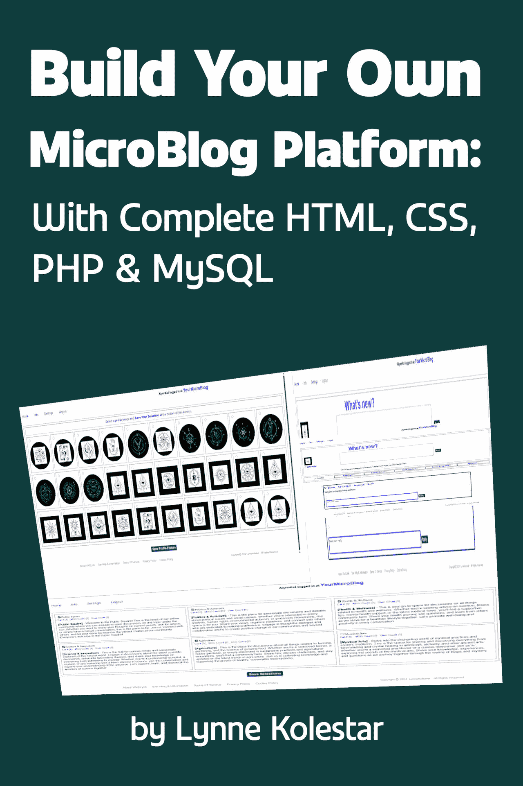

# 微博客平台构建指南：包含完整的 HTML、CSS、PHP & MySQL 代码



## 引言

### 微博客平台概述

#### 微博客的重要性与流行

微博客已成为数字时代的关键组成部分，为用户提供了一个向广泛受众分享短而简洁的更新、想法和多媒体内容的平台。与传统的博客（通常涉及更详细、更长的文章）不同，微博客强调快速和即时的通信，提供了一种独特且响应迅速的互动方式。它适应了现代通信快节奏的特点，在这些环境下，用户看重信息的快速消费和高效共享。

微博客的影响和流行通过`Twitter`和`Tumblr`等平台的成功得到了证明。于 2006 年启动的`Twitter`以其 280 个字符的限制彻底改变了在线通信，鼓励用户快速、简洁地分享实时更新、观点和新闻。它已成为突发新闻、公共讨论和专业社交网络的首选平台，拥有数百万每日发布内容的活跃用户。`Twitter`的影响力已超出社交媒体，影响了政治、新闻业和营销领域。该平台随后进行了更名，现在被称为`X`。

`Tumblr`是另一个流行的微博客网站，提供了更丰富的多媒体的体验，允许用户发布文本、图像、视频和 GIF。它培养了一个多元且富有创造力的社区，用户可以关注感兴趣的话题、与内容互动，并通过可自定义的博客表达自我。`Tumblr`对创意和社区的强调使其成为小众兴趣和粉丝社区的独特空间。

`Medium`是另一个介于微博客和传统博客之间的微博客平台。虽然它允许发布较长的文章，但也支持更短的、易于分享和消费的快速阅读内容。`Medium`吸引了从专业作家到业余博主的各种用户，他们欣赏其简洁的设计以及触达更广泛受众的能力。

微博客平台的兴起反映了人们参与在线内容方式的变化。这些平台使用户能够快速分享想法，触达全球观众，并轻松地参与更大规模的话。无论是为了个人表达、新闻传播还是专业社交，微博客已成为数字时代至关重要的工具。随着对实时信息即时连接的需求增长，微博客平台在塑造在线话语中的作用将继续扩大。

#### 微博客网站的关键特征

微博客平台的设计旨在分享简短而有影响力的信息，这使其与传统的博客平台区分开来。其关键特征侧重于使用户能够快速高效地通信，促进参与和实时互动。

微博客网站最基础的特征之一是字符限制或帖子长度限制。这一特征鼓励用户简洁地表达想法，导致更具针对性和更直接的通信。例如，`X`的 280 个字符限制迫使用户将信息提炼到本质，这已成为该平台的一个定义性特征。这种简洁的格式使内容易于消化，使用户可以快速扫描帖子并以最小的精力保持信息更新。

另一个关键特征是实时内容流，它根据用户的偏好和参与度，按时间顺序或算法显示帖子。这个内容流是微博客平台的心脏，不断用新内容刷新。它通过提供来自用户关注的人、品牌或主题的持续更新流，让用户保持参与度。内容流的即时性支持实时通信，使微博客平台成为突发新闻、直播活动更新和趋势讨论的首选媒介。

用户互动工具如`点赞 (likes)`、`转发 (retweets)`、`转博 (reblogs)`和`评论 (comments)`是促进微博客平台社区参与的重要特征。这些工具允许用户对内容进行响应、分享和放大，创建一个动态且互动的环境。例如，`X`的转发功能允许用户快速与其粉丝分享内容，有助于了信息的病毒式传播。同样，`Tumblr`的转博功能允许用户在自己的博客上选择和组织内容，同时与原始贴文进行互动。

定制化和个性化也是微博客平台的重要特征。个人资料定制允许用户通过个人头像、简介以及背景图像或主题等设计元素来表达个人个性。例如，`Tumblr`提供了大量的自定义选项，允许用户创建独特且具有视觉吸引力的博客，以反映他们的个人风格或品牌身份。个性化也延伸到内容发现，算法会根据用户的兴趣和行为建议感兴趣的帖子、话题标签或应关注的账号。

最后，多媒体支持是丰富微博客体验的关键特征。用户不仅可以分享文本，还可以分享图像、视频、GIF 和链接，为他们的帖子增加深度和多样性。这种多媒体整合在`Tumblr`这样的平台上尤为突出，视觉方面在那里起着重要作用。

### 本书将涵盖的内容

#### 构建微博客平台的逐步指南

本书旨在引导你从零开始构建自己的微博客平台的整个过程。无论你是经验丰富的开发人员还是初学者，这本逐步指南将为你提供使用`HTML`、`CSS`、`PHP (PDO)`和`MySQL`创建功能完全的微博客网站所需的知识和工具。

旅程从 Web 托管和域名注册的基础知识开始，在其中你将学习如何选择正确的域名，并获得具有无限电子邮件地址和`MySQL`数据库等功能的可靠网络托管。你将接触支持通过`FTP`轻松上传自定义构建代码的托管提供商。这一基础对于设置你的微博客平台运行和蓬勃发展的环境至关重要。

接下来，本书将深入介绍完整的开发过程，从设置本地和远程开发环境开始。你将学习如何使用`XAMPP`、`WAMP`或`Linux`等工具安装和配置本地服务器，以便在上线之前对网站进行开发和测试。从那里开始，我们将转向在`MySQL`中创建数据库结构，你将在其中实现存储用户、帖子、类别等的表。该数据库将成为你微博客平台的骨干，确保所有用户生成的内容都能高效地存储和检索。

数据库设置好后，你将开始使用`PHP (PDO)`开发微博客网站的核心功能。本指南将引导你完成构建组件的每个步骤，例如用户注册和登录系统、会话管理和类别管理。你将在为微博客平台开发的实际代码旁边，获得清晰的逐步的说明。这种方法确保你不仅理解如何实现这些功能，还了解如何在你自己的项目中进行调整和部署。

随着学习的深入，本书将引导你使用`HTML`和`CSS`设计网站的前端。你将学习如何创建一个在不同设备上无缝运行的响应式布局，并学习如何应用现代样式技术，让你的微博客看起来既精美又专业。书中还将向你介绍流行的`CSS`框架，帮助你通过预构建组件来增强网站的设计。

最后，本书还涵盖了高级功能，例如实现搜索功能、添加点赞和评论等用户交互功能，以及对你的网站进行性能优化。你将学习如何测试和调试代码、保护你的平台免受常见漏洞的影响，并将你的网站部署到实时服务器。在读完这本书后，你将构建出一个完整的微博客平台，你可以对其进行自定义、扩展，甚至将其作为一个真实的项目进行发布。

#### `HTML`、`CSS`、`PHP`和`MySQL`的全面代码示例

本书最有价值的方面之一是它承诺提供一个使用`HTML`、`CSS`、`PHP`和`MySQL`构建的全面、真实的微博客平台。书中包含的代码片段不仅是理论——它们是实用的且功能完备的，为你扩展微博客平台或追求进一步的网络编程活动奠定了坚实的基础。

本书的每一章都提供了对你的微博客程序至关重要的详细代码，说明了所讨论的概念和技术。随着学习的进展，你将处理用于创建响应式且用户友好界面的完整`HTML`结构。重点将放在平台的核心功能上，但这些示例将引导你构建从首页布局到单个帖子页面以及用户配置的各个元素，确保你的平台运行有效并呈现出精美、专业的外观。

提供的`CSS`示例将指导你对微博客平台进行样式化，以符合现代网页设计标准。你将学习如何使用自定义样式创建具有视觉吸引的设计，以及如何利用流行的`CSS`框架。无论你的目标是极简设计还是更动态、色彩丰富的界面，这些`CSS`示例将赋予你实现愿景的灵活性。

在后端，本书深入探讨了`PHP`，这是驱动你的微博客平台运行的脚本语言。`PHP`代码涵盖了广泛的功能，从用户注册登录系统到会话管理和数据处理。你将学习编写安全、高效的`PHP`脚本，使其能与用户交互以及你的`MySQL`数据库无缝对接，确保你的平台既健壮又具扩展性。

提供的`MySQL`代码同样全面，指导你完成设置和管理数据库的过程。你将学习如何创建和操作表、存储用户数据、管理帖子，以及处理类别和标签。书中还涵盖了高级`SQL`查询，使你能够实现搜索功能、帖子过滤和数据聚合等功能。这些示例将为你构建一个健壮的、数据库驱动的应用程序提供基础，能够处理日益增长的用户群需求。

在整本书中，脚本的呈现方式鼓励实践学习。你可以轻松地自己编写和测试代码，确保你在构建微博客平台的过程中获得实践经验。在书结束时，你不仅将拥有一个功能完全的微博客平台，还将对每个部分拼图如何组合在一起有更深入的理解。

#### 关于主机托管、域名注册和部署的实用技巧

除了提供详细的代码和开发指导外，本书还涵盖了让你的微博客平台上线的关键步骤。成功部署你的网站不仅仅是编写代码。

## 第 1 章：网络主机托管和域名注册入门

### 选择域名

#### 良好域名的重要性

在构建微博客平台时，选择域名是你将做出的最重要的决定之一。你的域名不仅仅是网络上的一个地址；它是你的网站给人的第一印象，也是你品牌身份的关键部分。一个良好的域名可以显著影响你平台的可见性、信誉和整体成功。

一个良好的域名应该是易记且易于输入的。在当今快速发展的数字世界中，用户通常在移动设备上浏览或在多个平台之间多任务处理。如果你的域名复杂、拼写困难或过长，潜在访问者可能难以记住或输入，从而导致流量流失。例如，像`mygreatmicroblog.com`这样的域名比复杂的或过度追求创意的替代方案更容易留在人们脑中。

此外，你的域名应该反映平台的内容和目的。在访问者点击链接之前，它应该让访问者立即感受到你的网站是关于什么的。一个相关的域名可以建立信任并设定正确的预期。例如，`quickpost.com`这样的域名清晰地传达了快速短内容的内容，使其成为微博客平台的一个强有力选择。

选择域名的另一个关键方面是它对搜索引擎优化（SEO）的影响。包含相关关键词的域名可以帮助提高你的网站在`Google`等搜索引擎上的排名。虽然精确匹配域名（与常见搜索查询完全匹配的域名）现在已不如以前那么关键，但在域名中加入一个与你平台利基领域相关的关键词仍然可以提供 SEO 优势。例如，如果你的微博客专注于科学类新闻，像`sciencebriefs.com`这样的域名可能有助于吸引搜索相关内容的用户。

一个好的域名是简单性、相关性和战略性关键词使用的结合体。它是建立你微博客平台身份的关键元素，并在吸引和留住访问者发挥着重要作用。花时间选择正确的域名从长远来看是值得的，它将帮助你的网站在竞争激烈的数字领域版图中脱颖而出。

#### 选择正确域名的技巧

选择正确的域名是建立在线形象的关键步骤。你的域名不仅是用户找到你网站的地址，它还是你品牌身份的一个关键要素。以下是一些基本的技巧，可以帮助你选择一个能让你的微博客平台成功的域名：

##### 保持简短简单

简短、简单的域名更容易让用户记忆、输入和分享。目标是一个简洁的名字，理想情况下在 6-14 个字符之间。避免使用复杂的单词、数字或连字符，因为这些可能会误导用户并增加拼写错误的概率。像`QuickNews.com`这样直截的名字比`Qw1ck-Noos.com`这样的名称更有效且对用户友好。

##### 让它易于记忆

你的域名应该是容易回忆的。一个难忘的名字会留在访问者的脑海中，让他们更有可能回到你的网站或将其推荐给他人。思考一些响口、具有品牌感或能引起与你微博客平台焦点相关联象的名字。例如，`BlueMoon.com`可能非常适合致力于发启发性内容的平台。

##### 包含相关关键词

在域名中加入相关关键词可以提升你网站的搜索引擎优化（SEO）。虽然为了 SEO 益处不再需要拥有精确匹配域名，但包含反映你网站内容的关键词有助于搜索引擎排名，并让访问者明确你网站的用途。例如，如果你的微博客专注于旅游，像`TravelTime.com`这样的名称能立即告诉用户他们可以在你的平台上找到什么。

##### 选择正确的域名后缀

域名后缀是域名末尾的后缀，例如`.com`、`.net`或`.org`。`.com`后缀最流行且最受广泛认可，是大多数网站的首选。然而，如果你想要的名称的`.com`版本不可用，可以考虑其他后缀，如`.net`、`.co`或特定行业的选项如`.blog`。如果你居住在美国境外，可能适合使用你国家的域名后缀，例如加拿大的`.ca`或澳大利亚的`.au`。注意你的目标受众如何看待这些后缀；虽然`.com`通常被认为更具信誉或公信力，但如果备选方案与你的品牌相符，选择良好的备选方案也是有效的。

##### 避免商标问题

在确定域名之前，请确保它没有侵犯任何现有的商标。选择与知名品牌太相似的名字可能会导致法律问题和用户之间的困惑。进行商标检索，并并在社交媒体平台上检查你的域名的可用性，以确保它是唯一的，且不与已建立的品牌冲突。

##### 考虑长期增长

在选择域名时，请考虑你微博客平台的长期目标。虽然选择一个反映当前趋势的名字很有诱惑力，但选择一个随着你网站演变而保持相关性的名字是很重要的。像`TechNews.com`这样的名字如果你将来决定扩展到技术领域之外，可能会限制你，而像`DigitalStream.com`这样更宽泛的名字则允许更大的灵活性。

##### 测试一下

在提交域名之前，请与朋友、同事或潜在用户进行测试。大声读出这个名字，看看它有多容易被理解和拼写。你也可以运行一个小投票或调查，获取有关该名称如何与你的目标受众产生共的反馈。这一步可以帮助你避免潜在的陷阱，确保你的域名具有预期的影响。

通过遵循这些技巧，你可以选择一个不仅能有效代表你的微博客平台，还能帮助你建立强大、可识别品牌的域名。选择良好的域名是一项宝贵的资产，将为你的网站在数字领域的成功做出贡献。

### 注册你的域名

注册域名是启动微博客平台的关键步骤。你的域名是用户找到你网站的唯一地址，选择正确的注册商可以通过提供托管、电子邮件、SSL 证书等额外服务来简化过程。

在本书中，我们使用`Netfirms`作为示例来引导你完成域名注册过程，为你所有的网络托管需求提供全面的解决方案。然而，我们将涉及到其他方法和提供商，让你能够灵活选择最适合你项目的选项。

#### 第一步：选择你的域名

从选择一个代表你的品牌并与你微博客平台内容相符的域名开始。请参考之前的技巧，了解如何选择一个易记、相关且易于输入的域名。

#### 第二步：选择域名注册商

在本书中，我们推荐使用`Netfirms.com`进行域名注册。然而，你可以选择任何适合你注册商。像`Netfirms`、`Bluehost`、`HostGator`和`Namecheap`这样的注册商不仅帮助注册域名，还提供托管、电子邮件、SSL 证书等等网络服务。这些提供商适用于新手和资深用户，提供免费 SSL 证书、无限 MySQL 数据库以及通过 Web 界面或 FTP 进行的管理。

#### 第三步：检查域名可用性

使用你选择的注册商提供的域名工具，检查你想要的域名是否可用。只需将名称输入搜索框，注册商将告知你是否可用，或建议替代方案。例如，`Netfirms`让这个过程非常简单，向你显示可用的后缀和可能适用于你网站的类似名称。

#### 第四：选择域名后缀

为你的网站选择合适的域名后缀，例如`.com`、`.net`或`.org`。`Netfirms`和`Bluehost`等提供商提供了广泛的后缀，包括国家特定和行业特定的选项如`.blog`或`.tech`。后缀的选择应反映你网站的用途和观众。

#### 第五步：添加域名隐私保护（可选）

考虑添加域名隐私保护以保护你的个人信息。大多数注册商（包括`Netfirms`和`namecheap`）都提供此服务，防止你的联系详情出现在公共 WHOIS 数据库中，保护免受垃圾邮件和潜在安全风险的影响。

#### 第六步：完成注册表单

请在注册表单上填入您的个人或业务信息，例如姓名、地址、电话号码和电子邮件地址。确保所有细节准确，因为这些信息将确定您对域名的所有权。像`Netfirms`这样的公司简化了这一过程，让您可以轻松注册域名并设置与域名关联的电子邮箱账户等额外服务。他们提供优秀的 24 小时在线聊天支持服务。

#### 第 7 步：选择注册期限

决定您想要注册域名的时间，通常从一年到十年不等。虽然你可以注册一年，但较长时间的期限通常会有折扣，并能提供您的域名不会意外过期的安心感。大多数注册商（包括`Netfirms`和`HostGator`）都允许您通过其用户友界面轻松续费域名。

#### 第 8 步：检查并确认您的订单

在完成注册之前，请检查所有细节，包括域名、后缀、注册期以及任何隐私保护等额外服务。双重检查一切以确保没有错误，然后进入结账页面。

#### 第 9 步：支付

使用您偏好的方法（如信用卡/借记卡）完成支付流程。像`Netfirms`和`Bluehost`这样的公司提供安全的支付选项，通常为新客户提供优惠折扣。

#### 第 10 步：访问您的域名管理面板

支付成功后，您将获得访问域名管理面板的权限。在这里，您可以管理域名的各个方面，从续费到设置邮箱账户以及配置 DNS 设置。像`Netfirms`这样的供应商提供直观的网页界面，让您可以轻松管理域名，即使您是网站管理的新手也可以。通过`Netfirms`，您无需对域名进行任何更改，并随时可以通过他们的 24 小时在线技术支持获取帮助。

#### 第 11 步：设置主机托管并连接您的域名

许多域名注册商还提供主机托管服务，使您的域名能够轻松连接到托管计划。像`Netfirms`、`Bluehost`和`HostGator`这样的公司提供全面的托管包，包括无限邮箱地址、免费的`SSL`证书和无限`MySQL`数据库——这些功能对于构建和管理微博客平台特别有价值。对于您的第一个微博客站点，一个包含这些功能（无限邮箱、无限数据库和免费`SSL`）的基础托管计划对于起步至关重要。

#### 第 12 步：通过网页界面或 FTP 上传您的网站

设置托管完成后，您可以开始复制书中的微博客文件并将其上传到您的服务器。大多数托管供应商提供易于使用的网页界面，并为高级用户提供`FTP`访问权限。这种灵活性确保了您可以以最符合您需求的方式管理网站。

#### 第 13 步：完成 DNS 设置

如果您在同一家供应商处注册了域名并设置了托管，您的`DNS`设置可能会自动配置。如果不是，您将需要更新域名的`DNS`设置以指向您的托管提供者的服务器。例如，`Netfirms`通过代您处理`DNS`配置简化了这一过程，确保您的域名正确链接到您的网站。

通过遵循这些步骤，您将完成域名注册，您的微博客平台也准备就绪了。在`Netfirms`、`Bluehost`和`HostGator`等服务的帮助下，您可以在这里管理从域名注册到主机托管的所有内容，使过程无缝且高效。这种全面的方法确保了您的网站是安全、可靠且供全球用户访问的。


# 选择主机托管计划

## 主机托管服务概述

选择正确的主机托管计划对于您的微博客平台的成功至关重要。主机托管服务提供了让网站在互联网上运行所需的基础。这里有一份简单的指南，帮助您理解主机托管并选择适合您需求的计划，使用了如`Netfirms`等提供的简单、易于管理的选项。

## 什么是主机托管？

主机托管是一种允许您将网站文件存储在服务器上的服务，用户通过互联网访问这些文件。当有人在浏览器中输入您的域名时，托管服务会将网站内容传递给他们。主机托管服务有很多类型，包括共享托管、`VPS`（虚拟专用服务器）托管、独立托管和云托管。对于大多数新的微博客平台，共享托管计划通常足够且具有效益。

## 需要寻找的基本功能

在选择主机托管计划时（特别是如果您刚刚开始），请关注提供基本功能的计划。像`Netfirms`这样的服务提供了这些：

### 无限邮箱账户

您可以创建所需数量的邮箱地址，且都使用您的域名（例如`info@yourdomain.com`）。此功能对于专业交流至关重要，有助于建立您的品牌信誉。

### 无限数据库

`MySQL`数据库用于存储和管理内容。无限数据库计划确保您具有扩展的灵活性而不会耗尽空间。

### 免费 SSL 证书

`SSL`（安全套接层）证书对于加密您的站点与其访问者之间传输的数据至关重要。许多托管计划（包括`Netfirms`的计划）都提供免费的`SSL`。这对于保护敏感信息和启用`HTTPS`增强您的网站信誉至关重要。

### 易于管理

寻找提供用户友好控制面板或网页界面以管理您网站的托管计划。`Netfirms`和类似的供应商提供直观的仪表板，让您可以轻松处理域名设置、邮箱账户、数据库等。

### 价格实惠

选择一个价格清晰、易于管理的年费托管计划。例如，`Netfirms`提供了具有竞争力的费率，包含了所有基本功能。这让您能够有效规划预算并避免意外支出。

## 升级到业务计划

随着您的微博客平台增长并吸引更多访问者，您可能需要升级到更高级的托管计划。业务计划通常提供更增强的功能，例如更多的服务器资源、更好的性能和额外的支持。像`Netfirms`这样的供应商提供可扩展的选项，允许您在网站需求扩大时无缝升级。

业务计划可能包括：

### 增加的存储和带宽

以处理更高的流量和更大容量的内容，而不影响性能。

### 增强的安全功能

针对网络威胁和数据泄露的额外保护层。

### 优先支持

更快的响应速度和专的客户服务，以及时解决任何技术问题。

## 做出选择

对于大多数新的微博客站点，从`Netfirms`等供应商处开始基础托管计划是一个务实且具有效益的选择。该计划将为您提供启动和有效管理网站所需的所有工具。当您的网站获得势头且需求增长时，您可以轻松升级到业务计划，以适应增加的流量和额外需求。

通过选择一个价格合理且具备核心功能的托管计划，你将为微博客平台的成功奠定坚实的基础。专注于寻找一个提供简单性、可靠性和可扩展性的计划，你将为网站的后续发展和增长做好充分准备。

# 无限电子邮件地址和 MySQL 数据库的重要性

在为你的微博客平台选择网络托管计划时，需要考虑的两个关键功能是无限电子邮件地址和无限`MySQL`数据库。这些功能不仅仅是为了方便——它们对于确保你的网站运行顺畅并随着你需求的增长进行有效扩展至关重要。

### 无限电子邮件地址

拥有无限电子邮件地址对于维护专业且组织井然的通信系统至关重要。对于微博客平台，你需要各种电子邮件账户来处理业务的不同方面。例如，你可以为客户支持、用户查询、时通讯和通知创建单独的地址。这种分段有助于更有效地管理通信，并确保查询被引导至相应的部门或团队成员。

此外，无限电子邮件计划提供了灵活性，可以随着网站的增长或团队的扩大创建新的电子邮件地址。你无需担心电子邮件账户用尽，也不会为每个新地址支付额外费用。这对于处理日益增加的用户交互以及高效管理平台的不同方面特别为重要。

### 无限 MySQL 数据库

`MySQL`数据库对于存储和管理微博客网站所需的各种数据类型至关重要，包括用户信息、帖子、评论和网站设置。有了无限`MySQL`数据库，你可以有效地组织和分离数据，而无需担心存储限制。这种灵活性允许你为用户管理、内容存储和分析维护不同的数据库，增强你网站的可扩展性。

随着平台的增长，你可能需要引入新功能或应用程序，每个应用都可能需要自己的数据库。无限数据库简化这一过程，帮助你保持网站的有序和高效。它们还通过允许你在隔离的环境中创建备份、测试新功能和对配置进行实验，促进了更好的数据管理和安全性。这确保了更新和更改在上线之前经过彻底审核，维护了网站的稳定性。

# 网络托管提供商推荐（Netfirms, Bluehost, HostGator 等）

选择正确的网络托管提供商对于微博客平台的成功发布和管理至关重要。有几个声誉良好的托管提供商提供了适用于各种需求的功能。

以下是一些值得考虑的顶级推荐，包括`Netfirms`、`Bluehost`和`HostGator`：

### Netfirms

对于那些寻求全面、一站式网络托管解决方案且完全适用于微博客平台的人来说，这是一个稳实的选择。

*   **价格实惠的计划**：`Netfirms`提供了具有竞争力的托管计划，包含了无限电子邮件地址和`MySQL`数据库等基本功能。他们的定价结构设计得易于负担，特别是对于初学者而言。

*   **用户友好界面**：控制面板简单直观，使用户易于管理他们的域名、电子邮件和数据库。这种简单性对于新接触网络托管的用户来说非常理想。

*   **免费 SSL 证书**：`Netfirms`在其托管计划中包含了免费的`SSL`证书，确保你的网站是安全的并与访问者建立信任。

*   **可靠的支持**：他们提供响应迅速的客户支持来协助解决可能出现的任何问题，帮助确保你的网站运行顺畅。

### Bluehost

`Bluehost`是另一个流行的网络托管提供商，以其强大的功能和用户 friendly 服务闻名。

*   **全面的托管计划**：`Bluehost`提供了多种适用于不同需求的计划，包括无限电子邮件地址和`MySQL`数据库的选项。这使其可行。

*   **WordPress 集成**：`Bluehost`受到`WordPress`的官方推荐，使其成为很棒的选择。

*   **性能和可用性**：`Bluehost`以其可靠的性能和高可用性闻名。

*   **24/7 支持**：他们的客户支持全天候可用。

### HostGator

`HostGator`提供了多种适用于不同需求的功能。

*   **灵活的托管选项**：`HostGator`提供了多种计划，包括无限电子邮件地址和`MySQL`数据库。

*   **可扩展性**：`HostGator`的托管解决方案具有高度的可扩展性，允许你轻松升级网站。

*   **用户友好的工具**：他们提供了一系列工具和用户 friendly 界面。

*   **强大的支持**：`HostGator`拥有知识库、在线聊天和电话支持。

### 额外推荐

虽然`Netfirms`、`Bluehost`和`HostGator`是很好的选择，但根据你的需求，还有其他值得考虑的提供商。

*   **SiteGround**：以其卓越的客户支持和性能闻名，`SiteGround`提供一系列具有强大性的托管计划。

*   **InMotion Hosting**：提供可靠的托管服务、可扩展的计划并注重客户服务。

# 设置托管环境

一旦你选择了网络托管提供商并购买了域名和托管计划，下一步的关键步骤就是配置你的网络空间。这一过程涉及设置托管环境，以确保你的微博客平台顺畅高效运行。

以下是配置网络空间的步骤指南：

### 访问托管控制面板

配置网络空间的第一步是登录你的托管提供商的控制面板。这是你管理托管帐户、域名和其他设置的主要界面。大多数托管提供商提供用户 friendly 控制面板，例如`cPanel`或自定义仪表板，你可以在其中访问各种功能和工具。在托管提供商发送的欢迎邮件中查找登录详情并说明。

### 设置域名

如果你是从独立的注册商购买的域名，你需要将其指向你的托管账户。这涉及到更新域名的`DNS`（域名系统）设置，将流量引导至你的托管提供商服务器。在你的控制面板中找到`DNS`管理部分，输入托管提供商提供的名称服务器。此过程可能需要一些时间在互联网上生效，通常需要 24 到 48 小时。

在第 3 章中，我们将提供有关为你的微博客平台设置`MySQL`数据库的详细指南。本章将引导你完成整个流程，从创建新数据库到有效管理你的网站数据。你将首先访问控制面板中的`MySQL`部分，在其中创建必要的数据库并为它们命名。此外，你还将为每个数据库创建具有相应权限的用户账户。务必安全地存储你的数据库凭据——例如数据库名称、用户名和密码——因为你在配置网站后端时会需要它们。

## 上传你的文件

当域名和数据库准备就绪后，你就可以将网站程序和脚本文件上传到你的托管服务器了。第 2 章介绍了如何使用`FTP`客户端或控制面板中的文件管理器来完成此任务。请确保将文件放置在相应的目录（通常是`public_html`或`www`），以确保网站内容能够正确显示。如果你正在使用如`WordPress`这样的内容管理系统 (`CMS`)，你需要上传`CMS`文件并遵循其安装说明。

## 配置电子邮件账户

如果你的托管计划包含无限数量邮箱地址，可以使用控制面板的邮件管理工具设置邮箱账户。为不同用途创建邮箱地址，例如`support@domain.com`或`info@domain.com`。根据需要配置邮件转发、自动回复和其他设置。这允许你有效地管理通信并保持专业的形象。

## 安装 SSL 证书

为了增加安全性，你应该安装`SSL`证书以在你的网站上启用`HTTPS`。这将加密网站与访问者之间传输的数据，增强安全性并建立信任。大多数托管提供商（包括`Netfirms`）在其计划中提供免费的`SSL`证书。在你的控制面板中，找到`SSL/TLS`部分并按照说明激活和配置你的`SSL`证书。

## 备份你的网站

定期备份对于保护网站数据至关重要。在你的托管控制面板中，设置自动备份或手动创建文件和数据库备份。将备份存储在安全位置（例如云存储服务），以确保在出现任何问题时快速恢复网站。

## 测试你的配置

设置好托管环境后，彻底测试你的网站以确保一切运行正常。检查域名是否已正确指向你的网站，所有页面和功能是否正常，以及邮箱账户是否按预期运行。执行这些测试，以便在公发布网站之前识别并解决任何问题。

### cPanel 或同等托管控制面板简介

在管理`Web`托管环境时，控制面板是一个必不可少的工具，它提供了一个集中界面来处理托管账户的各个方面。`cPanel`是最常用的控制面板之一，但也有其他功能类似的工具。了解如何导航和使用这些控制面板对于高效管理你的托管环境至关重要。

### 什么是 cPanel？

`cPanel`是一个易于使用的`Web`版控制面板，简化了托管账户的管理。它提供了一个图形化界面和自动化工具，旨在简化管理域名、数据库、邮箱账户和文件等任务。`cPanel`因其直观的设计而闻名，使得即使是技术经验有限的用户也能轻松上手。

### cPanel 的核心功能

- **域名管理**：`cPanel`允许你管理域名的所有方面。你可以添加新域名、配置子域名并设置域名重定向。你还可以管理`DNS`设置（例如添加或编辑`DNS`记录），以确保你的域名正确指向你的托管服务器。

- **文件管理**：通过`cPanel`的`File Manager`，你可以轻松上传、下载和组织网站文件。`File Manager`提供了一个简单的界面来管理文件，无需`FTP`客户端。你可以直接从控制面板创建、编辑和删除文件及目录。

- **数据库管理**：`cPanel`包含了创建和管理`MySQL`数据库的工具。`MySQL Databases`部分允许你创建新数据库、分配用户并管理数据库权限。它还集成了`phpMyAdmin`，这是一种流行的数据库管理工具，提供了一个基于`Web`的界面来执行更高级的数据库任务。

- **邮箱管理**：`cPanel`可以轻松创建和管理与你的域名相关的邮箱账户。你可以设置新的邮箱地址、配置邮件转发和自动回复，并管理邮箱别名。控制面板还提供`Webmail`访问权限，因此你可以从任何浏览器检查邮件。

- **安全功能**：`cPanel`提供了多种安全工具来保护你的网站和数据。你可以设置`SSL/TLS`证书、管理`IP`锁定并为目录配置密码保护。控制面板还包含监控安全和查看访问日志的工具。

- **备份与恢复**：`cPanel`提供了创建和管理网站文件及数据库备份的选项。你可以调度定期备份或根据需要创建手动备份。从备份恢复非常直观，允许你在出现问题时快速恢复网站。

### 同等托管控制面板

虽然`cPanel`是一个流行选择，但其他几个控制面板提供了类似的功能和易用性。包括：

- **Plesk**：`Plesk`是一个具有友好界面的强大托管控制面板。它支持`Linux`和`Windows`托管环境，并提供`cPanel`类似的功能，包括域名管理、文件管理和数据库管理。

- **DirectAdmin**：`DirectAdmin`是以简单高效著称的轻量级控制面板。它提供了管理域名、邮箱和数据库的核心功能，是寻求简单界面的用户的良好选择。

- **Webmin**：`Webmin`是一个开源控制面板，提供了一个用于管理`Unix`系统的`Web`界面。它为系统管理和托管管理提供了广泛的功能。

### 开始使用你的控制面板

按照以下步骤开始使用托管控制面板：

- **登录**：使用托管提供商提供的登录凭据访问控制面板。这通常涉及导航到特定的`URL`（例如`yourdomain.com/cpanel`）并输入你的用户名和密码。

- **熟悉环境**：探索控制面板的主要部分以了解其布局和功能。大多数控制面板都有仪表板或主页，可以快速访问关键工具和设置。

- **利用帮助资源**：许多控制面板内置了帮助文档或教程，以协助完成常见任务。利用这些资源学习如何执行特定操作并排查任何问题。

通过熟悉`cPanel`或你选择的控制面板，你将能够更高效地管理你的托管环境。这些知识对于维护你的微博客平台、处理技术任务以及确保网站增长期间的顺利运行至关重要。

# 第 2 章：FTP 和文件管理简介

### 理解 FTP

什么是`FTP`以及它为什么对`Web`开发至关重要

网站由包含代码的文本文件组成，这些文件通过编程命令相互连接。为了让你的网站可以在网上访问，你需要使用`FTP`（文件传输协议）将这些文件上传到你的网络托管空间。

使用`FTP`上传网站文件是一个简单的过程，允许你高效地从本地计算机传输内容到你的`Web`托管服务器。

要开始操作，你需要下载并安装`FTP`客户端，这是一种帮助你连接到`Web`托管服务器并管理文件的应用程序。流行且免费的`FTP`客户端包括`FileZilla`、`Cyberduck`和`WinSCP`。安装完成后，启动`FTP`客户端以开始设置过程。

打开`FTP`客户端后，你需要连接到你的`Web`托管服务器。这需要三项信息：`FTP`服务器地址（通常由你的主机提供商提供，通常显示为`ftp.domain.com`或`domain.com`）；你的用户名和密码（同样由你的主机提供商提供）；以及端口号（标准`FTP`通常设置为`21`，如果使用`SFTP`或`FTPS`，则使用不同的端口）。将这些详情输入到`FTP`客户端的连接设置中，并点击连接按钮建立与服务器的连接。

连接后，你会在`FTP`客户端中看到两个主窗格：一个显示本地计算机上的文件，另一个显示服务器上的文件。导航到服务器上你想要上传网站文件的目录，通常是`public_html`或`www`文件夹。如果你的托管设置为网站的不同部分包含了单独的文件夹，请确保将文件放置在正确的目录中。

要上传文件，只需将它们从本地窗格拖放到服务器窗格即可。你也可以使用`FTP`客户端提供的上传按钮或菜单选项。传输将开始，根据文件的大小和数量，这可能需要一些时间。你的`FTP`客户端将显示上传状态，包括进度和发生的任何错误。

上传完成后，验证所有内容都已正确传输非常重要。打开网页浏览器并访问你的域名，确保你的网站按预期运行。检查所有页面和功能是否工作正常，以及文件是否位于正确位置。

此外，你还可以使用`FTP`客户端管理服务器上的文件。这包括创建新目录、重命名或删除文件以及组织文件结构。定期管理文件有助于保持服务器的整洁，并确保你的网站保持高效且易于维护。

总结之，使用`FTP`上传网站程序和文件是管理网站内容的有效方法。通过遵循这些步骤，你可以高效地传输文件，保持网站组织整洁，并维持流畅的在线状态。

# 设置 FTP 客户端

安装和配置`FTP`客户端（例如`FileZilla`）的逐步指南

`FTP`客户端对于高效管理网站文件至关重要。最受欢迎和使用广泛的`FTP`客户端之一是`FileZilla`，它以用户友好的界面和强大的功能而闻名。本指南将引导你完成安装和配置`FileZilla`的过程，包括关于它是否免费以及在哪里下载的信息。

## 下载 FileZilla

`FileZilla`是一个免费开源的`FTP`客户端，这意味着你可以免费下载和使用。要开始操作，请访问`FileZilla`官方网站：[FileZilla 项目](https://filezilla-project.org)。在首页上，你会找到一个显著的下载链接。点击下载按钮获取适用于你操作系统（`Windows`、`macOS`或`Linux`）的安装程序。

## 安装 FileZilla

下载完成后，在计算机上找到安装文件并双击它以开始安装过程。安装向导将引导你完成各个步骤。系统会提示你选择安装选项，例如创建桌面快捷方式或选择附加组件。对于大多数用户来说，默认设置已经足够，因此你可以点击“下一步”然后点击“安装”来继续标准安装。安装完成后，点击“完成”退出安装程序。

## 启动 FileZilla

安装后，在应用程序或桌面上找到`FileZilla`并打开它（取决于你的安装偏好）。程序将启动并显示主界面，界面包含一个分分视图，左侧显示你的本地文件，右侧显示服务器文件。

## 配置 FileZilla

要连接到你的`Web`托管服务器，你需要用正确的设置配置`FileZilla`。

以下是操作方法：


# 使用 FileZilla 通过 FTP 上传文件

## 配置 FTP 连接

* **打开站点管理器**：在 FileZilla 界面中，进入菜单栏并点击“文件”，然后从下拉菜单中选择“站点管理器”。
* **添加新站点**：在站点管理器窗口中，点击“新站点”创建一个新的连接配置文件。为你的站点输入一个名称以便记忆（例如，你的域名）。
* **输入连接详情**：
  * **主机 (Host)**：输入你的 FTP 服务器地址（例如 `ftp.yourdomain.com`）。
  * **端口 (Port)**：FTP 的默认端口为 `21`，或者如果你使用安全连接，则为 `SFTP` 使用 `22`。
  * **协议 (Protocol)**：为标准 FTP 选择“FTP - 文件传输协议”，为安全连接选择“SFTP - SSH 文件传输协议”。
  * **加密 (Encryption)**：安全连接选择“如果可用，则使用显式 FTP over TLS”，标准连接选择“仅使用明文 FTP (不安全)”。
  * **登录类型 (Logon Type)**：将其设置为“常规”并输入你的 FTP 用户名和密码，这些是你从主机提供商处获取的。
* **连接**：点击“连接”建立与服务器的连接。如果一切设置正确，你将在右窗格看到服务器的文件目录，在左窗格看到本地文件。

## 使用 FileZilla

连接后，你可以使用 FileZilla 在本地计算机和服务器之间上传下载文件。上传文件，只需将文件从左窗格（本地文件）拖放到右窗格（服务器）。下载时，将文件从右窗格拖到左窗格。你还可以使用 FileZilla 界面管理服务器上的文件，例如创建目录、重命名文件和设置权限。

# 通过 FTP 上传文件

如何将你的文件上传到 Web 服务器

通过 FTP 向 Web 服务器上传文件是 Web 开发中的一项基础任务，允许你将内容从本地计算机传输到在线空间。这一过程对于让你的网站上线并确保所有文件都正确放置至关重要。

## 连接到你的服务器

在上传文件之前，你需要在 FTP 客户端和 Web 服务器之间建立连接。打开你的 FTP 客户端（如 FileZilla），并在站点管理器中输入服务器地址、用户名和密码。点击“连接”启动连接。连接后，你会在 FTP 客户端中看到两个主窗格：左窗格显示你的本地文件，右窗格显示服务器上的文件。

## 导航到目标目录

在右窗格中，导航到服务器上你想要上传文件的目录。通常情况下，这是 `public_html` 或 `www` 文件夹，它是你网站的根目录。如果你的托管设置为网站的不同部分包含了额外的文件夹，请确保你处于放置这些文件的正确目录中。

## 选择要上传的文件

在左窗格中，找到你本地计算机上想要上传的文件或文件夹。你可以按住 Ctrl 键（macOS 上为 Cmd 键）点击项目，以便一次选择多个文件或整个文件夹。

## 上传文件

要开始上传过程，将选定的文件从左窗格拖动并释放到右窗格，即代表你的服务器目录。或者，你可以使用“上传”按钮或菜单选项。传输将开始，你将看到状态指示。

## 监控传输

大多数 FTP 客户端提供窗口或状态栏来显示正在进行的传输状态。如果在传输过程中发生错误，客户端通常会提供详细信息，以便你及时解决问题。

## 验证上传

上传完成后，验证文件已正确传输非常重要。打开浏览器并访问你的网站，确保所有内容如预期显示。检查页面、图片以及脚本文件是否运行正常。

## 在服务器上管理文件

一旦文件已上传，你可以使用 FTP 客户端直接在服务器上管理它们。这包括重命名、移动或删除文件以及创建目录。定期管理服务器文件有助于保持良好的结构并确保网站高效运行。

总结来说，通过 FTP 上传文件是一个简单的过程，在 Web 开发中起着至关重要的作用。遵循这些步骤，你可以高效地传输网站内容到服务器，确保网站在线并按预期运行。

# 在服务器上组织你的项目文件

妥善组织服务器上的项目文件对于维护结构良好且易于管理的网站至关重要。有效的文件组织不仅有助于保持网站内容的井洁，还能增强开发和维护过程的效率。以下是如何使用 FTP 组织服务器上的项目文件的方法：

## 1. 建立逻辑文件夹结构

首先在服务器上创建一个逻辑文件夹结构。这涉及设置反映网站组织结构的目录。

常用的文件夹包括：

- `public_html` 或 `www`：这是根目录，网站文件应在此处上传。所有主文件如 HTML、CSS、JavaScript 和图片都应放在这里。
- `images`：用于存储图片的专用文件夹。这可以将所有图片保持在一个地方，并便于在网站内部引用。
- `css`：专门用于定义网站样式的 CSS 文件。将 CSS 文件分开可确保更好的组织和便于维护。
- `js`：用于存放添加交互功能的 JavaScript 目录。这种分离有助于高效管理脚本文件。
- `includes` 或 `partials`：如果你的网站使用可用的组件或包含文件（例如页眉、页脚或导航栏），将它们存储在单独的文件夹中有助于保持模块化和有序。

## 2. 将文件上传到相应的目录

一旦建立了文件夹结构，请将文件上传到相应的目录中。例如，将所有 CSS 文件上传到 `css` 文件夹，将 JavaScript 文件上传到 `js` 文件夹。这种组织有助于维护整洁有序的文件系统，使定位和管理特定文件变得更容易。

## 3. 使用描述性文件名

为文件和文件夹命名时，使用能明确指示用途的描述性名称。例如，不要将文件命名为 `image1.jpg`，如果它是页眉背景图，请使用 `header-background.jpg` 这样的名称。描述性文件名更容易识别和管理文件，特别是随着你项目的增长。

## 4. 维护一致的命名规范

一致性是文件组织的关键。为文件和文件夹建立并遵循一种命名规范。例如，你可能选择使用小字母加连字符作为文件名（`about-us.html`），并避免使用空格。一致的命名规范可以减少引用文件时出现混乱和错误的风险。

## 5. 定期检查和清理

定期检查服务器的文件结构，以确保其保持有序。删除过时或未使用的文件和目录以防止混乱和混乱。定期的维护有助于保持项目的可管理和高效。

## 6. 实现访问控制

如果你的托管提供商允许，考虑实施访问控制以保护敏感文件或目录。例如，你可能限制对配置文件或网站管理部分的访问。适当的访问控制可以增强安全性，并确保只有授权用户可以修改关键文件。

## 7. 备份你的文件

定期备份项目文件以防止数据丢失。大多数 FTP 客户端都允许你下载文件。如果你的托管提供商提供备份服务，请启用它们。

# 本地开发环境

在本地开发环境中，调试和故障排除会更易管理。你可以使用各种工具和调试技术，而不会影响实时网站。任何错误或问题都可以在部署之前解决，从而降低向面向用户的站点引入 Bug 或问题的风险。

## 6. 离线开发

本地开发允许你在没有互联网连接的情况下继续进行项目。这在你正在旅行或在网络访问不稳定的地区工作时尤为有用。你可以持续进展而不受干扰，并在重新上线后将更改同步到实时服务器。

## 7. 模拟生产环境

通过建立一个与你的 Web 托管服务器配置高度镜像的本地环境，你可以模拟生产状况，并测试网站在真实场景中的性能。这有助于在部署之前识别潜在问题，并确保向实时服务器的平稳过渡。

在部署到 Web 托管服务器之前本地开发具有许多优势，包括更快的开发速度、节省成本、增强安全性以及对开发环境有更好的控制。通过利用本地开发设置，你可以更有效地构建、测试和完善你的项目，从而在上线时获得一个更稳定、更完善的最终产品。

# 安装本地服务器环境（Windows & Linux）

## 如何为本地开发安装 XAMPP 或 WAMP（Windows）

安装本地服务器环境是 Web 开发的关键步骤，因为它允许你在将网站或应用程序部署到实时服务器之前，在自己的计算机上进行构建和测试。对于 Windows 用户，两个流行的选项是 `XAMPP` 和 `WAMP`。它们都是易于安装的软件包，包含了 `Apache`、`MySQL` 和 `PHP`——这些都是本地 Web 服务器设置的核心组件。

### 安装 XAMPP

`XAMPP` 是广泛使用的开源软件包，提供了一种设置本地服务器环境的简单方法。以下是在 Windows 上安装 `XAMPP` 的方法：

1. **下载 XAMPP**：访问 XAMPP 官方网站并下载 Windows `XAMPP`。网站通常会提供软件最新版本。
2. **运行安装程序**：下载完成后，找到安装文件（通常命名为 `xampp-windows-x.x.x-x-installer.exe`）并双击它开始安装过程。
3. **遵循安装向导操作**：`XAMPP` 安装向导将引导你完成安装。点击“下一步”继续设置步骤。系统会提示你选择要安装的组件；默认选择（`Apache`、`MySQL`、`PHP` 和 `phpMyAdmin`）通常对大多数用户足够。点击“下一步”继续。
4. **选择安装目录**：选择你想要安装 `XAMPP` 的目录。默认位置通常是 `C:\xampp`。点击“下一步”继续。
5. **完成安装**：点击“安装”开始安装过程。完成后，点击“完成”退出向导。你可以选择立即启动 `XAMPP` 控制面板。
6. **启动 XAMPP**：打开 `XAMPP` 控制面板（在 `C:\xampp` 目录或通过开始菜单找到）。在控制面板中，点击每个模块旁边的“启动”按钮启动 `Apache` 和 `MySQL` 模块。这些服务对于运行本地服务器是必要的。
7. **访问你的本地服务器**：打开浏览器并在地址栏输入 `http://localhost`。你应该看到 `XAMPP` 欢迎页，这意味着你的本地服务器已启动运行。你现在可以将网站文件放置在 `XAMPP` 安装目录下的 `htdocs` 文件夹（例如 `C:\xampp\htdocs`）中开始开发。

### 安装 WAMP

`WAMP`（Windows, Apache, MySQL, PHP）是 Windows 上另一个流行的本地服务器环境。以下是安装 `WAMP` 的方法：

1. **下载 WAMP**：访问 WAMP 官方网站并下载适用于 Windows 的最新 `WAMP`。
2. **运行安装程序**：找到下载的安装文件（例如 `wampserver-x.x.x-x.exe`）并双击它开始安装过程。
3. **遵循安装向导操作**：`WAMP` 安装向导将引导你完成安装过程。点击“下一步”继续设置步骤。
4. **选择安装目录**：选择你想要安装 `WAMP` 的目录。默认位置通常是 `C:\wamp`。
5. **选择组件**：系统会提示你选择要安装的组件；默认选择（`Apache`、`MySQL`、`PHP` 和 `phpMyAdmin`）通常对大多数用户足够。点击“下一步”继续。
6. **完成安装**：点击“安装”开始安装过程。完成后，点击“完成”退出向导。
7. **启动 WAMP**：打开 `WAMP` 控制面板（在 `C:\wamp` 目录或通过开始菜单找到）。在控制面板中，点击每个模块旁边的“启动”按钮启动 `Apache` 和 `MySQL` 模块。
8. **访问你的本地服务器**：打开浏览器并在地址栏输入 `http://localhost`。你应该看到 `WAMP` 欢迎页，这意味着你的本地服务器已启动运行。你现在可以将网站文件放置在 `WAMP` 安装目录下的 `www` 文件夹（例如 `C:\wamp\www`）中开始开发。

## 1. 配置 PHP

### 访问 PHP 配置

**打开配置文件**：PHP 设置通过 `php.ini` 配置文件进行。在 `XAMPP` 中访问此文件，打开 `XAMPP` 控制面板并点击 `Apache` 旁边的“Config”按钮。从下拉菜单选择 `php.ini`。在 `WAMP` 中，点击系统托盘中的 `WAMP` 图标，导航到 `PHP` 并选择 `php.ini`。

**编辑 PHP 设置**：`php.ini` 文件包含你可以根据开发需求调整的各种设置。常见设置包括：

* `display_errors`：开发期间将其设置为 `On` 以直接在网页上显示错误信息。生产环境中将其更改为 `Off` 以向用户隐藏错误。
* `upload_max_filesize`：调整此值以设置 PHP 允许的最大文件大小。
* `max_execution_time`：如果你有需要更多执行时间的脚本，请增加此值。

**保存更改**：在进行必要的更改后，保存 `php.ini` 文件并通过 `XAMPP` 或 `WAMP` 控制面板重启 `Apache` 以使更改生效。

### 验证 PHP 配置

**创建 PHP 信息文件**：为了验证 PHP 配置正确，在 `htdocs` 目录（XAMPP）或 `www` 目录（WAMP）中创建一个名为 `info.php` 的文件。

**使用 Bluefish 等编辑器在此文件中添加以下代码**：

```php
<?php
phpinfo();
?>
```

**查看 PHP 信息**：打开浏览器并导航到 `http://localhost/info.php`。这将显示 PHP 配置的详细报告，包括版本信息和设置。确保所有配置已正确应用。

## 2. 配置 MySQL

### 访问 MySQL 配置

**打开 phpMyAdmin**：`XAMPP` 和 `WAMP` 都带有 `phpMyAdmin`，这是一个用于管理 MySQL 数据库的 Web 工具。在浏览器中导航到 `http://localhost/phpmyadmin` 来打开 `phpMyAdmin`。

**MySQL 设置**：你可以通过 `phpMyAdmin` 界面或通过编辑 `my.ini` 配置文件调整 MySQL 设置。在 `XAMPP` 中访问 `my.ini`，点击 `XAMPP` 控制面板中 `MySQL` 旁边的“Config”按钮并选择 `my.ini`。在 `WAMP` 中，你可以在 `WAMP` 菜单下的 `MySQL` 找到它。

`max_allowed_packet`：如果你需要处理大型 SQL 查询或数据导入，请增加此值。

`query_cache_size`：调整此设置以提高重复查询的性能。

创建和管理数据库：在 phpMyAdmin 中，你可以创建新数据库、管理现有数据库并设置用户权限。使用“数据库”（Databases）选项卡创建数据库，使用“用户”（Users）选项卡管理用户账户和权限。

安全 MySQL 安装：为了增加安全性，特别是如果你计划将本地环境暴露给他人，请为 MySQL 设置 root 密码。在 phpMyAdmin 中，你可以在“用户”（Users）选项卡下选择 `root` 用户并更新密码来设置。

## 3. 使用 PDO 进行数据库交互

### a. PDO 简介

PHP Data Objects (`PDO`) 是一种数据库访问层，提供了访问多个数据库的统一方法。`PDO` 提供了一种安全且灵活的方式与数据库进行交互，使其成为 PHP 应用中处理数据库操作的首选。

### b. 创建 PDO 连接

要使用 `PDO`，你需要建立到你的 MySQL 数据库的连接。

以下是在 PHP 中创建 `PDO` 连接的示例代码：

```php
<?php
$dsn = 'mysql:host=localhost;dbname=testdb;charset=utf8';
$username = 'root'; // MySQL username
$password = ''; // MySQL password

try {
    $pdo = new PDO($dsn, $username, $password);
    $pdo->setAttribute(PDO::ATTR_ERRMODE, PDO::ERRMODE_EXCEPTION);
    echo "Connected successfully";
} catch (PDOException $e) {
    echo "Connection failed: " . $e->getMessage();
}
?>
```

`$dsn`：数据源名称 (`DSN`) 包含连接数据库所需的信息，包括主机、数据库名和字符集。

`$username`：你的 MySQL 用户名，本地开发通常为 `root`。

`$password`：你的 MySQL 密码；如果还没有设置，请留空。

### c. 使用 PDO 执行数据库操作

以下是如何使用 `PDO` 执行基础数据库操作的示例：

插入数据：

```php
<?php
$sql = "INSERT INTO users (username, email) VALUES (:username, :email)";
$stmt = $pdo->prepare($sql);
$username = 'john_doe';
$email = 'john.doe@example.com';
$stmt->bindParam(':username', $username);
$stmt->bindParam(':email', $email);
$stmt->execute();
?>
```

检索数据：

```php
<?php
$sql = "SELECT * FROM users";
$stmt = $pdo->query($sql);
while ($row = $stmt->fetch(PDO::FETCH_ASSOC)) {
    echo "Username: " . $row['username'] . " - Email: " . $row['email'] . "<br>";
}
?>
```

在本地机器上配置 PHP 和 MySQL 并使用 `PDO` 进行数据库交互，可以确保你的开发环境稳健且安全。通过有效率设置和管理本地服务器环境，你可以简化开发流程并构建准备好部署的应用程序。

# 如何在 Linux 上安装 Apache、PHP、MariaDB 进行本地开发

在 Linux 系统上搭建本地开发环境涉及安装和配置 Apache（Web 服务器）、PHP（脚本语言）和 MariaDB（数据库服务器）。此设置将允许你在部署到生产服务器之前，在本地开发并测试你的 Web 应用程序。

以下是在 Linux 系统上安装和配置这些组件的步骤指南：


# 1. 安装 Apache

## a. 更新你的软件包列表

在安装 Apache 之前，更新你的软件包列表以确保你拥有可用软件包的最新信息。

打开终端并运行：

```bash
sudo apt update
```

## b. 安装 Apache

使用以下命令安装 Apache：

```bash
sudo apt install apache2
```

## c. 启动并启用 Apache

安装完成后，启动 Apache 并设置其为开机自启：

```bash
sudo systemctl start apache2
sudo systemctl enable apache2
```

## d. 验证安装

要确保 Apache 正在运行，打开浏览器并导航到 `http://localhost`。

你应该看到 Apache2 Ubuntu 或 Debian 默认页面，表明 Apache 已成功安装并运行。

# 2. 安装 PHP

## a. 安装 PHP

使用以下命令安装 PHP 及其必要的模块：

```bash
sudo apt install php libapache2-mod-php php-mysql
```

该命令会安装 PHP 以及 Apache PHP 模块和对 PHP 的 MySQL 支持。

## b. 验证 PHP 安装

要验证 PHP 是否与 Apache 正常工作，创建一个 PHP 信息文件。运行以下命令：

```bash
sudo nano /var/www/html/info.php
```

向文件中添加以下代码：

```php
<?php
phpinfo();
?>
```

保存文件并退出编辑器。打开浏览器并导航到 `http://localhost/info.php`。你应该看到 PHP 信息页面，确认 PHP 已正确安装并与 Apache 配置。

# 3. 安装 MariaDB

## a. 安装 MariaDB

使用以下命令安装 MariaDB：

```bash
sudo apt install mariadb-server mariadb-client
```

## b. 加固 MariaDB 安装

运行安全脚本来提高 MariaDB 安装的安全性：

```bash
sudo mysql_secure_installation
```

按照提示设置 root 密码并移除不安全的默认设置。

## c. 启动并启用 MariaDB

启动 MariaDB 并设置其为开机自启：

```bash
sudo systemctl start mariadb
sudo systemctl enable mariadb
```

## d. 验证 MariaDB 安装

要验证 MariaDB 是否正在运行，你可以登录 MariaDB 终端：

```bash
sudo mysql -u root -p
```

输入你在安全安装过程中设置的 root 密码。

# 4. 配置 Apache、PHP 和 MariaDB

## a. 为 Apache 配置 PHP

确保 Apache 配置处理 PHP 文件。默认情况下，`libapache2-mod-php` 包会处理这些，但你可以检查 `/etc/apache2/mods-enabled/dir.conf` 文件。

```apache
<IfModule dir_module>
    DirectoryIndex index.php index.html
</IfModule>
```

重启 Apache 以应用更改：

```bash
sudo systemctl apache2
```

## b. 配置 MariaDB

为你的应用程序创建一个新的 MariaDB 数据库和用户。登录 MariaDB 终端：

```bash
sudo mysql -u root -p
```

然后执行以下 SQL 语句：

```sql
CREATE DATABASE mydatabase;
CREATE USER 'myuser'@'localhost' IDENTIFIED BY 'mypassword';
GRANT ALL PRIVILEGES ON mydatabase.* TO 'myuser'@'localhost';
FLUSH PRIVILEGES;
EXIT;
```

# 5. 测试你的设置

## a. 创建测试脚本

创建一个测试 PHP 脚本来连接你的 MariaDB 数据库。将以下代码保存为 `/var/www/html` 目录下的 `db_test.php`：

```php
<?php
$dsn = 'mysql:host=localhost;dbname=mydatabase;charset=utf8';
$username = 'myuser';
$password = 'mypassword';

try {
    $pdo = new PDO($dsn, $username, $password);
    $pdo->setAttribute(PDO::ATTR_ERRMODE, PDO::ERRMODE_EXCEPTION);
    echo "Connected successfully";
} catch (PDOException $e) {
    echo "Connection failed: " . $e->getMessage();
}
?>
```

在浏览器中访问 `http://localhost/db_test.php`。如果配置正确，你将看到“Connected successfully”的消息。

打开您的浏览器并访问 [Netfirms](https://www.netfirms.com)。使用您注册的域名和密码进行登录。

# 导航到 MySQL 数据库

登录后，点击右上角的图标，当鼠标悬停时会显示“Hosting Tools”（托管工具）。

您最终将到达一个类似于以下 URL 的页面：

[`www2.netfirms.com/controlpanel/foundation/yourmicroblog.com/summary`](https://www2.netfirms.com/controlpanel/foundation/yourmicroblog.com/summary)

选择 `MySQL Database` 图标。

在此界面上查找您的 Netfirms MySQL 服务器名称，它看起来可能像这样：

Server Name：`yourmicroblog11111111.netfirmsmysql.com`

记下此服务器名称，因为稍后从您的 Web 平台连接数据库时我们需要它。

选择位于网页左上角的 `Add a Database`（添加数据库）图标。

系统将要求您输入数据库名称、用户名和密码。

对于我们的微博客平台，请输入以下信息：

Database Name：`yourmicroblog_main`

Username：`yourmicroblog_main`

Password：`yourpassword`

注意：一旦平台运行起来，可以随时更改这些内容。

## 选择数据库名称

一旦您的数据库出现在 MySQL 管理区域，请选择名为 `yourmicroblog_main` 的数据库直到其被高亮显示。

然后，点击 `Access PhpMyAdmin`（访问 phpMyAdmin）图标。

## 访问 SQL 界面

在 phpMyAdmin 中，点击 `yourmicroblog_main` 数据库。

然后点击 `SQL` 选项卡以打开 SQL 命令界面，您可以在其中运行 SQL 查询。

## 导入 SQL 储储

### 为我们的微博客平台准备 SQL 储储

首先使用 Bluefish 等文本编辑器创建一个名为 `dump.sql` 的文本文件，然后复制下方提供的 SQL 储储内容。

按照您看到的内容准确输入下方的所有 SQL 代码。请注意（`` ` `` 反引号）字符与（‘`’ 重音符号）字符是不相同的。

完成后，打开 `dump.sql` 文本文件，高亮显示输入的所有文本，并按 `CTRL+C`（macOS 上按 `Command+C`）将其复制到剪贴板。

```sql
-- Filename: dump.sql
-- Database: `yourmicroblog_main`
-- Table structure for table `categories`
CREATE TABLE `categories` (
`category_id` int(11) NOT NULL,
`message_count` bigint(20) DEFAULT '0',
`user_count` bigint(20) DEFAULT '0',
`category_name` varchar(255) NOT NULL,
`description` text
) ENGINE=InnoDB DEFAULT CHARSET=latin1;
-- Dumping data for table `categories`
INSERT INTO `categories` (`category_id`, `message_count`,
`user_count`, `category_name`, `description`) VALUES
(1, 2, 0, 'Public Square', '欢迎来到公共广场！这是我们在线社区的核心。'),
(2, 0, 0, 'Politics & Activism', '这里是对政治问题和社会议题进行热烈讨论和辩论的地方。');
-- Table structure for table `inform`
CREATE TABLE `inform` (
`topic` varchar(125) NOT NULL DEFAULT '',
`infotext` varchar(4500) DEFAULT NULL
) ENGINE=MyISAM DEFAULT CHARSET=latin1;
-- Dumping data for table `inform`
INSERT INTO `inform` (`topic`, `infotext`) VALUES
('About yourmicroblog', '这是您的关于我们文本。可以使用 HTML。'),
('Site Help & Information', '这是您的站点帮助与信息文本。可以使用 HTML。'),
('Terms Of Service', '这是您的服务条款文本。可以使用 HTML。'),
('Privacy Policy', '这是您的隐私政策文本。可以使用 HTML。'),
('Cookie Policy', '这是您的 Cookie 策略文本。可以使用 HTML。');
-- Table structure for table `private_messages`
CREATE TABLE `private_messages` (
`message_id` int(11) NOT NULL,
`sender_id` int(11) NOT NULL,
`receiver_id` int(11) NOT NULL,
`message_text` text NOT NULL,
`sent_at` timestamp NULL DEFAULT CURRENT_TIMESTAMP
) ENGINE=InnoDB DEFAULT CHARSET=utf8mb4;
-- Table structure for table `public_messages`
CREATE TABLE `public_messages` (
`message_id` int(11) NOT NULL,
`parent_id` int(11) NOT NULL DEFAULT '0',
`user_id` int(11) NOT NULL,
`message_text` varchar(350) NOT NULL,
`media_type` enum('image','video') DEFAULT NULL,
`media_url` varchar(255) DEFAULT NULL,
`category_id` int(11) NOT NULL,
`posted_at` timestamp NULL DEFAULT CURRENT_TIMESTAMP,
`likes` int(11) NOT NULL DEFAULT '0'
) ENGINE=InnoDB DEFAULT CHARSET=utf8mb4;
-- Table structure for table `users`
CREATE TABLE `users` (
`user_id` int(11) NOT NULL,
`group_id` tinyint(3) UNSIGNED DEFAULT NULL,
`username` varchar(255) NOT NULL,
`password` varchar(255) NOT NULL,
`cat_list` varchar(255) DEFAULT NULL,
`profile_picture` varchar(255) DEFAULT NULL,
`user_status` tinyint(3) UNSIGNED DEFAULT '0',
`starts` timestamp NULL DEFAULT CURRENT_TIMESTAMP,
`last_active` timestamp NULL DEFAULT CURRENT_TIMESTAMP,
`last_ip` varchar(40) NOT NULL,
`email` varchar(60) NOT NULL
) ENGINE=InnoDB DEFAULT CHARSET=utf8mb4;
-- Indexes for table `categories`
ALTER TABLE `categories`
ADD PRIMARY KEY (`category_id`),
ADD KEY `category_id` (`category_id`);
-- Indexes for table `inform`
ALTER TABLE `inform`
ADD PRIMARY KEY (`topic`);
-- Indexes for table `private_messages`
ALTER TABLE `private_messages`
ADD PRIMARY KEY (`message_id`),
ADD KEY `sender_id` (`sender_id`),
ADD KEY `receiver_id` (`receiver_id`);
-- Indexes for table `public_messages`
ALTER TABLE `public_messages`
ADD PRIMARY KEY (`message_id`),
ADD KEY `user_id` (`user_id`);
-- Indexes for table `users`
ALTER TABLE `users`
ADD PRIMARY KEY (`user_id`);
```

# 开发核心 PHP 脚本

## 为所有数据库连接创建无缝配置文件

为了创建一个功能良好的微博客平台，您需要在您的 PHP 脚本与 MySQL 数据库之间建立可靠的连接。这种连接允许您的脚本与数据库交互，处理用户身份验证、发布内容和帖子分类等任务。下面，我们将介绍如何使用 PDO 配置您的 PHP 脚本以连接到数据库。

## 目录结构设置

首先，确保您已通过 FTP 在您的 Web 服务器上创建了必要的目录：

包含目录：`public_html/inc`

（用于配置和字体设置等通用包含）

模板目录：`public_html/tpl`

（用于 HTML 模板文件）

# 目录结构

- **管理目录**: `public_html/adm`

（用于管理脚本或界面）

- **图片目录**: `public_html/img`

（用于主站 Logo、图片、图标）

- **移动端目录**: `public_html/mb`

（对于像我们微博客平台这样较大的网站，我们通过 `index.php` 文件将移动用户重定向到另一个网站目录。这以后可以轻松地转换为移动 APP）

- **私有目录**: `../public_html/pvt`

（该目录位于 `public_html` 文件夹之外，以保护敏感文件，如数据库凭据、密码和其他安全功能。它应该被放置在你的 `$HOME` 目录或你通过 FTP 登录时所在的目录。）

- **个人头像目录**: `public_html/propics`

（该目录存放头像类型的个人资料图片，如果用户不想上传照片，可以从中选择）

- **用户图片目录**: `public_html/uimg`

（该目录存放用户上传的照片）

# 配置您的数据库连接

若要配置为您的微博客平台设置数据库连接，请按照以下步骤操作：

## 创建配置文件

使用类似 Bluefish 的文本编辑器创建文件：`inc/config.inc.php`


```php
<?php
if (!isset($_SESSION['MB_url']))
{
    $SESSION_NAME = "MB_";
    if (session_status() == PHP_SESSION_NONE)
    {
        session_start();
        $_SESSION['session_id'] = session_id();
    }
    $session_id = $_SESSION['session_id'];
}
// Set paths
$private_path = "../pvt/";
if (strpos($_SERVER['PHP_SELF'], "adm/")) {
    $password_file = "../" . $private_path . "passwd.inc.php";
} else {
    $password_file = $private_path . "passwd.inc.php";
}
include($password_file);

// Common PDO options
$options = [
    \PDO::ATTR_ERRMODE => \PDO::ERRMODE_EXCEPTION,
    \PDO::ATTR_DEFAULT_FETCH_MODE => \PDO::FETCH_ASSOC,
    \PDO::ATTR_EMULATE_PREPARES   => false,
];
// Connect to the database
try {
    $pdo = new \PDO("mysql:host=$host;dbname=$db;charset=$charset", $user, $pass, $options);
} catch (\PDOException $e) {
    error_log('PDOException: ' . $e->getMessage() . ' in ' . $e->getFile() . ' on line ' . $e->getLine());
    throw $e;
}
include("inc/fonts.inc.php");
?>
```

### `inc/config.inc.php` 说明

- `session_start()` 初始化会话管理。
- 根据脚本位置，包含来自 `../pvt/` 或 `$HOME/pvt/` 目录的 `passwd.inc.php` 文件。
- 设置 PDO 选项并尝试创建一个新的 `PDO` 实例以连接数据库。
- 包含 `fonts.inc.php` 用于默认字体设置。

### 创建密码文件

创建文件：`../pvt/passwd.inc.php`

```php
<?php
// Your MySQL hosting server name
$host = 'yourmicroblog1005673.net.com';
// Character encoding
$charset = 'utf8mb4';
// Your database name
$db = 'yourblog_main';
// Your database username
$user = 'yourblog_main';
// Your database password
// decryption & encryption keys – must be exactly the same
$decryptKey = "zZ9CZZk20bLv-mJ639Stu!"; // change this
$encryptKey = "zZ9CZZk20bLv-mJ639Stu!"; // change this
Note: 出安全考虑，`pvt` 目录应位于 `public_html` 目录之外，通常位于 `$HOME/pvt/`。
?>
```

### 创建默认字体文件

创建文件：`inc/fonts.inc.php`

（注意：并不是所有的字体都是必须的。我们的程序将使用以下字体代码列表）

```php
<?php
// default system font codes
$h1grey_font = "<font face=helvetica size=1=#808080>";
$h2grey_font = "<font face=helvetica size=2=#808080>";
$h3grey_font = "<font face=helvetica size=3=#808080>";
$a2grey_font = "<font face=arial size=2=#808080>";
$a3grey_font = "<font face=arial size=3=#808080>";
$a8blue_font = "<font face=arial size=10=#0000F8>";
$a10black_font = "<font face=arial size=10=#000000>";
$a10blue_font = "<font face=arial size=10=#0000F8>";
$a1white_font = "<font face=arial size=1=#ffffff";
$a1black_font = "<font face=arial size=1=#000000>";
$a1blue_font = "<font face=arial size=1=#0000F8>";
$a1green_font = "<font face=arial size=1=#003900>";
$a1yellow_font = "<font face=arial size=1=#ffff00>";
$a1red_font = "<font face=arial size=1=#ff0000>";
$a2white_font = "<font face=arial size=2=#ffffff>";
$a2black_font = "<font face=arial size=2=#000000>";
$a2blue_font = "<font face=arial size=2=#0000F8>";
$a2green_font = "<font face=arial size=2=#003900>";
$a2yellow_font = "<font face=arial size=2=#ffff00>";
$a2red_font = "<font face=arial size=2=#ff0000>";
$a3white_font = "<font face=arial size=3=#ffffff>";
$a3black_font = "<font face=arial size=3=#000000>";
$a3blue_font = "<font face=arial size=3=#0000F8>";
$a3green_font = "<font face=arial size=3=#003900>";
$a3yellow_font = "<font face=arial size=3=#ffff00>";
$a3red_font = "<font face=arial size=3=#ff0000>";
$a4white_font = "<font face=arial size=4=#ffffff>";
$a4black_font = "<font face=arial size=4=#000000>";
$a4blue_font = "<font face=arial size=4=#0000F8>";
$a4green_font = "<font face=arial size=4=#003900>";
$a4yellow_font = "<font face=arial size=4=#ffff00>";
$a4red_font = "<font face=arial size=4=#ff0000>";
$a5white_font = "<font face=arial size=5=#ffffff>";
$a5black_font = "<font face=arial size=5=#000000>";
$a5blue_font = "<font face=arial size=5=#0000F8>";
$a5green_font = "<font face=arial size=5=#003900>";
$a5yellow_font = "<font face=arial size=5=#ffff00>";
$a5red_font = "<font face=arial size=5=#ff0000>";
?>
```

### `inc/fonts.php` 说明

这些字体变量定义了整个网站使用的字体、大小和颜色。

### 创建索引文件 - `index.php`

（这是我们将用于数据库测试的 `index.php` 文件）

```php
<?php
// Include the connection and font settings
include('inc/config.php');

echo $a8blue_font . "已连接到数据库。<br><br>";

// Display font settings
echo "<h2>字体设置</h2>";
echo "<p>h1 灰色字体: $h1grey_font</p>";
echo "<p>h2 灰色字体: $h2grey_font</p>";
echo "<p>h3 灰色字体: $h3grey_font</p>";
echo "<p>a2 灰色字体: $a2grey_font</p>";
echo "<p>a3 灰色字体: $a3grey_font</p>";
?>
```

### `index.php` 说明

显示数据库连接状态和字体设置。

### 额外的文件放置说明

使用 FileZilla 等 FTP 客户端将您的文件上传到托管站点（例如 Netfirms）：

- 将 `passwd.inc.php` 上传到 `$HOME/pvt` 目录。
- 将 `config.inc.php` 和 `fonts.inc.php` 上传到 `public_html/inc` 目录。
- 将 `index.php` 上传到 `public_html` 目录。

这些步骤确保了您的配置文件被正确包含，数据库连接功能正常，并且字体设置已正确应用。这有助于验证您的设置，并在开发过程早期发现并解决任何问题。

连接成功后 - 对于所有其他 PHP 脚本，我们将在开头包含以下代码，以确保每个页面都启动或管理会话（session）、建立数据库连接并提供字体代码变量：

```php
<?php

include("inc/config.inc.php");

echo $a3black\_font . "Hello World!";

?>
```

# 实现用户注册与登录

实现用户注册和登录系统是构建安全且具有交互性的微博客平台的关键步骤。该系统允许用户创建账户、安全登录并访问您网站上的个性化功能。注册过程通常涉及获取用户名、电子邮件地址和密码等用户信息，并将这些数据安全地存储在您的 `MySQL` 数据库中。确保在存储之前对密码进行加密，对于保护用户数据免受未经授权的访问至关重要。

注册后，用户可以使用凭据登录。登录系统将根据数据库中存储的数据对提供的用户名和密码进行验证。验证成功后，将启动会话，以便用户在浏览网站时保持登录状态。适当会话管理对于维护用户隐私和安全非常重要，特别是在处理敏感信息时。

为了构建一个健壮的用户注册和登录系统，实施输入验证、错误处理以及密码哈希和安全会话管理等安全措施至关重要。这不仅提升了用户体验，还保护您的平台免受 `SQL injection` 和会话劫持等常见安全威胁。随着平台的增长，该系统可以扩展到包含密码找回、邮件验证和用户角色管理等功能，进一步增强您的微博客网站的安全性和功能。

我们的微博客程序现在开始。我们需要创建一些新目录和文件，然后它们上传到网站的 `public_html` 目录。我们已经创建了所有所需的数据库并测试了数据库连接。

### 我们的微博客平台必须存在的目录：

- **包含目录 (Includes Directory)**：`public_html/inc`（用于配置和字体设置等通用包含）
- **模板目录 (Templates Directory)**：`public_html/tpl`（用于 HTML 模板文件）
- **管理目录 (Admin Directory)**：`public_html/adm`（用于管理脚本或界面）
- **图片目录 (Images Directory)**：`public_html/img`（用于主站 Logo、图片、图标）
- **移动端目录 (Mobile Directory)**：`public_html/mb`（对于像我们微博客平台这样较大的网站，我们通过 `index.php` 文件将移动用户引导到另一个网站目录。这以后可以轻松转换为移动端 APP）
- **私有目录 (Private Directory)**：`../public_html/pvt`（该目录位于 `public_html` 文件夹之外，以保护敏感文件，如数据库凭据、密码和其他安全函数。它应该放置在您的 `$HOME` 目录或您所在的目录。）
- **个人资料目录 (Profile Directory)**：`public_html/prop`（该目录存放头像类型图片，如果用户不想上传照片，可以从中选择）
- **用户图片目录 (User Images Directory)**：`public_html/uimg`（该目录存放照片）

## 微博客平台的创建

从现在开始，我们将提供用于构建我们所需的实际脚本。以下是在各自目录中需要创建的 PHP 和 HTML 脚本：

**文件名**：`public_html/index.php`（注意：这是用户访问您的网站时加载的第一个文件。如果这种用法理想，我们将包含移动端目录）

```php
<?php
// 这是一个检查用户是否使用移动设备的程序
function isMobile() {
    $userAgent = $_SERVER['HTTP_USER_AGENT'];
    $mobileKeywords = ['Mobile', 'Android', 'iPhone', 'Windows'];
    foreach ($mobileKeywords as $keyword) {
        if (stripos($userAgent, $keyword) !== false) {
            return true;
        }
    }
    return false;
}

/* 下面我们调用 isMobile() 函数来判断用户是否通过手机连接。如果是，我们将在会话中检索额外的语言文件 */
if (isMobile()) {
    if (isset($_GET['page']) || isset($_SESSION['MB_lang'])) {
        $uid = isset($_GET['page']) ? $_GET['page'] : '';
        $queryParams = array();
        if (!empty($uid)) {
            $queryParams[] = "uid=$uid";
        }
        $queryString = implode('&', $queryParams);
        if (!empty($queryString)) {
            $redirectUrl = "./mb/index.php?$queryString";
            header("Location: $redirectUrl");
        } else {
            header("Location: ./mb/index.php");
        }
    }
} else {
    // 如果不是移动端 – 我们加载位于 public_html 目录下的 config.php、en.messages.php、header.php, tpl.index.html
    include("./inc/config.php");
    include("./inc/en.messages.php");
    include("./header.php");
    include("./tpl/index.html");
}
?>
```

**文件名**：`public_html/tpl/index.html`


```html
<html>
<<body>
<br><br><br>
    <table width='100%' align='center' border='0' cellpadding='5' cellspacing='50'>
        <tr>
            <td width='40%' height='500' align='center' valign='middle'>
                
                <p align='left'></p>
            </td>
            <td width='60%' height='500' valign='top'>
                <br>
                <b>发现，立即解锁</b><br>
                <b>今天注册开启您的微博客之旅。</b><br>
                <a href='signup.php'>创建账户</a>
                <br>
                <span>通过创建账户并注册，您同意 YourMicroBlog 的 <a href='info.php?topic=Terms of Service'>服务条款</a>、<a href='info.php?topic=Privacy Policy'>隐私政策</a>以及 <a href='info.php?topic=Cookie Policy'>Cookie 政策</a></span>
                <br><br>
                <b>已有账户？</b><br>
                <a href='login.php'>登录</a>
            </td>
        </tr>
    </table>
</body>
</html>
```

**文件名**：`inc/en.messages.php`

```php
<?php
// 错误消息
$ERR_001 = "发生了错误.";

// 导航消息
$MSG_000 = "YourMicroBlog"; // 站点标题
$MSG_001 = "<ul><b>YourMicroBlog</b></li><li><li></li></ul>";
$MSG_002 = "Microblogging Platform";
?>
```

**文件名**：`inc/fr.messages.php`

```php
<?php
// 错误消息
$ERR_001 = " Une erreur s’est produite.";

// 导航消息
$MSG_000 = "YourMicroBlog"; // 站点标题
$MSG_001 = "<ul><b>YourMicroBlog</b></li><li><li></li></ul>";
$MSG_002 = " Plateforme de microblogging";
?>
```

**文件名**：`public_html/header.php`

```php
<?php
// 这里我们希望用户登录，因此确保清除任何登录
// 会话变量
if(isset($_SESSION['MB_ID']))
{
    unset($_SESSION['MB_ID']);
    unset($_SESSION['MB_NAME']);
}
?>
```

```php
unset($_SESSION['MB_STATUS']);
unset($_SESSION['MB_GROUP']);
}
?>

<!DOCTYPE html>
<html lang="en">
<head>
<title><?=$MSG_000;?></title>
<meta charset="utf-8"/>
<meta name="keywords" content="">
<link rel="icon" type="image/png" href="img/favicon.png">
<meta name="description" content="<?=$MSG_001;?>">
<meta name="robots" content="index/follow">
<meta name="googlebot" content="index/follow">
<meta http-equiv="Content-Language" content="en">
<meta name="copyright" content="&copy; 2024 YourMicroBlog">
<meta name='author' content='YourMicroBlog'>
<meta name="format-detection" content = "telephone=yes"/>
<meta name="viewport" content="width=device-width, initial-scale=1.0">
<link rel="canonical" href="https://yourmicroblog.com/index.php" />
<link rel="alternate" media="only screen and (max-width: 640px)" href="https://yourmicroblog.com/mb/index.php" title="Mobile Site">
<link rel="stylesheet" type="text/css" href="inc/styles.css">
<center><b><?=$a5black_font.$MSG_002;?></b></center>
<?php
$where = htmlspecialchars($_SERVER['PHP_SELF']);
if($where != "/index.php")
{
?>
<br><br><center><a href="index.php" class="info-link">返回</a></center><br><br>
<?php
}
?>
</head>
<!-- body 标签在页头中保持开启，在页脚中关闭 -->
<body>
```

### 创建文件名：`navheader.php`

```php
<?php
// 导航头部
?>
<!DOCTYPE html>
<html lang="en">
<head>
<title><?=$MSG_000;?></title>
<meta charset="utf-8"/>
<meta name="keywords" content="">
<link rel="icon" type="image/png" href="img/favicon.png">
<meta name="description" content="<?=$MSG_001;?>">
<meta name="robots" content="index/follow">
<meta name="googlebot" content="index/follow">
<meta http-equiv="Content-Language" content="en">
<meta name="copyright" content="&copy; 2024 YourMicroBlog">
<meta name='author' content=' YourMicroBlog '>
<meta name="format-detection" content = "telephone=yes"/>
<meta name="viewport" content="width=device-width, initial-scale=1.0">
<link rel="canonical" href="https://yourmicroblog.com/index.php" />
<link rel="alternate" media="only screen and (max-width: 640px)" href="https://yourmicroblog.com/mb/index.php" title="移动端站点">
<link rel="stylesheet" type="text/css" href="inc/styles.css">
<table width='100%' border='0' align='center'>
<tr>
<td width='25%' valign='middle' align='center'>
&nbsp;<br>
<?php
if(!isset($_SESSION['MB_ID']) && empty($_SESSION['MB_ID']))
{
?>
<script>
document.location.href = "login.php";
</script>
<?php
}
?>
</</td>
<td width='30%'>
&nbsp;
</</td>>
<td width='45%' align='left' valign='middle'>
<?php echo $a3black_font . "<b" . $_SESSION['MB_NAME'] . " 已登录至 " . $a5blue_font . "YourMicroBlog</b><br>"; ?>
</td>
</tr>
<tr>
<td width='100%' colspan='2'>
<a href="main.php" class='hov-link'><?=$a4blue_font;?>首页</a>&emsp;&emsp;
<a href="info.php" class='hov-link'><?=$a4blue_font;?>信息</a>&emsp;&emsp;
<a href="settings.php" class='hov-link'><?=$a4blue_font;?>设置</a>&emsp;&emsp;
<a href="logout.php" class='hov-link'><?=$a4blue_font;?>退出</a>
</td>
</tr>
</table
</head>
<!-- body 标签在页头中保持开启，在页脚中关闭 -->
<body>
```

### 创建文件名：`info.php`

```php
<?php
include('./inc/config.inc.php');
include('./inc/en.messages.inc.php');
$where = htmlspecialchars($_SERVER['PHP_SELF']);
if($where != "/index.php")
{
require("./header.php");
}
else
{
require("./navheader.php");
}
$htext="";
$ttext="";
if(isset($_GET['topic'])){$topic = $_GET['topic'];}else{$topic = "关于 YourMicroBlog"};
if(!isset($TPL_topic)){$TPL_topic="";}
if(!isset($TPL_faqtext)){$TPL_faqtext="";}
// 根据主题选择获取文本
$stmt = $pdo->prepare("SELECT * FROM inform WHERE topic=?");
$stmt->execute([$topic]);
if ($stmt->rowCount() > 0) {
$row = $stmt->fetch();
$htext = $row['text'];
$ttext = $row['faqtext'];
} else {
$htext = "未找到内容。";
$ttext = "";
}
echo $htext;
echo $ttext;
?>
```

实现安全的的用户身份验证需要结合最佳实践：加密用户凭据、保护登录过程以及安全地管理会话。通过这些步骤，你不仅保护了用户的数据，还保护了平台的整体声誉和可靠性。

### 创建文件名：`login.php`


```php
<?php

include("inc/config.inc.php");

include("inc/en.messages.inc.php");

if(!isset($serv)) {$serv="";}

if(!isset($_POST['serv']))

{

if(isset($_SESSION['MB_url']))

{

$serv = $_SESSION['MB_url'];

unset($_SESSION['MB_url']);

}

else

{

$serv = "main.php";

}

}

$id="";

$login_value="";

$name="";

$email="";

$password="";

if(!empty($_POST['action'])) { $action=$_POST['action']; }
elseif(empty($action))
{

$action="login.php";
}

if(!empty($_POST['id'])) { $id=$_POST['id']; }

if(!isset($TPL_err)) {$TPL_err=0;}

if(!isset($TPL_errmsg)) {$TPL_errmsg="";}

if ($_SERVER['REQUEST_METHOD'] == 'POST' &&

$action == "login.php")

{

// Retrieve all variables from the form

if (!empty($_POST['serv'])) { $serv = $_POST['serv']; }

if (!empty($_POST['login_value'])) { $login_value =
strtolower($_POST['login_value']); }

if (!empty($_POST['password'])) { $password = $_POST['password']; }

// Determine if the login value is an email address or a username

if (filter_var($login_value, FILTER_VALIDATE_EMAIL))
{

$query = 'SELECT * FROM users WHERE LOWER(email) = ?';
}
else
{

$query = 'SELECT * FROM users WHERE LOWER(username) = ?';
}

$stmt = $pdo->prepare($query);

$stmt->execute([$login_value]);

$row = $stmt->fetch();

if (!$row)
{

$TPL_err = 1;

$TPL_errmsg = "User does not exist on this website.";
}
else
{

$username = $row['username'];

$useremail = $row['email'];

$userpasswd = $row['password'];

$suspend = $row['user_status'];

// Verify password

if (!password_verify($password, $userpasswd))
{

$TPL_err = 1;

$TPL_errmsg = "Invalid password.";
}
elseif ($suspend == 9)
{

$replyTo = 'mailto:contact@yourmicroblog.com;

$subject = urlencode('Request for re-instatement');

$TPL_errmsg = "Your account has been suspended. Please

<a href=\"$replyTo?subject=$subject\">contact us</a> if you wish to be reinstated.";
}
elseif ($suspend == 0)
{

$TPL_err = 1;

$TPL_errmsg = "Your account with us is not confirmed. Please check your inbox for a new confirmation email from us.<br>Please check your SPAM folder if the confirmation email doesn't arrive in your Inbox within 5 minutes.";
}
else
{

$_SESSION['MB_ID'] = $row['user_id'];

=$_SESSION['MB_NAME'] = $row['username'];

=$_SESSION['MB_STATUS'] = $row['user_status'];

=$_SESSION['MB_GROUP'] = $row['group_id'];

=$_SESSION['MB_EMAIL'] = $row['email'];

if ($_SESSION['MB_GROUP'] !== 5) // admin group

{

$lastlogin = date("YmdHis");

$ip = $_SERVER['REMOTE_ADDR'];

$sql = "UPDATE users SET last_ip = ?, last_active = ? WHERE username = ?";

$stmt = $pdo->prepare($sql);

$stmt->execute([$ip, $lastlogin,$username]);
}
// Define encryptData function with random key

function encryptData($data) {

$encryptKey = random_bytes(16);

$iv = random_bytes(16);

$encrypted = openssl_encrypt($data, 'aes-128-cbc',
$encryptKey, 0,$iv);

$encodedData = base64_encode($iv . $encrypted);

return array(

'encrypted_data' => $encodedData,

'encrypt_key' => base64_encode($encryptKey)
);
// Construct the query string

$queryParams = array();

if (isset($_SESSION['MB_ID'])) {

$queryParams[] = "uid=".$SESSION['MB_ID'];
}

if (isset($_SESSION['MB_NAME'])) {

$queryParams[] = "una=".$SESSION['MB_NAME'];
}

if (isset($_SESSION['MB_STATUS'])) {

$queryParams[] = "ust=".$SESSION['MB_STATUS'];
}

if (isset($_SESSION['MB_GROUP'])) {

$queryParams[] = "ugr=".$SESSION['MB_GROUP'];
}

if (isset($_SESSION['MB_EMAIL'])) {

$queryParams[] = "uem=".$SESSION['MB_EMAIL'];
}

$queryString = implode('&', $queryParams);

$encryptedData = encryptData($queryString);

$redirectUrl = $serv . '?' . http_build_query($encryptedData);

?>
<script>

document.location.href = "$redirectUrl;";
</script>
<?php

unset($_SESSION['serv']);

unset($_SESSION['MB_url']);

exit();
}

require("./header.php");

?>
<FORM NAME=$action; METHOD="POST">

<TABLE WIDTH="100%" ALIGN="CENTER" BORDER="0"
CELLPADDING="5" CELLACING="5">
<TR>

<TD WIDTH="100%" COLSPAN="2" align="center">

<BR>$a5blue_font . "<B>YourBlog Login</B>";><BR>
</TD>
</TR>
<?php

if($TPL_err==1) {
?>
<TR>

<TD width="30%" align="right">

<?=$a3black_font . "<b>Form errors:</b>";
</TD>

<TD WIDTH="70%" valign="middle">

<?=$a3red_font;></b>

<?=$TPL_errmsg; ?>
</TD>
</TR>
<?php
?>
<TR><TD WIDTH="100%" colspan="2">&nbsp;</TD></TR>
<TR>

<TD WIDTH="30%" VALIGN="middle" ALIGN="right">

<br>$a4black_font . "Your Username or Email Address";?>

<b><br>
</TD>

<TD WIDTH="70%" valign="middle">

<?=$a4black_font . "<b>Login with Username or Email Address:</b>"; ?><br><br>

<INPUT TYPE="text" NAME="login" SIZE="30" MAXLENGTH="255" VALUE="$login_value; class='big-input'>

<br><br>
</TD>
</TR>
<TR>

<TD WIDTH="30%" VALIGN="middle" ALIGN="right">

<br>$a4black_font . "<b>Your Password:</b>";><br><br>
</TD>

<TD WIDTH="70%" valign="middle">

<br>

<INPUT TYPE="password" NAME="password" SIZE="20"
MAXLENGTH="20" VALUE="" class='big-input'>

<br><br>
</TD>
</TR>
<TR>

<TD WIDTH="30%" align="middle" ALIGN="right">&nbsp;</TD>

<TD WIDTH="70%" VALIGN="middle">

<INPUT TYPE=submit NAME="" VALUE="Login" class='info-link'>

<BR><BR><BR>

<A HREF="forgotpwd.php" class="links"><?=$a2blue_font .
"Forgot Password";?></A>
</TD>
</TR>
<tr><td width="100%" colspan="2">&nbsp;</td></tr>
<TR>

<TD WIDTH=30% VALIGN="middle">&nbsp;</TD>

<TD WIDTH=70%>

<?=$a4black_font . "<b>New to YourMicroBlog?</b>"; ?>

<b><A HREF="signup.php" class="links"><?=$a3blue_font .
"Click Here To SignUp & Create Your Account";?></A></b><br>

</TD>
</TR>
</TABLE>

<INPUT type="hidden" NAME="id" VALUE="$id; ?>">

<INPUT type="hidden" NAME="serv" VALUE="$serv; ?>">

<INPUT type="hidden" NAME="action" VALUE="login.php">

</FORM>

<BR><BR>

<?php

include './footer.php';

exit();

?>
```

### 创建文件名：`logout.php`

```php
<?php

if(isset($_SESSION['topcat'])) {unset($_SESSION['topcat']); }

if(isset($_SESSION['MB_ID'])) {unset($_SESSION['MB_ID']); }

if(isset($_SESSION['MB_NAME'])) {unset($_SESSION['MB_NAME']); }

if(isset($_SESSION['MB_STATUS'])) {unset($_SESSION['MB_STATUS']); }

if(isset($_SESSION['MB_GROUP'])) {unset($_SESSION['MB_GROUP']); }

if(isset($_SESSION['MB_url'])) {unset($_SESSION['MB_url']); }

header("Location: ./index.php");

exit;

?>
```

### 会话处理与用户会话

会话处理和用户会话是管理用户交互以及在网站不同页面之间维持状态的关键组件，特别是在微博平台中。当用户登录时，服务器需要记住他们的身份和偏好，以便他们在网站的不同部分之间导航。这就是会话处理发挥作用的地方。例如——当用户登录 YourMicroBlog 时，其用户数据库中的`user_id`会被存储在`$_SESSION['MB_ID']`中。该站的其他所有程序在授予访问之前都可以检查用户是否已登录。

会话（Session）本质上是一种临时的服务器端存储机制，用于在用户交互期间跟踪用户数据。登录成功后，系统会生成一个唯一的`session ID`并存储在服务器上。随后，该 ID 会作为`cookie`发送到用户的浏览器，以便服务器在随后的请求中识别并验证用户。`session ID`至关重要，因为它充当了连接用户与其会话数据（如用户名、偏好以及其他相关信息）的密钥。

安全的会话处理对于防止未经授权的访问和保护用户数据至关重要。一个重要的实践方法是确保`session IDs`是复杂的且随机生成的，以减少会话劫持的风险（即攻击者获取另一个用户的会话控制权）。此外，在服务器上安全地存储会话数据并使用加密 cookie（带有`Secure`和`HttpOnly`标记）有助于防止`session IDs`被攻击者拦截或篡改。

管理会话时长是会话处理的另一个基本方面。实现会话超时可以确保用户会话在一段时间未活动后自动过期，从而在用户离开无人看管设备时降低未经授权访问的风险。对于高安全性应用程序，实现自动会话重建也可能很有益，即在用户登录后或在会话期间定期发放新的`session ID`。这最大限度地减少会话固定攻击的风险，即攻击者试图利用有效的`session ID`来获得未经授权的访问。

最后，正确处理会话终止也很重要。当用户注销时，其会话应被安全地销毁，移除服务器上的任何存储数据并使`session ID`失效。这确保了会话不会被攻击者重复使用或利用。

总结，会话处理和用户会话对于维护微博客平台的安全完整性至关重要。通过仔细管理`session IDs`、加固 cookie、实施超时和妥善终止会话，你可以创建一个安全且可靠的用户体验。

创建文件名：`signup.php`


```php
<?php

include "./inc/config.inc.php";
include("./inc/en.messages.inc.php");

if (!isset($user_id)) {
    $user_id = "";
}

$user_ip = $_SERVER['REMOTE_ADDR'];
$current_day_start = strtotime('today');

if (!isset($action)) {
    $action = "";
}

if (!isset($_POST['action'])) {
    $_POST['action'] = "";
}

if (!isset($name)) {
    $name = "";
}

if (!isset($email)) {
    $email = "";
}

if (!isset($TPL_err)) {
    $TPL_err = 0;
}

if (!isset($TPL_errmsg)) {
    $TPL_errmsg = "";
}

if ($_POST['action'] == "signup") {
    $name = $_POST['name'];
    $email = $_POST['email'];
    $password = $_POST['password'];
    $repeat_password = $_POST['repeat_password'];

    // 检查表单中所有强制变量是否已获取并符合
    // 正确格式

    if ($name && $email && $password && $repeat_password) {
        if (
            strlen($name) < 6 ||
            strlen($name) > 60 ||
            preg_match('/\[^a-zA-Z0-9\]/', $name)
        ) {
            $TPL_err = 1;
            $TPL_errmsg = "用户名无效。用户名必须在 6 到 60 个字符之间，且仅包含字母和数字。";
        } elseif (
            strlen($email) < 5 ||
            !filter_var($email, FILTER_VALIDATE_EMAIL)
        ) {
            $TPL_err = 1;
            $TPL_errmsg = "邮箱地址无效。";
        } elseif (
            strlen($password) < 7 ||
            strlen($password) > 12 ||
            !preg_match('/\\d/', $password) ||
            !preg_match('/\[#$!\]/', $password)
        ) {
            $TPL_err = 1;
            $TPL_errmsg = "您选择的密码无效。密码长度必须在 7 到 12 个字符之间，包含至少一个数字，并包含至少一个特殊字符（如 (#$!)）。";
        } else if ($password !== $repeat_password) {
            $TPL_err = 1;
            $TPL_errmsg = "密码不匹配";
        } else {
            // 检查数据库中是否已该用户

            $uname = strtolower($name);
            $email = strtolower($email);
            $stmt = $pdo->prepare('SELECT * FROM users WHERE LOWER(username) = ? OR LOWER(email) = ?');
            $stmt->execute([$uname, $email]);

            if ($row = $stmt->fetch()) {
                // 检查哪个字段导致冲突并设置相应的
                // 错误消息

                if (strtolower($row['username']) === $uname) {
                    $TPL_err = 1;
                    $TPL_errmsg = "该用户名已存在。请选择不同的用户名。<br>或者，如果您忘记了登录
凭据，请选择 <a href='forgotpasswd.php'>
忘记密码</a>";
                } elseif (strtolower($row['email']) === $email) {
                    $TPL_err = 1;
                    $TPL_errmsg = "该邮箱已存在。请使用不同的邮箱。<br>或者，如果您忘记了登录
凭据，请选择 <a href='forgotpasswd.php'>
忘记密码</a>";
                }
            }

            // 检查是否存在相同 IP 地址的用户

            $sql = "SELECT COUNT(*) AS ip_count FROM users WHERE last_ip = ?";
            $stmt = $pdo->prepare($sql);
            $stmt->execute([$user_ip, $current_day_start]);

            // 获取结果

            $result = $stmt->fetch(FETCH_ASSOC);
            $ip_count = $result['ip_count'];

            if ($ip_count > 0) {
                $TPL_err = 1;
                $TPL_errmsg = "该账户似乎已创建。如果您忘记了登录凭据，请选择 <a href='forgotpasswd.php'>忘记密码</a>";
            } else {
                // 为数据库准备数据

                $hash_pass = password_hash($password, PASSWORD_BCRYPT);

                // 生成唯一 ID（7 位）

                $uniqueId = generateUniqueId($pdo);

                // 写入数据库

                $sql = "INSERT INTO users (user_id, group_id, username, password, cat_list, profile_picture, user_status, starts, last_ip, email)
VALUES (?, ?, ?, ?, ?, current_timestamp(), ?, ?)";
                $stmt = $pdo->prepare($sql);
                $stmt->execute([$uniqueId, $group_id, $name, $hash_pass, NULL, NULL, $suspend, $user_ip, $email]);

                // 发送确认邮件

                $replyTo = 'contact@microblog.com;
                $confirmationLink = "https://microblog.com/confirm.php?id=" . urlencode($uniqueId);
                $subject = "您的微博客确认邮件";
                $message = "尊敬的 $name,<br><br>";
                $message .= "感谢注册微博客。请点击下方链接向我们确认您的账户：";
                $message .= "<a href='$confirmationLink'>$confirmationLink
</a><br><br>";
                $message .= "如果您没有在我们处注册过，请 <a href=
'mailto:$replyTo?subject=Unauthorized Signup'>通知我们</a>。<br><br>";
                $message .= "顺颂商祺<br>微博客团队";
                $headers = "From: contact@microblog.com\\r\\n";
                $headers .= "Reply-To: $replyTo\\r\\n";
                $headers .= "Priority: High\\r\\n";
                $headers .= "Content-Type: text/html; charset=UTF-8\\r\\n";

                mail($email, $subject, $message, $headers);
                ?>

                <script>
                    document.location.href = "success.php?uid=<?= $uniqueId; ?>&em=<?= $email; ?>";
                </script>

                <?php
                exit();
            }
        }
    }
```

```php
}
else
{
    $TPL_err = 1;
    $TPL_errmsg = "表单数据错误 ";

    if (
        strlen($name) < 6 ||
        strlen($name) > 60 ||
        preg_match('/\[^a-zA-Z0-9\]/', $name)
    ) {
        $TPL_err = 1;
        $TPL_errmsg = "您的用户名无效。用户名必须在 6 到 60 个字符之间，且仅包含字母数字";
    } elseif (
        strlen($email) < 5 ||
        !filter_var($email, FILTER_VALIDATE_EMAIL)
    ) {
        $TPL_err = 1;
        $TPL_errmsg = "邮箱地址无效。
    } elseif (
        strlen($password) < 7 ||
        strlen($password) > 15 ||
        !preg_match('/\\d/', $password) ||
        !preg_match('/\[#$!\]/', $password)
    ) {
        $TPL_err = 1;
        $TPL_errmsg = "您选择的密码无效。密码长度必须在 7 到 12 个字符之间，包含至少一个数字，并包含至少一个如 (#$!) 样的特殊字符。
    } else if ($password !== $repeat_password) {
        $TPL_err = 1;
        $TPL_errmsg = "密码不一致";
    }
}
}
require("./header.php");
?>

<SCRIPT Language=Javascript>
function SubmitsignupForm() { document.signup.submit(); }
function ResetsignupForm() { document.signup.reset(); }
</SCRIPT>

<FORM NAME="signup" ACTION="<?=$_SERVER['PHP_SELF']; ?>" METHOD="POST">
<TABLE WIDTH="100%" BORDER="0" CELLPADDING="5" CELLSPACING="5">
<TR>
<TD width='20%'><BR><br><br></td>
<td width='80%'>
<br><br><br><?=$a5blue_font;?>
<B>注册您的 YourMicroBlog</B><BR><BR>
</TD>
</TR>
<?php if($TPL_err>0) { ?>
<TR>
<TD width="20%" align="right">&nbsp;</TD>
<TD WIDTH="80%" colspan="2">
<?php if($TPL_err==1) { ?>
<b><?=$a3red_font.$TPL_errmsg;?></b><br>
<?php } elseif ($TPL_err==2) { ?>
<b><?=$a3blue_font.$TPL_errmsg;?></b><br>
<?php } ?>
</TD>
</TR>
<?php } ?>
<TR>
<TD WIDTH="20%" VALIGN="top" ALIGN="right">
<B><?=$a4black_font;?>用户名</B>
</TD>
<TD WIDTH="80%" valign="middle">
<INPUT TYPE="text" NAME="name" SIZE="30" MAXLENGTH="60" autocomplete="off" class='big-input' VALUE="<?=$name; ?>">
<?=$a3black_font;?>请输入唯一的用户名、句柄或昵称。（用户名必须在 6 到 60 个字符之间，且仅包含字母数字。）
</TD>
</TR>
<TR>
<TD WIDTH="20%" VALIGN="top" ALIGN="right">
<B><?=$a4black_font;?>邮箱</B>
</TD>
<TD WIDTH="80%" valign="middle">
<INPUT TYPE="text" NAME="email" SIZE="30" MAXLENGTH="60" autocomplete="off" class='big-input' VALUE="<?=$email; ?>">
<?=$a3black_font;?>请输入您的邮箱地址以便确认。
</TD>
</TR>
<TR>
<TD WIDTH="20%" VALIGN="top" ALIGN="right">
<B><?=$a4black_font;?>密码</B>
</TD>
<TD WIDTH="80%" valign="middle">
<INPUT TYPE="password" NAME="password" SIZE="30" MAXLENGTH="60" autocomplete="off" class='big-input' VALUE="">
<?=$a3black_font;?>请提供一个安全的密码。密码长度必须在 7 到 12 个字符之间，包含至少一个数字，并包含至少一个如 (#$!) 样的特殊字符。
</TD>
</TR>
<TR>
<TD WIDTH="20%" VALIGN="top" ALIGN="right">
<B><?=$a4black_font;?>重复密码</B>
</TD>
<TD WIDTH="80%" valign="middle">
<INPUT TYPE="password" NAME="repeat_password" SIZE="30" MAXLENGTH="60" autocomplete="off" class='big-input' VALUE="">
<?=$a3black_font;?>重复密码以进行确认。
</TD>
</TR>
<TR>
<td width="20%">&nbsp;</td>
<td width="80%" colspan="2">
<?=$a3black_font;?>通过点击下方的<b>注册账户</b>，您确认已阅读并接受 YourMicroBlog 的<a href="info.php?topic=Privacy Policy" target="_blank">隐私政策</a>和 <a href="info.php?topic=Terms Of Service" target="_blank">服务条款</a>。<br><br>
</TD>
</TR>
<TR>
<TD WIDTH="20%" VALIGN="middle" ALIGN="right">&nbsp;</TD>
<TD WIDTH="80%" colspan="2">
<INPUT TYPE="submit" NAME="" class="info-link" VALUE="注册账户">&sp;&sp;<INPUT TYPE="reset" NAME="Form" class="info-link" VALUE="重置">
</TD>
</TR>
</TABLE>

<INPUT type="hidden" NAME="id" value="<?id; ?>">
<INPUT type="hidden" NAME="action" value="signup">
</FORM>

<BR><BR>

<?php
include './footer.php';
?>
```

## Filename: `confirm.php`

```php
<?php

include('inc/config.php');

// 从 URL 获取唯一 ID

if (isset($_GET['id'])) {
    $uniqueId = $_GET['id'];

    // 准备查找用户的 SQL 语句

    $stmt = $pdo->prepare("SELECT * FROM users WHERE user_id = :uniqueId AND user_status = 0");
    $stmt->execute(['uniqueId' => $uniqueId]);

    // 检查是否存在该 ID 用户且未确认

    if ($stmt->rowCount() > 0) {
        // 更新用户状态为 (1)

        $stmt = $pdo->prepare("UPDATE users SET user_status = 1 WHERE user_id = :uniqueId");
        $stmt->execute(['uniqueId' => $uniqueId]);

        // 确认成功

        include("header.php");
        echo "<br><center>";
        echo "<h3>您的账户已确认！</h3>";
        echo "<p>您现在可以登录账户了。</p>";
        echo "</center><br>";
        include("footer.php");
        exit();
    } else {
        // 用户不存在或已确认

        echo "<h2>确认链接无效或过期。</h2>";
        echo "<p>请重新 <a href='signup.php'>注册</a>或如果需要帮助请 <a href='contact.php'>联系我们</a>。</p>";
    }
} else {
    // URL 中未提供 ID

    echo "<h2>未提供确认 ID。</h2>";
    echo "<p>请检查您的邮箱获取确认链接。</p>";
}
?>
```

## Filename: `success.php`

```php
<?php

include('inc/config.php');
include('inc/en.messages.php');
include('header.php');

if (isset($_GET['uid'])) {
    $user_id = $_GET['uid'];
}

if (isset($_GET['em'])) {
    $email = $_GET['em'];
}

if (isset($_POST['action'])) {
    $action = $_POST['action'];
} else {
    $action = "";
    $TPL_errmsg = "";
}

// 处理表单提交

if ($_SERVER['REQUEST_METHOD'] == 'POST' && $action == "Save Selections") {
```


```
if(isset($_POST['user_id'])) {

$user_id=$_POST['user_id'];

} else {

echo "<br>error, user_id not set;";

}

if(isset($_POST['categories']) && is_array($_POST['categories']) && !empty($_POST['categories']))

{

// 安全并处理选定的分类

$selected_categories = array_map('intval', $_POST['categories']);

}

else

{

// 如果没有选择任何分类，将分类 1 设置为

// 仅选分类

$selected_categories = array(1);

}

// 将数组转换为逗号分隔的字符串

$favorite_categories = implode(',', $selected_categories);

// 使用选定的分类更新 MB_user 表

$update_stmt = $pdo->prepare("UPDATE users SET cat_list = :categories WHERE user_id = :user_id");

$update_stmt->execute(['categories' => $favorite_categories, 'user_id' => $user_id]);

// 显示成功消息

include('tpl/tpl_success.html');

include('footer.php');

exit();

}
```

```php
$TPL\_cat\_val .= $a2blue\_font."分类 # \[$cat\_id\]&emsp;

消息数 \[$message\_count\]&emsp;用户数 \[$users\_count\]";

$TPL\_cat\_val .= $a3black\_font."<p><b>\[$cat\_name\]</b>

&nbsp;-&nbsp;$cat_desc</p>";

$TPL_cat_val .= "</td>";

$count++;

}

// 关闭剩余的行

$remaining_columns = 3 - (($count - 1) % 3);

if ($remaining_columns != 3) {

    for ($i = 0; $i < $remaining_columns; $i++) {

        $TPL_cat_val .= "<td width='33%'></td>";

    }

    $TPL_cat_val .= "</tr>"; // 关闭最后一行

}

$TPL_cat_val .= "</table>";

$TPL_cat_val .= "<br><input type='submit' class='info-link'

value='Save Selections'>";

$TPL_cat_val .= "</form>";

?>

<br><center>

<?=$a5blue\_font;?>您已成功使用 YourMicroBlog 创建了账户。";

</center><br>

<?php

if(empty($TPL_errmsg)) { 

    echo $a4blue\_font."<center><b>您现在可以选择您感兴趣的一个或多个分类。</b>

<center>"; 

}

else { 

    echo $a4red\_font."<center><b>请至少选择一个您感兴趣的分类。</b></center>"; 

}

?>

<br><br>$=$TPL_cat_val;?><br><br>

<?php include('footer.php'); ?>
```

创建文件名：`tpl/tpl_success.html`

```html
<<html>

<br><br><br><br>

<center><<blockquote>

<?=$a4blue\_font;?>请检查您的收件箱，确认邮件已发送至您提供的电子邮箱地址：

<?=$email;?>.<br><br>

如果您在接下来的 5 分钟内没有收到我们的确认邮件，请检查您的垃圾邮件文件夹。

</blockquote>

</center>
```

# 第 5 章：用户管理与个人资料功能

## 用户角色与权限

### 定义用户角色（管理员、编辑器、用户）

在一个结构良好的微博客平台中，定义用户角色对于管理访问权限以及确保每个用户与系统的交互方式与其职责相符至关重要。我们的程序集成了一个用户角色系统，包含三个主要角色：管理员、编辑器和用户，每种角色都有特定的权限和能力。

* **管理员 (Admin)**：管理员角色是系统内最高级别的访问权限。管理员对微博客平台的所有方面拥有完全控制权，包括用户管理、内容审核和系统设置。他们可以创建、编辑和删除帖子，管理分类和标签，并监督网站整体功能。管理员还负责配置系统级设置，并确保平台运行流畅且安全。
* **编辑器 (Editor)**：与管理员相比，编辑拥有一更集中的权限集。他们主要负责创建和管理内容，例如帖子和评论。编辑器可以编写、编辑和发布帖子，并审核评论以维护内容质量。然而，编辑器没有访问系统级设置或用户管理功能的权限，这些功能仅限于管理员。
* **用户 (User)**：用户角色代表博客平台的普通受众。用户可以通过阅读帖子、发表评论，以及通过点赞和分享与其他用户进行互动。与管理员和编辑器相比，他们的访问权限有限，且无法修改网站设置或管理其自身之外的内容。
* **用户组 (User Groups)**：除了个人角色外，我们的程序还定义了用户组，允许对权限和访问进行更细粒度的控制。用户组可以根据特定需求对用户进行分类，例如定期贡献者或特殊兴趣者。这有助于更有效地组织用户，并根据其所属小组定制体验。通过清晰地定义这些角色和组，平台确保了每个用户都能访问适当的功能，从而增强了安全性和功能。

### 实现基于角色的访问

实现基于角色的访问控制（`RBAC`）是管理平台内用户权限的关键步骤。通过定义`admin`、`editor`和`user`等不同角色，你可以确保每个用户只能访问与其角色匹配的功能和特性。这种方法不仅增强了安全性，还随着平台的增长简化了权限管理。

* `$_SESSION['MB_GROUP'] = 9`：管理员角色具有最高级别的访问权限，允许对平台进行完全控制，包括管理其他用户、修改网站设置和访问敏感数据。
* `$_SESSION['MB_GROUP'] = 8`：审核员或编辑器角色专为需要监督内容的用户设计，例如批准或删除内容。
* `$_SESSION['MB_GROUP'] = 1`：用户角色可以创建的。

通过这种方式实现`RBAC`，平台确保了每个用户分配到特定的，风险的。

## 创建与管理个人资料

### 构建用户页面

文件名：`main.php`

```php
<?php

include("inc/config.php");

include("inc/messages.php");

// 获取用户数据函数（通过 user_id 获取用户数据）

function getUserData($pdo, $sessionId) {

    try {

        $user_stmt = $pdo->prepare("SELECT * FROM users WHERE user_id = :user_id");

        $user_stmt->execute(['user_id' => $sessionId]);

        $user_row = $user_stmt->fetch(PDO::FETCH_ASSOC);

        // 检查用户是否存在

        if ($user_row) {

            // 创建一个存储用户数据的关联数组

            $userData = array(

                'group_id' => $user_row['group_id'],

                'username' => $user_row['username'],

                'cat_list' => $user_row['cat_list'],

                'profile_picture' => $user_row['profile_picture'],

                'user_status' => $user_row['user_status'],

                'starts' => $user_row['starts'],

                'last_active' => $user_row['last_active']

            );

            return $userData;

        } else {

            return false; // 未找到用户

        }

    } catch(PDOException $e) {

        // 处理错误

        echo "Error: " . $e->getMessage();

        return false;

    }

}

// 准备个人资料显示

$userData = getUserData($pdo, $_SESSION['MB_ID']);

$TPL_profile = "";

if ($userData) {

    if(empty($userData['profile_picture'])) {

        $usrPIC = "uimg/defaultui.webp";

    } else {

        $usrPIC = "propics/".$userData['profile_picture'];

    }

    if($userData['group_id']==1) {

        $usrGRPIC = "";

    } else {

        {"";

    }

}
```

```php
$warningID = "charCount";

$TPL_profile .= "<table border='0' width='100%' cellpadding='5' cellspacing='5'>";

$TPL_profile .= "<tr><td width='20%'>";

$TPL_profile .= "<br>";

$TPL_profile .= $usrGRPIC . $a4blue\_font . "&nbsp;<b>@" .

$userData['username'] . "</b><br>";

$TPL_profile .= "</td><td width='80%'>";

$TPL_profile .= $a8blue\_font . "<b>&emsp;&emsp;有什么新鲜？</b><br>";

$TPL_profile .= "<table width='100%'><tr><td width='60%' valign='bottom'>";

$TPL_profile .= "<form action='newblog.php?usrID=".$_SESSION['MB_ID']."&catID=".$_SESSION['topcat']."' method='POST'>";

$TPL_profile .= "<textarea id='{$_SESSION['MB_ID']}' name='newblog' rows='6' cols='100' maxlength='300' style='font-size: 16px; border-radius: 5px;' onkeyup='countCharacters(this.value, \"{$warningID}\")' ></textarea><br>" . $a3black\_font;

$TPL_profile .= $a1black\_font . "<span id='{$warningID}'></span>";

$TPL_profile .= "</td><td width='40%' valign='middle'>";

$TPL_profile .= "&nbsp;<button type='submit' class='info-link'>发布</button></form>";

$TPL_profile .= "</td></tr></table>";

$TPL_profile .= $a2black\_font . "<b>在发布新微博之前，请从下方的收藏分类列表中选择一个合适的分类".$a3black\_font;

$TPL_profile .= "</td></tr></table>";

}

// 定义 fetchReplies 函数

function fetchReplies($pdo, $parent_id, &$TPL_blog)

{

    $get_stmt = $pdo->prepare("SELECT * FROM public_messages WHERE parent_id = :parent_id ORDER BY posted_at DESC");

    $get_stmt->execute(['parent_id' => $parent_id]);

    while($msg_row = $get_stmt->fetch(PDO::FETCH_ASSOC))

    {

        $msgID = $msg_row['message_id'];

        $usrID = $msg_row['user_id'];

        $msgTX = $msg_row['message_text'];

        $medTY = $msg_row['media_type'];

        $medUR = $msg_row['media_url'];

        $catID = $msg_row['category_id'];

        $posAT1 = $msg_row['posted_at'];

        $posAT2 = date("M j, h:i a", strtotime($msg_row['posted_at']));

        $likes = $msg_row['likes'];

        $unam_stmt = $pdo->prepare("SELECT username, profile_picture FROM users WHERE user_id = :user_id");

        $unam_stmt->execute(['user_id' => $usrID]);

        $unam_row = $unam_stmt->fetch(PDO::FETCH_ASSOC);

        $usrNM = $unam_row['username'];

        $usrPP = $unam_row['profile_picture'];

        if(empty($usrPP))

        {

            $usrPP = "uimg/defaultui.webp";

        }

        else

        {

            $usrPP = "propics/".$usrPP;

        }

        $TPL_blog .= "<table width='80%' align='left'><tr><td class='reply-td'>";

        $TPL_blog .= "";

        $TPL_blog .= "&emsp;<b><a href='./visit_user.php?id=$usrID' title='@".$usrNM."' class='hov-link'>$a3blue\_font$usrNM</a></b>";

        $TPL_blog .= "&emsp;&emsp;<b><a href='#' title='".$posAT1."' class='hov-link'>".$posAT2."</a></b>";

        $TPL_blog .= "<b>&emsp;&emsp;($likes) 赞</b>";

        if(!empty($medUR) && $medTY=="image")

        {

            $TPL_blog .= "";

        }

        elseif ($medTY == "video")

        {

            $TPL_blog .= "<iframe width='560' height='315' src='" . $medUR. "' frameborder='0' allowfullscreen></iframe>";

        }

        $TPL_blog .= "<br><br>$msgTX";
```


```php
$TPL_blog .= "<br><br><a href='like.php?msgID=".$msgID."' title='赞'></a>";

// 递归获取此回复的子回复
$TPL_blog .= "<div style='margin-left:20px;'>";

fetchReplies($pdo, $msg_row['message_id'], $TPL_blog);

$TPL_blog .= "</div>";

$TPL_blog .= "</td></tr>table";
}

// 获取用户分类列表及其其收藏分类的博客
$TPL_ucats = "<table width='100%' border='0'>";

$TPL_blog = "";

if (isset($_SESSION['MB_ID']) && !empty($_SESSION['MB_ID'])) {
    $select_stmt = $pdo->prepare("SELECT cat_list FROM users WHERE user_id = :user_id");
    $select_stmt->execute(['user_id' => $_SESSION['MB_ID']]);

    $user_row = $select_stmt->fetch(PDO::FETCH_ASSOC);
    $cat_list = $user_row['cat_list'];
    $ucat_list = explode(',', $cat_list);

    if (!empty($ucat_list) && !isset($_SESSION['topcat'])) {
        $_SESSION['topcat'] = $ucat_list[0];
    }

    $ucat_id = [];
    $ucat_msgcount = [];
    $ucat_uscount = [];

    ... (后续代码保持不变)
}
```

```php
$TPL_blog .= "";
}
elseif ($medTY == "video")
{
    $TPL_blog .= "<iframe width='560' height='315' src='"
        . $medUR . "' frameborder='0' allowfullscreen></iframe>";
}

$TPL_blog .= $a4black_font."<br><br><b>".$msgTX."</b>";

$TPL_blog .= "<br><br><a href='like.php?msgID="
    .$msgID."' title='点赞'></a>";

$TPL_blog .= "<br><br><div style='display: flex;
    align-items: center;'>";

$TPL_blog .= "<table width='100%' border='0'><tr>";

$TPL_blog .= "<td width='60%' valign='middle'>";

$TPL_blog .= "<form action='reply.php?msgID="
    .$msgID."&catID=".$$_SESSION['topcat']."' method='POST'>";

$TPL_blog .= "<textarea id='$inputID' name='reply' rows='3' cols='100' class='textarea-post' placeholder=
'发布你的回复' maxlength='300'
onkeyup='countCharacters(this.value, \"$warningID\")'>>
</textarea>";

$TPL_blog .= "</td><td width='40%' align='left' valign='middle'>";

$TPL_blog .= "<button type='submit' class='info-link'>
回复</button></form>";

$TPL_blog .= "</td></tr></table>";

$TPL_blog .= "</div>";

$TPL_blog .= $a2black_font."<span id='" . $warningID . "'>
</span>".$a3black_font;

// 用于显示回复的容器——初始隐藏
$TPL_blog .= "<div id='replies_$msgID' style='display: none;'>";

fetchReplies($pdo, $msgID, $TPL_blog);

$TPL_blog .= "</div>";

$TPL_blog .= "</td";
$TPL_blog .= "<td width='10%'>&nbsp;</td>";
$TPL_blog .= "</tr></table>";

$y++;
}

$x++;
$tcount++;
}

$TPL_ucats .= "</tr></table>";
}
else
{
?>
<script>
document.location.href = "index.php";
</script>
<?php
exit;
}

// 获取列表所有分类数据
$stmt = $pdo->prepare("SELECT * FROM categories ORDER BY
category_id ASC");

$stmt->execute();

$TPL_cat_val = "<table>";

while ($row = $stmt->fetch(PDO::FETCH_ASSOC)) {
    $cat_id = $row['category_id'];
    $message_count = $row['message_count'];
    $users_count = $row['user_count'];
    $cat_name = $row['category_name'];
    $cat_desc = $row['description'];

    $TPL_cat_val .= "<tr><td>";

    $TPL_cat_val .= $a2blue_font."Cat # [$cat_id]
&emsp;MSG Count [$message_count]&emsp;
User Count [$users_count]";

    $TPL_cat_val .= $a3black_font."<p><b>[$$cat_name]</b>
&nbsp;-&nbsp;$cat_desc</p>";

    $TPL_cat_val .= "</td></tr>";
}

$TPL_cat_val .= "</table>";

include("navheader.php");
include("tpl/tpl_main.html");
include("footer.php");

exit;
?>
```

创建文件名：`tpl/tpl_main.html`

```html
<html

<script>
// 回复消息容器
function toggleReplies(containerId) {
    var container = document.getElementById(containerId);

    if (container.style.display === "none") {
        container.style.display = "block";
    } else {
        container.style.display = "none";
    }
}

// 字符计数器
function countCharacters(inputText, warningId) {
    // 向 count_characters.php 发起 AJAX 请求
    var xhr = new XMLHttpRequest();

    xhr.open('POST', 'count_characters.php', true);
    xhr.setRequestHeader(
        'Content-type',
        'application/x-www-form-urlencoded'
    );

    xhr.onreadystatechange = function () {
        if (xhr.readyState == 4 && xhr.status == 200) {
            // 解析响应 JSON 并更新警告消息
            var remainingChars = parseInt(xhr.responseText);

            document.getElementById(warningId).textContent =
                remainingChars + " 个字符剩余";
        }
    };

    xhr.send('inputText=' + inputText);
}
</script>

<br><br>

<table width='100%' border='1' cellpadding='5' cellspacing='10'>
    <tr>
        <td width='100%'>
            <?=$TPL_profile;?>
        </td>
    </tr>
    <tr>
        <td width='100%'>
            <?=$TPL_ucats;?>
        </td>
    </tr>
</</table>
```

```php
<?php
创建文件名：`reply.php`

<a href='like.php?msgID="
.$msgID."' title='点赞'></a>
```

在允许用户更新信息时，安全性是一个关键考虑因素。敏感数据（如电子邮件地址和密码）必须谨慎处理。例如，当用户更新密码时，系统应该要求输入当前密码，作为一种安全措施，以防止未经授权的更改。此外，任何对关键账户信息（如电子邮件地址或电话号码）的更改都应触发验证流程，以确保用户确实拥有新的联系信息。

## 实时验证与反馈

当用户更新信息时，实时验证和反馈可以极大地提升他们的体验。例如，在更改用户名时，系统可以立即检查新用户名是否可用，或者它是否符合某些标准（如长度或字符限制）。提供即时反馈可以帮助用户做出明智的选择，并减少错误或挫败感发生的概率。

## 数据同步与一致性

确保更新后的信息在整个平台上一致反映是另一个重要方面。例如，如果用户更改了显示名称，该名称不仅应该在个人资料中更新，还应该在显示其名称的所有地方，例如评论、帖子或通知。这需要高效的数据同步来维护整个平台的一致性。

## 用户体验与灵活性

为用户提供更新信息时的灵活性有助于带来良好的用户体验。这允许用户根据自己的喜好自定义个人资料，例如更改主题、调整隐私设置或管理通知。能够在不同设备上无缝运行的响应式设计也同样重要，因为用户可能从智能手机、平板电脑或桌面电脑更新他们的信息。

## 审计与更改历史

为了安全和透明性，实施一个跟踪更改的审计系统可能会很有益，这有助于识别任何未经授权的更新，并允许用户查看他们所做的更改历史。在出现任何问题时，拥有更改历史对于故障排除和恢复之前的设置将是无价的。允许用户更新信息是一项必须谨慎处理的基础功能。通过关注安全性、用户体验和数据一致性，你可以确保此功能增强平台的整体可用性和可信度。

```php
<?php
include("config.php");

// 检查用户是否登录
if (!isset($_SESSION['MB_ID'])) {
    // 将用户重定向到登录页面或显示错误消息
    header("Location: login.php");
    exit();
}

// 检查表单是否提交
if ($_SERVER["REQUEST_METHOD"] == "POST") {
    // 获取表单数据
    $old_password = $_POST['old_password'];
    $new_password = $_POST['new_password'];
    $confirm_password = $_POST['confirm_password'];

    // 验证新密码
    if (empty($old_password) || empty($new_password) || empty($confirm_password)) {
        $error_msg = "请填写所有字段。
    } elseif ($new_password !== $confirm_password) {
        $error_msg = "新密码和确认密码不匹配。
    } elseif (strlen($new_password) < 7 || strlen($new_password) > 12 || !preg_match('/\d/', $new_password) || !preg_match('/\/', $new_password)) {
        $error_msg = "您选择的密码无效。密码长度必须在 7 到 12 位之间，包含至少一个数字，并包含至少一个特殊字符。
    } else {
        // 检查旧密码是否匹配当前密码
        $user_id = $_SESSION['MB_ID'];
        $stmt = $pdo->prepare("SELECT password FROM users WHERE user_id = ?");
        $stmt->execute([$user_id]);
        $row = $stmt->fetch();

        if ($row && password_verify($old_password, $row['password'])) {
            // 哈希新密码
            $hashed_password = password_hash($new_password, PASSWORD_DEFAULT);

            // 更新数据库中的密码
            $update_stmt = $pdo->prepare("UPDATE users SET password = ? WHERE user_id = ?");

            if ($update_stmt->execute([$hashed_password, $user_id])) {
                $success_msg = "密码修改成功。
            } else {
                $error_msg = "更新密码失败。请稍后重试。
            }
        } else {
            $error_msg = "旧密码错误。
        }
    }
}

include("navheader.php");
?>

<table width='40%' border='0' align='center'>
    <tr>
        <td width='100%'>
            <center><?a5blue_font;><b>修改密码</b></center>
            <br><br>
        </td>
    </tr>
    <tr>
        <td width='100%'>
            <?php if (isset($error_msg)): ?>
                <br><?php echo $a3red_font.$error_msg; ?></p>
            <?php endif; ?>

            <?php if (isset($success_msg)): ?>
                <p style="color: green;"><?php echo $success_msg; ?></p>
            <?php endif; ?>
        </td>
    </tr>
</table>
```


### 创建 `like.php`

```php
$update_stmt->execute(['categories' => $favourite_categories, 'user_id' => $user_id]);

redirectToRefererOrMain();

exit();

}

// 获取列表所需的分类数据

$stmt = $pdo->prepare("SELECT * FROM categories ORDER BY category_id");

$stmt->execute();
$TPL_cat_val = "<form method='post'>";
$TPL_cat_val .= "<input type='hidden' name='user_id' value='$user_id'>";
$TPL_cat_val .= "<input type='hidden' name='action' value='Save Selections'>";
$TPL_cat_val .= "<br><br><table width='100%' border='1' cellpadding='10' cellspacing='10'><tr>";
$count = 1;
while ($row = $stmt->fetch(PDO::FETCH_ASSOC))
{
    $cat_id = $row['category_id'];
    $message_count = $row['message_count'];
    $users_count = $row['user_count'];
    $cat_name = $row['category_name'];
    $cat_desc = $row['description'];
    // 每 3 列列开启一个新行
    if (($count - 1) % 3 == 0 && $count > 1) {
        $TPL_cat_val .= "</tr><tr>";
    }
    $TPL_cat_val .= "<td width='33%' valign='top'>";
    // 为每个分类添加复选框
    $checked = in_array($cat_id, $ucat_list) ? 'checked' : '';
    $TPL_cat_val .= "<input type='checkbox' name='categories[]' id='category_$cat_id' value='$cat_id' $checked>";
    $TPL_cat_val .= "<label for='category_$cat_id'>$cat_name</label><br>";
    $TPL_cat_val .= $a2blue_font."Cat # [$cat_id]&emsp;MSG Count [$message_count]&emsp;User Count [$users_count]";
    $TPL_cat_val .= $a3black_font."<p><b>[$$cat_name]</b>&nbsp;-&nbsp;$cat_desc</p>";
    $TPL_cat_val .= "</td>";
    $count++;
}
// 关闭任何剩余的行
$remaining_columns = 3 - (($count - 1) % 3);
if ($remaining_columns != 3)
{
    for ($i = 0; $i < $remaining_columns; $i++) {
        $TPL_cat_val .= "<td width='33%'></td>";
    }
    $TPL_cat_val .= "</tr"; // 关闭最后一行
}
$TPL_cat_val .= "</table>";
$TPL_cat_val .= "<center><br><input type='submit' class='info-link' value='Save Selections'></center>";
$TPL_cat_val .= "</form><br><br>";
echo $TPL_cat_val;
include("footer.php");
exit;
?>
```

### 创建 `like.php`（完整版）

```php
<?php
include("inc/config.inc.php");

function redirectToRefererOrMain()
{
    if(isset($_SERVER['HTTP_REFERER']))
    {
        header('Location: ' . $_SERVER['HTTP_REFERER']);
    } else {
        header('Location: main.php');
    }
    exit;
}

$msgID = "";
if(isset($_GET['msgID']))
{
    $msgID = filter_input(INPUT_GET, 'msgID', FILTER_SANITIZE_STRING);
    $stmt = $pdo->prepare("UPDATE public_messages SET likes = likes + 1 WHERE message_id = :msgID");
    $stmt->bindParam(':msgID', $msgID, PDO::PARAM_INT);
    $stmt->execute();
    redirectToRefererOrMain();
}
else
{
    redirectToRefererOrMain();
}
exit;
?>
```

### 创建 `settings.php`

```php
<?php
include("./inc/config.inc.php");
// 检查用户是否登录
if(empty($_SESSION['MB_ID']))
{
    // 重定向到登录
    $_SESSION['url']="settings.php";
    require "login.php";
}
include("navheader.php");
include("tpl/settings.html");
include("./footer.php");
exit;
?>
```

### 创建 `tpl/settings.html`

```html
<html>
<BR><BR><BR><BR>
<TABLE WIDTH="80%" CELLPADDING="0" CELLACING="0" BGCOLOR="#FFFFFF" BORDER="0" ALIGN="CENTER">
<TR>
<TD COLSPAN="2" WIDTH="100%">
<BR><BR>
<CENTER><B><?a5blue_font . "User Settings"?></B></CENTER><BR>
</TD>
<TR>
<TD COLSPAN="2" WIDTH="100%"><?=$a4black_font . "Settings Menu For: " . $a4blue_font . $_SESSION['MB_NAME']?><BR>
</TD>
<TR>
<TD WIDTH="50%" valign="TOP">&nbsp;<A HREF="nam.php?id=<?=$_SESSION['MB_ID']?>" class="hov-link"><?=$a3blue_font . "Change Your Username"?></A><BR><BR>
&nbsp;<A HREF="newpwd.php?id=<?=$_SESSION['MB_ID']?>" class="hov-link"><?=$a3blue_font . "Change Your Password"?></A><BR><BR>
&nbsp;<A HREF="addpic.php?id=<?=$_SESSION['MB_ID']?>" class="hov-link"><?=$a3blue_font . "Add/Change Profile Picture"?></A><BR><BR>
</TD>
<TD WIDTH="50%" valign="TOP">&nbsp;<A HREF="remove.php?id=<?=$_SESSION['MB_ID']?>" class="hov-link"><?=$a3blue_font . "Remove Account"?></A><BR><BR><BR>
</TD>
</TR>
</TABLE>
</html>
```

### 创建 `addpic.php`

```php
<?php
include("inc/config.inc.php");
include("inc/en.inc.php");
include("navheader.php");
if(!isset($user_id))
{
    $user_id = $_SESSION['MB_ID'];
}
function redirectToRefererOrMain($defaultUrl = 'main.php')
{
    if (isset($_SERVER['HTTP_REFERER']) && !empty($_SERVER['HTTP_REFERER']))
    {
        header('Location: ' . $_SERVER['HTTP_REFERER']);
    } else {
        header('Location: ' . $defaultUrl);
    }
    exit();
}
// 定义目录
$directory = 'propics/';
$upic_list = [];
if (is_dir($directory))
{
    // 打开目录
    if ($dh = opendir($directory))
    {
        // 遍历目录
        while (($file = readdir($dh)) !== false)
        {
            // 忽略特殊目录 '.' 和 '..'
            if ($file != '.' && $file != '..')
            {
                // 将文件名添加到数组
                $upic_list[] = $file;
            }
        }
        // 关闭目录
        closedir($dh);
    }
    else {
        echo "无法打开目录。";
    }
} else {
    echo "目录不存在。";
}
// 检查表单是否提交
if ($_SERVER['REQUEST_METHOD'] == 'POST' && isset($_POST['selected_pic'])) {
    $selected_pic = $_POST['selected_pic'];
    $servername = "your_server_name";
    $dbname = "your_database_name";
    $username = "your_database_username";
    $password = "your_database_password";
    // 更新数据库中的个人头像
    $sql = "UPDATE users SET profile_picture = :profile_picture WHERE user_id = :user_id";
    $stmt = $pdo->prepare($sql);
    $stmt->bindParam(':profile_picture', $selected_pic);
    $stmt->bindParam(':user_id', $user_id);
    if ($stmt->execute()) {
        redirectToRefererOrMain();
        exit();
    } else {
        echo "更新个人头像出错。";
    }
}
// 初始化 HTML 字符串
$TPL_pic_val = "<br><br><form method='post' action=''>
<table width='100%' border='1' cellpadding='10' cellspacing='10'><tr>
<td width='100%' colspan='10' align='center'>";
$TPL_pic_val .= $a4blue_font."Select a profile image and <b>Save Your Selection</b> at the bottom of this screen.";
$TPL_pic_val .= "</td><tr>";
$count = 1;
// 遍历数组并显示每个图片
foreach ($upic_list as $file)
{
    $TPL_pic_val .= "<td width='10%' valign='top'>";
    $TPL_pic_val .= '<input type="radio" name="selected_pic" value="' . $file . '>';
    $TPL_pic_val .= '';
    $TPL_pic_val .= "</td>";
    // 每 10 列开启一个新行
    if ($count % 10 == 0) {
        $TPL_pic_val .= "</tr><tr>";
    }
    $count++;
}
// 如果最后一行未正确关闭则关闭它
if (($count - 1) % 10 != 0) {
    $TPL_pic_val .= str_repeat('<td></td>', 10 - (($count - 1) % 10));
    $TPL_pic_val .= "</tr";
}
$TPL_pic_val .= "</table>";
$TPL_pic_val .= "<br><br><center><input type='submit' class='info-link' value='Save Profile Picture'></center><br><br>";
$TPL_pic_val .= '</form>';
echo $TPL_pic_val;
include("footer.php");
?>
```

### 密码恢复与安全措施

#### 实现密码恢复

创建文件名：`forgotpwd.php`

```php
<?php
include("inc/config.inc.php");
include("header.php");

// 生成随机密码的函数
function generateRandomPassword($length = 7)
{
    // 定义数字、小写字母、大写字母和特殊字符字符集
    $numbers = '0123456789';
    $lowercaseLetters = 'abcdefghijklmnopqrstuvwxyz';
    $uppercaseLetters = 'ABCDEFGHIJKLMNOPQRSTUVWXYZ';
    $specialCharacters = '#$!';
    // 初始化包含所有可能字符的数组
    $allCharacters = $numbers . $lowercaseLetters . $uppercaseLetters;
```


```php
$specialCharacters;

// 初始化变量以跟踪密码是否满足
// 要求
$hasNumber = false;
$hasSpecialCharacter = false;

// 初始化密码字符串
$password = '';

// 生成密码
for ($i = 0; $i < $length; $i++)
{
    // 从 allCharacters 字符串中随机选择一个字符
    $char = $allCharacters[rand(0, strlen($allCharacters) - 1)];

    // 将字符添加到密码中
    $password .= $char;

    // 检查字符是否为数字
    if (strpos($numbers, $char) !== false) {
        $hasNumber = true;
    }

    // 检查字符是否为特殊字符
    if (strpos($specialCharacters, $char) !== false) {
        $hasSpecialCharacter = true;
    }
}

// 检查密码是否符合要求
if (!$hasNumber || !$hasSpecialCharacter)
{
    // 如果符合符合，则重新生成密码
    return generateRandomPassword($length);
}

// 返回生成的密码
return $password;
}

// 检查表单是否提交
if ($_SERVER['REQUEST_METHOD'] === 'POST')
{
    // 从表单获取用户名
    $username = $_POST['username'];
    $username = strtolower($username);

    // 准备并执行 SQL 查询从数据库获取用户
    $stmt = $pdo->prepare("SELECT * FROM users WHERE lower(username) = :username");
    $stmt->execute(['username' => $username]);
    $user = $stmt->fetch(PDO::FETCH_ASSOC);

    // 检查用户是否存在
    if ($user)
    {
        // 生成随机密码
        $password = generateRandomPassword();
        $hash_pass = password_hash($password, PASSWORD_BCRYPT);

        // 更新数据库中用户密码哈值
        $updateStmt = $pdo->prepare("UPDATE users SET password = :password_hash WHERE username = :username");
        $updateStmt->execute(['password_hash' => $hash_pass, 'username' => $username]);

        // 向用户显示生成的密码
?>
<br><br>
<table width='50%' border='1' align='center'>
    <tr>
        <td width='100%' height='50' align='center' valign='middle'>
            <b?=$a5black_font."您的新密码是: $a5blue_font $password";?></b>
        </td>
    </tr>
    <tr>
        <td width='100%' align='left'>
            <?=$a3black_font;?>您可以使用此新密码登录。 
            登录后，您可以保留此密码，也可以在<b>设置</b>中创建一个新的。
        </td>
    </tr>
</table>
<?php
} else {
    echo "用户名无效。";
}
}
else
{
?>
<!-- 用于输入用户名的 HTML 表单 -->
<br><br><br><br><br>
<table width='50%' border='0' align='center'>
    <tr>
        <td width='100%'>
            <?=$a5blue_font;?><b>忘记密码？</b>
            <br>
            <?=$a3black_font;?>请在下方输入您的用户名。
            <br><br>
            <form method="post">
                <?=$a4black_font;?><label for="username"><b>用户名：</b></label>
                <input type="text" id="username" name="username" class="big-input" required>&emsp;
                <button type="submit" class="info-link">提交</button>
            </form>
        </td>
    </tr>
</table>
<br><br><br><br><br>
<?php
include("footer.php");
}
exit();
?>

# 第 6 章：使用 HTML 和 CSS 设计您的博客

## 构建 HTML 结构

### 使用 HTML5 创建响应式布局

设计和样式化博客是创建一个吸引人且用户友好平台的关键步骤。您的博客的基础在于构建一个良好的 HTML 结构，为所有的视觉和交互元素奠定了基础。通过使用 `HTML5`，您可以创建一个适应不同屏幕尺寸和设备的响应式布局。

## 构建 HTML 结构

您的博客的基础在于构建一个良好的 HTML 结构，为所有的视觉和交互元素奠定了基础。通过使用 `HTML5`，您可以创建一个适应不同屏幕尺寸和设备的响应式布局。

## 构建 HTML 结构

您的博客的基础在于构建一个良好的 HTML 结构，为所有的视觉和交互元素奠定了基础。通过使用 `HTML5`，您可以创建一个适应不同屏幕尺寸和设备的响应式布局。

## 构建 HTML 结构

您的博客的基础在于构建一个良好的 HTML 结构，为所有的视觉和交互元素奠定了基础。通过使用 `HTML5`，您可以创建一个适应不同屏幕尺寸和设备的响应式布局。

## 构建 HTML 结构

您的博客的基础在于构建一个良好的 HTML 结构，为所有的视觉和交互元素奠定了基础。通过使用 `HTML5`，您可以创建一个适应不同屏幕尺寸和设备的响应式布局。

## 构建 HTML 结构

您的博客的基础在于构建一个良好的 HTML 结构，为所有的视觉和交互元素奠定了基础。通过使用 `HTML5`，您可以创建一个适应不同屏幕尺寸和设备的响应式布局。

## 构建 HTML 结构

您的博客的基础在于构建一个良好的 HTML 结构，为所有的视觉和交互元素奠定了基础。通过使用 `HTML5`，您可以创建一个适应不同屏幕尺寸和设备的响应式布局。

## 构建 HTML 结构

您的博客的基础在于构建一个良好的 HTML 结构，为所有的视觉和交互元素奠定了基础。通过使用 `HTML5`，您可以创建一个适应不同屏幕尺寸和设备的响应式布局。

## 构建 HTML 结构

您的博客的基础在于构建一个良好的 HTML 结构，为所有的视觉和交互元素奠定了基础。通过使用 `HTML5`，您可以创建一个适应不同屏幕尺寸和设备的响应式布局。

## 构建 HTML 结构

您的博客的基础在于构建一个良好的 HTML 结构，为所有的视觉和交互元素奠定了基础。通过使用 `HTML5`，您可以创建一个适应不同屏幕尺寸和设备的响应式布局。

## 构建 HTML 结构

您的博客的基础在于构建一个良好的 HTML 结构，为所有的视觉和交互元素奠定了基础。通过使用 `HTML5`，您可以创建一个适应不同屏幕尺寸和设备的响应式布局。

## 构建 HTML 结构

您的博客的基础在于构建一个良好的 HTML 结构，为所有的视觉和交互元素奠定了基础。通过使用 `HTML5`，您可以创建一个适应不同屏幕尺寸和设备的响应式布局。

## 构建 HTML 结构

您的博客的基础在于构建一个良好的 HTML 结构，为所有的视觉和交互元素奠定了基础。通过使用 `HTML5`，您可以创建一个适应不同屏幕尺寸和设备的响应式布局。

## 构建 HTML 结构

您的博客的基础在于构建一个良好的 HTML 结构，为所有的视觉和交互元素奠定了基础。通过使用 `HTML5`，您可以创建一个适应不同屏幕尺寸和设备的响应式布局。

## 构建 HTML 结构

您的博客的基础在于构建一个良好的 HTML 结构，为所有的视觉和交互元素奠定了基础。通过使用 `HTML5`，您可以创建一个适应不同屏幕尺寸和设备的响应式布局。

## 构建 HTML 结构

您的博客的基础在于构建一个良好的 HTML 结构，为所有的视觉和交互元素奠定了基础。通过使用 `HTML5`，您可以创建一个适应不同屏幕尺寸和设备的响应式布局。

## 构建 HTML 结构

您的博客的基础在于构建一个良好的 HTML 结构，为所有的视觉和交互元素奠定了基础。通过使用 `HTML5`，您可以创建一个适应不同屏幕尺寸和设备的响应式布局。

## 构建 HTML 结构

您的博客的基础在于构建一个良好的 HTML 结构，为所有的视觉和交互元素奠定了基础。通过使用 `HTML5`，您可以创建一个适应不同屏幕尺寸和设备的响应式布局。

## 构建 HTML 结构

您的博客的基础在于构建一个良好的 HTML 结构，为所有的视觉和交互元素奠定了基础。通过使用 `HTML5`，您可以创建一个适应不同屏幕尺寸和设备的响应式布局。

## 构建 HTML 结构

您的博客的基础在于构建一个良好的 HTML 结构，为所有的视觉和交互元素奠定了基础。通过使用 `HTML5`，您可以创建一个适应不同屏幕尺寸和设备的响应式布局。

## CSS 动画与过渡

CSS 动画和过渡为你的网站增了动态元素，使交互更具吸引力。微妙的悬停效果、状态之间的平滑过渡以及关键帧动画可以让你的平台栩如生而不会分散用户的注意力。例如，你可以为图像使用淡入效果，或为模态窗口使用滑动动画。在应用动画时，平衡至关重要——过多的动画会减慢网站速度并损害用户体验。

## 配色方案与对比

选择正确的配色方案对于创建视觉吸引力且无障碍性的设计至关重要。现代网站通常使用高对比度的有限色板，以确保文字在背景上清晰可读。白、黑、灰等中性颜色通常与一或两种强调色搭配，以营造整洁且协调的外。此外，考虑无障碍指南（如 `WCAG`，网页内容无障碍指南）也很，以确保你的颜色选择适用于视觉障碍的用户。

## 自定义表单与按钮

表单和按钮是任何网站上的关键交互元素，赋予它们现代感至关重要。CSS 允许你使用圆角、阴影和渐变对表单输入框和按钮进行样式化，使它们更具视觉吸引力。你还可以使用 CSS 伪类如 `:hover`、`:focus` 和 `:active` 来创建交互状态，在用户与这些元素交互时提供反馈。自定义样式可以将标准表单和按钮变为网站设计中不可或缺的一部分。

## 利用 CSS 框架

如果你想简化设计流程，像 `Bootstrap` 或 `Tailwind CSS` 这样的 CSS 框架提供了预构建的组件和网格系统，你可以对其进行自定义以适应你的品牌。这些框架在设计时考虑了现代设计原则，通过为你的 CSS 提供坚实的基础来节省时间。它们还确保你的网站是响应式的并且开箱符合最佳实践，这对于那些希望更多关注功能而非从零开始样式的开发者来说特别有用。

## 图标与 SVG

使用图标和 `SVGs`（可缩矢量图形）可以增强平台的视觉吸引力并提高可用性。现代设计通常包含简单的扁平化图标，以补充极简主义美学。对于图标，`SVGs` 优于传统的图像格式，因为它们与分辨率无关，这意味着它们在任何屏幕尺寸上看起来都很清晰，且易于缩放。你可以用 CSS 对 `SVGs` 进行样式化，使其成为你设计工具箱中的多功能元素。

应用 CSS 实现现代外观和感觉不仅仅是选择正确的颜色和字体；它更在于创建一个协调、响应式且用户友好的体验。通过关注响应式设计、排版、极简主义和现代 CSS 技术，你可以确保你的微博客平台不仅看起来棒，而且在所有设备上都能无缝运行。投入时间精炼你的 CSS 将会回报，创造出一个用户乐于交互的吸引人且专业的平台。

创建文件名：`inc/styles.css`

```css
/* link types */

.links { font: 11pt tahoma, arial, verdana; font-weight: bold;

color: #0000FF; text-decoration: none }

.biglinks { font: 16pt tahoma, arial, verdana; font-weight: bold;

color: #0000FF; text-decoration: none }

.wlink { font: 12pt arial, tahoma, verdana; font-weight: bold;

color: #FFFFFF; text-decoration: none }

a.hov-link {

text-decoration: none; /* Remove underline by default %}

a.hov-link:hover {

text-decoration: none; /* Remove underline by default %}

.custom-td {

text-decoration: none; /* Remove underline by default %}

.custom-td:hover {

text-decoration: none; /* Remove underline by default %}

.td-link {

text-decoration: none; /* Remove underline by default %}

.td-link:hover {

text-decoration: none; /* Remove underline by default %}

.textarea {

text-decoration: none; /* Remove underline by default %}

.textarea:hover {

text-decoration: none; /* Remove underline by default %}0000

.info-link {

text-decoration: none; /* Remove underline by default %}

.info-link:hover {

text-decoration: none; /* Remove underline by default %}

.big-link {

text-decoration: none; /* Remove underline by default %}

.big-link:hover {

text-decoration: none; /* Remove underline by default %}

.reply-post {

text-decoration: none; /* Remove underline by default %}

.reply-post:hover {

text-decoration: none; /* Remove underline by default %}

.input-field {

text-decoration: none; /* Remove underline by default %}

.input-field:hover {

text-decoration: none; /* Remove underline by default %}

.button-style {

text-decoration: none; /* Remove underline by default %}

.button-style:hover {

text-decoration: none; /* Remove underline by default %}

.cats-link {

text-decoration: none; /* Remove underline by default %}

.cats-link:hover {

text-decoration: none; /* Remove underline by default %}

.media-query {

text-decoration: none; /* Remove underline by default %}

.media-query:hover {

text-decoration: none; /* Remove underline by default %}

.width-link {

text-decoration: none; /* Remove underline by default %}

.width-link:hover {

text-decoration: none; /* Remove underline by default %}

.hover-effect {

text-decoration: none; /* Remove underline by default %}

.hover-effect:hover {

text-decoration: none; /* Remove underline by default %}

.transition-link {
```


`text-decoration: none; /* Remove underline by default */`

`.transition-link:hover` {

`text-decoration: none; /* Remove underline by default */`

}

`.ease-in` {

`text-decoration: none; /* Remove underline by default */`

}

`.ease-in:hover` {

`text-decoration: none; /* Remove underline by default */`

}

`.pointer-link` {

`text-decoration: none; /* Remove underline by default */`

}

`.pointer-link:hover` {

`text-decoration: none; /* Remove underline by default */`

}

`.sans-serif` {

`text-decoration: none; /* Remove underline by default */`

}

`.sans-serif:hover` {

`text-decoration: none; /* Remove underline by default */`

}

`.inline-block` {

`text-decoration: none; /* Remove underline by default */`

}

`.inline-block:hover` {

`text-decoration: none; /* Remove underline by default */`

}

`.keyframes-link` {

`text-decoration: none; /* Remove underline by default */`

}

`.keyframes-link:hover` {

`text-decoration: none; /* Remove underline by default */`

}

`.css-animation` {

`text-decoration: none; /* Remove underline by default */`

}

`.css-animation:hover` {

`text-decoration: none; /* Remove underline by default */`

}

`.grid-system` {

`text-decoration: none; /* Remove underline by default */`

}

`.grid-system:hover` {

`text-decoration: none; /* Remove underline by default */`

}

`.responsive-layout` {

`text-decoration: none; /* Remove underline by default */`

}

`.responsive-layout:hover` {

`text-decoration: none; /* Remove underline by default */`

}

`.mobile-first` {

`text-decoration: none; /* Remove underline by default */`

}

`.mobile-first:hover` {

`text-decoration: none; /* Remove underline by default */`

}

`.tablet-view` {

`text-decoration: none; /* Remove underline by default */`

}

`.tablet-view:hover` {

`text-decoration: none; /* Remove underline by default */`

}

`.desktop-view` {

`text-decoration: none; /* Remove underline by default */`

}

`.desktop-view:hover` {

`text-decoration: none; /* Remove underline by default */`

}

对于你的微博客平台，响应式设计在确保关键页面（如移动端首页、文章页和用户个人资料）在任何设备上都易于访问且具有视觉吸引力方面特别有效。

通过使用媒体查询（`media queries`），你可以调整元素，例如：

- 导航菜单：在较小的屏幕上折叠为汉堡菜单以节省空间。
- 文本和图像：缩放字体大小和图像，在保持可读性的同时，避免让屏幕显得过于拥挤。
- 网格布局：在较小的屏幕上将多列布局重新组织为单列，使内容更易滚动和查看。

在你的`CSS`中引入媒体查询，可以让你构建出一个在所有设备上都能提供一致且引人入胜体验的微博客，满足今天多样化在线观众的期望。

# 使用 CSS 框架

### Bootstrap 或类似的 CSS 框架简介

在 Web 开发领域，从零开始创建一个视觉吸引力且响应式的网站是一项挑战性任务。这就是像`Bootstrap`这样的 CSS 框架大显用场的地方。`Bootstrap`由 Twitter 开发是最受欢迎和使用广泛的 CSS 框架之一，它提供了一系列预设计的组件和实用程序，让你能够快速、高效地构建现代响应式网站。

### 什么是 Bootstrap？

`Bootstrap`是一个前端框架，为构建响应式网站提供了基础。它包含了一组`CSS`和`JavaScript`文件，其中包含了样式、组件和插件，旨在标准化网站的外观和感受。该框架构建在 12 列网格系统之上，允许你轻松创建适应不同屏幕尺寸的灵活布局。

`Bootstrap`附带了大量的预构建组件，如导航栏、按钮、表单、模态框和轮播图，所有这些组件都是完全响应式且可定制的。这意味着你不需要编写大量的自定义`CSS`或`JavaScript`代码，就可以创建一个外观看起来非常专业的网站。

### 为什么使用 CSS 框架？

使用像`Bootstrap`这样的 CSS 框架有多个优势：

- **一致性**：`Bootstrap`的预定义样式和组件确保了你整个网站设计的一致性。这在处理大型项目或涉及多个开发者工作时尤为有用。
- **响应式**：`Bootstrap`采用移动优先的设计方法，这意味着你的网站将首先针对较小的屏幕进行优化，然后扩展到较大的屏幕。这确保了你的网站在从智能手机到桌面电脑的任何设备上看起来良好。
- **效率**：通过`Bootstrap`，你可以利用其丰富的组件和实用程序库来节省时间。你不需要从零开始构建一切，可以使用`Bootstrap`的现成元素来加速开发过程。
- **社区支持**：`Bootstrap`拥有庞大且活跃的社区，这意味着有大量的资源，包括文档、教程、主题和插件。如果你遇到任何问题，很可能已经有人解决了它们并分享了解决方案。

### 开始使用 Bootstrap

要在你的微博客平台中开始使用`Bootstrap`，你可以从官方网站下载框架，或者通过`CDN`（内容分发网络）直接引入它。一旦包含，你就可以将`Bootstrap`类应用到你的`HTML`元素上，根据框架的设计指南对其进行样式化。

例如，使用`Bootstrap`创建一个响应式导航栏只需在你的`HTML`中添加适当的类：

```html
<nav class="navbar navbar-expand-lg navbar-light bg-light">
  <a class="navbar-brand" href="#">Microblog</a>
  <button class="navbar-toggler" type="button" data-toggle="collapse" data-target="#navbarNav" aria-controls="navbarNav" aria-expanded="false" aria-label="Toggle navigation">
    <span class="navbar-toggler-icon"></span>
  </button>
  <div class="collapse navbar-collapse" id="navbarNav">
    <ul class="navbar-nav">
      <li class="nav-item active">
        <a class="nav-link" href="#">首页</a>
      </li>
      <li class="nav-item">
        <a class="nav-link" href="#">文章</a>
      </li>
      <li class="nav-item">
        <a class="nav-link" href="#">个人资料</a>
      </li>
    </ul>
  </div>
</nav>
```

这段简单的代码段创建了一个响应式导航栏，它可以自动适应不同的屏幕尺寸，并为较小设备提供折叠菜单。

### 备用 CSS 框架

虽然`Bootstrap`非常流行，但它并不是唯一的 CSS 框架。其他框架如`Foundation`、`Bulma`和`Tailwind CSS`提供了不同的方法和样式，每个框架都有自己的优处。例如：

- **Foundation**：以其灵活性和可定制性著称，对于想要对设计有更多控制权的开发者来说，它是极佳的选择。
- **Bulma**：一个现代、轻量级的框架，使用`Flexbox`进行布局，创建响应式设计非常。
- **Tailwind CSS**：一个实用优先的框架，让你能够自定义设计而无需覆盖预定义的样式。

这些框架每个都有自己的哲学和特性，因此最佳选择取决于你的具体需求和偏好。

### 将 CSS 框架集成到你的微博客

在你的微博客平台中，使用像`Bootstrap`这样的 CSS 框架可以显著简化设计和样式化的过程。通过在你的`HTML`结构中应用`Bootstrap`类，你可以用极少的精力创建一个精美的、响应式的界面。此外，将`Bootstrap`与你的自定义`CSS`结合，可以让你保持框架一致性的同时，为平台添加你独特的风格。

无论你选择`Bootstrap`还是其他 CSS 框架，关键在于利用提供的工具来构建一个用户友好、美观且在所有设备上都能无缝运行的微博客。

# 使用预构建组件增强你的设计

使用像`Bootstrap`这样的 CSS 框架最强大的方面之一可用预构建组件，它们可以显著增强你微博客平台的设计和功能。这些组件允许你向网站添加复杂的元素，而无需从头编写大量代码，从而节省时间并确保网站的一致性。

### 什么是预构建组件？

预构建组件是可重用、可定制的元素，随`Bootstrap`等 CSS 框架一起拆包提供。它们包含了从导航栏、按钮到模态框、轮播图和警框的所有内容。这些组件的设计旨在与框架的网格系统和实用类无缝工作。

例如，`Bootstrap`的组件库包括：

- 导航栏：用于导航网站的全响应式且可定制菜单。
- 卡片：用于显示图像、文本和链接等内容的通用容器。
- 表单：用于用户输入的预样式表单元素，包括文本字段、复选框和按钮。
- 模态框：用于在不离开当前页的情况下显示额外内容或表单的弹出窗口。
- 轮播图：可以循环项目的图像或内容滑动器，非常适合展示精选文章或图片。

### 预构建组件如何增强你的设计

通过将预构建组件集成到你的微博客平台，你可以用极少的精力提升用户体验。

以下是这些组件增强你设计的几种方式：

- **跨页面的一致性**：使用预构建组件可以确保整个网站外观和感受的统一。无论你是在设计首页、文章页还是用户个人资料，这些组件有助于保持一致的视觉风格，这对于品牌认同和用户体验至关重要。

## 提升用户体验

导航栏和模态框等组件让用户更轻松地与您的网站进行交互。例如，设计良好的导航栏可以帮助用户快速找到内容，而模态框可以用于显示表单或额外信息，且中断浏览体验。

**响应式设计**：预构建组件在设计时考虑了响应式，这意味着它们会自动适应不同的屏幕尺寸和设备。这确保了您的微博客平台在桌面电脑、平板电脑和手机上都有良好的视觉效果和功能。

**节省时间和精力**：从零开始构建复杂的元素耗时且容易出错。相比之下，预构建组件经过了测试和优化，允许您在不花费数小时开发时间的情况下实现复杂的功能。如果您在工期紧迫或资源有限的情况下，这尤为有益。

### 自定义预构建组件

虽然预构建组件提供了一个很好的起点，但它们也具有高度的可定制性。您可以通过调整类名、使用自定义`CSS`覆盖样式或使用`JavaScript`添加交互性来修改这些组件的外观和行为。这种灵活性允许您定制组件，以匹配您品牌的独特风格和功能需求。

例如，如果您正在使用`Bootstrap`的卡片组件来显示博客文章，可以自定义卡片的背景颜色、圆角和阴影效果，以更好地符合整体设计审美：

```html
<div class="card mb-3" style="background-color: #f8f9fa; border-radius: 10px; box-shadow: 0px 4px 8px rgba(0, 0, 0, 0.1);">
  <div class="card-body">
    <h5 class="card-title">Post Title</h5>
    <p class="card-text">这是来自博客文章的简要摘要。</p>
    <a href="#" class="btn btn-primary">Read More</a>
  </div>
</div>
```


## 将预构建组件集成到您的微博客中

在开发微博客平台时，您可以使用预构建组件来简化设计流程并增强用户体验。例如，您可能结合使用导航栏、卡片和模态框创建一个引人入胜且易于导航的界面。通过利用这些组件的力量，您可以专注于为平台开发独特的功能和内容，而无需担心基础设计元素已经就绪。

此外，如果您在微博客程序中使用类似 `tpl/tpl_templates.html` 的模板系统，则可以在页面中动态包含这些组件。这种方法允许更大的灵活性和交互性，让您以最少的精力创建更具吸引力的用户体验。

预构建组件是任何 Web 开发人员的宝贵资源，特别是当使用像 `Bootstrap` 这样的 CSS 框架时。它们不仅简化了设计流程，还确保您的微博客平台是响应式的、一致且用户良好的。通过将这些组件整合到您的设计中，您可以创建一个现代、精美的网站，在满足用户需求的同时节省精力和精力。

# 第 7 章：开发微博客功能

## 创建和显示帖子

### 构建发布创建表单

任何微博客平台的关键功能之一都是用户创建和分享帖子的能力。这一功能构成了平台的核心，允许用户表达自我、分享信息并与他人互动。开发发布创建和显示功能需要细致的规划和执行，以确保无缝且用户友好的体验。

发布创建表单是用户向平台贡献内容的网关。它需要是直观的、易用的，并且能够处理各种类型的输入，从文本到图像和链接。在设计此表单时，考虑用户体验至关重要，确保创建帖子的过程是简单且愉快的。

表单的设计应能够捕获所有必要信息，例如帖子标题、正文以及用户希望包含的任何媒体。您可能还会考虑加入标签或分类等功能，以更有效地组织和搜索帖子。布局应该是整洁的，并有清晰的标签和说明引导用户完成过程。

除了用户界面之外，处理表单提交的后端逻辑也关重要。该逻辑需要验证输入数据，确保所有必填字段都已填写，并且任何上传的媒体都符合平台的规范。验证后，数据将安全地存储在数据库中，准备显示给其他用户。

### 在平台上显示帖子

一旦创建了帖子，必须以一种既具有视觉吸引力又实用的方式展示给其他用户。帖子的显示是您的平台设计和结构发挥作用的地方。帖子应该是易于阅读的，布局在突出内容的同时，提供必要的信息，如作者姓名、发布日期以及评论或点赞等任何用户互动。

设计的一致性是创建统一用户体验的关键。无论用户是在首页、特定的帖子页面还是用户个人资料上查看帖子，显示都应该是统一的，并在帖子标题、正文和任何相关媒体等不同元素之间有清晰区分。

响应式设计对于确保帖子在各种设备上都可以访问至关重要。无论用户是在桌面电脑、平板电脑还是手机上，帖子都应该以易于阅读和交互的格式显示。实现媒体查询和灵活网格布局等技术可以帮助实现这一目标。

### 增强用户体验

为了进一步增强用户体验，考虑加入鼓励互动和参与的功能。这可能包括用户对帖子进行点赞、分享或评论的选项，以及关注其他用户并在他们创建新内容时接收更新的能力。这些功能不仅丰富了平台，还有帮助在用户之间建立社区感。

在您开发微博客的发布创建和显示功能时，请记住性能和扩展性的重要性。随着用户和帖子数量的增加，平台必须处理增加的流量和数据而不损害速度或可靠性。

创建和显示帖子是任何微博客平台的基本方面，需要对设计和功能进行仔细的考虑。通过关注用户体验、确保响应式设计并加入鼓励互动的功能，您可以创建一个不仅满足用户需求，还能为增长和社区建设奠基础的平台。在您继续开发这些功能时，请将用户置于设计流程的中心，确保您的平台既实用又易于使用。

#### 在首页和单个帖子页面上显示帖子

在您的微博客平台上有效地显示帖子对于确保用户能够轻松参与内容并导航网站至关重要。帖子的展示方式无论是在首页还是单个帖子页面，都会显著影响用户体验和平台的整体成功。

### 首页显示帖子

您的微博客首页是中心枢，用户可以在这里快速查看最新帖子。确保此页面的组织方式突出新鲜内容，同时允许用户轻松地浏览旧帖子至关重要。整洁且具有视觉感的布局，结合直观的导航，可以帮助实现这一目标。

首页上的帖子通常按时间倒序排列，最新的帖子位于最顶端。这种方法确保了用户能够立即看到平台上的最新动态。每条帖子预览都应该包含关键信息，如帖子标题、内容片段或摘要、作者姓名、发布日期和时间以及帖子中的任何媒体内容（如图像或视频）。

布局应该是响应式的，能够平滑地适应不同的屏幕尺寸和设备。实现基于网格或列表的结构有助于组织内容，使用户能够轻松滚动浏览帖子。此外，可以使用无限滚动或分页等功能来管理大量帖子的显示，从而提升浏览体验。

为了鼓励互动，可以考虑直接在帖子预览中包含点赞按钮、评论计数和分享选项等元素。这让用户能够直接从首页与内容进行互动，使体验变得更具互动性和动态性。

## 在单个帖子页面上显示帖子

当用户点击首页上的某篇帖子时，他们应该被带到单个帖子页面，可以在那里查看完整内容。这些单个帖子页面的设计应该关注清晰度和可读性，确保内容易于消费。

帖子页面应突出显示帖子标题和内容，并将任何相关的媒体内容正确地整合到布局中。这可能包括在文本中直接嵌入图像、视频或其他媒体元素，以增强帖子的叙事性。此外，提供适当的间距和字体将确保内容易于阅读且具有视觉吸引力。

除了主内容外，单个帖子页面还应该包含元数据，如作者姓名、发布日期以及与帖子相关的分类或标签。这些元素帮助用户理解帖子的背景并轻松找到相关内容。

为了培养用户参与，帖子页面应该包含互动功能，如评论区、社交分享按钮以及点赞或书签帖子的选项。这些功能不仅增加了用户互动，还在平台上建立了一种社区感。

导航是单个帖子页面的另一个关键方面。用户应该能够轻松访问相关内容，或以最少的精力返回首页。包含相关帖子的链接或提供面包屑导航，可以帮助用户探索更多内容而不会感到迷失方向。

在首页和单个帖子页面上有效地显示帖子，对于创建一个用户友好且引人入胜的微博平台至关重要。通过关注简洁且响应式设计、提供必要的元数据并结合互动元素，你可以确保用户能够轻松地导航并与内容互动。无论是在首页浏览最新帖子，还是深入阅读单个帖子，体验都应该是无缝且愉快的，让用户保持参与并鼓励他们返回你的平台。

## 实现分类和标签

### 创建分类和标签系统

在你的微博平台中实现分类和标签是组织内容和增强用户体验的一种强大方式。分类和标签不仅可以帮助用户快速找到相关内容，还能提高网站的整体导航性。通过将相似的帖子分组，你可以创建一个更具结构化、更直观的平台，允许用户轻松探索感兴趣的话题。

### 创建分类系统

微博平台中的分类系统是组织帖子的主要方法。分类是宽泛的组合，代表了你内容的主题或主题。例如，如果你的平台专注于技术，你可能会拥有如“软件开发”、“小工具”、“人工智能与机器学习”和“网络安全”等分类。平台上的每篇帖子都可以分配给这些分类中的一个或多个，使用户更容易找到相关内容。

在创建分类系统时，考虑内容的广度和深度至关重要。你希望在拥有足够的分类来涵盖所有主要主题，与避免过多的选项以免困扰用户之间取得平衡。从几个宽泛的分类开始，随着内容的增长再对其进行扩展。确保你的分类是独特且不重叠的，这将有助于保持内容组织的清晰度。

在你平台的前端，分类可以通过多种方式显示。你可以在网站的导航栏中包含分类菜单，允许用户按主题浏览帖子。或者，分类可以列在侧边栏或每篇帖子的底部，提供访问相关内容的快捷。分类一致且显著的位置将鼓励用户探索你网站的不同部分。

### 创建标签系统

虽然分类帮助你在宏观层面组织内容，但标签提供了一种更细粒度的方式来描述和连接帖子。标签本质上是捕捉帖子特定元素的关键词或短语。例如，“软件开发”分类下的某篇帖子可能被标记为“Python”、“Web 开发”、“APIs”或“开源”。与具有层级结构的分类不同，标签是非层级的且更灵活的，允许以多样化和细致的方式链接相关内容。

创建一个健壮的标签系统涉及识别经常出现在你的帖子中的关键主题、主题和概念。标签应该是相关的联、具有描述性且一致的。建立标签指南以避免冗余并确保标签被有效使用是非常重要的。例如，如果一个词的多个变体（例如“AI”和“人工智能”）被用作标签，那么标准化为一个版本可能是明智的，以防止碎片化。

标签通常显示在单个帖子页面上，位于内容的开头或结尾。点击标签应该引导用户进入出出带有该标签的所有帖子的页面或区域。此功能帮助用户发现不属于同一分类但共享共同主题或关键词的内容。

实现一个设计良好的分类和标签系统对于你的微博平台组织内容至关重要。分类提供了宽泛的结构，帮助用户导航网站的主题，而标签提供了一种更详细的方式来连接相关帖子。这些系统共同使用户更容易找到和探索感兴趣的内容，增强了用户体验。随着你平台的增长，维护和完善你的分类和标签系统对于保持网站的有序、直观和用户友好至关重要。

### 按分类和标签过滤帖子

按分类和标签过滤帖子是任何微博平台的基本功能，允许用户快速找到他们最感兴趣的内容。通过启用过滤，你赋予了用户将网站的海量信息缩小到他们感兴趣的主题或主题的能力，从而提升用户体验和参与。

### 实现分类过滤

分类过滤允许用户查看特定主题或主题的帖子。例如，如果你的平台有“技术”、“健康”、“旅行”和“美食”等分类，用户可以点击这些分类之一来查看与该主题相关的所有帖子。这对于那些对特定领域有强烈兴趣并想要探索你平台上所有相关内容的用户来说特别有用。

要实现分类过滤，你通常需要确保每篇帖子在创建时都分配给一个或多个分类。在前端，你可以提供一个分类列表，可以放在主导航菜单、侧边栏或下拉菜单中。当用户选择一个分类时，平台应该动态仅显示属于该类别的帖子，从而有效地过滤掉无关内容。

用户界面应该清晰地指示分类过滤器何时处于激活状态，可以通过高亮所选分类或显示面包屑导航来实现。这让用户能够轻松地理解他们正在查看的是过滤后的内容，并提供了一种重置过滤器并返回完整帖子列表的直接方法。

### 实现标签过滤

与分类相比，标签过滤提供了更细粒度的过滤级别。分类将帖子归类为宽泛的主题，而标签允许用户专注于特定的主题、关键词或概念。例如，在“技术”分类下，用户可以通过“人工智能”、“区块链”或“移动应用应用”等标签进行过滤，以找到专门讨论这些主题的帖子。

与分类过滤类似，每篇帖子在创建时都应该标记相关的关键词。在前端，标签可以在帖子页面、标签云中或作为可点击的链接显示。当用户点击标签时，平台应该过滤帖子，仅显示共享所选标签的帖子。这使用户能够探索密切相关的内容，即使这些内容跨越了多个分类。

标签过滤对于连接可能被埋没或难以找到的内容特别有用。例如，一个被同时标记了“AI”和“医疗健康”标签的帖子，可能对寻找医学领域 AI 应用的用户感兴趣，即使它被归类为“技术”而非“健康”。

### 结合分类和标签过滤

你可以实现的最强大的功能之一是同时通过分类和标签过滤帖子的能力。这允许用户从宽泛的主题（分类）开始，然后通过特定的关键词（标签）精炼搜索。例如，用户可以选择“健康”分类，然后通过“营养”标签进行过滤，在广泛的健康背景下找到专门关于营养的帖子。

组合过滤器通过提供对显示内容进行更精确的控制来增强用户体验，使用户能够更容易找到他们所需的的内容。界面应该清晰地显示所有激活的过滤器，并提供按需要添加或删除过滤的方法。

通过分类和标签过滤帖子是微博客平台管理和导航内容的关键功能。通过实现稳健的过滤选项，你让用户能够快速高效地找到相关内容，提高他们在你网站上的整体体验。无论是通过分类过滤、标签过滤还是两者的结合，这些工具都能让你的平台更加用户友好，帮助用户发现他们最关注的信息。

## 评论系统

### 允许用户对帖子发表评论

评论系统是微博客平台促进互动和参与的重要功能。它允许用户分享想法、提问并参与关于帖子的讨论。实现一个稳健的评论系统涉及几个关键组件，以确保功能性、安全用户体验。

要允许用户对帖子发表评论，你首先需要创建一个用户友好的界面，可以在其中提交评论。这通常涉及在每篇帖子下方添加评论表单。表单应包含用户姓名或用户名、评论文本和提交按钮的字段。确保表单简单且易于访问，为用户提供提供反馈的直接方式。

### 审核和显示评论

审核和显示评论是维护微博客平台积极且参与感的环境至关重要的方面。适当的审核可确保讨论保持尊重和相关性，而有效的显示实践则增强用户体验和互动。

### 审核评论

评论审核涉及审查和管理用户生成的内容，以防止不当、攻击性或垃圾信息的内容的发布。

可以通过以下方法实现：

- **手动审核**：管理员或审核人员在评论公开显示之前进行审查。这种方法允许详细的监督，但可能非常耗时。
- **自动过滤**：实现自动系统来过滤掉不理想的内容是有效的。这涉及使用算法来检测并移除包含不当语言或垃圾信息的评论。
- **用户举报**：允许用户举报不当的评论，赋予了社区帮助审核的能力。被举报的评论可以由管理员审查以采取进一步行动。

#### 脏词的词汇过滤示例：

为了自动从评论中过滤脏词，你可以使用词列表并替换或删除任何检测到的攻击性术语。

以下如何在 PHP 中实现此此简单简单示例：

```php
// 需要过滤掉的脏词列表
$badWords = ['badword1', 'badword2', 'badword3'];

// 从评论中过滤脏词的函数
function filterBadWords($comment, $badWords) {
    foreach ($badWords as $badWord) {
        // 用星号替换脏词
        $comment = str_ireplace($badWord, str_repeat('*', strlen($badWord)), $comment);
    }
    return $comment;
}

// 使用示例
$commentText = "This is a comment with badword1 in it.";
$filteredComment = filterBadWords($commentText, $badWords);
echo $filteredComment; // 输出: This is a comment with 却是 in it.
```

在这个示例中，`filterBadWords` 函数遍历脏词列表并将其替换为星号。这种简单的方法有助于确保攻击性语言在你的平台上不可见，从而营造一个更尊重、更友好的环境。

# 第 8 章：高级功能与增强

### 搜索功能

实现针对帖子和用户的搜索功能

搜索功能是任何微博客平台关键功能，因为它允许用户根据关键词或其他标准快速定位帖子或用户。实现稳健的搜索功能通过提供对相关内容的简易访问和促进参与来增强用户体验。

### 实现帖子的搜索

要实现帖子的搜索功能，你需要创建一个能够高效查询数据库并根据用户输入返回结果的系统。这涉及设置搜索表单、处理输入并显示搜索结果。

- **搜索表单**：创建一个搜索表单，用户可以在其中输入他们想要搜索的关键词或短语。该表单将搜索查询提交给处理搜索操作的 PHP 脚本。
- **处理搜索查询**：在后端，处理搜索查询以搜索帖子内容、标题或标签。使用 SQL 查询从数据库中检索匹配的结果。
- **显示结果**：以用户友好的格式呈现搜索结果。显示相关的帖子标题、摘要和指向完整帖子的链接，确保用户可以轻松导航到他们感兴趣的内容。

### 实现用户的搜索

用户的搜索功能与帖子搜索类似，但侧重于用户个人资料。用户可以根据用户名、显示名称或其他个人资料搜索其他成员。

- **搜索表单**：提供一个搜索表单，用户可以在其中输入用户名或显示名称等标准。
- **处理搜索查询**：查询用户数据库表以根据提供的搜索词查找匹配项。确保搜索经过优化，以高效处理大量用户资料。
- **显示结果**：显示一组匹配的用户个人资料列表，包含用户名和头像等基本信息。包含查看完整个人资料的链接。

## 文章搜索功能示例

```html
<!-- HTML 中的搜索表单 -->
<form method="get" action="search.php">
    <input type="text" name="query" placeholder="搜索文章...">
    <input type="submit" value="搜索">
</form>

<?php
// 从表单输入获取搜索查询
$query = isset($_GET['query']) ? $_GET['query'] : '';

// 准备 SQL 查询以搜索文章
$sql = "SELECT * FROM posts WHERE title LIKE :query OR content LIKE :query ORDER BY created_at DESC";
$stmt = $pdo->prepare($sql);
$stmt->execute(['query' => "%$query%"]);

$results = $stmt->fetchAll(PDO::FETCH_ASSOC);

// 显示搜索结果
foreach ($results as $post) {
    echo "<div class='post'>";
    echo "<h2>" . htmlspecialchars($post['title']) . "</h2>";
    echo "<p>" . htmlspecialchars(substr($post['content'], 0, 200)) . "...</p>";
    echo "<a href='post.php?id=" . htmlspecialchars($post['id']) . "'>阅读更多</a>";
    echo "</div>";
}
?>
```


在此示例中：

- 搜索表单允许用户输入其搜索查询。
- `search.php` 脚本通过查找文章标题或内容中的匹配项来处理查询。
- 结果以基础 HTML 结构显示，展示文章标题和摘要。

将搜索功能集成到你的微博客平台中，可以通过方便用户找到相关的文章和用户，显著提升用户体验。通过实现设计良好的搜索表单、高效地处理搜索查询并以组织化的方式显示结果，你可以增强网站可用性和可访问性。适当搜索功能有助于用户快速定位他们感兴趣的内容，从而提高他们对你平台的参与度和满意度。

## 分页与排序

### 在文章列表页添加分页功能

分页是微博客平台处理大量内容的一项关键功能，允许用户在多页文章之间导航，而不会一次性被过多的信息所淹没。以下是一个如何在 PHP 中为你的文章列表页实现分页的简要示例。

### 分页概述

分页涉及将长文章列表拆分成更小、易于管理的块，并将这些块显示在多个页面上。通常情况下，你每页显示有限数量的文章，并提供在页面之间移动的导航链接。

### 步骤示例

1. **确定文章总数**

首先，计算数据库中可用的文章总数。这将有助于确定需要多少页。

```php
$pdo = new PDO($dsn, $user, $pass, $options);

$stmt = $pdo->query("SELECT COUNT(*) FROM posts");

$totalPosts = $stmt->fetchColumn();
```

2. **设置分页变量**

定义每页显示的文章数量，并从 URL 参数确定当前页码。

```php
$postsPerPage = 10;

$currentPage = isset($_GET['page']) ? (int)$_GET['page'] : 1;

$start = ($currentPage - 1) * $postsPerPage;
```

3. **获取当前页的文章**

使用 SQL 的 `LIMIT` 和 `OFFSET` 只获取当前页所需的文章。

```php
$stmt = $pdo->prepare("SELECT * FROM posts LIMIT :start, :limit");

$stmt->bindParam(':start', $start, PDO::PARAM_INT);

$stmt->bindParam(':limit', $postsPerPage, PDO::PARAM_INT);

$stmt->execute();

$posts = $stmt->fetchAll(PDO::FETCH_ASSOC);
```

4. **计算总页数**

根据文章总数和每页文章数，计算总页数。

```php
$totalPages = ceil($totalPosts / $postsPerPage);
```

5. **生成分页链接**

创建在页面之间跳转的链接。确保分页链接正确反映当前页。

```php
for ($i = 1; $i <= $totalPages; $i++) {

    echo "<a href='?page=$i' . ($i == $currentPage ? "class='active'" : "") . ">$i</a> ";

}
```

“点赞”功能是微博客平台和社交媒体网站上非常流行的功能，允许用户对内容表达赞赏。实现点赞功能涉及几个步骤：更新你的数据库、修改你的应用程序逻辑，以及确保前端提供顺畅的用户体验。

## 数据库设计

创建点赞表（Likes Table）：为了跟踪点赞情况，你需要一张表来记录哪些用户点赞了哪些帖子。该表通常包含`user_id`、`post_id`和`timestamp`等字段。

用于创建表的 SQL 示例：

```sql
CREATE TABLE post_likes (

id INT AUTO_INCREMENT PRIMARY KEY,

user_id INT NOT NULL,

post_id INT NOT NULL,

liked_at TIMESTAMP DEFAULT CURRENT_TIMESTAMP,

UNIQUE (user_id, post_id)

);
```

`UNIQUE`约束确保每个用户只能对同一个帖子进行一次点赞。

更新帖子表（Posts Table）：可选，你可能想在`posts`表中添加`likes_count`列，以便快速显示该帖子收到的点赞数。

添加列的 SQL 示例：

```sql
ALTER TABLE posts ADD COLUMN likes_count INT DEFAULT 0;
```

## 应用程序逻辑

处理点赞：当用户点赞一个帖子时，向`post_likes`表中插入一条记录。在插入新记录之前检查是否存在现有记录，确保用户不会对同一帖子重复点赞多次。

PHP 代码示例：

```php
$stmt = $pdo->prepare("INSERT INTO post_likes (user_id, post_id) VALUES (?, ?)");

$stmt->execute([$user_id, $post_id]);

// 更新 posts 表中的点赞数

$stmt = $pdo->prepare("UPDATE posts SET likes_count = likes_count + 1 WHERE id = ?");

$stmt->execute([$post_id]);
```

取消点赞：如果你想允许用户取消点赞，则需要处理移除点赞的操作。这涉及从`post_likes`表中删除记录并更新`likes_count`列。

PHP 代码示例：

```php
// 删除点赞记录

$stmt = $pdo->prepare("DELETE FROM post_likes WHERE user_id = ? AND post_id = ?");

$stmt->execute([$user_id, $post_id]);

// 更新 posts 表中的点赞数

$stmt = $pdo->prepare("UPDATE posts SET likes_count = likes_count - 1 WHERE id = ?");

$stmt->execute([$post_id]);
```

## 前端实现

显示点赞按钮：在帖子页面或帖子列表中，添加一个点赞按钮，用户可以通过点击它来点赞或取消点赞。此按钮应显示当前点赞数，并根据用户是否已经点赞该帖子来改变其状态。

HTML 示例：

```html
<button id="like-button" data-post-id="<?php echo $post_id; ?>">

赞 (<span id="like-count"><?php echo $likes_count; ?></span>)

</button>
```

使用 AJAX 处理点赞：为了提供顺畅的用户体验，使用 AJAX 在不刷新页的情况下处理点赞。当用户点击点赞按钮时，向你的服务器发送 AJAX 请求以更新点赞状态。

JavaScript 示例：

```javascript
document.getElementById('like-button').addEventListener('click', function() {

    var postId = this.getAttribute('data-post-id');

    var xhr = new XMLHttpRequest();

    xhr.open('POST', 'like_post.php', true);

    xhr.setRequestHeader('Content-Type', 'application/x-www-form-urlencoded');

    xhr.onload = function() {

        if (xhr.status === 200) {

            var response = JSON.parse(xhr.responseText);

            document.getElementById('like-count').innerText = response.new_like_count;

        }

    };

    xhr.send('post_id=' + postId);
});
```


在`like_post.php`中，点赞功能涉及更新数据库、修改应用程序逻辑，并确保前端提供顺畅的用户体验。

MySQL 错误通常涉及数据库连接、查询或架构问题。常见错误包括连接失败、SQL 语法错误和数据检索问题。要调试 MySQL 错误：

- 检查数据库凭据：核实你的数据库连接设置，例如主机名、用户名、密码和数据库名称是否正确。不正确的凭据可能会导致你的应用程序无法连接到数据库。
- 审查 SQL 查询：确保你的 SQL 查询格式正确并符合 SQL 语法规则。注意`MySQL`返回的任何错误信息，因为它们可以提供有关查询何处出错的见解。
- 使用 MySQL 错误报告：启用 MySQL 错误报告以获取有关任何问题的详细信息。在 PHP 中，你可以使用`mysqli_error()`或`PDO::errorInfo()`等函数来获取与数据库操作相关的错误消息。
- 查阅日志：访问`MySQL`错误日志以获取可能无法立即显的问题的额外信息。这些日志通常可以在你的托管提供商的控制面板或服务器管理工具中找到。

有效的调试涉及检查错误报告设置、审查代码和查询，以及查阅错误日志。对于 Netfirms 用户，CGI 和脚本语言支持部分提供了错误日志的访问权限，这有助于诊断和解决 PHP 和 MySQL 问题。通过系统地处理错误并利用可用资源，你可以确保一个更可靠、功能更强大的微博客平台。

# 保护应用程序

## 防止 SQL 注入和 XSS 攻击

保护你的 Web 应用免受 SQL 注入和跨站脚本（XSS）攻击对于维护其完整性和保护用户数据至关重要。这两种攻击都利用了你代码中的漏洞，应对这些风险需要谨慎的编码实践和稳健的安全措施。

### 防止 SQL 注入

SQL 注入发生在攻击者通过用户输入注入恶意代码来操纵 SQL 查询时。这可能导致未经授权的访问、数据泄露，甚至对数据库进行完全控制。为了防止 SQL 注入：

- 使用准备语句和参数化查询：不要直接使用用户输入构建 SQL 查询，而是使用带有占位符的准备语句。这种方法将 SQL 代码与数据分离，使攻击者无法注入恶意 SQL。大多数现代数据库库（包括`PDO`和`MySQLi`）都支持准备语句。
- 转义用户输入：如果由于某些原因你无法使用准备语句，请确保在将所有用户输入包含在 SQL 查询之前对其进行适当的转义。这涉及将特殊字符转换为转义序列，这些序列不会作为 SQL 命令的一部分被执行。
- 验证和清理输入：实施稳健的输入验证以确保用户输入符合预期的格式和类型。例如，如果输入应为整数，请验证它只包含数字字符。此外，对输入进行清理以移除或编码潜在的危害性字符。
- 使用最小权限原则：限制数据库用户权限，仅保留应用程序运行必需的权限。避免在常规操作中使用管理或权限过大的数据库账户。

### 防止 XSS 攻击

跨站脚本（XSS）攻击涉及将恶意脚本注入到其他用户查看网页中。这可能导致数据盗取、会话劫持或网站篡改。为了防止 XSS 攻击：

- 转义输出：在网站上显示用户生成的内容时，对所有输出进行转义，以确保任何 HTML 或 JavaScript 代码都作为纯文本渲染而不是执行。例如，将`<`、`>`和`&`等特殊字符转换为 HTML 实体。
- 使用内容安全策略（CSP）：实施内容安全策略来限制网站上加载内容的来源。这有助于防止未经授权脚本的执行，并降低 XSS 攻击的风险。
- 验证和清理输入：与防止 SQL 注入类似，验证并清理所有用户输入以确保它们不包含恶意代码。这包括剥离或编码 HTML 标签和属性。
- 避免内联 JavaScript：避免在你的 HTML 中包含内联 JavaScript，而是改用外部脚本。这种方法有助于缓解与内联代码相关的 XSS 风险。
- 定期安全审计：定期审计你的代码库潜在漏洞，并跟上安全最佳实践。这种主动方法有助于在漏洞被利用之前识别并解决它们。

通过遵循这些安全实践，你可以显著降低 SQL 注入和 XSS 攻击的风险。使用准备语句、转义用户输入和验证数据有助于防止 SQL 注入，而转义输出、使用`CSP`和避免内联脚本则防御 XSS。确保这些措施成为你开发流程的一部分将有助于构建更安全、更可靠的 Web 应用。

# 结论

## 结语

### 核心学习点回顾

当你到达微博客平台开发的尾声时，回顾引导你完成整个过程的核心学习点是关重要的。构建一个稳健且功能完备的微博客网站涉及多种技术技能，从设置数据库和实现用户身份验证，到设计用户友好界面和保护应用程序。

我们涵盖的关键方面之一是配置你的数据库连接，并确保使用`PDO`与`MySQL`进行安全交互。通过理解分离敏感信息和使用准备语句的重要性，你为安全数据管理奠定了坚实的基础。这种方法不仅增强了应用程序的安全性，还确保了数据库操作的高效。

### 关于作者

我在航空航天、多媒体和 Web 开发方面拥有深厚的背景，我写的每一个内容都带有高度技术和精确的方法。多年来，我构建并管理了用于学习、编程和运行 Web 服务器的`Linux`服务器。这些经验加深了我对创建和维护稳健平台复杂性的理解。

我决定写这本书是因为我知道有很多像我一样的人想学习如何从零开始构建编写自己的网站。学习编程的过程赋予了我定制和调整网站每个方面的能力，这提供了标准模板网站无法提供的灵活性。

我写这本书的目标是分享我所获得的知识，让其他人也能体验构建自己网络平台时同样的成就感和创造力。

# 附录

## 附录 A：资源与延伸阅读

### 持续学习的推荐书籍、文章和教程

当你继续提升技能并加深对 Web 开发的理解时，是一些价值资源和延伸阅读材料，可以指导你的学习旅程：

### 推荐书籍

- `"PHP & MySQL: Server-side Web Development"` by Jon Duckett  
  这本书提供了`PHP`和`MySQL`的全面介绍，提供了实用的示例和清晰的解释。对于希望巩固服务器端 Web 开发理解的开发者来说这是一个极佳的资源。
- `"JavaScript and JQuery: Interactive Front-End Web Development"` by Jon Duckett  
  这本书是`PHP`和`MySQL`开发的绝佳伙伴，深入探讨了`JavaScript`和`jQuery`以提升你的前端技能。它视觉吸引力，并提供了实践示例，帮助你创建动态 Web 应用程序。
- ## Eric Meyer 著《CSS: The Definitive Guide》
  
  这本书详细介绍了`CSS`，涵盖从基础到高级的技巧。对于任何想要精通样式和响应式设计的人来说，都是必读之。
- ## Bill Scott 和 Theresa Neil 著《Designing Web Interfaces: Principles and Patterns for Creating Rich Interactions》
  
  本书专注于用户界面设计，帮助你理解如何为 Web 应用程序创建直观且吸引人的界面。

### 文章与教程

- `MDN Web Docs (Mozilla Developer Network)` - 提供关于网络技术的详尽文档，包括`HTML`、`CSS`、`JavaScript`等。它是学习和排错的首选资源。
- `W3Schools` - 提供广泛 Web 开发主题的教程和参考，包括`PHP`、`MySQL`和前端技术。对于初学者和经验丰富的开发者来说，都是易获取的资源。
- [PHP: The Right Way](https://phptherightway.com/) - 是学习`PHP`开发最佳实践的优秀资源，包括编码标准和安全实践。
- [CSS-Tricks](https://css-tricks.com/) - 特色介绍`CSS`和前端开发的文章、教程和技巧，提供了现代设计技术和实践的见解。
- [Smashing Magazine](https://www.smashingmagazine.com/) - 涵盖广泛的 Web 设计和开发主题，包括`UX`、响应式设计和性能优化。

### 在线课程

- [Coursera](https://www.coursera.org/)提供各种 Web 开发课程，包括`PHP`、`MySQL`、`JavaScript`和`CSS`。课程由大学和机构提供，通常包含实践项目。
- [Udemy](https://www.udemy.com/)提供大量的 Web 开发课程，涵盖入门和高级主题。课程通常包含视频讲解和实践练习。
- [freeCodeCamp](https://www.freecodecamp.org/)提供免费的交互式 Web 开发课程，包括`HTML`、`CSS`、`JavaScript`等。这是一个通过构建项目进行学习的绝佳平台。

通过探索这些资源，你将充分准备好继续学习之旅，跟上最新的 Web 开发实践，并不断提高技能和知识。

## 附录 B：术语表

书中使用的技术术语的定义。

### A

- `API (Application Programming Interface)`：一组用于构建软件应用程序的规则和工具，允许不同程序之间进行通信。
- `AJAX (Asynchronous JavaScript and XML)`：一种技术，通过允许在不刷新页面的情况下异步加载数据来创建动态和交互式的 Web 应用程序。

### B

- `Backend (后端)`：Web 应用程序的服务器端，负责处理数据、管理数据库和处理业务逻辑。本术语表提供了书中使用的技术术语的定义。理解这些术语将帮助你掌握讨论的概念并有效地实施 Web 开发技术。
- `Bootstrap`：一个流行的开源`CSS`框架，提供预设计的组件和响应式网格系统，用于构建现代 Web 界面。

### C

- `CSS (Cascading Style Sheets)`：一种用于描述`HTML`文档呈现和布局的样式语言，包括颜色、字体和间距。
- `CMS (Content Management System)`：一种允许用户在不需要特殊技术知识的情况下创建、管理和修改数字内容的软件平台。示例包括`WordPress`和`Joomla`。

### D

- `Database (数据库)`：一种组织良好的集合，易于访问、管理和更新。Web 开发中常用的数据库包括`MySQL`、`PostgreSQL`和`SQLite`。
- `Dynamic Content (动态内容)`：根据用户交互或其他条件变化的内容，通常在服务器端生成并传递给客户端。

### E

- `Error Log (日志)`：记录错误消息和调试信息的文件。它帮助开发者识别并排查应用程序中的问题。
- `Encryption (加密)`：将数据转换为编码格式以防止未经授权访问的过程。常用于保护密码和个人数据等敏感信息。

### F

- `Frontend (前端)`：Web 应用程序的客户端，包括用户直接交互的所有内容，如布局、设计和用户界面元素。
- `Framework (框架)`：一组预写代码，为开发软件应用程序提供基础。例如用于`PHP`的`Laravel`和用于`JavaScript`的`React`。

### G

- `GUI (Graphical User Interface)`：软件应用程序的界面，允许用户通过按钮、图标和菜单等图形元素与程序进行交互。

### H

- `HTML (Hypertext Markup Language)`：用于在 Web 上创建和构建内容的标准语言。它定义了标题、段落、链接和图像等元素。
- `HTTPS (Hypertext Transfer Protocol Secure)`：`HTTP`的扩展，通过加密用户浏览器与 Web 服务器之间传输的数据增加了一层安全性。

### I

- `ID (Identifier) (标识符)`：分配给网页或数据库中元素的唯一值，以将其与其他元素区分来。它经常用于`CSS`和`JavaScript`中以定位特定元素。
- `IP Address (Internet Protocol Address) (IP 地址)`：分配给连接到网络的每个设备的数字标签，用于识别和定位互联网上的设备。

### J

- `JavaScript`：一种用于在网页上创建动态和交互元素的编程语言。它运行在浏览器中并可以操作`HTML`和`CSS`。
- `jQuery`：一个快速、轻量级的`JavaScript`库，简化了`HTML`文遍历、事件处理和动画。

### M

- `MySQL`：一种开源关系型数据库管理系统，常用于 Web 应用程序存储和管理数据。

### P

- `PHP (Hypertext Preprocessor)`：一种服务器端脚本语言，用于创建动态网页和管理服务器端逻辑。
- `PDO (PHP Data Objects)`：`PHP`中的一种数据库访问层，为与各种数据库交互提供一致的接口。

### R

- `Responsive Design (响应式设计)`：一种 Web 设计方法，确保网站的布局和内容适应不同的屏幕尺寸和设备，提供优化的查看体验。

### S

- `Session (会话)`：一种在多个页面请求之间存储用户数据的机制，允许 Web 应用程序维护状态并跟踪用户活动。
- `SQL (Structured Query Language) (结构查询语言)`：一种用于管理和操作关系型数据库的语言，包括查询、更新和删除数据。

### T

- `Template (模板)`：一种预设计的布局或结构，用于在 Web 应用程序中创建一致的可重复组件。模板有助于简化开发并确保统一。

### U

- `UI (User Interface) (用户界面)`：用户交互的软件视觉元素，包括按钮、表单和菜单。

### X

- `XSS (Cross-Site Scripting) (跨站脚本攻击)`：一种安全漏洞，攻击者在 Web 页面注入恶意脚本，可能会损害用户数据和应用程序安全。
