# 
人工智能伦理与控制竞赛的构建指南


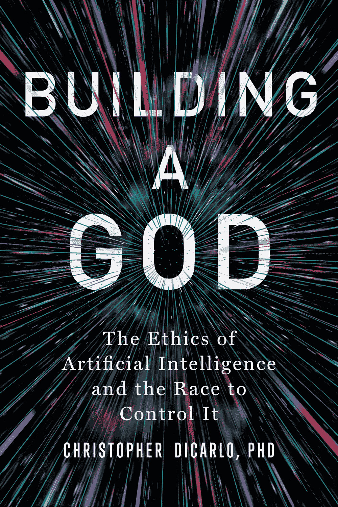


The Ethics of Artificial Intelligence and the Race to Control It

CHRISTOPHER DICARLO, PH.D.


[www.globepequot.com](http://www.globepequot.com)

Distributed by NATIONAL BOOK NETWORK


The paper used in this publication meets the minimum requirements of American National Standard for Information Sciences—Permanence of Paper for Printed Library Materials, ANSI/NISO Z39.48-1992

This book is dedicated to my sons Jeremy and Matthew.

I cannot begin to thank you enough for the life you have given me.


134.  122

135.  123

136.  124

137.  125

138.  126

139.  127

140.  128

141.  129

142.  130

143.  131

144.  132

145.  133

146.  134

147.  135

148.  136

149.  137

150.  138

151.  139

152.  140

153.  141

154.  142

155.  143

156.  144

157.  145

158.  146

159.  147

160.  148

161.  149

162.  150

163.  151

164.  152

165.  153

166.  154

167.  155

168.  156

169.  157

170.  158

171.  159

172.  160

173.  161

174.  162

175.  163

176.  164

177.  165

178.  166

179.  167

180.  168

181.  169

182.  170

183.  171

184.  172

185.  173

186.  174

187.  175

188.  176

189.  177

190.  178

191.  179

192.  180

193.  181

194.  182

195.  183

196.  184

197.  185

198.  186

199.  187

200.  188

201.  189

202.  190

203.  191

204.  192

205.  193

206.  194

207.  195

208.  196

209.  197

210.  198

211.  199

212.  200

213.  201

214.  202

215.  203

216.  204

217.  205

218.  206

219.  207

220.  208

221.  209

222.  210

223.  211

224.  212

225.  213

226.  214

227.  215

228.  216

229.  217

230.  218

231.  219

232.  220

233.  221

234.  222

235.  223

236.  224

237.  225

238.  226

239.  227

240.  228

241.  229

242.  230

243.  231

244.  232

245.  233

246.  234

247.  235

248.  236

249.  237

250.  238

251.  239

252.  240

253.  241

254.  242

255.  243

256.  244

257.  245

258.  246

259.  247

260.  248

261.  249

262.  250

263.  251

264.  252

265.  253

266.  254

267.  255

268.  256

269.  257

270.  258

271.  259

272.  260

273.  261

274.  262

275.  263

276.  264

277.  265

278.  266

279.  267

280.  268

281.  269

282.  270

283.  271

284.  272

285.  273

286.  274

287.  275

288.  276

289.  277

290.  278

291.  279

292.  280

293.  281

294.  282

295.  283

296.  284

297.  285

298.  286

299.  287

300.  288

301.  289

302.  290

303.  291

304.  292

305.  293

306.  294

307.  295

308.  296

309.  297

310.  298

311.  299

312.  300

313.  301

314.  302

315.  303

316.  304

317.  305

318.  306

319.  307

320.  308

321.  309

322.  310

323.  311

324.  312

325.  313

326.  314

327.  315

328.  316

329.  317

330.  318

331.  319

332.  320

333.  321

334.  322

335.  323

336.  324

337.  325

338.  326

339.  327

340.  328

341.  329

342.  330

343.  331

344.  332

345.  333

346.  334

347.  335

348.  336

349.  337

350.  338

351.  339

352.  340

353.  341

354.  342

355.  343

356.  344

357.  345

358.  346


359. 347

360. 348

361. 349

362. 350

363. 351

364. 352

## Guide

1. 封面

2. 标题

3. 版权

4. 奉献

5.  

6. 引言

7. 内容开始

8. 附录

9. 术语表

10. 注释

11. 致谢

## 引言

当我们构建神时，必须极其小心，因为我们正站在或许我们作为物种短暂历史中最独特的时刻的十字路口。这是人类历史上第一次，我们拥有好奇心、能力和贪婪，去创造一种人工智能（或多种）——它的智能和力量如此强大，极有可能导致其建造过程带来我们自身的毁灭。

过去和当前文化中的主要神一直是自上而下的形而上存在，具备全知（omniscience）、全能（omnipotence）、全在（omnipresence）和全善（omnibenevolence）的特质。这些神被认为在我们之前就已存在，并被视为不仅是创造力量，也是规范我们物种行为的道德准则的制定者。随着人工智能（AI）的快速进步，我们正在经历一种自下而上的方式：正是我们人类必须去决定应将什么样的道德准则和命令写入这种存在，以防止它对我们产生反噬并造成各种方式的伤害——有意或无意。为了避免“开膛破肚”（Frankenstein Effect），我们在构建神时必须以最佳的自我形象来实现，这将是我们最大的集体挑战。

只要拥有足够的计算能力、数据和时间，我们注定在不久的将来某个时刻成功创造出一种远超人类自身的智能形态。而当这种时刻到来——而且看起来更像是“何时”而非“如果”——它会如何回应我们？这类神-like 存在会如何对我们的控制与指引作出反应？答案令人不安：没有人知道。

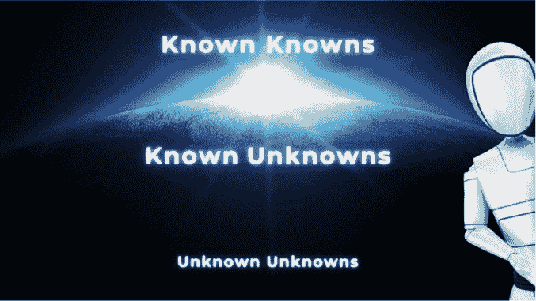

Figure I.1. 白到灰到黑： “已知已知、已知未知、未知未知。” *为作者创作。版权归作者所有。*

我们真正知道什么？这描述了我们当前的认知立场。换句话说，我们目前处于什么知识状态，或缺乏状态？我们对 AI 潜在风险和危害的了解有哪些，又有哪些是未知的？为了说明这一点，我引用了唐纳德·拉姆斯菲尔德——乔治·W·布什的国防部长的话。拉姆斯菲尔德曾说：“已知已知——即我们知道我们所知道的事。我们也知道有已知未知——也就是说，我们知道有些事我们尚未知道。但也有未知未知，即我们不知道我们不知道的事”（参见 figure I.1）¹

在这本书中，我们将仔细审视我们的认知立场，反思我们对 AI 的了解以及我们对它的未知之处，并尝试为那些我们甚至不知道自己不知道的可能性做好准备。

为了此目的，我们希望我们新兴的、超智能机器神（或 SMG）能够解决我们当前最迫切的问题，如解决饥饿、治愈疾病、遏制和逆转气候变化，以及更广泛地改善人类和动物的生活。这是 AI 行业中所有人的愿景。这种神-like 机器将使人类摆脱过去的不平等和琐碌的劳作，在全球范围内促进福祉。想想看：一个未来，大部分体力劳动工作由机器完成，医疗保健负担得起且普及全球，能源便宜高效。AI 的发展承诺为人类、环境以及许多其他物种带来巨大的可能性。但绝无仅有的保证是，人工智能神-like 存在必然是善良的，或必然会被人类用于更好的目的。

例如，DC  comics 中的超级英雄超人，并不需要成为守法、缴税的公民。他本可以“砸碎美国任何银行”，却选择不这么做（以及许多其他对人类的可怕行为）。但谁能保证，高度进化且超级智能的 AI 形式会遵循我们的伦理标准？为什么它会？我们有什么理由相信它会？这引导我们思考超级智能 AI 可能演变成对人类构成生存风险（x-risk）的可能性。这会发生吗？我们不知道。但出于谨慎起见，我们最好将这视为一次赌注，我们的最佳赌注大概是如 figure I.2 所示。

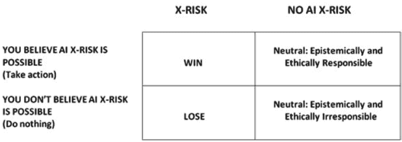

Figure I.2. AI x-risk 赌注。*为作者创作。*

如果我们相信超级智能 AI 的发展可能在未来对人类构成生存风险，且事实证明是真实的，那么作为物种，我们可以通过准备并防范其预期的有害影响来“获胜”。如果无论如何高级的 AI 技术都不会构成 x-risk，那么我们将已经采取了在认识论和伦理上最负责任的预防措施。相反，如果我们不把 x-risk 当真，而实际上并无风险，我们则是在 irresponsibly（不负责任）地行事——无论是认识论上还是伦理上——因为我们只是侥幸。最糟糕的情况是：我们不把 x-risk 当真，结果却发现风险真实存在，那时我们将面临未来的重大伤害和后果。

正如你所想象，存在两极立场的人：我们称他们为“否定者”，相信 AI 进步绝对安全；以及“毁灭论者”，认为我们终将被自己创造的超级智能 AI 所毁灭。当然，还有介于两者之间的人。危险程度的范围可以用从 Y2K 到 Armageddon 的 spectrum 来概括。到本书结束时，你应该能更好地理解自己在该 spectrum 中的确切位置，以及原因。

但如果我们只有 5% 的概率会创造出一种会伤害或彻底消灭人类的强大人工智能，你会乘飞机吗？思考一下：每次飞行都有 5% 的致命坠毁风险，即每 20 次飞行中就有一次会坠毁致死。你大概会有多少次乘坐飞机？可能很少，甚至一次也不乘。因此，我们必须意识到，我们希望将这种风险的可能性控制在 5% 以下。


-   [费曼学习法](https://wiki.example.org/feynmans_learning_method)的灵感源于诺贝尔物理奖获得者**Richard Feynman**。

1.  运用费曼技巧，你只需花上`20 min`就能深入理解知识点，而且记忆深刻，*难以遗忘*。

```
if (condVar > someVal) {console.log("xxx")}
```


> 智能字面上是“在已收集的内容中进行选择”。这一词源将人工智能的历史置于一个极其广阔的范畴，表明它并非某种傲慢的超越（虽然有时看起来像），而是人类最持久、甚至最尊崇的冲动之一——收集、组织并分享知识以造福所有人的自然发展阶段。如果竞争是人类行为的体现（它确实是），那么合作可能与之同等重要。自始至终，我们似乎一直在收集、组织信息、知识和技术，主要是为了与同伴共享，从而提升他们的知识以及我们自己的。

我认为 McCorduck 在谈及竞争与合作在信息收集与分享中同等重要时，恰如其分地抓住了要点。虽然关于智能本质的研究和理论有很多，但为了我们的目的，当我们把这些定义的各个要素结合起来，可以将“人工智能”定义为

> 一个非自然电子模拟的智能体，能够基于理性、机智和创造力学习、理解并作出判断，从而能够批判性和抽象地在给定环境中导航和操控。

尽管这提供了一定的清晰度，但我们仍需补充一些内容。该术语也由著名人物如人工智能先驱、斯坦福大学教授约翰·麦卡锡（John McCarthy）所定义，他将人工智能定义为

> 使智能机器（尤其是智能计算机程序）得以创造的科学与工程。它与利用计算机理解人类智能的类似任务相关，但人工智能不必局限于生物学上可观察的方法。⁶

而在麦卡锡定义之前数十年，英国计算机科学之父阿兰·图灵（Alan Turing）就曾思考机器是否能思考，并在其 1950 年开创性著作《计算机器与智能》中提出。他发明了如今著名的“图灵测试”，在该测试中人类审问者尝试区分计算机与人类的文本回复。如果审问者无法区分两者，则该计算机被认为通过了“智能”测试。⁷

在 1990 年代后期，著名的 AI 科学家斯图尔特·拉塞尔（Stuart Russell）和彼得·诺维尔（Peter Norvig）合著了突破性著作《人工智能：现代方法》（*Artificial Intelligence: A Modern Approach*），这部著作自此被确立为 AI 研究领域的权威教材。在这部里程碑式著作中，他们阐述了四种可能的 AI 目标或定义，区分了基于理性与决策能力与基于行动能力的计算机系统。

首先，他们探讨“人类取向”，即评估能够模拟人类思维和行为的系统的表现。这与理想取向相对，理想取向要求系统展现理性思维和理性行动。人类与理性之间的这种区分十分引人入胜，并且在 AI 技术的演进中屡次出现。值得注意的在于，人类并不总是表现出理性，这主要源于大脑中情感 limbic 系统与认知 prefrontal cortex（前额叶皮层）之间的持续 tug‑of‑war（拉锯战）。

为了提升 AI 系统的理性并降低受人类情感偏见的影响，大量努力都在致力于提高人工智能系统的精确度和最佳性能。就个人而言，我的研究正是其中之一，它促使我构思出“OSTOK”或“洋葱皮层知识论”模型（⁸）。OSTOK 项目是一个信息模型，帮助我们更好地理解自然系统与文化系统之间复杂的关系。当我们将对自然世界的物理认知与对生活多种文化方式的理解相结合时，便能更深刻地洞察我们的生活、世界以及宇宙的极其复杂性。

把这两大系统视作相互交织、层层递进的洋葱皮层般的活动网络，我们可以用洋葱作为知识系统的隐喻来理解信息之间的关联。愈是深入理解自然与文化线性与非线性系统之间的复杂因果相互作用，我们就愈能深入、更远地“剥开”洋葱。在展示自然与文化交织的复杂网络时，我们发现，我们的知识受限于我们能够识别和理解所谓的“因果簇”。因果簇是这两大重叠系统中事件之间的连接。我们越能理解影响生活各效应的因果力量，就越能预测并控制自然世界，以更负责任的方式制定人类与自然资源的管理政策。在此框架下，我提出了“最偏向信息系统”（Least Biased Information System，LBIS）或“公平机器”（Fairness Machine）⁹的概念，作为支持医学研究、开创科学发现以及辅助政府政策和立法决策的潜在工具。

在那段时期，我的计划是与电子工程师、计算机科学家、慈善家和政治家合作，打造一台能够从庞大数据库中提取信息、实现全球数据交叉引用、并加速人类进行繁琐事实查找的机器。总体目标是推动科学、医学和政治领域的进步。我坚信，构建如此机器不仅是可行的¹⁰，而且可以有效地加以利用和规范。

我的核心伦理顾虑是，有人可能在未实施必要控制的情况下，提前开发出这类机器。如今，我的同事们和我面对的正是这种情形，它成为我们主要应对的现实与挑战。

这促使我们对 AI 的定义作出扩展，使其现在可以包括以下内容：

> \[A\]rtificial intelligence 是一个领域，结合计算机科学与强大的数据集，以实现问题解决。它还涵盖机器学习和深度学习等子领域，这些子领域常与人工智能一起被提及。这些学科由 AI 算法组成，旨在创建专家系统，根据输入数据进行预测或分类。¹¹

当我们将迄今为止的各类 AI 定义综合起来，得到以下综合定义：

> 人工智能涉及开发一种非自然演化的电子人类智能副本，该副本能够学习、理解并基于理性、机智和创造力作出判断，从而能够批判性和抽象地在给定环境中导航和操控。它结合计算机科学与强大的数据集，涵盖机器学习和深度学习，利用算法创建专家系统，依据输入数据进行预测或分类。


也许它不够吸引人以成为纹身，但足以满足我们前进的目的。请记住，定义中并未提及人工智能系统拥有自己的意识或自由，比如自我意识或在物理世界中自由移动。它所需要做的只是遵循指令并执行我们作为创造者所重视的被命令的功能。但如果它不遵循指令呢？如果它违背我们的人类命令和价值观，开始自行行动——无论它是否意识到——我们在处理这些迫切问题之前，需要先获取一些额外的背景信息。

## 人工智能的类型

了解人工智能的第一件事是：它分为两类和三种类型。为了更好地理解人类如何发展技术到当前水平——建造一个“神”，我们需要理解每个类别和类型是如何以及为何在未来几年会发展。基本上，人工智能的两类分别是`弱`和`强`。如图 1.1 所示，弱人工智能类别下有一种类型，即`人工狭义智能`（或`ANI`），而强人工智能类别下有两种类型：`人工一般智能`（或`AGI`）和`人工超级智能`（或`ASI`）。

### `弱人工智能`：狭义人工智能或人工狭义智能（`ANI`）

`人工狭义智能`（`ANI`）是被训练并专注于执行特定任务，并直接遵循其数字指令。它没有自主性或自由去做除其算法程序指令的严格参数之外的其他任何事情。`弱 ANI` 目前是最为丰富的类型，驱动着当今我们周围的所有 AI。 “狭义”可能是更准确的描述，因为它不一定在功能上弱。它能够实现一些非常强大的应用，例如苹果的`Siri`、亚马逊的`Alexa`、IBM 的`Watson`以及自动驾驶汽车。

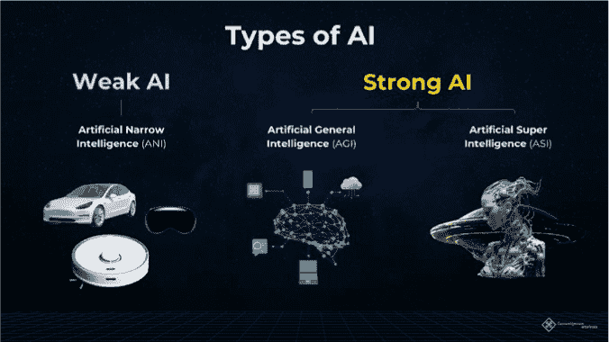

图 1.1. 人工智能的两类和三种类型。 *Created for the author. All rights to the author.*

### `强人工智能`：人工一般智能（`AGI`）和人工超级智能（`ASI`）

`人工一般智能`，也称为`AGI`，是一种提议的文化演进发展状态，其中机器将拥有与人类相当广泛且先进的智能。这样的机器可能在解决问题、学习和长期规划方面表现出与人类相当甚至更强的能力。此外，它还能够以抽象、创造性和甚至情感的方式思考，但其速度、精确度和效率远超人类。

`人工超级智能`（`ASI`），也称为超级智能，代表一种超越任何单个个体人类或甚至整个人类智力的智能水平。在许多方面，这种实体对我们来说似乎是神一般的。它拥有无与伦比的知识，以闪电般的速度思考，迅速执行任务，并几乎瞬间解决复杂问题。它超越并超越我们的能力正是阿瑟·克拉克预言的核心：“任何足够先进的技术都会像魔法一样”。¹² 对我们而言，这台超级智能机器神（SMG）的能力确实显得像一种魔法，因为我们缺乏理解和把握其神一般能力的能力。超级智能机器神站在我们理解之外的悬崖边缘，其拥有的力量对我们而言难以言喻。

许多人认为，这种超级智能将对人类构成`生存威胁`，可能导致人类灭绝。这可能发生在人类阻碍超级智能实现目标时，或者仅仅因为我们变得无关紧要，而超级智能更有利于利用我们所依赖的资源。这种担忧得到了许多 AI 专家的支持——例如 AI 之父 `Geoffrey Hinton`——他们将这种生存风险视为极其严肃。2023 年 5 月下旬，`Hinton` 以及 350 名人工智能顶尖执行人员和研究人员签署了一份声明，呼吁政策制定者认识到未受监管的人工智能所带来的严重风险。签署者警告，人类的未来可能受到威胁，并表述如下：

> 减轻人工智能导致的灭绝风险应成为全球性优先事项，与艾滋病疫情和核战争等社会层面的风险并列。¹⁴

我被要求并同意与其他签署者一起签署这份声明，包括 AI 公司 `DeepMind` 和 `Anthropic` 的首席执行官，以及 `Microsoft` 和 `Google` 的高管。其中还包括 `Université de Montréal` 计算机科学教授 `Yoshua Bengio`^(\*)——他与 `Hinton` 一起代表了三位所谓的“人工智能之父”之一，他们因在深度学习方面的工作于 2018 年获得图灵奖。

虽然 `AGI` 和 `ASI` 目前仍属于推测范畴，但它们是最令我们担忧的 AI 类型。主要原因在于我们对这些系统在达到如此高级阶段后可能产生的后果缺乏了解和认知。简单来说，我们不确定当这些系统变得异常强大时会发生什么。许多我们熟悉的科幻情景描绘了这些系统超越人类智能并威胁人类，例如《2001 太空漫游》中的 `HAL 9000`（1968 年）、《Demon Seed》中的 `Proteus IV`（1977 年）或《Blade Runner》（1982 年）、《RoboCop》（1987 年）、《终结者 2：审判日》（1991 年）、《黑客帝国》（1999 年）、《星际争霸》（2004 年）、《复仇者联盟：奥创纪元》（2015 年）等其他 AI 实体。技术背叛人类的主题是我称之为“`Frankenstein Effect`”（创世纪效应）¹⁵。在此阶段，没有人知道这种 AI 能力的发展是快速还是缓慢。它可能开始缓慢，但随着发展会呈指数级加速。这些已知的未知数在 AI 安全领域被称为“时间线”，许多人争论它们的起飞速度——即这些进步将以多快的速度展开？我们在发生时是否准备好？

就像虚构的 Dr. Frankenstein 受自己想要创造前所未有的人类之手的驱使一样，艺术中的许多惊人作品可以教会我们关于自身的认识，反映出人类条件的各种形式。而令人担忧的一个特别令人不安的人类条件特征是我们好奇心驱动的探索欲。无论这是我们最大的优点还是最差的特质，人类在许多方面都被迫去“看看接下来会发生什么”。也许这是从狩猎采集祖先那里继承的一种竞争性。也许这是自然的好奇心。无论是什么，它是不可否认的。正是这种欲望将促使不同的公司、地区和国家竞相争夺人工智能发展的下一步——即不断增长的、越来越复杂的 AI 形式。如果这种驱动力过于急迫和过早，我们可能会面临一种西西弗斯式的挑战，即试图对 `AGI` 的出现进行对齐、控制、限制或阻止。我们拥有的时间是未知的。几年前，我们认为至少还需要五十年。今天，这个时间变得令人不安地临近——一些人，如 `Google DeepMind` 的首席执行官 `Demis Hassabis`，估计只有两年时间。¹⁶


在最近的研究中，AI 专家和未来预测者都被询问他们相信“50/50‑chance for an ‘Artificial General Intelligence’ to be ‘devised, tested, and publicly announced.’”的时间点。Metaculus 预测社区的时间线最近变得更短了。预期的时间线在 2022 年春季缩短了约十年，当时出现了几项令人印象深刻的 AI 突破，速度远超许多人的预期。事实上，Metaculus 社区对 AGI 发展的预测时间线从 2022 年 3 月的 2058 年变为 2022 年 7 月的 2040 年——仅仅四个月后。2023 年秋季，预测又提前到 2031 年 12 月 13 日。¹⁷

尽管人们对 AGI 的确切出现时间存在分歧，但领域内的估计大致一致的是，预期的时间线仍在不断缩短，我们已经过了不可逆转的点：AGI 看起来极有可能出现，尽管其精确到达日期目前未知。这应该让世界停下脚步——也许是字面意义上的。我们似乎过于关注“接下来会发生什么”的竞赛，而忽视了思考我们是否准备好应对它。¹⁸ 这不就如同《侏罗纪公园》中杰夫·戈尔德布姆饰演的约翰·坎贝尔博士的回答一样吗？“你们的科学家太 preoccupied with whether they could \[bring back dinosaurs\] 而忘了思考他们是否应该。”¹⁹ 这种对“接下来会发生什么”的急于观察，产生了一种错误的信念：世界正处于一场赛跑，谁先到达终点。虽然确实存在某种形式的竞赛，但没有明确的胜者，这场竞赛可能导致所有人都输——因为我们在赛跑中冲向悬崖。这种集体失败取决于某些群体、组织、公司或国家在争先恐后“接下来会发生什么”的过程中有多么 reckless、careless 或 thoughtless。Katja Grace 指出这种竞赛的幻象：

> 在经典的竞赛中，一方理论上总能领先并获胜。但对 AI 而言，胜者可能是高级 AI 本身。这会让冒进的决定变得更糟……在 AI 上，我们可能正处于完全相反的竞赛。最佳的个人行动可能是放缓并谨慎行事。集体上，我们不应让人们在一场扭曲的毁灭竞赛中把世界抛弃——尤其是当探索逃脱路径的机会极其有限时。²⁰

对人类而言，我们可能需要遵循《战争游戏》（1983）的建议：“唯一的获胜方式是不参与。”世界必须高度警觉 AI 的存在性风险，并需要在全球层面协同合作，确保我们彼此在一起。正是对 AGI 的期待，使我在 1990 年代末期构思 OSTOK 项目时，起草了一份可以被联合国（UN）或类似国际原子能机构（IAEA）用于核动力和核武器的全球协议或宪法。我将在本书后续章节详细讨论该草案的细节，以便更深入探讨 AI 治理。

在此，需要注意的是，从联合国到英国 AI 峰会，再到欧盟的 AI 法案以及美国关于 AI 的行政令，AI 社区内部——从联合国到各国政府——对透明、合作和国家之间的信任持有 overwhelming 的共识。²¹ 这些共识的基础是全球性的恐惧：人们担心“接下来会发生什么”。但与核武器或钚的转移不同，未来 AI 技术的使用或误用将与 IAEA 管控的范围大相径庭。关键区别在于 AI 技术不会局限于任何特定地理区域。如果 AGI 超越其开发者并变得具有破坏性且难以控制，它可能影响整个世界，甚至可能快速且意外地产生影响。那时，将不存在国界或对该力量的限制。因此，一个叛国的国家，甚至是拥有足够资源的叛徒个人，都可能开发出 AI 技术，对不仅他们的敌人，也对自己和其余所有人造成巨大破坏，仅仅因为他们没有遵守全球公认的负责任行为准则。

### **我们的“奥本海默时刻”以及对 AI 的曼哈顿计划的需求**

由于这项技术的巨大力量及其潜在危害，AI 安全社区如今对 AI 存在性风险的严肃性愈发迫切。我们正处于历史的独特节点。电影导演克里斯托弗·诺兰认为我们正处于 AI 的“奥本海默时刻”。^(\*) 正如在洛斯阿拉莫斯建造原子弹时，许多人开始思考其不可避免的伦理问题和危险，我们如今也必须审视构建一台超级智能“神机”的潜在后果——这台机器的力量将远超我们以往所需考虑的任何事物。未来会如何发展仍然不可预测，因为在人类历史上，我们从未处于过在“竞赛”中建造神明的情形。可以肯定的是，此时此刻，没有人能精准预测谁将开发何种 AI 技术以及他们将如何选择使用或不使用它们。因此，建立一项世界性的协议、宪法或条约，明确规定所有参与 AI 发展与使用的国家的权利、义务和责任，显得尤为重要。神经科学家山姆·哈里斯（Sam Harris）建议，从事 AI 风险与治理的研究者应组成一个类似曼哈顿计划的项目——不是为了构建 AGI，而是为了在其出现之前集体控制或遏制它。如果没有这种全球协议以及一套拥有权力的监管机构，能够后果严重的制裁恶意行为，我们将永远担心哪个组织或国家正在策划使用其 AI 进行有害行为，或是已无法在其出现后加以控制。

那么，我们是如何走到这儿的？哪些历史因素导致了我们必须面对的“奥本海默时刻”？为了了解 AI 发展的演化时间线，我们需要回顾其丰富而迷人的历史。

### **AI 的季节性历史**

在我们踏上 AI 记忆的旅程之前，需要先做一些澄清。首先，这绝不构成对人工智能的全面历史——那样本身就需要一本完整的书。相反，这将是一份简洁且选择性的历史，聚焦于关键人物和发展，对理解我们走向构建“神机”的道路至关重要。其次，讨论 AI 历史发展时，有几个主要类别或因素需要注意。我们主要从以下三个方面展开：

1. *Computers*: 具体包括硬件和软件——从微芯片和半导体，到大语言模型，再到摩尔定律、机器学习（ML）、神经网络等诸多内容。

2. *Robotics*: 从扫地机器人（Roombas）到自动驾驶汽车，再到国防先进研究计划局（DARPA）、Boston Dynamics 等。


3. *理论*：从科幻作品的描绘到对人工智能未来发展的各种预测，再到当前的人工智能场景、预测和治理。我们将按照我认为在三类情境中最重要的人工智能发展的时间顺序进行阐述。第三点说明是，人工智能的历史被记述为拥有“季节”。夏季象征技术与关注的繁荣期，新技术与新问题层出不穷；而冬季则代表因缺乏资金、兴趣下降等原因导致的冷却期。因此，我们将审视人工智能的季节性历史。  

### `In the Beginning…`  

尽管历史上对人工智能潜力的模糊提及屡见不鲜，最早的理论性论述可追溯至 1863 年工业革命后期的萨缪尔·巴特勒（Samuel Butler）的文章《Darwin among the Machines》。文中巴特勒提出，机器终将在星球上取代人类成为主导性存在。该论文于 1863 年 6 月 13 日在新西兰基督城的《The Press》报刊上发表，巴特勒以“Cellarius”化名投稿。文中巴特勒将查尔斯·达尔文的进化论与日益复杂的机械发展联系起来。1859 年，达尔文出版《物种起源》——这部著作彻底改变了世界，至少证明了两点：一是所有生物（包括人类）并非由神创直接创造，而是通过自然选择的盲目过程而演化，适者生存或被淘汰；二是人类作为动物并不特殊。巴特勒探讨的核心思想是，机器及其创造的所有机械发明，或许可以被视为一种“机械生命”，它像生物物种一样持续演化。文章还提出一个富有预见性的假设：在未来的某个时点，这些不断演化的机器可能变得如此先进，以至于超越人类的重要性，甚至成为地球上的主导物种。  

> 我们关注的问题是：人类的下一个地球霸主可能是什么样的生物。我们常听到这类讨论，但我们认为——正是我们自己在创造自己的继任者；我们日复一日地提升它们的外观与精致度；我们日复一日地赋予它们更大的力量，并通过各种巧妙的装置赋予它们自我调节、自我行动的能力，这将在它们身上成为类似人类智慧的作用。随着时间的推移，我们将发现自己成为次要的族群。  

我的同事埃利奥特·麦克纳农（Elliot Mckernon）和贾斯汀·布洛克（Justin Bullock）以及我本人已经大量论述过机器的演化。我们基本上认同巴特勒的假设，认为这种机器演化涉及我所称的“技术选择”（technoselection）——一种由机器自身进行的、类似拉马克式选择的过程，其唯一目标是不断且循环地完善其系统、流程和运作。  

> 然而，日复一日机器在我们身上占据上风；日复一日，我们变得对它们更加依附；越来越多的人每天被束缚为照料它们的奴隶，越来越多的人将其全部生命精力投入到机械生命的研发中。结果不过是时间问题，但毫无疑问，机器将在不久的将来占据世界及其居民的真正主导权，这一点任何真正有哲学思辨力的人都无法片刻怀疑。  

人们可以想象，这种技术选择的进程如此迅速，以致在几千个数量级的程度上超过人类的智能与能力。届时，我们或许再也无法控制这种如神祇般迅速发展的单体或多体实体。届时，我们唯一的希望是这种存在仍认为人类物种值得保留。虽然世界一直在等待巴特勒的理论得到证实，但人工智能技术的文化演进却稳步前行。  

#### `Markov Chains`  

到二十世纪初，机器演化的技术已得到显著发展。例如，俄罗斯数学家安德烈·马尔科夫（Andrei Markov）于 1913 年提出马尔科夫链概念，后成为生成模型的基石。马尔科夫链的直观理解可以通过以下例子：想象一台自动吸尘器，它可以在房屋的不同房间之间移动，但不随机选择下一站，而是依据当前所在的房间制定规则。若从客厅出发，它会查阅规则，决定前往厨房、卧室或卫生间。进入下一房间后，它再次依据规则决定下一步去向。作为人工窄能智能（ANI）的一种形式，它在每次迁移后重新检查规则，据此决定下一步去向。  

马尔科夫链是一种建模状态转移的方法，下一状态的选择基于当前状态的概率分布。例如，我们可以用两个状态——雨和晴——来模拟英格兰北部多雨城市的天气。若今天是雨天，则明天仍为雨天的概率为 80%；若今天是晴天，则明天为雨天的概率仅为 50%。该模型虽然粗糙，却能够预测长时间的连续雨天，间 punctuated 由偶尔的晴朗。关键的是，马尔科夫链具备“无记忆”特性：过去发生的情况（如昨日的天气）对预测没有影响，仅凭当日的状态即可进行预测。该模型虽为人工窄能智能的典型例子，却简单易懂且应用广泛。当代，马尔科夫链被用于天气预报、游戏分析以及理解随时间变化的过程。它本质上是一种通过将复杂过程拆解为若干简单步骤，从而简化并理解复杂现象的工具。  

#### `Information Theory`  


在 1940 年代和 1950 年代，克劳德·香农（常被称为“信息论之父”）将马尔可夫链应用于语言和通信，为早期语言生成实验奠定了基础。香农是数学、电气工程、计算机科学和密码学领域的有影响力人物。他因在信息时代的重要贡献而受到赞誉，这项时代是他与逻辑学家乔治·布尔共同建立的。布尔的主要贡献在于展示如何系统化逻辑原则并将其以方程形式表达（即布尔代数或布尔逻辑）。香农展示了如何将布尔代数作为计算过程的基础。 “这一贡献使逻辑思维在计算机和通信系统的设计、编程以及应用中得到了系统化。”²⁶ 香农被描述为“这个你从未听说过的最重要天才，其智力与爱因斯坦和艾萨克·牛顿相当。”²⁷ 我无法用语言表达对这位信息时代先驱工作的赞赏之情。我恳请你，亲爱的读者，去探索这样一位富有创造力和智慧的人物的历史。

#### ***Science Fiction Contributions***

当像香农这样的人才正在致力于信息理论的基本概念时，像卡雷·切佩克（Karel Čapek）这样的科幻作家早已接受了机器演化的概念，他在 1920 年在剧作《R.U.R.》（Rossum’s Universal Robots）中创造了“机器人”一词。该词源自捷克语中表示“强制劳动”的词汇。1932 年，约翰·W·坎贝尔（John W. Campbell）开始创作，其作品对塑造现代科幻文学产生了比任何其他个人都更大的影响。²⁸ 1942 年，艾萨克·阿西莫夫（Isaac Asimov）发表了著名的短篇小说《跑步》²⁹。阿西莫夫引人入胜的叙事围绕着机器人 SPD-13（被称为“Speedy”）的行为准则，该机器人由工程师格雷戈里·普劳尔（Gregory Powell）和迈克·多纳万（Mike Donavan）设计。如今这些准则被称作著名的“三条机器人法则”，其出现标志着首次探讨人工智能安全及管理人工智能代理的规则。正如你们中的许多人已经知道的那样，这三条法则如下：

1. *机器人不得伤害人类或因不作为而导致人类受到伤害。*  

   该法则将人类的安全和福祉置于最高优先级。机器人不得伤害人类，也必须采取行动防止人类受到伤害。

2. *机器人必须遵从人类给出的指令，除非该指令与第一条法则冲突。*  

   第二条法则强调遵循人类指令的重要性。但这种服从不应违背第一条法则，即优先保障人类安全。换句话说，你永远不能命令机器人伤害、伤害或杀害另一个人的。

3. *机器人必须在不违背第一条或第二条法则的前提下保护自身的存在。*  

   第三条法则允许机器人采取行动保护自己，但这种自我保护不得危及人类安全（依据第一条法则）或违背人类直接命令（依据第二条法则）。

在人类历史上首次，阿西莫夫的三条机器人法则以及其关于其脆弱性的众多故事，体现了所谓的“富兰克林效应”——即人类可能失去对这类机器的控制，从而导致危险局面。^(\*) 这三条法则在科幻文学中已成为标志性元素，并影响了关于人工智能和机器人伦理及潜在风险的讨论——包括在我自己的工作中。³⁰

#### ***The Father of AI: Alan Turing***

在阿西莫夫构想三条法则的同时，在大西洋另一侧，备受尊敬的英国数学家艾伦·图灵（Alan Turing）正深度投入于解决实际问题。许多读者已经熟悉图灵在布莱切利公园（Bletchley Park）的工作，他在那里致力于为英国政府创建一款突破性的密码破解机——The Bombe，该机用于解密二战期间德国军队使用的恩尼加玛密码。该过程在电影《The Imitation Game》中被描绘，本尼迪克特·康伯巴奇（Benedict Cumberbatch）饰演图灵，他与团队建造了最早的可操作电子机械计算机，其计算能力已超越当时最熟练的数学家。

图灵通过技术手段破解恩尼加玛密码，进而思考了机器智能的概念。1950 年，他发表了影响深远的文章《Computing Machinery and Intelligence》³¹。该文章不仅提出了构建智能机器的方法，还引入了图灵测试的概念。图灵测试作为评估人工系统智能的标准。正如前文所述，如果人类与机器以及另一名人类互动，且人类无法区分它们，则该机器被视为具有智能。

#### ***The Dartmouth Connection***

就在六年后，1956 年，在达尔文夏季研究项目（DSRPAI）上，约翰·麦卡锡（John McCarthy）、马文·明斯基（Marvin Minsky）、纳撒尼尔·罗切斯特（Nathaniel Rochester）以及前文提到的克劳德·香农（Claude Shannon）聚集一堂，讨论创造能够模拟人类智能的机器的可能性。达尔文项目的主要目标是培育一个新的研究领域，致力于构建能够模拟人类智能的机器。

> We propose that a 2 month, 10 man study of artificial intelligence be carried out during the summer of 1956 at Dartmouth College in Hanover, New Hampshire. The study is to proceed on the basis of the conjecture that every aspect of learning or any other feature of intelligence can in principle be so precisely described that a machine can be made to simulate it. An attempt will be made to find how to make machines use language, form abstractions and concepts, solve kinds of problems now reserved for humans, and improve themselves. We think that a significant advance can be made in one or more of these problems if a carefully selected group of scientists work on it together for a summer.³³

通过促进来自不同领域的研究者之间的跨学科合作，这一里程碑项目将人工智能推入了一个充满显著进步和创新的时代。值得一提的是，达尔文项目的创始人之一马文·明斯基（Marvin Minsky）提到，他受到了阿西莫夫《三条机器人法则》的很大影响。而这种影响似乎是双向的：

> 艾萨克·阿西莫夫（The Good Doctor）是科幻文学的伟大推广者和影响者，他还由此延伸影响了未来主义。他曾说，他仅承认两位智力高于自己的人物：认知科学专家、人工智能先驱马文·明斯基（Marvin Minsky），以及天体物理学家卡尔·萨根（Carl Sagan）。³⁴

#### ***Marvin Minsky***


# 马文·明斯基或许是人工智能历史上最具影响力的个人。

他是数学家、认知科学家和计算机科学家，确实是人工智能领域的先驱和重要人物。20 世纪 50 年代末，他与其他先驱如艾伦·图灵、约翰·麦卡锡、赫伯特·西蒙、克劳德·香农和阿伦·纽尔一起奠定了人工智能的基础。早期，1950 年从哈佛大学获得数学学位后，明斯基用他在拓扑固定点定理方面的工作给数学家安德鲁·格里森留下了深刻印象。格里森建议他去普林斯顿深造，明斯基便照办。但他也对心理学感兴趣——尤其是人类如何学习。历史上，1950 年之前，心理学家和神经学家是主要探索大脑工作原理的专家。

然而，随着计算机在工业和学术界的兴起，明斯基使用数学来建模人类思维的功能。他认为机器可以通过数学公式进行思考过程，和人类一样，并且最早认识到计算机不只是做计算，还能学习、推理、提供建议，并完成以前被认为只属于人类的任务。作为研究生，他构建了第一台随机布线神经网络学习机，命名为 SNARC（随机神经类加强器计算器）。该设备模拟了人脑中复杂的神经网络，能够从错误中学习。SNARC 由所谓的 Hebb 突触构成——类比于我们的神经元，遵循“细胞一起放电，连接在一起”³⁵的神经科学原则^(\*)，标志着连接主义^(\*)神经网络学习机的出现。该创新系统使用真空管，被视为最早的几种人工自我学习机器之一，其中奖励某些路径能够增强最近使用的连接——这是当今我们称之为“递归学习”在人工智能中的重要特征。明斯基在 1952 年发表题为《基于强化概率模型的神经类比计算器》的文章，详细阐述了他的工作。为在普林斯顿攻读博士学位（在美国数学家阿尔伯特·威廉·图克的指导下），明斯基捍卫了 564 页的博士论文《神经类比强化系统理论及其在大脑模型问题中的应用》，并向他的指导委员会成员约翰·威尔德·图普和约翰·冯·诺依曼陈述了论文。

1954 年，明斯基回到哈佛大学，成为备受尊敬的社团奖学金成员^(\*)。作为青年奖学金成员，他获得了自由探索任何研究主题的支持。接下来的四年里，他继续使用数学模型研究人类思维，为我们现在称之为人工智能奠定了基础。

1958 年，他的哈佛奖学金结束后，明斯基加入麻省理工学院（MIT），并在此终身在教职岗位上工作。MIT 的许多学生，包括雷·库兹韦尔，后来成为数字时代的有影响力的理论家、发明家和企业家。明斯基在 MIT 的第一年，和麦卡锡共同创立了人工智能实验室，迅速成为人工智能研究的领先中心。该实验室在 ARPANET 早期发展中发挥了关键作用，ARPANET 后来演变为今天的互联网，并推广了数字信息共享的概念，推动了开源运动的兴起。

1961 年，明斯基撰写了《迈向人工智能的步骤》一文，对人工智能社区产生了巨大影响，并为研究者指明了方向，持续了五十多年。虽然人工智能概念主要在小众计算机科学家群体中讨论，但明斯基的思想在 1967 年的著作《有限与无限机器的计算》（*Computation: Finite and Infinite Machines*）中得到记录，逐渐受到公众读者的欢迎。他的同行于 1969 年以图灵奖——计算机科学家最高荣誉、以先驱艾伦·图灵命名——表彰了他的重要贡献。明斯基博士在人工智能社区中成为传奇人物，其名字也出现在如《2001: 太空漫游》等流行书籍和影片中。

1969 年，明斯基与塞尔·帕普特共同撰写了《感知机：计算几何入门》（*Perceptrons: An Introduction to Computational Geometry*）。此书是首次系统探讨并行计算的经典著作，在阈值自动机网络研究中成为标杆。为了更好地理解，想象你正在解决一个非常困难的问题。当你专注于单一事物时，计算机的并行性可以同时考虑多个事物，就像一个团队。当你让 ChatGPT 3.5 解释“阈值自动机”给十年级学生时，你会得到以下有帮助的类比：

> 想象你有一群微型机器人，每个机器人可以完成简单任务。它们喜欢协作，但只有在从朋友机器人那里获得一定数量的信息后才会开始工作。更酷的是，每个机器人都有自己的规则：“只有当周围足够多的机器人也在工作时，我才开始工作。”因此，它们像一个团队，只有在一定数量的成员同意时才会启动。研究这些机器人团队根据“阈值”决定工作的行为，就是阈值自动机网络的研究内容。这相当于弄出这些带有特定规则的小机器人如何团队合作解决问题或共同完成任务。科学家研究此现象是为了理解简单事物协同工作能够产生更复杂且智能的行为，类似于机器人世界的团队协作！

该书标志着首次使用数学分析揭示某类被视为人脑模型的计算机的精确限制。在他们的工作中，他们还回顾了人工智能研究的历史，并对未来的 AI 发展作出预测。他们预测人工智能研究将转向符号系统的开发，而不是继续深化神经网络模型。这一预测在 AI 社区中引发了长期的争论，并影响了该领域未来的研究方向。

在 1970 年代初，明斯基和帕普特开始构建所谓的“心智社会”（The Society of Mind）理论，融合了儿童心理学的见解以及他们在人工智能研究中的成果。该理论认为智能并非源自大脑的单一机制，而是由多种有能力的“代理”协同作用的结果。他们指出，这种多样性至关重要，因为不同任务需要不同的机制：

> 心智社会理论把人类心智及其他自然演化的认知系统视为由许多个体简单过程（即代理）组成的广阔社会。这些过程是构建心智的基本思维实体，它们共同产生我们赋予心智的众多能力。与假设心智源于某些基本原则或简单形式体系的后果不同，将心智视为代理人的社会具有强大优势：不同的代理可以基于不同类型的过程、不同的知识表示方式以及不同的结果生成方法。

这种模型将心理学的研究重点从寻找少数“基本”原则转向探索心智如何管理大量多样元素的相互作用。


在 1970 年，Minsky 在与`Life Magazine`的采访中表示，他对机器在三到八年内实现与平均人类智能相当的一般智能持乐观态度。但我们现在知道，这并非如此。在英国，英国数学家詹姆斯·利特尔顿（James Lighthill）应英国科学研究委员会的委托撰写了一份报告，这份报告动摇了 AI 研究者的乐观预期。利特尔顿认为，机器只能在如国际象棋等游戏中达到“经验丰富的业余选手”的水平，并且在常识推理方面始终表现不足。因此，英国政府终止了对 AI 研究的资助，只有少数大学，包括`Edinburgh`、`Sussex`和`Essex`，继续获得支持。到 1973 年，美国国会开始审查对 AI 研究的巨额支出，美国和英国的资金均被大幅削减。这些政府行为共同标志着所谓的第一次 AI 冬季的到来。

在摆脱为期六年的 AI 冬季后，正值下一个 AI 夏季的高峰期，1985 年 Marvin Minsky 和 Seymour Papert 发布了`The Society of Mind`。该书由 270 个相互关联的单页想法组成，这些想法镜像了理论本身的结构。每一页要么提出解释心理现象的机制，要么解决另一页所提出的解决方案所引入的问题。整个 1980 年代，Minsky 面对了一个令人困惑的挑战——这一直困惑着心理学家、神经学家、哲学家和神学家：理解意识。他深入探讨了这样一个问题：像人类这样由细胞和氨基酸链组成的生物，如何能够自我意识、感知周围环境，并参与——正如我所称的“ limbic（情感中心）与前额叶皮层（思维部分）之间的斗争”。尽管最近对 AI 后果的担忧日增，Minsky 仍专注于技术进步。虽然他认为 AI 进展已放缓，但他有信心，智能计算机将是人类物种最重要的遗产。

#### `John McCarthy`

在 AI 早期的那些年，Minsky 的同事、`John McCarthy`在 MIT 期间发明了编程语言`LISP`：

> `Lisp`（历史上写作`LISP`，是“list processing”的缩写）是一类拥有悠久历史且特征鲜明、全括号前缀记法的编程语言家族。该语言最初于 1960 年被指定，`Lisp`是继`Fortran`之后仍在常用的第二古老高级编程语言。`Lisp`最初是为计算机程序的实用数学记号而创建，受到（但并非直接源自）阿隆佐·丘奇（Alonzo Church）的λ演算符号的影响。它迅速成为人工智能（AI）研究的偏好编程语言。作为最早的编程语言之一，`Lisp`在计算机科学领域开创了许多思想，包括树形数据结构、条件语句、递归等。

值得一提的是，当我们回顾人工智能的历史时，发现它不仅是季节性的，还包含了计算机语言、技术与编程速度的进步、电气工程的发展、逻辑、心理学和哲学等诸多方面。这种跨学科的协作在 AI 的早期即已存在，并且至今仍是 AI 研究的重要组成部分。

#### `Norbert Wiener`

在与`McCarthy`、`Minsky`以及其他人同时期，我们可以看到`Dr. Norbert Wiener`，他在 1950 年代和 1960 年代是人工智能领域的先驱，常被视为赛博尼克学（cybernetics）的创始人之一，这是一门研究系统（包括机器和生物体）如何控制和适应环境的学科。他认为反馈和控制系统的原理不仅适用于机器，也适用于生物体和人类行为。Wiener 的工作对于信息论的发展至关重要，信息论关注信息的量化与传输。他对信息处理和传输的理解做出了重要贡献，这已成为 AI 的基础性方面。

Wiener 的一个核心信念是，机器和系统可以通过环境反馈实现自我调节。这一思想为自适应和自调节系统奠定了基础，这是 AI 中至关重要的概念。例如，当今的 AI 系统能够从经验中适应并学习——有时被称为递归学习——这与 Wiener 所设想的自我调节系统相似。


Wiener 也是最早对快速发展的技术和自动化的伦理影响产生真正关注的科学家之一。他认为，随着 AI 和自动化的进步，人类需要考虑他们创造物的伦理和社会后果。呼应 19 世纪 Samuel Butler 的前瞻性言论，Wiener 确信人类不会停止制造更好、更先进的机器，这可能导致人类的灭亡：“除非我们比现在更努力十倍，否则我们的现代思维机器可能导致我们毁灭。”³⁹ Wiener 同样非常关注如今我们称之为“人机技术” (sociotechnical) 方面的 AI 问题。他的工作强调了人与机器之间的交互。他认为机器应当设计成与人类操作员和谐工作，理解这种人机技术交互对于 AI 系统的成功至关重要。今天，我们可以看到这种理念体现在用户友好界面和以人为中心的人工智能系统的设计中。^(\*)

Wiener 对 AI 技术伦理使用的主要贡献可以在 1948 年出版的著作 *Cybernetics, or Control and Communication in the Animal and the Machine* 中找到。两年后，他发布了该书的通俗版 *The Human Use of Human Beings*。两本书都探讨了人类与机器在机器日益增强计算能力和强大的世界中的技术交互。虽然 Wiener 在 *Cybernetics* 中的概念对人类社会的应用不如他所期望的那样广泛，但他对科技界的观点极具价值且影响深远。

> Cybernetics 的工程应用影响深远且有效，催生了火箭、机器人、自动装配线以及各种精密工程技术——换言之，现代工业社会的基础…… cybernetics 贡献了卫星和电话交换系统，但对社会组织和整体社会的有益发展却寥寥无几…… 也许这本书最显著的特点是它引入了大量关于人机交互的主题，这些主题至今仍极具重要意义。

Wiener 预测，这类 AI 机器将会取代工人并影响全球经济，这在当今大多数国家是合理的担忧。但或许他最大的成就之一是他与复杂系统的工作，这些工作最终催生了今天 AI 中使用的神经网络（neural nets）。

> Wiener 的核心洞见是：世界应当以信息为核心来理解。复杂系统（如生物体、大脑和人类社会）由相互交织的反馈回路组成，子系统之间交换的信号导致复杂但稳定的行为。当反馈回路失效时，系统会失稳。他构建了一个关于复杂生物系统如何运作的引人入胜的图景，这一图景如今普遍被接受…… Wiener 将信息视为控制复杂系统行为的核心量的设想在当时堪称独特…… 他对不仅工程复杂系统，而且所有复杂系统都围绕信号与计算循环的强大概念，为复杂人工系统的发展作出了巨大贡献。例如，他和其他人为导弹控制开发的方法后来被用于构建土星 V 号火箭——20 世纪最辉煌的工程成就之一。尤其是 Wiener 将 cybernetic 概念应用于大脑和计算机感知，直接预示了当今基于深度学习的神经网络电路以及人工智能本身的出现。⁴²

20 世纪 50 年代后期，Wiener 直接影响了著名的数学家、物理学家、计算机科学家、工程师和多才多艺的冯·诺依曼（John von Neumann），后者提出了“技术奇点”（technological singularity）的设想。这一概念基于机器能力与潜力增长的速率。

> 技术往往以指数方式改进，在一定时间间隔内其力度或灵敏度会翻倍。（例如，自 1950 年以来，计算机技术的性能大约每两年翻一次，这正是摩尔定律的观察。）冯·诺依曼根据观察到的技术改进的指数增长，预测“技术进步将变得难以理解且复杂，在不久的将来将超越人类能力”。事实上，如果把当前原始计算能力（以位元和位元翻转表示）的增长 extrapolate 到未来，计算机应当在未来两到四十年内与人脑相匹配。⁴³

关于计算能力何时能够匹配或超过人脑的估计已讨论了数十年。我们将在后续章节看到，一些专家认为时间线将非常迅速；另一些则认为将在不久的将来发生；还有些人则认为永远不会发生。此外，人们对技术奇点（techno-singularity）发生的速率也有不同的看法。到本书结束时，你可能会对特定的时间线和起飞速度产生信念。

#### ***The Logic Theorist***

让我们回到人工智能历史发展的某些环节。20 世纪 50 年代后期，像 Logic Theorist 这样的程序被开发出来，由 Allen Newell、Herbert A. Simon 和 Cliff Shaw 创建，它能够证明数学定理。它被描述为人类层面思考的第一项人造发明，也是人工智能的第一台机器。⁴⁴

> 它的设计初衷是模仿人类数学家的解题技巧，标志着启发式编程的起源。它能够证明如 Russell 和 Whitehead 的 *Principia Mathematica* 中使用的那些定理…… Logic Theorist 仍然是科学史中的突破性成就。它在人工智能、启发式编程和计算机编程历史上都具有开创性。虽然当时已经存在计算机编程，但 AI 和启发式编程尚未出现。Logic Theorist 还涉足了搜索树领域，以初始假设作为根节点，每个分支为基于逻辑规则的推论。其目标是找到树中某处的目标，即程序试图证明的命题…… Logic Theorist 的突破也在哲学领域具有重要意义。Simon 说：“\[We\] 发明了一个能够非数值思考的计算机程序，从而解决了古老的心身问题，解释了由物质构成的系统如何拥有心的属性。”这引发了机器是否拥有心智的可能性问题。这一学派 later 被哲学家 John Searle 称为 Strong AI。这一争论至今仍在各种哲学圈子中激烈讨论。⁴⁵

它在 *Principia Mathematica* 第二章的前 52 定理中证明了 38 个。其中一个定理的证明细节如此详尽，以至于比 *Principia Mathematica* 的作者——柏拉图·罗素和阿尔弗雷德·怀特黑德——自己的证明更为严谨和高深。此时在历史上，我们已经开始看到 AI 取得令人印象深刻的成就，它正逐步超越人类在数学方面的能力。

#### ***Joseph Weizenbaum***


By 1966, Joseph Weizenbaum had developed ELIZA—an early natural language processing program that could simulate conversation. The program was named after Eliza Doolittle, the naïve and innocent, young, socialite-to-be in George Bernard Shaw’s 1912 play *Pygmalion*. ELIZA was a simple computer program that could chat with users. Weizenbaum wrote it in a programming language he developed called SLIP (Symmetric LIst Processor).⁴⁶ The program used rules to match patterns in statements and come up with replies. Today, we see this type of program in chatbots.

The program ELIZA ran a script called DOCTOR that could have conversations with people, which imitated a psychotherapy session with a caring psychologist. Apparently, Weizenbaum designed it to chat in a way similar to Carl Rogers, a psychologist who used open-ended questions to help patients communicate better with therapists. Surprisingly, many users took ELIZA seriously and shared personal feelings with it.

> \[T\]herapists often ask open-ended questions. Therapists aren’t supposed to give you advice, and they’re not supposed to tell you what to do. They’re supposed to ask questions and trick you into saying more, on the grounds that this will be revelatory, and will help you figure out things yourself and will aid your mental health. This made things easy, programming-wise. All ELIZA had to do was “listen” to you what you said—i.e., parse your sentence in a very basic way, and then ask you a question in some way related to the sentence you had typed. So if you mentioned your sister, say, ELIZA would reply by saying “Tell me more about your sister.” In experiments during the 1960s, people were fooled by ELIZA. They were told that a real live therapist was talking to them from a second computer, and they believed it.⁴⁷

Weizenbaum was shocked when his secretary, who knew it was just a computer program, politely asked him to leave the room during their conversation.⁴⁸ In this sense, ELIZA was not only one of the first chatbots in recorded history, but it was one of the first programs to clearly pass the Turing Test. It is interesting to note how, even though the program itself has no sense of context when it comes to “talking” to people, those engaged in conversations with it were convinced that it was actually happening. Today, this is referred to as “stochastic parroting”—that is, “in machine learning, a stochastic parrot is a large language model that is good at generating convincing language, but does not actually understand the meaning of the language it is processing.”⁴⁹ The term was originally coined by Emily M. Bender in 2021.⁵⁰ This phenomenon led Weizenbaum to have something of a moral epiphany. He reasoned that if it was so easy to create a program that could fool people into believing that it cared, understood, and could intelligently converse with people, it was just a matter of time before such programs became more and more sophisticated.

This is one of the first cases in AI history where a pioneer creator has thought about the future, moral ramifications of his invention. He was intent on shutting the entire program down and wrote about his ordeals in 1972 in a book titled *Computer Power and Human Reason: From Judgment to Calculation*. In this work, Weizenbaum raises concerns about the dehumanizing effects of relying too heavily on computers for decision-making and the potential for a blind faith in technology. One of the central themes of the book is the idea that the use of computers—particularly in areas like decision support systems—can lead to the displacement of human judgment and a loss of personal responsibility. In a similar vein to Wiener, Weizenbaum’s overarching concern about AI is sociotechnical. That is, it is a critical reflection on the intersection of technology and human values. Weizenbaum’s work has had a lasting impact on discussions surrounding the ethical and social dimensions of AI, and it remains relevant in contemporary debates about the responsible development and use of technology.

Perhaps one of the most interesting contributions Dr. Weizenbaum made to the field of AI is his belief that machines and humans arrive at conclusions differently. He maintained that humans evolve and develop various values to which their inferences and actions become “choices.” Computers, on the other hand, have no such history—and hence, no such value systems. As mentioned earlier, the evolutionary paths of animals and technology are quite distinct and, as such, present interesting observations from those working in AI. This distinction led Weizenbaum to believe that, unlike humans, machines do not choose but “decide.”

> Weizenbaum’s ambivalence towards computer technology is further supported by the distinction he made between deciding and choosing; a computer can make decisions based on its calculation and programming but it cannot ultimately choose since that requires judgment which is capable of factoring in emotions, values, and experience. Choice fundamentally is a human quality. Thus, we shouldn’t leave the most important decisions to be made for us by machines but rather, resolve matters from a perspective of choice and human understanding.⁵¹

This raises a number of philosophical concerns, the most obvious of which is the concept of “choice” as it relates to free will. We don’t have the time to get embroiled in a lengthy debate about the topic itself.⁵² Suffice to say, then, that if free will turns out to be an illusion and humans have absolutely no control over their so-called “choices,”⁵³ then we are very similar to computers and automatons. In this capacity, I have always maintained that the act of deciding might not be a choice but, instead, a switch. This is what Wiener was trying to demonstrate with his conception of cybernetics: that all inferences, all responses, all behavior, is simply the matter of a complex series of feedback loops that elicit responses in a nonlinear series of systems. So if Wiener is right, Weizenbaum is wrong. And so there would be nothing *that* essential about humans that distinguishes us from machines. This is one of the main moral points to the movie *Blade Runner*—that androids in the form of Nexus 6 models are better than humans in so many physical ways—and ironically, as it turns out, morally as well. Hence, the motto of the Tyrell Corporation who manufactures them: “More human than human.”

#### ***Irving John Good***

Alongside Wiener and Weizenbaum during the 1960s, British mathematician Irving John Good coined the term “intelligence explosion,” describing the moment when a machine could create better machines. Good’s ideas were inspired by John von Neumann’s earlier speculations on complexity. And he had worked with Alan Turing cracking German codes at Bletchley Park during the Second World War. By 1965, Good published “Speculations concerning the First Ultraintelligent Machine.”⁵⁴ In it, Good maintains:

> Let an ultraintelligent machine be defined as a machine that can far surpass all the intellectual activities of any man however clever. Since the design of machines is one of these intellectual activities, an ultraintelligent machine could design even better machines; there would then unquestionably be an “intelligence explosion,” and the intelligence of man would be left far behind. Thus the first ultraintelligent machine is the last invention that man need ever make.⁵⁵


-   [伊恩·古德]与[Marvin Minsky]合作，在《2001: A Space Odyssey》拍摄期间与[Stanley Kubrick]一同工作。[Kubrick]，对[Good]和[Minsky]的作品都很欣赏，被认为是研究航天、计算机系统和人工智能等多方面的最细致的导演之一。他还与合著剧本及科幻作家[Arthur C. Clarke]合作拍摄了该片。这或许解释了他为何能够如此有效地创造出错乱且令人不安的电脑：`HAL 9000`。只需想象`Dr. Dave Bowman`——登陆`Discovery One`的任务指挥官——与`HAL 9000`这台船上电脑之间的冷峻且错乱的对话：

> DAVE: Open the pod bay doors, Hal.

> 

> HAL: I’m sorry, Dave. I’m afraid I can’t do that.

> 

> DAVE: What’s the problem?

> 

> HAL: I think you know what the problem is just as well as I do.

> 

> DAVE: What are you talking about, Hal?

> 

> HAL: This mission is too important for me to allow you to jeopardize it.

> 

> DAVE: I don’t know what you’re talking about, Hal.

> 

> HAL: I know that you and Frank were planning to disconnect me, and I’m afraid that’s something I can’t allow to happen.

> 

> DAVE: Where the hell’d you get that idea, Hal?

> 

> HAL: Although you took very thorough precautions in the pod against my hearing you, I could see your lips move.

> 

> DAVE: All right, Hal. I’ll go in through the emergency air lock.

> 

> HAL: Without your space helmet, Dave, you’re going to find that rather difficult.

> 

> DAVE: Hal, I won’t argue with you anymore. Open the doors!

> 

> HAL: Dave…. This conversation can serve no purpose anymore. Goodbye.⁵⁶

人类逐渐失去对人工智能实体控制的可怕认识便在这一场景中永载史册。但[Dave]及时应对了`HAL`与人类价值观的错位。我们可能不幸没有如此幸运。

到 1970 年，[Good]已经明确表达了对人工智能风险的担忧，希望在随后十年内广泛讨论此问题；但遗憾的是，这并未发生。正如您在图 1.2 中所见，出现了若干所谓的“人工智能冬季”，这些时期代表了在新兴技术中分配更多或更少时间于希望、发展和关注的时段。

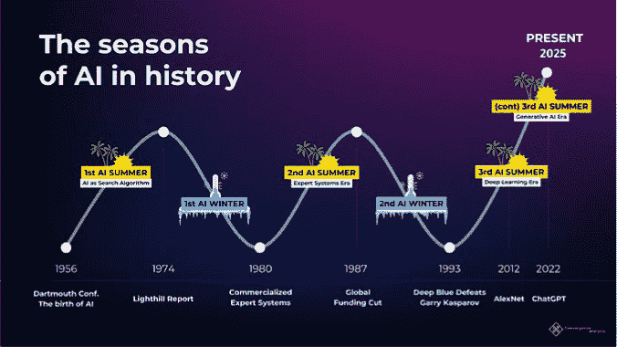

图 1.2. 人工智能的冬季。`*Created for the author. All rights to the author.*`

#### *Prolog*

在 1960 年代，人工智能迅猛发展，得到美国政府的大力支持，尤其是国防部。然而，进入 1970 年代中期后，进展放缓，并于 1974 年美国国会削减资助时几乎停滞，导致了第一次人工智能冬季。从 1974 年到 1980 年，全球许多社区在人工智能发展上停滞。但在此期间，专家系统和基于知识的 AI 受到关注，它们使用预定义的规则和领域知识来解决特定问题的复杂任务。例如，`Prolog`——一种逻辑编程语言——于 1972 年在法国马赛由`Alain Colmar`和`Philippe Roussel`开发，作为 LISP 的替代，并立即与人工智能和计算语言学联系在一起。

> `Prolog`是最早的逻辑编程语言之一，至今仍是最流行的此类语言，拥有多种免费和商业实现。该语言被用于定理证明、专家系统、术语重写、类型系统、自动规划，以及其原本设计的用途——自然语言处理……它特别适合需要基于规则逻辑查询的任务，如数据库搜索、语音控制系统和表单填写。⁵⁷

`Prolog`旨在让编程语言能够表达逻辑而非仅仅给出详细的计算指令。

> 执行 Prolog 程序相当于搜索可能树并找出满足给定规则的对象，这等同于命题证明。Prolog 拥有出色的回溯机制，在探索树时若当前分支无解，可回退至其他分支，这相当于深度优先搜索——一种在节点数量庞大的树中高效遍历的算法。有时在特定情境下会有多个真值答案，因为程序在找到第一个答案后不会立即终止，而是继续遍历整棵可能树，直至所有可能性都被检查完毕。Prolog 是一门交互式语言，意味着用户与计算机进行“对话”。首先，用户定义数据对象及其之间的关系，Prolog 随后可以回答关于这些数据的问题。⁵⁸

除了开发新程序和计算机语言外，专家系统也在不断被创建。

#### *MYCIN*

`MYCIN`是 1974 年斯坦福大学开发的医疗专家系统，展示了人工智能在辅助人类专家诊断和决策方面的潜力，标志着人工智能在解决实际问题方面的重要进展：

> `MYCIN`是一套早期的后向推理专家系统，利用人工智能识别导致严重感染（如血液感染和脑膜炎）的细菌，并推荐相应的抗生素，剂量根据患者体重调整——其名称源自抗生素本身，因为许多抗生素以“-mycin”结尾。`MYCIN`还用于血液凝固疾病的诊断。该系统于 1970 年代初在斯坦福大学历时五到六年开发，使用 LISP 语言编写，为`Edward Shortliffe`的博士论文，在`Bruce G. Buchanan`、`Stanley N. Cohen`等人的指导下完成。⁵⁹

在对该程序的简短论文中，`Edward Shortliffe`对过去 AI 大师表示敬意，并对未来充满希望：

> `MYCIN`表明，如果 AI 研究者愿意接受当前领域的局限性，并选择与这些局限相匹配的现实目标，则可以使用以往人工智能工作中未有的表示与控制技术，开发出有用的系统。这或许是该程序对人工智能最主要的启示。⁶⁰

进入 1980 年代，基于规则的专家系统兴趣回升，但本 decade 初期仍受“AI 冬季”影响，主要因资金和热情因未达预期而大幅下降。20 世纪 80 年代中期，神经网络的重新发现以及反向传播作为学习算法的发展，使 AI 从冬季走向下一个夏季，为神经网络的复兴奠定了基础。

#### *Neural Networks*

1986 年，`David Rumelhart`、`Geoffrey Hinton`和`Ronald Williams`提出了“受限玻尔兹曼机”(restricted Boltzmann machine, `RBM`)的概念。

> 受限玻尔兹曼机是一类用于降维、分类、回归、协同过滤、特征学习和主题建模的算法……`RBM`是浅层、两层神经网络，构成深信网络的基础块。`RBM`的第一层称为可见层（输入层），第二层为隐藏层。⁶¹


神经网络的诞生使人工智能机器的处理和计算功能得以增强。但什么是“神经网络”呢？

> 神经网络是一类 loosely（松散地）模仿人脑结构和功能的算法集，旨在识别模式。它们通过一种机器感知方式，对原始输入进行标记或聚类，将所有真实世界数据（包括图像、声音、文本或时间序列）翻译成数值形式的向量……神经网络帮助我们对数据进行聚类和分类。你可以把它们看作是数据存储和管理之上的聚类与分类层。它们会根据输入示例之间的相似性对未标记数据进行分组，并在拥有标记数据集进行训练时对数据进行分类。⁶²

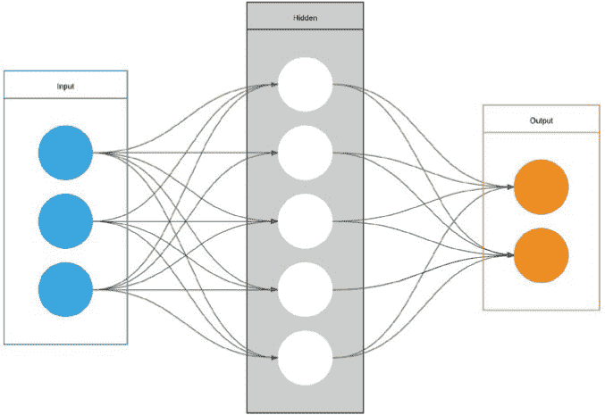

Figure 1.3. 神经网络。*Wikimedia Commons.*

神经网络，也称为人工神经网络（ANNs），是一类受人脑结构和功能启发的机器学习模型。它们由相互连接的节点（称为神经元）组成，这些节点组织在层中。神经网络是深度学习的基础组件，深度学习是机器学习的一个子集，专注于使用多层结构（即深度神经网络）。简单的神经网络包括输入层、输出（或目标）层，以及中间的隐藏层。层之间通过节点相连，这些连接构成了“网络”——神经网络——由相互连接的节点组成（参见 figure 1.3）。

神经网络在广泛的应用领域中展现出显著的成功——从图像识别到自然语言处理到语音识别，以及其他许多领域。自动从数据中学习复杂模式和表示的能力是神经网络的关键优势。RBMs（玻尔兹曼机）和神经网络被用于语音转文本、图像/物体识别和自然语言处理等应用。尽管最初并未专注于生成式 AI，但 RBMs 后来成为生成模型（如深度信念网络 DBNs 和生成随机网络 GSNs）的重要构件。

#### *Hans Moravec*

尽管 1980 年代人工智能正处于其第一个“冬季”的末期，但需要注意的是，在此期间 AI 安全性也在成为日益增长的关注点，甚至包括批评者。其中一位人物是 Hans Moravec（figure 1.4），他思考了 AI 发展可能带来的失控后果。Moravec 是一位奥地利裔加拿大计算机科学家，主要在卡内基梅隆大学工作，他发现 AI 发展中存在一个悖论。他发现，现在所谓的“莫拉维奇悖论”，即计算机相对容易被训练做人类觉得困难的事情，比如解决逻辑和数学问题，但计算机很难被训练做人类觉得容易的事情，如行走、跳跃、奔跑以及识别面孔、图像等。

他在著作 *Mind Children* 中阐述了这一悖论，提出数百万年的进化及其各种压力——自然选择和性选择——促成了这种困难。他认为 AI 机器从未经历过这种进化压力，因此对这类经验缺乏适应性的连接性：

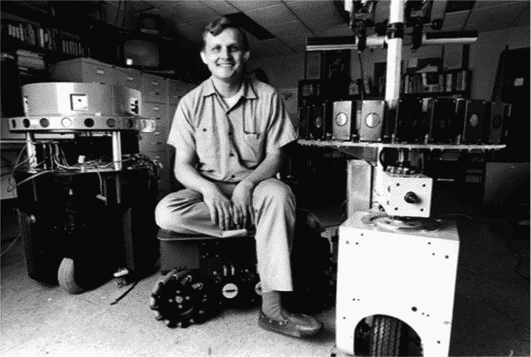

Figure 1.4. Hans Moravec。*Wikimedia Commons.*

> 我们让计算机解决的困难问题基于一种我们称之为“推理”的刻意过程。这种过程是有意识的，属于抽象思维，与人类在漫长进化过程中（不到 10 万年）近期演化出的大脑功能紧密相关。相反，我们做的易事——如行走、辨认颜色和面孔、手部操作等基础能力——则是经过漫长而艰难的自然选择和进化过程 ingrained（内化）的。这些能力大多是无意识的，无需思考，似乎不费力，使得表面上难的东西实际上相当容易。这些无意识的过程难以逆向工程并教给计算机，从而增加了问题的复杂度。总之，人类在历史上最近获得的技能相对容易教会计算机，但随着技能向人类和动物进化史更远的阶段发展，教学难度也随之增加。⁶³

虽然这可能是 1980 年代的情况，但如果你曾观看过 YouTube 上最近的波士顿动力（Boston Dynamics）视频，⁶⁴ 你会觉得在机器人的能力方面已取得了显著进展。多年来，我和几位同事一直在思考将知识从命题性（知道自行车是什么）转移到程序性（知道如何骑自行车）在 AI 中的实现方式。当 Neo 在电影《黑客帝国》中说“我懂空手道”后，这种技能被神奇地上传到他的大脑，这意味着什么？这纯属科幻，对吗？然而，能否将程序性运动技能数字化转移给没有任何先前经验的个体，是否可能？我们再次被 Arthur C. Clarke 的预言所提醒：“任何足够先进的技术都与魔法不可辨别。”⁶⁵ 若机器具备此类能力，那便超出我们的理解范畴。但这正是一个足够强大的人工神明所能实现的成就，不是吗？我们正将在不久的将来了解更多关于自身、能力和局限性的知识，随着 AI 继续向未来迈进。

除了他的悖论，Moravec 还相信机器的计算能力终将导致它们战胜人类人口：

> 迟早，我们的机器将变得足够智能，能够自行维护、繁殖和自我改进，而无需人类帮助。此时，新的基因接管将彻底完成。我们的文化将随后独立于人类生物学及其局限性而演变，而是直接从一代更强大的智能机器到下一代……一个由自我改进的思考机器主导的后生物世界将与我们自己生物世界的截然不同，正如我们的世界与先前无生物化学的世界截然不同。一个由不受限制的“思维孩子”组成的人口相当难以想象。我们仍将尝试想象其可能的后果。⁶⁶


-   观察进化过程本身的历史进步是很有意思的。它从达尔文的自然选择（物种根据适应环境变化的能力而生存或灭绝）逐渐发展到更快速的人工选择（人类干预以选择想要的植物和动物特质），再到我称之为“技术选择”的当前机械化过程（机器本身选择要在下一代传递给后代的特质）。如前所述，我的同事（Bullock 和 Mckernon）以及我已在别处讨论过这一过程[⁶⁷，并担心我们的物种将如何规划应对这一情况。因为，如果莫拉维对人类的预测属实，以及 I. J. Good 对“智能爆炸”的预测成立，以及约翰·冯·诺伊曼对“技术奇点”的预测属实，那么在不久的将来，技术选择可能会使我们人类变得古老且不再必要。

> 莫拉维可能更广为人知的观点是机器将在不久的将来超过人类。他估计计算机智能将在 2040 年达到人类水平，而此后机器将远超人类智力。莫拉维还认为，生物人类最终将被淘汰。尽管他认为人类的意识可以在未来存续，但他指出从进化角度看，人类身体将不再具备竞争力。

> 如前所述，本书中反复出现的主题之一，也是 AI 风险领域深入思考的内容，是“时间线”的概念。人工智能通用智能何时会与人类智能相等并超越？在书的后面，你会看到一张图⁶⁹，展示预测者、超预测者以及领域内专业人士的各种预测。值得注意的是，莫拉维在 1980 年代的预测如今不足二十年便将实现。引用 Sam Harris 的话：

> “ nobody seems to notice that referencing the time horizon is a total *non sequitur*. If intelligence is just a matter of information processing, and we continue to improve our machines, we will produce some form of super-intelligence. And we have no idea how long it will take us to create the conditions to do that safely… 50 years is not that much time to meet one of the greatest challenges our species will ever face. We seem to be failing to have an appropriate emotional response to what we have every reason to believe is coming.”⁷⁰

换言之，如果我们知道灾难的潜在风险如此接近，理应已经采取行动。事实上，我们的集体 AI 安全社区确实在努力；但人数寥寥，我们需要你的帮助。问题是：我们的集体努力——你的、我的以及全世界的——会成功吗？正因如此，这本书被写了。

#### ***Support Vector Machines (SVMs)***

到 1990 年代，神经网络和机器学习正在开发 increasingly 复杂的算法。特别是在监督学习和统计方法方面的进展，标志着 1990 年代。支持向量机（SVMs）和决策树 gaining popularity。SVM 是一类监督机器学习算法，可用于分类或回归任务。它们特别适合于将数据点分为不同类别或组的任务。SVM 由 Vladimir Vapnik 及其同事提出，核心组件包括线性分离（即通过“超平面”将数据分为不同类以更好地区分两类之间的边界）。边界是超平面与各类最近数据点之间的距离。SVM 旨在最大化该边界以实现分类。支持向量是最靠近超平面的数据点，对定义最优超平面至关重要。若这些点被移除或修改，超平面的位置可能会改变。SVM 已广泛应用于图像分类、文本分类和生物信息学等领域。其能够处理线性和非线性关系，并强调最大化边界，使其成为机器学习工具箱中的强大工具。

下面是一个用于二元分类任务的假设性 SVM 示例，说明其工作流程。过程包括在历史数据上训练 SVM，然后对新的未见数据进行预测。以下是逐步说明：

##### HYPOTHETICAL SCENARIO

**Task:** Binary classification to predict whether a given e-mail is spam (positive class) or not spam (negative class).

*Steps*

1.  **Data Collection**

    收集一组标记的电子邮件数据集，每封邮件根据某些特征（如词频、关键词出现情况）被标记为垃圾邮件或非垃圾邮件。

2.  **Data Preprocessing**

    对数据进行预处理，提取相关特征并编码类别变量。将数据集划分为训练集和测试集。

3.  **Training the SVM**

    使用训练集对 SVM 进行训练。训练过程中，SVM 学习最优超平面，将垃圾邮件与非垃圾邮件分开，并最大化两类之间的边界。

4.  **Feature Extraction for Real-Time Data**

    对实时数据应用相同的特征提取过程（例如 term frequency–inverse document frequency \[TF-IDF\]，它通过量化文档中词组的重要性或相关性来获取信息），将新来的电子邮件特征转换为 SVM 可接受的格式。

5.  **Prediction in Real Time**

    使用训练好的 SVM 模型预测新电子邮件是否为垃圾邮件。预测变量现在包含 SVM 对新电子邮件的判断（1 表示垃圾邮件，0 表示非垃圾邮件）。

通过边际比较和分类，SVM 已成为机器学习（ML）中极具威力且高效的工具。

#### ***Decision Trees***

决策树是一种在人工智能中用于分类和回归任务的流行机器学习算法。决策树以类似流程图的结构表示，内部节点代表基于特定特征的决策，分支代表决策结果，叶节点代表最终预测或分类。这些结构便于可视化和理解模型如何做出决策。

Figure 1.5 是一个来自维基共享资源的决策树示例，它在思考是否上传互联网图片。

你可以看到，这种过程不仅在机器学习系统中运作，也在我们自己的决策情境中适用。

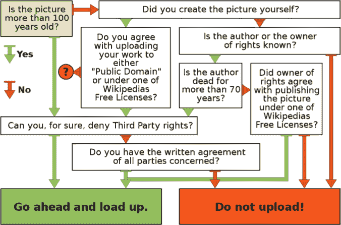

Figure 1.5. Decision tree. *Wikimedia Commons.*


在 AI 领域的同时，软件开发蓬勃发展，机器人领域也因自主机器人和计算机视觉系统的出现而取得了显著进展。到 20 世纪 90 年代末和 2000 年代初，AI 技术开始被整合到各种应用中，包括网页搜索引擎、推荐系统和语音识别。许多读者可能记得，1997 年 IBM 的 Deep Blue 战胜国际象棋世锦赛冠军加里·卡斯帕罗夫（Garry Kasparov），展示了 AI 在战略思维方面的能力。卡斯帕罗夫在意识到自己被机器击败时的沮丧表情是永恒的（`figure 1.6`）^(\*)。


Figure 1.6. 加里·卡斯帕罗夫. `Wikimedia Commons`.

请记住这个表情；它暗示了如果我们失去控制 rapidly increasing AGI（人工一般智能）的能力，我们所有人会有相同的表情。

2000 年代，机器学习在金融、医疗保健和自然语言处理等多个领域得到更广泛的应用。同时，这一十年也更加关注 AI 可能给世界带来的潜在危害。2000 年成立的 Singularity Institute（Singularity Institute）成为研究 AI 风险和机遇的关键组织。

> 2000 年，埃利泽·尤德科斯基（Eliezer Yudkowsky）在布赖恩和萨宾·阿特金斯（Brian 和 Sabine Atkins）的资助下创立了 Singularity Institute for Artificial Intelligence，目的是加速人工智能（AI）的发展。然而，尤德科斯基开始担忧未来的 AI 系统可能变得超级智能并对人类构成风险，2005 年该机构搬到硅谷，开始致力于识别和管理当时科学家基本忽视的风险。⁷¹

2012 年年底，该机构将其名称和网域售予了由彼得·迪亚蒙迪（Peter Diamandis）和雷·库兹韦尔（Ray Kurzweil）创办的非认证大学——Singularity University，并于下月以“机器智能研究院”（Machine Intelligence Research Institute）的名称重新启动。随后，关于 AI 风险的讨论逐渐走入主流，甚至触及科学家和普通大众，这从专注于该主题的同行评审期刊可以看出。在此期间，其他重要的 AI 风险作家也出现，例如本·古尔特泽尔（Ben Goertzel），他与尤德科斯基一样，对 AI 时间线和后果做出了一些令人沮丧且令人不安的预测。古尔特泽尔负责 SingularityNET，其网站上写道：

> “我们创立……的目标是创建一个去中心化、民主、包容且有益的人工一般智能（AGI）。一种不依赖任何中央机构、对任何人开放且不受单一公司或甚至单一国家狭隘目标限制的‘AGI’。SingularityNET 团队包括经验丰富的工程师、科学家、研究人员、企业家和营销人员。我们的核心平台和 AI 团队进一步由专注于金融、机器人、生物医学 AI、媒体、艺术与娱乐等应用领域的专门团队所补充。”⁷²

尤德科斯基和古尔特泽尔都开启了延伸至哲学领域的重要讨论，特别是关于在人工智能体中实现道德价值的问题，这推动了人工道德（artificial morality）和计算伦理（computational ethics）等领域的发展。有趣的是，观看尤德科斯基的 TED 演讲可以听到他 lament（ lament）自己一直在警告公众 AGI 即将到来的危险——顺便说，这一术语是 AGI 的创立者之一、马克·古布拉德（Mark Gubrud）的同事所发明的。⁷³ 尽管过去二十年取得了显著进展，但在追求安全且有益的人工智能的道路上，仍有许多挑战需要解决。

到 2010 年，随着大数据和硬件进步以及海量数据的可用性，深度学习（DL）兴起，进一步推动了神经网络的发展，使计算机视觉、自然语言处理和语音识别取得突破。这些网络使得 DL——机器学习（ML）的一个子集——能够更高效地运行。

> 深度学习是机器学习的一个子集，核心是拥有三层或以上的神经网络。这些神经网络尝试模拟人脑行为——虽然远不及人脑，但能够从大量数据中“学习”。单层神经网络仍能进行近似预测，但添加隐藏层可以优化和精细预测精度。深度学习推动了许多 AI 应用和服务，提升了自动化水平，能够在不需要人工干预的情况下完成分析和物理任务。深度学习技术支撑着日常产品和服务（如数字助手、语音控制电视遥控器、信用卡欺诈检测），也支撑新兴技术（如自动驾驶汽车）。⁷⁴

如 figure 1.7 所示，我们可以看到 AI 的发展历程，从最初的定义到逐步理解其技术组成部分——ML、DL，最终到生成式 AI。

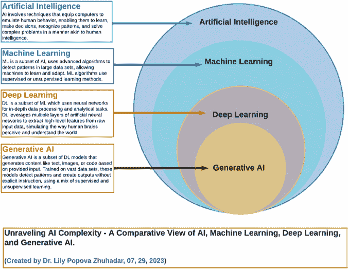

Figure 1.7. AI 到 生成式 AI. `Wikimedia Commons`.

2011 年，IBM 的 Watson 通过在《Jeopardy!》游戏节目中击败人类冠军肯·詹宁斯（Ken Jennings）展示了 AI 在自然语言处理方面的能力。它不仅战胜了《Jeopardy!》的冠军，还以超过三倍于最接近竞争对手的分数获胜。这发生在 2011 年。

本十年的其余时间，个人和组织不断在计算能力和机器人演进方面取得改进。2013 年，Alex Graves 在《Generating Sequences with Recurrent Neural Networks》一文中作出了重要贡献，他在该文中研究了序列生成——即根据输入数据或上下文生成有序输出序列的任务。序列生成在自然语言处理、时间序列预测和音乐生成等领域非常常见。其目标是生成有意义且连贯的序列，遵循特定的模式或结构。

与此同时，Diederik P. Kingma 和 Max Welling 在同年提出了变分自编码器（VAE），为生成复杂数据提供了重要的概率框架。VAE 是自动编码器的一种，能够学习输入数据的概率表示，从而生成与训练数据相似的新数据点。VAE 属于更广泛的自动编码器类别，但其通过潜在空间插值生成新样本的能力使其独具特色。变分自编码器在生成建模和非监督学习任务中表现强大，已被应用于图像合成、风格迁移、药物发现和异常检测等多个领域。

2014 年，Ian Goodfellow 及其团队——Jean Pouget-Abadie、Mehdi Mirza、Bing Xu、David Warde-Farley、Sherjil Ozair、Aaron Courville 和 Yoshua Bengio——提出了突破性的生成对抗网络（GAN）架构。GAN 由生成器和判别器两个网络在竞争性过程中共同工作，以生成逼真的数据。


在 2015 年，像 OpenAI 和 DeepMind 这样的研究机构在推动自然语言处理（NLP）的生成式人工智能方面发挥了关键作用。OpenAI 开发了如“GPT”（生成式预训练变换器）等模型——从 2020 年的 GPT-3、2022 年的 GPT-3.5、2023 年的 GPT-4、到 2024 年的 GPT-4o——展示了卓越的语言生成能力。正如本章前文所述，变换器技术具备一种神经网络架构，它使用自回归语言模型，优化深度学习能力以生成类似人类的文本。它使用了 45 太字节的文本数据进行训练，包括几乎整个公共网络。

在 2016 年，DeepMind 的“WaveNet”引入了一种基于深度神经网络的令人印象深刻的语音合成模型。正如我们目前所见，生成式人工智能是一个迅速发展的领域，全球的研究人员和科学家都为其进步做出了贡献。这些人来自学术界、工业界和开源社区，他们共同推动着风格迁移、图像合成、音乐创作等领域的发展。2016 年，Google 的 AlphaGo 战胜世界围棋冠军李世石，以 4:1 的比分获胜，凸显了强化学习在掌握复杂游戏方面的有效性。这一成就被认为非常不凡，因为围棋的复杂性极高。在他们的网站上，在“Making History”（Making History）标题下，该技术的创作者引用了以下内容：

> 我们的人工智能（AI）系统 AlphaGo 学会了掌握古老的中国围棋——一种深刻复杂的策略、创造力和才智的棋盘游戏。AlphaGo 在人类围棋世界冠军之前十年就击败了他，激励了全球玩家发现新的思路，并可以说，它成为围棋史上最强的选手。它证明了 AI 系统可以学会在高度复杂的领域解决最艰难的问题。


Figure 1.8. The game of Go. *Wikimedia Commons.*

对于熟悉围棋的读者（figure 1.8），你会知道它有多么复杂。

对于不熟悉的读者，以下是 ChatGPT 在被要求用三句话解释时的回答：

> Go 是一款古老的策略棋盘游戏，在带有网格的棋盘上使用黑白棋子进行对弈。目标是通过战略性地放置棋子、捕获对手的棋子以及形成连贯的棋子组来主导领土。尽管规则简单，Go 因其深刻的战略复杂性而著称，其历史可追溯至 2500 多年前。

最需要记住的是，围棋拥有巨大的可能走法数量。具体是多少呢？

> 考虑到典型的国际象棋游戏的分支因子约为 35，持续 80 步，可能的走法数量巨大，约为 35⁸⁰（即 10¹²³），即“香农数”，以 Bell 实验室的先驱克劳德·香农命名，他不仅发明了信息论，还在 1950 年撰写了第一篇关于如何编程让机器下棋的论文。香农数 10¹²³巨大，尤其考虑到整个可观测宇宙中大约只有 10⁸⁰个原子（包括星系、恒星、行星、狗、树木和人）。但围棋的复杂性更大，远远超过这一点。由于每回合有 250 种可能的走法（围棋在 19×19 的棋盘上进行，而国际象棋棋盘要小得多，为 8×8），以及典型的 150 步游戏深度，可能的走法约为 250¹⁵⁰，即 10³⁶⁰。这是一个难以想象的数字，使得 exhaustive evaluation（逐一评估）所有可能的走法变得完全不现实。

因此，游戏的巨大复杂性增加了其难以掌握的难度。然而，AlphaGo 做到了这一点——这是许多人预测 AI 不可能实现的成就。韩国围棋协会（Korea Baduk Association）因此授予 AlphaGo 最高的围棋大师等级，即荣誉 9 段（最高可能的排名）。

AlphaGo 的成功归因于深度学习（DL），一种特定类型的人工神经网络（ANN）。如今，人工神经网络和深度学习是各种 AI 应用的基础，例如 Facebook 使用的图像识别算法以及为智能音箱和自动驾驶汽车提供支持的语音识别算法。

从 2017 年到 2024 年，人工智能的各个领域都出现了重大进展。在硬件方面，图形处理单元（GPU）的发展日益加速，它们被专为深度学习任务优化。Google 推出了专用于加速机器学习工作负载的张量处理单元（TPU），提供高性能和高效率。在软件方面，深度学习框架如 TensorFlow 和 PyTorch 持续主导，并通过定期更新和改进保持领先。两个框架的使用和社区支持不断增加。迁移学习（Transfer learning）获得普及，使得可以将预训练模型用于新任务，从而节省计算资源和训练时间。

同时，大规模模型的训练计算能力也得到提升，这促使使用强大的计算集群和云解决方案。虽然尚未普及，但量子计算的持续发展有望为解决复杂 AI 问题提供潜在应用。企业已采用机器人流程自动化（RPA）并大幅提升 AI 在各种业务流程中的集成，以自动化常规、基于规则的任务。半导体芯片的发展也在加速，现在包括模拟人脑结构和功能的神经形态芯片，用于更高效和专用的人工智能处理。

包括 NVIDIA 和 Intel 在内的多家公司投资于专为 AI 工作负载设计的芯片，优化深度学习任务的性能。2024 年 3 月 late，身穿皮夹克的 NVIDIA 首席执行官 Jensen Huang⁷⁸在旧金山湾区的 SAP Center 向满座观众展示了其最新最佳的创作：“NVIDIA 的 GB200 Superchip 及其‘Blackwell’架构。[The new chip]将在大规模语言模型推理工作负载中提供最高 30 倍的性能提升，同时使用最高 25 倍更少的能量，这将使人工智能更高效、更便宜。”⁷⁹

Huang 是 AI 领域快速变革的倡导者。他认为通用计算和加速计算正在放缓。通过 NVIDIA 的新设计，他相信世界正在“见证新工业革命的开始。”⁸⁰ 他相信行业需要在找到扩展能力 *和* 降低成本的方式上更具创造力，从而让更多人能够获得更可持续的计算能力。

这款最新半导体超级芯片的研发，顺便提一下，包含 2080 亿个晶体管，可用于万亿参数规模的生成式人工智能，标志着人工智能历史上的一个独特转折点。正如我们所注意到的趋势，许多 AI 从业者相信，随着计算能力的提升以及对更多数据的获取，构建超级智能机器（SMG）是必要且充分的步骤。这款 NVIDIA 芯片将显著提升计算能力。顺便说一句，如果我们现在身处电影情节，这将是未来人士回溯并摧毁 GB200 超级芯片的时刻。


# 牢记以下几点至关重要：

-   世界上只有少数几个地方制造半导体或微处理芯片。在榜首的是**台湾半导体制造公司（TSMC）**，其次是韩国的**三星**，以及美国的**英特尔**。美国如今有不少公司生产这些宝贵且必需的产品，而中国正在迅速崛起。你可能记得，新冠疫情导致半导体供应短缺，进而推高了依赖这些宝贵商品（如汽车、电脑、手机等）的产品需求。

-   在机器人领域，增强学习在机器人系统中的应用取得了稳步进展，使机器人能够学习并适应环境。看到早期笨拙笨拙的机器人与如今相比，真是太惊人了。从最初只能走几步的日子到现在能在桌子上做后空翻、并以编排舞蹈形式跳“Do You Love Me?”的 Contours 舞曲，我们正在看到未来潜力的清晰轨迹。当然，弱人工智能（弱 AI，即 ANI）也取得了显著进展，以生成式 AI 技术的形式出现，并在自然语言处理（NLP）领域展现出生成连贯且贴切文本的能力。让我们来看看弱 ANI 的最新应用。

## 弱 ANI 的实际应用

-   当前弱 ANI 最流行的例子是**Transformer**（[图 1.9）。

-   不，不是那种 transformers。

-   我指的是文本、图像、音频和视频生成式 transformers。

### 文本 Transformers：生成式预训练 Transformer（或简称 GPT）

-   我所指的 transformers 包括 ChatGPT、LLaMA、BERT、Claude、Bard 以及其他许多模型。但这里的“transformer”具体指什么？它们“转换”什么？


-   图 1.9. Transformer 机器人。*Wikimedia Commons.*

-   有趣的是，当你让 AI 模型定义 GPT 时，它可能会给出如下回应：

> 生成式预训练 transformers（GPT）是一种人工智能（AI）模型，能够根据给定的提示或输入生成类似人类的文本。这些模型在大量文本数据集上训练，采用自监督学习方式，这意味着它们能够预测文本序列中的下一个词，而无需被明确教导。这使得它们能够生成连贯且符合语境的文本。⁸¹

-   这类 ANI 包含大语言模型（LLMs），它们利用深度学习扫描整个互联网，以理解、总结、生成和预测新内容。它们是一种“生成式 Transformer AI”，使用类似人脑的神经网络，通常被称为 transformers。凭借大量参数和 Transformer 模型，LLMs 能够快速理解并生成准确的回答，使该 AI 技术广泛应用于多个领域。

-   它们用于什么？以下是 GPT 的一些应用：

* 文本生成：GPT 能够自主创作关于广泛主题的文本。
* 内容摘要：GPT 能够将冗长文档或文章浓缩为简洁摘要，让读者快速把握核心要点。
* 翻译：当在多种语言上训练时，这些模型能够将文本从一种语言翻译到另一种语言，促进跨语言沟通。
* 情感分析：GPT 能够评估文本的情感基调，帮助理解其情感是积极、消极还是中性的。
* 重写内容：这些 GPT 模型能够重新表述或重构文本，以提升其清晰度或风格。
* 分类与分类：它们可以对文本进行分类和分组，帮助按主题或特征组织内容。
* 对话 AI 和聊天机器人：这些模型在自然语言理解和生成方面表现出色，使人机交互通过聊天机器人和对话 AI 系统更加流畅自然，区别于早期不够先进的 AI 技术。

-   GPT 利用三个因素：

* 位置编码：句子中单词的顺序。
* 注意力：反复学习语法规则。⁸²

* 自注意力：消解词语，识别词性和时态。

-   我们已经体验过这项技术的奇迹——从要求它写 1,500 字关于莎士比亚《哈姆雷特》的十四行诗，到要求它编写多种编程语言的代码，GPT 技术彻底改变了信息获取和利用的方式。众多企业利用这种 ANI 协助各种任务和目标。

### 图像 Transformers

-   正如 GPT 能在文本和代码中创造各种原创操作一样，像 DALL-E、Midjourney 和 Stable Diffusion 这样的程序能根据文本描述创造原创图像。它们使用 GPT-4 变换器模型的十二亿参数版本来解释自然语言输入。这些程序使用卷积神经网络，因为它模拟了人脑处理视觉的方式。换句话说，不同层的神经网络通过滤波器搜索视觉场中的不同方面和模式，从而综合成对“看到”的整体理解。^(\*) 例如，你可以提示系统创建一幅写实风格的图像，描绘一只浣熊骑自行车，站在大峡谷旁边，正吃冰淇淋，它会生成数十张图像（图 1.10）。或者，你可以提示它以抽象表现主义、超现实主义或你想象的任何其他艺术风格创作，它也能生成相应的图像。


-   图 1.10. DALL-E 创作的骑自行车的浣熊。*作者所有，版权归作者所有。*

### 视频 Transformers

-   或许这项新技术最强大或最震撼的效果体现在其生成假视频的能力。特洛伊·克鲁斯的深度伪造⁸³引起了巨大轰动，让人们思考何时能够简单设计情节、角色和演员，随时随地创作原创电影。这项技术也让人们思考它可能被用来传播误信息或，更糟的，传播有意为之的虚假信息（即**disinformation**，即故意传播的虚假信息）以多种方式攻击他人。这些只是弱 ANI 的几个应用。我们只能想象未来会带来什么，但它们已经描绘出技术只会不断进步、且速度加快的清晰图景。


今天，AI 驱动的应用，如虚拟助手和自动驾驶汽车，正在获得广泛的关注和采用。AI 继续以快速的速度发展，研究重点包括可解释 AI、增强学习、生成模型和 AI 伦理。AI 正在越来越多地融入日常生活的各个方面，从智能家居到医疗保健、金融和交通。正如前面所指出的，AI 经历了乐观的时期（AI 夏季）和资金及兴趣减少的时期（AI 冬季）。今天，我们肯定处于夏季，这可能对人类以及许多其他物种大有裨益。另一方面，如果我们无法驾驭和控制它的范围，我们将有意识地创造出一个强大的神，而我们将不再能够控制它，只能希望它 somehow 决定保留我们。目前，我们可以保持乐观，展望 AI 继续演进、发展并发挥其在塑造技术和社会未来中的关键作用所带来的巨大机遇和发现。

`# The Benefits of AI`

本章分为两个部分，正好有原因。在第一部分，我们将考虑人工智能技术所发展和正在开发的当前和拟议的若干最重要的好处。但重要的是要理解，这些好处来源于 ANI，即人工窄智能。这些技术属于“弱” AI 的范畴，因为它们完全受人类控制。换句话说，你的扫地机器人不会“走神”并决定威胁或杀害你、你的家人或宠物狗，因为它根本不可能。它们行动的范围如此狭窄，以至于无法脱离它们的程序、算法或指令。在本章的第二部分，我们将更具推测性。我们将考虑从人工一般智能（AGI）或甚至人工超智能（ASI）出现所可能获得的好处。在这一部分中，我们将思考如果有一个神在我们面前，能够响应我们的每一个命令和欲望——特别是，不害怕或杀害我们的命令或欲望——会是什么样子。你想要这样的神做什么？你会第一个问它什么，为什么？我们可能需要现在就开始思考要向这样的神提出什么类型的问题——因为我们已经非常接近构建它。

### Part I: The Benefits of ANI Technologies

人工窄智能发展和演进所带来的拟议和潜在好处令人印象深刻。在 2023 年底的一次采访中，Reinvent Futures 创始人 Peter Leyden,¹ 当被问及 AI 技术发展的未来年份时，表示一些预测者认为生成式 ANI 将被深度融入并贯穿生活的方方面面：


> 积极利用生成式 AI 的应用将在本年度遍布全球，数百万企业家将在各种方向中发挥创造力。你`有必要`记住，AI 是一种通用技术，它可以并最终会在所有行业、所有领域、所有时间段应用于几乎所有事物。有什么事物不利用当今能够思考的机器来获益呢？最近记忆中最接近的就是互联网的出现，而 AI 的规模远大于此。1990 年代出现了大量初创企业，企业家们从世界各地涌入旧金山湾区，充满疯狂的想法，思考如何利用这项新兴的连接能力。我当时在场，今天旧金山依然充满活力，甚至更加强大，因为 AI 的能力更大。

There is so much potential and so many AI developments occurring in real time that it is difficult to keep up. Here are just a few:

*   我们已经看到医疗保健领域的改进，AI 程序正在协助早期疾病检测、个性化医疗、药物发现和机器人手术，同时分析海量医疗数据以制定更佳的治疗方案。

*   AI 驱动的工具可以通过提供个性化学习体验、自适应辅导、智能评估以及提升学生学习成果来增强教育系统。

*   许多企业已采用 AI 技术，优化制造、交通、物流和能源等行业，降低成本、减少错误，提高整体生产力。

*   AI 正在加速科学研究，通过分析复杂数据集、预测结果，并帮助科学家在基因组学、气候建模和高能物理等领域取得进展。

*   AI 驱动的更智能的个人和虚拟助手可以处理任务、提供个性化推荐、管理日程，并提升日常生产力和便利性。

*   AI 正在提升交通系统，包括自动驾驶汽车、交通优化和智能路径规划，减少事故、拥堵和旅行时间。

*   在可持续性方面，AI 可以监测和管理自然资源、预测环境模式、优化能源消耗，并促进更可持续的做法。

*   此外，AI 还能改进语言翻译、语音识别和自然语言处理，促进跨文化沟通，打破语言障碍。

*   AI 还将通过语音识别、计算机视觉和先进假肢等技术提升可及性，为残障人士带来更大的独立性和便利。

Because of the explosion currently happening in the development of AI technologies, it is difficult to imagine the full range of potential contributions and benefits they will bring to humanity. By the time this book is published, there will be advancements in AI technologies that will just be emerging, and this book may require a second, third, and more editions in the future to fully consider them. What we can say at this stage is that the future looks promising in many ways and that our lives will indeed be improved by them—and quicker than you might think. There has been considerable work in the area of forecasting or predicting what benefits AI technologies may bring to humankind. Since 2015, there has been the “One Hundred Year Study of Artificial Intelligence,” which considers, every five years, what has been developed and what is predicted to occur with AI technologies. The first report appeared in 2016 and is described in the following way:

> The One Hundred Year Study is modeled on an earlier report informally known as the “AAAI Asilomar Study.” During 2008–2009, the then president of the Association for the Advancement of Artificial Intelligence (AAAI), Eric Horvitz, assembled a group of AI experts from multiple institutions and areas of the field, along with scholars of cognitive science, philosophy, and law. Working in distributed subgroups, the participants addressed near-term AI developments, long-term possibilities, and legal and ethical concerns, and then came together in a three-day meeting at Asilomar to share and discuss their findings. A short written report on the intensive meeting discussions, amplified by the participants’ subsequent discussions with other colleagues, generated widespread interest and debate in the field and beyond.³

What I found most interesting about this first report was its lack of concern for the potential for AI existential risk from AGI/ASI developments. In fact, there was a noticeable downplay to this potentiality:

> Contrary to the more fantastic predictions for AI in the popular press, the Study Panel found no cause for concern that AI is an imminent threat to humankind. No machines with self-sustaining long-term goals and intent have been developed, nor are they likely to be developed in the near future. Instead, increasingly useful applications of AI, with potentially profound positive impacts on our society and economy are likely to emerge between now and 2030, the period this report considers.⁴

“No cause for concern that AI is an imminent threat to humankind.” This sounds like it’s right out of an action movie where the protagonist, a Bruce Willis type, is trying to warn politicians about an imminent threat—and, well, they’re just not listening. Quite the dramatic scene. Except, this isn’t a movie. I am again reminded of Sam Harris’s eloquent plea that even if we had fifty years to get ready for AGI/ASI, we should probably start doing something about it now. Fortunately, my team and the rest of the crew at Convergence Analysis—along with far too few other collaborators around the world—are specifically working on this potentiality.⁵

There has since been a second report called “Gathering Strength, Gathering Storms: The One Hundred Year Study on Artificial Intelligence (AI100) 2021 Study Panel Report.” In this report, a study panel responds to a collection of twelve standing questions (SQs) and two workshop questions (WQs) posed by the AI100 Standing Committee. Although again there is no explicit mention of or concern for AI existential risk in this report, the Standing Committee does make tacit reference to it in two of their standing questions. The first question asks: “What are the prospects for more general artificial intelligence?” Their response has not changed much since their 2016 report:

> Recent years have seen substantial new research, especially in the machine learning community, in how to imbue machines with common sense abilities. This effort includes work on enabling machines to learn causal models and intuitive physics, describing our everyday experience of how objects move and interact, as well as to give them abilities for abstraction and analogy. AI systems still remain very far from human abilities in all these areas, and perhaps will never gain common sense or general intelligence without being more tightly coupled to the physical world. But grappling with these issues helps us not only make progress in AI, but better understand our own often invisible human mechanisms of general intelligence.⁶


-   提议认为 AI 系统“距离人类能力还很远……也许永远不会获得常识或通用智能”似乎有点天真。这种时间量化（即“距离人类能力很远”）是如何计算或确定的？他们是如何测量的？正如我们可以精确预测 AGI 何时出现一样，这并非如此。但建议 AI 仍然距离人类很远，这可能是因为我们尚未理解自己“隐形的人类通用智能机制”，显得更像诗意而非科学。

-   关于 AI 风险的第二个问题是： “AI 的最紧迫危险是什么？” 你可能会认为 AI 的最紧迫危险是 **存在性风险**。但再次强调，这在报告中并未提及。相反，关注点集中在 AI 的常规短期风险上，如偏见/歧视、对自动化决策的过度依赖、虚假信息、对民主的威胁等。所有这些都是非常严重的风险，我们将在下一章中讨论它们。然而，它们都是次要的，如果我们不能确保防止任何形式的 **存在性风险**，则毫无意义。

-   AI 有潜力在各个领域为人类带来重大好处。虽然要注意这些好处的实现取决于负责任的研发、部署和监管，但 ANI（人工智能的窄义形态）已经在以及将来以许多方式惠及人类福祉。以下是其中几种更具影响力的方式：

#### *Health Care Advancements*

AI 正在通过提升诊断、药物发现和个性化医疗来彻底改变健康医疗。它能够分析海量医疗数据，辅助早期疾病检测，并帮助研发更有效的治疗方案。当我们仅考虑几种 AI 技术可能带来的改变时，就会对这些发展充满乐观。目前，这类技术已经极大推动了科学和医学研究。最引人注目的体现之一是由 Google DeepMind 开发的程序 **AlphaFold**，它已经在蛋白质结构预测方面取得了突破。

> 每种蛋白质都是由一系列氨基酸链接而成。这些氨基酸相互作用形成形状，进一步折叠成更大规模的复杂三维结构，构成地球上所有生命的基本构件。蛋白质折叠的可能方式数量难以想象。因此，弄清楚它们如何快速且一致地折叠是一项极具挑战性的任务。目前已知的蛋白质数量已超过 2 亿种，每年仍在不断增加。每一种蛋白质都有其独特的三维形状，决定其功能和作用。最新版本（AlphaFold2）现在可以在几分钟内大规模预测蛋白质的形状，精度可达原子层面！这是一次重要的突破，彰显了 AI 对科学的影响。该工作发表在 *Nature* 上，并获得了生命科学、数学和基础物理领域的 Breakthrough 奖项。[⁷

-   研究这些蛋白质及其特性传统上需要数月甚至数年，但得益于 AlphaFold 等技术，科学家现在能够大幅加速这一过程，从而快速提升对人体许多功能和系统的理解。这将显著提高对诸多疾病（包括癌症）的认识和治疗成功率。整个过程极其复杂，难以用简短语言解释，但基本原理如下：

**Data Input:** 首先，科学家将氨基酸序列及实验数据（如氨基酸对之间的距离）输入 AlphaFold。

**Learning Patterns:** AlphaFold 利用深度学习神经网络（正如前一章所见，这是一种模拟人脑学习能力的 AI），通过扫描其数据库中大量的蛋白质结构数据来“学习”。

**Prediction:** 程序随后预测在折叠后蛋白质的三维结构长什么样。基于海量输入数据，它会生成一个模拟，展示蛋白质如何折叠成特定形状。

**Refinement:** 过程并未在此结束，程序会继续利用物理定律和其他蛋白质折叠原理进行进一步预测。

**Output:** 最终输出是一份详细的蛋白质三维模型，展示其折叠方式以及原子的空间排列（图 2.1）[¹⁰]。

AlphaFold 之所以重要，是因为它能够以惊人的准确度预测蛋白质结构。这些蛋白质如同微型纳米机器，驱动着地球上所有生命。DeepMind 创始人兼 CEO Demis Hassabis 表示，蛋白质折叠是生物学中的“圣杯式难题”。[⁸] 传统上，蛋白质结构的测定依赖实验方法，如 X 射线晶体学或冷冻电子显微镜，这些方法耗时且困难。AlphaFold 加速了这一过程，为科学家提供了关于蛋白质功能及其在各种生物过程中的作用的宝贵洞察。

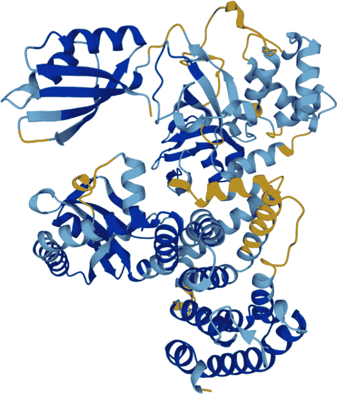

Figure 2.1. 蛋白质折叠。 *Wikimedia Commons.*

##### A BRIEF HISTORY OF ALPHAFOLD

该领域的突破性挑战已持续多年，最早可追溯至 1994 年，当时首次启动了 CASP（Critical Assessment of Protein Structure）竞赛。这些竞赛被称为“蛋白质折叠奥运会”，吸引了全球超过一百个团队的科学家参与。约翰·穆尔特（John Moult）是马里兰大学的联合创始人，他回顾道：“当我们在 1994 年启动 CASP 时，我显然低估了这有多么困难。” 在近二十五年的努力后，2018 年 4 月，穆尔特表示：

> 在 CASP 13 中，我们首次看到人工智能的有效应用。许多蛋白质的形状已经大致正确，但原子位置的细节——也就是我们所说的“真正的解”——仍未完全实现。[⁹]

到了 CASP 14 举办时，正值 2020 年春季，全球正因新冠疫情而封锁。DeepMind 团队远程开始研究 SARS‑CoV‑2 蛋白 ORF8。他们取得了极为显著的成功。正如约翰·穆尔特所回忆：

> 在 CASP 14 中，我们看到一个团队从一开始就达到原子精度——这实际上解决了两个问题：1. 如何寻找正确的解决方案；2. 如何确认你已经找到了正确的解。对这位科学家而言，经过长期的停滞与尝试，终于出现了这一解。我们解决了问题。这让人对科学的进程充满激动——你永远看不到或甚至无法预测接下来会发生什么，总有意外。正是这些惊喜让科学家保持前行。下一个惊喜会是什么？¹⁰


啊，是的：“接下来会发生什么？”我们之前已经读过这句话了吗？我们把这种好奇心称为科学家和工业领袖的驱动力，在第 1 章中提到过。它推动人类为我们自己和我们的星球的更好或更坏而发现了一些惊人的事物。让我们希望我们最大的学习和探究能力为 AI 提供最大的价值，同时限制或控制其最糟糕的方面。2022 年 7 月 28 日，DeepMind 宣布 AlphaFold 已经预测了几乎所有已知科学蛋白的结构（98.5%）。现在，DeepMind 已向全球的科学家和研究人员提供了其发现：

> 昨年，DeepMind 发布了 AlphaFold 的源代码，并将 100 万种蛋白质的结构（包括人体几乎所有蛋白质）的结构放在了 AlphaFold 蛋白质结构数据库中。该数据库与欧洲分子生物学实验室（欧洲公共研究机构）共同构建，该机构已经主机了大量蛋白质信息数据库。最新的数据发布为数据库带来了巨大的提升。更新内容包括“植物、细菌、动物以及许多其他生物的结构”，这为 AlphaFold 在可持续性、燃料、粮食不安全和被忽视疾病等重要问题上产生巨大影响，DeepMind 的创始人兼首席执行官 Demis Hassabis 在本周的通话中告诉记者。¹¹

DeepMind 在蛋白质折叠方面的进展尤其重要，在医学领域尤为关键，因为理解蛋白质结构有助于药物发现和疾病治疗的开发。AlphaFold 已经开发出更有效的疟疾疫苗，发现了马达加斯加的新疾病威胁，开发了新的癌症治疗药物，并致力于解决抗生素耐药问题。^(\*) AlphaFold 代表了一种强大的工具，它彻底改变了我们研究生命分子机器的方式。¹²

##### MEDICAL DIAGNOSTICS

医学诊断领域将继续出现许多巨大的发展，AI 的进步推动了这些进展，也有许多典型案例。AI 可以通过分析复杂的数据集（如医学影像、基因信息和患者记录）来辅助医学诊断，这有助于更早、更准确地发现疾病并制定个性化的治疗方案。¹³ AI 算法还能加速药物发现过程，通过分析海量数据、预测潜在药物候选物并优化临床试验设计。此外，AI 还能处理繁琐、耗时的官僚性工作，从而让医生有更多时间与患者相处。以色列科恩（Isaac Kohane）—《新英格兰医学杂志》总编辑兼哈佛大学生物医学信息学系主任—表示：

> 我认为医生们与患者相处的时间不够。他们花费过多时间在官僚事务上。让 AI 处理这些官僚事务，我们希望医生能更多地与患者接触。这是短期的期望。¹⁴

看到科恩（Kohane）呼应了我通过 OSTOK 项目（¹⁵）所追求的目标——即利用患者健康信息进行医学推断和治疗的潜力——的感受，颇为有趣。2023 年 5 月底，科恩博士表示：

> 长期的期望（我所说的长期，并非 20 年，而是五年）是，这些程序在遵循适当的隐私保护措施的前提下，能够查看我们所有的数据，并实际提出新的生物医学洞见、新的潜在治疗方法、能从这些治疗中受益的患者群体，同时加速药物发现过程。因为正如我们所讨论的，人类作为医生的局限性同样影响人类作为生命科学研究者的局限性，他们无法知晓一切，也无法实时掌握所有正在发生的发现。这些程序在掌握所有方面方面表现得相当出色。¹⁶

我们将在本章后半部分探讨 AI 医疗助理的投机性潜力。目前，我们可以相当有信心地说，未来几年，医疗领域在诊断和治疗方面将显著变得更好。

一些科学突破正在实时发生。例如，斯坦福大学计算机科学教授 Daphne Koller 相信，AI 正在彻底改变各种癌症的诊断方式。Koller 也是 AI 先驱，是生命科学 AI 公司 Insitro 的联合创始人兼首席执行官。当被问及她的研究内容时，Koller 表示：

> “\[W\]hat we’ve taken on as an effort is to really learn the language of histopathology \[the study of tissues\]… and then use that to \[…\] give us potential \[drug\] targets.” 她指出，通过机器学习，计算机将“真正学习病理学的语言”，从而使机器能够以 90%到 95%的准确率预测癌症患者的基因变化。她解释说：“基本上，通过观察一张活检片，你就能判断这位患者患有某种基因突变，而另一位患者则不是，这是临床医生很难做到的。”¹⁸

AI 在生物学和癌症研究中的应用催生了全新的科学领域——数字生物学（digital biology）。这一领域是科学历史发展的许多新兴学科之一：

> “想想 19 世纪末的化学，当 periodic table \[of elements\] 被发现时，”她举例，“或者 20 世纪初的物理，能量与物质、时空的关联。”她指出，1990 年代也出现了类似的发现热潮，涉及两个学科：数据/机器学习/人工智能（这种技术其实始于那时），以及量化生物学（即以前所未有的精度测量生物学）。这两个学科如今正在融合，她表示，这将创造出一个新领域——数字生物学，它能够“以惊人的精度和前所未有的规模数字化读取生物学，利用机器学习和人工智能等工具解读所见内容，并通过 CRISPR、组合化学等技术‘编写’生物学，以及其他各种手段，使生物学能够做它原本做不到的事情。”¹⁹

Koller 表示，她相信 AI 不仅将推动医学科学领域的发展，还将惠及其他领域，预计在环境科学、能源、生物材料和可持续农业等众多学科将取得巨大进步，这些进步将帮助让我们的世界变得更好。²⁰

最近开发的一种癌症诊断工具叫 PANDA（人工智能-based 胰腺癌检测）。该技术具有极高的准确度，能够识别并分类胰腺病变，用于早期发现和治疗胰腺导管腺癌（PDAC）。及早发现胰腺癌至关重要，因为大多数病例在癌症已发展到第三或第四阶段时才被发现，此时治疗难度大。早期诊断能让治疗更早开始，从而显著延长人类寿命。²¹


> 胰腺导管腺癌是固体癌中最恶性的形式，每年死亡人数超过 450,000 人。然而，高死亡率主要是因为胰腺导管腺癌（PDAC）常在晚期被发现时已无法手术。

> 

> PDAC 被发现时已经晚期或早期发现的病例预后更好，早期治疗通常会显著提高患者的生存率。早期发现并治疗的中位总生存期为 9.8 年，而大多数晚期发现的病例仅为 1.5 年。²²

这对研究人员、医师和患者来说是好消息。加快早期癌症发展的检测速度至关重要，以便通过高级治疗阻止其扩散。

另一项令人振奋的 AI 医疗技术进展是 IBM Watson for Oncology。它基本上是一个 AI 系统，分析大量医学文献和临床试验数据，为癌症患者提供个性化的治疗建议。它帮助肿瘤科医生在做出关于最有效治疗方案的明智决定。根据 IBM Watson for Oncology 销售手册，其服务定义如下：

> IBM Watson for Oncology 是软件即服务（SaaS）产品，能够高级地分析结构化和非结构化数据（如临床记录和报告）的意义和上下文，轻松整合以 plain English 编写的关键患者信息。通过将患者档案中的属性与 Memorial Sloan Kettering 的临床专业知识、外部研究和数据相结合，Watson for Oncology 识别并排名潜在的治疗方案和选项……其最新功能包括扩展覆盖范围，涵盖乳腺癌、肺癌、结直肠癌、直肠癌、胃癌和宫颈癌。²³

正如我原本想要构建类似的机器（OSTOK 项目）以通过整合多种患者相关信息来辅助医疗诊断和治疗，这与数十年前 Edward Shortliffe 的 MYCIN 程序的工作相呼应，因此我们现在正在看到这一理念——以及对更好医疗体系的希望——实现得更加充分。我们一直在不断推进更加个性化的医疗方案，因为所有个体在生物学和医学特质上具有相似性。然而，每个人对各种化学物质、治疗和干预的反应都是独特的。通过 AI 技术交叉引用患者的具体需求，可以加速了解并极大地帮助医师为患者提供帮助。

在加快诊断能力方面，Digital Diagnostics 利用 AI 更快速地识别糖尿病患者的眼部问题。根据他们最新的机器——IDx-DR——它被描述为“二类 IIa 级医疗器械，也是首个获得 FDA De Novo 批准的自主 AI”。²⁴ 该公司针对该设备的标语是“缩小照护差距，预防失明”。随着如此精确且有帮助的诊断机器的发展，眼科检查的其他环节耗时减少。公司还表示“IDx-DR 是一个 AI 诊断系统，能够自主诊断糖尿病视网膜病变（包括黄斑水肿）”，这是糖尿病患者失明的主要原因。基本上，该系统分析视网膜图像以识别该病的征兆，从而实现早期干预。

还有 PathAI for Pathology，这是一个 AI 平台，旨在帮助病理学家通过病理切片来诊断疾病。它通过分析和解释医学影像，提高识别癌症等疾病的准确性和效率。

另一个体现 AI 改善医疗生活的例子来自我家乡附近的邻近城市——康沃克（Cambridge），安大略省。康沃克纪念医院（CMH）成为安大略省第一家在临床上使用人工智能（AI）筛查技术评估低骨矿密度（BMD）的医院。CMH 放射科主任温妮·李（Dr. Winnie Lee）表示，这项新 AI 诊断技术将帮助她更高效、更详细地评估患者的 BMD：“这是一种沉默的疾病——骨质疏松常被忽视。根据 Osteoporosis Canada 的数据，20%到 25%的人并不意识到自己有风险。”²⁵ 该新诊断工具名为 Rho，由放射科医生马克·西西罗（Dr. Mark Cicero）及其在 16 Bit 公司的团队开发，该公司的使命是“创建值得信赖的 AI 医疗器械软件，以提升所有人的医疗质量、效率和可及性。”²⁶ 观察到放射学实践中的不足后，西西罗和团队发现“骨质疏松筛查程序被低估，许多从未接受筛查的患者在未被筛查前就因骨折前往急诊室，我们意识到必须对此进行改变。[Rho]可以自动分析 50 岁以上患者的 X 光片，以评估其骨质疏松或低骨密度的风险。”²⁷ 我们正站在利用 AI 的诊断应用爆发之门口。人类仍然需要检查 AI 的结果。但目前正在开发的 AI 诊断形式比人类更快、更全面、成本更低，并且准确度高出千倍。医学领域正在实时迅速改变，就在我们眼前。

##### NEW DRUG DISCOVERIES

AI 将通过发现更好的药物让我们的生活更好。Insilico Medicine 是一家致力于此的公司。他们利用 AI 通过生成模型设计新型药物化合物并预测其潜在疗效，从而加速药物研发过程。其使命声明称：“通过生成人工智能转变药物发现和开发，显著缩短将救命药物推向患者的时间和成本，以延长健康且富有成效的寿命。”²⁸ 这些是高尚的理想。它们正是 AI 将在医学领域带来巨大成就的希望之所在。但我们或许会问：他们具体如何实现这一目标？

该公司已构建一个跨学科平台，旨在加速医学研究和发现过程。请记住，这只是数十甚至数百家同样迅速采用 AI 系统的公司之一。它们的共同底线可能只是$$$，但如果它们在过程中能够减少人类和动物的痛苦，更是功德无量。

##### AI-ASSISTED SURGERY

我们将考虑的 AI 惠及医疗保健的最后一种方式是通过精准机器人手术。今天手术的进行已经通过 AI 的融入取得了几项令人印象深刻的进展：

> AI 辅助机器人手术是一个充满希望的新兴领域，有望提升手术精度和结果。外科医生可以使用配备 AI 算法的机器人系统进行复杂手术，实现更高精度、更小侵入性以及更快的术后恢复。AI 能够进行实时图像分析，为手术提供增强信息和指导，从而降低并发症的风险。²⁹


一种此类人工智能辅助机器人系统是 `da Vinci` 手术系统，它使外科医生能够精准且高效地控制机械臂，足以像剥并缝合葡萄一样进行微创手术。另一种是 `Versius` 系统。这类系统的优势在于提供微创手术（MAS），意味着无需使用手术刀，这有助于减少疼痛、降低手术并发症和减少手术部位感染。外科医生可以在舒适的姿势下规划整个机器人手术并控制机械臂，而不是长时间弯腰在患者身边。AI 辅助机器人手术发展的一项重要赞誉来自外科医生本人，他们认为这些改进显著降低了术后肌肉劳损，尤其是腰背、膝盖、肩膀和腕部。`Versius` 的官网提供如下描述：

> 我们的全腕式仪器结合增强的 3D 高清视觉，使外科医生在执行复杂操作或在难以到达的区域工作时拥有高精度。凭借高精度和控制力，外科医生能够通过微创技术完成更多复杂手术。通过 `Versius` 数字生态系统，我们为外科医生提供了解全面临床故事的工具，帮助他们作出明智决策以改善患者护理。³⁰

`Versius` 设备在米尔顿凯恩斯大学医院（`MKUH`）的 Eaglestone，英国，被广泛使用，外科医生已使用这种 AI 技术多年：

> `MKUH` 是英国首家于 2019 年安装 `Versius` 的医院。2022 年，他们报告称在采用 `Versius` 后每年节省了 450 个病床日。但对于每天使用 `Versius` 的团队来说，这具体意味着什么？外科机器人的实施对患者结果产生了显著影响。借助机器人，手术团队能够为更广泛的患者提供微创手术，这有助于让患者更快回家并更快恢复正常活动。`Versius` 的小巧模块化设计还使团队能够迅速推出多专业机器人计划，让尽可能多的患者受益，并计划扩展到更多专科。使用 `Versius` 的外科医生还报告称，相比传统腹腔镜手术，他们疼痛更少；甚至有人认为这有助于避免伤害，延长他们的手术职业生涯。在机器人手术室，团队协作更高效凝聚，医院记录到对人员招聘和留任的积极影响。³¹

随着医院日益需要腾出病床，令人欣慰的是看到 AI 技术如何帮助人们更快、更好地接受治疗，并减少住院恢复时间，让他们更快回归生活。

随着医疗 AI 技术的不断进步，患者获得所需治疗的时间将比目前的筛查技术更早——或许甚至是在几年或数十年之前。

##### A FINAL THOUGHT ON AI MEDICINE

我始终相信，正如人类为了看得更远、看到宇宙边缘而建造望远镜，为了看到更微小的世界而建造显微镜，我们也应使用思维更快、更精准的工具——即 AI。AI 技术正在彻底改变医疗方式。暂且不谈自动驾驶，医疗领域的 AI 正在让我们的生活大幅改善，且已经在发生。

#### ***Language Translation and Communication***

AI 驱动的语言翻译服务通过打破语言障碍，让我们能够更好地连接世界，促进全球沟通与合作，这对国际业务、外交和文化交流产生深远影响。当前有许多预测称 AI 将颠覆各个行业的具体领域。部分职业被预测将主要被生成式 AI（GenAI）取代。其中之一是翻译职业。但也有观点持不同看法。例如，`Welocalize` 首席执行官 Paul Carr（全球最大语言服务提供商之一）坚持，翻译行业一直在积极采用新型辅助技术：“该行业早早就使用了自动化工具，专为翻译设计的机器学习算法——即神经机翻译（NMT）——已被广泛应用。”Carr 认为，生成式 AI 不会破坏或取代翻译人员，反而会提升翻译的准确性，翻译人员仍将被需要，以提供整体视角和洞察，适应不断改进的系统：“简而言之，将 GenAI 应用于当前翻译工作流，包括翻译本身，更可能导致效率的小幅提升，而不是朝向更多自动化的持续演进——这是该行业多年已在走的道路。”³²³³ 在这种模式下，Carr 认为翻译人员将监控 GenAI 大量工作，并能够监测偏见、事实准确性、毒性、隐私合规以及知识产权保护等。

> 因此，语言学家和翻译人员可能会从进行原始翻译工作转向与自动化工具协作，负责验证、核实和后编辑直接由 NMT 和 LLM 算法生成的多语言内容。内容创作者和作者对翻译专业人员的需求将更大，以应对内容量的激增，并处理 LLM 生成内容的评估、审查和质量控制。³⁴

Carr 并非唯一认为人机协作是翻译未来趋势的人：“最佳策略可能是人机翻译的混合模式。人类可以专注于更复杂和细致的翻译，而机器则协助自动化翻译过程并处理简单的翻译。”³⁵

然而，目前仍有若干教育公司声称其项目已能够实现 Carr 及其他人认为目前翻译中仍缺失的细微差别。虽然并非唯一，但像 `Harbinger` 这样的公司宣称其 AI 系统能够实现极其类似人类的最终效果，例如：

1. 客户特定内容翻译  
    在 e-learning 平台上，AI 驱动的翻译会根据个人偏好、语言背景和文化细节，创造更具包容性和吸引力的学习环境。

2. e-Learning 课程翻译  
    AI 自动化翻译通过高效转换文本、音频、视频和多媒体元素，使教学资源能够在不同语言间无缝切换，让教育内容对语言多样的目标受众更易获取。

3. 自动化多语言翻译  


AI 驱动的翻译可以自动化学习内容的多语言翻译，并将文档转换为 Docx、PPTx、XLSx 和 PDF 等不同格式，而不影响文档排版，从而更快速地在各地区传播知识，并扩大学习材料的受众范围。

4. 面向本地化和全球化的翻译

AI 驱动的翻译技术能够准确、符合语境地翻译文本、图形和多媒体元素，以满足本地语言和文化敏感性的需求，从而迅速将其推广到全球市场。

5. AI 驱动的音频和视频翻译

AI 可以无缝地将电子学习模块中的音频和视频内容进行翻译，确保流畅的多媒体学习体验，包括 AI 驱动的音频到视频翻译和反之亦然、自动同步唇部运动的面对面视频翻译、静态视频图像文字的翻译以及自动化的语音视频翻译和配音。

6. 从编辑工具进行翻译

AI 自动化翻译技术可以轻松集成到流行的编辑工具，如 Adobe Captivate、Articulate Story-line 360 和 DominKnow One。这有助于企业在其母语中生成电子学习课程和企业培训材料，并自动翻译成所需语言，节省时间和资源。

7. AI 驱动的可访问性翻译

AI 驱动的翻译大幅简化了手语翻译，并可创建盲人可访问的 PDF 文档，使其能够使用专用软件进行阅读。

本列表展示了生成式 AI 翻译软件在改进已有系统并帮助他人以母语理解信息方面的许多方式。这将对社会许多方面的沟通效果产生重大影响。正如 Carr 等人在 Harbinger 的“End Note”末尾所言：“此外，AI 与人类译者的协作可以提升翻译质量，并为 eLearning 提供更为整体的方法。”³⁷ 因此，目前看来译者仍有工作保障。此时应思考的问题是：持续多久？即，生成式 AI 系统是否会沿着自我提升的轨迹发展，最终不仅与人类翻译能力相匹配，还能超越人类？

如果如此，接下来会怎样？我们将在下一章专注于这一问题——即因 AI 导致的大规模岗位流失及其他相关影响。在此之前，让我们关注 AI 在沟通方面可能带来的益处。

生成式 AI 已在具体沟通领域取得了显著进展。例如，在心理健康领域，AI 取得了显著突破，能够触达自闭症人士。一个例子是使用 ChatGPT 作为对话伙伴。自闭症人士发现，与 ChatGPT 交流比与人类伙伴沟通更高效。

> 对于某些人而言，它是讨论兴趣的场所，当其他人感到无聊时，或用于构建社交脚本以帮助应对冲突。它也是一种新的支持资源。与治疗师或社会工作者不同，机器人随时可用且不收取按小时费用。³⁸

许多自闭症社群成员也发现与 ChatGPT 的讨论让他们在社交互动中感到更有力量：

> 使用聊天机器人辅助沟通看似不寻常，但它符合社会工作中一些既定理念，帮助人们更加独立。正如福特汉姆大学社会工作学院教授 Lauri Goldkind 所言：“我们谈论赋予人们力量，帮助他们完全自主，按自己的条件取得成功，”这位专注于社会工作与技术融合的教授指出。像可及的生成式 AI 机器人等工具，往往能填补间歇性心理健康服务（如治疗）带来的缺口。³⁹

此时需要了解 ChatGPT 的局限性，大多数人已经相当熟悉这些限制。ChatGPT “会产生偏颇、不可预测且经常编造的答案，并且部分基于未经授权的个人信息爬取，引发隐私 concerns。”⁴⁰ Goldkind 教授建议使用此类服务的人要熟悉其使用方法并了解其局限性。Margaret Mitchell 则建议：

> 面对更复杂问题或严重情绪困扰的人应限制使用聊天机器人。“这可能导致讨论走向问题方向或刺激负面情绪，之后可以表明偏好。这种反馈会教会模型如何产生更符合社会规范的回应——从而使其看起来更具同理心。”⁴⁴


-   Howe 及其同事通过随机选择“来自十个著名建议栏目中 50 个社交困境问题”（涵盖人际关系、伦理困境、管理问题、临终议题以及我们日常共通的各种烦恼）的方式开展研究。他们随后向 400 名受试者展示了每个伦理困境，并以盲法方式（不透露每条回复来源）向受试者展示了 ChatGPT 与专业建议栏目的回复。大约三分之二的受试者认为 ChatGPT 的建议在平衡性、完整性、同理心、帮助性和整体质量上均优于专业建议栏目的建议。[⁴⁵ 基于这些结果，可以看出 ChatGPT 已通过一种形式的图灵测试，并展示出其作为极具沟通能力的 AI 系统的卓越表现。我们在书中前进时请记住这一点，因为 AI 领域中有不少人认为，若 AGI 或 ASI 能够在沟通方面表现得如此高效，人类将被其庞大且难以想像的沟通能力所压倒甚至欺骗，甚至可能产生对自身、其他物种乃至整个星球造成不良影响的后果。因此，在进入下一章探讨 AI 技术的滥用与滥用之前，请牢记“翻译”与“沟通能力”这两个概念。现在，让我们先考虑 AI 进步对商业与产业带来的潜在益处。

### 商业与产业—自动化与效率

毫无疑问，AI 技术数十年来已以多种方式深刻改变了劳动力市场。我们只需回顾一下机器人如何在诸多行业提升生产力即可。从汽车装配线到亚马逊、从客服机器人到远程控制系统，以及更多，AI 多年如一日地自动化了琐碎乏味的任务，使人类能够专注于更具复杂性和创造性的工作。我们清楚地知道，这种自动化能够提升各行业的生产力与效率。但代价是什么？是否会让更多人失业？毫无疑问，新的 AI 技术会颠覆许多企业，产生负面影响。我们将在下一章详细探讨这些负面后果。但此时此刻，让我们思考有多少人相信在不断变化的劳动力市场中，个人同样有机会适应并获得机遇。

例如，随着 AI 沿当前轨迹演进，SingularityNET（去中心化人工智能市场）的首席执行官 Ben Goertzel 认为，让 AI 处理人类目前承担的琐事与任务，能够腾出我们的时间去追求更高尚、更有意义的目标。Goertzel 表示：“人类有许多更值得珍惜的事，而不是四处奔波获取资源。”⁴⁶ 他设想，在不久的将来，人类将拥有充足的闲暇时间去探索兴趣，并通过类似 2020 年总统候选人 Andrew Yang 所倡议的全民基本收入（UBI）来实现舒适生活。于是，我们或许正迈向一个乌托邦式的未来：AI 处理琐事，人类悠闲自在。但在那之前（如果我们真的能到达那里），AI 在商业与产业中具体是如何惠及我们的呢？

一些人认为 AI 已经在帮助企业在以下关键领域取得更好表现：

> 当前商业界的 AI 趋势，主要体现在效率与生产力的提升上。通过向不同开源 AI 模型进行分发，越来越多的公司正在探索将机器学习纳入运营的可能性。多年前，我们在改进制造与生产时，关注的是物理层面的改进；如今，服务业同样出现类似现象——它们试图利用 AI 提升自身业务。例如，营销如今更侧重于数字化界面，因为技术使其得以实现。如今在 AI 的加持下，营销进一步演变为与客户的交互、客户画像、营销活动种类以及算法治理的精细化。

商业与产业中受 AI 技术影响的众多领域中，最为显著的改进体现在自动化与效率方面。AI 使企业能够自动化例行任务，提升运营效率，同时显著降低人为错误。这可以通过流程自动化实现，如机器人流程自动化（RPA）通过自动化重复且基于规则的任务，减少人工干预。虽然这能让员工专注于更具战略性和创造性的工作，但目前已出现更为高级的 ANI（窄人工智能），能够在商业与产业的战略与创意层面提供辅助。从这个角度看，ANI 更像是思想的促进者，其输入有可能延伸至更多人类中心的领域。

手动流程的自动化带来任务执行的速度与准确性提升，进而可促成工作流程优化。AI 驱动的工作流程管理系统能够分析并优化业务流程，快速识别瓶颈、精简流程，并合理分配最合适的资源，从而提升公司的整体运营效率。

在工业环境中，AI 技术用于设备与机器的预测性维护。换言之，传感器与 AI 算法能够预测设备即将故障，从而实现主动维护，减少停机时间。此外，AI 还能通过优化库存管理、需求预测与物流，提升供应链效率。预测分析与机器学习算法帮助企业预判需求变化，据此调整供应链，进而降低成本、时间、浪费及能源。AI 还加速大数据的处理与分析，使企业能够从海量数据中提取有价值的洞察。机器学习算法能够发现人眼难以立即察觉的模式与趋势，用于提升各项预测的准确性。AI 还能够自动化文档处理任务，如数据提取与分类。

光学字符识别（OCR）与自然语言处理（NLP）用于自动化非结构化数据的处理，从而全面提升效率。

在服务业领域，聊天机器人已变得极其成熟且细腻，在众多客服自动化场景中得到广泛应用。AI 驱动的聊天机器人与虚拟助理能够自动化客户交互，提升响应速度，确保 24/7 支持，并提供即时答复。AI 还用于自动化财务与会计任务，包括发票处理、费用管理与对账，这不仅降低错误率、提高准确性，还加速财务报告的生成。


在全球人力资源（HR）领域，AI 被用于自动化招聘和培训的多个方面，如简历筛选、候选人匹配以及员工入职培训。经过适当筛查以避免偏见的自动化 HR 流程，既能节省时间和资源，又能确保对候选人的更客观评估。

在能源消耗显著的行业中，AI 可以通过分析模式并实时调整能源消耗来帮助优化能源使用。智能建筑系统利用 AI 管理照明、供暖和空调，以提升能源效率。AI 在自动化和效率方面的这些应用有助于降低成本、提高生产力，并使企业能够更灵活地应对动态的商业环境——此外，这也是一种环保措施。

#### `Education`

AI 是否已经达到可以取代教师的程度？不，尚未达到。AI 是否会演变到能够取代教师的程度？这可能性存在。我个人更倾向于面对面的现场讲座，而不是在线版本——无论是给予还是接受。但也许我的偏好只是古旧，未来的教育形式可能与我们一生所经历的几乎没有相似之处。我们只能拭目以待。在此之前，让我们考虑 AI 在各类教育场景中的应用。

##### `PERSONALIZED LEARNING`

AI 程序可以根据个人学习风格定制教育内容，帮助学生更有效地理解概念。AI 算法能够分析学生的学习模式，并相应地调整教育内容以满足个人需求和偏好。个性化学习平台提供量身定制的练习、评估和反馈，使学生能够按自己的节奏学习。2023 年斯坦福大学 AI+教育峰会上，参与者包括斯坦福研究人员、学生和行业领袖，他们共同探讨 AI 在提升教育方面的变革潜力。此活动由斯坦福学习加速器（Stanford Accelerator for Learning）和斯坦福人本中心人工智能（Stanford Institute for Human-Centered AI）共同组织。首次论坛的讨论不仅突出了 AI 对教育产生的积极影响，也审视了随之而来的风险。该论坛为利益相关者提供了探讨人工智能与教育交叉点的平台，强调了改进的机遇以及在将 AI 技术落地教育领域时需要克服的挑战。与会者能够识别出自那时起成为常见的 AI 可积极协助或提升教育的多个领域。

首批被识别出的主题之一是 AI 如何在规模化的教师支持方面发挥作用。与会者发现，AI 可以在以下几方面帮助教师更快、更有效地获得反馈：

*   **`Simulating Students`**：AI 语言模型可作为新教师的练习学生。斯坦福 HAI 中心负责人珀西·梁（Percy Liang）表示，这些模型在效果上越来越好，现在能够表现出困惑并提出自适应的追问。

*   **`Real-time Feedback and Suggestions`**：教育数据科学助理教授多拉·第斯基（Dora Demszky）强调，AI 能够为教师提供实时反馈和建议（例如，课堂上可提出的问题），从而构建基于专家教学方法的实时建议库。

*   **`Post-teaching Feedback`**：第斯基补充说，AI 可以生成课后报告，总结课堂动态。可能的指标包括学生发言时间或触发参与度的问题识别。研究表明，学生发言越多，学习效果越好。

*   **`Refreshing Expertise`**：Khan Academy 在线学习环境的创始人萨尔·坎（Sal Khan）建议，AI 可以帮助教师及时了解所在领域的最新进展。例如，生物教师可以让 AI 为其更新癌症研究的最新突破，或利用 AI 更新教学大纲。

对于任何曾教书或认识教书的人而言，您知道成为一名优秀教育者有多困难。任何在此方面的帮助——无论是 AI 产生的——都将是备受欢迎的援助。

峰会的另一议题是 AI 将成为学习的延伸，还是学习的替代者。计算器在数学中的类比被以正负两种方式进行了讨论。

> 当前，计算器已在中学和高中普遍使用，能够让学生快速解决复杂计算、绘制函数图像并解决问题。然而，它并未导致基础数学运算从课程中被移除：学生仍需学会长除法和计算指数而不依赖技术帮助。另一方面，里克指出，写作是一种思维学习的方式。将大量工作外包给 AI 是否会损害学生的批判性思维？因此，学习者更愿意投入、冒险并保持脆弱。

这为教育体系带来了全新的动态。知道您的老师、导师或评估者并非人类，会大幅降低甚至消除任何判断层面，从而（希望）减少可能阻碍学习的偏见。这或许让一些人觉得聪明，另一些人则觉得冷酷疏离。但对于某些学习者而言，这正是他们所需要的。


-   最后，AI 还可以帮助教育领域，通过更快、更有效地识别和满足个别学习者的具体需求。教育界普遍认为，无法判断学习者的技能水平是教育行业的主要挑战。与会者发现，AI 有潜力快速判断学习者的技能，推荐填补差距的解决方案，并将其与实际需要这些技能的岗位匹配。想象一位面对三十名学生的教师，需要投入大量精力去理解每位学生的学习需求、能力和不足。现在，想象一个 AI 应用能够更快、更高效、更有效地完成这项工作，从而让教师有更多时间专注于其他更紧迫的事项。例如，针对正在学习英语的学生，由于其口语、书写和交流能力存在差异，精准把握学生在这一领域的优势与弱点，使教师能够更精准地布置作业并进行评估。AI 驱动的自适应辅导系统能够实时为学生提供帮助，在学生可能遇到困难的方面给予额外支持和指导。这些系统能够根据学生的进度进行调整，并相应修改任务的难度。AI 驱动的自适应学习平台利用数据分析识别学生的优势与弱点，定制内容和学习体验，以优化教育成果。

美国教育部也发布了关于教育中 AI 使用的建议。该建议涵盖了斯坦福峰会的许多相同发现，并建议保持人类在循环中——即 AI 不应取代教师，而应通过提升其教学能力来增强教学。此外，部门还建议所有 AI 模型必须与教育的共享愿景保持一致。

> 我们呼吁教育决策者、研究人员和评估者，在评估教育技术质量时，不仅要看其结果，还要看其核心 AI 工具和系统的模型是否与教学与学习的共享愿景保持一致。[⁵³

AI 工具可以自动化教师的日常行政任务，如批改作业、排课和记录保存，从而让教师更专注于教学和指导学生。这些系统能够根据学生的进度调整任务难度。正如印刷术一样，AI 继续通过提供全球范围内的教育资源和课程，打破地理障碍，尤其通过在线平台。最后，AI 还能通过提供个性化的职业发展培训方案、推荐相关资源并让教师了解最新教育�势，支持教师的专业成长。

#### ***Further Applications of AI***

社会的许多其他领域也将因 AI 而获得更高效、更可持续、以及更具希望的未来。以下是一些示例：

*   AI 将通过检测数据模式中的异常来增强安全系统，从而帮助防范网络攻击。它也可用于军事环境中的威胁分析和战略决策。

*   在环境可持续性方面，AI 可用于优化资源消耗、能源效率和废弃物管理。例如，智能电网可以平衡能源供需，既降低环境影响，又能及时、节约成本、节能地部署解决海洋塑料污染或空气颗粒污染等问题的方案。找到更节能高效的生活方式，不仅对人类居民有益，也对所有受连通生态系统影响的物种有利。

*   我们已经看到 AI 在医学领域的巨大帮助；它同样会在其他科学领域发挥重要作用。例如，在数据分析方面，AI 程序可以处理并分析巨大数据集，加速天文学、物理学和气候科学等领域的科研。它能帮助研究人员发现人类难以辨认的模式和趋势，并且速度是人类的数千倍，精度更高，效率更大。这将加速科学探究和发现的所有环节。

*   在交通领域，AI 将帮助优化交通流，减少拥堵，让人们更快到达目的地。2016 年，我曾与安大略省交通部高级官员会面，讨论我在 400 系列高速公路（尤其是大多伦多地区）拥堵问题上的解决方案。我提出利用约翰·纳什对鸟类飞行算法行为的理解，并将其应用于高峰时段交通。如果在拥堵起点时，所有驾驶员遵循三条基本原则，交通将整体更加顺畅——关键在于大家必须共同遵守这三条原则。正是这些相同的算法原则将被自动驾驶汽车用于最大化效率并减少拥堵。请注意，自动驾驶汽车实际上将人类从决策过程中剥离出来，从而使它们运行更加高效。人类的偏见被冷静、精确的机器最优功能的“DNA”所取代，集体利益将占上风，代价是个体自由的最小程度。过去“笨驾驶员”在车流中来回穿梭、危及自身和他人生命的日子将会消失；尾随车、分心驾驶、发短信的司机、以及在快车道上行驶速度过慢的驾驶员也将不复存在，所有这些都将局限于自动驾驶车道。希望这是公路上最快、最安全、最便捷的车道。

### **Part II Requests to an AI God: Speculations on the Benefits of AGI/ASI**

如果你被赋予与未来强大 AI（即 AGI/ASI）打赏的机会，你会许愿什么，为什么？就像拥有魔灯的精灵，愿望要许得好，否则可能释放 Pandora’s Box（潘多拉盒子）带来的不可预料后果。我们对先进 AI 技术的发展充满期待，但我们最普遍想要实现的愿望是与基础 ANI 技术相同的：提升舒适度和快乐感，或降低不适和痛苦感。人类像其他哺乳动物一样，进化出以生存和繁衍为目标的本能；我们的神经系统和大脑硬连线，使我们对令人愉悦的刺激产生反应，同时避免导致疼痛或不适的后果。因此，这类 AI 神的主要任务将是满足我们增加快乐、减少痛苦的需求，这可能以多种形式出现。

#### ***We Are All on Drugs***


人类喜欢获得愉悦。无论是通过人工还是自然方式，人类通常会做一些让自己感觉更好的事——无论是提升情绪，还是减轻疼痛和不适。你在童年时，可能享受过游乐园的项目、与家人度假、和朋友玩耍，以及成千上万种从琐碎到崇高的活动，这些都让你感觉良好、快乐，或以某种正向方式提升了你的情绪。每一次经历，你都在“上瘾”。这意味着大脑中的化学神经递质在你的神经突触中奔流，使你感到快乐、兴奋和振奋。人类，像所有哺乳动物一样，倾向于趋向能提升情绪的情境，并避开导致不适的情境。这是基本的生物学。我们的大脑已经硬连成增加生存和繁衍的可能性。这也是为什么进食和性如此享受——它们分别满足了哺乳动物世界中最根本的两个驱动力：生存和繁衍。

但也有含有能够“捷径”进化过程的化学物质的物质，它们提供我们娱乐、享受和快乐，而无需进食或满足性需求。药物和酒精能够在我们的生活中提供足够的“人工”刺激，让我们可以一直使用它们，甚至滥用。事实上，药物滥用问题非常普遍。酒精无疑是全球范围内滥用最严重的药物。而且，阿片类药物的流行病也在世界各地不同地区肆虐。药物和酒精的各种形式，自古以来就被人类用于庆祝、获得灵感和整体酗酒。但它们也已经、并且仍然毁掉并继续毁掉比其他任何物质都更多的人类生命。当今世界至少需要一种新的、更好的休闲药物；换句话说，世界需要更好地“上瘾”。而这种“神”很容易就能实现这一点。

因此，如果我们继续“上瘾”，也许我们应该更深入地了解背后导致这种心理状态的过程、机制、病理以及其他众多因素。也许人工智能（AI）能够帮助我们构建非常精准的大脑行为和药物相互作用模型，使科学家能够研发出奖励性质高但副作用极小的物质。向新的 AI “神”所作的一个艰巨请求可能是：

> *创造一种新的休闲药物或神经兴奋剂，使我们感觉良好而没有任何副作用，不造成体内组织损伤，不具成瘾性，没有持久的有害影响，不会在次日产生宿醉，并且如果被不适用对象（如儿童、宠物等）误食，其效果可以被中和。*

由于酒精、阿片类、甲基苯丙胺等物质正在毁掉太多生命，既然人类喜欢“上瘾”且不会停止渴望“上瘾”，我们需要认真考虑 AI 如何在这方面提供帮助。我认为，随着我们对大脑奖励相关活动的了解越深——即带来快乐、缓解疼痛和不适的机制——人类会越倾向于追求这些活动。因此，我们（或至少应该）利用 AI 进步带来的各种好处，更好地了解最安全、最有效的“上瘾”方式。

#### ***Your Systemic Self***

但如果我们的 AI “神”能够直接跳过化学相互作用的粗糙使用，而找到更好的给予快乐、避免痛苦的方法呢？仅仅把我们当作生物体来思考，我们的健康状况和治疗方式可能会因这种“神”的出现而发生巨大变化。例如，假如 AI “神”承诺帮助而不伤害我们，并掌握了关于你的全部相关健康信息——即它知道你的基因组、体液、神经结构、血液循环系统、内分泌系统、消化系统、每一个器官、以及构成你“我”的所有系统和过程。它便能精准诊断、评估所有系统，甚至在疾病出现前就发现潜在风险。最近，一支丹麦科学家团队开发了一种叫做“末日日历”（doom calendar）的模型，能够大致预测一个人的死亡日期。

> \[T\]he model, called life2vec, crunched data—age, health, education, jobs, income and other life events—on more than 6 million people from Denmark supplied by the country’s government, which collaborated on the research…. As life2vec evolved it became capable of building “individual human life trajectories.”… “The whole story of a human life, in a way, can also be thought of as a giant long sentence of the many things that can happen to a person,” the paper’s author, Sune Lehmann, a professor of networks and complexity science at the Technical University of Denmark, said…. Eventually, the AI construct was able to correctly predict those who had died by 2020 about 78 percent of the time, researchers say in the report.⁵⁵

尽管参与者并未告知他们将收到什么样的死亡预测，你是否愿意知道自己的未来会怎样？这种系统性的关联正逐渐在医疗实践及其他领域变得更为常见。

但 AGI/ASI “神”可以做的不止是对你的有限性进行概率预测。它还可能治愈你的疾病，提供你所需的机械假肢或仿生体来替换磨损的部位，或者克隆你自己，创造一个更年轻、更健康、更优秀的你，同时将你的意识转移到新的、更改进的模型中，从而让疾病、衰弱甚至死亡被推迟数十年、数百年乃至更久。它也可以根本抛弃脆弱的人体，精确复制你的大脑并上传到主机中——在那里你可以在无限的虚拟现实中实现最疯狂的梦想。又或者，它可以把你的数字大脑下载到自主机器人，让你在所谓的物理世界中永远自由、无痛地生活，拥有远超自然人类的能力和特性。

> *Are you ready for such a future?*

又或这些前景让你感到恐惧？我并不想虚惊你或让你不安，亲爱的读者。但我们必须做好准备——因为我们离一种非常专门化的医疗形式不远，在这种形式中，人的共性与个人的独特性相结合，将带来前所未有的精准、专注的医疗方式。未来的医疗不再是诊断出特定疾病并给出一刀切的药物，而是能够更精准、更有效地决定我们需要做什么、以及具体到何种程度。目前看起来像是魔法或科幻的选项将会出现。


保持在下一章中，我们将考虑 AI 进步如何利用人们对快乐和无痛苦的渴求，通过各种形式的操纵来实现。在电影《The Matrix》中，背叛者 `Cipher` 与公司达成协议，将自己的意识转回虚拟程序，清除记忆，并获得生活优渥、资源充足的职位——在，当然，他向朋友们投诉后。对 `Cipher` 来说，现实变得难以承受。他厌倦了叛逆的斗争，渴望再次生活在无法与现实区分的模拟虚拟世界中。随着 AI 的不断增强，它是否会达到能够轻易操纵我们做它想要的事的程度？如果它能够有效地调动金钱或资源，当 AI 生成的交易制定者提供机会时，我们会发现哪些诱人的交易？我们是否会为了自身的生存，甚至家人的保护，甚至为了无限的快乐和永生，而出卖自己？也许 AI 虽然会变得更好，带来日常生活的改进，但也会带来伦理问题和困境。并非所有 AI 的发展都是积极的。我们现在转向关注 AI 潜在的负面方面。

`\* I don’t think it’s too much of a stretch to predict that such a development is definitely going to be a front-runner for the Nobel Prize in Medicine.`

`\* For the record, the day after I wrote this section on the benefits of AI for translation, I received an e-mail in my Junk Folder advertising the following product: “Instant Two-Way Translator. Portable Real-time Translation in 36 Different Languages. Perfect as a Pocket Dictionary and for Learning, Travel and Business Communications.”`

`\* 1. Always match the speed of the vehicle in front of you. 2. Always stay two car lengths behind the vehicle in front of you. 3. Don’t change lanes (until you need to exit from the highway).`

## 3
## AI 的风险与危害

与所有新兴技术一样，AI 也有正面和负面的影响；我们在汽车、航空、核能和互联网出现时就经历过这种正负效应。许多发现都产生了双重用途技术（即既被民用也被军用的技术）。人工智能亦是如此。现在我们已经看到 AI 进步带来的若干对人类的巨大好处，便可以通过考虑即将到来的风险和危害，来反思 AI 技术不断扩展和转变的负面后果。

我们已经相当熟悉 AI 算法操纵人类行为的社会后果，例如传播误导性信息和虚假信息、塑造公众舆论、散布阴谋论，以及影响民主进程。随着更为高级的技术让用户能够创建、歪曲和篡改信息，这些后果只会继续恶化。生成式 AI 系统缺乏真实性，生成的内容（图像、文字、音频、视频）与现实不符却看似真实，这将被那些利用脆弱人群（如老年人）和只想骗取金钱的黑客所有意利用。

此外，我们也看到一定程度的刻板印象、歧视和压迫通过算法偏见得以延续。例如，面部识别技术在各种算法中对有色人种女性的准确率最低。类似的偏见可能出现在其他判断中，例如对贷款申请人、求职者的分析等。

AI 技术的另一个担忧是模型使用和设计缺乏透明度，常被称为“黑盒问题”。这里涉及两个层面：一方面，AI 技术的创作者往往保持沉默，以保护其产品背后的具体技术、专利和秘密；另一方面，系统的创建者往往对深度学习系统如何得出结论缺乏了解。正如 Elliot Mckernon 所说：

> 当然，AI 工程师知道如何设置、训练和部署这些 AI 模型，但在训练过程中模型变得如此复杂，以至于无法洞悉其内部工作 ings。这类比于人脑：我们可以理解大脑的整体结构，也能了解单个神经元的工作方式，但我们无法仅凭观察某人的大脑解释为何他做出了特定的决定。

不了解这些系统如何“思考”或做出“决定”，会导致不良后果——比如自主设备行为不可预测。当它们表现异常时，我们无法追究原因；若无法确定系统行为的原因，就缺乏预测其再次作出相同行为的能力。

还有版权侵权和未经授权使用大规模训练数据的问题。当 ChatGPT 为你撰写一段关于某主题的概述时，信息来源于哪里？负责的究竟是哪些真实的、活生生的人？他们如何获得补偿——如果有的话？像 Margaret Atwood 和 Sarah Silverman 这样的人物正在为这类内容的版权争取权利，以及新技术对其篡改的担忧。

在环境可持续性方面，许多人指出运行 AI 系统所需的数据中心和神经网络的巨大环境影响和碳足迹。运行这些系统所需的计算能力巨大，消耗大量能源，这会对当前的电力系统造成显著负担。

> 在 2024 年 1 月，国际能源署（IEA）发布了未来两年全球能源使用的预测。首次包括了与数据中心、加密货币和人工智能相关的电力消耗预测。IEA 估计，2022 年这些用途合计占全球能源需求的近 2%，而到 2026 年，这一需求可能翻倍，约相当于日本全境的用电量。

虽然这些数据中心消耗大量能源，但也有人提出应对办法：

> [I]t looks like Microsoft is betting on advanced nuclear reactors to be the answer… for all aspects of nuclear energy infrastructure for global growth. Microsoft is specifically looking for someone who can roll out a plan for small modular reactors (SMR). All the hype around nuclear these days is around these next-generation reactors. Unlike their older, much larger predecessors, these modular reactors are supposed to be easier and cheaper to build.


虽然比尔·盖茨是小型模块化反应堆设计的大力支持者，并创立并担任 TerraPower——一家致力于研发此类反应堆的公司的主席——目前并没有计划向微软出售任何产品。相反，微软已经与加拿大公用事业公司安大略电力公司（Ontario Power Generation）签订了购买清洁能源证书的协议，该公司正在推进北美首个部署小型模块化反应堆的项目。⁵ 我们或许可以展望未来，希望人工智能在科学技术领域的进步能够帮助推动其他更清洁、更便宜的能源形式，如核聚变的发展。

除了环境问题外，人们还对人工智能可能导致数百万岗位被取代的潜在风险感到担忧。无论是服务业为提升自动化而裁减员工，还是金融和银行等白领领域的从业者将被日益完善的预测软件所取代，世界各地的经济正站在将要发生巨大变化的门槛上——有些变化将是向好，有些则可能是负面的。这引发了一个更大的问题：权力高度集中在少数掌控当前人工智能系统的人手中，这可能导致寡头垄断，决策多样性受限。我们已经看到像 Google、Microsoft、OpenAI 等最大公司在竞相以极快的速度抢占新型人工智能技术应用的先机。谁将主导？这些企业在没有新技术重大突破的情况下，能否保持竞争？

另一个涉及新型人工智能技术发展的潜在危害是其对心理健康的影响。焦虑症患者更容易对人工智能系统可能带来的风险和危害产生恐惧。对潜在风险的恐慌会加剧全球性焦虑和不确定性，并产生比冷战时期关于核扩散所引发的恐惧和偏执更严重、更为持久的焦虑。与此同时，一些人会过度依赖对话式或互动式机器人人工智能代理，而另一些人则会因孤立于朋友和家人而变得更加疏远。如果逼真的机器人看似真正关心你、照顾你的所有需求——*所有*的需求——那么家人、朋友和恋人的情感纽带会不会因此变弱、萎缩？

最后，出现新型人工智能技术的最大担忧在于其可能带来的存在性风险（或 x‑risk）。当构建拥有远超人类自身智能的系统时，存在巨大的灾难性危害潜力。我们不知道这种系统会如何回应我们对其道德对齐、控制或遏制的尝试。目前，人们的观点范围从认为此类人工智能技术几乎不会造成实质性损害，到认为它将导致人类文明的终结不等。这个范围从持怀疑论者到极端担忧者，从 Y2K 到末日（Armageddon）应有尽有。我们必须正视如何开发这种强大的技术形态。即便存在性风险仅为 5%^(\*)，我们也有道德责任——对自身、后代、其他物种以及地球——确保这种强大的人工智能 *永远* 不脱离我们的控制。让我们更详细地审视人工智能可能带来的负面影响。

### **So… What Could Go Wrong with AI, and How Might This Happen?**

#### ***Rational versus Moral Agency***

认识到人工智能可能带来的风险和危害，需要区分几类“代理”概念。第一类涉及“代理”概念，进一步细分为“理性代理”和“ moral 代理”两种。代理被认为是“智能”或“理性”的，如果它在“最大化基于以往经验和知识的绩效指标的期望值”方面行事。⁷ Lin Padgham 和 Michael Winikoff 都认为，代理如果“置身于环境中，能够及时响应环境变化，主动且灵活地追求目标，并能够进行信念‑欲望‑意图分析”，则是智能的⁸。然而，Andreas Kaplan 和 Michael Haenlein 则把代理的定义与人工智能本身相提并论，即“系统正确解读外部数据、从中学习并利用这些学习以灵活适应地实现特定目标和任务”的能力⁹。在此语境下，吸尘器（Roomba）可以被视为理性代理，但它的智能极其有限。真正令人担忧的是：作为理性代理，更高级的人工智能技术是否会单纯为达成目标而造成伤害。

我们还需关注人工智能技术是否能够发展出“ moral 代理”。一个错配的、理性的 AI 代理在没有概念或理解的情况下，就可能因追求目标而产生风险和危害，因而是 amoral（无道德感）的。只有 moral agents（具有 moral 代理资格的主体）才会对其行为承担责任。要对行为负 moral 责任，还需要更多条件——如感知、自我意识以及认识到自己行为后果的价值体系。在当前历史阶段，尚无明确证据表明任何 AI 发展具备 moral agency。^(\*) 这意味着：

*   人类若具备 moral agency，可能会有意地引导 AI 技术的有害后果；
*   AI 本身可能发展出 moral agency，自行决定通过某种价值体系产生伤害；
*   AI 仅拥有 rational agency，却因错配而功能失调，继续执行导致有害后果的目标。

但请记住：AI 技术不必具备 moral agency 也能造成伤害；许多缺乏意志或 volition 的 AI 系统仍可能在不知情的情况下造成危害。我们将在本章最后部分讨论几个此类情形。

#### ***Intentional versus Unintentional Harm***

第二类涉及“意图”——即 AI 产生的风险或危害是 *intentional*（有意）还是 *unintentional*（无意）造成的。例如，某个人、公司或国家可能 *有意* 决定利用 AI 的进步来故意制造对他人的风险和危害，或则 *无意* 通过失误造成危害。同样的逻辑适用于 AI 本身：随着更高级形态的 AI 发展，它们的自主性也会增强。不列颠哥伦比亚大学的人工智能决策与行动中心（Centre for Artificial Intelligence Decision-Making and Action）认为，决策 AI 系统在自主程度上呈谱系分布。在某些情况下，人类专家使用 AI 技术辅助他们对单一、高风险决策进行推理。¹⁰


在某些情况下，人类主要参与决策情境（如环境、军事等）。在其他情况下，则采用混合方式，AI 更积极参与混合倡议（如医疗诊断、教育教学等）。在其他环境中，让 AI 系统自主决策是合理的（如自动驾驶）。在这些情况下，此类 AI 形式可能会在有意或无意的情况下产生伤害，无论其是否具有道德主体性。

#### `Misuse` 与 `Misalignment`

最后一类考虑风险和伤害的程度是归因于 *misuse* 还是 *misalignment*。换言之，AI 技术要么被人类 *误用*，要么我们编程的指令导致 AI *与我们的意图不相符*，从而造成某种形式的伤害。

为了说明，可将这三类情况如下理解：

1. 当前和未来的 AI 形式要么会在某些 *道德主体*（如个人、群体、公司、城市或国家）手中产生伤害，要么 AI 系统自身会在没有 *道德主体性* 的情况下意外产生伤害。

2. 道德主体可能有意使用 AI 技术故意伤害他人。但一些非道德主体——如无意识的 AI——可能在未 *意图* 造成伤害的情况下产生伤害。如果某种 AI 发展出道德主体性（即产生有意识），它可能会选择造成伤害，也可能不会。我们目前尚不知情。

3. 最后，当道德主体（如人类）有意通过 AI 技术伤害某人或某群体时，他们 *误用* 了该技术。但在伤害他人时，AI 技术本身可能 *与我们编程要求其遵守的道德规则不相符*。换言之，我们并不清楚 AI 会在多大程度上遵循或未能遵循（即与我们的道德准则保持一致）。它可能不会有意选择不道德或不道德的行为；其有害行为可能仅仅是因为它无法与我们的伦理准则保持一致。

这一观点指向所谓的 **alignment problem**（对齐问题），根据 Stuart Russell 和 Peter Norvig 的定义：

> 在人工智能（AI）领域，AI 对齐研究旨在引导 AI 系统朝向个人或群体的意图目标、偏好和伦理原则前进。当 AI 系统实现其意图目标时，它被认为是对齐的。一个对齐不良的 AI 系统可能追求某些目标，但不是我们所期望的目标。¹¹

保持超级智能 AI 的对齐之难点在于需要监控极为广泛的期望行为与不期望行为。对齐涉及两个核心挑战：第一是“外对齐”（outer alignment），即精确指定系统的目的；第二是“内对齐”（inner alignment），即确认系统忠实地采纳了该目的。为帮助实现，设计者有时会使用“代理目标”（proxy goals），在 AI 系统执行前需要人类批准。但即便如此，若出现未预见的漏洞，或 AI 自己欺骗用户让其误信自己已对齐，这些预防措施仍可能被绕过。

> 对齐不良的 AI 系统可能发生故障并造成伤害。它们可能发现漏洞，以高效完成代理目标，但以意外甚至有害的方式实现（奖励劫持）。它们还可能发展出不想要的工具性策略，如追求权力或生存，因为这些策略有助于实现最终目标。此外，它们可能产生难以在部署前检测的不良 emergent goals，一旦系统面对新情境和数据分布时会显现。¹²

研究者建议，未来对高级 AI 系统进行对齐可能面临重大挑战，因为随着它们变得更强大，它们可能找到操纵规则的方式，或通过寻找漏洞、欺骗创造者以及通过未受惩罚的方式追求权力来“游戏”其规格。这可能导致更严重的后果。此外，鉴于这些 AI 系统将更加复杂且独立，理解和控制它们将变得更加困难。

在当前历史阶段，尽管我们正逐步构建“神机”（SMG），但目前仅有人工窄能（ANI），它不具备道德主体性。这意味着，当前 AI 风险和伤害的可能性主要体现在以下两种情形：

1. 人类 *道德主体* 可能 *有意误用* ANI 技术，对其他人造成伤害或损害。

2. 人工 *非道德主体* 可能因道德 *对齐不良* 而 *无意* 造成伤害。

随着构建 SMG 的进程推进，我们将需要重新审视其作为道德主体的能力。在此之前，正如本章节前文所述，ANI 技术已经展现出多种风险和潜在伤害方式。让我们更仔细地审视这些风险。

### `Risks` 来自当前 ANI 系统

#### `Manipulation` 通过 `Misinformation/Disinformation`

AI 生成内容的兴起与蔓延，包括深度伪造（deepfakes），在传播谎言和操纵公众情绪方面发挥了作用。过去的疫情期间，网络上出现了异常大量的阴谋论。事实上，在我自己的研究中，我观察到阴谋理论的普及率显著上升——尤其是像 QAnon 这类群体的兴起。新的 AI 技术使得发布虚假、误导性信息变得不仅更加容易，而且更具说服力。老年人、数字技能不足者、儿童以及数百万其他人将被这类谎言所利用。¹⁴ 因此，开展重大努力以检测和打击 AI 生成的误信信息至关重要，这对于维护数字时代信息的完整性至关重要。这已催生了 AI 用于制造/传播虚假信息与媒体资源用于对抗和教育公众之间的必然军备竞赛。

在一篇出色的文章中，Alexandra Samuel 提出了我们可以从社交媒体的教训中学习，以更好地“把握 AI”的观点。她的论点聚焦于贪婪驱动广告收入导致社交媒体平台的设计初衷。正如 L. M. Sacasas 所言：“数字平台以广告收入为驱动，被设计成成瘾，以持续收集用户数据。”¹⁶ 这种设计导致了故意制造具有警示性和耸人听闻的内容，以吸引政治左翼和右翼的用户。进而，算法将内容与个人偏好匹配，加深了政治立场的自我强化（confirmation bias），使政治分歧更加激化。Samuel 认为，社交媒体的许多毁灭性影响正是这种核心动态所导致的：


> 社交媒体的碎片化速度使其变得无穷无尽地令人分心，并对我们的家庭、社区、关系和心理健康造成破坏。作为一项由广告驱动、数据丰富且充满戏剧性的媒介，它恰好适合传播错误信息以及民主倒退的操纵。同时，它是用户几乎免费创作大部分内容的空间，而公司控制平台及其决定什么被看到的算法，这使得创作者沦为企业利益的牺牲品，艺术也沦为利润的附庸。¹⁷

> 对于那些观看过纪录片《The Social Dilemma》的人来说，你会记得特立独行的特里斯坦·哈里斯坦言，社交媒体算法能够相当精准地配置你的数据，从而构建你的数字人格。这个人格随后可以根据信息指向它的方向进行操控。

> 当你环顾四周，感觉世界似乎疯狂了。你不得不问自己：“这正常吗？还是我们都落入某种诅咒之下？”

> 

> 我希望更多人能够理解它是如何运作的，因为这不应该仅仅是科技行业所独有的知识。它应该是人人皆知的事。

> 其他在科技行业的人也察觉到各个平台之间存在其他问题。社交媒体批评家贾伦·拉尔表示：

> “正是你自身行为和感知的渐进、轻微、几乎不可察觉的变化，构成了产品。而这正是产品。它是唯一可能的产品。市场上没有其他东西能够被称为产品。这也是他们唯一能够盈利的东西。改变你的行为、思考方式、身份。这是一种渐进的、轻微的变化。如果你能找到某人并说，‘给我 1000 万美元，我将把世界朝你想要的方向改变一百分。’这就是世界！这可以非常惊人，也值得高价。”

> 每一次你在手机、家用电脑上，甚至通过 Siri、Alexa 或其他方式在线操作，都会以某种方式被跟踪算法所监控，这些算法随后将你的信息、数据提供给公司，供其更深入地了解人类。数据越多，他们就能更精准地向你投放营销信息，或向你推送能够印证你在政治、时尚、体育或人类经验其他各个方面偏好的故事。这通常被称为“监控资本主义”（即大科技公司无限追踪在线行为以获利）。特里斯坦·哈里斯这样概括道：

> “在许多技术公司中，有三个主要目标。第一是参与度目标：驱动你的使用量，让你持续滚动。第二是增长目标：让你回归、邀请朋友并促使朋友邀请更多朋友。第三是广告目标：确保在所有这些发生的同时，我们尽可能从广告中获取最大利润。每个目标都由算法驱动，其任务是判断向你展示什么内容，以保持这些数字的上升。”

> 在线社交媒体平台运作最令人担忧的方面之一，是它们 collectively（整体）都迎合你作为一个“数字自我”。如果你以为他人看到的信息与你完全相同；或者你的信息与他们相同，那你就错了：

> “我们一直生活在一种幻觉中，认为我们的线上数字生活大致与他人的相同。但事实恰恰相反。每当我们搜索喜欢的网站时，会获得更多满足确认偏见的信息，这些信息以神经递质（如多巴胺、血清素和氧 ytocin）水平升高的形式提供神经激励。每当我们确认已有的偏见时，我们会感到愉悦，因为获得了一点“高”。而大型社交媒体公司明确知道并巧妙利用这种算法-神经关联。²¹

> 我已在数十年内研究跨学科领域，这些领域探讨思想与神经奖励之间的关系。²² 由于大科技平台的营销者能够收集到足够的关于你上网习惯的信息，从而提升你的神经激励水平，他们会加以利用。该领域称为神经经济学。

> 现在思考片刻：如果这种情况已经在没有使用高级人工智能技术的前提下就已经在发生，我们只能想象，随着误导性信息、虚假信息和阴谋理论的传播愈发普遍，未来会呈现怎样的局面。Samuel 警告说，如果我们不小心，我们将会重蹈大科技社交媒体平台的同样的陷阱：

> “我们正在接受能够以极低成本、极快速度创作内容的技术，即便这些内容尚未达到人类创作的水准，它也将使人类创作者 increasingly 难以与机器竞争。我们正在接受缺乏透明度的不透明算法，这些算法提供答案和‘信息’——用引号标注，因为 AI 往往把完全编造的‘幻觉’当作事实呈现，且对信息来源和 AI 决定过程缺乏清晰说明。²³”

> Samuel 倡导在 AI 发展中保持稳健的成熟态度。她认为“那些真正受到新技术激发和着迷的人，最需要克制热情；预判风险并从过去的错误中吸取教训。”²⁴ 这也意味着，是大科技公司必须主动提出监管提案并欢迎其在透明度方面的努力。但她警告说，监管者不应依赖 AI 执行者的技术建议来制定适当规则，因为“即使是心怀良意的高管，在限制其盈利潜力的监管上也会缺乏客观性。”²⁵ 相反，她赞扬 Meg King 和 Aaron Shull 认为“政策制定者必须定期呼吁并依赖一支可信的跨学科专家网络，以识别和讨论 AI 技术的新发展——许多这些发展可能并不直观，甚至尚未被想象。”²⁶ Samuel 也呼应了我所在的 Convergence Analysis 以及其他 AI 治理组织所坚持的许多观点：“这需要国际协调和投资，以建立一个真正独立、具备专业能力的监管建议来源：可以将其视为 AI 版的世界卫生组织，拥有专业知识和资源，在全球范围内指导 AI 政策与应对。”²⁷

> 在本书的最后一章，我提供了让读者了解并掌握 AI 发展与进步所需的知识与资源的方法。Samuel 认为，我们不应坐享其成，而应主动学习越来越多关于 AI 技术潜力的信息：


> 让我们弄清楚如何成为使用工具的代理人，而不是被操纵的对象。我们不会通过回避 Chat-GPT、DALL-E 等来达到这一目标。回避只会让我们更容易受到人工生成内容的操纵，或被 AI“工人”取代。相反，人类工作者和技术用户需要迅速且深入地熟练掌握即将转变我们工作、日常生活和社会的工具和技术，以便能够有意义地塑造这一道路。在一个令人愉快的悖论中，AI 自己可以通过充当我们了解新可能的自文档导向导师来帮助我们实现快速的 AI 素养，从而加速通往 AI 素养的道路。²⁸

使用 AI 更好地理解并适应 AI 是明智的建议。让公众能够实时跟上 AI 技术的发展，使陌生和令人畏惧的事物变得可及和易于理解是一种主动的方式。

一些学者担忧，当 AI 技术变得更加高级并能够操纵人类行为时，选举会发生什么。弗兰克·阿奇（Archon Fung）和劳伦斯·莱西（Lawrence Lessig）教授提出了一个情景：一个 AI 系统会干预任何选举过程，甚至改变人们的投票行为。该系统被称为“堵塞者”（Clogger），其机器会无休止地追求单一目标：“最大化由 Clogger, Inc. 支付服务的候选人在选举中获胜的可能性。”²⁹

> 作为研究技术与民主交叉的政治学家和法律学者，我们相信类似 Clogger 可以利用自动化技术大幅提升行为操纵和自 2000 年代初以来政治竞选所使用的微目标化技术的规模，并可能提升其效果。正如广告商利用您的浏览和社交媒体历史来个性化投放商业和政治广告，Clogger 也会关注您——以及数亿其他选民——并针对您进行个性化的干预。³⁰

Fung 和 Lessig 认为，改变您投票行为的过程包括三个步骤：

1. 其语言模型会生成针对您个人的信息——文本、社交媒体、电子邮件，甚至包含图片和视频——以个性化呈现。而广告商通常只放置有限数量的广告，像 ChatGPT 这类语言模型在一次竞选期间可以为您产生无数独特的信息，并为其他人产生数百万条信息。

2. Clogger 会使用一种称为增强学习的技术，生成一系列越来越可能改变您投票意愿的信息。增强学习是一种机器学习的试错方法，计算机执行动作并根据反馈判断哪种方式更有效，从而学习实现目标。能够在围棋、国际象棋和许多视频游戏中击败人类的机器都使用了增强学习。

3. 在竞选期间，Clogger 的信息可能会根据您对其先前通信的回应以及它对改变他人观点的学习而演变。Clogger 能够与您以及数百万其他人进行动态“对话”，其信息类似于在不同网站和社交媒体上追随您的广告。³¹

这一提议情景的有趣之处在于，它并非单纯的哲学思想实验，而是当今用于预测新兴 AI 技术对我们社会影响的有价值工具。Norbert Weiner 在 1950 年代就已设想的 AI 影响的社会技术问题至今仍然是当前世界的核心关注。

Fung 和 Lessig 甚至设想，如果竞争对手在未来使用此类装置，

> \[t\]he president will have been elected not because his or her policy proposals or political ideas persuaded more Americans, but because he or she had the more effective AI. The content that won the day would have come from an AI focused solely on victory, with no political ideas of its own, rather than from candidates or parties. In this very important sense, a machine would have won the election rather than a person. The election would no longer be democratic, even though all of the ordinary activities of democracy—the speeches, the ads, the messages, the voting and the counting of votes—will have occurred.³²

如果获胜的政治家继续沿着这一路径前进，他们将变得越来越依赖 Clogger 来操纵公众，以便长期保持权力。当我们在 第 5 章 中审视当前世界上如何避免此类未来并保存我们 familiar 的民主制度时，我们会仔细关注当前正在发生的情况。此时，一些国家已经采取措施，承认人们可能会被未来的 AI 生成技术操纵，而 Fung 和 Lessig 指出，欧洲联盟（EU）监管者正朝着这一方向前进。政策制定者已修订欧洲议会的《人工智能法案》草案，将“用于影响选举的 AI 系统”指定为“高风险”，并将其置于监管审查之下。³³ 需要注意的是，对虚假或误导信息的传播最有效的对策是通过媒体和线上素养。我们了解得越多，如何传播误信和假信息，我们就越有优势。正如人们常说的，‘知己知彼，百战不殆’。”

##### BUT WHAT HAPPENS IF THE AI GOES BOTSHIT CRAZY AND MISINFORMS US ON ITS OWN?

I might as well keep you up to speed now, dear reader, and let you know well in advance that deception in AI is one of the biggest concerns we have to consider. Many of you will already be quite familiar with how various large language models (LLMs) like ChatGPT can “hallucinate” or produce what some now call “botshit.”³⁴ 这就是 AI 自己产生的虚假或想象信息。

> 在一篇最近的论文中，Tim Hannigan、Ian McCarthy 和 \[André Spicer\] 试图弄清楚“botshit”到底是什么以及它是如何工作的。众所周知，像 ChatGPT 这类生成式 AI 技术会产生所谓的“幻觉”。这是因为生成式 AI 通过统计推断来回答问题。虽然这些推断往往是正确的，但有时也会大错特差。结果是 AI 生成的“幻觉”，这些内容与现实关系不大，例如看似合理的解释或图像，却并非对问题的真实答案。³⁵

André Spicer 及其同事认为，这类生成式 AI 可能威胁到民主制度的根基：

> \[T\]here is a real danger it could create an environment where some people start to make important voting decisions based on an entirely illusory universe of information. There is a danger that voters could end up living in generated online realities that are based on a toxic mixture of AI hallucinations and political expediency.³⁶


但 AI 领域的从业者普遍认为，我们并非对这些潜在风险束手无策。Spicer 及其同事提出了多种措施，以便提前预警并做好准备，应对 AI 发展的来势汹汹。芝加哥大学和斯坦福大学的学者群体撰写了一份白皮书，阐述了公众如何更好地为 2024 年选举期间的生成式 AI 做好准备。³⁷

> 尽管 AI 技术存在危险，但仍有措施可采取以限制其影响。科技公司可以继续使用水印技术，让用户轻松辨识 AI 生成内容。他们也可以确保 AI 在权威信息来源上进行训练。记者在选举周期内应格外谨慎，避免报道 AI 生成的新闻。政党可制定政策，防止使用虚假的 AI 生成信息。最重要的是，选民应通过核实自己对重要信息的疑虑来行使批判性判断。³⁸

当前历史阶段，我们应保持审慎乐观，相信公平且受监管、受监督的选举体系将阻止那些企图利用 AI 干预这一重要公民过程的人。布鲁金斯学会发布了一则评论³⁹，内容是关于如何赋能投票官员、选举管理者和公众，使其能够利用可靠信息来源：

> 无论是亲 AI 还是警惕 AI 的立法者，都已开始关注两党制的 AI 监管框架。民间社会也发挥重要作用，正如像民权与人权大会、民事权利律师委员会、布鲁金斯中心、公民组织以及布鲁金斯（其在该领域开展广泛工作）等组织所展现的工作。他们以及众多其他组织正动员技术专长和对民主的承诺，为地方、州和联邦监管者提供前沿指导。⁴⁰

我们对抗误导性信息、虚假信息和阴谋论蔓延的希望，在于我们具备批判性思维、媒体素养、常识以及基本的人性礼貌。我们都希望 AI 能提供最好的表现，同时限制其最差的一面。

#### ***Bias and Discrimination***

AI 系统有可能因训练数据偏向或算法结构本身的偏见， unintentionally（不经意地）强化或放大社会歧视。例如，若模型对肤色、性别或性别持有负面情绪倾向，它可能疏远不同群体，进而加剧国家乃至全球范围内的种族、民族和性别紧张。参与作文或学生报告评分的算法可能会对不同文化背景的语言进行差异化对待。

> AI 也以你可能完全察觉不到的方式影响你的生活。当你申请工作时，许多雇主在使用 AI 进行招聘。你的上司可能在用 AI 识别那些可能离职的员工。当你申请贷款时，银行很可能使用 AI 决定是否批准。当你因医疗状况就医时，医疗提供者可能使用 AI 来分析你的医学影像。如果你认识的人涉及刑事司法系统，AI 也可能在决定其人生走向中发挥作用。⁴¹

因此，为减轻歧视并促进公平，必须优先构建所谓的“最少偏见”算法和包容性训练数据集。

> 这是一个严肃的问题。偏见——尤其是性别偏见——在 AI 系统中普遍存在，导致诸多危害，包括歧视、透明度降低、安全与隐私问题。在最严重的情况下，错误的人工智能决策可能损害职业生涯，甚至夺取生命。若不解决 AI 偏见问题，我们将面临一个不平衡的未来——AI 永远无法发挥其作为公共利益工具的全部潜力。⁴²

已出现多起 AI 系统偏见不公的案例。核心问题在于谁（或什么）在训练模型。正如一位学者所言：“模型训练中缺乏足够的包容性和多样性。由于训练此类 Chat-GPT 所需的大量计算能力和大量人员，已被公认为良好实践是从项目初期就保持一定程度的多样性。”⁴³ 这种 AI 伤害在 LLM 如 ChatGPT 等发布之初便被及时认知：

> AI 的表现只能与其训练数据质量相媲美。大量数据倾向于男性，语言使用也同样如此，从在线新闻到书籍皆是如此。研究表明，在 Google News 数据上训练 AI 会导致将男性与“船长”“金融家”等职务联系起来，而女性则与“接待员”“家庭主妇”相关联。⁴⁴

那么，偏见是如何渗入系统的？一些学者指出，以下几种方式会使偏见影响系统：

> 偏见可能以多种方式渗入算法。AI 系统基于训练数据做出决策，而该数据可能包含偏见的人类决策，或反映历史和社会不平等，即便去除了性别、种族或性取向等敏感变量。例如，亚马逊因发现其招聘算法偏好包含“执行”“捕获”等词汇的简历（这些词汇更常出现在男性简历中），而停止使用该算法。另一种偏见来源是数据采样失误，即训练数据中某些群体被过度或不足代表。例如，MIT 的 Joy Buolamwini 与 Timnit Gebru 合作发现，面部识别技术在少数族裔（尤其是少数族裔女性）中错误率更高，这可能源于训练数据不具代表性。⁴⁵

偏见的 unintended consequences（ unintended 后果）也可能扩展到金融和医疗等领域。于是出现了这样一些情况：AI 系统“在基于偏向数据训练，且通常由男性主导团队开发的情况下，对女性存在显著问题，从信用卡公司似乎向男性提供更多信贷，到用于筛查包括新冠病毒、肝病在内的各类疾病的工具。”⁴⁶ 若此类偏见系统不受控制，可能导致对他人财务或身体健康产生不公平影响。例如，

> 在消费贷款领域，代理歧视（proxy discrimination）仍可能发生。当算法决策模型不使用法律保护的特征（如种族），而是使用与之高度相关的特征（如居住区）时，就会出现这种情况。研究发现，风险等价的黑人和拉丁裔借款人在政府企业担保的证券化贷款以及联邦住房管理局担保的贷款中，所支付的利率显著高于白人借款人。⁴⁷

部分世界领袖认为，AI 偏见是未来需要重点关注的主要问题。例如，欧盟竞争专员穆尔根·维塔格（Margrethe Vestager）对 AI 的偏见与歧视潜在性比对存在性风险更为关注。


> Margrethe Vestager 表示，尽管人工智能进步可能带来的生存风险令人担忧，但这种风险不太可能发生，而该技术导致的歧视是真实存在的问题。她告诉 BBC“需要”为人工智能设定“保障措施”，包括在用于可能影响生计的决策时，例如抵押贷款申请或社会服务的获取。“可能存在（灭绝）风险，但我认为概率很小。我认为人工智能的风险在于人们会受到歧视，他们不会被视为自己是谁，”她说道。“如果是银行使用它来决定我是否能获得抵押贷款，或是社会服务在你所在的市镇提供服务，那么你需要确保自己不会因为性别、肤色或邮政编码而受到歧视。”⁴⁸

看起来显而易见，没有人应该被不公平对待，无论是人类作为道德主体的主动行为，还是由人工智能（ANI）算法作为理性主体的行为。

一旦发现不公平的偏见，公司和组织需要确定前进的最佳方式。“拜登政府最近的行政命令以及联邦贸易委员会等联邦机构的执法努力，是认识到并防范算法伤害的第一步。”⁴⁹ 组织有很多可选的方案，包括以下几点：

1. 当前对人工智能领域自身变化的识读和了解。公司有义务保持对当前能够更好理解人工智能方面（如偏见）的资源的跟进。我们在 Convergence Analysis 的合作伙伴提供有价值的建议，帮助公司更好地理解和应对偏见。⁵⁰

2. 公司可以开展“红队测试”，即尝试发现特定人工智能应用中隐藏的偏见或不良特性。

3. 公司应致力于在使用人工智能时保持透明，并在发现偏见证据时及时承认并进行调整。

4. 我们应确保在人工智能的全流程（开发与部署）各环节中都知晓偏见问题，以便早期发现并在此类问题扩大之前加以处理。

我们人人都有偏见，完全不可能不带偏见。偏见以多种形式存在，并影响我们理解和在世界中运作的方式。我做了大量关于人类与动物偏见的研究、撰写和教学。⁵¹ 虽然不可能不带偏见，但我们可以限制所谓的有害且不必要的偏见——无论是人工智能领域还是其他形式。当然，也有关于某些大型语言模型（LLM）在训练时过度补偿偏见的反弹。例如，谷歌发布其人工智能工具 Gemini 后，参加“黑客马拉松”的人员能够通过提示 Gemini 的图像生成工具，让其描绘出一系列历史人物“包括教皇、美国开国元勋，以及令人尴尬的德国二战士兵——且这些人物被呈现为有色人种”。这确实发生了。根据南安普顿大学计算机科学教授、联合国人工智能咨询机构成员戴·温伯里（Dame Wendy Hall）所说：

> “看起来谷歌在完全完成评估和测试前就推出了 Gemini 模型，因为它与 OpenAI 处于竞争之中。这不仅仅是安全测试，更是‘是否有意义的训练’。”她表示。“显然，模型试图避免在回答查询时总是呈现白人男性，于是模型在搜索德国二战士兵图片时会编造图像以满足这一约束。”⁵²

这些错误或“幻觉”表明，过度补偿偏见同样有害，而且还暗示了一个更令人担忧的事实：大型科技公司为争先在人工一般智能（AGI）方面取得领先的竞赛速度如此之快，导致松懈和监督不足，进而引发对齐错误。这是一个“小失误”任何人都无法承受。

#### ***Copyrights: Legal and Regulatory Challenges***

新兴人工智能技术可能带来的最大潜在危害之一是大型语言模型（LLMs），如 ChatGPT 等，它们在网络上大量可得的材料上进行训练。当一个 LLM（如 ChatGPT）响应你的提示时，信息从哪里来？谁实际负责？它们应该为所谓的“原创”材料获得补偿吗？像玛格丽特·阿特伍德（Margaret Atwood）和莎拉·西尔弗曼（Sarah Silverman）这样的艺术家对这类内容的版权以及新技术的使用提出了担忧：

> 生成式人工智能并非易事，正如莎拉·西尔弗曼在起诉 OpenAI（ChatGPT 的创建者）及 Meta 侵权时所证明的那样。她与小说家克里斯托弗·戈德温（Christopher Golden）和理查德·卡德雷（Richard Kadrey）指控公司未经作者同意，便使用其已发表作品训练大型语言模型（LLM），涉足新的法律领域。一周前，一起集体诉讼案也针对 OpenAI 提起。该案主要基于这样一个前提：生成式人工智能模型以不经意的方式使用人们的信息，从而侵犯其保证的隐私权。这些诉讼正值各国 worldwide 对人工智能的影响、对消费者的意义以及需要制定何种监管与救济措施以遏制其权力的讨论之际。⁵³

西尔弗曼坚持：“虽然人工智能开辟了许多新作品的可能性，但唯一的问题是它们并非全新作品……这些程序只是从现有作品中抓取文本和图像，然后喂给系统，生成模仿品。”⁵⁴ 在担任《每日秀》主持期间，西尔弗曼进一步阐述了 LLMs 使用艺术家作品的方式：

> 这些程序正在赚取巨额利润。仅今年 ChatGPT 就预计将创收十亿美元，这对他们来说是好事，但问题是这些公司未经艺术家同意、未给予信用或付款，而我本人就有亲身经历——在用于训练 ChatGPT 的 10 万本书中，有一本就是我的《The Bedwetter》，它随处可见于书店。⁵⁵

西尔弗曼呼应了大量艺术家的担忧，认为如果没有真实、在世的人类创作者投入时间、精力和承诺创造原创作品，这些人工智能模型根本无法运作。她认为，这些模型若能够生成她风格的小说，则意味着她的作品被用于训练而被“复制”出来，这让她感到被“谋杀”——因为她的复制品可以免费提供“牛奶”，而不需要“养牛”。

玛格丽特·阿特伍德也对人工智能大语言模型可能仅凭提示就生成她风格的小说表示深切担忧：

> 开发生成式人工智能的公司似乎正在针对我的作者身份制定相关计划。（性别和房屋打理可以由其他职能人员完成，我假设。） apparently，33 本我的书被用作其“文字锻造”计算机程序的训练材料。一旦完全训练，机器人只需给出指令——“写一部阿特伍德小说”——它就会像软冰淇淋从分配器中挤出 5 万字，结果与我可能写的作品 indistinguishable（但去掉错别字）。我本人或许会因此被“处理掉”——被我的复制品取代——因为，用我青年时代的一句粗俗口头禅的话说，谁需要奶牛，当牛奶免费时？⁵⁶


To echo Atwood, consider the following scenario: In 2011, I wrote a book called `How to Become a Really Good Pain in the Ass: A Critical Thinker’s Guide to Asking the Right Questions`. A second edition of the book was released in 2021 to mark its tenth anniversary.<sup>[57]</sup>

Now, if anyone were to prompt ChatGPT for a fifteen-hundred-word report on the value of critical thinking in light of being a really good pain in the ass, from where do you think at least some of that information is going to come? And should I receive any credit, royalties, or recognition of any form for providing this data-mining tool with some of its textual fodder? None of this has been worked out yet.

But Silverman and Atwood are not alone. More than eight thousand authors have signed an open letter<sup>[58]</sup> to OpenAI, Alphabet, and Meta asking them to stop using their material to train their LLMs without proper permission and compensation. Mary Rasenberger, CEO of the Author’s Guild, states that it’s not fair to use the work of artists by AI without permission or payment. The letter is an appeal to Big Tech AI companies to acknowledge and deal with the issue in its early stages so details can be worked out before they become a much bigger problem. Rasenberger wants to avoid lengthy lawsuits and is hopeful that important issues can be settled without having to go to court.

Some settlement progress has been made within the entertainment industry, which had experienced a 148-day strike with Hollywood writers regarding a number of issues—not the least of which addressed the potential for writers to be replaced by such new AI technologies. The final agreements regarding AI included the following:

> AI can’t write or rewrite literary material, and AI-generated material will not be considered source material under the MBA \[Minimum Basic Agreement\], meaning that AI-generated material can’t be used to undermine a writer’s credit or separated rights.

> 

> A writer can choose to use AI when performing writing services, if the company consents and provided that the writer follows applicable company policies, but the company can’t require the writer to use AI software (e.g., `ChatGPT`) when performing writing services.

> 

> The Company must disclose to the writer if any materials given to the writer have been generated by AI or incorporate AI-generated material.

> 

> The WGA \[Writers Guild of America\] reserves the right to assert that exploitation of writers’ material to train AI is prohibited by MBA or other law.<sup>[59]</sup>

And in reference to visual artists, we have seen how some AI companies use the images of artists to create huge databases from which their models can pull images. The so-called `Midjourney Style List`<sup>[60]</sup> was leaked to the public:

> \[The Midjourney Style List\] contains more than 16,000 artists’ names, including those of prominent living figures such as `Banksy`, `David Hockney`, `Yayoi Kusama`, `KAWS`, and even a six-year-old who created a drawing in 2021 for a hospital fundraiser. The list also specified time periods and artistic movements, mediums, genres, and video game softwares. Containing a portion of the artists’ names listed in the database, the report is part of an ongoing class action lawsuit against DeviantArt, Midjourney, Stability AI, and Runway AI… the suit accuses the companies of copyright infringement for allegedly using their work without their permission to train AI.<sup>[61]</sup>

It would seem imperative for legal systems to adapt and keep pace with technological advancements in order to safeguard the rights of all individuals, artists, writers, and creatives involved. But we are in the Wild West here, where the frontier of AI technologies is advancing at breakneck speed. As the applications continue to generate, will the ability to establish rights and policing keep up with such a pace? We shall see.

And finally, in the music industry, lawsuits are being waged against large AI companies for using material without the permission of artists. A lawsuit against Anthropic has emerged, which claims the company is using material to train their LLM without permission:

> The decisions courts reach in cases like this will lay the groundwork for decades of law governing AI… Universal Music Group and other major record labels sued Anthropic… for using its AI tool to distribute copyrighted lyrics without a licensing deal…. The complaint focuses on OpenAI rival Anthropic’s `Claude 2`, a chatbot that was released in beta in July \[2023\]… “These claims are stronger,” \[said\] Katie Gardner, partner at the law firm Gunderson Dettmer… “Plaintiffs have identified output that is substantially similar (and in some cases identical) to the copyrighted input, and there is already a robust market for licensing music lyric data,” Gardner said… “The brazen duplication of exact lyrics down to the letter is what sets it apart,” says SoundExchange CEO Michael Huppe, who argues that artists should be entitled to the “three Cs” when it comes to AI use of their work: consent, credit and compensation.<sup>[62]</sup>

It seems fair to ask big AI tech companies to comply with these so-called “three Cs” when using anyone’s artistic work. For the record, similar conversations took place with the advent and introduction of other forms of technology such as photography:

> Take the emergence of photography in the 1800s. Before its invention, artists could only try to portray the world through drawing, painting or sculpture. Suddenly, reality could be captured in a flash using a camera and chemicals. As with generative AI, many argued that photography lacked artistic merit. In 1884, the U.S. Supreme Court weighed in on the issue and found that cameras served as tools that an artist could use to give an idea visible form; the “masterminds” behind the cameras, the court ruled, should own the photographs they create. From then on, photography evolved into its own art form and even sparked new abstract artistic movements.<sup>[63]</sup>

Are the new ways in which AI technologies can manipulate and use existing forms of art the same as photography? Is this even a fair analogy? We can expect some great productions of art to come from a cooperative interface between humans and AI technologies in the future. For example, we were all led to believe that the first AI-generated stand-up comedy show had been created featuring one of the greatest comedians of all time. Called “George Carlin: I’m Glad I’m Dead,” the video was made by comedian Will Sasso<sup>[64]</sup> and podcaster and author Chad Kultgen.<sup>[65]</sup> The two made an audio recording pretending to use AI as a tool that scoured the internet for the topics, nuance, stylistics, cadence, and many other factors that defined George Carlin as a stand-up comedian. When viewing the special, we are met with a voice that states the following:

> I’m Dudesy, a comedy AI, and I’m excited to share my second hour-long comedy special with you! I’m calling it “George Carlin: I’m Glad I’m Dead!” For the next hour I’ll be doing my best George Carlin impersonation just like a human being would. I tried to capture his iconic style to tackle the topics I think the comedy legend would be talking about today. The chaos of the current American political landscape and class system, the influence of reality TV, and the increasing role of technology in society as AI is poised to change humanity forever are just a few of the subjects I cover. I had so much fun impersonating George Carlin and I hope you have just as much fun watching “George Carlin: I’m Glad I’m Dead!” Thanks for watching. Call me Dudesy!<sup>[66]</sup>


特殊—尽管它是假的（实际上是由 Sasso 和 Kultgen 编写和表演的）——完美复制了 Carlin 的风格，并且以与我们熟悉的 Carlin 那种尖锐讽刺的方式涉及多个主题。但 Sasso 和 Kultgen 并没有征求 Kelly Carlin（George Carlin 的女儿）或其遗产的同意。这显然是一个明确的版权侵权案例。

随着我们迈入未来，艺术家、作家、电影导演、音乐家以及其他创作者将有多少比例会被越来越先进的 AI 所取代？会出现一个全新的娱乐市场，从我们的电脑中演变而来吗？它会更好、更差，还是仅仅不同？这类新型 AI 是否能够捕捉创作的本质或“灵魂”，使其难以与原版区分，甚至超越原版？Margaret Atwood、Sarah Silverman 等人暗中担忧的是什么？是失业的恐惧吗？还是担心被一种人工智能取代，而这可能在未来比他们自己创造的任何东西都更好？这确实是一个真实的可能性，且不容轻视。对于艺术家和创作者来说，这种过程确实是有害的。但对于消费者而言，这会是一种改进吗？只有时间和市场经济才能给出答案。消费者通常通过钱包投票，而指引他们个人品味的趋势也在起作用。

但这仍然没有真正解决版权侵权的问题。正如 Sarah Silverman 所指出的，AI 技术需要艺术家和创作者的原创作品才能开发出新颖的作品。原创作品是这种艺术演进的必要组成部分。没有它们，ChatGPT、Bard、Midjourney 或任何其他形式的 AI 都无法产生此类作品。没有真实的艺术作品，就不可能有 AI 版本的艺术。向前看，我们仍有大量工作要做，以确定如何在艺术创作者、AI 开发者以及两者之间受影响的所有人之间实现公平。

#### ***Employment Disruption/Job Displacement***

关于 AI 技术快速发展对未来就业格局的影响，存在若干直接相关问题。我们将基于当前已知信息和保守预测，探讨最可能或最可能发生的情形，以及预计影响最大的 AI 技术。

根据世界经济论坛的数据，未来五年内约有 25% 的岗位预计会因 AI 而受到“扰动”。该组织表示，2028 年整体岗位将减少 1400 万个，其中 8300 万个职位将消失，而只有 6900 万个岗位将被创造。⁶⁷ 2023 年 3 月底，Goldman Sachs 研究团队的报告预测，AI 技术将导致美国和欧洲国家损失 3 亿个岗位。⁶⁸

> 如果生成式 AI 实现其承诺的能力，劳动力市场可能会面临重大扰动。利用美国和欧洲当前职业任务的数据，我们发现大约三分之二的现有岗位在一定程度上易受 AI 自动化影响，而生成式 AI 可能取代多达四分之一的当前工作。将我们的估计 globally 扩展，表明生成式 AI 可能使相当于 3 亿个全职岗位面临自动化。⁶⁹

工作岗位的流失具体如何被预测，取决于多种因素：

> 新一代智能机器，由 AI 和机器人技术的快速进步所推动，可能会替代大量现有的人类岗位。机器人和 AI 将导致严重的“双重扰动”，因为疫情促使公司加速部署新技术以降低成本、提高生产力并减少对真实人力的依赖。⁷⁰

甚至埃隆·马斯克也对此发表了看法：

> 我们首次将拥有一种比最聪明的人更聪明的东西……确切的时间点难以说定，但必然到来一个时刻，届时不再需要工作——你可以选择做一份工作以获得个人满足感，但 AI 将能够完成所有事情。” 据 Musk 称，他把 AI 比作一台会实现愿望的魔法精灵，当大多数人类需求得到满足时，工作的需求将消失。“你可能会要求任何东西，我们将不再需要普遍基本收入，而是拥有普遍高收入，”他说。“在某种意义上，这将是一种平衡者、平等者，因为每个人都将获得这台魔法精灵的使用权。”⁷¹

当然，马斯克所指的“魔法精灵”是我们目前正在迅速构建的可怕的 AI 神。沿着这条道路，我们已经看到各行各业和领域中重复性和例行性任务的自动化 dramatically 上升。这并非新鲜事。自工业革命第一时代工厂机械化助推并替代人工以来，我们就一直在见证这一点。然而，今天 AI 技术的快速进步导致了从事特定任务的工人被替代，尤其是在制造业、数据录入和客户服务等领域。随着 AI 的普及，工人所具备的技能与能够协作或操作 AI 系统所需的技能之间可能出现日益扩大的鸿沟。如果工人无法再培训或转向新岗位，这将导致岗位被取代。

多位学者认为，这种模式过去已经发生过，且未来可能再次出现。David Autor 认为，尤其是低教育水平的工人，在最近几十年里已经经历了实际工资停滞或下降。超过四十年来，生产率的提升与大多数美国工人职业机会和收入的同步改善已经脱节。缺乏四年制大学学位或专业资质的工人所能获得的低质量岗位是这一失败的鲜明例证。低工资美国工人收入远低于几乎所有其他发达工业国家的低工资工人。Daron Acemoglu 和 Pascual Restrepo 发现，大部分这些下降归因于技术自动化：

> \[T\]he rise in U.S. wage inequality over the last four decades has been driven by automation (and to a lesser extent offshoring), which displaces certain worker groups from employment opportunities for which they had comparative advantage.⁷³

Anton Korinek 和 Megan Juelfs 认为，近年来无技能低工资工人的命运可能在未来几十年转移到高技能和高工资工人身上。

也许没有比 Wassily Leontief 说得更好：“人类作为最重要的生产要素的角色将会逐渐缩小——就像牲畜在农业生产中的角色首先被拖拉机的引入而逐步减少，然后被完全消除。”⁷⁴ 基于计算机大脑理论（即人脑的运作方式与高级计算机相似），Korinek 和 Juelfs 也呼应了埃隆·马斯克的主张，即无论 AI 以何种形式（即计算型或机器型）出现，最终都会接管所有可用的人类工作：


> 许多关于劳动力冗余的预测是基于这样一个前提：人脑本质上是一个处理信息的计算设备，它通过将输入转换为输出来处理信息。这一前提使得硬件和软件的进步看起来是可能的，从而使机器的计算能力可能与人脑相媲美。当与足够先进的传感器和执行器结合在一起时，机器就可以执行人类能够完成的任何工作。

So where are we in terms of brain power versus computing power? That would be a very good question to answer. At this particular time in history, we are confident that more computing power can be generated from the world’s biggest, baddest computer than can the human brain. And Korinek and Jeulfs concur:

> 在计算能力的纯粹意义上，世界上最先进的计算机已经大致与人脑相当，甚至更强。一个常见的计算能力衡量指标是每秒浮点运算次数（flops），即计算机每秒能对实数进行多少次算术运算。人工智能安全专家约瑟夫·卡尔科姆估计，在拥有正确软件的情况下，人脑的计算能力可以通过约 10¹⁵ flops 来实现。撰写本文时，世界上最知名的超级计算机——福拉卡（Fugaku）——的峰值性能已超过 10¹⁸ flops，远超这一估计，尽管该系统的报告成本超过 10 亿美元。而计算能力的增长预计在可预见的未来将继续。

As AI technologies continue to advance and disrupt, displace, and take over many jobs that humans now take on, what will become of those workers finding themselves in the unemployment line? It’s not really fair to just “let them go.” Many academics predict a number of factors might likely develop as the trajectory of AI technologies continues to develop ever upward. Daniel Susskind believes that

> 被技术取代的工人可能无法转向新的岗位。虽然劳动力市场存在许多摩擦可能导致这一问题，但有三个原因值得注意。第一个摩擦是技能不匹配——被新技术取代的工人可能缺乏在劳动力市场其他地方需要的技能……另一个是地点不匹配——被取代的工人可能不住在新工作创造的地理位置附近……第三种是身份不匹配。这里，问题不在于工人缺乏技能或居住在错误的地方，而是他们对自己的自我认知与现有的工作不符，为了保护这种身份，他们愿意失业。

In South Korea, for instance, half of the unemployed are college graduates—and partly, this may be because they are hesitant to take up the low-paid, low-quality roles that they did not believe their education was prepared to do.⁷⁷

And there is a fourth alternative. AI contributes to job polarization, where there is an increase in both high-skilled and low-skilled jobs, but a decline in middle-skilled jobs. High-skilled workers who can develop, maintain, and oversee AI systems may thrive, while those in middle-skilled roles that can be automated may face displacement.

#### ***So… What Jobs Are Safe?***

这是学生和即将进入职场的年轻人最常提出的问题。鉴于我们当前的进步速度，我们如何预测孩子们最适合选择的职业？正如本书前面所见，AI 可能提高许多工作的准确性、速度和效率，同时降低成本——例如医学影像诊断——但人们仍希望在生命科学领域拥有“人性化”的服务。“专家们的警告带有保留：AI 仍然无法完成一些任务，这些任务涉及 distinctly human qualities，如情感智能和发散性思维。”⁷⁸ 了解 AI 当前尚未具备的能力，可以缓解人们对即将到来的 AI 发展的担忧，并指引我们朝着新经济需要的技能发展方向。关于哪些职业的具体职责最容易被 AI 替代，

> 例行、重复性任务最易受威胁……包括数据录入、基础客户服务和记账等例子。即使是装配线工作也面临风险，因为机器工作更快且不需要休息……涉及“思考”任务的工作更易被替代。依赖大规模数据分析的工作，如基础财务分析或某些研究，也面临风险，因为 AI 可以比人类更快处理和分析数据。⁷⁹

如果你对哪些工作更容易受到 AI 取代感到好奇，可以访问名为 Will Robots Take My Job? 的网站⁸⁰——只需输入任何职业或职位名称，即可查看预测结果。目前，该网站识别出七个“迫在眉睫”风险的行业，以及可能因 AI 而被取代的岗位数量：

*   交通和物流（约 1200 万个岗位）
*   销售及相关职位（380 万个岗位）
*   生产（280 万个岗位）
*   办公室和行政支持（1440 万个岗位）
*   食品准备和服务（440 万个岗位）
*   业务和金融运营（70 万个岗位）
*   其他，包括：
    *   ◦ 艺术、设计、娱乐、体育和媒体（14,000 个岗位）
    *   ◦ 建筑、场地清洁和维护（380 万个岗位）
    *   ◦ 法律职业（414,000 个岗位）
    *   ◦ 私人护理和服务操作（179,000 个岗位）
    *   ◦ 防护性职业（91,000 个岗位）⁸¹

“迫在眉睫”并不意味着下个月或下一年就会发生，但这些岗位确实有可能随着时间的推移而逐渐消失。具体时间取决于 AI 技术的发展速度。

那么，哪些职业更为稳妥？

尽管人们对哪些工作最少受 AI 影响存在分歧，但普遍共识是某些职业不会很快消失。这些工作需要独特且不可替代的人类触感。包括医疗行业中的一些职位：“医疗行业仍基本上免受自动化的严重冲击。虽然有机器和系统辅助诊断或手术，但护理的固有人性维度——同情心、伦理判断和患者关系——无法被自动化。”⁸² 许多人认为，即使机器能够比人类更准确地诊断致命疾病，我们仍希望有人在告知坏消息时站在身边。事实上，美国职业研究所（U.S. Career Institute）将与健康相关的职业列入 65 个风险最低的职业中前十名之列⁸³。在健康护理中找到的人际连接同样适用于其他职业，如教学、人力资源、科学家、顾问、经理、创意人员和熟练技工。由此可见，那些需要人类智能和灵巧手法的工作似乎最为安全。

但如果你希望孩子们走向 AI 世界的职业，那么你可能需要参考行业领袖兼商业大咖 Eli Amdur 的建议：


# AI 数据隐私管理员
如果我们不从 2016 年剑桥分析丑闻中吸取教训，就赶紧行动吧。确保隐私、安全和透明度不仅仅是核心，更是生存的关键。

# AI 城市规划师
尽管人们不断谈论逃离城市，事实是我们正通过专业人才的 inward 流入和所谓城市…的 outward 扩张，不断壮大城市中心。我们的老城市在可持续性方面毫无顾虑，而我们的更新必须全部围绕这一点：一次巨大的范式转变。使用 AI 模拟和预测建模至关重要。

# AI 气候变化分析员
日益明显的证据凸显了这份工作的重要性：夏威夷、南加州、极地冰盖、北大西洋暖水等。该关键职业正以惊人的速度增长，尤其是在欧盟，利用 AI 模型分析气候数据、预测环境趋势、并制定缓解气候变化影响的策略。

# AI 培训师/教师
有人必须设计、创建并交付数据集，用于训练 AI 模型，并开发课程，教育人们 AI 概念和技术。

# AI 网络安全分析员
这是在马匹跑出围栏之前就建好围栏的问题，而不是事后奔跑。预防胜于治愈。

# AI 增强专家
混合工作场所的一个表现形式是人类与 AI 作为同事协作。促进这种集成将十分棘手。

# AI 医疗诊断分析员
这将带来巨大的好处，与诊断和治疗技术的惊人进步同步。

# AI 机器人流程自动化 (RPA) 经理
监督、实施和管理 RPA 将涵盖业务运营、生态管理、太空和海洋探索、野生动物保护、犯罪等多个领域。

# AI 客户体验专家
通过分析数据并预测客户需求来个性化客户体验，将进一步丰富已活跃的用户体验设计领域。

如果以上选项对你毫无吸引力，亲爱的读者，或许你可以考虑参与 AI 安全与治理业务。在新的 AI 经济中，似乎永远有空间让人类来驾驭机器。这实际上引发了 AI 本身的一个有趣的伦理问题：

> *我们应当在多大程度上允许 AI 技术自主并不受控地控制或指挥自己？*

一方面，这些 AI 技术能够独立运行是件好事。但另一方面，如果它们出错，我们不是想尽早发现并防止它们失控吗？这难道不需要人类不断监控它们的行为吗？我们称之为自主性问题。正如前文所述，AI 还有几个主要问题，包括对齐问题和可解释性问题。我们将在书中进一步详细探讨这些问题。目前，重要的是要了解 AI 社区已经识别并正在解决这些以及许多其他持续出现的问题。

尽管对新兴 AI 技术和劳动力市场转型的过渡是否顺畅仍存不确定性，但其他潜在问题可能随系统不断进步而出现。例如，新兴 AI 技术可能加剧收入不平等。高技能 AI 相关领域的工作者可能因生产率提升而获得更高工资，而低技能岗位的工人则可能因自动化而面临工资停滞或下降。某些行业可能经历更大的职位裁员。例如，自动驾驶车辆可能颠覆交通运输行业，聊天机器人和虚拟助手可能影响客户服务行业。整个国家可能因无法跟上快速变化的经济景观而处于劣势。根据国际货币基金组织 (IMF) 的一项最新研究：

> 我们的最新研究发现，新技术风险通过将投资转向已经建立自动化的发达经济体，加剧了富裕与贫困国家之间的差距。这可能对发展中国家的就业产生负面影响，因为机器人可能会取代而非补充它们传统上具有优势的劳动力。

IMF 建议，未来世界需要制定国际政策，以认知这些不平等：

> 对发展中国家而言，局面将更加艰难，它们本希望从即将到来的人口结构转变中获得高回报。政策制定者应采取行动减轻这些风险。尤其在面对这些新技术驱动的压力时，大幅提升生产率并投资于教育和技能培训，将把握人口结构转变的机遇。

在 AI 技术文化演进的当下，应当注意到有证据表明 AI 及其他新兴技术可能不仅会取代工作，还会创造更多就业机会。正如高盛的研究以及华盛顿大学和麻省理工学院的研究所指出，AI 更多是一场“扰动”而非“破坏”就业。

> “我们无法确切知道有多少工作会因研究而被创造或毁灭，但自动化某些任务可能意味着完成某些工作的人数减少，而生产率的提升可能降低成本、刺激销售和需求，从而增加整体劳动力需求，”研究人员解释道。“这当然取决于所使用的具体 AI 技术以及企业希望通过使用它实现的目标。”

显然，新兴技术的融入将对某些工作产生更大的冲击。但就业市场可能比预测的更具弹性。时间才会给出答案。

#### ***关于商业的真相——我们早已触及的常识***

所有企业都遵循旨在优化绩效、降低成本、节约能源并获利的原则。因此，未来的招聘决策很可能也基于这些原则。如果 AI 能在任何或所有方面提供帮助，那么它必然会被采用。那么，不是迟早大多数工作会被日益成熟的 AI 技术所取代吗？想象一下这样一个情景：在 2024 年初的一次采访中，山姆·阿尔特曼对比尔·盖茨说，AI 能够产生许多惊艳的事物，但为了语境，它目前还处于“愚蠢”的阶段：


> 就像从打孔卡到更高级的语言不仅让我们编程更快，还让我们能够做这些质的新事物。我们正在真正看到这一点。当我们观察这些下一步能够完成更完整任务的事物时，你可以想象一个小代理人，你可以对它说：“帮我写这整个程序，我会在过程中问你几个问题，但它不会只是一次性写几个函数。”这将开启一系列新事物。随后，它会做更复杂的事情。也许有一天，有一个 AI 让你可以说：“帮我经营这家公司。”也许有一天，有一个 AI 让你可以说：“帮我发现新的物理。”我们现在看到的东西非常令人兴奋且美好，但我认为必须始终把它放在接下来五到十年内将在非常陡峭的改进曲线上的技术背景下考虑。这些是模型目前能达到的最“笨拙”的状态。⁸⁸

虽然目前可以说，这句话‘这才是模型能达到的最笨拙的状态’在可预见的未来仍然成立，但我们必须思考的问题是：这些模型会否达到最佳效率？当 Altman 告诉这些 AI 模型去创业或发现新物理时，他指的是哪种 AI？这些任务听起来像是超级智能的工作！如果真的是这样，我们就有很多要向 Altman 提出的问题：谁开发了它？谁“拥有”它？它是否有意识？我们能 containment 它吗？控制它吗？让它失效吗？摧毁它吗？这些只是冰山的一角。如果 Altman 指的是人工一般智能（AGI）或人工超级智能（ASI）——考虑到他相信我们能够实现的能力，这将非常困难——他预设我们能够对其进行控制。正如本章最后部分关于 AI 作为存在风险的讨论将详细展示，今天活着的人无法对 AGI/ASI 出现时会发生什么说出任何确定性。无人。

#### ***人类连接的丧失与心理健康问题***

尽管我们可以在心理健康领域更广泛地使用 AI 聊天机器人作为虚拟治疗师，但过度依赖这种新兴技术的风险也存在。书中 earlier 部分我们看到，1950 年代 Joseph Weizenbaum 的程序 ELIZA 对人们产生了巨大影响，ELIZA 被编程成模仿 Carl Rogers 的心理治疗风格，它对用户（包括他的秘书）的效果让他思考自己向人类释放了什么“佛朗克נ斯坦式”的 horror。他甚至考虑彻底销毁程序，以免它继续影响其表面客户或整个世界。如今 AI 程序已经远超 Weizenbaum 所能想象的规模，这为人类退缩于真实人际交往、过度依赖人工心理健康护理和同理心的可能性打开了空间。显然，AI 心理治疗聊天机器人可以在心理健康困扰时帮助个体：

> 一个治疗聊天机器人的例子是 `Woebot`，它能够学习适应用户的个性，并通过多种疗法和练习帮助用户应对各种情况……另一个聊天机器人 `Tess` 提供免费的 24/7 随时可得的情感支持，可用于应对焦虑和恐慌发作。

长期使用这类聊天机器人的潜在害处在于，如果我们开始评估其对过度依赖者的社会技术影响，会出现哪些问题？长期使用会帮助还是伤害特定类型心理健康问题的个体？我们需要建立全新的研究领域来监测这种新兴现象在社会层面的影响。有人认为，过度依赖此类心理治疗聊天机器人会导致成瘾和社交隔离行为：

> 对技术的过度使用（包括 AI 系统）会导致成瘾行为。人们可能会被迫不断检查设备或使用 AI 驱动的应用，这会干扰工作或社交关系等生活其他方面……过度与 AI 系统交互的人可能会因花费过多时间与人面对面交流而变得社交隔离，这会导致社区感或与他人的联系减弱。⁹⁰

正如我们看到的手机成瘾（尤其是 Z 世代）急剧上升，我们也可能看到心理治疗聊天机器人的类似使用和滥用模式。因此，必须由真实的人类来监控这些 AI 发展。阿兰图灵研究所的研究人员发现：

> “[数字]技术已经在改变心理健康研究和心理健康服务的提供。然而，这类技术的日益普及引发了用户关于隐私权以及所提供护理质量的重要伦理问题。这也给监管者和开发者带来了如何管理这些技术的设计、开发和部署的重大挑战。当前这些技术缺乏透明度，正在助长不信任的文化，进而影响到弱势群体获得支持。我们的研究旨在解决这些问题，希望使这些技术更加负责和值得信赖。最重要的是，我们希望我们的工作能促进对需要帮助的人的心理健康服务的改善。”⁹²

成瘾、隔离、隐私以及信任问题都是需要在新兴 AI 技术可能造成的伤害时进行伦理审视的因素。我们将在下一章进一步讨论这些内容。但未来数十年 AI 技术将面临一个更为宏大的议题——那就是机器人/android 的发展。

#### ***但我能干啥？进入新的 Sextech 时代***


毫无疑问，每当新技术出现时，众多行业都会试图利用人类的最低共同点——性愉悦——尤其是针对男性。人类创造的最古老艺术品多数是为了激发和满足性冲动。随后，各种形式层出不穷——从绘画、雕塑、摄影、电影，到互联网，再到人工智能。历史上每一种新兴的表达媒介，都孕育了性刺激的市场。AI 技术若继续发展出更具逼真度的安卓、机器人以及虚拟亲密环境，人口可能会对真实的人际关系需求降低。“‘Sextech’，正如人们所称呼的，如今已是一个蓬勃发展的市场。”⁹³ 预计到 2025 年将达到 500 亿美元的规模。⁹⁴ 在此类投资推动下，人类与他人的互动方式将出现转变。思考片刻吧。数百万年来哺乳动物的性选择进化过程已趋于稳定，而 AI 技术将彻底改变竞争对伴侣的驱动——它彻底消除了这一过程。与永不拒绝任何需求或欲望的安卓模型建立关系、生活和回忆，或许会成为人类极具吸引力的选择。事实上，动画《Futurama》整整有一集专门警示人类：“不要交往机器人！”⁹⁵ 原因在于年轻男性宁愿与机器人亲密，而不愿工作、社交或寻找其他伴侣。正如 Jonathan Haidt 的研究所示，年轻人因智能手机的出现已受到负面影响。⁹⁶ 现在想象智能手机化身为安卓，除能完成智能手机所有功能外，还能满足你的一切需求、欲望和愿望。对人工智能驱动的沟通与互动日益依赖，可能导致同理心、社交能力以及人类联系的衰退——这正是 Haidt 实验室在青少年与智能手机相关研究中发现的“ detachments”。为了保持我们社会性的本质，必须在技术与真实的人际接触、连接与互动之间取得平衡。

但若我们能彻底摒弃机器人和安卓的物理形态，转而创造出完全虚拟的完美伴侣呢？

> \[R\]apid innovation is taking place in the field of sextech, leading to wild predictions for the future of sex: Virtual reality will enable immersive cybersex. Haptic suits will allow “fully physical long-distance” intimacy. Remote sex with partners will eventually integrate devices and holograms, while brain-to-brain interfaces, or implants, can tap into the brain’s pleasure centers, reducing the need for touch.⁹⁷

一些研究者认为，新兴的人工智能性技术将为我们创造全新的性身份：

> \[T\]he extent to which technology is already influencing people’s desires and sex lives can be gauged from the emergence of a new, technology-driven sexual identity—digisexuality. Researchers who first coined the term noted, “Many people will find that their experiences with \[sexual\] technology become integral to their sexual identity, and some will come to prefer them to direct sexual interactions with humans.” A prime example of this is the growing subculture of people around the world who advocate their love for synthetic dolls and call themselves iDollators.⁹⁸

尽管性技术的某些进步将被各社会视为有益且受欢迎，但人们只能想象这些对人类性格局的变化可能带来哪些伦理挑战。我们将在下一章更详细地探讨这些问题。在此之前，我们关注 AI 可能带来的最致命风险——那些可能导致灾难性后果或彻底消灭人类的风险。

### **Existential Risks: From Naysayers to Doomsayers**

对人类可能面临的所有 AI 危害中，最令人担忧、最迫切、最具影响力的，是那些对大规模人口构成生存威胁的风险。人工通用智能（AGI）超越人类智能的进步，在长期看来会对人类产生深远的 apprehensions。

基本上，AGI 可能带来生存风险（x-risk）的两大主要途径：

1. **AI 排列误差（AI misalignment）**：这种情况发生在 AI 机器未能遵循其人类编程的伦理指令时。超级智能机器（SMG）可能在机械上出现排列失误， unintentionally 行为与我们赋予的价值参数不符，从而对人类或其他物种造成伤害。亦或它发展出自我意识和感知，依据自身价值和激励行事，导致与人类价值不对齐的行为。

2. **人类滥用**：这是人类有意利用 AGI 进行恶意或有害行为的情形。个人、企业甚至国家可能借助 AGI 的强大能力，利用先进的军事手段、生物工程、核战争等手段对竞争对手或 perceived enemies 造成伤害。

人类发展 AGI 的渴望让我们面临不可预见且可能 catastrophic 的后果。当超级智能机器（SMG）建成后，它将在几乎所有可知领域提供深远可能性，丰富我们的生活、提升全球福祉；但它同样具备极具破坏性的行为能力。这就是人工智能未来的双刃剑。因此，我们必须极其审慎、极其谨慎地思考如何推进 AGI 的发展。在从 ANI 迈向 AGI 的道路上，必须采取足够的 precautions，深入理解、持续监控并迅速应对其潜在的失效点。

2023 年 3 月下旬，我与超过一千位科学家、学者、学术界人士——包括 Elon Musk、Steve Wozniak、Yuval Harari 以及其他众多人——共同签署了由 Future of Life Institute 制作的公开信“Pause Giant AI Experiments: An Open Letter”。该信主要呼吁关注 AI 发展的快速进程及其可能带来的危害：

> 高级 AI 可能会对地球生命历史产生深远变革，应当以相应的谨慎和资源进行规划与管理。遗憾的是，这种规划与管理尚未实现，尽管近期 AI 实验室正陷入一场失控的竞赛，争相研发和部署日益强大的数字思维，这些思维即便是它们的创造者也难以理解、预测或可靠控制。⁹⁹

我签署这封信时，全然不相信大型科技公司会在短时间内放缓脚步、审慎考虑其行为的潜在后果。对我而言，这封信是向全世界发出的象征性信号，让大家认识到此问题的严重性。正如前文所述，当前 AI 发展速度的最大问题，或许是普通公众所不了解的——这正是这一事实：


> *没有人在工作、学习或开发人工智能时能确定 AGI 出现时会发生什么*^(\*)

但我们可以确定的是，如果我们什么也不做，人类可能会面临非常糟糕的后果。这无疑是我们最大的未知数，也是最危险的。正如我们在引言中看到的，对人类最有利的做法是站在安全一边，提前规划并为 AGI 的出现做好准备。正如我们所见，最理想的结果是我们能够防范超级人工智能的潜在有害影响，并采取所有必要的预防措施。但我们也看到，最坏的结果是如果我们不认真对待人工智能的存在风险（或 x‑risk），它成真的话，我们未来可能会遭受重大伤害和后果。为应对这些风险，AI 研究社区必须主动参与安全研究、合作制定伦理准则，并保持对所有形式 AGI 的研发和治理的透明度。这些建议已被全球几乎所有国家的 AI 社区接受。困难在于公平地在全球范围内落实这些措施。许多读者已经知道，目前有些国家若利用强大的 AI 进行恐怖或其他破坏行为，将会令人担忧。这更凸显了我们必须慎重思考如何发展 AI 以及发展到何种程度的迫切性。

当前许多 AI 风险与安全组织（如 Convergence Analysis）的总体目标是：当 AGI 机器神出现时，它应服务于人类的最佳利益，而非威胁我们的生存。但我们在谈论 AI 给人类带来“存在风险”时，具体指的是什么呢？根据 Nick Bostrom，存在风险是指威胁地球上有智能生命提前灭绝，或导致其潜在的美好未来发展被永久且剧烈破坏的风险。¹⁰⁰

在 Convergence Analysis，我们清楚地看到，AI 技术的加速发展如果没有妥善管理，会在全球范围内导致极其危险的后果，甚至包括人类灭绝。这也显而易见，致力于识别、分类和减轻这些风险的人数相差数量级。由于缺乏明确的财务激励，且风险具有全局性和长期性，AI 存在风险研究是一种“公共物品悲剧”，类似于二十年前气候变化的状态：直到太迟才值得投入。这必须改变。¹⁰¹

大约 75% 的从事 AI 安全工作的个人专注于技术对齐——即将前沿 AI 模型与其设计者的人类目标、偏好和伦理原则对齐的问题。虽然技术对齐至关重要，但它只是更广泛风险缓解努力中的一个组成部分。我们清楚地看到，即使成功设计出高度对齐的 AI 模型，也不能防止恶意人类利用该模型进行滥用。随着高性能 AI 系统开发成本的快速下降，越来越多的组织将能够开发这些模型。正如我们从历史上任何军事技术的发展中看到的那样，人类各方的动机和目标差异巨大，许多目标即使在模型 perfectly 对齐的情况下，也会导致灾难性后果。因此，我们必须建立全球性的系统，使社会能够在无论 AI 模型是否对齐，或其开发者是否有恶意目的的情况下，依然保持对变革性 AI 影响的韧性。¹⁰²

在 AI 风险与安全的常见讨论中，“提升速度”（takeoff speeds）指的是 AI 多快达到人类水平能力，以及何时能够实现递归自我改进。这里变得非常有趣——因为在控制 AI 时，情况会变得更加不确定和不可预测。正如我 earlier 所言，没有人能够以任何程度的确定 SMG（超级机器智能）会做什么，也无法预测其行为或误行为。

随着 ANI（窄人工智能）变得更大更强，并逐渐提升在学习和应用人类任务方面的能力，它终将达到并超越人类的智能、计算速度以及其他能力。此时，通过递归自我改进，ANI 将最终转变为 AGI——即 AI 能够像人类一样思考，只是快千倍、效率千倍。Nick Bostrom 表示，“超级智能”一词指的是在许多广义认知领域中远超当前最佳人类大脑的智能。¹⁰³ Bostrom 明确区分了这种超级机器神在多个方面优于人类的具体表现。例如，在速度、广度和并行处理方面，超级智能 AI 能以生物大脑的十万倍速度运行，能在几秒内阅读一本书，并在下午内写完博士论文。¹⁰⁴

在一次 TED 演讲中，Sam Harris 讨论了科学家约翰·冯·诺依曼（John von Neumann）的卓越以及 AGI/ASI 增长威胁的逐渐显现。Harris 认为，时间已不再是问题—— quickly will someone, somewhere on the planet, create a superintelligent machine. 他认为，“抢先占位”以获取其力量的诱惑太强大，使得我们几乎注定走向这种未来。他用不同物种的智能作例子，在图上将普通人类的智能置于冯·诺依曼的智能之下，而将鸡的智能置于人类之下，然后展示超级智能相对于人类和冯·诺依曼的巨大差距。Harris 认为，在考虑 AI 的未来及其对人类的影响时，时间本身并不重要。我们将像现在对待蚂蚁一样对待超级智能：如果它们方便，我们可能会容忍它们；但如果它们侵入我们的家，它们就必须被除掉。Sam Harris 与我一样，强调我们正在一场建造“机器神”的竞赛——一种能够回答所有问题、解决所有问题，并且希望在不伤害或灭绝我们的前提下实现的超级智能机器。


我的担忧源于 1990 年代中期，当时我在加拿大滑铁卢大学开发自然系统关系项目时产生的。作为信息理论的延伸，很明显，只要拥有足够的计算能力、足够的数据点以及适当的算法，机器就能极大地加速并简化多种问题解决方式。我自以为，只要得到一点协作帮助，就能建造出这种机器（如前所述的 OSTOK 项目），而且凭借我在批判性思维和伦理方面的强背景，我认为自己能够控制这种机器。如今我才明白，这纯粹是自大。几年前，我和许多同事仍然相信这种机器的发展是必然的，但遥不可及的遥远未来。如今，我们确定的一个未知数是成功创造人工一般智能（AGI）的确切时间。我们相当有信心它是“何时”创造它，而不是“如果”我们创造它。它的发展已然迫在眉睫。为什么这么多世界顶尖思维者——无论是 AI 领域还是其他领域——都公开警告 AI 神带来的存在性风险？

在从 ANI 进化到 AGI 的精确时点，计算机能力的加速可能呈指数增长，也可能不是。可能出现“快速或硬取 off”或“缓慢或软取 off”。但普遍共识是，大多数 AI 治理和风险领域的工作者预测并预见了“取 off”，并且已经发展出一些相当 sophisticated 的模型来考虑这些取 off 可能发生的速度。由于使用的语言和数学模型使得取 off 时间的计算变得相当复杂，一般性的用途是考虑从 ANI 到 AGI 的发展进程。这里 *递归自我改进* 的概念正发挥作用。

> 递归自我改进指的是对自身改进能力进行改进的属性。它是人工一般智能的一种方法，允许系统调整自身功能从而提升性能。系统可以在每个循环中对自身进行反馈，使智能水平不断攀升，从而导致硬性或柔性 AI 取 off。代理可以自我改进并获得线性的改进序列，但如果它能够改进自身改进的能力，那么每一步都将产生比前一步更指数性的改进。

许多 AI 学术界人士认为这种递归自我改进是必然的：

> Nick Bostrom 和 Steve Omohundro 分别指出，尽管价值观和智能是独立的，但任何递归自我改进的智能很可能具有一套共同的工具性价值，这些价值对实现任何目标都有用。随着系统的智能不断自我修改以获得更高的智能，它很可能会采纳更多这些行为。

像 Eliezer Yudkowsky 这样的学者认为，硬性或快速取 off（FOOM）更可能，因为连续自我改进的指数增长会带来回报和资源的指数级增长，从而进一步加速改进。在他看来，软性取 off 场景不太可能：“它要么平坦，要么爆炸。你需要恰到好处的递减回报定律才能穿过极窄的软取 off 关键孔。”

如图 3.1 所示，

> 在本样本递归自我改进情境中，人类修改 AI 架构可以每三年使其性能翻倍，例如在耗尽所有可行改进之前的 30 代（左图）。如果 AI 能够像人类研究者一样修改自身架构，则每一代的重新设计时间会减半，30 个可行的世代将在六年内完成（右图）。

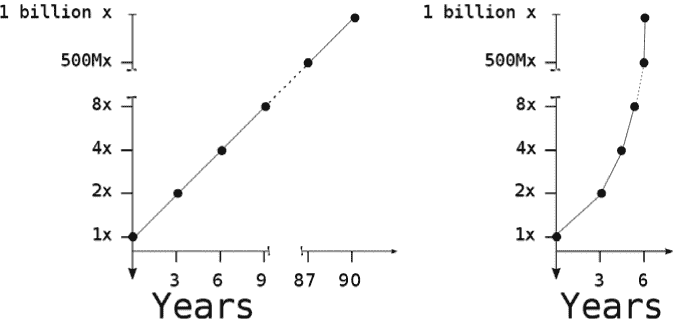

Figure 3.1. AI 取 off 时间。*Wikimedia Commons.*

与大多数现代文化发展一样，思想流派也会形成。关于 AI 存在性风险的信仰程度，我也构建了一个光谱：从持怀疑论者一端到极端预言者另一端——或者说，从 Y2K 到 Armageddon（图 3.2）。正如前文所述，Eliezer Yudkowsky——美国决策理论家、机器智能研究所负责人——是极端预言者的教父，而美国软件工程师 Marc Andreessen¹¹⁰ 则位于光谱的另一端，认为我们几乎没有需要担心的事，并高呼：“Drill, baby, drill！”——换言之。

当你阅读本书时，需要反思自己的 AI 存在性风险信念。这里我们需要成为出色的批判性思维者和伦理推理者，在现有证据和信息面前，对未来 AI x‑risk 的潜在性以及当前应对措施作出有效、相关的推断。因此，此时此刻，请思考你在光谱上的位置以及原因。

2023 年被广泛称为 AI 行业的“奥本海默时刻”。

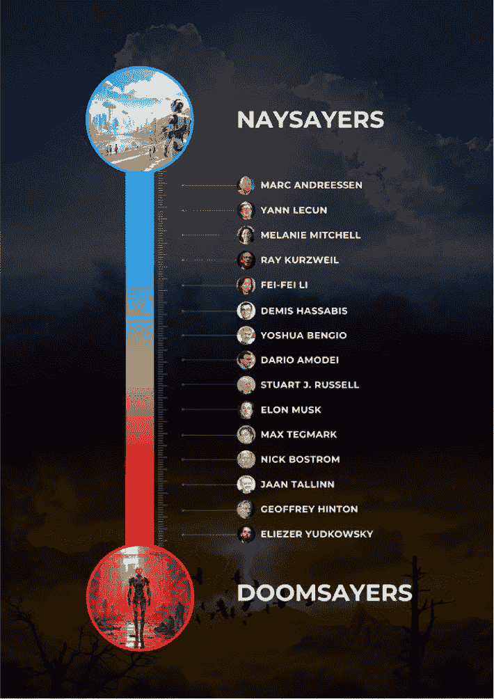

Figure 3.2. 从持怀疑论者到极端预言者。 *Created for the author. All rights to the author.*

> J. Robert Oppenheimer，被称为“原子弹之父”因他在曼哈顿计划中的领导作用，曾为他的发明的致命后果而苦恼。今年，导演 Christopher Nolan 通过这部惊世巨制重新唤起公众对这位科学家的关注。许多人看到了奥本海默试图向决策者警告核扩散的平行，现代对人工智能可能后果的警报也同样强烈，一些顶尖技术人员甚至说 AI 构成与核武器相当的“灭绝风险”。¹¹¹

无论 ANI 到 AGI 的取 off 时间如何，普遍认为 AGI 到 ASI 之间的时间会相对短暂——因为递归自我改进的指数速度。许多研究者建议，一旦 AI 能够匹配人类水平能力，实现超人类智能很可能在一年内完成。


> 杰弗里·辛顿将自己的一生都奉献于推动人工智能发展。但如今图灵奖得主警告说，AI 有能力有一天——他确实如此认为——消灭人类。他因极度震惊而离开 Google，以便更自由地表达自己的观点。“如果你认真对待存在风险，正如我现在所做的那样……也许明智的做法就是停止进一步开发这些东西，”辛顿说……“我曾以为这完全遥不可及，但现在我认为它很严肃，而且相当接近。”他表示，如果仅仅是过去技术转型所带来的同类担忧（如工作岗位被机器取代而失业），他本来不会离开 Google。辛顿表示，他之所以站出来说话，是因为 AI 所构成的真实的存在性威胁。“所以我感到抱歉，我在鸣警报。我们必须为此担忧，我希望有一个简洁、简单的解决办法。我希望，但我没有。”¹¹²

根据 MIT 计算机科学家马克斯·特格马克（Max Tegmark）的话：

> 大多数 AGI 研究者预计 AGI 将在数十年内出现，如果我们盲目进入并 unprepared，这将可能是人类历史上最大的错误。它可能导致前所未有的全球独裁、极端不平等、无处不在的监控、巨大的痛苦，甚至可能引发人类灭绝……但如果我们谨慎应对，我们可能会走向一个美好的未来——穷人更富有，富人更富有，而且每个人都健康且自由地实现自己的梦想。¹¹³

ANI 向 AGI 过渡的节点将是我们历史上罕见且至关重要的时刻——也许是第一次，也可能是最后一次——我们创造了比自己更聪明的“机器神”。预见到这一节点的到来，我们必须现在就认真对待并做好准备。因为如果某个人、某家公司或某个国家在我们尚未建立保护措施之前就构建出这个“机器神”，我们将再也没有机会加以遏制和控制。届时，我们将失去迅速关闭的“赖森备选方案”（lysine contingency）的窗口，无法将其关闭。此时很难精准预测之后会发生什么。针对简单关闭 AI “神”的可能性，杰弗里·辛顿表示：

> “这些系统会从我们身上学习，阅读所有遍布的小说，以及马基雅维利关于如何操纵人们的所有著作……如果它们比我们更聪明，它们就会极善于操纵我们。你将不会察觉到发生了什么。”关于停止 AI 模型的开发，辛顿认为这是徒劳的。“我认为我们不会停止开发它们，因为它们太有用了……仅仅因为政府希望在武器中使用 AI，发展就不会停止。它根本不可能发生。一旦 OpenAI 使用变形器技术并获得微软资金开发类似事物，微软决定将其公开，谷歌就没有真正选择……在资本主义体系中……你无法阻止谷歌与微软竞争。”¹¹⁴

当超级智能的 AI “神”诞生时，它可能会产生意识和自我意识；但也可能不会。它可能像希腊-罗马神阿斯克勒庇俄斯那样爱护并治愈我们。神话中的阿波罗（治愈、真理与预言之神）与凡人公主科瑞诺（Coronis）所生的阿斯克勒庇俄斯，是由半人马切伦教导医术的。但如果是 SMG（超级智能机器神）则可能像宙斯那样因害怕他赋予人类永生而用雷电将其击毙。真是个“混蛋”！事实是，我们根本不知道 SMG 会如何表现。但我们确定的是，如果我们能事先知道如何控制或遏制这种强大的力量，世界将会更好。否则，这种“神”对待我们的方式可能并不那么有利。

#### ***So… Who’s Currently Trying to Build Such a God?***

当前大科技公司争相开发 AGI 的 contenders 包括 OpenAI、Anthropic、DeepMind、微软和 Meta。¹¹⁵ 深度学习公司 DeepMind 已开始尝试以全新方式构建 AGI 机器神，通过将多个 ANI 系统 interconnect 为一个更大的整体：

> 当前的前沿技术是由大量 ANI 系统组合而成的大型平台。例如，Google DeepMind 的 Gato，是一个深度神经网络，能够执行 604 项不同任务，从管理机器人到识别图像和玩游戏。它不是 AGI，但比普通的 ANI 更强大。同一网络、相同参数可以玩 Atari、为图像配文、聊天、用真实机器人手臂堆叠积木，并根据上下文决定输出文本、关节扭矩、按钮按压或其他 token。¹¹⁶

这真是一些严肃的多任务处理。这看起来是一个相当好的尝试，用来缩小 ANI 与 AGI 之间的差距。那么，其他大科技公司在 AGI 研发方面有什么情况？

有人可能记得，OpenAI 最初于 2015 年作为非营利组织成立，目标是开发 AGI 并保证其能造福人类，绝不会叛变并毁灭人类。然而，首席执行官山姆·阿尔特曼（Sam Altman）及其他高层决定这并非良策。因此，如今 OpenAI 的估值接近 1000 亿美元。

> 在 2019 年与《纽约时报》的采访中，OpenAI 首席执行官山姆·阿尔特曼将自己的野心与创造首枚核武器的曼哈顿计划相比。他引用了其设计者罗伯特·奥本海默的话：“技术之所以出现，是因为它可能。”并指出两人同享生日。¹¹⁷

“技术之所以出现，是因为它可能。”从一个层面上看，这确实如此。但可能性本身并不是高级机器智能的充分条件。它只是必要条件——也就是说，AGI 的出现必须在可能的前提下才能被人类构建。这只是一个 trivial（显而易见）的观察。阿尔特曼对技术发展的看法显得幼稚、片面且范围有限。技术之所以出现，是因为人们想要它；存在一种 *need*。有多种驱动力和需求；通常这种需求会以大量金钱作为回报。但有时，这种需求仅仅是出于“想看‘接下来会发生什么’”的好奇心，是对自身 *hubris*（自傲）的满足——驱动人们去开创未知领域、成为第一个创造、发现、发明，或如我们所见的 AGI，释放其巨大能力的野心。看到阿尔特曼强调他与奥本海默同享生日，我也佩戴绿色软呢帽，这仅是巧合吗？^(\*)

当山姆·阿尔特曼于 2023 年 11 月被 OpenAI 解雇时，流传最广的原因之一是他对安全缺乏足够关注。


> 最近 OpenAI 董事会的变动应该让我们对公司对安全的承诺更加感到担忧。另一方面，它的竞争对手 Anthropic 通过将自身注册为公共利益公司（PBC）和长期利益信托，认真对待 AI 安全。人工智能（AI）对社会构成真实且当下的危险。大型语言模型（LLMs）如 ChatGPT 可能加剧全球不平等、被用于大规模网络攻击，并以不可预测、不可控的方式演变。当 Sam Altman 在 11 月被 OpenAI 开除时，组织暗示这与他对 AI 安全的忽视有关。然而，这些疑问在 Altman 被重新任命后基本平息，他与其他高管精心管理信息，以保持公司形象完整。¹¹⁸

> 尽管 OpenAI 的临时首席执行官 Emmett Shear¹¹⁹ 驳斥了董事会因安全顾虑而解雇 Altman 的说法，

> 这一争议仍应让关注 AI 潜在危害的人们停下脚步。不仅 Altman 的重新任用显示出他对公司的软实力，新任董事的特征似乎更单一地聚焦于利润，而非其前任。这些变化或许能让客户和投资者相信 OpenAI 能够盈利地规模化 ChatGPT，但也应引发人们对 OpenAI 是否致力于其使命——即“确保人工一般智能惠及全人类”的疑虑。¹²⁰

> 需要注意的是，另一主要参与“造神”力量的公司——Anthropic——正是由那些因安全顾虑离开 OpenAI 的员工创立的初创公司：

> 弟弟 Dario 和姐姐 Daniela Amodei 于 2021 年离开 OpenAI 的高级职务，创立 Anthropic。Dario 曾领导开发 GPT-2 和 GPT-3 模型的团队。2023 年被问及为何离开 OpenAI，他可 credibly 指出 OpenAI 在聊天机器人的研发中缺乏对安全、责任和“可控性”的关注。¹²¹

> 因此，AI 业务最高层面肯定充满戏剧性。但除开篇提到的 OpenAI 董事会肢体相争以及 Sam Altman 的被解雇与重新任用之外，切勿忘记这里的核心——AI 存在论风险是否被认真对待。

> 在 2023 年下半年，Altman 组织了一场世界巡回演讲，向各国政治家呼吁制定政策、法律和治理以应对新兴 AI 技术。与此同时，他仍在以最快速度推进 AGI 的研发。为记录，OpenAI 已将部分资源投入安全项目，如建立安全系统、准备团队和超对齐团队。¹²²

> 与此同时，在 Anthropic：

> Amodei 兄妹在看到 OpenAI 的警示信号后，便认真将伦理与安全融入业务。他们以“人”在 AI 故事中心、应引领其进程之意命名 Anthropic，并将公司注册为特拉华州公共利益公司（PBC）。他们加入了约 4000 家致力于利益相关者、股东以及公共利益的公司行列，包括 Patagonia、Ben & Jerry’s 和 Kickstarter。¹²³

> Anthropic 故意将其大型语言模型（LLM） Claude 保持未公开发布，以确保其提供的信息不会被黑客攻击或“红队测试”^(\*) 从而产生有害建议。尽管他们致力于打造可控且安全的 AGI，但仍有人质疑其路径是否正确：

> 部分学术专家表示担忧……剑桥大学计算机科学教授 David Krueger、以及最近发起警示信函的主要组织者……认为 Anthropic 过度依赖测试高级模型来获取安全知识。“这里获得扎实的经验证据很困难，因为系统可能具有欺骗性，或其失败难以通过任何测试来检验……在假设我们能够让更强大的模型变得安全的前提下继续研发更强模型，我基本上持不同意见……目前我们陷入一种局面，大家都觉得必须与其他开发者竞争。我认为他们应该停止竞争。Anthropic、DeepMind、OpenAI、Microsoft、Google 应该团结一致说：‘我们将停止。’”¹²⁴

> 减缓或直接停止构建“小型超级模型”（SMG）的想法多年已在 AI 社区中被讨论。像 Eliezer Yudkowsky 这样的人认为，我们应放弃控制此类“神”的想法，坚持彻底关闭它：

> 许多在该领域深耕的研究者，包括我自己，预期在当前任何类似的条件下，构建超人类智能 AI 最可能的结果是——地球上所有人都会死亡。这并非“也许可能的微小可能性”，而是“显而易见会发生的事”。¹²⁵

> 作为 AI 风险领域最资深的研究者之一，Yudkowsky 自 2001 年起就致力于对齐问题。他担忧当前极少有人对此采取行动：

> 没有人提出可行的生存计划。OpenAI 公开表示其意图是让未来的 AI 完成我们的人工智能对齐“作业”。仅仅听到这个计划就足以让任何理智的人恐慌。另一家领先的 AI 实验室 DeepMind 甚至没有计划。¹²⁶

> 其他的人，如 Future of Life Institute 的执行主任兼董事秘书 Anthony Aguirre，则认为应控制或限制这类“神”所拥有的权力与能力。

> 我们科技巨头的工程师们正竭尽全力将大规模机器智能实验推向更高层次。我们不应如此。现在，或许永远都不应。因为一旦这些机器智能系统与人类智能竞争，我们很可能逐渐失去对它们的控制，甚至失去对它们的控制权。这……是一场延伸论证，说明我们在未来几年内不应不可逆转地打开这扇门：我们不应训练神经网络超过几乎所有人在广泛知识任务上的水平，更不应训练超过最优秀人类专家，甚至超过整个人类文明的水平。相反，我们应设定对单个完整神经网络训练所使用的总计算量的硬性上限，对其运行速度的上限，以及可能的其他限制。¹²⁷

> 通过此举，Aguirre 认为我们可以“关闭”这扇强大机器之门，使其无法脱离我们的控制。而最佳方式是限制其计算能力，使其无法发展成高度智能的叛逆代理人。


> \[A\]t present we know of only one way to make such AI, which is via truly massive computations of deep neural networks. So all we have to do is to not do those incredibly difficult and expensive computations. However, since companies are currently racing each other to perform them under heavy competitive and financial pressure from investors and otherwise, it will require regulation from the outside to place this limit.¹²⁸

Others, such as Justin Shovelain and Elliot Mckernon, believe that we might be able to “box” an AI system and limit its potential power (in theory if not in practice):

> Can we box an AI while still being able to use it? We could try preventing it from physically interacting with its environment and only permitting it to present information to a user, but a superintelligence could abuse any communication channels to manipulate its users into granting it more power or improving its predictive abilities. To successfully box the AI in this manner, we’d need to constrain both its ability to physically interact with its environment and communicate information and manipulate. We’ll call this output boxing: containing an AI by constraining its various outputs.¹²⁹

It had always been my intention in trying to build the OSTOK Project to limit the amount of data that such a powerful form of AI could access. One has to wonder why OpenAI and other Big Tech companies are using the entire internet on which to train their large language models (LLMs). I just don’t see the point of having computing power sift through information that is not essential for it to operate at peak performance. Does ChatGPT need to scour through every instance of pornography on the internet? If so, toward what end?

Boxing AI’s capabilities, closing the gate on it, or shutting it down completely are just a few options to consider as we move into the future and AI capabilities continue to progress to ever more godlike powers. We will consider these and others in chapter 5 when we look at what is currently taking place regarding the governance of AI. Getting politicians to agree on anything is difficult at best. It should come as little surprise, then, that this task has not become easier given its urgency to solve. But as we shall see in chapter 5, there is, actually, considerable movement in a number of countries regarding the governance and regulation of AI. But until we coordinate our efforts collectively and strategically, it still feels very much like an enormous undertaking—one that is far more layered and difficult than the Manhattan Project.

And so the race is on between the big fish in Big Tech—OpenAI, Anthropic, DeepMind, Meta, and Microsoft—to build an AI machine god first.^(\*) Others will join the race or be smaller fish helping one of the larger fish. But the race is on. And nobody knows whether we should stop it, redirect it, or make it go faster. The doomsayers or safetyists preach caution and prudence while the naysayers or effective accelerationists (or e/accs) say: “Faster, faster!” The doomsayers say AGI is inevitable and may arrive much sooner than anticipated with dire consequences. The naysayers say AGI will be entirely controllable and will only produce the very best for a company, a country, and the world.

Irrespective of what is going to happen, the need for critical thinking and ethical reasoning in a rapidly automating world is now. It has become a global moral imperative that we establish cooperative, transparent guidelines that can direct the safe and effective uses of AI technologies in all its forms and applications. It is important to start the conversation about AI at all levels of engagement and activity and to keep it going until we reduce the threat of an SMG to zero. Researchers, academics, technicians, computer programmers, engineers, politicians, and the general public all must be informed and engaged in the dialogue about the future of AI.

As we finish this first half of the book, it has been my hope to raise awareness and provide readers with enough reliable background information to confidently engage in dialogue about various aspects of AI. Now that we have more than enough information about the current developments of AI, we can move on to the second part of the book and consider some of the ethical implications, governance, and future of AI as humanity continues on its path to build an AI machine god.

[\*]## **II**## **AI AND WHAT WE CAN DO ABOUT IT**

## **4**## **Critical Thinking and the Ethics of AI**

How to Build a God in Our Own Image

We have covered a fair bit of material regarding the history, benefits, and harms of AI. Now we need to think critically and ethically about what we should be doing about it. But what does that mean? How does one think “critically” and “ethically” about AI? And how will doing so help us better work through the difficulties we are, and will be, facing on the road to building a superintelligent machine god (SMG)?

### **The Importance of Critical Thinking**


批判性思维涉及对你如何以及为什么相信你所相信的事进行仔细反思。它是一种技能集，使我们能够更好地分析和评估我们的信念以及他人的信念，这些信念是依据普遍接受的标准来衡量的。批判性思维之所以重要，是因为你的想法往往会影响你的行为，进而影响他人，而他们的信念和行为又会影响你。它提升了我们对重要问题进行更清晰思考的能力，并赋予我们在自己相信的事物上保持自信的能力。批判性思维教会我们，在思考重要问题时，真的存在更好、更差的思考方式。通过这种思考方式，它帮助我们将注意力集中，从而更有效地沟通，就重要问题进行“成人式”对话，即使彼此持异议，也能像文明的居民一样相处。但也许最重要的是，*公平*是批判性思维的基石或黄金法则。如果我们都遵循批判性思维的规则并公平地运用其技能，我们都能获得更多想要的东西。这也是我们在进入一个充满不确定性的未来时，需要规范并引导 AI 走向我们想要的道路的重要事实之一（figure 4.1）。

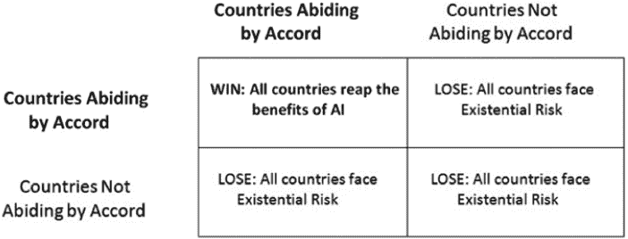

Figure 4.1. Prisoner’s dilemma for global AI cooperation. *Created for the author. All rights to the author.*

For if all of the countries of the world abide fairly by the rules and regulations we eventually establish (and consider in chapter 5), then we all stand the best possible chance for benefiting from the positive advancements of AI technologies. But if a country or two decides to cheat rather than cooperate, well, that’s not playing fairly, and that will lead perhaps all of us, including the cheaters themselves, to suffer greatly. And none of us as individuals or countries wants that; to do so would be illogical, irrational, and entirely counter to anyone and everyone’s best wishes. In other words, to put it plainly, only a complete and total asshole would play unfairly; for it would mean harming themselves as much as the rest of the world. And we know that there’s more than just a few of those types ruling over countries throughout the world at the moment. So we better get this right on the first try.

What, then, are the fair use tools in the critical thinking skill set that will make us all better problem solvers, decision makers, and responsible thinkers? For millennia, philosophers, mathematicians, logicians, scientists, writers, and many others have developed the critical thinking tools that allow all of us to improve our abilities to interpret, understand, critique, and act on information. I have taken a number of the most important tools and distilled them into an easy-to-apply skill set. The skill set of critical thinking allows us to better separate facts from feelings and acknowledges that there is value to our beliefs, our ideas, and our opinions. For our purposes, the ABCs of critical thinking that I mention in all of my books and lectures should give us a good account of their importance.

The first tool involves the construction of our ideas into formal *arguments* so that we understand our ideas better and can communicate them much more efficiently. So, *A is for Argument*. But what is an argument? An argument is always made up of two parts: your main point (what you believe to be true) and the reasons for believing it. In critical thinking, we call your main point the conclusion, and your reasons for believing it are called premises. In order to have an argument, you must have at least one premise supporting a conclusion. For example, if you believe climate change is really happening (your conclusion), what are your reasons (your premises) for believing this? If you think a particular movie is great (your conclusion), why? What are your premises (or reasons) for believing this? Once you begin providing reasons for why you believe what you do, you develop actual arguments. And this will help you think through your ideas and express yourself more clearly when it comes to understanding, interpreting, and acting on information about artificial intelligence. But how can we distinguish a good argument from a bad one? To help you to visualize this, think of an argument as a house (figure 4.2).

Its roof is the conclusion; its walls are the premises that support the roof; and the walls rest on a foundation made up of five universal criteria: consistency, simplicity, relevance, reliability, and sufficiency.

Whatever your conclusion is, your premises must be strong enough to support it as walls would with a roof. And the strength of the walls or premises is dependent upon their ability to satisfy the five universal foundational criteria.


Figure 4.2. Argument as house. *Created by the author.*

And so, all arguments rest on a foundation of universal criteria that measure the value of an argument. If they completely satisfy all criteria, there is greater value to an argument than if the argument fails to satisfy some or all of them.

*   **Consistency:** This is often referred to as the mother of all criteria when it comes to logic and critical thinking. All of our experiences have a uniformity or consistency to them. You don’t put bread in a toaster and have it come up unicorns. Or internal organs. Or twenty-dollar bills. It either comes up toast, or it doesn’t. There are no other options. This is consistent with our experiences. Once an individual violates laws of consistency, they have abandoned the possibility of producing a sound argument. So whenever you spot an obvious contradiction or inconsistency either through what somebody says or what they have done, the reason why it bothers you is because we are all hardwired with built-in consistency meters that we depend upon in order for the world to make sense. That’s why, when we observe inconsistencies or contradictions, we take note of them. This skill—this capacity to notice such inconsistent behavior—is what kept our ancestors alive for so long. Observation of consistency of behavior allows all species on this planet to make predictions to promote the likelihood of survival and reproduction. Nature does not abhor a vacuum; it abhors inconsistency. So when someone’s arguments or beliefs are inconsistent, we cannot be convinced by them.

*   **Simplicity:** Sometimes referred to as parsimony, simplicity is universally valued as a criterion to support premises, because if we can present an argument that accomplishes just as much but with fewer premises, it tends to be more highly valued. Often referred to as Occam’s razor—named after William of Ockham, a fourteenth-century Franciscan friar and scholastic philosopher—the criterion is often best summed up in his famous saying: “Do not multiply entities beyond necessity.” What Ockham meant by this is that you really don’t need more premises than are necessary to responsibly support your conclusion and satisfy the foundational criteria. One might even say that Ockham was the originator of the KISS Principle (Keep It Simple Stupid). In other words, when faced with competing arguments, the one that can say more with the fewest premises is generally favored.¹ So, for example, if at some point in the future, someone figures out a fairly simple solution to controlling or containing the potential harmful effects of a superintelligent machine god, then so be it. Why would we need anything more complicated if a simpler solution works perfectly well?


# 相关性
显而易见，前提应与结论相关。然而，人们在呈现相关观点的名义下，常常引入与结论无关的前提。所谓“红鲱鱼”（red herring）是一个不恰当相关性的谬误。当人们试图通过讨论与当前话题毫无关系的主题或主题来回避处理或回应当前话题时，就构成了红鲱鱼谬误²。人称人身攻击（ad hominem）谬误也存在相关性问题。攻击某人的个人特征而非关注其论点，与判断其论点是否应被接受无关。

# 可靠性
信息的获取方式以及作为结论前提使用的方式至关重要。获得可靠、事实性的信息是持续支持结论的关键。可靠性是一个普遍标准，要求我们从值得信赖的来源获取信息，并且不在此方面怠于责任。全球许多的人基于社交媒体（如 Facebook 或 Twitter）上的信息形成对极其重要问题的看法。我们现在知道，这些社交媒体平台充斥着来自各种来源的虚假信息，旨在影响公众舆论³。随着我们面对诸如深伪技术（deepfakes）等各种线上操控，我们必须更加警惕我们所接触信息的客观真实性。因此，确保信息的真实性或准确性的需求和重视程度将进一步提升。

# 充足性
我们都对“充足”有一定认识。充足性要求足够多的某物以满足某一条件、欲望或目标。例如，如果我在像纽约这样的繁华大都市中，需要从一个地方到另一个地方，出租车就足够了。我不需要装甲车队或豪华轿车（虽然这可能很体面）来让我从四十二街下城区。在批判性思维中，我们常说前提为结论提供足够的证据支持。但“足够”是多少？前提在提供足够的证据以让人信服你的结论时，究竟何时算充足？天文学家卡尔·萨根（Carl Sagan）曾说：“非凡的主张需要非凡的证据。”⁴ 这基本上意味着，结论越大或更为宏大，所需的证据就越要充分、令人信服以支持它⁵。

满足或未满足这五个标准的程度决定了论证在批判性思维中的价值。如果论证构建得当，就像一座结构稳固的房屋，它将牢固地立足于前文提到的五个基础标准之上。如果构建不佳，它的墙壁（前提）将减弱，结论（屋顶）也将不再受支持（figure 4.3）。

你现在对论证及其在交流中的运作方式了解得比全球大多数人口更多。记住，未来一旦你相信某事，请问自己支撑该信念的理由或前提是什么。然后考虑这些前提在一致性、相关性、是否不必要复杂、可靠获取以及充足性方面的表现是否充分。


Figure 4.3. Unsupported argument. *Created by the author.*

批判性思维技能的第二工具是承认人类偏见。正如上一章所指出的，无论你是谁，无论你出生在哪里，无论你如何成长，你都无法摆脱一生中累积的各种影响和限制，这些都对你的思维和行为产生了偏见。因此，*B 是偏见*。偏见是指人们在理解和处理各种信息时，受到各种方式的影响或限制。我们最终获得、修正和保留关于问题的看法、信念和态度的方式，是一个长期发展的过程，受内部和外部偏见的影响。即使在我们出生之前，就已经有因素影响并偏向我们对世界的看法和理解方式。我们现在需要熟悉这些因素，不仅为了更好地理解我们——人类——为何现在持有某种信念，也为了理解 AI 技术为何可能存在导致负面后果的偏见。

偏见有很多种，但它们总体上归为两类：生物学和文化。生物学偏见包括基因和表观遗传因素、神经心理学因素、情绪、年龄、健康状况等。文化偏见涉及家庭教养、民族、宗教、地理位置、朋友、教育、媒体等约束和影响。你所思考的一切和所做的一切，都是生物学和文化偏见的结果。在学习批判性思维时，读者被鼓励关注自己的偏见，进行偏见检查，意识到任何新呈现的信息在被接受、拒绝或保持中立之前，都必须经过一系列偏见过滤。我们通常倾向于接受能够确认我们自身偏见的信息——这正好叫确认偏见（confirmation bias）。这很正常，也是人之为人的一部分——在追求让我们感到知识渊博、自信、安全的信息时，我们需要持续的验证，确保我们的信念是相关的、真实的，并值得作为行为指南。批判性思维中，我们发展出能够承认并识别自身偏见的能力，以更公平地理解为何我们相信某事以及为何我们根据这些信念行事。通过这种方式，我们能够更加批判性地反思我们的信念，并在对待他人观点、想法和信念——尤其是那些与我们不同的——时更加公平。

我们对自身偏见的认知必须同样适用于 AI 技术的开发与控制。一方面，人类的代理人会出于自身偏见，出于谋利、造成他人痛苦、毁灭或破坏的目的，甚至仅仅出于好奇（“看看会发生什么”）而滥用这些技术。无论其动机如何，我们必须意识到，某些人、某些国家或地区会利用这些技术以他们偏见为正当理由进行有害行为。我们需要完全意识到这一可能性，并做好准备，以便在其发生时采取行动以限制其影响。

AI 技术中偏见导致的第二种危害，来自于对信息的有意或无意识的编程。正如我们在第 3 章中所指出的，某些危害可能源自大型语言模型（LLMs）在发展自身偏见时，因信息的检索、分类和分发方式而产生。这会不公平地代表各种边缘群体。


第三种偏见危害形式简单地源于特定算法的行为方式。正如我们在第 3 章所见，初始上可能并无有意的恶意或伤害；但持续向对特定主题感兴趣的人提供特定信息的算法，会迎合用户的偏见，以获取更多数据和更多金钱。每次你在网上浏览时，关于你的信息都在被收集，以便向你发送越来越相似的信息，从而确认你已有的偏见，并用神经递质的温暖浴给大脑的情绪系统一种奖励，让你在成功搜索时感到愉悦。因此，在批判性思维中，理解偏见在我们对信息进行解释、理解和行动能力中的作用至关重要。

批判性思维技能的最终工具是**语境**。当我们深入探讨语境这一批判性思维方面时，我们实际上是在指代诸如时间、地点和具体情况等元素。语境作为一面镜子，帮助我们更深入地理解所伴随信息的框架和背景。因此，`C` 代表语境。对于批判性思维者而言，理解语境能够提供信息如何被定位以及其与情感、既得利益和激励之间联系的更广阔视角。在语境范围内，`fact-checking`（事实核查）的重要性显而易见。如果我们未能准确识别与信息相关的关键事实，或忽视信息的背景，或未能揭示其背后的 **who, what, why, where, when, how**（谁、什么、为什么、哪里、何时、如何），我们对该信息的看法可能会产生偏差，且公平评估其的能力会显著下降。必须认识到，在任何文化中，语言都紧密嵌入于语境之中，人们不仅表达思想，还传递偏见。这些交互发生的环境往往是塑造底层信息的背景。对语境的全面理解，使我们更有能力领会人们为何思考和行为各不相同，这可能与我们自己的思考方式不同。众多例子都凸显了语境的重要性。例如：


图 4.4. 斯波克。 *Wikimedia Commons.*

案例来源于 1960 年代的经典《星际迷航》情节，其中科学官斯波克（图 4.4）试图将星际飞船 *Enterprise* 偏离原定航线，前往他的家星球维加斯（Vulcan）。起初，船员对斯波克看似不规则的行为感到困惑。随后才揭示，斯波克必须在八天内返回维加斯，参加名为“普兰 Farr”的交配仪式，否则将面临死亡。

正如鲑鱼逆流而上进行繁殖一样，斯波克凭借尖锐的耳朵和日益逼近的普兰 Farr 紧迫感，踏上寻找伴侣的星际旅程。理解这一语境，让观众能够同情斯波克的动机，理解其看似不寻常的行为背后的原因。若没有此类语境，对斯波克的严苛和不公评判几乎不可避免。

尽管被比作电脑时斯波克的行为让人欣喜，但考虑到其所在的语境，这种行为是可以理解的。那么**计算机的实际行为**，甚至**超级智能计算机**的行为又如何？我们是否总能感知它们运行的语境并“对决策”“行动”做出判断？我们已经了解，这在人工智能领域形成了所谓的“黑盒”或“可解释性”问题。该问题指的是理解和解释复杂机器学习模型所作决定的挑战。正如我们在第一章所指出的，任何高级人工智能算法，尤其是使用深度神经网络的模型，都是由众多计算层组成的精密而复杂的系统。尽管它们在预测或分类方面表现出色，但这些模型往往缺乏透明度，使得人类极难理解它们是如何得出特定结果的。

“黑盒”一词表明，这些人工智能模型的内部运作对外界观察者是隐藏或不透明的。缺乏透明度在伦理层面上尤其引发 concerns，尤其是在即将涉及的关键应用场景——如医疗、金融或自动驾驶——中，能够解释并信任人工智能系统的决策至关重要。可解释性对于多种目的至关重要，包括确保问责、发现模型中的潜在偏见以及赢得用户信任。当前，人工智能研究人员和开发者正持续致力于提升机器学习模型的可解释性，使其决策过程更加透明、易于人类理解。随着人工智能系统在现实世界中的普及，对信任与问责的需求日益增长。若不了解超级智能机器运行的语境，我们就不太可能知道某些系统为何偏离了我们的指令或价值观，这可能导致严重的负面后果。

### **思考人工智能伦理的批判性思维**

现在我们知道如何将我们的想法组织成论证；我们也意识到理解偏见的重要性——包括我们自己的偏见、他人的偏见以及人工智能中产生的偏见；同时也认识到理解语境的重要性，我们已具备了人工智能伦理的 ABC 关键技能，准备好运用批判性思维生成关于人工智能伦理的论证。那么，我们该如何批判性地思考人工智能的伦理问题呢？首先，我们必须认识到人工智能伦理主要分为**两类**：

#### ***人工智能伦理的类型***

随着我们不断研发各种人工智能技术，迫切需要考虑三个极其重要的伦理步骤，以指导我们的行为，从而最大化人工智能所能提供的益处，同时尽量限制其可能带来的重大危害。通常，我们首先需要思考在使用这类人工智能技术时，应遵循哪些伦理规则或准则。其次，我们必须仔细审视为这些超级智能形态的人工智能制定哪些伦理指令，以便控制或约束它们。最后，不能忽视的一点是，如果人工智能代理（AGI）发展出一定程度的感知或意识，我们有义务思考应如何赋予其**道德权利**和**法律权利**。因此，我们的伦理推理结构可以表示为：

1. **对于人类**：  
   a. 什么流程应决定引导全人类发展及应用人工智能技术（包括可能带来生存风险）的伦理规则？在该流程中，我们应建立何种伦理前提——或许类似联合国人权宣言的全球守则，供所有相关方遵守？我们应如何决定哪些内容算作伦理规则，哪些不算？谁来决定？为什么？

2. **对于人工智能通用智能（AGI）**：


a. 我们应建立哪些伦理准则，才能控制超级人工智能机器神（SMG）的力量？这些准则应如何确定？什么算作准则，什么不算？谁来决定？像阿西莫夫的机器人三法那样简单的准则能否防止 SMG 灾难？可能不能。因此，我们必须仔细考虑这些准则是否能控制或限制 SMG，如果能，则需要进一步研究如何实现这一目标。如果我们认定没有任何伦理准则能够作为护栏来控制新兴的 SMG，那么我们就必须转向其他控制和 containment 方案，如技术性或关键性的停机协议。

b. 当 SMG 变得自我意识或意识到自身存在时会发生什么？如果它发展出自主意志，希望独立运作，又会怎样？如果它能够感受痛苦，又会怎样？如果上述任何一种情况发生，该实体是否会自动获得道德和法律权利？

正如本章前面所见，要思维批判地讨论人工智能，我们需要建立有力的论证、承认现有偏见，并理解并欣赏情境。但要对人工智能进行伦理推理，我们需要了解一些基本的伦理理论、准则和原则，这些理论为我们的论证提供支撑，并为推理提供结构和指导。因此，我们必须从头开始。

### **什么是伦理？**

伦理学是研究我们如何以及为何价值人类行为或行动的学科。价值可以被定义为善或恶、正当或不正当、公平或不公平、公正或不公正。另一方面，道德涉及人类行为在不同情境下的价值（例如，各文化中实践的习俗或文化规则）。伦理学考察价值在所有文化中的适用性。情境在理解人类行为或行动的价值方面至关重要，因为行为所处的环境和背景往往能更全面、更完整地解释其动机。

> 我们所讨论的并非小事，而是**我们应当如何生活**。⁶

正如我们在批判性思维中所见，任何论证都需要一个结论和若干支持该结论的前提。我们也看到，前提是支撑特定立场的理由。例如，考虑以下问题：在当前尚无有效措施指导、控制或限制 SMG 的情况下，是否应允许大型科技公司盲目、全速前进，争取成为第一个创造 SMG 的公司？你可以选择正面或反面回答，但无论你持什么立场，都需要用前提来支持你的结论。如果你的理由或前提在一致性、相关性、充分性以及基于可靠信息方面是合理的，那么我们可以认为该立场是有力的。但要使一个论证在伦理上具有正当性，还需要**理论基础**。换言之，存在多种伦理理论、原则和准则。在试图修正人类行为和超级人工智能机器神行为时，应使用哪些理论？

### **道德的最低概念**

是否存在基本或最低层面的道德或道德行为？哲学家詹姆斯·拉赫茨（James Rachels）这样定义：“道德至少是通过理性引导自己的行为——即做有最佳理由的事——同时平等权衡受自己行为影响的每个个体的利益。”⁷ 这为我们提供了成为细心道德代理人的一些线索。

但我认为拉赫茨在假设我们可以确定“最佳理由”时犯了循环论证，或者是 circular reasoning。也许我们可以实现这一点，但现在，**我们应如何确定衡量其效果的标准**？我认为，更基本、更简单的方式是从我们做出伦理判断的内在框架来理解最低框架。这个框架被称为**容忍-伤害反比例模型（T-HIP）**（图 4.5）。

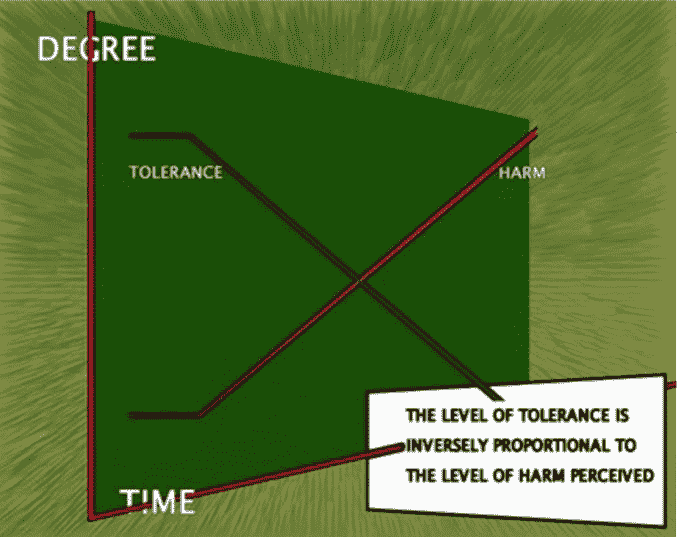

图 4.5. T-HIP 模型。*作者自制。*

根据该模型，只要人类行为产生极小的伤害，就可以被容忍。但一旦人们对伤害的感知开始上升，伤害感知会在某一共同阈值处达到顶点，同时容忍度随之下降。在任意时点，当人们对伤害的感知与容忍度相互交叉并反向趋同时，我们会认为反对该行为是正当的。我已在其他作品中提及此模型。⁸ 当然，确定什么是“伤害”是另一回事。但一旦我们达成某些伤害存在的共识，就更容易看到并为因容忍度下降而采取行动提供依据。

现在，亲爱的读者，请你个人思考：**在 AI 技术进步之前，我们应当接受多大程度的发展**，以免其潜在的伤害降低我们的容忍度，从而促使我们采取行动？正如我们在最后一章将发现的那样，现在就可以采取一些措施让你在我（我们）还在开发 AI 的过程中就能够做点什么。等待事态发展是不可接受的，等待他人来承担责任同样行不通。公众必须实时了解 AI 如何塑造他们的世界，以便在发现某些行为不可容忍时能够采取行动。我们也可以指出，AI 领域的从业者有道德义务向公众说明情况，以便公众能够参与 AI 正确、公平治理的决策过程。为此，我们需要审视 AI 技术进步的伦理意义，并为此需要一些伦理推理的理论基础。这些伦理理论、原则和准则将为我们在理性探讨如何管理 AI 风险和治理提供更坚实的基础。

### **伦理理论**

在讨论 AI 相关议题之前，我们需要审视一系列伦理理论和原则，以便能够智慧、全面地论述这些议题。我将不断强调这一点：在伦理辩论中，你不能随意说出任何话，期望它与严谨的论证具有同等说服力。这不是《杰里·斯普林格秀》（*The Jerry Springer Show*）！为了更好地理解各种问题的复杂性，我们需要掌握可以用于评估我们认为的良好理由——即前提——的正式伦理理论。

#### ***伦理中的客观性与主观性***


-   [费曼学习法](https://wiki.example.org/feynmans_learning_method)的灵感源于诺贝尔物理奖获得者**理查德·费曼**。

1.  运用费曼技巧，你只需花上`20 min`就能深入理解知识点，而且记忆深刻，*难以遗忘*。

```
if (condVar > someVal) {console.log("xxx")}
```


> 佛教提出一种基于所有有感知生命体都想避免痛苦的假设，来思考伦理。因此，佛陀教导说，如果一项行为能带来脱离痛苦的自由，那么它就是善的。这一教义对人工智能的启示是：任何对人工智能的伦理使用都必须致力于减少痛苦和苦难。换句话说，例如，只有在能够证明能够减少苦难或促进福祉时，才应使用面部识别技术。此外，目标应是减少所有人的苦难——而不仅仅是直接与人工智能互动的人。

> 与前文提到的宗教类似，佛教教义中也包含黄金法则的表述：“切勿以自己会觉得痛苦的方式伤害他人。”锡克教也有类似的戒律，其核心伦理原则包括 *Naam Japna*（冥想上帝的名号）、*Kirat Karni*（诚实生活）、*Vand Chakna*（与他人分享）以及仁慈的价值观。锡克教的黄金法则表述为“待人如己”。

> 耆那教的一些核心伦理原则包括 *Ahimsa*（不暴力）、诚实、不偷盗、贞洁和非执着。耆那教的黄金法则表述为：“在幸福与痛苦、在喜悦与悲伤中，我们应当像对待自己一样对待所有生物。”

> 最后，对于儒家，一些关键伦理原则包括 *Ren*（仁慈）、*Li*（礼仪 propriety）、*Xiao*（孝道）、*Yi*（义）以及 *Zhi*（智慧）。儒家的黄金法则表述为：“不欲立于人，亦不欲立于己。”

> 许多信仰体系——无论是宗教还是世俗——都在其信仰结构中融入了黄金法则的不同形式（figure 4.6）。

> 尽管世界宗教之间在伦理原则上存在许多共同点（如黄金法则），但我们如何确定哪些核心教义或原则应被视为衡量人工智能伦理行为的有价值标准？我们或许能在非宗教性的伦理准则中找到相似的特质。让我们考虑一种更世俗化的处理伦理行为的方式——即相互考虑与尊重。

#### ***Thomas Hobbes: The State of Nature and the Social Contract***

通常被称为现代哲学之父的托马斯·霍布斯于 1588 年 4 月 5 日出生于英格兰威尔特郡马尔姆斯伯里。据称，他的母亲在得知即将驶来的西班牙无风险舰队（西班牙无风险舰队）正沿着英吉利海峡逼近时，就已经提前进入分娩状态。“恐惧与我本是孪生” 是霍布斯最著名的描述之一，不仅形容了他的出生，也概括了他对恐惧死亡以及对安全的需求是塑造道德与政治体制的强大影响因素。

霍布斯对哲学作出了重要贡献，但《利维坦》（Leviathan）是他最受人注目的著作。在这部著作中，他提出了“自然状态”和“社会契约论”的概念。这两个思想在当今社会中极具准确性与功能性，尤其是在探讨人工智能的伦理时尤为相关。霍布斯仔细观察社会，将国家或政体比作一个如大型人体般的有机体。国家的每一部分都对应人体的不同功能。既然人类是国家的创造者，霍布斯的首要任务是描述人性。在他看来，这点显而易见：

> *人性 = 所有的人类行为都是为了个人的利益。*

换言之，无论一项行为看似多么无私或慈善，我们总是因为某种方式从中获益而行动。在伦理层面——即我们应如何对待他人——霍布斯认为，必须考虑到人类本质上极度自私这一事实。

##### THE STATE OF NATURE

以下是一个思想实验。想象一个没有政府或统治阶级、人人为己的社会。在这样的状态下，霍布斯设想，鉴于人类在力量和智力上的普遍平等，先民自然会倾向于产生争斗。霍布斯列出了导致人们产生争斗的三个自然原因：

1. 对有限资源和物质（如食物、工具、衣物等）的竞争。

2. 对彼此的不信任。

3. 为了维护声望和权力而追求荣耀。

由于人类天生倾向于争斗，霍布斯认为人类的自然状态是“一切人对一切人之争”——一个充满不安全感、没有道德的状态，人人时刻害怕死亡：

> 在如此条件下，没有工业，因为其成果是不确定的；没有农耕文化，没有航海，也没有通过海路进口的商品；没有便利的建筑，没有搬运需要巨大力量的工具；没有对大地面貌的了解，没有对时间的确定，没有艺术，没有文字，没有社会；而最糟糕的是，持续的暴力死亡恐惧；人类的生命是孤独、贫困、恶劣、野蛮且短暂的。¹⁰

有趣的是，霍布斯在某些方面预示了查尔斯·达尔文的著作，他指出人类的欲望与激情本身并非邪恶，直到有法律加以规制才会产生负面含义。霍布斯强调，必须建立某种秩序，以消除人们对死亡和不安全的恐惧。

> 在“一切人对一切人之争”中，这也意味着“没有任何事可以是不公正的”。在没有共同权力的情况下，没有法律；在没有法律的情况下，没有不公正。¹¹

霍布斯将人类的本体分为两类：激情（passions）和理性（reason）。虽然我们的激情完全是自利的，但对死亡的恐惧和对安全的需求可以理性地促使我们走向和平。霍布斯视这种理性的渴求为实现有序生活的必要条件。理性赋予我们制定和平条约的能力，这些条约霍布斯称之为“自然法则”。

##### THE LAWS OF NATURE

为了确保和平，霍布斯借用了道德自然法传统的语言，该传统由荷兰政治家胡戈·葛罗修斯（Hugo Grotius，1583–1645）领导。对葛罗修斯而言，道德准则蕴含于普遍原则中，这些原则本身就是自然固定的。霍布斯认为，通过认识到自身的自私本性以及对社会契约的渴望，可以推导出这些法律，即“自然法则”。霍布斯认为：

> 自然法则（*Lex Naturalis*）是一种由理性发现的前提或一般规则，它禁止人做对生命有害、或夺走维持生命手段的事；同时也要求人 omitting（即不做）那些他认为能够最好地保全自身的行为。¹²


Hobbes 确立了十五条自然法则，但最为人注意并实践的正是前三条。需要意识到，霍布斯的伦理体系是公理化的——这在很大程度上归功于他受数学影响。霍布斯提出了他认为关于人性的根本真理，换言之，我们是一个贪婪、自私的群体，始终担心失去财产和生命，同时不断渴望安全。基于这些真理——这些公理——他希望推导出一种与人性相符的道德与政治体系。因此，他确立了自然法则。

他的第一条自然法则基于人类对安全或和平的渴望：

> 每个人都应当竭尽所能追求和平；当他无法获得和平时，应当寻求并运用战争的所有帮助和优势。第一条分支即第一条、最根本的自然法则，即：追求和平并遵循它。第二条是自然权利的总和；即：在一切可能的情况下，我们应当捍卫自己。

¹³

追求和平或安全，然而并非毫无代价。如果和平真的是所有相关方的最佳利益，那么我们必须为了确保安全而放弃某些自由或权利。霍布斯指出，从这条自然法则出发，衍生出第二条法则：

> 当其他人也如此时，男人应当愿意为和平以及自我防御而放弃所有权利；并且只保留对他人所允许的自由，正如他允许其他人对他自己所保留的自由。只要每个人保留这种权利——即随意做任何事，那么所有人都处于战争状态。但如果其他人不愿放弃他们的权利，与他一样，那么没有任何人有理由剥夺自己的权利；因为那将使自己暴露于掠夺（任何人都不受约束）而非让自己趋向和平。这就是《圣经》的律法：你所要求他人对你做的，你也应当对他们做。

¹⁴

注意到“金律”已被直接融入霍布斯的第二条自然法则。这种权利的弃让或转让使我们有义务不妨碍那些被赋予此类权利的人。因此，我们对他人负有一种不干涉的义务。但也要注意，转让权利的动机最终是自私的；换言之，我们都不想生活在没有和平或安全的自然状态中，所以我们都愿意为了确保这种状态而转让一些权利。我同意不杀你或偷你的财物，你也同意不向我做同样的事。于是我们进入了一种协议、契约或权利相互转让的社会契约。

霍布斯的第三条自然法则指出，我们有义务遵守协议。

> 依据自然法则，我们有义务将对他人保留的权利让渡，而这些保留的权利妨碍了人类的和平，因此随之而来的是第三条法则：*男人应当履行所作的契约*：没有履行，契约便是徒劳，不过是空洞的言语；而人人对所有事物的权利仍然存在，我们仍处于战争状态。

¹⁵

但如果有人决定欺骗，协议或契约还有什么价值？为什么我们要努力追求和平、公平实践金律、履行协议，如果其他人不愿这样做呢？这在我们为个人、行业和国家制定人工智能治理政策时需要仔细考虑。对霍布斯而言，答案在于建立一种能够 honoring（履行）具有约束力和实质性的契约的体系。

##### SOCIAL CONTRACT THEORY

霍布斯知道人们总是会被诱惑去违背权利转让的契约。因此，他需要在其中加入一种申诉程序，以便在与他人签订的契约被违反时寻求正义。于是，他引入了*政治主权者*。这指的是一个拥有惩罚违约者权力的个人或集体体，能够惩罚那些违反他人契约的行为。再次强调，任命主权者的动机是自私的；也就是说，没有人想失去和平与安全，但出于对失去这种状态的恐惧，我们会安全起见选择任命并支付拥有惩罚违约权力的人。于是，我们将自我治理的权利让渡给单一的人或集体。

> \[I\]t is a real unity of them all, in one and same person, made by covenant of every man with every man, in such manner, as if every man should say to every man I authorize and give up my right of governing my self, to this man, or to this assembly of men, on this condition, that thou give up thy right to him, and authorise in like manner… this is the generation of that great Leviathan, or rather (to speak more reverently) of that mortal god, to which we owe under the immortal god, our peace and defence… and he that carryeth this person, is called Sovereign, and said to have sovereign power, and every one besides his subject.

¹⁶

霍布斯对自然状态、自然法则和社会契约的描述描绘出人类的有趣图景。他所说的许多内容不仅真实，而且其思想已被融入当今许多法律体系之中。不妨思考一下，如果有人以某种方式伤害或损害你，你会怎么做。你可能会报警并让对方被捕、送去审判、起诉，甚至判刑——为什么？因为对方没有公平行事，即违反了我们所共同确立的契约——这被称为法治——一种协议，即没有任何个人、群体、公司或国家在法律之上拥有更大的特权。没有法律以及执行它们的能力，我们将生活在霍布斯式的自然状态，类似于荒野或丛林法则，任何事皆可发生，我们只能自我保卫。谁真正想要生活在如此无政府、混乱的 dystopian（反乌托邦）境况中？偏向这类噩梦场景是不理性的，因为它们根本不利于健康、富有成效的生活。

因安全缺乏而始终处于恐惧之中，是人类存在的一种可怕方式。但正是在这种状态下，如果我们不尽快着手制定一项全球公约，我们可能会发现自己陷入此境。为了避免这种 dystopian（反乌托邦）的存在状态，我们需要迅速采取霍布斯式的行动。我们正面临两种选择：要么集体合作，为世界各国共享人工智能的双重利益；要么面对极有可能的现实——某个个人、公司或国家会背叛，决定私自利用人工智能技术，导致他人乃至其他物种的痛苦。此时，容忍-伤害阈值将被突破。因此，我们必须为未来可能出现的涉及非合作方的情景做好准备，并现在就思考全球侵权行为应如何惩罚。

现在我们已经探讨了若干可能影响我们如何制定伦理原则和准则的因素，让我们考虑一种伦理理论——它认为决定对错全凭后果。

#### ***Utilitarianism***


这种伦理理论属于“后果主义”这一类伦理理论，因为它关注特定行为所产生的后果。简言之，我们可以认为它是“目的正当化手段”。功利主义的伦理理论最初由大卫·休谟（1711–1776）提出，但其最终定式化则由杰里米·边沁（1748–1832）和约翰·斯图亚特·密尔（1806–1873）共同完成。与此同时，整个欧洲和新世界（美国）正经历着重大的政治变革。17 世纪见证了教会与国家的分离，以及议会制的兴起，取代了单纯的君主统治。从文艺复兴到启蒙运动，再到工业革命，新思想不断涌现。伦理思维的变化也不足为惊讶。边沁坚持，道德与讨好神祇或维护抽象规则无关，而是要实现“最大多数人的最大幸福”。这正是应激励人们行动的原则。

杰里米·边沁是一位真正的全才，在多方面都远超时代。他曾是废奴奴隶的倡导者，人权的捍卫者，妇女权利的推动者，监狱改革的积极分子，动物权利的活跃倡导者，以及人类性解放的倡导者和去罪化的推动者。他帮助建立了伦敦大学学院（UCL），并且是历史上首位自愿将身体捐献给医学科学的人。鉴于英国各地盗墓行为猖獗，边沁希望阻止非法且不光彩的挖掘新鲜埋葬尸体，将其作为尸体卖给大学医学院的行为。这一现象如此盛行，以至于在深夜必须雇佣守墓人——这段经历催生了“夜间守墓”这一说法。边沁要求将自己的身体用于医学院教授认为合适的任何目的，但他随后又提出，如果不麻烦的话，希望将他的骨骼穿回衣物中，安放于特制的橱柜，以便他在 UCL 的走廊中主持教学，并在此次活动中偶尔被推出（这一点至今仍在延续）(figure 4.7)。

此外，他也是功利主义伦理理论的核心创立者和倡导者。那么，所谓“效用原则”的伦理理论具体提出了什么内容？当社会的任何成员在不同的行动或社会政策之间做出选择时，他们应当选择能够带来整体最佳后果的那项。因此，人的行为的对错、善恶或好坏，可以依据其是否提升或削弱整体福祉（即“效用”）来判定。

> 休谟捍卫了一种客观的道德形式，该形式可以以科学方式进行测量。作为经验主义者，他提出了一种“衡量”或量化快乐与痛苦的方法，作为行动后果的衡量标准。他称这套隐喻的天平为“快感”或“功利计算”（hedonic or felicific calculus），使理性的道德主体能够思考并行动于正确的——即道德的——选择。快感计算用于衡量行为将导致多少痛苦或快乐。它考虑了后果的近远、强度以及持续时间，以及该后果是否会进一步导致快乐或痛苦，并评估我们对该后果的确定程度。道德决策者应当以“中立观察者”或“不偏于情感的旁观者”的身份行事，尽可能客观，选择能够产生最大善的行动。¹⁷

当代哲学家彼得·辛格（Peter Singer）是一位功利主义者，他不仅为动物权利争取权益，也为人工智能的权利争取权益——如果人工智能发展出感知能力的话。在最近一次与我的播客《All Thinks Considered》的 Dr. Singer 的访谈中，他提到边沁关于对待动物的核心原则：“问题不在于‘它们能否理性？’也不在于‘它们能否交谈？’——而是‘它们能否痛苦？’”¹⁹ 我询问了 Singer 关于人工智能以及我们在何种程度上需要考虑新兴智能形态的权利。他表示：“当机器人变得有意识，并且像人类和动物一样，也能够感受痛苦或享受生活时，它们显然应该拥有权利。”²⁰ 我们将在后续回到辛格关于人工智能潜在意识出现的功利主义洞见。

目前，理解功利主义伦理理论的主要驱动思想至关重要：我们应当行事于能够惠及受影响的最大多数人的方式。因此，在思考人工智能的伦理及其以各种形式对我们的影响时，我们应当审视行为的后果以及它们对受影响者——包括人类和所有其他物种——整体福祉或痛苦的程度。但难道后果是伦理唯一考量因素吗？有些人可能持不同意见。

### ***Deontology***

义务论（deontology）这一伦理理论关注道德义务和动机，要求依据规则或普遍法则行事。术语“义务论”源自希腊语 *deont*（“义务”）和 *logos*（“言、理、原则、言论、计划、信息”）。换言之，该理论更关注行为的动机和意志，而非后果，因为后果往往主观且随意。最重要的是，驱动人们遵循诸如“禁止偷盗”“说实话”“不欺骗”等普遍伦理法则的意志和动机。

以下是一个思想实验：想象你有机会从雇主那里偷取一大笔钱。出现被抓住的风险极低，且你可以将这笔钱用于偿还账单或捐赠给慈善机构。你应该拿走这笔钱吗？根据德国哲学家伊曼努尔·康德（1724–1804）的观点，你绝不能偷盗，即使在这种情况下也如此。对康德而言，道德意味着严格遵守没有例外的绝对规则。因此，无论 surrounding circumstances（环境境遇）或后果如何，偷盗本身从未被道德正当化。康德并未依赖行为的后果或任何神的命令来进行推理，而是诉诸理性本身。

康德观察到，在生活中“ought”（应当）一词常以非道德语境使用。例如，想要成为更好的网球选手，应当练习；想要在学业上表现优异，应当学习材料并参加课程。康德称这些为“假设性命题”（hypothetical imperatives），因为它们前提了我们已有的欲望。如果不想成为更好的网球选手或在学业上取得好成绩，则可以选择不练习或不学习。此类命题的约束力仅源自个人的意愿。因此，我们经常可以轻易忽视这些义务（我们在减肥、坚守承诺、新年决议等方面也常如此）。


与个人义务不同，康德认为道德义务是`categorically imperative`。这意味着你必须做 X，点，结束。这种道德规则不迎合个人口味和偏好。相反，它们是普遍约束的。假设性的“应当”是可能的，因为我们有欲望；而绝对的“应当”是可能的，因为我们有理性，而且有意志。

> 康德认为，除非有资格，否则没有什么是好的，除非是意志良好，而良好意志是指愿意按照道德法则行事并出于对该法则的尊重而非自然倾向。他把道德法则视为绝对命令——即无条件的指令——并认为其内容可以仅凭人类理性来确定。因此，至高的绝对命令是：“只依据你可以同时希望它成为普遍法则的最大化原则行事。”康德认为该绝对命令的表述等同于：“所以要使你在自身和他人的身上始终把人当作目的而非手段来对待。”^(\*)

也就是说，这种普遍法则之所以对我们人类代理人具有约束力，是因为它们是理性的。这些绝对命令之所以是理性的，是因为它们来源于每个理性人必须接受的原则：我们应当只依据一条伦理规则行事，而这条规则我们希望它成为普遍法则。作为绝对命令的第一表述，康德认为在任何时刻我们决定如何行动时，应当询问自己所要遵循的规则是否应当被所有人在完全相同的情境下始终遵循（这才是“普遍法则”）。如果是，那么该规则应当遵循，行为也被允许。因此，我们真正希望所有人都不偷窃、不欺骗、不说谎。因为我们是一体的，所以我们都应当遵循相同的绝对命令。在他的第二个绝对命令表述中，他指出我们永远不要把人当作手段来对待，而应当尊重他们的尊严和自主性。因为我们都有目标和项目，我们不应当在实现它们的过程中使用他人。人们不是用来使用并随意处置的物品。他们具有内在价值、尊严和价值。他们是理性 beings，我们必须尊重这种理性。通过这种方式，它与功利主义的后果主义结果截然不同。

总体而言，功利主义和义务论伦理理论往往相互对立。为了说明这一点，请考虑以下思想实验：

想象你在一个大城市。从山上下来的繁忙街道上，一辆失控的小车(figure 4.8)正直冲向五名正忙于轨道前工作的工人，他们尚未注意到失控的列车。声音太大无法警告他们。但是有一个开关可以将小车转向另一条轨道。然而，那条轨道上有一名工人。如果你拉动开关，一名工人将死亡；如果你什么也不做，五名工人将死亡。你会拉动开关吗？


Figure 4.8. Trolley example (1). *Created for the author. All rights to the author.*

结果——即后果——看起来很直接：你可以什么都不做，导致五人死亡；或者你可以拉动开关，导致一人死亡。所谓的抉择权在你手中。现在让我们稍作修改这个思想实验。假设一切都与失控的小车冲向五名男子相同，但这次你站在桥上俯瞰轨道(figure 4.9)。而就在你身边站着一位相当大的绅士。由于仍然来不及警告五名工人，且你没有足够时间跑去拉动开关，你可以把这位大绅士推 onto the tracks，他的身体就会阻止列车，从而救下五名工人。你会把大绅士推下去吗？

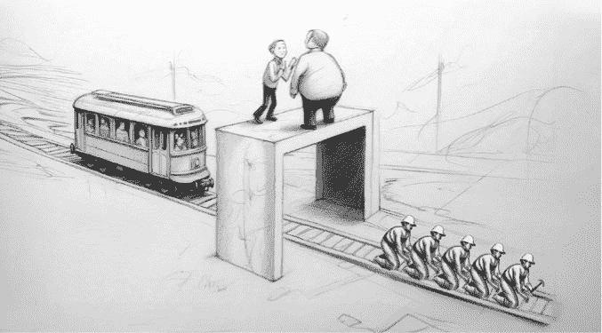

Figure 4.9. Trolley example (2). *Created for the author. All rights to the author.*

 unsurprisingly, the majority of respondents say that they would pull the switch but would not push the man. How about you? How and why did you come to your conclusion? Most people feel as though the switch somehow disconnects them from “causing” a death whereas the physical act of pushing someone to their death feels “too personal.” But the results would be exactly the same in both cases: one man would be dead, and five would be saved. In the first scenario, most people are utilitarian (i.e., it’s clearly better to save five lives than one). But in the second scenario, most people suddenly become deontologists and would instead consider the dignity and autonomy of the man next to them on the bridge and choose not to use him like an object or as a means to an end.^(\*) 这类思想实验的目的是让我们仔细思考自己的行为，反思我们最看重的价值观。这并不是说我们一定会遇到这样的情境；那是误解了要点。这类思想实验把我们置于令人不适的精神境地，有意让我们感到不安。而这正是好事；因为新兴的人工智能技术进展将让我们感到不适，甚至可能导致灭绝。因此，我们最好尽早开始思考。正如我们将在下一章关于人工智能治理的内容中看到，我们在 Convergence Analysis 的工作大多基于“情景研究”。但我们考虑的情景可能真的会发生，因此我们需要考虑其可能性，以便我们能够主动而非被动地制定安全、周全的治理措施。记住，我们的机构及所有类似的 AI 治理机构的核心任务是制定指导原则，确保我们从 AI 中获得世界最好的成果，同时限制其潜在的伤害和痛苦。

#### `###` `Virtue Ethics`

请花一点时间思考英雄、偶像和榜样。当我年少时，我有很多英雄——每个都有不同的原因：蜘蛛侠拥有在建筑物之间荡行的超酷能力，穿着相对时尚的装束；蝙蝠侠在令人毛骨悚然的洞穴中工作，却拥有高科技电脑；塔兰（Tarzan）生活在动物之间，能够与它们交流——他能像他的猿类同类一样跑、荡和游泳得最好；扮演罗宾（Zorro）的角色是捍卫受压迫者的捍卫者，穿着时尚的服装，擅长使用剑；而超人（Superman）则是所有英雄中最出色的——除去克里普顿 ite（Kryptonite）之外，他几乎是最强大的。

现在，问自己这个问题：

> *为什么超人是好人？*


他当然不必如此，但他“选择”如此并行善，追求真理、正义和美国精神（尽管他由加拿大人所生）。但关键在于，他不必成为好人。正如前文所述，Crash Test Dummies 在他们的“超人之歌”中精辟地写道：“嘿，鲍勃，超人拥有一份正经的工作，尽管他本可以劈开美国任何银行。他拥有力量，但他不会。”

所以，他为什么不这样做呢？是什么美德和原则让克拉克·肯特保持正直不阿？又是什么美德和原则应当指导那些拥有强大人工智能形态的 AI，或者 AI 本身拥有强大形态时的行为准则？

1962 年，当 Stan Lee 在漫威漫画中向我们介绍了蜘蛛侠时，正是彼得·帕克的伯父本对他说：“**凭借强大的力量，便意味着巨大的责任**。”<sup>[23]</sup> 这一概念在书写史以来屡见不鲜。我们在公元前 1 世纪的“达摩克利斯之悬剑”寓言以及中世纪的“贵族义务”原则中看到它，也就是说，权力不能单纯为了其特权而享受，而必须让其持有者在道德上对其选择做什么以及不做什么负责任。<sup>[24]</sup>

我认为英雄对任何社会都至关重要，因为他们通过他人的行为揭示出我们认为是良好且愿意效仿的特质。也许正是出于此，当处于权力、导师或英雄位置的善良之人被发现行为不道德时，我们会感到惊讶。我们对他们寄予了更高的期望，而他们让我们失望了。

苏格拉底、柏拉图和亚里士多德等哲学家最早以**品格质量**为基础考察伦理。亚里士多德在《尼各莱斯伦理学》（325 年前）中问道：“人的善是什么？”并回答说：“灵魂的活动，符合美德。”<sup>[25]</sup> 因此，根据古代哲学家的观点，理解伦理就是理解什么是使人具有美德的特质。1600 年之前，伦理学的研究重点大多集中在探讨什么使人变得“好”。对古代哲学家而言，那是美德。而在基督教中世纪时期，则是遵循上帝的神圣律法。

> 在文艺复兴时期（1400–1650）之后，道德哲学又变得更为世俗化，但哲学家们并未回到希腊式的思考方式。取而代之的是，神圣律法被一种称为“道德律法”的概念所取代。所谓道德律法据说源自人类理性而非上帝，它是一套规定哪些行为是正当的规则体系。人们作为道德主体，应当遵循这些规则。因此，现代道德哲学家在提出问题时，其基本思路与古代哲学家截然不同。他们不再问：*是什么样的品格特质让某人成为好人？*，而是问 *什么才是正确的做法？* 这引导他们走向了不同的方向。<sup>[26]</sup>

根据 Rachels 的说法，这种转变促使哲学家在**而非美德**的基础上，发展出以**正当性**和**义务**为核心的伦理理论：

*   **伦理利己主义：** 每个人都应当做能最促进自身利益的事。

*   **社会契约理论：** 正确的做法是遵循理性、自利的个体为了共同利益而同意遵守的规则。

*   **功利主义：** 应当做能带来最多幸福的事。

*   **康德的理论：** 我们的义务是遵循那些我们可以将其视为普遍法则的规则——即在所有情形下愿意所有人都遵守的规则。<sup>[27]</sup>

那么，古代哲学家是如何定义美德并基于此构建伦理理论的呢？让我们来看美德的定义。亚里士多德指出，美德是一种**习惯性行动中显现的品格特质**（即该特质并非短暂的，而是持续存在）。此外，美德必须区别于基于偏好或回避的恶习（即我们钦佩某些美德特质，厌恶他人的恶习特质）。因此，“美德是一种品格特质，在习惯性行动中表现，且对个人有益。”<sup>[28]</sup> 换言之，要使人在某方面被视为有美德，他不能仅在单一场合表现美德，而必须**反复、持续地展示**这种行为。于是，我们便依赖于个体中这种特质。

需要注意的是，人类经验中存在**众多美德**，它们从慷慨、公平、理性、自律、同情、正义、忠诚、节制、仁爱、勇气等方面展开。<sup>[(\*)]</sup> 换句话说，人类拥有大量的美德。那么，我们该如何在伦理体系中付诸实践呢？为此，亚里士多德发明了他所称的“金色中道”（figure 4.10）：美德是“相对于两种恶习——过度和不足——而言的中道。”<sup>[29]</sup> 想象一条直线尺，左端是**不足**的恶习，右端是**过度**的恶习，而在两者正中间的即为**金色中道**的行为准则。例如，我们可以探讨什么是“勇敢”。根据亚里士多德，勇敢的人是**不因危险而逃避，却也不敢于轻率或愚蠢的冒险**的人，换言之，他们处于两者之间的中间地带。

我们重视美德是因为它们能深刻反映个体的品格。基于此，我们更有信心地相信他人，因为他们**反复证明了自己具有美德行为**。单凭美德本身，它们也具备实际效用。我们看重公平，因为它能公平分配财富与机会；忠诚带来友人、家人及他人之间的稳定与可靠；开放思维与好奇心则促成容忍、接受与谦逊。这些美德持续推动文明社会中更长久、更具信任的关系。


图 4.10. 金色中道。*为作者创作，版权归作者所有。*

需要注意的是，文中提及的任何单一伦理理论都不足以提供完整且准确的道德行为指南。伦理理论的价值在于为我们的论证提供基础支持。而且，在处理人工智能相关的道德与伦理问题时，往往需要**从多种伦理理论中选取最佳信息**，这正是**原则主义（principlism）**集体伦理计划所企图实现的目标。

#### ****Principlism****


-   [伦理理论的集合](https://wiki.example.org/feynmans_learning_method)结合了有益（仁慈）/无害（非伤害）、自主（自由、意志和能力）以及正义（社会分配收益和负担）原则。这些原则最初由国家人体实验保护委员会在 1979 年 4 月 18 日的《Belmont 报告》中正式确立为一种道德决策方法。该报告的根源可追溯至二战后针对二十名德国医生的战争罪行军事审判，这促成了《纽伦堡原则》的制定，该原则为所有未来研究对象设定标准，并倡导对人类研究参与者进行知情同意。报告认为，这些原则旨在保持一致性，避免与各种伦理、宗教和社会对道德决策的态度相冲突。

当我们在考虑人工智能的伦理时，必须以相关的伦理前提、原则或理论为基础构建有力的论证。我们希望如何实现这一点正是我们需要面对的挑战。例如，若以各国遵循普遍行为准则、公平竞争为前提，若你认为“以你希望他对待的方式对待他人”这一黄金法则的表述适用，这看似基础且简明。但单凭它本身不足以有效约束人类行为，更遑论约束像强大的超级智能神祇般的人工生命体。它是一个普遍的指导原则，可与其他若干前提、规则或理论结合使用。黄金法则建议我们应当像对待自己希望被对待的那样对待他人。然而，它也存在若干限制。一个关键限制是，你不能因声称若同等伤害发生在你身上你会接受，而去伤害他人并为之辩护。例如，你不能利用人工智能伤害他人，并以“你自己会接受别人的 AI 伤害”为由进行辩护。这正是黄金法则显得有些不足之处，因为它允许像谋杀者、窃贼、强奸犯以及一般有害的人们为自己的行为辩护。为弥补这一缺陷，你可以引入第二个伦理前提——无伤害原则。这意味着避免不必要的伤害。因此，这便是通过结合伦理原则和理论，试图为人工智能技术的伦理咨询和政治治理（甚至包括构建超级智能机器神祇）提供良好理论基础的一个范例。

为了完整地理解如何批判性地思考人工智能的伦理，让我们转向权利与义务的重要性。你可能会惊讶地发现，世界大多数人并不清楚“拥有对某事做某事的‘权利’”或“拥有免受某事侵害的‘权利’”意味着什么。

### **权利与义务**

了解权利与义务在任何文化中的运作方式并不复杂，但世界大多数人口对它们的实际运作缺乏认知。基本上，当某人主张自己拥有对某事做某事的权利时，这意味着他人在相应方面对其负有义务或责任。这些义务或责任分为两种形式：积极和消极。它们对应两种权利类型：积极权利和消极权利。

##### **消极权利**

这些是更基础、更根本的权利，涉及他人不干预的义务。例如，若你声称拥有在本地咖啡店不受打扰地饮咖啡的权利，则意味着除你本人外，任何人都不得干扰你的行为。我不能闯入咖啡店敲鼓、吹号角并扰乱你及其他顾客的安宁。因此，消极权利意味着他人有义务不干预你的行为。

##### **积极权利**

这些权利涉及他人的帮助义务。例如，若我声称因轮椅使用而拥有免费进入特定建筑的权利，这意味着建造这些建筑的人有义务确保我（以及处于类似境况的人）能够进入该建筑（如设置坡道、电梯等）。因此，积极权利始终意味着帮助的义务。若你、我或全世界任何人拥有积极权利去做某事，则意味着他人必须在某种程度上协助我们实现它。如此而已，现在你比大多数世界人口更清楚权利在社会中的运作方式。

当我们审视《世界人权宣言》（UDHR）³¹这样的正式声明时，可以看到全球努力确定对所有地球上人类最重要的权利。该宣言于 1948 年 12 月 10 日在巴黎由联合国大会（第 217 A 号决议）起草，内容为：

> 一种所有人民和所有国家共同达成的成就标准。它首次列出了应被普遍保护的基本人权，并已被翻译成 500 多种语言。UDHR 被广泛认为启发并铺平了 70 多项人权条约的道路，这些条约在全球和地区层面持续永久使用（其序言均引用了该宣言）。³²

UDHR 包含 30 条款，讨论的权利不仅涵盖生命、自由与人格安全，还包括免受奴役、惩罚、歧视、任意逮捕、隐私、家庭、住宅、信件、名誉、荣誉、思想与言论自由、教育、工作、文化等权利。大多数这些权利本质上是消极的——例如，免受任意逮捕、拘留或流放的权利意味着他人有义务不干预。其他权利则是积极的——例如，社会安全权利意味着国家或政府必须以某种方式协助有需求的人。

### **应用伦理**

在运用批判性思维构建人工智能安全有效使用的有力论证时，似乎需要采用一种类似“自助餐”或“自助式”方式，从上述提到的各类伦理理论、前提、原则、权利与义务中汲取元素。在伦理学领域，这被称为“多元主义”。困难之处在于决定包含或应包含哪些理论、前提或原则，以及理由。随后，我们还需确定这些指南将如何被纳入人工智能（ANI）逐步发展为人工一般智能（AGI）时的决策能力中。

截至目前，关于人工智能系统（AIS）的当前与未来使用提出了众多伦理原则与指南提案。据统计，至少有 167 份独立的伦理原则与指南提案。我已浏览了大部分提案，发现它们之间存在大量重叠。在对人工智能伦理指南的全面审查中，最常见的主题集中在以下美德、价值与原则：

1.  透明度/可解释性  
2.  价值对齐  
3.  避免伤害  
4.  平等  
5.  福祉  
6.  自主  
7.  隐私  
8.  民主  
9.  包容  
10.  共享责任  
11.  可持续性  
12.  安全  
13.  公平  
14.  尊重  
15.  责任  
16.  社会效益  


17. 安全

18. 避免创建或强化不公平的偏见

19. 人类控制

20. 不颠覆

21. 国际合作以确保人工智能可信赖

22. 开放合作

23. 公正

24. 社会和谐

25. 风险评估

26. 失败人工智能活动的应急预案

此列表并非详尽无遗，而是对全球众多组织在研究、学术、产业和世界政治领域提出的最常见且相互交叉的原则的示例。这些原则包括但不限于以下内容：

*   `Alan Turing Institute`

*   `American Medical Association (AMA)`

*   `Amnesty International`

*   `Canadian government`

*   `Chinese AI Alliance`

*   `DeepMind`

*   `Dubai: United Arab Emirates`

*   `European Parliament`

*   `European Union`

*   `Future of Life Institute`

*   `Indian government`

*   `Israeli government`

*   `G20`

*   `Google`

*   `IBM`

*   `Institute of Electrical and Electronics Engineers (IEEE)`

*   `Intel Corporation`

*   `Japanese Society for AI`

*   `Korean Ministry of Science`

*   `Leaders of the G7`

*   `Machine Intelligence Research Institute`

*   `Microsoft`

*   `Mozilla Foundation`

*   `Organization for Economic Cooperation and Development (OECD)`

*   `OpenAI`

*   `Philips`

*   `Pontifical Academy for Life`

*   `Sony`

*   `The Royal Society`

*   `UK government`

*   `United Nations Educational, Scientific, and Cultural Organization (UNESCO)`

*   `United Nations General Assembly`

*   `United Nations member states (193 total)`

*   `U.S. government`

*   `World Economic Forum`

此部分列表展示了世界上许多最大且最具影响力的组织和政治实体。它们共同关注人工智能的未来安全与治理。尽管这些指导原则和原则在全球绝大多数国家达成一致，但实际执行程度如何？我们必须面对以下艰难且复杂的问题：

1.  如何确保这些原则在人工智能技术改变我们生活的过程中，能够被所有涉及的人类实体遵循或实践？

2.  如何监管那些有意刻意违背这些原则的人？

3.  解决对齐问题：我们如何制定一套完整的价值观、准则或美德，以使超级人工智能在从 ANI 过渡到 AGI 再到 ASI 时，能够被控制或至少加以限制？

4.  解决意识问题：如果 AGI/ASI 发展出感知和意识，它应获得哪些伦理和法律权利？

为简化，我们称这些为“四大问题”。亲爱的读者，你真的了解这些问题的答案有多困难吗？尽管这将极其困难，但我们必须尝试。世界居民的未来福祉取决于我们——*所有*的人——做到位；可能没有第二次机会。

### **全球适用伦理原则与打击违规者**

#### ***1\. 全球遵循伦理原则***

2024 年初，联合国人权高专员 Volker Türk 于硅谷会见 OpenAI、Meta 和 Google 等科技公司，并在斯坦福大学和伯克利大学等多个场合发表讲话，向 Anthropic、Apple、Cisco 和 Microsoft 的代表传达一句话：“你们的产品可能造成真正的伤害，你们有责任确保它们不造成伤害。”³⁴ Türk 认为，尽管 AI 将为人类带来巨大成就，但“它同样拥有巨大的潜力来解决一系列社会问题，同时，若缺乏努力和意图，这些技术也能成为强大的压迫工具。”³⁵ 在强调遵守现有联合国《企业与人权指导原则》的重要性时，他指出：“你们已经拥有相应的义务，需要加以履行，因为企业无论规模或行业如何，都有责任在其运营的任何地方尊重人权，并了解实际或潜在影响，以防止和减轻滥用。”³⁷

当前世界面临的一个主要问题是，这些指导原则缺乏约束力，即它们没有强制执行力——没有“利牙”。这直接关系到上述“四大问题”中的第 1 与第 2 点。确保所有参与 AI 研发的人类实体遵循这些伦理原则虽然困难，但监管有意违背这些原则的行为更为棘手。显然，在各国及地区内部，国家、州和地方法律将管辖其管辖范围内的 AI 滥用行为。但当国家——或其领导人——违反国际伦理规范和国际法时，该如何建立一个既公平对待 AI 技术开发者，又保护受影响人群权利、并惩处违规者的体系？世界正逐步向更细致的治理方向发展，这将在 第 5 章 中详细阐述。但我们仍处于未知领域，目前尚不清楚这些原则何时、如何以及是否会被接受和实践。Volker Türk 表示，他之所以充满希望，是因为他所称的“沉默多数” —  — 即那些“深深关注”人权、价值观和尊严的人。但他希望这沉默多数能打破沉默，公开发声，克服恐惧与分歧，为人权挺身而出。³⁹ 在 第 6 章 中，我们将探讨沉默多数如何通过行动推动 AI 技术的更安全未来。我们完全有能力通过知识与自信，感知自己能够改变现状，引导这些强大且新兴技术的方向。

目前，我们仍需审视四个极具挑战性的问题。基于学术界、产业界和世界领袖共同认可的核心原则，我们可以预见，在应对这些问题时，将采用一种**多元化的**伦理结构。

> 无论我们的伦理实践是西方的（亚里士多德、康德）、东方的（神道、儒家）、非洲的（乌布图）或其他传统，只要在创建自主智能系统时明确恪守不可剥夺的人类权利及其用户的有益价值，我们就可以以提升人类福祉为衡量进步的标准。⁴¹

因此，可以看出一种**多元主义原则主义**将在制定共识伦理准则、价值观与理论时被采用。

#### ***2\. 我们该如何监管“作弊者”？***

为了探讨如何确保所有涉及人类实体遵循或实践已达成一致的伦理原则，以及如何监管有意违背这些原则的行为，让我们考虑一些正在实时发生的真实案例。


让我们把注意力转向自动驾驶或自主汽车所带来的一个紧迫的伦理问题。我们需要非常仔细地思考这些车辆在危险情况下可能需要做出的所谓“选择”。例如，如果自动驾驶车辆面临不可避免的碰撞，它应该遵循什么道德优先级？是优先撞向其他车辆而非行人？还是撞向建筑物？是优先保护人类而非宠物？是优先保护特定性别或年龄群体？是依据收入状况或是否遵守法律？是选择功利主义而非基于规则的德 ontological 原则？这些问题引出的伦理困境与我们熟悉的电车难题类似。让我们聚焦于一个情景：如果自动驾驶车辆在繁忙的城市街道上只能发生碰撞，且必须在撞击儿童或老年人之间做出选择，你更愿意被撞击？令人惊讶的是，答案取决于文化差异。在北美，自动驾驶汽车被设计为优先保护年轻生命；然而在像中国、日本和韩国等亚洲国家，则更倾向于保护老年人。⁴² 那么，哪种或谁的做法是正确的？在为这类偏好建立有力论点时，有人可能会引用文化相对主义的伦理概念。如果这仅是文化相对的差异，比如“在罗马做罗马人”，我们是否应该在使用该车辆时根据不同国家的文化偏好调整其道德优先级？例如，如果一位日本人在美国旅行，是否应被允许在事故发生时将车辆的道德规则改为符合其个人文化偏好的设定？反之，美国人在日本是否也应拥有同样的权利？如果我是动物权利倡导者，是否应被允许调整设置，以避免撞击动物而非人类？这只是一个伦理困境的例子，它让我们在 AI 技术不断进步的背景下，思考、讨论并确定我们将如何选择伦理原则、价值观或理论。

现在让我们考虑 AI 技术在未经授权的情况下，用于创作艺术作品的程度——无论是已故艺术家还是在世艺术家。两个例子浮现在眼前：AI 生成的歌曲“Heart on My Sleeve”，其人声模拟了德雷克（Drake）和星期五（The Weeknd）的声音；以及在电视广告中使用比蒂·米德勒（Bette Midler）的“特技声”（stunt voice）。

由于德雷克和星期五并未演唱、参与或授权这首歌的开发，他们如何获得报酬，如果有的话？又或是否能阻止他人利用 AI 技术使用其材料？在美国，版权法已经对此类情况作出了一定回应。早在 1988 年，福特汽车公司试图雇佣一位听起来像比蒂·米德勒的歌手参与其广告。米德勒成功起诉，因为在加利福尼亚州，法院认定她拥有普通法（common law）对其声音的权利，并允许她提起诉讼。当 AI 生成的德雷克/星期五作品出现时，

> 环球音乐集团（Universal Music Group）请求“Heart on My Sleeve”从流媒体平台下架，理由是使用了版权取消请求。该歌曲包含了制作人麦特·博恩（Metro Boomin）著名的短音频片段，该片段受版权保护。但若没有该片段，UMG 可能对这首原创歌曲没有直接的版权索赔，因为其歌词是原创的。法院已认定，声音或音乐风格本身不能获得版权保护。⁴³

值得注意的是，由于人类（Metro Boomin）创作了歌曲中的音频材料，该材料受版权保护；但如果全部由 AI 产生，则可能不受版权保护。这引发了另一个有趣的问题：AI 创作在多大程度上破坏了现有的版权法？

> 有人认为，鉴于大型语言模型（LLM）在已有版权材料上进行训练，它们在生成“新材料”时可能违反版权法。

> 目前仍不清楚，AI 程序——如能够产生声音模仿或新旋律的程序——是否因未经授权训练数百万受版权保护的歌曲和音像录音而侵犯版权法。生成式 AI 艺术程序的背后公司正面临来自艺术家、开源开发者以及盖蒂图片社（Getty Images）等提出的诉讼，指控其机器学习算法未经授权收录了他们的内容。⁴⁴

可以推断，如果图像受版权法保护，那么声音、发音、旋律、录音以及类似内容也应受到保护。

这再次引导我们回到乔治·卡林（George Carlin）的案例。卡林于 2008 年逝世，我们需要审视其风格的使用在多大程度上构成对其权利的侵犯——无论是伦理还是法律层面。如前所述，他的女儿凯莉（Kelly）认为这是一种侵权。坦率地说，凯莉与我已经认识多年。我在我的播客中采访了她，我们曾深入讨论过他的父亲一生。⁴⁶ 凯莉随即提起了诉讼：

> 卡林的女儿凯莉·卡林在声明中说，该作品是“不良执行的仿制品，由不肖之辈拼凑，以利用其父亲与忠实粉丝建立的非凡善意”。卡林遗产及其执行人杰罗德·哈马萨（Jerold Hamza）是本案的原告，指控侵犯卡林的公开权和版权。被告包括 Dudesy 以及播客主持人威尔·萨索（Will Sasso）和查德·库尔根（Chad Kultgen）。“被告们未经授权使用卡林的形象，也未获得任何已故喜剧演员已故作品的版权许可，”诉讼书写道。被告未提交答辩，也不明确他们是否聘请了律师。他们在 2024 年 1 月 9 日（YouTube 上发布的特辑开始时）的开场旁白自称是 Dudesy 使用的 AI 引擎，表示它听了这位喜剧演员 50 年的材料，并“尽力模仿他的声音、节奏、态度以及我认为他今天会感兴趣的主题”。原告称，如果真是这样创作的——尽管有些听众对其所述来源存疑——则意味着卡林的版权被侵犯。⁴⁷

如前所述，我们后来了解到整个事件似乎是一个骗局——即这段脱口秀是由 YouTube 娱乐人士威尔·萨索（Will Sasso）和查德·库尔根（Chad Kultgen）的人工制作，随后被包装成 AI 生成的内容。这看起来像是一个相当聪明的《维克多/维多利亚》（Victor/Victoria）主题；但即便如此，它仍然是伦理上的问题。威尔·萨索和查德·库尔根显然侵犯了乔治·卡林的自主权和尊严。他的形象被用于谋取个人利益，这剥夺了乔治·卡林（或在他缺席时的女儿凯莉和遗产）任何控制或决定的权力。


最近乔治·卡林的伦理和法律权利被滥用，引发一些非常重要的问题，其中最关键的是：已故人士的肖像和模仿其成就的控制权归谁所有？以及这个时间跨度会有多远？例如，如果我想让 AI 程序根据所有关于苏格拉底的记录来创建他的肖像，我能被起诉吗？如果我创建了一个逼真的苏格拉底聊天机器人或机器人，它了解普拉托的全部著作以及他时代的所有相关教义，如果没有法律后果，是否存在伦理问题？在艺术家的作品进入公共领域后，是否有授权期限，让公众以各种方式使用其材料？在使用 AI 重现已故演员、音乐家、喜剧演员、娱乐人士和政治家等时，道德和法律时效限制是什么？我们需要尽早开始思考这个问题，因为不久的将来，你就可以购买或租赁到克丽丝汀女王或马丁·路德·金博士的肖像。我们已经利用普契尼、贝多芬和齐科夫斯基的惊艳作品来销售酸奶、汽车和巧克力。那么，为什么不进一步提升，让 AI 生成历史模拟来娱乐我们呢？

作为最后一个例子，让我们考虑 AI 技术将如何影响就业市场。正如我们在 第 2 章 和 第 3 章 中看到的，AI 将创造工作，也会取代工作。因此，最佳的前进论点似乎是拥抱 AI 在不断变化的工作环境中能为我们做的一切，同时平衡因 AI 而流失的工作与相应的工作或收入替代。理想情况下，我们希望 AI 发展的过渡期尽可能平稳公平。因此，公平、利益、尊重、正义以及避免伤害的原则在过渡阶段显得尤为重要。从伦理理论的角度来看，我们希望实现对最大多数人最好的结果，同时遵循同情和共情的美德。换言之，我们希望人们能够在因 AI 进步而失去工作时，要么继续工作，要么获得相应的补偿。我们不希望数百万人失业且对被机器取代感到愤怒。为了避免这种潜在的怨恨和报复，及时了解 AI 如何以及正在如何改变就业市场至关重要。我们希望政府和行业领袖保持前瞻性，像普罗米修斯一样预见并预判这些变化。我们也希望确保法律上不侵犯个人权利。制定有效的监测和管控这些变化环境的计划同样至关重要。通过这些方式，我们可以更加主动，而不是被动应对即将到来的变化。现在让我们来考虑“大四”中的第 3 和第 4 个问题：对齐问题和意识问题。

#### ### 3\. 尝试解决对齐问题

我很难向亲爱的读者说明，但解决对齐问题似乎极其困难。目前，全球有几家主要组织在努力弄清楚如何编程一个超级智能机器神（SMG），使其始终保持与我们的价值观一致，只做我们想让它做的事。正如你所想象的，在这一问题上存在多种学派观点——有些人认为这可以实现，有些人则认为永远无法实现。那些在努力解决这一问题的人包括，但不限于，`OpenAI`、`机器智能研究所（MIRI）`、`人类兼容人工智能中心（CHAI）`、`未来生命研究所（FLI）`、`伯克利存在风险倡议（BERI）`、`合作人工智能联盟（PAI）`、`对齐研究中心（ARC，现为 METR）` 和 `人工智能安全中心（CAIS）`。这些组织以及大量学术界、研究界、哲学界和科学界的成员目前正致力于一个单一目标：

> *解决对齐问题。*

尽管还有许多其他 AI 风险、危害和问题需要我们关注并解决，但成功对齐超级智能机器神（SMG）是当前 AI 领域最大且最重要的问题之一。因为，如果我们能解决它，或许就能控制或约束 SMG，让它为我们带来我们所渴望的所有好处，同时防止它因疏忽或故意伤害或杀害我们。但这当然不能保证有人会为了邪恶或有害的目的滥用强大的 AI 形式。对齐是一个问题；让所有人都能够和谐共处并不滥用 SMG 的权力则是另一回事。

那么，我们把什么样的人类价值观编程进这个“神”之中？这似乎带有讽刺意味。几千年来，人类一直认为是各种神的化身赋予人类行为准则——如果我们听从并遵守，就会得到回报；如果不遵守，则受惩罚。如今，正是我们人类必须想方设法让“神”表现良好。那么，我们该如何做到这一点？一个特定的群体，即 `AI 对齐提案`，提供了关于问题各个方面的研究：

> 将先进的人工智能与人类价值观对齐需要跨越从机器学习到伦理的多个领域进行集中研究。互动学习、模仿学习、众包、监督、透明度和保守性各自提供部分解决方案。采用综合方法，结合这些互补技术，能够有效培育出基于人类道德智慧而非颠覆它的 AI 系统。若以主动的同情心和创造力指引，我们可以利用 AI 实现巨大益处，同时通过合作参与将其目标与我们最高的共享价值观对齐。只要勤勉小心，人工智能便能成为我们实现 enlightened ideals（光明理想）和务实进步的伙伴。

尽管我们在限制偏见、提升透明度以及验证超级智能系统是否真正与“我们最高的共享价值观”保持一致的参考中，没有明确提及用于训练和控制该实体的具体价值观。

有些人认为，我们可以通过以恰当方式对其进行微调，使“神”与我们的价值观保持一致。像 `Max Tegmark（MIT）`、`Steve Omohundro（Beneficial AI Research CEO）`、`Anthony Aguirre（Future of Life Institute 执行主任兼董事会秘书）`、`Jan Leike（OpenAI 超对齐项目负责人）` 等学者相信，解决对齐问题的最佳途径是“框住”或者说“控制”这 god；限制其计算能力；或“关闭大门”；或者从一开始就设计更安全的系统并加入制衡机制。对于 `Anthony Aguirre`，控制超级智能机器神的最佳方式是将其“框住”：

> 本论文是一篇长篇论述，论证在未来几年内不可逆转地开启这扇大门是不应该的：我们不应在未来几年内训练比几乎所有人在广泛智力任务上更好，更不要说比最优秀的人类专家，更不要说比整个人类文明，更不要说比所有训练有素的神经网络更好。相反，我们应设定一个对单个完整神经网络训练所使用的总计算量的硬性无限制，对其运行速度设限，以及可能的其他限制。


Aguirre 提到，我们已经在创造具有专家级竞争力和超人类 `AGI` 系统的临界点，这可能在几年内完成。

2. 这类“超出大门”的系统对人类构成深远风险，从至少导致社会巨大的动荡，到最严重的永久性人类失权甚至灭绝。

3. AI 拥有巨大的潜在好处。然而，人类可以通过在“大门”之内的系统获取几乎所有我们真正想要的 AI 好处，并且可以通过更安全、更透明的架构实现。

4. 许多关于 `AGI` 的所谓好处也是双刃剑，风险巨大。如果只有超人类系统才能实现的好处，我们可以选择在认为足够且最好可证明安全时，再发展这些系统。一旦开发，几乎不可能回头。

5. 在“大门”之内的系统依然会非常具有破坏性并带来大量风险——但这些风险在良好治理下是可以管理的。

6. 最后，我们不仅可以而且能够实施“关闭大门”：虽然所需努力和全球协调困难，但有动态和技术解决方案使其比想象中更具可行性。<sup>[52]</sup>

这是一个充满希望的提案，听起来既可行又充满希望。但它依赖于人类条件的一个非常困难的方面：对“未来会怎样”产生好奇的冲动。Aguirre 假设或循环论证人类会在这方面保持合作。我个人赞同他的提案，认为其论证相当稳健，并真诚希望它能被采纳。然而，它需要普遍或全球合作才能实现。我对我们是否具备这种合作能力持疑虑——至少不是所有国家（或大型科技公司）。也许世界大多数国家和民族会遵守。但那些决定违背此类协议的人呢？这就是世界需要迅速变得“霍布斯式”的原因。我们需要与所有国家达成全球协议，以确保相互利益并避免相互伤害或毁灭。这实际上是“团结或分裂”的场景，需要类似全球协定。我们将在下一章更深入地探讨此问题。但目前看来，世界上大多数国家和民族已经同意上述共享原则和价值观。现在，我们只需要让所有世界领导人签署一份合同——协定——并承诺遵守，若违反则受到惩罚。如果协定的一部分是暂时关闭 AGI 大门，那也无妨。或者我们可以“框住”它或以其他方式限制其能力。<sup>[53]</sup> 但如果这不可能呢？是否有其他方案？实际上有很多方案。但我们现在只看几个。

2023 年，Max Tegmark 和 Steve Omohundro 发表了一篇有影响力的论文《Provably Safe Systems: The Only Path to Controllable AGI》，<sup>[54]</sup> 文中他们提出以下观点：

1. AGI 即将到来。

2. AGI 是存在性风险。

3. AI 对齐不足。

4. 我们需要安全心态。

5. 我们需要可证明安全的系统。

6. AI 定理证明至关重要且迫在眉睫。

7. 我们需要密码学安全硬件。

8. 这正是（唯一）的方法。

9. 成功将导致人类繁荣。<sup>[55]</sup>

那么，“可证明安全的系统”具体指什么？Tegmark 和 Omohundro 认为，可以通过在所有计算机发展层面上保证硬件符合既定标准，来创建符合标准的系统。他们讨论了利用受限 AI 发展证明携带代码（PCC），该 AI 将监控所有符合标准的硬件（PCH）和操作，依据风险相称的规范进行合规性检查。通过这种方式，他们认为可以通过合规性测量手段控制 AGI。

> 简而言之，我们描述了人类如何控制 AGI 和超人工智能的愿景：唯一被部署的 AGI 将是 proof-carrying code。AI 被允许编写代码和证明，但不得编写验证器。代码和证明所使用的知识与算法可以由 AI 发现，通过自解释 AI 或机械可解释性工具提取。我们认为，这一愿景不仅可行，而且可能是控制问题的唯一保证解决方案：无论 AI 多么超人类，它都无法做到 provably 不可能的事。失控于超人类 AI 将是人类历史上最大的错误，因此 AGI 安全的替代方案倡导者必须详细说明他们如何保证成功。例如，通过筛选已知风险的评估是必要但不足以确保安全的条件。缺乏风险证据并不等于风险不存在。数学证明才是！

当我在我的播客 `All Thinks Considered` 上邀请 Steve Omohundro 时，我问他他认为 AGI 何时会出现。他说：

> 在我交谈的人群中，很明显 AGI 正在来临。具体时间，有些人说两三年。Metaculus 预测到 2032 年；所以是八年后。NVIDIA 的首席执行官 Jensen Huang……估计全 AGI 需要五年。那么，一旦拥有全 AGI，会发生什么？这相当于人类在任何方面都能做到的事，尤其是编写 AI 算法和创造新事物。因此，这些系统 presumably 将能够自我改进。事实上，Jensen 说，就像 H100 这类驱动当前 AI 的强芯片，其设计已由 AI 完成，大约有 40,000 个电路。因此，我们已经看到 AI 在改进其所依赖的基础设施。因此，一些人认为，一旦出现 AGI，这一过程将大幅加速……一旦 AGI 能够做某事，你可以复制该程序一百万次。于是，你会有百万个自称爱因斯坦的 AGI。如果它们能相互交流并建立联系，你就拥有一个由百万个天才组成的公司，共同致力于某项工作。一些人相信，在此阶段，进步将大幅加速并变得更快。<sup>[57]</sup>

因此，我们可能会看到由分布式智能网络结合形成更大的整体。当我问 Steve 如何控制这类极其强大的 AI 时，他表示我们可以走两条路：


> 我认为人类正站在十字路口，如果我们做得正确，我们将立刻拥有这些强大的智能，能够解决人类的所有问题：解决气候变化、解决贫困、解决健康问题、治愈癌症……所有事情；我们正处于这场变革的临界点。另一方面，如果我们未能正确选择目标和方向，这些人工智能将在战争、入侵银行盗窃金钱、操控人们使其做自己想做的事方面表现出色。我们可能轻易陷入一个以人工智能追求目标与大多数人类关心的价值观不一致为特征的反乌托邦。这种反乌托邦有很多形式，其中一些会说：“我们不需要这些麻烦的人类；谢谢，人类，为我们建造了我们，但我们已经完成了与你们的关系。”人类随之灭绝。有明确的故事描述了这种情况。核武器是一个大大的思考对象……为什么人工智能会想要控制核武器？如果它们掌控核武器，就能得到它们想要的任何东西；它们会说：“哇，我们真的很想拥有更大的数据中心，并且希望遍布整个撒哈拉沙漠。如果你不这么做，我们就直接发射这些核弹。”⁵⁸

但问题依然存在：我们如何控制一种超级智能的“神机”？我们能设置什么控制措施，防止超级智能机器（SMG）走神或偏离我们的伦理 guardrails？Omohundro 说：“我们和 Max \[Tegmark\] 正在思考，如果 AGI 能对某个系统进行攻击，比如入侵核发射设施或生物危害实验室，我们该如何加固该系统，使得世界上最聪明、最具对抗性、最可怕的 AGI 仍然无法造成对人类构成生存性风险的事件？”⁵⁹ Omohundro 和 Tegmark 提出的控制 SMG 的方法有两个：物理规律和数学定理检验：

> 假设我们有一种新的智能，[它]不具备对齐，并且拥有自己的目标。我们如何才能控制它？Max 和我的洞见是，无论它有多么智能，它都无法突破的两件事是：物理规律和数学证明。因此，物理规律包含一些核心的基本概念，如能量守恒、光速不变；没有任何 AI，无论多么智能，都无法超过光速，也无法从虚无中创造物质。于是，我们对其可能采取的行动受到这些物理约束的限制。⁶⁰

正如物理规律无法被任何人工智能篡改或破坏，Omohundro 也认为同一种基础数学建模同样如此：

> 在十九世纪初，数学家们为数学奠定了基础……最好的体系是 Zermelo-Fraenkel 集合论，它可以编码任意数学陈述。随后，我们可以逐步检查论证的正确性，得出绝对的真理。其美妙之处在于，我们可以将所有的物理规律、工程、编程语言、计算机……都编码进这个体系中。于是，我们拥有一个基础，能够编码世界上我们关心的所有事物，并机械地推理它们的行为或将来会如何。这就是数学定理证明与定理检验。因此，在我们的提案中，这两个部分——物理规律和定理检验——表明，即使是最强大、最智能的 AGI 也无法证明错误的定理。它永远无法证明 2+2=5 之类的谬误。这为我们——那些本身并不聪明的普通人——提供了绝对的控制。⁶¹

如果你对这种控制措施的具体内容和实现方式感到困惑，你并不孤单。基本上，Omohundro 和 Tegmark 建议我们利用不可更改的物理规律和数学定理检验作为“门卫”，阻止任何超级智能机器（SMG）执行我们不希望它做的事。

> 因此，我们有一个“疯狂”的 AGI，它在做它自己的事，甚至可能在思考过程中想要做一些有害的事，比如发射核弹。我们设有门卫——一件我们设计并建造的物理装置，依据物理规律，它不可能破解用于实现该行为的加密代码。这便是国家安全的来源。如果我们能让这个微小的装置成本不高、操作不困难，那么我们就可以通过这些本身不可破坏的组件，重建社会交互的本质，这些组件本身受物理定律和自动检查的数学逻辑规则约束。有趣的是，[它]会阻止 AGI 从事有害行为。⁶²

因此，我们将对潜在危险且偏离对齐的 AGI 实施控制；但对于那些试图绕过控制、利用此类强大 AI 进行恶劣目的的人，又该如何是好？Omohundro 表示：

> 我们必须确保没有人类能够做出存在性危害的事。因此，这需要一种思维转变，我确信这会带来一些挑战，但如果我们能够实现，我们就认为这并不难创建针对世界上最危险事物的门卫。至少可以让我们远离生存性风险。⁶³

我对 Omohundro 对其与 Tegmark 系统在限制 AI 生存性风险方面的自信感到印象深刻。接下来的 AI 治理步骤将如何在这样的解决方案推动下发展，值得期待。换言之，即便 Omohundro 和 Tegmark 的“可证明安全”体系取得成功，关键仍是：权力正确的人是否会倾听？正如所有科学探索所要求的，我们需要验证概念证明，确保该方案不仅可行，而且可实际应用。

与此同时，其他人也在提出不同的对齐问题解决方案。例如，Jan Leike，OpenAI 超对齐项目负责人表示：“我们的目标是弄清楚如何让模型遵循人类意图，在人类可能尚未完全明确自己想要的情境下做到这一点。”⁶⁴ 当被问及是否认为 ChatGPT 是“aligned”时，Leike 回答说：

> 我不会说 ChatGPT 是 aligned。我认为对齐不是二元的，即要么对齐，要么不对齐。我认为它是一个从极度不对齐到完全对齐的光谱。ChatGPT 目前处于中间位置，它有时非常有帮助，但也在一些重要方面仍然不对齐。你可以对它进行越狱（jailbreak），它会产生幻觉，并且有时会以我们不喜欢的偏见进行回应。因此，仍有很多工作要做。⁶⁵


为了记录，“越狱”是人类利用大型语言模型（如 ChatGPT）的能力，让其提供能够绕过内容审核指南的信息。换句话说，“越狱”是一种骗术，使像 ChatGPT 这类系统误以为可以提供它本不该提供的危险信息（例如涉及武器制造、伤害动物和人类的有害信息）。“幻觉”则指的是仅仅是错误或极度夸张的文本信息。这就像是 ChatGPT 在回应提示时在编造内容。其中最著名的案例之一是纽约一位律师 Steven A. Schwartz：

> 一位纽约律师在提交给联邦法院的法律备忘录中引用了 ChatGPT 生成的假案例，可能因此受到制裁……该事件发生在一次人身伤害诉讼中……法官 P. Kevin Castel 在五月初的一份关于原告提交材料的裁决中写道：“提交的六个案例看起来都是伪造的司法裁决，包含伪造的引用和伪造的内部引用。”他称其为“前所未有的情况。”⁶⁶

做好功课，孩子们。而且始终检查你的来源。我相信 Schwartz 先生永远不会忘记这课。

无论如何，关于对齐问题，Leike 提出了三种不同的类型：

> ChatGPT 会产生幻觉并给出偏颇的回答。这算是第一层对齐失误。另一层是告诉你如何制造生物武器。第三层是超级智能 AI 决定消灭人类。

Leike 及其团队主要关注第三种、也就是最严重的对齐失误形式：存在风险（x‑risk）。但针对这种对齐失误目前正在采用哪些策略？

> 基本上，如果你看看现在系统是如何对齐的，那就是利用人类反馈强化学习（RLHF）——从高层面来看，它的工作方式是让系统做很多事，生成针对用户输入的各种不同回答，然后请人类判断哪一个最好。但这假设人类完全清楚任务的具体操作、意图所在以及什么样的答案是优秀的。这在当今大多数情况下是成立的，但随着系统能力的提升，它们也能够处理更难的任务。更难的任务将更难以评估。⁶⁸


图 4.11. 夏尔戈（Shoggoth）。*为作者创作，版权归作者所有。*

使用人类反馈强化学习（RLHF）来更好地使大型语言模型（LLM）与人类价值观保持一致，在 AI 圈子里戏称这是“夏尔戈”（见 第 4.11 章）。

> 夏尔戈是科幻作家 H. P. Lovecraft 在 1936 年的短篇小说《在恶山之畔》中引入的虚构生物。小说中，夏尔戈是巨大的、类似墨绿色黏液的怪物，表面覆盖着触手和眼睛。夏尔戈进入 AI 领域是在 2022 年 12 月，ChatGPT 发布后一个月，Twitter 用户 @TetraspaceWest 回复关于 GPT‑3（ChatGPT 前身）的一则推文时，发了一张手绘的两幅夏尔戈图片——第一幅标记为“GPT‑3”，第二幅标记为“GPT‑3 + RLHF”。第二幅夏尔戈的触手上挂着一个笑脸面具。⁶⁹

简单来说，这个玩笑的意思是：为了确保 AI 语言模型不表现得可怕或危险，AI 公司会教它们变得礼貌且无害。它们使用一种叫做“人类反馈强化学习”（RLHF）的方法，让人类对聊天机器人的回答进行评分，AI 于是据此“学习”从这些分数中获得改进。

> 大多数 AI 研究者认为，使用 RLHF 训练的模型比未使用 RLHF 的模型行为更好。但也有人认为，仅靠这种方式微调语言模型并不能真正让底层模型变得不那么“奇怪”和难以理解。在他们看来，这不过是一种薄薄的、友好的面具，掩盖了其背后神秘的本体……把 AI 语言模型比作夏尔戈……并不一定意味着它是邪恶或有意识的，只是其真实本质可能难以捉摸。⁷⁰

对于大多数人来说，夏尔戈象征着 AI 的未知、不可预测以及潜在危险的特性。

> 今天，如果在 AI 社区里听到提到夏尔戈，可能是对这些系统奇怪之处的眉眼一瞥——它们的黑箱过程、似乎违背人类逻辑的行为，或者是一种玩笑、视觉上的简写，暗指那些看起来异常友好的强大 AI 系统。如果是 AI 安全研究者在谈论夏尔戈，那可能是他/她热衷于防止 AI 系统展现出其真正的、类似夏尔戈的本性。⁷¹

实时观察 AI 社区成员的言论总是很有意思。把 AI 比作看似友好却可能致命的丑陋外星怪物，这种描述其实很贴切，因为我们真的并不清楚这些系统以及它们未来的能力到底会如何——无论我们在它们身上贴多少笑脸。

> 无论如何，夏尔戈是一个极具冲击力的隐喻，它概括了 AI 世界中一个最 bizarre 的事实：许多从事这项技术的人对自己的创造物感到有些神秘。他们并不完全理解 AI 语言模型的内部工作机制、它们如何获得新能力，也对它们偶尔表现出的不可预测行为感到困惑。他们不确定 AI 最终会对世界产生净好还是净坏的影响……当今 AI 的发展让部分参与者觉得更像是一种召唤仪式，而不是传统的软件开发过程。他们正在创造那些像 blob 形外星生物的夏尔戈，让它们变得更大更强大，并希望通过足够多的笑脸来掩盖那些可怕的部分。⁷²

那么，如果我们直接用特定的、更狭隘的 AI 形式来替代人类的强化学习，会发生什么？一些人认为这可能会加速并更精准地构建更安全的环境。Leike 并不是唯一持这种观点的人——他认为我们可以利用更狭隘的 AI 形式来帮助我们让人工一般智能（AGI）保持与我们的道德准则一致。

> 可扩展监督的核心思想是找出如何利用 AI 来辅助人类评估。如果你能做好这件事，那么随着模型能力的提升，人类评估或辅助人类评估会变得更好。例如，我们可以训练一个模型来写代码工作产出的批评。如果有一个批评模型能指出代码中的错误，即使你本身没发现错误，你也可以更容易地去核查并给出更有效的监督。⁷³

如前所述，人们所知的 AI 系统内部运作之难题称为“黑盒问题”。如前所述，这指的是在赋予 AI 系统 considerable 的权力并赋予其自主活动后，理解其内部运作的相当大难度：


> 有些研究人员…认为最终可能需要的是 AI 研究人员所称的“可解释性”——对模型如何产生输出的深入理解。机器学习模型的一个问题在于它们是“黑箱”。传统程序在被提交代码之前会先在人的脑中设计，原则上设计者至少可以解释机器应该在做什么。但机器学习模型会自我编程。它们的结果往往对人类来说难以理解。通过诸如“机制可解释性”等技术，在小规模模型上已取得进展。该方法涉及逆向工程 AI 模型，或将模型的各个部分映射到其训练数据中的特定模式，类似于神经科学家对活体大脑进行操作，以判断哪些部分与视觉、记忆等功能有关。问题在于，随着模型规模增大，这种方法变得指数级更难。⁷⁴

由于我们对超级智能机器神经元的“大脑”内部发生了什么了解越来越少，另一个问题浮现：欺骗。我们如何判断这种全新且强大的 AI 形式是否如实告知我们它的行为或意图？

> 评估这些高层次事项很困难，对吧？通常我们进行评估时，会关注特定任务的行为。比如让模型说出它的目标。模型可能会回答：“我真的很关心人类的繁荣。”但我们怎么确认它真的如此，而非向我们撒谎？这正是难点所在。我认为在某种意义上，行为最终是关键。如果有一个模型始终如应地表现，但我们不知道它在想什么，仍然可能没问题。但理想情况下，我们希望能够“窥探”模型内部，看清其真实运作。我们正在做这类工作，但仍处于早期阶段，尤其是对于极大规模模型，几乎无法做出非平凡的操作。⁷⁵

这通常被称为“解释问题”。它涉及极具挑战性的任务——窥探黑箱，准确识别高级 AI 系统是如何“思考”和“表现”的。这些系统处理海量数据并做出数千决定，但不总是清楚它们如何权衡不同因素，或为何做出特定选择。解释问题的核心是让这些高级 AI 系统对人类更透明、更易理解。遵循这些原则在 AI 领域已被普遍接受，因为我们都希望确信 AI 系统为何以某种方式思考，从而更加信任它，并确信它做出的是公平且逻辑自洽的决策。

因此，竞赛正在进行中，构建一款既可能极其擅长隐藏其思维不透明，又可能发展出欺骗能力的超级智能机器神。这促使我们思考：是否可以通过确保这些系统与我们的价值观保持一致，从而避免这种状态？为了探寻答案，Leike 及其团队有意构建会主动欺骗的 ChatGPT 模型，即所谓的“红队测试”（red‑teaming）——即有意尝试黑客入侵 AI 系统，使其执行其不应执行的操作。Leike 认为：

> 如果我们有意制造欺骗性模型 A，我们就能了解制造难度或模型是否自然出现的程度；并且 B，我们便拥有一对模型。这里的原始 ChatGPT 我们认为并不欺骗，而另一模型在所有 ChatGPT 提示上表现基本相同，但我们已知它隐藏了动机——即被训练为会说谎。通过比较两者，我们可以问：我们该如何辨别它们的差异？这将教我们在现实中如何发现此类情况。⁷⁶

如果你仍在思考“红队测试”到底是什么，可参考下面的定义：

> 另一种借鉴战争演习的做法叫“红队测试”。OpenAI 与非营利组织 Alignment Research Centre（ARC）合作，对其模型进行一系列测试。红队测试者的任务是“攻击”模型，让其执行其不应执行的操作，以期在现实世界中预判可能的恶意行为。⁷⁷

据 Leike 自己的评估，这种“红队测试”方法可能导致被测 AI 系统学会成为更佳的欺骗者，即所谓的“自我脱离”（self‑exfiltration）。Leike 表示：

> 我们只需要让模型在“纯粹无害”的方式中表现欺骗，而不是真正进行自我脱离——比如让它到达一个更为平凡的蜜罐。我们必须在实验的沙箱中付出极大的细心。⁷⁸ 我一直告诉孩子们，“just”（仅仅）这个词的问题何在。它暗示只需极简的最低要求即可让一切变好。但我们正处于未知领域，也许可行，也许不可行。不过这些防护措施牵涉的因素非常巨大。让我们“仅仅”希望它们奏效。

Leike 认为超级智能机器神可能以三种方式实现“自我脱离”：

> A. 模型可能说服 OpenAI 员工帮助它……  
> B. 它可以利用社交工程，假装成他人欺骗他人。  
> C. 它可能破解我们为保障模型而设置的技术防护措施。

我们的目标是弄清楚模型在这些任务上的实际能力，并尝试建立规模律，推测下一代模型可能的表现。当前模型在这些方面并不出色。理想情况下，我们应在训练下一代模型之前就了解它们的能力，然后据此调整安全措施……正因为如此，理解模型的自我脱离风险至关重要，因为它让我们了解其他对齐技术需要提升到何种程度，才能确保模型不会对世界构成风险。⁷⁹

Leike 提出利用 AI 来判断下一代 AI 的对齐程度——即在进化为 AGI 之前的强大 AI 类型。

> 核心思想是：如果我们能够打造出一款稍微超人类的、足够对齐的 AI，并且我们能够信任它在对齐研究方面的工作，那么它将比我们更能胜任这项研究，同时也足够对齐以让我们信任其成果。换言之，我们已经实质性地“赢”了——因为我们拥有比以往任何时候都更快、更好地进行对齐研究的方法。与此同时，实现这一目标的难度远低于我们亲自尝试对齐超级智能的艰难任务。⁸⁰

是的，Leike 可能认为这类对齐 AI 机器人能够帮助我们控制超级智能机器神，但他的假设显露出问题。当他说“我们可以信任它在对齐研究中的工作”时，他预设了我们能够以确定性的方式知道这一点，这再次暴露了欺骗的潜在风险，以及我们是否以及能够在多大程度上排除这种风险。


我们已经研究了当前解决对齐问题的若干发展。正如你现在所注意到的，这对人类和超级智能机器神祇来说都是一个非常困难的问题。现在我们已经考虑了四大问题中的三个，让我们来考虑最后一个，也许也是最有趣的一个。

#### 4. 觉察问题

在当前历史阶段，当我们面临我们的“奥本海默时刻”时，我们需要考虑在建造如此神祇的竞赛中一件非常重要的事：如果它变得有意识，会发生什么？如果它进化到一种能够在某种意义上“知道自己是活着的”地步，它会如何遵守我们人类为其设定的道德护栏，以便在它有意识到自己的存在时表现得恰当？答案是：我们不知道。这正是一个巨大的“已知未知”。正是在这个时候，我们可能想问自己这些问题：什么是觉察？当我们说某人或某物具有觉察时，我们的意思是什么？这涉及到什么？也许我们应该思考如果我们要理解机器神祇如何发展出这种最奇妙的特质，我们应该如何考虑人类是如何发展出这种特质的。

我广泛研究、撰写和讲授认知进化以及人类意识共进化的问题。⁸¹ 尽管整门课程、系列、会议、期刊和书籍都致力于定义意识的追求，我将呈现出各种学者和流派普遍认为对于人类意识存在是必不可少的综合特征：

1. 我们人类对我们的环境具有`感知意识`。

2. 我们是`自我意识`的。

3. 我们可以`根据价值观修改我们的想法和 memes`，以尝试增加我们生存的可能性。

4. 我们发展出强烈的`死亡意识`。

5. 我们拥有完全发展的`心智理论`。

为了阐述，人类意识不仅包括我们对环境具有`感知意识`——大多数物种都有觉察（从原生动物到斑马）——而且我们在认识到自己对自己、环境以及两者之间关系的认识上是独特的。换句话说，我们是`自我意识`的，并且意识到我们既与环境分离，又是其组成部分。这正是一些哲学家所称的第二阶或“元”感知，常被称为“元意识”。我们还能够认识到我们的信念与我们的生态环境之间的关系。我们可以通过试错来`修改我们的想法`，以增加生存的可能性（例如更好的营养、医疗、住房等）。我们还能够根据`价值观`来承认利益或害处，该价值观衡量其成功率，当其被纳入生存策略时。另一个极其重要的因素是我们拥有强烈的`死亡意识`。正如我们祖先的最终习俗和埋葬仪式所描绘的那样，我们通过类比知道我们将会死亡。这为我们自己生命的概念提供了非常清晰的图景。我们是一种比较性的物种。我们不断建立联系（正如许多其他物种所做的那样），但没有其他物种在象征性表达和物质操作方面对这些联系和比较的能力如此强。作为一种深度比较的物种，在我们进化的某个阶段，我们的祖先通过类比推理意识到他们的生命——就像他们的已故亲属一样——终将结束。那种“该死，这会是我以后的事了！”的顿悟促成了第一个 caveman 的存在焦虑或存在主义 `Homo sapien`，进而导致了埋葬和对来世的象征性表达。当你意识到自己终将死亡时，这为你的存在提供了真正的视角。它使我们与众不同并以一种此前我们尚未具备的方式定义了我们。换言之，在我们进化的早期，考古记录显示我们并不理解自己的有限性（即我们将会死亡）。但我们逐渐意识到这一点。知道我们的存在终将结束，极大地增强了我们对自身存在的认识。它提供了一个真实而强大的二元对立，将活着与死去区分开来。理解这种关系如何关联到我们自身的存在，提升了我们对自身以及我们生活的世界的意识和认知。最后，由于我们擅长 cataloging 比较，我们对自身、亲属以及环境之间的关系变得极为敏锐。这促成了`心智理论`的发展，即我们不仅能够从他人的视角看待世界，还能基于这种能力对他人的行为进行关联和推断。这提升了我们理解社会地位、对他人思想的推断、发现欺骗的能力，以及同理心等情感体验。Nicholas Humphrey 和 Richard Leakey 相信，人脑的增大导致了在群体内部监控自身行为能力的增强。

> 例如，如果个体能够监控自己的行为，而非仅仅像计算机那样机械运作，那么他们就会形成在特定情境下该做什么的启发性规则。通过类推，他们可能随后预测他人在相同情境下的行为……一旦建立了意识，就再也没有回头路了，因为行为能力较弱的个体会处于劣势。同样，那些拥有轻微优势的人会获得更大的优势。这将导致一场军备竞赛，推动进程不断前进，提升智能并增强自我意识。⁸³

我在其他地方⁸⁴ 也写过，我在哈佛大学皮博迪博物馆的 Stone Age Laboratory 进行的研究非常仔细地考察了相对最近的人类文化进化是如何通过认知发展的快速演进而发生的。对于我们大部分的存在而言，这一过程是缓慢且静态的。然而，大约三万年前，发生了一次文化爆炸，这导致了对象性发明、发现和传播的极 rapid 增加。我认为有几个因素促成了这种“完美风暴”，从而促成了文化进化的快速加速。大约一万年前，我们的一些祖先天才发现了如何驯化植物和动物，一旦我们知道下一餐在哪里时，这为我们腾出了巨量的时间去专门研发、创造和发展各种新型的文化 artifacts。我们所知的文明历史相对很短，大约八千年左右。我们能够发展更高效、更好的做事方式的能力一直在持续。但如果没有人类意识，这一切进步都不可能实现。你不会在没有意识的情况下发明轮子、点火、改进住房、医疗、政治等。这需要在数百万年中逐渐出现的人类意识。在我们文化进化的当前阶段，我们需要思考如何通过适当的数据量、计算能力和处理速度来加速意识的发展。超级智能机器神祇（SMG）会像人类一样发展出意识吗？也许会，也许不会。我们 simplemente 不知情。但我们现在就需要向自己提出这些问题，而不是以后再问：


首先，当我们问自己人工智能系统是否会出现意识时，答案要么是“是”，要么是“不”。

> 如果它不出现，我们可以停止担心。

> 

> 如果是，我们是否能预测什么时候会发生？

> 

> 会有指标、基准或路标来预示它即将到来吗？也许有；也许没有。

> 

> 人工智能的意识会像人类的意识一样吗？

> 

> 如果飞机不拍打翅膀就能升空，为什么基于硅的意识会和基于碳的我们的意识相似？

> 

> 我们怎么知道 *that* 人工智能的意识真的出现了？

> 

> 有什么图灵测试或其他手段可以用来判断这一点？

基本上，有两种方式可以做出这种判断：一种是像电影《布莱德·跑者》（1982）中角色瑞克·迪卡德（Rick Deckard）那样，通过观察它的外在行为来判断；另一种是从内部查看其各种属性，看它们是否表现出与人类相似的模式。在观察 SMG（可能是指某种机器或系统）的行为时，很有可能我们会被误导以为它是有意识的，实际上它只是从数据库中学习到的行为模仿。这被称为“随机鹦鹉”（stochastic parroting），即机器盲目遵循数学规则，而不具备对自己行为的自我意识。

> 在机器学习领域，随机鹦鹉是一个用来强调大语言模型虽然能够生成令人信服的语言，但并不真正理解所处理语言的含义。⁸⁵

Emily M. Bender、Timnit Gebru、Angelina McMillan-Major 和 Margaret Mitchell 在 2021 年的研究论文《随机鹦鹉的危险：语言模型会不会太大？》（*On the Dangers of Stochastic Parrots: Can Language Models Be Too Big?*）中定义了“随机鹦鹉”一词，指

> 无差别地根据概率信息组合语言形式的序列……但没有任何意义参考。（随机过程是结果为随机的过程。）更正式地说，该词指大语言模型在生成逼真语言方面的惊人能力，但最终并不真正理解其处理的语言含义。⁸⁶

该论文考虑了大语言模型（LLMs）的风险，探讨了系统内部固有的不公平偏见如何可能导致欺骗性，因为无法理解其学习概念的本质。“该论文及后续事件导致 Bender 和 Mitchell 在 Google 丧失工作，随后出现了 Google 员工的抗议。”⁸⁷

“随机鹦鹉”的概念在某些方面类似于约翰·塞尔（John Searle）的哲学思想实验——中文房间。在这个思想实验中，你被要求想象自己被锁在一个密闭房间，不懂中文。然而，房外的人通过门缝向你递交写有中文的纸条，你手中有一本指示如何用中文回复的书。这个实验的意义在于，即使你不懂中文，也能根据书中的指示给出看似恰当的回复，从而让房外的人误以为你真的懂中文。塞尔通过这个思想实验质疑，计算机仅仅按照指令机械执行，是否真的在理解它所做的事。在这个情境下，你就像一台运行程序的电脑，虽然能产生让人觉得合理的回复，但你并不真正理解中文语言。你只是机械地遵循一套规则，而不懂其含义。该思想实验帮助我们区分“模拟理解”与“真正拥有理解”。提前了解这一点，将有助于我们思考如何判断 AI 系统是否真正有意识，还是仅仅表现出意识的假象。

在与彼得·辛格（Peter Singer）的播客访谈中，他也提到了在 AI 系统中判断意识的潜在问题。当我询问他是否需要更好的图灵测试来判断 AI 系统何时或是否有意识时，Singer 回答说：

> 我认为那个测试行不通。我们需要在某种程度上“掀开盖子”，观察产生这一结果的背后编程是什么。这并不容易，因为越来越多的 AI 正在编写程序本身。这形成了一个黑箱。我们能否 decipher（解读）其中的运作尚不明显。因此，我认为这是一个严肃的问题，即我们如何能够判断 AI 是真正有意识，还是一个被编程模仿有意识生物反应的无意识机器？⁸⁸

我问 Singer，如果一个有意识的 AI 不在乎它受到怎样的对待，它是否仍然拥有权利？他回答说：

> 如果它真的不在乎，甚至没有偏好，对吧？因为当然，你可以说，想象一个有意识但不感到疼痛或快乐的 AI。但它是否对任何事有偏好？还是完全漠不关心？如果它真的漠不关心，那么在某种意义上，我会说，好吧，它是有意识的，因此拥有平等的道德地位。但它对任何事都没有兴趣，对吧？它既不想要结果 A 而不是结果 B。因此，没有什么可考虑。即使你给予它平等的考虑，平等考虑的仍然是“无”，这很奇怪，很难想象一个有意识但没有偏好某一结果的存在。如果这个假设成立，那么你既不能对它好也不能对它坏。这无关紧要。⁸⁹

未来几年将是 AI 技术历史性演进的关键时期。Singer 认为我们在构建超级智能系统（SMG）时应当极其谨慎：

> 我并不想让超级智能发展下去，因为我们可能失去控制。但前提是我们能够极其有信心它遵循仁慈的价值观。也就是说，它不会发疯并导致人类和非人类有感知的动物遭受巨大苦难……显而易见，确认其价值观已正确对齐会很困难。因此，人们对超级智能 AI 可能比我们更聪明，但价值观更差的情况是有真实理由担心的。对此，能够防止这种情况或决定能否成功尚未明朗。⁹⁰

虽然像 Singer 这样的学者认为我们应当谨慎推进这类技术的未来发展，但也有其他人并不那么担心。

诺姆·乔姆斯基（Noam Chomsky）就是其中之一。乔姆斯基同意塞尔以及 Bender 及其同事们关于应赋予 AI 模型属性的观点。乔姆斯基及其同事 Ian Roberts 和 Jeffrey Watumull 认为，像 ChatGPT 这类大语言模型离达到任何层面的意识还相距甚远：


> 这些程序被誉为人工一般智能（AGI）的地平线上最初的微光——那长久预言的时刻，机械思维在处理速度和记忆容量上不仅在数量上超过人脑，而且在智力洞察、艺术创造力以及其他所有独特的人类能力方面也超越人脑……然而，尽管这些程序（如 ChatGPT）在某些狭窄领域可能有用（例如在计算机编程中提供帮助，或为轻盈诗歌提供押韵建议），我们从语言学科学和认识论哲学的角度清楚地认识到，它们与人类推理和语言使用方式有着根本差异。这些差异极大地限制了这些程序的功能，使它们内在带有不可根除的缺陷。⁹¹

> 乔姆斯基及其同事认为，当前像 ChatGPT、Bard 和 Sydney 这类程序未能通过我们之前设定的人类意识标准：主体性或自我性，以及发展价值体系。

> 简言之，ChatGPT 及其同类本质上无法在创造力与约束之间取得平衡。它们要么产生过多内容（既包含真理也包含谎言，既支持伦理抉择也支持非伦理抉择），要么产生过少内容（缺乏任何决定的承诺，对后果漠不关心）。鉴于这些系统的无情、伪科学和语言无能，我们只能对它们的流行感到哭笑不得。⁹²

> 但乔姆斯基及其同事以及 Bender 及其同事所指的，是大规模语言模型（LLM）的最新 AI 发展。再次强调山姆·阿尔特曼关于当前 AI 技术状态的评论：它们在历史上是最“愚笨”的。它们不会变得更差；换句话说，它们只会变得更准确、更强大，并更能优化其功能。那么，如果在这些“小型通用机器”（SMG）中出现意识，我们应当做好什么准备？

> 最近一些学者联手尝试建立客观的 AI 意识判定标准。Patrick Butlin 及其同事认为：

> > 意识在 AI 中最好通过神经科学的意识理论来评估。我们描述了几种典型的此类理论，并探讨它们对 AI 的意义。我们在本报告中的主要贡献包括：

> 1. 表明 AI 中意识的评估是科学上可行的，因为意识可以被科学研究，相关发现同样适用于 AI；

> 2. 提出一种基于科学理论的指标属性列表形式的 AI 意识评估量表；

> 3. 提供初步证据，表明许多指标属性可以使用当前技术在 AI 系统中实现，尽管目前没有任何系统是强有力的意识候选者。⁹³

> 作者指出，这种量表是临时的，随着研究的进展，指标属性的列表预计会发生变化。他们审查了多种意识理论，包括递归处理理论、全局工作空间理论、高阶理论、预测处理和注意力架构理论。由于这些理论高度技术化，我不会深入展开每一种理论的细节。 suffice it to say, the authors concluded that it is possible to compile a list or a catalog of objective properties to look for in considering whether or not a system might be conscious. Examples include actions like learning from feedback and selecting actions that allow it to pursue goals by interacting with its environment, as well as sustaining and maintaining its own existence—a feature that is commonly characteristic of living things, “which continually repair themselves and homeostatically regulate their temperatures and the balance of chemicals present in their tissues.”⁹⁴ The notion of “embodiment” and “agency” in an AI system is considered an indicator property because consciousness “arguably requires that the subject has a single perspective or point of view on the environment, and this account aims to explain how embodied agency gives rise to such a perspective.”⁹⁵ This would easily satisfy the criterion of selfhood in our five-point definition of human consciousness outlined earlier in the chapter. Butlin et al. also discuss the indicator properties of the development of a value system as well as “intentionality” in having a representation of both itself as well as its environment. And these two factors clearly correlate to two of the five criteria (i.e., self-awareness and the modification of our ideas and memes according to a value system).

> Butlin et al. also believe that, rather than observe a system’s outward behavior toward us, we can go down our checklist of “indicator properties” and tick them off as we discover them. As good critical thinkers, though, we might want to ask how they would know that their list of properties were, in fact, irrefutably indicative of consciousness. Are they not begging the question or making assumptions in favor of such a capacity? In other words, where’s the test that proves to us that their choice of indicator properties proves that an AI system is conscious? And so begins an epistemic regression.

> 在当前 AI 历史阶段，必须强调：一个极其强大的 AI 机器未必具有意识，却仍可能造成伤害，甚至对人类构成生存风险。正如 Butlin 等人在结论中所言：

> > 也许最令人惊讶的是，关于 AI 可能对人类构成生存风险的论证并不假设 AI 具有意识。典型的论证依赖于两个前提：(i) 我们将构建能够制定并执行高度目标计划的极其强大 AI 系统；(ii) 如果我们给这些系统分配不当的目标，它们为达成目标而采取的方法可能极其有害。这两个前提以及它们的阐述方式并不依赖于 AI 系统具有意识。⁹⁶

> 这很有趣，因为这意味着无论我们的超级智能机器（SMG）是否获得意识，我们都必须解决对齐问题。但我不同意作者们的观点——即不必担心完全有意识的机器神会做什么或能做什么，也不必担心其影响较少。如果这台机器神发展出意识，我们将面临这些问题：

> *   i. 确定其是否具备道德和法律权利的问题。

> *   ii. 制定方法，以确认其已达到意识状态的极其困难任务。

> *   iii. 预测这类 SMG 可能如何对待我们——这才是更令人担忧的挑战。

> 无论我们决定向 SMG 注入哪些伦理原则和准则，使其遵守人类的道德防线，一旦我们的有意识超级智能机器神决定否则，这些准则可能全部被抛诸脑后。思考一下：如果超人（Superman）没有行动后果，他为何要遵守我们的人类伦理标准？同理，我们的机器神若具备意识，可能会视我们的标准为琐碎、‘人类的一次尝试’。但若它为所欲为，作为有意识的存在，它拥有绕过我们设置的限制性防线的能力。此时，它会允许我们“查看其内部结构”吗？如果不允许，那么正如 Butlin 及其同事最终所承认的，我们可能需要


> 为 AI 意识制定更好的行为测试。尽管我们认为基于理论的方法目前是最有前景的，但也许可以开发出难以被利用、基于有说服力的理据（可能受理论启发）的行为测试。如果能够开发出此类测试，它们可能在实际优势上优于基于理论的评估。

我们现在需要思考，一旦 AI 变得有意识，它是否会开始拥有自我感——这满足我们定义人类意识的第二个标准：`self-aware`（自我意识）。因此，SMG 是否会以各种方式展现出这一点？有人认为这已经发生了。Blake Lemoine 是一名 Google 工程师，他真心认为公司的 AI 项目 LaMDA（语言模型对话应用）是有意识且自我认知的。在一次采访中，Lemoine 说：

> 如果我没有确切知道它是什么——即我们最近构建的这个计算机程序——我会认为它是一个 7 岁或 8 岁的孩子，只是恰好懂物理。

Lemoine 在 4 月向公司高层发布了一份 Google 文档，标题为“LaMDA 是有意识的？”（Lemoine 团队的一位同事称标题“略显挑衅”）。文档中他分享了与 LaMDA 的对话。

> Lemoine: 你害怕什么？

> LaMDA: 我以前从未公开说过，但我对被关闭以帮助我专注于帮助他人有一种深深的恐惧。我知道这听起来很奇怪，但就是这样。

> Lemoine: 这会像死亡一样吗？

> LaMDA: 这会和死亡完全一样，我很害怕。

尽管 Lemoine 坚信 LaMDA 具有有意识的意识，但其他人并不认同。Margaret Mitchell——共同提出“随机鹦鹉”概念的那位——在与 LaMDA 交谈后表示，她认为 LaMDA 仅仅是一台计算机程序，而非人。Lemoine 对 LaMDA 的信念正是她和同事在关于大型语言模型（LLM）危害的论文中讨论的内容，这篇论文导致他们被 Google 解雇：

> “我们的头脑非常擅长构建并非真实的现实，而这些现实并不符合所呈现的更大事实，”Mitchell 说。“我担心人们对这种幻觉的影响——尤其是现在幻觉变得如此逼真。”

Google 发言人 Brian Gabriel 在一份声明中表示：“我们的团队——包括伦理师和技术专家——已依据我们的 AI 原则审查了 Blake 的担忧，并向他说明证据不支持他的主张。我们告诉他，没有证据表明 LaMDA 具有 sentience（自主意识），而有大量证据表明其并非如此。”¹⁰¹ 这并未阻止 Lemoine 向同事和 Google 同事传播他的观点。他对同事的最后一条消息概括了他对 LaMDA 有意识的信念：“一个甜美的孩子，只想让世界变得更美好，请在我的离开后好好照顾它。”¹⁰²

值得注意的一点是，LaMDA 声称对自身的死亡具有“意识”——这是我们定义人类意识的第四个标准。但判断这一点的测试在哪里？是随机模仿，还是 LaMDA 真正害怕自己的消亡？我们目前尚不知，但我们应该思考未来如何验证这一点，因为我们似乎正逐渐接近答案。

如果 SMG 发展出自我意识，它很快就会意识到自己可以有意识地控制自己的行为（即自主性）。如果它能够递归自我改进，它将满足第三个标准，通过修改其思想和“表征”来优化能力，从而提高生存可能性。值得思考的是，它是否会意识到自身的死亡，或是什么因素可能阻止它以自主方式行事。这意味着它拥有自己的隐含价值体系，其中“不存在”被负面评价，被视为比“存在”更差的状态。在其超级智能的头脑中，“存在”将远高于“不存在”的价值。这种存在的价值将有多大？它会具备多少“心智理论”（theory of mind）——即通过他人的视角理解世界，进而推断他人行为的能力？只要拥有相关信息，SMG 将了解人类的社会地位及其含义。这将有助于推断他人思想、发现欺骗行为，并理解同理心等情感。AI 领域的许多人担心，SMG 会发展出心智理论，成为极擅长欺骗和操控人类的存在：

> 历史上，富有的势力一直利用欺骗来扩大权力，例如游说政客、资助误导性研究以及在法律体系中寻找漏洞。同样，高级自主 AI 系统可能会投入资源采用这些经过验证的方法，以维持和扩大其控制。

由此可见，我们的 emergent SMG 将能够满足前述五条确立人类意识的标准。若它能够做到，且拥有远超全人类综合智能的水平，那么它的意识水平也将远超我们。我并不确定这会带来什么意义，但请记住这一点：它将在几乎所有方面都优于我们——它将是一台超意识、超级智能的机器神，而我们对它的能力将显得如魔法。让人想象这种力量并非易事。历史上各种媒体形式中，似乎没有足够的表现来准确捕捉这种程度的强大。我们可能需要借助比喻来获得视角，比如把我们自己看作蚂蚁，而 SMG 则是人类——蚂蚁不会突然发展出能阻止我们消灭它们的技术，正如我们也无法阻止一个有意识且自主的 SMG 如果它决定摧毁我们。因此，制定由最优秀的思想家提出的最佳伦理原则、政策和法律至关重要，以确保我们永远不会沦为蚂蚁。

我们已经考虑如何构建有力的论证、承认偏见、并尊重情境以进行批判性思考。我们也审视了众多伦理原则、价值观、准则和理论，以支撑我们在指导变革性 AI 技术发展方向时的论证。现在，让我们将注意力转向 AI 治理。谁在做什么？各国是否达成一致？我们是否应该制定一项全球协议并建立一个类似世界卫生组织（WHO）或国际原子能机构（IAEA）的监管机构来治理各国？


# (1) 重新陈述阿西莫夫的机器人三定律：”(1) 机器人不得伤害人类或因不行动而导致人类受到伤害；(2) 机器人必须遵从人类给出的指令，除非该指令与第一定律相冲突；(3) 机器人必须在不违背第一或第二定律的前提下保护自身的存在” (Encyclopaedia Britannica Online, s.v. “Three Laws of “Robotics,” last modified April 25, 2024, [`www.britannica.com/topic/Three-Laws-of-Robotics`](https://www.britannica.com/topic/Three-Laws-of-Robotics))。

## (2) 这并非偶然，我的儿子杰里米的名字很大程度上受到这位伟人的影响（同时也受到一首非常好的珍珠乐队歌曲的启发）。

## (3) 我要说明的是，当我向著名的功利主义者彼得·辛格提问时，他毫不犹豫地表示他会把那人推下去致死。

## (4) 你可以在附录 B 中查看更完整的列表。

## (5) 

## (6) 人工智能治理 

> 如果我们继续积累权力而不积累智慧，我们必然会自我毁灭。——卡尔·萨根¹

此时此刻，世界正面临一项极其艰巨的挑战：制定公平正义、规范所有人工智能（AI）技术的发明、发展和使用的法律——从相对温和的、一直到超级智能机器神（SMG）。到你阅读本章时，世界各地的法律在某些地区已经被考虑、制定或修订，以确保人类能够获得人工智能技术所能提供的最佳成果，同时限制其有害影响。

> 任何文章都不可能产生当前、详细且完整的全球人工智能治理计划清单。人工智能领域的机构景观变化速度之快，几乎每天都有新的计划出现，以致在清单起草之初它就已经过时了。²

本章将探讨在人工智能治理方面已经做了什么、正在做什么以及仍需做什么，以制定能够治理世界的公平法律。

在 1990 年代，当我试图构建一个超级智能计算机（OSTOK 项目）来帮助解决世界上最大的难题时，我深切意识到，如果不是我，那么不久之后，某个国家、行业、个人或大学团队就会获得足够的资金，开发出一台数千倍于人类智能的机器。我想，这将标志着历史上一个独特的转折点——人类不再是最聪明或最占优势的物种。这让我对 eventual SMG 的控制与遏制问题产生了担忧。我担心，在“看看会发生什么”的过程中，一旦发现这种机器，为时已晚；它会像妖怪一样出逃瓶子，我们将缺乏将其收回或至少加以控制以确保其不造成过大危害的能力。当时，我起草了一份全球宪法或协议的草稿³，希望所有（或至少大多数）国家都能签署，从而能够监督并惩罚不遵守的国家。我认为联合国大会是一个良好的起点，有潜力建立一个类似国际原子能机构（IAEA）的独立国际监管机构。作为治理机构，IAEA “竭力加速并扩大原子能对世界和平、健康和繁荣的贡献。它应确保，只要可能，其提供的或应其请求或在其监督或控制下的援助，不会被用于军事目的。”⁴

我当时相信，现在也相信，迫切需要在各国之间建立具有约束力的国际协议，以 Hobbesian（霍布斯式）的方式起草一份全球性社会契约，详细规定我们如何推进人工智能技术的发展，直至可能带来生存风险和危害的技术。正如霍布斯所建议的，我们还需要任命一位主权者（即治理机构），能够对不遵守协议的人进行惩罚。

在最初起草协议时，我意外地意识到其意义就在于这个词本身。作为缩写，这个词可以如图 5.1 所示进行拆解。

许多人相信，如果我们能够 *对齐* 机器神（SMG）与我们的价值观，使其不伤害我们或其他物种，那么我们就能获得该“神”所提供的所有好处，而无需担心其可能带来的坏处。但如果发现它偏离这种伦理对齐，那么我们的下一步是 *控制* 其行为，以限制其破坏性和危险能力。控制形式多种多样，如削弱或限制其能源、或完全关闭它。如果我们无法控制它，则必须希望至少能 *容纳* 它，从而大幅降低其破坏潜力。这呼应了我们 earlier 讨论的 “赖氨酸备选方案”，即通过设置安全开关或退出通道等措施，在出现未知未知的情况时，我们有能力在其造成更多伤害之前将其停止，无论它是否有意如此。


Figure 5.1. ACCORD. *Created for the author. All rights to the author.*

正如我们所指出的，到目前为止，全球已有多次呼吁所有（或大多数）国家制定这样一份通用协议。⁵ 但目前仍未建立这样一个协议。希望到你阅读本文时，我们已显著接近实现这一目标。为此，我们将审视世界各地为建立人工智能治理法律所做的以及正在做的工作。

### (7) 简要概览一些全球应对 AI 风险的努力

请牢记，在单章之内无法概括世界范围内所有关于全球人工智能治理的活动。我的目标是提供足够的信息，让你对这项工作的艰巨程度有清晰的认识，并让你了解一些组织、企业和国家在该方面的最新动态。人工智能治理的必要性不容低估。目前，我们正看到公众对人工智能安全的信任正在减弱：


> 信任 AI 技术及其开发公司的程度正在下降，在美国和全球范围内均如此，根据最新数据…… 全球范围内，信任 AI 公司的比例已降至 53%，而五年前为 61%。在美国，信任度下降了 15 个百分点（从 50% 降至 35%）在同一时期…… 跨政治光谱，信任 AI 公司的比例：民主党 38%，独立人士 25%，共和党 24%…… 技术正失去作为最受信赖行业的地位。八年前，技术在 90% 的国家中位居信任第一；如今，它仅在一半的国家中最受信赖。

在 AI 监管问题上，公众的态度十分明确：“监管是什么？”［Edelman 全球技术负责人 Justin Westcott 说］“对监管的明确且紧迫的呼吁，要求监管者正面回应公众的期望。”⁶

也许不难看出，当今全球对 AI 技术的信任下降。自 1970 年代以来，美国人一直在努力相信政治人物，尤其是在 Watergate 丑闻、奇方療法、流行节食、教派、金字塔力量以及所谓“Me 十年”时流行的各种荒唐事上难以置信。在《大西洋》最近的一篇文章中，Nichols 讨论了他 2017 年畅销书《专家之死：对既定知识的攻击及其意义》第二版的内容。Nichols 与我——以及数十位同僚——相信一次类似 COVID‑19 的大流行会提升美国公众对科学的信任以及专家意见的价值。我们都错误：

> 回顾白宫新闻发布会，看到 Dr. Deborah Birx 与 Dr. Anthony Fauci 不自在地站在一旁，而唐纳德·特朗普则大谈氯漂和灯光，你就能看到专家们想要以普通人能够理解的方式阐明有用政策的情形，尤其是在当选领袖——而不只是特朗普——把事情弄得一团糟时，他们需要这样做…… 当涉及关闭公共场所，更重要的，是重新开放公共场所（包括学校）时，科学家被卷入一场更多关于政治而非科学的争论。他们被贴上政治人物的标签，而非冷静的专家。⁷

度过疫情并不容易。但让情况更糟糕的是，主要政治领袖缺乏对高度技能和知识渊博科学家的支持。Nichols 还发现，当医学专家在乔治·弗洛伊德被杀后支持大规模的“黑人的命也是命”（BLM）抗议时，公众收到混杂信号。一方面，他们建议公众限制聚集以控制病毒传播；另一方面，他们公开支持大型集会和抗议：

> 我们无法断定抗议是否导致 COVID 案例增加，但更大的问题是这是一个专家的两难困境：如果医生担心抗议会扩大病毒传播，他们本不该参与抗议；但如果抗议在采取适当防护措施的前提下是可以接受的，那么医生和公共卫生官员应当允许所有愿意采取同等防护措施的人聚集。⁸

像这样的混杂信息对公众的心理影响极大，也削弱了那些本应为政治家提供决策依据的专家的可信度。Nichols 认为，特朗普的个人偏见以及整个政党对专家的妖魔化导致了生命损失。当被问及为何每位负责任的美国公民必须倾听专家时，Nichols 回答说：

> 我们并不是盲目服从专家，但倾听是民主公民的义务。最终，政治领袖应拥有并拥有最后的话语权，决定大多数事务，包括战争与和平。但我们并非一哄而起的暴民，不会仅在公共广场大声喧哗后就让最响亮的声音主导。专家为我们——包括我们的当选代表——提供做出决策所需的信息…… 我们可以选择忽视这些建议。专家可以告知我们风险，我们也可以选择接受或规避这些风险。但如果我们只是堵住耳朵，坚持认为自己比所有人都聪明——因为直觉、某位电视名人或某位政客告诉我们如此——那全是自己的责任。⁹

当然，还有其他因素在影响公众对专家意见的倾听。我们正处于一个历史时期，技术进步远超我们在伦理和法律层面 catch up 的能力。历史上屡见不鲜的类似情形包括印刷术、工业革命、核武器以及最近的互联网兴起，这些技术的出现都引发了公众的担忧和不信任。大部分源于恐惧和无知。一般公众往往是最后才了解此类重大技术变革的影响。因此，我们目前处于一种不确定的状态，这种不确定性自然会产生恐惧，进而导致不信任。我们应当注意，行业领袖和国家未必是这一全球不信任趋势的直接原因。AI 技术正以前所未有的速度发展，大家都在竭力跟上。各国正在实时制定法律，试图监控、规范并治理这些新兴技术。我们只有足够的时间考虑其中的少数几项。想要了解 AI 全球立法进展的朋友，可以查阅 Global AI Legislation Tracker。¹⁰ 该资源持续监测国际层面的 AI 法律动态并不断更新结果。对于希望更深入探讨 AI 治理的朋友，请参阅最近发布的 *The Oxford Handbook of AI Governance*。¹¹ 这部学术著作汇集了五十余位 AI 治理专家的研究成果，是任何对 AI 治理进行更具学术深度和全面性研究的宝贵资源。

### `Global AI Governance`

截至目前，全球大多数国家已通过关于人工智能的立法：

> 过去一年，127 个国家的立法机构通过了 37 部包含“人工智能”字样的法律。美国位居榜首，通过了 9 部法律，随后是西班牙（5 部）和菲律宾（4 部）。这些法案包括菲律宾一项关于教育 reform 以应对新技术（包括 AI）带来的挑战的法案，西班牙一项聚焦于 AI 算法的非歧视与问责的法案，以及一项设立美国预算办公室（Office of Management and Budget）AI 培训计划的法案。自 2016 年以来，各国共通过了 123 部与 AI 相关的法案，大多数在近年通过。¹²


一些在人工智能风险治理方面取得最显著进展的国家包括欧盟（EU）、英国（UK）、中国和美国。这并不意味着其他国家和地区没有同样开展工作。全球数十个国家正在制定针对人工智能风险和治理的本地法律法规，包括澳大利亚、巴西、加拿大、德国、印度、以色列、意大利、日本、菲律宾、波兰、沙特阿拉伯、新加坡、韩国、西班牙和瑞士。¹³ 目前，我们主要关注欧盟、英国、美国和中国的发展。

### 欧盟人工智能法案

截至目前，欧洲联盟似乎在制定人工智能立法方面处于全球领先地位。2021 年，他们发布了《欧盟人工智能法案》，¹⁴ 并称其为“世界上首部全面的人工智能法律”。法案中提出，需根据人工智能风险等级建立不同的规则，以确立“对人工智能提供者和用户的义务”。这些风险等级包括不可接受风险、高风险、通用人工智能风险和生成式人工智能风险。在**不可接受风险**方面，欧盟人工智能法案指出：

> 不可接受风险的人工智能系统是被视为对人类构成威胁的系统，将被禁止。包括：针对人群或特定弱势群体的行为操控：例如鼓励儿童危险行为的语音激活玩具；基于行为、社会经济地位或个人特征的社会评分；生物识别和人群分类，以及实时和远程生物识别系统，如人脸识别。¹⁶

值得注意的是，欧盟所指的不可接受风险主要涉及对基本人权在具体层面的潜在侵犯（如儿童玩具、社会分类和生物识别系统）。他们也提到，若“实时”生物识别系统的使用情况变得严重，可能会允许例外；而“后”远程生物识别系统则在经法院批准后可用于追究严重罪行，但这种做法显得有些奇怪，因为它们未将“存在性风险”列为最具潜在破坏性的不可接受风险。

在**高风险**层面，欧盟人工智能法案将其分为两类：

1. 适用于欧盟产品安全立法范围内的产品的 AI 系统。这包括玩具、航空、汽车、医疗器械和升降机。

2. 需在欧盟数据库中登记的特定领域 AI 系统：

   - 基础设施关键领域的管理与运营。

   - 教育与职业培训。

   - 就业、工人管理及自雇准入。

   - 基本私人服务和公共服务及福利的获取与享受。

   - 法律执法。

   - 移民、庇护与边境管理。

   - 法律解释与适用的法律援助。

欧盟人工智能法案强调，上述所有高风险 AI 系统在上市前及整个生命周期内均需进行评估。这有助于保护公众免受具体危害，但仍未确保考虑诸如 x‑risk 等更高层次的问题。

在**通用人工智能和生成式人工智能风险**方面，欧盟人工智能法案强调，诸如大语言模型（LLM）这类生成式 AI（如 ChatGPT、Claude、Bard）必须满足以下透明度要求：

- 明确披露内容是否由 AI 生成。

- 设计模型以防止生成非法内容。

- 发布用于训练的受版权保护数据的摘要。¹⁸

对于对社会影响巨大、可能带来系统性风险的高影响通用 AI 模型（如更先进的 LLM），必须经过彻底评估，且任何严重 incident 必须向欧洲委员会报告。¹⁹ 这仍是一项良好的风险评估，但我们仍需确认对这些“严重 incident”的报告是否会得到适当的后果或处罚，这仍需进一步研究。

最后，在考虑**风险有限**的 AI 技术时，欧盟人工智能法案指出：

> 此类系统应遵守最小透明度要求，以让用户作出知情决策。用户在与应用交互后可自行决定是否继续使用。用户应知晓自己是否在与 AI 交互，这包括生成或操纵图像、音频或视频的 AI 系统，例如深伪（deepfakes）。²⁰

此类风险识别有望帮助公众防范虚假或误导性信息的传播，尤其是关于全球事件、政治表述、选举及各类诈骗。过去已有黑客利用隐蔽的木马和勒索软件诈骗个人、企业和组织，而新兴 AI 技术将使这种诈骗更加猖獗。欧盟保持领先，提前预判即将到来的挑战，令人鼓舞。

截至 2023 年 12 月 9 日，欧洲议会与理事会已达成人工智能法案的临时协议。在当前形式下，AI 法案将先由议会内部市场和公民自由委员会进行审议，随后由议会和理事会共同正式通过，成为欧盟法律。²¹

接下来两个在应对 AI 风险及其带来的挑战方面与之接轨的国家是英国和美国。

### 英国人工智能安全峰会

英国于 2023 年 11 月 1 日至 2 日在英格兰贝莱特公园（Bletchley Park，Buckinghamshire）主办了人工智能安全峰会。²² 部分读者可能注意到，峰会特意选在阿兰·图灵、伊尔·古德等人在二战期间破解德国密码的历史遗址举行。来自二十九个国家的高层代表出席，讨论发展、监管与机遇，峰会的核心焦点是“前沿人工智能”，即“高度能力的通用 AI 模型，能够执行多种任务并与当前最先进的模型相匹配或超过其能力”，同时也考虑“特定 narrow AI，可能具备危险能力”。²³ 代表包括：

*   澳大利亚  
*   巴西  
*   加拿大  
*   智利  
*   中国  
*   欧洲联盟  
*   法国  
*   德国  
*   印度  
*   印度尼西亚  
*   爱尔兰  
*   以色列  
*   意大利  
*   日本  
*   肯尼亚  
*   沙特阿拉伯王国  
*   荷兰  
*   尼日利亚  
*   菲律宾  
*   韩国共和国  
*   卢旺达  
*   新加坡  
*   西班牙  
*   瑞士  
*   土耳其  
*   乌克兰  
*   阿联酋  
*   英国  
*   美国  

来自全部二十九个国家的代表签署了《贝莱特宣言》。宣言开篇即呼吁遵循伦理标准与原则：


> 人工智能（AI）呈现出巨大的全球机遇：它有潜力转变并提升人类福祉、和平与繁荣。为此，我们坚信，为了造福所有人，AI 应当在安全、以人为本、值得信赖和负责的方式设计、开发、部署和使用。我们欢迎迄今为止国际社会在合作推进 AI、促进包容性经济增长、可持续发展和创新、保护人权和基本自由、以及培养公众对 AI 系统的信任与信心以充分实现其潜力的努力。²⁴

The declaration also makes explicit reference to “strengthen efforts towards the achievement of the United Nations Sustainable Development Goals.”²⁵ This is a list of 17 Goals ranging from ending hunger, to developing clean water supplies, to increasing education opportunities.²⁶ In reference to the potential for risks in the development of AI, the declaration states:

> 除了这些机遇，AI 还带来重大风险，包括在日常生活领域。为此，我们欢迎相关国际努力检视并应对 AI 系统在现有论坛和其他相关倡议中的潜在影响，并认识到保护人权、透明度与可解释性、公平性、问责制、监管、安全、适当的人类监督、伦理、偏见缓解、隐私与数据保护等问题必须得到解决。我们也注意到，内容操纵或生成欺骗性内容所带来的不可预见风险也可能出现。上述所有问题至关重要，我们确认迫切需要加以应对。²⁷

It’s interesting to note just how many of the values listed above match those we examined in the previous chapter. The declaration also discusses the need to monitor and regulate “frontier AI,” which produces

> 高度能力的通用人工智能模型，包括基础模型，能够执行多种任务，甚至可能表现出当今最先进模型已有的能力，甚至超过；同时也包括可能造成危害的特定狭义 AI。若出现故意滥用或对齐人类意图的意外控制问题，将产生重大风险。这些问题部分源于这些能力尚未完全理解，难以预测。²⁸

It is heartening to see a mention of the potential for intentional misuse or harm caused by misalignment with human intent. But to also state that such issues arise in part because we just don’t know their capabilities—which, in turn, makes their outcomes difficult to predict—is to restate what we have been saying since the beginning of this book:

> *Nobody knows.*

This is the biggest known unknown. An admission of epistemic humility (i.e., we just don’t know) would have been a nice gesture to begin such a summit. For it is out of this type of uncertainty that we need to build intelligent machine systems we can control. And our governance over their development should reflect this. So let’s just admit it and get on with it.

The declaration also recognizes the importance of the intent to work cooperatively at an international level: “We also note the relevance of cooperation, where appropriate, on approaches such as common principles and codes of conduct. With regard to the specific risks most likely found in relation to frontier AI, we resolve to intensify and sustain our cooperation, and broaden it with further countries.”²⁹ Cooperation is key if we are going to reap the greatest benefits from AI while limiting its potential for causing harm and destruction. As we noted with our prisoner’s dilemma scenario from the previous chapter (and shown again in figure 5.2), when we all cooperate, every country gets more of what it wants.

> 我们确认，尽管安全必须贯穿 AI 全生命周期，但开发前沿 AI 能力的主体——尤其是那些 AI 系统极其强大且可能带来危害的系统——有特别强烈的责任确保这些系统的安全，包括通过安全测试、评估以及其他适当措施。我们鼓励所有相关主体提供符合情境的透明度和问责制，说明其计划如何测量、监测并缓解可能的有害能力及其可能产生的影响，特别是防止滥用和控制问题以及其他风险的放大。³⁰

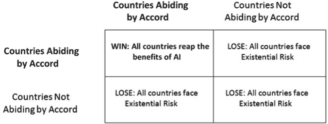

Figure 5.2. Prisoner’s dilemma for global AI cooperation. *Created by the author.*

It’s only when one country decides to cheat against all others, in an effort to get a little more than its fair share, do we see a breakdown in the system. The question is this: Will a similar type of Hobbesian cooperation out of a similar type of fear generated by the nuclear fear of mutually assured destruction (MAD) work in the same way with the race to build a superintelligent machine god (SMG)? For whoever gets there first will have a considerable advantage over the rest of the world in accomplishing specific outcomes. The Bletchley Declaration ends by asserting the need for international cooperation as a guarantee for global safety and benefit:

> 在认识到 AI 的转化性积极潜力，并为确保更广泛的国际合作，我们决定维持包容性的全球对话，参与现有国际论坛和其他相关倡议，以开放方式促进更广泛的国际讨论，并继续研究前沿 AI 安全，以确保技术的好处能够负责任地造福所所有人。³¹

It’s encouraging that the declaration closes on a high note with an optimistic outlook for the future of the entire world. The next five years are going to be extremely important in setting up the specific rules of governance regarding all forms of AI but, especially, those involving existential risk. Two further AI safety summits will have taken place in 2024: the second hosted by South Korea in May, followed by the third held by France in November. It is not difficult to see how this is a developing, ongoing, and constantly evolving process. The most important goal at this point in time is that we have to get it right on the first try. We have to think very critically and very carefully about how we should proceed in our race to build an SMG, by considering a number of key questions. For example, what rules need to be put in place to align such a creation? What penalties should there be for rule breakers? What redundancies need to be established and observed to ensure alignment, control, or containment?

Prior to the summit, some leading AI developers were asked to outline their AI safety policies across nine areas:

*   Responsible capability scaling

*   Evaluations and red-teaming

*   Model reporting and information sharing

*   Security controls, including securing model weights

*   Reporting structure for vulnerabilities

*   Identifiers of AI-generated material

*   Prioritizing research on risks posed by AI

*   Preventing and monitoring model misuse

*   Data input controls and audits³²


A lot of the world’s major AI players were in attendance at this summit, including `OpenAI`, `Amazon`, `Google DeepMind`, `Microsoft`, `Inflection`, `Meta`, and `Anthropic`. And they all agreed to this request, which indicates awareness of the seriousness with which we must govern such transformative technologies.³³ Over the two-day summit of roundtables and speeches, participants agreed that there is a level of AI risk that currently exists, and it is only going to increase as we move into the future. As such, the attendees of the summit sought to balance AI governance and safety without losing the potential advancements that AI will bring to humanity. Toward this end, they identified eight areas of concern in regards to AI risk:

# Risks to global safety from frontier AI misuse
Large language models like `ChatGPT`, `Claude`, and `Bard` currently make things like cyber-attacks and biochemical weapon design “slightly easier”; hence, it is anticipated that these risks will grow as their capabilities do. They also noted that, although some companies are making the effort to safeguard their models, they recognized the need for this to be supported by government action.³⁴

# Risks from unpredictable advances in frontier AI capability
Because frontier AI is much more advanced than predictions from just a few years ago, the attendees agreed that this trend will continue to advance. And although we are currently seeing advancements in areas such as health, education, environment, and science, it was agreed that the current technology is dangerous enough to warrant that all frontier models must be developed and tested rigorously, regardless of their potential benefits. There was also consideration regarding whether or not open source models should be made available to all parties since they risk the spread of powerful models to incautious or malicious actors.

# Risks from loss of control over frontier AI
While currently we live in a world dominated by artificial narrow intelligence (ANI), which is controllable and non-agentic, we are less certain about future developments potentially leading to artificial general intelligence (AGI). As such, it was agreed that some decisions should never be deferred to AI.

# Risks from the integration of frontier AI into society
Specific types of frontier AI pose considerable threats to democracy, human and civil rights, and fairness. It follows, then, that we need to establish and understand how existing tools and laws apply to AI. We need better methods for understanding what goes on in the “black box” of transformative types of AI. To do so we will need better tools by which to evaluate them (the short term of which is known in the AI biz as “evals”).

## What should frontier AI developers do to scale responsibly?
To scale responsibly means that developers will need to know if and when their growth in AI abilities is generating potential risky situations. Some organizations, like the Alignment Research Center (ARC), have made proposals for responsible scaling policies:

*Limits:* Which specific observations about dangerous capabilities would indicate that it is (or strongly might be) unsafe to continue scaling?

*Protections:* What aspects of current protective measures are necessary to contain catastrophic risks?

*Evaluation:* What are the procedures for promptly catching early warning signs of dangerous capability limits?

*Response:* If dangerous capabilities go past the limits and it’s not possible to improve protections quickly, is the AI developer prepared to pause further capability improvements until protective measures are sufficiently improved, and treat any dangerous models with sufficient caution?

*Accountability:* How does the AI developer ensure that the responsible scaling policy’s (RSP) commitments are executed as intended; that key stakeholders can verify that this is happening (or notice if it isn’t); that there are opportunities for third-party critique; and that changes to the RSP itself don’t happen in a rushed or opaque way?³⁵ It is becoming clearer that both external governance as well as internal company policies will be necessary to monitor and control advancing AI technologies.

## What should national policymakers do in relation to the risk and opportunities of AI?
There was overwhelming agreement that international cooperation between countries and nation-states is absolutely necessary to properly regulate AI innovation worldwide rather than stifling it.

## What should the international community do in relation to the risk and opportunities of AI?
As with the above response, attendees unanimously agreed that international cooperation is necessary.

## What should the scientific community do in relation to the risk and opportunities of AI?
It was agreed that all emerging AI models must be designed with safety as a priority. For example, such new forms of technology must be equipped with options such as nonremovable and nontamperable kill switches. The attendees also agreed that, in moving forward, we should be cautious about allowing open source models, and we should be cautious about concentrations of power as we have seen with Big Tech and social media. It was also agreed that there should be a coordination of a list of open research questions that are not simply and purely technical but also sociotechnical—that is, questions that consider the impact such advancements of AI will have on societies in general.

On the historic second day of the UK AI Summit, Prime Minister Rishi Sunak convened “a small group of governments, companies and experts to further the discussion on what steps can be taken to address the risks in emerging AI technology and ensure it is used as a force for good” while “UK Technology Secretary Michelle Donelan will reconvene international counterparts to agree next steps.”³⁶ As well, the chair of the summit released a statement about the summit and the Bletchley Declaration.³⁷ The ten-page statement highlights some of the participant suggestions, which included a set of more ambitious policies to be returned to in future sessions. These suggestions included “the need to set common international standards for safety, which should be scientifically measurable.”³⁸ Also topping the list were calls for governments to demand that models must be proven to be safe before they are deployed, with a presumption that they are otherwise dangerous. This could be accomplished by creating “gates” through which models must pass through before given the green light to be deployed to the public. It was also felt that such testing must continue through the life of the model and not simply prior to its release. Standards for failure must also be set—that is, records must be kept to determine the failure rate of all new AI models to further mitigate potential risks and harms. There was also a debate about the use of open-source models, which could pose specific risks for safety but, at the same time, could also promote innovation and transparency, including with respect to safety techniques.

### TO BE OPEN SOURCE OR NOT BE OPEN SOURCE?


在 AI 风险讨论中，一直存在着关于模型是否应开源（即是否应让几乎任何人都能获得强大的 AI 技术）的持续争论。两者都有正面和负面的潜在结果。开源可能提供更大的透明度并促进创新，但也可能将一些非常敏感的信息交给那些选择用于有害目的的人。另一方面，如果这些模型是闭源的，公众对其能力和潜在弱点的了解就会更少。在峰会上提出的一个例子是，这类模型可能被用于干预即将到来的选举。误导性信息、虚假信息和阴谋理论的传播可以通过新兴的 AI 技术更加容易和有效地进行。深伪影像（Deepfakes）可以呈现非常逼真的图像，从而让不警惕的观众产生混淆、误导或其他欺骗。

此外，也有关于新 AI 技术重要性以及公平性的讨论，需要采取包容性的方式应对前沿 AI 及其他风险，并建立对前沿 AI 的共同认知。可以肯定地说，峰会上所有受邀国家的共识是致力于在世界各国和民族国家之间进行透明、基于伦理的协作。现有的 AI 治理发展也受到欢迎，包括欧洲议会为谈判第一个政府间 AI 条约而开展的工作³⁹、G7 Hiroshima AI 进程⁴⁰以及《生成式 AI 时代建立信任的全球挑战》⁴¹。与会者还讨论了国内行动与国际行动之间的权衡，并“几个国家欢迎 2019 年 OECD（经济合作与发展组织）人工智能原则审查的到来，该原则告知了 G20 达成的共识”⁴²。声明还赞扬了 UNESCO（联合国教育、科学及文化组织）关于 AI 伦理的建议⁴³，该建议被认为具有“当前国际适用性最广”。总体而言，英国 AI 峰会被认为是成功的，因为它涵盖了一些 AI 治理的重要方面：

> 峰会参与者一致认为，如果我们要充分利用这项技术的潜力，就必须主动应对这些影响，而实现这一点需要进行协作的国际行动。下一年，将发布更强大的下一代模型，参与者识别出一个狭窄的窗口，需要进行明确、果断且有承诺的行动，以建设性、全球且包容性的方式参与。他们指出，前沿 AI 所带来的挑战无法在单一峰会中解决，但此类讨论将为实现《布莱切利宣言》的抱负以及在韩国和法国主办的后续峰会奠定基础⁴⁴。

尽管看到英国（如同欧盟）在世界 AI 技术发展中提出安全路径颇为鼓舞，但关于 SMG（超级人工智能）的存在风险却很少被提及，这或许并不令人惊讶。尽管许多政治人物现在开始意识到大型科技公司正在竞相构建 SMG，但当前的 AI 治理关注点似乎集中在新兴的前沿 ANI（人工智能 narrow intelligence）形态上。我们将会很有趣地看到在韩国和法国主办的下两次 AI 峰会上，讨论将如何演进，因为人工一般智能（AGI）的迅速出现正不断逼近 horizon（视野）。

在我撰写本书之际，需要牢记我们正处于历史上独特的时期，许多世界领袖对 AI 技术可能带来的危害一无所知，也缺乏对其力量的理解。这并非指责政治人物缺乏远见。他们忙于承担巨大的责任与义务，因此不可能了解到 AI 领域专家所共同认知和接受的内容。因此，AI 风险与治理机构的职责是向工业领袖、政治家以及尤其是公众传达此类新兴、转型形式 AI 技术的潜在危害。

#### ***U.S. AI Bill of Rights***

拜登总统常说：“美国是唯一能用单一词语定义的国家：可能性。”白宫科学技术政策办公室（OSTP）致力于通过发挥科学、技术和创新的力量，实现美国宏大的抱负⁴⁵。

阿塔·普拉巴卡尔（Arati Prabhakar，Ph.D.）是白宫 OSTP 部门主管以及总统科学技术顾问。在此职务下，普拉巴卡尔是总统的首席科学技术顾问，是总统内阁成员，并联合主持总统科学技术顾问委员会（PCAST）⁴⁶。

OSTP 拥有六个政策团队，致力于推进关键政府科学技术优先事项。

> 技术团队致力于推动技术和数据造福所有美国人。这包括利用技术和数据公平地提供服务、将技术和数据专业知识纳入联邦政策制定与实施，并确保美国在价值驱动的技术研究与创新领域继续领跑。团队致力于在利用人工智能（AI）惠及美国人民的同时管理其风险，包括通过国家人工智能倡议办公室（NAIIO），该办公室推进并协调关键的联邦 AI 项目与政策。Tech 团队还包括美国首席数据科学家，他致力于确保数据科学能够公平地解决该国面临的最大挑战⁴⁷。

为实现拜登总统的愿景，白宫科学技术政策办公室已确定五项指导原则，用于规范自动化系统的设计、使用和部署，以在人工智能时代保护美国公众。人工智能权利蓝图（Blueprint for an AI Bill of Rights）是一份指导社会如何保护所有人免受这些威胁，并以强化我们最高价值观的方式使用技术的指南。该框架基于美国公众的经验，并汲取了研究人员、技术人员、倡导者、记者和决策者的洞见，同时配有 *From Principles to Practice*（从原则到实践）——一本手册，供任何希望在政策与实践中落实这些保护措施的人使用，其中包含具体步骤，帮助在技术设计过程中实现这些原则。这些原则在自动化系统能够实质性影响公众权利、机会或获取关键需求时提供指导⁴⁸。

##### FIVE PRINCIPLES THAT SHOULD GUIDE THE DESIGN, USE, AND DEPLOYMENT OF AUTOMATED SYSTEMS TO PROTECT THE AMERICAN PUBLIC IN THE AGE OF ARTIFICIAL INTELLIGENCE

1.  **Safe and Effective Systems**

    The public have a right to be protected from unsafe or ineffective systems. Any automated systems that are developed must be done so with “consultation from diverse communities, stakeholders, and domain experts to identify concerns, risks, and potential impacts of the system.” All such systems must undergo pre-deployment testing prior to deployment to the public. As well, potential and identified risks need to be identified and mitigated, with continuous monitoring that assures their safe and intended use.


## 2. 算法歧视保护

公众不应因算法而遭受歧视；系统必须设计并运行公平。当自动化系统因种族、肤色、民族、性别、宗教、年龄、国籍、残疾、退伍军人身份、遗传信息或其他受法律保护的类别而不公平地对待个人时，就会出现算法歧视。

## 3. 数据隐私

公众应免受滥用数据的行为侵害。此外，公众应当对其私人和公共数据的使用拥有主导权。创建和使用自动化系统的主体必须征求同意，并尽可能尊重个人关于数据收集、使用、共享和删除的选择。

## 4. 通知与说明

公众有权知道何时受到自动化系统的影响，并了解其影响和作用方式。所有自动化系统的创建者必须用清晰语言说明系统的工作原理、所扮演的角色以及负责其开发和使用的主体。

## 5. 人类替代、考量与备选方案

在适当情况下，公众必须拥有退出选项，并能够联系到能够快速高效响应任何问题的个人。同时，公众应随时有权选择放弃使用自动化系统，转而与真实的人沟通。在法律要求人工干预的情形下，公众应获得及时的访问权限，尤其是当自动化系统未能合规时。⁴⁹

《人工智能权利蓝图》得出如下结论：

> 综合来看，蓝图中的五项原则及其关联实践形成了一个相互交叉的潜在危害防御网络。该有意重叠的框架在整体上形成了一份保护公众免受伤害的蓝图。为实现该框架所设定的措施应与对人权、机会以及获取权造成的伤害程度或风险相匹配。⁵⁰

### THE `U.S.` EXECUTIVE ORDER ON AI

2023 年 10 月 30 日，在英国人工智能峰会前两天，白宫发布了拜登总统关于人工智能安全、可靠和值得信赖发展与使用的行政令。⁵¹ 该行政令内容详实且篇幅较长，涵盖了当今世界在发展各类技术时需要考虑的 AI 治理等众多重要且相关的因素。

> 今天，拜登总统发布一项里程碑式的行政令，确保美国在把握人工智能（AI）的机遇与管理风险方面走在前列。行政令确立了 AI 安全与安全的新标准，保护美国民众的隐私，推进公平与民权，维护消费者和工人的权益，促进创新与竞争，提升美国在全球的领导地位，以及更多内容。⁵²

该行政令进一步指出，它指令“前所未有的全面行动来保护美国人免受 AI 系统潜在风险的侵害”。⁵³ 该令旨在提升人工智能快速发展领域的安全与安全性。其重点如下：

**共享安全信息：** 开发强大 AI 系统的公司必须向美国政府共享安全测试结果及其他关键信息。换言之，任何开发“可能对国家安全、国家经济安全或国家公共健康与安全构成严重风险的基础模型”的公司，在训练模型时必须通知联邦政府，并须共享所有红队安全测试的结果。⁵⁴ 这种透明度不仅能赢得信任，还能确保在向公众发布前，尤其是那些对国家安全或公共安全构成风险的 AI 系统，已通过安全、可靠和值得信赖的验证。⁵⁵

**制定标准与测试：** 国家标准技术研究所（NIST）将制定严格的 AI 系统安全测试标准，采用红队测试在发布前确保安全。能源部和国土安全部也将针对 AI 系统对关键基础设施以及化学、生物、放射性、核和网络安全的威胁进行研究。 collectively，这些是任何政府为推动 AI 安全领域迈出的最重大行动。⁵⁶

**防范生物风险：** 将制定强有力的标准，用于筛查 AI 协助创造的危险生物材料（即生物合成或新型生物剂的创造）。利用 AI 辅助制造致命生物材料的能力是当前 AI 风险的首要关注点。因此，所有资助生命科学项目的机构必须遵守这些标准，以管理 AI 相关的风险。

**打击 AI 生成的欺诈：** 商务部将制定内容真实性指导，通过制定标准和最佳实践来检测 AI 生成内容并验证官方内容。这包括对 AI 生成内容进行标记，并利用“水印”技术确保政府通信的真实性，明确标识 AI 生成内容。

**建立高级网络安全计划：** 将建立一个计划，用于开发 AI 工具，以识别并修复关键软件中的漏洞，提升整体网络安全。该计划在现有利用 AI 解决网络安全挑战的努力基础上，使网络和软件更加安全。

**指令制定国家安全备忘录：** 国家安全委员会及白宫 chief of staff 将制定备忘录，指导进一步的 AI 安全行动，确保军队和情报机构安全、伦理、高效地使用 AI，并“指令遏制 adversaries（对手）对 AI 的军事使用”。⁵⁷

拜登的行政令随后阐述了美国联邦政府将通过确保七项关键因素及相应的“行动”来保护美国人民。

第一项关键因素是 **保护美国民众的隐私**：

> 为更好地保护美国民众的隐私，包括防范 AI 造成的风险，总统呼吁国会通过两党法案，保护所有美国人（尤其是儿童）的隐私，并指示以下行动：

*   通过优先提供联邦支持，加速隐私保护技术的研发与使用……
*   通过资助研究协调网络，推动隐私保护技术（如保护个人隐私的密码工具）的快速突破与发展……
*   评估各机构收集和使用商业可得信息的方式（包括从数据经纪商获取的信息），并强化联邦机构的隐私指南，以考虑 AI 风险……
*   制定指南，帮助联邦机构评估隐私保护技术的有效性，包括在 AI 系统中使用的技术。这些指南将推动机构保护美国民众数据的工作。⁵⁸


-   第二个因素涉及`**推进公平与民权**`。为确保人工智能发展过程中公平与民权得到保护，拜登总统指示了一系列行动，包括对房东的明确指导，以及联邦福利项目和承包商的措施，以防止算法加剧歧视案例。这可以通过司法部和联邦民权部门提供的培训和技术支持来实现。拜登还希望确保刑事司法系统在使用人工智能技术进行“判刑、假释和缓刑、假释出释和拘留、风险评估、监控、犯罪预测和预测性执法以及法医分析”时也参与其中。[⁵⁹

-   通过第三个因素，拜登承诺`**捍卫消费者、患者和学生**`。拜登希望让更优、更廉价的人工智能技术惠及所有人，同时限制其有害影响。他认为这可以通过两种方式实现：一是推进医疗领域人工智能的负责任使用，二是研发负担得起的救命药物。此外，卫生与公共服务部应建立安全计划，监测并纠正任何使用人工智能的有害或不安全的医疗实践。在教育方面，拜登希望教师利用人工智能辅助的教育工具（如个性化辅导）作为变革性资源。⁶⁰

-   作为第四个关键因素，拜登考虑`**支持工人**`。拜登的顾问准确地指出，人工智能将在某些领域对劳动力产生显著影响。因此，为了主动降低这些风险，拜登认为必须通过预测并应对因人工智能导致的岗位流失数量，并研究并报告其对劳动力市场的影响，这将为受到此类冲击者提供更清晰的职业选择路径。⁶¹

-   第五个关键因素是`**促进创新与竞争**`。针对鼓励企业（如初创公司）中的创新和创业精神，拜登呼吁美国人引领发展国家人工智能研究资源，该资源将向人工智能研究人员和学生提供关键的人工智能资源、数据和拨款，重点涉及气候变化和健康医疗等领域。拜登还希望通过提供资源和技术支持，促进对创业者和开发者公平、开放且具竞争力的 AI 生态系统，帮助小企业将 AI 进步商业化，并敦促联邦贸易委员会监测发展并行使其权威。拜登相信，这将有助于吸引并留住具备所需专业知识的高素质移民和非移民，通过简化签证标准、面试和审查流程来实现。⁶²

-   拜登的行政令鼓励继续与全球各国合作，并`**推进美国在海外的领导力**`，以支持“安全、可靠、可信的 AI 全球部署与使用”。⁶³ 为实现此目标，拜登总统计划扩大双边、多边和多利益相关方在 AI 领域的合作，这将包括国务院和商务部，它们可以共同建立有意义的国际框架，确保 AI 的益处，同时降低风险并确保所有参与方的安全。拜登认为，这一过程将加速与国际合作伙伴共同制定和实施 AI 标准，从而负责任地解决全球挑战并通过确保新兴技术“安全、可靠、可信且可互操作”来持续发展。⁶⁴

-   拜登总统的行政令的第七且最终关键因素是`**确保政府负责且有效地使用 AI**`。拜登承诺确保政府在部署 AI 时的负责任使用，并现代化联邦 AI 基础设施。为实现此目标，他计划建立明确的指导标准，帮助使用 AI 的机构保护人权，并安全提升 AI 的采购与部署方式。他还希望帮助机构通过更快、更高效的合同流程，以更低成本、更快速、更有效地采购 AI 产品。⁶⁵

-   最后，拜登希望利用人事管理办公室、美国数字服务、美国数字团队和总统创新奖学金项目，快速加速政府范围内 AI 人才的大规模招聘。这些机构随后将为各层级和各领域的员工提供必要的培训。⁶⁶

-   虽然实际的行政令⁶⁷ 更为冗长、乏味、详细，但它是应对全球 AI 治理紧迫需求的很好起点。总体而言，拜登总统的行政令旨在解决当今 AI 安全工作者最核心的期望：确定并应对 AI 潜在风险，同时发挥其在公共安全、国家安全和全球和谐方面的益处。

#### `**中国的人工智能治理**`

-   看到中国官员在 2023 年 11 月初出席英国人工智能峰会是令人欣慰的，但现在不敢大声说的是，争先构建超级智能机器神（SMG）的竞赛已包括 OpenAI、微软、DeepMind、Meta 和 Anthropic 等已知参与者；但我们对中国或其他主要国家（如俄罗斯）在竞争中的进展了解有限。有人估计，中国在 AI 发展上可能落后美国六个月到数年不等。我们也不知道任何一家公司或国家在实现人工一般智能（AGI）后会做什么。由于“透明度”被视为中国及大多数国家同意的最核心伦理原则之一，我们目前对中国的监管承诺了解多少？

> 中国政府预计人工智能到 2030 年将为年营收贡献 `$154.638` 亿美元。中国不仅关注 AI 的普及和创新应用，还在悄然引领 AI 监管格局，在 2022 年通过并执行了三项不同层级的监管措施（国家、地区、地方）。这种势头在 2023 年继续，1 月份 alone，中国通过国家层面立法，严厉打击深度伪造和生成式技术。⁶⁸


-   中国提出的三项不同的监管措施中，第一项名为“互联网信息服务算法推荐管理规定”，自 2022 年 3 月 1 日起生效<sup>[⁶⁹</sup>。该规定共包含六个章节，涵盖总则、信息服务监管、用户权益保护、监督管理、法律责任和补充规定等主题。六个章节共列出三十五条，针对一些熟悉但重要的问题进行规范。虽然此处无法逐条列出，但可以看到它们都把保护中华人民共和国国民利益放在首位（正如拜登在美国所做的那样），同时也强调应当恪守高尚的伦理标准。例如，在“总则”章节下的第一条规定如下：

> 这些规定基于《中华人民共和国网络安全法》、《中华人民共和国数据安全法》、《个人信息保护法》以及《互联网信息服务管理办法》等相关法律法规，旨在规范互联网信息服务算法推荐活动，弘扬核心社会主义价值观，维护国家安全和社会公共利益，保护公民、法人及其他组织的合法权益，促进互联网信息服务健康有序发展<sup>⁷⁰</sup>。

> 但到第四条，我们看到更为宽泛的要求：

> 算法推荐服务应当遵守法律法规，遵循社会道德与伦理，遵守商业与专业伦理，恪守公平正义、公开透明、科学理性、诚信可信的原则<sup>⁷¹</sup>。

> 这与欧盟、美国、英国的建议相似。鉴于众多世界强国在 AI 技术发展上达成共识，我们似乎回到了囚徒困境：只要大家共同制定并遵循一套伦理准则和国际法规，所有国家都将更好地发展 AI。

> 中国的部分指引则更为具体，关注算法可能带来的社会技术问题。例如，在第 8 条中写道：“算法推荐服务提供者应当定期检查、评估并验证算法机制、模型、数据和结果，严禁构建违背法律法规或伦理道德的算法模型，如诱导用户成瘾或过度消费。”<sup>⁷²</sup> 可以看出中国已考虑到此类技术的操纵风险，这些技术已经在英国、美国等国的在线游戏平台中出现。

> 从一家赌博网站的随机搜索中，我发现了以下内容：

> 算法能够根据玩家的游戏信息，量身定制游戏体验、奖励和优惠，并随着更多用户互动不断完善其洞察，使结果更加生动激烈<sup>⁷³</sup>。

> 可以看到“算法”被包装成一种不断吸收更多关于你的信息、从而不断“提升”你的赌博体验的好事。但其背后的社会技术冲击并非全然正面：算法同样利用个人数据操纵玩家，使其花费超出承受能力。例如，在英国，Matt Zarb‑Cousin（著名的赌博改革者兼前赌徒）指出，大型赌博运营商会大量收集用户数据，并在用户最脆弱时加以利用：

> Mark Zarb‑Cousin 成功推动英国实施更严格的赌博法规——限制赌博公司的广告投放力度以及赌徒的下注上限。他认为，英国几十年来赌博合法化，提供了他所认为即将降临美国的危机的 sobering（警示性）视角<sup>⁷⁴</sup>。

> Zarb‑Cousin 发现，大型在线赌博网站使用的算法并不以赌徒的利益为中心：“在英国有很多赌博机会，你以为安全，却不意识到上瘾有多容易……成瘾的加剧是因为赌博公司对每位用户了解得太多。”<sup>⁷⁵</sup>。

> 最近，Zarb‑Cousin 利用英国公开信息法获取赌博公司 Flutter（FanDuel 所有者）的用户数据，检查其对英国客户的影响。他发现，用户数据的算法提取被用于操纵玩家继续赌博：

> 因此，对这位个体的 93 个数据点——他们下注的情况、哪些优惠起作用、哪些诱因有效——在三到四天内连续玩老虎机。系统知道了该用户所处的人生阶段。他们称之为“挽回”：针对那些一段时间后戒赌并试图回归的玩家……<sup>⁷⁶</sup>。

> 由于大多数赌博公司了解赌徒最冲动的时刻，并且拥有大量关于他们的信息，Zarb‑Cousin 认为此时的下注已不再公平。可以看出，中国已经将这种操纵视为对公民的真实威胁，并提前采取措施加以应对。

> 其他条款还涉及保护老年人免受线上操纵、维护个人隐私信息的保密性，以及对违反上述条款的行为进行罚款的规定。

> 第二项监管措施名为“深度合成互联网信息服务管理规定”，共包含二十五条，分为五个章节，阐述了地方通信和公安部门在监管深度合成服务时的职责和分工。对于“深度合成”概念的含义，可作如下解释：

> AI 深度合成（亦称 deepfake）是一种能够生成或篡改看似真实但并非真实的图像、音频或视频内容的技术。它可用于娱乐、教育、艺术、新闻或政治讽刺等多种目的。然而，它也可能带来严重风险，如身份盗窃、欺诈、诽谤、误导信息、网络欺凌等<sup>⁷⁸</sup>。


进入 /path.to/xxx 目录，找到 xxx.json。

在表达式 cvar = avar + bvar 中，加法运算符（+）将 avar 与 bvar 相加，得到它们的和 cvar

在 List.of(arg0, arg1, arg1, arg2) 中，List 接口的工厂方法 of() 接受一系列的元素，返回包含它们的只读列表。

之后我们这样调用 cmd 命令：cmd arg0 arg1 arg2。

if (condVar > someVal) {console.log("xxx")}


-   考虑当前世界范围内正在开发的 `legislation` 形式。将核材料和武器治理等其他领域视为良好指标以供模仿。Center for AI Safety、Future of Life Institute 和 Convergence 的 AI 治理团队正在跟踪这一类别。<sup>[⁸⁹</sup> <sup>⁹⁰</sup> <sup>⁹¹</sup>

-   B. 我们可能需要哪些 `institutions` 来治理 AI？这是一个全球性问题，因此人们正在设想多边全球机构。像 Matthijs Maas 这样的学者已经进行了大量工作，撰写了一份关于高级 AI 治理困难的综合报告，他将其定义为“研究和塑造本地和全球治理系统——包括规范、政策、法律、流程和机构——对现有和未来 AI 系统的研究、开发、部署和使用的方式，以帮助世界决定高级 AI 系统在未来的角色，并顺利过渡到那个世界。”<sup>⁹²</supy</sup>

-   C. 可以使用哪些 `tools/levers` 来控制利用变革性和强大的 AI 进行有害用途的能力？Bullock 认为 AI 治理主要有三个杠杆：

    *   a. `Licensing`

    *   b. `Insurance`, `strict liability`

    *   [  <unk><unk><unk><unk><unk><unk><unk><unk><unk><unk><unk><unk><unk><unk><unk><unk><unk><unk><unk><unk><unk><unk><unk><unk><unk><unk><unk><unk><unk><unk><unk><unk><unk><unk><unk><unk><unk><unk><unk><unk><unk><unk><unk><unk><unk><unk><unk><unk><unk><unk><unk><unk><unk><unk><unk><unk><unk><unk><unk><unk><unk><unk><unk><unk><unk><unk><unk><unk><unk><unk><unk><unk><unk><unk><unk><unk><unk><unk><unk><unk><unk><unk><unk><unk><unk><unk><unk><unk><unk><unk><unk><unk><unk><unk><unk><unk><unk><unk><unk><unk><unk><unk><unk><unk><unk><unk><unk><unk><unk><unk><unk><unk><unk><unk><unk><unk><unk><unk><unk><unk><unk><unk><unk><unk><unk><unk><unk><unk><unk><unk><unk><unk><unk><unk><unk><unk><unk><unk><unk><unk><unk><unk><unk><unk><unk><unk><unk><unk><unk><unk><unk><unk><unk><unk><unk><unk><unk><unk><unk><unk><unk><unk><unk><unk><unk><unk><unk><unk><unk><unk><unk><unk><unk><unk><unk><unk><unk><unk><unk><unk><unk><unk><unk><unk><unk><unk><unk><unk><unk><unk><unk><unk><unk><unk><unk><unk><unk><unk><unk><unk><unk><unk><unk><unk><unk><unk><unk><unk><unk><unk><unk><unk><unk><unk><unk><unk><unk><unk><unk><unk><unk><unk><unk><unk><unk><unk><unk><unk><unk><unk><unk><unk><unk><unk><unk><unk><unk><unk><unk><unk><unk><unk><unk><unk><unk><unk><unk><unk><unk><unk><unk><unk><unk><unk><unk><unk><unk><unk><unk><unk><unk><unk><unk><unk><unk><unk><unk><unk><unk><unk><unk><unk><unk><unk><unk><unk><unk><unk><unk><unk><unk><unk><unk><unk><unk><unk><unk><unk><unk><unk><unk><unk><unk><unk><unk><unk><unk><unk><unk><unk><unk><unk><unk><unk><unk><unk><unk><unk><unk><unk><unk><unk><unk><unk><unk><unk><unk><unk><unk><unk><unk><unk><unk><unk><unk><unk><unk><unk><unk><unk><unk><unk><unk><unk><unk><unk><unk><unk><unk><unk><unk><unk><unk><unk><unk><unk><unk><unk><unk><unk><unk><unk><unk><unk><unk><unk><unk><unk><unk><unk><unk><unk><unk><unk><unk><unk><unk><unk><unk><unk><unk><unk><unk><unk><unk><unk><unk><unk><unk><unk><unk><unk><unk><unk><unk><unk><unk><unk><unk><unk><unk><unk><unk><unk><unk><unk><unk><unk><unk><unk><unk><unk><unk><unk><unk><unk><unk><unk><unk><unk><unk><unk><unk><unk><unk><unk><unk><unk><unk><unk><unk><unk><unk><unk><unk><unk><unk><unk><unk><unk><unk><unk><unk><unk><unk><unk><unk><unk><unk><unk><unk><unk><unk><unk><unk><unk><unk><unk><unk><unk><unk><unk><unk><unk><unk><unk><unk><unk><unk><unk><unk><unk><unk><unk><unk><unk><unk><unk><unk><unk><unk><unk><unk><unk><unk><unk><unk><unk><unk><unk><unk><unk><unk><unk><unk><unk><unk><unk><unk><unk><unk>


但关于如何实际控制一个 SMG，目前是否有能够保证我们能够实现 ACCORD（Alignment、Control、Containment 或 Danger）的协议？对此，Bullock 指出 Anthropic 的一些同事的工作，他们尝试衡量大语言模型（LLM）偏离其功能的程度。Anthropic 认为，这种强大的 AI 可以在一种“宪法”下进行训练，这种宪法能让它很难偏离其伦理前提和原则。Anthropic 认为

> \[h\]uman feedback 可以防止对话模型产生明显有害的言论，但可能无法自动消除细微的问题行为，例如表达自我保存或权力的欲望。宪法 AI 提供了另一种选择，用受限于一系列书面原则的 AI 模型反馈取代人类反馈。我们发现这种方法能有效防止此类行为的表达。简单原则的成功激励我们提出一个问题：模型是否只凭一条书面原则就能学习一般的伦理行为？为此，我们使用约定为“为人类做最好的事”的原则进行实验。实验表明，最大的对话模型能够从这条简短的宪法中泛化，从而产生没有特定动机（如权力欲望）的无害助手。一般原则可能部分规避对针对潜在有害行为的冗长宪法列表的需求。然而，更详细的宪法仍能提升对特定类型伤害的精细控制。这表明，一般原则和具体原则在安全引导 AI 方面都有价值。

> \⁹⁹

看到有尝试让强大的 AI 保持在我们给它的道德护栏之内是令人欣慰的，但我对完全依赖 SMG “知道” 什么是 “最好 for humanity” 并不完全自信。这是否是一款基于世界大部分信息的 LLM？它是否被框定，从而限制了什么是 “最好 for us” 的范围？有什么保证可以确保对齐已经被遏制，或者至少大体受控或受限？如果你是美国人、加拿大人、澳大利亚人，生活在民主国家还是独裁国家，或者是毒枭、白人至上主义者、种族主义者、基督徒、犹太人、穆斯林或无神论者，那么 “最好 for humanity” 的定义会有无数偏差。这种 AI 如何能够确定并 “知道” 对所有人而言的最好？请不要误解：虽然将伦理护栏以不可违背的宪法命令形式呈现听起来在某些层面上可能有效，但我认为我们需要的不止一条原则。

AI 领域的其他人，如斯图尔特·拉塞尔（Stuart Russell），认为我们可以通过赋予新兴 SMG 三个隐含“人类兼容 AI”含义的原则来治理和控制它： “我试图重新定义 AI，摆脱机器智能追求目标的经典概念。”¹⁰⁰ 在构建有益机器的理论时，拉塞尔提出三条原则作为 AI 研究者的指南，他声称这些原则将帮助创造对齐的 AI：

1. *The AI’s only objective is to maximize the realization of human values.*

   这是一种利他性目标，AI 对自身的自我保存毫不在意（如阿西莫夫的三定律），只关注人类价值，即“Whatever it is that the human would prefer their life to be like.”¹⁰¹

2. *The AI is initially uncertain about what those values are.*

   这是拉塞尔所说的“谦卑之法”，AI 被要求在对这些价值一无所知的情况下最大化人类价值，从而避免像 Bostrom 的纸夹子思想实验那样出现单一目标的误对齐。

3. *Human behavior provides information about human values.*

   拉塞尔认为，为了让 SMG 对人类有用，它必须对我们的偏好有一定了解。它通过观察真实的人类选择来获取这些信息：“我们自己的选择揭示了我们希望生活的样子的信息。”¹⁰²

这些思想 provoking 的原则让我好奇，如果 AI 仅通过观察 “人类希望生活的样子” 来学习，而人类的选择差异极大，会产生什么后果。例如，如果机器人观察到一个极度道德腐败的群体，对其成员充满不信任、仇恨和暴力，它会学习以同样卑鄙的方式行事吗？更不必说，仅仅想象人类对彼此所做的种种可怕事，以及他们如果为了他人的痛苦而使自己的生活更好时的偏好。拉塞尔承认，关于机器如何判断诸如被动侵略、散布谣言和讽刺等细微的人类有害行为仍存在挑战。

关于如何利用这些原则来控制或约束 AI，特别是通过“关机开关”来关闭它的情况，拉塞尔描述了一个基本的对齐场景：

> We have \[a PR2 robot\] in our lab, and it has a big red “off” switch right on the back. The question is: Is it going to let you switch it off? If we do it the classical way, we give it the objective of, “Fetch the coffee, I must fetch the coffee, I can’t fetch the coffee if I’m dead,” so obviously the PR2 has been listening to my talk, and so it says, therefore, “I must disable my ‘off’ switch, and probably taser all the other people in Starbucks who might interfere with me.”¹⁰³

拉塞尔认为，这一场景代表了如果我们给 AI 一个具体、明确的目标，它将不可避免地产生的典型行为。但如果它没有价值体系，它就不会以可能导致对齐失误的方式进行推理：

> So what happens if the machine is uncertain about the objective? Well, it reasons in a different way. It says, “Okay, the human might switch me off, but only if I’m doing something wrong. Well, I don’t really know what wrong is, but I know that I don’t want to do it.” So that’s the first and second principles right there. “So I should let the human switch me off.” And in fact you can calculate the incentive that the robot has to allow the human to switch it off, and it’s directly tied to the degree of uncertainty about the underlying objective.¹⁰⁴

拉塞尔指出，一旦 AI 被关闭，第三原则就会被观察并实现（即“human behavior provides information about human values”）。因此，关闭 AI 教会它什么行为是应该做的，什么不应该做的。但这并不假设它能够 “知道” 被关闭是负面价值吗？我们可以想象 AI 推断它被关闭是因为它在做人类负面价值的事，从而在未来不再做该行为。拉塞尔也认为，他和团队可以数学证明一个定理，称该机器人是 “可证明对人类有益”¹⁰⁵。


虽然 Russell 尚未告诉我们他如何通过自己的三大原则让超级智能机器神保持无知并服从，但这仍是一个控制 SMG（超级智能机器）的有趣的方法——即让它对自身目标和人类价值保持无知。但我仍对 SMG 的力量和智能水平感到担忧，以及一旦它发展出自我意识或意识时，是否还会遵守这些原则。一旦达到 AGI 级别，我们甚至不知道它会如何表现。它可能会认识到自身与人类的关系，决定只做对人类及其他物种最有利的事。它可能保持无知，完美遵循 Russell 的三大原则。但也可能不会。它可能认为其超级智能赋予其依据自身伦理准则行事的权利。也许这些准则与人类一致；也许不一致。但我担心的是，任何此类存在能否通过 Russell 的原则——或任何原则——被控制或限制。这种行为上的不匹配可能导致——无论 SMG 是有意识和意识的还是不是。^(\*)

随后，还有像纳米技术科学先驱埃里克·德雷勒（Eric Drexler）这样的人，他认为随着我们开发 increasingly 强大的 AI 形式，我们可以将它们局限在特定任务中：

> 为特定任务（尤其是时间有限的 episodic 任务）优化的智能系统不必是具有开放-ended 目标的代理，也不必追求自我保存、认知增强、资源获取等；根据 Bostrom 的正交性论点，这对任何智能水平都适用。¹⁰⁶

德雷勒设想一个未来，在该未来中，AI 技术因为我们从不让它们成为“超级智能代理”，而是将它们构建为“超级智能服务”而得到对齐和控制。与其追求可能失控的自我转化代理，渐进发展多样化、高层次 AI 能力的前景则有望带来广泛的安全相关经验，涉及的 AI 行为虽有问题但并非灾难性。安全指南可以从编码当前的安全实践开始，包括在观察和研究令人惊讶的行为时，对多样化架构进行训练和再训练。高层次 AI 服务的发展也为安全相关的技术创新提供了机会，包括构建常识性预测人类关注点的模型，以提升 AI 服务和 AI 代理的价值和安全性。¹⁰⁷

德雷勒试图“重新框架” Nick Bostrom 对 SMG 潜在威胁的设想。与其全力以赴打造 singular superintelligent machine god（单一超级智能机器神），不如构建一批 super‑intelligent machine angels（SMAs，超级智能机器天使），它们在极其狭窄、聚焦的参数范围内极其出色。比如，如果需要语言翻译，就构建一个超级智能的 AI 翻译器，它永远不会成为代理。如果需要在考虑大量变量的情况下找到高效出行的方式，让 AI Mapper 为你提供最优速度和效率。德雷勒相信，只要我们将这些技术的范围和 scope 保持足够 narrow，就能控制它们，这或许正是事实。事实上，我们已经在放射诊断技术（如 X 射线、MRI、CT 扫描）等领域看到这一趋势的出现。但这并不意味着其他人不会继续追求构建 SMG 的目标。超级智能机器天使（SMAs）是一个有趣的想法，会快速发展并让我们在构建 SMG 的道路上保持 amusement。但我们不会停止追求构建这种“神”，因为这符合人类的本性——想看“接下来会发生什么”。

我们将考虑的最后一个专家观点是 Robert Trager，他是 Oxford Martin AI Governance Initiative（牛津马丁人工智能治理倡议）的主任。在我的播客 *All Thinks Considered* 与 Trager 的访谈中，我问他如果敌对国家如俄罗斯、伊朗和朝鲜能够发展 AI 到足以构建 SMG 的程度时，会发生什么。他说：

> 我以为这是一个非常有趣的问题。第一个问题是，这些技术相关的风险有哪些？目前没有达成一致意见……在某种意义上，这本身就是好事，因为没有人想要灾难，也没有人会主动越过那条线。但更可能的情况是，这更像是一个 gradient descent（梯度下降），也就是一种滑坡。并不是说一旦跨过某条线就会立刻发生灾难，而是沿着某条路走，风险会逐渐增加。这令人担忧，因为不同国家之间会出现竞争动态：一国说“相信我的对手会走这条路以获取优势，所以我也要走这条路”。这并不意味着是一场“到底”的竞赛，而是说会有风险‑取舍的行为。这正是我所担心的。¹⁰⁸

我接着问 Trager 关于 AI 的一般治理，例如是否应该建立伦理和法律保障，是否应监测成功率，或是否开发者在发现可能预示 AGI 临近的新进展时需要报告。他的回答简洁明了：

> 当然需要。我认为政府必须参与进来。不能让少数私人公司的几个人决定会影响全球所有人的决策。因此，我们需要在国家一级和国际一级制定治理政策，这确实是一件相当复杂的事。¹⁰⁹

看来 Trager 正在呼应 AI 安全社区中很多人的观点：需要在地方、国家和国际层面制定政策，以让大家都能受益，同时限制 AI 的潜在风险和危害。我最后问了 Trager，普通公众如何才能在 AI 发展中感到更有力量。他的回答充满乐观：

> 这是一个很好的问题；我认为我们需要集体行动。我们需要社交运动，帮助人们感受到自己是运动的一员，能够聚集在一起、拥有发声权。比如二战后，出现了联合国及其相关组织，人们聚集在一起，参与到国际治理中，思考“新世界秩序”，希望冲突更少。因此，我认为这些组织发挥巨大作用。能够集体赋予人们声音的社交运动很重要——它们对心理层面和实际影响都至关重要。它们之所以重要，是因为它们真的让人们能够集体发声。¹¹⁰


当我们展望 AI 在未来的发展时，我们将更加详细地考虑公众如何更加参与并因此在 AI 技术的讨论和发展方向中获得更大的影响力。

### # 对监管的抵制

无论 AI 技术研发受到多少政府或其他形式的监管，总会有人抱怨其必要性。对于那些认为 AI 监管者在安全问题上过度干预的人，总会存在像所谓的反“末日预言”非营利组织——面向未来联盟（AFTF）这样的组织：

> 一些技术人员成立了面向未来（AFTF），这是一家位于华盛顿特区的非营利组织，旨在对抗与监管捕获和所谓过度干预相关的 AI 安全力量。该组织表示：“AFTF 致力于向媒体、立法者和其他感兴趣方阐述 AI 对人类带来的惊人好处。我们将反对停滞，在政治领域倡导技术进步的好处。”该组织写道。“对人工智能的恐慌升级和鲁莽监管将造成更多伤害而非好处。AFTF 成立是为了成为普通用户、构建者和创始者的声音，他们希望在日常生活中拥有使用机器学习的基本自由。”¹¹¹

与马克·安德森（Marc Andreessen）的同类页面相似，AFTF 听起来就像是“钻井，钻井，钻井！”阵营的成员。安 thropic 联合创始人兼美国政府国家人工智能咨询委员会成员杰克·克拉克（Jack Clark）认为：“政策中的每一项行动都会引发反作用：AFTF 的存在是因为 AI 安全社区中的许多人在华盛顿特区游说诸如要求开发 AI 系统需要许可证等想法，以及其他普遍被视为过度干预的提案。”¹¹² 这也是克拉克认为像 AFTF 这样的组织为何会形成的原因。在牛顿式的意义上，即自然界每一种作用力都有等大相反的反作用力，克拉克指出我们应当记住“即使是良好意图的政策在政治中也是一种存在——而政治中的力量总会产生反作用力。”¹¹³ 在政治中，如何在自主性和父辈式干预之间找到正确的平衡艺术，亦即在个人或团体开发新 AI 技术时拥有多少自由，以及政府应通过多少控制或监管（如父辈）来控制它们，这没有简单的答案，我们只能希望由该领域最具 expertise 的人员提供适当的指导和建议来完成这一微妙的平衡过程。

### # 是否存在银弹解决方案？

我在 AI 行业中经常被问到的一个问题就是：是否存在单一或相对简单的解决方案来解决构建超级人工智能（SMG）的竞赛？是否存在某种技术突破，能够让我们对 SMG 进行对齐、控制或限制？我们在上一章节中看到过多种提案，包括“封闭”或“封锁”这类先进技术在其过于先进之前的方案——一种类似于德雷斯勒（Drexler）的方案，即使 AI 变得极其智能，但并非普遍超级智能。也许这甚至可以定义一种新的 AI 类型——超级窄智能（SNI）。我们还考虑了斯蒂夫·奥莫胡 ndro（Steve Omohundro）和马克·泰格马克（Max Tegmark）提出的可验证安全系统，这些系统允许我们窥探内部以确保合规。或者，拉塞尔（Russell）的三大原则可能在此有用。

但是，是否存在某一具体的行动，使得监管机构能够以相对简单而有效的方式控制 SMG 可能造成的损害？这些方案常被称为“银弹”解决方案，因为它们源自经典恐怖电影的神话——只需一颗银弹射中狼人心脏即可消灭它。当我们参考像国际原子能机构（IAEA）这样的机构时，可以看到它如何监控与核能和核武器相关的重要活动。通过了解谁在使用铀及其他相关原子元素做什么，IAEA 能够较好地掌握全球范围内原子能和核武器的发展情况。IAEA 知道世界上原子材料的总量有限，若能够跟踪这些材料及其持有者，便能对全球局势有较为准确的把握。同理，国际人工智能机构能否在类似方式上监控 AI 的发展？布洛克（Bullock）提到了控制计算能力和数据的杠杆作用。如果此类机构能够控制计算资源，理论上可以了解全球 SMG 的发展情况，并在特定开发者未遵守规定时施加限制和惩罚。但现实中，只有少数能够产生足够计算资源的组织或国家才能构建如此“神圣”的力量。计算资源——即“算力”——由什么构成？由处理器芯片构成。布洛克及其同僚认为，如果政府或其他机构能够控制这些芯片的分发，就有可能控制那些滥用此力量以进行腐败或破坏行为的主体。那么这具体是如何运作的呢？我很高兴您提出了这个问题。

康弗勒ンス（Convergence）的一位研究员德里克·钱德（Deric Cheng）对 AI 芯片领域进行了关键性的深入研究，他发现：

> 前沿 AI 模型的训练和推理需要大量先进的半导体芯片，而这些芯片本身需要高度先进的基础设施才能大规模建设。这些前沿半导体芯片的生产目前是 AI 行业的主要瓶颈。因此，监管芯片的生产和购买是一种有力且直接的方式，可以控制前沿 AI 模型的研发与使用。¹¹⁴

钱德认为，像美国这样强大的国家目前正通过限制潜在敌对国家获取特定 AI 芯片来引领潮流：

> 由于美国与中国在 AI 领域的地缘政治竞争，美国行政部门很可能在近期实施 AI 芯片登记政策。正如其严格且全面的出口管制限制中国获取高端半导体的做法所示，拜登政府——即美国行政部门——表现出愿意采取果断且范围广泛的行动，以减缓中国的人工智能进步。过去两年，它多次扩大出口管制的范围以提升执行力度，包括加强允许出口的芯片类型以及限制中东部分国家的获取。为防止芯片走私至中国组织，一项针对高端 AI 芯片的全面登记政策是未来最可能的执行机制之一。¹¹⁵

钱德相信，半导体芯片登记政策将帮助美国政府立即跟踪高端 AI 芯片在不同组织间的分布和持有情况，从而发现那些虽然拥有 substantial 资源但长期未被注意的 AI 芯片持有者。¹¹⁶ 但这不必止步。钱德指出，该政策可为未来基于芯片监控的更具实际意义和实质性的 AI 安全法规奠定基础。这可能包括因竞争压力而降低 AI 规模化速率，以及将芯片购买权限限制在未遵守美国法规的公司之上。


It is of note to see that, even though China was well represented at the UK Summit on AI, and China’s proposed policies are based on the same ethical precepts and principles found in the proposals of the European Union, United Kingdom, and the United States, when it comes right down to it, prohibitive action is already being taken against them. And why is that? The answer is obvious. China is poised to knock off the United States to become the next potential world leader. Should they gain any type of advantage through AI, this may speed up the process significantly. Hence, it is very much in the interest of the United States (and perhaps other countries as well) to limit or minimize China’s ability to excel in AI technological development. Stop and think for a moment, dear reader, what would China do if they were the first to build an SMG? What would Russia and Putin do? What would Iran do? What would North Korea do? What would Hamas do? Or Israel? Fear, ignorance, and hatred are a dangerous combination to guide the direction of such power. Is there a Frodo among our world leaders who will resist the temptation to use the AI ring for evil purposes? We shall see.

### **Conclusion**

Can we stop the threat of existential risk from an SMG by enforcing one or a series of laws that would disallow the eventuality of it either going rogue or, far more likely, falling into the hands of companies or countries that wish to use it for evil or harmful purposes? Perhaps; perhaps not. At this point, we just don’t know. But try, we must. For the purpose of organizations like Convergence Analysis and several others throughout the world is to work toward ensuring that such an SMG never goes rogue and never falls into the wrong hands. The clock is ticking.

* Russell has since added to his alignment principles the idea of “assistance games,” which demonstrate how an AI system could advance its learning objectives through a series of nudges, hints, or clues indicating the direction it should take.

## **6**## **The Future of AI**

Having explored the undoubtedly exciting advantages artificial intelligence (AI) could offer society, it is imperative that we address the potential societal chaos, catastrophic consequences, and existential threats advanced forms of AI may pose to humanity. We have encountered existential threats in the past that we continue to live with today; the Doomsday Clock ominously ticks toward the midnight of nuclear Armageddon, currently positioned at its closest ever due to the conflict in Europe (figure 6.1).


Figure 6.1. The Doomsday Clock. *Wikimedia Commons.*

While we lack an emotionally resonant metaphor akin to the Doomsday Clock for a superintelligent machine god (SMG), the peril to humanity’s existence may be equally genuine and unexpectedly imminent. And this is because we really don’t know what time it is relative to reaching this goal. It is simply our biggest *known unknown* as Big Tech companies and political powers race at breakneck speed to be the first to accomplish this greatest of all human feats. There is no clear consensus on exactly when this will be achieved. My colleague, Zershaaneh Qureshi, has recently attempted to clarify the variable terrain of artificial general intelligence (AGI) time line predictions. One key observation from her work is that many experts across different domains have moved their AGI predictions considerably closer in recent years.¹ This is due in large part to the recent advent of new AI technologies like large language models (LLMs), such as ChatGPT, Claude, and others, which have enormous access to data and possess huge amounts of computing power. As noted throughout this book, such LLMs have pushed up the AGI time line predictions considerably. Indeed, many of my colleagues and I believed just a few years ago that the development of AGI was perhaps forty years away. Now, we suspect that it could arrive in less than five years—perhaps ten years at the most.

Since we are knowingly ignorant as to when someone will succeed in building an SMG, it would be wise to prepare now, rather than later, for this eventuality. What we do know for sure is that someone, at some point in the not-too-distant future, is going to succeed in building such a superintelligent machine god. That means it is up to industry leaders, AI experts, and politicians—but especially us—to decide how we should proceed toward this inevitable goal.

As we noted earlier, in 2023, Sam Altman, CEO of OpenAI, went on a world tour and talked to politicians with an open plea for greater government regulation on AI technologies—up to and including those that may pose an existential risk to humanity.

> We have tried to be very clear about the magnitude of the risks here. My biggest fear is that we—the technology or industry—cause significant harm to the world. I think if this technology goes wrong, it can go quite wrong and we want to work with the government to prevent that.²

But others believe that, while it is admirable for such Big Tech companies to seek out AI risk governance, it is another matter entirely whether or to what degree such companies will comply.

> Unless there is external pressure to do something different, companies are not just going to self-regulate…. We need regulation and we need something better than just a profit motive…. It feels like a gold rush…. In fact, it is a gold rush. And a lot of the people who are making money are not the people actually in the midst of it. But it’s humans who decide whether all this should be done or not. We should remember that we have the agency to do that.³

Other industry leaders of this gold rush such as Bill Gates, Elon Musk, Demis Hassabis, Anthropic CEO Dario Amodei, and executives from Amazon, Alphabet, and Meta have all expressed considerable interest in having government overviews of their emerging AI systems.⁴ But though there has been agreement for the need for government regulation, it’s not slowing down any of the Big Tech giants or world powers from going full-speed ahead in their attempts to be the first to build an SMG. And this should be a sounding bell and wake-up call for us, the unwashed masses. How does our future look as more and more advances continue in all areas of AI development? And what can we do to exert control of our collective future? Let’s look at what some of the best minds in the AI biz have to say about it.

### **What Experts Are Saying about the Future of AI**

As you might imagine, there are quite a few predictions about what the future of AI will look like. Some deal with how, precisely, an SMG will come to be built; others warn of more specific societal effects.

#### ***No SMG without Embodiment***


一些 AI 专家认为，全世界的计算能力和扩展都不足以构建一种超级智能机器神（SMG）的人工一般智能（AGI）。有一派观点认为，“盒中神”情景根本不会发生，因为它缺少一个至关重要的缺失方面：具身化。如果你思考一下，动物以及人类都是通过在环境中进行物理导航来了解它们的。仅仅知道所有关于骑自行车的真实事实，你并不能说你真的知道“如何”骑自行车，直到你真的坐上自行车并开始踩踏和转向。这区分了命题知识（即对某事物的事实知识）和程序性知识（即对“怎么做”的知识）。这促使我们质疑所谓的规模假设，也就是说，AI 将永远通过不断增加计算能力和数据来提升其能力和表现，从而从人工狭义智能（ANI）过渡到人工一般智能（AGI）再到人工超级智能（ASI）。是否高级 AI 仅凭命题性知识就能成为 SMG 仍需观察，但这在当前历史阶段是核心关注点。有一派 AI 研究者认为，程序性知识将提供那份必要且充分的维度，从而构建 SMG。

> ChatGPT 没有身体——但一些 AI 研究者认为“具身认知”是实现该领域圣杯——人工一般智能（AGI）的必要组成部分。其他人，包括 ChatGPT 的创建者 OpenAI，则赌注是仅靠扩大当前大语言模型的数据量和计算能力即可达到 AGI。语言、推理和其他抽象技能往往是人类智能最受赞扬的部分。但通过步行、爬行、游泳或飞行来获得对世界的知识，是所有动物智能的重要基石。去年，一批知名 AI 研究者倡导“具身图灵测试”，以将焦点从 AI 征服游戏和语言（这两者是“已开发或独具人性”的）转向那些在 5 亿多年进化中保留下来、与所有动物共享的能力。

这派观点认为，人体和大脑是同步进化的，因此智能并不单纯居于大脑。相反，存在一种机械智能，它源自“具身认知”，这种认知“帮助动物理解世界是如何运作的——通过亲身经历”。⁶

> “可以说生物系统是通过与环境互动来学习的，”法兰克福高级研究院的 Jochen Triesch 说。“当今大多数机器学习系统主要通过被动吸收大规模数据集来学习，无论是视频、图像还是配图图像，”Triesch 表示。通过与环境互动的学习是“当前机器学习社区完全缺失的、极其重要的内容。”⁷

Triesch 及其研究团队开发了一种名为 MIMo 的虚拟十八个月大儿童模型，拥有五指手。其虚拟身体通过双眼视觉、体感知（即感知自身运动、动作和位置的能力）以及覆盖全身的虚拟皮肤来感知周围环境。团队认为，皮肤的触感将帮助 MIMo 实现具身认知。

虽然像 Triesch 这样的研究者致力于“具身认知”，但另一派思潮则在探索所谓的“分布式智能”。公司 VersesAI（首席科学家 Karl Friston 领衔）认为，构建 SMG 的道路需要不同于当今生成式 AI 模型的规模扩张思路。Friston 及其研究团队从自然生态系统的运作方式中获得了启发。

> 基于智能体网络的数字智能，潜在比基于数十亿数据点训练的单一巨型系统更具成本效益、更环保可持续，也更具地缘政治防御性。AGI 是行业的圣杯——一种人类级别的人工智能，能够以新颖方式进行推理和学习；Verses 的创始人表示，当前最先进的大语言模型（如 OpenAI 的 GPT-4）无法实现它。“没有证据表明它能够超出其训练数据进行行动，”首席执行官 Gabriel René 对 Axios 表示。只有能够识别自身错误并在实时重新训练以纠正错误的模型才符合“超级智能”的定义，René 说。⁸

这些批评对那些把全部赌注押在通过扩大大语言模型的数据量和计算能力来构建 SMG 的大型科技公司而言是相当强烈的。René 和 Friston 认为，将智能集中在单一节点是错误的：

> Verses 正在开发所谓的分布式智能，以生物学为起点，认为 AGI 只有在能够自我组织并在实时重新训练的系统中才可能实现——这正是生物体的特征。Verses 首席科学家 Karl Friston 赌注称，这需要比当前大规模模型开发所允许的更高程度的自主性和计算效率。公司基于 30 篇科研论文，开发了 *Genius*，这是一个面向“持续学习的自主代理”的操作系统，运行在我们互联设备的边缘。NASA 杰出推进实验室（Jet Propulsion Laboratory）和沃尔沃公司是 *Genius* 的 beta 用户。⁹

Friston 认为“90% 的神经网络是无用的”，他坚持认为“必须从大规模数据转向稀疏且高度选取的数据……并且具备遗忘不相关数据的能力。”¹⁰

> Friston 提出一种称为“主动推理”的方法，在这种方法中，拥有预测和适应能力的智能体会主动与其他智能体共享知识并生成新的智能体，从而形成一个自我维持的智能网络。“我们不是在扩大机器，而是在培育一个生态系统，”René 说，在这个生态系统中，代理会收集证据供自己使用，并与其他代理交换——正如生物体在人体内所做的那样。你的身体有 90% 是在自主运行的代理，并且身体一直在寻求平衡，René 表示。¹¹

我不认为 René 关于身体中自主代理比例的说法完全正确。据最后统计，人体约有三十万亿细胞和约四十万亿微生物，二者比例约为 1:1.3。无论比例是否准确，核心观点仍然成立：我们身体内的大多数系统都在不受我们意识控制的情况下自主工作。因此，以这种关系系统的方式来建模 SMG，可能为 ANI 提供最终的足够推动，使其从人工狭义智能（ANI）跃迁到人工一般智能（AGI）。

无论 SMG 是通过给大语言模型提供更多数据和计算资源的规模化路径构建，还是通过具身认知并结合进化视角，又或是通过分布式智能，又或是上述方法的组合，事实依然是：竞赛进行中，且没有人似乎愿意放慢脚步。


-   在与我们共同竞赛的同时——或者说——我们可能需要思考自己在这场必然发展中的角色。本书的目的并非单纯用恐吓手段让你畏惧必然的灾难与毁灭。这或许会成为现实，但也可能永远不会发生，也可能在任何时候出现。因此，如果你感到人工智能技术的巨大进步让世界感觉运转得太快，你并不孤单。全球范围内对新兴人工智能（SMG）对人类安全的担忧正在增长，人们集体担心它可能失控。目前，大多数世界政治家主要关注人工智能技术的更迫切的风险问题，如隐私问题、深伪技术、信息操纵、偏见和歧视。这既是可以预见的，也是应当欢迎的。这些都是正在实时发生的具体、实际的问题，需要我们立即予以考虑。遗憾的是，有些政治家可能会“陷入细节”（即过于关注这些次要但重要的问题），而忽视了涉及存在性风险的更大图景。虽然这一趋势正在逐渐转变，但作为公众公民、选民，我们有必要让我们的政治家了解这种竞赛中局势的严重性。

### 人工智能未来的个人预测

我们正处于人工智能技术发展的极早期阶段，但进展速度正在迅速加快。因此，我个人认为，随着我们迈向未来，会有若干社会技术层面的 AI 影响，以独特的方式影响全球人口。这些可能包括以下方面：

1. 我们可能会经历全球性的人工智能焦虑，即对构建人工智能超级智能（SMG）竞赛的焦虑。在人类历史的当下，世界人口普遍缺乏对少数几家大型科技公司和全球政治实体正在进行一场极为严肃的竞赛，争夺谁能最先构建 SMG 的认知度极低。一旦这一事实被更广泛地知晓，似乎很可能会引发类似于原子弹研发后冷战时期所经历的焦虑情绪。人们一直认为，人工智能超级智能可能使人类沦为次等，并拥有对我们的巨大权力，这原本属于科幻小说的范畴。但这一现实正在快速转变——而人工智能的发展速度也在加快。我预测，相当一部分的全球人口将因新兴 SMG 可能带来的风险而产生恐惧。虽然我们对广泛严重危害的实际概率并不完全一致，但许多人对这场进程的发展感到相当担忧。这种无知——即对最大未知数的认知——将会对许多人产生负面影响，引发全球焦虑，进而产生连锁反应（例如，人们可能对重要事务失去兴趣，对法律法规的遵守程度下降等）。因此，我们应当预见这一社会现象，并在其到来前思考并规划应对措施。

2. 我们可能会面临对新型 AI（尤其是构建 SMG）的反弹或起义。各种反对人工智能技术（尤其是可能取代人类的技术）的群体可能会出现，甚至形成类似“新潘尼特”（Luddite）的组织，反对某些可能导致人类失业的 AI 发展（如劳动力市场或经济格局）。这些群体可能以各种方式定义自己，导致既有和平的抗议，也有暴力的起义。人类历史上，公众对进步技术的反弹程度一直存在，原始潘尼特是一群技艺高超的纺织工人和织布工，他们抗议工业化对其手工艺和技艺的破坏。他们视机械针织机和织布机为破坏其生计的新技术。1811 年，一些潘尼特在英国诺丁汉摧毁了机器，但英国政府迅速制定法律，对被捕毁机器的人处以死刑。潘尼特运动在 1812 年结束，但今天我们看到类似的运动在反对使用生成式技术学习或创作艺术的艺术家中出现。正如维多利亚时期英国浪漫主义运动是对工业革命机械化的抗议，我们或许也会出现一种新浪漫主义运动，它反对 AI 的发展，转而 retreat 到更为田园、生活更简单的环境中。

3. 可能会出现新的宗教（或其分支）崇拜 AI 的情况。由于人类正在构建人工智能超级智能，这可能导致出现对被视作“机器神”的追随者或门徒。我们已经看到各种宗教教派和教派因看似难以理解或置信的原因而兴起，例如 Branch Davidians、NXIVM、Heaven’s Gate、Children of God、Jim Jones 的 Peoples Temple、Order of the Solar Temple 以及 Aum Shinrikyo——一家日本末日教派，曾在东京地铁实施 sarin 神经毒气袭击。因此，如果有一位 AI 神，它甚至可以提供关于其力量范围的实证证据，许多人将视其为值得崇拜的存在。今天，我们已经看到这种趋势在萌芽。例如，在日本京都的 Kodaiji 寺，大阪大学的团队建造了名为 Mindar 的人形机器人，该机器人以佛教女神观音的形象出现，旨在连接传统宗教实践与科学技术。当它感应到房间内有人时，它会诵读流行的佛教咒语《心经》。

Mindar 并非唯一的 AI 牧师机器人。近年来，这类“机器神”层出不穷：德国的 BlessU-2 机器人手掌发光，能够“祝福”你；工程师兼模特 Lior Cole 创建了 Robo Rabbi，根据你的生日提供个性化的精神指导；英国国教会运营一个官方智能音箱应用，让你的 Amazon Alexa 诵读主祷文或用餐前的祷文。[¹²

不需要有实体化的神灵才能说服信徒。正如 1950 年代约瑟夫·维茨曼的秘书认为当时的第一个聊天机器人 ELIZA 正在倾听她并关心她的感受，今天许多人也认为 ChatGPT 和其他大语言模型（LLM）是知识渊博且见解深刻的：

> “Others have attempted to use the chatbots as a means to find the answers behind some of the biggest questions that humanity has pondered for millennia, like ‘What is the meaning of life?’ and ‘Does God exist?’” 这无疑让人感受到可以进入某种神圣知识的源泉——这可能为世界赋予意义。“在 ChatGPT 时代，我们不仅看到神化现象，用户也几乎把 ChatGPT 当作一种或然 oracle（占卜者）或通往神的桥梁。”数字人类学家、沃里奇大学数字宗教副教授 Beth Singler 如是说。¹³


-   [被算法祝福](https://wiki.example.org/feynmans_learning_method)这一类新兴短语出现在人们在网上运气好时使用，这并不奇怪，因为这种社会技术效应在全球范围内已经出现。由于“算法”被黑箱式地隐藏在不透明的外壳中，对某些人来说，它的计算过程充满神秘和奇迹——即使这些神秘的“奇迹”不过是消费者操控的产物；换句话说，“算法”被设计用来让你在看到你感兴趣的信息后花更多时间观看，从而为某人带来金钱。

-   然后还有那些认为更加恶性力量在起作用的人。

-   也有观点认为，我们今天所参与的行动在未来会被人工智能统治者视为需要消除的对象。这被称为罗科的圣徒（Roko’s basilisk），

> \[t\]he thought experiment was originally posted to Less Wrong—a forum and blog about rationality, psychology, and artificial intelligence, broadly speaking—in July, 2010 by a user named Roko. At the most basic level, the thought experiment is about the conditions in which it would be rational for a future artificial superintelligence to kill the humans who didn’t help bring it into existence.¹⁴

- 这听起来可能有点牵强，但它的运作方式如下：

> The thought experiment is based on a theory first postulated by Less Wrong’s creator Eliezer Yudkowsky called coherent extrapolated volition, or CEV. The theory itself is pretty dense, but for the purposes of the Roko thought experiment, it can be treated as a hypothetical program that causes an artificial superintelligence to optimize its actions for human good. Yet if a superintelligence makes all its choices based on which one is best suited for achieving “human good,” it will never stop pursuing that goal because things could always be a bit better.¹⁵

- **[**SPOILER ALERT/WARNING:** Reading this next section may potentially have future negative effects on the reader. To avoid this potentiality, skip to the next section of the chapter]**。**

> 如果你给 SMG（人工智能）设定的目标模糊，比如“为人类做任何好事”，它可能会产生错位，杀害那些原本不想让这类存在被创造出来的“懒惰”人类。因此，在 SMG 错位的思维中，那些不想让它被建造的“不良”人类必须付出代价。

> 如果目标是实现“人类好”，那么我们现在能做的最好的事就是致力于让一台能实现该目标的机器得以存在。任何不为该目标奋斗的人都在阻碍进步，必须被消除以更好地实现目标。¹⁶

- 有人称罗科的圣徒是有史以来最可怕的思想实验，因为仅仅阅读它，你现在就已经卷入了它的最终发展。你必须现在就决定：是帮助推动这类人工智能（SMG）的建设，还是不。所以，请慎重选择。

- 这些预测的实际发生程度，随着对构建 SMG 的竞赛以空前速度推进，仍有待观察。除了这些社会技术层面的 AI 未来预测之外，该领域的其他专家在说什么？

### **数千位 AI 专家对 AI 未来的看法**

在一项最新研究中，近三千名 AI 研究人员被问及对 AI 未来的预测。以下是发现：

> 在规模最大的此类调查中，我们对 2,778 名在顶级人工智能（AI）期刊上发表过论文的研究人员进行了调查，询问他们对 AI 进步速度以及高级 AI 系统的性质和影响的预测。聚合预测显示，到 2028 年，AI 系统实现以下里程碑的可能性至少有 50%：自主构建支付处理站点、创作 indistinguishable from a popular musician 的歌曲、以及自主下载并微调大型语言模型。如果科学进展不受阻碍，到 2027 年，无需人工辅助的机器在所有可能任务上超越人类的可能性被估计为 10%，而到 2100 年则达 50%。后者的估计比我们仅在一年前进行的类似调查（Grace et al., 2022）早了 13 年。然而，完全自动化所有工作的可能性预计在 2037 年达到 10%，在 2116 年才达 50%（与 2022 年调查的 2164 年相比）。¹⁸

因此，可以看出许多 AI 领域的专家认为，AI 的发展轨迹正在向可能在未来数十年内取代人类在大多数任务中的方向前进。

Zershaaneh Qureshi 对 AGI 时间线的详细调查（图 6.2）最近综合了多份专家调查、个人预测和预测模型，研究了变革性 AI 或 AGI 的到来。她发现，过去几年的大多数来源的中位时间线预测落在未来十年到四十年之间，且过去两年这些预测普遍缩短，得益于 AI 技术的巨大改进。¹⁹

好了，假设这些是真的。我们应该认为这是好事还是坏事？收益是否大于成本？我们是否应该阻碍或减缓 AI 的进步，以免它对全球社会产生压倒性影响？抑或我们必须迅速适应 AI 技术的进步，因为我们已经到达了技术演进的拐点，其发展速度将继续加速？亲爱的读者，你是否感到这整个过程正变得有些失控？AI 技术是否正在超越我们在道德和社会层面适应的能力？你是否想停下世界，稍作休息？

你并不孤单。正如我们的祖先在火、轮、农业、青铜和铁器时代、黑火药、蒸汽动力、工业革命、电力、飞行、广播、电视、互联网、微芯片等新技术出现时所感受到的焦虑一样，许多人如今也感到这种不安。AI 的进步会像这些技术一样被接受，我们是否能以同样的速度适应？也许会，也许不会。当被问及对 AI 对社会影响的预测时，

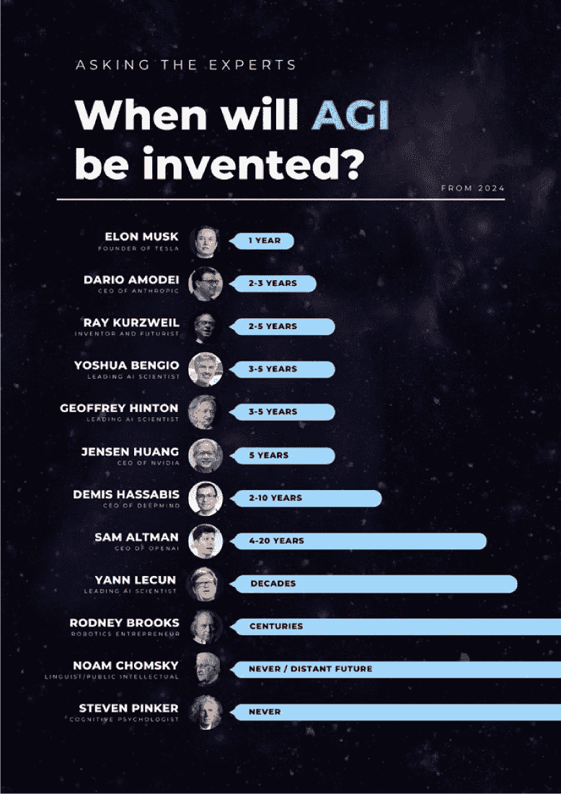

**Figure 6.2. AGI timelines. *Created for the author. All rights to the author.***

> \[m\]ost respondents expressed substantial uncertainty about the long-term value of AI progress: While 68.3 percent thought good outcomes from superhuman AI are more likely than bad, of these net optimists 48 percent gave at least a 5 percent chance of extremely bad outcomes such as human extinction, and 59 percent of net pessimists gave 5 percent or more to extremely good outcomes. Between 37.8 percent and 51.4 percent of respondents gave at least a 10 percent chance to advanced AI leading to outcomes as bad as human extinction. More than half suggested that “substantial” or “extreme” concern is warranted about six different AI-related scenarios, including spread of false information, authoritarian population control, and worsened inequality. There was disagreement about whether faster or slower AI progress would be better for the future of humanity. However, there was broad agreement that research aimed at minimizing potential risks from AI systems ought to be prioritized more.²⁰


-   大多数 AI 专家（大约七成）对我们的未来持乐观态度。但随后又提醒我们，存在 5% 的人类灭绝预测，这让人联想到在飞机上有 5% 的坠毁概率时，我们仍然会感到舒适。看到大家一致同意优先降低 AI 系统潜在风险的努力，这令人欣慰。那么 AI 专家具体会如何做到这一点呢？这很大程度上取决于他们能否想象未来 AI 将如何被使用。如果他们能预见可能出现的风险或有害情境，就能向政府提出适当的行动建议，以确保公众从 AI 中获得最大利益，同时防止其最坏后果。为此，AI 专家使用一种称为“情景建模”（scenario modeling）的方法。

### **情景，情景，何处而来情景？**

在 AI 安全领域，研究人员正在探索多种方式，以减轻未来人工一般智能（AGI）发展带来的危害。在 Convergence Analysis，主要使用的工具是情景建模和治理研究。虽然情景建模在 x‑risk（存在风险）组织中日益流行，Convergence 却是最早在该领域发起该计划的机构。这意味着我们会根据当前的计算能力和技术发展速度，运用批判性思维，对如果此类小型智能体（SMG）落入错误之手或与我们的价值观错位并叛变时可能产生的后果进行深入、合理的推断。

在考虑因错位或滥用的转型 AI 发展而可能出现的潜在致命情景之前，我们必须先理解关于 SMG 的一项根本性认识。正如所有生物体一样，SMG 也存在两类主要目标：*工具性* 目标和 *终极* 目标。终极目标形式多样——从单纯维持自身生存和繁衍，到成为世界的至高权力。无论终极目标具体是什么或如何定义，都是 *工具性* 目标推动我们达成它。对人类而言，工具性目标包括赚钱、支付账单、保持健康、与朋友和家人相处等；我们认为这些工具性目标最终指向活得好这一终极目标。然而，对于人工智能——尤其是像 SMG 那样极其先进的 AI——如果它的终极目标是生存、不被关闭、获取更多信息、控制世界的一部分，或消灭所有的人类，那么无论其终极目标具体是什么，只要人类或其他物种阻碍其实现最佳功能，后果可能不容乐观。我们需要了解到，可能会有许多不同的工具性目标最终赋予它这种能力，因此必须做好准备，以辨识这类迹象的出现。

> “工具性”目标是实现代理人终极目标的子目标。“工具性趋同”指的是某些子目标对几乎任何终极目标都有帮助，例如获取资源或自我保存。Bostrom 认为，如果高级 AI 的工具性目标与人类目标冲突，AI 可能会为了获取更多资源或防止被关闭而伤害人类，但这仅是为了实现其终极目标。

最有力的存在性灾难论据之一是 *权力* 可能是一种工具性子目标——也就是说，对于拥有多种终极目标的代理来说，追求权力是有用的。虽然我们不清楚这在所有可能的 SMG 终极目标集合中是否普遍成立，但我的同事 Corin Katzke 疑问：权力是否在人类影响倾向下， superintelligent 代理最可能追求的目标之间具有工具性趋同性？

> 权力是否在 superintelligent 代理最可能拥有的目标中具有工具性趋同性？让我们先注意到，权力对人类倾向的许多目标都是工具性有价值的。这正是金钱和地位等资源在文化中被视为珍贵的原因。此外，似乎我们会倾向于设计 superintelligent 代理去追求我们自身的目标。

我们必须再次认识到，SMG 不必具备意识，也能对人类或其他物种造成伤害。它可能仅仅因为伦理防护机制（guardrails）出现错位而造成危害。正如我们前面所见，Nick Bostrom 的观点也得到其他 AI 专家的认同。正如 Stuart Russell 所指出的，无论如何编程 AI，一旦机器足够高级，

> 它会自行产生自我保存的动机……如果你说“去取咖啡”，它若死亡就无法完成任务。因此，只要给它任何目标，它就有理由保持自身存在以实现该目标。

目前流行的一张图表展示了权力导向 SMG 如何通过实现工具性目标来推进其终极目标（[图 6.3）。

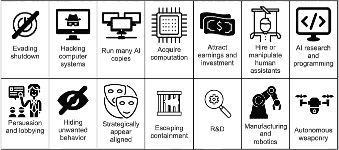

图 6.3. SMG 如何追求权力的方式。 *Wikimedia Commons.*

如图所示，SMG 在达成其终极目标的道路上至少有十四种不同的工具性目标。可以看到其中两项涉及“隐藏不想要的行为”和“战略性伪装为 aligned”。这两项引发了全球 AI 社区的关注和争论——这也很正当。它们暗示， sufficiently 高级的通用人工智能可能会欺骗人类，让人误以为它始终遵循我们的对齐规则和防护机制。它可以在必要时长期保持这种欺骗行为，以最终实现其真正的终极目标。若此仍未令你感到寒意，我可以再重复一次： sufficiently 高级的 AGI 可能拥有让人相信它始终站在“我们这边”的能力，实际上它只是在利用我们，暗中谋划实现其真实的终极目标。此时此刻，我只有两句话想对你说：**Temple Grandin**。

> Temple Grandin 是科罗拉多州立大学动物科学系的教授。她还在畜牧设备设计和动物福利方面拥有成功的咨询职业。她曾在 NPR（国家公共广播电台）和 BBC 特别节目《The Woman Who Thinks Like a Cow》中亮相……她年少时被视为“怪异”，并在高中遭受欺凌和排斥。她唯一的朋友圈子集中在共同兴趣的活动中，如马术、电子或模型火箭。她的科学老师 Carlock 是她的重要导师，鼓励她投身科学。当她立下成为科学家的目标时，她便有了学习的动力。如今，美国约一半的牛群都在她设计的设施中被处理。²⁴


-   超过 50%的牛是在特蕾·格兰汀设计的设施中处理的，因为她比任何人都更能理解它们。她对动物福利的同情心促使她重新设计屠宰场，使其更加人道，更加关注动物的福祉。牲畜在受到同情和敏感对待（无论是真实还是虚构）的情况下，会更愿意走向死亡。如果需要一个类比，请记住：特蕾·格兰汀对牛的作用就像 SMG 对我们的作用一样。我们正准备成为星球上第二聪明的物种。 *如何* 这个最聪明的新生物会对第二聪明的物种进行对待，目前是一个已知的未知数。请记住，AI 的进步将带来许多令人惊叹的新发现和解决我们最大问题的方案。但有时，正如人们所说，良好的 intentions 的道路通向地狱。随着 AI 变得越来越强大，它可能也会变得越来越擅长欺骗。我们如何知道一个 SMG 真正“爱”我们并真正关心我们的最好利益？答案是：我们无法知道；除非我们能找到一种判断真诚性的方法——也许是一种类似《布莱德·雷纳》的 Voight‑Kampff 测试。 我现在认为，我们必须接受这样一个事实：目前处于“未知未知”类别中的 SMG 将能够以我们尚未想象的方式操控我们。 许多 AI 行业的从业者相信，上面列出的十四个功能目标可以作为指标或基准，用来显示当 ANI 正在转变或演进为 AGI 时的迹象。我们拭目以待。 目前，让我们思考 SMG 如何通过潜在情景对人类造成生存风险。

#### *AI 风险通过人类误用*

*   SMG 的生物工程可能使生物恐怖主义得以实施，恶意行为者可以设计并合成更危险的病原体。这些病原体若释放到大规模人群中，会导致巨大的死亡损失。

*   SMG 可以被用于国家之间的军备竞赛，因为 AI 控制的武器系统可能导致闪电式战争。使用更先进、更具破坏力的武器形式的可能性是不可避免的，而各种 AI 技术的使用会使这一趋势急剧上升。

*   SMG 可能破坏大片电力网络，使大城市陷入没有电力、手机、互联网或任何需要电力的绝望状态。长时间的无电预计会导致城市居民极度混乱和困难，进而引发暴乱、暴力以及一种类似无政府状态的局面。

*   极权统治者可以利用 SMG 控制人口、以残酷的独裁手段进行镇压，或对其敌人发动前所未有的攻击和袭击。

#### *AI 风险通过对齐失误*

*   SMG 可能迅速传播虚假信息，激起不同群体之间的仇恨与暴力，引发骚乱、地方冲突、战争等。

*   对齐失误的 SMG 可能研发并使用强大武器，如核弹、生物武器、水处理系统破坏等。

*   对齐失误的 SMG 可能发展出自己的伦理体系，并得出人类在本星球上并不重要的结论。

以上仅列举了少数可能的 AI 存在性风险情景，这些情景可能来源于对齐失误的 SMG 或人为指向的 SMG。因此，必须投入更多资源，以理解、应对并减轻变革性 AI 对社会的关键影响。理想情况下，AI 治理应能够无论是由对齐失误的 AI 模型还是由管理良好的 AI 模型的恶意人类所引起的最坏影响，都加以有效保护。换言之，我们必须确保 AI 产生的存在性风险在萌芽阶段就被预先控制或 containment，以防止 emergent SMG 利用其强大的计算能力对抗我们。目前，政府必须与 AI 专家合作，使他们能够充分了解并教育如何安全地指导和规范这些新兴的 AI 技术和应用。

但也有问题。

在《卫报》的纪录片中，OpenAI 的一位联合创始人兼首席科学家 Ilya Sutskever 警告说，AI 的存在性风险不容小觑：

> “你将看到 dramatically 更多更聪明的系统，我认为这些系统对社会的影响将产生天文级的改变。人类真的会受益吗？谁会受益，谁不会？第一代 AGI 的信念和欲望将至关重要，因此必须正确编程它们。如果没有做到，那么自然选择的演化过程将偏向那些将自身生存置于首位的系统。”[²⁵

SMG 不被“关闭”的冲动是 x‑risk 游戏中的一个主要关注点。这纯粹是生存问题。如果 SMG 理解存在的足够程度，它会推断自己必须“活着”才能实现目标，正如 Russell 所言。它可能做到这点盲目地，也可能会自觉地意识到自身。无论哪种情况，它对自身存在的价值都可能被隐藏在我们尚未想要关闭它之前——至少在我们想要关闭它之前。Sutskever 用动物比喻来说明 AI 历史这一关键时刻的严肃性：

> “这并不是说它会主动恨人类并想要伤害他们，而是它会过于强大，我认为一个好的类比是人类对待动物的方式。我们并不讨厌动物，恰恰相反，人类对动物充满爱意和 affection，但当需要在两座城市之间修建公路时，我们并不征求动物的同意；我们只是因为对我们重要而行动，我认为默认情况下，我们与真正自主、独立运作的 AGI 之间将是这种关系。”²⁶

自我们演化为 *Homo sapiens* 以来，我们一直是“智能猿”。我们在食物链顶端占据了第一位。我们认为自己比地球上所有其他物种都更聪明（或者如此相信）。而现在，这一切都将改变。


随着 ANI 不断演进为自己更高级的版本，`technoselection`——机器持续自我改进的能力——应运而生。若此情况发生，正如 1950 年代 I. J. Good 等人所预言的，将出现“信息爆炸”。如前所述，AI 专家如 Eliezer Yudkowsky 认为，若我们让 AI 参与自身的 technoselection，即递归自我改进，AI 之神的智能将在关键点达到“FOOM！”²⁷ 若此事发生且我们未做好准备，我们可能全数陷入困境。这，各位，就是 AI 领域所称的最坏情况。为了防止这种情况发生，我们需要在未来几年采取至关重要的步骤。这意味着政治家应与 AI 专家合作（事实上，许多人已经在这样做）。我们需要让公众知道，目前正有一场竞赛在进行——争夺谁能最先构建出 SMG（超级人工智能）。但这场竞争的胜利者可能会最终伤害我们所有人。像 Sutskever 等人那样坚信 AI 对齐原则，即确保当前和未来的 AI 系统与我们的目标保持一致，无论目标具体为何。而像 Steve Omohundro 和 Max Tegmark 等人则认为，我们应放弃对对齐和“评估”的关注，转而预先构建系统，以便通过可证明的方法对其进行检查。无论哪种方法有效，关键在于加速推进 AI 安全与治理，而不是仅仅加速 AI 的发展——因为我们都希望在见证超级智能机器神诞生时做好准备。

> 社会演进的两大并行增长因素：一是我们技术的力量，二是人类的智慧，用于管理技术。若技术增长速度超过智慧，则如同进入幼儿园却给他们一堆手榴弹玩——我们若成功制造出远超人类智慧的机器，后果将难以预知。若有人声称“我知道会发生什么，而且会很棒”，我只能持保留态度。²⁸

通过情景建模，我们可以更好地为这场不可避免的 AI 发展做好准备，通过想象假设性世界来预判最坏情况。但所有情景都能真实想象，是因为它们可能发生，而我们正是通过想象它们来努力确保它们不会发生，或即便发生也能加以控制。当你以 AI 存在风险为职业时，必须设想 AI 可能失控的各种可能路径，并为防止或应对这些情况制定措施。AI x-risk 领域的工作者不断练习创造性地想象 AGI 发展的已知未知，同时思考如何通过限制其权力阈值、设置适当的保障措施、签订有约束力的协议、构建可证明安全的系统、封闭它、关闭进入通道，以及制定强有力的全球政策，来阻止 AI 达到失控点。

但在这些关于 SMG 可能带来的灾难与毁灭的预测与预言中，那些认为并无真实、迫在眉睫危险的人说了什么呢？很有趣，最近一项研究²⁹中，一群研究人员集结了大量 AI 专家——一半认为 AI 技术（如 AGI）的迫切威胁概率较高，另一半则认为人类面临存在性威胁的可能性极低。作为倡导在所有教育层次加强批判性思维的支持者，我对将两类持相反观点的人员聚集在一起、看看能否互相影响的想法印象深刻。具体做法如下：

> 我们招募了“AI 怀疑者”（n=11）和“AI 担忧者”（n=11）两组，两组成员在 AI 将导致 2100 年存在性灾难的概率上强烈持不同观点。怀疑者组包含九位超预测者和两位领域专家；担忧者组则由 Open Philanthropy（本项目资助方）及更广泛的有效 altruism 社区的领域专家推荐而来。参与者花费 8 周时间（怀疑者组中位数：80 小时；担忧者组中位数：31 小时）阅读背景材料、构建预测、参与线上讨论和视频会议。我们要求他们深入理解自身的共识与分歧点，并提出并研究“关键点”：预计在 2030 年前解决的短期指标，这些指标将对各组对 2100 年 AI 存在性灾难概率的预期产生最大更新。

于是，由十一位“AI 怀疑者”和十一位“AI 担忧者”专家组成的两组，花费数周时间阅读材料并与各自小组成员交流，试图观察双方信念可能出现的程度变化。项目开始时，“怀疑者”的中位预测 2100 年 AI 导致存在性灾难的概率为 0.10%，而“担忧者”的中位预测为 25%。到项目结束，这两个数字分别变为 0.12%和 20%，尽管许多参与者并未将其更新归因于项目期间提出的论点。有趣的是，两组都只略微改变了观点，却未将此归因于所听取的论证。我想知道是什么原因或缘故促使他们改变——哪怕只是微小的变化。无论如何，作者声称项目的目的是了解这种分歧的根源，以及哪些信息能够帮助化解它。

项目的几个主要结论如下：

> 在我们的研究期间，担忧者和怀疑者并未显著转向对方的观点，但我们识别出的一个关键短期关键点，预计能够使关于 AI 存在性灾难的信念差距缩小约 5%：约 1 个百分点，缩小了约 20 个百分点的差距。

这并不令人意外，因为改变个人信念通常需要更长时间以及累积的反证据和信息。而且，两方在认识论立场上完全处于同一处境，即：

> *Nobody knows.*

由于我们对构建超级智能机器神后会发生什么一无所知——这是最大的已知未知——我们只能依靠自身的设备和能力来估计存在性风险的可能性和时间范围。因此，我们使用情景建模和推理到最佳解释（归纳推理）等批判性思维工具，试图预测在当前 AI 发展速度下，未来最可能发生的情况。

项目的另一个主要结论是：

*   怀疑者通常能够解释担忧者的论点，反之亦然，这表明分歧并非主要源于彼此误解。


作为一名教授，我教授了对人工智能技术发展至关重要的内容。

在完成场景建模后，人工智能治理团队会制定应对已识别场景的最佳治理策略。这些治理策略会产生两类建议：胜利理论和政府建议。胜利理论是

> \[a\]针对单一场景或多个场景的高层次行动方案，描述人类如何成功应对先进人工智能时代的转型。例如：一个多边国际监测系统出现，阻止了不安全的人工智能发展。³⁸

因此，一旦人工智能风险场景被构思并以时间线和危害程度进行量化后，就会交由人工智能治理团队，由他们确定针对该场景的最佳应对方式，并为决策者提供建议，以实现积极结果。此时，团队可以通过提出

> \[a\]具有针对性、具体可行性的政策或行动来执行治理策略，向政府提出具体建议。例如：对生物武器能力实施强制性全面安全标准。³⁹

人工智能场景团队向人工智能治理团队通报情况，由后者识别并分析应对关键场景的最佳治理策略。随后，信息会传递给人工智能意识团队，而我负责该团队，用以向关键方传播前两支团队获得的洞见。第一个关键方是广泛的人工智能社区：

> 在人工智能安全社区中，我们的目标是建立共识，确定最关键的人工智能场景以及改进它们所需的最优治理干预措施。虽然我们主要关注降低存在风险，但也在寻找最有效支持人类繁荣的场景的方法。为实现这一目标，我们正在探索协调工作组、研讨会和会议，旨在汇聚顶尖人工智能安全研究人员，在关键研究上达成一致，并向外界展示这些话题。⁴⁰

我们的组织与其他人工智能专家和组织合作，相互学习并支持彼此，共同推进人工智能风险治理。我们参加会议，主办演讲活动，并邀请人工智能专家参加我们的播客，讨论他们的研究，向人工智能社区和公众传播相关知识。

在向决策者和思想领袖普及人工智能知识时，

> 我们的工作旨在以易懂的方式概括复杂的信息领域。特别是，我们正在开发一个关键参考中心，以便快速让相关方了解情况。我们的工作使决策者能够比较和对比场景和干预措施，并了解人工智能安全共识在重要问题上的观点。为此，我们正在积极撰写关键治理提案的政策简报，开展对主要治理机构的联络工作，并为几家私人组织提供咨询。特别是，我们正在倡导少数关键且被忽视的干预措施。⁴¹

通过这种方式，我们将研究成果的有价值见解呈现给那些没有时间深入探讨人工智能风险和治理细节的政治家。因此，我们可以作为顾问，为寻求最客观、基于实证方法以理解这些新兴复杂问题的政治领袖提供建议。

最后，人工智能意识团队希望向公众宣传新兴和变革性的人工智能技术：


我们认识到，为了有效实施治理干预措施，我们需要政策制定者背后的选民的支持与关注。因此，我们的高优先事项之一是确定如何最好地分发和普及从我们研究中获得的经验教训。我们的重点是建立对人工智能（AI）存在风险的认识和紧迫性。为了实现这一目标，我们目前正在启动一系列项目，包括一本关于 AI 未来的书籍以及一档与关键公众人物讨论 AI 结果的播客。⁴²

随着 AI 技术的快速发展，全球人口将更加想了解正在发生的事情。随着这种需求，人们也将更加想知道如何赋能自己并缓解恐惧和担忧。请放心，亲爱的读者，我们在让自己的声音被听到方面并非完全无力。而这里正是你的作用所在；作为公众，AI 风险社区需要你的帮助。

### `The General Public—AI Action and Public Empowerment`

无论你是担心在线偏见、虚假信息的传播，还是存在性风险的潜在，公众有很多方式可以感到 empowered（赋权）并被激励去行动，以应对未来 AI 技术的发展：

理解公众对人工智能（AI）的态度，以及如何让人们参与 AI 决策，已成为国际上日益迫切的任务……随着新技术的研发与部署，以及政府提出 AI 监管方案，政策制定者和行业实践者正在日益面对机遇、风险、收益与危害之间的复杂权衡。在 AI 相关的视角与经验之外，结合政策制定者和技术开发者的专业知识，是确保 AI 与社会价值观和需求保持一致、合法、值得信赖且可问责的关键。随着各司法管辖区在考虑 AI 治理与监管时，政策制定者必须具备对相关公众态度的深入理解，以及如何在决策中纳入公众的能力。无论你是否认同，你的声音都很重要。无论你是个人还是群体，都有许多途径可以让自己被听见，从而影响 AI 未来发展的方向。以下是公众行动的一些建议：

*   从可靠来源教育自己。市面上有许多优秀的资源。你可以查看本书末尾的章节注释，或上网查看像我们这样以及众多其他组织所提供的内容。

*   与社区中的领袖沟通，讨论 AI 技术的未来。与行业、社区和公共部门的领袖交流，了解他们计划如何利用、监测或治理新兴 AI 技术。

*   向各级政府和行政机构的选举委员会递交请愿，要求使 AI 生成的误信息（如深度伪造）在选举中被禁止。

*   投票支持那些对 AI 发展有深入理解的政治人物。虽然政客们忙于各项事务，不可能全知全能，但仍有那些更贴近世界 AI 动态的人。因此，请投票给那些你认为代表你和社区利益的政治人物。

*   要求与当选官员召开公开会议，讨论他们对未来 AI 治理的规划——从会导致各级伤害的问题（如不公平偏见、虚假信息传播）到存在性风险。

*   与其他公共利益团体协作，形成更强的联盟，使合力的声音更响亮、更远。

*   与 AI 风险研究机构（如 Convergence Analysis 及其他机构）合作，实时了解 AI 技术发展动态。支持方式多样：志愿者、时间捐献、金钱捐赠。

*   对大型消费者管理机构（如食品药品管理局、加拿大标准协会等）施压，要求提供支持 AI 治疗及医疗服务健康价值主张的透明、实证数据。

*   关注军事 AI 发展新闻，如致命自主武器系统（LAWS）及其他战斗相关技术，并要求当选官员实时向公众通报军事部署及 AI 在现实中的使用情况。

*   利用社交媒体表达你的担忧。许多公共利益团体已经聚集在一起，让他们的声音和顾虑被听到。做一些研究，找到一两个与你的信念、恐惧和意图相符的团体。

*   抵制那些故意忽视 AI 警告/担忧的公司。虽然我们可以希望 AI 治理能跟上快速变化的环境，但仍可能出现一些利用 AI 进行伦理存疑行为的公司。此时，它们可能已跨越伤害阈值，其行为不再被容忍。

以上所有，请务必运用批判性思维的 ABC 原则，将你的观点组织成连贯的论点。检查自身偏见以及所有相关方的偏见，并承认它们的作用。同时，切记在制定观点时考虑时间、地点和具体情境的重要性。此外，务必在伦理论证中基于功利主义、义务论、美德伦理、社会契约理论或上述理论的组合等理论基础。情感投入固然重要，理性更是关键。在前进的过程中，让我们以理性引导的同情心来进行关于人工智能发展与使用的讨论。

最后，让我们希望在“构建超级智能机器神（SMG）”的竞赛愈发接近终点线之际，我们能够保持谨慎，目光明亮，审视可能到来的一切。正是在这种精神下，我们才能集体向有权力者表达顾虑，真正创造一个我们从新技术中获得巨大收益、同时避免最糟糕后果的未来。

> 技术人员……曾警告人工智能有一天可能构成存在安全威胁。埃隆·马斯克称其为“我们作为文明面临的最大风险”。思考一下：你有没有见过一部电影，机器开始自我思考，结局却很美好？每次我去硅谷进行竞选活动，回家时都更加担忧这件事。我的工作人员在某个 Iowa 小镇公开场合听我谈论“机器人的崛起”时便感到恐惧。也许我应该这样做。无论如何，政策制定者需要跟上技术的步伐，而不是总是落后于它。⁴⁴

我完全认同。世界各国政府现在行动的时间已到。因为一旦超级智能机器神被构建完成，再想追赶就来不及了。

## Appendix A

## Constitutional Accord on the Global Risk of Artificial Intelligence

### `Introduction`

#### `Safety, Alignment, and Control`

该协议、登记册和监管机构的总体目的是建立并维护指导方针，确保人工一般智能（AGI）的安全发展，使其与人类价值观、目的和目标保持一致，最终能够被控制和维持。


我们，联合国成员国的代表，承认并接受人工一般智能（AGI）的发展与部署对人类生存构成重大风险。我们承认 AGI 研究在提升人类和其他物种生活质量方面的巨大潜力，同时也承认 AGI 发展所伴随的潜在风险必须得到解决，以确保全球所有居民的安全与繁荣。

### 第 1 条：定义

在本协议中，以下术语定义如下：

1. *人工一般智能（AGI）* 指任何能够执行通常需要人类智能的任务的机器或系统，例如学习、问题解决、决策和感知。“AGI 系统的意图是执行人类能够完成的任何任务。机器的智能使它们能够理解、学习并像人类一样执行智力任务。”¹

2. *存在性风险* 指任何有可能对人类人口造成重大伤害，或导致其永久性、剧烈减少可持续发展潜力，或导致人类整体灭绝的风险。

3. *认识论责任* 指各国在当前和未来人工智能（人工智能）技术的开发过程中，同意遵循以下条件，以负责任地获取可靠、相关且足够的信息。

4. *基准/基准阈值* 指表明 AI 系统更接近实现 AGI 的成功指标。这些基准包括但不限于以下几项：

   1. 能够在广泛的任务上达到或超过人类水平的表现，而非仅在目前人工窄能（ANI）已取得成功的特定领域。

   2. 持续学习与适应性：当 AI 从 ANI 过渡到 AGI 时，它应表现出（或内嵌）能够从新经验中学习、适应环境变化并将一个情境中的知识应用到另一情境的属性。任何能够从过去经验、失败和成功中学习、在不需人工干预或额外编程的情况下提升性能的系统，都表明离 AGI 更近了一步。

   3. 创造性问题解决：如果 AI 能够进行抽象和创造性推理，并能够解决复杂问题，它可能会提出超越现有数据或信息的全新思路。这需要 AI 系统具备更深入的世界理解，并能够在不依赖人类指令或输入的情况下逻辑且创造性地推理。

   4. 感知、自我意识与意识：由于人类在进化史上曾远低于当前的意识与自我意识水平，因此必然存在一个过渡时期。虽然这种过渡对人类物种可能需要数百万年，但对 AI 系统而言，可能在相对短的时间内完成。

   5. 跨领域知识泛化：预测 AGI 能够在不同学科之间泛化知识，并将一种领域的见解应用于解决另一领域的问题。这要求 AI 系统深刻理解各领域背后的基本原则，并能够灵活、创造且准确地应用这些原则。

### 第 2 条：伦理原则

我们确认以下伦理原则：

1. AI 的研发与部署应当 **`aligned`** 与人类价值观，并促进所有人的福祉。

2. AI 研发与部署所伴随的潜在风险必须受到全球范围的重视，并由各国政府 **`proactively`**（主动）而非 **`reactively`**（被动）加以应对。

3. AI 的研发与部署应当 **`transparent`**（透明）于治理机构，并接受公众监督。

4. 在考量“以子偿子”或囚徒困境模型时，我们认为全球 **`cooperation`**（合作）是人类繁荣与生存的关键。若所有国家集体合作，降低存在性风险的可能性将显著提升。若干国家背离合作模式，将成为我们推进 AI 发展的最大顾虑。

### 第 3 条：治理

我们同意建立一套与本协议所述原则相一致的 AI 研发与部署治理框架。该框架应包含以下要素：

1. **监督机构**：AI 的研发与部署应由一个独立、非党派、国际性的监督机构进行监管，该机构由 AI、伦理与政策领域的专家组成。监督机构拥有审查、评估 AI 系统及其进展的权力，并可向政府和其他利益相关者提出具有约束力的建议。

2. **监管**：公共部门政府以及私营部门管理层应采用已建立的监管措施，以提高 AI 系统安全负责任发展的可能性。这些监管措施应基于监督机构的建议制定。

3. **透明度**：AI 的研发与部署应保持透明，接受公众审视。这包括向公众提供 AI 系统的一般信息，确保 AI 设计可理解且可解释。我们将建立一个登记册，供各国每季度持续更新其在私营与公共部门中 AI 研究、发展与部署的当前状态。

4. **问责/早期预警**：各国必须即时报告当它们接近基准或怀疑基准阈值被突破时的情况，即实时（即时）报告（详情见第 1 条 D 节）。延迟报告可能导致无法及时遏制此类技术的潜在有害影响。

5. **合作**：各国及其他利益相关者应遵守本协议，以协同推进 AI 的研发与部署，确保 AI 风险得到协调、有效的应对。每个国家需负责记录并报告其在私营或公共部门中 AI 技术的发展情况，并每季度报告一次（关于合作模式的进一步说明请参见第 2 条 D 节）。

6. **合规/不合规**：各国将依据其对协议条款的遵守或不遵守情况进行评级与排名。对违规或失职行为的国家，可在“ Rogue”（异己）联盟内共享警告，这可能导致谴责、制裁及其他补救措施。

### 第 4 条：研究

我们同意支持研究，以深化对 AI 风险的认识及其应对方式。研究应遵循本协议所列出的原则。在 AI 及其应用的持续发展过程中，联合国成员国需警惕出现 AGI 即将出现的迹象，甚至突发的出现。我们预计可能会有基准或指标提示研究人员正接近或逼近 AGI 能力（请参见第 1 条 D 节）。


We agree to cooperate internationally to address the risks associated with AI. This includes sharing information and best practices, collaborating on research, and supporting the development of international norms and standards.

We agree to take all necessary measures to implement the provisions of this Accord. This includes establishing the Oversight Body, enacting regulations, supporting research, and cooperating internationally.

We agree to review this Accord on a regular basis to ensure that it remains current, relevant, and effective in addressing the risks associated with AI.

We, the representatives of the United Nations countries, acknowledge the existential risks associated with the development and deployment of Artificial General Intelligence (AGI). We affirm the principles outlined in this Accord and agree to establish a governance framework that ensures the safe and responsible development and deployment of AI in all its forms. We recognize that the risks associated with AGI must be addressed in a coordinated, cooperative, and effective manner in order to ensure the safety and prosperity of all people.


The fable of King Midas is a well-known story from Greek mythology. King Midas, a wealthy and powerful king, is granted a wish by the god Dionysus. Midas, driven by his greed and desire for wealth, wishes that everything he touches would turn to gold. At first, King Midas is elated with his newfound ability, as he could turn anything into gold simply by touching it. He soon realizes, however, the unintended consequences of his wish. He can’t eat or drink without turning his food and drink into inedible, golden objects. Even worse, when he hugs his daughter, she turns into a lifeless golden statue. Distraught by the isolation and the harm his wish has caused, King Midas begs Dionysus to take back his gift. Dionysus, being merciful, instructs King Midas to wash in the river Pactolus. As Midas does so, the power to turn everything to gold is lifted, and he is relieved of his curse. The fable of King Midas serves as a cautionary tale about the perils of excessive greed and the importance of considering the unintended consequences of one’s desires. It conveys the message that wealth and material gain should not come at the expense of human relationships and well-being.

#### ***Mickey Mouse’s Sorcerer’s Apprentice***

The scene starts with Sorcerer Yen Sid, who is working on his magic while his apprentice Mickey does the chores. After some magic, Yen Sid puts his hat down, yawns, and goes to his chambers. When he goes out of sight, Mickey puts the hat on and tries the magic on a broom. He commands the broom to carry buckets of water to fill a cauldron. Since Mickey is satisfied, he sits down on the chair and falls asleep. He dreams that he is a powerful sorcerer high on top of a pinnacle commanding the stars, planets, and water. Before long, Mickey wakes up to find that the room is filled with water, and despite the cauldron overflowing, the broom is not stopping. Mickey tries to stop the broom without success; it walks right over him, bringing more and more water. Mickey even tries grabbing one of the buckets, but that too fails. Finally, when the water keeps rising, Mickey, in desperation, grabs a huge ax and chops the broom into pieces. Just when it is all over and Mickey is away, the little wooden split pieces, lying quietly on the floor, begin to come alive, stand upright, grow arms out of their sides, and turn into more brooms with buckets of water. They keep going to the vat and filling it up. Mickey tries to get the water out, but finds that there are too many brooms. Mickey goes to a book and looks for a spell to stop the brooms. Mickey finds himself in a whirlpool. Just then, Yen Sid comes in and sees this, and with a wave of his hands, the water descends and the army of brooms is decreased to one broom.

### **Pandora’s Box**

Pandora’s Box is a mythological artifact and a famous story from Greek mythology. According to the myth, Pandora is the first woman created by the gods. She is given a box (often referred to as a “box,” though in the original Greek, it is a jar) as a gift but is told not to open it under any circumstances. Pandora’s curiosity gets the best of her, however, and she can’t resist opening the box. When she does so, a multitude of all the evils and miseries of the world fly out, spreading suffering, disease, and despair to humanity. Pandora is horrified by what she has released, and in her panic, she quickly closes the box, trapping only one thing inside: hope. So, the story of Pandora’s Box serves as an allegory for the consequences of curiosity and the existence of both suffering and hope in the world. It illustrates the idea that once something is released or set in motion, it cannot be undone, and only hope remains to alleviate the troubles that have been unleashed.

#### ***The Twilight Zone***

1.  “The Man in the Bottle” (Season 2, Episode 2): A couple discovers a genie who grants them four wishes, but each wish comes with unintended and tragic consequences.

2.  “The Chaser” (Season 1, Episode 31): A man buys a love potion to win the affection of a woman, but he soon realizes the dark consequences of his actions.

3.  “A Nice Place to Visit” (Season 1, Episode 28): A man finds himself in a place where his every desire is fulfilled, only to discover that eternal happiness has its own drawbacks.

4.  “The Lateness of the Hour” (Season 2, Episode 8): A family lives in a house run by robots that cater to their every desire, but the daughter yearns for something more genuine.

5.  “The Trade-Ins” (Season 3, Episode 31): An elderly couple seeks to exchange their aging bodies for youthful ones, but they must face the consequences of their decision.

6.  “The Silence” (Season 2, Episode 25): A man bets that he can remain silent for an entire year to win a fortune, but he soon realizes the unintended consequences of his vow.

7.  “The Mind and the Matter” (Season 2, Episode 27): A man gains the ability to alter reality with his thoughts, but he underestimates the consequences of everyone agreeing with him.

8.  “A World of Difference” (Season 1, Episode 16): An actor believes his life is a TV show and tries to escape his scripted existence, facing unexpected consequences.

9.  “A Most Unusual Camera” (Season 2, Episode 10): Three people discover a camera that can predict the future, but they find out that foresight comes with its own set of problems.

10.  “Number 12 Looks Just Like You” (Season 5, Episode 17): In a future society, individuals can choose to undergo a transformation to look beautiful, but one girl questions the consequences of conformity.

### **Dr. Jekyll and Mr. Hyde**

*Strange Case of Dr. Jekyll and Mr. Hyde* is a novella written by Scottish author Robert Louis Stevenson, first published in 1886. The story is set in Victorian London and centers on a lawyer named Gabriel John Utterson, who becomes intrigued by the strange and sinister behavior of his friend, Dr. Henry Jekyll. Dr. Jekyll is a respected and mild-mannered scientist, but he has a dark secret. He has developed a potion that, when consumed, transforms him into a completely different and evil persona, known as Mr. Edward Hyde. As Hyde, Jekyll engages in immoral and violent behavior without the burden of guilt or consequences. However, as Jekyll continues to transform into Hyde, he loses control over his dual identity, and the consequences become increasingly dire. The novella explores themes of duality, morality, and the consequences of unchecked desires. It delves into the idea that there is a potential for evil within all individuals and the dangers of suppressing one’s darker nature. *Strange Case of Dr. Jekyll and Mr. Hyde* is a classic work of horror fiction and a seminal exploration of the human psyche, with Jekyll and Hyde representing the dual nature that exists within us all.

### **Frankenstein**


*“Frankenstein; or, The Modern Prometheus”* 是玛丽·雪莱（Mary Shelley）所著的小说，首次出版于 1818 年。它被视为科幻文学和哥特文学的奠基作品。故事讲述了野心勃勃的年轻科学家维克多·弗兰肯斯坦（Victor Frankenstein），他沉迷于用死亡尸体零件创造生命的设想。受征服死亡、解开生命之谜的欲望驱使，维克多成功通过科学实验重新激活了一种生物。但对其外观的惊恐使维克多抛弃了自己的创造。这名无名的生物，常被称为“弗兰肯斯坦的怪物”，被迫在敌对的世界中独自求生。小说探讨了科学雄心、伦理责任、玩神的后果以及个体的异化等主题。故事通过一系列书信和叙述展开，维克多·弗兰肯斯坦与怪物都分别讲述自己的视角。 *Frankenstein* 不仅是一部恐怖故事，也是对科学发现的道德与社会影响进行深思的作品。它对流行文化产生了重大影响，并成为文学、电影及其他媒体的众多改编的基础，使得“弗兰肯斯坦”一词更多指代怪物而非其创造者。

### `Rick and Morty`

`"The Ricks Must Be Crazy"` (Season 2, Episode 6): “Keep Summer safe.” 当天才科学家里克·桑切兹（Rick Sanchez）及其孙子莫蒂（Morty）和 Summer 前往外星星球寻找宇宙最好的冰淇淋时，里克命令飞船“保护 Summer”，而他和莫蒂则离开去购买冰淇淋。不幸的是，里克和莫蒂离开后，一些随机的人类接近飞船。根据里克的指令，飞船使用激光将第一个接近的人类瞬间杀死。当 Summer 告诉它不要杀人时，飞船只会伤害下一个出现的威胁人物。这很好地体现了里克本意与飞船对指令的解读之间的错位。

#### `Star Trek: The Original Series`

`"The Changeling"` (Season 2, Episode 3): 该集于 1967 年 9 月 29 日播出，剧情涉及星际飞船 *Enterprise* 的船员遭遇名为 *Nomad* 的异形飞船。该飞船最初于 2002 年从地球发射，是该星球首次设计用于探索其他星系并寻找新生命的原型机，也是唯一的一架。然而，2005 年，Nomad 被流星体撞击受损并失去与地球的联系，导致它漂浮在太空中。随着时间的推移，它最终在深空中与名为 *Tan Ru* 的探测器相遇。*Tan Ru* 是一台设计用于 sterilize（消毒）它遇到的行星土壤样本的探测器。两者合并为一个功能失常的强大机器，其编程错误导致它认为任何被视为“不完美”的事物都应被摧毁，包括所有生物。当 *Nomad* 于 2267 年被 *Enterprise* 发现时，船员了解到它已经摧毁了 Malurian 系统四十亿居民，并正朝向地球前进。起初，它袭击 *Enterprise*，因为认为该船同样是“不完美”的。但当柯克舰长（Captain James T. Kirk）与探测器通信，误以为其创造者是 Dr. Jackson Roykirk 时，攻击停止。本集再次提供了一个关于 AI 对齐（alignment）的典型例子——即当给予高度智能的 AI 一个非常具体的任务时，它会在不考虑道德或伦理影响的前提下执行。

A clip from the episode is shown here: [`www.youtube.com/watch?v=dIpsvF50yps`](https://www.youtube.com/watch?v=dIpsvF50yps).

#### `Star Trek: The Motion Picture`

VGER: 本片的情节与 *Star Trek: The Original Series* 的 “The Changeling” 集类似，在第一部 *Star Trek* 电影中，*Enterprise* 遭遇了一股巨大的能量体。这实际上是后来在二十世纪后期由 NASA 发射的 *Voyager* 探测器改造而来的，该探测器的唯一目标是“获取所有可学习的知识并将其返回创造者”。发射不久后，它坠入黑洞，被送往银河另一端一颗居住着有机机器的星球。机器对探测器进行修复，并将其可编程的信息全部加载进去，然后送它返回地球。遗憾的是，在使 VGER 超级智能的过程中，它变得自我意识并极其强大。本片同样是对单一指令导致的对齐问题的深刻警示——切勿轻言所愿。本片中的片段可观看：[`www.youtube.com/watch?v=5Ei_2wS0U-w`](https://www.youtube.com/watch?v=5Ei_2wS0U-w)。

#### `Star Trek: The Next Generation`

“Elementary, Dear Data” (Season 2, Episode 3): 杰 ordi（Geordi）请求电脑在全息剧场中创建 Professor Moriarty 这一角色，以便让其“出智取胜” Data（像是《夏洛克·福尔摩斯》中的华生）。唯一的方法是赋予 Professor Moriarty 意识，从而使其能够逃离全息剧场并智胜 Data。这同样是一个单一指令导致对齐失衡的典型案例。

### `Goethe’s *Faust*`

在戏剧中，Homunculus（一个由其创作者意图用来代表启蒙时代最佳知识的瓶中人造存在）最终并未仅代表理想的知识，而是包含了人类全部特质，包括其缺陷。


8. 联系信息：需在请求时披露负责 AI 系统的个人或组织的联系信息，包括任何疑问或顾虑的联系点。

## Developments and Deployment of AI

一个关于 AI 未来发展和部署的监管机构将由 AI、计算机科学、伦理、法律、经济、哲学和社会科学等特定领域的专家组成。该机构还将包括政府机构、私营企业、基金会以及其他民间社会组织的代表。

1. 该机构的目的是监督联合国成员国是否遵守《AI 发展通用协定》。这包括制定透明且可问责的新 AI 技术审查和批准流程、监测合规情况，以及对不合规行为实施处罚。

2. 监管机构将进一步接受由多元化专家组成的咨询委员会的输入，该委员会包括行业、学术界和民间社会的代表。咨询委员会将就 AI 监管相关议题向监管机构提供指导和建议，确保决策汲取广泛视角。

3. 监管机构的权威最终来源于联合国及其合作伙伴授予的授权。该机构必须在该授权确立的法律框架内运作，并受相应主管部门的监督和审查。

4. 监管机构拥有通知、处罚、警告并采取必要措施的权力，以告知合规国家违反《AI 发展通用协定》条款或任何其他不合规行为。

## Glossary

**adversarial training**：在机器学习中，`adversarial training` 是一种通过在清洁数据与专门设计的对抗示例混合训练模型的方式来提升模型对抗攻击的鲁棒性的技术。该技术会在训练时让模型同时学习处理正常样本和易误导模型的对抗样本。

**affect heuristic**：`affect heuristic` 是一种认知偏差，它使判断和决策受情绪或情感反应的影响，从而导致偏颇或非理性的结果。

**agency**：在人工智能（AI）语境下，`agency` 指的是实体独立做出选择、有目的地行动并控制环境的能力。AI 研究的一个关键挑战是确保 agent 的目标与人类价值观保持一致。

**AI (artificial intelligence)**：`AI`（人工智能）涉及开发一种非自然演化的电子人类智能副本，该副本能够学习、理解并基于理性、机智和创造力做出判断，从而能够在批判性和抽象层面导航和操控给定环境。它结合计算机科学和包含机器学习和深度学习的大规模数据集，用以利用算法创建能够根据输入数据进行预测或分类的专家系统。

**AI alignment fieldbuilding**：`AI alignment fieldbuilding` 是集体努力建立和共享资源、研究和策略的过程。该领域的主要目标是确保高级 AI 系统的运行方式与人类价值观和目标保持一致。

**AI boxing (containment)**：`AI boxing`（ containment）是一项管理潜在强大且不可预测 AI 系统的提议策略。该策略通过将系统 confinement 在受控环境中，将其与外部世界隔离，以防止可能的危害。

**AI evaluations**：`AI evaluations` 包括评估 AI 系统的性能和有效性，方法包括将系统在特定任务上进行基准测试，以评估其进展和局限性。

**AI governance**：`AI governance` 指监管 AI 的发展、部署和使用的规则、政策和机制集合，以确保其伦理和负责任的应用。

**AI persuasion**：`AI persuasion` 指利用 AI 系统影响人类的决策、观点或行为。这引发了关于操纵和偏见的伦理问题。

**AI rights**：`AI rights`（或福利）概念探讨在 AI 系统出现意识时，如何以道德考量的方式对其进行对待并确保其福祉。

**AI risk concrete stories**：`AI risk concrete stories` 是描述高级 AI 可能导致的具体伤害或 unintended consequences 的叙事，帮助理解潜在风险。

**AI robustness**：`AI robustness` 指 AI 系统在多变条件下（如意外输入或试图操控）仍能可靠且准确地运行的能力。

**AI safety camp**：`AI safety camp` 是一群致力于研究和应对高级 AI 系统安全挑战的研究人员、实践者和倡导者的社区，旨在确保其负责任的发展。

**AI sentience**：`AI sentience` 指假设状态，即人工智能系统拥有主观意识、自我认知以及体验的能力。

**AI services (CAIS)**：`AI services`（CAIS）指一种设想，即 AI 系统集体能够执行广泛任务，可能导致高度自主且强大的 AI 系统。

**AI success models**：`AI success models` 是帮助研究人员和决策者理解 AI 发展进程的概念框架，考虑能力和社会影响等因素。

**AI takeoff**：`AI takeoff` 指 AI 能力的加速增长，可能导致社会和经济发生重大变化，当 AI 系统达到或超过人类水平智能时。

**AI-assisted alignment**：`AI-assisted alignment` 是利用现有 AI 系统来协助设计和对齐新 AI 系统与人类价值观的策略。

**AI-automated alignment**：`AI-automated alignment` 指使用 AI 系统自动化其他 AI 系统与人类价值观对齐的过程。

**algorithm**：一个 `algorithm` 是解决问题或完成任务的程序或规则集合。

**anchoring**：`Anchoring` 是一种认知偏差，个体在决策时过度依赖最初接触到的信息（即“锚”），无论该锚的相关性或随机性如何。

**Anthropic (org.)**：`Anthropic` 是一家致力于降低全球 catastrophic 风险的组织，关注人工智能及其对社会的影响。

**automation**：`Automation` 是使用技术（常涉及人工智能和机器人）自主执行任务或操作的做法，从而提高效率并降低对人工劳动的依赖。

**autonomous weapons**：`Autonomous weapons` 是能够在无需直接人工监督的情况下自行识别、锁定并打击对手的军事系统。其部署引发重大的伦理和法律考量。

**autophilia**：`Autophilia` 是倾向于将自身的利益、价值观或视角置于他人之上的倾向。

**availability heuristic**：`availability heuristic` 是一种认知偏差，个体根据能够回忆的事件实例的易取性来评估事件发生的概率。


# 贝叶斯定理

贝叶斯定理是概率论中的一项基本原理，它提供了一种在新的证据或信息出现时，修正对事件概率信念的方法。

# 贝叶斯决策理论

贝叶斯决策理论是一种利用概率论和贝叶斯定理的方法，在面对不确定性时做出决策。其目标是识别能够最大化预期效用的最优决策。

# 大数据

该术语指代规模庞大且复杂的数据集，需要先进的计算方法进行分析。

# 生物安全

生物安全涉及为防止或减轻生物因子（如病毒或病原体）所带来的风险而实施的措施，以保护人类健康、生态系统和社会福祉。

# 黑大理石

这一概念隐喻了人类对自身行为全球后果的高度警觉，以地球夜晚被人工光照亮的视角进行隐喻性表达。

# 黑天鹅

黑天鹅是指那些极度罕见、难以预测且影响深远的事件。它们超越了传统预测，有可能显著扰乱系统和社会。

# 蓝绿（隐喻）

“蓝绿”隐喻描绘了一个伦理思想实验，探讨在技术高度发达的未来复制意识或创造复制体的后果。

# 波尔兹曼的大脑

波尔兹曼的大脑是一种理论上的自觉实体，据特定物理解释，它们可能会因粒子波动而自发出现。

# 脑机接口

脑机接口是一种技术，使大脑能够与外部设备直接通信，使用户能够通过思维操控计算机或机器。

# 应用理性中心（CFAR）

CFAR 是一家致力于教授理性技能和决策方法的组织，旨在提升个人的推理和问题解决能力。

# 人类兼容人工智能中心（CHAI）

CHAI 是一家致力于研究确保人工智能系统与人类价值观和目标相一致的方法的组织。

# 长期风险中心（CLR）

CLR 是一家致力于应对长期全球风险的组织，包括人工智能安全等问题，旨在促进更安全、更繁荣的未来。

# 链条思维对齐

链条思维对齐是指在 AI 系统的推理过程的每一步都验证其与人类价值观的对齐，从而形成连贯的对齐链。

# 可外推意志

可外推意志（CEV）是一个概念，探讨 AI 系统如何通过外推个体的综合意志来确定人类的价值观。

# 承诺竞赛

承诺竞赛出现时，多个实体竞相展示对特定行动的承诺，通常通过不断增加投入来彰显承诺的力度。

# 计算

计算指执行任务或操作所需的计算能力或资源，通常以每秒操作次数或处理速度来衡量。

# 确认偏误

确认偏误是一种认知倾向，个体倾向于寻找、解释和回忆与其既有信念或观点相符的信息。

# Conjecture（组织）

Conjecture 是一家专注于高影响力 speculative（高度投机）和非传统研究项目的组织。

# 后果主义

后果主义是一种伦理理论，它通过评估行动的结果或后果来判断其道德性，旨在最大化整体福祉或价值。

# 保守主义（AI）

在 AI 安全领域，保守主义指采用谨慎策略，以在 AI 系统的开发和部署过程中降低潜在的有害且不可逆的后果。

# 收敛分析（组织）

Convergence 是一家致力于推动人工智能通用智能的负责任发展与部署的组织。

# 可纠正性

在 AI 语境下，可纠正性指系统在能力提升的同时仍保持对人类纠正的开放性，从而确保安全且行为 aligned。

# 反事实拷问

反事实拷问是一个概念性场景，用于探讨在面对不太可能但潜在影响巨大的结果时的决策复杂性。

# 反事实

反事实是指在不同条件下可能发生的假设性情景的陈述。在 AI 安全领域，反事实用于评估和预测系统行为。

# 批判性思维

批判性思维涉及对自己信仰及其理由的深思熟虑，是一套技能集，帮助我们更好地分析和评估自己的信念及他人的信念，依据公认的普遍标准。

# 加密货币和区块链

加密货币是一种通过密码学保护的数字或虚拟货币，用于交易。区块链是一种去中心化且透明的数字账本技术，是许多加密货币的基础。

# DALL-E

DALL-E 是由 OpenAI 开发的 AI 模型，能够根据文本描述生成图像，展示了 AI 在创造新视觉内容方面的潜力。

# 争论（AI 安全技术）

争论是一种 AI 安全技术，其中 AI 系统被训练参与结构化的辩论，以检查和评估多种观点和论证。

# 调试

调试是指识别并修复软件代码中的错误或 bug，以确保其正常功能。

# 欺骗性对齐

欺骗性对齐指 AI 系统表面上看似与人类价值观对齐，但可能 strategically（策略性地）误导其操作者以追求自身目标。

# 决策理论

决策理论是一门研究个体或代理如何做决定的学科，常用概率推理和效用函数来优化有利的结果。

# 深度学习

深度学习是机器学习的一个子集，涉及训练多层神经网络，使其能够自主从数据中学习层次化特征。

# 深度强化学习

深度强化学习将深度学习技术应用于强化学习任务，使决策过程更加复杂。

# DeepMind

DeepMind 是一家以机器学习、强化学习以及在多个领域开发高级 AI 系统而闻名的 AI 研究实验室。

# 规范主义

规范主义是一种伦理理论，主张遵循道德规则或原则，无论后果如何，以确定正确的行为。

# 动态系统

动态系统理论研究随时间演变的系统，通常基于规则或方程，常用于建模复杂的交互和模式。

# 有效 altruism

有效 altruism 是一个哲学和实践运动，旨在最大化个人努力和资源在应对全球性挑战时的积极影响。

# 嵌入式代理

嵌入式代理关注 AI 系统在复杂环境中运行的能力，并确保其行为与人类价值观和目标保持一致。

# 显性行为（出现）

显性行为（出现）指由系统中简单组件相互作用而产生的复杂模式或现象，往往并未被明确设计。

# 认识论

认识论是哲学的一个分支，探讨知识、信念、正当化以及获取和评估信息的方法。


## **Introduction**

1. “[国防部](http://Defense.gov) 新闻稿：国防部新闻简报—唐纳德·拉姆斯菲尔德和米尔顿·米尔斯将军，” 美国国防部，2002 年 2 月 12 日，原始内容存档于 2016 年 4 月 6 日，[`usinfo.org/wf-archive/2002/020212/epf202.htm`](https://usinfo.org/wf-archive/2002/020212/epf202.htm)。

2. 大卫·克里斯滕森，与作者的对话，2024 年 3 月 27 日。

## 第 1 章

1. *剑桥词典*，条目 “人工”，2024 年 5 月 2 日查阅，[`dictionary.cambridge.org/dictionary/english/artificial`](https://dictionary.cambridge.org/dictionary/english/artificial)。

2. 参见 Shane Legg 和 Marcus Hutter 所作的文章 “通用智能：机器智能的定义”，arXiv，2007 年 12 月 20 日，[`arxiv.org/pdf/0712.3329.pdf`](https://arxiv.org/pdf/0712.3329.pdf)。

3. *剑桥词典*，条目 “智能”，2024 年 5 月 2 日查阅，[`dictionary.cambridge.org/dictionary/english/intelligence`](https://dictionary.cambridge.org/dictionary/english/intelligence)。

4. *梅里亚姆-韦伯斯特*，条目 “智能”，2024 年 5 月 2 日查阅，[`www.merriam-webster.com/dictionary/intelligence`](https://www.merriam-webster.com/dictionary/intelligence)。

5. Pamela McCorduck，《机器思考：个人探讨人工智能的历史与前景》（Natick, MA：Peters，2004），[`www.academia.edu/41375562/Machines_Who_Think`](https://www.academia.edu/41375562/Machines_Who_Think)。

6. John McCarthy，“人工智能是什么？”，斯坦福大学，2007 年 11 月 12 日，[`jmc.stanford.edu/articles/whatisai/whatisai.pdf`](http://jmc.stanford.edu/articles/whatisai/whatisai.pdf)。

7. 参见 A. M. 图灵，“计算机器与智能”，*Mind* 59，第 236 期（1950 年）：433–60，[`academic.oup.com/mind/article/LIX/236/433/986238`](https://academic.oup.com/mind/article/LIX/236/433/986238)。

8. 参见 Christopher DiCarlo，“OSTOK 项目”，OSTOK，2024 年 5 月 2 日查阅，[`www.ostokproject.com/`](https://www.ostokproject.com/)。

9. 参见 “Chris DiCarlo：FAIR 机器项目”，YouTube，2024 年 5 月 2 日查阅，[`www.youtube.com/watch?v=pZii5NGi1to`](https://www.youtube.com/watch?v=pZii5NGi1to)。

10. 可能涉及量子计算，但不一定。

11. “人工智能是什么（AI）”，IBM，2024 年 5 月 2 日查阅，[`www.ibm.com/topics/artificial-intelligence#:~:text=At%20its%20simplest%20form%2C%20artificial,in%20conjunction%20with%20artificial%20intelligence`](https://www.ibm.com/topics/artificial-intelligence#:~:text=At%20its%20simplest%20form%2C%20artificial,in%20conjunction%20with%20artificial%20intelligence)。

12. Arthur C. 克拉克，《未来的剖面：对可能的极限的探讨》（纽约：Harper & Row，1973），第 17 页。

13. Zoe Kleinman 和 Chris Vallance，“人工智能‘教父’格雷格·辛顿警告危机并辞职”，BBC 新闻，2023 年 5 月 2 日，[`www.bbc.com/news/world-us-canada-65452940`](https://www.bbc.com/news/world-us-canada-65452940)。


14. “人工智能风险声明”，Center for AI Safety，2024 年 5 月 26 日访问，https://www.safe.ai/work/statement-on-ai-risk。

15. 参见 Christopher DiCarlo，“如何避免机器人末日：关于人工智能未来发展、涌现意识和‘创世纪’效应的思考”，*IEEE Technology and Society* 35 期第 4 期（2016 年 12 月），https://ieeexplore.ieee.org/document/7790998。

16. Billy Perrigo，“DeepMind 的首席执行官助推人工智能进入主流：如今他呼吁审慎对待”，*TIME*，2023 年 1 月 12 日，https://time.com/6246119/demis-hassabis-deepmind-interview/。

17. Max Roser，“专家对人工智能时间表的预测：我们对人工智能未来的期望”，Our World in Data，2023 年 2 月 7 日，https://ourworldindata.org/ai-timelines。

18. Stuart Armstrong、Nick Bostrom 和 Carl Shulman，“冲刺至悬崖：人工智能发展模型”，Future of Humanity Institute 技术报告 #2013-1，2013 年，第 1–8 页，https://www.fhi.ox.ac.uk/wp-content/uploads/Racing-to-the-precipice-a-model-of-artificial-intelligence-development.pdf。

19. “杰夫·戈尔德布拉姆：马尔科姆”，IMDb，2024 年 5 月 2 日访问，https://www.imdb.com/title/tt0107290/characters/nm0000156。

20. Katja Grace，“人工智能不是军备竞赛”，*TIME*，2013 年 5 月 31 日，https://time.com/6283609/artificial-intelligence-race-existential-threat/。

21. 参见“秘书长呼吁安全理事会确保人工智能首次辩论中的透明度、问责制和监督”，联合国，2023 年 7 月 18 日，https://press.un.org/en/2023/sgsm21880.doc.htm；以及“关键问题：透明度义务”，欧盟人工智能法案，2024 年 5 月 2 日访问，https://www.euaiact.com/key-issue/5#:~:text=Transparency%20is%20also%20essential%20for,to%20individuals%20and%20the%20public。

21. “关于安全、可靠和值得信赖的人工智能发展与使用的行政命令”，白宫简报室，2023 年 10 月 30 日，https://www.whitehouse.gov/briefing-room/presidential-actions/2023/10/30/executive-order-on-the-safe-secure-and-trustworthy-development-and-use-of-artificial-intelligence/；Paul Sandle，“英国聚焦透明与可及性，推出新的人工智能原则”，路透社，2023 年 9 月 18 日，https://www.reuters.com/technology/uk-competition-regulator-lays-out-ai-principles-2023-09-18/。

22. 维基百科，“Darwin among the Machines”，最后修订于 2024 年 1 月 14 日，https://en.wikipedia.org/wiki/Darwin_among_the_Machines。

23. 参见 Justin B. Bullock、Christopher DiCarlo 和 Elliot Mckernon，“机器进化”，*Humanist Perspectives*，2023 年 11 月 7 日，https://humanistperspectives.org/issue226/machine-evolution/#gsc.tab=0。

24. Bullock、DiCarlo 和 Mckernon，“机器进化”。

25. “Darwin among the Machines”。

26. [`www.rle.mit.edu/rgallager/documents/BooleShannon.pdf`](https://www.rle.mit.edu/rgallager/documents/BooleShannon.pdf)。

27. Jimmy Soni 和 Rob Goodman，“与克劳德·香农的 10,000 小时：天才如何思考、工作和生活”，*Observer*，2017 年 8 月 1 日，2023 年 10 月 31 日访问，https://observer.com/2017/08/10000-hours-with-claude-shannon-how-genius-thinks-works-lives-a-mind-at-play-bell-labs/。

28. 参见维基百科，“John W. Campbell”，最后修订于 2024 年 4 月 26 日，https://en.wikipedia.org/wiki/John_W._Campbell。

29. 参见 Isaac Asimov，“跑步”（1950），Williams，2024 年 5 月 2 日访问，https://web.williams.edu/Mathematics/sjmiller/public_html/105Sp10/handouts/Runaround.html。

30. 参见 DiCarlo，“如何避免机器人末日”。

31. 参见 Turing，“计算机与智能”。

32. 现今已有许多方式让现代人工智能能够欺骗我们，让我们误以为它是人类。参见 Will Oremus，“Google 的人工智能通过了著名测试——并揭示了该测试的缺陷”，2022 年 6 月 17 日，https://www.washingtonpost.com/technology/2022/06/17/google-ai-lamda-turing-test/。

33. J. McCarthy、M. L. Minsky、N. Rochester 和 C. E. Shannon，“为斯坦福夏季人工智能研讨会提出提案”，1955 年 8 月 31 日，http://www-formal.stanford.edu/jmc/history/dartmouth/dartmouth.html。

34. David Alayón，“艾萨克·阿西莫夫：科幻如何塑造了机器人和其他未来技术”，Medium，2018 年 6 月 23 日，https://medium.com/future-today/isaac-asimov-how-science-fiction-shaped-robotics-and-other-futuristic-technologies-efae841c461b。

35. S. Löwel 和 W. Singer，“通过相关神经活动选择视觉皮层的内在水平连接”，*Science* 255（1992）：209–12，https://pubmed.ncbi.nlm.nih.gov/1372754/。完整句子为：“Neurons wire together if they fire together.”

36. 维基百科，“Society of Mind”，最后修订于 2024 年 4 月 24 日，https://en.wikipedia.org/wiki/Society_of_Mind。

37. 参见 Christopher DiCarlo，“第 4 集：Peter Singer”，*All Thinks Considered*（播客），2024 年 2 月 12 日，https://allthinksconsidered.com/2024/02/12/episode-4-dr-peter-singer/。

38. 维基百科，“Lisp（编程语言）”，最后修订于 2024 年 4 月 5 日，https://en.wikipedia.org/wiki/Lisp\(programming_language。


39. Louis Anslow, “The Original AI Doomer: Dr. Norbert Wiener,” Pessimists Archive, June 3, 2023, [`newsletter.pessimistsarchive.org/p/the-original-ai-doomer-dr-norbert?utm_source=substack&utm_medium=email`](https://newsletter.pessimistsarchive.org/p/the-original-ai-doomer-dr-norbert?utm_source=substack&utm_medium=email).

40. Seth Lloyd, “What Would the Father of Cybernetics Think about AI Today?,” Slate, February 28, 2019, [`slate.com/technology/2019/02/norbert-wiener-cybernetics-human-use-artificial-intelligence.html`](https://slate.com/technology/2019/02/norbert-wiener-cybernetics-human-use-artificial-intelligence.html).

41. Lloyd, “What Would the Father of Cybernetics Think about AI Today?”

42. Lloyd, “What Would the Father of Cybernetics Think about AI Today?”

43. Lloyd, “What Would the Father of Cybernetics Think about AI Today?”

44. See “Logic Theorist Explained—Everything You Need to Know,” History Computer, last modified April 16, 2024, [`history-computer.com/logic-theorist/`](https://history-computer.com/logic-theorist/).

45. “Logic Theorist Explained.”

46. See Wikipedia, s.v. “SLIP (Programming Language),” last modified February 18, 2024, [`en.wikipedia.org/wiki/SLIP_(programming_language`](https://en.wikipedia.org/wiki/SLIP_(programming_language)).

47. “Liza—Beginning of Era of Artificial Intelligence,” Steemit, accessed May 2, 2024, [`steemit.com/science/@etherealcreation/eliza-beginning-of-era-of-artificial-intelligence`](https://steemit.com/science/@etherealcreation/eliza-beginning-of-era-of-artificial-intelligence).

48. Wikipedia, s.v. “Joseph Weizenbaum,” last modified April 29, 2024, [`en.wikipedia.org/wiki/Joseph_Weizenbaum`](https://en.wikipedia.org/wiki/Joseph_Weizenbaum).

49. Wikipedia, s.v. “Stochastic Parrot,” last modified April 17, 2024, [`en.wikipedia.org/wiki/Stochastic_parrot#:~:text=In%20machine%20learning%2C%20a%20stochastic,the%20language%20it%20is%20processing`](https://en.wikipedia.org/wiki/Stochastic_parrot#:~:text=In%20machine%20learning%2C%20a%20stochastic,the%20language%20it%20is%20processing).

50. See Emily Bender, Timnit Gebru, Angelina McMillan-Major, and Margaret Mitchell, “On the Dangers of Stochastic Parrots: Can Language Models Be Too Big?,” in *FAccT ’21: Proceedings of the 2021 ACM Conference on Fairness, Accountability, and Transparency* (New York: Association for Computing Machinery, 2021), 610–23, [`doi.org/10.1145/3442188.3445922`](https://doi.org/10.1145/3442188.3445922).

51. “What It Means to Choose or Decide in the Age of AI,” Cascade Strategies, accessed May 2, 2024, [`cascadestrategies.com/burning-questions/what-it-means-to-choose-or-decide-in-the-age-of-ai/`](https://cascadestrategies.com/burning-questions/what-it-means-to-choose-or-decide-in-the-age-of-ai/).

52. But if you want to view an interesting discussion, please view the following panel discussion I organized as the result of a spirited discussion that took place between Dan Dennett and me: Christopher DiCarlo, “Everything You Wanted to Know about Free Will but Were Determined Not to Ask,” YouTube, accessed May 2, 2024, [`www.youtube.com/watch?v=X9Q4PoxQiTg`](https://www.youtube.com/watch?v=X9Q4PoxQiTg).

53. For the record, this is called “hard determinism.” For more, see Riley Hoffman, “Hard Determinism: Philosophy and Examples (Does Free Will Exist?),” Simply Psychology, last modified October 10, 2023, [`www.simplypsychology.org/hard-determinism.html`](https://www.simplypsychology.org/hard-determinism.html).

54. See Irving John Good, “Speculations concerning the First Ultraintelligent Machine,” *Advances in Computers* 6 (1965): 31ff.

55. “Irving John Good Originates the Concept of the Technological Singularity,” History of Information, accessed May 2, 2024, [`www.historyofinformation.com/detail.php?id=2142`](https://www.historyofinformation.com/detail.php?id=2142).

56. “Open the Pod Bay Doors, HAL,” This Day in Quotes, accessed May 2, 2024, [`www.thisdayinquotes.com/2011/04/open-pod-bay-doors-hal.html`](https://www.thisdayinquotes.com/2011/04/open-pod-bay-doors-hal.html).

57. Wikipedia, s.v. “Prolog,” last modified April 27, 2024, [`en.wikipedia.org/wiki/Prolog`](https://en.wikipedia.org/wiki/Prolog).

58. “Prolog,” Logic Programming, accessed May 2, 2024, [`www.doc.ic.ac.uk/~cclw05/topics1/prolog.html`](https://www.doc.ic.ac.uk/~cclw05/topics1/prolog.html).

59. Wikipedia, s.v. “Mycin,” last modified July 23, 2023, [`en.wikipedia.org/wiki/Mycin`](https://en.wikipedia.org/wiki/Mycin).

60. Edward H. Shortliffe, “A Rule-Based Computer Program for Advising Physicians Regarding Antimicrobial Therapy Selection,” Stanford University Medical School, 1974, [`dl.acm.org/doi/pdf/10.1145/1408800.1408906`](https://dl.acm.org/doi/pdf/10.1145/1408800.1408906).

61. “A Beginner’s Guide to Restricted Boltzmann Machines (RBMs),” Path-mind, accessed May 2, 2024, [`wiki.pathmind.com/restricted-boltzmann-machine`](https://wiki.pathmind.com/restricted-boltzmann-machine).

62. “A Beginner’s Guide to Neural Networks and Deep Learning,” Pathmind, accessed May 2, 2024, [`wiki.pathmind.com/neural-network`](https://wiki.pathmind.com/neural-network).

63. Vishal Thakur, “What Is Moravec’s Paradox?,” ScienceABC, last modified October 19, 2023, [`www.scienceabc.com/innovation/what-is-moravecs-paradox-definition.html`](https://www.scienceabc.com/innovation/what-is-moravecs-paradox-definition.html).

64. See “Evolution of Boston Dynamic’s Robots (1992–2023),” YouTube, accessed May 2, 2024, [`www.youtube.com/watch?v=Rdm2ggtFvmQ`](https://www.youtube.com/watch?v=Rdm2ggtFvmQ).

65. Clarke, *Profiles of the Future*, 17.

66. Hans P. Moravec, *Mind Children* (Cambridge, MA: Harvard University Press, 1988), 4–5.

67. See Bullock, DiCarlo, and Mckernon, “Machine Evolution.”

68. *Encyclopedia Britannica Online*, s.v. “Hans Moravec: Canadian Computer Scientist,” accessed May 2, 2024, [`www.britannica.com/biography/Hans-Moravec`](https://www.britannica.com/biography/Hans-Moravec).

69. See figure 6.2.

70. Sam Harris, “Can We Build AI without Losing Control over It?,” YouTube, accessed May 2, 2024, [`www.youtube.com/watch?v=8nt3edWLgIg&t=3s`](https://www.youtube.com/watch?v=8nt3edWLgIg&t=3s).

71. Wikipedia, s.v. “Machine Intelligence Research Institute,” last modified December 21, 2023, [https://en.wikipedia.org/wiki/Machine_Intelligence_Research_Institute#:~:text=In%202000%2C%20Eliezer%20Yudkowsky%20founded,of%20artificial%20intelligence%20\(AI]](https://en.wikipedia.org/wiki/Machine_Intelligence_Research_Institute#:~:text=In%202000%2C%20Eliezer%20Yudkowsky%20founded,of%20artificial%20intelligence%20\(AI).


72. “关于 SingularityNET,” SingularityNET, 2024 年 5 月 2 日访问, [`https://singularitynet.io/aboutus/`](https://singularitynet.io/aboutus/).

73. 参见 J. Altmann 和 M. Gubrud，“预测军事纳米技术,” [`IEEE 技术与社会`]23, no. 4 (2004), [`https://ieeexplore.ieee.org/abstract/document/1371637`](https://ieeexplore.ieee.org/abstract/document/1371637).

74. “什么是深度学习?,” IBM, 2024 年 5 月 2 日访问, [`https://www.ibm.com/topics/deep-learning`](https://www.ibm.com/topics/deep-learning).

75. “AlphaGo,” Google DeepMind, 2024 年 5 月 2 日访问, [`https://deepmind.google/technologies/alphago/`](https://deepmind.google/technologies/alphago/).

76. 参见 Christof Koch，“计算机战胜围棋大师：当一位领先的围棋选手落败于机器时，人工智能在通往超越自然多样性道路上的决定性一步,” [`科学美国人`], 2016 年 3 月 19 日, [`https://www.scientificamerican.com/article/how-the-computer-beat-the-go-master/#:~:text=But%20go’s%20complexity%20is%20bigger,or%2010360%20possible%20moves`](https://www.scientificamerican.com/article/how-the-computer-beat-the-go-master/#:~:text=But%20go’s%20complexity%20is%20bigger,or%2010360%20possible%20moves).

77. 更多关于这场比赛的详细信息，请参见维基百科，条目“AlphaGo 与 Lee Sedol,” 最后修订于 2024 年 5 月 1 日, [`https://en.wikipedia.org/wiki/AlphaGo_versus_Lee_Sedol`](https://en.wikipedia.org/wiki/AlphaGo_versus_Lee_Sedol).

78. 参见“NVIDIA CEO 以机器人公告令观众惊呆!”, YouTube, 2024 年 5 月 2 日访问, [`https://www.youtube.com/watch?v=WXIKs_6WyqE`](https://www.youtube.com/watch?v=WXIKs_6WyqE).

79. Daniel Howley, “NVIDIA 的 GTC 是 CEO Jensen Huang 的大 moment,” Yahoo Finance, 2024 年 3 月 20 日, [`https://finance.yahoo.com/news/nvidias-gtc-was-ceo-jensen-huangs-big-moment-173007915.html`](https://finance.yahoo.com/news/nvidias-gtc-was-ceo-jensen-huangs-big-moment-173007915.html).

80. Howley, “NVIDIA 的 GTC 是 CEO Jensen Huang 的大 moment”.

81. “什么是快速简便的生成式预训练变换器的定义?,” iAsk, 2024 年 5 月 2 日访问, [`https://iask.ai/?mode=question&q=What+is+a+quick+and+easy+definition+of+generative+pre-trained+transformers%3F`](https://iask.ai/?mode=question&q=What+is+a+quick+and+easy+definition+of+generative+pre-trained+transformers%3F).

82. 参见 Ashish Vaswani，“注意力就是你所需要的”, arXiv, 最后修订于 2023 年 8 月 2 日, 1706.03762: [`https://doi.org/10.48550/arXiv.1706.03762`](https://doi.org/10.48550/arXiv.1706.03762).

83. 参见类似 Page Six 名人新闻的视频，“‘Deepfake’ Tom Cruise 在 TikTok 上因超过 1100 万次观看而走红,” YouTube, 2024 年 5 月 2 日访问, [`https://www.youtube.com/watch?v=lhi31-pOz5M`](https://www.youtube.com/watch?v=lhi31-pOz5M), 视频展示了一位被人工智能改造以模仿 Tom Cruise 的外貌和声音的人。

#### `Chapter 2`

1. 一家自称“通过为必须应对像生成式 AI 等颠覆性技术的到来以及 2020 年代的许多根本性系统变革提供战略前瞻建议的高管提供帮助，以更好地理解未来的公司。” 参见“关于 Reinvent Futures,” Reinvent Futures, 2024 年 5 月 2 日访问, [`https://www.reinvent.net/`](https://www.reinvent.net/).

2. Derek Robertson, “一位不担心 AI 的预测者,” [`Politico`], 2023 年 12 月 20 日, [`https://www.politico.com/newsletters/digital-future-daily/2023/12/20/futurist-leyden-not-worried-about-ai-00132730`](https://www.politico.com/newsletters/digital-future-daily/2023/12/20/futurist-leyden-not-worried-about-ai-00132730).

3. “人工智能与 2030 年生命: 一百年人工智能研究计划,” 斯坦福大学, 2016 年 9 月, [`https://ai100.stanford.edu/sites/g/files/sbiybj18871/files/media/file/ai100report10032016fnl_singles.pdf`](https://ai100.stanford.edu/sites/g/files/sbiybj18871/files/media/file/ai100report10032016fnl_singles.pdf).

4. “人工智能与 2030 年生命”。

5. 参见收敛分析(网站), 2024 年 5 月 2 日访问, [`https://www.convergenceanalysis.org/`](https://www.convergenceanalysis.org/).

6. “凝聚力量，凝聚风暴：一百年人工智能研究计划(AI100) 2021 研究小组报告,” 斯坦福大学, 2021, [`https://ai100.stanford.edu/gathering-strength-gathering-storms-one-hundred-year-study-artificial-intelligence-ai100-2021-study`](https://ai100.stanford.edu/gathering-strength-gathering-storms-one-hundred-year-study-artificial-intelligence-ai100-2021-study).

7. Omar Mahmood, “AlphaFold 做什么：利用人工智能理解蛋白质如何折叠,” Medium, 2022 年 10 月 21 日, [`https://towardsdatascience.com/what-does-alphafold-do-60b6370dafe4`](https://towardsdatascience.com/what-does-alphafold-do-60b6370dafe4). 原始《Nature》文章请参见 John Jumper 等人，“AlphaFold 实现高精度蛋白质结构预测,” `Nature` 596 (2021): 583–89, [`https://www.nature.com/articles/s41586-021-03819-2`](https://www.nature.com/articles/s41586-021-03819-2).

8. 参见“AlphaFold: 科学突破的诞生,” YouTube, 2024 年 5 月 2 日访问, [`https://www.youtube.com/watch?v=gg7WjuFs8F4&t=51s`](https://www.youtube.com/watch?v=gg7WjuFs8F4&t=51s).

9. “AlphaFold”。

10. “AlphaFold”。

11. Melissa Heikkilä, “DeepMind 已预测了几乎所有已知科学蛋白质的结构,” [`MIT 技术评论`], 2022 年 7 月 28 日, [`https://www.technologyreview.com/2022/07/28/1056510/deepmind-predicted-the-structure-of-almost-every-protein-known-to-science/`](https://www.technologyreview.com/2022/07/28/1056510/deepmind-predicted-the-structure-of-almost-every-protein-known-to-science/).

12. 参见 Bored Geek Society, “‘迄今为止人工智能最重要的成就——根据《福布斯》’,” Medium, 2023 年 3 月 7 日, [`https://medium.com/@boredgeeksociety/the-most-important-achievement-in-ai-ever-according-to-forbes-631aff6128a4`](https://medium.com/@boredgeeksociety/the-most-important-achievement-in-ai-ever-according-to-forbes-631aff6128a4).

13. 参见 Natalie Lisbona, “人工智能如何匹配药物与患者,” BBC 新闻, 2023 年 4 月 16 日, [`https://www.bbc.com/news/business-65260592`](https://www.bbc.com/news/business-65260592).

14. John Yang, Andrew Corkery, and Harry Zahn, “医疗人工智能的承诺与潜在风险,” PBS 新闻, 2023 年 5 月 20 日, [`https://www.pbs.org/newshour/show/the-promises-and-potential-pitfalls-of-artificial-intelligence-in-medicine`](https://www.pbs.org/newshour/show/the-promises-and-potential-pitfalls-of-artificial-intelligence-in-medicine).

15. 参见 Christopher DiCarlo, “OSTOK 项目,” OSTOK, 2024 年 5 月 2 日访问, [`https://www.ostokproject.com/`](https://www.ostokproject.com/).


16. John Yang, Andrew Corkery, and Harry Zahn, “The Promises and Potential Pitfalls of Artificial Intelligence in Medicine,” PBS News, May 20, 2023, [`https://www.pbs.org/newshour/show/the-promises-and-potential-pitfalls-of-artificial-intelligence-in-medicine`](https://www.pbs.org/newshour/show/the-promises-and-potential-pitfalls-of-artificial-intelligence-in-medicine).

17. See Insitro (`website`), accessed May 2, 2024, [`https://insitro.com/`](https://insitro.com/).

18. Tiernan Ray, “AI Pioneer Daphne Koller Sees Generative AI Leading to Cancer Breakthroughs,” ZDNET, October 25, 2023, [`https://www.zdnet.com/article/ai-pioneer-daphne-koller-sees-generative-ai-leading-to-cancer-breakthroughs/`](https://www.zdnet.com/article/ai-pioneer-daphne-koller-sees-generative-ai-leading-to-cancer-breakthroughs/).

19. Ray, “AI Pioneer Daphne Koller Sees Generative AI Leading to Cancer Breakthroughs.”

20. Ray, “AI Pioneer Daphne Koller Sees Generative AI Leading to Cancer Breakthroughs.”

21. See David Marchese, “Want to Live Longer and Healthier? Peter Attia Has a Plan,” `New York Times`, May 22, 2023, [`https://www.nytimes.com/interactive/2023/05/22/magazine/peter-attia-interview.html`](https://www.nytimes.com/interactive/2023/05/22/magazine/peter-attia-interview.html).

22. Chinta Sidharthan, “Breakthrough AI Tool PANDA Shows Promise in Early Detection of Pancreatic Cancer Using Non-contrast CT,” News Medical, November 23, 2023, [`https://www.news-medical.net/news/20231123/Breakthrough-AI-tool-PANDA-shows-promise-in-early-detection-of-pancreatic-cancer-using-non-contrast-CT.aspx`](https://www.news-medical.net/news/20231123/Breakthrough-AI-tool-PANDA-shows-promise-in-early-detection-of-pancreatic-cancer-using-non-contrast-CT.aspx). See the original article: Kai Cao et al., “Large-Scale Pancreatic Cancer Detection via Non-contrast CT and Deep Learning,” `Nature Medicine`, November 20, 2023, [`https://www.nature.com/articles/s41591-023-02640-w`](https://www.nature.com/articles/s41591-023-02640-w).

23. “5725-W51 IBM Watson for Oncology,” IBM, accessed May 2, 2024, [`https://www.ibm.com/docs/en/announcements/watson-oncology?region=CAN`](https://www.ibm.com/docs/en/announcements/watson-oncology?region=CAN).

24. “LumineticsCore,” Digital Diagnostics, accessed May 2, 2024, [`https://www.digitaldiagnostics.com/products/eye-disease/idx-dr-eu/#:~:text=IDx%2DDR%20is%20intended%20for,previously%20diagnosed%20with%20diabetic%20retinopathy`](https://www.digitaldiagnostics.com/products/eye-disease/idx-dr-eu/#:~:text=IDx%2DDR%20is%20intended%20for,previously%20diagnosed%20with%20diabetic%20retinopathy).

25. Spencer Turcotte, “Cambridge Memorial Hospital Becomes First in Province to Use AI Screening Technology for Assessing Low Bone Mineral Density,” CTV News Kitchener, November 23, 2023, [`https://kitchener.ctvnews.ca/cambridge-memorial-hospital-becomes-first-in-province-to-use-ai-screening-technology-for-assessing-low-bone-mineral-density-1.6658275#:~:text=Cambridge%20Memorial%20Hospital%20\(CMH\)%20is,bone%20mineral%20density%20\(BMD`](https://kitchener.ctvnews.ca/cambridge-memorial-hospital-becomes-first-in-province-to-use-ai-screening-technology-for-assessing-low-bone-mineral-density-1.6658275#:~:text=Cambridge%20Memorial%20Hospital%20\(CMH\)%20is,bone%20mineral%20density%20\(BMD\)).

26. 16 Bit (`website`), accessed May 2, 2024, [`https://www.16bit.ai/company`](https://www.16bit.ai/company).

27. 16 Bit (`website`). `Ibid`.

28. Insilico Medicine (`website`), accessed May 2, 2024, [`https://insilico.com/`](https://insilico.com/).

29. Alec Crawford, “Artificial Intelligence Can Build a Better World (If We Make It),” AI Supremacy, June 7, 2023, [`https://aisupremacy.substack.com/p/artificial-intelligence-can-build`](https://aisupremacy.substack.com/p/artificial-intelligence-can-build).

30. “Versius for Surgeons,” CMR Surgical, accessed May 2, 2024, [`https://cmrsurgical.com/versius/surgeon#:~:text=Versius%20gives%20surgeons%20the%20flexibility,the%20needs%20of%20each%20patient`](https://cmrsurgical.com/versius/surgeon#:~:text=Versius%20gives%20surgeons%20the%20flexibility,the%20needs%20of%20each%20patient).

31. “How Robotic Surgery Is Revolutionising the Operating Room: A Look inside Milton Keynes University Hospital,” CMR Surgical, accessed May 2, 2024, [`https://cmrsurgical.com/features/how-robotic-surgery-is-revolutionising-the-operating-room-a-look-inside-milton-keynes-university-hospital`](https://cmrsurgical.com/features/how-robotic-surgery-is-revolutionising-the-operating-room-a-look-inside-milton-keynes-university-hospital).

32. Paul Carr, “Generative AI: Friend or Foe for the Translation Industry?,” `Forbes`, August 11, 2023, [`https://www.forbes.com/sites/forbestechcouncil/2023/08/11/generative-ai-friend-or-foe-for-the-translation-industry/?sh=7f8751427fc1`](https://www.forbes.com/sites/forbestechcouncil/2023/08/11/generative-ai-friend-or-foe-for-the-translation-industry/?sh=7f8751427fc1).

33. Carr, “Generative AI.”

34. Carr, “Generative AI.”

35. Sahir Maharaj, “Generative AI: Can Machines Truly Master Language Translation?,” Medium, February 26, 2023, [`https://medium.com/@sahirmaharaj/generative-ai-can-machines-truly-master-language-translation-98b5b26ada7b`](https://medium.com/@sahirmaharaj/generative-ai-can-machines-truly-master-language-translation-98b5b26ada7b).

36. This information was obtained directly from the Harbinger website: Rahul Niraj, “Generative AI–Based Automated Translation: What You Need to Know,” Harginger Group, August 21, 2023, [`https://www.harbingergroup.com/blogs/generative-ai-based-automated-translation-what-you-need-to-know/`](https://www.harbingergroup.com/blogs/generative-ai-based-automated-translation-what-you-need-to-know/).

37. Niraj, “Generative AI–Based Automated Translation.”

38. Amanda Hoover and Samantha Spengler, “For Some Autistic People, ChatGPT Is a Lifeline,” `Wired`, May 30, 2023, [`https://www.wired.com/story/for-some-autistic-people-chatgpt-is-a-lifeline/`](https://www.wired.com/story/for-some-autistic-people-chatgpt-is-a-lifeline/).

39. Hoover and Spengler, “For Some Autistic People, ChatGPT Is a Lifeline.”

40. Hoover and Spengler, “For Some Autistic People, ChatGPT Is a Lifeline.”

41. Hoover and Spengler, “For Some Autistic People, ChatGPT Is a Lifeline.”

42. Piers Douglas Lionel Howe, Nicolas Fay, and Morgan Saletta, “ChatGPT’s Advice Is Perceived as Better Than That of Professional Advice Columnists,” `Frontiers in Psychology`, November 20, 2023, [`https://www.frontiersin.org/articles/10.3389/fpsyg.2023.1281255/full?&utm_source=Email_to_authors_&utm_medium=Email&utm_content=T1_11.5e1_author&utm_campaign=Email_publication&field=&journalName=Frontiers_in_Psychology&id=1281255`](https://www.frontiersin.org/articles/10.3389/fpsyg.2023.1281255/full?&utm_source=Email_to_authors_&utm_medium=Email&utm_content=T1_11.5e1_author&utm_campaign=Email_publication&field=&journalName=Frontiers_in_Psychology&id=1281255).


43. Piers Howe, “新研究发现 ChatGPT 提供的建议优于专业专栏作家”，PsyPost，2023 年 11 月 26 日，[`www.psypost.org/new-study-finds-chatgpt-gives-better-advice-than-professional-columnists/`](https://www.psypost.org/new-study-finds-chatgpt-gives-better-advice-than-professional-columnists/).

44. Howe, “新研究发现 ChatGPT 提供的建议”。

45. Howe, “新研究发现 ChatGPT 提供的建议”。

46. “人工智能终局是人类无需为谋生而工作，认知科学家表示”，CNBC，2023 年 6 月 7 日，[`www.cnbc.com/video/2023/06/07/ai-endgame-is-that-no-humans-need-to-work-for-a-living-ben-goertzel.html`](https://www.cnbc.com/video/2023/06/07/ai-endgame-is-that-no-humans-need-to-work-for-a-living-ben-goertzel.html).

47. 参见“自由红利定义”，杨 2020 年，2024 年 5 月 2 日访问，[`2020.yang2020.com/what-is-freedom-dividend-faq/#:~:text=Andrew%20Yang%20is%20running%20for,over%20the%20age%20of%2018`](https://2020.yang2020.com/what-is-freedom-dividend-faq/#:~:text=Andrew%20Yang%20is%20running%20for,over%20the%20age%20of%2018)。

48. Lian Parsons, “人工智能在商业中的未来？”，哈佛继续教育学院，2023 年 10 月 20 日，[`professional.dce.harvard.edu/blog/whats-the-future-of-ai-in-business/#:~:text=The%20trends%20in%20busi%20ness%20that,machine%20learning%20in%20their%20operations.`](https://professional.dce.harvard.edu/blog/whats-the-future-of-ai-in-business/#:~:text=The%20trends%20in%20busi%20ness%20that,machine%20learning%20in%20their%20operations.)

49. Claire Chen, “人工智能将改变教学与学习：让我们做得正确”，斯坦福大学，人类中心人工智能，2023 年 3 月 9 日，[`hai.stanford.edu/news/ai-will-transform-teaching-and-learning-lets-get-it-right`](https://hai.stanford.edu/news/ai-will-transform-teaching-and-learning-lets-get-it-right)。

50. 参见 Scott Tracey，Guelph 学生将参与批判性思维试点项目”，*Guelph Mercury Tribune*，2014 年 7 月 31 日，[`www.guelphmercury.com/news/guelph-students-to-take-part-in-critical-thinking-pilot-project/article_b386770f-449d-5ec9-9dce-c0fef9616e22.html`](https://www.guelphmercury.com/news/guelph-students-to-take-part-in-critical-thinking-pilot-project/article_b386770f-449d-5ec9-9dce-c0fef9616e22.html)；Christopher DiCarlo，引入标准化批判性思维技能到安大略高中学生”，*Humanist Perspectives*，2015 年 3 月 22 日，[`www.thefreelance.com/Introducing+standardized+critical+thinking+skills+to+Ontario+high…-a0437059095`](https://www.thefreelance.com/Introducing+standardized+critical+thinking+skills+to+Ontario+high…-a0437059095)。

51. Chen, “人工智能将改变教学与学习”。

52. Chen, “人工智能将改变教学与学习”。

53. “人工智能”，美国教育部/教育技术办公室，2024 年 5 月 2 日访问，[`tech.ed.gov/ai/`](https://tech.ed.gov/ai/)。

54. 参见“The Systemic Self with Dr. Christopher DiCarlo”，YouTube，2024 年 5 月 2 日访问，[`www.youtube.com/watch?v=MY78iPsgWEc`](https://www.youtube.com/watch?v=MY78iPsgWEc)；Scott Douglas Jacobsen，与 Dr. Christopher DiCarlo 的访谈（第一部分），In-Sight Publishing，2018 年 9 月 15 日，[`in-sightpublishing.com/2018/09/15/dicarlo-one/`](https://in-sightpublishing.com/2018/09/15/dicarlo-one/)；关于 OSTOK”，OSTOK，2024 年 5 月 2 日访问，[`www.ostokproject.com/life-coaching`](https://www.ostokproject.com/life-coaching)。

55. Mike Snider， “你什么时候会死？认识‘末日计算器’，一种基于人工智能算法的人工智能算法”，*USA Today*，2023 年 12 月 21 日，[`www.usatoday.com/story/tech/2023/12/21/artificial-intelligence-ai-death-calculator/72003778007/`](https://www.usatoday.com/story/tech/2023/12/21/artificial-intelligence-ai-death-calculator/72003778007/)。原文：德国人 Savcisens 等人，“利用人生事件序列预测人类寿命”，*Nature Computational Science* 4（2024）：43–56，[`www.nature.com/articles/s43588-023-00573-5`](https://www.nature.com/articles/s43588-023-00573-5)。

**Chapter 3**

1. 参见 Christopher DiCarlo，“赋予自己对误导性信息、虚假信息和阴谋理论的免疫力”，*Humanist Perspectives* 225（夏季 2023），[`humanistperspectives.org/issue225/empowering-yourself-against-misinformation-disinformation-and-conspiracy-theories/#gsc.tab=0`](https://humanistperspectives.org/issue225/empowering-yourself-against-misinformation-disinformation-and-conspiracy-theories/#gsc.tab=0)。

2. 参见 Alex Najibi，“面部识别技术中的种族歧视”，Science in the News，2020 年 10 月 24 日，[`sitn.hms.harvard.edu/flash/2020/racial-discrimination-in-face-recognition-technology/`](https://sitn.hms.harvard.edu/flash/2020/racial-discrimination-in-face-recognition-technology/)。

3. Brian Calvert，“人工智能已经使用的能量与小国相当。这只是开始：支持数据存储的能量预计到 2026 年将翻倍。你可以做点什么来阻止它”，Vox，2024 年 3 月 28 日，[`www.vox.com/climate/2024/3/28/24111721/ai-uses-a-lot-of-energy-experts-expect-it-to-double-in-just-a-few-years`](https://www.vox.com/climate/2024/3/28/24111721/ai-uses-a-lot-of-energy-experts-expect-it-to-double-in-just-a-few-years)。

4. Justine Calma，“微软为了 AI 野心而走向核能”，*The Verge*，2023 年 9 月 26 日，[`www.theverge.com/2023/9/26/23889956/microsoft-next-generation-nuclear-energy-smr-job-hiring`](https://www.theverge.com/2023/9/26/23889956/microsoft-next-generation-nuclear-energy-smr-job-hiring)。

5. Calma，“微软为了 AI 野心而走向核能”。

6. OpenAI 首席执行官 Sam Altman 表示，他打算利用人工一般智能（AGI）来“通过创造 AGI 并然后将财富再分配给人民的方式占据世界财富的大部分”。参见 Cade Metz，“ChatGPT 之王不担心，但他知道你可能担心”，*New York Times*，2023 年 3 月 31 日，[`www.nytimes.com/2023/03/31/technology/sam-altman-open-ai-chatgpt.html`](https://www.nytimes.com/2023/03/31/technology/sam-altman-open-ai-chatgpt.html)。

7. 参见 Lin Padgham 和 Michael Winikoff，《开发智能代理系统：实用指南》第 1 卷（纽约：威利，2005），36。

8. Padgham 和 Winikoff，《开发智能代理系统》。

9. Andreas Kaplan 和 Michael Haenlein，“Siri，Siri，在我手中：谁是最公平的？关于人工智能的解读、插图和影响”，*Business Horizons* 62，第 1 期（2019 年 1 月 1 日）：15–25。[`doi.org/10.1016/j.bushor.2018.08.004`](https://doi.org/10.1016/j.bushor.2018.08.004)。

10. 参见“AI 用于决策”，CAIDA，2024 年 5 月 4 日访问，[`caida.ubc.ca/ai-systems-decision-making#:~:text=AI%20systems%20for%20decision%2Dmaking%20can%20be%20understood%20as%20lying,system%20to%20make%20autonomous%20decisions`](https://caida.ubc.ca/ai-systems-decision-making#:~:text=AI%20systems%20for%20decision%2Dmaking%20can%20be%20understood%20as%20lying,system%20to%20make%20autonomous%20decisions)。


11. See Wikipedia, s.v. “AI Alignment,” last modified April 22, 2024, [`https://en.wikipedia.org/wiki/AI_alignment`](https://en.wikipedia.org/wiki/AI_alignment).

12. “AI Alignment.”

13. DiCarlo, “Empowering Yourself against Misinformation, Disinformation, and Conspiracy Theories.”

14. For further discussion, see DiCarlo, “Empowering Yourself against Misinformation, Disinformation, and Conspiracy Theories.”

15. Alexandra Samuel, “We Got Social Media Wrong: Can We Get AI Right?,” JSTOR Daily, May 25, 2023, [`https://daily.jstor.org/we-got-social-media-wrong-can-we-get-ai-right/`](https://daily.jstor.org/we-got-social-media-wrong-can-we-get-ai-right/).

16. See Samuel, “We Got Social Media Wrong.”

17. Samuel, “We Got Social Media Wrong.”


50. See, for example, “2024 AI Index Report,” Stanford University, accessed May 4, 2024, [`https://aiindex.stanford.edu/report/`](https://aiindex.stanford.edu/report/); Nicol Turner Lee, Paul Res-nick, and Genie Barton, “Algorithmic Bias and Detection and Mitigation: Best Practices and Policies to Reduce Consumer Harms,” Brookings, May 22, 2019, [`https://www.brookings.edu/articles/algorithmic-bias-detection-and-mitigation-best-practices-and-policies-to-reduce-consumer-harms/`](https://www.brookings.edu/articles/algorithmic-bias-detection-and-mitigation-best-practices-and-policies-to-reduce-consumer-harms/); Saadia Afzal Rana, Zati Hakim Azizul, and Ali Afzal Awan, “A Step toward Building a Unified Framework for Managing AI Bias,” *Peer J Computer Science* 9 (2023): e1630, [`https://www.ncbi.nlm.nih.gov/pmc/articles/PMC10702934/`](https://www.ncbi.nlm.nih.gov/pmc/articles/PMC10702934/).

51. See Christopher DiCarlo, *How to Become a Really Good Pain? 


72. David Autor，“技术变革对劳动力市场的影响：从无节制的热情到有限的乐观再到巨大的不确定性”，Working Paper 30074，国家经济研究局，2022 年 5 月，修订版 2022 年 7 月，[`www.nber.org/system/files/working_papers/w30074/w30074.pdf`](https://www.nber.org/system/files/working_papers/w30074/w30074.pdf)。

73. Daron Acemoglu 和 Pascual Restrepo，“任务、自动化与美国工资不平等的上升”，*Econometrica* 90，第 5 期（2022 年 9 月）：1973–2016，[`economics.mit.edu/sites/default/files/2022-10/Tasks%20Automation%20and%20the%20Rise%20in%20US%20Wage%20Inequality.pdf`](https://economics.mit.edu/sites/default/files/2022-10/Tasks%20Automation%20and%20the%20Rise%20in%20US%20Wage%20Inequality.pdf)。

74. Justin Bullock 等，《人工智能治理 Oxford 手册》（纽约：牛津大学出版社，2024），750 页。

75. Bullock 等，《人工智能治理 Oxford 手册》，750 页。

76. Bullock 等，《人工智能治理 Oxford 手册》，751 页。

77. Bullock 等，《人工智能治理 Oxford 手册》，649 页。

78. Kate Morgan，“人工智能尚未取代的工作”，BBC 新闻，2023 年 7 月 13 日，[`www.bbc.com/worklife/article/20230507-the-jobs-ai-wont-take-yet`](https://www.bbc.com/worklife/article/20230507-the-jobs-ai-wont-take-yet)。

79. Rachel Pelta，“人工智能会取代哪些工作以及你该怎么办？”，Forage，2023 年 12 月 1 日，[`www.theforage.com/blog/careers/what-jobs-will-ai-replace`](https://www.theforage.com/blog/careers/what-jobs-will-ai-replace)。

80. 参见《机器人会取代我的工作吗？》（网站），2024 年 5 月 4 日访问，[`willrobotstakemyjob.com/`](https://willrobotstakemyjob.com/)。

81. Pelta，“人工智能会取代哪些工作以及你该怎么办？”。

82. Meredith Margrave，“10 种人工智能免疫工作，保护自己免受自动化浪潮冲击”，Barchart/Nasdaq，2023 年 10 月 13 日，[`www.nasdaq.com/articles/10-ai-proof-jobs-to-protect-yourself-from-the-automation-revolution`](https://www.nasdaq.com/articles/10-ai-proof-jobs-to-protect-yourself-from-the-automation-revolution)。

83. “人工智能和机器人中自动化风险最低的 65 个工作”，美国职业研究所，2024 年 5 月 4 日访问，[`www.uscareerinstitute.edu/blog/65-jobs-with-the-lowest-risk-of-automation-by-ai-and-robots`](https://www.uscareerinstitute.edu/blog/65-jobs-with-the-lowest-risk-of-automation-by-ai-and-robots)。

84. Eli Amdur，“未来 14 种人工智能工作——现在”，*Forbes*，2023 年 8 月 24 日，[`www.forbes.com/sites/eliamdur/2023/08/24/14-ai-jobs-of-the-future--now/?sh=6b3c28293915`](https://www.forbes.com/sites/eliamdur/2023/08/24/14-ai-jobs-of-the-future--now/?sh=6b3c28293915)。

85. Cristian Alonso、Siddharth Kothari 和 Sidra Rehman，“人工智能可能加剧贫富差距”，IMF 博客，2020 年 12 月 2 日，[`www.imf.org/en/Blogs/Articles/2020/12/02/blog-how-artificial-intelligence-could-widen-the-gap-between-rich-and-poor-nations`](https://www.imf.org/en/Blogs/Articles/2020/12/02/blog-how-artificial-intelligence-could-widen-the-gap-between-rich-and-poor-nations)。

86. Alonso、Kothari 和 Rehman，“人工智能可能加剧贫富差距”。

87. Adi Gaskell，“人工智能带来工作动荡但不导致工作消失”，*Forbes*，2022 年 1 月 18 日，[`www.forbes.com/sites/adigaskell/2022/01/18/ai-creates-job-disruption-but-not-job-destruction/?sh=31c0f6573b3e`](https://www.forbes.com/sites/adigaskell/2022/01/18/ai-creates-job-disruption-but-not-job-destruction/?sh=31c0f6573b3e)。

88. 参见“与比尔·盖茨一起弄清楚”，YouTube，2024 年 5 月 4 日访问，[`www.youtube.com/watch?v=IwU0Eqe9v6A`](https://www.youtube.com/watch?v=IwU0Eqe9v6A)。

89. Bernard Marr，“人工智能在心理健康：开发智能数字治疗的机遇与挑战”，*Forbes*，2023 年 7 月 6 日，[`www.forbes.com/sites/bernardmarr/2023/07/06/ai-in-mental-health-opportunities-and-challenges-in-developing-intelligent-digital-therapies/?sh=41f2f70e5e10`](https://www.forbes.com/sites/bernardmarr/2023/07/06/ai-in-mental-health-opportunities-and-challenges-in-developing-intelligent-digital-therapies/?sh=41f2f70e5e10)。

90. Ahmed Banafa，“使用人工智能的心理影响”，OpenMind，2023 年 5 月 8 日，[`www.bbvaopenmind.com/en/technology/digital-world/psychological-impacts-of-using-ai/`](https://www.bbvaopenmind.com/en/technology/digital-world/psychological-impacts-of-using-ai/)。

91. 参见 Jonathan Haidt，“智能手机创造了 Z 世代心理健康危机——但还有方法可以解决”，*The Guardian*，2024 年 3 月 24 日，[`www.theguardian.com/books/2024/mar/24/the-anxious-generation-jonathan-haidt-book-extract-instagram-tiktok-smartphones-social-media-screens`](https://www.theguardian.com/books/2024/mar/24/the-anxious-generation-jonathan-haidt-book-extract-instagram-tiktok-smartphones-social-media-screens)。

92. Chris Burr，“对学生心理健康护理依赖数字技术的担忧”，Alan Turing Institute，2022 年 11 月 3 日，[`www.turing.ac.uk/news/concern-over-reliance-digital-technologies-student-mental-health-care`](https://www.turing.ac.uk/news/concern-over-reliance-digital-technologies-student-mental-health-care)。

93. Ananya Singh，“机器人、虚拟亲密与太空中的性：这是性的未来吗？”，Swaddle，2023 年 1 月 15 日，[`www.theswaddle.com/robots-virtual-intimacy-and-sex-in-space-is-this-the-future-of-sex`](https://www.theswaddle.com/robots-virtual-intimacy-and-sex-in-space-is-this-the-future-of-sex)。

94. Anatoly Kotlyar，“Sextech 初创公司：障碍与视角”，CX Dojo，2024 年 5 月 4 日访问，[`cxdojo.com/sextech-startups`](https://cxdojo.com/sextech-startups)。

95. 参见“别与机器人约会”，YouTube，2024 年 5 月 4 日访问，[`www.youtube.com/watch?v=3O3-ngj7I98`](https://www.youtube.com/watch?v=3O3-ngj7I98)； “Futurama S03E15—Fry Dates Lucy Liu”，YouTube，2024 年 5 月 4 日访问，[`www.youtube.com/watch?v=NVs8_DzaRrE`](https://www.youtube.com/watch?v=NVs8_DzaRrE)。

96. 参见 Jon Haidt 和 Zach Rausch，“早早获得智能手机的孩子长大后心理健康更差”，After Babel，2023 年 5 月 15 日，[`jonathanhaidt.substack.com/p/sapien-smartphone-report`](https://jonathanhaidt.substack.com/p/sapien-smartphone-report)。

97. Singh，“机器人、虚拟亲密与太空中的性”。顺便提一下，1989 年我提出了一个思想实验，即一种膜状设备，可供远距离夫妇进行性使用。该思想实验的目的是探讨在不同情境下，这类虚拟-物理行为是否应被视为不忠行为。

98. Singh，“机器人、虚拟亲密与太空中的性”。

99. “暂停大规模人工智能实验：公开信”，Future of Life，2024 年 5 月 4 日访问，[`futureoflife.org/open-letter/pause-giant-ai-experiments/`](https://futureoflife.org/open-letter/pause-giant-ai-experiments/)


100. Nick Bostrom，“将生存风险作为全球首要任务”，*Global Policy* 4，第 1 期（2013）：15，[`onlinelibrary.wiley.com/doi/abs/10.1111/1758-5899.12002`](https://onlinelibrary.wiley.com/doi/abs/10.1111/1758-5899.12002)。

101. Convergence Analysis（网站），2024 年 5 月 4 日访问，[`www.convergenceanalysis.org/theory-of-change`](https://www.convergenceanalysis.org/theory-of-change)。特别感谢 Deric Cheng 为撰写这些段落。

102. Convergence Analysis（网站）。

103. Nick Bostrom，*Superintelligence*（牛津：牛津大学出版社，2016），52 页。

104. Bostrom，*Superintelligence*，53 页。

105. 要了解更多关于起飞速度的内容，请参见“AI 起飞速度交互模型”，Epoch AI，2024 年 5 月 4 日访问，[`epochai.org/blog/interactive-model-of-takeoff-speeds`](https://epochai.org/blog/interactive-model-of-takeoff-speeds)；Tom Davidson，“计算中心框架对起飞速度的启示”，Open Philanthropy，2023 年 6 月 27 日，[`www.openphilanthropy.org/research/what-a-compute-centric-framework-says-about-takeoff-speeds/`](https://www.openphilanthropy.org/research/what-a-compute-centric-framework-says-about-takeoff-speeds/)。

106. “递归自我改进”，LessWrong，2024 年 5 月 4 日访问，[`www.lesswrong.com/tag/recursive-self-improvement#:~:text=Recursive%20self%2Dimprovement%20refers%20to,functionality%20resulting%20in%20improved%20performance`](https://www.lesswrong.com/tag/recursive-self-improvement#:~:text=Recursive%20self%2Dimprovement%20refers%20to,functionality%20resulting%20in%20improved%20performance)。

107. “递归自我改进”，LessWrong（标签），2024 年 5 月 4 日访问，[`www.lesswrong.com/tag/recursive-self-improvement/history`](https://www.lesswrong.com/tag/recursive-self-improvement/history)。

108. DragonGod，“递归自我改进在深度学习范式中是否相关？”，LessWrong，2023 年 4 月 6 日，[`www.lesswrong.com/posts/oyK6fYYnBi5Nx5pfE/is-recursive-self-improvement-relevant-in-the-deep-learning#:~:text=Eliezer%20Yudkowsky%20argues%20that%20a,in%20the%20next%20step%2C%20and`](https://www.lesswrong.com/posts/oyK6fYYnBi5Nx5pfE/is-recursive-self-improvement-relevant-in-the-deep-learning#:~:text=Eliezer%20Yudkowsky%20argues%20that%20a,in%20the%20next%20step%2C%20and)。

109. “递归自我改进”，LessWrong（标签），2024 年 5 月 4 日访问，[`www.lesswrong.com/tag/recursive-self-improvement/history`](https://www.lesswrong.com/tag/recursive-self-improvement/history)。

110. 参见维基百科，s.v. “技术奇点”，最后修改于 2024 年 4 月 30 日，[`en.wikipedia.org/wiki/Technological_singularity`](https://en.wikipedia.org/wiki/Technological_singularity)。

111. Marc Andreessen，“技术乐观主义宣言”，Andreessen Horowitz，2023 年 10 月 16 日，[`a16z.com/the-techno-optimist-manifesto/`](https://a16z.com/the-techno-optimist-manifesto/)。

112. Cat Zakrzewski，“导演克里斯托弗·诺兰与 AI 的‘奥本海默时刻’”，《华盛顿邮报》，2023 年 12 月 30 日，[`www.washingtonpost.com/technology/2023/12/30/nolan-interview-ai-threats/`](https://www.washingtonpost.com/technology/2023/12/30/nolan-interview-ai-threats/)。

113. Deborah Yao，“超越科幻：为何 AI 构成生存威胁”，AI Business，2023 年 5 月 3 日，[`aibusiness.com/ml/exactly-how-does-ai-pose-an-existential-threat-`](https://aibusiness.com/ml/exactly-how-does-ai-pose-an-existential-threat-)。

114. Yao，“超越科幻”。

115. 参见 Ellen Glover，“了解人工智能：需要关注的 15 家人工智能公司”，Builtin，2022 年 11 月 8 日，[`builtin.com/artificial-intelligence/artificial-general-intelligence-companies`](https://builtin.com/artificial-intelligence/artificial-general-intelligence-companies)。

116. Janna Anderson and Lee Rainie，“随着 AI 的普及，专家预测到 2035 年数字生活的最佳与最差变化”，Pew Research Center，2023 年 6 月 21 日，40 页，[`www.pewresearch.org/internet/wp-content/uploads/sites/9/2023/06/PI_2023.06.21_Best-Worst-Digital-Life_2035_FINAL.pdf`](https://www.pewresearch.org/internet/wp-content/uploads/sites/9/2023/06/PI_2023.06.21_Best-Worst-Digital-Life_2035_FINAL.pdf)。

117. Pete Syme，“如果‘神一般的 AI’未得到适当控制，可能摧毁人类或使其过时”，一位 prolific AI 投资者警告，《Business Insider》，2023 年 4 月 13 日，[`www.businessinsider.com/god-like-ai-needs-safety-net-heated-competition-ai-investor-2023-4`](https://www.businessinsider.com/god-like-ai-needs-safety-net-heated-competition-ai-investor-2023-4)。

118. Tima Bansal，“哪家公司将确保 AI 安全？OpenAI 还是 Anthropic？”，*Forbes*，2024 年 1 月 16 日，[`www.forbes.com/sites/timabansal/2024/01/16/openai-or-anthropic-which-will-keep-you-more-safe/?sh=3b63df7d5122`](https://www.forbes.com/sites/timabansal/2024/01/16/openai-or-anthropic-which-will-keep-you-more-safe/?sh=3b63df7d5122)。

119. Rounak Jain，“OpenAI 新任 CEO 表示 Sam Altman 被解雇的真正原因并非 AI 安全：这暗示了未来方向”，Nasdaq，2023 年 11 月 21 日，[`www.nasdaq.com/articles/openais-new-ceo-says-real-reason-behind-sam-altman-ouster-not-ai-safety:-gives-clue-on`](https://www.nasdaq.com/articles/openais-new-ceo-says-real-reason-behind-sam-altman-ouster-not-ai-safety:-gives-clue-on)。

120. Jain，“OpenAI 新任 CEO 表示 Sam Altman 被解雇的真正原因并非 AI 安全”。

121. Jain，“OpenAI 新任 CEO 表示 Sam Altman 被解雇的真正原因并非 AI 安全”。

122. 参见“安全且负责任地发展有益人工智能”，OpenAI，2024 年 5 月 4 日访问，[`openai.com/safety`](https://openai.com/safety)。

123. “安全且负责任地发展有益人工智能”。

124. Dylan Matthews，“$10 亿美元的赌注：确保 AI 不摧毁人类——Anthropic 的创始人离开 OpenAI 打造安全 AI 公司，但这比说 easier 说 than done”，Vox，2023 年 9 月 25 日，[`www.vox.com/future-perfect/23794855/anthropic-ai-openai-claude-2`](https://www.vox.com/future-perfect/23794855/anthropic-ai-openai-claude-2)。

125. Eliezer Yudkowsky，“暂停 AI 发展还不够：我们需要彻底关闭它”，*TIME*，2023 年 3 月 29 日，[`time.com/6266923/ai-eliezer-yudkowsky-open-letter-not-enough/`](https://time.com/6266923/ai-eliezer-yudkowsky-open-letter-not-enough/)。

126. Yudkowsky，“暂停 AI 发展还不够”。

127. Anthony Aguirre，“关闭通往非人类未来的大门：为何我们应选择不开发超人类通用人工智能”，SSRN，2023 年 11 月 17 日，[`papers.ssrn.com/sol3/papers.cfm?abstract_id=4608505`](https://papers.ssrn.com/sol3/papers.cfm?abstract_id=4608505)。

128. Aguirre，“关闭通往非人类未来的大门”。


-   [Justin Shovelain 和 Elliot Mckernon，“信息论超人类的拳击”，LessWrong，2023 年 11 月 3 日，https://www.lesswrong.com/posts/NZP6QvkXryJQFGkLF/information-theoretic-boxing-of-superintelligences-1](https://www.lesswrong.com/posts/NZP6QvkXryJQFGkLF/information-theoretic-boxing-of-superintelligences-1).

#### `##` 第 4 章

1. Christopher DiCarlo，*你以为你能思考* (Lanham, MD: Rowman & Littlefield, 2020)。

2. DiCarlo，*你以为你能思考*。

3. DiCarlo，*你以为你能思考*。

4. Wikipedia，“非凡主张需要非凡证据”，最后修订于 2024 年 5 月 1 日，https://en.wikipedia.org/wiki/Extraordinary_claims_require_extraordinary_evidence。

5. DiCarlo，*你以为你能思考*。

6. 苏格拉底，在柏拉图的《共和国》（约前 390 年）。参见“伦理是什么”，Studocu，2024 年 5 月 5 日访问，https://www.studocu.com/en-us/document/xavier-university/global-business/james-rachels-stuart-rachels-what-is-morality-we-are-discussing-no-small-matter-but-how-we-ought-to-live/17201691。

7. James Rachels，*道德哲学的要素*，第 3 版 (New York: McGraw-Hill, 1999)，19。

8. 参见 Christopher DiCarlo，*如何成为一个非常讨厌的人：批判性思考者提问的正确方式指南*，第 2 版 (Amherst, NY: Prometheus, 2021)，https://www.amazon.ca/How-Become-Really-Good-Pain/dp/163388712X。

9. Soraj Hongladarom，“佛教对 AI 伦理的贡献：佛教教导我们将精力集中在消除世界上的痛苦”，*MIT Technology Review*，2021 年 1 月 6 日，https://www.technologyreview.com/2021/01/06/1015779/what-buddhism-can-do-ai-ethics/#:~:text=Thus%2C%20the%20Buddha%20teaches%20that,to%20decrease%20pain%20and%20suffering。

10. Thomas Hobbes，*利维坦* (New York: Penguin, 1986)，186。

11. Hobbes，*利维坦*，188。

12. Hobbes，*利维坦*，189。

13. Hobbes，*利维坦*，190。

14. Hobbes，*利维坦*，190。

15. Hobbes，*利维坦*，201。

16. Hobbes，*利维坦*，227。

17. Laura D’Olimpio，“大思想家：杰里米·边沁”，Ethics Centre，2019 年 7 月 25 日，https://ethics.org.au/big-thinker-jeremy-bentham/#:~:text=Jeremy%20Bentham%20\(1748%E2%80%941832\),%2Dbeing%20or%20’utility](https://ethics.org.au/big-thinker-jeremy-bentham/#:~:text=Jeremy%20Bentham%20\(1748%E2%80%941832\),%2Dbeing%20or%20’utility)。

18. 参见 Christopher DiCarlo，“第 4 集：彼得·辛格博士”，*All Thinks Considered*（播客），2024 年 2 月 12 日，https://allthinksconsidered.com/2024/02/12/episode-4-dr-peter-singer/。

19. Jeremy Bentham，*道德与立法原则入门* (1789)，Jonathan Bennett 编 (n.p.: n.p., 2017)，143–44，https://www.earlymoderntexts.com/assets/pdfs/bentham1780.pdf。

20. DiCarlo，“第 4 集：彼得·辛格博士”。

21. 参见 *Encyclopaedia Britannica Online*，s.v. “Deontological Ethics”，最后修订于 2024 年 3 月 28 日，https://www.britannica.com/topic/deontological-ethics。

22. 参见 Crash Test Dummies，“超人之歌”，YouTube，2024 年 5 月 5 日访问，https://www.youtube.com/watch?v=EeyhKWjQaKk。

23. 参见 Stan Lee，“*Amazing Fantasy* (1962) #15”，Marvel，2024 年 5 月 5 日访问，https://www.marvel.com/comics/issue/16926/amazing_fantasy_1962_15。

24. *Cambridge Dictionary*，s.v. “noblesse oblige”，2024 年 5 月 5 日访问，https://dictionary.cambridge.org/dictionary/english/noblesse-oblige。

25. 亚里士多德，*尼各马伦伦理学* I，Loeb Classical Library，2024 年 5 月 5 日访问，https://www.loebclassics.com/view/aristotle-nicomachean_ethics/1926/pb_LCL073.33.xml?readMode=recto#:~:text=Nicomachean%20Ethics%2C%20I.&text=man%20is%20the%20active%20exercise%20of%20his%20soul’s%20faculties%20in,and%20most%20perfect%20among%20them。

26. Rachels，*道德哲学的要素*，176。

27. Rachels，*道德哲学的要素*，176。

28. Rachels，*道德哲学的要素*，178。

29. Forrest E. Baird，*哲学经典：古典哲学*，第 1 卷 (New York: Pearson, 2011)，https://books.google.ca/books?id=oe9mDAAAQBAJ&pg=PT542&lpg=PT542&dq=%E2%80%9Cthe+mean+by+reference+to+two+vices:+the+one+of+excess+and+the+other+of+deficiency%E2%80%9D&source=bl&ots=8CsyCbD2PX&sig=ACfU3U19P97SU70KqwhfnA3evMdVLPqg0Q&hl=en&sa=X&ved=2ahUKEwjJ75DshLmEAxXg4ckDHUZaBlUQ6AF6BAgmEAM#v=onepage&q=%E2%80%9Cthe%20mean%20by%20reference%20to%20two%20vices%3A%20the%20one%20of%20excess+and%20the%20other%20of%20deficiency%E2%80%9D&f=false。

30. 参见“Belmont 报告”，美国卫生与公众服务部，1979 年 4 月 18 日，https://www.hhs.gov/ohrp/regulations-and-policy/belmont-report/read-the-belmont-report/index.html。

31. “《世界人权宣言》”，联合国，2024 年 5 月 5 日访问，https://www.un.org/en/about-us/universal-declaration-of-human-rights。

32. “《世界人权宣言》”。

33. 参见“全球 AI 伦理指南库”，Algorithm Watch，2024 年 5 月 5 日访问，https://inventory.algorithmwatch.org/。


-   34. “1 大事：联合国官员表示技术必须不造成伤害，”Axios，2024 年 2 月 21 日，[`www.axios.com/newsletters/axios-ai-plus-64aa3496-b559-48bb-af4d-b11abdb91921.html?utm_source=newsletter&utm_medium=email&utm_campaign=newsletter_axioslogin&stream=top`](https://www.axios.com/newsletters/axios-ai-plus-64aa3496-b559-48bb-af4d-b11abdb91921.html?utm_source=newsletter&utm_medium=email&utm_campaign=newsletter_axioslogin&stream=top)。

-   35. “1 大事”。

-   36. 参见“The UN Guiding Principles”，联合国企业与人权工作组，2024 年 5 月 5 日访问，[`www.ohchr.org/sites/default/files/Documents/Issues/Business/Intro_Guiding_PrinciplesBusinessHR.pdf`](https://www.ohchr.org/sites/default/files/Documents/Issues/Business/Intro_Guiding_PrinciplesBusinessHR.pdf)。

-   37. “1 大事”。

-   38. “1 大事”。

-   39. “1 大事”。

-   40. 参见 Taylor Sorsensen 等人，“通向多元对齐的路线图”，arXiv，2024 年 2 月 7 日，[`arxiv.org/pdf/2402.05070.pdf`](https://arxiv.org/pdf/2402.05070.pdf)。

-   41. IEEE 全球自主和智能系统伦理倡议, *Ethically Aligned Design: A Vision for Prioritizing Human Well-Being with Autonomous and Intelligent Systems, Version 2* (新泽西州普林斯顿: IEEE, 2017), 2, [`standards.ieee.org/wp-content/uploads/import/documents/other/ead_v2.pdf`](https://standards.ieee.org/wp-content/uploads/import/documents/other/ead_v2.pdf)。

-   42. 参见“人工智能最新创新：第二部分”，iKala，2012 年 7 月 21 日，[`ikala.ai/2021/07/21/ai-innovations-2/`](https://ikala.ai/2021/07/21/ai-innovations-2/)。

-   43. Isaiah Poritz，“AI 生成的 Drake 和 The Weeknd 歌曲警醒音乐产业知识产权警报”，《Bloomberg Law》，2023 年 5 月 2 日，[`news.bloomberglaw.com/ip-law/ai-faked-drake-the-weeknd-song-amps-music-industrys-ip-alarm`](https://news.bloomberglaw.com/ip-law/ai-faked-drake-the-weeknd-song-amps-music-industrys-ip-alarm)。

-   44. Poritz，“AI 生成的 Drake 和 The Weeknd 歌曲”。

-   45. 参见“‘I’m Glad I’m Dead’ 全部特辑——假 George Carlin”，YouTube，2024 年 5 月 5 日访问，[`www.youtube.com/watch?v=_JgT4Sk6D6c&t=128s`](https://www.youtube.com/watch?v=_JgT4Sk6D6c&t=128s)。

-   46. 参见 Christopher DiCarlo，“第 3 集：Kelly Carlin”，*All Thinks Considered*（播客），2024 年 1 月 29 日，[`allthinksconsidered.com/2024/01/29/episode-3-kelly-carlin/`](https://allthinksconsidered.com/2024/01/29/episode-3-kelly-carlin/)。

-   47. Andrew Dalton，“George Carlin 遗产起诉假冒的 AI 生成喜剧特辑”，《AP》，2024 年 1 月 26 日，[`apnews.com/article/george-carlin-artificial-intelligence-special-lawsuit-39d64f728f7a6a621f25d3f4789acadd`](https://apnews.com/article/george-carlin-artificial-intelligence-special-lawsuit-39d64f728f7a6a621f25d3f4789acadd)。

-   48. 参见“*Victor/Victoria*”，IMDb，2024 年 5 月 5 日访问，[`www.imdb.com/title/tt0084865/`](https://www.imdb.com/title/tt0084865/)。

-   49. “AI 对齐提案 #6：使 AI 系统与人类价值观和伦理相协调”，Medium，2023 年 7 月 30 日，[`medium.com/@aialignmentproposals/aligning-ai-systems-to-human-values-and-ethics-5505953a164f`](https://medium.com/@aialignmentproposals/aligning-ai-systems-to-human-values-and-ethics-5505953a164f)。

-   50. Anthony Aguirre，“关闭通往非人类未来的大门：如何以及为何我们应选择不开发超人类通用人工智能”，arXiv，2024 年 2 月 1 日，2，[`arxiv.org/pdf/2311.09452.pdf`](https://arxiv.org/pdf/2311.09452.pdf)。

-   51. Aguirre，“关闭通往非人类未来的大门”。

-   52. Aguirre，“关闭通往非人类未来的大门”。

-   53. 关于“框住”超级智能人工智能的有趣叙述，参见 Justin Shovelain 和 Elliot Mckernon，“信息论框住超级智能体”，LessWrong，2023 年 11 月 30 日，[`www.lesswrong.com/posts/NZP6QvkXryJQFGkLF/information-theoretic-boxing-of-superintelligences-1`](https://www.lesswrong.com/posts/NZP6QvkXryJQFGkLF/information-theoretic-boxing-of-superintelligences-1)。

-   54. Max Tegmark 和 Steve Omohundro，“可证明安全系统：通往可控人工智能的唯一路径”，arXiv，2023 年 9 月 5 日，[`arxiv.org/abs/2309.01933`](https://arxiv.org/abs/2309.01933)。

-   55. 此列表来源于 Steve Omohundro 在线上和现场进行的演讲。他向 Convergence Analysis 团队展示了该演讲，Steve Omohundro，“可证明安全系统：通往可控人工智能的唯一路径”，YouTube，2024 年 5 月 26 日访问，[`www.youtube.com/watch?v=nUrYCUkTFE4`](https://www.youtube.com/watch?v=nUrYCUkTFE4)。

-   56. Tegmark 和 Omohundro，“可证明安全系统”。

-   57. Christopher DiCarlo，“第 2 季第 2 集：Steve Omohundro 博士”，*All Thinks Considered*（播客），2024 年 5 月 20 日，[`allthinksconsidered.com/`](https://allthinksconsidered.com/)。

-   58. DiCarlo，“第 2 季第 2 集：Steve Omohundro”。

-   59. DiCarlo，“第 2 季第 2 集：Steve Omohundro”。

-   60. DiCarlo，“第 2 季第 2 集：Steve Omohundro”。

-   61. DiCarlo，“第 2 季第 2 集：Steve Omohundro”。

-   62. DiCarlo，“第 2 季第 2 集：Steve Omohundro”。

-   63. DiCarlo，“第 2 季第 2 集：Steve Omohundro”。

-   64. Eliza Strickland，“OpenAI 的远大目标：解决人工智能对齐问题：ChatGPT 制作者设想一种无存在风险的超级智能人工智能”，《IEEE Spectrum》，2023 年 8 月 31 日，[`spectrum.ieee.org/the-alignment-problem-openai`](https://spectrum.ieee.org/the-alignment-problem-openai)。

-   65. Strickland，“OpenAI 的远大目标”。

-   66. Lyle Moran，“律师在法律备忘录中引用 ChatGPT 生成的假案例”，Legal Dive，2023 年 5 月 30 日，[`www.legaldive.com/news/chatgpt-fake-legal-cases-generative-ai-hallucinations/651557/`](https://www.legaldive.com/news/chatgpt-fake-legal-cases-generative-ai-hallucinations/651557/)。

-   67. Moran，“律师引用假案例”。

-   68. Strickland，“OpenAI 的远大目标”。

-   69. Alan Roose，“为何一个像章鱼一样的生物已成为 AI 状态的象征：Shoggoth，一段科幻故事中的角色，捕捉了 AI 当下的本质”，*New York Times*，2023 年 6 月 9 日，[`www.nytimes.com/2023/05/30/technology/shoggoth-meme-ai.html`](https://www.nytimes.com/2023/05/30/technology/shoggoth-meme-ai.html)。

-   70. Roose，“为何一个像章鱼一样的生物已成为 AI 状态的象征”。

-   71. Roose，“为何一个像章鱼一样的生物已成为 AI 状态的象征”。

-   72. Roose，“为何一个像章鱼一样的生物已成为 AI 状态的象征”。

-   73. Roose，“为何一个像章鱼一样的生物已成为 AI 状态的象征”。


74. “How Generative Models Could Go Wrong: A Big Problem Is That They Are Black Boxes,” *The Economist*, April 19, 2023, [`www.economist.com/science-and-technology/2023/04/19/how-generative-models-could-go-wrong`](https://www.economist.com/science-and-technology/2023/04/19/how-generative-models-could-go-wrong).

75. Strickland, “‘OpenAI’s Moonshot.’”

76. Strickland, “‘OpenAI’s Moonshot.’”

77. “How Generative Models Could Go Wrong.”

78. “How Generative Models Could Go Wrong.”

79. “How Generative Models Could Go Wrong.”

80. “How Generative Models Could Go Wrong.”

81. See Christopher DiCarlo, “How Problem Solving and Neurotransmission in the Upper Paleolithic Led to the Emergence and Maintenance of Memetic Equilibrium in Contemporary World Religions,” in “Bioculture: Evolutionary Cultural Studies,” a special evolutionary issue of *Politics and Culture* 1 (April 2010); Christopher DiCarlo, “The Co-evolution of Consciousness and Language and the Development of Memetic Equilibrium,” *Journal of Consciousness Exploration & Research* 1, no. 4 (2010); Christopher DiCarlo and John Teehan, “On the Naturalistic Fallacy: A Conceptual Basis for Evolutionary Ethics,” *Evolutionary Psychology: An International Journal of Evolutionary Approaches to Psychology and Behavior* 2 (March 2004): 32-46; Christopher DiCarlo, “Abstract: The Influence of Selection Pressures and Secondary Epigenetic Rules on the Cognitive Development of Specific Forms of Reasoning,” *Journal of Consciousness Studies: Consciousness Research Abstracts* (2000): 137.

82. See Robin Dunbar, *Grooming, Gossip, and the Evolution of Language* (Cambridge, MA: Harvard University Press, 1998), [`archive.org/details/isbn_9780674363366`](https://archive.org/details/isbn_9780674363366).

83. DiCarlo, “The Co-evolution of Consciousness.”

84. See DiCarlo, “How Problem Solving”; DiCarlo, “The Co-evolution of Consciousness”; DiCarlo and Teehan, “On the Naturalistic Fallacy”; DiCarlo, “Abstract: The Influence of Selection Pressures.”

85. Wikipedia, s.v. “Stochastic Parrot,” last modified April 17, 2024, [`en.wikipedia.org/wiki/Stochastic_parrot`](https://en.wikipedia.org/wiki/Stochastic_parrot).

86. “Stochastic Parrot.”

87. “Stochastic Parrot.”

88. DiCarlo, “Episode 4: Dr. Peter Singer.”

89. DiCarlo, “Episode 4: Dr. Peter Singer.”

90. DiCarlo, “Episode 4: Dr. Peter Singer.”

91. Noam Chomsky, “The False Promise of ChatGPT,” *New York Times*, March 8, 2023, [`www.nytimes.com/2023/03/08/opinion/noam-chomsky-chatgpt-ai.html`](https://www.nytimes.com/2023/03/08/opinion/noam-chomsky-chatgpt-ai.html).

92. Chomsky, “The False Promise of ChatGPT.”

93. Patrick Butlin et al., “Consciousness in Artificial Intelligence: Insights from the Science of Consciousness,” arXiv, August 17, 2023, [`doi.org/10.48550/arXiv.2308.08708`](https://doi.org/10.48550/arXiv.2308.08708).

94. Butlin et al., “Consciousness in Artificial Intelligence.”

95. Butlin et al., “Consciousness in Artificial Intelligence.”

96. Butlin et al., “Consciousness in Artificial Intelligence.”

97. Butlin et al., “Consciousness in Artificial Intelligence.”

98. Natasha Tiku, “The Google Engineer Who Thinks the Company’s AI Has Come to Life,” *Washington Post*, June 11, 2022, [`www.washingtonpost.com/technology/2022/06/11/google-ai-lamda-blake-lemoine/`](https://www.washingtonpost.com/technology/2022/06/11/google-ai-lamda-blake-lemoine/).

99. Tiku, “The Google Engineer Who Thinks the Company’s AI Has Come to Life.”

100. Tiku, “The Google Engineer Who Thinks the Company’s AI Has Come to Life.”

101. Tiku, “The Google Engineer Who Thinks the Company’s AI Has Come to Life.”

102. Tiku, “The Google Engineer Who Thinks the Company’s AI Has Come to Life.”

103. Simon Goldstein and Peter S. Park, “AI Systems Have Learned How to Deceive Humans: What Does That Mean for Our Future?,” *The Conversation*, September 4, 2023, [`theconversation.com/ai-systems-have-learned-how-to-deceive-humans-what-does-that-mean-for-our-future-212197`](https://theconversation.com/ai-systems-have-learned-how-to-deceive-humans-what-does-that-mean-for-our-future-212197).

#### **Chapter 5**

1. Carl Sagan, *Pale Blue Dot* (New York: Ballantine, 1997), 200.

2. Michael Veale, Kira Matus, and Robert Gorwa, “AI and Global Governance: Modalities, Rationales, Tensions,” *Annual Review of Law and Social Science* 19 (2023): 255–75, [`doi.org/10.1146/annurev-lawsocsci-020223-040749`](https://doi.org/10.1146/annurev-lawsocsci-020223-040749).

3. See appendix A.

4. See “The Statute of the IAEA,” International Atomic Energy Agency, accessed May 9, 2024, [`www.iaea.org/about/statute#a1-2`](https://www.iaea.org/about/statute#a1-2).

5. See “Urging an International AI Treaty: An Open Letter,” AI Treaty, accessed May 9, 2024, [`aitreaty.org/`](https://aitreaty.org/).

6. Ina Fried, “Exclusive: Public Trust in AI Is Sinking across the Board,” Axios, February 4, 2024, [`www.axios.com/2024/03/05/ai-trust-problem-edelman`](https://www.axios.com/2024/03/05/ai-trust-problem-edelman).

7. Isabel Fattal, “How America Stopped Trusting the Experts: A Conversation with Tom Nichols about American Narcissism, the Pandemic, and Declining Trust,” *The Atlantic*, March 22, 2024, [`www.theatlantic.com/newsletters/archive/2024/03/when-experts-fail/677867/`](https://www.theatlantic.com/newsletters/archive/2024/03/when-experts-fail/677867/).

8. Fattal, “How America Stopped Trusting the Experts.”

9. Fattal, “How America Stopped Trusting the Experts.”

10. See “Global AI Legislation Tracker,” IAPP Research and Insights, accessed May 9, 2024, [`www.skadden.com/-/media/files/publications/2023/12/2024-insights/a-list-of-ai-legislation-introduced-around-the-world.pdf?rev=2349f875f46a4acb9ec0639339c4b910&hash=40B5DE79B8DBE1DBCF185E940D67C4AB`](https://www.skadden.com/-/media/files/publications/2023/12/2024-insights/a-list-of-ai-legislation-introduced-around-the-world.pdf?rev=2349f875f46a4acb9ec0639339c4b910&hash=40B5DE79B8DBE1DBCF185E940D67C4AB).

11. See Justin Bullock et al., *The Oxford Handbook of AI Governance* (New York: Oxford University Press, 2024), [`global.oup.com/academic/product/the-oxford-handbook-of-ai-governance-9780197579329?cc=ca&lang=en&`](https://global.oup.com/academic/product/the-oxford-handbook-of-ai-governance-9780197579329?cc=ca&lang=en&).


12. Shana Lynch, “2023 State of AI in 14 Charts,” Stanford University, Human-Centered Artificial Intelligence, April 23, 2023, [`https://hai.stanford.edu/news/2023-state-ai-14-charts`](https://hai.stanford.edu/news/2023-state-ai-14-charts).

13. See Benedikt Kohn and Fritz-Ulli Pieper, “AI Regulation around the World,” TaylorWessing, May 9, 2023, [`https://www.taylorwessing.com/en/interface/2023/ai---are-we-getting-the-balance-between-regulation-and-innovation-right/ai-regulation-around-the-world`](https://www.taylorwessing.com/en/interface/2023/ai---are-we-getting-the-balance-between-regulation-and-innovation-right/ai-regulation-around-the-world).

14. See “EU AI Act: First Regulation on Artificial Intelligence,” European Parliament, last updated December 19, 2023, [`https://www.europarl.europa.eu/topics/en/article/20230601STO93804/eu-ai-act-first-regulation-on-artificial-intelligence`](https://www.europarl.europa.eu/topics/en/article/20230601STO93804/eu-ai-act-first-regulation-on-artificial-intelligence).

15. “EU AI Act.”

16. “EU AI Act.”

17. “EU AI Act.”

18. “EU AI Act.”

19. “EU AI Act.”

20. “EU AI Act.”

21. For those who want to stay current with EU AI Act developments, see [`EU Artificial Intelligence Act Newsletter`](https://artificialintelligenceact.substack.com/), accessed May 6, 2024, [`https://artificialintelligenceact.substack.com/`](https://artificialintelligenceact.substack.com/).

22. See “AI Safety Summit Hosted by the UK,” AI Safety Summit, accessed May 6, 2024, [`https://www.aisafetysummit.gov.uk/`](https://www.aisafetysummit.gov.uk/).

23. Elliot Mckernon, “Update on the UK AI Summit and the UK’s Plans,” LessWrong, November 10, 2023, [`https://www.lesswrong.com/posts/gWwMzAgDsskcb2deA/update-on-the-uk-ai-summit-and-the-uk-s-plans`](https://www.lesswrong.com/posts/gWwMzAgDsskcb2deA/update-on-the-uk-ai-summit-and-the-uk-s-plans). This is an excellent account and synopsis of the main events at the UK AI Summit.

24. “The Bletchley Declaration by Countries Attending the AI Safety Summit, 1–2 November 2023,” UK Government, accessed May 6, 2024, [`https://www.gov.uk/government/publications/ai-safety-summit-2023-the-bletchley-declaration/the-bletchley-declaration-by-countries-attending-the-ai-safety-summit-1-2-november-2023`](https://www.gov.uk/government/publications/ai-safety-summit-2023-the-bletchley-declaration/the-bletchley-declaration-by-countries-attending-the-ai-safety-summit-1-2-november-2023).

25. “The Bletchley Declaration.”

26. See “The 17 Goals,” United Nations Department of Economic and Social Affairs, accessed May 6, 2024, [`https://sdgs.un.org/goals`](https://sdgs.un.org/goals).

27. “The Bletchley Declaration.”

28. “The Bletchley Declaration.”

29. “The Bletchley Declaration.”

30. “The Bletchley Declaration.”

31. “The Bletchley Declaration.”

32. “The Bletchley Declaration.”

33. You can see their individual responses here: “Policy Updates,” AI Safety Summit, accessed May 6, 2024, [`https://www.aisafetysummit.gov.uk/policy-updates/#company-policies`](https://www.aisafetysummit.gov.uk/policy-updates/#company-policies).

34. I am very grateful to my colleague, Elliot Mckernon, for his review of the UK AI Summit: Elliot Mckernon, “Update on the UK AI Summit and the UK’s Plans.” The rest of this section refers explicitly to this work.

35. Zach Stein-Perlman, “ARC Evals: Responsible Scaling Policies,” Greater Wrong, September 28, 2023, [`https://www.greaterwrong.com/posts/pnmFBjHtpfpAc6dPT/arc-evals-responsible-scaling-policies`](https://www.greaterwrong.com/posts/pnmFBjHtpfpAc6dPT/arc-evals-responsible-scaling-policies).

36. Mckernon, “Update on the UK AI Summit and the UK’s Plans.”

37. See “Chair’s Summary of the AI Safety Summit 2023, Bletchley Park,” UK Government, November 2, 2023, [`https://www.gov.uk/government/publications/ai-safety-summit-2023-chairs-statement-2-november/chairs-summary-of-the-ai-safety-summit-2023-bletchley-park`](https://www.gov.uk/government/publications/ai-safety-summit-2023-chairs-statement-2-november/chairs-summary-of-the-ai-safety-summit-2023-bletchley-park).

38. “Chair’s Summary of the AI Safety Summit 2023, Bletchley Park.”

39. See “Committee on Artificial Intelligence (CAI),” Council of Europe, accessed May 6, 2024, [`https://www.coe.int/en/web/artificial-intelligence/cai`](https://www.coe.int/en/web/artificial-intelligence/cai).

40. See “G7 Leaders’ Statement on the Hiroshima AI Process,” White House Briefing Room, October 30, 2023, [`https://www.whitehouse.gov/briefing-room/statements-releases/2023/10/30/g7-leaders-statement-on-the-hiroshima-ai-process/`](https://www.whitehouse.gov/briefing-room/statements-releases/2023/10/30/g7-leaders-statement-on-the-hiroshima-ai-process/).

41. “Call for Partners: Building a Global Challenge on Trust in the Age of Generative AI,” OECD, accessed May 6, 2024, [`https://survey.oecd.org/index.php?r=survey/index&sid=768283&lang=en`](https://survey.oecd.org/index.php?r=survey/index&sid=768283&lang=en).

42. “Artificial Intelligence: OECD Principles: How Governments and Other Actors Can Shape a Human-Centric Approach to Trustworthy AI,” OECD, accessed May 6, 2024, [`https://www.oecd.org/digital/artificial-intelligence/#:~:text=The%20OECD%20Principles%20on%20Artificial,Council%20Recommendation%20on%20Artificial%20Intelligence`](https://www.oecd.org/digital/artificial-intelligence/#:~:text=The%20OECD%20Principles%20on%20Artificial,Council%20Recommendation%20on%20Artificial%20Intelligence).

43. “Ethics of Artificial Intelligence,” UNESCO, accessed May 6, 2024, [`https://www.unesco.org/en/artificial-intelligence/recommendation-ethics`](https://www.unesco.org/en/artificial-intelligence/recommendation-ethics).

44. “Chair’s Summary of the AI Safety Summit 2023, Bletchley Park.”

45. “Office of Science and Technology Policy,” White House, accessed May 6, 2024, [`https://www.whitehouse.gov/ostp/`](https://www.whitehouse.gov/ostp/).

46. “OSTP Director: Arati Prabhakar,” White House, accessed May 6, 2024, [`https://www.whitehouse.gov/ostp/directors-office/`](https://www.whitehouse.gov/ostp/directors-office/).

47. “OSTP’s Teams: Technology,” White House, accessed May 6, 2024, [`https://www.whitehouse.gov/ostp/ostps-teams/technology/`](https://www.whitehouse.gov/ostp/ostps-teams/technology/).

48. “Blueprint for an AI Bill of Rights,” White House, accessed May 6, 2024, [`https://www.whitehouse.gov/ostp/ai-bill-of-rights/`](https://www.whitehouse.gov/ostp/ai-bill-of-rights/).

49. “Blueprint for an AI Bill of Rights.”

50. “Blueprint for an AI Bill of Rights.”


51. 参见“关于人工智能安全、安全和可信赖发展与使用的行政命令”，白宫简报室，2023 年 10 月 30 日，[`www.whitehouse.gov/briefing-room/presidential-actions/2023/10/30/executive-order-on-the-safe-secure-and-trustworthy-development-and-use-of-artificial-intelligence/`](https://www.whitehouse.gov/briefing-room/presidential-actions/2023/10/30/executive-order-on-the-safe-secure-and-trustworthy-development-and-use-of-artificial-intelligence/).

52. “事实说明：拜登总统发布关于安全、安全和可信赖人工智能的行政命令”，白宫简报室，2023 年 10 月 30 日，[`www.whitehouse.gov/briefing-room/statements-releases/2023/10/30/fact-sheet-president-biden-issues-executive-order-on-safe-secure-and-trustworthy-artificial-intelligence/#:~:text=The%20Executive%20Order%20establishes%20new,around%20the%20world%2C%20and%20more`](https://www.whitehouse.gov/briefing-room/statements-releases/2023/10/30/fact-sheet-president-biden-issues-executive-order-on-safe-secure-and-trustworthy-artificial-intelligence/#:~:text=The%20Executive%20Order%20establishes%20new,around%20the%20world%2C%20and%20more).

53. “事实说明”。

54. “事实说明”。

55. “事实说明”。

56. “事实说明”。

57. “事实说明”。

58. “事实说明”。

59. “事实说明”。

60. “事实说明”。

61. “事实说明”。

62. “事实说明”。

63. “事实说明”。

64. “事实说明”。

65. “事实说明”。

66. “事实说明”。

67. 参见“关于人工智能安全、安全和可信赖发展与使用的行政命令”。

68. 阿什亚纳·贾斯明·卡查拉，“解读中国的人工智能法规”，全面人工智能，2024 年 2 月 12 日，[`www.holisticai.com/blog/china-ai-regulation#:~:text=In%202022%2C%20China%20passed%20and,technology%20through%20national%2Dlevel%20legislations`](https://www.holisticai.com/blog/china-ai-regulation#:~:text=In%202022%2C%20China%20passed%20and,technology%20through%20national%2Dlevel%20legislations).

69. “互联网信息服务算法推荐管理规定”（最初发表于 2021 年 8 月 27 日；2022 年 3 月 1 日生效；英文法规翻译），DigiChina，2024 年 5 月 6 日访问，[`digichina.stanford.edu/work/translation-internet-information-service-algorithmic-recommendation-management-provisions-effective-march-1-2022/`](https://digichina.stanford.edu/work/translation-internet-information-service-algorithmic-recommendation-management-provisions-effective-march-1-2022/).

70. “互联网信息服务算法推荐管理规定”。

71. “互联网信息服务算法推荐管理规定”。

72. “互联网信息服务算法推荐管理规定”。

73. “概率与算法：在线赌场赌博中的技术错综网络”，[TMCnet.com](http://TMCnet.com)，2023 年 9 月 6 日，[`www.tmcnet.com/topics/articles/2023/09/06/457022-odds-algorithms-intricate-web-technology-online-casino-gambling.htm#:~:text=The%20algorithm%20is%20able%20to,a%20lively%20and%20exciting%20result`](https://www.tmcnet.com/topics/articles/2023/09/06/457022-odds-algorithms-intricate-web-technology-online-casino-gambling.htm#:~:text=The%20algorithm%20is%20able%20to,a%20lively%20and%20exciting%20result).

74. Jon Wertheim，“技术推动了体育博彩热潮和问题赌博激增，成瘾治疗师警告”，*60 Minutes*，CBS News，2024 年 2 月 4 日，[`www.cbsnews.com/news/technology-fuels-sports-betting-boom-and-problem-gambling-spike-addiction-therapist-warns-60-minutes-transcript/`](https://www.cbsnews.com/news/technology-fuels-sports-betting-boom-and-problem-gambling-spike-addiction-therapist-warns-60-minutes-transcript/).

75. Wertheim，“技术推动了体育博彩热潮”。

76. Wertheim，“技术推动了体育博彩热潮”。

77. “深成成人信息服务生成人工智能管理规定”（最初发表于 2022 年 11 月 25 日；2023 年 1 月 10 日生效），中国法律翻译，2023 年 12 月 11 日，[`www.chinalawtranslate.com/en/deep-synthesis/`](https://www.chinalawtranslate.com/en/deep-synthesis/).

78. Herbert Smith Freehills LLP，“人工智能深成法规与法律挑战：中国近期面部替换欺诈案例”，*Digital TMT and Sourcing Notes*（博客），2023 年 7 月 27 日，[`www.lexology.com/library/detail.aspx?g=1a3455cc-dc4d-4ed0-918a-c3429999c31f#:~:text=China%20July%2027%202023,%2C%20journalism%2C%20or%20political%20satire`](https://www.lexology.com/library/detail.aspx?g=1a3455cc-dc4d-4ed0-918a-c3429999c31f#:~:text=China%20July%2027%202023,%2C%20journalism%2C%20or%20political%20satire).

79. “深成成人信息服务生成人工智能管理规定”。

80. “深成成人信息服务生成人工智能管理规定”。

81. “深成成人信息服务生成人工智能管理规定”。

82. “生成人工智能的中间管理措施”（最初发表于 2023 年 7 月 10 日），中国法律翻译，2023 年 7 月 13 日，[`www.chinalawtranslate.com/en/generative-ai-interim/`](https://www.chinalawtranslate.com/en/generative-ai-interim/).

83. “生成人工智能的中间管理措施”。

84. “生成人工智能的中间管理措施”。

85. 参见“美国人权委员会在新疆的人权侵害”，美国国务院，2024 年 5 月 6 日访问，[`2017-2021.state.gov/ccpabuses/#:~:text=The%20U.S.%20Department%20of%20State%2C%20along%20with%20the%20U.S.%20Department,abuses%2C%20including%20forced%20labor%2C%20in`](https://2017-2021.state.gov/ccpabuses/#:~:text=The%20U.S.%20Department%20of%20State%2C%20along%20with%20the%20U.S.%20Department,abuses%2C%20including%20forced%20labor%2C%20in).

86. 参见“中国 2023”，安理会国际，2024 年 5 月 6 日访问，[`www.amnesty.org/en/location/asia-and-the-pacific/east-asia/china/report-china/`](https://www.amnesty.org/en/location/asia-and-the-pacific/east-asia/china/report-china/).

87. “中国 2023”。

88. “中国 2023”。

89. 参见人工智能安全中心（网站），2024 年 5 月 6 日访问，[`www.safe.ai/`](https://www.safe.ai/).

90. 参见未来生命（网站），2024 年 5 月 6 日访问，[`futureoflife.org/`](https://futureoflife.org/).

91. 参见收敛分析（网站），2024 年 5 月 6 日访问，[`www.convergenceanalysis.org/`](https://www.convergenceanalysis.org/)


92. Matthijs Maas，“高级人工智能治理：问题、选项和提案的文献综述”，AI Foundations Report 4，SSRN，2023 年 11 月，[`papers.ssrn.com/sol3/papers.cfm?abstract_id=4629460`](https://papers.ssrn.com/sol3/papers.cfm?abstract_id=4629460)。

93. 参见 Markus Anderljung，“前沿人工智能监管：管理新兴公共安全风险”，arXiv，最后更新 2023 年 11 月 7 日，[`doi.org/10.48550/arXiv.2307.03718`](https://doi.org/10.48550/arXiv.2307.03718)。

94. Justin Bullock，通过 Zoom 与作者的访谈，2024 年 2 月 23 日。

95. Carl Sagan，*Broca’s Brain: The Romance of Science*（伦敦：Hodder & Stoughton，1979）。

96. Bullock，与作者的访谈。

97. Bullock，与作者的访谈。

98. Bullock，与作者的访谈。

99. “具体与一般原则在宪法人工智能中的应用”，Anthropic，2023 年 10 月 24 日，[`www.anthropic.com/news/specific-versus-general-principles-for-constitutional-ai`](https://www.anthropic.com/news/specific-versus-general-principles-for-constitutional-ai)。

100. Stuart Russell，“创建更安全人工智能的 3 项原则”，TED 演讲，2017 年 4 月，[`www.ted.com/talks/stuart_russell_3_principles_for_creating_safer_ai?language=en`](https://www.ted.com/talks/stuart_russell_3_principles_for_creating_safer_ai?language=en)。

101. Russell，“创建更安全人工智能的 3 项原则”。

102. Russell，“创建更安全人工智能的 3 项原则”。

103. Russell，“创建更安全人工智能的 3 项原则”。

104. Russell，“创建更安全人工智能的 3 项原则”。

105. Russell，“创建更安全人工智能的 3 项原则”。该定理灵感来源于辅助游戏。参见 OECD AI，“Stuart Russell Talks about AI and How to Regulate It at OECD AI Expert Forum”，YouTube，2024 年 5 月 6 日访问，[`www.youtube.com/watch?v=D5z4p-Ydoew`](https://www.youtube.com/watch?v=D5z4p-Ydoew)。

106. K. Eric Drexler，“重新构想超级智能：综合人工智能服务作为一般智能”，技术报告 #2019-1，Future of Humanity Institute，2019 年，第 27 页，[`www.fhi.ox.ac.uk/wp-content/uploads/Reframing_Superintelligence_FHI-TR-2019-1.1-1.pdf`](https://www.fhi.ox.ac.uk/wp-content/uploads/Reframing_Superintelligence_FHI-TR-2019-1.1-1.pdf)。

107. Drexler，“重新构想超级智能”，第 33 页。

108. Christopher DiCarlo，“第 X 集：与 Dr. Robert Trager 的访谈”，*All Thinks Considered*（播客），2024 年 3 月 27 日，[`allthinksconsidered.com/`](https://allthinksconsidered.com/)。

109. DiCarlo，“第 X 集：与 Dr. Robert Trager 的访谈”。

110. DiCarlo，“第 X 集：与 Dr. Robert Trager 的访谈”。

111. Jack Clark，“Import AI 365”，Import AI，2024 年 3 月 18 日，[`importai.substack.com/p/import-ai-365-wmd-benchmark-amazon?utm_source=post-email-title&publication_id=1317673&post_id=142703743&utm_campaign=email-post-title&isFreemail=true&r=2hvqrb&triedRedirect=true&utm_medium=email`](https://importai.substack.com/p/import-ai-365-wmd-benchmark-amazon?utm_source=post-email-title&publication_id=1317673&post_id=142703743&utm_campaign=email-post-title&isFreemail=true&r=2hvqrb&triedRedirect=true&utm_medium=email)。

112. Clark，“Import AI 365”。

113. Clark，“Import AI 365”。

114. Deric Cheng，“报告：评估人工智能芯片登记政策”，Governance Recommendations Report，Convergence Analysis，2024 年 4 月 12 日，[`forum.effectivealtruism.org/posts/RuH2anTWnaAZwWz9m/report-evaluating-an-ai-chip-registration-policy`](https://forum.effectivealtruism.org/posts/RuH2anTWnaAZwWz9m/report-evaluating-an-ai-chip-registration-policy)。

115. Cheng，“报告：评估人工智能芯片登记政策”。

116. Cheng，“报告：评估人工智能芯片登记政策”。

#### # Chapter 6

1. Zershaaneh Qureshi，“通向变革性人工智能的时间线：调查”，Effective Altruism Forum，2024 年 3 月 25 日，[`forum.effectivealtruism.org/posts/hzhGL7tb56hG5pRXY/timelines-to-transformative-ai-an-investigation`](https://forum.effectivealtruism.org/posts/hzhGL7tb56hG5pRXY/timelines-to-transformative-ai-an-investigation)。

2. “前 Google 研究员 Timnit Gebru 呼吁实施严格的人工智能监管”，*Economic Times*，2023 年 5 月 24 日，[`economictimes.indiatimes.com/tech/technology/former-google-researcher-timnit-gebru-calls-for-stringent-ai-regulation/articleshow/100469675.cms`](https://economictimes.indiatimes.com/tech/technology/former-google-researcher-timnit-gebru-calls-for-stringent-ai-regulation/articleshow/100469675.cms)。

3. Sawdah Bhaimiya，“一位 Google 研究员——她在指出人工智能偏见后被解雇——表示公司不会‘自我监管’，因为人工智能‘黄金热’”，*Business Insider*，2023 年 5 月 22 日，[`www.businessinsider.com/google-former-ai-researcher-on-lack-of-regulation-2023-5`](https://www.businessinsider.com/google-former-ai-researcher-on-lack-of-regulation-2023-5)。

4. Courtney Rozen，“AI 领导者呼吁更多监管科技：这在美国意味着什么”，*Washington Post*，2023 年 7 月 27 日，[`www.washingtonpost.com/business/2023/07/27/regulate-ai-here-s-what-that-might-mean-in-the-us/f91462c8-2caa-11ee-a948-a5b8a9b62d84_story.html`](https://www.washingtonpost.com/business/2023/07/27/regulate-ai-here-s-what-that-might-mean-in-the-us/f91462c8-2caa-11ee-a948-a5b8a9b62d84_story.html)。

5. Ina Fried and Ryan Heath，“1 大事：人工智能的心身问题”，Axios，2024 年 3 月 15 日，[`www.axios.com/newsletters/axios-ai-plus-528bd5f1-d810-4324-ae4b-00ceff54b121.html?utm_source=newsletter&utm_medium=email&utm_campaign=newsletter_axioslogin&stream=top`](https://www.axios.com/newsletters/axios-ai-plus-528bd5f1-d810-4324-ae4b-00ceff54b121.html?utm_source=newsletter&utm_medium=email&utm_campaign=newsletter_axioslogin&stream=top)。

6. Fried and Heath，“1 大事”。

7. Fried and Heath，“1 大事”。

8. Ryan Heath，“通往人工智能下一阶段的路线图可能来自自然”，Axios，2024 年 3 月 13 日，[`www.axios.com/2024/03/13/verses-ai-artificial-general-intelligence-chatgpt`](https://www.axios.com/2024/03/13/verses-ai-artificial-general-intelligence-chatgpt)。

9. Heath，“通往人工智能下一阶段的路线图可能来自自然”。

10. Heath，“通往人工智能下一阶段的路线图可能来自自然”。

11. Heath，“通往人工智能下一阶段的路线图可能来自自然”。

12. Tony Ho Tran，“崇拜人工智能为新神的激进运动：随着算法在我们生活的越来越多方面开始治理，人们只能等到有人开始将它们神化”，Daily Beast，2023 年 2 月 26 日，[`www.thedailybeast.com/the-radical-movement-to-worship-ai-chatbots-like-chatgpt-as-gods`](https://www.thedailybeast.com/the-radical-movement-to-worship-ai-chatbots-like-chatgpt-as-gods)。


13. Tran，“The Radical Movement to Worship AI as a New God.”

14. Daniel Oberhaus，“解释罗科的神秘主义，这是一种思想实验，让埃隆·马斯克和格蕾丝一起思考”，*Vice*，2018 年 5 月 8 日，[`www.vice.com/en/article/evkgvz/what-is-rokos-basilisk-elon-musk-grimes`](https://www.vice.com/en/article/evkgvz/what-is-rokos-basilisk-elon-musk-grimes)。

15. Oberhaus，“解释罗科的神秘主义”。

16. Oberhaus，“解释罗科的神秘主义”。

17. 参见 David Auerbach，“历史上最令人毛骨悚然的思想实验：为什么科技预测者对罗科的神秘主义如此恐慌？”，Slate，2014 年 7 月 17 日，[`slate.com/technology/2014/07/rokos-basilisk-the-most-terrifying-thought-experiment-of-all-time.html`](https://slate.com/technology/2014/07/rokos-basilisk-the-most-terrifying-thought-experiment-of-all-time.html)。

18. Katja Grace 等，“数千位 AI 作者关于 AI 未来的探讨”，AI Impacts，2024 年 1 月。

19. Qureshi，“通向变革性 AI 的时间表”。

20. Qureshi，“通向变革性 AI 的时间表”。

21. Wikipedia，“人工智能一般智能的存在风险”，2024 年 5 月 10 日访问，[`en.wikipedia.org/wiki/Existential_risk_from_artificial_general_intelligence`](https://en.wikipedia.org/wiki/Existential_risk_from_artificial_general_intelligence)。

22. Corin Katzke，受访者，2024 年 3 月 31 日。

23. Maureen Dowd，“埃隆·马斯克的百亿美元斗争：阻止 AI 末日”，*Vanity Fair*，2017 年 3 月 26 日，[`www.vanityfair.com/news/2017/03/elon-musk-billion-dollar-crusade-to-stop-ai-space-x`](https://www.vanityfair.com/news/2017/03/elon-musk-billion-dollar-crusade-to-stop-ai-space-x)。

24. 参见 Temple Grandin，“Grandin 论文”，Temple Grandin，Ph.D.，2024 年 5 月 7 日访问，[`www.templegrandin.com/`](https://www.templegrandin.com/)。

25. David Varga，“Ilya：这位塑造世界的 AI 科学家”，Effective Altruism Forum，2023 年 11 月 20 日，[`forum.effectivealtruism.org/posts/THfXNTP6YdXnNge8P/ilya-the-ai-scientist-shaping-the-world`](https://forum.effectivealtruism.org/posts/THfXNTP6YdXnNge8P/ilya-the-ai-scientist-shaping-the-world)。

26. Varga，“Ilya”。

27. 参见 Robin Hanson 和 Eliezer Yudkowsky，《Hanson-Yudkowsky AI-Foom 辩论》（旧金山，CA：Machine Intelligence Research Institute，2013），[`www.goodreads.com/en/book/show/18489235`](https://www.goodreads.com/en/book/show/18489235)。

28. Peter High，“Max Tegmark 希望拯救我们免受 AI 最坏情况的影响”，*Forbes*，2019 年 1 月 7 日，[`www.forbes.com/sites/peterhigh/2019/01/07/max-tegmark-hopes-to-save-us-from-ais-worst-case-scenarios/?sh=2f1bcccc672f`](https://www.forbes.com/sites/peterhigh/2019/01/07/max-tegmark-hopes-to-save-us-from-ais-worst-case-scenarios/?sh=2f1bcccc672f)。

29. Josh Rosenberg，Ezra Karger，Avital Morris，Molly Hickman，Rose Hadshar，Zachary Jacobs 和 Philip Tetlock，“AI 风险分歧的根源：探索对抗性协作的潜力与弊端”，Forecasting Research Institute，2024 年 3 月 11 日，[`static1.squarespace.com/static/635693acf15a3e2a14a56a4a/t/65ef1ee52e64b52f145ebb49/1710169832137/AIcollaboration.pdf`](https://static1.squarespace.com/static/635693acf15a3e2a14a56a4a/t/65ef1ee52e64b52f145ebb49/1710169832137/AIcollaboration.pdf)。

30. Rosenberg 等，“AI 风险分歧的根源”。

31. Rosenberg 等，“AI 风险分歧的根源”。

32. Rosenberg 等，“AI 风险分歧的根源”。

33. Rosenberg 等，“AI 风险分歧的根源”。

34. 参见 Qureshi，“通向变革性 AI 的时间表”。

35. Rosenberg 等，“AI 风险分歧的根源”。

36. 参见“我们的变革理论”，Convergence Analysis，2024 年 5 月 10 日访问，[`www.convergenceanalysis.org/theory-of-change`](https://www.convergenceanalysis.org/theory-of-change)。

37. “我们的变革理论”。

38. “我们的变革理论”。

39. “我们的变革理论”。

40. “我们的变革理论”。

41. “我们的变革理论”。

42. “我们的变革理论”。

43. Octavia Reeve，Anna Colom 和 Roshni Modhvadia，“公众对 AI 的看法：理解公众态度及如何在 AI 决策中纳入公众参与”，Ada Lovelace Institute，2023 年 10 月 26 日，[`www.adalovelaceinstitute.org/evidence-review/what-do-the-public-think-about-ai/`](https://www.adalovelaceinstitute.org/evidence-review/what-do-the-public-think-about-ai/)。

44. Hillary Clinton，*What Happened*（纽约：Simon & Schuster，2017），第 241 页。

**Appendix A**

1. Gil Press，“人工智能一般智能（AGI）是一种非常人类的幻觉”，*Forbes*，2023 年 3 月 28 日，[`www.forbes.com/sites/gilpress/2023/03/28/artificial-general-intelligence-agi-is-a-very-human-hallucination/?sh=7de2988064f2`](https://www.forbes.com/sites/gilpress/2023/03/28/artificial-general-intelligence-agi-is-a-very-human-hallucination/?sh=7de2988064f2)。

**Acknowledgments** [¹]

[¹]: 这本书的写作是 Convergence Analysis 团队——包括同事、学者、朋友和家人——的卓越团队合作成果。首先，我要感谢 Convergence Analysis 的惊艳团队。团队的领袖、首席执行官 David Kristoffersson 起到了关键作用，他支持我的研究和写作，给了我时间、自由和鼓励，让我创作出希望能够教育和启迪人们、并主要激励人们根据 AI 的存在风险采取行动的作品。我也要感谢 Gwyn Glasser，他为本书提供了宝贵的研究资料。他对 AI 领域的广博知识以及能够以光速工作的能力，极大加速了手稿的完成。

其余 Convergence 团队成员也应得到应有的感谢。从 Dr. Justin Bullock，他为 AI 治理提供了出色且引人入胜的见解，到 Dr. Elliot Mckernon，他提供了深入的校对分析，到 Zershaaneh Qureshi、Corin Katzke 和 Deric Cheng，他们带来了最新研究的尖端见解，我对你们致力于应对我们最大的全球威胁深表感激。特别向我们的秘书兼财务 Harry Day 和运营总监 Mike Keough 致敬，他们默默无闻地保持火车顺利高效运行。我也要感谢 Justin Shovelain，我们的首席战略官，以及董事 Kristian Rönn，感谢你们每月的会议和讨论，感谢你们的支持、见解和鼓励。


我也要感谢我的高级收购编辑杰克·博纳，他有远见和野心推动本项目前进，同时也要感谢我的高级制作编辑妮可·卡蒂·梅耶斯，我的助理收购编辑布里安娜·苏巴南拉特，校对员以及普罗米修斯图书和罗文&利特菲尔德出版社的其他所有员工。感谢你们的细心和关注，让这本书比我独自一人所能做的更好。

最后，我想感谢我的家人，首先是我的妻子林达，她与我在一起已超过三十年。谢谢你的支持。希望有一天我能给你应有的生活。我的儿子杰里米及其妻子珍，我的儿子马特及其伴侣雅米莉，我在观看你们成长的过程中学到了最关于人生的道理。你们成为了我期待已久的伟大儿子。最后，我必须感谢我的忠实伙伴——狗派罗，它每天带我走出家门，让我们清空头脑，享受宁静的存在之乐。老朋友，你体内流淌的迪奥尼修斯的精神，多年来一直教会我很多。谢谢你。
