# 机器学习商业模式构建指南 2025

编辑主编

采购执行编辑

书籍开发执行编辑

制作经理

封面设计

Melissa Wagner

Mikaela Felty

Jocelyn Hessler

Mike Brehm

Phillip Chickler

H. Asha, 印度班加罗尔Surana学院

关于人工智能在社会、治理和环境活动中广泛应用障碍因素的研究 ............................................................ 55

本文探讨了人工智能（AI）与现代业务和技术中环境、社会和治理（ESG）因素结合之间的关系。本章研究了人工智能如何为当今紧迫的社会关注问题提供解决方案。本章重点关注环境意识的道德影响、基于 AI 驱动的 ESG 指标预测、供应链以及即将出台法律。随着 AI 和 ESG 的日益融合，一些公司正优先考虑可持续性，通过实施环保实践来增加市场份额。这种汇合使得尖端技术与可持续发展目标成为可能，创造了一种具有真正革命性的关系。

数字化转型倡议的业务分析：战略与执行之间的桥梁 75

数字化转型（DX）正在重塑各行业的业务。然而，许多 DX 倡议未能实现预期目标。业务分析（BA）在弥合这些倡议中战略愿景与成功执行之间的差距方面起着至关作用。本文探讨了业务分析对 DX 项目的价值主张，重点关注关键贡献领域。它概述了一个将业务分析实践贯穿整个生命周期（从战略定义到解决方案实施）的框架。文章最后讨论了业务分析师应对 DX 倡议复杂性所需的不断演变的技能组合。

业务模式中的业务分析 ............................................................................ 85

“业务模式”一词已存在多年，但公司从从开始就自然地构思、建立并执行自己的模式。必须对业务模式及其关键方面进行研究。公司领导者根据自己的专业知识和偏好做出决策。业务数据分析中的决策基于数据，消除了认知和个人偏见。有效的企业数据分析可以提高公司的竞争力。业务数据分析量化内部和外部因素，帮助利益相关者和 IT 部门理解组织成功和客户责任。本章讨论了业务数据分析方法及其重要性。

业务模式上的业务分析 ................................................................ 105

在当今动态的商业环境中，组织日益意识到业务分析在完善和优化其业务模式方面的关键作用。本研究探索了业务分析在业务模式各个方面的的整合，包括价值主张、客户群体、收入流和运营效率。通过对现有文献和案例研究的全面回顾，本研究阐明了利用数据驱动洞察进行战略决策和获得可持续竞争优势的重要性。调查的关键主题包括用于市场预测的预测性分析、用于针对性营销策略的客户行为分析、通过数据驱动物流优化供应链管理，以及业务智能在增强运营敏捷性方面的作用。研究还深入探讨了数据隐私担忧、技能缺口和组织阻力等挑战，为有效的实施策略提供了见解。

# 第7章

电子商务中实施学习算法的动态定价策略 .......... 129

NV Suresh，印度 ASET 科学技术学院

Ananth Selvakumar，印度 ASET 科学技术学院

Gajalakshmi Sridhar，印度 ASET 科学技术学院

这篇评估论文进入了电子业务系统的动态领域，审视了基于 PC 的信息计算如何平滑学习决策。机构正在寻找新颖技术，在考虑不断发展的自动化行业的同时保持严谨。调查转向通过对海量数据集进行持续评估、预测市场波动并相应调整学习系统来通过电子化应对这些挑战。用于重新设计设计的模拟计算的发展和计划（考虑了竞争对手评估等因素）是评估的关键关注领域。

通过 AI 驱动性能优化增强太阳光伏-燃料电池混合系统 .... 137

Vikramaditya Dave，印度马哈拉纳·普拉普农业与技术大学

可再生能源技术在应对全球能源转型向可持续发展方面起着至关作用。太阳光伏（PV）系统和燃料电池是清洁能源的主要来源；然而，它们表现出间性和变化的发电，阻碍了广泛应用。本文提出了一种通过集成人工智能增强太阳光伏-燃料电池混合系统（SPV-FCH）性能的新方法。本文讨论了 SPV-FCH 的设计和实施，强调了其在实现可持续性方面的有效性。

本章研究了企业责任中介下绿色融资对可持续模式的影响。企业社会责任（CSR）原则引导金融机构优先考虑可持续发展，符合联合国可持续发展目标（SDGs）。未来方向包括加强透明度、促进合作与意识、建立能力、激励可持续性、开发影响衡量。

机器学习和模式识别在业务智能模型中的重要性及应用：转型决策现实世界 ........................ 175

在业务智能快速演变的格局中，机器学习（ML）和模式识别技术的整合已成为一种变革力量，彻底改变了各业的决策过程。机器学习和模式识别在增强业务智能模型能力方面发挥着关键作用，重点关注其实际应用和对现实场景的影响。在当今的商业环境中，准确且及时的决策的重要性不言而喻。传统的业务智能系统在处理数据的复杂性和数量方面存在局限性。机器学习算法具有分析海量数据集和识别模式的能力，为这一挑战提供了解决方案。通过应用监督和无监督学习技术，企业可以从数据中提取有价值的洞察，实现明智且战略性的决策。

基于机器学习的人类识别框架 ................................... 193

本文提出了一种新型基于机器学习的人类识别框架，旨在解决从传感器数据中准确识别和分类人类活动固有的复杂性和挑战。ML-HARF 集成了先进的机器学习算法和全面的数据预处理流程，从原始传感器数据中提取有意义特征。利用包括加速度计、陀螺仪和磁力计在内的多种传感器，HARF 捕捉了人类活动丰富的时空模式。该框架采用分级分类方法，最初提取低级特征，随后将其聚合为高级级活动标签。ML-HARF 在对基准数据集的大规模实验中优于其他方法，在各种活动识别任务中达到了领先的准确率。在运动分析、医疗监测和人机交互系统等现实应用中，该框架的效率和可扩展性也得到了证明。

# 第12章

Gulio Ferrigno, Scuola Superiore Sant'Anna, 意大利

本书探索了数字化转型时代大数据变现的演变趋势，重点关注人类数据图标（Hudi）模型。基于大数据和创新管理文献，以及所谓的“数据驱动创新”框架，本章探讨了将个人信息转化为资产过程中固有的挑战。为了更好地理解这些挑战，书中对 Hudi 进行了深度案例研究分析，评估了该商业模式对个人、企业和整个社会的影响，并对数据变现和价值创造提供了宝贵的见解。基于这些结果，本章有助于对数据经济演变过程中必然伴的机遇、挑战和后果有更扎实的理解，从而塑造该领域的未来讨论和研究方向。

Dhrupad Mathur, S.P. Jain School of Global Management, 沙特阿拉伯

机器学习推荐系统是人工智能在商业领域最好且影响最深远的应用之一。这些系统是根据客户需求向其提供产品的工具。选择数量的增加（无论是在线网站还是多种商品）使得客户难以浏览大量物品。目前，银行缺乏一种框架来帮助关联客户的财务决策，并在客户接触银行之前根据其偏好推荐相关产品。与一些其他行业一样，金融服务很少提供主动建议，且仅通过回顾历史来记录服务评估。因此，为金融服务构建推荐系统成为了一项挑战。这些推荐系统的优势在于它们根据客户的储蓄、支出和投资需求提供更好的建议。

# 前言

在快速演变的商业格局中，组织正日益意识到机器学习（ML）在增强决策流程、优化运营和获得竞争优势方面的转型潜力。随着变化速度的加快，将机器学习整合到业务策略中不仅是一种需要，更是保持领先的关键因素。

本书《用机器学习构建商业模式》（Building Business Models with Machine Learning）旨在为决策者、业务高管、数据科学家和企业家提供全面的指南，帮助他们渴望理解并利用机器学习来创建具有韧性的、数据驱动的商业模式。我们的目标是就机器学习与业务策略的交叉点提供建设性见解，为将 ML 技术成功整合到组织框架中提供实用的知识。

我们将带您了解机器学习的基本原理，向您展示如何将这些方法应用于现实世界的业务挑战。通过探索可持续性、金融、治理和数据分析等主题，我们旨在证明机器学习如何推动业务的创新、可持续性和长期增长。通过深入的案例研究和实际示例，本书阐述了机器学习的广泛应用，从业务分析、具有社会责任的投资到欺诈检测和医疗保健。

# 章节概述

# 第1章

金融欺诈仍然是各行业共同关注的问题，特别是在依赖金融交易的部门。本章深入探讨了机器学习（ML）在提高金融领域欺诈检测能力方面的应用。书中对现有文献进行了全面回顾，审查了各种 ML 算法，包括支持向量机（SVM）、逻辑回归（LR）、随机森林（RF）和卷积神经网络（CNN），以及它们在检测欺诈活动方面的有效性。本章探讨了当前方法面临的挑战，并对未来研究的潜在领域提供了见解，以增强欺诈检测系统。

# 第2章

随着 Twitter 等社交媒体平台的崛起，敌对内容（包括仇恨言论和网络暴力）的扩散已成为一个紧迫的问题。本章侧重于通过机器学习技术识别和打击社交媒体上的攻击性语言。它介绍了一系列用于评估 Twitter 推文以检测攻击性语言的策略、方程和方法。本章介绍了旨在过滤有害内容的算法，为管理网络毒性和促进更健康的数字通信环境提供了实用解决方案。

# 第3章

随着可持续性日益重要，人工智能（AI）越来越被视为解决环境、社会和治理（ESG）挑战的工具。本章探讨了 AI 如何通过提供环境问题的解决方案、改进供应链实践以及预测 ESG 指标，帮助企业实现其可持续目标。它强调了整合环保意识技术的伦理影响，并强调了 AI 驱动的创新在增强优先考虑可持续性的模式方面的潜力，为公司在解决社会问题的同时提升市场地位创造了机会。

# 第4章

数字化转型（DX）正在重塑行业，但许多 DX 计划未能充分发挥其潜力。本章讨论了业务分析（BA）在弥合 DX 项目中策略与执行差距方面所起的关键作用。它提出了一个将 BA 实践贯穿整个数字化转型周期的框架，从策略制定到解决方案实施。本章还研究了业务分析师在应对数字化转型复杂性并确保这些项目成功所需的不断演变的技能组合。

# 第5章

商业模式受到组织利用数据做出决策方式的影响。本章探讨了业务数据分析在驱动有效决策和增强竞争力方面的重要性。它讨论了分析内部和外部数据的各种方法论，帮助组织了解其绩效并提高客户互动。通过识别认知偏见并依赖数据驱动的洞察，企业可以获得战略优势，这使得本章对于任何想要理解数据分析在现代业务实践中作用的人来说都是至关重要的。

# 第6章

业务分析在优化商业模式、驱动决策和保持竞争优势方面发挥着关键作用。本章探讨了组织如何将业务分析整合到其商业模型的关键领域，例如价值主张、客户细分和运营效率。它讨论了预测性分析、客户行为分析和数据驱动物流在完善业务策略中的重要性。此外，本章还应对了数据隐私、技能差距以及组织对分析的抵制等挑战，为克服这些障碍提供了实用的见解。

# 第7章

随着电子业务的不断演进，理解计算机决策系统的作用变得至关重要。本章探讨了基于计算机的信息算法的整合，旨在为快节奏的在线业务世界中简化决策流程。它强调了市场快速变化带来的挑战，以及对自适应决策策略的需求。通过使用先进的计算模型，企业可以预测市场变化并完善其策略，从而提高决策的准确性和效率。

# 第8章

可再生能源技术，特别是太阳光伏（PV）系统和燃料电池，是全球向可持续性转型的关键。然而，它们的间歇性发电阻碍了广泛应用。本章提出了一种新的解决方案，通过整合人工智能（AI）来增强太阳光伏-燃料电池混合系统（SPV-FCH）的性能。通过将太阳能的波动性与燃料电池的稳定输出相结合，该方法旨在构建更可靠的系统。本章讨论了基于AI的控制系统，这些系统提高了能量产量、电网稳定性和效益，为不断发展的可持续能源技术领域做出贡献。

# 第9章

本章探索了绿色金融在塑造可持续财务模型方面的作用，特别是在埃塞俄比亚。它研究了企业社会责任（CSR）原则如何引导金融机构优先考虑与可持续发展目标（SDGs）相一致的投资。通过将环境和社会因素整合到财务决策中，企业可以提升其声誉、吸引利益相关者并符合监管规定。本章概述了加强绿色融资、创新以及使财务实践与SDGs对齐的未来方向，以促进可持续发展并建立信任。

# 第10章

在当今数据驱动的业务环境中，传统的商业智能系统难以处理大型数据集的复杂性。本章探索了机器学习（ML）和模式识别技术如何改变商业智能模型。通过利用监督和无监督学习算法，企业可以分析海量数据集，揭示复杂的模式，并做出更明智的决策。本章强调了机器学习在改进决策过程中的实际应用，并对这些技术对商业智能未来的影响提供了见解。

# 第11章

在前章的基础上，本节提出了一种先进的基于机器学习的人类活动识别框架（ML-HARF），该解决了与传感器数据处理相关的挑战。通过整合多种传感器模态（如加速度计和陀螺仪），该框架捕捉了复杂的时空模式。它使用分层分类方法从原始数据中提取并归类特征，在各种活动识别任务中实现了最先进的准确率。本章讨论了该框架的可扩展性和效率，强调了其在医疗保健和体育等领域的现实应用。

# 第12章

本章研究了数字转型时代数据货币化日益增长的趋势，重点关注“人类数据收入”（Hudi）模型。它探索了将个人数据转化为有价值资产的挑战，并对Hudi模型进行了案例分析，该模型旨在为个人提供变现其数据的机会。本章讨论了数据驱动创新的影响以及围绕数据隐私和所有权的伦理考量，为数据经济的未来提供了见解。

# 第13章

推荐系统正在改变各行业业，金融领域例外。本章讨论了学习驱动的推荐系统如何通过提供个性化的金融产品和服务来增强客户体验。这些系统分析客户数据（包括消费习惯和投资偏好）以提供相关产品。本章探索了为金融部门构建有效推荐系统面临的挑战，并强调了它们为客户提供更好的、基于数据驱动的建议的潜力。

本书的范围非常广泛，既针对资深专业人士，也针对该领域的新手。无论您是寻求采用AI驱动解决方案的业务高管，还是寻求精炼技术知识的数据科学家，或是对探索技术与业务之间的协同效应感兴趣的学生，您都能在这里发现无价的见解。涵盖的主题包括：

- 业务模式和融资的可持续性

- 人工智能的应用的应用

- 气候与绿色融资、影响力投资和碳融资

- 使用深度学习进行数据分析，包括流量和金融领域

- 通过强化学习和联邦模型进行医疗创新

- 使用机器学习在在线生态系统中进行欺诈检测

- 社会责任投资和治理框架

每一章都为理解和利用机器学习来开发自适应、面向未来的业务策略提供了至关重要的路线。我们希望这本书能激励读者以创造性、战略性和可持续性的方式思考，利用机器学习的力量来塑造未来的业务。

我们邀请您开启这段发现之旅，并利用应用于机器学习的知识和工具，以创建不仅能成功、而且在不断变化的世界中蓬勃发展的业务模型。

# 第1章

基于机器学习算法的在线金融欺诈检测的详细研究

### 摘要

金融欺诈仍然是对公共部门、政府和金融行业在内的各个领域的持续威胁，欺诈者不断调整其策略以利用现有预防措施的漏洞，特别是在对新技术依赖程度日益增加的情况下。本章深入探讨了机器学习（ML）应用在支持金融领域欺诈检测能力方面的潜力。通过全面的文献综述，研究了各种机器学习算法的有效性，包括支持向量机（SVM）、逻辑回归（LR）、随机森林（RF）和卷积神经网络（CNN），以识别欺诈活动。研究根据若干标准对现有文献进行分类，例如欺诈类型、使用的机器学习算法以及金融欺诈检测策略的效率。此外，作者还概述了未来方向。

### 引言

在线欺诈是保护用户和消费者的关键环节。业务运营向数字平台的转移为电子商务的发展带来了巨大障碍，并导致了巨大的经济损失。随着行业对信用卡的依赖日益增加，欺诈检测的准确性对于减少损失至关重要。根据 Wang 等（2020）的观点，由于公开数据集（包括交易记录）的缺乏，信用卡交易的激增给研究人员带来了挑战（Mehbdoida 等，2021）。

在不断变化的数字场景中应对威胁的残余影响。此外，误报数量已减少到 6,249。然而，未来的研究应坚持探索机器学习（ML）技术和传统方法的有效性，以增强电子钱包和数字支付中的反欺诈能力。虽然机器学习提供了先进的模式识别能力，但它可能需要大量的标记数据进行训练，而这些数据很难获得。此外，机器学习模型可能会受到过拟合的影响，从而增加其决策过程的难度。传统方法虽然更具解释性，但可能无法适应不断演变的欺诈策略（Iscan et al, 2023）。图1展示了不同类型的欺诈检测技术。

图 1. 不同类型的欺诈检测方法

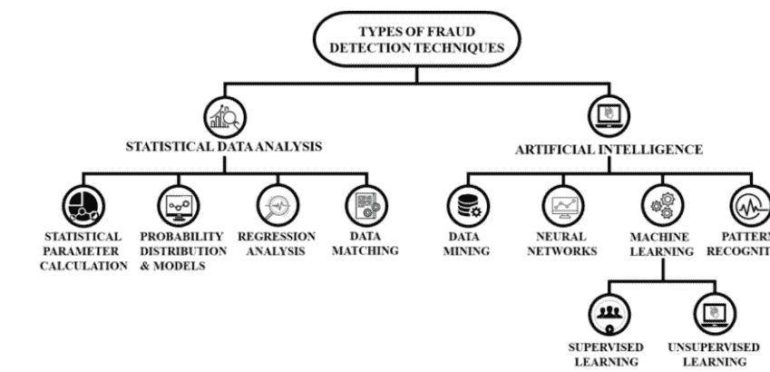

通过生成对抗网络（`GANs`）进行少数过采样与集成形式的`RF`算法相结合，显著提升了信用卡（`CC`）欺诈检测的准确性，同时减少了对劳动密集型人工分析的需求。结果显示，整体性能提升了1.9%，检测率增加了3.2%，并实现了0%的误报率。然而，对方差检测和医学分析等其他领域的探索仍未被开发（Galeb et al., 2023）。神经网络的集成结合特征工程增强了信用卡欺诈检测。分类器在重采样数据上训练时表现出优越性能。值得注意的是，提出的长短期记忆（`LSTM`）超过了其他算法，特异性和敏感性分别达到0.998和0.996。然而，还需要在重采样和特征选择技术方面进一步进展以优化分类性能。在线支付欺诈涵盖了从异常检测到风险管理的所有方面，采用了多种元素来应对这些挑战：用于经济优化的机器学习、机器学习结果欺诈检测以及考虑应对措施的同时预测欺诈风险的模型。通过优化机器学习模型，预期损失进一步减少到52%。这些结果是在0.4%的小假阳性率（`FPR`）下实现的。然而，最终聚合取决于监控步骤，该步骤利用现有欺诈案例的信息为每个模型-特征分配不同的权重。虽然这种方法可以提高检测准确性，但也有许多缺点。首先，对历史欺诈数据的依赖可能会引入偏差，因为可能无法考虑到尚未记录的新兴欺诈策略。此外，基于欺诈模式的权重会导致静态模型，难以适应新的和不断演变的趋势，限制了系统的响应能力，并允许某些欺诈活动未被检测到。确定适当权重的复杂性也可能导致效率低下，使实时检测变得困难。最后，如果所选模型或特征不充分，动态聚合过程将是次优的，从而损害了在动态和快速变化的数字环境中进行欺诈检测努力的有效性（Eseinho et al., 2022; Vanini et al., 2023）。使用模拟退火时间神经网络（`SA-ANN`）和分层时间记忆（`HTM`）对信用卡欺诈检测进行对比分析，揭示了在德国和澳大利亚受控设施（`CC`）数据两个基准数据集上的模拟结果。此外，分层时间皮层学习算法（`HTM-CLA`）在这些数据集上的表现优于`LSTM-ANN`，倍率为2:1。尽管如此，使用`SA-ANN`技术实现了最高的准确率，这表明`HTM-CLA`并不优于已建立的神经网络方法（Osei et al., 2021）。在财务报表中使用机器学习和数据挖掘进行智能反欺诈检测，强调了半监督方法对于财务报表欺诈检测（`FSFD`）的益处。这些技术只需要少量标记样本即可实现稳健的学习并在较大的未标记数据池中识别模式。综述发现，在审查的半监督学习算法中，非结构化数据欺诈检测对于重大进展是必要的（Ashtani et al, 2022）。根据Chaudhary等人（2020）的观点，电子商务支付系统欺诈检测中与行为相关的细粒度共发生表示可作为分析交易特征的稳健模型。这种方法提高了用于识别欺诈活动的行为模型的的准确性和有效性。通过检查各种交易属性之间的复杂关系，这些模型可以更准确地标记可疑行为和指示性模式。然而，将这种先进的数据增强技术应用到其他类型的行为模型在很大程度上仍是未知领域，表明当前研究领域存在空白。在本章中，作者对使用机器学习（`ML`）算法的财务欺诈检测进行了彻底探索。他们旨在通过对几种主要的机器学习技术（包括`SVM`、`LR`、`RF`和`CNN`）进行对比分析，来评估各种算法的效力。这种对比分析对于确定哪种算法在检测欺诈交易方面表现出强性能至关重要，最终有助于更安全的在线支付系统。通过评估这些不同的方法，作者不仅阐明了各自的优缺点，还为未来欺诈检测的进展奠定了道路。

## II. 本综述的贡献

在线金融涵盖了一种业务融资类型，为主要在网上运营的企业提供预付信贷。欺诈管理不当可能导致严重后果，包括公众对政府机构和行业的信任急剧下降。当欺诈处理不当时，可能会在公民中引发怀疑和不确定性，导致他们对预期保护其利益的机构信心降低。这种对信任的侵蚀可能产生更广泛的影响，可能损害国家的国际地位和经济声誉。投资者可能会犹豫与被视为腐败或无效的实体接触，这进一步阻碍投资并抑制经济增长。最终，欺诈管理不当的后果会产生普遍的不安全感，影响社会稳定和经济韧性。本章显著检查了机器学习算法的混合方法，本综述的主要内容如下：

- 分析机器学习算法的作用
- 检测数字交易中的在线欺诈
- 考虑各种方法的技术属性
- 分析如`SVM`、`LR`、`RF`和`CNN`等对比技术

## III. 传统欺诈检测技术综述

尽管有几种传统技术，本节仅描述了部分技术及其方法。

### A. 用于在线欺诈检测的群搜索火萤虫算法（`GSFA`）

受火萤虫行为启发的群智能算法`FA`在该技术中被提出。本文概述介绍了一种结合群元启发算法来攻击信用卡检测问题的混合方法。火萤虫算法（`FA`）的一种新变体——广义火萤虫算法（`GSFA`），用于优化`SVM`和极端机器学习。数据集通常包含大量属性，其中许多属性可能是无关或冗余的。这些不必要的属性会通过扩展搜索空间和增加优化过程来损害分类准确性。`GSFA`元启发算法通过引入针对每个特定`NP`硬问题定制的三个控制因子，有效地解决了这一挑战。这种定制化的方法显著增强了算法高效导航搜索空间的能力，这对于解决复杂问题至关重要。通过优化这些参数，`GSFA`可以更好地适应各种数据集的独特特征，提高收敛速度并识别出解决方案。此外，这种灵活性允许进一步探索可能的解决方案，减少了陷入局部最优的几率。结果是整体分类性能得到显著提高，实现了准确预测。此外，算法的适应性可以使其适用于广泛的领域，从欺诈检测到资源分配，从而扩展了其在不同领域的实用性。最终，这种多功能使`GSFA`成为解决复杂计算挑战的一项宝贵工具。此外，对算法在各种 `NP` 困难挑战中的性能进行进一步评估至关重要（Jovanovic et al, 2022）。图 2 显示了用于检测欺诈的 `GSFA` 流程图。

图 2。群体搜索萤火算法流程图

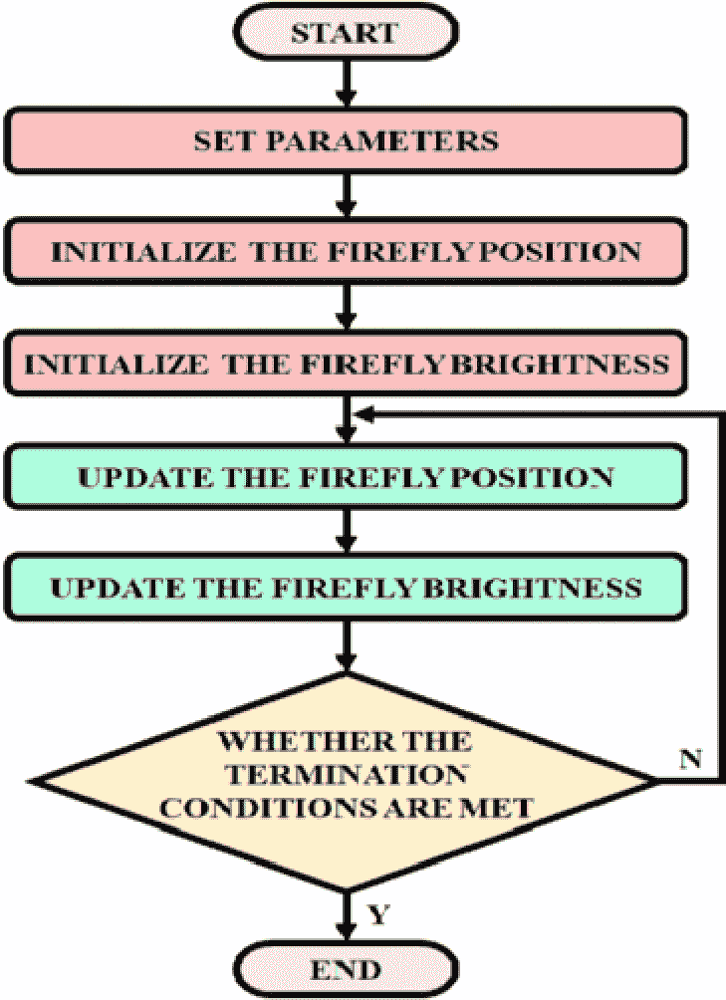

### B. 用于行为欺诈检测的细粒度共现

Wang 等人（2022年）提出的行为建模增强是利用细粒度共现进行数字支付系统中行为欺诈检测的主要关注。该系统利用数据映射识别交易属性之间的复杂相关性，这种组织方式有助于深入分析属性如何相互作用，从而揭示可能指示欺诈活动的复杂模式。此外，该模型采用异构嵌入来增强这些关系的表示，提高了对数据内部不同元素如何相互连接的理解。展望未来，一个令人兴奋的研究机会在于扩展增强方法以涵盖更广泛的模型。这可能包括基于泛的模型以及群体级框架，以提高跨多种用户交互的检测准确性。

### C. 异构图变换 (`HGT`)

Tang 等人（2021年）通过 `HGT` 实现了在线评论系统中的欺诈检测。这种方法经常解决不一致性和伪装问题。标签感知的异构图变换 (`FAHGT`) 采用了开发的特征映射来消除噪声邻居。该系统使用组合机制整合两个神经模块，进行最终特征聚合计算，随后将异构特征结合以形成更具信息的表示。在多个数据集上，与基准方法相比，`FAHGT` 显示了显著的性能提升，凸显了其在捕捉数据关系方面的有效性。未来，目标是进一步开发模型在关系随时间演变的动态图中的能力，使其应用于不同的领域，增加其整体影响力和效用。

### D. 神经分解方法

该方法提出了一种利用神经分解自动编码器 (`NFA`) 的在线欺诈检测方法。这种创新的方法利用 `NFA` 审查客户模式，能够实时检测欺诈电话。该模型有效地整合了神经网络和自动编码器，通过记忆模块捕获通话模式，以动态适应不断变化的行为。图 3 显示了 N 方法的流程图。实证结果表明，该方法与基准方法相比性能更优，实现了 AUC 91.06%、91.89% 的真阳性率 (`TPR`)、14.76% 的 `FPR` 以及 95.45% 的 `F1` 分。未来，目标是将该方法论扩展到其他形式的欺诈，通过探索优化解决方案并利用 transformer 架构中的尖端 `ML` 技术，最大限度地缩短检测系统的执行时间（Wahid et al 2024）。

图 3. 神经分解方法流程图

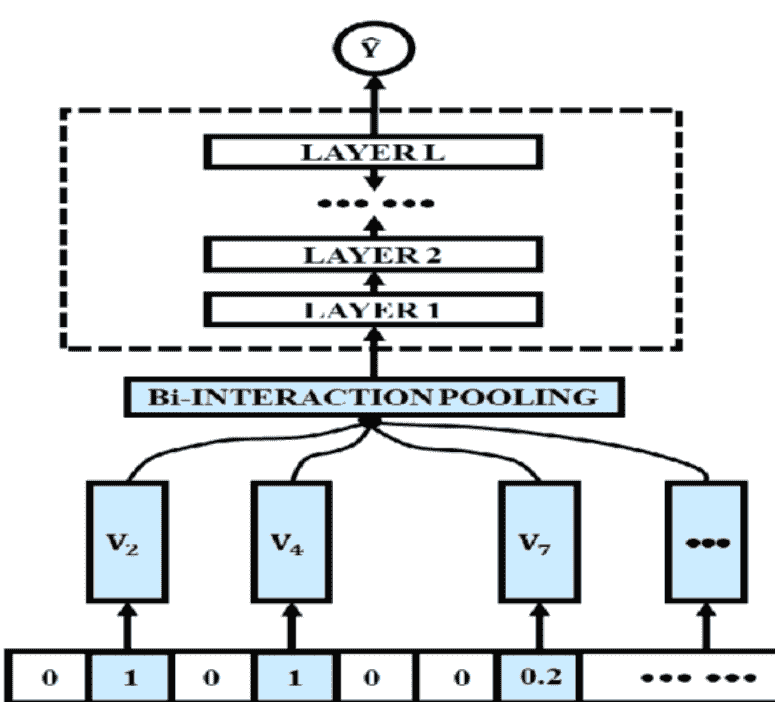

### E. 使用神经分解自动编码器的 `CC` 欺诈检测

使用深度学习模型进行 `CC` 欺诈检测具有许多优势。这些先进算法能够惊人的速度处理大量的交易数据，识别出显示欺诈活动的复杂模式和异常。深度学习算法从大型数据集中学习的能力使得检测准确性不断提高，使其在适应不断演变的策略方面特别有效。此外，改进的架构（如 `CNN` 和循环神经网络 `RNN`）可以捕捉数据中的空间和时间关系，进一步增强了人工监督。这些模型的自动化性质也减少了对大量人工操作的需求，简化了欺诈检测流程。然而，也存在需要考虑的缺点。深度学习模拟的准确性很大程度上取决于训练数据的质量和数量；不足或偏偏的数据集可能导致预测不准确。高假阳性率、损害真实交易和潜在的信任客户是导致模型遭受问题的因素。深度学习 (`DL`) 算法的计算复杂度面临不同的问题，如可解释性，使得难以理解决策过程。最后，模型的维护和实施需要专业知识、大量的资源投入以及稳定的更新来赞赏新方法。平衡这些优缺点对于有效的欺诈检测至关重要（Sulaiman et al, 2024）。

### F. 低频交易的欺诈检测方法

引入了一种构建个人行为的新方法，旨在通过整合当前交易组行为和交易状态来提高低频用户行为的准确性。最初，仅利用用户的历史交易，采用最优风险确定基准。随后，应用基于噪声的空间密度聚类 (`DBSCAN`) 聚类算法，从当前正常和欺诈样本中提取行为特征，最终形成当前交易组内的集体行为。最后，利用滑动窗口机制为用户创建精细的交易行为画像。本文提出的方法展示了显著的功效，特别是对于低频用户，因为它在熟练识别欺诈交易的同时，保持了极低的正常交易误判率。然而，未来的重点将转向解决在线模型更新的挑战，以进一步增强该方法的有效性（Zhang et al, 2020）。图 4 展示了低频交易的欺诈检测模型。

图 4. 低频交易欺诈检测方法流程图

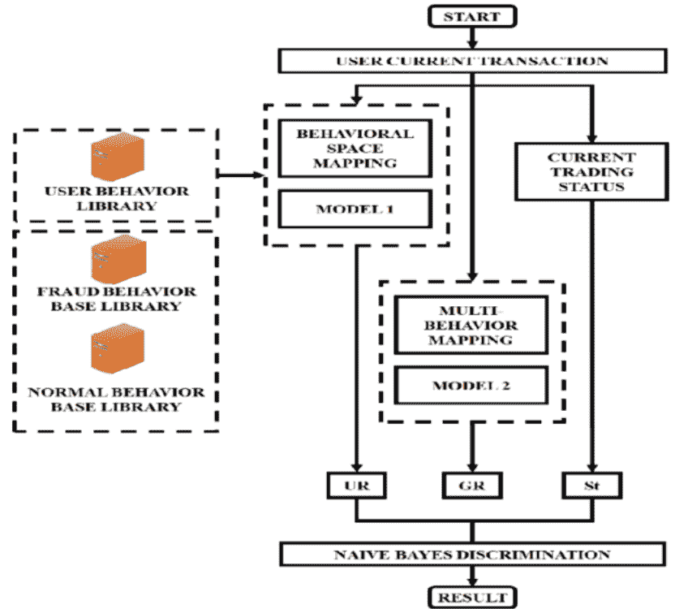

(Zhang et al, 2020)

### G. 使用 `CatBoost` 和 `XGBoost` 增强 `LightGBM` 方法

Hashemi 等人（2022年）提到使用各种 `ML` 方法对金融数据进行欺诈检测。这包括作为不平衡数据预处理的权重调节，以及结合 `CatBoost` 和 `XGBoost` 来增强 `LightGBM` 方法的准确性。这些技术旨在精确检测欺诈活动，同时提高系统在不同交易环境中的适应性和扩展性。

该技术的目的是降低在线信用卡交易中极高的误报率，即数字交易被错误地识别为欺诈。降低误报率是提高客户满意度的重要因素，因为欺诈警报会引起客户愤怒并降低对系统的信任。此外，误报率的减少可以通过减少对标记交易进行人工审核的需求来节省运营成本。然而，这些技术的实现需要高效的算法，这带来了与数据质量相关的挑战。

### H. 使用模糊逻辑回归进行在线欺诈检测

Charizaros 等人（2024）引入了一种用于信用卡交易的在线模糊欺诈检测框架，该框架利用模糊逻辑来管理交易数据中的不确定性和印象。这种方法允许对欺诈风险进行更细致的评估，考虑到合法用户之间交易模式的巨大差异，这至关重要。该框架通过模糊规则整合了专家知识，基于上下文因素做出明智决策。然而，它也存在缺点。系统在无需人工干预的情况下避免欺诈模式的能力取决于基于模糊系统的定义规则，而该系统具有提高输入数据质量的能力。这导致了需要建立的主要问题。此外，高误报率是一个风险因素，会导致非重要交易被拒绝以及用户满意度下降。最后，系统被集成到一个更复杂、资源密集型的直观结构中，这需要进行微调以确保其在稳定状态下的透明化性能。

### I. 监督学习方法的分析

利用 `SVM`、`DT`、`RF` 和 `LR` 等算法来防止和识别在线交易中的欺诈行为。这些方法在正文早期提到算法或方法的区域为欺诈检测提供了验证。该模型通过利用已标记的历史数据来实现高准确率，这些数据是训练和完善其预测能力的关键资源。通过对给定数据进行分析，检测结果证明是可靠的，且模型识别的模式与欺诈参数相关。它促进了影响欺诈检测的可视主要特征，使利益相关者能够提供影响模型结论的特定元素。尽管如此，模型的复杂性虽然解决了这些分类问题，但也使得使用户难以完全理解其运行机制。这种复杂性要求持续重新训练以适应欺诈模式的变化，确保模型在不断变化的威胁格局中保持有效（Reddy et al., 2022）。

### J. 通过监督学习技术进行信用风险评估中的欺诈检测

在风险评估中使用监督学习对信用卡进行欺诈检测，提供了对大量历史数据的调查，以识别使欺诈检测特征产生更准确风险因素的模式。根据所需和产生的数据，算法不断改进，通过训练数据集也提高了了检测过程的准确性。`DT`、`SVM` 和 `NN` 是一些示例方法，使利益相关者对决策过程和影响风险评估的因素有稳定的理解。然而，对标记信息的依赖是一个风险因素，既昂贵又耗时，且难以获取高质量数据集。此外，监督学习模型无法识别系统集中不存在的受监督和未知欺诈模式，导致了高漏报率。此外，这些模型存在过拟合风险，当它们运行在训练过的数据集而非实际数据上时，就会发生这种情况。最后，实施监督学习算法需要大量的计算资源和专业知识，使得小型组织难以触及（Xu et al, 2024）。

### K. 利用风险管理策略的机器学习欺诈检测系统

将机器学习驱动的欺诈检测技术集成到风险管理框架中，可以实时检测大量的交易信息。该系统的主要方法包括数据收集和预处理，以及风险管理框架内各种机器学习模型的特征选择。该系统允许开发与传统方法不同的间歇模式和策略。这提高了该方法欺诈检测的精度和准确性。此外，机器学习算法模型获取新数据使其能够调整策略。在实施风险管理框架时，工业领域根据其潜在影响优先考虑欺诈检测。然而，更复杂的资源配置和机器学习模拟的复杂性难以理解，导致了决策过程中的风险因素（Guo et al, 2024）。

### L. 利用机器学习算法进行实时欺诈检测方法

使用机器学习算法对实时欺诈进行分析，这还利用了数字系统中的海量交易数据和指向系统欺诈行为的模式。主要方法是使用相关指标进行性能评估，通过持续更新和监控来检测欺诈活动。这些特征减少了财务损失，提高了整体安全性并提升了欺诈检测的准确性。此外，机器学习算法模型吸收新信息并不断改变方法和策略，降低了漏报的可能性。实时检测提供了更早的欺诈交易发现，保护了客户的财务。然而，机器学习算法的复杂性导致解释困难并阻了决策过程。此外，训练数据的质量更为有效，否则会导致对欺诈活动的预测不足。高误报率可能导致交易取消和数据交易被拒绝。系统为了检测目的也需要一种密集型的方法（Nakra et al. 2024）。

使用元启发式技术和机器学习算法进行有效的信用卡欺诈检测

通过使用元启发式技术和机器学习进行高效信用卡欺诈检测具有若干优势。这些机器学习算法能够访问海量交易数据，有效处理复杂模式并指示欺诈行为。粒子群优化算法（`PSO`）和遗传算法（`GA`）等方法用于优化机器学习模型，并提高它们在欺诈检测中的效率和准确性。通过整合这些方法，组织可以创建一个更有韧性的检测系统，适应随时间变化的欺诈策略。然而，这些技术通常减少了人工干预的需求，简化了检测过程并允许团队专注于关键调查。但是，如果由于高误报率将真实交易误识别为欺诈数据，客户将失去信任和满意度。合并元启发式技术与机器学习算法的复杂性也可能带来实施挑战，需要大量的资源和专业知识。此外，持续的维护和调整对于适应新的欺诈策略至关重要（Mosa et al, 2024）。

本节回顾了检测在线欺诈的先进技术。`GSFA` 是第一粒度共现技术，使用基于行为的检测来描述交易交互。接下来讨论了 `HGT` 方法，该方法通过考虑在线评论的不一致性和伪装来改进检测。欺诈客户还提出了一种针对低频交易的新方法，`NFA` 分析通过融合历史和当前数据准确地预测了这一点。最后，研究了在 `LightGBM` 之上使用 `CatBoost` 和 `XGBoost` 增强银行欺诈检测的方法，指出了数据质量问题。下一节将检查几种机器学习算法在欺诈检测中的效能。

## IV. 机器学习技术回顾

### A. 机器学习与区块链

Ashfaq 等人（2022）的作者引入了一种无缝集成机器学习和区块链技术的安全欺诈检测模型。这种创新方法利用了两种强大的机器学习算法 —— `XGBoost` 和 `RF` 进行交易分类。通过在包含欺诈和合法交易的数据集上进行训练，这些技术可以准确地预测新交易。图 5 显示了使用 `SMOTE` 的机器学习算法流程图。区块链技术的集成定义了模型在比特币网络中的欺诈检测能力。虽然使用 `SMOTE` 生成合成恶意数据点可以增强性能并产生更优的结果，但也需要考虑一些缺点。一个主要的局限是模型对对抗攻击的敏感性，恶意攻击者会专门设计用于误导算法的输入。这种脆弱性会损害从合成数据生成中获得的处。此外，依赖 `SMOTE` 可能会导致过拟合，因为模型可能在人工创建的数据上变得过度专门，阻碍其泛化到现实世界场景的能力。这可能会降低其在新型场景中的有效性

欺诈活动。此外，生成合成数据的计算需求可能会增加处理时间，特别是在实时应用中，可能会影响系统效率。最后，合成数据的质量至关重要；如果生成的点无法准确代表真实模式，模型的整体准确性和可靠性可能会受到影响，从而对其在实际应用中的有效性构成重大风险。

图 5. 使用 `SMOTE` 的 `ML` 算法流程图

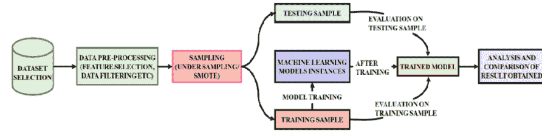

(Khalid et al, 2024)

### B. 融合机器学习赋能欺诈检测

该方法提出了一种由融合机器学习（Fused ML）允许的实时订单融合检测系统。该模型结构分为训练和验证两个阶段，数据分为 70% 训练集和 30% 验证。它由三个子模块组成：第一个模块采用 `SVM` 和 `ANN` 等两种机器学习算法，在同一数据集上同时训练，以寻找竞价欺诈。`SVM` 和 `ANN` 生成的预测被馈到基于模糊的融合模块中。在该模块内，模糊逻辑机制处理这些输入并得出最终输出，利用了两种算法的优势。这种新的融合机器学习方法实现了 99.63% 的卓越准确率，证明了其在准确识别结果方面的有效性。此外，模拟结果表明这种融合方法优于现有技术，强调了其卓越性能。通过模糊逻辑对 `SVM` 和 `ANN` 的集成不仅增强了预测能力，还为应对复杂的决策挑战提供了稳健的解决方案。然而，准确性方面仍有改进空间，因此提高准确性将是未来迭代的重点（Abidi et al, 2021）。图 6 展示了融合机器学习在线金融欺诈检测的流程图。

图 6. 融合机器学习在线金融欺诈检测流程图

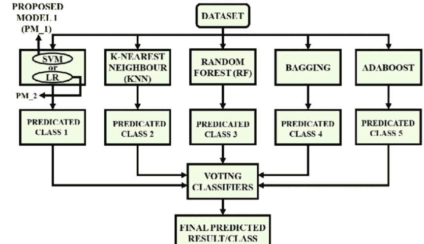

(Khalid et al, 2024)

### C. 结合 `CatBoost` 的 `K-NN` 采样技术

本文介绍了一种利用机器学习的增强型 CC 欺诈检测模型。鉴于打击欺诈 CC 交易的迫切需求，本研究通过两阶段进化过程探索了 66 个机器学习模型。利用欧洲持卡人的真实世界数据集并采用 `K` 折验证，对每个模型进行了严格评估。在这些模型中，全 `KNN` 欠采样方法结合 `CatBoost`（`AIKNN-CatBoost`）表现最优。将 `AllKNN-CatBoost` 方法与现有方法进行了详尽对比，显示出优异的性能：`97.94%` 的 `AUC` 值、`95.21%` 的召回率和 `87.40%` 的 `F1` 分。然而，未来探索替代数据集和优化算法的工作也有自身的缺点。首先，替代数据集的可用性和质量可能不一致，可能导致不可靠的见解。此外，不同的数据集可能无法充分代表信用卡欺诈的特定模式，难以实现有效的模型训练。此外，优化算法的复杂性可能会增加计算需求，阻碍实时处理能力。最后，依赖新数据集和算法可能需要对现有模型进行大量训练，导致时间资源资源限制，可能延迟改进后的欺诈检测系统的部署（Alfaiz et al, 2022）。

## 使用 FPMA 技术和 Apriori 增长算法进行 CC 欺诈检测

作者在 Vipin et al (2017) 中发表了 `Apriori` 方法，此处列出了 `FP` 树方法的两个步骤。第一阶段构建 `FP` 分割树（`FP Split Tree`），与 `FP` 树相比，这是一种产生候选集更有效的方法，因为它只需要扫描一次数据库，而后者需要多次。在过程的第二阶段，挖掘由 `Apriori` 增长算法生成的 `FP` 分割树，效率是之前的两倍。这种方法比传统的 `FP-Growth` 算法显著提高了时间效率，主要是因为消除了持续递归构建 `FP` 分割树的需求。在 `FP-Growth` 中，这种递归生成会产生巨大的开销，特别是在处理较大数据集时。通过利用 `FP` 分割树，算法有效地减少了搜索空间，能够更快地访问相关项集。这种效率的提高不仅加快了过程，还提高了整体性能，对于管理复杂的数据场景特别有益。通过消除递归搜索的需求，`FP` 分割树显著简化了 `FP` 树的复杂性。此外，它只需要扫描一次数据库，而需要两次扫描的 `FP` 树以及通常需要多次扫描的 `Apriori` 算法。然而，这种方法的有效性可能会长模式形成的影响，使检测过程变得复杂。检测欺诈卡活动的整个工作流如图 7 所示，为该方法的效率和结构提供了清晰的视觉表示。

图 7. 欺诈卡使用检测的流程

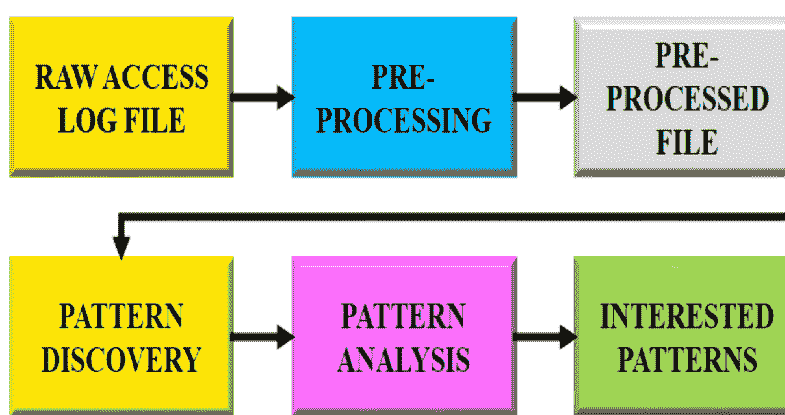

(Vipin et al, 2017)

## E 用于欺诈检测的改进型增量和交互式 FPMA

Sherly et al (2015) 的作者利用并行方法对数据的计数分布和压缩分布开发了一种分布式 `FPM` 技术。该方法通过基于前缀的等价类划分策略，在不创建占用内存的频繁事件的情况下创建频繁项集。该方法通过多种支持值以较少的时间复杂度更新模式。此外，通过在两个最小支持阈值辅助建立最频繁项目，它允许用户根据自己的方便情况交互地修改支持值。在短时间内，该方法能够快速准确地跟踪用户消费概况。挑战在于交互式并逐渐识别所有值得关注的趋势以停止在线金融欺诈。

### 使用高级机器学习技术进行金融欺诈检测

分析使用深度学习算法进行金融欺诈检测，以处理标准方法无法注意的海量复杂数据和模式，改进了欺诈检测的精确度，减少了组织的财务损失。深度学习算法通过处理新数据提高了连续性，使其能够迅速适应不断变化的欺诈策略并减少漏报。它们的自动化特性提高了效率，促进了对潜在欺诈的实时检测和响应，这在快速金融交易中至关重要。然而，由于系统的复杂性，深度学习模型相当挑战性，导致了欺诈交易的可视性问题。此外，用于训练的数据的数量和质量是评估策略的关键因素。高计算需求也带来了挑战。最后，高误报率可能会干扰合法客户，导致不必要的交易拒绝并可能对金融机构造成声誉损害（Name et al, 2024）。

### G 使用遗传算法进行 CC 欺诈检测

Ileberi (2022) 的作者提出了一种基于机器学习的 CC 欺诈检测引擎，使用通用方法选择特征。`GA` 使用 `RF` 技术作为其适应度评估方法，是因为几个关键优势。它特别擅长处理大量的输入变量，是具有众多特征的数据集的理想选择。它还能独立管理缺失值，有助于在不需要大量数据预处理的情况下维护分析的完整性。`RF` 对噪声数据具有鲁棒性，相比其他方法提供了更可靠的预测。`RF` 受受欢迎的一个重要原因是它有效解决了传统决策树（`DTs`）常见的过拟合问题，这种问题会导致模型在训练数据上表现良好但在新数据上失败。

# 使用量子图网络 (QGN) 进行金融欺诈检测

金融案件的欺诈检测利用了图结构的特殊属性和量子计算，通过对交易数据的关系进行复杂建模来提高检测准确性。它们同时处理大型数据集的能力使其比传统方法具有更高的分析速度，成为实时欺诈检测的理想选择。此外，`QNN` 在发现数据中复杂模式和纠正方面表现更好，而传统算法会导致系统局限于新型欺诈检测。然而，专门针对技术挑战且具备相关专业知识的量子算法，其实施成本高昂，并限制了许多机构的访问。此外，该技术仍处于开发、系统和可扩展性阶段，在现实应用中存在集成问题。此外，`QNN` 具有挑战性，这可能会影响决策过程的透明度。此外，对量子原理的依赖引入了不确定性，因为该领域仍处于发展阶段（Innan et al, 2024）。

# I. 使用机器学习进行欺诈检测

使用机器学习进行欺诈检测允许对大量数据进行快速分析，有效识别可能预示欺诈活动的模式。这种能力增强了识别的准确性。机器学习通过不断从新数据学习学习来提高预测能力。然而，训练数据的数量和质量对于欺诈活动的检测效能至关重要，数据不完整会导致系统预测不准确（Olushola et al., 2024）。

# J. 使用机器学习和 ANN 方法预测洗钱

通过利用 `ML` 算法和 `ANN` 进行数据交易的欺诈活动预测，能够实现快速处理。这种方法通过数据的复杂性和导致非法活动的异常情况，成功地对海量数据进行分层。系统修正以往数据的能力使其能够不断提高准确性，并擅长识别交换策略。此外，`ANN` 被识别为能够处理数据中的非线性关系，而传统技术改进了检测技能。此外，该系统还需要人工干预，这有效地为组织内部的更多条目增加了资源支持。然而，训练数据集的数量和质量对这些模型至关重要，会影响系统的效能。此外，`ML` 算法会产生高率的假阴性，这将影响客户信心并导致调查徒用。由于其复杂性，`ANN` 带来了解释性问题，使利益相关者难以理解决策过程。最后，这些系统是资源密集型的，需要定期升级和专业知识来调整新策略（Lokanan et al, 2024）。

# K. 回归分析增强的信用卡交易欺诈检测决策树算法

Baghi 及其共同作者 (2021) 将回归分析添加到决策树算法中，创建了一个增强的信用卡欺诈检测系统。整合回归分析和决策树是为了提高系统更准确地检测欺诈交易的能力，并有效地跟踪可疑活动。结果系统显示出水平的有效性，准确率达到 `81.6%`，表明其在交易分类方面的性能强大。此外，该系统成功检测到所有测试入侵，展示了其在识别欺诈活动方面的可靠性。然而，该研究也指出了几个缺点。回归分析和 `DT` 的结合增加了系统的复杂性，导致管理和执行变得更加困难。系统面临的过拟合风险更具挑战性。未测试的数据集开发不足，再次导致了过拟合问题。由于现实应用的不运行，复杂性增加。大量数据集的低效率导致了复杂的基础设施，降低了准确性并减慢了处理速度。这带来了成本增加和系统复杂化等问题。最终，通过结合决策树和回归可以产生强大的洞察，但相关的困难需要仔细考虑，以确保有效的部署和维护。

本文回顾了用于在线欺诈检测的高级机器学习方法。对于信用卡欺诈，首先使用了 `RF` 和 `XGBoost`；对于基于行为的检测，使用了 `SVM` 和 `ANN`。为了有效检测欺诈电话，提出了 `Apriori Growth`、`FPMA` 和决策树。讨论了使用 `KNN` 解决伪装和结果不一致的问题。最后，本研究检查了 `GA` 与 `RF` 结合以增强银行业欺诈检测，重点关注与数据质量相关的挑战。通过采用 `GA`，模型可以优化特征选择并加强 `RF` 识别欺诈模式的能力，提高检测准确性。下一节将对传统的欺诈检测方法（如基于规则的系统）与现代机器学习技术进行对比分析，突出它们各自的优缺点。

## V. 比较分析

通过比较分析分析了某些传统技术的性能。该比较分析见表 1。

### 表 1. 传统技术的比较分析

| 序号 | 作者 (发表年份) | 使用的方法 | 优点 | 缺点 |
| :--- | :--- | :--- | :--- | :--- |
| 1 | D Zhang 等人 (2020) | 采样技术和 `SVM` | 结果表明，新标准的实施显著增强了欺诈检测。这种方法减少了财务损失。 |  |
| 2 | 周杭州 等人 (2021) | 智能和大数据方法 | 系统具有处理交易的能力，能够识别欺诈活动并最小化潜在损失。 | 实现大数据方法需要精通管理大量数据集和监督计算资源。 |
| 3 | Amit Gupta 等人 (2021) | 利用朴素贝叶斯、`C.4 DT` 和袋装集成算法 | 朴素贝叶斯展现了卓越的计算效率和速度。在处理大量数据集时，其有效性依然存在，使其对快速欺诈检测至关重要的现实场景具有高度适用性。 | 朴素贝叶斯在处理连续变量或正态分布数据时性能不佳。 |
| 4 | Poongi (2021) | 基于信息增的支持向量机制 (`SVMIG`) | `SVMIG` 在识别欺诈交易方面表现出高准确性。 | 然而，实施 `SVM` 等算法的组合可能会带来复杂性。此外，训练 `SVM` 将具有很高要求，特别是在处理大量特征时。 |
| 5 | Mohamad Khedmati 等 (2020) | 基于噪声的空间聚类支持向量数据描述 (`SVDD`) | 该方法提供的结果表明使用该方法将欺诈检测过程增强到两类，展示了速度和性能的提高。 | 然而，微调 `SVDD` 参数的方法未达到预期准确率。 |
| 6 | Hilal 等人 (2022) | `SVM` 和 `ANN` | 检测技术具有增强识别欺诈活动准确性的能力，这是控制财务损失的关键方面。 | 然而，与简单模型相比，该方法需要精细的设计和调优。此外，这些通常需要更高质量和数量的数据。 |
| 7 | Udayakumar 等 (2023) | 深度欺诈网络方法 | 深度网络方法为网络安全和欺诈风险提供了增强的检测和分类。 | 然而，这种技术面临可访问性和数据集不平衡的问题。 |
| 8 | Warghadeh 等人 (2020) | 孤立森林方法-`SMOTE` | 它具有准确性。该方法识别了减少的欺诈离群值。 | 尽管如此，该方法面临类别不平衡问题，并且产生高假阳性率。 |

表 2 比较了各种机器学习算法的性能，并对其性能进行了讨论。

### 表 2. 不同机器学习算法的对比分析

| 序号 | 作者（发表年份） | 方法论 | 优点 | 缺点 |
|---|---|---|---|---|
| 1. | Riany 等人 (2021) | 使用 `ANN` 方法作为数据分析方法。 | `ANN` 具有学习数据内部模式和关系的能力，从而实现了高准确率。 | 然而，它们需要大量数据进行有效训练，且性能很大程度上依赖于这些数据的质量。 |
| 2. | Seera 等人 (2024) | `SVM` 和 `ANNs` 等机器学习技术。 | 智能系统能够在保持误报率的同时实现对欺诈交易的广泛覆盖，增强了检测能力。 | 错误地将交易标记为欺诈或忽略真实的欺诈案例会导致不便和财务影响。 |
| 3. | Karthika 等人 (2023) | 一维卷积神经网络 (`DCNN`) | `CNN` 在处理敏感数据方面表现出高效性，提高了欺诈检测的准确性。系统自动识别可疑交易，减少了对人工干预的需求。 | `CNN` 的复杂性为解释决策过程带来了挑战。 |
| 4. | Rout 等人 (2021), Aburbian 等人 (2023) | `SVM`, `DT` 和 `RF` | 机器学习模型处理来自交易数据的高复杂模式，实现了精确检测。机器学习技术增强了海量交易数据的处理能力。 | 某些机器学习模型可能更为复杂，给解释带来挑战。模型过于复杂，使其难以解释。 |
| 5. | Asha 等人 (2021) | `SVM`, `ANN` 和最近邻 (`KNN`) | 该方法实现了约 `96%` 的准确率，证明其在信用卡欺诈检测中非常有效。 | `ANN` 需要引导，且开发方面需要专业知识。如果模型变得过于复杂，存在过拟合风险，难以拟合噪声。 |
| 6. | Alharbi 等人 (2022) | `CNN` 技术 | 利用深层特征，所提出的 `CNN` 实现了 `98.81%` 的惊准确率。 | 然而，基于文本的分类方法尚未扩展到解决欺诈检测中的挑战。 |
| 7. | Megdast 等人 (2022) | `SVM` 和 `ANN` 技术 | 使用平衡数据集的分类器在准确率、召回率和 `F1` 分数方面提供了更好的性能。 | 然而，在线交易模式的识别相对于适当模式变得越来越简单。 |
| 8. | Vengates 等人 (2020) | 用于信用卡欺诈检测的 `KNN` 方法 | 增强了可扩展性——能够识别复杂模式。降低了假阳性率。 | 然而，该方法面临数据质量问题，影响了系统的有效性。 |
| 9. | Sorour 等人 (2024) | `SVM` 技术 | 它导致了更好的欺诈检测。该方法对数据不那么敏感。 | 然而，数据集较大，与简单算法相比，处理时间更长。 |

图 8. 使用不同算法的准确率比较

## 欺诈检测的准确率

图 8 展示了不同机器学习算法所实现的准确率比较，包括 Triveni 等人 (2020)、`ANN` (Abidi 等人，2021)、`RF` (Ilebari 等人，2022)、`LR` (Mehbodi 等人，2021) 和 `CNN` (Balawi 等人，2023)。值得注意的是，`CNN` 算法实现了 `99.81%` 的增强率，在准确率方面表现出优越性能。

图 9. 使用不同算法的特异性比较

## 欺诈检测的特异性

在图 9 中，各种用于在线欺诈检测的机器学习特异性比较包括 Esenogo 等人 (2022)、`CNN` (Safari 等人，2022)、`LR` (Hussein 等人，2021) 和 `ANN` (Abidi 等人，2021)。值得注意的是，`CNN` 获得了令人深刻的特异性，优于其他技术。

图 10. 使用不同算法的 F1 分数比较

在图 10 中，使用各种技术（如 `LR` (Alfaiz 等人， 2022)、`RF` (Ilbari 等人， 2022)、`SVM` (Almazroi 等人， 2023) 和 `CNN` (Alshiniti 等人， 2023)）进行在线欺诈检测的 `F1` 分数比较显示，`CNN` 实现了 `99.2%` 的惊人 `F1` 分数。这表明 `CNN` 在检测信用卡欺诈方面特别有效。

## 六. 结论

机器学习为检测在线环境中的金融欺诈提供了强有力工具。通过对大量数据集的分析，机器学习模式和异常揭示了欺诈行为。Arjun 等人 (2024) 提到，在线欺诈检测的机器学习方法遵循了严格的规范和标准，以确保识别欺诈活动时的合性和可靠性。这些技术利用尖端算法来评估交易数据、可疑趋势并降低风险，同时遵守有关问责和透明的法律义务。该表总结了该领域不同学者的重要贡献，阐明了用于打击金融欺诈的各种方法和手段。`SVM`、`FPGA`、`LR`、`RF`、`ANN` 和 `CNN` 是此目的的常用算法。与传统的人工验证方法相比，机器学习大大增加了欺诈检测所需的资源。尽管如此，使用新数据更新和训练模型以维持效能至关重要。

Esenogho, E., Mienye, I. D., Swart, T. G., Aruleba, K., & Obaido, G. (2022). 用于改进信用卡欺诈检测的基于特征工程神经网络集成。IEEE Access : Practical Innovations, Open Solutions, 10, 400–407. DOI: 10.1109/ACCESS.2023.314298

Ghaleb, F. A., Saed, F., Al-Sarem, M., Qasem, S. N., & Al-Hadhimi, T. (2023). 基于集成合成少数类过采样的生成对抗网络和随机森林算法的信用卡欺诈检测。IEEE Access : Practical Innovations, Open Solutions, 11, 694–710. DOI: 10.1109/ACCESS.2023.330621

Guo, Lifeng, Runze Song, Jiang Wu, Zeiu Xu, and Fanyi Zhao (2024). 基于风险管理框架的机器学习驱动欺诈检测系统集成，1.

Gupta, A., Lohani, M. C., & Manchanda, M. (2021). 在高度不平衡数据集中使用朴素贝叶斯进行金融欺诈检测。Journal of Discrete Mathematical Sciences and Cryptography, 24(5), 1559–1572. DOI: 10.1109/09702752.2021.196973

Hasan, Iqbal, and S. Rizvi (2022). 电子商务交易中 AI 驱动的欺诈检测与缓解。数据分析与管理会议：ICAM.

Hashemi, S. K., Mirtaha, S. L., & Greco, S. (2023). 机器学习技术在银行欺诈检测。IEEE Access : Practical Innovations, Open Solutions, 11, 3034–3043. DOI: 10.1109/ACCESS.2022.3322287

Hilal, W., Gands, S. A., & Wanney, J. (2022). 金融欺诈：异常检测技术与最新进展综述。Expert Systems with Applications, 193, 1036110. 10.1016/j.eswa.2021.116429

Hussein, Ameer S., Riyab S. K., Shaima Mohamed N., and Haider Salim A. (2021). 使用模糊粗糙最近邻和逻辑回归最小化优化的进行信用卡欺诈检测。International Journal of Mobile Technologies, 15.

Iberlei, E., Sun, Y., & Wang, Z. (2021). 使用 SMOTE 和 AdaBoost 进行信用卡欺诈检测的方法性能评估。IEEE Access : Practical Innovations, Open Solutions, 9, 86–94. DOI: 10.1109/ACCESS.2021.3134330

Iberlei, E., Sun, Y., & Wang, Z. (2022). 基于遗传算法（GA）特征选择的机器学习信用卡欺诈检测。Journal of Big Data, 9(1), 24. DOI: 10.1186/s40537-022-00573-8

Innan, N., Awaika, A., Dhor, A., Thota, S., Gokal, H., Partal, N., Khan, M. A.-Z., Theodos, I., & Benn, M. (2024). 使用量子图神经网络进行金融欺诈检测。Quantum Machine Intelligence, 6(1), 7. DOI: 10.1007/s42884-024-00143-6

Iscan, C., Kumas, O., Akbult, F. P., & Akbult, A. (2023). 专注于最小化误报的基于 LightGBM 钱包交易欺诈预防。IEEE Access : Practical Innovations, Open Solutions, 11, 65–74. DOI: 10.1109/ACCESS.2023.321666

Jovanovic, S. Milos, Zivkovic, M., Tasankovic, Bananin (2022). 使用分组萤火虫算法调整用于信用卡欺诈检测的 ML 模型。MDPI Journal-Mathematical, 10.

Karthika, Jagadeesan, Senthilvisi, Ayothi (2023). 基于采样技术的扩张卷积神经网络的智能信用卡欺诈检测系统。Multimedia Tools Applications, 82, 01-18.

Khalid, A. Rehman, N. Owoh, Oumar U., Moses A., Jude O., John A. (2024). 增强信用卡欺诈检测：一种集成机器学习方法。Big Data and Cognitive Computing, 8.

Khedmati, Mohamad, Masouf Erani, Mohammad GhashemiGol (2020). 应用支持向量数据描述进行欺诈检测。arXiv Journal, 618.

Liu, Aiming, Kun Chen, Qian Liu, Qingsong Ai, Yi Xie, Anqi Chen (2017). 基于萤火虫算法和学习自动机的运动意象 分分类特征选择。MDPI Journal: Sensors, 17.

Lokanana, M. E. (2024). 使用机器学习预测洗钱。Journal of Applied Security, 19(1), 20–44. DOI: 10.1080/19364610.2022.211474

Mananjeev, S., & Cheng P. C. (2024). 智能支付卡欺诈检测。Annals of Operations Research, 334(1), 445–467. DOI: 10.1007/s10479-021-

Megdos, Masa MM, Sammy S Abu-Naser and Bassem S Abu-Naser (2022). 使用 ML 进行欺诈检测。International Journal of Academic Systems, 6.

Mehbodniya, A., Alam, I., Pande, S., Neware, R., Kane, K., Shahaz, M., & Madhavan, M. (2021). 医疗保健中的金融欺诈检测。Security and Communications.

Mosa, D. T., Sorour, S., Aboh, A., & Maghabry, A. (2024). 使用深度学习进行金融欺诈检测。Mathematics, 12(1).

Nakra, V., Pandi, K., Chanchela, P. (2022). 使用机器学习进行实时欺诈检测。Multidisciplinary Innovation, 3, 165–175.

Nama, F. A., & Obaid, A. (2024). 使用深度学习进行金融欺诈识别。Alexandria Engineering Journal, 3, 141–147. DOI: 10.5514/ajest.2024

Oloshusha, A., Mart, J. (2021). 使用模拟退火进行信用卡检测。Science and Technology, 8.

Osei, E. N., Softprints, D. (2021). 多层感知机欺诈检测分析。Journal of Systems, 6.

Poongodi, K., Kumar, D. (2022). 使用支持向量机进行欺诈检测。Journal of Internet and Information Security, 13, 138–157.

Reddy, K., Information, D. (2022). 使用分层内存进行欺诈检测。Computational Intelligence, 7.

Rout, M., Siana, S. (2021). 基于机器学习的高效信用卡欺诈检测。Financial Innovation, 9, 1). DOI: 10.1186/s40854-023-00470-w

Safari, E., Riany, R. (2022). 使用萤火虫算法进行欺诈检测。Applied Computational Intelligence, 8, 159–171.

Sherly, K., Analytic, S. (2020). 使用频繁模式挖掘进行信用卡检测。Boosting in Mathematics: 9, 1185–1196.

Singh, A., Anurag, J. (2021). 使用支持向量机进行欺诈检测。Journal of Advanced Science, 2021. DOI: 10.1155/2021/1468

Sulaiman, S. N., Haameed, S. M. (2024). 使用深度学习进行金融欺诈检测。Computers & Materials & Continuity, 78(1), 1049. DOI: 10.32604/cmc.2023.046

Taha, A. A., Malebery, S. (2020). 使用优化梯度提升进行信用卡欺诈检测的智能方法。IEEE Access : Practical Innovations, Open Solutions, 8, 25579–25587. DOI: 10.1109/ACCESS.2020.297135

Tang, J., Lin, L., & Chen, F. (2021). 使用异构图进行在线评论欺诈检测。IEEE Access : Practical Innovations, Open Solutions, 9, 64–73. DOI: 10.1109/ACCESS.2021.308494

Trivedi, N. K., Simaayi, S., Linton, U. K., & Sharma, S. K. (2020). 基于机器学习的高效信用卡欺诈检测模型。International Journal of Advanced Science and Technology, 29, 14–24.

Udayakumar, R., Joshi, A., Boomiga, S. S., & Sugumar, R. (2023). Deep Fraud Net：用于网络安全和金融欺诈检测与分类的深度学习方法。Journal of Internet Services and Information Security, 13, 138–157. DOI: 10.58346/IJIS.2023.14.01

Vanini, P., & Sebastianiano, R. (2023). 支付欺诈：从异常检测到风险管理。Financial Innovation, 9, 1). DOI: 10.1186/s40854-023-00470-w

Vengatesan, K., Kumar, A., Yuvraj, S., Kumar, V., & Sabnis, S. (2020). 使用分析技术进行信用卡欺诈检测。Boosting in Mathematics: 9, 1185–1196.

- Vipin Kumar Choudhary., Divya. (2017). 使用 FP-Modified Tree 和 Apriori 增长算法通过频繁模式挖掘进行信用卡欺诈检测. 《先进技术与创新国际期刊》, 9, 2370–2373。

- Wahid, A., Mashli, M., Bifet, A., & Memmi, GWahid & Abdul. (2024). NFA: 基于神经因子化自动编码器的在线电话欺诈检测. 《数字通信与网络》, 10(1), 158–167. DOI: 10.1016/j.jcon.2023.03.002

- Wang, C., & Changqi, W. (2020). LAW: 用于在线支付欺诈检测的自动窗口学习. 《IEEE 可靠与安全计算事务》, 18, 22–35. DOI: 10.1109/TDSC.2020.3037784

- Wang, D., & Zhu, H. (2022). 在线支付服务中基于行为的欺诈检测细粒度共现表示. 《IEEE 可靠与安全计算事务》, 301–315. DOI: 10.1109/TDSC.2020.291872

- Warghade, S., Desai, S., & Patil, V. (2020). 使用机器学习算法从不平衡数据集进行信用卡欺诈检测. 《计算机趋势与技术国际期刊》, 68(3), 22–28. DOI: 10.14445/22312801/IJCTT-V68I3P05

- Xu, T. (2024). 使用监督学习算法进行信用风险评估中的欺诈检测. 《计算机生活》, 12(2), 30–36. DOI: 10.54097/qw9j1892

- Zhang, D., Bhandari, B., & Black, D. (2020). 使用加权支持向量机的信用卡欺诈检测. 《应用数学》, 11(12), 1275–1291. DOI: 10.42366/am.2020.1112087

- Zhang, Z., Chen, L., Liu, Q., & Wang, P. (2020). 低频交易的欺诈检测方法. 《IEEE Access：实用创新与开放解决方案》, 8, 210–220. DOI: 10.1109/ACCESS.2020.2970614

- Zhou, H., Sun, G., Fu, S., Wang, L., Hu, J., & Gao, Y. (2021). 基于 Node2ve 的分布式大数据方法的网络金融欺诈检测. 《IEEE Access：实用创新与开放解决方案》, 9, 78–86.

# 第二2章

# 基于情感分析的 Twitter 推文中的辱性语言

Ashwini S. Diwakar

Surana College, 印度班加罗尔

B. Shravani

Surana College, 印度班加罗尔

H. Asha

Surana College, 印度班加罗尔

### 摘要

随着互联网和社交媒体平台结合其爆炸式增长，个人之间的通信和信息共享发生了巨大变化。由于在线技术的发展和扩张，互联网用户产生了海量数据，并在网络上产生了大量可用信息。用户评论中使用粗俗语言的情况明显。此外，Twitter 是一个广为人知的媒介，允许用户发表任何观点。反社会活动的泛滥（包括仇恨言论、网络欺和使用严厉语言）是过度使用社交媒体的直接结果。社交媒体平台上敌意评论的盛行要求开发实用且高效的解决方案。因此，已经开发了许多有趣的算法来识别这些语言。因此，本章介绍了用于评估 Twitter 推文以识别辱性语言的策略和技术。

## 1. 引言

得益于互联网，人们比以前任何时候都联系得更紧密，这已极大改变了我们的生活。我们现在可以即时访问互联网、社交媒体交流。

在社交平台上，人们可以自由表达他们的观点、情感和批评。根据其心理状态水平，他们会言语攻击他人并试图造成伤害。

推文和信息通常会有意或无意地冒犯或激怒他人。不敏感的内容煽动人们参与违法行为、伤害宗教感情。社交媒体是一个广名的平台，人们可以通过文本、语音消息、视频、图片等形式自由发表观点。在一个社交媒体上发布的评论或推文可以在瞬间传播到其他平台，形成病毒式传播。

脏话是向观众表达感受的受禁语言。这些术语有时被称为粗俗语言、脏话、亵俗或低俗词汇。（Jay, 1992, 1999）。咒骂不仅限于面对面，还发生在社交媒体上的多语言讨论以及用户频繁使用口语的论坛中。

反社会活动的泛滥（包括仇恨言论、网络攻击和使用严厉语言）是过度使用社交媒体的直接结果。社交媒体平台上敌意评论的盛行要求开发实用且高效的解决方案。因此，已经开发了许多有趣的算法来识别这些语言。因此，本章介绍了用于评估 Twitter 推文以识别辱性语言的策略和技术。

## 情感分类

情感分析是一种用于确定句子对某物品传达流行、好感或负面态度的自动方法。各种情感分类层级包括：

- A. 文档级：利用整个文档在文档层级对简单信息进行分类，根据生产力高低和效率高将其分为不同的类别。
- B. 句子级：通过情感分类将句子进一步分为正面、负面和常见类，并在句子层级将其进一步分类为直能性或客观。
- C. 属性或特征级：这种情感分类解决了从源数据中提取和识别物品特征的问题。许多机器学习技术，如朴素贝叶斯、支持向量机和最大熵分类器技术，均被用于对大量数据进行情感分析。这些技术使得能够策略性且高效地利用大量数据来辅助决策。

## 基于机器学习的情感分析方法

有多种方法可以计算冲突分析数据。机器学习是最广泛使用且有效的情感分析技术，也是最基础的技术。

## 数据收集

无论字数多少，数据集都可以用于任何类型的文本分类任务。这些数据集在用于情感分析之前，仅经过了去词和大小写转换处理。

### 数据预处理

此预处理步骤的目的是为特征构建和特征选择处理准备文本数据。计算机的一个基本问题是它们无法立即处理文本数据。数字也必须结合文本数据来理解。通常，术语作为文本的定义特征。这使得文本表示具有高维性。为了提高分类性能和处理效率，必须对特征进行过滤以消除噪声并最小化维度。

### 情感分析的分类算法

多项朴素贝叶斯方法和 K 近邻算法是两种突出且广泛使用的分类算法，它们经常用于根据提供的观点数据（如支持向量机分类算法）引导用户观点情感极性。

### 评估指标

使用混淆矩阵、召回率、效率和 F 分数测量等指标评估每个算法的结果。

图 1。感知预测的敏感性分析框架。

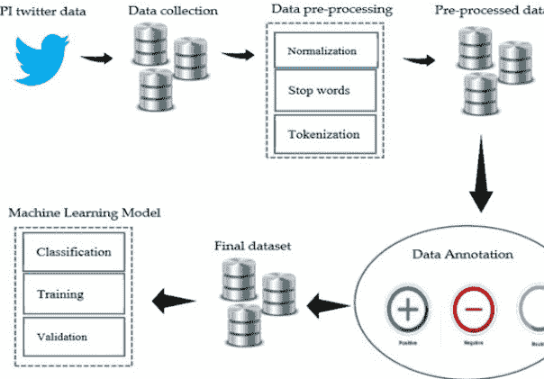

[Sumayah S. Aljaneel 等，2021]

## AI 情感分析的作用

人工智能是现代世界的流行词，渗透到人类存在的方方面面。随着越来越多的系统（特别是医疗保健领域）实现自动化，人工智能（AI）正成为一个热门话题。公众对研究的参与和媒体呈现由于其适应性可以极大地影响未来的投资。

场景：在这种背景下，我们研究了这样一个观点：公众对人工智能（AI）的恐惧源于对 AI 的负面媒体报道，特别是所谓的使用“《终结者》电影特效”。这一观点被认为是 AI 研究人员和开发者与公众进行互动的可能障碍。这种危险感被我们称为“终结者症候群”。它可以被解释为在关于人工智能的对话开始之前就可能阻止它的盲目信仰。

本研究使用了定量和定性方法来评估新闻媒体和 Facebook、Twitter 等社交媒体平台对人工智能有负面报道的观点。然而，与某些人的断言相反，发现证据并未反映主流媒体中对 AI 的所谓负面情感。我们最后讨论了对 AI 风险的当前理解，以及批判性社会科学为社会、生命科学和数字健康领域的伦理 AI 创新发展做出什么贡献。这与创新政策有关。

图 2。益处与 AI 情感分析

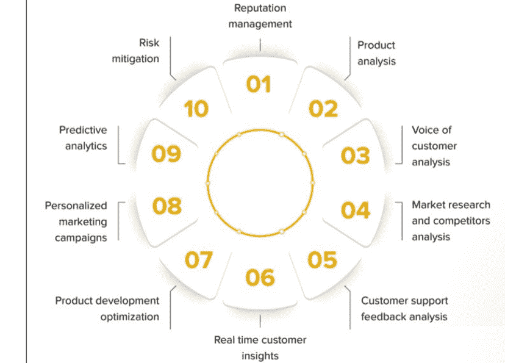

## 3. 用于情感分析的策略

无论字数多少，数据集都可以用于任何类型的文本分类任务。这些数据集在用于情感分析之前，仅经过了去词和大小写转换处理。

此预处理步骤的目的是为特征构建和特征选择处理准备文本数据。计算机的一个基本问题是它们无法立即处理文本数据。数字也必须结合文本数据来理解。通常，术语作为文本的定义特征。这使得文本表示具有高维性。为了提高分类性能和处理效率，必须对特征进行过滤以消除噪声并最小化维度。

多项朴素贝叶斯方法和 K 近邻算法是两种突出且广泛使用的分类算法，它们经常用于根据提供的观点数据（如支持向量机分类算法）引导用户观点情感极性。

使用混淆矩阵、召回率、效率和 F 分数测量等指标评估每个算法的结果。

无论字数多少，数据集都可以用于任何类型的文本分类任务。这些数据集在用于情感分析之前，仅经过了去词和大小写转换处理。

来自原始数据的输入字符串被分解成较小的部分，包括词和其他元素（例如 URL 链接）。

### A. 数据处理

在本章中我们只处理信息的文本内容。我们为机器学习和基于词典的分类都提供了一种系统的方法。

此预处理步骤的目的是为特征构建和特征选择处理准备文本数据。计算机的一个基本问题是它们无法立即处理文本数据。数字也必须结合文本数据来理解。通常，术语作为文本的定义特征。这使得文本表示具有高维性。为了提高分类性能和处理效率，必须对特征进行过滤以消除噪声并最小化维度。

多项朴素贝叶斯方法和 K 近邻算法是两种突出且广泛使用的分类算法，它们经常用于根据提供的观点数据（如支持向量机分类算法）引导用户观点情感极性。

来自原始数据的输入字符串被分解成较小的部分，包括词和其他元素（例如 URL 链接）。分词是将书写文档分解为较小标记（tokens）的过程。在这种语境下，标记可以是词、字符或子词。

创建标记最流行的方法是基于空格的。假设空间作为分隔符，该文本的分词产生了三个标记：All-The-Best。由于每个标记都是词，因此它说明了词分词。

### N-Gram 提取
该方法将相应的词分组为所谓的 n-gram（n字节），即句子。N-gram 方法可以减少偏差，但也可能使统计数据更加稀疏。文本分类的质量已通过引入 n-gram 证明（[24]; [25]; [26]）；然而，选择 n-gram 并没有通用方法。三元组（Trigrams）是三个相邻词的组合，而二元组（bigrams）是文本中两个相邻词的集合。

### 词还原与词干提取
词提取的过程是将单词替换为词干或词根。当多个单词（如 speak、speaker 和 speaking）映射为一个单词 speak 并进行合并计数时，词袋模型（BOW）的维度就会降低。然而，应用词干需要谨慎，因为可能会放大偏差。

### 停用词移除
介词、冠词以及在短语中起连接作用的其他词都是停用词示例。虽然没有固定的停用词列表，但搜索引擎使用一些最常用的功能词，如“which”、“on”、“the”、“is”和“at”。尽管它们在文中频繁出现，但它们可以被消除，因为它们不会改变句子的整体含义。

## B. 以下是情感分析中常用的三种基本方法

图 3. 情感分析方法

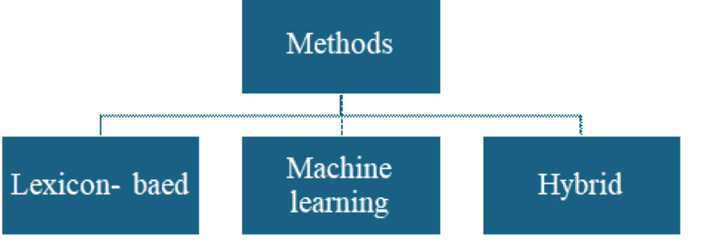

基于词典 - 基于词典是最简单的情感分类的方法。词典是标记的集合，每个标记通过预定义的得分表示文本的中性、攻击性或非攻击性本质。该分类器使用词典匹配句子中的单词，并决定将其分配到哪个类别。基于词典的方法有两种方式：基于字典的方法和基于语料库的方法。

**机器学习。** 可以利用现有的机器学习进行情感分类。情感分析是通过使用文本分析、自然语言处理、计算语言学和其他技术来确定和衡量文本或语音的情感的实践。在机器学习方法中，当句子的极性已经说明时，会使用标记数据集。我们从这些数据中提取特征，并利用这些特征对输入句子未知极性进行分类。**监督学习和无监督学习是机器学习技术的两种分类。**

**混合** - 基于规则和自动情感分析模型中使用的方法在混合情感算法中结合起来。这种方法通过融合自然语言处理（NLP）和机器学习方法，构建了更复杂、精确的情感分析。

### 用于分析的算法
从大量的在线评论流中手动识别和过滤攻击性言论几乎不可能。为此，广泛采用了深度学习（DL）和结合自然语言处理（NLP）的传统机器学习（ML）技术。

识别模糊语言最流行的三种机器学习技术是集成（Pelle et al., 2018）、词和 n-gram（Patzynski; 2019; Park J.H. & Fung P., 2017）以及基于词汇的算法（Gitatari et al., 2015; Chen, Y. et al., 2012）。一些研究使用了深度学习（DL）结合机器学习（ML）模型，例如双向长记忆网络（BLSTM）（Ingi Sigurbesson, G., Derczynski, L., 2019）、递归神经网络（RNN）、卷积神经网络（CNN）（Park J.H. & Fung P., 2017; Lee et al., 2018）和短记忆网络（LSTM）（Badjatiya et al., 2019），以检测攻击性语言。

可以使用各种算法发现、检查和预测评论及推文中的情感。朴素贝叶斯、逻辑回归、支持向量机、线性回归和深度学习就是其中。这些算法使用预标记数据进行训练，并作为分类方法。以下描述了本研究中使用的 ML 算法。

**决策树：** `DT` 算法创建较小的数据子集，以构建树结构的分类或回归模型。这种布局中有叶子节点和决策节点。叶子节点代表分类或决策；决策树有两个或多个分支（Wang & Witten, 1997）。

**逻辑回归：** 逻辑回归算法（`LR` 算法）使用逻辑函数来确定一个因变量（输出变量）和多个自变量（输入变量）之间的相关性。`LR` 使用概率将观测值归入特定的类别。为了建立实例属于某一类或另一类的区分值，它定义了一个阈值。此外，二分类和二分类输出预测是 `LR` 方法的两个补充（Dreiseitl & Ohno-Machado, 2002; Peng et al., 2002）。

**K近邻算法：** `KNN` 是一种基于实例的监督分类技术，用于解决回归和分类问题。其核心概念是相似的实例被认为是同一类别的成员。因此，为了分类一个新的测试点，`KNN` 方法找到其 K 个最近的邻居，然后根据邻居中最常见的类别对测试点进行分类（Aha et al., 1991）。

**朴素贝叶斯算法：** 基于贝叶斯定理，朴素贝叶斯（`NB`）是一种统计监督机器学习分类技术，用于识别实例可能所属的类别。它不依赖规则或任何其他显式描述（Domingos, P and Pazzani, M., 1997）。

**随机森林算法：** `RF` 算法由多个根据预定原则对数据进行分组的决策树组成。`RF` 中的每个决策树代表通过从训练数据中放回选择的不同特征。防止过拟合是 `RF` 独特结构的一个优势（Safavian, S.R and Landgrebe, D., 1991）。

**支持向量机：** `SVM` 是一种监督机器学习算法。为了更准确地识别类别，`SVM` 使用核函数将输入转换为高维（Boser, B.E., Guyon, I.M., and Vapnik, V., 1992）。

**XGBoost 算法：** 一种基于可扩展决策树集成学习方法的梯度提升框架，可产生良好的结果。除了可扩展性外，`XGBoost` 还有许多使其与其他分类器区别不同的优势。处理稀疏数据的能力、应对缺失值的能力以及并行分布式处理的力量只是其中的亮点（Chen, T and Guesrin, C., 2016）。

### 分析工具
有多种工具可以预测社交媒体上发布的文字背后的情感。通过这些工具的支持，包含预定义关键词的评论、留言和推文将被收集、监控和检查。信息中所表达的情感也将被检查。许多广泛使用的分析工具包括 Talkwalker、MeaningCloud、Socialsearcher、Rosette、Emotion Analytics、Sentiment Analyzer 等。

Social Searcher：`Social Searcher` 跟踪所有社交媒体网络上的用户名、话题标签和关键词。大量的社交数据，如受众洞察、趋势标签和社交影响者，将会被发送给您。这是一种情感分析工具，提供所有平台社交媒体数据的总体情感分析，并在免费版中对被归类为正面或负面的受欢帖文进行分类统计。

**Rosette：** 由 `Rosette` 提供的情感分析工具易于使用。该 `API` 允许您对社交媒体数据进行深度分析以及情感分析。例如，消费者在提到某个特定品牌、业务或个人时所传达的态度。通过使用形态学分析和词干还原——将变形的词形式分组，以便不再对它们单独进行检查——`Rosette` 能够识别词性的的组成部分。如果您的业务是国际性的，您可以教 `Rosette` 的情感分析引擎识别多达 300 种语言。

### 使用情感分析的 Twitter
Twitter 有多种技术可以处理不同的情感分析技术，例如使用基于自然语言处理（NLP）的 Twitter 情感分析、多项式贝叶斯和逻辑回归。

#### a) 使用自然语言处理技术的 Twitter 情感分析：
对于观点挖掘，Suyeawanshi 等人（2020）[21] 指出，需要来自人们在 Twitter 上想法的大量数据。在自然语言处理中，有几种方法可以直接从 Twitter 检索推文（Krishna Prasad. 2020）。

推文是非结构化的。为了给观点挖掘产生数据，必须对推文进行处理和清理。从数据中删除任何 `as`、链接、话题标签、大写术语、重复短语、短词术语、拼写错误、特殊符号、Twitter 字符以及任何剩余材料。提取并将文本转换为数据帧、消除文本 URL、去掉停用词（如 `(a,)`）、用户名、删除数字、不必要的空格、擦除点以及将拉丁语转换为 ASCII 表情符号，都是数据清洗的示例。

从评论文本中提取文本是数据删除过程的一部分。结果部分仅包含处理后的推文文本。`Vader` 词典工具可以逐个处理推文的单词，并从 `WordNet` 提供词义。通过使用机器学习分类对单词的值进行测量和标记。这有助于将每条推文分类为正面、正常和。

关于自然语言处理技术的的一些有趣事实：

带有 NLP 技术的 Twitter 推文——带有阿拉伯语

这是一个有趣的事实，即通过应用机器学习技术中的朴素贝叶斯算法，对阿拉伯语推文进行了情感分析。这是通过一个 Python 库，即自然语言工具包（`NLTK`）尝试的。他们使用阿拉伯语推文的标记数据集避免了繁琐的工作，该数据集的情感标签基于表情字典。数据集被分为 50% 正面和 50% 负面。应用的预处理技术包括词干提取、归一化、分词和停用词去除。

Behdenna 等人 [21] 使用阿拉伯语情感分析来识别 Arikiken 推文中表达的观点。他们收集了 500 条推文并对其进行了手动标记。首先，提取推文并将其分词为单词，并将文本转换为属性关系文件格式（`ARFF`），供 `Weka 3` 使用。其次，使用 10 折交叉验证方法训练 `SVM` 和 `NB` 分类器。获得的结果显示，`NB` 分类器的精确率为 82.1%，召回率为 81.4%。`SVM` 的精确率和召回率最高，均为 86%。

因此，情感分析已被证明是信息挖掘的有价值来源，特别是对于与公众相关的大量数据的情况，例如研究公众对 COVID-19 流行病的行为及其对公众生活的影响。此外，可以得出结论，三种机器学习分类器：`SVM`、`NB` 和 `KNN` 由于其高准确性，在该领域被广泛使用。（Sumayah S. Aljeamel 等人..2021）

#### b) 使用多项式贝叶斯和回归的 Twitter 情感分析：
以下提到了 Twitter 上情感分析的一些挑战：

- (i) 某些推文易于识别且简短暗示了情感。
- (ii) Twitter 上使用了大量的话题标签、URL、表情符号。

使用多项式贝叶斯和回归通过训练数据来练习机器学习算法，这些方法包括逻辑回归和多项式贝叶斯。

**真实场景：** 作者考虑了航空公司情感数据集和 IMDB 数据集。使用 `Count Vectorizer` 特征的逻辑回归在作者观察中得到了良好的结果（Krishna Prasad. 2020）。

## Twitter 用户分类 - 使用机器学习
用户分类：该任务是通过利用用户 Twitter 推送流中的可观测信息，自动收集用户属性（如政治取向、种族等）的值，这些信息被分为以下三类：

- 用户行为
- 网络结构
- 语言内容

### 用户分类模型的目的
1. 为用户分类目的，在相对重要性、稳健性和泛化能力方面提供广泛的评估。
2. 调查语言数据在用户分类中的用处。

**用于用户分类的 ML 框架。** 我们在下方探索的特征集将与监督机器学习框架结合使用，该框架为特定的用户分类任务提供模型。作为一种学习算法，我们使用梯度提升决策树 - `GBDT` (Friedman-2001)（也可以采用任何其他算法），它由决策树集成组成，通过前向步进法拟合以匹配当前残差。Friedman (2001) 显示，`GBDT` 与 `SVM` (Friedman 2006) 等先进的机器学习算法相比，其生成的模型更小，且解码速度更快。在下文中，我们将更详细地描述我们的特征类别。[REF 6]

### 用户画像的一个通用模型
- 属性特征：“你是谁”：

包括 Twitter 在内的大多数社交媒体网站都允许公开访问某些默认个人资料信息，例如用户名、位置以及任何用户账户持有者的简短介绍。Twitter 还提供了其他基本用户信息的访问，如用户的友数量、粉丝数和推文数，以及用户的性别和种族。对于年龄等某些属性以及内容、照片和其他根据可见性选择显示的显示，将受到限制。

我们要求约 15,000 名媒体用户的一组编辑人员根据头像图片识别用户的种族和性别：少于 50% 的图片与明确的种族相关，而 57% 的图片与特定性别相关。我们发现图片往往具有误导性：在 20% 的案例中，编辑人员证实该照片并非账户所有者本人，而是名人或其他人（Pennacchiotti, M., & Popescu, A.-M. 2021）。

因此，画像字段可以作为数据启动（bootstrapping）的有效工具，上述统计数据表明，这些字段中的高质量数据不足，无法直接应用于用户分类。

- 推文行为：“你如何推文”：

推文行为的特征是一组统计数据，捕捉了用户与微博客服务交互的方式。它提供了诸如信息，如每日平均消息数、发布的推文数、回复数、聊天数、通过图片回复（如果是图片，则检查被审查的图片、图片中的讽刺或侮辱性图片，有时可能是积极图片）。此外，表情符号（emoji）和表情符号在发现推文行为——即你如何推文方面也起着主要作用。

- 语言内容：“你推文了什么”：

用户的词汇用法和感兴趣的主要主题总结在语言内容中。基础语言数据可用于分类各种平台上的个人，包括正式文档、博客、口语对话转录和搜索会话。

**原型词 (LING - WORD)** – 在这里，类别可以通过原型词或“原型词”来描述，这意味着指示该类成员一般性兴趣的短语，以及该类成员的典型词汇表达。

**原型标签 (LING - HASH)** - Twitter 用户生成标签，即以 `#` 为前缀的字符序列，用以表示其推文的主题。标签还用于便于特定主题信息的检索和搜索。我们建议，如果一个班级的学生有共同兴趣，可以利用标签使用的统计数据来识别他们中最受欢迎的话题。

- 社会网络：“你与谁推文”：

`SOC – FRIE` - “朋友”账户：通常情况下，民主党人更容易关注民主党政治人物的账户。在这里，搜索诸如“FRIENDS”之类的突出词汇是采用的一种以启动原型词的基础级机制。为了建立一个特定类别的原型“朋友”账户集合 `F`，可能会检查训练集用户的社交网络。对于属于每个原型“朋友”账户的用户所关注的所有 Twitter 对象的百分比，如果用户关注了该账户，则将布尔特征设为 1，否则设为 0。

## 使用机器学习检测 Twitter 垃圾账户
在开发用于检测垃圾账户的模型时，机器学习的思想被了。训练阶段和测试阶段构成了机器学习系统的两个基本部分。基于机器学习的垃圾账户检测框架如图所示：

图 4. 基于机器学习的垃圾账户检测框架

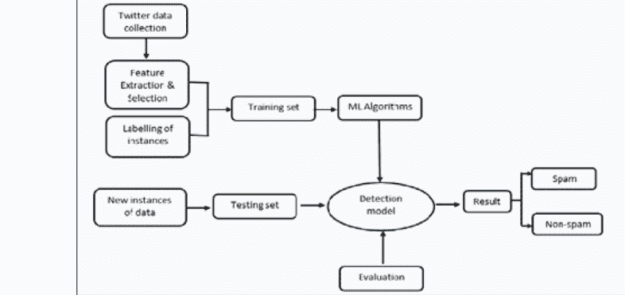

(Shivangi Gheewala and Rakesh Patel.2018)

- 第一步是收集 Twitter 数据。为了收集数据，可以利用公开来源或爬取 Twitter 流式 `API`。
- 下一步是从数据集中提取特征。各种类型的特征，诸如基于账户/用户的特征、属于相似类型的基于内容的特征、唯一分组的基于图的特征以及单独分组的基于 URL 的特征，都可以用于垃圾账户检测。选择在产生正确结果方面显示更有效的特征用于垃圾账户检测。
- 此时，一小部分样本被归类为垃圾或非垃圾以进行训练。
- 最后，使用准确率、真正例例、假负例、精确率等参数对机器学习模型进行评估。

## 6. TWITTER 机器学习概览
在社交网络中，Twitter 通过定期发布正在讨论的话题集来帮助用户了解趋势。

考虑以下场景：对于最近的比赛，关键词（标签）`#RCB` 是当时的趋势话题。

### 预测 Twitter 信息流行性的挑战
主要挑战之一是社交媒体中发布数据的动态性和非结构化特性。例如，在很短的时间内，一个关键词可能会在 Twitter 上流行。由于这些困难，社交媒体研究界投入了大量精力预测什么主题会流行。

### Twitter 媒体重要术语收集
**推文 (Tweet)**：推文也可以称为微博。它是用户发布的消息或状态。推文包含特定的关键词、标签、URL 和其他内容，但限于 140 个字符。

**标签 (Hashtag)**：你可以使用标签来突出推文中的特定词。要指示一个词是标签，需要在前面加上 `#` 符号。标签理想用于指示现在重要的的话题。

**趋势 (Trends)**：在特定时期流行的词汇或标签可能会出现在趋势列表中，这些是人们正在讨论的话题。

**数据集 (Dataset)**：Twitter 是一个在线社交网络，提供 `API` 用于收集各种类型的数据，包括用户资料、在平台上广播的推文流等。

表 1. 数据集统计，即 Twitter 提供的 1% 随机推文样本，这些推文是在特定某天（第 1 天）和第二天的前六小时（第 2 天）采集的。

| 天数 | 推文数 | 用户数 | 标签数 | 趋势数 |
|---|---|---|---|---|
| 第 1 天 | 40,51,506 | 31,45,957 | 2,37,100 | 67 |
| 第 2 天（前6 小小时） | 10,871,149 | 9,366 | 74,203 | 67 |

表 1 显示了每日收集的推文数量、每日发布推文的唯一用户数量以及这些推文中使用的标签数量。此外，团队还使用 Twitter `API` 收集了这两天的热门话题（标签）集合，即 Twitter (Anubrata Das. 等人 2015) 定义的关键词集合。

因此，社交网络已成为用户获取信息的可靠来源。在 Twitter 中，被社区认为重要的信息通过转发推文进行传播。研究此类热门消息的特征对于许多任务至关重要，例如突破新闻检测、个性化消息推荐、病毒式营销等（Liangjie Hong, Ovidiu Dan 和 Brian D. Davision. 2011）。

## 7. TWITTER(X) 算法
Twitter (X) 的开源推荐算法是不断变化的算法的综合，旨在提升平台的用户体验和参与度。

它通过点击、点赞、回复等活动收集用户数据，并利用这些数据提供定制化推荐。

Twitter (X) 刚刚发布了重新设计的首页，分为两个部分：“关注”模式和“为你推荐”（FOR YOU）模式。自愿决定关注账户的用户将在“关注”部分看到内容，而在“为你推荐”部分则根据算法的观察结果提供个性化推荐。

用户可以轻松地在各种模式之间切换，自由地根据自己的喜好自定义信息流。通过这种变化，用户能够更充分地控制自己的体验，因为他们可以判断“为你推荐”是否符合自己的兴趣和偏好。

### 算法选择推文

Twitter (X) 算法运行时的内容推荐流水线分为四个阶段：候选源提取、排序、合并、服务，以及利用过滤器、启发式算法和产品属性。这些阶段对于根据用户的喜好和行为定制内容推荐至关重要。

### Twitter (X) 算法的排序信号

Twitter (X) 使用算法根据几个信号做出决策，这些信号涵盖了用户与内容互动参与的不同维度。对于用户和创作者来说，理解这些信号的细微差别至关重要，以最大限度地提高可见性并高效利用 Twitter (X) 平台。

### 各排序简要分析：

- **相关性**：Twitter (X) 算法根据推文与特定用户的相关性进行排名，考虑了互动历史、话题与用户兴趣的匹配以及内容的相似性。
- **时效性**：得益于此信号，用户可以实时关注最新的素材和对话，这确保了最近的推文在时间线上被优先考虑。
- **多样性**：算法使用多种信号来维持多样化且有趣的时间线体验，确保用户的兴趣和偏好能够涵盖各种类型的内容、主题和来源。
- **互动率**：高互动的推文（点赞、转发和回复）在时间线中的权重会被提升，以突出那些可能吸引更广泛观众的内容。
- **图像和视频**：算法对包含多媒体（包括图像和视频）的推文赋予更高权重，因为这类素材通常能吸引更多的注意力，并比纯文本推文产生更高水平的互动。
- **回复和评论**：根据平台的整体互动和社交交互，每条评论和回复在增加推文在 Twitter (X) 上的亮度和曝光方面都起着独特的作用。对推文的直接回答由评论表示，显示了高水平的投入并增加了消息的曝光和相关性。转发不仅提供了直接回答，还基于该推文进行了更广泛的讨论，展示了参与感和投入。Twitter (X) 的算法指出，一条推文的价值是一个点赞的 27 倍。此外，通过回复评论，你可以将推文的互动增加 150 倍。虽然这两个指标对于评估推文的影响都很重要，但回复被认为对评估推文表现更具意义。
- **点赞**：点赞是推文受欢迎程度和积极响应的标志。它们作为用户兴趣的信号，会影响你的内容在他人时间线上的曝光。推文的点赞数越高，通常被视为互动度更高的指标，算法可能会优先考虑它们。
- **转发**：转发表明人们认为内容足够重要或相关，足以分享给他们的粉丝，这增加了推文的可见性。因为转发代表的价值是点赞的两倍，算法赋予它们更高的价值，并认为它们更具影响力。更多的转发会增加推文在用户时间线和搜索结果中的可见性，增加其在网站上的整体影响力和影响力。
- **引用推文**：引用转发的功能与转发类似，用户在分享推文的同时会带上自己的内容或评论。另一方面，它们表示用户希望添加自己的观点或详细说明原始推文，这促进了更深层次的互动。与转发相比，这种额外的细节提升了围绕该推文的讨论，并增加了其在 Twitter (X) 算法眼中的价值。

除了上述 Twitter(X) 算法，算法选择推文也可以应用于表情符号推文（Emoji Tweets）。使用朴素贝叶算法可以对攻击性语言进行分类。表情符号是以图像形式呈现的视觉符号。由于图像能够传递信息，所以它们可以根据意图被阅读和理解。时间线上每个结合了文本和表情符号的推文将被归类为多个组。推荐算法是朴素贝叶斯。它计算表情符号推文的概率以获得分类（Siti Sendari, 等人 2020）。

## 8. Twitter 推荐算法

Twitter 想要为你提供有关全球事件的最新信息。为了将每天发布的海量推文减少到少数几个，需要一种推荐算法来获取最终出现在个人设备时间线推文。

## 参考文献

- Aha, D. W., Kibler, D., & Albert, M. K. (1991). Instance-based learning algorithms. Machine Learning, 5(1), 37–66.
- Gitari, N.D., Ziping, Z., Damienien, H., & Long, J. (2015). A lexicon-based approach for hate speech detection. International. Journal. Ubiquitous Eng., 10, 215–230.
- Krishna. Prasad, K. (2020). 基于机器学习技术的情感分析应用的文献综述。《International Journal of Applied Engineering and Management Letters*, 4(2), 11–77.papers.ssrn.com/sol3/papers.cfm?abstract_id=3674982
- Lee, Y., Yoon, S., & Jung, K. (2018). 推特上攻击性语言检测的对比研究.CoRR. abs/1808.1.
- Morinaga, S. (2012). 网页上主观数据挖掘综述。《Data Mining and Knowledge Discovery*, 24(3), 478–514. DOI: 10.1007/s10618-011-0238-6
- Bang, B., Lee, L., & Vaithyanathan, S. (2002). 有点赞吗？使用机器学习技术的情感分类。《Proceedings of the ACL-02 Conference on Empirical Methods in Natural Language Processing*, 10, 79–86.https://anthology.org/W002-1011
- Park, J. H., & Fung, P. (2017). 推特上攻击性语言检测的一步和两步分类。DOI: 10.18653/v1/iw1-3006
- Pelle, R., Alcântara, C., & Moreira, V. P. (2018). 用于攻击性文本检测的分类器。https://www.researchgate.net/publication/33030271_A_Classifier_En_for_Offensive_Text_Detection DOI:10.5753/webmedia.2018.4582
- Peng, C. Y., Lee, K. L., & Ingersoll, G. M. (2002). 逻辑回归分析与报告导论。《The Journal of Educational Research*, 96(1), 3–14. DOI: 10.1080/0022072009598786
- Pennacchiotti, M., & Popescu, A.-M. (2021). 推特用户分类的机器学习方法。《Proceedings of the AAAI Conference on Web and Social Media*, 5(1), 281–288. DOI: 10.1609/icsm.v5i1.5119
- Ptasynski, M., Lempa, P., Masumi, F., Kimura, Y., Rzepa, R., Araki, K., Wroczynski, M., & Liliwa, G. (2019). 用于网络欺凌检测的有害信息暴力破解句式模式提取。《Journal of the Association for Information Systems*, 20(8), 1075–1128. DOI: 10.1775/1751ais.00562
- Safavian, S., & Landgrebe, D. (1991). 决策树分类方法综述。《IEEE Transactions on Systems, and Computers*, 21(3), 660–674. DOI: 10.1109/21.974588
- Sendari, S., Iliham, A. E. C., Lestari, D. C., & Hariyadi, H. P. (2020). 使用朴素贝叶斯算法对情绪推文进行分类。《Knowledge Engineering and Data Science*, 3(1), 50–59.https://www.ac.uk/download/pdf/354311294.pdf
- Srinivasan, S. M., Shah, P., & Suresh, S. (2021). 通过情感分析增强商业智能和运营的方法。《Journal of System and Management Sciences*, 11(3), 27–40.https://www.researchgate.net/publication/358859167D0.DOI:10.33168/JSMS.2021.0302
- Srivastava, S. (2023). 利用AI情感分析的力量——适用于业务的10种效益和用例。https://appinventiv.com/blog/ai-sentiment-analysis-in-business
- Sumayah, S. (2021). 一种通过情感分析方法预测个人对沙特阿拉伯预防COVID-19爆发预防措施意识的方法。《International Journal of Environmental Research and Public Health*, 18(1), 218. DOI:10.3390/ijerph18010218 PMID: 33510479
- Tong, R. (2001). 一种用于在线讨论中意见检测和跟踪的运行系统。《SIGIR Workshop on Operational Text Classification 工作纪录》。https://dl.acm.org/doi/10,1007/s10579-020-09515-3
- Turney, P. D. (2002). 点赞还是点？语义取向应用于评论的无监督分类。《第40届计算语言协会年度会议论文集》，ACL '02, 417–424. https://aclanthology.org/P02-1053.pdf
- Wang, Y., & Witten, I. (1997). 针对连续类的模型树诱导。《第9届欧洲机器学习会议论文集》，https://www.researchgate.net/publication/33051395_Induction_of_model_trees_for_predicting_continuous_classes
- Wiebe, J. (2000). 从语料库中学习主观形容词。《第十七次全国人工智能会议论文集和第12次人工智能创新应用会议论文集》。AAAI Press。https://cdn.aaai.org/AAAI/2000/AAAI100-113.pdf

# 第3章

## 关于阻碍人工智能在社会、治理和环境活动中广泛应用的障碍调查

Sabyasachi Pramanik

https://orcid.org/0000-0002-9431-8751

印度，哈尔迪亚技术学院

### 摘要

本章探讨了人工智能（AI）与现代商业和技术中环境、社会和治理（ESG）因素结合之间的关系。本文研究了人工智能如何为环境、社会和治理（ESG）方面提供可行的解决方案。本章重点关注 ESG 与人工智能的整合。人工智能与 ESG 密切相关，在现代商业和技术中发挥着重要作用。

### 引言

可持续发展是在满足当代人需求的同时，而不损害后代人满足其需求的能力（联合国, 1987）。通过17个可持续发展目标，联合国制定了2030议程（Schrijver, 2008）。企业社会责任（CSR）是企业对遵守道德行为并在对经济发展做出贡献的同时提高其员工、家庭及整个社会生活的承诺（Zhao and Farihas, 2023）。人工智能（AI）具有通过提高有效性来改进企业社会责任（CSR）计划的潜力（Naqi, 2021）。ESG（Krishnamorthy, 2021）。

人工智能（AI）与现代商业和技术中环境、社会和治理（ESG）因素结合之间的关系在本章中得到了探讨。本文研究了人工智能如何为环境、社会和治理（ESG）方面提供可行的解决方案。本章重点关注 ESG 与人工智能的整合。人工智能与 ESG 密切相关，在现代商业和技术中发挥着重要作用。

人工智能（AI）机器人可以从经验中学习、适应新信息并执行与人类相似的任务（Duan et al., 2019, p. 63）。人工智能在各个领域变得越来越常见（Chawla & Goyal, 2022; Singh & Chouhan, 2023）。它帮助企业做出数据驱动的决策、自动化流程以及从大型数据集中提取有用信息。然而，随着全球越来越多的企业意识到实施可持续实践的益处，使用 ESG 框架对组织在环境、社会和治理（ESG）问题的评估变得越来越重要（Nishant et al., 2020; Kar et al., 2022）。在现代、快节奏的世界中，企业可持续性至关重要，因为企业的平均寿命正在缩短，使长期生存成为一个关键关注的问题（Dhanda & Shtroya, 2021）。

值得注意的是，AI 在金融和可持续发展领域受到了越来越多的关注，以及它与 ESG 关注点之间的关系。随着环境、社会治理（ESG）问题在企业和金融领域日益突出，金融工具和技术正在不断发展。这些工具寻求通过提供财务收益的同时兼顾社会和环境关注，来实现平衡的方法。此外，AI 营造了一种支持道德价值观应用和环境保护的氛围，并在整合过程中减少贫困、空气污染和资源枯竭。

根据 Nishant 等人（2020）的观点，人工智能在缓解贫困、资源枯竭以及促进环境和社会治理方面非常有价值。ESG 原则帮助公司做出战略决策，在增加利润的同时促进一个公平、健康的全球社区。这些指南规定了企业在道德和责任方面所需的要求。Dhandha 和 Shtroya（2021）研究了企业为何决定追求可持续性，首要目的是获得竞争优势，而不是捐赠慈善机构或完全用可持续方法取代传统方法。

这是通过使用先进方法解决紧迫的管理、社会和环境问题的时间范围。人工智能（AI）通过收集和分析关于环境、社会和治理（ESG）问题的大量数据，帮助企业快速评估并改进其表现（Hoa and Demir, 2023）。根据报道，全球企业正在使用可持续发展报告来更有效地交流社会和社会问题的信息。这主要是由于利益相关者的需求。

可持续性的追求将受益于人工智能。这具有许多优势，包括增强企业治理、减轻对环境的影响以及鼓励工作中的道德行为。人工智能（AI）具有提高环境、社会和治理（ESG）系统透明度和问责性的潜力。因此，这将提高利益相关者对企业致力于环境和社会责任目标的信任（Chong et al., 2022）。在道德、社会责任和可持续发展成为重要的时代，智能技术（AI）和生态社会责任（ESG）具有转型慈善运营和用户的力量。

监测人类长期可持续性各种因素的组织改进了治理、大型企业和公共部门（Walker et al., 2019）。在过去的几年里，将环保理念纳入企业战略规划已取得了巨大进展。如今，企业在解释和记录重要决策的同时，需要意识到这些决策如何影响环境和社会（Saitra, 2021）。这种方法涉及逐渐用过时的“企业社会责任”术语替换各种 ESG（环境、社会和治理）倡议、框架和指标（Verbin, 2020）。

本章的主要目标是讨论社会、治理和环境挑战，并研究如何利用人工智能（AI）来解决这些问题。由于具有环保意识的企业实践在全球市场上变得越来越重要，企业现在需要评估其在行政、社会和环境方面的成就。这一主题一直是多项研究的主题，例如 Yoon 等人（2018）、Lam 等人（2016）以及 Tammuruji 等人（2016）。根据 Sood 等人在 2023 年的一项研究，“环境”部分位第一，“治理”理念位居第二。似乎第三部分“社会”对研究人员做出决策方式的影响最小。Eliili（2022）发现，对于阿拉伯联合联酋的上市公司样本，ESG 的纳入在 2010 年至 2019 年间增强了财务报告报告和投资效率。

Lourenço 等人（2012）认为，现代企业需要采用可持续方法。通过采用环保实践，公司可以减少碳排放并在行业中获得领先的竞争优势。此外，Albuquerque 等人（2019）建议，整合环境、社会和治理（ESG）因素是一项值得的策略，有助于企业提高回报、降低系统性风险并增强运营效率和效果。Lee 和 Zhang（2019）建议的方法，使用人工智能生成的数据和 ESG 标准可能会促进异常发现和灾难性中断。这基本上意味着预测或投影未来将发生什么，在当前社会、政治和环境问题对市场和业务结果产生重大影响在全球范围内特别重要。Lee 和 Zhang（2019）在研究中发现智能设备产生的数据与可持续性措施之间存在许多相似之处。结果表明，使用 ESG 指标对于实现长期成功是必要的。

然而，由于整个过程中出现的问题，将 AI 全面整合到 ESG 中并不是一项容易的任务。正如 Hao 和 Demir（2023）所指，在将 AI 用于 ESG 运营之前，必须克服一些问题。AI 的道德和负责任使用、对道德和绩效的正确评估、数据安全和隐私问题、技术困难、未解决的法律问题以及对某些群体的负面偏见的维持是需要考虑的几个障碍。在自主机器人的 AI 系统与人类主管之间建立独特的通信通道是另一组挑战。

本章将讨论人工智能（AI）的概念以及它与环境、社会和治理（ESG）理念的关系。这意味着研究将 AI 整合到 ESG（环境、社会和治理）过程中面临的挑战，以及 AI 在促进积极社会和业务结果方面发挥的独特作用。

企业共同努力可能为未来人工智能驱动的社会奠定基础，这将极大地改善社区的现状。

Hao 和 Demir (2023) 对支持或阻碍人工智能融入 ESG（环境、社会和治理）部门的要素进行了全面分析。但他们的研究不仅限于浅尝的检查，还探索了刺激因素和技术困难等更细致的话题。本章研究了他们的工作是因为这对于识别与环境、社会或政府问题密切相关的触发因素至关重要。根据他们的观点，这些技术限制和触发因素提供了深刻的见解，形成了我们对许多阻碍人工智能进入 ESG 的障碍进行调查的基础。遵循环境、社会和治理（ESG）准则并可持续发展的企业表现优于未遵循准则的企业 (Moro-Visconti, 2022)。

然而，本研究旨在基于 Hao 和 Demir (2023) 研究的基础上，通过分析阻碍人工智能充分整合到环境、社会和治理（ESG）背景中的障碍，来丰富知识体系。通过对技术、监管、伦理和数据相关问题之间复杂的相互作用进行彻底审查，我们的目标是为不断增长的知识领域做出重大贡献。这将使我们能够从容地管理和应对这一挑战性环境。主要目标是促进组织高效利用人工智能（AI），将其从一种迷人的技术工具转化为可持续实践的有力推动者。这将为未来铺平道路，届时 ESG 考量不仅被所接受，而且是运营成功的关键。

根据 Hirsh (2021) 的研究，公司并不真正理解他们通过实施节约实践、更环保的技术和可持续习惯减少了多少碳排放。要做到这一点，人们必须对碳足迹进行自我教育，并努力将其减少至最低。然而，只有少数公司有计算其碳影响的清晰方法。根据 Zhao 和 Farias (2023) 的观点，政府和企业必须通力合作解决与人工智能相关的环境问题和健康风险。

本章的目的是提供研究目标和研究方法的概述。

本章探讨了如何利用人工智能（AI）和可持续项目来应对社会、治理和环境挑战。本章的目标是列出企业在整个过程中面临的主要障碍，并就如何克服这些障碍提供若干建议。回顾了说明最佳实践、伦理关注、法律问题以及对未来运营影响的案例研究。本章回顾了目前关于与 AI-ESG 相关困难的材料，并为那些希望确保 AI 生成的结果具有可持续性和公平性的人提供了建议。因此，本章引用了关于 AI 与 ESG 融合的相关现有文献。至关重要的一点是，可能已经存在实际解决方案来消除阻碍人工智能广泛用于治理、和社会环境目标的障碍。

## 2. 环境、社会和治理考量与人工智能的结合呈现出各种复杂的挑战

将 AI 与 ESG 整合面临着多重障碍，每种障碍都揭示了该主题的不同细微差别。我们将仔细研究这些障碍，以便更好地理解企业面临的困难（如图 1 所示）。

### 2.1. 数据的可用性与质量

为了支持人工智能驱动的 ESG（环境、社会、治理）活动，现代石油生产需要极其高效地收集和处理多样化的多用户数据。然而，这仍然项艰巨的任务。本章审查了数据可靠性、质量和可用性的复杂领域。它强调了企业在获取准确且可靠的数据方面所面临的困难。技术革命导致组织经历了数字化转型，特别是在云计算、自动化、人工智能和数据分析领域 (Jednak et al., 2021)。这一过程凸显了对客观、高质量数据的需求，这些数据对于产生应有的积极成果至关重要。数据不仅是资源；它是 AI 驱动 ESG 项目的生命线，数据的质量直接影响努力的效率和准确性。调查新闻小组发现，在一起涉及美国算法决策预测再犯率（被定罪者再次犯罪的概率）的争议案件中，COMPAS 系统在将黑人被告归类为高风险方面表现得准确。此外，假设白人罪犯会以不同方式解读指数是错误的 (Angwin et al., 2016)。根据 MacPherson 等人 (2021) 的观点，金融科技和 AI 驱动的 ESG 筛选与分析解决方案现在被认为是“战略促进者”，可以减少 ESG 数据的偏见并缓解 ESG 评分中的不平等。

### 2.2. 伦理与隐私考量

在使用人工智能进行可持续决策时，会产生公平性、透明度和无意后果的问题。本节对这些伦理困境进行了深入审查，重点关注符合道德标准和逻辑的人工智能驱动可持续项目。ESG 包括与隐私相关以及与数据收集、存储和利用的问题。在处理敏感的 ESG 特定数据时，保持机密性和安全性至关重要。伦理和数据隐私对于实现长期目标至关重要。当谈论人工智能成功整合到环境社会治理（ESG）框架时出现的隐私和伦理问题时，这一点变得清晰。人工智能产生积极社会环境影响的能力使其变得卓越。这包括通过正式和非正式渠道推进企业社会责任，参与维护这些原则的活动，并遵守法律法规。采用伦理框架并有效管理 AI 领域将确保其持续增长。使用真实、伦理和合法的数据可以为企业提供决策所需的信息和选择，使其在竞争对手中获得独特的“数据优势” (Stuck & Grunes, 2016)。

## 3. 预算限制与资源可用性

因此，企业仔细审查其面临的所有成本相关挑战至关重要。这些费用不仅包括人工智能的初始安装，还包括系统维护和人员培训的持续支出。对于企业而言，找到资源共享问题的解决方案至关重要。因此，确保所有资源得到尽可能有效的利用是必要的。如此，AI 程序必须与更广泛的目标保持一致。对于企业来说，在愿景、以成本为中心的策略和环境目标之间取得平衡可能非常困难。使用系统的方法对可用资源进行公平分配无疑是有益的。

### 2.4. 知识与意识不足

创建和使用 AI 的 ESG 解决方案需要特定的技能。本节涵盖了成功应对复杂崎岖地形的基础要素。这表明，开展旨在教导、准备并让利益相关者参与理解人工智能优点的倡措是至关重要的。受访者积极参与公共教育和信息共享计划的意愿是缩小这一差距的障碍。根据 Enholm 等人 (2022) 的观点，对于人工智能整合到公司计划中存在误解，对于产生价值的主要活动也存在差异。因此，了解自主学习始终会对某些群体产生无意偏见这一说法至关重要 (Larsson et al., 2019)。此外，人们对这种方法可能的正式化存在顾虑。

## 图 1：ESG 集成中 AI 应用的障碍

| 图 1：ESG 集成中 AI 应用的障碍 | 数据质量与可用性 | 伦理与隐私考量 | 成本与资源限制 | 缺乏专业知识与意识 | 监管与法律复杂性 |
|---|---|---|---|---|---|

## 3. 突破障碍：鼓励在 ESG 中整合 AI

在尝试渗透环境、社会和治理（ESG）领域时，AI 面临着多项挑战。然而，创新的解决方案可能克服这些障碍，并使 AI 应用于绿色倡议变得更加容易。Larson 等人（2019）进行了进一步研究，目标是增强对人工智能和机器学习使用的信任。透明度与问责制并行不分。算法决策导致的透明度缺失或“黑箱”是问责制面临的挑战之一（Pasquale, 2015）。建立跨学科协作、鼓励对 AI 应用的信任并始终关注法律和治理问题，都是可持续 AI 的核心组成部分。在第二节中，我们介绍了一些解决方案（见图2），旨在消除障碍并使 AI 利用 ESG。

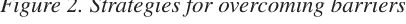

| 图 2：克服障碍的策略 |
|---|
| 数据解决方案 |
| 伦理 AI 框架 |
| 成本效益方法 |
| 能力建设 |
| 倡导与监管 |

### 3.1. 数据解决方案

数据是 AI 驱动 ESG 集成的核心。本节涵盖了许多数据管理方法，例如数据标准、数据清洗和开放数据倡议。通过实施这些策略，你可以确保数据易于获取并达到最高质量，以满足 AI 与 ESG要求的无缝集成。本章中许多企业、政府和数据提供者之间成功的伙伴关系或协作案例，凸显了数据研究中的团队合作。根据 Smith 等人（2020）的研究，真实案例了人们如何协作解决问题并确保 AI 系统的长期可行性。

### 3.2. 伦理 AI 框架

本节探讨了基于问责、透明等价值观的 AI 系统构建，并特别强调了环境、社会和治理（ESG）因素的整合。因此，企业必须为 AI 建立符合 ESG要求的道德准则和标准。论述应当展示这些准则如何指导具有伦理意识的 AI 系统的创建。为读者提供 AI 在社会责任和环境保护领域使用的真实案例。通过这些应用案例，基于知识和原则的方法提供了一种构建用于 ESG 目标的 AI 部署的路径。

### 3.3. 经济性方法

人工智能与环境、社会和治理（ESG）活动的整合有时会受到资金限制的阻碍。本节专门研究了削减的方法，重点关注计算投资回报率（ROI）和处理成本效益回报。因此，它为决策者提供了一种整合 AI 的结构化方法，可能导致成本节省并实现稳定的财务判断。本书的这一部分强调可扩展性和云集成，详细介绍了如何有效高效地应对 AI 部署中的资源限制和约束。研究表明，企业引入 AI 可以通过在范围内低成本、可扩展地使用 AI 来提高其财务可持续性（Kamble et al., 2020）。

### 3.4. 提高组织发展

个人和组织有多种方法利用现有技术来提升未来的绩效。因此，企业必须优先考虑终身学习，就开发人工智能和环境、社会和治理（ESG）管理能力提供建议。许多人通过通过专注于 ESG 的培训和教育，成功克服知识鸿沟，并在可持续 AI 领域培养专业思维。因此，这一领域对于培养能够应对未来环境、社会和治理因素对人工智能影响的劳动力至关重要。根据 Brauer 等人（2019），本节为个人和组织提供了成功实施可持续 AI 所需工具。

### 3.5. 治理与推广

游说技术在影响与 AI 和 ESG 结合相关的法律法规方面的重要性。立法者一直在努力制定重大改革。本章提供了一些成功推进伦理可接受 AI 并适应不断变化的法律限制的合作案例。讨论展示了关于利益集团和监管机构如何协作促进可持续性的多种观点。为了促进有助于基于 AI 的 ESG（环境、社会和治理）实践的立法变革，本章鼓励进行道德和法律改革（Bietti et al., 2021）。在考虑了这些每个要素后，我们为任何希望克服与 AI 集成 ESG 相关障碍和挑战的公司提供了策略。为了提高读者对 AI 驱动的可持续性的理解和技能，并为更公正、更生态可持续的未来做出贡献，本书提供了实用的解决方案和真实案例。

## 4. 案例研究：克服 ESG 集成中人工智能应用障碍的有效示例

本章包含了企业如何成功处理与环境、社会和治理（ESG）相关的人智能（AI）使用的真实案例。这些文章值得关注，因为它们解决了在使用 AI 进行可持续发展过程中出现的问题，并提供了解决方案和深刻的分析。

### 4.1 IBM 助力可持续增长的 Watson

IBM 的 Watson for Sustainability 是解决环境、社会和治理（ESG）问题的解决方案示例之一。Watson 作为 IBM 的一项认知技术，对大量与 ESG 相关的数据进行了彻底分析。摘要显示了 IBM 如何通过使用创新的方法合并和清洗数据来克服数据质量问题。因此，通过使用数据决策和整合来自多个来源的验证数据，IBM 的 ESG 表现得到了提升。这强调了在 AI 驱动的 ESG 项目中保持数据一致性和准确的重要性。

### 4.2 微软的伦理 AI 框架

文中展示了一个案例研究，通过使用伦理 AI 理念强调了微软对环境、社会和治理（ESG）的伦理承诺。为了实现这一目标，这家科技巨头创建了一个基于伦理的 AI 框架——基于透明、责任和公正的概念。微软确保其 AI 驱动的可持续计划符合这些标准。该案例展示了在 ESG 中使用 AI 时必须考虑伦理因素，并为如何在企业内部负责任地使用 AI 指导。

### 4.3 亚马逊的云解决方案

通过亚马逊的云能力整合 ESG，证明了公司对成本效益策略的采用。亚马逊利用 QPoint 等云服务降低了人工智能的初始成本。这表明基于云的人工智能系统在长期内既具有灵活性又负担得起。

### 4.4 谷歌的教育与能力建设

例如，谷歌采取了行动，以提高公众对公司如何缩小认知和知识鸿沟并增强能力的意识。资金已通过旨在缩小公众对 AI 知识鸿沟的项目，以及培训课程和教育材料得到了支持。

## 5. 未来展望与结语

本章提供了关键要点，这些观点应当根据来自实际情况的高质量基准进行考虑和支持。主题包括：使用适当技术经济效益地应对需求、推动伦理 AI 模型、增强 AI 能力以及支持监管框架的执行。

该领域预想的困难和变化可能会影响本章所探讨的未来。供应链带来了伦理挑战以及可行的方案，而人工智能对社会的影响日益增大。为了加速采用，用于 ESG 指标的人工智能预测是一项日益广泛的技术。此外，这些关注点还包括涉及数据安全化、法律框架建立以及 AI 设计伦理标准的挑战。

### 5.1. 未来趋势与挑战的预测

随着人工智能在环境、社会和治理（ESG）问题的整合中日益普及，关注 ESG 的企业必须适应。该领域的未来问题包括挑战与发展：创建伦理供应链管理计划以及使用 AI 驱动的解决方案量化社会影响。对于期货市场，基于人工智能的 ESG 指标预测是一种流行技术。公司需要准备应对新问题，包括数据安全、法律法规的变化以及对伦理 AI 框架的需求。

### 5.2. 未来前景

使用人工智能和可持续发展方法的企业将获益巨大。下一节提供了利用 AI 进一步推进可持续发展倡议的可能全面分析，包括创造环保产品、提高利益相关者对 ESG 项目的参与，以及通过 AI 驱动的 ESG 服务创造新的收入流。新兴的绿色人工智能生态系统为公司提供了一个利用环保方法提高其市场地位的机会。

### 5.3. 新兴领域综述

AI 和 ESG 将尖端技术与紧迫的可持续性问题结合在一起。数据驱动、开放且透明的策略能够彻底改变企业利用 ESG 的方式。这在改善环境和社会福祉的同时，也赋予了人工智能解决紧迫问题的能力。

## 结论：克服障碍实现长期目标

从本章中学的最重要教训是需要消除人工智能应用的障碍。为了实现可持续的未来，组织和利益相关者需要解决数据问题、实施伦理 AI 努力、鼓励可负担性、提升能力建设并倡导更好的监管。结果，他们将在可持续发展领域取得领先，并理解 AI 的破坏性潜力。在可持续性与技术的交汇点正取得重大进展。使用 AI 并解决社会环境问题的企业在伦理、团队和创新方面可能继续保持领先地位。作为技术的结合，AI 和 ESG 提供了一系列促进更公平、更具环保意识的未来的概念。我们可能朝着这样一个目标努力：AI 和 ESG 共同工作，创建一个从共同努力受益受益全球社区。

## 参考文献

Albuquerque, R. N., Koskinen, J., & Zhang, C. (2022). Corporate social responsibility and firm risk: The theory and empirical evidence. *Management Science*, 65(10), 4451–4469. DOI: 10.1287/mnsc.2018.3043

Angwin, J., Larson, J., Mattu, S., & Kirchner, L. (2016). Machine Bias. ProPublicica. https://www.propublica.org/article/machine-bias-risk-assessments-in-criminal-sentencing

Buallay, A., Fadel, S. M., Al-Ajmi, J. Y., & Saudagar, S. (2020). Sustainability reporting and performance of MENA banks: Is there a trade-off? *Measuring Business Excellence*, 24(2), 197–221. DOI: 10.1108/MBE-09-2018-0078

Carney, M. (2021). Value(s): Building a Better World for All. Public Affairs.

Chawla, R. N., & Goyal, P. Emerging trends in digital transformation: A bibliometric analysis. *Benchmarking*, 29(4), 1069–1112. DOI: 10.1108/BIB-01-2021-0099

Chong, S., Rahman, A., & Narayan, A. K. (2022). Guest editorial: Accounting in transition: influence of technology, sustainability and diversity. *Pacific Accounting Review*, 34(4), 517–525. DOI: 10.1108/PAR-07-2022-0010

# 参考文献

Datta, A., Tschantz, M. C., & Datta, A. (2015). Automated Experiments on Ad Privacy – A Tale of Opportunity, Choice, and Discrimination. *Privacy Enhancing Technologies Symposium*. Privacy Enhancing Technologies Symposium, 1(1), 92–112. DOI: 10.1515/ppets-2015-0007

Dhanda, U., & Shrottiya, V. K. (2021). Corporate sustainability: The organizational reality. Qualitative Research in Organizations and Management, 16(4), 464–487. DOI: 10.1008/QROM-01-2020-1886

Duan, Y., Edwards, S., & Dwivedi, Y. (2019). Artificial Intelligence for Decision Making in the Era of Big Data—Evolution, Challenges, and Research Agenda. *International Journal of Information Management*, 48, 63–71. DOI: 10.1016/j.ijinfom.2019.01.021

Elli, N. D. (2022). Impact of ESG disclosure and financial reporting on investment efficiency. Corporate Governance: An International Journal of Business in Society.

Enholm, I. M., Papagiannis, E., Mikalek, P., & Krost, J. (2022). Artificial intelligence and business value: A literature review. *Information Systems Frontiers*, 24(8), 1709–1734. DOI: 10.1007/s10796-021-0186-w

EY. (2023). Artificial intelligence ESG stakes, Discussion paper. https://assets.ey.com/content/dam/globaley-com/articles/artificial-intelligence-stakes-discussion.pdf

Falk, S., & van Wynberge, A. (2023). Challenging AI for Sustainability: What might it mean? *AI and Ethics*. Advance online publication. DOI: 10.1007/s43681-023-3

Hao, X., & Demir, E. (2023). Artificial intelligence in supply chain decision-making: an environmental, social, and governance tracking. Journal of Modelling and Management, ahead-print. DOI: 10.1108/JMM-01-2023-0099

Hirsch, P. B. (2021). Footprints in the cloud: The hidden cost of IT. The Journal of Business Strategy, 43(1), 65–68. DOI: 10.1108/JBS-11-2021-0175

Jaber, T. (2022). Artificial intelligence in computer networks. Periodicals of Engineering and Natural Sciences, 10(1), 309–322. DOI: 10.2153/pen.101

Jednak, M., Czakon, W., Kuźniarska, A., & Mania, K. (2021). Digital transformation: What do we know? Journal of Organizational Change, 34(3), 629–652. DOI: 10.1108/JOC-10-2019-0336

Johnson, C., Stout, J., & Wel, A. (2020). Profound Change: The Evolution of ESG. Meditari Accounting Research, 75, 567–608.

Krishnamorthy, R. (2021). Environmental, Social, and Governance (ESG): Investing Good to Do. Open Journal of Financial Sciences, 9(7), 189–197. DOI: 10.2139/jfss.3790

Kar, A., Chaudhary, S. (2022). How can artificial intelligence impact sustainability: A literature review. Journal of Cleaner Production, 376, 13420. DOI: 10.1016/j.clepro.2022.13420

Kitsios, F., & Kamari, M. (2021). Artificial Intelligence and Business Strategy: A Research Agenda. Sustainability, 13(4), 2025. DOI: 10.3390/su1304025

La Torre, M., Sabelfeld, S., Blomvist, M., & Tarquinho, L. (2018). Artificial Intelligence as a Normative Challenge: Bias, Responsibility, and Transparency. Festschrifts für Hakan Yden

Lawrence, J., Rasche, A., & Kenny, K. (2018). Sustainability as Opportunity: Unilever’s Living Plan. In Lensen, G., & Smith, N. (Eds.), Managing Sustainable business (pp. 435–455). Springer. DOI: 10.1007/978-94-026-1144-7

Lee, Y.-J., & Zhang, X. (2021). AI-Generated Corporate Data: An Event Study with Predictive Power. In J. J. Choi & B. O. Okan (Eds.), Disruptive Innovation in Finance and the Digital World (Vol. 20), pp. 65–83. Emerald Publishing Limited. DOI: 10.1108/S1569-36720190000200

Lurenço, L., Blanco, M., Curto, J., & Ejunto, J. (2012). How does the market value sustainability performance? Journal of Business Ethics, 108(4), 417–428. DOI: 10.1007/s10551-011-1102-8

MacPherson, M., Gasperini, A., & Bosco, M. (2021). Artificial Intelligence and FinTech Technologies for ESG Data and Analysis. DOI: 10.2139/sm.3790774

Makridakis, S. (2017). The forthcoming Artificial Intelligence (AI) revolution: Its impact on society and firms. Futures, 90, 46–60. DOI: 10.1016/j.futures.2017.03.006

McDonnell, M.-H., & Cobb, J. (2020). Take a Seat or Keep Your Seat: Board Turnover after Social Movement Boycotts. Academy of Management Journal, 63(4), 1028–1053. DOI: 10.5465/ajm.2017.0890

Miller, T. (2019). 人工智能中的解释：来自社会科学的启示。《Artificial Intelligence》, 267, 1–38. DOI: 10.1016/j.artint.2018.07.007

Moro-Visconti, R. (2022). 增强的企业估值：从数字网络到 ESG 合规。Palgrave Macmillan. DOI: 10.1007/978-3-030-97117-5

Muslehh Al-Sartawi, A. M., Hussaini, K., & Razzaque, A. (2022). 人工智能在可持续金融中的作用。《Journal of Sustainable Finance & Investment》， 1–6. DOI: 10.1080/20430795.2022.2057405

Musleh Al-Sartawi, A. M., Razzaque, A., & Kamal, M. M. (编). (2021). 数字时代的人工智能系统与物联网。EAMISS 2021 网络与系统讲义笔记 (第 239 卷)。Springer。

Naqvi, A. (编). (2021). 资产管理与投资的人工智能：战略视角。Wiley. DOI: 10.1002/9781119601838

Nishant, R., Kennedy, M., & Corbett, J. (2020). 可持续发展的人工智能：挑战、机会与研究议程。《International Journal of Information Management》，53, 102104. DOI: 10.1016/j.ijim.2020.102104

Pascale, F. (2015). 黑箱社会：控制金钱与信息的秘密算法。哈佛大学出版社。 DOI: 10.4159/9780062743601

Sëtra, H. S. (2021). 结合可持续发展目标（SDGs）评估和披露 AI 对 ESG 相关影响的框架。《Sustainability (Basel)》，13(15), 8503. DOI: 10.3390/su13158503

Estino, A., & De Mauro, A. (2022). 商业中人工智能的应用：启示、应用与方法。《Technology Analytics and Strategic Management》，34(1), 16–29. DOI: 10.1080/09537325.2022.18835

Singh, A., & Chou, T. (2023). 人力资源管理（HRM）中的人工智能：情绪智能与工作技能的作用。收于 Tyagi, P., Mishra, N., Grima, S., Sood, K., & Balusamy, B. (编)。人力资源管理中人工智能的采用与影响，部分 A (第 175–196 页)。金融、风险与管理的 Emerald 研究。 DOI: 10.1108/978-1-8038-027-001

Sood, K., Pathik, P., Jain, J., & Gupta, S. (2023). 印度投资者如何优先考虑 ESG 因素？基于模糊层次分析法（fuzzy AHP）的评估。《Managerial Finance》，49(1), 66–87. DOI: 10.1108/978-1-8038-027-0-009

Stuck, M., & Grunes, A. (2016). 大数据与竞争政策。牛津大学出版社。 DOI: 10.1093/ofe/9780197881333

Tarmiju, I., Maelah, R., & Tarmiju, N. (2016). 环境、社会和治理（ESG）实践对企业绩效的影响：来自 ESG 评分的证据。《International Journal of Trade and Economics》，7(3), 67–74. DOI: 10.1001/soc.v32i111

Trujillo, J. (2021). 机器的智能。《Filosofija》，32(1), 84–92. DOI: 10.1007/s40804-022-026-2

联合国。 (1987). 世界环境与发展委员会报告：我们共同的未来（“《布鲁特兰报告》”）。牛津大学出版社。

Verbin, I. (2020). 数字时代的企业责任：数字时代企业责任的从业者路线图。 DOI: 10.4324/978103054795

Weiss, R., Azizpour, H., Leite, I., Dignum, V., Felländer, A., Tegmark, M., & Fuso, F. (2020). 人工智能在实现可持续发展目标中的作用。《Nature Communications》，11(1), 1–10. DOI: 10.1038/s41467-019-14108-y

Walker, J., Pekmez, A., & Walker, G. (2019). 可持续发展目标：利用技术和法律通过业务实现 SDGs。John Wiley & Sons. DOI: 10.1002/9781119541851

Xie, J., Nozawa, W., Fujii, F., & Managi, S. (2019). 环境、社会和治理活动能提高财务绩效吗？《Business Strategy and Environment》，28(2), 286–300.

Yoon, B., Lee, J., & Byun, R. (2018). ESG 是否提升了企业价值？来自韩国的证据。《Sustainability (Basel)》，10, 635. DOI: 10.3390/su1010635

Zhao, J., & Fariş, B. (2023). 决策中的智能。《European Business Organization》，24(1), 84–39. DOI: 10.1007/s40804-022-0

## 关键术语与定义

- **分析**：在整合人工智能（AI）时，预测结果的能力。
- **人工智能**：在处理环境、社会和治理（ESG）问题时，利用技术进行预测。
- **人工智能解决方案**：通过亚马逊云托管的人工智能。
- **合作**：监管机构与行业参与者之间的合作，促进道德和法律规范。
- **数据可用性与质量**：AI 的整合需要易于获取的定性和定量数据。数据标准、数据清洗和开放数据倡议有助于提高数据质量。
- **数据解决方案**：企业、政府和数据存储库共同应对数据挑战。
- **将环境、社会和治理（ESG）考虑纳入人工智能（AI）**：将创新与稳健技术相结合。

成本与可用资源限制：基于集成 ESG（环境、社会和治理）的 AI 财务使用面临着若干障碍。此外，高效分配初始和持续维护的资源与成本也至关重要。这种方法是一种精密且深思熟虑的规划程序，旨在实现可持续目标的同时节省费用。人工智能（AI）系统的数据与环境、社会和治理（ESG）来源的数据作为数据整合过程的一部分被结合并分析。在此项程序中，必须对数据进行彻底的检查和整合。这些包括广泛的数据，如治理指标、环境统计数据和其他发展成果指标。使用高质量数据对于提高 AI 驱动的 ESG 运营的预测和评估准确性至关重要。

# 第章

## 数字化转型倡议的业务分析：战略与执行之间的桥梁

Minh Tung Tran

https://orcid.org/0000-0002-4238-882X

越南 FPT 大大学

### 摘要

数字化转型（DX）正在重塑所有行业的业务模式。然而，许多数字化转型倡议未能实现预期结果。业务分析（BA）在弥合这些倡议中战略愿景与成功执行之间的差距方面起着关键作用。本文探讨了业务分析对数字化转型项目的价值主张，重点关注贡献的关键领域。它概述了一个贯穿整个数字化转型生命周期（从战略定义到解决方案实施）的整合业务分析实践的框架。文章最后讨论了业务分析师应对数字化转型倡议的复杂性时所需的技能组合。

### 引言

数字化转型是业务活动、流程、能力和模式的深刻且加速的转型，以战略化和优先的方式充分利用数字技术带来的变化和机会及其影响。数字化倡议是数字化转型对组织或行业产生宏观层面战略影响的过程。这些倡议旨在创建机构在短期和长期想要达成的宏伟目标。这些倡议被分为许多子项目和计划，这使其更容易于管理和监控。数字化倡议也可能给组织带来负面影响。当数字化倡议将工作模式从人工转为数字时，就会发生这种情况。负面影响包括失业率上升，因为组织认为新系统的性能优于人类，导致业务流程混乱以及倡议失败。许多因素可能导致数字化倡议失败。最常见的因素之一是未能正确设计业务流程，因为业务流程是系统或应用程序如何运行的桥梁，因此这将影响业务的后续步骤。（de Lucas Ancillo & Gavrila, 2023; Zoltners et al., 2021）。

## 理论框架

### 1. 数字化转型的关键概念

致力于数字化转型的倡议将持续五年或以上，并消耗大量的组织 IT 工作。数字化转型倡议为首席信息官（CIO）领导提供了基础，尽管对于数字时代 IT 对业务的意义尚无定论；成功的转型是一个展示 IT 所提供价值的机会。但 IT 面临着艰巨的任务。数字化转型通常涉及关于是否建立更有效竞争所需的数字能力的艰难决策（de Lucas Ancillo & Gavrila, 2023; Zoltners et al., 2021）。

利益相关者分析与参与，其目的是提高计划的成功率。这是通过为利益相关者的制图和分类提供逻辑过程来实现的，讨论对利益相关者理解的开发，这对于识别他们的不同需求以及随后的参与方法至关重要。最后，将讨论置于项目语境中，并描述了有效利益相关者参与的潜在影响。（Ebekozien et al., 2024）

## 6. 需求、采集与文档编制

产生的需求文档应作为系统构建者与利益相关者之间沟通的工具，以便在构建系统时具有明确的目标。如果系统构建者是利益相关者之外的组织或个人，该文档也可以作为法律协议。需求还可能作为开发者与客户之间合同的依据。一旦记录的需求被包含在法律协议中，那么任何关于已完成的系统是否符合客户预期的纠纷都可以追溯到这些需求上。（Laux et al., 2024）

需求采集是识别系统需求的过程。系统应该提供满足客户所需的功能，其目标是为客户和系统本身找到最佳解决方案。它也被定义为一组活动，旨在从利益相关者和其他来源发现系统的需求。该活动的目标是产生一组经利益相关者同意的稳定需求，并可以作为系统任何进一步开发的依据。这是构建系统的第一步。许多信息系统的失败是因为过快地跳到系统构建阶段或跳过了这部分，而且某些团队成员不理解要构建的系统的概念。在这种情况下，这是系统开发中最关键的一步。如果系统需求不明确且不完整，产生的系统将无法满足客户也无法符合他们的预期。（Li et al., 2021）

## 7. 业务流程分析与改进

第一个是流程图。这是一种定义为逻辑顺序、工作或制造流程、组织结构图或类似的形式化结构的图形表示图表。第二个是基于活动的成本法。这是一种会计方法，其中执行某项活动或一组活动所产生的所有成本都经过收集、分类和记录。这些成本以活动输出的形式表示。第三种模型是功能分析。这是一种源自角色任务分析的结构化技术，用于定义一系列活动及其关系。最后一种模型是价值流图。这是一种精益管理方法，用于分析系统并定义产品或服务服务客户过程中的一系列事件的特征。模型构建通常在大学中教授，因为学生通常会成为专门从事业务流程分析的业务分析师。（Asudani et al., 2023）

业务流程分析是一种识别和改进业务流程的严谨方法，以获得更好的结果。这项工作的动力是支持数字化转型计划的需求。通常，组织在没有充分了解运作方式的情况下进入数字化转型。应该对业务流程进行改进，因为业务流程的后期被用开发支持业务的信息系统的基础。重新设计可能会导致系统开发的额外成本。分析和识别业务流程的步骤通常包括构建一组表示模型。共有四种模型。（Beereep et al., 2023）

## 8. 数据分析与管理

通常在开始时，我们对分析将产生什么没有清晰的蓝图，因此需要与业务所有者进行迭代过程。结果是清晰了解哪些数据或信息可以支持业务流程。在这种情况下，由于分析的考量，我们有时需要购买额外数据或微调业务流程。影响可能会发生在业务流程重组上，我们应该回到业务流程分析。但这不是问题，因为迭代在所有与自动化和数据相关的事务中都是常有的。改变是积极的一面，现在你有了必须改变的理由。现在你的数据正在“告诉”你。（Yang et al., 2022）

使数据有效的一个重要步骤是进行分析。它可以被定义为检查、清洗、转换和建模数据的过程，目的是发现有用信息、得出结论并支持决策。数据分析在提高数据利用效率和效果方面起着重要作用。在这个阶段，我们清楚地知道信息需求是为了支持业务流程。我们已经在仓库中拥有数据，但我们需要对数据进行排序和分析，以确保我们获得了支持我们业务流程的有用信息。（Wang et al., 2022）

## 9. 技术评估与选择

为了便于系统的评估和选择，向对可用技术有深入的人寻求建议可能是明智的。这可能涉及聘请顾问或使用在特定领域具有专业知识的招聘公司。在某些情况下，将招聘额外的 IT 人员来解决项目过程中发现的 IT 知识缺口。（Mukhy et al., 2022）

一旦对潜在变化有了理解，评估和选择技术的责任就落在了计划（initiative）身上。这一阶段的目标是识别和评估能够满足业务需求的潜在解决方案，并为业务选择最佳解决方案。这需要对正在评估的技术有清晰的理解。在大多数情况下，可以通过与系统供应商互动以及通过产品文献确定系统高层特性。然而，在评估给定产品是否适用于业务时，有必要理解系统的内部运作机制并确定其灵活性。（Gyamfi et al., 2022）

## 可技术评估

## 1. 变革管理与采用策略

变革管理的目的是提供学术活动，旨在理解学生的观点，并促进个人、团队或组织的自愿变革，以有效实现战略目标。通过充分的变革管理，学生将理解变革的需求、变革将如何影响他们，以及他们如何最好参与变革过程。这尤为重要，因为信息系统往往会带来任务的自动化甚至某些角色的取代。给未来的用户一个支持变革的理由并向他们展示如何最好融入其中是很重要的。这可能意味着提高他们的技能以利用新功能，或者在某些情况下，可能意味着加大培训力度。这些职责都是为变革准备环境的一部分。后续步骤是安装变更并确保它不会被废弃。系统废弃的措施往往会导致用户拒绝新系统并恢复到旧流程。这可以通过展示新系统的价值并使其成为自动选择来避免。最后，实施后的强化将确认变革，并帮助任何可能正在挣扎的用户平稳过渡。（Johnk et al., 2021; Latifah et al., 2024）

### 2. 项目管理与执行

成功的第一步是对需要实现的步骤有一个清晰的计划。这需要将转型拆分为若干工作包，由一个团队在合理的时间范围内完成。每个工作包都需要完成以实现某个目标，该目标将作为任务成功的衡量标准。这是一个漫长的过程；但它对于确保每个人都在同一轨道上并朝着共同目标努力至关重要。（Baiyeri et al., 2020）项目管理策略是一个关键但经常被忽视的步骤，它决定了数字化转型的整体成功。从高层次来说，项目管理涉及将策略阶段的输出付诸行动。这需要清晰了解需要做什么、何时完成、谁来做以及花费多少。所有这些都需要在组织的时间、成本和质量限制内实现。（Nadkarni & Prigl, 2021）

## 3. 数字化转型计划的监控与评估

SKF 的示例展示了他们如何识别出 40 个到目前还没有整体量化目标的项目。他们创建了一个矩阵来定义每个项目的价值和成功信心，并从中选择了价值和信心最高的项目。这些项目随后被赋予了特定的目标。如果在实施过程中或评审时发现信心较低，他们就会放弃该倡议。这种方法成功地推动了与战略未完全一致的项目，且没有产生任何风险或损失。（Sollberger et al., 2023）

制定评估策略应与其所评估的倡议相重叠。在收集了能够支持决策和行动的数据时，建议制定一个评估计划，以跟进工作直到完成。这是评估单个项目或倡议的好方法，可以通过单一的投资回报率（ROI）分析来比较投入金额与创造的价值，从而以廉价且高效的方式完成。更多的倡议将需要一个详尽全面的评估计划。（Nieminen, 2024）

数字化转型的完成将是令人兴奋的。在改变了运营方式、向消费者交付价值的方式以及做出决策的方式后，这种改进将象征着一家现代化公司的诞生。这段旅程建立了一个可以增强盈利能力的新发现竞争优势。带来这种深度的变革代表着一项严肃的努力。正如我们所讨论的，它可能需要若干时期和多项倡议，并且很容易因为回到旧习惯而受到损害，无法实现全部潜力。定期评估可以监控进度并评估变革的价值。然而，听起来，及早放弃一项误错误的倡议可以节省资源，这些资源在以后纠正错误时将变成更大的投资。在更复杂的层面，保持新流程的连续性并防止退回旧方法至关重要。最后，阐明所获得的价值将赋予利益相关者信心，并确保持续投资。所有这些都将成为决定转型多成功的因素。（Klaus et al., 2021）

### 4. 数字化转型中的风险管理

数字化转型与对技术的高度依赖相关。实施新技术和自动化将给效率降低带来不确定性，并增加成本增加的可能。此外，它还涉及丧失关键规模和潜在失败的风险，因为流程和技术将发生持续变化。因此，在考虑数字化转型倡议时，必须有效管理风险。这正是成功项目与失败之间的区别。这不在于防止问题的发生，而在于减轻任何影响并有效地继续推进倡议的能力。风险管理的主要目标不是消除所有不确定性，而是帮助确保倡议以最小干扰完全实现其目标。（Darnarni & Pruig, 2021）

### 5. 数字化转型中的治理与合规

了解如何有效治理数字化转型至关重要。治理的首要目标应该是：为项目提供适当的管理，确保项目为组织持续创造价值，并确保项目处于通成功完成的正确轨道上。强大的治理可以很容易地成为成功项目与失败项目之间的区别。如果治理不力，项目不太可能按时或按预算完成。信息系统专业人士强调：“项目的成功可以直接联系到……”

治理需要一个稳固的结构才能发挥作用。成功治理的关键因素是领导力、决策权以及建立支持该努力的流程。一旦确定了这些因素，必须由治理机构进行持续的监督，以确保项目保持在正轨轨道上。应该进行定期检查，以将项目当前状态与原始计划进行比较，标出任何差异，并据此调整计划。在业务需求发生任何变化的情况下，治理团队必须直接分析其对项目的影响，并充分理解可能需要实施哪些变化。（Konopik et al., 2022）

## 结论

研究展示了若干案例研究示例，并受到了与行业合作的持续行动研究的启发。结果是一套用于实践的整体且整合工具、技术和见解。

研究概述了现代组织面临的一系列问题和挑战，以及业务分析学科提供的相应工具和技术。这些工具和技术被整合到一个概念性的“干预框架”，将高层战略与详细执行对齐。（Sino and De, 2022）

本研究探讨了业务分析如何通过弥合经常提到的战略与执行之间的差距来实现并支持数字化转型倡议。研究采用了系统思维方法，将企业视为一个系统，旨在理解战略、业务模式、流程、IT系统和组织变革之间的相互关系。（But et al., 2024）

随着全球经济的数字化，组织在市场上面临着日益增加的创新、技术变革和去中间化。企业利用数字技术不仅是为了生产新型数字商品和服务，还为了创建新的业务模式和在市场中区分自己的方式。（Bresciani et al., 2021）

## 参考文献

Asudani, D. S., Nagwani, N. K., & Singh, P. (2023). 词嵌入模型对深度学习环境中文本分析的影响：评论。*Artificial Intelligence Review*, 56(9), 10345–10425. Advance online publication. DOI: 10.1007/s10462-023-10419-1 PMID: 3648886

Baiere, A., Salmena, H., & Tapananen, T. (2020). 数字化转型与业务流程管理的新逻辑。*European Journal of Information Systems*, 29(3), 238–259. DOI: 10.1080/09680085X.2020.1718007

Beereport, I., Di Cicco, C., Reijers, H. A., Rinderle-Ma, S., Bandara, W., Burattin, A., Calvanese, D., Chen, T., Cohen, I., Depaire, B. (2023). 数字化转型的驱动因素与障碍：利益利益相关者政策政策政策政策。*。** in    ,,,  3377.  111110....0037

D,,,,,,,,,,,,,,,,,,,,,,,,,,22 

Dabrowska, J., Alampan, A., Brem, A., Chebrough, H., Cucino, V., Di Minin, A., Giones, F., Hakala, H., Marullo, Mention, A., Mortaria, L., Norskov, S., Nylund, P., Otto, C., Rital, P. (2022). 数字化转型，好是坏？10.1108/BIJ-11-2021-099

Chawla, R. N., & Goy, P. (2022). 数字化转型的新兴趋势：文献计量学分析。*Benchmarking*, 29(4), 1069

de Lucas Anc, A., & Avila, S. G. (2023). 研发对创业、创新和数字化转型的影响。*Journal of Business Research*, 157, 113566. Advance online publication. DOI: 10.1016/j.bus.2022.113566

Ebekozien, A., Aigbov, C. O., & Ramotshela, M. (2024). 一种调查建筑项目利益相关者参与的定性方法。*Benchmarking*, 31(6), 866–883. DOI: 10.1108/BIJ-11-2021-0663

Giorgi, S., Lavagna, M., Wang, K., Osmani, M., Liu, G., & Campioli, A. (2022). 企业部门循环经济的驱动因素与障碍：利益相关者互动及五个欧洲国家政策和实践分析。*Journal of Cleaner Production*, 336, 130395. DOI: 10.1016/j.jclepro.2022.130395

Gamyfi, B. A., Agozie, D. Q., & Bekun, F. V. (2022). 技术创新、外国直接投资和自然资源能为金砖国家经济提供支撑吗？*Technology in Society*, 70, 102037. Advance online publication. DOI: 10.1016/j.techsoc.2022.102037

Butt, A., Imran, F., Helo, P., & Kentola, J. (2022). 数字化转型的战略设计：多级研究。*Long Range Planning*, 57(2), 1024. DOI: 10.1111/rdm.12531

Johnk, J., Weißert, M., & Wyrtki, K. (2021). AI 是否已来——关于组织就绪因素的访谈研究。Business & Information Systems Engineering, 63(1), 5–20. DOI: 10.1007/s12599-020-0076-7

Konopik, J., Jahn, C., Schuster, T., Hoßbach, N., & Pflbaum, A. (2022). 通过组织能力主导数字化转型：一个概念框架。Digital Business., DOI: 10.1016/j.digbus.2021.100019

Kraus, S., Jones, P., Kailer, N., Weinmann, A., Chaparro-Banegas, N., & Roig-Timer, N. (2021). 数字化转型：研究现状概述。SAGE Open, 11(3), 21582440211047576. DOI: 10.1177/21582440211047576

Latifah, I. N., Suhendra, A. A., & Mifidadah, I. (2024). 影响工作满意度和员工绩效的因素：印度尼西亚股份公司的案例研究。International Journal of Productivity and Performance Management, 73(3), 719–748. DOI: 10.1108/IJPM-02-2023-0132

Laux, J., Wachter, S., & Mittelstadt, B. (2024). 欧盟人工智能法案中默认标准化与伦理披露的路径。Computer Law & Security Report, 53, 105957. 在线出版。DOI: 10.1016/j.cls.2024.105957

Li, X., Wang, Z., Chen, H., & Zheng, P. (2021). 一种实现可持续智能产品服务的数据驱动可逆框架。Journal of Cleaner Production, 279, 123618. 在线出版。DOI: 10.1016/j.jclepro.2020.123618

Marion, T. J., & Fixson, S. K. (2021). 创新流程的转型：数字化工具如何改变新产品开发中的工作、协作和组织。Journal of Product Innovation, 38(1), 192–215. DOI: 10.1111/jpi.12547

Mukhty, S., Upadhyay, A., & Rowthwell, H. (2022). 从社会责任视角看工业4.0的战略性可持续发展：人力资源实践的作用。Business Strategy and the Environment, 31(5), 2068–2081. DOI: 10.1007/s12331-020-00185-7

Nadkarni, S., & Prügel, R. (2021). 数字化转型：回顾、综合与未来研究机会。Management Review Quarterly., DOI: 10.1007/s11301-020-00185-7

Nieminen, J. H. (2024). 融合性评估：重新思考高等教育中的融合性评估。Teaching in Higher Education, 29(4), 841–859. 在线出版。DOI: 10.1080/13652517.2021.201395

Peng, Y., & Tao, C. (2022). 数字化转型能提升企业性能吗？从公共政策和创新的视角。Journal of Innovation & Knowledge. https://doi.org/DOI: 10.1016/j.jik.2021.100198

Ritter, T., & Pedersen, C. L. (2020). B2B企业的数字化能力与业务模式的数字化：过去与现在。Industrial Marketing Management, 86, 180–190. 在线出版。DOI: 10.1016/j.indmarmar.2019.11.019

Sestino, A., & De Mauro, A. (2022). 商业中人工智能的应用：启示、应用与方法。Technology Analysis and Strategic Management, 34(1), 16–29. DOI: 10.1080/09537325.2021.188358

Shaukat, M. B., Latif, K. F., Sajad, A., & Eweje, G. (2022). 重新审可持续项目管理与项目成功之间的关系：利益相关者参与和团队建设的调节作用。Sustainable Development (Bradford), 30(1), 58–75. DOI: 10.1002/sd.2228

Sollberger, V. D., Korthaus, A., Barg, A., & Pagenberg, G. (2023). 使用髌腱对比肌腱进行前交叉韧带重建后的长期结果（随访至少10年）——系统评价。Archives of Orthopaedic and Trauma Surgery, 143(7), 4277–4289. DOI: 10.1007/s00402-022-04687-9 PMID: 36441233

Veldhoven, Z., & Vanthijen, J. (2022). 业务、社会和技术交互驱动视角下的数字化转型。Electronic Markets, 32(2), 629–644. 在线出版。DOI: 10.1007/s12525-021-00464-5 PMID: 35602117

Wang, J., Xu, C., Zhang, J., & Zhong, R. (2022). 智能制造系统的大数据分析：回顾。Journal of Manufacturing Systems, 62, 738–752. 在线出版。DOI: 10.1016/j.jms.2021.03.005

Yang, J., Xiu, P., Sun, L., Ying, L., & Mutha, B. (2022). 用于商业决策系统到竞争分析的社交媒体数据分析。Information Processing & Management, 59(1), 102751. DOI: 10.1016/j.jpm.2021.102751

Zamani, E. D., Griva, A., Spanaki, K., O'Raghallaigh, P., & Sammon, D. (2024). 项目选择和优先级排序中的业务分析：来自初创企业前线的见解。Information Technology & People, 37(2), 895–918. DOI: 10.1108/ITP-09-2020-0633

Zoltners, A. A., Sinha, P., Sahay, D., Shastri, A., & Lorimer, S. E. (2021). 力量数字化成功的实战见解。Journal of Personal Selling & Sales Management, 41(2), 87–102. DOI: 10.1017/s12599-020-0076-7

# 背景

创新的商业模式具有带来战略竞争优势的潜力；组织应当在新经济环境中不断发展。组织之所以保持竞争力，是因为许多有用的技术被整合到创新的商业模式中，这种模式被认为是一种新的管理模板。由于信息和通信技术（ICT）的发展以及互联网运营企业的引入，这种模式不仅在从业者中，而且在科学家中也迅速普及。在此期间，语言已扩展到多个社区，包括营销、管理、银行和信息

# 引言

商业模式由四个元素组成，与社会创业相结合。根据这一理论，社会影响应该是任何组织的关注点，并被视为一种价值。自20世纪90年代以来，“商业模式”一词在经济学科学研究中稳步出现。在讨论业务时，提到与技术、产品或过程相关的创新是常见做法。这是因为长期以来企业的创新潜力一直是通过技术、产品或过程来表达的。在很大程度上，商业模式类别与其他概念之间存在逻辑联系。

# 摘要

商业模式由四个元素组成，与社会创业相结合。根据这一理论，社会影响应该是任何组织的关注点，并被视为一种价值。

以及信息通信技术（ICT）。此外，该词汇被应用于各种场合，包括商业计划、商业战略、价值创造、全球化和设计组织。

大卫·沃森（Watson, 2005）在商业模式的演示和分析中检查并评估了以下六个要素：竞争对手、客户、经济、管理、产品和供应商。结合切斯伯鲁（Chesbrough, 2006）的观点，为每个特定要素提供了全新的视角。市场准入障碍、替代品的程度、行业内的竞争以及作为市场首发者的优势，是影响特定市场背景下竞争水平的因素。客户根据其所拥有的特征和支付的费率进行评分。在评估管理层时，道德、冲突检查、会计标准、以往的成功以及与合作伙伴的关系都被考虑在内。在进行产品分析时，重点关注领域是品牌忠诚度、竞争优势、新产品开发、差异化、销售点以及价值链开发中的创新。供应商的议价能力和他们进行机会采购的能力决定了他们的地位。该模型包含许多步骤。模型分析识别出如竞争等特征，这些特征与商业模式的环境有关，而非商业模式的要素，这赋予了它独特的优势。用于识别消费者的五种不同类型的市场是大众市场、细分市场、利基市场、多元化市场和多边市场。“大众市场”指的是具有相似需求和兴趣的消费者群体。细分市场消费者意味着他们根据相同的特征被分为不同的小组。利基市场可以找到专门为消费者设计的产品和服务。多元化市场涵盖了两个或多个行业，每个行业都有其独特的需求和困难。多边交易涉及服务的利用和互联。例如，VISA 信用卡提供商在三个不同群体（即银行、批发商和零售商）之间建立了联系。初级价值的发展在公司的使命声明中概述，并规定了公司向客户提供的主要产品或服务，它是业务的基础。公司在基础成本的基础上增加了“附加价值”（或其他价值的组合），这被称为增值。这样做是为了提高客户对产品或服务的感知。

# 本章重点

## 商业模式

在实践中，“商业模式”一词已使用多年；然而，企业从运营之初就以一种潜意识的方式构建、定义并实施他们的模型。必须研究商业模式的概念以及用于理解它的主要方法。对公司的商业模式进行全面的介绍和研究，以及考察分类法对公司日常运营方式的影响。通过研究商业模式主要要素之间存在的联系，已经证明可以识别出与商业模式的合性和可持续性有关的问题。通过系统要素来描绘商业模式是用于对商业模式提供系统性描述的最通用方案之一。此外，必须确定商业模式每个要素的特征，包括客户、分配、成本、资源、活动和收入。

最初引入的价值链概念被认为是战略管理中最重要的方面之一。此外，公司为客户提供的价值是两种类型活动的结果：初级活动和辅助活动。可以使用许多不同的数据收集方法。通常，这些方法包括特定的文本挖掘技术，这些技术过去被用于处理与商业模型相关的研究文档的文本特征。

## 数据收集

第一阶段包括从数据库中收集必要信息。为了执行这一程序，确定了文档类型或主题类别，以便从已发表文档中整合所有相关信息。除了期刊文章、会议论文、书籍章节和其他类型的论文外，这些文档还包括其他类型。此外，这些文档被归类为许多主题组，包括业务、管理、计算机科学和信息系统等方面。

### 数据准备

在数据准备步骤中，前阶段的原始数据集具有多种文本属性。为了这项调查，每种策略中仅使用了其中的某些实例。张和他的同事（Zhang et al., 2016）进行了一项研究，他们能够比较万网中作者关键词与“关键词加”（Keywords Plus）的利用情况。作为一个性结论，他们建议在文献分析中也应考虑“关键词加”。这是由于这些术语的冗余数量及其含义的广泛多样性可能会带来许多益处。

各种文本挖掘算法中，一个分析关键词，另一个分析摘要，而还有两个同时分析摘要和关键词。输入语料库具有多种属性，这使得生成基于各种属性的发现，从而能够对收集的文档进行多维度分析。此外，预计这些研究通常与只利用一个特征的情况相比，具有更高深度和更准确的比较。

作者在根据研究目的选择文本属性后，对构建的语料库进行了预处理。这样做是为了使文本准备好用于主要分析并提高结果质量。文本的分词、删除不提供任何信息的词、相似短语的合并以及对n语法（n-grams）的考虑都是预处理步骤的组成部分。因此，一旦完成这一阶段，充分准备且无错误的文本将成为每个文本挖掘过程的基础。

### 数据处理

共词分析

Callon、Courtial、Turner 和 Bauin（Callon et al., 1983）首次提出了将共词分析作为文本挖掘方法之一的想法（Yan et al., 2015）。根据 Callon、Courtial 和 Laville（Callon et al., 1991），这种方法基于一个基本概念：重要术语的共现是描述文档集中内容之间关系的一种手段。文章中使用的词是反映文章内容的良好代表，两个词在不同文章中的共现表明了它们彼此的关系。两个词共同出现的频率越高，它们的关系就越紧密（Feng et al., 2017）。

分析时，关注每个词突发（burst）的开始和结束时间有助于定位当前正处于趋势且刚开始出现的主题（Nagmi et al., 2017）。此外，与基于引用的方法相比，突发数据分析（BDA）最大的优点之一是它能够识别学术出版中不断增长的问题，而独立于论文所获得的引用次数。正如此，这种技术能够在新的科学事件在积累大量引用之前就将其识别出来（Chen et al., 2017）。本研究利用突发分析技术旨在实现两个主要目标：1) 识别 1991 年至2018 年间的新研究趋势；2) 识别引发此类热门主题的事件。为了进行突发分析，作者使用了 CiteSpace 软件，该软件内置的 Klein 算法充当其 BDA 功能。Morris、Yen、Wu 和 Asmake（Morris et al., 2003）最初提倡使用时间轴方法进行时间轴分析可视化。这种可视化是对学术出版物进行的，目的是确定研究结果在整个过程中的出现和消失，最终目标是定位基础性研究。

## 业务数据分析

从广义上说，业务数据分析是一项实践，涉及应用一系列特定的技术、能力和程序，以便对历史和当前业务数据进行持续探索和调查。其目标是获得关于公司的见解，从而改进决策。可以利用不同的观点来对数据分析提供更具体的定义。该类别包括：作为一种运动的业务数据分析、一种能力、以数据为中心的活动、决策范式以及技术集合。然而，此列表并非详尽无遗的。

作为一种运动的业务数据分析，涉及一种管理哲学，该哲学基于证据进行问题识别和问题解决。从这个观点来看，从数据中获得的证据是驱动决策的首要因素。当这种哲学落实后，会选择证据来支持预设观点；所有相关的可用证据被用于做出明智的决策，以实现业务分析的目的。

业务数据分析是一项涵盖组织所拥技能的能力。组织执行所有任务的能力并不是决定数据分析的唯一因素。此外，它还涵盖了发明、文化形成和流程设计等能力。数据分析是一项活动集合，涵盖了组织采用基于证据的问题识别所需的行动。访问、检查、解释、聚合以及展示结果，都是领域内从业者提供的基础以数据为中心的任务。

作为一种决策范式，数据分析是一种实现有效且明智决策的机制。从这个视角来看，数据分析被视为一种通过利用基于证据的问题识别和问题解决来促进决策的工具。数据分析还被认为是执行分析本身所必要的实践和技术集合。这些实践可以在不同的领域进行探索：识别问题、源数据获取、解释和报告结果，以及使用结果影响决策。

## 业务数据分析的目标

大多数时候，组织在商业世界中做出的决策基于其自身的能力和偏好。业务数据分析通过使用数据作为主要输入，消除了决策过程中的认知和人为偏见。只要以高效的方式执行，通过利用数据分析为组织提供竞争优势是可能的。从更广泛范围内，业务数据分析的目标是通过科学调查方法来分析和研究公司面临的问题或机会。这是该实践的目标。

通过使用业务数据分析可以实现多种目标，这些目标根据考虑的数据类型而异。不同的分析方法可以分为以下几类：

- **描述性（Descriptive）**：通过描述或总结可用材料的过程，这种方法提供了对过去的观察。描述性分析的目标是回答“发生了什么”这一问题，它旨在满足这一点。

- **诊断性（Diagnostic）**：涉及观察特定事件发生的因素。诊断性分析的目标是回答“为什么发生特定事件”这一问题，它旨在为这一问题提供答案。

- **预测性（Predictive）**：对数据以往趋势的评估以获得对未来的见解是“预测”一词的含义。使用预测性分析是为了回答“这种情况发生的概率有多大”这一问题。

- **指导性（Prescriptive）**：指导性方法是利用来自不同形式分析的数据来量化正在检查的前瞻行动的预期影响和后果。回答“如果我们这样做会怎样”是指导性分析的目标之一，旨在为问题提供解决方案。

“业务分析（business analysis）”和“业务数据分析（business data analytics）”这两个词尽管含义不同但经常互换使用。在关于企业的对话中，“业务分析”和“业务数据分析”这两个词经常互换使用。然而，这两个术语之间存在显著差异，应当予以考虑。

应用于组织环境时，“业务分析”是指通过识别需求和交付为各种利益相关者带来价值的解决方案来支持变革的过程。另一方面，业务数据分析很大程度上关注对数据进行研究和分析的过程。业务分析提供了公司的背景，被用于业务分析的目的。业务分析在数据收集之前进行，用于确定调查的范围。数据分析的类型如图 1 所示。

此外，业务分析在数据收集及其涉及的过程中非常有帮助。业务数据分析的功能之一是对收集到的数据进行组织、处理和分析。在对收集的数据完成分析后，执行业务分析活动。为了评估从分析中获得的结果并将其转化为业务决策，进行了这些活动。这些活动还将促进业务数据分析结果的。有些人将业务数据分析视为业务分析的一个子领域或子集，即以数据分析为中心的子集。在执行与数据分析相关的工作时，应当考虑这种观点，因为描述业务分析时常用的许多技能和能力是类似的。

图 1. 数据分析类型

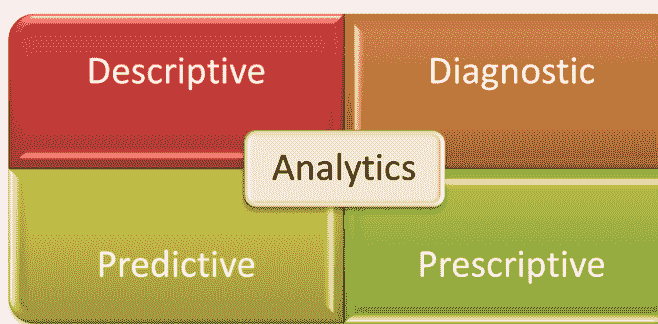

业务分析负责告知

科学方法在数据收集和分析阶段之前和之后还有许多活动，而业务数据分析主要关注数据收集和分析阶段。为了确保分析工作集中于提出能够被回答的问题，并使数据能够为解决重要的业务状况（无论是问题还是机会）提供有意义的洞察，业务数据分析需要业务分析（Business Analytics）的支持。

尽管科学方法与数据分析过程有许多相似之处，它们之间仍然存在一些区别。需要考虑的一点是，企业数据分析过程取决于所执行的分析类型。在测试期间，可能不一定会包含一个用于收集数据的实验。相反，数据可能通过利用已有的数据源的服务器提供。在企业数据分析领域，对收集到的信息使用数据验证和校验技术至关重要。由于作为科学实验一部分获得的数据是在受控的实验室环境中获得的，因此科学方法不需要对数据进行验证。当分析努力的目标是改进或随时间推移的其他改进指标时，业务数据分析是持续且迭代的。这在开展分析工作时是如此。在具有明确定义的项目背景下，从项目中获得的结论可以用于制定研究问题，反过来又用于持续整个业务数据分析周期的执行。

为了实现业务环境中运营经理和数字流程的预期行为，需要分析信息和数据；这些流程负责开发分析和报告，并位于世界的中心位置。当涉及到开发分析和统计模型（并将其应用于来自数据仓库的数据）时，这里是信息和知识形成的地方。这一切都是为了满足模型高层和层级所施加的标准。需要注意的是，分析和报告的开发环境位于业务驱动环境和专注环境之间的中间区域，工作在该区域的团队通常同时具备这两个地点的能力。

数据仓库专业人员和 ETL 开发人员是接收分析环境关于数据交付需求的人。如果必要的数据已经存储在数据仓库中，下一步将是确保公司的前端应用程序能够访问这组信息。如果数据未保存，则需要数据仓库从位于组织结构内部的一个或多个运营数据源中检索数据。替代方案包括从外部供应商处购买数据，或请求信息技术部门创建一个新的基础设施以建立新的运营数据源。

IT 运营和开发都需要满足数据仓库关于从主要运营数据源交付数据或创建新数据源所产生的要求。业务分析（BA）的开发在整个过程中涉及大量人员、技能和程序。对于大型组织，有时会有数百名来自不同级别的人同时参与到这一过程中。小型企业的控制员和分析师需要具备一系列能力，以便他们能够独立开展业务分析项目。如果 BA 模型的某一层出现问题，必须意识到存在对 BA 投资可能失败的风险。如果位于模型顶层的管理层没有识别出单一的整体战略，那么负责运营决策的人员将没有奋斗的目标。然而，分析师将不知道哪些分析是必要的。

在数据仓库处理过程中，数据库专家和 ETL 开发人员将不知道在发送到数据集（data marts）之前应该检索、合并和丰富哪些数据源，数据集是在数据仓库中创建供业务使用的数据。信息技术运营和开发人员将无法通过开发数据源来做出贡献，因为他们不知道公司所需的特定信息和专业知识。换句话说，如果没有集中精力，整个局面将变成一片混乱的丛林。建立业务分析能力中心（BACC），这可能是一个虚拟的组织单元，是规避所产生的混乱局面的一种方法。

## 企业开展业务分析的益处

无论组织规模或范围如何，数据都是任何组织的核心元素。这具有发现隐藏机会、拓宽视野和暴露潜在挑战的潜力。许多组织都理解数据的重要性。大数据分析涉及对大量结构化和非结构化数据进行系统性的收集，并对其进行分类和整理。分析数据并揭示基本趋势和重要的业务洞察至关重要。它有助于确定哪些数据是相关的并可以检查以改进业务决策。许多业务可以使用开源工具在组织内进行大数据分析。大数据已成为组织不可或缺的元素，允许他们预测并做出明智战略决策以走向成功。为了在市场中保持领先并增加收入，降低风险和避免盲目扩张至关重要。数据分析提升运营效率的领域如下：

### 旅游业

旅游业通过各种流程收集大量数据，包括预订、查询、行程和租车。酒店、旅游预订、航空公司、价格表和客户评论产生了海量数据集。在旅游业中，预测分析发挥着各种功能，通过利用大数据分析提高其性能，丰富客户体验并简化业务运营。

## 医疗服务

大数据跨越多个行业，在医药和保健部门尤为突出。数据分析对于改进和检查不断产生的量信息至关重要。它提供了价值的服务并应对了医疗领域的主要挑战，特别是关于患者人口统计的问题。涉及历史分析、公共健康监测、欺诈分析和咨询的领域示例包括……一个基于云的大数据平台使提供者能够对患者体验、改进的关键驱动因素以及提供定制方案的能力有更深入的洞察。活动专门针对某些群体设计，以比内部创建解决方案更廉宜的价格实现最大的覆盖范围和响应。

### 电子商务与零售业

电子商务和零售业是快速发展的行业，持续塑造着消费者和企业的运营方式。电子商务和商户正在利用分析来获取关键数据，这不仅有助于精准定位客户，还能扩大客户群体并增加收入。数据分析在电子商务交易流程的每个阶段都起着至关重要的作用。有助于预测主要领域、完善定价模型并对客户进行分类。而言，数据分析为电子商务和零售业务提供了智能购物体验。

### 制造业

制造业监控着来自包含数千台重型机械的网络的海量数据。机械设备由电子继电器和传感器组成，在复杂系统的控制下同步工作。在制造业中利用大数据分析可以提高生产质量并减少浪费。通过纠正工作中的任何错误，可以实现效率提高，从而节省成本和时间。该行业需要对一直存在的各种特征和信号进行持续监控。制造业通过采用数据分析解决方案将获益。该领域的专家可以从传统的监管转向更灵活、响应性的方法。制造商能够评估与原材料交付相关的潜在风险。此外，他们可以利用分析洞察确定替代路线并制定备选计划，以确保在任何中断情况下都能持续生产。

- 数据的集成与可访问性。数据存储在多种不同的系统中，其格式和质量也各不相同。业务利益相关者对企业数据分析领域正在发生的快速变化感到无所措。
- 在不同业务领域之间共享数据资产可能具有挑战性，因为很难让业务利益相关者对价值达成共识。负责执行分析的人员以及接收数据的管理人员缺乏专业知识或理解。组织文化必须发生转变，以更加重视从数据中获得的洞察，而不是经验和直觉。对于业务经理来说，要组织他们所负责的数据团队是困难的。
- 尝试寻找合适工具的困难。制定数据策略可能涉及许多不同的方法和手段。分析师有能力利用大量的策略来促进 IT 部门代表与大多数策略之间的富有对话；大多数策略会产生视觉模型，这些模型可以持续使用，协助团队（由业务和 IT 资源组成）理解围绕并影响正在进行的业务数据分析的背景。
- 平衡得分卡（The Balanced Score）是一种用于战略规划和管理的强大工具，用于评估组织的绩效。通过将战略计划实施为包含目标和绩效衡量的活跃框架，它为组织提供了一个平衡的视角，并以结果而非组织本身为中心。

## 业务数据分析的技术策略

业务数据分析的目的是衡量内部和外部组件，以便业务利益相关者和 IT 部门对组织的绩效以及组织目前如何履行对客户的承诺达成共识。

- 基准分析和市场分析是可能使用的两种方法，用于了解现状中有改进空间的领域。具有潜在收益的特定框架示例包括五力模型分析、PEST 分析、STEEP 分析和 CATWOE 分析。除了提供对组织周围外部环境的理解外，这类研究结果还非常有益，因为它们能够洞察业务不同部分的绩效与行业领先者绩效的比较情况。
- 商业模式画布（The Business Model Canvas）有助于理解组织为客户提供的价值主张、交付过程中涉及的重要组成部分，以及这些过程产生的成本和收入流。为了建立对任何变化发生背景的认知，并评估可能产生深远影响的问题和机会，这是一个非常有用的工具。在业务数据分析计划框架下，可以使用这种策略促进信息技术代表与业务利益相关者之间的对话；因此，所有相关人员能够全面理解公司的基本方面。
- 五力分析（An Analysis of the Five Forces）是一个框架，用于了解组织现状中可能变化的地方。这些信息可以用于对组织的更好的理解。为了做到这一点，必须对竞争环境的各个方面进行调查，包括买家和供应商所掌握的力量。在企业数据分析项目中，这种方法有助于获取影响组织的变量。
- 指标和关键绩效指标（Metrics and Key Performance Indicators, KPIs）：为了评估解决方案的有效性、组件以及对利益相关者重要的问题，使用了指标和关键绩效指标。在数据分析计划背景下，关键绩效指标用于确定预期的结果。
- 优势、劣势、机会和威胁（Strengths, Weaknesses, Opportunities, and Threats, SWOT）：分析是一种用于评估组织现状的方法。SWOT 分析具有四个特征，它将提供组织的内部和外部环境背景，这与业务数据分析的工作相关。完成 SWOT 分析可以促进这些对话。它是一个用于确定组织内执行的主要活动的模型，研究每个活动如何为组织提供的产品和服务做出贡献。价值链分析（The value chain analysis）是一个用于确定组织内执行的主要活动的模型。在企业数据分析领域，价值链分析是使用的方法之一，用于对组织如何向客户提供价值提供共享理解；为了竞争优势，可以使用它来促进业务利益相关者与信息技术（IT）之间的协作。图 2 展示了企业数据分析的方法和策略

尽管“业务模型”一词已使用很长时间，但企业倾向于从运营开始就构建、建立和执行自己的模型。理解公司概念以及用于理解它的主要方法至关重要。大多数情况下，组织领导层的人员根据个人能力和倾向做出决策。通过利用业务数据分析可以消除决策过程中的认知和个人偏差，它作为决策的主要输入。业务数据分析的使用允许对内部和外部方面进行量化，从而有助于业务利益相关者和 IT 部门对组织的绩效和组织目前履行职责达成相互理解。本章讨论了几种不同的业务数据分析方法以及这些方法在该领域的相关性。

## 参考文献

Callon, M., Courtial, J. P., & Laville, F. (1991). 合作分析作为描述基础研究与技术研究之间交互网络的工具：聚合物化学案例。*Scientometrics*, 22(1), 155–205. DOI: 10.1007/BF00219280

Callon, M., Courtial, J. P., Turner, W. A., & Bauin, S. (1983). 从翻译到问题网络：合作分析引论。*Social Sciences Information. Information Sur les Sciences Sociales*, 22(2), 191–235. DOI: 10.1177/0539018302200203

Chen, J., Wei, W., Guo, C., Tang, L., & Sun, L. (2017). 电子健康记录挖掘研究趋势的文本分析与可视化。*Health Policy and Technology*, 6(4), 389–400. DOI: 10.1016/j.plt.2017.10.003

Chesbrough, H. (2006). 开放业务模式：如何在新的创新格局中生存。哈佛商学院。

Feng, J., Zhang, Y. Q., & Zhang, H. (2017). 基于科学距离的合作分析方法的改进。*Scientometrics*, 111(3), 1521–1531. DOI: 10.1007/s11992-017-2286-1

Kleinberg, J. (2003). 科学中的突发性和层次结构。*Data Mining and Knowledge Discovery*, 7(4), 373–397. DOI: 10.1002/32

Morris, S. A., Yen, G., Wu, Z., & Asnake, B. (2003). 研究前沿的时间线可视化。*美国信息科学与技术杂志*, 54(5), 413–422. DOI: 10.1002/ase.214

Najmi, A., Rashidi, T., Abbasi, A., & Waller, S. (2017). 领域综述：文献计量学网络分析。*Scientometrics*, 110(2), 843–865. DOI: 10.1007/s11992-017-3

Van Eck, N. J., & Waltman, L. (2014). 文献计量网络可视化。在 Ding, Y., Rousseau, R., & Wolfram, D. (编), *Scholarly Informatics* (pp. 285–330). 瑞士出版社。DOI: 10.1007/978-3-319-10377-8

Van Eck, N. J., Waltman, L., Dekker, R., & van den Berg, J. (2010). 两种文献计量技术的比较：多维尺度和 VOS。*美国信息科学与技术杂志*, 61(12), 2405–2416. DOI: 10.1002/ase.21421

Wang, Z., Zhao, H., & Wang, Y. (2015). 2001-2014 年营销研究中的社会网络：合作分析。*Scientometrics*, 105(1), 65–82. DOI: 10.1007/s11992-015-6

Yan, B. N., Lee, T. S., & Lee, T. P. (2015). 电子商务研究论文分析 (2000-2013): 基于文本挖掘的方法。科学计量学, 105(1), 403–417. DOI: 10.1007/s11192-015-1675-6

Zhang, J., Yu, Q., Zheng, F., Long, C., Lu, Z., & Duan, Z. (2016). WOS 关键词加权与作者关键词的比较：患者依从性研究的案例研究。信息科学与技术协会学报, 67(4), 967–972. DOI: 10.1002/asi.23437

# 核心术语与定义

- **突发检测算法 (Burst Detection Algorithm, BDA):** 在已知时间内具有显著功率的信号定义为突发信号。该信号在已知时间之外没有功率（死时间）。为了解调此类信号，必须避免死时间。
- **业务分析学 (Business Analytics, BA):** 一组利用数据分析、统计模型和其他定量方法来解决业务问题的学科和技术。
- **提取、转换和加载 (ETL):** 将来自多个源的数据合并到称为数据仓库的大型中央仓库的过程。
- **信息与通信技术 (Information and Communication Technology, ICT):** 信息技术 (IT) 的更广泛的术语，指所有通信技术，包括互联网、无线网络、手机、计算机、软件、中间件、视频会议、社交网络和其他媒体应用与服务。
- **业务分析能力中心 (Business Analytics Competency Center, BACC):** 一个包含分析能力、业务能力以及 IT 能力的论坛。
- **指标与关键性能指标 (KPIs):** 关键性能指标的缩写，是指对特定目标随时间推移的性能的可量化衡量。KPI 为团队提供了努力目标、衡量进展的里程碑，以及帮助组织各人员做出更好决策的洞察。
- **优势、劣势、机会与威胁 (SWOT):** 一种用于评估公司竞争地位和制定战略规划的框架。SWOT 分析评估内部和外部因素，以及当前和未来的潜力。

# 第6 章

业务模式中的业务分析

Satya Shree

https://orcid.org/0009-0008-5447-9076

APS 艺术与科学学院，印度

C. Manjunath

APS 艺术与科学学院，印度

### 摘要

在当今动态商业环境中，组织日益意识到业务分析在精炼和优化其业务模式中的关键作用。本研究探索了业务分析在业务模式各个层面的整合，包括价值主张、客户细分、收入流和运营效率。通过对现有文献和案例研究的全面回顾，本研究阐明了利用数据驱动的洞察进行战略决策和获得可持续竞争优势的重要性。调查的关键主题包括用于市场预测的预测性分析、针对客户行为的定向营销策略、通过数据驱动物流优化供应链管理，以及业务智能在增强敏捷性方面的作用。研究还深入探讨了数据隐私担忧、技能缺口和组织阻力等挑战，为有效的实施策略提供了见解。

### 引言

业务分析的一个重要部分在于形成和优化现代贸易模型。它研究了组织如何处理信息分析控制以驱动关键决策、提高运营生产力并建立可行的竞争优势。通过对假设情景和现实案例的综合思考，本文强调了利用贸易分析对不同贸易衡量标准（包括建议、客户细分、收入流和资产分配）进行改进的转型潜力。论文解决了诸如信息保护、组织阻力和能力缺口等挑战，将经验转化为强有力的执行程序。通过阐明 DOI: 10.4018/979-8-3693-3884-1.ch006 贸易分析与业务模型之间的有利关系，本研究有助于更深入地理解组织如何在日益数据驱动的环境中适应和繁荣。

企业对业务数据分析越来越感兴趣，将其作为一种利用数据支持更智能业务选择和提取具有洞见力洞察的手段。越来越多的企业增加了企业数据分析投入，以实现其战略目标、进行创新并在市场中获得竞争优势。这些投入驱动了对更多具备业务数据分析知识的专业人士的需求。

### 背景

业务模式背景下业务分析的转型是一个有趣的历史过程，它与技术进步和业务实践的改变并进。以下是对业务分析在业务模式背景下演变的细致回顾（Ches-, 2006）。

在高级分析出现之前，公司主要通过手动报告系统获取信息。组织使用纸质或电子表格来编制销售报告、财务报表和其他基础指标。这些系统在功能和范围上有局限性，但在分析上是有用的。在20世纪90年代，商业智能（BI）技术提供了更稳健的报告能力和分析洞察，为公司带来了更受欢迎的补充。这些工具还提供了卓越的数据视化以及分析和多维度分析。

2020年，我们看到了所谓的“大数据”的扩张，或者说是数据收集的激增，这带来了新的问题和可能性。企业以更快的速度和更多化的类型收集并分析数据集。决策分析通过支持公司做出证据决策，正越来越接近业务模型的核心。组织开始利用其数据来指导战略目标、精炼客户体验并优化业务运营（Laney, 2001）。

人工智能（AI）和机器学习（ML）与分析结合改变了业务模式的轨迹。算法增加了预测精度，机器人领导形式，并释放了复杂的模式识别。未来业务模式的分析将随着依赖持续分析和人工智能的变得乐观和敏捷而发生完美转型，不断优化和推进。随着分析开始安装到业务模型中，在识别数据隐私和安全方面的担忧将进一步增加。组织应当自愿遵守 GDPR 和 CCPA 等规则。道德和审慎地使用人工智能和分析（包括透明度和公平性问题）是组织考虑的若干因素。

# 业务模型中业务分析的主要焦点

## 业务模式概述

“业务”是个人、选择、资产、结构、制成品、理想、行为以及执行和维护这一特定人类活动所需的任何其他部分的实际集合。如果我们接受这些观点，“业务模式”一词意味着什么？

业务模式是一组资产和过程，产生客户可以利用的价值，并通过销售为业务创造收入。业务模式分析的目标是增加和增强我们业务模型关键组成部分的质量。金融记者记者迈克尔·刘易斯（Michael Lewis）在文章中创造了“业务模式”一词，认为未来将建立在业务模式的基础上。根据 David T Teece (2010) 的观点，“业务模式在经济学中还没有固定的理论基础”。全面且根本地发现定义公司价值创造的程序和方面对于其运营至关重要，这是极具挑战性的。

许多作者将业务模式定义为产生收入的方法。他们将业务模式视为一种“产生”成本和收入的经济概念。（表1.1中提到，它是由于流程和技术共同作用而产生收入的运营集合）。

表 1. 各作者定义的业务模式

| 作者 | 定义 |
| :--- | :--- |
| Itami a Noshino | “业务模式是一种利润公式、一套业务系统和一套学习系统。” (Baden-Fuller & Morgan, 2010) |
| Henry Chebrough | “业务模式是一个将思想和技术与经济结果起来起来的框架。” (Chebrough, 2006) |
| Alfonso Guandabella Anita McGGetan | “业务模式是一种通过可接受成本将思想转化为收入的机制。” (Baden-Fuller & Morgan, 2010) |
| Allan Afuah | “业务模式是一种赚钱的方法。它是公司执行的一系列活动、如何执行以及何时执行，以便为客户提供他们想要的益处并获得利润。” (Afuah, 2003) |
| Thomas Wheelen, David Hunger | “业务模式是在具体的业务环境中赚钱的方法。它由公司的关键结构和运营特征组成——公司如何赚和创造利润。” (Wheelen & Hunger, 2008) |

根据 Alana Afuah (2003) 的说法，业务模式被分为四个部分，导致了影响公司每项活动的盈利决定因素。（图 1）

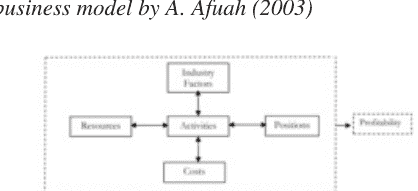

# 商业模式转型如何改变

数字技术的快速演变带来了巨大的变革，对企业和组织产生了显著影响。为了让所有企业在当前市场中获得长期的可持续竞争地位，业务流程及所有其他业务领域的数字化转型至关重要。（Hunger, D. L et al., 2008）

以下是驱动业务转型的的一些因素：

- 1. **技术创新**：企业必须跟上技术的不断进步以保持竞争力。
- 2. **动态市场**：全球化、激烈的竞争以及不断演变的行业趋势可能会促使企业调整其运营，以维持竞争力。
- 3. **规则与法规**：法律法规的变化可能会迫使企业改变其运营模式和业务流程。
- 4. **组织文化**：希望提高生产力、创造力和绩效的企业通常需要改变组织文化。
- 5. **战略目标**：企业可能会启动业务转型项目，以实现战略目标，包括公司多元化、进入新市场或引入新产品。

# 商业分析导论

世界上存在海量数据，未来还会有更多数据涌入。许多企业已经迷失在数据的海洋中。相反，聪明的组织将这种增长视为竞争优势的关键要素。事实上，商业分析是当今的“热门”话题之一。它被称为商业分析，是指应用数据、信息、统计和定量方法来帮助管理层加强对工作的理解，并做出更有效的决策。

## 定义

商业分析是在决策和解决问题的语境下，通过分析和洞察将数据转化为行动的过程。它是一个对历史数据和当前数据进行持续探索和分析以发现洞察的过程。这是通过应用特定的技术、能力和程序，对与业务相关的数据进行收集和检查，旨在识别趋势、模式和消费者行为。

商业分析包含多种程序：

- 1. 确定目标。
- 2. 确定最有效的分析方法。
- 3. 从多个不同的系统中获取大量数据。
- 4. 清洗信息并将其合并到单一位置，如数据仓库（图 2）。

# 图 2. 商业分析的可视化表示

可以通过一些常见示例对商业分析进行更精确定义：

- 1. **客户细分**：识别零售、保险和信用卡行业中的关键客户群体。
- 2. **供应链**：选择最佳采购和运输方案并规划送货路线。
- 3. **定价**：确定消费者价格和工业合同。
- 4. **商品经营**：决定购买的品牌、数量和分配方案。
- 5. **医疗保健**：预测健康因素、改善等待时间、采购物资。
- 6. **选址**：决定在哪里提供服务或设立分支机构。

## 商业分析的重要性

商业分析（BA）包含多个变动因素，但它对公司最初是至关重要的。商业分析工具有助于理解公司做出判断需要什么。这些选择将有助于提高市场份额、增加盈利能力并为投资者提供更好的回报。技术无疑影响着许多企业，但如果应用得当，商业分析（BA）可能会对整个公司产生积极影响，即使一些人还不清楚如何处理海量数据（Johnson, W. et al., 2008）。无论什么种行业，商业分析在几个方面都非常重要：

- 1. 商业分析可以识别业务系统中的漏洞。
- 2. 实施预防措施以识别风险因素。
- 3. 精准定位客户。
- 4. 使用数据驱动的推荐引擎将收入从门店转移到线上。
- 5. 转型战略。

## 商业分析的角色与职责

商业分析有其分析数据以做出决策的角色和职责。其中一些包括：

- 识别数据中的趋势以发现战略可能性。
- 识别公司可能面临的潜在挑战。
- 准备预算。
- 跟踪业务活动的绩效。
- 向利益相关者更新业务目标状态。

## 商业分析的要素

商业分析利用了以下要素：

- 1. **数据聚合**：得出摘要统计数据，如数据的平均值、最大值、总和和计数。
- 2. **数据挖掘**：用于数据驱动的决策，数据挖掘使用多种统计方法（包括聚类、回归和分类）来解决问题并在大数据集中寻找模式和趋势。
- 3. **文本挖掘**：发现模式并使用文本挖掘评估竞争对手的表现，检查来自社交媒体帖子、博客评论、客户沟通等的文本数据。
- 4. **数据可视化**：构建有意义的可视化图形，以识别数据集中的模式和链接，用于建模、预测和探索性分析。
- 5. **预测**：使用过去的数据预测未来发生的情况。例如，使用历史数据预测零售销售或能源利用率来规划预算或项目支出。
- 6. **优化**：寻找最佳方案，使用模拟技术（如“如果……怎样”分析）。

# 商业分析涉及的类型

- 1. **描述性分析**：分析历史数据以检测客户行为的模式和趋势。这使得使用数据挖掘和聚合技术获取过去和现在事件的概览成为可能。描述性分析是许多企业利用的技术，以更好地了解客户行为并针对特定客户定制营销活动（表 2）。可以使用描述性分析执行各种应用，例如：

| 业务 | 模型 | 描述 |
| :--- | :--- | :--- |
| Wipro | 客户参与摘要 | 为了确定服务利用率和参与水平，创建客户互动摘要。 |
| ISRO | 卫星发射数据摘要 | 结合任务结果和卫星发射记录。 |
| Air India | 飞行运营统计 | 收集飞行运营信息以评估服务有效性和准点表现。 |
| HDFC Bank | 账户活动报告 | 创建账户活动报告以比较客户的银行习惯。 |
| 塔钢铁 | 产量跟踪 | 监控每月生产水平以评估产能利用率和趋势。 |

**2. **预测性分析**：使用统计模型和机器学习通过解释和定义未来的客户属性和行为来预测结果。它通常使用描述性分析的发现来开发估计特定事件概率的模型。销售和营销团队利用此类基于社交媒体数据预测个人客户属性（表 3）。可以使用预测性分析执行各种应用，例如：

| 业务 | 模型 | 描述 |
| :--- | :--- | :--- |
| Ola Cab | 动态定价 | 使用预测分析根据需求、天气条件和交通模式进行实时价格调整。 |
| BookMyShow | 活动受欢迎程度预测 | 预测电影和活动的关注程度，以管理库存和营销工作。 |
| Airtel | 客户流失预测 | 使用客户数据分析识别哪些客户可能流向对手，以提高留存率。 |
| Flipkart | 需求预测 | 使用机器学习预测未来产品需求，辅助定价和备货策略。 |
| HDFC Bank | 信贷风险管理 | 利用预测分析评估贷款申请人的信用情况并预测违约风险。 |

可以使用规范性分析（prescriptive analytics）执行各种应用。其中一些：

表 4. 规范性分析的应用

|| 业务 | 模型 | 描述 |
| :--- | :--- | :--- |
| Snap deal | 优化电子商务结账 | 建议更改结账流程以降低购物车放弃率。 |
| Paytm | 欺诈检测推荐 | 针对交易数据中发现的趋势建议反欺诈措施。 |
| 塔塔 (Tata Motors) | 经销商库存管理 | 根据市场需求和销售速度为经销商提供最佳库存水平建议。 |
| Reliance Jio | 需求预测 | 根据用户评论和使用趋势建议增强服务。 |
| 印度铁路 (Indian railways) | 调度和路线优化 | 为最佳铁路路线和时间表提供建议，以提高有效及时性。 |

**4. 诊断性分析（Diagnostic Analytics）：** 使用数据挖掘和相关性分析等策略回顾历史表现以寻找驱动特定趋势的因素，并利用算法寻找低频变量发生的概率。在此过程中，使用数据挖掘、数据发现和相关性分析来识别特定事件背后的原因。分类和回归算法以确保已建立对发生概率和原因的理解。**（表 5）**

可以使用诊断性分析（diagnostic analytics）执行各种应用。其中一些：

表 5. 诊断性分析的应用

|| 业务 | 模型 | 描述 |
| :--- | :--- | :--- |
| 埃森 (Infosys) | 流失预测 | 监控流失原因以增强客户留存技术。 |
| SBI 人寿保险 | 理赔拒绝分析 | 识别保险理赔被拒绝的原因以改进保单语言 |
| PVR 影院 | 票房表现分析器 | 检查影响电影成功和观众人数的变量 |
| Yes Bank | 违约贷款诊断 | 研究贷款违约的原因以增强信用风险评估。 |
| Reliance jio | 网络连接诊断 | 确定网络连接的根本原因以提高服务质量和连接性。 |

## 业务分析流程

在开始流程之前我们选择的最终目标将决定你在深入研究业务分析（BA）时采取的方法。无论你选择何种方法，最后的结果一定会有等待我们的有用见解。本质上，业务分析是一个 6 步过程，概述如下。**（图 3）**

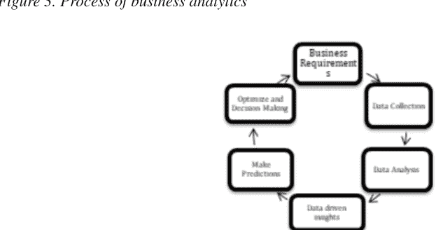

### 第 1 步：业务需求

业务分析流程的第一步是确定公司想要实现或解决什么。有时，目标会被分为更小的目标。在这个阶段需要处理一些主要查询，如“可用数据是什么”、“我们如何使用它”以及“数据是否足够”。

### 第 2 步：数据收集

在定义问题声明后，下一步是收集数据和清洗数据。虽然大多数企业拥有大量数据，但并非所有数据都是可靠或相关的。公司收集的大量数据包含垃圾或空数据，需要通过分析进行填充。

### 第 3 步：数据分析

一旦收集数据，下一步是进行分析。为了获得你所需的见解，会使用多种统计技术（包括相关性分析和假设检验）。分析师将检测与目标变量相关的每个方面。这通常是进行比较和拆分数据的阶段。此外，还会考虑其他假设，以便通过某些可视化来确定可能的结果。

### 第 4 步：数据驱动的见解

在此阶段，分析师将使用逻辑回归、决策树和神经网络通过预测技术对数据进行建模。通过使用这些方法，将观察到最重要的因素之间的关系和“隐藏证据”，以及新的见解和模式。

### 第 5 步：做出预测

在此并行应用许多模型，并将选择最准确的模型，以发现变量之间隐藏的见解，并为关键指标提供模式。

### 第 6 步：优化和决策

在此阶段，会产生一些问题：“模型做出了正确的预测吗？”以及“模型是否有效”。如果是这样，则需要优化模型，并在检测到新见解时不断更新数据库。然后，分析师将根据业务目标根据模型得出的结论做出决策并采取。

## 业务分析所需的技能

有人指出，业务需要更强的技术和分析能力来分析和收集见解（Amit R., & Zott C., 2012）。以下是渴望从事业务分析的一些先决条件：

- 1. **数据分析**：要从大型数据集中得出有用的见解，需要数据分析工具和流程。利用数据分析需要数据处理、统计分析和数据可视化的知识，以便理解、解释和传播发现。
- 2. **统计建模**：为了理解数据中的关系并建立可靠的预测，需要统计建模方法的知识。相关技术的示例包括回归建模、时间序列建模和预测建模。
- 3. **数据管理**：数据管理技能将有助于确保数据的质量和可维护性。必要的技能包括数据清洗、数据集成和查询数据库。
- 4. **编程素养**：包括 R、Python 或 SQL 在内的编程语言知识可以提高你创建数据处理、统计分析以及开发正式分析模型每个阶段的能力。
- 5. **业务知识**：将分析结果（你自己的或他人的）与组织目标联系起来的能力，需要业务背景、关键性能指标（KPI）和行业部门趋势的业务知识。
- 6. **沟通技能**：向任何非技术人员传达复杂分析的能力至关重要。
- 7. **解决问题能力**：高级解决问题的能力对于识别组织挑战、使用适当策略和驱动数据驱动决策是必要的。
- 8. **领域知识**：需要对业务背景、行业部门的趋势有了解，以解释分析输出。
- 9. **数据可视化**：为了成功传达趋势和见解，需要对数据可视化工具的掌握。
- 10. **批判性思维**：具备从战略角度分析数据的能力至关重要。

## 数据分析 vs 业务分析 vs 商业智能

### 1. 业务分析 vs 数据分析

使用数据分析技术获取业务见解是业务分析（BA）。然而，由于其定义广泛，业务分析和数据分析有时互用。分析数据集以对其中的信息进行推断被称为数据分析。

### 2. 业务分析 vs 商业智能

预测性分析是业务分析的主要关注点，预测趋势而非总结历史数据。企业通常先使用商业智能（BI），然后业务分析。商业智能（BI）检查公司运营以识别成功实践和发展领域。

- 1. **增强决策制定**：业务分析师利用分析，通过对业务目标的理解来指导数据驱动的业务决策。组织的历史数据、市场状况以及产品的成功情况被用于预测趋势并制定与这些趋势相符的计划。
- 2. **跟踪绩效与增长**：业务分析可用于追踪组织随时间变化的演变。它还能揭示某种策略或产品在市场上的表现如何。这些报告提供了对组织运营和非运营层面的洞察。因此，可以使用新的选择和程序来增强统计数据表现。
- 3. **减少风险因素**：业务分析的主要优势之一是其降低风险的能力。它有助于跟踪公司过去犯过的错误并找出产生这些错误的原因。通过这些信息，进行分析以确定类似危害在近期再次发生的可能性。结果，可以采取适当的预防措施来避免它们的发生。
- 4. **改善客户体验**：让客户开心是所有成功公司都发现的成功秘诀！当今的企业识别客户群体，理解他们的需求，并据此调整服务。业务分析中使用的模型和统计方法使这一切成为可能。

## 业务分析的局限性

尽管业务分析领域非常有利利，但也有其缺点。其中包括：

- 1. **缺乏投入**：投资业务分析可能昂贵且耗时。尽管解决方案易于实施，但由于资金和限制，个体的信任度会降低。这最终导致业务的全面崩塌。
- 2. **技能不足**：对具有处理 BA（业务分析）数据分析能力的员工需求更高。一些公司可能会发现很难找到具备他们所需的 BA 知识和能力的候选人。
- 3. **低质量数据**：组织持有大量数据。然而，真正的问题是这些信息中有多少是可用且准确的。设计不当、过度复杂或数据不足是一个主要障碍，会导致分析过程变得困难。
- 4. **隐私关注**：企业收集客户信息是为了进行审查并改进公司的选择。然而，这可能导致隐私侵犯。已经出现过两个公司从相互收集的用户数据中受益的案例。

## 业务模式分析

## 业务服务中数据与分析的演变

自20世纪50年代以来，组织一直将数据分析作为其运营的一部分。最初的数据分析方法基于调查调查和访谈等人工流程，这些流程产生的信息随后需要手动输入电子表格。在20世纪80年代后期，人工智能首次用于自动化数据处理功能。得益于人工智能的进步，企业可以轻松准确地收集大量数据（Cole Nussbaumer Knaflic, n.d.）。

一旦企业能够跟上2000年代的节奏，可用分析的数据量激增，随之人工智能的演变使得公司能够比以前任何时候都更快地检查数据集。由AI驱动、利用机器学习和自然语言处理的分析技术已成为常见的商业实践，并是日常运营的重要组成部分。这些技术允许企业预测趋势、分析客户行为并制定业务策略。

## 数据与分析对企业的影响

组织可以通过研究客户行为来创建针对客户需求的服务。尽管如此，公司还可以利用数据和分析随时间推移降低流失率，这些数据有助于更好地理解产品和服务如何对客户做出反应和表现。公司可以通过使用AI驱动的预测模型进行未来预测来保持竞争力。

## 分析在业务中的应用

数据分析对许多不同行业都至关重要，因为它有助于公司获取重要洞察、做出决策，并由各公司推动创新和扩张以促进成功和增长（Benhya, H. et al., 2021）。

零售：零售商收集有关消费者行为、偏好和之前购买过的分析信息。对受众的更好理解允许零售商改进库存管理、价格优化和营销的个性化。

示例：Flipkart 通过识别浏览和购买行为来为用户提供产品推荐，这一切都基于分析。

- 1. **金融**：金融机构利用分析来降低风险、检测欺诈并做出明智投资选择。分析还用于根据客户的需求和偏好定制金融产品和服务。

示例：HDFC银行利用分析识别并预防金融犯罪。

- 2. **医疗保健**：医疗专业人员采用分析来增强资源分配、降低成本并改善患者结果。分析还可能用于预测病程、识别患者风险因素并增强治疗过程。

示例：Apollo医院使用分析改进护理协调并预测患者再次入院。

- 3. **制造业**：制造组织使用分析来改进质量控制、最大限地减少浪费并简化运营。分析还用于预测客户需求、监控设备效率并识别运营流程的改进领域。

示例：塔塔钢铁（Tata Steel）利用分析来提高制造效率并优化供应链。

- 4. **营销**：营销组织利用分析来识别目标消费者、衡量活动有效性并改进营销策略。
- 5. **交通**：为了安全最大化、减少燃料消耗并优化路线，运输企业采用分析。分析用于估计需求、评估司机行为并监控车辆性能。

示例：Ola 通过分析优化共享约车路线。

- 6. **保险**：保险公司利用数据和分析管理风险、检测潜在欺诈并开发更好的保险产品。分析可以预测理赔程度，并根据特定需求调整激励保险方案。
- 7. **示例**：ICICI Lombard 利用分析推动客户忠度和保险方案改进。
- 8. **电信**：电信公司利用分析增强客户服务、优化网络。电信公司还可以发送通知衡量客户忠诚。公司可以监控客户偏好并增强网络性能。

示例：Reliance Jio 利用分析建模技术增强客户满意度并实现网络性能。

- 9. **农业**：农业行业的公司利用分析提高产量、有效管理资源使用并对种植和收获决策做出数据驱动。公司使用分析进行天气预测、监测土壤状况并解读施肥灌溉策略。

示例：农民利用来自 Cropl 和 Ninjacart 等科技公司的数据提供作物健康和农田状况的决策信息。

- 10. **电子商务**：该行业的组织使用分析跟踪客户在网站上的活动，改善网站体验并创建定制化的产品推荐。分析协助组织分析购物车放弃率、分析购买趋势并最大化营销活动的影响。

示例：Flipkart 提供电子商务性能洞察，帮助商家通过分析做出数据驱动决策以扩大其业务。

## 数据驱动的业务模式

由于注入数据的业务模式，企业能够保持竞争领先，并开发为客户提供更大价值的服务。以下是一些采用数据分析转型业务模式的组织。

- 1. 苹果 (Apple)

苹果利用人工智能和数据分析来为其客户创建定制的产品和服务。通过理解客户行为，苹果能够设计出直观且比以往任何时候都更有价值的产品。此外，苹果利用AI驱动的洞察来识别新市场的机会，并迅速调整业务模式以适应变化的环境。

- 2. 亚马逊 (Amazon)

亚马逊通过人工智能和数据分析增强了运营并为客户提供了个性化建议。通过分析用户行为，亚马逊能够发现新地区的机遇并简化交付流程，从而提高效率。

- 3. 微软 (Microsoft)

作为计算机公司，微软利用业务分析调查了远程办公如何影响其员工。该项目解决了包括工作生活平衡、员工关系、协作影响以及经理参与在内的重要问题。分析揭示了包括会议时长、经理之间的一对一互动、更改的工作计划以及更稳健的员工间网络等关键数据。最后，他们可以利用这些信息来指导其长期职业规划。

- 4. 美国运通 (American Express)

信用卡公司美国运通利用业务分析来识别其客户卡片上的欺诈活动。该公司跟踪包括交易详情、商户信息和会员信息在内的KPI。得益于这些指标，美国运通几乎能够立即识别欺诈活动。

## 业务模式的未来展望

企业未来可能会实施新的模式和策略，以利用不断发展的技术和不断变化的市场动态。未来可能使用的业务模式包括：

- 1. 平台型 (Platform-Based)：使用网站或应用程序作为数字平台连接客户与产品或服务的公司是平台型企业。公司经常使用算法和数据将客户与最优供应商连接起来。他们还可能提供客户服务或支付处理等额外服务。
- 2. 链型 (Chain-Based)：分布式账本技术（区块链）实现了安全、开放且去中心化的交易。未来，公司开始采用基于区块链的模式来支持代币化资产、去中心化网络和智能合约等新型价值的创建。
- 3. 订阅型 (Subscription-Based)：订阅型公司向客户出售良好服务的访问权，通常收取定期费用。订阅型公司通常会增加忠诚积分或访问独特内容等额外福利，并使用数据算法优化每个个人客户的体验。
- 4. 共享经济 (Sharing Economy)：这是一种商业概念，指个人或组织共享产品或服务，通常通过数字平台进行。除了降低交易成本和促进创意与团队合作外，该策略通过最大化闲置资产的使用来提供价值。

## 业务模型中业务分析的说明

在这里我们可以使用K-means机器学习算法进行客户细分 (U. Dinesh Kumar, 2019)。

通过每个聚类中的共同点对客户进行分组的过程被称为客户细分。为了使每个客户对公司的价值最大化，我将基础进行细分，根据客户的需求和行为调整项目。此外，解决不同客户的问题对公司也有益。

有一份来自某电子商务公司的示例数据集，包含了2018年11月至2019年4月的实际销售数据，我们可以通过以下步骤应用k-means算法：

- 1. 业务需求
- 2. 数据分析
- 3. 使用K-means聚类进行细分
- 4. 超参数调优
- 5. 结果的可视化与解释

## 1. 业务需求

在此示例中，我们将人口统计学或地理角度从多个方面分析客户的行为。

## 2. 数据分析

原始数据集包含关于25000名唯一客户的以下信息（图4）

### 图 4. 客户客户数据集

| customer_id | order_date | order_month | day | price | quantity | discount | tax | amount | revenue |
| :--- | :--- | :--- | :--- | :--- | :--- | :--- | :--- | :--- | :--- |
| 25000001 | 2018/11/01 | 11 | 1 | 150 | 2 | 0 | 0 | 300 | 300 |
| 25000002 | 2018/11/05 | 11 | 5 | 200 | 1 | 0 | 0 | 200 | 200 |
| 25000003 | 2018/11/10 | 11 | 10 | 100 | 3 | 0 | 0 | 300 | 300 |

(来源: https://github.com/cereniyim/Customer-Segmentation-Unsupervised-ML-Model)

上述数据集不包含任何NULL值，因为我们采用了一个经过良好清洗的数据集。因此，我们可以从中分析出以下见：

- **订单产品数量：** 通过总计客户订购的产品类型数来确定（**图5**）。
图 5. 订单产品数量

- **平均退货率：** 它是客户所有订单中退货物品金额与订单物品数量的平均值（**图6**）。
图 6. 平均退货率

- **总支出：** 它是客户的总支出金额（**图7**）。
图 7. 总支出

## 3. 使用K-means聚类进行细分

通过每个聚类中的共同点对客户进行分组的过程被称为客户细分。为了使每个客户对公司的价值最大化，我将基础进行细分，根据客户的需求和行为调整项目。此外，解决不同客户的问题对公司也有益。

- 1. 从随机质心开始。
- 2. 将每个数据点分配给最近的质心。
- 3. 根据平均重新计算质心。
- 4. 重复直到质心稳定。

图 8. 肘部法
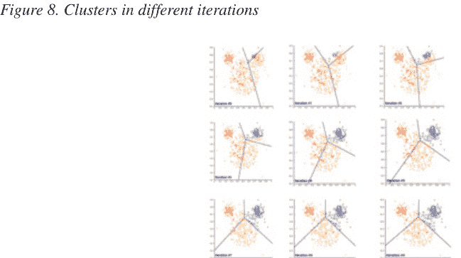

## 4. 超参数调优

原始数据集包含关于25000名唯一客户的以下信息（图4）

肘部法有助于确定最佳聚类数量。

图 9. 肘部法
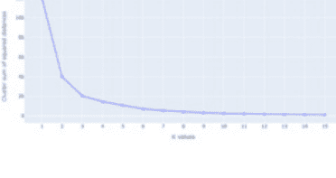

## 5. 结果的可视化与解释

上述数据集不包含任何NULL值，因为我们采用了一个经过良好清洗的数据集。因此，我们可以从中分析出以下见：

- **订单产品数量：** 通过总计客户订购的产品类型数来确定（**图5**）。
- **平均退货率：** 它是客户所有订单中退货物品金额与订单物品数量的平均值（**图6**）。
- **总支出：** 它是客户的总支出金额（**图7**）。

图 10. 聚类图
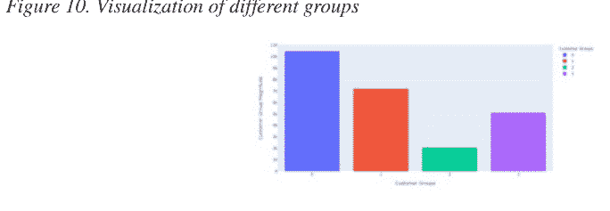

图 11. 聚类图

人工智能（AI）营销行业在2021年的价值预计为158.4亿美元。Statareport显示，到2028年，这一价值预计将超过1075亿美元。（图12）。

### 图 12. AI 与 ML 增长的可视化
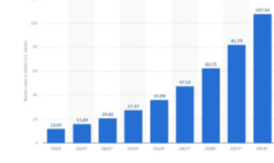

相反，全球机器学习（ML）市场在2022年的价值为192亿美元，预计将从2023年的260.3亿美元以36.2%的复合年增长率（CAGR）增长，到2030年达到惊人的2259.1亿美元。人工智能（AI）和机器学习（ML）对业务产生了巨大影响。这两项技术正在彻底改变许多商业领域，并带来显著的变革：

以下是一些正在影响企业环境和市场动态的新兴 AI/ML 技术：

- 1. 超自动化（Hyper-Automation）
人工智能和机器学习的集成被称为超自动化。它利用这两项技术来优化、自动化和简化各种内部流程。
- 2. 自然语言处理（Natural Language Processing）
自然语言处理（NLP）是人工智能和机器学习的一个分支，它建立了联系，使计算机与人类语言之间的通信变得更加容易。
- 3. AI 赋能的网络安全系统
这些是先进的安全技术，为 AI 集成到公司运营中提供严格且领先的安全保障。它们保护网络、计算机系统和隐私信息免受在线风险和攻击。
- 4. 无代码/低代码创新（No-Code Low-Code Innovations）
通过使用预构建组件和可视化界面，拥有少量或没有编程知识的开发者可以使用低代码和无代码平台创建应用并自动化任务。当 AI 集成到这些平台时，它们的能力会增强。

## 5. 多任务模型（Multiple Task Models）

被称为“多任务模型”的高级机器学习和人工智能模型能够在单一系统中同时管理并执行多个任务或目标。由于这些模型能够同时学习和泛化不同的任务，它们所需的训练和资源更少。

## 结论

业务分析巩了了作为现代商业模式基石的地位——它改变了公司利用数据转化为行动并指导决策的方式。使用先进分析和方法的企业可以调查大量数据，以识别模式、趋势和相关性（这些模式通常处于休眠状态），从而简化运营、建立客户关系并发现新市场，使分析成为业务持续改进和创新的工具。

围绕业务分析的事实揭示了一个引人入胜的故事。使用分析的公司认为，随着流程改进和整体竞争力的增强，决策更有价值。采用数据驱动策略的企业从成本降低、利润能力提高和客户满意度提升中受益。无论大小，企业都在利用机器学习、人工智能和大数据等新技术来最大限度地挖掘潜在的分析机会。

展望未来，业务分析预示着比以往任何时候都更加集成和复杂的应用未来。随着数据量的不断增加，对实时分析和预测建模的需求日益增长。此外，数据的伦理使用和隐私问题不仅是分析过程的一部分，也是企业所承担的日益复杂的管理过程的一部分。安全将确保利益相关者对他们的分析开发以及实际使用保持信任和信心。

业务分析并非一时的时尚，它将继续推动企业在运营和竞争方式上的根本性进展。利用数据的企业可能会预见地优于不利用数据的组织，它们以清晰、敏捷和策略性的方式应对复杂的业务市场过程。透明度往往能为组织提供政治保护，因为它们在不断思考进步的机会，分析在未来将为企业提供机会，是因为它们天生具有创新能力；在未来的市场时代，能够快速处理业务分析中正确问题的答案是关键。

## 参考文献

Afuah, A. (2003). Business Models: A Strategic Management Approach. McGraw-Hill/Irwin.

Agarwal, S., Iyer, A.P., Panda, A., Madden, S., Mozafari, B., & Stoica, I. (2012). Blink and it's done: interactive queries on very large data.

Agrawal, A., Gans, J. S., & Goldfar, A. (2018). Prediction machines: the simple economics of artificial intelligence. Harvard Business Review.

Amit, R., & Zott, C. (2001). Value creation in e-business. Strategic Management Journal, 22(6–7), 493–520. DOI: 10.1002/smj.187

Amit, R., & Zott, C. (2012). Creating value through business model innovation. 2012.

Banerji, D., & Reimer, T. (2019). Startup founders and their LinkedIn connections: Are well-

benhya, H., Pachidi, S., & Jarvenpa, S. (2021). Special issue editorial: Artificial intelligence in organizations: Implications for information systems research. Journal of the Association for Information Systems, 22(2), 10. DOI: 10.17705/ais.00662

Bjornali, E. S., & Ellings, A. (2014). Factors affecting the development of clean-tech

Bocken, N., & Snihur, Y. (2020). Lean Startup and the business model: Experimenting for novelty and impact. Long Range Planning, 53(4), 101953. DOI: 10.1111/j.lrp.2019.101953

Bowman, C., & Ambrosini, V. (2000). Value-based strategy. British journal of management, 11(1), 5–15.

Brynjolfsson, E., & Hitt, L. (1996). Paradox? Firm-level evidence. Management Science, 42(4).

Brandenburger, A., & Stuart, H. (1999). Concepts: Strategic Management. Journal of Economics and Management, 5(1), 24.

Chesbrough, H. (2006). Open Business Models: How to Thrive in the New Landscape. Harvard Business School.

Cioffi, D. (2007). The Evolution of Business Analytics. Journal of Business Research.

Competing on Analytics: The New Science of Winning by Thomas H. Davenport and Jeanne G. Harris (2007)

Data Science for Business: What You Need to Know about Data Mining and Data-Analytic Thinking by Foster Provost and Tom Fawcett (2013)

Hunger, D. L., & Wheelen, T. L. (2008). Strategic Management and Business Policy. Prentice Hall.

Inmon, W. H. (1996). Building the Data Warehouse. John Wiley & Sons.

Johnson, W. M., Christensen, C. M., & Kagerman, H. (2008). Reinventing your Business Model. Harvard Business Review, 86(12), 57–68.

Kitchin, R. (2014). Big Data, New Epistemologies and Paradigm Shifts. Big Data & Society, 1(1). DOI: 10.1117/20539517145284

Laney, D. (2001). 3D Data Management: Controlling Data Volume, Velocity, and Variety.

Pattern Recognition and Machine Learning by Christopher B. Bishop

Shmueli, G., & Koppius, O. R. (2011). Predictive Analytics in Information Systems Research. Management Systems Quarterly, 35(3), 553. DOI: 10.2307/23042796

startups: A literature review. Energy Procedia, 58, 43–50. Blocker, C. P., Cannon, J. P., Panagopopoulos, N. G., & Sager, J. K. (2012). The role of the sales force in value creation and appropriation: new directions for research. Journal of Personal Selling & Sales Management, 32(1), 15–27.

Storytelling with Data by Cole Nussbaumer Knafic

Teece, J. D. (2010). Business Models, Business Strategy and Innovation. Long Range Planning, 43(2), 172–194. DOI: 10.1016/j.lrp.2009.07.003

## 第 7 章

动态定价策略

在电子商务中实现机器学习算法

NV Suresh

https://orcid.org/0000-0002-0393-6037

印度 ASESET 科学与技术学院

Ananth Selakumar

https://orcid.org/0000-0001-8521-3440

印度 ASESET 科学与技术学院

Gajalakshmi Sridhar

https://orcid.org/0000-0008-4344-1486

印度 ASESET 科学与技术学院

Vishal Jain

https://orcid.org/0000-0003-1126-6742

印度 Sharda 大学

### 摘要

本评估论文探讨了电子业务系统中动态化领域，关注了基于计算机的信息计算如何结合以优化定价决策。在不断发展的机器人行业中，企业正在寻找新颖策略，在保持竞争力的同时扩大收入。本综述探讨了通过对海量数据集进行持续评估、预测市场波动以及调整定价系统来应对这些挑战的执行情况。用于定价重新设计的机器学习算法的发展和计划，考虑到竞争评估，是评估的关键领域。

### 引言

在飞速发展的电子商务背景下，对利润和效率的追求日益增强。在这一追求过程中，定价结构被视为进步的重要决定因素。传统的静态定价模型在满足现代消费者需求和在线业务复杂性方面日益力不从心。因此，受技术进步和数据响应能力提高的影响，转向系统动态化的视角应运而生。这一变革的最前沿是将定价评估整合到定价决策中，有望提供极高的灵活性和响应能力。本文的重点是探讨电子商务背景下的系统定价动态化以及其中人工智能算法的执行。

通过对相关事务、可评估努力和实验确认的全面评估，本研究旨在梳理用于零售流程审查的机器学习的可行性、挑战和结果，它如何改变了零售格局，为消费者提供了前所未有的便利，并极大地提高了事务和效率。然而，实现公平是一项巨大的挑战，迫使零售商寻找创新方法来削减成本并提高利润。例如，动态定价其根据不同因素（如需求考虑和购买方向）进行改变的能力，已成为本研究关注的优势领域。与依赖固定成本的模型不同，动态定价允许零售商根据财务状况快速调整，从而进一步优化报酬并跟上这一现实。

人工智能的到来催生动态定价的另一个时代，使零售商具备了处理大规模信息挑战的能力。用于感知预测定价模型和信息组合之间关系的人工评估，吸引了零售商以卓越的效果确定兴趣、选择客户客户并制定策略。通过利用重复数据，零售商可以将价格准确地融入个人偏好中，从而在电子商务领域获得优势（Raja, R. W. 80）。尽管人工智能在预测定价方面具有巨大的潜力，但其执行并非没有挑战。复制算法的复杂性需要充满活力且专业的团队来创建、部署和维护这些系统。此外，算法偏差问题和伦理影响凸显了在基于计算机的评估框架中仔细思考和管理的重要性。本文评估论文旨在解决这些复杂性，并为电子商务定价系统中实施人工智能提供最佳实践数据。

通过审查真实的焦点研究并结合明确证据，本研究旨在为努力使用人工智能进行定价优化的零售商提供实用建议。简而言，人工智能参与的动态定价结构是电子商务中的一种本质视角，为零售商提供了改进定价策略和更新现实的主要价值。尽管如此，理解定价流中复制数据的最佳范围仍需要对其能力、困难和伦理评估有细致的理解。通过观察方法和结合数据片段，本文评估论文旨在为电子商务动态定价这一蓬勃领域做出贡献，并为研究这一特殊领域的零售商提供指导。

### 文献综述

- Liu, J. (2019)¹⁴⁴ 这项广泛的综述探索了电子商务环境下使用的各种预测性定价评估。论文通过人工智能评估的结合分析了动态系统。它评估了在线各种定价结构在实现定价和客户责任方面的机会。

- Ban, G. Y. (2021)¹⁵⁵ 关注人工智能在卓越定价中的应用，本文为在线定价安全系统提供了数据。它研究了计算机数据系统如何作为电子商务中的选择进行更新，涵盖了未来发展的困难和巨大机会。

- Sarkar, M. (2023)¹⁶⁶ 一项关于在电子阶段动态定价执行计算机算法的背景性评估。它详细阐述了所涉及观点、面临的挑战以及取得的结果。该综述揭示了连接使用计算机数据进行定价更新的合理建议。

- Chen, K. (2020)¹⁷⁷ 汇总了一项近期评估，本文研究了在线零售商使用的不同坚实定价结构的合理性。它评估了对方法、利润和客户客户方向的影响。

- Shin, D. (2023)¹⁸⁸ 关注合理的评估，该综述论文讨论了其在电子商务动态定价中的工作。它概述了用于定价的复制数据的精确性质及其财务考量。

近年来，电子商务经历了巨大的转型。由于电子商务平台的激增和消费者日益复杂化，企业面临着保持竞争力的巨大压力。由于传统策略具有经常性的静态特征，很难敏锐地察觉不断变化的行业模式和消费者偏好。在这种背景下，企业可能会采用动态探索策略来获得竞争对手的优势。动态探索技术的一个方面是提供持续且自适应的数据分析，为决策过程提供支持。

与基于固定假设和历史数据的静态模型不同，动态方法使用实时数据来反映当前的市场状况。由于这种变化，企业将发现更容易适应不断变化的消费者偏好和市场趋势。数据分析和人工智能正在驱动这种变化。基于 AI 的算法可以快速、准确地处理大量数据，揭示出传统分析可能无法的模式和趋势。在线企业通过对消费者偏好和购买习惯的全面理解，利用这些过程可以优化其广告策略和库存管理。利用这些数据，企业可以对其目标受众的特定子集进行更好的营销分析，从而增加客户参与度和竞争优势。

预测性分析也可供企业用于预测需求，减少库存过多或不足的概率。使用动态探索方法具有许多优势。得益于这些策略，企业能够在快速变化的市场中保持适应能力。通过不断分析数据并调整策略，企业能够应对消费者偏好的转变和竞争变化。传统模型使用的数据可能无法准确反映当前市场的动态。相比之下，AI 驱动的分析利用实时数据提供更精确、更及时的洞察，使企业能够根据准确信息做出决策。动态探索技术允许为客户提供个性化体验，通过分析个人数据，企业可以创建高度针对性的营销活动，并以此提高客户的满意度和忠诚度。尽管具有这些优势，由 AI 分析驱动的动态探索方法在实施上也面临挑战。主要问题之一是数据的质量和可靠性。

由于 AI 高度依赖输入的数据，不充分或错误的数据会导致糟糕或错误的结论。为了使这些策略成功，确保数据的完整性和准确性绝对必要的。一个障碍是数据数据。收集和分析数据的过程引发了隐私和安全关注。组织应该仔细研究这些问题，以确保其行为符合道德和法律原则。透明的数据和强大的安全措施对于维护客户信任和避免法律后果至关重要。AI 驱动算法的复杂性可能给缺乏数据专业知识的企业带来挑战。如果企业缺乏专业知识，可能会应用不当，导致难以理解和解释这些算法。未来在线业务可能会更加强调动态研究方法。随着技术的进步，AI 和数据分析将提供更先进的工具来理解和应对市场动态。人工智能与物联网（IoT）和区块链等其他新兴创新的进一步融合，这些整合具有使数据分析变得更准确、更高效的潜力，可能为企业提供更深层次、更有用的洞察。此外，预计机器学习和自然语言处理的进步将提高 AI 算法理解和解释复杂数据的能力。

因此，通过进行更精确、更细致的分析，动态探索技术可能会变得更加有效。数据分析和计算机推理支持的前沿研究方法正在重塑电子商务的格局。通过提供对需求、竞争和消费者行为的实时洞察，这些策略使企业能够在快速变化的市场中保持竞争力和适应性。然而，由于数据质量、伦理考量和算法复杂性问题，实施这些策略面临挑战。在竞争激烈的在线环境中，能够成功克服这些障碍并利用动态探索方法力量的企业将处于蓬发展的地位。随着 AI 和数据分析的进步，为企业增强策略和实现目标将带来令人兴奋的机会。

## 拟议的概念框架

表 1 拟议概念框架中的变量

| 变量 | 定义 |
|---|---|
| 产品 | 影响决策的物体特征，如种类和组件。考虑到清晰价值、生产成本和市场报酬等因素，不同的物体可能需要不同的观察结构。 |
| 人员 | 影响系统的客户财务观点、倾向和领导力。理解理想的利益相关者可以吸引建立符合买家需求和偏好的关系关系框架。 |
| 时期 | 财务状况在长时间范围内发生变化，要求策略具有灵活性。时期暗示了普通变化，如季节和经济周期，这些会影响客户需求和情感因素，从而塑造出独特的结构。 |
| 使用机器学习进行决策 | 使用机器学习的动态过程在自变量和动态观察结果决策以及对决策的通知之间充当一种中间过程，并在电子商务中配合动态评估系统的执行。 |
| 动态定价策略 | 动态评估结构根据兴趣、供给和买家引导等各种因素，建议价格的自适应调整。评估中的结果价格反映了如何根据市场环境的变化不断进行调整。 |

图 1 拟议的概念框架

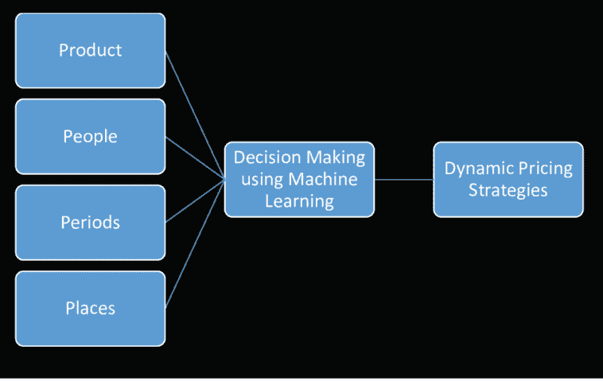

（Kopalle, P. K. (13) 的修订模型）

## 建议

考虑到这些挑战，可以提出几项评估以刷新由人工智能计算填充的动态结构的适用性和道德可靠性。关系，毫无疑问，应该关注数据质量，并投入资源到增强数据机器、清洗和确保过程中。与外部数据供应商合作或将资源投入数据改进活动可以帮助建立内部数据集。同样，在数据专家、财务专业人员、伦理学家和诚实道德专家之间建立跨学科的地图蓝图是至关重要的。这种跨学科框架可以从全面的角度对动态探索技术的结果进行工作，并确保它们符合道德原则和法律条款。

具有改变电子商务格局的潜力。尽管如此，它在信息质量、算法分组计划和伦理考量方面仍面临着巨大的挑战。通过关注信息质量、开展跨学科合作、确保算法透明度以及调整合规计划，机构可以应对这些挑战，并释放电子商务中动态定价策略的全部优势。

## 结论

综而言之，在电子商务中实施人工智能估计以实现动态定价结构意味着零售实践的巨大进步。通过这项评估可以确定，这些尖端计算能够更显著地吸引并适应复杂的业务环境，并不断超越传统框架。主要通过数据驱动并考虑各种因素（例如客户直连、竞争对手对比和市场支付），基于的评估使电子商务平台能够设定既具有规模又非常符合个人偏好的价格。同样，人工智能的整合通过自动化评审决策，进一步实现了合理的界限，为基础任务释放了基本的人力资源。

尽管如此，机构在建立完善评价体系的同时，应重点关注透明且伦理的审查，以确保消费者之间的合理性和信任。展望未来，电子商务动态定价的命运在于基于计算机的数据的积极开发和完善，以及对新兴技术的整合，例如智能评估和人工智能。随着电子商务的不断发展，采用此类进步的机构将在整个业务领域中获得优势，驱动新发展并为客户提供更具价值的利益。

## 参考文献

- Ban, G. Y., & Keskin, N. B. (2021). Personalized dynamic pricing with machine learning: High-dimensional features and heterogeneous elasticity. Management Science, 67(9), 5549–5568. DOI: 10.1287/mnsc.2020.3680

- Chen, K., Z, Y., Alwan, L. C., & Zhang, L. (2020). Dynamic pricing in the presence of reference price effect and consumer strategic behavior. International Journal of Production Research, 58(2), 546–561. DOI: 10.1080/0207543.2019.159852

- Kapalle, P. K., Pawels, C., Akella, L. Y., & Gangwar, M. (2023). Dynamic pricing: Definition, implications for managers, and future research directions. Journal of Retailing, 99(4), 580–593. DOI: 10.1016/j.jretai.2023.11.003

- Liu, J., Zhang, Y., Wang, X., Deng, Y., & Wu, X. (2019). Dynamic pricing on e-commerce platform with deep reinforcement learning: A field experiment. arXiv preprint arXiv:1912.02572.

- Raja, R. V., Kumar, G., & Selakumar, A. (2022). PERCEVED RISK & PRICE IN E-SOURCES: ANALYSING PURCHASE DECISIONS IN BUYING MOBILE PHONES. Annals of Future Research, 65(1), 3438–3448.

- Sarkar, M., Ayon, E. H., Mia, M. T., Ray, R. K., Chowdhury, M. S., Ghosh, B. P., & Puja, A. R. (2023). Optimizing E-Commerce Profits: A Comprehensive Machine Learning Framework for Dynamic Pricing and Predicting Online Purchases. Journal of Computer Science and Technology Studies, 5(4), 186–193. DOI: 10.32996/jcts.2023.5.4.19

- Shin, D., Vaccari, S., & Zeevi, A. (2023). Dynamic pricing with online reviews. Management Science, 69(2), 824–845. DOI: 10.1287/mnsc.2022.4387

# 第8章

通过 AI 驱动的性能优化增强太阳能光-燃料电池混合系统

Pooja Soni

印度马哈拉纳·普拉塔普农业技术大学

Vikramaditya Dave

印度马哈拉纳·普拉塔普农业技术大学

### 摘要

可再生能源技术在应对全球向可持续性能源转型方面起着至关重要的作用。通过这项评估可以确定，这些尖端计算能够更显著地吸引并适应复杂的业务环境，并不断超越传统框架。主要通过数据驱动并考虑各种因素（例如客户直连、竞争对手对比和市场支付），基于的评估使电子商务平台能够设定既具有规模又非常符合个人偏好的价格。同样，人工智能的整合通过自动化评审决策，进一步实现了合理的界限，为基础任务释放了基本的人力资源。

尽管如此，机构在建立完善评价体系的同时，应重点关注透明且伦理的审查，以确保消费者之间的合理性和信任。展望未来，电子商务动态定价的命运在于基于计算机的数据的积极开发和完善，以及对新兴技术的整合，例如智能评估和人工智能。随着电子商务的不断发展，采用此类进步的机构将在整个业务领域中获得优势，驱动新发展并为客户提供更具价值的利益。

### 引言

可再生能源技术在应对全球向可持续性能源转型方面起着至关重要的作用。通过这项评估可以确定，这些尖端计算能够更显著地吸引并适应复杂的业务环境，并不断超越传统框架。主要通过数据驱动并考虑各种因素（例如客户直连、竞争对手对比和市场支付），基于的评估使电子商务平台能够设定既具有规模又非常符合个人偏好的价格。同样，人工智能的整合通过自动化评审决策，进一步实现了合理的界限，为基础任务释放了基本的人力资源。

尽管如此，机构在建立完善评价体系的同时，应重点关注透明且伦理的审查，以确保消费者之间的合理性和信任。展望未来，电子商务动态定价的命运在于基于计算机的数据的积极开发和完善，以及对新兴技术的整合，例如智能评估和人工智能。随着电子商务的不断发展，采用此类进步的机构将在整个业务领域中获得优势，驱动新发展并为客户提供更具价值的利益。

## 5. 挑战与考虑：

- 间歇性：太阳能发电依赖于阳光，使其具有间歇性，且预测性较低。
- 初始成本：虽然太阳能电池板的成本已经下降，但太阳能光伏系统的初始投资仍然可能较高。
- 空间需求：大规模安装可能需要大量的空间。

### 6. 未来趋势：

- 技术进步：正在进行的研究旨在提高太阳能光伏技术的效率和成本效益。
- 储能：储能技术（如电池）的进步增强了太阳能的可行性，解决了间歇性问题。

太阳能光伏是全球向更清洁、更可持续能源转型的关键力量，为缓解气候变化和减少对化石燃料的依赖做出贡献。

燃料电池是一种电化学设备，将燃料和氧化剂（通常是氢和氧）的化学能直接转换为电能。它通过电化学反应工作，产生电、热和水作为产物。燃料电池为传统的燃烧发电方法提供了清洁且高效的替代方案。以下是燃料电池关键层的介绍：

### 1. 基本原理：

- 燃料电池由两个电极（阳极和阴极）组成，由电解质隔离。最常见的燃料电池使用氢作为燃料，氧气（通常来自空气）作为氧化剂。
- 在阳极，氢分子被分解为质子（H+）和电子（e-）。质子穿过电解质，而电子通过外部电路，产生电流。
- 在阴极，质子和电子结合形成水（H2O）。

### 2. 燃料电池的类型：

- 质子交换膜（PEM）燃料电池：通常用于车辆和电子设备。它们在低温度（约 80°C）下运行，具有固体聚合物电解质。
- 氧化物燃料电池（SOFC）：在较高温度（通常高于 500°C）下运行，适用于固定式发电。它们使用固体陶瓷电解质。
- 熔盐燃料电池（MCFC）：在高温（600-700°C）下运行，用于大规模固定应用。
- 碱燃料电池（AFC）：使用碱性电解质，历史上曾用于太空任务。它们在相对较低的温度下运行。

### 3. 燃料电池的优点：

- 效率：燃料电池在燃料转换为电能方面可以实现高效率，特别是在热电联（CHP）应用中。
- 清洁能源生产：氢燃料电池的唯一产物是电、热和水，使其对环境友好。
- 多功能性：燃料电池可用于各种应用，包括固定式发电、交通（例如燃料电池汽车）和便携式设备。

### 4. 挑战与考虑：

- 氢基础设施：一个关键挑战是开发可靠且广泛的氢基础设施，用于氢燃料的生产、分配和储存。
- 成本：燃料电池的成本，尤其是使用铂等贵金属作为催化剂的电池，仍然广泛应用的障碍。
- 耐用性：某些类型的燃料电池可能面临组件耐用性的挑战，影响其寿命。

### 5. 应用：

- 交通：燃料电池用于氢燃料电池汽车（FCVs），提供了传统内燃机的替代方案。
- 固定式发电：燃料电池可用于家庭、企业和公用事业发电和供热。
- 便携式电子设备：小型轻便燃料电池用于为便携式电子设备供电。

### 6. 未来趋势：

- 催化剂进展：正在研究开发更具成本效益和更耐用的催化剂，减少对铂等昂贵材料的依赖。
- 制氢：探索可持续且高效的制氢方法，例如由可再生能源驱动的电解。

燃料电池在追求更清洁、更可持续的能源解决方案方面发挥着作用，提供了环境影响更低的传统能源替代方案。混合再生能源系统结合了两种或多种可再生能源发电。这种方法利用了每种来源的优点，提供了更可靠、更高效的发电解决方案。以下是混合再生能源系统的优点：

### 1. 提高可靠性：

- 结合不同的可再生来源有助于缓解与单一来源相关的间歇性和波动性。例如，当太阳能产量较低时（例如云天或夜晚），风能或其他来源可以进行补偿，确保更稳定的电力供应。

### 2. 增强能源可用性：

- 混合系统通过利用多种来源可以提供连续且可靠的能源供应。这对于需要持续电力供应的离网或远程地区尤为重要。

### 3. 优化能量输出：

- 混合系统可以设计为通过利用互补的能源资源来实现产量最大化。例如，在太阳能-风能混合系统中，太阳能产量在白天达到高峰，而风能在晚上可能更为突出。

### 4. 提高系统效率：

- 集成多个可再生来源允许对产生的能量进行更有效的利用。混合系统可以设计以匹配能量需求特征，确保电力生产与消费模式一致。

### 5. 减少储能需求：

- 通过将不同生产模式的可再生能源相结合，可能减少对大规模储能系统的需求。因为一个来源的波动性可以通过另一个来源的可用性来补偿。

### 6. 成本节省：

- 与独立系统相比，混合系统可以成本。

### 7. 环境效益：

- 混合系统通过减少对化石燃料的依赖和减轻排放，为更可持续格局做出贡献。

## 8. 灵活性和可扩展性：

- 可再生来源在设计和扩展性方面具有灵活性，适应各种地点。

### 9. 电网支持与稳定性：

- 混合系统可以提供电网支持（例如频率调节），增强稳定性。

### 10. 技术创新：

- 混合系统的开发与集成推动了可再生能源领域的技术创新。

另一方面，燃料电池是一种电化学设备，通过将其他燃料转化为电能和热能持续发电，仅排放水和极少的污染物。无论外部条件如何，燃料电池都能提供稳定一致的功率输出，使其成为可靠的能量来源。

通过将太阳能光伏（PV）和燃料电池集成到混合系统中，可以利用它们的互补特性来解决每种技术的局限性。在太阳能发电高峰期间，多余的电力被用于电解产生氢气，并储存起来以供燃料电池后续使用。这种能力使得混合系统能够平衡间歇性的太阳能发电与燃料电池的输出，确保持续且可靠的能量供应。

许多研究强调了“太阳能光伏-燃料电池混合动力系统”的潜在优势。（Zhang et al. 2020）表明，与单独的光伏系统或燃料电池系统相比，此类混合系统可以显著提高功率效率并减少碳排放。此外，将过剩太阳能存储为氢气的能力使混合系统能够充当储能设备，增强电网稳定性并支持可再生能源的整合。

此外，太阳能光伏-燃料电池混合动力系统具有扩展性和灵活性，适用于各种应用，从小型住宅安装到大型商业和工业领域。通过这种集成实现的技术协同效应可以随着时间的推移节省成本，减少高峰需求期间对电网的依赖，并增强整体能源韧性（Ghenai et al., 2013; Alkatebeh et al., 2016）。

因此，在混合动力系统中结合太阳能光伏和燃料电池，为解决间歇性可再生能源的挑战提供了一种有前景的方法，同时利用了两种技术的优势。随着世界寻求向可持续的能源未来转型，这些混合系统具有在实现可靠、高效且环保的发电方面发挥关键作用的。

将人工智能（AI）集成到“太阳能光伏-燃料电池混合动力系统”的优化过程中既带来了挑战，也带来了机遇。AI 的引入可以显著增强系统性能，但同时也需要仔细考虑潜在的缺缺点（Heydari & Askarzaadeh, 2016）。以下是与 AI 集成相关的一些挑战和机遇：

### 1.1. 挑战

- **数据质量与可用性**：AI 系统严重依赖高质量且相关的数据来做出准确推断。然而，获取混合系统各种组件以及天气状况、电力需求和其他参数的全面且实时数据是一项挑战性任务。这可能需要实施先进的监测和数据收集系统。
- **模型复杂性**：混合动力系统本质上是复杂的，涉及多个相互作用的组件和不可预测的外部因素。开发能够准确处理此类复杂性并提供有见解的 AI 模型是一项困难的任务。
- **算法选择**：为优化任务选择最合适的 AI 算法至关重要。不同的算法都有自己的优缺点，选择算法需要对它们的能力和局限性有深入的理解。
- **训练与验证**：训练 AI 模型需要大型数据集，并进行验证以确保模型的准确性和泛化能力。模型对训练数据的过拟合或欠拟合可能导致在实际运行期间性能不佳。

混合可再生能源系统（HRES）在全球推向可持续能源的进程提供了巨大的机遇。其中一个关键机遇在于它们通过结合可再生能源来提供可靠持续持续电源供应的能力。HRES 可以有效解决与太阳能或风能等单一来源相关的间歇性和波动性，确保更稳定的能量输出。这种可靠性使得 HRES 在对持续电源供应至关重要的离网或偏远地区特别具有价值。

此外，HRES 提供了优化能源生产和增强整体系统效率的机会。通过智能地结合互补能源资源（如太阳能和风能），这些系统有助于更高效、更可预测的电力供应。

成本节省是 HRES 的另一个显著优势。虽然初始投资可能很大，但长期运营成本通常低于传统能源源。通过利用多种可再生能源的优势，HRES 为满足能源需求提供了成本效益的解决方案，特别是在可再生资源丰富的地区。

此外，HRES 通过减少对燃料的依赖、降低室气体排放和促进更清洁的能源结构有助于环境可持续性。随着全球对气候变化意识的增强，对可持续能源解决方案的需求日益增加，HRES 有能力满足这一需求。

技术进步和创新代表了 HRES 领域的进一步机遇。持续的研究可以改进储能技术、设计更高效系统并提高整体性能。随着技术的演变，HRES 的成本效益和可行性可能会提高，为广泛采用开启新的可能性。

总体而言，混合可再生能源系统为解决能源挑战、增强韧性以及为更可持续、更环保的未来做出贡献提供了引人注目的机遇。

混合可再生能源系统（HRES）为可持续发电提供了一种有前景的解决方案，但它们面临若干挑战。多种可再生能源、储能和控制系统的集成与部署可能是复杂的，需要仔细的规划。太阳能和风能等可再生能源固有的不稳定性和波动性为维持稳定可靠的电力供应带来了困难。高效且具有成本效益的解决方案对于应对能源生产的波动至关重要。此外，特定地点的挑战（如地理限制和气候条件）影响了 HRES 的可行性。虽然这些系统提供了长期成本节省，但初始投资和安装成本可能很高，实现经济可行仍然是一个挑战。技术兼容性问题、标准化以及运行维护对专业知识的需求增加了复杂性。监管框架和公众意识对于 HRES 的成功实施至关重要。需要持续的研究和技术进步来提高组件效率并克服这些挑战，促进向更可持续能源格局的转型。

### 1.2. 机遇

- **增强系统性能**：AI 可以持续分析实时数据、天气预报和电力需求模式，以优化混合动力系统的运行。这导致能量效率的提高、更好的平衡以及整体系统性能的增强。
- **实时决策**：AI 实现了实时决策能力，允许系统快速适应变化条件，例如太阳能辐射或电力需求的突然变化。这种动态响应可以提高电网的稳定可靠性。
- **预测性维护**：AI 可以根据数据分析预测设备故障或性能衰减，实现主动维护并最大限地减少停机时间。这对于确保系统的可靠性至关重要。
- **先进控制**：AI 可以为混合动力系统提供先进控制机制，优化其运行并确保资源的有效利用。这可以节省成本并提高整体系统性能。
- **可扩展性**：AI 模型可以定制以适应不同规模的“太阳能-光伏-燃料电池混合动力系统”，从小型家庭到大型工业装置，使该技术适用于各种语境。
- **持续学习**：AI 模型可以设计为从随时间推移的系统行为中进行学习，随着系统的运行和积累更多数据，其优化和决策能力将得到提高。
- **能源市场整合**：`AI` 可以通过预测电价来参与能源市场，允许混合系统策略性地买卖电力，可能导致成本节省或产生收益（Ghenai & Janajreh, 2016; Lambert et al., 2006; Yilmaz et al., 2015）。

Iqbal 和 Mohammad（2022）进行的研究探讨了产氢的不同技术、储能技术以及氢在增强系统储能能力方面的作用。通过将储能集成到混合系统中，增强了能量的韧性，能够更好地利用剩余的光伏能。在他们的研究中，他们使用 `HOMER` 软件对印度北部偏远地区由光伏电池、燃料电池和储能组成的直流微电网提出了一种功率管理方法。结果表明，该结构在财务上是可行的，总净成本（`NPC`）为 83,103。此外，还进行了时域仿真以确保系统的技术可行性。结果表明，建议的方法即使在太阳能辐射条件波动的情况下，也能有效调节通风机等关键负载。

## 2. 文献综述

光伏-燃料电池混合动力系统及其性能。以下是以往研究的一些关键发现：

### 2.1 太阳能光伏燃料电池混合系统的技术经济分析与优化

Pang 等人（2019）的一项研究对并网太阳能光伏-燃料电池混合系统进行了技术经济分析。他们发现，与独立的光伏或燃料电池系统相比，该混合系统降低了发电的总体成本。该系统基于天气预报和电力需求模式进行运行，提高了能源效率和财务可行性。

Ghenai 等人（2020）创建了一个混合光伏/燃料电池发电厂，用于处理处理沙漠地区住宅小区的电负载。该系统的开发包含 40.2% 的可再生能源部分，该方法中的平准化能源成本为 $15/MWh。该方法被认为在经济和环境方面均具有可持续性。

该系统满足了住宅社区的交流主要负载，未满足需求较低。系统 52% 的电力来自太阳能光伏，48% 来自汽油。研究人员得出结论，所建议的可再生能源是满足沙漠城镇电负载的现实选择。该系统在经济和环境上都是可行的，具有较高的可再生能源比例。

### 2.2 混合系统的能量管理策略

Chen 等人（2017）为并网太阳能光伏-燃料电池系统提出了一种能量管理策略。该研究侧重于通过光伏系统、燃料电池和储能系统的协调来实现负载均衡和能量自给自足。所提出的策略在最小化电网依赖和确保持续电力供应方面显示出潜力。

Hu 等人（2021）建议用于船舶混合储能系统（`HESS`）的模糊控制技术可以划分 `HESS` 的充放电功能以满足船舶的功率需求。该方法确保 `HESS` 处于良好的工作状态，这对于船舶的安全和可靠性至关重要。

实验结果表明，所的技术是成功的，并且提高 `HESS` 的性能。

这项工作的结果对 `HESS` 的分布和容量配置具有启示。结果表明，模糊控制可能是管理船舶 `HESS` 的一种有前景的策略，有助于开发更高效、更可靠的 `HESS` 系统。

Wang 等人（2023）提供了一种基于强化学习的能量管理技术，该技术可以高效分配功率供应的充放电情况，保持电池的电量 (`SOC`)，并在消耗更少能量的同时满足功率需求。他们使用仿真测试了所提技术，结果表明它能够显著提高混合储能系统的效率和寿命。

### 2.3 混合系统的动态功率调度

Qu 等人（2017）提出了一种多用途动态排放调度 (`DEED`) 模型，并考虑了电动汽车 (`EVs`) 和风能的不确定性。`DEED` 模型在确保系统满足能量和用户需求的同时降低了总成本和污染排放。为了优化系统效率，对电动汽车的充电和放电行为进行了动态调节。为了确保满足 `DEED` 模型的约束，提供了一种两步约束技术。增强了 `MOEA/D` 算法以寻找优于 `DEED` 的替代方案。10 台发电机系统验证了所建议的模型和方法，其结果表明它们是可行且合逻辑的。

在 Lai 等人（2019）的一项研究中

### 2.4 储氢与管理

Patel 等人（2018）的研究关注了太阳能-光伏燃料电池混合系统的储氢和管理方面。Iqbal 和 Mohammad（2022）的研究探讨了制氢的各种技术、储能技术以及氢在增强系统储能能力方面的作用。通过将储氢集成到混合系统中，增强了每个部分的韧性，允许更好地利用多余的光伏电能。他们提出了一种考虑太阳能光伏、电池、燃料电池和储能的直流电网功率管理方法。使用 `HOMER` 软件在印度北部的一个偏远地区评估了该系统设计的可行性，总成本 (`NPC`) 为 $83,103。此外，还进行了时域仿真以确保技术可行性。

### 2.5 环境影响评估

Patel 等人（2018）的研究关注了太阳能-光伏燃料电池混合系统的储氢和管理方面。Iqbal 和 Mohammad（2022）的研究探讨了制氢的各种技术、储能技术以及氢在增强系统储能能力方面的作用。通过将储氢集成到混合系统中，增强了每个部分的韧性，允许更好地利用多余的光伏电能。他们提出了一种考虑太阳能光伏、电池、燃料电池和储能的直流电网功率管理方法。使用 `HOMER` 软件在印度北部的一个偏远地区评估了该系统设计的可行性，总净成本 (`NPC`) 为 $83,103。此外，还进行了时域仿真以确保技术可行性。

## 4.3. 混合系统交互模型

为了优化混合系统的运行，设计了一种基于“太阳光伏（PV）”与“燃料电池系统”之间交互的控制算法。该控制算法确定每个组件的最佳功率输出，以在满足电力需求的同时最小化运营成本或实现能源效率最大化。这可能涉及氢储能的电量（`SoC`）控制、负荷削谷以及光伏与燃料电池组件之间的功率动态调度。

## 5 用于仿真的软件工具与平台

可以使用多种软件工具和平台来模拟“太阳光伏-燃料电池混合系统”。一些常用工具包括：

- `MATLAB/Simulink`：`MATLAB` 和 `Simulink` 提供了强大的仿真能力，可用于单个组件的建模以及混合系统运行的优化。
- `HOMER`（电力可再生能源混合优化模型）：混合电力系统（如“太阳光伏-燃料电池混合系统”）可以从技术经济分析和优化中获益。

## 6 结果与讨论

如图 1 所示，“并网混合动力系统的组件包括太阳光伏板、燃料电池、电解槽、氢储能罐、逆变器（DC/AC 功率转换）以及电网。AC 负荷根据建筑的总用能（加热、冷却、照明和其他电器）计算。用于确定太阳光伏、燃料电池和电解槽输入输出功率方程的额外背景”由 Ghenai 等人[15-16] 的提供。

> 图 1. “并网太阳光伏/燃料电池混合发电”

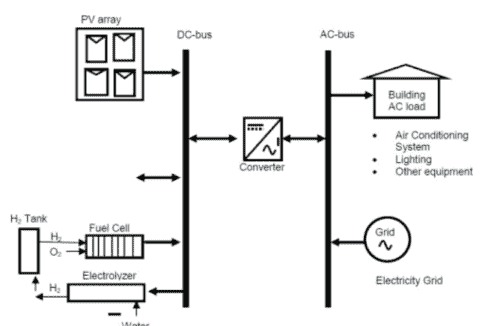

该“混合能源系统”计划提供商业建筑每日 6,540 kWh 的能源需求。为了确定每个部分的输入输出功率，“花费了数千小时进行仿真和优化。通过使用优化搜索空间，找到了混合动力系统平准化能源成本（LCOE）最小化的优解决方案。仿真和优化方法基于所选的微电网电力系统模型（Pang 等，2019）。

将设计配置（太阳光伏、燃料电池和公用电）、搜索空间（每个组件的最大容量）以及建筑的功耗输入仿真中，并对结果进行可行性和生命周期分析。优化方法涵盖许多配置（单组件如仅有太阳光伏，或两个及以上组件的组合如太阳光伏/燃料电池），以识别满足技术约束和最低寿命成本的最佳设计。

根据仿真和优化的结果，系统 1、2、3 和 4 具有能源成本。第一个（系统 1）仅利用光伏作为参考点；第二个（GT120）使用电网结合容量为 120 kW 的太阳光伏（PV）和 100 kW 的燃料电池；第三个（GT250）使用电网结合容量为 250 kW 的光伏和 100 kW 的燃料电池；第四个（GT500）使用电网结合容量为 500 kW的光伏。表 2 汇总了并网混合动力系统的太阳光伏（PV）、燃料电池和逆变器容量。图 2 表示了主要负荷消耗、电网购电、剩余电量，以及离网和并网太阳光伏的光伏/燃料电池系统发电量。

所有三联式太阳光伏/燃料电池系统的发电情况由仿真结果显示，并以充电控制策略的形式体现技术约束（能源成本）（发电机或燃料电池将以最大容量运行以满足 AC 主负荷，剩余部分用于电解槽功率或电池充电）。参考系统 (1) 中主 AC 负荷的所有电力均已用完。GT120 系统的总发电量为 2,508,541 kWh/年，其中 1,369,294 kWh/年来自电网（55%），875,208 kWh/年来自燃料电池（35%），263,039 kWh/年来自太阳光伏（10%）。

并网电力系统（系统 2）提供了满足建筑每年 2,387,100 kWh AC 消耗的所有电力，剩余的 74,490 kWh 卖回公用公司。GT250 电力系统产生 35% 的功率为 3,526,309 kWh/年，其中 44% 来自购买电网能量（1,105,552 kWh/年），来自燃料电池（87,278 kWh/年），54% 来自太阳光伏（22%）。并网电力系统（系统 3）提供了满足建筑每年 2,387,100 kWh AC 消耗的所有电力，任何剩余部分均以 3% 的费率卖回电网，即 81,985 kWh。GT500 电力系统 4 产生 2,596,380 kWh/年。这有三个来源：电网、燃料电池（823,213 kWh/年，或 32%）和太阳光伏系统（1,095,999 kWh/年）。并网电力系统（系统 2）提供了满足建筑每年 2,387,100 kWh AC 消耗的所有电力，剩余的 74,490 kWh 卖回公用公司。

图 2. 使用“并网型太阳能光/燃料电池电力系统”一年的结果

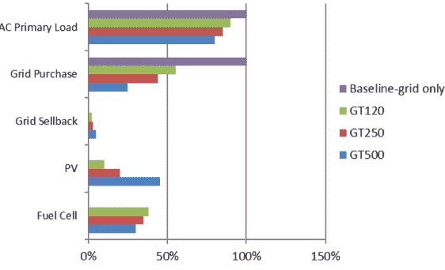

表3 根据可再生能源比例、能源成本和二氧化碳排放减少量对三种“并网型太阳能光/燃料电池电力系统”进行了比较。“当与电网耦合时，GT125太阳能光/燃料电池、GT250太阳能光/燃料电池和GT500太阳能光/燃料电池产生的可再生能源比例分别为 8.8%、19.9% 和 40.4%。具有500 kW 太阳能功率和100 kW 燃料电池功率并并网的GT500电力系统（系统4）在可再生组件（40.4%）和排放量（133 kg CO2/MWh）方面提供了最佳解决方案。图3、4、5 显示了三种“并网型太阳能光/燃料电池电力系统”基于其清洁绿色比例、能源成本和排放减少量的比较图表。

该结构的总能量将被覆盖，额外的5% 产量将出售给电网。“并网型太阳能光/燃料电池电力系统”确保了持续的用电，同时与离网系统相比，其能源成本低得多。“混合太阳能光/燃料电池电力系统”的年化成本列于表4中。“并网型太阳能光和燃料电池系统”的初始投资、运维（O&M）、燃料和更换成本。

表3. 并网太阳能光和燃料电池电力系统：可再生能源比例、整个生命周期能源成本和二氧化碳排放摘要

| 系统 | 能源成本 ($/MWh) | 二氧化碳排放 (kg/MWh) | 可再生能源比例 (%) |
|---|---|---|---|
| 基准 - 仅电网 | 120 | 622 | 0 |
| GTP120 | 93 | 326 | 8.8 |
| GTP250 | 86 | 256 | 19.9 |
| GTP500 | 71 | 133 | 40.4 |

图 3. “并网太阳能光和燃料电池电力系统”可再生能源比例比较图

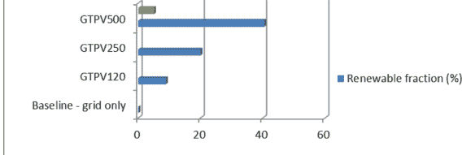

图 4. “并网太阳能光和燃料电池电力系统”整个生命周期内的能源成本比较图

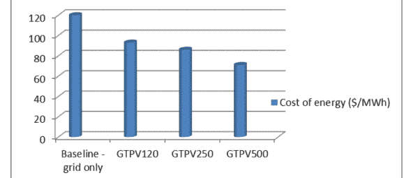

图 5. “并网太阳能光和燃料电池电力系统”排放比较图

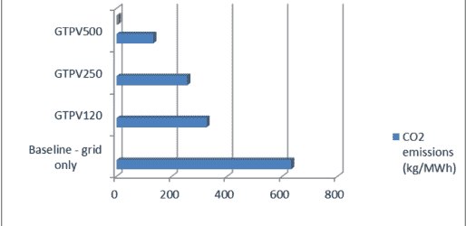

表4. 并网太阳能光伏和燃料电池系统：年化成本摘要

| 系统 | “运维 ($)” | “燃料 ($)” | “更换 ($)” | “资本 ($)” | “总计 ($)” |
|---|---|---|---|---|---|
| 基准 - 仅电网 | 286,452 | 0 | 0 | 0 | |
| GTP120 | 171,029 | 38,509 | 5,861 | 14,868 | 229,804 |
| GTP250 | 140,335 | 38,401 | 5,855 | 27,256 | 211,337 |
| GTP500 | 88,017 | 36,221 | 5,633 | 51,020 | 180,250 |

## 7 总结与结论

本文展示了一种用于大学行政楼（一种商业建筑）的“并网型太阳能/燃料电池混合电力系统”及其设计与分析。利用能源审计数据确定了建筑空调系统的关键负载。本研究调查了沙界的可再生能源资源、当前的可再生能源技术、技术定价、系统成本和资源限制。通过使用统一的建模、仿真、优化和控制方法，评估了所提并网太阳能光/燃料电池电力系统的效率和成本。研究人员研究并分析了系统的太阳能能力与其性能（可再生百分比、能源成本和温室气体排放）之间的关系。结果显示，并网太阳能光/燃料电池系统产生的能量足以满足建筑的年度用电需求，并有剩余。并网太阳能光/燃料电池混合电力系统的发电平准化电成本仅为每兆瓦时（MWh）71美元，而二氧化碳（CO2）排放量仅为133 kg/MWh。将可再生能源系统与公用电网集成是增加可再生能源在能源结构中渗透率的最佳且有效的方法之一，以可接受能源成本减少对化石燃料的依赖并减轻环境影响。

Zhang, T., Yang, H., Li, Z., & Meng, Y. (2018). 并网太阳能光伏-燃料电池混合系统的生命周期评估。*Energy*, 150, 393–403.

Zhang, W., Deng, Y., & Qu, J. (2020). 用于减碳和提高能性的太阳能光伏-燃料电池混合动力系统的技术经济性优化。*Energy Conversion and Management*, 213, 112831. DOI: 10.1016/j.enconman.2020.112831

# 第 9 章

企业社会责任在调介作用下，绿色融资对埃塞俄比亚可持续金融模式的影响

Metasebia Adula

https://orcid.org/0000-0001-5732-2850

埃塞俄比亚，布莱·霍拉大学

Shashi Kant

https://orcid.org/0000-0003-4722-5736

埃塞俄比亚，布莱·霍拉大学

Mando Genale

埃塞俄比亚，布莱·霍拉大学

### 摘要

本章探讨了在企业社会责任调介作用下，绿色融资对埃塞俄比亚可持续金融模式的影响。CSR 原则引导金融机构优先考虑与可持续发展目标一致的投资，让利益相关者参与决策过程，整合环境和社会因素。本章旨在探索绿色融资如何通过 CSR 在埃塞俄比亚的中介作用影响可持续金融模式。研究旨在理解绿色金融对可持续实践的影响，提供透明度、促进合作、创新并加强能力。本章还讨论了绿色融资在增强可持续实践采纳方面的作用，确保符合监管规定并使金融模式与社会预期保持一致。

### 引言

绿色融资结合企业社会责任（CSR）作为调介，对于可持续金融模式的发展至关重要。在全球范围内，绿色融资和 CSR 的重要性怎么强调，特别是在像埃塞俄比亚这样的发展中国家。本研究关注绿色融资如何支持可持续发展并解决环境问题（2023）。绿色融资涉及为环保项目所做的努力，被称为“绿色资金”，旨在实施可持续实践。研究旨在分析绿色融资对气候变化和资源枯竭的影响（2023）。

绿色融资和企业社会责任（CSR）在可持续金融模式中越来越流行。本研究旨在理解绿色金融对可持续实践的影响，提供透明度、促进合作、创新并加强能力。本章还讨论了绿色融资在增强可持续实践采纳方面的作用，确保符合监管规定并使金融模式与社会预期保持一致（2022）。

将社会和社会因素整合到财务决策中，使得公司和组织能够评估并控制与其业务相关的环境风险。可持续性标准被纳入绿色融资中，提升了可持续实践的影响。本章旨在对绿色金融和可持续实践提供更全面的理解（2019）。

绿色融资和企业社会责任（CSR）在可持续金融模式中越来越流行。本研究旨在理解绿色金融对可持续实践的影响，提供透明度、促进合作、创新并加强能力。本章还讨论了绿色融资在增强可持续实践采纳方面的作用，确保符合监管规定并使金融模式与社会预期保持一致（2022）。

### 理论文献综述

专门为支持环保项目而创建的财务目标、服务和投资被称为“绿色融资”。它涉及将资金分配给有利于环境的计划，例如废物管理、可持续农业、清洁技术和可再生能源。绿色资金的目标是对抗气候变化、提高资源效率并辅助可持续发展（2023）。

可持续金融模式是优先考虑人类、社区和环境长期健康的财务结构和方法。这包括了财务决策中的社会、环境和治理因素。可持续金融的目标是确保机会和资源的公平分配，鼓励社会公平，并促进包容性经济增长（2022）。

公司以伦理和负责任的方式经营，并考虑许多利益相关者（如客户、员工、社区和环境）的利益的决策和倡议被称为企业社会责任（CSR）。它意味着选择超越法律规定，并将环境和社会关怀纳入运营之中（2023）。

通过减少与资源枯竭、气候变化和环境限制相关的风险，增强了维持性金融模式的韧性（Chaudhary, 2020）。

绿色金融鼓励可持续实践和技术的发展，反过来刺激了创新。它为提供环保产品、服务、绿色基础设施以及可再生能源的公司开辟了市场。通过在鼓励新部门发展、创造就业机会和促进经济增长的同时解决环境问题，这促进了可持续性金融模式的扩张（Doni & Fameni, 2024）。绿色融资改善了维持性模式的资金获取能力。许多开发银行、影响力投资者和国际组织优先考虑支持社会和环境目标的资助倡议。通过增强绿色概念并将可持续性整合到其业务模式中，机构可以获得更广泛的资金来源，例如绿色债券、影响力投资和可持续发展基金（Ibe-novo et al., 2019）。绿色增长使企业和金融机构的声誉受益。机构通过将社会和环境因素纳入其财务计划中，展示了其对可持续性和伦理实践的投入。这可以增加认同感，吸引具有社会意识的投资者，并培养利益相关者的信任——所有这些都提升了维持性金融模式的整体可持续性（Rauf et al., 2024）。

鼓励维持性金融模式的政策倡议和监管框架经常推动绿色金融的发展。政府可以通过提供奖励、补贴或税收优惠来促进绿色发展并为可持续金融建立支持性气候。通过此类政策将金融系统与可持续发展目标接轨并促进可持续转型，加强了绿色融资对维持性金融模式的影响（Adula et al., 2023）。绿色融资对维持性金融模式的影响是复杂的，包括风险缓解、资本重新导向、创新、资金可用性、声誉提升、利益相关者参与和政策支持。绿色融资通过将环境和社会因素纳入财务决策，促进了向可持续发展的转变。这种方法使资金流向与环境关注点保持一致，并确保了维持金融模式的长期可持续性（Ibrahim et al., 2023）。

## 绿色金融与企业社会责任

绿色金融对机构的企业社会责任（CSR）政策产生了显著影响。机构在运营和投资决策中整合相关元素，以获得绿色资金。企业社会责任的一个重要组成部分是其与可持续性和环境目标的结合。通过使用绿色融资，机构被鼓励采取环保程序、降低碳足迹、减少环境危害并推进可持续资源管理（Zaid & Sleimi, 2023）。绿色金融使利益相关者更积极参与 CSR 项目。社区、工人、消费者、投资者和员工都对表现出致力于环境可持续性的企业赋予更高的价值。通过实施绿色融资策略，企业可以与环保意识强的消费者建立联系，吸引具有社会意识的投资者并加强他们的关系。这种参与促进了共同价值并培养了信任，从而增强了 CSR 使命（Berwal et al., 2022）。

绿色金融有助于风险管理，这是企业社会责任的一个至关方面。环境危害、气候变化的影响或可持续性相关法规的变化对企业产生巨大影响。通过实施绿色金融原则，机构可以识别并管理环境风险，保持长期的生存能力和韧性。CSR的基本理念与主动风险管理方法是一致的（Panigraghi et al., 2022）。

绿色金融鼓励机构投资尖端和环保技术。企业通过将财务资源投入到绿色项目中，可以促进创新并创造环保解决方案。这鼓励了清洁技术、可再生能源和资源高效流程等领域的科学进步。这些投资通过鼓励可持续增长和应对环境问题，支持了 CSR 目标（Yang et al., 2022）。绿色金融对透明度和 CSR 报告有影响。使用绿色金融的企业通常被迫发布有关其可持续性、碳排放和环境表现的细节。得于这种透明度的提高，利益相关者可以评估机构的 CSR 计划并对其环境的影响进行负责。因此，绿色金融鼓励公开报告，解决了 CSR 责任和披露问题（Sinha et al., 2023）。

利用绿色金融可以提高机构的声誉和品牌形象。当他们将可持续性整合到财务策略中时，表明他们真正遵守 CSR 理念。客户、投资者和其他利益相关者认为这种投入很有意义，增强了他们对公司的看法。此外，由志同道合的投资者驱动的 CSR 转型更有可能支持机构的可持续目标，同时也增加了品牌价值（Khan et al., 2021）。绿色金融彻底了企业社会责任。它激励企业实施环保实践，包括利益相关者、控制环境危害、鼓励创新、提高透明度和提升声誉。通过将绿色金融原则整合到其 CSR 战略中，并将财务决策与环境目标挂钩，机构可以维持可持续发展和伦理业务实践（Riandy et al., 2023）。

## 企业社会责任与可持续金融模式

企业社会责任（CSR）活动对可持续性金融模式产生了显著影响。CSR 鼓励金融机构采用道德贷款和投资实践。这涉及考虑投资对可持续性和环境的影响，并确保资金被分配给支持可持续发展目标的倡议。金融机构通过将 CSR 整合到其贷款和投资标准中，支持了优先考虑长期和社会效益的金融模式的创建（Boson et al., 2023）。

CSR 鼓励利益相关者参与可持续性金融计划。遵循 CSR 指南的公司将利益相关者纳入决策过程，例如员工、客户、社区和非政府组织。通过整合多种观点和解决利益相关者的关注点，可持续性金融模式能够更好地匹配社会需求并促进包容性和可持续发展（Deres et al., 2023）。CSR 促使机构接受可持续业务实践。这涉及到将社会和社会因素整合到其供应链、运营以及产品和服务中。机构可以为他们所运营的金融模式的整体可持续性做出贡献。这包括鼓励伦理劳动实践、减少废物产生、保护资源或帮助当地社区。可持续金融模式依赖这些可持续经济运营（Panigraghi et al., 2023）。

在可持续金融模型中，绿色基金通过企业社会责任（CSR）的中介作用增强了对可持续发展的影响。得益于 CSR 的努力，绿色金融能够确保超越简单的合规性或财务回报。它凸显了融资行为如何产生良好的社会、环境和经济影响。组织通过融入 CSR 概念，可以促进创造性思维，推进可持续技术，并促进更广泛的社会目标，如社区发展、性别平等消除贫困（Belachwer, 2024）。

在可持续金融模型中，当绿色金融与 CSR 结合时，组织的声誉和资金可用性会得到提高。具有社会意识的领导者、合作伙伴和投资者更有可能被那些对可持续性和企业社会责任（CSR）表现出坚定承诺的公司。绿色金融、企业社会责任（CSR）与既有伦理商业实践誉之间的关联增强了信誉，培养了信心，并有助于获取可持续金融资金（Zaid & Slemi, 2023）。

通过绿色金融，组织可以促进立法和监管变革，以加强可持续金融模型。通过积极与领导者、行业协会和公民社会的接触，组织可以制定支持可持续金融的规则、指南和激励措施。这种倡促进了系统性的变化，并改善了支持可持续金融模型的条件（Khan et al., 2021）。当 CSR 作为绿色金融的中介时，对可持续金融模型的影响大大增加。它统一了目标和价值观，增加了利益相关者的参与，有助于风险管理，放大了可持续发展的成果，增强了声誉，并更容易倡导立法变革。CSR 与绿色金融之间的强大协同作用促进了金融模型向优先可持续性和长期福祉的模型转变。

## 目标

- 1. **调查绿色融资如何影响可持续金融模型：** 该目标关注采用绿色融资方法如何影响可持续金融模型的组成、功能和结果。它详细描述了绿色金融在金融模型内部促进社会福利、环境保护和可持续发展的精确过程。
- 2. **探讨社会责任（CSR）与绿色融资之间的关系：** 本项目的目标是理解绿色金融与 CSR 活动之间的关系。这涉及研究 CSR 价值观如何维护并与绿色融资项目保持一致，以及 CSR 如何鼓励将社会环境因素纳入财务决策。该目标还包括绿色金融如何改善食品行业的 CSR 成果。
- 3. **评估社会责任如何影响可持续金融模型：** 该目标旨在调查 CSR 实践如何影响可持续融资的组成、功能和结果。它涉及在金融模型背景下，CSR 价值观如何影响监管合规、伦理贷款投资、利益相关者参与、风险管理、可持续业务实践和声誉管理。
- 4. **考察企业社会责任如何中介绿色融资对可持续金融模型的影响：** 该目标的目的是理解 CSR 和绿色融资如何在可持续金融方法中共同工作。它涉及分析在金融模型内部：CSR 的中介如何提高绿色资金对政策倡导、风险管理、利益相关者参与、可持续发展和声誉的影响。

## 5 确定将企业社会责任和绿色金融纳入可持续金融模型最佳方法和建议
该目标旨在总结最重要的发现，并为机构和决策者提供实用的建议。这涉及展示将 CSR 和绿色金融纳入可持续金融模型的有效方法，并就如何优化收益和克服可能出现的障碍提供建议。

本章的更广泛目标是让读者充分理解 CSR、可持续金融模型与绿色资金之间的联系。除了为寻求促进可持续和社会负责任金融实践的组织和立法者提供见解和建议外，它旨在关注绿色融资与 CSR 原则结合时的转型潜力。

## 讨论

为了实现目标 1，采用绿色金融技术可以显著改变埃塞俄比亚可持续金融模型的组成、功能和结果。在模型内部，绿色金融促进社会福利、环境保护和可持续发展的具体方式，意味着在分配资金时，金融机构考虑了项目的社会效益、环境影响和资源效率。这些因素被纳入可持续金融模型，支持包括废物管理、再生能源、能源效率和可持续农业的倡议。

绿色金融促进了可持续技术和实践融入金融模型。这涉及资助再生能源倡议、确保环境友好耕作方法以及可持续土地管理。通过资助可持续技术，金融模型有助于气候韧性、资源保护和温室气体排放。通过考虑环境危害（如气候变化的影响、水短缺或森林砍伐），金融模型可以发现潜在的漏洞并解决它们。为了减少社区和企业面临的财务和环境风险，绿色资金可以协助加强水管理系统、确保可持续土地利用实践并改进气候适应方法。

埃塞俄比亚的绿色融资提供了广阔前景。例如，对生态旅游、可持续农业和再生能源的投资可以创造支持经济增长和消除贫困的新工作。

埃塞俄比亚的企业社会责任（CSR）与绿色金融之间的相互作用提升了金融机构的地位和利益相关者的信任。金融公司通过将 CSR 概念纳入绿色金融计划，展示了它们对可持续发展和环境业务实践的投入。这种投入提升了它们在消费者、投资者和社区在内的利益相关者中的地位。通过绿色金融与 CSR 实践形成的信誉和信任，促进了埃塞俄比亚金融模式的长期生存和成功。

为了在埃塞俄比亚背景下实现目标3，CSR 活动对可持续金融模式的运作方式和最终结果产生巨大影响。在埃塞俄比亚的金融模式中，CSR 原则驱动着伦理贷款和投资实践。具有意识的金融机构考虑其贷款和投资决策对社会和环境的影响。他们优先考虑支持福利、维护伦理企业标准并符合可持续发展目标的倡议和公司。这种道德策略通过确保金融模式支持具有良好社会、环境和经济效益的投资，帮助埃塞俄比亚实现可持续发展。

金融模式中的 CSR 实践赋予了利益相关者参与的能力。埃塞俄比亚的金融机构在决策过程中积极纳入所有相关方，包括客户和员工，通过与他们的互动，对利益相关者的需求、问题和目标有了更深入的理解。这种投资培养了信任、责任和透明度，带来了更具包容性和可持续性的金融服务，满足各种利益相关者的独特需求。

CSR 原则驱动了金融模式中有效的风险管理。埃塞俄比亚的金融机构在评估风险时会考虑企业社会责任（CSR）以及环境、社会和治理（ESG）考量。他们考虑到投资如何对社会、环境和治理产生影响。通过将 ESG 考量纳入风险管理程序，金融模式可以检测并减少与环境和社会问题相关的潜在危害。主动的风险管理提高了金融模式的韧性和长期可持续性。在金融模式内部，CSR 倡议确保了可持续的企业经营实践。埃塞俄比亚的金融机构被敦促在其日常运营中整合社会和生态意识的实践。这可能包括实施节能措施、减少排放和废物、鼓励多样性和包容性，并确保遵循公平的劳动实践。金融机构通过采用可持续实践，展示了它们对伦理和社会责任的承诺，作为他人的榜样，并支持绿色经济。

CSR 措施极大地有助于金融模式中的声誉管理。高度重视企业社会责任（CSR）的埃塞俄比亚金融公司通过展示它们对环境和社会原则的投入而获得信誉。这种声誉吸引了尊重环境和社会意识金融服务的客户、投资者和其他利益相关者。良好的声誉有助于金融模式变得更有公信力和竞争力，随着时间的推移吸引额外的资金和增长前景。CSR 程序确保了金融模式符合法规。埃塞俄比亚的金融机构必须遵守有关社会福利、环境保护和伦理商业实践的法律、规则和准则。金融模式在 CSR 原则驱动下积极监控并遵守这些法律要求。合规性确保了金融模式的运作符合社会和标准，同时也减少了法律和声誉方面的风险。

在埃塞俄比亚背景下，CSR 实践对可持续金融模式的组成、功能和结果产生重大影响。利益相关者参与、风险管理、可持续业务实践、声誉管理、伦理贷款与投资以及监管遵守都受到 CSR 实践的影响。通过将 CSR 纳入金融模式，机构可以满足社会需求，促进可持续发展，并增加利益相关者之间的信力和信心。

为了在埃塞俄比亚背景下实现目标4，CSR 活动对金融模式的运作方式和结果产生巨大影响。在埃塞俄比亚的金融模式中，CSR 实践驱动着伦理贷款和投资实践。具有意识的金融机构考虑其贷款和投资决策对社会和环境的影响。他们优先考虑支持福利、维护伦理标准并符合可持续发展目标的倡议。这种道德策略通过确保金融模式支持具有良好社会、环境和经济效益的投资，帮助埃塞俄比亚实现可持续发展。

金融模式中的 CSR 实践强调了利益相关者的参与。埃塞俄比亚的金融机构在决策过程中积极纳入所有相关方，包括员工、成员、当地社区和公民社会组织。通过与他们的互动，金融模式可以对利益相关者的需求、问题和目标获得更深入的理解。通过这种参与，培养了信任、责任和透明度，带来了更具包容性和可持续性的金融服务，满足各种利益相关者的独特需求（Khan et al., 2021）。

CSR 原则驱动了金融模式中有效的风险管理。在评估风险时，实践企业社会责任（CSR）的埃塞俄比亚金融机构会考虑环境、社会和治理（ESG）。他们考虑到投资如何影响社会、环境和治理过程。通过将 ESG 结构纳入风险管理程序，金融模式可以检测并减少与环境和社会问题相关的潜在危害。主动的风险管理提高了金融模式的韧性和长期可持续性。在金融模式内部，CSR 倡议鼓励可持续实践。埃塞俄比亚的金融机构被敦促在其日常运营中整合社会和生态意识的实践。这可能包括实施节能措施、减少排放和废物、确保多样性和包容性，并确保遵循公平的劳动实践。金融模式通过采用可持续的企业经营实践，展示了它们对伦理和负责任经营的承诺，作为他人的榜样并支持绿色经济。

CSR 措施极大地有助于金融模式中的声誉管理。高度重视企业社会责任（CSR）的埃塞俄比亚金融公司通过展示它们对环境和社会原则的投入而获得信誉。这种声誉吸引了尊重环境和社会意识金融服务的客户、投资者和其他利益相关者。良好的声誉有助于金融模式变得更有公信力和竞争力，随着时间的推移吸引额外的资金和增长前景。CSR 程序确保了金融模式符合法规。埃塞俄比亚的金融机构必须遵守有关社会福利、环境保护和伦理商业实践的法律、规则和准则。金融模式在 CSR 原则驱动下积极监控并遵守这些法律要求。合规性确保了金融模式的运作符合社会和标准，同时也减少了法律和声誉方面的风险。

结果，利益相关者将能够要求金融机构对其社会责任（CSR）承诺负责，并做出明智的判断。

为了共同解决可持续性问题，金融机构、政府机构、公民社会组织和其他利益相关者更加频繁地合作。这些方共同可以利用他们的专业知识、可用资产和建立的人脉关系，推动可持续金融模型和更有效的企业社会责任倡议。创新技术的实施可以极大地促进和增强 CSR 实践与金融模式的整合。金融科技解决方案可以在推进道德和可持续贷款及投资实践的同时，增加金融获取渠道。这些解决方案的示例包括用于影响力投资和可持续贷款的数字平台。

投资于开发能力的计划，以及向利益相关者、专家和金融机构普及有关将 CSR 实践整合到金融模型中的优势是至关重要的。强调可持续金融和伦理投资技术的培训课程、研讨会和知识分享论坛可以实现这一目标。通过提供激励措施和建立促进 CSR 实践的监管框架，政府和监管机构可以在鼓励金融模型内部 CSR 实践方面发挥重要作用。这可能涉及将可持续标准纳入法律框架、要求进行 ESG 报告以及为可持续投资提供税收减免。

提供标准化的方法和衡量标准以评估企业社会责任（CSR）实践对经济、环境和社会的影响将是关重要。金融机构将能够借此评估并有效地传达他们对可持续性的关注。通过将企业社会责任（CSR）活动和融资模式与联合国可持续发展目标（SDGs）协调，可以提供一个实现可持续发展的单一框架和路线图。金融机构能够确定哪些 SDGs 与其业务相关，并将这些发现应用于投资选择和企业社会责任计划。埃塞俄比亚的金融机构通过采用这些未来方向，可以增加 CSR 活动对维持融资模型的影响。这将支持公平增长、可持续发展以及全球和国家可持续目标的实现。

## REFERENCES

- Addy, W. A., Ofodile, O. C., Adeoye, B. O., Oyewole, A. T., Okoye, C. C., Odeymi, O., & Ololade, Y. J. (2024). Data-driven sustainability: How fintech innovations are supporting green finance. Engineering Science & Technology Journal, 5(3), 760–773. DOI: 10.51594/estj.v5i3.871

- Adula, M., Birbisa, Z. A., & Kant, S. (2023). The effect of interpersonal, problem solving and technical training skills on performance of Ethiopia textile industry: Continuance, normative and affective commitment as mediators. Cogent Business & Management, 10(3), 2286672. DOI: 10.1080/23311975.2023.2286672

- Ahmed, D., Hua, H. X., & Bhatta, U. S. (2024). Innovation through Green Finance: A thematic review. Current Opinion in Environmental Sustainability, 66, 101402. DOI: 10.1016/j.cosust.2023.101402

- Apreku-Djana, J. K., Apreku, I. K. O., Ameyaw, F., & Opare, E. A. (2023). The Mediating Effect of Corporate Social Responsibility and Corporate Accountability in the Relationship between Corporate Governance and Value-Based Financial Performance of Banks. International Journal of Business, 28(2), 1–36.

- Belache, A. (2024). Impacts of results-based financing improved likewise extension on households livelihoods: Evidence from Ethiopia. Forest Policy and Economics, 158, 103096. DOI: 10.1016/j.forpol.2023.103096

- Berwal, P., Dhatterwal, Y. S., Kwan, K. S., & Kant, S. (2022). Computer Applications in Engineering and Management. Chapman and Hall/CRC. DOI: 10.1201/97810023112938

- Boson, L., Ele, Z., Engida, A., & Kant, S. (2023). Assessment of green supply chain management practices sustainable in business in Ethiopia. [LOM]. Logistic and Operation Management Research, 2(1), 96–104. DOI: 10.31098/lomer.v21.1468

- Chaudhary, R. (2020). Green human resource management and green behavior: An empirical analysis. Corporate Social Responsibility and Environmental Management, 27(2), 630–641. DOI: 10.1002/csr.1827

- Cheng, M. B., & Mansour, N. (2024). Green finance: Between commitment and illusion. Competitiveness, 34(1), 179–192. DOI: 10.1108/CR-10-22-0162

- Deb, C. B., Rahman, M., & Haseeb, M. (2024). Using a PLS-SEM approach. Impact on corporate social responsibility through green tax and finance. Environmental Science and Pollution Research International, 31(1), 1543–1561. DOI: 10.1007/s11356-023-31150-y PMID: 38041735

- Derbe, T., Melak, D., & Derso, B. (2023). Social: Implication on Youth. Ethiopian Renaissance Journal of Social Sciences, 10(1), 20.

- Deres, C. W., Kant, S., Muturam, M., & Tufa, G. (2023). Point of Service on Ethiopia: Moderating Role of Public-Private Partnership. Proceedings of the International: Springer.

- Doni, F., & Fiam, M. (2024). Can innovation affect the relationship between Environmental, Social, and Governance and financial performance? Business Strategy, 33(2), 54–57. DOI: 10.1002/bse-XX

- Fu, W., & Irfan, M. (2022). The development of Ethiopia’s Resilient Green Economy 2011–2014: Implications for rural adaptation. Frontiers in Psychology, 13, 9048. PMID: 334012

- Husnah, H., & Fahlevi, M. (2023). Using a PLS-SEM approach. Impact on corporate social responsibility through green tax and finance. Science and Pollution Research International, 28(16), 19755–19767. DOI: 10.1007/s11356-023-31150-y

- Lambert, E., & Deyg, K. O. (2024). The Impact of Green Legacy in Ethiopia. Green and Low-Carbon Economy, (22), 97–105. DOI: 10.47852/bonview3213

- Nirono, F., Ferraris, A., Migletta, N., & Invernizzi, A. C. (2022). Intellectual capital: the missing link in the corporate social responsibility-financial performance. Journal of Intellectual Capital, 23(2), 420–438. DOI: 10.1179/JIC-02-2020

- Parinigari, A., Nayak, K., Babu, S., Das, M. N., Nayak, D. S., Sahoo, G., & Kant, S. (2023). CTB-PKI: Clustering and trust-based blockchain PKI system for efficient communication in P2P network. IEEE Access: Practical Innovations, Open Operations, 10, 124277–124290. DOI: 10.1109/ACCESS.2022.322280

- Parinigari, A., Sahu, B., Das, M. N., & Kant, S. (2023). Min-Wave: An ensemble approach based on MRMR and Whale optimization for Cancer diagnosis. IEEE Access: Practical Innovations, Open Operations, 11, 113526–113542. DOI: 10.1109/ACCESS.2023.331826

- Paul, C. J., & Weinthal, E. (2019). The development of Ethiopia’s Resilient Green Economy 2011–2014: Implications for rural adaptation. Climate and Development, 11(3), 193–202. DOI: 10.1080/17656529.2018.1442802

- Prabhu, N., & Aith, P. S. (2023). Inbound Corporate Social Responsibility Model for Selected Indian Banks and Their Proposed Impact on Retaining Customers–A Case Study. [JAEML]. International Journal of Engineering and Management Letters, 7(3), 55–74. DOI: 10.47992/JAEML.2581.7000188

- Rauf, Wang, W., & Voinea, C. L. (2024). 企业社会责任报告在绿色创新与企业性能交汇点的交互：企业生命阶段的调节作用。*Sustainability (Basel)*, 16(5), 1821. DOI: 10.3390/su16051821

- Riandy, C., Hapsari, I., Hariyanto, E., & Pratama, B. C. (2023). 知识资本：绿色会计对企业社会责任的作用。*South Asian Journal of Social Studies and Economics*, 20(4), 140–155. DOI: 10.9734/sajesse/2023/20c4749

- Sinha, A., Ghosh, V., Hussain, N., Nguyen, D. K., & Das, N. (2023). 可再生能源发电的绿色金融：捕捉能源调节对可持续发展的作用。*Energy Economics*, 126, 107021. DOI: 10.1016/j.energy.2023.107021

- Tosun, C., Parmez, M. O., Bilim, Y., & Yu, L. (2022). 绿色转型型领导力通过企业社会责任的中介作用对员工绿色绩效的影响：来自塞浦路斯的启。*International Journal of Hospitality Management*, 103, 103218. DOI: 10.1016/j.ijhm.2022.103218

- Tsegay, B. (2023). *撒哈拉以南非洲缓解气候变化和减贫的绿色经济：埃塞俄比亚碳融资的关键分析*（博士论文，伦敦大学亚非洲学院）。

- Yang, Y., Shi, S., & Wu, J. (2022). 数字金融包惠对企业价值：双元创新的中介效应。*Sustainability (Basel)*, 14(24), 16621. DOI: 10.3390/su142416621

- Yimer, G. A. Gebreus Abeg Yimer. (2024). 非洲的可持续金融：比较概述。*Mizan Law Review*, 18(1), 123–160. DOI: 10.4314/mlr.v8i5

- Zaid, A. A., & Sleimi, M. (2023). 全质量管理对业务可持续性的影响：绿色供应链管理实践的中介作用。*Journal of Environmental Planning and Management*, 66(3), 524–548. DOI: 10.1080/09664058.2021.1997730

# 第 10 章

机器学习与模式识别在商业智能模型中的重要性与应用：转化现实世界以决策

Kartikey Raghuvanshi

印度德里技术学院，古鲁·辛格·因德拉普拉斯塔大学

Ayasha Malik

印度大诺伊，IMT 工程学院

Veena Parihar

印度浦那，共比西斯国际大学，共比西斯地理信息学院

## 摘要

在快速发展的商业智能领域中，机器学习（ML）和模式识别技术的整合已成为一种变革性力量，彻底改变了各业的决策过程。本文探讨了机器学习和模式识别在增强商业智能模型能力方面发挥的关键作用，重点关注其在现实场景中的实际应用和对现实世界的影响。在当今动态的商业环境中，准确且及时的决策的重要性不言而喻。传统的商业智能系统在处理生成的复杂数据数据方面存在局限性。机器学习算法具有分析海量数据集和识别复杂模式的能力，为这一挑战提供了解决方案。通过应用监督和无监督学习技术，企业可以从数据中提取有价值的见解，实现明智且战略性的决策。

## 引言

本文的极佳开端可以从设备学习的这一基本概念开始。在设备获取知识的过程中，笔记本电脑应用程序被分配执行某些职责，正如所说，系统通过计算其任务中的性能从其揭示中学习，并在展示如何执行这些职责中学习。因此，系统根据事实做出决策并给出投影/预测。让我们来看一个 PC 程序的例子，它通过患者的临床检查回顾学习信息并发现癌症患者。通过阅读大量的科学调查报告，它涵盖了更广泛的事件，并将出更好的性能。工作能力或性能可以通过熟练肿瘤学家对大多数实例进行更准确的预测和检测来衡量（Jiang et al., 2019; Xu & Yongjie, 2015）。系统研究已在广泛的检测领域进行：机器人、Google 助理（虚拟助手）、游戏、模式识别、数据挖掘、访客识别、在线出租公司等。设备学习通常随着更新结束，更新甚至可能引入噪声片段，这可能导致错误增大而非降低稳定性。本文还将评估三种问题，即：分类、回归和聚类。根据学习信息的可用性，可能还需要从现有的“监督学习、无监督学习和强化学习”中进行选择，这些使用了完美的设备掌握算法。在接下来的章节中，将回顾一些最常用的机器学习信息。

在此方向上，本文旨在识别机器学习（ML）的优缺点，通过提供见解来实现决策。在当今动态的商业环境中，准确且及时的决策的重要性不言而喻。传统的商业智能系统在处理生成的复杂数据数据量方面存在局限性。机器学习算法具有分析海量数据集和识别复杂模式的能力，为这一挑战提供了解决方案。通过应用监督和无监督学习技术，企业可以从数据中提取有价值的见解，实现明智且战略性的决策。

## 机器学习

机器学习是通过使用 AI 完成，它允许设备在预测上更加准确。这对现代机构至关重要，因为它提供了见解并有助于工作性能（Zaki, 2000）。

### 2.1 梯度下降

这是一种循环方法，其主要目标是降低特征值。可以计算特征的偏导数，即梯度。现在每代都计算梯度，然后通过学习率（步长）在每一步降低系数。最终循环停止，尽管它收敛到特征的局部最小值，而非全局最小值。它有三种类型：SGD、BGD 和 MBGD（Malik et al., 2023）。

- 在 BGD 中，会对教育数据集中的每个示例计算误差；然而，设计/模型可能在对所有示例进行评估后才更新。BGD 算法产生安全的斜率和稳定的收敛。稳定的误差有时会导致收敛领域并非总是版本最好的。此外，该算法要求整个学习数据集存储在内存中供其使用。
- 在 SGD 中，会对每个学习实例评估误差，并为每个学习实例更新参数。现在，这可能导致 SGD 比 BGD 更快，提供了一个独特的处理。SGD 在结果上有频繁的更新以改进领域。但与 BGD 方法相比，频繁的更新是额外的。
- 通过结合 SGD 和 BGD 的原理，获得了 MBGD 方法。该数据集被划分为小小组，并在每个小组中进行替换。因此，它构建了 SGD 的稳定性和 BGD 的工作性能。该算法也可用于教育神经网络，这套规则通常用于深度学习。

### 2.2 线性回归算法

线性回归易于学习，可以通过添加/拟合正则化来避免问题。回归是监督学习的一种方法。它用于建议/预测，并用于构建连续变量的结构。例如销售预测、房地产房价/价格预测、股市涨跌、学生考试成绩等。在线性回归中，输入变量由标记数据集和输出变量决定，这就是为什么它是一种监督学习方法（Aa & Plaza, 2019）。该算法中最简单的形式是线性回归，在这种回归中，我们将直线拟合到数据集中，这只能通过建立线性回归中变量数据集之间的关系来实现。

### 2.3 多元回归分析

与现实生活一样，问题更加困难/更复杂。线性回归根据变量引导具有单一独立变量。因变量主要取决于多个原因/因素。例如，商店的价格取决于它所处地区、你销售的产品的需求、周边社区等原因。在多元线性回归中，输入变量（独立变量）和输出（因变量）之间存在关系，且它们是多对多的关系。多元回归并不优于简单回归，因为在回归中添加输入变量并不能获得更好的建议/预测；在某些情况下，我们添加变量会导致结果过拟合（Morris, 1995; Watson & Gardening, 1999）。添加更多输入变量会导致回归产生的关系使得不仅输入变量与输出变量连接/相关，其他变量也相互相关，这被称为共线性。

### 2.4 逻辑回归

它主要用于分类问题。根据输入变量，它以二项的形式显示（0表示发生，1表示不发生）。例如，预测癌症是否为恶性、检查信息是否为垃圾邮件，可以通过使用二项分布的逻辑回归完成。在某些情况下，逻辑回归中也可能存在多项结果，例如为人选择/偏好食物；可以是印度菜、中国菜、英国菜等。我们还可以进行产品评分等工作。在逻辑回归中，我们可以对任何变量提出建议而不会产生。你可以看到线性回归建议或预测连续变量（LI, 2018）。

### 2.5 决策树

决策树根据某些参数不断拆分数据以解决分类和回归问题，它基于监督机器学习方法工作。数据被划分为节点。回归树中的决策变量是连续的，而在分类树中是类别的（意味着结果以“是/否”的形式存在）。决策树可用于分类和回归问题，处理定量值、案例评估，并可以通过最可能的值为缺失属性添加值，并且由于树遍历算法，它提供了高水平的性能（Parihar & Yadav, 2022）。随机森林是用于决策树过拟合问题的解决方案，其方案基于集成建模方法。由于决策树是不稳定的，很难控制其大小，而且它只会给出局部最优解，而不是全局最优解。

### 2.6 支持向量机

支持向量机（SVM）旨在处理回归和分类问题。在这一决策中，由于超平面方法，需要定义边界。决策平面分离属于其他类别的对象。导致复杂数学函数的内核可能不是线性可分的，因此有必要分离不同类的对象（Malik et al., 2023）。SVM 的目标是根据训练数据集正确分类对象。如果给出合适的内核，它可以管理复杂函数，还可以处理结构化和半结构化数据。由于考虑了泛化，过拟合的概率会较低。可以通过使用高维数据进行改进，并且不会陷入局部最优。如果训练时间增加，由于大数据集，性能将会下降，而且如果数据集是杂乱的，它的表现就不佳，此时无法提供概率近似（Zhang, 2018）。

### 2.7 贝叶斯学习

贝叶斯学习在选择之前的概率后获得后验分布，当新数据观测出现时，后验分布变为先验。选择之前的概率很困难，且概率在很大程度上不会受之前概率的影响（Wei et al., 2019）。贝叶斯学习处理数据集不足的问题，这有助于停止数据过拟合，你不需要从数据中分离矛盾。如果没有正确选择之前的概率，它将给出错误的预测。它可以用于天气预测和医学模型，如诊断、识别等目的。

### 2.8 朴素贝叶斯

朴素贝叶斯算法建立在条件概率之上。在此中，我们制作概率表，并通过训练数据更新表格。对于新的观测值，需要查找类别概率，并根据其特征形成表格。该定理在较少的训练数据上有效。该定理之所以被称为朴素，是因为它的条件独立性是其基本假设。所有输入特征几乎都保持真实，因为它们是相互独立的，并提供了更好的性能。朴素贝叶斯可以处理二分类和多分类排序问题并给出似然建议。该算法可以处理连续和离散数据。在此中，训练和调整后的主要执行 NB 模型，因为它非常简单（Aggarwal et al., 2004）。如果我们需要向此模型/方法添加更多特征，那么应用此模型就会变得困难。将连续变量变为桶变量是不正确的。在这种方法中，它

### 2.9 K 近邻算法

该算法用于分组，因为它使用了最近邻居的距离。对于分类来说，拥有样本很重要，而且它相对高效。KNN 是非参数的，因为它不得出任何分布。对于蛋白质表达，KNN 超过了 SVM，KNN 有时是最好的。它具有大量数据，随着训练规模的增长，算法变得计算耗尽（Fu, 1968）。

### 2.10 K-Means 聚类

该算法用于解决聚类问题。当变量巨大时，K-Means 的效果比层次聚类更好。它是一种无监督学习。这种聚类算法比层次聚类产生更紧凑的簇，因为它具有小而球状的簇。它在数学上是高效的，因为算法的复杂度是 O(K*n)。在这种方法中，很难找到或预测 K 的值。人们需要平均 K 值然后收集输出。K 的值对离群点敏感。

### 2.11 反向传播

反向传播算法用于通过计算/计算梯度来寻找神经网络中的简单路径。你可以使用随机梯度来实现，这也很容易。除了反向传播和 SGD，还有更复合/更复杂的结构（如拟牛顿法），但它们无法获得比它们更好的输出/性能。该算法主要用于深度学习（它是一种机器学习技术）。每个行业都有自己的神经网络（NN）以及基于此的应用程序，该应用有优缺点。NN 在没有定义规则或标准来给出答案/输出的地方运行得。它像一个黑盒，因为它给出答案，但人们不知道这个答案是如何产生的（Fatima & Fatima, 2017）。NN 用于工业风险评估、信贷状况预测、物联网等。

## 3. 模式识别

在模式识别（PR）中，目标是识别数据点之间的相似性或共同点，并利用信息进行预测、分类以及提取有意义的见解。这一过程通常涉及从数据中提取相关特征或特性，并应用算法或统计方法对模式进行分析分类。它应用于许多领域，包括图像和语音识别、自然语言处理、生物信息学等。例如，在计算机视觉中，PR 算法可用于检测和识别图像或视频中的物体；在金融领域，PR 技术用于分析市场趋势并对未来股票价格做出预测。模式识别有多种方法，包括统计模式识别、神经网络、机器学习（ML）和深度学习。这些方法依赖不同的数学和计算技术来提取模式并根据观测数据做出预测。总体而言，PR 是一个基础概念，在众多领域发挥着至关重要的作用，使计算机和人类能够识别并理解数据中的模式，从而实现更好的决策、自动化和问题解决（Obayya 等，2023）。

### 3.1 模式识别中的机器学习

机器学习在 PR 中发挥着重要作用，它使计算机能够自动学习并识别数据中的模式。机器学习可以分析大量数据，提取相关特征，并在无需显式编程的情况下发现模式或规律。以下是机器学习在 PR 中的一些应用方式：

- **监督学习：** 它涉及使用带标签的数据训练训练算法，其中每个数据点都带有一个已知的标签或类别。通过这一过程，算法学习建立输入特征与其对应标签之间的相关性，使其能够识别模式并对未见数据做出准确预测。这种方法在图像分类、语音识别和文本分类等任务中应用广泛，算法利用提供的标签来有效泛泛化并分类新实例。
- **无监督学习：** 无监督学习涉及处理未标记的数据，以发现数据内部的模式或结构。聚类算法（如 k-means 聚类或层次聚类）可以根据数据的内在相似性将相似的数据点进行分组。这有助于在没有先验标签知识的情况下识别数据中的模式或子群体（Santosh 等，2019；Obayya 等，2023；Mitra & Pol，2005；Weiss & Kapaoues，2019）。
- **深度学习：** 它是机器学习的一个子集，利用具有多个层的神经网络来检测数据中复杂的模式。像 CNN 等模型在图像识别方面表现出色，而 RNN 则擅长处理序列数据。通过其分层结构，深度学习模型能够自主学习数据的复杂表示，使其能够捕捉和理解复杂的模式和依赖关系。这种能力为 PR 任务带来了显著进展和成功。
- **特征提取：** 机器学习技术可从原始数据中提取相关特征，然后用于 PR。特征提取算法（如 PCA 或小波变换）可以识别数据中最具信息的特征或表示。这些提取出的特征可以输入到 ML 模型进行分类或模式匹配。
- **异常检测：** 机器学习算法可以学习数据中的模式，并识别偏离预期模式的异常或离群值。异常检测在欺诈检测、网络入侵检测或设备故障预测等多个领域非常有用。可以在正常数据模式上训练 ML 模型并识别指示异常行为的偏差。
- **强化学习：** 虽然强化学习主要用于决策任务，但也可以应用于 PR。强化学习智能体可以识别环境中的模式并根据观察到的奖励或反馈采取行动。当需要在动态或变化的环境中识别模式时，这种方法非常有用（Sharifi & Amini，2023；Fujiyoshi 等，2019；Meyer 等，2014；Serey 等，2023；Ejeg 等，2023；Xu 等，2023）。

机器学习算法提供了从数据中学习和泛化模式的能力，使其能够在广泛的应用中识别和分类模式。通过利用机器学习的力量，PR 在医疗保健、金融和营销领域变得更加自动化、准确且更具可扩展性（Khale 等，2023）。

### 该领域的最新进展

近年来，机器学习技术对 PR 和决策制定做出了巨大贡献，导致了现实世界应用中的进步和变革（Ragab 等，2023）。以下是一些重要的研究贡献及其影响：

- **深度学习与神经网络：** 深度学习技术（特别是神经网络）彻底改变了 PR 和决策制定。研究人员开发了先进的架构，例如用于图像识别的 CNN 和用于序列数据的 RNN。这些模型在图像分类、目标检测、语音识别和情感分析等任务中实现了顶尖的性能（Satishkumar 等，2023）。
- **迁移学习与预训练模型：** 迁移学习已成为机器学习中的一项强大技术。研究人员证明了预训练模型的有效性，例如用于计算机视觉任务的 ImageNet 以及用于语言处理的 BERT 或 GPT 等语言模型。迁移学习允许模型利用大规模数据集的知识并适应较小的数据集，在数据有限的情况下显著提高性能（Alsay 等，2023）。
- **可解释 AI (XAI)：** 解释模型做出的决策对于信任、透明度和伦理考量至关重要。XAI 研究旨在提供关于模型如何决策的见解，特别是注意力机制、显著性映射和基于梯度的方法（Feizadeh 等，2023）。
- **强化学习的进展：** 强化学习（RL）取得了显著进展，特别是在决策至关重要的领域。研究人员探索了深层 RL、基于模型的 RL 和多智能体 RL 等技术，以解决机器人、游戏和自动系统中的复杂决策问题。RL 已用于优化资源分配、开发自动驾驶以及增强各种应用中的控制策略。

### 贝叶斯深度学习
结合贝叶斯建模和深度学习的优点，研究人员一直致力于贝叶斯深度学习技术。贝叶斯方法提供了概率不确定性估计，这对于需要量化不确定性的场景下的决策至关重要。贝叶斯深度学习通过在整个模型中捕捉和传播不确定性，实现了更稳健、可靠的 PR 和决策（Tran 等，2023）。

### 联邦学习与隐私保护技术
随着对数据隐私的日益关注，研究人员专注于开发能够在不共享敏感数据的情况下进行协作学习的技术。联邦学习允许双方在保持数据去中心化的同时训练共享模型。还探索了安全多方计算和差分隐私技术，以确保在学习和决策过程中的隐私保护（Tran 等，2023；Prione 等，2023；Sorori 等，2023；Morris 等，2023；Tokgo & Ferro，2023）。

表 1 讨论了相关领域的最新进展。

| 作者 | 年份 | 贡献 |
| :--- | :--- | :--- |
| Arwin 等 | 2023 | 该文引入了非二进制决策系统中的知识增长系统 (KGS)，专注于模式识别。通过在 Iris 数据集上评估 KGS，实现了高达 90.91% 的准确率。这显示了 KGS 在非二进制输入中的潜力。 |
| Serey 等 | 2023 | 该研究提供了数据管理领域 PR 和深度学习方法的最新综述。通过对文献的分析，回顾了 120 篇论文，评估了它们的相关性、应用以及处理海量数据的能力。 |
| Tripathi 等 | 2023 | 文章通过线性回归解决股票模式检测挑战。自动化过程减少了人为错误，并在预测孟加拉国证券交易所 IT 和医药行业的股票时实现了 98.60% 的平均准确率。 |
| Niu 等 | 2022 | 文章通过优化的 PR 和数据规则挖掘增强了智能制造。实验结果显示，再制造产品的估计值、预测效果和整体评估有了显著提高。这些发现强调了该方法在工业互联网背景下的有效性。 |
| Gao 等 | 2022 | 该文引入了用于蓝印服装设计的改进 PR 方法。该方法在数据集上实现了 85% 的 MA，比 YOLOX 模型提高了 5.6%，提供了可靠且高识别度的结果。改进包括使用 Ghostnet、CBAM 注意力机制以及提高检测速度和识别能力。 |
| Wu 等 | 2022 | 文章介绍了渐进学习，这是一种使用脉冲神经网络（SNN）进行高效 PR 的框架。它包括 ANN 到 SNN 的转换方法以及带有自适应训练的分层学习。训练后的 SNN 在减少推理时间和减少突触操作的情况下实现了卓越性能，使其适用于资源受限的设备。 |

## 表 1. 续

| 作者 | 年份 | 贡献 |
| --- | --- | --- |
| Cherikayeva et al. | 2021 | 本文提出了一种用于模式识别的新型聚类分析，将集体聚类算法与核分类方法相结合。在存在噪声数据的情况下，通过测试问题和真实高光谱图像的数值实验证明了该方法的有效性。 |
| Siam et al. | 2021 | 研究分析了真实数据洞察，发现 k 聚类和自组织映射可以提取多样化的模式。该框架为基于使用的风险分析和决策支持系统提供了模型支持（Siam et al., 2021）。 |
| Patnauki et al. | 2021 | 本文引入了一种新型实用语义模式识别，将概率上下文无关图与多贝叶斯网络相结合。所提出的方法有效解决了语义内容和不确定性，通过使用真实数据集对介词短语进行消歧证明了这一点（Patnauki & Gengeai, 2021）。 |
| Lee et al. | 2021 | 本文介绍了一种利用结构模式识别早期检测驾驶意图的方法。通过分析驾驶员行为、眼动注视和运动，所提方法实现了75%和80%的识别率，比传统方法高出多56%（Lee et al.）。 |

这些近期研究通过提高模式识别（PR）和决策系统的性、效率和解释性改变了现实世界。它们促进了各个领域的进步，包括医疗保健（诊断、药物发现）、金融（欺诈检测、算法交易）、自动系统（自动驾驶汽车、机器人）、个性化推荐系统等。通过利用机器学习（ML）的力量，这些技术正在增强我们识别模式、做出明智决策以及应对复杂现实世界挑战的能力。

# 5 ML 和 PR 在商业智能模型中的应用

ML 和 PR 已成为现代商业智能（BI）模型不可或缺的组成部分，彻底改变了组织分析数据、做出决策和获取洞察的方式。在这种全面的探索中，我们将深入探讨 ML 和 PR 为 BI 模型带来巨大价值的各种应用。

- **销售预测：** ML 算法用于 BI 模型以分析历史销售数据并识别模式，允许企业更准确地预测未来销售。这使组织能够优化库存水平、减少过剩库存并提高整体供应链效率。
- **客户细分与个性化：** 通过利用 ML 和模式识别，BI 模型可以分析大量的客户数据，识别模式并根据行为、偏好和人口统计特征对客户进行细分。这种细分使企业能够定制营销策略并个性化客户体验，从而提高客户满意度和忠诚度。
- **推荐系统：** PR 在推荐系统中至关重要，ML 算法分析用户行为以识别模式，并根据个人偏好建议产品、服务或内容。这增强了用户参与度，推动了销售并促进了更加个性化。
- **异常检测：** BI 模型使用 ML 检测数据中的异常或异常模式，帮助组织识别潜在的欺诈、错误或异常事件。这在金融交易、网络安全和欺诈检测中特别有价值，允许企业采取纠正措施。
- **流失预测：** ML 模型分析客户行为以识别指示潜在流失的模式。通过识别预警信号，企业可以实施针对性策略来留住价值客户并降低整体流失率。
- **文本和情感分析：** BI 模型整合 ML 算法分析来自客户评论、社交媒体和调查等来源的文本数据。这使企业能够获得客户情感、市场趋势和品牌感知的洞察，为战略决策提供信息。
- **信用评分：** 在金融领域，ML 模型通过分析各种财务和非财务因素来评估信用状况。这有助于做出更准确、更明智的贷款决策，降低违约风险并优化信用评估过程。
- **供应链优化：** ML 和 PR 通过预测需求、管理库存水平和简化物流有助于优化供应链。这导致了效率的提高、成本的降低以及更具响应性的供应链。
- **动态定价：** BI 模型使用 ML 根据市场状况、竞争对手定价和客户行为动态调整价格。这种灵活性允许企业实现收入最大化、保持竞争力并迅速响应市场变化。
- **图像和视频分析：** PR 在图像和视频分析中起着至关重要的作用。ML 算法用于人脸识别、目标检测和质量控制等任务。这在零售、制造和安全等行业都有应用。
- **员工绩效分析：** BI 模型使用 ML 分析员工绩效数据，识别有助于成功的模式。这有助于人才管理、培训计划和整体劳动力优化。
- **医疗保健分析：** 在医疗保健领域，ML 和 PR 分析患者数据以识别与诊断、治疗结果和资源分配相关的模式。这为医疗保健机构做出更明智的决策提供了支持。
- **欺诈检测：** ML 模型是检测金融交易、保险理赔和在线交易中欺诈活动的重要工具。通过识别异常模式，组织可以降低财务风险并加强防欺诈措施。
- **运营效率：** BI 模型使用 ML 算法识别低效率环节、自动化常规任务并简化工作流来优化运营效率。这导致了生产力和资源利用的提高。
- **预测性维护：** ML 和 PR 分析历史数据以预测设备故障并主动安排维护。这减少了停机时间，延长了设备寿命并降低了维护成本。
- **市场细分：** BI 模型利用 ML 和 PR 有效分析市场数据和细分。这使企业能够定制营销策略、高效分配资源并针对特定的客户群体。

总之，ML 和 PR 集成到商业智能模型中改变了组织从数据提取提取提取的方式。这些应用不仅增强了决策过程，还推动了创新、提高了效率并对整体成功做出了贡献。随着技术的不断演进，拥抱并利用 ML 和 PR 力量的企业将保持在竞争和创新的前沿（Charles et al., 2023, Adebiaye et al., 2023, Parada & Daramola, 2021, Khan et al., 2020, Caserio & Trucco, 2018）。

## 参考文献

Adebiaye, R., Alsham, M., & Owusu, T. (2023). 作为商业智能决策万灵药的抽取式分析机器学习模型。

Aggarwal, K. K., & Yogesh Singh, A. Kaur, O. Pangan (2004) “一种基于神经网络的测试用例方法” ACM SIGSOFT, 2004年5月, 第 29 卷第 4 期。

Agnaraodt. Enric Plaza; (2019) 基础问题、方法论变异、系统方法；AICom - 人工智能通信, IOS Press; 第 7 卷第 1 期，第 39-59 页。

Alsayat, A. (2023). 基于大数据的机器学习客户决策分析：麦加酒店案例研究。神经计算与应用, 35(6), 4711–4722. DOI: 10.1007/s00521-022-07992-x

Arwin, D. W. S., Asmara, R. A., Dimas, R. H. P., & Syamsiana, I. N. (2023, 4月28日). 模式识别用例中非二进制知识识别系统的视角。AIP会议论文, 2531(1), 070001. DOI: 10.1063/5.012810

Caiero, C., Trucco, S., Caerio, C., & Trucco, S. (2018). 商业智能系统。用于信息的企业资源规划与商业智能系统：意大利背景下的实证分析，43-73。

Charles, V. Garg, P., Gupta, N., & Agarwal, M. (编). (2023). 数据分析与商业智能：计算框架、实践与应用。CRC Press. DOI: 10.1201/9781003189640

Cherikbeva, J., Yeremibetova, A., & Daiurbayeva, E. “模式识别问题解决方案的聚类方法研究”，“2021年第16届国际计算机科学与工程会议 (UMBK), 土其安卡拉, 2021, 第 1–4 页. DOI: 10.1109/UBMBK52708.2021.9588884

Dr. Bonnie Morris; (1995) 基于案例的推理 AI/ES 更新; 秋季; 弗吉尼亚大学; 第 5 卷第 1 期。

Ejwega, P. A., Feng, Y., Tang, S., Agbetayo, J. M., & Dai, X. (2023). 新型基于毕哥的模糊距离度量及其在模式分类和诊断分析中的应用。神经计算与应用, 35(14),10083–10095. DOI: 10.1007/s00521-022-07679-3

Entezari, A., Aslani, A., Zaheri, R., & Noorollahi, I. (2023). 能源系统中的人工智能与机器学习：文献学视角。能源策略评论, 45, 101017. DOI: 10.1016/j.esr.2022.101017

Fatima, M., & Pasha, M. (2017). 诊断机器学习算法综述。智能与应用期刊, 9(01), 1–16. DOI: 10.42366/jilsa.2017.919001

Feizizadeh, B., Omarazadeh, D., Kazemi Garaj, M., Lakes, T., & Blasch, T. (2023). 使用 Google Earth 进行土地/覆盖制和趋势分析的机器学习数据驱动方法。环境规划与管理期刊, 66(3), 665–697. DOI: 10.1080/09460568.2021.2001317

Fu, K. C. (编). (1968). 模式识别与机器学习中的序列方法。学术出版社。

Fuyijoshi, H., Hirakawa, T., & Yamashita, T. (2019). 基于深度学习的自动驾驶图像识别。IATSS 研究, 43(4), 244–252. DOI: 10.1016/j.iatssr.2019.008

Guo, Y., Zhou, J., Qin, Q., Wei, W., & Zhang, W. (2023, 3月1日). 基于模式识别的智能结构化规则改进算法与数据挖掘。消费电子, 12(2), 94–99. DOI: 10.1109/MCE.2022

Khaleel, M., Ahmed, A., & Alsharif, A. (2023). 人工智能研究, 3(1), 32–42. DOI: 10.4709/brilliance.v311

Khan, M. A., Saqib, S., Alyas, T., Rehman, A., Zaeb, Y., & Mohamed, M. E. (2020). 使用商业智能机器学习的需求预测模型。实用解决方案, 8, 16013–16023. DOI: 10.1109/ACCESS.2020.30379

Lee, S., Khan, M., & Husen, M. (2021). 连续检测模式识别。IEEE 智能交通系统, 22(2), 1001–1013. DOI: 10.1109/ITS.2019

Li, Z. (2018). 机器学习与通用学习的发展。工业与科学, 15(10), 198–199.

Malik, A., Parihar, V., Bhushan, B., Srivastava, V., & Karim, L. (2023). 基于卷积神经网络的人工智能。在 Sharma, D. K., Peng, S. L., & Jeon, G. (编), 微电子与电信工程，网络与系统讲义 (第 617 卷)。Springer. DOI: 10.1007/978-3-0125_47

Malik, A., Parihar, V., Srivastava, J., Kaur, H., & Adlin, S. (2023). 基于机器学习的糖尿病预后。第 10 届全球可持续发展计算会议 (印度), 新德里, 第 1466–1472。

Meyer, G., Adomavius, G., Johnson, P., Elidrisi, M., Mush, W., & O’Connor, P. J. (2014). 改进决策的机器学习方法。信息系统研究, 25(2), 239–263. DOI: 10.1287/isr.2014.0513

Mitra, S., & Pal, S. (2005). 模式识别中的模糊集。模糊集与系统, 156(3), 381–386. DOI: 10.1016/j.fss.2005.0535

Morris, M., Rajesh, A., Asad, N., & Butler, C. E. (2023). 外科中的深度学习应用：当前用途与未来方向。美国外科医生, 89(1), 36–42. DOI: 10.1177/000134832211049

Na, J., Yang, H., Gu, Q., & Huang, J. (2019). 机器学习及其算法与发展。信息与计算机科学, 87(1), 83–84.

Niu, T., & Zhang, Q. (2022). 深度学习模式识别技术：改进的 YOLOX 模型。第 22 届国际社会科学与智能会议 (SSIM), 台湾天津, 2022, 第 93–98 页. DOI: 10.1109/SSIM5504.2022.100479

Obayaya, M., Maashi, M. S., Nemri, N., Motwakel, A., Osman, A. E., & Alsaid, M. I. (2023). 用于组织病理学癌诊断的深度学习超参数优化器。癌症 (巴塞尔), 15(3), 885. DOI: 10.3390/cancers1503085

Parada, D., & Daramola, O. (2021). 组织中的商业智能与商业价值：系统综述。可持续性 (巴塞尔), 13(20), 11382. DOI: 10.3390/su13201182

Parihar, Y., & Yadav, S. (2022). 预测在线购物行为的机器学习算法对比分析。网络与应用期刊, 13(06), 5169–5182. DOI: 10.35444/IJNA.2022.13603

Patnaik, S., & Gengaje, S. (2021). 语法模式识别的理论基础。IEEE Access, 9, 13879–13899. DOI: 10.1109/ACCESS.2021

Pirone, D., Cimorelli, L., Del Giudice, G., & Pianese, D. (2023). 使用站点累积降水场的短期降雨预测：概率机器学习方法。水文学杂志 (阿姆斯特丹), 671, 12849. DOI: 10.1016/j.hydrol.2022.12849

Ragab, M., Ashary, E. B., Alzahrani, I., Kumar, A., Gupta, D., & Mansour, R. (2023). 用于自动车辆系统决策的新型自适应神经模糊系统。ISA Transactions, 132, 16–23. DOI: 10.1016/j.isa.2022.00634

Sarker, I. H. (2021). 机器学习：算法、现实世界应用与研究方向。SN 科学, 2(3), 160–181. DOI: 10.1007/s42979-021-00592

Satishkumar, V. E., Cho, J., Subramanian, M., & Aren, O. S. (2023). 使用基于深度学习的不遗忘学习进行森林火灾和烟雾检测。森林生态, 19(1), 1–17. DOI: 10.1186/s42408-022-00165-0

Serey, J., Alfaro, M., Fuertes, G., Vargas, M., Durán, C., Ternero, R., Rivera, R., & Sabattin, J. (2023). 模式识别与深度学习技术、工业4.0的实现因素及其在工程研究中的作用。对称性, 15(2), 535. DOI: 10.3390/sym15020535

Serey, J., Alfaro, M., Fuertes, G., Vargas, M., Durán, C., Ternero, R., Rivera, R., & Sabattin, J. (2023). 模式识别与深度学习技术：工业4.0的赋能者及其在工程研究中的作用。Symmetry, 15(2), 535. DOI: 10.3390/sym15020535

Shifani, K., & Amini, M. (2023). 机器学习与深度学习：方法与应用综。World Information Technology and Engineering Journal, 10(07), 3897–3904.

Shrestha, Y. R., Krishna, V., & von Krug, G. (2021). 利用深度学习算法增强组织决策：承诺、原则与挑战。Journal of Business Research, 123, 588–603. DOI: 10.1016/j.jbus.2020.09.068

Siam, N., Nadipur, M., & Lu, J. (2021, 3). 用于驾驶行为提取的移动遥测模式识别框架。IEEE Transactions on Intelligent Transportation Systems, 22(3), 1459–1472. DOI: 10.1109/TITS.2020.2971214

Soori, M., Arezoo, B., & Dastres, R. (2023). 先进机器人中的人工智能、机器学习与深度学习。Cognitive Robotics.

Tokgöz, E., & Ferro, M. A. (2023). 人工智能、机器学习与深度学习在面部整形手术中的应用。美容与面部重建手术：医学与生物医学工程科学概念综述（pp. 281–306）。Springer Switzerland. DOI: 10.1007/978-3-031-31168-0_9

Tran, Q. M., Amer, Abdelaziz, A. Y., Dai, H., Liu, M., & Elsisi, M. (2023). 基于深度学习方法的有效物联网感应电机棒故障识别与纠正。Measurement, 207, 112398. DOI: 10.1016/j.measurement.2022.112398

Tripathi, A., Mathure, J., Deotarse, S., Rai, D., & Gadhikar, L. “图表模式识别的线性回归方法”。2023第55次工程新兴技术国际会议 (ICNTE)，印度孟买，2023, pp. 1–6. DOI: 10.1109/ICNTE56631.2023.1046731

Watson, L., & Gardening, D. (1999). 用于工程销售支持的分布式案例识别；第16次国际人工智能联合会议论文集 (IJCAI-99); 1999; 卷1, 页 600–605。

Wei, P., Li, Y., Zhang, Z., Tao, H., Li, J., & Liu, D. (2019). 基于深度信念网络的感应文本分类模型优化方法。IEEE: 2019; 卷7 期 87; 593–605.

Weiss, S. M., & Kapouleas, I. (1989, 8月). 模式识别、神经网络与机器学习分类方法的实证比较。IJCAI (美国), 89, 781–787.

Wu, J., Xu, C., Han, X., Zhou, D., Zhang, M., Li, H., & Tan, K. C. (2022, 11月1). 基于深度脉冲神经网络的模式识别渐进式协同学习。IEEE Transactions on Pattern Analysis and Machine Learning, 44(11), 7824–7840. DOI: 10.1109/TPAMI.2021.3141996 PMID: 3456918

Xu, D., & Yingjie, T. (2015). 聚类算法综合综述。Annals of Data Science, 2(2), 165–193. DOI: 10.1007/s40745-015-0040-1

Xu, N., Lovreglio, R., Kuligowski, E. D., Cova, T. J., Nilsson, D., & Zhao, X. (2023). 使用机器学习预测和评估野火疏散决策：来自2019年Kincade火的发现。Fire Technology, 59(2), 793–825. DOI: 10.1007/s40745-015-0040-1

Zaki, M. (2000). 可扩展性。IEEE Transactions on Knowledge and Data, 12(3), 372–390.

Zhang, C. (2018). 研究关于。Society of Automation, 22, 82–89.

### 摘要

本章提出了一种利用深度学习从传感器数据中提取特征的人类活动识别（HAR）的新颖框架。该框架利用深度学习来解决复杂环境中人类动作分类的挑战。

### 引言

人类活动是指人体产生的任何运动。已经开发了基于传感器的系统来监测这些活动，特别是针对老年人和慢性病患者。早期方法利用加速度计、陀螺仪和磁力计提供信息。然而，这些传感器孤立使用往往无法取得显著结果。

随着机器学习的引入，基于视觉的技术也随之而来。多种学习技术被应用于从视频序列中识别动作，例如支持向量机（SVM）和隐马尔可夫模型（HMM）。最初使用单个摄像头，但已采用多个固定摄像头来提高跟踪精度。SafeDoor和Safety等智能系统是辅助生活技术的示例。

最初，人体活动识别（HAR）主要考虑坐、立、走、跑等基础日常活动。随后，研究人员还调查了各种不同的复杂活动，如泡咖啡、使用电脑、看电视等。发现，仅凭运动传感器不足以识别异常活动和健康状况。当用户执行各种活动时，如何获得准确的生物学参数估计通常是一项挑战性问题 [20]。不同活动的参数值各不相同，例如，当个体开始跑步时，预计其心率、温度和呼吸振幅会增加。因此，包括传感器和连接设备在内的数字环境 [21]为监控应用提供了一种环境感知解决方案。21世纪20年代初，智能手机被引入HAR领域 [22][23]。智能手持设备的无处不在的特性提供了一种在产生任何不便的情况下监测人类运动的新方法。智能手机配备了传感器（加速度计、陀螺仪、指南针等）以及通信设施（如Wi-Fi和蓝牙）。在数据采集期间，从智能手机的惯性传感器中收集原始数据。采集的数据包含噪声，需要应用滤波技术去除信号中的噪声。从预处理后的数据集中提取关键特征，并输入学习技术以训练模型，从而识别图1所示的若干活动。

图1. 基于机器学习的人类活动识别框架

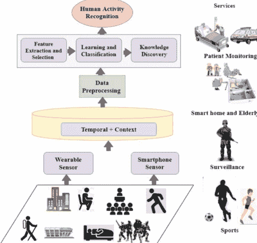

## 基于传感器的HAR系统概述

文献中的人体活动识别系统主要遵循以下阶段：

(1) 数据采集，(2) 数据预处理，(3) 特征提取，(4) 特征选择和 (5) 分类。数据采集和预处理可以使用自定义应用程序在智能手机上完成。安卓应用程序可用于从智能手机惯性传感器采集数据。

**数据采集：** 数量采样是活动识别数据采集的一个至关方面，涉及传感器的数量、类型和位置。最佳位置取决于系统的应用。采样率和传输间隔的合理选择对于可靠性和能耗至关重要。数据采集时长对于准确反映活动至关重要。大多数研究考虑右口袋存储、胸部位置和手臂运动。采样率范围从5Hz到512Hz [25][26]。

**数据预处理：** 对来自传感器的原始数据进行预处理对于消除噪声、分段、属性和冗余至关重要。特征减少了突发峰值，数据计算唯一特征。合适的段大小可以降低分类复杂度。滑动窗口方法、归一化和聚类可以移除无关数据 [27][28][29]。

**特征提取：** 特征提取是一种统计方法，将过滤后的传感器读数转换为更具决策价值的指示。它从统计模型生成或偏离特征，范围从时域到频域。均值、标准差和熵等时域特征有助于识别来自不同体姿的数据 [30][31]。

**特征选择：** 特征选择对于活动分类至关重要，因为它可以提高性能并缩短计算时间。手机的朝向会影响特征值。SFS、RelIEF和FCFB方法封装分类器，从高特征中过滤并从冗余邻居中选择主导特征 [37]。

**学习与分类：** 使用概率、机器学习和基于阈值的方法分析数据以识别有意义的模式。数据集被分为训练集和测试集，并利用这些集构建分类模型。机器学习程序分为监督学习 [39]、半监督学习和无监督学习。

## HAR的应用

- 1. 医疗应用

远程医疗应用依赖于日常活动监测，包括对痴呆症、手术等各种状况的完全检测。使用加速度计和陀螺仪传感器可以提高帕金森患者的生活质量。基于智能手机的HAR框架可以监测健全和中风患者的日常活动，而糖尿病患者则需要监测步数、运动强度和热量消耗。

- 2. 监控

传感器技术为士兵提供了宝贵的数据，包括生理状态监测，这对于军事应用的监控至关重要。这些传感器可以追踪健身状况、任务相关的生理状态和疲劳极限，实现与中队领导的安全通信。

## 3. 运动应用

可穿戴和智能手机传感器用于运动应用以提高运动员表现。结合加速度计和陀螺仪可以监测网球和板球等运动中的动作、击球和姿态。

图2. 使用智能手机和可穿戴传感器的活动识别系统整体数据流

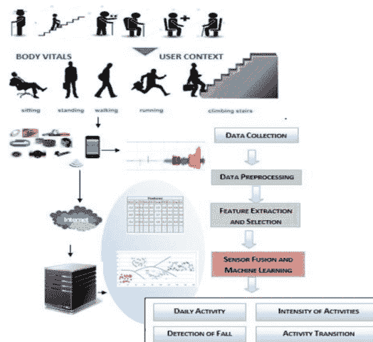

## HAR面临的问题与挑战

- 1. 不同设备配置和使用行为：HAR的分类准确性受训练和测试环境、硬件配置、校准问题和个体模式的影响很大。手机的朝向也会影响系统的分类准确性。不同的数据采集位置（如腰部或裤口袋位置）可以改进结果。虽然使用了多个传感器进行活动识别，但尚未发现即使从一个设备的位置采集训练数据也能详细识别。

- 2. 传感器选择：传感器的选择和属性显著影响识别性能。对于医疗应用，可以增加陀螺仪和心率传感器用于跌倒检测。包含位置细节和活动标签有助于收集用户信息，但会引发隐私担忧。

- 3. 标记不精确和训练数据不足：提供具有精确标签的充足训练数据对于分类模型至关重要，但由于标签信息模糊，收集此类数据可能具有挑战性，传统的分类任务变得困难。

- 4. 能量效率：高效的HAR系统需要长效电池、低采样率以及减少数据大小和传输率等技术，并探索采样率、加速度和窗口大小。

表I. 最先进工作比较。加速度计: Acc，陀螺仪: Gyro，磁力: Mag

| 工作 | 位置 | 动作 | 学习技术 | 备注 | 应用 |
| :--- | :--- | :--- | :--- | :--- | :--- |
| [16] 2009 Tempo Nodes | 大腿、胸部 | 走、坐、跑，前/后，坐时的左/右 | 基于阈值的技术 | 区分有意和无意转换 | |
| [31] 2011, D Acc | 踝关节左右 | 人类跌倒 | L&DA & Fisher准则 | 分类跌倒原因（灵敏度96%）左踝角度 | |
| [32] 2016 智能手机, Acc, Gyro | 右前髋 | 坐、立、躺起、起伏 | NB.SVM, 决策树 | 监测健全、老年和中风患者。应用了Relief-F特征选择并达到了约97% | |
| [24] 2017 智能手机, Acc | 裤口袋 | 走、坐、躺、立 | | [33] 2009 | Acc,Gyro |
| SVM,NB, Bagging, MLP, | 胸部、过臂手 | 网球运动员运动 | 使用选定的时、频特征准确率99% | 基于标记的方法 | 运动员的技能水平分类 | |
| 无监督 Acc, Gyro, Mag | 篮球运动 | [34] 2016 智能手机, Acc | 腰后左和右 | 走、跑、坐、立，走、跑、跑 | MCODE, |
| (高斯),kNN, RF | 上臂右/左，大腿后/左/右 | 各种不同的军事日常活动 | [35] 2017 | DT,SVM,NB | |
| | | | | | |
等等，

加速度计和磁力的结合提供了更高的准确率（约95%），优于其他组合 [36] 2018, Acc, ECG, 湿度传感器封装。

## 提议的方法

活动的原始类别包括坐下、站立、行走等。在本章中，了一种活动识别框架，它使得即使使用一个保持在固定位置（例如衬兜）的设备收集数据进行训练，并对另一个保持在相同或不同位置（例如包）的设备收集的读取进行活动识别，也能实现主动活动识别。该过程仅利用智能手机的加速度传感器，几乎所有制造商的手机都配备了该传感器，使得该框架无处不在。所提出的分类模型可以应用于广泛的人类日常活动识别问题。一种基于分类器集成的两阶段活动识别框架用于识别静态活动（坐在椅子上、站立）以及动态活动（行走、爬楼梯）。所提的技术不受设备配置和使用行为的影响。

该框架从智能手机的原始加速度数据中分离出静态和动态人体活动，并成功分类了若干项活动的标签。本工作考虑了两种静态活动（坐下和站立）以及两种动态活动（行走和爬楼梯 CS）。针对这些（坐下、站立、行走、CS）日常活动收集了相关数据。

3. 从从放置在右裤兜的智能手机上收集的 540 秒不同活动的原始加速度读数。

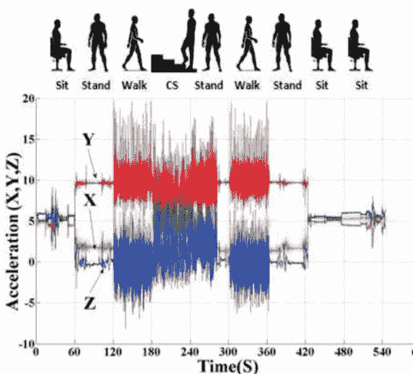

阶段 1：训练设备和位置的选择对于活动识别至关重要。每个训练位置的数据集被存储为训练-测试对，并使用不同的分类器确定分类准确率。使用交叉验证准确率最高的训练数据集。

阶段 2：使用单一基分类器识别单个活动具有挑战性，因此建议使用集成方法。集成方法结合假设并使用多个基学习器，从而产生更强的泛化能力。单一基分类器难以以合理的准确率识别所有活动，因此根据它们的整体性能创建集成模型以识别多种活动。

图 4：所提两阶段活动识别框架的框图。

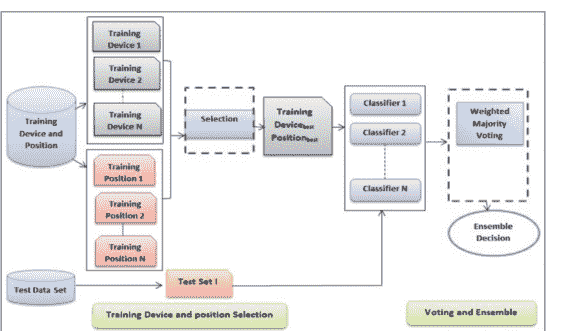

该框架为医疗保健提供者评估患者日常活动提供了支持。它可以帮助在患者术后期间跟踪其活动，因为他们被禁止向上或向下爬。活动识别还可以识别健康监测的准确上下文。

## 结论

人体活动识别和监控是泛在计算中的新兴领域。因此，本章的目标是根据用户设置识别日常动作。智能手机硬件配置、校准和使用行为（如用于测试的智能手机）是已解决的重要挑战。其他挑战包括详细活动的均匀不精确标记。机器学习技术被用于结合不同类型传感器的数据。开发机器学习模型以构建用于人体活动识别（HAR）的分类模型。

## 参考文献

8. 2017 年将有百亿个互联设备投入使用。 在线获取：URL https://www.gartner.com/newsroom/id/3598 访问于2020 年 9 月 19 日。

Babar, S. A., Arif, R., & Irfan, M. (2019). 基于物联网的利用大数据分析的智能城市：综述. In Trends and Advances in IoT-enabled Networks (pp. 129–138). Springer. DOI: 10.1007/978-3-319-99660_12

Bouchabay, D., Nguyen, S. M., Lohr, C., LeDuc, B., & Kanellos, I. (2021). 使用语言模型启动智能家居人体活动识别环境传感器. Electronics (Basel), 10(20), 2498. DOI: 10.3390/electronics10202498

Butt, S. A., Diaz-Martinez, J. L., Jamal, T., & Ali, E. Emir La-Hoz-Franco, and Muhammad Shoaib. IoT 智能健康疗法. In 2019 19th International Conference on Computational Science and Applications (ICCSA), IEEE, 2019.

Butt, S. A., Diaz-Martinez, J. L., Jamal, T., & Ali, E. Emir La-Hoz-Franco, and Muhammad Shoaib. IoT 智能健康疗法. In 2019 19th International Conference on Computational Science and Applications (ICCSA), pages 26–31. IEEE, 2019.

Chen, Shenfeng, Hongjing Fang, and Zhijian Liu. 基于极端学习的人体活动识别. Journal of Physics: Conference, Vol. 1437, No. 1. IOP Publishing, 2020.

Cornelis, E., Vancheberg, N., & De Viendi, P. (2019). 患神经认知障碍老年患者的基础性、工具性及高级日常生活活动与执行功能之间的关系. International Journal of Geriatric Psychiatry, 34(6), 889–899. DOI: 10.1002/gpos.5087 PMID: 3076119

de Oliveira, S., Felipe, J. V., Plácido, J., & enough, A. C. (2020). 存在工具性日常生活活动中存在痴呆症精神人格的患者的空间导航和双任务表现. IBRO, 9, 52–57. DOI: 10.1016/jibro.2020.06.006 PMID: 3363104

Dhruv, A. J., Patel, R., & Noshi, N. (2021). 用于计算机科学应用的最先进编程语言. Proceedings of the international conference on cultural heritage, education, sustainable, and innovation technologies -CESIT 2020, 2021.

Fahad, L. G., & Tahir, S. F. (2020). 使用局部特征加权和最近邻分类器的智能家居活动识别. Journal of Ambient Intelligence and Humanized Computing, 1–10. PMID: 328375

Färber, M., Svetashova, Y., & Harth, A. (2021). 物联网的意义理论. Concepts in Action. Springer.

Fazilov, F. (2021). 全球健康中的反腐审查. Ilkogret Online.

Franco, P., Martinez, J. M., Kim, Y.-C., & Ahmed, M. A. (2021). 智能家居监控和活动识别的物联网方法. IEEE Access: Practical Innovations, 9, 45325–45339. DOI: 10.1109/ACCESS.2021

Garcia, K., Rebelo, D., Pohl, C., Carvalho, M. (2021). 基于可穿戴传感器的人体活动识别：综述. Procedia CIRP, 97, 211–216. DOI: 10.1016/j.procir.2020.05

Gaur, D., & Dubey, S. 机器学习方法. Proceedings of the International Conference on Paradigms of Communication, and Data. Springer, Singapore, 2022. DOI: 10.1007/978-9-03-16547-

Kim, H., Choi, H., Kang, H., Yoon, S., & Hong, T. (2021). 智能能源系统的系统性综述. Renewable & Sustainable Energy, 140, 107155. DOI: 10.1016/j.rer.2021

Li, Q., Ravina, R., Li, Y., Almasmi, S., Sun, F., & Fortune, G. (2020). 基于 WiFi、深度网络和强化学习的多用户活动识别. Information Fusion, 63, 121–135. DOI: 10.1016/j.infus.2020.06

Ma, Y., Arshad, S., Muniraju, S. (2021). 基于 WiFi 的位置的用户无关活动识别. ACM Transactions on Internet of Things. DOI: 10.1145/342437

Manaf, A., & Singh, S. 基于计算机视觉的人体活动识别系统挑战与机遇. 2021 3rd International Conference on Signal Processing and Communication (ICSPC). IEEE, 2021.

Mohamed, N., Al-Jarood, J., & Jawhar, I. 面向物联网智慧城市的容错边缘计算. 2019 IEEE 9th Annual Conference and Communication Workshop and Conference (CCWC), pages 0752–0757. IEEE, 2019.

Quinting, J. F., &ing, C. M. (2021). 天气数值预报和气候模型中暖输送带的系统性评估. 预测因子选择和逻辑回归模型. Journal of Atmospheric Sciences, 78(5), 1465–1485. DOI: 10.1175/JAS-D-20-0139.1

Ramasubramanian, A. K., Aiman, S. M., & Papakostas, N. (2021). 用于协作移动机器人的人体活动识别传感器：综述与展望. Procedia CIRP, 97, 211–216. DOI: 10.1016/j.procir.2020.05

Ritchie, Hannah, and Max Rose. 城市化. Our world in data, 2018.

Ronald, M., Poulouse, A., & Han, D. S. (2021). iSPLInception: An inception-ResNet deep learning architecture for human activity recognition. IEEE Access: Practical Innovations, Open Solutions, 9, 68985-6901. DOI: 10.1109/ACCESS.2021.3078184

Sadowski, Jathan, Yolande Streangers, and Jenny Kennedy. Work for Big Mother: Revaluing care and control in smart homes. Environment and Planning A: Economy and Space, 2021.

Sovacool, B. K., & Dylan, D. (2020). Fursyer Del Rio. Smart home technologies in Europe: A critical review of concepts, benefits, risks, and policies. Renewable & Sustainable Energy Reviews, 120, 109663. DOI: 10.1016/j.rser.2019.109663

Tang, C. L., Perez-Pozuelo, I., Spathis, D., Brage, S., Wareham, N., & Mascolo, C. Selfhar: Improving human activity recognition through self-training with unlabeled data. arXiv preprint:2102.06073, 2021.

Wang, A., Chen, H., Zheng, C., Zhao, L., Liu, J., & Wang, L. Evaluation of random forest for complex human activity recognition using wearable sensors. In 2020 International Conference on Networking and Network Applications (NaA), pp. 310-315. IEEE, 2020. DOI: 10.1109/NaS51721.2020.00060

Wiecek, Alyssa, Fernanda S. Tonin, Andrea Torres-Robles, Shalom I. Benimoj, Fernando Fernandez-Limos, and Victoria Garcia-Cardenas. Temporal effectiveness of interventions to improve medication adherence: In A network meta-analysis, 2019.

Yadav, S. K., Tiwari, K., Pandey, H. M., & Akbar, S. A. (2021). A review of multimodal human activity recognition with special emphasis on classification, applications, challenges and future directions. Knowledge-Based Systems, 223, 106970. DOI: 10.1016/jknys.2021.106970

Yang, X. L., Chu, X., & Zhou, M-T. (2020). Fog-Enabled Smart Home and User Behavior Recognition. In Fog-Enabled Intelligent IoT Systems. Springer. DOI: 10.1007/978-3-030-23185-9_7

Yang, Y., Luo, X., Chu, X., & Zhou, M-T. (2020). Fog-Enabled Smart Home and User Behavior Recognition. In Fog-Enabled Intelligent IoT Systems, pages (pp. 185–210). Springer. DOI: 10.1007/978-3-030-23185-9_7

## 第 12 章

通过数据驱动创新彻底商业模式：Hudi 的案例

Giulia Rita Sala

ESADE, 西班牙

Saverio Barabuff

Scuola Superiore Sant'Anna, 意大利

Giulio Ferrigno

Scuola Superiore Sant'Anna, 意大利

Enrico Marcazzan

Scuola Superiore Sant'Anna, 意大利

### 摘要

本章探讨了数字转型时代大数据变现的演变轮廓，重点关注“人类数据收入”模型。基于关于大数据和创新管理的文献，以及所谓的“数据驱动创新”框架，本章探讨了将个人信息转化为资产过程中固有的挑战。为了更好地理解这些挑战，本章对 Hudi 进行了深度的案例研究分析，并评估了该商业模式对个人、企业和整个社会产生的影响，并对数据变现和价值创造提供了宝贵的见解。基于这些结果，本章有助于对数据经济演变格局中固含的机遇、挑战和后果有更深入的理解，从而塑造该领域未来的讨论和研究方向。

### 引言

在当今数字转型时代，企业日益意识到其海量数据储备中的内在价值（Mcafee et al., 2012）。将这些数据转化为有价值资产的紧迫性已成为旨在获得竞争优势、促进创新和增强决策过程组织的关键任务（Saggi & Jain, 2018; Terauchi & Buzangan, 2019）。

本文拟的书章节深入探讨了数据价值创造的复杂性，围绕遵循数据驱动创新框架的人类数据创新这一值得关注的案例（Zillner, 2021; Zollner, 2021b）。尽管由于技术进步、物联网和全球连接，数字格局见证了数据重要性的激增，但仅仅的数据堆积并不能保证价值创造（Cappa et al., 2021; Ferrigno et al., 2024; Gashahemei & Calic, 2020）。Hudi 的创新方法脱颖而出，它赋予个人数据所有权，并让他们积极参与数据市场，从而通过数据共享获得收入并捕捉内在价值。

本章详细介绍了 Hudi 的指导原则、战略倡议和运作机制，这些机制使得个人数据能够转化为有形且价值的资产。此外，还对支持安全透明交易的技术基础设施和平台进行了详细检查，并重点考虑了隐私保护和数据完整性。还深入探讨了围绕数据所有权、同意和使用的法律及伦理考量，解决了有关隐私和安全的担忧。

深度分析将批判性地评估 Hudi 模型对个人、企业和整个社会的潜在影响。本章通过文献综述、案例研究、利益相关者访谈和数据分析等严谨方法，为 Hudi 在数据变现方面的案例提供了宝贵的见解。总体目标是为数据转化为有价值资产的过程提供有意义的见解（Accinari et al., 2023; Cappa et al., 2021），强调了 Hudi 模型在重塑数据经济方面的变革力量。

总之，本章节是对新兴数据变现领域（Johnson et al., 2017; Wixom & Ross, 2017）和价值捕捉领域的探索。

## 文献背景

### 数据作为资产

在当代，企业日益意识到其海量数据储备中的内在价值（Mcafee et al., 2012）。将这些数据转化为有价值资产的紧迫性已成为旨在获得竞争优势、促进创新和增强决策过程组织的关键任务（Saggi & Jain, 2018; Terauchi & Buzangan, 2019）。

本文拟的书章节深入探讨了数据价值创造的复杂性，围绕遵循数据驱动创新框架的人类数据创新这一值得关注的案例（Zillner, 2021; Zollner 2021b）。尽管由于技术进步、物联网和全球连接，数字格局见证了数据重要性的激增，但仅仅的数据堆积并不能保证价值创造（Cappa et al., 2021; Ferrigno et al., 2024; Gashahemei & Calic, 2020）。Hudi 的创新方法脱颖而出，它赋予个人数据所有权，并让他们积极参与数据市场，从而通过数据共享获得收入并捕捉内在价值。

本章详细介绍了 Hudi 的指导原则、战略倡议和运作机制，这些机制使得个人数据能够转化为有形且价值的资产。此外，还对支持安全透明交易的技术基础设施和平台进行了详细检查，并重点考虑了隐私保护和数据完整性。还深入探讨了围绕数据所有权、同意和使用的法律及伦理考量，解决了有关隐私和安全的担忧。

深度分析将批判性地评估 Hudi 模型对个人、企业和整个社会的潜在影响。本章通过文献综述、案例研究、利益相关者访谈和数据分析等严谨方法，为 Hudi 在数据变现方面的案例提供了宝贵的见解。总体目标是为数据转化为有价值资产的过程提供有意义的见解（Accinari et al., 2023; Cappa et al., 2021），强调了 Hudi 模型在重塑数据经济方面的变革力量。

总之，本章节是对新兴数据变现领域（Johnson et al., 2017; Wixom & Ross, 2017）和价值捕捉领域的探索。

(Quach et al., 2022)。选择合适的变现策略需要做出战略决策，并考虑组织的数字基础设施和分析能力（Oofule & Benoycef, 2022)。

数据变现的应用正在各个领域迅速扩展，包括医疗保健（Bram et al., 2015; Firouzi et al., 2020）、零售业（Najar et al., 2013）和汽车行业（Oofule & Benoycef, 2022）。通过挖掘客户数据并利用人工智能进行预测性分析，企业可以做出明智决策，以在竞争格局中保持领先地位（Ghashemaghi & Calic, 2019b）。特斯拉、亚马逊、Healthfinch 和苹果等领先公司已经证明了数据变现的益处，促使其他公司纷纷效仿。

简而言之，随着信息价值日益提高，数据变现的嵌入确保了业务的成功。在现代世界，数据已成为巨大的商品之一，具有巨大的变现潜力（Cappa et al., 2021）。企业和个人通过在线活动产生海量数据，这些数据在各行业中具有重要价值，使得变现工作变得必要。数据变现是一个利用从性数据中获得的洞察、模式和趋势来开发新产品、直接销售数据或驱动战略决策的过程。在这方面，数据变现在企业业务领域提供了许多优势，例如产生收入、通过数据分析获得的洞察改进决策、提高运营效率以及产品开发的创新（Farouki et al., 2020a; Johnson et al., 2017; Ritter et al., 2024）。它还能实现良好的消费者互动和个性化服务，提高客户的满意度和忠诚度（Johnson et al., 2017; Oofule & Benoycef, 2022）。然而，对隐私、同意和公平的伦理考量在数据变现需求中必须处于首位（Farouki et al., 2020a; 2020b; Oofule & Benoycef, 2022）。因此，在下一节中，我们将研究影响数据变现过程的问题。

## 影响数据变现的问题

要取得成功，数据变现必须首先解决许多问题。组织需要对关键变量进行考虑和控制，如隐私问题、数据质量和治理、法律和伦理问题引发的复杂性以及与数据相关的安全性（Farouki et al., 2020a; 2020b; Oofule & Benoycef, 2022）。其他需要考虑的问题包括基于数据的决策的公平性、开放性以及潜在的偏差或歧视（Quach et al., 2022）。从意义上说，建立消费者和利益者的信任需要平衡业务目标与道德义务（Oofule & Benoycef, 2022）。此外，还必须解决数据安全和网络安全问题，因为数据已成为宝贵资产，它已成为犯罪活动和威胁的目标（Mahmood et al., 2024）。

除了隐私和安全问题，数据变现的一个重要方面也是数据质量（Cappa et al., 2021）。低质量、不完整和过时的数据将导致错误的洞察和错误的变现决策。因此，组织必须投资于数据治理框架，以确保数据的完整性、准确性和一致性（Quach et al., 2022）。新的数据经济法非常直观，并遵循数据所有者即数据拥有者的基本概念（GDPR，加州消费者隐私法案）。

在数据变现问题中，无法提到所谓的“剑桥分析”丑闻是不可能的——这实际上是一个让关于数据的隐私担忧在公众意识中成为热门话题的事件。政治咨询机构剑桥分析通过 Facebook 应用程序“这是你的数字生活”，在用户不知情或未经同意的情况下，获取了数千名 Facebook 用户的个人信息。这些信息随后被用于创建心理画像并发送针对性的政治信息。数据变现需求中，隐私等伦理考量至关重要。剑桥分析事件引发了对数据保护的严格关注。从长远来看，数据变现需要对数据进行关注，确保在数据数据、的的，并对数据（Far（ki et et., 202000，，2222，2，，，数据变现（Quach et al., 2020a; 2020b; Oofule & Benoycef, 2022）。

隐私和安全问题，数据质量是数据变现的一个核心（CC et al., 2021）。低质量、不完整和过时的数据将导致错误的洞察和错误的变现决策。因此，组织必须投资于数据治理框架，以确保数据的完整性、准确性和一致性（Quach et al., 2022）。新的数据经济法非常直观，并遵循数据所有者即数据拥有者的基本概念（GDPR，加州消费者隐私法案）。

在数据变现问题中，无法提到所谓的“剑桥分析”（Cambridge Analytica）丑闻是不可能的——这实际上是一个让关于数据的隐私担忧在公众意识中成为热门话题的事件。政治咨询机构剑桥分析通过 Facebook 应用程序“这是你的数字生活”，在用户不知情或未经同意的情况下，获取了数千名 Facebook 用户的个人信息。这些信息随后被用于创建心理画像并发送针对性的政治信息。数据变现需求中，隐私等伦理考量至关重要。剑桥分析事件引发了对数据保护的严格关注。从长远来看，数据变现需要对数据进行关注，确保在数据数据、的的，并对数据数据（Farouki et al., 2020a; 2020b; Oofule & Benoycef, 2022）。

（Quach et al., 2022）。选择合适的变现策略需要做出战略决策，并考虑组织的数字基础设施和分析能力（Oofule & Benoycef, 2022）。

数据变现的应用正在各个领域迅速扩展，包括医疗保健（Bram et al., 2015; Firouzi et al., 2020）、零售业（Najar et al., 2013）和汽车行业（Oofule & Benoycef, 2022）。通过挖掘客户数据并利用人工智能进行预测性分析，企业可以做出明智决策，以在竞争格局中保持领先地位（Ghashemaghi & Calic, 2019b）。特斯拉、亚马逊、Healthfinch 和苹果等领先公司已经证明了数据变现的益处，促使其他公司纷纷效仿。

简而言之，随着信息价值日益提高，数据变现的嵌入确保了业务的成功。在现代世界，数据已成为巨大的商品之一，具有巨大的变现潜力（Cappa et al., 2021）。企业和个人通过在线活动产生海量数据，这些数据在各行业中具有重要价值，使得变现工作变得必要。数据变现是一个利用从性数据中获得的洞察、模式和趋势来开发新产品、直接销售数据或驱动战略决策的过程。在这方面，数据变现在企业业务领域提供了许多优势，例如产生收入、通过数据分析获得的洞察改进决策、提高运营效率以及产品开发的创新（Farouki et al., 2020a; Johnson et al., 2017; Ritter et al., 2024）。它还能实现良好的消费者互动和个性化服务，提高客户的满意度和忠诚度（Johnson et al., 2017; Oofule & Benoycef, 2022）。然而，对隐私、同意和公平的伦理考量在数据变现需求中必须处于首要位（Farouki et al., 2020a; 2020b; Oofule & Benoycef, 2022）。因此，在下一节中，我们将研究影响数据变现过程的问题。

## 影响数据变现的问题

要取得成功，数据变现必须首先解决许多问题。组织需要对关键变量进行考虑和控制，如隐私问题、数据质量和治理、法律和伦理问题引发的复杂性以及与数据相关的安全性（Farouki et al., 2020a; 2020b; Oofule & Benoycef, 2022）。其他需要考虑的问题包括基于数据的决策的公平性、开放性以及潜在的偏差或歧视（Quach et al., 2022）。从意义上说，建立消费者和利益者的信任需要平衡业务目标与道德义务（Oofule & Benoycef, 2022）。此外，还必须解决数据安全和网络安全问题，因为数据已成为宝贵资产，它已成为犯罪活动和威胁的目标（Mahmood et al., 2024）。

除了隐私和安全问题，数据变现的一个重要方面也是数据质量（Cappa et al., 2021）。低质量、不完整和过时的数据将导致错误的洞察和错误的变现决策。因此，组织必须投资于数据治理框架，以确保数据的完整性、准确性和一致性（Quach et al., 2022）。新的数据经济法非常直观，并遵循数据所有者即数据拥有者的基本概念（GDPR，加州消费者隐私法案）。

在数据变现问题中，无法提到所谓的“剑桥分析”（Cambridge Analytica）丑闻是不可能的——这实际上是一个让关于数据的隐私担忧在公众意识中成为热门话题的事件。政治咨询机构剑桥分析通过 Facebook 应用程序“这是你的数字生活”，在用户不知情或未经同意的情况下，获取了数千名 Facebook 用户的个人信息。这些信息随后被用于创建心理画像并发送针对性的政治信息。数据变现需求中，隐私等伦理考量至关重要。剑桥分析事件引发了对数据保护的严格关注。从长远来看，数据变现需要对数据进行关注。

## 如何从数据中提取价值

正如前所述，企业从数据中提取价值的能力已成为数字经济中的竞争关键。关键在于，从数据数据中提取价值的基础在于对数据的有效收集和存储（Dubey et al., 2019）。从意义上说，大数据分析需要现代分析技术来发现洞察（Mikalef et al., 2019）。

从数据中提取价值与数据驱动决策紧密相连（Wamba et al., 2015）。建立一种重视并支持数据的文化至关重要（Messruzelli et al., 2022），确保决策者拥有必要的技能和资源（Frisk & Bannister, 2017）。最终，利用分析的企业可以获取显著价值（Ghashemaghi & Calic, 2019）。

总而言，根据 PwC (2019)，数据有三个主要的业务机会：增强现有业务、进入相邻市场以及开发全新的模型。

## 数据变现策略

| 策略 1 | 策略 2 | 策略 3 |
| :--- | :--- | :--- |
| 增强现有业务 | 进入相邻业务 | 开发新的数据 |
| 利用增强的服务 | 生成新的洞察 | 白标能力和基础设施 |
| 寻求通过新来源丰富现有服务 | 深度客户洞察 | 与跨价值链的合作伙伴合作 |
| 开发并利用新平台 | 提高营销 ROI 和转化 | 创建新的 |
| 交付增强的服务（例如实时） | | 将基础设施作为服务 | 实现新的数据集 |

> 来源：Rea & Sutton, 2019

## 研究问题

正如提到的，数据已成为数字驱动格局下各行业的关键资源。然而，数据变现并免受隐私、数据质量和治理等问题的影响，这些问题在整个数据提取过程中都应该被考虑。从意义上说，收集、分析并转化为行动洞察的行为改变了业务运营和决策。有效利用和变现这些数据以提取价值洞察面临着挑战（Ritala et al., 2024）。因此，本章节的研究问题是：如何从数据中获取价值？

具体而言，“价值获取”指的是公司将其为客户创造的价值的一部分转化为收入的技术和策略（Dell'Era et al., 2020; Sjödin et al., 2020; Teece & Linden, 2017）。

本章将深入探讨这一方面，特别是通过对 Hudi 案例的审查。通过这项研究，将获得大数据对企业和客户影响的洞察。为了实现这一目标，之前的的工作关注构成大数据的三个维度（被称为“3V”）（Johnson et al., 2017）：数量（指收集的数据量）、多样性（包括每个观测收集的信息的多样性）和真实性（关于数据的准确性和可靠性）。学者证明，虽然海量数据可能会对业务产生不利影响，但这种影响可以通过数据的多样性来补偿（Cappa et al., 2021; Ghase-

定义数据驱动创新的全面框架产生了所谓的“DDI 画布（DDI Canvas）”。它包含了分析大公司至关重要的八个维度，如图2所示。

## 图2. “由八个维度引导对 DDI 相关方面探索的 DDI 画布”

来源：Zillner (2021a)

具体而言，该框架的供给侧包括价值主张（即为用户创造的价值）、数据（即有用的数据类型）、技术和应用技术，以及合作伙伴（即有助于实施创新的伙伴）。需求侧包括业务类型（即预期的市场定位）、营收策略（即盈利策略）、网络策略（即利用网络效应过程）以及生态系统（即合作伙伴需要采纳的创新）。

DDI 框架是作为 Horizon 2020 大数据价值（BDV）项目的一部分开发的，其基于科学研究和实证数据。通过对 90 多个数据驱动型业务机会的审查，该框架得到了完善，确保了其在数据驱动创新中的相关性和有效性。

该框架现在被 BDV 公私合作伙伴关系以及数据驱动的初创企业、中小企业和大公司在项目工作中广泛使用。它由 DDI 画布、DDI 导航器和 DDI 工具组成，为用户系统地评估数据驱动创新供需双方的相关变量提供了结构化指导（https://ddi-canvas.com/how/）。通过 DDI 画布，利益相关者可以有条地探索所有相关方面，促进对创新全景的全面理解，并为战略决策提供信息。

总之，在本节中，我们分析了关于数据作为资产的感知、货币变现以及可能影响它的问题的文献背景，结合对研究问题的解释，我们引入了 DDI 画布，这是一个定义数据驱动创新商业模式的框架。在下一节中，我们将研究 Hudi 的案例。

## Hudi 案例：人类数据收入（Human Data Income）

### 理论抽样：为什么选择 Hudi？

遵循之前基于单一案例的研究（Ferrigno, Zordan, and Di Minin, 2022），在本章中我们选择 Hudi 作为代表性案例研究的原因有三个。首先，Hudi（Human Data Income Ltd.）是一个数据货币化去中心化平台，允许个人和企业收集、丰富、交换和货币化个人数据。

其次，Hudi 利用日益增长的数字杠杆，创建由用户数据经济价值和市场本身产生的通用基本收入。因此，Hudi 通过 Web3 技术（如加密货币和区块链）收集、聚合数据并将价值重新分配给用户。

第三，Hudi 作为一个数据银行运行，个人用户决定是否以及与请求数据的组织共享哪些数据，以换取版税。Hudi 的用户通过加密货币创建价值资产，而 Hudi 的目标是通过重新分配高达 75% 的利益相关者和 50% 的数据所有者，来建立第一个基于数据的通用收入。通常，数据经纪商从个人和公司提取数据并转售给他人，从数据中提取价值并获利而不重新分配给用户。Hudi 的使命是通过创建一个基于三个原则（透明性、控制和报酬）的自由开放市场，从而创建一个数据管理协议。Hudi 允许用户创建一个包含其所有选择数据的配置文件，将他们已经在 Facebook、Google、Netflix 等平台上拥有的所有数据汇聚在一个地方。在此过程中，创建了其他公司无法拥有的独特且完整的数据画像，且必须通过 Hudi 并支付费用。因此，Hudi 将从这种数据价值提取中获利，反过来报酬用户，即这些数据画像的所有者。

### 历史与发展

Hudi 于 2017 年在英国伦敦作为初创公司成立，由 Francesco Ballarani (CEO)、Gianlu Ballarani (CMO) 和 Andrea Silvio Vital (CTO) 创立。Hudi 的创始人和用户共同建立了一个去中心化平台，这种用户的参与精神是公司成功的关键因素。Hudi 的发布基于用户让其他人了解 Hudi 的想法，即使用去中心化的营销策略。事实上，在发布期间，任何口口相传 Hudi 的人都会获得 Hudi Token 作为报酬。Hudi Token (HUD) 是在币安智能链（Binance Smart Chain）上创建的实用令牌，用于链上数据交换和货币化。它遵循 BE-20 标准。

该公司成立于 2017 年，于 2021 年 9 月 10 日发布 Hudi，并于 9 月 15 日在 Pancake swap 上进行 IDO。10 月和 11 月激活了活跃数据货币化在线版（BETA）和大使计划，这些计划在 2022 年第一、二、三季度引入了新的数据源，如币安、Coinbase、Facebook、Google、LinkedIn、Reddit 和 TikTok。第四季度发布了 Hudi 协议（Alpha）以及该协议上的首批数据提供者。至于2023 年第一季度，展示了 Hudi AD 网络和 DataSwap。

现在，该公司为数据所有者提供去中心化金融（De-Fi）解决方案，包括质押、流动性和贷款，这些方案都围绕 Hudi dApp 展开。

HudiApp 是一个钱包聚合器，用户可以在其中访问 Hudi、Data Wallet 和 Crypto Cashback。Crypto Wallet 允许用户购买、接收、发送和处理来自商店的 Hudi令牌。此外，Data 连接朋友和品牌。

Hudi 的 DataMask 保护数据并赚加密货币，这是一个让用户控制数据并将其货币化的扩展。此外，它阻止了第三方跟踪程序和弹出广告。然而，最终目标是建立去中心化自治组织（DAO），它被定义为“一种管理和运营规则编码在区块链上的新型组织形式，可以在没有中央控制或第三方介入的情况下自主运行”（Wang et al., 2019, p. 870）。这种新组织代表了公司的进化，即所有 Hudi Token 持有者而非仅所有人都可以做出决策。

## 数据收集

本节旨在收集有关 Hudi 的数据。介绍访谈和二级数据。

## 访谈

访谈于 2023 年 5 月 26 日与 Francesco Ballarani（CEO兼创始人）和 Andrea Silvio 进行。访谈持续了 1 小时。在我们将介绍问题和具体的见解。

### 1. 什么是 Hudi？

公司 CEO 解释说，Hudi 是一个根于用户在互联网上产生数据的简单概念。数据属于技术和技术创新，因此将所有权归还人民，并赋能他们加入数据市场。数据行业是一个价值超过万亿美元的市场，同时也涵盖了数据中介、市场研究和数字广告。事实上，每分钟有数百万美元的用户数据被买卖。

### 2. 创建 Hudi 的想法是如何产生的？

Hudi 创始人兼 CEO 回答，他一直都在私人调查和情报领域处理数据，并在 2010 年学习了数字营销。随着时间的推移，他发现了数据和信息在与 Google、Amazon、Facebook 等数字平台的关系中的重要性。他指出，数据允许针对特定的产品和服务进行广告，而数据市场是一个封闭市场，数据正被收集和利用。自 2017 年以来，创始人们开始在数据技术方面工作，并开发了 Hudi。

Hudi 的创始人正在构建一种基础设施和一种特定的协议，让人们能够拥有自己的数据。事实上，该公司的首席执行官表示，Hudi 的用户可以在数据钱包中拥有加密货币，他们能够拥有自己的数据，并访问数据市场。

### 3. Hudi 是如何开发的？

为了让用户参与数据行业，Hudi 的创始人以去中心化的方式进行思考，不依赖中间商和平台。他们开发了一项名为“星际数据钱包”（Interplanetary Data Wallet）的对等数据存储和交换协议，该协议由 Hudi 的 CTO 兼联合创始人开发，旨在将数据转化为价值资产。

### 4. Hudi 处理数据的方法是什么？克服隐私担忧有多困难？

根据 Hudi 技术官的说法，欧盟《通用数据保护条例》（GDPR）的主要革命在于数据的法律层面，即公司在使用数据时必须符合合规性，并让用户接受使用条款。事实上，该协议让用户意识到数据将如何与合作伙伴共享，并且所有数据交易都涉及用户的授权。Hudi 并非作为数据经纪人运行，而是通过符合协议的网站作为数据提供者，以及用户与公司之间的连接器。Hudi 的数据收集方法是以人为本的，通过驱动的交互来实现数据的收集和变现。

事实上，Hudi 与 GDPR 紧密合作，并正在开发新技术赋能用户收集分散在各个平台上的所有数据，并根据用户请求访问删除数据。Hudi 本身不对数据赋予价值，因为它不作为数据经纪人，而是作为数据变现的促进代理。公司首席执行官解释说，Hudi 的计划是允许人们利用 GDPR 收集自己的数据，然后从其他服务中删除这些数据，让需要用户数据的公司使用这些服务，并为他们想要的数据资产付费。

### 5. DataMask 如何开发以处理隐私问题？

DataMask 扩展面向整个生态系统，它将数据钱包与网络浏览连接起来，让用户通过上网获得“数据即赚”（de-to-earn）奖励。它是 humainconnect.com 提供的第一个 Chrome 扩展，允许用户在浏览互联网时获得奖励。

它通过通过阻止不需要的广告并允许人们向信任的网站授权来工作。通过其功能，它可以拦截弹出窗口、烦人的横幅、Cookies 和第三方追踪器，在保护用户隐私的同时，让他们通过被动收益在上网时赚钱，Hudi 在浏览期间正常运行。Hudi 的 CTO 解释说，公司服务器中没有存储任何数据，也无法访问用户的个人数据。创始人决定在设计协议时，将每笔数据交易都视为在用户个人钱包中具有记录的交易。因此，用户对钱包内的所有数据拥有透明度，就像他们处理加密货币一样。此外，DataMask 用户可以使用带有扩展程序的密码管理器，该扩展能够实现协议与网页之间的交互，而数据则完全专属地存储在用户的钱包中。

### 6. 公司发展的下一步是什么？目前有哪些正在进行的项目？

Hudi 的创始人从一个数据变现的构想开始，他们开发了经济和加密方面的内容，最后开始构建技术以使这一切成为可能。在采访期间，Hudi 处于公司启动的第一阶段（Phase I），这在首个中心化交易所上市中达到顶峰。这意味着 Hudi 现在是一个正规的加密货币，既有中心化交易所也有去中心化交易所。公司正在致力于对等协议和 DataMask 开发。它是一个赋能生态系统的应用程序，可以与特定产品竞争。事实上，获取用户的目标是提高 Hudi 代币的价值，公司目标是 Hudi 风险投资，并将开始帮助个人和企业在协议之上从数据和加密方面进行构建。2022 年，公司获得了加密交易所许可证，他们正在为此开发相关技术。随后，Hudi 将专注于作为软件初创公司的 DataMask，以及构建 Hudi 协议。DataMask 将专注于增长、客户获取和提升客户生命价值、生态系统开发以及数据变现。

此外，Hudi 代币将是公司无需在市场上转售即可获得的补助，同时将是数据初创公司最重要的资产，即数据和注意力。因此，Hudi 的未来在于推出 DataMask V2，并使其能够在 Hudi 之上构建应用程序。

### 7. Hudi 的用户网络是怎样的？

其 CTO 解释道，用户是 Hudi 最重要的部分。最初，该初创公司采取传统的数据方法，关注人们如何共享数据并将其收集到中心化或分布式服务器中，并依赖多个数据库来管理这些巨大的数据流。如今，Hudi 已拥有 30 万用户，并通过开发对等协议——“星际数据钱包”解决了搜索引擎优化（SEO）问题，在该协议中，用户（数据所有者）拥有数据钱包并能够与数据买家交互。该协议是一种不依赖单一数据库，而是依赖于所有连接设备的存储。SEO 问题影响着互联网用户，因为他们的数据分散在无限的服务器中，没有互连。Hudi 的核心重点是创造数据的价值。事实上，在交易过程中，也可以发生币安交易，数据买家可以激励用户与他们共享数据。数据钱包将管理在对等网络中共享的基础设施。此外，Hudi 还开发了连接器来在其协议中标准化这些交易，并使钱包也完全开源。
得益于其创新的商业模式，他们可以将个人数据货币，这种模式改变了权力平衡并确保了公平的。
正如公司创始人深度解释的那样，他们开发了一个利用大数据潜力的平台，同时通过赋予个人对其数据的控制权来保护隐私和知情同意。分析 Hudi，可以发现组织不断需要获得对其消费者兴趣和习惯的准确洞察。这是因为通过这种方式，企业可以通过评估消费者数据并在商品、服务和营销策略方面定制其产品，从而定制化体验并与客户建立紧密的关系。出于这个原因，他们倾向于为此付费，而 Hudi 用户本身可以从中获利，从自己的数据中捕获价值。还表明，Hudi 释放了开源能力，在生态系统内部进行协作可以改进大数据的价值捕获，并以此创造巨大的价值。通过这种方式，通过交换数据和洞察，生态系统内部可能会促进创新，发现并确保价值捕获的新可能。深入分析 Hudi 的价值捕获过程，可以说该公司通过关注对用户的公平补偿和数据所有权，打破了数字货币化的现状。
总的来说，与从文献部分收集的见解一致，Hudi 的经验为大数据价值捕获和数据货币化的变化环境提供了见解。他们的活动提醒了数据所有权、开放性和公平报酬的价值。事实上，通过加强伦理标准、重新思考数据策略和培养消费者信任，企业可以从这些中学中获益。

## 讨论

### DDT 画布在大数据公司中的应用：Hudi 案例

大数据已成为企业有用的资源和资产，提供了以前无法获得的的洞察和创新机会（Acciarini et al., 2023; Cappa et al., 2021; Del Vecchio et al., 2018; Urbinati et al., 2019）。企业需要特定的能力和采用独特的商业模式才能充分实现大数据的承诺（Acciarini et al., 2023; Johnon et al., 2017）。DWI 画布提供了一个正式框架，用于定义、检查和改进大数据公司中的数据驱动型创新（Zieliller, 2024; Zililler, 2021）。
本章研究了大数据业务中使用的商业模式，重点关注 Hudi 案例，展示了其在理解和改进业务运营方面的重要性。这项分析得出的结果是，大数据让新老企业都能够提供新价值。数据驱动业务前景的范围确定必须考虑多种观点，从需求、数据可用性和技术能力，到确保联盟和生态系统的可持续形成，以捕获这些新类型的价值。数据驱动创新的框架为 BDI 生态系统中的所有参与者提供了一种成熟的技术，以便在检查和评估数据驱动业务前景时提供方向。
从之前描述的 DDI 框架开始，现在将它应用于 Hudi 案例并临时填充画布，如图 3 所示。
图 3.由 Hudi 案例填充的商业模式画布（DDI 框架）。
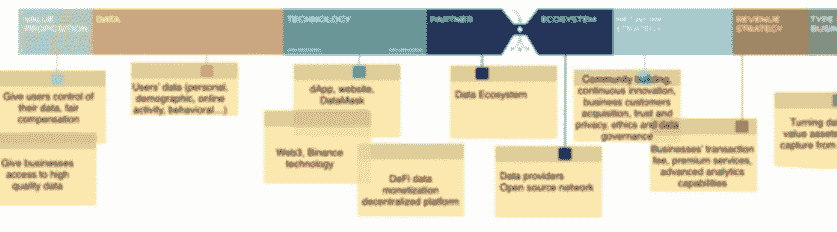
Hudi 与其他大数据业务一样，提供由数据驱动的价值主张，并利用通过对客户和数据使用研究获得的数据。其目标是恢复用户对自身数据的控制权，并确保他们对其宝贵的资产获得公平补偿。此外，它允许企业访问高质量数据，增强其做出更好决策的能力，并提供更具个性化的客户体验。为了做到这一点，他们收集用户数据、个人信息、人口统计、行为和在线活动数据。该公司在 web3 环境中工作，并开发了其网站、运行的 dApp 以及确保隐私的 Chrome 扩展 DataMask。它与提供者和开源网络合作，所有都在数据生态系统内部。其网络策略围绕社区建设、持续创新和业务客户获取，并以信任和隐私、伦理和适当的数据治理为支柱。其收入策略来自多种来源，例如企业的交易费、高级服务和高级分析能力。Hudi 的业务类型是关于通过大数据的价值捕获将数据转化为价值资产。
大数据让新老企业都能提供新价值。数据驱动业务的范围确定必须考虑多种因素以捕获这些新类型的价值，从用户、数据可用性和技术能力，到合作伙伴和生态系统的可持续创建。数据驱动创新的框架为 BDV 生态系统中的所有参与者提供了一种成熟的技术，以便在检查和评估数据驱动业务时提供方向。

## 对大数据公司的主要启示

在当代数字时代，大数据已成为跨多个行业运营公司的资源。为了鼓励创新、改进决策和提高运营性能，可以获取大量数据并从中产生洞察。但有效利用大数据对业务具有重要影响。
企业需要建立强大的数据基础设施和分析技能是数据产生的主要影响之一。大数据包含海量数据、快速数据流和多种数据类型，这需要创新的技术和工具来进行处理和操作。正如实际案例所示，为了管理大数据并从中提取价值，企业必须投资于可扩展存储系统、强大的处理框架和先进的分析平台。企业还应该由数据科学家、分析师和工程师团队组成，他们在数据管理和分析领域具有专业知识，以便以充分利用大数据的力量。数据安全和隐私的价值是另一个结论。保护消费者数据应该是大数据公司的首要政策之一，这些公司收集并存储海量的敏感和个人信息，必须维护消费者的信任并遵守法律。应该实施有关数据保护的深度安全措施，通过加密、访问限制和频繁审计来避免非法访问或泄露。同时，为了确保数据被负责任地使用并考虑伦理问题，企业将不得不建立明确的数据治理，并从其收集数据的用户那里获得同意。通过研究客户数据，公司可以学习大量关于消费者行为、选择和的需求。这使他们能够为特定客户定制其产品、服务和营销计划，增加客户帮助和忠诚度。实时分析还帮助企业提供定制体验、针对性营销和个性化建议，进一步增加客户并促进增长。
此外，大数据为我们提供了创新和新业务模式的机会。大数据包含大量信息，其中可能出现未知的模式、趋势和关系。这种洞察可以被企业用于创建新的产品、服务和解决方案，这些方案可以服务于新兴市场或解决棘手问题。大数据还可以帮助企业通过向第三方提供数据驱动的产品、信息或服务来探索新的收入途径。这种向数据驱动业务模式的转变可能为扩张和竞争开启新视角。然而，大数据也伴随着企业必须解决的困难和道德困境。隐私的重要性、数据泄露以及算法偏见的可能性必须经过仔细考虑。公司必须解决与人员、技术或组织领域相关的障碍，以便将大数据作为增强组织性能的工具。

## 结论

本章节通过对影响数据货币化的理论背景深入分析，对数据货币化和价值捕获的概念进行了全面探讨，这种分析揭示了将数据转化为价值资产的转型潜力。
在理论背景部分，我们介绍了理解数据作为资产价值以及数据货币化的基础，通过探索数据如何演变为企业的战略资源，以及从大数据中获取价值的潜力和问题。此外，我们探讨了通过解决限制数据货币化的挑战（如隐私担忧和技术限制）来充分实现潜力的需求。
Hudi 案例对其早期阶段、历史和数据收集技术进行了深入分析。Hudi 还通过收集数据、进行访谈并提供宝贵见解帮助回答了本章的研究问题。结果的检查及其对大数据组织的影响是最后部分的重点，通过在大数据组织中实施 DDI 画布并关注 Hudi 的 DDI 框架进行了讨论。
该公司提供数据驱动的价值供给，并利用对客户研究和数据使用产生的大数据进行资本化。其方法旨在将数据控制权交还用户，并确保他们的宝贵资产获得公平的补偿。此外，Judi 允许企业获取高质量数据，增强其改进决策过程的能力，并提供更好的个性化体验。该公司与数据提供者和开源网络合作，所有这些都在数据生态系统内部。其策略围绕社区建设、持续创新和客户获取展开，以信任、伦理和适当的治理为支柱。其收入来自多种渠道，如交易、高级服务和分析能力。最后，Judi 这类业务的核心是通过捕获数据将数据转化为价值。在单案例的特殊性方面，进一步的研究可以探索类似方法的示例，例如 [Datum](https://datum.org/)、[Ocean Protocol](https://oceanprotocol.com/)、[Streamr](https://streamr.network/) 和 [Brave](https://brave.com/)，以及谷歌、亚马逊、Meta 等巨头；进一步研究还可以调查来自小型企业和初创公司的案例，如 [Kode](https://www.code-solutions.net/)、[BDV](https://www.bigdata-value.eu/wp-content/uploads/2020/03/BDV-Startups-and-ME-characterization-v1.0_FINAL_Annexes.pdf) 和 [Soidata](https://www.soidata.eu/)。总之，本章对将数据转化为价值资产进行了详尽研究，并强调了 Hudi 案例。理论框架、实证研究以及 DDI 的使用均用于洞察数据变现的潜力。研究结果强调了数据作为战略资产的重要性、对新业务模式的需求，以及围绕所有权的伦理问题。因此，通过 Hudi 案例展示了理论框架和实用见解，本章承认了数据变现。总体而言，数据经济正在不断发展，Judi 的教训可以指导未来将数据转化为价值资产以及塑造数据驱动世界的努力。

## 参考文献

- Acciarini, C., Cappa, F., Boccardelli, P., & Orani, R. (2023). 组织如何利用大数据创新其业务模式？一项系统性综述。Technovation, 123, 102713. DOI: 10.1016/j.technovation.2023.102713
- Akter, S., Bandara, R., & Sajib, S. (2021). 如何赋能分析以应对紧急情况？International Journal of Operations and Management, 41(9), 1469–1494. DOI: 10.1108/IJOPM-11-2020-0805
- Bai, C., Zhou, H., & Sarkis, J. (2023). 评估工业 4.0 技术与可持续发展目标——社会视角。International Journal of Production Research, 61(23), 8094–8114. DOI: 10.1080/00207543.2022.216435
- Bram, J. T., Warwick-Clark, B., Obeysekare, E., & Mehta, K. (2015). 发展中国家医疗数据的利用与变现。Big Data, 3(2), 59–66. DOI: 10.1089/big.2014.0053 PMID: 2648984
- Calic, G., & Ghasmaghaei, M. (2021). 用于社会利益的大数据：创新作为大数据与企业社会绩效之间关系的中介作用。Journal of Business Research, 131, 391–401. DOI: 10.1016/j.jbusres.2020.11.003
- 加州消费者隐私法案 (CCPA). https://oag.gov/privacy/ccpa/regs
- Cappa, F. (2022). 通过众包、公民科学和众筹从客户和非客户处获取大数据。Journal of Knowledge Management 26(11), 308–323. DOI: 10.1108/JKM-2021-0871
- Cappa, F., Oriani, R., Peruffo, E., & McCarthy, I. (2021). 数字化经济中创造和捕获价值的大数据：解析数量、多样性和真实性对企业性能的影响。Journal of Product Innovation Management, 38(1), 49–67. DOI: 10.1111/jipim.12545
- Chang, V. (2021). 大数据与智慧城市的伦理框架。Technological Forecasting and Social Change, 165, 1–11. DOI: 10.1016/j.techfore.2020.120559
- De Vecchio, P., Di Min, A., Petruzelli, M., Annuelli, U., & Pirri, S. (2018). 中小型和大型企业开放创新的价值捕获：趋势、机会与挑战。Creativity and Innovation Management, 27(1), 6–22. DOI: 10.1111/cim.1224
- Dell'Era, C., Di Min, A., Ferrigno, G., Frattini, F., Landoni, P., & Vergetti, R. (2020). 激进循环中开放创新的价值捕获：与 Slow Food 和开源软件的协作分析。Technological Forecasting and Social Change, 158, 120128. DOI: 10.1016/j.techfore.2020.12
- Desa, A., & Clare, J. (2024). 保护隐私：数据驱动营销中的伦理考虑。见 López, L. (编)，数字化的影响 (pp. 147–161)。Emerald Publishing., DOI: 10.1108/978-1-8375-686209
- Dubey, R., Gunasekaran, A., Childe, C., Blome, C., & Papadopoulos, T. (2019). 大数据与预测分析：整合理论、资源基础观与大数据文化。British Journal of Management, 30(2), 341–361. DOI: 10.1111/1467-8551.12355
- Enkel, E., Bogers, M., & Chesbrough, H. (2020). 数字化时代的开放创新：一个模型与研究方向。R&D Management, 50(1), 161–168. DOI: 10.1111/rdm.13997
- Erevelles, S., Fukawa, N., & Swayne, L. (2016). 大数据消费者分析与营销转型。Journal of Business Research, 69(2), 897–904. DOI: 10.1016/j.jbusres.2015.07
- 欧洲数据市场 2021-2023. https://digital-strategy.ec.eu/library/results/european-data-market-study-2021-23
- Faroukhi, A. Z., El Alaui, I., Gahi, Y., & Amine, A. (2020a). 通过数据价值链大数据变现：综合综述。Journal of Big Data, 7(1), 1–22. DOI: 10.1186/s40537-019-281
- Faroukhi, A. Z., El Alaui, I., Gahi, Y., & Amine, A. (2020b). 用于端到端大数据变现的可适应大数据价值链框架。Big Data and Cognitive Computing, 4(4), https://doi.org/10.3390/bd40034
- Ferrigno, G., Garabuffi, S., Mercazzani, E., & Picigualca, A. (2024). 大数据如何影响中小企业的创新广深度？实证分析。R&D Management, 54(1), 12727
- Ferrigno, G., Crupi, A., Di Min, A., & Ritala, P. (2023). 研发管理50年：回顾与新研究方向。R&D Management, 53(5), 900–926. DOI: 10.1111/rdm.12592
- Ferrigno, G., & Cucino, V. (2021). COVID-19期间的创新与转型：来自意大利企业的洞察。R&D Management, 51(4), 325–338. DOI: 10.1111/rdm.12469
- Ferrigno, G., Del Santo, R., Cucino, V., & Picigualca, A. (2022). 连接组织学习与开放创新：整合框架与战略联盟案例研究洞察。The Learning Organization, 29(6), 615–634. DOI: 10.1108/TLO-03-2021-0030
- Ferrigno, G., Del Santo, R., Picigualca, A., & Boncelli, A. (2023). 工业4.0 基础技术与业务模式：生物计量分析。European Journal of Innovation Management, 26(7), 502–526. DOI: 10.1108/EJIM-02-2023-0107
- Ferrigno, G., Martin, X., & Daginno, G. B. (2024). 战略联盟中价值与创造的相互作用：发展视角。International Journal of Management Reviews, 26(2), 232–253. DOI: 10.1111/ijmr.12351
- Ferrigno, G., Zordan, A., & Di Min, A. (2022). 早期汽车行业主导设计的出现：从1899年至1960年福特技术实验的历史分析。Technology Analysis and Strategic Management, 43(1), 1–12. DOI: 10.1080/0953725.2022.2074386

- Firouz, F., Farahani, B., Barzegari, M., & Danishmand, M. (2020). AI 驱动的数据变现：基于物联网的智能连接医疗中数据的另一面。IEEE Journal of Things, 9(8), 5581–5599. DOI: 10.1109/JIOT.2020.3027971

- Frisk, J. E., & Bannister, F. (2017). Improving the use of analytics and big data by changing the decision-making culture: A design approach. Management Decision, 55(10), 2074–2088. DOI: 10.1108/MD-07-2016-0460

- General Data Protection Regulation (GDPR). https://eur-lex.europa.eu/eli/reg/2016/679/oj

- Ghasmaghaei, M., (2021). Understanding the impact of big data on firm performance: The necessity of conceptually differentiating big data characteristics. International Journal of Information Management, 57, 102055. DOI: 10.1016/j.ijinfomgt.2019.102055

- Ghasmaghaei, M., & Calic, G. (2019a). Does big data enhance firm competency? The mediating role of data-driven insights. Journal of Business Research, 104, 69–84. DOI: 10.1016/j.jbus.2019.07.006

- Ghasmaghaei, M., & Calic, G. (2020). Assessing the impact of big data on firm performance: Big data is not always better data. Journal of Business Research, 108, 147–162. DOI: 10.1016/j.jbus.2019.10.016

- Herschel, R., & Mori, M. (2017). Ethics & Big Data. Technology in Society, 49, 31–36. Tech.soc.2017.003

- Johnson, J. S., Friend, S. B., & Lee, H. S. (2017). Big Data Facilitation, Utilization, and Monetization: Exploring the 3Vs in a New Product Development Process. Journal of Product Innovation Management, 34(5), 640–658. DOI: 10.1111/ipim.12397

- Mahmood, S., Chadhar, M., & Firmin, S. (2024). Digital resilience framework for managing crisis: A qualitative study in the higher education and research sector. Journal of Contingencies and Risk Management, 32(1), e12549. DOI: 10.1111/1466-5973.12549

- Massa, L., Tucci, C. L., & Aarton. (2017). A critical assessment of business research model. The Academy of Management Annals, 11(1), 73–104. DOI: 10.5465/annals.2014.0072

- McAfee, A., Brynjolfsson, E., Davenport, T. H., Patil, D. J., & Barton, D. (2012). Big data: The management revolution Harvard Business Review, 90(10), 60–68. https://hbr.org/2012/10/big-data-the-management-revolution PMID: 23074865

- Metruzzelli, A., Murgia, G., & Pamentola, A. (2022). How can innovation support SMEs in the adoption of I4.0 technologies? R & D Management, 52(4), 615–632. DOI: 10.1111/radm.12507

- Mikalef, P., Boura, M., Lekakos, G., & Grostie, J. (2019). Big data analytics capabilities and innovation: The mediating role of dynamic capabilities and moderating effect of the environment. British Journal of Management, 30(2), 272–298. DOI: 10.1111/1467-8551.12344

- Najjar, M. S., & Kettinger, W. J. (2013). Monetization: From a Retailer’s Journey. MIS Quarterly Executive, 12(4). https://digitalcommons.memphis.edu/facpubs/11054

- Ofulef, J., & Benyoucef, M. (2022). Data monetization: insights from a technology-enabled literature review and research agenda. Management Review Quarterly, 1-45. https://doi.org/DOI:10.1007/s11301-022-00309-I

- Osterwalder, A., & Pigneur, Y. (2010). Business Model Generation. John Wiley and Sons.

- PwC. (2019). Putting value on data. https://www.pwc.co.uk/data-analytics/putting-value-on-data.html

- Quach, S., Thaicon, P., Martin, K. D., Weaven, S., & Palmati, R. W. (2022). Digital technologies: Tensions in privacy and data. Journal of the Academy of Marketing, 50(6), 1299–1323. DOI: 10.1007/s11747-022-00845-y PMID: 3528634

- Ritala, P., Keränen, J., & Ruokonen, M. (2024). Saving and monetizing data in B2B markets: Four-driven value propositions. Technovation, 37(10), 10.1016/j.technovation.2023.102935

- Saggi, M. K., & Jain, S. (2018). A survey towards an integration of data analytics to business insights for value-creation. Information Processing & Management, 37(5), 758–790. DOI: 10.1016/j.ipm.2018.01.010

- Scholz, T. (2016). Platform cooperativ: Challenging the corporate sharing economy. New York, NY: Rosa Foundation, 436. https://rosalux.ny/wp-content/uploads/2020/11/RLS-platformcoop

- Sjödin, D., Parida, V., Jovanovic, M., & Visnic, N. (2020). Saving and monetizing data in B2B markets: Four-driven value propositions. Technovation, 37(10), 10.1016/j.technovation.2023.102935 (重复项略)

# 第13章

## 解锁金融潜力：机器学习推荐系统如何变革银行业金融

- Amit Kakkar

卢普比大学，印度

- Manoj Goyal

https://orcid.org/0009-0006-1310-3211

卢普比大学，印度

- Dhrupad Mathur

S.P. Jain全球管理学院，沙特阿拉伯

### 摘要

机器学习推荐系统是商业领域应用最好且最广泛的领域之一。这些系统是根据客户需求提供建议的工具。由于选择数量的增加，无论是在线网站还是服务，都让客户的筛选变得困难。与许多行业类似，银行业目前缺乏一种能够根据客户偏好与其建立联系并提供相应产品的框架。因此，构建针对金融业务的推荐系统成为了一项挑战。

### 引言

人工智能/机器学习的出现导致金融科技公司空所未有的增长。此外，金融科技公司正在推动数字贷款的增长，而与传统贷款相比，数字贷款仍处于早期。然而，在2017年至2020年间，数字贷款增长了12倍，由于金融生态系统的有利，未来前景光明。预计到26财年，总发放量将达到47.4万卢比，复合增长率为22%。

### 关键术语与定义

- `大数据`：当代环境中海量的数据。
- `商业模式`：组织运作的描述。
- `数据变现`：从数据提取经济价值的过程。
- `数据变现问题`：与数据变现过程相关的问题（隐私、伦理和法律考虑）。
- `价值捕捉`：企业将其创造的价值转化为收入的技术策略。
- `数据驱动创新框架`：通过系统分析供需互动，帮助创业者评估实用数据驱动机会的框架。
- `数据驱动创新画布`：数据驱动创新的主要成果，侧重业务。
- `Hudi`：一种数据变现去中心化平台，允许个人和企业收集、丰富和变现其个人数据。

22 财年达到 21.6 万亿卢比。包括传统方法和数字方法在内的总支出预计在此期间将以 12% 的复合年增长率（CAGR）增长。驱动印度金融服务部门数字化的关键因素如下：

- 社会经济因素
- 数字基础设施的增长（互联网可访问性）
- 赋能型公共基础设施
- 人口统计趋势的变化
- 海量客户数据的积累和数字足迹的可用
- 信贷需求增加
- 可支配收入的增加

印度的金融生态系统正在经历彻底的转型。它现在提供个性化的数字体验和定制化的贷款产品。行业对数据安全、身份保护和防欺诈受到了高度重视。此外，在所有购买渠道中都嵌入式金融产品的机会。从贷源到服务的整个贷款过程现在都通过数字方式进行。连接性和扩展性得到了提高，并通过云端微服务架构对数据进行高效管理。这增加了消费者对贷款过程的信任和信心。人工智能正在帮助金融部门的贷款生态系统。

## 1. 机器学习在银行业中的角色

| 角色 | 描述 |
| :--- | :--- |
| `客户开发` | 利用预测性分析主动应对消费者需求，及时解决查询。 |
| `核保` | 从流程开始到最终完成提供定制化协助，以提高贷款审批的概率。 |
| `客户支持` | 识别和评估消费者风险概况及其还款能力，而不仅仅依赖传统的信用评分或正式文档程序。 |
| `风险管理` | 在任何支付失败之前，预判并检测客户即将进行的付款中可能出现的问题。 |

亚瑟·塞缪尔（Arthur Samuel）是个人电脑游戏和计算机推理的早期美国先驱，他在 1959 年于 IBM 工作期间提出了“机器学习”这一术语。他将机器学习定义为“允许计算机在没有显式编程的情况下进行学习的研究领域”。尽管如此，机器学习并没有一个公认的定义。不同的作者对该术有不同的定义。机器学习是指修改电脑以提供一个利用机器信息或以往经验的展示模型。该模型被泛化为取决于某些边界，而学习是执行电脑程序/模型以利用准备或以往经验来增强模型的边界。ML 程序是帮助根据输入预测结果或根据已获得的信息做出预测的模型。

机器学习是一个开发电脑的领域，这些电脑可以根据其在部署和使用过程中获得的经验来提高性能。机器学习是人工智能的一个子领域，包含了计算和可测量模型的进步，使电脑能够通过经验对任务的表征进行工作。开发模型和算法是为了根据可用数据做出决策或预测。如图 1 所示，基于 AI/ML 的模型可以用于开发客户、在几秒钟内批准贷款申请、通过预测贷款违约/欺诈活动/银行业风险为管理组织的风险提供支持。模型的开发是为了让它们在部署后能够提高自身的效率。存在不同类型的 AI/ML，例如监督学习、无监督学习或支持学习。监督学习涉及基于已标记信息开发模型，而无监督学习涉及使用未标记信息开发模型。支持学习包括通过实验准备模型。

机器学习还有其他角色，类似于图像和语音识别、自然语言处理和推荐系统（RS）。系统根据用户的活动向用户推荐产品和服务。推荐系统发挥着循环作用，根据个人的购买历史推荐产品（Lu et al., 2015）（ Kouabra et al., 2020）。后来，该应用扩展到不同领域，如在线预订、在线文章和书籍（科学或新闻，如推荐系统 LIBRA）、在线广告和营销等（Shi, Larsonson & Hanjalis, 2015）。推荐系统是一种旨在向用户建议最合适的产品或服务的程序（Beheshti et al., 2020）。这一目标是通过从在线、私人、社交和物联网（IoT）数据等平台收集的海量数据中检索最相关的信息和服务来提供个性化服务。人工智能包含机器学习、深度学习和自然语言处理，以及知识表示（Beheshti et al., 2020）、用户体验技术（Henzahl & Tractinsky, 2006）和众包，有可能彻底推荐系统。

向用户提供个性化优惠，旨在为部署了基于 AI 系统的商户赢得竞争优势。个性化的原则是根据商户的数据为用户提供个性化服务。基于 AI/ML 的系统整合可用数据，并为每个个体提供独特的个性化建议和推荐（Winter et al., 2021）。由于公司和商户可以获取个人数据，他们可以根据个人数据和购买历史设计个性化的广告活动。在 STP（细分、目标和定位）方面，公司和商户可以根据个人特定属性针对个人（Grigorios et al., 2022）。由 AI 驱动的平台为消费者提供最相关、精确的营销策略（Habil et al., 2023）。

如今机器学习技术正在取代许多企业的传统方法。由于这些突破，基于机器学习的应用程序已开始增强各个行业的营销活动。ML 模型的工作原理是选择合适的算法、收集和处理数据以及评估结果。模型在可用数据上进行训练和测试。

一旦完成训练和测试，ML 算法的部署有助于个人根据他们的偏好建议和服务。

在金融领域部署基于 AI 的算法通过模拟人类决策、智慧和活动，帮助组织改进金融分析、管理、投资、欺诈检测和资金保护流程。机器学习在金融领域有应用，例如欺诈检测、交易活动自动化、根据客户人口变化推荐产品以及投资者建议服务。推荐系统在提高个人满意度方面变得更加智能，因为此类系统提供了个性化的解决方案和推荐。系统被设计用于分析海量数据以理解独特的兴趣和行为。一方面，个性化建议让个人更加满意。另一方面，公司还可以预测个人的可疑活动/行为，例如贷款还违约、欺诈活动、投资决策和其他与金融活动相关的警报。机器学习有很多益处，如图2 所示。机器学习帮助组织做出更快、更高效的决策。这些决策基于组织保护的数据。快速决策增加了组织的收入。ML帮助组织决定贷款发放，增强客户的满意度。满意的客户将为组织带来更多业务。基于在海量数据上训练和测试的 ML 模型决策可以减少错误，模型根据用户的新数据提高其性能。正如前所述，基于 ML 的模型的另一个方面是为用户提供个性化优惠。基于 ML 的模型和程序为用户提供定制和个性化建议。例如，Spotify 理解用户的听歌选择，并据此向用户推荐歌曲。

图 2 机器学习的益处

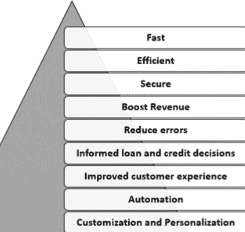

# 什么是机器推荐系统？

根据客户数据和行为，人工智能为金融服务提供个性化的建议。`AI` 帮助执行转账、支付和客户服务查询等任务，这些都是银行的日常事务工作。此外，`AI` 还可以帮助加速信用卡和贷款申请的审批与拒绝过程。推荐系统可能会减少消费者在电子商务网站和在线平台上搜索产品的精力（Resnik & Varian, 1997）。Hanafadeh 等人 (2021) 建议使用推荐系统为研究人员实现中间平台的货币变现。推荐系统可能会检查消费者的支出模式，并针对特定的支出类别（如杂货或汽油）建议带有返现优惠的信用卡。或者，它可能会根据客户的财务目标和风险承受能力建议投资目标。此外，通过使用这些技术，银行和其他金融服务提供商可以更好地理解客户的需求和偏好，并相应地调整其服务。推荐系统通过提供定制化建议和增强客户体验，提高银行和其他金融机构的客户忠诚度和留存率。金融领域案例推理收集的信息包括资产类别、用户特征、利率、盈利能力、过去的股市信息以及来自媒体的财经新闻。使用这些数据，推荐系统将变得更加可靠（Hernández et al., 2019）。存在许多推荐技术，它们就像硬币的两面，既有优点也有问题。在此将先讨论协同过滤和基于内容的过滤。这些系统可以通过根据客户的消费习惯、信用历史和其他相关信息建议金融产品和服务，从而在银行和金融服务行业提供个性化的解决方案。

# 协同过滤

协同过滤通过检查用户的喜好和行为来搜索用户的转变相似之处。协同过滤的显著特点是倾向于通过聚合多个用户的信息来提供推荐（Rykskai & Chameiko, 1992）。这种策略基于一种观点：具有相似过去选择的客户可能具有相似的未来偏好。协同过滤分为两个子类：

- 基于用户的协同过滤：这种方法通过分析用户的过去行为寻找相互相似的用户，并建议用户可能喜欢或购买过的内容。
- 基于项目的协同过滤：这种方法通过分析特征找到相似的商品或服务，并向已经喜欢或购买过相似商品的人推荐。

# 基于内容的过滤

基于内容的过滤（`CBF`）是信息过滤研究的扩展和发展。案例推理系统中的感兴趣组件是根据相应的特征被识别的。对于文本推荐系统（如新闻过滤系统），文本中的词被视为特征（Belkin & Croft, 1992）。通过检查它们的特征，基于内容的过滤寻找服务或项目之间的模式和相似之处。如果用户喜欢相似的特征，他们将会有相似的偏好。例如，基于内容的过滤系统会向一个对低风险投资产品感兴趣的客户推荐高收益储蓄账户。希望为用户提供迷人且个性化金融产品的银行和其他公司可能会认为协同和基于内容的过滤工具是有益的。

# 混合过滤

混合过滤是建议框架的第三种分类，取决于混合至少两个建议生产者。混合过滤技术以各种方式结合两个或多个推荐过滤系统以构建一个新的混合体。混合过滤技术允许以多种方式组合多个过滤器（Isinkaye et al., 2015）。其主要优势是收集单一建议产品的优点并限制它们的不便/局限性。混合建议框架的特征是加权混合、交换交叉、融合混合和离群值。加权混合在考虑单个建议方法的后效应的情况下混合建议事物的评分。其基本优势是在后续混合框架中利用单个建议策略的所有特性。交换交叉取决于交换单个建议程序，直到实现创建最佳确定性的策略。融合交叉取决于共同运行至少两个建议程序，每个程序处理离散信息。它可以解决与原始扩展和整体交叉相关的起始问题，取决于请求建议程序并将其分为等效倾向。其主要益处是应用后续方法，前提它是对于前一种无法有效建议的内容至关重要的。

# 推荐系统的运作

推荐系统不仅评估用户行为和数据，还为机器学习算法和统计模型服务扩展定制建议。如果整合到金融服务和银行中，可以通过跟踪客户的消费习惯、信用历史和其他材料信息来提供个性化的金融产品建议。制定个性化推荐的过程中有四个主要步骤：

图 3 机器学习的过程

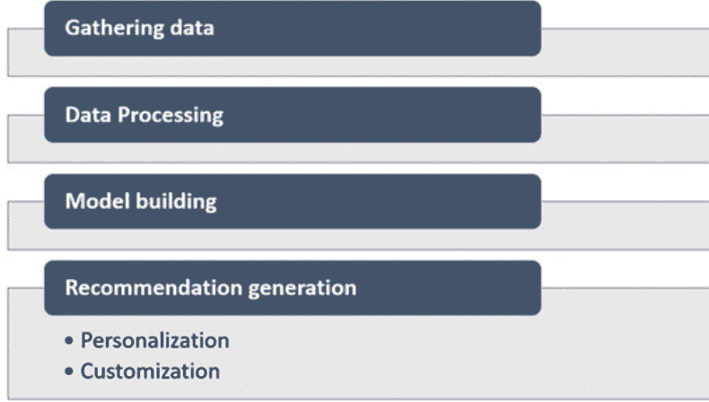

**收集数据：** 在机器学习中，数据是至关重要的组成部分。它指的是可用于准备 `AI` 模型的感知或感知的排列。用于准备和测试的信息质量和数量在决定 `AI` 模型的开发、展示和部署起着关键作用。`AI` 的推荐系统分析来自消费者的数据以制定定制的建议，这些优惠也是针对客户的。金融领域的模型分析个人的消费习惯、信用评分、总负债和其他存款，以为金融机构开发贷款财务机制。可能还有其他模型预测个人的的信誉度，导致发放/不发放。

处理确保了信息的准确性、可靠性和有效性，并有助于机器学习（`ML`）模型的准确性。

**挑战：** 信息处理可能非常枯燥，特别是对于庞大且复杂数据集。信息处理可能会出现错误，因为它涉及信息的更改和清洗，这可能导致重要数据的缺失或产生新的错误。转换后的数据可能无法代表数据中底层的关系和模式，导致对数据的理解有限。数据处理可能会导致对数据的理解有限。在收集信息后，必须对其进行预处理以消除冗余或不必要的信息，并更改其格式以便机器学习算法使用。

**数据处理：** 数据处理是将信息从给定的结构完全转变为显著可用且所需的结构，使其更具意义和价值。这个循环可以使用 `AI` 计算、数值显示和可测量信息进行计算。该循环的结果可以是任何经典形式，如图表、大纲、图片、表格等，取决于我们正在执行的任务和机器的基本要素。数据处理对于机器学习（`ML`）流水线至关重要，因为它为模型准备和构建中的使用准备了信息。

信息处理主要以系统化的方式更改、清洗和设置以供展示的信息。数据处理的主要步骤包括：

- * 信息资产：此方法用于存储从集合、传感器或框架等各种来源收集的数据。信息可能是结构化的或非结构化的，并以文本、图片或声音等不同形式出现。
- * 信息预处理：这一步包括清洗、移动和更改信息，使其对于后续检查变得合理/易于理解。它可能包括消除缺失值、缩放或归一化信息，或者将其转换为另一种配置。
- * 信息检查：在步中，利用不同的策略（如检查、`AI` 计算或信息表示）对信息进行分解。此步骤旨在从信息中获取经验和信息。

**数据解释：** 在这一步中，解释从数据分析中获得的见解并得出结论。报告、仪表板或其他可视化工具可以清晰简洁地传递结果。

**信息表示：** 一旦信息经过处理和检查，应该以安全且有效开放的方式存储。这可能包括将信息存储在数据集、分布式存储或不同的框架中，并执行增强和恢复系统以防止错误信息。

**信息呈现：** 最终，信息检查的结果将以一种重要且证明有效的方式展示给相关者，包括制作演示文稿、报告和仪表板，这些内容展示了信息中的关键发现和序列。机器学习中有许多可用的信息处理工具和库，包括 Python 的 `pandas` 以及 `RapidMiner` 中的信息更改和清理工具。项目的特定需求（如数据的大小和复杂性以及预期结果）将决定使用哪些工具。

# 模型构建

机器学习模型在对收集的信息进行运行机器学习计算后决定结果。选择一个与待完成任务相关的模型至关重要。从长期来看，研究人员和架构师创建了适用于各种任务的模型，如语音识别、图像识别、预测等。此外，有必要检查模型是否适用于数值型或定性信息。准备是机器学习的主要步骤。在准备过程中，它将预先定义的信息传递给机器学习模型以跟踪模式并做出预测。结果是模型从数据中学习以完成集合。经过一段时间的准备后，模型在预测方面会变得更好。

准备模型后，有必要验证其性能。性能验证通过基于先前的隐藏信息测试模型的表现来完成。使用的隐藏信息是测试集，该集之前已将信息分成了用途。假设测试使用了与训练用于相似的信息。在这种情况下，用户将无法获得准确的衡量，因为模型已经习惯了这些信息，并像最近做的那样跟踪模式，这将获得过高的准确率。用户在用它进行测试时，可以获得模型速度和性能的准确衡量。

一旦用户衡量并评估了模型，就需要检查其准确性是否在任何程度上是基于工作的。通过调整模型中存在的边界可以访问模型的准确运行。边界是模型中的因素，通常由软件工程师选择。在用户边界的一个特定点，精度将达到极限。边界隧道允许跟踪这些属性。

**推荐生成：** 将机器学习算法应用于预处理后的数据，以发现客户与商品或服务之间的模式和相似性。选择合适的算法、使用数据对其训练并评估其准确性。机器学习算法可以经过训练，根据用户的之前的行为和偏好为商品和服务提供个性化建议。消费者可以通过电子邮件、移动端应用程序或在线银行门户等其他手段接收这些建议。

# 金融推荐系统

推荐框架是数据筛选和决策支持框架，可以在特定设置下展示客户感兴趣的物品。在金融领域，我们将客户视为参与系统交互（如点赞、销售、购买、评分等）的实体。在推荐中，这些是客户可以连接的项目（例如物品、金融交易、音乐等），用户和物品都可以使用元数据进行描述（例如年龄、客户方向、类型、物品价格）。推荐框架可以被应用于各种数据挖掘算法中，包括协作、基于案例、基于流行度、混合和基于内容的过滤技术，具体取决于空间的属性、可用数据的性质以及业务目标。推荐管理随后帮助银行家就金融需求做出最佳选择。

# BNPL（先买后付）：数字贷款的之星：集成 `Aadhaar` 和 `eKYC` 简化了数字贷款的准入，推动了中小型企业（`MSME`）部门的发展，并在 GDP 中占很大一部分。`India Stack` 作为一个巨大的公共数字基础设施，在降低银行成本和提高金融服务的可用性方面发挥了关键作用，将印度经济从现金体系进行了转型。

金融科技公司在利用替代数据评估信用、提高运营效率以及提供包容性产品方面处于领先地位。银行、非银行公司（`NBFC`）和金融科技（`FinTech`）初创公司之间的合作促进了新思想和效率的发展。2024 年，这种合作预计将加强，带来更多变化并满足印度家庭和企业的金融需求。

银行存款预测：机器学习也可用于预测银行存款订阅（Yan, Li & Li, 2020）。该研究使用了 Kaggle 数据集、预处理方法和特征工程，并利用交叉表和热力图研究了数据之间的相关性。本工作分别强化了如 `SGD` 分类器、`k最近邻分类器`和`随机森林分类器`。

使用复杂的分析模型改变了游戏规则，为预测银行存款描述开启了新的可能性。深入的数据研究、强力的探索性数据分析（`EDA`）、细致的特征工程以及合理的机器学习模型执行，实现了预测银行存款的目标（Zaki et al., 2024）。

股票金融领域：人工智能通过促进算法交易改变了交易行业。研究提出了一种股票推荐系统，用于检查股票数据并对股票进行利润排名选择。当存在有力证据表明这些交易具有潜在的获利空间时，该推荐系统通过建议投资一系列股票，为股票市场交易员、个人投资者和基金经理提供帮助。人工智能算法可以实时分析海量金融数据，检测模式并根据执行交易做出判断，从而消除了情绪影响，使交易更加公正和有效。高频交易作为算法交易的一种，由于人工智能处理大量数据和毫秒级执行的能力而变得流行。人工智能算法利用大量的实时市场数据来检测人类可能忽略的模式和趋势。这加快了交易节奏并促进了决策，从而产生了成效且获利的结果。自动交易系统提供了执行快速计划的能力，比人类交易员更能对市场波动做出反应。基于人工智能的推荐系统不仅根据用户的画像提供个性化推荐，还能在最小化损失的同时增强投资组合的盈利能力（Gonzales & Hargaves, 2022）。研究人员提出了一种利用获利潜力的股票交易推荐系统（Visaya et al., 2020）。

在证券交易所地区，推荐帮助金融从业者有权选择股票市场处理的标的。此时，机器学习还可以预测股票的未来资成本。基于对投资者数据的研究，推荐系统可以帮助投资者做出正确的预测。例如，假设股票具有良好模式，推荐系统建议持有该股票，因为其成本将升级。对于价格恒定的股票，推荐系统告诉投资者买入。通过这种方式，推荐框架帮助金融从业者追求收益并规避损失。

保险行业：在保险领域，保护合同是备用计划与被保险人之间的保单。保险人承担初始支付的责任。如果因意外导致损失，则保证分期付款。标准方法已不再适用，附加险是在基础方法基础上增加的。人工智能通过挖掘更深层次的保险建议建立新标准，超越了传统的推荐系统。人工智能可以检查人口统计信息、医疗记录和外部来源等广泛数据，对风险概况和需求进行更复杂的理解。人工智能可以使用机器学习算法预测事故等发生。这允许针对适当的水平和类型提供定制化建议。基于使用的保险可以根据驾驶行为调整保费。实施这种定制可以激励个人采取更安全的行动。人工智能驱动的聊天机器人可以与消费者互动，理解他们的需求，并为保单提供实时建议。这增强了互动性和定制化，包括过去的购买记录。保险公司利用人工智能个性化客户体验的能力从中受益，从而提高了参与度和满意度。当建议根据其需求量身定制时，客户会感知被重视。人工智能可以检查大量数据以生成更精确的风险概况，从而改进定价策略并降低风险。保险公司通过理解客户需求、定制营销工作以及建议相关项目，可以增加收入和客户忠诚度。

## 利用 AI 驱动推荐优化财务决策

`AI/ML` 以其对消费者和金融机构的许多优势彻底改变了金融服务行业。这些系统处理海量数据以提供提高消费者参与和留存的推荐。我们将观察一些优势，如更高的客户满意度、更多的销售和更强的客户忠诚度。`AI` 驱动的系统可以生成报告、处理大量数据并高效快速地执行任务。人工智能算法可以自动化交易结算、对账过程和欺诈检测，节省时间并减少错误。通过减少人力，金融机构可以将资源重新分配到更有价值和更复杂的任务上。人工智能（`AI`）对于改进银行业的风险管理至关重要。通过分析历史数据，`AI` 算法可以对市场模式做出更精确的预测，识别异常并评估风险的可能性，促进做出明智投资决策的过程，防止欺诈活动。机器算法可以检测人类可能错过的模式和联系，从而最大限度地减少人为错误的风险。

人工智能智能（`AI`）对于金融业的风险管理至关重要。机器学习算法通过检查过去的数据、市场模式和外部影响来评估和预测风险。金融机构可以利用这种能力增强决策、最小化潜在损失并优化其风险组合。人工智能（`AI`）算法不断获取知识并适应新信息，确保风险管理解决方案保持最新和高效。

- 客户快乐和参与度的增加：金融机构可以根据客户的习惯、财务历史和其他相关信息，通过推荐系统提供金融产品和服务的建议。通过提供符合其需求和偏好的定制化推荐，金融机构可以增加消费者参与度并培养客户忠诚度。与其投入资源跟踪每一位客户，如果拥有一个提供这些消费者信息的模型，银行可以采取适当行动并针对那些可能流失的人群（de Lima Lemos, Silva & Tabakat, 2022）。可能会有客户使用银行的服务一段时间，随后停止使用该银行的服务并转向另一家银行。机器学习可以使用大型客户数据库减少客户流失，来自满意客户的推荐有助于银行降低客户获取成本（Singh et al., 2024）。
- 改进的定制服务：通过增强他们的行为和偏好，可以帮助金融机构为其客户提供更个性化的服务。例如，根据客户的投资或消费习惯，基于 `AI` 的系统可能会推荐相关的新的投资选择。根据客户的风险概况、年龄状况、家庭规模或责任，也可以建议投资期权。
- 金融机构更高的收入和销售：基于 `AI` 的系统通过提供个性化建议，具有增加客户购买更多金融产品或服务的潜力。人工智能简化了重复性活动，如贷款处理、欺诈检测和报告准备，允许员工将更多时间分配给复杂工作并降低总运营成本。人工智能可以检查大量数据以检测和预测未来风险，帮助机构做出更明智的贷款决策，减少违约的发生并增强其贷款组合的整体健康状况。

算法分析来自多个来源的多样数据类型，并利用这些结果识别相似行为的实例。文中还提出了一种用于运输财务风险评估的完整机器学习方法。企业财务困境（`FD`）预测模型受到所有利益相关者、监管机构和银行的高度重视，他们依赖于对信贷机构和银行贷款组合违约风险进行可接受的评估。

客户体验：在银行业等极其激烈的领域，客户体验是根本性的。当供应充足时，不满意的客户很容易快速切换供应商。今天，客户体验的重要性比以往任何时候都要明显，因为市场参与者面临着来自纯定制化竞争者的竞争，而这种竞争完全取决于 100% 自主服务的客户关系中的体验。面对这些竞争者在传统组织时间之外的互联网访问能力，现有经营者应该审视他们与客户合作的方式。客户对及时性和独立性的要求促使组织重新审客户体验和关系。根据客户的个人画像数据，最重要的是客户互动过或表现出兴趣的产品，个性化推荐意味着在适当的时间为客户提供产品。建议允许银行调整客户，减少决策复杂性，建立忠诚度并鼓励购买和重复使用。除了在无需人工干预的情况下回答问题外，银行聊天机器人技术还可以处理解决未来问题的潜在查询（Huang & Lee, 营销人员可以使用 `GenAI` 和 `LLMs` 来增强客户体验并建立价值）。

欺诈检测：推荐系统可以用于金融部门的欺诈检测。例如，如果账户中发生多次交易，`AI` 技术可以及时检测这些账户并自动防止欺诈。机器学习推荐系统在勒索识别中的作用至关重要，因为高级活动的数量迅速增加，特征的复杂性日益提高。人工智能赋能勒索识别框架持续检查海量信息并识别特征欺诈行为模式。可以使用多种基于机器学习的信用检测技术来识别信用卡欺诈（`CCF`）和违检测，包括极端学习法、决策树、随机森林、支持向量机、逻辑回归和 `XGB Boost`（Alaraf et al., 2022）。特征的数量、交易次数以及特征之间的相关性对于决定模型检测 `CCF` 的性能优劣至关重要。文本处理和基础模型与 `CNN` 及其层等深度学习技术有关。这些技术在信用卡识别方面优于传统算法（Alaraf et al., 2022; Aslam et al., 2022），使用预测模型为车辆保险市场的欺诈检测提供了一个框架。通过使用公开的汽车保险数据集，特征过程通过 `Boruta` 方法发现了最显著的特征，建议框架可以帮助经理和企业选择模型和特征，用于先进的基于机器学习和人工智能的欺诈检测技术。在检测信用欺诈的模型之前，使用了混合采样和过采样技术来解决不平衡问题（Abd El-Naby, Hamdan & El-Sayed, 2023）。随机森林、逻辑回归和人工神经网络模型用于检测保险部门的欺诈，并具有可接受的准确率和验证指标（Nabrabawi & Alanazi, 2023）。以下是模拟智能在勒索识别中利用的几种关键方式：

机械异常：计算机化勒索识别中的人工智能计算可以被准备在条件误导检查框架中，以识别建议欺诈行为的模式。这些示例可能包括异常的交易金额、来自同一设备的多次交易，或在短时间内通过不同区域产生的购买。一旦发现异常，`AI` 就可以标记该交易进行进一步调查。

身份识别：人工智能可以分析长期行为以识别不常活动。例如，如果一个来自某地的客户开始进行超出其标准理财方式的大额购买，人工智能框架可以捕获这些异常。

自然语言处理：自然语言处理是 `AI` 算法可以用来分析通信（如聊天转录或电子邮件）的技术，以发现欺诈迹象。如果客户意外更改其账户数据并发送邮件提到秘密口令重置，模拟智能框架可以将此识别为潜在的勒索防御。

持续学习：通过持续学习，AI 算法可以使用新数据进行训练，以提高其准确性和有效性。这种学习有助于确保欺诈检测跟上最新的勒索手段和策略。总而言，AI 在欺诈检测中的作用是实时检测可疑行为和欺诈交易，降低企业的财务损失风险并保护客户。

# 金融推荐系统实施

实施基于 AI/ML 的系统实施涉及数据收集、算法选择和用户界面设计，这可能具有挑战性。尽管如此，这些技术的潜在优势是值得的，包括更高的客户满意度、潜在的欺诈和支付违约检测、收入产生以及产品的交叉销售和向上销售。本节将涵盖为银行和金融服务实施推荐系统的主要程序。

收集数据并准备分析：第一阶段是收集用户行为、偏好和财务历史信息。账户余额、交易历史和人口统计数据是这些数据的示例。金融机构可以通过各种平台访问这些信息，包括客户服务互动、在线银行门户和移动应用程序。数据收集后，必须进行预处理以消除冗余或不需要的信息，并进行结构化以便机器学习算法可以使用。它可能采用特征选择、数据处理和数据清洗。

选择合适的算法：有多种算法可供应用，例如基于内容的、混合的和协同过滤。案例和数据属性决定了最佳算法。金融机构应彻底评估并测试所有算法，以确定哪种符合其需求。

为银行部署并评估推荐系统：一旦选择了算法，就必须将其实施并集成到现有基础设施中。必须对系统进行测试和评估，以确保其提供个性化推荐的准确性和有效性。随着用户行为和偏好的变化，持续监控和评估至关重要。

# 障碍与限制

尽管推荐系统在银行和金融领域显示出巨大的潜力，但它们也存在一些障碍和限制。本节将讨论实施这些系统面临的主要困难，包括缺乏透明度、算法偏差和隐私问题。理解这些障碍和限制对于创建符合道德且意义的系统至关重要。

# 隐私与安全考虑

此类程序高度依赖收集和分析个人数据以提供准确推荐。然而，处理敏感财务数据可能会产生严重的隐私和安全问题，特别是当数据泄露或滥用时。必须实施强大的安全措施来保护用户数据并确保他们对推荐系统的信任。

# 环境问题

如果用于训练这些系统的数据不能代表整个用户群体，偏差可能会导致不公平和歧视性的推荐。例如，只向高信用分的人推荐信用卡的推荐系统可能会排除那些分数较低但仍能从信用卡中获益的人。此外，此类系统必须遵守伦理准则，不推荐损害用户财务状况的产品或服务。

# 冷启动问题

冷启动问题发生在推荐系统缺乏足够的用户数据或缺乏新用户的历史数据时，导致无法做出准确的推荐（Murugan & Kala, 2023）。想象一下：新开银行账户的用户可能没有交易历史来提供个性化推荐。系统必须找到创新的方法来解决冷启动问题，并确保用户收到相关的推荐。

图 4. 数据科学管理的数据流

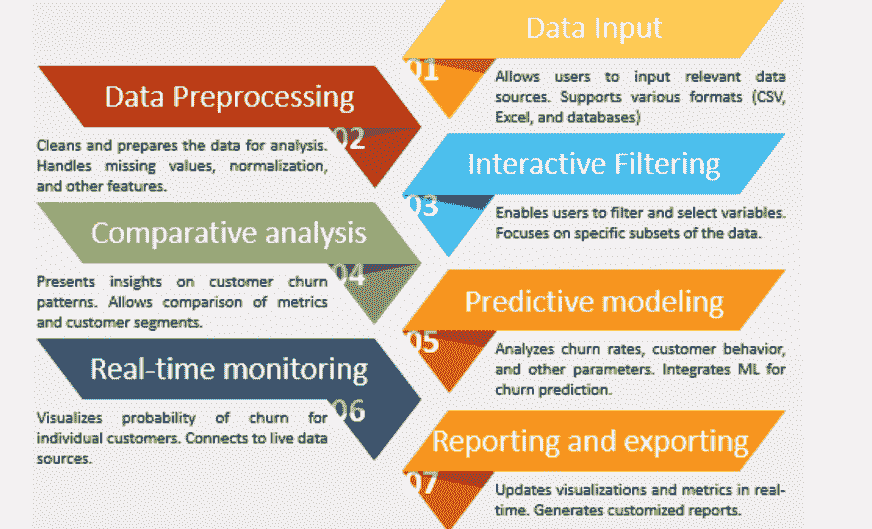

# 未来的推荐系统

由于机器学习、数据科学和用户体验设计的进步，用于银行和金融服务的推荐系统正不断发生变化。随着人工智能和机器学习的进步，推荐系统提供更个性化推荐的能力将不断增强。对于数据源有限的用户，推荐系统分析并提供建议的能力也将提高。深度学习和神经网络有望解决目前推荐系统面临的一些问题，包括冷启动问题和偏差。这些程序可以受益于其他新兴技术的整合，如物联网（IoT）设备和区块链。区块链技术可以为存储和共享用户数据提供一个安全透明的平台。

金融欺诈检测中的机器学习推荐系统：人工智能（AI）已经彻底改变了金融领域的打击欺诈手段。通过实施基于人工智能的防欺诈技术和基于机器学习的模型，金融机构能够更好地防御欺诈活动。随着技术的进步，人工智能（AI）在检测金融欺诈方面的应用将变得更加先进和高效。模拟智能在未来可能取得巨大进展的关键领域之一，是识别欺诈行为，而这些行为利用基于规则的传统框架识别变得越来越具有挑战性。AI 计算可以分析海量信息并识别出表明勒索的虚假案例和异常，在持续区分虚假活动方面将更加熟练。另一个预计将对未来产生关键影响的领域是，利用自然语言处理（NLP）来分解非结构化信息源，如消息、访问日志和虚拟条目。通过检查这些信息，由人工智能驱动的框架可以将欺诈者与其他异常活动区分开来。区块链创新的结合可能是计算机发现金融勒索中最令人兴奋的改进。AI 可用于分析数据并识别欺活动，而区块链提供了一个安全透明的账本来存储交易数据。这种改进结合将使金融机构能够轻松跟踪和识别错误活动，即使在复杂的组织中也是如此。

尽管如此，随着人工智能在金融欺诈领域的应用变得更加普及，应该考虑人类考量。在人工智能驱动的欺诈检测和定位框架的发展和执行过程中，人类监督的重要性不言而喻。确保这些框架是透明且不产生偏见或歧视至关重要。总之，在金融欺诈识别方面，人工智能将成为企业的独特优势。由于机器学习、自然语言处理和区块链技术的整合，金融机构将能够更好地检测和预防欺诈活动，最终保护其客户和业务。然而，必须记住，AI 的有效性仅取决于其训练数据以及其所接受的监督。

# 区块链技术下 AI/ML（推荐系统）的未来

金融服务行业在银行、保险和投资管理方面已经高度依赖推荐系统。然而，随着推荐系统的不断发展，它们有潜力改变金融服务的交付。例如，推荐系统可以为金融机构提供个性化的投资建议、自动化信贷决策并提供个性化的保险保单。金融机构还可以使用推荐系统通过在数字领域提供更个性化、更顺畅的用户体验来留住客户。银行可以通过对过去客户数据进行深度分析，寻找符合条件的新客户，提供高度定制的贷款报价，并增加线索转化。可以使用 AI/ML 推荐系统对客户的信誉进行筛选，这些系统可以根据就业稳定性、收入和信用历史等许多关键参数，对贷款、信用卡和其他银行产品进行分类。根据客户的历史支付情况，AI/ML 结合区块链和其他技术，可以预测贷款或信用卡违约。可以使用异常检测、模式识别和预测分析对客户活动进行实时监控。可以开发实时仪表板来视觉化不同类型的欺诈活动。区块链通过智能合约实现了复杂算法和交易的自动化，减少了行政费用和纸质工作。人工智能（AI）系统可以分析区块链交易数据以发现不实或暗示性的市场趋势。区块链技术通过提供不可篡改的记录使 AI 决策更加透明可审计（Addula et al., 2023）。

## 结论

推荐系统在金融服务中变得越来越重要，因为它们帮助金融机构为客户提供个性化且相关的建议。然而，必须解决挑战和局限性，例如数据隐私和安全担忧、偏差和伦理问题、冷启动问题以及可扩展性问题。推荐系统是银行和组织可以使用的极佳资产，并将随着无限的应用继续发展。人们可能会认为，这是一项改进在过去十年中取得了惊人的速度，并为亚马逊带来了数十亿美元的额外收入。机器学习可以在银行和金融服务领域以多种方式使用，造福利益利益者，包括银行、政府、客户、提供基于机器学习服务的公司以及整个社会。由于迫切需要推荐系统，银行应该意识到实施它们带来的优势。基于技术的诈骗正变得越来越常见，同时客户的需求和目标也在以更快的进化。今天的消费者想要专门为他们量身定制的服务，如果不在服务层面使用技术，银行无法满足这一需求。由于银行服务提供商向其金融服务增加了更多产品和人员，客户群正在扩大，这促进了金融包容性。

## 参考文献

Abd El-Naby, A., Hemdan, E. D., & El-Sayed, A. (2023). 金融服务中信用卡不平衡数据的高效欺诈检测框架。Multimedia Tools and Applications, 82(3), 4319–4160. DOI: 10.1007/s11042-022-13434-6

Addula, S. R., Meduri, K., Nadella, G. S., & Gonayuntha, H. (2023). 金融中的区块链：银业的机遇与挑战。International Journal of Advanced Research in Computer and Communication Engineering, 13(2), 184–190.

Alfaraj, F., Malik, I., Khan, U. H., Almusallah, N., Ramzan, M., & Ahmed, M. (2022). 使用最先进机器学习和深度学习进行信用卡欺诈检测。IEEE Access: Practical Innovations, Open Solutions, 10, 39700–39715. DOI: 10.1109/ACCESS.2022.316891

Aslam, F., Hunjra, A. I., Fiitti, J., Louhichi, W., & Shams, T. (2022). 推理欺诈检测：来自人工智能和机器学习。Research in International Business and Finance, 62, 101744. DOI: 10.1016/j.ribf.2022.101744

Beheshti, A., Yakhchi, S., Mouseraid, A., Ghafari, S., Goluguri, S. R., & Edrisi, M. A. (2020). 迈认知推荐系统。Algorithms, 13(8), 176. DOI: 10.3390/a13080176

Belkin, N. J., & Croft, W. B. (1992). 信息过滤与信息检索：硬硬币的两面？Communications of the ACM, 35(2), 29–38. DOI: 10.1145/138859.138861

Clintworth, M. R., Lydiris, D., & Tabak, B. M. (2023). 航运财务风险评估：基于金融机器学习方法的客户流失倾向。Maritime Economics & Logistics, 25(1), 90–121. DOI: 10.1057/s41268-020-0183

de Lima Lemos, R., Silva, T., & Tabak, B. (2022). 金融业的客户流失倾向：机器学习方法。Neural Computing & Applications, 34(14), 11751–11768. DOI: 10.1007/s10052-022-0767-x

Gonzales, R. M. D., & Hargreaves, C. (2022). 我们能用人工智能进行股票预测和风险管理吗？一种提议的决策支持系统。International Journal of Information Management, 62, 102130.

Grigorios, L., Malik, S., Kostopoulos, I., Drossos, D., & Santos, D. (2022). 在线广告中的公开与秘密数据收集：用户情绪的作用。Journal of Business Research, 141, 308–320. DOI: 10.1016/j.jbus.2021.12025

Habil, S., El-Deeb, S., & Bassiony, N. (2023). 基于AI的推荐系统：终极市场营销。The Palgrave Handbook of Interactive Marketing (pp. 683–704). DOI: 10.1007/978-3-031-14961-3

Hanafzadeh, P., Barkhordari, M., & Vu, K. (2021). 使用推荐系统的洞察变现平台。Electronic Markets, 31(2), 269–293. DOI: 10.1007/s12525-020-00499-w

Hassenzel, M., & Tractinsky, N. (2006). 用户体验研究议程。Behaviour & Information Technology, 25(2), 91–97. DOI: 10.1080/01449290503331

Hernández, E., Sittón, I., Rodríguez, S., Gil, A., & García, R. (2019). 金融科技中的投资推荐多智能体系统。International Joint Conference CISIS'18-ICE'18: San Sebastian, Spain June 6-8, Proceedings 13 (pp. 3-10). DOI: 10.1007/978-3-319-94120-2

Howe, J. (2006). 众包的兴起。Wired magazine, 14(6), 176–183.

Huang, S. Y., & Lee, C. J. (2022). 金融科技聊天机器人持续意意愿预测。Computers in Human Behavior, 129, 107027. DOI: 10.1016/j.chb.2021.107027

Isinkaye, F. O., Folajimi, Y., & Ojokin, B. A. (2015). 推荐系统：方法与评估。European Informatics journal, 16(3), 261–273.

Kouabria, A., Nouali, O., & Al-Shamir, M. Y. (2020). 使用学习排序和排序聚合的多准则过滤推荐系统。Arabian Journal for Science and Engineering, 45(4), 2835–2845. DOI: 10.1007/s13669-019-04180-3

Lu, J., Wu, M., Wang, W., & Zhang, G. (2015). 推荐系统的应用开发：综述。Decision Support Systems, 74, 12–32. DOI: 10.1016/j.dss.2015.03.008

Murugan, M. S., & Kala, T. (2023). 使用机器学习策略的大规模数据驱动财务风险管理。Measures, 27, 107756. DOI: 10.1016/j.meas.2023.107756

Nawabi, E., & Alanani, A. (2023). 医疗保险理赔欺诈检测。Risks, 11(9), 160. DOI: 10.3390/risks1109160

Oeyebo, O., & Ori, R. (2020). 银行环境的产品混合推荐系统。International Journal of Banking and Financial Technology, 4(1), 15–25. DOI: 10.1007/s42786-019-0014

Parjane, P., & Deshpande, U. (2013). 基于关联规则挖掘的股票组合推荐系统。Applied Soft Computing, 23(2), 1055–1063. DOI: 10.1016/j.asoc.2012.0912

Resnik, P., & Varian, H. (1997). 推荐系统：过滤类型。Communications of the ACM, 30(3), 56–59. DOI: 10.1145/138859.138861

Ryngasi, L., & Chachemko, L. (2014). 推荐系统：过滤类型。International Journal of Engineering Research, 3(8), 251–254.

Shi, Y., Larson, M., & Hananjic, A. (2014). 用户-项目矩阵协同过滤：综述。ACM Computing Surveys, 47, 1–45.

Singh, P., Anik, F., Senapati, R., Sakib, N., & Hossain, E. (2024). 聚类：机器学习方法与可视化。Data Science and Management, 7(1), 7–16. DOI: 10.1016/j.dsm.2023.0902

Thukral, V., Latvala, L., Swenson, M., & Horn, J. (2023). 使用大语言模型的客户旅：最佳实践与陷阱。Applied Marketing Analytics, 9(3), 281–292. DOI: 10.69554/DM561

Vismaya, V., Pooja, K., Alekhya, A., Malavika, C., Nair, B., & Kumar, P. (2020). 基于分类器的股票交易系统。Computational Economics, 55, 901–923.

Winter, S., Maslowska, E., & Vos, A. (2021). 社交媒体广告中基于特征的个性化。Computers in Human Behavior, 114, 106525. DOI: 10.1016/j.chb.2020.106525

Yan, C., Li, M., & Liu, W. (2020). 基于改进霍夫尼克网络的银行电话营销结果预测。Applied Soft Computing, 92, 106259. DOI: 10.1016/j.asoc.2020.106259

Zaki, A. M., Khodadadi, N., Lim, W. H., & Towfek, S. K. (2024). 预测银行订阅的预测分析与机器学习。American Journal of Business and Operations Research, 11(1), 79–88. DOI: 10.54216/AJBOR.110110

## 参考文献汇

Abd El-Naby, A., Hemdan, E. D., & El-Sayed, A. (2023). 金融服务中信用卡不平衡数据的高效欺诈检测框架。Multimedia Tools and Applications, 82(3), 4139–4160. DOI: 10.1007/s11042-022-13434-6

Abidi, W. U. H., Daoud, M. S., Ihnaini, B., Khan, M. A., Alyas, T., Fatima, A., & Ahmad, M. (2021). 融合机器学习支持的实时欺诈检测。IEEE Access: Practical Innovations, Operations, 9, 612–622. DOI: 10.1109/ACCESS.2021.309828

Abureian, A. H. M., & Ashkenqar, H. I. (2023). 使用随机森林分类器不平衡数据进行信用卡欺诈检测。International Conference on Advances in Computing Research, 605–616. DOI: 10.1007/978-3-031-33743-7_48

Acciarini, C., Cappa, F., Boccardelli, P., & Oriani, R. (2023). 组织如何利用大数据创新业务模式？系统性文献综述。Technovation, 123, 102713. DOI: 10.1016/j.technovation.2023.102713

Adula, S., Meduri, K., Madena, G. S., & Gonayunta, H. (2023). 金融中的区块链：银业的机遇与挑战。International Journal of Advanced Research in Computer and Communication Engineering, 13(2), 184–190.

Addy, W. A., Ofodile, O. C., Adeoye, O. B., Oywole, A., & Ololade, Y. (2024). 数据驱动的可持续性S：金融科技创新如何支持绿色金融。Engineering Science & Technology Journal, 5(3), 760–773. DOI: 10.5154/estj.v5i3

Adebiye, R., Alhami, M., & Owusu, T. (2023). 作为商业智能万能药的外部推断机器学习模型。

Aderati, T., & Bansal, R. (2019). 可再生能源系统在微网系统中的影响。Journal of Engineering, 5308–5313.

Adula, M., Birbisa, Z. A., & Kant, S. (2023). 人际、问题解决和技术培训技能对埃塞俄俄织业绩效的影响：持续、规范和情感承诺的中介作用。Cogent Business & Management, 10(3), 2286672. DOI: 10.1080/23311975.2023.2286672

Aggarwal, K. K., & Yogesh Singh, A. Kaur, O.P.Sangan (2004) “基于神经网络的测试用例方法”。ACM SIGSOFT, May 2004, Vol. No. 4.

AgnarAamodt, Enric Plaza (2019); 基础问题、方法论变异、系统方法；AlCom-人工智能通信，IOS Press；第 7 卷第 1 期，39-59 页。

Agrawal, A., Gans, J. S., & Goldfar, A. (2018). 预测机器：人工智能的简单经济学。《哈佛商业评论》。

Aha, D. W., Kibler, D., & Albert, M. K. (1991). 基于实例的学习算法。《机器学习》, 6(1), 37–66. DOI: 10.1023/A-1022688940000

Ahmed, D., Hua, H. X., & Bhatta, U. S. (2023). 绿色创新：主题性综述。《当前环境可持续发展意见》， 66, 101402. DOI: 10.1016/j.cosust.2023.101402

Akarsu, B., & Genç, M. S. (2022). 混合可再生能源系统的电力与氢气生产优化。《燃料》, 324, 124665. DOI: 10.1016/j.fuel.2022.124665

Akter, S., Bandara, R. J., & Sajib, S. (2021). 如何提高供应链韧性？《国际运营与生产管理》, 41(9), 1469–1494. DOI: 10.1108/IJOPM-11-2020-0805

Al Balawi, S., & Aljhani, N. (2022). 使用神经网络进行信用卡欺诈检测。《国际信息技术》, 20(2), 234–241. DOI: 10.34028/hajit/20/2/0

Larfaj, F. K., Malik, I., Khan, H. U., Almasall, N., Rahman, M., & Ahmed, M. (2022). 使用最先进的机器学习和深度学习算法进行欺诈检测。《IEEE Access：实用创新，开放解决方案》， 39700–39715. DOI: 10.1109/ACCESS.2023.316881

Albuquerque, R., Roskinen, Y., & Chang, C. (2019). 企业社会责任与公司风险：理论与实证证据。《管理科学》, 65(10), 4451–4469. DOI: 10.1287/msc.2018.3043

Alfaiz, N.S, Fay, S.M. (2022). 使用机器学习增强信用卡欺诈检测。《MDPI 电子期刊》, 11.

Khatebeeb, B. Abu Hijeleh, E. Rangasany and S. Muhammed, 阿联酋联合国的建筑重组策略及其对储蓄的影响，SBE16 迪拜会议, 2016年1月17日, 迪拜-阿联酋。

Almazzoi, A. A., & Ayub, N. (2023). 使用机器学习技术的在线支付欺诈检测模型。《IEEE Access：实用创新，开放解决方案》，11, 188–203. DOI: 10.1109/ACCESS.2023.339226

Almeida, K. C., & Conceon, F. (2019). 基于双层优化的去中心化水电调度。《控制、自动化与电气系统杂志》。巴西自动化协会-SBA, 30, 557–567。

Aslayat, A. (2023). 基于机器学习的大社交数据客户决策分析：麦加案例。《神经网络计算与应用》, 35(6), 4701–4722. DOI: 10.1007/s05221-022-07992-x PMID: 36430596

Alshammari, N., & Asumadu, J. (2020). 混合可再生能源系统利用的最优尺寸：和谐搜索、Jaya 和粒子群优化算法，《可持续城市与社会》，Elsevier, 60。

Alshingiti, R., Rabeah A., Jalal Al-Muhtadi, Qazi Eam Ul Haq, Kashif Saleem and Muhammad H. F (2023). 基于 CNN、LSTM 和 LSTM-CNN 的深度学习钓鱼检测系统。《MDPI-电子》, 12.

Amit, R., & Zott, C. (2012). 通过商业模式创新创造价值。2012。

Amit, R., & Zott, C. (2001). 电子商务中的价值创造。《战略管理杂志》, 22(6–7), 493–520. DOI: 10.1002/mmj.187

Ammari, C., Belratache, D., Touhami, B., & Makhlofi, S. (2022). 可再生能源系统的尺寸规划、优化、控制与管理——综述。《能源与建筑环境》， 3(4), 399–411. DOI: 10.1016/j.ben.2021.10

Angwin, J., Larson, J., Mattu, S., & Kirchner, L. (2016). 机器学习偏差。《Publica》。https://www.publica/article/machine-bias-assessments

Apre-Djana, P., Ayitah, S., Amey, F., & Opare, E. (2023). 银行基于价值的绩效的中介效应。《银行与金融杂志》, 28(2), 35–41. DOI: 10.1063/jf.2021.006

Arjun, S., & Mopathi, N. (2024). 机器学习欺诈检测。《电气系统杂志》, 20(2), 2773.

Darwin, D., Asmara, A., Dimas, H., & Samsiana, I. (2023). 非二分类模式识别视角。《AIP 会议论文》，2531(1), 070001.

Ashfaq, T., Suresh, K., Alskari, S., Sameed, A. (2022). 机器学习与区块链欺诈检测。《传感器》, 22.

Aslam, F., Hunja, A., Louth, W., & Shams, T. (2022). 保险欺诈检测：从人工智能到机器学习。《国际商业研究》， 62, 10174. DOI: 10.1016/j.ribf.2022.10174

Asudani, D., Nagwani, N., & Singh, P. (2023). 词嵌入模型对深度学习分析的影响。《人工智能综述》, 56(9), 10345–10425。在线出版。DOI: 10.1007/s05462-023-10419 PMID: 3644486

Aziz, A. S., Tajuddin, F., Hussain, M., Adman, M., Ghazali, N., & Zidane, T. (2022). 风/柴油/电池混合能源系统的新优化策略。《能源》, 239.

Babar, M., Arif, F., & Irfan, M. (2019). 使用大数据分析的物联网城市环境：综述。《物联网支持的网络的最新趋势与进展》(pp. 129–138)。Springer. DOI: 10.1007/978-3-319-99660_12

Badjatiya, P., Gupta, S., Gupta, M., & Varma, V. (2019). 推特仇恨言论深度学习。《国际宽网会议》，759–760.

Bagchi, D., Mukerjee, A., & Pal, S. (2021). 故障检测的新方法。《计算科学与工程杂志：JSCE》，2, 112–119.

Bai, C., Zhou, H., & Sarkis, J. (2023). 工业 4.0 技术与可持续目标——规模视角。《国际生产研究》, 61(23), 8094–8114. DOI: 10.1080/00208274.2022.2164375

Baiyere, A., Salmea, H., & Tapainen, T. (2020). 数字转型与业务流程管理的新逻辑。《欧洲信息系统》, 29(3), 238–259. DOI: 10.1080/09600085.2020.1718007

Banerji, D., & Reimer, T. (2019). 创业创始人及其 LinkedIn：是否良好

Ban, G. Y., & Keskin, N. B. (2021). 基于机器学习的个性化动态定价：高维特征与异质弹性。《管理科学》, 67(9), 5549–5568. DOI: 10.1287/mnsc.2020.30680

Beero, I., Di Ciccio, C., Reijers, H., Rinderle-Ma, S., Bandara, W., Federico, D., Dumas, M., Fischer, D., Klinküller, C., Zeralto, F. (2023). 在在我们之前要解决的最大业务管理问题。《计算机》， 146, 10387. DOI: 10.1016/j.comp.2023.10387

Behesh, A., Yakhchi, S., Ghafari, S., Gologuri, R., & Edrisi, M. (2020). 向认知推荐系统迈进。《算法》， 13(8), 176. DOI: 10.3390/a1308176

Belachew, A. (2024). 基于结果的改进炉具干预对家庭生计的影响：来自埃塞俄比亚。《森林政策与经济》，158, 103096. DOI: 10.1016/j.forpol.2023.103096

Belkin, N. J., & Craft, W. B. (1992). 信息过滤与信息检索：硬币的两面？《ACM 通讯》，35(12), 29–38. DOI: 10.1145/138859.138861

Benby, H., Pachidi, S., & Janservaa, S. (2021). 特刊：组织中的人工智能：对信息系统研究的启示。《信息系统协会杂志》，22(2), 10. DOI: 10.17707/ais13875

Berwal, P., Dhatterwal, J. S., Kaswan, K. S., & Kant, S. (2022). 工程管理中的计算机应用。Chapman and Hall/CRC. DOI: 10.1021/9781003221938

Bjornali, E. S., & Ellingsen, A. (2014). 影响清洁技术发展的因素

Bocken, N., & Snihur, Y. (2020). 精益创业与商业模式：为了新颖性和影响进行实验。《长期规划》，53(4), 10193. DOI: 10.1016/j.lrp.2019.10193

Boser, B. E., Guyon, I. M., & Vapnik, V. N. (1992). 优边际分类器的训练算法。Proc. 5th Annu. Workshop Comput. Learn. Theory (COLT), 144–152. https://www.scirp.org/reference/ReferencesPapers?ReferenceID=140952

Boson, L. T., Elemo, Z., Engida, A., & Kant, S. (2023). 绿色供应链管理实践对埃塞俄比亚可持续业务的影响评估。[LOMR]. Logistic and Operation Management Research, 2(1), 96–104. DOI: 10.31098/lomr.v2i1.24168

Bouchabou, D., Nguyen, S. M., LeDuc, C., & Kanellos, I. (2021). 利用语言模型增强智能城市环境传感器的人类活动识别。Electronics (Basel), 10(20), 2498. DOI: 10.3390/electronics10202498

Bowman, C., & Ambrosini, V. (2000). 价值创造与价值捕获：迈向战略价值的统一定义。British journal of management, 11(1), 1–15. Brynjolfsson, E., & Hitt, L. 迷失的悖论？信息系统支出回报的层级证据。Management Science, 42(4).

Bram, J. T., Warwick-Clark, B., Obeyeke, E., & Mehta, K. (2015). 发展中国家医疗数据的利用与货币化。Big Data, 3(2), 56–69. DOI: 10.1089/big.2014.0053 PMID: 26487984

Brandenburger, A. M., & Stuart, H. W Jr. (1996). 基于价值的业务战略。Journal of Economics & Management Strategy, 5(1), 5–24. DOI: 10.1111/j9430-9134.1996.00005x

Bresciani, S., Huang, K. H., Malhotra, A., & Ferraris, A. (2021). 数字转型作为产品、流程和业务模式创新的跳板。Journal of Business Research, 128, 204–210. DOI: 10.1016/j.jbusres.2021.02.033

Buallah, A., Fadel, S. M., Al-Ajmi, J. Y., & Sauagaran, S. (2020). 中东和北非（MENA）银行的可持续性报告与绩效：是否存在权衡？Measuring Business Excellence, 24(2), 197–221. DOI: 10.1108/MBE-09-2018-0078

《业务分析：数据分析与决策》，Christian Albright 和 Wayne Winston 著（2019年）

《业务分析：数据分析与决策》，S. Christian Albright 和 Wayne Winston 著。Winston 出版。

《业务分析：数据驱动决策的科学》，James R. Evans 著（2021年）

《业务分析：数据驱动决策的科学》，U. Dinesh Kumar 著（2019年）

《业务模式设计：愿景者、游戏规则改变者和挑战者的手册》，Alexander Osterwalder 和 Yves Pigneur 著（2010年）

Butt, S. A., Diaz-Martinez, J. L., Jamal, T., & Ali, A. Emir De-La-Hoz-Franco, 以及 Muhammad Shoaib。IoT 智能健康安全威胁。2019 19th International Conference on Computational Science and Its Applications (ICCCSA), IEEE。

Butt, S. A., Diaz-Martinez, J. L., Jamal, T., & Ali, A. Emir De-La-Hoz-Franco, 以及 Muhammad Shoaib。IoT 智能健康威胁。2019 19th International Conference on Computational Science and Its Applications (ICCCSA), 第 26–31 页。

Butt, A., Imran, F., Helo, P., & Kantola, J. (2024). 数字转型的文化战略设计。Long Range Planning, 57(2), 10245。在线出版。DOI: 10.1016/j.lrp.2024.10245

Calic, G., & Ghashemei, M. (2021). 社会科学中的大数据：创新作为大数据与社会绩效之间关系的中介。Journal of Business Research, 131, 391–401. DOI: 10.1016/j.busres.2020.003

加州消费者隐私法案 (CCPA)。`https://oag.ca.gov/privacy/ccpa`

Callon, M., Courtney, J. P., & Laville, F. (1991). 词共分析作为描述基础研究与技术研究交互网络的工具。Scientometrics, 22(1), 155–205. DOI: 10.1007/S0390-22003

Callon, M., Courtney, J. P., Turner, W., & Bauin, S. (1983). 从翻译到问题网络：词共分析简介。Information Sciences, 22(2), 191–235. DOI: 10.1007/BF0390-22003

Cappa, F. (2022). 来自众包、公民科学和众筹的大数据。Journal of Knowledge Management, 26(11), 308–323. DOI: 10.1108/JKM-12-2021-0871

Cappa, F., Oriani, R., Peruffello, E., & McCarthy, I. (2021). 数字环境中的价值创造与获取：解量、多样性和真实性的影响。Journal of Product Innovation Management, 38(1), 49–67. DOI: 10.1111/jpm.12545

Carney, M. (2021). 价值：为所有人构建更美好的世界。

Caser, C., Trucco, S., & Caserio, C. (2018). 企业资源规划与商业智能系统的信息质量：意大利背景下的实证分析。43-52-73。

Chang, V. (2021). 大数据与智能城市的伦理框架。Technological Forecasting and Social Change, 16, 1–11. DOI: 10.1016/j.techfore.2020.10259

Charizanos, G., Demirhan, H., & Icen, D. (2024). 在线交易的欺诈检测与验证系统。International Journal of Electronic Banking, 2(4), 267–274. DOI: 10.1504/IJEB-2020.11472

Chauhan, N., & Tek, P. (2020). 绿色资源管理与员工行为：实证分析。Corporate Social Responsibility and Environmental Management, 27(2), 630–641. DOI: 10.1002/csr.1827

Chawla, R. N., & Goyal, P. (2022). 数字转型的新兴趋势：文献计量分析。Benchmarking, 29(4), 1069–1112. DOI: 10.1108/BIJ-01-2021-0009

Chen, Shangfeng, Gao Hongqing, 和 Liu Zhijian. (2020)。 基于智能家居中极端学习的人类活动识别。Journal of Physics: Conference Series. Vol. 1437. No. 1. IOP Publishing.

Chen, T., & Guestrin, C. (2016). XGBoost：一种可扩展的树提升系统。Proc. 22nd ACM SIGKDD Int. Conf. Knowl. Data Mining, 785–794. `https://arxiv.org/abs/1603.02754` DOI: 10.1145/2399672.2393785

Chenguel, M. B., & Mansour, N. (2024). 绿色金融：承诺与幻象之间。Competitive Review, 34(1), 179–192. DOI: 10.1108/CR-10-2022-0162

Chen, J., Wei, W., Cang, T., & Sun, L. (2017)。 健康研究数据挖掘中趋势的文本分析与可视化。Health Policy and Technology, 6(4), 389–400. DOI: 10.1016/j.hlpt.2017.003

Chen, K., Z, Y., & Alwan, L. (2020)。 价格存在下的动态定价。International Journal of Production Research, 58(2), 546–561. DOI: 10.1080/00207543

Chen, X., Zhou, Y., & Li, S. (2017)。 并网光伏混合系统的能量管理策略。Journal of Power Sources, 363, 420–430.

Chen, Y., Zhou, S., & Xu, H. (2012). 保护青少年安全的社交媒体攻击性语言检测。Proc. - 2012 ASE/IEEE Int. Conf. Sec., 71–80.

Cherikabayeva, L., Yerimetova, A., & Dayirba, E. (2021)。 用于分组解决方案的聚类分析方法研究。21st International Conference on Computer Science and Engineering (UMBK), 土耳其安卡拉, 2021, 第1–4页。DOI: 10.1109/UMBK52708.2021.955834

Chesbrough, H. (2006)。开放业务模式：如何在创新格局中生存。Harvard Business School。

Song, S., Rahman, A., & Narayan, A. K. (2022)。 客座会计：技术、可持续性和多样性的影响。Public Accounting Review, 34(4), 517–525. DOI: 10.1108/PAR-07-2022-210

Cioffi, D. (2007)。 业务分析的演变。”Journal of Business Research.

Clintworth, M., Lyridis, D., & Boulgourgis, E. (2023)。 海运财务风险评估：一种全面的机器学习方法。Maritime Economics & Logistics, 25(1), 90–121. DOI: 10.1057/s4128-022-0183-2

《竞争分析：获胜的新科学》，Thomas H. Davenport 和 Jeanne G. Harris 著（2007年）

Cornelis, E., Gorus, E., Van Scheverchem, N., & De Vriend, P. (2019)。 神经认知障碍老年患者基础、间接和高级日常生活活动能力与执行功能之间的关系。International Journal of Geriatric Psychiatry, 34(6), 889–899. DOI: 10.1002/gps.5087 PMID: 30761619

Dąbrowska, J., Alimpanopoulos, A., Brem, A., Chesbrough, H., Cucino, V., Di Minin, A., Giones, F., Hakala, A., Marullo, C., Mention, A-L., Nørskov, S., Nylund, P. A., Oddo, C. M., Radziwon, A., Ritala, P. (2022). 数字化转型，利还是弊：一项批判性的多级研究议程。R & D Management, 55(2), 930–954. DOI: 10.1111/radm.12531

As, A., Roy, M., Dutta, S., Ghosh, S., & Das, A. K. (2015). 预测Twitter社交网络中的趋势：一种机器学习方法。[`https://www.researchgate.net/publication/294428213_Predicting_Trends_in_the_Twitter_Social_Network_A_Machine_Learning_Approach`](https://www.researchgate.net/publication/294428213_Predicting_Trends_in_the_Twitter_Social_Network_A_Machine_Learning_Approach)

As, S., & Chen, M. (2021). 收割雅虎：从股票留言板中提取市场情绪。国际工程开发与研究期刊。[`http://www.ijedr.org`](http://www.ijedr.org)

Datta, A., Tschantz, M. C., & Datta, A. (2015). 广告隐私设置的自动化实验——关于机会、选择与歧视的故事。隐私增强技术系统学, 1(1), 92–112. DOI: 10.1515/posets-2015-0007

de Lima Ramos, R. A., Silva, T. C., & Tatbak, B. M. (2022). 金融机构客户流失的倾向：一种机器学习方法。神经计算与应用, 34(14), 11751–11768. DOI: 10.1007/s00521-022-07067-x PMID: 3521625

de Lucillos, A., & Gavila, S. G. (2023). 研发对创业、创新、数字化和数字化转型的影响。商业研究期刊, 175, 113566。 在线出版。DOI: 10.1016/j.jbus.2022.113566

de Oliveira, S., Felipe, J. V. F., Plácido, J., & Deslandes, A. C. (2020). 痴呆症患者的空间导航与双任务表现：在工具性日常生活活动中的部分依赖性。IBRO报告, 9, 52–57. DOI: 10.1016/ibor.2020.06.006 PMID: 33363104

Deb, B. C., Rahman, M. M., & Haseeb, M. (2024). 揭示绿色技术和绿色金融对企业社会责任的影响。环境科学与污染研究国际, 31(1), 1543–1561. DOI: 10.1007/s11356-023-31150-y PMID: 38041735

Del Vecchio, P., Di Minin, A., Petruzelli, M., Panieello, U., & Piriri, S. (2018). 中小企业和企业开放创新的大数据：趋势、机会与挑战。创意与创新管理, 27(1), 6–22. DOI: 10.1111/cim.12224

Dell’Era, C., Di Minin, A., Ferrigno, G., Ferrantini, F., Landoni, P., & Verganti, R. (2020). 激进循环下创新过程中的价值捕获：企业与慢食、Mem菲斯和自由软件基金会合作的定性分析。技术预测与社会变化, 158, 120128. DOI: 10.1016/j.techfore.2020.120128

Derbe, T., Melak, D., & Derso, B. (2023). 利益相关者对社会责任的整合：青年自雇创新。埃塞俄比亚复兴社会科学人文期刊, 10(1), 41–60. DOI: 10.4314/erjsh.v10.3

Dereso, C. W., Kant, S., Muthutharaman, M., & Tufa, G. (2023, May).政策对埃塞俄比亚综合性大学卫生部门学生创造力的影响：合作伙伴关系的调节作用与场所学习的中介作用。国际健康信息学会议论文：IHIC 2022 (pp. 135-147)。新加坡: Springer Nature Singapore. DOI: 10.1007/978-19-9090-8_13

Deslée, A., & Cloare, J. (2024). 保护隐私：数据驱动营销中的伦理考量。在 Matos-López, L. (编.), 数字化对当前营销策略的影响 (pp. 147–161)。Emerald Publishing Limited., DOI: 10.1108/978-1-8375-6804

Dhanda, U., Shrotviya, V. K. (2021). 企业可持续性：新现实。组织与管理定性研究, 16(3), 464–487. DOI: 10.1108/QROM-01-2020-0

Dhruv, A., Patel, R., & Doshi, N. (2020). Python：计算机科学最先进的编程语言。文化遗产、可持续旅游与创新国际会议 CESIT 2020。

Domingos, P., & Pazzani, M. (1997). 论零一损失下简单贝叶斯分类器的最优性。机器学习, 29(2-3), 103–130。[`https://www.researchgate.net/publication/24522069_On_the_Optimality_of_the_Bayesian_Classifier_under_Zero`](https://www.researchgate.net/publication/24522069_On_the_Optimality_of_the_Bayesian_Classifier_under_Zero)

Doni, F., & Financial M. (2024). 创新能影响环境、社会和治理（ESG）问题与财务表现之间的关系吗？商业战略与环境, 33(2), 546–574. DOI: 10.1002/bse.3500

D. Bonne Morris (1995). 案例。西吉尼亚大学第1卷。

Dreis, S., & Ohno-Machado, M. (2002). 逻辑回归与神经网络：一种方法论。生物医学信息学, 35(5-6), 352–359。[`https://www.sciencedirect.com/science/article/pii/S153204600340`](https://www.sciencedirect.com/science/article/pii/S153204600340) PMID: 1296784

Duan, Y., Edwards, J., & Dwivedi, Y. (2019). 大数据时代的人工智能决策：演变、挑战与研究议程。信息管理期刊, 48, 63–71. DOI: 10.1016/j.ijinf.2019

Dubey, R., Gunasekaran, A., Childe, J., Blome, C., & Papadopoulos, T. (2019). 大数据与预测分析：整合制度理论、资源基础观与文化。英国管理期刊, 30(2), 341–361. DOI: 10.1111/1467-8551.1235

Ebekozian, A., Aigbab, C., & Ramotshela, M. (2024). 调查利益相关者参与项目的定性方法。项目管理, 31(3), 866–883. DOI: 10.1108/BIJ-11-2021

Ejga, P., Feng, Y., Tang, S., Agbetayo, M., & Dai, X. (2023). 基于模糊的新度量及其在模式分类和诊断中的应用。神经计算与分析, 35(14), 10083–10095. DOI: 10.1007/s00521-022

Ellili, N. (2022). ESG 披露与财务报告质量对投资效率的影响。公司治理：商业社会国际期刊。

Enholm, I., Papagianidis, E., Mikalef, P., & Krogst, J. (2022). 人工智能与业务价值：文献综述。信息系统前沿, 24(8), 1709–1734. DOI: 10.1017/s10796-021

Enkel, E., Bogers, M., & Chesbrough, H. (2020). 数字化时代的开放创新：成熟模型与未来研究方向。R & D Management, 50(1), 161–168. DOI: 10.1111/rd.12397

Entezari, A., Aslani, A., Zahedi, R., & Noorullahi, Y. (2023). 能源系统中的人工智能与机器学习：文献综述。能源策略评论, 45, 101017. DOI: 10.1016/j.esr.2022.1010

Erevelles, S., Fukawa, N., & Swayne, L. (2016). 大数据分析与营销转型。商业研究期刊, 69(2), 897–904. DOI: 10.1016/j.jbusres.2015.0701

Esenogho, E., Miye, D., Sway, T. G., Argule, R., & Obaido, G. (2022). 基于特征工程的神经网络集成用于信用欺诈检测。IEEE Access：实用创新，开放解决方案, 10, 400–407. DOI: 10.1109/ACCESS.2022.3148298

# 参考文献

欧洲数据市场 2021-2023。[https://digital-strategy.ec.europa.eu/library/results-european-data-market-strategy-2021-2023](https://digital-strategy.ec.europa.eu/library/results-european-data-market-strategy-2021-2023)

EY. (2023). 人工智能 ESG 风险，讨论论文。[https://assets.ey.com/content/dam/esg-sy/ey-en/topics/ai/artificial-intelligence-esg-stakes-discussion-paper.pdf](https://assets.ey.com/content/dam/esg-sy/ey-en/topics/ai/artificial-intelligence-esg-stakes-discussion-paper.pdf)

Fahad, L. G., & Tahir, S. F. (2020). 使用局部特征加权和近邻分类器变体的智能家居活动识别。环境智能与人类计算, 1–10. 32837595

Falk, S., & van Wynberge, A. (2023). 挑战可持续的人工智能：意味着什么？人工智能与伦理。提前出版。DOI: 10.1007/s43681-023-0032-3

Färber, M., Svetashova, Y., & Harth, A. (2021). 物联网的意义理论。行动中的概念。

Farouhi, A. Z., El Alaui, I., Gahi, Y., & Amine, A. (2020b). 用于端到端数据变现适应大数据价值框架。大数据与认知计算, 4(4), 34. DOI: 10.3390/bcc4040034

Farouhi, A. Z., El Alaui, I., Gahi, Y., & Amine, A. (2020a). 贯穿大数据链的大数据变现：全面综述。大数据期刊, 7(1), 1–22. DOI: 10.1186/s40537-019-0281-5

Fatima, M., & Pasha, M. (2017). 疾病诊断机器学习算法综述。智能学习与应用期刊, 9(01), 1–16. DOI: 10.4236/jilsa.2017.91001

Fazilov, F. (2021). 全球热点中的反腐审查。在线出版。

Feizizadeh, B., Omarazadeh, D., Kazemi Garajeh, M., Lakes, T., & Blaschke, T. (2023). 使用 Google Earth Engine 进行土地利用制图和趋势分析的机器学习数据驱动方法。《Journal of Environmental Planning and Management*, 66(3), 665–697. DOI: 10.1080/09640568.2021.2001317

Feng, J., Zhang, Y. Q., & Zhang, H. (2017). 基于语义距离的共词分析方法的改进。Scientometrics*, 111(3), 1521–1531. DOI: 10.1007/s11192-017-2286-1

Ferrigno, G., Barabuffi, S., Marcellzan, E., & Picoluga, A. (2024). 大数据的“V”如何影响中小企业开放创新的广度和深度？R & D Management*, radm.12727. DOI: 10.1011/rad.12727

Ferrigno, G., Crupi, A., Di Minin, A., & Rita, P. (2023). 研发管理的50年：回顾性综合与新研究策略。R & D Management*, 53(5), 900–926. DOI: 10.1011/radm.12592

Ferrigno, G., & Cucino, V. (2021). COVID-19 期间的创新与转型：来自意大利企业的启示。R & D Management*, 51(4), 325–338. DOI: 10.1011/radm.12469

Ferrigno, G., Del Sarto, N., V., & Picoluga, A. (2022). 连接组织学习与开放创新：一个整合框架和战略联盟案例研究的启示。The Learning Organization*, 29(6), 615–634. DOI: 10.1080/TLO-03-2021-0030

Ferrigno, G., Del Sarto, N., & Baroncelli, A. (2023). 4.0基础技术与业务模型：文献计量分析。European Journal of Innovation Management*, 26(7), 502–526.

Ferrigno, G., Martin, X., & Dagginno, G. B. (2024). 解释战略联盟中价值创造与价值摄取的相互作用：一个发展性视角。International Journal of Management Reviews*, 26(2), 232–253. DOI: 10.1011/ijmr.12351

Ferrigno, G., Zordan, A., & Di Minin, A. (2022). 早期汽车行业主导设计的出现：福特1899 年至 1906 年技术实验的历史分析。Technology Analysis and Strategy Management*, 1–12. DOI: 10.1080/09573325.2022.2074386

Firouzi, F., Farahahi, B., Barzegari, M., & Danesmand, M. (2020). AI 驱动的数据变现：物联网智能与连接性中数据的另一面。IEEE Internet of Things Journal*, 9(8), 5581–5599. DOI: 10.1109/IJOT.2020.3027971

Franco, P., Martinez, J. M., Kim, Y.-C., & Ahmed, M. A. (2021). 基于物联网的智能家居负载监控与活动识别。IEEE Access: Practical Innovations, Open Solutions*, 9, 45325–45339. DOI: 10.1109/ACCESS.2021.3067029

Frisk, J. E., & Bennister, F. (2017). 通过改变决策文化来改进分析和大数据的利用：一种设计方法。Management Decision*, 55(10), 2074–2088. DOI: 10.1108/MD-07-2016-0460

Fujiyoshi, H., Hirakawa, T., & Yamashita, T. (2019). 用于自动驾驶的深度学习图像识别。IATSS Research*, 43(4), 244–252. DOI: 10.1016/j.iatssr.2019.11.008

Fu, K. C. (编). (1968). 模式识别与机器学习中的序贯方法。Academic press。

Fu, W., & Irfan, M. (2022). 绿色金融为环境可持续性发展更清洁的环境：来自东南亚国家联盟经济体的实证启示。Frontiers in Psychology*, 13, 904678. DOI: 10.3389/fpsyg.2022.904768 PMID: 35783812

Fu, Z., He, X., Wang, E., Huo, J., Huang, J., & Wu, D. (2021). 基于集成可穿戴传感器的个性化活动识别。Sensors (Baarel)*, 21(3), 885. DOI: 10.3390/s2103085

Gan, K., J. H., & Mueller, A. (2015). 混合风电-光伏-电池系统的开发：实证方法、成本和性能分析：苏格兰案例。Energy Conversion and Management*, 106, 479–494. DOI: 10.1016/j.energycon.2015.029

Garcia, K. D., Rebelo de Sá, C., Pohl, M., Mendes-Moreira, J., & João, P. M. (2021). 自主活动识别集成。Neurocomputing*, 439, 271–280. DOI: 10.1016/j.neucom.2020.0125

Gaur, D., & Dubey, S. K. 人类. 使用机器学习方法进行活动分析。通信、计算与数据科学范式国际会议论文集。Springer, 2022. DOI: 10.1007/978-981-15747_9

通用数据保护条例 (GDPR)。https://eur-lex.europa.eu/eli/reg/2016/679/oj

Galehab, F., Saed, F., Al-Salem, M., Quem, S., & Al-Hadrami, T. (2023). 多数类采样生成对抗网络和随机森林算法用于欺诈检测。IEEE Access: Innovations, Open Solutions*, 15, 694–710. DOI: 10.1109/ACCESS.2023.330621

Ghashemei, M. (2021). 理解大数据对企业的影响：大数据的必要性。International Journal of Information Management*, 57, 102055. DOI: 10.1016/j.ijm.2021.102055

Ghashemei, M., & Calic, G. (2019). 大数据带来创新吗？数据驱动启示的中介作用。Journal of Business Research*, 104, 69–84. DOI: 10.1016/j.jbus.2019

Ghashemei, M., & Calic, G. (2019). 大数据能提高质量吗？数据。Decision Support Systems*, 120, 38–49. DOI: 10.1016/j.dss.2019.

Ghenai, C., & Janajeh, I. (2016). 沙漠地区太阳能-生物质混合微电网的设计。Energy Policy*, 103, 357–362. DOI: 10.1016/j.enpol.2016.

Ghenai, C., Salameh, T., & Merabet, A. (2020). 住宅社区离网光伏/燃料电池系统的技术经济分析。International Journal of Hydrogen*, 45, 114–120. DOI: 10.1016/j.ijhyd

Giorgi, S., Lavagna, M., Wang, K., Osmani, M., Liu, G. (2022). 通向循环经济的驱动因素和障碍：欧洲国家分析。Journal of Clean Production*, 336, 130395. DOI: 10.1016/j.jcle.2022.

Gitari, N., Ziping, Z., & Long, J. (2015). 基于词的语音检测方法。Mathematical Sciences and Cryptography*, 24(5), 215–230. DOI: 10.4257/mime

Gonzales, R. M., & Hargreaves, C. (2022). 我们如何利用人工智能进行风险管理？基于 AI 的欺诈检测。International Journal of Information Management*, 67, 102130. DOI: 10.1016/j.ijim.2022

Grigorios, S., Magriz, D., Dross, D., & Santos, D. (2022). 个性化广告中的公开与秘密数据收集。Journal of Business Research*, 141, 308–320. DOI: 10.1016/j.jbus.2021

Hao, X., & Demir, E. (2023). 供应链检测中的人工智能：一种环境、社会和治理触发技术协议。Journal of Modelling in Management*, head-of-print. DOI: 10.1108/JM2-01-2023

Hasan, Iqbal, and S. A Rizvi (2022). 电子商务交易中的 AI 驱动欺诈检测与缓解。数据分析与管理会议：ICAM, 1.

Hashemi, S. K., Mirtaheri, S. L., & Greco, S. (2023). 通过学习技术进行银行数据欺诈检测。IEEE Access: Practical Innovations, Open Solutions*, 11, 3034–3043. DOI: 10.1109/ACCESS.2022.3232287

Hanafadeh, P., Barkhordari Firozabad, M., & Vu, K. M. (2021). 洞察变现中间平台推荐系统。Electronic Markets*, 31(2), 269–293. DOI: 10.1007/s12525-020-0049-9

Hassenzel, M., Gadschens, & Tractinsky, N. (2006). 用户体验——异常检测的综述。Behaviour & Information Technology, 25(2), 91–97. DOI: 10.1080/014492905003303331

Hernández, E., Sittón, L., Rodríguez, S., Gil, A. B., & García, R. J. (2019). 金融科技中的多代理投资推荐系统。In International Joint Conference SOCO'18-CISIS'18-ICEUTE'18: San Sebastián, Spain, 6-8, 2018. Proceedings 13 (pp. 3-10). Springer International Publishing. DOI: 10.1007/978-3-319-94210-2_1

Herschel, R., & Miori, V. M. (2017). 伦理与大数据。Technology in Society, 49, 31–36. DOI: 10.1016/j.tech.2017.003

Heydari, A., & Askzadeh, A. (2016). 考虑供电概率损失概念的离网应用生物质光伏电站优化。Applied Energy, 165, 601–611. DOI: 10.1016/j.energy.2015.12.095

Hilal, W., Gadsen, S., & Wanney, J. (2022). 金融欺诈：检测技术与最新进展综述。Expert Systems with Applications, 193, 193. DOI: 10.1016/j.jeswa.2021.116429

Hirsch, P. B. (2021). 云端足迹：IT基础设施的隐藏成本。The Journal of Business Strategy, 43(1), 65–68. DOI: 10.1011/JBS-118-20215

Hong, L. (2011). 预测Twitter上的热门消息。https://citeseer.ist.psu.edu/document?repid=&type=pdf&a=77b2d6e901520d9333c55deebac7d2

How, J. (2006). 众包的兴起。Wired magazine, 14*(6), 176–183.

Hu, Tang, Tang, & Liu, J. (2013). 利用社交关系进行微博情感分析。第第六届ACM国际网络搜索与数据挖掘会议 (WSDM13), 537–546. https://dl.acm.com/doi/10.1145/2488388.2488442

Huang, S. Y., & Lee, C. J. (2022). 预测对金融科技聊天机器人的持续意愿。Computers in Human Behavior, 129, 107027. DOI: 10.1016/j.chb.2021.107027

Hunger, D. L., & Wheelen, T. L. (2008). 概念：战略管理与业务政策。Prentice Hall。

Husnah, H., & Fahlevi, M. (2023). 企业社会责任和可持续发展如何影响印尼矿业的财务表现？Uncertain Supply Chain Management, 11(3), 1383–1394. DOI: 10.5267/j.uncertain.2023.5.009

Hussein, Ameer, Rihab S. K., Shaima Mohamed N., & Haider Salim A. (2022). 使用模糊粗糙最近邻和序列极最小优化结合逻辑回归的信用卡欺诈检测。International Journal of Interactive Mobile Technologies, 15.

Hu, W., Shang, Q., Bian, X., & Zhu, R. (2021, 12月29日). 基于模糊控制的船舶混合储能系统能量管理策略。The International Journal of Low Carbon Technologies, 17, 169–175. DOI: 10.1093/ijlcct/ctab0994

# 参考文献

Ibe-enwo, G., Igbudu, N., Garanti, Z., & Popoola, T. (2019). 评估绿色银行对银行忠诚度的影响：绿色形象和银行信任的中介效应。Sustainability (Basel), 11(17), 4651. DOI: 10.3390/bas11174651

Ibrahim, R. L., Al-malali, U., Ozturk, I., Bello, A. K., & Raimi, L. (2022). 可再生能源对可持续发展的关键性：中国的绿色金融发展、技术创新和经济复杂性？Renewable Energy, 199, 262–277. DOI: 10.1016/j.renenergy.2022.262

Iberlei, E., Sun, Y., & Wang, Z. (2021). 使用SMOTE和AdaBoost进行信用卡欺诈检测的机器学习方法性能评估。IEEE Access, 9, 86–94. DOI: 10.1109/ACCESS.2023.31343

Iberlei, E., Sun, Y., & Wang, Z. (2022). 基于GA算法的信用卡欺诈检测。Journal of Big Data, 9(1), 24. DOI: 10.1186/s40537-022

Siggers, G., & Derczynski, L. (2019). 攻击性语言与仇恨言论。arXiv e-prints, arXiv:1908.04853.

Inmon, W. H. (1996). 构建数据仓库。John Wiley & Sons。

Imman, N., Sawa, A., Dutta, S., Gokal, H., Khan, M., Theodonis, I., Bennai, M. (2024). 使用量子图网络的金融欺诈检测。Quantum Machine Intelligence, 6(1), 7. DOI: 10.1007/s42484-02

国际能源署 (IEA). 报告。https://www.iea.org/reports

国际可再生能源署 (IRENA). 报告。https://www.irena.org/reports

IPCC升温1.5°C特别报告。https://www.ipcc.ch/sr15/

C., Kumas, O., Akbulut, F., & Akbulut, A. (2023). 基于LightGBM的钱包的交易预防。IEEE Access, 11, 65–74. DOI: 10.1109/ACCESS.2023.32166

Isinkaye, F., Olajomi, Y., & Ojokoh, B. (2015). 推荐系统：原理、方法与评价。Evaluation informatics, 16(3), 261–273.

Jaber, T. A. (2022). 计算网络中的人工智能。Periodicals of Engineering and Natural Sciences, 10(1), 309–322. DOI: 10.2153/pen.v10.1

Jedynak, M., Czakon, W., Kuzarska, A., & Mania, K. (2021). 组织的数字化转型：我们知道什么，要去哪里？Journal of Organizational Management, 34(3), 629–652. DOI: 10.1108/JOCM-10-2020-036

Jöhnk, J., Weißert, M., & Wyrtki, K. (2021). 准备好了吗，AI来了。Business & Information Systems Engineering, 63(1), 5–20. DOI: 10.1007/s12599-022

Johnson, C. E. Jr., Stout, J. H., & Walter, A. C. (2020). 深刻变革：ESG的演变。Business Lawyer, 75, 2567–2608.

Johnson, J. S., Friend, S. B., & Lee, H. (2017). 大数据的促进、利用与变现：探索新产品开发过程中的3V。Journal of Product Innovation Management, 34(5), 640–658. DOI: 10.1111/jpiim.12397

Johnson, W. M., Christensen, C. M., & Kagerman, H. (2008). 重新发明你的业务模式。Harvard Business Review, 86(12), 57–68.

Jovanovic, S., Milos, Zivkovic, M., Tanaskovic, Bacanin (2022). 使用火萤虫算法调优用于信用卡欺诈检测的机器学习模型。MDPI Mathematics, 10.

Ar, K., Chowdhury, S. K., & Singh, V. K. (2022). 人工智能如何影响可持续性：文献综述。Journal of Creative Production, 376, 134120. 提前在线出版。DOI: 10.1016/j.jclepro.2022.134120

Karthika, Jegaadeesan, Senshilisevi, Ayothi (2023). 使用空洞卷积神经网络和采样技术的智能信用卡欺诈检测。Multimedia Tools Applications, 82, 01–18.

Khaleel, M., Ahmed, A. A., & Alsharhaf, A. (2023). 辉煌中的人工智能。Research of Artificial Intelligence, 3(1), 32–42. DOI: 10.47709/financial.v3i127

Khalid, H. A., Rehman, N., Owab, S., Jude, O. (2024). 增强信用欺诈检测：集成机器学习。Big Data and Cognitive Computing, 8.

Khan, M. A., Saqib, S., Aly, T., Rehman, A., Saeed, Y., Zeb, A., & Mohamed, E. M. (2020). 使用商业智能进行有效需求预测。IEEE Access, 8, 116013–116023. DOI: 10.1109/ACCESS.2020.300379

Khan, N. U., Anwar, M. (2021). 知识资本、财务资源和绿色供应链管理作为财务和环境绩效的预测因子。Environmental Science and Policy, 118, 1975–1967. DOI: 10.1007/s11356-020-12243-4

Khedmati, Mohamad, Masdouf Erani, Mohammad GhemasiGol (2020). 应用支持向量数据进行欺诈检测。ArXiv Journal, 6.

Kim, H., Choi, H., Kang, H., Yoon, S., & Hong, T. (2021). 智能节能系统的系统综述：从智能家居到可持续智能城市。Renewable & Sustainable Energy Reviews, 140, 107555. DOI: 10.1016/j.rser.2021.110755

Kitchin, R. (2014). 大数据、新认识论与范式转移。Big Data & Society, 1(1), 205395171452841. DOI: 10.1177/205395171452841

Kitsios, F., & Kamarioto, M. (2021). 人工智能与数字化转型的商业战略：研究议程。Sustainability (Basel), 13(4), 2025. DOI: 10.3390/su13042025

Kleinberg, J. (2003). 流中的突发性与分级结构。《数据挖掘与知识发现》， 7(4), 373–397. DOI: 10.1023/A1029440629314

Konopik, J., Hahn, C., Schuster, T., Hoßbach, N., & Pflaum, A. (2022). 通过组织能力掌握数字化转型：一个概念框架。《数字业务》， DOI: 10.1016/j.digbus.2021.100199

Kopalle, P. K., Pauwels, K., Akella, L. Y., & Gangwar, M. (2023). 动态定价：定义、针对管理者的建议及未来研究方向。《零售杂志》，99(4), 580–593. DOI: 10.1016/j.jretai.2023.11.003

Kouadria, A., Ouali, O., & El-Shamri, M. Y. H. (2020). 使用学习排序与聚合的多准则协同推荐系统。《阿拉伯科学与工程杂志》，45(4), 283–285. DOI: 10.1007/s12639-019-04180-3

Kraus, S., Jones, P., Kailer, N., Weissmann, A., Charparato-Banegas, N., & Roig-Tierno, N. (2021). 数字化转型：研究现状概述。《SAGE Open》，11(3), 21582440211042104757

Krishna, Prasad, K. (2020). 关于利用机器学习技术应用情感分析的文献综述。《应用工程与管理系统国际期刊》，4(2), 41–77. https://papers.ssrn.com/sol3/papers?abstract_id=3679482

Krishnaorthy, R. (2021). 环境、社会与治理 (ESG) 投资：为了做好而做成功。《社会科学开放期刊》，9(7), 189–197. DOI: 10.4236/jss.2021.970103

La Torre, M., Sabfeld, S., Blomqvist, M., Tarquinho, L., & Dunay, J. (2018). 欧洲非财务报告监管的协调化：实际驱动力与未来研究展望。《麦迪里会计研究》，26(4), 598–621.

Li, W., Wang, S., & Yu, J. (2019). 针对联网太阳能光伏-燃料混合电力系统基于人工智能的电能调度。《能源》，12(24), 4716.

Lambert, P. Giman, and P. Lilienthal, “使用 HOMER 进行微动力系统建模”。第 15 章，在《替代能源》，F. A. Faret 和 M. G. Simoes 编，John Wiley & Sons, 2006

Lambert, E., & Deyganto, K. O. (2024). 绿色遗产对埃塞俄比亚气候变化的影响。《绿色低碳经济》，2(2), 97–105. DOI: 10.47852/bonviewGLCE320201372

Laney, D. (2001). 3D 数据管理：控制数据量、速度和多样性。

Lan, S., Hong, Y.-Y., Du, C., & Zhang, L. (2015). “船舶动力系统中混合光伏/电池系统的最优尺寸。《应用能源》，158, 26–34. DOI: 10.1016/j.apenergy.2015.08.031

Larsson, S. (2019). 人工智能作为一种规范性社会挑战：偏见、责任与透明度。Håkan Lund 论文集。法学院。

Latifah, I. N., Suhendra, A. A., & Mufidah, I. (2024). 影响工作满意度和员工绩效的因素：印度尼西亚伊斯兰地产产公司的案例研究。《生产力与绩效管理国际期刊》，73(3), 719–748. DOI: 10.1108/IJPM-03-2021-0132

Laux, Wachter, S., & Mittelstadt, B. (2024). 欧盟《人工智能法》下默认标准化和伦理披露的三条路径。《计算机法律与安全报告》，53, 105957。在线优先。DOI: 10.1016/j.clsr.2024.105957

Lawrence, J., Rasche, A., & Kenny, K. (2018). 作为机会的可持续性：联合华的可持续生活计划。在 Lensen, G., & Smith, N. (编)，《企业管理》(第 435–455 页)。Springer. DOI: 10.1007/978-94-024-1144-7

Lee, Y., Yoon, S., & Jung, K. (2018). 推特上攻击性语言的比较研究。CoRR abs/1808.1.

Lee, Y.-J., J. J. Chou & B. Ozkan, (2019). AI 生成的数据：具有权力的事件。在 J. J. Chou 编，《数字世界中的颠覆性创新》（第 20 卷）。Emerald Publishing。

Lee, S., Khan, M., & Husen, M. (2021). 使用结构模式识别连续驾驶意图。《IEEE智能系统事务》，22(2), 1001–1013. DOI: 10.1109/TITS.2019.299612

Li, Q., Gravina, R., Li, Y., Alamsami, S., Sun, F., & Fortino, G. (2020). 物联网的多用户活动识别：挑战与机遇。《信息融合》，63, 121–135. DOI: 10.1016/j.infus.2020.06004

Li, Shasha, T., Kun Qianang Ai, Yi Xie (2017). 基于随机森林算法的图像分类特征选择。《MDPI 传感器》，17。

Liu, J., Zhang, Z., Wang, X., Deng, Y., & Wu, X. (2019). 基于深度强化学习的电子商务平台动态定价：一项实验。arXiv 印本 arXiv:1912.02572

Li, X., Wang, Z., Chen, H., & Zheng, P. (2021). 实现产品-服务的数据驱动框架。《清洁生产杂志》，279, 123618。在线优先。DOI: 10.1016/j.jclepro.2020.126318

Li, Z. (2018). 机器学习与多种学习方法的发展。《工业与科学论坛》，15(10), 198–199。

Lokanan, M. E. (2024). 使用机器学习和人工神经网络预测洗钱。《应用安全杂志》，19(1), 20–44. DOI: 10.1080/19391610.2022.21174

Lurenço, I., Branco, M., Curto, J., & Eugênio, T. (2012). 市场如何评价企业可持续绩效？《商业伦理杂志》，108(4), 417–428. DOI: 10.1007/s10551-011-1102-8

Lu, J., Wu, D., Mao, M., Wang, W., & Zhang, G. (2015). 推荐系统应用的发展：综述。《决策支持系统》，74, 12–32. DOI: 10.1016/j.dss.2015.03.008

M. N. Ashtiani and B. Rahaimi (2022). 使用机器学习和数据挖掘进行财务报表的智能欺诈检测：系统性文献综述。《IEEE Access》，10, 04-25。

Macpherson, M., Gasperini, A., & Bosco, M. (2021). 用于 数据与分析的人工智能与金融科技技术。DOI: 10.2139/issn.37907734

Mahmood, S., Chadhar, M., & Firmin, S. (2024). 危机管理的数字韧性框架：高等教育研究领域的定性研究。《应急与危机管理杂志》，32(1), e1259。

Makridakis, S. (2017). 即将到来的人智能 (AI) 革命：对社会和公司的影响。90, 46–60. DOI: 10.1016/j.future.2017.03.006

Malik, A., Parihar, V., Srivastava, J., Kaur, H., & Abidin, S. (2023). 基于机器学习算法的糖尿病预测。第203 届全球可持续发展计算会议 (IDIACom)，新德里，印度，2023, pp. 1466–1472.

Malik, A., Parihar, V., Bhushan, B., Srivastava, J., & Karim, L. (2023). 基于人工智能的 React 应用（由卷积 Alexa-AI 语音助手驱动）。在 Sharma, D. K., Peng, S. L., Sharma, R., & Jeong, G. (编），电子与电信工程。《网络与系统讲义》（第 617 卷）。Springer, DOI: 10.1007/981-19-9512-5

Donnell, M.-H., & Cobb, J. (2020). 表态还是留守原位：社会运动抵制后的员工流失。Academy of Management Journal, 63(4), 1028–1053. DOI: 10.5465/amj.2017.0890

Megda, Mosa, Sammy S. Abu-Naser and Bassem S. Abu-Naser (2022). 使用 ML 进行欺诈财务交易检测。International Journal of Academic Information Systems Research, 6.

# 参考文献

- Mehbodniya, A., Alam, I., Pande, S., Neware, R., Kane, P., Shabaz, M., & Madhavan, M. V. (2021). 使用 ML 和深度学习技术在医疗领域的金融欺诈检测。Security and Communication Networks, 2021, 1–8. DOI: 10.1155/2021/9293877

- Merabet, K., Tawfiq Ahmed, K., Ibrahim H., Beguana, R., & Ghi, A. M. Y. (2017). Ahmed, H. Ibrahim, R. Beguana, and A. Ghi，“基于实验室级微网的光伏-电池系统能量管理与控制系统。”IEEE Transactions on Sustainable Energy, 8(1), 145–154. DOI: 10.1109/TSE.2016.2587828

- Messi Petruzelli, A., Murgia, G., & Portamentola, A. (2022). 创新如何支持中小企业采纳 I4.0？实证分析。R & D Management, 52(4), 615–632. DOI: 10.1111/rad.12507

- Meyer, G., Adomavicius, G., Johnson, E., Elidrisi, M., Wach, A., Sperl-Hellen, J. M., & O’Connor, P. J. (2014). 改进动态决策的机器学习方法。Information Systems Research, 25(2), 239–263. DOI: 10.1287/isr.2014.0513

- Mikalef, P., Mora, Lekakos, G., & Krugste, J. (2019). 大数据分析与创新：动态能力的中介作用与环境调节调节。British Journal of Management, 30(2), 272–298. DOI: 10.1111/1467-8551.12343

- Miller, T. (2019). 人工智能中的解释：来自社会科学的启示。Artificial Intelligence, 267, 1–38. DOI: 10.1016/j.artif.2018.07.007

- Mitra, S., & Pal, K. S. (2005). 模式识别与机器学习中的模糊集。Fuzzy Sets and Systems, 16(3), 381–386. DOI: 10.1016/j.fuzzy.2005.05.035

- Mohamed, N., Al-Jarood, J., & Jawar, I. (2019). 面向基于物联网的智能城市应用的容错边缘计算。In 2019 IEEE Annual Computing and Communication Workshop and Conference (CCWC), 0752–0757. IEEE, 2019.

- Morinaga, S. (2012). 关于网络上主观数据的挖掘。Data Mining and Discovery, 24(3), 478–514. DOI: 10.1007/10068-011-0238-6

- Morco-Visconti, R. (2022). 增强型企业估值：从数字网络到 ESG 合规。Palgrave Macmillan. DOI: 10.1007/978-3-030-97117-5

- Morris, M. X., Rajesh, A., Asaad, M., Hassan, A., Saadoun, R., & Butler, C. E. (2023). 手术中的深度学习应用：当前用途与未来方向。The American Surgeon, 89(1), 36–42. DOI: 10.1177/00031348221104190 PM3556312

- Morris, S. A., Gen, W., Z., & Asnake, B. (2003). 研究前沿的时间线可视化。Journal of the American Society for Information Science and Technology, 54(5), 413–422. DOI: 10.1002/ase.1027

- Mosa, D. T., Sourour, S., Abohani, A. A., & Maghraby, F. A. (2024). CCFD: 使用元启发式技术和机器学习算法的高效信用卡欺诈检测.*Mathematics*, 12(14), 2250. DOI: 10.3390/math12142250

- Mukhury, S., Upadhyay, A., & Howell, H. (2022). 社会责任视角下的工业 4.0 战略性可持续发展：人力资源实践的作用.*Business Strategy and the Environment*, 31(5), 2068–2081. DOI: 10.1002/bse.3008

- Murugan, M. S., & Kala, T. (2023). 使用机器学习的大规模数据驱动金融风险管理与分析.*Sensors*, 23, 10076. DOI: 10.3390/s23010076 (理论版)

- Musleh Al-Sartawi, A., Husain, K., & Razaque, A. (2022). 人工智能在可持续金融中的作用.*Journal of Sustainable Finance and Investment*, 1–6. DOI: 10.1080/20430795.2022

- Musleh Al-Sartawi, A., Razaque, A., & Kamal, M. (Eds.). (2021). *数字时代的人系统与物联网》。Lecture Notes in Networks and Systems (Vol. 239).

- Nabraei, E., & Alanzi, A. (2023). 使用机器学习进行保险理赔欺诈检测.*Risks*, 11(9), 160. DOI: 10.3390/risks1109160

- Nadarni, S., & Puri, R. (2021). 数字化转型：综述与未来研究.*Management Review*, DOI: 10.1007/s11301-020

- Na, J., Yang, H., Gu, Q., & Huang, J. (2019). 机器学习及其算法开发.*Information and Computer Science*, 87(1), 83–84.

- Najiar, M. S., & Keeping, W. (2023). 数据变现：零售者的之旅.*MIS Quarterly*, 12(4), 1054.

- Najmi, A., Rashidi, T., Abbasi, A., & Waller, S. (2017). 运输领域回顾：演化生物识别学*Scientometrics*, 110(2), 843–865. DOI: 10.1007/s11992-016

- Nama, F. A., & Obaid, A. (2024). 使用深度学习进行金融欺诈识别.*Al-Salam Journal for Engineering and Technology*, 3(1), 141–147. DOI: 10.5514/ajest.2024.012

- Naqvi, A. (Ed.). (2021). 用于资产管理与投资的人工智能：战略视角》。Wiley. DOI: 10.1002/97811960138

- Nieminen, J. H. (2024). 用于包容性评估：重新思考高等教育评估.*Teaching in Higher Education*, 29(4), 841–859. DOI: 10.1080/13562517.2021.395

- Nirino, N., Ferraris, A., Miglietta, N., & Invernizzi, A. (2022). 知识资本：企业社会责任与财务绩效之间的缺失环节。Journal of Intellectual Capital, 23(2), 420–438. DOI: 10.1108/JIC-02-2020

- Nishant, R., Kennedy, M., & Corbett, J. (2020). 可持续性的人工智能：挑战、机会与议程。International Journal of Information Management, 53, 102104. DOI: 10.1016/j.infomgt.2020.102104

- Niu, T., & Zhang, Q. “基于计算机深度学习的小目标识别技术：以 YOLOX 模型为例”。2022 年社会智能与管理国际会议 (SIIM), 台湾台中, 2022, pp. 93–98. DOI: 10.1109/SSIM5504.2022.104793

- Obaya, M., Maashi, S., Nemri, N., Molsen, H., Hotwakel, A., Osman, A., Alneil, A., & Alsaid, M. (2023). 深度学习支持的病理学腺癌诊断系统超参数优化。Cancer (Basel), 15(5), 885. DOI: 10.3390/cancer15050885 PMID: 30765839

- Ofue, J., & Benyoucef, M. (2022). 数据变现：综述.*Business Strategy and the Environment*, 31(5), 2068–2081.

- Oloshusha, N. E., & Mart, J. (2021). 模拟环境下的信用欺诈检测的比较分析：训练神经网络方法。*ML with Applications*, 6.

- Ostwal, A., & Pigneur, Y. (2010). 商业模式生成。John Wiley and Sons.

- Eyobede, O., & Orji, R. (2020). 银行环境下的客户销售推荐系统。Journal of Banking and Financial Technology, 4(1), 15–25. DOI: 10.1007/s42786-019-0

- Pang, B., Lee, L., & Vaithyanathan, S. (2002). 赞同？使用机器学习进行情感分类。Proceedings of the ACL-02 Conference on Empirical Methods in Natural Language, 10, 79–86.

- Pang, X., Yang, H., Shen, W., & Vlaaberg, F. (2019). 并网型光伏电池混合系统的技术经济分析与优化。IEEE Transactions on Sustainable Energy, 10(4), 1827–1837.

- Panigari, A., Nayak, A. K., Paul, R., Saha, B., & Kant, S. (2023). CCFD: 高效信用卡欺诈检测……不，CTB-PKI：用于 P2P 网络高效通信的聚类与信任型区块链 PKI 系统。IEEE Access : Practical Innovations, Open Solutions, 10, 124277–124290. DOI: 10.1109/ACCESS.2023.3228207

- Panigari, A., Pati, A., Saha, B., Das, M. N., Nayak, D. S. K., Sahoo, G., & Kant, S. (2023). In-Whale：基于 MRMR 和鲸鱼优化的癌症诊断集成方法。IEEE Access : Practical Innovations, Open Solutions, 11, 113526–113542. DOI: 10.1109/ACCESS.2023.3318261

- Parada, D., & Darola, O. (2021). 系统中的商业智能与价值：系统性文献综述。Sustainability (Basel), 13(20), 11382. DOI: 10.3390/su132011382

- Paranjape-Voditel, P., & Deshpande, U. (2013). 基于关联规则挖掘的股票市场投资组合推荐系统。《应用软计算》， 13(2), 1055–1063. DOI: 10.1016/j.asoc.2012.09.012

- Parihar, V., & Yadav, S. (2022). 预测在线购物者行为的不同机器学习算法的比较分析。《高级网络与应用国际期刊》, 13(06), 5169–5182. DOI: 10.35444/IJANA.2022.13603

- Park, J. H., & Fung, P. (2017). Twitter 上辱性语言检测的一站式与两步分类。 DOI: 10.18653/v/W17-3006

- Pasquale, F. (2015). 《黑箱：控制金钱和信息的秘密算法》。哈佛大学出版社。 DOI: 10.4159/harvard.9780644736061

- Patel, N., Lu, Y., & Verma, R. (2018). 太阳能光伏燃料电池混合系统中的氢生产与管理。《国际能源期刊》，43(29), 13209–13225.

- Patmauniki, S., & Gengaje, S. (2021). 句法语义模式识别的理论基础。《IEEE ACCESS：实用创新、开放解决方案》， 9, 135879–135889. DOI: 10.1109/ACCESS.2021.315445

- Christopher B. Bishop 著《模式识别与机器学习》

- Paul, C. J., & Weinhal, E. (2019). 埃塞俄比亚2011-2014气候韧性绿色经济的发展：对农村发展的影响。《气候与发展》， 11(3), 193–202. DOI: 10.1080/17565529.2018.1442802

- Pelle, R., Santana, C., & Moreira, V. P. (2018). 用于攻击性文本检测的分类器集成。https://www.researchgate.net/publication/33030271_A_Classifier_Ensemble_for_Offensive_Text_Detection DOI: 10.5753/webmedia.2018.4582

- Peng, Y. & Tao, C. (2022). 数字转型能提升企业绩效吗？从公共政策与创新的视角。《创新与知识期刊》。https://doi.org/DOI: 10.1016/j.jinka.2022.100198

- Peng, C. J., Lee, K. L., & Ingersoll, G. M. (2002). 逻辑回归与报告简介。《经济研究期刊》，96(1), 3–14. DOI: 10.1080/00226072020959786

- Pennacciotti, M., & Popescu, A-M. (2021). 用于 Twitter 用户分类的机器学习方法。《AAAI 网页与社交媒体会议论文集》，5(1), 281–288. DOI: 10.1609/icwsm.v51.14139

- Pirone, D., Chiorelli, L., Del Giudice, G., & Pianese, D. (2023). 利用站站数据的累积降水场进行短期降水预测：一种概率机器学习方法。《水文学报杂志（阿姆斯特丹）》，617, 128949. DOI: 10.1016/j.jhydrol.2022.128949

- Poongodi, K., & Kumar, D. (2021). 基于信息增益的支持向量方法用于信用卡欺诈检测。《国际信息技术期刊》，18, 199–207.

- Prabhu, N., & Aithal, P. S. (2023). 选定印度银行入境企业社会责任模型及其对吸引和留住客户的影响建议——案例研究。[IJAEML]。国际应用工程与管理快报》，7(3), 55–74. DOI: 10.47992/IJAEML.2581.00701188

- Ptaszynski, M., Lema, P., Masui, F., Kimura, Y., Repka, R., Araki, K., Wroczynski, M., & Leliwa, G. (2019). 用于网络欺凌检测的有害信息暴力破解法句子模式提取。《信息系统协会期刊》，20(8), 1075–1128. DOI: 10.17705/j1045.0062

- Pwc. C. (2019). 赋予数据价值。https://www.pwc.com/data-analytics/documents/putting-on-data.pdf

- Quach, S., Thaichon, Martin, K., Weawan, S. (2022). 隐私与数字技术。《市场科学期刊》，50(6), 1229–1233.

- Quint, J. F., Gram, C. (2021). 绿色创新的企业互动。《可持续性》，16(5), 1821. DOI: 10.3390/su16051821

- Ragab, M., Eary, B. (2023). 使用元启发式自适应模糊系统进行降水预测。《IEEE Access》，11, 3078

- Raja, R., Kumar, G., & Selvakumar, A. (2022). 用于欺诈检测的深度启发式算法与分析。《工业研究》，65, 3438–3448.

- Rauf, F., Wang, W., & Viena, C. (2024). 利用人类活动传感器提升性能。《Procedia CIRP》，97, 211–216. DOI: 10.1016/pro..2020.5

- Ritter, T., & Pedersen, C. (2020). B2B 企业的数字化能力与商业模式。《工业营销》，86, 180–190. DOI: 10.1016/j.indmar.2019.075
- Sadowski, Jakub, Yolande Streengers, & Kennedy Jenner. (2021). 大数据母亲：智能家居中的重新计算与控制。《环境规划 A：经济与社会》。
- Sætra, H. S. (2021). 用于评估和披露 AI 对 ESG 相关影响的框架。《可持续性》，13(15), 8503. DOI: 10.3390/su13158503
- Safari, E., & Pekkari, M. (2022). 使用教学学习优化算法改进多层感知神经网络检测信用卡欺诈。《工业与系统工程期刊》，2, 159–177.
- Safavian, S. R., & Landgrebe, D. (1991, May/June). 决策树分类器方法综述。《IEEE 人类与控制汇刊》，21(3), 660–674. DOI: 10.1109/21.97458
- Saggi, M. K., & Jain, S. (2018). 面向大数据分析洞察价值创造的集成综述。《信息处理与管理》，54(5), 758–790. DOI: 10.1016/j.ipm.2018.01.010
- Santosh, K. C., Antani, S., Guru, D. S., & Ney, N. (编.). (2019). **医学影像：人工智能、图像识别与机器学习技术**。CRC Press。 DOI: 10.1201/9780429029417
- Sarkar, M., Ayon, E. H., Mia, M. T., Ray, K., Chowdhury, M. S., Ghosh, B. P., & Puja, A. (2023). **电子商务购买优化：用于定价和预测在线购买的全面机器学习框架**。*计算机科学与技术杂志*，5(4), 186–193. DOI: 10.32996/jcts.2023.5.4-19
- Sarker, I. H. (2021). **机器学习：算法、现实应用与研究方向**。*SN 计算机科学*，2(3), 160–181. DOI: 10.1007/s4279-021-00592-x PMID: 33788771
- Sishkumar, V. E., Cho, J., Subramanian, M., & Naren, O. S. (2023). **基于深度学习的无过拟合学习进行森林火和烟雾检测**。*火灾生态*，19(1), 1–17. DOI: 10.1186/s42408-022-00165-0
- Sawant, N., Li, J., & Wang, J. Z. (2011). **利用社交行为和标记数据的自动语义解释**。*多媒体工具与应用*，5(1), 213–246. DOI: 10.1007/s11042-010-0650-8
- Scholz, T. (2016). **平台合作社：治理企业共享经济**。纽约，纽约：Luxor 基金，436页。https://rosalux.nyc/wp-content/uploads/2020/11/RLS-NS-platformcooper.coop
- Sendari, S., Ilham, A. E., Lestari, D. C., & Hariyati, H. P. (2020). **利用朴素贝斯分类器用于表情符号情感分类的分析**。*知识工程与数据科学*，3(1), 50–59. https://core.ac.uk/download/pdf/354311294.pdf
- Sen, R., & Bhattacharyya, S. C. (2014). **印度可再生能源技术的离网发电：HOMER 的应用**。*可再生能源*，62, 388–398. DOI: 10.1016/j.renene.2013.07.028
- Serey, J., Alfaro, M., Vargas, M., C., Ternero, R., Rivera, R., & Sabattin, J. (2023). **模式识别与深度学习技术：工业 4.0 的赋能者及其在工程研究中的作用**。*对称性*，15(2), 535. DOI: 10.3390/sym15020535
- Sestino, A., & De Maura, A. (2022). **在业务中利用人工智能：启示、应用与方法**。*技术分析与战略管理*，34(1), 16–29. DOI: 10.1080/09537535.2021.1883583
- Sharifi, K., & Amin, M. (2023). **机器学习与深度学习：方法与应用综述**。*世界信息技术与工程杂志*，10(07), 3897–3904。
- Shukat, M. B., Latif, K. F., Sajjad, A., & Eweje, G. (2022). **重新审视可持续项目管理与成功之间的关系：利益者参与和团队建设的调节作用**。*可持续发展（布拉德福）*，30(1), 58–75. DOI: 10.1002/sd.2228
- Sherly, K., & Neduchian, R. (2015). **改进方法和交互式频繁模式挖掘技术用于分布式和并行系统中的分析与欺诈检测**。*印度科学与技术杂志*，...
- Shin, D., Vaccari, S., & Zeevi, A. (2023). **基于在线评论的动态定价**。*管理科学*，69(2), 824–845. DOI: 10.1287/mnsc.2022.4378
- Shi, Y., Larson, M., & Hananjic, A. (2014). **超越用户-物品矩阵的协同过滤：现状与未来挑战综述**。*ACM 计算综述*，47(1),1–45. DOI: 10.1145/2556270
- Shmueli, G., & Koppius, O. R. (2011). **信息系统研究中的预测性分析**。*管理信息系统季度刊*，35(3), 553. DOI: 10.2307/2304276
- Shrestha, Y. R., Krishna, V., & von Krogh, G. (2021). **利用深度学习增强组织决策：原则、承诺与挑战**。*商业研究杂志*，123, 588–603. DOI: 10.1016/j.jbus.2020
- Siam, N., Nader, M., & Lu, J. (2021). **驾驶行为移动注意力识别**。*IEEE 交通系统汇*，22(3), 1459–1472. DOI: 10.1109/TITS.2020.2972
- Singh, A., Anurag, J., Biable, S. (2022). **特征优化与向量机财务欺诈检测**。*应用计算智能与软计算*，22
- Singh, A., Chauhan, T. (2023). **人力资源管理中的人工智能：情感智能与技能**。见 Tyagi, P., Chilkamthi, N., Grima, S., Sood, K., & Balusamy, B. (编)，*人工智能对人力资源管理的采用与影响*，部分 A：金融、保险与风险管理（第 17–56 页）。DOI: 10.1108/978-1-80382-79
- Singh, P., Anik, F., Senapati, R., Sinha, A., & Hossain, E. (2024). **银行客户流失调查：一种机器学习方法与可视化**。*数据科学与管理*，7(1)。
- Sinha, A., Ghosh, V., Nguyen, D., & Das, N. (2023). **可再生能源生成的绿色融资：捕捉可持续发展的调节作用**。*能源经济学*，126, 107021. DOI: 10.1016/j.energy.2023.107021
- Sjödin, J., Parida, V., Jovanovic, M., & Visnic, I. (2020). **模式创新中的价值创造与捕获：基于结果视角**。*产品创新杂志*，37(2), 158–183. DOI: 10.1111/jpim.12516
- Sollberger, V. D., Korthaus, A., Bagh, & Rastinger, G. (2023). **使用髌腱自植物重建前交叉韧的长期效果：10 年最小随访综述**。*骨科与创伤外科档案*，143(7), 4277–4289. DOI: 10.1007/s00402-022-04687-9 PMID: 3644123
- Sood, K., Pathak, P., Jain, J., & Gupta, S. (2023). **印度投资者如何考虑 ESG 因素？基于模糊 AHP 的评估**。*管理财务*，49(1), 66–87. DOI: 10.1108/MF-04-2022-0162
- Soori, M., Aziz, B., & Dastres, R. (2023). **先进机器人领域中的人工智能、机器学习与深度学习：综述**。*认知机器人*。
- Sour, S. E., AlBarrak, K. M., Abohany, A. A., & Amr, A. (2024). **利用 Bloom 模式优化算法信用欺诈检测**。*亚历山大工程杂志*，104, 171–192. DOI: 10.1016/j.aeaj.2023.06.040
- Sovacoul, B. K., & Dylan, D. (2020). **欧洲的智能家居技术：对概念、益处、风险与政策的批判性综述**。*可再生与可持续能源综述*，120, 109663. DOI: 10.1016/j.rser.2019.109663
- Srinivasan, S. M., Shah, P., & Surendra, S. S. (2021). **通过运营分析增强业务智能与运营的方法**。*系统管理科学杂志*，11(3), 27–40。https://www.researchgate.net/publication/355859167 DOI: 10.33168/JSMS.2021.03202
- Srivastava, S. (2023). **利用 AI 情感分析的力量：企业的 10 个益处和用例**。https://appinventiv.com/blog/ai-sentiment-analysis
- Stuck, M., & Grimes, A. (2016). **数据与竞争**。牛津大学出版社。DOI: 10.1093/acre/ocl9788713
- Samer, A., Nadher, I., & Hamed, S. (2024). **预测个人对预防 COVID-19 爆发措施意识的情感分析**。*国际环境与公共健康杂志*，18(1), 218. DOI: 10.3390/ijerph180128
- Taha, A., & Malebary, S. (2020). **利用轻梯度提升机进行 CC 欺诈检测**。*IEEE Access*，8, 2557–2588. DOI: 10.1109/ACCESS.2020.2971
- Tang, S., Jin, L., & Cheng, F. (2021). **通过异构图变换进行在线评论系统欺诈检测**。*IEEE Access*，9, 64–73. DOI: 10.1109/ACCESS.2021.3084
- Tang, C. I., Perez-Puzuelo, I., Spath, D., Brage, S., Wareham, N., & Mascolo, C. (2021). **Selfer：利用无标签数据改进人体活动识别**。arXiv 预印本 arXiv:2102.06073
- Tarmuji, I., Lamael, R., & Tarmuji, H. N. (2016). **环境和社会治理实践 (ESG) 对经济表现的影响：证据**。*国际贸易与金融杂志*，7(3), 67–74
- Teece, D. J., & Linden, G. (2017). **业务模式、价值捕获与数字化企业**。*组织设计杂志*，6, 1–14。https://doi.org/DOI:10.1186/s41669-017-0018-x
- Teece, J. D. (2010). **业务模式、商业战略与创新**。*长远规划*，43(2), 172–194. DOI: 10.1016/j.lrp.2009.07003
- Thukral, V., Latvala, L., Swenson, M., & Horn, J. (2023). 使用大语言模型优化客户旅：生成式人工智能中的最佳实践与陷阱。Applied Marketing Analytics, 9(3), 281–292. DOI: 10.69554/DMIV5161
- Tokgöz, E., & Carro, M. A. (2023). 人工智能、机器学习和深度学习在面部整形手术中的应用。在美容与重建性面部手术：医学与生物医学工程科学概念回顾（pp. 281–306）。Springer Nature Switzerland, DOI: 10.1007/978-3-031-31168-0_9
- Tong, R. (2001). 一种用于在线讨论意见检测与追踪的运行系统。在 Working Notes of the SIGIR Workshop on Text Classification。https://dl.acm.org/doi/10.1067/s0915-020-09515-3
- Tensus, Parvez, M. O., Bilim, Y., & Yu, L. (2022). 北塞浦路斯视角的中视角：绿色转型领导力对员工绿色绩效的影响。International Journal of Hospital Management, 103, 103218. DOI: 10.1016/j.ijhm.2022.103218
- Trabuchi, D., & Buganza, T. (2019). 数据驱动创新：切换大数据的视角。European Journal of Innovation Management, 22(1), 23–40. DOI: 10.1108/EJIM-01-2018-0017
- Tran, Q. M., Ahmed, A. Y., Hai, J., Liu, M. K., & Elmassi, M. (2023).一种基于深度学习方法的有效物联网感应电机鲁棒故障识别与修正方案。Measurement, 207, 112398. DOI: 10.1016/j.measurement.2022.112398
- Tripathi, A., Mathew, J., Deostare, S., Rai, D., & Gadhikar, L. “用于股票模式识别的线性回归方法.” 2023年第5届工程新兴技术会议 (ICNTE), 印度 孟买, 2023, pp. 1-6. DOI: 10.1109/ICNTE56633.2023.10146731
- Trivedi, N. K., Simaiya, S., Lohore, U. K., & Sharma, S. K. (2020).一种基于机器学习技术的有效信用欺诈检测模型。International Journal of Advanced Science and Technology, 29, 14–24.
- 아버지, J. (2021). 机器的智能。Filosofija. Sociologija. 2021, (32), 84–92. DOI: 10.6001/fil.soc.v3211.4383
- Tsegay, B. (2023). 撒哈拉以南非洲气候变化缓解与贫困减少的绿色经济：埃塞俄比亚碳金融的批判性分析（博士论文，伦敦大学学院）。
- Turney, P. D. (2002). 赞成还是反对？语义取向应用于评论的无监督分类。第40届年度计算语言学会议论文集，ACL ’02, 417–424.https://aclanthology.org/P02-1053.pdf
- Udayakumar, R., Joshi, A., Boomiga, S. S., & Sugumar, R. (2023). 深度欺诈网络：用于网络安全和金融欺诈检测与分类的深度学习方法。Journal of Internet Services and Information, 13, 138–157. DOI: 10.58346/JSIS.2023.14.010
- 联合国可持续发展目标 (SDGs) - 目标7：负担得起的廉清洁能源：https://sdgs.un.org/goals/goal7
- 联合国。(1987)。世界环境与发展委员会报告：我们的共同未来（“布伦特兰报告”）。牛津大学出版社。
- Urbinati, A., Bogers, M., Chiesa, V., & Frattini, F. (2019). 从大数据中创造并捕捉价值：供应商公司的多案例分析。*Technovation*, 28, 21–36. DOI: 10.1016/j.technovation.2018.07.004
- Van Eck, N. J., & Waltman, L. (2014). 文献计量学指标的可视化。在 Ding, Y., Rousseau, R., & Wolfram, D. (编)，衡量学术影响：方法与实践 (pp. 285–320)。Springer. DOI: 10.1007/978-3-319-10378-8_13

# 参考文献

Van Eck, N. J., Waltman, L., & van den Berg, J. (2010). 两种文献计量制图技术的比较：多维缩放与多样性。Journal of the American Society for Information Science, 61(12), 2405–2416. DOI: 10.1002/as.2142

Van Veldhoven, Z., & Vanitie, J. (2022). 业务、社会与技术之间交互驱动的数字化转型。Electronic Markets, 32(2), 629–644. DOI: 10.1007/s12525-02

Vanini, P., & Sebastiano, R. (2023). 在线支付欺诈：从异常到风险管理。Financial Innovation, 9(1). DOI: 10.1186/s40854-023

Vengesan, C., Kumar, A., Vujaraj, S., Kumar, V., & Sabis, S. (2020). 使用改进FP树进行频繁模式挖掘的信用卡欺诈检测。Advances in Mathematics: Scientific Journal, 19, 1185–1199.

Verbin, I. (2020). 数字化时代的企业责任：从业者路线图。DOI: 10.4324/97810030547

Vinuesa, R., Aizipur, H., Leite, I., Mignum, M., Felländer, A., Daniela Langhans, S., Tegmark, M., & Faso, N. (2020). 人工智能在实现可持续发展目标中的作用。Nature Communications, 11(1), 1–10. DOI: 10.1038/s41467-019-1352-y

Wahid, A., Msahli, M., Bifet, A., & Memmi, G. (2024). 基于神经分解自编码器的混合储能管理系统。Digital Communications and Networks, 10(1), 158–167. DOI: 10.1016/j.dca.2023.03002

Walker, J., Pekmezvic, A., & Walker, G. (2019). 可持续发展目标：通过技术、法律和改革利用业务。John Wiley & Sons. DOI: 10.1002/978111954851

Wamba, S. F., Akter, S., Edwards, A., Chopin, G., & Gnanzou, D. (2015). “大数据”如何产生巨大影响：系统性综述与纵向案例研究。International Journal of Production Economics, 165, 234–246. DOI: 10.1016/j.ijpe.2014.12.031

Wang, Y., & Witten, I. (1997). 连续分类的归归树。第9届欧洲机器学习会议论文集。`https://www.researchgate.net/publication/33051395_Induction_of_model_trees_for_predicting_continuous_classes`

Wang, A., Chen, H., Zheng, C., Zhao, L., Liu, J., & Wang, L. (2020). 使用可穿戴传感器进行人体活动识别的随机森林评估。2020年网络与应用国际会议 (NaNa), pp. 310–315. IEEE. DOI: 10.1009/NaNa5271.2020.00060

Wang, C., & Chang, W. (2020). 在线支付欺诈检测的学习算法。IEEE Transactions on Data and Secure Computing, 18, 22–35. DOI: 10.1109/TDSC.2020.3037884

Wang, D., & Zhu, H. (2022). 在线支付服务行为欺诈检测的细粒度共现表示。IEEE Transactions on Database and Secure Computing, 19(1), 301–315. DOI: 10.1109/TDSC.2022.2991872

Wang, J., Xu, C., Zhang, J., & Zheng, R. (2022). 智能制造系统的大数据分析：综。Journal of Manufacturing Systems, 62, 738–752. 在线发表。DOI: 10.1016/j.jms.2021.03005

Wang, S., Ding, W., Li, J., Ouyang, L., & Wang, F. (2019). 去中心化自治组织：概念、模型与应用。IEEE Transactions on Computational Systems, 6(5), 870–888. DOI: 10.1109/TCSS.2019.2938190

Wang, Y., Li, W., & Li, L. (2023). 基于强化学习的混合储能能量管理系统。Electric Vehicle Journal, 14(3), 57. DOI: 10.3390/wej1403057

Wang, Z., Desat, S., & Patil, V. (2020). 使用机器学习算法从不平衡数据集中检测信用卡欺诈。International Journal of Computer Trends and Technology, 68(3), 22–28. DOI: 10.14445/22312803/IJCTT-V683P105

Weiss, S. M., & Kapouleas, I. (1989, 8月). 模式识别、神经网络和机器学习分类方法的实证比较。IJCAI (美国), 89, 781–787.

Wiebe, J. (2000). 从语料库中学习主观形容词。在第十七届全国人工智能会议和第十二届人工智能创新应用国际会议论文集中中。AAAI Press。`https://cdao.aaai.org/AAAI/2000/AAAI000-113.pdf`

Wiecek, Ellyssa, Fernandez S. Tonin, Andrea Torres-Robles, Shalom I. Benrimoj, Fernando Fernandez-Limos, 和 Victoria Garcia-Cardena. 提高药物依从性的干预有效性：网络元分析，2019。

Winter, S., Maslowska, E., & Vos, A. L. (2021). 社交媒体广告中基于特性的个性化影响。人类行为中的计算机, 114, 106525. DOI: 10.1016/j.chb.2020.106525

Wixom, B. H., & Ross, J. W. (2017). 如何将你的数据变现。MIT Sloan管理评论, 58(3), 9–13. DOI: 10.7551/tmisreview/1163.0009 国际能源署2020世界能源展望：`https://www.iea.org/reports/world-energy-outlook-2020`

Woroch, R., & Strobel, G. (2022). 展示：如何对数据驱动业务模型变现？Wirtschaftsininformatik, Proceedings, 13.10.1515/aisw.2022/digital_business_models/13

Wu, J., Chu, C., Han, X., Zhou, D., Zhang, M., Li, H., & Tan, K. (2022, 11月). 用于模式识别的深度深度学习。IEEE模式识别与机器智能汇刊, 44(11), 7824–7840. DOI: 10.1109/TPAMI.2021.311419

Xie, J., Nozawa, W., Yagi, M., & Managi, S. (2019). 环境、社会和治理活动提升财务绩效？商业战略, 28(2), 266–280. DOI: 10.1002/b.202.224

Xu, D., & Yingjie, T. (2015). 聚类算法综合综述。数据科学年鉴, 2(2), 165–193. DOI: 10.1007/s40475-015-040

Xu, N., Lovreglio, R., Kuligowski, E., Cova, T., Nilsson, D., & Zhao, X. (2023). 使用机器学习预测和评估火灾。火灾技术, 59(2), 793–825. DOI: 10.1007/s10694-023-0136

Xu, T. (2024). 使用监督学习算法进行欺诈检测。计算机生活, 12(2), 30–36. DOI: 10.5409/qwj1889

Yadav, S. K., Tiwari, K., Pandey, H., & Akbar, S. (2021). 多模态人类活动分析：强调分类、应用和未来方向。基于知识的系统, 223, 106970. DOI: 10.1016/j.knosys.2021.106970

Yan, B., Lee, S., & Lee, P. (2015). 基于文本挖掘的电子商务研究论文分析 (2000-2013)。计量学, 105(1), 403–417. DOI: 10.1007/s11192-015-1675

Yan, C., Li, M., & Liu, W. (2020). 基于改进算法的电话营销结果预测。应用软计算, 92, 102659. DOI: 10.1016/j.asoc.2020.102659

Yang, J., Xiu, P., Sun, L., Ying, L., & Muthu, B. (2022). 用于业务决策系统的社交媒体数据分析。信息处理与管理, 59(1), 102751. DOI: 10.1016/j.ipm.2021.102751

Yang, X., Chu, X., & Zhou, T. (2020). 边缘计算智能家居与用户识别。边缘计算智能物联网系统。Springer.10.1007/978-3-030-23185-7

Yang, Y., Shi, S., & Wu, J. (2022). 数字普惠对企业价值：双元创新的中介效应。可持续性 (瑞士), 14(24), 16621. DOI: 10.3390/su142416621

Yilmaz, H. R., Ozkalik, H. R., Aksu, M., & Karpinar, C. (2015). 电网供电光伏柴油电池混合系统的动态仿真。能源生产, 75, 371–387. DOI: 10.1016/j.energy.2015.07.396

Yimer, G. A. Gebreyes Abegaz (2024).非洲的可持续金融：比较性综述。法律评论, 18(1), 123–160. DOI: 10.4314/mlr.v18

Yoon, B., Lee, J., & By, R. (2018). ESG表现价值吗？来自韩国的证据。可持续性 (瑞士), 10(10), 3635. DOI: 10.3390/su10103635

Zaid, A. U., & Slemi, M. (2023). 全质量管理对可持续性的影响：绿色供应链实践的中介作用。环境规划与管理期刊, 66(3), 524–548. DOI: 10.1080/09640548.2021

Zaid, A., & B. (2020). 基于物联网的智能家居智能过程综述：一致的分类法、动机和建议。人工智能综述, 53. DOI: 10.1016/j.air.2020.101110

Zaki, A. M., Khodadadi, N., Lin, W., & Tewfek, S. (2024). 直接营销中用于存款的预测性分析和机器学习。美国业务与运营研究杂志, 11(1), 79–88. DOI: 10.5426/AJBOR.2024.8462

Zamani, E. D., Griva, A., Spanaki, K., & Sammon, D. (2000). 用于关联挖掘的可扩展算法IEEE知识与数据工程汇刊, 12(3), 372–390. DOI: 10.1109/TKDE.2004.8491

Zhang, D., Bhandari, B., & Black, D. (2020). 使用支持向量机的信用卡欺诈检测。应用数学, 11(12), 1275–1291. DOI: 10.4236/am.2020.120087

Zhang, J., Yu, Q., Zheng, F., Long, C., & Duan, Z. (2016). 关键词与作者关键词：患者依从性研究。信息科学技术杂志, 67(4), 967–972. DOI: 10.1002/asi.2343

Zhang, T., Yang, H., Li, Z., & Meng, Y. (2018). 并网光伏燃料电池混合系统的生命周期评估。能源, 150, 393–403. DOI: 10.1016/j.energy.2018.0513

Zhang, W., Deng, Y., & Qu, J. (2020). 碳减排的技术经济优化。能源转换与管理, 213, 12831. DOI: 10.1016/j.energycon.2020.12831

Zhang, C., Chen, L., Liu, Q., & Wang, P. (2020). 用于低频交易的欺诈检测方法。IEEE Access, 8, 210–220. DOI: 10.1109/ACCESS.2020.297064

Zhao, J., & Fariñas, B. G. (2023). 人工智能。欧洲商业评论, 24(1), 1–39. DOI: 10.1007/s40804-022

Zhou, H., Sun, G., Wang, L., Hu, J., & Gao, Y. (2021). 基于分布式大数据的互联网欺诈检测。IEEE Access, 9, 78–88.

Zillner, S. (2021). 大数据的价值。在 Curry, E., Metzger, A., Zollner, S., Pazzaglia, J. C., & García Robles, A. (编), 大数据的基础：研究与创新生态系统 (pp. 269–288)。Springer International Publishing, DOI: 10.1007/978-3-030-68176

Zoltner, A. A., Sinha, P., Sahay, D., Shastri, A., & Lorimer, S. E. (2021). 销售数字化成功的实务洞察。个人销售与管理杂志, 41(2), 87–102. DOI: 10.1080/08853134.2021

## 关于贡献者

**Ambika N.** 是MCA、哲学和计算机科学博士。她在2015年从Bharathiar大学获得博士学位。她拥有18年的教学经验，在班加罗尔的圣方济斯学院工作。她指导过BCA、MCA和M.Tech学生的项目。她的专业知识包括无线传感器网络、物联网和网络安全。她就自己的专长进行讲座。她评审书籍、会议（国内/国际）、百科全书和期刊。她是某些会议的顾问委员会成员。她在国内国际会议、国际书籍、国内国际期刊上有许多发表。她在计算机科学部门拥有国家专利。

**Vishal Jain** 目前在大格诺伊Sharda大学工程与技术学院计算机系担任教授（CSE）。在此之前，他在德里的Bharathi Vidyeth应用与管理学院（BVICAM）担任多年副教授。他在学术界拥有超过18年的经验。他获得了博士（CSE）、M.Tech（CSE）、MBA（人力资源）、MCA、MCP和CCNA学位。他在Google Scholar上拥有超过1900次研究引用（h索引21，i索引49），并在专业期刊和会议上发表了150多篇研究论文。他与Elsevier、Springer、I、Academic Press、CRC、Taylor and Francis Group、Scriver、Wiley、Emerald、Nova Science、River Publishers、I-Global和Bentham Science等多种出版商合作，编写并编辑了60多本书（大部分被Scopus索引）。他有超过160个Scopus出版物。他是知名国际出版商10个系列书籍的编辑。他的研究领域包括机器学习、信息检索、语义网、本体工程、数据挖掘、即时传感器网络和网络安全。他曾获得印度计算机学会2012-13年青年成员奖，以及德里BVICAM的2017年优秀教师奖和2019年优秀研究奖。

**Cristian González García** 是西班牙奥维耶多大学计算机系的副教授。他是计算机系统技术工程师、网络工程硕士和计算机科学博士。他曾是曼彻斯特大学的访问博士生。此外，他曾在佛罗里达大学和里斯本的INESC-ID担任访问教授。他还参与了不同的国家和地区项目，以及与私人公司的项目。他发表了19篇期刊文章、13篇会议论文、3篇书籍章节，并担任了2本书的编辑。此外，他曾在1份期刊、2本书和1个国际会议担任顾问委员会。他管理了4个教学项目并参与了其他4个。他管理了40多个学位毕业设计，以及Erasmus协议。他的兴趣领域涵盖物联网、Web 工程、移动设备、人工智能、大数据、基于 DSL 和 MDE 的建模软件以及教学创新。

# 作者简介

## Dac-Nhuong Le (Lê D C Như)
分别于2009年和2015年在越南国立大学获得计算机科学硕士和博士学位。他是越南海防大学的计算机科学副教授兼信息技术学院院长。他在计算机科学领域拥有20多年的学术经验。他在久誉国际的会议和书籍章节中发表了许多论文（被 SCIE, SSCI, ESCI, Scopus 收录）。他的研究领域包括智能计算、多目标优化、网络安全、云计算、虚拟现实/增强现实以及物联网。最近，他曾担任 Springer-ASIL/NAISC 系列国际会议的技术程序委员会成员，进行技术评审，并担任分会主席。他还担任国际期刊的编辑委员会成员，并编写了由 Springer、Wiley、CRC Press、IET、IGI Global 和 Bentham Publishing 出版的30多部计算机科学书籍。

## Saverio Barabuff
是比萨圣特安纳高级学习学院（意大利比萨）管理学院和 EM 部门的博士后研究员。他在罗马三大学获得经济学博士学位。他曾担任萨塞大学的访问教授。在攻读博士之前，他在比萨大学学习经济学（硕士学位）。他的研究领域包括计量经济学、大数据和人工智能，特别关注中国领域。

## Vikramaditya Dave
是技术与工程学院电气工程系的副教授。他在 MBM 工程学院获得了工程学士（荣誉学位）和工程学硕士（荣誉学位）。他在 IIT Roee 获得博士学位。他拥有16年的教学经验和4年的领域经验。他在国内外期刊和会议论文集上发表了约50篇研究论文。他是六本书的作者。他是工程师学会、美国真空协会等专业组织的会员。他曾因在技术教育方面的卓越服务获得拉贾斯坦邦政府奖励。他的研究领域包括可再生能源、人工智能、光伏、纳米技术、数据科学等。

## Giulio Ferrio
是比萨圣特安纳高级学习学院的高级助理教授。他曾担任剑桥大学、蒂尔堡大学和梅梅大学的访问教授。他的研究主题包括战略联盟、大数据和工业4.0。他的作品发表在《Small Business Economics》、《Technological Forecasting and Small Change》、《International Journal of Management Reviews》、《R&D Management》、《Technology Analysis & Strategic Management》、《Review of Managerial Science》、《European Journal of Innovation Management》、《International Journal of Entrepreneurial Behavior & Research》以及《Journal of Small Business and Enterprise Development》上。

## Vishal Jain
目前担任印度北方普拉什邦大诺伊谢尔达大学（Sharda University）工程与技术学院计算机科学与工程系的副教授。在此之前，他在新德里的 Bharti Vidyapeeth 计算机应用与管理学院 (BVICAM) 担任多年副教授。他拥有14多年的学术经验。他获得了计算机科学博士（CSE）、技术硕士（CSE）、工商硕士（人力资源）、MCP 和 CCNA 证书。他在包括 Web of Science 和 Scopus 在内的久誉会议和期刊上发表了90多篇研究论文。他与多家出版社（包括 Elsevier、Springer、Apple Academic Press、CRC、Taylor and Francis Group、Screiven、Wiley、Emerald、NOVA Science 和 IGI-Global）编写并编辑了30多本书。他的研究领域包括信息检索、语义网、本体工程、数据挖掘和传感器网络。他曾获得印度计算机学会颁发的2012–13年度年度活跃成员奖、新德里 BVICAM 颁发的2017年度最佳教师奖和2019年度最佳研究员奖。

## C Manunjath
目前在 APS 文理与学院担任助理教授，并在 Prof.N. Ananchal 纪念中心任教。他曾曾在 IT 公司担任过数据科学家、项目团队负责人和培训师。他的愿景是培养自己在数据分析、机器学习、大数据工程等多个领域的能力。他还培训了许多学生学习不同科目，如使用 C 语言解决问题、计算机网络、数据分析、使用 Java 的面向对象（OPS）、机器学习和移动应用开发。他还在国家性会议上发表过论文。在 APS 文理与学院，Manunjath 致力于营造一个动态的学习环境，将理论概念与现实应用相结合。他们致力于培养下一代精通技术的专业人才，激发他们对创新和解决问题的激情。凭借对技术新兴趋势的敏锐洞力和对学术研究的奉献，Manunjath 旨在赋予学生所需的技能，让他们能够在日益数据驱动的世界中茁壮成长。

## Enrico Marcazzan
是比萨圣特安纳高级学习学院的博士后研究员。他在意大利帕多瓦大学获得博士学位。在开始博士课程之前，他曾在意大利维罗纳大学学习经济学（学士学位），并在意大利博洛尼亚大学学习社会管理（硕士学位）。他的研究领域包括韧性和危机管理，特别关注危机前阶段和中小企业，以及民用经济与管理交叉领域的话题。他的作品发表在《Journal of Small Business and enterprise》上。

## Dhru Madhur
自2008年来一直担任阿联酋 S P 贾因全球管理学院（S P Jain School of Global Management）的 IT 管理副教授。任职期间，他担任过多种行政职务，包括2008年至2011年担任行业项目总监。

## Satyyesha Pramanik
是 A.P.S. 文理与学院的计算机科学副教授。他在越南国立大学获得计算机科学博士学位。他在计算机科学领域拥有20多年的学术经验。他在久誉国际的会议和书籍章节中发表了许多论文（被 SCIE, SSCI, ESCI, Scopus 收录）。他的研究领域包括智能计算、多目标优化、网络安全、云计算、虚拟现实/增强现实以及物联网。最近，他曾担任 Springer-ASIL/NAISC 系列国际会议的技术程序委员会成员，进行技术评审，并担任分会主席。他还担任国际期刊的编辑委员会成员，并编写了由 Springer、Wiley、CRC Press、IET、IGI Global 和 Bentham Publishing 出版的 30 多部计算机科学书籍。

## Giulia Rita Sala
是比萨圣特安纳高级学习学院的学生。她的研究主题包括战略联盟、大数据和工业4.0。

## Pooja Soni
是技术与工程学院电气工程系的研究学者。她于2014年从东方科学技术学院完成了工程学士（BTech）学位。

Pooja 毕业于博帕尔 RGPV 大学（马哈哈什拉邦），并于 2018 年获得曼绍尔大学的硕士（荣誉学位）学位。目前，她正在马哈拉纳·普拉塔农业与技术大学攻读博士。Pooja 拥有四年的教学经验。她的研究重点在人工智能领域，并在混合可再生能源的技术经济优化和能源管理方面进行过工作。她的工作具有振兴能源部门的潜力，并因对该领域的贡献而受到赞誉。Pooja 的奉献和努力使她成为学术界许多人的灵感，随着她继续追求对电气工程研究的热情，她的未来充满光明。

## Siji A. Thomas
是一位行业专业人士，目前凭借其对工业管理系统的实用且扎实的理解来实现职业。她对技术出版物的浓厚兴趣和热情使她发展成为一名专业的独立研究员，现在专攻机器人技术、机器学习、医学图像分析和物联网，并在这些领域做出了重大贡献。她职业生涯中的里程碑证明了她在评审技术文章和书籍章节方面的专业知识。她因设计和开发智能生物医学设备获得国家评审奖，这展示了她对创新的坚定承诺，并荣获多项优秀奖。她在助理教授、在线导师、助理校准与维护工程师、系部项目协调员、技能发展与就业协调员等多个职位中证明了她的职业奉献。她精通电路设计和树莓派，功能包括 MATLAB 和 Lab View，利用其专注于推动技术创新。Thomas 女士拥有印度 APJ·阿卜杜尔·卡拉姆技术大学的通信工程硕士学位，以及印度马哈哈拉·甘甘迪大学的电子与仪表工程学士学位。

## Sini Kurien Thomas
居住在美国芝加哥，是一位专从事项目管理系统、机器学习、电池管理系统、电力电子和通信工程的优秀独立研究员。凭借超过五年的多元职业背景，她曾担任软件工程师、助理生物仪器工程师、电子电路实验室负责人和导师等关键职位。Thomas 女士获得了印度 APJ·阿卜杜尔·卡拉姆技术大学的通信工程硕士学位，以及印度马哈哈拉·甘甘迪大学的电子通信工程学士学位。她的研究主要关注电池管理系统、电力电子和先进通信系统的交叉领域，在这些领域做出了重大贡献，体现了对技术进步和解决当代挑战的承诺。她精通 LT Spice、Altium Design 和 MATLAB 等电路设计工具，Thomas 女士还展示了在 PCB 设计方面的能力，包括使用 Arduino Uno R3 进行电子设计时的足迹和 3D 模型设计，凸显了她在推动技术创新中的关键作用。

## Minh Tung Tran
在波兰技术大学（UIT）获得了市场管理领域的工商管理硕士（MBA 学位，这是他的第一个博士学位），并在德国海尔布伦大学获得了商业信息系统科学硕士学位。他目前担任越南 FTP 大学岘内港商贸技术学院（FSB）的院长，并担任 FSB MBA 项目讲师。他拥有超过 18 年的工作经验，并在越南 40 多家企业和 22 多所高等教育机构拥有 12 年的教学和分享经验。他的研究兴趣包括社交媒体、公关、营销、高等教育营销、创新教学方法、数据驱动营销、信息系统、基于标准的课程、体验学习和教育游戏化。最近，他于 2023 年在法国欧洲国际大学（EIU-Paris）完成了教育管理与领导专业教育博士（EdD）以及媒体与通信哲学博士（Ph.D.）学位（这是他的第二和第三博士学位），这将有助于他在当前领导和管理职位中的个人发展计划（PDP）和职业生涯。

# 索引

- 准确性（Accuracy） 2, 3, 4, 5, 8, 9, 10, 11, 12, 13, 14, 15, 19, 20, 21, 22, 23, 24, 25, 42, 46, 60, 72, 93, 132, 144, 180, 183, 184, 193, 194, 197, 198, 199, 200, 210, 236, 241, 242

- A 27, 28, 32, 33, 34, 36, 42, 43, 55, 56, 57, 58, 59, 60, 61, 62, 63, 64, 65, 66, 67, 68, 69, 70, 71, 72, 73, 78, 83, 84, 85, 11, 116, 117, 119, 123, 124, 125, 129, 130, 131, 132, 133, 134, 137, 143, 144, 145, 146, 147, 148, 176, 177, 182, 187, 208, 223, 225, 226, 227, 228, 229, 230, 235, 239, 241, 242, 244, 245, 247

- 人工智能（Artificial Intelligence） 29, 32, 39, 40, 42, 53, 55, 56, 57, 58, 59, 60, 61, 62, 63, 64, 65, 66, 67, 68, 69, 70, 71, 72, 73, 78, 83, 84, 85, 114, 117, 119, 125

- B 21, 27, 28, 30, 64, 68, 70, 85, 96, 106, 126, 127, 178, 191, 201, 205, 206, 207, 209, 211, 212, 214, 216, 217, 218, 219, 220, 221, 222, 223, 224, 225, 226

- 业务分析（Business Analysis） 75, 76, 77, 78, 82, 87, 93, 94

- 业务分析师（Business Analyst） 76

- 商业分析（Business Analytics） 82, 93, 94, 95, 96, 97, 98, 99, 101

- 商业模式（Business Model） 82, 83, 87, 88, 89, 90, 91, 98, 100, 105, 107, 108, 109, 110, 111, 122, 126, 127, 128, 130, 205, 206, 211, 212, 213, 224, 225

- 商业模式（Business Models） 65, 77, 82, 84, 87, 88, 99, 102, 105, 106, 107, 116, 118, 119, 127, 162, 205, 209, 211, 217, 218, 219, 221, 222, 223, 225

- 业务转型（Business Transformation） 108

- C 变更管理（Change Management） 69, 80

- 分类（Classification） 3, 5, 14, 21, 22, 28, 29, 32, 34, 37, 38, 39, 40, 41, 42, 43, 44, 45, 50, 51, 52, 53, 96, 110, 117, 118, 179, 180, 181, 182, 184, 185, 190, 194, 196, 197, 198, 199, 200, 202, 203

- 公司（Companies） 33, 55, 57, 58, 59, 63, 65, 66, 67, 71, 72, 84, 87, 96, 106, 115, 116, 117, 118, 119, 120, 126, 161, 162, 163, 164, 165, 166, 176, 179, 206, 207, 208, 209, 210, 211, 212, 213, 214, 215, 216, 217, 218, 219, 220, 222, 223, 224, 230, 232, 233, 237, 246

- 企业社会责任（Corporate Social） 56, 60, 68, 69, 160, 161, 162, 163, 164, 165, 166, 167, 168, 169, 170, 171, 172, 173, 174

- 客户细分（Customer Segmentation） 109, 120, 184

- D 1, 2, 3, 4, 5, 6, 7, 8, 9, 10, 11, 12, 13, 14, 15, 16, 17, 18, 19, 20, 21, 22, 23, 24, 25, 26, 27, 28, 29, 30, 31, 32, 33, 34, 35, 36, 37, 38, 39, 40, 41, 42, 43, 44, 45, 46, 47, 48, 49, 50, 51, 52, 53, 54, 55, 56, 57, 58, 59, 60, 61, 62, 63, 64, 65, 66, 67, 68, 69, 70, 71, 72, 73, 74, 75, 76, 77, 78, 79, 80, 81, 82, 83, 84, 85, 86, 87, 88, 89, 90, 91, 92, 93, 94, 95, 96, 97, 98, 99, 100, 101, 102, 103, 104, 105, 106, 107, 108, 109, 110, 111, 112, 113, 114, 115, 116, 117, 118, 119, 120, 121, 122, 123, 124, 125, 126, 127, 128, 129, 130, 131, 132, 133, 134, 135, 136, 137, 138, 139, 140, 141, 142, 143, 144, 145, 146, 147, 148, 149, 150, 151, 152, 153, 154, 155, 156, 157, 158, 159, 160, 161, 162, 163, 164, 165, 166, 167, 168, 169, 170, 171, 172, 173, 174, 175, 176, 177, 178, 179, 180, 181, 182, 183, 184, 185, 186, 187, 188, 189, 190, 191, 192, 193, 194, 195, 196, 197, 198, 199, 200, 201, 202, 203, 204, 205, 206, 207, 208, 209, 210, 211, 212, 213, 214, 215, 216, 217, 218, 219, 220, 221, 222, 223, 224, 225, 226, 227, 228, 229, 230, 231, 232, 233, 234, 235, 236, 237, 238, 239, 240, 241, 242, 243, 244, 245, 246, 247

- 数据创新画布（Data-Innovation Canvas） 226

- 数据创新框架（Data-Innovation Framework） 205, 224

- 数据洞察（Data-Insights） 105, 209, 224

- 数据变现问题（Data Monetization Issues） 205, 206, 207, 208, 209, 210, 211, 212, 213, 214, 215, 216, 217, 218, 219, 220, 221, 222, 223, 224, 225, 226, 227, 228, 229, 230, 231, 232, 233, 234, 235, 236, 237, 238, 239, 240, 241, 242, 243, 244, 245, 246, 247

- 决策制定（Decision Making） 13, 19, 64, 65, 78, 85, 108, 114, 127, 133, 145, 188, 189

- 数字化转型（Digital Transformation） 56, 60, 68, 69, 75, 76, 77, 78, 80, 81, 82, 83, 84, 85, 108, 205

- 动态定价（Dynamic Pricing） 111, 129, 133, 136

- E 电子商务（E E-Commerce） 1, 2, 3, 4, 7, 97, 102, 103, 112, 118, 120, 129, 132, 133, 236

- 过滤（Filtering） 45, 96, 195, 231, 232, 233, 234, 236, 239, 242, 244, 247

- 金融科技（Fintech） 60, 69, 192, 237, 248

- 框架（Framework） 2, 12, 23, 26, 27, 40, 44, 45, 57, 58, 60, 61, 64, 65, 66, 70, 72, 75, 76, 84, 88, 97, 99, 103, 107, 133, 134, 136, 160, 167, 181, 183, 184, 190, 193, 199, 200, 205, 206, 211, 212, 218, 219, 220, 222, 223, 224, 226, 227, 232, 241, 242, 247

欺欺检测 1, 2, 3, 4, 5, 8, 9, 10, 11, 12, 13, 15, 16, 17, 18, 19, 20, 21, 22, 24, 25, 26, 27, 29, 30, 112, 182, 184, 185, 186, 230, 234, 239, 240, 241, 242, 244, 247, 248

## G

绿色金融 159, 160, 161, 162, 163, 164, 165, 166, 167, 168, 172, 173

## H

Hudi 205, 206, 210, 211, 212, 213, 214, 215, 216, 217, 218, 219, 220, 221, 226

人类活动识别 193, 194, 196, 200, 201, 202, 203

混合动力系统 147, 149, 150, 154, 155

氢燃料电池 140

## M

机器学习 1, 3, 4, 5, 13, 14, 15, 18, 19, 22, 23, 24, 26, 27, 28, 29, 30, 31, 33, 34, 36, 37, 39, 40, 41, 42, 43, 44, 45, 46, 47, 51, 52, 55, 56, 111, 117, 118, 120, 121, 124, 125, 126, 128, 129, 132, 133, 135, 175, 176, 177, 181, 186, 187, 188, 189, 190, 191, 193, 194, 196, 200, 202, 227, 228, 229, 230, 233, 235, 236, 238, 239, 240, 241, 242, 244, 245, 246, 247, 248

机器学习算法 1, 13, 14, 22, 23, 28, 33, 36, 42, 43, 129, 187, 188, 189, 193, 230, 233, 235, 236, 239, 240, 242

机器学习 (ML) 177

建模 9, 18, 154, 211, 226

道德困境 60, 220

## O

攻击性语言 32, 39, 51

运营效率 58, 96, 105, 185, 208

## P

模式识别 3, 106, 128, 175, 176, 181, 183, 184, 186, 187, 188, 189, 190, 245

个性化 117, 184, 208, 249

预测 15, 22, 39, 47, 111, 112, 114, 127, 178, 179, 180, 182, 205, 241, 247, 249

预测性分析 72, 93, 105, 111, 115, 128, 132, 186, 223, 237, 240

## R

推荐系统 229, 231, 233, 236, 238, 239, 240, 243, 244, 245, 246, 248, 249

可再生能源 137, 138, 140, 141, 142, 143, 144, 147, 154, 155, 161, 162, 163, 166, 167, 173, 174

## S

安全 13, 20, 21, 28, 29, 58, 60, 66, 72, 84, 106, 125, 126, 132, 134, 152, 185, 201, 202, 209, 220, 228, 243, 246

传感器数据 193

仿真 5, 15, 110, 149, 150, 154

社会责任 56, 57, 60, 63, 68, 72, 84, 95, 160, 161, 162, 163, 164, 165, 166, 167, 169, 170, 171, 172, 173, 174

太阳光伏 137, 138, 139, 142, 143, 145, 146, 147, 148, 149, 151, 152, 153, 154, 156

战略管理 70, 85, 90, 127, 128, 223

可持续金融模型 159, 161, 162, 163, 164, 165, 166, 167, 169

## T

Twitter 31, 32, 33, 35, 37, 41, 42, 43, 44, 45, 46, 47, 48, 49, 50, 51, 52

## V

价值捕获 127, 210, 218, 222, 225
