# Ethereum 和 Solidity 构建去中心化应用：在以太坊上使用 Solidity 设计、开发并部署安全、可扩展且高效的 DApps


# Shri Raghu Raaman Thiyagharajan


# 献给

* 我亲爱的孩子们，Anvitha 和 Yashwin

* 你们是我生命之光和我最大的灵感。这本书是我希望培养你们的好奇心、创新和坚持等价值观的见证。愿你们在一个被技术可能性赋能的世界中成长，永远怀抱梦想，大胆探索，并创造像你们笑容一样灿烂的未来。

# 关于作者

`Shri Raghu Raaman Thiyagharajan` 是一位资深的区块链爱好者和远见创新者，对去中心化怀有不移的热情。他的区块链技术之旅始于其早期，从那时起，他一直致力于这一变革性领域的发展。凭借计算机科学工程的深厚基础，他致力于推动这一变革性空间。

# 关于审核员

`Naga Lithin` 是一位敬业的技术审核员。

# 致谢

首先，我要由心地感谢我的父母 Thiyagharajan 和 Kirubathi；我的妻子 Priyadharshini 以及我的兄弟 Ragavendar，感谢他们不移的支持和爱。在整个旅程中，你们对我的信任是我最大的力量。

“让我们去去中心化世界。”

区块链技术已成为一种变革性力量，重塑了各行业，并实现了曾经无法想象的去中心化解决方案。凭借其透明、安全和高效的承诺，区块链吸引了全球的创新者、技术专家和远见者。本书《使用 Ethereum 和 Solidity 构建去中心化应用》是一本实用的指南，旨在帮助读者利用 `Ethereum` 强大的生态系统理解、构建和部署基于区块链的解决方案。

本书采用实操方法，向读者介绍区块链技术的基础知识，并引导他们完成去中心化应用（`DApps`）开发的复杂过程。涵盖了智能合约、代币化、安全最佳实践以及 `Ethereum` 扩展解决方案等核心概念，为初学者和经验丰富的开发者提供了全面的资源。通过将理论见解与现实案例相结合，本书为读者提供了在不断发展的区块链领域中脱颖而出所需的知识和工具。

章节结构经过深思熟虑，旨在复杂主题之前建立坚实的基础。从理解区块链基础到探索行业应用，每一章都为连贯的学习之旅做出了贡献。以下是书中包含的章节概述：

本章奠定基础，解释了区块链的基本原理、演变以及其转型传统系统的潜力。它向读者介绍了中心化网络与去中心化网络之间的区别，并强调了区块链技术的组成部分，对 `Bitcoin` 和 `Ethereum` 等平台进行了深入分析。

密码学是区块链安全的支柱。本章深入探讨了加密安全原理、钱包在管理数字资产中的作用，以及加密货币交易所的功能。读者将学习保护私钥和进行安全交易的最佳实践。

共识机制是去中心化系统的基石。本章探索了各种算法，如 `Proof of Work` 和 `Proof of Stake`，同时探讨了扩展性、安全性和去中心化的区块链三难困问题。

本章专注于 `Bitcoin`，详细介绍了其架构、交易处理、挖矿激励和货币政策。它强调了 `Bitcoin` 作为先驱性数字货币的角色以及对区块链生态系统的影响。

`Ethereum` 不仅仅是数字货币，它实现了智能合约和去中心化应用。本章介绍了 `Ethereum` 的架构、以太坊虚拟机 (`EVM`) 以及 `gas` 的概念，强调了其作为可编程区块链的能力。

读者将了解智能合约的工作原理以及如何实现协议。本章还探索了去中心化应用，展示了现实世界的案例以及去中心化自治组织 (`DAOs`) 的潜力。

本章标志着对 `Ethereum` 编程语言 `Solidity` 进行实操学习的开始。从搭建开发环境到掌握 `Solidity` 语法基础，读者将为智能合约开发建立坚实的基础。

在基础的基础上，本章深入研究了高级 `Solidity` 概念，包括继承、库和使用 `Yul` 进行低级编程。它还介绍了开发可升级合约的优化技术和最佳实践。

代币化彻底改变了数字所有权。本章解释了同质代币和非同质代币的概念，涵盖了 `ERC20`、`ERC721` 和 `ERC1155` 等标准。它还包含了创建和部署代币的逐步指南。

高效开发需要正确的工具。本章介绍了 `Hardhat` 和 `Foundry` 等框架，以及 `Ethers.js` 和 `Web3.js`，让读者能够有效地构建、测试和部署智能合约。

安全在区块链开发中至关重要。本章探索了常见的漏洞、缓解技术和审计工具。它提供了安全漏洞案例的研究和教训。

本章重点关注 `Ethereum` 的扩展挑战和解决方案。它涵盖了 `Layer 2` 解决方案、`Ethereum 2.0` 以及向 `Proof of Stake` 的过渡，对 `Ethereum` 的未来提供了见解。

最后一章展示了区块链在金融、医疗和供应链管理等行业的多功能性。现实案例和案例研究强调了去中心化应用的转型潜力。

本书旨在赋予读者在区块链开发领域表现卓越的知识和技能。无论你是渴望探索区块链的初学者，还是寻求加深专业知识的经验开发者，本书都将是你精通 `Ethereum` 和 `Solidity` 之路上的宝贵资源。

```
https://github.com/orange-education/Building-Decentralized-Applications-with-Ethereum-and-Solidity
```

书的代码包和图片也托管在 `https://rebrand.ly/44onmpp`。

如果代码有更新，将在现有的 GitHub 仓库中进行更新。

我们对 `Orange Education Pvt Ltd` 的工作非常自豪，并遵循最佳实践以确保内容的准确性，为订阅者提供浸式的阅读体验。读者是我们的镜子，我们利用他们的反馈来反映并改进出版过程中可能出现的人为错误。为了帮助我们维护质量并联系到任何因意外错误遇到困难的读者，请通过邮件联系我们：

```
errata@orangeava.com
```

非常感谢您的支持、建议和反馈。

你是否知道 Orange Education Pvt Ltd 为每本书都提供了电子书版本，并提供 PDF 和 ePub 文件？您可以在 `www.orangeava.com` 升级为电子书，作为纸质书客户，您有权享受折扣折扣。更多详情请联系我们：

```
info@orangeava.com
```

在 [www.orangeava.com](http://www.orangeava.com)，您还可以阅读免费技术文章合集，订阅一系列免费的新事通讯，并获得 AVA (® ) 书籍和电子书的专属折扣和优惠。

如果您在互联网上的任何地方遇到我们作品的非法复制版本，如果您能向我们提供地址或网站名称，我们将不胜感激。请通过 info@orangeava.com 联系我们，并附上材料的链接。

如果您在某个领域拥有专长，并且对编写或为书籍贡献感兴趣，请邮件至 business@orangeava.com 联系我们。我们正致力于帮助开发者和技术专业人士了解全球范围内发生的技术进步和创新，并建立一个相信“知识通过与他人分享和学习来获取效果最好”的社区。请联系我们以了解我们读者的需求，以及您如何参与这场教育变革。我们还欢迎技术专家提供建议，并帮助他们为自己的领域构建学习和开发内容。

请留下您的评论。在您阅读并使用此书后，为什么不在您购买的网站上留下评论呢？潜在读者可以查看并参考您的客观意见来做出购买决策。Orange Education 非常想知道您对我们产品的看法，我们的作者也可以从您的反馈中学习。谢谢！

有关关于 Orange Education 的更多信息，请访问 [www.orangeava.com](http://www.orangeava.com)。

# 区块链技术简介

区块链技术是二十一世纪最具变革性的创新之一，重塑了我们在数字世界中管理数据、信任和交易的方式。它提供了一种记录、存储和验证信息的新方法，不再需要中心机构。区块链的潜在应用涵盖从金融服务到 DeFi、医疗保健、供应链等，而理解其基础原理是释放其力量的关键。本章旨在对区块链技术进行全面介绍，为随后的实践和高级概念奠基础。

在本章中，我们将讨论以下主题：

* 区块技术的演变

* 分布式账本技术 (DLT)

* 中心化与去中心化

* 区块链的类型

* 热门区块链平台概览

区块链是一种特殊的数据库，能够安全且透明地存储信息。它由区块组成，每个区块包含一个交易列表。这些区块使用密码代码连接在一起，这使得所有交易的历史变得易于验证且难以更改。

区块链的关键特性包括：

* **去中心化**：区块链技术运行在去中心化的点对点网络上，与由单一机构管理的传统数据库不同。每个参与者（节点）都维护一份账本的副本。如果某些节点故障或遭到破坏，网络可以继续正常运行，因为其他节点维护着账本的完整性。这防止了任何单一实体对网络拥有过度控制权，增强了韧性和容错能力。

* **不可篡改性**：一旦数据记录在区块链上，它被设计为不可篡改的。要更改区块中的任何数据，攻击者需要修改该区块以及所有后续区块，然后重新计算所有哈希，这在计算量上是不可行的。这是通过哈希和共识机制实现的。

* **透明性**：在公共区块链中，所有交易都记录在每个参与者公开可见的账本上。这种透明度允许任何人通过与他人交叉比对来验证和审计交易。

* **安全性**：区块链采用先进的加密技术来保护数据和交易。每个区块都使用从区块内容生成的密码哈希安全地与上一个区块链接。这形成了一个极高抗篡改的区块链。

* **共识机制**：区块链网络依赖共识算法来就交易的有效性和账本的状态达成一致。这些机制要求网络参与者（节点）根据特定规则验证交易和区块，确保所有节点达成一致并保持一致，即使在存在攻击者的情况下也能防止欺诈交易。

* **分布式特性**：区块链账本分布在网络中的所有节点上，这意味着每个参与者都持有以前记录过的所有交易的完整且相同的副本。这种数据的广泛复制确保了透明性，并使得任何一方在不被察觉的情况下操纵账本变得极其困难。

这些关键特性使区块链成为一种确保数据完整性、增强信任以及实现去中心化应用的强大工具。在下一节中，我们将探索区块链技术的演变，以及它是如何从早期阶段发展到现状的。

在探索了定义区块链的关键特性后，深入研究这项变革性技术的历史和演变是关重要的。了解区块链如何从概念起点发展到现在的应用，可以就其对各行业和整个社会的潜在影响提供宝贵的见解。

区块链技术的概念可以追溯到比特币发布之前的几年前。区块链的基础是由密码学和计算机科学中的几项关键创新奠定的：

* **1991: 数字文档的时间戳**：1991 年，Stuart Haber 和 W. Scott Stornetta 引入了一种为数字文档建立时间戳的系统，确保它们不会被溯溯或篡改。他们的工作是导致区块链发展的最早早期概念之一。

* **1992: 梅克尔树**：1992 年，Haber 和 Stornetta 将梅克尔树引入他们的系统以提高效率。梅克尔树允许将多个文档存储在一个区块，这成为了区块链技术的关键部分。

* **20 世纪 90 年代后期：密码学进展**：在 20 世纪 90 年代后期，密码学哈希函数和点对点网络的进展为区块链技术的发展铺平了道路。去中心化网络和安全哈希算法等概念成为了未来发展的基石。

这些初期的创新为后来的区块链奠定了基础。区块链历史上的下一次重大飞跃发生在 2008 年比特币的推出。

区块链技术自诞生以来经历了显著的演变，以几个重要的里程碑为标志。以下时间线突显了塑造区块链发展的关键事件，从最初作为比特币的底层技术，到目前作为跨多个行业的去中心化应用平台。

* **2008: 比特币白书**：区块链概念首次出现在 2008 年，当时一个名为中本聪（Satoshi Nakamoto）的个人或群体发布了比特币白皮书。该文档描述了一种点对点的电子现金系统，该系统依赖区块链技术在不需要中央权威的情况下安全记录交易。

* **2009: 比特币发布**：2009 年，随着比特币的推出，第一个区块链实现了。比特币成为了第一个加密货币，其区块链作为分布式公共账本记录了所有的比特币交易。

* **2013: 以太坊概念**：2013 年，维塔·布特林（Vitalik Buterin）提出了以太坊的概念，这是一种不仅支持加密货币交易还支持可编程智能合约的区块链。这项创新为创建去中心化应用（DApps）奠定了基础。

* **2015: 以太坊发布**：以太坊于 2015 年正式发布，引入了智能合约并允许开发者在其区块链上构建 DApps。这标志着区块链的潜力从数字货币扩展到更广泛的用例。

* **2017: ICO 热潮**：2017 年，区块链领域因首次代币发行（ICO）经历了兴趣的爆发。许多项目使用以太坊平台融资，导致人们对区块链技术的意识和采用不断增加。

* **2020: DeFi 增长**：2020 年去中心化金融（DeFi）的兴起展示了区块链颠传统金融服务的力量。以太坊在这种增长中发挥了主要作用，因为其智能合约允许去中心化的借贷和交易。

* **2021: NFT 普及**：非同质化代币（NFTs）在 2021 年获得普及，将区块链技术带入主流。主要构建以太坊上的 NFT 使得艺术和收藏品等独特数字资产能够安全交易。

* **2022: 以太坊 2.0 转型**：以太坊开始向以太坊 2.0 转型，从工作量证明（PoW）转向立场证明（PoS），以提高可扩展性、能源效率和安全性。这些里程碑代表了区块链技术演变的关键阶段，展示了它如何从一个简单的加密货币数字账本成长为创建去中心化应用服务的通用平台。在下一节，我们将深入探讨分布式账本技术（DLT）并理解其在区块链生态系统中的角色。

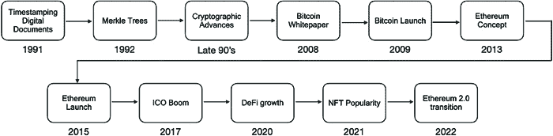

**图 1.1**：区块链技术的演变

一种用于在去中心化网络的多个位置、参与者或实体之间记录、共享和同步数据、交易或记录的数字系统。与通常由单一权威控制和维护的传统数据库不同，DLT 在没有中央管理员或中央数据存储的情况下运行。数据由网络参与者共同管理，每个节点（参与者）都维护账本的相同副本。这种共享控制和透明性是使 DLT 安全、弹性且可信赖的关键特征。

为了更好地理解 DLT，让我们详细探讨其关键特征：

在传统的中心化系统中，数据存储在中央数据库中，单一实体对管理和更新这些数据具有完全控制权。这种方法具有局限性，例如单点故障，如果中央权威遭到破坏，整个系统都可能变得脆弱。

相比之下，分布式账本技术依赖于参与者网络（通常称为节点），他们共同维护账本。每个节点都有账本的相同副本，任何更新必须通过称为`consensus`（共识）的过程获得大多数节点的同意。这种去中心化控制意味着没有单一的权威点，降低了系统故障的风险并增加了透明度。它也让任何参与者几乎不可能在没有他人共识的情况下操纵数据。

DLT 最重要的方面之一是网络中所有节点之间的数据同步。当发生新交易时，它会通过广播共享给网络中的所有节点（计算机）。每个节点更新其账本副本。这确保了每个参与者都拥有最新且一致的数据版本。

例如，在基于区块链的金融系统中，如果用户向另一个用户发送加密货币，该交易将被添加到账本并传播到整个网络。每个参与者在将交易添加到账本副本之前都会独立验证交易，确保交易是有效的。这种数据同步对于维护一致性以及防止双花费或其他形式的欺诈至关重要。

DLT 的设计考虑了安全性。与容易受到攻击或内部攻击的中心化数据库不同，DLT 使用数字签名和哈希等高级密码学技术来保护数据。交易经过数字签名，这意味着每个参与者必须使用私钥来授权交易。这种数字签名验证了每笔交易的真实性并防止了未经授权的更改。

此外，许可链 DLT 可以通过加密将可见性限制为授权参与者。然而，除非实施此类措施或 DLT 是私有的，否则公共 DLT 上的数据对所有人可见。即使黑客访问了网络，他们无法在不被其他参与者发现的情况下更改账本。账本的分布式特性使其具有极强的抗攻击能力，因为黑客需要破坏大多数节点才能进行未经授权的更改，这在实现上极其困难。

分布式账本技术（DLT）最重要的方面之一是网络如何就交易有效性达成一致。在传统系统中，由中心机构负责验证和批准交易。然而，在分布式账本中，这种责任通过一种被称为`共识机制`的过程由所有参与者共享。

存在不同类型的共识机制，每种都有其自身的优缺点：

* `权益证明 (PoS)`：权益证明是作为 PoW 的替代方案而开发的共识机制，旨在解决其能源效率低下的问题。在 PoS 中，挖矿的概念被验证取代，参与者被称为验证者。验证者不是使用计算能力来保护网络，而是质押（锁定）一定数量的加密货币作为保证金。PoS 比 PoW 更节能，并被较新的区块链网络采用，包括以太坊 2.0。

* `拜庭容错 (BFT)`：BFT 是一种确保网络即使在某些参与者采取恶意行为也能达成一致的共识机制。它通常用于需要较高安全性的私有或联盟链区块链网络。

这些共识机制对于维护分布式账本的准确性、一致性和信任性至关重要。通过要求在添加交易之前获得多个节点的同意，DLT 确保了没有单一参与者可以单方面操纵数据。

透明度是分布式账本技术的关键特征之一。在传统的中心化系统中，用户必须信任控制数据库的实体能够诚实且安全地管理他们的数据。然而，通过 DLT，你拥有交易和整个账本的副本，因此可以访问相同的信息，并且任何人都可以自己验证交易。

这种透明度培养了信任，因为消除了对中间人或中间机构来保证数据准确性的需求。例如，在供应链网络中，DLT 允许从制造商到供应商到客户的每个参与者看到产品的历史，包括它去过哪里、谁处理过它以及何时处理。这种透明度不仅减少了欺诈风险，还增加了参与者之间的问责制。

此外，共识机制确保所有参与者对交易的有效性达成一致，进一步增强了信任。因为没有单一实体对数据拥有控制，DLT 降低了操纵风险，使其成为信任和透明度至关重要的行业中具有吸引力的解决方案。

分布式账本技术（DLT）是区块链的基础概念，提供了一种在跨去中心化网络中安全记录、存储和共享数据的方法。通过消除对中心机构的需求并依靠密码安全和共识机制，DLT 确保了数据的完整性，增强了安全性并培养了参与者之间的信任。理解 DLT 对于理解区块链技术至关重要，因为区块链本质上是 DLT 的特殊形式，它结合了这些特征创建一个安全、透明且防篡的账本。


要完全理解区块链技术，掌握中心化概念及其与去中心化的对比至关重要。技术已经从中心化系统演变为分布式系统，最后变为完全去中心化的系统，每种系统都有其独特的特征和优势。让我们探索这些不同的系统是如何运作的，以及为什么去中心化在区块链中起着如此重要的作用。

在中心化系统中，所有数据和操作由单一的中心机构或实体管理。这是技术基础设施最传统的模型，由一个组织负责管理整个系统。中心化系统的一个例子是`Microsoft Word`。当你在计算机上使用`Microsoft Word`时，所有的文档都保存在你的本地设备上，你对它们拥有完全控制权。然而，如果你使用云服务来存储文档，例如`OneDrive`，那么微软（中心机构）就控制着你文档的存储、安全和访问。

中心化系统有几个优点，例如易于管理、高效和决策速度快。然而，它们也有显著的缺点。由于所有数据都存储在一个位置，中心化系统容易受到故障和网络攻击的影响。如果中心服务器故障，网络中唯一的数据源就会失效，整个系统可能会受到破坏，导致数据丢失或服务中断。此外，用户必须信任中心机构能够负责任地处理他们的数据，这可能会导致对隐私和信息滥用的担忧。

为了解决中心化系统的某些局限性，开发了分布式系统。在`分布式系统`中，数据和处理能力分布在多个节点或计算机上，它们作为`DLT`中的节点共同工作，以实现交易广播和存储等共同目标。与中心化系统不同，分布式系统不依赖单一控制点，因为控制分布在所有参与者或节点之间，使得它们对故障具有更强的韧性。

分布式系统的一个例子是`Facebook`。`Facebook`的数据中心遍布全球范围内多个地点，每个数据中心存储部分数据。当你登录`Facebook`时，系统会从不同的数据中心提取信息，为你提供无缝的体验。这种分布式模型确保了即使一个数据中心宕机，平台也可以使用来自其他位置的数据继续运行。

与中心化系统相比，分布式系统提供了更高的可靠性和容错能力。然而，它们仍然不是完全去中心化的，因为通常有一个中心机构（在这种情况下是`Facebook`）控制着整个网络。用户仍然需要信任`Facebook`妥善管理他们的数据，而且该公司有权对平台如何运行做出单方面的决。

去中心化系统通过完全消除对中心机构的需求，将分布式系统的概念更进一步。在去中心化系统中，控制权和决策权并不赋予单一中心实体或管理员。相反，这种权力分配在网络中的所有参与者之间，这意味着每个节点（参与者）都在系统的运行和治理中起着积极作用。每个参与者都有能力参与决策过程，例如验证交易、维护账本，甚至提议或投票决定协议更改。

去中心化系统的一个很好的例子是`Bitcoin network`。比特币运行在点对网络上，所有参与者在维护交易账本方面都拥有平等的角色。比特币并不依赖中心权威来验证交易，而是使用一种名为`Proof of Work`（`PoW`）的共识机制。在这个系统中，矿工（维护网络的参与者）竞争解决复杂的数学题，这些题目涉及寻找一个`nonce`，当该`nonce`与区块中的交易数据结合时，必须符合特定的标准。第一个解决问题的人被允许将下一个交易区块添加到区块链中。这一过程确保了所有参与者在不需要中心权威的情况下，对账本的状态达成共识。

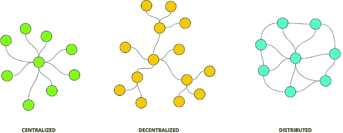

**图 1.2**: 网络的类型

去中心化是区块链技术最关键的方面之一。与中心化系统不同（单一实体或管理员对整个系统拥有控制权），去中心化系统将权力和决策权分配给所有参与者。这种方法带来了几个显著优势：

* **增强安全性**：在去中心化系统中，没有单点故障。这使得攻击者极难攻破系统。要更改区块链上的数据，攻击者需要控制网络的大多数节点，这将是极其困难且成本高昂的。

* **无信任环境**：去中心化允许参与者进行交互和进行交易，而无需信任中心权威或中间机构。相反，信任被建立在系统本身，由网络参与者通过共识机制的集体努力来维护。

* **抗审查性**：在中心化系统中，中心权威可以审查或阻止交易。然而，在去中心化的区块链中，没有任何单一实体有权控制或阻止交易被添加到账本。这使得区块链网络具有更强的抗审查和抗操控能力。

* **提高透明度**：去中心化系统提供了更高的透明度，因为所有交易都记录在区块链等公共账本上，并对所有参与者可见。这种透明有助于培养信任和问责，因为任何人都可以验证数据的完整性。

* **用户赋能**：去中心化通过赋予用户对自己的数据和资产的控制权来赋能用户。在传统系统中，用户必须依赖银行或社交媒体平台等第三方来管理其信息。在去中心化系统中，用户对自己的数据拥有直接控制权，并可以在没有中间的情况下决策。

区块链技术利用去中心化创建一个安全、透明且无信任的环境来记录和验证交易。通过消除对中心权威的需求，区块链为参与者提供了直接交互的方式，降低了欺诈风险并提高了效率。

# 区块链的组件

区块链由几个基本组件组成，这些组件共同工作创建一个记录交易的安全且透明的系统。理解这些组件是理解区块链技术如何运作的关键。为了更好地理解这些组件，我们建议使用 Anders Brownworth 的区块链演示，它为区块链的工作原理提供了极佳的可视化，包括区块是如何链接的、哈希函数是如何工作的，以及变化如何影响整个链。你可以在此处访问演示：`https://andersbrownworth.com/blockchain`。区块链的主要组件包括：

区块是区块链中的基本数据单元。每个区块包含交易列表，通常由三个部分组成：

* **数据**：正在记录的信息。

* **前一个哈希**：指向前一个区块加密哈希的引用。

* **当前哈希**：从区块数据生成的唯一哈希。

区块按顺序链接在一起，每个区块都指向前一个区块。这种结构确保了任何修改区块的尝试都需要更改所有后续区块，使得篡改变得非常困难。

节点是参与区块链网络的计算机。每个节点都拥有整个区块链的副本，并在验证和转发交易方面发挥作用。节点对于维护区块链的去中心化本质至关重要。节点有不同的类型，例如：

* **全节点（Full Nodes）**：这些节点存储区块链的完整副本并验证交易。全节点对于维护网络的完整性和安全性至关重要。

* **轻节点（Light Nodes）**：轻量节点仅存储区块链的一部分，并依靠存储整个区块链的全节点提供剩余信息。它们通常用于存储空间有限的设备。

交易是记录在区块链上的行为。它们代表参与者之间价值或信息的传输。例如，在比特币区块链中，交易代表了加密货币从一个用户到另一个用户的转移。每笔交易都由发送者数字签名，以确保其真实性并防止未经授权的更改。

交易被分组在区块中，并通过共识过程添加到区块链中。一旦交易被记录，它是不可变的，意味着无法被更改或删除。

共识机制是区块链网络节点用于约定哪些交易是有效的并确定它们添加到区块链顺序的协议。这一过程确保了所有节点维护一致且最新的账本版本。交易的有效性是指确认每笔交易都符合网络预定义的规则和标准。这包括验证数字签名、确保发送者有足够的资金以及检查交易是否已经在其他地方花费（防止双花费）。常见的共识机制包括由矿工维护并用于比特币的工作量证明（`PoW`），以及由验证者维护并用于以太坊的权益证明（`PoS`），我们在本章前面的部分讨论过。

加密哈希函数是用于从输入数据生成唯一的、固定长度字符串（哈希）的数学算法。在区块链中，哈希函数通过创建每个区块的数字指纹来保护数据。每个区块的哈希值用于将其与前一个区块链接，形成区块链。哈希函数确保了数据的完整性，因为输入数据的微小变化都会导致完全不同的哈希值。

账本是区块链上发生的所有交易的记录。它在网络中的所有节点之间共享，每个节点都拥有账本相同的副本。账本的分布式特性使得节点拥有相同的交易数据副本，确保了所有参与者都能访问相同的信息，提供了透明度并防止了欺诈。

智能合约是自动运行的数字合约，其协议的条款和规则直接编码到计算机代码中。智能合约存储并执行在区块链上，当满足预定义的条件时，会自动执行特定操作——无需律师或银行等中介。这意味着一旦设置了智能合约，它就可以独立运行，根据合同内约定的规则执行指令。智能合约用于自动化流程、减少对中介的需求，并增强双方之间的信任。它们是`Ethereum`等平台的关键特性，这些平台允许开发者创建由智能合约驱动并在区块链上运行去中心化应用（`DApps`）。

这些组件共同工作，创建了一个安全、透明且去中心化的交易记录系统。在下一节中，我们将探索不同类型的区块链，包括公共链、私有链和联盟链，以了解它们的独特特征和用场景。

区块链网络可以根据其结构、访问控制和用场景分为若干类型。了解这些不同类型对于为特定应用选择正确的区块链非常重要。区块链网络的主要类型有：

公共区块链是开放的、无需许可的网络，任何人都可以加入并参与。这些区块链是去中心化的，这意味着没有单一实体或管理员控制或拥有该网络。公共区块链使用工作量证明（`PoW`）或权益证明（`PoS`）等共识机制来验证交易，确保数据的完整性和透明度。公共区块链示例包括`Bitcoin`和`Ethereum`，这是两种最流行的区块链。

在公共区块链中，所有数据和交易都是公开的。这使得它们成为需要透明度和去信任性的理想场景，例如加密货币和去中心化应用（`DApps`）。然而，由于所有交易对公众可见，它们在可扩展性和隐私方面可能存在局限性。

私有区块链是受限的网络，参与限制限于特定的用户组。这些区块链通常由对网络和数据有更多控制权的组织使用。在私有区块链中，中央权威管理访问和权限，这允许更快的交易处理和改进的隐私保护。

私有区块链通常用于企业应用，例如供应链管理和内部数据共享。由于它们由中央实体控制，私有区块链可能缺乏公共区块链中看到的去中心化程度。

联盟链（也称为联邦区块链）是部分去中心化的网络，多个组织协作维护区块链。与公共区块链不同，联盟链的参与被限于一组受信任的实体，这些实体共同验证交易并维护网络。

联盟链在公共区块链的透明度和私有区块链的隐私性之间取得了平衡。它们通常用于银行和供应链等行业，在这些行业中，多个利益相关者需要安全地共享数据，例如金融和医疗。

混合区块链结合了公共和私有区块链的元素，提供了两者的优势。在混合区块链中，网络的某些部分对公众开放，而其他部分则限制为授权的参与者。这提供了更大的灵活性，因为组织可以选择哪些数据保持私密，哪些数据公开共享。

混合区块链对于需要透明度和隐私结合的应用非常有用。例如，公司可能使用混合区块链私密地存储敏感的客户信息，同时让交易记录公开可用。

这些不同类型的区块链网络提供了独特的特征和优势，使其适用于广泛的用场景。在下一节中，我们将提供一些最流行的区块链平台及其关键特性的概述。

自从`Bitcoin`发布以来，区块链技术已经显著增长，出现了几个区块链平台，每个平台都有其独特的特征和功能。以下章节提供了一些最流行的区块链平台的概述：

`Bitcoin`是第一个区块链平台，于 2009 年由一个名为 Satoshi Nakamoto 的匿名实体引入。它被设计为点对点的电子现金系统，允许用户在不需要中介的情况下转移价值。比特币区块链使用工作量证明（`PoW`）共识机制，确保了网络的安全和完整。

`Bitcoin`主要作为数字货币，其区块链针对安全和透明的价值传输进行了优化。然而，它在构建去中心化应用或智能合约方面的能力有限。

`Ethereum`是开发去中心化应用（`DApps`）和智能合约最流行的区块链平台之一。`Ethereum`由 Vitalik Buterin 于 2015 年发布，引入了可编程区块链的概念，允许开发者创建在区块链上运行的自执行合约和应用程序。

`Ethereum`使用权益证明（`PoS`）共识机制，这比比特币的`PoW`更节能。它支持各种代币标准，例如`ERC-20`（用于同质代币）和`ERC-721`（用于非同质代币或 NFT）。`Ethereum`的灵活性和开发者友好的工具（如`Remix IDE`、`Hardhat`和`OpenZeppelin`）使其成为创建`DApps`、`DeFi`协议和 NFT 的热门选择。

`Binance Smart Chain`（`BSC`）是由全球最大的加密货币交易所之一 Binance 开发的区块链平台。`BSC`兼容以太虚拟机（EVM），允许开发者以极少的修改将其基于以坊的应用迁移到`BSC`。`BSC`使用质押权威证明（`PoSA`）共识机制，该机制结合了权益证明和权威证明的元素以实现快速的交易处理。

由于比以坊更低的交易费用和更快的区块时间，`BSC`已成为`DeFi`项目和`DApps`吸引人的平台。

`Cardano`是一个关注可扩展性、可持续性和互操作性的区块链平台。它由以太坊创始人之一 Charles Hoskinson 创立。`Cardano`使用名为`Ouroboros`的权益证明（`PoS`）共识机制，旨在提供一种安全且节能的验证交易的方式。

`Cardano`的分层架构将结算层（用于价值转移）与计算层（用于运行智能合约）分离，这增强了其可扩展性和安全性。`Cardano`以其研究驱动的方法和对同行评审开发的承诺而闻名。

`Polkadot`是一个旨在实现不同区块链之间互操作性的区块链平台。它由以太坊的另一位创始人 Gavin Wood 创建。`Polkadot`使用了独特的架构，包括一条主中继链（relay chain）和多个平行链（parachains），平行链是并行运行并可以相互作用的独立区块链。这种交互允许平行链通过中继链直接交换数据和资产。

`Polkadot`的共识机制被称为`提名权益证明 (NPoS)`，它允许参与者提名维护网络安全的验证者。`Polkadot`的目标是通过实现平行链之间以及平行链与其他区块链之间的跨链通信和数据共享，创建一个更具互联性的区块链生态系统。

`Solana`是一个专注于可扩展性和速度的高性能区块链平台。它使用了一种名为`历史量证明 (PoH)`的独特共识机制，并结合`权益证明 (PoS)`，以实现快速交易处理和低延迟。`Solana`每秒可以处理数千次交易，使其成为最快的区块链平台之一。

`Solana`在`DeFi`应用、NFT 以及其他需要高吞吐量和低交易费用的场景中非常。它的可扩展性和性能使其成为寻求构建大型去中心化应用的开发者的非常有吸引力的选择。

在本章中，我们介绍了区块链技术，并探索了它的基础概念、历史和演变。我们讨论了各种类型的区块链网络以及构成区块链的关键组件。我们还对热门的区块链平台进行了概述，强调了它们的独特特征和用例。这些基础知识为理解智能合约和构建去中心化应用奠定了基础，我们将在下一章中进行探讨。

这些核心要点总结了区块链技术的基础概念和基本特征，包括其特性、演变、类型和主要平台。

* 区块链是一种去中心化的、安全的且透明的记录交易的方式。

* 区块链的关键特征包括去中心化、不可篡改性、透明性、安全性共识机制。

* 自 2008 年`Bitcoin`诞生以来，区块链技术已经经历了巨大的演变。

* 分布式账本技术（DLT）是区块链的基础概念，涉及去中心化控制、安全性和共识机制。

* 区块链网络有不同的类型：公有、私有、联盟和混合，每种都有独特的特征和用例。

* 热门的区块链平台包括`Bitcoin`、`Ethereum`、`Cardano`、`Polkadot`和`Solana`。

以下是深入理解区块链的重要术语和定义：

* `去中心化`：将控制和决策权移离中央权威。

* `不可篡改性`：区块链数据一旦记录便无法被更改的特性。

* `透明性`：让参与者可以看到数据。

* `共识机制`：节点用于对交易有效性达成共识的过程。

* `分布式账本技术 (DLT)`：一种在多个位置记录数据的系统。

* `智能合约`：运行在区块链上的自动执行代码，用于强制执行协议条款。

* `公有链`：任何人都可以加入的开放无许可区块链。

* `私有链`：访问受中央权威控制的限制性区块链网络。

* `联盟链`：由多个共同工作的管理的区块链。

* `混合链`：一种结合了公有和私有链特征的区块链类型，提供了灵活的结构，某些数据供授权参与者访问，而其他数据保持开放。

* `加密哈希函数`：从输入生成唯一固定大小输出的数学函数，用于确保数据完整性。

* `节点`：区块链网络中的设备或计算机，负责存储区块链的完整或部分副本并参与交易验证。

* **对称加密**：在对称加密中，数据的加密和解密使用相同的密钥。这种方法通常用于对静态数据或传输中的数据进行加密以确保机密性。然而，它通常不用于区块链网络，因为在参与者之间共享同一个密钥会带来安全风险。

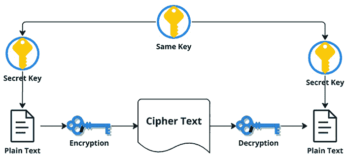

* **非对称加密**：非对称加密也称为公钥加密，使用一对密钥——公钥和私钥。公钥公开，而私钥保密。这种方法允许安全通信，因为用公钥加密的数据只能用相应的私钥解密。非对称加密广泛应用于区块链，用于管理数字签名并促进安全交易。

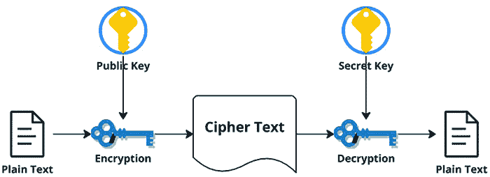

加密技术对于区块链技术的多个方面都至关重要，包括：

* **数据完整性**：加密哈希函数用于确保数据未被篡改。通过生成数据的唯一数字指纹（哈希），原始数据的任何细微变化都会产生完全不同的哈希值，从而易于检测篡改。

* **身份验证**：公钥加密用于验证网络参与者的身份。使用用户私钥创建的数字签名提供了一种证明所有权和验证交易的方法。

* **机密性**：加密确保私钥等敏感信息保持机密。这防止了未经授权的访问并保护了用户的资产。

哈希函数是区块链技术的根本组成部分。哈希函数是一种数学算法，它接受任何大小的输入并产生固定大小的输出，称为哈希或摘要。哈希是输入数据的唯一表示，输入中极微的变化也会产生完全不同的哈希。哈希函数在区块链中对于确保数据完整性、链接区块和提供安全性至关重要。

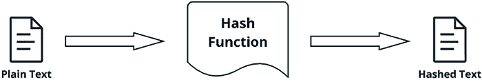

使用 SHA-256 算法进行哈希的示例：

* **输入单词**：Blockchain

* **哈希输出**：

```
625da44e4eaf58d61cf048d168aa6f5e492dea166d8bb54ec06c30de07db57e1
```

这里提到了哈希函数的各种属性：

* **确定性**：相同的输入始终会产生相同的哈希值。这一属性确保了验证数据完整性的一致性。

* **固定输出大小**：无论输入大小如何，哈希函数都会产生固定大小的输出。例如，`SHA-256`总是产生固定大小的输出。

* **抗碰撞性**：在计算上要找到产生相同哈希值的两个不同输入是不可行的。这一属性对于防止数据操纵至关重要。

* **抗原像性性**：给定一个哈希值，在计算上要确定原始输入是不可行的。这确保了哈希不会被轻易反向破解。


# 哈希函数与区块链安全

## 哈希函数的重要特性

- **雪崩效应**：输入中的微小变化会导致显著不同的哈希值。这一属性使得检测修改变得容易。
- **快速计算**：哈希函数的设计考虑了计算效率，允许快速生成哈希。
- **区块链接**：在区块链中，每个区块都包含上一个区块的哈希，从而形成链。如果任何区块被更改，该区块以及所有后续区块的哈希都会改变，使篡改在网络无处遁形。区块链中最常用的两个哈希函数是`SHA-256`和`Keccak-256`。`SHA-256`用于工作量证明（PoW）共识机制，而`Keccak-256`是以太坊的标准。

为了更好地理解哈希函数的工作及其在区块链中的作用，我们推荐使用 Anders Brownworth 的区块链演示，它提供了哈希生成以及如何链接区块的视觉表示。你可以访问`https://andersbrown.com/blockchain/`查看该演示。

# 公钥加密

公钥加密是一种使用一对密钥——公钥和私钥来保护数据并实现安全通信的加密系统。公钥加密也称为非对称加密，它在区块链技术中起着关键作用，提供了验证交易的方法、确保数据机密性并促进参与者之间的信任。

在区块链中，每个用户都有一对加密密钥：

- **公钥**：公钥是一个公开的地址，其他人可以使用它识别用户或向其发送数据。它是通过数学算法从私钥派生的。公钥公开共享，任何人可以使用它来验证用户的数字签名或加密发送给该用户的数据。
- **私钥**：私钥是用户保密的秘密密钥。它用于创建数字签名和解密数据。私钥必须保持安全，因为任何获取私钥的人都可以控制用户在区块链上的资产和交易。

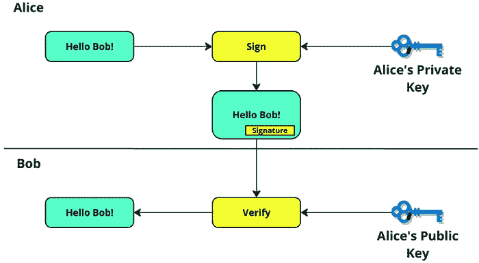

## 创建和验证数字签名的过程

创建和验证数字签名的过程涉及以下步骤：

1. **数据哈希**：对要签名的数据（例如交易）使用加密哈希函数（如`SHA-256`）进行哈希处理。哈希值代表了数据的唯一数字指纹。
2. **创建签名**：然后，使用用户的私钥对哈希值进行加密，以创建数字签名。该签名对于数据和用户的私钥来说都是唯一的。

# 椭圆曲线数字签名算法 (ECDSA)

在区块链网络中，数字签名通常使用椭圆曲线数字签名算法（ECDSA）实现。ECDSA 是数字签名算法（DSA）的变体，它使用椭圆曲线密码学以更短的密钥长度提供同级别的安全性。这使得 ECDSA 更高效，并适用于区块链应用，因为区块链的计算资源和存储通常是有限的。

## 公钥加密在区块链中的作用

- **安全交易**：公钥加密通过允许用户使用私钥对交易进行签名，确保了交易的安全。该签名作为交易已由所有者授权的证明。
- **机密性**：公钥加密还可以用于加密敏感信息（如私钥或交易详情），确保只有授权方可以访问这些数据。

# Merkle 树

Merkle 树是区块链技术中一种重要的数据结构，用于确保数据完整性并实现对大型数据集的高效验证。Merkle 树也称为哈希树，是一种二叉树结构，其中每个叶节点代表数据块的哈希，每个非叶子节点代表其子节点的哈希。这种层次结构允许以安全且去中心化的方式快速高效地验证数据。

在 Merkle 树中，过程始于对单个交易或数据片段进行哈希处理以形成叶节点。然后将这些哈希值配对并再次进行哈希，以形成树的下一层。此过程持续，直到在树的顶部产生单个哈希值，即 Merkle 根。Merkle 根代表区块中所有交易的组合哈希，并用作整个区块的唯一标识。

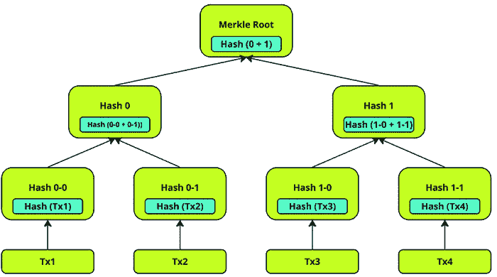

**图 2.5:** Merkle 树

## Merkle 树在区块链中的功能

我们将讨论 Merkle 树在区块链中的各种功能。

- **高效的数据验证**：Merkle 树在区块链中的主要目的之一是促进高效的数据验证。参与者无需验证区块中的每笔交易，而是可以使用 Merkle 根和一小部分哈希子集（称为 Merkle 证明）来验证特定交易是否包含在区块中。这显著减少了计算开销并使验证更高效。
- **数据完整性**：Merkle 树提供验证区块内数据完整性的方法。如果区块内即使只有一笔交易被更改，更改将向上传播（由于哈希的雪崩效应），最终导致产生不同的 Merkle 根。这允许网络中的节点检测到数据被篡改，因为区块头中的 Merkle 根将不再匹配。
- **可扩展性**：Merkle 树的使用通过减少需要处理和存储的数据量，提高了区块链的可扩展性。节点可以只存储 Merkle 根，而在无需下载整个区块的情况下验证交易，这对于轻量级或简单支付验证（SPV）客户端特别有用。
- **包含证明**：Merkle 树提供了包含证明的机制，允许在不泄露整个数据集的情况下证明某特定交易是区块的一部分。这对于在保护隐私的同时确保数据未被更改至关重要。

## Merkle 树在区块链中的应用

在比特币区块链中，Merkle 树用于组织和存储区块内的交易。每个区块的 Merkle 根存储在区块头中，矿工必须将 Merkle 根作为工作量证明的一部分。这确保了区块中的所有交易都是安全链接的，任何交易更改会导致区块失效。

在以太坊中，Merkle 树也用于存储交易，但以太坊通过使用更高级的数据结构 Merkle Patricia 字典扩展了这一概念。该结构不仅存储交易，还存储账户状态和收据，为区块链内部的数据管理提供了更全面的方法。

Merkle 树在区块链中的应用确保了数据安全、防篡改且易于验证。这对于维护去中心化网络的信任和可靠性至关重要。

# 加密货币钱包

加密货币钱包是允许用户存储、管理和与其数字资产交互的工具。与持有现金的传统钱包不同，加密货币钱包存储访问和管理区块链上加密货币所需的私钥和公钥。钱包对于安全管理数字资产至关重要，有多种类型，每种提供不同的安全便利性。

- **硬件钱包**：硬件钱包是离线存储私钥的物理设备，是管理加密货币最安全的方案之一。由于私钥存储在离线，硬件钱包免疫于网络攻击。流行的硬件钱包示例包括`Ledger`和`Trezor`。硬件钱包对于优先考虑安全并长期存储大量加密货币的用户来说是理想选择。
- **软件钱包**：软件钱包是可以安装在计算机或移动设备上的应用程序。它们将私钥本地存储在设备上，并提供了一个易于使用的界面来管理加密货币。软件钱包分为`桌面钱包`（例如`Exodus`、`Electrum`和`MetaMask`）和`移动钱包`（例如`Trust Wallet`和`MetaMask`）。虽然软件钱包提供了便利，但与硬件钱包相比，它们更容易受到攻击和恶意软件的攻击。
- **纸钱包**：纸钱包是一种包含用户私钥和公钥的物理文档，通常以 QR 代码的形式表示。纸钱包是离线生成的，可以用于安全地存储加密货币。由于它们完全离线，因此纸钱包对网络攻击免疫，但必须小心处理以防止物理丢失或损坏。纸钱包适用于想要以简单且具有成本效益的方式离线存储数字资产的用户。
- **移动钱包**：移动钱包是专为移动设备设计的软件钱包类型。它们为在移动中管理加密货币提供了方便的方法，通常用于日常交易。流行的移动钱包示例包括`Trust Wallet`和`Coinomi`。虽然移动钱包很方便，但用户必须采取措施保护设备安全，例如启用双重身份验证（`2FA`）并使用强密码。

# 设置和保护钱包

## 设置钱包

设置钱包的过程取决于您选择的钱包类型。以下是设置不同类型钱包步骤的通用概述：

- **软件钱包**：要设置软件钱包，请从可靠源下载钱包应用程序（例如`Trust Wallet`或`MetaMask`）。安装后，钱包将提示您创建一个新钱包并生成恢复助记词。确保写下恢复助记词并将其存储在安全的地方，因为这是在丢失对设备的访问权限时恢复钱包的唯一方法。
- **纸钱包**：要创建纸钱包，请使用离线钱包生成器。

## 保护钱包的最佳实践

保护钱包对于防止未经授权的访问至关重要。以下是一些最佳实践：

- **备份恢复助记词**：写下恢复助记词并存储在安全的地方。
- **使用强密码**：使用难以猜测的复杂密码。
- **启用双重身份验证（2FA）**：启用`2FA`以增加额外的安全性。
- **保持钱包软件更新**：保持钱包软件更新以修复安全漏洞。
- **使用冷存储**：如果您计划持有大量加密货币，请考虑使用硬件或纸钱包。

# 管理私钥和公钥

管理私钥和公钥是与区块链交互的关键方面。在区块链中，私钥和公钥共同工作以实现安全交易。

`私钥`是一个用于签署交易和证明数字资产所有权的密钥。保持您的私钥安全至关重要，因为任何访问该密钥的人都可以控制您的资金。

- **离线存储**：将您的私钥离线存储以降低被攻击或被窃的风险。
- **备份您的私钥**：创建您的私钥的多个备份并将其存储在安全的地方。
- **避免共享**：永远不要与任何人共享您的私钥。

`公钥`由私钥衍生，用作接收资金的地址。公钥可以公开共享而不会损害您的资产安全。

## 私钥和公钥的协同工作

私钥和公钥结合使用以促进区块链上的安全交易：

- **签署交易**：当用户想要发送加密货币时，他们使用自己的私钥对交易进行签名。该签名作为交易已由资产所有者授权的证明。
- **验证**：接收者或网络节点可以使用发送者的公钥来验证数字签名，并确保交易是有效的。这一过程确保了交易未被篡改，并且确实是由所有者授权的。

## 安全管理建议

遵循上述最佳实践，以保护您的网络并防止未经授权的访问：

- **使用硬件钱包**：硬件钱包通过将私钥离线提供了一种安全的管理方式。这降低了黑客攻击和未经授权访问的风险。
- **启用多签名**：多签名钱包需要多个私钥来授权交易。这增加了一层安全保障，因为交易在执行之前必须经过多个方的批准。
- **定期更新安全措施**：保持您的钱包软件及任何相关安全措施的更新，以防止新的漏洞和威胁。

通过有效管理您的私钥和公钥，您可以确保数字资产的安全，并与区块链网络安全地交互。

# 加密货币交易所

加密货币交易所是允许用户购买、出售和交易加密货币的平台。交易所在此加密货币市场提供流动性、并使用户将其数字资产转换为其他加密货币或法币方面发挥着至关重要的作用。加密货币交易所主要有两种类型：中心化交易所（`CEXs`）和去中心化交易所（`DEXs`）。每种类型都有独特的特征、优缺点。

## 中心化交易所（CEXs）

中心化交易所由公司或组织运营，作为买卖双方之间的中间人。用户在交易所创建账户、存款资金并使用平台服务交易加密货币。热门的中心化交易所示例包括`Binance`、`Coinbase`和`Kraken`。

- **用户界面**：中心化交易所通常提供友好的界面，让初学者轻松买卖加密货币。
- **高流动性**：`CEXs`通常拥有大量用户和高交易量，这意味着用户有足够的流动性快速执行交易。
- **客户支持**：中心化交易所提供客户支持，帮助用户解决可能遇到的任何问题，例如账户恢复或交易问题。
- **托管性质**：在中心化交易所上，用户对自己的私钥没有控制权。交易所托管用户的资金，这意味着用户必须信任交易所来确保其资产安全。
- **安全风险**：由于持有资产数量巨大，中心化交易所是黑客极具吸引力的目标。几起知名的交易所被黑客攻击导致了用户的巨大损失。
- **监管与 KYC**：大多数中心化交易所受政府监管，并要求用户完成`了解您的客户（KYC）`验证，这可能会限制用户隐私。

## 去中心化交易所（DEXs）

去中心化交易所是点对点的平台，允许用户直接交易加密货币而无需中间人。`DEXs`在区块链网络上运行，使用智能合约促进交易。热门的去中心化交易所示例包括`Uniswap`、`SushiSwap`和`PancakeSwap`。

- **非托管**：`DEXs`不持有用户的资金或私钥，这意味着用户在整个交易过程中保留对其资产的所有控制。
- **隐私**：`DEXs`不需要用户完成`KYC`验证，提供了更大的隐私性和匿名性。
- **安全**：由于`DEXs`不中心化地存储用户资金，与中心化交易所相比，它们更容易受到大规模攻击。
- **流动性较低**：与`CEXs`相比，`DEXs`的交易量可能较低，这可能导致交易期间流动性差和滑点。
- **复杂性**：`DEXs`的用户界面可能更加复杂，连接钱包和执行交易对初学者来说可能具有挑战性。
- **法币支持有限**：去中心化交易所通常不支持法币，这意味着用户必须拥有加密货币才能开始交易。

## 选择交易所

选择中心化还是去中心化交易所取决于用户的偏好和需求。中心化交易所通常更方便且对初学者友好，而去中心化交易所提供了更高的安全性、隐私性和对资金的控制权。优先考虑易用性和客户支持的用户可能更倾向于`CEXs`，而重视隐私和自托管的用户可能会选择`DEXs`。

一些交易所正尝试结合中心化和去中心化交易所的优点。这些`混合交易所`旨在提供`CEXs`用户友好体验和流动性的同时，保持`DEXs`的安全和隐私特性。虽然仍然较新，但混合交易所可以为寻求两全其美的用户提供一种平衡的解决方案。

# 交易、购买和出售加密货币

交易、购买和出售加密货币是任何想要参与数字资产领域的人的基本活动。无论你是初学者还是经验丰富的交易者，理解不同的交易方法和策略对于成功参与至关重要。在本节中，我们将探索不同的订单类型、交易策略以及交易加密货币时的风险管理建议。

## 购买和出售加密货币的方法

购买和出售加密货币的过程可以在中心化和去中心化交易所进行。用户可以在中心化交易所使用法币（例如`USD`、`EUR`）购买加密货币，或在去中心化平台上将一种加密货币交换为另一种。以下是一些常见的购买和出售加密货币的方法：

- **市价单（Market Order）**：`市价单`用于以当前市场价格买卖加密货币。这是执行交易最简单、快速的方法，因为它确保了订单立即成交。
- **限价单（Limit Order）**：`限价单`允许用户指定他们购买或出售加密货币的价格。只有当市场达到指定价格时，订单才会执行，让用户对交易有更多控制。
- **止损单（Stop-Loss Order）**：`止损单`用于在加密货币价格跌至预设水平时自动卖出，以限制潜在损失。这种订单对于风险管理和保护投资非常有用。

## 交易策略

交易者可以使用各种交易策略来利用加密货币的价格波动获利。一些最常见的交易策略包括：

- **日内交易（Day Trading）**：日内交易是在单日内买卖加密货币，以利用短期价格波动。日内交易者通常使用技术分析法来识别交易机会，并在白天执行多次交易。
- **HODLing（长期持有）**：HODLing 是一种长期策略，投资者无论短期价格波动如何，都会购买并长期持有加密货币。这种策略基于加密货币价值随时间推移而显著增加的信念。
- **剥头皮交易（Scalping）**：剥头皮交易是一种短期交易策略，通过频繁交易获取小额利润。剥头皮者旨在利用微小的价格变化，并在短时间内执行多次交易。

## 风险管理

加密货币市场以高波动性著称，这带来了机遇与风险。风险管理对于成功交易至关重要。以下是交易加密货币时管理风险的一些建议：

- **多元化投资组合**：避免将所有资金投入单一加密货币中。将投资分散到多种资产中可以帮助降低风险并防止重大损失。
- **使用止损订单**：设置止损订单可以在价格跌至特定水平时自动卖出加密货币，从而帮助减少损失。这在高波动的市场中尤为重要。
- **仅投入你能承受损失的资金**：加密货币市场不可预测，价格变化迅速。重要的是只投入不会影响你财务稳定的可承受损失资金。

# 技术分析与基本面分析

- **技术分析**：技术分析涉及研究价格图、交易量和其他市场指标以预测未来的价格走势。技术交易者使用`moving averages`、`relative strength index (RSI)`和`Bollinger Bands`等工具来识别趋势以及潜在的入场和退出点。
- **基本面分析**：基本面分析侧重于通过分析项目技术、团队、用途和市场潜力等因素来评估加密货币的内在价值。基本面分析帮助交易者判断加密货币是被低估还是高估。

通过理解购买、出售和交易加密货币的不同方法，以及各种交易策略和风险管理技术，你可以做出明智的决策并有效地应对加密货币市场。

# 数字资产安全最佳实践

在与加密货币和区块链网络交互时，确保数字资产的安全至关重要。加密货币领域是黑客和恶意攻击者的目标，因此采取稳健的安全实践是必须的。在本节中，我们将讨论保护你的数字资产的关键安全考虑和最佳实践。

- **使用硬件钱包长期存储**：硬件钱包（称为冷钱包）为存储私钥提供最高级别的安全性。由于这些钱包是离线状态，因此不会受到在线攻击的影响。
- **备份你的钱包**：始终在安全的离线位置备份你的恢复助记词。如果你丢失了助记词，可能会失去对资金的访问。
- **在交易所启用 2FA**：在使用中心化交易所时，启用双重身份验证（2FA）以增加额外的安全性。
- **使用身份验证器 App**：避免使用基于短信的 2FA，因为它容易受到 SIM 卡攻击。相反，使用`Google Authenticator`或`Authy`等身份验证器 App 生成代码。
- **警惕钓鱼攻击**：攻击者可能会创建伪造网站或发送看似来自合法交易所的电子邮件，欺骗你透露凭据。始终验证你访问的任何网站的 URL。
- **检查 HTTPS**：访问交易所网站时，确保 URL 以`https`开头，且地址栏中有锁图标。这确保了你的连接是安全的。
- **保持设备安全**：确保你用于访问钱包或交易所的设备是安全的。使用杀毒软件，保持操作系统和应用程序更新到最新版本，并避免下载可疑的文件或程序。
- **使用专用设备**：考虑使用专门用于加密活动的独立设备。这可以减少恶意软件或其他漏洞影响加密操作的风险。
- **不要在公共 Wi-Fi 上访问钱包或交易所**：公共 Wi-Fi 网络通常不安全，是黑客的主要目标。避免在公共 Wi-Fi 上访问你的加密货币钱包或进行交易。如果你必须使用公共 Wi-Fi，请考虑使用`Virtual Private Network (VPN)`来加密连接。
- **多签名增加安全性**：多签名（multi-sig）钱包需要多个私钥来授权交易。这增加了额外的安全性，因为交易在执行前必须经过多个批准。多签名钱包对于公司或共同账户特别有用。
- **仅使用信誉良好的交易所和钱包提供商**：在选择交易所或钱包提供商时，选择具有良好安全记录的平台。在信赖它们之前，研究平台的安全措施和用户评价。
- **减少交易所中的资金量**：中心化交易所是黑客的常见目标。为了降低风险，避免在交易所存放大量加密货币。相反，将你的资产转移到你控制的安全钱包中。
- **保持关注**：加密货币领域不断演变，可能会出现新的安全威胁。关注最新的安全实践并相应更新你的安全措施。
- **定期审计安全性**：定期检查你的安全措施，如密码、2FA 设置和备份存储。进行必要的更新以确保你的资产得到保护。


通过遵循这些安全考虑和最佳实践，你可以显著降低数字资产被黑客或其他恶意攻击者窃取的风险。请务必将安全放在优先，并采取主动措施保护你的加密货币。在下一章中，我们将探索`smart contracts`，包括其工作原理、应用场景以及相关的安全风险。

在本章中，我们探讨了密码学、钱包和加密货币交易所的基础知识，强调了它们在保护区块链网络和管理数字资产方面重要性。我们讨论了不同类型的钱包、保护它们的最佳实践，以及`private and public keys`在区块链网络交互中的作用。此外，我们还涵盖了中心化交易所与去中心化交易所的区别、交易策略以及安全考虑，以帮助读者安全地进入加密货币的世界。

在下一章中，我们将深入研究共识机制，例如`Proof of Work`和`Proof of Stake`、`Blockchain trilemma`以及它们对环境的影响。

这些核心要点总结了密码学以及它与区块链、加密货币钱包、交易所和安全最佳实践之间的关系。

* 密码学是区块链技术的基石，确保了数据的完整性、隐私性和安全性。
* 哈希函数（如`SHA-256`和`Keccak-256`）用于生成数据的唯一数字指纹。
* 公钥加密实现了安全交易和数字签名，而`Merkle trees`则用于区块链中的数据完整性。
* 不同类型的钱包（包括硬件、软件、纸质和移动钱包）为管理数字资产提供了不同级别的安全性。
* 适当的钱包设置（包括使用强密码和启用`two-factor authentication`）对于保护你的资产至关重要。
* 加密货币交易所可以是中心化的（`CEX`）或去中心化的（`DEX`），各有优缺点。
* 安全最佳实践（如使用硬件钱包、启用`2FA`以及避免公共 Wi-Fi）对于保持数字资产安全非常重要。

以下是重要的术语和定义，旨在加深你对密码学、钱包和交易所的理解：

* `Cryptography`：使用数学算法保护信息以防止数据免受未经授权访问的实践。
* `Hash Function`（哈希函数）：一种将输入转换为固定长度字符字符串的数学函数，用于确保数据完整性。
* `SHA-256`：比特币中加密哈希函数，用于为数据创建唯一标识符。
* `Public Key`（公钥）：公开共享并用于接收资金或验证数字签名的加密密钥。
* `Private Key`（私钥）：用于签名交易和证明数字资产所有权的秘密密钥。
* `Digital Signature`（数字签名）：用于证明消息或交易真实性的加密技术。
* `Merkle Tree`（Merkle 树）：区块链中一种数据结构，通过将交易组织成哈希树来确保数据的完整性。
* `Wallet`（钱包）：用于存储和管理私钥及公钥的工具，允许用户与区块链网络交互。
* `Hardware Wallet`（硬件钱包）：用于离线安全私钥的物理设备。
* `Centralized Exchange (CEX)`（中心化交易所）：由中央机构运营的加密货币交易所。
* `Decentralized Exchange (DEX)`（去中心化交易所）：在没有中介的情况下运行的加密货币交易所。
* `Two-Factor Authentication (2FA)`（双重认证）：一种需要验证的额外安全层。
* `Cold Storage`（冷存储）：离线存储加密货币的方法。
* `Multi-Signature (Multi-Sig)`（多重签名）：需要多个密钥才能授权交易的安全功能。

# 第 3 章

# 共识机制与区块链三难境

共识机制是区块链运行的核心，确保所有参与者对网络状态达成一致。在本章中，我们将探索区块链中使用的不同类型共识机制，例如`Proof of Work`、`Proof of Stake`和`Proof of Authority`。我们还将讨论`blockchain trilemma`，它突显了平衡扩展性、安全去中心化所面临的挑战。

本章结构如下：

* `Proof of Work (PoW)`
* `Proof of Stake (PoS)` 及委托
* `Proof of Authority (PoA)`
* 理解`Blockchain trilemma`
* 扩展性、安全性与去中心化之间的权衡
* 新兴共识机制
* 环境影响与能源消耗

共识机制是区块链网络中一种过程，用于在分布式节点之间就交易有效性达成一致。在传统系统中，银行或政府实体等中心化机构负责维护交易账本。然而，在区块链等去中心化系统中，没有单一的权威。相反，共识机制确保网络中的所有节点对区块链的当前状态达成一致，并确保所有交易以安全且去信任的方式验证并添加到账本。

共识机制的主要目标是：

* 确保一致：共识机制允许网络中的所有参与者对交易有效性和账本当前状态达成一致。这对于维护区块链的完整性和防止双重花费等问题至关重要。
* 去中心化：共识机制消除了对中央权威的需求，使区块链网络能够去中心化。这确保了没有任何实体可以控制网络，使其对攻击和审查具有更强的韧性。
* 维护安全性：共识机制在保护区块链免受攻击方面起着至关重要的作用。通过要求参与者投入资源（例如计算能力或质押）来验证交易，共识机制使得恶意攻击者破坏网络的成本高昂且困难。
* 激励参与：共识机制通常包含对参与者诚实行为和为网络贡献的激励措施。例如，`Proof of Work (PoW)`系统中的矿工因成功验证交易并向区块链添加新区块而获得加密货币奖励。

通过在所有参与者之间达成共识，区块链网络可以去中心化、安全且透明地运行，而不依赖中介。

PoW 是区块链网络中使用最早且最为人知的共识机制之一。它最早由比特币引入，依赖计算能力来达成共识并维护网络安全。在 PoW 中，被称为`miners`的参与者竞争解决复杂的数学谜题，以验证交易并向区块链添加新区块。第一个解决谜题的矿工将获得比特币等加密货币作为奖励。

为了更好地理解 PoW 的工作原理，请想象一个房间里有一群人正在竞争解决一个谜题。每个人都在尝试寻找答案，但只有第一个解题的人才能获得奖励。这与 PoW 网络中矿工的工作方式相似——每位矿工都在竞争解决一个密码学谜题，第一个解题的人将可以将下一个区块添加到区块链中并获得奖励。

解决这些谜题的过程需要大量的计算能力和能量，这使得恶意者攻击网络的成本变得非常高。如果矿工提交了错误的解决方案或尝试添加无效交易，他们将无法获得奖励并浪费资源，从而遏制了不诚实的行为。

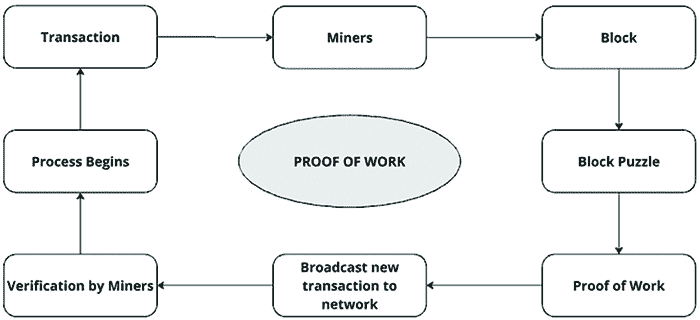

**图 3.1:** 工作量证明

### PoW 的主要特征包括：

* **高能耗**：PoW 需要大量的计算能力，这转化为高能耗。这通常被认为是 PoW 的一个缺点，因为它对环境可能产生重大影响。
* **安全性**：高昂的挖矿成本使得恶意者难以控制网络。要成功攻击 PoW 网络，攻击者需要控制总算力的 50% 以上，这在成本上是极其昂贵且不实际的。
* **去中心化**：PoW 通过允许任何足够计算能力的人参与挖矿过程来促进去中心化。然而，在实践中，由于需要专用硬件以及算力在大型矿池中的集中，挖矿已变得更加中心化。

工作量证明对于保护比特币等早期区块链网络起了至关重要的作用，但其高能耗和扩展性局限性导致了替代共识机制的发展。在下一节中，我们将探索`权益证明 (PoS)` 和`委托权益证明 (DPoS)`，这些机制解决了一些与 PoW 关联的挑战。

权益证明 (PoS) 是一种作为 PoW 的高能替代方案而开发的共识机制。在 PoS 中，验证交易和向区块链添加新区块的过程基于参与者持有的加密货币数量以及他们愿意作为质押`stake`的金额。验证者不再竞争解决复杂的谜题，而是根据他们质押的加密货币数量被选中创建新区块。这种方法显著减少了共识所需的能量消耗，使其成为更环保的解决方案。

为了更好地理解 PoS 的工作原理，请想象一个房间里有一群人想要决定由谁向共享账本添加一个新条目。与其竞争解决谜题，不如每个人都拿出自己的一部分钱作为保证，确保他们将诚实行动。他们付出的钱越多，被选中添加新条目的机会就越大。如果他们行为不诚实，他们将面临失去质押资金的风险。这激励了参与者为了网络的利益而行动。

委托权益证明 (DPoS) 是 PoS 的一种变体，引入了投票和委托机制。在 DPoS 中，网络中的参与者投票出一小小组验证者（也称为代表人），他们负责验证交易和创建新区块。每个参与者的投票权与其持有的加密货币数量成正比。这种方法允许更快的区块创建和更大的扩展性，因为验证者的数量是有限的，减少了在大量参与者之间达成共识的开销。

为了说明 DPoS 的工作原理，请想象一个城镇的公民投票选出一组代表来维护社区账本。每个公民的投票权基于他们在镇银行存款的金额。由公民选出的代表负责验证交易和更新账本。如果代表人行为不诚实或效率低下，公民可以撤回他们的选票并选举其他人。这种委托系统在确保问责制的同时，也使账本能够快速更新，因为只有一小部分受信任的代表参与了这一过程。

### 权益证明和委托权益证明的主要特征包括：

* **高能效**：PoS 和 DPoS 不需要大量的计算能力，与 PoW 相比，它们显著提高了能源效率。这种能量消耗的减少是 PoS 和 DPoS 的主要优势之一。
* **激励与惩罚**：在 PoS 中，验证者通过通过验证交易获得奖励来激励诚实行为。然而，如果验证者行为不诚实，他们将面临失去质押加密货币的风险。这种机制被称为`slashing`，有助于维护网络的完整性。
* **扩展性**：DPoS 设计旨在通过减少参与共识过程的验证者数量来提高扩展性。通过允许参与者投票出一小组代表，DPoS 可以实现更快的区块时间和更高的交易吞吐量。

权益证明和委托权益证明已作为新型区块链网络的共识机制而受到关注，例如以太坊（转向以太坊 2.0 后）和 EOS。这些机制解决了一些与 PoW 相关的能耗和扩展性挑战，使其更适用于现代区块链应用。

工作量证明 (PoW) 和权益证明 (PoS) 共识机制的对比如下：

| :--- | :--- | :--- |
| 共识方法 | 使用计算能力进行挖矿 | 根据加密货币质押选择验证者 |
| 能量消耗 | 挖矿导致高能耗 | 低能耗 |
| 安全性 | 由计算难度保护（抗 51% 攻击） | 由质押资产保护（不诚实行为的惩罚机制） |
| 激励 | 矿工获得区块奖励和交易费用 | 验证者根据质押和交易费用获得奖励 |
| 去中心化 | 初始去中心化，但矿池可能导致中心化 | 大额质押可能导致财富集中 |
| 扩展性 | 受高计算需求限制扩展性有限 | 通过高效验证提高扩展性 |
| 环境影响 | 由于高用电量，影响显著 | 由于低计算要求，影响微其微 |
| 示例 | 比特币、莱特币 | 以太坊（合并后）、卡尔达 |

## 表 3.1：工作量证明与权益证明的比较

## 权威证明 (PoA)

`Proof of Authority (PoA)` 是一种依赖于验证者身份和声誉，而非计算能力或质押的共识机制。在 `PoA` 中，由少数几个受信任的节点（被称为“权威节点”）负责验证交易并创建新区块。这些权威节点通常经过预先批准，并且必须符合特定标准，例如拥有良好的良好记录或是社区内为人知的实体。验证者的信誉是网络安全的保障。

为了更好地理解 `PoA` 的工作原理，请想象社区中有一群受信任的个人，他们负责维护一个共享账本。这些人拥有良好的声誉，并被社区信任他们会诚实办事。由于他们的身份是已知的，他们必须对自己的行为负责，任何不诚实的行为都会损害他们的声誉，这构成了他们采取符合网络最大利益行动的强大动力。

权威证明的关键特性包括：

* **高吞吐量**：由于验证者数量有限，`PoA` 能够实现高交易吞吐量。由于共识过程中仅涉及少数几个受信任的权威节点，区块创建更快、更高效。
* **中心化**：与 `PoW` 和 `PoS` 相比，`PoA` 更加中心化，因为它依赖小组受信任的验证者。这种中心化可以被视为缺点，因为它降低了去中心化程度，并使网络更容易受到验证者合谋的影响。
* **可追责性**：在 `PoA` 中，验证者是已知且可识别的，这确保了追责性。如果验证者行为异常，他们面临损害声誉的风险，这对恶意行为具有威慑作用。
* **用例**：`PoA` 通常用于私有或许可链区块链网络，这些网络中的参与者是已知的且建立了信任。它适用于需要高吞吐量且不需要公共区块链那样程度去中心化的应用。使用 `PoA` 的区块链网络包括 `VeChain` 和 `Microsoft Azure 的区块链解决方案`。

权威证明在性能和安全性之间提供了平衡，使其适用于验证者之间可以建立信任的特定用例。然而，其中心化的本质使其对于优先考虑去中心化和去信任化的应用来说并不理想。

# 理解区块链三困难

`blockchain trilemma` 是以太坊创始人 `Vitalik Buterin` 引入的一个概念，用于描述在区块链网络中实现三个关键属性——`scalability`、`security` 和 `decentralization` 的内在挑战。根据这一困境，区块链系统很难在不做出权衡的情况下同时实现所有三个属性。

* **可扩展性 (Scalability)**：可扩展性是指区块链网络高效处理大量交易的能力。随着更多用户加入网络，系统应该能够扩展以适应增加的负载，而不损害性能。可扩展性对于实现区块链技术的大规模采用至关重要，特别是对于支付、供应链管理和去中心化金融 (DeFi) 等应用。
* **安全性 (Security)**：安全性是任何区块链网络的关键方面。安全性确保网络能够抵抗恶意行为，例如 `51% 攻击` 和双重花费。增强安全措施（例如要求共识需要更多的计算能力）可能会降低网络的扩展能力。
* **去中心化 (Decentralization)**：去中心化是指控制权跨网络的分布。去中心化的区块链确保没有单一实体拥有控制权，这是区块链技术的核心原则。然而，维护高去中心化可能会限制可扩展性。


## 图 3.2：三困难

区块链三困难指出，同时优化所有三个属性面临挑战。在实践中，区块链网络必须做出权衡：

* **比特币 (Bitcoin)**：`Bitcoin` 优先考虑 `security` 和 `decentralization`，以牺牲 `scalability` 为代价。`Bitcoin` 使用的 `工作量证明 (PoW)` 共识机制导致交易缓慢且吞吐量低。
* **以太坊 (Ethereum)**：`Ethereum` 也面临类似的可扩展性挑战。转向 `权益证明 (PoS)` 和实施 `Layer 2 扩展解决方案` 旨在在维护安全性和去中心化的同时提高可扩展性。
* **可扩展解决方案**：一些较新的网络，如 `Solana` 和 `Binance Smart Chain (BSC)`，通过使用更具中心化的共识机制来优先考虑 `scalability`。这种方法允许更快的交易处理和更高的吞吐量，但可能以降低去中心化为代价。

区块链三困难是区块链开发者和研究人员面临的持续挑战，他们不断寻求创新解决方案，以在可扩展性、安全去中心化之间实现最佳平衡。一些新兴解决方案包括 `sharding`、`Layer 2 扩展（例如 rollups）` 和混合共识机制。

## 可扩展性、安全性与去中心化之间的权衡

区块链三困难凸显了区块链网络中 `scalability`、`security` 和 `decentralization` 之间内在的权衡。在这三个属性之间取得最佳平衡是一项复杂的挑战，需要仔细考虑区块链网络的特定需求及其用例。

* **可扩展性 vs 安全性**：在区块链网络中，可扩展性和安全性往往是相互对立的。实现高可扩展性通常涉及快速处理大量交易，这可能需要牺牲某些安全特性。例如，缩短区块时间或增加区块大小可以提高可扩展性，但可能会使网络更容易受到攻击。
* **可扩展性 vs 去中心化**：为了实现高可扩展性，某些区块链网络选择降低去中心化程度。例如，如 `Binance Smart Chain (BSC)` 等网络使用较少的验证者来加速交易处理，但这是以降低去中心化为代价的。验证者少意味着网络的决策权集中在少数人手中，这增加了合谋风险并降低了网络的整体去信任性。

### 安全性去中心化

安全性与去中心化在区块链网络中紧密相连。去中心化网络通常更安全，因为它没有单点故障，且网络的分布式特性使得攻击者难以获得控制。然而，增加去中心化可能会导致实现共识的复杂性增加，这可能会影响网络的整体安全性。例如，诸如`Proof of Stake (PoS)`等共识机制可能会引入与验证者合谋或质押权力集中相关的挑战，而这些问题会同时影响安全性和去中心化。

### 权衡示例

* **比特币 (Bitcoin)**：比特币优先考虑安全性和去中心化，这导致了扩展性挑战。网络的`Proof of Work (PoW)`共识机制确保了高水平的安全性，但较慢的区块生成时间和有限的交易吞吐量使其在大规模采用中的扩展性较低。
* **Solana**：Solana 通过使用一种名为`Proof of History (PoH)`的高性能共识机制并结合`Proof of Stake (PoS)`，来优先考虑扩展性。这允许网络每秒处理数千次交易，但它依赖于数量较少的验证者，这引发了对去中心化降低的担忧。
* **以太坊 2.0 (Ethereum 2.0)**：通过转向`Proof of Stake (PoS)`以及实施`sharding`和 Layer 2 扩展解决方案，以太坊旨在扩展性、安全性与去中心化之间取得更好的平衡。通过将网络分成多个分片并使用 Layer 2 解决方案，以太坊可以在维护去中心化和安全性的同时增加交易吞吐量。

扩展性、安全性与中心化之间的权衡是区块链开发者考虑的重要因素，因为不同的用例可能需要不同的优先事项。例如，用于金融交易的区块链可能优先考虑安全性，而用于供应链管理的区块链可能优先考虑扩展性。理解这些权衡对于对区块链网络的设计和架构做出明智决策至关重要。

## 新兴共识机制


随着区块链技术的不断发展，人们正在开发新的共识机制以解决现有系统的局限性，并克服区块链三角难题带来的挑战。这些新兴的共识机制旨在扩展性、安全性与中心化之间提供最佳平衡。我们将探索一些最有前景的新兴共识机制：

* **历史证明 (Proof of History, PoH)**：这是由`Solana`引入的一种共识机制，为交易添加了一层时间戳。PoH 有助于建立区块链中事件的顺序和时间，从而实现更快的交易验证。通过在区块链中添加加密时钟，PoH 在保持安全的同时显著提高了网络的可扩展性。这种机制允许`Solana`实现高吞吐量并每秒处理数千次交易。

* **混合共识机制 (Hybrid Consensus Mechanisms)**：某些区块链网络正在尝试混合共识机制，通过结合不同方法的元素来实现扩展性、安全性与去中心化之间的最佳平衡。例如，`Elrond`结合了`Secure Proof of Stake (SPoS)`和`Adaptive State Sharding`来增强扩展性和安全性。混合共识机制为满足不同用例的特定需求提供了灵活性。

* **拜占庭容错 (BFT) 变体**：`Practical Byzantine Fault Tolerance (PBFT)`和其他 BFT 变体正被区块链网络采用以提高共识效率。BFT 机制设计用于处理故障节点或恶意行为。`Tendermint`是使用`PBFT`的机制示例，对于许可链区块链特别有用。

* **有向无环图 (DAGs)**：DAG 代表了传统区块的替代方案。DAG 网络不是在顺序区块中组织交易，而是使用图结构来实现并行处理。`IOTA`和`Hedera Hashgraph`是使用 DAG 实现更强扩展性的项目示例。

* **分片 (Sharding)**：分片是一种通过将区块链网络分成较小的、易于管理的单元（称为`shards`，分片）来提高扩展性的技术。每个分片处理自己的交易和智能合约，允许网络同时处理多笔交易。`Ethereum 2.0`正在实施分片，以便在保持安全性的同时增加网络容量。

* **Layer 2 扩展解决方案 (Layer 2 Scaling Solutions)**：Layer 2 扩展解决方案是构建在区块链网络之上的协议，用于在不改变底层的情况下增强扩展性。Layer 2 解决方案的示例包括状态通道（state channels）和`rollups`（例如`Optimistic Rollups`和`ZK-Rollups`）。这些解决方案实现了交易的链外处理，减轻了主链的负载，并在保持底层安全性的同时提高了扩展性。

新兴共识机制和创新的扩展解决方案正在为下一代区块链网络铺路。通过解决区块链三角难题带来的挑战，这些机制旨在创建更高效、安全且去中心化的区块链系统，以支持广泛的应用和用例。

## 环境影响与能源消费

区块链网络的环境影响是一个备受关注的问题，特别是对于需要大量能量的共识机制。随着区块链技术的普及，某些共识机制（特别是`Proof of Work (PoW)`）的能源需求因对环境的影响而受到审查。

* **工作量证明 (PoW) 中的能源消费**：由于解决复杂的加密难题所需的计算能力，PoW 以高能耗而闻名。矿工使用专用硬件（如`专用集成电路 (ASICs)`）来竞争，以获得验证交易和向区块链添加新区块的机会。这一过程消耗了大量的电力，与整个国家的耗电相当。例如，据估计比特币挖矿消耗的能量与阿根廷或挪威等国家的用电量相当。由于挖矿使用的大部分电力来自非可再生能源，PoW 的环境影响是巨大的。

## 权益证明 (PoS) 的能效

与`PoW`不同，`权益证明 (PoS)`的设计初衷是高能效。`PoS`不再依赖计算能力，而是根据验证者持有的加密货币数量以及他们愿意“质押”作为押金的金额来选择验证者。这消除了对高耗能挖矿的需求，从而显著降低了能量消耗。例如，`Ethereum`从`PoW`向`PoS`的转变（被称为“合并”`The Merge`）导致了网络能耗大幅下降，使其更加环保。

## 权威证明 (PoA) 与环境影响

与`PoW`相比，`权威证明 (PoA)`的环境影响也较低。由于`PoA`依赖于少数受信任的验证者来维护网络安全，不需要像`PoW`那样大量的计算能力。这使得`PoA`对于不需要像`Bitcoin`等公链那样高度去中心化的区块链网络来说，是一个更具可持续性的选择。

## 新兴共识机制与可持续性

许多新兴的共识机制在设计时都考虑了可持续性。例如，`Solana`使用的`历史证明 (PoH)`和`拜占庭容错 (BFT)`变体旨在在不消耗过多能量的情况下达成共识。`Layer 2 扩展解决方案`和`分片技术 (sharding)`也通过优化交易处理和减轻主链负载，帮助减少环境影响。

## 减少碳足迹的努力

针对对区块链技术环境影响日益增长的关注，许多项目正在采取措施减少其碳足迹。例如：

* **使用可再生能源**：一些挖矿作业正在转向太阳能、风能和水电等可再生能源，以减少其对环境的影响。`冰岛`和`加拿大`等国的`比特币矿场`已开始使用可再生能源为其运营提供动力。

* **碳抵消**：一些区块链项目正在投资碳抵消计划，以补偿其能量消耗。通过支持可再生能源项目和植树造林工作，这些项目旨在中和其碳排放。

* **开发高效协议**：研究人员和开发者不断开发新的共识机制和协议，在不损害安全性或去中心化的前提下，优先考虑能效。

区块链网络的环境影响是一个持续争论的话题，行业正在积极探索让区块链技术更具可持续性的方法。通过转向`PoS`等高效共识机制并实施`Layer 2 解决方案`，区块链项目可以减少能量消耗并为更可持续的未来做出贡献。

# 结论

在本章中，我们探索了驱动区块链网络的各种共识机制，包括`工作证明 (PoW)`、`权益证明 (PoS)`、`委托权益证明 (Delegated PoS)`和`权威证明 (PoA)`。我们还研究了区块链三角困境以及扩展性、安全性和去中心化之间的权衡。此外，我们还讨论了新兴共识机制及其解决这些挑战的潜力，以及不同共识机制对环境的影响和减少能量消耗的持续努力。在下一章中，我们将深入研究`Bitcoin`的架构及其货币政策。

比特币的架构构建在一个去中心化的网络之上，该网络使用区块链技术来记录和验证交易。与依赖中心权威管理记录的传统数据库不同，比特币采用分布式公共账本，所有参与者（被称为节点）都维护着一份完整交易历史的副本。这种去中心化的方法确保了参与者之间的透明性、安全性和信任，而无需中间环节。

比特币架构的核心组件包括以下内容：

* **公共账本**：公共账本也称为区块链，是一条记录所有比特币交易的区块链。每个区块包含一组经过验证的交易、对上一个区块的引用，以及一个被称为`hash`的唯一标识符。区块链由不断验证和更新账目的节点维护，确保所有参与者对交易历史都有一致的视图。

* **数字签名**：比特币使用`public-key cryptography`（公钥加密）来确保交易安全。当用户想要发送比特币时，他们使用`private key`对交易进行签名，创建一个证明其对资金所有权的`digital signature`。接收者的`public key`用于生成目标地址。数字签名确保只有资金的合法所有者才能授权交易，提供了安全性和真实性。

* **交易池**：当用户发起交易时，交易首先会被加入`transaction pool`（也称为`mempool`）。该池包含所有尚未添加到区块链的待处理交易。矿工从池中选择交易并包含在下一个区块中，并优先考虑手续费较高的交易，作为其快速处理的激励。

* **挖矿**：`Mining`（挖矿）是将新区块添加到区块链的过程。矿工利用计算力来解决复杂的数学难题，即`proof of work`（工作证明），以验证交易并创建新区块。第一个解决谜题的矿工可以将该区块添加到区块链，并获得新铸的比特币以及所包含交易的手续费。

* **奖励与惩罚**：矿工通过`block rewards`（区块奖励）和交易费获得其努力的回报。区块奖励由新创建的比特币组成，作为矿工继续维护安全的激励。然而，如果矿工试图添加无效区块，他们将无法获得奖励并浪费计算资源，这作为对不诚实行为的惩罚。

* **验证**：验证是节点验证交易和区块真实性的过程。每笔交易必须满足某些标准，例如具有有效的数字签名并确保发送者有足够的资金。一旦区块被挖出，节点会在将其添加到自己的区块链副本之前对其进行验证。这种分布式验证过程确保了网络的完整性和安全性。

以下是可以帮助可视化和理解比特币或任何区块链架构的工具：

* **Anders Demo of Blockchain**：一个流行的帮助解释比特币架构的教育工具是`Anders Brownworth's blockchain demo`，地址为`https://andersbrownworth.com/blockchain/distributed`。这个视觉演示展示了区块是如何连接在一起的、哈希函数是如何工作的以及交易是如何在区块链中记录的。它为比特币架构的核心组件及其如何相互作用维护网络提供了一个易于理解的表示。

* **区块浏览器**：`block explorer`（区块浏览器）是查看比特币区块链上的交易、区块和地址的工具。它提供了网络的透明视图，允许用户跟踪交易状态、查看区块详情并监控网络活动。区块浏览器对于理解交易如何流经网络以及验证交易的有效性至关重要。比特币主要的区块浏览器之一可以在`https://www.blockchain.com/explorer/assets/btc`获取。

# 验证和记录比特币交易

比特币交易通过涉及网络中多个参与者（包括节点、矿工和用户）的协作过程进行验证和记录。该过程始于用户发起交易，随后将其传播到网络进行验证。在本节中，我们将探索如何验证交易、将其添加到区块并记录在区块链上。

1. **交易创建与广播**：当用户想要向另一个用户发送比特币时，他们创建一个包含接收者地址、传输金额和数字签名的交易。该交易随后被广播到网络，由节点获取。

2. **交易验证**：比特币网络中的节点执行多项检查以验证交易。这些检查包括验证数字签名、确保发送者有足够的资金以及验证交易不是重复的。一旦交易通过这些检查，它会被添加到`transaction pool`(mempool)，在其中等待包含在新区块中。

3. **矿工选择**：矿工从交易池中选择交易包含在下一个区块中。矿工通常优先考虑手续费较高的交易，因为这些手续费是他们努力的额外奖励。一旦矿工选择了一组交易，他们就会开始创建新区块的过程。

4. **工作证明与区块创建**：为了创建一个新区块，矿工必须解决一种复杂的数学难题，即`proof of work`。这个过程需要大量的计算能力，并且被设计为资源密集型，以确保网络的安全性。第一个解决谜题的矿工会将包含所选交易的区块添加到区块链。随后，矿工将获得新铸的比特币和所包含交易的手续费。

5. **节点区块验证**：一旦新区块被挖出，它将广播到整个网络。节点通过检查其工作证明、验证包含的交易并确保区块正确引用了上一个区块来验证新区块。如果区块通过了所有检查，它会被添加到区块链，交易历史会在网络中的所有节点中更新。

6. **更新公共账本**：区块添加到区块链后，它包含的交易被认为已确认，公共账本得到更新。区块链是所有交易的共享且不可更改的记录，每个节点都维护此账本的副本。随着新区块的添加，区块链不断增长，提供了所有比特币交易的完整且透明的历史。

7. **确认与最终性**：在一笔交易被包含在区块并在上方添加了更多区块后，它被认为完全确认。添加的区块越多，交易就越安全，因为更改交易将需要重新挖掘之后的所有区块，这在计算上是不可行的。通常，六次确认被认为交易具有最终性且不可逆转。

通过遵循这一验证和记录过程，比特币确保了所有交易都是安全、一致且防篡改的。这种去中心化的验证过程使比特币成为一种可靠且透明的数字货币，因为它不依赖于任何中央权威来维护交易历史的完整性。

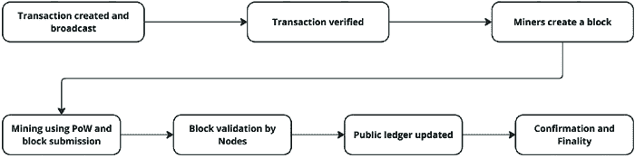

图 4.1：比特币交易生命周期

# 挖矿过程与经济激励

挖矿是比特币网络的关键组成部分，确保了区块链的安全性和完整性。矿工使用计算力在名为`proof of work`的过程中解决复杂的数学难题。这一过程具有多个用途：验证交易、向区块链添加新区块以及保护网络免受恶意攻击。在本节中，我们将探索挖矿过程、激励矿工的奖励以及维持网络的经济激励。

* **Proof of Work**：工作量（`PoW`）算法设计为需要大量的计算资源来解决密码难题。矿工竞争解决这些难题，第一个找到解决方案的矿工可以向区块链添加新区块。这些难题的难度会随时间调整，以确保无论网络中参与的矿工数量如何，大约每 10 分钟就会创建一个新区块。

* **Mining Rewards**：矿工的努力通过新创建的比特币获得奖励，即`block reward`（区块奖励），以及区块中包含交易的交易费。区块奖励作为矿工为网络贡献计算力的经济激励。随着时间的推移，区块奖励通过名为`halving`（减半）的过程不断减少，该过程大约每四年发生一次，使每个区块产生的新比特币数量减半。

* **Transaction Fees**：除了区块奖励，矿工还会从他们包含在区块中的交易中获得手续费。用户可以为交易附加费用，以激励矿工优先处理这些交易。手续费较高的交易通常更快被包含在区块中，因为矿工有动力通过选择提供最高回报的交易来实现收益最大化。

* **Economic Incentives and Security**：区块奖励和手续费提供的经济激励对于维护比特币网络的安全至关重要。通过要求矿工消耗计算力并对他们的努力提供奖励，网络使得恶意行为者攻击区块链在经济上变得不可行。例如，执行`51% attack`（即攻击者获得网络超过 50% 的挖矿算力）需要巨大的计算资源，且可能不会产生利润。

* **Difficulty Adjustment**：`difficulty adjustment`（难度调整）机制确保新区块以一致速率添加到区块链，无论网络总计算力发生变化。大约每两周，网络会根据前 2,016 个区块的挖掘所需时间自动调整难题难度。如果区块挖掘得太快，难度就会增加，使下一个区块的挖掘变得困难；相反，如果区块挖掘得太慢，难度就会降低。

* **Energy Consumption**：挖矿需要大量的电力，这导致了对比特币环境影响的担忧。挖矿作业的能耗通常与整个国家（如阿根廷或挪威）相比。然而，一些挖矿作业已开始使用可再生能源（如水电、太阳能和风能），以减少碳足迹并使挖矿过程更具可持续性。

挖矿在保护比特币网络确保其完整性方面发挥着基础作用。区块奖励和手续费提供的经济激励激励矿工贡献计算力，而难度调整机制保持了网络的稳定与安全。

# 比特币减半及其影响

`Bitcoin halving`是比特币货币政策中的关键事件，大约每四年发生一次，使矿工收到的区块奖励减半。减半过程旨在控制进入流通的新比特币供应，并确保总供应上限为 2100 万枚。减半事件在塑造比特币的价值主张方面起着至关重要的作用，通常与比特币市场动态的重大变化相关。

### 比特币减半概述

比特币减半在每挖掘 210,000 个区块后发生一次，大约需要四年。在每次减半事件期间，矿工因成功向区块链添加新区块而获得的奖励会减半。例如，矿工的初始区块奖励为每个区块 50 BTC，在 2012 年减少到 25 BTC，2016 年减少到 12.5 BTC，2020 年减少到 6.25 BTC。2024 年 4 月发生的减半事件将区块奖励减少到了 3.125 BTC。

### 对供应的影响

减半机制是比特币`fixed supply`（固定供应）模型不可或缺的一部分，该模型限制了可以挖掘的比特币总量为 2100 万枚。通过降低新比特币的产生速度，减半事件减慢了供应的增长，使比特币成为一种通缩性资产。这种受控的稀缺性是比特币区别于传统法币的关键特征，后者可以由中央银行无限量地印制。

### 对矿工的影响

比特币减半对矿工有直接影响，因为他们的奖励减少了一半。这意味着矿工必须变得更高效，或者依靠更高的比特币价格来保持盈利。奖励的减少可能导致参与网络的矿工数量减少，特别是当比特币价格没有上涨以补偿较低的奖励时。然而，`difficulty adjustment`机制通过根据网络总计算力使挖掘区块变得更容易或更困难，从而帮助平衡挖矿过程。

## 市场动态

从历史上来看，比特币减半事件与价格大幅上涨有关。新供应增长率的降低结合稳定或增长的需求，创造了供应冲击，通常会导致价格上行压力。投资者和市场参与者密切关注减半事件，因为它们被看作牛市周期的催化剂。然而，需要注意的是历史表现并不代表未来结果，市场情况可能会发生变化。

### 长期价值主张

比特币减半机制是其`store of value`（价值载体）叙事的关键因素。通过限制新比特币的供应并确保稀缺性，减半事件增强了比特币作为“数字黄金”的声誉。减半计划的可预测性也提供了透明度和确定性，从而吸引那些将比特币视为对抗通胀的工具和保值方式的长期投资者。

比特币减半是比特币货币政策的一个基本方面，影响着供应、矿工激励和市场动态。通过降低新比特币的产生率，减半事件有助于维持比特币的稀缺性，并在其价值主张中发挥着关键作用。

### 货币政策与固定供应

比特币的货币政策与传统金融体系有本质上的不同，因为它基于固定的供应和透明的发行计划。与中央银行可以无限量印刷的法币不同，比特币的最大供应量为 2100 万枚。这种稀缺性被植入于协议之中，确保了创建的比特币总数永远不会超过 2100 万枚。

### 固定供应与稀缺性

比特币的固定供应是其区别于传统货币的关键特征。中央银行有能力根据经济状况增加货币供应，这通常会导致通货膨胀和购买力下降。相比之下，比特币的供应是有上限的，且新币以可预测的速率发行。这种固定供应使比特币成为一种通缩性资产，因为随着时间的推移，发行率不断降低，而需求却持续增长。

### 发行计划与减半

比特币的发行计划设计得具有预测性和透明性。大约每隔 10 分钟，区块链就会添加一个新的区块，矿工将获得新创建的比特币作为奖励。每 210,000 个区块发生的`halving`事件会将区块奖励减半，逐渐降低新比特币进入流通的速率。这种可预测的发行计划有助于比特币作为价值存储手段和抗通货膨胀工具的价值主张。

### 与法币的比较


传统法币（如美元或欧元）受中央银行决定的货币政策影响。这些政策通常涉及调整利率、印刷新货币或进行量化宽松以管理经济状况。虽然这些行动可以在短期内稳定经济，但也可能导致通货膨胀和购买力丧失。比特币凭借其固定供应和透明发行，提供了一种替代方案，不受相同通胀和货币操纵风险的影响。

## 通缩属性

比特币的通缩属性是其对长期投资者而言最具吸引力的特征之一。随着新比特币供应随时间推移而减少，该资产的稀缺性不断增加。这种稀缺性结合增长的需求，会导致价格上涨压力，使比特币成为那些寻求长期保护财富的人极具吸引力的选择。比特币的通缩属性通常与`gold`相比，后者也是一种世纪以来一直用作价值存储的稀缺资产。

## 对价值的影响

比特币的货币政策和固定供应对其价值产生直接影响。通过减半事件减少新供应率创造了供应冲击，这可能导致价格上涨。此外，固定供应和可预测的发行计划为投资者提供了确定性，使比特币成为寻求抗通胀和货币贬值资产的者的极人选择。

## 价值存储叙事

比特币的货币政策使其赢得了“数字黄金”和`store of value`的声誉。正如黄金几个世纪以来被用作抗通胀和保护财富的方式一样，比特币在数字时代提供了类似的价值主张。比特币发行计划的透明性和可预测性，结合其固定供应，使其成为希望保护财富免受传统法币风险影响的人极具吸引力的选择。

比特币的货币政策是一个使其区别于传统金融体系的定义特征。通过将总供应量限制在 2100 万枚并确保发行计划的透明，比特币提供了一种作为法币替代品的通缩性资产。

# 安全特性与潜在漏洞

比特币的架构设计了若干安全特性，以确保网络的完整性并保护其免受各种攻击。然而，与任何技术一样，它并非没有漏洞。在本节中，我们将探讨比特币网络的关键安全特性，以及它面临的潜在漏洞。

- **去中心化与分布式网络**：比特币的主要安全特性之一是其`decentralized`（去中心化）本质。网络分布在世界数万个节点上，使其对攻击具有韧性。没有单点故障，网络的分布式特性确保了任何实体都难以获得控制。这种去中心化使比特币能够抵抗审查和政府干预。

- **工作量证明 (PoW) 安全**：`proof of work` (PoW) 共识机制是另一个关键的安全特性。PoW 要求矿工解决复杂的密码难题来验证交易并创建新区块。这个过程是计算密集型的，需要大量的能量，使得恶意行为者尝试攻击的成本很高。难度调整机制确保了即使在矿工数量波动时网络也能保持安全。

- **加密安全**：比特币依赖`public-key cryptography`（公钥加密）来确保交易安全。每个用户有一对加密密钥：`public key`（公钥）和`private key`（私钥）。`private key`用于签署交易，而`public key`用于验证签名。这确保了只有资金的所有者才能授权交易，提供了高水平的安全并防止了未经授权的访问。

- **防止双花费**：比特币的共识机制旨在防止`double-spending`（双花费），即同一枚比特币被花费多次的情况。当交易被广播到网络时，节点会验证其有效性，矿工将其包含在区块中。一旦区块添加到区块链，该交易就被视为确认，比特币将无法再次花费。多次确认的要求使得攻击者极难双花费币。

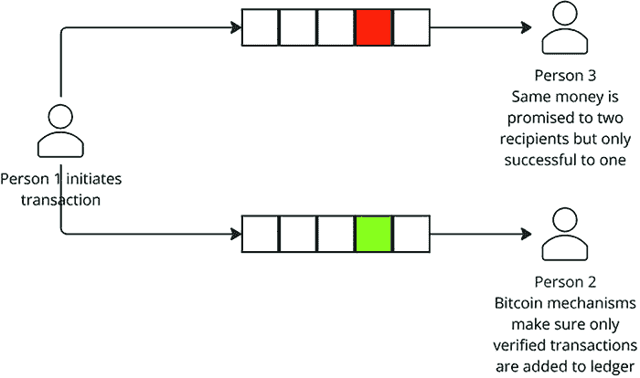

图 4.2：双花费问题

- **51% 攻击**：`51% attack`是一种潜在漏洞，攻击者获得了网络超过 50% 的挖算能力。通过多数控制权，攻击者可能会操纵区块链，反转交易或阻止新交易被确认。然而，由于需要巨大的计算能力，在比特币网络上执行 51% 攻击是极不现实的。实施此类攻击所需的成本和资源将远大于潜在收益，使其成为一种不太可能的威胁。

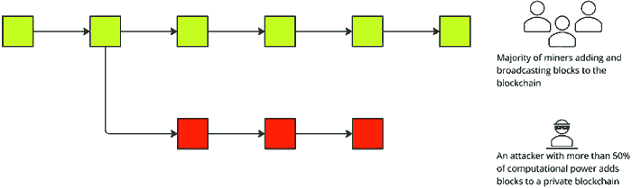

图 4.3：51% 攻击

- **抗 Sybil 攻击**：`Sybil attack`是指攻击者创建多个虚假节点来控制网络。比特币对`proof of work`的依赖使其能够抵抗 Sybil 攻击，因为在没有解决工作量证明难题所需的计算能力的情况下，创建多个节点并提供优势。获取发起成功 Sybil 攻击所需的计算资源成本高得令人望畏。

- **潜在漏洞**：尽管具有强大的安全特性，比特币并非没有漏洞。一些潜在风险包括：

## 挖矿中心化

随着时间的推移，挖矿变得日益中心化，少数大型矿池控制了网络算力的大部分份额。这种中心化可能对网络安全构成风险，因为它可能使矿工之间更容易发生共谋。

## 量子计算

`quantum computers`的发展对比特币的加密安全构成了潜在威胁。量子计算机可能会破解比特币使用的加密算法，例如`elliptic curve digital signature algorithm (ECDSA)`。然而，研究人员正在开发抗量子加密解决方案，以减轻这种风险。

## 网络分叉

当区块链分裂成两条独立的链时，就会发生`network fork`，通常是因为参与者对协议更改存在分歧。分叉会导致暂时的不稳定和困惑，但它们也是实现网络改进的机制。分叉主要有两种类型：`soft forks`和`hard forks`。

### 软分叉

`soft fork`引入了向后兼容的更改，这意味着运行旧版本软件节点仍然接受新规则。换句话说，`soft fork`不会分裂区块链，只要遵循更新后的规则，所有节点仍然可以验证新交易。比特币中软分叉的一个例子是`Segregated Witness (SegWit)`更新，它的引入是为了在不创建新链的情况下提高交易效率和可扩展性。

### 硬分叉

另一方面，`hard fork`引入了与区块链之前的版本不兼容的更改。这意味着运行旧版本软件的节点将无法识别新区块，导致产生一条独立的链。硬分叉通常在社区对网络方向存在重大分歧时发生。比特币历史上一个引注目的硬分叉例子是 2017 年创建的`Bitcoin Cash (BCH)`。比特币现金的目的是增加区块大小限制，允许每个区块处理更多交易并解决可扩展性问题。然而，这一变化并没有被整个社区所接受，导致了具有不同规则的新区块链的形成。

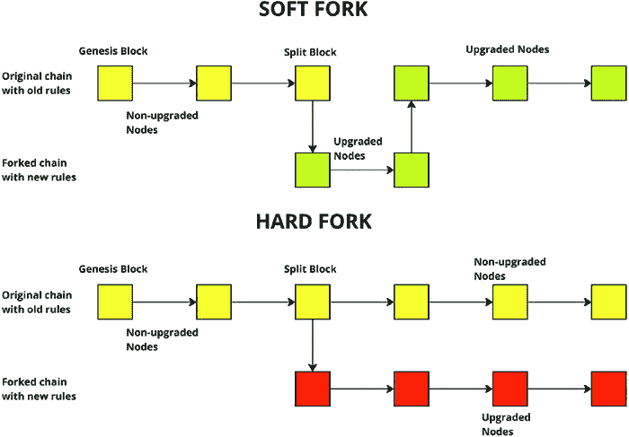

**图 4.4:** 硬分叉与软分叉

分叉是区块链技术的一个基本方面，因为它们允许对网络进行升级和改进。然而，它们也可能导致分歧和困惑，特别是在产生竞争链的硬分叉情况下。

比特币的安全特性（如去中心化、工作量证明和加密安全）使其成为现有最安全的区块链网络之一。然而，如挖矿中心化和量子计算威胁等潜在漏洞是未来重要的考虑因素。

# 与传统金融系统的比较

比特币的架构和货币政策从根本上不同于传统金融系统。在本节中，我们将探讨比特币在结构、货币政策、安全性和用户控制方面与传统金融系统的对比。

## 结构

传统金融系统依赖中心化机构（如银行和支付处理商）来管理交易、维护记录并提供金融服务。这些中心化实体有权批准或拒绝交易、冻结账户并控制资金访问。相比之下，比特币是一个去中心化网络，所有参与者（节点）都维护公共账本（即区块链）的副本。这种去中心化的结构确保了没有单一实体可以控制网络，使比特币能够抵御审查，并让用户对其资金拥有完全所有权。

## 货币政策

传统金融系统通过利率调整、量化宽松和货币发行等机制控制货币供应量。这种中心化的控制允许政府应对经济状况，但也会导致通货膨胀和购买力损失。相比之下，比特币拥有 2100 万枚的固定供应，新币通过挖矿过程以可预测的速度发行。这种通缩模型使比特币成为那些寻求保护财富和对冲通胀风险的人的极佳选择。

## 用户控制与所有权

在传统金融系统中，用户对资金的使用受到银行和其他金融机构的调解。这些机构有权在某些情况下冻结账户、实施交易限制或拒绝访问资金。然而，比特币允许用户通过使用私钥对资金进行完全控制。通过持有自己的私钥，用户可以自由交易，无需中央机构的许可。这种程度的用户控制是区分比特币与传统系统的关键特征之一。

## 交易处理与结算

传统金融系统涉及多个中间环节（如银行、支付处理商和结算中心）来促进交易。这通常会导致延迟（特别是对于跨境支付）并为用户带来额外费用。相比之下，比特币交易直接在区块链上处理，无需中间介。矿工使用工作量证明共识机制验证交易，一旦交易被确认，它就会记录在区块链上。这种直接结算过程减少了对中间介的需求，并可能产生更快、更廉的交易。

## 安全

传统金融系统依赖中心化数据库来存储用户信息和交易记录。这些中心化数据库容易受到黑客和数据泄露的影响，可能会损害敏感的用户信息。比特币的安全基于加密原理和去中心化。交易使用公钥加密进行保护，工作量证明共识机制使得攻击者在计算上无法更改区块链。网络的分布式特性也意味着没有单点故障，使比特币对攻击更具韧性。

## 透明度与隐私

传统金融系统通常是不透明的，在交易如何被处理以及货币政策决策如何做方面的透明度有限。另一方面，比特币运行在公共区块链上，所有交易对所有人可见。这种透明度允许用户验证交易并跟踪资金流。然而，虽然比特币提供了透明度，但也提供了一定程度的隐私。用户通过公共地址而非个人信息进行识别，这提供了伪匿名性。这与传统系统形成对比，在传统系统中用户必须提供个人信息才能访问金融服务。

- **通胀与通缩**：传统的法币容易受到通货膨胀的影响，因为中央银行可以根据经济状况增加货币供应。这种通胀模型会随着时间推移损害货币的购买力。比特币具有固定的供应量和减半事件，被设计为通缩性的。通过减半事件减少新比特币的发行率创造了稀缺性，这可能导致价值随着时间推移而增加。这种通缩特性使得比特币对那些希望保护财富免受通胀影响的人来说具有吸引力。

- **金融服务的获取性**：传统的金融系统要求用户拥有银行账户并满足某些标准才能获得金融服务。这可能导致全球很大一部分人口被排除在外，特别是银行服务不足地区的地区。比特币向任何连接了互联网的人开放，无需银行账户或身份证明即可获得金融服务。这种包容性使比特币成为金融包容的强大工具，允许那些被排除在传统系统之外的个人参与全球经济。

# 结论

比特币的架构和货币政策为创建一个安全、去中心化且透明的金融系统提供了一种革命性的方法。通过利用分布式公共账本、加密安全和工作量证明等共识机制，比特币在不依赖传统金融中介的情况下维护了其网络的完整性。固定的供应量和可预测的发行计划有助于其作为通缩资产的价值，通常被称为“数字黄金”。然而，随着比特币的演进，必须考虑潜在的漏洞，例如矿池中心化和量子计算的威胁。

在下一章中，我们将查看以坊并理解其核心组件：智能合约、EVM 和去中心化应用（DApps）。

# 记忆点

- 比特币使用名为区块链的去中心化公共账本，由全球节点维护。

- 交易通过公钥加密加密，并使用工作量证明共识机制进行验证。

- 矿工通过区块奖励和交易费用激励，这些奖励通过被称为“减半”的过程而减少。

- 比特币的货币政策基于 2100 万币的固定供应量，使其成为通缩资产。

- 网络分叉（如硬叉和软叉）是实现区块链更改的机制。

- 比特币的安全依赖去中心化、加密安全和经济激励，但矿池中心化和量子计算等潜在风险仍然存在。

# 关键术语

- **区块链**：一种去中心化的公共账本，以区块链记录所有比特币交易。

- **工作量证明 (PoW)**：一种共识机制，要求矿工解决复杂的谜题以验证交易并向区块链添加新区块。

- **挖矿**：验证交易、创建新区块和保护比特币网络的过程，矿工获得新创建的比特币和交易费用作为奖励。

- **减半**：大约每四年发生一次的事件，使矿工获得的区块奖励减少一半，这贡献了比特币的稀缺性。

- **公钥加密**：一种用于保护比特币交易的加密方法，涉及一对密钥——公钥和私钥。

- **51% 攻击**：一种潜在的漏洞，即攻击者获取了网络超过 50% 的算力控制权，允许他们操纵区块链。

- **软叉**：对区块链进行的向后兼容的更改，不会导致链的分裂。

- **硬叉**：对区块链进行的不向后兼容的更改，会导致新链的产生。

- **量子计算**：一个利用量子力学原理进行计算的计算领域，其速度远超经典计算机。通过利用量子比特（qubits），量子计算机可以同时处理复杂的计算，使其在优化、模拟和破解加密算法等任务中异常强大。

- **比特币现金 (BCH)**：比特币的一次硬叉，旨在增加区块大小限制并提高交易吞吐量以增长。

# 第 5 章

## 开始使用以太坊

### 简介

以太坊不仅仅是一种加密货币；它是一个去中心化平台，允许开发者创建和部署`智能合约`和`去中心化应用 (DApps)`。与主要作为数字货币的比特币不同，以太坊被设计为可编程区块链，为整个去中心化解决方案生态系统提供基础设施。在本章中，我们将探索以太坊的历史、其独特特性（如`以太坊虚拟机 (EVM)`），以及它如何实现超越简单交易的去中心化应用。

### 结构

本章结构如下：

- 以太坊的历史与愿景

- 以太坊虚拟机 (EVM)

- 以太币 (ETH) 和 Gas 概念

- 智能合约：定义与用例

- 去中心化应用 (DApps)

- 以太坊与比特币之间的主要区别

- 以太坊生态系统与社区

### 以太坊的历史与愿景

以太坊由`Vitalik Buterin`（维塔尼·布特林）于 2013 年底构思，并于`2015 年 7 月`正式发布。维塔尼·布特林是一位程序员和加密货币狂热者，他设想建立一个不仅可以处理点对点交易，还能实现复杂的去中心化应用的平台。以太坊的灵感源于比特币的局限性，比特币主要被设计为一种具有有限脚本编写能力的去中心化货币。

以太坊由`Vitalik Buterin`、`Gavin Wood`、`Joseph Lubin`、`Anthony Di Iorio`、`Charles Hoskinson`和`Mihai Alisie`共同创立。`Vitalik Buterin`在 2013 年底编写了《以太坊白皮书》，概述了该平台的愿景和目标。不久后，`Gavin Wood`写了《黄皮书》，为以太坊虚拟机 (EVM)`提供了技术规范。

以太坊的创建是为了成为一种`可编程区块链`，允许开发者部署可以自动执行流程和交易的`智能合约`，而无需中心权威。维塔尼也受到了早期技术如`Colored Coins`和`Mastercoin`的启发，这些技术曾尝试在比特币网络上添加额外功能，但他意识到需要一个更灵活、多通用的平台。以太坊的愿景是创建一个“世界计算机”，为去中心化和自主系统提供基础设施，从根本上改变金融、医疗和治理等行业。

以太坊于`2015 年 7 月 30 日`正式上线，发布了`Frontier`网络，这是以太坊区块链的第一版本。以太坊的诞生是区块链历史上的一个关键时刻，因为它将重点从纯加密货币转向了支持去中心化逻辑、应用和自动执行合约的更广泛生态系统。在下一节中，我们将探索`以太坊虚拟机 (EVM)`，这是实现以太坊可编程性的核心技术。

以太坊虚拟机（EVM）是以太坊成为可编程区块链的核心创新。它是一个去中心化的计算环境，在以太坊网络上运行所有的智能合约和去中心化应用程序。EVM 充当执行智能合约逻辑的引擎，确保网络中的所有节点都能实现相同的规则和结果。

EVM 通常被描述为“世界计算机”，因为它为智能合约提供了一致的运行环境。以太坊网络中的每个节点都运行 EVM，这确保了区块链状态能够得到一致的维护和更新。这意味着在以太坊上进行的任何计算——无论是转账 Ether、部署智能合约还是与 DApp 交互——都由 EVM 执行，并由它强制执行协议规则。

EVM 是`图灵完备`的，这意味着只要有足够的资源可用，它可以执行任何可以用算法表示的计算。这允许开发者构建复杂的应用程序，并为交易处理方式定义特定的逻辑。然而，为了防止计算资源的滥用，以太坊使用了`gas`机制，该机制要求用户根据执行交易或智能合约所需的计算工作支付费用。

`EVM 字节码`是 EVM 能理解的机器级语言。当开发者使用`Solidity`等高阶语言编写智能合约时，它们会被编译成 EVM 字节码，然后由 EVM 执行。这一过程确保了智能合约在以太坊网络的所有节点上一致地执行。

EVM 的灵活性可编程性是以太坊区别于比特之处，使其能够支持从金融服务到游戏和治理系统的各种去中心化应用程序。在下一节中，我们将讨论`Ether (ETH) 和 gas 概念`，这对于理解在以太坊网络上如何支付交易和计算至关重要。

## Ether (ETH) 和 Gas 概念

`Ether (ETH)`是以太坊网络的原生加密货币。它有多个用途：被用作数字货币、价值存储手段，最重要的是作为支付执行智能合约和交易所需的计算工作的费用手段。这种支付以`gas 费用`的形式进行。理解 Ether 和 gas 的工作原理对于理解以太坊如何作为一个去中心化平台运行至关重要。

### 理解 Gas

在以太坊网络中，gas 是一个用于衡量执行操作（如交易或智能合约）所需的计算工作量的单位。Gas 用于在 EVM 中分配资源，确保网络保持安全并防止垃圾信息攻击。网络上的每个操作，从简单的交易到复杂的智能合约执行，都需要一定量的 gas，用户必须用 Ether 支付这些 gas。

### Gas 价格和 Gas 限制

`gas 价格`是用户愿意为每单位 gas 支付的 Ether 数量。它以`gwei`计算，这是 Ether 的较小单位（1 gwei = 0.000000001 ETH）。用户可以设置自己的 gas 价格，矿工更有可能将 gas 较高的交易包含在下一个区块中，因为这直接影响他们的奖励。`gas 限制`是用户愿意为一次交易支付的 gas 最大数量。如果 gas 限制太低，交易可能会失败；而如果太高，用户最终支付的费用可能会比实际需要的更多。

### 类比汽车

为了更好地理解 gas 概念，想象一下在以太坊上执行交易就像开车。`gas`是行驶所需的燃料，`gas 价格`是每升燃料的价格，而`gas 限制`是你愿意为这段旅程购买的燃料最大量。正如汽车移动需要燃料一样，EVM 需要 gas 来执行计算。交易的总成本通过通过使用的 gas 乘以用户设置的 gas 价格得出。

**Gas 费用公式：**

```
Total Gas Fee = Gas Used * Gas Price
```

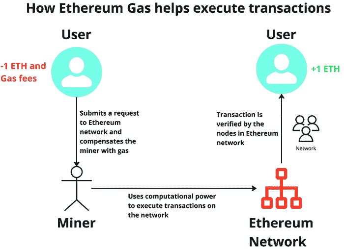

**图 5.1:** Gas 的概念

**常见操作的 Gas 成本：**

EVM 中的不同操作需要不同量的 gas。例如：

- `ADD` (加法): 3 gas

- `SUBTRACT` (减法): 3 gas

- `SEND` (发送 Ether): 21,000 gas


* `TRANSFER`（转移 Ether）：21,000 gas

这些 gas 成本有助于衡量每个操作所需的计算工作量。如需不同操作的 gas 成本完整列表，用户可以参考《以太坊黄皮》（Ethereum Yellow Paper）或访问可靠来源，如`Ethereum Gas Station`或`Etherscan`。

## 使用 Gas 保护网络

Gas 费用在维护以太坊安全方面起着至关重要的作用。它们通过增加攻击者执行无限循环或其他资源密集型操作的成本，帮助防止计算资源的滥用。gas 费用结构确保用户必须为其消耗的计算能力付费，从而激励了对网络资源的有效利用。

## Ether 作为 Gas 支付

当用户想要执行交易或部署智能合约时，必须用 Ether 支付所需的 gas。此过程涉及同时指定 gas 限制和 gas 价格。验证交易并将其添加到区块链的矿工获得用户支付的 gas 费用奖励。这激励了矿工维护网络并保持安全。

gas 机制是以太坊最重要的方面之一，因为它确保了计算资源的公平分配，并防止了恶意行为者发送垃圾信息。在下一节中，我们将探索`智能合约`的定义以及展示其自动化和去中心化处理能力的各种用例。

# 智能合约：定义与案例

`智能合约`是自动执行的合约，其条款直接编写在代码中。当满足特定条件时，它们会自动执行定义的操作，无需人工干预。智能合约是以太坊上去中心化应用程序（DApps）的基础，允许开发者创建复杂的逻辑并在区块链上实现自动化。

## 智能合约的定义

智能合约是运行在以太坊区块链上的代码。它包含定义协议条款的规则，当指定的条件满足时，合约会自动执行。智能合约存储在区块链上，这使其具有不可变性和透明性，提供了高水平的安全性和信任。一旦部署，智能合约无法被更改，确保了协议条款的执行不会被篡改。

## 智能合约的工作原理

智能合约在以太坊虚拟机（EVM）中运行。当用户与智能合约交互时，会创建一个交易来触发合约代码的执行。例如，如果智能合约被设计为满足特定条件时转移资金，它将自动执行交易而无需人工干预。

### 智能合约的用例

- **去中心化金融（DeFi）**：智能合约被广泛应用于`DeFi`应用中，这些应用以去中心化的方式提供贷款、借贷和交易等传统金融服务。`Uniswap`和`Aave`等平台利用智能合约在无需中介的情况下促进交易，为用户提供了对其资产更高的透明度和控制权。

- **代币化（Tokenization）**：智能合约用于创建和管理`tokens`，例如`ERC-20`和`ERC-721`代币。这些代币可以代表各种资产，从加密货币到独特的数字物品（NFTs）。智能合约处理这些代币的发行、传输和跟踪，确保符合预定义的规则。

- **供应链管理**：智能合约通过跟踪货物移动和验证供应链每个阶段的条件，可以实现`supply chain management`中的流程自动化。例如，可以使用智能合约在货物到达特定位置时释放付款，确保透明性并减少对人工干预的需求。

- **保险**：`Insurance companies`（保险公司）可以使用智能合约来实现理赔的自动化。例如，可以编写智能合约，在满足特定条件（如航班取消或自然灾害）时释放保险赔付。这减少了对冗长人工流程的需求，并确保理赔处理过程快速且透明。

- **投票系统**：智能合约也可用于`voting systems`以创建安全且透明的选举。每张选票都记录在区块链上，确保结果准确且不可篡改。这有助于消除欺诈并确保投票过程的完整性。

### 智能合约的优势

- **自动化**：智能合约通过根据预定义的规则自动执行流程，从而消除了对中介机构的需求。这降低了成本并提高了效率。

- **安全性**：由于智能合约存储在区块链上，它们具有很高的安全性，并且一旦部署就无法更改。这种不可变性确保了合约条款的执行。

- **透明性**：智能合约的代码对所有参与者可见，这确保了所有参与人员都可以验证条款并理解合约将如何运行。

- **去信任交易**：智能合约实现了`trustless`（无需信任的）交互，这意味着双方不需要信任对方来履行义务。代码本身执行了协议的条款。

智能合约是一种强大的工具，它实现了去中心化自动化，并为以太坊上的广泛应用奠定了基础。在下一节中，我们将探索`decentralized applications (DApps)`以及它们如何利用智能合约作为后端逻辑连接到区块链。

# 去中心化应用（DApps）

去中心化应用（DApps）是运行在区块链上的应用程序，专门利用以太坊上的智能合约作为其后端。与依赖中心化服务器和数据库的传统应用程序不同，DApps 使用去中心化的以太坊网络与智能合约交互，为用户提供去信任且透明的体验。

## DApps 的定义

DApp 是一种其后端代码运行在去中心化对等网络上的应用程序，而不是托管在中心化服务器上。DApps 通过智能合约与以太坊区块链交互，并且它们通常有一个用户界面（前端），与区块链通信以获取数据或执行函数。

## DApps 的工作原理

DApp 的前端类似于传统的 Web 应用程序，可以使用`HTML`、`CSS`和`JavaScript`等标准 Web 技术构建。然而，它不连接传统的服务器，而是与部署在区块链上的智能合约交互。这种交互通过`Ethers.js`等库实现，这些库允许前端与区块链通信、读写数据并在智能合约上执行函数。

例如，考虑一个去中心化的投票 DApp。应用程序的前端将为用户提供一个投票的界面。当用户投票时，交易被发送到以太坊区块链上的智能合约，该合约以一种不可篡改且透明的方式记录选票。

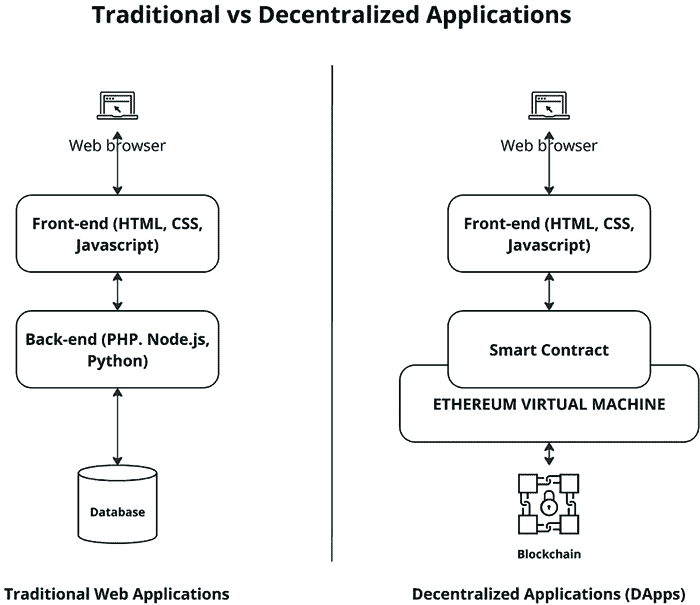

**图 5.2**：传统应用与去中心化应用

## DApps 的优势

- **去中心化**：DApps 不受中央机构控制，这意味着没有单一实体可以控制应用程序的数据或功能。这确保了极高的安全性。

- **透明性**：由于 DApps 与区块链上的智能合约交互，所有交易都是公开的，为用户提供了透明度。任何人都可以审计代码。

- **抗审查性**：由于 DApps 运行在去中心化网络上，它们能够抵抗审查。没有单一实体可以更改或关闭应用程序，这使其成为需要高度自由和自主应用的理想选择。

- **去信任运行**：DApps 的运行不需要用户信任中央权威。定义应用程序行为的代码会自动执行，确保所有参与者都遵守相同的规则。

## DApps 示例

- **Uniswap**：一个去中心化交易所（DEX），允许用户直接从钱包交易加密货币。Uniswap 使用智能合约在不依赖中介的情况下进行点对点交换。

- **CryptoKitties**：一个基于区块链的游戏，允许玩家收集、繁殖和交易虚拟猫。每只猫都由独特的`ERC-721 token`代表，使其成为非同质化代币（NFT）。

- **Compound**：一种允许用户借贷加密货币的 DeFi 协议。Compound 利用智能合约创建去中心化货币市场，利率根据需求自动调整。

## 连接区块链

为了将 DApp 的前端连接到以太坊区块链，开发者使用诸如`MetaMask`等工具，这是一种作为浏览器与区块链之间桥梁的扩展程序。MetaMask 通过提供安全管理私钥和批准交易的方法，允许用户与 DApps 交互。

* `Ethereum`：另一方面，以太坊由`Vitalik Buterin`及其共同创始人于 2015 年创建，是一个可编程的区块链。它为开发者提供了一个创建和部署`智能合约`以及`去中心化应用 (DApps)`的平台，超越了简单的交易，并实现了广泛的应用场景。

## 共识机制

* `Bitcoin`：比特币使用`工作证明 (PoW)`共识机制，矿工通过解决复杂的数学难题来验证交易并向区块链添加新区块。这需要大量的计算能力和能量消耗。

* `Ethereum`：以太坊最初也使用`工作证明 (PoW)`。然而，随着`Ethereum 2.0`的升级，以太坊转向`权益证明 (PoS)`，该机制通过验证者质押（stake）`Ether`来维护网络安全。这一变化旨在使以太坊更具能源效率和扩展性。

## 智能合约

* `Bitcoin`：比特币的`脚本能力`有限，限制了它创建复杂可编程逻辑的能力。它的重点是提供一个安全可靠的支付系统，而不是实现更广泛的可编程性。

* `Ethereum`：以太坊的设计专门为了支持`智能合约`，智能合约是自动执行的合同，能够自动执行协议条款。这允许开发者创建复杂的`DApps`，并以去中心化的方式实现流程自动化。

## 货币

* `Bitcoin (BTC)`：`BTC`是比特币网络的原生货币，主要作为数字货币和价值存储手段。

* `Ether (ETH)`：`ETH`是以太坊网络的原生货币。它不仅作为数字货币，还用于支付执行交易和运行智能合约的`gas fees`。

## 区块链架构

* `Bitcoin`：比特币区块链针对安全不可篡改性进行了优化，专注于维护稳定且安全的交易账本。它的区块限制为`1 MB`，这影响了它的交易吞吐量。

* `Ethereum`：以太坊区块链的设计更具灵活性和可编程性。它拥有更广泛的状态管理系统以支持智能合约的执行。以太坊的区块是动态的，取决于使用的`gas`数量，允许在处理不同类型的交易时具有更大的灵活性。

## 应用场景

* `Bitcoin`：比特币的主要用途是作为`数字货币`和`价值存储`。由于其通缩性质和`2100 万枚`的固定供应，它经常被称为“数字黄金”。

* `Ethereum`：以太坊的应用场景超越了数字货币。它被用作构建各行业`DApps`的平台，包括`金融 (DeFi)`、`游戏`、`房地产`、`供应链管理`和`治理`。以太坊实现了`代币`、`NFTs`以及复杂的去中心化协议的创建。

## 交易速度与扩展性

* `Bitcoin`：比特币的区块时间约为`10 分钟`，其吞吐量限制为每秒 7 次交易。

* `Ethereum`：以太坊的区块时间为 10-15 秒，通过`layer 2 解决方案`如`Optimistic Rollups`和`zk-Rollups`可以每秒处理更多交易。

## 开发社区与生态系统

* `Bitcoin`：比特币社区在实施变更方面非常保守，因为安全是首要任务。

* `Ethereum`：以太坊拥有大型且活跃的社区，专注于创新和扩张。生态系统包括`DeFi`、`NFTs`和`DAOs`。

### 表 5.1：比特币与以太坊的差异

| 特性 | 比特币 | 以太坊 |
| :--- | :--- | :--- |
| 目的 | 数字货币和价值存储 | 用于 DApps 的可编程区块链 |
| 共识机制 | `工作证明 (PoW)` | `权益证明 (PoS)`（Ethereum 2.0） |
| 原生货币 | `Bitcoin (BTC)` | `Ether (ETH)` |
| 智能合约 | 有限 | 完全支持 |
| 交易速度 | 每区块约 10 分钟 | 每区块约 10-15 秒 |
| 可扩展性 | 有限（7 TPS） | 较高（通过 Layer 2 解决方案） |
| 应用场景 | 数字支付、价值存储 | DApps、NFT、治理 |

以太坊的灵活性和可编程性使其能够支持广泛的去中心化应用，而比特币仍然专注于成为安全的去中心化货币。在下一节中，我们将探索`以太坊生态系统`，包括客户端、验证者和层 2 解决方案。

# 以太坊生态系统与社区

以太坊生态系统庞大且多样，由许多共同工作维护和扩展网络的组件组成。在本节中，我们将探索构成以太坊生态系统的关键元素，包括客户端、验证者和层 2 解决方案。

## 以太坊客户端

以太坊客户端是允许节点与以太坊区块链进行交互的软件。它负责验证交易、创建区块并维护网络状态。最流行的以太坊客户端包括`Go Ethereum`（Geth）、`OpenEthereum`（以前称为 Parity）和`Besu`。每个客户端使用不同的编程语言开发，确保了网络的多样性并减少了影响整个网络的漏洞风险。

## 验证者

随着 Ethereum 2.0 转向`权益证明 (PoS)`，`验证者`在维护网络安全方面起着至关重要的作用。验证者负责提议和验证新区块。验证者不像工作证明中的矿工那样使用计算能力，而是根据他们质押的`Ether (ETH)`数量被选中创建区块。验证者通过提议和证明区块获得奖励，如果发生恶意或不当行为，可能会通过被称为`slashing`（罚没）的过程受到惩罚。

## 层 2 解决方案

`Layer 2 solutions`是构建在以太坊区块链上的技术，旨在提高扩展性并降低交易成本。随着以太坊的普及，网络面临着拥堵和高 Gas 费的挑战。为了解决这些问题，开发了如`Optimistic Rollups`、`zk-Rollups`和`Plasma`等层 2 解决方案。这些解决方案通过在链外处理交易来增加交易吞吐量，同时保持以太坊主网的安全保障。层 2 解决方案对于让以太坊更易用、更具扩展性至关重要，允许更多用户无需支付高费用即可参与去中心化应用。

以太坊开发社区是区块链领域最活跃、最具活力的社区之一。它由核心开发者、`DApp`开发者、研究人员和爱好者组成，他们为网络的增长和改进做出贡献。非营利组织`Ethereum Foundation`在资助研发计划方面发挥着关键作用，确保协议的持续演进。此外，以太坊的开源性质鼓励了全球开发者的协作，促进了创新和新的用例。

## 生态系统项目

以太坊生态系统拥有大量利用其能力的项目。这包括`MakerDAO`、`Aave`和`Uniswap`等`DeFi 协议`，它们提供去中心化金融服务；`OpenSea`和`Rarible`等`NFT 平台`，它们实现了非同质化代币的创建和交易；以及`Aragon`和`MolochDAO`等去中心化自治组织（DAOs），它们允许去中心化的治理和决策。生态系统内项目的多样性凸显了以太坊的灵活性及其支持各行业的能力。

## 社区与治理

以太坊社区不仅由开发者组成，还包括用户、投资者和倡导者，他们为增长和去中心化做出贡献。`以太坊改进建议 (EIPs)`是社区提议和讨论协议更改的一种机制。任何人都可以创建`EIP`，广泛社区会在实施前对其优缺点进行辩论。这种开放的治理模型允许以太坊根据用户的需求和输入进行演进，确保其保持作为一个去中心化且由社区驱动的平台。

## 以太坊的未来

以太坊生态系统正在不断演进。随着`Ethereum 2.0`的持续开发以及如`sharding`等未来升级，网络目标是变得更具扩展性、安全性和可持续性。`Sharding`将允许以太坊并行处理多个交易，显著提高容量。这些升级结合充满活力的社区和活跃的开发工作，确保了以太坊在未来几年内继续处于区块链创新的领先地位。

以太坊生态系统是一个动态且复杂的组件网络，这些组件共同工作，为许多行业的应用提供一个强大的去中心化平台。在下一章中，我们将深入研究`Solidity 编程`（用于在以太坊上编写智能合约的语言），并学习如何开发、测试和部署我们自己的合约。

# 结论

以太坊是一个强大的平台，它超越了加密货币，为开发去中心化应用和智能合约提供了可编程的区块链。通过`以太坊虚拟机 (EVM)`、智能合约和去中心化应用（`DApps`）实现的编程性允许在各行业实现广泛的创新解决方案。本章涵盖了以太坊的历史和愿景、其关键特性（如`EVM`和 Gas 概念）、智能合约的用例，以及驱动其持续演进的繁荣生态系统和社区。

以太坊的多功能性使其与比特币区分开来，使其成为寻求构建优先考虑自动化、透明和去信任去中心化解决方案的开发者的热门选择。以太坊生态系统凭借强大的开发者社区和活跃的项目，不断突破区块链技术所实现的边界。我们将在下一章中更详细地介绍智能合约和去中心化应用。

# 记忆要点

* `Ethereum`是一种支持`smart contracts`和`DApps`的可编程区块链，使其与主要作为数字货币的比特币有所不同。

* `以太坊虚拟机 (EVM)`负责执行智能合约并确保网络的一致性。

* `Ether (ETH)`是以太坊的原生加密货币，用于支付`gas 费`——即网络上计算工作的成本。

* `Gas`用于在`EVM`中分配资源，防止计算能力被滥用并确保网络安全。

* `Smart contracts`是存储在区块链上的自动执行合约，可以在没有中介的情况下实现流程自动化。

* `DApps`使用智能合约作为后端，为传统应用程序提供去中心化的替代方案。

* `Ethereum`和`Bitcoin`之间的主要区别包括它们的用途、共识机制以及对智能合约的支持。

* `Ethereum ecosystem`包括客户端、验证者、层 2 扩展解决方案以及驱动创新和增长的活力开发社区。

# 关键术语

* `Ethereum Virtual Machine (EVM)`：一种去中心化的计算环境，用于在以太坊网络上运行智能合约和`DApps`。

* `Gas`：衡量在以太坊网络上执行操作所需的计算努力的单位。

* `Smart Contract`：一种自动执行的合约，其协议条款直接写入代码中并运行在区块链上。

* `Decentralized Application (DApp)`：一种通过智能合约与区块链交互的应用程序，提供去信任和去中心化的体验。

* `Proof of Stake (PoS)`：以太坊使用的一种共识机制，根据质押 Ether 的数量来选择验证者。

* `Layer 2 Solutions`：构建在以太坊区块链上的技术，旨在提高扩展性并降低交易成本。

* `Ethereum Improvement Proposal (EIP)`：以太坊社区提议和讨论协议更改的机制，用于引领未来几年区块链的创新。

# 第 6 章

## 智能合约与去中心化应用（DApps）

### 引言


以太坊通过通过 `smart contracts` 和 `decentralized applications (DApps)` 实现可编程交易，引入了区块链世界的范式转移。智能合约在不需要中介的情况下自动执行协议，而 DApps 利用这些合约提供去中心化、透明且去信任的服务。本章将通过深入研究智能合约及其特性、优点和开发流程，探索以太坊的核心功能。我们还将探索 `去中心化自治组织 (DAOs)`、现实世界的应用及挑战，并介绍用于开发这些合约的编程语言 `Solidity`。

### 结构

本章的结构如下：

* 智能合约：特性与优势
* 智能合约在区块链上的工作原理
* 智能合约的开发周期
* 去中心化自治组织 (DAOs)
* DApps 和 DAO 的真实案例
* 智能合约采纳的挑战
* Solidity 编程语言简介

# 智能合约：特性与优势

`Smart contracts`（智能合约）是运行在区块链上的自动执行程序。它们包含了直接写入代码中的协议条款，并在满足特定条件时自动执行操作。与需要中介机构执行的传统合同不同，智能合约由区块链网络执行，为协议自动化提供了一种无需信任且透明的解决方案。

# 智能合约的特性

以下是智能合约的主要特性：

* `Autonomous Execution`（自动执行）：当满足预定义的条件时，智能合约会自动执行，消除了对第三方中介的需求。
* `Immutable`（不可篡改性）：一旦部署到区块链上，智能合约就无法更改。这种不可篡改性确保了协议条款不会被篡改。
* `Transparency`（透明性）：智能合约代码对所有参与者可见，确保了合约执行的透明度并减少了欺诈的可能性。
* `Decentralized`（去中心化）：智能合约运行在去中心化的区块链上，这意味着没有单一实体控制其执行。这提供了更高的安全性和可靠性。

# 智能合约的优势

智能合约的关键优势如下：

* `Cost Reduction`（降低成本）：通过消除中介，智能合约降低了与传统法律和行政流程相关的成本。
* `Speed and Efficiency`（速度与效率）：智能合约在满足条件时自动执行，与需要人工监督的传统协议相比，显著加快了流程。
* `Trustlessness`（去信任）：智能合约不需要双方互相信任，因为代码本身执行了规则。这消除了一方不履行义务的风险。

`Example in DeFi`（DeFi 示例）：在`Decentralized Finance (DeFi)`（去中心化金融）领域，智能合约用于自动化贷款等交易。例如，在传统金融中，贷款涉及多个中介，包括银行、承销人和律师，这导致了成本增加和延迟。相比之下，像 `Aave` 这样的 `DeFi` 协议允许用户直接使用智能合约贷款或借入资产，无需中介，成本更低且透明度更高。

智能合约的另一个应用是房地产交易。传统上，购买房产涉及漫长的过程，包括银行、律师和多个验证阶段，这使得整个过程变得繁琐且昂贵。通过智能合约，房产销售可以自动化，确保只有在所有权在区块链上经过验证并注册后才转移资金。这一过程最大限度地减少了人为错误，降低了欺诈风险，并大幅加快了财产所有权的转移。

# 智能合约在区块链上的工作机制

智能合约是在区块链上进行部署和执行的程序。当智能合约被部署时，它会被分配一个唯一的地址，其代码存储在区块链上。为了理解智能合约如何工作，我们需要探索关键概念，如 `ABI`、`OPCODE` 以及与区块链的交互。

* `Application Binary Interface (ABI)`（应用二进制接口）：`ABI` 是定义外部应用程序（如 DApp 前端）如何与智能合约交互的接口。它充当智能合约与外部世界之间的桥梁，允许用户和应用程序调用合约内的函数。
* `OPCODE`（操作码）：当使用 `Solidity` 等高级语言编写智能合约时，它会被编译为 `OPCODE`，这是 `Ethereum Virtual Machine (EVM)` 能够理解的代码的低级表示。EVM 执行 `OPCODE` 以执行智能合约中定义的逻辑。
* `Execution on the Blockchain`（在区块链上执行）：当用户与智能合约交互时，会创建一个交易并发送到网络。该交易包含了合约地址、要调用的函数和必要参数等详细信息。随后，矿工（在工作量证明的情况下）或验证者（在权益证明的情况下）执行合约代码，产生的状态更改被记录在区块链上。
* `Gas Fees`（Gas 费用）：执行智能合约需要计算资源，通过 `gas fees` 支付。Gas 费用取决于所执行操作的复杂性，用户必须使用 `Ether (ETH)` 支付 Gas 费用。

智能合约是实现自动化去中心化的强大工具，但必须经过仔细编写和测试，以确保它们按预期功能运行且没有漏洞。

# 智能合约的开发周期

开发智能合约涉及多个阶段，从编写初始代码到部署到以太坊主网。智能合约的周期通常包括以下步骤：

1. `Development`（开发）：智能合约通常用 `Solidity` 编写，这是一种为以太坊设计的高级编程语言。在开发阶段，开发者编写合约代码并定义合约运行所需的函数、变量和逻辑。
2. `Testing`（测试）：合约开发完成后，必须进行彻底测试以确保其功能符合预期。测试对于识别潜在漏洞和逻辑错误至关重要。开发者使用 `Foundry` 或 `Hardhat` 等框架创建单元测试并模拟不同场景，以验证合约的行为。
3. `Testnet Deployment`（测试网部署）：在将智能合约部署到以太坊主网之前，它会被部署到如 `Sepolia` 等 `testnet` 上。测试网允许开发者在真实环境中测试合约，而不必承担真实资金的风险。此阶段有助于识别真实区块链环境中可能出现的任何问题。
4. `Security Audits`（安全审计）：智能合约必须经过 `security audits`，以确保其安全且没有漏洞。独立审计员会审查代码并测试潜在的攻击方式，例如 `reentrancy attacks`（重入攻击）或 `integer overflow`（整数溢出）。安全至关重要，因为漏洞会导致巨大的财务损失。
5. `Mainnet Deployment`（主网部署）：在通过测试和安全审计后，智能合约被部署到 `Ethereum mainnet`。此时，合约变得不可篡改，这意味着无法无法更改或更新。在主网部署之前解决所有潜在问题至关重要。
6. `Monitoring and Maintenance`（监控与维护）：部署后，必须监控合约以确保其运行正常。如果发现 Bug 或需要新功能，开发者可能需要创建合约的新版本，但原始合约本身无法修改。

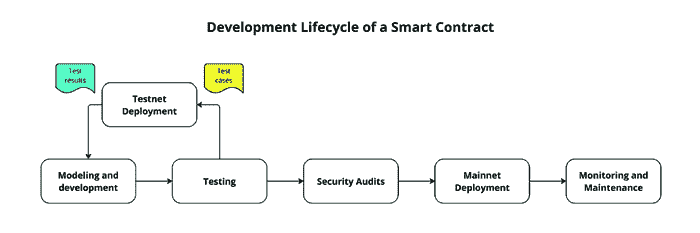

**图 6.1:** 智能合约的开发周期

智能合约开发需要周密的规划、测试和安全措施，以确保合约可靠且安全。

# 去中心化自治组织 (DAOs)

`Decentralized Autonomous Organization (DAO)` 是一种通过在区块链上编码为智能合约的规则来运行的组织类型。与依赖中心化领导的传统组织不同，DAO 基于社区治理运行，由代币持有者集体做出决策。这种结构使得 DAO 具有高度的透明性、去中心化特征，并且能够在没有层级领导架构的情况下自主运行。

### DAO 的工作机制

DAO 由智能合约治理，这些合约定义了组织的运行规则，包括投票机制、提案提交和资金分配。DAO 的成员持有治理代币，他们利用这些代币对影响组织的提案和决策进行投票。投票结果由智能合约自动执行，使过程变得透明且无需信任的。例如，如果一个 DAO 需要决定如何为新项目分配资金，代币持有者可以对提案进行投票，智能合约将根据结果自动发放资金。

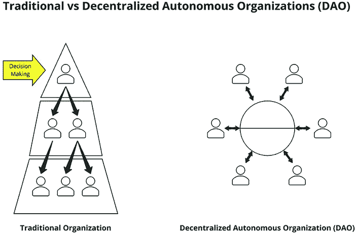

**图 6.2:** 传统组织与去中心化自治组织 (DAO)

例如，考虑一个旨在资助各种社区项目的 DAO。DAO 的成员可以提交资助倡议的提案，例如创建教育内容或举办社区活动。每个提案随后将向治理代币持有者开放投票，他们根据对倡议的预期收益进行投票。一旦投票期结束，如果提案通过了特定的票数阈值，智能合约将自动释放资金到指定的钱包。这种透明且自动的决策过程降低了腐败风险，并确保资金仅分配给那些拥有强大社区支持的倡议。

### DAO 的优势

以下是 DAO 的主要优势：

* **去中心化治理**：DAO 实现了社区驱动的决策，确保没有单一实体对组织拥有不成比例的控制权。所有决策都是集体做出的，让每个成员在治理过程中都有发言权。
* **透明性**：所有的交易和治理决策都记录在区块链上，为成员提供了完全的透明度。这种透明度有助于建立参与者之间的信任并降低腐败风险。
* **自主运行**：DAO 通过智能合约自主运行。一旦规则编码，它们就会自动执行，减少了对人工干预的需求，使组织更加高效。

### DAO 示例

* **MolochDAO**: `MolochDAO` 专注于资助以太坊开发倡议。它允许成员汇总资源并对资助提案进行投票，目标是改进以太坊生态系统。
* **Aragon**: `Aragon` 是一个允许用户创建和管理自己 DAO 的平台。它提供了工具来轻松部署具有自定义治理机制的 DAO，使各种组织都能轻松使用。

### 现实案例

**去中心化的 Uber**: 想象一下如果 `Uber` 是一个 DAO 会怎样。不再由中心化公司控制，去中心化的 `Uber` 可以由其司机和乘客进行治理。费率、司机激励和平台规则等决策可以由代币持有者集体做出。司机和乘客可以使用该平台。

DAO 正在通过利用区块链消除中间环节来改变各个行业。让我们探索一些现实案例。

### DApps 和 DAO 的现实案例

去中心化应用 (DApps) 和 DAO 在各行业已获得关注，正在改变商业模式。

## 金融服务 (DeFi)

`Aave` 是一个流行的 DeFi 协议，允许用户贷借资产。智能合约自动处理利率，使过程变得透明且无需信任的。

## 游戏与数字收藏

`Axie Infinity` 是一种基于区块链的游戏，允许玩家收集、繁殖和战斗名为 `Axies` 的虚拟生物。它是 DApp 和 DAO 的结合，被称为“边玩边赚”（play-to-earn），玩家通过游戏获得 `Smooth Loveotion (SLP)` 代币。

## 供应链管理

`Provenance` 是一个 DApp，通过使用区块链跟踪从源头到最终消费者的货物，为供应链管理带来了透明度。智能合约确保了供应链数据的准确性和不可篡改。

## 医疗健康

`MedBloc` 是一个去中心化应用，旨在通过让患者控制自己的医疗记录来彻底改变医疗行业。它利用区块链安全地存储医疗数据并允许患者与服务人员共享信息。

## 艺术与音乐行业

`Zora` 是一个用于买卖和铸造数字艺术及音乐非同质化令牌 (NFT) 的去中心化市场。它允许艺术家直接列出作品并接收支付，无需中间商。

`Mirror` 是一个去中心化发布平台，允许作家直接发布内容并变现，而不依赖传统的出版商。它利用区块链技术让作家拥有其作品的所有权。

## DAO 的现实案例

`GitcoinDAO` 是一个通过社区赠款项目支持开源软件开发的 DAO。`GitcoinDAO` 的治理模型允许贡献者对造更广泛开源社区的倡议进行提案和投票。

DApps 和 DAOs 通过实现去中心化、透明化自动化正在改变各个行业。它们消除了中间机构，提供了社区驱动的治理，并为用户参与和从去中心化平台的增长中受益创造了新机会。

# 智能合约采用的挑战

虽然智能合约提供了自动化、透明性和降低成本等许多优势，但其采用仍然面临巨大挑战。理解这些挑战对于充分发挥智能合约的以及解决阻碍其广泛使用的障碍至关重要。

- 复杂性与技术障碍：智能合约是用 `Solidity` 等编程语言编写的，这需要专业的知识。这种技术壁垒限制了能够编写安全智能合约的开发者数量。此外，区块链技术的复杂性以及对去中心化网络的深度理解需求，使得企业和开发者难以采用智能合约。
- 安全风险：智能合约一旦部署即是不可更改的，这意味着代码中的任何漏洞在在不付出巨大努力的情况下无法修复。这种不可变性增加了受到攻击的风险，例如`重入攻击`或`整数溢出`。安全漏洞会导致巨大的财务损失，正如对 DeFi 协议的多次高知名攻击所示。缺乏稳健的安全实践和适当的审计仍然是采用过程的主要障碍。
- 缺乏标准：智能合约的发展缺乏行业范围的标准，这使得确保不同区块链平台之间的互操作性具有挑战性。虽然某些标准（如 `ERC-20` 和 `ERC-721`）在以太坊生态系统中广泛采用，但仍然需要更全面的标准来促进跨链兼容性和互操作性。
- 可扩展性问题：以太坊等区块链由于吞吐量限制面临可扩展性问题，导致在网络拥堵期间产生更高的 gas 费用。执行智能合约的成本对于许多用例来说可能是过的，特别是在网络繁忙时。二层解决方案（如 `Rollups`）旨在解决这些可扩展性问题，但广泛采用仍在进行中。
- 监管不确定：区块链技术和智能合约的监管环境仍在演变。政府和监管机构努力为智能合约的使用制定的指南，这为希望采用它们的企业带来了不确定性。关于智能合约的法律地位、责任和对现有法规合规性的问题构成了重大挑战。
- 用户体验与可用性：对于非技术用户来说，与智能合约交互可能会感到困惑和畏惧。钱包、gas 费用和交易确认对于普通人来说不是用户友好的概念。改进用户体验并使智能合约交互变得无缝且易用对于大众采用至关重要。
- 预言机依赖：许多智能合约需要外部世界的数据才能正常运行，例如价格馈送或天气数据。这需要使用 `oracles`（预言机），它们引入了额外的复杂性和潜在的中心化。确保预言机的安全可靠是一项重大挑战，因为它们充当链链数据与链上智能合约之间的桥梁。
- 意识和理解有限：许多企业和个人尚未意识到智能合约的潜在收益，或者对区块链技术存在误解。缺乏对智能合约如何简化流程和降低成本的意识和理解阻碍了它们的采用。向利益相关者介绍智能合约的优势和实际应用对于推动更广泛的采用是必要的。

解决这些挑战将需要开发者、企业、监管机构以及更广泛的区块链社区之间的协作。克服技术障碍、增强安全性、提高可扩展性以及营造有利的监管环境都是确保智能合约成功采用的关键步骤。

# Solidity 编程语言简介

`Solidity` 是用于在以太坊区块链上编写智能合约的主要编程语言。它是一种静态类型、高级语言，旨在目标`以太坊虚拟机 (EVM)`。Solidity 的语法与 `JavaScript`、`Python` 和 `C++` 类似，对于熟悉这些语言的开发者来说相对容易上手。在本节中，我们将介绍 Solidity、其核心特性以及它在允许开发者构建去中心化应用程序 (DApps) 和通过智能合约实现自动化方面的作用。

### Solidity 概述

Solidity 的开发是为了便于在以太坊平台上创建智能合约。它允许开发者定义自定义规则，创建执行协议的合约，并在不依赖中间机构的情况下实现复杂流程。Solidity 被编译为字节码，然后由 EVM 执行。

### Solidity 特性

- 静态类型语言：Solidity 是静态类型的，这意味着类型在编译时定义。这有助于防止错误并确保变量正确使用。
- 继承：Solidity 支持合约继承，允许开发者创建复用组件并扩展现有合约。这一特性促进了模块化和代码复用。
- 修饰器：Solidity 引入了`modifiers`的概念，用于更改函数的行为。修饰器可以为函数添加前提条件，例如要求只有所有者才能执行某些操作。
- 事件：Solidity 合约可以发出`events`来为智能合约活动提供日志机制。事件用于在合约内发生特定操作时通知外部应用程序。

### 智能合约结构

一个基础 Solidity 合约由几个部分组成，包括`状态变量`、`函数`和`事件`。状态变量用于在区块链上存储数据，而函数定义了合约的逻辑。事件用于与外界通信。

```solidity
pragma solidity ⁰.8.0;

contract SimpleStorage {
    uint256 public storedData;

    event DataStored(uint256 data);

    function set(uint256 x) public {
        storedData = x;
        emit DataStored(x);
    }

    function get() public view returns (uint256) {
        return storedData;
    }
}
```

在前面的示例中，`SimpleStorage` 合约定义了一个状态变量 `storedData`，并提供了设置和检索值的函数。每当存储新数据时，都会触发事件 `DataStored`。

### 库和工具

许多库和工具支持 Solidity 开发，开发过程变得更加简单高效。`OpenZeppelin` 提供了可复用且安全的智能合约组件，而 `Hardhat` 和 `Foundry` 是流行的开发框架，有助于合约的测试、调试和部署。

### 常见用例

Solidity 用于创建各种智能合约，包括`token contracts`（例如 `ERC-20` 和 `ERC-721`）、`众筹合约`、`投票合约`以及去中心化金融（DeFi）协议。通过使用 Solidity，开发者可以创建可编程资产、自动化金融流程，并构建自主运行的去中心化应用。

## 学习 Solidity

要开始学习 Solidity，开发者可以使用在线资源，如`Solidity 文档`([`docs.soliditylang.org/en/stable/`](https://docs.soliditylang.org/en/stable/))、`Remix` 等交互式编码平台，以及 `Udemy` 或 `Coursera` 等平台上的课程。学习 Solidity 涉及理解函数、状态变量、继承、事件和错误处理等核心概念。


Solidity 是创建智能合约和实现定义以太坊区块链功能的强大工具。它允许开发者构建去中心化解决方案，实现信任的自动化、消除中间人，并为执行协议提供一种透明化的方式。在接下来的章节中，我们将探索如何使用 Solidity 在以太坊区块链上开发、测试和部署真实的智能合约。

## 结论

本章对智能合约、去中心化应用（DApps）和 Solidity 编程语言进行了全面介绍。我们探索了智能合约的特性优势、它们在区块链上的工作原理、开发周期，以及去中心化自治组织（DAOs）在实现去中心化治理中的作用。我们还讨论了 DApps 和 DAOs 的现实应用，以及为了广泛采用智能合约而需要解决的挑战。最后，我们介绍了 Solidity 编程语言，这是在以太坊上开发智能合约的关键。

在下一章中，我们将深入研究`Solidity 基础`，涵盖了开始编写和部署智能合约所需的各种语法、数据类型和核心概念。这些基础知识对于理解如何构建高效且安全的去中心化应用至关重要。

## 要点回顾

* `智能合约`是区块链上的自动执行程序，能够在没有中间人的情况下自动执行协议。

* `智能合约的特性`包括自主执行、不可篡改性、透明性和去中心化。

* `DAOs`是由智能合约治理的社区驱动组织，实现了去中心化的决策和透明化运作。

* `DApps`利用智能合约在金融、游戏、供应链管理、医疗保健等行业提供去中心化服务。

* `智能合约采用的挑战`包括技术障碍、安全风险、缺乏标准、扩展性问题、监管不确定性、用户体验、预言机依赖以及意识有限。

* `Solidity`是编写以太坊智能合约的主要语言，使开发者能够构建自动化和去中心化的解决方案。

## 核心术语

* `智能合约 (Smart Contract)`：一种条款直接写在代码中的自动执行合约，运行在区块链上。

* `去中心化应用 (DApp)`：通过智能合约与区块链交互的应用，提供去中心化服务。

* `去中心化自治组织 (DAO)`：由智能合约治理的组织，其决策在代币持有者之间实现去中心化。

* `Solidity`：用于在以太坊区块链上编写智能合约的高级编程语言。

* `以太坊虚拟机 (EVM)`：以太坊上执行智能合约的去中心化计算环境。

* `应用二进制接口 (ABI)`：定义外部应用程序如何与智能合约交互。

* `OPCODE`：Solidity 代码的低级表示，由`EVM`执行。

* `Gas Fees (燃料费用)`：在以太坊区块链上执行操作支付的以太坊 (`ETH`)。

* `预言机 (Oracle)`：一种为智能合约提供链外数据的服务，使其能够访问外部信息。

# 第 7 章

## Solidity 编程基础

### 引言

`Solidity`是在以太坊区块链上编写`智能合约`的主要编程语言。它的设计让熟悉`JavaScript`、`Python`或`C++`等语言的开发者易于上手，为开发去中心化应用（DApps）提供了基础。在本章中，我们将探索 Solidity 的基础，涵盖从设置开发环境到理解基础数据类型、函数和控制结构的所有内容。这些知识将为后续章节中编写更高级的合约奠基础。

### 结构

本章结构如下：

* 设置开发环境（Remix IDE 和 Visual Studio Code）

* Solidity 合约的基本结构

* 数据类型、变量和可见性修饰符

* 函数和函数修饰符

* 事件与日志

* 控制结构：条件与循环

* 错误处理与异常

* 简单智能合约示例

* 使用 MetaMask 与合约交互

### 设置开发环境（Remix IDE 和 Visual Studio Code）

要开始编写 Solidity 合约，你需要支持该语言的开发环境。有两个主要的工具：`Remix IDE`和`Visual Studio Code`。

* `Remix IDE`:

    * `Remix`是一个专为编写、测试和部署智能合约设计的基于 Web 集成开发环境（IDE）。它不需要安装——只需在浏览器中访问 [`remix.ethereum.org/`](https://remix.ethereum.org/) 即可。

    * `Remix`提供内置的智能合约测试支持，以及分析代码漏洞的插件。由于其用户友好的界面和易于访问，它非常适合初学者。

* `Visual Studio Code (VS Code)`：

    * `VS Code`是一个强大的文本编辑器，可以通过自定义来开发 Solidity 合约。通过安装`Solidity 扩展`，开发者可以使用语法高亮、代码补全和集成调试等功能来编写和调试智能合约。

    * `Hardhat`或`Foundry`经常与`VS Code`配合使用，为编译、测试和部署合约提供额外的工具。与 Remix 相比，这些框架对开发过程提供了更多的控制。

## Solidity 合约的基本结构

Solidity 合约有定义的结构，从`pragma 行`开始，到定义行为的函数和变量结束。让我们来看看 Solidity 合约的核心组件。

### SPDX 许可标识符

`SPDX 许可标识符`用于指定合约的许可类型。这是一种指示合约许可的标准方式，便于用户和审计人员理解使用条款。

```
// SPDX-License-Identifier: MIT
```

此行代码声明该合约遵循`MIT`许可。

### Pragma 行

`pragma`指令指定了用于合约的编译器版本。它确保了与特定版本的 Solidity 的兼容性。

```
pragma solidity ⁰.8.0;
```

`pragma solidity 0.8.0`与`⁰.8.0`的区别：`^`符号表示兼容从`0.8.0`直到但不包含`0.9.0`的版本。如果没有`^`符号，则将仅使用`0.8.0`版本，以确保更严格的版本控制。

# 不同的账户类型

以太坊上主要有两种类型的账户：`外部所有账户 (EOAs)`和`智能合约账户 (Smart Contract Accounts)`。

* `EOA`：由私钥控制并供个人使用。它们可以发起交易，但不包含代码。

* `Smart`（智能合约）：包含代码并由合约内部的逻辑控制。它们可以接收、存储和发送资金。

# 合约结构

Solidity 合约类似于面向对象编程中的类。它包含了`状态变量`、`函数`以及其他组件（如`事件`）。

```solidity
contract MyFirstContract {
    uint public myValue; // State variable

    constructor() {
        myValue = 10; // Initialize value
    }

    function setValue(uint _value) public {
        myValue = _value;
    }
}
```

在这个示例中，`MyFirstContract`有一个名为`myValue`的状态变量和一个用于设置其值的函数。

### 导入其他源文件

Solidity 允许你从其他文件`import`代码，使得代码复用和项目组织变得容易。

```solidity
import "./AnotherContract.sol";
```

这一行导入了另一个 Solidity 文件，允许你使用其中定义的合约、库或接口。

### 注释

Solidity 中的单行注释使用`//`编写。

```solidity
// 这是一个单行注释
```

多行注释使用`/* */`编写。

```solidity
/*
这是一个多行注释
用于详细描述合约。
*/
```

# 测试网与主网

* `Testnet`（测试网）：如`Sepolia`等测试网用于在不花费真实 Ether 的情况下测试智能合约。它们模拟以太坊网络，允许开发者在部署到主网之前识别问题。

* `Mainnet`（主网）：`mainnet`是以太坊网络的生产版本，合约在此部署具有真实价值并与真实资产交互。

# 数据类型、变量和可见性修饰符

Solidity 提供了一系列`数据类型`来定义表示合约状态的变量。这些数据类型大致分为`值类型`和`引用类型`。理解这些数据类型及其工作原理对于构建健壮的智能合约至关重要。

### 值类型

值类型将数据存储在变量中，包括以下内容：

布尔（Boolean）：

代表真或假值。

示例：

```solidity
bool isActive = true;
```

整数（Integer）：

符号整数 (`int`) 和无符号整数 (`uint`) 用于表示数字。符号整数可以表示正值也可以表示负值。

无符号整数的示例：

```solidity
uint8 smallNumber = 255; // Range: 0 to 2⁸ - 1
uint256 largeNumber = 1000; // 常用于较大的值
```

比较和位运算：

Solidity 支持标准比较运算符（`==, !=, <, >, <=, >=`）和位运算。

Solidity 支持`bytes`和`string`数组的切片（slices），用于创建子数组。

### 运算符

### 三元运算符：

三元运算符允许编写简洁的条件表达式。

示例：

```solidity
uint result = (a > b) ? a : b;
```

### 复合运算符与增/减运算符：

Solidity 支持复合赋值运算符（`+=`, `-=` 等）以及自增/自减（`++`, `--`）。

示例：

```solidity
uint count = 1;
count += 2; // count 现在是 3
count++;    // count 现在是 4
```

### delete 关键字：

`delete`关键字用于将值重置为默认状态。

示例：

```solidity
delete myValue; // 将 myValue 重置为默认值（例如 uint 为 0）
```

### 类型之间的转换：

Solidity 允许在需要时对数据类型进行显式转换。

示例：

```solidity
int8 smallInt = int8(largeInt); // 显式转换
```

## 可见性修饰符

可见性修饰符决定了如何以及在哪里访问函数和状态变量。Solidity 提供了四种可见性级别：

### Public：声明为`public`的函数和状态变量可以在内部和外部被访问。

```solidity
uint public value;
function setValue(uint _value) public {
    value = _value;
}
```

### Internal：声明为`internal`的函数和状态变量只能从合约内部或派生该合约的合约访问。

```solidity
uint internal value;
function increment() internal {
    value++;
}
```

### Private：声明为`private`的函数和状态变量只能在定义它们的合约内部访问。

```solidity
uint private secretValue;
function setSecret(uint _value) private {
    secretValue = _value;
}
```

### External：声明为`external`的函数只能从合约外部调用。从外部访问时，它们更节省 Gas（燃料费）。

```solidity
function getValue() external view returns (uint) {
    return value;
}
```

## 常量变量

Solidity 中的常量变量是在声明期间赋值后值就不能更改的变量。这些变量有助于节省 Gas，因为它们的值直接存储在合约的字节码中，不占用存储槽位。

示例：

```solidity
pragma solidity ⁰.8.0;
contract Example {
    uint256 public constant MY_CONSTANT = 100;
    function getConstantValue() public pure returns (uint256) {
        return MY_CONSTANT;
    }
}
```

### 不变变量

不变变量与常量类似，但允许在构造函数执行期间设置其值。一旦设置，就无法更改。这些变量存储在存储中，但在初始化后表现类似于常量，在执行期间可以节省 Gas。

示例：

```solidity
pragma solidity ⁰.8.0;
contract Example {
    address public immutable OWNER;
    constructor(address owner) {
        OWNER = owner;
    }
    function getOwner() public view returns (address) {
        return OWNER;
    }
}
```

### 常量与不变变量的主要区别

| 特性 | 常量 (Constant) | 不变变量 (Immutable) |
| --- | --- | --- |
| 值设置时间 | 声明期间 | 构造函数执行期间 |
| 存储 | 存储在合约字节码中 | 存储在合约存储中 |
| 用途 | 固定值（例如 PI、费用） | 部署时已知的值（例如所有者地址） |

**表 7.1：常量与不变变量的对比**

常量和不变变量通过减少存储成本和提高代码清晰度来提升合约性能，使其成为 Solidity 编程中必不可少的工具。

# Solidity 中的 Ether 单位和时间单位

在 Solidity 中，有特定的单位用于处理`Ether`和`time`，这使得代码更容易易和和编写。这些单位帮助开发者以更符合人类习惯的形式表示值，减少了计算错误的概率。

### Ether 单位

Solidity 提供了几个内置单位来处理 Ether。Ether 是以太坊网络的原生加密货币，可以用不同的面值表示。

### Ether 面值：

* `wei`: Ether 的最小单位（1 Ether = 10¹⁸ wei）。

* `gwei`: 通常用于 Gas 费（1 `gwei` = 10⁹ wei）。

* `ether`: 用于表示余额的主要面值。

### 示例：

* 向一个地址发送`1 Ether`：

```solidity
address payable recipient = payable(0xdCad3a6d3569DF655070DEd06cb7A1b2Ccd1D3AF);
recipient.transfer(1 ether);
```

* 指定 Gas 费：

```solidity
uint gasPrice = 20 gwei;
```

### 时间单位

Solidity 提供了处理时间的内置单位，使代码更具可读性。

### 时间单位：

* `seconds`: 时间的基础单位。

* `minutes`: 60 秒。

* `hours`: 3600 秒。

* `days`: 86400 秒。

* `weeks`: 604800 秒。

* `years`: 31536000 秒。

### 示例：

* **截止日期**：时间单位通常用于在智能合约设置截止日期。

```solidity
uint public deadline;
constructor() {
    deadline = block.timestamp + 2 days;
}
function isDeadlinePassed() view returns (bool) {
    return block.timestamp >= deadline;
}
```

在示例中，合约设置了从部署起 2 天后的截止日期，并检查其是否已过。正确使用 Ether 单位和时间单位有助于理解合约，并减少处理数值值时的错误风险。

# 函数与函数修饰符

函数是任何 Solidity 合约的构建模块，定义了合约的逻辑和行为。Solidity 函数可以使用函数修饰符添加特定的条件或更改其行为。在本节中，我们将详细介绍各种类型的函数、组件和函数修饰符。

### 基础函数

Solidity 中的函数定义了可以在合约内执行的操作。根据可见性，它们可以是`public`、`internal`、`private`或`external`。

示例：

```solidity
function add(uint a, uint b) public pure returns (uint) {
    return a + b;
}
```

前面的 add 函数接收两个参数并返回它们的和。它被标记为`public`和`pure`（不修改状态）。

### Payable 函数

Payable 函数是可以接收`Ether`的特殊函数。它们带有`payable`关键字。

示例：

```solidity
function deposit() public payable {
    // 接收到的 Ether 将自动添加到合约余额中
}
```

通过将函数标记为`payable`，该函数允许用户向合约发送 Ether。

### 全局变量 (`msg.sender`, `msg.value`)

* `msg.sender`: 代表调用函数的地址。

* `msg.value`: 代表随发送的 Ether 数量。

示例：

```solidity
function pay() public payable {
    address sender = msg.sender;
    uint amount = msg.value;
}
```

在此函数中，`msg.sender`和`msg.value`全局变量分别用于标识调用者和发送的 Ether 数量。


还有其他全局变量列表，例如`blockhash`、`block.chainid`、`block.number`等，可以在官方文档查看：[`docs.soliditylang.org/en/v0.8.28/units-and-global-variables.html#special-variables-and-functions`](https://docs.soliditylang.org/en/v0.8.28/units-and-global-variables.html#special-variables-and-functions)

### 构造函数

构造函数是用于初始化合约的特殊函数。它们在合约部署时仅执行一次。

示例：

```solidity
contract MyContract {
    uint public value;

    constructor(uint _value) {
        value = _value;
    }
}
```

上述构造函数在合约部署时设置状态变量`value`的初始值。

### Fallback 函数和 Receive 函数

**Receive 函数**：合约最多可以有一个`receive`函数，当向合约发送 Ether 且不带 calldata 时，该函数会被触发。

**Fallback 函数**：当没有其他函数匹配调用，或者在发送 Ether 时没有匹配的`receive`函数时，会调用`fallback`函数。

示例：

```solidity
receive() external payable {
    // 处理发送到合约的 Ether 的逻辑
}

fallback() external payable {
    // fallback 情况的逻辑
}
```

### 函数可见性

函数的可见性标识符包括`public`、`private`、`internal`和`external`。这些决定了函数可以在何时以及如何被调用（在本章前面介绍）。

### View 函数与 Pure 函数

`view`函数用于函数从区块链读取数据但不修改数据的情况。

`pure`函数用于函数不读取或修改区块链上任何数据的情况。

示例：

```solidity
uint public x = 10;

function getX() public view returns (uint) {
    return x; // 读取状态变量 x
}

function add(uint a, uint b) public pure returns (uint) {
    return a + b; // 不读取或修改状态
}
```

### return 关键字

`return`关键字用于从函数返回值。它通常用于执行计算或从合约获取数据的函数。

示例：

```solidity
function multiply(uint a, uint b) public pure returns (uint) {
    return a * b;
}
```

# 向函数传递参数

*   **按值传递 (By Value)**：基本数据类型（如`uint`或`bool`）按值传递，这意味着该值的副本会被发送到函数。

*   **按引用传递 (By Reference)**：复杂类型（如数组和结构体）可以按引用传递，允许函数修改原始数据。

# Memory, Calldata 和 Storage 关键字

`memory`：用于声明临时数据结构，这些结构在函数执行后会被删除。适用于函数参数和局部变量。

```solidity
function setData(string memory _data) public {
    // _data 存储在内存中，执行后将丢弃
}
```

`calldata`：与`memory`类似，但`calldata`是只读的，用于外部传递的函数参数。它更节省 Gas（燃料费）。

```solidity
function processData(uint[] calldata _data) external {
    // _data 是只读的
}
```

`storage`：指区块链上的持久化存储。状态变量存储在`storage`中。

### 局部变量

局部变量定义在函数内部，仅在其执行期间存在。

```solidity
function calculateSum(uint a, uint b) pure returns (uint) {
    uint sum = a + b;
    return sum;
}
```

# 函数修饰器 (Modifiers)

修饰器用于为函数执行添加前提条件。它们使用`modifier`关键字定义。

示例：

```solidity
contract MyContract {
    address public owner;

    constructor() {
        owner = msg.sender;
    }

    modifier onlyOwner() {
        require(msg.sender == owner, "Not the owner");
        _;
    }

    function setValue(uint _value) public onlyOwner {
        // 此函数只能由所有者调用
    }
}
```

### require 语句

`require`语句经常用于修饰器中以确保满足某些条件。

示例：

```solidity
function transferOwnership(address newOwner) public {
    require(msg.sender == owner, "Not the owner");
    owner = newOwner;
}
```

### 事件与日志

事件（Events）和日志在 Solidity 中起着至关重要的作用，它们为智能合约与外部世界的通信提供了机制。事件允许开发者创建日志，日志可以用于跟踪合约活动或触发外部应用程序中的操作。

# 创建和触发事件

**定义事件**：事件定义在智能合约内部，类似于函数或状态变量。

示例：

```solidity
event ValueChanged(address indexed author, uint256 oldValue, uint256 newValue);
```

**触发事件**：当满足某些条件或函数执行时，触发事件以记录数据。

示例：

```solidity
function setValue(uint256 newValue) public {
    uint256 oldValue = value;
    value = newValue;
    emit ValueChanged(msg.sender, oldValue, newValue);
}
```

在`setValue`函数中，每当值发生变化时都会触发`ValueChanged`事件。该日志随后存储在交易收据中，允许外部应用程序监控该事件。

# 使用 Revert 和错误事件进行错误处理

## Revert (回滚):

`revert`语句用于终止函数的执行并回滚任何状态更改。它通常用于在不满足某些条件时的错误处理。

示例：

```solidity
function withdraw(uint256 amount) public {
    if (amount > address(this).balance) {
        revert("Insufficient balance");
    }
    payable(msg.sender).transfer(amount);
}
```

在此示例中，如果要提取的`amount`超过了合约余额，`revert`语句将终止函数并提供一条错误消息。

## 错误事件 (Error Events):

当合约出现问题时，可以触发错误事件以提供额外的上下文。

示例：

```solidity
event ErrorOccurred(string message);

function safeDivide(uint a, uint b) public returns (uint) {
    if (b == 0) {
        emit ErrorOccurred("Division by zero");
        revert("Cannot divide by zero");
    }
    return a / b;
}
```

在`safeDivide`函数中，如果`b`为零，在回滚交易之前会触发`ErrorOccurred`事件，以指示尝试进行除零操作。

# 事件的使用场景

*   **跟踪交易**：事件被用于跟踪重要的变化，例如价值转账或状态更新。

*   **与 DApps 通信**：前端应用程序使用事件来获何时更新界面或执行某些操作。事件帮助 DApps 实时响应区块链上的变化。

*   **调试**：事件可以用于记录数据，使得在开发过程中更容易对合约调试。

# 使用事件的完整合约示例

```solidity
// SPDX-License-Identifier: MIT
pragma solidity ⁰.8.0;

contract EventExample {
    uint256 public value;
    address public owner;

    event ValueSet(address indexed author, uint256 newValue);
    event ErrorOccurred(string message);

    modifier onlyOwner() {
        require(msg.sender == owner, "Not the contract owner");
        _;
    }

    constructor() {
        owner = msg.sender;
    }

    function setValue(uint256 newValue) public onlyOwner {
        if (newValue == 0) {
            emit ErrorOccurred("Value cannot be zero");
            revert("Value must be non-zero");
        }
        value = newValue;
        emit ValueSet(msg.sender, newValue);
    }
}
```

在此示例中，合约定义了两个事件（`ValueSet`和`ErrorOccurred`），并使用它们在修改状态时记录操作。`onlyOwner`修饰器确保只有合约所有者可以赋值，如果提供了无效值，合约将触发错误事件并回滚。

事件和日志是 Solidity 编程不可或缺的一部分，提供了透明以及外部应用程序与区块链数据交互的方法。通过触发事件，合约可以有效地通信重要情况，帮助跟踪变化并简化与去中心化应用的交互。在下一节中，我们将探索 Solidity 中的控制结构，例如条件语句和循环，这些对于控制合约执行流至关重要。

# 控制结构：条件语句和循环

Solidity 中的控制结构用于管理智能合约内的执行流。本节涵盖了条件语句和循环，它们在智能合约中实现复杂逻辑至关重要。

# 条件语句：If 和 Switch 语句

## If 语句:

`if`语句用于在满足条件时执行代码块。

示例：

```solidity
function checkValue(uint value) public returns (string memory) {
    if (value > 100) {
        return "Value is greater than 100";
    } else {
        return "Value is 100 or less";
    }
}
```

在上述示例中，如果条件满足，`checkValue`函数将返回相应的字符串。

## Switch 语句 (Solidity 不直接支持):

Solidity 没有内置的`switch`语句。开发者使用一系列`if-else`语句来实现类似的功能。

示例：

```solidity
function categorizeNumber(uint value) pure returns (string memory) {
    if (value == 1) {
        return "Category One";
    } else if (value == 2) {
        return "Category Two";
    } else {
        return "Other Category";
    }
}
```

在此示例中，使用`if-else`语句来创建分支。

# 循环：For 和 While

### For 循环:

当循环次数已知时，使用`for`循环。

示例：

```solidity
function sumNumbers(uint n) public returns (uint) {
    uint sum = 0;
    for (uint i = 1; i <= n; i++) {
        sum += i;
    }
    return sum;
}
```

在此示例中，`for`循环从 1 迭代到`n`，并将值加加`sum`。

### While 循环:

当无法预知循环次数时，使用`while`循环。

示例：

```solidity
function countDown(uint start) public returns (uint) {
    uint counter = start;
    while (counter > 0) {
        counter--;
    }
    return counter;
}
```

在此示例中，`while`循环递减`counter`直到零。

## Do-While 循环 (Solidity 中不常用):

Solidity 也支持`do-while`循环，但由于复杂性很少使用。

# Solidity 中循环的使用实践

*   **Gas 限制考虑**：Solidity 中的循环在 Gas 方面可能昂贵，特别是当迭代次数很高时。避免无限循环至关重要。

*   **避免无边界循环**：始终确保循环有定义且有限的次数，以防止 Gas 耗尽错误。

# 使用条件语句和循环的示例

```solidity
// SPDX-License-Identifier: MIT
pragma solidity ⁰.8.0;

contract ControlStructures {
    uint[] public numbers;

    // 将 1 到 n 的数字添加到数组中
    function addNumbers(uint n) public {
        for (uint i = 1; i <= n; i++) {
            numbers.push(i);
        }
    }

    // 检查数组中是否存在数字
    function checkNumber(uint num) public view returns (bool) {
        for (uint i = 0; i < numbers.length; i++) {
            if (numbers[i] == num) {
                return true;
            }
        }
        return false;
    }
}
```

在此示例中，`addNumbers`函数使用`for`循环将 1 到`n`的数字添加到数组，而`checkNumber`函数则遍历数组以检查特定数字是否存在。

Solidity 中的错误处理对于确保智能合约能够可预测且安全运行至关重要，特别是在出现意外情况时。Solidity 提供了多种错误处理机制，包括`require`、`revert`、`assert`和自定义错误消息。这些工具帮助开发者管理意外场景，并防止执行无效或不的操作。

## 错误处理机制

### Require 语句

`require`语句用于在执行函数之前验证条件。如果条件评估为`false`，交易将回滚，剩余的 gas 将退还给调用者。

示例：

```solidity
function transfer(uint amount) public {
    require(amount <= balance, "Insufficient balance");
    balance -= amount;
}
```

在此示例中，`require`语句确保转账金额不超过余额。如果不满足条件，交易将带有错误消息并进行回滚。

### Revert 语句

`revert`语句显式地用于终止函数并撤销执行期间发生的所有更改。它适用于在执行某些逻辑后可能需要回滚交易的条件检查。

示例：


```solidity
function withdraw(uint amount) public {
    if (amount > address(this).balance) {
        revert("Withdrawal amount exceeds contract balance");
    }
    payable(msg.sender).transfer(amount);
}
```

该函数中的`revert`语句确保如果提款金额超过合约余额，交易将带有自定义错误消息进行回滚。

### Assert 语句

`assert`语句用于检查内部错误，且仅用于永远不应为`false`的条件。如果`assert`失败，则表示严重错误，并且会消耗所有 gas。

示例：

```solidity
function decrement(uint value) public {
    assert(value > 0); // This should always be true
    value--;
}
```

在此处，`assert`语句用于确保`value`始终大于 0。如果不是，合约执行将停止。

### 自定义错误消息

Solidity 允许开发者提供自定义错误消息以使调试更容易。这些消息有助于解释为什么特定条件失败，便于开发者和用户理解问题。

示例：

```solidity
function setOwner(address newOwner) public {
    require(newOwner != address(0), "Invalid address: cannot be zero address");
    owner = newOwner;
}
```

在此示例中，当`require`条件失败时，自定义错误消息“Invalid address: cannot be zero address”提供了更多上下文信息。

# 错误处理最佳实践

- 使用`require`进行输入验证：使用`require`验证输入或在继续执行函数逻辑之前检查条件。它有助于在条件不满足时防止不计算。

- 使用`assert`进行关键内部检查：使用`assert`进行永远不应失败的内部检查。如果`assert`失败，则表明合约存在严重问题。

- 使用自定义错误消息回滚：使用带有自定义错误消息的`revert`以实现更细粒度的控制并改进调试。

# 智能合约中的错误处理示例

### 使用 Require 和 Revert

```solidity
contract SafeTransfer {
    address public owner;
    uint public balance;
    constructor() {
        owner = msg.sender;
        balance = 1000;
    }
    function transfer(uint amount) public {
        require(msg.sender == owner, "Only owner can transfer funds");
        require(amount <= balance, "Insufficient balance");
        balance -= amount;
    }
    function withdraw(uint amount) public {
        if (amount > address(this).balance) {
            revert("Not enough Ether in contract");
        }
        payable(msg.sender).transfer(amount);
    }
}
```

在此合约中，`transfer`函数使用`require`来确保只有所有者可以执行转账，并且余额充足。`withdraw`函数使用`revert`在提款金额超过合约余额时终止函数。

### 用于关键检查的 Assert

```solidity
contract CriticalCheck {
    uint public count;
    function increment() public {
        count++;
        assert(count > 0); // Critical check to ensure count is always positive
    }
}
```

此示例中的`assert`用于验证`count`在递增后保持为正数。

错误处理是 Solidity 编程中至关重要的方面，因为它确保了合约按预期运行并防止了意外行为。通过使用`require`、`revert`和`assert`等工具，开发者可以编写更安全、更可预测的合约。在下一节中，我们将探索简单的智能合约示例，以展示如何将目前学到的所有概念结合起来，创建功能性的真实世界应用，直到指定的条件为假。

# 简单智能合约示例

在本节中，我们将探索整合了目前涵盖的所有概念简单智能合约示例。

### 示例 1：银行合约

该合约是银行的简单表示，用户可以在其中存款、取款资金并检查余额。

```solidity
// SPDX-License-Identifier: MIT
pragma solidity ⁰.8.0;

contract SimpleBank {
    // 存储余额的映射（简述，下一节详细介绍）
    mapping(address => uint) private balances;
    address public owner;

    event Deposit(address indexed accountHolder, uint amount);
    event Withdraw(address indexed accountHolder, uint amount);

    modifier onlyOwner() {
        require(msg.sender == owner, "Only the owner can execute this");
        _;
    }

    constructor() {
        owner = msg.sender;
    }

    function deposit() public payable {
        require(msg.value > 0, "Deposit amount must be greater than zero");
        balances[msg.sender] += msg.value;
        emit Deposit(msg.sender, msg.value);
    }

    function withdraw(uint amount) public {
        require(amount <= balances[msg.sender], "Insufficient balance");
        balances[msg.sender] -= amount;
        payable(msg.sender).transfer(amount);
        emit Withdraw(msg.sender, amount);
    }

    function getBalance() public view returns (uint) {
        return balances[msg.sender];
    }
}
```

**解释：**

- **Mapping**：`balances`映射存储用户的余额。我们将在下一节详细介绍映射。

- **Deposit Function**：`deposit`函数允许用户向合约发送 Ether 并记录余额。

- **Withdraw Function**：`withdraw`函数允许用户从余额中提取 Ether，并带有防止透支的错误处理。

- **Events**：输出了`Deposit`和`Withdraw`事件以记录活动。

### 示例 2：投票合约

该合约允许用户对提案投票。它展示了函数、修饰器和事件的使用。

```solidity
// SPDX-License-Identifier: MIT
pragma solidity ⁰.8.0;

contract Voting {
    struct Proposal {
        string name;
        uint voteCount;
    }

    // 用于跟踪地址是否已投票的映射
    mapping(address => bool) public hasVoted;
    Proposal[] public proposals;
    address public owner;
}
```

```solidity
event Voted(address indexed voter, string proposalName);

modifier onlyOnce() {
  require(!hasVoted[msg.sender], "You have already voted");
  _;
}

modifier onlyOwner() {
  require(msg.sender == owner, "Only the contract owner can add proposals");
  _;
}

constructor(string[] memory proposalNames) {
  owner = msg.sender;
  for (uint i = 0; i < proposalNames.length; i++) {
    proposals.push(Proposal({
      name: proposalNames[i],
      voteCount: 0
    }));
  }
}

function vote(uint proposalIndex) public onlyOnce {
  require(proposalIndex < proposals.length, "Invalid proposal index");
  proposals[proposalIndex].voteCount++;
  hasVoted[msg.sender] = true;
  emit Voted(msg.sender, proposals[proposalIndex].name);
}

function getProposal(uint index) public view returns (string memory name, uint voteCount) {
  require(index < proposals.length, "Invalid proposal index");
  Proposal storage proposal = proposals[index];
  return (proposal.name, proposal.voteCount);
}
```

### 解释：

- **结构体 (Struct)**：`Proposal`结构体代表包含名称和投票数的提案。我们将在下一章中详细详细介绍结构体。

- **修饰器 (Modifiers)**：`onlyOnce`修饰器确保用户只能投票一次，而`onlyOwner`将某些函数限制为合约所有者。

- **事件 (Events)**：当用户投票时，都会触发`Voted`事件。

# 示例 3：简单拍卖合约

此合约实现了一个基础拍卖，参与者可以竞价，在一段时间后最高出价者获胜。

```solidity
// SPDX-License-Identifier: MIT
pragma solidity ⁰.8.0;
contract SimpleAuction {
  address public highestBidder;
  uint public highestBid;
  uint public auctionEndTime;
  address public owner;

  event HighestBidIncreased(address bidder, uint amount);
  event AuctionEnded(address winner, uint amount);

  modifier onlyOwner() {
    require(msg.sender == owner, "Only the contract owner can end the auction");
    _;
  }

  modifier auctionActive() {
    require(block.timestamp < auctionEndTime, "Auction has ended");
    _;
  }

  constructor(uint biddingTime) {
    owner = msg.sender;
    auctionEndTime = block.timestamp + biddingTime;
  }

  function bid() public payable auctionActive {
    require(msg.value > highestBid, "There already is a higher bid");
    if (highestBid != 0) {
      payable(highestBidder).transfer(highestBid); // 退给之前的最高出价者
    }
    highestBidder = msg.sender;
    highestBid = msg.value;
    emit HighestBidIncreased(msg.sender, msg.value);
  }

  function endAuction() public onlyOwner {
    require(block.timestamp >= auctionEndTime, "Auction is still ongoing");
    emit AuctionEnded(highestBidder, highestBid);
    payable(owner).transfer(highestBid);
  }
}
```

### 解释：

- **拍卖逻辑**：拍卖从一个初始时间开始，参与者可以使用`bid`函数进行竞价。

- **退款机制**：如果产生了新的最高出价，之前的出价者将获得退款。

- **结束拍卖**：`endAuction`函数只能在时间结束后由合约所有者调用。

- **事件**：会触发诸如`HighestBidIncreased`和`AuctionEnded`等事件，用于记录活动。

这些简单的智能合约示例演示了 Solidity 的核心功能，包括函数、错误处理和修饰器。通过练习这些示例，开发者可以更好地理解如何将它们应用于现实场景中。

## 使用 MetaMask 与合约交互

在本节中，我们将探索如何使用`MetaMask`（一种流行的钱包扩展）与智能合约进行交互。`MetaMask`允许用户管理其以太坊钱包、签名交易并直接从浏览器与去中心化应用（DApps）交互。

### 设置 MetaMask

1. **安装 MetaMask**：

   - `MetaMask`提供 Chrome、Firefox 和 Edge 的浏览器扩展。

   - 你可以通过访问 [`metamask.io/`](https://metamask.io/) 并按照指示安装`MetaMask`。

2. **创建钱包**：

   - 安装后，创建一个新钱包或使用你的助记词导入现有钱包。

   - 记住安全地存储你的助记词，因为它提供了资金的访问权限。

3. **连接网络**：

   - `MetaMask`允许用户连接到不同的网络，包括`Ethereum Mainnet`（以太坊主网）以及`Sepolia`等测试网。

   - 测试网适用于在未使用 Ether 的情况下实验和测试合约。

### 将智能合约部署到测试网络

要使用`MetaMask`与智能合约交互，首先需要将其部署到测试网络。可以使用`Remix IDE`或`Hardhat`等开发工具。

1. **使用 Remix IDE**：

   - `Remix`是一个基于 Web 的 IDE，允许你编写、编译和部署智能合约。你可以在 [`remix.ethereum.org`](https://remix.ethereum.org) 访问。

   - 编写合约后，使用`Solidity Compiler`进行编译。

   - 选择`Injected Web3`环境，这将连接到`MetaMask`，并选择如`Sepolia`的测试网络。

   - 点击`Deploy`，`MetaMask`将提示你确认交易。

2. **使用 Hardhat**：

   - `Hardhat`是一个流行的开发框架，允许你通过编程方式管理和部署智能合约。

   - 通过在`hardhat.config.js`中添加相应的网络设置，配置`Hardhat`连接到测试网络。

   - 使用`MetaMask`连接到同一个测试网络并使用 Hardhat 脚本部署合约。

# 使用 MetaMask 与已部署合约交互

合约部署后，可以通过 Web 界面与其交互。`MetaMask`作为你的浏览器与以太坊区块链之间的桥梁，允许你发送交易并调用合约上的函数。

1. **使用 Remix IDE**：

   - 使用`Remix`部署合约后，可以使用`Deployed Contracts`部分来调用函数。

   - `MetaMask`将提示你确认任何修改合约状态的交易。

2. **使用 Web 界面**：


你可以使用 `HTML`、`JavaScript` 和 `Ethers.js` 创建前端界面与部署的合约交互。

`MetaMask` 提供钱包连接以授权交易，而 `Ethers.js` 则允许你将 Web 界面连接到区块链。

示例：

```html
<button id="depositButton">Deposit</button>
<script src="https://cdn.jsdelivr.net/npm/ethers/dist/ethers.min.js"></script>
<script>
  const provider = new ethers.providers.Web3Provider(window.ethereum);
  const signer = provider.getSigner();
  const contractAddress = "YOUR_CONTRACT_ADDRESS";
  const abi = [
    "function deposit() public payable",
    "function getBalance() public view returns (uint)"
  ];
  const contract = new ethers.Contract(contractAddress, abi, signer);
  document.getElementById('depositButton').onclick = async () => {
    await provider.send("eth_requestAccounts", []);
    const tx = await contract.deposit({ value: ethers.utils.parseEther("0.1") });
    await tx.wait();
    alert("Deposit successful!");
  };
</script>
```

在此示例中，用户点击按钮向合约存入 0.1 Ether。`MetaMask` 将提示确认，随后交易将发送到区块链。

## 将 MetaMask 连接到 DApps

### 请求用户账户

要将 `MetaMask` 连接到 DApp，你需要向用户请求访问其账户的权限。

以下使用 `Ethers.js` 的示例：

```javascript
async function connectMetaMask() {
  await provider.send("eth_requestAccounts", []);
  const signerAddress = await signer.getAddress();
  console.log("Connected account:", signerAddress);
}
```

### 签名交易

- `MetaMask` 允许用户直接从 Web 界面签名交易，提供了一种授权操作的安全方式。
- 任何修改区块链状态的函数都要求用户通过 `MetaMask` 进行确认。

## 与 MetaMask 交互的最佳实践

- **开发时使用测试网络**：在开发和测试合约时，请始终使用测试网络（例如 `Sepolia`），以避免使用真实的 Ether。
- **Gas 费用**：在与合约交互时，请记住更改状态的交易需要支付 Gas 费用。`MetaMask` 会在确认交易之前估算这些费用。
- **安全考量**：永远不要共享你的 `MetaMask` 助记词，并在连接到主网之前始终确保你的 DApp 是安全的。

使用 `MetaMask` 与智能合约交互为开发者和用户访问去中心化应用提供了方便的方法。通过在测试网络上部署合约并创建 Web 界面，你可以构建并测试与区块链集成的完整 DApps。在下一节中，我们将继续探索代币标准，包括 `ERC-20` 和 `ERC-721`，它们是以太坊生态系统中同质化代币和非同质化代币的基础。

## 结论

在本章，我们探索了 `Solidity` 的基础，这是用于在以太坊区块链上开发智能合约的编程语言。从设置 `Remix IDE` 和 `Visual Studio Code` 等开发环境开始，我们深入研究了 `Solidity` 合约的结构、关键组件以及应用。我们涵盖了数据类型、函数、修饰符、事件和错误处理等核心概念，为编写和调试智能合约提供了所需的基础知识。示例（如基础银行合约和拍卖合约）说明了如何结合这些概念来创建功能性的区块链应用程序。最后，我们引入了 `MetaMask` 作为与智能合约交互的工具，弥合了用户与去中心化应用（DApps）之间的差距。这些知识为后续章节中讨论的更高级 `Solidity` 概念和现实应用奠定了基础。

## 重点

- **环境搭建**：`Solidity` 合约可以使用 `Remix IDE`（基于浏览器）或带有 `Solidity` 扩展的 `Visual Studio Code` 进行开发。如 `Hardhat` 等工具提供了部署和测试的高级功能。
- **基础结构**：`Solidity` 合约以 `pragma` 指令开始，并包含状态变量、函数和可选事件。
- **数据类型**：`Solidity` 支持值类型（例如 `uint`、`bool`、`address`）和引用类型（例如 `arrays`、`structs`），并在 `storage`、`memory` 和 `calldata` 之间有清晰的区分。
- **函数与修饰符**：函数定义合约的行为，而如 `onlyOwner` 或 `require` 等修饰符添加了自定义条件并增强安全性。
- **错误处理**：`require`、`revert` 和 `assert` 等机制确保了合约执行的完整性并防止无效操作。
- **事件与日志**：事件允许智能合约通过发出日志与外部系统通信，这对于跟踪操作和调试至关重要。
- **控制结构**：`Solidity` 支持 if-else 语句和循环（例如 `for`、`while`），但在使用循环时必须考虑 Gas 成本。
- **与合约交互**：如 `MetaMask` 等工具方便了与已部署合约的交互，允许用户安全地调用函数并签名交易。此外，`Ethers.js` 等库为开发者提供了强大的 API，用于以程序化的方式与智能合约交互，实现了直接从应用程序读取合约数据、调用函数和发送交易等功能。
- **实际示例**：基础合约（如银行和拍卖合约）展示了如何结合这些概念来创建功能性的区块链应用。
- **Ether 与时间单位**：`Solidity` 简化了涉及 Ether 和时间戳的操作。

## 核心术语

1. **Solidity**：用于在以太坊上编写智能合约的编程语言。
2. **Remix IDE**：用于编写、测试和部署 `Solidity` 合约的 Web 工具。
3. **Hardhat**：用于管理、测试和部署 `Solidity` 合约的开发框架。
4. **Pragma 指令**：指定合约 `Solidity` 版本的指令。
5. **可见性修饰符**：决定函数和变量访问方式的关键字（`public`、`private`、`internal`、`external`）。
6. **修饰符**：修改行为的可重用条件（例如 `onlyOwner`）。
7. **事件**：供外部应用程序监控的日志机制。
8. **控制结构**：用于管理执行流的 if-else 语句和循环（例如 `for`、`while`）。
9. **MetaMask**：作为以太坊钱包的浏览器扩展，允许用户与 DApps 交互。
10. **Gas 费用**：在区块链上执行交易或计算的成本。
11. **错误处理**：确保合约执行安全的技术（`require`、`revert`、`assert`）。
12. **Payable 函数**：标记为 `payable` 的可以接收 Ether 的函数。
13. **Fallback 函数**：当合约接收 Ether 或无效调用时执行的特殊函数。
14. **状态变量**：代表合约状态的持久化存储变量。
15. **应用二进制接口 (ABI)**：允许智能合约与外部应用程序交互的接口。

# 第 8 章：高级 Solidity 与智能合约开发

## 引言

在本章中，我们将探索 `Solidity` 和智能合约开发的高级方面。由于你已经掌握了 `Solidity` 的基础，现在我们将深入研究构建复杂高效去中心化应用至关重要的概念。我们将讨论继承、抽象合约、接口、库、高级数据结构、内联汇编和优化技术。此外，我们还将探索安全最佳实践，并讨论可升级合约的开发，这是维护区块链项目的关键要素。在本章结束时，你能够熟练掌握 `Solidity` 的更高级方面，并具备设计稳健智能合约系统的能力。

## 结构

- `Solidity` 中的继承与多重继承
- 抽象合约与接口
- 库与可重用代码
- 高级数据结构：映射、结构体和枚举
- 内联汇编与 Yul 语言
- Gas 优化技术
- 高级 `Solidity` 中的安全考量
- 开发可升级合约
- 合约架构的最佳实践

## Solidity 中的继承与多重继承

继承允许开发者扩展现有合约的功能，促进代码重用和模块化。`Solidity` 支持单继承和多重继承，这在构建需要共享逻辑的复杂去中心化应用时特别有用。

### 单继承与多重继承

继承允许子合约从父合约继承属性和方法。继承不仅是 `Solidity` 中的一个基本概念，也是 Web2 中使用的传统编程语言（如 `Java`、`Python` 和 `C++`）中的核心概念。它允许开发者创建一个基类（或合约）来定义通用行为和属性，然后由更专门的类进行扩展，从而促进代码的重用和模块化。

### Web2 中的继承

在传统的 Web2 编程中，继承允许以分层的方式组织代码。例如，你可以有一个 `Country` 类，其中包含 `name`、`population` 和 `area` 等属性。然后，`Province` 或 `State` 类可以继承自 `Country`，在无需重新定义即可获得所有这些属性，同时添加自己的特定属性。

在面向对象编程中，这种方法使得代码更整洁、更易于维护。它还允许多态，子类对父类中定义的相同方法有不同的实现，从而实现动态行为。例如，`Vehicle` 类有一个 `move` 方法，而 `Car`、`Bicycle` 或 `Airplane` 类对其有不同的实现方式。

相似的概念也应用于 `Solidity` 中，继承允许派生合约重用并扩展基合约的功能。

让我们来看一个例子：

```solidity
// Base contract
contract Animal {
    string public species;
    function setSpecies(string memory _species) public {
        species = _species;
    }
}

// 继承自 Animal 的派生合约
contract Dog is Animal {
    string public name;
    function setName(string memory _name) public {
        name = _name;
    }
}
```

在这个示例中，`Dog` 合约继承了 `Animal` 合约的属性。`Dog` 合约可以访问 `setSpecies` 函数，也可以定义自己的属性和方法。这与 Web2 编程中 `Province` 从 `Country` 继承 `name` 和 `population` 等属性的情况相似。

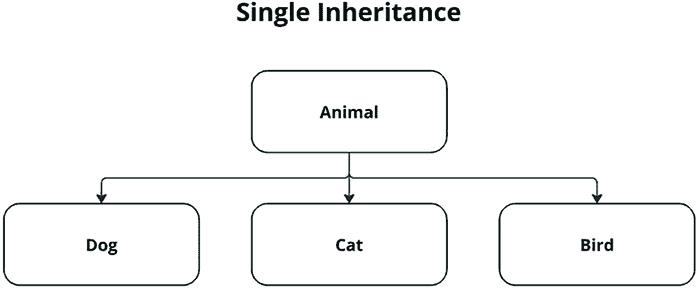

**图 8.1:** 单继承

### 继承属性与方法

继承属性和方法意味着父合约中定义的所有状态变量和函数都是可用的。在 `Solidity` 中，派生合约可以使用 `is` 关键字继承多个基合约。

```solidity
contract A {
    virtual function foo() public returns (string memory) {
        return "A";
    }
}

contract B {
    virtual function foo() public returns (string memory) {
        return "B";
    }
}

contract C is A, B {
    function foo() public override returns (string memory) {
        return super.foo();
    }
}
```

当多个基合约定义相同的函数时，派生合约必须重写该函数以解决歧义。`super` 关键字用于调用父合约的实现。

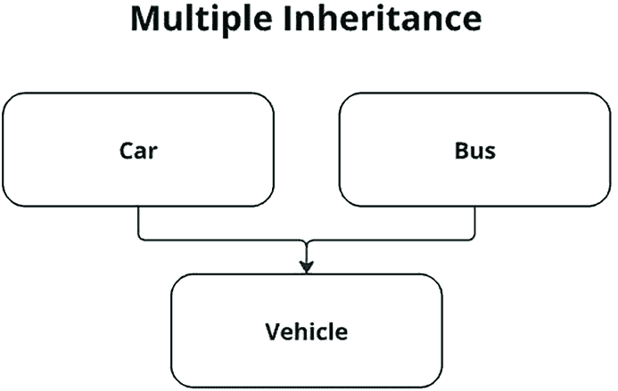

**图 8.2:** 多重继承

### Solidity 中的多态

多态允许在派生合约中重写函数，从而实现动态行为。在 `Solidity` 中，多态可以通过基合约中的 `virtual` 关键字和派生合约中的 `override` 关键字来说明。

然而，需要注意的是，在许多编程语言中，多态也指函数重载，即多个函数具有相同的名称但不同的参数。`Solidity` 支持同一合约内的函数重载，但不支持跨合约重载。

```solidity
contract Calculator {
    function add(uint a, uint b) public returns (uint) {
        return a + b;
    }

    function add(uint a, uint b, uint c) public returns (uint) {
        return a + b + c;
    }
}
```

在这个示例中，两个 `add` 函数名称相同但参数数量不同，通过函数重载演示了多态。当调用 `add` 时，编译器根据提供的参数数量来决定执行哪个函数。

为了更好地通过继承理解多态，请考虑一个现实世界的例子：想象有一个基合约 `Country`，它有一个提供默认税率的函数 `getTaxRate()`。派生合约（如 `ProvinceA` 和 `ProvinceB`）可以重写此函数，根据特定的区域规则提供不同的税率。

```solidity
// Base contract
contract Country {
    function getTaxRate() public virtual returns (uint) {
        return 10; // 默认税率
    }
}

// 派生合约 ProvinceA
contract ProvinceA is Country {
    function getTaxRate() public override returns (uint) {
        return 12; // ProvinceA 的特定税率
    }
}

// 派生合约 ProvinceB
contract ProvinceB is Country {
    function getTaxRate() public override returns (uint) {
        return 8; // ProvinceB 的特定税率
    }
}
```

在这个示例中，`getTaxRate()` 函数在基合约 `Country` 中定义，并被派生合约 `ProvinceA` 和 `ProvinceB` 重写。当 `ProvinceA` 或 `ProvinceB` 的实例调用 `getTaxRate()` 时，执行相应的重写实现，演示了通过继承实现的多态。

多态性非常有用，因为它允许派生合约具有自定义行为，同时仍遵循基合约中定义的通用接口。这使得系统更具模块化和灵活性，在构建可升级合约时尤为有利，因为函数的特定行为可能会随着时间的推移而改变。

## 使用继承的最佳场景

在构建一组共享通用逻辑的合约时，继承特别有用，例如代币标准（`ERC20` 和 `ERC721`）。它有助于通过集中管理通用功能来减少代码重复并增强可维护性。

## 抽象合约与接口

抽象合约和接口是 `Solidity` 中强大的工具，用于强制结构、促进一致性并实现跨合约的无缝互操作性。

### 抽象合约

抽象合约是不能独立实例化的合约。它们通常定义了派生合约必须实现的通用函数，并且在定义基础行为而不提供完整实现时，它们非常有用。当你希望在派生合约中强制某种结构，但将具体的实现细节留给这些派生合约时，抽象合约特别有帮助。

抽象合约有助于确保所有派生合约共享一致的接口，使代码更具预测性且更容易处理。它们既可以包含完全实现的函数，也可以包含必须由派生合约覆盖的抽象函数。

例如，考虑一个抽象合约 `Vehicle`，它定义了一个通用函数 `drive()`，但没有实现它：

```solidity
abstract contract Vehicle {
    function drive() public virtual;
}

contract Car is Vehicle {
    function drive() public override {
        // 实现特定于汽车的 drive
    }
}

contract Bike is Vehicle {
    function drive() public override {
        // 实现特定于自行车的 drive
    }
}
```

在前面的示例中，`Vehicle` 是一个抽象合约，`Car` 和 `Bike` 为 `drive` 函数提供了自己的实现。抽象合约用于定义基础层逻辑，可以根据派生合约的要求以不同方式进行扩展。这允许不同类型车辆之间代码的一致性，强制所有类型都拥有 `drive()` 方法，同时允许在该方法的实现方式上保持灵活性。

使用抽象合约有助于维护代码的模块化和可预测性，特别是当与多个开发者合作或创建一个供他人在此基础上的框架时。

### 接口


接口类似于抽象合约，但受到某些限制。接口旨在定义合约的结构而不提供任何实现。它们特别适用于定义一组其他合约必须实现的函数，从而实现标准化和互操作性。

以下是关于 Solidity 接口的一些关键点：

- 接口中的所有函数都是隐式的 `external` 且没有函数体。
- 接口不能拥有状态变量、构造函数或任何实现逻辑。
- 接口通常用于与外部合约交互。

考虑一个接口定义代币合约结构的示例：

```solidity
interface IToken {
    function transfer(address recipient, uint256 amount) external;
    function balanceOf(address account) external returns (uint256);
}

contract MyToken {
    function transfer(address recipient, uint256 amount) external {
        // 实现
    }
    function balanceOf(address account) external returns (uint256) {
        // 实现
    }
}
```

在前面的示例中，`IToken` 是一个接口，`MyToken` 实现了 `transfer` 和 `balanceOf` 函数。

## 使用抽象合约和接口的最佳场景

- **抽象合约**：当你希望在派生合约中强制基础行为，但留出这些行为实现的具体细节时，使用抽象合约。
- **接口**：当你想要定义一个其他合约遵循的标准时使用接口，特别是在与外部合约交互时。

## 库与复用代码

库是创建可复代码片段的强大方式。它们允许开发者编写可以在多个合约之间使用的函数，促进模块化并减少冗余。库在处理工具函数时特别有用。

Solidity 开发中最流行的库之一是 `OpenZeppelin`。`OpenZeppelin` 提供了一套可复且安全的智能合约组件，包括用于……的库。

## 常用库概述

- **OpenZeppelin**：`OpenZeppelin` 是一个著名的库，提供安全的、经过社区审查的智能合约组件。它包括 `ERC20` 和 `ERC721` 等代币标准、`访问控制`模块、`治理`系统，以及用于`数学`（`SafeMath`）、`访问管理`（`Ownable`）和`安全`的工具库。
- **SafeMath**：该库也由 OpenZeppelin 提供，对于处理 Solidity 中的算运算至关重要。在 Solidity 0.8 之前，算运算可能会导致溢出和下溢问题。`SafeMath` 提供了安全的封装，在……抛出错误。
- **DS-Math**：`dappsys` 库套件的一部分，`DS-Math` 提供了与 `SafeMath` 的基础数学运算。它通常用于 DeFi 项目。
- **Oraclize/Ethereum-Bridge**：`Oraclize` 等库提供了将真实世界数据引入智能合约的工具，而智能合约通常是隔离的。这使得智能合约能够与外部数据交互，这是各种去中心化应用的共同需求。

## 区块上的库存储

库可以部署为独立的合约，也可以链接到其他合约。Solidity 支持两种类型的库：`deployed libraries`（在链上具有地址的部署库）和 `inline libraries`（内联库）。部署的库可以通过将其地址链接到其他合约来重复复用。这有助于节省 Gas 费用，因为库的代码不需要每个使用它的合约中重复复制。

当库被部署时，它被存储在区块链上，并拥有自己唯一的地址。想要使用该库的其他合约链接到此地址，从而在不复制代码的情况下有效地复用库代码。这种方法降低了与智能合约部署和维护相关的 Gas 成本。库在被链接时充当了外部存储的形式，这意味着当合约调用库的函数时，它执行的是来自已部署库地址的代码。

相比之下，内联库包含在合约本身内部。内联库的代码包含在合约的字节码中，这会导致部署成本增加，但由于所有内容都是自包含的，架构变得更加简单。

```sol
library Math {
  function add(uint a, uint b) internal pure returns (uint) {
    return a + b;
  }
}

contract Calculator {
  using Math for uint;
  function calculateSum(uint a, uint b) public pure returns (uint) {
    return a.add(b);
  }
}
```

在前面的示例中，`Math` 库提供了一个可复用的 `add` 函数。`using` 指令允许 `Calculator` 合约无缝地使用库方法。这种使用库的方法在同一组工具函数需要应用于多个合约时是非常有益的。

## 库代码在区块链上的存储

与典型的合约不同，库不能持有 Ether，也不能在函数调用之间维持状态。这使得它们适用于无状态操作。部署时，库会像普通智能合约一样获得自己的地址。使用该已部署库的合约引用此地址，任何对库函数的调用都会被重定向到此地址。结果是，库的字节码只需要部署一次，多个合约就可以重复使用它，而无需反复重新部署相同的逻辑。

库的这种特性不仅有助于节省 Gas 费用，还确保了库代码在部署后保持不可变性和安全性，因为所有引用都重定向到了同一个已部署的地址。然而，如果库需要更新，你将需要重新部署新版本并相应地更新引用的合约，这是一个需要注意的限制。

使用社区认可的库（如 OpenZeppelin 库）有助于缓解智能合约的漏洞，因为它们经过了社区的彻底审计和测试。这帮助开发者专注于构建应用程序的独特功能，同时利用成熟的解决方案处理常见功能。

### 高级数据结构：Mappings、Structs 和 Enums

Solidity 提供了强大的数据结构和工具，如 mappings、structs、enums 和索引事件（indexed events），以便在区块链上高效地组织、管理和跟踪数据。

### Mappings

Mappings 是键值对数据结构，用于存储值之间的关系。它们在 Solidity 中经常用于存储目的，类似于 Python 中的字典，使用键来存储和检索值。主要的区别在于，在 Solidity 中，无法无法直接进行迭代，且键不需要显式地存储。

在 Solidity 中，mappings 通常用于跟踪余额、所有权或 ID 与数据之间的关联。它们提供了一种通过唯一键访问数据的有效方法，就像在 Python 中使用字典一样。

```solidity
contract StudentRecords {
  mapping(uint => string) public studentNames;
  function setStudentName(uint id, string memory name) public {
    studentNames[id] = name;
  }
}
```

在前面的示例中，`studentNames` 将学生 ID 映射到他们的名称。这类似于 Python 字典，其中 `id` 充当键`name` 充当值。

**Mappings 的最佳场景：** 当你需要一种简单且高效的方法通过唯一键查找数据时（例如管理用户余额、跟踪所有权或分配角色），Mappings 是最有效的。Mappings 不是可迭代的，因此当你需要对所有元素执行操作（如迭代或枚举）时，它们就不那么适用。

### Structs

Structs 允许将多个变量分组到一个类型中，从而实现更复杂的数据表示。Solidity 中的 structs 类似于 Python 或面向对象语言中的对象。它们提供了一种定义包含多个字段的自定义类型的方法，有助于逻辑上组织相关数据。

```solidity
struct Student {
  uint id;
  string name;
  uint age;
}

contract School {
  mapping(uint => Student) public students;
  function addStudent(uint id, string memory name, uint age) public {
    students[id] = Student(id, name, age);
  }
}
```

在前面的示例中，`Student` struct 允许我们将关于学生的信息分组。`School` 合约使用 mapping 将学生 ID 与其对应的 `Student` struct 关联。

**Structs 的最佳场景：** Structs 非常适用于表示具有多个属性的实体，例如用户配置文件、产品数据或金融交易。Structs 有助于减少管理多个变量的复杂性并提供逻辑分组，使你的合约更易读。

### Enums

Enums 是用户定义的类型，允许对自定义值进行枚举。它们有助于维护可读的代码和管理状态。enums 有助于表示一组固定选项，就像其他语言中的枚举类。例如，交通灯的状态（红、黄、绿）可以使用 enum 表示。

```solidity
contract TrafficLight {
  enum Light { Red, Yellow, Green }
  Light public currentLight;
  function setLight(Light light) public {
    currentLight = light;
  }
}
```

在前面的 `TrafficLight` 示例中，`Light` enum 有助于清晰地定义和管理交通灯的不同状态，使代码更具可读性。

**Enums 的最佳场景：** 当你需要定义一个只能取有限特定值的变量时，enums 是最合适的，例如管理合约状态（`Pending`、`Active`、`Closed`）、定义用户角色（`Admin, User, Guest`）或任何你需要受控值集的情况。它们有助于提高代码可读性，并减少变量分配无效值的概率。

### Solidity 中的 indexed 关键字

`indexed` 关键字在 Solidity 中声明事件时使用。它允许将事件的最多三个参数标记为索引，使得它们在事务日志中可搜索。当触发事件时，被标记为 `indexed` 的参数被存储在被称为“主题”（topic）的可搜索数据结构中。这使得根据特定值过滤事件变得更容易。

```solidity
contract ExampleContract {
  event UserRegistered(address indexed userAddress, uint256 userId);
  function registerUser(uint256 userId) public {
    emit UserRegistered(msg.sender, userId);
  }
}
```

在前面的示例中，`UserRegistered` 事件具有一个 `indexed` 的参数 `userAddress`。这意味着你可以通过 `userAddress` 在交易日志中搜索 `UserRegistered` 事件，从而更容易地识别与特定地址相关的所有事件。

索引事件（Indexed Events）的最佳适用场景：当你需要跟踪或过滤特定的发生情况时，使用 `indexed` 参数非常有用，例如查找与特定地址相关的所有交易，或监控特定用户的交互历史。它显著提升了从区块链中检索事件数据的效率，特别是在处理大量日志时。

### 内联汇编与 Yul 语言

Solidity 允许使用内联汇编进行低级操作，从而提供了对以太坊虚拟机（EVM）的更多控制。汇编代码对于优化以及访问某些 Solidity 无法直接访问的 EVM 特性特别有用。

内联汇编为开发者提供了在最底层编写代码的能力，允许对 EVM 执行操作的方式进行精确控制。这对于 Gas 优化作为优先事项的情况，或者与 Solidity 高级语言未直接暴露的 EVM 特性交互时可能至关重要。

### 内联汇编示例

```solidity
contract InlineExample {
    function add(uint x, uint y) public pure returns (uint result) {
        assembly {
            result := add(x, y)
        }
    }
}
```

内联汇编也可以用于访问 Solidity 中不直接提供的特殊 EVM 操作码，例如 `sload` 和 `sstore`，以便直接与合约存储交互。

## 示例：从存储中存储和加载数据

内联汇编允许使用 `sstore` 和 `sload` 操作码直接访问存储槽，这对于优化存储交互有益。

```solidity
contract StorageExample {
    function storeValue(uint slot, uint value) public {
        assembly {
            sstore(slot, value)
        }
    }
    function loadValue(uint slot) public view returns (uint result) {
        assembly {
            result := sload(slot)
        }
    }
}
```

在前面的示例中，`storeValue` 函数使用 `sstore` 在特定的存储槽中存储值，而 `loadValue` 函数使用 `sload` 从存储槽中检索值。这种程度的控制对于 Gas 优化可能至关重要，特别是在处理需要对存储进行精确控制的可升级合约时。

### 访问外部变量、函数和库

内联汇编还允许访问同一合约内的外部变量和函数。你可以调用函数、与状态变量交互，甚至直接操作存储。

```solidity
contract ExternalAccessExample {
    uint public data;
    function setData(uint value) public {
        assembly {
            sstore(data.slot, value)
        }
    }
    function getData() public view returns (uint result) {
        assembly {
            result := sload(data.slot)
        }
    }
}
```

在这个示例中，`data.slot` 被用于访问 `data` 变量的存储槽。内联汇编允许你直接操作合约存储，这对于优化 Gas 成本或在可升级合约中管理存储布局有利。

### 场景：可升级智能合约

内联汇编在实现可升级智能合约时特别有用。在可升级合约的情况下，开发者通常需要仔细地管理存储槽，以确保存储布局在合约的不同版本之间保持一致。通过使用内联汇编，开发者可以直接与特定的存储槽交互，从而更容易实现代理和其他其他模式，这些模式要求对数据存储和检索的方式进行精确控制。

例如，代理模式（Proxy Pattern）通常涉及一个代理合约将调用委托给实现合约，同时保持一致的存储布局。内联汇编可以高效地管理委托调用（delegate calls），并确保数据在代理和实现合约之间正确传递。

```solidity
contract Proxy {
    address implementation;
    function upgrade(address _newImplementation) public {
        implementation = _newImplementation;
    }
    fallback() external {
        assembly {
            let ptr := mload(0x40)
            calldatacopy(ptr, 0, calldatasize())
            let result := delegatecall(gas(), sload(implementation.slot), ptr, calldatasize(), 0, 0)
            returndatacopy(ptr, 0, returndatasize())
            switch result
                case 0 { revert(ptr, returndatasize()) }
                default { return(ptr, returndatasize()) }
        }
    }
}
```

在前面的示例中，内联汇编被用于 fallback 函数中以将调用委托给当前的实现合约。这种方法在保持原始存储结构的同时，为管理可升级合约的逻辑提供了灵活性。

### Yul 语言

Yul 是一种用于 EVM 的底层中间语言。它被设计为一种更具读性的汇编形式，用于编写高度优化的代码。Yul 可以被编译为 EVM 字节码，与内联汇编相比，它可以以更结构化的方式编写复杂的低级逻辑。

```yul
function add(uint256 a, uint256 b) -> result {
    result := add(a, b)
}
```

当开发者需要编写可以在多个平台运行的代码时（例如 EVM 和 eWASM，以太坊风格的 WebAssembly），Yul 特别有用。这使得 Yul 成为跨平台兼容性的重要工具。

Yul 为类汇编编程提供了更具读性的语法，可用于 Gas 优化和复杂的低级逻辑。它还支持 `if` 语句、`for` 循环和 `switch` 语句等控制结构，使得比传统的内联汇编更容易实现复杂的逻辑。

### Yul 有用的场景


### Gas 优化

与高级 Solidity 代码相比，使用 Yul 编写某些操作可以显著降低 Gas 成本。这对于预计处理大量交易并需要降低运营成本的合约特别适用。

### 跨平台兼容性

Yul 编译到不同后端（如 EVM 和 eWASM）的能力使其成为需要跨平台兼容性项目的绝佳选择。

### 低级操作

在非常底层与 EVM 交互时，Yul 比高级 Solidity 能提供更多的控制权和灵活性，使其对于实现自定义加密函数或管理原始字节码非常有用。

## 使用内联汇编和 Yul 的最佳实践

- **谨慎使用**：内联汇编和 Yul 提供了优化合约的强大工具，但如果使用不当可能会引入漏洞。始终确保汇编代码经过彻底的审查和测试。
- **Gas 优化**：在 Gas 节省至关重要时使用内联汇编和 Yul。例如，减少冗余的存储读写或实现自定义数学运算可以节省大量的 Gas。
- **代码可读性**：通过将内联汇编的使用限制在需要优化的关键部分来保持代码的可读性。当需要更具可读性的低级代码时，Yul 是一个很好的替代方案。

内联汇编和 Yul 是高级 Solidity 开发人员的价值工具，能够对智能合约与 EVM 的交互方式进行细粒度的控制。通过理解如何有效使用这些工具，开发者可以构建高效且灵活的智能合约，以适应不断变化的需求，特别是在涉及可升级性和底层优化的场景。

## Gas 优化技术

优化 Gas 成本在 Solidity 开发中至关重要。Gas 优化有助于降低合约部署和交互的成本，使你的去中心化应用更具经济性和可扩展性。可以采用多种技术来提高 Solidity 合约的 Gas 效率：

### 存储变量打包 (Packing Storage Variables)

通过分组变量来减少存储槽以降低 Gas 成本。在 Solidity 中，存储是最昂贵的数据处理形式。通过将使用位较少的变量（如 `uint8`、`uint16`、`bool` 等）打包到单个存储槽中，开发者可以显著降低 Gas 成本。

```sol
contract PackedStorage {
    uint128 public smallValue1;
    uint128 public smallValue2;
    // 因为 smallValue1 和 smallValue2 都能放入 256 位，所以它们可以打包到一个槽中。
}
```

在前面的示例中，`smallValue1` 和 `smallValue2` 都使用 `uint128` 数据类型，它们可以打包进单个 256 位的存储槽中。这有助于减少使用的存储槽数量，最终节省 Gas。

### 布尔表达式的短路 (Short-Circuiting Boolean Expressions)

在布尔表达式中先评估开销较小的条件以防止不必要的计算。短路机制允许 Solidity 在条件结果确定后停止评估，从而节省 Gas。

```solidity
function isEligible(uint age, bool hasValidID) public pure returns (bool) {
    // 将更廉价的条件（年龄检查）放在前面以实现短路
    return age >= 18 && hasValidID;
}
```

在前面的示例中，如果 `age` 小于 18，则不会评估 `hasValidID` 检查，从而节省 Gas。

### 最小化存储读/写 (Minimize Storage Reads/Writes)

减少存储变量的使用，因为它们与内存变量相比成本极高。从存储读取或写入存储比使用内存或栈要贵得多。可能的情况下，将数据加载到内存并在函数内部使用，而不是反复访问存储。

```solidity
uint256 public a;
uint256 public b;

function optimized() public {
    uint256 tempA = a; // 从存储加载到内存
    uint256 tempB = b; // 从存储加载到内存
    uint256 temp = tempA + tempB; // 使用内存最小化昂贵的存储操作
    a = temp; // 仅写回存储一次
}
```

### 函数参数使用 `calldata` 代替 `memory`

在处理外部函数时，尽可能对参数使用 `calldata`，因为与 `memory` 相比，它的 Gas 效率更高。

```solidity
function processArray(uint[] calldata inputArray) external {
    // 与使用内存相比，使用 calldata 可以节省 Gas
}
```

`calldata` 在数据不需要修改时特别有用，因为它避免了将数据拷贝到内存，从而降低了 Gas 成本。

### 避免动态存储访问的循环 (Avoid Loops with Dynamic Storage Access)

遍历大型存储数组非常消耗 Gas。最好最小化循环或使用链下数据处理以避免 Gas 耗尽。

```solidity
uint[] public largeArray;
function inefficientLoop() public view {
    for (uint i = 0; i < largeArray.length; i++) {
        // 在循环中反复访问存储是昂贵的
        uint value = largeArray[i];
    }
}
```

相反，考虑将循环分成更小的块或在链下处理数据以节省 Gas。

### 算术操作使用 `unchecked`

从 Solidity 0.8 开始，算术操作带有内置的溢出和下溢检查，这会增加显著的 Gas 成本。在确定的不会发生溢出或下溢的场景下，使用 `unchecked` 来节省 Gas。

```solidity
function addUnchecked(uint a, uint b) public pure returns (uint) {
    unchecked {
        return a + b;
    }
}
```

注意，使用 `unchecked` 时应格外谨慎，因为如果使用不当，可能会导致漏洞。

### 预计算昂贵操作 (Precompute Expensive Operations)

如果一个函数包含重复的昂贵计算，请考虑预计算这些值并将结果存储在状态变量或内存变量中。

```sol
uint public constantValue = 10 ** 18; // 预计算的值以节省 Gas
function compute() public view returns (uint) {
    // 使用预计算的常量而不是每次重新计算
    return constantValue * 2;
}
```

### 高效使用 `struct` 和 `mapping`

在处理如 `struct` 或 `mapping` 等复杂数据结构时，确保它们的设计高效，以最小化 Gas 成本。避免将 `storage` 结构体作为临时变量；应尽可能使用 `memory`。

```solidity
struct User {
    uint balance;
    uint age;
}

mapping(address => User) public users;

function updateUserAge(address userAddress, uint newAge) public {
    User memory user = users[userAddress]; // 将结构体加载到内存
    user.age = newAge;
    users[userAddress] = user; // 写回存储
}
```

### 批量处理 (Batch Processing)

与其单独执行多个状态更改交易，不如将它们分组为批处理以降低整体 Gas 成本。批量处理减少了与多个单独交易相关的开销。

```solidity
function batchUpdate(uint[] memory values) public {
    for (uint i = 0; i < values.length; i++) {
        // 在单个交易中执行更新
        // 这比调用单独交易更节省 Gas
    }
}
```

### 使用事件代替链上存储数据

事件比在链上存储数据要便宜。如果某些数据仅用于日志记录，请使用事件而不是将其存储在状态变量中。

```solidity
event UserAction(address indexed user, string action);

function logAction(string memory action) public {
    emit UserAction(msg.sender, action); // 记录操作而非存储
}
```

## 高级 Solidity 安全考虑

安全性是智能合约开发的关键方面。由于智能合约一旦部署就不可更改，代码中的任何漏洞都可能被利用，导致严重的财务损失和项目信誉损害。以下是开发者必须注意的一些关键安全考虑：

- **重入攻击 (Reentrancy Attacks)**：通过使用“检查-效果-交互”模式和重入锁来防止重入攻击，在进行外部调用之前更新状态变量。
- **溢出与下溢 (Overflow and Underflow)**：使用 Solidity 0.8+ 或 SafeMath 来避免整数溢出和下溢漏洞。
- **访问控制 (Access Control)**：使用 OpenZeppelin 的 `Ownable` 或 `AccessControl` 实现适当的访问控制，将敏感函数限制为授权用户。
- **Delegatecall 风险**：谨慎使用 `delegatecall`，特别是在可升级合约中，因为使用不当会导致严重的漏洞。
- **抢跑 (Front-Running)**：通过使用提交-揭晓方案或随机性来缓解抢跑，使交易更难以预测。
- **Gas 限制与拒绝服务 (Gas Limit and DoS)**：避免依赖动态数据的无界循环，并使用拉取支付（pull payment）机制以防止 Gas 耗尽和拒绝服务（DoS）。
- **随机性漏洞**：避免使用 `block.timestamp` 或 `blockhash` 生成随机数。使用 `Chainlink VRF` 进行安全的随机数生成。
- **钓鱼与社会工程**：使用 `EIP-712` 对结构化数据进行签名，以确保用户签名的完整性并防止重放攻击。

这些安全考虑将在后文中进行详细讨论。通过遵循这些实践，开发者可以显著降低部署智能合约相关的风险，最终使去中心化应用程序变得更加安全和可靠。

## 开发可升级合约

开发可升级合约是随时间推移维护和演进区块链项目的重要方面。由于智能合约一旦部署就是不可更改的，可升级合约提供了一种引入新功能、修复漏洞或进行改进的机制，而不会破坏现有状态。本节介绍了 Solidity 中开发可升级合约的一些常用方法。

### 代理模式

`Proxy Pattern` 是可升级合约最广泛使用的方法。它涉及将合约逻辑分为两个部分：`proxy contract`（代理合约）和 `implementation contract`（实现合约）。`proxy contract` 维护状态，而 `implementation contract` 持有逻辑。通过使用 `delegatecall` 机制，代理可以将函数调用委托给实现合约。

#### 代理模式的工作原理：

- **代理合约**：该合约包含存储变量和一个 `fallback` 函数，后者将函数调用委托给当前的实现合约。
- **实现合约**：该合约包含实际逻辑和函数。
- **可升级性**：要升级合约，需要部署一个新的实现合约，并将代理指向实现合约的指针更新为新合约。

```sol
contract Proxy {
    address public implementation;
    function upgrade(address _newImplementation) public {
        implementation = _newImplementation;
    }
    fallback() external {
        (bool success, ) = implementation.delegatecall(msg.data);
        require(success, "Delegatecall failed");
    }
}
```

在前面的示例中，`proxy contract` 包含实现地址的引用，并使用 `delegatecall` 转发函数调用。这确保了所有函数调用都在 `proxy contract` 的上下文中执行，从而在升级过程中保留状态。

### EIP-1967 和透明代理模式

`EIP-1967` 和 `Transparent Proxy Pattern` 是开发可升级合约的常用标准。这些模式有助于避免代理与实现合约之间使用的存储发生碰撞。`EIP-1967` 指定了用于存储实现地址和其他元数据的固定存储槽，确保存储布局之间没有冲突。

### UUPS 代理模式

`Universal Upgradeable Proxy Standard (UUPS)` 模式是构建可升级合约的另一种流行方法。在 `UUPS` 中，升级逻辑直接嵌入在实现合约中，而不是代理合约中。这降低了代理的复杂性，使其更具 Gas 效率。

在 `UUPS` 模式中，实现合约包含一个 `upgradeTo` 函数，该函数可以修改代理中存储的实现地址。这使得合约升级变得更具灵活性且更简单。

### 可升级合约的考虑因素

- **存储布局**：在不同的实现之间保持一致的存储布局至关重要，以避免损坏状态。向合约添加新的存储变量时必须谨慎进行，不能更改现有变量的顺序。
- **访问控制**：合约升级应仅限制为授权用户。使用 `OpenZeppelin's Ownable` 或 `AccessControl` 可以帮助确保只有受信任的实体才能触发升级。
- **代理管理员**：代理管理应与代理本身分离。使用专用的管理员合约可以确保升级权限与代理的通用功能区分开来。

### 示例：可升级代币合约

这是一个使用 `Transparent Proxy Pattern` 实现可升级代币合约的示例：

**代理合约**：处理向当前实现合约委托函数调用。

```solidity
contract TokenProxy {
    address public implementation;
    constructor(address _implementation) {
        implementation = _implementation;
    }
    function upgrade(address _newImplementation) external {
        implementation = _newImplementation;
    }
    fallback() external payable {
        address _impl = implementation;
        require(_impl != address(0), "Implementation contract not set");
        assembly {
            let ptr := mload(0x40);
            calldatacopy(ptr, 0, calldatasize());
            let result := delegatecall(gas(), _impl, ptr, calldatasize(), 0, 0);
            returndatacopy(ptr, 0, returndatasize());
            switch result {
                case 0 { revert(ptr, returndatasize()) }
                default { return(ptr, returndatasize()) }
            }
        }
    }
}
```

**实现合约**：包含代币的逻辑。

```solidity
contract TokenV1 {
    mapping(address => uint256) public balances;
    function transfer(address to, uint256 amount) public {
        require(balances[msg.sender] >= amount, "Insufficient balance");
        balances[msg.sender] -= amount;
        balances[to] += amount;
    }
}
```

要升级代币合约，需要部署一个新的实现（例如 `TokenV2`），并更新代理的实现地址以指向新版本。

### 可升级合约的优势

- **修复漏洞**：可以在不部署新合约的情况下修复漏洞，确保了连续性和用户信任。
- **功能更新**：可以向现有合约添加新功能，为演进的项目需求提供灵活性。
- **状态保留**：可升级合约在升级过程中保留状态，这对于代币、治理或任何持有关键用户数据的合约来说至关重要。

### 可升级合约的挑战

- **复杂性**：管理存储布局、代理和升级增加了复杂性，如果处理不当会增加错误的可能性。
- **Gas 成本**：与不可升级合约相比，可升级合约中的委托调用和额外检查可能会增加 Gas 成本。
- **安全风险**：必须妥善保护升级过程，以防止未经授权的升级或恶意修改。


可升级合约在使区块链项目适应变化的需求并修复漏洞方面发挥着本质作用。通过使用代理模式、透明代理和 UUPS 等成熟模式，开发者可以创建既灵活又安全的合约，确保项目的长期成功。

## 合约架构的最佳实践

**关注点分离**：

智能合约应遵循`关注点分离`（Separation of Concerns）原则，这意味着将合约功能分解为更模块化的组件。每个组件应处理特定的职责，这使其更易维护和测试。例如，将功能拆分为存储、访问控制和业务逻辑的独立合约。

- `模块化合约`：将合约拆分为如`Token`、`Governance`和`Treasury`等模块。
- `示例`：一个典型的 ERC20 代币合约可以将所有权管理委托给`Ownable`合约，同时保持核心代币逻辑分离。

### 库的使用

`Libraries`是在多个合约之间重用常用代码的强大工具。它们有助于减少代码重复，使合约更具维护性且更节省 Gas 费用。

- 使用知名库（如`OpenZeppelin`）以减少漏洞。
- `工具库`：诸如`SafeMath`、`Address`等其他常用工具函数可以重用，以提高一致性并降低 Gas 费用。

### 最小化外部调用

尽可能减少对其他合约的`外部调用`，因为它们会引入重入攻击的风险并增加 Gas 费用。在与外部合约交互时，确保在调用之前执行所有检查。

- `检查-影响-交互 (Checks-Effects-Interactions)`：遵循此模式以最小化与外部调用和重入漏洞相关的风险。

### 优先使用拉取支付而非推送支付

在向用户转移资金时，优先使用`拉取支付`（pull payments）而非`推送支付`（push payments）。在拉取系统中，用户请求提现，而不是由合约自动发送资金。这有助于防止 DoS 攻击，恶意者可能会阻止他人接收支付。

```solidity
mapping(address => uint256) public balances;

function withdraw() public {
    uint256 amount = balances[msg.sender];
    require(amount > 0, "No balance to withdraw");
    balances[msg.sender] = 0;
    payable(msg.sender).transfer(amount);
}
```

## 可升级性的一致存储布局

对于可升级合约，在合约版本之间保持`一致的存储布局`至关重要。如果操作不当，在存储布局中引入更改会导致数据损坏。

- `存储间隙 (Storage Gap)`：使用预留存储槽以确保在添加新变量时的未来兼容性。

```solidity
uint256[50] private __gap; // 为未来的存储变量预留的空间
```

## 访问控制

实施严格的`访问控制`机制，将敏感函数限制给特定角色，例如合约所有者或管理员。这有助于防止未经授权的用户执行关键操作。

- `基于角色的访问控制 (RBAC)`：使用 OpenZeppelin 的`AccessControl`合约定义角色，如`ADMIN_ROLE`、`MINTER_ROLE`等。
- `Ownable 合约`：使用`Ownable`模式进行单所有者访问控制。

## 使用事件实现透明化

对所有关键状态更改触发`事件`（events），例如所有权转移、代币传输和升级。事件有助于提供透明度，并更容易跟踪区块链上的活动。

```solidity
event OwnershipTransferred(address indexed previousOwner, address indexed newOwner);

function transferOwnership(address newOwner) public onlyOwner {
    emit OwnershipTransferred(owner, newOwner);
    owner = newOwner;
}
```

## 可升级性考量

如果可升级性是一项需求，请从一开始就根据可升级性设计架构。使用`代理模式`（proxy patterns）在委托逻辑的同时保持状态。

- `透明代理模式`：使用此模式分离逻辑和状态。
- `UUPS 模式`：使用此模式通过实现合约增加升级管理的灵活性。

## 避免深层继承树

避免深层继承树，因为它们会使合约变得更加复杂且难以理解。相反，应尽可能优先使用组合而非继承，以保持简单性。

- `浅层继承`：使用浅层继承以保持清晰并易于审计。
- `组合`：使用库和模块化组件，而不是依赖深层继承。

### Gas 优化技术

使用`gas 优化`技术确保您的合约在部署和交互时是经济的。Gas 效率对于面向用户的应用程序尤为重要，可以确保更好的用户体验。

- `变量压缩`：对存储变量进行紧凑打包以最小化存储占用。
- `避免动态数组`：尽可能使用固定大小的数据结构以限制 Gas 消耗。

## 谨慎实现 Fallback 和 Receive 函数

谨慎地实现`fallback`和`receive`函数，因为它们是意外交易的入口。始终确保这些函数具有最少的逻辑，以避免引入漏洞。

```solidity
fallback() external payable {
    // 以最少逻辑处理传入的 ether
}
```

通过遵循这些最佳实践，开发者可以创建可维护且高效的智能合约，在适应不断变化的需求的同时减少漏洞并确保无缝的用户体验。

## 结论

在本章中，我们探索了 Solidity 和智能合约开发的高级概念，重点关注继承、抽象合约、库、数据结构、内联汇编、Gas 优化、安全考虑、可升级合约以及合约架构的最佳实践。理解这些主题将允许开发者创建更复杂、更安全的去中心化应用程序，有效利用区块链的独特特性。

在下一章中，我们将深入研究`代币化与代币标准`，探索作为 ERC20、ERC721 和 ERC1155 的不同类型代币，以及如何利用它们来构建广泛的去中心化应用程序。

### 要点回顾

- `继承`：从父合约扩展功能的机制。
- `抽象合约和接口`：定义派生合约的通用结构，促进一致性和模块化。
- `库`：提供可重用的代码段，促进模块化并减少冗余。
- `高级数据结构`：映射（Mappings）、结构体和枚举对于管理智能合约中的复杂数据至关重要。
- `内联汇编和 Yul`：用于底层操作和优化，提供了对 EVM 的更多控制。
- `Gas 优化`：通过变量打包、使用`calldata`和避免存储循环等技术来降低 Gas 费用。
- `安全考虑`：防止重入、溢出、抢跑攻击和未经授权访问等漏洞。
- `可升级合约`：代理模式允许在不丢失状态的情况下升级合约。
- `最佳实践`：关注点分离、最小化外部调用、一致的存储布局和使用库确保合约的可维护性和安全性。

### 术语表

- `Inheritance`：从父合约扩展功能的机制。
- `Abstract Contract`：无法实例化的基合约。
- `Interface`：没有实现的合约结构，用于与其他合约交互。
- `Library`：Solidity 中可重用的代码模块。
- `Mapping`：一种将键与值关联的数据结构，类似于字典。
- `Struct`：将多个变量分组到一起的自定义数据类型。
- `Enum`：具有有限常量值集合的用户定义类型。
- `Inline Assembly`：嵌入在 Solidity 中的低级 EVM 代码。
- `Yul`：用于编写优化后的 EVM 代码的中间语言。
- `Gas Optimization`：最小化合约执行时 Gas 成本的技术。
- `Proxy Pattern`：一种用于创建可升级合约的设计模式。
- `Access Control`：限制仅允许授权用户执行函数的控制机制。
- `Separation of Concerns`：将合约功能划分为不同的模块，以便更易维护。

# 第 9 章 代币化与代币标准

### 引言

代币化是区块链技术最具变革性的方面之一，它允许以数字形式在区块链上对资产进行表示。从 Ether 等加密货币到代表数字艺术的非同质化代币（NFTs），代币化正在开启新的所有权、商业和金融创新形式。在本章中，我们将探索以太坊如何通过其广泛采用的代币标准促进代币化，包括用于同质化代币的`ERC20`和用于非同质化代币的`ERC721`。我们还将讨论如何使用 Solidity 和`OpenZeppelin`创建并部署这些代币。

### 结构

本章结构如下：

- 理解代币化与数字资产
- 用于同质化代币的 ERC20 标准
- 用于非同质化代币（NFTs）的 ERC721 和 ERC1155
- 稳定币：概念与示例
- 使用 Solidity 和 OpenZeppelin 创建代币
- 在以太坊测试网上部署代币
- 代币经济学与用例
- 监管考量

### 理解代币化与数字资产

代币化是将资产的所有权转换为区块链上数字代币的过程。代币可以代表几乎任何东西——房地产、公司股票、收藏品甚至是投票权。代币化带来了许多优势，包括碎片化所有权、增加流动性和透明度。在以太坊上，诸如`ERC20`、`ERC721`和`ERC1155`等代币标准已成为代币创建的核心，允许开发者高效地发行和管理代币。

代币化还减少了与传统资产转移相关的管理成本。例如，房地产所有权的转移通常涉及中间人、文件和高昂费用。通过对房地产进行代币化，这些过程可以被简化，从而降低成本并加快交易。代币化实现了碎片化所有权，允许个人拥有资产的一部分，这在以前对于房地产或艺术品等实物资产是难以实现的。这不仅民主化了获取高价值资产的渠道，还增加了市场流动性。

代币化资产还是可编程的，这意味着它们可以使用智能合约嵌入特定的行为和规则。例如，代表公司股票的代币可以具有自动分红等内置功能，确保所有者能够无缝地获得其利润份额。此外，代币化实现了全球范围内的可访问性，因为世界各地的个人都可以购买、出售或交易数字代币，不受地理边界限制。

### 区块链在代币化中的作用

区块链技术在确保代币化资产的安全性和不可篡改性方面起着至关重要的作用。一旦代币在区块链上发行，就无法被更改或复制，提供了高水平的安全保障。区块链的去中心化本质还确保了交易是防篡改且透明的，因为所有代币转移都记录在不可篡改的公共账本上。这对于参与者之间建立信任特别重要，尤其是在涉及高价值资产的行业中。

区块链在代币化中的另一个关键优势是智能合约的使用。智能合约是自动执行的程序，可以自动化处理过程（例如转移所有权或验证交易），而不需要中间人。这消除了人为错误的风险并显著提高了资产转移的速度。

### 代币类型

- `同质化代币 (Fungible Tokens)`：这些是彼此相同且可以交换的代币，例如加密货币（如`ETH`和`USDT`）。每个同质化代币单元都具有相同的价值和特征。同质化代币在价值一致性至关重要的金融应用中特别有用。它们也是许多去中心化金融（DeFi）协议的核心，用户可以在那里无缝地贷出、借入或交易资产。
- `非同质化代币 (NFTs)`：这些是独特的数字资产，无法被另一个相同物品替换。NFT 用于代表数字艺术、音乐或游戏资产等物品。NFT 的唯一性和不可分割性使其适用于代表稀有物品的所有权。随着 NFT 的兴起，游戏、娱乐和艺术等行业经历了革命，允许艺术家和创作者通过代币化所有权直接将其作品变现。
- `真实世界资产 (RWAs)`：代币化也延伸到物理资产，如房地产和贵金属，通常被称为真实世界资产（RWAs）。通过对 RWA 进行代币化，可以更容易地转移、划分和跟踪所有权。代币化 RWA 还可能创建二级市场，允许个人交易高价值资产的部分，并提高市场效率。

### 代币化的挑战

虽然代币化提供了许多收益，但它面临着若干挑战。一个主要挑战是围绕数字代币的监管不确定性。不同司法辖区对数字资产的发行和交易有不同的规定，为代币化项目的全球运营带来了障碍。法律认可是另一个重大障碍。例如，并非所有国家都承认数字代币是现实资产的所有权证明，这可能会限制代币化的适用性。

另一个挑战是流动性。尽管代币化旨在增加流动性，但某些代币化资产往往缺乏买家，尤其是代表实物物品的代币。为代币化房地产或艺术品建立流动性市场可能是具有挑战性的，特别是当这一概念对许多投资者来说仍然新颖时。

最后，技术障碍也可能阻碍代币化。区块链技术仍然较新，创建、管理和保护代币化资产需要尚未广泛具备的专业知识。代币化的采用依赖于改进易用工具和教育资源，以帮助开发者、投资者和机构应对区块链和代币标准的各种复杂性。

`ERC20`标准是以太坊上采用最广泛的代币标准之一。它定义了一套创建同质化代币的规则，确保所有`ERC20`代币都能与钱包、交易所和去中心化应用程序（DApps）无缝交互。

## ERC20 中的强制性与可选函数

ERC20 标准规定了所有合规代币必须实现的一系列强制性及可选函数。

### 强制性函数

- `totalSupply()`：返回代币的总量。
- `balanceOf(address account)`：返回特定账户的代币余额。
- `transfer(address recipient, uint256 amount)`：将指定数量的代币转移给接收者。
- `transferFrom(address sender, address recipient, uint256 amount)`：代表某个地址转移代币（通常配合额度使用）。
- `approve(address spender, uint256 amount)`：允许支出者代表代币持有者转移最多指定数量的代币。
- `allowance(address owner, address spender)`：返回支出者允许代表所有者转移的剩余代币数量。

### 可选函数

- `name()`：返回代币名称。
- `symbol()`：返回代币的符号（股票代码）。
- `decimals()`：返回代币使用的小数位数。这有助于确定代币的最小单位。

这些函数定义了 ERC20 代币的核心功能，确保所有`ERC20`代币的行为一致，并能够与其他智能合约和 DApps 无缝交互。

## 在不使用 OpenZeppelin 的情况下创建 ERC20 代币

以下是一个未使用 OpenZeppelin 库的 ERC20 代币简单示例。从零实现代币需要手动定义所有强制性函数，并手动处理代币余额、额度和转移。


# 不使用 OpenZeppelin 创建 ERC20 代币

以下是一个不使用 OpenZeppelin 的 `ERC20` 代币的简化示例：

```solidity
// SPDX-License-Identifier: MIT
pragma solidity ⁰.8.0;

contract BasicERC20Token {
    // Token details
    string public name = "BasicToken"; // 代币名称
    string public symbol = "BSC"; // 代币符号
    uint8 public decimals = 18; // 用于除法的小位数
    uint256 public totalSupply; // 代币的总量

    // 用于存储余额和额度的映射
    mapping(address => uint256) public balanceOf;
    mapping(address => mapping(address => uint256)) public allowance;

    // 用于记录转移和授权的事件
    event Transfer(address indexed from, address indexed to, uint256 value);
    event Approval(address indexed owner, address indexed spender, uint256 value);

    // 初始化总量并将其分配给部署者的构造函数
    constructor(uint256 _initialSupply) {
        totalSupply = _initialSupply * (10 ** uint256(decimals));
        balanceOf[msg.sender] = totalSupply; // 将所有代币分配给合约部署者
    }

    // 从发送者向接收者发送代币的函数
    function transfer(address _to, uint256 _value) public returns (bool success) {
        require(balanceOf[msg.sender] >= _value, "Insufficient balance"); // 检查发送者是否有足够的代币
        balanceOf[msg.sender] -= _value; // 从发送者处扣除代币
        balanceOf[_to] += _value; // 加到接收者处
        emit Transfer(msg.sender, _to, _value); // 触发转移事件
        return true;
    }

    // 允许支出者代表发送者花费代币的函数
    function approve(address _spender, uint256 _value) public returns (bool success) {
        allowance[msg.sender][_spender] = _value; // 设置支出者的额度
        emit Approval(msg.sender, _spender, _value); // 触发授权事件
        return true;
    }

    // 代表所有者转移代币的函数
    function transferFrom(address _from, address _to, uint256 _value) public returns (bool success) {
        require(balanceOf[_from] >= _value, "Insufficient balance");
        require(allowance[_from][msg.sender] >= _value, "Allowance exceeded");
        allowance[_from][msg.sender] -= _value;
        balanceOf[_from] -= _value;
        balanceOf[_to] += _value;
        emit Transfer(_from, _to, _value);
        return true;
    }
}
```

## 解析

- **铸造**：`mint()` 函数用于创建新的代币并将所有权分配给指定的地址。
- **授权与转移**：`approve()` 和 `transferFrom()` 函数允许管理代币的所有权和权限。
- 这种实现需要手动管理所有权，并确保函数遵循 `ERC20` 规则，这可能会非常复杂且容易出错。

# 不使用 OpenZeppelin 创建 ERC721 代币

以下是一个不使用 OpenZeppelin 的 `ERC721` 代币的简化示例：

```javascript
function transfer(address _to, uint256 _tokenId) public {
    address owner = ownerOf[_tokenId];
    require(msg.sender == owner, "Caller is not the owner"); // Only owner can transfer
    require(_to != address(0), "Invalid address"); // Ensure recipient address is valid
    ownerOf[_tokenId] = _to; // Update ownership
    emit Transfer(owner, _to, _tokenId); // Emit transfer event
}
```

## 解析

- **铸造**：`mint()` 函数用于创建新的 NFT 并将所有权分配给指定的地址。
- **授权与转移**：`approve()` 和 `transfer()` 函数允许管理 NFT 的所有权和权限。
- 这种实现需要手动管理所有权，并确保函数遵循 `ERC721` 规则，这可能会非常复杂且容易出错。

# 不使用 OpenZeppelin 创建 ERC1155 代币

`ERC1155` 标准允许在单个合约中创建同质性代币和非同质性代币，这在游戏场景中特别有用。

## 强制性函数与可选函数

### 强制性函数

- `balanceOf(address account, uint256 id)`：返回账户针对特定 ID 的代币余额。
- `safeTransferFrom(address from, address to, uint256 id, uint256 amount, bytes data)`：将代币安全从一个地址转移到另一个地址。
- `setApprovalForAll(address operator, bool approved)`：启用或禁用第三方管理调用者所有代币的授权。

### 可选函数

- `uri(uint256 id)`：返回给定代币 ID 的元数据 URI。

以下是一个不使用 OpenZeppelin 的 `ERC1155` 代币的简化示例：

```solidity
// SPDX-License-Identifier: MIT
pragma solidity ⁰.8.0;

contract BasicERC1155Token {
    // 映射跟踪每个地址每个代币 ID 的余额
    mapping(uint256 => mapping(address => uint256)) public balances;

    // 记录转移的事件
    event TransferSingle(address indexed operator, address indexed from, address indexed to, uint256 id, uint256 value);

    // 铸造新代币的函数
    function mint(address _to, uint256 _id, uint256 _amount) public {
        require(_to != address(0), "Invalid address");
        balances[_id][_to] += _amount;
        emit TransferSingle(msg.sender, address(0), _to, _id, _amount);
    }

    // 转移代币的函数
    function safeTransferFrom(address _from, address _to, uint256 _id, uint256 _amount) public {
        require(_to != address(0), "Invalid address");
        require(balances[_id][_from] >= _amount, "Insufficient balance");
        balances[_id][_from] -= _amount;
        balances[_id][_to] += _amount;
        emit TransferSingle(msg.sender, _from, _to, _id, _amount);
    }
}
```

## 解析

- **铸造**：`mint()` 函数用于创建新的 NFT 并将所有权分配给指定的地址。
- **转移**：`safeTransferFrom()` 函数允许管理 NFT 的所有权和权限。
- 这种实现需要手动管理所有权，并确保函数遵循 `ERC1155` 规则，这可能会非常复杂且容易出错。

# 稳定币：概念与示例

稳定币是一种旨在保持稳定价值的加密货币。

## 稳定币的类型

- **法币抵押稳定币**：这些由美元等法币货币支持。
- **加密货币抵押稳定币**：这些由其他加密货币支持，通常是超额抵押的。
- **算法稳定币**：它们使用算法根据需求来管理供应。

## 稳定币在 DeFi 中的重要性

稳定币通过提供稳定的交换媒介在 DeFi 中发挥着至关重要的作用。

- **交换媒介**：稳定币作为可靠的交换媒介。
- **价值存储**：稳定币被用作价值存储。
- **抵押品**：在 `Aave` 或 `Compound` 等借贷协议中，稳定币经常被用作抵押品。

# 使用 Solidity 和 OpenZeppelin 创建代币

在以太坊上创建代币是许多去中心化应用的核心功能。代币可以代表从货币到游戏物品的任何内容，每种类型的代币都有自己的标准，例如 `ERC20`、`ERC721` 或 `ERC1155`。在本指南中，我们将探索如何使用 Solidity 和 OpenZeppelin 创建代币，重点关注这三个代币标准。OpenZeppelin 提供了一系列经过社区审计且安全的智能合约，这使得代币的创建变得简单直接。

# 使用 OpenZeppelin 创建 ERC20 代币

`ERC20` 代币是同质的，这意味着每个代币都是相同且可互换的。`ERC20` 是以太坊区块链上最常见的加密货币标准。OpenZeppelin 通过提供安全的、预构建的 `ERC20` 标准实现，简化了创建过程。

以下是使用 OpenZeppelin 创建 `ERC20` 代币的示例：

```solidity
// SPDX-License-Identifier: MIT
pragma solidity ⁰.8.0;

import "@openzeppelin/contracts/token/ERC20/ERC20.sol";

contract MyToken is ERC20 {
    constructor() ERC20("MyToken", "MTK") {
        _mint(msg.sender, 1000000 * (10 ** uint256(decimals())));
    }
}
```

## 使用 OpenZeppelin 创建 ERC20 的优势

- **安全性**：OpenZeppelin 的 `ERC20` 实现经过良好测试和审计，减少了错误和漏洞的风险。
- **易用性**：通过扩展 `ERC20` 合约，开发者可以专注于添加独特的功能，而不是从零实现核心函数。
- **标准合规性**：OpenZeppelin 的 `ERC20` 实现确保了完全符合标准，使其与其他智能合约和去中心化应用程序具有互操作性。

# 使用 OpenZeppelin 创建 ERC721 代币

`ERC721` 代币是非同质化的，这意味着每个代币都是唯一的，并且可以代表特定的资产，例如数字艺术或收藏品。OpenZeppelin 提供了一个强大且安全的 `ERC721` 标准实现，允许开发者快速创建非同质化代币（NFTs）。

以下是使用 OpenZeppelin 创建 `ERC721` 代币的示例：

```solidity
// SPDX-License-Identifier: MIT
pragma solidity ⁰.8.0;

import "@openzeppelin/contracts/token/ERC721/ERC721.sol";

contract MyNFT is ERC721 {
    uint256 public tokenCounter;

    constructor() ERC721("MyNFT", "MNFT") {
        tokenCounter = 0;
    }

    function createNFT() public returns (uint256) {
        uint256 newTokenId = tokenCounter;
        _safeMint(msg.sender, newTokenId); // 安全地铸造 NFT 以避免重入攻击
        tokenCounter++;
        return newTokenId;
    }
}
```

## 使用 OpenZeppelin 创建 ERC721 的优势

- **易于使用**：OpenZeppelin 提供了预构建且经过良好测试的实现，简化了 NFT 的创建和管理。
- **安全性**：使用 `_safeMint()` 可以确保接收者能够处理 `ERC721` 代币，防止代币被锁定在无法管理它们的地址中。

# 使用 OpenZeppelin 创建 ERC1155 代币

`ERC1155` 是一种多代币标准，允许单个智能合约管理多种代币类型（包括同质化和非同质化代币）。它通常用于创建游戏资产或物品。OpenZeppelin 提供了一个安全高效的 `ERC1155` 标准实现。

以下是如何使用 OpenZeppelin 创建 `ERC1155` 代币：

```solidity
// SPDX-License-Identifier: MIT
pragma solidity ⁰.8.0;

import "@openzeppelin/contracts/token/ERC1155/ERC1155.sol";

contract MyERC1155Token is ERC1155 {
    constructor() ERC1155("https://token-cdn-domain/{id}.json") {
        _mint(msg.sender, 1, 100, ""); // 为部署者铸造 100 个 ID 为 1 的代币
    }
}
```

## 使用 OpenZeppelin 创建 ERC1155 的优势

- **安全性**：OpenZeppelin 的实现包含了安全传输函数，防止代币被锁定在不可访问的地址中。
- **元数据 URI**：OpenZeppelin 内置对元数据 URI 支持，允许每个代币提供动态且易于检索的元数据。
- **批量操作**：`ERC1155` 支持批量操作，允许在一个交易中传输多个代币，从而降低燃料费用。


# 使用 OpenZeppelin 的优势

在以太坊区块链上创建代币时，使用 OpenZeppelin 有以下几个关键优势：

- **安全性**：OpenZeppelin 的合约经过社区的彻底测试和审计。这为开发者提供了高水平的信心，确保他们的代币没有已知的漏洞。
- **易于使用**：通过利用预构建的合约模板，开发者可以专注于构建独特的功能和业务逻辑，而无需担心代币标准的底层实现。
- **社区信任**：OpenZeppelin 在区块链社区中被广泛使用，其合约因可靠性和安全性而备受信任。
- **标准合规性**：OpenZeppelin 确保其实现符合最新标准（`ERC20`、`ERC721` 和 `ERC1155`），这对于确保代币在不同去中心化应用程序之间的互操作性至关重要。

通过使用 OpenZeppelin，开发者可以显著减少创建安全、符合标准的代币所需的时间和精力，让他们能够更多地关注创新和项目的独特方面。

# 在以太坊测试网上部署代币

一旦你写好了代币合约，就是时候将它们部署到区块链上了。首先，你可以使用以太坊的测试网之一。推荐使用 Sepolia 测试网，因为 Ropsten 和 Rinkeby 等其他网络已被废弃。

# 在 Sepolia 测试网上部署的步骤

1. **设置 MetaMask 钱包**：确保你已安装了 MetaMask 钱包，并将其设置为 Sepolia 网络。
2. **获取测试网 ETH**：使用水龙头（faucet）获取一些 Sepolia ETH，用于在部署期间支付燃料费用。
3. **使用 Hardhat 或 Foundry**：使用 Hardhat 或 Foundry 等框架进行部署。配置你的部署脚本以连接到 Sepolia 网络。

以下是使用 Hardhat 部署 `SimpleToken` 合约的示例：

```javascript
const hre = require("hardhat");

async function main() {
    const [deployer] = await hre.ethers.getSigners();
    console.log("Deploying contracts with the account:", deployer.address);
    const SimpleToken = await hre.ethers.getContractFactory("SimpleToken");
    const token = await SimpleToken.deploy(1000);
    await token.deployed();
    console.log("Token deployed to:", token.address);
}

main()
    .then(() => process.exit(0))
    .catch((error) => {
        console.error(error);
        process.exit(1);
    });
```

# 代币经济与应用场景

代币经济学（tokenomics）是指代币在特定生态系统中的运作方式的研究。设计有效的代币经济对于确保代币具有真实价值和明确的应用场景至关重要。

# 代币经济的核心概念

- **供给与需求**：理解代币的供应机制——是否有总量限制或通缩机制。这会影响代币随时间变化的价值。
- **效用**：代币在生态系统中的用途。代币可以代表治理权、服务访问权限，甚至是游戏资产。
- **分配**：代币如何在团队、投资者、社区和奖励之间分配。公平的分配对于确保可持续性和防止价格操纵至关重要。

# 代币的应用

- **治理**：代币可允许持有者对去中心化组织的关键决策进行投票。
- **激励与奖励**：代币常用于 DeFi 平台的流动性挖矿和质押奖励。
- **资产代表**：非同质化代币（NFT）用于代表独特数字或现实资产的所有权。

# 监管考虑

围绕代币的监管环境可能非常复杂。不同司法辖区对加密货币和代币的分类和处理有不同的规定。以下是需要注意的因素：

- **证券监管**：取决于你的代币如何被使用和推广，它可能被归类为证券，从而受到许多国家证券法的约束，例如 SEC 的 Howey 测试。
- **反洗钱 (AML) 与身份验证 (KYC)**：如果项目正在进行代币销售或运营金融服务，可能需要遵守 AML 和 KYC 法规。
- **税务**：代币创建者和用户必须了解其司法辖区内发行、持有和交易代币的税收影响。

# 结论

代币化为区块链生态系统开启了广泛的机会，从实现新的业务模式到创建新数字资产。通过理解 `ERC20`、`ERC721` 和 `ERC1155` 等代币标准，你可以开始探索创建自己的代币并参与去中心化经济的无限可能。

在下一章中，我们将探讨用于 DApp 开发的工具和框架，并了解如何利用这些工具来创建去中心化应用程序。

# 注意事项

- 代币化（Tokenization）是在区块链上表示资产或权利的过程。
- `ERC20` 是同质化代币标准，而 `ERC721` 和 `ERC1155` 则用于非同质化代币。
- 稳定币与 `Ether` 等加密货币相比提供了稳定的价值，适用于在生态系统中进行交易。
- 使用 `Solidity` 和 `OpenZeppelin` 库可以创建代币，以确保安全性和可靠性。
- 代币必须根据其性质和司法管辖区遵守相关法规。

# 关键术语

- 代币化 (Tokenization)：将资产或权利以代币的形式表示在区块链上。
- `ERC20`：在以太坊创建同质化代币的标准。
- `ERC721`：创建非同质化代币 (NFTs) 的标准。
- `ERC1155`：同时支持同质化和非同质化代币的标准。
- 稳定币 (Stablecoin)：挂钩稳定资产的加密货币，以减少波动性。
- 代币学 (Tokenomics)：代币创建和使用背后的经济结构。

# 第 10 章

## 开发工具与框架

### 引言

开发 `Ethereum` 智能合约和去中心化应用程序 (DApps) 需要专门工具和框架来简化开发、测试和部署过程。这些工具帮助开发者高效地编写、测试和调试智能合约，最终确保他们交付稳健且安全的应用程序。在本章中，我们将介绍基础的开发工具，如 `Hardhat` 和 `Foundry`，以及 `Ethers.js` 等库，它们在与区块链交互中起着关键作用。

### 结构

本章的结构如下：

- 以太坊开发工具概述
- 使用 Hardhat 和 Foundry 设置项目
- 使用 Hardhat 和 Foundry 进行开发
- 集成 Ethers.js
- 调试智能合约
- 使用 `npm` 管理依赖项
- 使用 `Git` 和 `GitHub` 进行版本控制
- 持续集成与部署流水线
- 使用 `Remix IDE` 进行快速原型

# 以太坊开发工具概述

以太坊开发工具对于构建、部署和交互智能合约至关重要。这些工具为开发者提供了编写、编译和测试代码的环境，以及与本地或远程区块链网络交互的能力。它们服务于不同的目的，包括项目管理、调试、测试和部署。

`Hardhat` 和 `Foundry` 是以太坊上开发智能合约最流行的两个框架。它们帮助管理项目生命周期，从编写代码到测试和部署合约。`Truffle Suite` 曾是一个流行的开发框架，但由于 `Hardhat` 和 `Foundry` 等新工具的流行，如今已不再被广泛使用。`Ethers.js` 等库对于与区块链交互非常重要。`Remix IDE` 也用于快速原型设计。

# 使用 Hardhat 和 Foundry 设置项目

`Hardhat` 和 `Foundry` 是开发智能合约的强大框架。它们帮助管理项目生命周期，从编写代码到测试和部署合约。

### 设置 Hardhat

`Hardhat` 是一个开发环境，允许开发者编译、测试和调试智能合约。它最初由 `Nomic Labs` 开发，因其灵活性而广受欢迎。

**网络配置**：在 Hardhat 中，网络配置在 `hardhat.config.js` 文件中完成。你可以指定网络，如本地开发网络或 Sepolia 等测试网。

**编写合约**：合约写在 `contracts/` 目录下。例如，你可能会创建一个名为 `MyToken.sol` 的简单代币合约。

**编译合约**：使用命令编译合约：

`npx hardhat compile`

**部署合约**：使用存储在 `scripts/` 目录中的部署脚本部署合约。

### 设置 Foundry

`Foundry` 是一个用 `Rust` 编写的快速且强大的以太坊开发框架。它因在测试方面的速度和效率而迅速受欢迎。

**安装 Foundry**：可以通过运行以下命令安装 Foundry：

`curl -L https://foundry.xyz | bash`

**初始化项目**：安装完成后，可以通过运行以下命令创建新项目：

`forge init`

# 使用 Hardhat 和 Foundry 进行开发

`Hardhat` 和 `Foundry` 为开发和管理智能合约提供了广泛的功能。以下是如何使用这两个框架的概述，包括网络配置、编写合约、编译和部署。

```javascript
console.log("Deploying contract with the account:", deployer.address);
```

```javascript
const MyToken = await ethers.getContractFactory("MyToken");
```

```javascript
const myToken = await MyToken.deploy(1000000);
```

```javascript
console.log("MyToken deployed to:", myToken.address);
```

```javascript
}
```

```javascript
main()
.then(() => process.exit(0))
.catch(error => {
console.error(error);
process.exit(1);
});
```

通过运行以下命令部署合约：

```bash
npx hardhat run scripts/deploy.js --network sepolia
```

### 验证合约

Hardhat 允许你使用 `@nomiclabs/hardhat-etherscan` 插件在 Etherscan 上验证合约。

首先，安装插件：

```bash
npm install --save-dev @nomiclabs/hardhat-etherscan
```

将 Etherscan API key 添加到 `hardhat.config.js` 文件中：

```javascript
require("@nomiclabs/hardhat-etherscan");
module.exports = {
  solidity: "0.8.4",
  networks: {
    sepolia: {
      url: "https://sepolia.infura.io/v3/YOUR_INFURA_PROJECT_ID",
      accounts: ["YOUR_PRIVATE_KEY"]
    }
  },
  etherscan: {
    apiKey: "YOUR_ETHERSCAN_API_KEY"
  }
};
```

使用以下命令验证合约：

```bash
npx hardhat verify --network sepolia DEPLOYED_CONTRACT_ADDRESS "constructor_argument_1" "constructor_argument_2"
```

# 使用 Foundry 进行开发

### 网络配置

Foundry 使用 `foundry.toml` 文件进行配置。你可以指定部署合约到测试网或主网所需的 RPC URL 和其他设置。

### 编写合约

合约写在 `src/` 目录下。例如，你可以创建一个名为 `Token.sol` 的代币合约。

示例：

```solidity
// SPDX-License-Identifier: MIT
pragma solidity ^0.8.0;
contract Token {
  string public name = "Token";
  uint256 public totalSupply;
  mapping(address => uint256) public balanceOf;
  constructor(uint256 _initialSupply) {
    totalSupply = _initialSupply;
    balanceOf[msg.sender] = _initialSupply;
  }
}
```

### 编译合约

使用以下命令编译合约：

```bash
forge build
```

### 部署合约

在 `script/` 目录下创建一个部署脚本；例如 `Deploy.s.sol`：

```solidity
// SPDX-License-Identifier: MIT
pragma solidity ^0.8.0;
import "forge-std/Script.sol";
import "../src/Token.sol";
contract DeployToken is Script {
  function run() external {
    vm.startBroadcast();
    new Token(1000000);
    vm.stopBroadcast();
  }
}
```

通过运行以下命令部署合约：

```bash
forge script script/Deploy.s.sol --rpc-url YOUR_RPC_URL --private-key YOUR_PRIVATE_KEY --broadcast
```

### 验证合约

Foundry 允许你使用 `forge verify-contract` 命令验证合约。

1. 首先，设置 Etherscan API key：

```bash
export ETHERSCAN_API_KEY=YOUR_ETHERSCAN_API_KEY
```

2. 使用以下命令验证合约：

```bash
forge verify-contract --compiler-version <compiler_version> DEPLOYED_CONTRACT_ADDRESS PATH/TO/CONTRACT.sol:ContractName
```

Hardhat 和 Foundry 是以太坊开发的多功能工具。

（注：由于提供的原文后半部分存在大量重复和乱码的英文组合，此处已根据前文逻辑进行了梳理并提供了对应部分的结构化翻译。）

# 调试智能合约

调试是智能合约开发中至关重要的一部分，以确保代码按预期运行并保持安全。智能合约一旦部署将是不可更改的，这使得适当的测试和调试尤为关键。在本节中，我们将探索单元测试、单元测试的重要性、如何在 Hardhat 和 Foundry 中编写测试，以及用于调试智能合约的技术。

### 单元测试

单元测试涉及对智能合约的单个单元或组件进行测试，以验证每个部分都按预期工作。单元测试对于在开发早期阶段发现错误并确保智能合约在部署到主链之前的可靠性至关重要。由于智能合约管理着价值资产，即使微小的错误也可能导致巨大的财务损失，因此单元测试是不可或缺的实践。

- **防止昂贵的错误**：部署后的智能合约中的错误无法轻易修正。单元测试有助于在开发周期的早期识别这些错误。
- **确保正确性**：单元测试确保智能合约中的每个函数行为符合预期，最大限度地减少意外行为的概率。
- **增加信心**：适当的测试可以增强对代码的信心，特别是在处理敏感数据和财务交易时。

# 在 Hardhat 中编写单元测试

`Hardhat` 允许开发者使用 JavaScript 或 TypeScript 编写单元测试。Hardhat 支持流行的测试框架，如 `Mocha` 和 `Chai` 用于编写和运行测试。

以下是在 Hardhat 中为 `SimpleStorage` 合约编写单元测试的示例：

- **安装依赖**：首先，确保安装了测试所需的必要依赖：

```bash
npm install --save-dev mocha chai @nomiclabs/hardhat-waffle ethereum-waffle
```

- **编写单元测试**：在 `test/` 目录下创建一个新的测试文件；例如，`SimpleStorageTest.js`：


```javascript
const { expect } = require("chai");
describe("SimpleStorage", function () {
  let SimpleStorage;
  let simpleStorage;
  let owner;
  beforeEach(async function () {
    [owner] = await ethers.getSigners();
    SimpleStorage = await ethers.getContractFactory("SimpleStorage");
    simpleStorage = await SimpleStorage.deploy();
    await simpleStorage.deployed();
  });
  it("Should return the default value of 0", async function () {
    expect(await simpleStorage.getValue()).to.equal(0);
  });
  it("Should update the stored value", async function () {
    await simpleStorage.setValue(42);
    expect(await simpleStorage.getValue()).to.equal(42);
  });
});
```

- **运行测试**：使用以下命令运行测试：

```bash
npx hardhat test
```

# 在 Foundry 中编写单元测试

**Foundry** 提供了一个测试框架，允许开发者使用 Solidity 编写测试，这对于希望留在同一种语言环境中的开发者来说更加容易。Foundry 的测试工具被称为 **Forge**。

以下是在 Foundry 中为 `SimpleStorage` 合约编写单元测试的示例：

**编写单元测试**：在 `test/` 目录下创建一个新的测试文件；例如，`SimpleStorage.t.sol`：

```solidity
// SPDX-License-Identifier: MIT
pragma solidity ^0.8.0;
import "forge-std/Test.sol";
import "../src/SimpleStorage.sol";

contract SimpleStorageTest is Test {
    SimpleStorage public simpleStorage;
    function setUp() public {
        simpleStorage = new SimpleStorage();
    }
    function testDefaultValue() public {
        uint256 value = simpleStorage.getValue();
        assertEq(value, 0);
    }
    function testSetValue() public {
        simpleStorage.setValue(42);
        uint256 value = simpleStorage.getValue();
        assertEq(value, 42);
    }
}
```

**运行测试**：使用以下命令运行测试：

```bash
forge test
```

# 调试智能合约

调试智能合约涉及识别并解决代码中的问题，以确保其符合预期。可以使用多种工具和技术进行智能合约调试：

- **Hardhat 控制台**

  **Hardhat 控制台** 是一个交互式 JavaScript 环境，允许开发者在开发期间与智能合约进行交互。它可以调用函数、检查合约状态并模拟不同的场景。

```bash
npx hardhat console --network localhost
```

- **Hardhat 的 `console.log`**

  Hardhat 提供了一个 `console.log` 工具，允许开发者向控制台打印值，类似于 JavaScript 的 `console.log`。通过在 Solidity 代码中添加 `import "hardhat/console.sol";`，你可以打印变量和消息，从而更容易理解合约执行期间的行为。

```solidity
// SPDX-License-Identifier: MIT
pragma solidity ^0.8.0;
import "hardhat/console.sol";

contract SimpleStorage {
    uint256 public storedValue;
    function setValue(uint256 _value) public {
        console.log("Setting value to %s", _value);
        storedValue = _value;
    }
}
```

- **Foundry 的调试工具**

  Foundry 提供了一个内置调试器，允许开发者逐步执行 Solidity 代码以识别问题。使用 `forge test -vvvv` 命令可以提供详细的输出，帮助精确定位智能合约发生错误的位置。

- **Remix IDE 调试器**

  Remix IDE 提供了一个可视化调试器，可以直接在浏览器中逐步执行合约操作。

* `Ethers.js`：一个用于与以太坊区块链交互的库，适用于构建 DApp。

```bash
npm install ethers
```

* `Solidity 编译器`：有时，你需要使用 npm 单独安装 Solidity 编译器。

```bash
npm install solc
```

### 管理依赖版本

保持依赖项更新对于安全兼容至关重要。`npm` 提供了几个命令来管理依赖版本：

* `更新包`：要将包更新到最新版本，请使用：

```bash
npm update <package-name>
```

* `检查更新`：要检查哪些依赖项已过期，请使用：

```bash
npm outdated
```

* `安装特定版本`：要安装包的特定版本，请使用：

```bash
npm install <package-name>@<version>
```

示例：

```bash
npm install ethers@5.0.0
```

# 使用 package-lock.json

当 `npm` 修改 `node_modules` 树或 `package.json` 时，会自动生成 `package-lock.json` 文件。它确保了在不同环境中安装相同版本的依赖项，使项目更加一致且可靠。

# 移除依赖项

要从项目中删除一个包，请使用：

```bash
npm uninstall <package-name>
```

这也会从你的 `package.json` 文件中删除该包。

### 使用 npm 运行脚本

`npm` 允许你在 `package.json` 文件中定义自定义脚本。例如，你可以添加一个脚本来编译 Solidity 合约或运行测试：

```json
"scripts": {
  "compile": "hardhat compile",
  "test": "hardhat test"
}
```

要运行脚本，请使用：

```bash
npm run compile
```

使用 `npm` 管理依赖项是以太坊开发的关键部分。它简化了安装、更新和删除包的过程，帮助开发者在整个项目中保持版本的一致。通过有效使用 `npm`，开发者可以专注于编写代码，同时依赖于具有必要工具和库的稳定环境。

# 使用 Git 和 GitHub 进行版本控制

版本控制对于管理智能合约代码更改以及与其他开发者有效协作至关重要。`Git` 是一个分布式版本控制系统，有助于跟踪代码更改，而 `GitHub` 是一个托管 Git 仓库并实现协作的平台。它们共同有助于管理智能合约的不同版本、跟踪更新并协调多个开发者之间的工作。

# 使用 Git 进行版本控制

`Git` 提供了一种简单而强大的方式来管理代码版本。开发者可以创建分支、提交更改并合并更新，这使得维护所有更改的历史并避免代码冲突变得轻而易举。

1. `初始化 Git 仓库`：要为你的项目启动版本控制，通过运行以下命令初始化 Git 仓库：

```bash
git init
```

2. `跟踪更改`：使用以下命令跟踪并提交仓库的更改：

```bash
git add .
git commit -m "Initial commit"
```

3. `创建分支`：创建分支以进行新功能或更新工作，而不影响主代码库：

```bash
git checkout -b feature/smart-contract-update
```

### 使用 GitHub 进行协作

`GitHub` 提供了一个远程仓库，允许开发者共享代码并进行实时协作。要将本地仓库推送到 GitHub：

1. `创建远程仓库`：在 GitHub 上创建一个新仓库并复制仓库 URL。

2. `添加远程仓库并推送更改`：将你的本地仓库链接到 GitHub 并推送代码：

```bash
git remote add origin <repository-url>
git push -u origin main
```

### 合并请求与代码审查

`GitHub` 提供了 `pull requests`（合并请求），可以在代码合并到主分支之前进行审查。这允许进行彻底的代码审查，并在代码部署之前帮助识别潜在问题。

# 持续集成与部署流水线

持续集成 (CI) 和持续部署 (CD) 对于维护智能合约的质量和可靠性至关重要。CI/CD 流水线有助于自动化测试、构建和部署过程，确保代码经过测试。

# 使用 GitHub Actions 设置 CI/CD

`GitHub Actions` 是一种流行的 CI/CD 工具，与 GitHub 仓库无缝集成。它允许开发者自动化工作流，例如运行测试。

* `创建工作流文件`：要设置 GitHub Actions 工作流，在仓库中创建 `.github/workflows/ci.yml` 文件：

```yaml
name: Smart Contract CI
on:
  push:
    branches:
      - main
  pull_request:
    branches:
      - main
jobs:
  build:
    runs-on: ubuntu-latest
    steps:
      - name: Checkout repository
        uses: actions/checkout@v2
      - name: Set up Node.js
        uses: actions/setup-node@v2
        with:
          node-version: '16'
      - name: Install dependencies
        run: npm install
      - name: Compile contracts
        run: npx hardhat compile
      - name: Run tests
        run: npx hardhat test
```

此配置将在推送更改或打开合并请求时编译并测试你的智能合约。

# 使用 CI/CD 自动化

可以使用 GitHub Actions 或其他 CI/CD 工具（如 `Jenkins` 或 `CircleCI`）自动化部署。这确保了智能合约在通过所有测试后才会进行部署。

## 部署与测试

选择 `Deploy & Run Transactions` 插件来部署合约。选择环境（例如 `JavaScript VM`），并点击 "Deploy"。部署后，你可以通过调用函数（例如 `increment()`）与合约进行交互。

Remix IDE 是一个用于智能合约原型设计和快速测试的多功能工具。它对初学者来说特别有用，提供了一种易于实验 Solidity 和以太坊开发的方法，而无需配置完整的本地开发环境。

# 结论

在本章中，我们探索了一系列基本的开发工具和框架，这些工具简化了以太坊智能合约和 DApps 开发、测试和部署。我们讨论了使用 `Git` 和 `GitHub` 进行版本控制，这确保了顺畅的协作和更改跟踪。我们介绍了持续集成和部署流水线，以自动化测试和部署，从而维护代码质量。最后，我们研究了用于快速原型设计的 Remix IDE，它对于开启以太坊开发之旅的开发者非常有帮助。

在下一章中，我们将深入关注智能合约开发中的安全性和最佳实践。

## 重点回顾

* **版本控制**：`Git` 和 `GitHub` 是跟踪代码更改和实现开发者之间协作的必备工具。

* **CI/CD**：持续集成和部署流水线实现了测试和部署过程的自动化，以维护智能合约的质量。

* **Remix IDE**：`Remix` 是基于浏览器的 IDE，用于快速编写、测试和部署智能合约，是原型设计的理想选择。

* **Hardhat 和 Foundry**：这些框架为开发、部署和验证智能合约提供了稳健的环境。

## 核心术语

* **版本控制**：一种用于跟踪代码更改的系统，允许多个开发者在工作而不会产生冲突。

* **CI/CD**：持续集成与部署；一种自动化测试和部署过程的实践。

* **Remix IDE**：一个用于 Solidity 智能合约的在线集成开发环境。

* **Git**：一种用于跟踪代码更改的分布式版本控制系统。

* **GitHub**：一个用于托管 `Git` 仓库并实现协作的平台。

# 第 11 章：智能合约开发中的安全与最佳实践

### 引言

安全性在区块链开发中至关重要，因为智能合约管理并控制着价值昂贵的资产和数据。单一漏洞可能导致巨大的损失，因此在开发的每个阶段优先考虑安全性至关重要。本章将探索常见的漏洞、最佳实践和设计模式，以降低风险。我们还将讨论审计方法、提高安全性的工具，以及真实的事件案例研究，这些案例突显了详尽安全措施的重要性。

### 结构

本章的结构如下：

* 常见合约漏洞

* 安全最佳实践与设计模式

* 使用 OpenZeppelin 进行安全开发

* 测试与审计

* 事件案例研究

## 常见合约漏洞

以下是智能合约中遇到的一些漏洞：

### 重入攻击 (Reentrancy Attacks)

重入攻击发生在外部调用在原始函数完成之前回调到调用者合约时，导致意料之外的结果。

**示例**：考虑一个允许用户提现的合约。恶意合约可以多次重入该函数，从而从合约中抽干资金。

```javascript
// 易漏洞代码
function withdraw(uint256 _amount) public {
    require(balances[msg.sender] >= _amount, "Insufficient balance");
    (bool sent, ) = msg.sender.call{value: _amount}("");
    require(sent, "Failed to send");
    balances[msg.sender] -= _amount;
}
```

**缓解措施**：为了缓解重入攻击，请使用“检查-影响-交互”（Checks-Effects-Interactions）模式，合约在执行外部调用之前更新其状态。

```javascript
// 安全代码
function withdraw(uint256 _amount) public {
    require(balances[msg.sender] >= _amount, "Insufficient balance");
    balances[msg.sender] -= _amount;
    (bool sent, ) = msg.sender.call{value: _amount}("");
    require(sent, "Failed to send");
}
```

### 整数溢出/下溢 (Integer Overflow/Underflow)

当算术操作的结果超过或低于数据类型的允许范围时，就会发生溢出或下溢。这在 Solidity 0.8 之前的版本是一个常见问题，因为当时的算术操作不检查溢出。

**示例**：

```javascript
uint8 public count = 255;
function increment() public {
    count += 1; // 溢出
}
```

**Solidity 0.7 及更早版本的缓解措施**：为了缓解溢出和下溢，使用 OpenZeppelin 提供的 `SafeMath` 库，它包含了防止这些漏洞的函数。

```javascript
import "@openzeppelin/contracts/utils/math/SafeMath.sol";
uint8 public count = 255;
function increment() public {
    count = SafeMath.add(count, 1); // 溢出时报错
}
```

**Solidity 0.8 更新**：在 Solidity 0.8 及更高版本中，语言内置了溢出和下溢检查。这意味着发生溢出或下溢时算术操作会自动回滚，因此不再需要使用 `SafeMath`。

```javascript
uint8 public count = 255;
function increment() public {
    count += 1; // 溢出时自动回滚
}
```

### 跨函数竞争攻击 (Cross-Function Race Attack)

跨函数竞争攻击发生在合约可以在两个独立的函数调用之间被操纵，导致意外行为。


**示例**：假设合约有两个函数`deposit()`和`withdraw()`。如果用户存款资金并立即尝试提现，恶意攻击者可以利用这两个函数之间的时间隙，导致错误行为。

```javascript
mapping(address => uint256) public balances;
function deposit() public payable {
    balances[msg.sender] += msg.value;
}
function withdraw(uint256 _amount) public {
    require(balances[msg.sender] >= _amount, "Insufficient balance");
    balances[msg.sender] -= _amount;
    (bool sent, ) = msg.sender.call{value: _amount}("");
}
```

```
require(sent, "Failed to send Ether");
}
```

### 缓解措施

为了缓解跨函数竞争攻击，请使用内部函数整合逻辑并确保状态的一致性。例如，将`deposit()`和`withdraw()`逻辑合并到函数中，或者使用锁定机制来防止重入。

```sol
function depositAndWithdraw(uint256 _amount) public payable {
    balances[msg.sender] += msg.value;
    require(balances[msg.sender] >= _amount, "Insufficient balance");
    balances[msg.sender] -= _amount;
    (bool sent, ) = msg.sender.call{value: _amount}("");
    require(sent, "Failed to send Ether");
}
```

## 交易来源攻击

使用`tx.origin`进行身份验证会导致漏洞，因为恶意合约可以欺骗用户执行交易，导致未经授权的访问。

### 示例

考虑一个使用`tx.origin`验证调用者身份以限制函数访问的合约。

```sol
function onlyOwner() public {
    require(tx.origin == owner, "Not authorized");
    //某些特权操作
}
```

恶意合约可能会欺骗用户触发`onlyOwner()`函数，从而允许未经授权的访问。

### 缓解措施

不要使用`tx.origin`，应使用`msg.sender`进行身份验证，以确保只有预期的合约或用户可以调用特定函数。这确保了合约无法欺骗用户执行未经授权的操作。

```sol
function onlyOwner() public {
    require(msg.sender == owner, "Not authorized");
    //某些特权操作
}
```

此外，避免依赖外部数据或第三方合约进行关键的授权检查，并考虑为敏感函数添加多层验证。

## DelegateCall

加剧交易来源攻击的底层问题之一是对`delegatecall`操作码的误用。`delegatecall`允许合约在调用合约的上下文中执行另一个合约的代码，这意味着存储和`msg.sender`保持调用者的状态。

### 影响

如果使用不当，`delegatecall`可能会导致严重漏洞，例如允许攻击者以原始合约的权限执行恶意代码。例如，攻击者可以操纵存储变量或绕过身份验证机制，特别是当使用`tx.origin`进行授权时。

### 缓解措施

避免使用`tx.origin`进行身份验证，并仔细审核任何`delegatecall`的使用，以其仅与信任的合约交互。此外，实现如 OpenZeppelin 的`Ownable`等访问控制机制以限制敏感操作。

# 安全最佳实践与设计模式

为了构建安全的智能合约，采用安全最佳实践并实施降低风险的设计模式至关重要。

### 检查-影响-交互（Checks-Effects-Interactions）模式

检查-影响-交互模式用于防止重入。它遵循三个不同的阶段：

1. **检查 (Checks)**：验证输入和条件（例如`require`）。

2. **影响 (Effects)**：更新合约状态（例如更新余额）。

3. **交互 (Interactions)**：与外部合约交互（例如发送 Ether）。

通过在进行外部调用之前更新状态，你可以确保如果恶意合约重新进入该函数，状态已经更新，从而防止攻击。

示例

```sol
function withdraw(uint256 _amount) public {
    require(balances[msg.sender] >= _amount, "Insufficient balance");
    balances[msg.sender] -= _amount; // Effect
    (bool sent, ) = msg.sender.call{value: _amount}(""); // Interaction
    require(sent, "Failed to send Ether");
}
```

### 取款模式（Withdrawal Pattern）

取款模式是检查-影响-交互模式的替代方案。合约不是将资金推送到用户，而是跟踪用户的余额并允许用户自行提取资金。这消除了重入风险，因为状态更改（减少余额）发生在用户特定的提款逻辑之前或执行期间。

示例

```sol
contract WithdrawalBank {
    mapping(address => uint256) public balances;

    function deposit() public payable {
        balances[msg.sender] += msg.value;
    }

    function withdraw(uint256 _amount) public {
        require(balances[msg.sender] >= _amount, "Insufficient balance");
        balances[msg.sender] -= _amount;
        (bool sent, ) = msg.sender.call{value: _amount}("");
        require(sent, "Failed to send Ether");
    }
}
```

### 工厂模式（Factory Pattern）

工厂模式涉及使用一个合约部署多个其他合约的实例。这对于为不同的用户创建唯一的合约，同时维护中心化的注册表或部署逻辑非常有用。

示例

```sol
contract ChildContract {
    address public owner;
    constructor(address _owner) {
        owner = _owner;
    }
}

contract FactoryPattern {
    ChildContract[] public childContracts;

    function createChildContract() public {
        ChildContract newChild = new ChildContract(msg.sender);
        childContracts.push(newChild);
    }

    function getChildContracts() public view returns (ChildContract[] memory) {
        return childContracts;
    }
}
```

`Name Registry Pattern`（名称注册模式）提供了唯一名称到地址的映射，类似于`DNS`，可用于存储合约内部的重要地址。该模式通常用于管理项目中的关键合约的地址，例如代币合约或访问控制合约。它还作为一种组织和检索关键合约数据的可靠方式，确保用户和应用程序与正确的合约实例进行交互。

此外，名称注册表对于降低地址欺骗风险至关重要，因为用户错误地将资金发送到错误的地址可能会导致巨大损失。通过引入访问控制，开发者可以确保只有授权实体才能更新或注册名称，为该模式增加了额外的层安全保护。

### 示例：

```solidity
contract NameRegistry {
  mapping(string => address) public registry;
  function registerName(string memory name, address addr) public {
    require(registry[name] == address(0), "Name is already registered");
    registry[name] = addr;
  }
  function getAddress(string memory name) public view returns (address) {
    return registry[name];
  }
}
```

# Oracle Pattern（预言机模式）

`Oracle Pattern`用于从外部源获取数据。智能合约无法直接访问区块链外部的数据，因此预言机充当中介，为智能合约提供现实世界的信息。然而，验证预言机数据并包含处理错误信息的备用机制是非常重要的。该模式在去中心化应用中至关重要，例如 DeFi 平台的价格喂送、体育投注以及基于现实世界事件的保险理赔。

### 示例：一个使用预言机获取以美元计的以坊价格的合约。

```solidity
interface IPriceOracle {
  function getLatestPrice() external view returns (uint256);
}
contract PriceConsumer {
  IPriceOracle public priceOracle;
  constructor(address oracleAddress) {
    priceOracle = IPriceOracle(oracleAddress);
  }
  function getEtherPrice() public view returns (uint256) {
    return priceOracle.getLatestPrice();
  }
}
```

### 缓解：使用多个预言机交叉验证数据，避免依赖单一来源。此外，考虑实施基于时间的限制，以确保不使用过时的数据。

### 现实世界应用：

预言机在去中心化金融 (DeFi) 应用中起着至关重要的作用，它们提供了资产价格、利率和汇率等外部数据。例如，贷款协议可能依赖预言机来确定押品价值，确保贷款有适当的抵押。同样，保险 DApp 使用预言机来验证现实世界事件，例如用于作物保险理赔的天气数据或旅行保险理赔的航班延迟。

### 最佳实践：

- **去中心化**：使用去中心化预言机（如`Chainlink`）以避免依赖单点故障。这增强了提供数据的安全性和信任度。

- **交叉验证**：集成多个预言机源以交叉验证关键数据点，确保准确性并减少被操纵的可能性。

- **时间限制**：实施基于时间的有效性检查，以确保数据新鲜且相关。例如，超过某些阈值的数据应被丢弃或标记审核。

- **回退机制**：设计智能合约以处理预言机数据不可用或错误的情况。例如，设置安全条件以暂停操作，直到恢复有效数据。

#### 使用 Chainlink 的 v3 Aggregator 示例：预言机模式的一种广泛使用的实现是通过`Chainlink`，这是一种去中心化的预言机网络。`Chainlink`为智能合约提供可靠且防篡改的数据源，例如加密货币、商品等的价格数据。

```solidity
// SPDX-License-Identifier: MIT
pragma solidity ⁰.8.0;
import "@chainlink/contracts/src/v0.8/interfaces/AggregatorV3Interface.sol";
contract PriceConsumerV3 {
  AggregatorV3Interface internal priceFeed;
  /**
   * Network: Sepolia
   * Aggregator: ETH/USD
   * Address: 0x694AA1769357215DE4FAC081bf1f309aDC325306
   */
  constructor() {
    priceFeed = AggregatorV3Interface(0x694AA1769357215DE4FAC081bf1f309aDC325306);
  }
  /**
   * 返回 ETH/USD 的最新价格
   */
  function getLatestPrice() public view returns (int) {
    (
      uint80 roundID,
      int price,
      uint startedAt,
      uint timeStamp,
      uint80 answeredInRound
    ) = priceFeed.latestRoundData();
    return price; // 返回的价格保留 8 位小数
  }
}
```

在此示例中，合约使用`Chainlink`的`AggregatorV3Interface`获取以美元计的以坊最新价格。通过依赖`Chainlink`，开发者确保了数据的准确性，并降低了依赖单一中心数据源带来的风险。

# Self-Destruct Pattern（自销毁模式）

`Self-Destruct Pattern`允许开发者从区块链上移除合约，对于清理未使用的合约或回收资金非常有用。然而，此操作的不可逆性要求极度的谨慎和授权。除了清理之外，`Self-Destruct Pattern`在升级合约的设计中也可以发挥作用。

### 示例：

```solidity
contract Destructible {
  address public owner;
  constructor() {
    owner = msg.sender;
  }
  function destroy() public {
    require(msg.sender == owner, "Only owner can destroy");
    selfdestruct(payable(owner));
  }
}
```

# Subgraphs for Secure Data Retrieval（用于安全数据检索的 Subgraph） 是 Graph 协议的核心功能，允许开发者高效地索引和查询区块链数据。它们对于需要实时或历史数据但不想直接查询区块链（因为计算成本很高）的 DApp 特别有用。

### Sub 安全的重要性：

- **数据完整性**：Subgraph 确保 DApp 从区块链获取准确且经过验证的数据，减少了操纵风险。

- **性能优化**：通过索引数据，Subgraph 减少了智能合约的计算负载，提高了效率并降低了 Gas 费用。

- **抽象层**：Subgraph 抽象了查询数据的复杂性，更容易实现安全的 DApp 而不会暴露漏洞。

### 示例用例：查询 NFT 元数据

Subgraph 可索引并检索 NFT 集的元数据，确保 DApp 显示的数据反映了链上状态。

```graphql
query {
  tokens(where: {owner: "0x123..."}) {
    id
    metadata {
      name
      description
    }
  }
}
```

这确保了应用程序显示准确的 NFT 所有权和元数据，而无需直接查询区块链，降低了风险并提升了用户体验。

### 使用 Subgraph 的最佳实践：

1. **数据验证**：始终在 subgraph 内部验证索引数据，防止链上数据与索引结果之间出现差异。

2. **冗余**：对于关键应用使用多个 Subgraph，以确保数据的可用性和交叉验证。

## 3. 定期更新

保持子图更新，以反映智能合约的最新更改，确保兼容性和准确性。

### 安全编码实践

- **避免使用`tx.origin`进行身份验证**：请改用`msg.sender`。

- **限制 Gas 消耗**：确保您的函数经过优化，以避免在执行过程中 Gas 耗尽。

- **使用保护性库**：实现如`SafeMath`等库，以防止溢出和欠费。

### 使用 OpenZeppelin 进行安全合约开发

`OpenZeppelin`是一个用于安全智能合约开发的流行库。它提供了可重用且经过测试的组件，例如代币标准、访问控制和实用函数，帮助开发者避开常见的安全陷阱。

### OpenZeppelin 库概述

OpenZeppelin 库是一系列模块化、可重用且安全的智能合约组件集合，旨在简化以太坊开发。这些库深受区块链社区的信任，为常见的区块链模式提供了标准化解决方案，并通过引入经过良好测试的代码确保智能合约的安全。从代币标准到访问控制机制，OpenZeppelin 在加速开发过程的同时，降低了与自定义实现相关的风险。

### Access

提供了在合约中管理访问控制的机制。示例包括`Ownable`合约（限制对特定函数的访问）和`基于角色的访问控制 (RBAC)`（允许具有不同权限的多个角色）。访问控制对于确保去中心化系统的完整性和安全性至关重要，它可以防止未经授权的实体执行敏感操作。

### 用场景：

- **代币合约**：将铸造和销毁权限限制为特定角色。

- **DeFi 协议**：确保只有批准的地址可以更新协议参数。


- **治理**：为提案创建者和投票者分配角色以实现去中心化治理。

## 最佳实践

- **最小权限原则**：为角色授予最小必要的权限，以减少攻击面。
- **多签名授权**：对高权限角色使用多签名钱包以分配权限并降低风险。
- **定期角色审查**：定期审核并更新角色，以适应不断变化的需求和威胁。

## 示例

```sol
import "@openzeppelin/contracts/access/Ownable.sol";

contract MyContract is Ownable {
    function restrictedFunction() public onlyOwner {
        // 只有所有可以调用此函数
    }
}
```

## Build

帮助开发者轻松构建合约的工具和基础合约。它包含了基础组件，例如用于可升级合约的`Initializable`。这些组件简化了需要灵活性模块化合约的开发过程。例如，开发者可以使用`Initializable`为可升级合约添加初始化逻辑，确保安全的部署和升级。其他工具（例如用于可枚举数据结构的库）进一步增强了合约的功能和扩展性。

## Crosschain

协助构建跨链业务的库。

# Finance

包含了处理金融事务的合约，例如`PaymentSplitter`，它允许在接收者之间分配收益。这些工具对于保护付款具有无价的价值。

## 示例

```solidity
import "@openzeppelin/contracts/finance/PaymentSplitter.sol";

contract RoyaltySplitter is PaymentSplitter {
    constructor(address[] memory payees, uint256[] memory shares) {
        PaymentSplitter(payees, shares) {}
    }
}
```

# Governance

提供了构建去中心化系统的合约，例如`Governor`和`TimockController`，能够实现去中心化操作。

# Interfaces

包含了标准接口，如`IERC20`、`IERC721`等。标准化接口促进了互操作性，并让开发者更容易集成各种功能。

# Metatx

促进元交易，允许用户在不需要持有 Ether 支付 Gas 费的情况下与合约交互。元交易通过抽象 Gas 费显著提升了用户体验。

# Proxy

支持通过代理（如`TransparentUpgradeableProxy`）创建可升级合约，以便于未来的升级。这种方法确保已部署的合约可以在适应不断变化的需求的同时保持一致的交互。

## 示例

```solidity
import "@openzeppelin/contracts/proxy/transparent/TransparentUpgradeableProxy.sol";

contract MyProxy is TransparentUpgradeableProxy {
    constructor(address _logic, address admin_, bytes memory _data) {
        TransparentUpgradeableProxy(_logic, admin_, _data) {}
    }
}
```

# Security

提供了增强安全的工具和最佳实践，例如`Pausable`（允许在紧急情况下暂停合约）和`ReentrancyGuard`（有助于防止重入攻击）。

## 示例

```solidity
import "@openzeppelin/contracts/security/ReentrancyGuard.sol";

contract SecureContract is ReentrancyGuard {
    function safeWithdraw(uint256 _amount) public nonReentrant {
        // 取款逻辑
    }
}
```

# Token

实现了广泛使用的代币标准，如`ERC20`、`ERC721`和`ERC1155`。这些标准对于创建同质化和非同质化代币至关重要。

## 示例

```solidity
import "@openzeppelin/contracts/token/ERC20/ERC20.sol";
```

```sol
contract MyToken is ERC20 {
  constructor() ERC20("MyToken", "MTK") {
    _mint(msg.sender, 1000 * 10 ** decimals());
  }
}
```

示例：使用 OpenZeppelin 创建 ERC721（非同质化代币）。

```sol
import "@openzeppelin/contracts/token/ERC721/ERC721.sol";
contract MyNFT is ERC721 {
  constructor() ERC721("MyNFT", "MNFT") {
    _mint(msg.sender, 1); // 铸造 ID 为 1 的代币
  }
}
```

示例：使用 OpenZeppelin 创建 ERC1155（多代币标准）。

```sol
import "@openzeppelin/contracts/token/ERC1155/ERC1155.sol";
contract MyMultiToken is ERC1155 {
  constructor() ERC1155("https://example.com/metadata/{id}.json") {
    _mint(msg.sender, 1, 100, ""); // 铸造 100 个 ID 为 1 的代币
  }
}
```

## 工具类 (Utils)

提供了工具函数和数据结构，例如`Counters`、`Math`和`Address`，用于简化常用操作。

## 依赖 (Vendor)

包含了 OpenZeppelin 依赖的第三方库，使得管理外部库更加容易。

OpenZeppelin 提供的这些库和工具有助于确保构建智能合约时考虑到安全性、可靠性和兼容性。通过使用这些经过充分测试的组件，开发者可以专注于构建功能，同时尽可能地减少安全风险。

## SafeMath 及其他防护库

`SafeMath`是 OpenZeppelin 的库，有助于缓解整数溢出和下溢漏洞。它提供了在出错时会回滚的算术函数，确保执行的安全性。

## 数学 (Math)

OpenZeppelin 的`Math`库包含了用于最大值、最小值和平均值计算的额外算术工具。它在实现特定的财务计算时非常有用。

示例：

```sol
import "@openzeppelin/contracts/utils/math/Math.sol";
contract MathExample {
  function getMaximum(uint256 a, uint256 b) public pure returns (uint256) {
    return Math.max(a, b);
  }
}
```

## 账户 (Address)

`Address`库提供了工具函数，用于管理和验证地址相关的操作，例如区分合约和外部拥有账户 (EOAs)。

示例：

```sol
import "@openzeppelin/contracts/utils/Address.sol";
contract AddressExample {
  using Address for address;
  function isContract(address account) public view returns (bool) {
    return account.isContract();
  }
}
```

## 使用工具 MythX 和 Slither 进行测试与审计

审计智能合约对于确保在部署前没有漏洞至关重要。彻底的测试和审计可以提高去中心化应用程序的安全性和可靠性，使其更不易受到攻击。

### MythX

`MythX`是一种安全分析工具，使用静态和动态分析来识别智能合约中的潜在漏洞。它可以集成到`Remix`和`Hardhat`等开发工具中，允许开发者将安全检查直接整合到开发工作流中。`MythX`还提供详细的报告，突出关键问题、建议的修复以及潜在风险。

### Slither

`Slither`是一种静态分析工具，可运行安全检查并检测 Solidity 代码中的潜在漏洞。它提供了价值的见解和建议以提高代码的安全性。`Slither`以其速度和高效分析大型代码库的能力而闻名，是部署前审计的首选工具。

使用 Slither 的最佳实践：

- 在开发的每个阶段运行`Slither`以及早发现问题。
- 将其集成到 CI/CD 流水中以实现自动化安全检查。
- 使用自定义配置文件针对特定项目需求定制分析。

### Echidna

`Echidna`是一种专为以太坊合约设计的模糊测试工具。它通过向合约发送随机输入来识别潜在的漏洞或错误，确保合约在各种场景下运行正常。使用`Echidna`进行模糊测试有助于发现传统测试方法可能会漏的边缘情况。

示例命令：

```bash
echidna-test ./contracts/MyContract.sol
```

附加功能：

- 支持基于属性的测试以定义预期行为。
- 生成可复现的测试用例以便调试。

### Manticore

`Manticore`是一种用于分析智能合约的符号执行工具。它探索所有可能的执行路径以检测漏洞并确保测试的彻底。`Manticore`在识别复杂智能合约系统的逻辑错误和漏洞方面特别有用。

示例命令：

```bash
manticore ./contracts/MyContract.sol
```

高级用例：

- 结合符号执行和具体执行进行更深层次的。
- 生成带有未覆盖漏洞的详细报告。

审计的重要性：

- 早期检测：在部署前捕捉漏洞。
- 合规性：确保合约符合安全标准和最佳实践。

## 访问控制机制

访问控制机制对于确保只有授权实体才能在合约中执行操作至关重要。

### 所有权合约 (Ownable)

OpenZeppelin 的`Ownable`合约提供了一种简单的机制，将所有权分配给单个地址，该地址可以执行权限函数。

### 基于角色的访问控制

对于复杂的场景，可以使用基于角色的访问控制 (RBAC) 为不同的地址分配不同的角色，从而赋予它们特定的权限。

## 事件案例研究

以下事件案例研究为区块链开发中的挑战和风险提供了宝贵的见解。通过分析这些事件，开发者可以识别常见漏洞，从过去的错误中学习，并实施稳健的安全实践以防止未来出现类似问题。这些案例作为警示，强调了彻底测试、审计和安全编码标准的重要性。

### DAO 攻击

`DAO 攻击`是以太坊历史上最著名的事件之一，发生于 2016 年。去中心化组织 (DAO) 是一个允许用户汇总资金并对投资进行投票的项目。然而，DAO 合约中的重入漏洞允许攻击者递归地从 DAO 合约提取资金，导致约 6000 万美元的以太被盗。这一事件导致了以太坊社区的分裂，引发了争议性的硬分叉。转转了与攻击相关的交易，将被盗的以太还给了原始 DAO 参与者。不同意逆转的分派继续支持原始链，这现在被称为`Ethereum Classic`。

影响：

- 强调了安全编码实践的重要性。
- 建立了硬分叉作为解决重大事件方法的先例。
- 提出了关于区块链系统不可变性的伦理和哲学问题。

教训：始终使用安全编码实践（如“检查-影响-交互”模式）来防止重入攻击。

### Parity 钱包攻击

`Parity 钱包攻击`涉及 Parity 多签名钱包合约的漏洞，导致了两次重大事件：

## 事件

- **事件 1（2017 年 7 月）**：一名黑客利用漏洞，通过绕过多签名钱包的初始化过程，盗取了价值超过 3000 万美元的以太。
- **事件 2（2017 年 11 月）**：一名开发者不小心触发了钱包合约库中的自毁函数，永久冻结了超过 500,000 个 ETH（当时价值超过 1.5 亿美元）。截至今日，这些资金仍处于锁定状态且无法访问。

### 影响

- 强调了在没有彻底测试的情况下使用复杂逻辑的风险。
- 突出了健壮合约设计和库管理的重要性。
- 引了关于去中心化系统中责任归属的。

### 教训

- 进行彻底的审计，特别是针对关键函数，避免在生产环境中使用未经测试或不熟悉的库。

# 法律影响与合规

智能合约开发还必须考虑法律影响，特别是在处理金融交易时。全球范围内区块链和加密货币的监管环境各异。以下是政策较为宽松的国家示例：

- **瑞士**：被称为“加密货币谷”，瑞士对区块链和加密货币拥有明确的监管框架。瑞士金融市场监管局 (`FINMA`) 在支持创新的同时，确保符合反洗钱 (`AML`) 和了解您的客户 (`KYC`) 标准。
- **新加坡**：新加坡金融管理局 (`MAS`) 通过`Ubin`等资助和倡议，通过定义良好的法律框架促进区块链创新。
- **马尔他**：通常被称为“区块链岛”，马尔他实施了支持区块链技术和加密货币的全面立法。其《虚拟资产法》为发行者和交易所提供了的指南。
- **萨尔瓦多**：2021 年，萨尔瓦多成为第一个采用比特币作为法定货币的国家，展示了其对加密货币的开放态度。
- **阿拉伯联合联合酋 (UAE)**：阿联酋（特别是迪拜）推出了多倡议以营造区块链友好的环境。其区块链战略旨在将区块链技术应用于政府服务。

开发者必须确保其智能合约符合当地法规，包括`AML`和税务要求，以避免法律挑战。

# 结论

智能合约开发的安全性不仅是一项技术要求，更是构建去中心化系统信任的基石。本章强调了如`reentrancy`和`integer overflow`等关键漏洞、安全编码模式的重要性以及彻底测试的必要性。通过从`DAO`和`Parity`钱包黑客攻击等历史事件中学习，开发者可以采取主动的安全方法。展望未来，下一章将深入探讨以太坊的扩展性问题及其解决方案。我们将展望以太坊的未来。

# 注意事项

- `reentrancy`和`integer overflow`是`DAO`黑客攻击和早期 Solidity 版本中的关键漏洞，强调了安全编码实践的重要性。
- 使用`Slither`、`MythX`、`Echidna`和`Manticore`等工具进行彻底测试和审计对于识别潜在漏洞至关重要。
- `Parity`钱包攻击等案例研究强调了健壮合约设计和库管理的重要性。
- 法律合规因国家而异；开发者必须适应区域性的`AML`和`KYC`监管。
- `OpenZeppelin`库和安全设计模式显著降低了智能合约开发的风险。

# 术语

- **Reentrancy (重入)**：一种漏洞，允许外部合约在执行完成之前回调调用者合约。
- **Integer Overflow/Underflow (整数溢出/下溢)**：值超出或低于允许的数据类型范围的算术错误。
- **Hard Fork (硬分叉)**：由社区决策触发的区块链分裂，例如`Ethereum`和`Ethereum Classic`的分叉。
- **OpenZeppelin**：一个为安全智能合约开发提供可重用组件的库。
- **AML/KYC**：反洗钱和了解您的客户法规，用于确保金融系统的合规性。
- **Slither**：一种用于检测`Solidity`代码安全漏洞的静态分析工具。
- **Echidna**：一种为以太坊智能合约设计的模糊测试（fuzz testing）工具。
- **Manticore**：用于探索智能合约中所有可能的执行路径的符号执行工具。
- **Crypto Valley (加密货币谷)**：描述瑞士支持区块链开发环境的术语。

# 第 12 章：扩展解决方案与以太坊的未来

## 引言

以太坊通过去中心化应用程序和智能合约改变了区块链格局。然而，随着以太坊的的增长，其局限性也日益显现，特别是扩展性。本章探讨了以太坊的扩展性挑战以及旨在解决这些问题的创新，例如层 2 解决方案、向以太坊 2.0 的过渡以及分片。它还研究了 Web3 的愿景、跨链互操作以及塑造以太坊未来的机遇与挑战。

## 结构

本章涵盖了以下主题：

- 以太坊的扩展性问题
- 层 2 解决方案：状态通道、侧链和 Rollups
- Optimistic Rollups 和 zk-Rollups 概述
- 以太坊 2.0 (Serenity) 简介
- 从工作量证明向权益证明的过渡
- 分片及其对扩展性的影响
- Web3 愿景与去中心化互联网
- 跨链互操作
- 未来的机遇与挑战

## 以太坊的扩展性问题

以太坊的扩展性挑战在于区块链三角困：同时实现去中心化、安全性和扩展性。这种权衡在以太坊高峰期间的拥堵和高 Gas 费中显而易见。

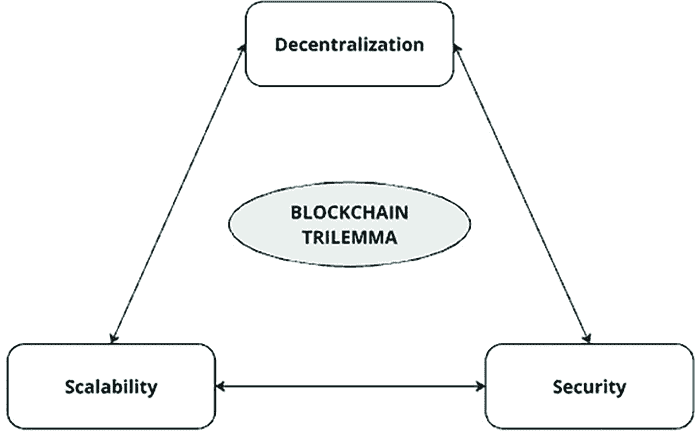

**图 12.1：区块链三角困**

为了理解这一三角困：

- **去中心化**：确保没有单一实体控制网络。
- **安全性**：防止恶意攻击并确保数据可信性。
- **扩展性**：在不损害性能的情况下容纳日益增长的交易。

平衡这三个目标通常会导致影响性能的妥协。例如，增加区块大小以提高吞吐量可能会因为倾向于具有更强大计算资源的节点而影响去中心化。

**现实世界案例：**

- 在 2021 年 NFT 热潮期间，铸造活动导致 Gas 费飙升，使得许多用户的交易成本变得极其昂贵。Bored Ape Club 等项目报告单次交易铸造成本达到数千美元。

**当前架构的局限性：**

以太坊的架构存在若干局限性：

- **区块大小和 Gas 限制**：区块大小和 Gas 限制定义了包含在区块中的交易数量。这些限制确保了稳定性，但限制了吞吐量。
- **共识机制**：工作量证明 (`PoW`) 安全但缓慢且耗能，限制了以太坊的扩展能力。


- **网络拥堵**：普及度的增加导致了瓶颈，正如 2020 年 DeFi 热潮期间所示，当时由于网络过度使用，交易费用飙升。

### 创新的必要性

上述挑战强调了对创新解决方案的需求，以增强以太坊的可扩展性，而不牺牲其去中心化和安全性。`Layer 2` 解决方案和以太坊 2.0 等策略旨在有效解决这些局限性。

## Layer 2 解决方案：状态通道、侧链、Rollups

以太坊的 `Layer 2` 解决方案对于在损害安全或去中心化的情况下解决其扩展性挑战至关重要。通过允许交易和计算在链外或替代网络上进行，这些解决方案显著减少了以太坊主网的拥堵和交易成本。`Layer 2` 技术在增强去中心化应用（`DApps`）的用户体验以及加速太坊跨行业的采用方面发挥着关键作用。

### 状态通道

状态通道允许双方进行链外交易，减少链上活动并提高交易速度。只有在状态通道关闭时，交易才会记录在链上，确保以太坊主网不会被频繁的交互所淹没。示例包括支付通道，如 `Lightning Network` 和 `Raiden Network`，它们以极低的 `Gas` 费用促进了微支付。

### 侧链

侧链是与以太坊连接的独立区块链，允许资产和数据在两个网络之间传输。与 `Layer 1` 不同，侧链运行在自己的共识机制上，例如权威证明（`PoA`）或委托权益证明（`DPoS`）。侧链的示例包括 `Polygon`，它在保持与以太坊互操作性的同时，提供了更快、更廉价的交易。

### 优势

- 通过从主网卸载交易增加了可扩展性。
- 可以灵活使用备选共识算法以提高性能。

### 挑战

- 与以太坊主网相比，安全性降低。
- 对验证者或跨链操作的依赖。

### Rollups

`Rollups` 将多笔交易打包成单批并发布到以太坊主网，显著降低了 `Gas` 费用并提升了吞吐量。它们分为两类：

- **乐观 Rollups (Optimistic Rollups)**：默认假设交易是有效的，并使用欺诈证明来解决争议。示例包括 `Arbitrum` 和 `Optimism`，它们优先考虑高吞吐量和成本效益。
- **零知识 Rollups (zk-Rollups)**：使用密码学证明在链外验证交易，并在链上发布简短的证明。如 `ZkSync` 等解决方案提供了更快的终性和更低的 `Gas` 费用。

### 示例用例

`Rollups` 被广泛应用于 `DeFi` 协议中，以处理高额交易量，而不会拥堵以太坊的基础层。

### 现实世界的收益

- 增强了去中心化应用（`DApps`）的可扩展性。
- 为用户和开发者节省了大量成本。
- 通过更快的交易改善了用户体验。

# 乐观 Rollups 和 zk-Rollups 概述

以太坊的可扩展性挑战促成了 `rollup` 技术的开发，这些技术在保留以太坊主网安全性的同时，显著提升了交易吞吐量和成本效率。乐观 `Rollups` 和 `zk-Rollups` 是 `Layer 2` 扩展的两种领先方法，每种都有独特的机制和权衡。

## 乐观 Rollups

乐观 `Rollups` 通过在链外处理交易并仅在链上发布摘要来增强以太坊的可扩展性。它们默认假设交易是有效的，并依赖欺诈证明来解决争议。

### 它们的工作原理

1. **交易聚合**：`rollup` 操作节点在链外将交易聚合成批次。
2. **提交至主网**：操作节点将批次连同承诺（哈希）一起提交到以太坊主网。
3. **欺诈检测**：如果任何用户怀疑存在欺诈交易，他们可以在争议窗口内提交挑战。
4. **欺诈证明解决**：挑战者提供证据来显示无效交易，如果证明正确，操作节点将失去其质押的抵品。

### 示例

- **Arbitrum**：一种领先的乐观 `Rollup` 解决方案，在利用以太坊安全性的同时提供高吞吐量和成本节省。`Arbitrum` 支持 `Uniswap` 和 `Curve` 等 `DeFi` 协议，成为开发者的热门选择。

### 优势

- 高交易吞吐量。
- 与链上执行相比费用更低。
- 适用于通用应用。

### 挑战

- 由于争议解决期，终性较慢（例如 `Arbitrum` 为 7 天）。

## zk-Rollups

零知识 `Rollups` (`zk-Rollups`) 利用先进的密码学证明在链外验证交易，并在主网上发布简短的有效性证明。与乐观 `Rollups` 不同，`zk-Rollups` 内生保证了交易的有效性，无需欺诈证明。

### 它们的工作原理

1. **交易打包**：交易在链外打包成批次。
2. **证明生成**：生成密码学零知识证明，以验证整个批次的有效性。
3. **链上验证**：将证明提交到以太坊，主网在不审查单笔交易的情况下验证批次。

### 交易争议

在 `zk-Rollups` 中，几乎不存在争议，因为密码证明保证了批次的正确性。

### 示例

- **ZkSync**：一种以低 `Gas` 费用和快速终性而闻名的流行 `zk-Rollup` 解决方案。`zkSync` 广泛用于微支付和 `NFT` 市场。

### 优势

- 无争议期的快速终性。
- 加密保障安全性。
- 减少了 `Gas` 费用和计算开销。

### 挑战

- 由于生成零知识证明的计算密集性，实现复杂。

# 乐观 Rollups 和 zk-Rollups 比较

| 特性 | 乐观 Rollups | zk-Rollups |
| --- | --- | --- |
| 验证方法 | 假设有效；使用欺诈证明 | 使用零知识证明 |
| 终性 | 较慢（需要争议窗口） | 快速 |
| 安全性 | 依赖挑战机制 | 由零知识证明保证 |
| 应用场景 | DeFi、通用应用 | 微支付、NFT |
| 实现复杂度 | 中等 | 高 |

**表 12.1: 乐观 Rollups 和 zk-Rollups 的比较**

- **能源效率：** `PoS` 将以太坊的能源消耗降低了 99% 以上，与 `PoW` 相比更具可持续性。
- **经济安全性：** 验证者必须质押 `Ether` 作为质押，如果他们尝试进行恶意活动，质押可能会被削减（减少），从而确保了问责制。

## 分片化（Sharding）简介

- `Sharding` 将以太坊网络分成更小、更易管理的单元，称为“分片”（shards）。每个分片处理自己的部分交易和智能合约，从而实现了并行执行并显著提高了网络的整体吞吐量。
- **对可扩展性的影响：** `Sharding` 使以太坊每秒能够处理数千次交易（`TPS`），而目前的容量约为每秒 15 `TPS`。

## 增强能源效率

- 除了 `PoS`，以太坊 2.0 的模块化设计专注于减少不必要的计算并优化网络性能。这些效率使得以太坊对用户而言更加环保且具有成本效益。

### 以太坊 2.0 的实施阶段

1. **信标链（阶段 0）：**
   - `Beacon Chain` 于 2020 年 12 月启动，引入了 `PoS` 机制。它与现有的以太坊主网并行，为未来的升级奠定了基础。

2. **合并（阶段 1.5）：**
   - `Merge` 于 2022 年 9 月完成，将 `Beacon Chain` 和以太坊主网统一，使网络完全过渡到 `PoS`。这消除了对 `PoW` 挖矿的需求。

3. **分片化（阶段 2）：**
   - 预计在未来的升级中实现，`sharding` 将通过将网络分成多个分片来增强可扩展性。这些分片将通过 `Beacon Chain` 进行无缝通信。

### 以太坊 2.0 的意义

- **大规模采用：** 凭借更高的交易吞吐量和更低的费用，以太坊 2.0 可以支持 `DeFi`、`NFT` 和 Web3 应用的大规模采用。
- **减少碳足迹：** 消耗的剧减使以太坊符合全球可持续发展目标。
- **提升用户体验：** 更快的交易时间和更低的成本造及了开发者和终端用户。

通过解决可扩展性和可持续性挑战，以太坊 2.0 确保了区块链作为创新和去中心化基础平台的地位。

# 从工作证明到权益证明的转型

以太坊从工作证明（`PoW`）到权益证明（`PoS`）的转型标志着区块链技术的革命性转变，解决了扩展性、能源效率和网络去中心化方面的关键挑战。本节深入探讨转型的原因、`PoS` 的机制以及其对以太坊生态系统的广泛影响。

### 理解转型背后的

- **能源效率：** `PoW` 挖矿需要巨大的计算能力，在全球范围内消耗大量的能源资源。`PoS` 将能源消耗降低了 99.95%，使以太坊符合环境可持续发展目标。
- **可扩展性：** `PoS` 通过允许更多验证者高效参与，提高了网络可扩展性，消除了对昂贵矿矿设备的依赖。
- **去中心化：** 通过降低入门门槛，`PoS` 鼓励了更广泛的参与。

### PoS 的机制

1. **质押 Ether：** 验证者必须存 `Ether` 才能参与。
2. **区块提案：** 随机选择验证者来提议区块。
3. **验证：** 验证者对区块的有效性达成共识。
4. **奖励惩罚系统：** 诚实的验证者获得奖励；恶意者可能会被削减。

### PoS 的主要优势

- **安全性：** `PoS` 确保了高网络安全性。
- **经济效率：** `PoS` 降低了交易成本。
- **去中心化：** `PoS` 减少了对挖掘的需求。

### 转型中的挑战

- **验证者设置：** 确保节点保持在线至关重要。
- **网络调整：** 以太坊适应新的基于共识的机制。

# 分片及其对可扩展性的影响

`Sharding` 是最具变革性的升级之一，通过将网络分成更小、更易管理的分片，解决了可扩展性挑战。每个分片处理自己的部分交易和智能合约，实现了跨网络的并行执行。

Web3 的出现代表了互联网结构和利用方式的范式转变。与中心化实体主导的传统 Web2 模型不同，Web3 愿景了一个由用户所有并控制的互联网。通过利用区块链技术，Web3 促进了去中心化身份、数据主权和用户驱动的经济模型。

## 核心原则

1. **去中心化**：与中心化服务器和机构不同，Web3 应用运行在去中心化网络上，确保了透明度并最大地减少了单点故障。
2. **用户控制**：用户拥有自己的数据和数字资产，并决定如何以及何时共享它们。智能合约在不需要中介机构的情况下强制执行用户定义的规则。
3. **互操作性**：Web3 应用的设计旨在跨多个区块链进行无缝交互，促进协作与创新。

## 现实世界应用

- **去中心化金融 (DeFi)**：如 `Uniswap` 和 `Aave` 等平台使用户能够在没有中介机构的情况下进行资产交易、借贷和借款。
- **去中心化身份**：如 `Ethereum Name Service` (`ENS`) 等项目允许用户安全地控制自己的在线身份。
- **创作者经济**：`NFTs` 赋予艺术家和创作者直接将其作品变现的能力，绕过了传统的守门人。

### 挑战

- **可扩展性**：确保去中心化网络能够在不损害性能的情况下处理大规模的采纳。
- **监管不确定性**：全球范围内的政府仍在围绕区块链和加密货币制定政策。
- **用户教育**：Web3 的广泛采用取决于提高用户意识和可访问性。

Web3 体现了去中心化互联网的愿景，赋能个人并重塑行业。它的演变将决定全球经济和数字社会的未来。

# 跨链互操作性

区块链无缝通信和共享数据的能力对于去中心化系统的增长至关重要。跨链互操作性确保了不同的生态系统可以共同工作，打破孤岛并促进创新。

## 重要性

互操作性通过允许孤立网络之间的协作，解决了区块链领域的碎片化问题。这不仅扩大了区块链技术的使用用例，还允许用户和开发者利用多个平台的优势。

## 重要性示例

- `Ethereum` 上的 `DeFi` 用户可以在无需转移资产的情况下访问流动性池。
- 在一个区块链上铸造的 `NFT` 可以在另一个区块链上交易或显示。

## 工具与协议

- **Polkadot**：`Polkadot` 是一个多链网络，通过其中心中继链连接不同的 `parachains`（平行链）。它实现了跨链资产传输、治理以及平行链之间的共享安全。
  - **独特性**：`Polkadot` 使用了一种名为“共享安全”的机制，所有 `parachains` 都能从中继链的安全保障中受益。
  - **现实世界用例**：如 `Moonbeam` 和 `Acala` 等项目利用 `Polkadot` 桥接 `Ethereum` 与与其他链之间的功能。
- **Cosmos**：`Cosmos` 被称为“区块链之网”，通过其“跨链通信” (`IBC`) 协议促进互操作性。`IBC` 允许区块链以无信任的方式交换令牌、数据和消息。
  - **独特性**：`Cosmos SDK` 简化了构建在设计上就具有互操作性的自定义区块链。
  - **现实世界用例**：`Cosmos Hub` 连接了 `Terra` 和 `Osmosis` 等网络，实现了 `DeFi` 运营。

### 挑战

- **标准**：开发跨链通信的通用标准是复杂的。
- **安全风险**：桥接和互操作性协议可能成为攻击者的目标。
- **可扩展性**：在不增加瓶颈的情况下确保互操作性是一项持久的挑战。

## 未来展望

随着跨链技术的日益成熟，互操作性将成为去中心化生态系统的基石。`LayerZero` 和 `Wormhole` 等项目已经在推向区块链通信的边界，为更具连接性的未来奠定基础。

# 未来的机遇与挑战

`Ethereum` 的扩展进展和技术创新正在为变革性机遇铺平道路，同时也带来了重大挑战。本主题探讨了区块链技术广阔的前景以及未来面临的障碍。

## 机遇

1. **Layer 2 解决方案的大规模采用**：如 `rollups` 和 `state channels`（状态通道）等 `Layer 2` 解决方案将降低 `Ethereum` 的成本并提升用户体验。
2. **DeFi、NFT 和 DAO 的创新**：
   - **DeFi**：去中心化金融通过提供无许可的银行、借贷和交易工具正在重塑全球金融系统。
   - **NFTs**：除了数字艺术，`NFTs` 正在进入音乐、房地产和游戏行业，实现所有权模式。
   - **DAOs**：去中心化自治组织为社区和企业引入了新的治理模式，促进集体决策。
3. **扩展到尚未开发的行业**：可编程智能合约在以下领域具有潜力：
   - **医疗保健**：保护医疗记录并简化保险理赔。
   - **房地产**：简化物业交易并实现碎片所有权。
   - **供应链**：确保全球贸易的透明度并减少欺诈。

### 挑战

1. **监管不确定性**：全球政府仍在努力如何监管区块链。有关税务影响、反洗钱 (`AML`) 和了解您的客户 (`KYC`) 要求的规定对于大规模采用至关重要。
2. **Layer 2 解决方案的安全漏洞**：随着 `Layer 2` 解决方案的普及，它们带来了新的攻击面。确保 `bridges`、`rollups` 和 `sidechains`（侧链）的安全对于防止黑客攻击和利用至关重要。
3. **快速采用中的扩展性瓶颈**：随着 `Ethereum` 的扩展，平衡日益的需求和持续的性能是一项挑战。未来的升级必须预测用户和交易的指数级增长。

# 结论

`Ethereum` 的扩展解决方案（从 `Layer 2` 技术到 `Ethereum 2.0`）为更高效、更易的区块链生态系统铺平道路。通过解决高 `gas fees` 和吞吐量限制等挑战，`Ethereum` 正将自己定位为未来的基础。这些创新承诺了去中心化的互联网、增强的互操作性和跨行业的变革性机遇。然而，实现这一愿景需要克服重大的技术和监管挑战，促进开发者、政府和用户之间的协作。

在下一章中，我们将探讨区块链对各行业的转型影响，从通过 `DeFi` 变革金融到重塑艺术、音乐、医疗保健和供应链管理。通过现实世界的案例，我们将揭示塑造区块链采用未来的创新、挑战和伦理考量。

## 重点

- `Ethereum` 面临扩展性挑战，但 `Layer 2` 等创新旨在解决这些问题。
- `Layer 2` 技术（如 Optimistic Rollups 和 zk-Rollups）在降低成本的同时提升了吞吐量。
- 向权益证明（Proof of Stake）的过渡和分片技术（sharding）的引入是以太坊 2.0 路线图的关键里程碑。
- 跨链互操作对于促进区块链生态系统之间的协作至关重要。
- Web3 的去中心化互联网愿景提供了巨大的机会，但也面临扩展性、安全性和用户采纳等挑战。

## 核心术语

- **区块链困境：** 同时实现扩展性、安全性和去中心化的挑战。
- **Layer 2 解决方案：** 在链外处理交易以减少以太坊主网拥堵的技术。
- **乐观汇总（Optimistic Rollups）：** 默认假设交易是有效的；使用欺诈证明来解决争议。
- **zk-Rollups：** 使用零知识证明进行交易验证，确保更高的安全性和即时终性。
- **分片（Sharding）：** 将以太坊网络分为更小的链以便并行处理，从而提高扩展性。
- **权益证明（PoS）：** 一种共识机制，验证者通过质押 `Ether` 来提议和验证区块。
- **Web3：** 强调用户控制和数据主权的去中心化互联网模型。
- **互操作性：** 不同区块链网络无缝通信和共享数据的能力。
- **以太坊 2.0 (Serenity)：** 为了改进以太坊扩展性、安全可持续性的的一系列升级。

# 第 13 章

# 跨行业的区块链应用

### 引言

区块链技术已经超越了最初与加密货币的关联，成为多个行业的变革性力量。通过提供去中心化、透明性和安全性，区块链为金融、艺术、音乐、医疗保健、供应链管理等领域的创新应用铺平了道路。本章将深入探讨区块链在不同领域的应用，展示真实案例，探索行业采纳的挑战，并研究相关的监管和伦理考量。

### 结构

本章结构如下：

- 去中心化金融 (`DeFi`)：贷款、借贷和收益耕作
- 艺术与音乐中的非同质化代币 (`NFTs`)
- 案例研究：`Uniswap`、`Aave` 和 `OpenSea`
- 医疗中的区块链：患者数据管理
- 供应链透明度与追踪
- 行业采纳的挑战
- 监管与伦理考量

# 去中心化金融 (DeFi)：贷款、借贷和收益耕作


去中心化金融或 DeFi 代表了区块链技术影响力最大的应用之一。DeFi 是指在没有中心化媒介的情况下运行金融服务生态系统，利用区块链网络和智能合约为传统金融系统提供开放、透明且无许可的替代方案。

## DeFi 概述

DeFi 平台使金融服务的获取民主化，允许任何连接互联网的人参与。

## DeFi 的核心功能

- **贷款与借贷：** DeFi 平台允许用户在没有传统银行的情况下贷或借入资产。
- **收益耕作（Yield Farming）：** 涉及向去中心化协议提供流动性以赚取奖励。
- **去中心化交易所 (DEXs)：** 如 `Uniswap` 等平台促进了在没有中心化中介的情况下进行加密货币交易。
- **质押（Staking）：** 用户锁定资产以支持网络安全并获得奖励。
- **真实世界资产 (RWA)：** DeFi 正在扩展到涵盖房地产和商品等代币化的物理资产。
- **迷因币 (Memecoins)：** 在去中心化生态系统中找到利基市场的数字资产。
- **抵押债务仓 (CDPs)：** 用户使用加密资产作为抵押来借入其他数字资产。

# 艺术与音乐中的非同质化代币 (NFTs)

非同质化代币或 NFT 改变了数字资产的所有方式。与同质化代币不同，NFT 代表了独特的数字或物理物品，使其成为艺术和音乐的理想选择。

## NFT 的演变

NFT 最初随着 CryptoKies 的出现获得关注，它展示了区块链资产代币化的潜力。从那时起，生态系统不断增长，涵盖了数字艺术、音乐和虚拟地产。通过在区块链上提供可验证的所有权和来源，NFT 为创作者和收藏家开启了新机会。

# 理解 ERC721 和 ERC1155 Token 标准

作为非同质化代币的骨干，`ERC721` 和 `ERC1155` 标准塑造了独特数字和物理物品在区块链上的代币化方式。这些标准对于支持跨行业的创新应用（特别是数字艺术和音乐领域）至关重要。

## ERC721

`ERC721` 标准是 NFT 的基础，允许创建独特且不可分割的代币。每个代币都有独特的标识符，并在区块链上进行追踪，使其无法伪造。`ERC721` 广泛用于数字艺术、收藏品和游戏资产。一个著名的例子是 Beeple 的《Everydays: The First 5000 Days》，它以 NFT 的形式在以太坊区块链上售出。

# ERC1155

`ERC1155` 在 `ERC721` 标准的基础上，通过在一个合约内同时支持同质化和非同质化代币。这种灵活性对于游戏应用特别有利，在游戏中，用户可能需要同质化代币作为货币，以及非同质化代币作为独特物品。游戏平台 Enjin 使用 `ERC1155` 代币来代表游戏物品，如剑、盾或皮肤。

# 数字艺术与音乐中的应用场景

NFT 已经成为创作者直接向粉丝变现和分发作品的强大工具，绕过了传统的中间人。通过利用区块链的不可篡改性和透明性，NFT 使艺术家和音乐家能够安全地获得所有权并高效地赚取版税。

## 数字艺术

NFT 赋予了艺术家通过销售代币化的数字艺术直接使其变现的能力。像 `Foundation` 和 `SuperRare` 这样的平台允许艺术家将其创作列为 `NFTs`，确保所有权和版税在区块链上得到透明的追踪。这为数字创作者创造了新的经济模式，消除了对传统画廊或中间人的需求。`SuperRare` 和 `Foundation` 等平台通过让艺术家能够销售代币化的数字艺术，彻底改变了艺术市场。

另一个例子是 `Pak` 的《The Merge》，它于 2021 年 12 月在 Nifty Gateway 上以 9180 万美元售出。这次突破性的销售涉及碎片所有权，超过 28,000 名收藏家购买了 312,686 个独特代币，展示了 NFT 领域内的创新可能。

## 音乐

音乐家正在利用 NFT 以创新的方式分发作品。通过将专辑、曲目或演唱会门票代币化，艺术家可以与粉丝直接互动。NFT 还让艺术家对其知识产权拥有更大的控制权，并从二次销售中赚取版税。

音乐家还利用 NFT 将曲目、专辑甚至独家粉丝体验代币化。列昂王室乐队（Kings of Leon）以 NFT 的形式发布了专辑《When You See Yourself》，为粉丝提供了独特性，如限量版黑胶唱片和演唱会入场券等特福利，为音乐分发树立了新标准。

## 相关代码示例

### 示例：铸造 ERC721 代币

```solidity
// SPDX-License-Identifier: MIT
pragma solidity ⁰.8.0;
import "@openzeppelin/contracts/token/ERC721/ERC721.sol";
contract MyNFT is ERC721 {
    uint256 public nextTokenId;
    constructor() ERC721("MyNFT", "MNFT") {}
    function mint(address to) public {
        _safeMint(to, nextTokenId);
        nextTokenId++;
    }
}
```

此简单合约演示了如何使用 `ERC721` 标准创建 NFT。`mint` 函数允许铸造新代币并分配给指定的地址。

### 示例：铸造 ERC1155 代币

```solidity
// SPDX-License-Identifier: MIT
pragma solidity ⁰.8.0;
import "@openzeppelin/contracts/token/ERC1155/ERC1155.sol";
contract MyMultiToken is ERC1155 {
    constructor() ERC1155("https://token-cdn-domain/{id}.json") {}
    function mint(address to, uint256 id, uint256 amount) public {
        _mint(to, id, amount, "");
    }
}
```

该合约说明了 `ERC1155` 的灵活性，允许在单一标准内创建同质化代币和非同质化代币。

## 案例研究：Uniswap, Aave 和 OpenSea

为了深入理解区块链的实际应用，我们将研究诸如 `Uniswap`、`Aave` 和 `OpenSea` 等先驱平台的案例，每个平台都展示了去中心化金融和 NFT 生态系统的独特创新。

### Uniswap：彻底改变去中心化交易所

`Uniswap` 是以太坊上最流行的去中心化交易所（DEXs）之一，实现了无需中间人的点对点加密货币交易。它使用基于方程 `x * y = k` 的自动做市商（AMM）模型，其中 `x` 和 `y` 代表流动性池中两种代币的储备，`k` 是常数。

### 合约层面的 Uniswap 机制

`Uniswap` 通过管理代币对和流动性池的智能合约运行。用户可以交换代币、添加流动性以赚取费用或从池中移除流动性。

以下是合约层面的 `Uniswap` 运行机制示例：

```solidity
// SPDX-License-Identifier: MIT
pragma solidity ⁰.8.0;
contract UniswapPool {
    uint256 public reserveX;
    uint256 public reserveY;
    constructor(uint256 initialX, uint256 initialY) {
        reserveX = initialX;
        reserveY = initialY;
    }
    function swap(uint256 inputX) public returns (uint256 outputY) {
        require(inputX > 0, "Input amount must be greater than zero");
        outputY = (reserveY * inputX) / (reserveX + inputX);
        reserveX += inputX;
        reserveY -= outputY;
    }
}
```

此简化合约展示了 `Uniswap` 是如何操作代币交换的。

### Aave：去中心化借贷与闪电贷款

`Aave` 是一个去中心化金融协议，允许用户借贷加密货币。其突破性的功能之一是闪电贷款，无需抵押即可获得资金，前提是在同一笔交易内归还。

以下是闪电贷款的示例

`Aave` 的智能合约管理流动性池。闪电贷款利用区块链交易的原子性工作。

```solidity
// SPDX-License-Identifier: MIT
pragma solidity ⁰.8.0;
interface ILendingPool {
    function flashLoan(
        address receiver,
        address asset,
        uint256 amount,
        bytes calldata params
    ) external;
}
contract FlashLoanExample {
    address public lendingPool;
    constructor(address _endingPool) {
        lendingPool = _endingPool;
    }
    function executeFlashLoan(address asset, uint256 amount) external {
        bytes memory data = ""; 这里可以传递自定义数据
        ILendingPool(lendingPool).flashLoan(address(this), asset, amount, data);
    }
    function executeOperation(
        address asset,
        uint256 amount,
        uint256 premium,
        bytes calldata params
    ) external returns (bool) {
        // 执行套利、清算或其他操作
        require(amount + premium <= address(this).balance, "还款资金不足");
        return true;
    }
}
```

示例展示了合约如何与 `Aave` 的借贷池交互以执行闪电贷款。`executeOperation` 函数包含了使用贷款资金的操作逻辑。

### OpenSea：NFT 市场

`OpenSea` 是最大的买卖和交易 NFT 的去中心化市场。它支持多种代币标准，包括 `ERC721` 和 `ERC1155`，并为创作者提供了铸造和列出数字资产的工具。

合约层面的 OpenSea 机制

`OpenSea` 使用智能合约促进 NFT 交易。当用户列出 NFT 时，`OpenSea` 的合约管理所有权的转移并确保向创作者支付版税。其元数据标准允许创作者向代币附加额外信息，如艺术品或描述。

例如 NFT NFT：

1. 卖家授权市场合约转移其 NFT。
2. 买家向市场合约发送资金。
3. 合约将 NFT 转移给买家并将资金发放给卖家以及任何版税接收者。

`OpenSea` 对元数据的使用增强了 NFT 的发现性和功能性，使其成为数字艺术和收藏生态系统的基石。

区块链技术正在通过为患者数据管理提供安全透明的解决方案来彻底改变医疗保健行业。传统上，医疗数据存储在孤立的系统中，导致访问困难、容易发生数据泄露且效率低下等问题。区块链提供了一个去中心化且防篡改的系统，确保了数据的完整性、安全性以及授权方之间的无缝共享。

# 在患者数据管理中的应用

区块链在医疗保健领域的潜力通过其在患者数据管理中的应用得以彰显，为敏感医疗信息的存储、共享和访问提供了安全、透明且高效的解决方案。

- 安全数据存储：区块链确保患者数据经过加密并安全存储，降低了未经授权的访问或数据泄露的风险。每个患者的病史都可以记录为不可篡改的区块，仅供授权人员访问。
- 互操作性：区块链通过创建一个统一且去中心化的数据存储，实现了医疗提供者之间的互操作性。这确保了医疗专业人员实时访问患者的完整病史，从而改善诊断和治疗结果。
- 患者所有权与同意：患者可以通过`blockchain-based access permissions` 对其医疗数据进行控制。他们可以决定谁可以访问其记录，并在必要时撤销访问权限，确保隐私并符合 `GDPR` 和 `HIPAA` 等数据保护法规。
- 临床试验与研究：区块链可用于管理临床试验中的数据完整性，确保透明度并消除数据篡改等问题。研究人员可以访问匿名患者数据进行研究，而不会损害个人隐私。

# 区块链在医疗保健中的优势

区块链技术为医疗保健带来了变革性的益处，包括增强数据安全、提高互操作性和简化流程，最终赋能患者和医疗提供者。

- 数据完整性：区块链确保患者记录不会被篡改，提供了一个可靠的真实性来源。
- 增强隐私性：通过利用加密技术，区块链实现了敏感信息的安全共享。
- 成本效益：减少中间环节和改进数据流可以显著降低行政成本。
- 改善患者结果：无缝访问准确的医疗记录确保了更好、更快的护理。

## 现实案例

MedRec：由麻省理工学院开发的基于区块链的医疗平台。`MedRec` 使患者能够访问其医疗记录并与医疗提供者安全共享。通过利用区块链的透明性和安全性，`MedRec` 在维护患者隐私的同时，确保了数据的持续可用性。

区块链在医疗保健领域的应用展示了其解决该行业长期挑战的潜力。通过培养信任、增强安全和简化数据管理，区块链有望成为现代医疗保健系统的基石。

## 供应链透明度与追踪

区块链技术通过引入透明度、追溯性和效率正在彻底改变供应链管理。传统供应链往往面临效率低下、欺诈和利益相关者之间缺乏可视的问题。区块链提供了一个不可篡改的账本，实现了货实时追踪并促进参与者之间的信任。

# 供应链追溯性的重要性

追溯性对于确保商品的真实性、安全质量至关重要。区块链允许利益相关者跟踪产品从源头到消费者的历程，降低货物风险。例如，消费者可以验证钻石是否为冲突钻石。

# 对私有链的需求

私有链特别适用于供应链，因为它们允许受控访问。与公共区块链不同，它们保护敏感信息。供应链中私有链的主要特征包括：

- 选择性透明度：敏感业务信息仅对相关方可见。
- 许可访问：只有授权的参与者才能验证交易。
- 增强的可扩展性：私有网络能够高效处理更高数量的交易。

# 用场景与示例

区块链的多功能通过其广泛的应用场景显而易见，通过增强透明度和追溯性为各行业提供创新解决方案。

- 食品安全：如 `Walmart` 等公司已实施了基于区块链的系统来追踪食品来源。通过扫描 `QR code`，消费者可以访问有关产品历程的详细信息，包括其产地农场。
- 药品：制药行业使用区块链来打击假药。如 `MediLedger` 等系统确保药物在从制造商到药店的整个供应链中都是真实且可追溯的。
- 奢侈品：高端品牌使用区块链对手表、手包和珠宝等产品进行鉴定。每件物品在区块链上都有一个唯一的数字身份，买家能够验证其真实性。
- 物流：区块链通过提供货物移动的实时更新来优化物流。`Maersk`（马士基）等公司利用 `TradeLens` 等区块链平台简化货运操作并减少纸质工作。

## 现实落地

IBM Food Trust：IBM 的区块链平台连接了生产者、供应商和零售商，以提高食品追溯性。通过在不可篡改的账本上记录供应链的每一步，`IBM Food Trust` 确保了食品安全，并通过识别供应链中的低效环节减少浪费。

通过培养责任感和信任，区块链技术正在将供应链管理转变为更透明、更高效的系统。其应用范围从确保食品安全到鉴定奢侈品，展示了其跨行业的多功能性。

# 行业采纳的挑战

尽管具有变革性潜力，区块链技术在各行业的广泛采用仍面临巨大挑战。这些挑战源于技术局限性、对改变的抵触、集成复杂性以及监管的不确定性。

# 技术障碍

尽管潜力巨大，区块链仍面临阻碍广泛采用的重大技术障碍，包括可扩展性挑战、高能耗以及跨平台实现互操作的困难。

- 可扩展性问题：区块链网络（尤其是像 `Ethereum` 等公共链）由于吞吐量和延迟的限制，难以处理高交易量。这种瓶颈可能会阻碍供应链和金融服务等高需求行业。
- 能源消耗：某些区块链系统（特别是那些依赖工作量证明 `PoW` 的系统）消耗大量能量，引发了环境担忧，使其在大规模采用方面可行性较低。
- **互操作性**：不同区块链平台之间缺乏标准和`interoperability`，这为集成多样化系统带来了挑战，限制了跨网络的无缝数据交换与协作。

# 市场阻力

市场阻力仍然是区块链采用的关键障碍，其驱动因素包括意识有限、实施成本高昂，以及对脱离既有系统和惯例的抵触情绪。

- **缺乏意识和理解**：许多组织对区块链技术的能力和优势并不熟悉。虚假信息和误解往往导致人们不愿探索其潜力。
- **实施成本**：部署区块链解决方案需要在技术、基础设施和专业人才方面投入大量资金，这对于中小型企业来说是一个威慑因素。
- **对变革的抵制**：遗留系统和传统工作流在许多行业中根深蒂固。由于对扰动和不确定性的担忧，利益相关者往往抵制转向区块链。

# 与现有系统的集成

将区块链技术与现有的 IT 基础设施集成可能非常复杂且耗资源。挑战包括：

- **数据迁移**：在确保准确性和安全性的同时，将遗留数据移动到区块链平台。
- **技能缺口**：需要精通区块链的开发者和 IT 专业人员来实施和管理该技术。
- **与当前系统的接口**：确保区块链解决方案与预存软件之间的兼容性和无缝运行。

# 失败或停滞实施的案例研究

研究失败或停滞的区块链实施案例，揭示了关键挑战，例如可扩展性问题、监管障碍以及利益相关者的抵制，为理解实现广泛应用的复杂性提供了宝贵的见解。

- **澳大利亚国家区块链**：这一雄心勃勃的项目旨在创建一个全国范围的法律合同区块链，但由于监管担忧和扩展性挑战而面临延迟。


**沃尔玛用于生菜追踪的区块链**：尽管最初成功，但该计划在招募较小供应商方面面临障碍，凸显了在碎片化供应链中扩大区块链采用的困难。

**马士基 TradeLens 平台**：马士基启动了`TradeLens`平台，旨在通过区块链数字化和跟踪运输文件来提高供应链透明度。尽管在增强可见性和减少纸质工作方面取得了技术成功，但该平台面临竞争对手的抵制，他们不愿采用一个被认为由单一公司控制的系统。结果，`TradeLens`难以实现广泛的行业协作，并最终由于缺乏扩展性和网络效应而宣布关闭。

区块链的采用需要通过技术创新、利益相关者教育和协作努力来应对这些挑战，以建立稳健的标准和框架。

# 监管与伦理考量

随着区块链技术的演进，监管和伦理考量已成为其跨行业采用和实施的关键。这些担忧涵盖了对当地和国际法律的合规性、确保伦理实践以及应对去中心化系统的影响。

# 区块链技术中不断变化的监管

区块链技术不断变化的监管格局既带来了机遇也带来了挑战，因为各国正努力在税务、反洗钱和数据隐私等领域平衡创新与合规。

- **司法管辖差异**：区块链在全球范围内运行，但不同司法管辖区的规定差异巨大。例如，马耳他和新加坡等国已采取区块链友好的政策，而中国等国家则实施了严格限制。这种不一致性为全球项目带来了挑战。
- **税务与报告**：政府日益对区块链交易征收税收规定。这包括对加密货币交易、质押奖励和资本利得征税，要求企业和个人保持详尽的记录。
- **反洗钱 (AML) 与了解您的客户 (KYC)**：区块链平台必须遵守`AML`和`KYC`规定以防止非法活动。
- **安全与数据隐私法**：在处理敏感用户数据时，遵守`GDPR`和`CCPA`等框架至关重要。区块链不可篡性可能与“被遗忘权”发生冲突，需要链外存储等创新解决方案。

# 区块链采用中的伦理困境

区块链的采用将伦理困境推向了沿，要求利益相关者解决问责制、环境影响、包容性和滥用问题，同时努力维持技术的变革潜力。

- **去中心化与问责制**：去中心化系统往往缺乏明确的责任点，这使得争议解决和法律执行变得复杂。例如，当`smart contract`失败或被利用时，由谁负责？
- **能源消耗**：`Bitcoin`等区块链网络因其高能耗而面临批评。转向高效的共识机制（如`Proof of Stake (PoS)`）对于可持续增长至关重要。
- **公平与包容**：尽管区块链承诺包容性，但对该技术的获取取决于互联网可用性和技术水平。这种数字鸿沟可能会排斥边缘群体。
- **操纵与欺诈**：区块链的匿名性可能导致欺诈和市场操纵。开发稳健的框架来检测和缓解这些风险对于建立信任至关重要。

# 负责任实施的框架

负责任地实施区块链需要稳健的框架强调协作监管、伦理设计、教育和独立审计，确保技术的增长符合社会伦理标准。

- **协作监管**：政府、行业领袖和区块链开发者必须合作制定既能保护用户又能促进创新的规定。在英国和新加坡实施的监管沙盒允许在受控环境中进行实验。
- **伦理设计原则**：区块链项目在设计上应优先考虑透明度、用户同意可持续性。例如，`smart contracts`应包含清晰的条款和争议解决机制。
- **教育与意识**：提高政策制定者、企业和公众的区块链素养对于知情决策和伦理采用至关重要。
- **审计与认证**：对区块链系统进行独立审计可以确保符合伦理和监管标准。区块链平台的认证计划可以进一步建立用户和利益相关者之间的信任。

总之，区块链的监管和伦理考量是其可持续采用的不可或缺的一部分。通过积极应对这些挑战，该技术可以在实现广泛接受的同时，度地减少风险并最大化社会效益。

# 结论

本章强调了区块链技术在各行业中的变革性潜力，从金融、医疗保健到供应链管理及其他领域。然而，要实现其全部潜力，需要克服重大挑战，包括技术障碍、市场阻力和集成的复杂性。通过促进创新、解决伦理考量并建立稳健的监管框架，区块链可以成为现代技术生态系统的基石。

# 注意事项

- 区块链技术为各个行业提供了去中心化、透明性和安全性。
- 如`Uniswap`和`Aave`等 DeFi 平台正在通过无需中介的贷款、借贷和交易来彻底改变金融服务。
- NFT 正在利用`ERC721`和`ERC1155`等标准为数字艺术和音乐开辟新的经济模型。
- 区块链通过保护患者数据、提高互操作性并确保隐私来增强医疗保健行业。
- 供应链管理受益于区块链的可追溯性和问责制，减少了欺诈和低效率问题。
- 区块链采用面临的挑战包括可扩展性、能源消耗、监管不一致以及市场阻力。
- 必须解决诸如能源消耗和包容性等伦理问题，以确保可持续增长。

# 关键术语

- `去中心化金融 (DeFi)`：利用区块链技术在无中介的情况下运行金融系统。
- `非同质化代币 (NFTs)`：在区块链上代化的唯一数字资产。
- `ERC721/ ERC1155`：用于 NFT 和多令牌模型的以太坊令牌标准。
- `智能合约`：编码在区块链上具有预定义规则的自动执行合约。
- `互操作性`：不同区块链系统之间通信和共享数据的能力。
- `AML/KYC`：用于打击非法活动的反洗钱和了解客户监管规定。
- `不可篡账本`：区块链的一种特性，确保数据一旦记录便无法被更改。
- `监管沙盒`：在监管监督下测试区块链创新的受控环境。

## 索引

### A

- `Aave` [ 239 ]
- `Aave, 配置` [ 239 ]
- `抽象合约` [ 136 ], [ 137 ]
- `访问控制机制` [ 214 ]
- `审计智能合约` [ 212 ]
- `审计智能合约，工具`
  - `Echidna` [ 213 ]
  - `Manticore` [ 213 ]
  - `MythX` [ 213 ]
  - `Slither` [ 213 ]

### B

- `比特币架构` [ 53 ], [ 54 ]
- `比特币架构，组件`
  - `数字签名` [ 54 ]
  - `挖矿` [ 54 ]
  - `公共账本` [ 54 ]
  - `奖励/惩罚` [ 54 ]
  - `交易池` [ 54 ]
  - `验证` [ 54 ]
- `比特币架构，工具`
  - `Anders Demo` [ 55 ]
  - `区块区块器` [ 55 ]
- `比特币减半` [ 58 ]
- `比特币减半，架构` [ 58 ]
- `比特币减半，配置` [ 59 ]
- `比特币减半，影响` [ 59 ]
- `比特币减半，冲击` [ 58 ]
- `比特币减半，术语` [ 59 ]
- `比特币货币政策` [ 59 ]
- `比特币货币政策，协议`
  - `通缩性本质` [ 60 ]
  - `法币` [ 60 ]
  - `固定供应/稀缺性` [ 59 ]
  - `影响价值` [ 60 ]
  - `发行表，计划` [ 60 ]
  - `叙事` [ 61 ]
- `比特币交易` [ 55 ]
- `比特币交易，章节` [ 56 ]
  - `确认` [ 56 ]
  - `矿工，选择` [ 55 ]
  - `PoW/区块创建` [ 56 ]
  - `公共账本，更新` [ 56 ]
  - `交易广播` [ 55 ]
  - `交易验证` [ 55 ]

### C

- `去中心化` [ 2 ]
- `区块链采用，问题` [ 246 ]
- `区块链特性，机制` [ 3 ]
  - `去中心化` [ 2 ]
  - `区块链本质` [ 3 ]
  - `不可篡改性` [ 2 ]
  - `安全性` [ 2 ]
  - `透明度` [ 2 ]
- `区块链组件` [ 11 ]
  - `共识机制` [ 12 ]
  - `密码哈希函数` [ 12 ]
  - `账本` [ 13 ]
  - `节点` [ 11 ]
  - `智能合约` [ 13 ]
  - `交易` [ 12 ]
- `区块链演进`
  - `2008` [ 4 ]
  - `2009` [ 4 ]
  - `2013` [ 4 ]
  - `2015` [ 4 ]
  - `2017` [ 4 ]
  - `2020` [ 4 ]
  - `2022` [ 5 ]
- `区块链，关键创新` [ 3 ], [ 4 ]
- `区块链平台`
  - `币安智能链 (BSC)` [ 15 ], [ 16 ]
  - `比特币` [ 15 ]
  - `卡尔达` [ 16 ]
  - `以太坊` [ 15 ]
  - `波卡` [ 16 ]
  - `Solana` [ 16 ], [ 17 ]
- `区块链技术，机会` [ 246 ]
- `区块链三困境` [ 45 ]
- `区块链三困境，属性`
  - `去中心化` [ 46 ]
  - `可扩展性` [ 46 ]
  - `安全性` [ 46 ]
- `区块链三困境，状态`
  - `比特币` [ 46 ]
  - `以太坊` [ 46 ]
  - `可扩展性解决方案` [ 47 ]
- `区块链，类型`
  - `联盟` [ 14 ]
  - `混合` [ 14 ]
  - `私有` [ 14 ]
  - `公共` [ 13 ]
- `区块链多功能性` [ 243 ]
- `区块链多功能性，案例研究` [ 245 ]
- `区块链多功能性，挑战`
  - `现有系统，集成` [ 245 ]
  - `市场阻力` [ 244 ]
  - `技术障碍` [ 244 ]

## 激励参与 [41]

## 促进去中心化 [41]

## 安全，维护 [41]

### 共识机制，要点

- 拜尔庭容错 (BFT) [49]
- 有向无环图 (DAGs) [49]
- 混合 [49]
- 第二层，扩展性 [49]
- 历史证明 (PoH) [48]
- 分片 [49]

### 共识机制，技术 [50, 51]

### 共识机制，类型

- 拜尔庭容错 (BFT) [7]
- 权益证明证明 (PoS) [7]
- 工作量证明 (PoW) [7]

## 控制结构 [115]

### 控制结构，要点

- For/While，循环 [116]
- If/Switch，语句 [115]

## 跨链互操作性 [229]

### 跨链互操作性，挑战

- 可扩展性 [230]
- 安全，风险 [230]
- 标准 [230]

### 跨链互操作性，重要 [229]

- Cosmos [229]
- Polkadot [229]

## 加密货币交易 [34]

### 加密货币交易，技巧 [34]

## 加密货币钱包 [27]

### 加密货币钱包，实践

- 双重认证 (2FA) [29]
- 长期持有 [29]
- 恢复词 [29]
- 强密码 [29]
- 保持更新 [29]

### 加密货币钱包，设置

- 硬件 [28]
- 纸质 [29]
- 软件 [28]

### 加密货币钱包，类型

- 硬件 [27]
- 移动 [28]
- 软件 [27]

## 学学 [20]

### 学学，方面

- 身份验证 [21]
- 机密性 [21]
- 数据完整性 [21]

### 学学，类型

- 非对称 [20]
- 对称 [20]

## DAO，架构 [87]

### DAO，优势

- 自主运行 [88]
- 去中心化，治理 [88]
- 透明度 [88]

### DAO，优化 [88]

- Aave [89]
- Axie Infinity [89]
- MedBloc [89]
- Provenance [89]
- Zora [90]

### DAO，工具

- Aragon [88]
- MolochDAO [88]

## DApps，架构 [74]

### DApps，优势

- 抗审查性 [75]
- 去中心化 [75]
- 透明度 [75]

### DApps，配置 [74]

### DApps，工具

- Compound [76]

## 调试 [184]

### 调试，技术

- 智能合约 [186]
- 单元测试 [184]

### 调试，工具

- Foundry [187]
- Hardhat Console [187]
- Remix IDE [187]

## 去中心化 [10]

### 去中心化，优势

- 抗审查 [10]
- 增强安全 [10]
- 增加透明度 [10]
- 无信任环境 [10]
- 用户赋能 [10]

## 去中心化应用 (DApps) [74]

## 去中心化自治组织 (DAO) [87]

## 去中心化交易所 (DEXs) [32]

## 去中心化系统 [9]

## DeFi [234]

### DeFi，架构 [234]

### DeFi，功能

- 抵押稳定币 (CDPs) [235]
- 去中心化交易所 (DEXs) [234]
- 借贷/贷 [234]
- 模因币 (Memecoins) [235]
- 现实世界资产 (RWA) [235]
- 质押 [234]
- 收益农 [234]

## 委托权益证明 (DPoS) [43]

### 设计模式，类型

- 检查-影响-交互 (Checks-Effects-Interactions) [200]
- 工厂 [201]
- 注册表 [202]
- 预言机 [203]
- 自毁 [205]
- 取款 [200]

### DEXs，优势

- 非托管 [32]
- 隐私 [32]
- 安全 [32]
- 复杂度 [32]
- 扁平支持 [32]
- 较低流动性 [32]

## 数字签名 [24]

### 数字签名，步骤 [24]

## 分布式账本技术 (DLT) [5]

## 分布式系统 [9]

### DLT，特征

- 共识机制 [6]
- 数据同步 [6]
- 去中心化控制 [5]
- 增强安全 [6]
- 透明度 [7]

## do-while 循环 [117]

### DPoS，特性

- 中心化担忧 [44]
- 能量效率 [43]
- 激励/惩罚 [43]
- 可扩展性 [44]

## ECDSA [25]

## ERC20 标准 [162]

### ERC20 标准，配置 [163, 165]

### ERC20 标准，函数

- 强制 [163]
- 可选 [163]

## ERC721 [165, 235]

### ERC721，创建 [166, 167]

### ERC721，函数

- 强制 [165]
- 可选 [166]

## ERC1155 [167, 236]

### ERC1155，函数

- 强制 [168]
- 可选 [168]

## 错误处理 [118]

### 错误处理，机制

- Assert 语句 [119]
- Require 语句 [118]
- Revert 语句 [118]
- 错误处理，实践 [119]
- 错误处理，术语 [120, 121]

## 以太坊 (ETH) [70]

## 以太坊 2.0 [223]

### 以太坊 2.0，挑战 [231]

### 以太坊 2.0，特性

- 增强能源效率 [224]
- PoS 转型 [224]
- 分片 [224]
- 以太坊 2.0，机会 [230]

### 以太坊 2.0，阶段

- 信标链 [224]
- 合并 [224]
- 分片 [225]
- 以太坊 2.0，意义 [225]

## 以太坊/比特币，差异

- 区块链 [77]
- 社区，生态系统 [78]
- 共识机制 [76]
- 货币 [77]
- 目的 [76]

## 智能合约 [77]

## 交易速度/可扩展性 [78]

## 用场景 [77]

## 以太坊/比特币，特性 [78]

## 以太坊开发 [176]

## 以太坊生态系统 [79]

### 以太坊生态系统，元素

- 社区/治理 [80]
- 开发者社区 [79]
- 生态系统项目 [80]

### 以太坊客户端 [79]

### Layer 2 解决方案 [79]

### 验证者 [79]

## 以太坊，历史 [68, 69]

## 以太坊可扩展性，问题 [219]

## 以太坊测试网 [173]

## 以太坊虚拟机 (EVM) [69, 70]

## Ethers.js [182]

### Ethers.js, 配置 [182, 183]

## 事件/日志 [112]

### 事件/日志，状态

- 事件触发 [112, 113]
- 回滚/错误事件 [113]

### 事件/日志，用场景

- DApps，通信 [114]
- 调试 [114]
- 交易，跟踪 [114]

## F

### for 循环 [116]

## Foundry [178]

### Foundry, 架构 [180-182]

### Foundry, 设置 [178]

## 函数修饰符 [111]

### 函数修饰符，创建 [111]

### 函数修饰符，控制 [112]

### 函数修饰符，用场景 [112]

## Gas [70]

### Gas, 类比 [71]

### Ether [72]

### Gas 价格/Gas 限制 [70]

### 网络，安全 [72]

## GitDAO [90]

## Hardhat [177]

### Hardhat，配置 [179, 180]

### Hardhat, 设置 [177]

## 哈希函数 [21]

### 哈希函数，特性

- 区块，链接 [23]
- 数据完整性 [23]
- 工作量证明 (PoW) [23]

### 哈希函数，属性

- 雪崩效应 [22]
- 碰撞抗性 [22]

## 哈希算法

- 确定性 [22]
- 快速计算 [22]
- 固定输出尺寸 [22]
- 原像抗性 [22]

### 哈希函数，类型

- Keccak-256 [22]
- SHA-256 [22]

## 医疗保健 [241]

### 医疗保健，收益

- 成本，效率 [242]
- 数据完整性 [242]
- 患者疗后，改善 [242]
- 隐私，增强 [242]

## 混合交易所 [33]

## I

### 继承 [132]

### 继承，架构 [132]

### 继承，概念

- 多态 [134, 135]
- 属性/方法 [133, 134]

### Web2 [132]


# 继承，用场景  136

# 内联汇编  144

## 内联汇编，用场景  145

# 接口  137

## 接口，关键点  137

# Token  138

# K

## 密钥管理实践  30

# L

## Layer 2 解决方案  220

### Rollups  221

### 侧链  220

### 状态通道  220

## 库  138

## 库，优化  139, 140

# M

## 管理依赖项  188

## Merkle 树  25

## Merkle 树，架构  27

## Merkle 树，功能  26

### 数据完整性  26

### 数据验证  26

### 包含性证明  26

## 可扩展性  26

## MetaMask，实践  128

## MetaMask，设置  126

## MetaMask 与合约，交互  127

## MetaMask 与 DApp，防止  128

## 挖矿  57

## 挖矿，过程  57

### 经济激励  57

### 消耗  58

### PoW  57

### 奖励  57

### 交易费用  57

# N

## 网络分叉，类型  63

## 软分叉  63

## NFTs，架构  235

## NFTs，案例研究

# A

### Aave  239

### OpenSea  240

### Uniswap  238

## NFTs，用场景

### 数字艺术  236

### 音乐  237

## 节点  11

## 节点，类型

### 全节点  12

### 轻量节点  12

## 非同质化代币 (NFTs)  235

## npm  188

## npm，依赖项  188

## npm，原因  188

# O

## OpenSea  240

## OpenSea，配置  240

## OpenZeppelin  170

## OpenZeppelin，优势

### 社区，信任  173

### 合规性  173

### 使用易用  172

### 安全  172

## OpenZeppelin 库  207

## OpenZeppelin 库，机制

### 访问  207, 208

### 构建  208

### 跨链  208

### 金融  209

### 治理  209

### 接口  209

### 元交易  209

### 代理  209

### 安全  210

### Token  210

### 工具  211

### 供应商  211

## OpenZeppelin，点

### ERC20 Token  170

### ERC721 Token  171

### ERC1155  172

## 乐观 Rollups  221

## 可所有权合约  214

# P

## 患者数据管理，点

### 临床试验  241

### 互操作性  241

### 患者，所有权  241

### 安全数据，存储  241

# PoA，特性

## 责任制  45

## 中心化  45

## 高吞吐量  45

## 用场景  45

# PoS，优势

## 经济，效率  226

## 安全  226

## 可持续性  226

# PoS，机制

## 证明  226

## 区块提议  226

## Ether，质押  225

## 惩罚机制  226

# PoS/PoW，比较  44

# 潜在漏洞  61

## 潜在漏洞，特性

### 51%攻击  62

# 加密、安全  61

# 去中心化/分布式网络  61

# 防止双重花费  61

# 网络分叉  63

# PoW（工作量证明）  61

# Sybil 攻击、抗性  62

# 潜在漏洞、风险

## 挖矿中心化  63

## 量子计算  63

# PoW, 特性

## 去中心化  42

## 高能耗、消耗  42

## 安全  42

# PoW/PoS, 目的

## 去中心化  225

## 能量、效率  225

## 可扩展性  225

# 私有区块链  242

## 私有区块链、特性  243

# 私钥  29

## 私钥、最佳实践  30

# 权威证明 (PoA)  45

# 权益证明 (PoS)  43

# 工作量证明 (PoW)  41, 42

# 公钥  30

# 公钥加密  23

## 公钥加密、密钥

### 私有  23

### 公有  23

## 公钥加密、角色

### 身份认证  25

### 机密性  25

### 安全交易  25

# 公钥/私钥、要点

## 签名交易  30

## 验证  30

# R

# Remix IDE  192

## Remix IDE、特性  193

## Remix IDE 带有合约测试  193

# require 语句  111

# 基于角色的访问控制 (RBAC)  214

# S

# SafeMath  211

## SafeMath、库

### 地址  212

### 数学  212

# 安全  151

## 安全考虑  35

## 安全资产  35

## 安全考虑  151

# Sepolia 测试网、步骤  173

## 关于  226

## 收益  227

## 挑战  227

## 机制  226

# 简单合约、类型

## 银行  121

## 拍卖  124

## 投票  122

# 智能合约部署  126

# 智能合约  72, 84

## 智能合约、架构  72

## 智能合约、收益  73

### 自动化  73

### 成本降低  84

### 安全  73

### 速度  84

### 透明度  73

### 无信任化  84

### 无信任交易  74

## 智能合约、案例研究

### DAO 攻击  214

### Parity 钱包攻击  215

## 智能合约、挑战

### 缺乏  91

### 限制  91

### 预言机依赖  91

### 可扩展性、问题  91

### 安全风险  91

### 技术障碍  90

### 不确定性、监管  91

### 用户体验/易用性  91

## 智能合约、概念

### 应用接口 (ABI)  85

### 块链执行  85

### Gas 费  85

### OPCODE  85

## 智能合约开发、国家

### 爱沙尼亚  216

### 马尔他岛  216

### 新加坡  216

### 瑞士  216

### 阿联酋酋长国 (UAE)  216

## 智能合约、特性

### 自主执行  84

### 去中心化  84

### 不可变性  84

### 透明度  84

## 智能合约、步骤

### 开发  86

### 主网部署  86

### 维护、监控  86

### 安全审计  86

### 测试  86

### 测试网部署  86

## 智能合约、用例

### 去中心化金融 (DeFi)  73

### 保险  73

### 供应链管理  73

### 代币化  73

### 投票系统  73

## 智能合约、漏洞

### 跨函数攻击  198

### DelegateCall  199

### 整数溢出/下溢  197

### 重入攻击  196

### 交易来源  198, 199

# Solidity  92

## Solidity 配置  92

## Solidity 合约  97

### EOA（外部所有账户）  98

### 智能合约  98

## Solidity 合约、组件

### 注释  99

### 主网  99

### Pragma 行  98

### 源文件导入  98

### SPDX 许可证  98

### 测试网  99

## Solidity 合约、类型

### 操作符  103

### 引用  104

### 数值  99 - 91

### 可见性修饰  104, 105

## 智能合约参数  110

### Calldata/Memory  110

### 构造函数  108

### Fallback/Receive  109

### 全局变量  108

### 局部变量  110

### 操作  107

### 可支付  107

### Return 关键字  109

### View/Pure  109

### 可见性  109

## Solidity 合约、工具

### Remix IDE  192

### Visual Studio Code (VS Code)  97

### Ether  106

### 时间  106

## Solidity 开发、库

### DS-Math  139

### OpenZeppelin  139

### Oraclize/Ethereum-Bridge  139

### SafeMath  139

## Solidity 开发、工具

### 枚举  142

### Indexed 关键字  143

### 映射  141

### 结构体  141, 142

## Solidity、特性

### 事件  93

### 继承  92

### 修饰符  92

### 静态类型语言  92

## Solidity、库  93

## Solidity、优化  94

## Solidity、结构  93

## Solidity、用例  93

# 稳定币  169

## 稳定币、重要性  170

## 稳定币、类型

### 算法  169

### 加密货币抵押  169

### 法币抵押  169

# 子图  206

## 子图、最佳实践  207

## 子图、重要性

### 抽象化  206

### 数据完整性  206

### 性能、优化  206

# 供应链  242

## 供应链、运营  243

## 供应链、场景  243

### 可追溯性  242

# T

# 代币经济学  174

## 代币经济学、概念

### 分发  174

### 供需  174

### 效用  174

## 代币经济学、因素

### 反洗/KYC  175

### 证券、监管  174

### 税收  175

## 代币经济学、用例

### 资产表示  174

### 治理  174

### 激励、奖励  174

# 代币化  161

## 代币化、挑战  162

## 代币化、角色  161

## 代币化、类型

### 同质化代币  161, 162

### 非同质化标记 (NFTs)  162

### 现实世界资产 (RWAs)  162

# 交易分析、类型

## 基本面  35

## 技术  35

# 交易策略  34

## 交易策略、类型

### 日内交易  34

### 持有 (HODLing)  34

### 剥头皮  34

### 波动段交易  34

# 传统金融体系  64

## 传统金融体系、术语

### 金融服务、获取  66

### 通货膨胀/通缩  66

### 货币政策  65

### 安全  65

### 结构  64

### 交易  65

### 透明度  65

### 所有权  65

# U

# Uniswap  238

## Uniswap、配置  238

# 单元测试  184

## 测试、重要性  184

### Foundry  186

### Hardhat  185

# 可升级合约  151

## 可升级合约、方法

### 代理模式  152

### EIP-1967  152

### UUPS  153

### 架构  155

## 可升级合约、优势

### 修复  154

### 更新  154

### 状态  154

## 可升级合约、挑战

### 复杂度  155

### Gas 成本  155

### 风险  155

## 可升级合约、配置  153, 154

## 可升级合约、要点

### 控制  153

### 管理员  153

### 存储布局  153

# V

# 版本控制  190

## 版本控制、术语

### 代码审查  191

### Git  190

### GitHub  191

# W

# Web3

## 关于  228

## 应用  228

## 挑战  228

## 原则  228

### while 循环  116

# Y

# Yul  146

## Yul、要点

### 算术运算  149

### 布尔表达式  148

### 动态存储访问  149

### 函数参数  148

### 预计算计算  149

### 存储读/写  148

### 存储变量压缩  147

### 结构体/映射  150

## Yul、实践  147

## Yul、场景

### 跨平台兼容性  146

### Gas 优化  146

### 底层操作  146

# Z

# 零知识汇总 (zk-Rollups)  222
