# 去中心化区块链应用构建指南 - 第2版


[www.bpbonline.com](https://www.bpbonline.com)


书中包含的信息在作者和出版者的知识范围内是真实、准确且尽可能的。作者已尽一切努力确保这些出版物的准确性，但对于书中任何信息引起的任何损失或损害，出版者不承担任何责任。


[www.bpbonline.com](https://www.bpbonline.com)

# 献给

我的父母
以及
我的妻子和女儿

# 关于作者

Shahid Shaikh 是一位软件架构师，拥有十余年的新兴技术工作经验。他是四本书的作者，也是开源项目的活跃贡献者。他专长区块链、分布式系统和软件架构。

除了软件工程，他还是复古摩托车爱好者，经常骑着他的经典皇家恩菲尔（Royal Enfield）往往各地。他对无碳发电、太空技术和量子计算也有深厚兴趣。

# 关于评审员

❖ Gowtham Paramasivam 是一位卓越的软件工程师，在 IT 和区块链行业拥有 8 年以上的经验。凭借软件开发领域的深厚基础，他完善了在跨多种技术栈设计和实现创新解决方案方面的专业知识。他的工作横跨多个领域，反映了他的适应能力以及对交付尖端、高效系统的承诺。

在职业生涯中，Gowtham 在架构和交付具有影响力的项目方面发挥了关键作用，范围从去中心化金融（DeFi）平台到企业级应用。他的专业知识扩展到智能合约开发、分布式系统以及区块链技术与传统基础设施的无缝集成。作为团队负责人，他成功监督了跨职能团队，确保项目在满足业务目标的同时维持最高质量和性能标准。

❖ Subhasish Goswami 是一位区块链研究员和开发者，在智能合约开发、去中心化应用和区块链安全方面具有深厚的专业知识。他曾于 WazirX 的早期区块链团队和西门子的区块链研究团队工作，目前在 Superform Labs 工作构建多链应用。他的研究工作对区块链技术领域做出了贡献，特别是在预言机设计、交易分析和智能合约安全领域。

他的专业知识涵盖智能合约开发、区块链架构和分布式系统，使他完全能够评估区块链领域的技术内容。

# 致谢

我想向所有对完成这本书做出贡献的人表示诚挚的谢意。

首先，我对我的家人和朋友在这段旅程中提供的坚定支持和鼓励表示由衷的感谢。他们的爱和鼓励是我不断的动力源泉。

我非常感谢 BPB Publications 在本书成书过程中提供的指导和专业知识。他们的支持和帮助在应对复杂的出版流程方面是无价的。

我还感谢评审员、技术专家和编辑，他们提供了宝贵的反馈并对手稿的完善做出了贡献。他们的见解和建议显著提高了书的质量。

最后但同样重要，我想向对这本书感兴趣的读者表示感谢。你们的支持和鼓励我们深表感谢。

感谢每一位让这本书成为现实的参与者。

# 前言

比特币在 2008 年诞生之初席卷了金融界。它成为基于债务的纸质货币的首种替代方案。比特币由令科技界震惊的技术驱动。这项核心技术被命名为区块链——它是以链形式链接的不可篡改的记录，并分布在世界的每个节点上。

这个简单而强大的概念在计算世界开辟了一个新分支。区块链正被构想用于供应链、医疗记录和土地记录等领域。

我在 2015 年初进入了区块链和加密货币领域。为了更多地了解它，我加入了印度最大的加密交易所之一，并帮助他们构建和扩展了基础设施。在交易所工作期间，我积累了宝贵的知识。

区块链的一个分支是去中心化应用。这是一组新的应用，为 Web 开发中传统的客户端/服务器模型提供了替代方案。使用这种方法，开发者可以利用核心区块链技术构建下一代应用。

去中心化应用正在缓慢进入现实世界，这就是我编写这本书的初衷——为读者提供关于区块链和去中心化应用的深度信息和知识。这本书《构建去中心化区块链应用，第二版》是你解锁去中心化应用（DApps）力量的全面指南。无论你是资深工程师还是好奇的新手，这本书都将为你提供开启下一次 DApp 开发之旅所需的知识和工具。

第 1 章 讨论了区块链并解释了驱动区块链的核心技术。我们还将深入学习比特币以及它是如何工作运行的。

第 2 章 详细介绍了以太坊和智能合约。智能合约是一种图灵完备的编程语言，用于构建可以在以太坊区块链上执行的应用。

第 3 章 帮助你了解区块链的核心引擎共识算法。你将学习不同共识算法及其优缺点。你还将对每个算法所面临的挑战和潜在解决方案有一个全面的了解。

第 4 章 关注区块链扩展挑战，这对于当前的生态系统非常重要。区块链的扩展是几乎每个平台都面临的核心问题。你将学习与区块链平台扩展相关的各种挑战和解决方案。

第 5 章 帮助你了解区块链互操作性以及如何利用它们构建去中心化应用。区块链互操作允许不同的区块链平台相互通信并传递数据，这对于构建下一代去中心化应用至关重要。

第 6 章 帮助你了解星际文件系统以及如何利用它们构建去中心化应用。IPFS 是构建下一代区块链应用的一种突破性技术。


第 7 章 介绍了本书书中介绍的第一个去中心化数据库——`OrbitDB`。它是一个运行在 `IPFS` 之上的无服务器对等去中心化数据库软件。`OrbitDB` 提供了易用的 API，帮助开发者集成和构建应用程序。

第 8 章讨论了 `BigchainDB`——一种基于区块链的数据库。`BigchainDB` 是一个专注于资产的数据库，提供了所有的区块链功能，以及索引、查询和处理等现代数据库能力。

第 9 章回顾了 `Amazon Quantum Ledger Database`——`QLDB`。`Amazon QLDB`是一种基于云的数据库解决方案，提供基于账目的记录管理。

第 10 章介绍了 `DTube`——YouTube 的去中心化版本。我们将查看 `DTube` 的工作原理及其架构，以及如何使用它来托管和分享视频。

第 11 章带你了解 `Ocean Protocol`——一种去中心化的数据交换协议。


## 如果您感兴趣成为作者

如果您有擅长的领域，并且对编写或为书籍做贡献感兴趣，请访问 [www.bpbonline.com](https://www.bpbonline.com)。我们已经与像您一样的数千名开发者和技术专业人员合作，帮助他们与全球社区分享自己的见解。您可以提交通用申请、申请我们正在招聘的特定主题，或提交自己的想法。


![](img/Discord.png


### IBC 协议概述
### IBC 协议场景与应用


## 安装 OrbitDB
### 事件
### 技术栈


### BigchainDB 特性
### 不可变性
### 高交易率
## BigchainDB 应用场景
### 知识产权管理
## 物联网
## 审计追踪


### Amazon 量子账本数据库特性
### 使用 Amazon 量子账本数据库


### Steem 区块链
## DTube 架构


### Ocean 协议的场景


区块链是分布式的，这意味着运行该程序的每台计算机都包含整个区块链的副本。它提高了跨网络数据的可靠性。

区块链是基于点对点的，且不需要中央服务器。任何拥有计算机和互联网连接的人都可以成为网络的一部分。

分布式账本最初是为比特币构建的，用于处理系统的资金方面。账本是一种财务记录系统，包含了特定个人或账户的贷和和方记录。虽然银行拥有中央账本，但区块链提供了分布在数千台机器上的分布式账本。

区块链由中本聪（Satoshi Nakamoto）建立——他是构建了比特币（世界上第一种加密货币）的程序员的笔名。区块链的建立是为了消除系统中信任因素，并允许计算机发送或接收资金。

区块链使用密码函数进行连接。链中的每个区块都知道上一个区块的地址，直到创区块（genesis block）。

| 提示：创区块是第一个不是挖掘出来的、而是硬编码在系统中的区块。你可以在这里检查创区块代码：`https://sourceforge.net/p/bitcoin/code/133/tree/trunk/main.cpp#l1613` |
| --- |

区块链存储由交易组成的区块。一旦条目进入区块链，它就无法撤销，因此它是不可篡改的。在接下来的章节中，我们将学习链中是如何进行区块条目的。

区块链的主要特征如下：

- **不可篡改性**：区块链的关键特征之一是不可篡改性。一旦数据提交到链并被网络中 51% 的节点确认，你就永远无法更改它。
- **密码学安全性**：区块链在密码学上是安全的，并使用非对称加密，只有持有密钥的预期方才能解密并查看数据。
- **去中心化**：区块链是去中心化的，这意味着没有中央权威控制网络。它由网络参与者控制。
- **可追溯性**：区块链提供了所有权记录。因此，它支持真正的可追溯性。
- **匿名性**：区块链为终端用户提供了真正的匿名性。链中不存储任何名称、IP 和位置等用户信息，确保了零审查和追踪的机会。
- **透明性**：区块链为终端用户提供了真正的匿名性。链中不存储名称、IP 和位置等任何私人用户信息，确保了零审查和追踪的机会。区块链通过维护用户信息的匿名性来确保透明性。

在继续之前之前，让我们来看看区块链的类型。

## 区块链的类型

区块链旨在设计一个公共账本。然而，由于企业不希望与公众共享数据，某些区块链旨在为企业实体服务。

简而言之，区块链可以分为三类：

- 公链区块链
- 联邦（或联盟）区块链
- 私有区块链

让我们简要学习一下它们。

### 公链区块链

顾如其名，公链区块链是公开的，因此任何人都可以加入区块链网络来读取数据和向其写入数据。

比特币网络是世界上最早的公共区块链之一。你可能会奇怪，如果它是完全向公众开放的，它是如何安全的。

像比特币这样的公链拥有一种共识机制，可以确保网络是安全的，并且连接到系统的每个节点的数据都是有效的。第二部分是比特币使用的加密机制是非对称的，因此它需要发送方和接收方的密钥才能解密数据，这使其既安全又防欺诈。

公链使用的共识机制可以在多种共识算法之间变化，例如 `Proof of Work`（工作量证明）、`Proof of Stake (PoS)`（权益证明）等。我们将在接下来的章节中学习和了解更多关于共识算法的内容。

### 联邦或联盟区块链

联邦区块链是各种联盟或实体之间的共享区块链。简单来说，区块链不是公开的，仅在少数组织之间共享。

每个读取和写入操作只能通过权威机构授予的权限来完成。由于节点较少，与公链相比，联邦区块链更快更高效。

联邦区块链并不强制要求任何共识算法来处理冲突问题，因为区块链网络中的所有节点都是已标识的。然而，我们也可以在联邦区块链中使用共识算法。

### 私有区块链

私有区块链，顾如其名，仅供组织使用。它不与任何人共享，仅在网络内部使用。私有区块链不使用任何共识来解决冲突问题，因为这在系统是是预定义的。只有选定的节点可以在网络中插入区块。

我们已经学习了区块链及其类型；现在，让我们了解一下区块链的历史。

## 区块链的历史

区块链的核心原理——分布式计算、密码学、去中心化和共识算法——并不是新的。它们从 90 年代起就一直存在，并在世界各地的计算机科学课程中教授。

因此，有人可能会问，为什么分布式账本技术和区块链在 2009 年出现。

嗯，为了找到答案，我们必须了解我们的银行系统是如何工作的。银行是拥有你的资金并记录你所做的每笔交易的中央权威。

曾几何段时间，纸币是根据一个国家拥有的自然资源（主要是黄金和银）的数量打印的。我们不太可能每天发现金银矿，因此供应是有限的，货币的价值也是如此。

你现在持有的纸币是基于信誉打印的，没有金银等自然资源的支持。这种做法允许联邦银行打印他们想要打印的任何数量的钱。

记得图 1.1。那是这种经济模型失败、银行像小店一样关闭的时候。那是 2008 年全球经济衰退。

那么，问题出在哪里？

中本聪认为问题在于银行拥有你的资金并记录你每笔交易的中央权威。中本聪有一个货币全球支持并在任何地方传输的愿景。这一愿景后来变成了比特币。

然而，比特币是世界上第一个加密货币吗？

加密货币最早的工作可以追溯到 1991 年的 Stuart Haber 和 W. Scott Stornetta。这对组合想要开发一种密码学安全的时间戳系统，文档一旦存储在系统中就无法更改。

他们使用了 `Merkle tree` 概念在系统中存储和跟踪文档。导致第一个区块链开发的重大工作是开发了 `hashcash`——工作量证明算法。

`hashcash` 的目的是防止计算系统中的垃圾邮件。后来，Hal Finney 使用 `hashcash` 开发了可重复使用的的工作量证明算法。


 - **交易**：价值的实际交易，区块链的最小单元。
 - **区块**：一种数据结构，交易以 Merkle Tree（默克尔树）格式存储。
 - **链**：按特定顺序排列的区块。
 - **矿工**：执行交易和区块验证的特定节点。
 - **共识**：网络达成共识的机制。

简而言之，区块链的工作原理分为六个步骤：

1. 节点在网络中提交交易。
2. 矿工获取交易并将其保留在内存池中。
3. 矿工将交易添加到区块中。
4. 矿工提交区块并在网络中竞争寻找区块的哈希值（如果共识基于工作量证明系统）。
5. 一旦找到了正确的哈希值，区块就会提交到网络中。
6. 其他所有节点验证该哈希值，如果 51% 的节点验证并发现哈希值正确，则网络达成共识，区块变得不可篡改。

让我们简要了解每个组件。

### 节点

网络中的每个参与者都称为节点。节点是运行着加入区块链网络所需软件的计算机。

加入并参与网络确实需要互联网连接。它可以是一台简单的计算机、笔记本电脑，也可以是一个巨大的数据中心。

在公链区块链中，任何人都可以成为节点加入网络。节点的数量对于使系统更安全且难以攻击至关重要。

### 交易

交易是区块链的基本构建区块。它由节点生成并提交到链中，随后被矿工获取并添加到区块中。

交易包含以下信息：

- ID（哈希）
- 地址（哈希）
- 接收者（哈希）
- 金额：要发送的加密货币数量
- 手续费：发送交易的费用
- 签名哈希：发送者生成的哈希

根据加密货币的不同，可能会有更多信息，但上述信息是强制性的。

| 注意：我想指出的一点是，这里没有存储用户信息。这是因为区块链保证了匿名性，除了地址（同样是一个哈希）外，不存储任何关于发送者的信息。 |
| --- |

### 区块

区块是一种存储大量交易并将其提交到区块链进行验证的数据结构。如果验证成功，区块将变为不可篡改。

矿工节点生成区块。矿工节点从内存池中获取交易并生成一个区块。这个区块也被称为候选区块。

每个区块包含以下内容：

- 区块头：包含版本、上一个区块、时间和目标值。
- 随机数（Nonce）：用于生成哈希时考虑的数字。
- 交易：以 Merkle Tree 格式列出的交易列表。

比特币使用这种区块结构。其他区块链平台的结构大体上相似。你可能会发现某些平台不使用随机数，而某些平台在区块头和交易中使用不同的数据嵌套方式。

区块头包含关键信息，如版本号、上一个区块哈希、时间戳、目标值等。

区块通过对区块头进行哈希处理并添加到链中，并希望数据小于目标值。

目标值是通过难度值决定的。难度是一个决定矿工挖掘区块所需时间的数字。在比特币网络上，这个时间应该大约在 10 分钟左右。

随机数是矿工用于生成符合目标值的哈希的数字。矿工通过增加随机数的值来满足所需的目标值。

一旦找到哈希值，区块就会被挖出并提交到链中。每个区块都与上一个区块链接，形成如下所示的链：

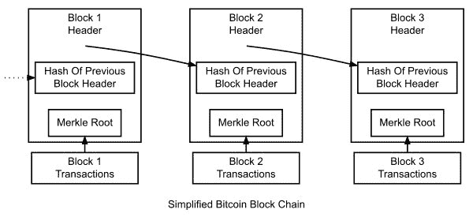

### 链

链是通过密码学连接在一起并在每个节点共享的区块。每个节点维护链的最新副本，形成一个由强大、可靠且一致的节点组成的网络。

链由区块组成。正如之前看到的，区块包含交易。每个交易都与账户关联，形成账本。通过链，可以确定特定地址的账本信息并验证交易。

由于链分布于网络，因此欺诈。如果有人尝试从他们的机器添加伪区块，网络将验证并拒绝该区块。要接管网络，必须控制网络中 51% 的节点（节点的哈希率/计算能力）。

这也称为 51% 攻击。

| 提示：51% 攻击是一种分布式攻击，攻击者试图通过感染和控制 51% 节点的哈希算力来尝试控制区块链网络。对于像比特币这样的网络，这几乎是不可能的，但对于较小的网络是可以实现的。 |
| --- |

链通过以下步骤在网络节点间共享：

1. 新交易被广播到所有节点。
2. 每个节点将新交易收集到一个区块中。
3. 每个节点致力于为其区块寻找困难的工作量证明（PoW）。
4. 当节点找到工作量证明时，它将区块广播给所有节点。
5. 只有当区块中的所有交易有效且未被花费时，节点才接受该区块。
6. 节点通过创建下一个区块（使用接受区块的哈希）来表达其接受。

对于大多数工作量证明系统，这些步骤是非常相同的。

链以二进制格式存储在节点上。根据操作系统和链网络，默认存储在以下位置（以比特币链为例）：

- Linux: `/home/[username]/.bitcoin/blocks/`
- Windows: `C:\Users\[username]\AppData\Roaming\Bitcoin\`
- Mac: `~/Library/Application Support/Bitcoin/`

你可以根据链配置将其存储在不同的位置。

让我们继续学习矿工。

### 矿工

矿工是执行向链中添加新区块并添加用户交易的节点。

矿工通过执行深度哈希计算来完成这一过程，在比特币的情况下大约需要 10 分钟。

这种计算消耗大量的计算能力，因此需要支付矿工费用以使其能够盈利运行。每当矿工成功将区块插入链中时，系统都会奖励他们激励。

挖矿过程始于从内存池中获取交易以构建候选区块。

候选区块包含区块头。矿工通过将区块头传递给 `SHA256` 函数来尝试计算哈希。

| 提示：SHA-256 是根据输入生成哈希的函数。 |
| --- |

返回的哈希应该小于系统当前定义的目标值。如果不是，矿工就会增加 `nonce` 并重新计算哈希。这个过程将持续进行直到找到正确的哈希值。


共识是网络中所有方同意的规则集。在本节中，我们将介绍不同类型的共识算法。在接下来的章节中，我们将详细介绍以下共识算法：

- 工作证明 (Proof of Work)
- 权益证明 (PoS)
- 拜占庭容错 (BFT)

工作证明是由中本聪（Satoshi Nakamoto）为比特币加密货币创建的共识机制。让我们详细了解所有它们。

## 工作证明
工作证明是一种共识机制，其中必须产生生成困难但验证容易的数据。

比特币使用工作证明，并要求矿工生成一个小于目标值的哈值。在比特币中，矿工必须产生一个以特定数量的 0 开头的哈值。例如，如果目标是 10，矿工必须产生一个开头的 0 的个数少于 10 的哈值。

这听起来很简单，但使用 `SHA-256` 函数生成它极其困难。一旦生成了符合目标的哈值，其他人都可以使用生成该哈值时采用的目标进行验证。因此，它是易于验证但难以生成的。

为了防止垃圾信息和拒绝服务攻击，工作证明要求矿工投入大量资金来构建执行挖矿的基础设施，并获得系统的奖励。

这种难度也确保了虚假交易不会冲击系统，因为用恶意交易填充系统需要花费大量的时间和资金。相反，人们将挖矿并赚大钱！

## 权益证明
工作证明是一种稳健的共识机制，但它消耗大量的计算和能量。生成区块的能量成本如此高，以这些能量可以供应整个城市的运行。

工作证明面临扩展性问题。为了解决这些扩展性问题，全球的工程师同意采用另一种被称为 PoS 的共识形式。

在工作证明中，当区块即将被挖矿时，网络中的每个矿工都尝试生成哈值以获得奖励。最终，成千上万矿工中只有一个矿工会获得哈值和奖励，这反过来浪费了其他矿工的努力。

在权益证明中，矿工（即验证者）根据各种权益被选中，例如随机性、挖掘的区块数量等。因此，网络选择矿工并要求他们挖掘区块，这给了每个人一个公平的机会，同时节省了其他矿工的努力。

在 PoS 中，权益可以是货币、排名或权益本身。当验证者试图作弊并在网络中添加坏区块或损坏区块时，权益将被罚没（slashed），或者对矿工收取罚款。

通常情况下，可以随机进行。系统从网络中随机选取验证者并将区块分配给他们。

网络分配一个公式，当新区块准备好挖矿时，它可以决定矿工。

PoS 简单且节省了大量的计算工作。世界上第二流行的加密货币以太坊已经从工作证明切换到了基于 PoS 的共识算法。

让我们来了解另一种流行的共识机制，即 BFT。

## 拜占庭容错
BFT 是分布式系统中的一种共识机制，即使网络中的节点未能响应或响应错误信息，也能达成共识。

BFT 确保即使在网络受到攻击或发生某些技术问题的情况下，系统仍运行并执行其功能。

到为止，我们学习了区块链及其组件。在下一节中，让我们学习加密货币，它凭借技术和金融方法创造了革命。

## 比特币
比特币是世界上第一个点点电子现金系统。比特币提供了匿名性、透明性，并且没有依赖于货币等第三方系统来交换价值。

中本聪在 2009 年发明了比特币，它被誉为本世纪最重要的发明之一。

比特币的发明是为了解决当前商业系统中基于信任的依赖。我们作为人信任银行、政府和联邦储备部来保护资金，并为普通人提供了一个使用纸币进行交易和交换的平台。

由于这些基于信任的模型，经济控制权掌握在少数人手中，他们可以将其恶意目的。

然而，当时没有替代方案，你必须去银行处理你的财务需求。这时，比特币作为一种全新的更好的替代方案出现了。

要交易比特币，不需要任何银行或政府的批准。你可以使用电脑或手机向同伴发送资金。就如此简单。

在本节中，我们将深入学习比特币是如何运作的，每笔交易是如何形成并添加到区块中的，以及它是如何不仅仅解决我们的货币问题的。

| 注意：我强烈建议读者打印出中本聪编写的比特币白皮书并仔细阅读。你可以从此处下载论文：`https://bitcoin.org/bitcoin.pdf` |

## 比特币如何工作
比特币是中本聪在 2009 年创建的一个点点电子支付系统。比特币允许我们向世界上的任何人发送资金，而不需要银行等中央机构来发行账户或处理支付。

比特币的创建是针对当前金融系统的解决方案，在当前系统中，少数大公司和银行控制着金融世界和全球交易处理。

它集中了金融和商业的控制权，并迫使人们信任银行能够负责任。

正如中本聪在《P2P 基础》中所说：
必须信任中央银行不会贬低货币，但法币的历史充满了对信任的背叛。

由于这个信任问题，一场巨大的金融危机在 2007 年底影响了世界。这场危机启发了中本聪创建比特币。

比特币是一个计算机程序。你可以下载预编译好的版本，也可以从 `GitHub` 下载源代码并自行编译。一旦在你的电脑上运行比特币程序，你就成了网络的一部分；你是一个节点！

一旦你的计算机成为网络的一部分，该程序将连接到运行相同程序的计算机。连接后，计算机将开始共享文件并尝试相互同步，这个文件无非区块链。一旦你的计算机与区块链文件同步，你就可以提交交易。

| 注意：这可能会引发一个问题：每个人都需要运行比特币程序才能发送或接收比特币吗？不，不需要。你可以下载比特币钱包并开始比特币交易。那些想要成为网络节点或矿工的人需要运行比特币程序，如下所示： |

| --- |


区块是用于以不可变形式存储交易的数据结构。比特币将用户的交易存储在区块中，稍后形成一条链以构建区块链网络。

正如我们在之前的章节中讨论的样，区块是由矿工通过挖掘过程生成的。挖掘过程需要共识算法来达成网络中的共识。

区块由区块头（block header）组成，矿工用它生成哈希。区块头包含以下内容：

• 版本 (Version)：区块的版本。
• 前一个区块哈希 (Previous block hash)：上一个识别出的区块的哈希，从而形成链。
• Merkle 根 (Merkle root)：区块中所有交易的哈希值。
• 时间 (Time)：时间戳。
• Bits：目标值的十六进制版本。
• Nonce：这是一个 32 位的随机整数，由矿工调整，使其成为一个有效数字，用于提供的区块哈希值应小于目标哈希。

前两个字段是自言易明的，我们已经在之前的章节中讨论过它们。让我们学习一下梅克尔树。

### 梅克尔树 (Merkle tree)

梅克尔树是一种数据结构，其中每个叶节点都标记有数据的加密哈希，每个非叶节点都标记有其子节点的哈希，形成一个通到根节点且只有一个哈希值的树。

如你在下面的图中所示，Hash `0-0` 和 Hash `0-1` 是数据块 `L1` 和 `L2` 的哈希值。稍后，Hash `0-0` 和 `0-1` 将一起哈希以形成 `Hash 0`，依此类推，直到我们达到根哈希：

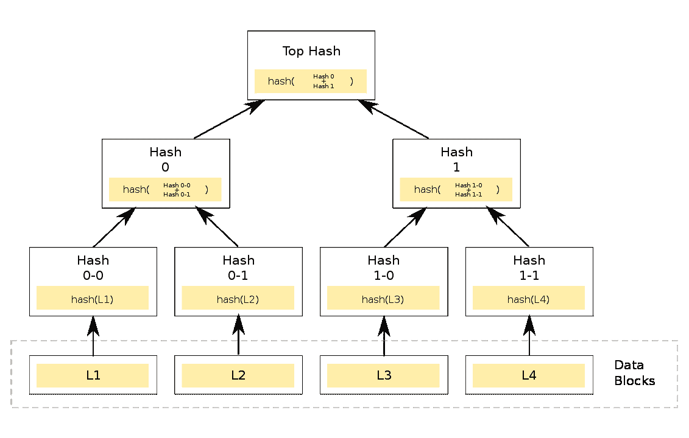

使用梅克尔树，我们可以以紧凑且安全的格式生成长系列数据的哈希。

比特币使用梅克尔树以哈希格式存储交易：

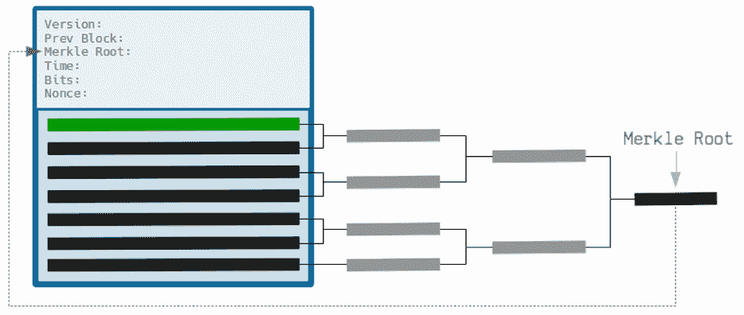

如前面的图所示，Merkle 根包含了以形成二叉树的方式一起哈希的交易。

梅克尔树通过成对对交易 ID (`TXIDs`) 进行哈希处理而形成。如果需要，会使用 `TXIDs`，我们可以使用树中的 `TXID` 进行重新检查。

要生成梅克尔树，我们取一对 `TXID` 并使用 `SHA-256` 算法对其进行两次哈希。生成的哈希值与另一对哈希值再次两次哈希，以生成单个哈希。一直持续到我们生成根哈希。

梅克尔树最适用于像比特币这样对数据敏感的应用。由于使用了梅克尔树，比特币的区块大小被保持在最大 1 MB。

| 提示：深入学习梅克尔树；它是 Facebook、Amazon、Apple、Netflix、Google (FAANG) 公司最常被问的问题之一。从这里开始：http://www.mit.edu/~rio/merkle.pdf |
| --- |

让我们学习区块头中的下一个字段——bits。

### Bits

Bits 是区块头中的一个字段，以紧凑格式存储目标值（target）。目标是矿工生成小于目标值的区块哈希所需的值。我们在区块链核心概念章节研究过它。

让我们看一个例子。目标值看起来像这样：

`0x00000000000000000696f400000000000000000000000000000000000000000`

存储此类长值需要空间，且目标在未来将不断变化。

为了解决这个问题，目标被紧凑化，它在区块头字段中看起来像这样：

`0x180696f4`

它很容易存储且占用的空间较少。

以下是如何解码一个 bit。它被分为两部分。`0x` 之后的前 2 位代表目标值中 0 的数量，其余值附加在 0 之后。字段的其余部分用 0 填充，直到达到 48 位。

所以，`0x180696f4` 值可以写为：

`0x----18 times zero---0696f4---rest zeros----`

通过这种方式，我们可以解码 bits。在下一节中，我们将查看该字段。

### Nonce

Nonce 是区块头中的字段，矿工用它生成哈希。比特币使用工作量。在工作量中，目标值以多个零开头，当幸运数字 `nonce` 被找到时，就会生成哈希。

矿工在网络中发布区块，每个其他节点对其进行验证并制作副本。

所以，`nonce` 在比特币中起着至关重要的作用。我们已经学习了区块和重要的区块头，让我们继续学习比特币交易。

### 交易 (Transactions)

当有人尝试从一个账户向另一个账户转移比特币时，矿工会形成一个新的交易。

交易包含了传输所需的数据。交易数据由要发送的金额、账户信息（如发送方和接收方）、网络所需的交易信息（如 `TXIDs`）等组成。

交易包含以下信息：

• `TXID` 被广泛称为。
• 交易数据如输入、输出。
• 手续费 (Fees)
• 重量 (Weight)
• 未花费交易输出 (UTXO)

让我们简要介绍每一个。

### TXID

`TXID` 是一个 32 字节的十六进制数字，被称为 `TXID`，用于识别比特币中的交易。

`TXID` 通过使用 `SHA-256` 算法对交易数据进行两次哈希生成。

Satoshi Nakamoto 向 Hal Finney 发送了第一个比特币交易，该交易的 ID 为：

`f4184fc596403b9d638783cf57adfe4c75c605f6356fbc91338530e9831e916`

你可以在区块浏览器中查看这笔交易：

https://www.blockchain.com/btc/tx/f4184fc596403b9d638783cf57adfe4c75c605f6356fbc91338530e9831e916:

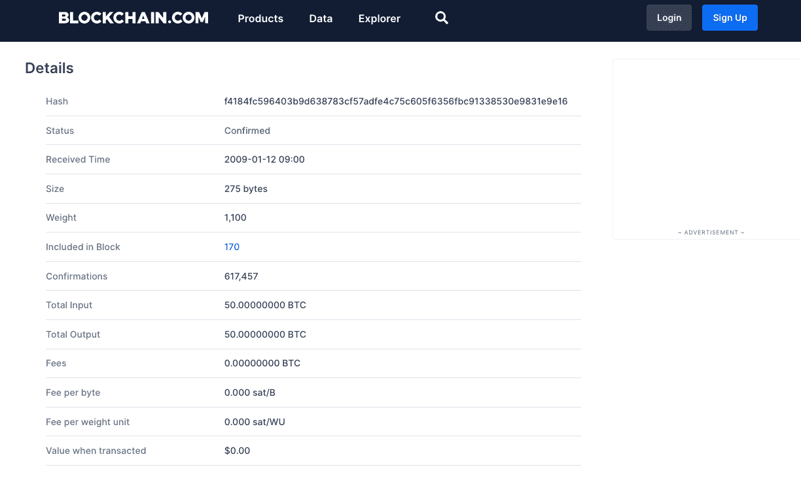

让我们查看交易负载所需的交易数据。

### 交易数据

交易数据包含了形成输入和输出所需的信息。在比特币中，当你向某人发送一些币时，你解锁了某些输出，并使用接收者的密钥重新锁定，以便只有他们可以锁定。

这听起来可能很困惑，但你将在接段落中得到清楚。

让我们来看一个例子：


想象你有 5 个比特币，你想给朋友发送 3 个比特币。在这里，你持有的 5 个比特币是你的输出，它被拆分为两个输出。其中一个价值 3 个比特币，另一个价值 2 个比特币。第一个输出将用接收者的密钥锁定，以便他们解锁它。第二个输出是你的钱，因此它将再次用你的凭据锁定，以供将来使用。

简而言之，当一个新交易形成时，整个金额都包含在交易负载中。剩余的所有部分将作为输出发送回给你。

因此，这种基于图的输入和输出结构提供了比特币的所有权历史。

### 费用

比特币中的每笔交易都会以比特币的形式向矿工支付一定金额的费用。交易输出的剩余部分也与费用相关，并支付给矿工作为他们工作的报酬。

通常情况下，通过增加丰厚的费用，矿工有很大概率从内存池中选取你的交易并将其添加到下一个区块。然而，这完全是可选的。如果你当时没有支付费用，可能需要一些时间，但你的交易将由遍世界各地的矿工挖掘。

这里是与交易相关的费用。你也可以检查矿工奖励，在更新本书时该奖励为 3.125 个比特币：

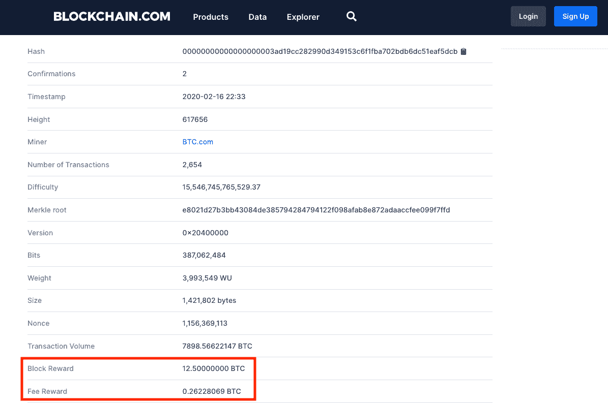

| 注意：交易的剩余部分也将作为费用支付给矿工。假设你想向某人支付 5 个比特币，而你的钱包里大约 10 个比特币，如果你不在交易的输出部分申领剩余的 5 个比特币，它们将支付给矿工。这是不可退的，因为区块链是不可篡变的！因此，在程序化构建交易负载之前请反复检查。 |

| --- |

### 重量

如其名，它指的是交易的大小，即其权重。在引入权重之后，交易负载是通过将验证部分放在负载末尾来形成的，而不是像我们之前那样放在每个输入中。

### UTXO

当形成一个新交易并生成一个新输出时，被花费或发送给其他用户的输出不能再次被花费。然而，留下的或未花费的输出可以在未来的交易中使用。

这些未花费的输出被称为 UTXO。

UTXO 用于计算特定用户的余额，并验证他们是否有足够的金额进行花费。UTXO 是形成新交易和防止双花费的关键部分。

这些是涉及比特币交易的关键因素。

我们希望你理解了这些概念以及为了让比特币和区块链变成现在这样进行技术更改的原因。在下一节中，我们将讨论构建基于区块链技术分支应用的独特方法之一——去中心化应用（DApps）。

## 区块链与去中心化

加密货币是区块链的一个子集，就像互联网的电子邮件。

正如我们在之前的章节中所学的，区块链是一个基于点点共识的计算机网络。每台计算机相互通信并交换数据。

因为它没有涉及中央机构。

### 去中心化应用

加密货币是区块链的一个子集，就像互联网的电子邮件。

正如我们在之前的章节中所学的，区块链是一个基于点点共识的计算机网络。每台计算机相互通信并交换数据。

因为它没有涉及中央机构。

### 去中心化应用的工作

想象你有 5 个比特币，你想给朋友发送 3 个比特币。在这里，你持有的 5 个比特币是你的输出，它被拆分为两个输出。其中一个价值 3 个比特币，另一个价值 2 个比特币。第一个输出将用接收者的密钥锁定，以便他们解锁它。第二个输出是你的钱，因此它将再次用你的凭据锁定，以供将来使用。

### DApps 协议

比特币使用区块链来存储实际货币，基本上于此。比特币之后的下一个大事件是以太坊，它引入了被称为智能合约的东西。


如之前的截图所示，`IPFS Stack` 分为三个子层：

• 网络层
• 数据定义与命名层
• 数据层

让我们简要介绍一下每个子栈。

## 网络层

去中心化网络的核心挑战之一是点对点网络，以及设计在点对点网络中与中心化系统并行运行的协议。

`libpeer-to-peer` 项目通过协议实验室（protocols labs）解决了这一挑战。`libpeer-to-peer` 提供了一个模块化的堆栈，人们可以使用它结合现有协议（如 `WebRTC`）或任何新的传输层协议来构建点对点网络。

因此，`lib-to-peer` 是与传输无关的。

`libpeer-to-peer` 的特性包括：

• `libpeer-to-peer` 是一个模块化的网络栈。你可以使用它的全部，也可以使用该栈的部分来构建你的应用程序。
• `libpeer-to-peer` 提供了传输和点对点协议，用于构建大型、健壮且可扩展的网络应用程序。
• `libpeer-to-peer` 与传输协议无关。它可以与 `TCP`、`UDP`、`WebRTC`、`WebSockets` 和 `UDP` 一工作。
• `libpeer-to-peer` 提供了多个模块，如传输接口、发现、分布式哈希查找、节点发现和路由。
• `libpeer-to-peer` 提供了内置加密以防止窃听。
• `libpeer-to-peer` 提供了内置漫游功能，使得你的服务可以在没有任何干预且不丢包的情况下切换网络。

`libpeer-to-peer` 是构建点对点网络层的基础性解决方案。

### 数据定义与命名层

通过哈希进行的内容寻址（Content addressing）在分布式系统中被广泛使用。我们在 `Git`、`加密货币`等使用了基于哈希的内容寻址。这种方法也同样用于点对点网络中。

`IPLD` 为所有基于哈希的协议提供了统一的命名空间。使用 `IPLD`，可以跨越各种协议遍历数据，以探索和查看分布在点对点网络中的数据。

`IPNS` 是一个为存储在 `IPFS` 的内容创建可变地址的系统。它们之所以是可变的，是因为内容每次发生变化时，其地址也会发生变化。

### 数据层

栈的最顶层是数据层。`IPFS` 是点对点多媒体协议。`IPFS` 提供了一种跨越点对点网络存储和检索数据的方法。

它使用 `IPNS` 和 `libpeer-to-peer` 在点对点网络中创建、命名和发布内容。

任何人都可以成为 `IPFS` 节点并开始使用哈希查找内容。`IPFS` 节点不需要存储所有数据，它们只需要存储自己创建的数据，或者它们过去搜索过的数据。

`IPFS` 的特性包括：

• `IPFS` 为 Web 3.0 提供了点对点多媒体协议。
• `IPFS` 可以与现有的协议和浏览器配合。它实现了从中心化 Web 到 Web 3.0 的平滑过渡。
• `IPFS` 使用 `libpeer-to-peer` 支持点对点网络。
• `IPFS` 数据是加密安全的。
• `IPFS` 可以在流媒体服务中节省大量带宽。

`IPFS` 正在开发中，开发者已经构建了一些运行在 `IPFS` 之上的优秀应用。我们选择的应用之一是 `DTube`。

它是 YouTube 的去中心化版本，带有由 `Steem` 区块链提供的内置激励和奖励功能。

`IPFS` 也试图解决激励问题。我们不能期望每个连接互联网的人都充当节点。开发者在 `IPFS` 之上构建了一些很棒的应用。我们选择的应用之一包括：

• OrbitDB: 点对点数据库
• Ocean Protocol: 分布式数据库
• Filecoin: 数据交换协议


在比特币问世后，当世界意识到区块链在金融之外的力量时，以太坊成为了首选，并且表现良好。让我们简要学习比特币和以太坊之间的区别。

# 比特币与以太坊

以太坊曾与比特币许多许多元素，例如 P2P 网络、用于维护无冲突状态的工作量证明共识算法、用于支持网络激励和实用支付的加密货币（如 Ether）、钱包以及数字签名。

现在，在本书更新时，以太坊已经从工作量证明共识转向了权益证明算法，这标志着两个平台之间发生了根本性的变化和差异。

然而，以太坊在设计和目的上与比特币不同。比特币的设计是为了支持全球加密货币系统，而以太坊被设计为一个可编程的虚拟机（`VM`），能够在区块链上执行程序。

比特币支持脚本形式的简单代码执行，并支持普通的 if/else 语句，而以太坊支持图灵完的编程语言。

简而言之，比特币限于加密货币，而以太坊是一个开放且通用的图灵完 `VM`。

以太坊凭借其通用的编程语言和广泛的软件开发包，允许全球的开发者构建他们的应用程序。其中著名的应用之一是 CryptoKitties。

CryptoKitties 是一个运行在以太坊区块链上的游戏，允许玩家在区块链上购买、繁养和出售虚拟猫。它非常受欢迎，并让世界有了对区块链能力的视角。

以太坊的范围非常广泛，允许开发者编写应用程序，而无需自己创建区块链和网络。开发者可以专注于构建应用，而网络基础设施、状态管理和代码执行则由以太坊网络处理。

让我们学习一下以太坊的历史，以理解这个神奇项目背后的原因。

# 以太坊的历史

所有伟大的创新都在解决大问题，以太坊也不例外。以太坊发明时，人们已经意识到比特币模型的广泛应用，并正尝试超越加密货币。

尽管这并非易事，开发者们面临着一个需要一套新协议和工具的问题。他们要么在比特币之上构建新的应用程序，要么启动一个新的区块链（对于每一个应用程序来说这都是非常困难的）。

如果开发者选择在比特币模型之上构建，他们将面临问题，主要是技术上的问题，因为比特币是为了支持加密货币而开发的，要超越它需要巨大的努力，并且可能导致链的分叉。

对于那些在使用区块链时需要更多自由和灵活性的项目，新的区块链是唯一的选择。但这意味着大量的工作：启动所有基础设施元素、开发、团队建设、测试等。

2013 年 12 月，俄罗斯裔加拿大程序员兼比特币爱好者维塔尼·布特林（Vitalik Buterin）发表了一篇论文，提出了图灵完通用区块链的想法：


这是以太坊白皮书（黄皮）的链接（建议大家都阅读一遍）：`https://ethereum.github.io/yellowpaper/paper.pdf`。

以太坊背后的想法是设计一种可编程的通用区块链，以便世界上的人都能编写程序并运行在区块链上，而无需开发 P2P 网络、区块链、共识算法等底层机制。

2015 年 7 月，第一个以太坊区块被挖出。它标志着通用世界计算机开始工作的日期。接下来的图标记了第一笔以太坊交易：

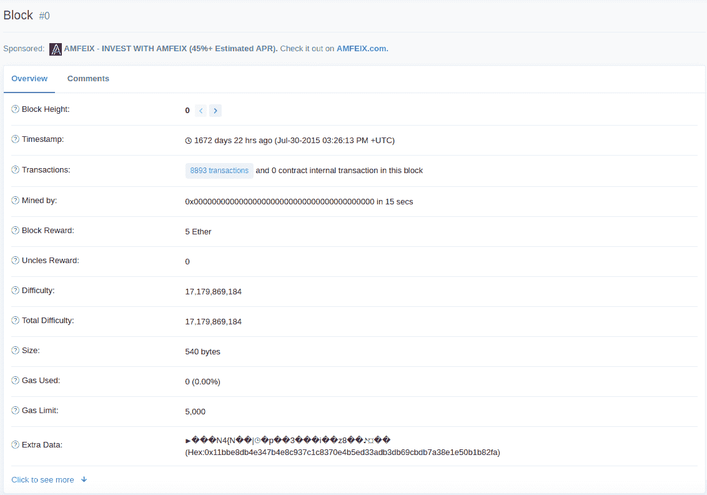

以太坊已成为世界上最大的区块链网络，并为一组新的应用程序——去中心化应用（`DApps`）开辟了道路。

在下一节中，让我们学习以太坊区块链的组件。

# 以太坊的组件

在以太坊，以下组件起着重要作用：

- P2P 网络：以太坊像比特币一样运行在主网网络，默认可以通过你计算机上的 `30303` 端口访问。以太坊 P2P 网络使用名为 `ÐΞVp2p Wire Protocol` 的协议通信。
- 共识机制：以太坊使用权益证明共识算法。
- 交易：以太坊交易包含网络信息，以及发送者、接收者、金额和有效负载。
- 状态机：这是以太坊独特且重要的组件。以太坊的状态转换由 `Ethereum VM` 管理，这是一个执行由智能合约程序生成的字节码的虚拟机。
- 数据结构：以太坊状态也本地存储在每个节点中。以太坊默认使用数据库（也称为 `LevelDB`），其中包含 Merkle 格式的交易和系统状态。
- 客户端：以太坊提供了多个客户端软件，例如 `go-ethereum`（也称为 `Geth`）和 `Parity`（已弃用）。

在下一节中，我们将观察以太坊从通用区块链到 `DApps` 的转变。

# 以太坊与 DApps

以太坊项目的启动是为了构建一种通用的区块链，这种区块链可以为各种用途进行编程。以太坊的愿景迅速扩大，成为一个编程和托管 `DApps` 的平台。

`DApps` 展示了比智能合约更广泛的视角。一个 `DApp` 至少包含智能合约和一个 Web 用户界面。更广泛地说，`DApp` 是构建在开放、去中心化的 P2P 网络和基础设施之上的 Web 应用程序。

`DApp` 至少包含以下内容：

- 区块链上的智能合约。
- Web 前端用户界面。

此外，许多 `DApps` 还其他去中心化组件，例如：

- 去中心化（P2P）存储协议和平台，如星际文件系统（`IPFS`）和 `Swarm`。
- 去中心化（P2P）消息协议和平台，如 `libp2p` 和 `Whisper`。

`DApps` 的理念和起源旨在将万维网（`WWW`）推向下一个进化阶段，将去中心化协议引入 Web 应用程序的各个方面。描述这种演变的术语是 Web 3.0，意味着 Web 的第三个版本。`WWW` 不受中央权威控制。

在下一节中，我们将详细探索以太坊 `DApps` 的功能。

让我们从智能合约开发开始。在编写智能合约之前，我们必须了解以太坊客户端，即在你的系统中运行区块链或使用免费第三方服务。

# 以太坊客户端

以太坊提供了客户端软件来成为网络节点。你可以下载并安装这些客户端来成为节点，并执行查询区块链、执行交易、执行智能合约等操作。

有多个开源版本的以太坊客户端，如果它们符合以太坊参考规范和标准通信协议，就可以相互操作。虽然由不同的团队和个人开发这些客户端，但它们都通过标准通信协议进行通信。

在编写本书时，有六种不同编程语言编写的六种主要的以太坊协议实现，如下：

- `Geth`：使用 Go 语言编写。


- **Nethermind**: 使用 `C#` 和 `.Net` 框架编写。
- **Besu**: 使用 `Java` 语言编写。
- **Erigon**: 使用 `Go` 语言编写。
- **Reth**: 使用 `Rust` 语言编写。
- **EthereumJS**: 使用 `TypeScript` 编写，在编写本书时尚处于测试阶段。

我们将学习一个最常用的客户端之一——`Geth`，它也算是一种官方的以太坊客户端，因为以太坊基金会负责管理它。

在我们的机器上运行这些客户端之前，让我们先了解以太坊网络的类型以及我们应该使用哪一种。

## 以太坊网络

以太坊网络分为两类：

- **主网 (Mainnet)**（也称为全节点）：处理真实以太坊（即货币）的活跃网络。
- **测试网 (Testnet)**：为研究设计的测试网络。

如前所示，`testnet` 最适合开发，而 `mainnet` 是实际的 P2P 网络。

在你的机器上运行 `mainnet` 会产生硬件资源成本和带宽消耗。不建议在本地机器上运行它。你可以在 `testnet` 节点上完成你需要做的一切。

我们还可以使用像 `Ganache` 这样的私有区块链或像 `Infura` 这样的云客户端供应商。我们将在章中也会学习它们。

现在，让我们在机器上安装并运行 `Geth`。

## 安装 Geth

`Geth` 是用 `Go` 语言开发的以太坊客户端，由以太坊基金会积极维护，因此被认为是以太坊客户端的官方实现。通常，每个基于以太坊的区块链都会运行着一个 `Geth` 实例。

让我们看看在系统上运行 Ubuntu 时如何安装 `Geth`。如果你使用的是 Windows 或 macOS，可以使用以下链接进行安装：

- Windows 安装指南：`https://geth.ethereum.org/downloads/`
- Mac 安装指南：`https://geth.ethereum.org/docs/install-and-build/installing-geth#install-on-macos-via-homebrew`

让我们在本地系统中安装、打开终端并克隆仓库。

以下是命令：

```bash
git clone https://github.com/ethereum/go-ethereum.git
```

在你的系统中下载并安装 `Geth` 可能需要一些时间，如下图所示：

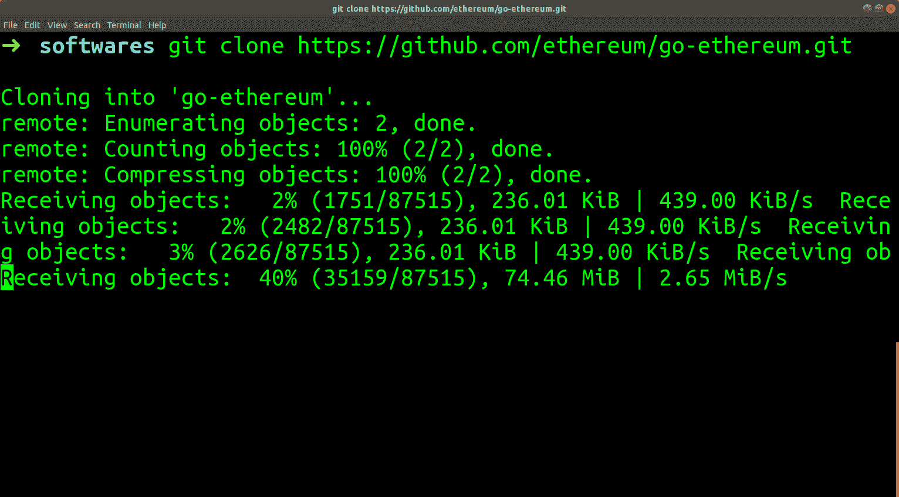

下载完成后，你需要切换到目录并运行这些命令：

```bash
make geth
```

从源码构建 `Geth` 需要一些时间。安装完成后，可执行文件将存放在 `go-ethereum` 文件夹内的 `/build/bin` 文件夹中。

你也可以直接从网站下载构建包并在电脑上运行。要下载构建文件，请访问以太坊 Geth 下载页面 `https://geth.ethereum.org/downloads/` 并下载适用于你操作系统的版本。

一旦你完成了源码构建或下载解压，进入文件夹并运行此命令来检查 `Geth` 版本：

```bash
./geth version
```

它应该打印如下所示的 `Geth` 版本详情：

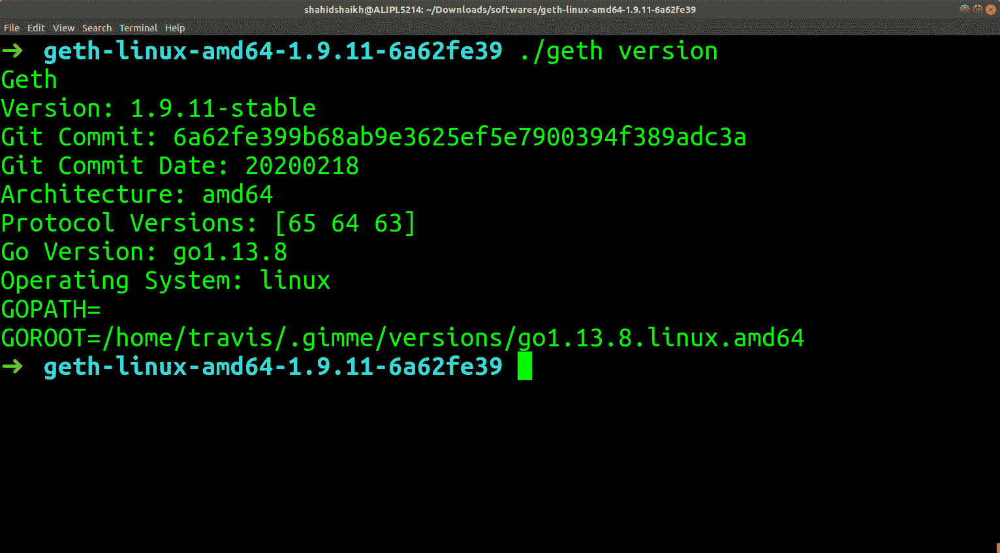

你看到的信息可能与前面的图片略有不同，但报告格式应该如所示。

现在我们已经成功下载了 `Geth`，让我们了解一下可以用它做什么。首先，让我们同步区块链并成为公共测试网中的一个节点（peer）。

## 同步测试网区块链

我们已经学习过每个节点在区块链网络中都有一个完整的链副本。要成为节点，必须首先从网络中的其他节点获取区块链副本。这被称为同步（synchronization）或 `sync`，该操作将区块链数据从创世区块复制到最新区块。

以下是启动同步过程的命令：

```bash
./geth --testnet --syncmode "fast"
```

理解命令参数：

- `--testnet`: 意味着我们需要同步测试网数据，其尺寸比 `mainnet` 小。
- `--syncmode`: 选择我们可以用于同步链的各种模式。在 `fast` 模式下，`Geth` 不验证每一个区块，这缩短了同步链的时间。

然而，取决于你的网络连接带宽，同步整个链可能需要一天。

运行命令后，你应该会在控制台中看到以下内容：

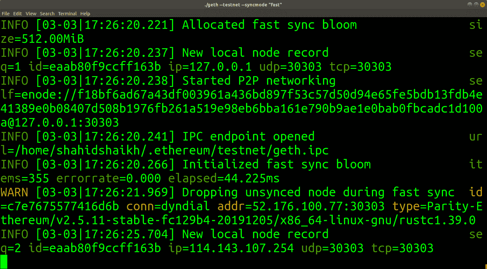

要检查同步状态，你可以查看终端并找到等待值（pending values）。这些是在我们的机器成为以太坊测试网节点之前需要同步的区块数量。

让我们看看如何安装一个名为 `Ganache` 的私有区块链软件，它是专为开发目的设计的。

## 安装 Ganache

`Ganache` 是一个允许你快速启动个人以太坊区块链的软件，用于运行测试和执行智能合约而无需成为节点。

在本书更新时，`Ganache` 已被弃用。我们在这里保留这部分是为了理解，但不建议你使用它。你可以直接跳到 Infura 部分，或者阅读它以获取知识。

要下载 `Ganache`，请访问官方网站下载软件：`https://www.trufflesuite.com/ganache`。下载软件后，解压并在你的系统中运行它。

`Ganache` 运行起来像这样：

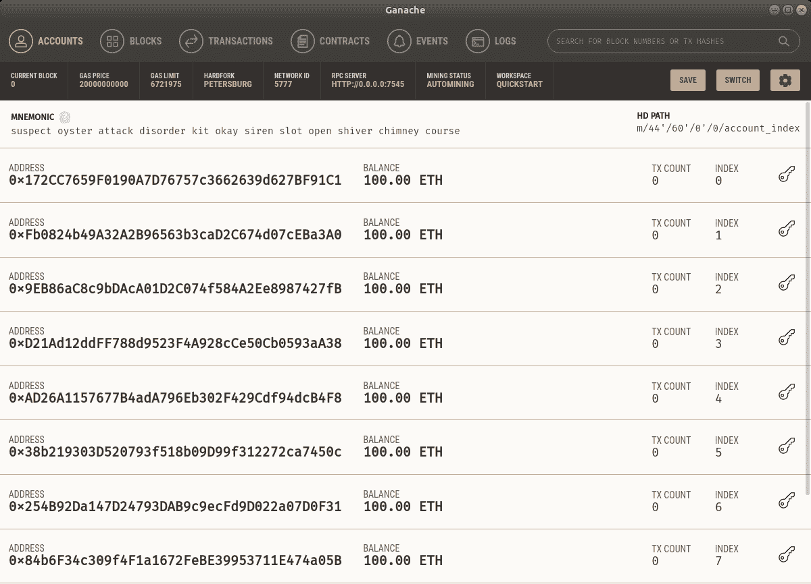

`Ganache` 提供了多个带有测试以太坊的钱包，以便你进行测试。你可以检查区块和交易状态。

`Ganache` 还有一个 CLI 包，我们可以安装它以命令行模式与 Ganache 远程调用 (RPC) 服务器交互。让我们看看 Infura 服务来如何使用它。

## Infura

`Infura` 是一个第三方以太坊和 IPFS API 提供者。你可以使用 Infura 基础设施免费运行你的应用程序。Infura 处理所有的同步和基础设施，而你作为开发者，可以专注于代码。Infura 网站如下：

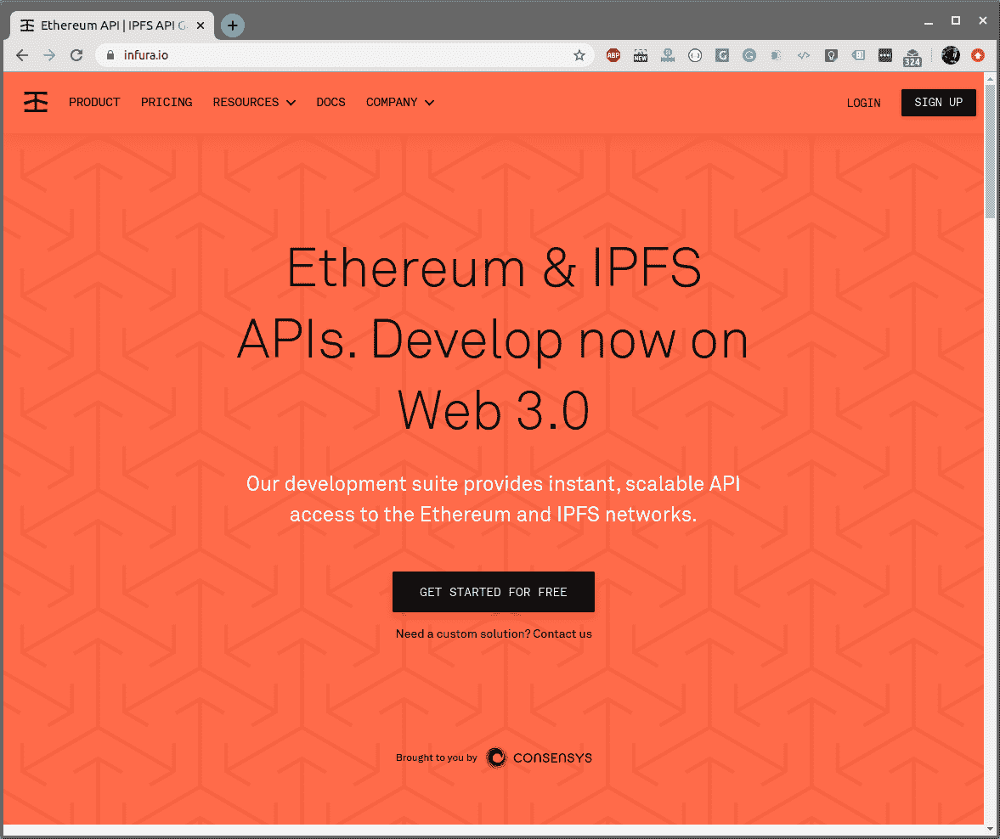

要使用 Infura 服务，你需要使用电子邮件地址创建账户。创建账户后，你可以登录 Infura 仪表板，它列出了你创建的项目以及其他详情。如下图所示：

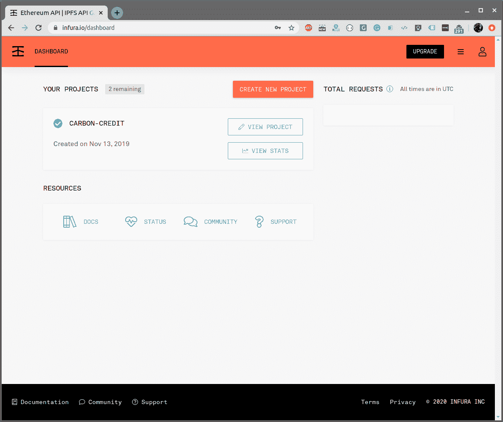

如前幅图片所示，已经创建了一个项目。你可以点击 CREATE NEW PROJECT 按钮创建你的项目。给你的项目起一个合适的名称，Infura 会在后台为项目创建一个测试网和主网。

项目创建后，你可以查看所有详情，例如用于连接到节点的对端点、项目 ID 和密钥。

你可以使用这些凭据与 Infura 网络交互。请确保安全。在下一节中，我们将简要查看以太坊客户端提供的 JSON-RPC API。

## JSON 远程调用 API

以太坊客户端提供了应用程序接口和一组 RPC 命令，这些命令被编码为 JavaScript 对象表示法 (JSON)。我们将其称为 JSON-RPC API。

JSON-RPC API 是一个接口，允许我们编写使用以太坊客户端作为以太坊网络和区块链网关的程序。我们可以通过在任选编程语言中构建 RPC 客户端与 JSON-RPC 服务器交互，也可以直接调用 HTTP 端点。

首先，让我们向以太坊 RPC 端点进行简单的 HTTP 调用并看看它是否有效。以下是返回客户端版本的命令：

```bash
curl -X POST -H "Content-Type: application/json" --data \
'{"jsonrpc":"2.0","method":"web3_clientVersion","params":[],"id":1}' \
http://localhost:7545
```

在前面的命令中，我们向运行在端口 7545 的 RPC 服务器发送 JSON-RPC 调用。

它应该在终端中返回如下输出：


{"id":1,"jsonrpc":"2.0","result":"EthereumJS TestRPC/v2.8.0/ethereum-js"}

如果你使用的是 `Geth` 或 `Infura`，结果可能会有所不同。你可以在 Ethereum 的 GitHub wiki 中查看所有命令：https://github.com/ethereum/wiki/wiki/JSON-RPC#json-rpc-methods。

让我们再次进行一次 RPC 调用。这次，我们将要求 RPC 服务器返回最新的区块号。

这里是该命令。请将其复制并粘贴到你的 `Terminal` 中：

```bash
curl -X POST -H "Content-Type: application/json" --data \

 '{"jsonrpc":"2.0","method":"eth\_blockNumber","params":\[\],"id":1}' \

 http://localhost:7545
```

这应该返回以下输出：

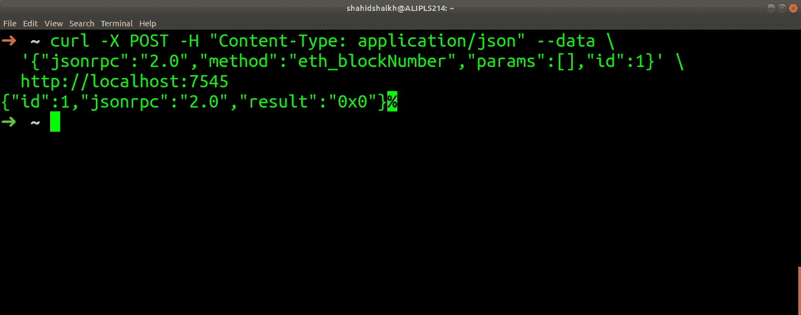

你可以通过在 `Terminal` 中运行以下命令，将十六进制的 `0x0` 转换为十进制：

```bash
$ echo $((0x0))
$ 0
```

你应该尝试其他命令并与 RPC 交互，以掌握以太坊链函数和方法的用法。我们将在接下来的章节中使用这些函数来编写我们的智能合约。

到目前为止，我们详细学习了以太坊，并学会了如何成为以太坊网络的节点；我们还查看了 Ethereum RPC 调用以及如何使用与其交互。

在下一节中，我们将学习智能合约和 Solidity 语言。

## 智能合约与 Solidity 语言 (#toc.xhtml#zh35)

智能合约运行在以太坊虚拟机（EVM）上的程序，负责管理以太坊状态账户的行为。

让我们理解以下定义：

- **计算机程序**：智能合约与其他任何程序一样都是计算机程序。`contract` 一词本身没有法律含义。
- **不可变性 (Immutable)**：智能合约一旦部署，就无法更改，这符合区块链的基本标准，即不可变性。任何更改必须使用新的版本号重新部署。
- **VM 上下文 (VM context)**：智能合约在限制的执行环境中运行。如果需要，智能合约可以访问其状态、交易上下文以及有关最新区块的信息。
- **去中心化计算机 (Decentralized computer)**：虚拟机运行在世界各地的节点上并共享相同的状态，因此整个系统像单台计算机一样运行。

智能合约通常用 Solidity 编程语言编写。

Solidity 是一种面向对象的高级语言，用于实现以太坊的智能合约程序。

Solidity 深度受到 `C++`、`Python` 和 `JavaScript` 的启发，如果你在职业生涯中使用过其中任何一种编程语言，你会觉得它很熟悉。Solidity 是静态类型（这意味着类型在编译期间进行检查），并支持继承、库和用户定义类型。

在本节中，我们将学习 Solidity 项目和数据类型，并用用 Solidity 开发一个程序。

Solidity 是一门高级语言，但在 Solidity 编译器的帮助下，它将其代码转换为机器级可执行代码，这些编译器通常被称为 `solc`。

你可以通过多种方式在计算机上安装 Solidity 编译器。安装编译器的简单方法是使用节点包管理器，即 `npm`。

假设你的机器已安装了 `Node.js`，你可以在终端运行此命令来安装 Solidity 编译器：

```bash
sudo npm install -g solc
```

此命令将在你的机器上安装 Solidity 编译器。安装完成后，你可以通过运行以下命令进行验证：

```bash
$ solcjs -h
```

此命令将打印与 Solidity 编译器相关的选项，如下所示：

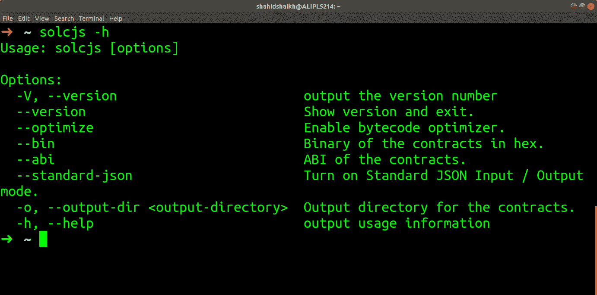

你可以访问 Solidity 官方网站查看详细的安装说明：https://solidity.readthedocs.io/en/latest/installing-solidity.html。

让我们来看 Solidity 编程语言的数据类型。我们可以在一个章节中涵盖 Solidity 的所有细节，但将解释你开始编写 Solidity 程序或智能合约所需的必备知识。

## Solidity 数据类型 (#toc.xhtml#zh36)

Solidity 的一些基本数据类型如下：

- **布尔值 (Boolean)**：布尔值；持有 true 或 false。
- **整数 (Integer)**：有符号整数 (`int`) 和无符号整数 (`uint`) 被声明为 256 位的整数值。然而，我们可以以 8 位为增量提供大小后缀。例如，`int8`、`int16` 到 `uint256`。
- **定点数 (Fixed point)**：定点数，用 `fixedMxN` 或 `ufixedMxN` 声明，其中 `M` 是以 8 位为增量的位大小，`N` 是小数点后的位数。例如，`ufixed32x2` 意味着大小为 32 位且有两个小数点的无符号定点数。
- **地址 (Address)**：它是一种 20 字节的以太坊地址类型。`Address payable` 是一个提供额外成员进行传输和发送的类型，它是可以发送以太坊的地址。
- **数组 (Arrays)**：分为两种类型：
    - 固定类型是使用 `bytes1` 和 `bytes32` 声明的固定大小数组。
    - 动态数组的大小可变。它们用 `bytes` 或 `string` 声明。
- **枚举 (Enum)**：它是用于离散值的用户定义类型。
- **结构体 (Struct)**：它是一种用户定义的数据容器，类似于 `C++` 中的结构体。
- **映射 (Mapping)**：它是一个通过键映射到值的哈希查找表。

这些是处理数据的基本类型。还有一些帮助你开始编写 Solidity 程序或智能合约的必备知识。

这些是基础类型。

| 注意：`wei` 是以太坊的最小单位。 |
| --- |

让我们查看合约的结构以了解编写合约。

## 合约结构 (#toc.xhtml#zh37)

每个 Solidity 合约可以包含以下：

- 状态变量
- 函数
- 函数修饰器
- 事件
- 结构体
- 枚举

合约还可以继承其他良好的合约。让我们详细了解合约结构。

### 状态变量 (#toc.xhtml#zs24)

状态变量是持久存储在合约中的变量。使用我们学习的类型声明状态变量。

考虑以下示例：

```solidity
pragma solidity 0.4.0;
contract SimpleStorage {
    uint storedData; // 状态变量
}
```

### 函数 (#toc.xhtml#zs25)

函数包含代码并通过程序调用。函数具有 `public`、`private` 等可见性。它们接受参数并返回变量。

参考以下示例：

```solidity
pragma solidity >=0.4.0 <0.7.0;
contract SimpleAuction {
    function sayHello() payable { // 函数
}
}
```

### 函数修饰器 (#toc.xhtml#zs26)

函数修饰器可以以声明式方式更改函数的行为。例如，我们可以使用修饰器在执行函数之前执行条件代码。

### 事件 (#toc.xhtml#zs27)

正如名称所示，它提供了发布和订阅事件的功能。事件允许程序员编写模块化的代码库。

### 结构体 (#toc.xhtml#zs28)

结构体（struct）是定义用户生成数据结构的方法。

看看这个示例：

```solidity
pragma solidity 0.4.0;
contract UserInfo {
    struct User { // 结构体
        uint Id;
        byte32 name;
        address delegate;
    }
}
```

### 枚举 (#toc.xhtml#zs29)

枚举数据类型允许开发者在 Solidity 中创建自己的类型。

考虑以下示例：

```solidity
pragma solidity 0.4.0;
contract Purchase {
    enumUserStatus { Active, Pending, Inactive } // 枚举
}
```

## 编写第一个 Solidity 程序 (#toc.xhtml#zh38)

让我们编写第一个智能合约，通过阅读之前的示例代码可以解决你的疑问。

你的机器上必须安装以下内容：

- `Node.js`
- `Hardhat`
- `Solc`

你可以选择任何喜欢的代码编辑器，但强烈建议使用 Visual Studio Code (VS Code) 编辑器。

你可以通过以下链接从官方网站下载编辑器：https://code.visualstudio.com/


如果你正在使用 `VS Code`，建议安装 `Solidity` 扩展。操作步骤如下：

1. 要安装，点击 `VS Code` 左侧栏的 `Extension`（扩展）图标并搜索 `solidity`。
2. 点击 `Install`（安装）按钮即可开始。
3. 假设你已经安装了 `Node.js`，这里是安装 `Hardhat` 的流程。

`Hardhat` 是一个以太坊开发框架，它让编写和部署智能合约变得简单且对开发者友好。现在，参考以下步骤：

1. 运行以下命令在你的机器上安装 `Truffle`：
```bash
npm install --save-dev hardhat
```
2. 一旦完成，我们就可以继续项目。
3. 创建新文件夹并使用命令行进入该文件夹。运行此命令创建一个新的 `Hardhat` 项目。
4. 创建文件夹：
```bash
mkdir solidityDemo
cd solidityDemo
```
5. 然后，运行以下命令：
```bash
npx hardhat init
```
它应该会在终端中输出以下内容：

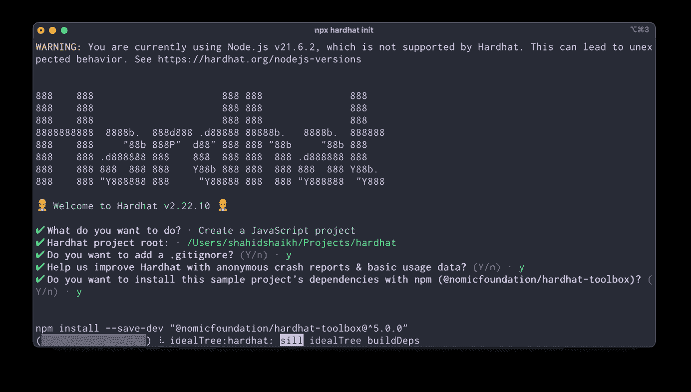

现在，在你的代码编辑器中打开项目。项目的结构如下：

- `contracts`
- `ignition`
- `test`
- `artifacts`
- `hardhat-config.js`

`contracts` 文件夹存储用 `Solidity` 编写的代码。`ignition` 文件夹包含部署合约的脚本。`hardhat-config.js` 包含配置选项；我们的项目不需要修改该文件。

切换到 `contracts` 文件夹，你应该看到 `Lock.sol` 文件，其内容应该如下：

```solidity
pragma solidity ⁰.8.24;

contract Lock {
    uint public unlockTime;
    address payable public owner;
    event Withdrawal(uint amount, uint when);
    constructor(uint _unlockTime) payable {
        require(
            block.timestamp < _unlockTime,
            "Unlock time should be in the future"
        );
        unlockTime = _unlockTime;
        owner = payable(msg.sender);
    }
    function withdraw() public {
        // 注消此行，以及导入 "hardhat/console.sol"，以便在终端中打印日志
        // console.log("Unlock time is %o and block timestamp is %o", unlockTime, block.timestamp);
        require(block.timestamp >= unlockTime, "You can't withdraw yet");
        require(msg.sender == owner, "You aren't the owner");
        emit Withdrawal(address(this).balance, block.timestamp);
        owner.transfer(address(this).balance);
    }
}
```

在继续之前，让我们理解一下这个程序：

1. 第一行告诉编译器应该使用哪个版本的 `solidity`，这非常重要。如果 `solc` 版本与 `0.8.24` 不同，请如上所示将版本更改为你的版本。
2. 第二行声明了一个新的 `contract`（合约），并在其内部包含了合约的不同函数。
3. 让我们通过运行此命令来编译此程序：
```bash
npx hardhat compile
```
它应该在控制台中返回以下输出：

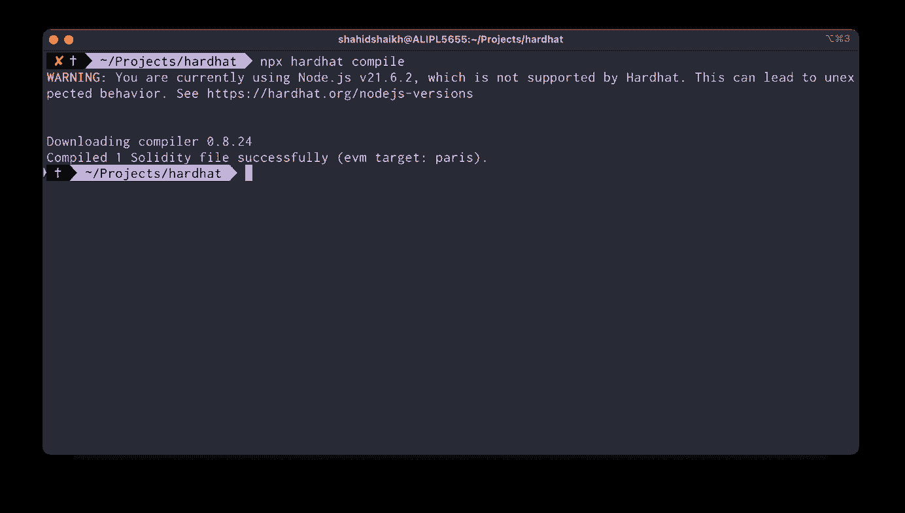

4. 现在，让我们部署该合约。在新的终端窗口中，运行此命令以运行本地以太坊节点来部署智能合约。
```bash
npx hardhat node
```
5. 现在，让我们将编译后的合约部署到本地区块链节点。运行以下命令进行部署。确保你在网络参数中添加了 `localhost` 值。
```bash
npx hardhat ignition deploy ./ignition/modules/Lock.js --network localhost
```
它将在区块链中部署我们的智能合约并返回交易 ID。此命令在你的终端上应该显示如下内容：

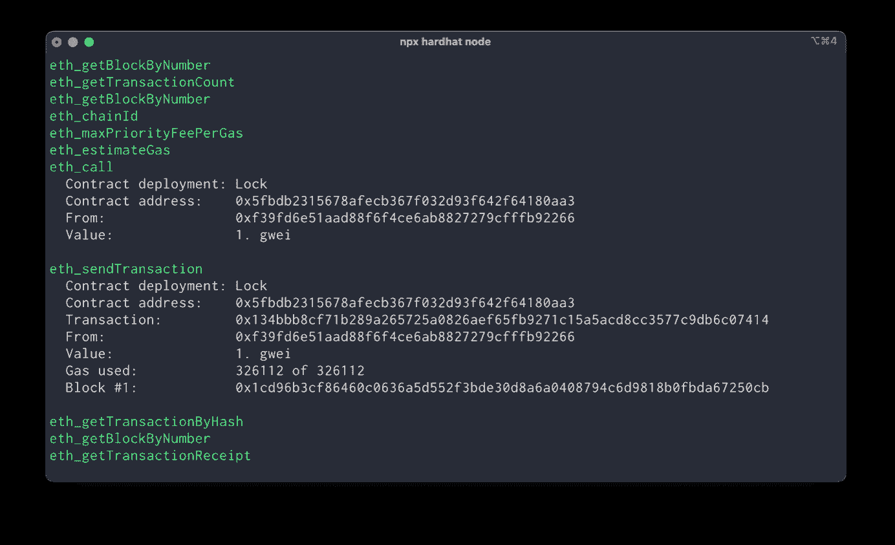

你已成功在以太坊区块链上创建、编译并部署了一个智能合约。

在本节中我们简要介绍了 `Solidity`。它将帮助你获得具有状态管理的静态类型语言的经验。

在下一节中，我们将学习基于以太坊的 `DApps` 框架。

# 使用以太坊的去中心化应用

在本节中，我们将探索使用以太坊平台进行 `DApp` 开发。以太坊构建的 `DApp` 是在后端执行智能合约并在去中心化网络中托管前端的应用。

简而言之，使用以太坊的 `DApp` 由以下部分组成：

- **前端**：`HTML`、`CSS`、`JavaScript` 和静态文件
- **后端**：智能合约、区块链

一个应用可能不仅需要智能合约，以太坊提供了以下项目来满足这些需求：

- **Swarm**：去中心化存储网络。
- **Whisper**：动态通信协议。
- **Smart contracts**：图灵完备的编程语言和接口：


考虑以下去中心化的应用方面：

- 前端
- 后端
- 存储
- 通信
- 名称解析

由于应用是去中心化的，这些方面可能不需要去中心化服务器。目前，`DApps` 可以使用去中心化服务。

让我们来看看 `DApps` 的优势：

- **韧性**：`DApps` 运行在区块链上，不像部署在中心化服务器的应用，它不会宕机。
- **透明性**：`DApps` 存储在区块链上，任何人都可以检查。`DApps` 代码、执行和结果完全透明的。
- **抗审查性**：只要网络运行，任何人都可以访问并使用 `DApps`。这不需要许可。
- **无信任系统**：与用户信任公司存储数据的中心化应用不同，`DApps` 使用端到端加密是安全的。
- **安全性**：由于使用了端到端加密，`DApps` 是安全且可靠的。除了人为错误外，机器不会泄露数据。
- **无单点故障**：由于应用的去中心化，系统中不存在单点故障。除非网络节点节点，否则应用就可以运行。
- **支付**：由于 `DApps` 运行在以太坊区块链之上，不需要集成第三方支付。支付通过加密货币实现并记录在链上。

如你所示，`DApp` 指出了我们目前面临的一些核心问题。审查、财务欺诈、文档篡改和选举舞弊是一些常见问题。`DApps` 和区块链解决了这些问题，并帮助我们进化到 Web 的下一个版本，即 Web 3.0——属于人民的互联网。

# DApps 栈

以太坊的 `DApps` 栈包含以下内容：

- 前端 (`HTML`、`CSS`、`JavaScript`)
- 智能合约
- 数据存储 (`IPFS` 和 `Swarm`)
- 去中心化消息通信 (`Whisper`)

让我们详细了解它们。

## 前端

`DApps` 的前端可以使用几十年年来用于构建网站和应用程序的标准技术编写。

与需要理解以太坊如何工作并使用 `Solidity` 编写代码的后端不同，前端允许传统的 Web 开发者使用熟悉的技术、工具、框架和库。与区块链的通信可以通过 API 或 RPC 调用完成。


以太坊还开发了一个名为 `web3.js` 的 JavaScript 库，用于将 DApp 的前端与后端打包。

`Web3.js` 为传统的 Web 开发人员提供了一种简单熟悉的方法来构建可以通过浏览器与区块链通信的去中心化应用。

让我们来看看后端，即智能合约栈。

### 智能合约

在 DApps 中，智能合约用于编写应用程序的业务逻辑和相关函数。你可以将智能合约看作是传统应用程序中的服务端（即后端）。

开发者必须记住，在智能合约中执行的任何计算以太坊来说都是昂贵的，应该尽可能保持简洁。因此，识别应用程序中需要在去中心化平台上运行的各个至关重要：

• 智能合约允许你构建此类应用程序：其中智能合约网络相互调用并传递数据，在此过程中读取和写入它们的状态变量。

• 智能合约架构设计中需要注意的一个大点是，合约一旦部署就无法更改代码。

• 如果智能合约编写了可用的 `self-destruct` 操作码，则可以删除它，但除此之外，代码无法以任何方式进行更改。

• 另一个需要注意的大点是 DApps 的体积应该尽可能轻量。一个巨大的智能合约执行起来可能花费过多的以太坊，导致效率低下。

• 作为开发者，你应该只将业务逻辑保留在智能合约中。存储可以通过中心化服务处理，也可以使用 `Swarm` 或 `IPFS`。

让我们审视一下存储栈，并了解如何将存储部分与智能合约分离，从而避免构建一个在区块链上运行成本昂贵的巨大合约。

### 存储

由于执行合约的成本很高，智能合约不是存储或处理照片、视频等大量数据的良好选择。

因此，DApps 应该利用离链数据存储服务，这意味着它们将以太坊链上的大量数据存储在数据存储平台上。

数据存储平台可以是中心化的（例如，Amazon 或 Azure 等典型的云数据库），也可以是去中心化的，存储在如 `IPFS` 或以太坊自身的 `Swarm` 平台等 P2P 网络上。

去中心化 P2P 网络存储是存储和分图像、视频和普通文件等静态资源等大型资源的理想选择。

让我们看看写本书时可用的去中心化 P2P 存储的选项。

#### IPFS

`IPFS` 是一个用于存储和共享内容的去中心化 P2P 网络。`IPFS` 是 Protocol Labs 团队的项目，并使用内容寻址；因此，唯一的哈希值可以识别网络中的每个文件。你可以使用网络中任何节点的哈希值检索文件。

`IPFS` 旨在取代 `HTTP` 协议用于 Web 的标准内容分发。`IPFS` 有一个网络，任何人都可以成为其中的一部分，就像比特币或以太坊一样。

在下一章中，我们将深入学习 `IPFS`。让我们来看看下一个去中心化 P2P 网络存储。

#### Swarm Bee

`Swarm Bee` 是以太坊基金会的项目。它是一个内容寻址 P2P 存储系统，与 `IPFS` 非常相似，允许你使用网络托管并访问网站。

让我们运行一个简单的 `Swarm Bee` 实例并亲自检查。

你可以从以下链接对应所需操作系统的官网下载 `Bee`：`https://docs.ethswarm.org/docs/bee/installation/install`

上述文档链接中提到了不同操作系统的下载和安装说明。对于 Mac，安装命令使用 `homebrew`。请确保你的 Mac 机器上安装了 `homebrew`。

这里是安装命令。

```bash
brew tap ethersphere/tap
brew install swarm-bee
```

如果你想从默认配置运行 `bee`，可以使用以下命令：

```bash
brew services start swarm-bee
```

我们也可以使用 `Swarm Desktop` 在我们的机器上轻松运行它进行测试。

前往 `https://www.ethswarm.org/build/desktop` 并下载适用于你操作系统的 `Swarm Bee` 桌面版。

一旦安装并运行 `Swarm Bee Desktop`，你可以通过浏览器导航到 `localhost:3054/dashboard` 来访问 `Swarm Bee` 网关。

你应该能看到如下图类似的屏幕：

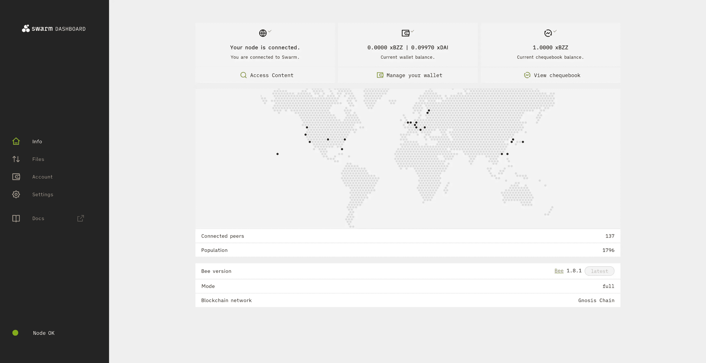

为了上传文件并访问它们，我们需要连接钱包来获取加密货币 `xBZZ` 或 `DAI` 并使用它们。IMG。

如果你进入 `Settings`（设置），我们可以发现它连接的区块链，也可以将其更改为自定义区块链节点：

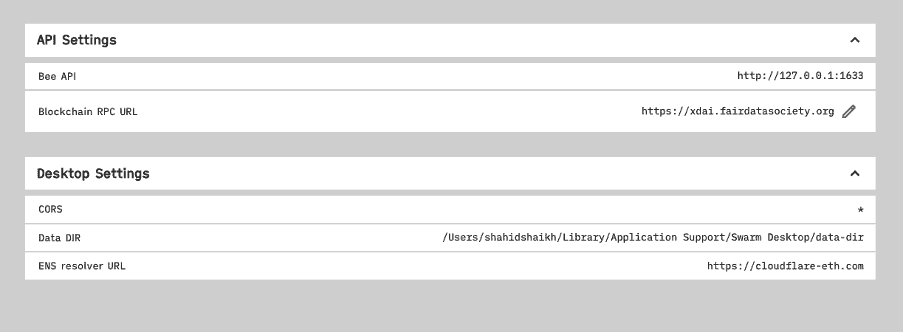

`Swarm Bee` 已准备就绪，可以作为去中心化文件存储系统使用。

好了，让我们访问 DApps 栈中的最后部分。

## 去中心化消息通信协议

任何分布式应用中的关键组件之一都是进程间通信。应用程序必须能够通过某种媒介与其他实例通信，在维护状态的同时交换数据。

在传统应用程序中，消息队列和进程间通道是处理此类通信的方法。这些消息队列本质上是中心化的，为系统了另一个单点故障。

在 DApps 中，通信是通过 P2P 消息协议完成的。写本书时，DApps 最显著且广泛接受的通信协议是 `Waku` - `https://waku.org/about/`。

以太坊还提供了一种名为以太坊命名服务 (`ENS`) 的服务。开发者可以使用 `ENS` 将基于哈希的资源指向像 DNS 那样更易读的名字。

## 结论

在本章中，我们详细探讨了以太坊。我们学习了愿景、平台以及如何使用以太坊。我们还学习以太坊的不同部分，如 `EVM` 和智能合约，并构建了一个简单的应用程序来查看智能合约是如何工作的。我们查看了使用以太坊构建 DApps，并探索了构建 DApp 所需各种协议。

在下一章中，我们将深入学习 `IPFS`。我们将构建一个使用 `IPFS` 的应用程序并部署它，以查看它的实时运行情况。


## 结构

在本章中，我们将涵盖以下与共识算法相关的主题：

• 工作证明（Proof of Work）共识
• 权益证明（Proof of Stake）算法
• 委托权益证明（Delegated Proof of Stake）
• 容错算法
• 实用性拜占庭容错（Practical Byzantine Fault Tolerance）共识算法
• Tendermint Core

## 目标

学习本章后，你应该能够理解共识算法及其用途，以及不同类型的算法及其。

让我们从第一个名为工作证明（PoW）的共识算法开始。

## 工作证明共识

PoW 是去中心化网络中执行验证的基础共识算法之一。我们在第一章《区块链与去中心化网络简介》中简要介绍了 PoW 共识算法，在本节中，我们将对其进行详细介绍。

正如名称所示，PoW 需要计算努力的证明来向其他参与者证明该工作是合法的。PoW 由 Moni Naor 和 Cynthia Dwork 于 1993 年发明，旨在通过验证并要求服务请求者提供某些工作（工作指计算努力）来防止拒绝服务（DoS）攻击。

PoW 算法由中本聪（Satoshi Nakamoto）在比特币白皮书中重新发明，他在书中解释了共识的概念以及我们如何在去中心化网络中验证交易。

让我们详细开始 PoW 共识算法的工作原理。此时，我们假设你已经阅读了第一章《区块链与去中心化网络简介》，并理解了去中心化网络和密码学的基本术语。

比特币交易存储并组合在一个名为“区块”的实体中。每个区块包含交易，每个节点都包含一个区块的副本。现在，为了将区块提交到主链，每个节点必须执行挖掘活动，它们需要找到一个低于网络设置的目标哈希值的哈希。

人们通过比特币程序执行的随机算法找到哈希值。在这个过程中，硬件强度起着关键作用，因为更更快的 CPU 或 GPU 比普通计算机能更快地进行随机化。

这个问题与网络的硬件强度直接相关。网络的功率越高，问题就越困难，从而确保了网络的公平参与。

比特币区块链网络中铸造的区块如图所示。请注意随机数（nonce）和难度。由于强大的网络，难度也按比例增加：


挖掘成功后，矿工将产生一个数字，其他节点可以通过该数字验证哈希是否正确。一旦通过验证，区块将被提交到网络，矿工将为他们的努力赢得一些比特币。在写此时，3.125 比特币（约 68000 美元）是成功挖掘的奖励。

这是一个连接在一起的 GPU 以及在计算机上运行的比特币挖掘程序的示例：


虽然 PoW 共识算法确保了交易和区块的严格验证，但它也面临一些严峻的挑战。

### 工作证明的挑战与局限性

PoW 面临以下挑战：

• 51%攻击：这是比特币和 PoW 唯一的安全风险，如果一个人拥有 51% 的节点，就可以控制网络。然而，这变得具有挑战性和成本高昂。
• 效率：PoW 效率低下，且计算需要时间。
• 硬件和资源消耗：PoW 需要如 GPU 等重型硬件。

为了克服这些挑战并提供更快的结算，开发了权益证明（PoS）算法。

## 权益证明算法

PoW 并不是唯一的共识算法。PoS 是用于以太坊等许多区块链网络的另一种共识算法。它不需要像 PoW 那样的强大计算能力，而是使用代币的质押来保护网络。

在 PoS 中，验证者根据他们持有和质押的币数量被选择。质押币越多，被选为验证者的概率就越高。这种机制比 PoW 更节能，但也有自己的一系列挑战。

• 安全性：PoS 没有 PoW 安全，因为验证者可能会出于恶意破坏网络。
• 适应性和测试：PoS 尚未经过大规模的测试。当网络拥塞时，它有时会失败。
• 验证者中心化：恶意验证者形成一个小组并控制网络存在巨大风险。

## 委托权益证明

由于验证者选择的随机性和可能出现的中心化问题，我们对算法进行了变体，称为委托权益证明（DPoS）。

DPoS 是 PoS 共识的变体，其中验证者通过投票和选举结合抵押质押机制选出。这种方法比 PoW 快得多。

为了选择验证网络中下一个区块的验证者，网络中的节点将他们的代币质押给他们想要成为验证者的节点。用户质押代币数量最多的节点赢得选举，并验证下一个区块同时赚取交易费。验证者赚取的交易费将根据他们在选举过程中存的质押币分发给支持他们的节点。


DPoS 解决了一些关键问题，但也带来了一些局限性和挑战，我们在下一节中列出了一些关键的挑战。

DPoS 的局限性在于：

- 中心化本质：由于用户参与验证者选举，通过质押代币来选择新验证者在技术上存在中心化审批的担忧。一组用户可以并且总是选择他们喜欢的一组验证者。
- 安全性：上述局限性会变成安全问题，因为恶意代理人可能会实施安全破坏。验证者还可以执行 51% 攻击并接管网络。

## 容错算法

容错是区块链和分布式系统的关键方面。为了确保系统在发生故障时的健壮性和可靠性，系统能够优雅地处理故障。

在区块链和去中心化系统中，容错是共识算法的责任，以确保系统运行且不发生数据损坏。

有两种广泛用于容错机制的共识算法：

- 实用拜占庭容错（`PBFT`）共识算法
- Tendermint Core 共识算法

在讨论这两种算法之前，让我们先了解一下拜占庭将问题。

拜占庭将问题提出于 1982 年，是一个逻辑困境，解释了一组拜占庭将在试图对战争下一步行动达成一致时可能遇到的通信问题。参考下图：

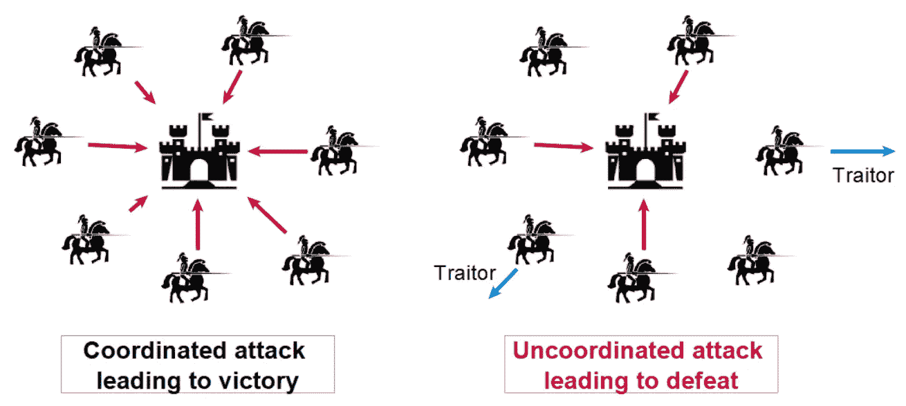

该问题假设每个将都有自己的军队，并且每个军队组位于他们计划攻击的位置周围的不同位置。将们需要根据对形势的评估对进攻或撤退达成一致。

将们需要达成共识以执行共同决策，这样就不会产生争议，军队也不会混乱。

因此，我们可能考虑以下要求：

- 每个将都必须决定：进攻或撤退（是或否）。
- 决策做出后，不可更改。
- 所有将必须对相同的决策达成一致并以同步的方式执行。

上述通信问题与一个事实有关：一个将只能通过信使转发的消息与另一个将进行通信。因此，拜占庭将问题的核心挑战是消息可能会以某种方式被延迟、破坏或丢失。

此外，即使消息成功送达，一个或多个将也可能（出于任何原因）发送虚假消息来扰乱其他将，导致彻底失败。

如果我们将这一困境应用于区块链背景，每个将代表一个网络节点，节点需要对系统的当前状态达成共识。换句话说，分布式网络中的大多数参与者必须同意并执行相同的操作，以避免完全失败。

因此，在这类分布式系统中实现共识的唯一方法是至少拥有三分之一或更多可靠且诚实的网络节点。这意味着如果网络大多数节点决定采取恶意行动，系统将容易受到故障和攻击。

拜占庭容错（`BFT`）是系统在节点故障或某些节点采取恶意行为时继续运行的能力。

在系统中实现 `BFT` 有不同的方法。在区块链系统中，如 `PoW` 等共识算法通过挖掘以及在区块成功提交后与全量数据的同步来实现 `BFT`。`PoS` 通过用质押代币锁定验证者的钱包来实现 `BFT`，并确保在操作完成之前不释放。

## 实用拜占庭容错共识算法

`BFT` 的关键要求之一是系统或网络节点需要处于同步状态。这导致了性能问题，特别是在去中心化系统中，节点分布在不同的地理位置，网络延迟仍然很高，导致响应比传统的 web2.0 客户端/服务器模型更慢。

另一个关键要求是，在系统存在拜占庭故障的情况下，系统需要找到一种工作的方法。`PBFT` 算法专为此类用例设计，我们将在本节中学习它。

### 实用拜占庭容错算法的工作原理

`PBFT` 通过分配一个节点为主节点（primary），另一个节点为备用节点（secondary）来实现机器状态复制。`PBFT` 设计用于异步状态下工作，即使在节点宕机或网络中存在恶意节点的情况下工作。

运行 `PBFT` 算法的网络节点被分配为主/领导节点和从/备份节点。在这里，任何节点都可以成为主或备用，且它们都以顺序方式工作。

这种节点分配背后的思想是通过使用多数节点在网络中实现共识。只要恶意节点或不响应节点的数量低于系统中的诚实节点或工作节点，`PBFT` 就可以运行。以下是 `PBFT` 序列图：

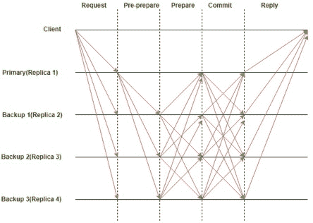

以下是 `PBFT` 分配主节点和备份节点的四个阶段：

1. 客户端向主节点或领导节点发送请求。
2. 领导节点向所有备用节点广播请求。
3. 主节点和备用节点执行客户端请求的服务并发送响应。
4. 当客户端收到来自不同节点的具有相同结果的响应时，请求被处理。回复应为 `m+1`，其中 `m` 是允许的最大恶意节点数量。

`PBFT` 的关键局限之一是效率问题。当网络较小时，`PBFT` 是高效的，因为它使用了大量的通信来执行领导选择并维护系统的可靠性。一旦网络足够大，延迟也会随之增加。在网络中实现 `PBFT` 时，通信开销问题是一个关键扩展挑战。

使用 `PBFT` 的著名平台之一是 `Tendermint`。我们将在下一节中学习它。


Tendermint Core 使用应用区块链接口（`ABCI`）将共识引擎逻辑与应用逻辑分离。这允许开发者在实现自己的区块链应用逻辑的同时，使用 Tendermint Core 进行共识。由于这一设计选择，有多个区块链项目使用 Tendermint Core 作为区块链引擎。

由于 `ABCI` 的存在，Tendermint Core 是与语言无关的，它支持任何编程语言的状态机。

Tendermint Core 可以用于身份服务、游戏、资产管理等各种应用领域。

### 设置 Tendermint Core

让我们在你的机器上设置一个简单的 Tendermint Core。我们假设你有一台正在运行的 Ubuntu Linux 机器，如果没有，你可以直接从 GitHub 仓库根据你选择的操作系统下载预编译的二进制文件。Tendermint 也可以通过 Docker 镜像提供。请参考以下链接：

https://github.com/tendermint/tendermint/releases

现在，在 Ubuntu 中打开终端并粘贴以下命令来安装 Tendermint Core：

```bash
curl -L https://git.io/fFfOR | bash
source ~/.profile
```

命令中的链接包含了安装命令和说明。等待安装完成。

一旦安装完成，我们可以使用以下命令启动 Tendermint Core：

```bash
tendermint init
```

这将在 `$HOME` 目录下创建一些文件。请注意，这些文件将支持单机节点网络。

现在，让我们启动 Tendermint 服务器：

```bash
tendermint node --proxy_app=kvstore
```

此命令将初始化服务器，你将在终端中看到区块不断弹出。

### Tendermint Core 的局限性

Tendermint Core 的一些关键局限性包括：

• 中心化：Tendermint Core 使用一组固定的验证者，更改验证者需要硬分叉。这导致了网络出现并非真正的而是部分的中心化。

• 可扩展性：Tendermint Core 使用 `PBFT`，因此它继承了每当我们扩展网络时都会出现的通信开销问题。节点越多，通信越频繁，导致高延迟。

• 资源需求：由于使用了 `PBFT` 共识，Tendermint Core 使用了更多的计算能力和网络带宽。这会增加运行操作的成本。

Tendermint Core 正在改进，社区正在尝试在开发过程中解决问题。这是区块链和去中心化领域最令人兴奋的项目之一。

## 结论

在本章中，我们学习了各种共识算法及其局限性。我们研究了不同的共识算法是如何针对不同问题进行设计的。最大的收获是，我们需要识别网络中的问题，并使用最适合该问题的共识算法。

在下一章中，我们将学习区块链和去中心化应用面临的扩展挑战，以及我们如何使用不同的技术来解决它们。

**加入我们书籍的 Discord 空间**

加入书籍的 Discord 工作区获取最新更新、优惠、全球科技动态、新版本发布以及与作者的交流会议：

[`discord.bpbonline.com`](https://discord.bpbonline.com)


## 第 4 章：区块链扩展性挑战

## 引言

区块链的建立是为了适应世界上第一种加密货币，即比特币（Bitcoin）。比特币的目标是成为一种由人民拥有、为人民服务的替代支付模式。

其唯一目的是引入一种对当前中心化支付模式的替代方案。然而，当比特币和其他加密货币在中心化交易所汇聚，且人们开始交易并获利时，情况开始发生变化并吸引了大量人群。这导致了加密货币热潮，用户规模增长了 100 倍以上。

尽管具有创新的潜力，区块链在高效处理大规模负载方面仍面临着巨大挑战。这些挑战表现为各种问题，特别是高昂的交易费用、延长的交易持续时间以及系统性的性能下降。

区块链节点的去中心化本质（运行在全球范围内分布的点对点网络中）引入了许多复杂性，例如由于地理分散导致的延迟增加、由于工作量证明（`PoW`）等共识算法导致的交易处理时间延长，以及随着点对点网络扩大而增加的网络传播延迟。

作为工程师，解决这些扩展挑战变得迫在必行，这需要开发定制的解决方案来增强区块链的运营效率。

在这个有趣且重要的章节中，我们将讨论并学习区块链技术中的各种扩展技术。

## 结构

在本章中，我们将介绍以下主题：

• 区块链扩展性挑战
• 分片（Sharding）
• Layer 2 方案
• 闪电网络（Lightning networks）
• 用例与应用

## 目标

目标是解决并学习区块链技术固有的扩展性挑战，旨在增强其实用性和可访问性。利用分片和 Layer 2 方法等扩展技术是至关重要的策略。分片意味着将网络分割成更小的、易管理的片段，从而提高交易吞吐量并降低延迟。同时，闪电网络等二层解决方案促进了链下交易，有效减少了主区块链的拥堵。这些计划为去中心化金融（`DeFi`）、供应链管理、数字身份验证和投票系统的众多应用铺平了道路，促进了不同行业的创新和运营效率。

## 区块链扩展性挑战

如 `PoW` 等共识算法已成为快速发展的区块链行业中的瓶颈。`PoW` 共识算法无法处理交易需求，导致交易缓慢和高额交易费用。

点对点网络的增长也导致了交易和响应时间变慢，因为整个网络和链必须更新，而且由于每个节点的延迟、带宽和网络强度都不同，传播需要时间。

每个区块链平台都是孤立运行的，导致了数据孤岛，限制了它们的潜力。区块链平台缺乏标准和兼容性。因此，区块链网络之间的互操作性是关键问题领域之一。

恶意代码检测是智能合约平台面临挑战之一。智能合约是自动执行的代码，恶意代码会导致资金损失和被窃等严重问题。

让我们学习一些扩展性挑战：

• 网络延迟：去中心化系统的交易需要多个节点的共识，这会导致更长的确认时间和更慢的交易处理。

• 吞吐量限制：去中心化网络每秒处理的交易数量有限，导致在网络高峰期间确认时间缓慢。

• Gas 费用：随着网络拥堵，执行智能合约的成本（以 Gas 费的形式）可能变得极其昂，使得平台对于小交易难以访问。

• 资源密集型：去中心化系统通常需要大量的计算能力和存储资源，这将成为扩展的障碍。

• 扩展瓶颈：某些智能合约平台可能受限于底层基础设施的扩展瓶颈，例如参与网络的节点数量。


为了解决可扩展性问题，以下是一些广泛采用的方法：

- `分片 (Sharding)`：分片解决方案将网络分为更小的子网络，允许每个子网络并行处理交易，从而提高整体吞吐量。
- `二层扩展解决方案 (Layer 2 scaling solutions)`：在主区块链网络之上添加一层来处理更大规模的交易，例如`state channels`和`plasma`。
- `闪电网络 (Lightning Network)`：闪电网络构建在比特币区块链上的二层支付协议。它允许用户之间直接进行链下支付而无需向网络广播每笔交易，实现了更快、更廉价的交易。
- `优化共识算法`：这涉及改进现有的共识算法，或开发更高效、更具可扩展性的新算法。我们在第三章《区块链共识算法》中详细学习了共识算法。
- `混合系统`：将中心化和去中心化系统相结合，以利用两者的优点，从而提高扩展性和安全性，例如加密货币交易所。
- `互操作性`：为去中心化系统开发交换信息和资产的协议和标准，使它们能够无缝协作。

## Sharding

`Sharding` 是一种用于区块链网络的扩展技术，通过将网络划分为更小、更易管理的部分（称为 `shards` 分片）来提高可扩展性和性能。

每个分片独立运行，处理自己的交易和智能合约。`Sharding`旨在解决传统区块链网络以线性方式处理所有交易的局限性，这会导致潜在的瓶颈。

如如下所示所示该网络由 1000 个节点组成并正尝试处理交易。在`sharding`中，交易被分成多组较小的单元（如图所示，每个`shard` 由 100 个节点组成），由它们管理分配给各自的交易：

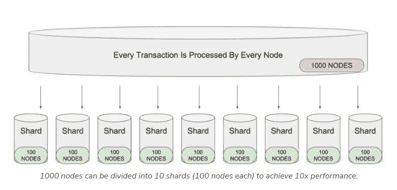

这提高了网络效率。如果操作得当，可以改进到使交易处理性能提高 10 倍以上。

`Shards` 独立处理交易，减少了非分片网络中经常发生的资源竞争。`shard` 内部的节点负责该分片内交易的验证并达成共识。

当交易涉及不同 `shards` 的双方时，`Shards` 之间需要通信。这需要跨分片通信机制。跨分片通信可以通过实现分片之间安全、高效信息传输的协议来实现。

### Advantages of sharding

让我们学习并理解在区块链网络中使用`sharding`的优点：

- `吞吐量的最优化提升`：`Sharding` 显著增加了区块链网络的吞吐量。通过多个`shards`同时处理交易，网络的整体得到了增强。吞吐量也随`shards`的数量而扩展，允许网络每秒处理更多的交易。
- `降低延迟`：`Sharding` 通过将工作负载分布到多个`shards`缩短了交易确认时间。在不同`shards` 中处理的交易可以同时发生，与非分片网络相比，延迟较低。
- `水平扩展`：`Sharding` 是实现区块链网络水平可扩展的关键技术。随着网络的增长，可以添加额外的`shards` 来适应增加的交易量。水平扩展的能力对于旨在支持大型且多样化用户群的区块链网络至关重要。

`Sharding` 提供了一些关键优势，但也带来了它自己的挑战。让我们来看一下：

- `安全性`：确保不同 `shards` 之间的数据安全是一项关键挑战。由于网络跨越多个`shards`，必须维护安全性。
- `跨分片共识`：随着网络规模扩大，`shard`的数量将增加。为了确保完整性，`shards` 必须通信。
- `跨分片通信`：`Shards`之间需要通信以确保一致性。以太坊 2.0 网络大量使用`sharding`来处理扩展挑战。现在，让我们探索`layer 2`方法以及它如何提供帮助。

## Layer 2 approach

`Layer 2 scaling solutions` 是通过将处理移出主区块链来解决区块链网络可扩展性的方法。这些解决方案旨在提高吞吐量、降低延迟并最大限度地减少主区块链上的拥堵。通过离线处理交易，`layer 2`解决方案可以显著增强性能。

请参考下图：

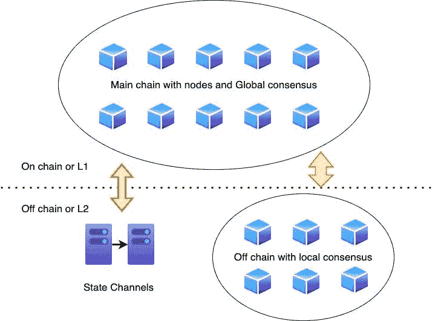

正如你在 4.2 中看到的，`layer 2`系统通过离线结算来工作，我们有不同的方法来实现相同的目标。其中一些：

- `State channels (状态通道)`：它们是链下通道，多笔交易可以在不涉及主区块链的情况下进行结算。
- `Payment channels (支付通道)`：它们类似于`state channels`，但专为支付设计。
- `Sidechains (侧链)`：这些是与主链具有互操作性的独立链，资产可以在链之间移动。
- `Plasma`：它是一个用于创建可扩展区块链的框架，通常称为子链，它们连接到主链。
- `Rollups (汇总)`：这是一种概念，将所有交易的摘要提交到区块链，而不是提交所有交易。

让我们详细讨论这些`layer 2`技术。

### State channels

`State channels` 是一种`layer 2 scaling solution`，通过启用链下交易来解决区块链网络的挑战。这些通道允许参与者在主区块链之外私密地进行多次交易，并仅在需要时才在区块链上结算最终状态。`State channels`对于涉及一组参与者之间频繁快速交易的用例特别有用。

请参考下图：

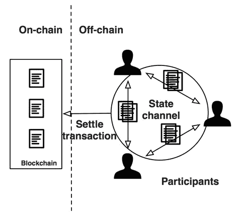

`State channels` 的运行方式如下：

1. `打开状态通道`：想要确保协作并共享数据的网络节点首先需要打开一个`state channel`。打开`state channel`的过程是在参与者之间创建一个多签名钱包。一旦`state channel`被创建，它就会记录在区块链上。
2. `链下交易`：一旦`state channel`打开，参与者就可以他们之间进行一系列链下交易，而不涉及主区块链。每笔链下交易都会更新通道的状态，其记录方式与在主链上的记录类似。
3. `状态通道更新`：随着交易在链上结算，参与者创建的`state channel`会被更新。这些更新是链下更新，尚未与主链同步。


## 4. 关闭/结算通道

参与者可以随时向区块链提交最新的共识状态来关闭状态通道。区块链会验证最终状态，并根据参与者最新同意的状态进行资产分配结算。这也会与主链保持同步。

状态通道用于支付金额不大的微支付场景。由于状态通道经常用于支付，因此存在专门为支付设计的状态通道特殊方案。

我们将在接下来的章节中讨论支付通道。

### 支付通道

支付通道是区块链网络中一种特殊的状态通道，用于实现快速且可扩展的交易，特别是对于微支付。

这些通道允许参与者之间进行一系列链下交易，从而减少了将每笔交易都记录在主区块链上的需求。

支付通道具有低交易费用、高交易吞吐量和低延迟等优点。

以下是支付通道的工作原理：

1. **开启支付通道**：双方决定经常互相进行交易，并选择开启支付通道。这涉及到在区块链上创建一个多签名钱包（通常是 `2-of-2` 或 `2-of-3` 多签地址）。开启交易被记录在区块链上，建立了通道的初始状态。
2. **链下交易**：一旦支付通道开启，双方就可以之间进行链下交易，而无需将每笔交易都广播到区块链。每笔链下交易都由通道涉及的双方签名。
3. **更新通道状态**：随着时间的推移，参与者可能会在支付通道内进行多次交易。这些交易的净效果在通道内实时更新。在每笔交易后，双方必须同意通道的新状态。最新同意的状态反映在最近的签名交易中。
4. **关闭支付通道**：在任何时候，任何一方都可以选择关闭支付通道。为此为此，他们将最新的签名交易广播到区块链。关闭交易反映了支付通道的最终状态，包括所有链下交易的净结果。随后该交易在区块链上被确认，通道被认为已关闭。
5. **结算余额**：一旦关闭交易在区块链上通过确认，最终余额将得到结算。区块链的智能合约确保资金根据支付通道内最新同意的状态进行分配。

这就是支付通道在区块链中的运行方式。它们继承了状态通道的大部分工作方法，但专门用于支付。

在下一节中，我们将学习侧链。

### 侧链

如名称所示，侧链是区块链技术中的一个概念，涉及创建与主链（mainchain）并行运行的独立区块链，并且两条链之间相互连接。

请参考下图：

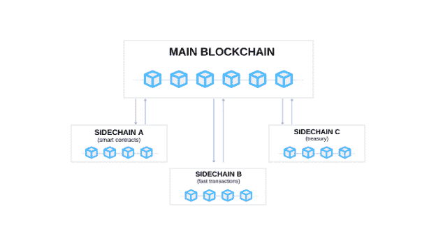

其核心思想是在主链和侧链之间实现资产或数据的有效传输，使传输变得安全、互操作且可靠。

让我们讨论侧链的一些重要属性：

- **并行链**：侧链与主区块链并行运行，但有自己的一套规则和特征。正如前一图所示，它们是独立的区块链，可以具有不同的共识机制、治理结构和区块生成时间。
- **双向锚定（Two-way pegging）**：这是侧链连接到主链的机制。它允许资产从主链传输到侧链，反之亦然。
- **互操作性**：侧链旨在实现使用不同机制的多个区块链网络之间的互操作。这是侧链的关键设计和架构目标之一。用户能够在主链和各种侧链之间无缝移动资产或数据，实现更大的灵活性和扩展性。

当不同系统协作时，始终存在安全风险。这强调了仔细检查安全细节的重要性。由于互连性和数据交换，侧链的安全至关重要，因为任何漏洞都可能影响整个网络的安全性。

双向锚定和共识机制必须仔细设计，以防止攻击并确保相互连接区块链的完整性。

`Bitcoin Liquid Network` 是一个旨在促进交易所之间更快、机密交易的侧链示例。另一个例子是比特币网络的 `Rootstock (RSK)` 侧链，它允许在比特币区块链上执行智能合约。

总结来说，侧链通过创建具有特定特性的独立链提供了扩展区块链网络功能的方法，在保持与主链连接的同时，允许进行实验、扩展和互操作。

### Plasma 框架

Plasma 是一种通过创建相互连接的侧链（也称为子链）的层级结构来扩展区块链网络的框架。它由 Joseph Poon 和 Vitalik Buterin 在 2017 年的白皮书中提出。

Plasma 框架的主要目标是增强区块链系统的扩展性和效率。

请参考下图：

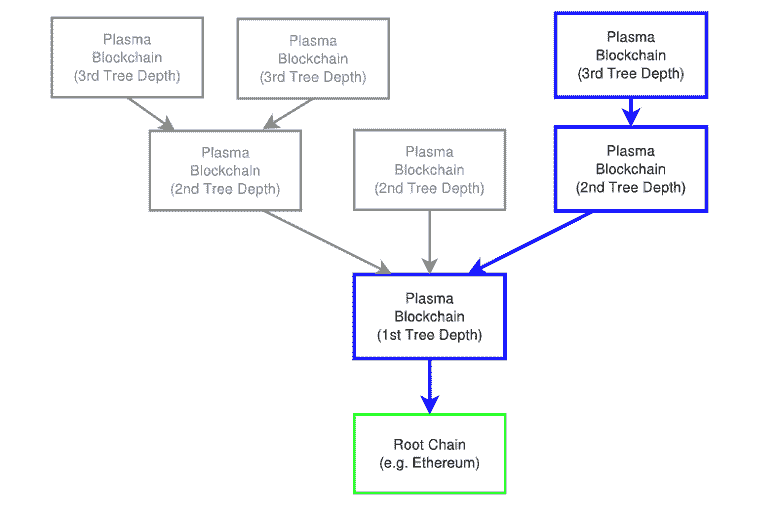

以下是 框架的关键组件和概念：

- **根链（主链）**：主链也称为根链，作为主区块链，拥有自己的共识机制（例如 `PoW` 或 `Proof of Stake (PoS)`）。它负责 Plasma 框架的整体安全。
- **子链（Plasma 链）**：子链是独立运行但连接到根链的单个区块链。每个子链可以有自己的规则、共识机制和特征。这些链处理交易和智能合约，提供了扩展交易吞吐量的方法。
- **Plasma 节点（Plasma operator）**：负责管理子链的实体被称为 `plasma operator`。节点创建子链，验证交易，并定期向根链提交子链状态的摘要。
- **Plasma 智能合约**：Plasma 引入了管理根链与子链之间关系的智能合约概念。这些智能合约定义了资产存入子链、在子链内传输资产以及资产从子链退出回根链的规则。
- **退出机制（Exit mechanism）**：如果子链参与者认为子链运行异常，他们可以退出并在根链提取资产。退出机制确保了在子链发生争议或故障时，用户可以在根链上取回他们的资产。
- **挑战期（Challenge period）**：Plasma 引入了一个挑战期，在此期间，参与者可以对子链上的任何恶意或错误行为提出挑战。如果挑战成功，恶意行为者可能会丢失其质押资金。
- **批量退出（Mass exits）**：为了防止拒绝服务（Dos）攻击，Plasma 允许批量退出，在发生严重问题时，多个用户可以同时退出子链。


Plasma 框架仍在不断演进并经历着增量变化。可扩展性是一个难以解决的难题，需要大量的实验。Plasma 框架具有在不久将来成为区块链可扩展性问题良好解决方案的潜力。

在接下来的章节中，我们将了解 Rollups（汇总）及其工作原理。

## Rollups

Rollups 是一种聚合技术，它将多笔交易打包或汇总到一个批次中，以便在主链上进行处理。Rollups 是一种扩展解决方案，旨在通过将部分处理移至链外，同时保持主链的安全去中心化，从而增强扩展性并降低交易成本。

Rollups 主要有两种类型：

• 乐观汇总（Optimistic rollups）
• 零知识汇总（ZK rollups）

让我们详细讨论一下它们。

### 乐观汇总

在乐观汇总中，交易数据和计算在一个名为 rollup 链（rollup chain）的独立层中在链外进行。只有交易的结果以及密码学证明会被提交到主链。

乐观汇总假设链外计算是正确的。主链验证者最初接受交易，而不验证整个计算过程。这加快了进程并减少了链上拥堵。

然而，存在一个挑战期，在此期间，如果有人认为某笔交易是欺诈，可以提出争议。验证者随后需要验证整个计算。如果发现交易正确，挑战者将失去安全押金。如果是欺诈，提交者将失去其押金。

乐观以太坊（Optimistic Ethereum）是在以太坊区块链上实现的乐观汇总的示例。它旨在通过在链外处理大多数交易并仅将基本信息提交到以太坊主链来提高可扩展性。

### 零知识汇总

在 ZK-rollups 中，交易数据和计算保留在链外，但密码学证明被提交到主链。该证明提供了零知识简洁论证（zkARK），证明链外计算已正确完成，而无需暴露任何细节。

与乐观汇总不同，ZK-rollups 不需要挑战期，因为密码学证明确保了计算的正确性。这导致了更快的最终性并减少了争议的可能。由于链外计算细节不暴露，它们提供了隐私优势。用户可以在获得更高水平隐私的同时，仍从安全和可扩展性优势中受益。Loopring 和 ZKsync 是以太坊上实现 ZK-rollups 的项目示例，旨在提高可扩展性并降低交易费用。

总结来说，乐观汇总和 ZK-rollups 都是利用链外处理来增强区块链可扩展性的解决方案。它们在效率和安全之间取得了平衡，在假设、争议解决机制和隐私功能方面提供了不同的权衡。这些 rollup 解决方案在解决区块链网络面临的可扩展性挑战方面发挥着至关重要的作用。

## 闪电网络

比特币闪电网络（Lightning Network）是我们在之前的章节中学过的二层扩展解决方案。它旨在解决比特币区块链的可扩展性问题。它通过促进链外支付通道实现了更快、更便宜的交易。

闪电网络构建在现有的比特币区块链之上，允许用户在链外进行交易，从而减少主链的拥堵和费用。参与者之间开启支付通道。这些通道就像链外通道，用户可以在此不与主比特币区块链交互的情况下进行交易。

开启支付通道涉及在参与者之间创建一个多签名钱包（2-of-2 或 2-of-3），并将通道的初始状态记录在比特币区块链上。一旦建立了支付通道，用户就可以在链外相互交易。他们可以发送和接收付款，而无需将每笔交易都广播到主链。

闪电网络通道支持双向付款。只要通道余额允许，用户就可以往返发送付款。这些交易的净效果会在支付通道内实时更新。

用户可以随时通过向比特币区块链广播最新的交易状态来关闭支付通道。这完成了交易并结算了余额。最终状态由比特币区块链上的底层智能合约执行。

闪电网络的优势如下：

• 可扩展性：闪电网络通过允许用户进行大量的链外交易而不导致主链拥堵，显著增加了吞吐量。
• 降低费用：与链上交易相比，闪电网络上的链外交易更快且更更。
• 即时交易：闪电网络内的交易几乎是即时的，为用户提供了快速交易的方式。
• 小额交易：闪电网络实现了小额交易，允许用户经济地发送少量比特币。

| 注意：闪电网络是一个可选方案，用户可以决定是否使用它进行交易。虽然它提供了扩展性优势，但也引入了新的考虑，例如用户需要管理通道和流动性。闪电网络持续演进，为比特币生态系统的持续发展做出贡献。 |
| --- |

### 用例与应用

现在，让我们了解快速可扩展区块链的用例：

• 支付和小额交易：去中心化支付网络每秒可以处理大量交易，适用于微支付和其他低价值交易。
• 供应链管理：去中心化系统可以跟踪供应链中货物的来源、移动和目的地，减少传统供应链管理的时间和成本。
• 数字身份：去中心化系统可以提供安全可扩展的数字身份解决方案，允许个人控制和管理其个人信息。
• DeFi：交易所、贷款平台和稳定币等 DeFi 应用可以从扩展性来处理 DeFi 生态系统中的大量交易。
• 游戏：去中心化游戏平台可以使用扩展解决方案处理大量的玩家和交易，提供快速安全的游戏体验。
• 数据管理：去中心化系统可以用于安全可扩展地存储和管理大量数据（例如医疗记录）。
• 去中心化自治组织：去中心化自治组织（DAO）可以使用扩展解决方案以安全透明的方式处理大量的成员、投票和交易。

## 结论

我们学习了区块链系统目前面临的各种扩展挑战和问题。我们还学习了成熟和实验性的各种技术方法，以及它们如何应用于处理扩展问题。在我们写本章时，区块链系统不断演进，负载不断增加，如果没有扩展解决方案到位，区块链系统将无法应对需求。因此，解决扩展性问题是区块链社区的关键问题。

在下一章中，我们将学习区块链互操作性以及它对扩展区块链系统有何帮助。

**加入我们书籍的 Discord 空间**


加入本书的 Discord 工作空间以获取最新更新、优惠、全球技术动态、新发布以及与作者互动：

[`discord.bpbonline.com`](https://discord.bpbonline.com)


## 第 5 章

## 区块链与智能合约的互操作性

## 引言

让不同的区块链系统顺畅运行对于扩大它们的规模至关重要。当这些系统能够相互通信并轻松共享信息时，有助于创建更强大、更可靠的解决方案。这也使得与其他外部工具和系统的连接变得容易。

通过引入不同区块链之间的直接交易以及建立特殊的通信网络来实现这一目标。当区块链能够这样协同工作时，为许多新颖兴奋的想法开启了可能。在本章中，我们将学习开发者如何构建利用不同区块链优势的应用程序，创造出以前无法实现的新颖事物。

## 结构

在本章中，我们将涵盖与互操作性相关的以下主题：

- 区块链通信协议 (IBC)
- 跨链原子交换
- 区块链互操作的枢纽 (Hubs)
- 区块链中继器 (Relays)
- 可互操作区块链的安全性问题

## 目标

在本章中，我们将学习区块链间通信协议，以及我们如何通过枢纽、中继器等各种技术来实现它。在章节结束时，你应该熟练掌握区块链互操作技术。

## 区块链通信协议

区块链间通信 (Inter-Blockchain Communication, IBC) 协议是一种突破性的标准协议，它促进了独立区块链网络之间的通信和互操作性。它的出现作为一种关键解决方案，解决了各种区块链生态系统之间对无缝交互和数据传输日益增长的需求。请参考下图：

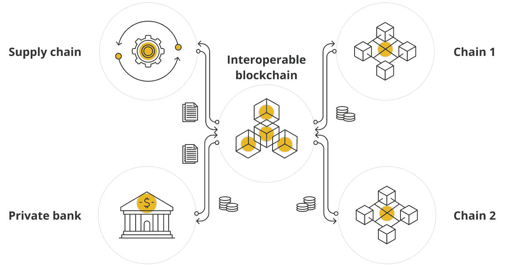

在本节中，我们将对 IBC 进行深入理解，包括其底层原理、技术组件、用例以及对区块链产业的潜在影响。

### 区块链通信协议概述

IBC 是一种标准化协议，允许不同的区块链网络之间进行通信、共享数据并执行交易。

IBC 的主要目的是打破孤立区块链生态系统之间的障碍，促进去中心化格局内的协作与互操作性。

以下是 IBC 的一些关键特性：‌

- **基于包的通信**：IBC 依赖于基于包的通信模型，以离散数据包的形式在区块链之间传输数据。
- **建立连接**：在两个区块链使用 IBC 通信之前，它们会建立一个安全可靠的连接。
- **通道 (Channels)**：在连接内部，区块链可以为不同类型的通信创建多个通道，包括代币传输和信息数据交换。
- **数据包中继**：数据包通过名为 `packet relayer` 的中间中继器在区块链之间进行中继，确保数据传输的安全可靠。
- **确认与超时**：IBC 包含了确认和超时机制，以确保数据传输的完整性并维护跨区块链的一致性。
- **原子性与一致性**：使用 IBC 执行的交易具有原子性和一致性，确保要么整个交易执行成功，要么完全不执行。

让我们来了解 IBC 的重要技术组件。

### IBC 协议的技术组件

IBC 协议由以下核心组件组成，如图 5.2 所示：


让我们简要学习一下这些模块：

- **连接模块 (Connection Module)**：`Connection Module` 处理连接的建立和维护。
- **通道模块 (Channel Module)**：`Channel Module` 负责通道的创建和管理。
- **数据包模块 (Packet Module)**：`Packet Module` 促进以离散数据包的形式传输数据。
- **中继器模块 (Relayer Module)**：`Relayer Module` 作为区块链之间的中间节点，将数据包从源区块链继到目标区块链。

### IBC 协议的用例与应用

IBC 通信协议开启以前无法实现的各种应用可能性。在这里我们列出了一些利用 IBC 的用例和应用：

- **跨链资产传输**：IBC Enables 资产在不同区块链网络之间的无缝传输。
- **去中心化交易所 (DEX) 平台**：IBC 促进了允许数字资产跨链交易的 DEX 平台的创建。
- **多链智能合约**：IBC 为多链智能合约开启了新的可能性，智能合约可以在多个区块链网络之间进行交互并执行交易。
- **互操作应用和服务**：IBC 促进了可以利用多个资源的互操作应用和服务的的发展。

这些用例和应用会对区块链产业产生重大影响。让我们来理解一些影响。

### 对区块链产业的影响

IBC 通过打破孤立区块链生态系统之间的障碍，实现了更广泛的协作和资源共享，增强了区块链产业的可扩展性和效率。

IBC 通过赋能开发者创建可以与多个区块链网络无缝交互的去中心化应用 (DApps)，推动了创新和实验，驱动了行业的发展和演进。

IBC 通过实现无缝的跨链资产传输、DEX 平台和互操作应用，增强了用户体验，为用户对其数字资产和交互提供了更大的灵活性和控制。

IBC 代表了区块链技术进化的重要里程碑，为去中心化格局内更大的协作、互操作性和创新铺平了道路。


跨链原子交换（Cross-chain atomic swaps）是一种在不同区块链网络之间交换数字资产的机制。

其核心在于 `atomic-swap` 类似于区块链参与者之间一种复杂的握手，确保了资产的安全和去信任化交换。以下是简化的流程分解：

- 协议：双方（我们称他们为 `Alice` 和 `Bob`）同意在特定条件下交换他们的数字资产，例如加密货币。
- 智能合约：利用智能合约，`Alice` 和 `Bob` 将各自的资产锁定在托管中。这些合约执行交换的条款和条件，确保了公平性和安全性。
- 执行：交换通过哈希时间锁定合约（`HTLCs`）等加密技术以原子方式执行。这意味着要么双方都收到了约定的资产，要么交易被取消，从而防止了任何形式的部分履行或损失。

现在，让我们通过考虑位于不同区块链网络上的资产来增加复杂性。跨链原子交换实现了这些网络之间的互操作性，促进了无缝的资产交换。其工作原理如下：

- 兼容性：为了进行跨链交换，涉及的区块链必须支持兼容的脚本语言和加密原语。这确保了不同网络之间的智能合约能够有效通信和交互。
- HTLCs：跨链交换的柱是 `HTLCs`，它能够在不同的区块链之间实现安全且去信任的交易。通过利用加密哈希函数和时间锁，`HTLCs` 确保资产转移仅在满足预设条件时发生，维护了交换过程的完整性。
- 互操作性解决方案：各种项目和协议（如原子交换、`Lightning Network` 和 `Interledger Protocol` (`ILP`)）提供了跨链互操作的框架。这些解决方案增强了不同区块链生态系统之间无的无缝，促进了更大的去中心化和实用性。

让我们通过中枢技术来理解另一个互操作和通信的概念。

## 区块链互操作中的中枢（Hubs）

中枢在实现各种区块链网络之间的无缝通信和互操作方面发挥着至关重要的作用。让我们了解中枢的概念以及它们在区块链互操作中的作用。

将中枢想象成连接不同区块链网络的中心汇点或桥梁，允许它们轻松地交换信息和资产。以下是中枢工作原理的简要分解：

- 中心化连接点：中枢作为中心化实体，在多个区块链网络之间充当中间。它们建立连接并促进通信通道，使得原本孤立的网络之间实现互操作性。
- 路由：类似于路由器引导互联网流量，中枢在连接的区块链之间路由数据和交易。它们确保信息从一个网络顺畅地流动到另一个网络，在整个过程中保持完整性和安全性。
- 协议翻译：中枢通常执行协议翻译，将数据和交易从一个区块链的格式转换为另一种。这确保了不同区块链生态系统之间的兼容性和无缝交互。

请参考下图。中枢与区域（zone）相互通信，跨中枢通信仅通过中枢发生：

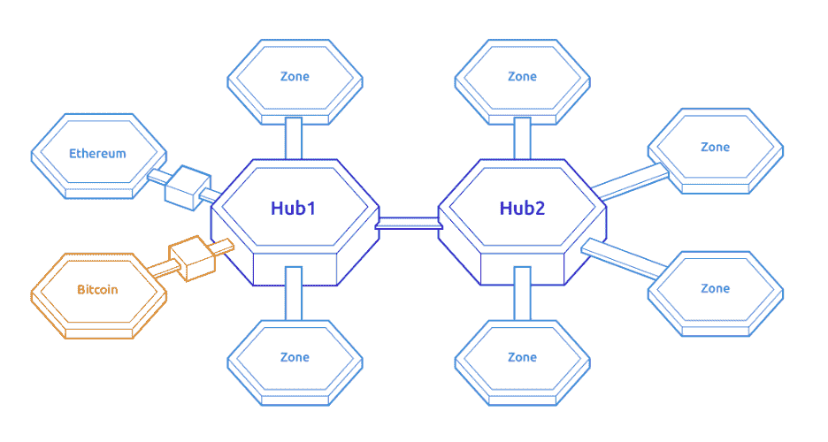

### 中枢的关键组件

为了理解中枢的内部机制，理解其关键组件和功能至关重要：

- 连接建立：中枢与参与的区块链网络建立安全可靠的连接。这涉及协商通信协议、验证身份以及确保网络参与者之间的信任。
- 数据路由：一旦建立连接，中枢就在相互连接的区块链之间路由数据和交易。它们充当中介，在维护数据完整性和安全的同时转发信息。
- 协议转换：中枢促进协议转换，翻译不同区块链协议之间的数据和交易。这确保了无缝的互操作性，允许不同的网络进行有效的通信和交易。
- 交易验证：中枢在交易验证和校验方面至关重要。它们确保交易符合预定义的规则和协议，防止双重花费和其他欺诈活动。

中枢的多功能性扩展到区块链生态系统中的各种用例和应用：

- 跨链资产传输：中枢实现了不同区块链网络之间的无摩擦资产传输。用户可以利用中枢提供的连接无缝交换数字资产。
- 去中心化金融（DeFi）：在 `DeFi` 中，中枢促进了跨区块链的 `DApps` 与金融协议之间的互操作性。这使得新型金融产品和服务在去中心化生态系统中蓬勃发展。
- 多链智能合约：中枢使开发者能够创建与多个区块链网络交互的多链智能合约。这为超越单个区块链的 `DApps` 和自主系统开启了新的可能性。

中枢提供了许多促进互操作的优势，但存在一个问题：它们以中心化的方式运行以便通信。让我们学习中继器（relays）以及它们如何提供去中心化的通信。

## 区块链互操作的中继（Relays）

中继是连接两个或多个区块链网络的桥梁，允许它们之间传输资产和数据。它不作为中心节点。中继在区块链网络之间建立直接连接并促进资产和数据的传输。中继可以通过减少延迟和增加交易吞吐量来提高网络速度和效率。

请参考以下图中继：

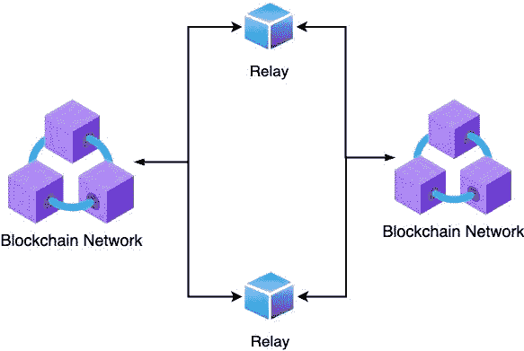

中继在不同区块链网络之间充当中间人或桥梁，允许它们交换数据、交易和资产。它们作为通信通道，通过在原本孤立的生态系统之间转发信息来促进互操作性。为了理解中继的意义，让我们探索它们的关键功能：

- 消息路由：中继从一个区块链网络接收消息或交易，并将其转发到另一个网络上的目标地。这涉及通过安全通道路由数据包，同时确保及时可靠的交付。
- 协议翻译：互操作通常需要翻译不同区块链协议或格式之间的数据和交易。中继通过将消息转换为接收网络可以理解和处理的兼容格式来这一过程。
- 数据验证：在转发消息之前，中继会验证数据的真实性和完整性，以防止篡改或操控。它们采用加密技术和共识机制来验证交易并确保其在相互连接的网络中的有效性。
- 网络监控：中继持续监控相互连接的区块链网络的状况和性能，以确保通信顺畅。它们检测并解决网络拥塞、延迟和停机等问题，以维持最佳的性和效率。

中继可以根据其操作特性和功能进行分类。常见的中继类型包括：

- 跨链中继：这些中继专门负责促进不同区块链网络之间的互操作，允许在不同生态系统之间进行无缝的数据和资产传输。


- 数据中继（Data relays）：数据中继专注于在相互互通的网络之间传输非财务数据，例如智能合约交互、预言机更新或 IoT 传感器读取。
- 资产中继（Asset relays）：资产中继允许在不同的区块链网络之间交换数字资产（如加密货币或代币化），为去中心化交易所（DEX）和流动性池提供支持。

### 用例与应用

中继的多功能性扩展到区块链生态系统的各种用例和应用：

- 跨链资产传输：中继允许用户跨跨不同的区块链网络传输数字资产，促进去中心化交易、贷款和借贷活动。
- DeFi：在快速发展的 DeFi 领域中，中继为 DEX、流动性池和贷款协议提供动力，允许用户访问跨多个区块链网络的金融服务。
- 互操作性应用程序：中继使开发者能够构建互操作的应用程序和 dApp，利用来自多个区块链网络的数据和服务。这些应用程序可以与不同的生态系统无缝交互，解锁新的用例和功能。

## 互操作性区块链的安全担忧

互操作性区块链通过实现异构网络之间无缝的数据和资产交换，在彻底改变各个行业方面具有巨大潜力。然而，随着连接性的增强，带来了许多安全挑战和担忧，必须解决这些问题以确保 IBC 的完整性、机密性和信任。

让我们了解与互操作性区块链相关的安全考虑因素：

- 攻击面扩大：互操作性区块链了更大的攻击面，因为恶意攻击者可能利用互通网络中的漏洞同时破坏多个系统。
- 协议不兼容：互通区块链之间不兼容的协议可能会引入漏洞和攻击向量，导致未经授权的数据访问、交易操纵或智能合约利用。
- 跨链攻击：恶意攻击者可能针对互操作机制（如中继或网桥）的漏洞发起跨链攻击，以操纵数据、窃取资产或破坏多个区块链的网络运行。
- 数据隐私担忧：互操作性区块链引发了对数据隐私和机密的担忧，因为在通信过程中，网络之间传输的敏感信息可能会暴露给未经授权的部分。
- 智能合约漏洞：促进跨链交易的智能合约容易重入攻击、整数溢出或未经授权访问等漏洞的影响，可能导致财务损失和系统被利用。
- 中心化风险：用于互操作的中心化组件（如中继或网桥）可能会引入中心化风险，因为它们成为单点故障或控制点，容易受到监管干预或恶意攻击。
- 信任依赖：互操作性区块链依赖网络参与者（包括中继节点、网桥验证者或跨链服务提供商）之间的信任假设，引发了对信任度、透明度和问责制的担忧。
- 验证挑战：验证在互通区块链之间传输的数据和交易的真实性和完整性面临技术挑战，因为加密证明和共识机制在不同网络之间可能不同。
- 预言机和数据馈：与外部数据源或预言机的集成引入了与数据准确性、可靠性和操纵相关的风险，可能导致误导信息、预言机攻击或无效的智能合约结果。

## 结论

在本章中，我们学习了连接运行不同协议和设计上的区块链的不同方法，从而实现互操作性。互操作性提供了区块链集成以及集成之间数据的平畅流动。我们还研究了互操作性带来的安全担忧。

在下一章中，我们将学习星际文件系统（IPFS）以及它是如何演并帮助 Web 3.0 生态系统的。

**加入我们的书籍 Discord 空间**

加入书籍的 Discord 工作空间以获取最新更新、优惠、全球科技动态、新发布以及与作者的交流会议：

`https://discord.bpbonline.com`


## 第 6 章 星际文件系统

## 引言

在本章中，我们将学习星际文件系统（IPFS），它是一种用于存储、访问和共享文件的分布式系统。IPFS 有一个野心勃勃的目标，是将现有的中心化互联网变为分布式互联网。它旨在取代 `HTTP` 成为互联网共享文件的默认协议。我们还将学习如何安装和配置 IPFS，并使用 IPFS 构建全栈应用程序。

## 结构

在本章中，我们将学习以下：

- 星际文件系统简介
- 星际文件系统的工作原理
- 安装和配置星际文件系统
- 在 IPFS 中托管静态网站
- 使用 IPFS 构建全栈应用程序
- IPFS 集群 (IPFS Cluster)

## 目标

学习本章后，你应该能够理解 IPFS 的核心概念、IPFS 协议的工作原理，以及使用 IPFS 构建应用程序。让我们开始吧。

## 星际文件系统简介

根据 IPFS 官方网站：

IPFS 是一个用于存储和访问文件、网站、应用程序和数据的分布式系统。

IPFS 为开发者提供了在分布式平台上存储数据的平台。有一些诸如 `OrbitDB` 的项目（我们将在将在章节中学习它），在 `IPFS` 之上提供了数据库解决方案。由于 `IPFS` 的分布式特性，它是去中心化应用（DApp）开发的首选。在上一章中，我们学习了使用 `Ethereum` 构建应用程序并使用 `Swarm` 作为存储解决方案。`IPFS` 使用基于内容的寻址而不是基于位置的寻址来访问文件。因此，基于位置的寻址是我们使用的；目前，我们使用域名或 IP 地址访问内容。

考虑这个示例：

`https://abc.com/hello.html`

在这里，我们使用域名访问 `hello.html` 文件。域名反过来查找服务器的 IP 地址并从服务器获取文件。

在 `IPFS` 中，我们使用内容寻址。让我们来看一个例子：

`https://ipfs.io/QmXoypizjW3WknFiJnKLwHCnL72vedxjQkDDP1mXWo6uco/hello.html`

如你所见，我们通过哈希访问内容。哈希代表文件，而不是存储文件的位置。`IPFS` 网络负责收集文件的比特并交付给用户。

让我们在接下来的章节中了解 `IPFS` 如何工作。

## 星际文件系统的工作原理

IPFS 是一个分布式点对存储网络。在 `IPFS` 中，内容从世界各地的节点访问。`IPFS` 中的节点可以中继信息、存储信息或两者兼顾。

`IPFS` 使用以下重要模块来使网络运行：

- 内容寻址
- 有向无环图 (DAG)
- 分布式哈希表 (DHT)

让我们详细探讨这些模块。

### 内容寻址

IPFS 使用基于内容的方法来识别数据，而不是根据其位置。


通过内容查找项目是我们已经在做的事情。例如，当你寻找一块布料时，你通常根据颜色或类型来索要它；这就是内容寻址，因为你询问的是它是什么。

如果你使用位置寻址来寻找那块布，你将根据它的位置来索要：我想要第二个架子上的、距离左侧三块布的 T 恤。如果有人移动了那块布，你就没戏了！

这就是我们在互联网上访问内容的方式。例如，

* `/Users/Alice/Documents/project_paper.doc`
* `C:/Users/Joe/My/Documents/presentation.ppt`

IPFS 反而生成内容标识符（`CID`），它也被称为哈希值。

使用哈希的内容寻址广泛用于连接分布式系统中的数据。你可以从 Git 到加密货币中看到基于哈希的内容寻址。它无处不在。

然而，这些系统中的底层数据结构并不总是互操作的。每个系统都使用不同的数据集和结构。为了解决这些问题，IPFS 开发了星际链接数据（`IPLD`），它作为内容寻址的数据模型。IPLD 充当不同系统使用的不同类型数据集之间的翻译层。因此，IPFS 使用基于哈希的内容寻址，并在需要时 IPLD 执行数据集翻译，以实现数据从一个系统到另一个系统的平滑过渡。

### 有向无环图

IPFS 使用 `DAG` 来存储内容。它使用 Merkle DAG，通过将叶子节点哈希化来形成父节点。我们在第一章《区块链与去中心化网络简介》中学习过 Merkle 树。

`DAG` 是一种边具有方向且不允许环的图。

例如，像 `A|B|C` 这样的链表是 `DAG` 的实例，其中 `A` 引用 `B`，依此类推。我们说 `B` 是 `A` 的子节点或后代，节点 `A` 有指向 `B` 的链接。同样，`A` 是 `B` 的父节点。

在 `DAG` 中，不是任何其他节点的子节点被称为根节点。

Merkle DAG 是一种 `DAG`，其中每个节点都有一个标识符（哈希或 `CID`），这是使用 `SHA-256` 函数对节点内容进行哈希处理的结果。Merkle DAG 节点是不可变的。节点的任何更改反都会创建一个不同的 Merkle DAG。

IPFS 通过将内容拆分为块来构建内容的 Merkle DAG 树。这些块中的每一个与 `CID` 联，然后从叶子节点开始哈希在一起形成 Merkle DAG 树。

因此，IPFS 提供了使用哈希和 Merkle DAG 链接的内容寻址，这些链接通过哈希组合形成内容。让我们学习下一个也是最后一个模块：DHT。

### 分布式哈希表

哈希表是一组键值对，而分布式哈希表是将表分布在网络中不同的对等节点上。

DHT 的主要优势是去中心化、容错性和可扩展性。由于这一点，哈希表可以跨越数百万个节点，由于数据的分布式特性，数据可用性更高。

IPFS 有一个名为 `libp2p` 的独立库，处理分布式哈希表和对等网络。

IPFS 使用 `DHT` 来查找内容和节点的当前位置。一旦找到内容，IPFS 就会连接到内容并将其下载到你的系统。一旦下载了这些块，你计算哈希并验证内容的真实性。

`libp2p` 还处理对等网络连接和连接复用。连接复用允许 `libp2p` 使用单个连接处理多个服务。

我们将在接下来的章节中学习更多关于 `DHT` 的知识。现在，让我们在后续章节的系统中安装 IPFS。

### 安装和配置星际文件系统

让我们通过以下步骤在我们的系统中安装 IPFS 并成为一个对等节点：

1. 导航到 IPFS 官方网站 `https://dist.ipfs.io/-go-ipfs` 并下载适用于你系统的 IPFS 程序包。如图所示，选择你的操作系统以下载正确版本的 IPFS：

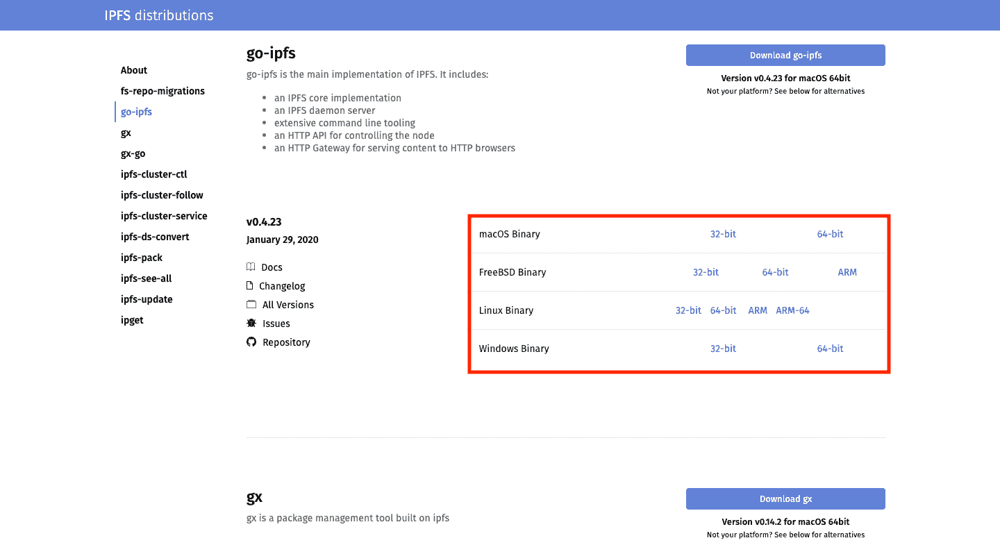

2. 一旦下载了包，将其解压或解压缩包并切换到解压后的文件夹。以下命令在你的系统中安装 IPFS：

```
cd go-ipfs
./install.sh
```

3. 一旦安装了 IPFS，你可以运行以下命令来验证它：

```
ipfs help
```

它应该在终端中打印 IPFS 命令，如下截图所示：

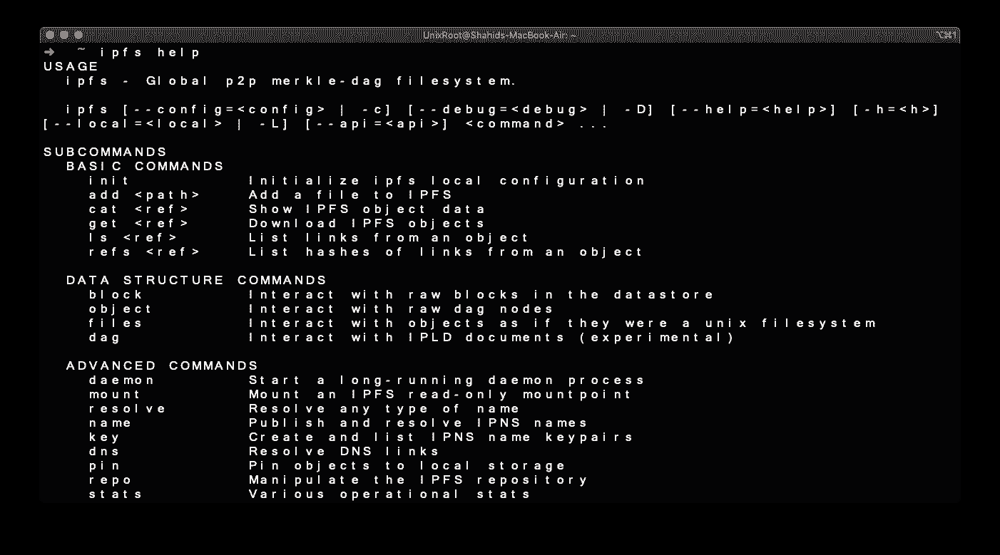

现在，让我们在我们的系统中运行 IPFS：

4. 在你的终端上运行此命令：

```
ipfs init
```

它将初始化仓库并在你的系统中创建运行 IPFS 所需的文件。

5. 启动 IPFS 守护进程。要这样做，运行此命令：

```
ipfs daemon
```

此命令将以守护进程（后台进程）模式启动 IPFS。你应该会在终端中看到如下所示的消息：

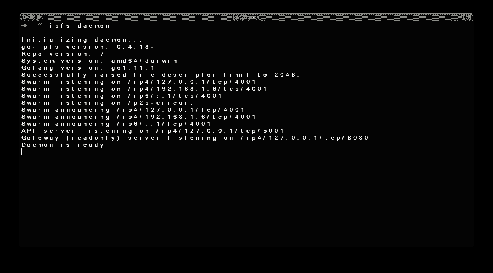

6. 现在，导航到 `http://localhost:5001/webui`；你应该能看到管理界面，如下：

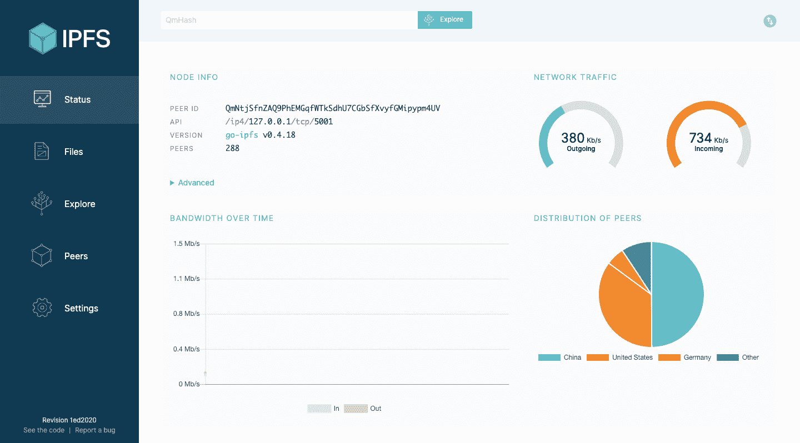

在管理界面中，你可以看到节点信息（NODE INFO），如 Peer ID、版本、网络流量图表和节点分布（DISTRIBUTION OF PEERS）。

7. 现在，访问 Peers 页面；你应该能够看到全球范围内的节点分布。它看起来像下面的截图，但节点数量可能会变化：

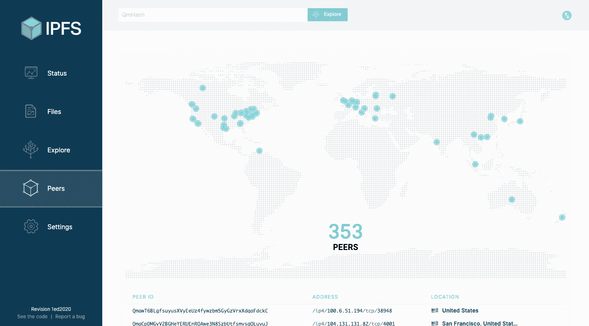

你可以看到遍布世界各地的对等节点及其 ID。现在你也是一个对等节点，你可以访问任何你喜欢的文档（前提是你拥有文件的 `CID` 或哈希值）。

让我们快速添加一个文件并尝试使用 IPFS 命令访问它。

8. 运行此命令在 IPFS 网络中添加文件：

```
ipfs add <path of the file>
```

如果执行成功，此命令将在屏幕上生成内容的哈希值：

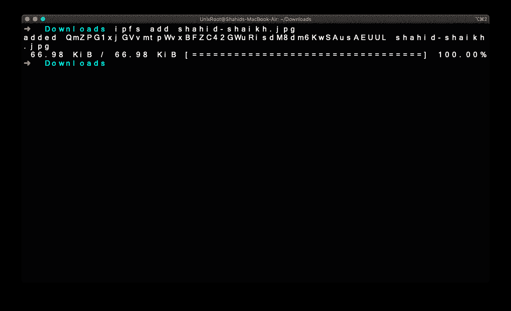

9. 现在，复制哈希并使用浏览器访问它：

`localhost:8080/ipfs/<hash of the file>`

你应该会在浏览器中看到该文件，如下所示：

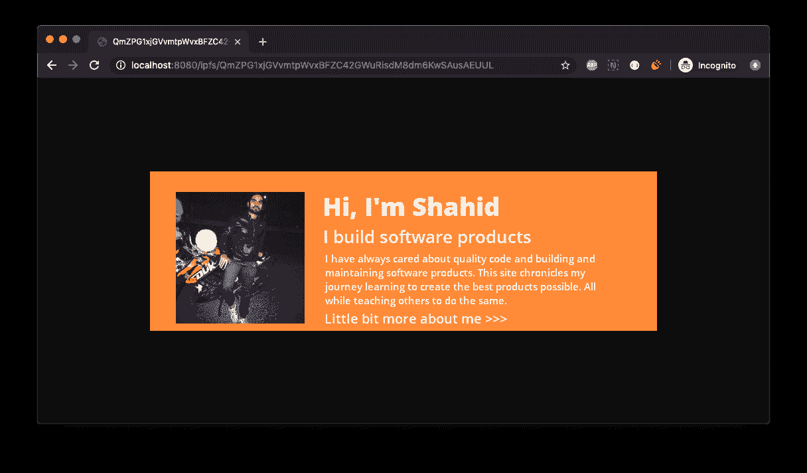

你也可以使用全局 IPFS 网关从任何地方访问。访问以下 URL：

`https://ipfs.io/ipfs/QmZPG1xjGVvmtpWvxBFZC42GWuRisdM6`

10. 你可以将哈希替换为你的文件哈希并与任何人共享。你不需要成为对等节点即可访问 IPFS 上的文件。

11. 你可以使用以下命令从命令行访问文件：

```
ipfs get <hash of the file>
```

执行此命令后，你应该能够在文件系统中看到下载的文件。

我们将在下一节中学习更多关于 IPFS 命令行。

### 星际文件系统命令行

IPFS 提供了一个命令行工具，供开发者使用命令行提示符或终端执行 IPFS 操作。

要检查可用命令列表，请在终端运行：

```
ipfs --h
```

它将在你的终端屏幕上打印所有可用命令，如下：

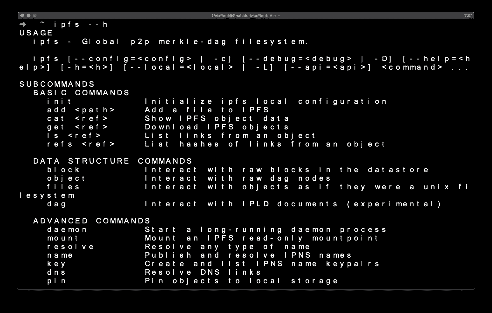

IPFS 命令分为两种：

* 离线：可以在不运行 IPFS 实例的情况下执行。
* 在线：需要你的系统中运行着 IPFS 节点。

你可以在 IPFS 官方网站查看所有命令详情：`https://docs.ipfs.io/reference/api/cli/`

现在，让我们学习如何配置在系统或云服务器上运行的 IPFS 以满足你的应用程序需求。

### 配置星际文件系统节点

IPFS 将配置存储在任何操作系统主目录下的文件中。配置以 JavaScript 对象表示法（JSON）文件格式存储。你可以在 `~/.ipfs/config` 查看该文件。

在编辑器中打开该文件查看内容。让我们了解配置的关键方面。

#### 地址


以下是 `IPFS` 运行的默认地址，其格式如下：

```json
 "Addresses": {
  "API": "/ip4/127.0.0.1/tcp/5001",
  "Announce": [],
  "Gateway": "/ip4/127.0.0.1/tcp/8080",
  "NoAnnounce": [],
  "Swarm": [
    "/ip4/0.0.0.0/tcp/4001",
    "/ip6/::/tcp/4001"
  ]
 }
```

你可以配置 `API` 和网关地址。通常情况下，它被设置为本地主机地址，可以更改为所需的自定义 IP 地址。`Swarm` 地址是本地 `IPFS` 节点监听连接到其他 `IPFS` 节点的地址。`API` 地址是 `IPFS` 暴露其 API 端点的地方，以便开发者可以与之交互。

`Gateway` 是可选地址，可用于查看和托管静态文件。如果你希望其他人在你的 `IPFS` 节点中存储文件，可以将此地址设为公开。如果你不想启动 `Gateway`，则请将其留空。

### Bootstrap（引导节点）

这是一个数组列表，`IPFS` 节点在启动后连接到这些地址。`IPFS` 自带了默认的引导节点地址，你可以对其修改。通常建议不要修改，因为 `IPFS` 作为一个组织，维护着各种服务器来为新节点提供持续的引导连接。

还有其他配置参数，但最好保持默认设置。

让我们在 `IPFS` 中托管一个网站，看看它是如何运行的。

## 在 IPFS 中托管静态网站

`IPFS` 是一个分布式文件系统，因此我们可以直接将静态网站托管到 `IPFS` 的点对点网络中。

在本节中，我们将先创建一个网站，然后将其托管在 `IPFS` 网络中。让我们创建一个简单的网站。

我们的网站看起来如下方的所示：

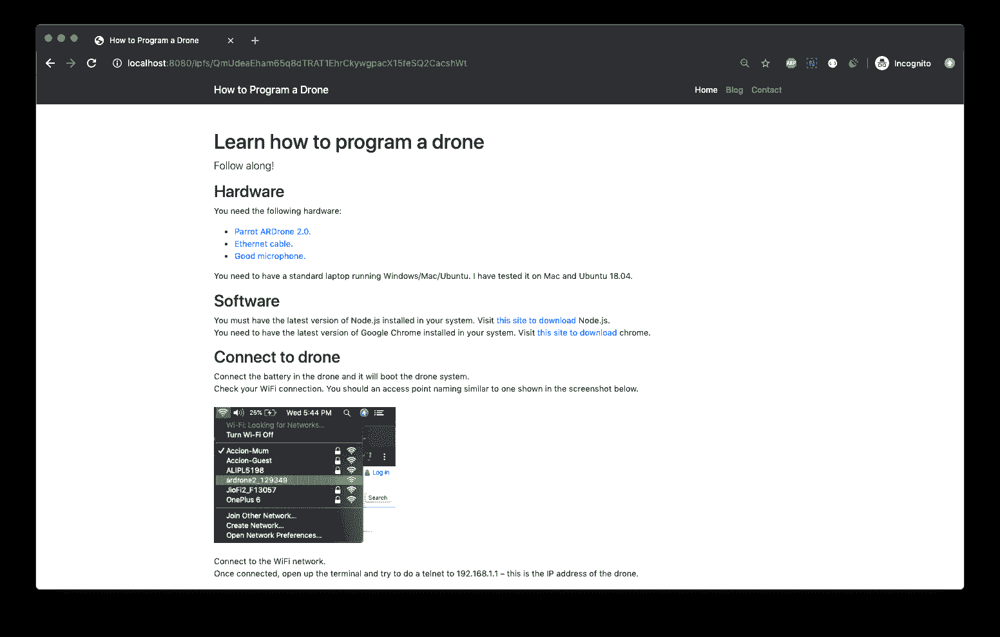

你可以使用全局 `IPFS` 网络网关访问该网站。URL 如下：

http://ipfs.io/ipfs/QmUdeaEham65q8dTRAT1EhrCkywgpacX15feSQ2CacshWt

让我们检查网站的代码。该网站包含一个页面和一些我们将从远程资源下载的图像。你也可以包含本地系统中的图像。

这里是网站 HTML 的头部：

```html
<!DOCTYPE html>
<html lang="en">
<head>
<meta charset="utf-8">
<meta name="viewport" content="width=device-width, initial-scale=1, shrink-to-fit=no">
<meta name="description" content="学习如何使用 Nodejs 编写无人机程序。">
<meta name="author" content="ShahidShaikh">
<title>如何编写无人机</title>
<!-- Bootstrap core CSS -->
<link href="https://stackpath.bootstrapcdn.com/bootstrap/4.3.1/css/bootstrap.min.css" rel="stylesheet">
</head>
```

如你所见，我们添加了 Bootstrap 作为级联样式表（CSS）库来样式化内容，并添加了一些 meta 标签来处理网站的视图区域。

让我们看看网站的内容代码：

```html
<body>
<!-- 导航 -->
<nav class="navbarnavbar-expand-lgnavbar-dark bg-dark static-top">
<div class="container">
<a class="navbar-brand" href="/">如何编写无人机</a>
<button class="navbar-toggler" type="button" data-toggle="collapse" data-target="#navbarResponsive" aria-controls="navbarResponsive" aria-expanded="false" aria-label="切换导航">
<span class="navbar-toggler-icon"></span>
</button>
现在，我们添加代码来显示一些导航菜单：
<div class="collapse navbar-collapse" id="navbarResponsive">
<ul class="navbar-nav ml-auto">
<li class="nav-item active">
<a class="nav-link" href="/">首页
<span class="sr-only">(当前)</span>
</a>
</li>
<li class="nav-item">
<a class="nav-link" href="https://codeforgeek.com">博客</a>
</li>
<li class="nav-item">
<a class="nav-link" href="mailto:shahid@codeforgeek.com">联系</a>
</li>
</ul>
</div>
</div>
</nav>
<!-- 页面内容 -->
<div class="container">
<div class="row align-items-center">
<div class="col-lg-12">
<h1 class="mt-5">学习如何编写无人机</h1>
<p class="lead">
跟随我们操作！
</p>
<h2>硬件</h2>
<p>
你需要以下硬件：
<ul>
<li>
<a href='https://amzn.to/2TCMcvd'>Parrot ARDrone 2.0.</a>
</li>
<li>
<a href='https://amzn.to/2OvhWBE'>以太网线。</a>
</li>
<li>
<a href='https://amzn.to/2JGka28'>麦克风。</a>
</li>
</ul>
</p>
```
*(注：由于原文 HTML 结构存在部分标签闭合错误和逻辑混乱，翻译时保持了原文的结构并仅对文本内容进行了翻译)*

*(注：原文 HTML 代码中存在多处闭合逻辑错误，如 `<ul>` 标签位置错乱，译文已根据语意进行对齐)*


在上一节中，我们了解了如何在 IPFS 网络中托管静态网站。在本节中，我们将使用 IPFS 构建一个应用程序。

我们将构建一个文件上传系统，用户可以在系统中向 IPFS 网络中上传文件，并获取查看该上传文件的链接，就像其他任何 Web 应用程序上传文件一样。唯一的主要的区别在于，我们将文件存储在 IPFS 网络中。

以下是我们将使用的技术栈：

• 后端：`Node.js` 框架。
• 前端：`HTML`、`CSS` 和 `jQuery` 框架。
• 存储：`IPFS` 网络

你的系统中应该安装了最新的 `Node.js`。如果没有，请访问 `Node.js` 官方网站获取最新版本。

Node.js 网站：`https://nodejs.org/en/download/`

让我们来看以下步骤：

1. 创建一个新目录并使用 `Terminal/Command Prompt`（终端/命令提示符）进入该目录。

2. 使用以下命令创建一个新的 `Node.js` 项目：
```bash
npm init –y
```

3. 现在，让我们安装项目所需的依赖项。这些依赖项也被称为 node modules：
```bash
npm install --save express multer ipfs-api
```

4. 现在，等待几秒钟让 node 安装依赖。`Express` 是一个用于构建 Web 应用程序的常用模块。

`Multer` 是一个在 node 生态系统中处理文件上传的 node 。

`ipfs-api` 是 `IPFS` 网关接口的 node 。我们将使用该模块来执行 `IPFS` 操作。

5. 现在，创建一个新文件，命名为 `ipfs.js`，并粘贴以下代码：

```javascript
const IPFS = require('ipfs-api');

const ipfsOptions = {
  host: 'localhost',
  port: '5001'
};

const ipfs = new IPFS(ipfsOptions);

function addFile(bufferData) {
  return new Promise((resolve, reject) => {
    ipfs.files.add(bufferData, (err, file) => {
      if(err) { 
        reject(err);
      }
      resolve(file);
    });
  });
}

module.exports = {
  addFile: addFile,
};
```

在前面的代码中，我们首先连接到本地机器 `5001` 端口运行的 `IPFS`。如果你的机器上的端口和主机详情不同，可以进行修改。

我们创建了一个不同的函数来向 `IPFS` 网络添加文件。`IPFS` 接收 buffer 作为输入。我们正在使用 `IPFS` 模块提供的 `files.add()` 函数来添加文件。

前面的函数返回一个 promise 对象以便稍后解析。在服务器端 JavaScript 中编写代码是最佳实践。

6. 接下来，在 node 中创建一个服务器。创建一个名为 `app.js` 的文件并粘贴以下代码：

```javascript
const express = require("express");
const multer = require('multer');
const fs = require('fs');
const app = express();
const ipfs = require('./ipfs');

const storage = multer.diskStorage({
  destination: function (req, file, callback) {
    callback(null, './uploads');
  },
  filename: function (req, file, callback) {
    callback(null, file.fieldname + '-' + Date.now());
  }
});

const upload = multer({ storage : storage}).single('userPhoto');

app.get('/', (req,res) => {
  res.sendFile(__dirname + "/index.html");
});

app.post('/api/photo', (req,res) => {
  upload(req,res, async (err) => {
    if(err) {
      return res.end("Error uploading file.");
    }
    let fileObject = fs.readFileSync(__dirname + '/' + req.file.path);
    let response = await ipfs.addFile(Buffer.from(fileObject));
    let link = `http://localhost:8080/ipfs/${response[0].hash}`;
    res.end(`File is uploaded - Click <a href="${link}">here</a> to view the file`);
  });
});

app.listen(3000,function(){
  console.log("Working on port 3000");
});
```

让我们来理解这些代码：

a. 首先，在接下来的代码中引入了模块：
```javascript
const express = require("express");
const multer = require('multer');
const fs = require('fs');
const app = express();
const ipfs = require('./ipfs');
```
我们还包含了为 `IPFS` 文件上传编写的代码。

b. 在接下来的代码行代码中，我们正在配置 `multer` 模块以便将文件首先上传到本地系统：
```javascript
const storage = multer.diskStorage({
  destination: function (req, file, callback) {
    callback(null, './uploads');
  },
  filename: function (req, file, callback) {
    callback(null, file.fieldname + '-' + Date.now());
  }
});

const upload = multer({ storage : storage}).single('userPhoto');
```
在前面的代码中，我们添加了 `uploads` 目录来存储文件。我们还在配置 `multer` 允许用户每次从 `userPhoto` HTML 上传一个文件。

c. 在接下来的代码行中，我们通过创建路由来定义 Web 应用程序，映射到业务逻辑：
```javascript
app.get('/', (req,res) => {
  res.sendFile(__dirname + "/index.html");
});

app.post('/api/photo', (req,res) => {
  upload(req,res, async (err) => {
    if(err) {
      return res.end("Error uploading file.");
    }
    let fileObject = fs.readFileSync(__dirname + '/' + req.file.path);
    let response = await ipfs.addFile(Buffer.from(fileObject));
    let link = `http://localhost:8080/ipfs/${response[0].hash}`;
    res.end(`File is uploaded - Click <a href="${link}">here</a> to view the file`);
  });
});
```

7. 接下来，让我们看看最后的 HTML。创建一个文件并命名为 `index.html`，粘贴以下代码：

```html
<!DOCTYPE html>
<html>
<head>
  <title>File upload using IPFS</title>
</head>
<body>
  <h1>File upload system using IPFS</h1>
  <form id="uploadForm" enctype="multipart/form-data" action="/api/photo" method="post">
    <input type="file" name="userPhoto" />
    <input type="submit" value="Upload Image" name="submit" />
  </form>
  <span id="status"></span>

  <script src="http://ajax.googleapis.com/ajax/libs/jquery/1.7.1/jquery.min.js"></script>
  <script src="https://cdnjs.cloudflare.com/ajax/libs/jquery.form/3.51/jquery.form.min.js"></script>
  <script>
    $(document).ready(function() {
      $('#uploadForm').submit(function() {
        $("#status").empty().text("File is uploading...");
        $(this).ajaxSubmit({
          error: function(xhr) {
            status('Error: ' + xhr.status);
          },
          success: function(response) {
            $("#status").empty().html(response);
          }
        });
        return false;
      });
    });
  </script>
</body>
</html>
```

8. 在前面的代码中，我们从内容交付网络（CDN）引入了 `jQuery` 和 `jquery form` 库。

9. 我们创建了一个表单，以 multipart 格式将文件数据提交到我们在 `app.js` 中创建的 API：
注意 `action` 属性和输入 `name`。它们必须与 API 路由和 multer 文件部分属性一致。

10. 现在是运行代码的时间了。在 `Terminal/Command Prompt` 中运行以下命令：
```bash
node app.js
```
你的终端应该打印一条消息：
Working on port 3000

这意味着程序运行成功。访问 `localhost:3000` 查看该应用程序。它看起来像这样：

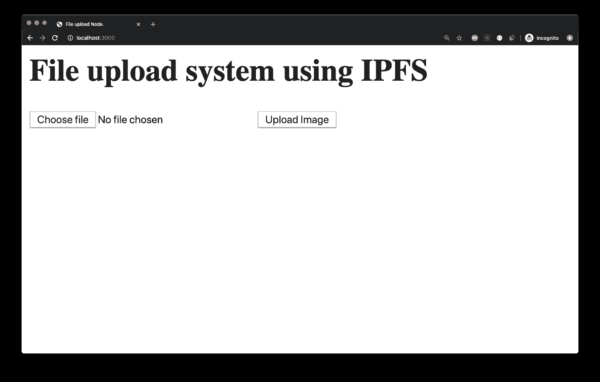

11. 现在，从你的系统中选择一个文件并点击“Upload Image”按钮。你应该看到像这样的响应：

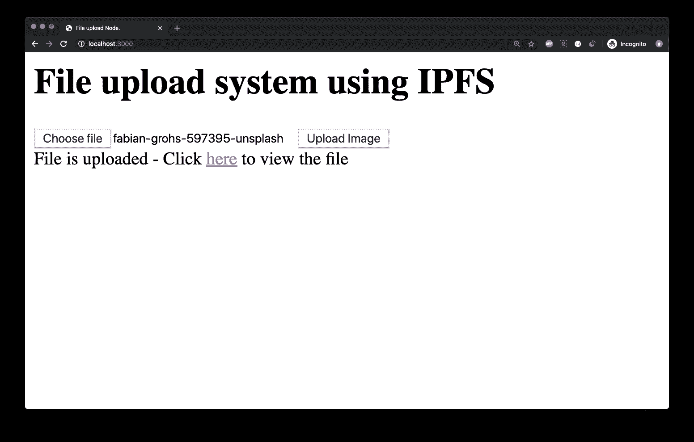

12. 现在，点击“here”在 IPFS 网络中查看图片。


你应该能看到你从系统中选择的一张图片。查看地址栏；它就是 IPFS 网关路径：


13. 你刚刚构建了一个使用 IPFS 作为网络和存储的端到端 DApp。

此应用使用了后端系统框架、`Node.js` 等最新技术，并通过 Ajax 与前端进行通信。

要部署此应用程序，你需要将应用程序部署在服务器上并连接到 IPFS 网关。你可以使用 Infura 提供的托管 IPFS 网关，正如我们在第一章《区块链与去中心化网络简介》中讨论的那样。到目前，我们学习了如何在我们的机器上运行单个 IPFS 节点，但单个 IPFS 节点不足以维持数据冗余和可用性。这是因为，嗯，故障会发生。如果一个节点失败且数据没有复制到另一个节点怎么办？这将导致数据丢失，无法实现冗余网络。为了解决这种场景，IPFS 引入了 IPFS Cluster。

## IPFS Cluster

`IPFS Cluster` 是一个运行在 IPFS 节点旁边的分布式程序，它通过向其他节点分配和固定（pin）数据来维护数据冗余和可用性。

为了更好地理解 IPFS Cluster，让我们看看 IPFS Cluster 文档团队提供的架构图：

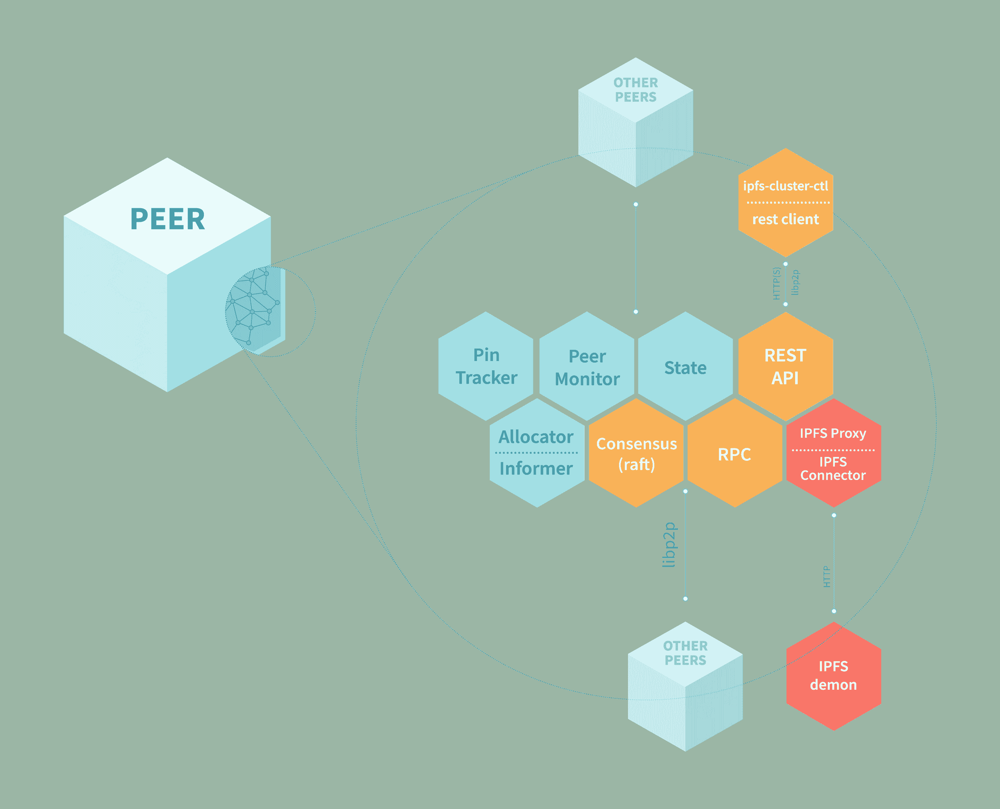

如前所述，`IPFS Cluster` 程序与运行在你系统中的 IPFS 节点进行通信。`IPFS Cluster` 使用 IPFS 节点的 HTTP API 进行通信，该节点默认运行在 `5001` 端口。

`IPFS Cluster` 形成了自己的由运行集群程序的节点组成的网络，且不会与 IPFS 网络产生干扰。`IPFS Cluster` 节点维护全局数据共识，以保持数据冗余和可用性。

你可以访问 IPFS Cluster 官方项目页面下载该程序并在你的系统中运行。

IPFS Cluster 首页：`https://cluster.ipfs.io/`

IPFS 和 IPFS Cluster 的核心组件之一是一个名为 `libp2p` 的模块。正如我们在第一章《区块链与去中心化网络简介》中所学习的样，`libp2p` 管理节点并提供了一个构建分布式应用程序的框架。

既然我们已经详细讨论并学习了 IPFS，现在是深入探索 `libp2p` 并理解 IPFS 核心组件的完美时机。

### libp2p

`libp2p` 是一个库、规范和协议，帮助开发者构建点等点网络应用。

`libp2p` 由以下组件组成：

- 传输层协议：`libp2p` 传输层协议是 `libp2p` 的核心。该层确保数据从一个节点传输到另一个节点。`libp2p` 的传输层协议每天都在演进，未来会有更多协议被 `libp2p` 支持。
- 端到端加密：`libp2p` 传输层可以配置为使用最新版本的 `TLS`（即 `v1.2`）进行安全的端到端加密。`TLSv1.3` 正在开发中。
- 身份模块：该模块确保节点使用公钥加密与正确的节点进行通信和数据交换，并对在网络中发送和接收的数据进行身份检查。
- 路由：在点等点网络中，拥有一个能够识别并连接其他节点而无需记住地址的系统是重要的。由于没有中央系统来查找节点信息，`libp2p` 提供了一种路由机制，请求节点提供网络地址信息，如果他们没有，则请求其他节点获取相同信息。
- 内容发现：`libp2p` 允许我们根据哈希定位内容，并使用分布式哈希表通过哈希或 `CID` 查找内容。
- 消息模块：在点等点网络中，节点通信是关键。`libp2p` 提供了一个发布/订阅（也称为 `pub/sub`）通信模块，帮助节点进行实时通信。

`libp2p` 提供了 Java、`C++`、`Go` 和 `JavaScript` 的软件开发包。让我们使用服务器端 JavaScript 结合 `libp2p` 构建一个简单的应用程序。

我们将构建一个创建一个节点并连接到其他节点的简单应用程序。我们将使用 `Node.js` 框架和 `js-libp2p`。

让我们通过以下步骤创建一个新的节点项目：

1. 创建新文件夹并使用命令提示符或终端进入该文件夹：
`$ npm init --y`

2. 安装 `libp2p` 库和所需的依赖。在终端中运行以下命令：
`$ npm install --save libp2p libp2p-websockets libp2p-secio`
`$ npm install --save libp2p-mplex libp2p-bootstrap`

3. 安装完成后，创建一个新文件并命名为 `app.js`。复制粘贴以下代码：

```javascript
const Libp2p = require('libp2p')
const WebSockets = require('libp2p-websockets')
const SECIO = require('libp2p-secio')
const MPLEX = require('libp2p-mplex')
const Bootstrap = require('libp2p-bootstrap')

// peers addresses
const bootstrapMultiaddrs = [
  '/dns4/ams-1.bootstrap.libp2p.io/tcp/443/wss/p2p/QmSoLer265NRgSp2LA3dPaeykiS1J6DifTC88f5uVQKNAd', '/dns4/lon-1.bootstrap.libp2p.io/tcp/443/wss/p2p/QmSoLMeWqB7YGVLJN3pNLQpmmEk35v6wYtsMGLzSr5QBU3'
]

async function startNode() {
  const node = await Libp2p.create({
    modules: {
      transport: [WebSockets],
      connEncryption: [SECIO],
      streamMuxer: [MPLEX],
      peerDiscovery: [Bootstrap]
    },
    config: {
      peerDiscovery: {
        autoDial: true,
        [Bootstrap.tag]: {
          enabled: true,
          list: bootstrapMultiaddrs
        }
      }
    }
  })

  node.on('peer:discovery', (peer) => {
    console.log('Discovered %s', peer.id.toB58String())
  })

  node.on('peer:connect', (peer) => {
    console.log('Connected to %s', peer.id.toB58String())
  })
  // start lib2p
  await node.start()
}

startNode()
```

让我们理解这段代码：

a. 从第 1 行到第 5 行，我们导入了所有 `libp2p`模块。
b. 然后，我们存储了已经在运行 `libp2p`（或 IPFS）的两个节点地址，并想要与它们连接。
c. 在下一行，我们定义了一个函数来包含所有代码并创建一个新的 `libp2p` 实例：
```javascript
const node = await Libp2p.create({
  modules: {
    transport: [WebSockets],
    connEncryption: [SECIO],
    streamMuxer: [MPLEX],
    peerDiscovery: [Bootstrap]
  },
  config: {
    peerDiscovery: {
      autoDial: true,
      [Bootstrap.tag]: {
        enabled: true,
        list: bootstrapMultiaddrs
      }
    }
  }
})
```
正如你看到的，我们在 `modules` 对象中包含了我们需要的所有模块，如传输、加密、发现等。
在 `config` 对象中，我们包含了要连接的节点地址。
d. 在接下来两行中，我们添加了两个事件监听器来监听在 pub/sub 通道上触发的事件。
e. 最后，我们启动了节点。

4. 使用以下命令运行程序以查看输出：
`$ node app.js`

它应该显示如下输出：

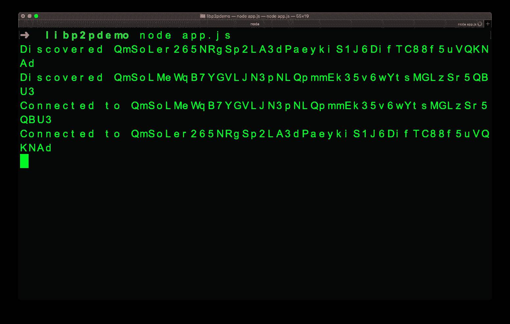

这意味着我们的节点现在通过 `libp2p` 代码连接到其他节点。

## 总结

在本章中，我们探索了 IPFS 及其工作原理。然后，我们转向 IPFS 在本地系统中的安装和配置。我们还学习了与 IPFS 的各种概念，并使用 IPFS 开发了两个重要的应用程序，以深入理解 IPFS 及其用法。最后，我们转向 `libp2p` 框架，学习 IPFS 及其生态系统的核心组件。

在接下来的章节中，我们将学习各种去中心化数据库软件。


加入我们书籍的 Discord 空间

加入书籍 Discord 工作空间以获取最新更新、优惠、全球技术热点、新发布以及与作者的交流会议：

[`discord.bpbonline.com`](https://discord.bpbonline.com)


# 去中心化数据库

## 第 7 章

## OrbitDB，一种点对点分布式数据库

## 引言

OrbitDB 是一个构建在 IPFS 之上的点对点、无服务器、分布式数据库。在上一一个章节中，我们已经详细学习了星际文件系统（IPFS）。在本章中，我们将学习 OrbitDB 以及如何使用它来构建去中心化应用（DApps）。

## 结构

我们将在本章中涵盖以下主题：

• OrbitDB 简介
• 安装 OrbitDB
• OrbitDB 数据模型
• 使用 OrbitDB 构建 DApps
• 技术栈

## 目标

学习本章后，你将能够使用 OrbitDB 构建 DApps，你还将学习如何将 IPFS 和 OrbitDB 结合使用来构建 DApps。让我们开始吧。

## OrbitDB 简介

以下是根据 OrbitDB 项目页面的定义：

OrbitDB 是一个无服务器、分布式、点对点的数据库。OrbitDB 使用 IPFS 作为其数据存储，并使用 IPFS Pubsub 与节点自动同步数据库。它是一个最终一致性数据库，使用 CRDTs 进行无冲突的数据库合并，使得 OrbitDB 成为去中心化应用（DApps）、区块链应用程序和优先 Web Web 应用程序的极选择。

这是一个非常技术性的定义。让我们进一步拆解以更好地理解：

• OrbitDB 是无服务器的，这意味着在使用 OrbitDB 时，你不需要像其他数据库软件那样维护数据库服务器。它作为各种编程语言模块提供。
• OrbitDB 是分布式的；它被设计为没有中央服务器的点对点数据库。
• OrbitDB 使用 IPFS 作为存储系统。OrbitDB 充当 IPFS 和编程接口之间的层。
• OrbitDB 是一个点对点数据库，为了将节点中的更改同步到其他节点，它使用 IPFS 发布/订阅（pub/sub）系统与其他节点通信。
• OrbitDB 使用最终一致性模型；该模型会将数据项的最新更新版本返回给用户，从而保持数据的可用性和一致性。为了实现这种最终一致性，OrbitDB 使用了无冲突复制数据类型（CRDTs）。
• OrbitDB 被封装为 Node.js 库。选择 JavaScript 是因为因为它在编程社区中的流行和无不在，以及它与 IPFS 的 JavaScript 实现（称为 `js-IPFS`）的互操作性。

让我们继续安装 OrbitDB。

## 安装 OrbitDB

OrbitDB 是一个无服务器应用程序，所以你不需要像运行 MySQL 等其他数据库那样运行服务器。

让我们通过以下步骤在我们的应用程序中安装 OrbitDB：

1. 这是在我们的项目中安装 OrbitDB 和 IPFS 的命令：

```
npm install @orbitdb/core @orbitdb/liftoff helia
```

`liftoff` 模块将帮助我们快速启动 OrbitDB 数据库。

2. 安装完成后，你可以使用以下代码连接到 IPFS 并创建一个 OrbitDB 数据存储器：

```javascript
import { createOrbitDB } from '@orbitdb/core'
import { DefaultLibp2pOptions } from '@orbitdb/liftoff'

const libp2p = createLibp2p({ ...DefaultLibp2pOptions })
const ipfs = await createHelia({ libp2p })
console.log('Connected to IPFS');
const orbitdb = await createOrbitDB({ ipfs })
console.log('OrbitDB instance created.')
const db1 = await orbitdb.open('db1')
await db1.add('hello world!')
console.log(await db1.all())
```

3. 执行上述代码后，你会看到：

```
Connected to IPFS
OrbitDB instance created.
[ { value: 'hello world!' } ]
```

4.  现在，我们可以使用 OrbitDB 在我们的应用程序中打开数据存储。


用户可以在以下屏幕上编写新邮件，就像使用 Gmail 或任何基于网页的电子邮件应用程序一样：

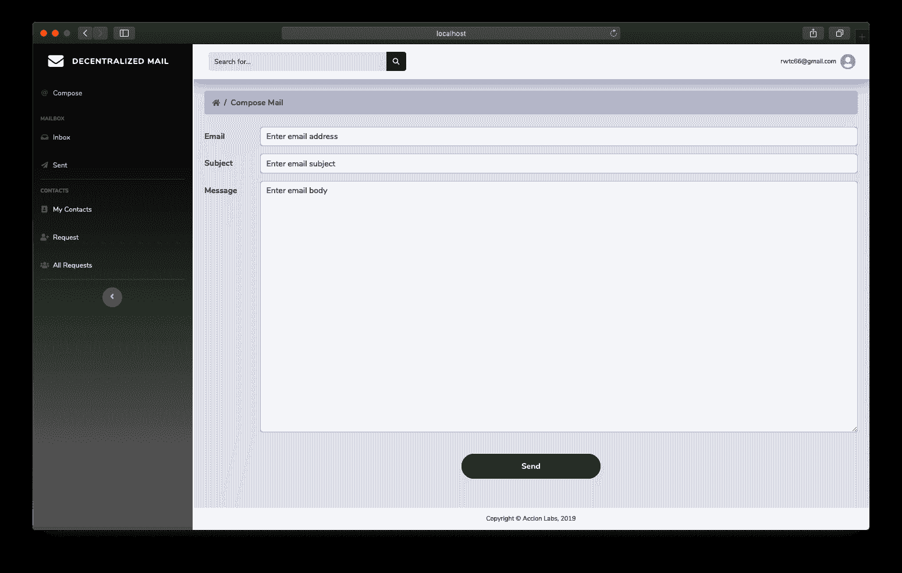

在这里，用户可以检查联系人并添加/删除：

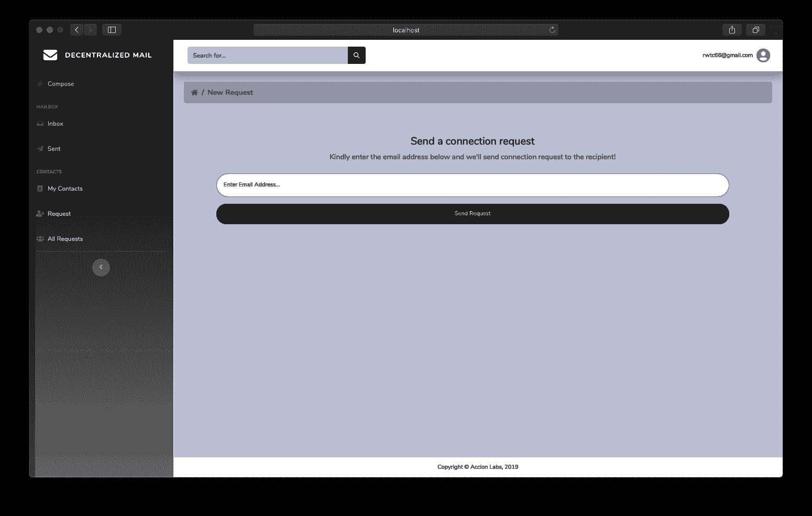

## 技术

以下是我们的技术栈：

- 前端：HTML, CSS, JavaScript 和 jQuery
- 后端：OrbitDB, IPFS
- 中间层：Node.js

我们使用 `Node.js` 来处理 API 系统，以便前端与数据库通信，并使用 `OrbitDB` 文档存储数据模型存储用户信息和邮件信息。让我们来看看应用程序的架构。

### 架构

我们正在构建一个点对点的电子邮件应用程序。在这种方法中，我们在每个节点之间共享同一个数据库。为了实现这一点，我们首先需要在初始节点（genesis peer）中创建一个数据库，所有其他节点必须复制相同的数据库。

一旦创建了初始节点和数据库，另一个节点就可以复制数据库，更改将使用我们之前学习过的 `IPFS` 发布/订阅（pub/sub）技术进行同步。

我们的邮件技术与传统的电子邮件系统也有所不同。在传统系统中，我们使用`简单邮件传输协议 (SMTP)`来发送和接收邮件。

在我们的系统中，我们使用 `IPFS` 发布/订阅来同步更改，以便所有人拥有相同的数据副本，因此发送/接收的邮件将保持同步。

在传统系统中，如果你有任何人的电子邮件地址，就可以向其发送邮件。在我们的系统中，你只能向已添加到联系人且你拥有其公钥的用户发送邮件。

我们使用接收者的公钥和发送者的私钥对邮件进行加密，以确保极其安全。只有持有正确私钥的接收方才能解密邮件并查看内容。

这是一个点对系统中非常重要的概念，因为任何人都可以成为网络的一部分并查看你的数据。必须确保它是安全的且不易访问的。

`Node.js` 服务器处理我们的前端，而节点本身处理与数据库的其余通信。让我们来看以下项目目录：

- `package.json`:包含所有所需的包。
- `node_modules`:包含项目所需模块的文件夹。
- `orbitdb`: 数据库文件的文件夹。
- `views`: 包含前端文件的文件夹。
- `utils`: 包含应用程序中可复用代码的文件夹。
- `dbaddress.js`:包含数据库地址的文件。
- `index.js`: 包含服务器代码。
- `db.js`: 包含数据库相关的代码。

让我们理解接下来的代码。由于代码库很大，并不是所有内容都已粘贴在这里。我们将理解重要的代码片段以及如何运行程序。对于本章中未解释的代码的任何疑问，读者可以联系作者。

首先，让我解释一下我们如何在初始节点中创建数据库并处理多个节点之间的发布/订阅。打开 `db.js` 文件并查看以下代码。我们正在导入处理数据库所需的所需的模块：

```javascript
const IPFS = require('ipfs-api');
const OrbitDB = require('orbitdb');
const uuid = require('uuid/v4');
const bcrypt = require('bcrypt');
const fs = require('fs');
const Identities = require('orbit-db-identity-provider');
```

我们创建了一个名为 `loadDB()` 的函数，在其中我们添加了建立数据库连接并将其加载到内存中的必要代码：

```javascript
async function loadDB() {
………...
}
```

为了启用发布/订阅以便我们的节点能够相互通信，我们在 `IPFS` 配置中传递了以下参数：

```javascript
EXPERIMENTAL: {
  pubsub: true
},
relay: {
  enabled: true, 
  hop: {
    enabled: true, active: true
  }
},
```

然后，我们检查此节点是否为初始节点，即系统中的第一个节点。我们通过加载 `dbaddress.js` 文件来检查这一点。如果该文件存在，我们就加载文件中写入的数据库：

```javascript
fs.access(filePath, fs.F_OK, async (err) => {
  if(err) {
    // 文件不存在，创建一个新数据库并加载它。
  }
  // 文件存在，加载数据库
});
```

如果文件不存在，我们假设它是一个初始节点。然后我们创建新的数据库并将每个数据库的地址写入 `dbaddress.js` 文件中：

```javascript
userDb = await orbitdb.create('email.user', 'docstore',{
  accessController: {
    write: ['*']
  } 
});
userContactsDb = await orbitdb.create('email.user.contacts','docstore', {
  accessController: {
    write: ['*']
  } 
});
userEmailsDb = await orbitdb.create('email.user.data', 'docstore', {
  accessController: {
    write: ['*']
  } 
});
let fileContents = {
  "user": userDb.address.toString(),
  "contacts": userContactsDb.address.toString(),
  "emails": userEmailsDb.address.toString()
}
// 写入数据库文件
fs.writeFileSync(filePath, JSON.stringify(fileContents));
```

如果文件存在，我们使用 `OrbitDB` 提供的 `open()` 函数连接数据库。我们将数据库地址作为参数传递给函数：

```javascript
let fileData = fs.readFileSync(filePath, 'utf-8');
let config = JSON.parse(fileData);
console.log('Databases exists, loading them');
userDb = await orbitdb.open(config.user);
userContactsDb = await orbitdb.open(config.contacts);
userEmailsDb = await orbitdb.open(config.emails);
```

为了将数据库加载到内存中，我们使用：

```javascript
userDb.load();
userContactsDb.load();
userEmailsDb.load();
```

一旦数据库准备就绪，我们为每个数据库分配一个事件。在我们的代码库中，添加了更多的监听器：

```javascript
userDb.events.on('ready', () => {
  console.log('user database is ready.')
});
userContactsDb.events.on('ready', () => {
  console.log('user contacts database is ready.')
});
userEmailsDb.events.on('ready', () => {
  console.log('user emails database is ready.')
});
```

最后，当服务器加载数据库时，我们调用我们的函数：

```javascript
// 加载数据库
loadDB();
```

一旦创建了数据库，`dbaddress.js` 文件或数据库地址就可以与其他节点共享，以便它们成为网络的一部分。这就是我们为应用程序创建和加载 `OrbitDB` 数据库的方式。

`db.js` 文件中还有其他处理应用程序各个方面的函数，例如登录、注册、创建邮件和读取邮件。让我们来看看如何使用公钥和私钥组合来创建邮件和读取邮件。

首先，让我们生成公钥和私钥对的代码。在 `utils` 文件夹中，查看 `genkey.js` 代码：

```javascript
const crypto = require('asymmetric-crypto');

function generateKeys() {
  let pair = crypto.keyPair(); 
  return {
    privateKey: pair.secretKey,
    publicKey: pair.publicKey
  }
}
module.exports = generateKeys;
```

我们使用 `asymmetric-crypto` node 模块随机生成新的公私钥对。我们也可以通过输入种子创建公钥私钥对。

我们使用同一个模块对邮件进行加密和解密。你可以检查放在 `utils` 文件夹中的代码：

```javascript
const crypto = require('asymmetric-crypto');

function encryptEmail(data, pair) {
  try {
    let encryptedEmail = crypto.encrypt(data, pair.publicKey, pair.privateKey);
    return encryptedEmail;
  }
  catch(e) {
    console.log('加密邮件时发生错误');
    return null; 
  }
}
module.exports = encryptEmail;
```

在这里，我们使用传递给函数的公私钥对对数据进行加密，数据就是我们的邮件。

我们还使用以下代码执行邮件的解密：

```javascript
const crypto = require('asymmetric-crypto');

function decryptEmail(emailData, keys) {
  try {
```


```javascript
let result = crypto.decrypt(emailData.email, emailData.signature, keys.senderPublicKey, keys.privateKey);

return result;

}

catch(e) {

console.log(e);

return null;

}

}

module.exports = decryptEmail;
```

在解密部分，我们正在使用与电子邮件相关的公钥以及接收者的 `privateKey` 来解密邮件。这样一来，你只能读取与你的公钥相关的电子邮件。这反过来使得数据非常安全，并且不容易被拦截。

让我们来看服务器代码。打开 `index.js` 文件并查看代码。

首先，按照惯例，我们导入了所有需要的模块：

```javascript
const express = require("express");

const bodyParser = require("body-parser");

const redis = require("redis");

const session = require("express-session");

const redisStore = require("connect-redis")(session);

const cookieParser = require("cookie-parser");

const app = express();

const client = redis.createClient();

const router = express.Router();

const db = require("./db");
```

为了确保应用程序的安全，我们使用会话（sessions）在浏览器中安全地维护用户数据。

为了在服务器上存储会话信息，我们使用了 `Redis`，这是一个键值存储器。我们使用 `Redis` 而不是 `OrbitDB` 中的会话存储的原因是因为其点对点的特性。

我们不希望将一个用户的会话共享给其他节点。如果这样做，黑客可能会劫持会话并从中获取关键信息。

`Redis` 运行在每个节点上，并仅为连接到节点的用户维护会话。这里是我们使用 `Redis` 作为会话存储的代码：

```javascript
// session middleware

app.use(

session({
secret: "some-random-words",
store: new redisStore({
host: "localhost",
port: 6379,
client: client,
ttl: 10000
}),
saveUninitialized: false,
resave: false
});
);
```

`Redis` 默认运行在 `6379` 端口。如果你更改了它，请同步修改代码中。

一旦用户执行了登录操作，我们只需使用以下代码为该请求设置会话：

```javascript
// set session

req.session.key = {
userId: response.data.userId,
email: response.data.email,
publicKey: response.data.publicKey
 };
```

我们存储了 `userId`、`email` 地址和 `publicKey` 等信息，以便在每个请求中识别用户。

要检查请求是否设置了会话，我们通过检查会话键是否存在：

```javascript
if (req.session.key) {
// 用户已登录
} else {
// 用户无效，重定向到登录页面
}
```

所有的前端代码都放在 `view` 文件夹中。代码库非常简单；我们使用简单的 JavaScript 进行 API 调用并更改屏幕。

你可以使用以下命令运行程序：

```
node index.js
```

你应该能看到与下方截图类似的终端屏幕：

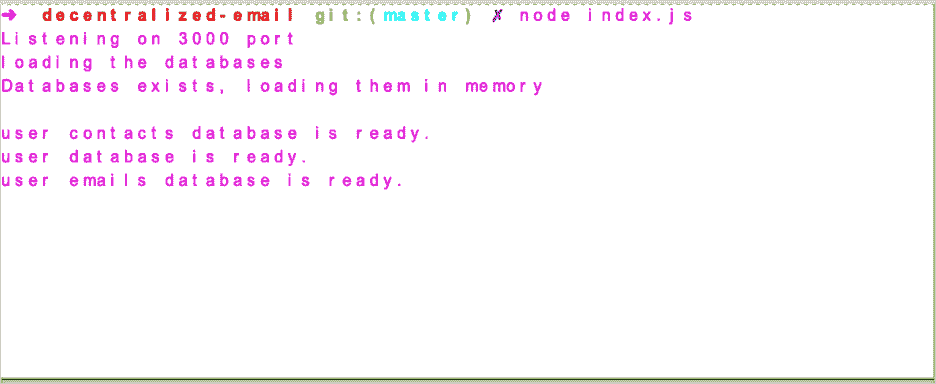

如果你是第一次运行，由于创世节点（genesis peer）操作，你会收到不同的控制台消息。

如果你在本地机器运行，请在浏览器导航到 `localhost:3000`；如果在服务器上运行，请访问服务器地址。

如果你的屏幕与我们之前在本节开头展示的相似，将会有帮助。这个应用程序的一个有趣之处是，只有当双方都参与了联系人共享操作时，才能发送和接收电子邮件。

使用注册页面创建两个用户，然后向其中一个用户发送联系请求：

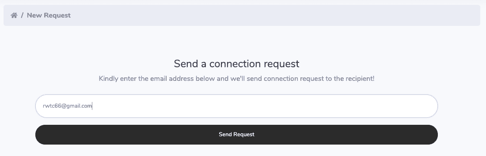

发送请求后，登录第二个用户账户并接受请求，如下所示：

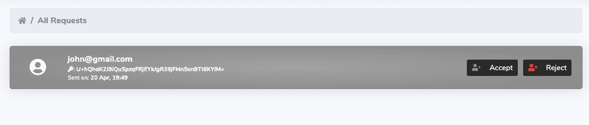


BigchainDB 是一个去中心化数据库。BigchainDB 使用 `Tendermint` 来去中心化并在各个节点之间达成共识。`Tendermint` 是一种共识软件，通过它我们可以使用 `BFT` 共识开发和构建安全的去中心化软件。

为了进行快速索引和查询，每个 BigchainDB 节点都运行并管理自己的本地 `MongoDB` 实例。`MongoDB` 是一种流行的 NoSQL 数据库。节点之间的通信通过 `Tendermint` 协议实现。

BigchainDB 是一个去中心化数据库，这意味着不应该有单点故障。为了实现这一点，`BigchainDB` 节点是自有的且自运营的实体。由于网络没有单一的所有者，如果一个节点故障，其他节点将维持网络运行。

BigchainDB 节点可以且已经位于全球的许多地理位置。每个国家的本地司法管辖权和云服务提供商运作方式不同，因此受关注国家（如中国或朝鲜）的某个节点或一组节点的问题不会影响所有节点。

由于这种去中心化特性，即使某个节点停止响应请求并最终失败，网络的其余部分也将继续运行。事实上，多达三分之一的 BigchainDB 节点可以失败，而网络仍然可以工作。

### 不可性

BigchainDB 是一个不可变数据库，这意味着信息一旦成功添加到 BigchainDB 网络，就无法被更改或删除。除非投入巨大的计算/哈希能力，否则无法做到，而这非常困难且耗时耗钱。如果某些数据以某种方式成功被更改或删除，这在网络中是可以被检测到的，并导致极高的数据完整性和容错能力。

BigchainDB 不提供任何允许我们更改或修改现有数据的 `API`。这是 BigchainDB 用于维护数据不可变性的方法之一。

在 BigchainDB 中，每个节点在本地管理的 `MongoDB` 数据库实例中都拥有所有数据的完整副本。因此，不存在单一的 `MongoDB` 数据库作为单点故障，就像我们在比特币或其他去中心化系统中处理数据的方式一样。

如果由于各种原因导致一个或多个 BigchainDB 节点被损坏或销毁，其他节点将不受影响，并且仍然拥有所有数据的副本，这些副本以后可以用于重建损坏的节点。

为了达到标准级的数据完整性，BigchainDB 中的所有交易都经过了加密签名。交易存储后，更改其数据将改变签名，由于签名不匹配，可以被轻易检测。

### 所有者控制的资产

BigchainDB 以资产的形式存储和交换信息。资产可以是从货币、房屋到简单椅子等的任何东西。

BigchainDB 对所有者控制的资产有内置支持，即只有资产的所有者（或所有者）才能将其转移给其他实体。所有者通常是有一组私钥的用户。所有者控制的资产不能被任何人转移，即使是节点运营商也不行。

比特币或以太等区块链中只有一个内置资产，但 BigchainDB 允许用户根据需要创建尽可能多的独占资产。用户无法创建似乎已存在于网络中的资产，从而维护了资产的所有权和现有数据的完整性。

BigchainDB 始终验证每笔交易，以确保其没有尝试传输已通过其他交易传输的值；也就是说，它防止了双花费。

### 高交易率

BigchainDB 提供高交易率。正如引言部分提到的，BigchainDB 运行在 `Tendermint` 上，因此性能统计非常相似。

`Tendermint` 在分布式网络中每秒处理数千笔交易。

### 低延迟和快速终局性

BigchainDB 提供低延迟；也就是说它立即向网络中添加新块。BigchainDB 声称，交易包含在新块中通常只需要几秒钟（或更短），这令人印象深刻。

一旦块添加到 BigchainDB 网络，它就会在网络中同步，无法被撤销。

### 结构化数据的索引和查询

对于结构化数据的索引，正如引言部分提到的，BigchainDB 网络中的每个节点都有一个本地的 `MongoDB` 数据库实例。数据所有权归节点所有，他们决定向外部用户暴露多少数据。例如，一个节点所有者可能会通过 `API` 提供地理数据。相比之下，另一个运营商可能会提供 `GraphQL`。这完全取决于所有者。

`MongoDB` 作为一种 NoSQL 数据库，在存储和查询信息方面非常强大。

让我们探索 BigchainDB 的用场景。

## BigchainDB 用场景

BigchainDB 是一种不可变的数据库软件，可以服务大量的用场景。BigchainDB 可用于任何需要去中心化信息的地方。

许多行业部门和组织都可以直接从 BigchainDB 中受益。在本节中，我们将涵盖一些 BigchainDB 用场景。

### 供应链

在典型的供应链网络中，多方正在协作并交换信息、货物和资产。

供应链是一个巨大的买家和卖家网络，他们产生了大量的发票、支付记录、货物信息等数据。供应链网络面临的主要挑战之一是跨不同实体传递的信息安全性。

正如前文关于供应链数据生成能力的所述，当链规模增大时，数据呈指数级增长。随着数据的增长，系统的复杂性也随之增长。

为了在处理供应链数据规模的同时保持资产的透明性，我们需要像区块链这样的系统，除了所有者外无人可以修改。

去中心化数据库或区块链技术的核心关注之一是延迟。由于网络的普及，运行在去中心化系统上的数据库可能需要时间响应。这就是 BigchainDB 的优势所在，它带来了查询能力和高吞吐性能。

BigchainDB 可用于供应链场景来解决我们讨论的各种问题，主要是数据管理和安全。BigchainDB 可以处理大量数据，同时允许用户运行运行时查询。

### 身份


身份管理是管理用户特定数据（如凭据、角色、访问管理等）时最关键的用例之一。

身份盗是当今的一个主要问题；我们必须确保人类或机器的身份是安全且防篡的。

身份管理系统产生海量数据。由于这种大规模的数据生成，我们需要一个能够根据数据量进行扩展的数据库。

BigchainDB 具有去中心化、用于快速查询和索引的本地 `MongoDB` 节点以及不可变性等特性，这使得 BigchainDB 成为身份管理系统的天然选择。

## 物联网

物联网（IoT）是物理对象的数字化表示，这些对象与网络通信并周期性地向网络注入数据。IoT 设备可以是任何物体，其数据摄取可以产生数字节级的数据。为了处理如此量的信息，我们需要一个高吞吐量、快速、防篡且能提供快速结果的系统。这正是 BigchainDB 大显身手之处。

## 数据治理
数据治理始终是一个具有争议的问题。在印度、美国和英国等民主国家，由于各种原因，人们产生的数据一直是政府和其他机构的关注焦点。要在不让人们感到自己被监控的情况下实施数据治理，除了区块链外没有其他解决方案。

BigchainDB 可用于处理此类大量数据，同时允许政府监控资产转移并在必要时采取行动。

## 审计追踪
审计追踪是系统或系统网络中执行的每一个操作的记录。BigchainDB 可用于审计追踪，因为它们天然契合。

审计追踪用于银行、供应链、公用事业市场、访问控制等领域。由于大量数据的产生和记录的性质，BigchainDB 可用于存储、管理和查询审计追踪记录。

让我们继续，在您的本地系统中设置 BigchainDB 节点。

## 运行 BigchainDB 节点
BigchainDB 需要在您的系统中运行 `MongoDB` 实例。因此，在安装和运行 BigchainDB 之前，我们需要在系统中安装并配置 `MongoDB`：

1. 访问 `MongoDB` 官方网站，根据您拥有的操作系统下载软件。

2. 一旦安装了 `MongoDB`，使用以下命令运行 `MongoDB` 守护进程：

```
mongod --dbpath=.
```

如果您想将数据存储在不同的位置，可以更改 `dbpath` 变量的路径。

3. 一旦 `MongoDB` 开始运行，我们可以使用以下命令在系统中安装 BigchainDB：

```bash
sudo pip3 install bigchaindb
```

4. 安装后，您可以运行以下命令启动 BigchainDB 服务器：

```bash
bigchaindb -y configure mongodb
```

5. 启动 BigchainDB 服务器：

```bash
bigchaindb start
```

6. 现在，导航到 `http://localhost:9984` 以验证 BigchainDB 的安装。

您应该得到以下响应：

```json
{
  "api": {
    "v1": {
      "assets": "/api/v1/assets/",
      "docs": "https://docs.bigchaindb.com/projects/server/en/v1.2.0/http-client-server-api.html",
      "outputs": "/api/v1/outputs/",
      "statuses": "/api/v1/statuses/",
      "streams": "ws://localhost:9985/api/v1/streams/valid_transactions",
      "transactions": "/api/v1/transactions/"
    }
  },
  "docs": "https://docs.bigchaindb.com/projects/server/en/v1.2.0/",
  "keyring": [
    "6qHyZew94NMmUTYyHnkZsB8cxJYuRNEiEpXHe1ih9QX3",
    "AdDuyrTyjrDt935YnFu4VBCVDhHtY2Y6rcy7x2TFeiRi"
  ],
  "public_key": "NC8c8rYcAhyKVpx1PCV65CBmyq4YUbLysy3Rqrg8L8mz",
  "software": "BigchainDB",
  "version": "1.2.0"
}
```

BigchainDB 已成功安装在您的系统中。

## 结论
BigchainDB 是一种强大且充满前景的软件，它可以结合区块链和传统数据库的优点，这正是当务之急。我们学习了 BigchainDB 的特性及其各种用例。我们研究了如何为本地开发设置简单的 BigchainDB 节点。

在下一章，我们将学习另一个名为 Ties.DB 的区块链数据库。

**加入我们书籍的 Discord 空间**

加入书籍的 Discord 工作空间以获取最新更新、优惠、全球科技动态、新发布以及与作者的互动：

[`discord.bpbonline.com`](https://discord.bpbonline.com)


# 第 9 章 Amazon 量账本数据库

## 引言
Amazon Quantum Ledger Database (Amazon QLDB) 是一个全托管的 Amazon 账本数据库。Amazon QLDB 为账本中的信息提供中心信任权威所有权。Amazon QLDB 为您的应用程序的所有更改提供透明、不可变且经过加密验证的事务日志。

| 注意：此服务已停止。 |

## 结构
在本章中，我们将涵盖以下主题：

- Amazon Ledger Database
- Amazon Ledger Database 的特性
- Amazon Ledger Database 用例
- 使用 Amazon Ledger Database
- Amazon Ledger Database 驱动程序

## 目标
学习本章后，你将能够学习 QLDB 的基础知识、如何在 AWS 控制台中中使用它以及如何使用驱动程序。

让我们从引言开始。

## Amazon 量账本数据库
如前所述，QLDB 是一个全托管的账本数据库。作为开发者，你无需担心数据库的安装、配置和管理。Amazon 会为你处理一切。

与我们在前面的章节中介绍的其他去中心化数据库不同，QLDB 是中心化拥有的，这意味着一个或一组机构拥有所有权；因此，它被归类为私有数据库。

AmazonQLDB 提供了一个不可变的数据库，因此数据一旦写入就无法修改。如果需要修改，则创建一个新记录，并保留旧新记录的历史记录，以便人们验证更改。

AmazonQLDB 作为云服务在 AWS 控制台中可用。因此，你按需付费。

AmazonQLDB 使用类 SQL 语言的查询语言来对数据进行操作。对于想要使用具有区块链功能的不可变数据库的大量开发者来说，这是一个受欢迎的举措，但由于学习曲线的存在，可能会被放弃。

AmazonQLDB 还为 Java、NET、JavaScript 和 Python 等编程语言提供了驱动程序。

在下一节中，我们将学习更多关于 QLDB 的特性。

## Amazon 量账本数据库的特性
AmazonQLDB 提供以下特性：

- 账本数据库：传统数据库中的事务通常存储在数据库和表中。数据库维护事务的状态，并在发生错误或回滚时采取行动。

事务日志是结构化查询语言（SQL）数据库系统的核心组件。它在系统故障、灾难恢复或数据复制期间重放事务起着重要作用。

在传统数据库系统中，事务日志不是不可变的，用于事务失败或回滚。

在 Amazon QLDB 中，账本结构上类似于事务日志，是数据库的核心组件。账本是一个不可变的、追加的数据结构，存储了事务数据以及相关的元数据。


账本管理数据的方式类似于 SQL 数据库；你可以创建一个表并在表内部存储你的信息。

- **不可变性**：Amazon QLDB 是一种不可变数据库，它存储所有数据更改的记录，这些记录在任何情况下都无法更改或修改。
一旦数据提交且更改历史在系统中被记录，就没有可用的 API 或管理级功能可以更改历史记录。

- **加密安全性**：Amazon QLDB 将数据存储在块中，这些块通过类似于区块链的加密哈希函数连接在一起。该哈希函数使用加密验证方法确保事务数据的完整性。
对于每条事务记录，QLDB 都提供了一个摘要（digest）——这是一个指向特定时间点完整哈希链的哈希值，以及 Merkle 审计证明。

- **SQL 兼容查询语言**：Amazon QLDB 提供了一种兼容 SQL 的查询语言。它缩短了开发者的学习曲线。任何熟悉 SQL 的数据库程序员都可以在短时间内使用 Amazon QLDB。Amazon QLDB 使用 `PartiQL` 作为其查询语言，使用 `Amazon Ion` 作为其面向文档的数据模型来实现这一点。
`PartiQL` 是一个开源的兼容 SQL 的查询语言。你可以使用 `PartiQL` 通过传统的 SQL 运算符来插入、查询和管理你的数据。
你可以在 PartiQL 项目主页（https://partiql.org/）参考它。
`Amazon Ion` 类似于 JSON，具有更多以 Amazon 为中心的特征。

- **高可用性**：Amazon QLDB 是无服务器的并运行在云端，使用经过测试的 AWS 全球基础设施实现高可用性。
Amazon 自动在各个 AWS 区域之间复制数据，以支持数据的可用性和完整性。

- **企业级**：Amazon QLDB 符合 ACID 属性。

## Amazon Quantum Ledger Database 用场景

- **金融**：银行和金融机构运行账本以跟踪贷方和贷方。与其从头开始构建复杂的账本，不如使用 Amazon QLDB 并专注于业务部分，而不是处理账本的技术性方面。
- **制造业**：制造公司在供应链系统中工作。链中涉及许多方，以生产和制造一个简单的物品。账本数据库可以在此类系统中发挥关键作用，记录交易和历史记录，以避免冲突并跟踪系统中的资金、货物等。
- **保险**：保险公司可以使用 QLDB 账本进行透明的理赔解决并存储交易历史。账本数据库还可以存储审计记录，并在保险公司与个人之间的冲突解决中发挥主要作用。
- **薪资系统**：薪资系统记录交易历史，如支付的薪水、保险理赔和绩效历史。这些记录可以使用 QLDB 和账本进行系统化维护，公司可以在记录的所有权上对员工和其他利益相关者保持透明。
- **供应链**：供应链管理是迄今以来最乏味的任务之一。必须有技术革命来支持在链中发挥关键作用的广泛群体。
通过 QLDB 账本，所有的供应链记录都可以作为数据历史进行存储，并带有由各方所做的适当更改记录。供应链中的各方经常访问诸如物品位置、运输详情、谁处理货运等数据。Amazon QLDB 在该领域可以发挥主要作用。

## 使用 Amazon Quantum Ledger Database

要使用 Amazon QLDB，你需要一个 AWS 账户。如果你还没有账户，请在 AWS 上创建一个新账户。执行以下步骤：

1. 点击以下链接在 AWS 中创建新账户：
https://aws.amazon.com/account/
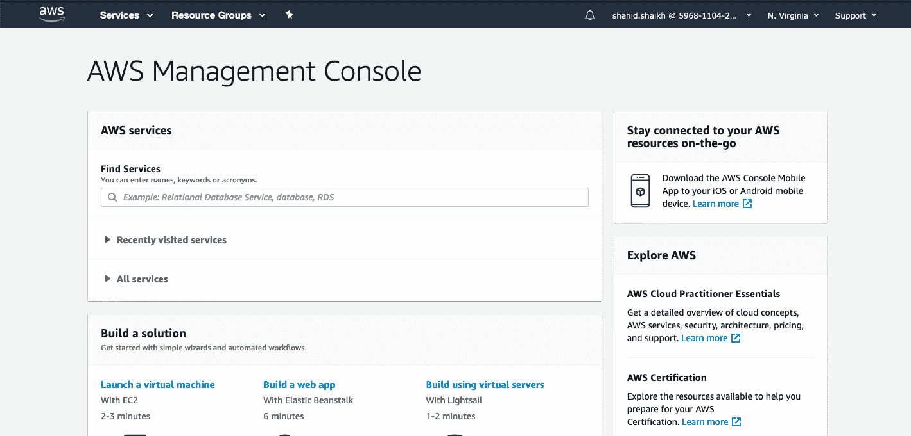

2. 搜索 `QLDB` 并点击它。你应该看到一个与此处类似的屏幕：


3. 点击 `Create ledger`（创建账本）按钮。

4. 提供账本名称并点击 `Create`（创建）按钮。一旦创建账本，它应该列在账本屏幕上：


5. 点击你的账本名称，然后从左菜单点击 `Query editor`（查询编辑器）。它将打开一个与下图类似的屏幕：


6. 现在，运行此查询在账本创建一个新表：
```
CREATE TABLE users
```

7. 将查询粘贴到查询编辑器中并点击 `Run` 按钮。这将创建一个新表。

8. 现在，让我们表中添加一些信息。复制并粘贴以下查询：
```
INSERT into users VALUE {'id': 1, 'name': 'Shahid', 'location': 'Mumbai'}
```

9. 现在，从我们的表中获取一些信息。运行以下查询来获取记录：
```
select * from users
```
它将返回表中存在的信息。

10. 让我们执行更新查询并观察 QLDB 中的变化。运行以下查询来更新记录：
```
UPDATE users as u SET u.name='ShahidShaikh' where u.id=1
```

11. 查询成功执行后，它将返回文档的 ID。复制 ID。

让我们通过以下步骤查询更改并查看记录的历史：

1. 要检索记录的历史，我们使用 `history()` 语法。查询如下：
```
select * from history(users) as h where h.metadata.id='id from the update'
```
此查询应该返回对文档所做更改的历史。
以下是输出：


2. 同样，你可以从账本中删除记录。复制/粘贴并运行以下查询：
```
DELETE from users as u where u.id=1
```
同样，如果你运行历史查询，你也将看到被删除的记录。

## Amazon Quantum Ledger Database 驱动程序

Amazon QLDB 为以下编程语言提供了驱动程序：
- Java
- Python
- Node.js
- .NET

此外，你还需要 AWS SDK 来引入与 QLDB 集成所需的通用功能。让我们安装 Node.js 的 SDK：

1. 创建新文件夹并使用终端切换过去：
```bash
mkdir qldbtest && cd qldbtest
```

2. 使用 `npm init` 命令创建 `package.json` 文件：
```bash
npm init -y
```

3. 使用以下命令安装 `QLDB` 驱动程序：
```bash
npm install amazon-qldb-driver-nodejs@1.0.0 --save
```

4. 安装依赖驱动：
```bash
npm install aws-sdk --save
npm install ion-js@4.0.0 --save
npm install jsbi@3.1.2 --save
```

5. 一旦驱动驱动程序，我们就可以连接。参考以下示例：
```javascript
const qldb = require('amazon-qldb-driver-nodejs');

const main = function() {
  const driver = new qldb.QldbDriver('quick-start', {});
};

main();
```
我们正在连接到不需要任何配置的默认 QLDB 账本。我们还没有连接到我们的 QLDB 账本数据库。你可以参考驱动程序页面获取更多信息，并访问以下链接：https://docs.aws.amazon.com/qldb/latest/developerguide/getting-started-driver.html

## 结论

Amazon QLDB 是一个具有企业级解决方案的有前景的数据库。Amazon QLDB 可用于许多应用程序。在下一章中，我们将学习已经进入主流的去中心化应用程序。

**加入我们书籍的 Discord 空间**

加入书籍的 Discord 工作区以获取最新更新、优惠、全球科技动态、新发布以及与作者的座座会议：


[`discord.bpbonline.com`](https://discord.bpbonline.com)


## 第 10 章

**DTube**

## 引言](#toc.xhtml#zh108)

在本章中，我们将学习 `DTube`，它是 YouTube 的去中心化版本。它是由网络和对点而不是中心权威管理的视频托管服务。`DTube` 允许内容创作者在不显示广告的情况下赚加密货币。因此，不存在现有服务中常见的跟踪、隐私问题和审核机制。

## 结构](#toc.xhtml#zh109)

在本章中，我们将学习以下内容：

• `DTube` 简介
• `DTube` 特性
• `DTube` 架构
• `DTube` 的原理

## 目标](#toc.xhtml#zh110)

阅读本章后，你将学习 `DTube` 的基础知识并理解其功能。你还将学习运行 `DTube` 的技术，即去中心化视频托管服务。

## DTube 简介](#toc.xhtml#zh111)

`DTube` 是世界上第一个去中心化的视频托管服务。它为内容创作者和观众提供了一个无广告且公平的平台。

你可以点击以下 `DTube` 网站访问它：https://d.tube/。

该网站外观如下：


`DTube` 运行在 `Steem` 区块链上，并将内容存储在星际文件系统 (`IPFS`) 上。我们在第 6 章“星际文件系统”中详细学习过 `IPFS`；让我们简单了解一下 `Steem` 区块链。

### Steem 区块链](#toc.xhtml#zs70)

`Steem` 是一个社交区块链网络，允许用户创建内容并在不显示广告的情况下获得报。`Steem` 铸造其加密货币，并将其与通过点赞或评论参与内容的创作者及用户共享。

它还允许开发者在 `Steem` 区块链之上构建应用程序。

点击链接访问网站了解更多：https://steem.com/。

`DTube` 使用 `IPFS` 存储内容。它还展示了分布式文件存储服务的力量，该服务在视频托管服务等应用中可以发挥重要作用。

作为用户，你可以在 `DTube` 上创建账户并观看视频。你可以对视频点赞、评论，并因这些互动获得加密货币。

让我们来看看 `DTube` 的一些特性。

## DTube 特性](#toc.xhtml#zh112)

`DTube` 为消费者和内容创作者提供以下特性：

• 内容所有权归创作者。
• 零审核和零审查。
• 付款基于内容的互动情况。
• 根据互动情况向内容消费者付费。
• 零交易费用。
• 使用 `IPFS` 进行去中心化内容存储。
• 频道创建、订阅和提醒与 YouTube 类似。
• 由于与 YouTube 功能相似，学习曲线极低。

现在，让我们了解 `DTube` 的架构。

## DTube 架构](#toc.xhtml#zh113)

`DTube` 采用多种技术来运行网站，其架构由以下技术组成：

• 前端：`JavaScript Meteor` 框架。
• 分布式区块链数据库：`Avalon`
• 媒体存储：`Steem`

... (其余文本遵循相似逻辑)


Ocean Protocol 可用于多种应用。以下是几个示例：

- 自动驾驶汽车：自动驾驶汽车制造商需要大量数据来训练驱动汽车的人工智能程序。这些机构假设他们至少需要 5 亿到 10 亿英里的行驶记录来训练算法，以便其能够在道路上安全行驶并做出准确决策。Ocean Protocol 可用于开发一个市场，让个人驾驶员可以在那里提交自己的数据并获得报酬。汽车制造商可以使用这些数据来训练算法。

- 医学研究：大量的研究人员需要数据来完成他们的研究。在编写此书时，我们正在应对 COVID-19 疫情，几乎每家生物技术公司都面临截止日期，需要开发出疫苗使人类对这种病毒产生免疫。

研究人员解决问题的唯一方法是使用数据，数据可以帮助研究人员做出有效的决策。Ocean Protocol 的目标正是针对这种情况：拥有数据的人通过与研究人员私下共享数据来获得报。

- 全球数据存储：Ocean Protocol 可用于构建全球数据存储库，其中提供了几乎与技术、科学、病毒学和医学相关的所有数据，开发者可以轻松地使用它们来构建/训练算法。

让我们了解 Ocean Protocol 是如何工作的。

## Ocean Protocol 的工作原理

协议中有三个主要参与者。它们如下：

- 数据提供者：如果你拥有某些数据并想出售它们，你就是数据提供者。数据提供者是数据的合法托管人。例如，你可能正在使用运动手表，或者认识有人在使用运动手表。他们会佩戴手表持续一段时间（比如一个月），这会产生许多关于身体的大量数据，例如睡眠时间、心率等。

现在，假设你想出售这些数据。首先，你需要生成并将数据上传到某些服务中，例如 `Google Drive`、`Dropbox` 等。

一旦你获得了数据的免费链接，你就可以将其接入 Ocean Protocol 并将其置于市场中。Ocean Protocol 绝不会存储你的实际数据；它存储你的记录的元数据并将其放入市场。Ocean Protocol 处理元数据的安全性，以确保没有隐私泄露。

- 数据市场：一旦你准备好出售数据，就可以将其列在使用 Ocean Protocol 构建的第三方数据市场上。随后，数据市场会列出你的数据，然后它就为消费者准备就绪。

- 数据消费者：数据消费者是使用你的数据来构建他们的应用程序、训练算法等的实体。Ocean Protocol 管理数据并确保消费者已支付元数据中列出的金额。

一旦客户支付了金额，他们将获得数据的访问权限，提供者将获得加密货币支付。

欲需详细信息，可以访问 Ocean Protocol 官方网站。官方网站的链接：`https://oceanprotocol.com/`

让我们了解 ocean Protocol 的架构。

## Ocean Protocol 架构

由 Ocean Protocol 团队制作的 Ocean Protocol 架构图所示：


Ocean Protocol 由以下部分组成：

- 第 1 层：基础层
- 第 2 层：中间层
- 第 3 层：应用层
- 第 4 层：钱包

让我们详细看看它们：

- 第 1 层：基础层，包含了区块链核心和智能合约。
- 第 2 层：中间层，包含了与以太坊兼容的区块链库。
- 第 3 层：应用层，包含了 DApps 生态系统。
- 第 4 层：钱包。

`Ocean.js`：一个与以太坊交互的 JavaScript 库。

`Ocean.py`：一个为 Python 开发者提供的库，提供了丰富的功能。

- 第 3 层：应用层，包含了 DApps 市场和应用程序。
- 第 4 层：钱包。这是顶层，包含了用于访问区块链的网关。

## 结论

在本章中，我们了解到 Ocean Protocol 是一种革命性的软件，它允许用户拥有数据并通过与研究人员私下共享数据来获得激励。它允许用户访问数据并确保隐私保护。


# 静态网站，托管

正在进行中

# IPFS 集群

# IPFS 栈
### 数据定义与命名层
### 数据层
## 网络层

## J
JavaScript 对象表示法 (JSON)
JSON-RPC API

## L
### 二层扩展解决方案
- 闪电网络 (Lightning Network)
- paynet 通道
- plasma 框架 (plasma framework)
- 汇总 (rollups)
- 侧链 (sidechains)
- 状态通道 (state channels)
### LevelDB
### libp2p
- libpeer-to-peer 项目
- 特性
- 闪电网络

## M
- 主网 (Mainnet)
- Merkle 有向无环图 (Merkle DAG)
- Merkle 树

## N
- 随机数 (nonce)

## O
### Ocean 协议 (Ocean Protocol)
- 架构
- 用场景
- 工作原理
- 乐观汇总 (optimistic rollups)
### OrbitDB
- 使用 OrbitDB 构建 DApps
- 安装
- OrbitDB 数据模型
- 文档
- 事件
- 键值

## P
### 数据包模块 (Packet Module)
- 数据包中继器
### Parity
### PartiQL
### 支付通道 (payment channel)
### 基于 OrbitDB 的点对点电子邮件应用
- 架构
- 点对点 (P2P)
- plasma 框架
- 组件
### 实用拜斯庭容错算法 (PBFT)
- 工作原理
- 私有区块链
### 权益证明 (Proof of Stake)
- 权益证明算法
- 挑战
- 权益证明 (PoS)
### 工作量证明 (Proof of Work)
- 工作量证明共识算法
- 挑战
- 公有区块链

## R
### 中继模块 (Relayer Module)
- 中继
- 用于区块链互操作性
- 用场景与应用
- 奖励池
- 汇总链 (rollup chain)
- 汇总 (rollups)
- 乐观汇总 (optimistic rollups)
- 零知识汇总 (zero-knowledge rollups)
### Rootstock (RSK) 侧链

## S
- SHA-256 算法
- 分片 (sharding)
- 优势
- 分片 (shards)
- 侧链 (sidechains)
- 属性
- 简单邮件传输协议 (SMTP)
- 单页应用 (SPAs)
- 智能合约
- Solidity
- 数据类型
- 程序， 编写
- 状态通道 (state channels)
- Steem
- 结构化查询语言 (SQL) 数据库系统
- Swarm Bee
- 同步

## T
- 技术栈
### Tendermint 核心
- 局限性
- 设置
### 测试网 (Testnet)
- 测试网区块链
- 同步
- 以太坊虚拟机 (EVMs)
- 交易 ID (TXIDs)

## V
Visual Studio Code (VS Code) 编辑

## W
- Waku
- Web 3.0
- 万维网 (WWW)

## Z
- 零知识汇总 (zero-knowledge rollups)

## 加入我们书籍的 Discord 空间
加入书籍的 Discord 工作区以获取最新更新、优惠、全球科技动态、新书发布以及与作者的交流：

`https://discord.bpbonline.com`


