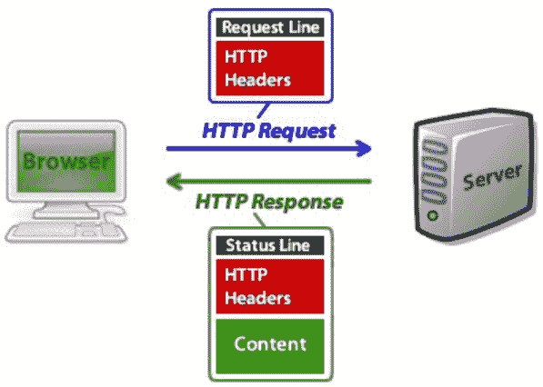

# Go Web Apps 构建指南


## 简介

欢迎阅读 **用 Go 构建 Web 应用**！如果你正在阅读本文，那么你已经刚刚开始从新手到专家的旅程了。说真的，用 Go 进行 Web 编程非常有趣且简单，以至于你甚至不会意识到在过程中学到了多少信息！

请记住，本书仍有部分需要完善和完善。开源出版的美妙之处在于，我可以给你一本不完整的书，但它对你仍然有价值。

在进入所有细节之前，让我们先从一些基本规则开始：

## 前置条件

为了使本教程简洁且专注，我假设你已按以下方式做好准备：

- 1. 你已安装 Go 编程语言。
- 2. 你已通过遵循 [如何编写 Go 代码](https://golang.org/doc/code.html) 教程设置了 `GOPATH`。
- 3. 你对 Go 的基础知识 somewhat 熟悉。（[Go 之旅](https://tour.golang.org/) 是一个不错的起点）
- 4. 你已安装所有 [所需包](#所需包)
- 5. 你已安装 [Heroku 工具带](https://toolbelt.heroku.com/)
- 6. 你拥有一个 [Heroku 账户](https://www.heroku.com/)

## 所需包

大部分情况下，我们将使用标准库中的内置包来构建 Web 应用。某些课程，例如数据库、中间件和 URL 路由，将需要第三方包。以下是开始前需要安装的所有 Go 包列表：

| 名称 | 导入路径 | 描述 |
|---|---|---|
| httprouter | github.com/julienschmidt/httprouter | 一款高性能的 HTTP 请求路由器，扩展性良好 |
| Negroni | github.com/codegangsta/negroni | 符合习惯的 HTTP 中间件 |
| Black Friday | github.com/russross/blackfriday | 一个 Markdown 处理器 |
| Render | gopkg.in/unrolled/render.v1 | 用于 JSON、XML 和 HTML 的轻松渲染 |
| SQLite3 | github.com/mattn/go-sqlite3 | 用于 Go 的 sqlite3 驱动程序 |

你可以通过在控制台中运行以下命令来安装（或更新）这些包

```
go get -u <import_path>
```

例如，如果你希望安装 Negroni，则运行以下命令：

```
go get -u github.com/codegangsta/negroni
```

## Go 让事物变简单

如果你以前构建过 Web 应用程序，你肯定知道需要记住相当多的概念。HTTP、HTML、CSS、JSON、数据库、会话、Cookie、表单、中间件、路由和控制器只是你的 Web 应用 *可能* 需要交互的众多事物中的几个。

虽然每一件事 *在构建 Web 应用程序时都可能很重要*，但并非每一件事 *对任何给定应用都重要*。例如，Web API 可能仅使用 JSON 作为其序列化格式，因此 HTML 等概念对于该特定 Web 应用不相关。

### Go 的方式

Go 社区理解这一困境。Go 程序员不依赖试图全面覆盖的大型沉重框架，而是只引入完成工作所需的最基本要素。这种对 Web 编程的极简主义方法起初可能令人却步，但最终结果是一个更简单的程序。

**Go 让事物变简单**，就这么简单。如果我们训练自己与用于 Web 编程的“Go 方式”保持一致，我们最终将获得更多 **简单**、**灵活**，和 **可维护** 的 Web 应用程序。

### 简洁中的力量

在阅读本书的练习过程中，我认为你会惊讶于这些程序可以多么简单，同时仍然提供大量功能。

在着手使用 Go 构建自己的 Web 应用程序时，要仔细考虑你的应用程序将关注的组件和概念，并且只使用这些部分。本书将涵盖广泛的 Web 主题，但你不必感到有义务全部使用。正如我们的朋友 Lonestar 所说，“只拿生存所需”。


### net/http 包

你可能已经听说过 Go 构建各种形状和大小的 Web 应用程序非常出色。这部分归功于为使标准库保持简洁、一致且易于使用所做的出色工作。

也许，对任何有志成为 Go Web 开发者的人来说，最重要的包之一就是 net/http 包。该包允许你使用其强大的组合构造在 Go 中构建 HTTP 服务器。在开始编码之前，让我们快速概述一下 HTTP。

### HTTP 基础

当我们谈论构建 Web 应用程序时，通常是指构建 HTTP 服务器。HTTP 是一种最初设计用于将 HTML 文档从服务器传输到客户端 Web 浏览器的协议。今天，HTTP 用于传输远比 HTML 多得多的内容。



需要注意这个图表中的重要一点是 Server 和 浏览器之间的两个交互点。浏览器带着一些信息发出 HTTP 请求，然后服务器处理该请求并返回一个响应。

这种请求-响应模式是在 Go 中构建 Web 应用程序的关键焦点之一。事实上，net/http 包最重要的部分是 http.Handler 接口。

### http.Handler 接口

随着你对 Go 越来越熟悉，你会注意到接口对程序设计的影响有多大。net/http 接口在一个方法中封装了请求-响应模式：

```
type Handler interface {
	ServeHTTP(ResponseWriter, *Request)
}
```

实现此接口的对象被期望检查和处理来自 http.Request 对象的数据，并将响应写入 http.ResponseWriter 对象。

http.ResponseWriter 接口如下所示：

```
type ResponseWriter interface {
	Header() Header
	Write([]byte) (int, error)
	WriteHeader(int)
}
```

### 组合 Web 服务

因为 net/http 包的大部分是基于定义良好的接口类型构建的，我们可以（并且应该）以组合为中心构建我们的 Web 应用程序。每个 http.Handler 实现都可以被视为其自己的 Web 服务器。

在这个简单但强大的假设中可以找到许多模式。在整本书中，我们将介绍其中的一些模式以及如何使用它们来解决现实世界的问题。

### 练习：一行文件服务器

让我们用 1 行代码解决一个现实世界的问题。

大多数时候，人们只需要提供静态文件。也许你有一个静态 HTML 登录页面，只想提供一些 HTML、图片和 CSS 然后就完事了。当然，你可以引入 Apache 或 Python 的 SimpleHTTPServer，但 Apache 对这个小站来说太重了，而 SimpleHTTPServer well, 太慢了。

我们将首先在 GOPATH 中创建一个新项目。

```
cd GOPATH/src
mkdir fileserver && cd fileserver
```

使用典型的 Go 样板代码创建一个 **main.go**。

```
package main

import "net/http"

func main() {
}
```

我们只需要导入 **net/http** 包即可使其工作。请记住，这都是 Go 标准库的一部分。

让我们编写我们的文件服务器代码：

```
http.ListenAndServe(":8080", http.FileServer(http.Dir(".")))
```

**http.ListenAndServe** 函数用于启动服务器，它将绑定到我们给它的地址（`:8080`），当它接收到 HTTP 请求时，会将其交给作为第二个参数提供的 **http.Handler**。在我们的例子中，它是内置的 **http.FileServer**。

**http.FileServer** 函数构建一个 **http.Handler**，它将提供整个目录的文件，并根据请求路径确定提供哪个文件。我们使用 **http.Dir(".")** 告诉 FileServer 提供当前工作目录。

完整的程序如下所示：

```
package main

import "net/http"

func main() {
	http.ListenAndServe(":8080", http.FileServer(http.Dir(".")))
}
```


## 让我们构建并运行我们的文件服务器程序

```
go build
./fileserver
```

如果我们访问 `localhost:8080/main.go`，应该能在网页浏览器中看到我们的 **main.go** 文件的内容。我们可以从任何目录运行此程序，并将目录树作为静态文件服务器提供。全部只需 1 行 Go 代码。

## 创建一个基本 Web 应用

现在我们已经学习完 HTTP 的基础知识，让我们在 Go 中创建一个简单但有用的 Web 应用程序。

借用上一章实现的文件服务器程序，我们将使用 github.com/russross/blackfriday 包实现一个 Markdown 生成器。

### HTML 表单

首先，我们需要一个用于 Markdown 输入的基本 HTML 表单：

```html
<html>
<head>
<link href="//css/bootstrap.min.css" rel="stylesheet">
</head>
<body>
<div class="container">
<div class="page-title">
<h1>Markdown Generator</h1>
<p class="lead">Generate your markdown with Go</p>
<hr />
</div>

<form action="/markdown" method="POST">
<div class="form-group">
<textarea class="form-control" name="body" cols="30" rows="10"></textarea>
</div>

<div class="form-group">
<input type="submit" class="btn btn-primary pull-right" />
</div>
</form>
</div>
<script src="//js/bootstrap.min.js"></script>
</body>
</html>
```

将此 HTML 放入应用程序 "public" 文件夹中名为 index.html 的文件，并将 http://getbootstrap.com/ 中的 bootstrap.min.css 放入 "public/css" 文件夹。请注意，该表单向我们的应用程序的 "/markdown" 端点发送 HTTP POST 请求。我们目前并未实际处理该路由，因此让我们添加它。

### "/markdown" 路由

处理 '/markdown' 路由并提供公共 `index.html` 文件的程序如下：

```go
package main

import (
	"net/http"

	"github.com/russross/blackfriday"
)

func main() {
	http.HandleFunc("/markdown", GenerateMarkdown)
	http.Handle("/", http.FileServer(http.Dir("public")))
	http.ListenAndServe(":8080", nil)
}

func GenerateMarkdown(rw http.ResponseWriter, r *http.Request) {
	markdown := blackfriday.MarkdownCommon([]byte(r.FormValue("body")))
	rw.Write(markdown)
}
```

让我们将其拆分成更小的部分，以便更好地理解正在发生的事情。

```go
http.HandleFunc("/markdown", GenerateMarkdown)
http.Handle("/", http.FileServer(http.Dir("public")))
```

我们正在使用 `http.HandleFunc` 和 `http.Handle` 方法为我们的应用程序定义一些简单的路由。重要的是要注意，在 "/" 模式上调用 `http.Handle` 会充当捕获所有路由，因此我们最后定义该路由。`http.FileServer` 返回一个 `http.Handler`，因此我们使用 `http.Handle` 将模式字符串映射到处理程序。替代方法 `http.HandleFunc` 使用 `http.HandlerFunc` 而不是 `http.Handler`。这可能更方便，可以通过函数而不是对象来考虑路由处理。

```go
func GenerateMarkdown(rw http.ResponseWriter, r *http.Request) {
	markdown := blackfriday.MarkdownCommon([]byte(r.FormValue("body")))
	rw.Write(markdown)
}
```

我们的 GenerateMarkdown 函数实现了标准 `http.HandlerFunc` 接口，并从包含 Markdown 格式文本的表单字段呈现 HTML。在此情况下，内容是通过 `r.FormValue("body")` 检索的。从 `http.HandlerFunc` 接收的 `http.Request` 对象获取输入非常常见。输入的其他示例包括 `r.Header`、`r.Body` 和 `r.URL` 成员。

我们通过将响应写入我们的 `http.ResponseWriter` 来完成请求。请注意，我们没有显式发送响应代码。如果不带代码写出响应，`net/http` 包将假设响应为 `200 OK`。这意味着如果发生了什么问题，我们应该通过 `rw.WriteHeader()` 方法设置响应代码。

```go
http.ListenAndServe(":8080", nil)
```

程序的最后部分启动服务器，我们传入 `nil` 作为处理程序，这假设 HTTP 请求将由 `net/http` 包的默认 `http.ServeMux` 处理，该 ServeMux 分别使用 `http.Handle` 和 `http.HandleFunc` 配置。

这就是在 Go 中能够将 Markdown 生成为服务所需的全部内容。考虑到它所做的大量工作，代码量出奇地小。在下一章中，我们将学习如何使用 Heroku 将此应用程序部署到 Web。

## 部署

Heroku 使部署应用程序变得容易。它是中小型 Web 应用程序的理想平台，这些应用程序愿意牺牲一点基础设施灵活性，以换取部署和维护 Web 应用程序的相对无痛环境。

我选择为本教程将我们的 Web 应用程序部署到 Heroku，因为根据我的经验，这是让 Web 应用程序快速运行的最快方式。请记住，本教程的重点是如何在 Go 中构建 Web 应用程序，而不是被配置、部署和维护我们的 Go 代码将运行其上的机器的所有繁琐细节所分散注意力。

### 准备工作

如果您还没有 Heroku 帐户，请在 id.heroku.com/signup 注册。它既快速、简单又免费。

应用程序管理和配置是通过 Heroku 工具带完成的，这是一个由 Heroku 维护的免费命令行工具。我们将使用它在 Heroku 上创建我们的应用程序。您可以从 toolbelt.heroku.com 获取它。

### 修改代码

为确保我们上一章的应用程序能在 Heroku 上运行，我们需要做一些更改。Heroku 为我们提供一个 `PORT` 环境变量，并期望我们的 Web 应用程序绑定到它。让我们先导入 "os" 包，以便我们可以获取该 `PORT` 环境变量：

```go
import (
	"net/http"
	"os"

	"github.com/russross/blackfriday"
)
```

接下来，我们需要获取 `PORT` 环境变量，检查它是否已设置，如果已设置，我们应该绑定到它，而不是我们的硬编码端口 (8080)。

```go
port := os.Getenv("PORT")
if port == "" {
    port = "8080"
}
```

最后，我们想在 `http.ListenAndServe` 调用中绑定到该端口：

```go
http.ListenAndServe(":"+port, nil)
```

最终代码如下：

```go
package main

import (
    "net/http"
    "os"

    "github.com/russross/blackfriday"
)

func main() {
    port := os.Getenv("PORT")
    if port == "" {
        port = "8080"
    }

    http.HandleFunc("/markdown", GenerateMarkdown)
    http.Handle("/", http.FileServer(http.Dir("public")))
    http.ListenAndServe(":"+port, nil)
}

func GenerateMarkdown(rw http.ResponseWriter, r *http.Request) {
    markdown := blackfriday.MarkdownCommon([]byte(r.FormValue("body")))
    rw.Write(markdown)
}
```

### 配置

我们需要几个小配置文件来告诉 Heroku 如何运行我们的应用程序。第一个是 `Procfile`，它允许我们定义为应用程序运行哪些进程。默认情况下，Go 会将可执行文件命名为主包所在目录的名称。例如，如果我的 Web 应用程序位于 `GOPATH/github.com/codegangsta/bwag/deployment`，我的 `Procfile` 将如下所示：

```
web: deployment
```

专门针对运行 Go 应用程序，我们还需要指定一个 .godir 文件来告诉 Heroku 哪个目录实际上是我们的包目录。

```
deployment
```

### 部署

一旦所有这些准备就绪，Heroku 使部署变得容易。

将项目初始化为 Git 仓库：

```
git init
git add -A
git commit -m "Initial Commit"
```

创建您的 Heroku 应用程序（指定 Go 构建包）：

```
heroku create -b https://github.com/kr/heroku-buildpack-go.git
```

将其推送到 Heroku 并观看您的应用程序部署！

```
git push heroku master
```

在浏览器中查看您的应用程序：

```
heroku open
```

## URL 路由

对于某些简单应用程序，默认 http.ServeMux 已经足够。如果您在解析 URL 端点并将其路由到适当处理程序方面需要更多功能，您可能需要引入第三方路由框架。在本教程中，我们将使用流行的 github.com/julienschmidt/httprouter 库作为我们的路由器。

github.com/julienschmidt/httprouter 是一个绝佳的路由器选择，因为它是一个非常简单的实现，在所有第三方 Go 路由器中拥有最佳的性能基准之一。

在此示例中，我们将为名为 "posts" 的 RESTful 资源创建一些路由。下面我们定义了查看索引、显示、创建、更新、销毁和编辑帖子的机制。

```go
package main

import (
	"fmt"
	"net/http"

	"github.com/julienschmidt/httprouter"
)

func main() {
	r := httprouter.New()
	r.GET("/", HomeHandler)

	// Posts collection
	r.GET("/posts", PostsIndexHandler)
	r.POST("/posts", PostsCreateHandler)

	// Posts singular
	r.GET("/posts/:id", PostShowHandler)
	r.PUT("/posts/:id", PostUpdateHandler)
	r.GET("/posts/:id/edit", PostEditHandler)

	fmt.Println("Starting server on :8080")
	http.ListenAndServe(":8080", r)
}

func HomeHandler(rw http.ResponseWriter, r *http.Request, p httprouter.Params) {
	fmt.Fprintln(rw, "Home")
}

func PostsIndexHandler(rw http.ResponseWriter, r *http.Request, p httprouter.Params) {
	fmt.Fprintln(rw, "posts index")
}
```


```go
func PostsCreateHandler(rw http.ResponseWriter, r *http.Request, p httprouter.Params) {
	fmt.Fprintln(rw, "posts create")
}

func PostShowHandler(rw http.ResponseWriter, r *http.Request, p httprouter.Params) {
	id := p.ByName("id")
	fmt.Fprintln(rw, "showing post", id)
}

func PostUpdateHandler(rw http.ResponseWriter, r *http.Request, p httprouter.Params) {
	fmt.Fprintln(rw, "post update")
}

func PostDeleteHandler(rw http.ResponseWriter, r *http.Request, p httprouter.Params) {
	fmt.Fprintln(rw, "post delete")
}

func PostEditHandler(rw http.ResponseWriter, r *http.Request, p httprouter.Params) {
	fmt.Fprintln(rw, "post edit")
}
```

### 练习

- 1. 探索 `github.com/julienschmidt/httprouter` 的文档。
- 2. 了解 `github.com/julienschmidt/httprouter` 与现有 `http.Handler`（如 `http.FileServer`）的配合情况。
- 3. `httprouter` 具有非常简单的接口。探索可以在这个快速路由器之上构建什么样的抽象，以便更轻松地构建类似 RESTful 路由的功能。

## 中间件

如果您有一些代码需要对每个请求都运行，无论它最终会调用哪个路由，您都需要一种方式将 `http.Handler` 堆叠在一起并按顺序运行。这个问题通过中间件包得到了优雅的解决。Negroni 是一个流行的中间件包，它使构建和堆叠中间件变得非常容易，同时保持了 Go Web 生态系统的可组合性。

Negroni 自带一些默认中间件，例如日志记录、错误恢复和静态文件服务。因此，开箱即用，Negroni 将在不带来太多开销的情况下为您提供很大价值。

下面的示例展示了如何将 Negroni 堆栈与内置中间件一起使用，以及如何创建自定义中间件。

```go
package main

import (
	"log"
	"net/http"

	"github.com/codegangsta/negroni"
)

func main() {
	// Middleware stack
	n := negroni.New(
		negroni.NewRecovery(),
		negroni.HandlerFunc(MyMiddleware),
		negroni.NewLogger(),
		negroni.NewStatic(http.Dir("public")),
	)

	n.Run(":8080")
}

func MyMiddleware(rw http.ResponseWriter, r *http.Request, next http.HandlerFunc) {
	log.Println("Logging on the way there...")

	if r.URL.Query().Get("password") == "secret123" {
		next(rw, r)
	} else {
		http.Error(rw, "Not Authorized", 401)
	}

	log.Println("Logging on the way back...")
}
```

### 练习

- 1. 思考一些很酷的中间件想法，并尝试使用 Negroni 实现它们。
- 2. 探索如何使用 `http.Handler` 接口将 Negroni 与 github.com/gorilla/mux 组合。
- 3. 尝试为某些路由组而不是整个应用程序创建 Negroni 堆栈。

## 渲染

渲染是从应用程序或数据库中获取数据并将其呈现给客户端的过程。客户端可以是渲染 HTML 的浏览器，也可以是另一个将 JSON 作为其序列化格式的应用程序。在本章中，我们将学习如何使用 Go 标准库提供的方法来渲染这两种格式。

### JSON

JSON 正在迅速成为 Web API 的通用序列化格式，因此在学习如何使用 Go 构建 Web 应用程序时，它可能是最相关的格式。幸运的是，Go 使处理 JSON 变得简单——使用标准库中的 `encoding/json` 包，将现有 Go 结构体转换为 JSON 非常容易。

```go
package main

import (
	"encoding/json"
	"net/http"
)

type Book struct {
	Title string `json:"title"`
	Author string `json:"author"`
}

func main() {
	http.HandleFunc("/", ShowBooks)
	http.ListenAndServe(":8080", nil)
}

func ShowBooks(w http.ResponseWriter, r *http.Request) {
	book := Book{"Building Web Apps with Go", "Jeremy Saenz"}

	js, err := json.Marshal(book)
	if err != nil {
		http.Error(w, err.Error(), http.StatusInternalServerError)
		return
	}

	w.Header().Set("Content-Type", "application/json")
	w.Write(js)
}
```

### 练习

- 1. 阅读 JSON API 文档，了解如何为 JSON 序列化重命名和忽略字段。
- 2. 尝试使用 `json.Encoder` API，而不是使用 `json.Marshal` 方法。
- 3. 了解如何使用 `encoding/json` 包美化打印 JSON。

### HTML 模板

提供 HTML 是某些 Web 应用程序的重要工作。Go 拥有迄今为止我最喜欢的模板语言之一。不是因为它的功能，而是因为它的简单性和开箱即用的安全性。使用标准库中的 `html/template` 包渲染 HTML 模板几乎和渲染 JSON 一样容易。以下是渲染 HTML 模板的源代码示例：

```go
package main

import (
	"html/template"
	"net/http"
	"path"
)

type Book struct {
	Title string
	Author string
}

func main() {
	http.HandleFunc("/", ShowBooks)
	http.ListenAndServe(":8080", nil)
}

func ShowBooks(w http.ResponseWriter, r *http.Request) {
	book := Book{"Building Web Apps with Go", "Jeremy Saenz"}

	fp := path.Join("templates", "index.html")
	tmpl, err := template.ParseFiles(fp)
	if err != nil {
		http.Error(w, err.Error(), http.StatusInternalServerError)
		return
	}

	if err := tmpl.Execute(w, book); err != nil {
		http.Error(w, err.Error(), http.StatusInternalServerError)
	}
}
```

这是我们将使用的模板。它应该放在程序运行目录中的 `templates/index.html` 文件里：

```html
<html>
<h1>{{ .Title }}</h1>
<h3>by {{ .Author }}</h3>
</html>
```

### 练习

- 1. 浏览 `text/template` 和 `html/template` 包的文档。尝试使用模板语言，以了解其目标、优势和劣势。
- 2. 在示例中，我们在每个请求时都解析文件，这可能会带来大量性能开销。尝试在程序开始时解析文件，并在 `http.Handler` 中执行它们（提示：使用 `html.Template` 上的 `Copy()` 方法）。
- 3. 尝试解析和使用多个模板。

### 使用 render 包

如果您希望渲染 JSON 和 HTML 更简单，可以使用 github.com/unrolled/render 包。这个包受 martini-contrib/render 包的启发，是我用于在 Web 应用程序中呈现数据的首选。

```go
package main

import (
	"net/http"

	"gopkg.in/unrolled/render.v1"
)

func main() {
	r := render.New(render.Options{})
	mux := http.NewServeMux()

	mux.HandleFunc("/", func(w http.ResponseWriter, req *http.Request) {
		w.Write([]byte("Welcome, visit sub pages now."))
	})

	mux.HandleFunc("/data", func(w http.ResponseWriter, req *http.Request) {
		r.Data(w, http.StatusOK, []byte("Some binary data here."))
	})

	mux.HandleFunc("/json", func(w http.ResponseWriter, req *http.Request) {
		r.JSON(w, http.StatusOK, map[string]string{"hello": "json"})
	})

	mux.HandleFunc("/html", func(w http.ResponseWriter, req *http.Request) {
		// Assumes you have a template in .templates called "example.tmpl"
		// $ mkdir -p templates & echo "<h1>Hello {{.}}</h1>" > templates/example.tmpl
		r.HTML(w, http.StatusOK, "example", nil)
	})

	http.ListenAndServe(":8080", mux)
}
```

### 练习

- 1. 在调用 `render.New()` 时尝试所有可用的选项，玩得开心。
- 2. 尝试使用 `.yield` 辅助函数（带大括号）和 HTML 模板的布局。

## 测试

测试是任何应用程序的重要组成部分。我们可以采用两种方法来测试 Go Web 应用程序。第一种方法是单元测试风格的方法。另一种方法更多的是端到端的方法。在本章中，我们将介绍这两种方法。

### 单元测试

单元测试允许我们直接测试 `http.HandlerFunc`，而无需运行任何中间件、路由器或可能包装该函数的其他类型代码。

```go
package main

import (
	"fmt"
	"net/http"
)

func HelloWorld(res http.ResponseWriter, req *http.Request) {
	fmt.Fprint(res, "Hello World")
}

func main() {
	http.HandleFunc("/", HelloWorld)
	http.ListenAndServe(":3000", nil)
}

```

这是测试文件。它应该与您的应用程序放在同一目录中，并命名为 `main_test.go`。


```go
package main

import (
	"net/http"
	"net/http/httptest"
	"testing"
)

func Test_HelloWorld(t *testing.T) {
	req, err := http.NewRequest("GET", "http://example.com/foo", nil)
	if err != nil {
		t.Fatal(err)
	}

	res := httptest.NewRecorder()
	HelloWorld(res, req)

	exp := "Hello World"
	act := res.Body.String()
	if exp != act {
		t.Fatalf("Expected %s got %s", exp, act)
	}
}
```

### 练习

- 1. 修改 `HelloWorld` 的输出以打印一个参数，然后测试该参数是否被正确呈现。
- 2. 创建一个 POST 请求并测试请求是否被正确处理。

### 端到端测试

端到端测试允许我们通过整个请求周期来测试应用程序。与单元测试仅用于测试特定函数不同，端到端测试将运行请求可能经过的中间件、路由器和其他组件。

```go
package main

import (
	"fmt"
	"net/http"

	"github.com/codegangsta/negroni"
	"github.com/julienschmidt/httprouter"
)

func HelloWorld(res http.ResponseWriter, req *http.Request, p httprouter.Params) {
	fmt.Fprint(res, "Hello World")
}

func App() http.Handler {
	n := negroni.Classic()

	m := func(res http.ResponseWriter, req *http.Request, next http.HandlerFunc) {
		fmt.Fprint(res, "Before...")
		next(res, req)
		fmt.Fprint(res, "...After")
	}

	n.Use(negroni.HandlerFunc(m))

	r := httprouter.New()
	r.GET("/", HelloWorld)
	n.UseHandler(r)
	return n
}

func main() {
	http.ListenAndServe(":3000", App())
}
```

这是测试文件。它应该与您的应用程序放在同一目录中，并命名为 main_test.go。

### 练习

- 1. 创建另一个可更改请求状态的中间件。
- 2. 创建一个 POST 请求并测试请求是否被正确处理。

## 控制器

控制器在其他 Web 开发社区中是一个相当熟悉的话题。由于大多数 Web 开发人员都围绕强大的 net/http 接口聚集，因此并非许多控制器实现都广受欢迎。然而，使用控制器模式有很大好处。它允许在 net/http 处理器接口所能单独提供的基础上，构建清晰、定义良好的抽象。

### 处理器依赖

在此示例中，我们将尝试使用 Go 中的一些标准特性来构建自己的控制器实现。但首先，让我们先从我们试图解决的问题开始。假设我们正在使用之前章节中讨论过的 `render` 库：

```
var Render = render.New(render.Options{})
```

如果我们希望我们的 `http.Handler` 可以访问我们的 `render.Render` 实例，我们有几种选择。

- 1. 使用全局变量：这对小型程序来说还不错，但当程序变大时，它会迅速成为维护噩梦。
- 2. 通过闭包将变量传递给 `http.Handler`：这是一个好主意，我们大多数时候都应该使用它。实现最终看起来像这样：

```
func MyHandler(r *render.Render) http.Handler {
	return http.HandlerFunc(func(rw http.ResponseWriter, r *http.Request) {
		// now we can access r
	})
}
```

### 控制器的理由

当您的程序变大时，您会开始注意到许多 `http.Handler` 将共享相同的依赖项，并且会有许多具有相同参数的这些经过闭包处理的 `http.Handler`。我喜欢通过编写一个小型基础控制器实现来清理这一点，这给我带来了几个好处：

- 1. 允许我在具有相似目标或概念的 `http.Handler` 之间共享依赖项。
- 2. 避免使用全局变量和函数，以便于测试/模拟。
- 3. 为我提供一种更集中、更符合 Go 风格的错误处理机制。

控制器的好处在于，它们无需导入外部包就能为我们提供所有这些功能！其中大部分功能来自于对 Go 特性集的巧妙利用，即 Go 结构体和嵌入。让我们来看看实现。

```
package main

import "net/http"

// Action defines a standard function signature for us to use when creating
// controller actions. A controller action is basically just a method attached to
// a controller.
type Action func(rw http.ResponseWriter, r *http.Request) error

// This is our Base Controller
type AppController struct{}

// The action function helps with error handling in a controller
func (c *AppController) Action(a Action) http.Handler {
	return http.HandlerFunc(func(rw http.ResponseWriter, r *http.Request) {
		if err := a(rw, r); err != nil {
			http.Error(rw, err.Error(), 500)
		}
	})
}
```

就这样！这就是我们拥有控制器强大功能所需的全部实现。我们剩下要做的就是实现一个示例控制器：

```
package main

import (
    "net/http"

    "gopkg.in/unrolled/render.v1"
)

type MyController struct {
    AppController
    *render.Render
}

func (c *MyController) Index(rw http.ResponseWriter, r *http.Request) error {
    c.JSON(rw, 200, map[string]string{"Hello": "JSON"})
    return nil
}

func main() {
    c := &MyController{Render: render.New(render.Options{})}
    http.ListenAndServe(":8080", c.Action(c.Index))
}
```

### 练习

- 1. 扩展 MyController，为应用程序中的不同路由添加多个操作。
- 2. 尝试更多控制器实现，发挥创造力。
- 3. 重写 MyController 上的 Action 方法以呈现错误 HTML 页面。

## 数据库

关于 Go Web 开发，我被问得最多的问题之一是如何连接到 SQL 数据库。幸运的是，Go 的标准库中有一个出色的 SQL 包，允许我们使用大量针对不同 SQL 数据库的驱动程序。在此示例中，我们将连接到 SQLite 数据库，但语法（除去一些微小的 SQL 语义）对于 MySQL 或 PostgreSQL 数据库也是相同的。

```
package main

import (
	"database/sql"
	"fmt"
	"log"
	"net/http"

	_ "github.com/mattn/go-sqlite3"
)

func main() {
	db := NewDB()
	log.Println("Listening on :8080")
	http.ListenAndServe(":8080", ShowBooks(db))
}

func ShowBooks(db *sql.DB) http.Handler {
	return http.HandlerFunc(func(rw http.ResponseWriter, r *http.Request) {
		var title, author string
		err := db.QueryRow("select title, author from books").Scan(&title, &author)
		if err != nil {
			panic(err)
		}

		fmt.Fprintf(rw, "The first book is '%s' by '%s'", title, author)
	})
}

func NewDB() *sql.DB {
	db, err := sql.Open("sqlite3", "example.sqlite")
	if err != nil {
		panic(err)
	}

	_, err = db.Exec("create table if not exists books(title text, author text)")
	if err != nil {
		panic(err)
	}

	return db
}
```

### 练习

- 1. 利用我们 `sql.DB` 实例上的 `query` 函数提取一组行并将其映射到结构体。
- 2. 通过使用 HTML 表单，添加向数据库插入新记录的功能。
- 3. 执行 `go get github.com/jmoiron/sqlx` 并观察相对于标准库中现有 database/sql 包的改进。

## 技巧与窍门

### 包装 http.HandlerFunc 闭包

有时您希望在初始化时向 http.HandlerFunc 传递数据。这可以通过创建 `http.HandlerFunc` 的闭包来轻松实现：

```go
func MyHandler(database *sql.DB) http.Handler {
	return http.HandlerFunc(func(rw http.ResponseWriter, r *http.Request) {
		// you now have access to the *sql.DB here
	})
}
```

### 使用 gorilla/context 处理请求特定数据

我们经常需要存储和检索特定于当前 HTTP 请求的数据。使用 `gorilla/context` 来映射值并稍后检索它们。它包含一个对请求对象映射的全局互斥锁。

```go
func MyHandler(w http.ResponseWriter, r *http.Request) {
	val := context.Get(r, "myKey")

	// returns ("bar", true)
	val, ok := context.GetOk(r, "myKey")

	// ...
}
```


## 继续前进

你已经做到了！你已经初步了解了 Go Web 开发的工具和库。在撰写本书时，本书仍在不断完善中。本章节保留用于更多的 Go Web 资源，以供你继续学习。
