# 商业数据科学：结合机器学习与经济学优化、自动化与加速商业决策


### 关于《商业数据科学》的赞誉

马特·塔迪撰写了一本关于支撑大数据应用的统计学的详尽且深思熟虑的书籍。这是一份出色的资源，充满了实际应用、技巧和洞察。与大多数机器学习教材不同，本书提供了从数据中提取可靠理解的方法，并解决了相关性不等于因果性的问题。

— 普雷斯顿·麦卡菲 (PRESTON McCAFFEE)，前微软首席经济学家兼公司副总裁；雅虎首席经济学家副总裁；谷歌研究总监；加州理工学院教授兼行政官员

凭借他在芝加哥布斯商学院作为明星教师的经验，以及在微软和亚马逊领导数据科学团队的工作经历，马特·塔迪为那些希望参与现代公司数据驱动决策流程的 MBA 学生和工程师撰写了一本杰作。他将现代统计学、机器学习算法和社会科学因果模型的关键概念巧妙地编织成一幅多彩的画面，写了一本高度通俗易懂的教材，让任何人都能看到这一切 buzz 的本质。它很可能成为这一领域的标准教材。

— 圭多·艾姆本斯 (GUIDO IMBENS)，斯坦福大学商学院经济学教授，《因果推断：统计学、社会科学和生物医学科学》的共同作者

《商业数据科学》在拥挤的数据科学教科书领域中脱颖而出。它将来自历史上不同学科的主题结合在一起，以应对一个基本的商业现实：准确的预测本身并不是目的，而是采取高质量行动的途径。塔迪的表述清晰易读，且未牺牲精确性。它涵盖了预测、因果和决策的最新状态，无需强大的数据科学背景。我推荐给任何希望将这些想法付诸实践的人。

— 乔恩·麦克奥菲 (JON MCAULIFFE)，The Voleon Group 联合创始人兼首席投资官

马特·塔迪是我见过的最好的老师之一；这种清晰传达重要思想的能力在这本书中熠熠生辉。没有人比他更擅长结合计算机科学、经济学和统计学的见解来改进企业对其数据的使用。每个人都应该读这本书。

— 延斯·路德维希 (JENS LUDWIG)，芝加哥大学社会服务管理、法律与公共政策麦科米克基金会教授，犯罪实验室主任

我近年来读过的最令人兴奋的数据科学书籍：与时俱进、现代、易懂、严谨——而且很棒。

— 迪尔克·埃德尔布特尔 (DIRK EDDELBUETTTEL)，量化分析师，R 包作者，伊利诺伊大学厄本纳-香槟分校统计学临床教授

这本书应该是所有对数据分析如何促进更好决策的人的必读书。

— 艾米丽·奥斯特尔 (EMILY OSTER)，布朗大学经济学教授，《期望更好》和《Crisbsheet》的作者

马特·塔迪拥有理解并解释数据科学中复杂思想的美好方式。很高兴看到他的观点通过这本书向所有人开放。

— 杰西·谢尔波 (JESSE SHAIRPO)，布朗大学乔治·S·和南希·B·帕克经济学教授

《商业数据科学》解释了对于解决现代商业中的数据问题重要的数学理论和实用方法。马特·塔迪是数据科学的世界领导者，并且拥有罕见的视角。他的书既反映了他严谨的学术观点，也体现了实际商业经验的智慧。

— 大卫·布莱 (DAVID BLEI)，哥伦比亚大学计算机科学和统计学教授

---

*致 Kirsty、Amelia 和 Charlie。*

## 前言

### 这本书是关于什么的？

在过去十年里，业务分析行业被一种新的做事方式所颠覆。Excel 电子表格模型和透视表正被 R、Scala 和 Python 等语言的代码脚本所取代。过去需要大批业务分析师才能完成的任务，如今已由应用科学家和软件开发工程师实现自动化。这种现代版业务分析的承诺在于，企业领导者能够深入探究其运营和客户行为的每一个细节。他们可以利用机器学习工具，不仅追踪已经发生的情况，还能预测企业的未来。

这场革命由大数据的兴起所驱动——具体来说，是指互联网时代被追踪的数字化信息的大规模增长，以及便于存储和分析这些数据的工程系统的开发。此外，跨学科领域也出现了知识上的融合——机器学习与计算机科学、现代计算与贝叶斯统计学、以及数据驱动的社会科学与经济学——这提高了各地应用分析的广度和质量。机器学习专家教会了我们如何自动化和规模化，经济学家带来了因果和结构建模的工具，而统计学家则确保每个人都记得要追踪不确定性。

“数据科学”一词被用来标记这个不断变化、定义模糊、跨学科领域的标签。与许多新领域一样，数据科学经历了一段过度炒作的时期，大量人群将自己重新品牌为数据科学家。该术语被用来指代任何与数据略有相关的事物。事实上，我在本书中使用“数据科学”这一术语时有些犹豫，因为它的使用极不一致。然而，在专业业务分析的领域内，我们见证了足够多关于什么有效、什么无效的案例，使得数据科学作为现代、科学、可扩展的数据分析方法具有了真正的意义。业务数据科学已成为世界领先企业和商学院数据分析的新标准。

本书旨在为那些希望获得在高度数据驱动型企业中作为数据科学家运作的技能的人士提供入门指导。他们将能够识别对业务策略重要的变量，运行实验以测量这些变量，并从社交媒体中挖掘关于公众对政策变化反应的信息。他们可以将推荐系统中的微小变化与客户体验的变化联系起来，并利用这些信息来估计需求曲线。他们需要做所有这些事情，将其扩展到公司级数据，并精确解释他们对自己结论的不确定性程度。

这些超级分析师将使用统计学、经济学和机器学习的工具来实现他们的目标。他们需要采纳数据工程师的工作流，组织端到端的分析，以拉取和聚合所需数据，并编写可在新数据到达时自动重复的例行程序。而且，他们需要带着对所测量内容及其与业务决策相关性的意识来完成所有这些事情。这不是一本关于机器学习、经济学或统计学*其中一门*的书，也不是对数据科学整体的综述。相反，本书从所有这些领域汲取养分，构建业务数据科学的工具集。

这种数据科学紧密集成于业务决策过程中。早期的“预测分析”（业务数据科学的前身）往往过度强调那些与做出业务决策所需的输入脱节的、炫耀性的机器学习演示。检测历史数据中的模式可能是有用的——我们将涵盖许多模式识别主题——但对于更深层业务问题所需的分析，重点在于事物发生*的原因*，而不是已经发生*了什么*。因此，我们将花费时间超越相关性，转向因果分析。本书更接近经济学而非数据科学的主流，这应该有助于你通过工作产生更大的实际影响。

我们无法在此涵盖所有内容。这不是一部数据分析百科全书。事实上，对于持续学习，有许多优秀的书籍涵盖了当代机器学习和数据科学的不同领域。[^1] 相反，这是一份经过精心策划的入门指南，涵盖我认为的业务数据科学的关键要素。我希望你读完本书后，能掌握一套最佳实践，从而对你信任什么、如何使用它以及如何进一步学习充满信心。

我在这一领域工作已超过十年，包括作为一名教授，向 MBA 学生讲授回归（随后是数据挖掘，再后来是大数据）；作为一名研究人员，致力于将机器学习引入社会科学；以及作为一些大型且令人兴奋的科技公司顾问和员工。在这段时间里，我观察到一个通才群体的增长，他们既能理解业务问题，又能深入（大型）数据并运行自己的分析。这些人表现出色，地球上每一家公司都需要更多这样的人才。本书是我试图帮助培养更多这类人才的一次尝试。

本书的目标受众包括希望提升数据科学技能的科学、商业和工程专业人士。由于这是一个全新的领域，很少有大学毕业生拥有数据科学学位。相反，他们从其他领域学习数学、编程和商业，然后需要一条进入数据科学的路径。我最初教授数据科学的经验是在芝加哥大学布斯商学院面对 MBA 学生。我们成功地找到了方法，赋予商业学生深入挖掘大数据所需的技术工具。然而，自那以后，我发现未来业务数据科学家的更大储备位于渴望将其技能应用于有影响力的业务问题的海量科技工作者中。这些人中的许多是科学家：计算机科学家，但也是生物学家、物理学家、气象学家和经济学家。随着机器学习成熟为一门工程学科，越来越多的人是软件开发工程师。

我尝试了一种对这些背景各异的定量专业人士都易于理解的解释方式，只要他们在基础数学方面有扎实的基础，并具备最基础的计算机编程经验即可。在芝加哥教授 MBA 学生和转行者教会我，非专业人士也可以成为非常出色的数据科学家。他们只需要材料被适当呈现。首先，概念需要被简化和统一。相关的数据科学文献是混乱的，分散在学术论文、会议论文集、技术手册和博客中。对于新手来说，它看起来完全是不连贯的，特别是由于编写这些材料的人有动机让每一篇贡献看起来都“完全新颖”。但是，好的工具之所以有效是有简单原因的。成功的商业数据分析只有少数几个稳健的配方。例如，确保你的模型在新数据上预测良好，而不是在你用于拟合模型的数据上。在本书中，我们将尝试识别这些最佳实践，用清晰的术语描述它们，并为每种新方法或应用进行强化。

另一个关键是使材料具体化，通过应用和类比来呈现所有内容。尽可能多地，理论和概念在真实经验方面需要具有直觉性。例如，“正则化”的关键思想是构建优先选择简单模型的算法，并仅根据强数据信号增加复杂性。我们将通过以下方式引入这一概念

[^1] 注：原文脚注编号 1，对应中文通常保留或根据上下文调整，此处保留原意。


类比手机上的降噪功能（或 VHF 无线电中的静噪功能），并说明其在通过浏览器历史记录预测在线消费时的效果。对于某些较为抽象的内容（例如主成分分析），我们将通过多种视角和多个示例来解释相同的概念。主要观点是，虽然这是一本使用数学的书（你必须尽可能多地动手练习这些数学内容），但我们不会把数学当作避免适当解释的拐杖。

最后一个关键点，也是你作为学习者所肩负的责任，在于商业数据科学只能通过实践来学习。这意味着你需要编写代码，在真实且杂乱的数据上运行分析例程。在这本书中，我们将使用 R 语言进行大多数脚本示例。$^{2}$ 代码示例大量穿插在全文中，如果你无法理解这些代码片段，就无法有效地阅读本书。你必须在学习过程中编写自己的代码并运行自己的分析。最简单的做法是专注于改编书中的示例，这些示例可以在书籍网站 taddyLab.com/bds 上找到。

我应该强调，这不是一本学习 R 语言的书。那里有大量的其他优质资源可供学习 R。在芝加哥大学讲授这门课程时，我发现将基本 R 语言的学习与核心分析材料分开是最佳方案，这里我们也遵循这一模式。作为研读本书的先决条件，你应该完成必要的教程和阅读材料，以达到基础水平。然后，你可以通过复制、修改和扩展书中的示例来进一步提升。你不需要成为 R 语言专家来阅读这本书，但你需要能够读懂代码。

因此，这就是本书的主题。这是一本关于如何进行数据科学的书。它将汇集起围绕利用数据帮助现代企业运营的所有令人兴奋的内容。我们将阐述一套来自统计学、机器学习和经济学的核心原则和最佳实践。在“在实践中学习”的过程中，你将处理大量的实际数据分析案例。本书旨在培养科学家、工程师和商业专业人士，使其完全符合标题所承诺的那样，成为商业数据科学家。

Matt Taddy
华盛顿州西雅图

## 一些常见符号的标准用法

| 符号 | 含义 | | 符号 | 含义 |
| :--- | :--- | :--- | :--- | :--- |
| $\le$ | 小于或等于 | | MLE | 最大似然估计 |
| $<$ | 小于 | | OLS | 普通最小二乘法，即线性回归的 MLE |
| $\ll$ | 远小于 | | $n$ | 观测值数量 |
| $=$ | 等于 | | $p$ | 数据维度或随机变量（如 p 值） |
| $\approx$ | 大致等于 | | $y$ | 感兴趣的目标变量 |
| $\propto$ | 正比于 | | $x$ | 回归的输入变量 |
| $\perp$ | 独立于 | | $\beta$ | 线性回归系数 |
| $\mathbb{E}$ | 期望值（平均值） | | $\varepsilon$ | 回归中独立的加性误差 |
| $p(A)$ | A 的概率 | | $\gamma$ | 因果处理效应 |
| $f(x)$ | x 的通用函数 | | $\Sigma$ | 协方差矩阵 |
| $\mathbb{E}[A \mid B]$ | 给定 B 时 A 的期望 | | $\lambda$ | 惩罚权重 |
| $1_{[A]}$ | 指示函数，若 A 成立则为 1，否则为 0 | | $\sum_{i \in S} a_i$ | 集合 S 中 $i$ 对应的 $a_i$ 值之和 |
| $\log(a)$ | 以 e 为底的 a 的对数 | | $\prod_{i=1}^{n} a_i$ | $i$ 从 1 到 n 的 $a_i$ 值之积 |
| $e$ | 欧拉数 $\approx 2.71828$ | | | |
| $df$ | 模型自由度 | | | |
| $lhd$ | 观测数据似然值 | | | |
| $dev$ | 偏差，其中 $dev \propto -2 \log lhd$ | | | |

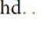

全书中，黑菱形表示更高级且抽象的章节或小节。本书的主要内容不需要理解这些材料。

- 1. 例如，Hastie 等人 [2009] 是最主要的现代统计学参考书，James 等人 [2013] 是从类似视角撰写的较入门的教材，而 Bishop [2006] 和 Murphy [2012] 则是来自机器学习社区的综述文章。

- 2. 参见 www.r-project.org。我们使用 R 语言，因为它是数据科学中最常用的语言之一，拥有许多全面的预置统计学和计量经济学例程，并且对于非计算机专业的读者来说易读易懂。然而，在实践中，商业数据科学家需要能够阅读并进行小范围修改的语言有很多——Python、Julia、SQL，以及靠近原始数据时可能用到的 Scala 或 Java。一个好技巧是精通一种语言（可能是 R），然后在需要时再学习其他语言。


## 引言

### 两张图表的故事

请考虑图 I.1 中的图表。该图展示了标准普尔 500 指数中股票的七个月度收益率$_{1}$。每条虚线代表单个股票的收益率序列。它们的加权平均值——即标准普尔 500 指数——用粗黑线标记。细黑线显示的是三个月期美国国库券的收益率。

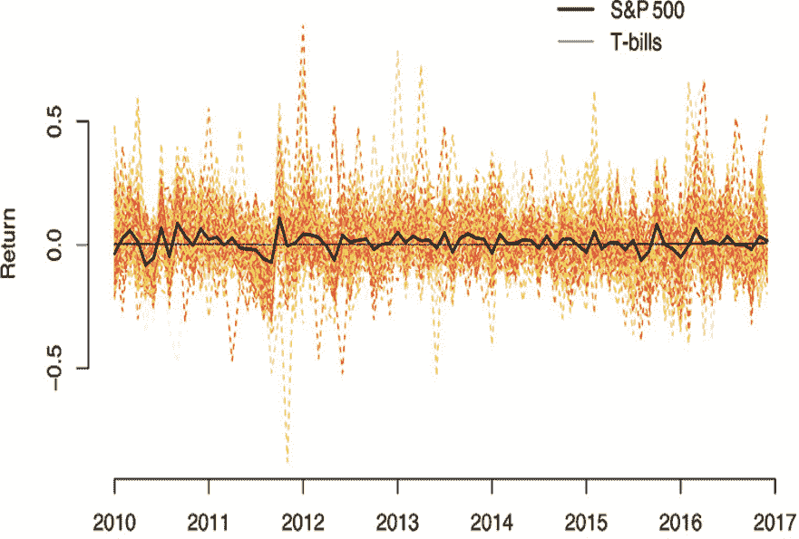

图 I.1：一个精美的图表：标准普尔 500 成员股票的月度收益率及其平均值（粗线）。*你能从中了解到什么？*

这是一个精美的图表。它看起来很酷，包含许多不同的线条。这是你在某个在线经纪平台的电视广告中可能会看到的计算机屏幕上的那种图表。*要是我有那些信息，我就发财了！*

但你实际上能从**图 I.1**中学到什么？你可以看到收益率确实倾向于在零附近波动。$^{2}$你还能挑出波动率（方差）较高的时期，此时标准普尔 500 指数的月度变化更大，周围个股的收益率也更为分散。仅此而已。你无法了解*为什么*这些时期波动性更大，或者它们未来何时会发生。更重要的是，你无法提取出关于任何单个股票的有用信息。图表上有大量的*数据*，但有用的信息很少。

相反，不要绘制原始数据，让我们考虑一个简单的*市场模型*，该模型将个股收益率与市场平均水平联系起来。资本资产定价模型（CAPM）将单个资产的收益率回归到整体市场收益率的衡量指标上：

```
r_{jt} = \alpha_j + \beta_j m_t + \varepsilon_{jt} (I.1)
```

*输出* $r_{jt}$ 是时间 $t$ 时股票 $j$ 的收益率（实际上是超额收益率$^{3}$）。*输入* $m_t$ 是时间 $t$ 时平均收益率——即“市场”——的衡量指标。你可以将 $m_t$ 取为标准普尔 500 指数的收益率，该指数根据公司的市值（其股票总价值）对公司进行加权。最后，$\varepsilon_{jt}$ 是一个*误差*项，其均值为零且与市场不相关：$\mathbf{E}[\varepsilon_{jt}] = 0$ 且 $\mathbf{E}[m_t, \varepsilon_{jt}] = 0$。

方程 I.1 是本书的第一个回归模型。你还会看到更多。这是大多数读者应该熟悉的“简单线性回归”（或普通最小二乘法 [OLS]）。希腊字母定义了将每个个股收益率与市场关联的直线，如图 **I.2** 所示。较小的 $\beta_j$，接近于零，表示该资产对市场敏感度低。在极端情况下，固定收益资产（如国库券）的 $\beta_j = 0$。另一方面，$\beta_j > 1$ 表示该股票比市场更具波动性，通常是成长型和高风险股票。$\alpha_j$ 代表无风险收益：$\alpha_j > 0$ 的资产无论整体市场如何波动都在创造价值，而 $\alpha_j < 0$ 的资产则在毁灭价值。

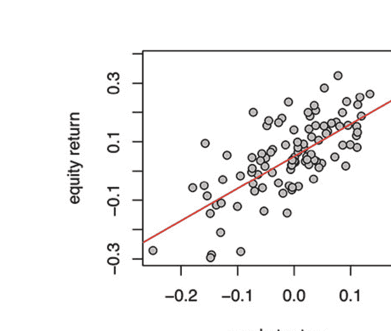

图 I.2：股票收益率与市场收益率的*散点图*，显示了方程 I.1 模型的拟合*回归线*。

图 I.3 在由市场模型对图 I.1 中七年数据进行拟合所暗示的二维空间中，表示了每个股票的“代码”。代码的大小与各公司的市值成正比。两个 CAPM 参数——[$\alpha, \beta$]——告诉我们关于单个资产行为和表现的许多信息。这张图让你能够立即评估市场敏感度和套利机会。例如，在这一时期，亚马逊 (AMZN) 和微软 (MSFT) 的市场敏感度相似，但亚马逊在不依赖整体市场的情况下创造了更多的财富。Facebook (FB) 显示出极低的市场敏感度，同时产生了较大的 $\alpha$。一些老牌的科技巨头，如甲骨文 (ORCL) 和 IBM，似乎在这一时期毁灭了价值（负的 $\alpha$）。这些信息可用于构建投资组合，在不确定未来市场状况下最大化平均收益率并最小化方差。它还可以用于诸如配对交易等策略，即找到两个 $\beta$ 相似的股票，买入 $\alpha$ 较高的那一个，同时卖出（*做空*）另一个。


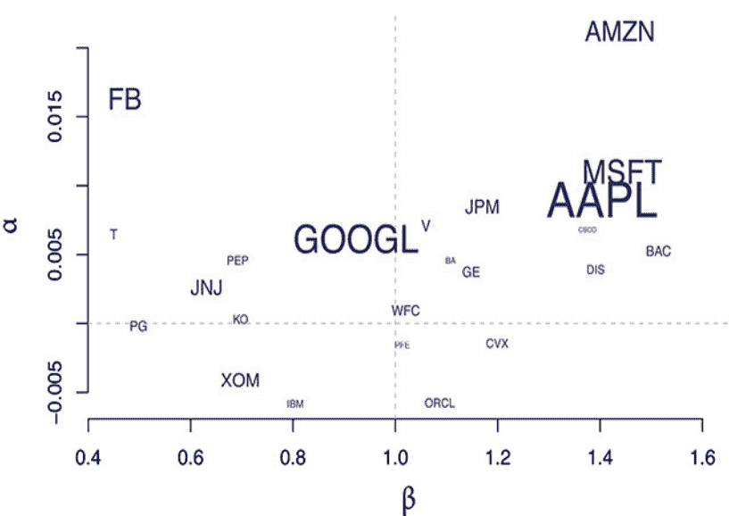

图 1.3：根据拟合的市场模型进行排序的股票，其中 $\alpha$ 代表无论市场如何表现你所获得的收益，而 $\beta$ 概括了你对市场波动的敏感性。图中股票代码的大小与其市值成正比。该图展示了我将在全书中强调的一种信息可视化策略：商业数据科学的核心在于将决策问题提炼为少数几个变量，以便通过几张简单的图表进行比较。

CAPM（资本资产定价模型）是金融分析中的一个古老工具，但它有助于说明我们在商业数据科学中追求的目标。一个可解释的模型能将原始数据转化为与决策直接相关的信息。数据科学的挑战在于，你处理的数据规模更大且结构更少（例如，包含文本和图像数据）。此外，CAPM 源自有效市场理论的假设，在许多应用场景中，你未必拥有如此便捷的简化框架。但基本原理保持不变：你希望将数据中的信息投影到一个低维空间中，该空间包含了你做决策所需的关键洞察。这正是本书存在的意义：为你提供工具，让你能迅速将杂乱无章的数据转化为对商业政策具有直接相关性的有用信息。

# 大数据与机器学习

大数据（BD）和机器学习（ML）是过去十年数据分析革命的两大驱动力。它们是将现代数据分析与过去区分开来的两个主要要素。如果在统计学中加入大数据和机器学习，就得到了数据科学。如果再融入一些经济学和计量经济学，并聚焦于与业务相关的问题和决策，就形成了商业数据科学。在本节中，我们将深入探讨大数据和机器学习，看看为什么它们是如此巨大的变革因素。

## 数据的“大”意味着什么？

“大数据”一词起源于计算机工程领域。在该语境下，它指的是数据量大到无法加载到内存中，甚至无法存储在单台机器上。此时，你需要 Hadoop 和 Spark 等工具，以及能够在多台独立机器上计算数据摘要的分布式算法。这里数据量的“大”主要由 $n$ 驱动，即记录的事件或观测值的数量。这是一个数据体量很大的情况。

这种“分布式数据意义上的大”确实在商业数据科学中扮演着重要角色。在任何数据密集型企业中，都会有一些数据工程师，他们大部分时间都在创建“管道”，将海量的分布式原始数据转化为易于处理的聚合数据和切片。商业数据科学家需要能够与这些工程师合作，参与“烹饪”过程——即决定跟踪哪些变量以及如何计算这些变量的过程。

虽然本书涉及一些分布式数据概念（如 MapReduce 算法和可扩展计算），但我们将重点放在使用这些管道数据的分析层：统计建模和推断。在这一层中，“大数据”有不同的概念：数据维度很大。这是指高复杂性的数据。例如，在线浏览行为数据可能包括跨网站访问量，这就形成了一个高维数据集（维度是网站数量，这个数量很大）。另一个例子，在文本分析中，你模型的维度取决于词汇表的大小——即语料库中唯一单词的数量。在所有这些场景中，你都会在不同的人、不同的时间和地点观察数据。这创造了额外的复杂性维度。

这里关于“大”的两个概念——体量（Volume）和复杂性（Complexity）——往往被联系在一起。这是有充分理由的：你需要大量的数据才能了解复杂模型的任何信息。或者反过来说，如果你试图学习一个简单低维的目标，那么就没有理由花钱存储和操作大量数据。此外，当今大数据体量增长的一个主要驱动力是商业和社会的数字化：我们在计算机和网络上购物、交谈、分享和生活。这产生了海量结构稀少的数据，包括原始的用户操作日志、通信中的自然文本，以及（越来越多的）图像、视频和传感器数据。高体量的数据正以天生复杂且杂乱的高维格式呈现出来。

在之前的世代中，数据工程师的最终目标是规范化这些杂乱数据，并将摘要统计量放入具有标准化条目的数据表中。如今，期望固定的表结构具有长期效用是不切实际的。相反，数据工程师致力于构建半结构化数据的管道：你拥有定义良好的变量，但变量的数量巨大（且可能不断增加）。Web 浏览器和文本数据是很好的例子：你会得到 URL 或单词的管道，但随着数据体量增长，你会看到从未访问过的 URL 和从未说过的单词被添加到你的数据维度中。

分析这种类型的数据需要一套新的工具集。在经典统计学中，通常假设你处于一个数据维度固定较小且体量不断增长的世界。这是你在大学统计学课程中可能学过的假设检验规则的基础。但是，当数据维度很大且随着数据量增加而变得更大时，这些技术就无效了。在这种更复杂的设置中，你无法依赖标准的低维策略，如对每个单独变量进行假设检验（t 检验）或在一组有限的候选模型中进行选择（F 检验）。你也将无法依赖标准的可视化策略和诊断方法来检查模型拟合和规格。你需要一整套在高维度下具有鲁棒性的新工具：即使数据看起来极其复杂，这些工具也能给出良好的答案。

## 机器学习

机器学习是一个研究如何从复杂数据中自动构建鲁棒预测的领域。它与现代统计学密切相关，实际上，机器学习中许多最好的思想都来自统计学家（如 Lasso、决策树、随机森林等）。然而，统计学家通常关注模型推断——即理解模型参数（例如，检验回归中的单个系数）——而机器学习社区则更专注于最大化预测性能这一单一目标。整个机器学习领域都是根据“样本外”实验进行校准的，这些实验评估在一种数据集上训练的模型预测新数据的效果。虽然近期机器学习领域正努力增加透明度，但明智的实践者会避免对他们拟合模型的参数赋予结构性含义。这些模型是黑盒，其目的是在遵循过去数据相同模式的未来中提供良好的预测。

预测比模型推断更容易。这使得机器学习社区能够快速推进，处理更大、更复杂的数据。它还促进了自动化的关注：开发能够在各种不同类型的数据上工作且无需或只需少量调优的算法。在过去十年中，通用机器学习工具出现爆发式增长——这些工具可以部署在杂乱数据上，并自动调整为最佳预测性能。

为了使讨论更具体，考虑线性回归模型

$$y _ { i } \approx x _ { i 1 } \beta _ { 1 } + x _ { i 2 } \beta _ { 2 } + \ldots x _ { i p } \beta _ { p } .\tag { I . 2 }$$

假设你使用一个包含 $n$ 个观测值的数据集 $\{ \mathbf { x } _ { i } , y _ { i } \} _ { i = 1 } ^ { n }$ 来估计该模型，以获得 $p$ 个拟合参数 $\hat { \boldsymbol { \beta } }$ 和预测响应，例如针对下一个观测值：

$$\hat { y } _ { n + 1 } = \mathbf { x } _ { n + 1 , 1 } \hat { \boldsymbol { \beta } } _ { 1 } + \mathbf { x } _ { n + 1 , 2 } \hat { \boldsymbol { \beta } } _ { 2 } + \ldots \mathbf { x } _ { n + 1 , p } \hat { \boldsymbol { \beta } } _ { p } .\tag { I . 3 }$$

例如，每个 $x _ { i j }$ 可以是 Web 浏览器 $i$ 是否访问网站 $j$ 的 0/1 二值指示器，而响应变量 $y _ { i }$ 可以是用户 $i$ 在你的电子商务网站上花费的金额。前面讨论的大数据范式具有大的 $n$，但 $p$ 也很大，甚至可能 $p > n$。换句话说，你看到了大量的 Web 浏览器，同时也看到了许多不同的网站。

过去 20 年，统计学家和机器学习专家都在研究这些“大 $p$”问题，但目标略有不同。统计学家主要集中于理解方程 I.3 中的 $\hat { \boldsymbol { \beta } }$ 与方程 I.2 中“真实”的 $\beta _ { j }$ 有多接近，以及如何缩小这种“估计误差”差距。这种模型推断是困难的，对于大的 $p$ 甚至是不可能的，除非你对世界运作方式做出大量假设。人们付出了大量努力试图理解估计量在狭窄且极其困难的场景中表现如何。

相比之下，机器学习专家对缩小这种估计差距不那么担心。在大多数设置中，机器学习从业者不希望假设方程 I.2 中的模型实际上是“真实”的。相反，机器学习专家只希望使 $\hat { y } _ { n + 1 }$ 尽可能接近真实的 $y _ { n + 1 }$。这种单 minded


## 计算

为了从本书中学到知识，你需要具备编写和理解计算机代码的能力。我并不是要求你编写面向对象的 C++、使用静态类型的 Scala 构建可移植应用程序，或者开发生产质量的软件。作为业务数据科学家，你不需要是一名软件工程师。但你确实需要能够读写高级*脚本*语言——换句话说，就是那种灵活、可用于描述数据分析流程的代码。

以这种方式与计算机交互——通过输入命令而不是点击按钮或从菜单中选择——是一项基础的数据分析技能。拥有一个命令脚本可以让你对新数据重新运行分析，而无需额外的工作。它还允许你对现有脚本进行小的修改，以适应新的场景。事实上，我建议你通过小幅度修改来处理书中的材料。书中所有示例的代码都在线提供，你可以修改和扩展这些脚本以适合你的数据分析需求。

数据科学和机器学习的编程语言正变得越来越“高级”，这意味着你可以用简短的语句完成更多的工作，而更琐碎的编程问题（例如内存分配、数据分区、优化）正在后台自动解决。在这些方面最令人兴奋的进展之一出现在深度学习领域，这是一种通用机器学习技术，它推动了当前人工智能技术的崛起（参见第 10 章）。例如，Gluon 封装（即提供更高级的功能围绕）MXnet，这是一个使构建深度神经网络更简单、更快速的深度学习框架。MXnet 本身又封装了 C++，这是实际编译执行的快速且内存高效的代码。类似地，Keras 是 Python 的扩展，它将多个其他深度学习框架（如 Google 的 TensorFlow）封装在一起。这些以及未来的工具正在创造一个人机界面更友好、机器学习和简化更快的世界。

在本书的示例中，所有的分析都将在 R 中进行。R 是一种用于数据分析的开源高级语言。R 在工业界、政府和学术界被广泛使用。微软生产了一个官方增强版的 R，它和其他公司销售用于管理数据分析的企业产品。这不仅仅是一种由少数教授使用或用于教学目的的玩具语言——R 是真正的工业级工具。

对于统计分析的基础，R 很难被超越：你需要的所有用于线性建模和不确定性量化的工具在 R 中都是主力。我们也发现它对新手程序员相对宽容。R 的一个主要优势是其贡献包的生态系统。这些是增加“核心”R 功能的插件。例如，你将在本书中使用的大部分机器学习工具都可以通过包获得。包的质量比 R 的核心功能更加参差不齐，但如果一个包的使用率很高，你可以放心它按预期工作。

你可以通过多种方式运行 R。无论你使用什么操作系统，都有一个专用的图形用户界面（GUI）。如果你通过下载并安装 R 时得到的图标访问 R，这就是你将使用的程序。或者，你可以通过 Project Jupyter 提供的*笔记本*环境操作 R。这些笔记本将代码与 Markdown（一种用于生成美观 HTML（网站）的用户友好语言）混合，这样你可以在任何 web 浏览器中查看的单个文档中结合笔记、代码和结果。最后，由于 R 只需处理文本命令，你可以使用计算机上的任何命令提示符或终端来运行它。例如，参见图 1.4。

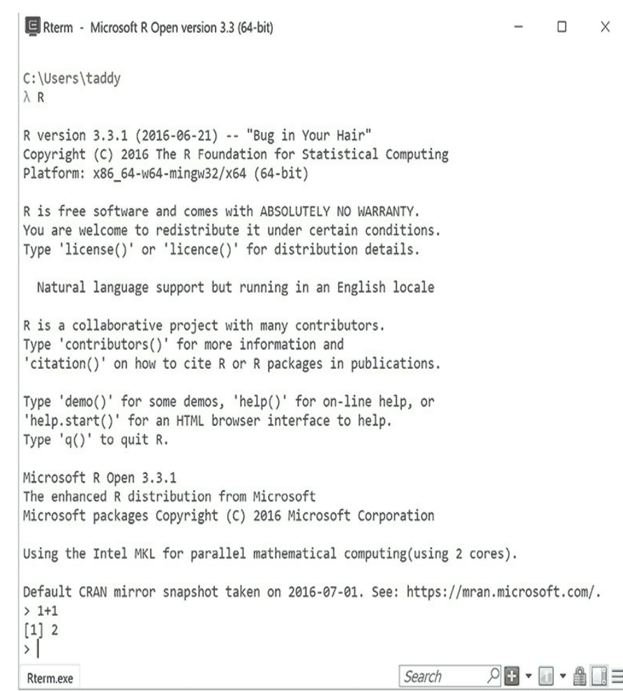

图 1.4：在 R CMDer 中的 Windows 系统上运行 R。

学习 R 基础有很多很棒的地方。如果在 Amazon 上搜索“R”，你会发现大量用于学习 R 的资源。在线还有许多很棒且免费的教程。你不需要是 R 专家来阅读和学习这本书；你只需要能够理解基础并愿意探索代码示例。记得使用帮助（输入 `?function` 以获取特定函数的帮助），经常打印以查看对象中包含什么（要打印变量 A，只需输入 `A` 或 `print(A)`），并在困惑时搜索互联网（Stack Overflow 是一个很好的信息源）。学习曲线最初可能很陡峭，但一旦你掌握了窍门，剩下的部分就会快速到来。

在最基本的层面上，R 只是一个花哨的计算器。一切都基于名称分配.^10 例如，这是一个简单的包含变量和一些基本算术的 R 脚本：

```
> A <- 2  
> B <- 4  
> A*B  
[1] 8
```

你也可以处理包含多个数字的*向量*（和矩阵）：

```
> v <- c(2,4,6)  # c(x,y,z,…) 用于创建向量  
> v[1:2]  # a:b 索引 `从 a 到 b`  
[1] 2 4  
> v[1]*v[2]  
[1] 8
```

在整本书中，你会看到许多类似前面的片段。# 符号表示注释，我们经常使用它来为代码添加解释。这些带注释的片段是演示数据分析程序实际执行的工具。完整的代码脚本和数据可在 http://taddylab.com/BDS 获取。

R 并不完美，也不是适用于所有目的的最佳语言。Python 为许多机器学习应用提供了更好的工作空间，特别是涉及原始文本等非结构化数据的应用。对于大规模机器学习，你可能应该使用前面提到的深度学习框架之一，如 Gluon 或 Keras。类似地，大规模数据集通常存储在专用的分布式计算环境中。像 Spark 这样的框架（你可以通过 Scala 或 Python 语言访问它）对于构建切片和聚合此信息的数据管道至关重要。要在这种真正大规模的数据上执行机器学习例程，你可能需要考虑像 Spark.ML 这样专门构建的框架。如果你为大型公司工作，你可能需要学习旨在满足贵公司特定数据管理需求的专有语言。而且几乎可以肯定，在某个时候你需要编写 SQL 查询以从结构化数据库中“拉取”数据。


这阐明了一个重要的观点：*没有哪种语言在所有用途上都是最佳的*。你可能会想象，只需学习一种编程语言就足以应对所有需求，永远不需要研究其他语言。不幸的是，计算技术的发展变化太快，这一设想并不现实。任何从事数据处理的人都需要持续学习并更新其计算（以及方法论）技能。[1] 因此，在为本书（以及芝加哥大学的MBA课程）选择语言时，问题很简单：哪种语言最适合学习数据科学？经过思考和实验，我们最终选择了R。

R 可以读取几乎任何数据格式。在本书中，你将主要处理包含*逗号分隔值*的 `.csv` 文件。这些是简单的文本文件，其组织方式类似于电子表格，其中数值（单元格条目）由逗号分隔。参见**图 I.5**中的示例。第一行是*表头*，包含列标题，其余行则包含数据条目。

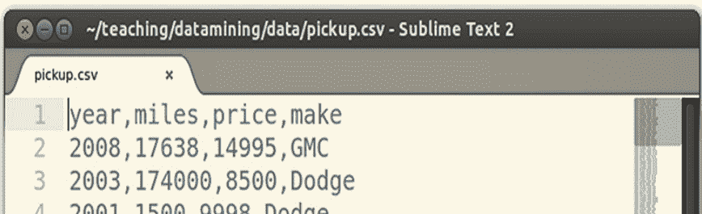

**图 I.5**：`pickup.csv` 文件的开头部分。

这种数据存储格式被称为*平面文件*，因为它只有两个维度：数据观测值（行）和变量（列）。数据存储在简单的文本文件中，通常你可以选择任何类型的值*分隔符*（制表符、竖线 [ | ] 和空格都是逗号的替代选项）。在本书中，我们将使用 `.csv` 格式，因为它很常见，并且是 Microsoft Excel 软件默认的文本文件表示方式。事实上，你可以使用 Excel 打开任何 `.csv` 文件，而且当你双击文件图标时，你的电脑通常会默认使用 Excel 打开它。[2]

平面文件并不是一个理想的数据存储和管理格式。公司不会用平面文件来存储数据。相反，它们通常使用多种存储平台的组合来管理结构化和非结构化数据。由明确定义的变量组成的结构化数据，将存储在一个传统的*关系型*数据库中，该数据库包含多个相互关联的表。

你可以通过一种结构化查询语言（SQL）的变体来访问这种类型的数据：

```
select apple_id, apple_price from grocerylist
where apple_col = green
```

你所使用的 SQL 变体将取决于你访问的数据库品牌；例如 Microsoft SQL、Oracle、Teradata 或 SQLite。完全可以直接在数据库上运行分析，R 提供了接口，允许你直接从数据库将数据拉取到你的工作区中。然而，更典型的工作流程是：使用 SQL 查询从数据库中获取数据（根据你的特定需求进行聚合和切片），然后将其写入平面文件以供后续分析。本书中的许多数据示例最初就是这样从数据库中获取的。

非结构化数据，尤其是大规模非结构化数据，将存储在*分布式文件系统*（DFS）中。这些是通过网络将许多机器连接起来的系统。你的数据被分割成*块*，存储在不同的机器上，DFS 提供了处理此类*分区*数据的机制。通过这种方式，DFS 允许你操纵那些大到无法存储在单台计算机上的数据。这些系统促进了互联网规模的分析——处理以前无法管理的巨量数据。你可能听说过的一种 DFS 框架是 Hadoop。另一个广泛使用的 DFS 是 Amazon 的 S3，它是 Amazon Web Services（AWS）上存储的基础设施。

这才是真正的“大数据”。有各种各样的分析平台用于整理和分析分布式数据，其中最著名的是 Spark。当在这个规模上工作时，你需要利用专门的算法，避免在单台计算机的*工作内存*中同时容纳所有数据。例如，MapReduce 框架由一系列算法组成，这些算法可以对数据进行预处理并将其分组为相对较小的块（Map），然后再对每个块执行分析（Reduce）。我们将在后续章节中介绍这种*分布式计算*，并且像 R spark 和 Microsoft 的 R 服务器这样的工具使得将你在本书中学到的方法适应分布式计算环境变得相对容易。尽管本书不会详细介绍分布式计算，但我们在本书中介绍的几乎所有方法都是*可扩展*的。换句话说，即使是在占用了你工作内存很大比例的数据集上，它们也能快速运行，而且它们不依赖于那些本质上串行、无法适应分布环境的算法。

无论你的数据来源在哪里，以及分析前需要多少数据整理工作，在某个阶段，你都将处理一个数据集，该数据集（或可以）表示为平面文件，并且足够小（或可以拆分成足够小的部分）以放入你的计算机内存中。此时，你只需将数据读入 R 即可。

R 有一个 `read.csv` 函数，用于将数据从 `.csv` 文件读取到你的工作区中。新手常遇到的挑战之一是弄清楚如何找到你的数据。R 有一个工作目录的概念，你需要从那里连接到你存储数据的位置。一个简单策略是创建文件夹来存储你的数据和 analysis scripts。当你打开 R 时，只需将其工作目录移动到该文件夹。更改工作目录的方法有很多种。在图形用户界面（GUIs）或 RStudio 中会有菜单选项，你始终可以使用 `setwd` 命令设置明确的路径。正确设置后，只需将你的数据文件名传递给 `read.csv` 即可。

```
> trucks <- read.csv("pickup.csv")
> head(trucks)
  year  miles  price  make
1 2008  17638  14995   GMC
2 2003 174000   8500 Dodge
3 2001   1500   9998 Dodge
4 2007  22422  23950   GMC
5 2007  34815  19980   GMC
6 1997 167000   5000   GMC
```

这里，`trucks` 是一个数据框（dataframe），它就是一个带有名称的矩阵。我使用了 `head` 函数来打印矩阵的前六个条目。你可以使用索引名称和数字来访问数据。

```
> trucks [1,] # 第一条观测记录
 year miles price make
 1 2008 17638 14995 GMC
> trucks [1:3,] # 前三个观测记录
 year miles price make
 1 2008 17638 14995 GMC
 2 2003 174000 8500 Dodge
 3 2001 1500 9998 Dodge
> trucks [1:3,1] # 第一个变量（year）的前三个值
[1] 2008 2003 2001
> trucks$year[1:3] # 同样的结果
[1] 2008 2003 2001
> trucks[1:3, 'year'] # 再次同样的结果
[1] 2008 2003 2001
```

这个数据框中的每个值都有一个“类”：`price`、`year` 和 `miles` 是连续变量，而 `make` 是一个因子（即，一个分类变量）。这两种是最常见的数据类。

你还可以在数据上调用函数：

```
> nrow(trucks)
[1] 46
```

```
> summary(trucks) # 每个变量的摘要
       year            miles          price           make     
 Min.   :1978   Min.   :  1500   Min.   : 1200   Dodge:10    
 1st Qu.:1996   1st Qu.: 70958   1st Qu.: 4099   Ford :12    
 Median :2000   Median : 96800   Median : 5625   GMC  :24    
 Mean   :1999   Mean   :101233   Mean   : 7910               
 3rd Qu.:2003   3rd Qu.:130375   3rd Qu.: 9725               
 Max.   :2008   Max.   :215000   Max.   :23950               
```

这些函数中包含了许多方便的绘图功能。[3] 例如，在下面的代码中，我们快速可视化了卡车数据：使用直方图（用于单个变量的分布）、一些箱线图（用于比较连续变量与因子）以及散点图（用于连续变量与连续变量的比较）。

```
> hist(trucks$price) ## 直方图
> plot(price ~ make, data=trucks) ## 箱线图
> plot(price~miles, data=trucks, log="y", col=trucks$make) ## 彩色显示
> ## 添加图例（颜色 1,2,3 分别是黑色、红色、绿色）
> legend("topright", fill=1:3, legend=levels(trucks$make))
```

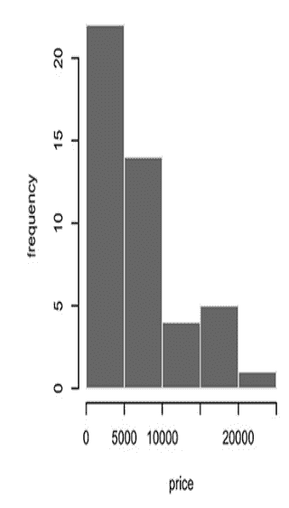

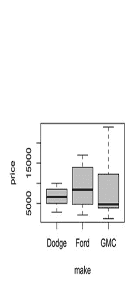

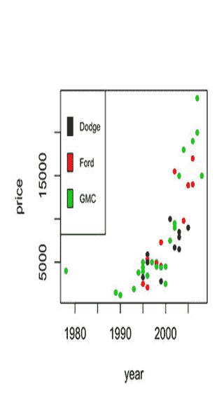

你还可以拟合*统计模型*，例如将皮卡车的对数价格作为品牌、里程数和年份的函数的回归模型。


```
> fit <- glm(log(price) ~ make + miles + year, data=trucks)
> summary (fit)
```

```
Call:
glm(formula = log(price) ~ make + miles + year, data = trucks)
```

**偏差残差：**

| 最小值 | 下四分位数 | 中位数 | 上四分位数 | 最大值 |
|:---|:---|:---|:---|:---|
| -0.91174 | -0.22547 | 0.01919 | 0.20265 | 1.23474 |

**系数：**

| | 估计值 | 标准误 | t 值 | Pr(>\|t\|) |
|:---|:---|:---|:---|:---|
| (截距) | -1.518e+02 | 2.619e+01 | -5.797 | 8.41e-07 \*\*\* |
| makeFord | 1.394e-01 | 1.780e-01 | 0.784 | 0.43780 |
| makeGMC | 1.726e-01 | 1.582e-01 | 1.091 | 0.28159 |
| miles | -4.244e-06 | 1.284e-06 | -3.304 | 0.00198 \*\* |
| year | 8.045e-02 | 1.306e-02 | 6.160 | 2.56e-07 \*\*\* |

显著性代码：0 ‘***’ 0.001 ‘**’ 0.01 ‘*’ 0.05 ‘.’ 0.1 ‘ ’ 1

（高斯族的离散参数取值为 0.1726502）

```
零假设偏差：45 个自由度下的 23.3852
残差偏差：41 个自由度下的 7.0787
AIC：56.451
```

Fisher 评分迭代次数：2

此处，`glm` 代表“广义线性模型”，而 `~` 符号读作“回归于”。该函数是第 2 章的主力工具，你将熟悉其使用方法及结果解读。

基本上，这就是全部了！你可以对数据应用的大量函数正是使 R 成为如此强大的分析工具的原因。如果你能阅读并理解前面的代码片段，你就具备了开始阅读本书其余部分的良好基础。在接下来的章节中，我们将扩展这些函数背后方法的功能和理解。但你的基本工作流将保持与此处一致：读取数据并应用函数以获得结果。一旦你意识到这种工作方式有多么强大，你就再也不会回头了。

- 1. 收益率是差值除以先前的值：$(y_{t}-y_{t-1})/y_{t-1}$。
- 2. 长期平均当然可靠地远大于零。例如，参见 Carvalho 等人 [2017]。
- 3. 大多数金融建模工作基于*超额收益*的单位：资产的收益率减去“无风险利率”的衡量指标——换言之，持有低风险债务所能获得的收益。衡量无风险利率的一个常见指标是美国短期国债（T-bills）的收益率——假设在时间 $t$ 时为 $u$。你处理的是 $r_{t}=(y_{t}-y_{t-1}) / y_{t-1}-u$，即时间 $t$ 时权益 $j$ 的收益率减去 T-bill 收益率。类似地，市场收益率是标普 500 指数收益率减去 $u$。由于 $u$ 很小，这几乎没有区别，且细节通常被省略。
- 4. Ganapathy Vidyamurthy。*Pairs Trading: Quantitative Methods and Analysis*。John Wiley & Sons, 2004。
- 5. 例如，基础统计告诉你 $\bar{y} = \sum_{i} y_{i} / n$ 是随机变量 $y$ 的良好均值估计。其标准误差等于 $y$ 的样本标准差除以 $\sqrt{n}$。你只需要让 $\sqrt{n}$ 足够大，使得你的标准误差在当前应用的可接受范围内。
- 6. 当前数据科学的一个活跃领域是将机器学习工具与计量经济学家长期研究的反事实推理相结合。这合并了机器学习和统计学资料与经济学家的工作。例如，参见 Athey 和 Imbens [2016]，Hartford 等人 [2017]，以及 Athey [2017] 中的综述。我们在后续章节中涵盖这些内容。
- 7. 对于像这样的一本书，唯一可能适用的另一种语言是 Python（使用 `pandas` 包）。两者都很棒，大多数数据科学家两者都用。
- 8. 参见 `cran.r-project.org`。
- 8. 参见 `jupyter.org`。这种功能与内容的混合在学习时特别有价值，我建议你尝试笔记本界面。你还可以找到 R Studio 专门为 R 调优的笔记本，R Studio 是一家生产各种 R 友好工具的公司。
- 9. R 实际上有两种分配变量的方式。`<-` 的作用与 `=` 几乎相同。前者更受青睐，因为 `=` 既用于函数参数也用于变量名赋值，但人们使用任何一种编写代码都没有问题。
- 10. 再次强调，学习最好的方式通常是通过实践，对现有脚本进行小幅修改，然后扩展你的技能。这种情况往往自然发生：你需要使用一种用你不熟悉的语言编写的工具，你会学到刚好完成所需工作的程度。这样做足够多次后，你就熟练了。关键在于开始时寻找示例。
- 11. 小心 Excel 对你的数据所做的更改（例如，自动格式化数字或修剪行）。被 Excel 损坏并重新保存的数据是在处理本书示例时的常见挫折来源。
- 12. 通常，保持代码和数据有条理是有好处的。我*强烈*建议使用版本控制平台来跟踪你的更改、与他人协作并分享你的工作（如果你希望在数据科学领域找到工作，这尤为重要）。我和许多其他人都使用 GitHub。
- 13. R 的一个优点是它使创建专业质量的图形变得容易。


## 不确定性

现实世界是混乱的。认识到这种混乱将把精致且有用的分析与天真到无可救药的分析区分开来。对于高度复杂的模型，这一点尤其如此，此时人们容易混淆信号与噪声，从而导致“过拟合”。处理这种混乱和噪声的能力是你在学习和使用数据工作时需要学习的最重要技能，以避免让自己难堪。

在任何分析中，你都有目标未知量和非目标未知量。前者被构建到模型中作为待估计的参数，你显式地在决策过程中使用这些估计值。后者分别表示为误差项和分布，或者在完全非参数分析中，表示为未知的数据生成过程。这些非目标未知量是一种烦恼。你并不直接关心它们，但如果你想推断目标参数，就需要考虑它们。这里的区别取决于具体应用——一个分析员的烦恼可能是另一个分析员的目标。但是同时精确地建模一切是不可能的，因此你需要仔细选择目标并认真对待它们。

本章介绍了统计学家关于不确定性的概念，这是我们用来表征已知内容（以概率形式）的框架。在数据科学和机器学习的许多部分，我们寻求设计在存在不确定性的情况下表现良好的模型，并通过正则化（参见第 3 章）和其他模型稳定工具来实现这一点。在其他情况下，有必要对不确定性进行完整核算，并为重要参数分配概率分布。现实世界的应用需要稳定性与不确定性量化的混合，要理解这些技术中的任何一种，你需要对不确定性基础有清晰的理解。

不确定性量化是数据科学中较难且抽象的主题之一。许多读者可能希望跳过并前进到第 2 章至第 4 章，待稍微熟悉后再回过头来阅读。

### 频率学派不确定性与自助法

我们需要从回顾*频率学派*不确定性的基础知识开始。这种不确定性几十年来一直在入门统计课程中教授，其特点是一个思想实验：“如果我能看到一个新的数据样本，该样本由与我当前数据相同的过程和场景生成，我们的估计值会如何变化？”

我们将从对 10,000 个家庭在一年内在线支出活动的一个简单分析开始。除了他们在线花费的美元总额外，数据集的每一行还包含有关单个家庭的一些基本信息，例如他们是否有孩子，是否拥有宽带互联网接入，以及他们的种族和民族和地区。

```
> browser <- read.csv("web-browsers.csv")
> dim(browser)
[1] 10000      7
> head(browser)
```

| id | anychildren | broadband | hispanic | race | region | spend |
|:---|:------------|:----------|:---------|:-----|:-------|:------|
|  1 |           0 |         1 |        0 | white |     MW |   424 |
|  2 |           1 |         1 |        0 | white |     MW |  2335 |
|  3 |           1 |         1 |        0 | white |     MW |   279 |
|  4 |           0 |         1 |        0 | white |     MW |   829 |
|  5 |           0 |         1 |        0 | white |      S |   221 |
|  6 |           0 |         1 |        0 | white |     MW |  2305 |

图 1.1 显示了支出值的样本。


## 图 1.1：家庭支出。请注意，在$对数$尺度下，分布大致呈正态分布（查看 x 轴）。

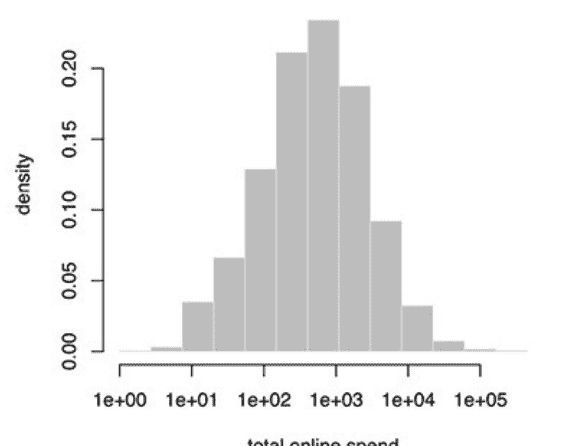

考虑变量 $\text{spend}$ 的无条件均值：即美国家庭每年在线消费的平均金额。你可以用其 $样本$ $平均值$ 来估计这个均值——例如，$\mu_{\text{spend}} = \mathbb{E}[\text{spend}]$。

```
> mean(browser$spend)
[1] 1946.439
```

在这里，你认为 $\mu_{\text{spend}}$ 并不精确等于 $1946.439；相反，这是一个良好的猜测，真实值理想情况下应接近该数值。

接近多少？让我们回顾一些基础统计学知识。假设你有 $n$ 个独立随机变量：$\{x_i\}_{i=1}^n$。就我们当前的例子而言，这意味着每个家庭支出特定的金额，而无需考虑样本中其他家庭的在线行为。则样本均值为

$$\overline{x} = \frac{1}{n} \sum_{i=1}^{n} x_i \quad (1.1)$$

该统计量的方差可以计算为

$$\operatorname{var}(\overline{x})=\operatorname{var}\left(\frac{1}{n} \sum_{i=1}^{n} x_{i}\right)=\frac{1}{n^{2}} \sum_{i=1}^{n} \operatorname{var}\left(x_{i}\right)=\frac{\sigma^{2}}{n} \quad (1.2)$$

这里，$\sigma^{2}=\operatorname{var}(x)=\mathbb{E}\left[(x-\mu_{\text{spend }})^{2}\right]$ 是随机抽取的一个家庭的在线支出的方差。注意，你之所以能够将 $\operatorname{var}(\cdot)$ 移入求和符号内部，仅因为变量之间是独立的。因此，我们可以按以下方式估计 $\overline{X}$ 的方差：

```
> var(browser$spend) /1e4 # since we have 10,000 households
[1] 6461.925
```

这意味着围绕 $\sqrt{6462} \approx 80$ 的标准差。

至关重要的中心极限定理（CLT）指出，如果样本量“足够大”，独立随机变量的平均值将呈正态分布（即高斯分布或“钟形曲线”）。假设 $n=10,000$ 足够大，最终结果是，在线支出的样本平均值服从均值为 1946、标准差为 80 的正态分布。我们将此写为 $\overline{X} \sim \mathrm{N}(1946, 80^{2})$。图 1.2 绘制了该分布。

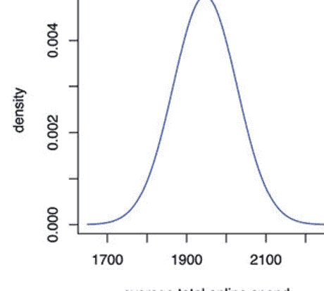

## 图 1.2：$\bar{X}$ 的抽样分布。这张图告诉我们，如果我们获得一个新的 10,000 个家庭的样本，我们预计新的样本平均支出将在 $1946 \pm 160$ 左右。

这是什么分布？它是我们对抽样分布的最佳猜测。它捕捉了思想实验所描述的不确定性：“如果我能获得一个新的观测样本，来自相同的数据生成过程，新样本平均值的概率分布是什么？”这就是所谓的频率学不确定性。这是你在基础统计学课程中见过的不确定性类型。例如，考虑以下对置信区间的常见描述：

> 民调预测，49% 的合格选民目前会投赞成票；这个数字在 20 次中有 19 次的准确性误差在 ±3 个百分点以内。

该陈述描述了在反复对不同的随机选民群体进行民调的思想实验中，估计的总票数如何变化。类似地，熟悉的假设检验逻辑——“如果 p 值小于 0.05 则拒绝原假设”——对应于一条规则：如果原假设均值 $\mu_0$ 落入图 1.2 中抽样分布的尾部太远，则拒绝该原假设。

**自举法**（Bootstrap）是一种用于构建抽样分布的计算算法。我们将使用自举法，因为依赖于大量经典统计学的理论抽样分布——如图 1.2 中由中心极限定理推导出的高斯分布——对于业务数据科学中遇到的复杂设置并不有效。需要不同方法的主要原因在于，模型构建中有许多阶段并未在经典公式中被考虑（例如，变量选择、计算近似），而这些步骤中的不确定性需要传递到你的最终分析中。此外，当模型参数数量相对于观测值数量较大时，中心极限定理将不能很好地表征现实世界的表现。

自举法不依赖理论近似，而是通过对当前样本进行重采样来模拟抽样分布。回顾我们对抽样分布的定义：它是指我们在从总体中重新估计 $\beta$ 时，针对多个大小为 $n$ 的数据集所得到的估计量——例如，$\hat{\beta}$——的分布。图 1.3 说明了这一过程。

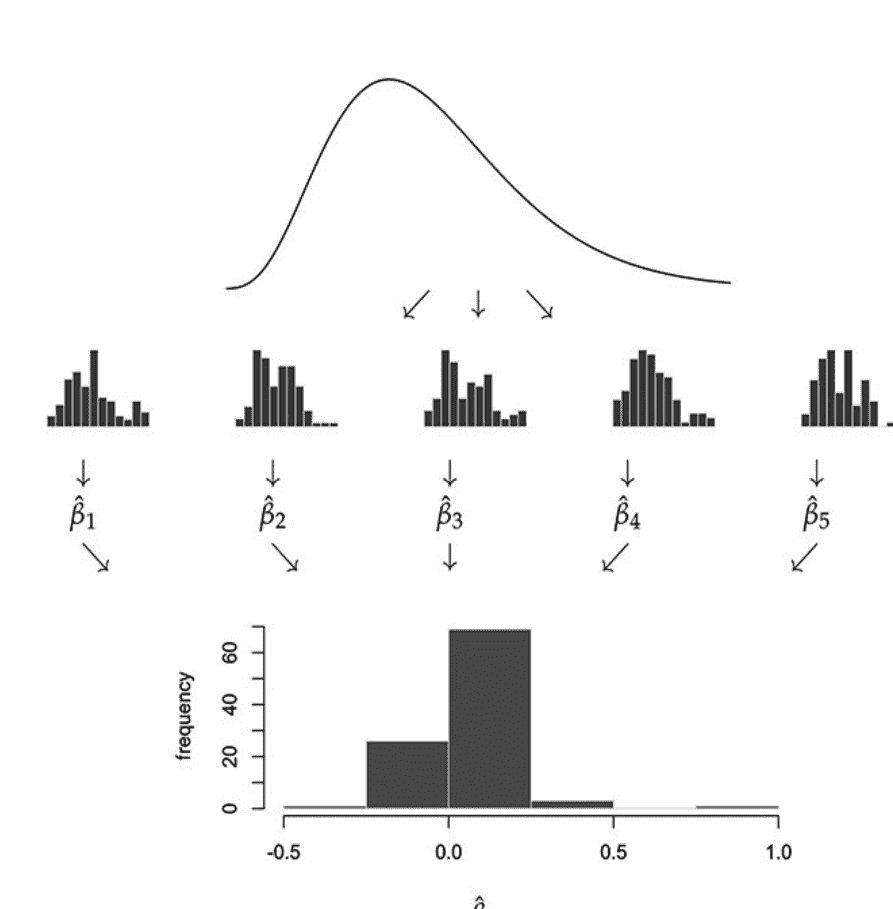

## 图 1.3：抽样分布的图示。中间一行的每个直方图都是从总体中抽取的样本，底部的直方图是所得估计值 $\hat{\beta}$ 的分布。

算法 1 中的自举法通过将来自总体的样本替换为来自你样本的 *重采样* 来模拟 **图 1.3** 中的过程。这里的 *有放回* 抽样至关重要。它意味着每个观测值可以被多次选择以包含在重采样中。例如，如果我们从集合 $\{1, 2, 3, 4, 5\}$ 中有放回地抽样 5 个项目，可能的重采样结果包括 $\{1, 1, 3, 3, 4\}$ 和 $\{2, 2, 2, 3, 5\}$。使用“从桶中取球”的常见类比，我们在每次取球后将球放回。这种抽样类型引入了我们重采样中的 *变异性*：在这个例子中，无放回抽样将 *始终* 得到集合 $\{1, 2, 3, 4, 5\}$。

### 算法 1 非参数自举法

给定数据 $\{z_i\}_{i=1}^n$，对于 $b = 1 \dots B$：

- 有放回地重采样 $n$ 个观测值 $\{z_i^b\}_{i=1}^n$。
- 使用该重采样集计算你的估计量，例如，$\hat{\beta}_b$。

那么 $\{\hat{\beta}_b\}_{b=1}^B$ 是 $\hat{\beta}$ 的抽样分布的近似。

由此产生的“自举样本”可用于与通常的理论抽样分布相同的所有目的。例如，近似标准误差——即你的抽样分布的标准差——可以用这个自举样本的标准差来近似：

$$\operatorname{se}(\hat{\beta}) \approx \operatorname{sd}(\hat{\beta}_b) = \sqrt{\frac{1}{B} \sum_b (\hat{\beta}_b - \hat{\beta})^2} \quad (1.3)$$

这里，$\hat{\beta}$（无下标）是你使用完整的原始样本得到的估计参数。只要估计量是 *无偏* 的，这意味着 $\mathbb{E}[\hat{\beta}] = \beta$，那么你就可以使用这个标准误差来构建你通常的 95% 置信区间：

$$\beta \in \hat{\beta} \pm 2\operatorname{sd}(\hat{\beta}_b) \quad (1.4)$$

回到我们的在线支出例子，我们可以编写一个简单的自举法来估计抽样分布。

```
> B <- 1000 # number of bootstrap samples
> mub <- c() # a vector to contain the sampled means
> for (b in 1:B) {
+   samp_b <- sample.int(nrow(browser), replace=TRUE)
+   mub <- c(mub, mean(browser$spend[samp_b]))
+ }
> sd (mub)
[1] 80.23819
```

在该循环结束时，我们得到了一组 $\bar{x}_b$ 值 mub，每个值对应不同的数据重采样。注意，`replace=TRUE` 标志会对观测值索引进行有放回抽样。

```
> sort(samp_b) [1:10]
[1] 1 1 2 2 4 4 5 7 8 9
```

图 1.4 显示了由此产生的自举估计的抽样分布。我们可以看到，它与中心极限定理所暗示的理论高斯抽样分布非常吻合（且自举标准差 80 与理论标准误差相符）。这是合理的：我们有一个大样本（$n = 10,000$），并针对一个简单的统计量（$\bar{x}$），因此中心极限定理适用，理论分布是正确的。自举法的优势在于，它在许多该理论不可用或不正确的场景中也能发挥作用。


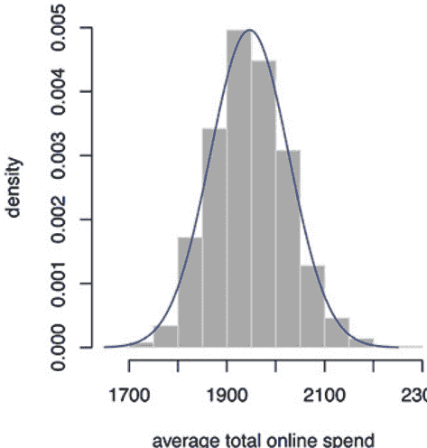

图 1.4：家庭在线消费的自助法抽样分布（直方图），叠加了来自图 1.2 的理论抽样分布。

自助法的工作原理是用*经验数据分布*替代总体分布——即通过对每个观察到的数据点赋予概率 $1/n$ 而得到的分布。图 1.5 通过对比图 1.3 展示了这种近似：我们只是用一个分布替换了直方图。

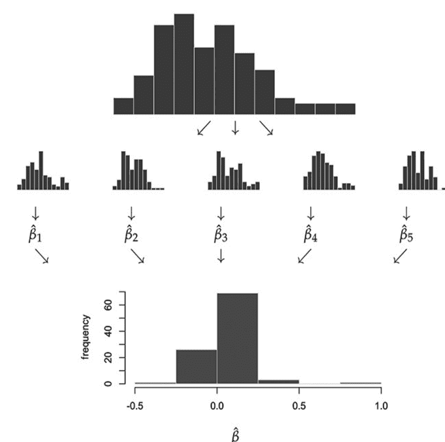

图 1.5：自助法对抽样分布近似的图示。请对比*图 1.3*。现在，中间一行中的每个直方图都是基于原始观察值有放回重样的结果，而底部的直方图则是由此产生的估计量的分布。

自助法估计的抽样分布与真实情况有多接近？这取决于你的观察样本在多大程度上代表了总体分布。一般来说，*维度很重要*：你可以对低维统计量（如 $\overline{\boldsymbol{X}}$）进行自助法分析，但不应期望使用重抽样来学习两到三个维度以上的抽样分布。例如，你可以对单个回归系数的分布进行自助法分析。你也可以使用结果来估计成对系数之间的抽样协方差，但你需要大量数据才能获得可靠的答案，并且应对估计值的可靠性保持谨慎。

作为一个更复杂的例子，考虑以家庭是否拥有宽带互联网和是否有孩子为自变量，对对数消费进行线性（最小二乘）回归。我们将拟合以下回归模型的参数：

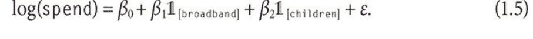

这里，指示函数 $\mathbb{1}_{[\text{broadband}]}$ 和 $\mathbb{1}_{[\text{children}]}$ 创建二进制虚拟变量，分别对于拥有宽带或有孩子的家庭为 1，否则为 0。这里的误差项 $\varepsilon$ 包含了所有不能被回归输入解释的对数消费变异。

本书中的对数始终是以 $e$ 为底的，因此 $\log(a) = b \iff e^b = a$。以乘性方式相互变动的变量——例如，“拥有宽带接入的家庭在线消费多 75%”——通常在对数尺度上以线性方式建模。详见第 2 章。

要在 R 中拟合此回归，我们使用“广义线性模型”的 `glm` 命令。这可用于拟合公式 1.5 中的线性回归模型（也可以使用 R 的 `lm` 命令拟合），并且它还能够拟合非线性模型，如逻辑回归。使用 `glm` 时，只需向 R 提供回归公式和数据框即可：

```
> linreg <- glm(log(spend) ~ broadband + anychildren, data=browser)
> summary(linreg)
```

Call:
glm(formula = log(spend) ~ broadband + anychildren, data = browser)

Deviance Residuals:
Min IQ Median 3Q Max
-6.2379 -1.0787 0.0349 1.1292 6.5825

Coefficients:
Estimate Std. Error t value Pr(>|t|)
(Intercept) 5.68508 0.04403 129.119 <2e-16 ***
broadband 0.55285 0.04357 12.689 <2e-16 ***
anychildren 0.08216 0.03380 2.431 0.0151 *
---
Signif. codes: 0 '***' 0.001 '**' 0.01 '*' 0.05 '.' 0.1 ' ' 1

(Dispersion parameter for gaussian family taken to be 2.737459)

Null deviance: 27828 on 9999 degrees of freedom
Residual deviance: 27366 on 9997 degrees of freedom
AIC: 38454

Number of Fisher Scoring iterations: 2

这里有很多内容需要解读，我们将在**第 2 章**中更详细地讨论 glm 输出。但如果你关注系数，可以看到存在带有“标准误差” $se(\hat{\beta})$ 的“估计值” $\beta$。这些是那些估计量理论抽样分布的中心值和标准差。根据中心极限定理（CLT），这些抽样分布应近似为高斯分布。例如，宽带系数的 95% 置信区间如下：

```
> 0.55285 + c(-2,2)*0.04357
[1] 0.46571 0.63999
```

为了获得抽样分布的自助法估计，我们只需在原始数据的有放回重样上重复相同的回归：

```
> B <- 1000
> betas <- c()
> for (b in 1:B) {
+    samp_b <- sample.int(nrow(browser), replace=TRUE)
+    reg_b <- glm(log(spend) ~ broadband + anychildren,
+        data=browser[samp_b,])
+    betas <- rbind(betas, coef(reg_b))
+ }
> betas [,1:5]
```

| (Intercept) | broadband | anychildren |
| :---------: | :-------: | :--------: |
| [1,] 5.728889 | 0.5736488 | 0.02465046 |
| [2,] 5.672288 | 0.5457318 | 0.06641667 |
| [3,] 5.612364 | 0.6175716 | 0.09134826 |
| [4,] 5.677401 | 0.5712354 | 0.07893055 |
| [5,] 5.650967 | 0.5743827 | 0.08233983 |

矩阵 betas 的每一行都是从我们的三个回归参数的*联合*分布中的一次抽样。我们可以计算宽带系数和孩子系数之间的抽样相关性：

```
> cor(betas[,"broadband"], betas[, "anychildren"])
[1] -0.01464454
```

这两个系数之间的相关性很小；换言之，估计的消费-宽带关系与估计的消费-孩子关系大致是独立的。

我们还可以将系数的*边缘*（单变量）抽样分布与理论分布进行比较。图 1.6 展示了宽带系数的结果。再次，理论分布和自助法分布彼此相似。然而，在这种情况下，这两个抽样分布衡量的是关于 $\hat{\beta}_1$ 不确定性的两种不同的思想实验。在理论情况下，我们想象的是对于*相同*的原始样本中的 $[broadband_i, anychildren_i]$ 输入，进行新的 $spend_i$ 抽样。这被称为*固定设计*设置。在自助法情况下，我们想象的是输入和输出都从总体中重新抽样，换句话说，我们是在抽取一个新的家庭样本。这被称为*随机设计*设置。在图 1.6 中，我们可以看到这里的区别影响不大；然而，对于高维输入，这将导致这两个分布彼此发散。

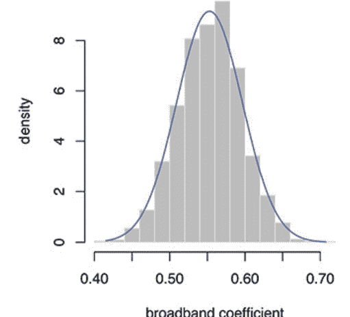

图 1.6：公式 1.5 中宽带回归系数 $\hat{\beta}_1$ 的自助法抽样分布（直方图），叠加了理论抽样分布 N(0.55, 0.0442)。

最后，考虑宽带对消费的*乘性*效应，exp[$\hat{\beta}_1$]。这是 $\hat{\beta}_1$ 的一个*非线性*变换，通常你不会知道经过这种变换后估计量的分布。然而，我们只需对重样的 $\hat{\beta}_{1b}$ 取指数即可得到变换后估计量的分布。图 1.7 展示了结果：拥有宽带的家庭在线消费多 60% 到 90%。

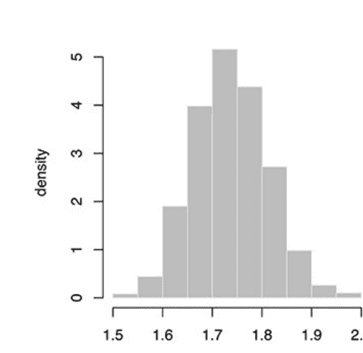

图 1.7：宽带对消费乘性效应的自助法抽样分布：$\exp[\hat{\beta}_{1}]$。注意，在这个特殊情况下，由于 $\hat{\beta}_{1}$ 接近正态分布，$\exp[\hat{\beta}_{1}]$ 服从*对数正态分布*。

自助法并不完美。在多种设置中它会“失效”。如果经验数据分布对总体的近似较差，或者你针对的统计量需要关于整个总体分布的大量信息，这就可能发生。例如，我们倾向于不信任高维参数的自助法，因为联合抽样分布是所有总体跨变量依赖性的函数。或者，当数据总体具有重尾特征（即包含一些罕见的大值）时，你在对均值进行自助法分析时会遇到困难，因为极端值对分布估计有着不成比例的影响。

然而，总体而言，自助法是可靠的不确定性量化工具。我建议经常使用它。作为一条规则，除非你的数据有奇怪之处，否则你可以对低维统计量使用自助法。在自助法失败的情况下，通常也没有好的理论标准误差可用。当这种情况发生时，我们可以寻找自助法的替代版本。例如，你可以使用*参数化*自助法，通过从拟合模型中生成新数据来为每个自助法样本生成新数据，而不是从原始数据中重样。

考虑我们之前例子中在线消费的边缘分布。在那里，我们使用公式 1.2 计算出在线消费均值的标准误差约为 $80。使用参数化

（使用）参数化自助法时，我们会从假定模型的参数估计中反复抽取数据——例如，设 $\boldsymbol{x} \sim \mathcal{N}(\boldsymbol{\hat{\mu}}, \boldsymbol{\hat{\sigma}}^{2})$——并将所得样本均值的**标准差**用作**标准误**的估计。

```r
> xbar <- mean(browser$spend)
> sig2 <- var(browser$spend)
> B <- 10000
> mub <- c()
> for(b in 1:B){
+   xsamp <- rnorm(1e4, xbar, sqrt(sig2))
+   mub <- c(mub, mean(xsamp))
+}
> sd(mub)
[1] 79.70425
> sqrt(sig2/1e4)
[1] 80.3861
```

在此，结果几乎精确地匹配了之前**理论**标准误和非参数自助法的计算结果。然而，参数化自助法做出了一个我们其他方法并未要求的重大假设：我们假设数据服从正态分布。参数化自助法通过使用特定模型的估计值来近似总体分布。这使得它适用于更高维度的参数目标——因为我们拥有完整的概率模型，所以学习总体分布所需的数据量较少——但我们的结果将取决于该模型在多大程度上代表现实。

> 全书中，黑色菱形符号表示更具高级性和抽象性的内容。本书的主体部分不需要理解这些内容。

❖ 我们将以一个高级主题结束本节：使用自助法处理有偏估计量——即会产生 $\hat{\boldsymbol{\beta}}$ 且满足 $\mathbb{E}[\hat{\boldsymbol{\beta}}] \neq \boldsymbol{\beta}$ 的过程。你以前可能从未遇到过这样的估计量，因为在理想世界中，偏差是需要避免的。然而，在商业数据科学领域，世界并不完美，你通常愿意引入一点偏差，以换取估计中更少的噪声（例如，参见第 3 章）。如果你担心你的估计量可能是有偏的，那么你应该用直接针对置信区间（即避免计算标准误这一中间步骤）的稍复杂的自助法算法来替代算法 1。

算法 2 与我们之前的自助法非常相似。不同之处在于，它针对的是**误差**的分布——即估计值比目标值大多少或小多少——而不是估计值本身的分布。在该算法中，样本估计 $\hat{\beta}$ 是真实（未知）$\beta$ 的替代。如果 $\hat{\beta}_{b}$ 的值在使用你的估计过程时倾向于大于 $\beta$，那么你应该假设 $\hat{\beta}$ 在期望上大于 $\beta$。注意，公式 1.6 中置信区间的下限是通过减去最大误差（95% 分位数）来定义的，而上限则是减去最小误差。

### 算法 2 用于置信区间的非参数自助法

给定数据 $\{z_i\}_{i=1}^n$ 和参数 $\beta$ 的全样本估计 $\hat{\beta}$，对于 $b = 1 \dots B$：

- 有放回地重采样 $n$ 个观测值 $\{z_i^b\}_{i=1}^n$。
- 使用此重采样集合计算你的估计值，例如 $\hat{\beta}_{b}$。
- 计算误差，例如 $e_b = \hat{\beta}_{b} - \hat{\beta}$。

那么 $\{e_b\}_{b=1}^B$ 是估计值与其目标之间误差分布的近似。为了得到真实 $\beta$ 的 90% 置信区间，你需要计算 $\{e_b\}_{b=1}^B$ 的第 5 百分位数和第 95 百分位数——例如 $t_{0.05}$ 和 $t_{0.95}$——并将区间设定为：

$$ [\hat{\beta} - t_{0.95}, \hat{\beta} - t_{0.05}] \quad (1.6) $$

为了了解这在实践中如何运作，回想一下样本方差 $s^2 = \sum_i (x_i - \bar{x})^2 / n$ 是总体真实方差的*有偏*估计量：

$$ \sigma^2 = \mathbb{E}[(x-\mu)^2]. $$

你可以通过取 $s^2$ 的期望值来证明这一点，这表明 $\mathbb{E}[s^2] \neq \sigma^2$：

$$ \mathbb{E}[s^2] = \mathbb{E}[(x-\mu)^2] - \mathbb{E}[(\bar{x} - \mu)^2] = \sigma^2 - \sigma^2/n. \quad (1.7) $$

这就是为什么通常使用 $\sqrt{s^2n/(n-1)}$ 作为样本标准差无偏估计的原因。考虑仅使用 100 个浏览器的子样本估计在线支出的标准差。

```r
> smallsamp <- browser$spend[sample.int(nrow(browser), 100)]
> S <- sd(smallsamp) # 样本标准差
> S
[1] 7572.442
> sd(browser$spend)
[1] 8038.61
> S/sd(browser$spend)
[1] 0.9420089
```

我们发现，小样本标准差 $s$ 比全样本标准差小 $5\%$ 以上（全样本含有 10,000 个观测值，因此非常接近真实 $\sigma$）。你可以使用算法 2 的置信区间自助法，得到一个基于 $s$ 但校正了这种偏差的 $\sigma$ 的置信区间。

```r
> eb <- c()
> for (b in 1:B){
+    sb <- sd(smallsamp[sample.int(100, replace=TRUE)])
+    eb <- c(eb, sb-s)
+ }
> mean(eb)
[1] -407.8306
```

注意，自助法误差的均值 $\frac{1}{B-1}\sum_b e_b = -408$，远远不为零。这表明我们在使用有偏估计量。但当这些误差从我们的全样本估计量 $s$ 中减去时，我们实际上是在*减去这个偏差*。也就是说，我们成功地估计了偏差并进行了校正。例如，$s - e_b$ 的均值现在相对接近全样本标准差（我们对 $\sigma$ 的最佳猜测）。

```r
> mean(s-eb)
[1] 7980.273
> sd(browser$spend)
[1] 8038.61
```

此外，得出的 90% 置信区间以 $\sigma$ 为中心：

```r
> tvals <- quantile(eb, c(0.05, 0.95))
> tvals
     5%      95% 
-4667.349 3161.858
> s - tvals[2:1] # 90% CI
[1] 4410.584 12239.792
```

虽然这是本书的第一章，但自助法是一个相当高级的主题。如果这部分材料让你觉得有点不直观，请不要担心。我们在这一早期阶段引入它的一个原因是，它提供了一种*模拟*抽样分布的方法，从而让你在实际中观察不确定性。我鼓励你在阅读本书其余部分的同时进行这种模拟；这将有助于你理解算法的稳定性，以及在实际应用时应预期的结果。

## 假设检验与错误发现率控制

再次查看回归的输出结果，除了 `Estimate` 和 `Std. Error` 值之外，还有两列描述了抽样分布的特征。

### 系数：

| | Estimate | Std. Error | t value | Pr(>|t|) |
|:----|:----|:----|:----|:----|
| (Intercept) | 5.68508 | 0.04403 | 129.119 | <2e-16 *** |
| broadband | 0.55285 | 0.04357 | 12.689 | <2e-16 *** |
| anychildren | 0.08216 | 0.03380 | 2.431 | 0.0151 * |

`t value` 和 `Pr(> | t |)` 是什么意思？为什么有 *** ？大多数读者都会认出这些是*假设检验*的产物。

P(event) 是 R 语言中用来表示概率函数的记法，它将事件映射到其概率。我们将其写为 p(event)。我们重载了记法，对离散事件的概率质量函数和连续事件的概率密度函数都使用相同的“p”符号。

假设检验是一个用于在两种定性不同的现实之间做出决定的工具。其中一个选项将是*零假设*，这应该是你的“安全选项”。它是现状或稳定选项，通常对应于将参数设置为零。*备择假设*将是一组可能的值。当你“拒绝零假设”而支持备择假设时，最终将以某个参数的样本估计值进行工作。

零假设和备择假设之间的决定基于一个*样本统计量*，它衡量零假设现实与你采样参数估计之间的距离。对于零假设 $\beta = 0$ 相对于备择假设 $\beta \neq 0$ 的检验，你的检验统计量是 $z_\beta = \hat{\beta} / se(\hat{\beta})$。它告诉你，以标准误（即抽样分布的标准差）衡量，你的样本估计值距离零有多远。这就是回归输出中标记为 t value 的内容，但我们将称之为 z *统计量*。

假设检验将此检验统计量转化为一个称为*p*-值的概率，该概率表示*如果*零假设为真，你的样本会有多罕见或多奇怪。这个*p*-值给出了你看到比已观测到的检验统计量更大的值的概率。或者，从另一个角度来看，如果观测到的检验统计量足以让你采纳备择假设，那么这个*p*-值就是你错误地拒绝安全的零假设的比例。

在回归示例中，*p*-值是 p($|Z| > |z_\beta|$)，其中 $Z \sim N(0, 1)$。Z 的正态性再次来自中心极限定理：因为我们将统计量除以了标准误，所以标准差等于 1；中心在 0 是我们的零假设假设。如图*图 1.8*所示，*p*-值衡量的是超过你观测到的检验统计量后端的概率质量。


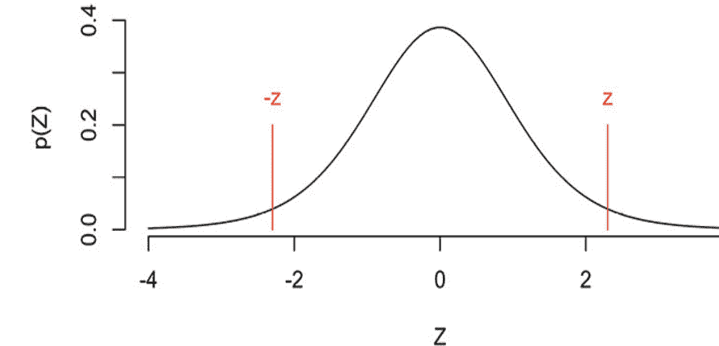

**图 1.8：** 正态检验统计量的示意图。对于“双侧”备择假设 $\beta \neq 0$，$p$ 值是超出 $z$ 或 $-z$ 的尾部体积。

最后，通常的检验过程是为 $p$ 值 $p$ 选择一个临界值 $\alpha$，并得出“显著性”（即真实的非零回归系数）的结论，当 $p < \alpha$ 时。这被证明为仅提供 $\alpha$ 的假阳性概率（在不存在实际回归关系的情况下得出存在关系的结论）。例如，在回归分析中，你可能仅当某个系数的 $p$ 值小于可接受的每次发现的误报风险时才得出结论 $\beta \neq 0$。如果你对这种风险的容忍度是 1%，即意味着 $\alpha = 0.01$，那么对于在线消费回归，你会得出带宽效应非零的结论（$2_{\mathrm{e}-16}$ 是 $2/10^{16}$，实际上为零），但决定在你的工作模型中保留 $\beta_{\text {anychildren }} = 0$。

**多重性问题** 打破了 $p$ 值与可靠性之间看似简单的关系。在通常的检验过程中，$\alpha$ 是针对单个检验的。如果你重复许多检验，大约 $\alpha \times 100\%$ 的真实零假设信号（例如，对应于不存在关系的回归系数）会错误地显现为显著。当你在大量虚假噪声中寻找稀有的真实信号时，这可能导致奇怪的结果。

想象一个回归估计问题，其中 100 个系数中有 5 个与结果存在真实关系。我们在这里会说真实的系数集是稀疏的：大多数 $\beta_{j}$ 为零。在最理想的情况下，当你运行假设检验时，你找到了所有五个真实信号（即没有假阴性）。假设你确实找到了所有五个，并用 $\alpha = 0.05$ 的显著性临界值对剩余的 95 个进行检验。在这种情况下，你预计会错误地得出 5% 的无用的 95 个变量具有显著性，导致你在最终模型中包含 $4.75 \approx 5$ 个虚假的回归变量。最终结果是，你使用了一个具有十个输入变量的模型，但事实上其中 50% 是与响应变量无关的垃圾数据！这种虚假发现比无用更糟糕：它们向你的模型中添加了噪声，并降低了预测的质量。

当高比例的“发现”是假阳性时，这种情况随着信噪比的降低而变得更加糟糕。例如，如果在 1000 个假设检验中只有一个真实信号，且 $\alpha=0.05$ 的临界值，那么你将拥有大约 $0.05 \times 999 \approx 50$ 个虚假发现。你的虚假发现（FD）比例将约为 $50/51 \approx 98\%$。这听起来可能很极端，但在像数字广告这样的应用中，真实信号少于 1/1000 是常态，其中真实信号是浏览器历史中指示未来购买意图的网站存在的罕见情况。

通常，你有

$$ FD \, 比例 = \frac{\# \, 假阳性}{\# \, 被判为显著的检验} $$

作为衡量通过虚假发现引入模型中的虚假噪声量的指标。FD 比例是拟合模型的属性。你无法知道它：要么你犯了错误，要么你没有。然而，你可以控制其期望值，即虚假发现率：

$$ FDR = \mathbb{E}[FDP] = \mathbb{E} \left[ \frac{\# \, 假阳性}{\# \, 被判为显著的检验} \right] $$

这是多重检验中假阳性概率的总和类似物，相当于单个检验的假阳性概率。因为概率只是二项随机变量的期望值，所以单个检验的 FDR 等于假阳性的概率——即我们之前所说的 $\alpha$。

正如我们在单个检验中使用 $\alpha$ 临界值程序来控制假阳性一样，你可以通过选择某些 $q$ 临界值（例如，0.1 是常见的）来确保 $FDR \leq q$。Benjamini–Hochberg (BH) 算法通过定义 $p$ 值排序列表的临界值来控制你的 FDR。

### **算法 3** Benjamini–Hochberg (BH) FDR 控制

对于 $N$ 个检验，具有 $p$ 值 {$p_{1} \, . . . \, p_{N}$} 和目标 FDR $q$：

- 将你的 $p$ 值从小到大排序为 $p_{(1)} \, . . . \, p_{(N)}$。
- 将 $p$ 值临界值设为 $p^{\star}= \max \left\{p_{(k)}: p_{(k)} \leq q \frac{k}{N}\right\}$。

那么，*拒绝区域* 是所有 $\leq p^{*}$ 的 $p$ 值的集合，这确保了 $\mathrm{FDR} \leq q$。

注意，$p_{(k)}$ 表示第 $k$ 个次序统计量。

BH 程序在视觉上最容易理解。考虑一个新的在线消费回归，我们的协变量集扩展到包括种族、民族和地区：

```
> spendy <- glm(log(spend) ~ .-id, data=browser)
> round (summary(spendy)$coef,2)
```

| | 估计值 | 标准误 | t 值 | Pr(>\|t\|) |
|---|---|---|---|---|
| (截距) | 5.86 | 0.16 | 36.34 | 0.00 |
| anychildren | 0.09 | 0.03 | 2.54 | 0.01 |
| broadband | 0.52 | 0.04 | 11.93 | 0.00 |
| hispanic | -0.18 | 0.04 | -4.30 | 0.00 |
| raceblack | -0.25 | 0.18 | -1.41 | 0.16 |
| raceother | -0.41 | 0.31 | -1.32 | 0.19 |
| racewhite | -0.21 | 0.15 | -1.36 | 0.17 |
| regionNE | 0.26 | 0.05 | 4.98 | 0.00 |
| regionS | 0.01 | 0.04 | 0.13 | 0.90 |
| regionW | 0.18 | 0.05 | 3.47 | 0.00 |

```
> pval <- summary(spendy)$coef[-1, "Pr(>|t|)"]
```

在最后一段代码中，我们提取了九个回归系数的 $p$ 值（不包括截距）。在**图 1.9**中，这些值根据其从小到大的秩绘制出来。**图 1.9**中的线具有 0.1/9 的斜率，这对应于 $N=9$ 和 $q=0.1$ 的 BH 临界线。**算法 3**中的配方现在很简单：找到低于此线的最大 $p$ 值，并称之为及所有更小的 $p$ 值“显著”。这五个点在图 1.9中显示；你期望其中大约 $ q = 0.1 $ （0 到 1 个值）是假阳性。

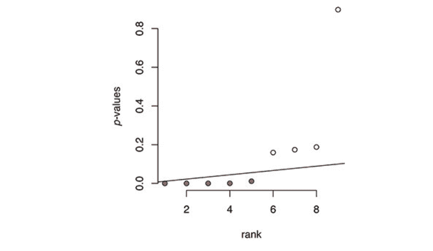

**图 1.9：** 在具有九个协变量的消费回归中用于 FDR 控制的 BH 算法。九个 p 值根据其秩绘制，且线的斜率为 0.1/9。低于此线的五个 p 值是“显著的”，以这种方式定义显著性的程序具有 10% 的 FDR。

- **为什么 BH 算法有效？** 解释需要一点概率论。首先，你知道来自真实零假设信号的 p 值服从均匀分布。为了看到这一点，考虑一个对应于从零假设分布中抽取的检验统计量 Z 的随机 p 值 p(Z)。p(Z) 的累积分布函数则是对于任意 p(z) ∈ (0, 1) 的 p(p(Z) < p(z))。这意味着

$$ \mathbf { p } ( \mathbf { p } ( Z ) < \mathbf { p } ( z ) ) = \mathbf { p } ( | Z | < | z | ) = \mathbf { p } ( z ) \tag { 1.8 } $$

使得零假设 p 值是一个随机变量 U，其中 $ \mathbf { p } ( U < u ) = u $。这是均匀随机变量的定义——特别是 U(0, 1) 随机变量，其密度如图 1.10 所示。

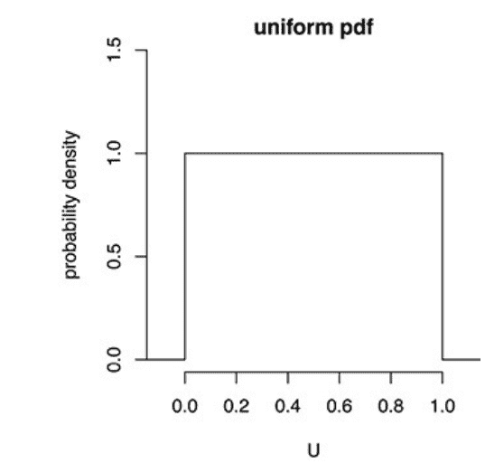

**图 1.10：** U (0, 1) 均匀随机变量的概率密度函数，通过 $\mathrm{p}(U \leq u)=u$ 对于 $u \in[0,1]$ 定义。

第二件需要知道的事情是，$N$ 个独立均匀样本的次序统计量都具有期望 $\mathbb{E}\left[p_{(k)}\right]=k /(N+1)$。这一事实源于均匀分布在零和一之间平均均匀分布。因此，在期望上，来自零假设的 $N$ 个 $p$ 值应遵循斜率为 $1 /(N+1)$ 的线，如图 1.11 中的黑点所示。同一图中的浅色三角形显示了从消费回归中观察到的 $p$ 值。这些观察到的 $p$ 值（除了最大的 $p(9)$ 之外）都比来自零假设 U $(0,1) p$ 值分布的抽取所预期的要小。也就是说，它们提供了一定程度的证据反驳零假设。


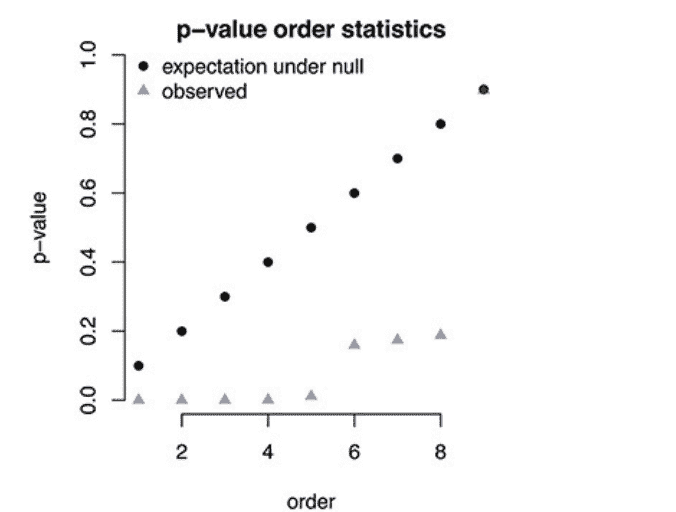

**图 1.11**：期望均匀顺序统计量 $\mathbb{E}[p_{(k)}]$ 及其秩 $k$。作为对比，我们也展示了图 1.10 中的 $p$ 值顺序统计量。

观测到的 $p$ 值顺序统计量与斜率为 $1/(N + 1)$ 的空假设线之间的差距，衡量了数据中有多少非空假设信号。但多大的差距是“显著”的？BH 算法指出，如果 $p$ 值位于斜率为 $q/N$ 的直线下方，则它们可以被称为显著的，且 FDR（错误发现率）不大于 $q$。对此的简单证明假设测试之间相互独立（见图 1.12）。不幸的是，测试之间的独立性是一个不切实际的假设。例如，在多元回归示例中，它并不成立：如果你从回归中移除一个变量，所有其他系数的 $p$ 值都会发生变化。这也是为什么在后续章节中，我们将求助于诸如 Lasso 等替代方法进行变量选择的重要原因。在此期间，你可以将 BH 算法视为对你 FDR 的一个相当好（但通常偏保守）的估计。如果你手头有一堆 $p$ 值且几乎没有其他背景信息，BH 程序是你量化 FDR 的首选方法。

$N$ = 测试总数，$N_0$ = 空假设数量。

设 $R(u)$ 为 $p$ 值 $\le u$ 的总数，$r(u)$ 为 $p \le u$ 的空假设数量。

与 BH 等效的截断值为

$$u^* = Max\left\{u: u \le q\frac{R(u)}{N}\right\}$$

因此 $\frac{1}{R(u^*)} \le \frac{q}{Nu^*}.$

$$\Rightarrow\text{ FDR 为 }\frac{r(u^*)}{R(u^*)} \le q\frac{r(u^*)}{Nu^*}\text{ \& 期望值 }q\frac{N_0}{N}$$

**图 1.12**：证明 BH 程序的 FDR（即期望 FDP，或 FDP）小于 $q$。

本章的一个主要观点是，当你与数据互动时，你做出了许多决策。生活不能简化为单次测试，多重性问题将始终存在。我们通过一个故事引入了多重性，说明了给定的 $a$（$p$ 值截断值）如何导致较大的 FDR：$a \rightarrow q(a)$。借助 BH 程序，我们反转了这一映射。BH 是一个配方，用于找到能给你想要的那个 FDR $q$ 的 $a$（$q$）：$q \rightarrow a(q)$。无论哪种情况，FDR 都是在拥有多个测试时总结风险的*唯一*方式。你永远不会再以旧的眼光看待假设检验！

### 更大 FDR 的示例

我们将考虑统计遗传学中的一个应用。一种被称为 GWAS（全基因组关联研究）的方法涉及扫描大型 DNA 序列以寻找与疾病的关联。希望的是，可以识别出一些有前景的 DNA 位点用于探索和实验室实验。由于这种实验成本高昂，在报告有前景位点列表时，理解 FDR——在这种情况下，进一步探索的期望失败率——至关重要。

单核苷酸多态性（SNP）是染色体上变化的成对 DNA 位点。出现频率较高的等位基因是主等位基因（符号为 $A$），另一个是次等位基因（$a$）。例如，常见的 SNP 摘要包括次等位基因频率（MAF）。

$$\text{MAF: } AA \rightarrow 0, \quad Aa/aa \rightarrow 1, \quad aa \rightarrow 2. \quad (1.9)$$

在此背景下，一个简单的 GWAS 询问：“哪些 SNP 的 MAF 分布随疾病变化？” MAF 与疾病状态之间的显著依赖性标志着该位点具有探索价值。

Willer 等人 [2013] 描述了胆固醇水平的 GWAS 元分析。我们将关注“坏”的 LDL 胆固醇。在 250 万个 SNP 中的每一个，他们都拟合了简单的线性回归

$$\mathbb{E}[LDL] = \alpha + \beta AF \, .$$

这里，AF 是“性状增加等位基因”的等位基因频率（你可以将其视为基本上是 MAF）。Willer 等人拥有 250 万个 SNP 位点，这意味着对 $\beta \neq 0$ 进行了 250 万次测试，从而得到 250 万个 $p$ 值。

这组 $p$ 值绘制在 **图 1.13** 中。回顾一下，来自空假设的 $p$ 值（在这种情况下，$\beta=0$ 且疾病–AF 无关联）是均匀分布的。**图 1.13** 中的直方图看起来*几乎*是均匀的，除了在零附近有一个由*额外小*的 $p$ 值组成的小尖峰。这个尖峰中的 $p$ 值看起来比真正的空假设分布中获得的更小，它们是发现的唯一希望。

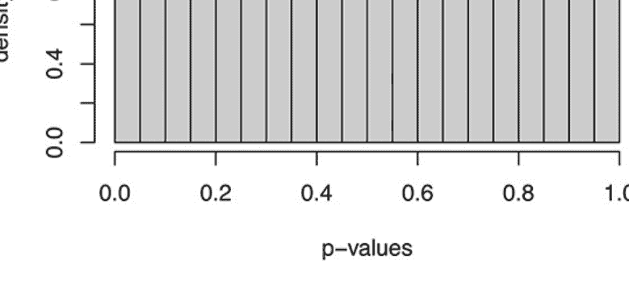

**图 1.13**：胆固醇 GWAS $p$ 值：哪些是显著的？

在此情况下应用 BH 算法的过程如图 1.14 所示。虽然图 1.13 中的分布看起来几乎是均匀的，但在最小的 $p$ 值中存在大量信号。在总共 250 万次测试中，我们发现大约 4000 个 $p$ 值在极小的 FDR $q = 10^{-3}$（或 0.1%）水平下是显著的。这意味着我们可以预期这 4000 个中只有大约 4 个是假阳性，表明这是一组强有力的候选位点，用于探索高胆固醇的遗传根源。

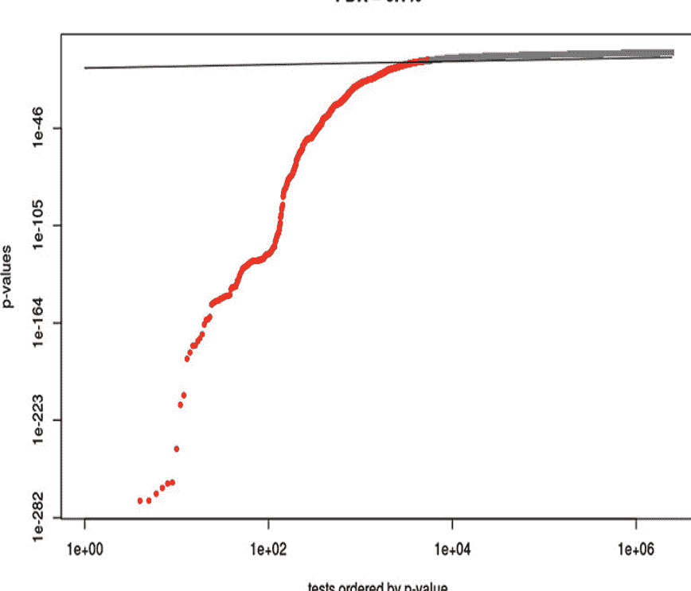

**图 1.14**：我们胆固醇 GWAS 中 BH 程序的可视化，其中 $q = 0.001$。绘制了定义拒绝区域的直线，其斜率为 $0.001/N$，该直线下方的大约 4000 个 $p$ 值在 FDR $< 0.001$ 时是显著的。

## 贝叶斯推断

迄今为止关于不确定性的所有讨论都集中在*频率学派*的不确定性上——即对应于从假设的固定结果总体中重复抽取的思想实验。这只是两种主要不确定性类型中的一种。另一种是*贝叶斯不确定性*，它通过诉诸主观信念而非重复试验来表征模型和参数的概率。$^9$

基于此的决策被称为*贝叶斯推断*。贝叶斯方法和思想的完整处理超出了本书的范围。对此，我推荐现在经典的参考文献 Gelman 等人 [2014] 以及 Hoff [2009] 的较短入门读物。然而，虽然我们将不会详细处理显式的贝叶斯推断，但这种思考不确定性的方式构成了本书所涵盖内容的许多基础。事实上，与频率学派相比，贝叶斯在商业数据科学的实践中扮演着同样大甚至更大的角色。当代机器学习的许多部分是由贝叶斯推断的理念驱动的，而正式的决策理论——风险量化和期望回报——本质上是贝叶斯的。对贝叶斯框架的基本理解将帮助你理解这些方法是如何开发的以及为什么它们有效。

贝叶斯推断是信念的数学框架。它形式化了“如果你相信 *A*，然后观察到 *B*，你应该更新你的信念到 *C*”的过程。这有时被称为*主观概率*，但你不需要任何人持有这些特定信念才能使框架有效。相反，贝叶斯推断提供了一个框架，将*假设*（以及对这些假设的信心程度）与证据相结合。当这些假设是清晰的，贝叶斯推断是完全透明的：你知道决策过程的所有输入，以及数据相对于先验知识所占的权重是明确的。

在机制上，贝叶斯推断通过先验分布和似然度的组合来工作。正如我们在下一章中详细阐述的那样，似然度是*给定*一组固定的模型参数时你观察到的数据的概率——即数据 *X* 和参数 *Θ* 的 p(*X* | *Θ*)，其中 | 表示“给定”或“条件于”。*先验分布* $\pi(\Theta)$ 是在你观察任何数据*之前* *Θ* 的概率分布。这种先验的选择是

你带入分析的假设，就像定义你似然度的模型一样。*后验*分布——观察数据后你的参数上的概率分布——可以通过贝叶斯法则获得：

$$\text{p}(\Theta|X) = \frac{\text{p}(X|\Theta)\pi(\Theta)}{\text{p}(X)} \propto \text{p}(X|\Theta)\pi(\Theta). \quad (1.10)$$

这里，回忆 $\propto$ 代表“成正比”。*边缘似然度*

$$\text{p}(X) = \int \text{p}(X|\Theta)\pi(\Theta)d\Theta,$$

是在假设的似然度模型下，在对所有可能的 $\Theta$ 值取平均后的数据概率。由于它不依赖于 $\Theta$（推断的名义目标），p(X) 对贝叶斯推断来说主要是一个麻烦因素。通过马尔可夫链蒙特卡洛（MCMC）$^{10}$估计方程 1.10 的计算策略，是规避显式计算 p(X) 需要的一次成功尝试。这一策略在很大程度上归功于贝叶斯推断在 1990 年代和 2000 年代的爆发。

获得贝叶斯推断直觉的一个好方法是玩转*共轭模型*。这些是先验和似然度的组合，使得随着你积累数据，后验分布保持与先验相同的族。后验更新的机制可以被写出并明确化。一个直观的示例是 Beta-Binomial 模型，其中你有具有恒定成功概率 *q* 的二项式试验。*q* 的先验分布是一个 Beta 分布：

$$\pi(q) = \text{Beta}(q; \alpha, \beta) \propto q^{\alpha-1}(1-q)^{\beta-1}\mathbb{1}_{[q \in (0,1)]}. \quad (1.11)$$

例如，Beta(1, 1) 先验产生 $\pi(q) = \mathbb{1}_{[q \in (0, 1)]}$，即熟悉的均匀分布。再次注意，$\propto$ 符号意味着“成正比”，并且在方程 1.11 中我们忽略了一个确保对于所有 $\alpha, \beta > 0$ 都有 $\int_{0}^{1}\pi(q)dq = 1$ 的归一化常数。

每个二项式实现可以被视为伯努利试验（例如，加权硬币的投掷）的组合，其中 *x* 以概率 *q* 等于 1，以概率 1 − *q* 等于 0。在 *q* 上的 Beta(*a*, *b*) 先验分布下，在对 *x* 进行单次伯努利实现后，*q* 的*后验*分布变为


$p(q|x)=\operatorname{Beta}(a_1=a+x,\ b_1=b+1-x).\qquad\qquad\qquad\qquad(1.12)$

以这种方式在 $n$ 次试验中更新时，$an$ 可以解释为观察到的“成功”次数，而 $bn$ 则是 $n$ 次试验中观察到的“失败”次数。随着你运行更多的试验（即你抛硬币的次数更多），这些参数会增长，而你对 $q$ 的不确定性则会降低。例如，由于 $\operatorname{Beta}(\alpha, \beta)$ 分布的均值是 $\alpha/(\alpha+\beta)$，在 $\operatorname{Beta}(1, 1)$ 先验下，单次成功试验得到的均值为 $\mathbb{E}[\ q\ |\ x_1\ ]=2/3$。另一次成功试验得到的均值为 $\mathbb{E}[\ q\ |\ x_1,\ x_2\ ]=3/4$。**图 1.15** 展示了贝塔-二项式后验分布在众多模拟二项式试验中的更新过程，从平坦的均匀先验移动到在 $100$ 次试验后围绕真实概率 $1/3$ 的高斯式峰值。

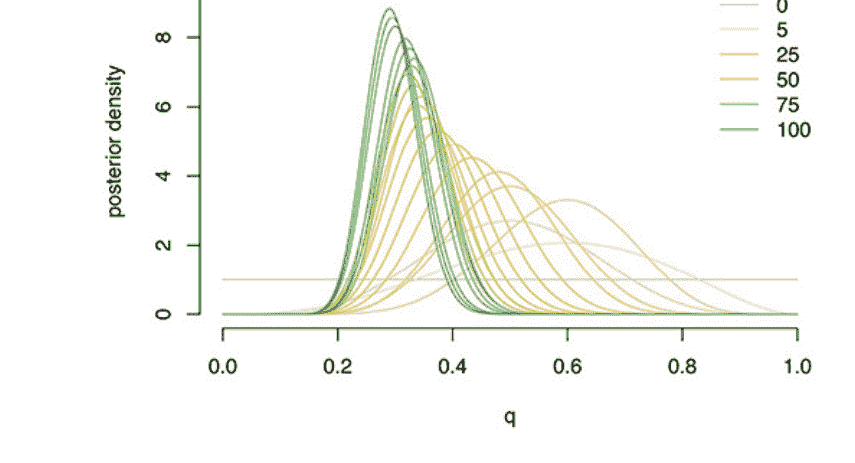

图 1.15：$q_1$（伯努利试验系列（硬币翻转）中的成功概率）的后验密度函数，作为样本量（翻转次数）的函数，在 $\operatorname{Beta}(1, 1)$ 先验下。这里的“真实”概率是 $1/3$。

通过这个例子可以看出，贝叶斯推断本质上是*参数化*的：你指定一个依赖于一组参数的模型，而公式 1.10 中的更新公式定义了这些参数的不确定性如何随着观察数据而变化。这与*非参数*推断的思想形成对比，在非参数推断中，你量化给定程序结果的不确定性，而不假设该程序背后模型的正确性。确实存在“非参数”贝叶斯分析领域，但这个名称是一种误称。该领域更接近我所说的*半参数*方法：它应用灵活的模型，可以放宽常见假设（例如线性），但仍依赖于限制性的模型结构以促进高维推理（参见第 9 章）。

布拉德利·埃弗龙（Bradley Efron）$^{12}$ 将贝叶斯推断与参数化自助法（parametric bootstrap）进行比较，这可能有助于你建立对贝叶斯推断实际应用的直觉。他指出，在某些常见先验下，参数化自助法会产生一个与相应贝叶斯后验分布相似的抽样分布。回顾前文，参数化自助法与非参数自助法一样，使用重复的模型拟合来量化不确定性。然而，与从原始数据中重采样不同，参数化自助法首先使用完整样本*估计*模型，然后从拟合的模型中*模拟*生成每次模型拟合的数据。因此，参数化自助法通过从假设的*参数*模型中模拟来量化不确定性。

如果假设的模型不正确，参数化自助法的结果可能与现实几乎没有联系。相比之下，非参数自助法（我们在前文中已详细讨论）即使你的估计器基于愚蠢的假设，也能为你提供准确的估计不确定性量化。然而，*参数*自助法需要的数据少得多，并且如果你的模型正确，它在极高维空间中也能“奏效”。它是当更稳健的程序无法实施时的一个实用选项。这一特征同样适用于许多贝叶斯程序。

理想情况下，在做出商业决策时，一切都是非参数化的：你总是积累足够的数据，使得先验信念不再相关，并且你的工作方式对模型假设不敏感。当然，现实是每一个决策都涉及不确定性，并将基于直觉（先验）和数据。但在我们关于因果和结构推断的内容中——第 5 章和第 6 章——我们确实会关注稳健的推断，虽然它并不总是非参数化的，但至少当我们的模型不完全正确时，它有一些保证是有效的。这是一个很好的特性，并且在推断目标低维（通常是一维）且我们拥有大量样本数据的因果推断环境中是可以实现的。

不幸的是，仅在这种数据丰富的环境中——当你有许多观察（大的 *n*）和低维推断目标（小的 *p*）时——模型自由推断（model-free inference）才是可能的。承接我们之前关于非参数自助法的讨论，如果你的*观察*数据对总体分布的描述不佳，你在非参数方法上将会失败。正如我们在多重检验讨论中已经看到的，一般频率学派的推断在高维环境中变得困难，你所能希望的最佳结果只是控制某种平均错误发现率。贯穿全书你会发现，许多现代数据科学发生在超高维环境中。在这样的环境中，你没有奢侈的空间采用非参数方法。相反，为了获得可行的结果，你需要对模型做出假设，并对这些模型的参数给出一些合理的*先验*猜测。贝叶斯是促进这一过程的语言。

在本书的其余部分，你将接触到贝叶斯思想，而它们不会总是被明确称为贝叶斯的。例如，**第 3 章**中的惩罚项可以解释为贝叶斯先验的影响，而 **第 9 章**中随机森林背后的集成方法是贝叶斯模型平均的一种版本。在这些情况下，我们通常不会直接讨论推断。相反，我们所使用的方法将被设计为产生点估计，这些点估计在不确定性很大的高维环境中表现良好。这是贝叶斯方法的优势，也是模型构建者倾向于像贝叶斯主义者那样思考的原因。要构建一个在仅提供杂乱无结构数据时也能*有效*的学习算法，你需要一个框架，让你能够引入先验经验，并透明地展示如何结合数据与信念。

### 尾注

- 1. 参数化分析量化了在假设真实模型条件下的不确定性，而非参数化分析允许模型误设。有关非参数化推断的例子，请参见第 5、6 和 9 章（以及本章关于自助法的内容）。
- 2. 存在许多不同类型的自助法，我们在这里仅介绍两个主要算法。有关自助法完整领域的实用指南，参见 Davison and Hinkley [1997]。
- 3. Matt Taddy, Hedibert Lopes, and Matt Gardner. Scalable semi-parametric inference for the means of heavy-tailed distributions. *arXiv:1602.08066*, 2016b.
- 4. 另见第 3 章关于不确定性量化的部分，其中使用参数化自助法为 lasso 算法提供推断。
- 5. 将推导的所有步骤作为练习填完，以对比总体期望和样本期望，这是一个很好的练习。
- 6. 子样本 *n* = 100 足够小，这种偏差会产生影响。在全样本中，正如本书大多数应用一样，*n* 足够大，这种偏差几乎不起作用，你不需要担心它。
- 7. 大多数入门统计学教材花大量时间区分 *z* 统计量和 *t* 统计量，前者服从正态分布，后者服从学生 *t* 分布。在本书中，样本量足够大，每当出现这种区分时，结果将近似服从正态分布。当分布非正态时，它们也不会是学生 *t* 分布，你将依赖自助法。
- 8. Y. Benjamini and Y. Hochberg. Controlling the false discovery rate: A practical and powerful approach to multiple testing. *Journal of the Royal Statistical Society, Series B*, 57:289–300, 1995.
- 9. 请查阅 Hacking [1975]，其中对概率概念以及频率学派和贝叶斯学派的起源进行了精彩的探讨。
- 10. Alan E. Gelfand and Adrian F.M. Smith. Sampling-based approaches to calculating marginal densities. *Journal of the American Statistical Association*, 85 (410):398–409, 1990.
- 11. 简称为 $npBayes$，这是我博士论文的研究领域。在 2000 年代，机器学习（ML）和 npBayes 之间有着极好的跨学科交流：这两个领域都在努力构建计算上可行的算法，在超高维模型中给出合理的推断结果。当前深度学习社区的许多人都有根源于或连接至 npBayes 社区。
- 12. Bradley Efron. Bayesian inference and the parametric bootstrap. *The Annals of Applied Statistics*, 6, 2012.


## 回归

应用数据科学中的绝大多数问题都需要回归建模。也就是说，你拥有一个*响应变量*（y），希望将其建模或预测为输入向量或协变量（x）的函数。本章介绍回归的基本框架和语言。本书的其余部分将在此内容基础上进行扩展。

### 线性模型

一种基本但强大的回归策略是处理*平均值*和*直线*。我们将 y 在给定 x 下的条件均值建模为：

```
E[y | x] = f(x′β). (2.1)
```

这里，$x = [1, x_1, x_2, ..., x_p]$ 是协变量向量，$\beta = [\beta_0, \beta_1, \beta_2, ..., \beta_p]$ 是对应的系数。*向量*表示法 $x' \beta$ 是逐元素乘积之和的简写形式：

```
x′β = β₀ + x₁β₁ + x₂β₂ + ... + x_pβ_p. (2.2)
```

在此，为了便利起见，我们包含了 $x_0 = 1$ 作为截距项（或者，我们有时写 $a = \beta_0$ 以表示显式截距）。符号 E 表示期望，因此 $E[y | x]$ 读作“给定输入 $x$ 时响应 $y$ 的平均值”。函数 $f(.)$ 表示任意通用函数；我们将考虑该“链接函数” $f$ 的不同形式，以适应不同类型的响应 $y$。

回归的核心在于理解“给定 $x$ 时 $y$”的条件概率分布，我们将其写为 $\mathrm{p}(y \mid x)$。图 2.1 展示了条件分布与边缘分布的对比。边缘分布之所以得名，是因为它对应于数据矩阵中单个边缘（即列）的无条件下分布。虽然边缘均值是一个简单的数值，但条件均值是一个函数（例如 $x\beta$）。数据围绕这些均值随机分布，你对该分布所做的假设将驱动你的估计和预测策略。

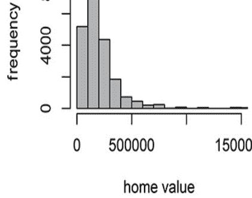

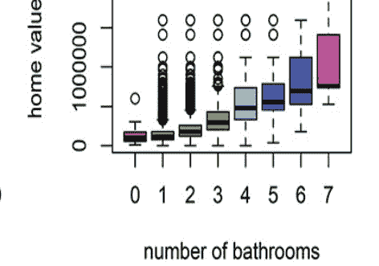

图 2.1：房价边缘分布与条件分布的示意。左侧，所有房价被归为一组。右侧，房价分布按浴室数量拆分。

我们将研究的第一个模型是基本线性回归模型。这是数据科学的基石。它拟合速度快（无论是分析师时间还是计算时间），在各种设置下都能给出合理的答案（前提是你知道如何提出正确的问题），而且易于解释和理解。

模型如下：

```
$\mathbb{E}[y \mid \boldsymbol{x}]=\boldsymbol{x}^{\prime} \boldsymbol{\beta}=\beta_{0}+x_{1} \beta_{1} \ldots+x_{p} \beta_{p}$
```

这相当于在式 2.1 的回归模型中使用链接函数 $f(z)=z$。如果只有一个输入 $x$，你可以将模型写为 $\mathbb{E}[y \mid x]=\alpha + x\beta$，并如**图 2.2**所示进行绘图。这里，每当 $x$ 增加一个单位，$\mathbb{E}[y \mid x]$ 就会增加 $\beta$，而 $\alpha$ 是*截距*：$\alpha = \mathbb{E}[y \mid x = 0]$。

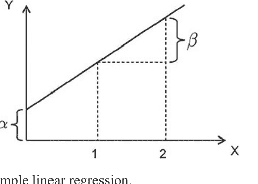

图 2.2：简单线性回归。

在估计回归模型时——即拟合 $\beta$ 系数时——你会对完整条件*分布*（除了其在 $\mathbb{E}[y \mid x]$ 处的中心之外）做出一些假设。线性回归通常针对高斯条件分布进行拟合：

$y \mid \boldsymbol{x} \sim \mathsf{N}(\boldsymbol{x}^{\prime}\boldsymbol{\beta},\,\sigma^{2})$. (2.4)

也就是说，$y$ 作为 $x$ 函数的分布围绕 $\mathbb{E}[y \mid x] = \boldsymbol{x}^{\prime}\boldsymbol{\beta}$ 呈正态分布，*方差*为 $\sigma^{2}$。同一模型通常也写作带有加性误差项的形式：

$y = \boldsymbol{x}^{\prime}\boldsymbol{\beta} + \varepsilon,\;\text{其中}\;\varepsilon \sim \mathsf{N}(0,\,\sigma^{2}).$ (2.5)

式 2.4 和 2.5 描述的是同一个模型。

作为一个具体例子，考虑 Dominick’s 杂货店的橙汁（OJ）销售数据。Dominick’s 是芝加哥地区的一家连锁超市。该数据收集于 20 世纪 90 年代，可从芝加哥大学布斯商学院的 Kilts 中心公开获取。数据包括 83 家芝加哥地区门店中三个 OJ 品牌——Tropicana、Minute Maid、Dominick’s——的每周价格和销量（以移动箱数计），以及一个指示变量 *feat*，显示该周每个品牌是否进行了广告推广（店内或传单）。

```
> oj <- read.csv("oj.csv")
> head(oj)
```
|   | sales |   | price | brand     | feat |
|---|-------|---|-------|-----------|------|
| 1 | 8256  |   | 3.87  | tropicana | 0    |
| 2 | 6144  |   | 3.87  | tropicana | 0    |
| 3 | 3840  |   | 3.87  | tropicana | 0    |
| 4 | 8000  |   | 3.87  | tropicana | 0    |
| 5 | 8896  |   | 3.87  | tropicana | 0    |
| 6 | 7168  |   | 3.87  | tropicana | 0    |
```
> levels(oj$brand)
[1] "dominicks" "minute.maid" "tropicana"
```

图 2.3 展示了按品牌划分的单价和销量。我们可以看到每个品牌占据一个明确的价格区间：Dominick's 是经济型选择，Tropicana 是奢侈型选择，Minute Maid 介于两者之间。在图 2.3 的右侧面板中，我们看到销量显然随着价格上涨而下降。这合乎逻辑：需求是向下倾斜的，如果你收费更高，卖出的就更少。更具体地说，销量对数与价格对数之间似乎存在大致线性关系。这是一个重点。每当使用线性（即加性）模型时，关键在于尝试在预期能找到线性关系的空间中工作。对于随其他因素呈乘性变化的变量，这通常是对数尺度。

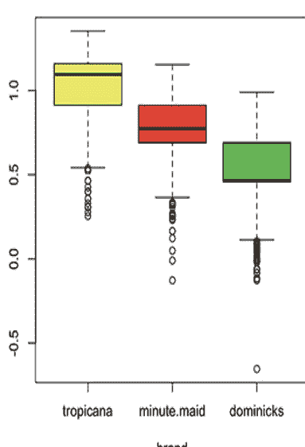

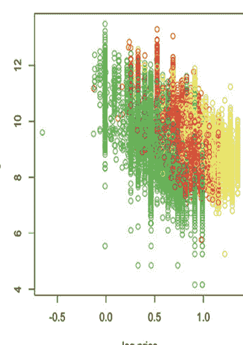

图 2.3：Dominick’s 橙汁各品牌的单价和销量（移动量）。注意两个连续变量均使用了对数尺度。

回顾对数的定义，

$$\log(a) = b \Leftrightarrow a = e^{b} . \quad \quad \quad \quad \quad \quad \quad \quad \quad \quad \quad \quad (2.6)$$

这里，$e \approx 2.72$ 是自然对数的底。我们将始终使用自然对数。底数 $e$ 在动态系统的科学和建模中起着核心作用，因为 $e^x$ 是其自身的导数：$d e^x / dx = e^x$。在对数响应的线性模型中，每当 $x$ 增加一个单位，$\beta$ 会被加到 $\log(y)$ 上：

$$\log(y) = \alpha + \beta x. \quad \quad \quad \quad \quad \quad \quad \quad \quad \quad \quad \quad (2.7)$$

我们在对数空间工作的事实使该模型在 $y$ 上是*乘性*的。回顾关于对数和指数的一些基本事实：$\log(ab) = \log(a) + \log(b)$，$\log(a^{b}) = b \, \log(a)$，以及 $e^{a+b} = e^{a}e^{b}$。对式 2.7 两边取指数：

$$y = e^{\alpha}e^{\beta x} . \quad \quad \quad \quad \quad \quad \quad \quad \quad \quad \quad \quad \quad (2.8)$$

考虑 $x^{*} = x + 1$，我们看到

$$y^{\star} = e^{\alpha} e^{\beta x^{\star}} = e^{\alpha} e^{\beta x + \beta} = ye^{\beta}.$$

(2.9)

因此，$x$ 每增加一个单位，$y$ 会被*乘以*因子 $e^{\beta}.$

你将如何知道变量何时应被建模为乘性变化？一个指标是日常语言。留意那些其变化通常以百分比而非绝对值表达的变量。例如，以下两者通常都在对数空间建模：

- 价格：“*被没收的房屋以 20% 至 30% 的折扣出售。*”
- 销售：“*你的同比销量在所有型号中增长了 20%。*”

更一般地，严格非负的变量（例如，波动率、错误或事件的计数、降雨量）通常被视为在对数尺度上线性变化。

另一种常见场景是建模两个*都*呈乘性变化的相互对比的变量。例如，**图 2.4** 显示了几个国家的国民生产总值（GDP）与进口额。如果要在左图中拟合一条直线，那是愚蠢的；其斜率将完全由美国数值的微小变化决定。相反，右图表明在对数空间中，GDP 和进口额遵循一条整洁的线性关系。

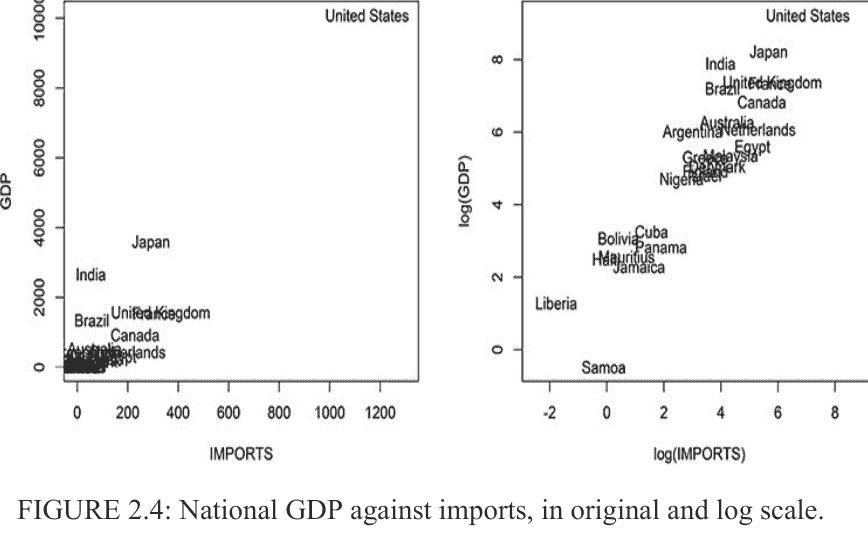

回到我们的橙汁例子，**图 2.3** 表明这种*对数-对数*模型可能适用于我们的橙汁销量与价格分析。一种可能的


回归模型随后为

$$ \log(sales) = \alpha + \beta \log(price) + \varepsilon \quad (2.10) $$

这意味着，无论品牌如何，日志价格每增加一个单位，日志销售额就会增加 $\beta$。

幸运地是，对数-对数模型具有更直观的解释：价格每增加 1%，销售额就会增加 $\beta\%$。为了理解这一点，请写下 $y=\exp [\alpha+\beta \log(x)+\varepsilon]$ 并对 $x$ 进行微分：

$$ \frac{d y}{d x}=\frac{\beta}{x} e^{\alpha+\beta \log(x)+\varepsilon} \Longrightarrow \beta=\frac{d y / y}{d x / x} \quad (2.11) $$

这里，$\beta$ 是 $y$ 的相对变化量与 $x$ 的相对变化量的比值。在经济学中，这种 $\beta$ 有一个专门的名称：弹性。弹性概念将在我们的许多分析中发挥重要作用。

如果你查看图 2.3 的右侧面板，可以明显看出三个品牌的对数-对数销售额-价格分布集中在三条独立的直线上。如果你怀疑每个品牌具有相同的 $\beta$ 弹性但不同的截距 $\alpha$，那么你可以使用一个稍微复杂的模型：

$$ \log(sales) = \alpha_{brand} + \beta \log(price) + \varepsilon \quad (2.12) $$

这里，$\alpha_{brand}$ 是表示每个橙汁品牌独立指示变量的简写，我们可以更完整地将其写为

$$ \boldsymbol{\alpha}_{brand}=\boldsymbol{\alpha}_{d} \mathbb{I}_{[brand=dominicks]}+\boldsymbol{\alpha}_{m} \mathbb{I}_{[brand=minute maid]}+\boldsymbol{\alpha}_{t} \mathbb{I}_{[brand=tropicana]} $$

因此，方程 2.12 表明，尽管所有品牌的销售额对价格的弹性相同，但在相同的价格下，它们的预期销售额是不同的。

要在 R 中运行此回归，我们可以使用 `glm` 命令。如前所述，`glm` 代表“广义线性模型”，我们将用它来执行线性回归和逻辑回归。该命令的使用非常直观：你通过 `data` 参数提供一个数据框，并提供一个定义回归的公式。

```r
> reg <- glm(y ~ var1 + ... + varP, data=mydata)
```

拟合对象 `reg` 是一个包含有用内容的列表（使用 `names(reg)` 可以查看这些内容），并且有函数用于访问结果：`summary(reg)` 会打印大量信息，`coef(reg)` 给出系数，`predict(reg, newdata=mynewdata)` 进行预测。我们使用 `glm` 拟合方程 2.12 中的回归并访问系数：

```r
reg <- glm(log(sales) ~ brand + log(price), data=oJ)
coef(reg) ## fitted coefficients
         (Intercept) brandminute.maid  brandtropicana       log(price) 
       10.8288216        0.8701747       1.5299428      -3.1386914
```

这里有几点值得注意。首先，我们看到对数价格效应 $\hat{\beta} = -3.1$：价格每上涨 $1\%$，销售额大约下降 $3\%$。其次，请注意 Minute Maid 和 Tropicana 有单独的模型系数，而 Dominick’s 没有。`glm` 的第一步是创建一个定义数值输入 $x$ 的*模型矩阵*（也称为*设计矩阵*）。它是通过对 `model.matrix` 函数的调用来实现这一点的，你可以单独提取这一步骤以查看它是如何工作的：

```r
x <- model.matrix(~ log(price) + brand, data=oJ)
x[c(100,200,300),]
        (Intercept) log(price) brandminute.maid brandtropicana
100                1  1.1600209              0              1
200                1  1.0260416              1              0
300                1  0.3293037              0              0
```

由于 `brand` 不是数字，`model.matrix` 将这些类别扩展为几个虚拟变量。例如，`brandtropicana` 在 Tropicana 的行中为 1，否则为 0。作为对比，请考虑原始数据框中的相同行：

```r
oJ[c(100,200,300),]
  sales price    brand  feat
100  4416  3.19  tropicana     0
200  5440  2.79 minute.maid     0
300  51264 1.39  dominicks     1
```

没有 `branddominicks` 指示变量，因为只需要三个变量来表示三个类别：当 `brandminute.maid` 和 `brandtropicana` 均为零时，截距项给出了在对数价格为零时 Dominick’s 的对数销售额值。每个因子的参考水平被截距项吸收，其他系数则是“相对于参考水平的变化”（在此处为 Dominick’s）。要检查因子的参考水平，请输入 `levels(myfactor)`。第一个水平即为参考水平。若要更改此设置，可以执行 `myfactor = relevel(myfactor, "myref")`。

方程 2.12 中回归的拟合值与原始数据一起展示在图 2.5 中。你会看到三条根据品牌身份平移的线。在相同的价格下，Tropicana 的销量高于 Minute Maid，而后者又高于 Dominick’s。这很合乎逻辑：Tropicana 是一种在相同价格下更受偏好的奢侈品。

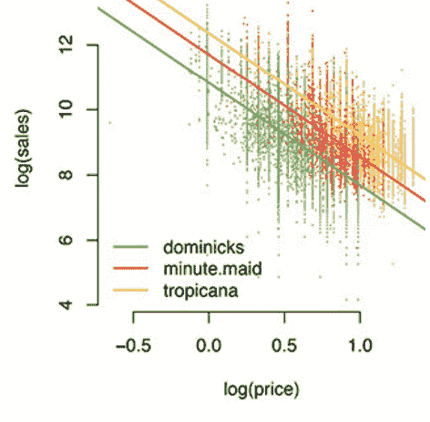

**图 2.5：** 橙汁数据以及在方程 2.12 模型下每个品牌的拟合均值。

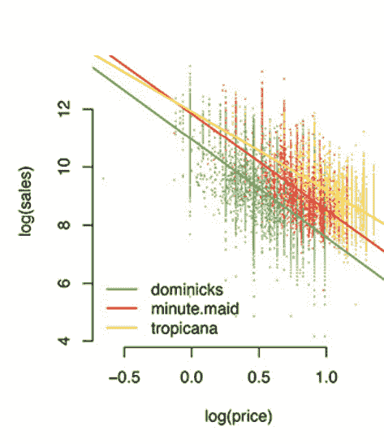

**图 2.6：** 方程 2.14 模型的拟合情况。注意，如果外推太远，线性假设意味着在相同价格下 Tropicana 的销量会低于 Minute Maid。这是一个提醒：线性模型是近似值，在远离观测数据中心时应谨慎使用。

图 2.5 中所有的线具有相同的斜率。从经济角度来看，该模型假设三个品牌的消费者对价格的敏感度相同。这似乎不切实际：与 Dominick’s 的平均消费者相比，资金对 Tropicana 客户来说不太重要。你可以通过让对数价格与品牌进行交互来将这种信息纳入回归分析中。

交互项是两个输入变量乘积上的系数：

$$ E[y|x] = \dots + \beta_k x_k + \beta_j x_j + x_j x_k \beta_{jk} \quad (2.13) $$

在此方程中，$x_j$ 增加一个单位的影响是 $\beta_j + x_k \beta_{jk}$，这取决于 $x_k$。交互项是科学和商业问题的核心。例如：

- 性别是否改变了教育对工资的影响？
- 服用药物 X 时患者恢复得是否更快？
- 消费者的价格敏感度在不同品牌间如何变化？

在每种情况下，你都想知道一个变量是否调节了另一个变量的影响。你不想知道女性是否比男性赚得少（事实如此：只需计算平均值的简单差异）。相反，你想知道她们是否在拥有相同的教育水平和准备程度下得到不公正的补偿。类似地，在许多医疗情况下，如果给予足够的时间，身体会自愈；那么问题在于你的治疗是否能加速恢复。

在我们的价格敏感度例子中，我们希望包含每个品牌指示项与对数价格之间的交互。我们可以使用 `glm` 输入公式中的 `*` 项来实现这一点：

```r
> reg_interact <- glm(log(sales) ~ log(price)*brand, data=oj)
> coef(reg_interact)
              (Intercept)        log(price) 
         10.95468173       -3.37752963 
    brandminute.maid     brandtropicana 
         0.88825363         0.96238960 
log(price): brandminute.maid log(price): brandtropicana 
         0.05679476         0.66576088
```

我们现在拟合了一个具有每个品牌 $b$ 单独截距和斜率的模型：

$$ \mathbb{E}[\log(y) \mid \boldsymbol{x}] = \alpha_b + \beta_b \log(price) \quad (2.14) $$

与之前一样，参考类别是 `dominicks`；该品牌被吸收进截距项和对数价格的主要斜率项中。通过将 `log(price):brand` 交互项添加到这个主要斜率中，你可以找到其他品牌的弹性。结果见**表 2.1**。我们看到 Tropicana 客户对价格的敏感度低于其他品牌：$-2.7$ 对大约 $-3.3$。方程 2.10 模型中的价格敏感度 $-3.1$ 是这两类截然不同的消费者群体的平均值。

**表 2.1：** 在方程 2.14 模型下拟合的价格弹性。

| Dominick's | Minute Maid | Tropicana |
|:----------:|:-----------:|:---------:|
| -3.4       | -3.3        | -2.7      |

我们以线性模型的介绍——以及橙汁的研究——来结束本节，通过查看广告在销售额与价格关系中的作用。回想一下，橙汁数据包含一个 `feat` 虚拟变量，表示在记录销售额和价格的那一周，该品牌是否通过店内展示促销或传单广告进行了推广。广告可以

增加所有价格下的销售额，它们可以改变价格敏感度，并且它们可以以品牌特异性的方式同时做到这两点：

\[ \mathbb{E}[\log(y) \mid \boldsymbol{x}] = \alpha_{b,\text{feat}} + \beta_{b,\text{feat}} \log(\text{price}). \tag{2.15} \]

这编码了价格、品牌和特征三者之间的交互作用。

```
> ojreg <- glm(log(sales) ~ log(price)*brand*feat, data=oj)
> coef(ojreg)
```

| 术语 | 系数 |
| :--- | :--- |
| (Intercept) | 10.40657579 |
| log(price) | -2.77415436 |
| brandminute.maid | 0.04720317 |
| brandtropicana | 0.70794089 |
| feat | 1.09440665 |
| log(price):brandminute.maid | 0.78292310 |
| log(price):brandtropicana | 0.73579299 |
| log(price):feat | -0.47055331 |
| brandminute.maid:feat | 1.17294361 |
| brandtropicana:feat | 0.78525237 |
| log(price):brandminute.maid:feat | -1.10922376 |
| log(price):brandtropicana:feat | -0.98614093 |

品牌和广告的特异性弹性汇总在**表 2.2**中。

**表 2.2：** 品牌依赖和广告依赖的弹性。通过从 **R** 输出中恢复这些数字来测试你对回归方程的理解。

| | *Dominick's* | *Minute Maid* | *Tropicana* |
|---|---|---|---|
| 未做广告 | $-2.8$ | $-2.0$ | $-2.0$ |
| 做了广告 | $-3.2$ | $-3.6$ | $-3.5$ |

我们可以看到，做广告总是导致更高的价格敏感度。Minute Maid 和 Tropicana 的弹性在做了广告后从 -2 降至 -3.5 以下，而 Dominick's 则从 -2.8 降至 -3.2。为什么会这样？一个可能的解释是，广告增加了正在考虑你品牌的消费者群体。特别是，它可以将你的市场扩展到品牌忠实顾客之外，涵盖那些比每周惯性地购买你橙汁的人对价格更敏感的人。事实上，如果你观察到价格敏感度增加，这可能表明你的营销努力正在扩大你的消费者基础。这就是为什么营销基础课程规定广告活动通常应伴随价格下调的原因。还有一种替代解释。由于做广告的产品通常也会打折，需求曲线可能并非线性的——在较低的价格点上，平均消费者对价格更敏感。真相可能是这些效果的结合。

最后，请注意在表 2.1 中，Minute Maid 的价格弹性与 Dominick’s 的相似——它的表现像是一个预算产品。然而，在表 2.2 中，我们看到 Minute Maid 和 Tropicana 具有几乎相同的弹性，且两者都与 Dominick’s 不同。发生了什么？

答案是，方程 2.14 中过于简单的模型导致了广告效应和品牌效应的混淆。图 2.7 显示 Minute Maid 做广告的频率高于 Tropicana。由于做广告会导致更高的价格敏感度，如果我们不考虑广告的影响，Minute Maid 就会在表面上显得对价格更敏感。方程 2.15 中的模型通过在回归中包含 feat 来纠正这一点。这种现象——即如果你没有正确控制变量，变量的效应可能会混淆——将在后面关于因果推断和结构推断的讨论中扮演重要角色。

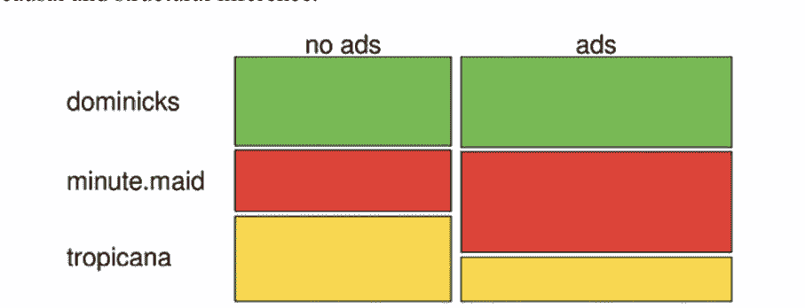

**图 2.7：** 按品牌划分的广告量的马赛克图。

## 逻辑回归

线性回归只是线性建模框架的一个实例。另一种技术（在实践中甚至更常见）是*逻辑回归*。这种策略用于建模*二元响应*：即 $y$ 为 0 或 1（真或假）。

二元响应出现在许多预测目标中：

- 这个人会付账单还是会违约？
- 这是一个点赞还是差评？
- 埃德蒙顿油人队这场比赛会赢还是会输？
- 作者是共和党人还是民主党人？

即使感兴趣的响应不是二元的（例如，收入），有时你的决策相关信息也是二元的（例如，盈利与亏损），在这种情况下，以这些术语思考是最简单的。

回顾一般线性模型规范：$\mathbb{E}[y|x]=f(x'\beta)$。当响应 *y* 为 0 或 1 时，条件均值变为

$\mathbb{E}[y|x]=\mathrm{p}(y=1|x)\times 1+\mathrm{p}(y=0|x)\times 0=\mathrm{p}(y=1|x)$。

因此，你正在建模的期望是一个*概率*。这意味着你需要选择*链接函数* $f(x'\beta)$，使其值在 0 到 1 之间：

$\mathrm{p}(y=1|x)=f(\beta_0+\beta_1x_1\dots+\beta_px_p)$。

逻辑回归使用*logit*链接函数：

$\mathrm{p}(y=1|\mathbf{x})=\frac{e^{x'\beta}}{1+e^{x'\beta}}=\frac{\mathrm{exp}[\beta_0+\beta_1x_1\dots+\beta_px_d]}{1+\mathrm{exp}[\beta_0+\beta_1x_1\dots+\beta_px_d]}$。

参见**图 2.8**以了解 logit 函数的图像。要查看该链接如何工作，请考虑 $x'\beta$ 的极值。在大的负值处，$f(-\infty)=0/(1+0)=0$，且 $y=1$ 的概率为零。在大的正值处，$f(\infty)=\infty/(\infty+1)=1$，且 $y=1$ 是确定的。因此，logit 链接将数字的“实数轴”映射到 [0, 1] 的概率空间。

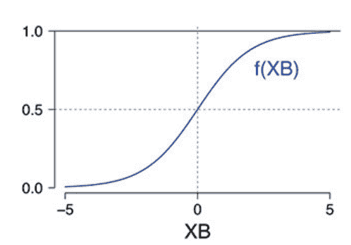

**图 2.8：** 一个逻辑链接函数。

为了解释 $\beta$ 系数，写出 $\mathrm{p} = \mathrm{p}(y = 1 \mid x)$，并通过简单的代数运算可知

$$ \log \bigg[ \frac { p } { 1 - p } \bigg] = \beta _ { 0 } + \beta _ { 1 } x _ { 1 } + . . . + \beta _ { p } x _ { p } . $$

因此，逻辑回归是对数几率的线性模型。事件的几率是该事件发生的概率与不发生的概率之比。例如，如果一个事件发生的概率为 1/4，那么它的几率就是“四分之一”，即 1/3。你现在应该习惯的是，[现在] 响应是二元的，并且你添加参数 `family='binomial'`。响应变量可以具有多种形式：数值型（$0/1$）、逻辑型（**TRUE**/**FALSE**）、因子型（例如，*win/lose*），甚至可以是双列二元矩阵。在邮件数据中，垃圾邮件为 $y = 1$，重要邮件为 $y = 0$。

```r
> spammy <- glm(spam ~ ., data=email, family='binomial')
```

注意，公式 “$y \sim .$” 是“用数据中的所有变量对 $y$ 进行回归”的简写。看看我们拟合结果中较大的正系数之一：

```r
> coef(spammy)["word_free"]
 word_free
 1.542706
> exp(1.542)
[1] 4.673929
```

因此，如果邮件中包含单词 *free*，该邮件是垃圾邮件的*几率*几乎增加 5 倍。另一方面，接下来我们看到，如果邮件包含单词 *george*，它是垃圾邮件的几率会降低超过 300 倍。

```r
> coef(spammy)["word_george"]
 word_george
 -5.779841
> 1/exp(-5.78)
[1] 323.7592
```

这是一个从一位名叫 George 的男士的收件箱中收集来的旧数据集。20 世纪 90 年代的垃圾邮件发送者并不很复杂，所以包含你名字的邮件最有可能不是垃圾邮件。

当你运行垃圾邮件回归时，R 会发出警告：`fitted probabilities numerically 0 or 1 occurred`。你不需要担心：这只是说回归能够*精确地*拟合某些数据点——例如，垃圾邮件


（该情况）被建模为具有 100% 的概率为垃圾邮件。这种情况被称为*完美分离*；它可能会干扰你的标准误差，但总体上无害。它是*过拟合*的一个症状，这在**第 3 章**中有详细介绍。

与线性回归一样，在使用 `glm` 拟合模型后，逻辑回归的预测也很简单。我们在拟合好的 `glm` 对象上调用 `predict` 函数，并提供一些 `newdata`，这些数据的变量名称与训练数据相同，位于我们想要进行预测的位置。输出结果将是 `mynewdata` 中每一行 $x$ 的 $x'\hat{\beta}$。

```r
> predict (spammy, newdata=email[c(1,4000),])
        1        4000
2.029963  -1.726788
```

当然，这些*不是*概率。要获得概率，你需要通过对数几率（logit）链接函数进行转换，即 $e^{x'\hat{\beta}} / (1 + e^{x'\hat{\beta}})$。R 的 `predict` 函数允许你添加 `type='response'` 参数，以获取响应尺度（即在 $[0, 1]$ 概率空间中）的预测值。

```r
> predict(spammy, newdata=email[c(1,4000),], type='response')
        1        4000
0.8839073  0.1509989
```

第一封邮件（确为垃圾邮件）有 88% 的可能性是垃圾邮件，而第 4000 封邮件（非垃圾邮件）有 15% 的可能性是垃圾邮件——换句话说，它有 85% 的可能性是乔治想要阅读的有用邮件。

逻辑回归与线性回归非常相似。你仍然使用 `glm`，只需根据概率 $p_{i}=\mathrm{p}(y_{i}=1)$ 进行调整，似然函数为

$$ \operatorname{lhd}=\prod_{i=1}^{n} \mathrm{p}\left(y_{i} \mid \mathbf{x}_{i}\right)=\prod_{i=1}^{n} p_{i}^{y_{i}}\left(1-p_{i}\right)^{1-y_{i}} . \quad (2.22) $$

使用我们针对 $p_{i}$ 的逻辑回归方程，这变为

$$ \operatorname{lhd}(\boldsymbol{\beta})=\prod_{i=1}^{n}\left(\frac{\exp \left[\mathbf{x}_{i}^{\prime} \boldsymbol{\beta}\right]}{1+\exp \left[\mathbf{x}_{i}^{\prime} \boldsymbol{\beta}\right]}\right)^{y_{i}}\left(\frac{1}{1+\exp \left[\mathbf{x}_{i}^{\prime} \boldsymbol{\beta}\right]}\right)^{1-y_{i}} . \quad (2.23) $$

取对数并乘以 $-2$ 得到逻辑回归的偏差（deviance）：

$$ \begin{aligned} \operatorname{dev}(\boldsymbol{\beta}) &= -2 \sum_{i=1}^{n}\left(y_{i} \log \left(p_{i}\right)+\left(1-y_{i}\right) \log \left(1-p_{i}\right)\right) \\ &= -2 \sum_{i=1}^{n}\left[\log \left(1+e^{\mathbf{x}_{i}^{\prime} \beta}\right)-y_{i} \mathbf{x}_{i}^{\prime} \beta\right] . \end{aligned} \quad (2.24) $$

这就是 `glm` 在逻辑回归中要最小化的函数。`glm` 的 `summary` 输出两种类型的偏差：

```
> summary(spammy) ...
(Dispersion parameter for binomial family taken to be 1)
Null deviance: 6170.2 on 4600 degrees of freedom
Residual deviance: 1548.7 on 4543 degrees of freedom
AIC: 1931.8
```

*残差偏差*——例如，$D=\mathrm{dev}\left(\hat{\beta}'\right)$——是如公式 2.21 或 2.24 所示的拟合模型的偏差。这是 `glm` 通过拟合 $\hat{\beta}'$ 来最小化的量。*空偏差*（null deviance）——例如，$D_{0}=\operatorname{dev}(\beta=0)$——是“空”或基础模型${}^{9}$的偏差，其中所有的 $\beta_{j}=0$。也就是说，空偏差对应于不使用 $x$，而是直接将 $\hat{p}_{i}$ 设为 $\bar{p}$ 的模型。

- 在线性回归中，$D_{0}=\sum\left(y_{i}-\bar{p}\right)^{2}$；
- 在逻辑回归中，$D_{0}=-2 \sum\left[y_{i} \log (\bar{p})+\left(1-y_{i}\right) \log \left(1-\bar{p}\right)\right]$。

$D$ 和 $D_{0}$ 之间的差异归因于协变量中包含的信息。衡量回归拟合紧密程度的一个重要指标是*由 $x$ 解释的偏差比例*，通常标记为 $R^{2}$：

$$ R^{2} =\frac{D_{0}-D}{D_{0}}=1-\frac{D}{D_{0}} . $$

这衡量了你能将多少响应变异建模为回归输入的函数。在这两个例子中，

- Spammy: $R^{2} =1-\frac{1549}{6170}=0.75$ 以及
- OJreg: $R^{2} =1-\frac{13975}{30079}=0.54$，


从而使我们的输入特征能够分别解释垃圾邮件出现率和 OJ 销售额变异的 \( 1/2 \) 和 \( 1/4 \)。

这些 \(R^2\) 公式可能看起来很熟悉。根据公式 2.21，线性回归的离差就是平方和。这意味着残差（或拟合）离差是常见的均方误差统计量（SSE），而零假设离差是总平方和（SST）。因此，*仅对于线性回归*，

$$R^{2}=1-\frac{\mathrm{SSE}}{\mathrm{SST}}, \tag{2.26}$$

这与入门统计学课程中熟悉的 \(R^2\) 公式类似。^10 用离差重新表达这个 \(R^2\) 的优势在于，它现在成为了一个更通用的拟合统计量，适用于*几乎任何机器学习模型*。你可以将离差视为均方误差在更灵活建模中的一个有用推广。

在 `glm` 的 `summary` 输出中，还有两个额外的统计量需要我们讨论。请再次查看 `glm summary`：

```text
> summary(ojreg)...
(Dispersion parameter for gaussian family taken to be 0.48)
Null deviance: 30079 on 28946 degrees of freedom
Residual deviance: 13975 on 28935 degrees of freedom
AIC: 61094
```

*分散参数*是围绕拟合条件均值的变异性度量。基本上，你只需要知道，对于高斯族（即线性回归），分散参数是 \(\sigma_2\)（你的误差方差）的估计值。因此，在 OJ 回归中，R 通过对拟合残差取方差来估计分散参数：

$$\hat{\sigma}^{2}=\operatorname{var}\left(\boldsymbol{\epsilon}_{i}\right)=\operatorname{var}\left(\mathbf{y}_{i}-\mathbf{x}^{\prime} \hat{\boldsymbol{\beta}}\right)=0.48 . \tag{2.27}$$

在逻辑回归中，没有对应的“误差项”，所以 R 只是输出 `Dispersion parameter for binomial family taken to be 1.`。如果你没有看到这个提示，那么你可能忘记添加“`type=binomial`”。

R 输出中需要定义的最后一个术语是“自由度”。这是一个容易混淆的术语，因为 R 在此输出中称为自由度的内容更准确地说是“残差自由度”，定义为观测数减去参数数量。在本书的其余部分，我们将使用自由度 (df) 来指代“模型自由度”：模型中的参数数量。因此，R 的残差自由度指的是本书符号中的 \(n - df\)。

## 回归不确定性

我们不仅关心回归参数的点估计，还关心围绕这些估计的*不确定性*。人们量化回归系数不确定性的通常方法是简单地信任软件输出的标准误。只要你的模型接近代表真实的数据生成过程，这些“标准”标准误就适用于许多目的。然而，R（以及几乎任何其他软件包）报告的标准误对模型误设敏感。也就是说，它们是基于所指定的回归模型为真的理论构建的。例如，在线性回归中，如果存在异方差误差——换句话说，如果所有 \(\varepsilon_i\) 没有共享同一个 \(\sigma_2\) 方差——那么通常的标准误将是错误的。并且在逻辑回归和线性回归中，如果观测之间存在任何依赖性，标准误也将是不正确的。

为了获得更稳健的标准误，你需要利用*非参数*方法，这些方法考虑了所述模型可能并非完美拟合的可能性。如第 1 章所述，一个有用的工具是自助法（bootstrap），这是一种通过重采样数据（有放回）并使用样本间的不确定性作为实际抽样方差估计值的策略。你可以使用自助法来*非参数地*量化与回归系数相关的不确定性。例如，图 2.9 比较了在预测在线支出时宽带访问指示变量的系数的参数和非参数不确定性估计。

在 OLS 回归——即线性回归——的特殊情况下，也有许多理论工具可用于获得稳健的标准误。最重要且有用的一类是所谓的*三明治*方差估计量。考虑我们线性回归分布的多变量表示：

$$y \sim N(X\beta, \Sigma). \qquad\qquad\qquad\qquad\qquad\qquad\qquad\qquad\qquad\qquad\qquad (2.28)$$

这里，\(\mathbf{x}_{i}\boldsymbol{\beta}\) 是矩阵-向量乘法，生成一个包含元素 \(\hat{\boldsymbol{y}}_{i} = \mathbf{x}_{i}^{\prime}\hat{\boldsymbol{\beta}}\)（线性回归中的条件均值）的向量。^11 在我们通常的同方差线性回归设置中，条件方差矩阵是 \(\Sigma = \sigma^2 I\)（即除了对角线上的 \(\sigma^2\) 外全为零），并且假设每个观测都是独立的且具有相同的误差方差。在公式 2.28 中不指定 \(\Sigma\) 允许我们将通常的回归设置推广到具有不同误差结构的场景。

三明治方差估计量围绕这样一个结果构建：对于公式 2.28 中的模型，回归系数的抽样方差可以写为

$$\text{var}(\hat{\boldsymbol{\beta}}) = (\mathbf{X}^{\prime}\mathbf{X})^{-1}\mathbf{X}^{\prime}\Sigma\mathbf{X}(\mathbf{X}^{\prime}\mathbf{X})^{-1}.\quad (2.29)$$

这里误差方差 \(\Sigma\) 被投影 \(\mathbf{X}(\mathbf{X}^{\prime}\mathbf{X})^{-1}\) “夹在中间”。为了直观地理解这一点，展开通常的 OLS 估计系数公式：

$$\hat{\boldsymbol{\beta}} = (\mathbf{X}^{\prime}\mathbf{X})^{-1}\mathbf{X}^{\prime}\mathbf{y} = (\mathbf{X}^{\prime}\mathbf{X})^{-1}\mathbf{X}^{\prime}(\underline{\mathbb{E}}[\mathbf{y}] + \boldsymbol{\epsilon}) = \boldsymbol{\beta} + (\mathbf{X}^{\prime}\mathbf{X})^{-1}\mathbf{X}^{\prime}\boldsymbol{\epsilon}.\quad (2.30)$$

这里，\(\mathbf{x}^{\prime}\hat{\boldsymbol{\beta}}\) 是真系数向量加上一个由 \(\mathbf{X}(\mathbf{X}^{\prime}\mathbf{X})^{-1}\) 投影乘以误差项。标准结果指出，对于固定向量 \(a\) 和随机变量 \(\boldsymbol{\epsilon}\)，有 \(\text{var}(a^{\prime}\boldsymbol{\epsilon}) = a^{\prime}\Sigma\text{var}(\boldsymbol{\epsilon})a\)，从而得出公式 2.29。

考虑通常的同方差模型，其中 \(\Sigma = \sigma^2 I\)。在这种情况下，公式 2.29 变为 \(\sigma^2(\mathbf{X}^{\prime}\mathbf{X})^{-1}(\mathbf{X}^{\prime}\mathbf{X})(\mathbf{X}^{\prime}\mathbf{X})^{-1} = \sigma_2(\mathbf{X}^{\prime}\mathbf{X})^{-1}\)，这是 OLS 抽样方差的标准公式（这是 R 用于获取其标准误的公式）。转向更通用的模型，你可以使用公式 2.29 来量化在常见的异方差场景中每个观测具有不同误差方差时的不确定性。即 \(\Sigma = \text{diag}(\sigma^2) = \text{diag}([\sigma_{21}, \sigma_{22}, \ldots, \sigma_{2n}])\)，其中每个观测都有不同的对角线元素。异方差一致^12 (HC) 标准误是通过在公式 2.29 中用允许这种异方差的估计值替换 \(\Sigma\) 来构建的：

$$\widehat{\Sigma}_{HC} = \begin{bmatrix} e_1^2 & 0 & & \\\ 0 & e_2^2 & \\ & \ddots & 0 \\ & & 0 & e_n^2 \end{bmatrix} .\quad (2.31)$$

这里，$e_i = y_i - \boldsymbol{x}_i^\prime \boldsymbol{\hat{\beta}}$ 是你拟合的回归残差。HC 程序使用这些平方残差作为观测特定方差 $\sigma_{2i}$ 的估计，以获取允许这种异方差的标准误。

`AER` 包可以以很少的努力获得 HC 标准误。让我们考虑一个使用纽约空气污染数据的小例子。该数据包括 1973 年 5 月 1 日至 9 月 30 日期间臭氧每十亿分之一（ppb）的每日测量值。在这个例子中，我们将研究风速（以英里/小时，即 MPH 衡量）对臭氧的影响，同时控制温度和太阳辐射（日照量）。运行一个简单的 OLS 回归，我们发现每增加 1 MPH 的风速会导致臭氧减少 3 ppb，标准误为 0.65。

```
> data(airquality)
> fit <- glm(Ozone ~ ., data=airquality)
> summary(fit)$coef["Wind",]
                 Estimate     Std. Error     t value     Pr(>|t|)
Wind      -3.318444e+00  6.445095e-01 -5.148789e+00 1.231276e-06
```

`AER` 中的 `vcovHC` 函数只需接受拟合好的 `glm`（或 `lm`）对象作为输入，并返回一个对异方差稳健的 $\text{var}(\boldsymbol{\hat{\beta}})$ 估计值：


```r
library(AER)
bvar <- vcovHC(fit)
round(bvar, 1)
```

| | (截距) | 太阳辐射 | 风速 | 温度 | 月份 | 日 |
| :-- | :-- | :-- | :-- | :-- | :-- |
| (截距) | 432.9 | 0.1 | -13.3 | -3.6 | -3.2 | 0.3 |
| 太阳辐射 | 0.1 | 0.0 | 0.0 | 0.0 | 0.0 | 0.0 |
| 风速 | -13.3 | 0.0 | 0.8 | 0.1 | -0.2 | -0.1 |
| 温度 | -3.6 | 0.0 | 0.1 | 0.1 | -0.1 | 0.0 |
| 月份 | -3.2 | 0.0 | -0.2 | -0.1 | 1.8 | 0.0 |
| 日 | 0.3 | 0.0 | -0.1 | 0.0 | 0.0 | 0.1 |

这是系数的抽样协方差矩阵；方差位于对角线上。要得到标准误（即抽样标准差），需要对对角线上的方差估计值开平方根。

```r
sqrt(bvar["Wind","Wind"])
[1] 0.9128877
```

这比 R 输出中 0.645 的标准误大得多（大约大 40%）。同方差假设会导致人为偏小的不确定性估计。要了解为什么会发生这种情况，请考虑图 2.10 中展示的拟合残差：异方差性显而易见，在风速较低的日子里，残差要大得多。

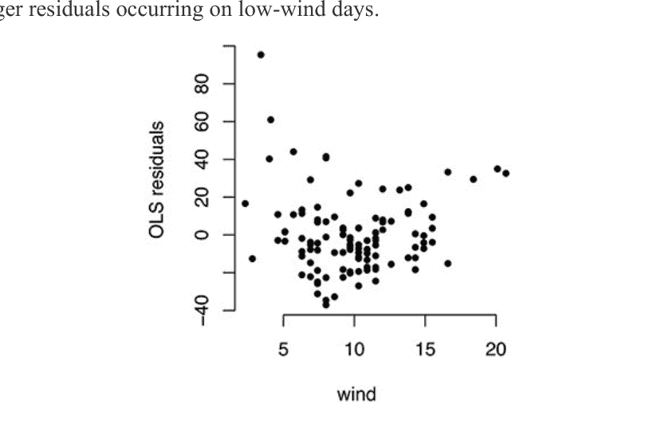

图 2.10：来自 airquality 普通最小二乘（OLS）回归的拟合残差。

HC 标准误非常有用，你经常会用到它们。HC 标准误与自举法（bootstrap）之间还存在一个有趣的关系。事实证明，对于 OLS，从非参数自举法中得到的参数方差估计实际上可以用 HC 过程来*近似*。[^13] 也就是说，你可以使用 HC 标准误作为 OLS 自举法的快速替代方案。这种关系还意味着，方程 2.28 中的正态分布假设对于 HC 标准误并不是特别重要——它们对误差偏离高斯分布具有鲁棒性。为了说明这一点，我们可以在 *airquality* 数据上运行一个快速的自举过程。

```python
B <- 10000
beta <- vector(length=B)
n <- nrow(airquality)
for (b in 1:B) {
  bs = sample.int(n, n, replace=TRUE)
  bsfit <- lm(Ozone ~., data=airquality, subset=bs)
  beta[b] <- coef(bsfit) ["Wind"]
}
sd(beta)
[1] 0.8753398
```

保留一位小数的情况下，该标准误与 HC 过程的标准误相匹配。抽样分布在图 2.11 中进行了说明。

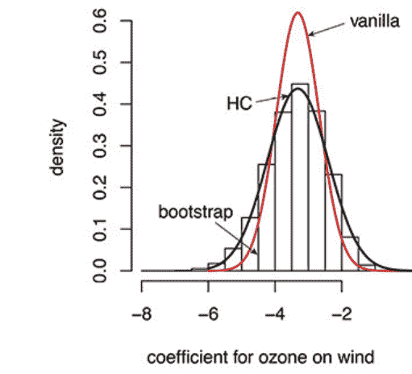

图 2.11：我们在 airquality 回归中风力系数的估计抽样分布。HC 表示异方差一致性过程，vanilla 指依赖于同方差假设的常规结果。

到目前为止讨论的所有不确定性估计器——包括图 2.11 中显示的所有估计器——都假设观测值之间相互独立。例如，HC 过程在 $\hat{\boldsymbol{\Sigma}}$ 的非对角元素上保留零值。当观测值之间存在依赖关系时，你可以使用额外的过程和方法。允许依赖关系的三明治估计器（有时称为聚类标准误）将在第 5 章中讨论；这些技术在随机对照试验中估计处理效应时常用。你还可以通过在回归中对其建模来处理依赖性，通过在每个观测值的均值函数中包含其他观测值来明确观测值之间的依赖关系。在下一节中，我们将讨论如何在空间和时间过程的特定背景下对这种依赖关系进行建模。

## 空间与时间

本书中的许多内容都集中在独立的观测值上。例如，独立性是我们前一节开发偏差似然（deviance and likelihood）的关键。然而，许多在地理位置上彼此靠近或按顺序发生的事件可能是相互依赖的。例如，也许销售量在春夏季总是较高，或者当一家餐厅生意兴隆时，附近的餐厅也会因为那些没订到座位的顾客而增加客流。在本节中，我们将研究如何处理此类信息。

幸运的是，处理时空依赖性的主要技巧都适用于标准的回归框架。你只需将产生依赖性的变量纳入输入集合中，控制时间（例如月份）和空间（例如区域位置）的趋势，以及自回归（即邻近结果之间的依赖性）。

传统的统计学教材花费大量时间仔细手动构建这些趋势和自回归效应。幸运的是，后续章节中的正则化和模型选择内容让我们可以简单地包含一个庞大的潜在时空变量集合，并依靠数据告诉我们什么最有效。因此，本节的其余部分将重点帮助你理解时空效应的全貌，而不是告诉你如何在它们之间进行选择。

作为一个简单的例子，请考虑图 **2.12** 中展示的每月国际航空公司乘客总数序列。我们看到围绕上升趋势的月度振荡在增加。如果我们想进行*线性*回归，且噪声似乎随时间增加，我们很可能需要进行变换。乘客数量类似于销售体积——它们总是正的，并且通常以百分比形式讨论。这表明我们应该在对数尺度上工作。确实，**图 2.13** 显示，对数乘客量具有大致恒定的振荡和看似线性的趋势。

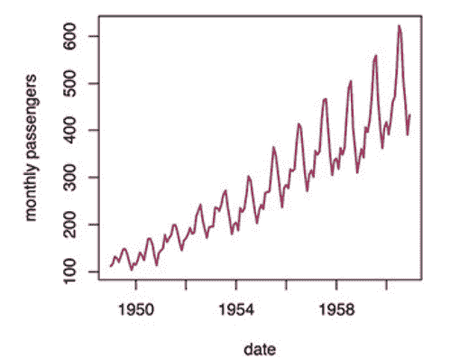

图 2.12：国际航空乘客。

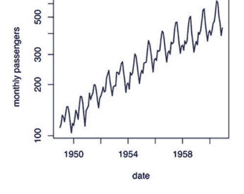

图 2.13：对数尺度下的相同计数。

将时间作为连续变量 $t$（即日期 1, 2, 3, . . . ）引入，并用 $m_{t}$ 表示时间 $t$ 时的日历月份，包含线性时间趋势和月度固定效应的回归模型为

$$
\log(y_{t})=\alpha+\beta t+\beta m_{t}+\epsilon t.
$$

在 R 中，我们可以使用 $glm$ 来拟合这个模型，在此之前需要先创建一个时间变量并对月份进行因子化：

```r
month <- factor(airline$Month)
time <- (year-min(year))*12 + airline$Month
air <- glm(log(passengers) ~ time + month)
```

图 2.14 展示了该回归的拟合值。似乎线性趋势和月度效应在总结乘客流量（对数尺度上）方面做得很好。

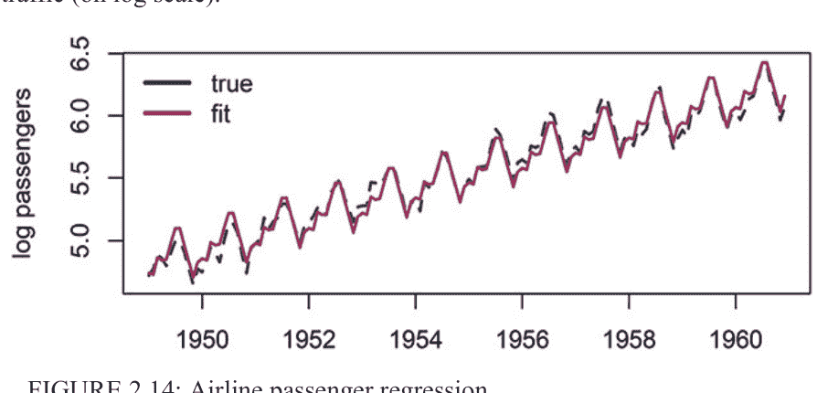

现在，去趋势（de-trending）变得容易了。如果你的数据包含日期，你应该为例如每一年、月和日创建指示变量。需要记住的最重要的事情是按层级进行：如果你打算包含 1981 年 5 月的效应，那么你也要包含更广泛的 5 月和 1981 年的效应。这允许模型使用后一种效应作为基线，而 1981 年 5 月的效应将仅总结偏离此基线的部分。用第 3 章的语言来说，1981 年 5 月将被向 5 月和 1981 年的基线水平“收缩”。同样的逻辑也适用于空间：如果你对县进行条件化，那么你也要包含更广泛的州和区域效应。

一个更微妙的问题是*自相关*。请考虑图 **2.15** 中展示的乘客回归残差。该序列中似乎存在“粘性”：当某个月的残差较高时，下个月通常也较高。误差在时间上似乎存在相关性，使得 $\varepsilon_{t}$ 与 $\varepsilon_{t-1}$ 相关。这种关系违背了我们的基本*独立性*假设，该假设指出对于所有 $j \neq i$，有 $\varepsilon_i \perp\!\perp \varepsilon_j$。

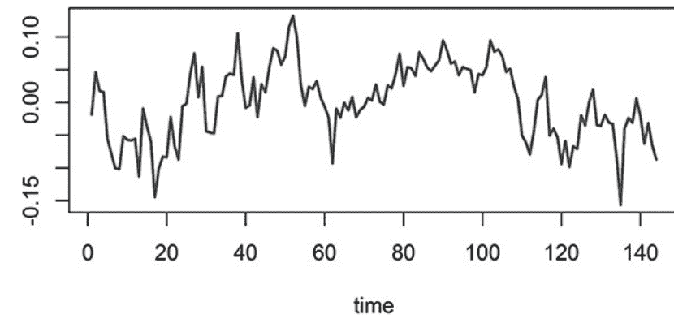

图 2.15：来自我们乘客回归的对数计数残差。

这种现象被称为*自相关*：与你自己的相关性。时间序列数据只是随时间收集的一组观测值。例如，假设 $y_1 \dots y_T$ 是每周销售额、每日温度或五分钟股票收益率。在每种情况下，你可能都会预期时间 $t$ 发生的事件与时间 $t - 1$ 相关。例如，假设你连续几年每天测量温度。以下哪个作为今天温度的估计值效果更好：

- 过去一年温度的平均值？
- 前一天的温度？

在大多数情况下，昨天的温度信息量最大。这意味着你认为*局部*依赖性比广泛的年度模式更重要。

你可以使用自相关函数（ACF）来总结依赖性，该函数跟踪“滞后-$l$”相关性：

$$
\mathrm{acf}(l) = \mathrm{cor}(\varepsilon_t, \varepsilon_{t-l}). \quad (2.32)
$$


图 2.16 展示了我们航空回归残差的自相关函数（ACF）。它证实了我们对残差时间序列的直观观察：存在显著的依赖性。$y_{t}$ 和 $y_{t-1}$ 之间的相关系数约为 0.8，这相当大。

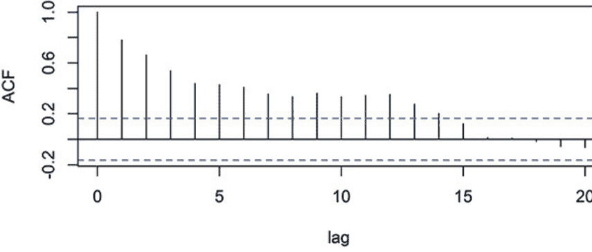

**图 2.16：** 图 2.15 中所示残差时间序列的 ACF。注意 acf(0) = 1，因为这是 $y_{t}$ 与其自身的相关性。虚线是衡量“大”相关性的启发式标准。

如何对这种类型的数据建模？考虑一个简单的累积误差过程：

$$ \begin{aligned} y_{1} & = \varepsilon_{1}, \\ y_{2} & = \varepsilon_{1}+\varepsilon_{2}, \\ y_{3} & = \varepsilon_{1}+\varepsilon_{2}+\varepsilon_{3}+\ldots \end{aligned} $$

每个 $y_{t}$ 都是从前至今所有先前观测值的函数。幸运的是，

$$ y_{t}=\sum_{i=1}^{t} \varepsilon_{i}=y_{t-1}+\varepsilon_{t} $$

因此，要在 $t$ 时刻进行预测，你只需知道 $t-1$ 时刻发生了什么即可。更具体地说，在这个过程中我们有 $\mathbb{E}[y_{t} | y_{t-1}]=y_{t-1}$。这被称为 $y_{t}$ 的**随机游走模型**：将要发生之事的期望值总是最近刚刚发生过的值。

随机游走是一种广义**自回归（AR）**模型的一个版本。在一阶自回归模型中，满足以下条件：

$AR(1): y_{t} = \beta_{0} + \beta_{1}y_{t-1} + \varepsilon_{t}$. \hspace{2em}(2.33)

这只是将 $y_{t}$ 对滞后的 $y_{t-1}$ 进行回归。随机游走对应于 $\beta_{1}=1$ 的情况，此时非零的 $\beta_{0}$ 被称为**漂移**。为了拟合 AR(1) 模型，你需要创建响应变量的滞后版本，然后将其包含在回归中。这通常需要从训练数据中移除第一个观测值。例如，我们可以重新运行包含 AR(1) 项的航空回归：

```
> lag <- head(log(passengers), -1) # 参见 help(head)
> passengers <- passengers [-1]
> month <- month [ - 1]
> time <- time [-1]
> summary(airAR <- glm(log(passengers) ~ time + month + lag))
    
lag                 0.7930716  0.0548993  14.446  < 2e-16 ***
```

图 2.17 展示了由此产生的残差及其 ACF 图。现在，一切都看起来美观且线性。单个滞后项似乎解决了我们所有的自相关性问题。

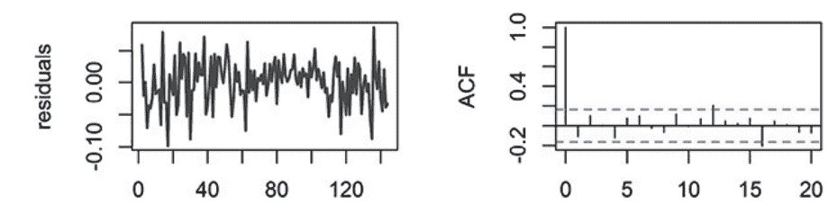

**图 2.17：** 包含 AR(1) 项后的航空残差。

AR(1) 模型简单但功能强大。如果你怀疑存在自相关性，将滞后响应作为协变量包含进来是一个很好的做法。该滞后项的系数为你提供了关于时间序列特性的重要信息：

- 如果 $|\beta_{1}|=1$，你有一个随机游走。
- 如果 $|\beta_{1}|>1$，序列将发生爆炸（数值急剧发散）。
- 如果 $|\beta_{1}|<1$，数值是均值回归的。

在随机游走中，序列只是四处游荡，且自相关在很长一段时间内保持高位（参见图 2.18 和 2.19）。更准确地说，序列是**非平稳**的：它没有想要接近的平均水平，而是发散到远处。例如，考虑图 2.20 中所示的 2000 年至 2007 年间的道琼斯工业平均指数（DJA）月度综合指数。DJA 看起来只是在四处游荡。确实，回归拟合看起来像是 $\beta_1 \approx 1$ 的随机游走：

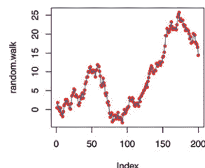

**图 2.18：** 一个随机游走。

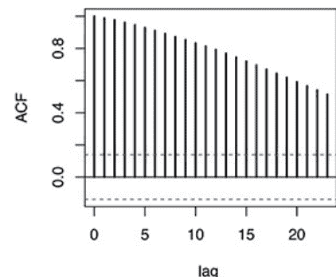

**图 2.19：** 随机游走的 ACF。

```
> summary(Ardj <- glm(dja[2:n] ~ dja[1: (n-1)]))  (n-1)]))  ...
Coefficients:

   Estimate Std. Error t value Pr(>|t|)
(Intercept) 7.05419 4.00385 1.762 0.0782 .
dja[1: (n - 1)] 0.99764 0.00121 824.298 <2e - 16 ***
```

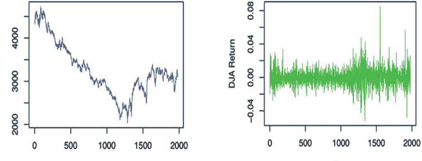

**图 2.20：** 道琼斯工业平均指数。

然而，当我们从价格切换到收益率，即 $(y_t-y_{t-1})/y_{t-1}$ 时，我们得到的数据看起来更像白噪声。在收益率上重新运行回归，我们发现 AR(1) 项并不显著：

```
> returns <- (dja[2:n]-dja [1:(n-1)])/dja[1:(n-1)]
> summary( glm(returns[2:n] ~ returns[1: (n-1)] ) )
```

```
...
```

```
Coefficients:
```

Coefficient Estimate Std. Error t value Pr(>|t|) (Intercept) -0.0001138 0.0002363 -0.482 0.630 returns[1: (n- 1)] -0.0144411 0.0225321 -0.641 0.522

这一特性由序列是随机游走所隐含：$y_t$ 和 $y_{t-1}$ 之间的差值是独立的。如果你有一个随机游走，你应该执行这种收益率转换以获得更容易建模的对象。

对于大于一的 AR(1) 项，情况更复杂。这种情况导致所谓的**爆炸序列**，因为 $y_t$ 的值会以指数级远离 $y_1$。例如，图 2.21 展示了即使 $\beta_1 = 1.02$（非常接近 1），观测值发散得有多快。由于这些序列会爆炸，它们对于建模和预测毫无用处。如果你运行回归并发现这样的 AR(1) 项，你很可能是因为遗漏了需要包含在回归中的趋势变量。

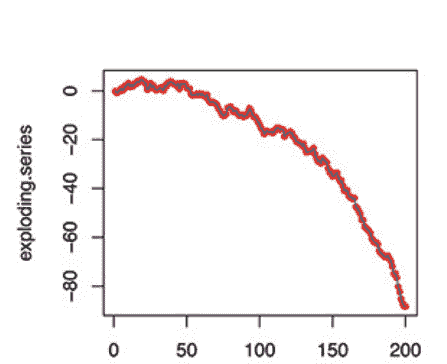

**图 2.21：** 具有 AR(1) 系数 $\beta_1 = 1.02$ 的爆炸序列。

最后，最有趣的序列是具有介于 $-1$ 和 $1$ 之间的 AR(1) 项的序列。这些序列被称为**平稳**序列，因为 $y_t$ 总是被拉回均值附近。这些是最常见且最有用的 AR 序列类型。在平稳序列中，过去很重要，但影响范围有限且自相关迅速衰减（参见图 2.22、2.23 和 2.24）。

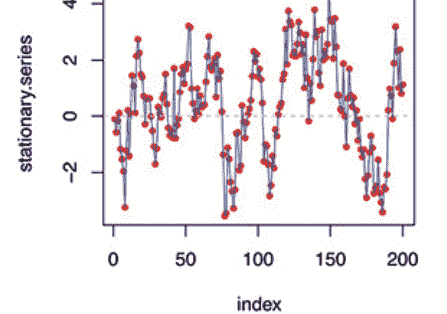

**图 2.22：** 具有 $\beta_1 = 0.8$ 的平稳（即均值回归）时间序列。

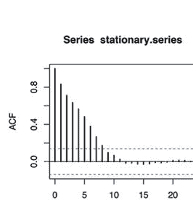

**图 2.23：** 平稳序列的 ACF。

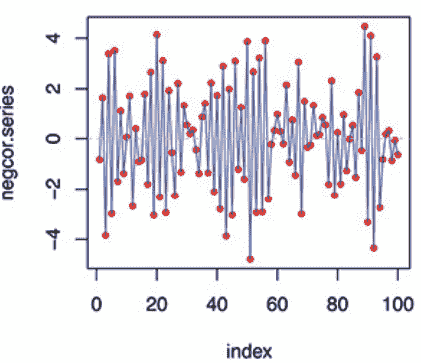

**图 2.24：** 具有 $\beta_1 = -0.8$ 的平稳序列。可能存在负相关的 AR(1) 序列，但在实践中你很少见到这种情况。

平稳序列的一个重要特性是均值回归。思考将 $y_t$ 和 $y_{t-1}$ 都减去它们的均值 $\mu$：

$$ y_t - \mu = \beta_1 \left( y_{t-1} - \mu \right) + \varepsilon_t. $$

由于 $|\beta_1| < 1$，$y_t$ 期望比 $y_{t-1}$ 更接近 $\mu$。均值回归很常见，你可以利用它来预测未来行为。

也可以将 AR 的思想扩展到更高阶的滞后：

$$ AR(p) : Y_t = \beta_0 + \beta_1 \ Y_{t-1} + \dots \beta_p Y_{t-p} + \varepsilon. $$

考虑高阶自回归的缺点一直在于，由于多重共线性，假设检验作为选择适当滞后项的方法会失效。然而，第 3 章的模型选择方法使得让数据选择适当的滞后项变得 straightforward（直接/简单）。使用这些工具，你可以放心地在你的 AR(p) 中考虑更大的 $p$。唯一的问题是，如果你包含更高阶的滞后，$\beta_1$ 的简单解释将不再适用。此外，需要更高阶滞后有时表明你在数据中遗漏了更持久的趋势或周期性。

最后，空间呢？空间就像时间，但多了一个维度。我们已经讨论过去除地理效应的影响。为了处理空间自依赖，你只需包含模型位置附近的 $y_s$。例如，你可以基于地图中相邻州或图像中相邻像素的平均值进行条件设定。这些模型被称为**空间自回归（SAR）**模型，就像时间 AR 一样，你通常只需包含直接邻居即可处理大多数依赖关系。我们将不详细讨论这种技术，但你应该探索 SAR 建模，例如使用我们在第 9 章中处理的加州住房数据。同样在第 9 章中，我们概述了常用于对空间依赖数据建模的高斯过程（GP）模型。要使用 GP 对 SAR 建模，你只需将“空间”（例如，纬度和经度）作为输入添加到 GP 回归函数中。

1.  在这个例子中，$m$ 也可以工作。
2.  对于预测，$m$ `y` `new` `data` 必须是一个具有与 `m` `y` `data` 相同格式的数据框（相同的变量名，相同的因子水平）。
3.  一旦你开始对系数引入惩罚，你将不再有参考水平，所有类别都将具有显式的系数。
4.  注意 * 还添加了主效应=模型方程 2.12 中的项。
5.  如果 $\beta_1=0$ 会发生什么？什么都不会！
6.  回忆一下，独立随机变量具有性质 $p(y_1, \dots, y_n)= p(y_1) \times p(y_2) \times \dots \times p(y_n)$。因此，你的似然函数是每个独立观测概率的乘积。
7.  负对数似然，也是 $\sigma^2$ 的函数，与 $n \log(\sigma^2)+ \sum_{t=1}^{n} (1/\sigma^2)(y_t - x_t^\prime\beta)^2$ 成正比。
8.  特别是经济学家，更喜欢 OLS 术语。我们将同时使用 OLS 和 MLE 术语。
9.  这种说法源于零假设的思想。
10. 你可能还回忆起 $R^2= \text{cor}(y, \hat{y})$；在回归中，$\hat{y}$ 表示“拟合值” $\hat{y} = f(x\beta) = x\hat{\beta}$。这一特性是回归所特有的。


11. 请注意，此处的 $X$ 包含截距项。
12. Halbert White. 异方差一致性协方差矩阵估计量以及异方差的直接检验方法。*Econometrica: Journal of the Econometric Society*, 页码 817–838, 1980.
13. Dale J Poirier. 基于知情贝叶斯自助法的异方差一致性协方差估计量的贝叶斯解释。*Econometric Reviews*, 30(4): 457–468, 2011.


## 正则化

在高维场景中，即模型中包含许多可能的信号时，你需要谨慎地选择最适合预测*未来*数据的最佳模型，以避免过拟合。为此，你首先使用能产生一系列候选模型的方法。然后，你在这些候选模型中进行选择，以最小化预测新数据时的误差率估计。本章介绍了此类高维建模的关键工具。

### 样本外表现

在前一章中，我们引入了*偏差*（deviance）作为衡量模型拟合训练数据紧密程度的指标。当你将模型应用于预测和决策时，你实际上并不关心*样本内*偏差。真正重要的是*样本外*（OOS）偏差；换言之，你的模型拟合*新*数据的难度如何？

你真正关心的唯一 $R^2$ 是样本外 $R^2$。*样本内*与*样本外* $R^2$ 之间的区别在于用于拟合 $\hat{\beta}$ 的数据以及计算偏差所用的数据不同。假设你拥有数据 $[x_1, y_1] \ldots [x_n, y_n]$，并使用这些数据在线性回归中拟合 $\hat{\beta}$。那么样本内偏差为：

$$
\text{dev}_{IS}(\hat{\beta}) = \sum_{i=1}^{n}(y_i - x_i^t \hat{\beta})^2 \tag{3.1}
$$

对于样本外 $R^2$，$\hat{\beta}$ 是相同的（仍然使用观测值 $1 \ldots n$ 拟合），但偏差现在是在新的观测值上计算的；例如：

$$
\text{dev}_{OOS}(\hat{\beta}) = \sum_{i=n+1}^{n+m}(y_i - x_i^t \hat{\beta})^2 \tag{3.2}
$$

这一区别至关重要。当拥有大数据和大量输入时，很容易对训练数据过拟合，导致模型受到噪声的驱动，而这些噪声在未来观测中不会重现。这会给你的预测增加误差，并且过拟合模型可能比完全没有模型还要差。

举个例子，让我们考虑半导体制造过程中的质量控制数据。这种工业环境涉及许多复杂的操作，容错率极低。生产线沿线有数百个诊断传感器，测量过程中的各种输入和输出。我们的目标是建立一个模型，将传感器数据映射到芯片故障的预测。然后，可以将面临故障风险的芯片标记出来，以便进行进一步的（昂贵的人工）检查。

对于训练数据，我们有 1500 个观测值，每个观测值是一个长度为 200 的诊断信号向量 $x$，以及关于芯片是否故障的二进制数据。¹ 逻辑回归模型则为：

$$
p_i = \text{P}(\text{fail}_i | x_i) = \frac{e^{\alpha + x_i \beta}}{(1+e^{\alpha + x_i \beta})} \tag{3.3}
$$

我们可以使用 R 进行拟合，并利用 glm 计算样本内偏差。²

```r
> full <- glm(FAIL ~ ., data=SC, family=binomial)
Warning message:
glm.fit: fitted probabilities numerically 0 or 1 occurred
> 1 - full$deviance/full$null.deviance
[1] 0.5621432
```

我们可以看到，该回归的 $R^2$ 为 56%——200 个诊断信号解释了故障与成功之间变异的超过一半。注意，由于这是逻辑回归，此 $R^2$ 使用公式 2.24 中的二项分布偏差。

**图 3.1** 展示了我们在半导体回归中对原假设 $\hat{\beta}_k = 0$ 进行检验的 200 个 *p* 值的分布。回顾我们在**第 1 章**中关于错误发现率（FDR）的讨论，来自原假设的 *p* 值服从均匀分布；相比之下，这里我们可以看到零附近有一个峰值（表示有用的诊断信号），而其余部分则分散趋向于 1（很可能是对故障预测无用的信号）。你可以使用 Benjamini – Hochberg 算法来获得一个具有受控错误发现率（FDR；参见**第 1 章**）的更小模型。**图 3.2** 展示了 FDR 为 10% 时的程序。这得出了一个 $\alpha = 0.0122$ 的 *p* 值拒绝阈值，意味着有 25 个显著的回归系数（其中预计有 22 到 23 个是真实信号）。

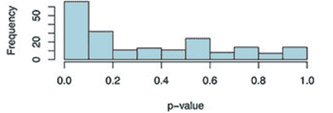

**图 3.1：** 半导体回归系数 *p* 值的直方图。


**图 3.2：** 半导体 *p* 值的 FDR。位于直线下方的点是在 FDR 为 10% 条件下显著的 25 个 $\hat{\beta}_k$。

我们可以识别出这 25 个显著信号，并仅针对这些变量重新运行 glm，从而得到一个更简约的模型。

```r
> signif <- which (pvals <= 0.0122)
> head (signif) # first 5 of 25
   SIG2 SIG17 SIG19 SIG20 SIG22 SIG24 
    2    17    19    20    22    24
> cutvar <- c("FAIL", names (signif)) # the keepers
> cut <- glm(FAIL ~ ., data=SC[,cutvar], family="binomial")
> 1 - cut$deviance/cut$null.deviance # new in-sample R2
[1] 0.1811822
```

注意，仅使用 25 个信号的 *cut* 模型，其 $R^2_{cut}=0.18$。这远小于 *full* 模型的 $R^2_{full}=0.56$。通常，*样本内* $R^2$ *随着协变量数量的增加而总是增加*。样本内 $R^2$ 正是极大似然估计 $\hat{\beta}$ 被拟合以最大化的目标，因此如果你给 glm 更多的旋钮可以调节（更多的 $\hat{\beta}_k$），它就能为你提供更紧密的拟合。这正是我们为什么不关心样本内 $R^2$ 的原因——仅通过在设计中加入无用变量，就可以让它看起来任意好。真正的问题是，每个模型预测*新*数据的性能如何？

当然，由于你拥有未见过的数据，因此你无法知晓其在未见数据上的表现。然而，你可以通过在训练样本中留出部分数据来评估模型，以此模拟在未预见数据上进行预测的体验。算法 4 详细说明了该实验。

### 算法 4 K 折样本外（OOS）验证

- 给定一个包含 $n$ 个观测值的数据集，$\{[\mathbf{x}_i, y_i]\}_{i=1}^n$：
  - 将数据分割为 $K$ 个大小相等的随机子集（*折*）。
  - 对于 $k = 1 \dots K$：
    - 使用除第 $k$ 折以外的所有数据拟合系数 $\hat{\beta}$。
    - 记录在留出的第 $k$ 折上的 $R^2$。

这将产生 $K$ 个样本外 $R^2$ 值的样本。该样本是你模型在新数据上预测性能分布的一个*估计*。

对于半导体数据，我们可以对 *full* 和 *cut* 回归模型都进行样本外验证。为此，我们首先需要定义一些函数来计算偏差和 *R*²。

```r
> ## pred must be probabilities (0<pred<1) for binomial
> deviance <- function(y, pred, family=c("gaussian", "binomial")){
+         family <- match.arg(family)
+         if(family=="gaussian"){
+               return( sum( (y-pred) ^2 ))
+         }else{
+               if (is.factor(y)){ y <- as.numeric (y)>1 }
+               return( -2*sum( y*log(pred) + (1-y)*log(1-pred)) )
+         }
+ }
>
> ## get null deviance too, and return R2
> R2 <- function(y, pred, family=c("gaussian", "binomial")){
+         fam <- match.arg(family)
+         if (fam=="binomial"){
+               if (is.factor(y)){ y <- as.numeric(y)>1 }
+         }
+         dev <- deviance(y, pred, family=fam)
+         dev0 <- deviance(y, mean(y), family=fam)
+         return (1-dev/dev0)
+ }
```

这些函数可用于线性回归或逻辑回归。在后续章节中，你将使用 R 包函数，这些函数内置了这些偏差计算，但自己编写一次也是很好的练习。接下来，我们将数据划分为折。


```
> n <- nrow(SC) # 观测数量
> K <- 10 # ‘折’的数量
> # 创建折成员向量（随机顺序）
> foldid <- rep(1:K, each=ceiling(n/K))[sample(1:n)]
> # 创建用于结果的空数据框
> OOS <- data.frame(full=rep(NA, K), cut=rep(NA, K))
```

最后，我们将 OOS 实验作为一个 for 循环来运行。

```
> for(k in 1:K){
+   train <- which(foldid!=k) # 使用除第 ‘k’ 折以外的所有数据进行训练
+
+   ## 拟合两个回归
+   rfull <- glm(FAIL~., data=SC, subset=train, family=binomial)
+   rcut <- glm(FAIL~., data=SC[, cutvar], subset=train, family=binomial)
+
+   ## 获取预测值：type=response 以便获得概率
+   predfull <- predict(rfull, newdata=SC[-train,], type="response")
+   predcut <- predict(rcut, newdata=SC[-train,], type="response")
+
+   ## 计算并记录 R2
+   OOS$full[k] <- R2(y=SC$FAIL[-train], pred=predfull, family="binomial")
+   OOS$cut[k] <- R2(y=SC$FAIL[-train], pred=predcut, family="binomial")
+
+   ## 打印进度
+   cat(k, " ")
+ }
1  2  3  4  5  6  7  8  9 10
```

当我们绘制所得到的 OOS $R_2$ 样本时，结果令人震惊。图 3.3 表明，全模型实际上产生了负 $R_2$！这是如何发生的？看看 $R_2$ 的公式：$1 - \mathrm{dev}(\widehat{\boldsymbol{\beta}}) / \mathrm{dev}(\boldsymbol{\beta} = 0)$。如果你的拟合模型表现比空模型（null model）更差，$R_2$ 将会是负值。也就是说，如果你的 $\hat{y}$ 估计值离真实值的距离比整体平均值 $\bar{y}$ 还要远。在这个应用中，你最好直接丢弃每第 15 个芯片，而不是使用基于过度拟合全模型的某种流程。


图 3.3：全模型（200 个信号）和截断模型（25 个信号）在半导体逻辑回归中的 OOS $R_2$。

你可能从未见过负 $R_2$。如果是这样，那是因为你只关注了样本内性能。在样本外，负 $R_2$ 不幸的是比你想象的更常见。在这种情况下，全模型的 OOS 平均 $R_2$ 为 $-6.5$（或 $-650\%$），而截断模型为正 $0.09$。因此，尽管截断模型的 OOS 性能低于其 IS（样本内）性能（约为 $1/2$），它仍然比空模型高出 $9\%$。

这个例子戏剧性地展示了基本原则：*最重要的只是样本外 $R_2$*。你不必关心样本内 $R_2$，因为你只需添加垃圾变量并诱导过度拟合，就能获得更好的数字。使用 OOS 实验来选择最佳模型被称为*交叉验证*。在本教材中它将发挥重要作用，因为在使用数据选择“最佳”模型是所有现代分析的核心。但在进入选择之前，你首先需要策略来构建良好的候选模型集合，以便从中进行选择。

> 注意，我们在这里作弊了：全样本被用来选择截断模型中的 25 个变量。真正的 OOS 实验应该在 for 循环*内部*进行 FDR 控制，使得 OOS 结果成为端到端选择流程的验证。作为一般规则，对于你对数据所做的任何操作，如果你想准确评估 OOS 性能，就应在排除当前折的情况下进行。

## 正则化路径

你如何构建模型集合？对于任何现实的输入维度来说，简单地编录所有可能的模型都是不可能的。例如，如果你有一个具有 $p$ 个潜在协变量的回归设置，根据每个协变量是否被包含，可能有 $2^{p}$ 个不同的模型。即使只有 20 个协变量，这也意味着已经有超过 100 万个候选模型。

本节介绍了*正则化*的关键思想：以某种方式惩罚模型复杂性，使你可以列出由简到繁的有希望的候选模型列表。

一种常见但粗糙的模型选择方法基于 *p*-值。

- 使用 $\text{g}_{\text{lm}}$ 运行全 MLE 回归，得到每个候选输入系数的 *p*-值。
- 然后重新运行 glm，仅使用那些 *p*-值低于某个 $\alpha$ 阈值的输入。

更进一步，可以使用一系列 $\alpha$ 阈值——例如对应于 Benjamini–Hochberg FDR 控制算法所隐含的 FDR 率——来生成一系列模型。然后可以在类似于你之前对半导体所做的样本外实验中比较这些模型。

这种常见做法是个*坏*主意，原因有几：

- 当你存在*多重共线性*——输入之间的相关性——时，所有这些变量的 *p*-值都会很大（它们看起来不显著），即使其中任何一个变量对响应提供了有用的信号。由于不知道应该包含哪一个，你最终可能一个都不包含。
- *p*-值是基于过度拟合模型的。例如，在半导体分析中，*p*-值是从一个在预测任务中远逊于 $y-$ 的模型中估计出来的。如果你使用这些 *p*-值，你将基于糟糕的回归拟合来构建候选模型集合。当 $p > n$ 时，glm 无法收敛，因此不存在全模型。

这种一般方法——查看全模型拟合，然后将其缩减规模——有时被称为*后退逐步回归*。你应该避免使用它。

更好的解决方案是朝相反方向进行，通过*前进逐步回归*，从简单到复杂构建，如算法 5 所述。

### 算法 5 前进逐步回归

- 拟合所有单变量模型。选择其中样本内 $R_2$ 最高的那个，并将该变量——假设为 $x_s$——放入你的模型中。
- 拟合所有包含 $x_s$ 的双变量模型：
  $$y \sim \beta_s x_s + \beta_j x_j \quad \forall j \neq s,$$
  并将具有最高 $R_2$ 的 $x_j$ 加入你的模型。
- 重复：给定当前包含的变量集合 $S$，由向量 $x_S$ 表示，拟合所有模型，
  $$y \sim \beta_s' x_S + \beta_j x_j \quad \forall j \notin S,$$
  并再次将最大化样本内 $R_2$ 的 $j$ 加入 $S$。

你可以继续直到达到预定的复杂性水平，或者当某个模型选择规则（例如，R 使用你将在本章后面研究的 AIC）对于当前模型比添加一个变量的任何模型都更低时停止。

算法 5 是我们第一个*贪婪*搜索策略的例子。我们短视地前进，在每个点添加给定当前搜索状态下看似最有用的下一轮复杂性。尽管没有为搜索路径的*全局*属性优化，贪婪算法快速且稳定，在许多 ML 策略中扮演重要角色。

你很快就会看到，这种特定的前进逐步程序有点天真，并且可以通过现代正则化思想进行显著改进。但从简单到复杂向前推进的一般方法由于多种原因是有用的。一个主要优势是稳定性。后退方案是*不稳定*的，因为如果你对数据稍微抖动（或获得略有不同的样本），全复杂性模型可能会发生巨大变化（因为它是过度拟合的），从而你的整个候选模型搜索路径都会改变。相比之下，简单的单变量或空模型在数据重采样下将保持大致相同，使得我们的*前进*搜索路径始终从相同的位置开始。

R 提供了 `step()` 函数来执行此逐步例程。你提供一个起点，称为 `null` 模型，以及一个最大的可能模型，称为 `scope`。以我们的半导体为例：

```
> null <- glm(FAIL~1, data=SC)
> # 前进逐步：它需要很长时间！
> system.time (fwd <- step (null, scope=formula(full), dir="forward") )
... 
Step:  AIC=92.59
FAIL ~ SIG2
... 
 
   user  system elapsed
151.66  12.58   97.88
> length(coef(fwd))
[1] 69
```

该程序枚举了 70 个模型，范围从仅包含 $SIG_2$ 的单变量模型到包含 68 个输入信号（加上截距）的模型。算法在 68 个变量处停止，因为该模型的 AIC 分数比具有 69 个输入的任何模型的 AIC 分数都低（更好）。³ 贪婪搜索程序在它认为找到了最佳模型时停止，假设既然 AIC 在从 68 到 69 个输入时没有改善，它在 70 个或更多输入时也不会改善。

注意这个 `step()` 程序*非常慢*：在我的笔记本电脑上，运行这个小型半导体数据集需要 98 秒。这对于任何通过子集系数应用最大似然估计（其余设为零）来枚举候选模型的子集选择算法来说都是如此。子集选择很慢，因为向回归中添加一个变量可能会导致其他所有变量拟合系数的巨大变化。因此，每个模型都必须从头开始拟合。

子集选择的一个相关（但极其重要）问题是其*不稳定性*。由于拟合模型在不同的候选子集之间完全不同，样本外性能的质量会有巨大差异。你可以轻松地在选择中犯一个小错误（例如，包含 69 个而不是 68 个协变量），这会导致预测能力发生巨大变化。此外，如果你对数据稍作抖动并且路径发生小变化——例如，第五个被包含的变量改变了——那么


整个候选模型集合将会完全不同。这种不稳定性是可靠模型选择的敌人；幸运的是，我们可以通过引入惩罚（penalization）的概念来稳定算法。

现代统计学的关键在于正则化。这是一种通过惩罚复杂度从而偏离最优性以稳定系统的策略。回想一下，对于大多数经典统计学程序，你是在最小化偏差 $d(\boldsymbol{\beta})$（等价地，最大化似然）：$\hat{\boldsymbol{\beta}} = \underset{\boldsymbol{\beta}}{\mathrm{argmin}} \{ -\frac{2}{n} \log \mathrm{lh} (\boldsymbol{\beta}) \}$。而正则化策略则会涉及最小化惩罚偏差：

$$
\hat{\boldsymbol{\beta}} = \underset{\boldsymbol{\beta}}{\mathrm{argmin}} \left\{ -\frac{2}{n} \log \mathrm{lh} (\boldsymbol{\beta}) + \lambda \sum_k c(\beta_k) \right\}. \tag{3.3}
$$

这里，$c(\boldsymbol{\beta})$ 是对系数大小的代价。在 $c(\boldsymbol{\beta}) = | \beta |$（即绝对值代价）的情况下，我们得到了常见且有用的 Lasso 估计量。它将在你的数据科学生涯中发挥重要作用。

让我们拆解一下公式 3.3。我们只是在公式 2.18 的最大似然（MLE）偏差最小化中简单添加了一个惩罚项——即 $\lambda \Sigma_k c(\beta_k)$ 项。这个惩罚对每个 $\hat{\beta}_k$ 的大小施加了代价。这惩罚了复杂度，因为 $\beta_k$ 系数正是使你的预测值 $\hat{y}$ 随不同输入 $x$ 值波动的原因。如果你强制它们都接近于零，你的 $\hat{y}$ 值将收缩向 $y-$（总体均值），整个系统的波动变小——它是稳定的。

理解公式 3.3 的另一种方式是透过决策理论的视角——这是一个建立在“选择具有代价”这一理念之上的框架。如果你考虑经典统计学中的决策过程——专注于估计和假设检验的两个阶段过程——那么这些代价是什么？

- **估计代价：** 偏差！这是数据与模型之间距离的代价，正是你为了获得最大似然估计（MLE）而最小化的量。
- **检验代价：** 对 $\hat{\beta} \neq 0$ 设定了一个固定价格。这隐含在假设检验程序中，除非你有显著的相反证据，否则你会设定 $\hat{\beta}=0$。也就是说，原假设是安全的，你需要付出代价才能做出其他决定。

因此，在经典统计学中，$\hat{\beta}$ 的代价是样本内偏差加上偏离零的惩罚。然而，偏离零的代价——不稳定性代价——隐藏在假设检验的情景中。公式 3.3 使这两种代价都变得显性。

惩罚函数应该是什么样子？首先，$\lambda > 0$ 是惩罚权重。它是一个需要以某种依赖数据的方式选定的调优参数，本章最后一节将重点关注如何做到这一点。暂时先将其视为固定值。惩罚的其余部分由代价函数的形状决定。在所有情况下，$c(\beta)$ 在 $\beta = 0$ 时最低，当 $|\beta| > 0$ 时你需要付出更多代价。这种结构暗示了我们对稳定性的偏好。否则，选项种类繁多；图 3.4 展示了一些示例。


> **图 3.4：** 常见的惩罚函数：岭回归 $\beta^2$，Lasso $|\beta|$，弹性网 $\alpha\beta^2 + |\beta|$，以及一种“非凸”惩罚 $\log(1 + |\beta|)$。

这些函数中的每一个鼓励不同类型的模型行为。岭惩罚 $\beta^2$ 对 $\beta$ 的小值施加很少的惩罚，但对大值施加迅速增加的惩罚。这将适用于你相信每个协变量影响很小且没有大型系数主导模型的情景。Lasso 的绝对值惩罚 $|\beta|$ 对偏离零的情况施加恒定惩罚。将 $\beta$ 从 1 移动到 2 的代价与从 101 移动到 102 的代价相同。“弹性网”是岭回归和 Lasso 简单组合的一个华丽名称。

最右侧的对数惩罚之类的惩罚函数很特别，因为它们具有*递减偏差*：它们对从零到 $\beta$ 小值的移动施加极高的代价，但对于大值，惩罚变化的速率很小。这些惩罚鼓励在拟合中产生大量零值，同时允许无偏地估计大信号。这类非凸惩罚受到理论统计学家的青睐，但在实践中需要谨慎对待，因为它们引入了我们在逐步回归中观察到的许多不稳定性和计算问题。事实上，你可以将逐步回归解释为在 $L0$ 代价下求解惩罚偏差，其中 $c(\beta) = \mathbb{1}_{[\beta \neq 0]}$。子集选择的问题——每次添加变量都需要重新拟合一个完全不同的模型——是任何非凸惩罚方案相关问题的极端版本。

Lasso 的一个优势在于，它在保留类似岭回归的凸惩罚稳定性的同时，对大信号施加最小可能的偏差。Lasso 以及公式 3.2 中右侧三个“尖峰”惩罚的另一个巨大优势在于，它能实现自动变量筛选。也就是说，某些求解得到的 $\hat{\beta}_{k}$ 值将严格等于零——不是接近零，而是像“它们不在模型中，所以你不需要存储或考虑它们”那样严格的零。发生这种情况的原因如图 3.5 所示：偏差是平滑的，而绝对值函数是尖角的，如果惩罚占主导地位，两者之和的最小值可能出现在零处。任何包含 $|\beta|$ 项的惩罚都会产生这种效果——例如，图 3.4 中除岭回归外的所有惩罚。


> **图 3.5：** 惩罚偏差最小化导致 $\hat{\beta} = 0$ 的示意图。

总之，有*许多*惩罚选项。你会看到，Lasso 是一个极好的默认选择。你可以将其视为基线，仅在你有充分理由时才考虑其他选项。

单靠 LASSO 无法完成模型选择。相反，它提供了一种机制来*列举*多个候选模型以供选择。Lasso 正则化路径最小化一个*序列*惩罚 $\lambda_{1} > \lambda_{2} \ldots > \lambda_{T}$ 下的惩罚对数似然：

$$
-\frac{2}{n} \log \mathrm{lh}(\boldsymbol{\beta}) + \lambda \sum_{j} |\beta_{j}| \tag{3.4}
$$

这提供了一系列估计的回归模型，其系数为 $\hat{\beta}_1$ ... $\hat{\beta}_T$。给定这个序列，模型选择工具被用来选择最佳的 $\hat{\lambda}$。例如，你可以进行样本外实验来比较不同惩罚下的性能。

### **算法 6 Lasso 正则化路径**

从 $\lambda_1 = \min \{ \lambda : \hat{\beta}_{\lambda} = 0 \}$ 开始。  
对于 $t = 1$ ... $T$：

- 设定 $\lambda_t = \delta\ \lambda_{t-1}$，其中 $\delta \in (0, 1)$。
- 在惩罚 $\lambda_t$ 下寻找 $\hat{\beta}_t$ 以优化公式 3.4。

算法 6 概述了这个简单的方案。你从 $\lambda_1$ 开始，其值刚好足够大使得 $\hat{\beta}_1 = 0$。通过以下公式总是可以做到：

$$
\lambda_1 = \max_{k=1} \left\{ \frac{\left[ \partial \left[ -\frac{2}{n} \log \text{lh}(\beta) \right] \right]^p}{\partial \hat{\beta}_k} \right\}.
$$

大多数软件会自动找到这个起点。然后你迭代地缩小 $\lambda$ 并更新 $\hat{\beta}_{\lambda}$，其中 $\hat{\beta}_{\lambda}$ 表示在惩罚权重 $\lambda$ 下公式 3.4 的解。这里的一个关键细节是系数更新关于 $\lambda$ 是平滑的；即，

$$
\hat{\beta}_t \approx \hat{\beta}_{t-1} \text{ 当 } \lambda_t \approx \lambda_{t-1} \text{ 时}。
$$

这为 Lasso 算法带来了*速度*和*稳定性*。速度来自于每次更新 $\hat{\beta}_{t-1} \rightarrow \hat{\beta}_t$ 都很小因此很快的这一事实。稳定性是这一属性的镜像：即使选定的 $\lambda$ 在不同数据样本间发生变化，它仍将保持在一个局部邻域内，因此选定的 $\hat{\beta}$ 也将保持在一个小邻域内。与子集选择不同，对你数据的微小扰动不会导致 $\hat{y}$ 预测规则发生巨大变化。

整个体系在视觉上最容易理解。为了说明，我们引入了*browsed* 数据集，其中包含 10,000 人的网络浏览日志。我们提取了流量最大的 1000 个网站一年的浏览器日志。样本中的每个浏览器在同一年的在线消费至少为 1 美元。作为一个回归示例，我们可以将总在线消费视为感兴趣的响应变量，并将其对时间百分比进行回归


用户在各个网站上的消费情况。也就是说，我们试图通过浏览历史来预测消费。我们将使用对数线性模型，

$$ \log(\mathrm{spend}) = \alpha + \boldsymbol{\beta}' \boldsymbol{x} + \varepsilon. \tag{3.5} $$

在这里，$x$ 是网站访问百分比的向量。该模型例如可用于根据浏览历史对预期用户预算进行细分。

图 3.6 中的 *路径图* 展示了算法 6。该算法向 *从右向左* 移动，$\lambda$ 的值逐渐减小。此处的 *y* 轴为 $\hat{\beta}_j$，每条彩色线代表作为 $\lambda_i$ 的函数的不同 $\hat{\beta}_j$。图中的每个垂直切片代表一个候选模型。随着路径的推进，$\hat{\beta}_i$ 包含越来越多且数值更大的非零 $\hat{\beta}_k$ 值（路径头部标记了某些段中非零 $\hat{\beta}_k$ 的数量），模型变得越来越复杂。


图 3.6：浏览器数据的 Lasso 路径图。正则化路径算法从右向左进行，$\lambda_i$ 逐渐减小。

这张图及其底层的路径估计是使用 R 语言中的 gamlr 包执行的。你将大量使用该包；它提供了快速且可靠的 lasso 路径。在 R 中还有其他优秀的 lasso 估计选项，但由于 gamlr 软件是由我编写的，它具有提供本书中涵盖的特殊功能（例如校正的 AIC 和分布式多项回归）的优势。

glimnet 包也是 lasso 估计的绝佳选择。gamlr 和 glimnet 都使用类似的语法和类似的优化例程（坐标下降法）。它们的区别在于 lasso 之外的功能：gamlr 提供衰减偏差惩罚，类似于图 3.4 中的对数惩罚（另见 3.7），而 glimnet 提供了该图中所述的弹性网络。


图 3.7：顺便提一下，gamlr 可以执行前向逐步子集选择程序。图 3.8 显示了浏览器数据对应的路径图；请注意此图中锯齿状的解决方案路径与图 3.6 中平滑的 lasso 路径之间的对比。解决方案路径的这种不连续性是子集选择中不稳定性来源。

在 gamlr 中运行 lasso 很容易。与 glm 的主要区别在于，你需要自己创建数值模型矩阵。但一旦你有了这个矩阵——例如，对于浏览器数据使用 xweb——gamlr 默认会运行整条路径。

```r
> sp <- gamlr(xweb, log(yspend))
> sp
```

```
gaussian gamlr with 1,000 inputs and 100 segments.
```

图 3.6 中的路径图由 `plot(spending)` 创建。你还可以通过 `family` 参数进行逻辑 lasso 回归。

```r
gamlr(x=SC[, -1], y=SC$FAIL, family="binomial")
```

`gamlr` 的默认行为是求解 $\lambda_{T}$ 的一系列序列，共 100 个 $\lambda_{T}$，范围向下延伸至 $\lambda_{T}$，即起始点 $\lambda_{1}$ 的 1%。有一些常用的参数你可以根据需要更改：

- `verb=TRUE`：获取进度打印。
- `nlambda=T`：你的 $\lambda$ 网格的长度。
- `lambda.min.ratio`（或 `lmr`）：$\lambda_{T}/\lambda_{1}$，定义路径的终点。

输入 `?gamlr` 可获取丰富的文档和帮助。

使用 `gamlr` 最困难的部分（其实并不难）是指定数值模型矩阵。你可以使用由 `glm` 调用的 `model.matrix` 命令。然而，`gamlr`（以及 `glmnet` 和许多其他机器学习 R 包）能够利用 Matrix 库对稀疏矩阵的表示。稀疏矩阵是具有许多零元素的矩阵，这是现代数据分析中的常见场景。例如，许多交互分类变量——当表示为 0/1 指示变量时——会导致稀疏设计。因此，在可能的情况下忽略矩阵中的零元素是高效的。像 `gamlr` 这样的包能够利用稀疏矩阵结构来降低存储成本并加快计算速度。这对实际应用至关重要。

一种常见的稀疏表示是简单的三元组矩阵（STM），它有三个关键元素：行 $i$、列 $j$ 和元素值 $x$。矩阵中的其他所有内容都被假定为零。下面是一个示例：


Matrix 库提供了创建和操作稀疏矩阵的工具。例如，`sparseMatrix` 函数允许你从这些 $i, j, x$ 元素创建矩阵。这就是我们如何为浏览器回归构建 `xweb` 的：

```r
> ## 该表有三列：[机器] id, 网站 [id], [访问次数]
> web <- read.csv("browser-domains.csv")
> ## 读取实际的网站名称并重标记网站因子
> sitenames <- scan("browser-sites.txt", what="character")
Read 1000 items
> web$site <- factor(web$site, levels=1:length(sitenames), labels=sitenames)
> ## 也将机器 id 设为因子
> web$id <- factor(web$id, levels=1:length(unique(web$id)))
>
> ## 获取每台机器的总访问次数以及在每个网站上的时间百分比
> ## tapply (a,b,c) 对因子 b 的每个水平执行 c(a)。
> machinetotals <- as.vector(tapply(web$visits,web$id,sum))
> visitpercent <- 100*web$visits/machinetotals[web$id]
>
> ## 在稀疏矩阵中使用此信息
> ## 这是你将经常做的事情；请熟悉此操作。
> xweb <- sparseMatrix(
+		i=as.numeric(web$id), j=as.numeric(web$site), x=visitpercent,
+		dims=c(nlevels(web$id), nlevels(web$site)),
+		dimnames=list(id=levels(web$id), site=levels(web$site)))
>
> # 浏览器 1 访问了哪些网站？
> head(xweb[1, xweb[1,]!=0])
	atdmt.com	yahoo.com	msn.com
	4.052260	11.8559280	0.2501251
	google.com	aol.com questionmarket.com
	6.5282641	0.1500750	1.3506753
```

当你的数据以三元组格式输入（数据库输出常见此格式）时，可以使用 `sparseMatrix` 构建模型矩阵。当数据以数据框形式输入，包括分类条目时，你可以使用 `sparse.model.matrix`——这是我们熟悉的模型矩阵命令的稀疏版本。回想之前介绍的 OJ 示例，我们可以使用这个新工具重新执行设计中的指示变量部分。

```r
> xbrand <- sparse.model.matrix(~ brand, data=oj)
> xbrand[c(100,200,300),]
```

3 × 4 稀疏矩阵，类为 "dgCMatrix"

| | (截距) | brandminute.maid | brandtropicana |
|---|---|---|---|
| 100 | 1 | . | 1 |
| 200 | 1 | 1 | . |
| 300 | 1 | . | . |

这创建了第 2 章中使用的设计的稀疏版本。然而，我们需要稍微谨慎一些：这不是 lasso 回归的正确设计。

对于最大似然回归（MLE），Domnick's 或 Tropicana 哪个是品牌因子的参考水平并不重要。尽管其中一个会被并入截距，你最终得到的预测 $\hat{y}$ 值是一样的。但是，在惩罚项下，因子参考水平现在很重要！因为惩罚奖励更接近（或等于）零的 $\hat{\beta}_{k}$ 值，你会将每个因子系数向截距——即参考水平——收缩。如果你将 Minute Maid 推向 Tropicana 而不是 Domnick's，结果会有所不同。

解决方案是简单地去除参考水平。一旦对偏差添加惩罚项，就没有理由仅为 K 水平因子使用 $K-1$ 个系数。如果每个类别水平都有自己的虚拟变量，那么每个因子水平效应都会向共享截距收缩。你正在向共享均值收缩，只有显著不同的效应才会得到非零的 $\hat{\beta}_{k}$。

你可以通过创建额外的因子水平来强制 R 为每个水平创建单独的虚拟变量。特别是，以下实用函数将 NA（R 中“缺失”的代码）设为参考水平。

```r
> xnaref <- function(x){
+    if (is.factor(x))
+        if(!is.na(levels(x)[1]))
+            x <- factor(x, levels=c(NA, levels(x)), exclude=NULL)
+    return(x) }
```

```r
> naref <- function(DF) {
+    if(is.null(dim(DF))) return(xnaref(DF))
+    if(!is.data.frame(DF))
+        stop ("You need to give me a data.frame or a factor")
+    DF <- lapply(DF, xnaref)
+    return(as.data.frame(DF)) }
```

我们使用它创建一个包含每个品牌条目的新 OJ 设计。

```r
> # 使用 -1 去除截距
> oj$brand <- naref(oj$brand)
> xbrand <- sparse.model.matrix(~ brand, data=oj)
> xbrand [c(100,200,300),]
3 x 4 稀疏矩阵，类为 "dgCMatrix"
```

| | (截距) | branddominicks | brandminute.maid | brandtropicana |
|---|---|---|---|---|
| 100 | 1 | . | . | 1 |
| 200 | 1 | . | 1 | . |
| 300 | 1 | 1 | . | . |

```r
> oj$brand[c(100,200,300)]
[1] tropicana  minute.maid  dominicks
Levels: <NA>  dominicks  minute.maid  tropicana
```

在 lasso 回归设计中，需要认清的另一个事项是协变量的大小现在很重要了。由于所有的 $b_k$ 值都由相同的 $\lambda$ 进行惩罚，你需要确保它们处于可比较的尺度上。例如，$x \beta$ 与 $(2x) \beta/2$ 具有相同的效果，但 $|\beta|$ 的惩罚成本是 $|\beta/2|$ 的两倍。解决这个问题的常见方法是在成本函数中将 $\beta_j$ 乘以 $sd(x_j)$（$x_j$ 的标准差），以在不同尺度之间进行标准化。也就是说，


与其使用公式 3.4，而是最小化 –$(2/n)\log L H D(\bm{\beta}+\lambda\Sigma_j\mathbf{sd}(\mathbf{x}_j)|\bm{\beta}_j|$。这意味着 $\beta_j$ 的惩罚项现在是以 $x_j$ 变化 1 个标准差的尺度来衡量的，例如，从米换算成英尺或从华氏度换算成摄氏度不会改变你的模型拟合效果。

这种标准化缩放是 `gam1r`（以及大多数其他 lasso 实现）的默认设置，通过参数 `standardize=TRUE` 实现。在某些情况下，你可能希望使用 `standardize=FALSE`。最常见的情况是，如果你所有的自变量都是指示变量（表示类别归属，例如品牌或地理区域）。在这种情况下，标准化会对常见类别施加*更多*惩罚（因为 sd($x_j$) 会更高），而对罕见类别施加较少的惩罚，这可能是不理想的。但是，除非你有充分理由这样做，否则你应该坚持使用默认的 `standardize=TRUE`。

## 模型选择

如前所述多次，lasso 用于获取有前景的候选变量路径。惩罚权重 $\lambda$ 是一个信噪滤波器。*它的作用就像 VHF 无线电中的静噪功能一样。* 如果你把它调到最大，你就听不到任何东西。如果你把它调到最小，你只能听到静电噪声。在无线电上实现通信的关键在于找到中间的“甜点”区域，在那里你能听到对方的声音而没有背景噪音。良好的统计预测也是同样的道理：你需要找到一个 $\lambda$，它能给你良好的信号而只有很少的噪音。

给定候选模型的路径，你通过问“哪个模型在预测未见数据时表现最好？”来选择最佳模型。当然，在实践中你无法知道这一点，因为未见数据是未见的。然而，你可以围绕我们之前一直用于估计预测性能的样本外实验来构建选择方案。使用此类实验进行模型选择的过程称为*交叉验证*（CV）。它遵循算法 7 中的基本方案。

### 算法 7 *K* 折交叉验证

将数据分成 *K* 个随机且大小大致相等的子集，称为*折叠*（folds）。然后，对于 $k=1\dots K$：

- 使用*除了*第 *k* 个折叠以外的所有数据来训练候选模型。
- 记录在该保留折叠上从此拟合模型进行预测的错误率。

最终结果将是每个候选模型的样本外（OOS）错误样本，你可以使用这些样本来估计哪个模型最好。

以这种方式折叠数据可保证每个观察值被保留一次用于验证。每个数据点都有机会在预测练习中*搞砸*。这样做，而不是随机采样重叠的子集，减少了 CV 模型选择的方差。

务必小心不要作弊，例如，就像我们在本章开头关于半导体的例子中，使用全量数据选择了我们的 25 个截断变量那样。

作为一条规则，如果你对数据做了一些处理，请确保它是在折叠的 CV 循环*内部*完成的。

我们通常将“错误率”衡量为偏差（deviance）。但对于不同的应用，你可能会选择关注其他样本外统计量，例如误分类率或误差分位数。作为一个通用的观点，你希望 CV 方案能够反映你在实践中实际应用模型的方式。例如，如果你要预测时间序列数据，那么你可能希望仅使用过去的训练数据来预测未来的保留折叠。

一个常见的问题是“我该如何选择 *K*？”简短的回答是越多越好，但你不应浪费时间，所以只需要使用你需要的数量即可。运行 CV 后，你将获得与每个模型关联的错误分布——假设对于模型 $t$ 为 $\ell_{r1} . . . \ell_{rK}$。估计的平均错误率则为 $\bar{\ell}_t$，标准误差为 $sd(\ell_{tk})/\sqrt{K}$。如果这些标准误差太大，以至于你无法判断哪个 $\bar{\ell}_t$ 实际上是最小的——例如，如果所有的 $\bar{\ell}_i \pm sd(\ell_{tk}) / \sqrt{K}$ 都是重叠的——那么你可以通过增加 *K* 来减少采样不确定性。*gam1r* 的默认值是 `nfold=5`，这通常足够了，但如有需要你可以增加。

随着额外折叠的增加，精度提高是有上限的。留一法 CV（leave-one-out CV）是极端情况，其中 *K* = n，因为它没有蒙特卡洛误差，所以很不错。然而，如果你的观察值之间即使有微小的依赖性，它也会给出糟糕的结果。较小的 *K* 值会导致对这类错误设定更加鲁棒的 CV。

对于 lasso，CV 特别简单，因为候选模型的完整路径很容易估计。算法 8 概述了该过程。

### 算法 8 *K* 折 CV Lasso

首先，通过最小化公式 3.4 在惩罚权重序列 $\lambda_{1} > \lambda_{2} \ldots > \lambda_{T}$ 上，以获取候选模型路径 $\hat{\boldsymbol{\beta}}_{1} \ldots \hat{\boldsymbol{\beta}}_{T}$。然后，对于 $k=1 \ldots . K$ 折叠中的每一个：

- 使用相同的 $\lambda_{l}$ 序列，在*除了*第 $k$ 个折叠（例如，折叠 $k$）以外的所有数据上拟合 lasso 路径 $\hat{\boldsymbol{\beta}}_{1}^{k} \ldots \hat{\boldsymbol{\beta}}_{T}^{k}$。
- 对于每个 $\hat{\boldsymbol{\beta}}_{t}^{k}$，计算保留数据上的拟合偏差：

$$ e_{t}^{k}=-\frac{2}{n_{k}} \sum_{i \in \text { fold } k} \log p\left(y_{i} \mid \boldsymbol{x}_{i}^{\prime} \hat{\boldsymbol{\beta}}_{t}^{k}\right), $$

其中 $n_{k}$ 是折叠 $k$ 中的观察值数量。

设定 $$ \overline{e}_{t}=\frac{1}{K} \sum_{k} e_{t}^{k} \text { 和 } \operatorname{se}\left(\overline{e}_{t}\right)=\sqrt{\frac{1}{(K-1)} \sum_{k}\left(e_{t}^{k}-\overline{e}_{t}\right)^{2}} $$ 作为每个 $\lambda_{t}$ 处样本外偏差的估计值和采样误差。最后，使用结果来选择“最佳” $\hat{\lambda}_{t}$，并使用对应的全样本系数估计 $\hat{\boldsymbol{\beta}}_{t}$ 进行建模和预测。

再次强调，该过程在视觉上理解最为容易。幸运的是，*gam1r* 将算法 8 的所有内容都封装在 `cv.gam1r` 中，它使用与标准 *gam1r* 函数相同的语法。

```R
cv.spender <- cv.gamlr(xweb, log(y spend))
plot(cv.spender)
```

请注意，**图 3.8** 中显示了 $\lambda$ 选择的两种选项。明显的一种称为 CV-min 规则，它简单地选择对应于最小平均样本外错误的 $\lambda_{t}$。第二种选项称为 CV-1se 规则，它将最大的 $\lambda_{t}$ 定义为最佳，其平均样本外偏差不超过最小值的一个标准误差（算法 8 中的 $se(\overline{e}_{t})$）。在**图 3.8** 中，这对应于最右侧的虚线。


图 3.8：浏览器数据的交叉验证 lasso。蓝色点代表平均样本外错误，误差棒标记 ± 1 个标准误差。CV-min 和 CV-1se 规则用垂直线标记。

对于大多数应用，我建议使用 CV-min 规则。如果你关注的是样本外预测性能，这是最佳选择。CV-1se 规则更加*保守*：它以合理但临时性的方式向更简单的模型倾斜。如果你打算大量依赖解释非零 $\hat{\beta}_k$（例如，将其视为特别重要或代表某种底层真相），则应使用此规则。在高维情况下，无论如何都应谨慎进行此类解释，因为多重共线性可能会使哪些系数最终变为非零具有一定的任意性。因此，我关注预测性能。然而，CV-1se 规则是 *glmtr* 的默认设置，因为它是 *glmnet* 的默认设置，我们不想打破惯例。你需要添加标志 `select="min"` 才能获取 CV-min 选择。

当你对拟合的 *cv.glmtr* 对象调用 *coef* 时，它会自动执行选择。

```R
> betaFalse <- coef(cv.spender) ## lse 规则; 参见 ?cv.gam
> betaMin <- coef(cv.spender, select="min") ## 最小 cv 选择
> cbind (betaFalse, betaMin) c("tvguide.com", "americanexpress.com",)
2 x 2 稀疏矩阵，类为 "dgCMatrix"
```

| | seg36 | seg49 |
| :--- | :--- | :--- |
| tvguide.com | . | -0.0002379178 |
| americanexpress.com | 0.04230693 | 0.0488043737 |

我们可以看到，在 CV-lse 规则下，在 tvguide.com 上花费的时间没有载荷，但在 CV-min 规则下，关于总支出有负向信号。在 americanexpress.com 上有浏览历史的浏览器在任一选择规则下倾向于花费更多。

自举法（bootstrapping）和交叉验证之间的区别是什么？区别在于你是在进行有放回还是无放回采样。在本章最后一节中，我们讨论了标准非参数自举法如何倾向于低估预测不确定性，并描述了可以为 lasso 提供不确定性量化的替代算法。

如果 CV 算法和选择规则看起来复杂，回顾一下它们基于一个简单的思想可能会有帮助：你使用保留数据上的错误来近似未来观察值上的预测错误。图 3.8 中的曲线是对不同 $\lambda$ 值下样本外预测偏差（在此情况下为 $(\hat{y}_{f} - y_{f})^{2}$）的估计。例如，你可以简单地从图中读出，在 CV-min $\hat{\lambda}=\exp[-3.7]$ 处，你可以期望样本外 $R^{2}$ 约为 $1-2.5/2.78 \approx 0.10$。1 个标准误差区间提供了围绕每个偏差估计的频率学派不确定性度量。如果这些误差界限太大，以至于你无法决定哪个 $\lambda$ 是最佳的，那么你只需增加折叠数量以增加偏差估计的样本量。

## 信息准则（IC）为模型选择提供交叉验证的替代方案

这些 IC 是 CV 试图通过计算实验来估计的样本外错误类型的解析近似。如果你没有时间进行 CV 实验（如果做一次某事很昂贵，你就不能重复它 K 次），或者如果你不喜欢 CV 选择中的蒙特卡洛变异（因为折叠是随机的，如果你多次运行算法，你会得到略有不同的答案），你可能会希望使用其中一个 IC。


市面上有许多信息准则：AICc、AIC、BIC 等。所有这些准则都近似拟合模型与“真相”之间的距离，但“真相”的定义不同，使用的解析近似方法也不同。由于信息准则（IC）度量的是距离，你可以通过选择 IC 值最小的模型来应用它们进行模型选择。

最常用的是赤池信息准则（AIC）：

$$\mathrm{AIC}=\mathrm{deviance}+2df, \qquad\qquad(3.6)$$

其中，偏差（deviance）是在 $样本内$ 计算的，而 $df$ 是你的 $模型$ 自由度。

例如，$summary.glm$ 的输出报告了以下内容：

\begin{aligned}\quad&\text{Null deviance:}\quad731.59\text{ on }1476\text{ degrees of freedom}\\\quad&\text{Residual deviance:}\quad599.04\text{ on }1451\text{ degrees of freedom}\\\quad&\text{AIC:}\quad651.04\end{aligned}

再次注意，R 输出中的自由度是指“拟合后剩余的自由度”：在我们的术语中是 $n-df$。许多统计学教科书推荐选择 AIC 最小的模型。

在 MLE 拟合中，$df$ 仅仅是模型中参数的数量。更一般地说，它度量 $\hat{y}$ 和 $y$ 之间的相关性——你有多少灵活性使模型拟合看起来像观测数据。出于深层理论原因，${ }^{6}$ 对于 MLE 模型，lasso 的 $df$ 简单等于在给定 $\lambda$ 下非零 $\hat{\beta}_{j}$ 的数量。这对于任何其他正则化代价函数都*不*成立，这也是 lasso 回归的另一个优势（例如，在岭回归中所有系数都非零，但由于系数向零收缩，$df$ 将小于完整模型的维度）。因此，可以通过计算全样本 $\mathrm{gam}\lrr$ 路径并将非零系数的数量和样本内偏差代入公式 3.6，来将 AIC 应用于 lasso 惩罚选择。照例，R 有一个函数可以做到这一点。

AIC(spender)
seg1 seg2 seg3 seg4
10236.678 10221.410 10205.650 10191.269
...
seg97 seg98 seg99 seg100
9076.301 9083.091 9102.082 9109.330

然而，在高维情况下，AIC 往往会导致过拟合。人们通常声称 AIC 近似对“大 $n$”很好，但事实上它只对大的 $n$ / $df$ 比有效。当 $df$ 相对于 $n$ 较大时，$2df$ 的复杂度代价太小，因此你会得到一个比最优预测所需的更复杂的模型。为了理解原因，你需要深入了解 AIC 试图做什么。

*AIC 是对 OOS（样本外）偏差的估计*。它针对的是你在 CV（交叉验证）实验中估计的相同统计量：你的偏差在另一个大小为 $n$ 的*独立*样本上会是多大。你知道样本内（IS）偏差太小——因为模型是针对这些数据调优的，所以 IS 误差低估了 OOS 误差。一些更深层的理论表明，IS 偏差减去 OOS 偏差将大约等于 $2df$，这是赤池 AIC 的基础。但如果你挖掘得深一些，在线性回归的背景下，IS 和 OOS 偏差之间的差值实际上等于 $2df\mathbb{E}[\sigma^{2} / \hat{\sigma}^{2}]$，其中 $\sigma$ 是加性误差的真实标准差，$\hat{\sigma}$ 是其样本内类似物：拟合残差的标准差。赤池假设这些大致相等，这对低维模型是真的，但当模型过拟合时会失败（例如，如果 $df \approx n$）。因此，OOS 偏差的改进近似是

$$\mathrm{AICc}=\operatorname{deviance}+2 df \mathbb{E}\left[\frac{\sigma^{2}}{\hat{\sigma}^{2}}\right]=\operatorname{deviance}+2 df \frac{n}{n-d f-1} .$$

这就是*修正 AIC*（AICc）。[^8] 它是一个非常有用的模型选择工具。它适用于线性或逻辑回归或任何其他广义线性模型（通过 MLE 或 lasso 惩罚拟合）。在大多数示例中，它将产生接近 CV-min 规则的模型选择结果。事实上，当 AICc 和 CV-min 不一致时，我会担心有什么奇怪的事情发生，并且不信任任何一方。注意，对于大的 $n$ / $df$，$\mathrm{AICc} \approx$ AIC。因此，你应该*始终*使用 AICc 而不是 AIC：在 AIC 不起作用的地方它有效，而在 AIC 有效的地方它给出相同的答案。

gamlr 包默认使用 AICc 进行选择。AICc 选择的段在路径图上用垂直线标记。如果你从拟合的 gamlr 对象请求系数，它们将是使 AICc 最小化的选择。

B <- coef(spender) [-1,] 
B[c(which.min(B), which. max(B))] 
cursormania.com shopyourbargain.com 
-0.998143 	 1.294246

除了 AIC 及其改进的亲戚 AICc 之外，还有另一种常用的选择。BIC，其中 $B$ 代表贝叶斯（Bayes），是

$\mathrm{BIC}=\mathrm{deviance}+\log (n) \times df$. (3.7)

这看起来就像 AIC，但来自不同的地方。BIC 试图近似贝叶斯后验模型概率——比如说，p($\lambda_{l}$ | data)——这大致解释为 $\lambda_{l}$ 是生成数据的真实过程中的参数的概率。这是在某种先验下进行的：你在看到任何数据之前认为模型为真的概率。基本上，虽然 AIC 和 AICc 试图优化预测，但 BIC 试图获取“真实”模型。这使 BIC 更加保守，在中小样本中其行为很像 CV-1se 规则。然而，在大样本中我们发现它对于预测目的往往导致欠拟合——它选择太大的 $\lambda$ 和过于简单的模型。

图 3.9 显示了我们所有的 OOS 误差估计，图 3.10 显示了对应的模型选择规则。我们注意到 AIC 和 AICc 曲线看起来都像 CV 曲线；然而，AICc 选择规则几乎与 CV-min 规则相同，而 AIC 选择更小的 $\lambda$（更复杂的模型）。在这种情况下，BIC 和 CV-1se 规则给出相似的模型选择。在更大的样本中，你会看到这两者发散，BIC 选择更简单的模型（并倾向于欠拟合）。使用所有这些选择规则，你会得到一系列答案。作为一般规则，如果你有时间和答案很重要，就做 CV。但 AICc 快速且稳定，我倾向于使用 AICc 和 CV-min 选择规则的组合。


图 3.9: OOS 性能的 CV 和 IC 估计。

图 3.10: 沿 lasso 路径的 CV 和 IC 选择规则。

**将所有内容结合在一起，让我们看看一些冰球数据。** 作为 gamlr 包的一部分，我包含了关于 2002–2014 赛季国家冰球联盟（NHL）所有进球的大量数据。你可以输入 `?hockey` 获取关于这个（显然非常重要的）主题的细节和论文引用。11

这里的动机是构建球员“正负值”（PM，一种常见的冰球表现指标）的改进版本。经典的 PM 是该球员在冰面上时得分进球的函数：他的队伍进的球数减去失球数。这种方法的局限性显而易见：它没有考虑队友或对手。在冰球中，球员倾向于分组在“线上”，教练会针对对手进行“线位匹配”，因此球员的 PM 可能会因为对手和同伴的表现而人为地膨胀或缩小。

我们能否用回归构建一个更好的表现指标？考虑为每个进球构造一个二元响应，主队进球为 1，客队进球为 0。

> head (goal)
homegoal season team.away team.home period differential playoffs
1 0 20022003 DAL EDM 1 0 0
2 0 20022003 DAL EDM 1 -1 0
3 1 20022003 DAL EDM 2 -2 0
4 0 20022003 DAL EDM 2 -1 0
5 1 20022003 DAL EDM 3 -2 0
6 1 20022003 DAL EDM 3 -1 0

然后我们可以将此回归到指示谁在冰面上的虚拟变量，其中主队球员得到 +1，客队球员得到 −1（所有不在冰面上的人为零）。这个设计在 R 中存储为球员稀疏矩阵。

> player [1:3, 2:7]
3 × 6 sparse Matrix of class "dgCMatrix"
       ERIC_BREWER ANSON_CARTER JASON_CHIMERA MIKE_COMRIE ULF_DAHL    ROB_DIMAI
[1,] 1 . . 1 . . -1
[2,] . 1 . 1 -1 .
[3,] . 1 . 1 . -1
>


除了控制冰面上其他选手的影响外，我们还需要控制与选手能力无关的因素（如观众、教练、赛程等）。为此，我们为每个球队的每个赛季添加了一个“固定效应” $a_{team,season}$。此外，特殊阵容配置（例如五打四强攻）通过 $a_{config}$ 效应进行控制。完整的逻辑回归模型如下：


我们将 $\beta_j$ 解释为第 $j$ 位选手的偏效应：当进球发生且选手 $j$ 在冰面上时，其所在球队进球的几率（odds）会乘以 $e^{\beta_j}$。这是基于回归对传统 PM 分数的一种改进。

你可以运行模型并使用 CV 选择，调用 cv.gamlr 实现。

```
> x <- cBind(config, team, player) # cBind binds together two sparse matrices
> y <- goal$homegoal
> cv.nhlreg <- cv. gamlr(x, y, verb=TRUE, # verb prints progress
+     free=1: (ncol(config)+ncol(team)), # free denotes unpenalized columns
+     family="binomial", standardize=FALSE)
fold 1,2,3,4,5,done.
```

cv.gamlr 对象作为一个条目存储了一个 gamlr 对象（全数据路径拟合），你可以绘制正则化路径和 CV 实验，如图 3.11 所示：


图 3.11：冰球回归的 OOS 误差（左）和路径（右）图。

```
> par(mfrow=c(1,2))
> plot(cv.nhlreg)
> plot(cv.nhlreg$gamlr)
```

AICc 和 CV-min 都选择了一个略小于 $e^{-9}$ 的 $\lambda$。CV-lse 规则选择了一个较大的 lambda（更简单的模型），大约在 $e^{-8}$ 处。AIC 选择了一个接近 AICc 选择的 $\lambda$；它不会过拟合，因为 $n/df$ 很大：我们有 $n \approx 70,000$ 个进球和 2400 名选手。

```
> log(cv.nhlreg$gamlr$lambda) [which.min(AIC(cv.nhlreg$gamlr))]
seg55
-9.165555
```

另一方面，BIC 是保守的，它选择了 $\hat{\beta}=0$ 的空模型。

```
> which.min(BIC(cv.nhlreg$gamlr))
seg1
1
```

BIC 试图找到具有最低 OOS 误差最高概率的 $\lambda$，这与寻找对应于最低预期 OOS 误差的 $\lambda$ 略有不同。例如，如果关于预期误差最小的 $\lambda$ 的 OOS 误差存在更大的不确定性，那么另一个具有较高预期误差但该值周围不确定性较低的值可能具有更高的最优概率。然而，在更实际的层面上，随着 $n$ 变得很大，BIC 仅仅倾向于机械性地欠拟合。

这里的空模型不仅仅是截距，还包含了冰上配置信息以及球队和赛季的指示变量。因此，BIC 并不是说选手不重要，而是说它无法自信地将他们与特定赛季中球队的平均水平区分开来。

简单查看回归结果，我们看到 AICc 选择了 646 个非零可测量的选手效应。

```r
> Baicc <- coef(nhlreg)[colnames(player),]
> sum(Baicc!=0)
[1] 646
```

这里有几件事需要注意。首先，我们引入了 `free` 参数。这表示设计矩阵中我们*不*希望被惩罚的列。在这种情况下，我们使用它来保持特殊阵容和球队赛季变量不被惩罚——我们知道我们希望它们进入模型，因此让它们在无限制的情况下进入。

其次，注意我们使用了 `standardize=FALSE`。这是所有被惩罚变量处于同一尺度（选手在场或不在场）的一个特例。如果没有 `standardize=FALSE`，我们会将每个系数（选手效应）的惩罚乘以该选手在 `player` 矩阵中的标准差。标准差大的选手是上场时间很多的家伙。标准差小的选手是上场时间很少的（几乎全为零）。因此，在这种情况下，按标准差加权惩罚正是我们不想要的：对上场时间很多的人施加更大的惩罚，对很少上场的人施加更小的惩罚。确实，在没有 `standardize=FALSE` 的情况下运行回归，会导致一批农场球队选手排在最前列。

```r
> nhreg.std <- gamIr(x, y,
+    free=l:(ncol(config)+ncol(team)), family="binomial")
> Bstd <- coef(nhreg.std) [colnames(player),]
> Bstd [order(Bstd, decreasing=TRUE) [1:10]]
  JEFF_TOMS   RYAN_KRAFT   COLEJARRETT   TOMAS_POPPERLE
  1.7380706   1.4826419   1.2119318   1.1107806
  DAVID_LIFFITON   ALEKSY_MARCHENKO   ERIC_SELLECK   MIKE_MURPHY
  1.0974872   1.0297324   1.0060015   0.9600939
  DAVID_GOVE   TOMAS_KANA
  0.9264895   0.8792802
```

相比之下，主要分析中的顶级选手几乎全是可识别的明星。

```r
> # Here are the top 10 players
> Baicc [order(Baicc, decreasing=TRUE) [1:10]]
  PETER_FORSBERG   TYLER_TOFFOLI   ONDREJ PALAT   ZIGMUND PALFFY   SIDNEY_CROSBY
  0.7548254   0.6292577   0.6284040   0.4426997   0.4131174
  JOE_THORNTON   PAVEL_DATSYUK   LOGAN COUTURE   ERIC_FEHR   MARTIN GELINAS
  0.3837632   0.3761981   0.3682103   0.3677283   0.3577613
```

主要分析中的垫底选手并不是那些上场时间很少的，而是那些上场时间很多但表现不佳的。

```r
> # Here are the bottom 10
> Baicc [order(Baicc)[1:10]]
  TIM_TAYLOR   JOHN MCCARTHY   P. J. AXELSSON   NICLAS_HAVELID   THOMAS POCK
  -0.8643214   -0.5651886   -0.4283811   -0.3854583   -0.3844128
  MATHT EU_BIRON   CHRIS DINGMAN   DARROLL POWE   RAITIS_IVANANS   RYAN HOLLWEG
  -0.3512101   -0.3342243   -0.3339906   -0.3129481   -0.2988769
```

深入挖掘一点，我们看到每当有进球发生时，如果 Sidney Crosby 在冰面上，匹兹堡队进球（而不是被进球）的几率会增加 51%。

```
> exp(Baicc["SIDNEY_CROSBY"])
SIDNEY_CROSBY
1.511523
```

与此同时，如果 Jack Johnson 在冰面上，蓝衣人队（或者在 2011–2012 年之前的国王队）进球的几率会下降约 22%。

```
> exp(Baicc ["JACK_JOHNSON"])
JACK_JOHNSON
0.7813488
```

最后，作为一个简单的直观检查，我们可以查看*主场优势*的截距。

```
> exp(coef (nhlreg) [1])
[1] 1.084987
```

这意味着，在不考虑其他任何协变量的情况下，主场球队产生任何特定进球的可能性大约高出 8%。这是一个很大的主场优势！

# ◆ LASSO 的不确定性量化

在第 1 章开始时，我们讨论了处理模型参数不确定性的两种高层方法。你可以像在那一章中那样，尝试量化参数估计周围的不确定性，并在此不确定性下使用它进行决策。或者，你可以像本章所做的那样，使用正则化来去除估计值的噪声，而不进行明确的不确定性核算。也就是说，你使用在存在不确定性的情况下提供可靠点估计的程序，通过向安全的空假设收缩来实现。相较于传统的估计与检验的二元对立，关于变量是零还是非零的决策已被整合到一个单一的优化目标中。

在本节中，我们介绍一个混合场景：你使用 lasso 进行了高维分析，但随后需要提供关于 lasso 估计值周围不确定性的某种度量。例如，如果分析目标比基本预测更复杂，如果你对高估和低估具有不对称的损失，或者如果受众期望看到类似结果周围置信区间的内容，这将 relevant。

对于像 lasso 这样的工具进行不确定性量化并不容易。惩罚项的存在对抽样分布和标准误差的常规估计量造成了破坏。此外，对于非常高维的对象，准确量化不确定性是不可能的：你可以为单个 $\beta_j$ 构建边缘区间，但不能为完整向量 $\boldsymbol{\beta}$ 构建联合区间。然而，有几种工具可以在 lasso 估计后获得对频率学派不确定性的良好近似。我们将讨论其中的两种：参数自助法和子抽样。也请参考 **第 6 章** 中的样本分割方法。

你需要超越 **第 1 章** 中的不确定性量化方法，因为这些方法对 lasso 失效。首先，没有可用的 lasso 估计值的优良理论标准误差。我们在 MLE 回归中依赖的基于 CLT 的结果在惩罚和高维下的估计中是无效的。其次，非参数自助法在涉及模型选择的场景中效果不佳。要了解原因，想象在自助样本上执行交叉验证例程的一折。由于观测值是*有放回*重采样的，你很可能会在训练样本和被留出的折中拥有相同的观测值。这使得预测看起来比实际情况更容易，因为训练折和验证折中包含的是相同的（不可预测的）随机噪声。结果，自助法 CV 例程倾向于选择比在完整样本上更小的惩罚。也就是说，自助样本相对于实际估计量是过拟合的，因此不能用于量化该估计量的不确定性。

然而，另一种*参数*自助法算法可以与 lasso 配合使用。回想一下，与为每个自助样本从数据中抽样不同，参数自助法从假设的数据生成过程的估计中生成*新*的观测值。由于这些是新的未重复的观测值，前面描述的过拟合不会发生。

对于参数自助法，你可能不想从完整样本 lasso 拟合中抽样。考虑使用正则化的决策的一种方式是你正在用偏差交换方差：你将系数推向零，使其更稳定，受随机噪声的影响更小。然而，在理想世界中，参数自助法中生成模拟数据的模型应该是真实数据生成过程的*无偏*估计。在低维情况下，你只需从 MLE 拟合模型中模拟（大多数关于参数自助法的理论假设这样的

...场景）。然而，在高维问题中，极大似然估计（MLE）可能是一个糟糕的模型估计（或者在参数数量多于观测数量的情况下，它甚至可能不存在）。在实践中，我建议从一个比全样本 Lasso 偏差更小、但实际上不是零偏差估计的模型中进行模拟。关于如何做到这一点没有硬性规则，但在我实践中行之有效的一个指导原则是：取全样本 AICc 或交叉验证最小值（CV-min）选定的惩罚项——设为 $\hat{\lambda}$——然后在用于生成数据的模型拟合中，使用大小约为其 25% 的惩罚项，即 $\overline{\lambda} \approx \hat{\lambda}/4$。然而，在实际应用中，你应该考虑对此选择的敏感性，并将其与稍后讨论的替代子抽样程序进行比较。

再次强调，由于 Lasso 是有偏估计量，你应该直接针对置信区间，而不是通过标准误差估计来针对置信区间。这与算法 2 中关于置信区间自举的讨论平行：你需要量化自举估计与原估计量之间的差异，以及它们是否存在高估或低估的偏差。完整流程详见算法 9。

## 算法 9 用于 Lasso 置信区间的参数化自举

你拥有数据 $\{[\mathbf{x}_i, y_i]\}_{i=1}^{n}$，以及在惩罚项 $\hat{\lambda}$（例如通过 AICc 或 CV-min 规则选定）下的全样本 Lasso 系数估计 $\hat{\boldsymbol{\beta}}$。

通过似然最大化（适用于低维情况）或使用较小惩罚项 $\overline{\lambda} \approx \hat{\lambda}/4$ 的 Lasso，获得低/无惩罚项估计 $\overline{\boldsymbol{\beta}}$。然后，对于 $b=1\dots B$：

- 从由 $\overline{\boldsymbol{\beta}}$ 参数化的拟合回归模型中生成 $n$ 个响应观测值 $\{y_{i}^{b}\}_{i=1}^{n}$，并使用样本协变量 $\{\mathbf{x}_{i}\}_{i=1}^{n}$。例如，在线性回归中，生成

$$ y_{i}^{b} \sim \mathrm{N} \left(\mathbf{x}_{i}^{\prime} \overline{\boldsymbol{\beta}}, \overline{\sigma}^{2}\right), \tag{3.8} $$

其中 $\overline{\sigma}^{2}$ 是对应于 $\overline{\boldsymbol{\beta}}$ 拟合的残差方差。

- 使用与估计 $\hat{\boldsymbol{\beta}}$ 时相同的惩罚项选择算法，在数据 $\{[\mathbf{x}_{i}, y_{i}^{b}]\}_{i=1}^{n}$ 上获得你的自举系数估计 $\overline{\boldsymbol{\beta}}_{b}$。

要获得系数的某个函数——设为 $f(\beta)$——的 $\alpha\%$ 置信区间（CI），你随后计算误差 $\{f(\hat{\beta}_b)-f(\hat{\boldsymbol{\beta}})\}_{b=1}^{B}$ 的 $\alpha/2$ 和 $1-\alpha/2$ 百分位数——设为 $\alpha/2$ 和 $t_{1-\alpha/2}$——并按如下设置你的区间：

$$[f(\hat{\boldsymbol{\beta}})-t_{1-\alpha/2}, f(\hat{\boldsymbol{\beta}})-t_{\alpha/2}]. \qquad\qquad\qquad\qquad\qquad\qquad\qquad\qquad\qquad\qquad\qquad\qquad\qquad\qquad\qquad\qquad\qquad\qquad\qquad\qquad\qquad (3.9)$$

回想我们的曲棍球例子。从图 3.11 的右面板可以看出，AICc 选定的惩罚权重是 $\hat{\lambda} \approx \exp[-9]$。我们将对同一路径上较小惩罚项的模型拟合运行参数化自举，$\hat{\lambda} \approx \exp[-11.25]$。为了从这个拟合模型中生成数据，我们首先获得对应于此 $\hat{\boldsymbol{\beta}}$ 的二项分布概率。

```r
> log(nhlreg$lambda[61])
> Q1open <- drop(predict(nhlreg, x, select=61, type="response"))
```

然后，我们可以使用 `rbinom` 函数生成新的 0/1 响应值，以指示在自举样本中每个进球是由客队还是主队打进的。

由于运行每次 Lasso 拟合的时间成本，我们将运行相对较少次数的算法 9 迭代，$B = 100$。

```r
> Bhat <- coef(nhlreg)
> Bparboot <- sparseMatrix(dims=c(nrow(Bhat),0),i={},j={})
> B <- 100
> for(b in 1:B){
+   yb <- rbinom(nrow(x), Q1open, size=1)
+   fitb <- gamlr(x, yb,
+       free=1:(ncol(config)+ncol(team)),
+       family="binomial", standardize=FALSE)
+   Bparboot <- cbind(Bparboot, coef(fitb)) }
```

生成的矩阵 $B_{\text{parboot}}$ 是 $\hat{\boldsymbol{\beta}}_{b}$ 系数估计（在 AICc 惩罚项选择下获得）的 $p \times B$ 样本。你可以应用公式 3.9 来针对任何特定系数获得 90% 区间。例如，你可能想知道由于 Sidney Crosby 带来的进球几率倍增器的 90% 置信区间。由于这是逻辑回归，球员 $i$ 的几率倍增器为 $f(\boldsymbol{\beta})=e^{\beta i}$。

```r
> # try other players too
> WHO <- "SIDNEY_CROSBY"
> fB <- exp(Bhat[WHO,])
> tval <- quantile(exp(Bparboot[WHO,]), c(.95,.05))
> 2*fB - tval
      95%     5%
1.383667 1.786985
```

我们发现，Crosby 在场时，企鹅队（Penguins）进球的几率增加了 $38\%$ 到 $79\%$ 之间。我们还可以为上一小节末尾计算的主场优势提供不确定性界限。

```r
> fB <- exp(coef(nhlreg)[1,])
> tval <- quantile (exp(Bparboot[1,]), c(.95,.05))
> 2*fB - tval
      95%     5%
1.068819 1.096128
```

在其他条件相同的情况下，主队进球的概率比客队进球的概率高出 $6\%$ 到 $10\%$。

参数化自举的缺点在于它严重依赖于你所假设的数据生成过程的正确性。例如，如果你在处理线性 Lasso，你需要从高斯分布中生成新误差，通常具有恒定的方差，因此假设算法 9 中的方程 3.8 模型*完全*成立。在实践中，即使你不相信该模型真实成立，你也经常使用线性 Lasso 进行回归估计。与最小二乘法（OLS）的情况一样，即使例如误差是异方差且每个观测值都有自身的方差 $\sigma_i$，线性建模也可以给出 $\boldsymbol{\beta}$ 的良好估计。然而，如果你在这种错误设定的情况下应用参数化自举，它可能会给出严重不准确的估计不确定性（通常是低估）。

### 子抽样提供了一种自举的替代方案

非参数自举不适用于模型选择，因为无放回抽样中的重复观测使得预测看起来人为容易。在子抽样（subsampling）中$^{12}$，你改为使用 $B$ 个大小为 $m$ 的*无放回*子样本重新估计你的目标，其中 $m$ 小于全样本大小 $n$。理想情况下，这些子样本没有重叠。例如，你会将数据分成大约 $B = n/m$ 折，并在每个独立折上获得参数。然而，你需要同时使 $B$ 足够大以获得抽样分布的良好视图，并使 $m$ 足够大以获得类似于全样本结果的估计量行为。例如，在 Lasso 问题中，$m$ 不能小得使子样本估计中的所有系数都被设为零。但也许只有当 $m \geq n/5$ 时才会发生这种情况，并且你需要超过 $B = 5$ 个子样本估计才能获得合理的置信区间。

在实践中，你应该选择尽可能大的 $B$，受限于你的计算时间$^{13}$，并选择尽可能小的 $m$，使得你的估计例程仍然给出看起来合理的点估计。后一项建议是主观的；我使用 $m \approx n/4$ 作为经验法则，但你需要调整这个数字，以确保你的区间不会对其取值过于敏感。

与自举算法类似，你的估计在不同子集之间的变异性可用于建模全样本估计量的抽样变异性。但与无参数自举不同的是，每个子样本估计是基于大致独立的数据。因此，子抽样在自举失败的环境中有效（例如 Lasso 估计和模型选择之后）。

子抽样的问题在于，你的每个估计基于的样本比你实际拥有的样本更小。因此，子抽样算法要求你假设一个*学习率*，允许你将大小-$m$ 样本的不确定性调整为你的大小-$n$ 样本估计。学习率定义了你的标准误差随样本大小减小的速度。例如，在常见的均值估计设定中，你使用样本均值 $\bar{x}_n = (1/n) \sum_i x_i$ 作为真实均值 $\mathbb{E}[x]$ 的估计量（其中 $n$ 下标表示依赖于样本大小），并且这个估计量具有标准误差

$$\text{se}(\bar{x}_n) = \sqrt{\frac{\text{var}(\bar{x})}{n}}. \qquad\qquad (3.10)$$

在这里，我们会说学习率是 $\sqrt{n}$：因为 var(x) 是一个常量，标准误差随样本大小的平方根减小。例如，假设你有 $\bar{x}_m$，即较小大小-$m$ 的均值


$x_i$ 值的样本。你可以将两种不同样本量下的不确定性关联起来，如下式所示：

$$ \mathrm{se}(\overline{x}_n) = \sqrt{\frac{m}{n}} \ \mathrm{se}(\overline{x}_m). \tag{3.11} $$

事实证明，由于与中心极限定理相关的原因，$^{14}$ 对于各种各样的估计算法，$\sqrt{n}$ 的学习速率都成立（至少是近似成立）。例如，极大似然估计（MLEs）都具有 $\sqrt{n}$ 的学习速率。一旦加入模型选择和惩罚项，假设 $\sqrt{n}$ 的学习速率就变得更为困难。然而，可以证明$^{15}$，如果你的参数维度不是*太大*，$^{16}$ 那么 Lasso 估计具有 $\sqrt{n}$ 的学习速率。如果你愿意做出这一假设，那么你可以利用算法 10 中的子抽样程序，来获得 Lasso 估计函数的非参数置信区间。

## 算法 10 $\sqrt{n}$ 学习下的子抽样置信区间

你拥有数据 $Z = \{z_i\}_{i=1}^n$ 以及某个全样本估计值 $\hat{\theta}$，该值是根据这些数据计算得出的，用于近似总体目标参数 $\theta$。

设定子样本大小 $m$，其中 $m$ 不超过 $n / 2$。默认值可以使用 $m = n/4$。然后，对于 $b = 1 \dots B$：

-   从全样本 $Z$ 中无放回地抽取一个包含 $m$ 个观测值的子样本 $Z_b$。
-   在 $Z_b$ 上运行你的估计，以获得 $\theta$ 的子样本估计值 $\hat{\theta}_b$。
-   计算*误差* $e_b = (\hat{\theta}_b - \hat{\theta})$。

给定 $\{e_b\}_{b=1}^B$，通过首先计算该误差样本的 $\alpha / 2$ 和 $1-\alpha / 2$ 百分位数——设为 $ta_{\alpha/2}$ 和 $t_{1-\alpha/2}$——并将区间设定为如下形式，你可以获得 $\theta$ 的 $\alpha\%$ 置信区间：

$$ \left[ \hat{\theta} - \frac{\sqrt{m}}{\sqrt{n}}t_{1-\alpha/2}, \ \hat{\theta} - \frac{\sqrt{m}}{\sqrt{n}}t_{\alpha/2} \right]. \tag{3.12} $$

再次回到冰球分析，我们抽取了 $B=100$ 个大小为 $m = 17,362 \approx n/4$ 的子样本估计值。

```
> n <- nrow(x)
> B <- 100
> ( m <- round(n/4) )
[1] 17362
```

由于 $n$ 不是 $B$ 的倍数，生成的子集大小混合了 $m_b = 3473$ 和 $m_b = 3472$。我们现在可以运行算法 10。如前所述，我们将针对形式为 $\theta = e^{\beta j}$ 的统计量，即赔率乘数（odds multipliers）。

```
> Esubs <- sparseMatrix(dims=c(nrow(Bhat),0),i={},j={})
> for(b in 1:B){
+   subs <- sample.int(n, m)
+   fitb <- gamlr(x [subs,], y[subs],
+                 free=1: (ncol(config)+ncol (team)),
+                 family="binomial", standardize=FALSE)
+   eb <- (exp(coef(fitb)) - exp(coef(nhlreg)))
+   Esubs <- cBind(Esubs, eb) }
```

再次查看主场优势（home-ice advantage），子抽样发现 95% 置信区间与我们从参数化 Bootstrap 获得的区间非常接近。

```
> thetahat <- exp(coef(nhlreg)[1,])
> tval <- quantile(Esubs[1,], c(.95, .05))
> thetahat - tval*sqrt(m)/sqrt(n)
          95%      5%
1.066916 1.095240
```

在第一个百分比小数位上，这表明主场与客场相比，得分概率有 7% 到 10% 的优势。

然而，查看锡德·克罗斯比（Sid Crosby）效应时，我们得到的区间与参数化 Bootstrap 置信区间有明显差异。

```
> WHO <- "SIDNEY_CROSBY"
> thethat <- exp(coef(nhlreg)[WHO,])
> tval <- quantile(Esubs[WHO,], c(.95, .05))
> thethat - tval*sqrt(m)/sqrt(n)
    95%  5%
1.453544 1.766025
```

参数化 Bootstrap 的区间为 38% 到 79%，而子抽样的 90% 置信区间显示克罗斯比的赔率增加介于 45% 和 77% 之间。子抽样的区间更窄，且中心略高（为 61% 而非 59%）。

你应该相信哪个结果？不幸的是，没有明确的答案。参数化 Bootstrap 和子抽样都依赖于关于世界运作方式的强烈假设。在参数化 Bootstrap 的情况下，你假设实际的进球概率是从某个真实的逻辑回归模型中独立抽取的。相比之下，子抽样程序允许观测之间存在依赖性（这将体现在抽样的子样本中），并允许你的逻辑回归模型可能存在设定错误。然而，子抽样严重依赖于假设的 $\sqrt{n}$ 学习速率$^{17}$（这基本上是无法检查的）。此外，这些方法涉及你需要选择的调整参数：参数化 Bootstrap 的缩减惩罚项 $\bar{\lambda}$ 以及子抽样的样本大小 $m$。最终，这两种方法都应被视为近似工具，并持有一定的怀疑态度。在这里，我会选择最保守的区间，并得出结论：克罗斯比的增加幅度在 38 到 79 个百分点之间。

最后，请注意，克罗斯比效应的子抽样和参数化 Bootstrap 区间都*不是*以全样本估计值 51% 为中心。这里发生了什么？回忆一下，像子抽样中的公式 3.12 和参数化 Bootstrap 中的公式 3.9（以及非参数置信区间 Bootstrap 中的公式 1.6）这样的区间，旨在纠正全样本估计量中的*偏差*。在这种情况下，子抽样和参数化 Bootstrap 的估计值一致地小于全样本估计值。参见**图 3.12**，其中展示了子抽样中克罗斯比效应 $\{e_b\}_{b=1}^B$ 的分布。这表明全样本估计值很可能相对于你在无限数量数据上会估计出的值也存在向下的偏差——换句话说，相对于真实的总体参数存在向下偏差。因此，你检测到了一种*向下*的偏差，并由此得出的 90% 置信区间通过从你对克罗斯比赔率乘数的原始估计值向上修正来纠正这一偏差。


**图 3.12**：$B = 100$ 个子抽样误差 $e_b$ 的直方图，对应于锡德·克罗斯比关于其球队得分赔率的乘数 $\theta = \exp[\beta_{\text{crosby}}]$。

## 注释

1.  这里的 $x_{ij}$ 输入实际上是正交的：它们是一个更大集合中的前 200 个主成分方向（参见第 7 章关于因式分解的内容）。
2.  当你在 R 中运行此代码时，你会得到与垃圾邮件回归中相同的完美拟合警告。回想一下，这可能是过拟合的症状。
3.  AIC 是样本外预测性能的近似值。参见下一节。
4.  这具有提供缺失数据框架的额外优势。参见第 6 章“异质性处理效应”部分中关于缺失数据插补的示例。
5.  空模型的样本外偏差（OOS deviance）约为 2.78，对应最右侧的点，此时对应你最大的惩罚项 $\lambda_i$，所有被惩罚的系数都估计为零。
6.  Hui Zou, Trevor Hastie, and Robert Tibshirani. On the degrees of freedom of the lasso. *The Annals of Statistics*, 35: 2173–2192, 2007.
7.  H. Akaike. Information theory and the maximum likelihood principle. In B.N. Petrov and F. Csaki, editors, *2nd International Symposium on Information Theory*. Akademiai Kiado, 1973.
8.  Clifford M Hurvich and Chih-Ling Tsai. Regression and time series model selection in small samples. *Biometrika*, 76: 297–307, 1989.
9.  这在软件中对你隐藏了，但在进入 AICc 的偏差计算中，你需要使用展开公式 2.17 中常数 C 的完整偏差。这是因为 AIC 和 AICc 实际上是为负对数似然定义的，即偏差加上“完全饱和”模型的对数似然。在正态线性回归的情况下，这意味着在替换 $\tilde{\sigma}^{2}=\sum_{i}\left(y_{i}-\boldsymbol{x}_{i}^{\prime} \hat{\boldsymbol{\beta}}\right)^{2} / n$ 之后，你使用 dev $\left(\boldsymbol{\beta}\right)=n \log \left(\sigma^{2}\right)+\sum_{i=1}^{n}\left(y_{i}-\boldsymbol{x}_{i}^{\prime} \boldsymbol{\beta}\right)^{2} / \hat{\sigma}^{2}=n(\log [\hat{\sigma}^{2}]+1)$。
10. BIC 使用“单位信息”先验：$\mathrm{N}\left(\hat{\boldsymbol{\beta}}, \frac{2}{n} \operatorname{var}\left(\hat{\boldsymbol{\beta}}\right)^{-1}\right)$。
11. Robert Gramacy, Matt Taddy, and Sen Tian. Hockey performance via regression. *Handbook of Statistical Methods for Design and Analysis in Sports*, 2015.
12. 子抽样在 Politis 等人 [1999] 的书中得到了详细处理。
13. 请记住，你可以使用并行计算来加速任何子抽样或 Bootstrap 算法。
14. 对于数学倾向较强的人，原因是大多数估计量的抽样分布的二阶泰勒级数展开得出的方差与 $1/n$ 成正比。
15. Keith Knight and Wenjiang Fu. Asymptotics for lasso-type estimators. *Annals of Statistics*, pages 1356–1378, 2000.
16. 具体而言，你需要选定的惩罚项 $\hat{\lambda}$ 随着数据的增加能够以 $1/\sqrt{n}$ 的速度下降。这只有在添加观测值的同时不添加参数时才可能实现，因此它排除了诸如词袋模型（bag-of-words modeling）等设置，在这些设置中，随着观察到更多文本，词汇量也在增长。
17. 我怀疑在这个特定例子中 $\sqrt{n}$ 学习的假设。随着比赛场次增多，球员数量也会增加，因此这是一个维度假设不随样本量增长似乎不切实际的场景。


# 分类

我们面临的许多预测问题都是分类问题。你可能想要预测网站用户在几个选项中的意图、说话者的政治归属（几个政党之一），或者一张未标记图像的主题。这些例子都符合我们通常的回归框架，其中响应变量 $y$ 是输入 $x$ 的函数。区别在于，$y$ 现在表示属于某个类别：$y \in \{1, 2, \dots, m\}$。预测问题是，给定一个新的 $x$，我们对响应类别的最佳猜测 $\hat{y}$ 是什么？

## 最近邻

我们已经通过逻辑回归处理过双类分类，其中 $y \in \{0, 1\}$ 且 $p(y = 1 | x)$ 使用 logit 连接函数进行建模。这种二元逻辑回归是多类（超过两个类别）的一般多项逻辑回归的特殊情况。我们将在本章后面回到这种建模方法，但首先介绍一个简单且直观的计算器：最近邻算法。

K 最近邻（K-NN）算法通过询问“在 $x$ 周围的观测中，最常见的类别是什么？”来预测 $x$ 的类别 $\hat{y}$。图 4.1 展示了算法 11 中的 K-NN 例程。黑点是 $x_f$，即我们想要预测其类别标签的位置。对于 K = 3 的例程，虚线指示了最近的邻居：两个白色和一个深灰色。因此，众数邻居是白色，3-NN 的预测结果是 $\hat{y}_f = \text{白色}$。邻居还提供了类别概率的*粗略*估计，在这里我们可以说 $\hat{p}(\text{白色}) = 2/3$。


**图 4.1：** *K*-NN 示意图。黑点是你想要预测类别标签的 *x* 位置，其他点的类别标签由颜色表示（深灰色、浅灰色或白色）。

> 由于距离是在原始 *x* 值上测量的，因此单位很重要。正如我们在正则化中所做的那样，我们将默认使用*标准差*作为 *K*-NN 距离计算的单位。R 的 *scale* 函数可用于从 $\bar{\mathbf{x}}_j = \mathbf{x}_j / \mathbf{sd}(\mathbf{x}_j)$ 进行转换，然后可以输入 *K*-NN 算法。

### **算法 11** *K* 最近邻

给定输入向量 $x_f$（你希望预测其类别标签），在标记观测值数据集 $\{[\mathbf{x}_i, \ y_i]\}_{i=1}^{n}$ 中找到 $K$ 个最近邻居，其中邻近度通过欧氏距离衡量：

$$
d(\mathbf{x}_i, \mathbf{x}_f) = \sqrt{\sum_{j=1}^{p} (x_{ij} - x_{fj})^2}
$$

这会得到 $K$ 个最近观测值的集合及其标签：

$$
[x_{i1}, y_{i1}] \ . . . \ [x_{iK}, y_{iK}].
$$

$x_{i}$ 的预测类别是集合中最常见的类别：

$$
\hat{y}_{i}=\operatorname{mode}\left\{y_{i 1} \ldots y_{i K}\right\} .
$$

作为一个实际例子，让我们转向一个涉及玻璃碎片属性的数据集。法医玻璃数据集作为 `fgl` 包含在 R 的 MASS<sub>1</sub> 库中。

```r
> library (MASS)  
> data(fgl) ## 将数据加载到 R 中
```

数据包括 214 个玻璃碎片的测量值，涵盖折射率（RI）以及 Na、Mg、Al、Si、K、Ca、Ba 和 Fe 元素的氧化物按重量百分比的化学成分。这些信息作为输入，用于预测六种可能的玻璃类型：

- WinF：浮法玻璃窗<sub>2</sub>
- WinNF：非浮法玻璃窗
- Veh：车窗
- Con：容器（瓶子）
- Tabl：餐具
- Head：车灯

数据绘制在图 4.2 中。我们可以看到，某些输入是明确的区分器。例如，除了车灯中相对丰富外，Ba 几乎总是以微量存在。Mg 在各类窗户（家用或车用）中都很常见。其他输入则是更细微的区分器，或者仅在交互中起作用。


**图 4.2：** 各类型玻璃碎片中元素成分的分布。

要在 R 中运行最近邻，你可以加载 `class` 包，其中包含函数 `knn`。然后你需要创建训练数据 $x$ 值的*数值*矩阵，并伴随标签 $y$，提供新的 `test` 值（你希望预测的位置）。与 `glm` 不同，对于 `knn`，你必须提供测试数据：没有模型拟合，$knn$ 只是简单地计算 `test` 中每个观测值的邻居数量。³

对于我们的玻璃示例，我们首先对数据进行缩放，使距离以标准差为单位。

```r
> x <- scale(fgl[,1:9]) # 第 10 列是类别标签
> apply (x,2,sd) # 参见 ?apply
  RI Na Mg Al Si  K Ca Ba Fe
  1  1  1  1  1  1  1  1  1
```

现在每个变量的标准差均为 1。然后我们可以运行 1-NN 和 5-NN 算法，其中随机抽取的测试观测值被留出用于预测。

```r
> test <- sample(1:214,10)
> nearest1 <- knn(train=x[- test,], test=x[test,], cl=fgl$type[- test], k=1)
> nearest5 <- knn(train=x[-test,], test=x[test,], cl=fgl$type[-test], k=5)
> data.frame(fgl$type[test], nearest1,nearest5)
```

```
      fgl.type.test. nearest1 nearest5
      WinF           WinF     WinF
      WinF           WinF     WinF
      Tabl           Tabl     Tabl
      Veh            WinNF    WinNF
      Con            Con      Head
      WinNF          WinF     WinF
      Head           Head     Head
      WinF           WinF     WinF
      WinF           WinF     WinF
      WinNF          WinNF    WinNF
```

在这种情况下，1-NN 达到了 80% 的准确率，而 5-NN 获得了 70%。然而，如果你在随机测试集上重新运行，这些数字会有很大变化。

KNN 的实际应用存在一些主要问题。首先，我们可以推断 K-NN 的预测将是 K 的*不稳定*函数。例如，使用计数作为概率，在图 4.1 中我们看到：

$$
\begin{aligned}
K = 1 & \Rightarrow \hat{p}_f(\text{白色}) = 0 \\
K = 2 & \Rightarrow \hat{p}_f(\text{白色}) = 1/2 \\
K = 3 & \Rightarrow \hat{p}_f(\text{白色}) = 2/3 \\
K = 4 & \Rightarrow \hat{p}_f(\text{白色}) = 1/2
\end{aligned}
$$

预测的 $\hat{y}_f$ 也随着这些不同的 K 而变化。如第 3 章所述，这种预测的不稳定性使得选择最优 K 变得困难，因此交叉验证对 KNN 效果不佳。此外，由于每个新 $x_f$ 的预测都需要计算密集度的最近邻居计数，KNN 成本太高，在大多数大数据场景中无法使用。

因此，KNN 很像前向逐步回归——一个好主意，提供了关于如何接近问题的扎实直觉，但过于粗糙，在实践中无用。解决方案是转向*概率*模型，并以此作为分类的基础。

## 概率、成本与分类

在深入建模之前，我们需要讨论概率与分类之间的关系。为了引入这些概念，让我们简化回二元问题，其中 $y \in \{0, 1\}$。在二元问题中，有两种方式会出错：

- 假*阳性*：当 $y=0$ 时预测 $\hat{y}=1$。
- 假*阴性*：当 $y=1$ 时预测 $\hat{y}=0$。

不同类型的错误可能伴随着不同的成本。医生可能对过度治疗赋予比漏诊更低的成本，而美国刑事司法系统对惩罚无辜者赋予比让有罪者逍遥法外更高的成本。

更一般地，*决策有成本*。为了做出最优决策，你需要估计可能结果上的概率。这些概率允许你评估与不同行动相关的*预期损失*。假设你知道每个结果的概率——设可能结果 $k = 1 \dots K$ 的概率为 $p_k$——且结果 $k$ 在行动 $a$ 下的成本为 $c\ (a,\ k)$。则行动 $a$ 的预期损失为

$$
E[\text{loss}(a)] = \sum_{k} p_k c(a,k). \quad (4.1)
$$

例如，假设行动 $a$ 是你决定向某人贷款 $100，协议规定他们下周还你 $125。如果你认为他们*不*还钱的概率是 10%，那么预期损失是 $100 \times 0.1 - 25 \times 0.9 = -12.5$（这里的负号是因为


为负的成本）。你预期从这笔贷款中*赚取* 12.50 美元，因此很可能从这笔交易中获益。一旦你知道了各种结果的概率，就可以评估预期收益和损失，并做出最优决策。

幸运的是，我们知道如何通过逻辑回归来估计概率。为了详细讲解基于概率分类的步骤，我们将使用一个关于德国一组当地贷款人的贷款和信用记录的真实数据集。⁴ 信用评分是分类的一个经典问题，它仍然是机器学习的一个重要应用领域：利用以前的贷款结果（违约与还款）来训练一个模型，以预测潜在新贷款的表现。

在 credit.R 中经过大量数据清洗后，我们得到了一个数据框，其中包含借款人和贷款特征以及二元的 Default（违约）结果。

```
head(credit)
   Default duration amount installment age history      purpose foreign  rent
1       0          6   1169           4  67 terrible goods/repair foreign FALSE
2       1         48   5951           2  22     poor goods/repair foreign FALSE
3       0         12   2096           2  49 terrible       edu foreign FALSE
4       0         42   7882           2  45     poor goods/repair foreign FALSE
5       1         24   4870           3  53     poor      newcar foreign FALSE
6       0         36   9055           2  35     poor       edu foreign FALSE
dim(credit)
[1] 1000    9
```

我们将对所有这些输入变量运行针对 `Default` 的逻辑 lasso 回归，这些输入变量彼此*交互*（即，我们包含所有成对交互项）。为了获得包含所有因子水平（截距中无参照水平）的设计矩阵，我们使用第 3 章中详述的 `naref` 函数。我们可以将其应用于输入给 `glm.r` 的数据。

```
> library(gam)
> source("naref.R")
> credx <- sparse.model.matrix(Default ~.^2,
+ data=naref(credit))
> default <- credit$Default
> credscore <- cv.gam(credx, default, family="binomial")
```

**图 4.3** 显示了得到的正则化路径和样本外（OOS）预测性能。我们可以看到，AICc 选择的模型比 CV-min 程序稍复杂一些，尽管如果你重复（随机）OOS 实验，这一点可能会改变。对于这组随机折叠，CV-min 选择了 20 个变量。AIC 和 AICc 都选择了 21 个变量，而 BIC 产生了 19 个。CV-ISE 规则更为保守，仅选择了 12 个变量。我们将在这个示例的其余部分使用 AICc 选择的模型。


**图 4.3：** 德国信贷逻辑 lasso 的正则化路径和 CV 结果。AICc 选择在路径图中标记，CV-min 和 CV-1se 在另一个图中标记。

基于这个拟合好的模型，我们可以使用 `predict` 函数获得违约概率。

```
pred <- predict(credscore$gam1r, credx, type="response")
pred <- drop(pred) # 移除稀疏 Matrix 格式
```

图 4.4 显示了得到的样本内拟合结果。这是一个棘手且噪声很大的问题，看起来真实违约和非违约的概率之间存在大量重叠。这意味着我们选择的任何分类规则都会导致一定数量的假阴性和假阳性。


图 4.4：信用 lasso 的样本内（IS）拟合。

分类规则，或称阈值，是你预测 $\hat{y}$ = 0 当 p ≤ p 且 $\hat{y}$ = 1 当 p > p 的概率 p。如开头所述，任何此类规则都与两种类型的误差相关：假阳性（$\hat{y}$ = 1 但 y = 0）和假阴性（$\hat{y}$ = 0 但 y = 1）。这些可以转化为*比率*：

- 假阳性率 = 预期假阳性数量 / 被分类为阳性的数量
- 假阴性率 = 预期假阴性数量 / 被分类为阴性的数量

这与我们在假设检验背景下研究的假发现率（false discovery rates）类似。

回顾前面简单的风格化贷款示例，你借出 100 美元，在还款的情况下支付 125 美元（但在违约时损失 100 美元）。如果满足以下条件，且 p 为违约概率，则预期损失为负（即你预期获利）：

$$-25 \cdot (1 - p) + 100 \cdot p < 0 \quad\quad p < \frac{25}{125} = \frac{1}{5}$$

因此，不贷款与贷款决策的阈值应为 $p = 0.2$。

使用德国信贷模型和数据应用这个 p = 0.2 规则，我们在样本内估计了 FPR 和 FNR。结果显示假阳性率为 0.61（即你拒绝放贷的人中有 61% 本会还款），假阴性率为 0.07（只有 7% 的贷款最终会违约）。

```
## 假阳性率
> sum( (pred < rule) [default == 0] ) / sum( pred > rule)
[1] 0.6059744
## 假阴性率
> sum( (pred < rule) [default == 1] ) / sum( pred > rule)
[1] 0.07744108
```

作为对比，p = 0.5 的阈值产生 FPR = 0.32，FNR = 0.25。我们导出的决策规则导致假阳性远多于假阴性，因为你给违约赋予了更高的成本。

在 FPR 和 FNR 的情况下，你的误差是通过对以某种方式分类的示例数量进行归一化得到的（例如，假阳性除以*被分类*为阳性的数量）。另一种常见的分类误差汇总方式是对每个类别中*真实*示例的数量进行归一化：

- *敏感性*：真实 $y = 1$ 中被正确分类的比例。
- *特异性*：真实 $y = 0$ 中被正确分类的比例。

如果一条规则对大多数 $y = 1$ 的观察值预测 $\hat{y} = 1$，则它是敏感的。如果它对大多数 $y = 0$ 的观察值预测 $\hat{y} = 0$，则它是特异的。在德国信贷示例中，我们的 p = 0.2 阈值规则是敏感的（92%）但不特异性（仅为 39%）。

```
> mean( (pred>1/5) [default==1] ) # 敏感性
[1] 0.9233333
> mean( (pred<1/5) [default==0] ) # 特异性
[1] 0.3914286
```

同样，这是由于与违约和贷款还款相关的非对称成本所致。

潜在分类规则的一个很好的视觉汇总是 ROC 曲线，它将敏感性绘制在 1-特异性（即假阳性率）上。这里的名称来自信号处理，ROC 代表接收者操作特征（receiver operating characteristic）。紧密的拟合会将曲线逼入左上角，表明你能够在保持高特异性的同时获得高敏感性。与任何拟合统计量或图一样，我们可以获得 ROC 图的样本内和样本外版本（且后者总是更有趣）。

*图 4.5* 显示了德国信贷示例的 ROC 曲线。OOS 图对应于在数据的一半上拟合并在留出的一半上评估特异性和敏感性的 AICc 选择的 lasso 模型。请注意，OOS 曲线比 IS 曲线略平（更接近对角线）：新预测的敏感性 vs. 特异性权衡会比样本内拟合所暗示的稍差一些。


图 4.5：德国信贷示例的 IS 和 OOS ROC 曲线，标记了 p = 0.2 和 p = 0.5 规则。

这项信用分析提出了关于在 future 决策中使用回顾性分析的重要警示。考虑图 4.6，它显示了违约者比例作为信贷历史函数的分布。你可以看到，违约率随着信贷历史的恶化而*下降*！这里可能发生了什么？


图 4.6：信贷历史与贷款结果的马赛克图。

问题在于，在不同信贷历史背景下放贷的环境并不相同。拥有良好历史的人能够获得用于风险更高项目的大型贷款，而拥有糟糕历史的人只能在这种他们几乎可以确定避免违约的场景中获得小额贷款。因此，不同历史组中的客户被*选择*到不同类型的贷款中。数据中历史与违约之间存在相关性，这与我们预期的因果关系相反。

这个问题的一部分可以通过对正确的控制变量进行条件化来解决。如果你在回归中包含贷款规模和场景作为协变量，这可能解释了这种选择问题并产生正确的因果模型。正确执行这一点是第 5 章的主题。然而，总体而言，根据对过去数据的幼稚分析来改变未来行为是危险的。在这种情况下，我会放心地使用这些数据来分析一组“在案”贷款的预期违约率（因为这些贷款是由产生此数据


（训练数据）。如果将该模型作为自动化未来贷款审批的机器人银行家的基础，我会更加谨慎。

## 多项逻辑回归

我们已经确立了良好的分类始于良好的概率模型。对于二分类问题，你可以使用二元逻辑回归来构建概率模型。在*多分类*问题中，其中响应变量是 K 个“类别”之一，你可以构建一个类似的广义线性模型公式。

首先，我们需要将多分类响应变量重写为长度为 K 的二进制向量 $y_{i}=[0,1,\dots,0]$，其中当响应 $i$ 属于类别 $k$ 时，$y_{ik}=1$。然后，遵循**第 2 章**中很早提到的公式 2.1 的通用线性模型表述，我们需要对以下内容建模：

$$\mathbb {E} [ \mathbf { y } _ { i } | \mathbf { x } _ { i } ] = \mathbf { p } ( y _ { i k } = 1 | \mathbf { x } _ { i } ) = f ( \mathbf { x } _ { i } ^ { \prime } \mathbf { B } ) \text { 对于 } k = 1 \ldots K .$$

这里，$B = [ \boldsymbol { \beta } _ { 1 } \cdots \boldsymbol { \beta } _ { K } ]$ 是一个*矩阵*，其列包含每个结果类别的系数。能有效实现此目的的逻辑回归扩展是*多项逻辑回归*，其概率建模为

$$\mathbf { p } ( \mathbf { y } _ { j } = 1 | \mathbf { x } ) = \mathbf { p } _ { j } ( \mathbf { x } ) = { \frac { e ^ { \mathbf { x } ^ { \prime } \boldsymbol { \beta } _ { j } } } { \sum _ { k = 1 } ^ { K } e ^ { \mathbf { x } ^ { \prime } { \boldsymbol { \beta } } _ { k } } } } .$$

这里的链接函数 $e _ { j } / \sum _ { k } e _ { k }$ 是多项逻辑斯蒂函数。在机器学习中，它通常被称为*softmax* 函数，是从真实值（例如 $\mathbf { x } _ { i } ^ { \prime } \boldsymbol { \beta } _ { k }$）转换为概率的最常见方法。你可能在其他地方看到它指定分母为 $1 + \sum _ { k } e ^ { \mathbf { x } ^ { \prime } { \boldsymbol { \beta } } _ { k } }$，这对应于设置一个“参考”结果类别，其中 $\boldsymbol { \beta } _ { j } = \mathbf { 0 }$。与因子参考水平一样，这是最大似然估计的一个产物（你需要限制变量空间以获得定义良好的最大值），而在正则化下这个问题就会消失。

对于多项分布，似然函数很简单。给定 $y _ { i k } = 1$ 的概率 $p _ { i k }$，观测数据的概率与以下乘积成正比

$\prod_{i=1}^{n}\prod_{k=1}^{K}p_{ik}^{y_{ik}},$(4.4)

其中我们回顾一下 $a_0 = 1$ 且 $a_1 = a$。

作为一个练习，你可以将其与公式 2.22 进行比较，并确认在 $K = 2$ 的情况下，二项似然对应于公式 4.4（注意 $y_i$ 的定义从标量数字变为了长度为 2 的二进制向量）。

取公式 4.4 的对数并乘以 $-2$，得到多项偏差：

$\text{dev} = -2\sum_{i}\sum_{k}y_{ik}\log(p_{ik})\ .$(4.5)

最后，将公式 4.3 的 logit 链接应用于以获得 $p_{ik}$ 作为回归系数 $B = [\beta_1\dots\beta_K]$ 的函数，我们得到

$\begin{gathered} \text{dev}(B) = -2\sum_{i=1}^{n} y_{ik}\log p_{ik}(x_i'B) \\ = -2\sum_{i=1}^{n}\left[\sum_{k=1}^{K}y_{ik}\ \ x_i'\beta_k - m_i\log\left(\sum_{k=1}^{K}e^{x_i'\beta_k}\right)\right],\end{gathered}$(4.6)

其中 $m_i = \sum_{k}y_{ik}$ 是观测值 $i$ 的“成功”总数。（从第一行推导第二行是一个很好的数学练习。）在当前的分类示例中，由于只有一种结果可能，因此 $m_i = 1$。然而，公式 4.6 在其他设置中很有用，其中 $y_{ik}$ 实例是计数，可以是任何正整数。例如，在文本分析中，$y_{ik}$ 将是文档中单词的计数。

一如既往，我们将通过罚偏差最小化来估计我们的多项逻辑回归：

$\hat{B}_{\lambda}=\operatorname{argmin}\left\{-\frac{2}{n}\sum_{i=1}^{n}y_{ik}\log p_{ik}\left(x_i'B\right)+\lambda\sum_{k}\sum_{j}\left|\beta_{kj}\right|\right\}.$(4.7)

在这里，我们所有类别 $k$ 都有一个单一的惩罚项 $\lambda$；我们将在后续估计策略中放宽这一限制。

`gamlr` 包不包含公式 4.7 中的估计例程。相反，它被输入到一个名为分布式多项回归（DMR）的高效并行计算策略中，该策略将在下一节中描述。在此期间，我们可以使用带有 `family = "multinomial"` 标志的 `glmnet` 包来拟合你的多项逻辑回归。`glmnet` 和 `gamlr` 使用几乎完全相同的语法，但有一些细微差别。两者都有详细的帮助文档。

我们将使用我们在 K-NN 算法调查中使用的法医玻璃数据来说明。与 `gamlr` 类似，`glmnet` 支持稀疏矩阵。设计矩阵包括所有化学成分变量与折射率的交互作用。

```r
library(glmnet)
xfgl <- sparse.model.matrix(type~.*RI, data=fgl [, -1])
```

然后，我们可以调用 `cv.gamlr` 来最小化公式 4.7 并运行一个交叉验证（CV）实验。

```r
gtype <- fgl$type
glassfit <- cv.glmnet(xfgl, gtype, family="multinomial")
```

`cv.glmnet` 对象与 `cv.gamlr` 对象相似。你可以像图 4.7 那样绘制跨折的样本外（OOS）偏差结果。我们可以看到，最低的样本外偏差约为 2.0，而空模型偏差约为 3.0，这意味着粗略的 $R^2$ 约为 1/3。图 4.8 展示了 Lasso 路径。在图 4.8 中，我们看到每种玻璃类型都有一个单独的路径图——换句话说，对于每个 $\beta_k$ 都是如此。然而，在模型规格中，所有类别共享单个 $\lambda$。根据图 4.7，CV-min 规则选择在 $\log \lambda \approx -6$ 处截取路径切片。


图 4.7：法医玻璃数据上多项逻辑 Lasso 回归的跨 CV 折的样本外偏差。垂直线再次标记了 CV-min 和 CV-1se 选择规则。


图 4.8：玻璃数据上 glmnet 多项逻辑 Lasso 回归的 Lasso 正则化路径。

predict 函数为拟合模型生成概率。

```r
probfg1 <- drop(predict(glassfit, xfg1, type="response"))
```

对于分类，这些概率可以与决策成本结合使用，如前一节所述（对于多分类问题，情况稍微复杂一些，但逻辑不变）。在具有对称成本的常见设置中，你可以直接使用*最大概率规则*：$\hat{k} = \text{argmax}_{k} \ { \hat{p}_k : k = 1 \dots K \}$。在 R 中，你可以使用 `apply(probs, 1, which.max)` 来获得此结果，它给出 `probs` 每一行的最大化列索引。

我们可以创建一个针对多项分布的样本内拟合图像，类似于我们针对线性回归和逻辑回归的拟合图。图 4.9 展示了样本内观测值的 $\hat{P}_{ki}$ 的箱线图，其中 $k_i$ 表示真实类别（即 $y_{ik} = 1$）。紧密的拟合意味着此图中的所有箱体都被推向 1 的方向。我们能够有效区分头灯玻璃（根据图 4.2，由于含有钡），但对其他玻璃类型的置信度较低。车窗、容器和器皿玻璃碎片拟合概率较低，但它们在样本中也很罕见（箱体宽度与样本量成正比）。


图 4.9：玻璃多项逻辑 Lasso 回归的样本内拟合。每个箱体的宽度与该类别的样本量成正比。

要获取回归系数，我们使用熟悉的 `coef` 函数。与 `cv.gamlr` 一样，我们可以添加 `select="min"` 来应用 CV-min 选择。`glmnet` 的原始输出是一个列表，为每个结果类别包含一个元素，我们进行一些简单的格式化将其转换为 $p \times K$ 矩阵 B^。

```r
B <- coef(glassfit, select="min")
B # 它是一个系数列表，每种玻璃类型一个矩阵。
## 合并为一个矩阵
B <- do.call(cbind, B)
## 令人烦恼的是，列名被丢弃了
colnames(B) <- levels(type) # 重新添加它们
```

解释多项 logit 系数并不直观。回顾一下，在二元逻辑回归中，$\beta$ 值在 log-odds 上有简单的解释。然而，我们现在是在 K 个类别之间进行比较，而不仅仅是两个，并且 log-odds 解释适用于任何*一对*类别系数之间的*差异*：

$$ \log \left( \frac{p_a}{p_b} \right) = \log \left( \frac { e ^ { x ^ { T } \beta _ { a } } } { e ^ { x ^ { T } \beta _ { b } } } \right) = x ^ { T } [ \beta _ { a } - \beta _ { b } ]. \tag { 4.8 } $$

例如，$Mg$ 每增加 1 个单位，非浮法玻璃相对于浮法玻璃的可能性（odds）下降约三分之一，而非浮法玻璃相对于容器玻璃的可能性*增加*约三分之二：

```r
exp(B["Mg", "WinNF" ] -B["Mg", "WinF" ])
0.6633846
exp(B["Mg", "WinNF" ] -B["Mg", "Con" ])
1.675311
```

由此我们推断，更多的 $Mg$ 会使浮法和非浮法车窗都更有可能出现，但浮法玻璃的概率增加幅度大于非浮法玻璃。这与图 4.2 的背景相符。


一旦你熟悉了这些成对的几率比（odds）比较，模型的解释方法就与其他广义线性模型相同。例如，在拟合的回归中，$\mathrm{Mg}$ 交互项系数对于 $\mathrm{wInF}$ 估计为 $\hat{\beta}_{\mathrm{wInNF,\ RI:Mg}}=-0.05$，而对于 $\mathrm{wInP}$ 则为 0。因此，每增加一个单位的 $\mathrm{Mg}$ 对非浮法玻璃相对于浮法玻璃的几率的乘数效应，会随着 $\mathrm{RI}$ 每增加一个单位而被以下因子再次相乘：

$$
\exp\left[\hat{\beta}_{\mathrm{wInF,\ RI:Mg}}\right]=e^{-0.05} \approx 0.95.
$$

从之前的推导可知，在折射率为零的情况下，$\mathrm{Mg}$ 每增加一个单位，浮法玻璃相对于非浮法玻璃的几率会乘以 0.66。当 $\mathrm{RI}=5$ 时，这个乘数变为 $0.66 \cdot 0.955 \approx 0.63$；当 $\mathrm{RI}=-5$ 时，则变为 $0.66 \cdot 1.055 \approx 0.70$。

在学习多项 Logit 时，一个常见的问题是：“某个类别相对于其他所有类别的几率是如何随 $x$ 变化的？”遗憾的是，这种关系是非线性的：

$$
\log \left[\frac{p_k}{1-p_k}\right]=\log \left[\frac{p_k}{\sum_{j \neq k} p_j}\right]=\mathbf{x}^{\prime} \boldsymbol{\beta}_k-\log \sum_{j \neq k} e^{\mathbf{x}^{\prime} \boldsymbol{\beta}_j}. \quad (4.9)
$$

对于例如某个协变量单位变化的影响，不存在固定的关系。你需要计算两个不同输入位置的概率，并进行显式比较。

一旦你接触了 logistic 多项式模型一段时间后，你就会熟悉 $e^{\mathbf{x}^{\prime} \beta_k}$ 作为每个类别强度（intensity）的概念。这些强度彼此竞争，以决定潜在各类别的概率。这种解释构成了下一节中介绍的算法的基础。

## 分布式多项回归

如果你去运行了上一节中的回归，或者其他的 multinomial logits，你可能会注意到多项回归可能很慢。这是因为，与线性 logistic Lasso 相比，由于所有操作都需要重复 $K$ 次，你现在的系数数量是原来的 $K$ 倍。计算瓶颈出现的原因在于，每个 $\hat{\beta}_k$ 的偏差（deviance）通过 logit 连接函数依赖于其他所有类别的系数：

$$
\rho_k=e^{\mathbf{x}^{\prime} \hat{\beta}_k} / \sum_j e^{\mathbf{x}^{\prime} \hat{\beta}_j}.
$$

通过泊松分布和多项分布之间众所周知的关系，结果发现多项 logistic 回归系数在实用意义上与我们通过对每个 log-linear 方程进行*独立*估计所得到的系数相似：

$$
\mathbb{E}[y_{ik} | \boldsymbol{x_i}] = \exp(\boldsymbol{x_i}^{\prime}\boldsymbol{\beta_k}). \quad (4.10)
$$

诀窍在于，我们需要使用泊松分布似然来估计公式 4.10 中的系数，而不是我们之前在对数线性模型中使用的高斯分布（平方误差损失）。也就是说，我们将假设

$$
y_{ik} \sim \text{Poisson} \left( \exp[\boldsymbol{x_i}^{\prime}\boldsymbol{\beta_k}] \right). \quad (4.11)
$$

这导致了泊松偏差目标函数，

$$
\text{dev} ( \boldsymbol{\beta_k} ) \propto \sum_{i=1}^{n} \exp ( \boldsymbol{x_i}^{\prime}\boldsymbol{\beta_k} ) - y_{i} ( \boldsymbol{x_i}^{\prime}\boldsymbol{\beta_k} ). \quad (4.12)
$$

添加 Lasso 惩罚正则化后，我们可以通过最小化带惩罚的偏差来估计回归系数：

$$
\hat{\boldsymbol{\beta}_k} = \text{argmin} \left\{ \sum_{i=1}^{n} \exp \left( \boldsymbol{x_i}^{\prime}\boldsymbol{\beta_k} \right) - y_{i} \left( \boldsymbol{x_i}^{\prime}\boldsymbol{\beta_k} \right) + \lambda_k \sum_{j} \left| \beta_{kj} \right| \right\}. \quad (4.13)
$$

泊松分布用于*计数*数据：$y \in \{0, 1, 2, \ldots\}$。当你*知道* $y_{ik} \in \{0, 1\}$ 时，这是一个误设（即不正确）的模型。然而，研究人员已证明这两个模型在实践中是可以互换的，特别是在预测方面。使用公式 4.13 来估计多项 Logit 参数就是我们所称的*分布式多项回归*（DMR）。这种泊松近似方案甚至可以在 Lasso 设置中带来*改进*的预测效果，因为它允许你为每个结果类别验证并选择不同的 $\lambda_k$。

使用 DMR 的最大优势在于，你现在可以*并行*估计每个 $\hat{\beta_k}$。“并行计算”是指同时在不同的*处理器*上执行许多计算。科学超级计算机长期以来一直使用并行性来获得巨大速度提升，但自 2000 年代初以来，消费级机器拥有许多处理器“核心”已成为标准。即使是小型移动设备，如手机，也会有两到四个核心。这种并行化是现代计算的关键，你很可能已经在利用它。例如，你可以在笔记本电脑上同时运行多个应用程序，数字视频则运行在包含数千个微小核心以进行大规模并行化的专用图形处理单元（GPU）上。

R 的 parallel 库使得利用多个核心变得容易。你可以运行 `detectCores()` 来查看你有多少个核心。parallel 库通过组织处理器集群来工作，我们可以使用 `makeCluster` 命令创建这些集群。

```R
> library(parallel)
> detectCores()
[1] 4
> cl <- makeCluster(4)
> cl
socket cluster with 4 nodes on host ‘localhost’
```

有一个庞大的 R 函数生态系统，旨在与这些集群协同工作以进行并行计算。例如，参见 `parLapply` 函数，它是常规 for 循环的并行替代方案。作为一个良好的实践，当你完成并行计算时，可以运行 `stopCluster(cl)`，以确保这些处理器被释放用于其他任务。

`distrom` 库中的 `dmr` 函数实现了我们针对多项 Logistic 回归的 DMR 并行估计策略。你给 `dmr` 一个并行集群对象，它会将在公式 4.13 泊松 Lasso 回归中的 `gamlr` 运行外包给每个可用的核心。这仅仅是一种更快拟合多项 Logistic 回归的方法。由于 `dmr` 基于 `gamlr`，其语法会很熟悉。你只需调用 `dmr(cl, covars, counts, . . .)`，其中：

- `cl` 是一个并行集群，
- `covars` 是 `x`，
- `counts` 是 `y`，以及
- `. . .` 是传给 `gamlr` 的任何其他参数。

你也可以使用 `cv=TRUE` 选项调用 `dmr`，在这种情况下，它会为每个泊松回归运行 `cv.gamlr`。请注意，在这种情况下，我们将基于泊松而不是多项式样本外（OOS）偏差进行验证。

我们可以对玻璃数据运行 `dmr`，输出将是一个包含 `gamlr` 对象的 `list`，每种不同的玻璃类型对应一个对象。

```R
> glassdmr <- dmr(cl, xfgl, gtype, verb=TRUE)
fitting 214 observations on 6 categories, 17 covariates.
converting counts matrix to column list ...
distributed run.
socket cluster with 4 nodes on host 'localhost'
> names(glassdmr)
[1] "WinF" "WinNF" "Veh" "Con" "Tabl" "Head"
> glassdmr[["WinF"]]
poisson gamlr with 17 inputs and 100 segments.
```

方便的是，这些 `list` 元素中的每一个都是我们在处理线性 logistic Lasso 时熟悉的那个 `gamlr` 对象。它包含 $\hat{\beta}_k$ 沿 $\lambda_{kt}$ 惩罚权重路径的路径图。你可以绘制这些路径，或者对标准 `gamlr` 对象能做的任何其他操作。见图 4.10 中的路径图。


**图 4.10：** 通过 `dmr` 获得的玻璃数据多项回归的 Lasso 路径。虚线表示 AICc 选择。

注意图 4.10 中的 AICc 选择：它在不同的结果类别之间变动，因为不同的 $\hat{\beta}_k$ 对应不同的最佳惩罚。我们可以直接在 dmr 对象上调用 `coef` 和 `predict` 来获取 AICc 选择的系数和预测（或者使用 `select` 参数请求其他模型选择）。


```r
> Bdmr <- coef(glassdmr)
> round(Bdmr, 1)
```
18 × 6 稀疏矩阵，类为 "dmrcoef"
| | WinF | WinNF | Veh | Con | Tabl | Head |
|---|---|---|---|---|---|---|
| intercept | -28.4 | 13.4 | 169.4 | 118.2 | -12.1 | -22.2 |
| RI | . | . | . | . | . | . |
| Na | -0.3 | -0.2 | -0.3 | -2.5 | 0.6 | 0.6 |
| Mg | 0.8 | . | 2.3 | -1.5 | . | -0.3 |
| Al | -1.1 | 0.4 | -0.4 | 1.4 | 0.8 | 0.9 |
| Si | 0.4 | -0.1 | -2.8 | -1.3 | . | 0.1 |
| K | . | . | -3.1 | . | -8.5 | . |
| Ca | . | -0.5 | 3.3 | 0.3 | 0.2 | . |
| Ba | . | -2.3 | . | . | -6.2 | 0.7 |
| Fe | -0.5 | 1.0 | -2.3 | 5.1 | -10.9 | . |
| RI:Na | . | . | . | 0.2 | . | . |
| RI:Mg | 0.0 | -0.1 | . | -0.1 | -0.1 | . |
| RI:Al | . | -0.1 | . | . | . | . |
| RI:Si | . | 0.0 | . | . | . | . |
| RI:K | . | 0.1 | . | . | . | . |
| RI:Ca | . | . | -0.2 | -0.2 | 0.0 | . |
| RI:Ba | . | 0.1 | . | -0.6 | . | . |
| RI:Fe | -0.4 | -0.2 | 3.1 | -1.9 | . | . |

如果你运行并与 $\mathrm{glmnet}$ 的结果进行比较，你会发现系数之间存在差异。截距项差异巨大；然而，这些差异在 softmax 函数的归一化过程中会被消除。回归系数也不同——这主要是由于为每种玻璃类型选择了不同的 $\lambda_k$ 惩罚项，而 $\mathrm{glmnet}$ 使用的是单一的共享 $\lambda$（在交叉验证最小化规则下选定的 $\widehat{\lambda} \approx e^{-5}$）。但在预测方面，两者的结果相似。图 4.11 中绘制的 20 折样本外（OOS）实验显示，以多项式偏差衡量，$\mathrm{dmr}$ 与 $\mathrm{glmnet}$ 的 OOS 性能没有变化。在这个小样本（$n = 214$）案例中，即使考虑不同的模型选择标准，也没有实质性差异。在更大的实例中，我们看到 $\mathrm{dmr}$ 在某些实验中有时能显著优于 $\mathrm{glmnet}$，这可以归因于使用了类别特定的 $\lambda_{k}$ 惩罚项。


**图 4.11：** 在玻璃数据上，使用 20 折实验对 dmr 和 glmnet 的 OOS 性能进行展示。所有模型选择（包括交叉验证）均在不使用每一折留出的测试数据的情况下执行。

在类似玻璃数据分类的实例中，$\mathrm{dmr}$ 的并行化策略带来了有用的效率提升：如果你有四个处理器，你可以用大约四分之一的时间计算出所有的模型估计。然而，此类方法的真正优势在于当你需要为大量结果类别拟合多项式逻辑回归时。在这种情况下，并行化可能决定了可行性与不可行性之间的区别。

推动 DMR 开发的动机示例来自文本分析。正如我们在第 7 章中详细所述，通常有用的是将文档总结为单词计数。*多项式逆回归* 模型试图将这些计数作为文档属性的函数进行分析，其中“单词”是结果类别的多项式逻辑回归。使用方程 4.10 中的近似公式，任务变成了估计 $\hat{\boldsymbol{\beta}}_{k}$，使得 $\mathbb{E}[y_{ik}\mid \boldsymbol{x}_{i}] = \mathrm{exp}(\boldsymbol{x}_{i}^{\prime}\hat{\boldsymbol{\beta}}_{k})$，其中 $y_{ik}$ 是文档 $i$ 中单词 $k$ 的计数，$x_{i}$ 是文档属性（作者、日期等）。这要求你拟合与单词数量一样多的回归参数集。如果你处理的是例如 500,000 个单词的词库，那么没有大量的并行化，这样的任务将是不可能的。

我们将在第 7 章中详细阐述这些想法。但它们提出了一个观点：高效的数据管理和并行化是现代分析中不可或缺的一部分（而不仅仅是为了方便）。事实证明，DMR 不仅是并行的，而且是*分布式的*，这两个术语之间的区别对于大规模计算至关重要。

## 分布式与大数据

如果一个算法同时执行许多计算，那么它是*并行*的。当每个计算都需要查看相同的完整数据时，该算法仅仅是并行的。当每个计算能够处理数据的一个子集时，该算法是*分布式*的。并行计算适用于密集型计算，但对于真正的大数据，你需要分布式算法。事实上，“*大数据*”一词最早的使用指的是那些大到无法存储在一台机器上的数据集——因此，任何分析都需要分布式算法。

当代大数据存储和分析的理念是将你的数据*分片*到许多机器上的许多小块中。然后，你利用巨大的带宽让这些机器在分析期间进行通信。像 Hadoop HDFS、Amazon S3（见图 4.12）或 Microsoft Azure Blob Storage 这样的系统会将你的数据分成小块（例如，文件的 64KB），并将其保存在方便的地方（为了防止数据丢失，数据块通常保存在不止一个地方）。作为最终用户，你只与事物所在位置的映射进行交互。


**图 4.12：** Amazon S3 控制台，看起来像标准的文件浏览器，但文件内容是分布在机器之间（甚至数据中心之间）的。

这种模型最初是围绕非结构化数据构建的，例如文本和图像，这些数据如果在本地存储到带有列和固定条目大小的结构化数据库中，受益较少。但分布式存储模型对于云计算至关重要，它现在为世界上大部分数据（尤其是业务数据）提供了底层逻辑。已经开发了许多算法以促进在这些大规模分布式数据集上进行统计分析。许多都符合一个称为 MapReduce (MR) 的框架，这是一个简单但强大的算法配方，由 Google 的研究人员在 2004 年推广开来.$^{10}$ 要使用 MapReduce，你需要能够指定一个键，该键索引可以孤立分析的数据子组。

### 算法 12 MapReduce 框架

给定一个将数据索引到子组的键，你继续执行以下操作：

- **map**：按键计算并排序相关统计量。
- **partition**：对 map 的结果进行分区和管道传输，使具有相同键的结果位于同一台机器上。
- **reduce**：在每个键定义的子组内应用汇总操作。

作为一个简单的示例，想象一下在一个大型文档数据库（例如书籍、杂志、报纸）中按日期统计单词出现频率的任务。MapReduce 例程应用于分布式的文档语料库：

- **map**：对每个文档应用 map 操作，提取日期和每个单词的计数。mapper 输出包含 `date|word count` 的多行。以下是如果文档在 2017 年 6 月 4 日使用单词“tacos”五次的示例：

```
2017/06/04|tacos 5
```

- **partition**：在此示例中，键是 `date|word`，例如，`2017/06/04|tacos`。数据被排序并流式传输，使得具有相同键的每一行位于同一台 reducer 机器上。
- **reduce**：使用求和运算符减少所有具有相同键的行，使得每个键的输出是一行：`date|word total`。以下是如果在 2017 年 6 月 4 日所有文档中 tacos 被使用了 501 次的示例：

这个简单的示例可以扩展为许多更复杂的方案。例如，DMR 算法相对于响应计数是分布式的：每个回归只需查看其各自类别 $k$ 的 $y_{ik}$。在 txt 回归的情况下，$k$ 指的是词库中的单词。考虑这样一个例子：你试图了解一些随时间变化的变量——例如市场数据或政治事件——如何影响语言选择。如果这是一组相对较小的变量，完整的设计矩阵将足够小，可以在许多机器之间传递。例如，你可能在 S&P 500 和 VIX 金融市场指数中观察到以下报告的每个日期的回报率：

$$
\mathbf{X} = \left[ \begin{array}{ccc} \text{date} & \text{SP500} & \text{VIX} \\ 2017/06/02 & 0.0037 & -0.0142 \\ \vdots & \vdots & \vdots \end{array} \right]. \tag{4.14}
$$

DMR 的 MapReduce 版本如下：

- 如前所述在单词计数 MR 中的 **map 和 partition** 完全相同，使得所有相同的 `date|word` 键的计数进入同一台机器。
- **broadcast** 你的按日期索引的协变量集合，以便每个 reducer 机器都包含 $X$ 的一个副本。
- **reduce** 使用 Poisson 回归将单词计数回归到每天对应的 S&P 500 和 VIX 回报率。输出是长度为 2 的单词-市场 $\beta_{kj}$ 系数向量。

在收集所有系数后，你就估计了一个大型文本模型。此类结果可用于理解例如新闻如何驱动市场指数的变化。

基本 MapReduce 算法的实现是直接的。一种常见的方案完全如前所述，mapper 的结果逐行流式传输到 reducers。假设你编写了一个 mapper 脚本（例如 `mapper.py`，因为 Python 擅长文本解析），它接受原始输入并生成单行的带键标记的输出，以及一个 reducer 脚本（例如 `reduce.R`，因为你希望在 R 中运行 glm/r 回归），它接受这些单行作为输入。然后，使用例如 Amazon 的 EMR（弹性 MapReduce）命令行工具，在云端启动一个大型 MapReduce 任务就变得很容易。


```
EMR -input s3://indir -output s3://outdir
-mapper s3://map.py -reducer s3://reduce.R
```

更普遍地来说，促进分布式计算的工具正在迅速改进。一个杰出的系统是 Spark，它是在 Hadoop 之上构建的一层，使得更容易整合机器学习和统计算法（特别是需要反复接触数据的迭代算法）。Spark 试图组织这个过程，使得结果和数据可以保留在每台机器的“内存”中，直到你完成操作（而不是写入硬盘，后者真的很慢）。最近，甚至在 Spark 之上还构建了更友好的层。例如，SparkR 促进了 R 作为分布式机器集群的前端的使用，并且像 Microsoft 这样的公司提供云计算平台，这些平台将组织你的数据存储并允许你通过基于 Web 的 R 服务器与之交互。

关于 Spark 或 Hadoop 的全面技术指南超出了本文的范围，但有丰富的培训材料可用，如果你要与大数据交互，你需要广泛了解数据分布是如何工作的。新的扩展格言总是“向外扩展，而不是向上扩展”。换句话说，重点在于更多的机器，而不仅仅是更快的机器。幸运的是，所有这些正日益接近非工程主流并变得更加易于使用。你在这篇文章中学到的最佳实践——如何思考建模、预测、因果推断和验证——即使数据分布在全球各地，在建模时也会让你保持安全。

- W.N. Venables and B.D. Ripley. *现代应用统计与 S*，第 4 版。Springer，2002 年。
- 浮法玻璃用于大多数现代窗户，它是通过将熔融玻璃漂浮在熔融金属床上制成的。替代方法包括较老的工艺，即在固体金属表面上冷却熔融玻璃。
- 这是 *K*-近邻法在大型问题中计算上不切实际的一个原因，尽管确实存在更高效的近似最近邻算法。
- 取自 UC Irvine 机器学习存储库。
- 一般来说，在这种简单的设置中，如果你获得还款则得到 100 + *X*，如果 *p* < *X*/(100 + *X*)，你预期会盈利。因此，给定违约概率 *p*，你可以将总利息收费设置为 *X* = 100·*p*/(1 − *p*)，即贷款金额乘以违约概率。
- 由于 glmnet 返回预测结果作为 *n* × *K* 1 数组，使用 drop() 将其转换为 *n* × *K* 矩阵。
- Matt Taddy. 分布式多项回归。*应用统计学年鉴*，9:1394–1414，2015b。
- 这些 GPU 是用于训练深度神经网络的相同硬件。
- 这假设你的计算机已设置为并行化。这*应该*是真的，但如果没有，你需要调试；在网络上搜索你遇到的错误通常是开始的好地方。
- Jeffrey Dean and Sanjay Ghemawat. MapReduce: 大型集群上的简化数据处理。收录于*操作系统设计与实现会议论文集*，第 137–150 页，2004 年。


## 实验

到目前为止我们讨论的每种方法都能检测过去数据中的模式。假设未来看起来主要像过去，这些模式将对预测未来有用。正如陈词滥调所说，“相关并不等于因果”。但相关可能就是你所需的全部。如果租用电影*Frozen*的人也倾向于喜欢电影*Sing*，那么你可以可靠地利用这一信息进行未来推荐。这两种偏好可能都是由第三个未见的信号引起的——这些人有喜欢卡通音乐剧的年幼孩子——但这并不减少所发现模式的实用性。

然而，当你分析商业和经济系统时，你需要挖掘得更深并探究因果。你需要能够预测一个将与过去不同的未来，因为你要采取行动使其变得不同。改变你的产品、营销或定价的决策会创造一个新的数据生成过程，可能会打破你在过去看到的相关模式。假设你是一家酒店经营者，考虑提供折扣以增加业务。这种价格变化是一种行动，你需要知道销售额会因该行动如何变化。

在过去，酒店房价根据需求预测而上下波动。例如，节假日期间房间更昂贵，因为你预期需求更高。这会导致一种相关模式，即销售高时价格也高——在节假日没有空房，而且价格非常高。当然，销售高*并非*因为价格高。相反，两者（就像*Frozen*和*Sing*的观看率一样）依赖于第三个变量——在这种情况下，是酒店房间的基础需求——而互为依存。如果你采取行动改变价格并打破过去的依赖结构，那么这种相关模式就会消失。

价格优化是一种需要*反事实*预测的场景。¹ 你想知道如果你收取价格 *p*₁ 而不是价格 *p*₀，你的销售额会发生什么变化。价格和销售额之间可能存在复杂的因果链，但你并不真正关心。你只想知道 *p*₁ 与 *p*₀ 的反事实销售额数字。真正了解这一点的唯一方法是独立于其他一切因素来移动价格并观察发生什么。最常见的方法是随机设定价格以估计消费者需求曲线。这是实验的最纯粹形式——随机试验——它是估计反事实的金标准。

反事实分析是本章和下一章的重点。我们从实验开始，从简单的随机对照试验过渡到更复杂的设计。本章中的每个设置都涉及一定程度的显式随机化。相比之下，下一章讨论*观察性研究*，其中你需要通过*控制*混杂影响（例如，前面定价例子中的节假日需求激增）来创建看起来像实验的设置。在这两章之间，我希望能提供关于反事实（或因果）分析最新技术的入门指南。² 这种类型的分析在数据如何用于经济和商业中起着巨大作用。这两章中的材料对于希望使用数据对战略决策产生影响的人来说是必备知识。

### 随机对照试验

测量行动效果的金标准是实验。“尝试一下看看会发生什么”是十七世纪科学革命的核心。它在二十世纪初期由罗纳德·费希尔爵士及其同行赋予频率统计学的形式。互联网时代使费希尔的随机对照试验（RCTs）——在新标签*AB 测试*下——成为业务优化的重要部分。

我们用来讨论反事实推断的语言植根于实验。即使在我们没有控制处理分配的情况下，我们也*处理效应*（TE）的估计。一个“处理”变量——比如说，*d*——是你的预测模型的一个特殊输入。它是特殊的，因为它可以独立于对响应变量感兴趣的所有其他上游影响而被改变。独立性概念是因果分析中处理的关键统计属性：我们想知道如果我们采取行动改变处理变量会发生什么。

处理变量可以是离散或连续的。例如，药物试验中的变量可以是 $d_i = 1$ 对于接受新药受试者 $i$，而 $d_i = 0$ 对于接受安慰剂或对照组剂量的受试者。价格是一个常见的连续处理变量：作为企业，你决定在时间 $t$ 以价格 $d$ “处理”你的潜在客户，他们将选择是否以这个价格购买你的产品。你还可以拥有各种不同种类的多个处理；例如，消费品电视营销活动通常伴随着价格促销，因此你有离散的市场处理（展示或不展示广告）和连续的价格处理（折扣大小）。我们将重点介绍离散处理的初步讨论，但这些想法适用于连续设置，我们将涵盖各种场景的例子。

实验可以就其设计进行讨论：处理分配的方案。许多读者可能熟悉 AB 试验的概念，这是硅谷对完全随机设计的称呼，其中实验对象被随机分配处理状态。例如，你可能将网站用户随机分为 A 组和 B 组；A 组（对照组）看到当前网站，而 B 组看到新布局。

在大型在线平台上，很难确保处理是真正随机设计的。例如，在网站实验中，可能是进入你网站的众多入口点之一仅将用户引导至控制（版本 A）落地页。为了检查这种情况是否发生，AB 平台通常运行 AA 测试，在 A 组和 B 组中显示相同的网站。如果在 AA 试验中你看到组间存在显著差异，那么你的随机化中很可能存在问题。

AB 试验的巨大优势在于，由于处理是完全随机的，估计响应 *y* 的平均处理效应（ATE）很容易。假设对于 A 组中的用户 *i*，处理变量是 $d_i = 0$，而对于 B 组中的用户，$d_i = 1$。那么 ATE 是响应均值差异，平均所有影响 *y* 的其他因素，在你的用户分布中，选择 B 而不是 A：

$$
\text{ATE} = E[y \mid d = 1] - E[y \mid d = 0] \quad (5.1)
$$

至关重要的是，为了使等式 5.1 具有因果解释，我们要求 *d* 独立于所有可能影响 *y* 的其他因素。在 AB 试验中，这

独立性是通过随机化实现的。关于如何利用*潜在结果*概念对平均处理效应（ATE）进行更灵活表述，请参见本节末尾。

当处理是随机化的时候，你知道两组处理组之间的差异是由其处理状态的不同引起的。因此，ATE 的估计就变成了对两组均值差异的估计。这是你在第一门统计学课上学到的内容。假设 $\bar{y}_0 = \frac{1}{n_0} \sum_{d_i=0} y_i$ 和 $\bar{y}_1 = \frac{1}{n_1} \sum_{d_i=1} y_i$ 分别是组 *A* 中 $n_0$ 名用户和组 *B* 中 $n_1$ 名用户的样本均值。那么，你的 ATE 点估计为

$$\widehat{ATE} = \bar{y}_1 - \bar{y}_0. \qquad (5.2)$$

假设所有用户彼此都是*独立*的，该 ATE 的标准误可以通过标准公式获得：

$$\begin{align} \mathrm{se}(\bar{y}_1 - \bar{y}_0) &= \sqrt{\frac{1}{n_0} \overline{\mathrm{var}(y_i | d_i=0)} + \frac{1}{n_1} \overline{\mathrm{var}(y_i | d_i=1)}} \\ &= \sqrt{\frac{\sum_{d_i=0} (y_i - \bar{y}_0)^2}{n_0 (n_0 - 1)} + \frac{\sum_{d_i=1} (y_i - \bar{y}_1)^2}{n_1 (n_1 - 1)}} \quad . \qquad (5.3) \end{align}$$

通常的中心极限定理论证表明，对于大样本，样本均值服从正态分布，因此 ATE 的 90% 置信区间为 $\bar{y}_1 - \bar{y}_0 \pm 2 \mathrm{se}(\bar{y}_1 - \bar{y}_0)$。

举个例子，让我们看看超越网络实验的大规模政策实验。2008 年，俄勒冈州获得了资金以扩大其医疗补助（Medicaid，即美国为无力购买私人保险的人提供健康保险的社会计划）的覆盖范围。由于需求（正确地）预计将超过供给，该州与研究人员合作，设计了一个抽签系统，在该州的低收入人群中随机分配医疗补助的注册资格。这导致了俄勒冈州健康保险实验（OHIE）的诞生，这是一个随机对照 AB 试验，用于测量医疗补助资格的治疗效果。

这里有许多感兴趣的结果。由于每组中的人员仅被追踪了 12 个月，我们无法观察到两组之间的长期差异，因此很难就保险对公共健康的影响得出结论。然而，我们可以观察到医疗补助如何改变医疗服务的使用情况。这对于估算扩大公共保险的成本以及建模下游的公共健康改善都至关重要。例如，研究人员发现在通过医疗补助抽签被选中的人中（后文称为*处理组*或*被选中组*）住院率略有增加，但急诊室（ER）服务的使用量并未增加（事实上，点估计显示急诊室使用率略有*下降*）。这有助于为成本预测设定上限。

OHIE 的数据可在 nber.org/oregon/4.data.html 获取，分析代码在该书的网站上。`doc_any_12m` 变量基于全样本 75,000 人中 23,000 人的 12 个月随访调查结果。Finkelstein 等人令人信服地认为，调查目标的选择和无响应在各处理组间是平衡的，因此你可以将这些结果视为具有代表性。然而，无响应和其他追踪问题（例如，在网页实验中由于清除 cookie 而导致用户缺失）是调查结果中常见的偏差来源。

我们将重点放在对*初级保健使用率*的处理效应上。响应变量 `doc_any_12m` 编码为 $y_i = 1$ 表示患者在研究期间的 12 个月内看过初级保健医生（PCP；即“家庭医生”），$y_i = 0$ 表示未看过 PCP。初级保健使用通常被视为*好事*：PCP 就诊是一种相对低成本的医疗保健形式，并且可以防止因住院或通过急诊室接受昂贵的急性护理的需求。经过一些基本的数据清理后，我们针对每位患者拥有该结果及其处理状态的信息。

```R
> head(P)
  person_id household_id doc_any_12m selected medicaid numhh
1         1          10001           0        1        0     1
2         2          10002           0        1        1     1
3         5          10005           0        1        0     1
4         6          10006           1        1        0     1
5         8          10294           0        0        0     2
6         9          10009           1        0        0     1
> nrow(P)
[1] 23107
```

这 23,107 名个人中的每一个都加入了*抽签*，以获得申请医疗补助的机会。目前感兴趣的处理变量是 `selected`，对于在抽签中被随机选中从而能够申请医疗补助的大约 50% 的人，该变量为 1。

```R
> table(P$selected)
   0     1 
11629 11478
```

额外的 `medicaid` 变量为 1，表示这些被选中的人实际上注册了医疗补助。并非所有被选中的人都最终实际注册；他们可能没有费心申请，或者由于各种原因（例如，如果他们的收入高于州政府预期）被认定为不合格。在本章后面，我们将引入*工具变量*的概念，并利用它来测量医疗补助的直接效应。此处显示的其他变量包括家庭 ID——研究中的一些人共享一个家庭——以及 `numhh`，即每个家庭申请医疗补助的人数。

标准的 ATE 估计可以通过两行 R 代码获得：

```R
> ybar <- tapply(P$doc_any_12m, P$selected, mean)
> ( ATE <- ybar['1'] - ybar['0'] )
   1 
0.05746606
```
我们估计，在医疗补助申请抽签中被选中会使你在接下来一年内看 PCP 的概率增加 6 个百分点（$y$ 是二元的，所以其期望值是一个概率）。这在统计上是显著的：我们有 90% 的信心认为，由于抽签选中，PCP 就诊率增加了 4.5 到 7 个百分点。

```R
> nsel <- table(P[,c("selected")])
> yvar <- tapply(P$doc_any_12m, P$selected, var)
> ( seATE <- sqrt(sum(yvar/nsel)) )
[1] 0.006428387
> ATE + c(-2,2)*seATE
[1] 0.04460929    0.07032284
```
当俄勒冈州将医疗补助资格扩大到更广泛的人群时，可以计划这一范围内的 PCP 使用率增加，并在预测公共健康时基于 PCP 可及性的模型可以利用此信息来预测获得健康保险增加的社会效益。

OHIE 数据还包含权重，可用于将实验中的个体样本映射到未来的处理人群。例如，年轻人可能更难通过电话调查触达，并且在样本中代表性不足（在处理组和控制组中都是如此——这与协变量不平衡是不同的问题）。我们需要关注这种差异，因为个体受试者对处理的反应并不完全相同。在这种情况下，*加权*均值将比 $\overline{Y}_1 - \overline{Y}_0$ 更具代表性，更能反映平均合格俄勒冈人的处理效应。这是后续章节中涵盖的异质性处理效应建模的基本形式。在此，这种调整产生的差异很小——估计的 ATE 仅变化了 2/10 个百分点：

```R
> nsel_w <- tapply(weights, P$selected, sum)
> ybar_w <- tapply(weights*P$doc_any_12m, P$selected, sum)/nsel_w
> ( ATEweighted <- ybar_w['1'] - ybar_w['0'] )
   1 
0.05539111
```
这种将样本映射到感兴趣人群的重新加权，是许多统计分析中的标准步骤。例如，民调人员总是在努力弄清他们的潜在选民样本如何映射到未来选民人口的特征上。Andrew Gelman 及其合著者对该领域的一个有趣当代综述，解决了利用大量通过非传统渠道（例如，通过 Microsoft Xbox 游戏平台）进行的调查，以洞察更广泛人群投票意向的问题。民调人员近期的不成功表现（例如，特朗普、英国脱欧）表明，样本到人群的映射问题是一个棘手的问题。

对于许多业务场景，这个问题相对较小，因为你可以从客户中抽取代表性样本。在这种情况下，很难找到一种随机设计的处理效应估计量，其表现会优于 $\overline{Y}_1 - \overline{Y}_0$。然而，有替代方案。最著名的是，*回归调整*有时被提倡为方程 5.2 中 $\widehat{\mathrm{ATE}}$ 的减少方差版本。对于每个个体的可观测协变量 $x_i$（例如，性别、种族、在线活动），回归调整首先为每个处理组拟合一个线性模型：


## 5.4 回归调整

$$\mathbb { E } [ \boldsymbol { y } | \boldsymbol { x } , d ] = \alpha _ { d } + \boldsymbol { x } ^ { \prime } \boldsymbol { \beta } _ { d } . \tag { 5.4 }$$

给定*混合*协变量平均值（跨越处理组）$\overline {\boldsymbol{x}}$ ，则回归调整后的 ATE（平均处理效应）估计量为：

$$\widehat { A \mathrm { T E } } = \alpha _ { 1 } - \alpha _ { 0 } + { \overline { { \boldsymbol { x } } } } ^ { \prime } ( \boldsymbol { \beta } _ { 1 } - \boldsymbol { \beta } _ { 0 } ) . \tag { 5.5 }$$

当协变量编码为映射到互斥子群时（例如，如果个体 $i$ 属于群组 $j$，则 $x _ { i j } = 1$），此过程有时被称为*后分层*（post-stratification）。

公式 5.5 背后的思想是：通过调整协变量造成的差异，可以降低由组间随机不平衡（例如，$A$ 组中男性略多于 $B$ 组）导致的 ATE 估计量的方差。然而，除非样本量较小，且已知有少数几个对响应变量有巨大影响的因素（在这种情况下，应考虑本节末尾提到的那种区组设计），否则我们通常建议不要进行这些调整。David Freedman 认为，回归调整可能会引入奇怪的偏差，且*我们*发现，在大样本中，因调整而产生的方差减少微乎其微。回归调整的额外复杂性通常不值得花费这些精力。对于一个拥有完全随机化设计的大型 $AB$ 实验，你可以坚持使用 $\widehat { \boldsymbol { A T E } } = \overline { { y } } _ { 1 } - \overline { { y } } _ { 0 }$。

### 不幸的是，完美的实验是罕见的。

只有在经典的网站 $AB$ 试验中，当处理是小规模变更且实验运行于一至两周的短时期内时，你才常见到理想的随机化方案。即使在那种设置下，问题依然存在；例如，当你在访问你网站的设备之间进行随机化时，这使得拥有多台设备的用户暴露于多种处理状态中。或者，当使用浏览器 Cookie 来追踪用户时，随着用户清除浏览器数据，你会失去部分用户。除非你的网站体验完全位于登录墙之后，否则你将难以随机化用户级别的体验。

这些问题通常导致网站试验中出现微小的、可忽略的缺陷。但在更复杂的处理和更长的研究中，处理组可能会以系统性方式存在差异，从而影响你的结果。如前所述，在线平台使用 $AA$ 测试——各组采用相同处理——来审计其随机化方案（尽管这些测试无法发现所有问题，尤其是由差异性非响应引起的问题）。幸运的是，只要你知道导致处理组之间不平衡的因素，你就可以使用基本的回归技术来*控制*这些因素，并恢复稳健的 ATE 估计值。

考虑俄勒冈州医疗保险实验。之前的分析忽略了实验设计中的两个问题，这两个问题在随机试验中都很常见。

- 1. *不完美的随机化：* 抽签中选择的每个人都可以为其所有家庭成员申请医疗救助（Medicaid），因此这些人也被选中。这导致大人数家庭在被选组中比例过高。

- 2. *单元之间的依赖性：* 样本包括来自同一户口的成员，他们的行为——例如，是否就诊于初级保健医生（PCP）的决定——将是相关的。这违反了观察值之间通常的独立性假设。 $^{8}$

你在实验分析中将反复遇到这两个问题，我们将依次讨论各自的修正方法。

对于第一个问题，我们知道引入协变量不平衡的机制：人们可以为其整个家庭申请医疗救助，因此大家庭中的人被*选中*的机会更高。这在数据中清晰可见（回想一下，每个处理组大约有 11,500 人）：

```
table(P[, c("selected", "numhh")])
```

| selected | numhh=1 | numhh=2 | numhh=3+ |
| :--- | :--- | :--- | :--- |
| 0 | 8684 | 2939 | 6 |
| 1 | 7525 | 3902 | 51 |

如果医疗保健消耗取决于家庭规模，则一种可能的模型是：

$$E[y|d, \text{numhh}] = \alpha_{\text{numhh}} + d\gamma. \tag{5.6}$$

这里，$y$ 是 `doc_any_12m` 变量，$d$ 是 `selected`，因此 $y$ 是预期的处理效应——即 ATE。通过添加特定于家庭规模截距 $\alpha_{\text{numhh}}$，我们控制了由家庭规模导致的跨处理组的 $y$ 变化。我们可以使用 R 中的 $\mathrm{glm}$ 以最小二乘法拟合此模型。

```
> lin <- glm(doc_any_12m ~ selected + numhh, data=P)
> summary(lin)
```

系数：

| | Estimate | Std. Error | t value | Pr(>|t|) |
| :--- | :--- | :--- | :--- | :--- |
| (Intercept) | 0.590184 | 0.004863 | 121.366 | < 2e-16 *** |
| selected | 0.063882 | 0.006452 | 9.901 | < 2e-16 *** |
| numhh2 | -0.065738 | 0.007065 | -9.305 | < 2e-16 *** |
| numhh3+ | -0.173657 | 0.064772 | -2.681 | 0.00734 ** |

ATE 估计值比我们在控制 $\text{numhh}$ 之前更高：它从 0.055 增加到了 0.064。这种修正归因于推断出的大家庭对 PCP 就诊概率的负面影响（再次强调，大家庭在 $\text{selected}$ 组中更常见）。

一旦失去完美的随机化，你就被迫开始做出建模假设。既然我们已经走上了这条路，就有必要看看公式 5.6 中的模型是否可以改进，并确保 ATE 估计值不过分依赖于模型假设。特别是，抽奖选择的治疗效应本身似乎会随着家庭规模的变化而变化。这隐含了以下模型，它是公式 5.4 中用于回归调整的完整交互模型的一个版本：

$$\mathbb{E}[y | d, \text{numhh}] = \alpha_{\text{numhh}} + d\gamma_{\text{numhh}}. \tag{5.7}$$

计算调整后的 ATE 的最简单方法是先平移协变量，使 $\overline{\mathbf{x}} = 0$，这样公式 5.5 就简化为 $\alpha_{1} - \alpha_{0}$。

```
> x <- scale(model.matrix(~ numhh, data=P)[,-1], scale=FALSE)
> colMeans(x)
       numhh2       numhh3+
-3.723165e-17 -3.149334e-20
```

然后，我们使用交互项来拟合 $\mathbb{E}[y | d, x] = \alpha + d\gamma + x'\beta d$，使得 $d$ （即 selected）上的系数即为 ATE 估计值。

```
> linadj <- glm(doc_any_12m ~ selected*x, data=P)
> summary(linadj)
```

系数：

| | Estimate | Std. Error | t value | Pr(>|t|) |
| :--- | :--- | :--- | :--- | :--- |
| (Intercept) | 0.570410 | 0.004562 | 125.040 | < 2e-16 *** |
| selected | 0.064230 | 0.006460 | 9.943 | < 2e-16 *** |
| xnumhh2 | -0.051951 | 0.010407 | -4.992 | 6.02e-07 *** |
| xnumhh3+ | -0.420160 | 0.199162 | -2.110 | 0.0349 * |
| selected:xnumhh2 | -0.025518 | 0.014173 | -1.801 | 0.0718 . |
| selected:xnumhh3+ | 0.272023 | 0.210619 | 1.292 | 0.1965 |

新的 ATE 估计值为 0.064，与控制了 *numhh* 主效应但未允许 *selected* 效应随 *numhh* 变化的模型相比，几乎没有变化。作为一个通用规则，当你存在系统性的协变量不平衡时，我更倾向于使用这种后期的“全交互”回归调整，而不是公式 5.6 中更简单的混杂因素控制。从业者通常使用更简单的无交互模型，但全交互模型对异质性（依赖于协变量的）处理效应更具鲁棒性。当存在对 $y$ 有较大影响的协变量时，有充分理由怀疑它也会调节 $d$ 对 $y$ 的影响。

我们之前 OHIE（俄勒冈州医疗保险实验）分析中的第二个问题是由于研究中包含来自同一户口的多人而导致的观察值之间可能存在依赖性。与协变量不平衡一样，这是实验中常见的一个问题。事实证明，线性（即 OLS）回归对此类误设是*鲁棒*的：即使存在相关误差，回归参数估计值以及 ATE 估计值也会趋近于真实值。然而，默认的（out-of-the-box）标准差计算将是错误的（因此你的置信区间也是错误的）。

修正这一问题的方法之一是估计家庭层面而非个人层面的效应。这里很容易做到，因为处理（*selected*）和协变量（*numhh*）在一个家庭内部总是恒定的——我们只需对响应变量取平均值并跨越协变量折叠，即可获得单一的家庭层面 ATE。$^{9}$ 模型变为：

$$\mathbb{E}[\bar{y} | d, x] = \alpha + d\gamma + x'\beta. \tag{5.8}$$


在此，$\overline{y}$ 是家庭层面的 PCP（初级保健）就诊率，而 $x$ 和 $d$ 分别编码了家庭的 $\text{numhh}$ 和选定的变量。我们在手动完成家庭层面的折叠后拟合模型：

```
# build the household effects
yhh <- tapply(P$doc_any_12m, P$household_id, mean)
zebra <- match(names(yhh), P$household_id)
selectedhh <- P$selected[zebra]
xhh <- x[zebra,]
summary(glm(yhh ~ selectedhh*xhh))
```

系数：

|  | 估计值 | 标准误 | t 值 | Pr(>|t|) |
| :--- | :--- | :--- | :--- | :--- |
| (截距) | 0.572661 | 0.004889 | 117.133 | < 2e-16 *** |
| selectedhh | 0.063291 | 0.006838 | 9.255 | < 2e-16 *** |
| xhnummh2 | -0.043883 | 0.012183 | -3.602 | 0.000317 *** |
| xhnummh3+ | -0.475715 | 0.273384 | -1.740 | 0.081856 . |
| selectedhh:xhnummh2 | -0.029237 | 0.016467 | -1.775 | 0.075835 . |
| selectedhh:xhnummh3+ | 0.337775 | 0.289368 | 1.167 | 0.243109 |

$y$ 的估计值和标准误与我们之前展示的个人层面模型略有不同。然而，差异很小，且 90% 置信区间实际上几乎相同：

```
## person-level estimate
0.064230 + c(-2,2)*0.006460
[1] 0.05131 0.07715
## household-level estimate
0.063291 + c(-2,2)*0.006838
[1] 0.049615 0.076967
```

此处组层面模型和个体层面模型相似，原因是组数量很多——样本中的大多数家庭只包含一个人（共有 20,476 个家庭和 23,107 个个体）。在聚类更显著（即总组数更少）的例子中，差异将更加明显。

你还可以通过使用自举法（bootstrap）获得*非参数*标准误。当观察值之间存在依赖性时，你需要使用*分组*自举法，在组而非个体层面进行重采样。在这种情况下，我们在拟合个体层面模型的同时，以放回方式重采样*家庭*。我们可以使用 `boot` 包来实现这一点，前提是使用 `split` 创建从家庭到个体的映射：

```
> library(boot)
> n <- nrow(P)
> hhwho <- split(1:n, P$household_id) # rows grouped by HH
> bootfit <- function(hhlist, boothh) {
+   bootsamp <- unlist(hhwho[boothh])   # map from HH sample to rows
+   coef(glm(doc_any_12m ~ selected*x, data = P, subset=bootsamp)) [2]
+ }
> bs <- boot(names(hhwho), bootfit, 99)
```

标准误和置信区间与我们之前发现的相似：

```
> sd(bs$t)
[1] 0.006586946
> quantile(bs$t, c(.05,.95))
    5%      95%
0.05365116 0.07514728
```

最后关于相关误差的一点说明，经济学家通常通过使用*聚类标准误*来解决这个问题。该程序使用了 [第 2 章](#chapter-2) 中 Huber–White 异方差一致（HC）方差的扩展。回顾一下，回归设计矩阵 $X$（现包含截距和所有输入项）的回归系数方差的非参数估计值为

$$(\mathbf{X}^{\prime}\,\mathbf{X})^{-1}\mathbf{X}^{\prime}\,\Sigma\mathbf{X}(\mathbf{X}^{\prime}\,\mathbf{X})^{-1}.$$ (5.9)

这里，$\Sigma$ 是各观察值误差向量 $\varepsilon$ 的方差矩阵的良好估计。在 HC 估计中，假设观察值之间相互独立，并对 $\overline{\mathbf{x}}$ 使用一个对角矩阵，其条目为 $\hat{e}^2_i$（即平方回归残差）。现在，由于不再假设组内独立，如果观察值 $i$ 和 $k$ 来自同一组，则 $\hat{e}_i\hat{e}_k$ 的非对角线条目不为零（跨组条目仍为零，因为这些误差假设相互独立）。这种聚类在 AER 包中的 vcovCL 函数中实现。我们可以将其应用于交互调整回归：

```
library(AER)
> sqrt(vcovCL(linadj, cluster = P$household_id) [2,2])
[1] 0.006589621
```

注意，这与自举标准误估计在小数点后第 5 位上是相同的。这两种程序——聚类标准误和分组自举——都在试图近似同一个目标，因此倾向于给出相似的结果。

关于回归调整的最后一点想法：我们为什么在此使用线性回归？对此并没有很好的理由。事实上，响应变量是二元的，根据前面的章节，我们知道逻辑回归是此类设定下首选的模型。经常使用线性回归（即 OLS）来估计 ATE，是因为处理效应被视为加法的，且回归调整等步骤在线性模型中最容易执行。此外，即使真实情况是非线性的且误差是非高斯的，OLS 也能对 ATE 给出稳健的估计。然而，谈论乘法效应通常更有意义，特别是当你有协变量时，逻辑回归在真实数据例子中恢复真实条件均值函数方面可能表现更好。

在此，我们可以向现有回归添加 `family="binomial"` 以获得 logit 结果：

```
> lgt <- glm(doc_any_12m ~ selected*numhh, data=P, family="binomial")
```

回归调整使得计算 ATE 变得稍微棘手，因为平均预测不再是模型在平均协变量处的预测（即，你不能只是输入 $\overline{\mathbf{x}}$）。因此，我们需要针对每种处理状态在协变量空间上进行实际预测，将概率差异作为处理效应，然后取平均值。我们可以通过计算每个 `numhh` 值下预测的 PCP 就诊概率差，然后以每个 `numhh` 水平的观察值比例为权重对这些差异求和来实现：

```
> predlocs <- data.frame(selected=c(1,1,1,0,0,0), 
+      numhh=c('1','2','3+','1','2','3+'))
> predy <- predict(lgt, newdata=predlocs, type='response')
> ( pdiff <- predy[1:3] - predy[4:6] )
          1                   2                   3
0.07111385 0.04559574 0.34313725
> ( mu_numhh <- table(P$numhh)/nrow(P) )
          1                   2                   3+
0.701475743 0.296057472 0.002466785
> pdiff*mu_numhh
          [,1]
[1,] 0.06423005
```

得到的 ATE 估计值 0.064 与我们 OLS 估计的 ATE 接近。我们可以再次使用家庭分组自举法来获得该估计的标准误——它将接近 OLS 的标准误，但没有理由认为它们会相同（不同的模型，不同的误差）。在我的自举中，我发现 logit 标准误比 OLS 的小约 15%。

### 实验设计的世界非常广阔

本节只是浅尝辄止，除了完全随机化之外，还有许多策略。例如，当你预先知道外部因素既影响响应又影响处理有效性时，可以通过随机化那些共享相似属性的实验对象块来降低 ATE 估计的方差。

作为一个著名的应用，费希尔在 1920 年代的农业实验面临这样一个问题：不同田地之间生长条件的变异相对于他关注的处理效应（如肥料的作用）可能很大。解决方案是区组随机设计：将生长区域划分为相对均一的田地，并在每个田地的子区域内应用每种处理水平。区组 ATE 估计值则是处理子区域结果之间的平均差异。也就是说，如果 $y_{kd}$ 是 $K$ 个田地中第 $k$ 个田地在处理 $d$ 下作物产量的某种度量，那么估计的 ATE 为

$$\overline{\mathrm{ATE}} = \frac{1}{K} \sum_{k=1}^{K} (y_{k1} - y_{k0}). \qquad\qquad\qquad\qquad\qquad\qquad\qquad\qquad\qquad\qquad\qquad (5.10)$$

这种估计器在方差上通常比公式 5.2 中完全随机化设计下的 ATE 更低，后者仅仅将每个田地分配给单一的处理状态。

一种相关的策略是*配对匹配*，在医学试验中很常见，其中两个相似的病人被配对并给予不同的处理。在这种后一设定中，困难在于，不同于农业例子中单个田地被分为二，匹配对包含两个不同的人，他们在许多可观察和不可观察的特征上不可避免地存在差异。因此，基于人类配对的 ATE 估计器对匹配过程敏感，并不总是提供可靠的方差缩减。

其他有用的策略包括析因设计，其中处理的组合以强制与混杂因素独立并允许理解交互效应的方式组织，以及使用早期试验信息来指导动态实验中后期试验的顺序设计。许多这些更复杂的设置通过*潜在结果*[^10] 框架最好被理解，其中每个受试者被建模为拥有自己的处理效应：

$$y_{i}(1) - y_{i}(0). \qquad\qquad\qquad\qquad\qquad\qquad\qquad\qquad\qquad\qquad\qquad\qquad\qquad\qquad\qquad\qquad\qquad\qquad\qquad (5.11)$$

这里，$y_{i}(1)$ 是个体 $i$ 如果接受治疗时的响应，而 $y_{i}(0)$ 是他们在一个未接受治疗的替代世界中的响应。当然，在大多数情况下，你只能看到 $d_i = 1$ 或 $0$ 时的 $y_{i}(d_i)$，因此公式 5.11 部分不可观察。但潜在结果的概念结果证明是分析真实世界实验设定的有用形式。例如，这允许简洁地定义平均处理效应：

$$\mathrm{ATE} = \mathbb{E}[y(1) - y(0)]. \qquad\qquad\qquad\qquad\qquad\qquad\qquad\qquad\qquad\qquad\qquad\qquad\qquad\qquad\qquad\qquad\qquad\qquad (5.12)$$

这消除了对我们之前公式 5.1 中 ATE 定义后列出的额外条件的需要。

潜在结果并非思考因果关系的唯一方式，但它是适用于实际应用的一个良好框架。我们将在后续章节和未来章节中使用它。

[^10]: 脚注参考


# 准实验设计

有一些常见的场景，随机 $AB$ 试验在此不可能进行，但在增加少量假设的前提下，你仍然可以恢复因果处理效应的估计。也许你只向部分市场（例如美国而非加拿大）引入了新产品/处理措施。这些地方是不同的，但如果你能对处理前的差异进行建模，就有希望围绕处理后的变化构建因果解释。或者，也许只有收入低于固定阈值的人才能收到某种形式的社会援助。这是一个非随机样本，但你可能会假设那些勉强未达社会项目标准的人（即他们的收入略高）与那些刚好达标的人在各方面是相当的，并使用这两组作为处理和对照组样本。

上述提到的第一个例子允许进行*双重差分*（diff-in-diff）分析，而后者则是*断点回归*（RD）估计的设置。还有许多其他准实验设置，但这两个变体涵盖了很大一部分商业应用。我们将查看来自互联网营销的两个应用，以说明每个框架。

## 双重差分分析

双重差分分析适用于当你拥有两个组，且它们的处理前差异可以被隔离并建模，从而使得处理后的差异成为处理效应因果估计基础的情况。该框架仅由一些基本的回归建模和关于处理独立性的强假设组成。经典例子是两个市场，例如加拿大和美国，只有一个接收某种销售促销，例如美国的免费配送。你可以建模在“免费配送”处理在美国推出前后，两个国家的销售趋势。如果处理后美国的销售相对于加拿大增长，那么如果你*假设这种差异不是由仅影响两个国家中其中一个的外部冲击造成的*，则存在正向的处理效应。最后一个假设是双重差分分析的阿喀琉斯之踵，没有办法绕过它。因此，双重差分结果的可可靠性仅取决于两个组是否真正具有可比性。

我们的双重差分例子取自 Blake 等人（2014）的论文，这是一篇由 eBay 研究人员撰写的关于搜索引擎营销（SEM）效应研究。*赞助或付费*搜索指的是你在例如 Google 的网络搜索结果周围看到的广告和链接。图 5.1 显示了搜索后返回的一个示例网页，主要包含付费搜索结果。

研究问题很简单：“付费搜索广告有什么效果？”或者换个角度，如果 eBay 停止为 SEM 付费，销售收入会发生什么变化？由于像 eBay 这样的大型网站无论如何都会出现在自然搜索结果中（例如，见图 5.1 中自然结果和付费结果中的 Zappos），它们从同时出现在赞助位置中是否获得了好处？这种好处有多大？是否值得其成本？


图 5.1：Google 搜索结果周围的 SEM。截图中几乎一切都是“赞助”的——它是付费的，并未通过 Google 的相关性指标*自然*上升。唯一自然结果主列中的最后两条列表，第一条是 Zappos，第二条是 Nordstrom。

关于营销投资回报率的问题通常很难回答。赞助结果会被点击并导致转化，但你不知道如果不存在赞助选项，这些用户是否会点击自然结果。你不能将没有 eBay 广告出现的页面与有广告出现的页面进行比较：广告出现在 eBay 和 Google 认为最可能导致点击的搜索中。也就是说，没有广告出现的页面，对于 eBay 链接的点击预期较少，这是搜索相关性的原因，与赞助结果的存在与否无关。

Blake 等人设法说服 eBay 的高层进行了一项大规模实验，其中部分用户的 SEM 被关闭。这创造了一个独特的机会来测量付费搜索的处理效应（针对单一公司），这是以前从未可靠测量过的。特别是，eBay 在 2012 年 5 月 22 日之后的八周内，停止了对美国 210 个“指定市场区域”（DMA）中的 65 个的 AdWords（Google SEM 销售的市场）进行出价。这些 DMA 被视为围绕从波士顿到洛杉矶的大都会中心的独立市场。Google 猜测浏览器所在的 DMA，而 eBay 可以通过其收货地址跟踪用户，从而允许针对 DMA 特定的处理分配和响应跟踪。

数据如图 5.2 所示。顶线对应从未接受处理的 DMA（SEM 始终开启），底线是那些在 5 月 22 日（用虚线垂直线标记）关闭 SEM 的 DMA。这不是一个完全随机化的试验。从 5 月 22 日之前的处理组和对照组 DMA 之间的差异可以立即看出这一点。事实证明，并非所有 DMA 都有资格接受处理（例如，最大的市场被排除在外），并且试图在处理组和对照组之间“匹配” DMA，结果未能实现收入平衡。显然，你无法仅通过查看 $\bar{y}_{B} - \bar{y}_{A}$ 来估计 ATE：即使在组 $B$ 接受处理之前，两者之间也存在巨大差异。


图 5.2：处理组和对照组 DMA 的平均“收入”。虚线是 5 月 22 日，当天对处理组关闭了 SEM（AdWords 出价）。

然而，这是一个极佳的双重差分分析设置。我们没有理由认为，除了 SEM 关闭外，还有其他因素会导致 5 月 22 日后处理组和对照组 DMA 之间的相对差异发生变化。因此，如果 SEM 有效，处理组和对照组之间的收入差异在 5 月 22 日之后应该更大。这种跨组的前后比较就是双重差分分析背后的逻辑。

在这里，我们将重点关注对数收入差异，因为我们预期处理组和对照组在百分比尺度上是相关的。当两组的 SEM 都开启时，处理组 DMA 的收入大约是对照组 DMA 的 38%。图 5.3 显示了每组平均收入的日志差异（这是图 5.2 中顶线与底线之比的日志）。5 月 22 日后，对数差异确实似乎有所增加。这是真实的吗（即统计上显著）？这对 SEM 的投资回报率有什么影响？


图 5.3：处理组和对照组之间的对数尺度平均收入差异：$log$（平均控制组收入）$- log$（平均处理组收入）。

假设 5 月 22 日之后，除了 SEM 关闭外，处理组之间没有其他变化，我们可以通过基本回归建模来回答这些问题。引入一些符号，我们在时间 $t \in \{0, 1\}$ 下有 DMA $i$，其中 $t = 0$ 表示 5 月 22 日之前，$t = 1$ 表示之后。处理组与对照组成员资格编码为：如果 DMA $i$ 属于处理组，则 $d_i = 1$，否则 $d_i = 0$；因此，除非 $t \times d_i = 1$，否则 DMA $i$ 在时间 $t$ 的 SEM 处于开启状态。那么，双重差分回归模型为

$$\mathbb{E}[y_{it}] = \alpha + \beta_d d_i + \beta_t t + \gamma d_i t \tag{5.13}$$

感兴趣的处理效应是 $\gamma$：$d_i$ 和 $t$ 之间交互作用的系数。

在初步的数据整理之后，我们得到了一个简单的数据集，包含每个 DMA 在 $t = 0$ 和 $t = 1$ 各一行：

```
> head (semavg)
     dma    t d      y
1   500    0 1 11.22800
2   501    0 0 14.58000
3   502    0 0 10.38516
4   503    0 0 10.48166
5   504    0 0 13.39498
6   505    0 1 12.81640
```

这种格式使得运行方程 5.13 的回归变得容易。然而，请注意，这些数据行不满足标准的独立性假设：同一 DMA 的两个观察值是相关的。例如，如果一个 DMA 对应一个较大的城市，那么其对数收入（$y$）在 $t=0$ 和 $t=1$ 的观察值中都会倾向于高于平均水平。正如我们在上一节中处理家庭内部依赖性所做的那样，我们可以使用 sandwich 包中的*聚类*标准误估计器。

```
> semreg <- glm(y ~ d*t, data=semavg)
> coef(semreg)
         (Intercept)         d            t          d:t
 10.948646049   0.014080564 -0.039399629 -0.006586852

> sqrt(vcovCL(semreg, cluster=semavg$dma)['d:t','d:t'])
[1] 0.005534297
```

回想一下，该模型中的处理效应是 $\gamma$，即 $d_i \times t$ 的*交互系数*，ATE 的 90% 置信区间为

$\gamma \in -0.00659 \pm 2 \times 0.00553 = [-0.0177, 0.0045]$。

这意味着，处理——关闭付费搜索广告——对对数收入有小幅但统计上不显著的负效应（对数收入下降 0.66 个百分点，标准误差为 0.55 个百分点）。即使结果具有统计显著性，一旦考虑营销的*成本*，付费搜索也不太可能有正向的投资回报率。然而，需要谨慎的是：此结果针对特定公司，且适用于 eBay 结果经常出现在自然搜索结果中的情况。在以下情况下，投资回报率将是正向的


在数字营销的其他案例中，尤其是当广告主知名度不高或在自然搜索结果中不会出现的场合。

如果聚类标准误难以理解，请注意，你可以通过在回归均值方程中*控制*DMA 特有的收入水平来得到类似的结果。也就是说，你可以用一个包含 DMA 特有截距（即经济学家所说的“DMA 固定效应”）的模型来替代公式 5.13：

$$\mathbb{E}[y_{it}] = \alpha_i + d_{it}\beta_d + t\beta_t + \gamma d_{it}. \qquad\qquad\qquad\qquad\qquad\qquad (5.14)$$

由于我们现在假设在 DMA 特有水平条件下相互独立，因此适用通常的回归标准误。

```r
> dmareg <- glm(y ~ dma + d*t, data=semavg)
> summary(dmareg)$coef[“d: t”,]

Estimate Std. Error t value Pr(>|t|)
-0.006586852 0.005571899 -1.182155571 0.238493640
```

$\gamma$ 的估计值及其标准误与我们之前使用聚类标准误的回归分析结果几乎未发生变化。

我们在这里的推导和分析应该让你信服，双重差分（diff-in-diff）过程只是应用回归建模的一个例子。然而，该估计器通常以另一种形式呈现，这种形式利用了处理和前观测值之间的*配对*。在这种形式下，你首先计算每个 DMA 的*前后差异*样本：

$$r_i = y_{i1} - y_{i0} \qquad\qquad\qquad\qquad\qquad\qquad\qquad\qquad\qquad (5.15)$$

然后，你收集处理组和对照组的平均差异，设为 $\bar{r}_1$ 和 $\bar{r}_0$，并使用这两个平均值之间的差异作为 ATE（平均处理效应）的估计值，如下所示：

$$\hat{\gamma} = \bar{r}_1 - \bar{r}_0 \qquad\qquad\qquad\qquad\qquad\qquad\qquad\qquad\qquad (5.16)$$

这一过程正是“双重差异”（difference in differences）名称的由来。DMA 之间的独立性意味着每个 $r_i$ 相互独立，你可以应用通常的公式来得到均值差异的标准误：$\text{se}(\hat{\gamma}) = \text{se}(\bar{r}_1) + \text{se}(\bar{r}_0)$。

```r
> r <- tapply(semavg$y, semavg$dma, function(y) y[2]-y[1])
> d <- semavg[match(names(r), semavg$dma), "d"]
> rbar <- tapply(r,d,mean)
> rbarvar <- tapply(r, d, function(r) var(r)/length(r))
> rbar[2] - rbar[1]

1
-0.006586852
> sqrt(sum(rbarvar))
[1] 0.005555082
```

结果与我们之前的回归分析没有变化。

**回归断点估计量**（REGRESSION DISCONTINUITY ESTIMATORS）利用了另一种常见的准实验设计：处理分配由某个“强制变量”（forcing variable）上的阈值决定，且位于阈值附近的主体（无论在哪一侧）在因果估计目的上具有可比性。例如，Hahn 等人 [1999] 评估了一项仅适用于员工超过 15 人的企业的歧视法律的因果效应。在此，员工人数是强制变量，作者比较了位于 15 人阈值两侧的企业。类似的情况随处可见：等级阈值决定教育计划的准入资格，收入阈值影响社会福利项目的可用性，而我家的孩子在 4 岁之前进入博物馆是免费的。我们将考虑一种常见的数字营销场景，其中广告展示规则取决于最高（或第二高）广告竞价“得分”是否超过保留阈值。

回归断点（RD）设计的一个优点是，你知道唯一需要控制的混杂变量：强制变量。回顾我们之前关于不完备实验设计的讨论。你需要控制（即在回归中包含）任何与处理分配和响应都相关的变量。在严格的 RD 中，处理由强制变量*完全决定*，因此你只需要控制该变量。在刚才给出的例子中，你需要控制每家企业的员工人数或每个广告主在广告竞价中的得分。

RD 分析需要对响应如何随强制变量在处理阈值附近变化做出假设。你必须假设，如果阈值略微移动，切换到处理组的主体与其新处理组中附近的主体行为相似。这是一个*连续性*假设。这意味着你可以查看阈值一侧强制变量与响应之间的关系，并将其外推到另一侧。

图 5.4 展示了两个处理组的观测（实线）和未观测（虚线）期望响应函数。RD 连续性假设意味着我们在处理阈值周围看到的行为（即实线跳跃的地方）。尽管观测到的平均响应存在不连续性（即跳跃），但潜在处理组函数在该点周围各自是连续的（即每个组的平均响应从实线过渡到虚线时是平滑的）。这允许你比较两个处理组之间的反事实响应。


图 5.4：RD 连续性假设的插图，取自 Imbens 和 Lemieux [2008]。实线是给定的强制变量（x 轴）下的观测平均响应（y 轴），虚线显示每个组的未观测平均响应。

我们可以使用潜在结果记号使这一切更加精确。回顾一下，$y_i(d)$ 是用户 $i$ 在处理 $d$ 下的潜在结果，$d_i$ 是他们的处理组，因此 $y_i(d_i)$ 是他们观测到的响应。对于 RD 设计，我们添加强制变量 $r$：$r$ 相对于你的处理阈值的位置决定了处理状态。为简单起见，我们假设关注的阈值始终为零。你只需从强制变量中减去非零阈值即可使此成立。将我们自己限制在二元处理上，具有强制变量 $r_i$ 的处理分配则为

$$d_{i}=\mathbb {1}_{[r_{i}>0]}. \tag{5.17}$$

这是一种准实验设计，因为你只需要控制强制变量——在处理 $r_{i}$ 的条件下，处理分配独立于响应：

$$[y_{i}(0),y_{i}(1)]\perp d_{i}\mid r_{i}. \tag{5.18}$$

最后，重要的连续性假设可以写为（回顾你的处理阈值在 $r_{i}=0$ 处）对于小的 $\varepsilon$：

$$\mathbb{E}[y_{i}(d) \mid r=-\varepsilon] \approx \mathbb{E}[y_{i}(d) \mid r=0] \approx \mathbb{E}[y_{i}(d) \mid r=\varepsilon]. \tag{5.19}$$

有了这些要素，你可以通过在阈值两侧拟合回归模型并比较它们在 $r=0$ 处的预测值来估计处理的因果效应。例如，我们通常会在阈值附近某个距离 $\delta$ 内估计单独的线性回归：

$$\begin{array}{c} \mathbb{E}[y_{i} \mid r_{i},-\delta<r_{i}<0]=\alpha_{0}+\beta_{0}r_{i},\\ \mathbb{E}[y_{i} \mid r_{i}, 0<r_{i}<\delta]=\alpha_{1}+\beta_{1}r_{i}, \end{array} \tag{5.20}$$

这里，第一个回归对应 $d_{i}=0$，第二个对应 $d_{i}=1$。在 $r_{i}=0$ 处的处理效应估计值为

$$\mathbb{E}[y_{i}(1)-y_{i}(0) \mid r_{i}=0]=\alpha_{1}-\alpha_{0}. \tag{5.21}$$

这为你提供了*条件* ATE，适用于那些 $r_{i}$ 接近零的主体。估计的处理效应对应于图 5.4 中跳跃处潜在结果之间的差距。你将无法了解该差距在远离此阈值时如何缩小（甚至潜在结果发生交叉）；在 RD 设计中，你只能了解阈值处的处理效应。这是一个局限性，但只要意识到你得到的是条件 ATE，结果通常仍然很有用。

我们数字营销例子中的处理分配如图 5.5 所示。数据对应于赞助搜索，如前一个 SEM 双重差分例子，但这里我们拥有广告被分配到搜索页面上位置的详细过程信息。在广告竞价中，广告主为其广告展示出价。这些出价随后与广告平台（即搜索引擎的信息结合


提供方）关于每个广告被用户点击的可能性（平台仅在广告被点击时才会获得收入）。存在多种将出价与点击概率结合起来的公式——无论具体细节如何，最终结果都是一个排序分数，用于确定拍卖中广告优先级的顺序。排序分数最高的广告会最先展示。


**图 5.5：** 数字营销随机断点（RD）示例中的强制变量（排序分数减去保留价）和处理状态（广告是否展示在主线，而非侧边栏）。请注意，所有且只有排序分数大于保留价的广告（$d = 1$）会被展示在主线上。

响应变量 *y* 是*广告收入*的一种版本——即广告是否实际被点击，乘以每次点击成本（CPC）。你可以将 CPC 想象为拍卖中的第二高出价（此数据是模拟的，因此不是任何人的真实收入）。你所考虑的处理是广告展示在“主线”（$d = 1$）——主要搜索结果之上——而非侧边栏（$d = 0$）的特定*位置*效应。搜索平台对主线广告有一个保留价格：如果最高排序分数*没有*高于此保留价，则主线上没有广告，该广告将展示在侧边栏。如果排序分数高于此保留价，则展示在主线上。因此，保留价格充当了主线定位的处理分配阈值。我们将强制变量定义为排序分数减去保留价，使得处理阈值发生在 $r = 0$。这就是**图 5.5**中绘制展示的过程。

假设条件期望收入在该阈值附近是平滑的，我们可以利用回归断点试图对位置对收入的**处理效应**进行建模。一种简单的方法是直接比较 $r = 0$ 阈值两侧 $y$ 的平均收入。我们首先需要选择阈值上方和下方的一个窗口。为了说明，我们将考虑保留价两侧各三个排序分数单位：

```r
> w <- 3
> above <- which(D$score > 0 & D$score < w)
> below <- which(D$score < 0 & D$score > -w)
```

然后取每个窗口的平均响应值，其差值即为估计的处理效应：

```r
> # constant model
> mua <- mean(D$y[above])
> mub <- mean(D$y[below])
> (te <- mua - mub)
[1] 0.01484979
```

在这种情况下，我们得到了“收入”上的正处理效应——处于主线而非搜索结果侧边栏会导致更高的点击率和更高的价格。由于这些都是独立观测值（按假设），我们可以使用通常的公式来计算每个窗口均值和处理效应（均值之差）的方差。

```r
> vara <- var(D$y[above])
> varb <- var(D$y[below])
> sdte <- sqrt(vara/length(above) + varb/length(below))
> te + c(-2,2)*sdte
[1] 0.01305012 0.01664947
```

由此得到的95%置信区间完全为正。在此分析下，我们几乎可以确定主线位置对收入有正向影响（当你思考这一点时，这似乎相当明显，至少在短期内如此）。

这种“均值之差”分析隐含地假设了一个模型，其中阈值两侧的窗口内响应是恒定的。这似乎不太可能。由于排序分数随广告主出价和预期点击率增加而增加，可以合理预期较高的 $r_{i}$（排序分数）会导致较高的 $y_{i}$——点击率乘以CPC。事实上，这种均值之差的**处理效应**估计方法通常被认为在随机断点设计中不是一个好主意。响应通常会独立于**处理**而随强制变量变化——想想之前引用的所有随机断点示例——因此你需要在阈值两侧控制这种影响。

一种更好的方法是使用局部线性回归。也就是说，你在阈值两侧 $\pm\delta$ 的窗口内拟合一条普通最小二乘直线。这正是我们在公式 5.20 中先前预览过的程序。通过使用交互项，我们可以将这个由两个回归组成的系统写成单个模型：

$\begin{array}{r}{\mathbb{E}[y_{i}]=\alpha+\gamma\mathbb{1}_{[r_{i}>0]}+r_{i}\left(\beta_{0}+\beta_{1}\mathbb{1}_{[r_{i}>0]}\right)}\\{=\alpha+\gamma d_{i}+r_{i}\left(\beta_{0}+\beta_{1}d_{i}\right).}\end{array}\tag{5.22}$

公式 5.22 中的**处理效应**是 $\gamma$，等同于公式 5.20 表述中的 $\alpha_{1}-\alpha_{0}$。再次注意，这假设规范使得阈值——因此是不连续点——发生在 $r_{i}=0$。

文献中常见的另一种方法是阈值两侧的加权最小二乘回归，其中观测值的权重随着距离阈值的距离增加而减小。这可以使推断对窗口大小的选择不那么敏感；然而，它引入了新的参数进行调优（例如，权重中的衰减率），而在实践中，我们并没有看到更复杂的方法有太大的优势。图 5.6 中的 Loess 平滑器是加权最小二乘拟合的一个例子。


**图 5.6：** 数字营销随机断点分析的示意图。左侧可以看到处理阈值零两侧的响应 $y$ 值的样本。右侧显示了一个放大视图，使用 R 中的 loess 线性平滑器（degree = 1）和零两侧 ±3 单位分数上的线性回归估计 $y$ 的条件均值。均值之差分析也以虚线显示。

我们将为数字营销示例拟合一个局部线性回归估计器，再次使用 $\delta = 3$ 单位窗口。这可以使用 R 中的交互项执行：

```r
> h <- 3
> window <- which(D$score > -h & D$score < h)
> summary(lifit <- lm(y ~ treat*score, data=D, subset=window))
```

系数：

| | 估计值 | 标准误 | t 值 | Pr(>\|t\|) |
|---|---|---|---|---|
| (截距) | 0.0820048 | 0.0011768 | 69.682 | < 2e-16 *** |
| treat | 0.0119216 | 0.0017396 | 6.853 | 7.3e-12 *** |
| score | 0.0006188 | 0.0006627 | 0.934 | 0.35 |
| treat:score | 0.0007242 | 0.0010020 | 0.723 | 0.47 |

估计的**处理效应**现在是 0.012。为了获得围绕此估计值的不确定性，我们应该使用异方差稳健标准误（因为我们没有理由相信阈值两侧的误差结构是恒定的）。

```r
> seate <- sqrt(vcovHC(lifit)["treat", "treat"])
> coef(lifit)["treat"] + c(-2,2)*seate
[1] 0.00834634 0.01549686
```

注意，尽管这个置信区间仍然全部大于零，但它主要低于先前均值之差分析的区间。

分析如图 5.6 所示。线性回归线末端在 $r = 0$ 阈值处的差距对应于上述 R 输出中的 $\hat{\gamma} = 0.012$。浅灰色线显示了条件均值的 loess 平滑估计（可以将其视为移动平均值）。常数均值拟合，即先前的 $\mu_a$ 和 $\mu_b$，也显示了；你可以看到，每当 $y$ 在阈值两侧随 $r$ 增加时，均值之差分析将导致偏大的**处理效应**估计值。

最后，任何随机断点分析都对局部分析窗口的大小敏感。我们在这里选择 $\delta = 3$，是因为图 5.6 右侧的移动平均值（loess）均值估计在该窗口中看起来主要呈线性，但这只是一个粗略的目测判断。此外，查看图 5.6 左侧，数据中没有明显的信号可以让我们判断线性（或其他任何东西：在取移动平均值之前，数据中的噪声压倒任何表观的不连续点）。

最佳实践是计算一系列窗口的随机断点**处理效应**估计值。图 5.7 显示了此示例的结果，这是其他应用中常见的情况。在经过初始的高方差区域（窗口大小太小，无法估计可靠的线性回归）之后，结果稳定在 $\hat{\gamma} = 0.012$ 左右。转向更宽的窗口会导致估计值周围的不确定性降低，但这以更具限制性的线性假设为代价（你假设函数在远离阈值的地方几乎呈线性）。在实践中，这种窗口长度选择更多的是艺术而非科学，你应该确保结果在一系列合理值内是稳定的。


**图 5.7：** 在我们数字广告示例中，当窗口大小 $\delta = 3$ 时，ATE（平均处理效应）的 RD（断点回归）推断——均值和 90% 置信区间（CI）。

RD 分析是数据分析中一种常见且有用的工具，本章对该主题的涵盖相对简略。如需更多细节，可以参阅 Imbens 和 Lemeuex [2008] 及其参考文献。有一种特殊情况需要特别指出：当处理阈值不是严格的（如前文所述）而是模糊的时，也可以使用类似工具进行分析：$r_i > 0$ 会改变接受处理的概率，但处理分配在阈值两侧都不是确定性的。这些模糊的 RD 设计结果证明是我们在下一节中涵盖的工具变量设计的一个特例。

# 工具变量

在商业和经济系统中，你拥有一组大量投入，它们结合生成你关心的结果。正如本章中强调的那样，理解这类系统中的因果关系需要随机化——你需要拥有看似实验的事件。迄今为止，我们考虑的是围绕那些本身已经随机化的政策的处理效应的分析。但常见的是，你想知道某个未直接随机化，而是通过影响政策选择的变量上的实验*间接*随机化的政策的处理效应。这些间接随机化器，或上游的随机化来源，被称为*工具变量*（IVs）。它们是许多应用计量经济学的基础。

一个直观的工具变量示例是“意向处理”（intent-to-treat）设置。考虑一个给药试验，向随机抽样的患者群体提供某种药物。这是一个完全随机化的实验，但问题在于并非每个“受试”患者都会服用药物。可能是因为药物痛苦或不方便，而且人们常常只是忘记服药。因此，你有一个随机化*获取*药物权利的实验，但它与实际的药物治疗相隔一步。此外，人们可能由于与反应相关的原因而进行不同的自我治疗：病情更重的患者可能会觉得药物更痛苦，或者病情较轻的患者可能不愿意应对不方便的治疗方案。因此，治疗与可能*未被观察到*的因素相关，而这些因素也影响反应，以至于你无法轻易控制服药者和未服药者之间的相关差异。

幸运的是，工具变量提供了一种解决这种意向处理问题并推断药物处理效应的方法。在这个例子中，唯一的工具变量是随机分组分配（即研究对象是否有药物获取权）。你可以通过追踪这种随机化如何改变用户服用药物的*概率*来利用这种随机化。如果他们未被分配药物获取权，那么他们服用药物的概率为零或很小（可能他们通过其他方式获得药物）。如果被分配到药物获取组，那么他们*服用*药物的概率会高得多。工具变量分析建模这种*概率变化*如何影响患者结果（例如，生存或其他健康指标）。通过将反应与随机化直接控制的药物部分（即由工具变量决定的治疗概率）联系起来，你可以恢复反应如何随治疗状态的随机化部分而变化。这允许你建模取决于患者是否实际服用药物的反事实。

我们将使用一些数学来使这一点更精确。首先，我们需要解释*内生性*的一般问题。在一般的工具变量模型中，你有一些处理变量 *p* 和感兴趣的响应 *y*。你可能拥有也可能没有可观察的协变量 *x*，它们直接影响响应，并且你始终拥有*工具变量* *z*，它*仅*通过其对处理的影响来影响响应。此外，还有*未观察到*的因素或误差，设为 *e*，它们对处理和响应都有影响。这个模型的图如**图 5.8**左侧所示。该图清楚地说明了工具变量 $z$ 的两个关键特征：它仅通过 $p$ 作用于 $y$，并且与未观察到的误差 $e$ 完全独立。


**图 5.8：** 简单工具变量模型图示。在每个图中，箭头读作“*起点* 对 *终点* 有因果影响。”在左侧，$z$ 是工具变量，$p$ 是政策（处理）变量，$x$ 是可观察协变量，$y$ 是响应，$e$ 是影响处理和响应的未观察变量。在右侧，这些变量被实例化为关于意向处理药物试验故事中的组成部分。

**图 5.8**的右侧将这些变量与意向处理药物试验的例子联系起来。感兴趣的响应是康复时间，为了简化，你可以想象有一个称为*疾病状态*的单一未观察变量，它与患者服用药物的倾向以及他们的康复时间相关（例如，假设疾病状态更晚期的患者愈合时间更长，且不太可能服用药物）。工具变量是随机药物获取权（即患者在随机对照试验中的分组分配），这种随机化仅通过改变患者服用药物的可能性来影响响应。最后，你有患者的年龄作为一个可观察协变量——你可以用它来建模药物处理效应中的年龄依赖性。

我们可以将这个因果模型写成一个回归形式：

$$y = g(x, p) + e, \quad \mathrm{cov}(e, p) \neq 0. \quad\quad\quad\quad\quad\quad(5.23)$$

这里，$g(x, p)$ 是一个*结构性*函数。我们假设这代表 $p$ 如何对 $y$ 产生因果作用（也许也是 $x$ 的函数；如果现在更容易的话，请忽略所有地方的 $x$）。方程 5.23 与通常回归模型之间的重要区别在于误差和政策是相关的陈述：$\mathrm{cov}(e, p) \neq 0$。这意味着，与通常统计学的回归不同，给定处理变量时，误差项*期望不为零*：$\mathbb{E}[e \mid p] \neq 0$。这是因为“误差”影响政策选择，因此政策的实现为你提供关于误差项的信息。

在这种设置中，我们将政策变量称为对响应是*内生的*。它是作为未观察因素或误差的函数与响应共同决定的。相比之下，对于*外生*误差，你有 $\operatorname{cov}(e, p)=0$，并且通常的统计回归模型无需进一步思考即可应用。然而，在方程 5.23 的设置中，在学习 $g(p, x)$ 时应用现成的回归或机器学习（ML）会导致问题。考虑使用回归来估计 $y$ 的非因果条件期望：

$$\mathbb { E } [ y | x , p ] = \mathbb { E } [ g ( x , p ) + e | x , p ] = g ( x , p ) + \mathbb { E } [ e | p ] . \quad\quad\quad (5.24)$$

为了说明目的，我们假设 $x$ 对 $e$ 没有影响，因此 $\mathbb { E } [ e | x , p ] = \mathbb { E } [ e | p ]$。这对于我们将讨论的任何方法都不是必需的，但它使符号和直觉更容易理解。

因此，这里的标准回归技术将恢复真正的结构性关系 $g(x, p)$，*加上一个偏差项*：$\mathbb { E } [ e | p ]$。经济学家将此问题称为“遗漏变量偏差”，每当他们需要处理非实验数据时，它都会困扰他们。

方程 5.24 触及了因果推断与常见统计或“预测”推断之间的核心区别。对于机器学习者而言，在一个你想要预测看起来大多像过去的未来场景中，$\mathbb { E } [ e | p ]$ 不是偏差。任何帮助你在给定 $p$ 的情况下预测 $e$ 的模式都可以用来完善未来的预测。但在政策设置中，你计划*改变* $p$——你将改变价格或使用新药物治疗。这意味着，在未来，你将*打破* $p$ 和 $e$ 之间的关系。过去数据中观察到的 $\mathbb { E } [ e | p ]$ 模式将不再存在，任何混淆此术语与 $g$ 的推断都被正当地视为偏差。也就是说，当比较反事实政策 $p_{1}$ 和 $p_{0}$ 时，你想知道 $g(p_{1}, x)-g(p_{0}, x)$，并加上 $\mathbb { E } [ e | p_{1} ] - \mathbb { E } [ e | p_{0} ]$ 将导致错误的结论和糟糕的政策选择。

这种“内生性”问题的一个经典例子出现在需求分析中。考虑航空旅行。在假期和需求高峰期，有两件事是真的：航班被预订了，且价格很高。当然，航班被预订*不是因为*价格高。相反，价格和销售额都在对潜在消费需求的变化做出反应。航空公司擅长追踪这种需求并改变机票价格以最大化利润。


在之前的例子中，如果你将销售额对价格进行回归，你会发现一种*正向*关系：销售额随价格升高而增加。这就是经济学家们 dreaded（闻之色变）的“向上倾斜的需求曲线”。这类结果毫无价值：它们并不能描述任何真实的经济系统。但很容易就能理解这种偏差是如何产生的。考虑一个简单的线性需求系统，其中需求冲击 *e* 和价格 *p* 会共同影响并改变销售额 *y*：

```r
> yfun <- function(e,p){
+   y = 2 + 10*e-3*p + rnorm(length(e),0,.1)
+   y[y<0] <- 0
+   return(y) }
```

在此说明中，需求冲击是随机且相互独立的。

```r
> e <- rgamma(100,1,1)
```

我们将构建两组独立的价格集合。在第一个“观测”情形中，假设你拥有来自一位定价者的历史数据，该定价者能够执行有针对性的价格歧视——他们设定的价格与需求冲击呈正相关（价格等于 *e* 加上一个随机误差 *z*）：

```r
> z <- rgamma(100,1,1)
> p_observed <- e + z
```

在第二种情形中，假设你能够进行一项实验，其中价格是完全随机化的：

```r
> p_ind <- rgamma(100,2,1)
```

最后，将需求冲击和这两组价格代入销售额函数：

```r
y_observed <- yfun(e, p_observed)
y_counterfactual <- yfun(e, p_counterfactual)
```

结果如图 5.9 所示。左图显示，内生决定的价格导致价格与销售额之间出现正相关。基于观测到的价格数据拟合的 OLS（普通最小二乘法）直线错误地预测了一条向上倾斜的需求曲线。右图显示，随机化的价格波动使得 OLS 能够捕捉到正确（向下倾斜）的需求关系。图中额外的“2SLS”（两阶段最小二乘法）线表示通过观测数据成功恢复了正确的价格/销售额关系的拟合结果。该线背后的分析利用了可用的工具变量 $z$，即价格的随机波动。


**图 5.9：** 卡通需求系统的示意。左图中，价格与未被观测到的需求冲击共同内生地决定。右图中，价格随机确定，且独立于需求。标记为 OLS 的两条线分别是针对每个数据集的 OLS 拟合。在左图中，还可以看到 2SLS 拟合线，它与右图中的反事实 OLS 拟合线非常接近。

**两阶段最小二乘法（2SLS）** 是一种用于从 IV（工具变量）变异中恢复因果效应的简单程序。回顾方程 5.23 中的回归方程，并对条件于工具变量 $z$ 后的等式两边取期望。暂时忽略协变量 $x$，使得 $y = g(p) + e$。取条件期望得到：

$\mathbb{E}[y \mid z] = \mathbb{E}[g(p) \mid z] + \mathbb{E}[e \mid z] = \mathbb{E}[g(p) \mid z]. \tag{5.25}$

这是因为 $e$ 独立于 $z$（这是 IV 的一个关键特征），并且在零均值误差的标准假设下，$\mathbb{E}[e \mid z] = \mathbb{E}[e] = 0$。因此，给定 $z$，$y$ 具有条件分布，其均值等于 $g(p)$ 在给定 $z$ 下的平均值。注意在此方程中，$p$ 是一个随机变量。例如，对于二元处理变量，我们有：

$\mathbb{E}[g(p) \mid z] = g(0)\mathbb{P}(p = 0 \mid z) + g(1)\mathbb{P}(p = 1 \mid z). \tag{5.26}$

为了使生活（即计算）更简单，考虑通常的线性处理模型，其中 $gp = \eta p$，方程 5.23 变为：

$$\gamma p + e \quad \text{(5.27)}$$

将此式与方程 5.25 结合，得到 2SLS 的关键方程：

$$\mathbb{E}[y|\boldsymbol{z}]=\boldsymbol{\gamma}\mathbb{E}[\boldsymbol{p}|\boldsymbol{z}] \quad \text{(5.28)}$$

因此，你可以使用一个两步算法来估计 $\gamma$（任何协变量 $x$ 只需加到条件集即可）。

## 算法 13  两阶段最小二乘法（2SLS）

-   使用 OLS 对 $\boldsymbol{p}$ 关于 $\boldsymbol{x}$ 和 $\boldsymbol{z}$ 进行回归，以拟合第一阶段期望 $\mathbb{E}[\boldsymbol{p}~|~x_{i},\boldsymbol{z}]=\boldsymbol{\alpha}_{\boldsymbol{p}}+\boldsymbol{z}_{i}\boldsymbol{\tau}+\boldsymbol{x}_{i}^{\prime}\boldsymbol{\beta}_{\boldsymbol{p}}$。

    对于每个观测到的 $(\boldsymbol{p}_{i}, \boldsymbol{x}_{i}, \boldsymbol{z}_{i}, \boldsymbol{y}_{i})$ 元组，这将提供*预测*策略 $\hat{\boldsymbol{p}}_{i}=\hat{\boldsymbol{\alpha}}_{\boldsymbol{p}}+\boldsymbol{z}_{i}\hat{\boldsymbol{\tau}}+\boldsymbol{x}_{i}^{\prime}\hat{\boldsymbol{\beta}}_{\boldsymbol{p}}$。

-   将响应变量对预测策略和协变量进行第二阶段回归，使用 OLS 估计：

$$\mathbb{E}[y|\hat{\boldsymbol{p}}_{i},\boldsymbol{x}_{i}]=\boldsymbol{\alpha}_{y}+\hat{\boldsymbol{p}}_{i}^{\prime}\boldsymbol{\gamma}+\boldsymbol{x}_{i}^{\prime}\boldsymbol{\beta}_{y} \quad \text{(5.29)}$$

然后，你可以将得到的 $\hat{\gamma}$ 估计值解释为 $\boldsymbol{p}$ 对 $\boldsymbol{y}$ 的*因果*效应。

在我们之前模拟的定价例子中，该算法分两个简单步骤进行。回顾一下，观测到的价格被设定为需求冲击与独立随机误差之和：`p_observed = e + z`。将 $\boldsymbol{z}$ 项视为可观测的工具变量，我们可以运行 2SLS：

```r
> preg <- lm(p_observed ~ z)
> phat <- predict(preg, data.frame(z=z))
> lin2SLS <- lm(y_observed ~ phat)
> summary(lin2SLS)
```

系数：

|   | Estimate | Std. Error | t value | Pr(>|t|) |
|---|---|---|---|---|
| (Intercept) | 11.9030 | 1.7697 | 6.726 | 1.17e-09 *** |
| phat | -2.2023 | 0.8168 | -2.696 | 0.00825 ** |

该过程恢复的 $\gamma$ 估计值在真实值（–3）的一个标准差范围内：

```r
> summary(lm(y_observed ~ p_observed))
```

系数：

|   | Estimate | Std. Error | t value | Pr(>|t|) |
|---|---|---|---|---|
| (Intercept) | 1.3751 | 1.0701 | 1.285 | 0.202 |
| p_observed | 3.0502 | 0.4503 | 6.774 | 9.37e-10 *** |

尽管将销售额对价格进行简单回归得出了一个完全不同（且错误）的模型，但上述方法仍然成功了。

**俄勒冈州医疗保险实验（THE OREGON INSURANCE EXPERIMENT, OHIE）**，我们在本章开头对其进行过分析，实际上是一个依从意向治疗（intent-to-treat）设置。虽然*获得* Medicaid（医疗救助）保险资格的资格是通过州彩票随机分配的，但并非所有符合条件的人都利用了这一机会并注册。对于某些人来说，注册过程实在太麻烦了，而其他人可能已经有了替代的保险。因此，先前的结果描述的不是注册 Medicaid 的处理效应，而是扩大获取资格的间接效应。我们可以通过 IV 分析来细化这些结果。

与之前对 OHIE 的分析一样，感兴趣的响应变量是 $y_{i}=1$ 如果受试者看了初级保健医生（PCP），否则 $y_{i}=0$。感兴趣的处理变量是获得 Medicaid 医疗保险的资格。现在，这种保险获取资格将是工具变量 $z=1$ 代表那些*被选中*注册的人，$z=0$ 代表其他人。我们的新处理变量 $p$ 是患者是否实际*注册*了 Medicaid。由于 $z$ 是随机分配的（通过彩票）且仅通过其对 Medicaid 注册的影响来改变 PCP 就诊，这满足了工具变量的定义。我们可以观察注册变化 $p$ 如何随彩票资格 $z$ 变化，并推断注册对 PCP 就诊的处理效应。

在之前展示的模拟 IV 分析中，$z$ 是完全随机化的。但在 OHIE 分析中，我们需要控制家庭规模 $\text{numhh}$，因为来自大家庭的人获得资格的可能性更大（家庭中任何成员被彩票选中都会使所有成员获得资格）。如算法 13 所示，这意味着我们需要将 $\text{numhh}$ 包含在第一阶段和第二阶段的回归中。我们可以通过调用 `lm`（或等价地，`glm`）来完成所有工作：

```R
> stage1 <- lm( medicaid ~ selected + numhh, data=P)
> phat <- predict(stage1, newdata=P)
> stage2 <- lm(doc_any_12m ~ phat + numhh, data=P, x=TRUE)
> coef(stage2)
   (Intercept)        phat      numhh2      numhh3+
0.55883837 0.21259703 -0.05302372 -0.14483052
```

估计的处理效应 $\hat{\gamma}$ 是 $\hat{p}$ 的系数：0.21。这意味着注册 Medicaid 会使你看到 PCP 的概率比不注册 Medicaid 高出 21 个百分点。将此结果与此前的分析进行比较，前者发现*有资格*注册 Medicaid 仅将 PCP 就诊的概率提高了五到六个点。之前的分析给出了 IV 结果的衰减版本，因为有资格是实际注册的前一步，且那些即使有资格也不太可能注册的人，也不太可能去 PCP 就诊。

**IV 估计量的标准误** 需要格外注意。我们直观上想要使用“三明治”HC 方差估计量，但由于微妙原因$^{16}$，“三明治”中的“肉”需要使用使用真实处理变量输入（而非我们实际用于拟合第二阶段回归的 $\hat{P}$ 输入）的第二阶段回归残差。这使得三明治的构造相当复杂：


我们得到标准误为 0.021，这意味着 Medicaid 对提高初级保健医生（PCP）就诊概率的治疗效果的 90% 置信区间（CI）在 17 到 25 个百分点之间：

```r
> coef(stage2)["phat"] + c(-2,2)*segam
[1] 0.1703514 0.2548427
```

我们现在已经逐步执行了算法 13 并构建标准误。幸运的是，未来你可以直接调用函数，这些函数将为你走完所有 IV 分析步骤并提供正确的标准误。我们之前用于稳健和聚类标准误的同一个 `AER` 包提供了一个用于 IV 分析的 `ivreg` 函数。其语法基本上与 `glm` 和 `lm` 相同，只是使用管道符 `|` 来分隔第一阶段和第二阶段的输入。

```r
> library(AER)
> aenv <- ivreg(doc_any_12m ~ medicaid + numhh | selected + numhh, data=P)
```

在上面的示例中，政策/处理变量 $p$ 是 `medicaid` 指标。它与协变量 `numhh` 一起列在管道符之前，作为主要关注点的输入。在管道符之后，你列出所有的工具变量（我们只有一个，$z$，即 `selected` 标志），再次列出由于随机化不完美而需要控制的协变量。摘要结果对应于 Medicaid 对 PCP 就诊影响的 IV 分析：

```r
> summary(aenv)
```

系数：

| | 估计值 | 标准误 | t 值 | Pr(>\|t\|) |
|---|---|---|---|---|
| (Intercept) | 0.558838 | 0.007147 | 78.191 | < 2e-16 *** |
| medicaid | 0.212597 | 0.021153 | 10.050 | < 2e-16 *** |
| numhh2 | -0.053024 | 0.006952 | -7.627 | 2.49e-14 *** |
| numhh3+ | -0.144831 | 0.063747 | -2.272 | 0.0231 * |

点估计值 $\hat{\gamma} = 0.212597$ 与之前保持不变。标准误也相似，但在第五位小数处略有不同：0.02115 对 0.02112。这是因为，与 $glm$ 类似，摘要中的默认标准误假设第二阶段回归中的误差方差恒定（即同方差性）。在 IV 拟合上应用 HC 协方差函数得到的结果更接近之前展示的三明治估计量：

```r
> sqrt(vcovHC(aenv)[2,2])
[1] 0.02112588
```

这些差异很小，但在其他示例中，异方差性可能会产生更大的影响。最后，回想一下，在原始的 OHIE 分析中，我们希望获得允许在家庭层面进行*聚类*的标准误（因为同一户内的人不能假设为独立）。同样，我们只需在拟合的 IV 对象上应用 AER 库函数即可获得适当聚类的标准误：

```r
> (secrust <- sqrt(vcovCL(aenv, cluster = household_id)[2,2]) )
[1] 0.02163934
```

这个标准误比之前显示的稍大，略微拓宽了治疗效果的 90% 置信区间。如果我们四舍五入到最近的百分点，我们现在得到的是就诊概率增加了 17 到 26 个百分点。

```r
> coef(aenv)["medicaid"] + c(-2,2)*secrust
[1] 0.1693183 0.2558757
```

工具变量分析是一个很大的主题。这类模型在应用计量经济学中占据主导地位。Angrist 和 Pischke [2009] 的“无害”文本是很好的参考资料，它对这些分析框架进行了更深入的探讨。例如，他们仔细详述了如何解读 $\hat{\gamma}$ 的理论，特别是在算法 13 中的回归只是 $z$、$p$ 和 $y$ 之间真实关系近似值这一常见场景中。希望深入了解 IV 分析的人可以从该文本开始，也可以参考 Imbens 和 Rubin [2015] 以及 Morgan 和 Winship [2015] 的著作。

工具变量（Instrumental Variables）方法起源于 1930 年代和 1940 年代，当时 Jan Tinbergen 和 Trygve Haavelmo（以及其他学者）在对经济系统参数进行测量方面开展了工作。与此同时，当 Fisher 等统计学家正在制定随机实验规则时，这些经济学家试图理解在随机化不可能的情况下（例如，他们无法随机化经济中个人的收入）如何进行社会科学。由于这一传承，计量经济学理论通常关注工具变量 $z$ 未明确随机化的 IV 设置。图 5.8 中的排他结构可以在没有随机化工具变量的情况下成立——你只需要工具变量在治疗变量条件下与响应变量是*独立*的即可。在需求分析中，分析师有时声称影响供应商货物*成本*的因素是销售*价格*的工具变量。例如，北大西洋的天气状况（使捕鱼变得更容易或更困难）曾被提议作为纽约市鱼类价格的工具变量。使用天气工具变量的 IV 分析可用于推断价格对销售的治疗效果。

这些非随机化工具变量的例子容易受到关于工具变量有效性的质疑。海上天气是否真的与纽约市的天气相距足够远，从而不会直接影响鱼类销售？在这种情况下，答案可能是肯定的，只要你对正确的条件进行控制，引用的 Angrist 等人的论文就是需求分析的一个很好的例子。但这种批评使从业者对 IV 分析持怀疑态度（且这种态度是有道理的：有些 IV 分析确实非常离谱）。然而，在工具变量明确随机化的情况下，如意向性治疗（intent-to-treat）练习中那样，这种怀疑是不恰当的。当工具变量是明确随机化的，你可以清晰地看到涉及的所有依赖性，并且可以更加确信 IV 模型和排他结构是成立的。在这种设置下的 IV 分析基本上与部分随机实验的结果一样稳健且可解释。

关于 IV 模型和分析的重要性，最后一点请注意，当你身处*企业内部*——尤其是现代科技企业内部时——*明确随机化的工具变量随处可见*。正如本章开头所讨论的，企业使用的算法和流程不断被随机化。这就是 A/B 实验普遍采用的策略。但情况往往是决策者想要理解那些本身并未随机化、而是 A/B 测试对象下游效果的政策影响。例如，假设使用一种算法来预测潜在借款人的信用资格并分配贷款。即使贷款分配过程本身从未被随机化，但如果用于评分信用的机器学习算法中的参数经过了 A/B 测试，那么这些实验就可以用作贷款分配处理的工具变量。这种“上游随机化”极为常见，而 IV 分析是你在这种设置下进行因果推断的关键工具。

## 注释

1. 有关因果建模与反事实分析之间关系的讨论，请参见 Morgan 和 Winship [2015] 的文本。在商业决策的背景下，你通常可以专注于反事实的“如果……会怎样？”问题，而不会陷入更深层的因果哲学问题中。
2. 本章及下一章提供了关于反事实分析相对简明的入门介绍。有关这些主题更全面的概述，请参阅该领域两位重要思想家 Imbens 和 Rubin [2015] 的著作。
3. 这一思想在 Pearl [2009] 的 do-演算中得到了形式化。
4. Amy Finkelstein, Sarah Taubman, Bill Wright, Mira Bernstein, Jonathan Gruber, Joseph P. Newhouse, Heidi Allen, Katherine Baicker, and Oregom Health Study Group. The Oregon health insurance experiment: Evidence from the first year. The Quarterly Journal of Economics, 127(3):1057–1106, 2012.
5. Wei Wang, David Rothschild, Sharad Goel, and Andrew Gelman. High-frequency polling with nonrepresentative data. In Political Communication in Real Time, Routledge, 2016.
6. David A Freedman. On regression adjustments in experiments with several treatments. The Annals of Applied Statistics, 2:176–196, 2008.
7. Matt Taddy, Matt Gardner, Liyun Chen, and David Draper. Nonparametric Bayesian analysis of heterogeneous treatment effects in digital experimentation. Journal of Business and Economic Statistics, 2016a.
8. 观测之间独立性的概念在因果推断中起着重要作用，并被形式化为 SUTVA：稳定单元处理值假设。关于此主题的详细信息，请参见 Imbens 和 Rubin [2015]。
9. 如果你在户内有协变量变化并通过平均值进行折叠，最终会得到我们在后文讨论的一种工具变量设置版本。
10. 关于潜在结果建模的详细处理，请参见该领域两位重要思想家 Imbens 和 Rubin [2015]。


11. 我们在这里对“近似实验”和下一章的条件可忽略性（CI）设定进行了一种相当武断的区分。CI 通常应用于处理变量完全不受研究者控制的情形，但这些主题在概念上存在重叠。

12. Tom Blake, Chris Nosko, 和 Steve Tadelis. 付费搜索的有效性. Econometrica, 2014.

13. 请注意，我们并没有分析真实数据；我们查看的是一个经过缩放和平移的版本，该版本掩盖了真实的收入数字。

14. 添加固定效应与聚类标准误并非同一回事，但两者都是处理 DMA 内部依赖性的方法。一种方法并不明显优于另一种，且每种方法都有各自的优势。例如，添加固定效应的方法很容易扩展到更复杂的依赖结构。

15. Hal R. Varian. 在线广告拍卖. The American Economic Review, 99:430–434, 2009.

16. Joshua D. Angrist 和 Jörn-Steffen Pischke. 无害计量经济学. Princeton University Press, 2009.

17. 该函数会自动检测两组输入中的 $n_{numh}$，因此知道它应被视为协变量而非工具变量。

18. 通常来说，即使算法 13 中的回归模型设定有误，你也可以将 $\hat{\gamma}$ 解释为局部平均处理效应：即那些因工具变量的实现值而被分配至不同处理组的个体（即那些因抽签结果而选择或不选择加入医疗补助计划的个体）的平均处理效应。参见，例如，Joshua D. Angrist, Guido W. Imbens, 和 Donald B. Rubin, 使用工具变量识别因果关系, Journal of the American Statistical Association, 91:444–455, 1996.

19. Joshua D. Angrist, Kathryn Graddy, 和 Guido W Imbens. 联立方程模型中工具变量估计量的解释及其在鱼类需求中的应用. The Review of Economic Studies, 67:499–527, 2000.


# 控制变量

如果你有实验，生活就容易多了。无论是完全随机化的 $AB$ 试验、近似实验设计，还是工具变量场景：显式随机化允许你独立于其他协变量对处理变量的变化效应进行建模。这是反事实建模的关键：由于你将采取行动施加处理，因此你需要知道当该变量独立变动时，响应将如何变化。

不幸的是，生活并不总是给你提供实验。在商业中，你通常会基于历史数据就被要求对未来的行动做出决策，而没有显式随机化的优势。对这类数据的分析被称为观察性研究。你不是在运行一个可以自己设定处理变量的实验，而是只能被动地观察发生了什么。在这样的环境中，反事实估计依赖于条件可忽略性假设：即你跟踪并控制了对处理 $d$ 和响应 $y$ 产生共同影响的所有混淆因素。

选择控制变量的过程是主观且劳动密集型的。应用经济学的讨论主要围绕着是否控制住了所有重要因素展开辩论。其中一些主观性和辩论是不可避免的：没有实验的因果推断是困难的。但有一些基本的做法和最佳原则可以帮助你保持在可信度的界限之内。此外，还有一些方法可以利用机器学习工具来辅助过程的某些部分；随着你试图自动化和加速商业决策，这将变得越来越重要。

本章讨论了在条件可忽略性（CI）假设下反事实分析的各种方法。在下一节中，我们将详细阐述 CI 假设，并解释它如何与熟悉的低维回归模型结合使用。然后，我们将介绍一种特定的“部分线性”处理效应模型，并展示如何机器学习工具来对高维控制变量进行正交化处理。该技术将扩展到异质性处理效应的建模，我们将在消费者需求估计的背景下说明这一想法。最后，我们描述合成控制法，有时在科技行业被称为现在预测（nowcasting）。

# 条件可忽略性与线性处理效应

条件可忽略性（CI）意味着你观察到了所有同时影响处理和响应的变量。每当听到包含“在控制其他因素后”的因果陈述时，都隐含了条件可忽略性的假设。例如，以下内容来自 2017 年 12 月 23 日的《经济学人》：

> 一项针对非洲 29 个国家 24 万名儿童的研究发现，在控制其他因素后，生活在多妻制家庭中的儿童更有可能早逝。

不幸的是，条件可忽略性通常需要一个信仰飞跃。在大多数情况下，你不太可能观察到所有同时影响处理（如多妻制）和响应（如儿童健康）的因素。相反，你希望已经控制了足够多的主要因素，以便你的结果可信。

为了使概念精确，CI 假设通常通过潜在结果表示法引入。回忆一下，每个个体 $i$ 都有一个对应于每种处理状态的潜在结果，$y_{i}(d)$，例如 $d=0$ 或 $d=1$。你并不观察所有 $d$ 的 $y_{i}(d)$，只观察 $d_{i}$：即观察 $i$ 的已观察处理状态。条件可忽略性表示为

$\{y_{i}(d) \forall d\} \perp\!\!\perp d_{i} | \boldsymbol{x}_{i}.$ (6.1)

这意味着所有潜在结果 $y_{i}(d)$ 在给定控制变量 $\boldsymbol{x}_{i}$ 的情况下与 $d_{i}$ 独立。也就是说，在条件化所有 $\boldsymbol{x}_{i}$ 中的信息后，所有处理水平下的潜在结果与你实际被分配的处理状态无关。1 在假设公式 6.1 中的 CI 条件后，你只需将这些因素包含在回归模型中即可对 x 中的因素进行控制。当 x 维度非常高，或者你不知道它对 d 和 y 的影响形式时，生活变得更加困难，但在后面的章节中我们将展示如何利用机器学习工具来提供帮助。

考虑第 2 章中使用的橙汁数据。我们将橙汁单位销量对价格和其他信息（品牌和广告）进行回归，以理解消费者的价格敏感度。为了说明目的，我们将重新审视这个例子，同时忽略品牌或广告对价格弹性影响的建模（即使用比第 2 章更基础的模型）。简单的对数-对数回归得出了 -1.6 的弹性估计，这意味着价格每上涨 1%，销量下降 1.6%。

```R
> basefit <- lm(log(sales) ~ log(price), data=oj)
> coef(basefit)
(Intercept)  log(price)
 10.423422    -1.601307
```

为了在条件可忽略性下将该弹性解释为*因果*关系，我们需要假设没有其他因素同时影响价格和销量。这显然是错误的。首先，我们*知道*这里有不同品牌的橙汁，且有些品牌比其他的更有价值。例如，我们预期 Tropicana 在相同价格点上比 Dominick's 卖得更多，品牌定价也符合这一预期。当我们*控制*品牌效应时，弹性估计几乎翻倍至 -3.14。

```R
> brandfit <- lm(log(sales) ~ brand + log(price), data=oj)
> coef(brandfit)
(Intercept)    brandminute.maid    brandtropicana     log(price)
 10.8288216          0.8701747          1.5299428          -3.1386914
```

这里发生了什么？高端品牌 Minute Maid 和 Tropicana 在较高的价格点上拥有与 Dominick's 相当的销量。因此，如果我们不控制品牌，对于那些观察值来说，价格似乎可以在不影响销量的情况下上升。这削弱了价格与销量之间可观察到的关系，导致（人为地）较低的弹性估计 -1.6。当我们在回归中包含品牌时，我们看到两个品牌都有正向的销售效应


## 回归控制的机制

Minute Maid 和 Tropicana。该模型将销售额较高的原因归因于这些品牌效应，从而恢复了更现实的 -3.14 弹性。

从机制上讲，这在回归中是*如何*发生的？OLS（普通最小二乘法）回归系数代表了在移除了与其他输入变量的相关性之后，每个输入的*偏*效应。为了理解这一点，请考虑一种分阶段控制算法的替代方案，该算法首先将 $\log(price)$ 回归到 *brand*（品牌），然后使用*残差*作为输入来预测 $\log(sales)$（销售额）。

```r
> pricereg <- lm(log(price) ~ brand, data=oj)
> phat <- predict(pricereg, newdata=oj)
> presid <- log(oj$price) - phat
> coef(residfit <- lm(log(sales) ~ presid, data=oj))
(Intercept)         presid
    9.167864       -3.138691
```

*presid*（即对数价格对品牌进行回归后的残差）的系数，与在对数销售额对 *presid* 和品牌进行多元线性回归时，$\log(price)$ 的系数完全相同。这是理解 OLS 工作原理的一种方式：它寻找的是每个输入变量中*独立*于其他输入变量的部分的系数。

上述演示提出了一个用于条件可忽略性（conditional ignorability）的常见*结构*模型，即*线性处理效应*（LTE）模型：

$$
\begin{aligned}
 y &= d'\gamma + x'\beta + \varepsilon, \quad \varepsilon \mid d, x = 0, \\
 d &= x'\tau + \upsilon, \quad \upsilon \mid x = 0.
\end{aligned}
$$

(6.2)

在这里，*d* 是处理状态变量，*y* 是感兴趣的响应变量，而 *x* 是影响 *d* 和 *y* 的所有变量——换句话说，就是我们潜在的混杂因素。逗号后面的条件，$\varepsilon \mid d, x = 0$ 和 $\upsilon \mid x = 0$，编码了条件可忽略性假设。它们为您提供了一张路线图，用于使用机器学习工具解决此类因果推断问题。

我们将使用这个 LTE 模型作为本章大多数方法的基础。在许多业务场景中，这是对现实情况的合理近似。它作为一种缩减形式（reduced-form）模型也被广泛研究，因此你应当对其在模型误设（misspecification）下的应用充满信心。该模型可以通过多种方式进行扩展，例如通过让 $\gamma$ 在异质处理效应规格中随 *x* 变化，或者在“部分线性”处理效应模型中用灵活函数 $l(x)$ 和 $m(x)$ 替换 $x'\beta$ 和 $x'\tau$。

方程 6.2 系统的第一行看起来像一个通用的线性回归——一个缩减形式模型，其中 $\beta_j$ 代表 $y$ 随 $x_j$ 变化的平均值，但不必担心因果关系。区别——也就是使方程 6.2 具有结构性的地方——在于 $\varepsilon$ 与 $x$ 和 $d$ 之间的关系被完全指定。方程 6.2 的第二行指出，$x$ 包含了所有同时影响 $d$ 和 $y$ 的变量，使得条件可忽略性假设成立，并且 $y$ 可以被*因果地*解释。也就是说，$y$ 代表的是当 $d$ 在所有其他影响*独立*于其变动时，$y$ 的变化。

当 $x$ 简单且维度较低时——例如维度 $p \ll n$——你不需要担心估计方程 6.2 的第二行。在条件可忽略性下，较大的 $n$ 和较小的 $p$ 意味着标准的 OLS 回归估计量 $\mathbb{E}[y \mid d, x] = d\gamma + x^T \beta$ 将恢复正确的、可因果解释的 $\hat{\gamma}$。回顾我们之前关于回归控制机制的解释，在 OLS 中之所以发生这种情况，是因为我们“识别”出 $d$ 对 $y$ 的影响。这就是常见实用建议的原因：“如果你需要调整混杂因素，只需将它们包含在回归中即可。”绝大多数观察性研究——无论是在经济学、医学、商业还是其他领域——都满足于使用这种标准的回归技术。Logistic 回归并不像 OLS 那样拥有机械的“对残差进行回归”的解释，但它以大致相同的方式工作：如果你想控制某个混杂因素，只需将其作为输入添加进去。

只有当你需要控制的变量多到 $n \gg p$ 的假设不再适用时，问题才会开始出现。在这种情况下，你在进行估计时需要更加谨慎。不幸的是，拥有许多混杂因素的情况几乎总是存在的！在几乎所有的观察性研究中，都存在大量可能的外部影响。分析师能够使用低维 OLS 技术的*唯一*原因是，他们通过直觉、经验以及各种主观工具的基础，*选择*了一个包含“重要”混杂因素的低维 $x$。

在实践中，你没有办法知道这组混杂因素是否正确。手动挑选控制变量极其耗时，不稳定，且难以复现。结果总是会受到对分析师选择及其动机的质疑。因此，从宏观角度看，几乎所有的处理效应估计问题都是高维问题，而我们已经知道标准 OLS 回归技术是高维问题的不完美工具。你需要为条件可忽略性模型下的因果推断调整机器学习工具，如 lasso（最小绝对收缩与选择算子）和 CV（交叉验证）。

## 高维混杂因素调整

在深入具体的 LTE 估计策略之前，我们将通过一个示例来说明。在一项在《魔鬼经济学》（*Freakonomics*）一书中被普及的研究中，Donohue 和 Levitt 提出了一个有争议的论点：堕胎更容易获取*导致*犯罪率下降。他们提出了多种机制，其中最常被引用的是，由于可以堕胎，出生被推迟到母亲更准备好的时候。也就是说，他们假设了一条因果链，即堕胎导致家庭稳定性增加，进而导致更好的 upbringing（抚养/教育），最终导致罪犯减少。Levitt 和 Donohue 制作了数据分析来支持他们的声称。他们拟合回归模型，发现堕胎率在预测人均谋杀率等指标时具有负系数。

这里显然没有实验。《魔鬼经济学》的作者们是如何得出这些因果结论的？答案是 Levitt 和 Donohue 假设在控制了一组混杂因素后，条件可忽略性成立。你可以通过查看公开数据来复现他们的分析。他们研究了许多犯罪结果变量，但我们将重点关注谋杀率，因为它不会随时间或跨州的变化而受到报告标准改变的影响。假设 $y_{st}$ 是 $s$ 州在 $t$ 年的对数谋杀率。处理变量 $d_{st}$ 是有效堕胎率，以每十次活产中的合法堕胎次数衡量。$d_{st}$ 变量是根据过去堕胎率对当前罪犯的相关性进行聚合构建的。

作为 $x_{st}$ 编码的混杂因素列表包括以下内容：

- *prison*：人均囚犯人数的对数
- *police*：人均警察人数的对数
- *ur*：当前失业率
- *inc*：当前人均收入
- *pov*：当前贫困率
- *AFDC*：在 $t - 15$ 年慈善慷慨程度的衡量指标
- *gun*：是否存在携带隐藏武器法律的二元变量
- *beer*：当前人均啤酒消费量

这似乎是一个相当不错的清单，列出了可能污染你的因果估计的问题。还有其他吗？当然有，但这是我们目前可用的数据，所以我们将使用这个清单进行分析。此外，我们还包括固定的州效应 $a_s$ 和一个线性时间趋势 $t\delta_t$。这些对于控制遗漏的混杂因素很有用；例如，州效应控制了那些单独使某个州的谋杀率和堕胎率发生偏移的变量。

完整的回归模型为

$$
\mathbb{E}[y_{st}] = \alpha_s + t\delta_t + d_{st}\gamma + x'_{st}\boldsymbol{\beta}. \qquad (6.3)
$$

我们使用 OLS 对其进行拟合：

```r
> summary(orig <- glm(y ~ d + t + s + ., data=controls))$coef['d',]
>  Estimate Std. Error t value Pr (>|t|)
> -2.085088e-01 4.086665e-02 -5.102173e+00 4.592426e-07
```

结果表明，堕胎对谋杀率有显著的负效应。由于我们的响应变量是对数谋杀率，估计的 $\hat{\gamma}$ 意味着每十次活产中多一次堕胎（$d$ 的单位）会导致人均谋杀率降低 19%。

```r
> 1 - exp(-2.085088e-01)
> [1] 0.1882061
```

该效应在统计上是显著的，$p$ 值低于 0.005。

> Donohue 和 Levitt [2001] 使用固定年份效应 $\alpha_t$ 代替线性趋势 $\delta t$。在此数据上，这得出了更低的 $\hat{\gamma} = -0.12$。这些控制变量及其他变量将添加在我们后续的分析中。

你感到怀疑吗？你应该感到怀疑。考虑关于手机和谋杀的一个替代故事。我可以论证手机的使用导致谋杀率下降。有一些机制导致了这种情况的发生。例如，手机导致急救人员反应更快（拨打 911 更容易了），从而减少死亡人数。或者，也许手机使用是从体力劳动转向更温和的文职和电话工作（使我们变得更弱更温顺）的替代指标。又或者，手机允许困难的对话远程进行而不是面对面进行（面对面的分歧可能会变得暴力）。

无论你喜欢哪种机制，我都有数据来支持我的论点。我已经按年份收集了手机订阅率，可以使用这个变量代替堕胎处理。我的新处理变量 `phone`


该变量被构建为每年的手机用户数量，以每五个人拥有的手机数量来衡量，使其与堕胎变量处于相同的取值范围内。图 6.1 展示了这两种处理方式。


**图 6.1：** 样本期间内美国的堕胎率和手机拥有率（分别对应每十次出生和每五个人）。

在一个其他方面与之前回归模型一致的模型中，如果我们用堕胎率替换手机变量，我们确实发现手机导致谋杀减少：

```r
> tech <- glm(y ~ phone + t + s + .., data=controls)
> summary(tech)$coeff["phone",]
           Estimate  Std. Error t value Pr(>|t|)
phone -3.729846e-01 6.927458e-02 -5.384148e+00 1.068929e-07
```

每五名美国人中增加一部手机，谋杀率会下降 31%。

```r
> 1 - exp(-3.729846e-01)
[1] 0.3113242
```

这种效应在幅度上与估计的堕胎效应相似，且统计显著性更高。

这里发生了什么？**图 6.1** 清楚地表明，手机拥有率和堕胎率是同步变动的，而且它们在样本区间内呈*二次方*增长。也就是说，它们随 $t^2$ 增长。谋杀率随时间呈二次方下降（即遵循一条向下的曲线）。在最初的回归中，我们没有包含其他具有这种变化模式的变量（除堕胎外），因此，**图 6.1** 中任何具有这种变化形状的变量都会显现出对谋杀的显著影响。

为了控制这类变量，你需要控制更灵活的时间趋势；你可以通过为每一年包含不同的效应（$at$）来实现这一点。允许混杂因素效应之间相互交互（例如，在高 $beer$ 情况下有不同的 $gun$ 效应）也是良好的实践。最后，为了控制手机故事，我们将 $phone$ 作为输入项并允许其与州别交互（由于我们只有美国整体的手机拥有率数据，我们需要根据每个州不同的手机普及水平允许其具有不同的效应）。$^{6}$ 我们再次可以使用 R 中的普通最小二乘法（OLS）拟合这个模型：

```r
> t <- factor(t)
> interact <- glim(y ~ d + t + phone *s + .^2, data=controls)
> summary(interact)$coeff["d",]
           Estimate  Std. Error   t value   Pr(>|t|)
d    0.2764410   0.1779091  1.5538330  0.1208959
```

显著性消失了！效应的方向也改变了——现在堕胎导致*更多*谋杀——但真正发生的是，我们在模型中添加了太多变量，以至于 $n \simeq p$。我们仅仅没有足够的数据来获得可靠的估计。

```r
> dim(model.matrix(formula(interact), data=controls))
[1] 624 154
```

这里的重点并不是说*《疯癫经济学》*（*Freakonomics*）的作者是“错误”的，或者他们犯了统计错误。事实上，在他们最初的论文中，他们警示了我们要利用的那种弱点：

> 堕胎只是影响犯罪的众多因素之一……这表明仅基于时间序列证据来推导堕胎与犯罪之间的联系需要谨慎。

相反，这个例子说明了，只要你的分析基于条件可忽略性前提，你就始终容易受到他人引入额外控制变量的影响，直到模型几乎饱和且你无法再测量任何内容。这就是使用 OLS——一种低维方法——作为回归工具的弱点。

你可以通过对处理分配过程进行建模来更好地控制混杂因素。也就是说，你需要认真对待并估计公式 6.2 中 LTE 系统的第二条“处理回归”线。你可以使用 lasso 和交叉验证等机器学习工具来完成这一任务。该过程涉及许多与我们使用正则化在潜在输入众多的情况下改进预测时相同的思想。然而，由于我们现在正在估计因果处理效应，这意味着我们需要围绕这一目标彻底重构我们的模型构建配方。天真地将机器学习工具应用于因果推断可能会导致一系列错误的结果。

回到第 3 章，我们遵循了一个简单的模型构建配方：使用一系列惩罚项创建一组候选模型，然后使用预测性能——通过交叉验证或信息准则衡量——作为从这组模型中选择最佳模型的指标。这里的一个关键特征是，以无结构预测作为模型评估的基础：你的目标是寻求在训练样本中输入所来自的相同分布下，对新抽取的 $x$ 进行 $y$ 的最佳预测。也就是说，你选择模型是为了在预测从 $p(x, y)$ 中抽取的新数据时表现良好，而 $p(x, y)$ 就是提供训练数据的同一个联合数据生成过程（DGP）（思考一下交叉验证算法来确信这一点）。然而，你现在有一个特殊的输入 $d$（处理变量），你想知道当 $d$ 独立于所有其他影响而变动时，其对 $y$ 的处理效应。也就是说，你不再希望在对现有 DGP 下对 $\hat{y}$ 进行良好预测，而是在你自行改变 $d$ 时产生的 DGP 下进行预测。

结构化或反事实预测背后的思想是从处理效应估计值 $\hat{Y}$ 中剔除与其他与 $d$ 相关的影响。如前所述，这些外部影响被称为控制变量或混杂因素，如果它们的效果与 $d$ 的效果混淆，它们会污染你的处理效应估计。再次强调，当你有一组低维的潜在混杂因素时，这很简单——你只需将它们包含在回归中即可。但是，当你有一组庞大的潜在混杂因素时，你需要进行更多的建模工作。

回顾公式 6.2 中的 LTE 系统。反事实估计的关键在于，除了建模响应方程外，还要建模第二条线，即 $\mathbb{E}[d \mid x]$ 的处理分配方程。特别是，我们将按顺序进行，首先对处理分配进行建模，然后将拟合值用作第二阶段回归中的控制变量。

参见算法 14。在此算法中，通过估计 $\hat{\boldsymbol{d}}$ 并将其包含在公式 6.4 中，我们隔离了 $d$ 在给定混杂因素下*随机*偏离预期的地方。这些随机意外类似于 $d$ 中的实验，而在第二步中，我们估计这些意外变动对 $y$ 的影响。也就是说，我们正在使用第一个“处理回归”步骤来构建一个近乎实验性的设计。

## 算法 14 LTE Lasso 回归

- i. 使用 CV 或 AICc lasso 估计 $\mathbb{E}[d \mid x] = x^\prime \tau$，并收集拟合值 $\hat{d}_i = x_i^\prime \hat{\tau}$。
- ii. 使用 CV 或 AICc lasso 估计
  $\mathbb{E}[y \mid \boldsymbol{x}, \boldsymbol{d}] = \hat{\boldsymbol{d}}\vartheta + \boldsymbol{d}\boldsymbol{\gamma} + \boldsymbol{x}\boldsymbol{\beta}$ (6.4)
  对 $\boldsymbol{\vartheta}$ *没有惩罚*（即，你包含了未加惩罚的 $\hat{\boldsymbol{d}}$）。那么 $\hat{\boldsymbol{\gamma}}$ 就是 $d$ 对 $y$ 的处理效应估计值。

为了理解其工作原理，请注意，一个在理论上等效（对于大 $n$）的算法拟合步骤 i，然后将 $y$ 回归到 $x$ 和拟合残差 $\hat{v} = \boldsymbol{d} - \hat{\boldsymbol{d}}$ 上。$\hat{v}$ 的系数则提供了 $\hat{\boldsymbol{\gamma}}$，即你的处理效应估计值。要理解为什么 $v$ 的效应与 $d$ 的*随机*效应相同，请考虑将公式 6.2 的 LTE 系统中的信息合并为一个响应方程：

$$
\begin{aligned}
\mathbb{E} \left[y \mid \boldsymbol{x}, \boldsymbol{d}\right] & = \boldsymbol{d} \boldsymbol{\gamma} + \boldsymbol{x} \boldsymbol{\beta} \\
& = \left(\boldsymbol{x}^{\prime} \boldsymbol{\tau} + \boldsymbol{v}\right) \boldsymbol{\gamma} + \boldsymbol{x} \boldsymbol{\beta} \\
& = \boldsymbol{v} \boldsymbol{\gamma} + \boldsymbol{x}^{\prime}\left(\boldsymbol{\gamma} \boldsymbol{\tau} + \boldsymbol{\beta}\right).
\end{aligned}
$$

最后一行是简约形式回归的*结构化*版本，

$$
\mathbb{E}\left[\boldsymbol{y} \mid \boldsymbol{x}, \boldsymbol{d}\right] = \hat{\boldsymbol{v}} \boldsymbol{\gamma} + \boldsymbol{x} \hat{\boldsymbol{\beta}}, \quad (6.5)
$$


## 其中，$\hat{\boldsymbol{\beta}} = \boldsymbol{\gamma}\boldsymbol{\tau} + \boldsymbol{\beta}$

因此，两个模型中的 $\gamma$ 是相同的——$\nu$ 对 $y$ 的影响等同于 $d$ 对 $y$ 的结构性影响。在未加惩罚的方程 6.4 中对 $\hat{d}$ 进行控制，本质上等同于估计残差 $\hat{\nu}$ 的处理效应。在这两种情况下，$\hat{\gamma}$ 都是基于与 $\hat{d}$ 正交的 $d$ 的变异（即在样本中与 $\hat{d}$ 独立）。

回顾前文提到的 *Freakonomics* 中的堕胎示例。在我们上次停留的地方，我们已经构建了一个包含原始 Levitt 和 Donahue 变量（交互项）、州别手机效应以及时间的大型控制变量集 $x$。如果我们直接对 $d$ 和 $x$ 运行一个“朴素”的 lasso，AICc 会选择一个负面的堕胎效应。

```r
> x <- sparse.model.matrix(~ t + phone*s + .^2, data=controls)[,-1]
> dim(x)
[1] 624 154

> ## naïve lasso regression
> naive <- cv.gamlr(cBind(d,x),y)
> coef(naive) ["d",] # effect is CV selected <0
[1] -0.1149923
```

但如果你遵循算法 14 并拟合处理效应回归，AICc lasso 会选定 $d$ 在给定 $x$ 的条件下具有高度可预测性。

```r
> treat <- cv.gamlr(x, d, lmr=1e-4)
> dhat <- drop(predict(treat, x, type= "response"))
> cor(d, dhat) ^2
[1] 0.9871682
```

样本内的 $R^2$ 约为 99%（参见图 6.2），这意味着几乎没有*独立*的堕胎率变动可以用来衡量其对犯罪的影响。伪实验变异非常少。果然，在谋杀 lasso 回归中未加惩罚地包含 $\hat{d}$ 后，AICc 选定 $d$ 的残差效应为零。


```r
### free=2 here leaves dhat unpenalized
> causal <- gamlr(cBind(d, dhat, x), y, free=2, lmr=1e-3)
> coef (causal) ["d",]
[1] 0
```

因此，LTE lasso 程序未找到堕胎对谋杀有影响的证据。

### 倾向性模型是针对二元处理的 LTE 框架的一种适应

在这种设置下，方程 6.2 中 LTE 系统的第二行被替换为处理方程上的二项分布：

$$y=d\gamma+x'\beta+\varepsilon, \quad \varepsilon|d, x=0,$$

$$d\sim\text{Bernoulli}(q(x)), \quad q(x)=\frac{e^{x'\tau}}{1+e^{x'\tau}}. \quad (6.6)$$

因此，$d$ 被建模为从伯努利分布（即抛硬币）中抽取的，且 $d=1$ 的概率是通过我们熟悉的逻辑回归模型作为 $x$ 的函数（存在其他公式，但 logit 链接最为常见）。

处理概率 $q$ 被称为*倾向性得分*。给定该得分的一个估计——例如，$\hat{q}(x)$——存在多种处理效应估计选项。倾向性得分调整通过拟合线性回归 $\mathbb{E}[y \mid d, \hat{q}(x)] = \alpha + d\gamma + \hat{q}(x)\varphi$ 来实现，而倾向性得分加权则估计 $\mathbb{E}[y \mid \hat{q}(x)] = \alpha + d\gamma \mid d]$。有关更多细节，请参见 Imbens 和 Rubin 的 [2015]，但只要方程 6.6 中的模型被正确指定，这两种方法都可以用于估计真实的 $\gamma$。所谓的“双重稳健”方法遵循上述任一方法，但在这些第二阶段回归中也纳入了 $\boldsymbol{x}$。我倾向于使用一种与算法 14 的 LTE lasso 非常相似的双重稳健程序：首先拟合一个 lasso 逻辑回归来估计

$$\mathbb{E}[d \mid \boldsymbol{x}] = q(\boldsymbol{x}) = \frac{e^{\boldsymbol{x}'\boldsymbol{\tau}}}{1 + e^{\boldsymbol{x}'\boldsymbol{\tau}}}. \quad \quad (6.7)$$

然后遵循算法 14 的步骤 2，并拟合一个 lasso 来估计

$$\mathbb{E}[y \mid \boldsymbol{x}, d] = \hat{q}(\boldsymbol{x})\boldsymbol{\vartheta} + d\gamma + \boldsymbol{x}'\boldsymbol{\beta} \quad \quad (6.8)$$

其中对 $\boldsymbol{\vartheta}$ 不施加惩罚。倾向性得分*匹配*是一种相关方法，在医学中很常见，其中为每个受试者估计 $\hat{q}(\boldsymbol{x}_{i})$，并运行匹配算法以找到个体对 $(i_{0}, i_{1})$，其中 $\hat{q}(\boldsymbol{x}_{i_{0}}) \approx \hat{q}(\boldsymbol{x}_{i_{1}})$ 但 $d_{i_{1}} = 1$ 而 $d_{i_{0}} = 0$。处理效应随后被估计为 $n$ 个匹配对之间的平均差异，$\hat{\gamma} = \frac{1}{n}\sum_{i}(y_{i^{1}} - y_{i^{0}})$。匹配在实施上很麻烦，因为当 $n$ 很大时匹配算法计算成本高昂，而且它是不稳定的，因为结果对如何选择匹配标准（即多少算“足够接近”以构成匹配）高度敏感。然而，它的优点在于，对于非统计学家来说，它是一个易于解释的过程：“你有两个看起来一模一样的病人，一个接受处理，另一个接受对照……” 你应该感到自由地使用此类解释来帮助建立对你结果的直觉（我随时都在这样做），即使你实际使用的是我们在本节中倡导的回归技术。

# ◆ 样本分割与正交机器学习

LTE lasso 及相关方法可以为你提供处理效应的点估计，但它们并不具备来自 OLS 的良好的*推断*性质（即标准误）。在**第 3 章**中，我们介绍了参数自举和子采样作为模型选择后的不确定性量化方法，并且可以改编这些算法的版本以用于处理效应估计。然而，在 LTE 模型的背景下，存在一种很好的替代推断算法：样本分割。

在样本分割算法中，你将样本分成例如两部分。你在其中一部分上进行模型选择，然后，在该选定模型条件下，在第二部分上进行标准推断。例如，使用线性 lasso 时，你可以在第二阶段仅使用第一阶段 lasso 回归中具有非零选定系数的协变量应用 OLS（即拟合 MLE）。

回忆**第 3 章**中的冰球示例。对于每一个进球，编码为 $y = 1$ 代表主队进球，$y = 0$ 代表客队进球，我们将 $y$ 对球队指示变量、比赛情景（例如强打）以及冰面上的球员进行回归。这些指示变量根据主队与客队进行了符号标记，因此，例如，对于进球 $i$，在冰面上的主球员有 $x_{ij} = 1$，而客队在冰面上的球员有 $x_{ij} = -1$（那些不在冰面上的都是零）。然后我们构建了一个大型 lasso 回归，预测在给定冰面上是谁的情况下，哪支队伍得每个球。

> 与**第 3 章**的原始分析不同，这里我们将对所有变量（包括球队和冰上情景系数）进行惩罚。这只是为了保持示例简单；你也可以使用样本分割配合之前的规格。

要通过样本分割进行推断，我们首先对一半数据拟合一个回归模型：

```r
> library(gamlr)
> data(hockey) # load the data
> x <- cBind(config, team, player)
> y <- goal$homegoal
> fold <- sample.int(2, nrow(x), replace=TRUE)
> nhlprereg <- gamlr(x[fold==1,], y[fold==1],
+   family= "binomial", standardize=FALSE)
```

然后我们找出 $x$ 中哪些列在此 `nhlprereg` 中具有非零系数，并使用数据的另一半仅对这些变量拟合一个*未加惩罚的*（即 MLE）逻辑回归。

```r
> # the -1 to remove the intercept
> selected <- which(coef(nhlprereg)[1,] != 0)
> xnotzero <- as.data.frame(as.matrix(x[,selected]))
> nhllme <- glm(y ~ ., data=xnotzero,
+               subset=which(fold==2), family=binomial)
```

现在，假设你想预测给定进球的主队得分概率。例如，查看数据集中的第一个进球，来自 2002 年达拉斯星队与埃德蒙顿油人队在阿尔伯塔省埃德蒙顿进行的比赛：

```r
> x[1, x[1,]!=0]
```

```text
              DAL.20022003 EDM.20022003  ERIC_BREWER  JASON_CHIMERA  ROB_DIMAIO
[1,]            -1             1             1            1           -1

              DERIAN_HATCHER NIKO_KAPANEN JERE_LEHTINEN JUSSI_MARKKANEN JANNE_NIINIMAA
[1,]                -1           -1             -1              1            1

              RYAN_SMYTH  BRIAN_SWANSON  MARTY_TURCO  SERGEI_ZUBOV
[1,]              1             1           -1          -1
```

为了获取主队得分概率和相应的标准误，我们应用 `glm` 的标准预测例程。由于输入设计 `xnotzero` 是使用不同于用于拟合 `nhllme` 的数据选择的，因此标准理论直接适用。


> predict(nh1mle, x,notzero[1,drop=FALSE], type="response", se.fit=TRUE)$fit
1
0.5241451
$se.fit
1
0.002970447
>
> 0.5241451 + c(-2,2)*0.002970447
[1] 0.5182042 0.5300860

埃德蒙顿队得分概率的 90% 置信区间为 52% 至 53%。

在本例中，我们能够使用**样本分割（sample splitting）**方法获得预测值的置信区间，该预测值为 $\hat{y} = e^{x^{\top}\hat{\beta}}/(1+e^{x^{\top}\hat{\beta}})$，其中协变量向量 $\boldsymbol{x}$ 仅包含来自完整输入空间 $\boldsymbol{x}$ 的预选*子集*变量。在第一阶段，我们选择一组有用的协变量；在第二阶段，我们量化在使用这些特定协变量的条件下进行回归时的不确定性。正如经济学家 Guido Imbens 在此情境下所言，我们“移动了目标网柱（moved the goal posts）”。这是合理的，因为模型选择的结果（确定哪些系数为零或非零）并非主要研究对象——它是一个我们在部署拟合后的预测模型时可以视为已知条件的*麻烦参数（nuisance）*。样本分割*不*适用于量化关于受模型选择影响的个别系数的不确定性。例如，如果某些 $\hat{\beta}$ 系数在预样本 lasso 中针对 $x_{ij}$ 被设为零，那么样本分割并不提供量化这一决策不确定性的方法。

样本分割是处理高维控制变量的极佳方法，因为这些控制变量的影响是*麻烦函数（nuisance functions）*。它们并非主要研究对象；你只需在条件可忽略性模型中将它们从处理效应估计中去除。Chernozhukov 等人 [2017a] 提出的 *正交机器学习（Orthogonal MLs）*框架为在高维控制变量中使用样本分割提供了一般性方案。其方法在方程 6.2 的 LTE 模型背景下易于应用：麻烦函数是给定控制变量下的处理变量和响应变量的期望值，即 $\mathbb{E}[d|x]$ 和 $\mathbb{E}[y|x]$，在辅助样本上估计这些量之后，你可以使用样本外残差作为处理效应估计的基础。他们还提供了一个巧妙的*交叉拟合（cross-fitting）*算法，允许你在最终处理效应估计中使用所有数据（而不是像之前样本分割那样丢弃一半数据）。完整的算法（一种为估计而非预测目标改编的交叉验证）概述在算法 15 中。

## **算法 15** LTE 的正交机器学习

将数据分割为 $K$ 个随机且大致等大小的折叠（folds）。

- i. *麻烦参数估计：* 对于 $k = 1 \dots K$：
  - 使用你选择的机器学习工具拟合预测函数，

$$\hat{\mathbb{E}}_{k}[d | \boldsymbol{x}] \text{ 和 } \hat{\mathbb{E}}_{k}[y | \boldsymbol{x}], \quad (6.9)$$

  使用所有数据*除*第 $k$ 个折叠外。
  - 计算这些拟合预测函数在第 $k$ 个折叠上的样本外残差：

$$\vec{d}_{i} = d_{i} - \hat{\mathbb{E}}_{k}[d_{i} | \boldsymbol{x}] \text{ 和 } \vec{y}_{i} = y_{i} - \hat{\mathbb{E}}_{k}[y_{i} | \boldsymbol{x}] \text{ 对于折叠 } k \text{ 中的 } i. \quad (6.10)$$

- ii. *处理效应推断：* 收集麻烦参数阶段的所有样本外残差，并使用普通最小二乘法（OLS）拟合回归：

$$\mathbb{E}[\vec{y} | \vec{d}] = \alpha + \vec{d}\gamma. \quad (6.11)$$

得到的 $\hat{\gamma}$ 估计值可以与异方差一致性标准误（通过 vcovHC 获取）配对，以获得处理效应的置信区间。

执行算法 15 的函数接受两个任意回归模型，用于分别拟合 $\mathbb{E}_{k}[d | x]$ 和 $\mathbb{E}_{k}[y | x]$，并输出最终残差对残差回归的结果：

```r
> orthoLTE <- function(x, d, y, dreg, yreg, nfold=2)
{
    # randomly split data into folds
    nobs <- nrow(x)
    foldid <- rep.int(1:nfold,
                times = ceiling(nobs/nfold))[sample.int(nobs)]
    I <- split(1:nobs, foldid)
    # create residualized objects to fill
    ytil <- dtil <- rep(NA, nobs)
    # run the OOS orthogonalizations
    cat("fold:")
    for(b in 1:length(I)){
        dfit <- dreg (x[- I[[b]],], d[-I[[b]]])
        yfit <- yreg(x[- I[[b]],], y[-I[[b]]])
        dhat <- predict (dfit, x[I[[b]], ], type="response")
        yhat <- predict(yfit, x[I[[b]], ], type="response")
        dtil[I[[b]]] <- drop(d[I[[b]]] - dhat)
        ytil[I[[b]]] <- drop(y[I[[b]]] - yhat)
        cat(b, " ")
    }
    rfit <- lm(ytil ~ dtil)
    gam <- coef(rfit)[2]
    se <- sqrt(vcovHC(rfit)[2,2])
    cat(sprintf("\\ngamma (se) = %g (%g)\n", gam, se))

    return( list(gam=gam, se=se, dtil=dtil, ytil=ytil))
}
```

我们可以将该算法应用于 *《异端经济学》（Freakonomics）* 关于堕胎与犯罪的分析。对于处理变量和响应变量的每个麻烦参数回归，我们使用 `cv.gamlr` 应用 CV lasso。这些函数作为参数 $dreg$ 和 $yreg$ 传入 `orthoLTE`，该函数实现了算法 15 的正交机器学习过程：

```r
> dreg <- function (x,d){ cv.gam1r(x, d, lmr=le-5) }
>
> yreg <- function (x,y){ cv.gam1r(x, y, lmr=le-5) }
> resids <- orthoLTE (x=x, d=d, y=y,
+                        dreg=dreg, yreg=yreg, nfold=5)
fold: 1     2     3     4     5
gamma (se) = 0.0517967 (0.130621)
> 2*pnorm (-0.0517967/0.130621)
[1] 0.6917053
```

与我们之前的分析一致，结果是一个较小且统计上不显著的正向处理效应估计（$p$-值 $\approx 0.7$）。

我们也可以使用算法 15 重新评估冰球运动员表现研究。回想一下，在原始分析中，我们希望估计未受不同冰面场景和球队实力污染的运动员效应。一个小变量集在不施加惩罚的情况下包含在内（例如，球队指示变量），因此这些变量的影响从运动员效应中完全去除。然而，单个运动员效应维度太高，无法在不施加惩罚的情况下包含在回归中。我们使用 lasso 惩罚拟合所有那些运动员系数。这本质上就是之前提到的“朴素”处理效应 lasso，因此每个运动员的效应估计并未完全控制其队友和共同对手的影响。

考虑匹兹堡企鹅队的明星队长 Sidney Crosby。之前的 lasso 回归估计他的在场会使他的球队（而非对手）得分的概率提高约 50%。

```r
> exp(coef(nhlreg)["SIDNEY_CROSBY",])
[1] 1.511523
```

可以使用算法 15 通过正交机器学习重新估计 Sid Crosby 的处理效应。注意，这意味着假设回归模型发生了变化：原始逻辑回归模型建模的是 Sid 的球队（企鹅队）得分几率的乘数效应，而方程 6.2 的 LTE 设定建模的是他的球队得分概率的加性效应。

我们将使用 AICc 线性 lasso 作为处理变量（Sid 在设计矩阵中 -1、0 或 1 的值）的模型，使用 AICc 逻辑 lasso 作为二元响应变量的模型（你也可以在此处使用线性 lasso；重点只是使用你认为预测效果最好的工具）。同样，这些函数作为输入传给 orthoLTE 函数以执行正交机器学习：

```r
> sid <- grep("SIDNEY_CROSBY", colnames(x))
> dreg <- function(x,d) {
+	gamlr(x, d, standardize=FALSE, lmr=1e-5)}
>
> yreg <- function(x, d){
+	gamlr(x, d, family="binomial", standardize=FALSE, lmr=1e-5)}
>
> resid <- orthoLTE(x=x[.~sid], d=x[, sid], y=y,
+				dreg=dreg, yreg=yreg, nfold=5)
fold: 1	2	3	4	5
gamma(se) = 0.247739 (0.0211225)
> 0.247739 + c(-2,2) *0.0211225
[1] 0.205494 0.289984
```

这发现由于 Crosby 在场，匹兹堡队得分概率有一个介于 0.21 和 0.29 之间的*加性*效应。为了将此转换为可与之前逻辑回归结果相比较的量，我们可以考虑任何一个特定进球由匹兹堡队（而非对手）打出的基线概率约为 1/2。Sid 在场将任何一个特定进球由匹兹堡队打出的*几率*从 0.5/0.5 = 1 变为介于 0.71/0.29 = 2.45 和 0.79/0.21 = 3.76 之间。

这些由 Sid 引起的匹兹堡队得分几率的增加，介于 145% 和 276% 之间，远大于之前逻辑 lasso 分析中发现的 50% 的几率增加。从这个意义上说，原始结果是错误的。为什么 nhlreg lasso 没有“奏效”于处理效应估计？因为 Sid 是他球队中最好的球员，当你没有完全控制他常与之对抗和共同出场的球员时，你会低估他的效率。这种模式在球员之间重复出现：之前的 lasso 回归提供了其球员效应的衰减估计，因为他们的表现被与其队友的表现混淆了。只有通过适当的因果分析，明星球员分布的完整右尾才会显露出来。


## 异质处理效应

到目前为止，我们忽略了一个显而易见的处理效应特征：对不同个体，其效果会有所不同。这种现象指的是处理（即你控制的策略变量）的影响因被处理者是谁或是什么而异，被称为*异质处理效应*（HTEs）。现代机器学习工具使得对HTE进行建模变得更容易，而不仅仅是关注ATE平均值，这些对处理效应的高保真度洞察正在对商业决策产生重大影响。

首先要明确的一点是，*异质处理效应*确实存在。你偶尔会看到一些 misguided 的学者测试异质性，但几乎任何从业者都会同意，他们的处理——药物、广告、网络服务——对不同个体有不同的效果。例如，在eBay上购买服装的人更有可能在图片更大时购买，而购买汽车配件的人则更喜欢每页项目更多、图片更小。你不需要知道为什么会发生这种情况，它对于网站设计就有用。你的任务与预测相同：你寻求发现由可观测协变量（例如，$x$）索引的模式。

对于随机处理——例如，在AB试验中——对HTE进行建模就像运行一个将处理变量与异质性来源交互的回归一样简单。例如，如果 $d$ 在个体之间是随机的，你可以拟合基本交互模型

$$
\mathbb{E}\left[ y_{i} | \boldsymbol{x}_{i}, d_{i} \right] = \alpha + \boldsymbol{x}_{i}^{'} \boldsymbol{\beta} + d_{i} \gamma_{0} + (d_{i} \times \boldsymbol{x}_{i})^{'} \boldsymbol{\gamma}. \quad (6.12)
$$

在这里，$(d_i \times \boldsymbol{x}_i)'$ 是处理-协变量交互向量 $[d_{x_{i1}} \dots d_{x_{ip}}]$，而 $\boldsymbol{\gamma}' = [\gamma_1 \dots \gamma_p]$ 是对应的回归系数。对于任何个体，处理 $d_A$ 相对于 $d_B$ 的HTE 则是

$$
\text{HTE}_i = E[ y_i | x_i, d_B ] - E[ y_i | x_i, d_A ] = ( \gamma_0 + x_i \gamma' ) \times ( d_B - d_A ). \quad (6.13)
$$

由于 $d$ 是随机的，你实际上不需要这里的 $x/\beta$ 项。但是，良好实践包括对处理效应异质性来源进行主效应调整。

同样，如果 $d_i$ 值是随机的，使得它们大致独立于 $x_i$ 值，那么你可以使用常规的回归工具来拟合方程 6.12。例如，对于高维 $x$，你可以部署 lasso 方法。

回顾上一章的俄勒冈州医疗保险实验（OHIE），我们感兴趣的是观察随机选择的医疗补助资格对某人每年至少访问一次初级保健医生（PCP）的概率的处理效应。处理变量是 `selected`，指示一个人的家庭是否被选中符合条件，响应变量是二元的 `doc_any_12m`。由于一旦家庭中有人被选中，整个家庭都符合条件，入组资格并没有完美地随机化。我们在估计平均处理效应时通过控制 `numhh`（家庭规模）来解决这个问题：

```R
> lin <- glm(doc_any_12m ~ selected + numhh, data=P)
> round(summary(lin)$coef["selected",],4)

      Estimate   Std. Error   t value     Pr(>|t|)
       0.0639      0.0065    9.9006     0.0000
```

结果得到的ATE是PCP使用率增加 $6\%$ 到 $7\%$。

作为异质性来源，我们有一组来自医疗补助抽奖12个月后进行的主题人口特征调查的27个协变量可用。其中许多是分类的；例如，`edu_12m` 是教育水平分类。我们可以使用 `gamlr` 为方程 6.12 中的模型运行线性 lasso 回归，其中 `numhh` 主效应的系数不加惩罚，以确保我们已控制这种不完美随机化的来源。然而，在结束这个示例之前，我们需要探讨一个棘手（但可克服）的缺失数据问题。

### 我们需要处理调查问卷响应中的缺失数据

我们对一些个体有不完整的观察。这是一个在实践中反复出现的问题。这个问题并非HTE或反事实建模所特有——缺失数据是任何大规模调查分析（以及许多其他场景）中的问题。有许多不同的方法可以处理这个问题。我们将在此介绍分类（factor）和数值（numeric或integer）变量的每种基本方法。

对于*分类变量*，你只需将“缺失”观察视为一个单独的类别。如在第3章介绍稀疏模型矩阵时所述，当为 lasso 创建模型矩阵时，为NA观察添加一个类别是好实践。它强制R为每个变量中的每个观察类别具有单独的系数。你可以对每个因子变量使用该章提供的 `naref` 函数来做这件事：

```R
> levels(X$edu_12m)
[1] "less than hs" "hs diploma or GED"
[3] "vocational or 2-year degree" "4-year degree"

> levels(naref(X$edu_12m))
[1] NA "less than hs"
[3] "hs diploma or GED" "vocational or 2-year degree"
[5] "4-year degree"
> X <- naref(X)
```

这里的最后一行代码将所有 $x$ 中的分类变量的NA设为参考水平。

你可以对数值变量采取类似的方法：每个观测的缺失维度都通过特定于缺失变量的额外哑变量标志来标记。但你也需要对缺失的数值进行填补，以便它在数据矩阵中不为空（这会导致估计过程中的优化例程出现问题）。有很多不同的方法可以选择来填补缺失条目——缺失数据填补，或猜测缺失值会是多少，本身就是一个有趣的回归问题。两种对大多数问题效果很好的简单方法是零填补和均值填补。在前者中，我建议用于稀疏变量（那些大部分为零的变量），你用零替换缺失值。在后者中，你用非缺失条目的均值替换缺失值。$^{10}$

查看OHIE协变量，只有四个数值变量。第一个（`smk_avg_mod_12m`）是稀疏的，其他是密集的。

```R
> xnum <- X[, sapply(X, class)%in%c("numeric","integer")]
> xnum[66:70,]
smk_avg_mod_12m birthyear_12m hhinc_pctfpl_12m hhsizce_12m
66              0        1974           NA           NA
67             15        1963       150.04617          1
68             NA        1962       150.04617          1
69             20        1964        61.44183          3
70             10          NA        14.71825         10
> colSums(is.na(xnum))/nrow(xnum)
smk_avg_mod_12m birthyear_12m hhinc_pctfpl_12m hhsizce_12m
       0.14523737        0.02241745        0.09750292        0.05085039
```

缺失值（NAS）的比例范围从观察值的2%到15%。为了解决这个问题，我们首先创建一个矩阵，用于标记这些观察中每个的缺失性指标。

```R
> xnumna <- apply(is.na(xnum), 2, as.numeric)
> xnumna[66:70,]
smk_avg_mod_12m birthyear_12m hhinc_pctfpl_12m hhsizce_12m
[1,]           0            0               1          1
[2,]           0            0               0          0
[3,]           1            0               0          0
[4,]           0            0               0          0
[5,]           0            1               0          0
```

然后，我们根据变量的稀疏性用非缺失值的均值或零替换缺失值（参见执行填补的函数 `mzimpute`）。

```R
> mzimpute <- function(v){
+   if(mean(v==0,na.rm=TRUE) > 0.5) impt <- 0
+   else impt <- mean(v, na.rm=TRUE)
+   v[is.na(v)] <- impt
+   return(v) }
> xnum <- apply(xnum, 2, mzimpute)
> xnum[66:70,]

smk_avg_mod_12m birthyear_12m hhinc_pctfpl_12m hhsize_12m
[1, ]    0    1974.000    77.20707    2.987188
[2, ]   15    1963.000   150.04617    1.000000
[3, ]    0    1962.000   150.04617    1.000000
[4, ]   20    1964.000    61.44183    3.000000
[5, ]   10    1965.777    14.71825   10.000000

> # replace/add the variables in original data frame
> for(v in colnames(xnum)){
+   X[,v] <- xnum[,v]
+   X[,paste(v, "NA", sep=".")] <- xnumna[,v] }
```

在此代码执行后，$x$ 中的数值变量的缺失值已用变量均值填补，并且我们已添加了每个变量中缺失模式的指示器。

我们现在可以将所有内容整合到一个稀疏模型矩阵中。由于不完美随机化，我们需要控制家庭变量，因此我们将它们添加到这个矩阵中。

```R
> xhte <- sparse.model.matrix(~., data=cbind(numhh=$Numhh, X))
    [,-1]
> xhte[1:2, 1:4]
2 x 4 sparse Matrix of class "dgCMatrix"
numhh2    numhh3+ smk_ever_12mNo smk_ever_12mYes
```


### HTE 建模的回溯
我们现在拥有一个由行 $x_i$ 组成的矩阵，其中每个 $x_i$ 是一个长度为 91 的向量，代表了异质性的潜在来源。

我们将使用 AICc 套索（lasso）来拟合方程 6.12 中的回归模型。

```r
dxhte <- P$selected*xhte
colnames (dxhte) <- paste("d", colnames (xhte), sep=".")
htedesign <- cbind(xhte, d=P$selected, dxhte)
# include the numhh controls and baseline treatment without penalty
htefit <- gamlr (x=htedesign, y=P$doc_any_12m, free=c
        ("numhh2","nummh3+", "d"))
gam <- coef (htefit) [-(1:ncol(xhte)+1)), ]
round(sort(gam) [1:6], 4)
```

输出：
```
d.race_asian_12mYes        d.employ_hrs_12mwork
-0.0446                    -0.0433
d.hhinc_cat_12m$32501-$35000   d.hhinc_cat_12m$27501-$30000
-0.0293                    -0.0232
d.hhinc_cat_12m$15001-$17500   d.race_hisp_12mYes
-0.0195                    -0.0173
round(sort(gam, decreasing=TRUE) [1:6],4)
d.race_pacific_12mYes
0.0927                  0.0404
d.hhinc_cat_12m$2501-$5000   d.hhinc_cat_12m$5001-$7500
0.0221                  0.0137
d.live_other_12mYes      d.race_black_12mYes
0.0116                  0.0067
```

基线处理效应现在是初级保健（PCP）就诊率增加了 9%。¹¹ 但围绕这一数值存在巨大的异质性来源。例如，太平洋岛裔人群的处理效应增加了 13%，而对于亚裔人群，处理效应仅增加了 5%。正如我们将在 **第 9 章** 的因果树再分析中确认的那样，收入在处理效应的大小方面起着重要作用。

### 消费者需求估算是 HTE 建模的一个主要用例
这也是控制混杂因素极其重要的领域。理解完整的需求系统（包括消费者学习和渠道转换）需要细微的经济建模。然而，在许多场景中，你可以使用相当基础统计建模来恢复价格变动的*局部*效应（即小变化的短期效应）。在本节的最后一个示例中，我们将结合正交机器学习方法与 HTE 建模，以研究杂货店中某些消费品类的短期价格弹性。

需求价格弹性——例如 $\gamma$——定义为当把销量视为价格的函数时，销量百分比变化相对于价格百分比变化的比值。著名的公式为

$$\gamma = \frac{\Delta q}{q} \Bigg/ \frac{\Delta p}{p} = \frac{p}{q}\frac{\Delta q}{\Delta p}, \qquad\qquad (6.14)$$

其中 $\Delta$ 表示固定的变化量。对于连续函数，某点的弹性是数量对价格的导数乘以价格再除以数量。这种弹性是许多需求系统和定价优化任务中的关键参数。例如，在常数弹性和固定的单位企业成本 $c$ 的情况下，最优价格 $p^{\ast}$ 的一个启发式经验法则是

$$p^{*} = \frac{\gamma}{1 + \gamma}c \qquad\qquad (6.15)$$

因此 $\gamma/(1+\gamma)$ 决定了毛利率。¹²

估计价格对销售的处理效应是一个古老的经济问题。理解消费者的价格敏感度对于制定价格和了解市场至关重要。这也是朴素机器学习方法往往表现不佳的问题领域（尽管这似乎并没有阻止人们使用它们并得出荒谬的结果）。价格和销售都响应于一个共同的、未观测到的因素：消费者需求。例如，考虑春假期间的酒店客房：客房全部售罄（销售高）*而且*价格非常高。并不是因为价格高导致销售高；相反，价格和销售都是节假日需求增加的底层函数的结果。但是，一种将销售回归于价格的朴素机器学习方法可能会导致“向上倾斜的需求曲线”——一种不现实的模型，在这种模型中，较高的价格会导致较高的销售。¹³

大多数分析师都知道，他们不能仅靠观察性研究来朴素地确定消费者的价格敏感度。只要有可能，强烈建议引入随机价格变化以帮助估计因果价格效应（例如，参见 20 世纪 90 年代在芝加哥大学进行的涉及 Dominick’s 杂货店的研究¹⁴）。但有许多场景中无法进行或过去未进行实验。在这种情况下，常见的最后手段解决方案是一种所谓的联合分析（conjoint analysis）：询问焦点小组成员使用虚拟货币在产品选项中做出选择。然而，正如你可能预期的那样，焦点小组和虚拟货币是对现实的糟糕近似。

幸运的是，你或许可以使用本章的方法进行需求分析。考虑 LTE 模型设定：为了使条件可忽略性成立，你需要将可能同时影响价格和销售的所有变量作为控制变量 *x* 纳入其中。忽略诸如缺货等供给侧问题（如果发生则应加以控制），这个 *x* 将由与消费者相关的信息组成。但更具体地说，只需要控制价格制定者已知的*需求信号*。如果消费者 Joe 在收音机上听到一首乡村歌曲，这让他想起皮卡，从而促使他前往当地经销商处寻找任何价格的卡车，这并不重要。只要*经销商*不知道 Joe 的需求增加并因此提高了价格，那么这种乡村歌曲效应就是销售误差项的一部分，且独立于价格变化。用更基础的术语来说，在这种设定下，条件可忽略性假设你知道了决定价格的所有需求信号。如果你在为制定价格的门店工作，你应该能够收集所有这些信号。

存在多种标准的结构性需求模型¹⁵，如果你想考虑需求的所有复杂性（例如，允许产品竞争或随整体财富变化的弹性），就需要使用经济建模。但一个基本的对数-对数 LTE 模型为分析提供了一个惊人有用的平台。假设 *qᵤᵢ* 是某种数量度量，*pᵤᵢ* 是在“交易” *t* 中产品 *t* 的价格（其中 *t* 可以索引特定时间和商店的总销售额、多个商店的汇总或单个消费者交易）。我们的 LTE 需求模型为

$$\begin{gathered}\log q_{it} = \log p_{it}\gamma + {\boldsymbol{x}_{it}}^{\prime}\boldsymbol{\beta} + \varepsilon_{it}, \\ \log p_{it} = {\boldsymbol{x}_{it}}^{\prime}\boldsymbol{\tau} + v_{it},\end{gathered}\tag{6.16}$$

其中 $\varepsilon_{it}\mid p_{it}, x_{it}=0$ 且 $v_{it}\mid x_{it}=0$，如方程 6.2 所述。这里，$x_{it}$ 是价格制定者已知的需求信号集合。这个模型很好，因为回顾第 2 章，在对数-对数模型中 $\gamma$ 可以直接解释为 $q$ 每 $1\%$ 变化对应的百分比变化——也就是说，$\gamma$ 可以直接解释为需求价格弹性（因此选择了方程 6.14 中的符号）。此外，如前所述，企业侧分析师知道所有需求信号 $x_{it}$ 是合理的。这一后果是 $\varepsilon \perp v$，这是条件可忽略性所要求的。方程 6.16 定义的模型是方程 6.2 中 LTE 系统的一个实例，并且可以使用本章的方法进行分析。

#### 示例：Dominick’s 啤酒数据
作为一个示例，我们将考虑 1989 年至 1994 年间芝加哥地区 Dominick’s 门店的啤酒销售数据。¹⁶ 对于每个唯一的啤酒产品代码（UPC），我们有每周总销量 $^{(MOVE)}$ 以及 63 家不同商店的平均价格。

```r
load("dominicks-beer.rda")
head(wber)
```

| | | STORE | UPC | WEEK | PRICE | MOVE |
|---|---|---|---|---|---|---|
| 1 | 8 | 1820000008 | 91 | 1.59 | 5 |
| 2 | 8 | 1820000008 | 92 | 1.59 | 7 |
| 3 | 8 | 1820000008 | 93 | 1.59 | 9 |
| 4 | 8 | 1820000008 | 94 | 1.59 | 4 |
| 5 | 8 | 1820000008 | 95 | 1.59 | 2 |
| 6 | 8 | 1820000008 | 96 | 1.59 | 10 |

对于这些 UPC，我们拥有其啤酒体积大小 $^{(OZ,}$ 单位为液体盎司$)$ 以及简短的文本描述。


#### 数据结构与维度

数据集 `upc` 包含产品信息：

| UPC | 描述 | OZ |
| :--- | :--- | :--- |
| 1820000008 | BUDWEISER BEER N.R.B | 32OZ | 32 |
| 1820000016 | BUDWEISER BEER 6pk | 72 |
| 1820000051 | BUSCH BEER 6pk | 72 |
| 1820000106 | BUDWEISER LIGHT BEER 6pk | 72 |
| 1820000117 | BUDWEISER LIGHT BEER 32OZ | 32 |
| 1820000157 | O'DOUL'S NON-ALCH CA 6pk | 72 |

*更正说明：原始 OCR 将第一项列为 “32OZ 32”，其他项仅为数字。根据上下文，“OZ” 是列标题。数值似乎代表总盎司数或包装规格。我将保留文本表示的整洁性。*

数据中包含 287 种不同的 UPC。它们在多种特征上存在差异，包括品牌、包装规格和啤酒类型。这些差异，加上每周和门店的趋势，都需要纳入需求信号控制变量集中。

完整的数据样本包含超过 160 万个 UPC-门店-周观测值。为了展示各种弹性估计技术的优缺点，我们将在 5000 笔交易的小样本子集中进行分析，并使用完整数据集进行验证（或者称为伪验证，因为我们没有随机化价格的实验）。

为了标准化处理变量，我们计算并基于*每 12 盎司的对数价格*进行工作。

在转向 HTE 建模之前，让我们首先尝试估计啤酒中单一弹性（即对数价格的 ATE）。我们发现，拟合无控制变量的回归得出了一个可疑地小的弹性：

> `lp`（对数价格）的系数约为 -0.719。

这意味着每增加 1% 的价格，销量仅下降 0.7%。如前所述，大于 -1 的弹性表明该商品实际上是*缺乏弹性的*：价格上涨直接带来利润。这种情况发生在商品被严重低估时（对于超市中的*所有*啤酒来说，这是不现实的），或者当你未能准确估算弹性时。后者在此处几乎肯定成立：我们没有控制任何产品特征或时间动态因素。

我们可以做得更好。为了构建我们的控制变量集 $\mathbf{x}$，我们首先为啤酒类型（UPC）、周和门店创建虚拟指示变量。这允许销量和价格作为啤酒类型、交易周和门店的函数变化。

然而，为每种啤酒建立完全独立的模型是不佳的做法（特别是在 $n = 5000$ 的小样本中）。如果将 Bud Light 6 罐装建模为需求完全独立于 Bud Light 12 瓶装，那么我们将几乎没有数据来建模每一种单独的啤酒类型。相反，正如在正则化中通常所做的那样，我们应该创建一个回归设计，允许我们的模型在数据中找到*层级*。如果我们有一个代表 “Bud” 的虚拟变量，另一个代表 “Light” 的，还有一个代表 “Bud Light” 的，那么模型就可以在品牌和啤酒风格之间进行收缩。单独的啤酒 UPC 指标可用于填充层级的最低级别——例如，如果 “Bud Light 18 罐装美国国旗特别版” 的行为与其他 Bud Light 产品不同——但在大多数情况下，啤酒将与其层级中的同胞产品类似地进行建模。

所有这些层级信息都存在于零售商数据库中。但为了节省编码工作——并作为如何利用非结构化数据的机器学习来替代复杂人类分类学的示例——我们直接使用啤酒描述作为信息来源。作为**第 8 章**的预览，我们使用*词袋*表示法，将描述分词为啤酒描述词汇表中每个单词存在的虚拟指示变量。

每种啤酒现在被表示为一个二元向量，编码词汇表中 180 个可能术语的存在与否。

| UPC | 32oz | beer | budweiser | 6pk | busch | light |
| :--- | :--- | :--- | :--- | :--- | :--- | :--- |
| 1820000008 | 1 | 1 | 1 | 1 | . | . |
| 1820000016 | . | 1 | 1 | 1 | 1 | . |
| 1820000051 | . | 1 | 1 | . | 1 | . |
| 1820000106 | . | 1 | 1 | 1 | 1 | . |
| 1820000117 | 1 | 1 | 1 | 1 | . | 1 |

*注意：原始 OCR 表格在明显适用的某些行中缺少 'budweiser' 的 '1'（例如 Budweiser Beer）。我根据第一张表格提供的文本描述，推断第 1、2、4 和 5 行中存在 'budweiser'，第 3 行中存在 'busch'。第 2 行是 Budweiser，因此 'budweiser' 应为 1。第 3 行是 Busch，因此 'busch' 为 1。第 4 行是 Bud Light，因此 'budweiser' 和 'light' 为 1。第 5 行是 Bud Light 32oz，因此 '32oz'、'budweiser' 和 'light' 为 1。OCR 表格中有空白单元格，这可能代表隐含的零或原始印刷中的格式问题。我将根据提供的文本描述逻辑地填充它们。*

这些术语编码了自然的层级。例如，许多啤酒会以 6 罐装形式出售，但来自俄勒冈州酿造的很少，而红蜂蜜艾尔（red honey ales）则更少。这些信息与周、门店和产品指标相结合，构成了我们的控制变量集。

在子样本上运行，将对数销量对对数价格和 $x$ 进行朴素 lasso 回归，得出的平均弹性约为 -2。

> `lp` 的系数约为 -2.13。

这比之前发现的无控制变量的 -0.7 弹性更现实，但仍低于我们在运行正交机器学习以无偏估计处理效应时发现的值。

正交机器学习程序发现的平均弹性在 -3.1 和 -3.7 之间，这处于我们预期啤酒（例如，如 Hoch 等人 [1995] 中的软饮料）的数值范围内。

作为对比，我们有完整的 160 万观测值样本。这足以可靠地估计所有必要的周/门店/UPC 控制效应，使用无偏 MLE 估计，因此我们可以将此作为本例中的黄金标准弹性估计。

> `lp` 的全样本系数约为 -3.57。

全样本值位于正交机器学习在小样本上提供的 90% 区间之内。

#### 异质性处理效应建模

转向 HTE 建模，我们将 UPC 描述文本的词袋表示法视为异质性的来源。请记住，如果你已经运行了实验并随机化了处理，HTE 建模就像运行公式 6.12 中的回归一样简单。这里我们没有实验，但我们之前了解到，正交机器学习得出的处理残差 $\tilde{d}_i$ 在条件可忽略性假设下本质上是随机的。响应残差 $\tilde{y}_i$ 也已去除控制变量的影响。因此，在运行算法 15 之后，我们可以通过运行回归来获得协变量 $\mathbf{x}$ 的 HTE 估计：

$$ \mathbb{E}[\tilde{y}_i|\tilde{\mathbf{d}}_i,\mathbf{x}_i]=\alpha+\tilde{\mathbf{d}}_i'\gamma_0+(\tilde{\mathbf{d}}_i\times\mathbf{x}_i)'\mathbf{\gamma} $$

并如公式 6.13 中所示计算每个观测值的 HTE。

请注意，尽管我们重新使用了 $\mathbf{x}$ 符号，但异质性来源不必与完整的控制变量集相同。实际上，通常只使用完整控制变量中的一部分作为潜在的异质性来源。

为了拟合公式 6.17 中的回归，我们创建了一个设计矩阵，包含词袋矩阵和 $\gamma_0$ 的截距。

然后我们使用 `gamlr` 拟合回归的 AICc lasso。我们在这里所做的只是用与协变量交互的 lasso 回归替换算法 15 末尾的 OLS 步骤。所得的弹性绘制在图 6.3 中，我们可以打印出一些最大的异质性来源。


### 啤酒特定弹性与模型比较


**图 6.3**：通过对正交机器学习残差进行套索回归得到的啤酒特定弹性。

```R
> B <- coef(dmlhte)[ -(1:2),]
> B <- B[B!=0]
> head(sort(round(B,2)))
      draft  lite export miller  girl guinness
    -1.55  -1.22  -1.18  -1.16  -1.14     -1.08
> head(sort(round(B,2), decreasing=TRUE))
     sharp    ale amstl heineken strohs     btl
     3.58   2.50   2.05    1.24   0.79    0.70
```

我们发现，标有“Draft”（生啤）、“Guinness”（健力士）或“Miller”（米勒）的啤酒消费者（或潜在消费者）通常比基准线对价格更为敏感（至少在这些啤酒的常规价格区间内是这种情况）。这表明，这些产品通常是许多消费者只有在打折时才会购买的商品。弹性最大的产品是24罐装的米勒淡啤（Miller Lite）。

```R
> upc[names(sort(gamdml)[1:3]), ]
          DESCRIP OZ
3410057306 MILLER LITE BEER 24pk 288
3410064306 MILLER LITE "ICE" 24pk 288
```

米勒淡啤“two-four”（24罐装）的弹性为−7，这意味着每降价1%，该产品的销量就会增加7%。另一方面，我们注意到瓶装啤酒 $^{\text{(bt1)}}$ 的弹性往往低于罐装啤酒。Sharp 品牌出现的巨大正向影响令人好奇。经调查，该术语指示的是一款单一产品，即米勒锐啤（Miller Sharp）的非酒精啤酒。

为了进行比较，我们也可以考虑使用方程 6.12 中的基本回归模型直接估计异质性处理效应（HTEs），此处重新表述为：

$$\mathbb{E}[y_{i}|\boldsymbol{x}_{i},\boldsymbol{z}_{i},d_{i}]=\alpha+\boldsymbol{x}_{i}^{\prime}\boldsymbol{\beta}+d_{i}\gamma_{0}+(d_{i}\times\boldsymbol{x}_{i})^{\prime}\boldsymbol{\gamma},\qquad\qquad(6.18)$$

其中我们将控制变量 $z$ 与 HTE 协变量 $\boldsymbol{x}$ 区分开来。也就是说，我们将尝试在单次回归中（包含控制变量）恢复 HTEs，而不使用正交机器学习的残差化和样本拆分方法。首先，我们针对包含完整控制变量集、以及文本数据与对数价格交互项的回归模型，拟合一个 AICc 套索模型。

```R
> d <- xhte*wber$lp
> colnames (d) <- paste ("lp", colnames (d), sep=":")
> naivexhte <- gam1r (x=cBind (d, controls) [ss.],
+                 y=log (wber$MOVE) [ss],
+                 free=1, standardize=FALSE)
```

其次，此处设计矩阵的维度足够小（1018 个变量），我们可以尝试使用极大似然估计（MLE）方法（即 OLS）来估计相同的模型。

```R
> m1exhte <- gamlr (x=cBind (d, controls) [ss.],
+                 y=log (wber$MOVE) [ss], lambda.start=0)
```

图 6.4 和图 6.5 展示了由此得到的弹性估计结果。朴素的套索估计（即没有正交化好处的估计）在−2 到−1.5 之间的数值附近呈现出高度集中的峰值。MLE 弹性估计则分布杂乱，从大幅负值到高达 20 的大幅正值不等，这意味着每价格上涨 1%，销量增加 20%。（我们在该图中省略了两个极端负值，分别为 −500 和 −1300。）MLE 的结果完全不符合现实。由于每个独立啤酒品牌缺乏随机的价格变异，我们的估计处于数据匮乏状态并发生了过拟合。尽管 $n=5000$ 比 $p=1018$ 大得多却发生这种情况，这警惕了经济学家常说的观点，即“MLE 是无偏的，所以不会太差”。


**图 6.4**：通过对包含所有控制变量且对数价格与文本数据交互的回归进行（朴素的）套索拟合所得到的啤酒特定弹性。


**图 6.5**：通过对方程 5.9 中使用的相同回归进行极大似然估计（MLE）拟合所得到的啤酒特定弹性。

最后，请记住所有这些都是基于完整数据集的子样本估计的。为了验证，我们可以重新拟合方程 6.18 中所有 160 万条观测值的 MLE 回归。与子样本不同，这将提供足够的数据来获得精确的 MLE HTE 估计。

```R
> fulIHte <- gamlr(x=cBind(d,controls),
+                  y=log(wber$MOVE), lambda.start=0)
```

虽然全样本 MLE 弹性并不是“真理”，但在条件可忽略性的假设下，它们已经非常接近了。图 6.6 绘制了这些全样本 MLE 与图 6.3–6.5 中子样本估计的对比。正交机器学习的估计结果（远远）最为接近；它们看起来大致无偏，并且在简单的线性回归中，解释了金标准估计 40% 以上的变异。相比之下，方程 6.18 模型的朴素套索和 MLE 估计分别仅解释了该变异的 15% 和 1%。朴素套索的结果存在严重偏差，而 MLE 的估计值大多是噪声。


**图 6.6**：*n* = 5000 子样本上的弹性估计与全部 160 万条观测值上的 MLE 结果的比较。每个面板报告了子样本估计值对全值进行 OLS 回归的 *R*² 值。

# 合成控制法

作为本章关于控制变量部分的结语，我们将介绍一种常用于评估大规模商业政策决策的因果推断简单策略。在这种设定中，你拥有一组*单位*聚合——例如地理区域或产品类别——其中只有一个或两个单位接受了处理。例如，你可能正在推出一种新的销售策略，但仅在美国等单一地理区域实施。你想知道这一新策略的因果效应，但仅比较处理前后的美国销售额可能会产生有偏的结果。在相同时期内发生了其他有影响的事件，包括宏观经济冲击和自然销售周期的变化。你不希望将处理效应估计与这些其他同时发生变化的影响混淆在一起。

然而，如果这些其他大多数事件也影响了加拿大（尚未尝试新销售策略）边境另一侧的销售呢？你可以将加拿大的销售额作为控制变量：如果在新策略推出后，美国的销售额增长快于加拿大，你就有了新策略有效的证据。更好的是，你不仅可以关注加拿大，还可以将处理后的销售额与追踪美国销售额的多国平均值进行比较。每个国家都会加权，使得该聚合值在历史上是对美国销售额的良好估计。也就是说，你可以使用其他未处理国家的销售额来预测如果没有引入新策略，美国本应达到的销售额。

这就是*合成控制法*。使用潜在结果记法，你有一组感兴趣的时间序列，例如在时间 *t* 时单位（国家）*j* 的响应（销售额），*y*ₙₜ₍₁₎ 表示处理结果，*y*ₙₜ₍₀₎ 表示未处理结果。在每一个时间点，你只能观察到其中一个结果，例如 *y*₁ₜ。为了记法简单，让我们假设 *j* = 1。与通常的条件可忽略性设定不同，你没有必要的完整控制变量集 *x*ₜ。然而，你*确实*拥有许多相关时间序列的响应值——所有 *k* ≠ 1 的未处理单位 *y*ₖₜ₍₀₎。基于（强）假设，即这些未处理序列依赖于与处理序列相同的一组底层未观测控制变量，你可以使用这些其他序列来预测未处理反事实 *y*₁ₜ₍₀₎。

假设你在时间 *T* 引入处理。那么，对于时间 *t* = 1 . . . *T*，所有序列都是未处理的。也就是说，你观察到所有单位 *j* = 1 . . . *J* 的 *y*ₕₜ = *y*ₕₜ₍₀₎。在时间 *T* 之后，你观察到所有 *k* ≠ 1 的 *y*ₖₜ = *y*ₖₜ₍₀₎，而对于处理序列，你仅观察到 *y*₁ₜ = *y*₁ₜ₍₁₎。感兴趣的 treatment effects 是

$$\gamma_{1t} = y_{1t}(1) - y_{1t}(0), \text{ for } t > T + 1. \qquad (6.19)$$

由于对于 *t* > *T*，你观察到 *y*₁ₜ = *y*₁ₜ₍₁₎，要获得处理效应，你只需“估计”未处理的 *y*₁ₜ₍₀₎。幸运的是，你观察到大量未处理的时间序列。在 *T* 之后一个时间周期，你拥有一个几乎完整的 *J* × (*T* + 1) 未处理值矩阵，


$$
\mathbf { Y } _ { T ^ { + 1 } } ( 0 ) = \begin { array } { l l l l l } y _ { 1 1 } ( 0 ) & y _ { 1 2 } ( 0 ) & \cdots & y _ { 1 T } ( 0 ) & ? \\ ( y _ { 2 1 } ( 0 ) & y _ { 2 2 } ( 0 ) & \cdots & y _ { 2 T } ( 0 ) & y _ { 2 T + 1 } ( 0 ) \\ \vdots & \vdots & & \vdots & \ \\ y _ { J 1 } ( 0 ) & y _ { J 2 } ( 0 ) & \cdots & y _ { J T } ( 0 ) & y _ { J T + 1 } ( 0 ) \end { array } ,
\tag { 6 . 2 0 }
$$

如果你展望未来时间点，你会发现每一列仅缺失第一个条目。

基于这些数据，合成控制分析首先建立一个模型，利用 $\mathrm { y } _ { - 1 t } ( 0 ) = [ \mathrm { y } _ { 2 t } ( 0 ) \ldots \mathrm { y } _ { J t } ( 0 ) ] ^ { \prime }$ 来预测 $y _ { 1 t } ( 0 )$。该模型使用时期 $t \leq T$ 内完全观测到的数据进行估计，随后用于预测未观测到的控制值 $y _ { 1 T + 1 } ( 0 ), y _ { 1 T + 2 } ( 0 )$ 等。Abadie 和 Gardeazabal [2003] 最初的合成控制研究使用总和为 1 的正权重来组合控制序列，以预测处理序列。然而，你可以根据应用中的预测需求自由使用效果最好的任何回归模型。由于通常相对于时间段数量 $( T )$ 而言，控制序列 $( J )$ 较多，因此使用如 AICc lasso 等正则化回归往往更有意义。

## **算法 16** **合成控制法**

- 为 $\mathbb { E } \left[ y _ { 1 t } ( 0 ) | y _ { - 1 t } ( 0 ) \right]$ 构建一个回归模型，并使用 $t = 1 \ldots T$ 时间段的数据估计该回归。
- 利用该回归预测 $\hat { y } _ { 1 T + 1 } ( 0 ), \hat { y } _ { 1 T + 2 } ( 0 )$ 等，并按以下方式估计每个时间点的处理效应：

$$
\hat { \boldsymbol { y } } _ { 1 T + s } = \boldsymbol { y } _ { 1 T + s } ( \mathbf { 1 } ) - \hat { \boldsymbol { y } } _ { 1 T + s } ( 0 ) .
$$

为了说明该方法，我们将回顾 Abadie 和 Gardeazabal [2003] 关于西班牙巴斯克地区恐怖主义经济成本的数据示例。恐怖组织 ETA 从 1968 年夏天的一次单一杀人事件开始，发起了一场持续至 2010 年的杀戮和绑架运动，期间间歇性地停火。从 20 世纪 70 年代末到 90 年代初，暴力程度很高，其中 1980 年达到顶峰，共有 92 人死亡，13 人被绑架。近 70% 的死亡发生在巴斯克地区，巴斯克商人常成为绑架目标。

Abadie 和 Gardeazabal 提出的问题：“ETA 运动对巴斯克地区的经济造成了多大程度的损害？”除了恐怖主义明显且悲剧性的人道主义代价外，暴力威胁还会阻碍投资并降低生产力。为了回答这个问题，我们可以查看巴斯克地区与西班牙其他地区（经历暴力程度显著较低）的表现对比。数据方面，我们拥有西班牙 17 个地区从 1955 年到 1990 年的人均 GDP（以 1986 年 \$1000 美元衡量）。这些数据来自 R 语言的 `Synth` 包，该包同时也实现了 Abadie 和 Gardeazabal 的原始估计器。经过一些处理，得到了形式如方程 6.20 的矩阵，其中处理组巴斯克地区位于第一行，其余 16 个“控制”地区序列位于下方。此处打印矩阵的一部分：

```R
> round(y[1:5,11:19],2)
           1965  1966  1967  1968  1969  1970  1971  1972  1973
Basque Country (Pais Vasco) 5.47 5.55 5.61 5.85 6.08 6.17 6.28 6.56 6.81
Andalucia                  2.58 2.69 2.80 2.99 3.18 3.35 3.52 3.76 3.99
Aragon                     3.75 3.88 4.02 4.24 4.48 4.60 4.72 5.00 5.28
Principado De Asturias     3.74 3.91 4.07 4.31 4.55 4.63 4.70 5.02 5.35
Baleares (Islas)           5.18 5.47 5.74 6.16 6.58 6.89 7.17 7.57 7.96
```

由于恐怖主义运动始于 1968 年年中，我们假设第一个处理年份是 1969 年（即 $T = 1968$；若 $T = 1967$，结果变化不大）。然后创建一个名为 `synthc` 的简单函数，使用 `gamlr` AICc lasso 进行回归以执行算法 16：

```R
> synthc <- function(j, tyear=1968, ...){
+   y0t <- t(y[,1:(tyear-1954)])
+   fit <- gamlr( y0t[,-j], y0t[,j], ...)
+   y0hat <- predict(fit, t(y[,-j,]) [,1])
+   return(list(w=coef(fit)[,1], y0hat=y0hat))
+ }
```

对于 $j = 1$ 运行 `synthc`，我们发现预测巴斯克地区未处理人均 GDP 的所选模型对卡斯蒂利亚-莱昂（Castilla y León，巴斯克地区最大的毗邻区域）、地中海地区的穆尔西亚（Murcia）以及首都马德里赋予了非零的正权重。瓦伦西亚（Valencia）和巴利阿里群岛（Balearic Islands）具有负载荷，表明在控制勒昂（León）、马德里和穆尔西亚之后，例如瓦伦西亚 GDP 的*额外*增加往往对应于巴斯克地区 GDP 的下降。

```
> sc <- synhc(1, lmr=1e-4)
> sc$w [sc$w!=0]
```

| | Baleares | Castilla y Leon | Valencia | Madrid | Murcia |
| --- | --- | --- | --- | --- | --- |
| intercept | 0.8324923 | -0.1436622 | 0.5159924 | -0.3581780 | 0.4263979 | 0.8928448 |

随后可以使用这些系数来预测如果 ETA 不存在，巴斯克地区的人均 GDP *本应*是多少。这在 *synhc* 内部通过创建 $y _ { 0 } \mathrm { h a t }$ 实现：

```
+ y0hat <- predict(fit, t[y[-j,]])
```

请注意，我们预测的是所有 $t$ 的合成控制 $\hat { y } _ { i t } ( 0 )$，而不仅仅是 1968 年之后的 $t$。*图 6.7* 展示了合成控制序列 $\hat { y } _ { i t } ( 0 )$ 与观测序列 $y _ { i t }$ 的对比。观测序列在 1968 年之前未受处理，因此 $y _ { i t } = y _ { i t } ( 0 )$，之后受处理，因此 $y _ { i t } = y _ { i t } ( 1 )$。*图 6.7* 的左侧面板显示 1968 年之后两个序列之间有明显的断裂，结果表明恐怖主义的成本（$\widehat { \alpha } _ { i t }$）在 1980 年高达人均 \$1000。


图 6.7：对巴斯克（ETA）恐怖主义经济影响的合成控制分析。人均 GDP 值以 1986 年 \$1000 美元为单位。左侧可见合成（无恐怖主义）GDP 与观测 GDP 的对比。右侧显示了这些反事实结果与可用的 *安慰剂*（placebos）之间的差异：即西班牙其他 16 个地区合成 GDP 序列与实现 GDP 序列之间的差异。

这些差异有多大显著性？对于合成控制的不确定性量化，我们可以使用 *置换检验*（permutation testing）来创建来自零分布的样本。在这种方法中，你将估计的处理效应与在 *安慰剂* 单元上使用相同方法获得的结果进行比较：这些单元是你已知未应用处理的地区。在此案例中，安慰剂单元是西班牙 16 个非巴斯克地区。我们可以使用 `synthc` 在这些地区的序列上复制合成控制估计，然后将 $\hat { y } _ { i t } ( 0 )$ 与观测到的 $y _ { i t } ( 0 )$ 进行比较。我们使用 parallel 库中的 `parSapply` 来执行此操作，该函数允许同时预测多个地区。

```
```r
> # permutation test
> library(parallel)
> cl <- makeCluster (detectCores())
> clusterExport (cl, c("y", "gam1r", "synthc"))
>
> gety0 <- function(j) { synthc(j, lmr=1e-4)$y0hat }
> Ysynth <- parSapply(cl, 1:nrow(y), gety0)
> diff <- Ysynth - t(y)
```
```

所得到的差异矩阵 `diff` 包含了西班牙每个地区合成序列与观测序列之间的差异 $\hat { y } _ { i t } ( 0 ) - y _ { i t }$。`diff` 仅第一列包含实际处理效应估计（针对 1968 年之后的年份）。其他列充满了安慰剂效应估计：这些是在未实际应用处理的情况下，该方法预测的处理效应的零分布抽样。

*图 6.7* 的右侧面板显示了所有这些差异。巴斯克（处理）序列被高亮显示。你可以看到，它确实是 17 个估计差异中最大的之一，表明 *p* 值较低（即在零假设下这种情况很少见）。一个显示较大差异的安慰剂序列对应于西班牙首都地区马德里。马德里与西班牙其余部分的关系在前后可能不同


处理（1968年前后），导致该地区的观测序列与合成序列之间存在差异。为了指定巴斯克地区处理效应的统计显著性，您实际上是在假设，类似的变动并不是导致 $\hat{y}_{1 t}(0)$ 和 $y_{1 t}$ 之间差异的原因。

马德里案例说明了合成控制法的局限性。该方法依赖于序列之间存在*平稳*的结构关系——即连接对照组和处理组序列的模型在处理前后不能发生变化。从宏观层面来看，这种平稳性似乎不太可能实现。例如，1981年发生了一起军事政变未遂事件，而西班牙于1986年加入了欧洲委员会。这些事件以及许多其他事件很可能改变了西班牙的经济结构及其地区间的关系。合成控制法还要求单元（地区）之间具有独立性，而在此处这一点同样不太可能（恐怖主义并未局限于巴斯克地区，且所有地区之间都存在贸易往来）。

然而，尽管存在这些局限性，当您对是否观察到完整的实际对照组没有信心时，合成控制法提供了一种获得因果处理效应良好估计值的方法。您也可以将合成控制与观测控制相结合；协变量 $x_{t}$ 仅作为算法16中回归模型的额外协变量进入模型。文献中还有算法16的其他各种有用扩展。来自Google<sup>25</sup>的研究人员创建了R语言的 `causalInference` 包，该包使用贝叶斯时间序列工具实现了合成控制方法。最近，Athey等人[2017a]建立了合成控制方法与常见的机器学习问题“矩阵补全”之间的联系——换句话说，即填充公式6.20中的“?”。他们表明，现成的机器学习工具可以被用来高效地构建大量 $j$ 的合成 $\hat{y}_{j t}(0)$ 序列。如果您有很多处理单元，这将非常有用。

本章中的所有方法，从基本的低维OLS到合成控制法，最好与现有的实验证据结合使用。实验提供了*无偏*的因果效应证据，可以用在更大数据集上的观察性研究来补充。而且，没有任何领域结构，任何因果推断可能都用处不大。你应该始终尝试询问自己，处理因素通过什么机制作用于响应变量，并使用这些信息来指导你的实验设计、对照组选择以及异质性建模。本章和上一章的机器学习和统计工具在你的商业分析师职业生涯中应该很有用，但你不能在不思考当前问题结构的情况下盲目使用它们。

1. 在二值处理的特殊情况下，公式6.1采取了一种熟悉的形式，$\{y(1), y(0)\} \perp x_i \mid d_i$，使得处理效应 $y(1) - y(0)$ 与处理状态独立。

2. S.D. Levitt and S.J. Dubner. *Freakonomics*. William Morrow, 2005.

3. John J. Donohue and Steven D. Levitt. The impact of legalized abortion on crime. *The Quarterly Journal of Economics*, 116:379–420, 2001.

4. 我们使用的具体数据与 Belloni 等人 [2014] 的重新分析相匹配；它不包括阿拉斯加和夏威夷，但除此之外与 Donohue 和 Levitt [2001] 的数据相同。堕胎处理变量 $d_s$ 是堕胎率的加权平均值，其中权重由不同年龄段实施谋杀的比例决定。例如，如果在 $s$ 州60%的谋杀案由18岁的人实施，40%由19岁的人实施，那么 $s$ 州第 $t$ 年的暴力犯罪堕胎率将由 $s$ 州第 $t - 18$ 年的堕胎率乘以0.6加上 $s$ 州第 $t - 19$ 年的堕胎率乘以0.4构成。

5. 记录在案的是，我实际上并不认为手机降低了谋杀率。

6. 注意，允许州依赖的手机效应是真正移除任何显著堕胎效应的步骤。更一般地说，正如 Belloni 等人 [2014] 和其他人详细所述，允许任何平滑的州依赖趋势会导致较大的标准误差，并使堕胎效应不再显著。也就是说，如果你控制每个州的波浪函数，堕胎效应就会消失。

7. Crump, R. K., Hotz, V. J., Imbens, G. W., & Mitnik, O. A. (2009). Dealing with limited overlap in estimation of average treatment effects. *Biometrika*, 96(1), 187–199.

8. 作者也称为“双重ML”，因为原始算法涉及运行两个机器学习例程。我们使用“正交”标签，因为它强调使估计方程正交于（换言之，独立于）烦人控制函数的重要性。

9. 由于谋杀率和堕胎率中的自相关性，我们在这一处的使用朴素交叉验证是值得怀疑的。更好的方法将使用为时间序列开发的CV例程，其中你使用过去来预测样本外未来。

10. 均值填补具有更好的理论性质，但如果你拥有稀疏数据，你不想通过填补一堆接近零但并非完全为零的值来失去在计算上方便的稀疏性（当数据大部分为零时，均值将接近零）。

11. 注意，由于系数的均值不为零，这不是ATE（平均处理效应）。ATE 是 $y^* \circ \hat{\beta} + x - ' y^* = 0.056$，这在之前的估计范围内。

12. 公式6.15仅适用于 $y < -1$；弹性高于 $-1$ 的商品，意味着价格上涨1%，销量下降少于1%，被视为缺乏弹性。在实践中，这通常意味着该商品目前价格过低（从公司的角度来看），在较高价格下，弹性将降至 $-1$ 以下（恒定弹性是一种在现实世界中很少成立的启发式方法）。或者，更常见的是，它只是意味着你未能得到真实弹性的良好估计值。

13. 向上倾斜的需求可能存在的罕见情况是用于通过价格传达声望或质量奢侈品的地方。我在葡萄酒的销售数据中观察到了这一点。

14. Stephen J. Hoch, Byung-Do Kim, Alan L. Montgomery, and Peter E. Rossi. Determinants of store-level price elasticity. *Journal of Marketing Research*, pages 17–29, 1995.

15. 两个著名的计量经济模型分别在 Angus Deaton and John Muelbauer, An almost ideal demand system, *The American Economic Review*, 70:312–326, 1980; 以及 Steven Berry, James Levinsohn, and Ariel Pakes, Automobile prices in market equilibrium, *Econometrica*, pages 841–890, 1995.

16. 这些数据来自芝加哥大学布斯商学院的 Kiltz 营销中心。请参阅书籍网站以获取此处从原始文件整理该数据集的代码。数据还包含每个商店的人口统计信息；作为练习，你可能希望重新分析此处，将商店人口统计作为异质性来源纳入。

17. 因为控制变量都是0/1值，且我们不想对 `desc` 中更常见的品牌或术语施加额外惩罚，所以我们使用 `standardize=False`。

18. 因为完整数据太大，无法以密集格式存储在内存中，所以我们使用没有惩罚的 `gamlr` 来计算 MLE 拟合。

19. 如果你想扩展分析，还可以添加 UPC/周/商店指示器，尽管在5000个观测值的子样本中很难为这些变量找到太多信号。

20. Victor Chernozhukov, Matt Goldman, Vira Semenova, and Matt Taddy. Orthogonal machine learning for demand estimation: High dimensional causal inference in dynamic panels. *arXiv:1712.09988*, 2017b.

21. 这没有科学理由；然而，在许多应用中，你只是想找到异质性的主要驱动因素，而不是构建详细的个体特异性处理效应模型。如果你确实想要个体特异性效应，那么你应该寻找你拥有的所有变量的异质性。

22. 全样本 MLEs 包括一些接近甚至高于（这再次是 Miller Sharp 的情况）零的弹性。这表明，至少对于一小部分啤酒，我们没有控制所有与价格和销售相关的混杂因素。我怀疑存在啤酒特定的时间动态（例如，季节性商品的折扣），我们需要对此进行建模。你可以通过将文本与周指标（或更平滑的时间函数）交互来开始这样做。

23. 你可能会注意到，我们描述合成控制的方式与第5章的差分中差分之间存在相似性。确实，合成控制可以理解为差分中差分分析的汇总。关于利用这种关系的最新创新，参见 Dmitry Arkhangelsky, Susan Athey, David A. Hirshberg, Guido W. Imbens, and Stefan Wager, Synthetic difference in differences, 2018, *arXiv:1812.09970*.

24. Alberto Abadie, Alexis Diamond, and Jens Hainmueller. Synthetic control methods for comparative case studies: Estimating the effect of California’s tobacco control program. *Journal of the...


美国统计协会，105(490): 493–505, 2010.

25. Kay H. Brodersen, Fabian Gallusser, Jim Koehler, Nicolas Remy, Steven L. Scott, et al. 利用贝叶斯结构时间序列模型推断因果影响。*The Annals of Applied Statistics*（应用统计学年刊）, 9: 247–274, 2015.


## 分解

思考我们在数据科学中所做的几乎所有事情的一种方式是将其视为降维。我们试图从高维的 $x$ 中学习到低维的摘要，这些摘要包含做出良好决策所需的信息。

降维可以是监督式的，也可以是无监督的。在监督学习中，外部的“响应”变量 $y$ 决定了降维的方向。在回归中，高维的 $x$ 通过系数 $\beta$ 投影，从而创建低维（单变量）摘要 $\hat{y}$。第 2 至 4 章的全部内容都涉及监督学习。

相比之下，在无监督学习中没有响应或结果。你有一个高维的 $x$，并试图将其建模为由少量组件生成。你试图为了简化 $x$ 本身而进行简化。为什么要这样做？举个例子，你可能只部分观察到数值，并希望根据你能看到的数值预测未知项；这是理解“推荐引擎”的一种方式。例如，假设 $x$ 是一个向量，其中每个元素 $x_j$ 代表用户对“电影” $j$ 的喜爱程度（评分范围为 1 到 10）。Netflix 试图根据用户已观看并评分的电影来预测用户对未观看电影的喜好程度 $x_j$。

另一种常见情况是你确实希望根据 $x$ 预测 $y$，但你拥有许多没有 $y$ 的 $x$ 观测值。例如，你可能希望根据推特的词汇来预测人们的情绪；你将拥有庞大的所有推文库（许多 $x$ 观测值），但对于其中只有很小比例，你知道它们是表达积极还是消极情绪（例如，通过人工读者手动标记推文）。无监督分析将使用所有推文将内容分解为*主题*，然后你可以轻松地在标记推文子集上按情绪对这些主题进行排序。

在本章中，我们将探索*分解*的不同方法——这些工具将每个 $x$ 的期望分解为少量因子的总和。我们将从无监督分解开始，最后添加 $y$ 并考虑监督因子建模。一如既往，我们设定问题的目标是最小化样本外偏差。

## 聚类

聚类分析用于将相似的观测值归入组中。例如：

- 将文档语料库分解为主题
- 按偏好或价格敏感度对购物者进行细分
- 根据驱动投票的问题对选民进行分组
- 找出倾向于喜欢相同流派或乐队的音乐听众

聚类通过将数据表示为*混合分布*输出来工作。你假设每个观测到的 $x_i$ 是从 $K$ 个不同的*混合组件*中抽取的，即概率分布 $p_k(x)$（$k = 1 . . . K$）。这些组件分布的性质，特别是它们的均值，定义了聚类。

即使单个组件很简单，它们的混合也能产生各种复杂的分布。如果你不知道生成组件 $k$，那么 $x$ 的*无条件*（即边缘）分布为

$$p(x) = \pi_1p_1(x) + ... \pi_Kp_K(x). \quad (7.1)$$

这里，$\pi_k$ 是群体中组件 $k$ 的概率。这种混合分布可以具有多个模式，如**图 7.1**所示，对应于每个底层组件。

# 概率密度函数


图 7.1：星系速度的无条件分布。

图 7.1 中的数据对应于太空中估计的星系速度。天文学家对这类数据感兴趣，因为它提供了关于宇宙历史的信息。潜在的星系团可用于帮助绘制空间地图。然而，我们这里只有图 7.1——我们不知道潜在的聚类成员关系。如何估计它们？

假设对于每个观测到的 $x_i$，你有 $K$ 个可能的均值，

$$\mathbb{E}[\mathbf{x}_i|k_i] = \boldsymbol{\mu}_{k_i}, \ k_i \in \{1 \ ... \ K\}. \quad (7.2)$$

例如，如果 $k_i = 1$，则 $\mathbb{E}[x_{i1}] = \mu_{11}$，$\mathbb{E}[x_{i2}] = \mu_{12}$，等等。这还不是混合模型；它只是均值的规范。与回归一样，你需要用概率分布来完善这一规范，以便拥有一个可最小化的偏差。

$K$-means *正态*混合模型是聚类最常用基础，远超其他模型：

$$\mathfrak{p}_k(\mathbf{x}) = \mathfrak{N}(\mathbf{x}; \boldsymbol{\mu}_k, \boldsymbol{\Sigma}_k). \quad (7.3)$$

这里，N(·) 表示*多元正态*分布。更常见的是，这会简化为假设 $x$ 的每个元素彼此*独立*且具有相同的方差，使得协方差矩阵写为


方程 7.3 中的概率分布则变为每个维度上单变量正态分布的乘积，完整的混合模型为


该模型的估计导致了算法 17 中的 K-Means 方法，该方法涉及反复的平方误差最小化步骤。

K-means 算法是一种估计 K 个组件中聚类成员关系的常见方式。它试图通过交替估计组件均值 $\hat{\mu}_k$ 和更新成员关系 $k_i$ 来最大化方程 7.5 隐含的似然，使得 $x_i$ 接近 $\hat{\mu}_{k_i}$。算法 17 中的最小二乘步骤最小化了与方程 7.5 中独立正态混合模型对应的（条件）偏差。如果你将一组 $x_i$ 值输入 K-means，它将返回分配 $k_i$ 和*中心* $\hat{\mu}_k$。图 7.2 展示了二维 $x$ 的 3-means 聚类的收敛状态示例，图 7.3 展示了图 7.1 中星系数据的 4-means 聚类。


图 7.2：3-means 的收敛。

# 概率密度函数


图 7.3：星系速度数据的 4-means 聚类。每个绘制的峰值都是对共享相同拟合分配 $k_i$ 的一组观测值的密度拟合。

## 算法 17 K-Means

为了将观测值 $\{ \mathbf { x } _ { i } \} _ { i = 1 } ^ { n }$ 聚类到 $K$ 个组中，通过为每个 $i$ 随机抽取 $k _ { i } \in \{ 1 \ldots K \}$ 进行初始化。然后，直到收敛：

- 估计聚类中心

$$\hat { \boldsymbol { \mu } } _ { k } = \overline { { \boldsymbol { x } } } _ { k } = \frac { 1 } { n _ { k } } \sum _ { i : k _ { i } = k } \mathbf { x } _ { i }$$

其中 $\{ i : k _ { i } = k \}$ 是满足 $k _ { i } = k$ 的 $n _ { k }$ 个观测值。

- 对于每个 $i$，将 $k _ { i }$ 更新为距离 $\boldsymbol { x } _ { i }$ 最近的中心 $\hat { \boldsymbol { \mu } } _ { k }$ 的组件：

$$k _ { i } = \operatorname { a r g m i n } _ { k } \sum _ { j } \left( \mathbf { x } _ { i j } - \hat { \mu } _ { k j } \right) ^ { 2 }$$

$K$-means 与我们之前看到的其他偏差最小化算法之间有一个恼人的区别：如果你多次运行 $K$-means，你可能会得到不同的答案。这是因为随机 $k _ { i }$ 初始化以及最小化目标函数非凸性的结合。非凸性意味着偏差表面不是一个具有单个最小值的简单杯状（例如，像 $x _ { 2 }$）；相反，它是一个凹凸不平的表面，可能具有多个“解”，在这些解中 $k _ { i }$ 可以在算法 17 中收敛。因此，通常建议你从不同的随机起点多次运行 $K$-means，并使用给出最低偏差（围绕 $\hat { \boldsymbol { \mu } } _ { k }$ 中心的最低平方和误差）的解。

更一般地说，这种不确定性应该让你停下来思考：如果每次运行算法时你的估计都在变化，那么聚类能在多大程度上代表世界的某种“真实”状态？确实，这种不可辨识性是我们倾向于谨慎地将聚类结果解释为不仅仅是有用的探索性或预测性摘要的原因。

为了说明该过程，让我们看看按食物对各个（前）欧洲国家进行聚类。我们有 25 个国家的人均每日蛋白质摄入量数据（单位：克）：


为了在 R 中拟合 $K$-均值（$K$-means），我们需要首先将数据转换为数值矩阵 x（即，你需要将任何因子变量展开为虚拟变量）。就本例中的蛋白质数据而言，所有数据最初都是数值的。然而，我们仍需要考虑*缩放*。正如在最小化 $x$ 各维度上的平方误差时（例如在 $K$ 近邻算法中）总是那样，这些维度所使用的*单位*会影响结果。我们将转换为*标准差*单位，并对转换后的 $\tilde{x}_j = (x_{ij} - \bar{x}_j)/\text{sd}(x_j)$ 进行聚类。这些新的单位也被平移到均值为零，因此可以解释为*相对于总平均值的标准差单位*。

```r
> xfood <- scale(food)
> round(head(xfood),1)
```

|  | RedMeat | WhiteMeat | Eggs | Milk | Fish | Cereals | Starch | Nuts | Fr.Veg |
|---|---|---|---|---|---|---|---|---|
| Albania | 0.1 | -1.8 | -2.2 | -1.2 | -1.2 | 0.9 | -2.2 | 1.2 | -1.4 |
| Austria | -0.3 | 1.7 | 1.2 | 0.4 | -0.6 | -0.4 | -0.4 | -0.9 | 0.1 |
| Belgium | 1.1 | 0.4 | 1.0 | 0.1 | 0.1 | -0.5 | 0.9 | -0.5 | -0.1 |
| Bulgaria | -0.6 | -0.5 | -1.2 | -1.2 | -0.9 | 2.2 | -1.9 | 0.3 | 0.0 |
| Czechoslovakia | 0.0 | 0.9 | -0.1 | -0.6 | -0.7 | 0.2 | 0.4 | -1.0 | -0.1 |
| Denmark | 0.2 | 0.8 | 0.7 | 1.1 | 1.7 | -0.9 | 0.3 | -1.2 | -1.0 |

`kmeans` 函数使用参数 `centers` 来定义 $K$，并使用 `nstart` 来确定算法的重复次数（每次对应不同的随机起点，如前所述）。报告给用户的是在 `nstart` 次运行中找到的最小偏差（deviance）。我们对蛋白质数据拟合了一个简单的 3-均值模型：

```r
>(grpMeat <- kmeans(xfood, centers=3, nstart=10))
K-means clustering with 3 clusters of sizes 6, 15, 4

Cluster means:
    RedMeat WhiteMeat  Eggs  Milk Fish Cereals Starch Nuts Fr.Veg
1     -0.8      -0.5 -1.2 -0.9 -1.0     1.4 -0.8  0.9 -0.5
2      0.5       0.5  0.6  0.6  0.1    -0.6  0.4 -0.7 -0.2
3     -0.5      -1.1 -0.4 -0.8  1.0     0.1 -0.2  1.3  1.6

Clustering vector:
  Albania   Austria  Belgium  Bulgaria Czechoslovakia
        1         2         2         1              2
...
```

`grp$cluster` 对象保存了每个观测值的聚类分配，我们已使用它们绘制了图 7.4 中红肉与白肉平面上 3-均值聚类的结果。结果显示了一个大组，其中为苏联及其一些邻近卫星国创建了一个较小的簇，另一个簇则是西欧地中海区域。


**图 7.4：** 按蛋白质消费量对各国进行的 3-均值聚类，展示在红肉与白肉平面上（但拟合基于所有蛋白质类别）。

作为对比，**图 7.5** 展示了 7-均值聚类。同样，我们基于所有九个蛋白质类别进行聚类，但在红肉与白肉平面上进行绘图。阴影和字体表示成员归属，我们可以看到，仅通过蛋白质消耗学习到的聚类中代表了众多熟悉的文化和地理分组。


**图 7.5：** 按蛋白质消费量对各国进行的 7-均值聚类，展示在红肉与白肉平面上。

K 的选择高度主观。数据中几乎没有关于实际存在多少个簇的信息，自动选择 K 的算法将对分量概率模型的假设敏感。例外情况是你正在*下游*将聚类成员用于某种预测任务，例如作为回归模型的输入。在这种情况下，你可以使用常规的交叉验证（CV）流程作为簇数量的裁判。但除此之外，一切描述性的——你只是想将数据划分为相对同质的组。明智的做法是尝试几个 K，并使用导致对你有意义的簇的那一个。

如果你选择忽略这条建议，也可以在此使用基于数据的数据模型构建。一如既往，流程遵循模型枚举后接选择的配方：

- 1. 枚举 $K_1 < K_2 \dots K_T$ 个簇的模型。
- 2. 使用选择工具为新的 x 选择最佳模型。

x 的新颖性是关键：一如既往，你希望模型具有较低的样本外偏差（deviance）。样本内偏差是无用的，因为你总是可以通过设置 $K = n$ 来获得零偏差。

这里可以使用 CV 流程：对于每个 $K$，在数据的一部分上拟合混合模型，并在留出样本上评估方程 7.1.2 中拟合的*无条件*似然的偏差。必须使用基于无条件似然构建的偏差，因为对于留出的 $x_f$，你不知道 $k_f$。

然而，由于 $K$-均值在计算上开销较大，运行完整的 CV 实验通常不切实际。更常见的是使用信息准则来选择簇的数量。$K$-均值的完整样本内偏差——针对方程 7.5 中的模型——是平方和 $\sum_i\sum_j (x_{ij} - \hat{\mu}_{k_{ij}})^2$。自由度数量等于簇中心中的参数数量：$K \times p$。基于这两个事实，通常的 AIC/AICc 和 BIC 公式适用。例如，图 7.6 显示了蛋白质数据国家聚类的 BIC 表面——它选择 $K = 2$。


**图 7.6：** 蛋白质消费聚类示例中 $K$ 的 BIC。

然而，你应该警惕：所有这些工具——从 CV 到 BIC——在此处比在回归中可靠性更低。CV 流程在处理模型拟合作为 $K$ 的函数的不稳定性时会有困难（这类似于向前逐步回归，其中 CV 表现不佳），而 AIC/AICc/BIC 依赖于理论近似，这些近似在此处的混合模型中不如在回归模型中有效。如果你打算使用任何东西，有一些证据表明 BIC 对混合模型表现良好，我会更信任它而非其他。但我仍然不太信任它。例如，图 7.6 显示 BIC 选择的簇比我们的欧洲蛋白质示例直觉建议的更少。

## 因子模型与 PCA

聚类和混合建模是一种更通用的无监督降维框架——因子分解——的特例。给定一个高维数据矩阵 $x$，你希望将其简化为几个“重要”因子的函数。你通过构建 $x$ 作为这些未知因子的线性模型，并同时估计因子和模型来实现这一点。因子模型具有

$$ \mathbb{E}[\boldsymbol{x_i}] = \boldsymbol{\varphi_1}\boldsymbol{v_{i1}} + \ldots \boldsymbol{\varphi_K}\boldsymbol{v_{iK}} $$ (7.6)

其中 $x_i$ 和 $\varphi_k$ 都是长度为 $p$ 的向量，而 $v_{ik}$ 是表示观测 $i$ 在因子 $k$ 上加载程度的单变量得分。

当你使用的 $K$ 远小于 $p$ 时，因子模型为 $x$ 提供了简约的表示。每个观测 $x_i$ 被映射到 $K$ 个因子 $v_{i1}$ . . . $v_{ik}$，这些因子是 $x$ 的低维摘要。考虑图 7.7 中巧妙示例。这显示了从遗传 SNP 信息向量（高维 $x$）到 2D 因子空间的拟合映射。在按每个人的出生国着色后，出现了一种模式：因子表示类似于（倾斜的）欧洲地图。这意味着遗传物质最佳的二维摘要仅仅对应于纬度和经度——换句话说，知道你的来源地提供了关于你基因的信息。


图 7.7：遗传序列的两因子表示，取自 Novembre 等人 [2008]。每个点代表一个个体的遗传序列，按原籍国着色，并定位在两因子降维空间中。

我们可以将公式 7.6 的模型扩展至 $x$ 的每个个体维度，写作：

$$
\mathbb{E}[x_{ij}] = \varphi_{j1} v_{i1} + \ldots \varphi_{jk} v_{ik}, \ j = 1 \ \ldots \ p. \quad (7.7)
$$

公式 7.6 和 7.7 描述的是同一个模型。$v_{ik}$ 的值附着在每个观测值上；它们就像回归中的 $x_{ij}$ 输入一样，只不过现在它们是未知的*潜在因子*，需要被估计。$\varphi_{jk}$ 系数被称为*载荷*或*旋转*——这些是模型的特性，在所有观测值之间共享。它们是 $x_{ij}$ 对 $v_i$ 回归的系数。请注意这种因子模型与算法 17 中 K-means 表示法之间的联系。混合均值方程等价于公式 7.6，如果你设置 $\mu_k = \varphi_k$，且对于 $v_{ik} = 1$ 和 $j \neq k$ 时 $v_{ij} = 0$。K-means 表示法是一种因子模型，其中因子得分被强制为二元向量。也就是说，这是一种只能在一个因子上进行加权的因子模型。相比之下，一般因子模型允许混合成员资格。在蛋白质消耗示例中，K-means 强制集群中的每个国家拥有相同的预期饮食。相反，完整的因子模型会让每个国家消费由共享底层饮食组成的混合。例如，希腊在某些维度上可能类似于意大利，而在其他维度上更接近土耳其。

如何估计因子模型？你需要将 $x$ 对 $v$ 进行回归，这本来很简单，除了 $v$ 是潜在的：你不知道它们，它们需要被估计。事实证明，利用线性代数的工具，有许多快速的方法来估计公式 7.6 中的模型；实际上，估计一般因子模型比运行受限聚类模型的 K-means 更容易。在不深入代数细节的情况下，我们将描述一些关于因子估计的启发式方法。然后你可以利用 R 强大的分解函数。

考虑以下贪心算法。假设你想找到因子的第一个维度，$v_1 = [v_{11}, \dots, v_{n1}]$，其中我们使用上标 "1" 将其与 $v_1$（第一个观测值的所有因子）区分开来。我们可以为这个单因子模型编写一个方程组：

$$
\begin{array}{c}
\mathbb{E}[x_{i1} | v_{i1}] = \varphi_{i1} v_{i1} \\
\vdots \\
\mathbb{E}[x_{ip} | v_{i1}] = \varphi_{i1} v_{i1},
\end{array}
$$

其中 $i = 1, \dots, n$。

现在，问题是找到 $v_1$ 和 $\varphi_1$ 以最小化所有维度的平均平方和误差。幸运的是，这个问题有一个简单的闭式解。$^6$ 并且，在求解 $v_1$ 和 $\varphi_1$ 之后，你可以迭代进行：计算残差 $x_{ij} - \varphi_{j1} v_{i1}$，然后找到 $v_2$ 以最小化针对这些残差的类似平方和误差准则。该过程重复直到所有残差为零，这将在 $\min(p, n)$ 步后发生（即当你拥有的因子数量等于维度数量或观测值数量中的较少者时）。

这种程序被称为主成分分析 (PCA)。PCA 的结果是一组旋转 $\Phi = [\varphi_1 \cdot \cdot \cdot \varphi_k]$。这些可以用来获得任何观测 $x_i$ 的因子得分 $v_i$。之前显示的特定贪心算法在实际中并不真正使用——有更有效率的程序——但直觉是扎实的。我们反复拟合 $\varphi_k$ 和潜在 $v_k$，以最小化跨维度 $j = 1 \cdot \cdot \cdot p$ 和观测值 $i = 1 \cdot \cdot \cdot n$ 的偏差，针对模型：

$$
\tilde{x}_{ij}^k \sim \mathbf{N}\left(v_{ik} \varphi_{kj}, \sigma_k^2\right) \quad (7.8)
$$

其中：

$$
\tilde{x}_{ij}^k = \tilde{x}_{ij}^{k-1} - v_{ik-1} \varphi_{k-1j}
$$

是拟合 $k - 1$ 个因子后的残差，起始于 $\widetilde{\mathbf{X}}^1 = \mathbf{X}$。你可以将 PCA 视为反复拟合回归到最佳可能的因子上，以解释当前残差。

建立 PCA 直觉的另一种方式是理解它在低维中在视觉上做了什么。考虑图 7.8 中绘制的二维数据。该线是 $x_2$ 对 $x_1$ 的 OLS 拟合（或反之亦然；它是同一条线）。这条线具有跨越观测数据范围的长度，并且每个数据点都可以映射到该线上距离其 $[x_1, x_2]$ 坐标位置最近的位置。线的斜率由载荷 $\varphi_1$ 定义，每个点在直线上的映射位置是其因子得分 $v_{i1}$。


图 7.8：二维数据的 PCA 图解。PCA 等同于找到拟合通过 $x_1$ 和 $x_2$ 的线，并查看每个观测值在该线上的最近位置。

在找到这个第一个 PCA *方向*时，我们将从 2D 投影到 1D 轴上。算法的下一步将迭代进行，取相对于该线的 $x_1$ 和 $x_2$ 的残差并重复投影程序。如果你取这些残差并将一个维度回归到另一个维度上，你会得到图 7.9 中的新线（PC2）。由于我们只有两个维度，这是算法停止的地方。从 $[x_1, x_2]$ 到新因子空间 $[v_1, v_2]$ 存在 1:1 映射——每个点都可以完美地由其主要成分 PC1 和 PC2 因子得分重新创建。


图 7.9：图 7.8 中数据的两因子 PCA 表示。

图 7.9 显示 PCA 旋转了数据的轴，从原始坐标移动到一个空间，其中大部分数据变异沿第一个坐标分布，而第二个坐标上的分布很少。事实上，这就是 PCA 的目的：它寻找多元 $x$ 的高方差投影。结果 $v_{ik}$ 将沿着尽可能长的线分布——例如，沿图 7.8 和 7.9 中的第一个 PC1 方向。产生的主成分将按照拟合投影的方差排序，使得 $\text{var}(v_{1i}) > \text{var}(v_{2i}) \dots \text{var}(v_{pi})$。你可以通过仅跟踪前 $K \ll p$ 个成分来概括数据中的大部分变异。也就是说，你拟合足够的成分以完美地重新创建原始数据，但只使用其中前几个——足以解释 $x_i$ 中变异的主导方向。

在你拟合旋转 $\Phi = [\varphi_1 \cdots \varphi_K]$ 之后，观测值 $i$ 的第 $k$ 个主成分得分可以快速且容易地获得：

$$
v_{ki} = \mathbf{x}'_{i}\varphi_{k} = \sum_{j=1}^{p} \varphi_{kj} x_{ij} \quad (7.9)
$$

典型的实践是保留 $\Phi$ 并使用公式 7.10 在需要时恢复任何 $x_i$ 的 PC 得分。$^{2}$ 将此公式与之前关于因子方差的讨论相结合，我们可以将 PC 得分总结为一系列方差最大化，如算法 18 所示。

## 算法 18 主成分分析

设置 $\tilde{\mathbf{X}}^1 = \mathbf{X}$，你的 $n \times p$ 数据矩阵。然后，对于 $k = 1 \ldots \min(n, p)$，

- 寻找 $\boldsymbol{\varphi}_{k}$：

  $$
  \boldsymbol{\varphi}_{k} = \argmax_{\boldsymbol{\varphi}_{k}} \big[ \operatorname{Var}(\tilde{\mathbf{X}}^{k}\boldsymbol{\varphi}_{k}) = \operatorname{var}\{v_{k1}, \ldots, v_{kn}\} \big], \quad (7.10)
  $$

  其中：

  $$
  \boldsymbol{v}_{k i} = \boldsymbol{\varphi}_{k}^{\prime}\mathbf{x}_{i} = \sum_{j=1}^{p}x_{ij}\varphi_{k j} \text{ 且 } \sum_{j=1}^{p}\varphi_{k j}^{2} = 1.
  $$

- 通过 $\tilde{\mathbf{x}}_{i}^{k+1} = \tilde{\mathbf{x}}_{i}^{k} - \boldsymbol{v}_{k i} \times \boldsymbol{\varphi}_{k}^{\prime}$ 更新 $\tilde{\mathbf{X}}^{k}$ 的行

在 R 中有许多运行 PCA 的方法。在我的 MBA 课程中尝试了许多不同版本后，最稳健的似乎是 `prcomp(x, scale=TRUE)`。这里的 `scale=TRUE` 参数很重要：因为你正在直接拟合 $x_{ij}$，就像在 *K*-means 和 *K* 近邻中一样，对数据进行缩放，使得你以 $x_j$ 的标准差为单位而不是其他任意单位进行操作，这是好的。为了说明，我们将此应用于蛋白质消耗数据：

```
> pcfood <- prcomp(food, scale=TRUE)
> round(pcfood$rotation, 1)
```

| | PC1 | PC2 | PC3 | PC4 | PC5 | PC6 | PC7 | PC8 | PC9 |
| :--- | :--- | :--- | :--- | :--- | :--- | :--- | :--- | :--- | :--- |
| RedMeat | -0.3 | -0.1 | -0.3 | -0.6 | 0.3 | -0.5 | 0.2 | 0.0 | 0.2 |
| WhiteMeat | -0.3 | -0.2 | 0.6 | 0.0 | -0.3 | -0.1 | 0.0 | 0.0 | 0.6 |
| Eggs | -0.4 | 0.0 | 0.2 | -0.3 | 0.1 | 0.4 | -0.4 | -0.5 | -0.3 |
| Milk | -0.4 | -0.2 | -0.4 | 0.0 | -0.2 | 0.6 | 0.5 | 0.1 | 0.2 |
| Fish | -0.1 | 0.6 | -0.3 | 0.2 | -0.3 | -0.1 | -0.1 | -0.4 | 0.3 |
| Cereals | 0.4 | -0.2 | 0.1 | 0.0 | 0.2 | 0.1 | 0.4 | -0.7 | 0.2 |
| Starch | -0.3 | 0.4 | 0.2 | 0.3 | 0.7 | 0.1 | 0.2 | 0.1 | 0.1 |
| Nuts | 0.4 | 0.1 | -0.1 | -0.3 | 0.2 | 0.4 | -0.4 | 0.2 | 0.5 |
| Fr.Veg | 0.1 | 0.5 | 0.4 | -0.5 | -0.2 | 0.1 | 0.4 | 0.1 | -0.2 |


此处的“旋转”矩阵是 $\Phi$。每一列是 $\varphi_k = [\varphi_{k1}\ \ldots\ \varphi_{kp}]'$，即从第 $k$ 个主成分（PC）方向转换到 $x$ 的每个维度（在此处为蛋白质类型）的系数。如果你想获取主成分得分——即 $v_i$ 值——你可以对拟合的 `pcomp` 对象应用 `predict`。你可以提供一个需要映射到 $v$ 的新 $x$，或者在调用 `predict` 时不提供任何 `newdata`，它将返回用于拟合主成分旋转的样本数据 $X$ 的主成分得分矩阵。

```r
> predict(pcfood, newdata=food["France",])
   PC1    PC2    PC3   PC4    PC5   PC6    PC7    PC8    PC9
 France -1.49   0.79    0 -1.96  0.25  -0.9  0.95 -0.02  0.54
> head( zfood <- predict(pcfood) )
        PC1    PC2    PC3   PC4   PC5    PC6   PC7   PC8   PC9
 Albania  3.5  -1.6  -1.8  -0.2   0.0  -1.0  -0.5   0.8  -0.1
  Austria -1.4   1.0   1.3  -0.2  -0.9   0.2  -0.2  -0.3  -0.2
 Belgium -1.6   0.2   0.2  -0.5   0.8  -0.3  -0.2   0.2   0.0
 Bulgaria  3.1  -1.3   0.2  -0.2  -0.5  -0.7   0.5  -0.8  -0.3
 Czechoslovakia -0.4 -0.6  1.2   0.5   0.3  -0.8   0.3   0.0  -0.1
  Denmark -2.4   0.3  -0.8   1.0  -0.8  -0.2  -0.2  -0.6   0.5
```

解释主成分方向是一项棘手的工作——它既是艺术也是科学。在没有外部背景的情况下，这些因子仅通过算法 18 中重复的方差最大化来定义。它们是在能够解释最大可能方差的维度上的得分。但通常情况下，我们需要围绕这些因子构建一个*故事*。事实上，可解释的低维因子结构的潜力正是许多社会科学应用中使用 PCA 的主要驱动力。如果你打算从事这项讲故事的工作，那么有两条路径：自下而上和自上而下。

对于自下而上的解释，你可以查看较大的单个 $\varphi_{kj}$ 旋转值，以解读 $v_{ki}$ 和 $x_{ij}$ 之间映射的主要驱动因素。在蛋白质摄入量的 PCA 中，每个国家在第 $k$ 个主成分方向上的因子得分为

$v_{ki} = \varphi_{k,\text{redmeat}}x_{i,\text{redmeat}} + \varphi_{k,\text{whitemeat}}x_{i,\text{whitemeat}} + \ldots + \varphi_{k,\text{nuts}}x_{i,\text{nuts}}.$

这个因子得分代表一种饮食——一种潜在模式，代表一种可识别的蛋白质消费风格。由于 $x_{ij}$ 已缩放为标准差单位，每个 $\varphi_{kj}$ 告诉你，在蛋白质 $j$ 的摄入量每增加一个标准差（SD）时，国家在饮食 $k$ 方向上会获得多少得分。考虑前两个主成分的旋转值：

```r
> t (round (pcfood$rotation[,1:2],2))

    R.Meat  W.Meat  Eggs  Milk  Fish  Cereal  Starch  Nuts  Fr.Veg
PC1  -0.30  -0.31  -0.43  -0.38  -0.14    0.44  -0.30  0.42    0.11
PC2  -0.06  -0.24  -0.04  -0.18   0.65   -0.23   0.35  0.14    0.54
```

我们可以看到，如果你消耗大量谷物和坚果，你在 PC1 上的得分会很高；反之，如果你消耗肉类、鸡蛋和牛奶等昂贵的蛋白质，你在 PC1 上的得分会很低。第二个主成分代表地中海饮食：大量鱼类和橄榄（水果和蔬菜蛋白质的来源）的消费会推动更高的 $v_{2i}$ 得分。

对于自上而下的解释，你查看拟合的 $v_{ik}$ 并利用关于观测值 $i$ 的领域知识来构建叙述。**图 7.10** 展示了蛋白质摄入量 PCA 中前四个方向的主成分得分相互绘图。我们可以看到，PC1 主要提供了一个西方与东方（或者可能是富裕与贫穷）的国家轴线，而 PC2 代表伊比利亚饮食，其特征是西班牙和葡萄牙的高得分。


**图 7.10：** 蛋白质摄入量 PCA 中前四个主成分方向的主成分得分 $v_{ki}$。国家根据**图 7.5**中的 $K$-means 聚类进行区分。

一旦你拟合了所有的主成分方向，下一个问题是，你需要多少个？正如 *K*-means 中聚类数量的情况一样，除非你在下游预测问题中使用这些因子（在这种情况下，通常的 CV 或 IC 工具适用），否则这个问题不容易回答。作为一个粗略的启发式方法，通常的做法是查看每个 $v_k$ 的方差，看看它随 $k$ 增加多快下降。如果在某个 $k$ 之后方差有大幅下跌，那么也许你只需要保留 PC1 到 PC$k$。当你汇总拟合的 `prcomp` 对象时，它会打印出跨因子的方差累计值：

```r
> summary(pcfood)
```

成分重要性：

| | PC1 | PC2 | PC3 | PC4 | PC5 |
| :--- | :--- | :--- | :--- | :--- | :--- |
| 标准差 | 2.0016 | 1.2787 | 1.0620 | 0.9771 | 0.68106 |
| 方差比例 | 0.4452 | 0.1817 | 0.1253 | 0.1061 | 0.05154 |
| 累计比例 | 0.4452 | 0.6268 | 0.7521 | 0.8582 | 0.90976 |

由于方差的总和将等于所有 $x_{ij}$ 的总方差，汇总还报告了每个主成分方向解释的方差*比例*。每个主成分对总方差的贡献随 $k$ 递减。你還可以绘图 `prcomp` 对象以获取*碎石图（screeplot）*，它是每个主成分方向方差的视觉表示。

你可能会根据这些汇总判断有多少个主成分是有影响力的，但何时方差小到主成分不值得追踪从未清晰。例如，在*图 7.11*中，看起来第一个主成分解释了大部分变异。然而，PC2 在 terms of 地中海/伊比利亚饮食方面具有明确的解释力。关于追踪多少个主成分的选择将是主观的（再次强调，除非主成分被用作预测任务的输入）。正如聚类推荐的那样，使用那些对你的探索性分析和讲故事有意义的成分。


图 7.11：蛋白质摄入量 PCA 中每个主成分方向的方差。

作为一个更复杂的例子，考虑对美国国会成员投票行为的 PC 分析。特别是，我们将查看国会记录中的*点名投票*——即记录出席情况并将每个个人的投票添加到国会记录中的投票。这些投票归档在 voterview.com 网站上，并且 R 包 psci 提供了提取和操作这些数据的工具。我们要查看的投票集合来自第 111 届国会，涵盖 2009 年至 2010 年，即巴拉克·奥巴马总统任期的前两年。在该届国会中，美国众议院有 445 名投票成员，我们记录了他们在 1647 个问题上的投票，其中 $-1$ 代表反对（nea），$+1$ 代表赞成（yea），0 代表弃权或缺席。这导致了一个大的 $445 \times 1647$ 矩阵，其中行 $x_i$ 代表政治家 $i$ 的投票记录。

> 你可能会问为什么使用最小二乘法来拟合 $\{-1,0,1\}$ 数据的模型，如方程 7.8 中 PCA 的高斯解释所暗示的那样。好问题！在下一章中，我们将讨论多项因子模型。然而，PCA 在许多非高斯设置中表现良好，因为它也可以被解释为简单地最大化因子方差，如算法 18 所述。

在这种设置中，低维因子结构有直观的支持。虽然每个投票涉及不同的议题，但个人投票者在党派和意识形态轴线上保持一致——例如，共和党人对比民主党人，或自由派对比保守派。如果你相信所有投票在期望上都是党派的，那么成员 $i$ 在议题 $j$ 上的投票可以预测为

$$ \mathbb{E}[x_{ij}] = \varphi_{ij}v_{ri}, $$

其中，$v_{ri}$ 是成员在例如传统左右轴线上的得分。这正是 PCA 可以估计的模型类型。

将投票数据加载到 R 后，我们可以使用 `prcomp` 运行 PCA：

```r
> head(votes[1,1:6])

                    Vote.1 Vote.2 Vote.3 Vote.4 Vote.5 Vote.6
BONNER (R AL-1)         -1      1     -1      0      0      1
BRIGHT (D AL-2)          1     -1      1      1      1      1
ROGERS (R AL-3)         -1      1     -1     -1     -1      1
ADERHOLT (R AL-4)       -1      1     -1     -1      1      1
GRIFFITH (D/R AL-5)      1     -1      1      1      1     -1
BACHUS (R AL-6)         -1      1     -1      1      1      1

> pcavote <- prcomp(votes, scale=TRUE)
```

图 7.12 显示了分配给每个主成分方向的方差所产生的碎石图。请注意，从第 1 到第 2 个主成分以及从第 2 到第 3 个主成分，方差有巨大的下降。政治科学文献发现，单一成分能够解释政治家投票行为的大部分变异。第二个维度在理解某些特定时间点的投票方面是有用的，例如，在 1860 年代的内战期间，或 1960 年代民权斗争期间，当北方与南方（或种族主义者与较少种族主义者）的界限跨越党派界线出现时。我们可以对我们的数据提出这个问题：“在 2009 年至 2010 年的政治空间中，是否存在可解释的第二维度？”


**图 7.12**：点名投票数据的主成分（PC）方向方差。

前两个主成分方向绘制在图 7.13 中。这些方向对应于每位政治人物 $i$ 的 $v_{i} = [v_{i 1}, v_{i 2}]$。共和党人用黑色表示，民主党人用白色表示（独立人士用灰色表示），我们可以看到第一主成分上存在明显的党派分歧。数据支持了我们的直觉：大多数投票行为是由单一的党派因素驱动的。第二个方向与党派正交（如果第一主成分与党派一致，这是必要的）。这个维度对大多数政治人物来说影响甚微，但一小群政治人物具有较大的负值 $v_{i 2}$。这意味着什么？


**图 7.13**：点名投票的前两个主成分方向，其中共和党人为黑色，民主党人为白色。麻烦的是，共和党人在左侧，民主党人在右侧——主成分的符号是任意的，如果你将每个 $v_{1l}$ 乘以 $-1$，你会得到相同的拟合质量。

让我们从一种自顶向下的解释练习开始。通过查看个人政治人物的因子得分，我们发现第一主成分（PC1）的极值对应于意识形态的极值。也就是说，第一主成分的方向不仅捕捉了党派归属，还代表了每个党派内部自由派到保守派的信念谱系。例如，最负的 $v_{1l}$ 对应于极右翼（非常保守）的共和党人，而最大的正值都是自由派民主党人。

```text
# Far right (very conservative)
sort(votepc[,1])
BROUN (R GA-10)	FLAKE (R AZ-6)	HENSARLIN (R TX-5)
-39.3739409	-38.2506713	-37.5870597
```

```text
# Far left (very liberal)
sort(votepc[,1], decreasing=TRUE)
EDWARDS (D MD-4)	PRICE (D NC-4)	MATSUI (D CA-5)
25.2915083	25.1591151	25.1248117
```

相反，查看第二主成分（PC2）得分较高（负值）的个人，没有明显的模式。事实上，不清楚这群人是否能在任何具有实质性政治意义的问题上达成任何共识！

```text
sort(votepc[,2])
SOLIS (D CA-32)	GILLIBRAND (D NY-20)	PELOSI (D CA-8)
-88.31350926	-87.58871687	-86.53585568
STUTZMAN (R IN-3)	REED (R NY-29)	GRAVES (R GA-9)
-85.59217310	-85.53636319	-76.49658108
```

转向自底向上的解释，图 7.14 绘制了特定投票中第一主成分载荷的分布。仔细查看具有较大正载荷或负载荷的投票，我们发现它们对应于极端到足以导致各党派成员跟随反对派投票的议案。例如，针对《美国健康保险法案》中一组共和党修正案进行投票，表明第一主成分为负（更保守）。该法案包括削减医疗支出的内容，这让许多共和党成员感到不安；只有那些在财政上最保守或自由意志主义倾向最重的成员投了“赞成”票。在另一端，对《目标资产救助计划》（TARP）——这一有争议的金融机构救助计划——的投票，是将方向推向正值（更进步派）的第一主成分。这一切证实了我们将第一主成分解释为代表传统自由派-保守派意识形态轴线的观点。


**图 7.14**：投票的第一主成分载荷 $\varphi_{1j}$。

对于第二主成分，我们可以研究较大的 $|\varphi_{2j}|$ 值以辨别出一种模式。

```
> loadings[order(abs(loadings[,2]), decreasing=TRUE)[1:5],2]
  Vote.1146   Vote.658   Vote.1090   Vote.1104   Vote.1149
  0.05605862 0.05461947 0.05300806 0.05168382 0.05155729
```

查阅之后，我们发现这些投票都对应于几乎一致通过的象征性行动。例如，有 429 名立法者对第 1146 号决议投了“赞成”票：

> *支持冷战退伍军人日的目标和理念。*

如果你没有对此投赞成票，那你是不是政界人士存疑。确实，这解开了谜团：那些被推向第二主成分负向的成员在这些投票中*缺席*了。当其他所有人都投 +1 时，他们投的是 0（当你使用 `scale=TRUE` 进行 PCA 拟合时，缺席的投票者会得到负分数）。因此，第二主成分代表出勤率：那些在第二主成分上得分为大负值的政治人物出勤记录很差。有些人可能是因为有更重要的事情要做，而另一些人则是因为他们是在国会中期通过特别选举当选的。

```text
# members with the highest number of absences
sort(rowSums(votes==0), decreasing=TRUE)
SOLIS (D CA-32) GILLIBRAND (D NY-20) REED (R NY-29)
            1628                   1619                  1562
STUTZMAN (R IN-3) PELOSI (D CA-8) GRAVES (R GA-9)
            1557                   1541                  1340
```

我们可以得出结论，在第 111 届国会中，只有一个占主导地位的意识形态因素在驱动投票。第二大影响因素是你是否定期出席投票。

## 主成分回归（PCR）

既然你已经学会了如何拟合因子模型，它们有什么用呢？在某些情况下，如前述政治科学例子，因子本身具有明确的含义，并且可以独立地用于理解复杂系统。更常见的是，不幸的是，因子的来源或解释往往存疑。然而，它们仍然可以作为*输入*用于回归系统。事实上，这是主成分分析（PCA）的主要实际用途——作为主成分回归（PCR）的第一阶段。

PCR 的概念很简单：不是将 $y$ 回归到 $x$，而是使用低维的主成分集合作为协变量。这是一个富有成效的策略，原因如下：

- PCA 降低维度，这通常是好事。
- 主成分是独立的，因此不存在多重共线性，最终的回归容易拟合。
- 你可能拥有比标记过的 $[x_{i}, y_{i}]$ 对多得多的未标记 $x_{i}$。

最后一点特别强大。你可以使用*无监督*学习（PCA）在大量未标记数据银行上，并利用结果来降低维度并促进在较小标记观测集上的*有监督*学习。

PCR 的缺点是，PCA 将由 $x$ 中*主要*的变化源驱动。如果响应变量与这些主要变化源相关，PCR 效果很好。如果它更像是一个“大海捞针”式的响应，由少数输入驱动，那么 PCR 效果将不好。例如，在金融领域，人们通常认为股票收益率由少数几个因素驱动（见引言中关于资本资产定价模型（CAPM）的讨论）。如果你想交易市场其他人不知道的东西，那么你寻找的信号将不是由这些主要因素所概括的。在这种情况下，PCR 效果不好。在实践中，除非你尝试了 PCR 以及对原始 x 输入的 lasso 回归等，否则你不知道自己处于哪种情景。

两阶段 PCR 算法很简单：你运行 PCA，然后运行回归程序。

```
myPCA = prcomp(X, scale=TRUE)
v = predict(myPCA) [1:K]
reg = glm(y~., data=as.data.frame(v))
```

传统上，包含在回归中的主成分数量可以通过一种子集选择版本来选择，该版本构建，例如，使用第 1 到 K 个主成分构建 p 个不同的模型（其中 K = 1 ... p）。然后基于信息准则或样本外实验选择 K 的最佳值。由于主成分是按方差排序且相互独立的，这比在 $x_i$ 的原始维度上进行子集选择效果更好（我们之前曾警告过不要这样做）。

这种主成分选择程序是没问题的，但凭我的经验，简单地在全套主成分上运行 lasso 回归既容易又更好。然后你可以使用常规的选择程序来选择 $\lambda$ 正则化权重。这种程序使得在纳入主成分之外其他信息变得容易。例如，在实践中效果良好的一种策略是将 v 和 x——即主成分和原始输入——都放入 lasso 模型矩阵中。然后允许回归利用 x 中的潜在因子结构，同时还能捕捉到与 y 相关的单个 $x_{ij}$ 信号。这种混合策略解决了之前提到的 PCR 的缺点——它只会捕捉到 x 中的主要变化源。

### 算法 19：主成分（Lasso）回归

给定一组回归输入观测 $\{x_i\}_{n=1}$，并伴随这些观测子集的输出生标签 $y_i$：

1. 在完整的 $x_i$ 输入集上拟合 PCA，以获得长度为 min(n, p) 的 $v_i$。
2. 对于标记子集，对 $v_i$ 运行 $y_i$ 的 lasso 回归（包括通过 CV 或 AIC 选择惩罚项 $\lambda$）。


(a) 另一种方法是，将 $y_i$ 对 $x_i$ 和 $v_i$ 进行回归，以允许在主成分（PCs）和原始输入之间同时进行选择。

为了对新的 $x_f$ 进行预测，请使用第 1 步中的旋转矩阵得到 $\nu_f = \Phi x_f$，然后将这些得分输入到第 2 步拟合的回归模型中。

在算法 19 中，我们违反了模型选择的一条规则：我们在第 1 步对整个样本拟合 PCA 时，在交叉验证（CV）循环之外操作了数据。然而，如果你不在样本外（OOS）循环之外使用标签 $y$，那么使用完整的 $x$ 样本是没有问题的。只要你的测试 $y$ 样本中的随机误差不会影响模型拟合，那么你的训练模型在留出数据上的结果仍然是 OOS 性能的良好估计。事实上，CV 的主要原则是希望有一个 OOS 实验，能够模拟模型在真实未来数据上的拟合和使用方式。潜在的情况是，你可能已经知道了未来观测值的 $x$ 值，即使你尚未知道它们的标签，也可以将它们包含在 PCA 拟合中。

为了说明 PCR，让我们考虑一些电视数据，这些数据包括焦点小组对电视节目试播（新系列剧的第一集）的调查响应，以及第一年的收视结果（最终有多少人观看了该节目）。希望我们能建立一个规则，从试播调查中预测观众兴趣，从而帮助制片厂做出更好的节目编排决策。

调查数据包括 40 部节目共 6241 次观看记录和 20 个问题。调查中有两种类型的问题。两者都询问你多大程度上同意某个陈述。对于 Q1，陈述的形式是“这部剧让我感觉 . . .”；对于 Q2，陈述是“我发现这部剧感觉 . . .”

我们有几个有趣的结果变量。广播市场性的经典衡量指标是*收视率*。具体来说，*总收视点*（GRP）提供了总观众数的估计值。在这个数据中，我们还跟踪*预计参与度*（PE）作为衡量观众注意力的更细微指标。观看节目后，观众会被联系并就节目中的事件顺序和细节进行提问。这衡量了他们对节目的参与度（也许更重要的是，对播放的广告的参与度）。PE 报告在 0 到 100 的量表上，100 表示完全参与，0 表示完全没有注意。参与度本身就很重要，作为 TRP 和 GRP 的驱动因素，同时也作为调整因子——例如，通过归一化 GRP/PE 得到*调整后的 GRP*。

我们拥有这 40 部节目在首年的 GRP 和 PE 结果。对比显示在**图 7.15**中，节目根据其类型——*真人秀*、*喜剧*或*剧情/冒险*类剧本系列——进行区分。请注意，较高的参与度确实倾向于对应较高的收视率，但喜剧可以有高参与度和较低的收视率（即，通过调整后的 GRP——GRP/PE——它们看起来比通过原始 GRP 更好）。真人秀通常具有较低的参与度和较低的收视率（但制作成本低）。


图 7.15: 40 部 NBC 节目的收视率（GRP）和参与度（PE）。

可能看起来这里有很多数据——6241 次试播观看记录——但只有 40 部节目和 20 个调查问题。也就是说，每个输入维度只有两个观测到的 $y$ 值，这意味着这是一个具有大数据维度问题的小数据集。为了将调查结果与节目表现联系起来，我们需要先计算每部节目的平均调查问题响应。这导出了一个 $40 \times 20$ 的设计矩阵 $X$，我们可以对此设计矩阵拟合 PCA。

```r
> PCAPilot['rotation'] [,1:3]

PC1     PC2     PC3
Q1_Excited    -0.3  0.1  -0.1
Q1_Happy      -0.1  0.2  -0.5
Q1_Engaged    -0.3  0.0   0.0
Q1_Annoyed     0.2  0.3   0.1
Q1_Indifferent  0.2  0.4   0.1
Q2_Funny       0.1  0.2  -0.5
Q2_Confusing  -0.1  0.3   0.2
Q2_Predictable  0.2  0.3   0.0
Q2_Entertaining -0.3 -0.1  -0.3
Q2_Original    -0.3  0.1  -0.2
Q2_Boring       0.2  0.4   0.1
Q2_Dramatic    -0.2  0.0   0.4
Q2_Suspenseful  -0.3  0.0   0.3
```

查看上面显示的 PC 旋转输出，PC1 似乎具有简单的解释，即“你讨厌这部剧的程度”因子（即，负的 PC1 是一个喜爱度因子）。如果一部剧让观众感到兴奋和投入，且内容新颖、有趣和充满悬念，那么该节目在 PC1 上的得分较低。如果人们发现它烦人和无聊，那么该节目在 PC1 上的得分较高。PC2 的解释不太清晰：如果你觉得节目无聊、令人困惑且可预测，但同时也觉得它有趣，那么你在 PC2 上的得分较高。

图 7.16 提供了一些见解。我们看到真人秀在 PC1 和 PC2 上都得分较高——它们既不受喜欢，可能在有趣的同时也令人恼怒——而剧本类剧情剧在两者上都得分较低。


图 7.16: 40 部节目平均调查结果的前两个 PC。节目按类型区分，如图 7.15 所示，并按其参与度得分大小显示。

我们将对参与度进行关于 PC 的回归。图 7.17 展示了经典 PC 子集选择程序以及算法 19 中 Lasso PCR 在 $K$ 和 $\lambda$ 上的 AICc 表面。子集选择程序选择使用 PC 1 到 7 的模型，而 Lasso PCR 的 AICc 选择则选择了 6 个 PC（不是前 6 个）。


图 7.17: AICc 选择结果（左）针对将 PE 回归到 PC 1 – K 的 glm 在 K 上的变化，（右）针对将 Lasso 回归到所有 20 个拟合 PC 的 glmr 在 $\lambda$ 上的变化。

```r
> LassoPCR <- glmr (V, PE)
> B <- coef (LassoPCR) [-1,]
> B [B!=0]
PC1      PC2      PC3      PC7      PC11     PC16
-2.1218  -0.8704  -1.2472  -4.2555  -0.5929  13.0778
```

将此输出与图 7.17 的左图进行比较，我们看到选中的 PC 7、11 和 16 都对应于子集选择 AICc 表面的跳跃。这些 PC 被两种方法认为是有用的，但只有 Lasso 能够有效地利用这些信息。

作为对 PCR 的总结，我们将它与第 3 章中的 Lasso 回归技术进行对比。对原始 $x$ 进行 Lasso 会找到一个稀疏模型（许多 $\hat{\beta}_j = 0$），而 PCR 假设一个稠密模型，其中所有 $x_{ij}$ 值都很重要，但仅通过它们提供的关于少数几个简单因子的信息。这两种策略都依赖于降维；哪种最好取决于应用。图 7.18 展示了针对三种回归的 20 折（即每次留出两部节目）OOS 预测实验的结果——标准 Lasso 用于 $y$ 对 $x$，PCR Lasso 用于 $y$ 对 $v$，以及混合 Lasso 用于 $x$ 和 $v$ 两者。在这个例子中，PCR 回归优于对 $x$ 的 Lasso。混合回归表现与 PCR Lasso 大致相当，但折间存在额外的方差（更宽的不确定性条）。看起来，对于这个应用而言，单独的调查响应除了它们关于潜在因子的信息外，提供很少的价值。这在调查数据中很常见：许多问题都在询问相同答案的不同版本。


图 7.18: 针对三种旨在预测预计参与度的回归的 20 折 OOS 实验结果。

# 偏最小二乘法

在前两个例子中，$x$ 具有清晰的低维因子结构：国会中的意识形态以及电视试播调查中喜爱与讨厌的区别。对于电视试播，这些因子也与感兴趣的 $y$ 响应直接相关。*大自然并不总是这么友好。* 经常遇到 $x$ 数据在没有清晰因子结构的情况下生成，或者通过潜在因子和特质冲击的混乱混合生成。即使 $x$ 中存在因子结构，$y$ 也往往与 $x$ 中的主要变异来源无关。响应并非由前几个 PC 驱动，试图将 $v$ 作为 $y$ 和 $x$ 之间的中介是不高效的。

PCR 只有在 $x$ 中的主要变异方向与 $y$ 相关时才会有效。然而，将输入合并为影响 $y$ 的少数几个因子（或指数）的想法是一个吸引人的框架。这种策略可能比对原始输入进行高维 Lasso 更容易解释。有没有一种方法可以迫使因子 $v$ 与 $x$ 和 $y$ 都相关？答案是肯定的；这被称为*监督因子建模*，它是一种有用的大数据技术。


监督因子建模领域非常广阔，存在多种用于监督式 PCA 适应的算法。我们将探讨一种简单而强大的方法——偏最小二乘法（PLS）。这是一种监督分解策略，其根源可追溯至上世纪 70 年代的化学计量学，但此后已被多次重新发明。

为了理解 PLS，我们从更基础的*边缘回归*（MR）算法入手。在这种方案中，你只需将 $y$ *独立地*回归到 $x$ 的每个维度上，然后利用得到的回归系数将 $x$ 映射到一个单变量因子 $v$。该因子聚合了每个输入变量对 $y$ 的*一阶*效应。它将主要由那些既（1）对 $y$ 有显著影响又（2）彼此朝相同方向一致变动的 $x_j$ 维度所主导（因为它们对因子的影响是加法的）。也就是说，边缘回归构建了一个单一因子，该因子既与 $y$ 相连，也与 $x$ 中占主导地位的变异方向相连。它产生了一个监督因子。

## 算法 20 边缘回归

要构建一个从 $x$ 预测 $y$ 的模型：
-   计算 $\varphi = [\varphi_1 \dots \varphi_p]$，其中 $\varphi_j = \text{cor}(x_j, y)/\text{sd}(x_j)$ 是 $y$ 对 $x_j$ 进行简单一元回归时的 OLS 系数。
-   对于每个观测值 $i$，设定 $v_i = x^\prime_{i}\varphi = \sum_j x_{ij} \varphi_j$。
-   拟合“前向”一元线性回归 $y_i = \alpha + \beta v_i + e_i$。

给定新的 $x_f$，你可以预测 $\hat{y}_f = \alpha + \beta \times (x^\prime_f\varphi)$。

MR 的一个主要优势是计算效率。分布式计算的兴起促使人们重新发现 MR，因为它很容易在 MapReduce 框架中编写代码。在 Map 步骤中，你生成按维度键 $j$ 索引的 $[x_{ij}, y_i]$ 配对；Reduce 步骤随后对 $x_j$ 上的 $y$ 执行一元 OLS，并返回 $\varphi_j$。使用第二个快速的 MapReduce 算法来计算 $v_i = x^\prime_{i}\varphi$ 并执行 $v$ 上的前向回归。MR 的另一个优势（例如相对于 OLS）是它可以在任意高维空间中工作，即使 $p \gg n$。MR 是一种超维空间中监督学习的策略。

作为一个例子，让我们看看从汽油的化学特性映射到其辛烷值的问题——辛烷值是决定加油机价格的关键质量指标。在传统做法中，辛烷值是通过在不同压缩强度下让燃料在测试引擎中运行来测量的。燃料点燃时的压缩比决定了其辛烷值。

通过近红外（NIR）光谱分析，可能会实现较低成本的辛烷值测试，该光谱分析测量比可见光波长更长的光线（约 400 处）的反射率。NIR 测量随波长的路径提供了潜在化学特性的特征。在这个例子中，目标是在 NIR 值 $x$ 和辛烷值 $y$ 之间建立回归映射。我们有 60 个汽油样本和 401 个波长，因此这是一个 $p >> n$ 的情况。图 7.19 展示了 $x$ 在波长范围内的 NIR 反射率测量值。NIR $x$ 中存在明显的结构——测量值随波长呈平滑函数移动。边缘回归将以有助于确定辛烷值水平的方式聚合这些曲线之间的差异。


图 7.19：根据近红外 (NIR) 光谱值绘制的燃料样本在不同波长下的分布。

我们可以将算法 20 转换为三行 R 代码：

```r
### marginal regression
> phi <- cor(nir, octane)/apply(nir, 2, sd)
> v <- nir %*% phi
> fwd <- glm(octane ~ v)
```

结果得到的 MR 因子 *v* 显示在图 7.20 中。样本内 $R^2$ 约为 30%。这是仅使用每个 NIR 测量值与辛烷值之间的*边缘*相关性（即一元相关性）时可用的组合信号。


图 7.20：拟合的 MR 因子 *v*（即第一个 PLS 方向）与辛烷值 *y* 的关系。

**偏最小二乘法是边缘回归的扩展。** 不要只在运行单个 MR 后就停止，而是进行迭代：取第一个 MR 的*残差*，并重复第二个 MR 来预测这些残差。然后你可以取第二个 MR 的残差并继续重复，直到达到 *p* 和 *n* 的最小值。

### 算法 21 偏最小二乘法 (PLS)

首先运行算法 20 中针对 *x* 上的 *y* 的 MR。将 MR 因子存储为 $v_1$（第 1 个 PLS 方向），并将 PLS(1) 前向回归的拟合值存储为 $\hat{y}_1 = \alpha + \beta_1 \cdot v_1$。然后，对于 $k = 2 \ldots K$，计算以下内容：
-   残差 $\hat{v}_i^{k-1} = y_i - \hat{y}_i^{k-1}$
-   通过 $\varphi_{kj} = \text{cor}(x_j, \hat{y}_i^{k-1})/\text{sd}(x_j)$ 计算的载荷向量 $\boldsymbol{\varphi}_k$ 以及因子 $v_i^k = x_i'\boldsymbol{\varphi}_k$
-   拟合值 $\hat{y}_i^k = \hat{y}_i^{k-1} + \beta_k \, v_i^k$，其中 $\beta_k = \text{cor} (v_i^k, \hat{y}^{k-1})/\text{sd} (v_i^k)$

这将产生 PLS 旋转矩阵 $\Phi = [\varphi_1 \ldots \varphi_K]$ 和因子矩阵 $V = [v_1 \ldots v_K]$。

算法 21 中的 PLS 例程包含许多步骤，但实际上非常简单。我们只是在每次 PLS($k$) 拟合后对残差运行边缘回归，并更新拟合值。这种将简单算法重复应用于先前拟合残差的通用过程称为*提升*（Boosting）。也就是说，PLS 是*提升的边缘回归*。提升是一种通用且强大的机器学习技术。虽然我们在本书中没有详细涵盖它（我们专注于**第 9 章**中相关的*自助法*（bagging）技术），但它是一种向简单方法添加灵活性的有用方式，你在数据科学的旅途中可能会经常遇到它。

> *如果 $p < n$ 并且你使用 $K = p$ 进行 PLS，那么拟合的 $\hat{y}(k)$ 将与你运行 $y$ 对 $x$ 的 OLS 所得到的相同。PLS 在每个 $x_j$ 上的系数，表现为 $\sum \hat{\beta}_{k}x_{kj}$，也与 OLS 系数相匹配。因此，PLS 提供了 MR 和 OLS 之间的一系列模型路径。*

在进行提升时，存在过拟合的可能性。你应该使用样本外（OOS）实验来选择提升应该在何处停止——即选择 PLS($K$) 预测模型的 $K$。与 PCR 不同，$y$ 值被用于构建 $v_k$ 因子；因此，你不能只是将所有内容倒入 *gamlr* 并进行有效的 OOS 实验。此外，没有简单的方法来确定每个 PLS($K$) 拟合的自由度，因此你不能应用像 AICc 这样的工具。你需要运行一个 OOS 实验，在该实验中，PLS 在数据子集上运行，并在保留样本上评估预测性能。

R 中的 `textir` 包包含一个用于运行偏最小二乘法的 `pls` 函数，以及 `summary`、`plot` 等常规实用程序。我们可以使用它在气体数据上拟合 $K \leq 3$ 的 PLS：

```r
gaspls <- pls(x=nir, y=octane, K=3)
plot(gaspls)
```

**图 7.21** 显示了拟合值与真实值的比较。每个图中都标记了相关性；我们可以看到，在仅仅三次提升迭代后，$y$ 和 $\hat{y}_{3i}$ 之间的相关系数为 0.99。


图 7.21：辛烷值 PLS 回归在 $K \leq 3$ 时的拟合值与真实值。请注意，PLS(1) 仅是边缘回归，因此最左侧的面板是图 7.20 的一个版本。

我们还运行了六折交叉验证例程，反复拟合 $K = 1, \dots, 10$ 的 PLS($K$)，并在保留的折中评估。结果如**图 7.22** 所示，并将其与将辛烷值回归到原始 NIR 值上的 Lasso 进行比较。PLS 的性能从 $K = 1$ 到 $K = 3$ 有所提高，并在 $K > 3$ 时趋于平缓。虽然 Lasso 能够获得与 $K = 3$ 的 PLS 相当的平均平方误差（MSE），但处理（并围绕解释）三个 PLS 因子可能比处理不同波长下的稀疏直接效应集合更受青睐。这种可解释性通常是 PLS 相对于原始 Lasso 回归的主要优势。


图 7.22：(左) PLS 作为 $K$ 的函数的 OOS 预测结果 和 (右) lasso 作为 $\lambda$ 的函数的 OOS 预测结果。

1.  $K$-means 只是拟合混合模型的一种方法。一个巨大的改进来自于在更新 $\boldsymbol{\hat{\mu}}_{k}$ 中心时考虑每个 $k_{i}$ 的不确定性；这导致了 EM（期望最大化）算法。
2.  尽管 $K$ 最近邻和 $K$-means 名称相似，但除了两者都需要仔细进行输入缩放外，它们之间几乎没有关系。
3.  你可以使用 $\boldsymbol{\hat{\mu}}_{k} = n_{i}/n$ 来估计混合分量权重。
4.  K. Rieder 和 L. Wasserman. 使用正态混合进行实用贝叶斯密度估计。 *Journal of the American Statistical Association*（美国统计学会杂志）, **92**: 894-902, 1997.
5.  **图 7.7** 中的地理模式非常显著，但这前两个因子仅解释了 $0.45\%$ 的原始遗传变异。不要误以为地理对基因的重要性被过度强调了。
6.  如果你熟悉线性代数，$\phi_{1}$ 可以解为协方差矩阵 $X^{T}X$ 的第一个 $eigenvector$（特征向量）。由于对 $v_{i}$ 的任意平移和缩放在对 $\phi_{j}$ 调整后都会给出相同的 $R_{i}$，我们添加约束 $\sum_{j}^{I} \phi_{j}^{2} = 1$ 以确定尺度。
7.  如果你深入研究细节，这个 $v_{k}$ 的定义将是我们其他地方描述的算法所暗示的 PC 分数的一个平移和重新缩放版本。由于 $v$ 是潜变量且没有固有单位，这些定义本质上都是等价的。
8.  Keith T. Poole. *Spatial Models of Parliamentary Voting*（议会投票的空间模型）. Cambridge University Press（剑桥大学出版社）, New York, 2005.
9.  在社会科学中，当 PCA 因子具有明确解释时（例如在投票记录示例中），有时更倾向于使用 PCR。在这种情况下，PCR 将导致比原始 lasso 回归更容易沟通的结果。但是，要小心：社会科学家擅长解释并不存在的因子。
10. 这里的两个 AICc 曲线都不稳定，并在 K 或 $\lambda$ 值之间波动。即使使用通常稳定的技术（如 lasso），在小数据样本中也会发生这种情况。
11. Eric Bair, Trevor Hastie, Paul Debashis, 和 Robert Tibshirani. 通过监督主成分进行预测。 *Journal of the American Statistical Association*（美国统计学会杂志）, 101:119–137, 2006.
12. H. Wold. 通过潜变量进行软建模：非线性迭代偏最小二乘法方法。收录于 *Perspectives in Probability and Statistics, Papers in Honour of MS Bartlett*（概率与统计观点，纪念 MS Bartlett 的论文集）. Academic Press（学术出版社）, 1975.
13. Jerome H. Friedman. 贪心函数近似：梯度提升机。 *Annals of Statistics*（统计年鉴）, 页码 1189–1232, 2001.


## 文本作为数据

现代商业环境产生大量原始的非结构化文本。随着存储成本的降低以及越来越多的对话和记录转向数字平台，我们积累了跟踪通信的大型语料库，包括客户对话、产品描述或评论、新闻、评论、博客和推文。对于商业决策者来说，这提供了深入客户关系和理解市场的机会。文本中的信息是传统交易或客户数据库中所包含的结构化变量的丰富补充。

社会科学家也意识到了这些数据的潜力，近年来利用文本作为数据的研究也呈爆炸式增长。有关综述请参见 Gentzkow 等人 [2017]。在金融领域，来自金融新闻、社交媒体和公司申报文件的文本被用于预测资产价格波动并研究新信息的因果影响。在宏观经济学中，文本被用于预测通货膨胀和失业率的变异并估计政策不确定性的影响。在媒体经济学中，来自新闻和社交媒体的文本被用于研究政治倾向的驱动因素和影响。在市场营销中，来自广告和产品评论的文本被用于研究消费者决策。在政治经济学中，来自政治家演讲的文本被用于研究政治议程和辩论的动态。

为了分析文本，你需要将其转换为可以输入到数值回归和因子化算法中的数据。这几乎总是通过从原始文本映射到单词或短语的计数来实现的。我们将在本章中概述 *tokenization*（分词/标记化） 的过程，其结果是（非常高维的）*x* 矩阵。这些文本矩阵可以通过我们在此书中已经介绍过的方法（例如通过 lasso 回归）纳入你的分析中。事实上，处理文本数据是熟悉现代统计学习技术的绝佳方式。它是杂乱无章的，但也是可解释的（单词有已知的含义），并且以令传统统计学家困惑的方式具有高维性：随着你积累更多的文本数据，词汇量——你的模型维度——也会增长。你永远不会处于统计学家拥有远多于变量的观察值的“安全空间”中。

我们还将介绍一些特定的文本技术，包括主题建模和多项式逆回归。然而，本章的主要信息是，通过一些标准的数据科学工具，你可以挖掘杂乱无章的非结构化文本中包含的信息，并将文本作为数据用于你的商业决策。

### 分词 (TOKENIZATION)

原始文本——人类阅读的语言——是一个极其丰富的对象。它远不止是单词之和。意义是由相互引用的有序 *sequences*（序列） 构建的，这些单词往往跨越句子或段落分开。然而，绝大多数文本分析都会忽略这种复杂性，仅依赖语言 *tokens*（标记） 的 *counts*（计数）：单词、短语或其他基本元素。幸运的是，这些简单的计数中包含大量信息。过去 30 年的经验教训是，对于文本的预测和分类，除了简单的单词计数外，很难有效利用任何统计量。随着深度学习技术的商品化，这一情况正在迅速变化（见 **第 10 章**）。然而，对于数据科学和商业分析而言，在可预见的未来，大多数文本作为数据的应用将继续包含单词和短语的计数——基于标记的学习速度快且效果显著，使其不会变得多余，特别是在没有大量文档可用于训练的情况下。

考虑一下莎士比亚的一小段作品：

> *All the world’s a stage,*  
> *and all the men and women merely players;*  
> *they have their exits and their entrances,*  
> *and one man in his time plays many parts . . .*

强大而富有诗意。数据科学家看到的更平淡。例如，我们可能只需计算一些关键术语，并将该片段表示为数值向量 $x$：

| world | stage | men | women | play | exit | entrance | time |
| :---: | :---: | :---: | :---: | :---: | :---: | :---: | :---: |
| 1 | 1 | 2 | 1 | 2 | 1 | 1 | 1 |

这是文本的 *bag-of-words*（词袋） 表示。更准确地说，词袋表示将文档视为通过从包含固定词汇的桶中随机有放回抽取单词构建而成。通过按单词计数来总结文档，我们丢弃了所有与更复杂的文档构建过程相关的信息。这种方法的优点是其简单性：你可以通过建立单词概率模型来表征语言与外部变量（例如作者身份或情感）之间的关系。

有许多可能的算法用于从原始文本到汇总标记计数向量 $x$。基本配方首先删除以下内容：

- 过于常见或罕见的单词
- 孤立的标点符号（但 `:-)` 除外）和数字
- 常见的后缀，如 $s$ 或 $ing$

然后计算剩余标记（由空格分隔的单词或其他元素）的数量。在执行计数之前进行修剪的原因是计算和统计效率：你希望只存储和建模对于当前任务重要的标记。

你应该尽量在这些步骤中保持轻触式处理。因为你将在文本模型中使用正则化和选择技术，所以不需要过分担心包含过多的标记。对于一种目的来说是垃圾的单词，对于另一种目的可能至关重要。例如，过于常见的单词如 $if$ 或 $but$ 被称为 *stop words*（停用词）；文档中 $the$ 的频率可能很少能说明作者的情感，因此在许多应用中可以将其丢弃。然而，在其他应用中，这些常见单词可以指示特定作者的写作风格。Mosteller 和 Wallace [1963] 的经典著作使用常见单词的计数来对有争议的联邦党人论文的作者进行分类。² 同样，在分析新闻文章或文学时，删除标点符号可能是没问题的，但在 Twitter 等在线语料库中，它们提供了关于含义和情感的重要信号：`:-)`。

排除罕见词是一种必要的恶——这些词很可能富含意义（它们罕见，因此不通用），但你观察到的数量太少


你无法指望从中获得关于其含义的多少知识。随着数据量的积累，你可以保留更罕见的词。剔除罕见词也是降低计算成本的一种有效方式。我们通常会移除所有未在至少 $N$ 个文档中出现的词，其中 $N$ 是一个直观的最低阈值。良好的实践是确保在对该阈值进行小幅调整时，结果不会发生变化。

词干提取（Stemming）是将单词削减至其词根的过程——例如，从 taxing、taxes、taxation 或 taxable 中提取 tax。当你移除简单的后缀（如 s 和 ing）时，你实际上是在执行一种基础性的词干提取。还有许多更复杂的选项可用，例如针对英语的 Porter 词干提取器。然而，这些工具往往过于激进。它们将具有不同含义的单词缩减为一个共同的词根。正如我们在移除罕见词和常用词时建议的那样，最好避免削减得过多，让统计学习工具自行处理额外的词汇元素。

除了此处列出的方法外，还有许多其他可能的分词步骤。关于更全面的综述，请参阅 Gentzkow 等人 [2017] 或 Jurafsky 和 Martin [2009] 的文本 [3]。一种常见的策略是计算 $n$-gram（即 $n$ 个单词的组合），而不是单个的“一元词”（unigrams，即我们之前一直统计的对象）。例如，莎士比亚的二元组（bigrams）包括 world . stage、stage . men、men . women 和 women . play。我们对自然语言的了解让我们预期这些二元组是有用的——very . good 和 very . bad 截然不同。然而，从一元词过渡到二元组会极大地增加词汇表的维度。在实践中，这通常不值得付出如此巨大的计算代价。

我经常使用 Python 来解析文档。图 8.1 展示了我的其中一个简单文本清理器。Python，尤其是 Python 3，使得处理非 ASCII 字符集（例如包含外语或表情符号）变得非常容易。此外，还有一个基于 Python 构建的大型生态系统，包含促进分词和文本分析的工具（例如 gensim）。如果你处理大量原始文本，你很可能会希望将 Python 编程添加到你的技能库中。

```python
import re

contractions = re.compile(r"'| -|\"") # all non alphanumeric
symbols = re.compile(r'(\W+)', re.U)
# single character removal
singles = re.compile(r'(\s\S\s)', re.I|re.U)
# separators (any whitespace)
seps = re.compile(r'\s+')

# cleaner (order matters)
def clean(text):
    text = text.lower()
    text = contractions.sub('', text)
    text = symbols.sub(r' \1 ', text)
    text = singles.sub(' ', text)
    text = seps.sub(' ', text)
    return text
```

图 8.1：一个用 Python 编写的基本分词函数。`re.compile` 的每一行都会创建一个文本对象，这些对象随后在 `clean (text)` 函数中被搜索和移除。该函数将返回一个由空白字符分隔的标准化的标记流。

使用 R 进行分词也是可行的。尽管在处理特殊字符和 Unicode 时略显笨拙，但 `tm` 库整合了许多用于文本分析和解析的有用功能。使用 `tm` 进行文件输入是通过读取器函数（reader functions）实现的：你使用 `tm` 工具定义一个函数，该函数扫描文档并将内容读取到 R 中。例如，我们可以为 `pdf` 文件创建一个读取器，并将其应用于我大数据课程中的讲义（可通过书籍网站获取）。

```r
# define the reader
> readerPDF <- function(fname){
+       txt <- readPDF(
+           control = list(text = "-layout -enc UTF-8"), 
+                     elem=list(id=fname, language='en'))
+       return(txt)
+     }
>
> files <- Sys.glob("/Users/taddy/project/BigData/slides/*.pdf")
> notes <- lapply(files, readerPDF)
> names(notes) <- sub('.pdf$', "", substring(files, first=37))
> names(notes) # 12 documents
[1] "01Data"        "02Regression"  "03Models"      "04Treatments"
[5] "05Classification" "06Networks"    "07Clustering"  "08Factors"
[9] "09Trees"        "text"            "timespace"
> writeLines(content(notes[[1]])[1]) # the cover slide
[1] Big Data: Inference at Scale
```

这里的 notes 对象是一个包含 11 个元素的列表，每个元素都包含来自课堂讲义的原始文本行。之前打印出的第一行是第一讲标题。为了简化操作并避免在 R 中处理非 ASCII 字符，我们将采取额外步骤将其转换为 ASCII：

```r
> for(i in 1:11)
>   content(notes[[i]]) <-
+     iconv(content(notes[[i]]), from="UTF-8", to="ASCII", sub="")
```

最后，我们可以应用 tm 的 Corpus 函数将通用列表转换为名为 docs 的 Corpus 对象：

```r
> docs <- Corpus(VectorSource(notes))
```

这将文档带入 tm 生态系统。现在我们可以使用 tm_map 函数应用各种文本清理操作。

```r
tm_map just maps some function to every document in the corpus
docs <- tm_map(docs, content_transformer(tolower)) ## make lowercase
docs <- tm_map(docs, content_transformer(removeNumbers)) ## remove numbers
docs <- tm_map(docs, content_transformer(removePunctuation)) ## drop punctuation
docs <- tm_map(docs, content_transformer(removeWords), stopwords("SMART")) # stopwords
docs <- tm_map(docs, content_transformer(stripWhitespace)) ## clean whitespace
```

这是我图 8.1 中 Python 代码片段中清理和修剪步骤的一个更“大刀阔斧”的版本；例如，SMART 停用词列表包含了许多我通常不会移除的词：

```r
head(stopwords("SMART"))
[1] "a" "s" "able" "about" "above" "according"
```

由于只有 12 个文档，我们需要大力削减以保持维度较低。

一旦获得这些干净的文本，我们可以将单词转换为单词计数，并创建一个文档-术语矩阵（DTM）$X$，其中每行代表一个文档，每列代表一个单词。元素 $x_{ij}$ 是文档 $i$ 中单词 $j$ 的计数。

```r
dtm <- DocumentTermMatrix(docs)
dtm
<DocumentTermMatrix (documents: 11, terms: 4009)>
Non-/sparse entries: 7062/37037
Sparsity		: 84%
Maximal term length: 39
Weighting		: term frequency (tf)
```

此矩阵包含超过 4000 个术语（列）。作为最后的修剪步骤，我们将移除在超过 75% 的文档中计数为零的术语（由于我们只有 11 个文档，这将移除未在至少三个讲座中出现的单词）。这使我们只剩下大约 700 个术语。

```r
> dtm <- removeSparseTerms(dtm, 0.75)
> dtm
<<DocumentTermMatrix (documents: 11, terms: 680)>>
Non-/sparse entries: 3127/4353
Sparsity                : 58%
Maximal term length: 39
Weighting               : term frequency (tf)
```

完成了！你现在拥有一个*数值*矩阵 $X$，它可以像任何其他高维数据一样进行处理。例如，三个最常见的单词（总出现次数超过 100 次的那些）对于一门数据科学课程来说是合理的：

```r
> findFreqTerms(dtm, 100)
[1] "data"     "model"    "regression"
```

或者，我们可以查看那些计数与单词 *Lasso* 的计数高度相关的单词：

```r
> findAssocs(dtm, "Lasso", .9)
$Lasso

    players   stable     beta experiments
      0.93      0.92     0.91      0.91
```

如下节所述，我们还可以将 $X$ 用作 lasso 和 PCA 等机器学习技术的输入。

## 文本回归

一旦将文本转换为数值格式，你在本书其他部分学到的工具为你提供了一个强大的文本分析框架。实际上，你已经看到了一些文本回归：我们用来引入逻辑回归的垃圾邮件过滤示例就是以电子邮件内容作为输入。这是一个文档分类练习，我们使用归一化的文本计数 $f_i = x_i/\sum j x_{ij}$ 通过逻辑回归来预测消息是*垃圾邮件*还是*非垃圾邮件*：

$$\log \mathrm{it} \left[\mathrm{p}\left(\text { spam }\right)\right]=\alpha+\boldsymbol{\beta} \mathbf{x}$$

本节将提供额外的示例，以说明通用机器学习工具在文本分析中的应用。

作为一个示例数据集，请考虑包含在 `textir` R 包中的 `Congress109` 数据。这些数据最初出现在 Gentzkow 和 Shapiro [2010] 的一项研究中，该研究探讨了报纸如何根据读者的政治倾向来针对性地提供内容。该数据集总结了第 109 届国会记录的第一年（2005 年），包含美国众议院和参议院成员在该年的所有发言。

文本已经过停用词移除和词干提取（使用 Porter 词干提取器）处理，并被分词为二元组（两个单词的短语）。矩阵 `congress109Counts` 包含在第 109 届国会中，众议院和参议院 529 位成员各自使用由 1000 个常见标记组成的列表中每个短语的次数。也就是说，每个文档包含单一演讲者的合并文字记录。我们可以检查两位演讲者的几个术语的计数：

```r
> data(congress109)
> congress109Counts[c("Barack Obama", "John Boehner"),995:998]
2 x 4 sparse Matrix of class "dgCMatrix"
```

| | stem.cel | natural.ga | hurricane.katrina | trade.agreement |
| :--- | :--- | :--- | :--- | :--- |
| Barack Obama | . | 1 | 20 | 7 |
| John Boehner | . | . | 14 | . |

注意词干提取的效果：*stem cell* 变成了 `stem.cel`，*natural gas* 变成了 `natural.ga`。

除了这些术语计数外，我们还有关于国会每位成员的信息，保存在 `congress109Ideology` 中：

```r
> congress109Ideology[1:4,]
```

| | name | party | state | chamber | repshare | cs1 | cs2 |
| :--- | :--- | :--- | :--- | :--- | :--- | :--- | :--- |
| 1 | Chris Cannon | R | UT | H | 0.7900621 | 0.534 | -0.124 |
| 2 | Michael Conaway | R | TX | H | 0.7836028 | 0.484 | 0.051 |
| 3 | Spencer Bachus | R | AL | H | 0.7812933 | 0.369 | -0.013 |
| 4 | Mac Thornberry | R | TX | H | 0.7776520 | 0.493 | 0.002 |


这里主要感兴趣的变量将是 `repshare`，即 2004 年总统选举中乔治·W·布什在两党投票（包括民主党和共和党，不包括无党派人士和第三党）中，每位议员选区（众议员为选区，参议员为州）所获得的票数比例。见图 8.2 展示了 `repshare` 与词汇量之间的关系。


`ca1` 和 `ca2` 也很有趣。它们本质上是投票记录 PCA（主成分分析）中每位议员的前两个主成分得分。所使用的模型略有不同，但与第 7 章中点名投票 PCA 示例密切相关。

假设某位选民的信念平均值能提供关于其本人信念（或至少是如何表达其信念）的信号，我们可以使用 `repshare` 作为意识形态和党派性的替代指标。例如，汤姆·普莱斯（共和党，佐治亚州）经常使用术语 `death.tax`（28次），他来自一个在 2004 年投票给布什的得票率为 70% 的国会选区。威廉·杰斐逊（民主党，路易斯安那州）经常使用 `estate.tax`（32次），他的选区强烈反对布什（得票率为 24%）。如果这种模式再次出现（事实确实如此），我们将把 `death.tax` 建模为共和党术语，把 `estate.tax` 建模为民主党术语。

Gentzkow 和 Shapiro 应用这一逻辑构建了一个*倾向性*指数，该指数通过对说话者使用术语的频率按每个术语的倾向方向加权求和。他们的方法实际上是*边际回归*（即 PLS(1)；见第 7 章）的一个实例。他们通过对演讲内容回归 repshare 来构建将语言与党派性联系起来的模型。这随后被用于量化报纸的政治倾向，并调查围绕党派性和新闻业所有权的问题。

我们可以使用 pls 函数复制他们的分析：

```R
> x <- congress109Counts
> slant <- pls(x, congress109Ideology$repshare, K=3)
```

图 8.3 展示了前三个 PLS 方向的结果。每个方向在样本内的 $R^2$ 分别为 0.17、0.32 和 0.43——随着维度的增加，提升显著。从定性来看，第二个方向似乎是捕获与高 repshare 共和党人（那些可能位于该党右侧的人）相关的语言所必需的。


PLS 拟合了 repshare 相对于 1000 元双词组 congress109 词汇表中相对术语使用率的关系。点按政党着色——灰色代表共和党，黑色代表民主党。

作为 PLS 的替代方案，我们还可以对文本运行 repshare 的 lasso 回归：

```R
> Lassoslant <- cv.gam1r(x, congress109Ideology)
```

图 8.4 展示了一个用于选择 $\lambda$ 的 CV（交叉验证）实验结果，旁边是一个用于评估 PLS 方向数量的 OOS（样本外）实验。我们看到，lasso 通常在此处优于 PLS——最佳的 PLS 结果对应于 $K$ 为 1 或 2，而即使在这些情况下，OOS MSE（均方误差）仍然比一系列 $\lambda$ 下的 lasso 更具变异性且略高。


图 8.4：从文本预测 $\text{repshare}$ 时，(左) PLS 作为 $K$ 的函数和 (右) lasso 作为 $\lambda$ 的函数的 OOS 预测性能。

在运行文本回归之前，可以对 $X$ 施加多种变换。例如，将 $X$ 从原始词频转换为按文档长度归一化的*比例*是很常见的。你将 $X$ 的每一行除以行总和，例如，这样政治家说多少并不重要，重要的是当它们说话时选择了哪些词（Gentzkow 和 Shapiro 在 PLS 估计中使用了这种归一化）。另一种常见的变换用指示器 $\mathbb{I}_{[x_{ip} \neq 0]}$ 替代 $x_{ij}$，这样输入跟踪的是术语是否曾在文档中使用过。对于这两种变换以及你可能想到的任何其它变换，直到你运行回归并进行 OOS 实验之前，都不知道哪个最好。模型构建和选择与非文本数据相同：构建一组候选模型，并使用 CV（或信息准则）从该集合中选择。

在这个例子中，对指示器 $\mathbb{I}_{[x_{ip} \neq 0]}$ 应用 lasso 回归得到了迄今为止最好的 OOS 拟合：最小 MSE 为 0.012，而针对原始 $x_{ij}$ 的 lasso 回归为 0.015。使用该模型，CV 最小选择规则返回了一组 64 个非零的 $\hat{\beta}_{j}$ 载荷。我们可以调查最能指示低 $\text{repshare}$（即偏向左派的民主党人）的十个短语：

```R
> names(sort(B)[1:10])
[1] "congressional.black.caucu" "family.value"
[3] "issue.facing.american" "voter.registration"
[5] "minority.owned.business" "strong.opposition"
[7] "civil.right" "universal.health.care"
[9] "congressional.hispanic.caucu" "ohio.electoral.vote"
```

以及最能预测高 repshare（即偏向右派的共和党人）的短语：

```R
> names(sort(-B)[1:10])
[1] "million.illegal.alien" "human.embryo" "action.lawsuit"
[4] "private.property" "war.terror" "look.forward"
[7] "global.war" "illegal.immigration" "percent.growth"
[10] "illegal.alien"
```

尽管解释 lasso 中的载荷时应谨慎，但模型似乎捕获了确实与各政党相关的问题。

## 主题模型

文本维度极高，且通常有大量的*无标记*文本可用。因此，无监督因子建模是文本数据中一种流行且有用的策略。你可以对一个巨大的语料库拟合因子模型，并使用这些因子对标记文档子集进行有监督学习。无监督的降维有助于有监督学习。

为了研究文本分解，我们从政治转向餐馆。我们有 6166 条评论，每条评论平均长度为 90 个词，来自现已停业的旅游网站 `we8there.com`。这些评论的一个有用特征是，它们包含文本以及对*总体*体验、*氛围*、*食物*、*服务*和*价值*的多维评分。每个方面均采用五分制评分，1 表示糟糕，5 表示极佳。举个例子，一位用户为路易斯安那州 Bossier City 的 Waffle House #1258 提交了一则高度评价：

> 我通常不会评论 Waffle House，但这一家值得一评。工作人员 Amanda、Amy、Cherry、James 和 J.D. 是我见过的最和蔼的团队。虽然只点了午餐、B.L.T. 和炖辣椒，但非常棒。最棒的是 50 年代的摇滚乐，声音不大也不小。这是你们认为的 Waffle House 的一个罕见例外。请继续保持这种良好的工作风格。

总体：5，氛围：5，食物：5，服务：5，价值：5。

另一位用户发现得克萨斯州 Nassau Bay 的 Sartin's Seafood 全方位质量都很低（但一定很便宜）：

> 女服务员非常粗鲁，经理也不怎么友善。

总体：1，氛围：1，食物：1，服务：1，价值：5。

直观地说，这些评论将由一些潜在主题构成，例如食物类型、餐厅质量或地理位置。我们希望能够通过分解发现这些主题。

在清理和 Porter 词干提取之后，按照与 `congress109` 文本标记化相同的程序，我们剩下一个包含 2640 个双词组的词汇表。例如，文档-词矩阵中的第一条评论在非零双词组计数上指示了一家肋眼肉餐馆的一顿愉快的饭菜：

```R
> x <- we8thereCounts
> x[1,x[1,]!=0]

even though    larg portion    mouth water    red sauc    babi back
    1               1               1               1               1
back rib    chocol    mounse    veri    satisfa
    1               1               1               1               1
```

我们可以应用 PCA 来获得评论文本的因子表示。在挖掘前几个因子中最大的旋转后，我们发现 PC1 看起来对于正面评论将是大的且为正值，而 PC4 对于意大利菜（披萨）将是大的且为负值。


## 算法 22：针对大型稀疏数据的 PCA

为了自上而下地进行解释，图 8.5 展示了 PC1 得分与总体评分之间的关系。由于 PC1 得分存在一条很长的负向长尾，要看出 PC1 与质量之间似乎在我们通过观察最大旋转分量进行的自下而上分析中清晰可见的那种关系是困难的。一如既往地，围绕主成分进行解释构建是一个混乱且困难的过程。


**图 8.5：** *Yelp* 评论中 PC1 得分与总体评分。

作为一个实用的附注，请注意此处 `prcomp` 将 x 从稀疏矩阵存储转换为稠密矩阵存储。对于非常大的文本 DTM（其中非常稀疏），这将导致内存溢出。针对 PCA 的大数据策略是首先计算 x 的协方差矩阵，然后将 PC 旋转量获取为该协方差矩阵的*特征值*。第一步可以使用稀疏矩阵代数完成。

```text
> xm <- colMeans(x)
> xx <- crossprod(x) # X'X
> xvar <- xx/nrow(x) - tcrossprod(xm) # covariance matrix
```

随后，旋转量可以通过 `eigen(xvar, symmetric=TRUE)$vec` 获取。对于大数据的快速分解，也有可用的近似 PCA 算法。例如，参见 R 中的 *irlba* 包。

使用 PCA 对文本进行因式分解的方法在 21 世纪初之前很常见。这种算法的变体曾被称为*潜在语义分析*。然而，随着 Blei 等人于 2003 年引入*主题模型*（也称为 Latent Dirichlet Allocation，LDA），这一情况发生了变化。这些作者指出，PCA 所隐含的平方误差损失（即高斯模型）不适合分析稀疏词频数据。相反，他们建议认真对待词袋（bag-of-words）表示，并将词元计数建模为来自*多项式*分布的实现。也就是说，他们提出了作为多项式因子模型的主题模型。

主题模型建立在简单的文档生成过程之上：

- 对于每个词，选择一个“主题” $k$。该主题通过词上的概率向量*定义*，例如，每个词 $j$ 具有概率 $\theta_{kj}$ 的 $\theta_k$。
- 然后根据 $\theta_k$ 中编码的概率抽取该词。

对文档中的每个词反复执行此操作后，你便有了来自主题 1 的比例 $\omega_{i1}$，来自主题 2 的比例 $\omega_{i2}$，等等。

这一基本生成过程意味着完整的词频向量 $x_i$ 具有*多项式因子分布*：

$$\mathbf{x}_{i} \sim \mathrm{MN}(\omega_{i1}\boldsymbol{\theta}_{1} + \ldots + \omega_{ik}\boldsymbol{\theta}_{k}, m_{i}). \tag{8.1}$$

其中，$m_{i}=\sum_{j} x_{ij}$ 是文档总长度，并且，例如，文档 $i$ 中词 $j$ 的概率将是 $\sum_{k} \omega_{ik} \theta_{kj}$。

回顾我们的 PCA 因子模型：

$$\mathbb{E}\left[\boldsymbol{x}_{i}\right]=v_{i 1} \boldsymbol{\varphi}_{1}+\ldots v_{i k} \boldsymbol{\varphi}_{k} . \tag{8.2}$$

由公式 8.1 隐含的相应主题模型表示为

$$\mathbb{E}\left[\frac{\boldsymbol{x}_{i}}{m_{i}}\right]=\omega_{i 1} \boldsymbol{\theta}_{1}+\ldots+\omega_{i k} \boldsymbol{\theta}_{k} . \tag{8.3}$$

使得主题得分 $\omega_{i k}$ 类似于 PC 得分 $v_{i k}$，$\theta_{k}$ 主题概率类似于旋转 $\varphi_{k}$。区别在于，公式 8.1 中的多项式分布隐含了不同的损失函数——多项式偏差——而非 PCA 最小化的平方和误差。此外，$\omega_{i}$ 和 $\theta_{k}$ 是概率，因此这些向量的总和都被强制为 1。请注意，我们在此处以文档长度为条件，因此主题由相对词项使用率而非绝对使用率驱动。

主题模型已被采用以替代用于文本的 PCA，因为它们往往能产生更易解释的因式分解。解释仍然主观且混乱，但围绕拟合主题模型合理解释的探索性分析已经发展成为一个庞大的产业。原始框架有许多扩展（例如，“动态”模型允许主题随时间缓慢变化），但经典的主题模型仍然是文本无监督降维的主导工具。

主题模型估计是一项困难且计算密集型的任务——所涉及的优化问题比 PCA 期间解决的问题要难得多。然而，这是许多人研究过的问题，并且有 plenty 的高效算法可用。如果你使用 Python，*gensim* 库实现了 Hoffman 等人 [2013] 的快速且内存高效的随机梯度下降 (SGD) 例程，该例程在估计时对数据进行流式处理，而不是将其作为块加载到内存中。对于 R 用户，实现 Taddy [2012] 算法的 *maptpe* 包对于不适合完全放入内存的大数据而言是一个快速且稳定的选择。

要使用 *maptpe*，你需要先将稀疏矩阵从 *Matrix* 包格式迁移到 *slam* 包格式。幸运的是，*slam* 有一个函数来促进这一过程。一旦 DTM 具有正确的格式，我们只需将其连同指定的 $K$（主题数量）一起提供给 *maptpe* 中的 *topics* 函数：

```text
x <- as.simple_triplet_matrix(we8thereCounts)
tpc <- topics(x,K=10)
```

在这里，我们拟合了一个十主题模型。你还可以给 `topics` 提供一个 $K$ 值范围，让它使用*贝叶斯因子*（BF）准则选择最佳数量，该准则与 BIC 密切相关。BF 与通过 $\exp[-\mathrm{BIC}]$ 近似的*后验模型概率*成正比，因此，虽然你希望最小化 BIC，但你会希望最大化 BF。

```text
> tpcs <- topics(x,K=5*(1:5))
Estimating on a 6166 document collection.
Fit and Bayes Factor Estimation for K = 5 ... 25
log BF( 5 ) = 86639.7
log BF( 10 ) = 99317.15
log BF( 15 ) = 13398.18
log BF( 20 ) = -55807.93
> dim(tpcs$omega)
[1] 6166   10
```

给定 $K$ 为 5、10、15、20 或 25，`topics` 选择 $K=10$ 以最大化 BF。我通常建议不要对这种无监督模型的选择赋予过多信任。然而，由于主题模型拟合成本高昂，拥有一种快速的搜索策略会很有用。根据我的经验，`maptpe` 中的 BF 最大化找到的 $K$ 值在各种下游任务中表现良好，尽管有时它倾向于选择比我们用于叙事目的更小的 $K$。如果你打算将主题用作 lasso 回归的输入，类似于 lasso PCR，那么你可以使用更大的 $K$，并让 lasso 选择它需要的主题。

主题的解释与 PCA 相同；你通过自下而上和自上而下两种方式构建叙述。自下而上，你查看每个主题的“顶部”词。为此，你在查看“顶部”时需要小心如何对词进行排序。按主题概率 $\theta_{kj}$ 对词排序将得到在主题 $k$ 中常见但可能（特别是在你只切除了少量停用词时）在其他主题中也常见的顶部词。相反，`maptpe` 中的 `summary` 函数按*提升度*（lift）对词排序——词 $j$ 在主题 $k$ 中的概率除以其聚合概率：

$$\mathrm{lift}_{jk} = \theta_{jk} / \bar{q}_{j}$$

这里，$\bar{q}_{j}$ 是 $x_{ij} / m_{i}$ 的样本均值，即分配给词 $j$ 的平均文档比例。对于在主题 $k$ 中比在一般语言中更常见的词，其提升度会很高。

```text
summary(tpcs)
Top 5 phrases by topic-over-null term lift (and usage %):
[1] ‘food veri’, ‘staff veri’, ‘food excel’, ‘veri good’, ‘excel servic’ (13.2)
[2] ‘over minut’, ‘flag down’, ‘wait over’, ‘least minut’, ‘sever minut’ (12.2)
[3] ‘alway great’, ‘wait go’, ‘never bad’, ‘great servic’, ‘alway excel’ (11.4)
[4] ‘enough share’, ‘highlight menu’, ‘select includ’, ‘until pm’, ‘open daily’ (10.5)
[5] ‘mexican food’, ‘italian food’, ‘authent mexican’, ‘list extens’, ‘food wonder’ (10.4)
[6] ‘veri pleasant’, ‘indian food’, ‘thai food’, ‘again again’, ‘thai restaur’ (9.3)
[7] ‘francisco bay’, ‘best kept’, ‘kept secret’, ‘best steak’, ‘just right’ (9)
[8] ‘chicago style’, ‘great pizza’, ‘best bbq’, ‘carri out’, ‘style food’ (8.4)
[9] ‘chees steak’, ‘food place’, ‘drive thru’, ‘york style’, ‘just anoth’ (8.2)
[10] ‘over drink’, ‘wasn whole’, ‘got littl’, ‘took seat’, ‘came chip’ (7.4)
```

第一个主题包含正面反馈，因此具有与 PC1 相同的解释。但其他主题似乎与 PCA 获得的因子不同，且更具可解释性。例如，主题 2 是关于等待的，而主题 3 包含来自老顾客的正面评论。我怀疑主题 7 到 9 具有地域焦点，可能分别集中在西部、中西部和东北部。

作为自上而下视角的一个例子，我们可以将 $\omega_{ki}$ 主题得分与评论评分进行比较。**图 8.6** 展示了总体评分与前两个主题中文档得分的关系。与**图 8.5** 相比，这里主题 1 与总体评分之间的正相关关系比 PC1 时更清晰。主题 2 的*负面*内容甚至更明确：大多数四星和五星评论的 $\omega_{2i} < 0.1$，而该主题在一星至二星评论中通常介于 0.2 和 0.9 之间。


**图 8.6：** 整体评分与主题得分 $\omega_{1i}$ 和 $\omega_{2i}$ 之间的关系。

这些关系建议了一种用于从文本内容预测评分的主题回归策略。主题回归方案的运作方式与算法 19 中的 PCR 相同：首先拟合主题，然后将其作为输入，使用带有 AICc 或交叉验证（CV）选择的套索回归（lasso）。

```r
> stars <- we8thereRatings[,"Overall"]
> tpcreg <- gamlr(tpcs$omega, stars, lmr=1e-3)
```

AICc 选择了一个加载在十个主题中九个主题上的模型。[1] 我们可以将系数乘以 0.1，以查看 $\omega_{ki}$ 每增加 0.1 时，预期的整体星级评分会发生什么变化。

```r
> round(coef(tpcreg)[-1,]*.1, 1)
  1    2    3    4    5    6    7    8    9    10
0.1  -0.4  0.0  0.0  0.0  0.1  0.1  0.0  -0.1  -0.1
```

因此，例如，当评论中来自主题 2（等待主题）的内容额外增加 10% 时，预期的星级评分会降低 $-0.4$ 星。正如任何曾在餐厅工作过的人都能告诉你的那样，让（美国）顾客等待是让他们不满意的最快方式。

我们还可以将主题回归与将整体评分回归到原始词元（token）计数的套索回归进行比较。**图 8.7** 显示了每种方法的样本外（OOS）验证结果，我们可以看到主题回归的表现优于词元回归。评论文本中存在有用的低维因子结构，且该因子结构与感兴趣的响应变量（整体质量）直接相关。在这种情况下，我们在运行套索回归之前通过进行无监督降维提高了估计效率。


**图 8.7：** 主题回归与基于原始词元计数 $x_{ij}$ 的套索回归的比较。

## 多项式逆回归 (MNIR)

在文本回归和主题建模之间，你现在已具备使用文本预测某些 $y$ 或构建潜在未观察因素模型的能力。社会科学中经常出现的另一个任务是理解文本如何与一组相关的协变量相连接。例如，你可能希望将 we8there 评论同时连接到所有五个方面评分，从而确定哪些内容可以预测特定方面的评分，例如将氛围与食物或服务*分开*来考虑。

对于此类任务，我们可以转向多项式逆回归（MNIR）$^{12}$，通过多项式分布将文本与可观察的协变量联系起来。MNIR 中的“逆”一词源于以下事实：通常文本回归是将单个文档属性拟合为词计数的函数，而我们是反向这个过程，将计数回归到任意数量的文档属性上。给定文档属性 $v_{i}$（作者特征、日期、信念、情感等），MNIR 遵循熟悉广义线性模型框架。每个文档 $x_{i}$ 被建模为源自带有 logit 链接到 $v_{i}$ 线性函数的多项式：

$$\boldsymbol{x}_{i}\sim \operatorname{MN}(\boldsymbol{q}_{i}, m_{i})\quad \text{其中}\quad q_{ij}=\frac{\exp[\alpha_{j}+\boldsymbol{v}_{i}^{\prime}\boldsymbol{\varphi}_{j}]}{\sum_{l=1}^{p}\exp[\alpha_{l}+\boldsymbol{v}_{i}^{\prime}\boldsymbol{\varphi}_{l}]}\quad\quad\quad(8.4)$$

这与第 4 章介绍的多项式逻辑回归相同。现在，结果类别的数量是我们文本词汇表中的词元数量。这可以视为主题建模的自然扩展：我们保留了词元计数的多项式模型，但用已知的属性替换了未知的主题。

再次查看 we8there 数据，我们可以将 $v_{i}$ 设置为五个方面评分的向量：整体、氛围、价值、食物和服务。多项式响应将是每个文档 $x_{i}$ 的词计数向量，这意味着有 2640 个结果类别。对于大多数多项式逻辑回归算法（例如，`glmnet` 会挂起然后卡死）来说，维度太高了。幸运的是，正如第 4 章所述，`distrm` 包是专门设计用于高效处理这些类型的大规模响应多项式的。它使用多项式的泊松分布表示，将每个词汇元素的计算分布在多个处理器上。

```text
> cl <- makeCluster(detectCores())
> ## small lambda for a fast example
> fits <- dmr(cl, we8thereRatings,
+          we8thereCounts, bins=5)
```

图 8.8 显示了一部分术语的套索正则化路径。一些术语（如 chicken wing 和 ate here）被发现与评论评分无关，而其他术语可以在某些评分上正向加载，在其他评分上负向加载。例如，`terribl servic`（源自 *terrible service* 的词干化形式）与除食物以外的所有方面呈负相关，且与食物具有强正相关关系。


**图 8.8：** we8there 评论中部分术语的套索路径。

```
> B[-1, "terribl servic"]

       Food  Service  Value  Atmosphere  Overall
       0.312  -1.489  -0.639  -0.333     0.000
```

与任何多元回归一样，这些是*偏效应*：它们代表在控制其他属性后，一个属性的影响。对于 `terribl servic` 这个术语，如果食物评分*相对于根据其他评分所预期的水平较高*，预计该术语出现的频率会更高。也就是说，尽管 `terribl servic` 与食物评分呈负*边际*关联（计数-评分相关系数为 $-0.1$），但它在食物评分上的 MNIR 加载值为正，因为如果食物不是特别糟糕（例如，只是价格昂贵且速度慢），食客会在总体负面的评论中强调它。

这就是 MNIR 的强大之处——你可以像在进行标准回归分析时那样控制混杂因素。它类似主题模型试图在多个未观察主题之间分配语言一样，在多个可观察影响之间分配语言。**图 8.9** 显示了每个方面 *k* 按其 $|\rho_{kj}|$ 大小排列的前几位加载值。术语到相应方面评分的排序非常清晰，且整体评分与体验的总结有关：如果体验是积极的，你会“计划再次光顾”；如果总体是负面的，你可能会最终“向经理交涉”。

| **整体** | **食物** | **服务** | **价值** | **氛围** |
| :----------------- | :--------------------- | :------------------- | :---------------- | :------------------ |
| plan.return | again.again | cozzi.atmospher | big.portion | walk.down |
| feel.welcom | mouth.water | servic.terribl | around.world | great.bar |
| best.meal | francisco.bay | servic.impecp | chicken.pork | atmospher.wonder |
| select.includ | high.recommend | attent.staff | perfect.place | dark.wood |
| finest.restaur | cannot.wait | time.favorit | place.visit | food.superb |
| steak.chicken | best.servic | servic.outstand | mahi.mahi | atmospher.great |
| love.restaur | kept.secret | servic.horribl | very.reason | always.go |
| ask.waitress | food.poison | dessert.great | barb.back | bleu.chees |
| good.work | outstand.servic | terribl.servic | low.price | realli.cool |
| can.enough | far.best | never.came | peanut.sauce | recommend.everyon |
| after.left | food.awesom | expert.wonder | wonder.time | great.atmospher |
| come.close | best.kept | time.took | garlic.sauce | wonder.restaur |
| open.lunch | everyth.menu | waitress.come | great.can | love.atmospher |
| warm.friend | excel.price | servic.except | absol.best | bar.just |
| spoke.manag | keep.come | final.came | place.best | expos.brick |
| definit.recommend | hot.fresh | new.favorit | year.alway | back.drink |
| expect.wait | best.mexican | servic.awesom | over.dish | fri.noth |
| great.time | best.sushi | server.mimut | dish.well | great.view |
| chicken.beef | pizza.best | best.dine | few.place | chicken.good |
| room.dessert | food.fabul | veri.rude | authent.mexican | bar.great |
| price.great | melt.mouth | ppl.veri | wether.com | person.favori |
| seafood.restaur | each.dish | poor.servic | espec.good | great.decor |
| friend.atmospher | absol.wonder | ask.check | like.sit | french.dip |
| sent.back | foie.gras | real.treat | open.untill | pub.food |
| ll.defini | menu.chang | never.got | great.too | coconut.shrimp |
| anyon.look | food.blanc | non.exist | open.daili | go.up |
| most.popular | noth.fanci | flag.down | best.valu | servic.fantast |
| order.wrong | back.time | tabl.ask | just.great | gas.station |
| delici.food | food.excel | least.mimut | fri.littl | pork.loin |
| fresh.seafood | worth.trip | won.disappoint | portion.huge | place.friend |
| | | | - 负面 | -- 正面 |

**图 8.9：** we8there MNIR 中按方面评分排列的大绝对值加载。

MNIR 与因子分解之间存在联系。回想一下，在 PC 因子模型之后，你通过投影原始 $x_{i}$ 通过载荷 $\rho_{k}$ 获得 PC 得分。相同的操作也用于 PLS，将边缘回归映射到每个 PLS 方向。类似的逻辑也适用于 MNIR：如果你想获得文本 $x_{i}$ 与文档属性 $k$ 关联程度的*得分*，你可以获得 MNIR 投影 $z_{ik} = x^{T}\rho_{k} = \sum_{j} x_{ij}\rho_{jk}$。这些得分将包含 $x_{i}$ 中*所有与* $v_{ik}$ *相关的信息。如果你知道 $z_{ik}$，那么 $x_{i}$ 关于方面 $k$ 就没有更多信息可提供了。**图 8.10** 显示了整体评分的实际值与得分的对比；可以清楚地看到 $z_{overall}$ 包含了关于 $Overall$ 的丰富信息。


图 8.10：MNIR 投影 $z_{overall}$ 与真实总体评论评分之间的关系。

这些 MNIR 投影（也称为充分降维 [SR] 投影）在根据各种属性对文档进行排序方面特别有用。以 Taddy [2015b] 中的一个例子为例，我们考虑 Yelp.com 上关于各种场所（餐厅、酒店、地标）的评论。除了评论者的星级评分外，这些评论还附有来自其他 Yelp 用户对该评论本身质量的投票。在 Yelp.com 上，你可以对评论投出“有趣”、“有用”或“酷”的票。你还可以对投票计数以及你希望控制的其他变量列表运行 MNIR，例如评论主题类别（例如，餐厅、保龄球馆或两者兼有）以及该主题在 Yelp 上发布的时间长度。

结果说明了基于偏相关性的 MNIR 投影的有用性。仅按投票数对评论进行排序并不能提供太多信息，因为获得大量投票的评论往往较旧或与热门主题相关。例如，样本中按投票数计算最有趣的评论是对亚利桑那州库尔迪奇市卡萨格兰德国家纪念碑一篇非幽默评论；按投票数计算，这也是最有用的和最酷的评论。

相比之下，具有最高 MNIR 投影 $z_{funny}$ 的评论是一封写给餐厅的公开信，旨在制造幽默效果：

> 亲爱的 La Piazza al Forno：你需要谈谈。我不太知道该如何开口，所以我直说了。我已经在和别人约会了。多久了？大约一年了。我坠入爱河了吗？
>
> *是的。是你吗？是的。就在大约一年前，当你决定从午餐菜单中删去豪客三明治的那一天，我很抱歉，但真的确实是你……而不是我。嘿……等等……放下那个披萨铲……尽量保持冷静……好吗？[橄榄油容器从头顶飞过] 拜托！别朝我扔东西……如今大家都会在社交媒体上分手……难道你没听说吗？哇，真是个恶女！*

你还可以通过评论长度对 SR 投影进行归一化，例如报告 $z_ik / m_i$。在这个尺度上，最有趣的评论是 *Holy Mother of God*，最有用的评论是 *Ask for Nick!*。

总体而言，MNIR 在整理大量对文本有相关影响的因素以及根据这些因素对文本进行分类方面非常有用。它是文本回归和主题建模的补充。在全面规模的文本分析应用中，你会发现自己会适当地将这些工具结合起来使用。例如，在 Taddy [2013a] 中，我跟踪了 Twitter 上关于 2012 年共和党总统初选候选人的政治情绪（以及关于奥巴马，即现任总统的情绪）。这项工作使用主题建模对大量未标记文本进行因子分解；然后，我使用这种因子表示来指导人类读者选择需要标记的推文。一旦我积累了标记数据，我就使用 MNIR 将推文内容建模为通用情绪（快乐与悲伤）和特定政治人物情绪（例如，支持罗姆尼并不等同于整体积极）的函数。所得到的因子与一些原始词元计数一起作为输入，用于训练一个能够跟踪 Twitter 上特定主题情绪的模型。结果展示在 **图 8.11** 中。

图 8.11：2012 年共和党总统初选期间 Twitter 流量中关于政治人物的情绪。

在暂时搁置文本分析之前，这里有一个对所有初学文本挖掘者都很重要的提醒：当你引入文本数据时，别忘了你已经知道的所有事情。如果你能访问 Twitter 信息流，不要天真地试图仅使用这些数据来预测，例如，股价。相反，将文本作为现有交易系统的补充——使用它来预测残差。文本信息最好作为更大系统的一部分使用。用它来填补你不知道的部分，并自动化昂贵且耗时的分析。

## 协同过滤

在本章开始时，我们明确指出，词袋表示法是对语言的残酷简化。然而，我们可以看到，这个简单的框架可以促进许多强大的文本分析框架的发展。词袋表示法的简洁性使我们倾向于将文本视为一系列通用计数。这意味着我们在本章中介绍的文本分析工具应适用于文本以外的任何以计数数据为中心的其他场景。

一个重要的案例是协同过滤：根据个人及其他人的过去选择来预测个人未来选择的任务。一个众所周知的例子是 Netflix 问题：给定过去的电影选择，今晚应该推荐你观看什么？这里的数据基本上与你从文本中获得的数据相同：每个用户都有一个包含其已观看内容的 0/1 信息的向量 $x_i$。我们想要，例如，发现将同一群人观看的电影收集在一起的潜在类型。

我不知道 Netflix 使用什么作为协同过滤方案，我猜测它既依赖于电影背景（例如，评论、演员、内容），也依赖于过去交易数据。但是，他们在平台上推荐的创造性“类型”（例如，“黑暗幽默历史剧”）暗示他们正在拟合某种主题模型，并围绕主题建立事后解释。

协同过滤远比电影推荐更通用。正如 Amazon 所说，“购买本书的人也购买了 . . .” 解决这一问题的一种方法是在每个产品（电影）上对每个其他产品运行大量的 logistic lasso 回归。实际上，如果你有它所需的大量计算资源，这其实是个不错的想法。一种保真度较低但计算上更可行的替代方法是经典的数据挖掘策略——市场篮子分析（MBA），它高效地搜索数据中的关联规则。

关联规则是一种情况，即在你也购买产品 B 的条件下购买产品 A 的条件概率很高——远高于产品 A 的无条件概率。例如，也许当你买啤酒时，你需要薯片来解馋。如果你总是在啤酒之后买薯片，那么就会有一条关联规则：啤酒 → 薯片。然而，如果你无论是否买啤酒总是买薯片，那么薯片的概率会很高，但这不是一条关联规则，因为啤酒并没有带来差异。

就是这样。MBA 有自己的术语，可能会让局外人感到困惑，但这可以很容易地转化为基本的概率。假设一般情况下 10% 的时间会购买薯片，但当消费者拿啤酒时，50% 的时间会购买薯片。那么你就有一条啤酒 → 薯片的关联规则。

- **支持度**（**support**）对于薯片是 10%。这是 p(chips)。
- 这条规则的**置信度**（**confidence**）是 50%。这是 p(chips|beer)。
- 该规则的**提升度**（**lift**）是 5：50% 是 10% 的 5 倍。这是 $\frac{\text{p(chips|beer)}}{\text{p(chips)}} = \frac{\text{p(chips,beer)}}{\text{p(beer)p(chips)}}$

这是联合概率相对于薯片和啤酒独立时期望值的增加量。

具有高提升度的关联规则最有用了，因为它们告诉你一些你之前不知道的信息。

关联规则周围没有深奥的理论。你只需扫描产品配对以找到有趣的高提升度和高置信度规则。为了说明这一点，我们将切换从电影和啤酒到音乐。我们有来自 last.fm（一个在线广播服务）的数据。对于 15,000 名用户中的每一位，我们拥有他们最近一次收听会话的歌单。

```
> head(lastfm)
```

| 用户 | 艺术家 | 性别 | 国家 |
|---|---|---|---|
| 1 | red hot chili peppers | f | Germany |
| 1 | the black dahlia murder | f | Germany |
| 1 | goldfrapp | f | Germany |
| 1 | dropkick murphys | f | Germany |
| 1 | le tigre | f | Germany |


## 关联规则

要在 R 中查找一组关联规则，你可以使用 `arules` 软件包中的 `apriori` 函数。围绕 `arules` 软件包构建了一整套生态系统，服务于市场购物篮分析的世界。要使用它，你需要先使用 `arules` 将数据转换为某种特殊的购物篮格式，但经过这些操作后，该软件包的使用变得非常简单。在此，我们对 lastfm 数据拟合关联规则，并返回提升度（lift）和置信度（confidence）较高的规则。

```r
> library(arules)
> playlists <- split(x=lastfm$artist, f=lastfm$user)
> playlists <- lapply(playlists, unique)
> playtrans <- as(playlists, "transactions")
>
> # find rules with support > .01 & confidence >.5 & length (# artists) <= 3
> musicrules <- apriori(playtrans,
+          parameter=list(support=.01, confidence=.5, maxlen=3))
> inspect(subset(musicrules, subset=lift > 5))
```

|  | 左项 (lhs) | 右项 (rhs) | 支持度 (support) | 置信度 (confidence) | 提升度 (lift) |
|---|---|---|---|---|---|
| 1 | {t.i.} | => | {kanye west} | 0.01040000 | 0.5672727 | 8.854413 |
| 2 | {the pussycat dolls} | => | {rihanna} | 0.01040000 | 0.5777778 | 13.415893 |
| 4 | {sonata arctica} | => | {nightwish} | 0.01346667 | 0.5101010 | 8.236292 |
| 5 | {judas priest} | => | {iron maiden} | 0.01353333 | 0.5075000 | 8.562992 |
| 20 | {led zeppelin, the doors} | => | {pink floyd} | 0.01066667 | 0.5970149 | 5.689469 |
| 21 | {pink floyd, the doors} | => | {led zeppelin} | 0.01066667 | 0.5387205 | 6.802027 |

我们发现，Judas Priest 的听众听 Iron Maiden 的可能性是普通人的九倍，而同时喜欢 Led Zeppelin 和 The Doors 的听众喜欢 Pink Floyd 的可能性是普通人的六倍。

关联规则可以提供一些有用的见解，但它们仅限于产品对或小产品集之间的比较。该算法以现代标准衡量仍然相当缓慢。相反，我们可以看看我们更广泛的工具箱。主题建模是一种特别适用于协同过滤的工具。多项响应模型非常适合二值选择数据，一旦你拟合了主题得分，你就可以建议那些在你的用户偏好的主题中出现概率较高的新产品。这是一个标准且稳健的 ML 工具（主题建模）在商业场景中具有即时适用性的例子，而在该场景中许多人仍在使用更旧的技术（市场购物篮关联规则）。

使用 `maptx`，我们发现在这份数据上它再次（巧合地）选择了 $K = 10$ 个主题，或者更准确地说是流派。每个主题/流派中排名前几的“词”现在是音乐艺术家。当我们按流派提升度对艺术家进行排序时，我们会看到那些相对于普通大众而言，特定流派听众更有可能喜欢的顶级艺术家。

```r
> lastfm <- read.csv("lastfm.csv", colClasses=rep("factor",4))
> # convert to slam sparse matrix
> x <- simple_triplet_matrix(i=as.numeric(lastfm$user),
    j=as.numeric(lastfm$artist), v=rep(1,nrow(lastfm)),
    nrow = nlevels(lastfm$user), ncol = nlevels(lastfm$artist),
    dimnames = list(levels(lastfm$user), levels(lastfm$artist)))
> summary( tpcs <- topics (x, K=5*(1:5)) )
```

按主题相对于空值的术语提升度（及使用百分比）排名前 5 的短语：

- [1] 'equilibrium', 'hypocrisy', 'turisas', 'norther', 'bloodbath' (13.6)
- [2] 'of montreal', 'animal collective', 'sufjan stevens', 'broken social scene', 'andrew bird' (12.5)
- [3] 'jordin sparks', 'the pussycat dolls', 'leona lewis', 'rihanna', 'kelly Clarkson' (11.1)
- [4] 'aerosmith', 'dire straits', 'lynryd skynyrd', 'led zeppelin', 'eric clapton' (10.2)
- [5] 'charlie parker', 'captain beefheart & his magic band', 'billie holiday', 'chet baker' (9.5)
- [6] 'the pigeon detectives', 'kaiser chiefs', 'dirty pretty things', 'the fratellis' (9.1)
- [7] 'comeback kid', 'the bouncing souls', 'chiodos', 'a day to remember', 'underoath' (8.9)
- [8] 'enya', 'garbage', 'pidzama porno', 'hey', 'skinny puppy' (8.8)
- [9] 'nas', 'j dilla', 'common', 'talib kweli', 'notorious b.i.g.' (8.7)
- [10] 'ferry corsten', 'paul van dyk', 'above & beyond', 'armin van buuren', 'tiesto' (7.6)

流派 1 似乎是金属乐，2 是独立摇滚，3 是流行乐，4 是经典摇滚，等等。这些高提升度艺术家对于那些在每个流派得分较高的听众（即具有较大 `wik` 的听众）来说可能是很好的推荐。这些艺术家足够小众，尚未进入听众的视野，但基于他们对共同流派的兴趣，我们预计听众会喜欢这些音乐。

## 词嵌入

我们以一些源自深度学习工作的自然语言处理中令人兴奋的新方法作为本章的结束。*词嵌入*最初被作为一种技术提出，用于对深度神经网络的输入进行降维。如第 10 章所述，这种初始降维是当代 ML 系统成功的关键部分。然而，词嵌入本身也很有价值：它强加了一种空间结构于词语之上，使研究语言的人能够推理意义之间的距离，并考虑文档中词语组合背后的代数逻辑。

在最初的深度学习语境中，嵌入层用向量值替换每个单词，使得例如 *hotdog* 变为三维嵌入空间中的位置 [1, –5, 0.25]（这只是为了说明；嵌入空间通常超过 100 维）。将其与标准的“独热”或词袋表示法进行比较，在后者中，*hotdog* 将表示为一个二元向量，其长度等于词汇表中的单词数量，设为 *p*。这个二元向量将在 *hotdog* 维度上有一个 1，其余 *p* – 1 个位置为 0。词嵌入将语言表示从大的二元空间转换到了更小的实值（且丰富得多的）空间。

词嵌入的基本思想与我们之前关于因子建模的讨论中涉及的概念有关。在那些语境中，我们探讨了将文档“嵌入”向量空间的方法——将每个文档 *i* 表示为主题权重向量 $\omega_{oi}$ 或 PCA 得分向量 $v_i$。这提供了文档的降维表示。你得到的不再是 *p* 维的词袋表示，而是 *K* << *p* 维的因子（主题）表示。词嵌入采用类似的降维方法，但针对的是单词本身，而不是整个文档。

存在多种不同的嵌入算法——正如深度神经网络有多种不同的架构一样。最常见和通用的嵌入是基于*词共现矩阵*构建的。其中包括流行的 Glove$^{13}$ 和 Word2Vec$^{14}$ 框架。在这类方法中，第一步是定义共现的概念。例如，在常见的 skip-gram 表述中，具有“窗口大小” *b*，如果两个单词出现在同一句子内且彼此相距 *b* 个单词以内，则它们共现。对于词汇大小 *p*，这将导致一个稀疏的 *p* × *p* 共现矩阵，其中每个 [*i*, *j*] 条目是单词 *i* 和 *j* 共现的次数。设该矩阵为 $C$。词嵌入算法旨在近似 $C$ 为两个低维矩阵的乘积：

$$\mathbf{C} \approx \mathbf{U V}^{\prime} .$$
(8.5)

这里，$U$ 和 $V$ 各自是 $p \times K$ 维的稠密实值矩阵。$K$ 是嵌入空间的维度；因此，$K << p$，且 $U$ 和 $V$ 都是非常瘦长的矩阵。$U$ 和 $V$ 的每一行——例如，$u_{j}$ 和 $v_{j}$——则是第 *j* 个单词的 *K* 维嵌入。公式 8.3 的推论是

$$c_{i j} \approx \boldsymbol{u}_{i}^{\prime} \mathbf{v}_{j} = \sum_{k=1}^{K} u_{i k} v_{j k},$$
(8.6)

使得这些嵌入尽可能总结单词的含义，因为它们的内积——线性代数中标准的距离度量——定义了预期它们共现的程度。

求解 $U$ 和 $V$ 的一种方法是利用奇异值分解（SVD）求解公式 8.5。这是线性代数中的核心算法，也可用于例如求解对称方阵的特征值和特征向量（从而计算主成分）。在实践中，大多数软件嵌入解决方案使用 SVD 的替代方法，旨在处理 $C$ 中大量的稀疏性（因为在标准语料库的限制窗口中，大多数单词从不共现）。

在许多算法下，特别是当共现是对称的$^{15}$，$U$ 和 $V$ 将互为镜像。因此，标准做法是取其中一个向量——例如，$u_{j}$——作为单词 $j$ 的单一嵌入位置。如开头所述，这些位置最初被视为中间输出——作为深度神经网络输入的处理步骤。然而，社会科学家和语言学家发现，单词位置的空间包含了关于用于训练嵌入的文档语言的丰富信息。例如，Word2Vec 的作者强调了嵌入空间中代数运算的可能性：如果你取 Paris 的向量，减去 France，加上 Italy，那么你会得到一个靠近 Rome 向量坐标的位置。从数据科学的角度来看，词嵌入开辟了利用单词顺序和上下文在预测任务中优势的选项。作为一个例子，Taddy [2015a] 描述了一个围绕 word2vec 嵌入构建的简单贝叶斯分类器，并将该分类器与我们在本章中介绍的其他技术进行了比较。


Bolukbasi等人[2016]的一项工作很好地说明了嵌入技术的潜力。在这项研究中，作者使用Google新闻语料库训练了一个标准的word2vec嵌入算法。他们考察了既定*性别*词汇之间的差异（例如，*man*的向量减去*woman*的向量，或者*father*的向量减去*mother*的向量），以此在嵌入空间中建立一条从男性气质到女性气质的轴线。然后，他们计算了大量本应性别中立的术语在这条轴上的位置。例如，图8.12展示了位于这条男对女轴线极端位置的职衔。显而易见，嵌入空间已经*学到*了——基于新闻文章中词语的使用方式——这些职业在刻板印象中通常被视为女性和男性职业。


图 8.12：摘自Bolukbasi等人[2016]的图表，展示了在基于Google新闻训练的嵌入空间中，位于估算出的男对女轴极端位置的职衔。

除了指出记者的大男子主义外，作者还强调了这样一种事实：在此数据上训练的机器学习算法将采纳相同的偏见。由训练数据中的偏见导致的人工智能偏见是一个行业正在努力解决的重要问题。在这种情况下，他们提出了一种巧妙的解决方案：你获取所有*应该*性别中立的词汇，并*减去*它们嵌入向量中估算出的性别方向。正如从巴黎减去法国会得到一个与“首都”这一通用概念相关的位置一样，这种代数运算应当使这些职业移动到不再存在性别偏见的位置。事实上，作者证明，在这些去偏向量上训练的机器学习算法在回答要求性别中立答案的问题时表现得更出色。

有多种不同的软件解决方案可用于拟合嵌入。Google发布了word2vec的C代码，它已被封装以便在包括R在内的多种语言中使用。`text2vec`包实现了Glove和其他嵌入算法，且作者提供了许多演示其用法的实例。如果你愿意使用Python，有许多选择，包括`gensim`库中快速且内存高效的实现（该库还提供了一些演示笔记本）。虽然本书不会详细讲解代码细节，但词嵌入现在已成为一种非常普遍的操作，你应该不难找到适合你的计算环境和数据规模的实现方案。

- Matthew Gentzkow, Bryan Kelly, 和 Matt Taddy. Text-as-data. NBER working paper 23276, 2017.
- Frederick Mosteller 和 David L. Wallace. Inference in an authorship problem. Journal of the American Statistical Association, 58:275–309, 1963.
- Daniel Jurafsky 和 James H. Martin. Speech and Language Processing, 第2版. Prentice Hall, 2009.
- Matthew Gentzkow 和 Jesse Shapiro. What drives media slant? Evidence from U.S. daily newspapers. Econometrica, 78:35–72, 2010.
- 这也优于通过回归到按总言语量归一化的计数所得到的结果。
- David M. Blei, Andrew Y. Ng, 和 Michael I. Jordan. Latent Dirichlet allocation. Journal of Machine Learning Research, 3:993–1022, 2003.
- David M. Blei 和 John D. Lafferty. Dynamic topic models. In Proceedings of the 23rd international conference on Machine learning, pages 113–120, 2006.
- Matthew D. Hoffman, David M. Blei, Chong Wang, 和 John Paisley. Stochastic variational inference. The Journal of Machine Learning Research, 14: 1303–1347, 2013.
- Matt Taddy. On estimation and selection for topic models. In Proceedings of the 15th International Conference on Artificial Intelligence and Statistics (AISTATS 2012), 2012.
- 该软件从未试图拟合 K = 25，因为贝叶斯因子（BF）从 10 到 15 以及从 15 到 20 都下降了。
- 在这个例子中，我们需要将比率 $\lambda_T$ / $\lambda_I$ 从默认值 0.01 降低到 0.001（通过 `lmr=le-3`），以获得一组包含足够低惩罚的候选模型。如果你运行 `gamir` 并发现 AICc 选择了候选集边缘的模型（即最小惩罚处，$\lambda$），你就会知道需要这样做。你希望模型选择算法选择候选集*内部*的模型。
- Matt Taddy. *Multinomial inverse regression for text analysis*. *Journal of the American Statistical Association*, 108: 755–770, 2013b.
- Jeffrey Pennington, Richard Socher, 和 Christopher Manning. *Glove: Global vectors for word representation*. In *Proceedings of the 2014 Conference on Empirical Methods in Natural Language Processing (EMNLP)*, pages 1532–1543, 2014.
- Tomas Mikolov, Ilya Sutskever, Kai Chen, Greg S. Corrado, 和 Jeff Dean. *Distributed representations of words and phrases and their compositionality*. In *Advances in Neural Information Processing Systems*, pages 3111–3119, 2013.
- 共现矩阵不必是对称的。例如，你可以为每个词定义前后长度不同的共现窗口。在这种情况下，*U* 和 *V* 中的每一个都将包含独特的*方向性*嵌入信息。但常见的方法都是对称的。
- Tolga Bolukbasi, Kai-Wei Chang, James Y. Zou, Venkatesh Saligrama, 和 Adam T. Kalai. *Man is to computer programmer as woman is to homemaker? Debiasing word embeddings*. In *Advances in Neural Information Processing Systems*, pages 4349–4357, 2016.


## 非参数方法

到目前为止，我们接触过的所有回归都是参数化的。它们对输入如何影响响应施加了限制，例如强制关系通过线性模型起作用。这被称为参数化分析，因为这些模型具有参数，并且通过优化参数来拟合数据。

非参数回归算法对x和y之间的关系所做假设更少。在纯粹形式下，随着观察更多数据，这些算法将学习x和y之间的真实关系，无论这种真实情况看起来如何。随着数据的积累，你的预测将任意接近真理。这种完全非参数的技术除了假设观测值之间独立外，对数据生成过程不做任何其他假设。本章将介绍回归（和分类）树及森林，作为一种完全非参数的回归方法，它们在商业数据科学中找到了成功的应用。

回顾你在本书其他部分学到的知识，你应该预期通过非参数方法获得的灵活性会导致过拟合，除非结合某种正则化。不幸的是，惩罚偏差和CV选择不适用于非参数回归的正则化——拟合对象不稳定，微小的数据扰动会导致预测性能截然不同。幸运的是，你可以使用一种称为袋装法（bagging）的技术来既稳定又正则化模型，当应用于树时，这就导致了随机森林。这种策略有时也被称为模型平均；它是实用非参数方法的必要组成部分。

袋装法很棒，但它只能帮助有限。当维度变得太大时，非参数方法的超级灵活性使得难以学到任何有用的东西。你在使用完全非参数回归时应谨慎，除非处于数据量远大于维度的设置中（即，只有当 $p \ll n$ 时，你才能使用非参数方法）。一个好经验法则是希望 $p < n/4$。在高维问题中，我们倾向于使用半参数方法，结合有针对性的非参数灵活性和鼓励稳定性与降维的参数限制。在章节末尾，我们将简要提及*高斯过程*，这是一种相对直观的半参数程序。而在**第10章**关于人工智能的部分，我们将介绍深度神经网络作为一种在当代机器学习（ML）中扮演明星角色的半参数方法。然而，有许多实际数据应用场景中 $p$ 很大但 $n$ 更大得多；在这些设置中，你应该考虑森林和其他基于树的方法作为你的默认预测工具。

### 决策树

决策树是一种将输入映射到结果的逻辑系统。树是*层次化*的：你使用一系列有序步骤（决策节点）来得出结论。

树逻辑使用一系列步骤来得出结论。**图 9.1** 展示了一个关于决定是否带伞去上班的过程的简单例子：每个分支都依赖于可用的预报数据（来自天气预报或当前状况），最终决定——*叶节点*——基于这些分支条件下的降雨预测。树节点具有父子结构：除了根节点（“醒来”）外，每个节点都有一个父节点，除了叶节点外，每个节点都有两个子节点。构建有效决策树的诀窍在于让决策节点序列组合起来做出良好的最终选择。


## 图 9.1


**图 9.1：** 一棵卡通决策树。

决策树的核心是一个回归模型。你有输入 $x$（预报、当前状况）和一个感兴趣的输出 $y$（降雨量或降雨概率）。决策（带伞吗？）是通过将 $y$ 的预测分布与效用函数结合来完成的，例如，在携带雨伞的不便和淋湿的不便之间进行权衡。决策树就像捕鼠器游戏一样运作。你将 $x$ 协变量投入顶部，每个决策节点会将你向左或向右弹开。最终，你会到达一个叶节点，该节点包含由这些决策（分裂）定义的数据子集。以下是一个使用我们熟悉的回归符号的树结构示例：


每个叶节点处的*预测规则*——即预测值 $\hat{y}$——是落入该叶节点的所有样本 $y$ 值的平均值。在此示例树中，左下方叶节点的 $\hat{y}$ 将是所有满足 $x_{ik} \le 0$ 且 $x_{ij} \le 2$ 的 $y_i$ 值的平均值。例如，如果响应值是实数，则 $\hat{y}$ 只是一个简单的平均值。如果响应值是分类的，使得每个 $y_i$ 是一个由零和一个表示观察类别的向量，那么该叶节点的平均值 $\hat{y}$ 将是该叶节点中每个类别的观测比例。

为了构建这样的树，你需要一个算法，该算法接收先前的 $[x, y]$ 对并自动构建一组有用的分裂规则。目标是最小化*损失函数*。树函数的损失函数看起来与我们一直用于参数回归建模目标的*偏差*函数相同。例如，如果响应值是实数，你可以拟合你的“回归”树以最小化均方误差 $\sum_{i=1}^{n} (y_{i} - \hat{y}_{i})^{2}$。对于分类问题，你可以拟合你的树以最小化多项式偏差 $-\sum_{i=1}^{n} \sum_{k=1}^{K} y_{ik} \log(\hat{y}_{ik})$。作为一个历史怪癖，大多数树软件实现对于分类问题最小化的是“基尼不纯度” $\sum_{i=1}^{n} \sum_{k} (1 - \hat{y}_{ik})\hat{y}_{ik}$，这是多项式方差的一种度量。你不需要太担心这一点——基尼损失和多项式偏差都会导致相似的拟合，并且两者在分类中都能正常工作。

> 用本文的语言来说，所有的树都是回归树——只有损失函数发生了变化。然而，树的文献倾向于使用“回归”来特指实数输出的场景。我在这里将采用这种术语。

与任何回归估计一样，从线性模型到多项式模型，我们拟合回归以最小化响应值的损失函数。然而，预测值 $\hat{y}$ 不再基于 $x\beta$，而是通过 $x$ 维度上的阈值分裂来定义。所有可能分裂规则的完整空间大得令人望而生畏（所有可能分裂的所有可能顺序），因此我们需要一个高效的搜索算法。正如我们之前所做的那样，我们将使用*贪心*前向搜索——我们将按顺序且递归地构建分裂。

给定包含数据 $\{x_{i}, y_{i}\}_{i=1}^{n}$ 的*父*节点，最优分裂位置 $x_{ij}$——观察值 $i$ 的维度 $j$——使得*子*集在响应 $y$ 上尽可能*同质*。这些子集表示为：

- 左：$\{\mathbf{x}_{k}, y_{k}: x_{kj} \leq x_{ij}\}$
- 右：$\{\mathbf{x}_{k}, y_{k}: x_{kj} > x_{ij}\}.$

对于具有平方误差损失的回归树，这意味着你希望最小化以下函数：

$$ \sum_{k \in \text{left}} (y_{k} - \bar{y}_{\text{left}})^{2} + \sum_{k \in \text{right}} (y_{k} - \bar{y}_{\text{right}})^{2} \quad (9.1) $$

Breiman 等人 [1984] 的分类和回归树 (CART) 算法是拟合树的主导方法。它通过迭代地选择分裂以最小化“节点不纯度”来执行。

## 算法 23 CART

对于每个节点，从包含完整样本的根节点开始：

1. 确定此数据样本的单个误差最小化分裂——使子节点总损失最小化的位置 $x_{ij}$，如方程 9.1 所示。
2. 将此父节点分裂为左和右子节点。
3. 将步骤 1 和 2 应用于每个子节点。

此过程*递归*进行，直到达到某个预定最小尺寸的叶节点（例如，当每个叶节点中的观测值少于 10 个时停止分裂）。

> 除了叶节点大小外，许多实现还包括围绕最小损失改进的替代停止规则。我发现使用单一的叶节点大小停止规则简单且透明。

要拟合 CART 树，你可以使用 R 中的 `tree` 库。语法基本上与 `glm` 相同。

```r
mytree = tree ( y ~ x1 + x2 + x3 ... , data=mydata )
```

还有几个其他有用的参数，它们都用于调整停止规则。

- `mincut` 是新的子节点的最小大小。
- `mindev` 是进行新分裂所需的最小（比例）偏差改进。

在许多应用中，你希望将 `mindev` 降低其默认值 `mindev = 0.01`，该值在损失改进小于 1% 时停止分裂。这对于许多应用来说标准过高。我经常使用 `mindev = 0`，这样叶节点大小就是唯一的停止规则。为了理解结果，你可以调用拟合对象的 `print`、`summarize` 和 `plot`（配合 `text` 以获得可读的内容）。

作为一个入门示例，回顾第 7 章的 NBC 数据。我们不再关注试播调查，而是看看根据观众人口统计预测节目类型（喜剧、真人秀或剧情/冒险）。这些人口统计包括每个节目在每个类别中的观众百分比，这些类别由地区、种族以及家庭如何消费电视定义。

```r
> nbc <- read.csv("nbc_showdetails.csv")
> genre <- nbc$Genre
> demos <- read.csv("nbc_demographics.csv", row.names=1)
> round(demos[1:4, 11:17])

           WIRED.CABLE.W.PAY WIRED.CABLE.W.O.PAY DBS.OWNER
Living with Ed             36                   44        20
Monarch Cove               31                   40        29
Top Chef                   43                   34        23
Iron Chef America          44                   30        26

         BROADCAST.ONLY VIDEO.GAME.OWNER DVD.OWNER VCR.OWNER
Living with Ed             0                66          98        90
Monarch Cove               0                55          94        74
Top Chef                   0                51          92        78
Iron Chef America          0                57          94        84
```

为了说明，我们允许 CART 分裂到单一节目的叶节点。

```r
> genretree <- tree(genre ~ ., data=demos, mincut=1)
> genretree
node), split, n, deviance, yval, (yprob)
* denotes terminal node

1) root 40 75.800 Drama/Adventure ( 0.475 0.425 0.100 )
  2) CABLE.W.O.PAY < 28.6651 22 33.420 Drama/Adventure (0.73 0.09 0.18)
    4) VCR.OWNER < 83.749 5 6.730 Situation Comedy (0.00 0.40 0.60) *
    5) VCR.OWNER > 83.749 17 7.606 Drama/Adventure (0.941 0.000 0.059)
      10) TERRITORY.EAST.CENTRAL < 16.4555 16 0.000 Drama/Adventure(1 0 0)*
      11) TERRITORY.EAST.CENTRAL > 16.4555 1 0.000 Situation Comedy(0 0 1)*
  3) CABLE.W.O.PAY > 28.6651 18 16.220 Reality (0.16667 0.83333 0)
    6) BLACK < 17.2017 15 0.000 Reality ( 0 1 0 ) *
    7) BLACK > 17.2017 3 0.000 Drama/Adventure ( 1 0 0 ) *
```

树对象的打印输出显示了一系列决策节点以及这些节点到叶节点中每个类型的比例。每个节点的 (yprob) 输出显示平均 0/1 类别成员向量，其中 *Drama/Adventure* 对应 $k = 1$，*Reality* 对应 $k = 2$，*Situation Comedy* 对应 $k = 3$。在这种情况下，除一个节点外的所有树叶节点都只包含单一类型；例外是节点 4，包含两个真人秀节目和三个喜剧节目。

树在树状图（dendrogram）中最容易理解——这是内部分裂的图示，以叶节点决策结束。要在 R 中获取此图，你需要两个步骤：首先绘制树轮廓，然后添加文本。

```r
> plot(genretree, col=8, lwd=2)
> text(genretree)
```

图 9.2 显示了生成的图像。每个叶节点的类型是该节点中概率最高的类型。你也可以调用 `text(genretree, label="yprob")` 来获取每个叶节点的完整类概率集。


让我们看一个具有实值响应（即“回归树”）的例子，我们考虑根据$ratings$（收视率）和$genre$（类型）来预测$projected\ engagement$（预期参与度，PE）。回想一下，PE衡量的是观众在观看后的调查中能回忆起多少节目内容。为了简化绘图工作，我们将创建自己的设计矩阵，将其转化为一组数值变量（否则`text`函数会为我们的因子输入 genre 生成奇怪的标签）。

```
> x <- as.data.frame(model.matrix(PE ~ Genre + GRP, data=nb), [-1])
> names (x) <- c("reality", "comedy", "GRP")
> nbtree <- tree(nb$PE ~ ., data=x, mincut=1)
```

图 9.3 展示了结果。由于这里的输入空间非常简单（一个连续输入和一个因子输入），我们可以可视化响应曲面。图 9.3 说明了从树状图到每部节目预测 $\hat{y}$ 值的转换。注意自动交互检测；例如，GRP 与 PE 之间的关系取决于类型。


图 9.3：使用 CART 预测预期参与度 (PE)，依据为总收视率 (GRP) 和性别（原文如此，应为 genre 或类似变量，此处保留原文逻辑或根据语境修正为“类型”，但看图注描述是 gender，可能是原文笔误，这里暂译为“性别”或“类型”，根据前文 context 应为 genre，但图注写的是 gender，这里忠实翻译图注文字）。树状图在左侧，右侧我们将 GRP 与观察到的及拟合的 PE 进行绘图，节目按性别着色（黑色代表喜剧，灰色代表剧情，白色代表真人秀）。

这项强大的技术是：只要有足够的数据，树就能拟合非线性均值和交互效应，而你无需提前指定它们。此外，非恒定方差也不是问题：对于回归树，你可以在输入空间的不同部分拥有完全不同的误差方差。这与标准的参数回归公式 $y = x'\beta + \varepsilon$ 形成鲜明对比，在那种情况下，你需要提前选择设计矩阵 x，且 $\varepsilon$ 具有单一的共享方差，例如 $\sigma^2$。这就是为什么我们将 CART 称为*完全非参数*回归方法的原因。

为了避免实际中的过拟合，你需要以某种方式限制 CART 的灵活性。一种方法是应用常规的选择例程：构建一个候选模型*路径*并应用交叉验证 (CV)。候选 CART 模型通过修剪过程进行排序：拟合一棵过度生长的树（比你认为对预测效果好的深度更深），然后逆向修剪，通过迭代移除那些产生最低样本内误差减少量的叶分裂（即位于叶节点正上方的分裂）。这种对 CART 生长过程的逆转产生了一组候选树，你可以使用交叉验证从这组中选择最佳模型（因为对于树来说没有自由度的良好估计，所以像 AICc 这样的工具不适用）。

作为一个说明性的例子，我们将考虑 $n = 97$ 前列腺癌肿瘤的活检数据。肿瘤被检测到后，有许多可能的治疗方案：化疗、放疗、手术切除或其某种组合。有关肿瘤的活检信息可用于帮助决定治疗方案。变量如下：

- Gleason 评分 ($\text{gleason}$)：显微镜下的模式分类
- 前列腺特异性抗原 ($\text{lbsa}$)：蛋白质产生
- 包膜侵犯 ($\text{icp}$)：肿瘤进入腺体衬里的程度
- 良性前列腺增生程度 ($\text{ibph}$)：前列腺的大小

$\text{ipsa}$，$\text{icp}$ 和 $\text{lbph}$ 在数据中均记录为对数尺度。然而，你应该说服自己，无论输入是取对数还是以任何其他方式转换只要保持顺序即可——你会得到等价的 CART 拟合。我们还将患者年龄作为输入，要预测的响应变量是肿瘤对数体积 $\text{icavol}$（与输入变量不同，由于你最小化的是均方误差，如果你对响应变量取对数，它会影响 CART 拟合）。

这种 CV 修剪过程作为 tree 库的一部分实现。我们首先使用 \texttt{mincut=1} 和 R 的默认参数 \texttt{mdev=0.01} 拟合一棵树。

```
> ptree <- tree(icavol ~., data=prostate, mincut=1)
```

图 9.4 展示了这棵过度生长（即过深）的树。`cv.tree` 函数接收这个拟合的树对象，并在指定的 $K$ 折上执行 CV 修剪例程。结果对象包含修剪路径上每种候选大小（叶节点数量）的树的 OOS（样本外）偏差（图 9.5）。在这种情况下，我们看到大小为 3 的树具有最低的 OOS 误差。


图 9.4：前列腺癌活检数据的过度生长树。叶节点标签是肿瘤体积的对数均值。


图 9.5：图 9.4 中前列腺癌活检树在修剪路径上的树，OOS 偏差（均方误差）与树大小的关系图。

```
> cvpst <- cv.tree(pstree, K=10)
> cvpst$size
[1] 12 11 8 7 6 5 4 3 2 1
> round(cv $ dev)
[1] 80 77 77 77 78 75 75 74 88 135
> plot(cv$ size, cv$dev, xlab="size", ylab="OOS Error")
```

这表明具有三个叶子的树是“最佳”的。为了获得这棵树，我们使用 `prune.tree` 函数，设置 best=3。

```
pstcut <- prune.tree(pstree, best=3)
```

这个 `pstcut` 本身是一个新的树对象——即图 9.6 中的树。CV 选择 PSA 和侵犯程度作为唯一有影响力的变量，且 PSA 仅对低侵犯程度的肿瘤有影响。我们发现肿瘤大小倾向于随侵犯程度增加而增加，但当 PSA 较高时，存在一些具有低侵犯程度的大型肿瘤。


图 9.6：修剪后的 3 节点前列腺肿瘤树。左侧显示树状图，右侧展示了该 3 节点树隐含的响应曲面和分区。点的大小与肿瘤大小成正比，粗线显示叶节点的分区。

# 随机森林

树看起来很棒。确实如此，前提是你能够驯服它们的灵活性并避免过拟合。不幸的是，我们刚才描述的 CV 例程在实践中无法可靠地工作。它面临着我们在子集选择和前向逐步回归中强调过的同样的不稳定性问题。当预测规则在模型路径上高度可变时——在这里，是迭代修剪的树——CV 对 OOS 性能的估计会在样本间剧烈波动。这意味着模型选择和预测具有高方差，从而导致较大的平均平方预测误差。

正如我们在第 3 章中引用的，Leo Breiman⁶ 是最早强调在不稳定模型上使用 CV 选择问题的人之一。在那个关于正则化的章节中，我们通过添加系数大小的惩罚项来*稳定*候选模型的路径。这种稳定性是 Lasso 成功的关键。然而，对于树模型，没有系数可供惩罚，我们无法应用这种正则化策略。

解决这个问题的技术是*袋装法*（bagging），即“自助聚合”。回顾第 1 章中的自助法：你在数据的多个有放回样本上重新运行你的算法（例如回归），以模拟全数据拟合的抽样不确定性。遵循这一逻辑，跨自助样本的*平均*拟合则是*平均*模型拟合的估计。如果你有一个*无偏*（例如，平均来说表现良好）但抽样方差较高的过程，那么可以推断，自助均值将比全样本数据拟合成为更好的模型。这是袋装法的前提。

还有一种基于自助法的贝叶斯解释的袋装法贝叶斯解释（例如在 Rubin [1988] 或 Chamberlain and Imbens [2003] 中）。这认为自助样本是对最优回归拟合后验分布的近似，而自助均值近似于后验均值。

*因此，袋装法是一种模型平均，且具有所有贝叶斯推断的良好稳定性属性。*

当单个模型简单但灵活时，袋装法效果最佳，这样你可以快速拟合许多*无偏*（但过拟合的）模型。CART 树是一个完美的候选项。事实上，CART 树的袋装法正是著名的 Breiman [2001] 的*随机森林* (RF) 算法的核心。RF 在有放回的数据样本上拟合 CART 树，其结果预测规则是自助样本中每棵树预测值的*平均*。

这些 RF 是大规模灵活回归的工业主力——它们几乎不需要调优，而且在大数据预测问题上，开箱即用没有表现比它更好的。每次你使用互联网时，都有可能


这表明你在线体验的一部分是通过基于随机森林（RF）的预测规则进行调整的。

完整的 RF 算法在每个自助法（bootstrap）样本上拟合一种 CART 的变体：它不是在所有输入变量上选择每个贪婪分裂点的最佳位置，而是在输入变量的一个随机样本上选择最佳位置。与自助法（bagging）过程不同，这种额外的随机化并没有明确的理论基础或解释。然而，从直观上看，它通过强制贪婪分裂算法避免总是以相似顺序分裂变量，从而提供了一定程度的额外正则化效果。在实证工作中，我们发现这种输入随机化在小样本中（即如果 $p \approx \sqrt{n}$ 或更大）是有用的，但如果 $n$ 很大，它可能会损害性能。这支持了其作为额外正则化手段的解释。

## 算法 24：随机森林（RF）

假设 $B$ 是自助法的规模（即森林中的树的数量）。对于 $b=1 \ldots B$：

- 1. 有放回地从数据中抽取 $n$ 个观测值。
- 2. 拟合一个 CART 树——记为 $\mathcal{T}_b$——到这个样本上。
    - (a) 或者，为每个贪婪分裂点从完整输入集中随机抽取一个输入变量，拟合随机化 CART。

这将生成一组树 $\mathcal{T}_1 \ldots \mathcal{T}_B$。森林的预测值是单个树预测值的平均值。如果 $\hat{y}_{b}$ 是树 $\mathcal{T}_{b}$ 对 $x_{f}$ 的预测，那么随机森林的预测值为 $\hat{y}_{f}=\frac{1}{B} \sum_{b} \hat{y}_{f b}$。

对于分类问题，一些 RF 实现让树对响应进行投票，而不是取平均值。也就是说，每棵树贡献其最高概率的响应类别，$\hat{y}$ 是各类别投票的比例。自助法理论建议，让 $\hat{y}$ 为类别概率 $\hat{y}_{b}$ 的平均值更可取。

为了建立对随机森林的直觉，让我们考虑一个简单的单维回归问题。MASS 软件包中包含的“摩托车数据”是对摩托车手头盔在正面碰撞后瞬间的 133 个加速度测量值（我们假设这些数据来自碰撞测试假人）。作为一个回归问题，输入 $x$ 是撞击后的时间，响应 $y$ 是加速度。图 9.7 展示了数据和 CART 拟合结果。尽管这是一个简单的 1-D 回归，但它说明了 CART 的灵活性：树能够跟随具有高度可变噪声的非线性均值（例如，相对于鞭打后的噪声，撞击时的噪声较低）。


图 9.7：摩托车数据的 CART 拟合。左侧的树状图对应右侧的预测曲面。

随机森林中的每棵树是分别拟合到数据的一个重采样样本上。图 9.8 说明了这一过程：每个自助法样本导致略微不同的 CART 拟合，因为权重较大的观测值（那些被重采样更多次的观测值）会拉动响应曲面。图 9.9 展示了采样 CART 拟合如何累积和聚合——对于一个拥有许多树的森林，即使组成树木都意味着锯齿状的预测曲面，平均值也会成为一个平滑（或大部分平滑）的曲面。我们在此回顾森林的贝叶斯解释，将其视为树的后验分布，使得自助法 CART 拟合的分布就是“最佳”树拟合的分布。注意图 9.9 中的自适应不确定性边界：在时间网格的边缘，关于 $\mathbb{E}[y|x]$ 的不确定性很小，但在中间的向后-向前加速阶段，存在大量的不确定性。


图 9.8：一个自助法采样的 CART 拟合。点的大小与其在有放回样本中出现的次数成正比，线条显示相应的 CART 拟合结果。


图 9.9：摩托车数据的自助法重采样 CART 拟合。左图显示 10 个拟合，右图显示 100 个拟合及其平均值（加粗显示）。

这些图表说明了平均化机制如何起到正则化的作用并避免过拟合。单棵树可能会对噪声进行优化，但根据*定义*，这种嘈杂的过拟合不会在多个重采样的 CART 拟合中重复出现（否则那就是真实结构而不仅仅是噪声）。因此，在聚合后，单个拟合中的噪声会相互抵消，只有持续存在的结构得以保留。这是模型平均的巨大威力：它可以用于稳定和正则化任意算法。这种策略在机器学习中很常见，有许多名称，如集成学习、贝叶斯模型平均或自助法（bagging）。基本思想总是相同的：聚合多个模型以消除噪声。

你希望森林中有多少棵树？与原始的自助法程序一样，答案是：尽可能多。包含更多的树没有任何缺点。每增加一棵树，都有助于你更好地估计真实的抽样均值——即无限次自助法重采样的均值——这是你对真实响应曲面最好的猜测。然而，与任何抽样过程一样，增加树木存在边际效益递减。样本外的预测性能在前几棵树时迅速提高，随着树木数量增加而趋于平稳。例如，图 9.10 显示，对于摩托车回归，超过 100 棵树森林的样本外（OOS）性能提升微乎其微。


**图 9.10：** 作为森林中树木数量函数的摩托车回归的样本外误差。该误差是在 133 个观测值中的 33 个组成的单个随机测试样本上计算的。

使用 `ranger` 包在 R 中拟合森林很容易，它基本上使用了与 `glm` 和 `tree` 函数相同的语法。为了说明这一点，我们将转向一个稍大一点的例子，涉及加利福尼亚州房屋价格的数据。`CAhousing` 数据包含加利福尼亚州 20,640 个普查分区的中位房屋价值（`MedVal`，从价格可以看出这是旧数据），以及：

- 分区中心的纬度和经度
- 人口总数和中位收入
- 平均房间数/卧室数、房屋年龄

目标是预测普查分区的 $\log(\text{MedVal})$。这是一个很难用线性模型来表征的回归曲面：协变量效应随空间位置变化，且这种变化在纬度和经度上显然是非线性的。

图 9.11 展示了中位房屋价值的拟合 CART 模型。收入起主导作用，低收入时地理位置很重要。CV 剪枝过程偏好所绘制的 12 叶树。我们还拟合了一个 200 棵树的森林，每棵树生长到最小叶子大小为 25 个观测值（普查分区）：


图 9.11：CA 住房的 CART。收入和房屋价格（叶子标签）以 $10,000 为单位表示。

```
> carf <- ranger(logMedVal ~ ., data=CAhousing, + write.forest=TRUE, num.tree=200, min.node.size=25, importance="impurity")
```

从单棵树转向森林的缺点是，你失去了图 9.11 中单棵树的可解释性。然而，有一些“变量重要性”统计量可以用来获得一些有限的见解。使用参数 importance="impurity"，ranger 跟踪每个 $\mathcal{T}_{b}$ 在*袋外*样本（out-of-bag sample，即未包含在*第 b 次*重采样中的观测值）上的预测性能。这些误差与每棵树中分裂基于哪些变量的信息配对。这产生了一个 `variable.importance` 统计量：当该变量*未*用于定义树分裂时发生的误差增加。我们可以根据重要性对我们的房屋价格例子中的变量进行排序：

```
> sort(car$variable.importance, decreasing=TRUE)
medianIncome    latitude     longitude    AveOccupancy
2354.6238        981.3186     932.0298      607.6977

AveRooms     housingMedianAge    AveBdrms    households
574.0029     213.4008             166.4089    122.2114

population
106.6222
```

最重要的变量是中位收入，其次是地理位置。这与图 9.11 中 CART 树的前几次分裂相匹配。入住率是下一个最重要的输入变量有点令人惊讶；这个变量必须在自助法样本树的深层分裂中经常出现。然而，我告诫不要过分看重变量重要性统计量——森林中正在发生很多事情，在不理解变量如何影响响应的情况下，试图解释变量的“重要性”效用有限。

图 9.12 展示了树和森林的样本内残差，以及来自 lasso 的残差，该 lasso 使用线性设计，将纬度和经度彼此交互以及与其他所有输入变量交互。该线性模型的样本内残差最大，其次是 CART，最后是 RF。RF 的残差比其他两种方法小得多——除了洛杉矶和旧金山湾区周围的一些低估外，大误差已经消失。RF 并没有过拟合；这种样本内拟合对应于样本外预测性能的真实提升。图 9.13 展示了每种回归的样本外对数误差，我们可以看到 RF 相对于其他方法具有持续且显著的改进。


图 9.12：加利福尼亚州房价的 Lasso、CART 和 RF 拟合回归模型的样本内残差。这些图像是使用 maps 包创建的，该包是 R 中用于绘制和分析空间数据的众多工具之一。


图 9.13：加利福尼亚州房价回归模型在十个随机折上的样本外性能。

**随机森林是一种大数据技术。** 当你在笔记本电脑上拟合随机森林时，可能不会这样觉得。如果没有利用并行化，顺序拟合树木将花费很长时间。然而，随机森林的核心在于大数据！它们可以在大规模分布式数据集上工作，并可以部署在工业级规模上。你只需要利用我们在第 4 章末尾介绍的并行和分区计算思想即可。为了结束关于 RF 的这一部分，我们将概述在 Internet 规模部署它们所需的技术。

首先，如果你运行了加利福尼亚州房价回归的 200 棵树的 RF，你会发现它比运行 CART 花费的时间长得多——甚至可能长达 200 倍。然而，如果你有足够可用的处理器，这些树本可以同时拟合。实际上，ranger 库自动使用你所有的核心进行并行处理——也就是说，即使你不知道，你很可能已经在进行并行计算了。`num.threads` 参数指定了并行树拟合过程（线程）的数量，而默认值 `num.threads=NULL` 会选择与你核心数量相同数量的线程。将线程数从 1 个增加到 4 个，可以将我的计算时间减少一半到三分之一。

```
system.time(carf <- ranger(logMedVal ~ ., data=CAhousing, num.threads=1, ...))
  user  system elapsed
  8.75    0.03    8.92
system.time(carf <- ranger(logMedVal ~ ., data=CAhousing, num.threads=4, ...))
  user  system elapsed
 13.00    0.04    3.50
```

在这些打印输出中，elapsed 数字对应于实际等待的挂钟时间。速度提升小于 4 倍，是因为在四个计算核心之间复制数据涉及相当大的开销。

数据复制产生的开销指出了这种基本并行化的问题：无论你能获得多少核心，你都会受到数据传输通信成本的限制。更糟糕的是，如果数据非常大，那么它可能无法装入单个处理单元的工作内存中。在这种情况下，完全并行化变得不可行，RF 将变得极其缓慢。在工业界，工程师已经开发了一些变通方法来解决这个内存限制的问题。一种常见的策略是用无放回抽样替代 RF 的有放回抽样：每棵树拟合到一个小于 $n$ 的无放回样本（小到足以装入单个核心）。这导致了我所谓的子采样森林，其中每棵树都拟合于一个小的随机数据子集。

这是一个非常糟糕的主意。子采样森林的预测性能往往比 RF 差得多。理解为什么会发生这种情况触及了非参数统计的核心。像树这样的方法在给予它们更多数据时会产生越来越复杂的曲面。RF 的理念是利用这种非参数自适应能力，同时使用 Bootstrap 聚合来避免过拟合。如果你用子采样替代 Bootstrap，那么你就在剥夺你的非参数学习者（树）所需的数据，以便它们能良好运行。

在 eBay 工作期间，我们注意到由于从完整 RF 切换到子采样森林，预测性能有所下降。这促使我们正式提出了一种称为*经验贝叶斯森林* ${ }^{10}$（EBF；贝叶斯名称源于源自贝叶斯 Bootstrap 的理论，但在实践中并不重要）的简单替代方法。该算法基于一个简单的观察：当你拥有大型数据集时，森林中树的*顶部*（或树干——最初几个分裂）大多是相似的。${ }^{11}$

例如，将 CART 拟合到加利福尼亚州房价数据，直到最小叶节点大小为 3500 个观测值，结果得到图 9.14 所示的*树干*。在对相同数据拟合 RF 后，森林中各树的比较显示，它们都具有与图 9.14 类似的树干结构。特别是，该*精确*树干出现了 $62 \%$ 的时间。第二常见的树干出现了 $28 \%$ 的时间，其唯一区别在于它再次根据收入中位数而不是住房中位年龄进行分裂。因此，$90 \%$ 的后验权重集中在那些两次根据收入进行分裂然后再次根据纬度进行分裂的树上。此外，引人注目的 $100 \%$ 的树在前两个分裂中都使用了收入中位数。图 9.15 显示了这些前两个分裂的位置：每个分裂位置都集中在图 9.14 中树干分裂的周围。


图 9.14：当使用最小叶节点大小为 3500（总共 20,640 个普查区中的 3500）拟合加利福尼亚州房价树时产生的树干。


图 9.15：住房森林中树的收入中位数分布以及前两个分裂位置的分布。

这种树干稳定性在仅有 20,000 个观测值后就已出现。在工业大数据环境中遇到的数百万级观测值数据集中，这种稳定性会显著增加。这一切暗示了一种针对森林的明显分布式计算策略：既然森林中的树干都是相同的，只需拟合一次树干，然后使用它来分区数据并促进并行化。这就是经验贝叶斯森林（EBF）算法。

## **算法 25** 经验贝叶斯森林（EBF）

给定 $K$ 个分布式处理单元：

- 拟合一个 CART 树干，直到 $K$ 个节点——树干的*分支*。如果数据量巨大（即太大而无法装入单台机器），你可以使用子样本拟合这个树干。因为你只拟合最初几个树分裂，它们对应于响应变量变异的主要来源，所以不需要大数据就能很好地完成树干估计。
- 这个树干定义了 MapReduce 算法中的映射函数：*映射*每个观测值到其分配的树干分支，然后在每个分支上通过拟合完整的随机森林进行*归约*。这返回拟合的 EBF：一个具有固定树干，每个分支上有 RF 模型的森林。

结果是一种混合的 CART-RF 对象，具有固定的初始分裂和用于更深结构的树的 Bootstrap 样本。由于假设的（可能不可行的）全样本 RF 的大部分树具有相同的树干，因此这种 EBF 将产生相似的预测。在加利福尼亚州房价示例中，具有 **图 9.14** 树干的 EBF 的预测性能比全样本 RF 差 2%，而具有可比计算成本的子采样森林则差 10%。对于大型数据集，结果更加显著；Taddy et al. [2015] 表明，在某些示例中，EBF 比完整 RF 差 1% 到 4%，而子采样森林则差 12% 到 38%。

在海量数据环境中，像算法 25 这样简单但高效的策略允许你更快地处理更多数据。而且更多数据总是胜算：即使 EBF 在相同数据集上的表现略逊于完整 RF，拥有更多数据的 EBF 也会比小样本 RF 给出更好的预测。对于预测任务，切勿减少你可以使用的数据量来拟合某些花哨但计算成本高的模型——使用尽可能多的数据拟合一个简单的但灵活的模型会更好。


# 因果树

随机森林和树模型通常被视为纯粹的预测工具——它们是监督式机器学习程序，用于预测与过去大多相似的未来。然而，树模型近期在因果推断领域找到了应用。特别是，事实证明基于树的模型是建模异质性处理效应（HTEs；参见第 6 章）的绝佳工具。

我们将关注二元处理的基本设定，$d = 0$ 或 1，并假设处理是随机化的。也就是说，你是在标准 A/B 测试之后拟合 HTEs。所关注的条件平均处理效应（ATE）则是给定协变量 $x$ 时，处理组和对照组条件期望响应之差：

$$\gamma(x) = E[y|d=1, x] - E[y|d=0, x]. \tag{9.2}$$

给定 A/B 测试的结果，估计 HTEs 的一种方法是简单地拟合两个函数来从 $x$ 预测 $y$——一个用于处理组，一个用于对照组——并使用这两个拟合预测器之间的差值作为 $\gamma(x)$ 的估计值。这就是例如 Jennifer Hill [2011]12 的工作所采取的方法。对于每个处理组，Hill 拟合贝叶斯加法回归树13（BART），这是一种将 $y$ 回归到由 $x$ 构建的一组浅树上的模型。由于这是一种完全贝叶斯回归方法，且两个样本是独立的，她可以通过对两个 BART 对象进行差分操作，简单地获得 $\gamma(x)$ 的完整后验分布。

Athey 和 Imbens [2016] 表明，在许多情况下，通过直接针对 HTEs 进行建模，而不是查看两个特定处理函数之间的差异，效果会更好。他们的因果树14（CT）框架是常规 CART 算法的简单扩展。你不是选择分裂以最小化不纯度（例如，SSE），而是选择树分裂以最大化每个子节点中估计的处理效应之间的平方差。算法 26 概述了完整的例程。

# **算法 26** 因果树 (CT)

给定树中节点 $\eta$ 的一组 [$d_i$, $x_i$, $y_i$] 观测值，估计的处理效应为

$$\hat{\gamma}_\eta = \bar{y}_{\eta 1} - \bar{y}_{\eta 0}. \tag{9.3}$$

这里，$\bar{Y}_{\eta d}$ 是节点 $\eta$ 中具有处理状态 $d$ 的观测值的样本均值。CT 使用与 CART 相同的贪心递归策略。给定一个节点，你根据变量观测值 $x_{ij}$ 分裂成左子和右子，该变量最大化

$$\sum_{k \in \text{left}} \hat{\gamma}^2 + \sum_{k \in \text{right}} \hat{\gamma}^2 \quad (9.4)$$

这种分裂持续进行，直到节点中*来自每个处理组*的观测数达到最小数量；这些终端节点是因果树的叶子。

算法 26 更准确地说就是 Athey 和 Imbens 所指的*自适应* CT 算法。他们更推崇估计量的*诚实*版本，该版本使用两个样本拟合树：一个用于确定树分裂，另一个用于在此树结构*条件*下重新估计每个叶子内的处理效应。其优点在于，这允许你推导出叶子估计值（CART 为 $\hat{\eta}_\eta$ 或 CT 为 $\hat{\eta}_\eta$）周围近似高斯的采样分布。$^{15}$ 但除了这种“诚实”适应之外，CT 遵循与 CART 相同的哲学：将非常简单的叶子估计值与在 $x_{i}$ 上的分区相结合，以创建复杂的表面。

Athey 和 Imbens [2016] 提供了 causalTree R 包来实现 CTs。它基于 rpart 包，该包可用于拟合标准 CART 模型。为了说明 CT 算法，让我们回顾第 5 章中的俄勒冈健康保险实验（OHIE）。回忆一下，我们感兴趣的是观察随机选择的医疗补助资格对某人每年至少访问一次初级保健医生（PCP）的概率的影响。处理变量是 *selected*，指示某人的家庭是否被选中具有资格，响应变量是二元的 `doc_any_12m`，而对于协变量，我们有一组关于被试人口统计特征的调查结果。

基本的 causalTree 算法是为完美的随机化实验设计的。在最初的 OHIE 分析中，随机化因以下事实而受到破坏：如果家庭中有任何人被选中，则整个家庭都有资格注册。最好是在比较处理组和对照组时控制每个家庭中的人数，你可以使用倾向权重在 causalTree 包中做到这一点（参见第 6 章中关于倾向的讨论）。然而，在原始分析中，控制 numhh 几乎没有带来差异，为了简单起见，这里我们将随机化视为完美的。因此，重复之前的结果，接下来 12 个月内患者看医生的概率的总体平均处理效应约为 0.06（增加六个百分点）。

```R
> ybar <- tapply(P$doc_any_12m, P$selected, mean)
> ybar ['1'] - ybar['0']
      1 
0.05746606
```

因果树的语法与 glm 类似；你提供一个回归公式和一个数据框。你还需要指定一个处理变量（d）和一些算法参数。这里，我们将要求使用算法 26 的因果树算法，采用诚实分裂（即样本分裂）。此外，我们将最小叶子大小指定为 2000 个观测值。这产生了一棵短树，分裂针对几个主要的异质性来源。

```R
> ct <- causalTree(P$doc_any_12m ~ ., data=X, treatment=P$selected,
+                   split.Rule = "CT", split.Honest=TRUE, minsize=1000)
```

图 9.16 显示了结果树拟合。正如可能怀疑的那样，许多分裂是基于收入：hhinc_pctfpl_12m 是家庭收入占联邦贫困线的百分比。例如，对于收入足以达到或超过贫困率（hhinc_pctfpl_12m>= 97）的人，拥有医疗补助资格实际上降低了他们看 PCP 的概率。可能对于这些被试来说，医疗补助取代了一种更容易看医生的私人保险选择。另一方面，对于收入低于贫困线 60% 的人，处理效应大于 0.1，对于 1966 年后出生、生活在小家庭中的女性，处理效应甚至高达 0.15。


图 9.16：俄勒冈健康保险实验的拟合因果树。每个节点显示其处理效应估计值及占总数据的百分比。

Athey 和 Imbens 描述了用于修剪 CTs 的 CV 算法。然而，与 CART 的情况一样，CTs 是不稳定的预测规则，CV 选择树深是不可取的（它将在不同样本上产生不同的树并给出高方差结果）。相反，对于许多实际应用，你可以像我们在这里做的那样：拟合一棵单一的浅树，它给你少数几个最大的异质性来源。你可能想知道将你的客户分成例如四个对营销敏感度不同的细分的最佳方式。在这种情况下，你不必担心过拟合，只需简单地拟合一棵具有四个叶子的浅树即可。

对于更复杂的 HTE 建模，你应该超越单个 CT，并利用森林算法。Athey et al. [2017b] 详细阐述了一个广义随机森林（GRF）框架，其中包括 CTs 的集成，他们提供了 `grf` 包来实现这些方法。与 RFs 的情况一样，GRFs 最适用于输入维度（这里，潜在异质性来源的维度）相对于样本量较低的情况（例如，$p < \sqrt{n}$ 是一个经验法则）。对于高维输入，通过使用 lasso 类型的线性估计器（即，在**第 6 章**中我们作为正交 ML 的扩展，将处理与其他输入在线性模型中交互），你可以获得更好的结果。这也是 ML 社区中一个热门的研究领域，正在开发各种*半参数*方法来预测 HTEs。例如，Hartford et al. [2017] 的框架使用深度神经网络在工具变量设定中建模 HTEs（因此也可应用于研究随机试验）。随着因果推断成为 ML 中更重要的主题，期待更快、更好的 HTE 预测算法。

# 半参数和高斯过程

虽然本章关于非参数方法，但我们迄今为止讨论的所有内容都使用单一技术——树。这是有充分理由的；在非参数回归方法中，没有什么比树的集成更快、更稳健，开箱即用的性能更好。但我们甚至尚未涵盖树框架的全部广度。除了随机森林之外，基于树算法的最重要替代类是围绕梯度提升机（GBMs）构建的。¹⁶ 这些 GBMs 利用了我们在**第 7 章**中介绍的提升过程，作为部分最小二乘的基础。它们迭代地估计一系列浅树，每一棵树都训练来预测前一棵树的残差。这导致一个预测规则，它结合了多个简单（且稳定）的树。¹⁷ 在实践中，我发现由于 bagging 作为避免过拟合机制的稳健性，在处理大规模数据时 RFs 比 GBMs 更容易操作（GBMs 需要某种 CV 来选择何时停止提升）。然而，有许多成功的工业级 GBM 部署实例，如果你发现自己与偏好提升而非森林的同事共事，你不必担心。

基于树方法的常见替代类之一是*sieve*估计量，它们通过*基扩展*表示函数——近似函数的和。Sieve 估计量在古典经济学家和统计学家中仍然很受欢迎，因为它们相对容易在数学上进行研究。Sieve 采取以下形式：


$$\mathbb { E } [ \boldsymbol { y } \mid \boldsymbol { x } ] = \sum _ { k = 1 } ^ { K } { \boldsymbol { \omega } } _ { k } \psi _ { k } ( { \boldsymbol { x } } ) . \tag{9.5}$$

这里，$K$ 随着可用数据量的增加而增大。例如，多项式序列满足 $\psi_k(x) = (x')^k/k!$。*小波（Wavelets）* 是一类具有良好数学性质的基函数；Vidakovic 和 Mueller [1994] 提供了一则用户友好的综述。而 *浅层（shallow）* 神经网络（即 20 世纪 80 年代和 90 年代流行的一类）可以写成如公式 9.5 所述的序列估计量。$^{18}$

另一个值得注意的非参数框架是支持向量机（SVM）。它们类似筛选器（sieves），因为涉及基展开，但这些展开被用作判别分类器的输入，而非函数逼近。SVM 算法在理论上很有趣，$^{19}$ 但在实践中不稳定且难以调优。我及其他人$^{20}$ 认为其在某些应用领域（例如金融）中持续流行的原因是人们忽视了替代方案。再次强调，如果你需要非参数回归并且关注实际的预测性能，树模型是你的工具。

然而，非参数回归并不总是（甚至经常不是）预测的最佳方法。树模型和样条（splines）极其灵活——只要数据足够多，它们可以逼近任意复杂的函数。然而，这是以 *不稳定（instability）* 为代价的：非参数回归方法具有非常高的采样方差，并且对数据中的噪声敏感。它们容易过拟合，而 bagging 等技术只能起到有限的帮助作用。这就是著名的“偏差与方差”权衡：非参数回归方法几乎没有偏差（它们可以表示任何函数形式），但这不可避免地导致高方差的估计。

正如其他地方提到的，一个合理的经验法则是，要使非参数回归成为高性能的选择，应满足 $p < \sqrt{n}$。

对于高维输入，一个绝佳的选择是使用本书中重点强调的正则化线性回归方法。然而，非参数模型和线性模型之间也有中间地带。*半参数（Semiparametric）* 方法将灵活的函数逼近与限制性强的领域特定结构结合起来。你可以将灵活的均值函数逼近与强分布假设相结合——例如，加性 $\varepsilon \sim \mathrm{N} (0, \sigma^2)$ 误差或多项分布采样模型（例如，用于文本的词袋模型）。

当代机器学习在很大程度上依赖于半参数 *核（kernel）* 方法，这些方法对彼此“邻近”的观察值进行 *平滑（smooth）* 预测。核是一种定义两个输入向量之间距离的数学抽象，你可以利用领域知识来帮助确定哪些观察值彼此邻近或遥远。因此，在一个简单的例子中，如果根据拟合的核，$x_{S}$ 和 $x_{I}$ 是邻近的，那么 $\hat{y}(x_{S})$ 和 $\hat{y}(x_{I})$ 将是相似的，并且这个核可以被赋予应用程序特定的结构。

在 **第 10 章**中，我们将描述当代 *深度（deep）* 神经网络如何作为半参数回归工具。它们利用了输入上的限制性核平滑——例如，对图像中相邻像素（“卷积”）或语义上估计彼此邻近的词进行平滑。深度学习的创新在于，这种核平滑的输出（其维度通常远低于原始协变量）被用作输入，其形式类似于公式 9.5 中的筛选器估计量。这种限制性降维与灵活基展开的结合取得了广泛的成功。它推动了现代工业机器学习的许多应用。

> 半参数与非参数之间的界限是模糊的。存在具有数据依赖核的核回归算法，其灵活程度与标准筛选器相当；也存在具有高度平滑度限制性的筛选器算法。事实上，几乎任何筛选器估计量与给出相同预测的核方法之间都可以建立理论等价性。我们要区分的重点是这些框架的常见实现方式：核方法的机器学习应用通常使用领域特定知识来指导观察值之间平滑的结构。

高斯过程（Gaussian Processes, GPs）本身就是一个强大的建模框架，作为核方法更为透明的说明。GP 是相对简单的模型，它们根据原始输入之间的距离——例如前文的 $x_{S}$ 和 $x_{I}$——对观察值之间的预测进行平滑。这与深度学习模型形成对比，后者首先将原始输入投影到低维空间（想想 PCA 等方法），然后在这些低维空间中计算距离。用现代机器学习的术语来说，GP 是“浅层”的。^21 然而，这些简单模型极其有用且常被部署，特别是在涉及空间数据或物理系统的应用中。我们将简要介绍 GP 以结束本章；如需更详细的概述，请参见 Rasmussen 和 Williams [2006]^22。

考虑一个标准的回归设置，包含输入 $x$ 和响应 $y$。高斯过程将两个位置的响应建模为多元正态（即高斯）分布的抽样：

$$\begin{bmatrix} y_s \\ y_t \end{bmatrix}\sim\mathbf{N}\left(\mathbf{0},\sigma^{2}\begin{bmatrix} 1 & \kappa(\mathbf{x}_{s},\mathbf{x}_{t}) \\ \kappa(\mathbf{x}_{t},\mathbf{x}_{s}) & 1 \end{bmatrix}\right)\tag{9.6}$$

这里，$\kappa(\mathbf{x}_{s},\mathbf{x}_{t})$ 是 *核函数（kernel function）*。也就是说，$\kappa(\mathbf{x}_{s},\mathbf{x}_{t})$ 定义了相应响应之间的 *相关性（correlation）*，即 cor($y_{t}, y_{s}$)。${ }^{23}$ 例如，常见的 *指数（exponential）* 核函数为

$$\kappa(\mathbf{x}_{s},\mathbf{x}_{t}) = \exp\left[ -\sum_{j} \frac{\left(\mathbf{x}_{s j} - \mathbf{x}_{t j}\right)^{2}}{\delta_{j}} \right]\tag{9.7}$$

这里，相关性随着输入向量条目之间欧氏距离的指数部分而减小。*范围（Range）* 参数 $\delta_{j}$ 允许不同的输入坐标具有不同的距离单位。最终结果是一个函数，描述了响应 $y_{t}$ 和 $y_{s}$ 之间的平滑依赖关系，该关系作为输入之间距离的函数。注意 $\kappa(\cdot,\cdot)$ 产生的值在 0 和 1 之间（在此核下不能有负依赖），且 $\kappa(x_{i}, x_{i}) = 1$（每个观察值与自身的相关性为 1）。

拥有没有显式均值函数的回归方法似乎很奇怪：公式 9.6 中的均值为零，无论输入坐标如何。${ }^{24}$ 然而，给定 $y_{t}$ 的 $y_{s}$ 的 *条件（conditional）* 分布将具有非零均值。高斯分布的性质意味着，在公式 9.6 的模型下，条件分布为

$$y_{s} \mid y_{t} \sim \mathbf{N}\left( y_{t}\kappa(\mathbf{x}_{s},\mathbf{x}_{t}),\sigma^{2}[1 - \kappa(\mathbf{x}_{s},\mathbf{x}_{t})^{2}]\right)\tag{9.8}$$

这里，$y_{s}$ 的分布是其邻居 $y_{t}$ 的值的函数。$y_{s}$ 的均值是 $y_{t}$ 的线性函数，且 $y_{s}$ 的条件方差 *小于* 无条件方差 $\sigma^{2}$。这是核回归的精髓：新输入处的预测是现有观察值的组合，其组合权重取决于新输入位置与现有输入位置之间的距离。

在一个完整的数据示例中，你拥有总共 $n$ 个样本观察值——所有观察值都被假设为联合抽取自多元高斯分布。此外，向协方差矩阵的对角线添加一个正的 *nugget（nuggent）* $\mathbf{g}$ 是审慎之举${ }^{25}$；否则，公式 9.8 中的规则意味着完美插值（零


（关于）已观测到 $x$ 位置的方差。由此得到的 GP 协方差矩阵为


根据方程 9.8 中条件化规则的多变量版本，随后可以利用该协方差矩阵来结合观测响应 $y$，以预测任意新输入位置处的响应。

要在 R 中拟合 GP，可以利用 `laGP` 包。[26] 该包旨在实现用于在海量数据集上拟合*近似* GP 的算法（这非常好，因为当你扩展到更大的应用时，可以继续使用 `laGP`），同时也提供了拟合标准 GP 的快速且稳健的例程。详细的示例见 Gramacy [2015] 及该包的文档。

我们将使用本章前面提到的摩托车数据进行演示。回想一下，（单变量）输入是撞击后的时间，而响应是骑行者头盔的加速度。

```R
library(MASS)
x <- mcycle[,1,drop=FALSE]
y <- mcycle[,2]
```

`laGP` 的工作原理是首先做一些预处理，以粗略估计核参数，即噪声项 $g$ 和范围 $\delta$（该包将其称为 d）。然后，我们使用这些预估值来初始化一个 `newGP`——它是 `laGP` 后端基础设施中存在的内存对象（全部用 C 语言编写，这就是该包快速且稳健的原因）。

```latex
> library(LaGP)
> ## get parameters
> d <- darg(NULL, x)
> g <- garg(list(mle=TRUE), y)
> ## initialize (dK=TRUE saves info you need in estimation)
> gpi <- newGP(x, y, d=d$start, g=g$start, dK=TRUE)
```

最后，我们使用这个初始化的模型和预估值，利用 $\mathrm{jmleGP}$ 函数来拟合 GP 参数（$\mathrm{jmle}$ 代表“联合”最大似然估计，表示同时估计 $g$ 和 $d$）。

```latex
> print(jmleGP(gpi, drange=c(d$min, d$max), grange=c(g$min, g$max)))
       d             g tot.its dits gits
1 54.92436 0.2485222         91   28   63
```

此时，$g p_{i}$ 对象已更新为正确的参数估计值（打印输出显示了这些估计值及其所需的时间）。生成的预测表面显示在**图 9.17**中。


**图 9.17：** 摩托车数据的基本平稳 GP 拟合（均值及 95% 预测区间）。

我们在此拟合的模型是 GP 的最简形式。存在许多扩展，例如，允许输入空间的不同部分具有不同的相关结构或误差方差（例如，注意在早期的时间点，真实的摩托车方差要小得多，而同方差误差结构在此区域产生了过宽的置信区间边界）。树形高斯过程27（TGP）算法应该对阅读本章的读者很有吸引力——它通过结合 CART 划分和每个叶节点处的 GP 回归模型，将树与 GP 结合起来。这使得你可以使用更浅的树（因为 GP 可以建模叶节点处的结构），从而导致更稳定的预测规则。R 中的 `tgp` 包实现了这些 TGP 模型，你可以参阅 Gramacy [2007] 和 Gramacy 和 Taddy [2010] 中展示其强大功能的长篇文章。

1. 观测值之间的独立性是重要但常被忽略的完全非参数程序的要求。当这一假设不成立时，这些程序往往会被能够考虑依赖关系的参数化程序所超越，即使后者存在一定程度的误设。
2. Leo Breiman. Heuristics of instability and stabilization in model selection. *The Annals of Statistics*, 24: 2350–2383, 1996.
3. 它们也是推理的好工具；参见“因果树”部分。
4. Leo Breiman, Jerome Friedman, Richard Olshen, and Charles Stone. *Classification and Regression Trees*. Chapman & Hall/CRC, 1984.
5. 从历史上看，自动交互检测（AID）是构建决策树的原始动机之一，旧算法的名称中常包含 AID（例如，CHAID）。
6. Leo Breiman. Heuristics of instability and stabilization in model selection. *The Annals of Statistics*, 24:2350–2383, 1996.
7. Leo Breiman. Random forests. *Machine Learning*, 45:5–32, 2001.
8. `ranger` 是原始 `randomForest` 包的一个更快速的实现。
9. 在这里，我们没有将区域和普查区效应作为虚拟变量包含在内，这使得线性模型的难度人为增加。你可以认为树方法自动学习这些地理因素。
10. Matt Taddy, Chun-Sheng Chen, Jun Yu, and Mitch Wyle. Bayesian and empirical Bayesian forests. In *Proceedings of the 32nd International Conference on Machine Learning*, 2015.
11. 这只适用于所有变量始终可用于分裂的 RF 版本，但当你有大样本量 $n$ 时，这是首选方法。
12. Jennifer Hill. Bayesian nonparametric modeling for causal inference. *Journal of Computational and Graphical Statistics*, 20:217–240, 2011.
13. Hugh A. Chipman, Edward I. George, and Robert E. McCulloch. BART: Bayesian additive regression trees. *The Annals of Applied Statistics*, 4:266–298, 2010.
14. Susan Athey and Guido Imbens. Recursive partitioning for heterogeneous causal effects. *Proceedings of the National Academy of Sciences*, 113:7353–7360, 2016.
15. 相同的两样本方法可用于在预测问题中获得诚实的 CART。这种诚实性的缺点是用于确定最佳树分裂的数据量减少，这可能导致点估计表现稍差。在因果处理效应建模中，用精度换取诚实通常是有价值的，但对于纯预测问题并非总是如此。还要注意，这种类型的样本划分是第 6 章中正交 ML 算法的基础。
16. Jerome H. Friedman. Greedy function approximation: A gradient boosting machine. *Annals of Statistics*, pages 1189–1232, 2001.
17. Chipman 等人 [2010] 的 BART 算法是 GBM 的成功贝叶斯类比。
18. Kurt Hornik, Maxwell Stinchcombe, and Halbert White. Multilayer feedforward networks are universal approximators. *Neural Networks*, 2:359–366, 1989.
19. Vladimir Vapnik. *The Nature of Statistical Learning Theory*. Springer, 1996.
20. Kevin Patrick Murphy. *Machine Learning: A Probabilistic Perspective*. MIT Press, 2012.
21. 当然，Damianou 和 Lawrence [2013] 等机器学习研究人员也开发了深度 GP 模型。
22. C.E. Rasmussen and C.K.I. Williams. *Gaussian Processes for Machine Learning*. MIT Press, 2006.
23. 它们的 $covariance$ 是 $\sigma_k(x_\text{s},x,t)$。
24. 在 GP 中具有非零均值很常见，但在许多应用中并非必要。
25. Robert B. Gramacy and Herbert K.H. Lee. Cases for the nugget in modeling computer experiments. *Statistics and Computing*, 22(3):713–722, 2012.
26. Robert B. Gramacy. lagp: Large-scale spatial modeling via local approximate gaussian processes in R. *Journal of Statistical Software* (available as a vignette in the laGP package), 2015.
27. Robert B. Gramacy and Herbert K.H. Lee. Bayesian treeD gaussian process models with an application to computer modeling. *Journal of the American Statistical Association*, 103(483): 1119–1130, 2008.


# 人工智能

在本书中，我们介绍了公司利用数据优化业务的多种新方式。这种分析在过去十年的兴起，被称为大数据或数据科学革命，其特点是拥有海量数据，包括文本和图像等非结构化及非传统数据，以及在分析中使用快速且灵活的机器学习算法。

随着深度神经网络（DNN）及相关方法的最新改进，高性能 ML 算法的应用变得更加*自动化*，并能更好地适应不同的数据场景。这导致了一种通过结合许多 ML 算法——每个算法针对一个简单的预测任务——来解决复杂问题的人工智能（AI）的迅速崛起。

在这个最后一章，我们将超越当今的业务数据科学，描述一种思考这种由 ML 驱动的新 AI 的框架。了解构成这些系统的各个部分及其相互关系，对于围绕该技术构建业务的人来说非常重要。关于 AI 的一些清晰且不过度炒作的定义，应有助于你理解成功 AI 的要求并预判其带来的变革。

## 什么是人工智能？


**图 10.1** 将人工智能拆解为三个主要且必不可少的组成部分。一个完整的端到端人工智能解决方案——我们有时称之为*智能系统*——能够摄取人类水平的知识（例如，通过机器阅读和计算机视觉），并利用这些信息来自动化和加速那些以前只能由人类执行的任务。必须有一个明确定义的任务结构来作为工程设计的依据，而在商业环境中，这种结构由商业和经济领域的专业知识提供。你需要一个庞大的数据库来让系统正常运行，并制定持续生成数据的策略，以便系统能够做出响应和学习。最后，你需要机器例程来检测非结构化数据中的模式并从中进行预测。本节将逐一探讨这些支柱，并在后续章节中详细介绍深度学习模型、其优化以及数据生成。


请注意，我们在这里明确地将机器学习与人工智能区分开来。这一点很重要：它们是不同但常被混淆的技术。机器学习可以做很出色的事情，但它基本上局限于预测一个与过去大体相似的将来。这些是用于模式识别的工具。相比之下，人工智能系统能够解决以前专门留给人类的复杂问题。它通过将这些复杂问题分解为许多简单的预测任务来实现这一点，每个任务都可以由一个“笨拙的”机器学习算法来处理。人工智能*使用*机器学习的实例作为更大系统的组成部分。这些机器学习实例需要在由领域知识定义的结构中进行组织，并且需要喂入帮助它们完成其分配预测任务的数据。

这并不是要贬低机器学习在人工智能中的重要性。与早期的人工智能尝试相比，当前的人工智能是*由机器学习驱动的*。机器学习算法被植入人工智能的各个方面，在本章中，我们将描述机器学习如何演进为一种通用技术。这一演进是当前人工智能兴起的主要驱动力。然而，机器学习算法是人工智能在更大语境中的构建模块。

为了使这些观点具体化，考虑一下由微软旗下公司 Maluuba 设计的一个示例人工智能系统，旨在玩（并赢得！）Atari 上的电子游戏*小吃豆人（Ms. Pac-Man）*。[^1] **图 10.2** 展示了该系统。玩家在这个游戏“棋盘”上移动*小食女（Ms. Pac-Man）*，吃掉豆子以获得奖励，同时确保不被任何敌对的“幽灵”吃掉。Maluuba 的研究人员构建了一个能够学习精通该游戏的系统，达到了最高可能分数并超越了人类表现。


图 10.2：Maluuba 系统玩*小食女（Ms. Pac-Man）*的截图。左侧显示游戏棋盘，包含小食女和幽灵的迷宫。右侧，作者标出了箭头，显示小食女当前建议的方向，这些方向由棋盘上不同的位置建议，每个位置对应一个独立的深度神经网络。完整视频见 [https://youtu.be/zOyWMHfJew4](https://youtu.be/zOyWMHfJew4)。

对人工智能的一个常见误解是，在像 Maluuba 这样的系统中，游戏的玩家*就是*一个深度神经网络。也就是说，系统通过将人类操纵杆操作员替换为人工的 DNN“大脑”来工作。事实并非如此。与绑定在*小食女*角色上的单个 DNN（这是人类玩家体验游戏的方式）不同，Maluuba 系统被分解为 163 个组件机器学习任务。正如**图 10.2** 右图所示，工程师为棋盘上的每个格子分配了一个独立的 DNN 例程。此外，他们还有追踪游戏角色（幽灵和小食女本人）的 DNN。人工智能系统在游戏的任何一点发送给小食女的方向，是通过考虑来自这些机器学习组件中每一个的建议来选择的。靠近小食女当前棋盘位置的组件的建议，比当前较远位置的组件的建议权重更大。因此，你可以将分配到棋盘上每个方格的机器学习算法视为有一个简单的任务要解决：当小食女经过这个位置时，她接下来应该往哪个方向走？

学习玩电子游戏或棋类游戏是人工智能公司展示其当前能力的一种标准方式。谷歌 DeepMind 构建的 AlphaGo 系统用于玩极其复杂的棋类游戏围棋，是这类演示中最著名的一个。该系统能够超越人类能力，在 2016 年 3 月韩国首尔的一场现场直播活动中，以四比一的比分击败了世界冠军李世石。正如 Maluuba 的系统将小食女分解为若干复合任务一样，AlphaGo 通过将围棋分解为数量更多的机器学习问题而取得成功：“价值网络”评估不同的棋盘局面，“策略网络”推荐走法。这里的关键点是，虽然复合机器学习任务可以用相对通用的 DNN 来攻击，但完整的组合系统是以高度针对当前问题结构的方式构建的。

在图 10.1 中，列出的第一个人工智能支柱是领域结构。这是允许你将复杂问题分解为可以用机器学习解决的复合任务的结构。人工智能公司选择与游戏合作的原因是这种结构是明确的：游戏规则被编码了。这揭示了玩游戏与一个可以在现实世界业务应用中替代人类的系统之间的巨大差距。要应对现实世界，你需要有关于相关游戏规则的理论。例如，如果你想构建一个能与客户沟通的系统，你可以通过映射客户的欲望和意图来推进，使每种意图都能由不同的对话生成机器学习例程处理。或者，对于任何处理零售环境中营销和价格的人工智能系统，你需要能够利用经济需求系统的结构来预测改变单个项目的价格（这可能由单个 DNN 负责）如何影响其他产品的最优价格以及消费者的行为（消费者本身可能由 DNN 建模）。

人工智能系统的成功或失败是在特定语境中定义的，你需要使用该语境的结构来指导人工智能架构。这对于希望利用人工智能的企业和试图预测其影响的经济学家来说是一个关键点。正如我们将在本节中详述的那样，机器学习在其当前形式下已经成为一种通用技术。[^3] 由于机器学习本身的创新以及人工智能技术栈上层和下层（例如，上层改进的业务系统软件连接器，下层改进的 GPU 等计算硬件）的进步，这些工具随着时间推移将会变得更便宜、更快。机器学习有潜力成为云计算商品。[^4] 相比之下，将机器学习组件组合成端到端人工智能解决方案所需的领域知识不会商品化。那些拥有能够将由复杂人类商业问题分解为可机器学习解决的专业知识的专家，将在构建下一代商业人工智能方面取得成功——一种能够做更多事情而不仅仅是玩游戏的技术。

在许多这些场景中，社会科学将发挥作用。科学在于为观察上极其复杂的现象建立结构和理论。经济学作为最接近商业的社会科学，通常会被依赖来提供商业人工智能的规则。并且由于由机器学习驱动的人工智能依赖于测量其语境中的奖励和参数，*经济学*将在连接假设系统和用于反馈和 learning 的数据信号方面发挥关键作用。这项工作不会直接转化。你需要构建允许机器学习算法有一定误差余地的系统。那些仅适用于狭窄条件集合的经济学理论——例如，处于刀刃边缘的均衡——对人工智能来说将过于不稳定。这就是为什么我们在图 10.1 中提到了松弛和启发式方法。这里有一个激动人心的未来，社会科学家可以为人工智能工程做出贡献，随着我们了解哪些配方对商业人工智能有效或无效，人工智能和社会科学都将取得进展。

除了机器学习和领域结构，图 10.1 中人工智能的第三个支柱是数据生成。我们在这里使用*生成*一词，而不是像*收集*这样更被动的术语，以强调人工智能系统需要一种主动策略，让新的和有用的信息流持续流入复合学习算法。在大多数人工智能应用中，会有两大类数据：可用于训练通用任务模型的固定大小数据资产，以及系统在实验和改进性能过程中主动生成的数据。例如，在学习如何玩*小食女*时，模型可以用记录人类如何玩游戏的数据库进行初始化。这是固定大小数据资产。这个初始化系统然后开始*玩*小食女游戏。回想一下，系统被分解为若干个机器学习组件，随着更多游戏的进行，每个组件都能在不同的场景中尝试可能的走法。由于所有这些是自动化的，系统可以遍历大量游戏并迅速积累丰富的经验。


对于商业应用而言，你不应该低估拥有大型数据资产来初始化 AI 系统的优势。与棋盘游戏或视频游戏不同，现实世界的系统需要能够解读各种极其微妙的信号。例如，任何与人类对话互动的系统，在处理具体问题之前，必须首先理解通用的领域语言。因此，拥有大量人类互动数据储备（例如社交媒体或搜索引擎）的企业在对话式 AI 系统方面具有技术优势。然而，这些数据只是起步。在“热身启动”之后，当系统开始与真实世界的商业事件互动时，针对具体上下文的学习才真正开始发生。

机器学习算法主动选择其所消耗数据的通用框架被称为强化学习（RL）。它是 ML 驱动 AI 的一个极其重要的方面。在某些狭窄且高度结构化的场景中，研究人员构建了“零样本”学习系统，使 AI 能够在没有任何静态训练数据启动的情况下实现高性能。例如，在后续研究中，Google DeepMind 开发了 AlphaGoZero 系统，利用零样本学习复制了他们之前 AlphaGo 的成功。考虑到强化学习发生在单个 ML 任务层面，我们可以更新对 AI 的描述，认为它由许多由 RL 驱动的 ML 组件组成。

作为强化学习研究的补充，围绕能够模拟“数据”使其看起来像是来自真实世界来源的 AI 系统，也有大量的研究活动。这有潜力加速系统训练，复制 AI 在视频和棋盘游戏中取得的成功，在这些游戏中实验几乎是无成本的（只需玩游戏即可，没有人会亏损金钱或受到伤害）。生成对抗网络（GANs）是一种方案，其中一个 DNN 正在模拟数据，而另一个则试图辨别哪些数据是真实的，哪些是模拟的。例如，在图像标记应用中，一个网络将生成图像的标题，而另一个网络则试图辨别哪些标题是人类生成的，哪些是机器生成的。如果此方案工作得足够好，你就可以构建一个图像标记器，同时最小化在训练过程中需要展示给人类的无效标题数量。

最后，AI 正延伸至物理空间。例如，Amazon Go 概念承诺了一种无摩擦的结账体验，通过摄像头和传感器确定你从货架上拿走了什么，并据此收费。这些系统的数据密集程度与其他任何 AI 应用相当，但它们还有一个额外需求，即需要将信息从物理空间转换为数字空间。它们需要能够识别和追踪物体及个人。目前的实现似乎依赖于基于物体的数据源（通过传感器和设备网络，即物联网 [IoT]）与监控摄像头提供的视频数据的结合。基于物体的传感器数据的优势在于其结构良好且与物体绑定，但视频数据具有灵活性，可以查看那些你事先不知道该标记的位置和物体。随着计算机视觉技术的进步以及摄像头硬件的适应和成本降低，我们应该会看到重点向非结构化视频数据的转移。我们在 AI 发展中见过类似的模式，例如，随着机器阅读能力的提高，原始对话日志的使用量也在增加。这是 ML 驱动的 AI 向通用形式发展的进程。

# 通用机器学习

获得最多曝光度的 AI 部分——如此之多，以至于它常常与所有 AI 混淆——是*通用*机器学习。尽管存在这种轻微的重心偏差，但显然，深度神经网络（DNNs；参见“深度学习”章节）近期的崛起是 AI 增长的主要驱动力。这些 DNN 能够比以往更快地、更自动地学习语音、图像和视频数据（以及更传统的结构化数据）中的模式。它们提供了新的 ML 能力，并彻底改变了 ML 工程师的工作流。然而，应当将这项技术理解为现有 ML 能力的快速演进，而不是一个完全崭新的对象。

正如引言中以及全书所讨论的，机器学习是一个研究如何从复杂数据中*自动*构建稳健预测的领域。ML 一心一意地专注于在新未见数据上最大化预测性能的目标。这种明确的重点，以及通过留出的数据进行验证来*测试*性能的能力，使 ML 能够迅速达到新的性能、速度和自动化水平。使用的具体 ML 技术包括套索正则化回归、树算法及树集成（例如随机森林），以及神经网络。这些技术已在商业问题中找到应用，标签如“数据挖掘”以及更近期的“预测分析”。由于许多政策和业务问题需要超越单纯预测，从业者增加了推理的重点，并融入了统计学的理念。他们的工作，结合大数据的需求和丰富性，共同汇聚形成了定义较为宽松的数据科学领域——这也是本书的主题。

ML 向商业分析一般领域的推进，使公司能够从高维和非结构化数据中获取洞察。这之所以可能，是因为 ML 工具和流程已经变得足够稳健和易用，以至于非计算机科学或统计学专家也可以部署它们。也就是说，拥有各种量化背景且具备其业务用例领域知识的人也可以使用这些工具。同样，这些工具也可以被经济学家和其他社会科学家使用，以将新数据应用于具有科学吸引力的研究问题。这些工具的通用易用性推动了它们在各学科中的采用。它们以高质量软件的形式打包提供，并包含验证例程，允许用户观察其拟合模型在未来预测任务中的表现如何。

最新一代的 ML 算法，特别是自 2012 年左右以来爆发的深度学习技术，提高了拟合和应用预测模型过程中的自动化程度。这类新的 ML 是我们在图 10.1 最右侧支柱中提到的通用 ML（GPML）。GPML 的第一个组成部分是深度神经网络：由多层非线性变换节点函数组成的模型，其中每一层的输出成为网络中下一层的输入。我们将在下文更详细地描述 DNN，但目前只需说明它们使在非结构化数据中发现模式变得比以往更快、更容易。它们也高度模块化。你可以提取为一种数据类型（例如图像）优化的层，并将其与其他数据类型（例如文本）的层组合。你还可以使用在一个数据集（例如通用图像）上预训练的层，作为更专业化模型（例如特定识别任务）的组件。

专门的 DNN 架构负责 GPML 处理人类级别数据的关键能力：视频、音频和文本。这对 AI 至关重要，因为它允许这些系统安装在人类能够消化的相同知识来源之上。你不需要创建新的数据库系统（或拥有现有的标准形式）来喂给 AI；相反，AI 可以生活在通过业务功能产生的信息混乱之上。这种能力有助于说明为什么基于 GPML 的新 AI 比以前的 AI 尝试更有前景。经典 AI 依赖手工指定的逻辑规则来模仿理性人类如何处理给定问题。这种方法有时被怀旧地称为 GOFAI，即“好的老式 AI”。GOFAI 的问题是显而易见的：用逻辑规则解决人类问题需要不可行地对所有可能场景和行动进行编目。


系统设计人员必须提前知道如何将复杂的人类任务转化为确定性算法。

新型人工智能并没有这种限制。例如，考虑创建一个能够回答客户问题（例如，“为什么我的电脑无法启动？”）的虚拟智能体这一问题。基于 GOFAI（传统人工智能）的系统将基于手工编码的对话树：如果用户说了 $X$，就回答 $Y$，以此类推。为了安装该系统，你需要人类工程师理解并明确编码所有主要的客户问题。相比之下，新的由机器学习驱动的人工智能可以简单地摄取所有现有的客户支持日志，并学习如何在过去复制人类智能体回答客户问题的方式。机器学习允许系统从人类对话中推断支持模式。安装工程师只需启动深度神经网络（DNN）拟合例程即可。

这涉及到了**图 10.1**中强调的通用概率机器学习（GPML）的最后部分，即促进在大规模数据集上进行模型拟合的工具：样本外（$OOS$）验证用于模型调优，随机梯度下降（$SGD$）用于参数优化，以及图形处理单元（$GPUs$）和其他计算机硬件用于大规模并行优化。这些组件对于大规模 GPML 的成功都至关重要。虽然这些工具通常与深度学习和 DNN（尤其是 SGD 和 GPU）联系在一起，但它们是在许多不同的机器学习算法背景下发展起来的。DNN 相对于其他机器学习建模方案兴起的部分原因是，通过试错，机器学习研究人员发现神经网络模型特别适合在这些可用工具的语境下进行工程开发。$^{10}$

正如我们在本书中所述，样本外验证是一个基本概念：你通过比较在模型“训练”（拟合）期间未使用的数据上估计的模型的预测值，来选择最佳模型规范。这可以形式化为一个交叉验证例程：你将数据分成 $K$ 个“折”，然后 $K$ 次在除第 $K$ 个折以外的所有数据上拟合模型，并评估其在留出的折上的预测性能（例如，均方误差或误分类率）。具有最优平均样本外性能（例如，最低错误率）的模型随后将在实践中部署。

机器学习全面采用样本外验证作为模型质量的仲裁者，解放了机器学习工程师，使其无需*理论化*模型质量。当然，当你唯一的方法用于模型选择是“猜测和测试”时，这可能会带来挫折感和延误。但是，越来越多的情况下，所需的模型搜索并非由人类执行：它是由额外的机器学习例程完成的。这要么是显式的，在使用简单的辅助机器学习来预测更复杂目标模型的样本外性能的*AutoML*框架中；要么是通过为目标$^{11}$模型增加灵活性（例如，将调优参数作为优化目标的一部分）来隐式完成的。样本外验证提供了一个明确的优化目标——一个与样本内似然不同、不会激励过拟合的目标——这一事实促进了自动化模型调优。它将人类从将模型适应特定数据集的过程中移除出来。

SGD 优化对大多数读者来说可能不太熟悉，但它是 GPML 的关键部分。这类算法允许模型拟合仅在少量块中观察到的数据：你可以在数据流上训练模型，并避免在完整数据集上进行批量计算。这使得你可以在大规模数据集上估计复杂模型。出于微妙的原因，SGD 算法的工程化也倾向于鼓励稳健且可泛化的模型拟合（即，使用 SGD 会抑制过拟合）。

最后是 GPU：专用计算机处理器使大规模机器学习成为现实，持续的硬件创新将有助于将人工智能推向新的领域。使用随机梯度下降的深度神经网络训练涉及大规模并行计算：许多基本操作同时跨越网络的参数执行。图形处理单元最初是为这种类型的计算设计的，是在视频和计算机图形显示的背景下，其中图像的所有像素都需要同时、并行地渲染。虽然 DNN 训练最初是 GPU 的一个附带使用案例（即，除了其主要计算机图形任务之外的旁支），但如今人工智能应用对于 GPU 制造商来说具有主要重要性。例如，英伟达（Nvidia）是一家 GPU 公司，其市值的上升是由人工智能的兴起驱动的。

这里的新技术并非停滞不前。GPU 每天都在变得更快、更便宜。我们还看到了为机器学习优化从头设计的新芯片的部署。例如，微软和亚马逊正在其数据中心中使用现场可编程门阵列（FPGA）。这些芯片允许动态设置精度要求，从而将资源高效地分配给高精度操作，并在只需少数小数位（例如，在 DNN 参数的早期优化更新中）时节省计算资源。另一个例子是，谷歌的张量处理单元（TPU）是专门设计用于对“张量”（一种在机器学习中常见的数学对象）进行代数运算的。$^{12}$

通用技术的一个标志是，它会导致供应链上下方的广泛工业变革。这正是我们在新型通用机器学习中所观察到的。在下方，我们可以看到芯片制造商正在改变其创建的硬件类型，以适配这些基于 DNN 的人工智能系统。在上方，GPML 导致了一类新的由机器学习驱动的人工智能产品的出现。当我们寻求更多的实际人工智能能力——自动驾驶汽车、对话式商务智能体、智能经济市场时——这些领域的领域专家需要找到方法将其复杂问题转化为机器学习任务结构。这是经济学家和商业专业人员应该接受的角色，其中日益用户友好的 GPML 例程成为其行业的基本工具。

## 深度学习

我们已经指出，深度神经网络是 GPML 的一个关键工具，但它们究竟是什么？是什么让它们变得*深*？在本节中，我们将对这类模型进行高层概述。这不是用户指南。关于那方面，你可能想参考 Goodfellow、Bengio 和 Courville 撰写的优秀最新教科书[13]。这是一个快速发展的研究领域，新的神经网络模型和估计算法正在稳步开发中。该领域的兴奋情绪以及相当大的媒体和商业炒作，使得跟上最新动态变得困难。此外，机器学习公司和学院倾向于将每一个渐进式变化都宣布为“完全全新”，导致了文献杂乱无章，难以让新手导航。但是深度学习有一种总体结构，对这种结构的无炒作理解应该能让你洞察其成功的原因。

神经网络是简单的模型。事实上，它们的简单性是一种优势，因为基本模式促进了快速训练和计算。该模型具有输入的线性组合，通过称为*节点*（或，参考人脑时称为神经元）的非线性激活函数传递。一组对相同输入取不同加权和的节点称为*层*，一层节点的输出成为下一层的输入。这种结构在图 10.3 中展示。这里的每个圆圈都是一个节点。那些在输入层（最左边）中的通常具有特殊结构；它们要么是原始数据，要么是通过额外一组层处理过的数据（例如，稍后我们将描述的卷积）。输出层给出预测。在简单的回归设置中，这个输出可以仅仅是 $\hat{y}$，即某个随机变量 *y* 的预测值，但 DNN 可用于预测各种高维对象。就像输入层中的节点一样，输出节点也倾向于采取特定于应用的形式。


图 10.3：一个五层网络，改编自 Nielsen [2015]。

网络内部的节点具有“经典”神经网络结构。假设 $\eta_{h}(\cdot)$ 是内部层 $h$ 的第 $k$ 个节点。该节点将前一层（即第 $h - 1$ 层）节点的输出的加权和作为输入，并应用非线性变换以产生输出。例如，ReLU（“整流线性单元”）节点是当今使用最为普遍的功能形式；它简单地输出其输入和零的最大值，如图 10.4 所示。14 假设 $z_{ij}^{h-1}$ 是观测值 $i$ 在第 $h - 1$ 层中节点 $j$ 的输出。那么，第 $h$ 层中第 $k$ 个节点对应的输出可以写为


图 10.4：ReLU 函数。

$z_{ik}^{h} = \eta_{hk} \left( \boldsymbol{\omega}_{h}^{\prime} \boldsymbol{z}_{i}^{h-1} \right) = \max \left( 0, \sum_{j} \omega_{hj} z_{ij}^{h-1} \right) .$ (10.1)

这里，$\omega_{hj}$ 是网络的*权重*。对于给定的网络架构（即节点和层的结构）而言，这些权重是在网络训练过程中更新的参数。

神经网络有着悠久的历史。对这类模型的研究可追溯至 20 世纪中叶，例如 Rosenblatt 的感知机。$^{15}$ 早期的工作主要关注作为能够模拟人脑实际结构的模型的网络。在 1980 年代末，*训练*神经网络的算法$^{16}$取得了进展，使得这些模型有可能成为通用的模式识别工具，而不仅仅是大脑的玩具模型。这导致了神经网络研究的繁荣，20 世纪 90 年代开发的方法构成了当今许多深度学习的基础。$^{17}$ 然而，这场繁荣最终走向衰败。由于从 1990 年代末开始，承诺的结果与实际结果之间存在差距（以及在大规模数据集上训练网络方面持续存在的困难），神经网络变成了众多机器学习方法中的一种。在实际应用中，它们被随机森林、高维正则化回归以及各种贝叶斯随机过程模型等更强大的工具所取代。

在 20 世纪 90 年代，人们倾向于通过增加*宽度*来增加网络复杂度。几层（例如，单个隐藏层很常见）配合每层大量节点被用于近似复杂函数。研究人员已证实，如果能用足够的数据进行训练，这种“宽”学习可以近似任意函数$^{18}$。然而，问题在于事实证明这是一种从数据中学习的低效方式。宽网络是*灵活的*，但它们需要大量数据来驯服这种灵活性。在这方面，宽网络类似于传统的*非参数*统计模型，如级数估计器。事实上，在 1990 年代末，Radford Neal 证明，当单层的节点数趋于无穷大时，某些神经网络会收敛于高斯过程，这是一种经典的统计回归模型。$^{19}$ 似乎合理的结论是，神经网络只是更透明的统计模型的笨拙版本。

是什么发生了变化？许多因素。两个非方法学事件最为重要：我们获得了更多的数据（大数据），且计算硬件变得更加高效（GPU）。但还有一个至关重要的方法学发展：网络变得*深*了。这一突破通常归功于 Geoff Hinton 及其合作者在 2006 年关于一种网络架构的研究$^{20}$，该架构将许多预训练层堆叠在一起，用于手写识别任务。在这种预训练中，网络的内部层先使用*无监督*学习任务（即输入的降维）进行拟合，然后再作为监督学习机制的一部分使用。这一理念类似于主成分回归：你先拟合 $x$ 的低维表示，然后使用该低维表示来预测相关的 $y$。Hinton 的方案使研究人员能够训练以前无法实现的更深层网络。

这种特定类型的无监督预训练不再被视为深度学习的核心。然而，Hinton 的论文使许多人意识到了深度神经网络的潜力：具有许多层的模型，其中每一层可能具有不同的结构，并在整体机制中发挥非常不同的作用。也就是说，演示表明人们*可以*训练深层网络，很快转变为一种意识，即人们*应该*为模型增加深度。在接下来的几年里，研究组开始从实证和理论上表明，深度对于从数据中高效学习至关重要。$^{21}$ 深度网络的*模块化*是关键：每个功能结构层都扮演特定的角色，当跨数据应用时，你可以像乐高积木一样更换层。这允许快速开发针对特定应用的模型，也允许在模型之间进行*迁移学习*。一个已针对某种图像识别问题训练的网络的内部层，可以用于为新网络的另一种计算机视觉任务进行热启动。

深度学习随着 Krizhevsky、Sutskever 和 Hinton 2012 年的一篇论文$^{22}$进入机器学习主流，该文表明他们的 DNN（深度神经网络）能够在著名的 ImageNet 计算机视觉竞赛中打破当前的性能基准。自那时起，竞赛便开始了。例如，图像分类性能已超越人类能力$^{23}$，DNN 现在不仅能够识别图像，还能生成相应的标题。$^{24}$

这些计算机视觉进步背后的模型都利用了一种特定类型的*卷积*变换。原始图像数据（像素）经过多个卷积层，然后这些卷积的输出被输入到方程 10.1 和图 10.3 中更经典的神经网络架构中。图 10.5 展示了一个基本的图像卷积操作：使用一个*核*权重将局部区域内的图像像素组合成输出图像（通常维度较低）中的单个输出像素。所谓的卷积神经网络$^{25}$（CNN）展示了使深度学习如此成功的策略：堆叠不同专业化的层是方便的，使得特定于图像的函数（卷积）可以输入擅长表示通用功能形式的层。在当代的 CNN 中，通常你会看到多个卷积层输入到 ReLU 激活函数中，并最终输入到由输出每个输入矩阵最大值的节点构成的最大池化层中。26 例如，**图 10.6** 展示了 Hartford 等人 [2017] 用于将数字识别与（模拟的）业务数据混合的任务所使用的简单架构。


图 10.5：一个基本的卷积操作。像素 $A$、$B$ 等乘以核权重 $\omega_{k}$ 并求和。这里的核应用于“图像”的每个 $2 \times 2$ 子矩阵。


图 10.6：Hartford 等人 [2017] 使用的简单架构。变量 $x$、$z$ 包含结构化的业务信息（例如产品 ID 和价格），这些信息在网络中与手写数字的图像混合。

这是深度学习的一个主题：模型使用针对输入数据格式的特有早期层变换。对于图像，你使用 CNN。对于文本数据，你需要将单词 $embed$（嵌入）到向量空间中。这可以通过简单的 word2vec 变换27实现，如我们在第 8 章中讨论的那样，也可以通过长短期记忆（LSTM）架构28实现——LSTM 是一种用于单词或字母序列的模型，本质上是将隐马尔可夫模型（long）与自回归过程（short）混合在一起。还有许多其他变体，新的架构每天都在被开发出来。29

有一点应该很清楚：DNN 中有很多结构。这些模型与统计学家、计量经济学家和早期机器学习中使用的非参数回归模型类型不相似。它们是 $semi-parametric$（半参数）。考虑卡通式的 DNN，见 **图 10.7**。网络早期阶段提供显著的，且通常是线性的，降维。这些早期阶段是高度参数化的：将用于图像数据的卷积模型应用于例如消费者交易数据是没有意义的。输出


## 10.3 随机梯度下降

这些早期层的输出随后通过一系列经典神经网络节点进行处理，如公式 10.1 所示。这些后续的网络层表现得像传统的非参数回归：它们扩展早期层的输出，以近似响应变量中任意函数形式。因此，深度神经网络（DNN）将限制性降维与灵活函数近似结合起来。关键在于这两个组件是联合学习的。


图 10.7：深度神经网络的示意图，输入包括图像、结构化数据 $x_1 \ldots x_{big}$ 以及原始文档文本。

我们只涵盖了深度学习领域的一小部分。工业界和学术界涌现出大量令人兴奋的新材料。若想一窥该领域的最新动态，请访问顶级机器学习会议——神经信息处理系统大会（NeurIPS）的最新会议论文集，网址为 https://NeurIPS.cc。你会很快看到其研究的广度之大。当前热门的一个话题是深度神经网络的不确定性量化。另一个话题是理解训练数据中的不平衡如何导致潜在的预测偏差。随着深度神经网络从学术竞赛转向实际应用，这类话题日益受到重视。随着该领域的发展，以及深度神经网络模型构建从一门科学学科转变为工程学科，我们将更加需要此类研究，以告知我们在何时以及多大程度上可以信任深度神经网络。

为了全面介绍深度学习，我们需要描述用于训练所有模型的算法：随机梯度下降（SGD）。SGD 优化是梯度下降（GD）的变体，后者曾是任何可微分函数最小化问题的主导方法。给定最小化目标 $\mathcal{L}(\Omega)$，其中 $\Omega$ 是完整的模型参数集合，梯度下降例程的每次迭代根据当前参数 $\Omega_t$ 进行如下更新：

$$\Omega_{t+1} = \Omega_{t} - C_{t} \nabla\mathcal{L}|_{\Omega_{t}}.$$
(10.2)

这里，$\nabla\mathcal{L}|_{\Omega_{t}}$ 是在当前参数处评估的 $\mathcal{L}$ 的梯度，$C_{t}$ 是一个投影矩阵，决定在 $\nabla\mathcal{L}$ 所暗示的方向上采取的步骤大小。我们在 $C_{t}$ 上添加下标 $t$，是因为该投影可以在优化过程中进行更新。例如，牛顿算法使用目标函数二阶导数的矩阵 $\nabla^2\mathcal{L}|_{\Omega_{t}}$ 作为 $C_{t}$。

通常人们会说神经网络是通过“反向传播”来训练的，这并不完全正确。相反，它们是通过梯度下降的变体进行训练的。反向传播，简称 backprop，是一种计算网络参数梯度的方法。具体而言，backprop 只是微积分中链式法则的一种算法实现。在公式 10.1 所示的简单神经元上下文中，单个权重 $\omega_{hj}$ 的梯度计算为

$$\frac{\partial\mathcal{L}}{\partial\omega_{hj}} = \sum_{i=1}^{n}\frac{\partial\mathcal{L}}{\partial z_{ij}^{h}} \frac{\partial z_{ij}^{h}}{\partial\omega_{hj}} = \sum_{i=1}^{n}\frac{\partial\mathcal{L}}{\partial z_{ij}^{h}} z_{ij}^{h-1}[0<\Sigma_{j}\omega_{nj}^{h-1}] .$
(10.3)

链式法则的另一个应用可以将 $\partial\mathcal{L}/\partial z_{ij}^{h}$ 展开为 $\partial\mathcal{L}/\partial z_{ij}^{h+1} \times \partial z_{ij}^{h+1}/\partial z_{ij}^{h}$，依此类推，直到将完整梯度写成特定层操作的乘积。网络的有向结构允许你从响应层逐层向前追溯到输入层，高效地计算所有梯度。这种链式法则的递归应用及其相关计算方案构成了通用的反向传播算法。

在统计估计和机器学习模型训练中，$\mathcal{L}$ 通常涉及对数据观测值求和的损失函数。例如，假设对参数施加 $L_2$（岭）正则化惩罚，对应于 $n$ 个独立观测值 $z_i$（例如，对于回归，$z_i = [x_i, y_i]$）的正则似然最大化最小化目标可以写为

$$\mathcal{L}(\Omega) \equiv \mathcal{L}(\Omega;\{z_i\}_{i=1}^n) = \sum_{i=1}^n \big[ -\log \mathrm{p}(z_i \mid \Omega) + \lambda \| \Omega \|_2^2 \big]. \tag{10.4}$$

这里，$\| \Omega \|_2^2$ 是 $\Omega$ 中所有参数平方的总和。更一般地，$\mathcal{L}(\Omega;\{z_i\}_{i=1}^n)$ 可以由任何涉及对观测值求和的损失函数组成。例如，为了对预测不确定性建模，我们经常使用分位数损失。定义 $\tau_q(x; \Omega)$ 为由 $\Omega$ 参数化的*分位数函数*，它将协变量 $x$ 映射到响应 $y$ 的第 $q$ 分位数：

$$\mathrm{p}\left(y < \tau_q(\boldsymbol{x}; \Omega) \mid \boldsymbol{x}\right) = q. \tag{10.5}$$

你拟合 $\tau_q$ 以最小化正则化分位数损失函数（再次假设岭惩罚）：

$$\mathcal{L}(\Omega;\{z_i\}_{i=1}^n) = \sum_{i=1}^n \left[\big(y_i - \tau_q(\boldsymbol{x}_i; \Omega)\big) \left(q - \mathbb{1}_{[y_i < \tau_q(x_i; \Omega)]}\right) + \lambda \| \Omega \|_2^2 \right]. \tag{10.6}$$

常见的“误差平方和”准则，可能经过正则化，是另一种符合这种对观测值求和模式的损失函数。

在所有这些案例中，公式 10.2 中更新所需的梯度计算涉及对所有 $n$ 个观测值的求和。也就是说，每次计算 $\nabla \mathcal{L}$ 需要 $n$ 量级的计算。例如，在带有岭惩罚的线性回归中，若 $\Omega = \beta$ 为回归系数向量，则第 $j$ 个梯度分量为

$$\frac{\partial \mathcal{L}}{\partial \beta_j} = \sum_{i=1}^n \big[ (y_i - \boldsymbol{x}_i^t \beta) x_{ij} + \lambda \beta_j \big]. \tag{10.7}$$

对于大规模数据集，问题在于当 $n$ 非常大时，这些计算变得极其昂贵。当 $\Omega$ 维度很高，并且每个梯度加项都需要复杂计算时（如深度神经网络那样），问题更加严重。梯度下降是我们拥有的最佳优化工具，但对于大规模数据集而言，它在计算上是不可行的。

解决方案是用基于数据子集的梯度估计来替代公式 10.2 中的实际梯度。这就是 SGD 算法。它有着悠久的历史，可追溯到 1951 年由两位统计学家提出的 Robbins-Munro 算法。在 SGD 的最常见版本中，全样本梯度简单地被较小子样本上的梯度所替代。我们不再根据全样本损失 $\mathcal{L}(\mathbf{\Omega};\{z_i\}_{i=1}^n)$ 计算梯度，而是根据子样本计算进行下降，

\begin{equation} \mathbf{\Omega}_{t+1} = \mathbf{\Omega}_t - C_t \nabla \mathcal{L}(\mathbf{\Omega}; \{z_{i_b}\}_{b=1}^B)\big|_{\mathbf{\Omega}_t} \tag{10.8}\end{equation}

这里，$\{z_{i_b}\}_{b=1}^B$ 是一个包含 $B \ll n$ 个观测值的*小批量*（mini-batch）。SGD 背后的关键数学结果是，只要 $C_t$ 矩阵序列满足一些基本要求，SGD 算法将收敛到局部最优值，前提是 $\nabla \mathcal{L}(\mathbf{\Omega}; \{z_{i_b}\}_{b=1}^B)$ 是全样本梯度的*无偏*估计。也就是说，SGD 的收敛依赖于以下性质：

\begin{equation} \mathbb{E}\left[\frac{1}{B}\nabla \mathcal{L}\left(\mathbf{\Omega}; \{z_{i_b}\}_{b=1}^B\right)\right] = \mathbb{E}\left[\frac{1}{n}\nabla \mathcal{L}(\mathbf{\Omega}; \{z_i\}_{i=1}^n)\right] = \mathbb{E}\nabla \mathcal{L}(\mathbf{\Omega}; z). \tag{10.9}\end{equation}

这里，最后一项指的是*总体*期望梯度——即从真实数据生成过程中抽取的观测值 $z$ 的平均梯度。

要理解为什么 SGD 比 GD 更适合机器学习，有助于讨论计算机科学家如何看待估计中的*约束*。统计学家和经济学家往往将样本量（即数据缺乏）视为其估计量的约束条件。相比之下，在许多机器学习应用中，数据实际上是无限的，并在系统部署期间持续增长。尽管数据如此丰富，但存在固定的计算预算（或者对于流式数据需要近乎实时的更新需求），导致你在处理数据时只能执行有限数量的操作。因此，在机器学习中，约束条件是计算量而非数据量。

SGD 以更快的更新速度换取了较慢的单次更新收敛率。正如 Bousquet 和 Bousquet 在 2008 年的一篇论文中解释的那样，当更快的更新允许模型接触比原本可能更多的数据时，这种权衡是值得的。为了看到这一点，请注意小批量梯度 $B^{-1}\nabla \mathcal{L}(\mathbf{\Omega};\{z_{i_b}\}_{b=1}^B)$ 的方差远高于全-


样本梯度，$\boldsymbol{n}^{-1} \nabla \mathcal{L}(\Omega;\{d_j\}_{j=1}^n)$。这种方差会给优化更新引入噪声。因此，对于固定的数据样本 $n$，GD 算法往往比 SGD 少得多的迭代次数就能达到样本内损失 $\mathcal{L}(\Omega;\{d_i\}_{i=1}^n)$ 的最小值。然而，在 DNN 训练中，你并不真正关心样本内损失。你希望最小化未来的预测损失——也就是说，你希望最小化*总体*损失函数 $\mathbb{E}_{\boldsymbol{d}} \mathcal{L}(\Omega; d)$。理解总体损失的最好方式是观察尽可能多的数据。因此，如果 SGD 更新的方差不太大，那么将计算资源用于流式处理额外数据，比将其用于最小化每个单独优化更新的方差更有价值。

这与关于 SGD 的一个高层重要观点相关：该算法的本质是，为提高*优化*性能而采取的工程步骤往往也会提高*估计*性能。那些降低每个 SGD 更新方差的相同调整技巧和策略，将导致拟合出的模型在预测新的未见数据时具有更好的泛化能力。Hardt、Recht 和 Singer$^{35}$ 的论文《训练更快，泛化更好》在算法稳定性的框架内解释了这一现象。如果 SGD 在更少迭代次数内收敛，意味着对新观测值（新 mini-batch）的梯度更快趋近于零。也就是说，根据定义，更快的 SGD 收敛意味着模型拟合对未见数据的泛化能力更好。与此形成对比的是全样本 GD，例如用于似然最大化：更快的收敛仅仅意味着在当前样本上的拟合速度更快，甚至可能导致对未来数据的过拟合。对 SGD 的依赖使得深度学习相对容易地从一门科学学科转变为一门工程学科。更快就是更好，因此为 DNN 调整 SGD 算法的工程师只需关注收敛速度即可。

关于 SGD 的调优，实际性能对 $C_I$ 的选择（即方程 10.8 中的投影矩阵）很敏感。出于计算原因，该矩阵通常是对角的（即对角线以外为零），使得 $C_I$ 的元素决定了每个参数梯度方向的*步长*。SGD 算法通常在单步长下进行理论研究，使得 $C_I = \delta \dot{I}$，其中 $\delta$ 是标量，$I$ 是单位矩阵。不幸的是，如果 $\dot{\delta} t$ 没有以精确的速率趋于零，这种简单的规范表现不佳甚至无法收敛。$^{36}$ 相反，实践者使用 $C_I = [\delta \dot{t} \ldots \delta p] I$ 的算法，其中 $p$ 是 $\Omega$ 的维度，每个 $\delta \dot{t}$ 被选择以近似 $\frac{\partial^2 \mathcal{L}}{\partial \omega_j^2}$，即损失函数二阶导数的 Hessian 矩阵的相应对角元素（即牛顿算法中会使用的值）。ADAGRAD 论文$^{37}$ 为这种方法提供了理论基础，并提出了指定 $\partial_{ij}$ 的算法。大多数深度学习系统使用受 ADAGRAD 启发的算法，如 ADAM$^{38}$，这些算法将原始算法与经实证证明能提高性能的海启式方法相结合。

最后，DNN 训练中还有另一个关键技巧：*dropout*（随机失活）。这个由多伦多大学 Hinton 实验室的研究人员$^{39}$ 提出的过程，涉及在每个梯度计算中引入随机噪声。例如，伯努利 dropout 将当前估计值 $\omega_{ij}$ 替换为 $\tilde{\omega}_{ij} = \omega_{ij}\zeta_{ij}$，其中 $\zeta_{ij}$ 是伯努利随机变量，且 $\mathrm{p}(\zeta_{ij} = 1) = c$。然后，方程 10.8 中的每个 SGD 更新在评估梯度时使用这些参数值：

$$\mathbf{\Omega}_{t+1} = \mathbf{\Omega}_{t} - C_{t}\nabla f\left(\mathbf{\Omega}_{t}\{d_{ib}\}\{^{B}_{b=1}\}\right)\tilde{\mathbf{\Omega}}_{i}. \quad (10.10)$$

这里，$\tilde{\mathbf{\Omega}}_{t}$ 是 $\mathbf{\Omega}_{t}$ 的加噪版本，元素为 $\tilde{\omega}_{ij}$。

使用 dropout 是因为观察到它能产生具有较低样本外错误率的模型拟合（前提是适当调整 $c$）。为什么会这样？非正式地讲，dropout 起到一种隐式正则化的作用。显式正则化的一个例子是参数惩罚：为了避免过拟合，DNN 的最imization 目标几乎总是会在数据似然损失函数中添加一个 $\lambda\|\mathbf{\Omega}\|_{2}^{2}$ 岭惩罚项。Dropout 扮演了类似的角色。通过强制 SGD 更新忽略参数的随机样本，它防止了对任何单个参数的过拟合。$^{40}$ 更严格地说，最近已确立$^{41}$带有 dropout 的 SGD 对应于一种“变分贝叶斯推断”。这意味着 dropout SGD 正在求解以找到 $\mathbf{\Omega}$ 上的后验*分布*，而不是点估计。$^{42}$ 随着对 DNN 不确定性量化的兴趣增长，dropout 的这种解释是将贝叶斯推断引入深度学习的选项之一。

# 强化学习

作为深度学习元素的最后一部分，让我们看看这些 AI 系统如何通过实验和优化的结合来生成自己的训练数据。强化学习（RL）是 AI 中这一领域的通用术语。RL 有时用于表示特定算法，但我们在此用它指代主动数据收集的整个领域。

一般问题可以表述为奖励最大化任务。你有一个策略或“行动”函数，$d(x_t; \Omega)$，它规定系统如何对具有特征 $x_t$ 的“事件” $t$ 作出反应。事件可以是特定时间访问你网站的客户、视频游戏中的场景等。事件发生后，你观察到“响应” $y_t$，奖励计算为 $r(d(x_t; \Omega), y_t)$。在此过程中，你正在积累数据并*学习*参数 $\Omega$，因此你可以将事件 $t$ 时使用的参数写为 $\Omega_t$。目标是这样学习收敛到某个最优的奖励最大化参数化，设为 $\Omega^*$，并且这在某个 $T$ 个事件后发生，$T$ 不能太大——也就是说，你要*最小化后悔*：

$$\sum_{t=1}^{T}\left[r\left(d\left(x_{t} ; \Omega^{*}\right), y_{t}\right)-r\left(d\left(x_{t} ; \Omega_{t}\right), y_{t}\right)\right]. \quad (10.11)$$

这是一个通用的表述。我们可以将其映射到一些熟悉的场景。例如，假设事件 $t$ 是用户访问你的网站。你希望在着陆页面上显示横幅广告，并且你希望显示用户最有可能点击的广告。假设你有 $J$ 种不同的可显示广告，使得所选用于显示的行动 $d_t = d(x_t; \Omega_t) \in \{1, \dots, J\}$。最终奖励是 $y_t = 1$ 如果用户点击广告，否则 $y_t = 0$。

这个特定场景是一个*多臂老虎机*（MAB）设置，其名称类比于拥有许多具有不同赔付概率的老虎机的赌场（赌场就是 bandit）。在经典 MAB（或 simply *bandit*）问题中，每种广告和每个用户没有相关的协变量，因此你试图优化到一个在所有用户中拥有最高点击率的单一广告。也就是说，$\omega_j = p(y_t = 1 \mid d_t = j)$，是广告 $j$ 的通用点击概率，你希望将 $d_t$ 设置为具有最高 $\omega_j$ 的广告。有许多不同的 bandit 优化算法。它们使用不同的启发式方法来平衡*利用*与*探索*。完全利用的算法是贪婪的：它总是选择当前估计的最佳选项，而不考虑不确定性。在简单的广告示例中，这意味着总是收敛到第一个被点击的广告。完全探索的算法总是随机化广告，并且永远不会收敛到单一的最优解。Bandit 学习的诀窍在于找到一种方法来平衡这两个极端。


一种经典的赌博机（bandit）算法，它能为强化学习（RL）整体提供扎实直觉，就是汤普森采样（Thompson sampling）。$^{44}$ 与强化学习中的许多工具一样，汤普森采样使用贝叶斯推断来建模知识随时间的积累。其基本思想很简单：在优化过程的任何时点，你都有一个关于点击率向量 $\omega = [\omega_1 \dots \omega_J]$ 的概率分布，你希望每个广告 $j$ 的展示概率与 $\omega_j$ 是最大点击率的概率成正比。也就是说，若用 $y_t = \{y_s\}_{s=1}^{t}$ 表示时间 $t$ 时观察到的响应，你希望每个广告的选择概率等于它是最佳选择的后验概率：

$$\mathrm{p}\left(d_{t+1}=j\right)=\mathrm{p}\left(\omega_{j}=\max \left\{\omega_{k}\right\}_{k=1}^{J} \mid y^{t}\right) \quad (10.12)$$

由于公式 10.12 中的概率在实践中难以计算（最大值的概率不是一个容易分析的对象），汤普森采样使用蒙特卡洛估计。你从时间 $t$ 的后验分布中抽取一组广告点击概率样本，

$$\mathbf{w}_{t+1} \sim \mathrm{p}\left(\mathbf{w} \mid y^{t}\right) \quad (10.13)$$

并设定 $d_{t+1}=\operatorname{argmax}_{j} w_{t+1, j}$。例如，假设你对每个广告的点击率有 Beta(1, 1) 先验（即零到一之间的均匀分布）。在时间 $t$，第 $j$ 个广告点击率的后验分布为

$$\mathrm{p}\left(\omega_{j} \mid d^{t}, y^{t}\right)=\text { Beta }\left(1+\sum_{s=1}^{t} 1_{\left[d_{s}=j\right]} y_{s}, 1+\sum_{s=1}^{t} 1_{\left[d_{s}=j\right]}\left(1-y_{s}\right)\right) \quad (10.14)$$

汤普森采样算法对每个 $j$ 从公式 10.14 中抽取 $w_{t+1, j}$，然后展示采样点击率最高的那个广告。

这为什么行得通？思考一下在时间 $t$ 广告 $j$ 会被展示的场景——也就是说，当采样的 $\omega_{j}$ 最大时。如果 $\omega_{j}$ 存在很大不确定性（在这种情况下，高概率具有非平凡的后验权重），或者 $\omega_{j}$ 的期望值很高，就可能出现这种情况。因此，汤普森采样会自然地平衡探索与利用。还有许多其他算法可以实现这种平衡。例如，Agarwal 等人 [2014] 综述了在*上下文*赌博机设置（其中事件附带协变量，使得行动-回报概率是特定于事件的）下行之有效的几种方法。所考虑的选项包括 $\epsilon$-贪心搜索（它找到一个预测最优选择，并在该最优解的邻域内进行探索），以及一种基于自助法（bootstrap）的算法，该算法实际上是汤普森采样的非参数版本。

另一篇庞大的文献探讨所谓的贝叶斯优化。$^{45}$ 在这些算法中，你有一个未知函数 *r*(*x*)，你希望将其最大化。该函数使用某种类型的灵活贝叶斯回归模型（例如高斯过程）进行建模。随着你积累数据，你对“响应面” *r*(*x*) 在所有潜在输入位置上的后验分布有所掌握。假设在 *t* 次函数实现之后，你观察到了最大值 *r*$_{max}$。这是你当前的最佳选项，但你希望继续探索，看看是否能找到更高的最大值。贝叶斯优化的更新基于*期望改进*统计量：

$$E[\max(0, r(x) - r_{max})] \quad (10.15)$$

这是在新位置 *x* 处改进的后验期望值，其下限被截断为*零*。该算法在潜在 *x* 位置的网格上评估公式 10.15，你选择在期望改进最高的位置 *x*$_{t+1}$ 处评估 *r*(*x*$_{t+1}$)。同样，这平衡了利用与探索：公式 10.15 中的统计量在 *r*(*x*) 具有高方差或高均值（或两者兼具）时可能很高。

这些强化学习算法都是用优化的语言描述的，但可以将许多学习任务映射到优化问题上。例如，*主动学习*这个术语通常用于指那些选择数据以最小化某种估计方差（例如，回归函数在固定输入分布下的平均预测误差）的算法。假设 *f*(*x*; Ω) 是回归函数，试图预测响应 *y*。那么*行动*函数 simply 就是预测，*d*(*x*; Ω) = *f*(*x*; Ω)，而优化目标可能是最小化平方误差——即最大化 *r*(*d*(*x*; Ω), *y*) = − (*y* − *f*(*x*; Ω))$^{2}$。以这种方式，主动学习问题是强化学习框架的特例。

从商业和经济的角度来看，强化学习除了其明显的实用性外，还因其为新的数据点赋予*价值*而颇具趣味。在许多场景中，回报可以映射为实际的货币价值（例如在广告示例中，网站获得每次点击收入）。强化学习算法为数据观测分配美元价值。关于数据市场的文献正在增长，包括 Lanier [2014] 中提出的“数据即劳动力”提案。考虑到当前部署的 AI 系统如何分配相对数据价值，对于该领域的未来研究似乎很有用。作为一个高层要点，强化学习中的数据估值取决于与这些行动相关联的*行动*选项和潜在*回报*。数据的价值仅在特定背景下定义。

前面描述的赌博机算法与作为深度学习系统一部分部署的那种强化学习相比，被极大地简化了。在实践中，当使用像 DNN 这样复杂且灵活的函数进行强化学习时，你需要小心避免过度利用和早期收敛。$^{46}$ 此外，对参数化 DNN 的 $\Omega$ 的可能值的超高维空间进行全面搜索也是不可能的。然而，van Seijen 等人 [2017] 和 Silver 等人 [2017] 中的方法表明，如果你对整个学习问题施加*结构*，那么它可以被分解为若干简单的复合任务，其中每一个都可以通过强化学习来解决。正如我们之前讨论的，拥有可以用作 AI 热启动的大型固定数据资产（例如来自搜索引擎或社交媒体平台的数据）具有不可否认的优势。但是，当调整 AI 系统以在特定环境中取得成功时，强化学习的探索和主动数据收集是必不可少的。这些系统在一个不确定且动态的世界中采取行动并设定策略。正如统计学家、科学家和经济学家所熟知的那样，没有不断的实验就不可能学习和改进。

## AI 在语境中

本章提供了 AI 关键要素的入门介绍。我们还强调了一些一般性观点。首先，当前由机器学习驱动的 AI 浪潮应被视为围绕一种新的通用技术成长起来的新产品类别：大规模、快速且健壮的机器学习。AI 不仅仅是机器学习，但通用机器学习——具体来说是深度学习——是 AI 的电动机。这些机器学习工具将持续变得更好、更快、更便宜。硬件和大数据资源正在适应 DNN 的需求，并且自助式机器学习解决方案在所有主要云计算平台上均可用。训练好的 DNN 可能在不久的将来成为一种商品，深度学习的市场可能会卷入云计算服务市场份额的更大战争中。

其次，我们仍在等待真正端到端的商业 AI 解决方案，以推动生产力的实质性提升。AI 目前的“胜利”大多局限于具有大量显式结构的设置，例如棋类游戏和视频游戏。$^{47}$ 这种情况正在改变，因为像 Microsoft 和 Amazon 这样的公司正在生产能够应对实际业务问题的半自治系统。$^{48}$ 但仍有许多工作要做，进步将由那些能够对这些复杂业务问题施加结构的人实现。也就是说，要让商业 AI 取得成功，你需要将通用机器学习和大数据与了解其业务领域“游戏规则”的人结合起来。

最后，这一切将对工业界中科学的作用产生重大影响。经济学家、社会科学家和金融专业人士是那些能够在混乱的商业场景中提供结构和规则的人。例如，一位优秀的结构计量经济学家 $^{49}$ 使用经济理论将复杂问题分解为一组由参数构成的*可测量*（即被识别的）方程，这些参数可以从数据中估计。在许多情况下，这正是 AI 所需的*确切*工作流程。区别在于，不再局限于基本的线性回归，这些系统的可测量部分将通过 DNN 进行建模，这些 DNN 可以主动实验并生成自己的训练数据。下一代经济学家和商业科学家需要习惯于了解如何应用经济理论以获得这种结构，以及如何将此结构转化为可以用机器学习和强化学习自动化的配方。正如大数据导致了数据科学这一结合统计学和计算机科学的学科一样，从商业数据科学迈向商业 AI 将需要能够结合经济学、统计学和机器学习的跨学科先驱。

- Harm van Seijen, Mehdi Fatemi, Joshua Romoff, Romain Laroche, Tavian Barnes, and Jeffrey Tsang. *Hybrid reward architecture for reinforcement learning*. arXiv:1706.04208, 2017.
- David Silver, Aja Huang, Chris J Maddison, Arthur Guez, Laurent Sifre, George Van Den Driessche, Julian Schrittwieser, Ioannis Antonoglou, Veda Panneershelvam, Marc Lancot, et al. *Mastering the game of go with deep neural networks and tree search*. Nature, 529:484–489, 2016.
- Timothy Bresnahan. *General purpose technologies*. Handbook of the Economics of Innovation, 2:761–791, 2010.
- Amazon, Microsoft 和 Google 都开始在其云服务中提供基本的机器学习功能，如转录和图像分类。这些服务的价格较低，且在提供商之间大致匹配。
- 这是统计学中的一个旧概念。在之前的迭代中，强化学习的部分被称为实验的序贯设计、主动学习和贝叶斯优化。
- David Silver, Julian Schrittwieser, Karen Simonyan, Ioannis Antonoglou, Aja Huang, Arthur Guez, Thomas Hubert, Lucas Baker, Matthew Lai, Adrian Bolton, et al. *Mastering the game of go without human knowledge*. Nature, 550:354–359, 2017.
- Ian Goodfellow, Jean Pouget-Abadie, Mehdi Mirza, Bing Xu, David Warde-Farley, Sherjil Ozair, Aaron Courville, and Yoshua Bengio. *Generative adversarial nets*. In Advances in Neural Information Processing Systems, pages 2672–2680, 2014.


8. Alex Krizhevsky, Ilya Sutskever, and Geoffrey E. Hinton. *Imagenet分类与深度卷积神经网络*。载于《*神经信息处理系统进展*》，第1097–1105页，2012年。

9. John Haugeland. *《人工智能：核心思想》*。麻省理工学院出版社，1985年。

10. Yann LeCun, Léon Bottou, Yoshua Bengio, and Patrick Haffner. *基于梯度的学习应用于文档识别*。《*IEEE会刊*》，86期：2278–2324，1998年。

11. Matthias Feurer, Aaron Klein, Katharina Eggenspenger, Jost Springenberg, Manuel Blum, and Frank Hutter. *高效且鲁棒的自动化机器学习*。载于《*神经信息处理系统进展*》，第2962–2970页，2015年。

12. 张量是矩阵的多维扩展——也就是说，矩阵是二维张量的另一种称呼。

13. Ian Goodfellow, Yoshua Bengio, and Aaron Courville. *《深度学习》*。麻省理工学院出版社，2016年。

14. 在20世纪90年代，人们在挑选不同的节点变换函数上花费了大量精力。最近，共识是你可以直接使用简单且计算方便的变换（如ReLU）。只要有足够的节点和层，只要它是非线性的，具体的变换其实并不重要。

15. Frank Rosenblatt. *感知机：信息存储和大脑组织中的一种概率模型*。《*心理评论*》，65卷：386页，1958年。

16. David E. Rumelhart, Geoffrey E. Hinton, Ronald J. Williams, et al. *通过反向传播误差学习表征*。《*认知建模*》，5(3):1，1988年。

17. Sepp Hochreiter and Jürgen Schmidhuber. *长短期记忆*。《*神经计算*》，9(8):1735–1780，1997年；以及 Yann LeCun, Léon Bottou, Yoshua Bengio, and Patrick Haffner. *基于梯度的学习应用于文档识别*。《*IEEE会刊*》，86期：2278–2324，1998年。

18. Kurt Hornik, Maxwell Stinchcombe, and Halbert White. *前馈多层网络是通用逼近器*。《*神经网络*》，2卷：359–366，1989年。

19. Radford M. Neal. *《神经网络贝叶斯学习》*，第118卷。Springer Science & Business Media，2012年。

20. Geoffrey E. Hinton, Simon Osindero, and Yee-Whye Teh. *深度信念网络的快速学习算法*。《*神经计算*》，18(7):1527–1554，2006年。

21. Yoshua Bengio, Yann LeCun, et al. *将学习算法规模化迈向人工智能*。《*大规模核机器*》，34(5):1–41，2007年。

22. Alex Krizhevsky, Ilya Sutskever, and Geoffrey E. Hinton. *Imagenet分类与深度卷积神经网络*。载于《*神经信息处理系统进展*》，第1097–1105页，2012年。

23. Kaiming He, Xiangyu Zhang, Shaoqing Ren, and Jian Sun. *用于图像识别的深度残差学习*。载于《*IEEE计算机视觉与模式识别会议论文集*》，第770–778页，2016年。

24. Andrej Karpathy and Li Fei-Fei. *用于生成图像描述的深度视觉语义对齐*。载于《*IEEE计算机视觉与模式识别会议论文集*》，第3128–3137页，2015年。

25. Yann LeCun, Yoshua Bengio, et al. *用于图像、语音和时间序列的卷积网络*。《*脑理论与神经网络手册*》，3361页，1995年。

26. CNNs 是一个庞大且有趣的领域。Goodfellow 等人 [2016] 的教科书是进一步学习的好地方。

27. Tomas Mikolov, Ilya Sutskever, Kai Chen, Greg S. Corrado, and Jeff Dean. *单词和短语的分布式表征及其组合性*。载于《*神经信息处理系统进展*》，第3111–3119页，2013年。

28. Sepp Hochreiter and Jürgen Schmidhuber. *长短期记忆*。《*神经计算*》，9(8):1735–1780，1997年。

29. 例如，Sabour 等人 [2017] 的新*胶囊*网络用更有结构的摘要函数替代了CNN的最大池化。

30. 如果 $\Gamma = [\omega_1 \cdots \omega_p]$，则 $\nabla \mathcal{L}(\Omega) = [\partial \mathcal{L} / \partial \omega_1 \cdots \partial \mathcal{L} / \partial \omega_p]$。*Hessian* 矩阵 $\nabla^2 \mathcal{L}$ 的元素为 $[\nabla^2 \mathcal{L}]_{jk} = \partial \mathcal{L}^2 / \partial \omega_j \partial \omega_k$。

31. David E. Rumelhart, Geoffrey E. Hinton, Ronald J. Williams, et al. *通过反向传播误差学习表征*。《*认知建模*》，5(3):1，1988年。

32. Herbert Robbins and Sutton Monro. *一种随机逼近方法*。《*数学统计年鉴*》，第400–407页，1951年。

33. 你实际上可以使用有偏梯度。在 Hartford 等人 [2017] 中，我们发现以偏换方差实际上可以提高性能。但这是一项棘手的业务，而且无论如何，偏差必须保持非常小。

34. Olivier Bousquet and Léon Bottou. *大规模学习的权衡*。载于《*神经信息处理系统进展*》，第161–168页，2008年。

35. Moritz Hardt, Ben Recht, and Yoram Singer. *更快训练，更好泛化：随机梯度下降的稳定性*。载于《*机器学习国际会议*》，第1225–1234页，2016年。

36. Panagiotis Toulis, Edoardo Airoldi, and Jason Rennie. *用于广义线性模型的随机梯度方法的统计分析*。载于《*机器学习国际会议*》，第667–675页，2014年。

37. John Duchi, Elad Hazan, and Yoram Singer. *用于在线学习和随机优化的自适应次梯度方法*。《*机器学习研究杂志*》，12卷：2121–2159，2011年。

38. Diederik Kingma and Jimmy Ba. *Adam：一种随机优化方法*。载于《*第3届国际表征学习会议 (ICLR)*》，2015年。

39. Nitish Srivastava, Geoffrey E. Hinton, Alex Krizhevsky, Ilya Sutskever, and Ruslan Salakhutdinov. *Dropout：防止神经网络过拟合的一种简单方法*。《*机器学习研究杂志*》，15(1):1929–1958，2014年。

40. 这似乎与之前关于最小化梯度估计方差的讨论相矛盾。区别在于，我们想要最小化方差是因为数据中存在噪声，但在这里我们引入的噪声是与数据*无关*的参数噪声。

41. Alex Kendall and Yarin Gal. *计算机视觉中的贝叶斯深度学习需要哪些不确定性？* *arXiv:1703.04977*，2017年。

42. 这是一种奇怪的变分分布，但基本上，$\Omega$ 的后验分布变成了由 $W$ 隐含的分布，其中元素 $\omega_{i}$ 被随机 Bernoulli 噪声所乘。

43. 这个应用位于新闻网站 *nysn.com* 上，使用头条新闻而非广告，这激发了 Agarwal 等人 [2014] 中许多强化学习工作的动机。

44. William R. Thompson. *从一个未知概率超过另一个未知概率的似然来看两个样本的证据*。《*生物统计*》，25卷：285–294，1933年。

45. 例如，Matt Taddy, Herbert K.H. Lee, Genetha A. Gray, and Joshua D. Griffin. *用于鲁棒局部优化的贝叶斯引导模式搜索*。《*Technometrics*》，51(4):389–401，2009年。

46. Volodymyr Mnih, Koray Kavukcuoglu, David Silver, Andrei A. Rusu, Joel Veness, Marc G. Bellemare, Alex Graves, Martin Riedmiller, Andreas K. Fidjeland, Georg Ostrovski, Stig Petersen, Charles Beattie, Amir Sadik, Ioannis Antonoglou, Helen King, Dharshan Kumaran, Daan Wierstra, Shane Legg, and Demis Hassabis. *通过深度强化学习实现人类水平的控制*。《*自然*》，518(7540):529–533，2015年。

47. 一个例外是网络搜索，这是一个引人入胜的现实世界问题，已经通过人工智能得到有效解决。

48. 作为人工智能进入新领域的另一个例子，在2017年底，卡内基梅隆大学的研究人员构建了一个能够击败德州扑克（Texas Hold 'em）人类冠军的人工智能系统。扑克有明确的规则，但与围棋或*吃豆人*不同，它是一个不确定性和*不完全*信息的游戏。Brown 和 Sandholm [2017] 使用博弈论将扑克游戏分解为各种子问题。

49. 例如，Daniel McFadden. *产品中概率选择的计量经济模型*。《*商业杂志*》，第S13–S29页，1980年；James J. Heckman. *样本选择偏差作为设定误差（应用于劳动供给函数估计）*，1977年；以及 Angus Deaton and John Muellbauer. *近似理想需求系统*。《*美国经济评论*》，70卷：312–326，1980年。


# 参考文献

- Alberto Abadie, Alexis Diamond, and Jens Hainmueller. 比较案例研究中的综合控制方法：估计加利福尼亚州烟草控制计划的影响。*Journal of the American Statistical Association*（《美国统计学会杂志》）, 105(490):493–505, 2010.
- Alberto Abadie and Javier Gardeazabal. 冲突的经济成本：巴斯克地区案例研究。*The American Economic Review*（《美国经济评论》）, 93(1):113–132, 2003.
- Alekh Agarwal, Daniel Hsu, Satyen Kale, John Langford, Lihong Li, and Robert Schapire. 驯服怪兽：一种快速且简单的上下文老虎机算法。载于*International Conference on Machine Learning*（《国际机器学习会议》），第 1638–1646 页, 2014。
- H. Akaike. 信息论与最大似然原则。载于 B.N. Petrov 和 F. Csaki 编著,*2nd International Symposium on Information Theory*（《第二届国际信息论研讨会》）。Akademiai Kiado, 1973。
- Joshua D. Angrist, Kathryn Graddy, and Guido W. Imbens. 联立方程模型中工具变量估计量的解释及其在鱼类需求中的应用。*The Review of Economic Studies*（《经济研究评论》）, 67:499–527, 2000。
- Joshua D. Angrist, Guido W. Imbens, and Donald B. Rubin. 使用工具变量识别因果效应。*Journal of the American Statistical Association*（《美国统计学会杂志》）, 91:444–455, 1996。
- Joshua D. Angrist and Jörn-Steffen Pischke. *Mostly Harmless Econometrics*（《几乎无害的计量经济学》）。普林斯顿大学出版社, 2009。
- Susan Athey. 超越预测：利用大数据解决政策问题。*Science*（《科学》）, 355:483–485, 2017。
- Susan Athey, Mohsen Bayati, Nikolay Doudchenko, Guido Imbens, and Khashayar Khosravi. 因果面板数据模型的矩阵补全方法。*arXiv: 1710.10251*, 2017a。
- Susan Athey and Guido Imbens. 用于异质性因果效应的递归分区。*Proceedings of the National Academy of Sciences*（《美国国家科学院院刊》）, 113:7353–7360, 2016。
- Susan Athey, Julie Tibshirani, and Stefan Wager. 广义随机森林。*arXiv: 1610.0127v3*, 2017b。
- Eric Bair, Trevor Hastie, Paul Debashis, and Robert Tibshirani. 通过监督主成分进行预测。*Journal of the American Statistical Association*（《美国统计学会杂志》）, 101:119–137, 2006。
- Alexandre Belloni, Victor Chernozhukov, and Christian Hansen. 在高维控制变量选择后的处理效应推断。*The Review of Economic Studies*（《经济研究评论》）, 81:608–650, 2014。
- Yoshua Bengio and Yann LeCun. 面向人工智能的学习算法扩展。载于*Large-Scale Kernel Machines*（《大规模核机器》），麻省理工学院出版社, 2007。
- Y. Benjamini and Y. Hochberg. 控制错误发现率：多种检验的一种实用且强大的方法。*Journal of the Royal Statistical Society, Series B*（《英国皇家统计学会期刊，B 辑》）, 57:289–300, 1995。
- Steven Berry, James Levinsohn, and Ariel Pakes. 市场均衡下的汽车价格。*Econometrica*（《计量经济学》）, 63:841–890, 1995。
- Christopher Bishop. *Pattern Recognition and Machine Learning*（《模式识别与机器学习》）。施普林格出版社, 2006。
- Tom Blake, Chris Nosko, and Steve Tadelis. 消费者异质性与付费搜索效果：一项大规模实地实验。*Econometrica*（《计量经济学》）83:155–174, 2014。
- David M. Blei and John D. Lafferty. 动态主题模型。载于*Proceedings of the 23rd International Conference on Machine Learning*（《第 23 届国际机器学习会议论文集》），第 113–120 页, 2006。
- David M. Blei, Andrew Y. Ng, and Michael I. Jordan. 潜在狄利克雷分配。*Journal of Machine Learning Research*（《机器学习研究期刊》）, 3:993–1022, 2003。
- Tolga Bolukbasi, Kai-Wei Chang, James Y. Zou, Venkatesh Saligrama, and Adam T. Kalai. 男人是计算机程序员，女人是家庭主妇？去偏见词嵌入。载于*Advances in Neural Information Processing Systems*（《神经信息处理系统进展》），第 4349–4357 页, 2016。
- Olivier Bousquet and Léon Bottou. 大规模学习的权衡。载于*Advances in Neural Information Processing Systems*（《神经信息处理系统进展》），第 161–168 页, 2008。
- Leo Breiman. 模型选择中的不稳定性与稳定性启发式方法。*The Annals of Statistics*（《统计学年鉴》）, 24:2350–2383, 1996。
- Leo Breiman. 随机森林。*Machine Learning*（《机器学习》）, 45:5–32, 2001。
- Leo Breiman, Jerome Friedman, Richard Olshen, and Charles Stone. *Classification and Regression Trees*（《分类与回归树》）。查普曼 & 霍尔/CRC, 1984。
- Timothy Bresnahan. 通用技术。*Handbook of the Economics of Innovation*（《创新经济学手册》）, 2:761–791, 2010。
- Kay H. Brodersen, Fabian Gallusser, Jim Koehler, Nicolas Remy, and Steven L. Scott. 使用贝叶斯结构时间序列模型推断因果影响。*The Annals of Applied Statistics*（《应用统计学年鉴》）, 9:247–274, 2015。
- Noam Brown and Tuomas Sandholm. 超人 AI 用于单局限时无限德州扑克：Libratus 击败顶级专业人士。*Science*（《科学》）, 359:418–424, 2017。
- Carlos M. Carvalho, Hedibert F. Lopes, and Robert E. McCulloch. 关于股票的长期波动性。*Journal of the American Statistical Association*（《美国统计学会杂志》）, 113:1050–1069, 2018。
- G. Chamberlain and G.W. Imbens. 贝叶斯推断的非参数应用。*Journal of Business and Economic Statistics*（《商业与经济统计期刊》）, 21:12–18, 2003。
- Victor Chernozhukov, Denis Chetverikov, Mert Demirer, Esther Duflo, Christian Hansen, Whitney Newey, and James Robins. 处理效应和结构参数的双重/去偏机器学习。*The Econometrics Journal*（《计量经济学期刊》）, 21:1-68, 2017a。
- Victor Chernozhukov, Matt Goldman, Vira Semenov, and Matt Taddy. 用于需求估计的正交机器学习：动态面板中的高维因果推断。*arXiv:1712.09988*, 2017b。
- Hugh A. Chipman, Edward I. George, and Robert E. McCulloch. BART：贝叶斯加法回归树。*The Annals of Applied Statistics*（《应用统计学年鉴》）, 4:266–298, 2010。
- Richard K. Crump, V. Joseph Hotz, Guido W. Imbens, and Oscar A. Mitnik. 处理平均处理效应估计中的有限重叠问题。*Biometrika*（《生物计量学》）, 96:187–199, 2009。
- Andreas Damianou and Neil Lawrence. 深度高斯过程。载于*Artificial Intelligence and Statistics*（《人工智能与统计》），第 207–215 页, 2013。
- Anthony Christopher Davison and David Victor Hinkley. *Bootstrap Methods and Their Application*（《自助法及其应用》）。剑桥大学出版社, 1997。
- Jeffrey Dean and Sanjay Ghemawat. MapReduce：大规模集群上的简化数据处理。载于*Proceedings of Operating Systems Design and Implementation*（《操作系统设计与实现会议论文集》），第 137–150 页, 2004。
- Angus Deaton and John Muellbauer. 一个近似理想需求系统。*The American Economic Review*（《美国经济评论》）, 70:312–326, 1980。
- John J. Donohue and Steven D. Levitt. 堕胎合法化对犯罪的影响。*The Quarterly Journal of Economics*（《经济学季刊》）, 116:379–420, 2001。
- John Duchi, Elad Hazan, and Yoram Singer. 在线学习和随机优化中的自适应次梯度方法。*Journal of Machine Learning Research*（《机器学习研究期刊》）, 12:2121–2159, 2011。
- Bradley Efron. 贝叶斯推断与参数自助法。*The Annals of Applied Statistics*（《应用统计学年鉴》）, 6:1971–1997, 2012。
- Matthias Feurer, Aaron Klein, Katharina Eggensperger, Jost Springenberg, Manuel Blum, and Frank Hutter. 高效且稳健的自动化机器学习。载于*Advances in Neural Information Processing Systems*（《神经信息处理系统进展》），第 2962–2970 页, 2015。
- Amy Finkelstein, Sarah Taubman, Bill Wright, Mira Bernstein, Jonathan Gruber, Joseph P. Newhouse, Heidi Allen, Katherine Baicker, and Oregon Health Study Group. 俄勒冈州健康保险实验：来自第一年的证据。*The Quarterly Journal of Economics*（《经济学季刊》）, 127:1057–1106, 2012。
- David A. Freedman. 关于具有多种处理的实验中回归调整。*The Annals of Applied Statistics*（《应用统计学年鉴》）, 2:176–196, 2008。
- Jerome H. Friedman. 贪婪函数近似：梯度提升机。*Annals of Statistics*（《统计学年鉴》），第 1189–1232 页, 2001。
- Alan E. Gelfand and Adrian F.M. Smith. 基于采样的计算边际密度方法。*Journal of the American Statistical Association*（《美国统计学会杂志》）, 85(410):398–409, 1990。
- Andrew Gelman, John B. Carlin, Hal S. Stern, David B. Dunson, Aki Vehtari, and Donald B. Rubin. *Bayesian Data Analysis*（《贝叶斯数据分析》），第 3 版。查普曼 & 霍尔出版社, 2014。
- Matthew Gentzkow and Jesse Shapiro. 是什么驱动了媒体倾向？来自美国日报的证据。*Econometrica*（《计量经济学》）, 78:35–72, 2010。
- Matthew Gentzkow, Bryan Kelly, and Matt Taddy. 文本即数据。*NBER working paper 23276*（《国家经济研究局工作论文 23276》）, 2017。
- Matthew Gentzkow, Jesse M. Shapiro, and Matt Taddy. 衡量高维数据中的极化：方法及其在国会演讲中的应用。*NBER working paper 22423*（《国家经济研究局工作论文 22423》）, 2016。
- Ian Goodfellow, Jean Pouget-Abadie, Mehdi Mirza, Bing Xu, David Warde-Farley, Sherjil Ozair, Aaron Courville, and Yoshua Bengio. 生成对抗网络。载于*Advances in Neural Information Processing Systems*（《神经信息处理系统进展》），第 2672–2680 页, 2014。
- Ian Goodfellow, Yoshua Bengio, and Aaron Courville. *Deep Learning*（《深度学习》）。麻省理工学院出版社, 2016。
- Robert B. Gramacy. laGP：通过 R 中的局部近似高斯过程进行大规模空间建模。*Journal of Statistical Software*（《统计软件期刊》）（作为 laGP 包中的演示文稿提供）, 2015。
- Robert B. Gramacy. tgp：一个用于贝叶斯非平稳、半参数非线性回归及 tReed 高斯过程设计的 R 包


# 参考文献

models. Journal of Statistical Software, 19:1–46, 2007.

Robert B. Gramacy and Matt Taddy. 树状高斯过程模型 tgp 版本 2：一种用于树状高斯过程模型的 R 包，涉及分类输入、敏感性分析、优化和重要性温度调节. Journal of Statistical Software, 33:1–48, 2010.

Robert Gramacy, Matt Taddy, and Sen Tian. 基于回归的回力镖绩效. In Handbook of Statistical Methods for Design and Analysis in Sports, 2015.

Robert B. Gramacy and Herbert K.H. Lee. 树状高斯过程模型的贝叶斯方法及其在计算机建模中的应用. Journal of the American Statistical Association, 103(483):1119–1130, 2008.

Robert B. Gramacy and Herbert K.H. Lee. 计算机实验建模中“nugget”的案例. Statistics and Computing, 22(3):713–722, 2012.

Ian Hacking. 概率的兴起. Cambridge University Press, 1975.

J. Hahn, P. Todd, and W. Van der Klaauw. 利用回归断点设计评估反歧视法的效果. NBER Working Paper 7131, 1999.

Moritz Hardt, Ben Recht, and Yoram Singer. 训练更快，泛化更好：随机梯度下降的稳定性. In the proceedings of the International Conference on Machine Learning, pages 1225–1234, 2016.

Jason Hartford, Greg Lewis, Kevin Leyton-Brown, and Matt Taddy. Deep IV：一种用于反事实预测的灵活方法. In the proceedings of the International Conference on Machine Learning, pages 1414–1423, 2017.

Trevor Hastie, Robert Tibshirani, and Jerome Friedman. 统计学习要素，第 2 版. Springer, 2009.

John Haugeland. 人工智能：其本质. MIT Press, 1985.

Kaiming He, Xiangyu Zhang, Shaoqing Ren, and Jian Sun. 用于图像识别的深度残差学习. In Proceedings of the IEEE conference on computer vision and pattern recognition, pages 770–778, 2016.

James J. Heckman. 样本选择偏差作为规范误差（应用于劳动供给函数的估计）. Econometrica 47:153–161, 1977.

Jennifer Hill. 用于因果推断的贝叶斯非参数建模. Journal of Computational and Graphical Statistics, 20:217–240, 2011.

Geoffrey E. Hinton, Simon Osindero, and Yee-Whye Teh. 深度信念网络的快速学习算法. Neural Computation, 18:1527–1554, 2006.

Stephen J. Hoch, Byung-Do Kim, Alan L. Montgomery, and Peter E. Rossi. 商店层级价格弹性的决定因素. Journal of Marketing Research, pages 17–29, 1995.

Sepp Hochreiter and Jürgen Schmidhuber. 长短期记忆. *Neural Computation*, 9:1735–1780, 1997.

Peter D. Hoff. *贝叶斯统计方法初级课程*. Springer Science & Business Media, 2009.

Matthew D. Hoffman, David M. Blei, Chong Wang, and John Paisley. 随机变分推断. *The Journal of Machine Learning Research*, 14:1303–1347, 2013.

Kurt Hornik, Maxwell Stinchcombe, and Halbert White. 多层前馈网络是通用逼近器. *Neural Networks*, 2:359–366, 1989.

Clifford M. Hurvich and Chih-Ling Tsai. 小样本下的回归和时间序列模型选择. *Biometrika*, 76:297–307, 1989.

Guido Imbens and Thomas Lemieux. 回归断点设计：实践指南. *Journal of Econometrics*, 142:615–635, 2008.

Guido Imbens and Donald Rubin. *统计、社会与生物医学中的因果推断*. Cambridge University Press, 2015.

Gareth James, Daniela Witten, Trevor Hastie, and Robert Tibshirani. *统计学习导论*. Springer, 2013.

Daniel Jurafsky and James H. Martin. *语音与语言处理*，第 2 版. Prentice Hall, 2009.

Andrej Karpathy and Li Fei-Fei. 用于生成图像描述深度视觉语义对齐. In *Proceedings of the IEEE Conference on Computer Vision and Pattern Recognition*, pages 3128–3137, 2015.

Alex Kendall and Yarin Gal. 计算机视觉中的贝叶斯深度学习需要哪些不确定性？*arXiv:1703.04977*, 2017.

Diederik Kingma and Jimmy Ba. Adam：一种随机优化方法. In the proceedings of the *3rd International Conference on Learning Representations (ICLR)*, 2015.

Keith Knight and Wenjiang Fu. Lasso 型估计量的渐近性质. *Annals of Statistics*, pages 1356–1378, 2000.

Alex Krizhevsky, Ilya Sutskever, and Geoffrey E. Hinton. 基于深度卷积神经网络的 ImageNet 分类. In *Advances in neural information processing systems*, pages 1097–1105, 2012.

Jaron Lanier. *谁拥有未来*. Simon & Schuster, 2014.

Yann LeCun and Yoshua Bengio. 用于图像、语音和时间序列的卷积网络. In *The Handbook of Brain Theory and Neural Networks*, 1995.

Yann LeCun, Léon Bottou, Yoshua Bengio, and Patrick Haffner. 应用于文档识别的基于梯度的学习. *Proceedings of the IEEE*, 86:2278–2324, 1998.

S.D. Levitt and S.J. Dubner. *魔鬼经济学*. William Morrow, 2005.

Daniel McFadden. 产品间概率选择的计量经济模型. *Journal of Business*, 53:S13–S29, 1980.

Tomas Mikolov, Ilya Sutskever, Kai Chen, Greg S. Corrado, and Jeff Dean. 单词和短语的分布式表示及其组合性. In *Advances in Neural Information Processing Systems*, pages 3111–3119, 2013.

Volodymyr Mnih, Koray Kavukcuoglu, David Silver, Andrei A. Rusu, Joel Veness, Marc G. Bellemare, Alex Graves, Martin Riedmiller, Andreas K. Fidjeland, Georg Ostrovski, Stig Petersen, Charles Beattie, Amir Sadik, Ioannis Antonoglou, Helen King, Dharshan Kumaran, Daan Wierstra, Shane Legg, and Demis Hassabis. 通过深度强化学习实现人类级别的控制. *Nature*, 518:529–533, 2015.

Stephen L. Morgan and Christopher Winship. *反事实与因果推断*，第 2 版. Cambridge University Press, 2015.

Frederick Mosteller and David L. Wallace. 作者归属问题中的推断. *Journal of the American Statistical Association*, 58:275–309, 1963.

Kevin Patrick Murphy. *机器学习：概率视角*. MIT Press, 2012.

Radford M. Neal. *神经网络的贝叶斯学习*. Springer, 2012.

Michael A. Nielsen. *神经网络与深度学习*. Determination Press, 2015.

John Novembre, Toby Johnson, Katarzyna Bryc, Zoltan Kutalik, Adam R. Boyko, Adam Auton, Amit Indap, Karen S. King, Sven Bergmann, Matthew R. Nelson, Matthew Stephens, and Carlos D. Bustamante. 基因在欧洲内部反映地理. *Nature*, 456:98–101, 2008.

J. Pearl. *因果性*. Cambridge University Press, 2009.

Jeffrey Pennington, Richard Socher, and Christopher Manning. GloVe：用于词表示的全局向量. In *Proceedings of the 2014 Conference on Empirical Methods in Natural Language Processing (EMNLP)*, pages 1532–1543, 2014.

Dale J. Poirier. 使用知情贝叶斯自助法解释异方差一致协方差估计的贝叶斯观点. *Econometric Reviews*, 30:457–468, 2011.

Dimitris N. Politis, Joseph P. Romano, and Michael Wolf. *子采样*. Springer, 1999.

Keith T. Poole. 议会投票的空间模型. Cambridge University Press, New York, 2005.

C.E. Rasmussen and C.K.I. Williams. 用于机器学习的核方法. MIT Press, 2006.

Herbert Robbins and Sutton Monro. 一种随机逼近方法. The Annals of Mathematical Statistics, 22:400–407, 1951.

K. Roeder and L. Wasserman. 使用正态分布混合进行实用的贝叶斯密度估计. Journal of the American Statistical Association, 92:894–902, 1997.

Frank Rosenblatt. 感知器：大脑中信息存储和组织的一个概率模型. Psychological Review, 65:386, 1958.

D. Rubin. 使用 SIR 算法通过数据增广模拟后验分布. In J.M. Bernardo, M.H. DeGroot, and D.W. Lindley, A.F.M. Smith, editors, *Bayesian Statistics 3*. Oxford University Press, 1988.

David E. Rumelhart, Geoffrey E. Hinton, and Ronald J. Williams. 通过反向传播错误学习表示. *Cognitive Modeling*, 5:1, 1988.

Sara Sabour, Nicholas Frosst, and Geoffrey E. Hinton. 胶囊间的动态路由. In Advances in Neural Information Processing Systems, pages 3857–3867, 2017.

David Silver, Aja Huang, Chris J. Maddison, Arthur Guez, Laurent Sifre, George Van Den Driessche, Julian Schrittwieser, Ioannis Antonoglou, Veda Panneershelvam, Marc Lanctot, et al. 通过深度神经网络和树搜索掌握围棋游戏. *Nature*, 529:484–489, 2016.

David Silver, Julian Schrittwieser, Karen Simonyan, Ioannis Antonoglou, Aja Huang, Arthur Guez, Thomas Hubert, Lucas Baker, Matthew Lai, Adrian Bolton, et al. 在没有人类知识的情况下掌握围棋游戏. *Nature*, 550:354–359, 2017.

Nithin Srivastava, Geoffrey E. Hinton, Alex Krizhevsky, Ilya Sutskever, and Ruslan Salakhutdinov. Dropout：防止神经网络过拟合的简单方法. *Journal of Machine Learning Research*, 15:1929–1958, 2014.

Matt Taddy. 主题模型的估计与选择. In Proceedings of the 15th International Conference on Artificial Intelligence and Statistics, 2012.

Matt Taddy. 测量 Twitter 上的政治情感：多项逆回归的最优因子设计. *Technometrics*, 55:415–425, 2013a.

Matt Taddy. 用于文本分析的多项逆回归. *Journal of the American Statistical Association*, 108:755–770, 2013b.


Matt Taddy. 基于分布式语言表征反转的文档分类。载于*《计算语言学会议论文集》*，2015a。

Matt Taddy. 多项分布回归。*《应用统计学年鉴》*，第9卷：1394–1414页，2015b。

Matt Taddy, Chun-Sheng Chen, Jun Yu, 和 Mitch Wyle. 贝叶斯与经验贝叶斯森林。载于*《第32届国际机器学习大会论文集》*，2015年。

Matt Taddy, Matt Gardner, Liyun Chen, 和 David Draper. 数字实验中对异质性处理效应的非参数贝叶斯分析。*《商业与经济统计学杂志》*，第34卷：661–672页，2016a。

Matt Taddy, Herbert K.H. Lee, Genetha A. Gray, 和 Joshua D. Griffin. 用于鲁棒局部优化的贝叶斯引导模式搜索。*《Technometrics》*，第51卷：389–401页，2009年。

Matt Taddy, Hedibert Lopes, 和 Matt Gardner. 重尾分布均值的可扩展半参数推断。*arXiv:1602.08066*，2016b。

William R. Thompson. 基于两个样本的证据，探讨一个未知概率超过另一个未知概率的可能性。*《Biometrika》*，第25卷：285–294页，1933年。

Panagiotis Toulis, Edoardo Airoldi, 和 Jason Rennie. 广义线性模型随机梯度方法的统计分析。载于*《国际机器学习会议论文集》*，第667–675页，2014年。

Harm van Seijen, Mehdi Fatemi, Joshua Romoff, Romain Laroche, Tavian Barnes, 和 Jeffrey Tsang. 强化学习的混合奖励架构。*arXiv:1706.04208*，2017年。

Vladimir Vapnik. *《统计学习理论的本质》*。Springer出版社，1996年。

Hal R. Varian. 在线广告拍卖。*《美国经济评论》*，第99卷：430–434页，2009年。

W.N. Venables 和 B.D. Ripley. *《S语言现代应用统计》*，第4版。Springer出版社，2002年。

Brani Vidakovic 和 Peter Mueller. 小学生的波浪（小波）。技术报告，Duke大学统计研究所，1994年。

Ganapathy Vidyamurthy. *《配对交易：定量方法与分析》*，第217卷。John Wiley & Sons出版社，2004年。

Wei Wang, David Rothschild, Sharad Goel, 和 Andrew Gelman. 使用非代表性民意调查预测选举。*《国际预测杂志》*，第31卷(3期)：980–991页，2015年。

Wei Wang, David Rothschild, Sharad Goel, 和 Andrew Gelman. 使用非代表性数据进行高频民意调查。载于*《实时政治传播》*。Routledge出版社，2016年。

Halbert White. 异方差一致性协方差矩阵估计器以及异方差的直接检验。*《计量经济学》*，第48卷：817–838页，1980年。

Cristen J. Willer, Ellen M. Schmidt, Sabanti Sengupta, Gina M. Peloso, Stefan Gustafsson, Stavroula Kanoni, Andrea Ganna, Jin Chen, Martin L Buchkovich, Samia Mora 等人。与脂质水平相关的位点的发现与优化。*《自然遗传学》*，第45卷：1274–1285页，2013年。

H. Wold. 通过潜在变量的软建模：非线性迭代最小二乘法。载于*《概率与统计学视角，纪念 M.S. Bartlett 的论文集》*。Academic Press出版社，1975年。

Hui Zou, Trevor Hastie, 和 Robert Tibshirani. 关于 lasso 的自由度。*《统计学年鉴》*，第35卷：2173–2192页，2007年。

# 索引

请注意，索引链接指向印刷版文章的起始页码。在电子书阅读器中，位置是近似的，您可能需要在点击链接后向下翻页一次或多次才能到达索引条目所在的页面。

## A

- AA 测试，129
- AB 测试，129–133
- 堕胎（*《非常经济学》*），167–173, 178
- 主动学习，309
- 广告收入，149–152
- ADAGRAD（自适应梯度算法），306
- AER 软件包，59, 160
- 人工智能。参见 人工智能 (AI)
- 航空旅行，155–158
- 赤池信息准则 (AIC)，89–92
- 算法
  - Benjamini-Hochberg (BH) FDR 控制，32
  - CART（分类与回归树），264
  - 因果树 (CT)，280
  - 经验贝叶斯森林 (EBF)，278
  - 前向逐步回归，75
  - K 近邻，106
  - K 折交叉验证，85
  - K 折交叉验证 Lasso，86
  - K 折样本外 (OOS) 验证，72
  - K 均值，204
  - Lasso 正则化路径，80
  - LTE Lasso 回归，172
  - MapReduce 框架，124
  - 边际回归，226
  - 非参数 Bootstrap，21
  - 用于置信区间的非参数 Bootstrap，27
  - 用于 LTE 的正交机器学习 (Orthogonal ML)，177
  - 用于 Lasso 置信区间的参数 Bootstrap，99
  - 偏最小二乘法 (PLS)，228
  - 用于大型稀疏数据的 PCA（主成分分析），243
  - 主成分分析，213
  - 主成分（Lasso）回归，221
  - 随机森林 (RF)，271
  - √n 学习下的子采样置信区间，102
  - 合成控制法，195
  - 两阶段最小二乘法 (2SLS)，157
- 等位基因频率，35–36
- AlphaGo，291–292
- AlphaGoZero，293
- 备择假设，29–30
- 亚马逊 (Amazon)
  - AWS（Amazon Web Services），12
  - 现场可编程门阵列，297
  - 市场模型，3
  - S3（简单存储服务），12, 124, 126
- 近似高斯过程，286–287
- 套利，2–4
- 人工智能 (AI)，289–311
  - 深度学习，298–310
  - 通用机器学习，292–302
  - GOFAI（老牌人工智能），296
  - 强化学习，293, 307–310
  - 随机梯度下降，303–307
  - 智能系统，289–292
- ASCII，转换为，235
- 赋值运算符 (<-)，10
- 关联规则，254–255
- 自相关，63–64
- 自相关函数 (ACF)，63–64
- AutoML（自动机器学习），297
- 自回归 (AR) 模型，64–67
- 平均处理效应 (ATE)
  - 调整后的，134–138
  - 在随机对照试验中，129–132, 140
- AWS（Amazon Web Services），12
- Azure  blob 存储，124

## B

- 反向传播，303
- 后向逐步回归，74–75
- 袋装法 (Bagging)，228, 261–262, 269–271
- 词袋表示法，189–191, 232–233
- 多臂老虎机算法，308–310
- BART（贝叶斯加性回归树），279–280
- 基本线性回归模型，42–44
- 基扩展，283
- 巴斯克恐怖主义，196–199
- 贝叶斯信息准则 (BIC)，91–92
- 贝叶斯因子 (BF) 准则，245
- 贝叶斯 Bootstrap，270
- 贝叶斯推断，36–40, 308–309
- 贝叶斯优化，309–310
- BD。参见 大数据 (BD)
- 啤酒，需求，187–194
- Benjamini-Hochberg (BH) 算法，32–34
- 偏差
  - 用于有偏估计量的非参数 Bootstrap，27–29
  - 递减，78
- 大数据 (BD)
  - 概念，4–5
  - 分布与大数据，123–126
- 二元组 (bigrams)，237
- 阻塞式 Bootstrap，137–138
- 阻塞随机设计，139–140
- 数据块，12
- 提升法 (Boosting)，228–230
- Bootstrap
  - 贝叶斯，270
  - 阻塞式，137–138
  - 与交叉验证的比较，88
  - 与异方差一致标准误，60–61
  - 非参数
    - 用于置信区间，26–29
    - 用于无偏估计量，20–26
  - 参数，26–27, 98–101
- Bootstrap 标准误，21
- 自下而上的解释，214–215, 218–219
- Breiman, Leo，270

## C

- 加州房价分析，274–279
- 资本资产定价模型 (CAPM)，2–4
- CART（分类与回归树）算法，264–269
- CATE（条件平均处理效应），148–149, 279
- 分类变量，缺失数据，181–182
- 因果树，278–283
- 因果关系与反事实分析，128
- 中心极限定理 (CLT)，19
- 分类
  - 成本与，109–114
  - 分布式多项式回归，115, 119–123
  - 多项式逻辑回归，114–119
  - 最近邻，105–109
  - 基于概率的，109–114
- 分类与回归树 (CART) 算法，264–269
- CLT（中心极限定理），19
- 聚类标准误，61, 138
- 聚类
  - 与因子分解的比较，213
  - K 均值，203–208
- coef 函数，116–118, 121
- 协同过滤，253–256
- 逗号分隔值，11
- 条件平均处理效应 (CATE)，148–149, 279
- 条件分布，42. 另见 回归
- 条件可忽略性 (CI)，141n11
  - 定义，163–164
  - 线性处理效应，166–167
  - 正交机器学习框架，176–180
- 条件均值，41
- 置信区间
  - 非参数 Bootstrap，26–29
  - 参数 Bootstrap，26–27, 98–101
  - 子采样，101–104
- Congress109 数据集，237–241
- 国会投票分析，216–220
- 上下文多臂老虎机，309
- 卷积运算，301
- 相关性
  - 自相关，63–64
  - 因果关系与相关性的区别，127–128
  - 高斯过程，286
- 成本
  - 分类与成本，109–114
  - CPC（每次点击成本），149
  - 惩罚成本函数，78
- 反事实分析，参见 条件可忽略性 (CI)
- 协方差矩阵，60
- CPC（每次点击成本），149
- 信用分析，110–114
- 交叉验证 (CV)，74, 85–89
- .csv 文件，11–13
- CV，参见 交叉验证 (CV)
- CV-1se 规则，88
- CV-min 规则，87–88

## D

- 数据示例
  - 堕胎（*《非常经济学》*），167–173, 178
  - 广告收入，148–152
  - 空气质量，59–61
  - 航空旅行，62–65
  - 巴斯克恐怖主义，196–199
  - 啤酒，187–194
  - Beta 二项分布，38


- 加州住房，274–279
- 课堂讲座，235–237
- congress109，237–241
- 道琼斯指数，65–66
- 内生性，155–158
- 法医玻璃，106–108, 115–118, 121–123
- 星系，202–205
- 汽油辛烷值，227–230
- 地理基因，209
- 德国信贷，110–114
- GWAS（全基因组关联研究），34–36
- 房价，42
- lastfm，254–256
- 摩托车事故，272–273, 287–288
- 国家冰球联盟（NHL）曲棍球，92–104
- 正交机器学习（Orthogonal ML），175–180
- 橙汁，43–50, 53–57
- Lasso回归，83–84
- 处理效应，164–165
- 俄勒冈州健康保险，130–139
- 因果树，281–283
- HTE（异质性处理效应）与缺失数据，181–184
- 工具变量，158–161
- 皮卡，11–15
- 政治推特，252–253
- 前列腺癌，268–270
- 蛋白质，205–208, 213–216
- 表决投票，216–220
- 搜索引擎营销，141–146
- 半导体，70–76
- 垃圾邮件，51–57, 237
- 股票收益，1–4
- 电视试播，222–225, 265–267
- we8there，241–251
- 网络浏览器，80–83, 87–92
- 网络消费支出，18–19, 21–29, 32–33
- 大众点评（Yelp），251–252
- 数据生成过程（DGP），19, 171

数据框，**13–14**

决策树，**262–269**

深度学习
- DNN（深度神经网络），**298–302**
- 随机梯度下降，**303–307**

自由度（df），**57–58, 89–90**

需求分析
- 啤酒，**187–194**
- 其中的内生性问题，**155–158**
- 结构需求模型，**186, 186n15**

树状图，**266**

依从数据，**61, 134, 136–139**

实验设计
- 区组随机化设计，**139–140**
- 因子设计，**140**
- 匹配对，**140**
- 随机对照试验
    - *AA*测试，**129**
    - *AB*测试，**129–133**
    - 其中的不完美随机化，**133–136**

准实验设计
- 双重差分法（diff-in-diff）分析，**141–146**
- 回归断点估计量，**146–152**

设计矩阵，**46, 83–84**

指定市场区域（DMA），**142–146**

偏差
- 样本内，**69–71**
- 似然函数与偏差，**53–57**
- 样本外，**69–74**

DFS（分布式文件系统），**12**

DGP（数据生成过程），**19**

双重差分法（diff-in-diff）分析，**141–146**

偏差衰减，**78**

主成分方向，**214–215**

离散参数，**57**

分布式计算，**12, 123–126**

分布式文件系统（DFS），**12**

分布式多项式回归（DMR），115, 119–123。另见 MapReduce（MR）框架

分布
- 条件分布，42
- 经验数据，22
- 高斯分布，19–20
- 联合分布，25
- 边际分布，25, 42
- 混合分布，202
- 多元正态分布，203
- 正态分布，19
- 泊松分布，119–120, 249
- 抽样
    - 定义，19–20
    - 理论分布，20
- 均匀分布，33

distrom 包，120, 249

DMR（分布式多项式回归），115, 119–123。另见 MapReduce（MR）框架

DNN（深度神经网络），289, 298–302

文档-术语矩阵（DTM），236–237

领域结构，292

Double ML。另见 Orthogonal ML 框架

道琼斯指数（DJA）的随机游走模型，65–66

丢弃法（dropout），306–307

## **E**

EBF（经验贝叶斯森林）算法，277–279

Efron, Bradley，39

弹性 MapReduce（EMR），126

弹性网惩罚项，78

弹性，45–46, 185

词嵌入，256–259

经验贝叶斯森林（EBF）算法，277–279

经验数据分布，22

EMR（弹性 MapReduce），126

内生性问题，154–156

等号（=），10

估计成本，77

估计误差，6

Excel，.csv 文件格式，11–13

外生误差，154

期望改进，309

期望损失，109

实验设计
- 区组随机化设计，139–140
- 因子设计，140
- 匹配对，140
- 随机对照试验
    - $AA$ 测试，129
    - $AB$ 测试，129–133
    - 其中的不完美随机化，133–136

爆炸序列，66

探索-利用，308

指数核函数，285–286

## F

Facebook，3

因子设计，140

分解
- 国会表决投票分析，216–220
- 偏最小二乘，226–230
- 主成分分析，210–216
- 主成分回归，220–225

错误发现率（FDR）
- Benjamini-Hochberg（BH）算法，32–34
- 解释，31–32
- 全基因组关联研究，34–36

假阴性率（FNR），109, 111–112

假阳性率（FPR），109, 111–112

现场可编程门阵列（FPGAs），297

Fisher, Ronald，128

固定设计，25

平面文件，11

FNR（假阴性率），109, 111–112

法医玻璃数据集
- 多项式逻辑回归，**115–119**
- 最近邻分类，**106–108**

森林
- 加州房价分析，**274–275**
    - 经验贝叶斯，**278–279**
    - 广义随机森林（GRF）框架，**282–283**
    - 摩托车数据分析，**272–274**
    - 随机森林，**269–275**
    - 子抽样，**276–277**

前向逐步回归，**75–76**

FPR（假阳性率），**109**，**111–112**

*Freakonomics*（《魔鬼经济学》），**167–171**

Freedman, David，**133**

频率学派不确定性
- 定义，**18**
- 假设检验
    - 解释，**29–31**
    - z 统计量，**30**
- 抽样分布，**18–19**

完全非参数技术。*另见非参数函数*

- autocorrelation，**63–64**
- coef，**116–118**，**121**
- detectCores，**120**
- deviance，**53–57**
- dm，**120–123**
- glm，**15**，**23–25**，**46**，**52–53**，**56–57**
- ivreg，**160**
- jnleGP，**287**
- kernel，**284–286**
- kmeans，**206**
- knn，**108–109**
- lm，**159**
- loss，**263**
- makeCluster，**120**
- model.matrix，**46**
- mzImpute，**183**
- nuisance，**176**
- orthoLTE，178
- parLapply，120
- penalty，77–79
- plot，82
- plis，229
- prcomp，213–214
- predict，52–53, 111, 116, 121, 214
- prune.tree，269
- quantile，304
- read.csv，12–13
- scale，106
- setwd，13
- softmax，114
- sparseMatrix，82–83, 103
- step，76
- stopCluster，120
- summary，246
- text，266
- tm_map，235
- vcovHC，59–60

## G

gamlr 包，81–89, 91, 115, 120, 191

GANs（生成对抗网络），294

汽油，映射至辛烷值评级，227–230

高斯分布，19–20

高斯过程（GP）模型，67, 262, 285–288

GBMs（梯度提升机），283

Gelman, Andrew，132

广义线性模型，15, 46

广义随机森林（GRF）框架，282–283

通用机器学习（GPML）
- 能力，294–302
- 概述，292–293

生成对抗网络（GANs），294

全基因组关联研究（GWAS），34–36

gensim 库，234, 245, 259

基尼不纯度，264

GitHub，**13n13**

玻璃数据集
- 多项式逻辑回归，**115–119**
- 最近邻分类，**106–108**

$^{\text{glm}}$ 函数
- 偏差，**56–57**
- 线性回归，**46**
- 逻辑回归，**52–53**
- 概述，**15, 23**

$^{\text{glmnet}}$ 包，**81, 115–119**

Glove，**259**

Gluon，**8, 10**

GOFAl（老式人工智能），**296**

Google（谷歌）
- AlphaGo，**291–292**
- AlphaGoZero，**293**
- 张量处理单元，**297**
- TensorFlow，**8**

GP（高斯过程）模型，**67, 262, 285–288**

梯度提升机（GBMs），**283**

梯度下降（GD），**303**

图形用户界面（GUIs），**8**

贪婪分解算法，**210**

贪婪搜索策略，**75**

总评级点数（GRP），**222–225**

GWAS（全基因组关联研究），**34–36**

## H

Haavemo, Trygve，**161**

Hadoop，**4, 12, 124, 126**

井号符号（#），**10**

HC（异方差一致）方差，**58–61, 138**

异质性处理效应（HTEs）
- AICc lasso，**184**
- 因果树及其关系，**279**
- 消费者需求估计，**185–194**
- 缺失数据，**181–184**
- 概述，**180–181**

异方差一致（HC）方差，58–61, 138

树的层次结构，262

高维混杂因素调整
- *Freakonomics* 中的堕胎例子，167–171
- LTE lasso 回归，171–173
- 正交机器学习，179–180
- 倾向性得分模型，173–174

Hinton, Geoffrey，300, 301, 306

曲棍球，“加减”绩效指标
- 正交机器学习分析，175–180
- 回归建模，92–104

同方差误差，57

家庭在线消费分析，18–29

HTES。另见异质性处理效应（HTEs）

Huber-White 异方差一致（HC）方差，58–61, 138

假设检验
- Benjamini-Hochberg（BH）算法，32–34
- 解释，29–31
- 错误发现率，31–32
- p 值，30–31
- z 统计量，30

## I

IBM，3

IC（信息准则），89–92

可忽略性，条件。另见条件可忽略性（CI）

Imbens, Guido，176

测试间的独立性，33–34, 251, 251n1

推断，2
- 贝叶斯，36–40, 308–309
- 频率学派，18–19
- 通过样本分割，174–176

信息准则（IC），89–92

样本内（IS）表现，111, 113

样本内偏差，69–71

样本内损失，305

不稳定性
- 与非参数框架的关系，284


# I
- 工具变量 (IVs)
  - 内生性问题，154–156
  - 意向性治疗设定，152–155
  - 俄勒冈州健康保险实验，158–159
  - 标准误，159–162
  - 两阶段最小二乘法 (2SLS)，157–158
- 强度，在逻辑多项分布模型中，118–119
- 意向性治疗设定，152–155
- 交互项，47–48
- 区间，置信
  - 非参数自助法，26–29
  - 参数自助法，26–27, 98–101
  - 子抽样，101–104
- IS（样本内）表现，111, 113
  - 样本内偏差，69–71
  - 样本内损失，305
- ivreg 函数，160
- IVs。参见工具变量 (IVs)

# J
- jmlaggP 函数，287
- 联合分布，25

# K
- K 近邻 (K-NN) 算法，105–109
- Keras，8, 10
- 核函数，284–286
- 核权重，301
- 键，MapReduce，124–126
- K 折交叉验证，85–86
- K 折交叉验证套索，86–87
- K 折样本外 (OOS) 验证，72–74
- kmeans 函数，206
- K 均值高斯混合模型，203–208
- knn 函数，108–109

# L
- 套索回归
  - 算法，79–81
  - 德国信贷示例，110–114
  - 异质性处理效应，184
  - 线性处理效应套索回归，171–173
  - 多项逻辑回归，116–119
  - 主成分（套索）回归，220–225
  - 正则化路径，78–79
  - 在 gamlr 中运行，81–85
  - 不确定性量化方法，97–104
- 潜在狄利克雷分配 (LDA)。参见主题模型
- 潜在因子，209
- 潜在语义分析，244
- 学习
  - 速率，101–102
  - 监督/无监督，201, 220
- 最小二乘法，55, 150
- 库。参见软件包
- 似然函数，偏差与，53–57
- 线性回归
  - 用于平均处理效应，138–139
  - 基本模型，42–44
  - 对数-对数模型，44–48
  - 预测性能，6–7
  - 简单，2–4
  - 术语，41–42
- 线性时间趋势，62
- 线性处理效应 (LTE) 模型
  - LTE 套索回归，171–173
  - 概述，166–167
  - 倾向性得分模型，173–174
- 链接函数，50–51
- lm 命令，159
- 贷款决策，分类，110–114
- 局部平均处理效应，161
- 对数惩罚，78
- 对数标度，43–44
- 对数，定义，43
- 逻辑回归
  - 二项式，50–53, 105
  - 分布式多项式回归，114–119
  - 多项逆回归，248–253
  - 多项逻辑回归，114–119
- logit 链接函数，51
- 对数-对数线性回归模型，44–48
- 长短期记忆 (LSTM) 架构，302
- 损失
  - 期望损失，109
  - 函数，263
- 彩票，医疗补助，131
- LSTM（长短期记忆）架构，302
- LTE。参见线性处理效应 (LTE) 模型
- 卢卡斯，罗伯特，7

# M
- MAB（多臂老虎机）设定，308–310
- 机器学习 (ML)
  - 与预测，5–7
  - 通用，292–302
  - 局限性，290
  - 随机梯度下降，303–307
- Maluuba，290–291
- MapReduce (MR) 框架，12, 124–126, 227
- maptpx 软件包，245–248, 255–256
- 边际分布，42
- 边际回归 (MR)，226–230, 239
- 边际抽样分布，25
- Markdown，2
- 市场篮子分析，254–255
- 市场模型，2–4
- 市场敏感性，2–4
- MASS 软件包，272
- 匹配对，140
- 匹配倾向性得分，174
- 矩阵，设计矩阵，46
  - 文档-词矩阵 (DTM)，236–237
  - 稀疏矩阵，82–83
  - 词共现，257–258
- Matrix 库，82–83
- 最大似然估计 (MLE)，54–55
- 最大概率规则，116
- MBA（市场篮子分析），254–255
- 均值，19
- 均值填补，182
- 医疗补助资格，效应。参见俄勒冈州健康保险实验 (OHIE)
- 微软
  - Azure 块存储，124
  - 现场可编程门阵列，297
  - 市场敏感性，3
- 次要等位基因频率 (MAF)，35–36
- 缺失数据，181–184
- 混合成员，210
- 混合分量，202
- 混合分布，202
- ML。参见机器学习 (ML)
- MNIR（多项逆回归），123, 248–253
- 模型平均，261, 270
- 模型选择
  - 交叉验证，74, 85–89
  - 信息准则，89–92
- model.matrix 函数，46
- 摩托车数据分析
  - 参数分析，272–274
  - 半参数分析，287–288
- MR（MapReduce）框架，12, 124–126, 227
- MR（边际回归），226–230, 239
- 吃豆人（Ms. Pac-Man），290–291
- 多臂老虎机 (MAB)，308–310
- 多类问题。参见多项式回归
- 多重共线性，74
- 多项式 logit，114–119
- 多项式回归
  - 分布式多项式回归，115, 119–123
  - 多项式逆回归，123, 248–253
  - 多项式逻辑回归，114–119
- 乘积效应
  - 自助抽样分布，25–26
  - 线性回归模型，44
  - 逻辑回归模型，51
- 多重性，31–36
- 多元正态分布，203
- MXnet，8

# N
- 国家冰球联赛“加减值”球员指标，92–97
- 尼尔，拉德福德，300
- 近邻，105–109
- 准实验设计
  - 双重差分（diff-in-diff）分析，141–146
  - 断点回归估计量，146–152
- 近红外 (NIR) 光谱，227
- Netflix 问题，253
- 神经信息处理系统 (NeurIPS)，302
- 神经网络，284, 298–302
- n-grams（N 元语法），234
- 节点，神经网络，298–299
- 非凸性，204–205
- 非线性变换，25–26
- 非参数统计，171n1。另见半参数统计
  - 因果树，278–283
  - 决策树，262–269
  - 推断，39
  - 模型平均，270
- 非参数自助法
  - 用于置信区间，26–29
  - 使用无偏估计量，20–26
  - 不确定性，量化，58
- 概述，261–262
- 随机森林
  - 算法，271
  - 装袋法 (bagging)，269–271
  - 大数据，276–279
  - 加利福尼亚房价分析，274–275
  - 经验贝叶斯森林算法，277–279
  - 摩托车数据分析，272–274
  - 筛法，283–284
- 标准误，137–138
- 正态分布。参见高斯分布
- 数据归一化，5
- 笔记本环境，8–9, 9n9
- 现值估计 (nowcasting)，164
-  nugget（ nugget 值），286
- 讨厌函数，176
- 零偏差，56
- 零假设，29–30
- 零信号，p 值来自，33
- 英伟达，297

# O
- 奥巴马，巴拉克，216
- 观察性研究，163
- 辛烷值，汽油映射，227–230
- 赔率，逻辑回归模型，51–53
- OLS（普通最小二乘法），2, 55, 150
- 遗漏变量偏差，155
- 在线支出活动分析
  - 非参数自助法
    - 用于置信区间，26–29
    - 使用无偏估计量，20–26
  - 参数自助法，26–27
  - 样本均值，18
  - 支出值，18
  - 标准差，19
  - 方差，18–19
- OOO。参见样本外 (OOO) 偏差
- Oracle，3
- 橙汁销售，回归分析
  - 基本线性回归模型，42–44
  - 条件可忽略性，164–166
  - 对数-对数模型，44–48
- 普通最小二乘法 (OLS)，2, 55, 150
- 俄勒冈州健康保险实验 (OHIE)，130–133, 158–159
  - 因果树，281–283
  - 数据和代码，130
  - 观察值之间的依赖性，136–139
  - 异质性处理效应，181
  - 其中不完美的随机化，133–136
  - 回归调整，133
  - 工具变量估计的标准误，159–162
  - 处理效应，131–136
- 正交机器学习框架，176–180
- orthoLTE 函数，178
- 袋外样本，274
- 样本外 (OOO) 偏差，69–74
- 过拟合，52, 70

# P
- 软件包
  - AER，59, 160
  - causal Inference（因果推断），199
  - causalTree（因果树），281
  - class，108–109
  - distrom，120, 249
  - gamlr，81–89, 91, 115, 120, 191
  - gensim，234, 245, 259
  - glmmet，81, 115–119
  - maptpx，245–248, 255–256
  - MASS，272
  - Matrix，82–83
  - parallel，120
  - rpart，281
  - text2vec，259
  - textir，229, 237–241
  - tm，235–237
  - tree，59–60, 268–269
- 付费搜索，141


## P
- 成对，匹配，140
- 并行算法，123
- 并行计算，120, 297
- 并行库，120
- 参数分析，17n1, 261。另见回归
- 参数自举法，26–27, 98–101
- 参数推断，39
- 偏最小二乘（PLS），226–230
- 分区数据，12
- 路径图，80–81
- 路径，正则化
  - 向后逐步回归，74–75
  - 向前逐步回归，75–76
  - 不稳定性，76–77
  - Lasso 正则化路径，78–81
  - 路径图，80–81
- PCA（主成分分析）
  - 用于大型稀疏数据，242–248
  - 国会点名投票分析，216–220
  - 模型估计，210–216
- PCR（主成分回归），220–225
- 惩罚函数，77–79
- 完全分离，52
- 置换检验，198
- 管道符号 (|)，160
- 安慰剂单元，198
- plot 函数，81
- PLS（偏最小二乘），226–230
- “加减” (PM) 冰球指标
  - 建模，92–104
  - 正交机器学习分析，179–180
- 泊松分布，119–120, 249
- 总体损失函数，305
- 后验模型概率，245
- 事后分层抽样，133
- 潜在结果框架，140, 164
- 英镑符号 (#)，10
- predict 函数，52–53, 111, 116, 121, 214
- 预测规则，263
- 预测分析，395
- 需求价格弹性。另见需求分析
- 初级保健使用，Medicaid 的影响。另见俄勒冈州健康保险实验 (OHIE)
- 主成分分析 (PCA)
  - 用于大型稀疏数据，242–248
  - 国会点名投票分析，216–220
  - 模型估计，210–216
- 主成分回归 (PCR)，220–225
- 概率密度函数，29, 202
- 预期参与度 (PE)，222–225, 267
- 倾向得分，173–174, 281
- 解释偏度的比例，56
- 前列腺癌活检数据分析，268–269
- 按国家划分的蛋白质消耗，聚类分析，205–207
- p 值
  - 概念，30–31
  - 与均匀随机变量，33
- Python，8, 10, 234, 245, 259

## Q–R
- 分位数函数，304
- R 语言。另见函数；包
  - 优势，8
  - 数据格式，11–15
    - 分隔符，11
    - 图形用户界面，8
    - 局限性，10–11
    - 在笔记本环境中的使用，8–9, 9n9
    - 学习资源，9–10
    - 统计模型，15
    - 分词，235
    - 工作目录，13
- R$^{2}$，56–57
  - 样本内与样本外，69–74
- 随机设计设置，25
- 随机森林，269–271
  - 加利福尼亚房价分析，274–275
  - 摩托车数据分析，272–274
- 随机游走模型，64–67
- 随机化
  - 不完美之处，133–136
  - 随机设计设置，25
- 随机对照试验
  - $AA$ 测试，129
  - $AB$ 测试，129–133
    - 观察之间的依赖性，134, 136–139
    - 实验设计，139–140
    - 其中的不完美的随机化，133–136
- 范围参数，高斯过程，286
- 回归
  - 调整，133
  - 资本资产定价模型，2–4
  - 偏度
    - 样本内，69–71
    - 似然与，53–57
    - 样本外，69–74
  - Lasso
    - 算法，79–81
    - 德国信贷示例，110–114
    - 异质性处理效应，184
    - 线性处理效应 Lasso 回归，171–173
    - 多项逻辑回归，116–119
    - 主成分 (Lasso) 回归，220–225
    - 正则化路径，78–79
    - 在 gamlr 中的运行，81–85
    - 不确定性量化方法，97–104
  - 似然，53–57
  - 线性
    - 用于平均处理效应，138–139
    - 基本模型，6, 41–43
    - 对数-对数模型，44–48
    - 简单，2–4
  - 逻辑回归
    - 二分类，50–53, 105
    - 分布式多项回归，114–119
    - 多项逆回归，248–253
    - 多项逻辑回归，114–119
    - 边际，226–230, 239
    - 主成分，220–225
    - 文本，237–241
    - 不确定性，58–61
- 回归不连续性 (RD) 估计量，146–152
- 正则化，74–79
  - 样本外性能，69–74
  - 路径图，80–81
  - 惩罚函数，77–79
- 强化学习 (RL)，293, 307–310
- 关系数据库，11–12
- ReLU 节点，298–299
- 残差自由度。*见* 自由度 (df)
- 残差偏度，56
- 岭惩罚，78
- 风险，109
- 无风险利率，2n3
- RL（强化学习），293, 307–310
- Robbins-Munro 算法，304
- ROC 曲线，113
- 点名投票分析，216–220
- Rosenblatt 感知机，299
- 旋转，209–210

## S
- S3（简单存储服务），12, 124
- 样本均值，18
- 样本分割，174–176, 281
- 样本统计量，30
- 抽样分布
  - 定义，19–20
  - 理论，20
- 三明治方差估计量，58–61
- SAR（空间自回归）模型，67
- 尺度函数，106
- screenplots，216
- 脚本语言，8
- 搜索引擎营销 (SEM)
  - 双重差分分析，141–146
  - 回归不连续性分析，146–152
- 半参数，39, 262。另见深度神经网络 (DNNs)；非参数
  - 高斯过程，285–288
  - 梯度提升机，283
  - 核方法，284–285
  - 摩托车数据分析，287–288
- 灵敏度，分类，112
- SGD（随机梯度下降），245, 303–307
- 浅层神经网络，284
- 数据分片，123
- 筛子，283–284
- 简单三元组矩阵 (STM)，82
- 单核苷酸多态性 (SNPs)，35–36
- 奇异值分解 (SVD)，257–258
- 倾斜度，239
- Softmax 函数，114
- 时空依赖性，61–67
- 垃圾邮件过滤器，用于此的逻辑回归，51–53
- Spark，4, 10, 12, 126
- 稀疏系数集，31, 78–79
- 稀疏矩阵，82–83
- 空间自回归 (SAR) 模型，67
- 赞助搜索，141
- SQL（结构化查询语言），11–12
- SR（充分约简），251–252
- SSE（误差平方和），55, 57, 304
- SST（总平方和），57
- 标准差，19, 21, 60, 205
- 标准误
  - 近似值，21
  - 平均处理效应的标准误，130, 137–138
  - 自举标准误，21
  - 聚类，138
  - 异方差一致性标准误，58–61
  - 工具变量估计的标准误，159–162
  - 回归不确定性，58–61
- 平稳序列，66–67
- 词干提取，233–234
- 逐步回归
  - 向后，74–75
  - 向前，75–76
- STM（简单三元组矩阵），82
- 随机梯度下降 (SGD)，245, 303–307
- 停用词，233
- 结构需求模型，186. 186n15
- 结构化查询语言 (SQL)，11–12
- 子抽样
  - 森林，276–277
  - 用于 Lasso 置信区间，101–104
- 充分约简，251–252
- 误差平方和 (SSE)，55, 57, 304
- 总平方和 (SST)，57
- 监督学习，201, 220
- 支持向量机 (SVMs)，284
- SVD（奇异值分解），257–258
- 合成控制，194–199
- 智能系统，289–292

## T
- 电视数据，222–225
- 张量处理单元 (TPUs)，297
- TensorFlow，8
- 测试程序
  - 假发现率，31–32
  - 假设检验
    - Benjamini-Hochberg 算法，32–34
    - 解释，29–31
    - p 值，30–31
    - z 统计量，30
  - 检验之间的独立性，33–34, 251, 251n1
  - 置换检验，198
- 测试成本，77
- 文本
  - ASCII，转换到，235
  - 词袋表示法，232–233
  - 数据潜力，231–232
  - 潜在语义分析，244
  - 多项逆回归，248–253
  - 回归，237–241
  - 分词，232–237
  - 主题模型，241–248
  - 词嵌入，256–259
- TGP（树高斯过程），287–288
- 理论抽样分布，20
- 汤普森采样，308–309
- 时间。另见时空依赖性
- 简·廷伯根，161
- *tm 库*，235–237
- 分词，232–237
- 自上而下解释，215, 217–218
- 主题模型，241–248
- 变换，非线性，25–26
- 处理效应 (TE)，128–129
  - 平均，129–130, 135–136, 138–139
  - 条件，279
  - 消费者需求估计，185–194
  - 异质性，180–181, 279
- 处理变量，128–129
- *tree 库*，268–269
- 树高斯过程 (TGP)，287–288
- 树。另见非参数
  - 贝叶斯加性回归，279–280
  - CART（分类和回归树）算法，264–269
  - 因果树，278–283
  - 随机森林
    - 算法，271
    - 袋装法，269–271
    - 大数据，276–279
    - 加利福尼亚房价分析，274–275


经验贝叶斯森林算法，277–279

摩托车数据分析，272–274

子采样森林，276–277

卡车数据，13–15

树干，树，277

t检验。*参见* 假设检验

两阶段最小二乘法 (2SLS)，157–158

## U

不确定性，17–18

- 贝叶斯方法，36–40, 308–309
- 频率学派
  - 定义，18
  - 抽样分布，18–19
- 与回归相关，58–61

均匀随机变量，33

无监督学习，201, 220, 300

## V

方差

- 其中的偏差，28
- 计算方法，18–19
- 主成分分析，212, 216

向量，10, 41

数据量，4–5

## W

加权最小二乘回归，150

加权平均值，132

权重，倾向性权重，281

word2vec 嵌入算法，258–259

单词。*参见* 文本

工作目录，13

工作记忆，12

## X-Y-Z

*x* 输入，41

y 响应，41

Yelp，251–252

z 统计量，30

零值填补，182–184

零样本学习，293

# 作者简介

Matt Taddy 在 2008 年至 2018 年期间担任芝加哥大学布斯商学院计量经济学与统计学教授，并在那里开发了数据科学课程体系。他还担任过多种行业职位，包括微软首席研究人员和 eBay 研究员。他于 2018 年离开芝加哥，加入亚马逊担任副总裁。

# 目录

- 标题页
- 版权页
- 献词
- 目录
- 前言
- 引言
- 1 不确定性
- 2 回归
- 3 正则化
- 4 分类
- 5 实验
- 6 对照
- 7 分解
- 8 作为数据的文本
- 9 非参数统计
- 10 人工智能
- 参考文献
- 索引

