# 新兴技术中的商业模式：数据科学、人工智能与区块链


## 描述
技术领域进展之快，以至于我们往往没有意识到已经走了多远。在过去的 20 年里，`data science`、`artificial intelligence`、`Internet of Things` 以及 `blockchain` 等技术改变了商业和社会的世界。这些新兴技术提供了广泛的机会。然而，它们也带来了企业必须面对的挑战，例如开发新的商业模式、发现最佳采用策略以及数字化转型。本书是关于两种最重要的新兴技术——`data science/AI` 和 `blockchain` 的实用指南。由于在所有领域具有广泛的适用性，决策者将从这些这些领域受益。这就是为什么我们以易于理解的方式涵盖了广泛的话。

## 关键词
`artificial intelligence`; `AI`; `blockchain`; `machine learning`; `data science`; `data strategy`; `business model`; `emerging tech`


### 前言
技术领域进展之快，以至于我们往往没有意识到已经走了多远。在过去的 20 年里，`data science`、`artificial intelligence`、`Internet of Things` 以及 `blockchain` 等技术改变了商业和社会的世界。这些新兴技术提供了广泛的机会。然而，它们也带来了企业必须面对的挑战，例如开发新的商业模式、发现最佳采用策略以及数字化转型。本书是关于两种最重要的新兴技术——`data science/AI` 和 `blockchain` 的实用指南。由于在所有领域具有广泛的适用性，决策者将从这些这些领域受益。

我们正淹没在数据中！数据管理金字塔（也称为 DIKW 金字塔）探讨了数据、信息、知识和智慧之间的层次关系，如图 1 所示。我们注意到分析水平上存在明显的层次结构。如果将其转化为业务语言，我们可以得到一个底部是影响的金字塔，随后是通往洞察的智能，最后是创新(2)。

提升数据分析水平并不容易。从数据中获取价值洞察是一项艰巨的任务。我们往往缺乏所需的专业知识，这是因为洞察并没有在某个工具或报告中呈现出来。要将信息转化为可操作的洞察，需要知道如何从多个源收集数据，然后连接这些转化为有意义知识的节点。

第 1 章：什么是新兴技术？
（待添加）

第 2 章：面向技术人员的数据科学/AI 简介
（待添加）

第 3 章：什么是数据策略？
（待添加）

第 4 章：招聘数据科学家与构建以数据为中心的文化
（待添加）

第 5 章：区块链简介
（待添加）

第 6 章：案例研究
（待添加）

第 7 章：你目前在成熟度线上处于什么位置？
（待添加）


# 当今商业界的共识是，我们需要更好地分析我们的数据。目前面临的问题在于如何做到？如今的数据科学家通过处理数据来创建这些洞察，而企业则从数据分析提供的清晰且可操作的结论中受益。然而，考虑到我们将处理的数据量和来源，这仍然是不可能的。为了将业务提升到数据分析的下一个水平，我们可以转向新兴技术，特别是人工智能（`AI`）。

# `AI` 可以帮助解决分析运动中数据的问题——即实时输入的数据——它可以处理并分析提取自多个层次和不同来源的数千条信息，从而在几秒内产生“实时”结果。因此，实施 `AI` 驱动的洞察可以改变我们的营销方式以及制定战略决策的方法。

然而，我们还需要确保结果是可解释的。企业需要理解是如何利用智能来产生这些洞察的。我们需要对为什么获得这些结果有清晰清晰的概念。

商业领域的可解释性 `AI` 将是新业务模型实施过程中的重要考虑因素。这意味着要理解信息之间的联系和关联，以及为什么 `AI` 系统认为它们是重要的。

确保所使用的数据和信息中没有断链，或者 `AI` 应用的目标不存在错位，是至关重要的。从伦理角度来看，当业务洞察基于 `AI` 分析时，确保问责制并避免决策过程中的偏见也具有价值。

当我们正处于第四次工业革命的黎明时，我们知道，通过 `IoT` 传感器和模拟器的连接，物理、数字和虚拟世界之间的边界将会变得模糊。结果是我们将成为一个更加化的社会。

这场工业革命将比之前的任何一次都更强大。我们面对的不再仅仅是一项新技术，而是多种相互关联并可以协同工作的强大新兴技术。这些技术的强大程度和影响力，就像 150 年前的电力或 40 年前的 `Internet` 一样。正如电力和 `Internet` 引入时一样，世界将再也一回不同。

然而，这一次我们面临着一种完全全新的现象。我们拥有的不仅仅一项，而是多种同时引入的新兴技术。`AI`、`blockchain`、`增强和虚拟现实`以及 `IoT` 将改变我们所知的生活的方面面。据预测，它的影响力将比以往任何工业革命大许多倍。

这样的变革将带来新办事方式的引入。这意味着新的业务模式、通信渠道和沉浸式社交环境。企业需要对不断变化的格局保持关注并提前计划。充分理解这些技术对其客户和业务的影响，将确保他们能够及时找到实施战略的方法。

如果一家企业不理解基于 2021 年 `Gartner 数字化营销热力曲线`（`Gartner` 2021）的客户旅程分析（距离生产力平台期 2-5 年）和社交分析（距离生产力平台期不到两年），那么在需要这些分析来触达和理解目标群体时，可能会被淘汰。根据同一个热力曲线（`Gartner` 2021），实时营销还有 5 到 10 年的时间，这表明企业应该学会如何实时分析数据，以便在本世纪末前有效地进行实时营销。为了让公司准备好收集、加固和分析关于影响的数据，我们需要充分理解这些技术及其能力。

数据科学家一直致力于研究企业如何利用新兴技术，并寻找解决方案来建议应用和新的业务模式，以帮助实施和分析。然而，许多公司仍然一无所知，警钟已经敲响，时间正流逝。在未来的世界中保持相关性，快速演化的需求应该是战略议程的首要任务。

我们可以将新兴技术想象为像人体运作一样。`AI` 是大脑，处理并分析信息以赋予我们知识和洞察，从而产生智慧。`Virtual reality` 和 `增强混合 reality` 是感官——一种感知和欣赏新内容及环境的方式，让我们沉浸在新的体验中。`blockchain` 是我们的免疫系统——保护系统的保护链。`IoT` 是神经系统，多个传感器收集信息并发送到大脑进行处理。最后，`5G` 是维持这一切运行的燃料——就像体内的葡萄糖。正如我们的身体作为一个连接的系统运作，每个部分都相互依赖，这些技术彼此之间也是相互依赖的。

—Dr. M Zinoulou


紧随其后的是第二次工业革命，汽油机、化学化肥和飞机等事物再次改变了世界。这也是大众生产时代，让人们更容易获得所需的物品。

由于人们总是追随就业机会，人口出现了一次从农村向城市中心的大规模迁移。

人们的生活方式也发生了变化。照明、收音机和电话等事物改变了社会。

第三次工业革命被称为数字革命，始于 20 世纪 50 年年代。它见证了半导体、个人电脑和互联网的兴起。

从模拟到数字的转变以无人意料的方式改变了世界。每个行业都受到了影响，包括全球通信、能源和制造业。

想想手机吧。它们彻底改变了社会。在手机手机出现之前，如果发生了什么事而你不在电话联系范围内（例如在荒郊野外爆了胎），只能希望路人经过提供帮助。

现在呢？人们只需要拿出手机打求助即可。当然，前提是汽车本身还没有向服务提供商报告问题。不过话说回来，那是 `IoT`，所以我们有点想得太前。

尽管如此，单是过去的二十年，社会就已经发生了巨大的变化，变得与过去完全不同。这一切都归功于技术进步，引领我们进入了第四次工业革命。

## 第四次工业革命：科幻走进现实

第四次工业革命可能是有以来最大的一次。之前的革命围绕几项推动其他发明的重大发明展开，产生多米骨牌效应，就像蒸汽机驱动了第一次工业革命。

现在，我们面临着某种不同的情况。我们有多种新兴技术，它们不仅会各自推动进步，还将共同工作，创造更大的进步和变化。

然而，有一件事不会改变那就是未能适应的危险。不准备好改变并避免采用新技术的企业将会消失。

从历史上看，那些没有采用蒸汽机并固守旧法的人无法进行竞争。那些没有利用第二次和第三次工业革命成果的公司也遭遇了同样的命运。

同样，不演进而在技术采纳竞争中落后的企业将面临同样的命运，特别是由于我们生活在一个消费者驱动的世界里，消费者正变得越来越精通技术，期望值也随直飙升。

让我们快速看看一些驱动第四次工业革命的兴技术。

### AI/数据科学

商业世界已经演变，告别了基于人类消化系统做决策的时代。大数据现在是驱动决策的主要动力。

然而，大数据每天都在增长，这使得分析变得更有挑战性。而这 `AI` 发挥作用的地方。

如果没有 `AI` 系统来分析所有这些数据，公司将陷入大量本质上无用的信息的困境中。如果没有从原始数据中得出的洞察，决策将继续像以前一样凭直觉。

`AI` 不仅仅被用于提供更好的洞察，机器学习（`ML`）解决方案越来越多地用于制造业和工业环境以做出决策。从调整生产线上机器的工作参数，到为工业设施的设备安排维护，再到在数字孪生上运行模拟以识别故障点，`ML` 算法正成为 `Industry 4.0` 中日益重要的部分。

在 `Industry 4.0` 背景下，`AI` 和 `ML` 最大的应用之一是市场需求管理。预测未来的市场需求通常涉及分析历史数据。然而，通过 `AI` 和 `ML` 工具，制造商将走得远得多。

`ML` 算法可以查看天气模式、重大事件、社会经济问题和消费者行为，在产品进入生产线之前对市场需求进行评估。

然后，`ML` 算法可以使用这种分析来优化从人员配置到库存、再到原材料采购的一切，以确保最佳性能。随着这些 `ML` 工具变得越来越普及，它们将对制造业产生改变游戏规则的影响。

### 区块链

`Blockchain` 已经开始改变零售、政府、银行等许多领域。通过系统去中心化，`blockchain` 消除了许多低效环节，更重要的是创造了前所未有的透明度。

意乎情的是，`blockchain` 的存在本身驱动了变化。例如，即使传统的金融机构没有加入 `blockchain` 的行列，它们也必须改进其服务以保持竞争力。

在 `Industry 4.0` 方面，`blockchain` 技术在多个领域具有转型潜力。一个例子是供应链管理，`blockchain` 技术可以提高透明度、降低风险，并将传统需要几天或几周的过程缩短到几分钟或几小时。

通过使用 `blockchain` 技术，可以实时监控产品在供应链中的移动，而不必担心有人尝试更改（例如）完成日期或交付日期。通信延迟也可以降到最低，因为供应链中的每个人都可以同时访问相同的信息，减少了对 `e-mail` 等这种无效且低效通信方式的需求。

供应链中的财务交易也可以得到简化，并获得最大透明度的额外好处。同样，这有助于消除由于通信低效和人为错误导致的延迟。

`blockchain` 在未来工厂的其他应用包括：

- 质量控制——每个组件、制造过程和组装过程都存储在 `blockchain` 中，以及从温度到湿度到日期等多个数据点。
- 可追溯性——可追溯性是许多行业的关键过程，即使在法规要求之外也变得越来越重要。`Blockchain` 为确保整个产品生命周期的追溯性提供了一种去中心化且高效的方法。
- 合规——制药和食品生产等行业的主要考虑因素，公司一直在寻找简化合规流程的方法。新的 `blockchain` 技术具有实现这些效率节省的潜力。
- 防欺——产品欺诈是服装制造商到制药等一系列行业的一个大问题。`blockchain` 技术不可篡改的特性非常适合创建新的防欺诈工具，以保护制造业。

### IoT

`IoT` 正在将科幻变为现实。不需要人工干预即可传输数据的“智能设备正在改变我们做一切的方式。

从保持人们健康的植入式心脏监测器，到可以订购购物的冰箱，`IoT` 正在改变我们的生活和经营方式。

`IoT` 技术转型 `Industry 4.0` 时代研发和新产品开发的另一个例子。过去，产品开发团队被迫使用不完整且往往不准确的数据以及主观意见来确定未来发展的重点。通过 `IoT`，产品开发人员可以获得关于人们如何使用产品以及这些产品性能如何的实时信息。这将为所有行业带来更加以用户为中心的产品开发方法。


还有工业互联网（IIoT）。它是物联网（IoT）的延伸，专注于适用于工业和制造环境的技术。与物联网类似，工业互联网也涉及连接工业环境中的各种不同设备、装置和机器。

然而，工业互联网产生最大影响的领域在于缩小了 IT（信息技术）与 OT（运营技术）之间的差距。

在传统的制造业中，IT 和 OT 是完全分离的，几乎没有连通性或集成。例如，作为 IT 一部分的客户关系管理（CRM）、会计和销售应用，与工厂车间生产产品的设备、系统和平台之间没有任何集成。

工业互联网技术在促进 IT 与工业互联网（此处应指 OT）的集成方面发挥着重要作用，提升了制造企业的生产力、效率和监管水平。

### 3D 打印

3D 打印已经颠覆了多个行业。在医疗领域，医疗专业人员正在打印假肢以及骨骼、器官和血管的复制品，而且这些都是针对特定患者定制定制的。

它还可以帮助减少浪费、为每个人建造房屋、提供衣服、为无家归者提供食物等。

从本质上，这项技术与所有其他新兴技术相结合时，最终可以让我们只需按一下按钮就能制造任何需要的物品，从车辆到食物。

即使是简单的应用正在被 3D 打印所改变，例如生产正在开发的产品原型。使用更便宜的设备，可以用更短的时间和更低的成本生产 3D 打印原型。这只是 3D 打印确实是游戏规则改变者的另一个例子。

### 5G 技术

5G 正在席卷全球，因为它为移动网络提供了更快的速度、更大的容量和更低的延迟。换句话说，更多数据可以以快得的速度传输，这将驱动我们社会发生巨大变化。

例如，它可以帮助提高紧急情况下的公共安全。处理更大容量高质量视频的能力意味着执法部门可以更有效地分析紧急情况，从而做出更有效的响应。

5G 技术也是物联网的关键驱动力，此外，它还实现了极具创新的边缘计算解决方案。这些边缘计算解决方案不仅意味着可以从几乎任何地方收集数据，5G 技术还意味着数据可以在边缘进行处理，从而提高性能。

5G 对工业 4.0 的重要性有多个原因。首先，5G 实现了系统、平台和设备之间更快的通信。这把延迟降低到接近有线连接的程度，有助于在物理连接不切实际的情况下优化生产流程。

5G 技术还使得可靠且实时地传输关键通信成为可能。这在以前只有 4G 技术作为选项时是不可能的。5G 的可靠性、速度和低延迟不仅对生产力有影响，还有安全方面的收益。

### 量子计算

量子计算机将能够解决许多在计算上是不可能的问题，这将彻底改变许多行业。

例如，量子计算可以帮助科学家更快地发现和开发新药物。同时，在金融领域，这些系统可以提供更好的分析，并帮助改进交易、数据传输速度和交易。

虽然这项技术还处于婴儿阶段，但量子计算在广泛领域都有应用场景。增强风险管理就是其中的例子，它还可以让制造商实现更快速、更以客户为中心的生产。随着量子计算的进一步发展，诸如大规模定制等业务策略将成为常态。

量子计算还将引入更小、更灵敏的传感器。这不仅对制造公司生产的产品有益，鉴于传感器在开发智能工厂中的重要性，还将有助于改进制造工艺。

计量学是制造业的另一个预测量子计算将产生重大影响的领域。对于许多制造商来说，计量学是质量保证以及延伸优化制造工艺的必要驱动力。利用量子计算的计量技术和解决方案将该领域推向一个新高度，为制造组织提供新的数据和洞察，并实现更高水平的测量准确性和工艺重复性。

### 机器人

机器人技术的进步正在加速，我们已经在制造业中看到了自动化实现，导致了效率的提高。但机器人仍在进化，随着人工智能（AI）和机器学习（ML）的进步，很快机器人就能接手许多目前人类现在必须从事的工作。

随着机器人变得越来越普遍，生产力将提高，经济也将增长。然而，我们还将看到社会的转型，因为人类从事的工作类型将发生变化。

工业 4.0 时代机器人技术领域快速进步的一个方向是开发与人类协作工作的机器人解决方案。这类设备通常被称为 `cobots`（协作机器人）。从自动驾驶车辆到制造和装配线，`cobots` 带来的效率提升是巨大的。

这不仅仅是效率和生产力的提高，`cobots` 还有健康安全方面的影响，帮助工人即使在最恶劣条件下保持安全。

还有“黑灯工厂”（lights out factory）的概念，即机器人负责 100% 的制造和装配流程，并能够每天 24 小时、每周 7 天运行。它们不需要休假，不会犯错，也不会疲劳。我们距离这一概念在广泛范围内成为现实还有一段距离，也有人认为这将是不可行的。然而，黑灯工厂是总体的发展方向。

这有许多原因，机器人技术的进步位居名单的前列。其他更传统的考虑因素也很重要。劳动力获取是一个不可忽视的因素。在许多行业中，用机器人升级生产线并不是为了取代人类。相反，这是为了改变流程，因为他们发现招聘和培训相关技能变得日益困难。

## 总结

工业第四次革命正在发生。这场革命是由多种独立颠覆世界的技术驱动的。然而，当这些技术结合在一起时，它们将驱动更大程度的变化。


因此，这两项技术是决策者目前真正需要了解的重点。

我们还将探讨为什么企业需要采用这些技术以保持竞争力。毕竟，历史证明，在技术采用上滞后只会导致被时代遗弃。

## 核心要点

- “新兴技术”一词是指定义了工业 4.0 的的一系列技术进步。
- 这场革命的核心技术是：`AI/data science` 和 `blockchain`。

## 第 2 章

### 面向非技术人员的数据科学/AI 简介

在这一章中，我们将深入探讨数据科学，讨论它的定义以及为什么它有用。我们将涵盖数据科学的简史，并观察构成它的核心领域。本章的目标是为非技术读者提供关于该领域的一个良好的简要概述，并理解它可以应用在何处以及为什么。

数据科学由多个学科组成。因此，为了很好地掌握数据科学，我们需要观察构成这一研究领域的核心学科。不过，让我们先回顾一下这一切是如何开始的。

#### 数据科学简史

尽管数据科学随着数据生成量的增加而变得更加流行，但它已经存在一段时间了。许多人将约翰·图基（John Tukey）视为推向统计学边界并催生数据分析科学化这一概念的人之一（Leonhardt 2000）。

Tukey 在 1962 年写了《分析的未来》（*The Future of Analysis*），当时他是普林斯顿大学的教授，并在贝尔实验室开发计算机的统计方法（Tukey 1962）。

在文章中，他鼓励学术统计学家参与数据分析的整个过程，而不仅仅是关注统计理论。他指出区分探索性数据分析和确认性数据分析是多么重要，这是创建数据科学领域的第一步。

虽然其他人无疑对我们今天所知的数据科学产生了重大影响，但 Tukey 是首批倡导此类领域重要性的人之一。然而，直到 21 世纪初，数据科学才才真正开始起飞。原因是千禧交之之际出现了几种趋势的汇聚：

1. 互联网的兴起；
2. 更廉价的存储和计算能力；
3. 云计算的兴起；
4. 生成数据量的增加。

这四种趋势的汇聚使数据成为一种宝贵的资源，有些人将数据称为“新石油”。这激励了数据科学领域的重新出现，作为一种统一的力量将曾经分散的领域结合。

#### 数据科学的核心领域

更深入地观察数据科学的历史意味着深入研究它的三个核心领域：`AI`、`ML` 和 `statistics`。多年来还有其他趋势兴起又衰落：数据挖掘、模式识别、控制论等。这些术语通常描述了试图在机器内部重建智能，或开发从数据中提取见解技术的科学方法。然而，主要领域是 `AI`、`ML` 和 `statistics`，我们将在接下来的章节中深入探讨这些。

##### 深入观察 AI

`AI` 正如其名。人们正试图让机器像人类一样思考。用更技术性的术语来说，这意味着赋予机器逻辑推理、自我纠正和学习的能力。写出来可能听起来很简单。事实并非如此。即使只是模糊地实现这些目标，你大量的数据和大量的计算能力。

经典的 `AI` 于 1956 年诞生于达特茅学院，当时五个人汇聚在一起，他们后来成为了 `AI` 研究的创始人和领导者。他们是艾伦·纽维尔（CMU）、赫伯特·西蒙（CMU）、约翰·马卡锡（MIT）、马文·明斯基（MIT）和亚瑟·塞缪尔（IBM）（Russell, Norvig, and Davis 2000）。

虽然其他人无疑对我们今天所知的数据科学产生了重大影响，但 Tukey 是首批倡导此类领域重要性的人之一。然而，直到 21 世纪初，数据科学才才真正开始起飞。原因是千禧交之之际出现了几种趋势的汇聚：

1. 互联网的兴起；
2. 更廉价的存储和计算能力；
3. 云计算的兴起；
4. 生成数据量的增加。

这四种趋势的汇聚使数据成为一种宝贵的资源，有些人将数据称为“新石油”。这激励了数据科学领域的重新出现，作为一种统一的力量将曾经分散的领域结合。

```
If all soldiers are in the army, and John is the army,
```
```
If John is in the army, then John is the army.
```
```
IF (condition) THEN (conclusion)
```


人工智能的资金已经枯竭，不久后，美国通过了 1969 年的曼斯菲尔修正案（Mansfield Amendment）。该修正案规定，`DARPA` 只资助具有明确目标且能产生军事可用技术解决方案的研究。结果产生的时间越短越好。

将《莱蒂尔报告》（Lighthill report）作为进一步证明，认为人工智能生成对现实世界有用的东西还需要很长一段时间，`DARPA` 停止了任何与人工智能相关的资助。事实上，到 1974 年，要为任何基于人工智能的项目寻找极少量的资金已几乎是不可能的了（美国国家研究委员会，1999 年）。

卡内基梅隆大学的语音理解研究计划也加剧了这一问题。`DARPA` 的目标是获得一个飞行员可以使用来控制战斗机的系统。虽然研究团队开发出一个能理解英语的系统，但词汇必须按照特定的顺序说出。`DARPA` 觉得他们被骗了，因为该系统完全没有达到他们的要求。因此，在 1974 年，他们取消了资助（Crevier 1993；McCorduck 2004；美国国家研究委员会，1999 年）。

到 1985 年，由于各种专家系统的商业成功，对人工智能的兴趣被重新点，超过 10 亿美元的资金被分配给人工智能研究。结果，产生了一个支持人工智能领域的整个行业。

## 机器学习：将人工智能推向新高度

虽然经典的人智能研究带来了广泛且有益的发现和发展，但它 true 并不是我们在科幻小说中看到的那种能够真正独立思考的机器。它需要更多的支持，而这机器学习（ML）大显身场的地方。机器学习让我们更接近人类大脑，因为它旨在赋予机器超越其程序设定的能力，即在人类教给它的功能之外进行学习和改进。

因此，机器学习的核心在于开发算法，这些算法能够从提供的信息中进行学习，但也能对尚未分析过的数据得出结论并做出预测。

亚瑟·塞缪尔（Arthur Samuel）是人工智能和计算机游戏的先驱，他在 1959 年于 IBM 工作期间首次提出了“机器学习”这一术语。他表示，机器学习的目标是赋予计算机在不需要经过编程的情况下进行学习的能力（Samuel 1959）。

尽管人们可能认为机器学习和经典人工智能将保持纠缠状态，但由于专注于逻辑化的、基于知识的方法，两者出现了裂痕。机器学习变成了一个独立的领域，并在 20 世纪 90 年代获得了巨大的关注。机器学习不再担忧如何创造真正的人工智能，而是转向为更具实践性的问题开发解决方案。

机器学习仍然人工智能的一个子领域，但它采取的方法与到今为止人工智能研究中所采取的方法几乎完全相反。

经典人工智能采用的是基于规则的、自上而下的方法，这意味着为计算机提供规则，它们必须遵循这些规则以获得所需的结果。这种方法的主要问题是需要大量的人工输入。

本质上，如果你是系统设计者，你就必须考虑可能出现的每一个变量和突发情况，然后为之创建一套规则。遗憾的是，由于系统使用 `IF`/`THEN` 方法，它不能很好地处理不确定性。

这会产生严重的问题，因为生活中很少有事情是那么简单，特别是当你试图创建复杂的软件时。如果 `IF`（`事件 A`）发生，不能保证 `THEN`（`行动 B`）就是最佳解决方案，甚至不是解决方案。例如，`IF`（`下雨`）并不总是导致 `THEN`（`带伞`）。毕竟，你完全可以待在室内完全避雨。

这甚至不是最重要的问题。真正的问题是，系统知道提供这个答案的唯一原因是它已经被告诉该做什么。这并不符合机器学习和人工智能的终极目标，即创建一个能够独立思考的机器。

相比之下，机器学习从另一端开始，采用自下向上、数据驱动的方法。换句话说，在机器学习中，数据被用于教计算机做什么。这类似于授人以鱼，而不是直接给他鱼吃。

通过机器学习，除了给计算机喂数据外，没有多少的人工输入。因此，机器可以更有机地处理不确定性，这正是目标，因为世界是由概率而非确定性组成的。

## 统计学

统计学是数据科学的另一个核心领域。它起源 17-18 世纪，最终导致了现代数据分析的关键方面，包括回归、显著性检验和预测。

传统上，统计学处理小样本，主要是因为当时数据收集必须亲自完成。此外，一切都必须手工计算，因此解决一个模型可能需要几周。

统计学与机器学习的主要区别在于，你必须用统计学来验证和确认你的假设。然而，机器学习的核心在于完成任务和提出问题。虽然统计学提供了更多的透明度和可解释性，但机器学习带来了惊人的进步和性能。

然而，机器学习依赖于计算，这意味着模型可以在几分钟内解决（通常比这更快），而不是花几天。因此，可以在更短的时间内尝试多种方法，从而获得更好的性能和更快的进展。

## 数据科学的其他子领域

除了人工智能、机器学习和统计学之外，数据科学还有其他子领域，例如：

- 控制论：由维纳在 1947 年开发；
- 人工神经网络：由`McCulloch`和`Pitts`在 1943 年开发；
- 计算智能：开发于 1990 年；
- 数据挖掘：由`Gregory Piatetsky-Shapiro`在 1990 年开发（McCulloch and Pitts 1943；Conway and Siegelman 2005；Russell and Norvig 2003；Samuel 1959；Piatetsky-Shapiro 1994）。


数据科学的本质在于它让我们利用数据并对其进行有用的处理。虽然确实有各种涵盖工具和方法论的复杂定义，但从核心来说，数据科学就是关于利用数据做有用事情的。

# 决策者的 ML 深度解析

正如我们所见，`ML` 对数据科学至关重要，甚至可以被视为经典 AI 的进阶阶段。`ML` 的主要目标是让计算机通过学习数据来学习，而不是通过显式编程来执行某些任务。

机器学习可以分为三种主要方法：监督学习、无监督学习和强化学习（图 2.1）。

监督学习涉及通过提供示例向机器展示你想要的内容。例如，假设你想让它对一组照片进行分类，将其分为包含人类的图像和包含蔬菜的图像。你会提供一张包含人类的照片和一张蔬菜的照片作为示例，并确保每张照片都有正确的标签。然后，计算机就可以根据你提供的标签对剩余图像进行排序。

在无监督学习中，你只需要为计算机照片，让它根据自己识别出的不同特征进行组织，而不需要标签或人工监督。

最后，在强化学习中，系统通过犯错和在正确时获得奖励来学习。计算机分析它所采取的操作以及这些操作的结果。

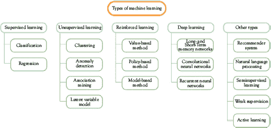

**图 2.1 机器学习的类型**

## 监督学习

在监督学习中，算法通过某种形式的监督通过示例学习。这几乎就像老师监督学生，只不过在这种情况下学生是算法。

当你训练此类算法时，你会提供由输入及其对应的正确输出组成的训练数据。机器将在训练阶段分析数据，寻找与预期输出相匹配的模式。因此，你给计算机一组蔬菜照片，并告诉它每种蔬菜是什么。计算机分析这些数据以确定得出正确结论的模式。它会确定茄子是长形的深紫色，而西红柿是圆形的红色的。

随后，在完成完成后，你可以为算法提供新的输入，它将根据接收到的训练数据对新数据进行分类。因此，它会将长形的深紫色物体归为茄子，将圆形的红色物品归为西红柿。

监督的角色是在算法每次出错时对其进行纠正。然而，由于算法在不断学习，它最终会达到不再出错的程度。

它是目前最受欢迎的 `ML` 种类。它是任务自动化中使用的主要技术。

监督学习可以分为两类：分类和回归。

### 分类模型

分类要求为算法提供已分配类别的数据。然后算法接收输入并根据提供的训练数据分配类别，就像我们之前的示例一样。

在现实应用中，最简单的例子是将电子邮件归为垃圾邮件或非垃圾邮件，这是一个二分类问题。

它的工作原理是为算法提供垃圾邮件和非垃圾邮件。它寻找每个类别之间的共同特征。然后，它将使用这些模式将未见的电子邮件分类为垃圾邮件或非垃圾邮件。如你所知，这并不总是有效。然而，每当你告诉它它犯错了时，算法就会学习。如果你想想，十年前垃圾邮件算法出错的频率比现在高得多。这是因为每当有人将电子邮件标记为非垃圾邮件或或反之时，算法都会学习。考虑到数亿人使用同一个电子邮件系统（例如 `Gmail`），对于算法来说，有大量的数据可以学习。

分类模型可以用于其他领域，例如股票或大商品的价值会会上还是下跌。它们还可以包含更多类别，因此不必是二分类的。例如，如果你想弄清楚谁会赢得多个参赛者的选秀比赛。

### 回归模型

相反，回归是一种预测统计过程。在这种情况下，算法尝试确定因变量和自变量之间的重要关系。目标是让算法能够预测实际数字，如销售额和收入。

换句话说，与其试图确定商品价值会上还是下跌，我们想知道七天后的价格是多少。或者，与其确定学生考试及格还是不及格，我们想知道他们会得多少分。也许与其试图判断今年冬的温度是高还是低，我们想知道具体多少。虽然这些问题相关，但它们仍然代表了不同于分类版本的问题。

大多数领域都包含分类和回归问题。然而，你必须记住这些问题可以通过多种方式解决。

例如，假设你是一个外汇交易员，你想预测美元在未来几周的表现以便盈利。你可以使用分类模型来判断它是涨还是跌，这将告诉你该做空还是做多。然而，你也可以使用回归模型进行更具体的预测，例如 `EUR/USD` 明天的交易价格是多少。

在第一种情况下，情况有些模糊。虽然你可能会盈利，但风险远大于使用回归模型，因为后者将为你提供更多信息来做出有效的决策。

这种想法是，每种方法都会给你不同类型的信息，这些信息将影响性能，从而影响你采用的策略。

## 无监督学习

在无监督 `ML` 中，算法将在没有目标或标记结果的情况下从数据中推断模式。这种学习无法应用于分类或回归问题，因为你不知道输出可能是什么，导致无法像正常那样训练算法。

换句话说，无监督学习完全取决于算法自己从数据中学习，通常指的是聚类。这意味着提供给算法的训练数据只有输入，没有预期输出。相反，算法根据其识别的模式对输入进行聚类。系统试图寻找它可以分组的重要规律性。它不涉及任何监督。

在没有指导的情况下，这种 `ML` 方法可能具有挑战性，因为问题往往定义模糊。不过，无监督学习在帮助确定数据的底层结构方面是有效的。此外，通常需要人工判读，至少在流程的末端需要。

无监督学习可以发现你原本不知道的模式。然而，现实情况是它没有监督学习那么有效。另一个让监督学习更适用于实际问题的因素是，在无监督学习中，你没有办法确定结果的准确性。

当你没有任何关于预期结果的信息时，无监督学习通常是最好的。其中一个例子是确定完全新产品的目标市场。然而，如果你想了解更多关于现有目标市场的信息，那么使用监督学习更好。


这并不意味着无监督学习没有用武。你可以应用无监督学习的一些方法包括聚类、异常检测、关联挖掘和潜变量模型。

### 聚类

通过聚类，你可以根据数据的相似性将数据划分为不同的组。然而，这种方法并没有广泛应用于客户细分等场景，因为它们倾向于高估组组之间的相似性，并且没有将数据点视为独立的实体。

最大的问题是，这类问题通常没有明确的定义。例如，如果你给算法提供一系列各种动物的图像，生成的聚类结果可能与你的需求并不相关。

这些图像可以用若干种方式进行聚类，例如按颜色、动物类型或栖息地。这些方法在技术上都没有错，但某些方法可能比其他方法更有用。

结果的有效性主要取决于你的目标是什么。因此，设定一个明确的目标并不断实验直到获得结果非常重要。好消息是，如果你测试了各种算法，最终你会找到一个有效的算法。

### 异常检测

异常检测对于发现数据中的不寻信息非常有用。如果数据集中某些东西不寻或异常，这些算法就能发现它们。

这些算法具有广泛的现实世界应用，特别是在识别欺诈交易等方面。它们也可以用于检测各种产品销售额的激增，但在检测黑客方面同样很有帮助。

### 关联挖掘

关联挖掘通常用于购物篮分析，因为可以有效识别出数据中频繁一起出现的物品。它经常被用于帮助确定交易、销售甚至医疗数据中的相关性。

### 潜变量模型

潜变量模型用于使数据更易于分析，并出现在预处理阶段。这些模型对于执行诸如降低一组数据中特征的数量（也称为降维），甚至将数据拆分为多个组件等任务非常有效。

通过降维，目标是将大量的变量归为较少的因子，使得数据更容易解释。最广泛使用的技术之一是因子分析。

一个例子是“大五人格量表”，它是通过收集大量人员的数据，并应用因子分析将答案归类为五个整体因素而开发的。根据大五人格理论，我们的性格可以归类为：

*   外向性
*   宜人性
*   尽责性
*   神经质
*   开放性

然而，每一个主要因素都由广泛的变量组成。例如，外向型人格的特征是友好、乐观、果断等。

降维可以应用于许多其他问题，包括用户人口统计和客户数据。

### 强化学习

许多专家认为，强化学习是释放真正 AI 的关键之一，因为它拥有巨大的潜力。此外，它正在以加速的速度增长，并为各种应用产生广泛的算法。

强化学习基于惩罚/奖励系统。这有点像训练你的宠物小狗。如果你想教 Fido 听指令坐下，你会给它下指令，向它展示你想什么，并给它零食作为奖励。一段时间内，你每当它做对时就会继续奖励它，以强化这种行为。

当 Fido 不听你的话时，你通常需要重复你的要求，直到它做到，然后奖励它。没有得到奖励通常就是足够的“惩罚”，让他意识到自己做错了。

对于算法来说，情况稍有不同，但本质上是一样的。例如，让我们考虑一个学习走路的机器人。如果它迈出的步太大，它就会失去平衡并倒下。那就是惩罚。所以，它会不断改变步长，直到它能够在不跌倒的情况下移动，这就是奖励。

或者考虑同一个机器人尝试通过迷宫。这里的情况要复杂一些，因为不仅仅是一个即时解决方案。在前面的例子中，调整步长会产生即时结果。而在迷宫中，前几步可能是正确的，直到它到达死胡同并必须回溯，直到找到开放的空间。

你可能在奇怪这有什么意义。嗯，考虑一些现实世界的应用。强化学习被用于自动驾驶汽车、机器人吸尘器等。如果没有强化学习，你的吸尘器将一直撞击同一个障碍物，而不是后退并绕过它。

强化学习是最接近人类学习方式的。考虑一下，你学习和开发的任何技能都是基于经验的。因此，你练习得越多，表现得就越好。然而，这一切都归结为奖励/惩罚。你通过发现什么有效、什么无效而学习。

考虑象棋吧。你玩得越多，表现得就越好。这是因为你对在不同情况下情况下什么有效、什么无效积累了越多的经验。

机器的强化学习工作方式非常相似，这就是为什么许多人认为它具有巨大的潜力。它允许在各种环境中解决非常复杂的问题。

### 深度学习

深度学习研究具有多层的神经网络，也称为深度神经网络。神经网络由神经元和连接它们的通路组成，有点像连点成线。人脑是世界上最强大的计算机，因此我们根据已经运行得很好的东西来模拟人工计算机是合理的。

在深度学习中，人工神经网络帮助机器学习得更快、更有效，且处理量更大。它被用于解决各种被认为不可解决的问题，例如自然语言处理 (`NLP`)、语音识别和计算机视觉。

在最基础的层，它的工作方式是从观察生成输入，然后将其添加到某层中。该层产生输出，该输出成为后续层的输入，直到得到最终输出。

例如，当你看到一张茄子的照片时，你知道它是一个茄子。但你怎么知道它是茄子而不是飞机或篮球的呢？

你的眼睛看到特定的形状和颜色，并根据经验将这些输入转换成你理解的抽象概念。所有这些信息通过你的眼睛经过多层过滤，直到它变成一个茄子而不是飞机。

如 `Siri`、`Cortana` 或 `Dragon Naturally Speaking` 等软件应用程序都能由于深度学习而理解你。它也是让这些应用程序在与你交互得越多的情况下学习得越好的原因。

这也适用于图像或歌曲识别。想知道某首特定的歌曲是什么？只需让你的应用 听它，它就能识别出来。同样，想找到你在现实世界中看到的某个特定物品？给它拍张照片，应用程序就会在网上为你找到它。

深度学习也可以用于生成语言。`OpenAI` 的 `GPT-3` 是一个令人印象深刻的模型，它可以创建的文章非常真实，以至于几乎无法判断是机器编写的。

深度学习的另一个应用是它赋予计算机识别图像中不同主题的能力，例如能够区分鸡、马、猫和人类是不同的事物。


它也被用于图形设计等领域，通过插件和应用程序在移除照片背景的同时，保持主体的完全完整性。如果你曾经尝试过移除背景，你就知道这有多困难。

如果你从未尝试过，那么请相信我们的话：在深度学习实现这些应用程序的诞生之前，你需要花费大量的时间和耐心。即便如此，你仍然无法保证在极短的时间内获得像这些应用程序所提供的那么好的结果。

这有点像是手绘一个画着设计极其复杂的蛋壳，与使用喷漆枪喷涂卧室墙壁之间的区别。

总之，深度学习使我们能够利用机器实现一些不可置信的事情，并将继续持续下去。有人认为它可能引导我们通向真正的 AI，而另一些人则认为进展已经停滞不前。对于 AI 研究人员来说，大问题是：深度学习之后是什么？只有时间能给出答案。

## 其他类型的机器学习 (ML)

存在许多其他类型的机器学习，包括推荐系统、`NLP`、主动学习、半监督学习和弱监督。

推荐系统旨在预测用户兴趣并据此做出建议。这些是在线零售商用于提高销量的最强大的机器学习系统之一（Rodriguez 2018）。

考虑亚马逊（Amazon），它拥有出色的推荐系统。每当你登录时，亚马逊都会根据你之前的购买和访问记录推荐它们认为你可能喜欢的商品或书籍。

Spotify 或 Netflix 使用类似的数据根据你可能喜欢的内容进行推荐。例如，如果你看了很多动作片和犯罪剧，Netflix 就会推荐类似的电影和电视节目。

在机器学习中，`Natural Language Processing`（自然语言处理）和文本分析涉及使用算法和 AI 来理解文本，范围从 Facebook 评论、在线评论到电子邮件和监管文件（Barba 2020）。

`Active learning` 指优先处理必须标记的数据的过程，这样它们对训练监督模型的影响最大（Solaguren-Beascoa 2020）。

`Semisupervised learning` 结合了监督和无监督机器学习方法，使算法从包含标记数据和未标记数据的数据集中进行学习（“Semi-Supervised Machine Learning” n.d.）。

`Weak supervision or weakly supervised learning` 包含了多种方法，包括：

- 不精确监督：训练数据仅提供粗粒度的标签；
- 不完全监督：其特征是数据集仅有一个子集具有标签；
- 不准确监督：标签并不总是真实值（Zhou 2018）。

## 给决策者：如何使用机器学习

机器学习在需要自动化或预测的情况下确实大放异彩。无论大多数情况下使用的机器学习的实际形式如何，它被应用于以下场景：

1. 人类正在执行重复性任务，这同时也允许他们对数据进行标记。标记后的数据可以用于训练机器学习模型以取代人类。这最突出的例子是计算机视觉以及如人脸识别或识别照片中的某些实体（例如人类与动物）的应用。
2. 预测关于未来或未知数量的情况：信用评分、垃圾邮件检测、预测、客户流失都是机器学习的可行应用。

理解何时以及如何应用机器学习是一项需要长时间掌握的技能。然而，决策者只需要使用上述启发式方法来对何时可以使用它产生一种直觉。从决策者的角度来看，更重要的是确保有一套数据策略，以促进机器学习的使用。这将在下一章中介绍。

## 给决策者的统计学简介绍

统计学是数据科学的核心领域之一。它是第一个系统化处理数据收集和分析的学科。在本节中，我们将对该领域进行简要概述，因为它可以帮助我们更好地理解数据科学领域。

统计学是研究如何收集、组织、分析和解释数值信息和数据。它既包含了不确定性科学，也包含了从数据中提取信息的技术。

它是任何数据科学家的重要工具，用于帮助我们做出决策。该领域采用了多种方法，使数据科学家能够完成许多工作，包括：

- 设计实验并解释结果以改进产品决策；
- 开发预测信号的模型；
- 将数据塑造为洞察；
- 理解广泛的变量，包括参与度、转化率、留存率、潜在客户等；
- 进行智能估计；
- 使用数据讲述故事。

从决策者的角度来看，理解统计学是重要的，而且很好地了解它们如何融入数据科学的整体叙述中也很重要。虽然统计学学科不能被认为是一个新兴领域（因为它已经存在了 200 多年），但在大数据时代，它找到了新的用途。

许多可以被认为是新兴技术的数据科学应用都是基于统计学的简单应用。因此，良好地统计学的基本用途有助于从视角上观察技术和方法是如何随着技术的进步而演变和适应的。

## 关于统计学的简历史

统计学是数学的一个分支，可以追溯到 18 世纪。它是人类首次系统地分析数据的尝试，也是现代数据分析的基础。它导致了描述性统计、回归分类、显著性检验、预测等的发展。该领域的一些著名人物包括罗纳德·费希尔（Ronald Fisher）、卡尔·皮尔逊（Karl Pearson）及其儿子埃贡·皮尔逊（Egon Pearson）、杰西·内曼（Jersey Neyman）。

统计学与其他数据分析领域不同，因为它更关注理论合理性，并且传统上处理小样本。这主要由于历史原因，直到最近数据才需要现场收集。直到互联网出现，我们才能远程收集数据。

你可以想象，现场收集数据既昂贵又耗时，这意味着小样本是常态。此外，在计算机进入生活之前，计算必须手动完成。虽然结果是通过误差范围推导出总体的，但这些计算仍然需要时间。今天，解决一个模型可能只需要几秒钟，但在 18 世纪可能需要几天或几周。

统计学也有不同的心态。由于该领域根于数学，它对模型假设和开发非常严格。在进行任何其他工作之前，必须对这些假设进行验证和确认。另一方面，在机器学习中，目标是先实现目标，后提问题。


# 统计学简析

统计学分为两个分支：描述性统计和推断统计。

描述性统计是大多数人认为的统计学。它涉及收集数据、使用总结性指标（如名称）以及进行数据可视化。

另一方面，推断统计是该领域大多数人所认为的统计学。它涉及更高级的概念，如抽样和推断总体参数的数值。

## 描述性统计

描述性统计涉及对数据的组织、总结和展示，以便所有人都能理解并利用它们。为了做到这一点，有两类方法，即用于描述数据的数值方法和用于数据展示的图表方法（“Understanding Descriptive and Inferential Statistics | Laerd Statistics” n.d.）。

数值方法不仅包括描述数据位置的指标（如`mean`、`median`和`mode`），还包括衡量数据变异性的指标（如`variance`和`standard deviation`）。

数据表示的图表方法包括柱状图、直方图、饼图等。

市场上的许多分析产品（如 `Tableaux`或其他仪表板）通常侧重于描述性统计。虽然描述性统计非常简单，但它们非常有效，且任何人都能轻松理解。

## 推断统计

推断统计代表了该领域的大部分，因为那是真正开展工作的地方，而描述性统计仅占极小比例。

推断统计包含了一组方法，你可以利用这些方法根据样本数据对整个总体的特征得出结论或推断。

从本质上说，推断统计允许量化不确定性。例如，假设你想了解某群人的某些信息。这可能是关于该人口的平均年龄。

如果你处理的是一个少数群体，比如只有几百人，那么你可以测量每个人的年龄并计算平均值。然而，当你尝试对整个国家这样做时（例如，一个可能有 2000 万人口的国家），这在实践上是不可能的。至少，从成本和努力的角度来看是不可行的。

因此，如果研究每一个个体是不现实的，那么必须有替代方案。这就是推断统计的用场。它涉及对你试图研究的总体进行抽样，并通过概率分布表达不确定性。你本质上是将不确定性转化为一个可量化的指标，从而允许你进行计算。这使得统计建模和假设检验成为可能。

你所做的是选取一千人的样本，尽可能涵盖广泛的人口统计，然后将他们的平均年龄推放到整个 2000 万人口中。虽然人口统计的一致性并非绝对必要，但它能带来更准确的结果。

例如，考虑冠状病毒引起的死亡。在疫情爆发的最初几个月里，关于该疾病实际死亡率的讨论有很多。统计学家之间产生了许多分歧。至少有些归因于`COVID-19`的死亡是由其他健康状况引起的。尽管如此，同时，一些与新冠相关的死亡（特别是在检测手段问世之前）被归因于其他疾病。这是推断统计的一个经典问题：在给定样本的情况下，尝试破译底层变量的数值。

围绕新冠相关死亡的另一个有趣的推断问题涉及定义和归因。假设某人患有严重的基础疾病，并可能在接下来的一个月内去世。如果这个人去世并在检测`COVID-19`时呈阳性，那么这种疾病是死因，还是基础疾病是死因？

归因的话题引发了更多的哲学讨论，并出现在许多与健康相关的讨论中。例如，肥胖流行的真正的罪罪祸首是谁？是销售不健康食品的公司、广告商，还是购买这些食品的人？虽然许多人对此主题有强烈的观点，但很难将这一现象完全归因于单一因素。这就是推断统计可以提供帮助的地方，通过量化每个因素的贡献来提供更清晰的思路。

## 统计学的益处

这一切听起来可能很有趣，但你可能在想统计学如何帮助作为决策者的你进行业务。

首先，你可能已经在以某种形式使用描述性统计了。利润预测就是你在业务环境中中使用统计的一个例子。

另一方面，推断统计可以用于回答关于变量的问题。它还可以回答关于差异的问题。你使用推断统计的主要目的是假设检验和统计建模。虽然预测是另一个领域，但它更具技术性，且通常可以通过`ML`更容易实现。

假设检验通常用于确定总体参数的数值或进行比较。

计算总体数值基本上意味着你正在确定特定的数值，例如平均身高、平均收入和平均年龄。比较涉及差异或相似性。一个例子是基于性别的分析。因此，你会观察在特定工作中，男性的收入是否比女性多。


财务分析涉及使用大量的统计信息来帮助投资者做出决策。例如，外汇交易依赖于对财务数据的分析，包括历史价格走势、某国家的经济数据等。它还涉及使用各种通过统计信息计算出的指标，例如移动平均线。

这种情况也同样股票市场，投资者根据市盈率和股息收益率等变量来决定投资哪些股票。某些人甚至会对市场平均水平与单只股票的结果进行比较。

## 营销

统计学在营销领域也非常有用。零售收银台的电子扫描仪为各种营销研究应用收集数据。艾森·尼尔森（AC Nielsen）作为一家信息供应商，从杂货店购买这些数据，然后对其进行处理，并将统计摘要卖给制造商、分销商等。

公司会投入大量资金来获取此类数据，因为它们可以用于确定生产必要性，甚至辅助开发新产品。

## 生产

质量控制是统计学在制造业中的一项重要应用。各种统计质量控制图用于监测制造过程的输出，例如 `x-bar chart`，它可以用于监控平均输出。

例如，假设某机器向容器内装入 1.5 盎司的奶油。员工会随机抽取一组容器作为样本，并计算样本中的平均盎司数。然后，将该平均值绘制在 `x-bar chart` 上。

绘图值高于上限控制限表示机器容器装填过度，而绘图值低于下限控制限则表示装填不足。只要绘图值落在上限和下控制限之间，该过程就会持续。否则，将进行调整以确保平均值处于正确位置。

## 经济

经济学家经常预测经济的未来或经济的某些方面。他们使用各种统计信息来做出这些预测，例如预测 GDP、通胀率等。然而，这些预测通常是使用 `ML` 完成的。

## 信息系统

信息系统管理员处理公司计算机网络的日常运营。他们使用各种统计信息来评估性能并进行调整，以确保系统处于最佳状态运行。

## 统计学的陷阱

统计学最大的问题之一是，人们倾向于盲目信任它们，仅仅因为它们看起来像是事实。毕竟，当有人向你展示信息，而这些信息由数字、比率、百分比、图表、图图等形式的看似准确的数据支持时，你更有可能相信你所听的内容。

然而，利用统计学来欺骗人们是非常容易的。这并不总是出于恶意，但即使是人为错误也可能导致结果偏颇，从而引发问题。

因此，理解统计学如何被用来扭曲事实至关重要。这样，你就会更有警觉，并且不太因为被误导而做出错误的决策。

以下是你可以利用统计学被欺骗的几种方式：

### 使用图表撒谎

统计学用于误导观众的一种方法是使用包含虚假相关性的图表来欺骗人们。这些图表乍看似乎合理，但彼此之间没有任何联系。

例如，这里有一张图表显示了缅因州的离婚率与人均人形油消耗量的相关性（图 2.2`）。

这是另一张图表，试图将全球非商业太空发射次数与美国授予的社会学博士学位相关联（图 2.3`）。现在，这些看起来可能是有趣的统计数据，而且单独来看它们确实如此。然而，当你试图在这些事实之间建立相关性时，就有些滑稽。

例如，第一张图表似乎意味着随着缅因州离婚率的下降，人形油的消耗也随之下降。一些进取的个人可能会试图说服你人形油影响了离婚率，人们吃的人形油越少，离婚的可能性就越低。

另一张图表似乎意味着随着缅因州离婚率的下降，人形油的消耗也随之下降。一些进取的个人可能会试图说服你人形油影响了离婚率，人们吃的人形油越少，离婚的可能性就越低。


你有三种主要的中心性衡量标准：中位数、众数和平均数。

平均数代表一组数字的平均水平，基本上就是将所有数字相加，然后将结果除以相加变量的数量。中位数是数字列表中间位置的数值，而众数则是列表中出现频率最高的值。

如果分布是对称的，这三个值将落在同一个点上。然而，如果分布呈现正偏态，则平均数会小于中位数，而中位数会小于众数。如果分布呈现负偏态，情况则相反。

这一点非常重要，因为生活中的大多数分布并不是对称称的。例如，假设一家公司每年给 CEO 支付 300,000 美元的工资，而剩下的 10 名员工每人每年赚 50,000 美元。

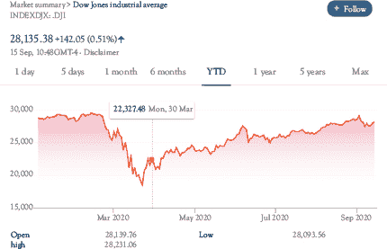

***图 2.4 2020 年琼工业指数***

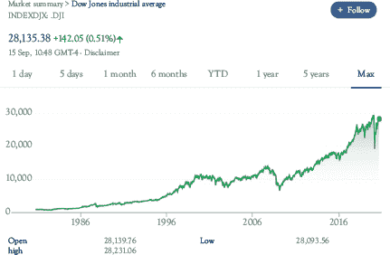

***图 2.5 道琼工业指数长期趋势***

根据你想要实现的目标，你可以呈现不同的数字。在这种情况下，中位数可能是每年 50,000 美元，而平均数是每年 72,000 美元。

公司可以宣传平均数，这会让人们认为他们也能赚到那么多，但公司并不愿意支付除 CEO 以外的任何人每年超过 50,000 美元。

这样，他们就可以欺骗潜在员工接受工作，因为员工相信自己最终能赚到 72,000 美元，而事实上，他们得到的永远不会超过 50,000 美元。这看起来可能很卑鄙——如果你好奇的话，确实如此——但并没有你想象中那么常见。

### 采样偏差
采样偏差也会导致数据不准确，从而在决策过程中引发问题。虽然有许多不同的采样偏差，但我们将关注五种：选择偏差、区域偏差、自选择偏差、诱导性问题偏差和社会赞许性偏差，因为它们在商业领域最为常见。

两个非常著名的采样偏差案例是英国脱欧投票的预测和 2016 年美国总统大选。这两种情况下的预测者都完全错误了，因为样本中引入的偏差使得所使用的大多数统计模型完全失效（Kampakis 2016）。

### 选择偏差
选择偏差是最显著的。事实上，其他类型的偏差实际上可以认为是与选择偏差相关，甚至是选择偏差的子类。

当样本不能代表整体时，就会发生选择偏差。某些现象确保样本中的主体或项目在某种程度上是特殊的，而其他主体则被排除在外。

选择偏差的一个有趣例子是美国政府在第二次世界大战期间试图提高美国飞机的生存率。

最初的尝试是在调查人员分析了幸存飞机后进行的。当时的建议是在受损最严重的区域增加更多装甲。当安装了装甲后，生存率并没有提高，反而发生了相反的情况。额外的装甲让飞机变得更重、更慢、更不灵活，使得敌人更容易将其摧毁。此外，幸存的飞机在相同区域仍有严重的损坏。

政府转向了统计学家亚伯拉罕·瓦尔德（Abraham Wald）。他意识到发生了选择偏差。换句话说，调查人员并没有根据重要的部位做出决策，而是根据经受损坏的飞机做出的决定。瓦尔德得出结论，需要保护的区域实际上是那些敏感且未受损的区域。一旦这些区域得到加固，生存率就提高了（Mangel and Samaniego 1984）。

这是一种使用统计学的有趣方法，甚至不需要进行任何深入分析。瓦尔德必须意识到选择偏差正在发生，这才使他们解决了问题。

### 区域偏差
区域偏差指的是试图将一个区域的结果推广到另一个区域。这带来了许多问题，特别是当你试图进行跨文化研究时。

例如，如果你在美国进行市场研究，并试图将结果应用到另一个区域（如中东），你会大大一惊。文化、财务、语言的差异将会产生影响。

### 自选择偏差
自选择偏差是指人们自愿参与研究，这可能导致非代表性样本。例如，如果你想让样本具有真正的代表性，你需要与那些不仅仅是志愿者的人交谈。

### 诱导性问题偏差
获得你想要的答案而非真相的一种非常简单的方法是使用诱导性问题。例如，如果你问某人是否认为老师的薪水不够，提供的选项有：

a) 是，他们应该拿更多；
b) 不，他们不应该拿更多；
c) 没有意见

大多数人会选 `a`。这是因为人们想要表现得友好，并提供看起来社会上接受的答案。

### 社会赞许性偏差
社会赞许性偏差发生在人们希望描绘自己更好的形象时，这几乎总是如此。因此，如果你提出关于社会赞许性的问题，你的数据将是偏的，因为没有人愿意承认自己不符合社会预期。例如，如果你问某人向慈善机构捐款的频率、回收的频率，或者扔掉多少食物，你不太可能获得准确的答案。

如果有人告诉他们只扔掉了购买的食物的 3%，他们可能没有在说实话，因为浪费食物并不完全被社会所接受。所以，他们会提供一个他们觉得更容易接受的答案。


另一种实现此的方法是对数据进行“粉饰”。然而，在其他情况下，你可能会发现某些研究结果具有显著性，但这仅仅是因为没有满足模型假设，而不是因为研究人员意图欺骗。

# 案例研究与示例

以下是数据科学对业务产生重大影响的一些示例。

## 预防性维护变为预测性维护

对于许多各行业的公司来说，预防性维护是业务的一个关键方面，因为它可以减少非计划停机时间。后者会对利润产生负面影响，这就是为什么预防性维护如此宝贵。

与业务的任何其他方面一样，提高维护效率是许多公司的首要任务，特别是那些依赖大量昂贵设备的设备。运营制造业、运输、石油气、铁路和货运等行业的公司都能从中受益。

定期维护的目标是尽可能减少故障、最大限度地延长机器寿命，并确保最佳性能和高效运行。

最常见的方法是公司根据设备或车辆制造商提供的建议制定维护计划。这就像你的汽车一样，例如，制造商建议你在行驶 10,000 英里后更换机油。

这完全不是一个坏方法。它无疑比猜测或等待故障要好得多。然而，它并不理想，因为故障仍然会发生。事实是，没有人可以计划每一种情况并预测每一个问题。

例如，制造商可能会建议你每运行 5,000 小时更换一次燃料滤器，但那是在理想运行条件下。如果柴油质量不是最好的，或者机器在多灰尘或多沙环境中运行，除非你想出现很多其他问题，否则需要更早更换。

避免由于故障和损坏导致的非计划停机是至关重要的，因为这种停机可能非常昂贵。它会导致产出损失和生产力下降而造成巨大的收入损失。

更好的替代方案是计划停机，因为你可以计划在机器无法运行对问题影响最小的时候进行维护。关键在于找出那个时间。

许多公司正在转向数据和预测性分析来解决它们的维护调度问题（`Kampakis 2020a`）。

例如，在制造业中，生产线上的传感器可以收集你需要的任何信息。然后你可以存储并分析这些数据。算法可以利用这些数据来确定何时可能发生故障。这个过程被称为预测性维护。

目前使用的预测性维护算法通常基于 `ML`，因此随着它们在识别可能故障的情况方面变得越来越擅长，其准确性也会之提高。

此外，整个过程是可以自动化的，这意味着预测性分析可以计算何时需要进行维护以避免故障。它还可以根据需求等多种因素确定进行维护的最佳时间，以确保其干扰最小。

预测性维护显著提升了生产力，改进了客户服务，降低了成本并增加了利润。正如 `Google` 趋势所示，它已经变得非常流行，随着更多公司理解其益处，它的流行程度将继续增加。

## 使用 AI 和数据科学对抗 COVID-19

由于被称为 `COVID-19` 的新型冠状病毒，世界正面临着一场无人认为可能在现代世界发生的危机。在写本文时，全球范围内死亡人数已接近 100 万，，感染病例总数达 3140 万例，危机仍在持续，许多专家警告将出现第二波大规模感染。

许多组织已转向 `AI` 和数据科学来帮助度过这一危机时期（`Kampakis 2020b`）。白宫和艾伦人工智能研究所的一个团队设计了一种 `AI`，首次独立开发出了一种药物。虽然这项技术仍处于婴儿阶段，对对抗 `COVID-19` 的帮助不大，但它对于未来的大流行可能至关重要。

`AI` 还可以帮助减轻医疗网络的压力，用聊天机器人取代医生回答简单问题。例如，`Ask-Sophie` 帮助患者确定他们患的是感冒还是 `COVID-19`（Check Your Symptoms | Medicare）。

传统的预测性分析也可以帮助预测未来。例如，以色列的研究人员正在依靠 `AI` 预测下一次爆发可能何时发生，以便他们处于更有利预防位置。以色列人没有大量的检测可用，因此他们需要谨慎使用这些检测。因此，他们每天发放问卷，并依靠数据科学来确定哪些人群可能被感染。

## 雇佣合适的人

现在已经很清楚了，数据科学是一个巨大且复杂的领域，主要是因为它是不同科学学科的汇集。这意味着有很多不同类型的数据科学家，招聘其中一个可能是一个相当复杂的过程，因为背景各异。一个 `ML` 专家的技能组合可能与纯统计学家有很大不同。我们将在后的第 4 章中探讨招聘和管理数据科学家的话题。

## 核心要点

- 数据科学是一个汇集了许多不同领域的术语，主要领域包括 `AI`、`ML` 和统计学。
- `ML` 最流行的类型是有监督学习和无监督学习。还有其他类型，例如主动学习和推荐系统，这些对于某些类型的业务很有用。
- 统计学被划分为描述性统计和推断统计。最有趣的应用（如统计建模）属于推断统计的范畴。
- 在使用统计方法时，重要的是尽量避免可能渗透数据的偏见。
- 招聘和管理数据科学家并不总是容易的，因为数据科学家的背景多样。

# 第 3 章](#Contents.xhtml#ch3)

## 什么是数据策略？](#Contents.xhtml#ch3)

在我们已经涵盖了数据科学的高级概述之后，我们开始讨论数据策略。对于任何想要从数据中产生价值的业务来说，这都是关键，而且与雇佣合适的人同样重要。

互联网上有许多不同的数据策略定义，但一个很好的定义应该是这样的：

*数据策略是一份**动态**文档，定义了企业如何从技术和组织角度让自己做好准备，以主动管理和利用数据来服务长期业务战略。*

这个定义由几个关键部分组成：


`数据策略是一份活的文档……` ——数据策略不应该是一个花费数月时间开发，然后被置在一边、积灰且无人问津的文档。无论如何，数据策略可以是一份文档、一份演示文稿或你选择的任何其他媒介，但最重要的是，它应该是一份活的文档——意味着随着业务的演进，它在不断地更新和刷新。

`…… 定义了业务如何从技术和组织角度进行规划……` ——一个良好的数据策略理想情况下应该同时涵盖工程和基础设施方法，以及你计划如何组织团队，以最大限度地利用你的数据。

`…… 主动管理和利用数据……` ——通过创建数据策略，你确保自己采取了积极措施，使业务尽可能具有韧性，并尽早地赋予其竞争优势。

`…… 迈向长期业务战略` ——最后但同样重要的一点是，数据策略不应孤立于业务的其他部分而存在。相反，良好的数据策略将以业务战略作为其北极星，所有的计划都应该源于此。

# 为什么数据策略很重要？

你是否好奇过互联网上每分钟都会发生什么？Google 每分钟处理 380 万次搜索查询，YouTube 上有 450 万次视频观看，发送 1.8 亿封电子邮件，Netflix 的观看时长约为 70 万小时。随着我们的生活日益数字化，我们与产品和服务之间的互动可以以前所未有的方式被记录和观察。

耐克（Nike）、欧莱雅（L’Oreal）、沃达（Vodafone）和伦敦交通（Transport for London）有什么共同点？上看，所有这些企业经营不同的市场，提供完全不同的产品。然而，它们都是数据驱动型企业。

在过去的几里，数据已经从产品的副作用变成了企业最有价值的资产之一。数据增加价值的方式是多层。尽管如此，人们可以将数据产生价值的领域大致分类为：运营改进、客户洞察和数据产品。

## 1. 运营改进

- 数据可以改进甚至完全自动化我们业务中的流程。例如，Verizon 使用数据对客户服务电话进行分诊，从而优化其呼叫中心。此外，供应链物流等数据丰富的业务领域是自动化的首选目标。
- 另一个例子是 Netflix 投入巨资优化生产流程，以便他们大规模地创作原创内容（Kumar, Misra, Walraven, Sharan, Azarnoush, Chen, and Govind 2018）。

## 2. 客户洞察

- 今天许多最流行的服务使用数据作为工具，为客户提供更好的产品体验。例如，LinkedIn 使用你过去的互动来推荐你可能感兴趣的文章。Spotify 的 `Discover Weekly` 是另一个利用数据和 `ML` 来生成推荐并增加用户参与度的绝佳案例。

## 3. 数据作为产品

- 最后，数据本身可以作为新的收入流为业务增加巨大价值。通常，这种价值只有在公司规模扩大到数千名用户并产生大量数据时才会变得相关，但不应被低估。
- 拥有大量用户数据可以大大提高公司在收购者眼中的价值。IBM 收购了 Weather Underground，据《华尔街日报》报道，这笔交易价值约为 `$2 billion`，证明了他们所拥的数据对 IBM 的价值。虽然 IBM 没有透露如何使用这些数据，但很明显，在业务的许多其他方面（例如 `IoT`）都有天气数据的整合，因为天气数据会影响设备故障。有时，即使看似没有价值的数据也可能隐藏着丰富的信息。

在我们探索如何构建良好的数据策略时，请记住这些领域，因为它们将引导你的思考。

即使是欧盟也承认数据在未来的重要性，并概述了了自己的数据战略。目标是创建一个单一的数据市场，以便在与拥有大量价值数据的科技巨头竞争时做到公平竞争（“欧洲数据战略”n.d.）。

现在你已经确信每家企业都是数据业务企业，这变得更加清晰：公司需要一个有效的策略从其收集的数据中提取尽可能多的价值。通常，特别是在业务的早期阶段，数据收集在时间和金钱方面可能是昂贵的。一个经过深思的数据策略有助于专注于哪些数据将释放最大的价值，并希望启动数据飞轮。

在我的工作过程中，我经常看到这两种情况，如 表 3.1 所示。

那么，这两个案例有什么共同点呢？在两种情况下，数据策略都能扭转局面。在第一种情况下，数据策略将为公司提供大量的额外收入。在第二种情况下，正确实施的数据策略可以为初创公司提供除收入增加之外的竞争优势。

### 表 3.1 数据策略情况

| | **情况 1** | **情况 2** |
| --- | --- | --- |
| ***用例*** | 一家公司想要进行统计分析。随着问题的调查，很明显本可以收集数据来改进分析，但这些数据并不可用。 | 一家初创公司需要某种数据科学服务。随着对系统的讨论进行，很明显请求的服务取决于许多不同类型的数据。这些数据的收集和存储揭示了新的变现途径，可以帮助改进初创公司的收入战略。 |
| ***解释*** | 这是我所称的“数据债”的例子，由于对未来项目缺乏规划，导致公司没有收集所有必要的数据。正如我们将在下文中看到的，良好的数据策略将描述公司希望在未来 `12–24 months` 内实现的项目，以及实现这些项目以交付良好结果所需的数据。在规划过程中引入数据科学家将有助于确保你涵盖了该项目应收集的所有数据。 | 在这种特定情况下，为特定数据科学项目规划的影响是发现了更多利用数据进行整体收入战略的机会。通常，围绕数据战略的头脑风暴可以向前也可以向后。在思考某个项目所需的数据时，你可能会发现利用相同数据开启的其他项目和机会。 |
| ***示例*** | 一家租车公司想要预测未来几个月的需求，为每个客户创建定制优惠。该公司没有保留有关其用户婚姻状况和年龄的信息。这些信息在多年运营中本可以很容易在其平台上收集到。然而，由于没有这样做，公司不得不接受一个性能下降的次优模型。 | 一个常见的案例是推荐系统。推荐系统可以从有关用户的各种信息中受益：年龄、性别、购买以及可能的其他事情。设计平台以改进从用户那里收集的信息会产生广泛全面的数据库，可以提高推荐系统的有效性，还可以用于其他用途。例如，这些信息可以用于更好地管理折扣优惠、改进广告，甚至提升用户体验。 |


然而，如果数据科学策略没有从早期就开始实施，其有效性就会大打折扣。这就是为什么将其视为产品路线图和业务计划中不可或缺的一部分非常重要。我最喜欢的一句话是“不计划就是注定失败”，这对于数据策略来说再再贴切了。

## 如何定义数据策略

既然我们已经介绍了制定数据策略的重要性，你可能在想构建数据策略的最佳流程是什么。在网上，有很多许多人们青睐的方法，每种方法都有其优缺点。以下描述的方法是我们在帮助寻求构建数据工作路线图的中小型企业时取得成功的一种方法。

### 从你的业务策略开始

数据策略不能脱离连贯的业务策略而存在。你所开展的工作类型在很大程度上取决于业务希望在短期到中期实现的目标。

例如，想象 A 公司（一家 B2C 公司）刚刚发布或即将向市场推出其第一款产品。推测，他们明年的战略优先事项之一可能是快速获取用户，并确保高留存和高互动。鉴于这些优先事项，数据团队必须专注于构建正确的基础，以收集和分析必要的数据，以便在必要时对产品进行快速迭代。在这个例子中，这将构成数据策略的核心部分。

请注意，业务策略会随时间变化，因此数据策略也能够适应以满足任何新目标或优先事项至关重要。

如果你对业务的战略优先事项有明确的想法，请直接跳到数据用例章节。否则，在接下来的章节中，我们将描述一项练习，该练习应该帮助你关注当前对业务最重要的事情。

#### 练习 1：定义你的战略优先事项

首先，公司需要确定它存在的意义——我们称之为`愿景`。这个愿景是公司的北极星，它应该回答这样一个问题：“有了我们的公司，10 年后的世界会是什么样子？”它应该是大胆、宏大且富有抱负的，因为即使你永远无法到达，它也能给公司里的每个人一种方向感和目标感。

在愿景声明之后，你应该创建你的使命声明。这是一种更关注短期的描述，解释了组织`为什么`要做所做的事、做了`什么`、为`谁`做以及`如何`做。使命声明应该感觉是触手可及的，并且是你目前正在明确努力的目标。

最后，可以从使命声明中推导出战略优先事项。定义愿景和使命的意义在于，你应该开始看到一条从组织当前状态到达那个北极星的路径，而这条路径就是你的策略！剩下的就是将策略定义为具体的优先事项。

在过去与业务所有者一起进行练习时，我们喜欢将业务拆解为各个部分，并感受改进领域在哪里。我们用于定义业务的组件有：

* 产品
* 增长营销/销售
* 内部运营（人员和流程）
* 业务模式/财务

这些组件会根据你正在构建的业务类型略有不同，请根据需要进行更改。

一旦我们定义了这些组件，下一步是为每个组件脑暴一些工作或改进领域（使用白板工具或类似工具）。不所意外的是，参与业务不同部门的人员越多，你对每个组件获得的视角就越好。

然而，请记住，每增加一个人，都会让头脑风暴会议变得更，使得更难深入探讨每个员工的意见。

这项头脑风暴练习的输出将是业务未来工作的一系列想法和建议。你应该开始在每个组件内部甚至跨组件之间看到某些主题出现。与小组花些时间将所有的想法和观点归类到逻辑组中，并决定哪些在未来一年中可能最值得关注。这些将构成你业务策略的基础。

### 构建你的数据用例

从你的战略优先事项出发，你可以开始构思数据用例是什么，以支持该策略的交付。一个`data use case`是一个自包含且定义良好的项目，与完成你的一个战略目标有关。你定义的数据用例将构成你未来一年的关键优先事项，从这些数据用例中，你可以开始制定数据活动计划。

数据用例的一些示例是：

* 在公司内部建立自助分析能力；
* 降低特定产品的服务交付成本；
* 提供更具个性化的客户体验；
* 减少客户流失。

一年中数据用例的 3 到 5 个，包括 1 到 2 个“快速胜利”（quick wins）。快速胜利数据用例有几个作用，即你可以从业务数据侧展示近乎即时的价值，以获得业务其他部分的更多认可。此外，交付一个端到端项目有助于在开始任何更大的项目之前发现任何意外的问题。

一旦你确定了数据用例，就可以开始拆解交付每个用例需要什么，以及在着手执行任何用例之前需要考虑哪些因素。每个数据用例你需要考虑的领域是：

* 数据需求：你是否需要任何特定数据来交付项目？数据科学家将就项目所需的数据类型和数量提供指导。
* 关键项目资源：考虑交付项目所需的角色——这可能不仅包括数据工程师、数据科学家和数据分析师，还包括任何业务所有者、项目/产品经理等。还要考虑业务中哪些人可能会受到项目影响并需要作为利益相关者参与。
* 技术：在项目成功实施之前是否存在任何技术依赖？是否必须修改数据架构/基础设施以获取所有所需的数据？

将所有数据用例领域一起考虑是有用的，这样你可以发现项目之间重叠的需求并更好地协调资源。

### 数据架构

清楚你的数据是如何架构的，对于长期成功和持续创新至关重要。随着你组织的规模扩大，组织中的数据量也将之增长，而且通常是非线性的，因为随着你产品的增长和改进，每个新用户都可能产生比之前的用户更多的数据。

在公司早期，从一种数据库或架构类型切换到另一种的成本是可以接受的。这通常不需要太多的服务停机即可完成。相比之下，像 Slack 这样的组织花了三年时间（从 2017 年到 2020 年）将数据架构从双活跃集群迁移到名为 `Vitess` 的工具（Ganguli, Iaquinti, Zhou, and Chacon 2020）。显然，这种迁移中投入的尽职调查、思考和工作量远高于一个只有一千用户的初创公司从 NoSQL 迁移到 SQL 数据库所需要的工作。


这里的教训是，早期对你的数据和系统架构进行一些周全考虑，可以在未来产生巨大的回报。有无数故事讲述，某些机构花费了数百万美元试图修复数据孤岛，并合并来自无数源的数据以获得“单一真理来源”。更不用说，由于难以快速对新想法进行原型和测试，导致了错失机会上的巨额损失。

对数据架构投入认真思考的商业理由是不容置疑的。然而，在现实中，在花费无尽的时间设计完美架构与立即实施当前最佳想法以快速推进之间，存在着一种微妙的平衡艺术。

如果遵循敏捷方法论的思维，人们只能根据现有知识做出决策，而对未来的任何假设仅仅是假设而已。因此，不要执着于完美的架构，特别是当产品的未来仍不明不朗时。相反，更重要的是快速行动、测试你的假设，并不断迭代以实现产品市场匹配。

## 数据治理

跨整个组织的数据管理不仅仅是一项技术或基础设施挑战。它在很大程度上取决于公司实施的`governance`（治理），用以确保数据是可追溯的、定义清晰，并且仅供需要的人员访问。与之前讨论过的数据架构一样，数据治理计划的规模应该与业务拥的数据规模成正比，这意味着在早期不要用过多的流程来增加业务负担。

早期开展数据治理的一个良好起点是建立一个公司范围的数据字典。数据字典是一个动态文档，其中组织中存在的所有原始数据和派生数据都应该有清晰的定义。对于任何派生数据，都应该解释其原始来源以及对其应用的任何转换。构建数据字典应该突出显示数据中任何引起困惑或误解的领域，并帮助公司全员在何处搜索数据以创建报告或指标上达成共识。还建议为每个数据源分配一个负责人。如果数据出现任何问题，或者人们有疑问或疑虑，可以联系这些人员。

数据治理的另一个关键方面是法律根据如《通用数据保护条例》（`GDPR`）或《加州消费者隐私法案》（`CCPA`）等法规要求的流程。再次，数据字典将极大地帮助识别你持有关于用户的哪些个人数据，你可以记录针对以下问题的答案：

- 为什么这些个人数据是必要的？
- 用户变得活跃后，这些数据将归档多久？
- 我们与哪些第三方软件共享这些数据？

## 管理 AI 项目

软件产品管理领域在 20 世纪和 21 世纪越来越流行，因为学者和创业者一直在设计新方法来管理软件项目的复杂性。最引注目的是，这导致了敏捷方法论的爆发，使其成为交付用户喜爱产品的首选方法。

虽然软件开发已经经历了数十年的学习和成熟，但 AI 产品开发仍处于婴儿阶段。因此，AI 产品开发带来了软件开发中未见过的新挑战：有更多的未知数、结果是非性的，并且涌现了大量支持 AI 开发的新工具、基础设施和流程，人们必须熟悉这些内容。

然而，可能影响最深的是，AI 将工程的概念从确定性过程转变为概率性过程。在考虑到这些所有挑战的情况下，人们可能会认为处理 AI 项目的方法需要与软件不同。然而，现实是，我们接触过的大多数正在进行 AI 项目的公司，倾向于将典型的敏捷软件方法生搬硬套，以适应这些新类型的项目。

在本节中，我们将进一步详细地探讨为什么 AI 项目与软件项目不同，以及产品管理实践应如何转变以应对这种范式的转移。

### 为什么 AI 项目与软件项目不同？

如之前提到的，这种差异可以从高层次描述为：AI 开发更多是一个概率性过程，而不是确定性过程。以下四个领域更详细地描述了这些项目的不同之处，并将有助于进一步澄清这一概念：

### 不可预测性

在传统的软件项目中，人们可以简单地将整个项目看作是函数的组合，每个函数接收一个输入，对该输入应用某些启发式方法和处理。结果是函数返回一个输出。

当所有这些小的单元函数组合在一起时，就可以创建出各种奇妙的应用程序。由于每个函数都是显式编码的，因此通过查看每行代码在做什么，来理解每个函数的行为是非常简单的。这样做可以帮助你不仅理解典型的测试用例，还理解任何可能导致函数崩溃的边界情况（edge cases）。例如，如果一个函数对一组输入应用对数函数，那么任何负输入都会使其崩溃，因此人们可以写一些逻辑来拒绝任何负输入。

如果我们继续这种类比来尝试解释 AI 的世界，可以将 AI 视为一种解决问题的方法，我们我们有一对对输入和输出示例，并且训练一个模型来`复制将输入转换为输出的函数`。一个简单的例子是，如果我们有对 (1, 1), (2, 4), (3, 9), (7, 49) 和 (8, 64)，那么我们就希望我们的模型学习到函数是 `y = x²`。

现实中，我们处理的输入输出对代表了比这复杂多的函数，这使得 ML 成为工具箱中如此宝贵的工具。现在假设我们建立了一个模型，并想要像软件项目中所解释的那样理解生成函数的行为。我们不再能通过检查每行代码来理解函数在做什么了，因为构建的模型是由某些学习参数表示的，这些参数在某些数学公式中与输入混合。

这使得理解函数或模型的失效点变得困难得多，因为模型在面对未见输入时如何表现变得更加模糊。这在近期深度学习的兴起中尤为困难，因为深度学习模型比更简单的 ML 方法更像是一种“黑盒”方法。由于函数的内部机制难以分析和理解，因此理解和验证边界情况变得困难得多，理解模型在哪些情况下可能会失败也变得更加困难。

模型从输入输出对中学习函数的另一个后果是，ML 模型绝不是 100% 正确的（尽管在某些类型的任务中它们可以非常接近）。这意味着组织需要理解如何管理模型预测输出错误的情况。在某些情况下，例如推荐新歌曲，糟糕推荐的成本并不高。但在更严肃的应用中，例如癌症的自动检测，错误的预测可能会产生严重的后果，因此需要建立流程来处理这种情况。


## 模型退化

机器学习模型被称为“模型”，是因为它们最终都在试图准确地表征现实世界中发生的某些行为。例如，一个旨在预测每天能售出多少冰淇淋的模型，将对整个人群的冰淇淋需求行为进行建模。假设将某天的温度作为输入，以模拟温度对冰淇淋销量的影响。模型可能会发现温度与冰淇淋销量之间存在正相关关系，并且销量可能会预测得相对准确。

我们都知道，我们居住的世界极其复杂，行为会随着时间而改变。这意味着，任何在历史数据上训练的模型都会随着世界的变化和对新情况的适应变得越来越过时。在我们的冰淇淋模型中，随着时间的推移，人们可能会意识到冰淇淋因为含糖量而不健康，导致冰淇淋销量随时间推移略有下降。我们的模型将无法准确代表真实世界，因为与一年前温度相同的今天，销量会更少。这意味着我们的模型需要被`retrained`（重新训练）以捕捉行为的变化。

这种现象在机器学习的所有领域非常常见，导致模型需要定期重新训练，以防止准确性随时间退化。现实世界上更具代表性的例子是欺诈检测，犯罪分子一直在发明新方法来欺骗机构；因此，模型需要适应以能够检测这些新类型的欺诈。这种现实意味着模型永远没有其“最终状态”，这为 AI 项目增加了另一层复杂性。

## 难以预测

人们可能倾向于认为，因为某个 AI 问题的解决方案解决了另一个与你的问题非常相似的问题，那么这个解决方案也适用于你的问题。例如，你可能正在建立一个电子商务商店，并发现基于另一个商店构建的推荐系统效果良好。然而，现实情况是，训练这些模型所使用的底层数据分布是不同的。因此，你针对自己的特定问题需要不同的解决方案。

进一步考虑这个例子。从表面上看，训练推荐系统所需的数据几乎是相同的。有一组产品，带有一些产品元数据。接下来是用户，每个人都有自己的特征。最后，是一组用户与产品之间的交互作用。尽管如此，同一个推荐系统实现对一个网站有效，但对另一个网站却无效。这怎么可能呢？

这种现象可能有许多解释，但归根结底是因为产生这些数据的分布是不相同的。通俗地说，一个网站上的人可能与另一个网站的人完全不同，具有各种购买行为和动机。一个模型可能非常擅长准确表征一个网站上的人的行为，但对另一个网站却很糟糕。有时你可能会走运，一组略有不同的模型超参数可能足够解决你的特定问题。在其他时候，你可能需要寻找完全不同的算法来解决你的问题。

## 难以衡量进展

即使是一个经验丰富的数据科学家，有时也很难完全理解为什么模型性能不佳。通常，需要大量的手动检查来找出为什么某些训练示例的预测不准确，这可能意味着要逐个示例地查看哪些特征可能会误导模型。这种现实意味着，要确定哪些变化会导致性能的显著提高变得更加困难。

你可能会挣扎几周，运行多次实验并调整某些模型参数，结果模型性能只提升了 1% 到 2%。直到某一天，你突然发现了一个新的输入特征，它能让模型提升了 10% 到 20%！AI 项目的进展在时间维度上是非常是非线性的，在项目开始时，知道何时能取得那个让你的模型具有部署价值的突破是具有挑战性的。

我见证过许多项目，在几周时间里，感觉突破快要来了，但最终无果而。什么时候是时候对一个方案假设投入了足够精力了？任何解决方案都有许多可能掉进去的“兔子洞”（rabbit holes），使得这个问题很难回答。对于 ML 项目来说，“完成的定义（definition of done）”显然并不清晰，因为你的团队可能认为还可以获得额外的性能。但代价是什么呢？必须回归业务价值，以确定追求额外的模型性能是否会带来任何收益。

## 敏捷 AI 开发原则

虽然上一节描述了 AI 相较于软件项目在估算和交付方面的困难，但组织可以实施一些策略，以便在成为 AI 驱动型组织的过程中占据优势（参见`表 3.2`）。

## 数据科学流程

实现一个数据科学项目有有许多不同的方法。这导致了一些格式化所需步骤的产生。在本节中，我们将探索其中的一些流程。

***表 3.2 敏捷 AI 开发***

| 定义公司的使命和近期战略 | 这一主题在章节的第一部分已经详细讨论过，但因为它如此重要，在这里再次包含。你不仅应该花时间定义它，而且一旦定义，要确保你所做的 ML 应用直接影响你的极星指标。 |
| :--- | :--- |
| 遵循数据科学需求层次 | 数据科学需求层次（Rogati 2017）将 AI 放在金字塔的顶部（如果你熟悉马斯洛需求层次，可以类比）。在将 AI 构建到组织中之前，需要开发关键方面，例如数据收集机制和对连接数据运行分析的能力。`图 3.1` 显示了你在构建 AI 驱动组织过程中应该遵循完整数据科学需求。 |
| 将数据标注构建到产品中 | 为 ML 应用构建标记数据集是昂贵的，特别是外包。如果你可以在产品中构建一种鼓励用户标注数据的机制（例如在你的银行应用程序中对交易进行分类），你就能有机地建立一个足够训练 ML 模型的数据集。 |
| 让你的第一个 AI 项目尽可能简单 | Coursera 和 `Landing.ai` 的创始人吴恩达在他引导组织进入 AI 世界的蓝书中推崇这一策略。首先研究简单的 AI 项目有很多直接和间接的好处，但最重要的是 (a) 为组织提供了即时价值，(b) 获得了利益相关对 AI 是值得投资的领域的认可，(c) 完成一个成功的项目将提振士气，并对未来的项目产生连锁反应。 |
| 确保问题定义得非常清晰 | 你越精确地描述你试图解决的问题，就越能缩小可能解决问题的方法范围。考虑你的算法可能会遇到哪些边界情况以及它应该如何处理这些情况。首先让团队尝试手动解决问题非常有帮助，这样你就有了一些示例作为讨论的基础，并开始排除或包含潜在的解决方案方法。 |


| **执行可能奏效的最简单的方法** | 在启动任何项目时（这同样适用于非 AI 或机器学习项目），参考 `80/20` 规则通常会有帮助，并思考如何用最少的开发工作带你完成大部分目标的最简单方法。这种策略具有两个明显的优势：1. 你可能会发现你所能想到的最简单的方法已经提供了足够的价值。否则，你将更清楚地了解这种简单的方法距离目标性能还有多远，这对于理解问题的复杂性很有用。2. 简单的方法将迫使你更多地思考整个端到端的解决方案（数据输入/输出、流水线），而不是专注于构建复杂的算法。这将揭示在部署该算法时可能出现的任何意外，而这些意外可以在改进算法和进行研究的同时并行处理。 |

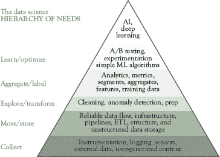

*图 3.1 数据科学需求阶层结构*

这里这里概述的流程在相互之间都有细微的差异，但它们都遵循了一套关于处理数据科学项目的通用原则。如果你能从这一节中获得任何东西，那应该是这些原则。最终的流程应该符合你的项目风格和要求，而不是为了适应这些流程而改变你的工作方式。这些流程是指南和最佳实践，但实际项目是混乱的，因此要始终考虑什么类型的流程适合你的特定情况。

### 流程 1：CRISP-DM

`CRISP-DM`（跨行业数据挖掘标准过程）可能是用于规划典型数据科学项目最流行的流程。`CRISP-DM` 的目的是清晰定义构成数据科学项目的各个阶段，并理解这些阶段是如何相互作用的。

与下述的微软团队数据科学过程不同，`CRISP-DM` 不关注工作管理的低级细节，或团队中的角色和职责。相反，`CRISP-DM` 是一个高层框架，可以帮助你理解项目每个阶段执行了哪些工作，以及可以预期的交付物。最重要的是，`CRISP-DM` 强调数据科学项目的迭代性质，并且可以根据项目期间获得的新学习和发现在不同阶段之间灵活移动。


*图 3.2 CRISP-DM 流程的六个主要阶段*

`CRISP-DM` 流程描述了六个主要阶段（图 3.2）：

1. 业务理解 (Business Understanding)
2. 数据理解 (Data Understanding)
3. 数据准备 (Data Preparation)
4. 建模 (Modeling)
5. 评估 (Evaluation)
6. 部署 (Deployment)

**业务理解**：第一阶段通过关注三个主要领域来设定项目背景：(a) 定义业务目标，(b) 识别项目需求以及 (c) 构建项目计划。

设定明确的业务目标可以说是该过程中最重要的部分，因为在整个项目中都会反复参考它们以做出重要决策。思考你想要实现的首要目标以及任何有助于解决的相关问题。一旦有了这些，考虑哪些指标能最准确地跟踪实现主要业务目标的进展。定义不可衡量的项目结果是危险的，因为它可能导致团队对项目是否朝着正确方向移动产生误解。

**数据理解**：这是任何新问题的首步。该阶段的结果是验证是否有足够的数据。数据常见的陷阱包括变量存在大量缺失值、未收集到正确的变量或数据存在噪声。数据理解阶段应寻求提取这些见解，并验证对数据的任何预设。

**数据准备**：建模阶段的前身是准备阶段。数据科学家将从各种数据源中选择适当的数据，并执行数据清洗和整理操作，将其转换为可以输入模型的状态。这一阶段将在整个项目中反复进行多次，因为你无疑会学到

**建模**：建模阶段涉及为用例研究并开发最合适的模型。在项目的这个阶段存在很多不确定性，因为模型并不总是可以在不同用例之间迁移，即使这些用例非常相似。由于如此，从简单模型开始是重要的，并在建立起对简单模型局限性的理解后从那里进行迭代。

**评估**：与作为建模阶段一部分的模型评估不同，这里的评估阶段是为了确定项目在多大程度上符合项目开始时设定的整体业务目标。在这个阶段，你无疑已经对数据和项目的复杂性有了许多了解，这意味着你可能会根据所学的内容稍微重新考虑业务目标。


也许在这个阶段，在带有真实用户的真实轻量级环境中对模型进行测试是有意义的。虽然模型在开发环境中运行良好，但如果数据与真实情况不完全匹配，或者在开发模型时忽略了某些因素，它在生产环境中的表现可能无法达到预期。

### 部署
如果你已经到了模型结果让你满意的阶段，恭喜你！你已经接近可以从项目中获取业务价值的了。项目的最后一个阶段是部署阶段，你必须决定模型如何在生产环境中运行。这里常见的问题有：

- 模型在数据数据上运行多一次？是批处理预测还是实时预测？
- 模型将如何与输入和输出系统通信？是否需要设计 `API`（应用程序编程接口）？
- 你将如何随时间推移监控模型的性能？由谁负责这项工作？
- 模型需要多久重新训练一次？理想情况下，这个问题应该在评估阶段就有答案，因为你了解模型性能是如何随时间衰减的。

### 流程 2：微软团队数据科学流程
微软对团队数据科学流程（Microsoft n.d.）定义如下：

> 团队数据科学流程 (TDSP) 是一种敏捷、迭代的数据科学方法论，用于高效交付预测性分析解决方案和智能应用程序。TDSP 通过建议团队角色如何协作工作来帮助改进团队协作和学习。TDSP 包含了微软和其他行业领导者的最佳实践和结构，以帮助数据科学计划的成功实施。其目标是帮助公司充分实现其分析计划的效益。

该流程由以下关键组件定义：

1. 数据科学生命周期定义。
2. 标准化的项目结构。
3. 数据科学项目的基础设施和资源。
4. 项目执行的工具和实用程序。

结合我们在本章讨论的内容，数据科学生命周期定义是最相关的。组件 2 到 4 在进入实施阶段时非常有用，我鼓励你在微软网站上查看。对于本节的其余部分，我们只关注生命周期。

该项目定义的生命周期在很大程度上借鉴了上一节描述的 `CRISP-DM` 方法论，但强化了使过程迭代化的重要性，最重要的是是在项目的每个主要阶段之间进行迭代，而不仅仅是遍历整个循环进行迭代。该生命周期可以用图示（`图 3.3`）进行总结。

从图中你可以看到，生命周期的四个主要阶段是：

- 业务理解
- 数据获取与理解
- 建模
- 部署

这几乎可以与 `CRISP-DM` 一一对应，唯一的例外是数据理解和数据准备被合并为数据获取与理解，而建模和评估被合并为建模。鉴于这种相似性，请参考上一节中关于每个阶段所开展的活动的详细说明。

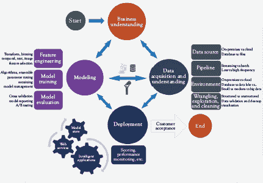

***图 3.3 数据科学生命周期***

本节重点强调的重要领域是流程的迭代性质。在处理数据科学开发时保持敏捷，无疑会让你在交付交付项目方面具有优势。只运行一次流程的情况是非常罕见的。


在这个过程中，有两个主要的参与者和四个步骤。主要参与者是 `domain expert`（领域专家或关键业务利益相关者）和 `data scientist`（或者在数据科学团队中，即团队负责人）。

这四个步骤概述如下。在每个步骤下，你将找到负责完成该步骤的人员。

1. 问题定义
   a. 领域专家
2. 选择合适的数据（数据管理）
   a. 领域专家
   b. 数据科学家
3. 问题的解决
   a. 数据科学家
4. 通过可操作的洞察创造价值
   a. 数据科学家和 领域专家

### 问题定义
这是定义关键问题的地方。这项工作由 `domain expert`（以及关键业务利益相关者）完成。为什么是 `domain expert` 而不是 `data scientist`？因为没有能比真正参与业务的人更擅长谈论业务的问题了。虽然 `data scientist` 可能会带来一些外部知识，但 `domain expert` 才是真正应该理解其组织所有细节的人。这意味着他们应该能够列出一系列相关的问题/挑战。

`data scientist` 之前可能在该领域工作过，可能有一些很棒的主意，这些想法可以直接拿来用。然而，即便如此，`domain expert` 也需要对业务问题至少有一个清晰的认识，才能真正掌控提议解决方案并据此对任何建议进行优先级排序。

这里并不要求 100%具体。例如，一个缺乏 `data science` 知识的 `domain expert` 可能发现很难对业务问题提供明确的描述。这没关系，只要他们能够提供整体业务和一些关键性能指标的准确图景即可。

这里的危险在于表述模糊，并且无法向 `data scientist` 解释预期关键指标或结果是什么。解决挑战需要 `data scientist` 确保他们正在针对正确的目标进行优化，然后将这些结果传给 `domain expert`，使收益显而易见。第一步对于实现这一目标至关重要。

### 选择合适的数据（数据管理）
这很棘，因为需要 `data scientist` 和 `domain expert` 的协同。在理想的世界里，业务从第一天起就遵循数据策略。数据是干净且质量良好的。领域相对简单，数据中没有噪声。遗憾的是，这是例外而非常态。

在大多数情况下，企业并没有遵循数据策略。这意味着 `data scientist` 可能会遇到许多问题，例如：
1. 缺失值；
2. 重要且有效的变量未被收集；
3. 数据收集的粒度错误（例如，按月而不是按天）。

同样，这里存在一个来自领域的巨大危险。其中一位作者曾与一家生产雷达设备的公司合作。他为他们开发了一个算法，但当公司更换了芯片组时，算法停止工作了。问题源于两个芯片组固有的噪声以及硬件的其他版本差异。作者和公司都不知道升级芯片组不会改进算法，而是需要完全重新训练。

所以，完成这一步骤的最佳方法是通过 `data scientist` 和 `domain expert` 之间的往来沟通。不要做任何假设！不要假设数据是正确、准确或缺乏噪声的。对任何早期的、非常成功的结果都要非常怀疑。更有可能你遇到的是数据泄露（data leakage），而不是惊人的数据。

数据泄露的一个例子是：输入变量与结果变量高度相关，但在测试时通常无法获得。例如，如果你正在预测季度销售额，有人添加了一个指示销售额高低的二变量，这会导致性能飙升。但这个变量是在回顾过去之后才创建的。

### 问题的解决
这一步取决于 `data scientist`。如果前面的步骤执行得当，将会拥有：
1. 对业务问题的清晰定义。
2. 一组良好的数据。

现在 `data scientist` 需要做的是：
1. 确定成功的关键指标。
2. 使用各种数据科学方法解决问题。

这让我们进入了第四步。

### 通过可操作的洞察创造价值
到目前为止，`domain expert` 和 `data scientist` 组合实现了：
1. 对问题的共同理解。
2. 检查了数据质量。
3. 创建了解决方案。

现在是这两个参与者协同工作的时候。`domain expert` 必须理解并批准解决方案。`data scientist` 必须将其转化为可衡量的结果，使收益变得清晰。

### 案例
让我们来看几个案例，使上述内容更容易理解。

#### 案例 1：推荐系统
推荐系统对于任何电子商务及其他领域都是非常有价值的工具。Spotify 使用推荐系统识别你喜欢的歌曲。Amazon 使用推荐系统推荐产品。Netflix 使用推荐系统预测你将观看电影或节目。

所以，在这个案例中，我们将处理一家名为 Zookla 的虚拟公司。Zookla 是一家运动服装和设备的在线零售商。公司由 10 人组成，包括开发人员、业务发展人员以及深度参与日常运营的 CEO。公司最近筹集了 500 万美元，并建立数据科学部门。Zookla 聘请了一位数据科学家来处理为期六个月的项目。

### 分析：Tesseract Academy 双演员模型
我们将从 Tesseract Academy 的双演员模型角度来分析该项目。以下是流程的回顾：
1. 问题定义
   a. 领域专家
2. 选择合适的数据（数据管理）
   a. 领域专家
   b. 数据科学家
3. 问题的解决
   a. 数据科学家
4. 通过可操作的洞察创造价值
   a. 数据科学家和 领域专家

#### 问题定义：理想情况
在理想的情况下，CEO 清楚什么是推荐系统以及它如何提高利润。CEO 也对这在屏幕上看起来是什么样了如指。展示推荐系统有很多。例如，Amazon 使用以下两种方式：“经常一起购买”和“购买此商品的人还购买了”，如图 3.4 所示。

```
(Figure 3.4)
```

另一方面，Spotify 根据你喜欢的歌曲创建自定义播放列表，如图 3.5 所示。

```
(Figure 3.5)
```


此外，最后，如果 CEO 拥有良好的直觉，或者公司已经对有用的模式进行了初步研究（例如客户细分），将会有帮助。这些信息不仅可以为推荐系统的设计提供参考，还可以用于创建一个简单的基于规则的推荐系统，作为更高级版本的基准。

## 问题定义：糟糕的情景

在糟糕的情景下，CEO 属于以下两类之一：

1. 他们说“想用数据做一些有用的事情”，但并不确定具体是什么。
2. 他们说想要一个推荐系统，但对涉及的所有细节和问题一无所知。

第一种情况非常常见，大多数数据科学家都会为此做准备。在这种情况下，数据科学家将花一些时间向 CEO 解释数据科学，进一步了解业务，并发现最佳的进展方向。如果 CEO 在聘用数据科学家之前完成了这些准备工作，情况会更好，因为这些工作通常需要一到两个月。

第二种情况要棘手得多。CEO 可能对自己想要的东西很有信心，但他们忽略了许多关键话题：

1. 他们可能忽略了推荐系统与 UX/UI 在结果显示和数据收集方式上的交互。
2. 他们对客户没有真正的了解。
3. 他们不确定自己想要什么样的指标。这个项目的成功标准是什么样的？

因此，如果例如网站需要进行大量的重新设计以显示推荐内容并收集相关数据，那么第一点可能会成为巨大的问题。第 2 点和第 3 点往往同时出现。有时，人们对某个项目充满热情，但客户并真的不知道自己在寻找什么。仅仅是更多的销售额吗？更多的互动吗？要增加多少？

预测成功的水平是不可能的。然而，项目结束时客户才意识到自己对结果不满意的情况也并不罕见，因为他们从初就无法表达自己的期望。例如，如果客户认为推荐系统会使销售额翻倍，这可能是不现实的。数据科学家可以解释什么可能更可行，或者他们如何创建一个不断改进的系统。

在某些情况下，客户对新 AI 系统的期望持有潜意识的想法，但直到最后时刻事情进展不符合意愿时，他们才意识到这些想法。

## 案例研究 2：需求预测

需求预测是零售等行业中的常见问题。如果企业能够成功做到这一点，就可以优化其供应链和订单以实现利润最大化。让我们以 Leotard Clothes 为例。这是一家销售猫咪灵感服装的零售商。

他们的仓库空间有限，而且由于使用了特殊面料，生产衣服需要大量的时间和资源。此外，他们使用了许多外包承包商，这意味着成本会随着生产数量而变化。生产超过需求的衣服将显著增加每月成本，但如果生产的衣服较少，公司仍然可以盈利。承包商的另一个问题是，某些情况下会出现材料短缺。Leotard Clothes 理想希望能提前几个月预订面料。

因此，对他们来说，预测需求至关重要，这样他们就知道每个月生产多少件衣服。

让我们看看 Leotard Clothes 如何使用 CRISP-DM 方法预测需求。

### 分析：CRISP-DM

回顾 CRISP-DM 流程。CRISP-DM 过程中描述了六个主要阶段（图 3.6`）：

1. 业务理解
2. 数据理解

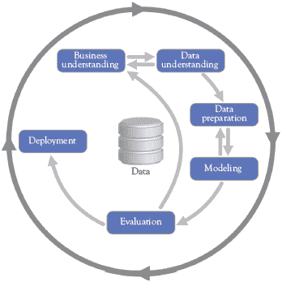

**图 3.6 CRISP-DM 流程的六个主要阶段**

3. 数据准备
4. 建模
5. 评估
6. 部署

第一步（业务理解）是关键。虽然预测是公司想做的，但他们希望在运营的背景下进行此。这意味着需求预测被用于优化资源配置。

这一步直接与第五步（评估）相连。为什么呢？因为在评估 `ML pipeline` 时，我们需要识别结果如何转化为业务行动。由于预测是一个回归问题，报告的指标将是 `Mean Absolute Error`（平均绝对误差）或 `Root Mean Squared Error`（均方根误差）。但什么是好分数呢？这与业务密切相关。

在某些领域，性能 1% 的差异可以转化为数百万美元。在其他领域，5% 的差异可能意义不大。

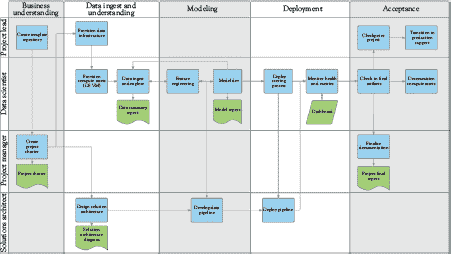

**图 3.7 团队科学流程示例**

1. 仓库有足够的空间。
2. 第 1 点要求衣服被售出。
3. 第 1 点也要求材料与需求匹配。

因此，当我们预测需求时，关键挑战在于如何确保仓库有足够的空间。所以，这应该是我们的主要关注点。`图 3.7` 中讨论的其他步骤。

## 案例研究 3：自然语言处理

让我们看看如何使用团队科学流程来分解一个问题。假设我们正在处理一家名为 Zappo 的在线零售商。该公司对在其社交媒体上运行自然语言处理感兴趣，以了解如何改进。

我们首先注意到有四位参与者：

1. 项目负责人
2. 数据科学家
3. 项目经理
4. 解决方案架构师

根据流程，解决方案架构师负责确保公司内部业务理解。流程还定义了一些需要实现的技术任务。例如，在第一步中，仓库由项目负责人而非数据科学家创建，从而清晰地划分了角色之间的职责。

在我们的案例中，项目负责人需要定义衡量什么。例如，公司可以选择衡量：

1. 对产品评论的情感分析。
2. 帖文互动的预测。
3. 互动指标的时间序列分析。

因此，我们可以立即看到，“使用 NLP 研究社交媒体”这一通用任务会立即拆解为多个不同的任务。每个任务都应该单独处理。所以，我们可以假设该案例中的公司决定专注于第一个任务并进行情感分析。流程的第二个阶段涉及数据科学家，他们负责产生报告。你可以看到，数据科学家的第一个输出是易于向管理层传递的内容。该流程显然对业务理解了高度重视。同时，解决方案架构师将开始研究部署的细节。

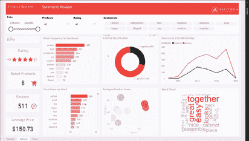

**图 3.8 情感分析仪表板**

*来源：* Faction A 2018

第三步建模由数据科学家运行各种情感分析算法并对其进行比较。该阶段的输出是一份模型报告。同样，这有助于跟踪项目的进展并向业务利益相关者传递价值。


第四步是部署。在第三和第四步中，主要的执行者是数据科学家和解决方案架构师。在这种情况下，结果通过仪表板进行交流。我们示例中的仪表板可能包含评论分类和词云（图 3.8）。

在最后一个阶段——验收，项目负责人和项目经理会重新介入并将一切整合在一起。由项目经理编写的最终报告确保了所有内容已记录在案，项目可以定稿。

# 案例研究 4：计算机视觉与算法偏见

本案例研究将调查三个有趣的挑战：计算机视觉、算法偏见和数据隐私。

假设你正在开发一种软件，该软件可以通过安装在商店内的摄像头提取有关商店人员的信息。该应用程序不仅可以计算客流量，还可以计算商店内不同人员的特征，例如性别、年龄、种族等。

你决定将使用通用的计算机视觉解决方案，例如 `Google Vision` 或 `IBM Watson`。

这里需要注意的一个重要点是，这是一个特殊情况。原因是这个用例还涉及合规性、监管和伦理问题。让我们来看看为什么：

首先，公司必须确保不存储个人的隐私数据。这指的是实际图像或对个人的出的推断（例如年龄）。可能取决于地理地区，具体的法律要求会有不同，但无疑会有各种法律上的复杂性。

其次，应用程序应该确保不会对某些类型的人产生偏见。众所周知，计算机视觉算法可能会对少数群体产生偏见。《时代》杂志的一篇著名文章证明了计算机视觉 `API` 如何可能将奥普拉·温妮瑞（Oprah Winfrey）误认为男性，例如（“人工智能在性别和种族偏见上存在问题”，未注日期）。

鉴于这里的主要挑战涉及业务的不同部分，Tesseract Academy 的双执行者模型可能非常有用。该模型的益处是它非常灵活，因此它也适用于挑战不仅是技术性质的情况。这一过程背的关键在于它列出了项目可能面临的所有挑战。因此，决策者和数据科学家可以确保在处理特定挑战时达成步调一致。

## 析：Tesseract Academy 的双执行者模型

现在，让我们重新回顾这一过程。

1.  **问题定义**
    a. 领域专家
2.  **选择正确的数据**
    a. 领域专家
    b. 数据科学家
3.  **问题的解决方案**
    a. 数据科学家
4.  **通过可操作的洞察创造价值**
    a. 数据科学家和 领域专家

*问题定义。* 在这种特殊情况下，核心问题定义是的。业务所有者想要了解商店人员的具体统计数据，例如性别、年龄和种族。

然而，核心问题定义需要扩展。我们还需要添加：

1. 数据隐私
2. 消除偏见

这些点将指导问题的解决方案。

决策者还定义了业务应该采用通用解决方案，而不是在内部自行开发自己的解决方案。

*选择正确的数据。* 在这种情况下，数据是来自商店内摄像头的直接馈送。因此，摄像头必须是高品质的，网络必须有足够的带宽将数据传输到 `API`。

数据隐私属于这一步。记住，数据管理涉及决策者和数据科学家。虽然数据科学家负责技术方面，但决策者需要确保业务符合合规性。

他们两人需要决定的是如何将数据喂给 `API`，以及不同选择的影响。数据是会被存储在某处然后发送吗？还是会实时发送？

*问题的解决方案。* 考虑到扩展的问题定义和决策者施加的限制，数据科学家必须定义正确的解决方案并制定攻击计划。在这种情况下，攻击计划不涉及数据分析，而是对市场上的解决方案进行比较。

具体来说，数据科学家将在主要的计算机视觉提供商之间进行 `A/B 测试`，并识别哪些最好。数据科学家可能需要去商店并在真实条件下测试这些系统。

*通过可操作的洞察创造价值。* 通常，可操作的洞察是在数据分析后得出的。在这种情况下，数据科学家和决策者需要持续监控运行的前几个月，以确保其符合预期。可能会出现影响结果的问题，但这些可能与 `API` 无关，例如摄像头的问题。

下表 3.3 总结了上述所有见解。

***表 3.3 Tesseract Academy 双执行者模型总结***

| **问题定义** | 1. 获取统计数据 2. 数据隐私 3. 无偏见 |
| :--- | --- |
| **选择正确的数据（数据管理）** | 1. 摄像头数据流 2. 数据隐私 |
| **问题的解决方案** | 1. 发现最佳 API 2. 在真实条件下测试 API |
| **通过可操作的洞察创造价值** | 1. 确保 API 按预期工作 2. 根据需要重新审模型 |

## 核心要点

- 数据策略被定义为“一份活的文档，定义了业务从技术和组织角度如何进行设置”。
- 数据科学开发与软件开发不同。管理数据科学项目需要遵循数据科学流程。
- 有不同的数据科学流程，流行的包括 `CRISP-DM` 和 Tesseract Academy 的双执行者流程。


数据科学家需要数学和统计学知识来分析数据并提取洞察。如果没有这些知识，他们就不知道应用什么方法或模型，因此即使他们通过自己的黑客技巧（hacking skills）将数据处理成可用的格式，也无法更进一步。

虽然数据科学家要高效完成工作并不一定需要统计学博士学位，但他们确实需要了解如何开发和使用数学及统计模型。他们还必须能够解释结果。

## 领域知识（Substantive Expertise）

领域知识指的是数据科学家必须具备特定领域的的知识。换句话说，他们需要理解业务本身，而不仅仅是技术层面。这样，数据科学家就可以将其其他技能应用到数据上，从而实现目标。本质上，这意味着你希望医疗保健领域的数据科学家拥有一些医疗保健的经验和专业知识。虽然这本身并不是先决条件（数据科学工具可以应用于任何问题），但数据科学家在进入一个新领域时，至少应该愿意获取必要的领域知识。

## 三项技能缺一不可

仅有其中两项技能是不够的。例如，一个精通数学和统计学但没有领域知识的优秀代码黑客可能在 `ML` 方面表现出色，但这并不能让他们成为一名数据科学家。

拥有领域知识和数学统计学知识的人可能非常擅长研究，但他们还不是数据科学家。学术界主要由拥有这两项技能的人组成。

当你拥有一个既精通计算机又具备领域知识的人时，最大的问题就开始了。这实际上可能会让他们变得危险。他们掌握的知识足以拼凑出一个看起来正规的分析，但他们并不理解自己是如何得出结论的。

他们拥有将分析技术应用于问题的技能。然而，他们缺乏理论基础来确保自己正在做正确的事。因此，他们可能会运行统计检验，但可能使用了错误的假设。

所以，一名胜任的数据科学家需要具备所有三项技能，即黑客技巧（hacking）、数学科学知识以及领域知识。

## 什么能激励数据科学家？

如果你想有效地管理数据科学家，你需要了解激励他们的动力。虽然每个人的动力不同，但数据科学家具有许多共同特质，这使得人们很难理解他们。这是因为他们拥有太多的技能，以很难将他们归到一个特定的框子里。

数据科学家不仅仅是懂数学统计学并能让计算机“唱歌”的极客。他们还拥有卓越的沟通和可视化能力，这意味着他们不仅可以与高层管理有效交流，还可以与客户和其他利益相关者交流。这还使他们成为出色的故事讲述者，这在商业环境中至关重要。

数据科学家对数据充满好奇，对业务充满热情。他们不断想要改进和学习更多，虽然他们可能想解决问题并影响事物，但他们并不想要权力。他们倾向于具有战略性、主动性、创造性和创新性，并且喜欢与他人合作。

他们中的许多人需要精神上的刺激，而解决问题仅仅是他们的工作。他们天生好奇，并受成长驱动，这通常意味着他们热爱学习新事物并扩展技能。

所以，当你思考什么激励数据科学家时，你需要考虑薪水之外的东西。虽然数据科学家可能为了高薪入职，但如果他们没有挑战，或者觉得自己的工作没有被有效利用，他们可能就不会留下来。

如果你把数据科学家放在一个需要处理大量重复性工作的位置，他们的参与度将会暴跌，你会发现他们已经心不在焉了。

换句话说，如果他们必须花费大量时间清理数据或执行任何其他像看油漆干透一样无聊的任务，你最终将得到一个想尽快离开你公司的人。

另一个关注点是精神投入。我们所说的意思是，如果你要求他们解决简单且没有挑战的问题，他们将不会感激之。这并不意味着你总是能为他们提供挑战，也不意味着简单的问题不需要解决。但同时，请考虑，如果你正在招聘一名数据科学家，你应该利用他们的技能组合。

毕竟，你不会雇佣一名火箭科学家来对飞机进行预防性维护，对吧？虽然他完全能够胜任，但担心的是，由于无聊，火箭科学家会将你的飞机变成一艘宇宙飞船。

## 招聘数据科学家：数据科学家想要什么？

数据科学家虽然短缺，但需求极高。本质上，这种高需求意味着数据科学家处于权力地位，可以选择参与哪些项目。例如，一个在伦敦工作的表现尚可的数据科学家每周会收到 1 到 10 个猎头头的联系。因此，为了增加招聘到合适人的概率，你需要了解给他们提供什么。

所以，数据科学家想要什么？

### 优厚的薪酬

你首先需要考虑的是薪酬。数据科学家不仅像任何人类一样需要钱生活，他们还希望知道自己受到了重视并获得了合理的报酬。

### 团队

有些数据科学家比其他人更社交，更倾向于在与大家同频的团队中工作。这通常意味着他们在非正式的文化中蓬勃发展，尽管有时他们在家办公效果可能更好。当一个人必须花大量时间思考时，家里安静的环境可能比办公室空间更有利。

虽然你不能完全为了某一个人就改变公司文化，但你可以考虑这种偏好并尝试做出一些通融，以培养更好的工作关系。

### 挑战的类型

数据科学家在挑战中成长，尽管他们面对的挑战类型和/或问题也很重要。例如，某些人可能偏好特定领域，如医疗保健或环境问题，而另一些人可能倾向于处理影响社会的问题。

他们可能有的另一种偏好与问题的类型有关。例如，某些数据科学家倾向于处理包含文本的数据。

然而，虽然这些只是表面的考虑，但如果你深入挖掘，通常会发现关键在于数据科学家喜欢不断做和学习新事物。

### 技术栈

所使用的技术也将起着重要作用，因为一些数据科学家倾向于与他们已经熟悉的系统工作，而另一些人则想尝试新事物。大多数数据科学家的一个共同特质是他们不想与遗留代码和旧技术工作。

虽然这涉及到你与相关数据科学家的交流，但请记住，这些人中的许多人通常喜欢学习新技术。这可能仅仅是因为他们想要提升自我，或者因为他们喜欢挑战，又因为他们想获得更高的薪酬。


如果你能为他们提供一个学习这些新技术的环境，你将更有机会留住他们。然而，不要忘记，一旦他们扩大了自己的技能树，你可能需要相应地增加他们的薪酬以留住他们。

## 学术联系

激励数据科学家的另一种方法是为他们提供参加会议的资金。许多数据科学家与学术界有密切联系，并且有阅读和/或编写论文以及参加会议的习惯。这对所有人来说都是件好事，因为他们能保持技能敏锐，并始终掌握数据科学领域的最新进展。

博士级数据科学家可能会感兴趣参加的一些顶级数据科学会议包括：

* ICML—国际机器学习会议
* NeurIPS—神经信息处理系统学术会议
* SIGKDD—ACM SIGKDD 国际知识发现与数据挖掘会议
* ECML-PKDD—欧洲机器学习与数据库知识发现学术会议
* AI Stats—人工智能统计会议

## 改变你的招聘思维

在招聘数据科学家时，你必须某种程度上改变你的思维。大多数雇主采取的是与他们试图填补任何其他职位时相同的策略。这通常意味着他们会询问数据科学家在特定领域的经验。

问题在于，数据科学家往往寻找他们以前没有工作过的领域，因为他们想学习新东西并避免无聊。在新的领域处理数据比反复重复地做同样的事情要有趣得多。

现在，你可能会认为招聘一个没有你所在领域经验的数据科学家是一个错误。毕竟，你并不想成为那个资助数据科学家受教育的人，对吧？

嗯，这恰恰是考虑这一问题的错误方式，因为数据科学家的并不是由他们所经验的领域定义的，而是由他们的技能集定义的，而这些技能适用于任何领域。只要他们拥有工具，他们就可以在任何领域工作，即使他们从未见过那里。

可以把它想象成训狗训练师和行为专家。虽然训练师可能更频繁地与牧羊犬合作，但他们同样有能力训练任何其他品种的狗，从英国斗牛到罗威犬。无论处理的是什么品种，工具和技能都是相同的。

另一个问题是，雇主并不并不总是完全理解他们要求的到底。一个经常出现的问题是人力资源部门会要求某人具有某项技术五年的经验，结果发现该技术只出现了两年，因此不可能拥有那么多的经验。

因此，通常更好的主意是关注数据科学家知识和技能的广度，而不仅仅是经验。

数据科学家往往被局限在一个领域内，因为雇主不理解数据科学家是如何工作的以及他们的技能集意味着什么。例如，一个在金融领域工作过的数据科学家会使用`predictive modeling`（预测建模）和`time series`（时间序列）等工具。然而，这些工具不仅限于金融。它们可以同样有效地用于零售和医疗等其他领域。

问题是，雇主会看到数据科学家在金融方面的经验，并假设他们的技能集仅适用于特定领域。这意味着他们可能会错过招聘一位优秀数据科学家的绝佳机会。

换句话说，在为工作选择合适的人时，你需要改变你的思维，因为数据科学家不符合常常。

## 数据科学部落

根据数据科学家如何成为数据科学家的，可以将他们分为大部落和小部落。

与其他职业（其他职业通常意味着通往合格身份的路径是相同的，例如会计师或医生）不同，人们可以通过多种方式成为数据科学家。因此，数据科学家可以分为三个主要部落三个次要部落（Kampakis 2018b）。

主要部落由计算机科学家、统计学家和其他来自其他领域的定量专家组成。

次要部落可以分为自学数据科学家、软件用户和领域专家。

## 主要部落

正如前面提到的，三个主要部落是计算机科学家、统计学家和其他定量专家。让我们仔细观察每一个。

### 计算机科学家

计算机科学家拥有计算机科学学位，或者`ML`的硕士或博士学位。主要的优点是，这类数据科学家在编程、数据库和软件方面非常优秀。然而，他们往往忽视了统计技术和理论，而这些在某些情况下是必要的。


**图 4.1 数据科学家的部落**

这类数据科学家通常是`ML`任务（如`predictive modeling`，预测建模）的良好选择。

Kaggle 是一个人们可以参与分析和预测建模竞赛的平台，尽管需要注意的是 Kaggle 已加入 Google Cloud（“Kaggle 入门指南”2017）。基本上，公司上传数据集，然后人们竞争出最好的模型。它是通过众包发现特定预测建模方法的有效方法。

计算机科学家对于小型公司和初创公司来说是一个很好的选择，因为你可以给他们一个数据集，你只需要找到一个好的算法。他们拥有出色的编程技能，因此可以轻松地将工作与其他部分集成。

他们还很擅长数据库技能，这意味着他们可以进行大量的数据工程工作。即使你有自己的数据工程师，与计算机科学家合作仍然值得，因为他们可以轻松地检索数据并转化为可用的内容，其他如此。

### 统计学家

统计学家拥有统计学学位，正如其名称所示，甚至拥有`ML`学位。然而，尽管他们拥有良好的理论知识，但很少拥有必要的编程或数据库技能。

如果你对研究设计或统计建模感兴趣，统计学家是你的最佳选择。因此，如果你的目标是发现事物背后的驱动因素或设计实验，你的最佳选择是统计学家。

如果你希望在需要透明建模的过程中解决高级复杂问题，你也会转向统计学家。

由于他们接受了数学和理论训练，他们也能有效地批判其他数据科学家的工作。

主要担心的是，他们的编程和数据库技能有限，这会导致系统集成问题。这将整个过程变得更具挑战性且耗时。

某些统计学家缺乏`predictive modeling`的经验，尽管后者与 `ML`更为密切，且很少被认为对统计学至关重要。

检查他们是否有任何 Kaggle 经验，并确保他们对 `ML` 概念有基本的了解，如果你想将他们的技能用于预测建模，例如需要 `cross-validation`（交叉验证）。


其他定量分析专家部落由来自数学背景浓厚领域的人员组成，例如物理学、精算科学、数学、计量经济学等。这些专家可能还拥有统计学或 `ML` 的学位。

这些人之所以很特别，是因为他们通常不仅具备扎实的技能储备，还能提供创造力和跳出常规的思维，这在数据科学中至关重要。如果你正在处理的问题属于他们的专业领域，那么这些人是你绝对需要认真考虑招聘的人。

当然，这也有一个缺点。其他定量分析专家往往缺乏在 `ML` 或统计学方面的有效训练，这在特定情况下可能会导致问题。因此，在涉及到定量分析专家选择时，这完全取决于个人。

由于他们缺乏该领域的正式教育背景，你可能需要多做一些研究，以发现他们到底有多有效。在决定雇佣他们之前，先在 `Kaggle` 或 `GitHub` 上寻找他们的作品案例。

他们是自学者的这一事实并不是一种批评，因为世界上许多非常成功且高效的人都是自学的。这仅仅意味着你需要确保他们的技能达到了你要求的水平。

其他定量分析专家倾向于那些学习了某个领域但发现自己能赚的钱并不理想的人。或者，他们在寻找好工作时遇到了困难。然后他们发现数据科学的薪水非常高，于是决定跨领域发展。例如，一名化学家可能会决定创建几个小型项目，将其上传到 `GitHub`，或者参加 `Kaggle` 上的几次比赛，以寻找数据科学家的工作。

个人经验表明，这个部落中最有效的数据科学家是那些接受过物理学训练的人。这是因为物理学充满了应用数学，这意味着他们可以轻松理解 `ML` 论文，因为这本质上是同一类型的数学。物理学家还需要一些编码技能，这意味着他们的技能组合通常与 `ML` 的要求相符。

其他定量分析专家通常是他们特定领域的专家，这可能被证明有用。例如，如果你的问题与计量经济学有关，你可能想要雇佣一位具有计量经济学经验并具备一点 `ML` 知识的人。

缺点是，其中一些人会尝试伪装。为了得到这份工作，他们会花几周时间看教程和在线课程。突然之间，他们认为自己成了数据科学家。你必须对这类人非常小心，因为他们可能会给你的项目造成重大损害。

然而，这并不意味着你不应该考虑那些没有丰富经验的人。如果他们对此诚实相待，并能够证明自己很聪明且愿意学习，那么没有理由不给他们机会。只需确保将他们放在由经验丰富的人指导下担任初级职位即可。

## 收敛点

所有的部落通常在拥有五到六年的经验后会趋于收敛。当一个人工作了几年，参与了大约 10 到 30 个项目（假设如此），并在不同的公司从事不同领域的工作时，他们最终开发出一系列广泛的技能。拥有 `PhD` 只是一个额外的加分项。

在这个阶段，他们已经进行了一些编码，并掌握了各种技能和知识。他们对方法和技术方面的可用性也相当熟悉。即使他们不知道如何实现它们，他们仍然知道问题应该如何解决，并且知道应该找谁来完成工作。有时候，自己掌握这项技能并不那么重要，重要的是意识到自己的局限性，并知道有哪些可行的解决方案，以及如何找到可以实施这些方案的人。

当你发现一个在各方面都有丰富经验的人时，你并不需要担心他们的背景。他们多年来学到的东西更重要，以及他们是否具有帮助你所需的技能和意识。

问题是，有些人看起来很有很多经验，但实际上很有限。他们可能在同一个一个或两个项目上工作了多年。虽然他们非常有经验，但仅限于一个狭小的利基市场。这些人并不是我们所指的人。

我们所指的人一直在积极学习新事物，例如在 `R` 或 `Python` 方面变得更有经验，做了一些研究设计等等。

## 小部落

小型或次要部落的人口较少，包含在内的人通常不是数据科学家，而是具备分析能力的人。三个次要部落是自学者、软件平台专家和领域专家。

**自学者**通常学习一个不相关的、随机的领域，尽管在某些情况下，这可能是软件开发。他们可能参加过几次 `Kaggle` 比赛，而这就是他们经验的极限。

虽然包含在较大部落中的其他定量分析专家在某些方面可能是自学过的，但他们的学习领域已经为他们提供了一些轻松转换到数据科学的技能。

在这种情况下，我们说论的是例如学习过艺术史的人。他们随后发现自己的领域没有很多职业机会，于是决定成为数据科学家。

**然后是软件平台专家。** 他们只是知道如何使用特定的工具，如果你只需要解决一个简单的问题，他们可以提供很高的性价比。如果你寻找的只是一些报告（例如），那么这类人是你的最佳选择，因为他们会提供最高的物价值。

你也不必担心他们会无聊，就像你尝试让一个拥有深度学习 `PhD` 的人做同样的事情一样。

然而，你不能在复杂问题上依靠他们，因为你会陷入我们之前讨论过的那个危险区域。在没有良好的数学和统计背景的情况下，他们只能在某些情况下应用工具，他们绝对不是你想要构建模型或预测工具的人。

**领域专家**是在特定领域拥有广泛知识的人。一个例子是专注于深度学习和计算机视觉的人。他们可能做过本科，或者拥有计算机视觉的硕士学位或 `PhD`。

如果你的问题与计算机视觉有关，那么他们是最佳选择。然而，如果你有其他类型的问题，这些人并不是你想要寻求的人。像软件平台专家一样，领域专家也可能陷入危险区域。虽然他们学习新技能并不困难，但需要一些时间。


在`员工层面`（employee level），关键在于招聘数据科学家并有效地管理他们。你需要找到合适的人才，并为他们创造友好的环境。

在`组织层面`（organizational level），构建正确的文化意味着将管理层和员工层的正确元素融合在一起。结果是一个以数据为中心的组织。你将能够从最初的数据收集阶段一直到应用阶段最大限度地发挥数据科学的效能。在这个阶段，你将开始看到真正的收益。

# 理解数据启发型（Data Informed）与数据驱动（Data Driven）的概念

数据启发型（Data informed）是指个人或组织在对话和决策过程中使用了数据以及数据的背景。如果有人正在使用仪表板和 `KPIs`（关键绩效指标），那么他们就是数据启发型的（Kampakis 2018a）。

然而，`数据驱动`（data-driven）意味着更上一层水平。这意味着你开始应用更智能、更复杂的算法和方法来获取和分析数据。它也意味着更高级的决策过程，因为你要完全依赖算法来做出决策，或者至少会考虑算法的结论。

大多数公司都应该尝试进入数据驱动阶段。一旦达到该阶段，在做出颠覆性决策时，你就可以依靠数据和数据科学来帮助。在某些情况下，数据科学可以完全取代人类决策。

`数据驱动`并不意味着算法必须做出每一项决策，但它意味着你在整个至少部分组织的决策过程中使用了算法的输出。

其优势在于，你的组织将变得高效得多，你的决策过程也将更加有效。例如，推荐系统在预测回头客户可能喜欢或想要什么方面，会比人类做出更好的决策（Kampakis 2019）。

此外还要考虑规模（scale）的问题。如果你想像亚马逊那样扩大规模，你将无法手动进行推荐。相反，你必须依赖算法。

然而，请记住，如果你不正确地使用数据，最终可能会做出糟糕的决策，导致昂贵且错误的行动。

问题在于于，如果你没有正确地使用数据，没有正确的理论，或者没有进行正确的测试，你最终会做出错误的决策。更糟糕的是，你对这些决策充满信心，因为你认为自己使用了一种有效的科学方法。

克服这个问题最简单的方法是聘佣那些知道自己在做什么的数据科学家。当然，你还需要正确的文化来让科学家能够与其他部门进行有效的互动。

# 以数据为中心的组织是什么样子的？

首先，你对数据和数据科学方面的情况拥有 360 全度的视角。数据科学是一个独立的部门，这意味着科学家可以自由探索新事物，即使这些事物可能会带来干扰。

数据科学家还拥有更多的责任，这可以激励他们，但也可能带来风险。然而，由于你对情况了如指掌，你可以降低风险。

所有关键部门之间也有有效的报告和沟通渠道，特别是在开发者和数据科学家之间，以及在数据科学家和管理层之间。

这至关重要，因为数据科学家的工作应该产生影响。然而，你还需要知道正在收集哪些数据、这些数据是如何使用的以及一切是如何实施的。

在数据收集方面保持意识至关重要，因为涉及到数据隐私的法律问题，这意味着你需要确切知道数据是如何被收集和使用的。

你还需要知道数据科学家正在做什么，并确保它在你的组织中得到了积极的实施和使用。拥有有效的沟通渠道至关重要，因为这样不同部门就可以审查他人的工作，以确保所开展的工作与组织相关。

# 如何构建数据科学文化

构建数据科学文化的第一步是确定你为什么需要数据科学。业务中存在三种常见的场景：

1. 数据科学是你业务中至关的一部分，可能你从事机器人领域，或者你的组织在某些方面侧重技术。在这种情况下，你可能拥有自己完成它的知识。
2. 你想提高你运营的公司效率。
3. 你可能想提高销售额，所以你正在寻找良好的推荐系统或其他可以帮助的工具和/或算法。

一旦你理解了为什么需要数据科学，你就能确定下一步做什么。然而，你会遇到问题，其中之一就是对变革的抵触。

## 变革阻力

小型公司和初创公司往往更灵活，所以如果你属于这类，对变革的抵触不会是一个大问题。然而，如果你是一个大机构，可能会遇到一些问题。

你会发现有三种类型的变革阻力，即文化的、个人的和智力的。

`文化变革阻力`（Cultural resistance to change）是指你拥有一个大型且传统的组织，有许多管理层，他们并没有真正看出数据科学的价值。或者，你经营的是与数学、数据和统计学无关的领域，因此向公司其他部分推销这一想法将是一个挑战。

`个人变革阻力`（Personal resistance to change）也可能发生在小公司和大公司，这是你有些员工在个人层面上不喜欢改变的情况。

这种情况经常发生在员工根本看不到从改变中获得任何处处。他们看不到做任何事情的优势，例如导出数据库或尝试实施某种算法。

`智力变革阻力`（Intellectual resistance to change）发生在人们害怕他们不理解的事物。许多人仍然担心人工智能（`AI`），因为他们担心我们最终面临像《终结者》中天网接管世界的情况。

`智力变革阻力`在组织中往往很少见，因为大多数人都理解数据对提高效率和销售很有用。然而，如果你发现存在某些智力变革阻力，一个很好的解决方案是聘请一名数据官。这个人可以管理数据，并向人们展示它是多么有效和有用。

# 变革之旅

你变革之旅的第一步涉及确定数据科学家如何引导你到达目的地。这需要创建一个对数据科学友好的环境，科学家可以在那里讨论它并尝试开展具有重大影响的项目。

虽然变革可能是缓慢的，但如果人们能看到结果将会有帮助。他们会理解其益处并更愿意接受新事物。

寻找一个人来倡导（champion）整个过程也是至关重要的。倡导者可以营造热情并让其他人加入。你的倡导者必须是一个真正相信这种新方法的高级员工。他们还必须受欢迎，并且是你的员工愿意听他们的人。

# 如何开始

你可以通过小步快跑或基于用例的方式实施数据科学文化。

如果你决定从小步开始，意味着收集大量数据并确保决策者学习数据科学。然后，你将使用简单的图表和统计数据，这意味着你将变得更加数据启发型。下一步将聘佣人员从数据中提供更深层次的见解。


用例驱动的方法更具自上而下的特征，当组织面临需要解决的特定问题时就会采用。他们可能会先雇佣人员帮助设计计划，并为他们的特定问题提供解决方案。然后，他们会考虑这些发现与其他情况的相关性。

## 从何开始

第一步是绘制出你的组织如何使用数据的地图。你需要了解数据在组织内部是如何流动的，从收集之初直到如何被使用。

你希望让员工理解战略和创新的重要性，同时奖励良好的行为，这对于数据科学家来说至关重要。他们通常希望获得认可，并感觉自己正在做出贡献。因此，要推广优秀的工作并向其他人展示你们的数据科学家是多么高效。

你还希望建立一种嵌入式文化，因为打破部门孤岛和改进沟通的最有效方法。你的数据科学家必须与开发者、产品所有者、经理和其他利益相关者密切合作。这对于确保研究具有相关性、结果得以实施以及在公司产生积极影响至关重要。

## 核心要点

- 数据科学家有不同的类型。主要的包括：机器学习专家、统计学家和定量分析专家。
- 在组织内部整合数据科学家需要正确的文化。
- 建立正确的文化需要克服对变化的抵触。有些组织倾向于首先关注小项目，而另一些组织则倾向于更具破坏性的方法。

第 5 章：区块链简介

区块链是一种去中心化的数字账本，用于在许多计算机之间记录交易，使得在不修改所有后续区块以及网络共谋的情况下，记录无法被追溯修改。

自中本·聪聪（Satoshi Nakamoto）2008 年发表开创性论文以来，区块链已成为技术领域最重要的趋势之一，其应用涵盖了金融、供应链等等领域。

在本章中，我们将探索非技术决策者需要了解区块链的所有知识。我们将从货币的历史开始，以及这种历史如何激励了区块链技术的产生，然后转向其他类型的应用（图 5.1）。

## 货币与支付系统的演变

商业已经存在很久了，甚至在我们今天所知的货币出现之前。请记住，商业被定义为实体之间商品、服务或有价值的交换。

因此，当商业首次出现时，人们并不是用货币来交换商品或服务的。相反，使用的是其他形式的支付。

当然，从那时起，货币和支付系统发生了巨大变化。例如，我们不再交换牲畜，而是使用信用卡和加密货币等。换句话说，我们可以随心所欲地支付，无论我们在哪里。

所以，让我们看看货币和支付系统从一开始是如何演变的。

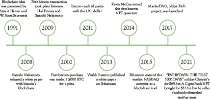

**图 5.1 区块链的历史**

### 物物交换

商业最初始于物物交换，简单来说就是人们用商品和服务交换另一种的商品和服务。例如，一个农民可能需要一把锄头来耕地。他会去铁匠那里，提出用他种的蔬菜来支付。双方都获益，因为农民得到了锄头，而铁匠得到了食物作为交换。

当时，牲畜被认为是财富的衡量标准。拥有的牛或羊越多，你就越富有，这就是为什么牲畜经常被用来交换商品和服务。

### 硬币

物物交换的一个问题是它可能很复杂。你必须计划好所需物品并提前运输。因此，一些古代文明使用珠子和壳作为支付形式，使它们成为原始的硬币。

优点是便携性。携带贝壳和珠子比携带沉重的物品更容易。它们充当借条，因此人们可以立即获得他们需要的。

最终，贵金属取代了珠子和贝壳，因为它们具有内在价值。换句话说，它不再是借条，因为硬币本身由于其制成的贵金属而具有价值。

最早记载的金、银硬币用途之一被归功于古代吕底亚（Lydia）文明的人。

### 皮革货币

在古代中国，人们使用白鹿皮作为货币。其原理与我们今天使用的现金相似，但“钞票”要大得多。事实上，这种钱可能有一平方英尺皮革那么大。

### 纸币

纸币最初由中国人发明，但存在一个问题：很难确定并维持其价值。其他问题不仅包括生产过程，还有通货膨胀。因此，纸币最终退出了历史。事实上，由于这些挑战，纸币在整个古代历史中出现又消失。

### 黄金

1816 年，英国将黄金设定为价值标准。随后，欧洲开始使用黄金作为衡量钞票价值的标准。换句话说，每张钞票都价值特定数量的黄金。然而，需要注意的是，为了发行某种金额黄金的钞票，银行必须在储备中拥有等量的黄金。

1900 年，美国采用了相同的标准。接着在 1913 年，建立了联邦储备体系。除其他因素外，联邦储备部门必须确保支票和票可以兑换成黄金并始终兑现。

### 信用卡

20 世纪见证了信用卡的兴起。它最初由零售商向消费者提供信用，包括百货商店和加油站。他们制作了让人们更容易消费的卡。

### 美元

1933 年，通货紧缩是美国面临的一个日益严重的问题。因此，美国放弃了金本位制以防止黄金耗尽。

从那时起，联邦政府支撑货币制度，但直到 1971 年，美国允许外国政府用美元兑换黄金。这种做法之所以停止是因为担心美国的黄金供应减少。

### 在线支付系统

20 世纪 90 年代互联网的兴起自然地导致了许多人在线购物。因此，出现了广泛的支付系统，使人们能够在线付款。证据表明，最早进行在线交易的公司之一是比萨饼，因为从 1994 年开始他们就可以通过网站订餐。

### 移动支付

随着越来越多的人使用手机，移动支付系统得到了发展。第一次交易记录于 1997 年，归功于可口可乐和他们的特殊售卖机，允许消费者通过短信支付。

从那时起，移动已成为最流行的支付形式之一。无论在哪里，人们都可以随时支付，商户不需要收银机或传统的 POS 机即可收款。

## 比特币与区块链的崛起

区块链，也称为分布式账本技术（DLT）的概念已经存在很长时间了。事实上，它是由 Stuart Haber 和 W. Scott Stornetta 在 1991 年提出的（Beyer 2018）。然而，直到 2008 年中本·聪发表了比特币区块链的白皮书，某些挑战才得到解决，实际应用也变得显而易见（Nakamoto 2008）。


没有人知道中本聪是谁，因为这个名字是一个假名。许多人怀疑这个假名代表的是一个团体而不是某个人。

区块链是比特币成为可能的基础，我们无法在不谈论其中的情况下谈论另一个。这项技术自 2008 年以来取得了飞速发展，并具有影响每个行业的潜力。

从本质上说，区块链是一个大型电子系统，允许构建应用程序，而货币只是其中之一。有趣的是，直到 2014 年左右，人们才意识到比特币背后的技术可以用于许多其他事情。

本质上，区块链由由一个透明且去中心化的账本组成，它能够对两个人之间的交易进行永久记录，而不需要第三方的进行身份验证。其结果是一个高度高效的过程，显著降低了交易成本。

当公司意识到区块链有多么强大时，许多公司开始投资并探索这项技术，以理解其全部潜力。尽管我们还未触及一角，但区块链已经证明了它可以影响从供应链、医疗保健到合同管理和投票的所有领域。

2013 年左右，《比特币杂志》的联合创始人维塔里克·布特林（Vitalik Buterin）对比特币的局限性感到沮丧，并推动开发更灵活的区块链。然而，比特币社区并没有同意。于是，布特林开发了第二个公共区块链，并命名为以太坊。

以太坊和比特币最大的区别在于，前者可以记录合约和贷款等交易，而比特币专门用于货币。

以太坊于 2015 年面，人们可以使用它来创建智能合约。此外，这些智能合约可以根据区块链内部的各种条件自动处理。

目前，区块链的主要驱动力是“工作量证明”（proof of work）概念。本质上，通过执行一个非常复杂且昂贵的计算机计算（该过程被称为“挖掘”）来创建一个区块，该区块包含多个交易。

随后，矿工通过解决工作量证明问题来验证区块内交易的合法性。再次，这些问题非常复杂，需要大量的计算能力来解决，使其变得极其昂贵。

第一个找到解决方案的矿工将获得奖励，交易将保存在区块链上。

有趣的是，以太坊开发者想要切换到一种更易访问的共识机制，被称为“权益证明”（proof of stake）。

目标是验证交易并在区块链上达成共识。然而，其过程不同在于，新区块的创建者是使用确定性方法选择的，“取决于其财富，也定义为质押”（“Proof-of-Stake (PoS)” n.d.）。

被称为搜索者（foragers）的矿工不获得奖励。相反，他们获得交易费。一些人支持这种转变，因为获得分布式类型共识所需的成本较低。

## 什么是区块链？

如前所述，区块链是由网络中存储信息的永久记录的去中心化账本组成的。它是以数字形式存储在多台计算机上的分布式数据库。

区块链的特殊之处在于，它确保了所记录数据的有效性和安全性，因此在不需要引入第三方的情况下建立了信任。

传统数据库与区块链之间的区别在于数据结构的方式。在区块链中，数据被组织成组，称为“区块”。每个区块只能容一定量的数据，填满后它就会被关闭并连接到之前填满的区块，从而创建一个被称为区块链的数据链。

在区块关闭并添加到链中之后收集的任何新数据都将存储在一个新区块中，该区块在填满后也将被关闭并添加到链中。

这种方法的优势是它创建了一个无法篡改的时间线，特别是当它以去中心化的方式实施时。例如，当一个区块满时，它就无法再更改，并带有时间戳被添加到链中。

虽然区块链可以存储各种信息，但它主要被用作交易账本，例如比特币。

提到比特币时，区块链技术采用了去中心化的方法，这意味着单个人或一个团体无法控制它。相反，区块链上的所有人共同着集体控制权。

此外，去中心化的区块链是不可更改的，这意味着数据无法被更改、删除或破坏，使其具有不可逆性。

从本质上说，使用区块链的想法是让互不信任的人安全地共享重要数据，确保其不会被篡改。

## 理解区块链是如何运作的

区块链由三个关键元素组成：区块、节点和矿工。

如前所述，每个链都由多个区块组成。然而，每个区块都包含数据、一个 `nonce` 和一个 `hash`。

`nonce` 是一个在创建区块时随机生成的 32 位整数。然后，`nonce` 创建一个区块头哈希值，这是一个与 `nonce` 连接的 256 位数字。

因此，当链中的第一个区块被创建时，附带的 `nonce` 会产生加密哈希 `hash`。随后在该区块内注册的数据将永远与 `nonce` 和 `hash` 相连。

矿工在区块链上创建新区块，每个区块都具有独特的 `nonce` 和 `hash`。然而，每个区块还会引用其前一个区块的 `hash`，这使得挖掘变得困难，特别是在一条大链上。

挖掘的运作原理是使用特殊软件来解决非常复杂的数学题，让矿工能够找到一个可以生成可接受 `hash` 的 `nonce`。考虑到 `nonce` 是 32 位而 `hash` 是 256 位，大约有 40 亿种组合，而只有一种是正确的。当一个矿工找到正确的组合时，他们的区块就会添加到链中。

如果有人想更改链中较早的区块，他们必须挖掘之后所有的区块。这就是为什么篡改区块链技术非常困难。虽然这可行，但成本高得惊人，并且需要大量的时间和计算能力，变得完全不值得。

当矿工成功挖掘出一个区块时（意味着他们找到了正确的 `nonce` 和 `hash`），网络上的所有节点都会接受该更改，矿工将获得奖励。

节点是任何可以维护区块链副本并确保网络继续运行的电子设备。

每个节点都有区块链的副本。网络必须批准新区块，链才能更新。区块链上的每项操作都可以被查看和验证，每个参与者都将获得一个唯一的数字，显示他们执行的交易。

通过将易于访问和透明的信息与问责机制相结合，区块链可以维护其完整性，并确保人与人之间的信任交易（图 5.2](#Chapter05.xhtml#fig5.2)）。

##加密与区块链

加密确保了交易和参与者的安全。它还确保了操作可以独立于中央机构，同时防止双重花费。


加密学允许人们之间发送安全保护的消息。发送消息的人使用密钥和算法对数据进行加密。然后他们将消息发送给另一个参与者。接收消息的人使用正确的密钥和算法对消息进行解密，从而查看原始数据。

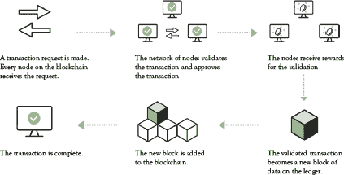

***图 5.2 区块链的工作原理***

加密密钥是加密学中最关键的部分，因为它使得未经授权查看的人无法读取消息、交易或数据。它只能由预定的接收消息的人进行处理。

虽然比特币并没有专门使用这种类型的加密技术来隐藏交易，但由于不需要提供个人信息，这些交易仍然是匿名的。

例如，你只需要打开一个加密货币钱包，就会被分配一个公钥和一个私钥。你不需要提供任何个人信息，因为所有交易在通过`blockchain` 进行时都已是受信任的。

用于加密货币的一些加密方法包括对称加密、非对称加密和哈希算法。

### 对称加密

在对称加密加密中，使用同一个密钥来对消息进行加密和解密。这种加密形式的优点是实现简单且操作开销较小。然而，其缺点包括扩展性方面的挑战以及保持共享密钥安全的问题。

### 非对称加密

在非对称加密加密中，使用两个不同的密钥对数据进行加密和解密。一个密钥是公钥，可以公开共享，例如你的钱包地址。相反，只有所有者知道私钥。

在这种情况下，消息将使用公钥加密，但只有接收者的私钥可以对其进行解密。

这种加密方法不仅有助于加密，还有助于身份验证。在身份验证方面，公钥会检查与实际发送者相关的私钥。在加密方面，只有持有正确私钥的人才能解密消息。

### 哈希算法

哈希算法高效地验证了网络上交易数据的完整性。它确保`blockchain` 上的数据结构没有发生篡改，并对账户地址进行编码。它使得挖掘成为可能，是账户之间交易加密的重要组成部分。

### 发现不同类型的区块链技术

目前，有四种主要的区块链网络：公链、私有链、联盟链（或联邦链）和混合链。每种网络都有优缺点，某些比其他的更适用于特定的应用。

中国央行数字货币区块链研究负责人 Espae Hong 解释道：“虽然项目背后的`blockchain` 技术是相同的，但不同类型区块链的目标终端用户可能有所不同。”例如，公链如其名所示，目标是普通大众。相反，私有区块链网络是为“仅受邀请的用户及其网络”设计的（Parizo n.d.）。

#### 公链

公链允许了比特币的诞生，并帮助了分布式账本技术（DLT）的流行。这种类型的网络消除了中心化固有的问题，例如安全性降低和透明度极低。

通过`DLT`，数据不是存储在单一地点，而是分布在点对点网络中，这正是其名称的由来。

然而，由于它是去中心化的，必须有一种验证数据真实性的方法，这就是我们已经讨论过的共识算法发挥作用的地方。本质上，网络。

#### 公链的优点
公链的一个主要优势是它们是独立的。

#### 公链的缺点
和任何事物一样，公链也有某些缺点。

#### 公链的用例
公链主要用于加密货币（如比特币）的挖掘和交易。

#### 私有链

私有链由一个单一实体控制的网络或在受限环境中运行的网络组成。虽然它在去中心化和使用点对点网络方面与公链一样，但私有链的规模小得多。

#### 私有链的优点
私有链本质上就像公司的内部网络。

#### 私有链的缺点
一些人声称私有链不能被称为真正的区块链，因为区块链的核心理念是去中心化且没有单一实体的控制。


私有链的速度非常快，非常适用于那些必须通过加密保护网络，但组织不希望公众访问其信息的场景。它们可以用于管理商业秘密、审计、供应链管理、内部投票和资产所有权等。

## 混合区块链

顾如其名，混合区块链结合了私有链和公有链的元素。因此，组织可以创建一个基于权限的私有链，并配备一个不需要权限的公共系统。通过这种方式，公司可以创建一个网络，确定哪些数据将向公众公开以及谁可以访问哪些数据。

虽然存储在混合区块链中的数据通常不是公开的，但在需要时可以进行验证。就像公有链一样，注册在区块链上的交易无法被篡改。

此外，虽然加入区块链为用户提供了完全访问权限，但在他们进行交易之前，他们的身份是保护的。只有在那之后，他们的身份才会暴露，且仅对参与交易的另一方可见。

#### 优势

由于混合区块链在封闭环境中运行，恶意者无法接管 51% 的网络，这使其具有极高的安全性。这是此类区块链最大的优势之一。

它还确保了隐私性，同时允许与第三方进行通信。混合区块链的扩展性比公有链更好，同时仍提供同样便宜但通常更快的交易。

#### 劣势

混合区块链没有像公有链那样的透明度，因为控制实体可以隐藏信息。它的升级也很困难，因为用户并没有真正的理由去支持或扩展网络，因为没有真正的激励机制。

### 用例

混合区块链对于许多应用都非常出色，特别是在房地产等领域。例如，房产中介不仅可以建立一个运行其内部私有系统的混合区块链，还可以向公众展示特定信息（如房源列表），确保工作无需重复进行。

这种区块链还可以帮助零售商精简流程，甚至可以帮助高度监管市场中的公司。它是医疗保健业的绝佳选择，因为可以存储患者记录，并应用权限控制，使得只有医疗服务提供者和患者才能看到数据。

政府还可以将混合区块链用于公民的私有数据，这些数据可以在此类网络的机构之间安全地存储并在机构间共享。

## 联盟链或联邦区块链

联盟链或联邦区块链与混合区块链相似，因为它包含了私有链和公有链的元素。然而，与存在单一控制实体的混合版本不同，联邦区块链由多个在网络上共同工作的组织组成。由于涉及许多参与者，它显著降低了与单一实体控制相关的所有风险。

共识过程由预定义的节点控制。该区块链具有一个特定的节点，用于开启、接收和验证交易，被称为 `validator node`（验证器节点）。网络上的其他节点可以发起或接收交易。

#### 优势

联邦链的优势在于它们具有比公有链更高的安全性。它们也更高效，扩展性也更好。组织还可以控制访问权限，决定谁可以查看特定数据。

#### 劣势

再次出现了透明度问题。一旦某人可以限制对数据的访问，那么它就不能再被称为透明的了。

此外，虽然联邦链比公有链更安全，但它们仍然容易受到成员节点的攻击。另一个问题是，在发生攻击时，区块链本身的监管实际上可能会损害网络的功能。

### 用例

联邦链是银行和研究等行业的绝佳选择。例如，许多银行或研究机构可以汇合创建一个联邦区块链。他们将决定 `validator nodes`，并创建一个允许更快速、更廉价处理交易的环境。

## 区块链实现

当大多数人听到区块链时，他们会自动想到加密货币。这是很自然的，因为比特币几乎是该技术的第一个应用，也是最著名的一个。

然而，这并不是唯一的实现方式，让我们来看看区块链在现实世界中的一些特定应用。

### 比特币

虽然区块链的概念已经存在段时间，但直到 2009 年比特币发布，这项技术才获得了现实应用。

`Bitcoin` 数字货币构建在区块链之上，因此它为人们提供了一种更快、更便宜的相互交易方式。其他优点包括匿名性和缺乏中心机构，这正是吸引许多人数字货币的原因。

### 以太坊

`Ethereum` 的开发是对 `Bitcoin` 局限性的反应。本质上，这个平台扩展了 `Bitcoin`，尽管它有自己名为 `Ether` 的数字货币。然而，该平台并不只关注货币，它允许用户构建各种应用程序。它还有自己名为 `Solidity` 的编程语言。

它比 `Bitcoin` 灵活得多，这可能是它如此受欢迎的原因。网络用户不仅可以创建、发布和使用应用程序，还可以对其进行变现，这本质上是参与和维护网络的激励。

### Hyperledger 基金会

`Hyperledger Foundation` 是一个开源社区，开发者在其中为私有、混合和联邦区块链创建各种框架、库和工具。

它汇聚了来自世界各地金融、银行、物联网、供应链、制造领域的技术领袖。

这种理念认为许可链与 `Bitcoin` 或 `Ethereum` 等公有链非常不同。因此，`Hyperledger Foundation` 致力于确保企业能够在公司内部以及跨机构有效地应用区块链。

正如其网站所示，`Hyperledger Foundation` 的目标包括：

- 创建企业级的开源账本框架和代码库，支持有效的业务交易。
- 提供中立、开放且社区驱动的基础设施，同时受业务和技术治理。
- 通过建立强大的社区，开发区块链和共享账本的 POC、试点、部署和用例。
- 教人们了解区块链的优势以及在市场中的潜在应用。

### 星际文件系统 (IPFS)

`IPFS 是一个点对点的存储网络。本质上，人们不再需要连接到服务器查看网站，而是连接到他们的节点，信息以分布式方式存储。

`IPFS` 的目标是让互联网更快、更安全、更开放、更具韧性。通过 `IPFS`，你不再需要依赖托管商提供网站服务。它将分布在整个网络中。

### Corda

`Corda` 是一种为业务设计的分布式账本技术。它允许参与者存储交易，这样他们就不需要检查账目是否一致。它还减少了网络上每个参与者都要查看每笔交易的需求，因为只有交易的相关方对信息感兴趣。


例如，如果一家银行从客户账户向另一家银行的账户发送款项，汇款行和接收行都必须验证该转账是有效的。他们还必须检查资金不仅发送正确，而且被妥善接收。

为了确保一个账户中的资金减少了正确的金额，同时接收账户中的资金正确增加，这意味着两家银行都必须进行多次检查。基本上，他们需要确保资金不是凭空产生的，而且不会在凭无中消失。另一个问题是，某些检查是人工完成的，这导致整个过程极其耗时。

通过 `Corda`，这种对账过程可以被完全消除，因为只有当所有参与方确认输入和输出正确时，交易才能提交。如果有人不同意向，交易将无法进行。

## 非同质化代币 (NFTs)

非同质化代币或 `NFT` 是一种不可替代的加密资产，使其具有唯一性，它是数字或非数字资产的表示。某些底层资产可以包括：

*   收藏品
*   GIF
*   音乐
*   动画
*   视频
*   签名
*   汽车所有证
*   法律文件

相反，`Bitcoin` 是同质化的，这意味着你可以用一个 `Bitcoin` 交易另一个，而拥有的仍然是东西。

让 `NFTs` 如此受欢迎的原因是同一时间只能一个人拥有它们。所有权由唯一的 ID 和其他数据决定，而所有权和转移通过智能合约进行管理。因此，你可以证明由区块链上的数字代币所认证的物权。

许多创作者正在利用 `NFTs`，因为它们允许其他人对它们进行投资。它们还被用作投机性资产，人们购买 `NFTs` 并持有，直到其价值增加。

`Ethereum` 是第一个支持 `NFTs` 的区块链。它有一套名为 `ERC-721` 的系统，允许在 `Ethereum` 区块网上创建唯一的代币。从那时起，许多其他区块链如 `Solana` 和 `Tezos` 也相继支持 `NFTs`。

## 去中心化金融

去中心化金融是世界上兴起的一种新型金融形式。它是一种不依赖中心化机构来管理交易的金融系统。下面是一些著名的例子。

### Uniswap

`Uniswap` 于 2018 年推出，是基于 `Ethereum` 区块链的加密货币交易所。它是一个去中心化的加密货币交易所，这使其与 `Binance` 和 `Coinbase` 等更主流的交易所不同。这些是中心化交易所的例子，因此有一个单一实体或公司在运营和控制交易所。

通过 `Uniswap`，没有中央控制机构。这意味着像 `Bitcoin` 等加密货币的买卖是在区块链上通过智能合约进行的。

### Curve Finance

`Curve Finance` 是另一个运行在 `Ethereum` 区块链上的去中心化交易所。`Curve Finance` 和 `Uniswap` 的主要区别在于 `Curve Finance` 特别关注 `stablecoins`（稳定币）。`stablecoins` 仍然是加密货币，但它们的价格与其他金融工具挂钩，例如主流货币、另一种加密货币或商品。

许多人还使用 `Curve Finance` 将代币交换为价格相似的不同物品。`Curve Finance` 被此用途是因为其有利的定价公式。

### Yearn Finance

`Yearn Finance` 是人们用于优化加密资产并实现收益最大化的工具包。这些工具主要促进交易和贷款，由于该平台是去中心化的，它们消除了对中介的需求。

### AAVE

`AAVE` 是一个去中心化金融平台，允许用户贷和借加密货币。由于它是去中心化的，在贷和借过程中不涉及中介。

`AAVE` 上的借款人必须先向平台分配抵押品。他们只能借入相当于他们在 `AAVE` 上的金额。在 `AAVE` 上贷款的人可以赚利息，而且他们完全控制自己的贷款金额。

## 元宇宙

元宇宙是人们所说的未来的互联网，它由相互连接的虚拟世界组成。这些虚拟世界将允许用户使用增强现实或虚拟现实接口连接它们，并与他人分享体验。它们将允许更高程度的沉浸感。

区块链将是元宇宙成功的关键组成。它们将允许诸如虚拟货币、游戏创建和玩、允许人们在虚拟世界中拥有物品的 `NFTs` 等。

更重要的是，区块链将确保元宇宙中的所有数据都是安全受保护的。考虑到目标是让人们在这个虚拟世界里过部分生活，保护人们的信息将比任何时候都更重要。以下是一些流行的元宇宙项目：

### Decentraland

`Decentraland` 自 2015 年以来一直在开发，但直到 2020 年才向公众开放。它本质上是一个用户可以通过浏览器访问的虚拟世界。用户可以进行购买，例如购买虚拟土地，交易通过 `NFTs`（代表土地）或 `MANA` 加密货币进行处理。

该平台构建在 `Ethereum` 之上，尽管目前很大程度上被认为是一个游戏，但 `Decentraland` 背后的团队愿景是使其成为一个全球使用的虚拟世界。

### Axie Infinity

`Axie Infinity` 是一家越南软件公司开发的游戏。它是基于 `Ethereum` 的，玩家在其中铸造和收集 `NFTs`。2022 年 2 月，该游戏的 `NFT` 销售额已产生超过 40 亿美元。

该游戏围绕 `Axies` 展开。这些生物是 `Axie Infinity` 玩家收集的宠物。玩家可以繁殖、饲养并战斗他们的 `Axies`，目标是尽可能收集。玩家还可以使用游戏内 `NFTs` 购买其他物品以扩大他们的收藏并推进游戏。这包括虚拟土地。2021 年 11 月，`Axie Infinity` 上的一块虚拟土地以 230 万美元售出。

该游戏在菲律宾非常流行，那里的玩家经常聚集，有些人将游戏作为主要收入来源。

### Sandbox

`Sandbox` 将多种技术整合到单一平台，包括区块链、`NFTs`、`DeFi` 和元宇宙。本质上，它是一个虚拟世界，玩家可以在其中创建或自定义各种元素，从主游戏中的游戏到数字资产如土地、设备或战斗行为。

玩家可以将他们创建的内容转换为 `NFTs` 并在游戏市场上出售来实现变现。用于这些交易的加密货币是 `SAND`，它是该游戏的原生加密货币。

与元宇宙领域的许多其他平台和项目一样，`Sandbox` 是基于 `Ethereum` 的，并设计供任何人使用，包括没有技能的人。

### Star Atlas

`Star Atlas` 是元宇宙中的另一个游戏，尽管它设定在太空和未来。它是一个策略游戏，但它不用 `Ethereum`。相反，它使用 `Solana` 区块链。但在游戏性方面，它与市场上的其他产品相似，因为玩家主要通过 `NFTs` 创建、自定义、收集和交易各种游戏内元素。


- 区块链是分布式账本技术的特定实例化。它由一个名为 Satoshi Nakamoto 的实体于 2008 年通过论文提出。
- 区块链将交易组合在所谓的“区块”中。它允许在去信任的点对网络上进行交易。
- 区块链的应用有很多，而且每天都有新的应用问世，从去中心化金融到元宇宙。

# 区块链案例研究

区块链技术具有广泛的应用，因此它为许多行业提供了便利（参见图 6.1）。让我们来看看区块链如何改善各个行业和领域，包括金融、网络安全、运输甚至元宇宙。

## 金融领域的区块链应用

区块链技术最终将彻底改变我们今天所熟知的金融服务，带来更高的效率和透明度。区块链无疑会显著改变的某个领域是资本市场。

所有参与资本市场的人都将从区块链解决方案中受益，包括发行人、基金经理、投资者和监管机构。让我们来看看不同类市场参与者将享受的一些优势。

### 发行人
得益于可编程的数字证券和资产，区块链将使发行人获取资金变得更容易、更快、更便宜。他们将能够在几分钟内发行新证券，并且相关的权利和义务将被编码并自动化。

因此，发行人和促进新发行的机构将能够加速获得资金的速度，从而实现更廉、更快的增长，并提高盈利能力。

由于发行人能够将条款和条件程序化到发行的资产中，这些资产将具有更高的灵活性和可定制性。区块链还将提高透明度和效率，因为投资者可以通过单一接口访问实时更新。

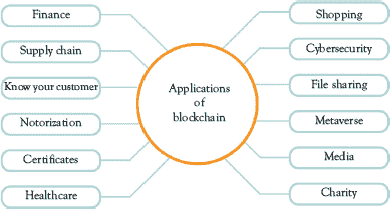

**图 6.1 区块链的应用**

区块链的另一个优势是发行人能够对每种资产进行碎片化处理。将资产拆分为更具负担能力且更容易传输的单位，意味着发行人将能够拥有更元化的投资者基础和更高的流动性。

较低的入门槛也意味着较小的发行人将获得更多机会。此外，目前的发行人也能盈利，因为他们将进入新市场和新类型的证券。

### 基金经理
区块链的核心是让人们在交易资产的同时，确保交易记录在可验证的账本上。换句话说，系统性风险和违约风险显著降低，因为资金的结算和清算更加快速、更加透明。

由于交易处理速度更快，基金经理将拥有更多可用资金，而不是让资金锁定在各种交易中。因此，他们能够更高效地使用和分配这些资金。

由于简化了会计、行政、基金服务和分配等各种流程和功能，运营变得更加高效，基金也将从成本降低中受益。

此外，我们可能会看到基于区块链技术的各种新型金融工具和产品。因此，基金能够通过新资产进一步实现投资组合的多样化。尽管市场上会有更多金融产品，但它们的结构将更加简单，因为它们将具有特定的编程标准。

此外，发行数字资产以及将现有资产拆分为多个单位的能力将为基金提供广泛的投资者基础。这对于尤为有利，因为年轻的投资者更有可能投资数字资产。

### 投资者
投资者将从区块链技术中显著受益，因为它将提供任何投资者从未见过的灵活性。发行人能够更快、更便宜地发行新证券，这意味着他们能够根据每个投资者的需求和欲望定制新工具。

由于发行人能够创建匹配投资者风险偏好、时间跨度和回报要求的投资工具，投资者与发行人之间的关系将发生巨大变化并变得强大得多，创造出前所未有的纽带。

投资者希望以尽可能小的风险赚更多的钱。流动性限制是风险的一个大因素。然而，新的金融工具和数字资产将是可编程的，因此交易成本更低，这将增加它们的潜在流动性，并使投资者能够更好地管理风险。结合资本市场更强的连接性和更高的效率，投资者将从更高程度的流动性和更低的资本成本中受益。

区块链账本还为投资者提供了对资产质量的更佳洞察，使他们更容易进行尽职调查并降低投资风险。

### 监管机构
监管机构往往处于进退两难的境地。他们要么被批评过度干预资本市场，要么被指行动不够快以防止灾难（如 2008 年全球金融危机所示）。

然而，通过区块链，监管组织和机构将自动化大量的功能，包括合规和审计。此外，由于多个机构将使用相同的网络监控资产生命周期及其投资组合，监管机构将花费更多时间分析和预测风险，而不是试图弄清楚每家公司使用的系统以及它们如何表示其交易。

区块链还可能最大限度地减少目前监管机构必须处理的人力密集耗时流程中的任何摩擦，从而简化这些监管和法律流程。结果是运营成本也将下降，甚至可能防止某些类型的系统性风险。

## 区块链在资本市场中的用途简介

让我们来看看区块链技术在资本市场中的一些用例。

### 发行
发行是创建证券或其他投资工具并出售给投资者以筹集资金的过程。区块链可以帮助的一些方式包括：
* 创建现有资产和完全新的数字资产的数字表示。
* 定制和简化证券及金融工具的证券化。
* 启用如去中心化众筹等新业务模式以更有效地筹集资金。

### 销售与交易
销售和交易是投资银行的核心功能，涉及购买出售各种金融工具（包括证券）。区块链通过采用各种机制使数字证券进入市场变得更容易，包括：
* 双边谈判
* 集中化交易所
* 去中心化交易所
* 匹配算法
* 拍卖

区块链提供了广泛的新机会，包括创建为投资者需求身定制的新型数字金融工具。

### 品押管理
目前用于品押管理的流程由于需要手动对账和金融工具的实物交付，效率非常低且速度缓慢。这限制了对快速变化的市场状况做出反应的能力。

还存在信息孤岛问题，使得几乎无法获得品押资产的整体概述。


区块链通过将持有物数字化并将其注册在单一且优化的位置，简化了抵押品管理流程。此外，智能合约可以在自动执行保证金通知的同时，为每个关系调用预设规则，从而提高精度。

## 交易所

区块链可以简化交易所所执行的广泛范围内的操作。这项技术将帮助降低交易费用，同时确保更快速的清算和结算，从而降低开销并改进流程。

透明的账本在验证数据和访问权限方面也能为交易所提供帮助。此外，它甚至可以作为有关交易活动的强有力警报系统。

## 清算与结算

清算（Clearing）是指更新账户并准备转移证券和资金，而结算（Settlement）则是指实际完成交易。

实体可以编写智能合约，通过链外现金支付、稳定币或加密货币来匹配转账和支付。在结算方面，可以使用多种模型进行匹配，这些模型考虑了市场的流动性需求和风险承受。。模型包括延迟结算、原子结算和延迟净结算。

## 区块链在供应链中的应用

供应链变得越来越复杂，且在许多情况下是全球性的，这意味着其管理涉及各种严苛的流程。此外，所有这些流程都需要完美的编排和同步，因为它们涉及许多参与者并有许多变动。

结果是分发货物和服务所需的连接已经从链演变为类似于网络。问题是，当这些流程增长到包含多个阶段和跨越多个国家的广泛代理时，透明度往往会下降。随着更多人参与流程，复杂性增加了，挑战也随之增加。

区块链技术可以惠及活跃供应链组成的所有主要部分：

* 开发采购
* 生产物流
* 信息系统管理
* 协调

供应链管理还包括其他关键领域，如物流、运输、货运、卡车和其他货物形式。区块链可以惠及任何需要多种方式简化系统的领域。

得益于区块链，可以显著改进过于复杂和缓慢的供应链。基于区块链的供应链解决方案提供的端到端去中心化流程已改变了行业的运营方式。

像 `IBM` 这样的大公司已经意识到区块链管理供应链的价值，并已开始开发相关的解决方案。

在某些情况下，该技术已经实施。因此，专家们认为区块链很有可能成为供应链管理的“通用操作系统”，就像 `Windows` 和 `iOS` 分别用于 PC 和 Mac 一样。

区块链可以简化此类任务：

* 记录资产在供应链不同点之间移动时的数量和转移。
* 跟踪所有与贸易相关的文档，包括采购单和变更单、收据和装运通知。
* 分配或验证各种产品的属性或认证，例如确定食品是否为公平贸易或有机。
* 将序列号、数字标签、条形码等与实体货物关联。
* 为供应商和供应商提供有关制造工艺、组装、交付和产品维护的所有信息。

得益于区块链，参与供应链的实体将享受到利益：

* 透明度提高，因为产品在整个供应链中的旅程每一步都将被记录，从而揭示真实的来源。这将有助于提高信任并减少供应链目前遭受的偏见。
* 可扩展性增强，因为几乎任何数量的用户都可以从无限的触点访问网络。
* 安全性提高，得益于无法被单方面修改的共享账本和编码规则特征，这可能会减少或消除流程和系统审计。

### 由马士基和 IBM 推出 TradeLens

马士基和 `IBM` 合作创建了 `TradeLens`，这是一个基于区块链的航运解决方案（“TradeLens | 数字化全球供应链”，无日期）。其目标是提高全球贸易的效率和安全性，通过汇聚双方支持信息共享并提高透明度来推动行业创新。

截至本文写作，两家公司已宣布有 94 个机构积极参与或同意参加该开放标准平台。因此，`TradeLens` 平台已包含许多参与者，包括港口和码头运营商、全球集装箱运输公司、海关当局、货主等。

依靠 `IBM` 的区块链技术，`TradeLens` 通过确保每个人都能访问特定交易的单一共享视图，而不泄露隐私机密信息，帮助改善多个贸易伙伴之间的协作。

因此，货主、运输公司、货运代理、港口和码头运营商、内运公司和海关当局可以提高互动效率，因为他们可以实时访问运输数据和文档，包括传感器和物联网信息。

得益于智能合约，`TradeLens` 使国际贸易中的不同方能够轻松高效地协作。

该平台还带有一个名为 `ClearWay` 的贸易文档模块。该模块允许进出口商、报关行、海关当局、其他政府机构和非政府组织（NGO）在各种流程和信息共享中进行协作。正如区块链所预期的，所有这些协作都受到一个不可挑战的安全审计追踪的支持。

`TradeLens` 平台将减少阻碍全球贸易的障碍，同时使国际供应链更加高效。它将提供一个集装箱运输贸易平台，这意味着整个供应链环境将连接起来。

在区块链技术支持并基于开放技术栈开发的基础上，该平台将解决缺乏可见性和文档问题等问题。

本质上，它确保了全球海运交易的所有方能够从头到尾查看整个供应链，并实时、安全地访问与这些交易相关的数据。

得益于文件的数字化和自动化，效率也将提高。终端用户能够跨组织和边界安全地提交、盖章和批准文档。

## 区块链用于 KYC、公证和证书

区块链和分布式账本技术还将消除有关法律文件及其真实性的欺诈活动或错误。证书和其他法律文件可以在公共或私有账本上发布和验证，提供可验证的轨迹。

目前，大多数行业通过纸质文档手动验证这些信息。不幸的是，这是一个耗时且耗资源的过程。

那么，这在区块链上是如何工作的呢？

首先，文件的签名或指纹必须在区块链上发布。这意味着需要记录转换为数字文件，例如一个可以附加元数据的 `pdf` 文件。


随后，将使用数字文档的数据，并应用特殊算法来创建一个唯一的签名。`Hash functions`（特殊的数学函数）通常用于生成这些签名。它们充当唯一标识符，类似于条形码或 `QR code`，但仅适用于该文档。

然后，通过将签名连接到账本上的操作或交易，将其注册在区块链上。

当然，如果利用了如 `IPFS` 等去中心化存储系统，就可以上传完整的证书，提供另一层认证。

接下来，可以使用区块链技术对内容进行验证。

这意味着通过发行者创建签名时所使用的算法来确定文档的唯一签名。然后，可以使用发行者的应用程序在区块链上搜索该签名。如果两个签名匹配，则证书有效。

## DNV：案例研究

许多公司正尝试创建解决方案，以实现纸质文档的自动化发行和验证（[DNV.Com](http://DNV.Com)—信任至关” n.d.）。DNV 依赖于基于区块链的解决方案，该方案依赖 `QR code` 技术来发行和验证供应链证书。

对于 DNV 而言，证书存储在私有链或许可链网络上。这意味着只有 DNV（发行者）可以创建新证书或更改数据。他们还可以利用该技术的其他优势，例如去中心化、加密和认证。

虽然只有 DNV 可以更新数据，但所有人都可以访问区块链以验证和认证证书。

## 它是如何工作的？

当公司发行证书时，他们会将数据数字化，并为每份证书分配一个数字身份。因此，所有证书都是可追溯的并已打上标签，原始数据安全地存储在构成区块链的节点上。

与此同时，证书包含的数据在公司的生产系统中进行管理。最终结果是一个不可篡改的、安全且透明的交易。这使得发现欺诈变得容易，因为区块链会迅速显示任何证书是否过期或伪造。

为了检查真实性，所有证书都嵌入了 `QR codes`，任何带有 `QR scanner` 的设备都可以进行扫描。在区块链上进行搜索后，将显示证书详情。因此，任何人都可以检查公司的声明和证书的有效性。

DNV 还有一个公共证书检查器，可用于检查证书的有效性。

## Hanseaticsoft：另一个案例研究

Hanseaticsoft 是一个财团，正在开发一种基于区块链技术的海员认证系统（“Cloud Fleet Manager by Hanseaticsoft” n.d.）。其目标是简化并加速受限于目前全纸质证书管理系统的各种流程，这些系统存在缺乏安全文档验证、且无法验证海员的培训和安全认证的问题。

所有上述问题都可能给船舶运营商、监管和港口当局以及船员管理机构在保障和保险船员方面带来许多问题。

该财团汇集了广泛支持或依赖船员认证的利益相关者，包括 `Maersk`、`Heidmar` 和 `PTC Holdings Crop` 等运输公司。

其他具有认证专业知识的技术推动者也参与其中，例如 `Navozyme` 和 `C-LOG` 等海洋平台提供商。

该项目将重点展示使用数字认证和背书程序的有效性，该程序将依赖数字存储库来存储和验证经过的文档、培训日志，以及一个审批系统。

本质上，该系统将允许个人海员在最初发行时管理证书。还将使海事管理部门更容易管理跨管辖区的续期和背书。同时，船员管理公司将更好地跟踪海员所在的船舶。最后，船东将能够访问其船员的概述，以及他们的证书和背书。

## 航运中的区块链

虽然我们之前讨论了区块链如何改进供应链，但让我们更仔细地看看它如何帮助航运业。

### 航运中的 IoT 与区块链

`IoT` 指通过互联网相互连接以及超越连接的日常物品，这允许它们发送和接收数据。例如，想象一个连接到互联网并订购你缺货食品的智能冰箱。

`IoT` 在航运中非常普遍，因为公司在船舶、货物和集装箱上部署传感器，用于各种数据处理目的跟踪其状态，例如优化燃料消耗、改进船舶和货物数据管理、改进预测性维护、减少排放等。

在 `IoT` 中引入区块链，为记录这些智能设备处理的数据提供了一种可验证、永久且安全的方式。区块链保证账本中的所有数据都经过了网络同伴的验证，并满足了所有必要条件。

在涉及数据分析时，数据的质量至关重要。正如俗说，“垃圾进，垃圾出”，无论分析数据的算法多么先进和复杂。

这种基于区块链的互联设备网络将能够与其周围的世界交互并在无需人工干预的情况下做出决策，这将提高效率、降低成本，并最终改善开支。

## 纸质流程的数字化

尽管处于所谓的数字时代，航运交易仍涉及大量的纸质文件，从销售合同和租船协议到提单和信用证。名单是没完尽的。

虽然所有这些纸质工作是必要的恶，但问题在于它们导致了复杂的运营，因为许多涉及的利益相关者依赖于大量纸质文档的生成、授权和分发。所有这些文档必须通过许多方的链传递，每个方都必须采取某种形式的操作，例如启动支付、收集和交付货物等。

有了区块链技术，所有这些纸质操作都可以被消除。交易中的所有参与者都可以依靠区块链和智能合约技术来保持联系、执行物理交易、存储和共享加密信息、履行合同义务、发布和接收指令以及进行安全支付。

## 物品的可追溯性

区块链与标签技术的结合意味着可以在整个供应链中跟踪产品，从源头到最终目的地。这不仅会增加消费者的信任，还将更容易实现法律和标准合规。

有些人认为，跟踪产品的整个旅程是区块链技术最强大且最有逻辑的应用之一。

有了区块链，只有真相。每个人都可以访问从创建到分发的不可篡改记录，这对于电子产品、设计品、药品等高价值产品非常有益。

## 减少和鉴定伪造产品

区块链的透明度将通过允许公司实时监控货物容量来简化航运世界的流程，从而在潜在的供应链瓶颈发生之前解决它们。


然而，它也是一种可能帮助解决造假问题的技术，造假问题正日益严重。造假不仅每年给公司造成数十亿美元的损失，还会损害其品牌形象。

区块链通过允许货物从源头到终端的可追溯性，使得假品进入供应链变得困难得多。

## 通过代币化融资

代币化可用于为航运公司融资，为该行业提供更高水平的流动性。但需要注意的是，航运行业的代币化需要在其启动国家拥有有效的监管和法律框架。

## 航运与物流领域的一些区块链应用

在本节中，我们将快速查看一些为航运和物流行业开发或正在开发的应用。

### ShipChain

ShipChain 以及关联的 `SHIP` 代币是一个旨在创建一个从供应链一端到另一端的完全集成系统的项目。因此，它将涵盖从货物离开制造商那一刻直到到达客户手中的所有环节。它由透明的区块链合约支持，并在去信任的环境中进行联邦式管理。

起，该产品将主要关注集装箱船，并尝试开发：

- 端到端的跟踪和追踪，以取代目前的低效系统。
- 针对高效运输的奖励以提高责任感。
- 通过允许租船人和承运人之间的直接接触来增加透明度。
- 所有文档都将在区块链网络上可用，从而提供更好的可见性。

### CargoX

CargoX 以及关联的 `COX` 代币旨在成为区块链提单单（B/Ls）的独立供应商。这些 `B/Ls` 将彻底改变国际贸易和运输的面貌，因为人们不再需要几天或几周让 `B/L` 通过银行到达接收方，而是可以使用特定的加密密钥访问它们。

它还将帮助减少欺诈、提高安全性、降低成本并增加可靠性。

### IMMLA

IMMLA 以及关联的 `IML` 代币是一个基于以太的物流应用，专注于多式式运输。其目标是让承运人和货主在多式式运输链的每个阶段进行直接交互。

本质上，IMMLA 将充当货运经理，使用整个运输链。正如你预期的，得益于这个平台，货主将从更加高效且具有效益的多式式运输中受益。

### iXledger

iXledger 及其 `IXT` 代币并不是专业的航运应用。相反，它是第一个由区块链支持的市场平台，用于交易和管理保险产品，包括海运险。通过这个市场，航运公司不仅在保险方面将有更多选择，还能更快地获得他们所需的保单。`IXT` 代币将作为支付保险服务费用和平台交易费的货币。

### [Shipowner.io](http://Shipowner.io)

[Shipowner.io] 以及关联的 `SHIP` 代币旨在成为第一个由区块链支持的平台，为航运行业提供资产融资的选项。其目标是通过让航运公司接触更大的潜在投资者池，来打破目前的融资者整合局面。

`SHIP` 代币将提供访问平台的权限，人们只需花费几美元即可投资一艘船，尽管这一切都是透明完成的。本质上，这是一种船舶的众筹形式。

### Fr8

Fr8 及其关联的 `Fr8` 代币使用智能合约让承运人和发货人轻松协调货运。该市场旨在减少货运市场中的低效水平，即需求似乎超过了供应，但道路上有许多空货车在行驶。

Fr8 平台还声称让追踪变得更加简单高效。它还可以提供记录在区块链网络中无法篡改的交付证明，并提供结算服务，从而降低承运人的信用风险。

## 网络安全中的区块链

比特币网络可能是全球最著名的基于区块链的应用，它由成千上万（甚至是数十万）被称为“节点”的计算机组成。个人或小组在全球范围内运行这些计算机。这种基于区块链的去中心化网络是不可更改的，这意味着数据交易无法撤销。

区块链的去中心化使其非常适用于网络安全。它确保了数据的完整性，实现了存储自动化，并提供了完全的透明度。所以，让我们探索区块链如何帮助网络安全。

## 网络安全：现状与未来快照

我们生成的数据量每天都在飞速增长。随着技术的进步和变得复杂（特别是在安全方面），坏分子正在想出新的方法和强大的技术来实施他们的非法活动。

这导致了一些令人震惊的网络安全统计数据。例如，95% 的数据泄露是人为失误导致的。仅在 2020 年的前六个月，就有超过 350 亿条记录因数据泄露而暴露。其中，45% 是黑客攻击，22% 是钓鱼攻击，而 17% 是由恶意软件引起的（IBM 2021）。

总体而言，2021 年网络犯罪造成的损失达约 6 万亿美元，仅勒索软件每年就让企业损失了超过 750 亿美元。

显然，这种情况正在升级，并将继续恶化。随着 5G 网络的扩展，下载速度将飙升，这为黑客提供了更多发现安全问题的机会。下载能力的提高还将更多的网络犯罪。

商业领域对物联网（IoT）的需求增加，意味着公司正在开发各种应用程序，包括智能家居设备。不幸的是，这意味着坏分子可以利用低效的安全特性，而区块链技术可以提供帮助。

此外，人们正转向越来越多的社交媒体平台与全球各地建立联系。保护这些账户的密码通常很弱，这意味着黑客可以访问社交媒体活动产生的海量元数据。

区块链通过开发标准安全协议来提供帮助，因为它比端到端加密更有效。它还可以通过创建一个统一的 API 框架允许跨消息应用程序通信来增强私信安全性。

由于安全功能不佳，边缘设备（如智能开关）已允许黑客进入智能家居和其他系统。区块链通过确保管理去中心化，可以保护单个设备和整个系统。

将域名系统（DNS）条目等内容去中心化，意味着区块链可以用于防御分布式拒绝服务攻击（DDoS）。

问题在于，如果我们继续将存储的数据中心化，暴露的风险就会增加，因为只需要一个黑客可以利用的漏洞即可。

相反，通过区块链技术采取去中心化的方法将使坏分子无法渗透数据存储系统。

区块链技术还可以用于验证和确认补丁、安装和固件更新等活动。它还可以加密防止数据在传输过程中被未经授权访问。

## 区块链与文件共享

去中心化文件共享代表使用多个网络节点而非单一中央服务器的文件存储方法。


集中化的文件共享方法存在问题，因为互联网已经变成了一个庞大且复杂的文件和信息网，它们通过超文本传输协议（`HTTP`）连接。互联网流量的增加意味着现在传输的数据量是巨大的，而目前使用的协议并不能很好地处理这些。

例如，每当你访问喜爱的新闻网站并加载页面时，你的计算机都会使用 `HTTP` 从一个集中服务器获取内容。然而，如果服务器需要发送一个巨大的文件，它可能会消耗大量的带宽。

此外，如果服务器由于某种原因离线，网站可能还在那里，但某些内容可能会缺失。当所有数据都存储在中心位置时，审查信息也会变得更容易。

目前出现的一种解决方案是去中心化文件共享。你可能熟悉的这种方法的一个例子是比特种子（torrent），这是在不使用 `HTTP` 的情况下通过互联网分发大文件的方法。

然而，现有的解决方案并不完美，因为节点通常由志愿者运行。换句话说，他们是免费提供并且在有空时这样做。他们可以随时停止运行节点，这意味着无法保证有足够的节点来托管所有这些文件。

区块链技术可以帮助创建一个健壮的文件共享网络，在这个网络中，人们有理由保持节点活跃状态，因为他们将获得奖励。实施提供代币的奖励机制将确保网络有足够的节点来保持运行。

## 它是如何工作的？

当你从集中式服务器获取文件时，你使用的是客户端-服务器模型。换句话说，你是客户端，你通过输入 `URL` 来请求你想要的内容，该 `URL` 指向存储数据的服务器的 `IP address`。然后服务器使用 `HTTP` 交付你请求的内容。

相反，在去中心化文件共享系统中，你将使用一种点对点（`P2P`）共享系统。在这种情况下，文件并不只存储在一个服务器上，而是存储在网络中的多个节点上。此外，每个文件或文件片段都有唯一的加密哈希值，这意味着文件的所有版本在网络中都被追踪。

当用户请求相关数据时，网络将找到拥有该唯一哈希文件的节点并交付文件。

## 去中心化文件共享的优势是什么？

通过区块链，文件分布在多台计算机上。与哈希地址结合，内容始终可用，但它是不可更改的。换句话说，即使某台计算机退出，也不会中断服务，因为其他节点将接管并交付文件的副本。

当你通过 `HTTP` 从集中式服务器访问数据时，服务往往会慢一些。相反，去中心化方法使用的带宽要少得多，因为文件分布在多个通道中。

通过区块链，审查的可能性也大大降低。通常情况下，政府可以要求国家的互联网服务提供商通过拒绝访问特定的 `IP address` 来阻止对某服务或网站的访问。然而，当网站数据存储在网络中的多个节点上时，就无法将其屏蔽。

## 区块链与元宇宙

元宇宙正在到来。有人说它将在 10 年后出现；而另一些人认为它会来得得多。区块链能够显著改进许多相关项目。

### 什么是元宇宙？

本质上，元宇宙是一个由不同世界组成的虚拟环境，允许你访问各种应用程序和服务。这些是基于应用程序和用用例的独立空间。

有趣的是，许多人并不认为元宇宙有未来。然而，它的快速发展证明了这些观点可能是有根据的。新项目每天层涌而出，并相互连接，在人们在线生活的各个方面建立起桥梁。

然而，区块链对于元宇宙的持续成功发展至关重要。但如何做到呢？

嗯，目前为元宇宙开发的大多数项目基本上都是游戏，提供了这个新虚拟生态系统的 `3D` 视图。然而，我们需要更多组件来真正构建一个能够按预期运行的健壮环境。

区块链（或加密货币）将帮助扩展功能，从而协助元宇宙变成它所能成为的一切。以下是实现这些目标的一些方式：

### 所有权证明

通过区块链，证明你拥有元宇宙中的资产将不再是一个问题。你可以拥有一个加密钱包，相关的私钥可以证明你拥有特定的资产或活动。因此，元宇宙中的加密项目可以拥有一套强有力且非常安全的方法，来证明所有权并验证你的数字身份。

### 价值传输

使元宇宙成功的另一个关键方面是进行价值传输的能力。换句话说，如果你想卖某东西，你必须能够传输“物体”并接收付款，而这也代表了传输。

因此，人们需要一种安全且可靠的方式来传输价值。例如，在区块链上的加密货币比多人游戏中的货币更安全的替代方案。因此，对于想要在元宇宙中度过长时间的人来说，加密货币可能是很好的货币。

### 互操作性

涉及到元宇宙项目可行性时，一个关键方面是互操作性，区块链可以促进这种特性。这种技术可以确保元宇宙的不同世界和空间彼此兼容并无缝工作。

例如，像 `Polkadot` 和 `Avalanche` 等项目允许你开发可以相互工作的自定义区块链网络。

### 治理

元宇宙旨在作为现实世界的虚拟表示，这意味着我们需要规则。然而，得益于区块链，我们可以在元宇宙中实现公平透明的治理，这在现实世界中是无法见到的。

### 建立收藏品的唯一性

元宇宙项目的另一个基本方面是数字收藏。一个物品要成为可收藏的，它必须是独特且原创的，这意味着你必须证明你拥有的资产符合这些标准。区块链技术使得通过 `NFTs` 提供证明变得简单，这意味着可以完全独特的资产。

此外，区块链技术可以用于创建物理资产的数字表示，再次提供所有权、原创性和唯一性的证明。

## 元宇宙项目示例

让我们快速看看一些元宇宙项目。

### Decentraland

Decentraland 可以被称为一个 `3D` 宇宙，玩家可以在那里建立数字房地产地块。他们可以参与一系列活动，包括举办活动、参与其他社交活动以及创建内容。

这个简单的 `2D` 游戏已成为一个非常受欢迎的项目，其 `NFTs` 的价值高达数十万美元。

#### Bloktopia

另一个有趣的项目是 `Bloktopia`，它本质上是一个虚拟现实游戏，玩家加入一个模拟摩天大楼的环境。具有代表 `Bitcoin` 最大供应量的 21 层楼层，该项目旨在为人们在元宇宙中提供一个社交、工作、举办活动和参与各种其他活动的地方。

区块链在 `Bloktopia` 中实现了四项主要功能：赚钱、创造、游戏和学习。它有自己的原生代币（`BLOK`）。`Bloktopia` 还允许通过 `Adblok` 进行广告投放，并通过 `Reblok` 促进房地产交易。用户还可以创建自己的游戏或玩其他用户创建的游戏。


### Sandbox

`Sandbox` 是一个允许人们探索虚拟世界的区块链游戏。它包含了 `NFTs`、由用户创建的环境以及各种其他内容。

该项目已成长为一个复杂的环境，依赖 `Ether` 及其原生代币 (`SAND`) 来运行游戏经济体系。

玩家可以选择创建一个数字头像和身份，并为其连接加密钱包以管理他们的 `SAND` 令牌、`NFTs` 和其他资产。玩家还可以创建虚拟物品和游戏。

## NFT 项目

### 无聊猴游艇俱乐部 (Bored Ape Yacht Club)

`Bored Ape Yacht Club` 是一个 `NFTs` 集合，由算法生成的卡通猩猴组成，该算法使用了 170 种不同的特征，从表情、服装到添加物品不等。该集合中共有 10,000 只卡通猩猴。这是一个构建在 `Ethereum` 区块链上的项目，因此使用 `Ether` 来购买 `Bored Ape NFTs`。

`Bored Ape Yacht Club` 由 `Yuga labs` 所有，并于 2021 年推出。购买并拥有 `Bored Ape NFT` 意味着你对该图像拥有知识产权。换句话说，你成为了原始卡通猩猴艺术品的所有者。这种所有权记录在区块链上。拥有 `Bored Ape NFT` 也意味着你成为了一个私人在线俱乐部的成员。

自推出以来，销售额超过了 10 亿美元。事实上，`Bored Ape Yacht Club` 是一个设定了新标准的 `NFT` 项目，成为市场上价格最高的 `NFTs`，并在 2022 年第一季度的大部分时间内位居 `NFT` 销售榜。

`Bored Ape NFT` 的平均购买价格为数十万美元，其中许多由名人拥有。`Snoop Dogg`、`Eminem`、`Paris Hilton`、`Serena Williams` 和 `Jimmy Fallon` 都是 `Bored Ape NFT` 的名人所有者。`Adidas` 公司也拥有一只 `Bored Ape NFT`。

`Bored Ape NFT` 的价格各不相同，通常取决于其稀有程度。例如，只有 26 只 `Bored Ape NFTs` 的卡通猩猴嘴里叼着一片披萨。

尽管如此，`Bored Ape Yacht Club` 的发展并非一帆风顺。其设计在某些领域遭到了批评，并遭受了网络攻击，包括对其 `Discord` 聊天道的黑客。

尽管面临挑战，所有 10,000 只 `Bored Ape NFTs` 已售罄。它们现在在 `NFT` 市场 `OpenSea` 上交易。

`Bored Ape Yacht` 的成功通常归功于 `Bored Ape NFTs` 的所有者可以随心意愿使用该图像，包括赚钱或作为数字身份。`Bored Ape NFTs` 的高价也使其成为身份象征，增加了它们的吸引力。

### Cryptopunks

`Cryptopunks` 是一个 `NFT` 项目，与 `Bored Ape Yacht Club` 类似，因为它也是构建在 `Ethereum` 区块链上的 `NFTs` 集合。然而，它早于 `Bored Ape`，因为它于 2017 年推出。它由 `Larva Labs` 推出，但 `Cryptopunks` 现在由 `Bored Ape Yacht Club` 背后团队 `Yuga Labs` 所有。

`Cryptopunks` 的概念基于伦敦的朋克场景，进一步的灵感来自 `Daft Punk` 等艺术家的音乐。该集合中有 10,000 个 `Cryptopunks`，其中三分之二是男性，其余是女性。与 `Bored Ape NFTs` 一样，`Cryptopunks NFTs` 是由算法创建的。具有最稀有角色特征的 `Cryptopunks` 通常最有价值。存在不同的角色特征。

本最后一章将提供一些框架，以评估贵组织的能力以及行业被 AI 和区块链颠覆的潜力。

## 核心要点

- AI 在不同领域有许多应用。
- 我们涵盖了金融、运输和网络安全领域的区块链技术。
- 由于颠覆性技术的革命性，许多组织发现采用这些技术具有挑战性。

## 评估 AI/数据科学能力

我们提出了一个框架来帮助组织评估其 AI 和数据科学能力。该框架是根据与多个行业高管进行的一系列研讨会开发的。

## AI 成熟度

与公司的 AI 成熟度概念指的是不同的采纳水平，并决定了该业务可以从 AI 解决方案中获得多少价值。然而，要实现完全采用，公司必须解决四个关键部分：

1. 知识
2. 数据
3. 文化
4. 人才

### 知识

知识有两个子部分，即概念理解和 AI 圣经。在概念理解方面，关键利益相关者必须了解 AI 如何工作，包括基础 AI 术语和组件以及代表性用例的想法。这并不意味着管理层突然需要学习编码。然而，他们必须理解为什么业务数据是有价值的，以及为什么格式同样关重要。他们还需要学习算法如何利用数据，以及从此类算法可以获得什么样的结果。


AI 圣经组件（AI bible component）指的是内部知识，意味着企业需要建立知识基础以实现全面的 AI 应用。这包括用于维护现有 AI 项目和部署新 AI 系统的框架。

### 数据

在涉及数据时，有两个重大的关键要素至关重要：数据访问性与质量，以及数据价值。

公司应该准备好运行试点数据科学项目，以确定哪种方案最适合自己的情况。如果没有实操经验和实验，公司将浪费时间和资源，且无法产出任何有价值的见解。

实验也至关重要，因为它可以为公司提供改进数据质量所需的见解。

此外，企业必须提高数据的可访问性。遗憾的是，许多公司仍在使用旧模式模式，数据通常按部门（甚至更细粒的粒度）被孤立，这完全阻碍了将数据转化为可用内容的任何机会。因此，提高可访问性，让每个需要访问数据的人都能快速找到他们需要的内容是至关重要的。

数据治理政策是实现这种改进的可访问性的核心途径之一。

在数据价值方面，公司需要开发维护、存储和访问已有数据的方法。应该实施相关协议，详细说明如何处理和维护现有数据资产的清晰指令。

此外，数据只有在持续使用时才真正具有价值。换句话说，企业需要一直使用他们的数据。否则，他们永远无法确定哪些是有价值的哪些不是。

## 文化

事实是，AI 的采用往往由于文化原因而滞后。“圈内人士”可能对采用新事物充满热情，但许多人并没有那么懂行，并且经常对变化感到担忧。

即使发生了应用，结果也不是理想的，因为关键方仍然持保留态度，并且不发生了什么。

因此，让所有利益相关者理解从 AI 中可以获得什么收益以及如何获得这些收益至关重要。这一切始于对实验和迭代的意愿。

这意味着要理解它从一开始就不会是完美的，这就是为什么迭代是必要的。通过每一次迭代，结果都会显著提高。然而，一开场就期待奇迹是灾难的根源，因为当这些期望落空时，利益相关者可能会开始互相指责。

实验与迭代同样重要。毕竟，如果你不尝试任何东西，就很难发现什么方案是有效的。考虑到 AI 几乎每天都在飞速发展，总会有新事物可以尝试，并可能带来比预期好得多的结果。

学习跨部门协作的价值也至关重要。AI 项目只有在关键利益相关者和团队协作时才会获得成功。因此，公司消除信息孤岛并促进部门间的沟通与协作至关重要。

## 人才

人才是最重要的方面之一。没有合适的人才，公司将无法获得最好的结果。事实上，如果没有由优秀领导者的合适团队，企业失败的可能性远大于成功，这就是为什么招募合适的人才至关重要。

## 你的企业处于什么阶段？

根据以下陈述，确定你的企业 AI 成熟度，这将帮助你确定需要在哪些方面努力，以实现全面 AI 应用的目标。

### 知识

1. 对 AI 或数据科学一无所知。
2. 组织有一定的了解，但仅限于其技术团队。
3. 中层管理理解数据科学/AI 如何应用于其各自的职能。
4. 高管层对 AI 有战略性的理解，并拥有数据战略，甚至可能聘请了 C 级人员来监督。

### 数据

1. 组织仅仅在收集数据。
2. 组织正在利用数据。
3. 组织已经建立了数据质量检查机制。
4. 组织对数据产品有一些想法，或已经创建了一些数据产品，包括内部使用的（如仪表板）或外部使用的（面向客户）产品。

### 数据驱动文化

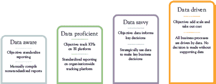

**图 7.1 数据驱动文化的阶段**

**表 7.1 用于确定人才需求的技能差距分析**

| 分析 | 1 | 2 | 3 | 4 | 5 | 总结 |
| :--- | :--- | :--- | :--- | :--- | :--- | :--- |
| **现有资源** | **现有（重新培训）** | **新聘** | **顾问** | **服务提供商/合作伙伴** | | |
| 数据治理 | | | | | | | |
| 数据质量 | | | | | | | |
| 数据架构 | | | | | | | |
| 开发人员 | | | | | | | |
| 数据基础设施/工程师 | | | | | | | |
| 分析师和 BI（商业智能） | | | | | | | |
| 变更/技术项目经理 | | | | | | | |

## 评估区块链能力与潜力

在本节中，我们提供了一个框架，可以帮助组织理解区块链是否适用于特定问题。

在回答这些问题后，你将更清楚地了解区块链是否适用于你的业务。你也将知道区块链是否是你正在解决问题的最佳解决方案。基本上，这个框架旨在帮助你判断区块链是否有助于你的业务。

### 业务

1. 你需要解决的问题是什么？
2. 如果问题涉及以下至少一点，区块链可能不是选择：
    a. 成本
    b. 效率
    c. 冗余
    d. 信任
    e. 透明度
    f. 安全性
    g. 审查
3. 需要什么样的协作？
    a. 是内部还是外部解决方案？
    b. 如果是外部的，以下生态系统是否足够成熟：
        i. 开发人员
        ii. 学术界
        iii. 行业机构
        iv. 客户
        v. 企业
        vi. 创业者和中小企业
        vii. 投资者
        viii. 供应商
4. 是 B2C 还是 B2B 问题？B2C 面临更严格的监管要求，创建合适的生态系统也更有挑战性。
5. 解决方案的复杂性和新颖性如何？
    a. 它是否是一个对新颖性和协作要求较低、成本更低且更集中的解决方案？
    b. 它是否包含高新颖性的创新，且不需要大量用户即可产生价值？
    c. 它是否是一个新颖性低但需要与利益相关者高度协作的解决方案？
    d. 它是否是一个需要大量创新和协作的具有变革性的解决方案？

### 技术

1. 哪种区块链最适合你的解决方案？
2. 分布式账技术的生态系统是否足够成熟，即你是否为你的解决方案开发了 `DApp`？
3. 除了区块链，还可以使用什么其他方案？换句话说，关系数据库能否实现？

### 法律

1. 你的解决方案是否创新到没有监管先例？
2. 如果存在规则法规，该司法管辖区的友好程度如何？
    a. 根据公司所在地？
    b. 根据客户所在地？
3. 你是否可以获得财务和法律指导？
    a. 你能否通过现有法规获得帮助？
    b. 你是否有需要解决的 `AML`（反洗钱）或 `KYC`（了解您的客户）问题，并能否获得帮助？
4. 你是否需要考虑其他指令和法规，例如 `GDPR`？
    a. 你是否可以获得有关隐私和数字身份问题的协助？


## 5. 你的解决方案对生态系统内的所有人（尤其是客户）来说是公平的吗？

## 6. 你使用的预言（oracles）可靠性如何？

## 7. 你的解决方案将如何影响生态系统中的竞争对手？

## 8. 你的解决方案是否会在生态系统中建立并鼓励信任？

## 总结

新兴技术将长期存在。那些为之做好准备的组织将拥有竞争优势。我们可以通过关注环境的变化、适应不断变化的格局，并理解这些新兴技术可能如何影响我们的战略来准备未来。

第一步是关注正在发生的环境变化。第二步是适应这些变化并相应调整你的业务策略。第三是预测将影响你业务策略的新技术。

构建成功组织最具挑战性的方面之一是理解未来为我们准备了什么。要在未来取得成功，任何组织都需要通过预测自身将如何演变以应对这些变化来做好准备。

未来不仅是可能的，而且是必然的。我们希望这本书能帮助你以不同的光光看待主主近期未来的新兴技术，并协助你应对这一竞争激烈的态势。

## 参考文献

参考文献

Allen, F.E. 2001. “人工智能的神话。”*American Heritage* [www.americanheritage.com/myth-artificial-intelligence](http://www.americanheritage.com/myth-artificial-intelligence)

“人工智能在性别和种族偏见方面存在问题。” 未标记。*Time*. [`time.com/5520558/artificial-intelligence-racial-gender-bias/`](https://time.com/5520558/artificial-intelligence-racial-gender-bias/)（访问于 2022 年 1 月 27 日）。

Barba, P. 2020 年 9 月 29 日. “用于自然语言处理（NLP）的机器学习（ML）”。*Lexalytics*. [www.lexalytics.com/lexablog/machine-learning-natural-language-processing](http://www.lexalytics.com/lexablog/machine-learning-natural-language-processing)

Beyer, S. 2018 年 8 月 23 日. “比特币之前的区块链：历史。”*Block Telegraph* (博客)。[`blocktelegraph.io/blockchain-before-bitcoin-history/`](https://blocktelegraph.io/blockchain-before-bitcoin-history/)

Buchanan, B.G., 和 E.H. Shortliffe, 编辑. 1984. “基于规则的专家系统：斯坦福启发式编程项目的 MYCIN 实验。”*The Addison-Wesley Series in Artificial Intelligence*. 马萨诸塞州 Reading：Addison-Wesley。

“检查你的症状 | Medicare。” 未标记。*Medicare.Gov*. [www.medicare.gov/manage-your-health/share-your-medicare-claims-medicares-blue-button/check-your-symptoms](http://www.medicare.gov/manage-your-health/share-your-medicare-claims-medicares-blue-button/check-your-symptoms)（访问于 2022 年 1 月 27 日）。

“Hanseaticsoft 提供的 Cloud Fleet Manager。” 未标记 [`hanseaticsoft.com/`](https://hanseaticsoft.com/)（访问于 2022 年 1 月 27 日）。

Conway, F., 和 J. Siegelman. 2005. *信息时代的黑暗英雄：寻找控制论之父诺伯特·维纳*。纽约，纽约：Basic Books。

Crevier, D. 1993. *AI：追求人工智能的动荡历史*。纽约，纽约：Basic Books。

Dilip, D. 未标记. “统计学在业务中的应用。” RVS 管理与研究学院。[www.rvsimsr.ac.in/blog/application-statistics-business.php](http://www.rvsimsr.ac.in/blog/application-statistics-business.php)（访问于 2022 年 1 月 27 日）。

“[DNV.Com](http://DNV.Com)—当信任至关重要时。” 未标记。*DNV*. [www.dnv.com/Default](http://www.dnv.com/Default)（访问于 2022 年 1 月 27 日）。

“欧洲数据策略。” 未标记。文本。欧洲委员会—欧洲委员会。[`ec.europa.eu/info/strategy/priorities-2019-2024/europe-fit-digital-age/european-data_strategy`](https://ec.europa.eu/info/strategy/priorities-2019-2024/europe-fit-digital-age/european-data_strategy)（访问于 2022 年 1 月 27 日）。

Faction, A. 2018. *Faction 情感分析演示*。[www.youtube.com/watch?v=R5HkyAUII](http://www.youtube.com/watch?v=R5HkyAUII)

Ganguli, A., G. Iaquinti, M. Zhou 和 R. Chacon. 2020 年 12 月 1 日. “在 Slack 中扩展数据存储。”*Slack Engineering*。[`slack.engineering/datastores-at-vitess/`](https://slack.engineering/datastores-at-vitess/)

Gartner. 2021. “数字营销技术趋势曲线。[www.gartner.com/en/marketing/research/hype-cycle-for-digital-marketing](http://www.gartner.com/en/marketing/research/hype-cycle-for-digital-marketing)

IBM. 2021. “X-Force 威胁情报 2021。”*IBM Security*, 50。

Kampakis, S. 2016. *预测出了问题？* 摘自 Data Scientist。[`thedatientist.com/election-forecasting/`](https://thedatientist.com/election-forecasting/)

Kampakis, S. 2018 年 10 月 22 日. “数据驱动、数据告知和以数据为中心的区别是什么？”*The Data Scientist* (博客)。[`thedatientist.com/data-driven-data-informed-data-centric/`](https://thedatientist.com/data-driven-data-informed-data-centric/)

Kampakis, S. 2018. “数据科学家的不同派系。”*The Data Scientist* (博客)。2018 年 11 月 5 日。[`thedatientist.com/tribes-scientists/`](https://thedatientist.com/tribes-scientists/)

Kampakis, S. 2019 年 1 月 7 日. “以数据为中心文化的重要性。”*The Data Scientist* (博客)。[`thedatientist.com/the-importance-of-building-a-data-centric/`](https://thedatientist.com/the-importance-of-building-a-data-centric/)

Kampakis, S. 2020 年 2 月 25 日 a. “为什么预测性维护是制造业的下一个趋势。”*The Data Scientist* (博客)。[`thedatientist.com/why-predictive-maintenance-is-the-next-big-thing-in-manufacturing/`](https://thedatientist.com/why-predictive-maintenance-is-the-next-big-thing-in-manufacturing/)

Kampakis, S. 2020 年 3 月 19 日 b. “人工智能和数据科学如何帮助对抗 COVID-19。”*The Data Scientist* (博客)。2020 年 3 月 19 日。[`thedatientist.com/ai-data-science-help-covid-19/`](https://thedatientist.com/ai-data-science-help-covid-19/)

Kumar, R., V. Misra, J. Walraven, L. Sharan, B. Azarnoush, B. Chen 和 N. Govind. 2018 年 3 月 27 日. “数据科学与 Netflix 的娱乐制作艺术。”*Netflix Technology Blog。[`netflixtechblog.com/studio-production-data-science-6462cc21a1`](https://netflixtechblog.com/studio-production-data-science-6462cc21a1)

Leonhardt, D. 2000 年 7 月 28 日. “85 岁的统计学家 John Tukey 发明了‘软件’一词。”*The New Times* 美国版。[www.nytimes.com/2000/07/28/us/john-tukey-85-coined-the-word-software](http://www.nytimes.com/2000/07/28/us/john-tukey-85-coined-the-word-software)

Lighthill, J. 1973. “人工智能：总述。”人工智能：论文研讨会。科学研究委员会。[`aitopics.org/doc/D8235CF9/`](https://aitopics.org/doc/D8235CF9/)

Mangel, M., 和 F.J. Samaniego. 1984. “Abraham Wald 关于飞机存存能力的工作。”*Journal of the American Statistical Association* 79, no. 386, pp. 259–267。[`doi.org/10.1080/01621459.1984.1047808`](https://doi.org/10.1080/01621459.1984.1047838)

McCorduck, P. 2004. *思考的机器*。第 2 版。A K Peters/CRC Press。[`doi.org/10.1201/9780429258985`](https://doi.org/10.1201/9780429258985)

McCulloch, W.S., 和 W. Pitts. 1943. “神经活动中隐含思想的逻辑演算。”*The Bulletin of Mathematical Biophysics* 5, no. 4, pp. 115–133.


Microsoft. n.d. “什么是团队数据科学流程？Azure 架构中心。”[`docs.microsoft.com/en-us/azure/architecture/data-science-process/overview`](https://docs.microsoft.com/en-us/azure/architecture/data-science-process/overview) (访问于 2022 年 1 月 27 日)。

Nakamoto, S. 2008. *比特币：一种点对点的电子现金系统* 9。

美国国家研究委员会（National Research Council），编 1999. *资助革命：政府对计算研究的支持*. 华盛顿特：国家学院出版社。

Parizo, C. n.d. “区块链技术的 4 种不同类型？” *SearchCIO*. [www.techtarget.com/searchcio/feature/What-are-the-4-different-types-of-blockchain-technology](http://www.techtarget.com/searchcio/feature/What-are-the-4-different-types-of-blockchain-technology) (访问于 2022 年 1 月 27 日)。

Piatetsky-Shapiro, G. 1994. “数据库中的知识发现：进展报告。” *The Knowledge Engineering Review* 9, no. 1, pp. 57–60. [`doi.org/10.1017/S0269888900006573`](https://doi.org/10.1017/S0269888900006573)

“权益证明 (PoS)。” n.d. *Ethereum.Org*. [`ethereum.org`](https://ethereum.org) (访问于 2022 年 1 月 27 日)。

Rodriguez, G. 2018 年 5 月 09 日. “推荐系统简介。” *Tryolabs*. [`tryolabs.com/blog/introduction-to-recommender-systems`](https://tryolabs.com/blog/introduction-to-recommender-systems)

Rogati, M. 2017. “AI 需求层级 | HackerNoon。” *Hackernoon*. [`hackernoon.com/the-ai-hierarchy-of-needs-18f111fcc007`](https://hackernoon.com/the-ai-hierarchy-of-needs-18f111fcc007)

Russell, S., and P. Norvig. 2008. [`aima.cs.berkeley.edu/`](http://aima.cs.berkeley.edu/)

Russell, S.J., P. Norvig, and E. Davis. 2010. *人工智能：一种现代方法*, 第 3 版。Prentice Hall 人工智能系列。上萨德勒河：Prentice Hall。

Samuel, A.L. 1959. “使用国际棋进行机器学习的一些研究。” *Ibm Journal of Research and Development*, pp. 71–105.

“半监督机器学习。” n.d. *DataRobot AI Cloud* (博客)。[www.datarobot.com/wiki/semi-supervised-machine-learning/](http://www.datarobot.com/wiki/semi-supervised-machine-learning/) (访问于 2022 年 1 月 27 日)。

Solaguren-Beascoa, A. 2020 年 4 月 04 日. “机器学习中的主动学习。” *Medium*. [`towardsdatascience.com/active-learning-in-machine-learning-525e61be16e5`](https://towardsdatascience.com/active-learning-in-machine-learning-525e61be16e5)

“Kaggle 初学者指南。”2017 年 7 月 13 日. *EliteDataScience*. [`elitedatascience.com/beginner-kaggle`](https://elitedatascience.com/beginner-kaggle)

“TradeLens | 全球供应链的数字化。” n.d. [www.tradelens.com/](http://www.tradelens.com/) (访问于 2022 年 1 月 27 日)。

Tukey, J.W. 1962. “数据分析的未来。” *The Annals of Mathematical Statistics* 33, no. 1, pp. 1–67. [`doi.org/10.1214/aoms/117701`](https://doi.org/10.1214/aoms/117701)

“理解描述性统计与推断统计 | Laerd Statistics。” n.d. [`statistics.laerd.com/statistical-guides/descriptive-inferential-statistics`](https://statistics.laerd.com/statistical-guides/descriptive-inferential-statistics) (访问于 2022 年 1 月 27 日)。

Whitby, B. 1996. *人工智能的反思：法律、道德与伦理维度》。埃塞特：Intellect Books。

Willcox, W.F. 1938. “统计学奠基。” *Revue de l’Institut Statistique* 5, no. 4, p. 321. [`doi.org/10.2307/140096`](https://doi.org/10.2307/140096)

Yu, V.L., Fagan, S.M., Wraith, W.J., Clance, A.C., Blum, B.G., and Cohen, S.N. 1979. “计算机对传染性疾病的筛选。” *JAMA* 242, no. 12, pp. 1279–1282. [`doi.org/10.1001/jama.1979.0330120`](https://doi.org/10.1001/jama.1979.0330120)

Zhou, Z.H. 2018. “弱监督学习简介。” *National Science Review* 5, no. 1, pp. 44–53. [`doi.org/10.1093/nsr/106`](https://doi.org/10.1093/nsr/106)

## 作者

**Stylianos (Stelios) Kampakis** 是数据科学家和区块链专家，拥有超过 10 年的经验。他为从初创公司到大型企业的各类规模数字营销协会 (DMA) 工作。他是伦敦大学学院 (UCL) 的 Tesseract Academy。

**Theodosis (Theo) Mourouz** 是密码学家和信息安全专家，对学术和工业界都有浓厚兴趣。他在伦敦大学学院 (UCL) 获得密码学博士学位。他是 Consulting 的执行合伙人。

**Gerard Cardoso** 是数据科学家和 AI 战略师，其使命是让大众理解数据科学并教他们如何思考数据。他曾为从初创公司到集团的各类企业提供建议。

**Marialena Zinoulou** 是伦敦帝国学院 (Imperial College London) 战略营销与管理硕士课程的讲师，也是伦敦大学学院 (UCL) 的客座讲师。

# 索引

- AAVE, 122
- 学术连接, 90
- 会计, 33–34
- 主动学习, 27
- Amazon, 26, 72–74
- 异常检测, 22–23
- 偏差, 41
- 人工智能 (AI), 4, 12–15
- 敏捷, 60, 61
- 经典, 12, 15, 18
- 到 COVID-19, 45–46
- 预测, 59
- 成熟度, 150–153
- 产品管理, 56–57
- 进展, 60
- 人工神经网络, 17
- 关联挖掘, 23
- 非对称加密, 111–112
- Axie Infinity, 123
- 易物交换, 104
- 大数据, 4
- 大五人格测试, 23
- 比特币, 106–108, 118
- 区块链, 5–6, 103, 106–109
- 应用, 5–6, 126, 137–139
- 能力与潜力, 154–156
- 资本市场, 128–130
- 密码学与, 110–112
- 网络安全, 140–141
- 与文件共享, 141–143
- 金融, 125–128
- 历史, 104
- 实现, 117–124
- IoT 与, 135–137
- KYC、公证与证书, 133–135
- 与元宇宙, 143–148


# 索引

- 分布式拒绝服务攻击 (DDoS), 141
- 分布式账本技术 (DLT), 106
- 离婚率, 36
- DNV, 134
- 领域专家, 70–72
- 域名系统 (DNS), 141
- 经济学, 35
- 出生技术, 1–2
- 员工级别, 98
- 加密密钥, 111
- ERC-721, 120
- 以太坊 (Ethereum), 107, 108, 118
- 评估, 65
- 交易所, 129
- 文件共享, 141–143
- 金融分析, 34
- 第一次工业革命, 2
- 5G 技术, 7–8
- 需求预测, 76
- 第四工业革命, 1, 3–10
- Fr8, 139
- 欺诈预防, 6
- 基金经理, 126–127
- *分析的未来* (Tukey), 11
- 基因疗法, 1
- 黄金, 105
- 治理, 144–145
- GPT-3, 26
- Haber, S., 106
- 黑客技能, 85–86
- Hanseaticsoft, 134–135
- 哈希处理, 112
- 混合区块链, 115–116
- 超链基金会 (Hyperledger Foundation), 118–119
- 超文本传输协议 (HTTP), 141–142
- 假设检验, 32
- IBM, 132–133
- IMMLA, 138–139
- 不准确监督, 27
- 不完全监督, 27
- 工业 4.0, 5, 9
- 不精确监督, 27
- 推断统计学, 31–32, 42–43
- 信息系统, 35
- 信息技术 (IT), 6–7
- 对变革的智力抵抗, 100–101
- 物联网 (IoT), 6–7, 135–136, 140
- 互操作性, 144
- 星际文件系统 (IPFS), 119
- 投资者, 127
- 发行, 128
- 发行者, 125–126
- iXledger, 139
- IXT 代币, 139
- 变革之旅, 101
- Kaggle, 45, 93–96
- 知识, 150, 152
- 隐变量模型, 23–24
- 引导性问题偏差, 41–42
- Lighthill, J., 14
- 逻辑推理, 13
- 机器学习 (ML), 4, 15–16
- 算法, 4
- 强化, 18, 24–25
- 统计, 17, 29–30
- 监督, 18, 19–21
- 类型, 18–27
- 无监督, 18, 21–24
- 使用, 27–28
- 马士基 (Maersk), 132–133
- 主要部落, 92–96
- 管理级别, 97
- 营销, 34
- 数学和统计知识, 86
- 成熟度曲线, 149
- 元宇宙, 122, 143–148
- 计量学, 8–9
- 微软团队数据科学流程, 66–69
- Minsky, M., 12–14
- 移动支付, 106
- 建模, 65
- 货币与支付体系统, 103–106
- MYCIN, 13, 14
- Nakamoto, S., 103, 106
- 自然语言处理, 27, 78–80
- Netflix, 27, 48, 73
- 节点, 110
- 非同质化代币 (NFT), 120, 122–123, 145–148
- 在线支付系统, 106
- 运营改进, 48
- 运营技术 (OT), 6–7
- 组织级别, 98
- 所有权证明, 144
- 纸质流程, 136
- 纸币, 105
- 点对点 (P2P) 共享系统, 142
- 个人抵变革, 100
- 预测性维护, 44
- 预防性维护, 43
- 私有链, 114–115
- 问题定义, 70–71, 73–83
- 生产, 34–35
- 公共区块链, 112–114
- 质量控制, 5, 34
- 定量专家, 94–95
- 量子计算, 8–9
- 推荐系统, 72–73
- 回归模型, 20–21
- 监管机构, 127–128
- 强化学习, 18, 24–25
- 变革抵抗, 100–101
- 机器人学, 9, 10
- 销售与交易, 128–129
- 采样偏差, 40
- Samuel, A., 15
- 沙箱 (Sandbox), 123, 146
- 第二次工业革命, 2
- 选择性偏差, 40–41
- 自选择偏差, 41
- 半监督学习, 27
- 情感分析, 79–80
- 结算, 130
- ShipChain, 138
- [Shipowner.io](http://Shipowner.io), 139
- SHIP 代币, 139
- 小/少数部落, 96–97
- 社会期望性偏差, 42
- 语音理解研究计划, 14
- Spotify, 27, 48–49, 72, 74
- Star Atlas, 123–124
- 统计学家, 93–94
- 统计学, 17, 28–29
- 应用, 33–35
- 收益, 32–33
- 描述性, 30–31, 38–40
- 历史, 29–30
- 推断, 31–32, 42–43
- 陷阱, 35–43
- Stornetta, W. S., 91
- 实质专业知识, 86
- 监督学习, 18, 19–21
- 供应链, 130
- 对称加密, 111
- 人才, 152
- 团队数据科学流程 (TDSP), 66, 78–79
- 技术颠覆, 1–2
- 技术栈, 89–90
- 第三次工业革命, 3
- 3D 打印
- 代币化, 137
- 可追溯性, 5
- TradeLens, 132–133
- Tukey, J., 11
- 唯一性, 145
- Uniswap, 121
- 不可预测性, 57–58
- 无监督学习, 18, 21–24
- 美元, 105–106
- 用户界面/用户体验 (UI/UX), 74
- 价值转移, 144
- Vitess, 54
- Wald, A., 41
- 弱监督/弱监督, 27
- Yearn Finance, 121
- Zappo, 78–79
- Zookla, 73

## 该系列中的其他书籍

### 大数据、商业分析与智能技术领域的其他书籍

Mark Ferguson，南卡罗来纳大学，编辑

- John Hawkins 著，*Getting Data Done*
- Ian Domowitz 著，*Four Laws for the Artificially*
- Ruben Ugarte 著，*The Data Mirage*
- Majid Nabavi 著，*Introduction to Business Analytics, Second Edition*
- Errol S. van Engelen 著，*Emerging Technologies*
- Rado Kotorov 著，*Data-Driven Business Models for the Digital Economy*
- Mu Hu 著，*Highly Effective Marketing Analytics*
- Amar Sahay 著，*Business Analytics, Volume II*
- Majid Nabavi 和 David L. Olson 著，*Introduction to Business Analytics*
- Errol S. van Engelen 著，*New World Technologies*
- Amar Sahay 著，*Business Analytics, Volume I*
- David Z. Beitz 著，*Location Analytics for Business*
- David L. Olson 著，*Data Mining Models, Second Edition*
- Alfonso Asensio 著，*World Wide Data*

## 精简与实用书籍

上述系列是 Business Expert Press (BEP) 推出的 30 个商业主题系列之一，这些系列使 BEP 成为纸质和数字书籍的领先出版社。我们的精简与实用书籍适用于：

- 专业人士与从业者
- 在课程中采用我们书籍的教师
- 图书员（他们了解 BEP 数字图书馆的独特之处：为学生提供可下载的电子书，不受数字版权管理 (DRM) 限制）
- 执行培训课程负责人
- 商业研讨会组织者

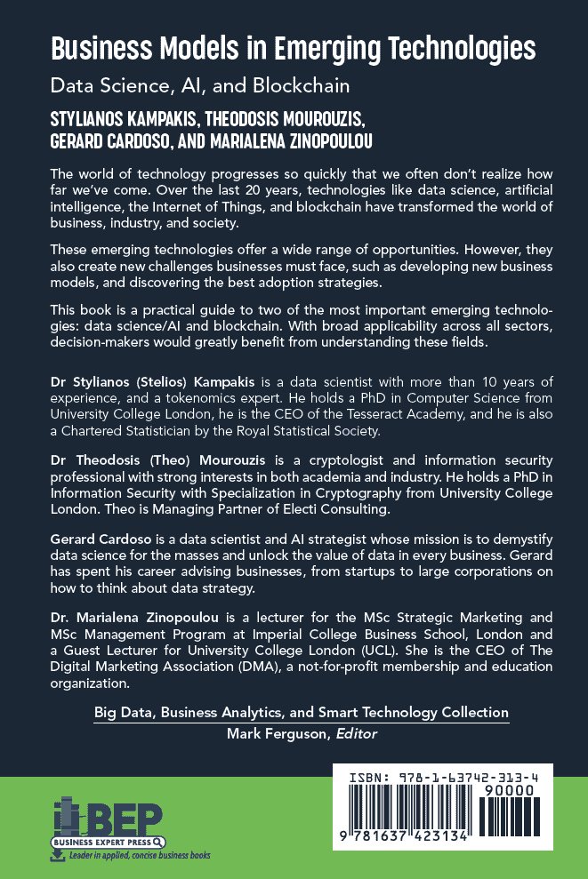

