# 因果与效应 商业分析与数据科学

# 作者简介

**Dominique Haughton** (PhD MIT 1983) 是波士顿附近 Bentley University 数学科学和全球研究荣休教授，同时是 Université Paris 1 (Pantheon-Sorbonne, SAMM) 和 Université Toulouse 1 (TSE-R) 的附属研究员。她的广泛出版物集中于如何最好地利用现代分析技术来解决商业或社会利益相关的问题。她是 Ecole Normale Supérieure 的校友，也是美国统计协会的会士。

**Jonathan Haughton** 于 1983 年在哈佛大学获得经济学博士学位。他在经济发展、税收、环境以及贫困的分析和衡量等方面发表了大量著作。如今已退休，他曾担任波士顿 Suffolk University 经济系主任，并在五大洲的 20 多个国家教授或担任顾问。

**Victor S.Y. Lo** 是一位拥有三十多年咨询和企业经验的高管，在营销、风险管理、金融计量经济学、保险、产品开发、交通运输、医疗保健、运营管理、人力资源等众多业务领域运用数据驱动解决方案，并是提升建模的先驱。他目前担任 Fidelity Investments 的数据科学和人工智能高级副总裁，并在多个组织领导数据科学和分析团队。Victor 拥有运筹学硕士学位和统计学博士学位，曾担任管理科学博士后研究员。

# 致谢

我们谨向 CRC Press/Taylor & Francis 的 David Grubbs 及其编辑团队表示感谢，他们启动了本书的出版流程，并在过去十年中给予了无尽的支持、耐心和鼓励。还要感谢 Mayank Sharma 和 KnowledgeWorks Global 团队的专业编辑工作。

我们收到了 Suffolk University 的 Alison Kelly、Jongbyung Jun 和 Le (Sarah) Tang 以及 Bentley University 的 Mingfei Li 对我们章节草稿的非常有帮助的审阅意见。

Dominique 感谢 Bentley University 多年来的支持。Jonathan 也非常感谢 Suffolk University 的支持，包括带薪休假，这有助于推动工作进展。

首先，Victor 衷心感谢全能的上帝在本书撰写期间的过去多年里给予机会、灵感和保护。他还感谢家人无数个周末的慷慨支持以及整个项目期间的鼓励。最后，他要感谢 Jane Zheng 和 Karl Rexer 提供的宝贵建议。

# 1 因果业务分析导论

DOI: [10.1201/9780429172588-1](https://doi.org/10.1201/9780429172588-1)

> *“在上帝面前我们信任，其余的人请拿出数据”*
>
> *W. Edwards Deming*

本书讨论两个主要相关主题：应用于商业问题的因果分析方法以及提升分析。本书的写作面向具备分析学、经济学、统计学、市场营销等相关领域基础知识的任何人，都易于理解。对于相关领域硕士项目学生以及希望扩展知识和技能的分析实践者而言，本书很可能有用。

重点在于概念以及重要技术的核心要素。这可以让读者入门，但要掌握任何特定技术仍需进一步阅读、深入研究、实践和实验。我们的目标是提供正确的路径和初始步骤，但我们并未撰写编程手册，因为我们相信，一旦读者大致知道要寻找什么，在 Stata、SAS、社会科学统计软件包（SPSS）、R、Python 或专业软件中找到合适的程序应该不会太困难。

本章其余部分讨论了在商业思维中因果关系的重要性，并建议读者如何选择阅读章节顺序以最大程度地受益于本书。

## 1.1 迈向商业分析与数据科学的趋势


在这个大数据时代，基于海量数据获取有价值的洞察并优化决策的能力被视为企业中的竞争优势。因此，对采用人工智能（AI）、机器学习、数据科学或高级分析的需求极大，导致在从技术到金融服务、保险、医疗保健再到零售等多个行业中出现了多个有据可查的成功案例。

第 2 页 Taylor (2024) 报告称，全球创建、捕获、复制和消费的数据量从 2000 年的 2 泽字节增长到预计 2024 年的 149 泽字节。这种数据爆炸造成了一种情况，即分析的机会仅受我们想象力和能力的限制。在当今的术语中，有多个密切相关的术语，包括数据分析、商业分析、数据科学、数据挖掘、机器学习和人工智能。特别是，人工智能是一个诞生于 1950 年代并在今天重新流行起来的领域，宽泛地意味着用计算机模仿人类行为；参见 Jordan (2019)。作为人工智能的一个子集，机器学习是一类从数据中学习的技术，而与人工智能的旧一代形式不同，后者需要人类专业知识将特定规则硬编码到系统中。虽然人工智能和机器学习涉及技术和工具，但数据科学是一个更广泛的术语和多学科领域（参见 Meng 2019），它整合了计算机编程或计算机科学（包括从任何形式提取数据、数据处理和转换）、数学和统计学、专业知识（例如，分析营销数据需要营销知识，风险分析需要风险知识）以及软技能（例如咨询、沟通和演示）。在 图 1.1 中，拥有维恩图中重叠部分所有技能的数据科学家或分析师有时被称为难以找到的独角兽（Lo 2019a）。

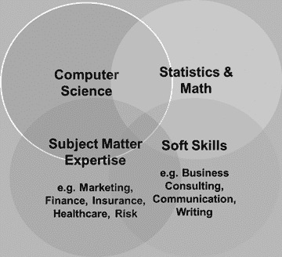

图 1.1 数据科学的维恩图。（Lo 2019a.） ⏎

在本书中，我们选择术语“商业分析”来代表我们的内容，但上面提到的其他术语或领域在行业中有时第 3 页同义的。按定义，“商业”分析是对“分析”在商业目的上的应用。分析领域（也称为数据分析）可分为以下三种类型（图 1.2）：

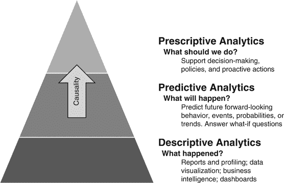

图 1.2 三种类型的分析。 ⏎

1. `Descriptive Analytics`: 它通过数据分析或报告描述发生了什么，通常包括汇总统计和数据可视化（例如散点图、饼图、直方图、箱线图和折线图），并与商业智能高度相关。通常，数据以仪表板的形式呈现，可能经常更新。有时还会包含多维表格和图表以提供数据的深入分析。例如，报告昨天的天气状况就是一种描述性分析，衡量全球收入或消费的努力也是如此。良好的描述性分析并不简单，需要明确的协议、关注细节以及在如何最好地以受众能够有用理解的方式呈现可能庞大的数据量方面的想象力。

2. `Predictive Analytics`: 它预测将会发生什么，例如未来一年的经济增长、未来客户行为或未来某些事件发生的概率。例如，天气预报本身就是一种预测分析。第 4 页预测分析（或预测建模）通常基于某种形式的统计分析（或统计建模）和/或机器学习（特别是监督学习）。预测分析也是政策分析的核心，在其中人们试图回答诸如汽油税加倍会发生什么或最低工资提高会发生什么等问题。回答此类政策问题的核心是因果推理。

3. `Prescriptive Analytics`: 它提供有关未来的一些知识，考虑潜在的替代决策，然后确定最佳决策。例如，如果你知道明天有很大可能下大雪（通过预测分析），你可能会评估在家学习或工作与去学校或工作的潜在风险，然后在考虑风险的同时确定实现目标的正确决策。该领域传统上是运筹学、管理科学或工业工程的大型子集，也与现代机器学习方法的一个子集（例如强化学习）相关。有些人区分了实证经济学，它寻求回答“what if”的问题，以及规范经济学，它处理“what should be done”的问题。

这三种分析类型是密切相关的，而不是相互独立的。了解过去发生了什么（描述性分析）通常是预测未来（预测性分析）的先决条件。即使存在高度不确定性，了解有关未来的一些信息（预测性分析）也使我们能够定量地评估替代选择并选择正确的决策（Lo 2019b）。

这三种分析类型已经存在了几十年。推动分析兴起的因素有：

1. `Big Data`: 数据不仅在数量上增加，而且以多种不同的形式增加，包括结构化和非结构化数据（例如文本、语音和图像）。

2. `Increased Machine Power`: 计算能力随着时间的推移而增加，并且继续大幅增加，最新的图形处理单元（GPU）机器和云计算取得了进展。

3. `Better Algorithms`: 在过去十年中，用于处理和分析数据的算法的复杂性和灵活性有所提高，包括大规模并行处理（MPP）、深度学习、强化学习、因果推断和提升建模。后两者是本书的重点，将在 第 1.2 节 和 1.3 节 中介绍。

第 5 页

## 1.2 商业中的因果关系介绍

在上一节中，我们描述了三种类型的分析。为了执行规范性分析，通常需要某种形式的预测分析。事实上，“因果关系”是预测分析与规范性分析之间的联系（参见 图 1.2），因为如果我们要能够成功地做出改变，就需要建立因果关系；这相当于能够应用 Pearl 的“`do-operator`”，我们将在 第 3 章 中进一步讨论。让我们用一个经典的商业问题来说明预测分析与规范性分析之间的联系——如何为你的产品定价。


### 需求曲线与最优定价
假设你在小型本地茶店出售高端珍珠奶茶。假设你对日销量与单价之间的关系有所了解，大约为：`D = 500 – 50 P`，其中 `D` = 日销量且 `P` = 单价（介于 0 到 10 之间）。这是一条经典的需求曲线，如图 1.3 所示；按惯例，经济学家将价格放在纵轴上，将需求量放在横轴上（左图），而营销人员倾向于将数量放在纵轴上（右图）。例如，这条需求曲线显示，每提高 1 美元的价格，你预计每天会少卖 50 杯。由于你旨在最大化日利润，你希望确定最优的 `P`，使利润函数最大化。你知道制作一杯珍珠奶茶的成本为 $2。因此，你的目标函数是最大化利润函数 `f(P)` = `D(P-2)` = `(500 – 50 P)(P-2)` 或 = `− 50 P² + 600 P − 1000`。我们可以通过标准微分学求解。对函数 `f(P)` 关于 `P` 求导并令其为零，得到 `P*` = $6。由于利润函数的二阶导数为负，即 `f''(P)` < 0，`P*` = $6 是实现最大利润的最优价格，其利润为 `f(6) = 200 * 4 = $800`。任何其他价格都会导致更低的日利润。在第 6 页本练习中，建立价格的销售函数是一种预测分析，而确定最优价格属于第三种分析类型：Prescriptive analytics。虽然规范性分析（优化）过程很直接，关键是如何得出销量作为价格的函数：`D = 500 – 50 P`。特别是，系数 50 反映了需求量对价格的敏感性，这是确定最优价格所需的关键信息。

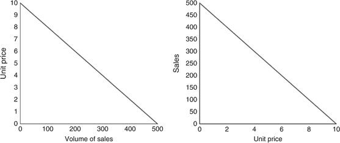
图 1.3 单位价格的销售函数。⏎

### 数据收集方法
让我们了解一下各种可能有助于确定价格敏感度的数据收集方法。

#### 1. 调查数据
这种方法也称为市场研究或初级数据收集，研究人员或分析师直接进入实地，从调查受访者那里收集自我报告数据。对于因果关系，我们可以询问调查受访者为什么某事导致另一件事，例如是什么导致他们做了他们所做的事。在我们的例子中，我们可以使用条件价值评估调查——询问潜在消费者在不同价格下愿意购买多少——这是成本效益分析中最广泛使用的工具之一，特别是在试图为非市场商品和服务（如公共公园或清洁空气的价值）定价时。市场研究人员还提出了诸如联合分析（conjoint analysis）和最好-最差量表（best-worst scaling）等技术来估计此类关系。虽然联合分析及相关技术已相当成熟（例如，Green and Srinivasan 1990），但它们基于自我报告数据，并且设计良好的调查需要一定的成本和精力。问题在于我们是否可以用“真实”数据直接观察它，而不必进行调查。

#### 2. 实验数据
回答因果关系的黄金标准是通过随机实验，通常称为随机对照试验（RCTs），或在营销、分析学和数据科学文献中称为 A/B 测试。为此，在我们的例子中，人们需要在随机环境中系统地测试各种价格点，并观察每个价格下的销售水平。进行此类实验需要一定的努力。如果可行，这通常是最好的方法，尽管实际上由于第 3 章中讨论的原因，通常远不及理想状态。

#### 3. 观察数据
如果随机实验在实践中不可行，或者我们只是想更快地得到答案，能否直接利用现有的历史数据？如果历史数据具有价格可变性，则是可能的。事实上，本书的很大一部分（第 3 章–5 和 9–12）讨论了如何从观察数据中推断因果关系。在我们的例子中，假设你只能从过去的某些时间段（天）收集到几个数据点，并且数据绘制在图 1.4a 和 1.4b 中，并用线性回归线拟合第 7 页第 8 页到数据。如果我们将回归线（预测分析）作为优化（规范性分析）的输入，我们可以在图 1.4c 中绘制利润作为价格的函数。应用标准微分学，基于此数据的最优价格为 $6.09，预计日利润为 $831，基于图 1.4a（或图 1.4b）中的拟合销售函数。如果数据来自随机实验（即价格点随机分配到不同的时间段），这应该是一个合理的分析。然而，由于数据是观察性的而非实验性的，可能存在其他“混杂因素”同时影响处理（价格）和结果（销量），（参见图 1.5）。

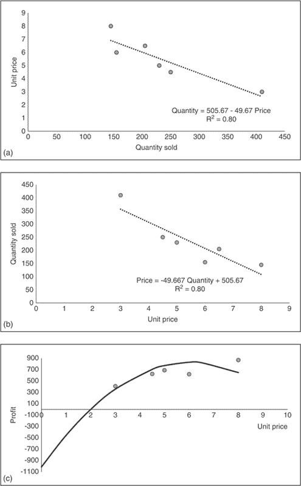
图 1.4 观察数据及其拟合回归线：（a）经济学家和（b）营销人员。（c）单位价格的利润函数。每个点为 `actual profit = actual sales * (unit price – 2)`，曲线基于拟合销量，即 `profit function = fitted sales * (unit price – 2)`。⏎

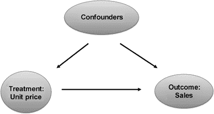
图 1.5 后门路径：确定价格敏感度时的潜在混杂。⏎

混杂因素被定义为同时预测或驱动处理和结果的变量。在这种情况下，它会同时驱动单位价格和销量。由于我们需要评估单位价格变化对销量的因果效应，我们的兴趣在于量化价格与销量之间的直接（水平）联系。然而，混杂因素的存在意味着价格与销量之间存在“后门路径”（通过混杂因素-价格和混杂因素-销量联系），导致对因果处理效应的有偏估计。我们在第 4 章中更详细地讨论这个问题。


在奶茶销售示例中，假设你的经理告诉你，部分收集到的数据点并不能很好地代表通常情况。例如，在图 1.4b 中，数据点`($3, 410)`实际上来自店铺开业当天，当天及之前有大量促销活动（例如横幅和电子邮件营销），并且由于是营业第一天，我们还将价格降至$3 作为促销的一部分。开业特别促销可能同时降低了价格并增加了销量。因此，开业日可能是一个强混杂因素，同时驱动处理变量（价格）和结果（销量）。同样，第 9 页你刚刚发现数据点`($8, 145)`来自一个主要节假日——由于许多商店都关门了，你的店是少数仍在营业的商店之一，因此你提高了价格，而销量水平仍然相对较高（与拟合回归线相比）。在这种情况下，节假日是一个混杂因素，对单价和销量都产生了积极影响。一个简单的解决方案是删除这两个数据点并重新拟合回归线，从而得到图 1.6a（或图 1.6b）中的销售函数，其价格敏感度要小得多，随后是图 1.6c 中的利润函数。第 10 页再次应用微积分，我们得到最优价格为$6.93。将此价格代入利润函数，我们得到日最优利润 = `f(6.93)` = `(391.5 – 33 * 6.93) * (6.93 – 2)` = $802.65。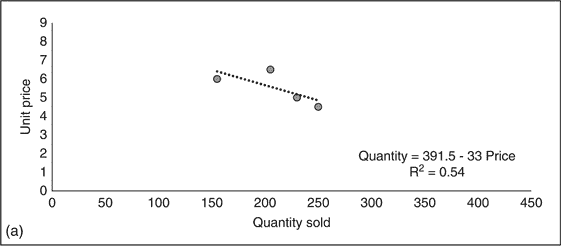

图 1.6a 观察数据及其拟合回归线（排除两个特殊日）：经济学家。⏎

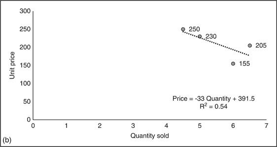

图 1.6b 观察数据及其拟合回归线（排除两个特殊日）：营销人员。⏎

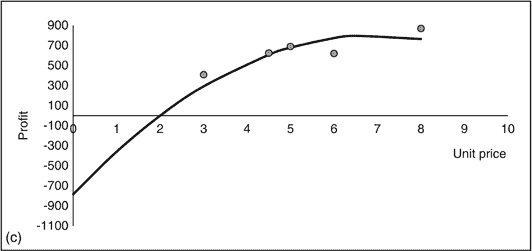

图 1.6c 单价的利润函数，使用来自图 1.6a 的拟合销售函数（排除两个特殊日）。每个点是`actual profit = actual sales * (unit price – 2)`，曲线基于拟合销量，即`profit function = fitted sales * (unit price – 2)`。⏎

虽然以上是对特定混杂情况的说明，但仍存在许多其他可能的混杂因素，例如：

1. **竞争对手定价：**如果附近有一家大型咖啡店，咖啡可能对部分顾客来说是奶茶的替代品。因此，该咖啡店的任何价格变动都可能影响你的销量和奶茶价格。
2. **产品创新：**在某些日子，你可能尝试了不同口味的奶茶，这可能同时影响需求和价格。
3. **优惠券策略：**如果部分选定顾客作为促销的一部分收到优惠券，它将同时推动价格和销量。
4. **潜在市场趋势：**对于时间序列数据，可能存在推动单价和销量随时间变化的潜在趋势（惯性），从而混淆它们之间的实际因果关系。

以上说明了处理因果关系的重要性，以价格为例。我们还可以考虑其他“处理”或干预措施，例如促销、产品和渠道。

1. 促销是关键的营销职能，对于大型企业来说，同时可能有许多种类型的促销——例如电视广告、在线促销、电子邮件营销、户外（广告牌）、广播等。第 11 页了解其中每一种的影响（通过预测分析和因果推断）非常重要，然后根据其投资回报率（通过规范分析）最优分配预算。如果没有适当的因果商业分析，负责这些促销渠道的经理可能会声称获得了相同的收入，而他们的索赔总和将远高于实际整体收入。我们在第 3 章沿此思路开发了一个示例。
2. 由于每个产品可能具有多种产品特性，了解哪些特性会推动期望的客户结果和收入，可以使我们为每个产品最优分配特性。例如，为了设计笔记本电脑，业务和消费者会考虑多个特性，例如尺寸、颜色、音质、键盘质量、CPU 和 RAM。企业可能会优化对消费者最重要的特性，这需要某种形式的因果商业分析来评估各种特性对消费者购买的影响。
3. 渠道涉及在哪里开设商店以及如何装饰它，所有这些都涉及因果问题，需要因果商业分析来估计影响（在特定位置开设商店或以特定主题或颜色装饰商店的影响）。

测量因果效应的方法论并非来自一个学术领域，而是多个学术领域，范围从经济学和计量经济学（Lee 2005），统计学（Rosenbaum 2002），计算机科学和人工智能（Pearl 2000、Scutari and Denis 2015、Pearl et al. 2016、Peters et al. 2017 和 Pearl and Mackenzie 2018），流行病学（Vanderweele 2015），社会学（Morgan and Winship 2015），心理学（Glymour 2001），政治学（Dunning 2016），到哲学（Spirtes et al. 2000）。虽然这些领域的书籍涵盖了来自不同学术学科的各种相关方法论，但它们并未专门针对商业应用，而这正是我们本书的重点。第 3 章–第 5 章和第 10 章–第 12 章提供了多种方法论来帮助回答商业中的这些因果问题。

## 1.3 从总体因果到个体因果：提升建模


前一节介绍了在总体或群体层面的因果测量，这使得能够为总体人口的全部或部分选择最佳处理。研究人员和从业者并未止步于估计总体人口或群体（或“平均”个体）的整体处理效果。随着机器学习和预测分析的进步，以及随机实验和因果推断的发展，研究人员进一步迈出一步，在个体层面估计处理效果。这种日益流行的子领域被称为提升建模，由 Radcliffe 和 Surrey（1999）以及 Lo（2002）等研究人员和从业者在 1990 年代末和 2000 年代初分别创建，其目标是通过机器学习和预测建模揭示可用数据中的异质性处理效果，从而找出真正受处理或干预积极影响的个体。该技术使我们能够潜在地识别“可说服者”，从而优化目标选择以最大化处理影响；参见 Siegel (2011, 2013b)。受众多行业个性化趋势的推动，该子领域近年来获得了极大的关注，具有似乎无限制的应用，例如个性化营销（提升的原始用途）、个性化医疗、政治选举、个性化保险和医疗保健项目，来自全球行业从业者和学者的出版物和演讲数量不断增加。独立地，来自经济学、流行病学和统计学的学者考虑了应用于社会科学和医学科学的类似或相关方法，例如，Athey and Imbens (2015)、Yong (2015) 和 Zink 等（2015）。

迄今为止，提升建模最突出的应用或许是在政治选举中。在 2012 年奥巴马连任竞选中，竞选团队有有限的预算用于定位选民。他们的分析团队设计了一种智能方法——与其与几乎肯定会投票给奥巴马或其对手的人沟通（因为向这两组人营销是无效的），他们应用提升建模来发现最容易受营销沟通影响的“可说服”摇摆选民，从而使他们的竞选活动能够最大化整体影响，如 Stedman（2013）和 Siegel (2013a) 所记录。这一成功导致提升建模在政治选举中的更广泛应用。如同在营销和销售活动中，传统预测建模侧重于预测结果，提升建模估计个体层面的处理或干预的效力，使人们能够将资源集中在可能受处理积极影响的受试者身上。

图 1.7 为提升建模和因果推断提供了一个分类框架。垂直轴从仅关联（可能相关的）延伸到因果测量（哪个导致哪个），而水平轴则从总体（或群体或亚群体）层面汇总统计移动到个性化层面建模。我们将在下面描述 图 1.7 的四个象限：

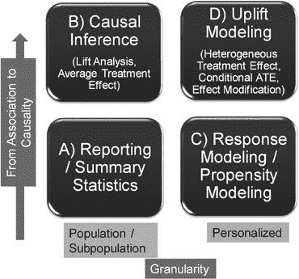

图 1.7 因果与关联分析框架。 ⏎

### 报告/汇总统计
这是 图 1.2 中描述性分析的一个子集，其中过去的数据（销售报告、财务报告和其他历史数据的摘要）以视觉或统计方式汇总，以描述总体（或亚总体）整体发生了什么。

### 因果推断
如 第 1.2 节 所描述，这种类型的分析超越了基于关联或相关性的汇总统计，并为总体人口（或群体）的处理或干预与结果之间的因果联系提供洞察。该估计在学术界被称为平均处理效应（`ATE`），在商业中则简单称为“提升”。

### 响应建模或倾向建模
使用个体层面的历史客户数据，分析的传统用法是应用预测建模，也称为监督学习，来定位那些无论是否接受干预或处理都可能采取期望行动的客户，如营销分析教科书 Jackson and Wang (1996) 和 Roberts and Berger（1999）所记录。这种模型被称为响应模型或倾向模型，其设计几乎保证模型目标在响应率方面优于随机目标。它通过提高处理组内响应者的比例来提高效率。它将报告/汇总统计从总体或群体层面扩展到个体层面，从而实现个性化层面的定位。

### 提升建模
虽然响应或倾向建模旨在预测结果，但提升建模是关于预测处理（已联系）和对照（未联系）之间的提升

表 1.1 传统预测建模可能产生的活动结果 ⏎

|  || 模型目标（前三个十分位）(%) || 随机目标 (%) |

| --- | --- | --- |

| 处理 || 2.5 || 1.0 |

| --- | --- | --- |

| 对照 || 2.5 || 1.0 |

| 提升 || 0.0 || 0.0 |

本书的 第 2 章 描述了传统预测建模方法，然后我们在后续章节深入探讨因果推断和提升建模。

## 1.4 本书组织
本书讨论了两个主要主题，因果商业分析 和 提升分析，并通过实际商业问题和数据说明了一系列方法论。第一个主题是关于在商业环境中应用适当的因果分析方法论，学术界称为因果推断。如 第 1.2 节 所述，来自各个学术领域的因果推断教科书有很多，但迄今为止还没有一本涉及具有广泛方法论的实际商业应用。第二个主题是新兴的提升分析领域——鉴于其相对新兴的状态，关于该主题的书籍非常少。我们对提升的覆盖面很广：从提升的实验设计到模型度量、提升的预测建模，以及规范性提升分析（处理优化）。


# 章节阅读概览

建议的书籍章节阅读流程概述于图 1.8。第 2 章是对常见统计、计量经济学和机器学习技术的回顾，后续关于因果业务分析和提升建模的章节都建立在这些技术之上。熟悉这些常见技术的读者可以直接跳到其他章节。第 3 章介绍了因果业务分析（业务中的因果推断），采用更标准的方法如随机实验（也称为 A/B 测试）、潜在结果法和倾向得分匹配。第 4 章描述了经济学和社会学中广泛使用的额外因果推断技术，包括合成控制法、双重差分和工具变量，但它们也可以用于商业。第 5 章讨论了一种强大的基于人工智能的方法，即有向无环图或贝叶斯网络，可用于在有或没有可能因果路径的先验知识的情况下发现和量化变量之间的因果关系。

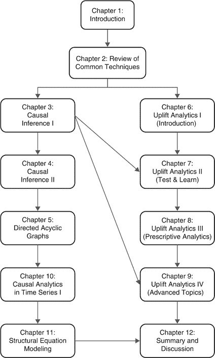

图 1.8 书籍章节建议阅读流程。 ⏎

提升分析在第 6 章–第 9 章中讨论。第 6 章介绍了提升分析的概念以及一种简单的建模方法。第 7 章讨论了提升的测试与学习流程，包括样本量确定、实验设计和测量指标。第 8 章提供了提升的规范分析概述，采用数学技术将个人与处理措施进行最优匹配。讨论包括处理模型估计不确定性的技术，基于运筹学、金融和风险管理的方法。第 9 章讨论了提升分析中的选定高级主题，包括一些最新的提升建模技术，通过将因果推断与提升建模相结合在观察性数据（无随机实验）上开发模型，以及将直接响应数据与实验数据集成用于提升建模。

第 10 章让我们回到因果业务分析，其中数据以时间序列形式存在，采用市场科学、计量经济学和时间序列分析的方法。第 10 章讨论了分析时间序列及相关数据的各种高级主题。第 11 章介绍了结构方程模型（SEM），最初来自心理学和心理测量学，可用于处理商业问题。我们在第 12 章中以讨论和总结结束本书。实践中的商业问题和数据在全书中用于说明。

## 注释

1. 经济学家通常使用需求自价格弹性来衡量敏感性，其定义为 $\\frac{\\partial lnS}{\\partial lnP}$，具有无量纲的优点。 ⏎

2. 使用来自图 1.5a 的先前拟合销售函数，其中包含混杂因素，价格将为 $6.09，日利润将为 `f(6.09) = (391.5 – 33*6.09) * (6.09 – 2) = $779.27`，导致日利润减少 $23.38。 ⏎

3. 为简单起见，我们假设对照组不接受处理，即保持未接触。在实践中，对照组在营销中可能接受较旧的处理（例如遗留干预方法），或在临床试验中接受“安慰剂”。 ⏎

## 参考文献

* Angrist, Joshua, and Jorn-Steffen Pischke. 2009. 《基本无害的计量经济学：实证主义者的伴侣》. Princeton, NJ: Princeton University Press. ⏎

* Angrist, Joshua, and Jorn-Steffen Pischke. 2014. 《精通指标：从原因到效果的路径》. Princeton, NJ: Princeton University Press. ⏎

* Athey, S., and G. W. Imbens. 2015. “用于估计异质因果效应的机器学习方法”. 工作论文, Graduate School of Business, Stanford University. ⏎

* Cartwright, Nancy. 2007. 《追寻原因并利用它们：哲学与经济学中的方法》. New York, NY: Cambridge University Press. ⏎

* Cartwright, Nancy, and Jeremy Hardie. 2012. 《循证政策：做得更好的实用指南》. New York, NY: Oxford University Press. ⏎

* Dunning, Thad. 2016. 《社会科学中的自然实验：一种基于设计的途径》. Cambridge: Cambridge University Press. ⏎

* Gertler, Paul J., Sebastian Martinez, Patrick Premand, Laura B. Rawlings, and Christel M.J. Vermeersch. 2016. 《实践中的影响评估，第二版》. Washington, DC: World Bank Group. ⏎

* Glymour, Clark. 2001. 《心灵之箭：心理学中的贝叶斯网络与图形因果模型》. Cambridge, MA: MIT Press. ⏎

* Green, Paul E., and V. Srinivasan. 1990. “营销研究中的联合分析：新发展与方向”. 《营销期刊》, 54(4): 3–19. ⏎

* Hernan, Miguel A., and James M. Robins. 2020. 《因果推断》. Boca Raton, FL: Taylor & Francis. ⏎

* Imbens, Guido W., and Donald B. Rubin. 2015. 《统计、社会和生物医学科学的因果推断：导论》. New York, NY: Cambridge University Press. ⏎

* Jackson, Robert, and Paul Wang. 1996. 《战略数据库营销》. Chicago, IL: NTC Publishing. ⏎

* Jordan, Michael I. 2019. “人工智能——革命尚未发生”. *哈佛数据科学评论*, issue 1.1. [`hdsr.mitpress.mit.edu/pub/wot7mkc1`](https://hdsr.mitpress.mit.edu/pub/wot7mkc1) ⏎

* Lee, Myoung-Jae. 2005. 《政策、项目和处理效应的微观计量经济学》. New York, NY: Oxford University Press. ⏎

* Lee, Myoung-Jae. 2016. 《匹配、回归不连续、双重差分及其以后》. New York, NY: Oxford University Press. ⏎

* Lo, Victor S. Y. 2019a. “寻找完美独角兽”. Informs: Analytics, 1(1). [`doi.org/10.1162/99608f92.ba20f892`](https://doi.org/10.1162/99608f92.ba20f892) ⏎

* Lo, Victor S. Y. 2019b. “实践中使用的三种分析类型及其联系”. *CIO Review*. ⏎

* Meng, Xiao-Li. 2019. “数据科学：一个人工生态系统”. 《哈佛数据科学评论》, 1(1). [`doi.org/10.1162/99608f92.ba20f892`](https://doi.org/10.1162/99608f92.ba20f892) ⏎

* Morgan, Stephen, and Christopher Winship. 2015. 《反事实与因果推断：社会研究的方法与原则，第二版》. New York, NY: Cambridge University Press.

* Rosenbaum, P. R. 2002. 《观察性研究》. New York, NY. Springer. ⏎

* Rosenbaum, P. R. 2010. 《观察性研究设计》. New York, NY. Springer. ⏎

* Rosenbaum, Paul R., and Donald B. Rubin 1983. “倾向得分在因果效应观察性研究中的核心作用”. Biometrika, 70(1): 41–55.

* Rubin, D. B. 2006. 《用于因果效应的匹配抽样》. New York, NY: Cambridge University Press. ⏎


* Rubin, D. B., and R.P. Waterman. 2006. “使用倾向得分方法估计营销干预的因果效应”。 Statistical Science, 21: 206–222.
* Samuelson, Douglas A. 2013. “分析：奥巴马获胜的关键”。 *OR/MS Today*, Feb, 20–24.
* Scherer Michael. 2012. 奥巴马的数据分析师如何帮助他获胜”。 CNN News. [`www.cnn.com/2012/11/07/tech/web/obama-campaign-tech-team/index.html?hpt=hp\_bn5`](http://www.cnn.com/2012/11/07/tech/web/obama-campaign-tech-team/index.html?hpt=hp_bn5)
* 第 19 页
Scutari, Marco, and Jean-Baptiste Denis. 2015. 贝叶斯网络：R 中的示例. Boca Raton, FL: CRC Press. ⏎
* Siegel, Eric. 2011. “Upilft 建模：没有它，预测分析无法优化营销决策”。 Prediction Impact 白皮书，由 Pitney Bowes Business Insight 赞助. ⏎
* Siegel, Eric. 2013a. “奥巴马选举胜利背后的真实故事”。 *The Fiscal Times* 01/21/2013. [`www.thefiscaltimes.com/Articles/2013/01/21/The-Real-Story-Behind-Obamas-Election-Victory.aspx#page1`](http://www.thefiscaltimes.com/Articles/2013/01/21/The-Real-Story-Behind-Obamas-Election-Victory.aspx#page1) ⏎
* Siegel, Eric. 2013b. 预测分析：预测谁会点击、购买、撒谎或死亡的能力. New Jersey: Wiley.
* Sloman, Steven. 2005. 因果模型：人们如何思考世界及其替代方案. New York: Oxford University Press. ⏎
* Spirtes, Peter, Clark Glymour, and Richard Scheines. 2000. 因果、预测与搜索，第二版. Cambridge, MA: MIT Press. ⏎
* Taylor, Petroc. 2024. “2010-2023 年创建、消费和存储的数据量，预测至 2028 年”。 Statista. [`www.statista.com/statistics/871513/worldwide-data-created/`](https://www.statista.com/statistics/871513/worldwide-data-created/) ⏎
* Vanderweele, Tyler J. 2015. 因果推断中的解释：中介和交互的方法. New York: Oxford University Press. ⏎
* Weisberg, Herbert I. 2010. 偏倚与因果：有效比较的模型与判断. Hoboken, NJ: Wiley. ⏎
* Wolpert, David H. 1995. PAC、统计物理框架、贝叶斯框架与 VC 框架之间的关系. In D. H. Wolpert (ed.), 泛化数学. Reading, MA: Addison-Wesley, 117–214.
* Wolpert, David H. 2002. 有监督学习无免费午餐定理. In R. Roy, M. Köppen, S. Ovaska, T. Furuhashi, and F. Hoffmann (eds.), 软计算与工业. London: Springer. [`doi.org/10.1007/978-1-4471-0123-9\_3`](https://doi.org/10.1007/978-1-4471-0123-9_3)
* Yong, Florence H. 2015. “分层医学的定量方法”。 *博士论文*, Department of Biostatistics, Harvard T.H. Chan School of Public Health, Harvard University. ⏎
* Zink, Richard C., Lei Shen, Russell D. Wolfinger, and H.D. Hollins Showalter. 2015. 评估在随机临床试验中识别治疗反应增强的患者亚组的方法. In Zhen Chen, Aiyi Liu, Yongming Qu, Larry Tang, Naitee Ting, and Yi Tsong (eds.), *生物医学和临床试验设计的实用统计*. Switzerland: Springer International Publishing
第 20 页

# 2 常见数据挖掘技术的回顾

DOI: [10.1201/9780429172588-2](https://doi.org/10.1201/9780429172588-2)

## 2.1 引言

人们可能会认为，数据挖掘或数据缩减技术在强调因果性的书籍中不应占有一席之地。毕竟，数据挖掘似乎主要是在大量数据中寻找模式——识别人脸、寻找企业账户中的异常，或识别个人的支出模式。

有时这确实足够了，尤其是在无监督学习的应用中。识别照片中的共同元素以便将其编译成相册是有用的，但不需要解决因果关系。

然而，在许多情况下，我们希望利用数据挖掘的工具来识别或不拒绝潜在的因果路径。我们出于此目的对学习进行监督。例如，我们可能想知道为什么有些人会更换电话服务提供商。这里有趣的问题是公司能做什么来防止客户流失，从而减少“流失”。仅仅找到流失的相关因素是不够的；我们需要识别哪些变量（在我们控制之下）可以合理地认为会影响流失，并衡量这些影响的方向、强度和形式。

在本章中，我们将研究几种有助于我们更好地解决因果问题的主要技术。它们并不能证明因果关系——这可能根本不可能——但它们通常可以检验我们先前的因果假设是否合理；并且在因果效应似乎起作用的地方，它们通常可以帮助量化这些效应。

我们从最广泛使用和最熟悉的技术线性回归开始，因为几乎所有分析都从这里开始；熟悉该主题的读者可能希望浏览这一部分。然后我们转向对观测值进行分类的问题——例如，识别某人是否会买车的决定因素。通常这是用逻辑回归完成的，但其他几种技术变得流行，包括分类与回归树（CART）、随机森林、梯度提升树、神经网络和支持向量机（SVMs）。这些技术也可用于创建提升表，这些提升表将在第 6 章–第 9 章中更详细地讨论。

这些技术都不能证明因果关系；相反，它们反映了我们所做的因果假设，无论是隐式还是显式。几乎所有的因果分析都需要我们从一些认真的思考开始，通常以分析建模的形式正式化，而后几章将更全面地解决这个问题。尽管如此，有时有可能排除因果效应，这是有用的。

为了说明本章中的技术和思想，我们大量借鉴了员工收入和员工流失的模型。在回归背景下，我们将研究哪些变量可以合理地“解释”收入。然后我们将研究分类技术，其中关键问题是：公司能做什么来减少员工流失，留住员工？

在这两种情况下，我们都需要有一个模型在脑海中。例如，我们可能认为收入更高、获得股票期权或加班更多的员工更愿意留下。数据还允许我们查看公司内部收入的近端驱动因素，这将在下面的讨论中证明是有用的。

这些思想——理论或模型——从何而来？它们源于我们自己对就业的个人经验、与专家的交谈以及对学术文献的回顾。但我们很少，如果有的话，从一张空白画布开始，这很幸运，因为模型帮助我们组织数据并指导我们选择技术。

员工收入和流失示例的数据模拟了对美国一家公司 1,470 名个人的调查结果。该数据集由 IBM 的数据科学家为培训目的创建，我们对其进行了一些修改。

表 2.1 员工数据的汇总统计 ⏎

| Variable || Total or % |
| --- | --- |
| Monthly income (USD) || 6,503 |
| --- | --- |
| Age || 36.9 |
| Gender (% female) || 60.0 |
| Total years worked || 11.3 |
| Years worked at current company || 7.0 |
| Educational level (%) ||  |
| No college || 11.6 |
| Some college || 19.2 |
| Bachelor's degree || 38.9 |
| Master's degree || 27.1 |
| Doctorate || 3.3 |
| Job classification (%) ||  |


| 级别 1（低） || 36.9 |
| 级别 2 || 36.3 |
| 级别 3 || 14.8 |
| 级别 4 || 7.2 |
| 级别 5（高） || 4.7 |
| 教育背景 ||  |
| 人力资源 || 1.8 |
| 生命科学 || 41.2 |
| 市场营销 || 10.8 |
| 医疗 || 31.6 |
| 技术学位 || 5.6 |
| 其他 || 9.0 |

## 2.2 线性回归

任何人力资源部门的一个重要问题是工作场所是否存在性别歧视。

一个自然的起点是询问在控制其他相关因素后，男性是否比女性赚得更多。在我们的数据集中，男性的月收入平均为 $6,687，而女性为 $6,381。以零假设——男女薪酬相同——为起点，`t-test` 显示，如果零假设为真，出现这些结果的概率相当低（11%）——p 值为 0.11。因此强烈暗示男女收入之间确实存在差异。

第 22 页 问题是，为什么？例如，年长且经验更丰富的员工通常赚得更多，如果他们不成比例地为男性，那么男性（平均而言）会赚得比女性多，但不一定是因为性别。同样，如果男性员工在需要高教育技能的职位（如研究科学家）中代表性过高，我们就有可能混淆高薪（因担任研究科学家）与高薪（因性别为男性）。

回归，包括线性回归，可以帮助我们拆分这些效应。设 `Y[i]` 为个体 `i` 的感兴趣变量的度量（左手边变量，或“目标”或“因变量”或“结果”变量），而 `X[1i]`，…，`X[ki]` 为一组“解释”变量（也称为控制变量、独立变量或回归变量）。那么我们可以假设：

`Y[i] = β[0] + β[1]X[1i] + … + β[k]X[ki] + ε[i]`

(2.1)

这表示 `Y[i]` 是 `X[i]` 变量的线性组合的结果。权重是系数（`β[0]`… `β[k]`），如果我们拥有适当的数据集，这些系数可以被估计（得到 `β̂[0]`… `β̂[k]`）。`ε[i]` 表示误差项 第 23 页 因为我们并不期望公式 2.1 中的线性关系是精确的。每个统计软件包都允许人们轻松高效地估计这类方程。

为了说明，假设 `Y[i]` 表示月收入，`X[1]` 是一个二元（“虚拟”）变量，表示性别，女性设为 1，男性设为 0；其他 `X` 变量控制年龄、教育和经验。基于我们的数据集（上文讨论过），这些以及一些其他变量的系数的估计值显示在第（1）列中 表 2.2。对于性别，其值为 16.1，这可能被理解为在其他条件不变的情况下，女性比男性每月多赚 $16。然而，这一估计在统计上与零没有显著差异；我们从 p 值知道这一点，p 值在第（2）列给出，显示估计系数与无效应（即系数为零）的零假设一致的概率非常高（0.81）。基于此模型，我们没有发现性别对工资的影响证据。

表 2.2 收入模型的回归估计 ⏎

|  || （1）线性模型 || （2）明瑟模型 || （3）明瑟，逐步 |
| --- | --- | --- | --- |
| 因变量 || 月收入 || Ln（月收入） || Ln（月收入） |
| 变量 || 系数 || p 值 || 系数 || p 值 || 系数 || p 值 |
| --- | --- | --- | --- | --- | --- | --- |
| 性别（F = 1，M = 0） || 16.1 || 0.814 || −0.001 || 0.992 || −0.0004 || 0.972 |
| 年龄 || 43.1 || 0.172 ||  ||  ||  ||  |
| 年龄平方 || −612.0 || 0.124 ||  ||  ||  ||  |
| 工作总年数 || 81.4 || <0.001 || 0.025 || <0.001 || 0.024 || <0.001 |
| 工作年数平方 || −1.7 || 0.003 || −0.001 || <0.001 || −0.0006 || 0.000 |
| 在现公司工作年数 || −12.9 || 0.076 || −0.0002 || 0.862 ||  ||  |
| 教育水平 ||  ||  ||  ||  ||  ||  |
| 无大学（基准） ||  ||  ||  ||  ||  ||  |
| 部分大学 || −267.2 || 0.036 || −0.035 || 0.133 || −0.040 || 0.018 |
| 学士学位 || −228.2 || 0.046 || −0.029 || 0.172 || −0.033 || 0.015 |
| 硕士学位 || \-46.3 || 0.706 || −0.008 || 0.730 ||  ||  |
| 博士 || −187.8 || 0.380 || −0.002 || 0.968 ||  ||  |
| 职位分类 ||  ||  ||  ||  ||  ||  |
| 级别 1（低）（基准） ||  ||  ||  ||  ||  ||  |
| 级别 2 || 2500.7 || 0.000 || 0.616 || 0.000 || 0.619 || <0.001 |
| 级别 3 || 6732.2 || 0.000 || 1.186 || 0.000 || 1.188 || <0.001 |
| 级别 4 || 12387.6 || 0.000 || 1.656 || 0.000 || 1.657 || <0.001 |
| 级别 5（高） || 16066.6 || 0.000 || 1.877 || 0.000 || 1.879 || <0.001 |
| 教育背景 ||  ||  ||  ||  ||  ||  |
| 人力资源（基准） ||  ||  ||  ||  ||  ||  |
| 生命科学 || −128.0 || 0.613 || 0.0004 || 0.993 ||  ||  |
| 市场营销 || −119.1 || 0.658 || 0.020 || 0.682 ||  ||  |
| 医疗 || −76.3 || 0.764 || 0.007 || 0.876 ||  ||  |
| 技术学位 || −132.2 || 0.627 || −0.004 || 0.943 ||  ||  |
| 其他 || −182.4 || 0.523 || 0.002 || 0.976 ||  ||  |
| 截距 || 1990.5 || 0.001 || 7.797 || 0.000 || 7.806 || <0.001 |
| 调整后 R 平方 || 0.926 ||  || 0.873 ||  || 0.874 ||  |

在这种情况下，潜在因果方向是明确的，因为性别映射到收入，而不是收入映射到性别，尽管即便如此，如果高收入不成比例地吸引高绩效女性，观察到的关系也可能朝相反方向发展。

任何效应的度量都取决于其余模型是否合适：例如，我们是否包含了所有相关控制变量，它们是否被正确测量，线性形式是否合适，以及样本是否无偏？这里的调整后 `R²` 为 0.926，因此该模型“解释”了月收入大部分的变化。事实上，该模型可能包含太多变量：随着工作者年龄增长，他们也获得更多经验，因此几乎不合适将年龄和经验变量同时作为回归变量包含在内。

在他的经典模型中，雅各布 闵策尔 (1974) 认为，收入函数的适当形式应使用月收入的对数作为因变量，右手边为教育和经验的度量。它还应允许与经验相关的某种曲率。其思想是，随着工人的经验积累，其收入首先快速上升，然后上升速度放缓，甚至可能在退休前达到峰值并下降。一种建模方法是同时将经验年数和经验年数的平方作为右手变量包含在内。

工资的明瑟模型估计显示在第（2）列中 表 2.2。性别变量现在似乎为负，但同样在统计上不显著。在其他变量保持不变的情况下，经验与更高的收入相关，前 12.5 年之后，进一步经验的效果趋于平缓并下降。

开发估计模型的一种流行但更机械的方法是使用逐步回归，要么向前（如果满足一定的统计显著性阈值，则一次添加一个变量），要么向后（如果不满足一定的阈值，则一次删除一个变量）。我们对米瑟模型应用向后逐步程序，如果变量在 20% 水平或更好上不具有统计显著性，则将其删除，并将结果显示在第（3）列中 表 2.2。它比中间列中的模型更简洁，且拟合效果相同。第 24 页


越来越多的情况下，机械变量选择的首选方法，也称为特征选择，是使用 Lasso（最小绝对收缩和选择算子），这是一种正则化回归系数并剔除无用变量的方法，从而使模型更容易解释并且预测更准确（Tibshirani 1996）。基本 Lasso 有几种推广形式。其中一个特别有用的推广是弹性网络，它适用于变量数量超过观测数量的情况，因此变量数量必须大幅削减（Zou and Hastie 2005）。

虽然通常控制变量大多是连续的（如 `age`），但并非总是如此。例如，在我们的例子中，工作被分为五个等级，从技能最低（1）到技能最高（5）。要在回归中纳入此类信息，首先选择一个工作等级作为参考点，然后为其他每个类别分别包含虚拟变量。 表 2.2 第（1）列所示结果的模型表明，工作被归类为 5 级的人预计每月比工作等级为 1 的人多赚 $16,067，或根据对数线性模型约为 6.5 倍。

### 2.2.1 判断模型

回归是建模的传统主力。但我们如何知道所估计的模型是否合理？这既是艺术也是科学，但有许多需要检查的地方。我们首先需要问底层逻辑是否可靠，这将在 第 3 章 中讨论。

有人认为如果模型预测得好，那么它就是一个好的模型（Friedman 1953）。这在哲学和实用层面都是不令人满意的。为了说明原因，请考虑以下模型：命题 1 是所有狗都是猫。命题 2 是所有猫都会叫。因此我们逻辑上得出所有狗都会叫的结论。虽然预测相当准确（除了我们的哈士奇，只会嚎叫），但理论明显很奇怪。还要注意，我们不能仅凭结果就推断假设的真实性。

从实用角度看，建立在沙上的模型最终会失效。它缺乏外部有效性，这意味着将其应用于与设计时相似但不完全相同的情况会很困难。

如果模型先验合理，我们通常会查看拟合优度，用决定系数 `R²` 衡量，它衡量的是因变量（围绕均值）的变异中由回归“解释”的比例。`R²` 的取值从 0（无关系）到 1（完美拟合），但没有绝对标准来判断什么是好的拟合。当向回归模型的右侧添加更多变量时，`R²` 必然会上升，但这可能以更大的复杂性甚至混乱为代价。一个补救措施是报告 `adjusted R²`，它考虑了模型中的变量数量，只有当新加入的变量至少具有中等统计显著性（`p-value` 约为 0.34 或更低）时才会上升；或使用信息准则，如贝叶斯信息准则（`BIC`）或赤池信息准则（`AIC`）。过度追求良好拟合——追逐 `R`——可能导致基础不稳且外部有效性差的模型。

基于我们的先验信念，我们还需要查看估计系数是否具有“正确的符号”且在统计上显著。估计系数（`β̂s`）是随机变量：如果我们随机抽取不同的数据样本，就会得到 `β̂s` 的略有不同值。因此 `β̂s` 有一个分布，如果样本量足够大，该分布将为正态（即高斯），并具有标准误差（即估计的标准差）。这也引发了 `β̂` 的估计仅因偶然而非零的可能性。如果相关的 `p-value` 很小，则强烈表明系数确实不为零——换句话说，合法地属于方程或模型。许多分析师在评估统计显著性时使用 0.1 或 0.05 的 `p-value` 临界值，但这些阈值当然是有些任意的。

即使估计系数似乎在统计上显著，它也可能具有“错误”的符号。例如，如果受教育程度更高的人员工的收入通常低于受教育程度较低的人，我们会感到惊讶。有时这些意外经得起推敲，并且有合理的解释，但通常它们是模型或数据存在问题的症状。

### 2.2.2 回归诊断

当回归用于推断——检验假设——时，需要进行一系列诊断检查。关于该主题的文献非常庞大，因此我们仅简要回顾这些问题作为复习；更完整的论述可在任何计量经济学教科书中找到（例如，Wooldridge 2020、Cameron and Trivedi 2022）或一些更专业的专著中（Haughton and Haughton 2011）。

#### 2.2.2.1 多重共线性

当两个（或更多）右侧变量相关时，我们就有多重共线性。例如，如果 `X[1]` 和 `X[2]` 一起变动得太紧密，那么就很难区分 `X[1]` 和 `X[2]` 对结果变量（`Y`）的影响，系数估计将不精确。例如，在上面估计的 Mincer 模型中，受教育程度和工作分类很可能密切相关，使得难以区分两者影响。当有大量自变量可供选择时，问题变得更严重，因为可能不清楚选择哪些变量。

一个解决方案是使用更多数据，希望看到 `X[1]` 中独立于 `X[2]` 的更多变动，但这很少现实。`X[i]` 变量的相关系数简单矩阵可以让人看出多重共线性是否可能成为问题。如果它不影响我们关注的变量，或者我们只是对预测感兴趣，那么多重共线性不必致命。如果影响，则可以选择与结果变量相关性更高的 `X` 变量进入模型并剔除另一个。

#### 2.2.2.2 异方差性

如果回归残差——即 `y[i] − ŷ[i]`——相对于因变量（`y[i]`）的图形显示出非随机模式，则存在异方差性。Breusch-Pagan 检验是检测异方差性的常用方法（Wooldridge 2020），它在横截面数据中很常见，几乎是标准现象。虽然异方差性的存在不会改变系数估计，但会导致标准误差和统计显著性检验不准确。

对于收入或支出等经济和金融数据，其底层分布往往向右高度偏斜，常见的解决方案是在模型中使用这些变量的 `log`，正如在 表 2.2 中报告的 Mincer 收入模型所做的那样。另一个解决方案是使用稳健估计量，如 White 估计量，这在大多数统计软件包中很容易实现。

#### 2.2.2.3 异常值


看到 `Y` 或 `X` 变量中少量异常高或异常低的值并不罕见。这些是离群值，通常使用箱线图来识别。单个离群值可能对估计的回归系数产生强烈的 *influence*，尤其是在小样本数据集中。这可以用“拟合差异”（`dfits`）来衡量，即基于包含或不包含第 `i` 个观测值的回归所得到的 `y[i]` 的预测值之间的差异。一些观测值还具有高的 *leverage*，意味着它们是系数估计的特别重要的驱动因素。

在某些情况下，研究人员直接剔除离群值观测，或尾部观测，例如最高或最低的 5%，从而得到修剪（或截断）估计。其他人则用变量的均值替换已识别的离群值，或对数据进行截尾（Winsorize），将（例如）底部和顶部的值调整到第 5 和第 95 百分位数。修剪和 Winsorized 估计对离群值更稳健，但在过程中会损失潜在的有价值信息。一些股票指数会截尾单个成分股的极端值。

#### 2.2.2.4 测量误差

在某些情况下，例如调查数据，离群值通常被视为测量误差的一种形式。但没有任何东西能以完美的准确性被测量，因此某种程度的测量误差是不可避免的。当结果（`Y`）变量被不准确地测量，且存在随机加性误差时，这会降低回归的拟合度，但不会使系数估计产生偏差。当 `X` 变量存在测量误差时，它们变得嘈杂且信息量减少，这会使估计系数向零偏移。没有简单的方法来解决测量误差，但仔细的数据清洗和收集确实有帮助。

#### 2.2.2.5 省略变量偏差

即使是最完善的模型也会存在遗漏；理想情况下希望纳入但要么不可观测（如一个人的固有“能力”），要么未观测（如如果未收集体重数据，则一个人的体重）的变量。当一个被省略的变量（如能力）与一个被纳入的变量（如在收入方程中受教育年限）相关时，问题就会出现。此时，教育对收入的影响会被高估，因为它实际上同时传递了能力和教育的影响。

当有面板数据可用时，例如显示一个队列个体随时间变化的教育和收入，可能可以控制诸如能力等不随时间变化的不可观测因素。一些研究人员使用逐步方法从回归模型中添加或删除变量，但这并不能解决不可观测因素的问题，而且相对于通过正确模型的元素进行工作而言，它是一个不完善的替代方案。

#### 2.2.2.6 同时性

在估计回归模型时，我们隐含地假设 `X` 变量的变化会导致 `Y` 的变化。例如，考虑经济学中的经典需求曲线，其中

`Q = f(P, P[other], income, tastes)`

这里，`Q` 是购买的数量，`P` 是商品的价格，`P[other]` 是其他商品价格的向量。为了估计需求曲线，诱人的是估计

`Q = a + b P + error`

也许还有其他右手变量。但问题是，虽然更高的价格预计会减少购买量（`Q`），但因果关系可能朝相反方向运行，即高需求（`Q`）——例如下雨的晚上每个人都想打 Uber——可能导致价格更高。

我们将在后续章节中对处理因果关系有更多要说，但值得注意的是，这个问题很普遍。在某些情况下，我们可以分离出因果效应并在分析上或统计上解决同时性问题。我们在第 3 章开始这项任务。

## 2.3 分类：逻辑回归

当一家公司发送新信用卡或新电话提供商的优惠，或为一件值得的事业募捐时，人们会做出积极（是，1）或消极（否，0）的回应。我们希望能够预测，甚至解释，为什么有些人接受优惠而其他人没有，基于我们已有的信息，例如年龄、地点、信用评分、性别等等。

如果我们脑中有因果模型——也许是在第 3 章讨论的图形方法的帮助下开发的——那么我们可能能够估计输入变量对感兴趣结果的影响。问题在于如何最好地做到这一点。

考虑一个例子，我们有一个希望在发展中国家招募客户的电话提供商。我们掌握了 514 名被提供新服务的人的信息，其中 19.5%的人接受了优惠。我们还有一组我们认为会影响结果的输入变量。此（部分假设）示例的汇总统计显示在表 2.3 中。

表 2.3 新电话服务采用示例的汇总统计 ⏎

|  || 变量 || 均值 |
| --- | --- | --- |
| 结果 || 接受新的电话提供商 || 19.5 |
| --- | --- | --- |
| 输入 || 地区：北部 || 31.3 |
|   || 地区：南部 || 10.7 |
|   || 地区：东部 || 28.2 |
|   || 地区：西部 || 29.8 |
|   || 户主性别（%男性） || 87.2 |
|   || 年龄（年） || 47.2 |
|   || 教育年限（年） ||  2.3 |
|   || 家庭规模 ||  6.0 |
|   || 家庭收入 || 52.4 |

图 2.1 中的每个点代表一个要么接受了新服务提供商的优惠（在纵轴上显示为 1）要么没有接受（在纵轴上显示为 0）的人，绘制在家庭收入的对照下。注意观测值如何聚集在图表的顶部和底部。

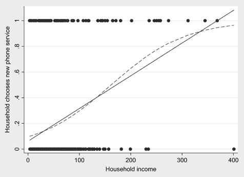

图 2.1 收入与家庭加入电话服务的决策。 ⏎

为了衡量家庭收入对结果的影响，我们可以简单地估计线性回归。简单情况产生的直线如图图 2.1 所示，而更完整的线性模型的系数估计报告在表 2.4 的第（1）列中。

表 2.4 线性回归与逻辑回归的比较 ⏎

|  || 系数：线性回归 || 系数：逻辑回归 || 边际效应：逻辑回归 |
| --- | --- | --- | --- |
|  || (1) || (2) || (3) |
| 因变量：家庭选择新的电话提供商 ||  ||  ||  |
| --- | --- | --- | --- |
| 地区（北部为参照） ||  ||  ||  |
| 南部 || 0.070 || 0.449 || 0.072 |
| 东部 || −0.042 || −0.311 || −0.042 |
| 西部 || −0.117 || −1.097 || −0.123 |
| 性别（女性为参照） ||  ||  ||  |
| 男性 || −0.060 || −0.456 || −0.060 |
| 连续变量 ||  ||  ||  |
| 户主年龄（年） || 0.001 || 0.010 || 0.001 |
| 户主教育年限（年） || 0.030 || 0.189 || 0.023 |
| 家庭规模 || −0.013 || −0.091 || −0.011 |
| 家庭收入 || 0.0021 || 0.0128 || 0.0016 |
| 截距 || 0.135 || −2.021 ||  |
| R 平方 || 0.193 || 0.194 ||  |

这种方法的一个问题是线性回归线显然不能很好地拟合数据。它还可能预测接受优惠的概率超过 1，这毫无意义！请注意，在这种简单情况下，额外收入的边际效应为 0.0021，这意味着如果收入增加一个单位，接受新电话服务优惠的概率将上升 0.0021（或 0.21 个百分点）。


一种更令人满意的方法是估计逻辑回归。其思路是将估计方程进行转换，使结果变量被限制在区间 (0,1) 内。线性回归的估计方程为

`Y = X β + ε or E(Y) = Xβ`,

其中 `Y` 是二元结果变量，`X` 代表一系列“解释”变量，`β` 是系数向量，而 `ε` 是误差项。相比之下，逻辑回归的估计方程，其建模的是结果变量取值为 1 的概率（这与二元结果 `Y` 的期望值相同），如下所示：

$$P\\left( {Y = 1} \\right) = ~\\frac{e^{\\mathbf{X}\\mathbf{\\beta}}}{1 + ~e^{\\mathbf{X}\\mathbf{\\beta}}}~or~E\\left( Y \\right) = \\frac{1}{1 + ~e^{- \\mathbf{X}\\mathbf{\\beta}}}.$$

如果 `Xβ` 很大，则 `Y`→1，但如果 `Xβ` 很小，则 `Y`→0。从操作上讲，很容易估计。例如在 Stata 中，回归命令是

`reg Y X`

而逻辑回归命令是

`logit Y X`

在我们的示例中，由逻辑回归产生的线，其中 `Y` 为“更换手机运营商”，`X` 为家庭收入，由 图 2.1 中的虚线给出。

逻辑回归原始系数的估计值显示在 表 2.4 的中间列中。这些估计值本身并没有太大兴趣。通常，我们更感兴趣的是边际效应，即当 `X` 变化时 `E(Y)` 发生什么变化（即 `∂E(Y)/∂X`）。在线性回归中，这只是斜率，由系数给出，但对于逻辑曲线，斜率会变化——随着我们在 图 2.1 中从左到右移动，先低（平坦），然后更高，最后再次降低。

一种解决方案是使用 Stata（或 R）中的 `margins` 命令计算平均值处的边际效应，如 表 2.4 右列所示。如果需要更多细节，我们可以在多个点请求边际值——例如，在家庭收入水平为 30（`margin = 0.0014`）、第 32 页 150（`margin = 0.0026`）和 300（`margin = 0.0020`）处，并将其与普通最小二乘回归的边际值 0.0021 进行比较。在我们的示例中，逻辑回归的边际效应接近线性回归产生的效应，但并非总是如此。

逻辑回归是分析中的主力工具之一，但它存在局限性。它不易处理交互作用——例如，当教育的影响还取决于个人的年龄时——以及非线性，并且受其参数形式限制。为了获得更大的灵活性，我们可能希望使用某种分类或回归树，这就是我们现在要讨论的话题。

## 2.4 分类：树

一种替代方法来探讨“独立”变量如何影响结果的方法是构建树，单独构建或借助随机森林或梯度提升。

为了了解树的工作原理，我们从一个简单的例子开始，使用 表 2.5 中显示的数据。每一列显示关于一个个人的信息。在此样本的 20 人中，12 人离开了公司；12 人曾加班工作；11 人曾获得股票期权。我们想知道加班工作和股票期权是否会影响离开公司的决定。一个简单的线性回归给出：

表 2.5 简单员工流失模型的假设数据 ⏎

| 个体 ||  1 ||  2 ||  3 ||  4 ||  5 ||  6 ||  7 ||  8 ||  9 || 10 |
| --- | --- | --- | --- | --- | --- | --- | --- | --- | --- | --- |
| 离开公司 (Y = 1) ||  0 ||  0 ||  0 ||  0 ||  0 ||  0 ||  0 ||  0 ||  1 ||  1 |
| 加班 (Y = 1) ||  0 ||  0 ||  0 ||  0 ||  0 ||  1 ||  1 ||  1 ||  0 ||  0 |
| 股票期权 (Y = 1) ||  1 ||  0 ||  1 ||  0 ||  1 ||  1 ||  1 ||  1 ||  0 ||  1 |
| 个体 || 11 || 12 || 13 || 14 || 15 || 16 || 17 || 18 || 19 || 20 |
| 离开公司 (Y = 1) ||  1 ||  1 ||  1 ||  1 ||  1 ||  1 ||  1 ||  1 ||  1 ||  1 |
| 加班 (Y = 1) ||  0 ||  1 ||  1 ||  1 ||  1 ||  1 ||  1 ||  1 ||  1 ||  1 |
| 股票期权 (Y = 1) ||  0 ||  0 ||  0 ||  0 ||  0 ||  0 ||  1 ||  1 ||  1 ||  1 |

$$\\begin{matrix} {\\text{Leave} = 0.55 + 0.40\\,\\text{overtime}–0.36\\,\\text{stock~option}} & {\\text{R}^{2} = 0.27} \\\\ \\end{matrix}$$

如果该方程完全有效，它将正确预测谁会离开谁不会离开，但在这种情况下，使用 0.6 的截断值，20 个案例中有 6 个预测不正确。逻辑模型可能更适合这种情况，也错误分类了 20 个案例中的 6 个。

第 33 页

### 2.4.1 分类与回归树

我们可以通过构建分类树做得更好。我们从一个初始节点开始——树干——然后将观测值分类到不同的分支（或箱）中。其思想是尝试为具有相似结果的数据的可识别子集创建箱：如果一个箱中的所有观测值具有相同的结果——例如，它们都是离职者——那么该箱是“纯净”的，而一个箱由相等数量的离职者和留任者组成则完全“不纯”，无法告诉我们什么驱动了离开的决定。

我们可以用我们简单的 数据集来说明这一思想。20 名员工中有 8 人离职，因此基尼不纯度度量为 0.48。但现在让我们将样本分为加班者和不加班者。在 12 名加班者中，9 人辞职，不纯度度量为 0.38。在分割的另一侧，未加班的 8 人中只有 3 人离开公司，不纯度度量为 0.47。新模型的平均不纯度值为 0.413（而不是 0.48），因此分类帮助我们看到了数据中的模式：似乎加班与更高的离职倾向相关。如果我们预测加班者会辞职，不加班者会留下，那么我们的预测在 70% 的时间内是正确的，与回归模型相同。这棵基本树显示在 图 2.2 中。

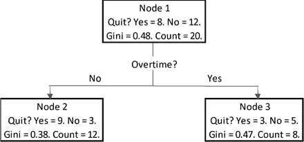

图 2.2 基本示例的分类模型。 ⏎

也可以根据员工是否有股票期权来分割样本。在这里，分割也降低了不纯度，并且拥有股票期权与更低的离职概率相关。

如果有足够的独立变量，二元递归划分的分割过程几乎可以无限继续，生成一个分支很多且不纯度低的树。这样的树几乎肯定会过拟合数据，并在应用于不同数据集时预测效果不佳。标准解决方案是基于训练样本估计树，例如数据量的三分之二，然后使用测试（或“保留”）样本来修剪第 34 页树，以便在模型应用于测试样本时产生最低的基尼系数（或连续情况下的均方误差）。

`CART` 树作为预处理器特别有帮助：它们可以通过逐步添加然后修剪节点的过程来帮助显示哪些变量最相关。它们还显示交互作用和非线性有多重要，并且可以处理缺失值，因此比回归模型损失的信息更少。另一方面，树可能难以解释，容易蔓延，并且对如何处理修剪以及训练和验证样本的选择所做的假设很敏感。


为了说明一个更复杂的树，我们回到本章早期引入的员工流失示例。`SAS` 和 `Minitab` 的 `Salford Predictive Modeler`（2023）生成的树基本给出相同的结果；`SAS` 版本显示在 图 2.3 中。样本首先根据员工是否加班进行划分；没有加班的员工中很少有人（10.4%）离开了公司。在加班的员工中，月收入低于 $2,475 的人辞职可能性远高于收入更高的人（69.6% 对比 22.8%）。后者群体进一步按职位划分——销售主管与研究科学家——销售主管随后被分为股票期权相对较少的人（59.7% 辞职）和拥有更多期权的人（20.0% 辞职）。

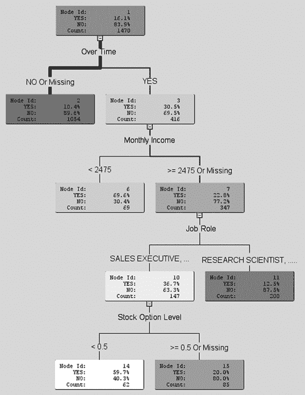

图 2.3 员工流失的描述性统计和预测模型。 ⏎

这是一棵典型的树。它善于指出非线性和交互效应，但它仅使用四个变量来做出 图 2.3 中显示的划分；如果有更多感兴趣的变量，树会迅速变得难以管理。

### 2.4.2 随机森林

虽然单个决策树——无论是用于分类还是回归——都很容易理解，但其准确性可能并不高。构建树可能会卡在单一路径上，或无法识别交互和非线性关系的全部复杂性。事实证明，通过生长随机森林可以获得更高的准确性。其思想是独立构建大量树，然后以某种“集体智能”的方式汇总结果。

从数据集开始，其中包含感兴趣的结果变量的信息，以及一组自变量。然后从数据集中有放回地抽取观测值的随机样本，并随机选择自变量的一个子集。构建一棵树，使用未选择的观测值进行验证。重复多次。然后利用这片决策树森林的信息进行预测：使用自变量的新信息为每棵树预测结果（例如，离开公司或留下）。如果大多数树预测你会离开，则这是结果；否则，森林预测你会留下。

随机森林运行起来很简单，除了变量选择之外，主要需要做出的决策是运行多少次迭代——通常在数百次——构建每棵树时使用多少个变量，以及允许多少个节点。随机森林方法的缺点是难以解释——计算发生在看似黑箱中——但结果往往拟合良好且稳健（例如参见 Verme 2023）。

### 2.4.3 梯度提升树

将结果（如某人是否辞职）与自变量联系起来的单个决策树会产生阶跃函数，这不可避免地无法完美拟合数据。梯度提升背后的思想是，在拟合第一棵树后，它再拟合另一棵树来拟合第一棵树的残差，依此类推，直到整体模型的拟合没有进一步改善为止，实际上提升了最终的拟合效果。该技术在很大程度上归功于 Friedman (1999)，Salford Systems（现为 Minitab 2023）已实现该技术的版本并称之为 `TreeNet`。

为了避免过拟合的风险，近似中涉及的树的数量由交叉验证或在测试样本上对近似的评估来控制。

有些证据表明，在某些情况下，梯度提升在预测结果方面优于随机森林。与随机森林一样，梯度提升树模型与许多机器学习技术一样，难以解释，因此难以说明或评估。

### 2.4.4 神经网络

回归分析非常强大，但可能具有约束性。考虑以下（过于）简单的月收入决定因素模型：

$$\\begin{array}{ll} \\text{Lmthearn} & {= \\text{b}\_{0} + \\text{b}\_{1}\\,\\text{hrs~overtime} + \\text{b}\_{2}\\,\\text{yrs~experience}} \\\\ & {\\quad\\quad + \\,\\text{b}\_{3}\\,\\text{years~in~current~role} + \\text{b}\_{4}\\,\\text{gender}\\,\\left( {\\text{F} = 1} \\right).} \\\\ \\end{array}$$

当我们估计这个方程时，我们假设关系是线性的，且右边变量不会相互作用来影响收入。这种参数化并不总是足够，但我们通常没有更清晰的想法，适当的函数关系应该是什么样子。

一个解决方案是将关系建模为 *神经网络*。一个基本的神经网络具有：
1. 输入层，包含（假设的）因果变量的信息——这里是加班时间等；
2. 一个或多个隐藏层，每个隐藏层有一系列节点，如下所述；以及
3. 输出层，包含我们想要“解释”的变量。

其思想是输入层的信息馈送到隐藏层，导致那里的节点“激活”——就像大脑中的神经元对信号做出反应一样——这些激活随后影响输出变量。概念上，这可以如 图 2.4 所示，其中反映了我们的示例并假设有一个包含三个节点的隐藏层。

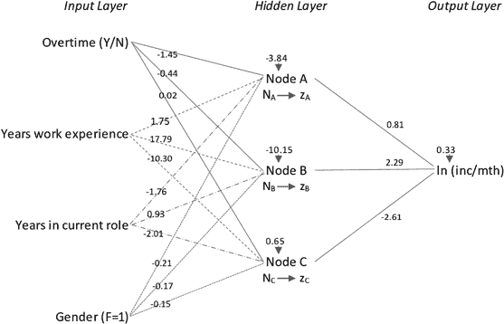

图 2.4 收入神经网络模型示意图。（如 表 2.1。） ⏎

神经网络的估计首先将观测到的输入和输出变量标准化到闭区间 \[0,1\]。神经网络中由 图 2.4 中的线条表示的每个关系都由一个权重表示。例如，`N[A]` 的值（即输入到节点 A 的值）是输入节点值的加权平均值。于是

`N[A] = w[0A] + w[1A]X[1] + w[2A]X[2] + w[3A]X[3] + w[4A]X[4]`.

或，在我们的示例中，

`N[A] = -3.84 -1.45X[1] +1.75X[2] +1.76X[3] -0.21X[4]`.

在隐藏节点中，传入的“net”使用激活（或传输）函数进行“压缩”，该函数通常是 `sigmoid` 函数，形式为

$$z\_{A} = \\frac{1}{1 + e^{{- N}\_{A}}}.$$

其他传输函数也是可能的；例如，“整流器”或 `ReLU` 形式为 `f(x) = max(0,X)` 据称效果很好。Sigmoid 非线性处理如果净变化接近均值则放大它们，如果是相对异常值则减弱它们。`z[A]` 通常被称为神经元或人工神经元。

在最后一步，输出变量——这里是月收入的对数——是隐藏层节点中 sigmoid 变换产生的 `z[i]` 的加权函数。

线性回归是神经网络的特例，其中没有隐藏层，因此将输入变量与输出变量联系起来的权重只是回归系数。当有多个隐藏层时，我们称之为深度学习模型。


估计神经网络的挑战在于找到最佳的权重集合。由于该系统高度非线性，不存在闭式解，权重必须通过搜索过程来确定。这主要通过使用反向传播 (Nielsen 2015) 来实现，这有助于网络在监督下“学习”。从一个初始的、基本上是任意的权重集合开始，并用它们来预测输出变量 (`ŷ`)。计算给出的预测误差平方和 $SSE = {\\sum\\limits\_{i~obs}\\left( {y\_{i} - {\\hat{y}}\_{i}} \\right)^{2}}$，我们现在希望将其最小化。逐一改变权重以确定它们需要移动的方向以减少 `SSE`，并迭代直到 `SSE` 接近最小值。

神经网络很容易过拟合，因此使用交叉验证程序已成为常见做法。一种方法是指定数据的一部分——例如三分之一——作为验证样本，并在剩余的训练样本上构建模型。在每次迭代中，将修订后的权重集合应用于验证样本，并在验证样本的 `SSE` 开始上升时停止迭代。该过程可以通过谨慎选择学习率并考虑动量来得到帮助。Larose 和 Larose (2014, 第 12 章) 详细阐述了该过程的一个清晰示例。

将神经网络（使用 sigmoid 传递函数，使用 Stata 中的 `brain` 命令）的估计结果与回归结果进行比较是有启发性的。图 2.4 展示了月收入决定因素的简单神经网络模型，显示了最优权重。这些本身兴趣有限，但可用于预测因变量的值。我们还可以通过逐一将输入变量设为零来衡量对输出变量的影响，从而生成“边际”效应，一旦去标准化，这些效应就类似于回归系数。表 2.6 显示了这些边际效应、回归系数以及 `R²`（针对回归）的度量及其在神经网络中的对应值。

表 2.6 神经网络与回归模型对月收入对数决定因素结果的比较 ⏎

|  || 均值 || 神经网络“边际” || 回归系数 || p 值 |
| --- | --- | --- | --- | --- |
| 是否加班？（Y = 1，N = 0） ||  0.28 || 0.011 || 0.003 || 0.91 |
| --- | --- | --- | --- | --- |
| 工作年限 || 11.3 || 0.073 || 0.060 || 0.00 |
| 现任职位年限 ||  4.2 || 0.015 || 0.015 || 0.00 |
| 性别（M = 0，F = 1） ||  0.4 || 0.015 || 0.010 || 0.66 |
| R² ||  || 0.59 || 0.55 ||  |

神经网络拟合得更好，因为它具有更高的 `R²`，这鉴于其函数形式的更大灵活性是可以预期的，尽管在这种情况下差异并不很大。回归系数和边际效应相当相似，这表明线性回归在这里可能是一个合理的近似。回归模型的更强参数假设也使我们更容易检验性别效应的假设——p 值为 0.66——因此，在这种情况下，性别对工资没有统计学上的显著影响，尽管该检验当然是有条件的，取决于我们对回归函数形式的假设。

第 39 页我们将神经网络作为统计估计量呈现，因为这是在商业环境中最有可能被使用和解释的方式。计算机科学家倾向于将神经网络视为一种算法，而数学家则将其视为通用逼近器：Hornik 等 (1989) 表明，只要有足够多的隐藏单元，它就可以逼近任何理论函数。神经网络有两个重要特征值得提及：它们是前馈的，这意味着效应从输入节点流向隐藏节点再流向输出节点，没有任何反馈效应，并且它们代表一个完全连接的网络，即不存在（先验的）空白关系。

对于许多用户来说，神经网络最大的问题是它们是黑箱——输入进去，输出出来，而中间步骤缺乏透明度。这在深度学习中尤其如此，其中可能有多个隐藏层和许多节点。虽然缺乏关系清晰度可能令人不满意，但它也可能代表了对限制性函数形式的有用改进。与回归一样，神经网络并不能显示因果关系，需要认真思考以定义适当的输入和输出——这是我们在其他章节中讨论的问题。另一方面，神经网络不像回归那样容易用来拒绝关系，因此可能不太有助于帮助我们剔除非因果联系。

### 2.4.5 其他模型

这些并不是用于尝试对结果进行分类或做出预测的唯一技术。SVM 在图像分类和科学领域被广泛使用。其思想是找到一个超平面（例如二维空间中的一条线），该超平面将由目标变量的两个值定义的两个点组分开（例如离职/留任）。

在许多情况下，点无法很好地线性分离，而在不转换数据的情况下找到合适的超平面几乎是不可能的。下图由 Kim（《你想知道的关于核技巧的一切，2013》）提供，说明了该问题及其解决方案。

第 40 页右图中的两组可以通过一个圆来分离，但不能通过一条线来分离，而通过变换 `T(x[1],x[2]) = [x[1],x[2],x[1]²+x[2]²]` 将数据变换后，可以在三维空间中得到一个分离平面，如左图 图 2.5 所示。构建 SVM 模型的艺术在于找到巧妙的变换，通常是到更高维空间，使两组线性可分，或接近可分。

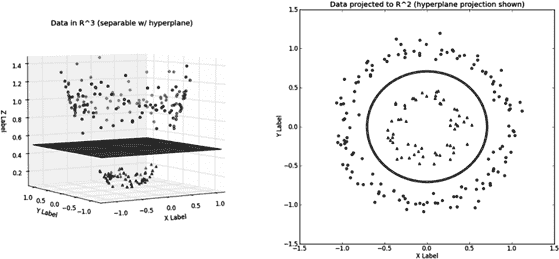

图 2.5 支持向量机拟合的插图。 ⏎

对堆叠（stacking）有浓厚兴趣，这是一种模型平均的形式：随机森林对许多树进行平均，但该思想可以推广，原则上来自完全不同方法的結果可以聚合，从而产生可能更稳健的预测 (Ahrens 等 2023)。

### 2.4.6 使用哪种模型？

给定两个或多个二元分类模型（或诊断测试）——例如线性或逻辑回归、神经网络、随机森林或梯度提升树——就会出现哪个模型最好、即对我们的目的最有用的问题。这里我们讨论一些有助于解决该问题的思路。

最传统的方法，主要用于在竞争的线性回归模型之间进行选择，是比较调整后的 `R²` 值，尽管这里的危险在于分析人员在追求 `R²` 时会简单地调整模型。另外，应用信息准则也很常见，例如 `BIC` 或 `AIC`，它偏好拟合（以似然函数的对数衡量），并对变量过多的模型施加惩罚，换句话说，就是不简约的模型。

第 41 页这种方法在高度非线性模型或分类模型上效果较差。一个流行的替代方法是衡量并比较接收器操作特征 (`ROC`) 曲线下的面积；在商业环境中，一个常见的替代方法可能是构建提升表。我们现在讨论这两种技术。

### 2.4.7 AUC


# 预测离职：模型比较与评估

## 引言

考虑以下问题：我们希望预测谁最有可能离职。利用过往经验的数据，我们使用逻辑回归、神经网络和随机森林对这种二元结果——离职或不离职——进行建模。应该使用哪种模型？

问题在于，虽然要预测的底层变量是二元的，但我们的模型生成的是一个连续变量，用来衡量某人离职的概率。一种模型可能擅长识别少数极有可能离职的人，而另一种模型则更擅长正确识别更广泛的潜在离职群体。

## 混淆矩阵

表 2.7 显示了样本观测值在四种可能状态中的数量。模型要么将某人识别为离职者（或生病者），此时你“检测为阳性”，要么识别为非离职者（“检测为阴性”）。实际上，在样本中，你被识别为实际的离职者（或生病者）或留任者。

表 2.7 实际分类与预测分类比较 ⏎

|  || 测试结果 |
| --- | --- |
|  || 阳性（离职/生病） || 阴性（留任/健康） |
| 实际为： ||  ||  |
| --- | --- | --- |
| 离职/生病 || `A` || `B` |
| 留任/健康 || `C` || `D` |

离职者（或生病的人）数量为 `A + B`。分数 `A/(A + B)` 被模型正确识别为离职者（或生病）。这是灵敏度的度量，或测试的功效。其补数 `B/(A + B)` 是假阴性率；它显示被模型错误识别为留任者（或健康者）的离职者（或生病者）的比例，是 II 型错误。

同样，`D/(C + D)` 是特异性的度量，给出被正确识别为留任公司（或保持健康）的非离职者（或健康人群）的比例。其补数 `C/(C + D)` 给出假阳性比例——即被模型预测为离职者（生病者）的非离职者（健康人群）的比例，衡量 I 型错误。模型的准确率由 `(A + D)/(A + B + C + D)` 给出，或被正确分类的案例比例。

## 灵敏度与特异性权衡

一个完美的测试灵敏度为 1（因此没有假阴性）且假阳性为零（即特异性为 1）。该测试或模型将准确识别谁会离职、谁不会。在实践中，这永远无法实现：随着我们收紧识别阳性的条件，测试的功效（灵敏度）下降而特异性上升——我们越谨慎地将某人识别为离职者，就越可能正确识别非离职者为留任。

灵敏度与特异性之间的权衡由 ROC 曲线捕捉，该曲线在纵轴上显示灵敏度，在横轴上显示 `(1-特异性)`。完美的测试会使我们在 图 2.6 中的点 A。完全噪声的测试会使我们位于对角线上。信息性模型（或测试）的曲线通常是弯曲的，如虚线所示。在 B 等点，我们使用严格的截止值来确定某人是否为离职者（或生病者）；在 C 等点，截止值较不严格，我们会得到更多假阳性但更少假阴性。

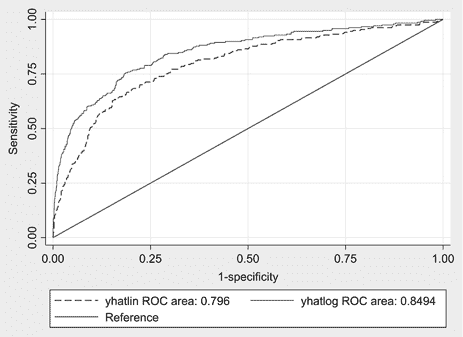

图 2.6 线性模型和对数模型的 ROC 曲线。 ⏎

图 2.6 中的实线显示了不同模型的 ROC 曲线。如图所示，它是一个 consistently 更好的模型，因为它更接近完美模型（点 A）。ROC 曲线可能相交，在这种情况下更难在它们之间选择。一种解决方案是测量 ROC 下的面积，称为“曲线下面积” (`AUC`)。对于完美的测试，`AUC` 为 1；对于随机测试，它为 0.5，因此 `AUC` 的更高值通常被视为表示更好的模型。在此上下文中，基尼系数由下式给出

`Gini = 2 × AUC − 1`.

## 离职示例中的 AUC

在我们的离职示例中，我们估计线性、对数和神经网络模型，构建 ROC 曲线，并计算每个模型的 `AUC`。结果显示在 图 2.7 中，其中显示神经网络具有最高的 `AUC`，因此按此衡量是最好的模型。

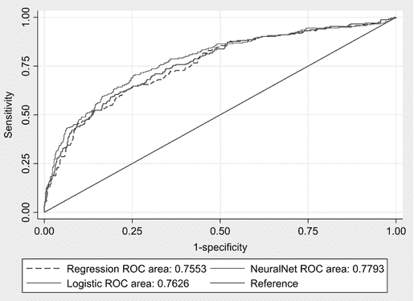

图 2.7 四种不同模型的 ROC 曲线。 ⏎

`AUC` 的问题在于它可能不关注我们关心的曲线部分。例如，我们可能希望找到能最好识别最有可能对优惠做出回应的 10% 客户的模型，在这种情况下我们希望模型在响应的上端表现良好，但不关心它在其他地方的表现如何。 Hand (2009) 认为该指标是不连贯的，不应使用。

## 提升表

解决这个问题的一个好方法是计算提升表。提升表的更全面处理见于 第 6 章–第 9 章，但基本步骤如下：

1. 随机将样本数据分为训练样本——通常占总数的 50–70%——和包含剩余观测值的测试样本。
2. 使用训练样本估计模型。
3. 将模型应用于测试样本，得到结果变量的预测值。将这些预测值排序到箱中，通常为十分位数（十分之一）或半十分位数。然后绘制这些十分位数的实际阳性结果数量。

一个好的模型将成功地将阳性响应分离到顶部箱中。然后模型可用于预测，或至少识别良好的潜在客户。 图 2.8 说明了我们四个模型的提升表。如果目标是识别最有可能离职的人，随机森林表现最好，这通常如此。然而，神经网络和逻辑回归模型在最高十分位数中做得足够好，但在其他地方则不然，而线性模型如果关注前三个十分位数则表现相对较好。

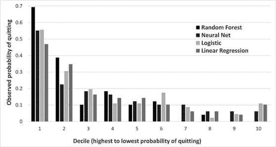

图 2.8 四个分类模型的提升表。 ⏎

简而言之，并不一定存在一个始终表现最好的单一模型——部分原因是“最好”的定义可能模糊，部分原因是它可能取决于所涉及的具体模型和数据。

## 注释

1. 网站：[`https://www.kaggle.com/pavansubhasht/ibm-hr-analytics-attrition-dataset/downloads/ibm-hr-analytics-employee-attrition-performance.zip/1`](https://www.kaggle.com/pavansubhasht/ibm-hr-analytics-attrition-dataset/downloads/ibm-hr-analytics-employee-attrition-performance.zip/1) ⏎
2. 当经验从 12 年增加到 13 年增加 1 时，经验平方增加 25，从 144 增加到 169。收入对数的变化然后为 `0.025 × 1 – 0.001 × 25 = 0`。 ⏎
3. 在 表 2.2 的第 (3) 列中的明瑟模型中，`ln(income) = K + 1.877 jjo5`。一级工作的人将有 `ln(Y1) = K`，而五级工作的人将有 `ln(Y5) = K + 1.877`。这意味着 `ln(Y5) – ln(Y1) = ln(Y5/Y1) = 1.877`；因此，`Y5/Y1 = e^(1.873) = 6.51`。原始数据也证实了这一点，一类工作的平均月收入为 $2,787，五类工作为 $19,192。 ⏎
4. 不纯度通常由基尼不纯度度量衡量，定义为 `1 − p[+]² − p[−]²`，其中 `p[+]` 和 `p[−]` 分别是右子节点和左子节点实现目标结果的概率。在一个包含 8 个黑球和 2 个白球的箱中，这将为 `1 – 0.64 – 0.04 = 0.32`。最大值是 0.5（白球和黑球各 5 个），最小值是 0（没有黑球或没有白球）。 ⏎

## 参考文献


*   Ahrens, Achim, Christian Hansen, and Mark Schaffer. 2023. “pystacked：Stata 中的堆叠泛化与机器学习”. 《Stata Journal》，刊载中。 ⏎
*   Cameron, Colin, and Pravin Trivedi. 2022. 《使用 Stata 的微观计量经济学》，第 2 版。College Station, TX: Stata Press. ⏎
*   Friedman, Jerome. 1999. “随机梯度提升”. 技术报告，斯坦福大学。 ⏎
*   Friedman, Milton. 1953. 《实证经济学论文集》。芝加哥，IL：芝加哥大学出版社。 ⏎
*   Hand, David. 2009. “模型不匹配、错误结果与可怕决策：关于选择合适的数据挖掘工具”。工作论文。帝国理工学院。 ⏎
*   Haughton, Dominique, and Jonathan Haughton. 2011. 《生活水平分析》。纽约，NY：Springer。 ⏎
*   Hornik, Kurt, Maxwell Stinchcombe, and Halbert White. 1989. “多层前馈网络是通用逼近器”。《Neural Networks》，2：359–366。 [`cognitivemedium.com/magic\_paper/assets/Hornik.pdf`](https://cognitivemedium.com/magic_paper/assets/Hornik.pdf) ⏎
*   Kim, Eric. 2013. “关于核技巧你想知道的一切”。工作论文。 [`www.eric-kim.net/eric-kim-net/posts/1/kernel\_trick.html`](https://www.eric-kim.net/eric-kim-net/posts/1/kernel_trick.html)
*   Larose, Daniel, and Chantal Larose. 2014. 《从数据中发现知识：数据挖掘导论》。Hoboken, NJ：Wiley。 ⏎
*   Mincer, Jacob. 1974. 《教育、经验与收入》。剑桥，MA：国家经济研究局。 ⏎
*   Minitab. 2023. 介绍 Salford Predictive Modeler 8。 [`www.minitab.com/en-us/products/spm/`](https://www.minitab.com/en-us/products/spm/) ⏎
*   Nielsen, Michael A. 2015. 反向传播算法的工作原理。收录于《神经网络与深度学习》。旧金山，CA：Determination Press。 [`neuralnetworksanddeeplearning.com/chap2.html`](http://neuralnetworksanddeeplearning.com/chap2.html) ⏎
*   Tibshirani, Robert. 1996. “通过 Lasso 进行回归收缩和选择”。《皇家统计学会杂志·B 系列（方法论）》，58(1)：267–288。 ⏎
*   Verme, Paolo. 2023. “用缺失收入预测贫困”。GLO 工作论文第 1260 号。全球劳工组织 (GLO)。 ⏎
*   Wooldridge, Jeffrey. 2020. 《入门计量经济学：现代方法》。安多弗，汉普郡，英格兰：Cengage。 ⏎
*   Zou, Hui, and Trevor Hastie. 2005. “通过弹性网络进行正则化和变量选择”。《皇家统计学会杂志·B 系列（方法论）》，67(2)：301–320。 ⏎

# 3 因果关系

DOI: [10.1201/9780429172588-3](https://doi.org/10.1201/9780429172588-3)

## 3.1 引言

企业提出的最重要问题之一就是一些非常简单的问题：如果我决定做某事，它会奏效吗？如果是，效果有多大？

重要思想是，我们希望评估干预或处理的影響。这种情况时常出现。例如：
*   企业正在考虑是否扩大其忠诚度计划，并想知道它是否会提高利润；
*   零售商希望知道强调其服装环保特性的销售活动是否会促进销售；在何处做广告；是否应开设新门店；或哪些新服装功能可能吸引顾客；
*   一家航空公司正试图确定芝加哥至丹佛航班的票价，以最大化收入；
*   一家银行正在考虑是否值得加大技术培训投资，以工人的生产率提高来衡量；
*   一所大学正在讨论学费降低是否会吸引大量学生；
*   拉丁美洲的一家移动电话运营商正在考虑是否推出移动银行服务；
*   一家汽车制造商正试图确定是否应推出混合动力皮卡。

在每种情况下，我们都有一个或多个行动方案（“处理”），我们希望确定它们是否会带来有用的结果。我们想要确定因果关系。

这里需要在 *观察* 和 *干预* 之间做出重要区分。我们可能会观察到拥有忠诚度卡的客户比平均客户更有可能在我们的产品上花费。形式上，我们可以将此条件概率写为：

`P(S|L) > P(S)`

读作“花费的概率（`S`），在拥有忠诚度卡（`L`）的条件下，大于在可能拥有或不拥有忠诚度卡的情况下花费的概率。”人们可能会倾向于得出结论，忠诚度卡导致客户更有可能花费，但这为时过早。这里我们只观察到拥有忠诚度卡的人花费更频繁，但也许他们之所以获得忠诚度卡是因为他们花费更频繁，这将颠倒因果关系的方向。我们真正感兴趣的是是否

`P(S|do(L)) > P(S)`.

这里我们引入 Judea Pearl 的“do 运算符”（Pearl 1995），我们在其中干预以改变忠诚度卡的数量，而不是以正常方式设定 `L`（Hitchcock 2010，第 3.6 节）。如果我们增加 `L`（即“执行”`L`），并且销售额因此上升，我们可以合理地认为分发更多忠诚度卡确实会导致人们更有可能在我们的产品上花费。这是一种概率因果关系，其含义是“原因会改变其结果的概率”（Hitchcock 2010，引言）：干预通常并不能保证会有影响，但它会提高其发生的可能性。

以合理的可信度识别因果关系并非易事，但借助本章和下一章所阐述的概念和技术，往往可以取得成功。我们首先强调指定适当的反事实的重要性，这使我们能够衡量处理效应。随机对照试验（RCTs）（又称实验设计）以直接的方式使这成为可能，但这一黄金标准很少能实现。准实验设计，包括回归调整、逆概率加权（IPW）以及协变量和倾向得分匹配，被广泛使用且通常非常有效。

## 3.2 反事实

识别处理的影響并不简单，因为它要求我们将实际发生的情况与假设的 *反事实* 情况进行比较，即在有或没有处理的情况下会发生什么。这通常被称为“潜在结果”方法，因为它寻求比较两种潜在结果（有处理或无处理）。

很容易走偏。假设你的销售部门在美国东北部为电动汽车推出了一项广告活动，并提供了以下信息：

|  || **每百万人口售出的电动汽车数量** |
| --- | --- |
|   || **活动前（2024）** || **活动后（2025）** |
| --- | --- | --- |
| 美国东北部 || 400 || 500 |

销售额增长 25% 令人印象深刻，但除非我们能排除所有其他潜在影响，否则我们不能假设这是由于广告活动造成的：也许收入在上升，口味在变化，或者税收优惠将在 2025 年底到期。

现在我们获得了美国其他地区销售的一些额外信息，那里没有广告活动：

|  || **每百万人口售出的电动汽车数量** |


|  | 活动前 (2024) | 活动后 (2025) |
|---|---|---|
| 美国其他地区 | 200 | 300 |

现在很清楚，东北地区电动汽车的渗透率相对于全国其他地区已从 2.0 (= 400/200) 下降到 1.67。东北地区的广告活动是否实际上是有害的？再次，我们无法确定，除非我们能够成功构建一个反事实，来衡量在没有广告活动的情况下东北地区本会售出多少辆汽车。

更正式地说，设我们感兴趣的结果（销售额、考试成绩、客户留存等）为来自样本量为 `n` 的个体或家庭 `i` 的 `Y[i]`。结果可在（实际或假设的）处理下写为 `Y[i]^(T)`，而在未处理（对照或比较）情况下，我们有 `Y[i]^(C)`。对于一个已被“处理”的个体——例如，接受营销干预、被送去培训等等——我们有 `T[i] = 1`，否则 `T[i] = 0`。

处理带来的收益（如有）则由

`G[i] = Y[i]^(T) - Y[i]^(C)`

(3.1)

给出，这就是我们想要测量的因果效应。“因果推断的基本问题” (Holland 1986) 是，对于任何个体，我们要么观察到 `Y[i]^(T)`（如果他们接受了处理），要么观察到 `Y[i]^(C)`（如果他们未接受处理），但永远不会同时观察到两者。由于这种缺失信息，我们永远无法衡量干预对特定个体的具体影响。

第 49 页 然而，我们通常感兴趣的是衡量处理或干预的平均影响。一种常用的衡量指标是对受治疗者的平均处理效应（ATT），由期望收益给出

`G^(ATT) = E[[Y[i]^(T)-Y[i]^(C)]|T[i]=1]`.

(3.2)

这里的重点在于接受处理的人，因此在这种情况下，我们衡量在 `T[i] = 1` 条件下的收益（即在接受处理组中）。这里，我们观察到 `E(Y[i]^(T)|T[i]=1)`，但反事实 `E(Y[i]^(C)|T[i]=1)` 必须构建：它衡量该组如果实际上未被处理本会经历的结果。在我们之前的例子中，它将衡量如果美国东北部没有广告活动，电动汽车在该地区的销量。在效果上，我们有一个缺失数据问题，需要对缺失的反事实进行插补，通常借助“辅助模型” (Drukker 2016, p. 10)。

其他影响衡量指标也是可能的，并在实践中经常使用。对未接受处理者或对照组的平均处理效应（ATC）由下式给出

`G^(ATC) = E[[Y[i]^(T)-Y[i]^(C)]|T[i]=0]`.

(3.3)

这里我们观察到 `Y[i]^(C)` 但未观察到 `Y[i]^(T)`。例如，这可用于衡量美国其他地区（广告活动实际未发生）如果开展广告活动，电动汽车广告活动的效果。总体 ATE 是这些效应的加权平均，因此

`G^(ATE) = E(G[i]) = E(Y[i]^(T)-Y[i]^(C)) = Pr(T=1)*G^(ATT) + Pr(T=0)*G^(ATC)`.

(3.4)

诱人的是通过比较前后结果来衡量我们假设的广告活动的影响。使用我们的记号并以本例中后（用 `T[i] = 1` 表示）减前（`T[i] = 0`）作为估计量，该单差分由下式给出

$$\\begin{matrix} {D = E\\left( Y\_{i}^{T} \\middle| {T\_{i} = 1} \\right) - E\\left( Y\_{i}^{C} \\middle| {T\_{i} = 0} \\right)} \\\\ {= ~\\left\\lbrack {E\\left\\lbrack Y\_{i}^{T} \\middle| {T\_{i} = 1} \\right\\rbrack - E\\left\\lbrack Y\_{i}^{C} \\middle| {T\_{i} = 1} \\right\\rbrack} \\right\\rbrack + \\left\\lbrack {E\\left\\lbrack Y\_{i}^{C} \\middle| {T\_{i} = 1} \\right\\rbrack - E\\left\\lbrack Y\_{i}^{C} \\middle| {T\_{i} = 0} \\right\\rbrack} \\right\\rbrack} \\\\ {= ~G^{ATT} + B} \\\\ \\end{matrix}$$

(3.5)

其中 `B` 是偏差的度量。只有当 `B = 0` 时，单差分 `D` 才会给出可行的影响度量。偏差衡量在没有任何处理的情况下，我们在接受处理者（`T[i] = 1`）和未接受处理者（`T[i] = 0`）之间会观察到的结果差异。

在我们的例子中，有一个时间维度：在活动前，购买量为每百万人口 400 辆，由 `E(Y[i]^(C)|T[i]=0)` 给出。现在假设广告活动基本上触及了那些对第 50 页电动汽车的支出即使没有广告活动也会上升的群体——例如年轻专业人士——并且即使没有广告活动，他们的支出也会上升到每百万人口 460 辆汽车；这意味着 `E(Y[i]^(C)|T[i]=1) = 460`。在这种情况下，偏差 `B` 为 60，而活动的影响（`G^(ATT)`）为 40（= `D - B` = 100 – 60 = 40）。

这是一个常见的陷阱。比较干预前后或有无处理（例如银行贷款）的销售额或其他变量很容易，但此类比较很少能衡量因果影响。上述例子对接受处理者（`T[i] = 1`）使用活动后和活动前，对未接受处理者（`T[i] = 0`）使用活动前，但当接受处理者和未接受处理者是彼此不相似的个体群体时（例如，东北地区的人进行广告宣传，而东南地区的人不进行广告宣传）时，同样的问题会出现。

解决方案是 somehow 消除偏差。做到这一点的关键是确保处理 `T` 的分配，也许在对年龄或性别等变量进行条件化后，与结果值的取值相互独立。形式上，这可以写成

`(Y[i]^(T),Y[i]^(C))⊥T[i]|X[i]`

它读作“接受处理组和比较组的潜在结果的取值与谁被处理相互独立，至少在‘协变量’ `X[i]` 的条件下如此。” 这是无混淆性的关键假设，有时被称为条件独立性假设，或可忽略的处理分配假设，或选择在可观测变量上的方法。挑战在于证明无混淆性适用；否则，不可能识别因果效应。

## 3.3 实验设计

避免样本偏差也许最令人满意的方法是随机分配处理。通过纯随机化，平均而言，如果没有处理（即在 `Y[i]^(C)` 中），接受处理者和未接受处理者之间不应存在结果差异。换句话说，

`E(Y[i]^(C)|T[i]=1) - E(Y[i]^(C)|T[i]=0) = B = 0`.

现在我们可以使用单差分 `D` 来衡量影响；接受处理者和未接受处理者之间结果差异的唯一剩余解释必须是处理本身。换句话说，在随机化下，只要样本足够大，两个组 `T[i] = 1` 和 `T[i] = 0` 在所有特征上，无论是可观测还是不可观测，都完全匹配。随机化实验通常被称为随机对照试验（RCTs）。

第 51 页 从实际角度来看，在这种纯随机化的情况下，影响通常使用如下形式的线性回归来衡量

`Y[i] = a + b*T[i] + ε[i]`

这里，`T[i] = 1` 表示个人接受处理，0 表示未接受处理，而 `ε[i]` 是误差项，其（按构造）均值为零。如果样本量很大，或误差可假设为正态分布，我们可以检验处理项的估计系数（`b̂`）是否在统计上显著不同于零。


这种情况下，存在随机分配且处理为二元的，通常被称为 A/B 测试，尤其是在商业应用中。如果我们有多个待测试的处理，则需要进行 A/B/n 测试（比较两个以上处理）或进行多变量测试（有关进一步细节，请参阅第 7.2.5 章）。虽然我们迄今为止假设结果 `Y[i]` 是一个连续变量，例如支出，但同样的原理也适用于结果为二元的情况——例如，结果是个人是否报名新的信用卡或选择留在公司。在这种情况下，相关的回归通常为 `logit` 或 `probit`。关于 A/B 测试在实践中如何运作的一些示例，见于框 3.1。

### 3.3.1 分层随机化

简单随机抽样很少见，因为它通常效率低下。例如，如果我们试图衡量针对女性的化妆品宣传活动的影响，抽样男性可能没有意义。但我们可能有兴趣了解不同年龄组的女性对该活动的反应是否不同——例如，20–30 岁或 30–40 岁的人。这些构成 *strata* 或区块，并且在这些分层内，个体被随机选入干预仍然至关重要。这被称为分层随机化或随机区组设计。通常，我们故意对某些分层进行过度抽样，以便在该区块中拥有足够的观察值；通过使用样本权重，我们可以在分析阶段对过度或不足抽样进行调整。

形式上，我们现在有了 *conditional exogeneity of program placement*。如果我们愿意假设控制变量（即 `X[i]`）以线性方式运作，仍然可以通过估计回归模型来估计处理的冲击。假设对于接受处理的 `n[T]` 人，

`Y[i]^(T) = α^(T) + X[i]β^(T) + v[i]^(T), i = 1, …, n[T]`

(3.6)

对于未接受处理（即对照组）的 `n[C]` 人

`Y[i]^(C) = α^(C) + X[i]β^(C) + v[i]^(C), i = 1, …, n[C]`.

(3.7)

这两个组的数据可以合并以创建 `Y[i]`，它是观察到的潜在结果，给定为

`Y[i] = T[i]Y[i]^(T) + (1−T[i])Y[i]^(C)`.

(3.8)

其中，如通常一样，`T[i] = 1` 表示个体接受处理，0 表示未接受

使用 `n` (= `n[T]+n[C]`) 个观测值的合并数据，我们可以估计形式为“切换”回归

`Y[i] = α^(C) + (α^(T)−α^(C))T[i] + X[i]β^(C) + Xi−β^(C))T[i] + ε[i], i = 1, …, n`,

(3.9)

误差项由 `ε[i] = Ti−v[i]^(C)) + v[i]^(C)` 给出。误差项捕捉到对连续结果变量 `Y[i]` 的任何“潜在”（未观察到或遗漏）影响。如果误差与谁接受处理 (`T[i]`) 或其他控制变量 (`X[i]`) 无关，则方程 (3.9) 可以简单地使用普通最小二乘法估计。观测 i 的处理效应由下式给出

`G[i]^(ATE) = Pr(T=1)E(Y[i]^(T)−Y[i]^(C)|T[i]=1) + Pr(T=0)E(Y[i]^(T)−Y[i]^(C)|T[i]=0)`

`= E(Y[i]^(T)−Y[i]^(C)) = (α^(T)−α^(C)) + Xi−β^(C)) + E(v[i]^(T)−v[i]^(C))`

将此在所有观测值上平均得到 ATE，即

$$\\left. G^{ATE} = \\left( \\alpha \\right.^{T} - \\alpha^{C} \\right) + \\overset{-}{X}\\left( \\beta^{T} - \\beta^{C} \\right).$$

(3.10)

如果我们进一步假设（大胆地）`β^(T) = β^(C)`，则简化为常见的影响模型，因此 `G^(ATE) = α^(T) − α^(C)`。

分层随机化是提升建模的基础（第 6 至 9 章），它首先衡量因果处理效应，将其与个体的特征（如年龄、性别或教育）联系起来，然后利用这些结果来识别和定位处理的良好前景。

### 3.3.2 随机化：黄金标准？

随机化通常被认为是对科学实验的黄金标准。2019 年诺贝尔经济学奖授予了三位研究人员（Abhijit Banerjee、Esther Duflo 和 Michael Kremer），他们推广了将随机对照试验应用于识别发展中国家（如驱虫、微型信贷、性教育以及激励教师出勤）等处理的冲击。在 2020 年，用于保护免受 COVID-19 侵害的疫苗首先必须使用随机对照试验进行测试，然后才被认为足够安全供公众使用。

随机化在实践中可能很困难，有时也不道德。Haughton 和 Kelly (2014) 想要评估翻转混合教学法是否能产生更好的基础统计教学成果，以考试成绩衡量。最强大的方法是随机分配学生到混合和非混合班级。但这在实践中不可行，因为学生必须安排课程以配合其他课程。这也将被认为不可接受，因为强迫学生注册他们不想上的班级。同样，对吸烟影响的研究如果将受试者分配为吸烟或不吸烟，显然是不可行且不道德的。

即使随机分配是可能的，也可能存在选择性接受和非随机流失。考虑一名民意调查员想要测试注册选民对州长候选人的态度的情况。选民名单可能不准确；一些选民可能没有（已知）电话号码；大多数人不会回应民意调查电话——例如，据 Pew Research Center 调查，94% 的样本未回应 (Kennedy 和 Hartig 2019)；而且回应的人可能不会去投票。这些问题之所以存在，是因为在每个阶段都可能存在偏差。例如，没有电话的人可能很贫穷或担心保护隐私；回应电话的人可能年纪较大或更孤独；投票的人可能受教育程度更高。偏差的程度未知，因此从随机样本开始的民调结果可能无法使用。例如在 2020 年秋季，大多数民调高估了乔·拜登预计获得的选票数量，并低估了唐纳德·特朗普获得的选票数量 (Keeter 2021)。

RCTs 还有其他问题。它们可能很昂贵；可能难以获得足够大的样本；可能存在泄漏（例如，如果针对纽约的电视广告活动被许多其他地区的人看到）；而且通常存在重要问题，例如企业在经济衰退时期应如何反应，它们无法解决。

## 3.4 准实验方法

当随机实验不可行时，可以做什么？重申一下，需要解决的问题是选择偏差。

例如，假设我们开发了一种新型大豆品种，并希望在美国中西部几个县的小规模测试市场。销售团队已确定了一些有希望的测试区域，但这可能会导致非随机项目安置，这将以难以预测的方式影响我们的结果（由于 *unobserved area heterogeneity*）。产品推出后，可能会出现项目参与的自我选择，因此更具动态性或信息更充分的个人会首先报名。这种 *unobserved individual heterogeneity* 使评估更强力推广大豆的效果变得困难，因为其他农民可能不会那么快地站出来。


选择偏差不一定是致命的，至少有若干方法可以减弱其影响，包括回归调整和匹配，这些将在本章讨论，以及断点设计、合成样本和工具变量，它们是第 4 章的主题。

### 3.4.1 回归调整

有时可以通过估计一个控制了足够多假设的其他结果影响因素的简单共同影响回归方程来识别处理的效应。为说明这一点，请考虑表 3.1 所示的（假设）数字：一家公司想知道发放折扣优惠券是否能促进销售，并收集了消费者`purchases`的信息、是否被递送优惠券以及`gender`。简单比较显示，有优惠券者的平均支出为 $39.5，而没有优惠券者为 $42.3，差额为 $2.8。或者，共同影响回归给出

表 3.1 关于销售额、性别和优惠券的假设数据 ⏎

| 观测编号 || 是否领取优惠券？ || 是否男性？ || 购买额（$） |
| --- | --- | --- | --- |
|  1 || 是 || 否 || 84 |
| --- | --- | --- | --- |
|  2 || 是 || 否 || 72 |
|  3 || 是 || 是 ||  0 |
|  4 || 是 || 是 || 10 |
|  5 || 是 || 是 || 45 |
|  6 || 是 || 是 || 26 |
|  7 || 否 || 否 || 60 |
|  8 || 否 || 否 || 77 |
|  9 || 否 || 否 || 67 |
| 10 || 否 || 是 ||  0 |
| 11 || 否 || 是 || 30 |
| 12 || 否 || 是 || 20 |
| 平均值 ||  ||  ||  40.9 |
| 领取优惠券的平均值 ||  ||  ||  39.5 |
| 未领取优惠券的平均值 ||  ||  ||  42.3 |

$$\\begin{matrix} {purchases = 42.3 - 2.8~\\left( gets~a~coupon \\right)} \\\\ {~\\text{p-value} = - 0.88} \\\\ \\end{matrix}$$

处理变量的系数为 −2.8（尽管它在统计上也不显著）。优惠券活动看起来像是失败了。

但事实真是如此吗？这里的问题是优惠券似乎并非随机发放：领取优惠券者中有三分之二是男性，而未领取优惠券者中只有一半是男性。图 3.1 中的路径图显示了因果联系：`Gender`同时影响处理（即谁获得优惠券）和`purchases`（因为女性比男性花费更多）。为了识别优惠券对支出的影响，必须“阻断”优惠券接收与`gender`相关联、进而影响支出的“后门”路径。实现此目的的一种简单方法是将在共同影响方程中将`gender`作为变量包含进来。这给出

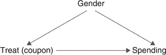

图 3.1 支出影响的路径图。 ⏎

$$\\begin{matrix} {purchases = 69.5 - 54.4\\left( {male} \\right) + 6.2\\left( gets~a~coupon \\right)} \\\\ {~\\text{p-value} = 0.48} \\\\ \\end{matrix}$$

这使优惠券活动呈现出不同的面貌，而`p-value`仍然很大，如果样本量扩大八倍，系数（6.2）将被认为高度统计显著。

在本例中，我们能够控制可观察效应（`gender`），并且能够使用线性模型。事情很少如此简单。我们的选择偏差的基础通常是不可观察的，反映了诸如个人动机或偏好等隐藏（潜在）影响。有时，可以使用面板数据消除时间不变可观察变量的影响，如下所述。

在此类情况下最困难的决定之一是应将哪些变量作为控制变量纳入。在这种情况下保持思路清晰的一个有帮助的方法是借助路径图。按照 Morgan 和 Winship (2015，第 91 页）的说法，这类图“为表达整个因果关系系统的因果假设提供了一个有纪律的框架。”

考虑图 3.2，其中我们想衡量处理`T`（优惠券）对结果`Y`（支出）的影响。问题在于接受处理的人受混杂因素`C`（这里是`gender`）的影响，而该混杂因素又影响一组可观察变量（例如“时尚爱好”，此处用`X`表示），这些变量影响支出。在图 3.2 的左面板中，`T`对`Y`的直接处理效应受到`C`的混杂。例如，如果`gender` = 女性，可能优惠券较少（低 `T`），但时尚爱好者更多（高 `X`）以及时尚支出更高（高 `Y`）。因此我们倾向于观察到`T`的低值与`Y`的高值同时出现，这妨碍了（“混杂”）识别`T`对`Y`的直接效应。诀窍是阻断`T`与`Y`之间的后门关联。在图 3.2 的左面板中，我们有

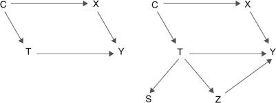

图 3.2 路径图。（T 是处理，Y 是感兴趣的结果，C、X、S 和 Z 是其他变量） ⏎

$$\\begin{array}{ll} \\left. \\text{T}\\rightarrow\\text{Y~} \\right. & \\text{The~causal~effect~we~want~to~measure} \\\\ \\left. \\text{T}\\leftarrow\\text{C}\\rightarrow\\text{X}\\rightarrow\\text{Y} \\right. & {\\text{The~confounding}\\,\`\`\\text{backdoor}"\\,\\text{effect}.} \\\\ \\end{array}$$

解决方案是在回归方程中包含`C`（或`X`，但不一定两者都包含）。

图 3.2 右面板的情况类似，只是领取优惠券（处理）会使该人更有可能光顾商店（变量 `Z`），进而促进销售。在这种情况下，`Z`是`T`的后代，但变量 `Z`不应*包含*在回归中，因为它会冒着从`T`中夺走本应归属于它的部分影响的风险。

如果此外还有一个变量`S`（例如个体的身高）影响谁获得优惠券——他们吸引了发放优惠券人员的注意——但不影响其他任何事物，那么它是`T`的父变量，不应包含在回归中。这会降低`T`的变化，从而使捕捉因果效应变得更困难。在这种情况下，`S`本质上是一个工具变量（`IV`）；作为一般规则，在因果推断中控制`IVs`或中介变量是不合适的。

使用此类图有助于尝试识别因果关系以及是否甚至可以识别。它也清楚地表明，不应简单地将所有变量都投入处理回归中以期控制所有可能的混杂因素：有时这会使衡量因果效应变得更困难。Morgan 和 Winship (2015，第 117 页）对这些问题进行了深入讨论。

### 3.4.2 其他处理效应

假设文理学院院长观察到，荣誉项目在读的学生在第一年后留校的可能性更大，且获得的平均绩点（`GPA`）更高。她想知道这种关联是偶然的还是因果的：如果在荣誉项目中能提高留存率，也许荣誉项目应扩大，或至少更积极地推广。

这里显然存在选择偏差，因为荣誉生在平均水平上据推测学术上更强，因此两组之间留存率（或`GPA`）的简单比较不会告诉我们太多。


关于 20 名学生的一些假设信息在表 3.2 中提供。在此示例中，75%的荣誉生继续就读下一学年（`retain = 1`），而非荣誉生的比例为 50%。荣誉生的大学 `GPA` 更高（3.13 对比 2.40），且入学时的选拔性能力测试（`SAT`）成绩更高（1,374 对比 1,234）。

表 3.2 学生保留率和表现数据 ⏎

| `ID` || `Retain` || `College GPA` || `Honors` || `Male` || `Recruit Score` || `SAT Score` || `Propensity Score` |
| --- | --- | --- | --- | --- | --- | --- | --- |
| 14 || 0 || 1.44 || 0 || 1 || 5 || 960 || 0.036 |
| --- | --- | --- | --- | --- | --- | --- | --- |
| 13 || 1 || 2.47 || 0 || 1 || 6 || 1010 || 0.068 |
| 20 || 0 || 1.76 || 0 || 0 || 6 || 1060 || 0.142 |
| 12 || 0 || 2.01 || 0 || 1 || 7 || 1180 || 0.168 |
| 19 || 1 || 2.23 || 0 || 0 || 6 || 1140 || 0.173 |
|  3 || 1 || 3.21 || 1 || 1 || 7 || 1200 || 0.177 |
| 18 || 0 || 2.77 || 0 || 0 || 7 || 1220 || 0.309 |
|  8 || 1 || 3.13 || 1 || 0 || 7 || 1230 || 0.316 |
| 11 || 1 || 2.71 || 0 || 1 || 8 || 1320 || 0.340 |
| 10 || 0 || 2.13 || 0 || 1 || 8 || 1340 || 0.354 |
|  7 || 1 || 3.10 || 1 || 0 || 7 || 1290 || 0.355 |
| 17 || 1 || 2.72 || 0 || 0 || 7 || 1330 || 0.382 |
|  2 || 0 || 3.17 || 1 || 1 || 9 || 1450 || 0.561 |
|  6 || 0 || 3.02 || 1 || 0 || 8 || 1410 || 0.570 |
|  9 || 1 || 3.06 || 0 || 1 || 9 || 1470 || 0.576 |
| 16 || 0 || 3.00 || 0 || 0 || 8 || 1430 || 0.584 |
| 15 || 1 || 2.45 || 0 || 0 || 9 || 1350 || 0.653 |
|  5 || 1 || 2.88 || 1 || 0 || 9 || 1400 || 0.685 |
|  1 || 1 || 3.43 || 1 || 1 || 10 || 1510 || 0.721 |
|  4 || 1 || 3.11 || 1 || 0 || 10 || 1500 || 0.832 |

这些数据的一种可视化表示在图 3.3 中给出，其中感兴趣的结果之一（`GPA`）显示在纵轴上，`SAT` 成绩显示在横轴上。黑色圆点代表荣誉生，空心圆代表未参加荣誉项目的学生。正如我们所预期的那样，黑色圆点集中在图表的右上角。

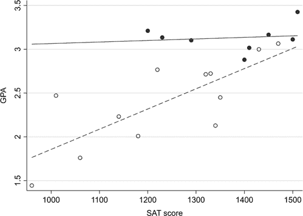

图 3.3 学生样本的 GPA 和 SAT 成绩。（荣誉生用黑色圆点标记，非荣誉生用空心圆标记。）⏎

荣誉生的表现是否优于非荣誉生，以 `GPA` 衡量？我们在图 3.3 中可以看到学生的实际表现，但只有借助“辅助”模型，我们才能估计他们在替代（反事实）状态下的潜在结果。衡量这些 `treatment effects` 有多种方法。

### 3.4.3 回归调整（再次）

这里的思路是估计一个预测受治疗者（此处为荣誉生）表现的方程，另一个预测未受治疗者的表现。假设线性关系，这些在图 3.3 中分别显示为实黑线和虚线。现在，对于每个观测值，找出荣誉项目中的潜在结果（`Ŷ[i]|T[i]=1`）与实线所示的潜在结果之间的差异，以及如果不在荣誉项目中的潜在结果（`Ŷ[i]|T[i]=0`）与虚线所示的潜在结果之间的差异。这些差异的平均值给出 `ATE`。

等价地，我们可以直接使用表 3.2 中的小型人工数据集估计转换方程（式 3.9），这给出了表 3.3 中显示的估计值。为了衡量 `ATE`，我们应用式（3.10），得到

表 3.3 GPA 回归调整“转换”方程的估计值 ⏎

|  || 系数 || 标准误差 || 备忘：均值 |
| --- | --- | --- | --- |
| *结果变量:* GPA ||  ||  || 2.69 |
| --- | --- | --- | --- |
| *右侧变量:* ||  ||  ||  |
| 在荣誉项目中（处理） ||  3.349 || 2.269 || 0.40 |
| 男性（Y = 1） || −0.075 || 0.191 || 0.45 |
| 入学时的招募分数 || −0.046 || 0.201 || 7.65 |
| 入学时的 SAT 成绩 ||  0.0026 || 0.0015 || 1,290 |
| 荣誉 × 男性 ||  0.292 || 0.307 || 0.15 |
| 荣誉 × 招募分数 ||  0.0435 || 0.349 || 3.35 |
| 荣誉 × SAT 成绩 || −0.0025 || 0.0034 || 549.5 |
| 截距 || −0.442 || 0.815 ||  |
| *备忘项目* ||  ||  ||  |
| 调整后 R² ||  0.664 ||  ||  |
| 观测值数量 || 20 ||  ||  |

`G = 3.349 + 0.292 (Male) + 0.0435 (Recruit score) - 0.0025 (SAT)`

计算每个观测值，并对 *所有* 观测值取平均，得到

`G^(ATE) = 0.616`

而仅对 *荣誉（“受治疗”）学生* 取平均则得到

`G^(ATT) = 0.418`.

该方法具有灵活性。例如，如果我们将样本限制为入学时 SAT 成绩至少为 1,200 分的学生，并重新运行转换回归及后续计算，我们发现在此情况下 `G^(ATE) = 0.436` 且 `G^(ATT) = 0.425`。

### 3.4.4 倾向得分

在继续之前，我们需要介绍 `propensity score` 的概念。这是估计某人接受处理的概率。在简单随机样本中，这对每个人都相同，因为每个人被选中的概率相同（尽管该概率不必为 0.5）。然而，在准实验环境中，某人接受处理的概率可能存在很大且系统的差异。

倾向得分来自 `assignment model`，该模型旨在确定谁接受处理、谁未接受处理。一种常见且直接的方法是估计 `logit`（或 `probit`）回归，其中因变量为二元（如果接受处理则为 1，否则为 0），右侧变量为被认为影响处理概率的变量——例如年龄、性别、地点等。然后倾向得分是因变量的预测值：`p̂[i] = P(T[i]=1|X[i])`。

在表 3.4 中，我们展示了使用表 3.2 中提供的大学保留数据估计的 logit“倾向得分方程”的估计值。在此情况下，“处理”是指注册荣誉项目，我们假设这由学生的性别、`SAT` 成绩和招募分数（由大学招生办公室确定）驱动。荣誉项目的预测概率——即倾向得分——然后使用该估计方程为每个观测值计算，并在表 3.2 的最后一列中显示。尽管学生要么在荣誉项目中（`honors = 1`）要么非荣誉（`honors = 0`），但概率范围从 0 到 1，正如预期的那样。通常，估计的倾向得分仅与基础模型一样可靠。在此小型模型中，我们保留了统计上不显著的预测变量，但许多研究人员通过常规显著性检验减少预测变量（或特征）。

表 3.4 参与荣誉项目的 Logit 倾向得分方程估计值 ⏎

|  || 系数 || 标准误差 || 备忘：均值 |
| --- | --- | --- | --- |
| *结果变量:*在荣誉项目中（Y = 1） ||  ||  || 0.40 |
| --- | --- | --- | --- |
| *右侧变量:* ||  ||  ||  |
| 男性（Y = 1） || −0.678 || 1.111 || 0.45 |
| 入学时的招募分数 ||  0.527 || 1.068 || 7.65 |
| 入学时的 SAT 成绩 ||  0.0029 || 0.0096 || 1,290 |
| 截距 || −8.061 || 6.339 ||  |
| *备忘项目* ||  ||  ||  |
| 伪 R² ||  0.177 ||  ||  |
| 观测值数量 || 20 ||  ||  |


倾向得分的估计是一个活跃的研究领域。Diamond (2005) 使用稳健的 logit，降低了异常值的影响。Imbens (2004) 偏好非参数二元响应模型，这些模型能更好地处理非线性。Maciel (2020) 回顾了多种方法，包括使用 `Random Forests`、`Gradient Boosting`、`Support Vector Machines` 和 `Neural Networks`，我们在 第 2 章 中对此进行了总结。

### 3.4.5 匹配方法

让我们暂时回到 表 3.2 和 图 3.3 中列出的荣誉项目数据。如上所述，荣誉生平均 SAT 分数和 GPA 均高于非荣誉生。但荣誉项目的入学具有随机性，因此一些非荣誉生的特征与一些荣誉生相当，反之亦然。这就为我们提供了可能，可以将一些荣誉生与在其他方面相当的非荣誉生进行匹配，然后在这样准备数据后，使用模型在匹配数据上衡量哪一组的留存率更高。 presumable，结局的任何差异——这里是留存率——主要可以归因于两组之间明显的唯一差异，即参与荣誉项目。King and Nielsen (2019) 很好地表达了这一思想：匹配“相当于寻找一个可能源于随机实验但隐藏在观察性数据集中 的数据集”（第 1 页）。

第 62 页考虑 表 3.2 中列出的原始（假设）数据集。在荣誉项目的八名学生中，有六名（75%）在第一年后继续学习，而非荣誉生的 12 名学生中只有六名（50%）继续学习。但是，在尝试将每名荣誉生与一名其他方面完全相同的非荣誉生进行匹配时，我们注意到没有完全匹配，因为没有任何两名学生的性别、招募分数和 SAT 相同。因此，任何学生之间的匹配或配对必然是不精确的。

事实上，有许多种方法可以进行这种（不精确）匹配，我们将在以下小节中描述和讨论。也许最广泛使用的方法是倾向得分匹配，因此我们先从这里开始，然后再介绍一些日益流行的方法。

#### 3.4.5.1 倾向得分匹配

解决匹配问题的流行方案是使用倾向得分。在我们的例子中，倾向得分是学生进入荣誉项目的估计概率。如果我们使用最近邻匹配，我们将使用倾向得分来匹配学生，本质上是将荣誉项目中的每名学生与倾向得分最接近的非荣誉生配对，反之亦然。例如，参考 表 3.2 中的倾向得分，学生 5（荣誉生，倾向得分为 0.685）与学生 16（非荣誉生，得分为 0.584）匹配；反过来，学生 16 与学生 9（荣誉生，得分为 0.576）匹配。对于每对学生，我们计算结局变量（留存率）的差异，这些差异的平均值是 `ATE` 的度量。在这个特定例子中，`ATE` 为 0.200，这告诉我们，由于进入荣誉项目，留存率增加了 0.200。这是一个因果结论。

Rosenbaum and Rubin (1983) 证明在使用倾向得分时无混杂性得以保留。形式上，这意味着

`(y[i]^(T),y[i]^(C))⊥T[i]|x[i]⇒(y[i]^(T),y[i]^(C)) ⊥T[i]|p(x[i])`

其中 `p(x[i])` 是倾向得分。这意味着在倾向得分上进行匹配应该能让我们控制偏差，从而得出潜在的因果效应。

倾向得分匹配有许多可能的变体，这既是优势也是弱点。一方面，它提供了灵活性的希望；另一方面，研究人员不可避免地会尝试不同变体的倾向得分匹配，通常只报告更成功的结果，从而夸大了其有效性。

也许最常见的方法是使用最近邻匹配，其中（对于 `ATT`）每个处理案例都与 `m` 个最近的未处理案例匹配。在上面的例子中，我们使用了 `m = 1`，这是最受欢迎的选择。

第 63 页一种替代方法是使用卡钳匹配，它将每个处理案例与所有倾向得分在给定（适度）距离内的未处理案例进行比较，通常设定为倾向得分标准差的四分之一。一些研究人员使用核匹配或高斯匹配，这些技术将每个处理案例与所有未处理案例进行比较，但对倾向得分接近处理案例的观测值给予更大的权重。Dehejia and Wahba (2002) 认为匹配方法的选择不如对潜在倾向得分的仔细估计重要。

只有当比较（处理案例与对照案例之间）局限于 `region of common support` 时，倾向得分匹配才能有效发挥作用。考虑 图 3.4，其中我们绘制了处理组（右手分布）和对照组的倾向得分分布。对于倾向得分介于 `A` 和 `B` 之间（本例中为 0.1–0.7）的处理案例，存在 `overlap`，因此我们可以找到具有相似倾向得分的未处理案例的例子。但在 `B` 以上的情况并非如此，在那里没有好的比较对象，或在 `A` 以下，没有处理案例。共同支持区域中的案例是那些倾向得分介于 `A` 和 `B` 之间的案例；所有倾向得分在此范围之外的案例都应被丢弃。Ho et al. (2006) 强调了这种数据修剪或“预处理”的重要性。Diamond (2005, p. 9) 指出，被丢弃的案例“无法支持关于缺失潜在结果的因果推断。”


图 3.4 共同支持区域的说明。⏎

这种修剪是有代价的：它限制了结果的适用性（其“外部有效性”），现在结果仅在倾向得分介于 `A` 和 `B` 之间时成立，而非普遍成立。

第 64 页在将处理案例与其对照案例进行匹配时，两组数据应“平衡”。这意味着它们在可测量的维度上应具有可比较的分布特征。例如，倾向得分为 0.6 至 0.7 之间的处理组和未处理组应具有相似比例的老年人、女性、卫生工作者等。在理论上，倾向得分匹配确保了平衡，但在现实中可能不会发生。因此，我们可能会将倾向得分为 0.65 的 70 岁退休男性处理个体与倾向得分为 0.65 的 30 岁女性律师未处理个体进行比较。这将是一种令人惊讶的匹配方式， supposedly “其他方面相似” 的个体。检查平衡很重要；如果缺乏平衡，通常的建议是重新设定倾向得分模型，这通常是有帮助的。


在一篇文章中，King and Nielsen (2019) 认为不应使用倾向得分进行匹配。他们表明，初始数据越平衡，倾向得分匹配导致“推断退化”（第 2 页）的危险就越大，这一现象被称为倾向得分悖论。他们的另一个论点是，研究人员很可能会报告倾向得分匹配的版本结果，这些结果可能无意识地反映了他们自己的偏见，因此所选模型本身取决于数据（“模型依赖”）；用他们的话说，“人为选择将模型依赖转化为偏见”（第 5 页）。这削弱了倾向得分匹配提供无偏判断的能力。
有许多其他日益流行的方法可通过匹配推断因果关系，其中包括 `IPW`。

### 3.4.6 逆概率加权（IPW）
衡量处理效应的优雅方法是对以下形式的回归进行估计
`Y[i] = α + β T[i]`
(3.11)
其中 `Y[i]` 是感兴趣的结果（例如，GPA），而 `T[i]` 是处理，例如，是否在荣誉项目中（参见 Hernán and Robins 2006）。然而，这里有一个转折，即这需要加权回归，其中权重来自倾向得分的逆概率。更具体地说，我们有：
$$w\_{i} = \\left\\{ \\begin{matrix} \\frac{1}{{\\hat{p}}\_{1}} & \\text{for~treated~case} \\\\ \\frac{1}{\\left( {1 - {\\hat{p}}\_{1}} \\right)} & {\\text{for~non} - \\text{treated~case}} \\\\ \\end{matrix}~ \\right.$$
然后在公式 (3.11) 中估计的系数 `β̂` 给出 `ATE`。
Page 65 实际上，该估计量对罕见事件赋予更高的权重。这类似于使用调查权重的做法，其中对不太可能被抽样的观测值赋予更大权重，因为它们代表了更多未被抽样的项目。要衡量 `ATT`，所需的权重为：
$$w\_{i} = \\left\\{ \\begin{matrix} {1~} & {for~treated~cases} \\\\ \\frac{{\\hat{p}}\_{i}}{\\left( 1 - {\\hat{p}}\_{i} \\right)} & {~for~non - treated~cases} \\\\ \\end{matrix}~ \\right.$$
对于 `ATC`，我们有：
$$w\_{i} = \\left\\{ \\begin{matrix} \\frac{\\left( 1 - {\\hat{p}}\_{i} \\right)}{{\\hat{p}}\_{i}} & {for~treated~cases} \\\\ 1 & {~for~non - treated~cases} \\\\ \\end{matrix}~ \\right.$$
当倾向得分非常低或非常高时，权重可能会变得相当大，并且该方法变得不那么稳健。
解决极端权重问题的其中一个方案是对其进行修剪。例如，我们可以在第 5 和第 95 百分位处对权重进行上限截断（“windsorize”）。没有公认的标准来确定截止百分位 (Crump et al. 2009; Morgan and Winship 2015)，因此所使用的程序将明显是特设的。然而，Lee et al. (2011) 使用基于逻辑回归的倾向得分模型发现，修剪确实能带来更稳健的结果。
这里所示的“原始”权重的另一个潜在问题是，它们已知会人为地增加样本量，这可能会影响估计量的标准误差。Hernán and Robins (2025) 提出了使用“稳定化”权重的理由，这些权重确保加权样本与原始样本大小相同，同时保持系数不变（参见 Chapter 9，公式 9.5）。这是通过用 ${{\\hat{p}}\_{i}/\\overset{-}{p}},$ 替换 `p̂[i]`，并用 $\\left. \\left( 1 - \\hat{p} \\right.\_{i} \\right)/\\left( 1 - \\overset{-}{p} \\right)$ 替换 (1−`p̂[i]`) 实现的，其中 $\\overset{-}{p}$ 是平均倾向（或仅包含常数项的逻辑回归的预测值）。因此，例如，`ATE` 的稳定化权重由下式给出：
$$w\_{i} = \\left\\{ \\begin{matrix} {\\frac{\\overset{-}{p}}{{\\hat{p}}\_{i}}~} & \\text{for~treated~cases} \\\\ \\frac{\\left( 1 - \\overset{-}{p} \\right)}{\\left( 1 - {\\hat{p}}\_{i} \\right)} & {~for~non - treated~cases} \\\\ \\end{matrix}~ \\right.$$
Page 66 有越来越多的文献主张使用稳定化权重而非普通权重。
与倾向得分匹配一样，逆概率加权回归应仅使用处于共同支持区域内的观测值进行估计。

### 3.4.7 双重稳健方法
以相当自然的方式结合回归调整和 `IPW` 方法是可能的：使用逆概率权重估计回归调整方程。
另一种可能的扩展是 `augmented inverse probability weighting` 方法 (Glynn and Quinn 2010)，它估计公式 (3.11)，但包含若干额外变量，例如回归调整模型中使用的变量。
还可以通过匹配和回归方法相结合。匹配可首先用于修剪数据（或从中获取“战略性子样本”），然后可将回归技术应用于现在看起来更像来自自然实验的数据集。
所有这些都是“双重稳健”方法的例子。其思想是它们更有希望产生良好的结果，即使（例如）回归调整或 `IPW` 背后的假设集之一并不完全成立。例如，回归调整要求处理与公式 (3.9) 中的误差独立，因果效应不随其他回归量而变化，并且估计方程完全灵活 (Morgan and Winship 2015，第 205 页)。`IPW` 也要求可忽略处理假设以及处理组和未处理组之间的重叠。

#### 3.4.7.1 协变量（“最近邻”）匹配
还有方法可以在不使用倾向得分的情况下，将接受处理者与相似的未接受处理者进行匹配。`nearest-neighbor matching` 的基本形式如下：
1. 对所有相关变量（“协变量”），例如年龄、SAT 分数等进行标准化，使其均值为零，标准差为 1，使用
$$u\_{i} = \\frac{X\_{i} - \\overset{-}{X}}{s\_{i}},$$
其中 `X[i]` 是变量，$\\overset{-}{X}$ 是其均值，`s[i]` 是 `X[i]` 的标准差。
2. Page 67 对于每一对处理和未处理（比较）个体，其标准化变量向量分别为 `U[i]^T` 和 `U[i]^C`，定义它们之间的距离为
$${\\left\\| {U\_{i}^{T} - U\_{i}^{N}} \\right\\|~}\_{V} \\equiv \\sqrt{\\left( U^{T} - U^{C} \\right)'V\\left( U^{T} - U^{C} \\right)}$$
其中 `V` 是权重矩阵。如果 `V` 是单位矩阵，我们得到标准欧几里得距离，它在比较两个个体时对每个变量赋予相同的权重。注意必须进行此计算的配对可能有很多。
3. 将每个处理案例与最近的未处理案例进行匹配并求出结果差异的平均值以获得接受处理的平均处理效应（`ATT`）；或将每个处理案例与最近的未处理案例进行匹配，*反之亦然*，以获得平均处理效应（`ATE`）。
在实践中，权重矩阵 `V` 最常见的选择是 `U^T` 和 `U^C` 的方差-协方差矩阵的逆，这给出了马哈拉诺比斯距离。该方法是非参数且灵活的，但收敛到真实度量的速度相对较慢。在我们的例子中，该度量显示荣誉项目的入学使留存率提高了 0.294（参见 Table 3.6）。
表 3.5 将观测值分类为“粗化”区间 ⏎
|  || 女性 || 男性 |
| --- | --- | --- |
| SAT || 960- || 1143- || 1326- || 960- || 1143- || 1326- |
| *观测值：* ||  ||  ||  ||  ||  ||  |


| --- | --- | --- | --- | --- | --- | --- |
| 在荣誉项目中 || 0 || 2 || 3 || 0 || 1 || 2 |
| 不在荣誉项目中 || 2 || 1 || 3 || 2 || 2 || 2 |
| `Weights:` ||  ||  ||  ||  ||  ||  |
| 在荣誉项目中 ||  || 1 || 1 ||  || 1 || 1 |
| 不在荣誉项目中 || 0 || 2 || 1 || 0 || 0.5 || 1 |

`Table 3.6` 在荣誉项目中的影响（处理效应）对保留率和 GPA 的衡量 ⏎

| 结果变量和方法 || `ATE` || `p-Value` || `ATT` || `p-Value` |
| --- | --- | --- | --- | --- |
| `Retention` ||  ||  ||  ||  |
| --- | --- | --- | --- | --- |
| `Regression methods` ||  ||  ||  ||  |
| 回归调整，线性 || 0.361 || 0.08 || 0.106 || 0.64 |
| 回归调整，logit || 0.195 || 0.27 || 0.114 || 0.60 |
| 共同影响版本，线性 || 0.176 || 0.53 ||  ||  |
| 共同影响版本，logit || 0.165 || 0.46 ||  ||  |
| `Inverse probability weighting` ||  ||  ||  ||  |
| 使用原始权重 || 0.269 || 0.22 || 0.126 || 0.57 |
| 使用稳定权重 || 0.269 || 0.24 || 0.126 || 0.58 |
| `Doubly robust:` ||  ||  ||  ||  |
| IPW 在回归调整上 || 0.348 || 0.07 || 0.074 || 0.73 |
| IPW，回归调整，logit || 0.188 || 0.28 || 0.094 || 0.65 |
| 增强 IPW || 0.358 || 0.08 || n.a. || n.a. |
| `Matching` ||  ||  ||  ||  |
| 最近邻/马哈拉诺比斯 || 0.294 || 0.31 || 0.036 || 0.89 |
| 倾向得分匹配 || 0.200 || 0.25 || 0.000 || 1.00 |
| `GPA` ||  ||  ||  ||  |
| 回归调整 || 0.616 ||  || 0.418 ||  |
| RA if `SAT` ≥ 1,200 || 0.436 ||  || 0.425 ||  |
| 粗化精确匹配 ||  ||  || 0.474 || 0.003 |

存在许多可能的变体。例如，可以坚持某些变量必须完全匹配：也许男性只能与男性匹配，女性只能与女性匹配。或者可以采用迭代方法，例如 Diamond 和 Sekhon (2013) 提出的遗传匹配，其中权重矩阵 `V` 被调整以实现最佳平衡——尽管 Morgan 和 Winship (2015) 将其斥为“易出错的香肠制作”（第 167 页）。在此背景下，当协变量的平均值，例如 `age` 或 `SAT score`，在处理组和与其匹配的样本之间没有差异时，就实现了平衡（参见 `Table 3.2`）。

#### 3.4.7.2 粗化精确匹配

假设我们想将一个数据集（可能是处理的）中的受试者与另一个数据集（未处理的）中的受试者进行匹配。假设我们只有非常简单的数据，例如家庭户主的性别信息以及户主是否超过 65 岁。精确匹配很直接：将数据集 1 中的老年男性与数据集 2 中的老年男性匹配，年轻女性与年轻女性匹配，等等。

实际上，我们处理的数据很少如此简单。假设我们拥有每个人的 `age`，而不仅仅是他们是否年老或年轻。现在我们可能会尝试将数据集 1 中的 51 岁男性与数据集 2 中同龄的男性匹配，等等。然而，如果数据集相对较小，可能存在大量不匹配的情况：也许数据集 2 有 50 岁或 52 岁的男性，但没有 51 岁的。当无法进行匹配时，我们可能会丢失信息。

第 68 页 Gary King 及其合著者（Iacus 等 2008；Blackwell 等 2009）提出，在这种情况下，变量在进行精确匹配之前应被“粗化”——实际上是将它们分配到有限数量的区间中。在我们的例子中，这可能意味着将人们的年龄分类为十年区间（例如 40–49、50–59），从而提高“精确”匹配的概率。粗化可以使用算法完成，与构建直方图时经常采用的方式相同，或基于研究者的判断。

并非每个处理案例都会与未处理的对照案例匹配，未匹配的案例将被剔除。将此视为预处理数据的一种方式是有帮助的，从而将观察限制在共同支持或重叠的区域：剩余匹配案例的结果然后可以简单比较或接受回归调整或其他模型的处理。粗化精确匹配 (`CEM`) 相对于倾向得分匹配 (`PSM`；上文已讨论) 的一个优势在于，`CEM` 寻求提前平衡数据，而 `PSM` 需要在匹配后检查平衡，并在必要时返回调整倾向得分模型直至实现平衡。

为了说明 `CEM` 可能如何运作，请考虑 `Table 3.2` 中的保留率数据。首先，我们创建有限数量的区间；例如，性别与 `SAT` 分数交叉，其中 `SAT` 分数被分配到三个等宽类别。处理包括注册荣誉项目，因此我们可以将观测值分配到区间，如 `Table 3.5` 所示。

`SAT` 分数在 960–1142 范围内的非荣誉学生与任何荣誉学生都不重叠，因此不能有用地作为比较对象（或者等价地，我们将它们的权重分配为 0）。由于我们想要估计 `ATT` 效应，每个荣誉学生都被分配权重 1。`SAT` 分数在 1143–1325 范围内的有两位女性荣誉学生，她们将与该区间内的唯一一名非荣誉学生进行比较。由于该非荣誉学生需要在两次比较中发挥作用，她被分配权重 2。在同一 `SAT` 类别中有一名男性荣誉学生和两名非荣誉男性，因此后者的比较对象各自被分配权重 0.5。

第 69 页 然后我们可以在处理回归中使用这些权重。在我们的例子中，我们的估计给出：

```
$$\begin{matrix} {\text{GPA}\\, = \, 2.657 + 0.434\,\text{Honors}} & {R^{2} = 0.43} \\ \\ \end{matrix}.$$
```

因此，我们可以得出结论，参加荣誉项目会使个人的 `GPA` 提高 0.434 分。然而，这一结果对粗化过程中所做的决策很敏感。如果区间的数量不同，或临界值不同，则结果也会不同。这种方法至少与匹配的其他方法一样容易受到研究者的操纵。

#### 3.4.7.3 哪种匹配？

在衡量处理的影响时，选择方法有多重要？对于上述讨论的每种方法，我们都使用了 `Table 3.2` 中显示的数据来估计在荣誉项目中的影响对 (i) `GPA` 和 (ii) 保留率（即在大学再待一年的概率）的影响。

结果汇总在 `Table 3.6` 中，尽管它们基于一个小的假设示例，但表明不同方法可能产生相当不同的结果。例如，使用倾向得分匹配时，荣誉项目学生（`ATT`）对保留率的衡量影响为零，但如果应用回归调整方法则为 0.11，基于 `CEM` 则为 0.25。

如果我们的线性回归调整因果模型是合理且完整的，那么 `Table 3.6` 中的结果显示，参加荣誉项目使保留率提高 36 个百分点，并使 `GPA` 提高 0.62。如果差异仅在荣誉学生中平均，则我们得到的是对受治疗者的平均处理效应（`ATT`）的衡量，在本例中，这些效应略小于 `ATE` 效应。


一个重要的含义是方法选择很重要。这给研究人员和实践者留下了很大的自由裁量权，因此他们提供的答案将反映他们所做的方法论选择。通往“真理”没有捷径，但最近的实践已远离倾向得分匹配。方法选择的丰富性确实要求我们再次警惕，仅仅报告似乎给出“最合理”结果的方法的结果，因为这会导致潜在的严重偏差，从而削弱我们推断因果关系的能力。

本章描述的技术被广泛使用，尤其是在社会科学中，但并未穷尽所有可能性。在下一章中，我们将讨论断点设计、合成控制的创建以及重要的工具变量方法。

第 70 页 这里讨论的大多数匹配方法，包括协变量匹配，都可以在 Stata 中使用 `teffects` 命令进行估计。CEM 可以使用 `cem` 命令完成。

## 注释

1. `Z` 也被称为中介变量，因为它位于处理变量 `T` 和结果变量 `Y` 之间。还有一个因果推断的子领域称为中介分析，旨在理解 `T` 对 `Y` 的直接和间接效应，这超出了本书的范围；有关该主题的详细信息请参阅 Vanderweele (2015)。 ⏎

第 71 页

## 参考文献

*   Blackwell, Matthew, Stefano Iacus, Gary King, and Giuseppe Porro. 2009. “Cem：Stata 中的粗化精确匹配”. The Stata Journal, 9(4): 524–546. ⏎
*   Crump, Richard, Joseph Hotz, Guido Imbens, and Oscar Mitnik. 2009. “处理平均处理效应估计中的有限重叠”. Biometrika, 96(1): 187–199. ⏎
*   Dehejia, Rajeev, and Sadek Wahba. 2002. “非实验因果研究的倾向得分匹配方法”. Review of Economics and Statistics, 84(1): 151–161. ⏎
*   Diamond, Alexis. 2005. “非实验环境下平均和分位数因果效应的可靠估计”. Working draft. Cambridge, MA: Harvard University. ⏎
*   Diamond, Alexis, and Jasjeet Sekhon. 2013. “用于估计因果效应的遗传匹配：实现观察性研究平衡的一般多元匹配方法”. Review of Economics and Statistics, 95(3): 932–945. ⏎
*   Drukker, David. 2016. “使用 Teffects、Stteffects 和 Eteffects 从观察数据中估计处理效应”. Presented at UK Stata Users’ Group Meeting 2016. London: Stata Users Group. ⏎
*   Glynn, Adam, and Kevin Quinn. 2010. “增广逆倾向加权估计量的介绍”. Political Analysis, 18: 36–56. ⏎
*   Haughton, Jonathan, and Alison Kelly. 2014. “入门商业统计课程中的学生表现：授课方式重要吗？”. Journal of Education for Business, 90(1): 31–43. ⏎
*   Hernán, Miguel, and James Robins. 2006. “从流行病学数据中估计因果效应”. Journal of Epidemiology and Community Health, 60: 578–596. ⏎
*   Hernán, Miguel, and James Robins. 2025. “因果推断：What If”. Boca Raton, FL: CRC Press. ⏎
*   Hitchcock, Christopher. 2010. “概率因果”. In *Stanford Encyclopedia of Philosophy*, [`stanford.library.sydney.edu.au/archives/sum2010/entries/causation-probabilistic/#Int`](https://stanford.library.sydney.edu.au/archives/sum2010/entries/causation-probabilistic/#Int) \[Accessed June 11, 2020\] ⏎
*   Ho, Daniel, Kosuke Imai, Gary King, and Elizabeth Stewart. 2006. “匹配作为减少参数因果推断中模型依赖性的非参数预处理”. [`gking.harvard.edu/files/matchp.pdf`](http://gking.harvard.edu/files/matchp.pdf) \[An excellent guide for practitioners.\] ⏎
*   Holland, Paul W. 1986. “统计学与因果推断”. Journal of the American Statistical Association, 81(396): 945–960. [`doi.org/10.2307/2289064`](http://dx.doi.org/10.1080/01621459.1986.10478354) ⏎
*   Iacus, Stefano Maria, Gary King, and Giuseppe Porro. 2008. “无需平衡检验的因果推断匹配”. [`doi.org/10.2139/ssrn.1152391`](http://dx.doi.org/10.2139/ssrn.1152391) ⏎
*   Imbens, Guido. 2004. “外生性下平均处理效应的非参数估计：综述”. Review of Economics and Statistics, 86(1): 4–29. ⏎
*   Keeter, Scott. 2021. “问答：关于 2020 年美国选举民调问题的对话”. Short Reads, Pew Research Center. [`www.pewresearch.org/short-reads/2021/07/21/a-conversation-about-u-s-election-polling-problems-in-2020/`](https://www.pewresearch.org/short-reads/2021/07/21/a-conversation-about-u-s-election-polling-problems-in-2020/) ⏎
*   Kennedy, Courtney, and Hannah Hartig. 2019. “电话调查的响应率已恢复下降趋势”. In Short Reads, Washington, DC: Pew Research Center. [`www.pewresearch.org/short-reads/2019/02/27/response-rates-in-telephone-surveys-have-resumed-their-decline/`](https://www.pewresearch.org/short-reads/2019/02/27/response-rates-in-telephone-surveys-have-resumed-their-decline/) ⏎
*   King, Gary, and Richard Nielsen. 2019. “为什么不应将倾向得分用于匹配”. Political Analysis, 27: 4. [`j.mp/2ovYGsW`](https://j.mp/2ovYGsW) ⏎

第 72 页
*   Lee, Brian, Justin Lessler, and Elizabeth Stuart. 2011. “权重修剪与倾向得分加权,” PLOS ONE, 6(3): e18174. ⏎
*   Maciel, Fernanda. 2020. “巴西弱势群体的分析”. *PhD dissertation*, Bentley University. ⏎
*   Morgan, Stephen, and Christopher Winship. 2015. “反事实与因果推断：社会研究的方法与原则，第二版”. New York, NY: Cambridge University Press. ⏎
*   Optimizely. 2020. *实验大书*. [`www.optimizely.com/resources/experimentation-case-studies/`](https://www.optimizely.com/resources/experimentation-case-studies/) \[Accessed June 11, 2020\] ⏎
*   Pearl, J. 1995. “用于实证研究的因果图”. Biometrika, 82(4): 669–710. ⏎
*   Rosenbaum, P., and D. Rubin. 1983. “倾向得分在因果效应观察性研究中的核心作用”. Biometrika, 70(1): 41–55. ⏎
*   Vanderweele, Tyler J. 2015. “因果推断中的解释：中介与交互的方法”. New York, NY: Oxford University Press. ⏎

第 73 页

# 4 因果关系：合成控制、回归不连续性和工具变量

DOI: [10.1201/9780429172588-4](https://doi.org/10.1201/9780429172588-4)

## 4.1 引言

在 第 3 章 中，我们讨论了多种估计因果效应的技术。但关于该主题还有更多内容需要说明，在本章中，我们首先讨论双重差分，然后解释合成控制、回归不连续性和工具变量的方法。


一个良好的起点是回到一个修改版的示例，来自第三章，关于电动汽车的销售。我们设想在 2020 年美国东北部开展了一场广告活动，但在美国其他地区没有，我们想知道该活动是否有效。数据汇总在表 4.1 中。

表 4.1 每百万人口电动汽车销量 ⏎

|  || 2019 || 2020 || 差异 |
| --- | --- | --- | --- |
| 美国东北部 || 400 || 560 || +160 |
| --- | --- | --- | --- |
| 美国其他地区 || 200 || 300 || +100 |
| 差异 || +200 || +260 || `+60` |

根据这些数字，单一差异显示东北部销量上升了 160，但正如我们在第三章中所讨论的，仅凭这些信息我们无法得出活动成功的结论；也许销量本来就会上升。

## 4.2 双重差分

一种常见的方法是使用*双重差分*（又称差分中的差分）。我们注意到汽车销量在东北部上升了 160，在美国其他地区上升了 100。东北部上升幅度大 60，我们可以合理地将其归因于东北部的广告活动。这一结论关键依赖于*平行趋势假设*，即在没有广告活动的情况下，东北部和美国其他地区的销量趋势本应相同。

该思想在图 4.1 中以图形方式呈现。垂直轴（`Y`）表示销量；下部实线显示 2019 年至 2020 年间美国其他地区销量的演变，上部实线显示东北部的销量轨迹。虚线显示基于平行趋势假设的反事实。A 点与 B 点之间的差异，这里为 60，表示双重差分估计值，是我们衡量广告活动影响的指标。

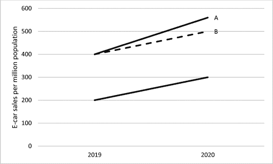

图 4.1 美国东北部（上部实线）和美国其他地区（下部实线）每百万人 2019 年的电动汽车销量。点线为反事实（如果没有广告活动）。（数据来自表 4.1。）⏎

有助于对表述做一些形式化处理。我们希望衡量接受处理的平均处理效应（`ATT`），其公式为

`ATT = E[Y[i t]^(T) - Y[i t]^(C) | T[i]=1]`

(4.1)

用文字来说，这是对接受处理者（`T[i]=1`）而言，在时间`t`被处理时的结果（`Y[i t]^(T)`）与如果未被处理时本应观察到的结果（`Y[i t]^(C)`）相比的期望值。后者是不可观测的。

如果我们假设平行趋势，我们就假定

`E[[Y[i t]^(C) - Y[i t - 1]^(C)] | T[i]=1] = E[[Y[i t]^(C) - Y[i t - 1]^(C)] | T[i]=0]`

(4.2)

这表明，在没有广告活动的情况下，接受处理地区（左侧）的销量上升幅度将与参考地区（右侧）相同。将式（4.2）代入式（4.1）得到

`ATT = E[[Y[i t]^(T) - Y[i t - 1]^(C)] | T[i]=1] - E[[Y[i t]^(C) - Y[i t - 1]^(C)] | T[i]=0]`

(4.3)

这就是双重差分估计量。在我们的例子中，它给出

`ATT = [560 - 400] - [300 - 200] = 60.`

(4.4)

在有大量单位数据的情况下，这通常使用普通最小二乘（`OLS`）回归来估计，形式为

`Y[i t] = β[0] + β[1] Time[i] + β[2] Treatment[i] + β[3] Time[i] × Treatment[i] + ε[i]`

(4.5)

在经典情况下，只有两个时间段，且处理仅在第二个时期对部分单位生效。此时`β[3]`的估计值给出影响。

式（4.5）通常推广到两个以上时间段的情况，此时我们得到*双向固定效应*（`TWFE`或`2FE`）模型：

`Y[i t] = θ[t] + η[i] + α T[i t] + ε[i t]`

(4.6)

这已成为“从面板数据估计因果效应的默认方法”(Imai and Kim 2020)，我们将在框 4.1 中总结一个与最低工资影响相关的著名例子。然而，当存在多个时间段时，使用式（4.6）是有问题的。考虑图 4.2，它追踪了阶梯式处理的效应——也许东北部（上部实线）有早期且持续的广告活动，中西部（中部实线）有较晚的活动，其他地区（下部实线）没有活动。我们还显示了第二个区间的放缓趋势。平行趋势假设需要适用于所有观测分组（东北部、中西部、美国其他地区），而适当的效应衡量是相对于未处理基线的双重差分，在图中显示为实线与其点状反事实之间的差异。不幸的是，式（4.6）并未计算这一点，尽管最近 Callaway and Sant'Anna (2021b)和 Wooldridge (2021)的工作提出了一些变通方法。当干预不是阶梯式的——即它们时有时无——一致地衡量影响尤其困难。这是当前研究的活跃领域。

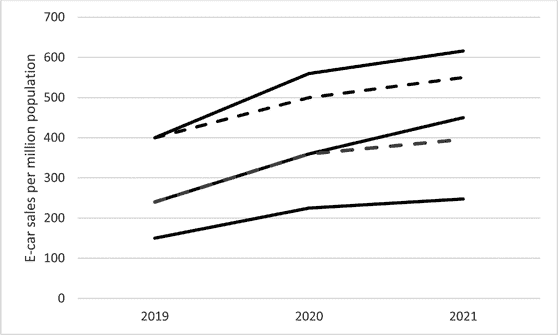

图 4.2 美国东北部（上部实线）、美国中西部（中部实线）和美国其他地区（下部实线）每百万人 2019 年的电动汽车销量。点线为反事实（如果没有广告活动）。（说明性数据由作者创建。）⏎

需要注意的是，平行趋势假设对所使用的单位很敏感。假设我们将表 4.1 中的数字以对数形式表示，如表 4.2 所示。

表 4.2 每百万人口电动汽车销量的对数 ⏎

|  || 2019 || 2020 || 差异 |
| --- | --- | --- | --- |
| 美国东北部 ||  5.991 ||  6.328 || +0.336 |
| --- | --- | --- | --- |
| 美国其他地区 ||  5.298 ||  5.704 || +0.405 |
| 差异 || +0.693 || +0.624 || `-0.069` |

销量（对数）增长率在东北部为 33.6%，在美国其他地区为 40.5%。现在平行趋势假设是，在没有广告活动的情况下，接受处理组和未接受处理组的增长率（即对数值变化）本应相同。在这种情况下，我们可能得出结论，东北部的广告活动实际上可能损害了销量的增长：`ATT`双重差分估计值为`-0.069`，表明东北部的销量增长比美国其他地区低 6.9 个百分点。

平行趋势假设，无论是绝对值还是对数，都不可检验。其含义是，我们的因果影响衡量再次取决于我们基础模型的合理性。


Stata 有两个命令可以计算双重差分，即用于重复截面数据的 `didregress`，以及用于面板数据的 `xtdidregress`（Stata 2021）。Callaway 和 Sant'Anna (2021a) 为 R 创建了一个双重差分 (DID) 包，该包对存在多个时间段的情况进行了更新处理。

双重差分模型通常可以通过匹配观测值来改进。未处理参照组的选取也很重要，并且是合成控制方法的关键要素，我们现在转向该方法。

## 4.3 合成控制

2008 年，美国正处于深度衰退之中，汽车销量急剧下降——与 2007 年相比下降了 18%——威胁到一些主要汽车制造商的偿付能力。在《问题资产救助计划》（TARP）下，联邦政府向该行业贷款超过 800 亿美元，主要贷给通用汽车和克莱斯勒。2009 年 1 月，克莱斯勒获得了一笔 125 亿美元的贷款，前提是公司做出一系列管理层和战略层面的改变。

Fremeth 等 (2016) 提出了一个简单问题：政府支持对克莱斯勒生产的车辆销量有何影响？

图 4.3 显示了克莱斯勒车辆销量的演变。第一条垂直线表示 2009 年 1 月贷款发放的时间，第二条表示 2011 年 5 月贷款偿还、克莱斯勒再次自由管理自身事务的时间。仅从时间序列来看，很难评估联邦贷款对克莱斯勒销量的影响，因为克莱斯勒的销量可能只是反映了行业整体情况。

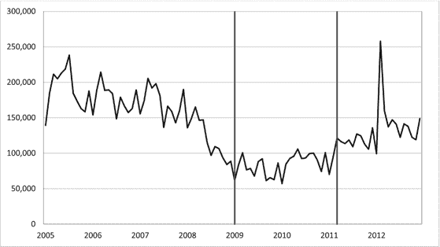

图 4.3 美国 2005–2012 年克莱斯勒车辆月销量。(Fremeth 等 2016.) ⏎

直到最近，这类问题通常会采用直接的比较案例研究方法来处理。福特没有接受任何 TARP 资金，因此例如可以比较福特和克莱斯勒在救助前后轨迹，看看 2009 年 1 月之后它们的路径是否出现分歧。这就是在 第 4.2 节 中讨论的 DID 方法。

在一次广受引用的研究中，Card (1990) 将迈阿密在 1980 年马里尔船潮相关的大约 12.5 万古巴人涌入前后的工资和失业率演变，与他认为与迈阿密相似的另外四个城市——亚特兰大、洛杉矶、休斯顿和坦帕-圣彼得堡——的经验进行了比较。他发现，出乎意料的是，与对照城市的经验相比，古巴人的涌入并没有降低工资或提高失业率。这无疑是对该问题的合理方法，但对照城市的选择本质上是临时性的。能否做得更好？

比较案例研究的传统弱点在于对照组选择的临时性（以及平行趋势假设）。这现已通过 *synthetic control* 方法得到解决，该方法被 Athey 和 Imbens (2017, p. 9) 称赞为“过去 15 年政策评估文献中 arguably 最重要的创新”。该方法现已在社会科学和商业分析中得到广泛应用。其关键创新在于合成控制方法提供了一种系统识别相关对照组的方法。

合成控制技术在希望估计干预对结果的影响，并且干预可能仅针对一个或少数几个项目时很有用。一个经典例子是 Hsiao 等 (2012) 对 1997 年香港主权变更（从英国到中华人民共和国）影响的研究；他们得出结论，主权变更对香港 GDP 增长率几乎没有影响。

其思想是将干预所针对的项目（受处理项目）随时间的结果，与未被干预针对的对照组的结果进行比较。因此，合成控制补充了 DID 设计，并且可能改进任何 *comparative interrupted time series design*（见 Bernal 等 2019）。合成控制方法试图通过提出一个“合成”对照项目来消除对照组选择的任意性，该项目等于一组对照项目的加权平均值。权重通常为正或零，选择方式使其在干预前最好地近似目标项目的特征。

更严格地说，要应用合成控制，我们需要面板数据，其中包含“焦点”单位（例如克莱斯勒）和一些潜在对照单位（“捐赠池”）在 `T` 个时间段内的信息。在某个时间 `T[0]`，存在影响焦点单位但不影响捐赠池的“处理”或冲击或干预。至少，变量必须包括结果指标 `Y[i t]`（例如车辆销量），但通常还会有若干其他预测变量（“协变量”）。在克莱斯勒的例子中，这些可能包括汽车价格、每加仑英里数、公司员工人数等变量。

遵循 Abadie (2021)，设焦点单位的索引为 1，捐赠池中的单位索引从 2 到 `J` + 1。上标 `T` 指干预（“处理”），`C` 指无干预的情况（“对照”或“比较对象”）。那么对受处理者的处理效应由下式给出

`ATT = Y[i t]^(T) - Y[1 t]^(C), t > T[0]`.

(4.7)

我们实际上观察到潜在结果 `Y[1 t]^(T)`，但未观察到反事实 `Y[1 t]^(C)`。

合成控制中的关键思想是用一个或多个在时间 `T[0]` 时看起来与受处理单位相似的未处理单位来替代未观察到的 `Y[1 t]^(C)`。在克莱斯勒的例子中，这可能只是福特车辆的销量，或由几家汽车制造商（福特、丰田、斯巴鲁等）销量加权平均得到。合成控制比较对象由捐赠池结果的加权平均给出：

$${\\hat{Y}}\_{1t}^{C} = {\\sum\\limits\_{j = 2}^{J + 1}{w\_{j}Y\_{jt.}}}$$

(4.8)

例如，将克莱斯勒车辆销量对所有其他汽车制造商的车辆销量进行直接回归会产生一组可作为权重的系数——事实上经常这样做——但其中一些权重可能为负，这意味着某种外推。因此，通常将权重向量 `W` 约束在 0 到 1 之间（0≤`w[j]`≤1），并且如果它们缩放良好，则它们之和为 1，即 ∑`w[j]` = 1。权重通过最小化加权平方预测误差获得：

$$\\sum\\limits\_{m = 1}^{k}{v\_{m}\\left( {X\_{1m} - X\_{0m}W} \\right)^{2}}$$

(4.9)

这里，`X[1 m]` 是焦点单位第 `m` 个预测变量或结果的值，`X[0 m]` 是捐赠池中 `j` 个单位的预测变量和/或结果的向量，而 `v[m]` 是对属性（即协变量和/或结果）的权重。实际上，这一过程往往会产生一组稀疏且使用透明的权重，如下所述。


合成控制使用的主要改进在于它为我们提供了一种令人满意的权重选择方法。与将迈阿密的失业率与四个手工挑选（因此可能存在偏见）的比较对象进行比较不同，Card 现在可以使用更正式的方法，从更大的捐赠池中识别出其他城市失业率的加权平均值，该加权平均值最能复制马里埃尔船队抵达前迈阿密的经历。事实证明，Peri 和 Yasenov (2019) 做了完全相同的事情，并且基于他们的合成控制分析，得出了与 Card 更非正式方法相似的结果。

Abadie 和 Gardeazabal (2003)，他们首次开发了合成控制方法，认为权重应选择使得由此产生的合成控制“最接近受治疗单元的 `predictors` 的干预前值”，但一些作者反而试图在干预前匹配 `outcome` 变量。之后所需要做的只是检查该合成控制的干预后结果并将其与焦点单元的结果进行比较。

### 4.3.1 克莱斯勒案例
许多这些想法如果我们考察 Fremeth 等 (2016) 的研究会更清晰，他们想要估计 2008 年金融危机后政府对克莱斯勒的救助和控制是否对克莱斯勒车辆的销售产生了影响。他们获得了从 2005 年 1 月到 2012 年 12 月在美国销售的每家 19 家主要汽车公司车辆销售（来自 Ward's Automotive Reports）和其他变量的月度数据。处理期从 2009 年 1 月政府贷款发放开始，到 2011 年 5 月克莱斯勒完成偿还贷款时结束。由于通用汽车也获得了政府救助贷款，因此被排除在潜在比较对象的捐赠池之外，而捷豹路虎则因数据缺失被排除。捐赠池因此由 16 家公司组成。

合成控制分析的结果通常以视觉方式显示，如 图 4.4 所示。实线显示了政府干预前后克莱斯勒月度销售的 12 个月移动平均值。虚线追踪合成控制的销售情况（基于移动平均数据），并基于应用根据结果数据估计的权重（使用 Fremeth 等 2016 创建的 Stata 代码）得出，这些权重在 表 4.4 中报告。在 2009 年 1 月之前，两个序列相对接近，但在政府贷款期间，以及与政府对克莱斯勒行动的限制相关联期间，两个序列发生了分歧。这在 图 4.5 中更容易看出，该图仅绘制了 图 4.4 中显示的两个序列之间的差异。与本应预期公司销售跟踪合成控制的情况相比，克莱斯勒销售的减少是惊人的。一种解释是政府参与使公司每月销售量降低了约 40,000 辆汽车。

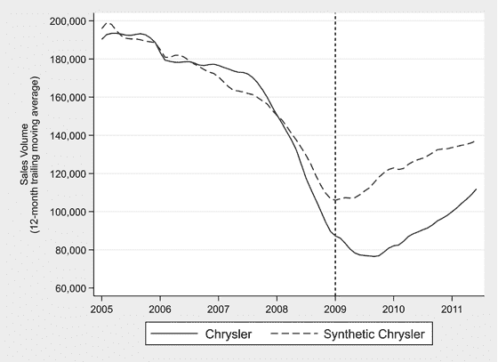
图 4.4 克莱斯勒及合成克莱斯勒的销售量。 ⏎

表 4.4 政府救助对克莱斯勒影响的合成控制模型中估计的权重 ⏎

| 公司 || 权重 || 公司 || 权重 || 公司 || 权重 |
| --- | --- | --- | --- | --- | --- |
| BMW || 0 || Isuzu || 0.068 || Saab || 0 |
| --- | --- | --- | --- | --- | --- |
| Daimler || 0.022 || Jaguar Land Rover ||  || Subaru || 0 |
| Ford || 0.664 || Mazda || 0 || Suzuki || 0 |
| General Motors ||  || Mitsubishi || 0 || Toyota || 0.077 |
| Honda || 0 || Nissan || 0.169 || Volkswagen-Audi || 0 |
| Hyundai-Kia || 0 || Porsche || 0 || Volvo || 0 |

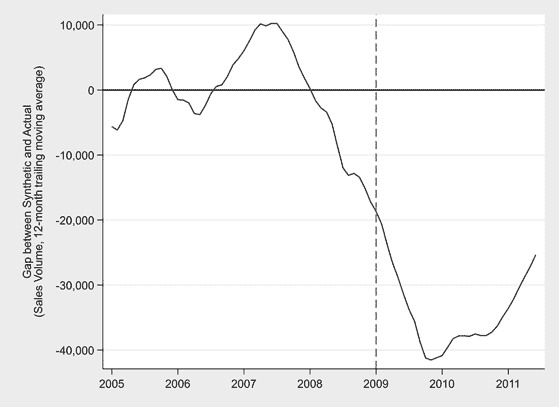
图 4.5 克莱斯勒与合成克莱斯勒之间的差异。 ⏎

然而，这并不是故事的全部。也许在 2009 年 1 月之后，其他一些公司经历了与克莱斯勒所见相似的模式，在这种情况下，克莱斯勒案例就不会是特殊的。一种巧妙的方法来解决这个问题，与检验显著性 somewhat 相似，是应用“跨单元”安慰剂检验：为每个没有获得救助的其他汽车公司估计一个合成控制模型，并使用这些模型来衡量每家公司的销售与其相应合成控制之间的差距。这在 图 4.6 中完成，其中每条线代表不同的汽车公司。很明显克莱斯勒是一个离群值；如果效应是随机的，它最终出现在图表底部底部的概率小于 10%（鉴于有 17 家公司的时序），因此我们可以相当有信心救助确实对克莱斯勒产生了影响。

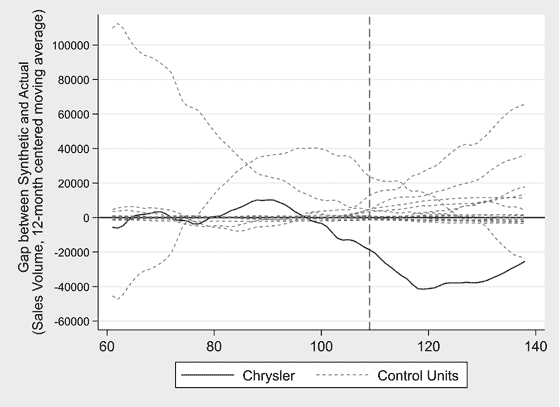
图 4.6 未经处理的单元中的安慰剂检验。 ⏎

如果干预前有足够的时间段，通常可以使用“在时间上”的安慰剂检验。让我们假设，假设性地，如果干预是在 2005 年 1 月而不是 2009 年 1 月发生。构建一个使用 2005 年 1 月日期的克莱斯勒合成控制模型：如果随后克莱斯勒汽车的销售与合成控制密切跟踪，并且安慰剂干预没有明显效果（这正是 Fremeth 等 2016 发现的），那么我们更有信心克莱斯勒销售在 2009 年 1 月真实干预后出现的偏差并非偶然。

还有其他有用的稳健性检验。例如，克莱斯勒的合成控制可能对 表 4.4 中显示的权重敏感，这些权重被使用。留一法检验将重新计算合成控制，在依次排除一个权重（例如 Daimler、Ford）后，检查每个由此产生的序列是否仍然显示克莱斯勒的销售与合成度量存在偏差。也可以基于运行到例如 2007 年而不是 2008 年的结果和协变量数据进行分析，以防后者数据因过于接近 2009 年 1 月的干预而受到污染。Fremeth 等 (2016) 提供了进一步的细节。

在机制上，合成控制可以使用 Stata 或 R 中的 `synth` 命令实现。Cunningham (2021) 讲解了一些有用的示例。

合成控制方法在捐赠池具有未受处理且在其他方面足够类似于受处理单元的单元时效果良好。由此可知，如果受处理单元在某些维度上不寻常或极端，该方法将不会成功。权重需要有一个稳定的结构，以便合成控制在正常情况下作为良好的预测因子。如果焦点单元或捐赠池中的控制单元在处理前期间受到冲击的影响，就更难建立稳定的底层关系。我们还需要假设焦点单元的处理——例如克莱斯勒——不会对控制单元产生溢出效应。没有正式的方法来检验这一点，但需要论证溢出效应可以被忽略。

## 4.4 回归不连续


# 回归断点设计

2018 年，拥有经济学本科学位的 40 岁美国工人的年中位工资为 90,000 美元，而其他专业（除经济学外）为 66,000 美元（Bleemer 和 Mehta 2022）。声称选择经济学专业会导致收入至少多出 20,000 美元是否合理？

简单比较工资的问题在于，选择经济学的人可能在某些根本上、甚至是不可观察的方式上与选择其他专业的人不同。也许只有特殊的人才会选择经济学，在这种情况下，工资差异可能反映了经济学家的非典型性，也许经济学专业确实能带来更高的工资，例如通过传授技术技能或改变态度。

Bleemer 和 Mehta (2022)最近的一项研究试图通过利用*不连续性*来分离经济学专业选择的影响。2008 年，加州大学圣克鲁兹分校，一所大型公立大学，引入了一项要求：任何希望主修经济学的人必须在两门经济学原理课程（微观经济学和宏观经济学）上取得至少 2.8 的平均绩点（`GPA`）。大多数`GPA`为 2.8 或更高的人选择了主修经济学，而`GPA`较低的人则没有这种选择。合理地假设，`GPA`为例如 2.75 的学生与`GPA`为 2.85 的学生并没有太大不同，除了后者可以主修经济学。通过利用这种不连续性并使用一些额外的工具（包括我们下面讨论的回归），Bleemer 和 Mehta 发现，刚好达到分数线并主修经济学的学生在早期职业的工资比刚好未达到分数线的学生高出 22,000 美元，而这一差异的一半是因为经济学专业毕业生倾向于进入薪酬更高的行业。这种对不连续性的利用创造了一个自然实验，并提供了一种识别因果效应的合理策略。由于它提供了一个清晰的识别策略，回归断点设计技术在过去十年中变得非常流行。

任何回归断点设计的起点，自然是跳跃或不连续性。这种情况出人意料地常见。例如，在美国，人们在 65 岁时有资格享受医疗保险；年轻人达到 21 岁时可以饮酒；如果申请者具有至少某个门槛的`GPA`，则会被大学录取；如果候选人比其他任何人都多得至少一票，则当选为公职。许多政府项目都有资格标准，这些标准代表了不连续性，可能经常被利用来衡量这些项目的因果影响。

为了发展这些思想，我们首先从一个模拟示例开始，然后考虑一些现实案例，包括一项研究，即如果公司的薪酬政策具有长期而非短期的导向，公司是否表现更好。

## 第 86 页

考虑一所大学的案例，如果学生的平均绩点（`GPA`）至少为 3.33（在大多数地方为 B+），则自动将其分流到荣誉项目，绩点范围为 0 到 4。如果政策严格执行，我们就有一个尖锐的不连续性。我们想知道荣誉项目是否对后续学业表现有任何因果影响。在这种情况下，`GPA`是*运行变量*，我们假设感兴趣的结果是期末考试成绩（`Y`），其范围为 0–100。我们基于正态分布（在 4 处截断）模拟了 1,000 个`GPA`观测值，并在基线情况下假设期末考试成绩与学生是否在荣誉项目中无关。


图 4.7 期末考试成绩与 `GPA` 以及参与荣誉项目的關係。(*注：* 参与荣誉项目要求 `GPA` 为 3.33 或更高。基于模拟数据（见正文），假设参与对考试成绩没有影响。）⏎

## 第 87 页

现在假设荣誉项目使期末考试成绩提高了七个百分点。


图 4.8 期末考试成绩与 `GPA` 以及参与荣誉项目的關係。(*注：* 参与荣誉项目要求 `GPA` 为 3.33 或更高。基于模拟数据（见正文），假设参与提高考试成绩。）⏎

这些图表很有用，但它们只是我们分析的起点。我们感兴趣的是结果在不连续性附近如何变化。通常，我们可能会认为截止值附近的点本质上是随机地略高于或略低于该线，其位置很大程度上由偶然决定——考试题目上的幸运猜测、评分上的不一致等等。对于这一群体来说，就好像他们被随机分配到处理组或未处理组一样。因此，衡量处理影响的一种方法是比较刚好低于截止值和刚好高于截止值的平均结果，仅使用落在截止值两侧的适度带宽 `h^−` 和 `h^+` 内的观测值。这其中一个问题是结果在截止值周围可能存在趋势，在这种情况下，最好在截止值下方拟合一条回归线，在上方拟合另一条回归线，仅使用截止值附近的观测值。两条线之间的差距，如有的话，将衡量影响。这就是许多研究者青睐的局部线性（有时是二次）近似（Gelman 和 Imbens 2019）。

## 第 88 页

这种情况在图 4.9 中有所说明，该图显示了我们模拟数据集中荣誉项目提高成绩的全部一千个点。实心黑色线是线性回归线，使用在 `GPA` 截止值 3.33 下方和上方 0.168 个单位内找到的数据点估计得出。测量带宽有多种方法，这里为 0.168，回归断点研究的结果对带宽选择 somewhat 敏感。


图 4.9 期末考试成绩与 `GPA` 以及参与荣誉项目的關係。(*注：* 参与荣誉项目要求 `GPA` 为 3.33 或更高。基于模拟数据（见正文），假设参与提高考试成绩。点代表观测值；粗黑色线显示基于截止点附近观测值的线性回归线。）⏎

为了衡量加入荣誉项目的影响，我们衡量回归线在截止值处的截距之间的距离。这里，估计差异为 7.22，相关的 p 值为 0.05，表明与零有统计学上的显著差异；我们设计模拟使差异为 7 分。


该度量是一个局部平均处理效应（`LATE`），严格来说，它仅适用于临界值。实际上，这类度量往往具有良好的内部有效性，因为识别策略通常清晰且稳健，但对其他情况的适用性可能有限（“外部有效性”）。影响的度量依赖于成功的外推；与匹配方法相比，在尖锐回归不连续性分析中不存在共同支持区域，尽管在模糊回归不连续性的情况下情况略有不同，下文将进一步讨论。

更正式地，设 `Y`[*i*]^(`C`) 为个体 *i* 未接受处理时的结果（如考试成绩），而 `Y`[*i*]^(`T`) 为其接受处理时的结果。我们希望衡量 `Y`[*i*]^(`T`) − `Y`[*i*]^(`C`)，但由于个体要么被处理要么未被处理，我们无法直接观察到这一点：这就是我们在第 3 章中讨论的因果推断的基本问题。设处理（`T`[*i*]）与运行（或“强制”或“决定处理”）变量 `X`[*i*] 相关，使得 `T`[*i*] = 1{`X`[*i*]≥`c`}，其中 `c` 为临界值，或不连续点。则

$$LATE = {\lim\limits_{x \downarrow c}{E\left\lbrack Y_{i} \middle| X_{i} = x \right\rbrack}} - {\lim\limits_{x \uparrow c}{E\left\lbrack Y_{i} \middle| X_{i} = x \right\rbrack}}.$$

(4.10)

这些项可通过估计回归获得，第一个在临界值之上，第二个在临界值之下。这些回归可能包含额外的协变量，用向量 `Z`[*i*] 表示，尽管在实践中这不太可能实质性地改变估计结果（Imbens 和 Lemieux 2008）。研究人员经常拟合高阶多项式回归，但 Gelman 和 Imbens (2019) 警告不要采用这种做法，并强烈主张使用线性或最多二次的近似。一个原因是 `LATE` 的估计需要外推到临界点，如果估计方程相当稳健，则效果最佳。

一些研究人员通过重新缩放运行变量使其在不连续点取值为零来绘制这些函数。结论保持不变，但这强调了零点处的变化。在框 4.2 中，我们提供了一些回归不连续性研究的进一步示例的简短说明。

### 4.4.1 扩展与进一步考虑

我们注意到，回归不连续性技术依赖于唯一跳跃即所考虑的不连续性的思想。为了使这一点合理，重要的是不连续性不要与其他跳跃重合。更正式地说，在没有处理的情况下，我们要求在临界点处运行变量、结果和协变量（如有）具有连续性。连续性并非先验保证：例如，许多人在 65 岁退休，但其他相关序列在同一时间也会跳跃，例如医疗保险或老年人折扣。这些风险干扰了我们衡量退休对家庭支出模式等结果的影响的努力。

检查连续性是良好的做法。一种流行技术是绘制运行变量的分布图，以查看临界点附近是否存在跳跃，并将协变量对运行变量作图，再次寻找可能的跳跃。由于构造原因，我们预期在临界点处存在跳跃，因此无法检查结果变量的连续性。但进行安慰剂检验可能有用：选择一个或多个*不是*感兴趣点的临界值并进行回归不连续性分析。不应有任何效应，但如果有，则模型可能值得怀疑。

到目前为止的讨论假设了*尖锐*不连续性，因此在临界点处，处理的概率突然从 0 变为 1 且不受操纵。实际上，许多不连续性是*模糊*的，因此处理的概率跳跃幅度较小。例如，在 65 岁时，退休的概率可能会从 30% 上升到 70%。这意味着在临界点附近可能同时存在接受处理和未接受处理的个体，如图 4.10 所示。衡量处理（退休）对例如家庭消费支出等的影响所需的技术将有所不同。最常见的方法是首先将处理（即退休）对年龄等外生变量进行回归——线性或逻辑回归——然后将处理的预测概率放在消费回归的右侧。这种两阶段最小二乘（`TSLS`）方法相当于将年龄作为退休的工具变量，而退休更接近于“意向性处理”而非确切的处理本身。我们将在本章后面再讨论工具变量技术。一种有用的思考方式是，我们试图衡量 $\\frac{\\mathrm{\\Delta}Y}{\\mathrm{\\Delta}P},$ 即结果变量对概率变化的响应。当不连续性为尖锐时，`ΔP` = 1，由图 4.10 中的距离 AD 给出。在模糊不连续性的情况下则不再如此，其中 `ΔP` 由距离 BC 给出。退休的概率可能取决于除个人年龄之外的变量，这些变量通常不可观察且可能受操纵。通过分离可归因于年龄的退休概率变化，我们剔除了退休概率中可由个人改变的影响因素，从而能够识别外生驱动的退休对感兴趣结果的影响。

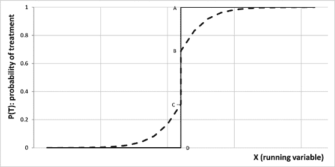

图 4.10 尖锐与模糊不连续性。（黑色线显示尖锐不连续性设计下处理的概率，而虚线描绘不连续性为“模糊”时的处理概率。）⏎

存在主题上的变体。*回归拐点设计*不是寻找跳跃，而是在某个临界点处寻找结果响应函数中的拐点。David Card 等 (2015) 使用了这种设计来估计失业救济金对奥地利失业持续时间的影响。

#### 4.4.1.1 实现

得益于 Calonico 等 (2017)的努力，回归不连续性分析可以在 Stata 和 R 中相当容易地进行。在 Stata 中，`rdplot` 命令生成如图 4.11 和 4.12 所示的图形；`rdbwselect` 命令在确定局部回归的最优带宽（临界值两侧）方面提供灵活性；并且 `rdrobust` 命令正式衡量并检验 `LATE` 的显著性。Python 中有等效命令。R 和 Python 的相关包可在[`https://rdpackages.github.io/`](https://rdpackages.github.io/)找到。

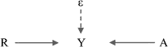

图 4.11 处理提供（R）对结果（Y）影响的有向无环图（`DAG`）。（*注：* ε 是一个未观察到的“误差”变量，因此用虚线箭头表示。Y 的其他可观察影响由 A 表示。）⏎


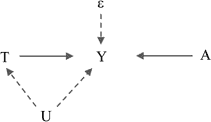

图 4.12 治疗 (`T`) 对结果 (`Y`) 影响的有向无环图 (DAG)，其中存在未观测到的混杂因素 (`U`)。 ⏎

## 4.5 工具变量

假设你经营一家银行，并决定向部分客户提供信用卡。你希望人们使用你的信用卡进行消费（`Y[i]`），从而为银行产生手续费收入。为了衡量信用卡营销活动的影响，你向客户的随机样本提供信用卡——这就是处理（`R[i]`），对于收到优惠的人等于 1，否则为 0。消费还受到其他“控制”变量的影响，例如客户的年龄或收入（变量 `A[j i]`），以及我们无法或不测量到的随机效应（`ε[i]`）。

本案例的有向无环图 (DAG) 显示在 图 4.11 中。假设效应为线性，我们可以构建如下形式的回归。

$$Y_{i} = \alpha + \beta_{0}R_{i} + {\sum\limits_{j}{\beta_{j}A_{ji}}} + \varepsilon_{i}$$

(4.12)

第 93 页 该模型可以很容易地估计。信用卡营销活动对消费的影响由估计的 `β[0]` 值给出。

不幸的是，问题永远不会这么简单，因为并非每个人都会接受信用卡的优惠，因此我们有一个存在不依从的随机试验。如果 `R[i]` 定义为信用卡的 *offer*，那么 $\hat{\beta_{0}}$ 衡量的是 *intention to treat* 的效应。这可能不是我们需要的。它结合了两个不同的效应——选择卡片的人的比例以及接受卡片者的消费行为。通常，我们有兴趣分别分析这些效应，以便我们可以寻求方法来 (i) 增加采用率和 (ii) 在采用的前提下增加消费。

在这种情况下，我们可能会诱惑将处理定义为客户是否 *accepts* 新信用卡 (`T[i]`)，而不是仅仅是否被提供。然后我们可能想估计

$$Y_{i} = \alpha + \beta_{0}T_{i} + {\sum\limits_{j}{\beta_{j}A_{ji}}} + \varepsilon_{i}$$

(4.13)

这里的困难在于，接受信用卡的人不太可能是典型的。也许他们更需要、喜欢消费，或在我们无法轻易衡量的方面很不寻常。因此，如果我们比较接受卡片的人与未接受卡片的人或未被提供卡片的人，我们就没有处理的准随机分配。接受者的未观测特征可能使他们更倾向于消费并且更可能接受信用卡优惠。在这种情况下，我们从公式 (4.13) 中得到的处理效应衡量值 $\hat{\beta_{0}}$ 可能是有偏的：处理 (`T[i]`) 可能捕捉到同时提高接受信用卡概率和消费的其他变量的效应。

问题可以通过 图 4.12 中的 DAG 得到澄清。未观测到的特征 (`U`) 影响处理 (`T`) 和结果 (`Y`)，因此处理——获得信用卡——对结果的观测影响的一部分可归因于未观测到的 `U` 的效应；在这里 `U` 是一个混杂因素。

解决方案是找到一个 *instrumental variable* (`Z`)，它引起 `T` 的变化但对 `Y` 没有直接效应，意味着它仅通过对 `T` 的效应影响 `Y`。第 94 页 然后我们构建处理的一个新版本，称为 `T̂`，它代表处理的变化，去除了与 `Y` 相关联的不可观测因素的影响。

情况在 图 4.13 中的 DAGs 中得到说明。左侧我们看到工具变量如何影响处理从而影响 `Y`。通过创建一个随 `Z` 变化但不随 `U` 变化的变量 `T̂`，我们得到右侧的 DAG，现在就可以获得处理对结果影响的无偏衡量。

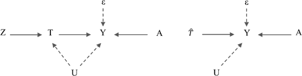

图 4.13 治疗 (`T`) 对结果 (`Y`) 影响的有向无环图 (DAG)，其中存在工具变量 (`Z`)。 ⏎

在我们的例子中，处理的提供 (`T`) 潜在上是一个合适的工具变量，因为除非先提供，否则不太可能接受新的信用卡。

机械上，最常见的技术是使用 TSLS。首先，将处理对工具变量(s)和其他外生控制变量进行回归，第一阶段方程形式如下：

$$T_{i} = a + bZ_{i} + {\sum\limits_{j}{c_{j}A_{ji}}} + e_{i}$$

(4.14)

由此，得到 `T[i]` 的预测值（即 $\hat{T_{i}}$），并用它们代替公式 (4.13) 中的 `T[i]`。这些预测值将不再受未观测到的 `U` 的影响。实际上，大多数软件包允许使用单个命令估计第 95 页 TSLS，例如 Stata 中的 `ivregress`，并提取 $\hat{\beta_{0}}$ 中的处理效应。其他估计方法也是可能的。

工具变量估计被经济学家广泛使用（例如，Boonperm 等 2013），但并不总是有效。主要挑战是找到合适的工具变量（或变量）。一个好的工具 (`Z`) 需要与处理指标 (`T`) 强烈相关——工具相关性——同时与公式 (4.2) 中的误差项不相关——工具外生性，或“排除限制”。使用公式 (4.14) 可以检验工具相关性，但工具外生性的论证必须使用逻辑、理论或常识来做出。Murray (2005, p. 18)，在其对 IV 估计的回顾中指出，

### 4.5.1 模拟示例

为了说明 IV 估计的工作原理，考虑以下使用 1,000 个观测值模拟的例子。假设消费者的信用卡消费 (`Y`) 取决于他们是否接受另一张信用卡（处理 `T`）、其收入 (`A`)、一个不可观测因素 (`U`) 以及进一步的随机要素 (`u[Y]`)，如下所示：

`Y = 3 + 1.5 T + 2 U + 4 A + u[Y]`

(4.15)

所有变量均已标准化，且 `U`、`A` 和 `u[Y]` 均来自标准正态分布。处理的真实影响——如果消费者接受了另一张信用卡则设为 1，否则为零——对消费的影响为 1.5。让我们进一步假设接受另一张信用卡受收入、未观测因素以及某些外生外部影响 (`Z`) 的影响，给出

$$\begin{matrix} {T = 1} & {\text{if}~0.05 + 0.1~U + 0.8~Z + ~u_{u} > 0} \\ {T = 0} & \text{otherwise} \\ \end{matrix}$$

(4.16)

我们无法估计公式 (4.16)，因为 `U` 是不可观测的。如果省略 `U`，我们的回归估计（来自公式 4.15）给出

$$\begin{matrix} {Y = ~2.00~ + ~3.50~T~ + ~3.85~A} \\ {~p < .001~p < .001~p < .001} \\ \end{matrix}$$

(4.17)

处理效应的估计值为 3.5，太大了——应该是 1.5——因为它不仅捕捉了 `T` 的效应，还捕捉了 `U`（通过 `T` 起作用）的效应。

第 96 页 第一阶段（“参与”）公式 (4.16) 的估计给出

$$\begin{matrix} {\hat{T} = ~0.52~ + ~0.21~Z~ - ~0.001~A} \\ {~p < .001~p < .001~p < .95} \\ \end{matrix}$$

(4.18)

使用该方程的预测值 (`T̂`) 在第二阶段公式 (4.15) 中给出

$$\begin{matrix} {Y = ~2.07~ + ~1.46~\hat{T}~ + ~3.87~A} \\ {~p < .001~p < .001~p < .001} \\ \end{matrix}$$

(4.19)


这里 `T̂` 上的系数为 1.46，非常接近模拟中确定的理论值 1.5。式 (4.17) 中 `T` 系数的 t 统计量为 28.1，而式 (4.19) 中为 3.6。忽略内生性问题可能会给出精确但错误的估计，而工具变量估计则大致正确。

尽管识别令人信服的工具存在困难，但 IV 仍然很受欢迎，因为它经常是唯一可用的识别技术。我们已使用该方法来帮助衡量泰国小额信贷的影响：借款人与非借款人可能存在差异，但泰国村庄基金为每个村庄提供固定金额的信贷。在较小的村庄中，贷款 (`T`) 的概率更高，因此村庄规模可作为小额信贷借款的工具变量（Haughton 和 Khandker 2009）。我们还研究了筹款电话营销活动中不同脚本的影响。并非每个人都会接听电话，但打电话是一个工具，有助于决定是否接听电话，而在接听电话的前提下，它不会影响是否捐款（Lo 和 Li 2021）。

如果我们假设每个人对处理（如信用卡优惠）以相同方式作出反应，则为同质反应情形，结果可能合理地推广到更广泛的人群，从而赋予结果外部有效性。然而，通常情况下我们会遇到对处理的异质性反应——例如女性与男性的反应可能不同——在这种情况下，我们对结果只有局部平均处理效应（LATE），外部有效性可能较低。

再次考虑提供信用卡的活动。使用 Angrist 等 (1996) 的术语，一些人即使没有优惠也会申请信用卡（“始终接受者”），一些人永远不会接受另一张信用卡（“从不接受者”），少数人可能会在获得另一项优惠时放弃信用卡（“违背者”），而剩余的子群体则对优惠作出反应（“顺从者”）。当反应存在异质性且满足若干假设时（Imbens 2014），IV 估计仅衡量对顺从者的处理效应。这可能是一个特殊群体，未必能代表整体人口，而且可能难以识别，在这种情况下，影响度量的适用范围难以确定（Imbens 2014）。

第 97 页 实用因果推断领域正在迅速扩展。在 第 3 章 和 第 4 章 中讨论的技术为该领域提供了介绍，应该足以让用户开始进行因果效应的估计。

## 注释

1. 我们假设 `GPA ∼ N(3,0.4)`，且 `Y = 40 + 10 × GPA + N(0,10)`。 ⏎
2. 这里 `Y = 40 + 7 × T + 10 × GPA + N(0,10)`，其中 `T` 是“处理”，此处为进入荣誉项目。 ⏎

## 参考文献

* Abadie, Alberto. 2021. “使用合成控制法：可行性、数据需求和方法论方面”. Journal of Economic Literature, 59(2): 391–425. ⏎
* Abadie, Alberto, and Javier Gardeazabal. 2003. “冲突的经济成本：巴斯克地区案例研究”. American Economic Review, 93(1): 113–132. ⏎
* Angrist, Joshua, Guido Imbens, and Donald Rubin. 1996. “使用工具变量识别因果效应”. Journal of the American Statistical Association, 91: 444–472. ⏎
* Athey, Susan, and Guido Imbens. 2017. “应用计量经济学的现状：因果关系与政策评估”. Journal of Economic Perspectives, 31(2): 3–32. ⏎
* Bernal, James Lopez, Steven Cummins, and Antonio Gasparrini. 2019. “双重差分、受控中断时间序列与合成控制”. International Journal of Epidemiology, 48(6): 2062–2063. ⏎
* Bleemer, Zachary, and Aashish Mehta. 2022. “学习经济学会让你致富吗？大学专业回报的回归不连续分析”. American Economic Journal: Applied Economics, 14(2): 1–22. ⏎
* Boonperm, Jirawan, Jonathan Haughton, and Shahidur Khandker. 2013. “村庄基金在泰国重要吗？对收入和支出的影响评估”. Journal of Asian Economics, 25: 3–16. ⏎
* Callaway, Brantly, and Petro Sant'Anna. 2021a. “开始使用 DID 包”. [`www.stata.com/new-in-stata/difference-in-differences-DID-DDD/`](https://www.stata.com/new-in-stata/difference-in-differences-DID-DDD/) \[Accessed Jan 6, 2022.\] ⏎
* Callaway, Brantly, and Pedro Sant'Anna. 2021b. “多期双重差分”. Journal of Econometrics, 225(2): 200–230. ⏎
* Calonico, Sebastian, Matias Cattaneo, Max Farrell, and Rocio Titiunik. 2017. “Rdrobust：回归不连续设计的软件”. Stata Journal, 17: 372–404. ⏎
* Card, David. 1990. “马里尔船队对迈阿密劳动力市场的影响”. Industrial and Labor Relations Review, 43(2): 245–257. ⏎
* Card, David, and Alan Krueger. 1994. “最低工资与就业：新泽西州和宾夕法尼亚州快餐业的案例研究”. American Economic Review, 84(4): 772–793. ⏎
* 第 98 页 Card, David, David Lee, Zhuan Pei, and Andrea Weber. 2015. “广义回归拐点设计中的因果效应推断”. Econometrica, 83(6): 2453–2483. ⏎
* Cunningham, Scott. 2021. 因果推断：混音带. New Haven, CT: Yale University Press. ⏎
* Flammer, Caroline, and Pratima Bansal. 2017. “长期导向是否创造价值？来自回归不连续的证据”. Strategic Management Journal, 38(9): 1837–1847. ⏎
* Fremeth, Adam, Guy Holburn, and Brian Richter. 2016. “在组织研究中弥合定性与定量方法：美国汽车行业合成控制方法的应用”. Organization Science, 27(2): 462–482. ⏎
* Gelman, Andrew, and Guido Imbens. 2019. “为何不应在回归不连续设计中使用高阶多项式”. Journal of Business and Economic Statistics, 37(3): 447–456. ⏎
* Haughton, Jonathan, and Shahidur Khandker. 2009. 贫困与不平等手册. Washington, DC: World Bank. ⏎
* Hsiao, C., H. S. Ching, and S. K. Wan. 2012. “项目评估的面板数据方法：衡量香港与中国大陆政治经济一体化带来的收益”. Journal of Applied Econometrics, 27: 705–740. ⏎
* Imai, Kosuke, and In Song Kim. 2020. “面板数据因果推断中双向固定效应回归模型的使用”. Political Analysis, 29: 405–415. ⏎
* Imbens, Guido. 2014. “工具变量：计量经济学家的视角”. Statistical Science, 29(3): 323–358. ⏎
* Imbens, Guido, and Thomas Lemieux. 2008. “回归不连续设计：实践指南”. Journal of Econometrics, 142(2): 615–635. ⏎
* Lo, Victor S. Y., and Zhuang Li. 2021. “外向策略的因果推断与机器学习”. *Joint Statistical Meetings (JSM) Proceedings*. American Statistical Association. ⏎


*   Murray, Michael. 2005. 坏的、弱的和丑的：避免工具变量估计的陷阱. Lewiston ME. Bates College. ⏎
*   Peri, Giovanni, and Vasil Yasenov. 2019. “难民潮的劳动力市场效应：合成控制法遇见马里尔船潮”. 人力资源杂志, 54(2): 267–309. ⏎
*   Stata. 2021. “双重差分（DID）和三重差分（DDD）模型”. [`www.stata.com/new-in-stata/difference-in-differences-DID-DDD/`](https://www.stata.com/new-in-stata/difference-in-differences-DID-DDD/) ⏎
*   Thistlethwaite, Donald, and Donald Campbell. 1960. “回归不连续性分析：事后实验的替代方案”. 教育心理学杂志, 51(6): 309–317. ⏎
*   Wooldridge, Jeffrey. 2021. “双向固定效应、双向 Mundlak 回归和双重差分估计量”. [`doi.org/10.2139/ssrn.3906345`](http://dx.doi.org/10.2139/ssrn.3906345) ⏎

第 99 页

# 5 有向无环图

DOI: [10.1201/9780429172588-5](https://doi.org/10.1201/9780429172588-5)

在所有商业决策的核心，都是希望知道是否 `A` 导致 `B`。广告活动能否提升销售额？绿色包装能否提高客户忠诚度？加薪能否提高员工生产力？

有时我们可以通过运行实验来推断因果关系——例如，在某个区域试点绿色包装并追踪其相对于其他区域的结果。我们将在 第 3 章 更详细地讨论随机试验，但在实践中，我们可能没有机会、资源或时间进行完整的实验。大多数时候我们只能使用不完美的数据凑合。

事实证明，在某些情况下，实际上有可能“在原始统计数据中发现因果结构” (Conrady and Jouffe 2013, 第 17 页)，但正如我们将看到的，这并不总是容易做到，需要特殊技术，有时还会失败。该方法的 foremost exponents 是 Judea Pearl，他于 2011 年获得图灵奖，“因通过概率和因果推理的演算对人工智能做出了基础性贡献” ([`amturing.acm.org/award\_winners/pearl\_2658896.cfm`](http://amturing.acm.org/award_winners/pearl_2658896.cfm))，他的著作 *因果* (Pearl 2000) 可能是该领域最重要的著作之一，同时还有更简洁的综述 (Pearl 2009) 和更易读的 *《为何如此》* (Pearl and Mackenzie 2020)。该方法使用逻辑和统计相关性的混合来推断（在可能的情况下）一组变量之间的因果方向。

实际上，这种方法是通过估计 *有向无环图* (DAGs) 来实现的，也称为 *贝叶斯网络*，该术语由 Pearl 提出。因果网络是要求关系为因果的贝叶斯网络。

在本章中，我们首先展示因果关系如何有时可以从数据中推断出来；解释 DAGs 背后的逻辑及其主要组成部分；讨论实际估计 DAGs 所需的软件和算法；并开发一个与营销组合相关的扩展示例，以说明这些及相关技术在重要实际问题上的应用。

## 5.1 能否从数据中推断因果关系？

假设我们拥有大量调查数据，显示变量 `A` 和 `B` 之间存在明确关系：例如，一个人有多瘦 (`A`) 可能与他们饮用的第 100 页饮食汽水的数量 (`B`) 相关。我们想知道他们是因为瘦才喝饮食汽水，还是因为喝饮食汽水才瘦。如果这是我们唯一的信息，那么实际上不可能推断出因果方向。

令人惊讶的是，如果我们有一些额外信息，我们可能能够对因果关系做出一些说明。例如，假设我们有个人年龄的信息（变量 `C`）。我们现在在 图 5.1 所示的路径图中列出 `A`、`B` 和 `C` 之间可能的各种关系（该图借鉴了 Bryant et al. 2009）。这里，符号 `A ∘→ B` 表示一个有向“边”，表示 `A` 导致 `B`，或它们共享一个共同的潜在原因，或两者兼有；边 `A ∘− −∘ B` 表示任一变量导致另一个，或它们共享一个共同的潜在原因，或两者兼有。

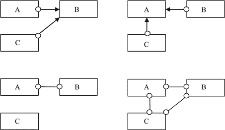

图 5.1 三个变量（`A`、`B` 和 `C`）在不同因果结构下的图示。（基于 Bryant et al. 2009，图 2。）⏎

在我们的例子中，我们知道 `A`（瘦）和 `B`（饮食汽水消费）之间存在某种关系：形式上，`A` 和 `B` 不是独立的（即 `A⊥B`）。然而，我们尚不知道两者之间的因果关系。

鉴于我们对变量 `C` 的信息——在我们的例子中是年龄——现在有四个感兴趣的可能情况：

1. 第一个可能性是 `A` 和 `C` 是独立的，但 `B` 和 `C` 不是（即 `A⊥C` 和 `B⊥C`）。这是 图 5.1 左上面板所示的情况。在这种情况下，我们不能排除 `A` 导致 `B` 的可能性。这是唯一的合乎逻辑的可能性；如果 `C` 导致 `B` 且 `B` 导致 `A`，那么 `C` 和 `A` 不会独立；如果 `B` 导致 `A` 和 `C`，那么 `A` 和 `C` 不会独立。

在我们的例子中，如果年龄 (`C`) 与一个人有多瘦 (`A`) 无关，但年轻人更有可能喝饮食汽水 (`B`)，那么我们推断瘦的人喝饮食汽水，但喝饮食汽水不会影响你的瘦程度。如果饮食汽水能让你保持苗条，并且主要由年轻人饮用，那么年龄和瘦程度之间就会存在关联，但我们已经排除了这一点。

2. 第二个可能性，如 图 5.1 右上面板所示，是 `C` 与 `B` 独立但与 `A` 不独立（即 `A⊥C` 和 `B⊥C`）。如果 `A` 导致 `B` 且与 `C` 不独立，那么 `B` 不会与 `C` 独立；但我们被告知它是独立的。所以我们推断在这种情况下 `A` 不能导致 `B`，我们拒绝 `A` 导致 `B` 的原假设。在我们的例子中，这是年轻人更瘦但不太可能喝饮食汽水的情况。在这里我们得出结论，饮食汽水能让你保持苗条。

3. 下一个可能性（图 5.1 左下面板）是 `C` 与 `A` 和 `B` 都独立（即 `A⊥C` 和 `B⊥C`）。我们假设 `A` 和 `B` 之间存在某种关系，但关于 `C` 的信息无助于确定因果方向。

4. 最后，`C` 可能与 `A` 或 `B` 都不独立（即 `A⊥C` 和 `B⊥C`），如 图 5.1 右下面板所示。我们不能排除 `A` 导致 `B` 的可能性，但 `B` 导致 `A` 也是可能的，或者两者都不导致对方，但只是被共同原因（例如本例中的 `C`）所影响。

Bryant et al. (2009) 用一个很好的例子说明了这种逻辑的情况。众所周知，酒精消费增加与道路死亡人数增加相关，但酒精是否导致死亡，还是死亡促使人们借酒浇愁？


利用 1947 年至 1993 年美国全国的时间序列数据，他们发现，正如预期的那样，道路死亡人数与人口整体人均酒精消费量之间确实存在相关性。在对数据进行过滤以去除非平稳性的影响后（Bryant 等 2009，第 370–371 页），他们得到的相关系数为 0.341，我们用星号标记它，因为它在统计上显著：因此 `ρ(death, alcohol)` = 0.341\*。然而，没有进一步的信息，我们无法确定这种关系中因果方向。

他们还拥有高速公路平均速度的信息，并能够估计以下相关系数：
1. `ρ(death, speed)` = 0.386\*
2. `ρ(alcohol, speed)` = 0.136。

根据我们之前的逻辑，组织这些信息只有一种方式，即如图 5.2 所示。

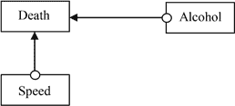
图 5.2 识别道路死亡原因的 DAG。（基于 Bryant 等 (2009)。 ⏎

换句话说，是酒精导致道路死亡，而不是死亡导致更多饮酒。我们现在已经做出了明确的因果推断。Geiger 等 (1990)进一步讨论了如何在 DAG 中识别独立性。

第 102 页 为了帮助理解因果关系而引入额外信息，在某种程度上类似于回归分析中使用工具变量来识别一个变量对另一个变量的影响的方法，我们在第 4 章中更详细地讨论了该方法。

## 5.2 使用 DAG 推断因果关系

六个月前贵公司启动了一项销售更多背包的活动。在活动之前，2%的客户购买了背包。现在，活动六个月后，2.2%的客户正在购买背包，市场营销部门大肆宣传其成就，认为活动有效。我们在此假设没有可用于“金标准”因果测量的随机对照组。你几乎被说服，直到你的数据分析师指出，男性客户中背包购买量从 4%下降到 3.5%，女性客户中从 1%下降到 0.7%。也许活动失败了。至少，你想更深入地了解活动导致了哪些影响。

通常可以创建一个 DAG 来理解这种情况（这是辛普森悖论的一个例证）。构建 DAG 的过程始于路径图的构建，后者总结了变量之间的定性联系。如前所述，变量显示在节点中，但现在它们要么由有向弧（`A`→`B`）连接，指定假设的因果方向，要么没有弧，在这种情况下，根据假设，`A`和`B`之间没有直接因果联系。

DAGs 由仅有的三类基本组件构成，如图 5.3 所示：间接连接、共同原因和碰撞体。让我们依次介绍每一种：

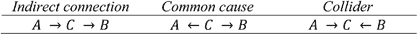
图 5.3 DAG 的三个基本组件图。 ⏎

1. 间接连接由 `A`→`C`→`B` 给出。
这里，`A`导致`B`，但仅通过其对`C`的影响。变量`A`和`B`无条件依赖，但如果`C`被预设，`A`和`B`之间的路径将被“阻断”，并且`A`和`B`现在条件独立，意味着在给定`C`的情况下它们是独立的。形式上，我们有 `A`⊥`B` 且 `A`⊥`B`|`C`。

2. 第 103 页 共同原因发生在我们有 `A`←`C`→`B` 时。
在这种情况下，变量`C`同时导致`A`和`B`。同样，`A`和`B`无条件依赖，但如果`C`被预设，`A`的任何进一步变化与`B`的变化无关。这里同样有 `A`⊥`B` 且 `A`⊥`B`|`C`。

3. DAG 的第三个构建模块是 *碰撞体*，其中 `A`→`C`←`B`。
这种有趣的情况表明 `A` 和 `B` 都导致 `C`，并且 `A` 和 `B` 无条件独立。然而，对于碰撞体 `C` 的任何给定值，`A` 和 `B` 是（条件）依赖的。形式上，我们说 `A` 和 `B` 在给定 `C` 的情况下 *d-连接*，我们将其写为 `A`⊥`B` 且 `A`⊥`B`|`C`。

我们现在准备回到背包广告活动。这里的问题是性别似乎与“处理”（即活动）相互作用。我们可以用一个图来描绘这种情况，实际上是一个 DAG，因为该图不显示循环行为。这在图 5.4 中显示，并说明了 DAG 的全部三个基本组件：性别与背包销售之间存在间接连接（`G`→`C`→`S`）；性别是销售活动和结果的共同原因（`S`←`G`→`C`）；性别和活动碰撞产生背包销售结果的影响（`G`→`S`←`C`）。

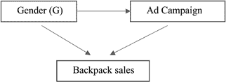
图 5.4 背包示例的 DAG。 ⏎

我们感兴趣的是衡量广告活动（`C`）对销售（`S`）的影响，以确定活动在多大程度上导致了销售的变化。但存在非因果路径，包括 `G`→`C`，需要被“阻断”，以便我们能够仅集中于 `C`→`S` 链接，而不受任何污染。

通常我们使用回归来尝试衡量影响的强度。如果我们假设广告活动（`C`）对背包销售（`S`）的影响是线性的，我们可能会控制性别并估计
`E(S) = β[0] + β[1]G + β[2]C`
(5.1)
其中我们期望 `β[2]` 将分离出广告活动的影响。

第 104 页 顺便说一下，我们注意到这仅衡量 *直接* 或近端因果效应；在更复杂的模型中，可能还存在需要考虑的间接效应。例如，如果我们感兴趣的是性别对背包销售的影响（除了活动对销售的影响之外），需要考虑两种效应：直接效应 `G`⟜→`S` 和间接效应 `G`→`C`→`S`。为了衡量这两种效应，我们 *不* 希望对 `C` 进行条件化，因此在这种情况下我们需要估计
`E(Z) = γ[0] + γ[1]G`
(5.2)
换句话说，式 5.1 中 `G` 的系数并不衡量 `G` 对 `S` 的 *总* 因果效应。在流行病学中，这被称为 *表 2 谬误*（Westreich 和 Greenland 2013）。一般来说，如果我们需要衡量多个因果效应，我们需要多个回归模型（另见 Baron 和 Kenny 1986 关于衡量直接效应与间接效应）。

这一讨论的更广泛含义是，没有明确陈述的因果结构，回归系数没有任何因果意义（Conrady 和 Jouffe 2013，第 22 页）。

## 5.3 何时可以创建 DAG？

即使有 DAG 的帮助，因果效应的识别也可能很脆弱。按照 Conrady 和 Jouffre（第 342 页）的说法，假设存在一个未观察到的变量 `U` 同时影响处理和结果。我们希望将其纳入回归方程（如果效应可以假设为线性，或其变体），但由于我们没有观察到 `U`，无法做到这一点。现在我们无法以无偏的方式衡量处理对结果的因果效应。这也可以被视为遗漏变量偏误的情况，只有当遗漏的变量与回归中其他右侧变量正交时才不重要——而根据假设，这里并非如此，实践中也很罕见。

更一般地说，在什么情况下我们可以用合理的希望使用 DAG 来阐明因果方向？事实证明，需要满足三个主要条件（Spirtes 等 2000）。


这些中最重要的是变量集合必须是*因果充分*的。这意味着在我们构建的模型中包含的变量之间不存在对其产生因果影响的遗漏变量。按字面理解，这将意味着我们永远无法推断因果关系，因为不可能确定我们已考虑了每一种可能的影响。难怪德谟克利特对寻找任何因果规律感到绝望！在实践中，分析人员需要能够有力地论证没有遗漏任何可能重要的因素。

第 105 页 第二个条件是集合中所有变量的联合分布满足*因果马尔可夫条件*。这意味着要完全捕捉任一变量的概率分布，只需对父节点（即 DAG 中的父变量）进行条件化，而无需对祖父母、叔伯、姑姨或兄弟姐妹进行条件化。可能存在因果链，但它们都通过变量取值的前因决定因素发挥作用。

第三个假设是*忠实性*，这意味着对于任意一对 `X`、`Y`，`X` 与 `Y` 存在依赖关系当且仅当 `X` 与 `Y` 之间存在边（即链接）。

没有必要因为我们没有完美的因果推断机制而感到束手无策。DAG 的逻辑非常强大，在我们努力识别那些可以实际用来对结果产生影响的变量时，它往往非常有帮助。

## 5.4 估计 DAG

如何在实践中衡量因果效应？显然，我们必须假设我们的模型是完整的，即我们拥有所有相关变量的信息，并且不存在相关的遗漏变量。这仍然不能保证我们能够识别因果关系，但它提供了可能性。

估计 DAG 需要使用专用软件，并且可以使用大量可能的算法之一来尝试。然后可以使用多种软件包，主要的有 TETRAD、GeNIE、R 语言中的 bnlearn 以及 BayesiaLab。

为了构建一个 DAG，只需要对某些变量进行多次观测——例如来自数据调查。软件随后会寻求识别这些变量之间的关系。

最成熟的求解机制是 *偏相关（PC）算法*，由 Scheines 等（1994） 提出。它最初作为 Tetrad 项目的一部分出现，并由卡内基梅隆大学（2025 年）哲学系维护。它也被包含为 GeNIE 和 bnlearn 等其他软件包中的选项。PC 算法是一类约束算法之一，也包括贪婪搜索（GS）算法。这些算法先构建一个无向网络，然后识别碰撞节点和其他有向链接。

第一步是列出所有变量（节点或顶点），并在无向图中创建连接每个节点与每个其他节点的边。然后从无条件独立或在对剩余变量的子集进行条件化后独立的变量对中移除边。独立性检验基于连续数据的相关性检验和分类数据的列联表检验。

第二步是确定剩余变量之间的链接方向，从碰撞节点开始。如果 `X` 与 `Y` 相连，且 `Y` 与 `Z` 相连，但 `X` 与 `Z` 独立（无条件地，或在除 `Y` 之外的变量上进行条件化），那么我们可以得出 `X→Y←Z`。对于 `X→Y`、`Y` 与 `Z` 相连，但 `X` 与 `Z` 在条件于 `Y` 时不相关的情形，我们可以推断存在 `X→Y→Z` 形式的间接连接。更多细节见 Tetrad 手册（卡内基梅隆大学 2025）；关于算法选择的讨论，在 Tetrad 以及其他创建 DAG 的统计软件包的背景下，可见 Haughton 等（2006）。构建 DAG 的统计软件包通常允许用户施加一些先验已知的链接。如果整个 DAG 先验已知，其估计就简化为结构方程模型（SEM；参见 第 11 章）的估计。

还有许多其他可用的算法，它们通常会生成略有不同的 DAG。基于评分的算法在所有可能的 DAG 中搜索拟合度最好的一个，通常使用最小描述长度（MDL）来衡量，这是一种 BIC 准则的实现。这最终成为一个困难的优化问题，部分原因是等价性可能产生许多局部最优。较新的方法包括基于最稀疏排列的尝试（Raskutti 和 Uhler 2014）。Larranaga 等（1996） 尝试使用遗传算法，而 Larranaga 等（2013）撰写了后续文献的综述。寻找良好算法的探索仍然是一个活跃的研究领域。Bessler 和 Loper（2001） 估计了一个关于经济发展原因的有趣模型。

### 5.4.1 DAG 与理论：出版生产力

一些 DAG 和其他“发现算法”的倡导者认为，这些方法在很大程度上可以替代理论，并且在社会科学的许多领域中，常识加上对潜在统计假设的关注就足够了（Spirtes 等 2000）。在一个有趣的例子中，Spirtes 及其合作者研究了 Rodgers 和 Maranto（1989） 的一项研究，该研究试图解释出版生产力的决定因素，以出版物被引用的速度来衡量。数据来自 162 份对 1966 年至 1976 年间获得博士学位的学术心理学家进行的调查问卷回复，变量包括“能力”测量（基于本科表现）、研究生项目质量（`GPQ`）、早期出版物数量、第一份工作质量（`QFJ`）、性别和出版率。

存在几种试图解释出版生产力的可能理论。标准的人力资本模型认为能力（`ABILITY`）会影响 `GPQ` 和 `QFJ`，通过这些渠道推动出版率（`PROD`），如图 图 5.5 左上面板所示。第 107 页“筛选”假说的版本认为，具有能力的人需要通过就读高质量的研究生项目来展示其能力，这反过来又推动他们进入高质量的第一份工作，从而为学术生产力提供环境，如图 图 5.5 右上面板所示。还有许多其他可能的模型，在回顾文献并尝试了几种模型后，Rodgers 和 Maranto 最终确定了如图 图 5.5 左下面板所示的路径。


图 5.5 显示心理学研究生产力原因的图表。 (*注：* 左上面板显示人力资本模型；右上面板显示“筛选”模型；左下面板显示 Rodgers 和 Maranto (1989) 图表；右下面板有来自 Spirtes 等 (2000) 的 DAG。 `GPQ` 是就读研究生项目的质量； `QFJ` 是第一份工作的质量； `PREPRO` 是博士前发表物； `PUBS` 衡量发表率；并且 `CITES` 衡量引用率。） ⏎

使用相同的数据，Spirtes 等 (2000) 使用 TETRAD 创建了一个非常相似的图表——显示在 图 5.5 的右下面板中——使用他们所说“只需几分钟”的过程。他们的结论极具挑衅性：“任何声称除常识之外需要社会科学理论来找到 Rodgers 和 Maranto 模型精髓的说法显然是错误的”（第 102 页）。

此处提出的挑战远远超出了此特定案例的具体细节——例如，在此示例中“能力”对 `PUBS` 似乎没有明显的直接影响——涉及如何在理论与数字之间分配时间和精力，甚至涉及何构成有用知识的本质问题。

第 108 页

## 5.5 案例研究：营销组合

营销人员面临的核心问题是如何在不同媒体之间分配促销预算——无论是印刷广告、社交媒体、电视广告、免费样品、优惠券等等。标准做法是从地区到地区改变促销支出的分配，然后利用这种变化来识别不同活动对目标（如销售额或利润）的贡献。识别通常使用时间序列回归技术进行，沿着 第 2 章 和 第 6 章 中概述的思路。

考虑一家制药公司希望增加为一种相对较新的抗生素药物开具的处方数量的案例。该公司的策略是尝试直接向医生营销，使用多种方法，包括个人拜访（“拜访”）、对医生的其他干预（“联系”）、在医学期刊上的广告以及提供免费药品样品。然而，尚不清楚其中哪种策略的回报最高，以促销活动后期间开具的新处方数量来衡量。

为了说明可以如何进行，我们构建了一个合成数据集，其基于 Lim 等 (2008) 报道的真实案例。他们拥有关于新处方数量（`new_Rx`）的月度数据，以及 11 个其他变量，这些数据是在为一种新抗生素进行的促销活动期间的 71 个月内收集的。原始数据不可用，因此我们根据相关矩阵和汇总统计数据创建了一个模拟数据集。关于变量的基本信息，包括其定义，显示在 表 5.1 中。

表 5.1 与新抗生素营销活动相关的变量汇总数据 ⏎

| 变量 || 均值 || 标准差 || 描述 |
| --- | --- | --- | --- |
| `new_Rx` (`nrx`) || 1,080,544 || 512,580 || 发放的新处方数量 |
| --- | --- | --- | --- |
| `Calls` (`cal`) || 38,965 || 17,163 || 制药代表对医生的拜访 |
| `contacts_n` (`con`) || 54,114 || 21,607 || 针对特定产品的与医生的联系 |
| `contacts_totcost` (`coc`) || 4,357,318 || 1,740,648 || 与医生联系相关的成本 |
| `contacts_unitcost` (`cpc`) || 87.9 || 10.7 || 与联系相关的成本，每次联系 |
| `minutes_withphys` (`min`) || 182,602 || 72,862 || 与医生共度的时间 |
| `ads_n` (`ads`) || 14.1 || 6.6 || 不同广告的数量 |
| `ads_pages` (`adp`) || 39.2 || 20.2 || 广告页数 |
| `ads_totcost` (`jas`) || 217,927 || 112,178 || 医学期刊广告成本 |
| `samples_n` (`sam`) || 1,094,355 || 627,397 || 提供给医生的样品 |
| `samples_units` (`eus`) || 3,556,611 || 1,743,432 || 提供给医生的样品，按样品大小加权 |
| `samples_retailval` (`rvs`) || 8,582,260 || 3,820,827 || 提供给医生的样品零售价值 |

第 109 页
衡量可用变量对结果影响的一种天真方法是估计线性回归，其中 `new_Rx` 是因变量，其他 11 个变量是回归变量（请注意，数据未进行差分或其他转换）。这用数据替代思考，因此结果——显示在 表 5.2 中——难以解释也就不足为奇了。例如，在其他条件相同的情况下，期刊广告支出越高，与新处方越少相关，这似乎很奇怪。右侧变量之间高度多重共线性导致统计显著性不足：四个变量在 10% 水平上不具有统计显著性（即它们的 p 值大于 0.1）。

表 5.2 新处方基本回归模型回归结果 ⏎

| 变量 || 系数 || p 值 || 系数 || p 值 |
| --- | --- | --- | --- | --- |
| `Calls` (`cal`) || 12.4 || 0.47 || || |
| --- | --- | --- | --- | --- |
| `contacts_n` (`con`) || −31.3 || 0.04 || || |
| `contacts_totcost` (`coc`) || 0.19 || 0.12 || || |
| `contacts_unitcost` (`cpc`) || −11.3 || 0.02 || || |
| `minutes_withphys` (`min`) || 1.23 || 0.46 || || |
| `ads_n` (`ads`) || 34.0 || 0.02 || 33.0 || 0.00 |
| `ads_pages` (`adp`) || 2.71 || 0.61 || || |
| `ads_totcost` (`jas`) || −1.56 || 0.01 || −1.21 || 0.01 |
| `samples_n` (`sam`) || 0.48 || 0.05 || 0.23 || 0.01 |
| `samples_units` (`eus`) || −0.14 || 0.08 || || |
| `samples_retailval` (`rvs`) || 0.08 || 0.00 || 0.07 || 0.00 |
| R 平方 || 0.93 || || 0.92 || |

此时，一些研究人员可能会使用逐步或 lasso 程序来修剪模型中的变量（特征）。前向逐步回归的结果——仅包含在 10% 水平或更好水平上显著的变量——显示在 表 5.2 的右栏中。看似好消息是拟合度几乎与较大方程一样高，而模型更简洁。这里的问题是逐步回归的使用可能是错误的（参见 第 2 章），并且在当前示例中并未消除期刊广告支出与新处方数量之间令人惊讶的负相关，这削弱了模型的信度。

另一种诱人的途径是将变量数量减少到少数几个因子（参见 第 11 章）。在 表 5.3 中，我们展示了适用于 11 个变量的 varimax 旋转因子载荷；基础变量相当自然地分为两组，第一因子反映了 第 110 页 联系和样品的影响，第二因子可能被标记为“期刊广告”。适用于变量的系数——从而产生因子——显示在 表 5.3 的右侧。我们现在可以将新处方数量对这两个因子进行回归，如 表 5.4 所示。总体拟合度仍然良好，但我们在过程中丢失了一些信息，并且肯定失去了对因果联系的把握。

表 5.3 营销组合模型的因子载荷和系数 ⏎

| || 因子载荷 || 系数 |
| --- | --- | --- | --- |
| || 因子 1 || 因子 2 || 因子 1 || 因子 2 |
| 变量 || || || || |
| --- | --- | --- | --- | --- |
| `new_Rx` (`nrx`) || || || || |


| 通话 (`cal`) || 0.940 || || 0.149 || −0.105 |
| 联系次数 (`con`) || 0.945 || || 0.151 || −0.109 |
| 联系总成本 (`coc`) || 0.918 || || 0.144 || −0.094 |
| 联系单位成本* (`cpc`) || −0.769 || || −0.135 || 0.162 |
| 与医生相处分钟数 (`min`) || 0.941 || || 0.151 || −0.117 |
| 广告次数* (`ads`) || || 0.910 || −0.014 || 0.375 |
| 广告页数* (`adp`) || || 0.936 || −0.028 || 0.406 |
| 广告总成本 (`jas`) || || 0.954 || −0.051 || 0.446 |
| 样品数量 (`sam`) || 0.886 || 0.402 || 0.129 || −0.034 |
| 样品单位 (`eus`) || 0.845 || 0.416 || 0.120 || −0.015 |
| 样品零售价值 (`rvs`) || 0.887 || || 0.132 || −0.051 |

表 5.4 两因素营销组合模型的回归估计 ⏎

| || 系数 || p 值 |
| --- | --- | --- |
| 变量 || || |
| --- | --- | --- |
| 因子 1（“联系和样品”） || 0.916 || 0.00 |
| 因子 2（“期刊广告”） || 0.200 || 0.00 |
| R 平方 || 0.88 || |

更可靠的方法是尝试构建一个 DAG，其结果显示在 图 5.6。该特定图使用名为 `PC Pattern` 的改进 PC 算法构建，使用 `Tetrad IV` 软件包。每个节点对应 13 个变量中的一个，包括新处方数量，这是我们最感兴趣的变量。附加在每个节点上的值只是均值，与 表 5.1 中的相同。

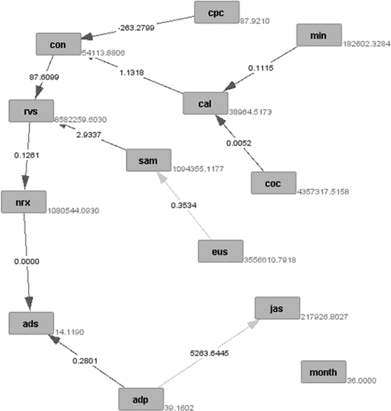

图 5.6 营销组合模型的 DAG。 ⏎

第 111 页 DAG 包含一系列有向链接（“边”），指示因果方向（根据数据推断）。每条边上的数字衡量每个父节点对其子节点的影响，是子节点值对其父节点值线性回归的系数。例如，当联系次数 (`con`) 增加一个单位时，处方的零售价值 (`rvs`) 上升 $87.6。

在本例中，只有一种变量对开具的新处方数量有直接影响，那就是提供给医生的样品的零售价值。七个变量具有间接影响，因为它们首先影响样品的价值，并通过这种间接途径改变新处方数量。

第 112 页 确实只有四个“主要”变量影响新处方数量，这些是本身没有父节点的祖先。在我们的例子中，这些是 `cpc`、`min`、`coc` 和 `eus`。对 `nrx` 关于这些变量的回归将衡量这些原因的影响，然后可以应用线性规划来优化在有限市场预算下的支出方式，以实现销售更多药品的目标。

衡量医学期刊广告程度的变量在模型中显示为额外处方的 *结果*，而不是原因。可能处方越多，期刊广告就扩展得越多。

我们的结果特定于此处研究的情境，并不具有“外部有效性”，即不能立即适用于其他情境。每种情况都需要自己的仔细分析。但随着此类研究的重复，实践者将逐渐建立起对因果关系线条的更好认识，从而了解在试图营销新产品时什么有效，什么无效。

## 5.6 估计 DAG：实际考虑

在估计 DAG 时，首先要选择使用哪个软件包。主要选择是免费软件包之一（`Tetrad`、`GeNIe`、`bnlearn` 在 R 中）或商业产品如 `BayesiaLab`。所有软件包都提供多种求解算法，但它们在图形质量以及可用用户界面和选项方面差异很大。

选择合适的求解算法可能令人望而生畏。图 5.7 来自 `Tetrad`，显示数据位于轮中心的一个框，辐条指向 17 种不同的可能算法，其中五种是上述讨论的 PC 算法的变体。

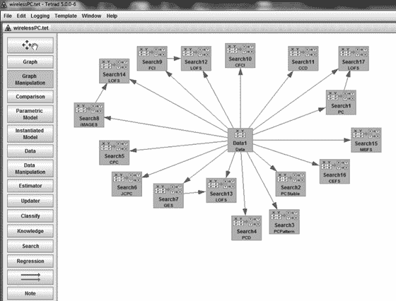

图 5.7 Tetrad 中 DAG 求解算法的光谱。 ⏎

图 5.8 显示了将 `Tetrad` 的 PC 算法应用于与流失相关的数据的结果。数据来自无线提供商的客户数据库，该提供商有兴趣确定哪些变量影响流失（衡量为二元变量，如果客户转投另一家提供商则设为 1）。许多变量是感知性的，而其他变量衡量社会人口特征，如收入或家庭规模，或与服务质量相关的变量。令人惊讶的是，转向另一家提供商的可能性（“`lswitchinglik`”）仅受客户对服务的满意度（“`lsatisfaction`”）影响，并且没有明确的影响因素驱动满意度。这并不能指明旨在减少流失的明确解决方案，但可能是一个有用的现实检验。

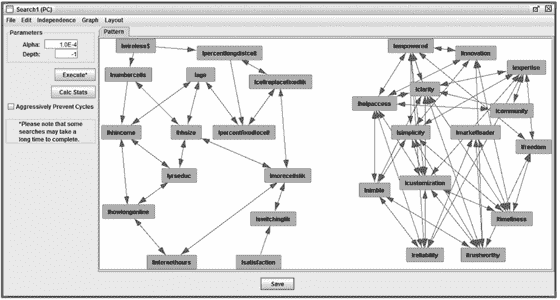

图 5.8 Tetrad PC 算法应用于流失数据。 ⏎

图 5.9 显示了相同的练习结果，同样使用 PC 算法，但使用 `GeNIe` 而不是 `Tetrad`。结果在实质上是相同的。一个链接无法由算法确定方向（在家庭中手机数量与无线服务支出之间 第 113 页第 114 页第 115 页）并且必须手动确定。一个 `GeNIe` 的优点是分析师很容易施加因果方向。例如，年龄可能会影响支出，但支出不能改变你的年龄（这是明显外生的），因此在要求软件搜索因果链接之前指定这一点是有意义的。在构建 图 5.9 所示的 DAG 之前已施加了这一和其他一些合理的限制。该图比 `Tetrad` 版本更有帮助：不仅满意度影响流失量，而且家庭获取更多手机的可能性（“`lmorecellslik`”）也会影响流失量。这里感知变量似乎对流失也没有影响。

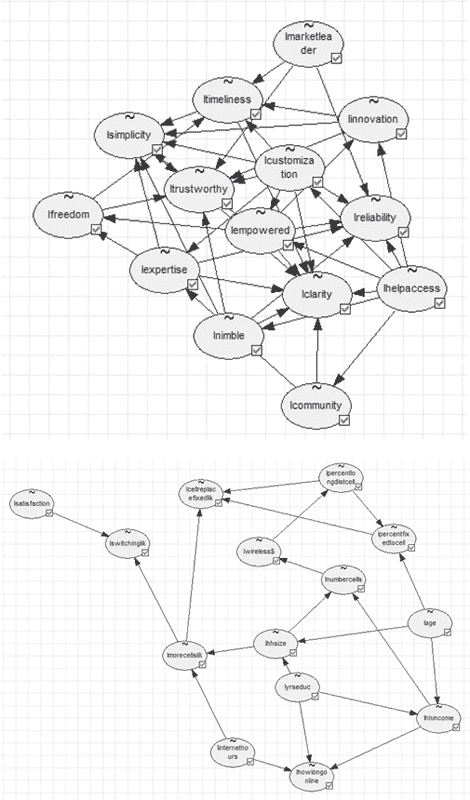

图 5.9 GeNIe PC 算法应用于流失数据。 ⏎

R 中的 `Blearn` 软件包（Scutari 2010）提供非常广泛的算法，包括 grow-shrink（`GS`）约束方法、爬山方法以及两者的混合。

`BayesiaLab` 构建 DAG 的方法首先在应用任何算法之前对所有变量进行离散化。然后它依赖于其作者发表的基于分数的算法（Conrady and Jouffe 2013）。该软件包面向商业分析师（以及与商界人士交谈的学者）。一个特别的优势是它实现了 Pearl 的“`do`”算子，这允许观察当变量不仅被观察而且被改变（例如由企业）时会发生什么。这允许看到干预的效果，例如在特定营销方式上花费更多资金。图 5.10 显示了 `BayesiaLab` tabu 算法 第 116 页应用于流失问题，而 图 5.11 显示了 EQ 算法。与对该问题的其他 DAG 实现一样，感知变量相互关联并与一些人口统计变量关联，但满意度仍然是似乎影响流失可能性的唯一变量。


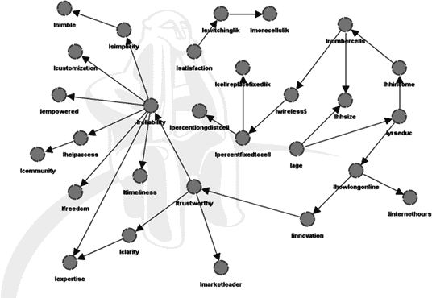
图 5.10 BayesiaLab 禁忌排序算法应用于流失数据。 ⏎

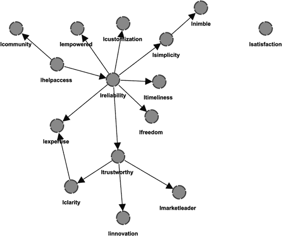
图 5.11 BayesiaLab EQ 算法应用于流失数据中关于无线服务特性的感知变量。 ⏎

## 5.7 结论
DAGs 的使用在商业分析或医疗保健分析专业人士中仍然相对罕见；也许它们不太为人所知，也许是因为标准回归技术可以快速、轻松地应用。这很不幸，因为 DAGs 相对容易构建和解释，只要变量数量不是太大，就能非常有助于识别因果路径。
第 117 页与所有技术一样，让 DAGs“说话”需要一定的技巧，而且它们不能纯粹机械地使用。但至少它们可以对既定观念提供检验：在第 5.4 节中提出的营销示例中，基于 DAG 的分析有助于更清楚地表明印刷广告可能是在新处方增长率之后，而不是之前。这可能要求市场部改变其预算支出方式。
并非所有商业问题都适合使用 DAGs，而且 DAGs 也不总是必需的。在接下来的四章中，我们将探讨提升分析的作用，它探索了如何利用销售的个体数据（实验性或观察性）来确定如何最好地针对广告等项目进行支出，或如何最好地改变公司提供的产品类型。

## 注释
1. 这通常假设数据（可能经过转换）是多元正态的。 ⏎
2. Blearn 包包含以下算法：
   1. *基于约束的结构学习算法：* Grow-Shrink (GS)；增量关联马尔可夫毯 (IAMB)；快速增量关联 (Fast-IAMB)；交错增量关联 (Inter-IAMB)。
   2. *基于评分的结构学习算法：* Hill Climbing (HC)；Tabu Search (Tabu)。
      ⏎
   3. *混合结构学习算法：* Max-Min Hill Climbing (MMHC)；General 2-Phase Restricted Maximization (RSMAX2)。
   4. *局部发现算法：* Chow-Liu；ARACNE；Max-Min Parents & Children (MMPC)；Semi-Interleaved Hiton-PC。
   5. *贝叶斯网络分类器：* Naive Bayes；Tree-Augmented naive Bayes (TAN)。

## 参考文献
* Baron, R. M., and D. A. Kenny. 1986. “社会心理学研究中的调节变量-中介变量区分——概念、策略和统计考虑”. Journal of Personality and Social Psychology, 51(6): 1173–1182. ⏎
* Bessler, D. A., and N. Loper. 2001. “经济发展的证据：来自有向无环图”. The Manchester School, 69: 457–476. ⏎
* Bryant, Henry, David Bessler, and Michael Haigh. 2009. “利用观察数据否定因果关系”. Oxford Bulletin of Economics and Statistics, 71(3): 357–374. ⏎
* 第 118 页 Conrady, Stefan, and Lionel Jouffe. 2013. 贝叶斯网络与 BayesiaLab 导论. Laval, France: Bayesia S.A.S. ⏎
* Geiger, D., T. Verma, and J. Pearl. 1990. “在贝叶斯网络中识别独立性”. Networks, 20: 507–534. ⏎
* Haughton, D., A. Kamis, and P. Scholten. 2006. “三种有向无环图软件包综述：MIM、Tetrad、和 WinMine”. The American Statistician, 60(3): 272–286. ⏎
* Larranaga, P., C. M. H. Kuijpers, R. H. Murga, and Y. Yurramendi. 1996. “通过遗传算法搜索最佳排序来学习贝叶斯网络结构”. IEEE Transactions on Systems, Man, and Cybernetics – Part A: Systems and Humans, 26(4): 487–493. ⏎
* Larrañaga, Pedro, Hossein Karshenas, Concha Bielza, and Roberto Santana. 2013. “贝叶斯网络学习与推理任务中进化算法综述”. Information Sciences, 223: 109–125.
* Lim, Chee, Wooi Lim, and Toru Kirikoshi. 2008. “理解药品推广的影响：遗传算法-偏最小二乘引导的神经网络方法”. Health Care Management Science, 11(4): 359–372. ⏎
* Pearl, Judea. 2000. 因果关系：模型、推理与推断. Cambridge, England: Cambridge University Press. ⏎
* Pearl, Judea. 2009. “统计学中的因果推断：概述”. Statistics Surveys, 3: 96–146. ⏎
* Pearl, Judea, and Dana Mackenzie. 2020. 《为什么这样》. New York NY: Basic Books. ⏎
* Raskutti, G., and C. Uhler 2014. “基于最稀疏排列学习有向无环图”. [`doi.org/10.48550/arXiv.1307.0366`](https://doi.org/10.48550/arXiv.1307.0366) ⏎
* Rodgers, Robert, and Cheryl Maranto. 1989. “心理学出版生产力的因果模型”. Journal of Applied Psychology, 74(4): 636–649. ⏎
* Scheines, R., P. Spirtes, C. Glymour, and C. Meek. 1994. TETRAD II：发现工具. Hillsdale, NJ: Lawrence Erlbaum Associates. ⏎
* Scutari, Marco. 2010. “使用 Blearn R 包学习贝叶斯网络”. Journal of Statistical Software, VV(II): 1–22. ⏎
* Spirtes, Peter, Clark Glymour, and Richard Scheines. 2000. 因果、预测与搜索, 2nd edition. Cambridge, MA: MIT Press. ⏎
* Carnegie Mellon Univeersity. 2025. *Tetrad*. [`www.phil.cmu.edu/projects/tetrad/tetrad4.html`](http://www.phil.cmu.edu/projects/tetrad/tetrad4.html).
* Westreich, Daniel, and Sander Greenland. 2013. “表 2 谬误：混杂因素和效应修饰系数呈现与解释”. American Journal of Epidemiology, 177(4): 292–298. ⏎
第 119 页

# 6 提升分析 I：挖掘真正有反应的客户和潜在客户
DOI: [10.1201/9780429172588-6](https://doi.org/10.1201/9780429172588-6)

## 6.1 目标营销导论
前两章讨论了在总体或群体层面的因果测量。本章介绍提升建模，也称为真实提升或净提升建模，这是目标营销和个性化其他应用的关键技术。
很久以前，当一位作者在一场数据挖掘会议上介绍提升/真实提升建模时，一位撰写过多本流行技术书籍的知名数据挖掘专家在场，他公开拒绝了这一想法并认为传统建模方法完全可以胜任。大约十年后，同一位专家在另一场会议上发言。令我们惊讶的是，这位专家实际上“改观”了。他不仅提到了提升建模，还将其描述为一个重要的新兴领域，并承认了我们工作的贡献。事实上，在过去几年里，许多学术学者和工业从业者越来越多地参与到这一新兴领域。据我们所知，迄今为止，关于提升建模技术方面的书籍却很少。因此，本章和下一章的首要目的是以可读的方式介绍技术细节。 Siegel (2013b)提供了该方法的一般非技术性描述，但没有技术细节。


Uplift modeling 本质上与在个体（客户）层面衡量因果处理效应相同，将此类效应与个体属性（如年龄和收入）联系起来，然后将估计的个体层面效应应用于其他个体以进行目标营销。在讨论 uplift 之前，重要的是先定义目标营销。商业分析（或数据挖掘或数据科学）自 1980 年代以来已被广泛应用于营销。许多公司收集大量客户数据以了解其需求、预测其未来行为并优化未来接触。此类目标营销方法属于营销中一个更广泛的概念，即客户关系管理（Customer Relationship Management，CRM），其中收集和分析客户接触数据以优化未来接触，从而改善获取、发展和保留。CRM 及其前身数据库营销是利用分析方法来了解客户的关键领域，以便公司能够通过正确的渠道向正确的客户提供最佳的优惠和信息（参见，例如，Jackson and Wang 1996、Roberts and Berger 1999 和 Maex and Brown 2012）。

第 6.2 节 描述了目标营销的传统预测建模方法，如果您已熟悉该方法，可以跳过本节。第 6.3 节 详细描述了 uplift/true-lift 建模的概念。如果您已对 uplift 概念有所了解并明白其重要性，可以直接跳至 第 6.5 节。

## 6.2 目标营销的传统预测建模

考虑电子邮件营销，其目标是让更多个体（客户或潜在客户）做出响应（例如，点击或购买）。如果存在历史营销活动数据集，其中同时包含处理组（个体收到电子邮件中的营销信息）和对照组

请注意，我们的讨论重点在于营销中的预测建模或监督学习方法。客户细分通过聚类分析是另一种广泛使用的方法；它是一种无监督学习技术，用于客户分组，通常用于更具战略性的目标，而非直接最大化响应率，且超出本书范围（参见 第 2 章 中关于聚类的简要讨论）。

预测建模的典型应用是开发响应模型以识别可能的活动响应者。如 图 6.1 所总结，先前的活动提供“因变量”或“目标”变量（是否响应）的数据，该数据与个体特征（包括行为和人口统计变量）合并，形成可分析的数据集。然后开发响应模型来预测给定个体特征的响应率。然后使用该模型对总体进行评分，以预测所有个体的响应率。最后，最佳个体名单将在下一次活动中被定位，以最大化效果并最小化费用。

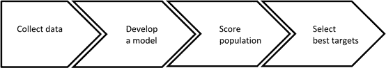

图 6.1 响应建模过程。 ⏎

更一般地，响应建模可应用于营销中的以下关键举措（参见 Peppers and Rogers 1997 和 Peppers et al. 1999）：

1. **获取：** 哪些潜在客户最有可能购买您的产品并成为客户？获取客户可能最令人兴奋，但通常很困难，尤其是在某些行业（例如，让某人购买在线观看的电影比销售 SUV 更容易）。获取有时可分解为两个步骤：（a）将纯潜在客户转化为线索和（b）将线索转化为客户。

2. **发展：** 哪些客户最有可能购买额外产品（交叉销售）或增加货币价值（追加销售）？

3. **保留：** 哪些客户最具可保留性？这可以是关系保留或价值保留：关系保留是为了最小化完全流失（例如关闭账户），而价值保留是为了最小化购买减少或价值降低的可能性。

标准响应建模通常解决一个二元问题：在接受处理的群体中，谁响应了谁没有？常用的技术包括最经典的统计方法，如逻辑回归和判别分析，以及更近期的机器学习和高级非线性技术，如决策树（CART、CHAID、C4.5、TreeNet/MART）、MARS、神经网络和支持向量机（其中许多在 第 2 章 中已回顾）。该方法的目标是将处理响应者集中在按模型评分排名的前十分位中。图 6.2 说明了成功的模型预期在前十分位中具有更高的响应率，因此最高十分位具有最高的分数值。更具体地说，标准方法旨在区分处理组中的响应者和非响应者，同时忽略对照组的行为。然后使用这些模型来识别未来的可能响应者，以提高未来营销活动的成功率。通常，前几个十分位，例如前 2 或 3 个十分位，用于定位。其原因是营销预算有限，营销人员希望从其定位工作中获得最高的成功概率。以 图 6.2 为例，平均响应率为 2.9%，如果营销人员希望关注前 3 个十分位，其累计响应率（十分位 1–3 的平均值）为 8%，则建模或数据挖掘的“随机提升”将为 `8%/2.9% = 2.8`，即前 3 个十分位的响应率是随机的 2.8 倍，这通常被认为相当不错。（另一种方法是定位响应率高于随机的那些十分位，在 图 6.2 中，它们恰好也是前 3 个十分位。）

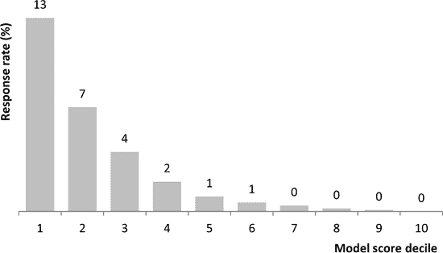

图 6.2 一个成功的标准响应模型将处理响应者集中在模型的前十分位中。（作者创建的说明性示例。） ⏎

标准方法存在缺陷。营销中的科学测量实践通常通过将结果与对照组（未给予处理，例如直接邮件中的无邮件对照组）进行比较来衡量“对照提升”，以因果地解决活动是否成功的问题。相比之下，标准响应模型并未解决如何衡量处理的成败，因为其目标是最大化“随机提升”而非“对照提升”。响应测量和响应建模应共享相同的成功度量，因此最合适的建模策略也应最大化处理相对于对照的提升。在本章以及本书接下来的三章中，重点是个体定位使用提升分析，“提升”定义为相对于对照的提升，即处理响应率减去对照响应率，而“uplift”指的是“提升”或最大化相对于对照的提升的一组方法。

## 6.3 提升建模：是什么，为什么？

在本节中，我们将详细描述提升建模的概念。如果您已对 uplift 概念有所熟悉并希望立即进入数学部分，可以跳至 第 6.5 节。


# 提升建模案例研究

从前——这基于一个真实的故事——一家大型组织中的一支精通的博士级建模团队使用传统方法（包括决策树等高级方法）开发了营销响应模型。如上文所述的方法在第 6.2 节中，来自以往营销活动的数据被用来揭示可能响应的个人的特征。开发的模型随后被应用于由营销团队设计的新的营销活动，该团队发起并赞助了整个工作。该营销团队拥有经验丰富的营销 MBA，他们通过过往经验、市场研究和行为分析了解客户需求。

除了建模团队和营销团队之外，还有一个独立的测量团队，由定量型 MBA 业务分析师组成，他们负责衡量此类模型相对于随机对照组的成功程度。具体来说，基于模型的选定目标（来自模型的前两个十分位）被随机分为处理组和对照组。然后，通过建模处理组与建模对照组之间的响应率差异来评估建模活动的成功程度。表 6.1 提供了一个（假设的）示例。在此表中，“Model”是被模型识别为“好”（例如，可能的响应者）的客户群体；由第 124 页模型在我们的示例中，这些客户位于模型预测的前两个十分位。“Random”指的是可能被随机定位的客户。“Treatment”是通过直接邮件、电子邮件、网络或现场渠道接收处理（优惠）的群体，而“Control”指的是未提供处理的群体。

### 表 6.1 模型有效性活动度量：示例

|  || 处理（例如，邮件） || 对照（例如，无邮件） || 增量（处理减去对照） |
| --- | --- | --- | --- |
|   ||  ||       *% 响应率* ||  |
| --- | --- | --- | --- |
| 模型 || 1.0 || 1.0 || **0.0** |
| 随机 || 0.3 || 0.3 || **0.0** |
| 模型减随机 || **0.7** || **0.7** || 0.0 |

表 6.1 中的数字是否表明此次活动成功？测量组说“否”，因为它关注的是相对于对照组的提升（为 0%）；然而建模组说模型无疑具有很大的提升（相对于随机），即 1% – 0.3% = 0.7%。此外，建模组认为产生相对于对照组的提升是营销组的责任，但对此营销组并不认同，因为他们期望建模组能提供一个有助于产生价值的模型。测量组建议也许模型设计得并不最佳，但建模组引用了当时的现有文献和行业“最佳实践”来支持他们的工作。营销组作为活动及所有相关工作的赞助方，感到沮丧但不知该如何是好。三个团队互相指责，争论无休止。

与其加入争论，新任命的建模经理认为问题出在模型设计不当或不合适。他意识到所采用的方法并非旨在最大化相对于对照组的提升，而只是相对于随机的提升，因此他提出了一种新的建模方法，现在称为提升或真实提升建模（来自 Radcliffe and Surry 1999 和 Lo 2002）。

为什么“相对于对照组的提升”是正确的度量，而不是“相对于随机的提升”？我们在本书的第 3 章中解释过，因果测量的黄金标准是通过随机化。换句话说，处理组与对照组之间的随机划分可以确保两组个体特征的同质性，因此两组之间的任何观察到的测量差异都可以归因于营销活动本身。当活动使用模型时，“相对于对照组的提升”度量真正评估了模型在活动选择中产生响应的效果。建模对照组代表了反事实，显示如果建模处理组的成员未接受处理会发生什么。

传统的响应模型旨在识别可能响应的客户，并经常定位那些无论是否接受营销互动都会采取期望行动的客户。Lo (2002)提出了真实提升方法，以找到其决策会因营销互动而*积极受到影响*的客户。该方法易于实施，可与常用的监督学习算法结合使用。它也被称为由 Radcliffe and Surry (1999)的提升建模，以及由 Lund (2012)和 Kubiak (2012)的净提升。早期文章引发了人们对这一新领域的兴趣，导致在最近的数据挖掘和分析会议上出现了大量讨论。由 Rexer (2012)的数据挖掘使用报告在第 125 页提到 uplift/true-lift 建模在企业从业者和顾问中比在学术或政府机构中更受欢迎。Rexer (2012)和 Rexer et al (2016)还报告了提升建模使用量的增长，随后在会议和期刊上对该主题的学术和行业关注不断扩大。由于术语“uplift”似乎更具吸引力和流行，我们将在本书中称这种方法为提升建模，其中包括所有旨在产生相对于对照组的提升的技术。

提升建模适用于随机选取对照组并予以保留的实验，如 Lo (2002, 2009)、Radcliffe (2007a)和 Radcliffe and Surry (2011)所述。在营销中，这类实验常用于直接邮件、电子邮件和外拨电话“处理”，其中目标潜在客户被邀请进行产品咨询或购买（“响应”）。对照潜在客户从同一总体中随机选取，要么不接受邀请，要么接受典型的业务照常“冠军”邀请（用于冠军-挑战者比较）。在医学实验中，平行的方法是给处理组试验药物，以衡量其相对于对照组安慰剂或标准护理的有效性（参见 Cai et al. 2011）。Siegel (2011)和 Siegel (2013b)的第 7 章提供了对该领域的进一步非技术性介绍。据 Scherer (2012)、Samuelson (2013)和 Siegel (2013a)所述，2012 年总统竞选也利用了类似技术来定位竞选捐助者和选民，显著影响了选举结果。Potter (2013)的演讲也描述了他们在总统竞选中的提升方法（又称说服建模）。

真实提升建模的业务益处源于其识别四种目标类型以及为每种类型最有效地使用营销预算的能力。这在图 6.3 中示意性地显示，其中我们可以识别：

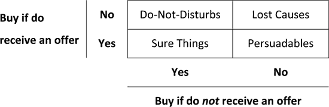

### 图 6.3 四种目标类型。（Radcliffe 2007b、Siegel 2011 和 Kane et al. 2014。）


* 必然购买者，无论是否被联系都会购买产品。应用于这些联系的营销预算被浪费了，因为它对他们的行为没有影响。
* 第 126 页 无望客户，无论是否被联系都不会购买产品。应用于这些联系的营销预算被浪费了，因为它对他们的行为没有影响。
* 勿扰客户，对营销联系有负面反应。矛盾的是，如果不联系他们会购买，但如果联系则不会购买。应用于这些联系的营销预算不仅被浪费，而且对结果产生负面影响。例如，标准响应模型针对的保留努力人群可能导致退出当前产品或服务。
* 可说服者，对营销联系有积极反应。他们只有在被联系时才会购买（有时他们购买更多或更早，但也只有在被联系时）。他们是唯一高效的目标。本章和第 8 章中讨论的建模技术将专注于寻找可能的说服对象。

活动特定响应建模的目的，当然是识别最有可能响应的客户（或潜在客户），其中响应可以是接受优惠或增加收入或销售额。

在模型用于活动后，分析人员可能会衡量模型的有效性。表 6.2，它是表 6.1 的概括版本，显示了一个典型示例：`A`、`B`、`C`和`D`是活动的观察响应率。或者，这些值可以代表产生的平均销售额或收入，因此它们可以是连续值或比例。如果`A`在统计上显著大于`C`，则意味着模型在定位可能响应的客户方面方向正确，但这不足以确定模型是否有效。为此，我们还需要问如果客户没有接受处理会怎样，这就是对照组的角色。

表 6.2 模型有效性的活动度量：概括 ⏎

|  || 处理（例如，邮件） || 对照（例如，无邮件） || 增量（处理减对照） |
| --- | --- | --- | --- |
|   || *响应率*    |
| --- | --- |
| 模型 || `A` || `B` || `A − B` |
| 随机 || `C` || `D` || `C − D` |
| 模型减随机 || `A − C` || `B − D` || `(A − B) − (C − D)` |

考虑“处理”与“对照”之间的差异。假设效应在统计上显著，如果`A > C`且`B > D`，但`A = B`，则意味着虽然模型能够挑选出可能响应的客户，但它并未为活动增加任何“价值”。这是因为`A = B`意味着模型-处理单元格中的客户（收到邮件或其他 solicitation）第 127 页响应方式与模型-对照单元格中的客户（未接受处理）相同。要声称模型“有效”（即“模型”优于“随机”），我们不仅要求`A − B > 0`，而且要求`A − B > C − D`。因此，由于处理而产生的活动增益（以响应率、收入或销售额计）的适当衡量指标是双重差分`(A − B) − (C − D)`。因此，模型的定量业务目标，以其对活动的有效性衡量，是最大化`(A − B) − (C − D)`，而不是传统方法中使用的`(A − C)`。

理想的响应模型将处理响应者推入前十分位，将对照响应者推入后十分位，如图 6.4 所示，其中深色条代表处理响应者，浅色条代表对照响应者。标准处理-仅响应模型可能会在每个十分位中以与处理响应者相同的速率集中对照响应者，并且模型不期望在前十分位产生任何提升。这最常发生在整体活动的提升与基线响应相比非常小时发生。我们定义真实提升“信噪比”(`S/N`)为提升除以对照响应率，它衡量的是处理（信号）的增量贡献相对于对照响应率（噪声）。例如，如果对照响应为 5.00%，处理响应为 5.01%，`S/N = 0.01/5 = 0.002`，则大多数处理响应者与基线（自然）响应者非常相似。因此，数据中的提升信号非常小，所以基线响应将主导标准模型。

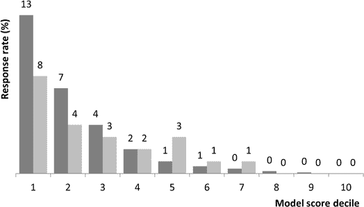

图 6.4 理想提升模型的示意图。 ⏎

以提升作为模型目标的困难在于，观察结果无法被归类为“提升”响应与基线响应与非响应。任何处理响应者都可能是基线响应者（即第 128 页本来就会响应的某人）或提升响应者（即纯粹因为处理而响应的某人）。目标是利用我们已知的数据，例如谁响应了谁没有，以及谁被处理谁没有，来获得我们想要知道的信息：谁是提升响应者，换句话说，那些因为活动而响应的客户。

根据我们的初始实验，我们有图 6.5 左面板所示的信息，并且我们可以区分以下几组：

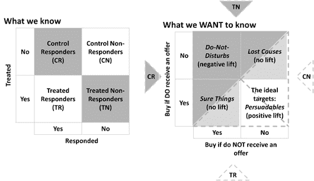

图 6.5 一个概念性的 2×2 表格。 ⏎

* 对照响应者（`CR`）是必然购买者或勿扰客户，按未知比例；他们在没有处理的情况下响应，但在被处理时可能不会响应。我们希望在未来避免处理他们，以节省不必要且可能有害处理的成本。
* 对照非响应者（`CN`）是无望客户或可说服者，按未知比例。我们希望在该组中找到可说服者，以便在未来处理他们。
* 处理响应者（`TR`）是必然购买者或可说服者，也按未知比例。我们希望继续处理该组中的可说服者，但避免在必然购买者身上浪费处理成本。
* 处理非响应者（`TN`）是无望客户或勿扰客户，按未知比例；尽管被处理，他们仍未响应。其中一些如果没有被处理可能会响应（勿扰客户）。我们希望在未来避免处理他们，因为处理成本在他们身上被浪费，甚至可能产生负面影响。

第 129 页 提升建模的根本目标是从已知的对照响应者、对照非响应者、处理响应者和处理非响应者的身份中，找出必然购买者、勿扰客户、无望客户和可说服者的身份。

## 6.4 何时传统响应建模方法足够？


针对一次在分析会议上关于提升建模的演讲，一位工业界从业者并不认为需要提升建模，因为他们传统的寻找响应客户的方法（仅使用处理组）表现非常好（以相对于对照组的提升来衡量）。凭借来自世界级建模团队多年的成功经验，该从业者非常确信传统方法没问题，提升/真实提升方法并非必要。演讲者随后意识到该从业者隶属于一家大型信用卡公司，并同意提升可能对信用卡行业没有太大用处，因为对照响应率（由 `B` 和 `D` 在 表 6.2 中给出）会接近于零，至少在美国是这样，因此提升会接近处理响应率（`A - C` 在 表 6.2 中）。换句话说，潜在客户很少自行申请信用卡，而是对邮寄的信用卡邀请做出回应。本节讨论在何种情况下传统方法已足够。

由于提升建模旨在最大化处理响应率减去对照响应率，而传统的响应建模方法仅最大化处理响应率，因此如果对照响应率接近于零，则两种方法将相同。当对照响应者很少，即客户在没有推动的情况下不会自行购买产品时，提升建模就不需要了。这种情况可能出现在以下场景中：

1. 某些成熟产品在营销人员推动下没有启动时响应率非常低——例如美国的信用卡——可能由于竞争激烈以及产品成熟度（例如，美国大多数个人已有信用卡）。
2. 全新产品，若无营销则响应几乎为零，因为消费者尚未熟悉该产品。
3. 仅通过邀请销售的产品，例如接受 webinar 电子邮件邀请。
4. 由于频率低或恐惧而不受欢迎的产品，例如殡葬服务或某些健康筛查服务，大多数消费者在没有针对性推广的情况下不会主动寻求消费。

## 6.5 提升模型开发方法

本节提供有关如何实施提升建模的更多技术细节。我们在本章讨论三种简单方法——一个“基线”模型和两个真实提升模型——随后在下一章介绍一些高级方法。

### 6.5.1 方法 0：基线模型

标准“传统”方法在 图 6.6 中阐述。首先，使用之前活动的处理数据进行模型开发。采用传统的监督学习方法，会预留一个 holdout（“验证”）样本用于模型验证。响应模型使用训练数据集开发并估计，然后使用验证样本预测对处理的响应（“评分”）。响应按从高到低排序并分配到十分位。然后绘制每个十分位的观察响应率以创建传统的提升表，如 图 6.2 所示。

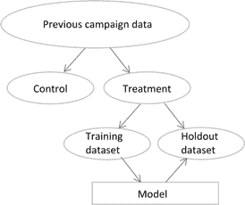

图 6.6 传统方法：仅基于处理的基线响应模型。 ⏎

然而，在提升建模方法中，会同时使用来自之前活动的处理 *和* 对照数据，如 图 6.7 所示。合并的处理和对照数据被分为训练样本和验证样本。与传统方法一样，使用训练数据开发的模型随后在 holdout 样本中进行评分，按十分位排序，并绘制图表以显示每个十分位的观察响应率。通过此过程可以开发替代模型，并且可以使用相同的 holdout 样本进行模型比较。

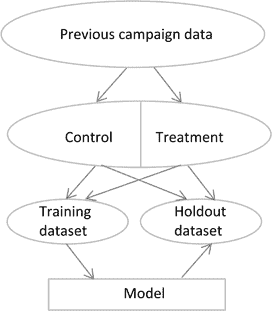

图 6.7 提升建模方法：同时使用处理组和对照组。 ⏎

这里困难之处在于，使用处理和对照数据的训练样本开发适当模型的方法不止一种，因此我们现在更详细地描述两种提升建模方法。

### 6.5.2 方法 1：双模型方法

这是最直接的方法，包括分别开发处理和对照响应模型。必要步骤如下：

1. 估计接受处理人群中的响应概率，`p(R|T,x)` 作为个体特征 `x` 的函数。这与标准响应模型相同。如果使用逻辑回归，则可以使用标准逐步法或 lasso 程序来选择变量。在许多具有大量潜在预测因子的实际应用中，还可以采用其他建模前变量选择方法，例如图形方法和相关性分析。其他统计或机器学习程序，例如决策树和神经网络（参见 第 2 章），也是预测响应概率的常用技术。
2. 使用与上述 1 类似的程序，估计未接受处理（对照）人群中的响应概率，`p(R|C,x)`。
3. 对于处理组和对照组中的每个个体，使用上述两个模型计算估计分数。提升分数结合两个模型分数来估计提升：

`lift(x) = p(R|T,x) - p(R|C,x)`

这对建模者来说是一种熟悉的方法，只是开发了两个模型：首先，使用标准的监督学习技术预测处理人群中的响应；然后使用相同方法预测对照人群中的响应。提升分数是两个模型之间的差值——预期响应，即接受处理时的响应概率减去 *未* 被处理时的预期响应——并在 图 6.8 中以阴影区域显示。最流行的方法是使用标准逻辑回归，其中如果需要可以包含非线性和交互项，但其他常见方法如决策树、支持向量机、神经网络或朴素贝叶斯算法也可以应用。

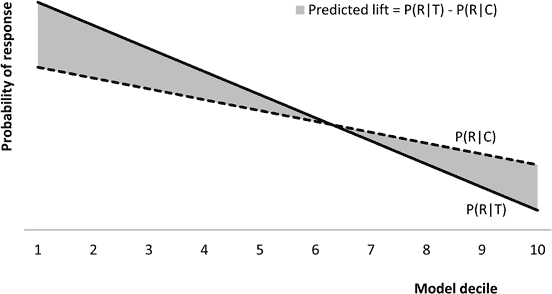

图 6.8 在方法 1 中，提升是接受处理时响应概率 `P(R|T)` 与未接受处理时响应概率 `P(R|C)` 的差值。 ⏎

与标准响应模型方法相比，双模型方法的缺点是：

* 它工作量翻倍，因为需要创建两个模型而不是一个（尽管它们可能很容易开发）。
* 模型旨在估计总响应，而非提升。因此，每个模型的变量缩减针对的是响应，可能无法捕捉到与提升相关的某些变量。
* 两个模型的尺度可能不兼容，导致提升估计嘈杂或毫无意义——详情参见 Swait 和 Louviere (1993)。
* 将两个模型的差值作为分数会捕捉到两个模型的所有误差。如果提升的 `S/N` 比率较低，则模型分数可能全是噪声，因此毫无意义。


### 6.5.3 方法 2：带处理虚拟变量的单模型方法

Lo (2002) 提出将处理组和对照组一起在单一模型中建模，通过与处理变量交互的项来捕捉提升。该方法也被 Potter (2013) 提及为近期一次总统选举中选用的方法。在此方法中，模型总体包括处理和对照观测，且与之前一样，因变量是响应的二元度量。但这里自变量包含两组：第一组是捕捉处理组和对照组基线响应的变量（“主”效应），而第二组通过将控制变量与一个虚拟变量交互来捕捉提升响应，该虚拟变量对处理组设为 1，对所有对照观测取值为 0。

形式上，响应的概率 `P[i]` 是处理虚拟变量 `T[i]` 和自变量或预测变量向量 `X[i]` 的函数：

$$P\_{i} = \\frac{exp\\left( \\alpha + \\beta{'X}\_{i} + \\gamma T\_{i} + \\delta'X\_{i}T\_{i} \\right)}{1 + exp\\left( \\alpha + \\beta'X\_{i} + \\gamma T\_{i} + \\delta'X\_{i}T\_{i} \\right)}$$

其中 `α`、`β`、`γ` 和 `δ` 为待估计的参数。因此，

`P[i]`|treatment−`P[i]`|control = `P[i]`|(`T[i]`\=1)−`P[i]`|(`T[i]`\=0)

$$= \\frac{\\exp\\left( {\\alpha + \\gamma + \\beta^{\\prime}X\_{i} + \\delta^{\\prime}X\_{i}} \\right)}{1 + \\exp\\left( {\\alpha + \\gamma + \\beta^{\\prime}X\_{i} + \\delta^{\\prime}X\_{i}} \\right)}$$

$$= \\frac{\\exp\\left( {\\alpha + \\beta^{\\prime}X\_{i}} \\right)}{1 + \\exp\\left( {\\alpha + \\beta^{\\prime}X\_{i}} \\right)}$$

(6.1)

真实提升的最终预测值等于两个分数之差，由下式给出

Prob (response if Treated)–Prob (response if not Treated)

= score with treatment dummy set to 1 – score with treatment dummy set to 0

第 134 页 由于该模型仅拟合一次数据，因此可以保证两个分数在同一尺度上。

过程总结如下：

1. 将处理组和对照组的响应和协变量数据 `{Y[i], X[i]}` 纳入分析数据集，并将虚拟变量 `T[i]` 对处理组设为 1，对对照组设为 0。
2. 随机将数据集分为训练样本和保留样本；
3. 根据 `T[i]` 进一步将训练样本分为两个子样本，即一个为处理组，另一个为对照组。
4. 将所有自变量 `X[i]` 与 `T[i]` 相乘以形成交互效应 `X[i]*T[i]`。
5. 以 `Y[i]` 为因变量，以 `X[i]`、`T[i]` 和 `X[i]*T[i]` 为自变量拟合逐步 logistic 模型。

方法 2 也有其自身的缺点。包含交互项后，变量数量可能很大，且很可能存在多重共线性。当基线变量与其交互变量之间的相关性非常高（例如超过 95%）时，可能需要做出判断来选择其中一个用于模型开发。与方法 1 一样，两个模型分数之差可能会累积误差。

为营销提出的方法 2 实际上与流行病学和社会科学等领域中测量异质性处理效应（也称为效应修饰）类似，这些领域在分析中使用交互效应。细微的区别在于，方法 2 专注于预测未来定位的个体水平提升，而其他领域通常研究组水平差异（例如，Greenland et al. 2008；Brand and Xie 2010）。

请注意，方法 1 和方法 2 都可以很容易地应用于其他监督学习技术，如 MARS、神经网络和决策树（例如，Haughton and Oulabi 1997）。

## 6.6 提升模型评估方法

除模型开发方法外，Lo (2002) 还提出了一种使用保留样本进行验证的程序。由于同时涉及处理组和对照组，且目标是衡量“相对于对照的提升”，该程序与验证标准监督学习模型（如仅使用第 135 页 处理组的标准 logistic 回归方法）不同。鉴于其他工业实践者也使用此类程序，我们采用相同的验证程序，可总结如下：

1. 对于保留样本中的每个个体（无论其最初属于处理组还是对照组），通过分别将 `T[i]` 设为 1 或 0，计算处理和对照的响应概率预测值，然后通过取两个估计概率之差创建预测提升分数，如公式 6.1 所示。
2. 按此分数对整个保留样本进行排序并导出分数驱动的半十分位（即 5% 间隔），以提供足够的粒度。
3. 在每个半十分位中，分别计算处理组和对照组的观测响应率，然后取观测差值（这是每个十分位中的实际或观测提升）。
4. 按十分位绘制处理组与对照组之间的观测差值，以验证模型并图形化评估模型。
5. 计算相关指标以支持模型评估；下面将更详细地讨论。

第 4 步是 Lo (2002) 提出的一种简单图形方法。第 5 步基于 Kane et al. (2014) 的建议，他们使用了三个从保留样本获得的指标，涉及模型在营销活动下一次迭代中可能表现如何。这些指标是（1）“Gini”系数，（2）“Gini top 15%”，（3）“Gini 可重复性指标”（或提升图的 `R²`）。每个指标都需要进一步解释。

Gini 系数给出整体模型拟合的估计。它衡量增益曲线与总体曲线之间的面积——增益曲线衡量响应者的累积百分比，是 图 6.9 中的上部曲线——总体曲线由直线表示，给出按提升大小递减排序的人口累积百分比。对于标准响应模型，增益曲线始终上升。然而，对于提升模型，增益曲线可能上升（正提升）并下降（负提升，即响应受抑制）。Gini 系数的计算在 附录 6.2 中描述。

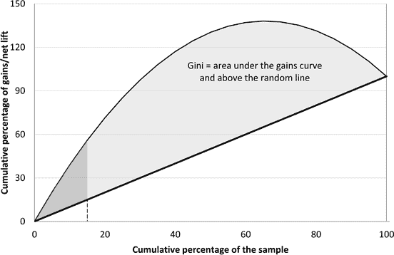

图 6.9 提升/真实提升模型的增益图。 ⏎

Gini top 15% 是另一个有用的度量。对于预算无限的活动，目标人群将包括增益曲线开始下降（提升从正变负）的点之前的所有候选者。然而，许多活动预算有限，在这种情况下，初始十分位（例如第 1 和第 2 十分位）的增益比较高十分位的增益更重要。对于此评估，我们选择了前 15% 得分者的 Gini 面积作为示例，因为许多活动在实践中仅针对第 136 页 前 1 或 2 个十分位；这显示为 图 6.9 左侧的深色阴影区域。如果下一次活动预计针对前 3 个十分位（30%）而不是前 15%，可以使用类似的指标，如 Gini top 30% 作为指标。Gini Top 15% 的计算公式在 附录 6.2 中。


我们的模型性能的最终衡量指标是 `Gini repeatability metric`。提升模型可能不稳定，因此第三个指标是对模型整体稳定性的简单衡量，由保留样本上提升图的直线拟合的 R 平方（`R²`）给出。理想情况下，模型在顶部半十分位会有非常高的提升，之后没有正提升，但实际上难以实现。更现实地说，从顶部半十分位到底部提升模式相对平滑下降的模型会被认为良好；然而，大多数提升模型在保留样本上的拟合要粗糙得多，例如，顶部几个半十分位可能在正提升值和负提升值之间波动。该指标应次于 `Gini` 和 `Gini top 15%` 考虑，因为提升有时可能以理想的方式呈曲线或非线性。`R²` 评估应包括对提升图的视觉评估，以判断是否具有理想的非线性结果。图 6.10 显示了一个拟合完美的假设提升表，而 图 6.11 显示了一个更现实的提升图，其中趋势线拟合得较为松散。还请注意，如果回归斜率为正（这意味着提升有在 supposedly 更差的十分位中上升的趋势），或等价地，`Gini` 系数为负，则该指标才有意义。第 137 页


图 6.10 保留样本上的提升图（*理想*情况）。⏎


图 6.11 保留样本上的提升图（*现实*情况）。⏎

第 138 页

## 6.7 图示示例

我们现在将用两个示例说明上述模型开发和验证程序以及相关指标：一个模拟数据集和一个真实数据集。

### 示例 6.1：非营利组织捐赠分析 – 一个模拟示例

我们的第一个示例是关于 ACE（化名），一家主要为城市低收入学生服务的非营利学校；尽管数据是模拟的，但该示例基于真实案例。该学校主要依靠个人和组织的捐赠。员工包括永久员工、兼职员工和许多志愿者。他们的筹款工作需要员工和志愿者对潜在捐赠者进行个人电话或面对面拜访。由于资源有限，他们需要优先考虑筹款处理工作。具体来说，该学校需要制定一个有针对性的捐赠者名单，通过外拨电话或面对面拜访进行联系。可用于分析的多年的捐赠者数据库是可用的。响应定义为去年的一笔货币捐赠（“`donated`”）。处理是联系（电话或拜访）。潜在预测因子来自去年之前的历史。我们在处理（收到联系的人）和对照（未收到联系的人）之间有 80-20% 的划分。整个数据集还随机分为训练（`n = 300 K`）和保留（`n = 200 K`）样本。驱动捐赠且在数据集中可用的潜在变量包括：
* `Age` 的捐赠者；
* `Frequency`，定义为过去捐赠的次数（年）；
* `Spent`，即过去平均捐赠金额；
* `Recency`，衡量自上次捐赠以来经过的年数（因此 1 = 去年捐赠，2 = 上次捐赠在两年前，等等）；
* `Income`，由估计的年收入给出；
* `Wealth`，由估计财富衡量。

响应变量（`donated`）的汇总统计使用训练样本显示在 表 6.3。提升超过对照响应率为 `19.3% – 6.3% = 13%`，而 `S/N` 为 `13%/6.3% = 207%`。我们现在将这两种提升方法应用于这些数据。

表 6.3 模拟示例的汇总统计 ⏎

|  || 响应 || 无响应 || 总计 |
| --- | --- | --- | --- |
| 处理：数量 || 46,327 || 193,696 || 240,023 |
| --- | --- | --- | --- |
| 行 % || 19.30 || 80.70 ||  |
| 列 % || 92.47 || 77.51 ||  |
| 对照：数量 || 3,774 || 56,203 || 59,977 |
| 行 % || 6.29 || 93.71 ||  |
| 列 % || 7.53 || 22.49 ||  |
| **总计** || **50,101** || **249,899** || **300,000** |
| 行 % || 16.7 || 83.3 || 100.0 |

如上所述，使用双模型方法（方法 1），我们对处理和对照数据分别拟合逻辑模型（使用 SAS 中的 `proc logistic`），并逐步纳入变量。对于处理虚拟变量方法（方法 2），我们再次使用 SAS 中的 `proc logistic`，但使用单一第 139 页 方程，该方程包括处理虚拟变量（是否收到联系）以及所有处理交互变量（处理虚拟变量乘以上述每个变量）。

对两种方法均使用 5% 水平的标准逐步回归。可以尝试其他显著性水平或其他标准变量选择方法，例如前向选择或向后消除，以测试替代模型。估计结果汇总在 表 6.4。请注意，仅处理模型只是标准基线模型，第 140 页 大多数建模者在不知道提升建模的情况下会使用该模型。双模型方法（模型 1）要求开发两个模型——分别仅处理和仅对照，然后取两个模型得分之间的差值。处理虚拟变量方法（模型 2），依赖于处理虚拟变量和交互效应，显示在 表 6.4 的第三列数字中；请注意，只选择了一个交互效应。

表 6.4 模拟示例中方法 1 和 2 的模型结果 ⏎

|  || 仅处理 || 仅对照 || 虚拟变量模型 || 实际 |
| --- | --- | --- | --- | --- |
| 变量 || 估计值 || p 值 || 估计值 || p 值 || 估计值 || p 值 |
| `Intercept` || −8.0693 || <0.0001 || −10.0986 || <0.0001 ||  || <0.0001 || −10 |
| --- | --- | --- | --- | --- | --- | --- | --- |
| `Age` || 0.0068 || <0.0001 || n.s. ||  || n.s. ||  || 0.001 |
| `Frequency` || 0.7057 || <0.0001 || 0.6861 || <0.0001 || 0.7041 || <0.0001 || 0.7 |
| `Spent` || 0.0010 || <0.0001 || 0.0010 || <0.0001 || 0.0010 || <0.0001 || 0.001 |
| `Recency` || −0.0409 || <0.0001 || n.s. ||  || −0.0411 || <0.0001 || −0.07 |
| `Income` || n.s. ||  || n.s. ||  || n.s. ||  || 0 |
| `Wealth` || n.s. ||  || n.s. ||  || n.s. ||  || 0 |
| `Treatment (main effect)` || n/a ||  || n/a ||  || 1.9662 || <0.0001 || 2 |
| `Treatment × age` || n/a ||  || n/a ||  || 0.0067 || <0.0001 || 0.005 |
| `Treatment × freq` || n/a ||  || n/a ||  || n.s. ||  ||  |
| `Treatment × spent` || n/a ||  || n/a ||  || n.s. ||  ||  |
| `Treatment × recency` || n/a ||  || n/a ||  || n.s. ||  || 0.03 |
| `Treatment × income` || n/a ||  || n/a ||  || n.s. ||  ||  |
| `Treatment × wealth` || n/a ||  || n/a ||  || n.s. ||  ||  |


那么这两个模型的表现如何？表 6.4 的最后一列给出了用于模拟数据的实际值——运行模拟练习的一个巨大优势是我们知道实际模型，可以将估计模型与实际进行比较。为了理解如何阅读此表，例如，未接受处理（即 `control`）时的 `age effect` 为 0.001，而接受处理时的 `age effect` 为 `0.001 + 0.005 = 0.006`，而 `Method 1`（双模型方法）得到的 `age effect` 在 `control` 中为 0，在处理组中为 0.00675，而 `Method 2` 发现 `age effect` 在 `control` 中为 0，在处理组中为 0.00672。因此，两个模型对 `age effect` 的估计都非常接近实际值。另一个例子是处理的 main effect，其实际值为 2，`Method 1` 的模型估计值为 `–8.069 – (–10.099) = 2.030`，而根据 `Method 2` 的估计值为 1.956。因此，再次证明，两个模型得出的主要处理效应都非常接近实际值。我们现在使用保留样本来评估模型。

图 6.12 显示了按半十分位数划分的提升图（1 = 提升最高的半十分位数，20 = 最低）。基线模型仅使用处理样本数据，其峰值移至第二个半十分位数，显然没有显示出期望的递减模式。


图 6.12 模拟示例的提升图。 ⏎

在此示例中，方法 1 和方法 2 的性能几乎没有差异。使用衡量预测精度的 `Gini` 或 `Gini Top 15%`，从 表 6.5 可以明显看出，方法 1 和方法 2 都优于标准（“基线”）方法。在衡量提升图线性度的 `Gini Repeatability R²` 方面，方法 1 和方法 2 也优于基线模型，且彼此非常相似。请注意，`Gini Repeatability R²` 是通过对 图 6.13 中的提升图应用线性回归生成的。

表 6.5 模拟示例的保留样本模型验证统计量 ⏎

|  || Gini || Gini 15% || Gini Repeatability R² |

| --- | --- | --- | --- |

| 基线 || 5.6420 || 0.5412 || 0.731 |

| --- | --- | --- | --- |

| 方法 1（双模型方法） || 6.0384 || 0.7779 || 0.783 |

| 方法 2（处理虚拟变量方法） || 6.0353 || 0.7766 || 0.784 |


图 6.13 基线方法和方法 1 和 2 的提升图。(a) 基线方法（标准仅处理响应模型）；(b) 方法 1：双模型方法；和 (c) 方法 2：处理虚拟变量方法。 ⏎

## 示例 6.2：电子邮件营销示例

Kevin Hillstrom 在 MineThatData 上在其博客发布了一个关于提升数据的优秀示例。

*   样本的 1/3 被随机选为接收 featuring 男士商品的电子邮件；
*   样本的 1/3 被随机选为接收 featuring 女士商品的电子邮件；
*   样本的 1/3 被随机选为不接收电子邮件；这是无电子邮件对照组。

此外，数据按 70% 到 30% 的比例随机分为训练样本和保留样本。

为了说明上一节介绍的技术，我们重点关注 featuring 女士商品的 campaign，使用 “`visit`”（即客户是否访问了网站）作为响应变量。因此，处理组（收到电子邮件的人）和对照组（未收到的人）之间为 50-50% 的分布。可用的潜在驱动因素包括：

*   `Recency`，以距上次购买的月数衡量；
*   `History`，衡量过去一年花费的总美元数；
*   `Men's` 是一个二元变量，如果过去一年购买了男士商品则设为 1，否则为 0。我们创建了一个类似的变量，称为 `women's`。
*   我们还构建了一个名为 `bothgenders` 的变量，如果 `men's` 和 `women's` 都等于 1 则设为 1，否则为 0。
*   `Zip_rural_flag` 如果地区为农村则编码为 1，否则为 0（即地区为城市）。
*   `Newbie` 是一个二元变量，如果客户在过去 12 个月内为新客户则设为 1，否则为 0。
*   使用两个变量来指示客户在过去一年中是否通过网络、电话或两者购买商品：我们将 `channel_phone_flag` 设为 1 如果使用了电话，否则为 0，并且 `channel_multi_flag` 设为 1 如果同时使用了网络和电话，否则为 0。
*   对于连续的 `recency` 和 `history` 变量，还创建了平方项。

响应变量 (`visit`) 的汇总统计量在 表 6.6 中显示，用于训练样本。相对于对照组的提升响应率为 `15.3% – 10.7% = 4.6%`，S/N 为 `4.6%/10.7% = 43%`。

表 6.6 营销数据的汇总统计量 ⏎

|  || 响应 || 未响应 || 总计 |

| --- | --- | --- | --- |

| 处理：数量 || 2,292 || 12,691 || 14,983 |

| --- | --- | --- | --- |

| 行 % || 15.3 || 84.7 ||  |

| 列 % || 58.8 || 48.7 ||  |

| 对照：数量 || 1,605 || 13,375 || 14,980 |

| 行 % || 10.7 || 89.3 ||  |

| 列 % || 41.2 || 51.3 ||  |

| **总计** || **3,897** || **26,066** || **29,963** |

| 行 % || 13.0 || 87.0 || 100.0 |

我们再次对处理和对照数据分别拟合逻辑模型（用于双模型方法），并使用包含处理虚拟变量和交互项的单一方程（用于处理虚拟变量方法）。如前所述，我们应用前向逐步回归，纳入阈值为 5% 显著性。只有在 表 6.7 中报告了统计学上显著的系数估计值。虽然 表 6.7 显示了哪些变量很重要，但对于定位来说没有意义，为了验证模型，我们需要将评分方程应用于保留样本；提升图显示在 图 6.14 中。

表 6.7 营销示例中方法 1 和 2 的模型结果 ⏎

|  || 仅处理 || 仅对照 || 虚拟变量模型 |

| --- | --- | --- | --- | --- | --- | --- |

| 变量 || 估计值 || p 值 || 估计值 || p 值 || 估计值 || p 值 |

| 截距 || −1.91 || <0.001 || −1.61 || <0.001 || −1.62 || <0.001 |

| --- | --- | --- | --- | --- | --- | --- |

| Recency || −0.10 || <0.0001 || −0.07 || <0.001 || −0.07 || <0.001 |

| Recency squared || 0.00 || <0.0001 || n.s. ||  || n.s. ||  |

| History || 0.00 || <0.001 || 0.00 || <0.001 || 0.00 || <0.001 |

| Men's || 0.38 || <0.001 || n.s. ||  || n.s. ||  |

| Women's || 0.91 || <0.001 || n.s. ||  || n.s. ||  |

| Both genders || n.s. ||  || 0.51 || <0.001 || 0.43 || <0.001 |

| Rural (=1) || 0.25 || <0.001 || 0.56 || <0.001 || 0.55 || <0.001 |

| Newbie || −0.45 || <0.001 || −0.77 || <0.001 || −0.78 || <0.001 |

| Used phone? (Y=1) || −0.24 || <0.001 || −0.38 || <0.001 || −0.30 || <0.001 |

| Used Web+phone? (Y=1) || −0.20 || 0.01 || n.s. ||  || n.s. ||  |

| Treatment (main effect) || n/a ||  || n/a ||  || n.s. ||  |

| Treatment × recencysq || n/a ||  || n/a ||  || 0.00 || 0.00 |

| Treatment × historysq || n/a ||  || n/a ||  || 0.00 || 0.02 |

| Treatment × women's || n/a ||  || n/a ||  || 0.53 || <0.001 |

| Treatment × Rural || n/a ||  || n/a ||  || −0.30 || 0.00 |

| Treatment × newbie || n/a ||  || n/a ||  || 0.33 || <0.001 |

| Treatment × Web+phone || n/a ||  || n/a ||  || −0.24 || 0.00 |


图 6.14 基线方法和方法 1、2 的提升图。 (a. 基线方法（标准仅治疗响应模型）； b. 方法 1：双模型方法； c. 方法 2：治疗虚拟变量方法； d. 三种方法的提升图。） ⏎

在 图 6.14a、图 c 中，所有三个模型都显示出按半十分位递减的提升的总体趋势。虽然在常规监督学习中这种情况相当常见，但对于提升建模而言却不能想当然。特别是，图 6.14a 中的基线模型显示，第一半十分位的提升特别低，但在接下来的几个半十分位（2–9）中仍具有一定的预测提升价值，尽管这些半十分位内部的区分似乎很小。值得注意的是，图 6.14c 显示方法 2 具有更陡的负斜率（更强的递减趋势），但在前几个半十分位上的表现并不理想，而这通常是业务关注的重点。将三个方法放在一起在 图 6.14d 中，视觉上很难判断哪种方法最好，除了基线方法在第 1 半十分位上看起来略差于其他方法，以及方法 2 在第 6 半十分位上峰值更高。当我们转向 表 6.8 中的模型验证统计量时，三个指标一致显示，在这些数据中方法 1 和方法 2 都优于基线方法；这在基尼 15% 指标上尤其明显，该指标在基线情况下为负，意味着它完全没有用处。

表 6.8 营销示例的保留样本模型验证统计量 ⏎

|  || 基尼 || 基尼 15% || 基尼可重复性 R² |
| --- | --- | --- | --- |
| 基线 || 1.8556 || −0.0240 || 0.2071 |
| --- | --- | --- | --- |
| 方法 1（双模型方法） || 2.0074 || 0.0786 || 0.2941 |
| 方法 2（治疗虚拟变量方法） || 2.4392 || 0.0431 || 0.2945 |

## 6.8 结论性说明

我们现在可以总结提升建模的贡献。就像任何监督学习方法一样，它有两个部分：模型开发和模型验证。如果没有仔细的模型验证（本章推荐的做法），甚至无法知道基线模型是否能做得体面。基线模型是否表现良好非常依赖数据。在信用卡获取等极端情况下，自然（对照）响应率几乎为零（至少在美国如此），仅治疗响应基线模型可能是识别有前景新客户所需的一切。一般来说，基线模型的客观目标只满足了实际目标的一半，因为它并非旨在最大化提升。本章中用于提升的两种模型开发方法具有正确的目标，并且它们是否优于基线可以通过经验很容易地测试。实际上，作者见过提升模型优于基线模型的情况，也较少见基线模型优于提升模型的情况。在任何情况下，进行验证测试都可以帮助建模者选择最合适的模型。

我们将在 第 8 章 中重新审视提升建模技术，并将其应用于更复杂的情况。由于最佳建模技术通常像传统监督学习世界一样数据特定（例如，Wolpert 1995，2001），拥有更多替代方法将使我们更有机会找到针对“可说服者”的良好模型。

此外，我们在 附录 6.1 中包含了提升建模背后的技术反事实解释，并在 附录 6.3 中提供了一些关于提升建模变量选择的指导。

## 附录 6.1：提升/真实提升建模的反事实框架

客户在特定时间只能被分配到治疗组（`T = 1`）或对照组（`T = 0`），而不能同时属于两者。这使得构建反事实成为必要，本附录提供了理论解释，说明为什么提升/真实提升建模可以做到这一点。

考虑一个反事实或潜在结果框架，其中客户可以被分配到治疗组或对照组，如 图 A6.1 所示。如果她确实被分配到治疗组，她可以选择响应或不响应。同样，如果她被分配到对照组，她也可以选择响应或不响应。虽然她不能同时被分配到治疗组和对照组，但问题是：如果她接受治疗，我们能否利用其他人（假设与她相似）来代表她如果被分配到对照组的潜在结果？如果她和其他人在所有相关的治疗前特征或变量 `x` 上是“可交换的”，答案是肯定的。


图 A6.1 反事实框架。 ⏎

更正式地说，设 `Y(1)` 和 `Y(0)` 分别为特定客户在治疗和对照下的潜在结果。那么治疗效应就是 `Y(1) – Y(0)`，其期望值为 `E(Y(1) – Y(0))`。为了衡量给定一组特征 `x` 的期望值，我们需要能够计算 `E(Y(1) – Y(0) | x)`。为了衡量被治疗者的平均治疗价值，我们需要计算 `E(Y(1) – Y(0) | T=1, x)`。这给出了具有特征 `x` 的被治疗组中的治疗效应。虽然没有人能同时接受治疗和对照，但只要他们是“可交换的”，我们就可以“借用”具有相同特征的其他人的信息。可交换性（或不可知性）条件是衡量治疗因果效应的必要条件，正式表达为 `(Y(1),Y(0)) ∐ T | x`；换句话说，给定 `x`，治疗潜在结果和对照潜在结果都不依赖于治疗分配机制，正如 Rosenbaum and Rubin (1983) 和 Morgan and Winship (2007) 所解释的那样。不可知性或可交换性在随机实验中得到满足，但在非随机实验或观察性研究中并非普遍如此。我们有：

`E(Y(1)− Y(0)|T=1,x)`
`= E(Y(1)|T=1,x)− E(Y(0)|T=1,x)`
`= E(Y(1)|T=1,x)− E(Y(0)|T=0,x), with the exchangeability or ignorability condition`
`= E(Y|T=1,x)− E(Y|T=0,x),`

使用一致性假设，即在治疗条件下观察到的结果与在相同治疗条件下的潜在结果相同。

因此，我们可以使用治疗组和对照组的数据，根据一组共同特征来建模治疗效应。虽然本章侧重于二元结果（即 `Y = 1` 或 `Y = 0`），因此期望值与响应概率相同，但前述陈述适用于连续和离散结果。

## 附录 6.2：基尼系数和基尼前 15% 的计算

假设我们按半十分位对保留样本进行排序，即 20 个组，每组占 5%。定义组 `j` 的平均提升为：

`lift(j) = P(R|T,j) − P(R|C,j),`


`P(R|T,j)` 和 `P(R|C,j)` 分别表示处理组和对照组中半十分位子组 `j` 中的响应概率，并且可以通过保留样本中响应的相对频率来估计。然后，

$$Gini~coefficient = {\sum\limits_{g = 1}^{20}\left( {cum\% lift\left( g \right) - cum\% sam\left( g \right)} \right)}~,$$

其中，

`cum%lift(g)` = 累计提升百分比直至半十分位组 `g`

$$~~~~~~~~~~~~~~~~~~~~~ = ~\frac{\sum\limits_{j = 1}^{g}{lift\left( j \right)n_{tj}}}{\sum\limits_{j = 1}^{20}{lift\left( j \right)n_{tj}}}~~~,$$

`cum%sam(g)` = 累计样本百分比直至半十分位组 `g`

$$~~~~~~~~~~~~~~~~~~~~~ = ~\frac{\sum\limits_{j = 1}^{g}n_{tj}}{\sum\limits_{j = 1}^{20}n_{tj}}~~ = ~\frac{\sum\limits_{j = 1}^{g}n_{tj}}{n_{t}}~~~,$$

1. `n[tj]` = 保留样本中半十分位 `j` 中的处理样本量，
2. `n[t]` = 保留样本中的总处理样本量。

在常规监督学习的常见 Gini 公式中，存在一个分母，表示分子可能的最大值，即最佳可能模型（在 100% 处的水平线）与对角随机线之间的差距，可以近似为 (1 − 0.05) + (1 − 0.1) + … + (1 − 0.95) + (1 − 1) = 9.5。然而，对于提升建模，最大值取决于数据且更加复杂，可能大于传统最大值。因此，我们选择不使用常数分母，因为在同一数据集内的模型比较仍然有效。

同样，Top 15% Gini 仅关注 Gini 系数公式中前 15%，即前 3 个半十分位：

$$Top~15\%~Gini = ~{\sum\limits_{g = 1}^{3}\left( {cum\% lift\left( g \right) - cum\% sam\left( g \right)} \right)}.$$

## 附录 6.3：用于提升/真实提升建模的变量选择

本章介绍的提升/真实提升建模方法相对简单。自然会产生一个问题，即在模型开发之前如何预先选择变量。本附录提供了一些替代思路。

1. **无预选择：** 如果变量数量不是巨大，可以将所有可用变量输入建模过程，并允许建模过程通过标准的逐步程序、前向选择、后向消除或较新的 `Lasso` 方法挑选出重要变量。
2. **处理组和对照组变量列表的并集：** 标准变量选择程序，例如挑选与因变量相关性更高的变量、运行决策树模型以预先选择重要变量，或执行主成分分析或某种形式的变量聚类以找到变量分组，都可以分别应用于 *处理* 和对照样本。两个所选变量列表的合并（并集）可作为提升/真实提升建模的输入。
3. **一次使用探索性分析一个变量：** 上述两种方法并非旨在直接寻找异质性处理效应，即提升/真实提升模型中的交互效应。显示异质性处理效应的最经典方式是通过按处理和对照绘制因变量与自变量（连续、分箱连续或分类）的图。如果两条线平行，意味着自变量与因变量在处理组和对照组中的关系一致，意味着对于给定的自变量不存在异质性处理效应。如果两条线不平行，则显示潜在的异质性处理效应，可用作变量选择工具（例如参见 Zink 等 2015）。然而，如果变量列表很长，这种图形方法可能不切实际。
4. **一次通过拟合简单模型一个变量：** 方法 3 的一种更自动化的变体是使用简单模型在统计上检测处理和对照线是否平行。可以拟合一个仅包含主要处理效应、给定的自变量及其交互项（乘积项）的模型。交互项的统计显著性表明可能存在异质性处理效应。在自动检测出显示异质性处理效应的变量后，可以随后为所选变量列表绘制线条（如方法 3 中所述），以获得模式的视觉洞察。
5. **使用一个模型作为另一个模型的输入：** 如同标准监督学习，可以选择相对简单的提升/真实提升建模算法来预先选择一组变量，并将其用作更复杂的建模算法的输入。例如，可以使用提升决策树方法（可从 Quadstone、JMP、R 或 KNIME 获得）进行变量选择，并将最重要的变量作为输入到另一个算法。也可以使用另一种方法，例如 第 8.2 节 中描述的方法（来自 Kane 等 2014）进行变量选择。

## 注释

1. 附录 6.1 提供了理论框架来解释为什么真实提升建模在现实中可行，即客户在特定时间被分配到处理组或对照组之一，但不是两者。 ⏎
2. 实际上，基线模型在提升图中的峰值可能几乎出现在任何位置，具体取决于数据。 ⏎
3. 数据可在 `http://blog.minethatdata.com/2008/03/minethatdata-e-mail-analytics-and-data.html` 以 Excel 格式获得。 ⏎

## 参考文献

* Brand, Jennie E. and Yu Xie. 2010. “谁从大学中受益最多？高等教育异质经济回报中负向选择的证据”. American Sociological Review, 75(2): 273–302. ⏎
* Cai, Tianxi, Lu Tian, Peggy H. Wong, and L. J. Wei. 2011. “用于个性化治疗选择的随机比较临床试验数据的分析”. Biostatistics, 12(2): 270–282. ⏎
* Greenland, Sander, Timothy L. Lash, and Kenneth J. Rothman. 2008. 交互作用的概念. In Kenneth J. Rothman, Sander Greenland, and Timothy L. Lash (eds.), 现代流行病学, 3rd edition. Philadelphia, PA: Lippincott Williams & Wilkins. ⏎
* Haughton, Dominique, and Samer Oulabi. 1997. “使用 CART 和 CHAID 的直接营销建模”. Journal of Direct Marketing, 11(4): 42–52. ⏎
* Jackson, Robert, and Paul Wang. 1996. 战略数据库营销. Chicago, IL: NTC Publishing. ⏎
* Kane, Kathleen, Victor S. Y. Lo, and Jane Zheng. 2014. “使用真实提升建模挖掘真正有响应的客户和潜在客户：新方法和现有方法的比较”. Journal of Marketing Analytics, 2(4): 218–238. ⏎
* Kubiak, Roman. 2012. “在有效直接营销活动中的净提升模型 at [1800flowers.com](http://1800flowers.com)”. SAS Global Forum, Paper 108-2012. ⏎
* Lo, V. S. 2002. “真实提升模型——数据库营销中响应建模的一种新颖数据挖掘方法”. SIGKDD Explorations, 4(2): 78–86. ⏎


*   Lo, V. S. 2009. 营销数据挖掘的新机遇. 收录于 J. Wang (编), 《数据仓库与挖掘百科全书》. Hershey, PA: IGI Global, 1409–1505.

*   Lo, Victor S. Y., and Dessislava Pachamanova. 2023. “从有意义的数据科学到有影响力的决策：因果可处方的重要性”. 数据科学期刊, 22. [`doi.org/10.5334/dsj-2023-008`](http://dx.doi.org/10.5334/dsj-2023-008) ⏎

*   Lund, Bruce. 2012. 直接营销利润模型. 收录于 *中西部 SAS 用户组会议论文集*, Paper CI-04. ⏎

*   Maex, Dimitri, and Paul B. Brown. 2012. 性感的小数字：如何利用你已有的数据发展业务. New York, NY: Crown Business. ⏎

*   Morgan, Stephen L., and Christopher Winship. 2007. 反事实与因果推断. New York, NY: Cambridge University Press. ⏎

*   Pachamanova, Dessislava, Victor S. Y. Lo, and Nalan Gulpinar. 2020. 直接细分营销的不确定性表征与风险管理. 营销管理期刊, 36: 149–175. [`doi.org/10.1080/0267257X.2019.1707265`](https://doi.org/10.1080/0267257X.2019.1707265) ⏎

*   Peppers, Don, and Martha Rogers. 1997. 企业一对一. New York, NY: Doubleday. ⏎

*   Peppers, Don, Martha Rogers, and Bob Dorf. 1999. 一对一实战手册. New York, NY: Doubleday. ⏎

*   Potter, Daniel. 2013. 精准定位可说服者：说服合适的选民支持巴拉克·奥巴马. Boston, MA: Predictive Analytics World. [`www.predictiveanalyticsworld.com/patimes/pinpointing-the-persuadables-convincing-the-right-voters-to-support-barack-obama/`](http://www.predictiveanalyticsworld.com/patimes/pinpointing-the-persuadables-convincing-the-right-voters-to-support-barack-obama/) (可免费订阅获取) ⏎

*   Radcliffe, Nicholas J. 2007a. “利用对照组针对预测提升进行定位”. DMA 分析年刊, 14–21. ⏎

*   Radcliffe, Nicholas J. 2007b. 生成增量销售：通过提升建模最大化交叉销售、追加销售和深度销售的增量影响. Edinburgh: Stochastic Solutions Limited. ⏎

*   Radcliffe, Nicholas J. 2008. Hillstrom 的 MineThatData 电子邮件分析挑战：一种使用提升建模的方法. Edinburgh: Stochastic Solutions Limited. ⏎

*   Radcliffe, Nicholas J., and Patrick D. Surry. 1999. 差分响应分析：通过分离单一行动的影响来建模真实响应. 收录于 Credit Scoring and Credit Control VI 会议论文集, Credit Research Centre, University of Edinburgh Management School. ⏎

*   Radcliffe, Nicholas J., and Patrick D. Surry. 2011. *基于显著性的提升树的真实世界提升建模*. Portrait 技术报告 TR-2011-1 和 Stochastic Solutions 白皮书. [`stochasticsolutions.com/pdf/sig-based-up-trees.pdf`](http://stochasticsolutions.com/pdf/sig-based-up-trees.pdf) ⏎

*   Rexer, Karl. 2012. *第五届年度数据挖掘调查 – 2011 调查摘要报告*. Rexer Analytics. ⏎

*   Rexer, Karl, Paul Gearan, and Heather Allen. 2016. *2015 年度数据挖掘调查*. Rexer Analytics. ⏎

*   Roberts, Mary Lou, and Paul D. Berger. 1999. 直接营销管理. Saddle River, NJ: Prentice-Hall. ⏎

*   Rosenbaum, Paul R., and Donald B. Rubin. 1983. “倾向得分在因果效应观察性研究中的核心作用”. Biometrika, 70(1): 41–55. ⏎

第 153 页

*   Samuelson, Douglas A. 2013. “分析：奥巴马获胜的关键”. OR/MS Today, Feb: 20–24. ⏎

*   Scherer, Michael. 2012. “奥巴马的数据分析师如何帮助他获胜”. CNN 新闻. [`www.cnn.com/2012/11/07/tech/web/obama-campaign-tech-team/index.html?hpt=hp\_bn5`](http://www.cnn.com/2012/11/07/tech/web/obama-campaign-tech-team/index.html?hpt=hp_bn5) ⏎

*   Siegel, E. 2011. *提升建模：没有它，预测分析无法优化营销决策*. Prediction Impact 白皮书，由 Pitney Bowes Business Insight 赞助. ⏎

*   Siegel, E. 2013a. “奥巴马选举胜利背后的真实故事.” *财政时报* 01/21/2013, at [`www.thefiscaltimes.com/2013/01/21/Real-Story-Behind-Obamas-Election-Victory`](https://www.thefiscaltimes.com/2013/01/21/Real-Story-Behind-Obamas-Election-Victory) ⏎

*   Siegel, E. 2013b. 预测分析：预测谁会点击、购买、撒谎或死亡的能力. Hoboken, NJ: Wiley. ⏎

*   Swait, Joffre, and Jordan Louviere. 1993. “尺度参数在多项 Logit 模型估计与比较中的作用”. 营销研究期刊, 30: 305–314. ⏎

*   Wolpert, David H. 1995. PAC、统计物理框架、贝叶斯框架与 VC 框架之间的关系. 收录于 D. H. Wolpert (编), 《泛化数学》. Reading, MA: Addison-Wesley, pp. 117–214. ⏎

*   Wolpert, David H. 2002. 监督学习无免费午餐定理. 收录于 R. Roy, M. Köppen, S. Ovaska, T. Furuhashi, and F. Hoffmann (编), 《软计算与工业》. London: Springer. [`doi.org/10.1007/978-1-4471-0123-9\_3`](https://doi.org/10.1007/978-1-4471-0123-9_3)

*   Zink, Richard C., Lei Shen, Russell D. Wolfinger, and H.D. Hollins Showalter. 2015. 评估在随机临床试验中识别治疗反应增强的患者亚组的方法. 收录于《生物医学与临床试验设计中的应用统计》. Switzerland: Springer International Publishing. ⏎

第 154 页

# 7 提升分析 II：提升的测试与学习

DOI: [10.1201/9780429172588-7](https://doi.org/10.1201/9780429172588-7)

## 7.1 介绍

前一章介绍了提升/真实提升的概念、两种模型开发方法以及模型评估程序。由于提升分析离不开数据，且其威力可通过精心设计的实验得到增强，本章将讨论一个更广泛的话题——在提升分析的背景下，如何利用实验设计进行测试与学习。

我们在 第 7.2 节 中介绍该方法，其中 第 7.2.1 节 和 第 7.2.2 节 讨论了总体策略和流程，第 7.2.3 节 讨论样本量确定，第 7.2.4 节 讨论 A/B 测试，第 7.2.5 节 讨论多变量测试或实验设计。与本书其他部分一样，我们侧重于实践和方法论方面，而非纯粹的理论讨论。此外，我们还在 第 7.3 节 中讨论了测试与学习的若干测量和建模指标，随后在 第 7.4 节 中讨论持续改进的机会。

## 7.2 用于提升分析的测试与学习

### 7.2.1 测试与学习策略


# 测试与学习策略

在本节中，我们描述了一种在学术文献中并不常被提及但在营销人员中经常被采用和讨论的重要商业策略——Test and Learn——以提出一系列价值主张并对其进行完善以实现业务目标。它是一种*信息驱动的*策略，用于推动营销决策并最大化投资回报。该策略包括市场（调查）研究、竞争分析以及市场内测试（后者也称为数据库营销，有时也称为客户关系管理）。

第 155 页图 7.1 描述了测试与学习策略的过程，如下所述：


图 7.1 测试学习策略。⏎

1. **客户之声：** 第一步是通过定性焦点小组和定量调查从市场研究中收集客户输入。目标是提出一个扎实的初始价值主张清单（例如新产品、功能、信息等）。一些公司采用联合分析和离散选择分析等先进的定量市场研究方法，以科学地推导出价值主张清单，这类方法通常采用先进的实验设计，类似于第 7.2.5 节中描述的方法。其他公司则依赖价值主张的可用性测试或用户体验测试，招募测试参与者在实验室环境中提供反馈。
2. **行业之声：** 下一步是了解行业内正在发生的事情。工具包括竞争分析，以揭示竞争对手与贵公司相比的优势和劣势（例如 BCG 矩阵和 GE/麦肯锡矩阵），以及市场分析以识别各个市场细分中的机会以及行业趋势。此领域常用的实用工具包括 SWOT（优势、劣势、机会和威胁）分析；例如参见 Rao and Steckel (1998)、Luecke (2005)和 Campbell et al. (2014)。
3. **业务机会与目标：** 客户之声和行业之声可以提供可靠的输入，以发现可由贵产品满足的市场细分中的机会或客户需求，从而导致某些业务目标。此步骤还转化为您究竟试图实现什么。
4. 第 156 页**价值主张：** 基于上述步骤，企业可以列出满足客户需求的一系列潜在价值主张。换句话说，这是提出待测试事项的优先清单的步骤。我们还应回顾过去所做的工作以及从过往经验中已学到的内容。所制定的潜在价值主张清单成为测试的“处理”。
5. **测试：** 开展实际的市场内测试（与客户调查相对）通过随机实验（处理组与对照组）测试价值主张。在此阶段，应建立一些行动号召 (CTA) 指标用于目标衡量。
6. **衡量：** 通过与 CTA 指标相关的统计测量来衡量市场内测试的结果。测量可以使用多种指标，从咨询率到购买率再到客户终身价值；有关衡量指标的讨论，请参阅第 7.3 节。
7. **学习：** 应用提升建模来优化下一活动的目标。当存在多种处理方式时，可以采用优化方法为合适的客户找到合适的处理方式（将在第 8 章中描述）。

第 5–7 步的测试与学习程序在第 7.2.2 节中有详细说明。

为说明上述流程，以一个示例为例，假设您管理信用卡业务线。步骤 1 和 2 可帮助您识别机会：产品在某些地区（国家/州/省）是否已很受欢迎？如果不是，客户是否会接受您的产品？步骤 3 可帮助您确定目标——获取、保留或交叉销售/追加销售——而步骤 4 确定哪些价值主张可能有效；例如，是否应测试不同的颜色（黑色/蓝色/绿色/银色/金色/钛色/钻石色）、不同的联合品牌策略（您是否与 VISA/MasterCard/Amex 或其他品牌合作，以及如何命名联合品牌产品）、各种价格点（入门费率（又称 teaser 费率）和长期年利率），以及针对某些选定市场细分的不同权益（常旅客、返利等）（您是否希望覆盖更高风险群体，是否更关注年轻客户等）？步骤 5–7 测试您的价值主张并帮助您在市场营销测试中完善它们。此外，风险考量也应纳入此分析——例如，更高风险群体可能需要更高的价格（利率），钻石卡可能最适合更富裕的低风险群体，等等。

### 7.2.2 测试与学习（数据库营销活动）流程用于市场内测试

本节描述了核心的测试与学习活动流程，即图 7.1 中的*市场内*测试或*测试-衡量-学习*部分。该流程第 157 页包括从活动设计到响应建模再到活动优化的各种组件，如图 7.2 所示。


图 7.2 测试学习数据库营销活动流程。⏎

活动流程的各个组件如下所述：

1. **设计：** 设计活动需要选择目标（无论是随机、按业务规则、细分还是预测模型）并随机将其分为处理组和对照组，以便处理组中的每个个体被选中的概率相同，对照组中的个体亦然。必须处理诸如抽样和样本量确定等问题（将在第 7.2.3 节中解释）。A/B 测试和高级实验设计方法被广泛采用（将在第 7.2.4 节和第 7.2.5 节中介绍）。
2. **执行：** 这涉及实际选择目标列表并将其分发到联系渠道（例如直接邮件、电子邮件、电话营销、在线、面对面拜访）。
3. **衡量：** 此处的目标是以对业务有意义的方式对活动结果进行统计衡量，从而确定活动是否取得成功，即相对于对照组的提升。营销人员通常不仅关心整体活动成功，还关心其是否按客户细分或子群体有效。此外，可能存在许多衡量指标；有关各种指标的讨论，请参阅第 7.3 节。
4. **建模：** 开发提升模型以识别因处理而做出响应的个体的特征。提升建模的细节在第 6 章中描述，也在第 9 章中描述。
5. **优化：** 应用所开发的模型为下一次活动选择合适的目标。复杂的活动可能包括一个以上的处理，从而有机会在个体层面优化处理（将在第 8 章中讨论）。


最简单且或许最广为人知的测试与学习流程是 *A/B 测试*，其中在测试中比较两种处理（处理与对照或处理 A 与 B）。例如，A/B 测试经常用于在线广告，其中两种推广方法在随机测试中进行比较（参见，例如，Kohavi 等 2012）。衡量 A 或 B 是否是 Page 158a 更好的处理是基本步骤。建模（Uplift Modeling）将把其提升到下一个层次，以确定针对正确目标的正确处理。A/B 测试一次仅比较两种处理，如果有更多处理可用，每次比较的获胜者可以与其他处理竞争，依此类推，以顺序方式进行（参见，例如，Goward 2013、McFarland 2013 或 Siroker 和 Koomen 2013 在营销背景下）。关于 A/B 测试的更多讨论在第 7.2.4 节中提出，而同时测试多个处理的先进方法将在第 7.2.5 节中讨论。

### 7.2.3 抽样与样本量确定
为了开发提升模型，我们需要有随机处理组和随机对照组，并且理想情况下，它们是较大相关总体中的随机样本或良好的代表性样本。企业中最常用的抽样方案是简单随机抽样和分层随机抽样（参见经典文献，例如 Scheaffer 等 1990 或 Cochran 1977，了解详情）。两者都可使用常见的活动软件包或统计软件轻松实现。分层随机抽样有助于保证每个亚群体的足够子样本，在亚群体相对较小时特别有用。在以下小节 7.2.3.1 和小节 7.2.3.2 中，我们主要关注提升分析背景下的样本量确定。在类似主题上，第 7.2.4 节讨论了处理组与对照组之间的随机化。

#### 7.2.3.1 标准样本量确定
在本小节中，我们重新审视两个比例的标准样本量确定方法。假设我们有两个总体比例 `p1` 和 `p2`（针对两个目标组 1 与 2，或针对处理与对照），以及一对假设

表 7.1 假设检验中 I 型错误和 II 型错误的定义（及其发生概率 `α` 和 `β`）⏎

|  || 不拒绝 `H0` || 拒绝 `H0` |
| --- | --- | --- |
| 若 `H0` 为真 || 正确决策 (1−`α`) ☺ || I 型错误 (`α`) ☹[假阴性] |
| --- | --- | --- |
| 若 `H0` 不为真 || II 型错误 (`β`) ☹[假阳性] || 正确决策 (1 − `β`) ☺ |

Page 159 可以证明，给定 `α` 和 `β` 的值，样本量 `n1` 和 `n2` 将满足：

$$
\frac{\left( {p_{1} - p_{2}} \right)^{2}}{\left( {z_{\alpha} + z_{\beta}} \right)^{2}} = \frac{p_{1}\left( {1 - p_{1}} \right)}{n_{1}} + \frac{p_{2}\left( {1 - p_{2}} \right)}{n_{2}},
$$

(7.1)

其中 `z[α]` 和 `z[β]` 分别是 `Φ^{(-1)}(1−α)` 和 `Φ^{(-1)}(1−β)`，代表与 I 型和 II 型错误相关的标准正态临界值。例如，如果 `α` = 0.05，`z[α]` = 1.645，并且如果 `β` = 0.20，`z[β]` = 0.842。

如果 `n1` = `n2` = `n`，则对公式 (7.1) 进行一些代数运算后，最小样本量将遵循标准公式：

$$
n = \frac{\left( {z_{\alpha} + z_{\beta}} \right)^{2}\left[ p_{1}\left( {1 - p_{1}} \right) + p_{2}\left( {1 - p_{2}} \right) \right]}{\left( {p_{1} - p_{2}} \right)^{2}}~
$$

(7.2a)

或者，如果 `n1` 已知，我们可以再次从公式 (7.1) 确定第二组的最小样本量：

$$
n_{2} = ~\frac{p_{2}\left( {1 - p_{2}} \right)}{\frac{\left( {p_{1} - p_{2}} \right)^{2}}{\left( {z_{\alpha} + z_{\beta}} \right)^{2}} - ~\frac{p_{1}\left( {1 - p_{1}} \right)}{n_{1}}}
$$

(7.2b)

公式 (7.1)、(7.2a) 和 (7.2b) 的推导可在大多数标准统计书籍中找到，此处省略。只要有关于两个总体比例 `p1` 和 `p2` 的合理估计，公式 (7.2a) 就很容易应用。它也在标准样本量工具（如 nQueryAdvisor）中实现。为了估计比例，如果没有历史数据，通常的做法是使用合理的取值范围进行敏感性分析，以得出最小样本量的范围并选择范围内的最大样本量。参见 Mathews (2010)以确定各种情况下的样本量。

#### 7.2.3.2 提升分析的样本量确定
对于提升/真实提升分析，我们需要解决处理与对照之间的差异。此外，我们可能想知道按某些人口统计群体划分的提升（处理减对照）是否存在差异。如第 7.2.3.1 节所述，假设我们有两个总体群体（例如，老年和年轻年龄组、男性与女性，或收入较高与较低群体），并且每个群体内部都有处理和对照划分，这意味着我们有四个组需要处理。我们现在将第 7.2.3.1 节中的公式推广到四组比例比较。

Page 160 我们的目标是确定适当的样本量，以便在统计上检验组 1 中的（处理减对照）提升是否等于或优于组 2 中的提升，这导致以下一对假设：

`H0`: `p1t` − `p1c` = `p2t` − `p2c` 且 `H1`: `p1t` − `p1c` > `p2t` − `p2c`

其中 `p1t`、`p1c`、`p2t` 和 `p2c` 分别是组 1 处理子组、组 1 对照子组、组 2 处理子组和组 2 对照子组的响应率。拒绝 `H0` 将表明两个群体之间的人口统计划分在区分较高和较低提升方面是有效的。为了简化记号，我们可以将上述假设重写为：

`H0`: Δ`p1` = Δ`p2` 且 `H1`: Δ`p1` > Δ`p2`，

其中 Δ 表示处理与对照之间的提升（增量差异）。可以证明（在附录 7.1)中）：

功效 = 在 `H1` 为真时检测到差异的概率

$$
= 1 - \,\text{P}\,\left( \text{Type~II~Error} \right) = 1 - \Phi\left( {z_{\alpha} - \frac{\left( {\Delta p_{1} - \Delta p_{2}} \right)}{I}} \right)
$$

(7.3)

其中 (Δ`p1` − Δ`p2`) 由其样本估计值 (Δ`p̂1` − Δ`p̂2`) 估计。

定义 `J` = `p̂1t`(1−`p̂1t`) + `p̂1c`(1−`p̂1c`)`R1` + `p̂2t`(1−`p̂2t`)`Rt` + `p̂2c`(1−`p̂2c`)`Rt``R2`，

(7.4)

其中以下由分析人员选择的比率是样本设计的输入参数：

$$
R_{1} = \frac{n_{1t}}{n_{1c}},~~~~R_{2} = \frac{n_{2t}}{n_{2c}},~~~~and~{~R}_{t} = \frac{n_{1t}}{n_{2t}}
$$

(7.5).

在公式 (7.5) 中，`R1` 是组 1 中处理与对照的比率，`R2` 是组 2 中处理与对照的比率，而 `Rt` 是处理组中组 1 与组 2 的比率。

然后 `n1t`、`n1c`、`n2t` 和 `n2c` 可以按如下方式获得：


$$n\_{1t} = \\frac{\\left. {J~\\left( z \\right.}\_{\\alpha} + z\_{\\beta} \\right)^{2}}{\\left. \\left( \\bigtriangleup p \\right.\_{1} - ~{\\bigtriangleup p}\_{2} \\right)^{2}~},$$  
$$n\_{1c} = \\frac{n\_{1t}}{R\_{1}},~~~{n\_{2t} = \\frac{n\_{1t}}{{~R}\_{t}},~~~~~and~~n}\_{2c} = \\frac{n\_{2t}}{R\_{2}} = \\frac{n\_{1t}}{{~R}\_{t}R\_{2}},$$  
(7.6)

第 161 页 `J` 在 `Eqn. (7.4)` 中定义，`R[1]`、`R[2]` 和 `R[t]` 在 `Eqn. (7.5)` 中定义。附录 7.1 证明了 `Eqns. (7.3)` 和 `Eqns. (7.6)` 中的样本量确定公式。尽管 `Eqns. (7.3)` 和 `Eqns. (7.6)` 使用起来可能有点繁琐，但它们已在 Excel 电子表格中实现以便于计算，如下所示。

## 示例 7.1a 两组最小样本量（以治疗减对照提升）

为即将开展的营销计划做准备，你被要求提供测试通过联系两个目标组（1 和 2）相对于其对应的无联系对照组的响应率所需的最小样本量。也就是说，我们希望检验以下一对假设：
`H[0]`: `p[1t]` − `p[1c]` = `p[2t]`− `p[2c]` and `H[1]`: `p[1t]` − `p[1c]` > `p[2t]`− `p[2c]`,
或等价地，`H[0]`: `Δp[1]` = `Δp[2]` and `H[1]`: `Δp[1]` > `Δp[2]`, 其中再次 `Δ` 表示治疗与对照之间的增量差异（提升）。你的假设是目标组 1 的响应率可能高于组 2。
你发现，历史上目标组 2 在不联系客户的情况下（即对照响应率）的响应率约为 0.5%。虽然关于有联系时的响应率（即治疗响应率）缺乏足够的历史数据，但你愿意假设有联系时响应率会提高约 30%，即从 0.5% 提高到 0.65%，绝对提高 0.15%。对于更好的目标组（组 1），你发现其响应率比组 2 高约 20%。此外，目标组 1 在总体中的规模约为目标组 2 的一半，因此你可以选择以相同比例对其进行抽样。此外，你需要对显著性水平（`α`）和期望的功效有一些概念，并假设你对 `α` = 0.15 和功效 ≥ 0.75 感到满意。因此，你将这些输入数字输入到已实现 `Eqn. (7.6)` 的电子表格中；参见 表 7.2a。

### 表 7.2a 样本量确定示例：治疗响应率较对照提高 20%

| **比较两对治疗组和对照组的样本量需求** |
| --- |
| **根据功效求样本量 – 单侧检验** |
| 输入框 || 组 1（较好的） || 估计治疗率估计对照率 || 0.7800%0.6000% |
| --- | --- | --- | --- |
|   || 组 2 || 估计治疗率 || 0.6500% |
|   ||  || 估计对照率 || 0.5000% |
|   || 统计限制 || 显著性水平（alpha） || 0.15 |
|   ||  || 功效 || 0.75 |
|   || 比率 || 组 1 治疗与对照之比 || 1 |
|   || 组 2 治疗与对照之比 || 1 |
|   || 组 1 治疗与组 2 治疗之比 || 0.5 |
| 输出框 || 计算 || alpha 的临界值 beta 的临界值预期四向差异 ps 和 qs 的乘积（中间计算） || 1.0360.6740.03%0.0194195 |
|   || 所需样本量 || 组 1 治疗 || 631,622 |
|   ||   || 组 1 对照 || 631,622 |
|   ||   || 组 2 治疗 || 1,263,244 |
|   ||   || 组 2 对照 || 1,263,244 |

表 7.2a 中输入框中的阴影单元格用于收集用户输入。输出框中的阴影区域提供输出，即目标组 1 和 2 按治疗和对照划分的最小样本量。假设在检查数字后，你认为数量可能过高。你现在认为相对于对照组的比率可能太低。或者如果差异确实如此之小，你可能认为如果未检测到统计显著性是可以接受的。因此你在 表 7.2b 中尝试治疗响应率较对照提高 50%；也就是说，`H[0]` 要以治疗响应率较对照提高 50% 为条件被拒绝所需的样本量是多少（并且目标组 1 的响应率仍比目标组 2 高 20%）？正如预期的那样，所需的最小样本量现在较低，可能被认为合理。

### 表 7.2b 样本量确定示例：治疗响应率较对照提高 50%

| **比较两对治疗组和对照组的样本量需求****根据功效求样本量 – 单侧检验** |
| --- |
| 输入框 || 组 1（较好的） || 估计治疗率 || 0.9000% |
| --- | --- | --- | --- |
|   || 估计对照率 || 0.6000% |
|   || 组 2 || 估计治疗率 || 0.7500% |
|   ||  || 估计对照率 || 0.5000% |
|   || 统计限制 || 显著性水平（alpha） || 0.15 |
|   || 功效 || 0.75 |
|   || 比率 || 组 1 治疗与对照之比 || 1 |
|   ||  || 组 2 治疗与对照之比 || 1 |
|   ||  || 组 1 治疗与组 2 治疗之比 || 0.5 |
| 输出框 || 计算 || alpha 的临界值 beta 的临界值预期四向差异 ps 和 qs 的乘积（中间计算） || 1.0360.6740.05%0.0210924 |
|   || 所需样本量 || 组 1 治疗 || 246,971 |
|   || 组 1 对照 || 246,971 |
|   || 组 2 治疗 || 493,943 |
|   || 组 2 对照 || 493,943 |

第 162 页 在向营销合作伙伴提出这些数量后，你现在被告知数量是合理的，但他们希望你能将数量稍微降低到目标组 1 的治疗和对照各 200 K，目标组 2 的治疗和对照各 400 K。现在你的任务是检查与这些数字相关的功效，这与之前一样是一个反向计算，而 `Eqn. (7.3)` 会派上用场。与 `Eqn. (7.6)` 类似，`Eqn. (7.3)` 也已在同一电子表格中实现，并且使用这些样本量的结果在 表 7.2c 中，显示功效为 69.3%，与 表 7.2b 中原来的 75% 相比略有下降，你认为是可以接受的。

### 表 7.2c 样本量确定示例：根据样本量确定功效

| **根据样本量求功效 – 单侧检验（即检验一个组是否优于另一个组）** |
| --- |
| 输入框 || 组 1（较好的） || 估计治疗率 估计对照率 治疗样本量 对照样本量 || 0.9000%0.6000%200,000200,000 |
| --- | --- | --- | --- |
|   || 组 2 || 估计治疗率 || 0.7500% |
|   ||  || 估计对照率 || 0.5000% |
|   ||  || 治疗样本量 || 400,000 |
|   ||  || 对照样本量 || 400,000 |
|   ||  || 显著性水平（alpha） || 0.15 |
| 输出框 || 计算 || alpha 的临界值预期四向差异四向标准差 || 1.0360.05%0.000324749 |
|   || 结果 || 功效 || 69.3% |

回想一下，`Eqn. (7.6)` 规定了确保样本量足够大以满足 `H[0]`: `Δp[1]` = `Δp[2]` 和 `H[1]`: `Δp[1]` > `Δp[2]` 的要求，这涉及两个组的提升。事实上，`Eqn. (7.6)` 可以适用于提升建模的情况。在构建提升模型之前，我们通常希望看到前 10% 分位
1. `H[0]`: `Δp[1]` = `Δp` and `H[1]`: `Δp[1]` > `Δp`, 其中在这种情况下 `Δp[1]` 表示前 10% 分位的提升，而 `Δp` 是整个样本的总体平均提升。这对假设等价于以下一对：


2. `H[0]`: `△p[1]` = `△p[2]` 且 `H[1]`: `△p[1]` > `△p[2]`，其中再次 `△p[1]` 表示顶端十分位中的提升，而 `△p[2]` 现在表示其余十分位（即第 2–10 十分位）中的提升。

假设处理组规模 `n[t]` 已知，我们的目标是找到控制组规模 `n[c]` 的合适值。附录 7.1 显示：

$$n\_{c} = ~\\frac{\\frac{{\\hat{p}}\_{1c}\\left( 1 - {\\hat{p}}\_{1c} \\right)}{0.1}~ + ~\\frac{{\\hat{p}}\_{2c}\\left( 1 - {\\hat{p}}\_{2c} \\right)}{0.9}}{{\\left( \\frac{{\\bigtriangleup p}\_{1} - ~{\\bigtriangleup p}\_{2}}{z\_{\\alpha} + z\_{\\beta}} \\right)~}^{2} - \\frac{1}{n\_{t}}~\\left\\lbrack \\frac{{\\hat{p}}\_{1t}\\left( {1 - {\\hat{p}}\_{1t}} \\right)}{0.1} + \\frac{{\\hat{p}}\_{2t}\\left( {1 - {\\hat{p}}\_{2t}} \\right)}{0.9} \\right\\rbrack}$$

(7.7).

在公式 (7.7) 中，用户输入包括顶端十分位和其余十分位中处理组和对照组的反应率估计值。

除确保顶端十分位在反应率方面能够在统计上被检验为强于总体样本外，人们可能还希望确保顶端十分位本身具有足够的样本量来检测处理组与对照组之间的统计显著性（在顶端十分位内部）。本例中的假设对为：`H[0]`: `p[1t]` = `p[1c]` 且 `H[1]`: `p[1t]` > `p[1c]`，其中 `p[1t]` 和 `p[1c]` 为顶端十分位中处理组和对照组的反应率。再次假设总体处理组规模 `n[t]` 已知，这可以通过将公式 (7.2b) 应用于顶端十分位来实现：

$$n\_{1c} = ~\\frac{p\_{1c}\\left( {1 - p\_{1c}} \\right)}{\\frac{\\left( {p\_{1t} - p\_{1c}} \\right)^{2}}{\\left( {z\_{\\alpha} + z\_{\\beta}} \\right)^{2}} - ~\\frac{p\_{1t}\\left( {1 - p\_{1t}} \\right)}{{10n}\_{t}}}$$

(7.8a)

等价地，按十分位定义，总体最小对照组规模为顶端十分位规模的 10 倍，变为：

$$n\_{c} = 10n\_{1c} = ~\\frac{10~p\_{1c}\\left( {1 - p\_{1c}} \\right)}{\\frac{{~\\left( {p\_{1t} - p\_{1c}} \\right)}^{2}}{\\left( {z\_{\\alpha} + z\_{\\beta}} \\right)^{2}} - ~\\frac{p\_{1t}\\left( {1 - p\_{1t}} \\right)}{{10n}\_{t}}}$$

(7.8b)

如果公式 (7.7) 和 (7.8b) 都需要满足，则最小总体对照样本量将为公式 (7.7) 和 (7.8b) 确定的两个值中的较大者。

### 示例 7.1b（示例 7.1a 的续篇）

在 示例 7.1a 中，我们已确定了按处理组和对照组划分的目标组 1 和 2 所需的样本量，以便检测目标组 1 在提升（处理组相对于对照组的反应率）方面优于目标组 2。假设目标组 2 接近随机定位，并且该组的计划是，在活动反应数据返回后，您希望使用组 2 的数据开发提升模型以改进未来的定位。现在的问题是：在组 2 中需要多大的对照组规模才能确保（1）提升模型的顶端十分位具有足够的样本量来检测处理组与对照组反应率之间的统计显著性，以及（2）顶端十分位的反应率能够在统计上被检测为强于总体样本的反应率？这两个问题与两对假设相关，可分别由公式 (7.8b) 和 (7.7) 回答。如前例所示，这些公式已在电子表格中实现以便于计算。表 7.3 显示了该电子表格，其中 输入框 收集总体（基线）处理组和对照组比率以及顶端十分位反应率相对于随机的假设比率。输出框 1 和 2 在阴影区域提供了上述两个目标的最小对照组规模。在本例中，与 示例 7.1a 中的规模要求相比，它们都相对温和。实际上，人们可能希望尝试不同的输入值组合，以确保样本量在各种可能的输入范围内都足够。

表 7.3 确定可满足两个提升标准的样本量 ⏎

| **营销计划的真实提升/提升建模要求** |
| --- |
| 输入框 || 总体处理率 || 0.750% || 估计值 |
| --- | --- | --- | --- |
|   || 总体对照率 || 0.500% || 估计值 |
|   || 总体处理规模 || 400,000 || 通常已知 |
|   || 顶端十分位反应率与随机的比率 || 3 || 估计值 |
|   || α || 0.05 ||  |
|   || 功效 || 0.75 ||  |
|   || α 的临界值 || 1.645 ||  |
|   || β 的临界值 || 0.674 ||  |
| 输出框 1：顶端十分位提升 > 0 || 顶端十分位估计处理率 || 2.250% ||  |
|   || 顶端十分位估计对照率 || 1.500% ||  |
|   || 分子 || 0.01478 ||  |
|   || 分母 || 9.9068E-06 ||  |
|   || 所需总体对照规模 || 14,914 ||  |
| 输出框 2：顶端十分位提升 > 后 9 个十分位提升 || 后 9 个十分位估计处理率 || 0.583% ||  |
|   || 后 9 个十分位估计对照率 || 0.389% ||  |
|   || 四向差异（顶端提升 – 后 9 个提升） || 0.556% ||  |
|   || 分子 || 0.15205 ||  |
|   || 分母 || 5.172E-06 ||  |
|   || 所需总体对照规模 || 29,402 ||  |

上述方法在技术上仅适用于单一处理组和单一对照组的情况。对于存在多个处理组等更一般的情况，当我们将所有处理组整体视为一个处理组时，以上方法仍然有效。我们将讨论可估计性

### 7.2.4 活动设计的 A/B 测试和 A/B/n 测试

#### 7.2.4.1 随机化和 A/B 测试

所有实验设计方法都依赖于随机化，即将实验单元随机分配到处理组、对照组或多个处理组。随机化可以通过计算机上的简单随机数生成来完成（参见 第 3 章 了解介绍）。随机化在因果测量中的最大优势在于它确保了在设计之前处理组和对照组之间的特征相同，即在可观察和不可观察的协变量上都保持平衡。

现代商业中与实验设计相关的最流行方法是 A/B 测试，其中仅比较两个选项——处理组与对照组、挑战者与冠军，或简单地 A 与 B。当比较两个以上的选项时，称为 A/B/n 测试。

考虑一家零售公司销售鞋类，其网站上可以用两种不同的信息（处理组与对照组）进行推广，其中：
* 对照组（当前方式）强调其耐用性和全天候功能，并且
* 处理组（新想法）侧重于其兼具商务和休闲的多功能特性。

还可以对两个选项中的其他差异进行打包。例如，对照组中的当前价格可能在 89.99 美元至 109.99 美元之间；处理组的价格可降至 79.99 美元–99.99 美元。显然，在仅两个组中叠加多个因素将无法将价格效应与促销信息区分开来。因此，A/B 测试（或针对两个以上属性水平的 A/B/n 测试）仅允许我们一次测试一个属性（或一组无法分离其效应的组合属性）。对于测试三个或更多属性，需要更复杂的设计，我们将在 第 7.2.5 节 中介绍这一更高级的主题（多变量测试或 MVT）。

#### 7.2.4.2 随机区组设计


### 随机区组设计

一种经典的方法在商业应用中非常实用但可能较少为人所知是 `Randomized Block Design`（也称为 `Stratified Randomization`），其中 `treatment` 和 `control`（或 A 对比 B）是在每个区组（或层或组）内 `within` 随机分配给个体（实验对象）。与其将处理组和对照组完全随机分配给整个研究人群，`Randomized Block Design` 下的处理组和对照组的随机分配是在区组层面进行的——例如，分别针对男性和女性。这些区组由实验设计者根据事先了解区组因子对结果有较大影响而预先选定。在样本量非常大的情况下，被分配到处理组和对照组的个体或实验单元更可能具有相似特征。然而，在样本量较小的情况下，处理组和对照组可能在特征上存在差异；因此，测量结果可能因其差异而产生混杂。`Randomized Block Design` 将是一种有效技术，用以最小化因混杂而产生的潜在差异。

考虑一家零售连锁店希望了解是否应使用蓝色（处理组）取代当前黄色（对照组）作为商店使用的主题色（例如墙面和员工制服）。在这种情况下，我们的实验单元是商店而非人。假设有 1,000 家商店不均匀分布在美国的 50 个州。该研究旨在从试点中挑选 20 家商店来测试蓝色是否优于黄色，这将导致最终决定是否可能更改整个连锁店的主题色。在此示例中，我们将有 10 家商店分配到处理组（蓝色）和 10 家商店分配到对照组（黄色）。一种方法是传统的完全随机分配方式。仅有 10 家商店随机分配到处理组时，它们可能集中在国家的某些地区（例如，太多集中在西海岸），同样分配到对照组的 10 家商店也可能集中在国家的另一部分。因此，处理组和对照组商店可能与地理位置混杂（例如，西海岸对比东海岸）。使用 `Randomized Block Design`，我们首先会按地理划分国家，例如按区域，然后在每个区域内将商店随机分配到处理组和对照组。表 7.4 显示了在每个区域测试 5 家商店的一种可能分配方案。

`Table 7.4` 按地理区域划分的随机区组设计示例 ⏎

| 区组 || 地理区域 || 区域内门店分配至处理组与对照组的随机分配 |
| --- | --- | --- |
| 1 || 东北 || 蓝色, 黄色, 蓝色, 黄色, 蓝色 |
| --- | --- | --- |
| 2 || 中西部 || 蓝色, 黄色, 蓝色, 蓝色, 黄色 |
| 3 || 南部 || 蓝色, 黄色, 黄色, 蓝色, 黄色 |
| 4 || 西部 || 黄色, 蓝色, 蓝色, 黄色, 黄色 |

Page 168
区组也可以基于一个以上的变量。例如，在同一示例中，如果并非所有商店都能同时进行测试，且总测试期必须分散在三个月内，可以将月份作为阻塞的额外变量（因为销售可能存在季节性影响），因此每个区组代表特定地理区域和特定月份的组合。总共会有 3 个月 × 4 个区域 = 12 个区组。显然，如果涉及更多变量，情况会变得更加复杂。

### 7.2.5 多变量测试/实验设计用于活动设计

营销活动的设计是活动流程的关键起点。然而，在数据科学、数据挖掘和机器学习文献中，它往往没有得到足够的关注，在这些文献中，重点通常放在对观察数据（有时也称为“现成数据”）或相对简单的实验数据的监督学习和无监督学习技术上。众所周知，设计不佳的活动可能使学习变得不可行，而科学设计的活动不仅能使学习成为可能，还能最大化学习机会。实验设计在统计学和临床试验文献中已讨论了数十年，例如，Box 等 (1978)、Kirk (1982)、Fleiss (1986)、Montgomery (1991)、Clarke and Kempson (1997)、Box (2006) 和 Friedman 等 (2010)。有关商业文献中实验设计的介绍，请参阅 Almquist and Wyner (2001)、Davenport (2009) 和 Manzi (2012)。

设计过程包括诸如样本量确定技术等活动，这些已在 第 7.2.3 节 中介绍。我们在本节中重点关注单元设计结构——在测试各种优惠的同时测试年龄、收入或其他人口统计学相关变量。

经典设计通常一次测试一个属性（也称为因子或变量），如 小节 7.2.4.1 中所述。例如，在智能手机电子邮件活动中，他们可能会测试手机的几个价格水平。在启动活动并等待一到两周的测量期后，分析可以判断哪个价格水平与最高销售水平相关。然后可以启动另一封电子邮件活动来测试月费，第三次活动可以测试邮件内容，依此类推。想法是每次只测试单一属性。虽然这种传统方法处理起来简单，但实现最终最佳组合往往需要更长的时间（对于直接邮件活动则更长），事实上，从技术上讲，人们永远无法知道最佳组合是什么，因为只有第一次测试（针对第一个属性）的最佳水平才会被纳入第二次测试（针对第二个属性）中，等等。更有效的方法是构建单元设计，使所有这些属性都能在一个活动中进行测试。这种设计在商业文献中称为 `MVT`；例如参见 Holland (2005)。我们将在下面描述该方法。

Page 169
至少从 1990 年代开始，大型银行就对信用卡、抵押贷款再融资、房屋净值信用额度以及房屋净值贷款等金融产品进行了许多实验性市场测试。普通家庭在邮箱中收到的许多优惠都是银行寻求微调其优惠的大规模实验的一部分。金融服务公司 Capital One 由两位具有强烈实验思维的前管理顾问创立（参见 Paige 2001、Brunner and Kirchoff 2012 和 Manzi 2012）。最近，Google 和 Amazon 等科技公司被认为会常规地进行实验。以下是来自两个不同行业的两个现实示例。

#### 示例 7.2 零售商优惠券活动设计

许多大型零售商是优惠券策略的专家，其中一些主要依靠优惠券开展其消费者业务。假设一家主要销售服装的大型零售商希望测试一项营销活动，如 表 7.5 所示。有三个属性（也称为因子或变量），每个属性有两个属性水平。组合总数为 2 × 2 × 2 = 2³ = 8，所有 8 种可能的组合都列在 表 7.6 中。这种包含所有可能组合的设计称为 `Full Factorial Design`。


### 表 7.5 零售商优惠券活动设计：属性与属性水平

| 属性 | 属性水平 |
|---|---|
| 优惠券折扣 | 20% (0), 30% (1) |
| 频率 | 每月一次 (0), 每月两次 (1) |
| 邮件设计 | 明信片 (0), 信件 (1) |

### 表 7.6 零售商优惠券活动的全因子设计

| 单元 | 折扣 | 频率 | 设计 |
|---|---|---|---|
| 1 | 0 | 0 | 0 |
| 2 | 0 | 0 | 1 |
| 3 | 0 | 1 | 0 |
| 4 | 0 | 1 | 1 |
| 5 | 1 | 0 | 0 |
| 6 | 1 | 0 | 1 |
| 7 | 1 | 1 | 0 |
| 8 | 1 | 1 | 1 |

第 170 页 使用 表 7.6 中的设计时，零售商的分析师需要将目标客户随机分配到 8 个单元中，每个单元接收邮件中 8 种可能组合中的一种。该设计很直接，但当属性数量较大时，此类设计会变得非常庞大。让我们考虑信用卡行业中的另一个现实示例。

### 示例 7.3 信用卡营销活动设计

一家销售信用卡的大型银行希望为每个潜在客户确定最佳的处理组合，并且处理属性和属性水平已在 表 7.7 中汇总（请注意，在本示例中渠道也被纳入为一个属性）。为实现这一目标，银行计划开展一项市场内实验，在数百万潜在客户（非客户）上尝试大量组合。本示例中所有可能组合的数量为四个 4 水平属性和两个 2 水平属性 = `4⁴ × 2² = 1,024`。这意味着，为了测试所有可能的组合，我们需要 1,024 个单元。这要求银行将目标分为 1,024 个组，每个组（单元）接收一个独特的处理组合。例如，第一个单元可能是 `APR = 4.95`、`Credit Limit = $2,500`、`Color = Green`、`Rebate = None`、`Brand = SmartCard`，且 `Channel = Direct mail`；第二个与之相同，只是 `Channel = Email`，依此类推。虽然这种测试在理论上是可行的，但大多数营销人员会认为在行政上过于困难，因为必须拥有大量卡片设计，然后将数百万潜在客户随机放入 1,024 个单元中。这种包含所有可能组合的设计称为 *全因子设计*。

### 表 7.7 信用卡活动设计：属性与属性水平

| 属性 | 属性水平 |
|---|---|
| 年利率 (APR) | 4.9% (0), 6.9% (1), 9.9% (2), 11.9% (3) |
| 信用额度 | $2,500 (0), $5,000 (1), $8,000 (2), $12,000 (3) |
| 颜色 | Green (0), Platinum (1), Gold (2), Diamond (3) |
| 返利 | None (0), 0.5% (1), 1% (2), 1.5% (3) |
| 品牌 | SmartCard (0), SuperAdvantage (1) |
| 渠道 | Direct mail (0), Email (1) |

这种全因子设计在概念上很简单，在数学上也很容易处理（只需将所有属性的水平数相乘）。然而，在实践中，当属性数量很大或像本示例中那样中等时，可能组合的总数会很大，这使得在操作上困难或不可行。一种替代方法是使用 *分数因子设计*。根据定义，全因子是指包含所有可能组合的设计，而分数因子设计仅包含全因子设计的一个子集（有关介绍，请参阅 Almquist and Wyner 2001）。

第 171 页 分数因子设计有两种类型：
1. **正交设计，** 其中所有属性彼此正交（不相关），以及
2. **最优设计，** 一种更灵活的方法，可以处理复杂的业务要求，其中与参数估计的协方差矩阵相关的某个标准被优化（请参阅 Kuhfeld 1997、2010）了解 SAS PROC FACTEX 和 PROC OPTEX 在市场研究中的应用；Kuhfeld 的市场研究应用适用于数据库营销）。

我们在下一节中讨论这两种设计。本示例将在 小节 7.2.5.2 和 7.2.5.3 中继续。在进入设计的细节之前，我们需要先介绍以下一些基本术语。

#### 7.2.5.1 主效应和交互效应

我们首先介绍主效应和交互效应的概念，这些是任何实验设计的基本特征，从一个示例开始。

### 示例 7.4 航空公司高级会员实验

考虑一家航空公司的高级会员，提供许多机场的贵宾俱乐部服务。当前会员收取 99 美元的年费，并允许客户办理更快的登机手续，平均时间减少 5 分钟。航空公司有兴趣测试客户是否愿意为更短的登机时间支付更多费用，设有两种年费水平和两种登机时间减少水平。全因子设计涉及 `2 × 2 = 4` 个单元，客户随机选入每个测试单元进行促销（见 表 7.8a）。“对照”组，或本示例中的当前基准情况，是单元 2（费用较高且时间减少较少）。感兴趣的指标是客户接受度（购买与否），测试结果汇总在 表 7.8b 中。

表 7.8a 两个因素的简单航空会员实验设计 ⏎

| 单元/运行 | 年费 | 缩短平均值值 |
|---|---|---|
| 1 | $99 (+) | 15 min (+) |
| 2 (基准情况) | $99 (+) | 5 min (−) |
| 3 | $69 (−) | 15 min (+) |
| 4 | $69 (−) | 5 min (−) |

表 7.8b 航空会员实验的测试结果：按费用和时间减少的响应（接受）率 ⏎

| | 年费 = $69 | 年费 = $99 |
|---|---|---|
| 缩短平均值值 5 分钟 | 3% (Cell 4) | 2% (base case, Cell 2) |
| 缩短平均值值 15 分钟 | 5.2% (Cell 3) | 4% (Cell 1) |

第 172 页 表 7.8b 显示，降低年费和增加平均时间减少都会使响应率从基准情况提高。然而，时间减少的效果强于降低费用，这意味着如果只能改变一个因素，时间减少将导致更高的客户接受度。也很明显，当两个因素都得到改善时，即费用更低 AND 时间减少更多，响应率最高（5.2%）。表 7.8b 中的数据绘制在 图 7.3 中，清楚地显示了费用（越低越好）和时间减少（越多越好）的益处。费用效应和时间减少效应可以通过取平均响应率的差值来计算（计算见 表 7.9）。请注意，图 7.3 中几乎平行的线条表明 第 173 页 费用效应不会太多地依赖于时间减少的水平，并且时间减少效应也不会太多地依赖于费用的水平。换句话说，费用和时间减少之间没有或几乎没有交互效应。


图 7.3 按费用和时间减少的响应率。 ⏎

表 7.9 航空会员示例的属性效应计算 ⏎

| Fee Effect = \frac{4\% + 2\%}{2} - \frac{5.2\% + 3\%}{2} = - 1.1\% |
|---|


| **时间减少效应** $= \\frac{5.2\\% + 4\\%}{2}~–\\frac{3\\% + 2\\%}{2}~ = ~2.1\\%$ |
| --- |
让我们考虑同一个例子，但数据现在不同，如表 7.10 所示及其图形表示图 7.4。

表 7.10 航空公司会员实验的新测试结果：费用和时间减少的响应（接受）率 ⏎

|  || 年费 = $69 || 年费 = $99 |
| --- | --- | --- |
| 将平均值机时间减少 5 分钟 || 3% (`y[4]`) || 2% (`y[3]`) |
| --- | --- | --- |
| 将平均值机时间减少 15 分钟 || 6% (`y[2]`) || 3% (`y[1]`) |


图 7.4 按费用和时间减少的响应率（来自表 7.10）。⏎

图 7.4 显示两条线不平行，这意味着费用的效应取决于时间减少的水平；也就是说，当时间减少较低时（5 分钟，虚线），费用的效应相对较低（3% 对比 2%，相差 1%），但当时间减少较高时（15 分钟，实线），费用的效应更强（6% 对比 3%，相差 3%）。同样，时间减少的效应也取决于费用的水平。这种一个因子效应依赖于另一个因子的现象称为交互效应，其定义为一个因子在另一个因子的两个不同水平下的效应之差，其计算方法见表 7.11。表 7.12 显示了该示例的所有可能组合（也称为运行或单元），其中 +/− 符号表示每个两水平属性的高/低水平，对应于表 7.11 中效应方程中的符号。例如，对于表 7.11 中时间减少的主效应，`y[1]` 和 `y[2]` 为正号，而 `y[3]` 和 `y[4]` 为负号，这在表 7.12 中以相同的方式出现。请注意，交互作用列的符号正是时间减少列和费用列的乘积，使用常见的乘法规则（即，− × − = +，+ × + = +，且 + × − = −）。全因子设计（在本例中仅有 4 次运行或单元）支持对所有主效应和交互效应的估计，如表 7.11 所示。这可以通过表 7.12 中的符号来验证，其中所有三列（主效应和交互作用）彼此不同且不相关。

表 7.11 航空公司会员示例的属性效应计算（来自表 7.10）⏎

| **费用效应** = $\\frac{y\_{1}~ + y\_{3}}{2} - \\frac{y\_{2}~ + y\_{4}}{2}$ = $\\frac{3\\% + 2\\%}{2} - \\frac{6\\% + 3\\%}{2}~$\= −2% |
| --- |
| **时间减少效应** = $\\frac{y\_{1}~ + y\_{2}}{2} - \\frac{y\_{3}~ + y\_{4}}{2}$ = $\\frac{3\\% + 6\\%}{2}~–\\frac{2\\% + 3\\%}{2}~$ = 2% |
| --- |
| **交互效应** = $\\frac{\\left( {y\_{1} - y\_{3}} \\right) - \\left( y\_{2} - y\_{4} \\right)}{2}$ = $\\frac{\\left( {y\_{1} - y\_{2}} \\right) - \\left( y\_{3} - y\_{4} \\right)}{2} =$ $\\frac{\\left( {3\\% - 6\\%} \\right)–~\\left( {2\\% - 3\\%} \\right)}{2}$ = −1% |

表 7.12 航空公司会员示例的包含交互作用的全因子设计⏎

| 运行 || 时间减少 || 费用 || 交互作用：时间减少 × 费用 || 结果 |
| --- | --- | --- | --- | --- |
| 1 || + || + || + || `y[1]` |
| --- | --- | --- | --- | --- |
| 2 || + || − || − || `y[2]` |
| 3 || − || + || − || `y[3]` |
| 4 || − || − || + || `y[4]` |

为了说明，使用一个稍微复杂一点的案例：如果航空公司现在有兴趣测试另一个两水平因子，即会员卡的样式：金卡与钻石卡，我们将总共有三个因子。采用 3 因子全因子设计，我们有 2 × 2 × 2 = 2³ = 8 次运行。表 7.13 显示了所有主效应和交互效应（两两和三阶）的符号。同样，由于这是涵盖所有可能组合的全因子设计，所有主效应和交互效应都是可估计的，因为所有符号列彼此不同且不相关。

表 7.13 航空公司会员示例的 3 因子全因子设计⏎

|  || 主要效应 || 两两交互作用 || 三阶交互作用 |
| --- | --- | --- | --- |
| 运行 || 时间减少 || 费用 || 卡片 || 时间减少 × 费用 || 时间减少 × 卡片 || 费用 × 卡片 || 时间减少 × 费用 × 卡片 |
| 1 || + || + || + || + || + || + || + |
| --- | --- | --- | --- | --- | --- | --- |
| 2 || + || + || − || + || − || − || − |
| 3 || + || − || + || − || + || − || − |
| 4 || + || − || − || − || − || + || + |
| 5 || − || + || + || − || − || + || − |
| 6 || − || + || − || − || + || − || + |
| 7 || − || − || + || + || − || − || + |
| 8 || − || − || − || + || + || + || − |

#### 7.2.5.2 生成正交部分因子设计

全因子设计可以是正交的，

Page 175

让我们先回答这个问题——为什么人们想要正交设计？因为下面列出的优点：

1. 可估计性完全得到保证。正交设计保证所有主效应和选定的期望交互效应都是可估计的，这可能是最重要的优点。
2. 没有多重共线性问题。当在相关变量上运行预测模型时出现的一个经典问题是，估计的效应不一定代表真实的因果效应（见第 5 章）。采用全因子设计可以使变量正交化，从而所有参数都可以“干净地估计”，不受其他变量的干扰。换句话说，增加或删除一个变量不会影响其他变量的估计参数值。
3. 最小方差（即最大精度）。在数学上可以证明，采用正交设计将实现估计参数的最小方差（或等价地，最大精度）。考虑线性模型，`E(Y)` = `Xβ`，其中 `X` 现在是设计矩阵（其列代表截距 \[1's\] 和来自设计的自变量），而 `β` 是与截距和自变量相关的参数向量。对于正交设计，估计参数的方差可以表示为

那么我们如何生成部分因子设计呢？一般有三种方法：

1. **手工：** 这仅适用于最简单的设计。我们将在下一节小节 7.2.5.2.1 中举例说明，以便介绍一般概念。
2. **通过计算机：** 这现在是最实用和最常见的方法，因为实验设计在许多常见软件包中都有，包括 SAS、JMP 和 R。我们在小节 7.2.5.2.2 中进一步讨论这一点。
3. **通过表格：** 对于选定的设计，有现成的表格可供使用，例如 Box 等 (1978)或 Montgomery (1991)。

尽管实验者通常对大多数部分因子设计使用计算机算法，但说明如何手动生成简单设计仍然具有启发性。

##### 7.2.5.2.1 手工生成与分辨度的概念


虽然实验者通常会为大多数分数因子设计使用计算机算法，但说明如何手动生成简单设计仍然具有启发性。

## 示例 7.4 航空公司高端会员实验 – 继续

上述示例 7.4 在表 7.13 中生成了一个全因子设计，包含 3 个因子，共 8 (= `2³`) 种组合。如果我们想通过取 8 种组合的一半来创建分数因子设计，即将 `2³` 减少到 `2³ – 1 = 4` 种组合，我们可以简单地丢弃 4 种组合，只保留其中 4 种。问题是：应保留哪 4 种组合？

假设我们主要关注前两个因子：`Time Reduction` 和 `Fee`，并且我们想先仅使用前两个因子构建一个“全”因子设计；这会让我们回到表 7.12。分数因子设计通常是通过牺牲一些交互效应生成的，因此在此示例中，我们可以通过将 `Time Reduction` 和 `Fee` 的交互效应第 177 页与第三个属性 `Card` 的主效应混淆来生成分数设计。步骤如下：

1. **步骤 1：** 选择两个属性并写下完整的 `2²` 因子设计作为这两个属性的初始设计，例如表 7.12。

2. **步骤 2：** 创建混淆关系。对于一个 `2^(3-1)` 设计，我们可以将第三个属性的水平设为前两个属性的正交互作用或负交互作用，即，设 `Card = Time Reduction × Fee` 或 `Card = −Time Reduction × Fee`，见表 7.14。

表 7.14 3 因子全因子设计 = 两个 ½（分数）因子设计的和 ⏎

| **全因子设计的第一半部分（对应于表 7.13 中的运行 1、4、6、7）** |
| --- |
| **运行** || `Time Reduction` || `Fee` || `Card = Time Reduction × Fee` |
| --- | --- | --- | --- |
| 1 || + || + || + |
| 2 || + || − || − |
| 3 || − || + || − |
| 4 || − || − || + |
| **全因子设计的第二半部分（对应于表 7.13 中的运行 2、3、5、8）** |
| **运行** || `Time Reduction` || `Fee` || `Card = − Time Reduction × Fee` |
| 1 || + || + || − |
| 2 || + || − || + |
| 3 || − || + || + |
| 4 || − || − || − |

请注意表 7.14 的第一半部分有一个明确的混淆关系，根据构造为 `Card = Time Reduction × Fee`，这意味着在该设计中我们无法区分 `Card` 的主效应或另外两个属性的交互效应。也可以验证以下额外的混淆关系（也称为设计生成元）：

$$\\begin{array}{l} {\\text{Fee} = \\text{Time~Reduction}\\, \\times \\,\\text{Card},\\,\\text{and}} \\\\ {\\text{Time~Reduction} = \\text{Fee}\\, \\times \\,\\text{Card}.} \\\\ \\end{array}$$

第 178 页 这表明所有两两交互作用都与一个主效应混淆（完全混杂）。这意味着虽然主效应是可估计的，但两两交互作用不可估计，而且主效应和两两交互作用彼此混杂。换句话说，如果所有交互效应都接近于零（或可忽略），则所有主效应都可以正确估计。事实上，如果我们考虑恒等 `I` 列，定义为所有运行均为 +，我们可以使用此*定义关系*作为*设计生成元*：`I = Time Reduction × Fee × Card`。然后我们可以将左右两边同时乘以 `Card` 得到：`Card = Time Reduction × Fee`，因为 `Card × Card = I`，因为任何属性水平自乘都为 +（对于 `+ × + = +` 和 `− × − = +`）。同样，我们也有 `Fee = Time Reduction × Card`，如果我们将左右两边同时乘以 `Fee`，并且 `Time Reduction = Fee × Card`，如果我们将左右两边同时乘以 `Time Reduction`。这样就找到了表 7.14 第一半部分相关的所有可能的混淆。

同样，在表 7.14 的第二半部分，根据构造我们有 `Card = − Time Reduction × Fee`，以及以下额外的混淆关系：

$$\\begin{array}{l} {\\text{Fee} = - \\text{Time~Reduction}\\, \\times \\,\\text{Card},\\,\\text{and}} \\\\ {\\text{Time~Reduction} = - \\text{Fee}\\, \\times \\,\\text{Card}.} \\\\ \\end{array}$$

相应的*定义关系*为：`I = −Time Reduction × Fee × Card`，这将导致全部三个混淆关系。这意味着所有两两交互作用都（负地）与一个主效应混淆。

###### 7.2.5.2.1.1 分辨率规则

为了评估分数因子设计的优劣，统计学家使用一个称为分辨率 `R` 的术语。我们应该理解分辨率规则，因为它是在表格和计算机软件（在用户输入和计算机输出中）中常用的术语。

规则如下：要检查 `p` 因子效应是否与分辨率 `R` 设计的 `q` 因子效应混淆（例如，1 因子效应仅为主效应，2 因子效应为两两交互作用）：

* 如果 `p + q < R`，则 `p` 因子和 `q` 因子效应不混淆；
* 如果 `p + q ≥ R`，则 `p` 因子和 `q` 因子效应可能混淆。

让我们看一些例子。先前的表 7.14 中的示例是一个分辨率 III 设计（我们取原始 `2³` 全因子设计的第一个一半或第二个一半）因为所有主效应都未与任何其他主效应混淆（`1 + 1 < 3`），但所有两两交互效应都与一个主效应混淆（`2 + 1 = 3`），并且两两交互作用也可能彼此混淆（`2 + 2 > 3`）。因此，它是一个分辨率 III 设计，可以表示为 `2[I I I]^(3 − 1)`。

第 179 页 让我们考虑一个分辨率 IV 设计，这意味着根据上述分辨率规则：

* 所有主效应都是可估计的，因为没有主效应与任何其他主效应混淆（因为 `1 + 1 < 4`）。
* 没有主效应与任何两两交互作用混淆（因为 `1 + 2 < 4`）。
* 两两交互作用可以彼此混淆（因为 `2 + 2 = 4`）。
* 主效应可以与三阶交互作用混淆（因为 `1 + 3 = 4`）。

对于三个属性的上述示例相对简单，而实际上可能有更多属性，有时还存在约束，这就是为什么使用计算机程序生成分数因子设计是一种更常见的方法，下面将对此进行描述。

##### 7.2.5.2.2 计算机程序生成

如前所述，对于相对较大的设计通常需要计算机程序。为了说明 `SAS/QC` 中的功能，


# 正交部分因子设计示例

## `PROC FACTEX` 代码

``` 
/* Efficient way: code four-level vars as two binary vars */
/* All two-way interaction effects as well as quadratic effects are estimable */
proc factex;
factors apr1 apr2 limit1 limit2 color1 color2 rebate1 rebate2 brand chan;
size design=minimum;
model est=(apr1|apr2 limit1|limit2 color1|color2 rebate1|rebate2 brand chan
apr1|apr2|limit1|limit2 apr1|apr2|color1|color2 apr1|apr2|rebate1|rebate2
apr1|apr2|brand apr1|apr2|chan
limit1|limit2|color1|color2 limit1|limit2|rebate1|rebate2 limit1|limit2|brand
limit1|limit2|chan
color1|color2|rebate1|rebate2 color1|color2|brand color1|color2|chan
rebate1|rebate2|brand rebate1|rebate2|chan
brand|chan
);
examine design aliasing;
output out=twoway
      [apr1 apr2]=apr nvals=(0 1 2 3)
      [limit1 limit2]=limit nvals=(0 1 2 3)
      [color1 color2]=color nvals=(0 1 2 3)
      [rebate1 rebate2]=rebate nvals=(0 1 2 3)
      brand nvals=(0 1)
      chan nvals=(0 1);
run;

proc print data=twoway;
run;

/* Completely balanced for EACH variable */
proc freq data=twoway;
table apr limit color rebate brand chan;
run;

/* Also balanced at the multivariate level */
proc freq data=twoway;
table apr*limit*color*rebate*brand*chan/list;
run;
```

第 180 页表 7.15a 总结了来自 `PROC FACTEX` 输出的混杂结构的一部分，表明某些高阶交互效应与其它交互效应混杂（或混淆）。第一个方程显示了与恒等列（在 SAS 中用 0 表示而不是 I）混杂的内容，即定义关系。截断的设计在 表 7.15b 中显示了前 50 次运行。上述程序中的 `PROC FREQ`s（频数分布）用于检查并确认属性是平衡的（即每个属性的所有水平都被同等代表），这与正交设计预期的一致。

### 表 7.15a 正交部分因子设计示例的混杂结构，截断

| **混杂结构** |
| --- |
| 0 = apr1\*limit1\*color1\*brand\*chan |
| --- |
| apr1 = limit1\*color1\*brand\*chan |
| apr2 = limit2\*color2\*rebate1\*rebate2\*chan |
| limit1 = apr1\*color1\*brand\*chan |
| limit2 = apr2\*color2\*rebate1\*rebate2\*chan |
| color1 = apr1\*limit1\*brand\*chan |
| color2 = apr2\*limit2\*rebate1\*rebate2\*chan |
| rebate1 = apr2\*limit2\*color2\*rebate2\*chan |
| rebate2 = apr2\*limit2\*color2\*rebate1\*chan |
| brand = apr1\*limit1\*color1\*chan |
| chan = apr1\*limit1\*color1\*brand = apr2\*limit2\*color2\*rebate1\*rebate2 |
| apr1\*apr2 = apr2\*limit1\*color1\*brand\*chan |
| apr1\*limit1 = color1\*brand\*chan |
| apr1\*limit2 = limit1\*limit2\*color1\*brand\*chan |
| apr1\*color1 = limit1\*brand\*chan |
| apr1\*color2 = limit1\*color1\*color2\*brand\*chan |
| apr1\*rebate1 = limit1\*color1\*rebate1\*brand\*chan |
| apr1\*rebate2 = limit1\*color1\*rebate2\*brand\*chan |
| apr1\*brand = limit1\*color1\*chan |
| apr1\*chan = limit1\*color1\*brand |

### 表 7.15b 正交部分因子设计示例，截断

| 运行 || brand || chan || apr || Limit || color || rebate |
| --- | --- | --- | --- | --- | --- | --- |
| 1 || 1 || 0 || 0 || 0 || 0 || 0 |
| --- | --- | --- | --- | --- | --- | --- |
| 2 || 0 || 1 || 0 || 0 || 0 || 2 |
| 3 || 0 || 1 || 0 || 0 || 0 || 1 |
| 4 || 1 || 0 || 0 || 0 || 0 || 3 |
| 5 || 0 || 1 || 0 || 0 || 2 || 0 |
| 6 || 1 || 0 || 0 || 0 || 2 || 2 |
| 7 || 1 || 0 || 0 || 0 || 2 || 1 |
| 8 || 0 || 1 || 0 || 0 || 2 || 3 |
| 9 || 0 || 0 || 0 || 0 || 1 || 0 |
| 10 || 1 || 1 || 0 || 0 || 1 || 2 |
| 11 || 1 || 1 || 0 || 0 || 1 || 1 |
| 12 || 0 || 0 || 0 || 0 || 1 || 3 |
| 13 || 1 || 1 || 0 || 0 || 3 || 0 |
| 14 || 0 || 0 || 0 || 0 || 3 || 2 |
| 15 || 0 || 0 || 0 || 0 || 3 || 1 |
| 16 || 1 || 1 || 0 || 0 || 3 || 3 |
| 17 || 0 || 1 || 0 || 2 || 0 || 0 |
| 18 || 1 || 0 || 0 || 2 || 0 || 2 |
| 19 || 1 || 0 || 0 || 2 || 0 || 1 |
| 20 || 0 || 1 || 0 || 2 || 0 || 3 |
| 21 || 1 || 0 || 0 || 2 || 2 || 0 |
| 22 || 0 || 1 || 0 || 2 || 2 || 2 |
| 23 || 0 || 1 || 0 || 2 || 2 || 1 |
| 24 || 1 || 0 || 0 || 2 || 2 || 3 |
| 25 || 1 || 1 || 0 || 2 || 1 || 0 |
| 26 || 0 || 0 || 0 || 2 || 1 || 2 |
| 27 || 0 || 0 || 0 || 2 || 1 || 1 |
| 28 || 1 || 1 || 0 || 2 || 1 || 3 |
| 29 || 0 || 0 || 0 || 2 || 3 || 0 |
| 30 || 1 || 1 || 0 || 2 || 3 || 2 |
| 31 || 1 || 1 || 0 || 2 || 3 || 1 |
| 32 || 0 || 0 || 0 || 2 || 3 || 3 |
| 33 || 0 || 0 || 0 || 1 || 0 || 0 |
| 34 || 1 || 1 || 0 || 1 || 0 || 2 |
| 35 || 1 || 1 || 0 || 1 || 0 || 1 |
| 36 || 0 || 0 || 0 || 1 || 0 || 3 |
| 37 || 1 || 1 || 0 || 1 || 2 || 0 |
| 38 || 0 || 0 || 0 || 1 || 2 || 2 |
| 39 || 0 || 0 || 0 || 1 || 2 || 1 |
| 40 || 1 || 1 || 0 || 1 || 2 || 3 |
| 41 || 1 || 0 || 0 || 1 || 1 || 0 |
| 42 || 0 || 1 || 0 || 1 || 1 || 2 |
| 43 || 0 || 1 || 0 || 1 || 1 || 1 |
| 44 || 1 || 0 || 0 || 1 || 1 || 3 |
| 45 || 0 || 1 || 0 || 1 || 3 || 0 |
| 46 || 1 || 0 || 0 || 1 || 3 || 2 |
| 47 || 1 || 0 || 0 || 1 || 3 || 1 |
| 48 || 0 || 1 || 0 || 1 || 3 || 3 |
| 49 || 1 || 1 || 0 || 3 || 0 || 0 |
| 50 || 0 || 0 || 0 || 3 || 0 || 2 |

根据应用部分因子设计的经验，一些公司可能觉得 256 种组合是可以接受的，而另一些公司可能觉得仍然太大。这正是当需要减少组合时，最优设计可以派上用场的情况。

最优设计旨在优化某些统计准则，使得估计参数的方差尽可能小（受约束条件限制），换句话说，估计参数尽可能“精确”。线性模型中估计参数的方差-协方差矩阵为

为了继续在 表 7.7 中信用卡设计示例，让我们以 表 7.15b 作为 D-最优设计的候选集。

## `PROC OPTEX` D-optimal 设计

```
proc optex data=twoway;
class color brand chan; /* nominal variables */
model apr|limit|color|rebate|brand|chan@2 apr*apr limit*limit rebate*rebate;
generate n=saturated method=m_fedorov;
output out=optdesign;
run;

proc print data=optdesign;
run;
```

该最优设计在 表 7.16a 中的输出显示了各种效率度量（越高越好）——设计编号 1 中最好的 D 效率设计（D 效率度量为 56.8%）被选为最终设计，该设计仅有 37 次运行，如 表 7.16b 所打印。

### 表 7.16a 最优设计示例的统计输出，截断

| 设计编号 || D 效率 || A 效率 || G 效率 || 平均预测标准误差 |
| --- | --- | --- | --- | --- |
| **1** || 56.7902 || 18.9995 || 45.7578 || 1.3367 |


| --- | --- | --- | --- | --- |
| **2** || 55.9370 || 16.4208 || 45.8300 || 1.4018 |
| **3** || 55.7041 || 13.9121 || 40.3855 || 1.4856 |
| **4** || 55.6898 || 18.1791 || 47.2150 || 1.3757 |
| **5** || 55.6537 || 17.8955 || 49.3404 || 1.3982 |

表 7.16b 一个最优设计示例 ⏎

| 运行 || `apr` || `limit` || `rebate` || `color` || `brand` || `chan` |
| --- | --- | --- | --- | --- | --- | --- |
| 1 || 0 || 0 || 2 || 3 || 0 || 0 |
| --- | --- | --- | --- | --- | --- | --- |
| 2 || 0 || 0 || 3 || 3 || 1 || 1 |
| 3 || 0 || 0 || 2 || 2 || 1 || 0 |
| 4 || 0 || 0 || 3 || 2 || 0 || 1 |
| 5 || 0 || 0 || 3 || 1 || 0 || 0 |
| 6 || 0 || 0 || 1 || 0 || 0 || 1 |
| 7 || 0 || 0 || 3 || 0 || 1 || 0 |
| 8 || 0 || 1 || 0 || 2 || 1 || 1 |
| 9 || 0 || 3 || 0 || 3 || 1 || 0 |
| 10 || 0 || 3 || 2 || 3 || 0 || 1 |
| 11 || 0 || 3 || 0 || 2 || 0 || 0 |
| 12 || 0 || 3 || 0 || 1 || 0 || 1 |
| 13 || 0 || 3 || 2 || 1 || 1 || 0 |
| 14 || 0 || 3 || 0 || 0 || 1 || 1 |
| 15 || 1 || 0 || 0 || 3 || 0 || 1 |
| 16 || 1 || 0 || 0 || 1 || 1 || 0 |
| 17 || 1 || 3 || 0 || 2 || 1 || 0 |
| 18 || 1 || 3 || 3 || 0 || 0 || 1 |
| 19 || 2 || 1 || 3 || 3 || 1 || 0 |
| 20 || 2 || 2 || 0 || 1 || 0 || 0 |
| 21 || 2 || 3 || 3 || 2 || 1 || 1 |
| 22 || 2 || 3 || 2 || 1 || 0 || 1 |
| 23 || 2 || 3 || 0 || 0 || 0 || 0 |
| 24 || 3 || 0 || 0 || 3 || 1 || 0 |
| 25 || 3 || 0 || 0 || 2 || 0 || 0 |
| 26 || 3 || 0 || 2 || 2 || 1 || 1 |
| 27 || 3 || 0 || 0 || 1 || 0 || 1 |
| 28 || 3 || 0 || 0 || 0 || 1 || 1 |
| 29 || 3 || 0 || 2 || 0 || 0 || 0 |
| 30 || 3 || 1 || 3 || 1 || 1 || 1 |
| 31 || 3 || 2 || 3 || 3 || 0 || 1 |
| 32 || 3 || 2 || 2 || 2 || 0 || 0 |
| 33 || 3 || 3 || 0 || 3 || 1 || 1 |
| 34 || 3 || 3 || 1 || 3 || 0 || 0 |
| 35 || 3 || 3 || 0 || 2 || 0 || 1 |
| 36 || 3 || 3 || 3 || 1 || 0 || 0 |
| 37 || 3 || 3 || 3 || 0 || 1 || 0 |

一旦获得设计，下一步就是检查所需的效应是否真正可估计。以下 `SAS` 代码首先将连续属性的编码水平从 0-3 转换为实际值，然后进行中心化以减少相关性，

```
data optdesign; set optdesign;
cell=_n_;
run;
    
data try;
set
optdesign;
    
y=rannor(-1);
    
select (apr);
      when (0) aprn=4.9;
      when (1) aprn=6.9;
      when (2) aprn=9.9;
      otherwise aprn=11.9;
end;
    
/* limitn = actual limit/1000 */
select (limit);
      when (0) limitn=2.5;
      when (1) limitn=5;
      when (2) limitn=8;
      otherwise limitn=12;
end;
    
select (rebate);
      when (0) rebaten=0;
      when (1) rebaten=0.5;
      when (2) rebaten=1;
      otherwise rebaten=1.5;
end;
    
/* For color: color1=platinum, color2=gold, color3=diamond,
base color = green */
select (color);
      when (0) do; color1=0; color2=0; color3=0; end;
      when (1) do; color1=1; color2=0; color3=0; end;
      when (2) do; color1=0; color2=1; color3=0; end;
      otherwise do; color1=0; color2=0; color3=1; end;
end;
    
/* Centering to reduce correlations */
aprn=aprn-mean(4.9,6.9,9.9,11.9);
limitn=limitn-mean(2.5,5,8,12);
rebaten=rebaten-mean(0,0.5,1,1.5);
    
/* Squared terms for testing quadratic effects */
aprnsq=aprn*aprn;
limitnsq=limitn*limitn;
rebatensq=rebaten*rebaten;Page 187
    
/* Two-way interaction terms */
/* Consider all the following interaction terms:
apr*limit apr*color apr*rebate apr*brand apr*chan
limit*color limit*rebate limit*brand limit*chan
color*rebate color*brand color*chan
rebate*brand rebate*chan
brand*chan */
    
aprnlimitn=aprn*limitn;
aprncolor1=aprn*color1; aprncolor2=aprn*color2; aprncolor3=aprn*color3;
aprnrebaten=aprn*rebaten;
aprnbrand=aprn*brand;
aprnchan=aprn*chan;
    
limitncolor1=limitn*color1; limitncolor2=limitn*color2;
limitncolor3=limitn*color3;
limitnrebaten=limitn*rebaten;
limitnbrand=limitn*brand;
limitnchan=limitn*chan;
    
rebatencolor1=rebaten*color1; rebatencolor2=rebaten*color2;
rebatencolor3=rebaten*color3;
brandcolor1=brand*color1; brandcolor2=brand*color2; brandcolor3=brand*color3;
chancolor1=chan*color1; chancolor2=chan*color2; chancolor3=chan*color3;
    
rebatenbrand=rebaten*brand;
rebatenchan=rebaten*chan;
    
brandchan=brand*chan;
    
run;
    
/* Checking correlations of all main and two-way interactions for:
aprn limitn color rebaten brand chan; */
proc corr data=try;
var
aprn limitn color1-color3 rebaten brand chan
aprnsq limitnsq rebatensq
aprnlimitn aprncolor1-aprncolor3 aprnrebaten aprnbrand aprnchan
limitncolor1-limitncolor3 limitnrebaten limitnbrand limitnchan
rebatencolor1-rebatencolor3 brandcolor1-brandcolor3 chancolor1-chancolor3
rebatenbrand rebatenchan
brandchan
;
run;
    
/* Using GLM to check that all required effects are estimable */
proc glm data=try;
model y=
aprn limitn color1-color3 rebaten brand chan
aprnsq limitnsq rebatensq
aprnlimitn aprncolor1-aprncolor3 aprnrebaten aprnbrand aprnchanPage 188
limitncolor1-limitncolor3 limitnrebaten limitnbrand limitnchan
rebatencolor1-rebatencolor3 brandcolor1-brandcolor3 chancolor1-chancolor3
rebatenbrand rebatenchan
brandchan
/ noint e solution;
run;
```

表 7.17 `PROC GLM` 输出（开始部分）用于检查 D-最优设计的估计性（下方缺乏方程表示没有效应关联且所有参数均可估计） ⏎

| 可估计函数的一般形式 |
| --- |
| 效应 || 系数 |
| `aprn` || L1 |
| --- | --- |
| `limitn` || L2 |
| `color1` || L3 |
| `color2` || L4 |
| `color3` || L5 |
| `rebaten` || L6 |
| `brand` || L7 |
| `chan` || L8 |
| `aprnsq` || L9 |
| `limitnsq` || L10 |
| `rebatensq` || L11 |
| `aprnlimitn` || L12 |
| `aprncolor1` || L13 |
| `aprncolor2` || L14 |
| `aprncolor3` || L15 |
| `aprnrebaten` || L16 |
| `aprnbrand` || L17 |
| `aprnchan` || L18 |
| `limitncolor1` || L19 |
| `limitncolor2` || L20 |
| `limitncolor3` || L21 |
| `limitnrebaten` || L22 |
| `limitnbrand` || L23 |
| `limitnchan` || L24 |
| `rebatencolor1` || L25 |
| `rebatencolor2` || L26 |
| `rebatencolor3` || L27 |
| `brandcolor1` || L28 |
| `brandcolor2` || L29 |
| `brandcolor3` || L30 |
| `chancolor1` || L31 |
| `chancolor2` || L32 |
| `chancolor3` || L33 |
| `rebatenbrand` || L34 |
| `rebatenchan` || L35 |
| `brandchan` || L36 |


为了在包含非接触对照组时进一步确保可估计性，我们可以假设数据可用，模拟模型估计过程，具体步骤如下：

1. 将处理组（包含所有属性组合）与对照组合并；
2. 添加人口统计变量并将设计复制 `m` 次（`m` 通常为数千或数万）；
3. 使用假设的理论模型模拟结果响应变量；
4. 添加设计与人口统计变量之间的交互项；最后，
5. 使用模拟数据在统计模型中检查可估计性以及估计参数的统计显著性和取值。

请注意，步骤 2 中将设计复制 `m` 次本质上模拟了实际营销活动，其中每个单元/运行都有 `m` 个重复，而每个重复对应于具有特定人口统计变量的个体。步骤 5 使我们能够检查参数是否可估计，以及是否具有统计显著性。如果步骤 5 在捕捉某些关键参数时失败，可以返回步骤 2 增加 `m`，以提高在合理水平上显著捕捉关键参数的可能性。此外，作为敏感性分析，还可以尝试在步骤 3 中使用不同的 Page 189sets 参数值，然后重复步骤 4 和 5，以确保在合理范围的参数值内具有可估计性和统计显著性。

以下示例代码说明了这些步骤在本次信用卡营销示例中的应用。

```
/* Now, combine the treatment group and the no-contact control group */
data ch6.try2; set try;
trt=1; /* treatment group */
run;
 
data control;
cell=38;
trt=0; /* control group */
array all_design_var[*]
aprn limitn color1-color3 rebaten brand chan
aprn sq limitnsq rebatensq
aprnlimitn aprncolor1-aprncolor3 aprnrebaten aprnbrand aprnchan
limitncolor1-limitncolor3 limitnrebaten limitnbrand limitnchan
rebatencolor1-rebatencolor3 brandcolor1-brandcolor3 chancolor1-chancolor3
rebatenbrand rebatenchan
brandchan;
do i=1 to dim(all_design_var); all_design_var[i]=0; end;
run;
 
data ch6.try3;
set ch6.try2 control;
 
seed=150;
m=30000; /* number of replicates in treatment */
ctrl_size=100000;
 
/* Make some assumptions on demographic variables,
assuming m replicates for each cell plus control */
if trt=1 then do;
 
do i=1 to m;
 
age=45+13*rannor(seed);
wealth=800+150*rannor(seed)+3*age;
balance=400+150*rannor(seed)+wealth*0.3;
hvalue=wealth*0.7+70*rannor(seed);
 
if age<=18 then age=18;
if balance<0 then balance=0;
if hvalue<0 then hvalue=0;Page 190
 
lnodd=-10+(20*age+5*wealth+1.65*balance)/1000;
lnodd=lnodd
 
+0.0*(color=1)
+0.08*(color=2)
+0.12*(color=3)
+0.03*aprn
+0.02*rebaten
+0.01*limitn
 
+0.01*age
+0.01*age*(color=3)
+0.01*age*rebaten;
prob=1/(1+exp(-lnodd));
 
res=ranbin(seed,1,prob);
output;
end;
 
end; else do;
 
do i=1 to ctrl_size;
 
age=45+13*rannor(seed);
wealth=800+150*rannor(seed)+3*age;
balance=400+150*rannor(seed)+wealth*0.3;
hvalue=wealth*0.7+70*rannor(seed);
 
if age<=18 then age=18;
if balance<0 then balance=0;
if hvalue<0 then hvalue=0;
 
lnodd=-10+(20*age+5*wealth+1.65*balance)/1000;
 
prob=1/(1+exp(-lnodd));
 
res=ranbin(seed,1,prob);
output;
end;
 
end;
 
run;Page 191
 
proc means data=ch6.try3;
class trt;
var res;
run;
 
data ch6.try3; set ch6.try3;
array demo_var[4] age wealth balance hvalue;
array design_var[9] trt aprn limitn color1-color3 rebaten brand chan;
array demo_design_int[4,9]
agetrt ageaprn agelimitn agecolor1-agecolor3 agerebaten agebrand agechan
wealthtrt wealthaprn wealthlimitn wealthcolor1-wealthcolor3
wealthrebaten wealthbrand wealthchan
balancetrt balanceaprn balancelimitn balancecolor1-balancecolor3
balancerebaten balancebrand balancechan
hvaluetrt hvalueaprn hvaluelimitn hvaluecolor1-hvaluecolor3
hvaluerebaten hvaluebrand hvaluechan;
do i=1 to dim(demo_var);
      do j=1 to dim(design_var);
            demo_design_int[i,j]=demo_var[i]*design_var[j];
      end;
end;
run;
 
 
proc logistic data=ch6.try3 descending;
model res=
age wealth balance hvalue
 
trt aprn limitn color1-color3 rebaten brand chan
aprn sq limitnsq rebatensq
aprnlimitn aprncolor1-aprncolor3 aprnrebaten aprnbrand aprnchan
limitncolor1-limitncolor3 limitnrebaten limitnbrand limitnchan
rebatencolor1-rebatencolor3 brandcolor1-brandcolor3 chancolor1-chancolor3
rebatenbrand rebatenchan
brandchan
 
agetrt ageaprn agelimitn agecolor1-agecolor3 agerebaten agebrand agechan
wealthtrt wealthaprn wealthlimitn wealthcolor1-wealthcolor3
wealthrebaten wealthbrand wealthchan
balancetrt balanceaprn balancelimitn balancecolor1-balancecolor3
balancerebaten balancebrand balancechan
hvaluetrt hvalueaprn hvaluelimitn hvaluecolor1-hvaluecolor3
hvaluerebaten hvaluebrand hvaluechan
/selection=stepwise;
run;
 
quit;Page 192
```

对上述代码的逻辑回归输出（未显示）的检查表明，大多数关键参数在统计上显著（并且估计值与理论模型中的实际值相当一致）。

#### 7.2.5.3 最优析因设计中的约束处理

前一节采用部分析因设计生成正交设计。然而在实际情况下，通常会施加业务约束。例如，您可能不希望提供质量最高而价格最低的产品，或者营销人员可能真的想测试具有某些属性组合的新产品，而这些组合可能不存在于您当前的分数析因设计中。处理这种情况的典型方法是首先尝试将这些约束纳入设计中，然后测试设计是否仍可估计所需效应。如果不可估计，可以返回运行另一个最优设计，并明确纳入这些约束。我们在下面以一个现实场景恢复 示例 7.3。

### 示例 7.3 信用卡营销活动设计 – 处理约束

你的同事施加了两个约束：


### 1.
假设财务部门告诉你以下属性组合不应存在，因为在财务上不可持续：`APR` = 4.9%（level 0）、`credit limit` = $12,000（level 3）以及 `rebate` = 1.5%（level 3），即最低价格和最高信用额度及返利水平。在检查了表 7.16 中的当前设计后，你很高兴地报告说这种情景不存在，所以你觉得一切就绪。然而，你的首席财务官（CFO）也担心下一个低价高质量情景，`APR` 为 6.9%（level 1），以及最高的 `credit limit` 和 `rebate` 水平。该情景在表 7.16 的第 18 次运行中确实存在，因此需要删除。

### 2.
首席营销官（CMO）希望你测试当钻石卡（`Color` 为 level 3）与最高的 `APR`（11.9%，level 3）、最高的 `credit limit`（$12,000，level 3）、最高的 `rebate`（1.5%，level 3）、SuperAdvantage 品牌（`brand` 的 level 1）以及电子邮件渠道（`chan` 的 level 1）一起时会发生什么。这种情景在当前设计中不存在，你有兴趣知道如果加入该情景后设计的估计性如何。

你现在的自然做法是用 CMO 的情景替换 CFO 不喜欢的当前第 18 次运行。新的设计在表 7.18 中，其中更改的运行已着色。第 193 页

表 7.18 用 CMO 情景替换第 18 次运行后的当前设计 ⏎

| 运行 || apr || limit || rebate || color || brand || chan |
| --- | --- | --- | --- | --- | --- | --- |
| 1 || 0 || 0 || 2 || 3 || 0 || 0 |
| --- | --- | --- | --- | --- | --- | --- |
| 2 || 0 || 0 || 3 || 3 || 1 || 1 |
| 3 || 0 || 0 || 2 || 2 || 1 || 0 |
| 4 || 0 || 0 || 3 || 2 || 0 || 1 |
| 5 || 0 || 0 || 3 || 1 || 0 || 0 |
| 6 || 0 || 0 || 1 || 0 || 0 || 1 |
| 7 || 0 || 0 || 3 || 0 || 1 || 0 |
| 8 || 0 || 1 || 0 || 2 || 1 || 1 |
| 9 || 0 || 3 || 0 || 3 || 1 || 0 |
| 10 || 0 || 3 || 2 || 3 || 0 || 1 |
| 11 || 0 || 3 || 0 || 2 || 0 || 0 |
| 12 || 0 || 3 || 0 || 1 || 0 || 1 |
| 13 || 0 || 3 || 2 || 1 || 1 || 0 |
| 14 || 0 || 3 || 0 || 0 || 1 || 1 |
| 15 || 1 || 0 || 0 || 3 || 0 || 1 |
| 16 || 1 || 0 || 0 || 1 || 1 || 0 |
| 17 || 1 || 3 || 0 || 2 || 1 || 0 |
| **18** || **3** || **3** || **3** || **3** || **1** || **1** |
| 19 || 2 || 1 || 3 || 3 || 1 || 0 |
| 20 || 2 || 2 || 0 || 1 || 0 || 0 |
| 21 || 2 || 3 || 3 || 2 || 1 || 1 |
| 22 || 2 || 3 || 2 || 1 || 0 || 1 |
| 23 || 2 || 3 || 0 || 0 || 0 || 0 |
| 24 || 3 || 0 || 0 || 3 || 1 || 0 |
| 25 || 3 || 0 || 0 || 2 || 0 || 0 |
| 26 || 3 || 0 || 2 || 2 || 1 || 1 |
| 27 || 3 || 0 || 0 || 1 || 0 || 1 |
| 28 || 3 || 0 || 0 || 0 || 1 || 1 |
| 29 || 3 || 0 || 2 || 0 || 0 || 0 |
| 30 || 3 || 1 || 3 || 1 || 1 || 1 |
| 31 || 3 || 2 || 3 || 3 || 0 || 1 |
| 32 || 3 || 2 || 2 || 2 || 0 || 0 |
| 33 || 3 || 3 || 0 || 3 || 1 || 1 |
| 34 || 3 || 3 || 1 || 3 || 0 || 0 |
| 35 || 3 || 3 || 0 || 2 || 0 || 1 |
| 36 || 3 || 3 || 3 || 1 || 0 || 0 |
| 37 || 3 || 3 || 3 || 0 || 1 || 0 |

第 194 页 重新运行相关性分析并使用表 7.18 中的此修改设计进行 `PROC GLM` 显示所需效应仍然全部可估计，且相关系数似乎没有太大变化（未显示）。因此，表 7.18 中的设计被报告并可用于实际活动执行。

如果认为这种手动约束设计不够好（以 `PROC GLM` 输出中变量被关联或相关系数明显更高为判断标准），可以删除不需要的情景并将期望的情景添加到候选集中，然后重新运行最优设计程序（`PROC OPTEX`），并确保期望的情景确实出现（如果没有，始终可以将其作为额外情景添加到最优设计中）。最终设计必须使用相关性分析和 `PROC GLM` 进行检查。对于我们的示例，如果我们对最新设计有疑问，可以使用以下代码重新运行带约束的最优设计。统计输出随后显示在表 7.19a 中（其中 CMO 期望的情景在第 32 次运行中），输出设计在表 7.19b 中。注意，D-效率仅从原始设计表 7.16a 中的 56.8% 略微降低到约束纳入后表 7.19a 中的 56.0%。

```
/* Generate an optimal design with the constraints explictly handled */
 
/* twoway is the original orthogonal design generated by PROC FACTEX */
/* twoway_constr has the constraints incorporated */
data twoway_constr;
set twoway;
/* Delete the scenario CFO does not like */
if apr in (0,1) and limit=3 and rebate=3 then delete;
/* Check if the CMO scenario exists */
if apr=3 and limit=3 and rebate=3 and color=3 and brand=1 and chan=1 then
      CMO_scenario=1;
else CMO_scenario=0;
run;Page 195Page 196
 
/* Verify that the CMO scenario does exist */
proc freq data=twoway_constr;
tables CMO_scenario;
run;
 
proc optex data=twoway_constr;
class color brand chan; /* nominal variables */
model apr|limit|color|rebate|brand|chan@2 apr*apr limit*limit rebate*rebate;
generate n=saturated method=m_fedorov;
output out=optdesign_constr;
run;
 
/* The CMO scenario is confirmed to be in Run 32 */
proc print data=optdesign_constr;
run;
```

表 7.19a 带有约束的优化设计的统计输出 ⏎

| 设计编号 || D-效率 || A-效率 || G-效率 || 平均预测标准误差 |
| --- | --- | --- | --- | --- |
| **1** || 56.0460 || 22.3305 || 46.3830 || 1.3351 |
| --- | --- | --- | --- | --- |
| **2** || 56.0460 || 22.3305 || 46.3830 || 1.3351 |
| **3** || 55.6233 || 16.8085 || 43.1266 || 1.3927 |
| **4** || 55.5979 || 18.4516 || 39.8424 || 1.3701 |
| **5** || 55.4959 || 18.0044 || 45.5846 || 1.3894 |

表 7.19b 带有约束的优化设计 ⏎

| 运行 || apr || limit || rebate || color || brand || chan |
| --- | --- | --- | --- | --- | --- | --- |
| 1 || 0 || 0 || 3 || 3 || 1 || 1 |
| --- | --- | --- | --- | --- | --- | --- |
| 2 || 0 || 0 || 2 || 2 || 1 || 0 |
| 3 || 0 || 0 || 3 || 2 || 0 || 1 |
| 4 || 0 || 0 || 2 || 1 || 1 || 1 |
| 5 || 0 || 0 || 3 || 1 || 0 || 0 |
| 6 || 0 || 0 || 3 || 0 || 1 || 0 |
| 7 || 0 || 1 || 0 || 3 || 0 || 1 |
| 8 || 0 || 1 || 3 || 1 || 1 || 0 |
| 9 || 0 || 2 || 3 || 3 || 0 || 0 |
| 10 || 0 || 3 || 0 || 3 || 1 || 0 |
| 11 || 0 || 3 || 0 || 2 || 0 || 0 |
| 12 || 0 || 3 || 2 || 2 || 1 || 1 |
| 13 || 0 || 3 || 0 || 1 || 0 || 1 |
| 14 || 0 || 3 || 0 || 0 || 1 || 1 |
| 15 || 0 || 3 || 2 || 0 || 0 || 0 |
| 16 || 1 || 0 || 0 || 2 || 1 || 1 |
| 17 || 1 || 1 || 0 || 1 || 0 || 0 |
| 18 || 1 || 2 || 3 || 1 || 0 || 1 |
| 19 || 2 || 0 || 0 || 0 || 0 || 1 |
| 20 || 2 || 1 || 3 || 2 || 0 || 0 |
| 21 || 2 || 3 || 0 || 3 || 0 || 1 |
| 22 || 3 || 0 || 0 || 3 || 1 || 0 |
| 23 || 3 || 0 || 2 || 3 || 0 || 1 |
| 24 || 3 || 0 || 0 || 2 || 0 || 0 |
| 25 || 3 || 0 || 0 || 1 || 0 || 1 |
| 26 || 3 || 0 || 2 || 1 || 1 || 0 |
| 27 || 3 || 0 || 0 || 0 || 1 || 1 |
| 28 || 3 || 1 || 1 || 2 || 0 || 1 |
| 29 || 3 || 1 || 3 || 0 || 0 || 1 |
| 30 || 3 || 2 || 3 || 2 || 1 || 1 |
| 31 || 3 || 2 || 0 || 0 || 0 || 0 |
| 32 || 3 || 3 || 3 || 3 || 1 || 1 |
| 33 || 3 || 3 || 1 || 2 || 1 || 0 |
| 34 || 3 || 3 || 3 || 2 || 0 || 1 |
| 35 || 3 || 3 || 1 || 1 || 1 || 1 |
| 36 || 3 || 3 || 3 || 1 || 0 || 0 |
| 37 || 3 || 3 || 3 || 0 || 1 || 0 |

#### 7.2.5.4 综合：端到端计算机化实验设计流程


## 端到端实验设计流程

在前面的小节中描述了实验设计的各个组成部分后，将它们汇总成图 7.5 中的流程图作为一般性指导是有用的。


图 7.5 端到端实验设计流程的流程图。 ⏎

第 197 页 让我们描述图 7.5 中显示的各个步骤：

### 第 1 步：识别可估计效应
识别设计中的所有属性以及所有需要可估计的效应，例如主效应、两两交互作用、平方项等。事先很难知道哪些两两或三两交互作用会显著，但如果存在属性关联的良好商业理由（例如价格和质量），并且至少略微预期某些交互效应可能存在，那么最好在设计中使它们可估计。

### 第 2 步：确定全因子设计的规模
将全因子设计中的组合总数（运行次数或单元数）计算为基准。除非只有少数几个属性，或贵公司能够容纳具有大量单元的设计，否则您通常需要创建分数因子设计。

### 第 3 步：生成正交分数因子设计
使用 SAS `PROC FACTEX`等软件生成分数因子设计。如果不同属性的水平数不相同，请考虑对 4 或 8 水平属性使用二元变量，如例 7.3 第二部分在小节 7.2.5.2.2 中所示。也可以对水平数不是 2 的倍数的属性合并某些水平——例如，对于 3 水平属性，可以将水平 0 和 1 合并为来自具有水平 0、1、2 和 3 的 4 水平属性的水平 1。检查设计的混杂关系。如果运行总数令人满意且没有特殊业务约束（即没有绝对想要或不想要的情景），则跳至第 6 步；否则，继续第 4 步。

### 第 4 步：生成最优设计
使用第 3 步中的正交设计作为候选集来生成最优设计（或者，也可以使用全因子设计作为候选集）。输入设计中需要可估计的所有效应。如果对于同一组期望效应有多个设计可用，统计度量如 D-optimality 和 A-optimality 可用于帮助确定最佳设计。详情请参阅小节 7.2.5.2.2。

### 第 5 步：处理约束
如果存在任何业务约束，我们可以删除不想要的情景并将期望的情景添加到当前设计中。必要时，将约束纳入候选集并重新运行最优设计。有关示例，请参阅小节 7.2.5.3。

### 第 6 步：变量转换
通常建议对连续（定量）变量进行中心化以减少相关性。所需交互项也需要在本步骤中明确创建，如小节 7.2.5.2.2 中所述。

第 198 页
### 第 7 步：检查可估计性
计算所有所需变量（主效应、平方项和交互项）的相关矩阵并检查任何异常高的相关系数。运行线性模型（`PROC GLM`）以确保设计中没有变量与另一个变量相关联。也可以将处理组与对照组合并并进行模拟以纳入一些人口统计变量，以确保最终模型，包括所有所需设计变量（及其交互作用）以及它们与人口统计变量的交互效应，是可估计的。如果本步骤出现任何问题，请返回第 6 步检查变量转换中是否存在任何编码错误，或返回第 4 步查看设计中是否已明确捕获所有期望效应。当设计可接受时报告最终设计。详情请参阅小节 7.2.5.2.2。

## 7.3 Test and Learn 的测量指标

本节讨论 Test and Learn 的各种测量指标。虽然本节技术性不强，但对于任何谁是的人来说都是一个重要话题。在本节和整章中，我们关注 Test and Learn 测量和建模中的客户响应。

我们现在有许多与 AIDA 模型四个阶段相关的指标。从营销或一般商业的角度来看，每个处理或干预通常都有一个 CTA。CTA 可以是访问网站以获取教育信息、致电客户代表咨询、购买产品、花费第 199 页更多等。以下是最重要的指标列表

### 电子邮件打开率
电子邮件营销中的第一个指标是让目标客户打开您的电子邮件。大多数营销人员不会认为这有多大成功，但至少这是营销漏斗的起点。这对应于 AIDA 模型的“兴趣”。与此列表上的所有指标一样，基线测量（自然响应率）和提升测量（处理组减去对照组响应率）之间存在区别，后者可称为增量电子邮件打开率或电子邮件打开率的提升。

### 咨询或访问率
与打开电子邮件类似的指标是咨询或访问率，可适用于所有营销渠道——电话、门店访问、网络等——并且被认为是营销的必要第一里程碑。该指标与 AIDA 模型的“兴趣”和“欲望”部分相关。

### 点击率
点击是其中最常见的指标之一，无论是电子邮件中链接的点击、所提供页面上链接的点击，还是网络横幅广告的点击。这可能是探索产品、阅读白皮书或报名参加网络研讨会。这是营销人员所期望的指标，几乎仅次于实际销售。该指标可被视为 AIDA 模型的“欲望”或“行动”，并且不仅用于测量，也常用于预测建模。

### 购买率或转化率
这通常是企业希望在测量中看到的最终指标，并且肯定被视为 AIDA 模型的“行动”阶段。它也是预测建模的关键指标。在细分或整个活动层面，该指标还可以转换为 Cost per Conversion，定义为营销费用除以销售额，作为基线指标（无论是否由于处理而产生的所有类型转化的成本）。就提升指标而言，人们会衡量 Cost per Incremental Conversion，其中 Incremental Conversion（或转化提升）为 `(sample treatment conversion rate – sample control conversion rate) × treatment sample size`。


### 5. 支出金额
虽然购买行为是好的，但高金额和低金额销售之间存在差异。衡量和建模支出金额是另一项常见的业务活动。同样，可以将销售额转换为收入作为常见的财务指标，或将成本除以收入作为效率衡量指标。如同 #4 中所述，可以使用收入提升指标作为分母来衡量增量收入成本。

### 6. 留存率
虽然购买行为与获取新客户或向现有客户交叉销售额外产品相关，但客户留存是另一个关键的营销指标。根据产品或服务的不同，留存可以是二元指标（留存或未留存）或连续指标（价值留存，例如信用卡使用情况或银行账户余额）。

### 7. 净收入
虽然销售额或收入高是好事，但更重要的是检查它是否超过营销费用，无论是对整个营销活动、特定细分市场还是特定客户。将营销费用从收入中减去就是净收入指标，该指标通常会被报告和分析。

### 8. 投资回报率 (ROI)
这仅仅是净收入（收入减去营销费用，也称为回报）除以营销费用，可以针对整个活动、特定细分市场或特定个人进行衡量。同样，与其他指标一样，可以计算基准 ROI，但通常更有用的是计算增量 ROI（或 ROI 提升），后者是用治疗带来的回报提升除以与治疗相关的费用。增量 ROI 也被称为营销 ROI；有关示例请参阅 Lenskold (2003)。

### 9. 生命周期价值 (LTV)
虽然净收入衡量营销活动的即时回报，但 LTV（有时也称为长期价值或客户生命周期价值，CLV）通过期望净现值（NPV）公式衡量客户的预期即时和未来价值总和，通常会根据估计的未来流失率进行折现（除常规 NPV 折现率外）。一般 LTV 公式为，时间 `t` 为离散（例如，年度）：

$${LTV}\_{i} = {\\sum\\limits\_{t = 0}^{\\infty}\\frac{{Return}\_{i}\\left( t \\right){~S}\_{i}\\left( t \\right)}{\\left( {1 + r} \\right)^{t}}}~ = {\\sum\\limits\_{t = 0}^{\\infty}\\frac{\\left( Revenue \\right.\_{i}\\left( t \\right){- {Expense}\_{i}\\left( t \\right))~S}\_{i}\\left( t \\right)}{\\left( {1 + r} \\right)^{t}}},~$$

(7.9)

其中 `r` 是典型 NPV 计算中的折现率或门槛率，表示对未来价值的折现，

`Si` = 存活至少到时间（年）`t` 的概率

$$= \\left( {1 - A\_{i}\\left( 1 \\right)} \\right)\\left( {1 - A\_{i}\\left( 2 \\right)} \\right)\\ldots.\\left( {1 - A\_{i}\\left( {t - 1} \\right)} \\right) = ~{\\prod\\limits\_{k = 1}^{t - 1}\\left( {1 - A\_{i}\\left( k \\right)} \\right)},$$

`Ai` = 个体 `i` 在第 `k` 年的流失率，假设 `Si` = 1。

实际上，公式 (7.9) 的上时间限制为有限值 < ∞，因为当 `t` 变得非常大时，求和项中的值趋近于零。此外，在考虑某种风险的行业中，LTV 还可以进一步按风险进行折现。

虽然 LTV 通常被用作决策指标，以确定公司应在一个客户（或细分市场）上花费多少，或帮助确定营销处理的长期影响，但它通常不是预测建模的指标（因为它不可观察且需要许多假设）。相反，它将模型分数作为 LTV 计算的输入，如公式 (7.9) 所示，其中收入组成部分 `Revenuei` 和生存概率 `Si` 通常由模型预测。有关计算和应用，请参阅 Roberts and Berger (1999)，以及 Rosset et al. (2003)、Fader et al. (2005) 和 Ansari et al. (2008) 有关计算和应用的替代方法。虽然 LTV 是个人客户或细分市场的良好长期指标，但对于处理优先级，存在一个称为增量 LTV 的概念，其价值由特定处理驱动，与上面讨论的增量 ROI 或营销 ROI 类似。增量 LTV 计算可以通过将 `Revenuei` 替换为收入生成活动的收入提升，或将 `Si` 替换为留存活动的生存概率提升来实现。

虽然衡量可以包括这些指标中的许多或全部，因为其中许多相对容易计算，但通常只有其中一两个用于预测建模或提升建模，因为建模需要大量时间和资源。通常，使用更接近最终目标或行动的指标进行建模，例如购买、留存和支出金额。当数据量不足时，人们会使用更接近欲望或意识的指标进行建模，例如点击率和询盘。诸如 ROI 和 LTV 之类的指标通常用于决策，例如为服务优先考虑客户或为客户优先考虑处理。作为快速指南，表 7.20 总结了这些指标及其在衡量、预测建模或作为决策制定派生指标方面的典型用途。

表 7.20 指标列表及其用途 ⏎

| 基线指标 || 提升指标 || 标准衡量 || 预测建模潜力 || 决策制定派生指标 |
| --- | --- | --- | --- | --- |
| 邮件打开率 || 增量（或邮件打开率提升） || ✓ || ✓ ||  |
| --- | --- | --- | --- | --- |
| 询盘或访问率 || 增量（或询盘或访问率提升） || ✓ || ✓ ||  |
| 点击率 || 增量（或点击率提升） || ✓ || ✓ ||  |
| 购买（或转化）率 || 增量（或购买（或转化）率提升） || ✓ || ✓ ||  |
| 支出金额 || 增量（或支出金额提升） || ✓ || ✓ ||  |
| 留存率 || 增量（或留存率提升） || ✓ || ✓ ||  |
| 净收入 || 净收入提升 ||  ||  || ✓ |
| 投资回报率 (ROI) || 营销（或增量）ROI ||  ||  || ✓ |
| 生命周期价值 (LTV) || 增量 LTV ||  ||  || ✓ |

## 7.4 持续改进的机会

虽然一些前文部分侧重于实验设计的机制，本节讨论的是不断改进实验的机会，这最终会提高响应率。

在选定设计的活动执行后，响应数据被收集，模型被开发，并且识别出似乎取得了最佳结果（最高响应、最高收入等）的属性组合，


### 1. 相同属性集（响应面方法）
在最佳属性组合落在“角点解”（例如最低 APR 水平、最高返利、最高信用额度）的情况中，人们可能会想知道是否进一步扩展可能水平会带来更好的结果。同样，即使目前最好的属性水平位于可能水平的中间，人们也可能会想知道它是否确实是“最优”水平（例如，如果就产生增量收入而言最好的 APR 水平是 6.9%，人们可能想知道 5.9%、6.5%、7.5% 或 7.9% 是否会更好）。在这些情况下，我们可能希望“继续测试”，直到获得更“全局最优解”。在工业实验（工业产品设计、质量控制等）中一种常见的方法，即响应面方法（Response Surface Methodology, RSM），旨在通过沿最陡上升方向搜索，迭代地寻找同一组属性下更好、最终最优的水平。虽然 RSM 是工业实验中的常见方法，但在第 203 页营销或相关商业环境中却鲜为人知，但这无疑是一个机会。我们在本章中不讨论 RSM（因为它本身就需要一整章），但感兴趣的读者可以参考 Box 等 (1978)、Montgomery (1991)、Box (2006)、Khuri 和 Mukhopadhyay (2010) 或 Goos 和 Jones (2011)。

### 2. 新属性
秉承 Kaizen（持续改进）和可持续竞争优势的精神，人们会尝试发挥创造力，构想其他可能有助于改善响应结果的属性。因此，以持续的方式测试新的、潜在有用的属性是自然而然的。

### 3. 根本性转变
客户行为或其他条件（经济、地理、人口统计等）的变化可能导致响应函数发生偏移。例如，在瞬息万变的科技世界中，无论是销售软件还是硬件，竞争格局、底层技术以及消费者需求和兴趣都可能随着时间的推移而迅速演变。人们可能需要考虑根据市场变化更新设计属性和预测模型。

## 附录 7.1：方程 (7.6) 和 (7.7) 中四组比较的功效计算和样本量确定的推导
假设决策规则为 `△p̂[1] − △p̂[2] > a`，其中 `a` 为某个常数，`^` 表示样本估计值。
`P(Type I error) = α = P(△p̂[1] − △p̂[2] > a | H0)`
$$~~~~~~~~~~~~~~~~~~~~~~~~~~~~~~~~~~~~~ \\cong ~P\\left( {\\frac{\\left. \\left( \\bigtriangleup \\hat{p} \\right.\_{1}{- \\bigtriangleup \\hat{p}}\_{2} \\right) - 0}{I} > \\frac{a}{I}~~~~~} \\middle| H\_{0} \\right),$$
(A7.1)
其中
$$I = \\sqrt{\\frac{{\\hat{p}}\_{1t}\\left( 1 - {\\hat{p}}\_{1t} \\right)}{n\_{1t}} + \\frac{{\\hat{p}}\_{1c}\\left( 1 - {\\hat{p}}\_{1c} \\right)}{n\_{1c}} + \\frac{{\\hat{p}}\_{2t}\\left( 1 - {\\hat{p}}\_{2t} \\right)}{n\_{2t}} + \\frac{{\\hat{p}}\_{2c}\\left( 1 - {\\hat{p}}\_{2c} \\right)}{n\_{2c}}},$$
(A7.2)
它使用样本响应率近似 `△p̂[1] − △p̂[2]` 的标准差。
用 `zα` 表示 `a/I`，它与 `α` 相关的临界值。
第 204 页同样地，
`P(Type II error) = β = P(△p̂[1] − △p̂[2] ≤ a | H1)`
$$~~~~~~~~~~~~~~~~~~~~~~~~~~~~~~~~~~~~~~~ \\cong ~P\\left( {\\frac{\\left. \\left( \\bigtriangleup \\hat{p} \\right.\_{1}{- \\bigtriangleup \\hat{p}}\_{2} \\right) - \\left( \\bigtriangleup p \\right.\_{1} - ~{\\bigtriangleup p}\_{2)}}{I} \\leq \\frac{a - \\left( \\bigtriangleup p \\right.\_{1} - ~{\\bigtriangleup p}\_{2)}}{I}~~} \\middle| {~H}\_{1} \\right).$$
(A7.3)
现在，用 `zβ` 表示 `a - (△p1 - △p2)/I`，它与 `β` 相关的临界值。
结合 (A7.1) 和 (A7.3)，我们有：
$$- z\_{\\beta} = z\_{\\alpha} - \\frac{\\left. \\left( \\bigtriangleup p \\right.\_{1} - ~{\\bigtriangleup p}\_{2} \\right)}{I}~~~~~~~~~~~~~~~~~~~~~~~~~~~~$$
(A7.4)
因此，
`Power = 1 − P(Type II Error)`
$$= 1 - Ф\\left( \\frac{\\left. a - \\left( \\bigtriangleup p \\right.\_{1} - ~{\\bigtriangleup p}\_{2} \\right)}{I} \\right)$$
$$= 1 - Ф\\left( {z\_{\\alpha} - \\frac{\\left( \\bigtriangleup p \\right.\_{1} - ~{\\bigtriangleup p}\_{2)}}{I}} \\right)~~~~from~\\left( {A7.4} \\right),~which~is~Eqn.~\\left( A7.3 \\right),$$
其中 (`△p[1]− △p[2]`) 由其样本估计值 (`△p̂[1] − △p̂[2]`) 估计。
再次，从方程 (A7.4) 可得，
(`zα+zβ`)² `I`² = (`△p[1]− △p[2]`)².
(A7.5)
为方便起见，我们定义以下比率，它们是样本设计的输入参数：
$$R\_{1} = \\frac{n\_{1t}}{n\_{1c}},~~~~R\_{2} = \\frac{n\_{2t}}{n\_{2c}},~~~~and~{~R}\_{t} = \\frac{n\_{1t}}{n\_{2t}}.$$
用上述定义的比率重新表示方程 (A7.2)：
$$I^{2} = \\frac{{\\hat{p}}\_{1t}\\left( {1 - {\\hat{p}}\_{1t}} \\right)~ + ~{\\hat{p}}\_{1c}\\left( {1 - {\\hat{p}}\_{1c}} \\right)R\_{1} + ~{\\hat{p}}\_{2t}\\left( {1 - {\\hat{p}}\_{2t}} \\right)R\_{t} + ~{\\hat{p}}\_{2c}\\left( {1 - {\\hat{p}}\_{2c}} \\right)~R\_{t}R\_{2}~~}{n\_{1t}} = \\frac{J}{n\_{1t}},$$
(A7.6)
第 205 页其中 `J` 定义为 `I²` 的分子，一旦比率（输入参数）确定即可轻松计算。将方程 (A7.6) 代入 (A7.5)，我们可以得到 `n1t` 如下：
$$n\_{1t} = \\frac{\\left. {J\\left( z \\right.}\_{\\alpha} + z\_{\\beta} \\right)^{2}}{\\left. \\left( \\bigtriangleup p \\right.\_{1} - ~{\\bigtriangleup p}\_{2} \\right)^{2}~},$$
我们也可以通过输入比率参数得到其他样本量：
$$n\_{1c} = \\frac{n\_{1t}}{R\_{1}},~~~{n\_{2t} = \\frac{n\_{1t}}{{~R}\_{t}},~~~~~and~~n}\_{2c} = \\frac{n\_{1t}}{{~R}\_{t}R\_{2}},$$
这与方程 (7.6) 相同。
接下来，我们将上述方程组 (7.6) 应用于确定对照组规模，使得最高十分位在统计上显著优于整体样本（如果存在这种差异）。在这种情况下，`△p[1]` 表示最高十分位的提升，`△p[2]` 表示其余十分位（即第 2–10 十分位）的提升。由于最高十分位占整体样本的 10%，根据方程 (A7.5)，我们现在有：
$$\\left( \\frac{{\\bigtriangleup p}\_{1} - ~{\\bigtriangleup p}\_{2}}{z\_{\\alpha} + z\_{\\beta}}~~ \\right)^{2} = \\frac{{\\hat{p}}\_{1t}\\left( 1 - {\\hat{p}}\_{1t} \\right)}{0.1n\_{t}} + \\frac{{\\hat{p}}\_{1c}\\left( 1 - {\\hat{p}}\_{1c} \\right)}{0.1n\_{c}} + \\frac{{\\hat{p}}\_{2t}\\left( 1 - {\\hat{p}}\_{2t} \\right)}{0.9n\_{t}} + \\frac{{\\hat{p}}\_{2c}\\left( 1 - {\\hat{p}}\_{2c} \\right)}{0.9n\_{c}}.$$
用 `nt` 和其他分量表示 `nc`，我们有：
$$n\_{c} = ~\\frac{\\frac{{\\hat{p}}\_{1c}\\left( 1 - {\\hat{p}}\_{1c} \\right)}{0.1}~ + ~\\frac{{\\hat{p}}\_{2c}\\left( 1 - {\\hat{p}}\_{2c} \\right)}{0.9}}{\\left( \\frac{{\\bigtriangleup p}\_{1} - ~{\\bigtriangleup p}\_{2}}{z\_{\\alpha} + z\_{\\beta}}~~ \\right)^{2} - \\frac{1}{n\_{t}}~\\left\\lbrack ~\\frac{{\\hat{p}}\_{1t}\\left( {1 - {\\hat{p}}\_{1t}} \\right)}{0.1} + \\frac{{\\hat{p}}\_{2t}\\left( {1 - {\\hat{p}}\_{2t}} \\right)}{0.9} \\right\\rbrack}$$
这就是方程 (7.7)。

## 注释


# 脚注

1. 分析师或营销人员通常会有这样的假设，即一个组的比例（响应率）可能大于另一个组，因此单侧检验更为常见。双侧检验只需对 (7.1) 和 (7.2) 进行简单调整：将 `z[α]` 替换为 `z[α/2]`。 ⏎

2. 作者提供了该公式在 `Excel` 中的实现。 ⏎

3. 如果想检测前 3 个十分位数与样本其余部分之间的提升差异，则需要对 (7.7)、(7.8a) 和 (7.8b) 进行简单调整。第 206 页 ⏎

4. 在提升建模的情况下，确保估计每一个期望参数并非易事，因为需要对参数（主效应和交互效应）可能是什么有一定的了解，同时还有其他要求；有关某些情况，请参阅 Mathews (2010) 和 Hsieh et al. (1998)。一种实用的方法是使用 小节 7.2.5.2.2 中描述的蒙特卡洛模拟。 ⏎

5. 如果在随机区组设计中显式控制混杂因素不可行，典型的方法是在分析阶段控制混杂因素，即在回归模型中除了处理变量外，还将混杂因素作为自变量纳入，也称为回归调整或协方差分析（ANCOVA）。另一种替代方法是应用第 3 章和第 8 章中所述的倾向得分匹配。在设计阶段消除混杂因素比在分析阶段进行更好（由于分析中可能存在模型设定错误）。 ⏎

6. 请参阅美国的人口普查地区和分区：[`www2.census.gov/geo/pdfs/maps-data/maps/reference/us\_regdiv.pdf`](http://www2.census.gov/geo/pdfs/maps-data/maps/reference/us_regdiv.pdf)。 ⏎

7. 拉丁方设计是具有多个区组因素的更复杂情况的一种替代方案；请参阅 Montgomery (1991) 或 Box et al. (1978)。 ⏎

8. 在经典实验设计书籍中讨论得更多的另一个优点是，由于区组内*和*处理内的变异性更小，与仅处理内变异性相比，处理效应的显著性检验得到改善；例如请参阅 Montgomery (1991) 和 Ledolter and Swersey (2007)。 ⏎

9. 可以设想对 + 和 – 符号使用 `+1` 和 `–1`，然后任意两个变量的乘积之和（即，时间减少 × 费用，时间减少 × 交互作用，以及费用 × 交互作用）等于零。这对应于它们之间零相关或完全正交。 ⏎

10. 完全因子设计可以通过对自变量进行适当的编码方式使其正交（使用对比编码，使用 `1s` 和 `–1s`）。通常我们选择一种更便于解释的编码方式（例如，使用 `1s` 和 `0s` 的哑变量编码），但设计将不会完全正交（但仍保持近似正交）。 ⏎

11. 从技术上讲，此处的 `X` 是包含所有重复的 design matrix —— 换句话说，它是原始 design matrix 的多个重复的堆叠，或 $\\mathbf{X} = \\binom{\\begin{matrix} \\mathbf{X}\_{0} \\\\ \\mathbf{X}\_{0} \\\\ \\end{matrix}}{\\begin{matrix} \\ldots \\\\ \\mathbf{X}\_{0} \\\\ \\end{matrix}}$，其中 `X[0]` 是没有重复的原始 design matrix。然后可以证明 $Var\\left( \\hat{\\mathbf{\\beta}} \\right) = \\mathbf{~}\\frac{\\sigma^{2}}{m}\\left( \\mathbf{X}\_{0}\\mathbf{’}\\mathbf{X}\_{0} \\right)^{- 1}$，其中 `m` = 重复次数。这在直觉上是有意义的，因为重复次数增加时，估计参数的方差会下降。 ⏎

12. 另请参阅 [`www.itl.nist.gov/div898/handbook/pri/section3/pri3347.htm`](http://www.itl.nist.gov/div898/handbook/pri/section3/pri3347.htm) 以方便访问多个分数因子设计。 ⏎

13. 实验设计的其他软件包括 `JMP` 和 R 包 `RcmdrPlugin.DoE`。第 207 页 ⏎

14. 虽然本书并非编程“菜谱”，但本节列出的程序足够独特，作者认为将其包含在正文中会有所帮助。请参阅本书网站获取完整程序，其中包含逐步设计过程。 ⏎

15. 该程序使用两个二元属性来表示一个四水平属性（例如，`apr1` 和 `apr2` 一起表示 `APR`），当处理一些实际的二元属性（品牌和渠道）时，这是一种有效的方法。另一种方法是在 `PROC FACTEX` 中将四水平属性视为具有四个名义水平（以及主效应和两两交互效应的相同可估计性标准），最终会得到 1,024 次运行的完全因子设计，即尺寸完全没有减少，因为实际上是连续的名义属性需要更多的运行次数。 ⏎

16. `PROC FACTEX` 中的模型语句允许用户直接指定哪些效应可估计，这是一个方便的功能。或者，可以在模型语句中指定设计的分辨率，请参阅 小节 7.2.5.2.1 中的分辨率规则。 ⏎

17. 脚注 9 也适用于此处，因为实践中存在运行的重复。 ⏎

18. 一种替代方法，即最大化 `X'X` 的迹（即对矩阵的对角元素求和，本质上最小化所有参数估计的方差之和并忽略协方差）称为 A-最优设计。替代设计的详细信息可在在线 SAS/QC 手册的 `PROC OPTEX` 下找到，或 Kuhfeld (1997, 2010)。 ⏎

19. 或者，使用 SAS 中的 `PROC PLAN` 可以轻松生成完全因子设计作为候选集。 ⏎

20. `PROC OPTEX` 中的默认优化方法称为 Fedorov 算法。同一 SAS 程序中的替代方法是序贯算法。 ⏎

21. 此中心化步骤不是必需的，但通常是减少 reduce 相关性的良好做法。例如，一个变量及其平方项通常高度相关，对变量进行中心化会显著降低此类相关的幅度。 ⏎

22. 在此示例中，最高的相关系数（涉及两两交互作用）为 0.74，而大多数其他相关系数要低得多。接近 1.0 或 −1.0 的相关系数会表明存在问题。 ⏎

23. 作者提供了说明信用卡营销示例中这些步骤的代码。 ⏎

24. 另请参阅 [`marketing-made-simple.com/articles/purchase-funnel.htm`](http://marketing-made-simple.com/articles/purchase-funnel.htm) 了解购买漏斗概念。 ⏎

25. 此处的列表并非旨在包含所有可能的指标；例如，请参阅 Sterne (2002) 了解其他网络指标。 ⏎


26. 这样重新标准化对照组的转化数量，使得转化提升衡量的是治疗组中由于处理而带来的转化增量增益（即，对受治疗者的平均处理效应，或 `ATT`）。 ⏎

27. 例如，在抵押贷款或汽车贷款业务中，风险组成部分包括违约率和提前还款，这些可以与其他组成部分结合在 `LTV` 计算中。 ⏎

28. 除了为整个样本识别最佳属性组合（例如，`color = diamond`、`APR = 6.9%` 等）之外，还可以为每个人口统计群体识别最佳属性组合；有关处理优化讨论，请参阅 第 7 章。 ⏎

### 第 208 页

## 参考文献
*   Almquist, Eric, and Gordon Wyner. 2001. 通过实验设计提升营销投资回报率, *哈佛商业评论*. ⏎
*   Ansari, Shahid, Alfred J. Nanni, Dessislava A. Pachamanova, and David P. Kopcso. 2008. “在客户终身价值估计背景下使用模拟建模客户行为”. INFORMS Transactions on Education, 10(1): 1–9. ⏎
*   Box, George. 2006. 改进几乎所有事物：思想与论文, 修订版. Hoboken, NJ: Wiley. ⏎
*   Box, George, William G. Hunter, and J. Stuart Hunter. 1978. 实验者统计学. Hoboken NJ: Wiley. ⏎
*   Brunner, Rose, and Tom Kirchoff. 2012. “Capital One 的实验设计：汽车金融案例研究”. *2012 美国统计协会统计实践会议*, American Statistical Association. ⏎
*   Campbell, Andrew, Michael Goold, Marcus Alexander, and Jo Whitehead. 2014. 公司层面的战略：投资何处、削减何处以及如何发展多部门组织. San Francisco, CA: Jossey-Bass/Wiley. ⏎
*   Clarke, Geoffrey M., and Robert E. Kempson. 1997. 实验设计与分析导论. London: Arnold. ⏎
*   Cochran, William G. 1977. 抽样技术, 第三版. New York, NY: Wiley. ⏎
*   Davenport, Thomas H. 2009. 如何设计智能商业实验. *哈佛商业评论*. [`hbr.org/2009/02/how-to-design-smart-business-experiments`](https://hbr.org/2009/02/how-to-design-smart-business-experiments) ⏎
*   Fader, Peter S., Bruce G. S. Hardie, and Ka Lok Lee. 2005. “轻松统计你的客户：Pareto/NBD 模型的替代方案”. Marketing Science, 24(2): 275–284. ⏎
*   Fleiss, Joseph L. 1986. 临床实验的设计与分析. New York, NY: Wiley. ⏎
*   Friedman, Lawrence M., Curt D. Furberg, and David L. DeMets. 2010. 临床试验基础, 第四版. Breinigsville, PA: Springer. ⏎
*   Goos, Peter, and Bradley Jones. 2011. 实验的最优设计：案例研究方法. Hoboken, JH: Wiley. ⏎
*   Goward, Chris. 2013. 你应该测试：获取更多线索、销售和利润的转化优化 或 改善网站的艺术与科学. Indianapolis, IN: Wiley. ⏎
*   Holland, Charles. 2005. 通过 MVT 实现突破性商业成果. Hoboken NJ. Wiley. ⏎
*   Hsieh, F. Y., Daniel A. Bloch, and Michael D. Larsen. 1998. “线性回归和逻辑回归样本量计算的一种简单方法”. Statistics in Medicine, 17: 1623–1634. ⏎
*   Khuri, Andre I., and Siuli Mukhopadhyay. 2010. “响应面方法”. WIREs Computational Statistics, 2: 128–129. ⏎
*   Kirk, Roger E. 1982. 实验设计, 第二版. Pacific Grove, CA: Brooks/Cole Publishing. ⏎
*   Kohavi, Ron, Alex Deng, Brian Frasca, Roger Longbotham, Toby Waker, and Ya Xu. 2012. 可信的在线对照实验：五个令人困惑的结果解释, *KDD 2012*. ⏎
*   第 209 页 Kuhfeld, Warren F. 1997. 使用计算机搜索的高效实验设计, Sawtooth Software Research Paper Series. [`homepage.cs.uiowa.edu/∼gwoodwor/AdvancedDesign/KuhfeldTobiasGarratt.pdf`](http://homepage.cs.uiowa.edu/∼gwoodwor/AdvancedDesign/KuhfeldTobiasGarratt.pdf) (下载于 01/02/2016). ⏎
*   Kuhfeld, Warren F. 2010. *SAS 中的市场研究方法*, MR-2010. The SAS Institute. [`support.sas.com/techsup/technote/mr2010.pdf`](https://support.sas.com/techsup/technote/mr2010.pdf) (下载于 01/03/2016). ⏎
*   Kuhfeld, Warren F., Randall D. Tobias, and Mark Garratt. 1994. “具有市场研究应用的高效实验设计”. Journal of Marketing Research, 31: 545–557. ⏎
*   Ledolter, Johannes, and Arthur J. Swersey. 2007. 测试 1-2-3：具有市场和服务运营应用的实验设计. Redwood City, CA: Stanford University Press. ⏎
*   Lenskold, James D. 2003. 营销投资回报率：实现活动、客户和企业盈利的路径. New York, NY: McGraw-Hill. ⏎
*   Li, Jiangyu, and Haibo Yu. 2013. “基于 AIDA 的创新营销模型：中国建设银行电子银行校园营销案例”. iBusiness, 5: 47–51. ⏎
*   Luecke, Richard. 2005. 战略：为你的企业创建和实施最佳战略. Boston, MA: Harvard Business Review Press. ⏎
*   Manzi, Jim. 2012. 失控：试错对商业、政治和社会令人惊讶的回报. New York, NY: Basic Books. ⏎
*   Mathews, Paul. 2010. 样本量计算：工程师和科学家的实用方法. Ohio, OH: Mathews Malnar and Bailey, Inc. ⏎
*   McFarland, Colin. 2013. 实验！使用 A/B 和多变量测试的网站转化率优化. Berkeley, CA: New Riders. ⏎
*   Montgomery, Douglas C. 1991. 实验设计与分析, 第三版. Hoboken, NJ: Wiley. ⏎
*   Paige, Christopher H. 2001. “Capital One 金融公司”. *哈佛商学院案例编号* 9-700-124. ⏎
*   Rao, Vithala R., and Joel H. Steckel. 1998. 战略营销分析. Boston, MA: Addison Wesley Longman, Inc. ⏎
*   Rawal, Priyanka. 2013. “AIDA 营销传播模型：通过线性步骤进展在消费者心智中激发购买决策”. IRC's International Journal of Multidisciplinary Research in Social & Management Sciences, 1(1): 2320–8236. ⏎
*   Roberts, Mary Lou, and Paul D. Berger. 1999. 直接营销管理. New Jersey, NJ: Prentice-Hall. ⏎
*   Rosset, Saharon, Einat Neumann, Uri Eick, and Nurit Vatnik. 2003. “用于决策支持的客户终身价值模型”. Data Mining and Knowledge Discovery, 7: 321–339. ⏎
*   Scheaffer, Richard L., William Mendenhall, and Lyman Ott. 1990. 初等抽样调查, 第四版. Boston, MA: Duxbury/PWS-Kent Publishing. ⏎
*   Siroker, Dan, and Pete Koomen. 2013. A/B 测试：将点击转化为客户的最强有力方式. Hoboken, NJ: Wiley. ⏎
*   Sissors, Jack Z., and Roger B. Baron. 2002. 广告媒体策划, 第六版. New York, NY: McGraw-Hill. ⏎


*   Sterne, Jim. 2002. 网页指标：衡量网站成功的可靠方法. Princeton, NJ: Wiley. ⏎

第 210 页

# 8 提升分析 III：基于模型的决策制定和利用规范分析进行处理优化

DOI: [10.1201/9780429172588-8](https://doi.org/10.1201/9780429172588-8)

## 8.1 引言

虽然本书的大部分内容讨论的是测量和预测方法，但本章在提升分析的背景下回答了这样一个问题：“如果你对未来会发生什么有一些想法，无论是否可靠，你应该怎么做才能让未来变得更好？”

第 6 章 中讨论的方法对于处理最典型或最简单的情况很有用，即只有单一处理的情况。也就是说，只有一种产品（具有单一特征）可供推广。选择单一处理的正确目标是直接的。本章讨论了存在多种处理情况的解决方案。此外，由于资源有限，通常存在预算或数量约束。否则，只要预测的提升值为正，就可以简单地为每个个体分配预测提升值最高的处理。在现实约束下的约束优化，虽然在数学上写下来并不困难，但通常由于规模巨大（个体数量众多）而难以求解。幸运的是，存在用于解决这类大规模优化问题的启发式方法（近似方法），本章将讨论这些方法。

本章讨论的另一个问题是如何处理不确定性。大多数常见的优化方法，如线性规划（LP），旨在解决确定性问题；也就是说，优化模型中的所有参数都被假定以完全确定的方式已知。在我们的案例中，提升值都是估计的，有时具有高度的不确定性；直接使用估计的提升值确实需要有人“冒险一搏”。然而，与其完全信任估计的提升值，如果我们对提升值的不确定性或范围有一些了解，能否改进我们的选择或优化问题？答案是肯定的，但这需要不同的一套方法，这些方法将在本章后面讨论。

第 211 页
本章涵盖的数学和计算方法主要建立在运筹学、管理科学和工业工程（或作为最新术语的规范分析）领域，它们与本书其余部分中使用的數據挖掘、统计学和计量经济学的方法大不相同。本章描述的所有关键算法都是实用的，并且可以使用标准软件供从业人员和学生使用。

## 8.2 单一处理与多处理优化

在介绍多处理优化之前，先讨论更简单的单一处理情况是有帮助的。

### 8.2.1 单一处理优化

本节考虑最简单的情况，即只有单一处理（相对于对照组）。目标是在数量约束下找到目标，使整体提升最大化。这种优化等价于一个选择问题，其目标是选择正确的目标。形式上，这意味着选择一组个体 `S`，其目标函数如下：

$$Maximize:~\\#~Incremental~Responders = {\\sum\\limits\_{i \\in S}{~{\\bigtriangleup p}\_{i}}}$$  
(8.1a)

受以下约束：`S` 中元素的数量 ≤ `U`，其中 `Δp[i]` 是个体 `i` 的提升值（即处理响应率减去对照响应率），`U` 是在预算下可选择的个体数量的上限。`Δp[i]` 的实际（未来）值是未知的（随机变量），我们可以考虑使用其期望值 `E(Δp[i])`，该值可以从过去数据中学习，是样本处理响应率与样本对照响应率之间的均值（平均）差异。

$$Maximize:~Expected~\\#~Incremental~Responders = {\\sum\\limits\_{i \\in S}{E\\left( {\\bigtriangleup p}\_{i} \\right)}}$$  
(8.1b)

期望值 `E(Δp[i])` 是未知的，可以通过其个体水平的基于模型的估计值（即模型得分）来估计，记为 `Δp̂[i]`。

第 212 页
公式 (8.1b) 中的目标函数只是从集合 `S` 中选出者的预期（或平均）增量响应者总数，可以写成更常见的数学形式：

$$Maximize~{\\sum\\limits\_{i = 1}^{n}{\\left. {E\\left( \\bigtriangleup p \\right.}\_{i~} \\right)~x\_{i}}}$$  
(8.2)

subject to:

$$\\sum\\limits\_{i = 1}^{n~}{x\_{i~} \\leq U,}$$  
`x[i]` = 0 or 1, `i` = 1, …, `n`.

再次，`E(Δp[i])` 被其估计值 `Δp̂[i]` 替代。在公式 (8.2) 中，决策变量 `x[i]` 表示个体 `i` 是否应被选中（= 1）或不选中（= 0），`n` 表示目标人群的大小，`U` 再次表示我们可以用预算覆盖的最大目标数量。

优化模型 (8.2) 可以通过选择 `Δp̂[i]` 值最高的 `U` 个个体轻松求解，这正是 第 6 章 中概述的模型实施程序。在某些个体的接触成本高于其他个体的稍微更一般的情况下，我们有：

$$Maximize~{\\sum\\limits\_{i = 1}^{n}{{{\\bigtriangleup \\hat{p}}\_{i~}}\_{~}x\_{i}}}$$  
(8.3)

subject to:

$${\\sum\\limits\_{i = 1}^{n~}{{c\_{i}x}\_{i~} \\leq Budget,}}~and~x\_{i~} = 0~or~1,~i = 1,\\ldots,n,$$  
where `c[i]` is the contact cost for individual `i`.

模型 (8.3) 约束中的差异成本在企业需要以更个性化的方式联系最高价值客户（如外拨电话营销），而其余客户则以较低成本的方式联系（如直接邮件或电子邮件）时是必要的。或者，价值更高的客户可能拥有不同的“服务套餐”，因此发给他们的直接邮件创意材料可能不同。另一个例子是，不同地理区域的个体所需的联系成本可能不同。那么问题是如何求解公式 (8.3)。

模型 (8.3) 被设为线性整数规划问题，可以使用正式的整数规划技术求解，例如 branch and 第 213 页 bound（参见 Papadimitriou and Steiglitz 1998 或 Taha 2010）。然而，由于模型 (8.3) 具有特定的简单形式，存在合理且简单的启发式方法。模型 (8.3) 实际上被称为 0-1 背包问题，该问题在运筹学领域已被深入研究。如 Williams (2003) 的 第 9 章 中所述，背包情况出现在徒步者试图填充她的背包以最大化总价值（目标函数）时。每件物品 `i` 都有自己的价值（在我们的案例中由 `Δp[i]` 表示，或其估计值 `Δp̂[i]`）和重量（`c[i]`），并且存在重量限制 `U`。最简单的解决方案是 Dantzig (1957) 提出的贪心算法，线性规划之父，也在 Pisinger (1995) 中描述。我们将用我们的术语重新表述该算法如下：


请注意，关键步骤是计算第 1 步中的比率。应指出，目标函数（或其组成部分 `△p̂[i]'s`）和成本 *不* 在同一尺度上。如果我们能将样本提升值 `△p̂[i]` 转换为经济价值，例如收入（通过将 `△p̂[i]` 乘以每次响应的边际收入），那么此类收入和成本都以货币价值表示，因此我们可以按“增量价值除以成本”排序，从而得到一个略有不同的贪心算法如下：

第 214 页 注意 算法 8.1 和 8.2 是启发式方法，并不能保证找到全局最优解。尽管如此，这些启发式方法至少倾向于找到“合理地”好的解。这些算法使用 `△p[i]` 的模型估计值，而这些估计值可能远非精确。实际上，更好的替代方案是使用保留样本数据在十分位或半十分位水平上估计 `△p[i]`。即使同一十分位或半十分位内的个体不再能相互区分，仍推荐使用十分位/半十分位水平的提升估计，原因如下：
1. 这些组级提升值通过在组级使用样本均值，从同一组中的其他个体“借用强度”。
2. 使用保留样本的性能指标可以减轻众所周知的“再代入”误差，该误差可能在训练和评估使用同一样本时发生。由于通常使用保留样本性能来评估和报告模型准确性，从而导致未来预期的成功，因此自然也可以使用保留样本性能来进行决策或优化。

我们将在下一节讨论多重处理时再次回到这一点。

还有其他更先进的算法来求解公式 (8.3)，例如动态规划，超出我们的范围；参见 Pisinger (1995)、Papadimitriou and Steiglitz (1998) 或 Dasgupta et al. (2006)。

### 8.2.2 多重处理优化

#### 8.2.2.1 四种定向情况及多重处理优化简介

第 8.2.1 节 中的单处理优化情况作为最简单的案例，并过渡到存在一个以上处理情况的更一般情况。 

图 8.1 从定向到优化。 ⏎

1. **随机定向（或无定向）：** 在没有任何关于定向对象的信息或策略的情况下，可以采用“随机定向”，即不进行定向。选择一个随机个体群体具有了解他们并在下次做得更好的优势。
2. **目标选择：** 大多数营销活动都有一些目标，例如专注于少数客户细分、使用基于数据或规则的定向，或预测模型。提升建模是目标选择中最先进的技术之一。
3. **一刀切：** 使用 A/B 测试，可以从两种处理中挑选出最好的一种。可以使用多次 A/B 测试迭代来在多种处理中找出冠军。或者，可以进行实验设计（也称为多变量测试）来同时测试多种处理（有关详细信息，请参阅 第 7 章）。这些技术允许您为整体人群挑选单一最佳处理。在预定义细分或群体层面（例如年龄组、州/地区）进行的测量可以让您为该群体找到单一最佳处理。尽管如此，对于给定群体或整个群体而言，它仍然是“一刀切”。
4. 第 216 页 **每个个体的最优处理：** 这是最精细的优化级别——旨在为 *每个* 个体找到最佳处理。按处理而言，我们将“不处理”作为一种可能的替代方案。这是本章剩余部分的重点。

#### 8.2.2.2 多重处理的优化模型

我们现在考虑 图 8.1 中的情况 4 中的方法论：每个个体的最优处理。我们假设对于每个 `n` 个体，我们有 `m` 种处理加上不分配任何处理的选项。我们的目标是在个体层面最优地确定处理分配，以最大化增量响应者的总数，即那些会因处理而响应的个体。请注意，处理分配优化可能导致某些个体未被分配任何处理。优化模型可以表述为以下线性二元整数规划（来自 Lo and Pachamanova 2015）：

$$Maximize~{\\sum\\limits\_{i = 1}^{n}{\\sum\\limits\_{j = 1}^{m}{{~ \\bigtriangleup \\hat{p}}\_{ij~}x\_{ij}}}}$$  
(8.4)

subject to:

$${\\sum\\limits\_{i = 1}^{n}{\\sum\\limits\_{j = 1}^{m~}{{c\_{ij}x}\_{ij~} \\leq B,}}}~Budget~Constraint$$  
$$\\sum\\limits\_{j = 1}^{m}{x\_{ij~} \\leq 1,~for~i = 1,\\ldots,n,~}$$

不超过 1 个处理被分配给每个个体，且

`x[i j] = 0 or 1, i = 1,…,n; j = 1,…,m.`

其中 `△p̂[i j]` = 个体 `i` 和处理 `j` 的估计提升值，`x[i j]`（决策变量）= 如果处理 `j` 被分配给个体 `i` 则为 1，否则为 0，且 `c[i j]` = 向个体 `i` 推广处理 `j` 的成本。

通常，我们还可能对每种处理的数量有运营约束：

$$\\sum\\limits\_{i = 1}^{n}{x\_{ij~} \\leq U\_{j},~for~j = 1,\\ldots,m.}$$

这给出了接受每种处理的个体数量的上限。同样，原始未知期望值 `E(△p[i j])` 在模型 (8.4) 的目标函数中由其估计值 `△p̂[i j]` 估计。

第 217 页 如果“未分配任何处理的个体”这一组也在决策变量中明确表示，则优化模型 (8.4) 具有以下等价形式（带有一个额外的决策变量 `x[i0]`）：

$$Maximize~{\\sum\\limits\_{i = 1}^{n}{\\sum\\limits\_{j = 1}^{m}{{~\\hat{p}}\_{ij~}x\_{ij}}}}~ + ~{\\sum\\limits\_{i = 1}^{n}{{~\\hat{p}}\_{i0~}x\_{i0}}}~~~~~~\\left( 8.5 \\right)$$  
(8.5)

subject to:

$$\\sum\\limits\_{i = 1}^{n}{\\sum\\limits\_{j = 1}^{m~}{{c\_{ij}x}\_{ij~} \\leq B,}}$$  
$${\\sum\\limits\_{j = 0}^{m}{x\_{ij~} = 1,~for~i = 1,\\ldots,n~}}~~~~~~\\left( {8.5.1} \\right),$$

(8.5.1),

且 `x[i j] = 0 or 1, i = 1,…,n; j = 0,1,…,m`。

在公式 (8.5) 中，`p̂[i j]` = 个体 `i` 对处理 `j` 响应的估计概率，`p̂[i0]` = 个体 `i` 在未使用处理时的估计响应概率（由对照组响应概率估计），决策变量 `x[i0]` = 如果个体 `i` 未被分配任何处理则为 1，否则为 0。请注意：`△p̂[i j] = p̂[i j] - p̂[i0]` 对所有 `i` 和 `j` 成立。实际上，所有这些响应概率都是估计的。

为了说明公式 (8.5) 与公式 (8.4) 等价的原因，我们从模型 (8.5) 的目标函数开始：

$${\\sum\\limits\_{i = 1}^{n}{\\sum\\limits\_{j = 1}^{m}{{~\\hat{p}}\_{ij~}x\_{ij}}}}~ + ~{\\sum\\limits\_{i = 1}^{n}{{~\\hat{p}}\_{i0~}x\_{i0}}} = {\\sum\\limits\_{i = 1}^{n}{\\sum\\limits\_{j = 1}^{m}{{~\\left( \\bigtriangleup \\hat{p} \\right.}\_{ij} + {\\left. {~\\hat{p}}\_{i0~} \\right)~x}\_{ij}}}} + ~{\\sum\\limits\_{i = 1}^{n}{{~\\hat{p}}\_{i0~}x\_{i0}~}}$$  
$$= {\\sum\\limits\_{i = 1}^{n}{\\sum\\limits\_{j = 1}^{m}{{\\bigtriangleup \\hat{p}}\_{ij}x\_{ij}}}} + ~{\\sum\\limits\_{i = 1}^{n}{\\sum\\limits\_{j = 1}^{m}{{~\\hat{p}}\_{i0~}x}\_{ij}}} + {\\sum\\limits\_{i = 1}^{n}{{~\\hat{p}}\_{i0~}x\_{i0}}}$$


$$= {\sum\limits_{i = 1}^{n}{\sum\limits_{j = 1}^{m}{{\bigtriangleup \hat{p}}_{ij}x_{ij}}}} + {\sum\limits_{i = 1}^{n}{~\hat{p}_{i0,~}\left( using~constraint~\left( 8.5.1 \right) \right)}}~$$

这与公式 (8.4) 中的目标函数相同，外加一个不依赖于决策变量的常数。因此，公式 (8.4) 和 (8.5) 是等价的。还可以向模型 (8.4) 或 (8.5) 添加额外的约束，例如某些治疗可用的数量限制。

模型 (8.4) 或 (8.5) 是一个二元（或零一）整数规划问题，已知求解具有挑战性。与 `LP` 问题不同，由于其 `NP-completeness` Page 218nature（这是一种正式的说法，意思是它们很难求解，可能需要很长时间

求解公式 (8.4) 或 (8.5) 的替代方法是使用启发式方法，例如首先将个体分组到聚类中（例如使用聚类分析，基于某些个体特征），并在聚类层面上求解 `LP` 问题（以及每个聚类中的个体级优化）；有关通用营销优化（非特定于提升问题），请参阅 Storey 和 Cohen (2002)。还可以考虑模拟退火、遗传算法和禁忌搜索等通用启发式或近似算法；请参阅 Goldberg (1989)、Bertsimas 和 Tsitsiklis (1997) 或 Michalewicz 和 Fogel (2002)。

在实践中，与使用个体级模型估计值 `△p[i j]` 不同，我们建议使用偏差较小的留出样本估计值，其原因在单处理情况下的 第 8.2.1 节 中已给出。然而，与 算法 8.3 中单处理情况的分位法不同，由于每个处理都有自己的分位集合，我们无法将处理 1 的第 1 分位的提升估计值与处理 2 的第 1 分位的提升估计值进行比较以选择更好的处理，因为这两个第 1 分位并不是同一组个体。为了解决这个问题，我们在下面描述的算法中采用聚类分析对个体进行分组（有关聚类分析的介绍，请参阅 第 2 章）。

算法 8.4 在聚类层面上提供最优解，即优化对每个聚类的处理分配（包括不对某些聚类进行分配，这也是最优解的一部分）。那么对于给定的聚类，个体层面上究竟谁应该接受每种处理呢？如果目标人群中某个聚类的聚类规模大于优化算法推荐的数量，一个建议是简单地随机选择目标个体。这种方法虽然简单，但具有自然随机对照组的优势（未被选中但与下一次活动选中的个体相似），这是衡量和进一步改进的关键。毕竟，个体层面的基于模型的提升分数在每个聚类内部应该是相对同质的（通过聚类分析在 算法 8.4 的第 2 步中）。此外，我们可能没有良好的基于模型的估计来区分给定聚类内的个体。或者，如果我们真的需要在个体层面对给定聚类进行“优化”，我们可以根据个体层面的基于模型的提升值分数优先选择，即使这些个体级估计可能并不非常准确（即选择那些个体级估计值最高的）。

## 8.3 联合男装和女装商品优化示例（使用 Excel Solver）

### 示例 8.1（示例 6.2 的扩展），改编自 Lo 和 Pachamanova (2015

该数据集分别针对男装和女装商品有两个电子邮件处理组，外加一个无邮件对照组。在此示例中，我们应用来自 Page 221Lo (2002) 的双模型方法和处理虚拟变量方法，即 第 6 章 中的方法 1 和方法 2，以最大化总体访问量。使用双模型方法（方法 1），我们可以计算男装商品的提升分数和女装商品的提升分数作为聚类分析的输入（对两个变量进行聚类），处理虚拟变量方法（方法 2）类似。

1. 我们首先使用每种方法（方法 1 和方法 2）为所有个体计算个体模型分数。
2. 在每种方法下使用 `k-means` 进行聚类，共 10 个聚类（也可以选择其他聚类算法，如层次或基于 EM 的算法）。图 8.2 说明了使用方法 1 时女装处理提升分数（纵轴）和男装处理提升分数（横轴）（原始聚类 1 和 3 因规模小而合并为聚类 1，这是聚类中的常见问题）。很明显，两种处理提升分数相关，但并非强线性关系。
3. 聚类层面的均值以及到总体提升均值的平方距离的计算见 表 8.1。
4. Page 222 在方法 1 和方法 2 之间，方法 1 到总体样本均值的平方距离最大，因此被选为下一步的聚类解。图 8.3 中的气泡图显示了每个聚类（用黑色气泡表示）到总体样本均值（大灰色气泡）的二维距离，其中每个气泡的大小与聚类样本量成正比。
5. Page 223 我们现在可以将所选的聚类解应用于 *未来* 数据以进行优化。对于此示例，我们假设未来数据是留出样本的 10 倍，且聚类分布与留出样本相同。
6. 最后一步是求解模型 (8.7) 中的 `LP` 问题。结果显示在 表 8.2 中。请注意，第二列中的聚类规模 (`N[c]`) 用于聚类规模约束。第三列和第四列 simply 取自留出样本按聚类观察到的（样本均值）提升值，并用于目标函数计算。假设男装和女装商品每次处理的成本均为 $1.0，总预算设为 $60,000。决策变量设置使得估计的总访问次数最大化（阴影单元格）。通过 `Excel Solver` 中的 “`Simplex LP`” 选项求解的最优解为：


图 8.2 按聚类划分的女装商品提升分数与男装商品提升分数。⏎

表 8.1 按处理和聚类划分的响应提升以及到总体均值的平方距离的计算⏎

| 观测 || 聚类 || 规模 || 观测响应提升：男装 || 观测响应提升：女装 || 平方距离 1 || 平方距离 2 || 到总体均值的平方距离 |

| --- | --- | --- | --- | --- | --- | --- | --- |

| 1 || 总体 || 18985 || 0.07408 || 0.043863 ||  ||  ||  |

| --- | --- | --- | --- | --- | --- | --- | --- |

| 2 || 1 || 418 || 0.15871 || 0.022388 || 0.007162 || 0.000461 ||  |

| 3 || 2 || 565 || 0.06521 || −0.005547 || 7.87E-05 || 0.002441 ||  |

| 4 || 4 || 6022 || 0.06577 || 0.062776 || 6.91E-05 || 0.000358 ||  |

| 5 || 5 || 1237 || 0.12903 || 0.06177 || 0.00302 || 0.000321 ||  |

| 6 || 6 || 894 || 0.06717 || 0.076013 || 4.77E-05 || 0.001034 ||  |

| 7 || 7 || 2924 || 0.0519 || 0.021328 || 0.000492 || 0.000508 ||  |

| 8 || 8 || 2807 || 0.08684 || 0.025362 || 0.000163 || 0.000342 ||  |


| 9 || 9 || 410 || 0.22491 || 0.023865 || 0.02275 || 0.0004 ||  |
| 10 || 10 || 3708 || 0.05717 || 0.042621 || 0.000286 || 1.54E-06 ||  |
|   || 总计 ||  ||  ||  || 19.5151 || 7.662298 || 27.18 |


图 8.3 按集群观察到的提升的泡泡图。（集群级均值（黑色泡泡）与总体样本均值（大灰色泡泡）对比；泡泡大小与样本量成比例。）⏎

表 8.2 使用 Excel Solver 进行线性规划计算 ⏎

| 集群 || 新数据中的集群大小 || 男性响应的观测提升 || 女性响应的观测提升 || 每次处理的成本 ($) || 男性数量的决策变量 || 女性数量的决策变量 || 按集群处理的总数 |
| --- | --- | --- | --- | --- | --- | --- | --- |
| 1 || 4,180 || 0.1587 || 0.0224 || 1 || 4,180 || – || 4,180 |
| --- | --- | --- | --- | --- | --- | --- | --- |
| 2 || 5,650 || 0.0652 || −0.0055 || 1 || – || – || – |
| 4 || 60,220 || 0.0658 || 0.0628 || 1 || 2,340 || – || 2,340 |
| 5 || 12,370 || 0.1290 || 0.0618 || 1 || 12,370 || – || 12,370 |
| 6 || 8,940 || 0.0672 || 0.0760 || 1 || – || 8,940 || 8,940 |
| 7 || 29,240 || 0.0519 || 0.0213 || 1 || – || – || – |
| 8 || 28,070 || 0.0868 || 0.0254 || 1 || 28,070 || – || 28,070 |
| 9 || 4,100 || 0.2249 || 0.0239 || 1 || 4,100 || – || 4,100 |
| 10 || 37,080 || 0.0572 || 0.0426 || 1 || – || – || – |
| 总计 || 189,850 ||  ||  || 目标值 || 5,773 || 680 || 6,453 |
|   ||  ||  ||  || 成本 || $51,060 || $8,940 || $60,000 |
|   ||  ||  ||  || 预算 ||  ||  || $60,000 |

* 4,180 封男性邮件发送至集群 1（再次说明，原集群 1 和 3 合并为集群 1），
* 2,340 封男性邮件发送至集群 4，
* 12,370 封男性邮件发送至集群 5，
* 8,940 封女性邮件发送至集群 6，
* 28,070 封男性邮件发送至集群 8，且
* 4,100 封男性邮件发送至集群 9。

此处的优化结果显然受观测提升值以及集群大小的支配。本示例将在本章后续部分扩展以考虑其他情况。

## 8.4 随机误差与自助法

请回忆，算法 8.1、8.2 中的优化方法以及模型 8.4 假定模型分数对单次处理或多次处理问题都是 *exactly* 正确的。而 算法 8.3 和 8.4 则通过使用保留样本中的十分位/半十分位/集群级表现来缓解个体级模型分数的不准确性。如 第 8.2.1 节 所解释，使用保留样本中分组数据的方法具有使用组级平均提升值（方差更低）和使用保留样本数据（再代入偏差更低）的优点。

组级保留样本提升值“准确” enough 吗？虽然它们比使用个体级模型分数更好，但仍存在一定程度的不确定性，原因如下：

1. **随机误差：** 虽然样本提升值可能是真实平均提升值的良好代表（当组大小足够大时），但不能保证新样本（即使遵循相同分布）会产生相同的一组提升值，这是由于抽样的随机性。
2. **总体差异：** 如果未来目标总体与当前总体发生变化（例如由于人口统计或区域差异），则可能做出适当的调整 – 请参阅 第 8.5 节 中的“数据漂移”问题。
3. **系统性变化：** 这可能由许多因素驱动，例如经济变化和客户行为变化，对于受经济或市场趋势高度驱动的产品尤其重要（后者适用于许多技术产品，如平板电脑和 3D 电视）。处理此问题通常的方法包括足够频繁地更新模型以应对最新变化，并在模型中包含这些因素（例如经济变量），以便经济变化可以改变模型分数。

本节和下一节解决第一个问题 – 随机误差。遵循 Lo and Pachamanova (2015)，缓解随机误差的自然选择是通过重采样，也称为自助法。换句话说，它假设存在非常多的可能样本（从原始样本中有放回地抽取的重采样），因此我们可以计算每个样本的提升值。利用许多不同样本的结果，我们随后获得提升值的分布，因此可以计算出许多有用的统计量，例如标准差和百分位（针对每个组/集群）来评估不确定性。本节讨论其实现方法；有关自助法的完整描述，请参阅 Efron and Tibshirani (1993) 或 Davison and Hinkley (1997)。

### 示例 8.2：第 8.3 节示例 8.1 的延续

将 算法 8.5 中的自助法过程应用于前一示例，使用 `B = 60` 个自助样本，我们获得了 图 8.4 和 8.5 以及 表 8.3 和 8.4 中的结果。首先，图 8.4 显示了按集群划分的男性和女性提升值的分布箱线图（请参阅 图 8.4 的图例以便解释），表明某些集群的提升值离散程度更宽。在 表 8.3 中，显示了集群级提升值百分位以及自助标准差，表明标准差测量的不确定性在各集群之间并不均匀。集群级男性提升值和集群级女性提升值的相关矩阵显示在 表 8.4 中，同时 图 8.5 显示了一部分散点图。请注意，各集群之间的相关性对于大多数组合而言通常很小。


图 8.4 使用自助法按集群划分的男性和女性提升分布。⏎


图 8.5 按集群划分的男性和女性提升分数的散点图。（截断图：仅显示集群 1、2、4、5 和 6。）⏎

表 8.3 按集群划分的提升值的自助结果 ⏎

| 集群 || 男性第 5 百分位 || 女性第 5 百分位 || 男性第 50 百分位 || 女性第 50 百分位 || 男性第 95 百分位 || 女性第 95 百分位 || 男性自助标准差 || 女性自助标准差 |
| --- | --- | --- | --- | --- | --- | --- | --- | --- |
| 1 || 0.1105 || −0.0298 || 0.1491 || 0.0229 || 0.2341 || 0.0840 || 0.0376 || 0.0357 |
| --- | --- | --- | --- | --- | --- | --- | --- | --- |
| 2 || −0.0111 || −0.0575 || 0.0813 || −0.0050 || 0.1351 || 0.0774 || 0.0452 || 0.0401 |
| 4 || 0.0489 || 0.0471 || 0.0671 || 0.0640 || 0.0848 || 0.0879 || 0.0099 || 0.0122 |
| 5 || 0.0791 || 0.0128 || 0.1233 || 0.0623 || 0.1746 || 0.1083 || 0.0301 || 0.0291 |


| 6 || 0.0386 || 0.0440 || 0.0703 || 0.0791 || 0.1003 || 0.1140 || 0.0186 || 0.0213 |
| 7 || 0.0255 || −0.0045 || 0.0479 || 0.0209 || 0.0753 || 0.0480 || 0.0149 || 0.0162 |
| 8 || 0.0611 || 0.0002 || 0.0865 || 0.0256 || 0.1145 || 0.0535 || 0.0159 || 0.0158 |
| 9 || 0.1231 || −0.0543 || 0.2231 || 0.0281 || 0.2912 || 0.0955 || 0.0459 || 0.0457 |
| 10 || 0.0438 || 0.0281 || 0.0579 || 0.0436 || 0.0787 || 0.0633 || 0.0101 || 0.0111 |

表 8.4 按聚类划分的男性和女性提升值相关矩阵（`Men1` = 聚类 1 的男性提升值，等等） ⏎

|  || Men1 || Women1 || Men2 || Women2 || Men4 || Women4 || Men5 || Women5 || Men6 || Women6 || Men7 || Women7 || Men8 || Women8 || Men9 || Women9 || Men10 || Women10 |
| --- | --- | --- | --- | --- | --- | --- | --- | --- | --- | --- | --- | --- | --- | --- | --- | --- | --- | --- |
| Men1 || 1.000 ||  ||  ||  ||  ||  ||  ||  ||  ||  ||  ||  ||  ||  ||  ||  ||  ||  |
| --- | --- | --- | --- | --- | --- | --- | --- | --- | --- | --- | --- | --- | --- | --- | --- | --- | --- | --- |
| Women1 || 0.498 || 1.000 ||  ||  ||  ||  ||  ||  ||  ||  ||  ||  ||  ||  ||  ||  ||  ||  |
| Men2 || −0.156 || −0.108 || 1.000 ||  ||  ||  ||  ||  ||  ||  ||  ||  ||  ||  ||  ||  ||  ||  |
| Women2 || −0.058 || 0.006 || 0.591 || 1.000 ||  ||  ||  ||  ||  ||  ||  ||  ||  ||  ||  ||  ||  ||  |
| Men4 || −0.100 || −0.187 || −0.026 || 0.133 || 1.000 ||  ||  ||  ||  ||  ||  ||  ||  ||  ||  ||  ||  ||  |
| Women4 || −0.039 || 0.158 || −0.021 || −0.037 || 0.316 || 1.000 ||  ||  ||  ||  ||  ||  ||  ||  ||  ||  ||  ||  |
| Men5 || −0.176 || −0.133 || −0.029 || −0.036 || −0.037 || 0.048 || 1.000 ||  ||  ||  ||  ||  ||  ||  ||  ||  ||  ||  |
| Women5 || −0.373 || −0.178 || 0.011 || 0.037 || −0.068 || −0.052 || 0.499 || 1.000 ||  ||  ||  ||  ||  ||  ||  ||  ||  ||  |
| Men6 || 0.249 || 0.170 || −0.022 || 0.003 || −0.067 || 0.109 || −0.222 || −0.069 || 1.000 ||  ||  ||  ||  ||  ||  ||  ||  ||  |
| Women6 || 0.127 || 0.233 || 0.014 || 0.109 || −0.044 || −0.113 || −0.034 || −0.139 || 0.467 || 1.000 ||  ||  ||  ||  ||  ||  ||  ||  |
| Men7 || 0.194 || 0.073 || −0.008 || 0.058 || −0.008 || −0.028 || 0.262 || −0.004 || 0.022 || −0.027 || 1.000 ||  ||  ||  ||  ||  ||  ||  |
| Women7 || 0.083 || −0.027 || 0.182 || 0.132 || −0.024 || 0.106 || 0.101 || 0.024 || −0.202 || −0.226 || 0.561 || 1.000 ||  ||  ||  ||  ||  ||  |
| Men8 || 0.054 || 0.004 || −0.029 || −0.022 || −0.226 || −0.277 || −0.304 || −0.131 || 0.242 || 0.012 || −0.065 || 0.029 || 1.000 ||  ||  ||  ||  ||  |
| Women8 || 0.148 || 0.236 || −0.030 || −0.124 || −0.218 || −0.296 || −0.161 || −0.023 || 0.040 || \-0.037 || −0.157 || −0.208 || 0.538 || 1.000 ||  ||  ||  ||  |
| Men9 || −0.095 || −0.125 || 0.075 || 0.125 || 0.090 || −0.044 || 0.133 || −0.089 || −0.139 || 0.049 || −0.159 || −0.110 || −0.156 || −0.089 || 1.000 ||  ||  ||  |
| Women9 || 0.008 || 0.040 || −0.009 || −0.025 || 0.239 || 0.051 || −0.158 || −0.143 || −0.039 || −0.058 || −0.156 || −0.131 || −0.099 || −0.144 || 0.264 || 1.000 ||  ||  |
| Men10 || 0.073 || −0.002 || −0.050 || −0.111 || −0.197 || −0.009 || −0.064 || −0.277 || 0.023 || 0.018 || −0.069 || −0.050 || 0.088 || 0.025 || 0.120 || 0.201 || 1.000 ||  |
| Women10 || 0.129 || 0.187 || −0.193 || −0.154 || 0.011 || −0.116 || −0.066 || −0.266 || 0.130 || 0.099 || −0.062 || −0.110 || 0.170 || 0.342 || 0.225 || 0.110 || 0.326 || 1.000 |

## 8.5 在不确定性下的优化

所有 第 8.2 节 和 第 8.3 节 中的算法都是优化方法，旨在解决 *确定性* 问题；也就是说，优化模型中的所有输入参数都被假定以完全确定性已知。在我们的背景下，提升值（即使在聚类层面）也是估计的，并且可能具有高度不确定性。与其对估计值“盲目相信”，是否有处理不确定性的方法？

最明显的方法来自经典的 *确定性* 优化教科书，即进行敏感性分析（例如，Ravindran et al. 1987 和 Taha 2010），这意味着分析人员会尝试将不确定参数的不同值作为优化的输入，并查看 resulting 解是否会发生变化。 在 LP 中的标准敏感性分析中，还可以确定输入参数的范围，使得 resulting 解保持不变。 正如 Wallace (2000)、Higle and Wallace (2003) 和 King and Wallace (2012) 等相关文献所指出的，这种敏感性分析，或“假设分析”，是对数据变化如何影响解的后优化研究，并不是处理不确定性的直接方法。

1. 分析人员在敏感性分析中会使用哪些替代值？ 可以做出一些简单假设或应用统计方法，例如参数置信区间或自助法（例如，第 8.4 节）来评估不确定性的潜在范围。 然而，这可能意味着对 *非常多* 的可能情景反复运行优化，尤其是在聚类数量或处理数量不大时。 在我们相对简单的 示例 8.1 中，我们有 9 个聚类和 2 种处理，导致 18 个提升值，每个都可能具有高度不确定性，并且它们之间存在相关结构（如 示例 8.2 所调查），导致运行所有可能情景的巨大优化任务。

2. 一旦我们对许多可能情景有许多解，最终应选择哪一个作为最终解？ 如果存在许多不同的解，这并不是一个简单的答案。 可以考虑“最坏情况”情景（将在 小节 8.5.2 下的稳健优化中讨论）。 在这种情况下，分析人员实际上首先不需要考虑那么多可能的情景。 另一种方法是寻找在几种情景下（如果有的话）共同的优化解，即寻找相对不受许多可能情景影响的解，这需要一些努力和“运气”（如果这样的不敏感解不存在怎么办？）。

因此，应用敏感性分析可能看起来很简单，但并不是处理许多可能情景的非常实用的方法，尤其是在实际上有系统性和科学方法可以直接解决随机优化时。

本节将重点介绍处理不确定性的各种优化方法。 如前所述，我们将解决由提升值估计中的随机 Page 231 错误引起的不确定性。 第 8.4 节 中的自助法或重采样方法将被用作关键输入。

我们首先讨论处理不确定性的最早且最著名的优化方法，均值-方差优化，然后是包括稳健优化（RO）和随机规划（SP）在内的更近期技术。 所有这些方法都可以在优化文献和优化高级教材中找到。 我们将提供实用的描述，并将讨论定制为提升分析的治疗优化。

### 8.5.1 均值-方差优化（MVO）– 使用自助结果的 Excel 求解器

自 Markowitz (1952) 引入其关于 MVO 的工作以来已过去 60 多年，MVO 也称为均值-方差准则，是现代投资组合理论的一部分，该理论于 1990 年获得了经济科学诺贝尔纪念奖。 MVO 现在广为人知，并且是金融及其他领域中流行的方法；参见例如，Cornuejols and Tutuncu (2007)、Fabozzi et al. (2007) 和 Zenios (2007)。


# 治疗分配的均值-方差优化

## 主要思想

MVO 的主要思想是在收益和风险之间取得平衡，其中风险用标准差（即波动率）来衡量。目标是在风险（以投资组合收益的标准差衡量）不超过特定水平的情况下最大化整体均值投资组合收益（即资产收益的加权平均值，其权重或资产配置由优化决定）。另一种目标正好相反：在投资组合均值收益至少高于某一水平的情况下最小化整体投资组合方差。由于方差是投资组合权重的二次函数，因此由此产生的优化问题不再是线性问题，而是二次规划问题，但仍然相对容易求解。

## 模型构建

MVO 的目标是对资产进行最优权重分配以实现资产配置，并且可以应用于其他情境，如项目、治疗、产品、客户、员工等的优化。在我们的情境中，研究对象是个体客户的治疗或个体群体的治疗。将 `m` 种治疗和 `C` 个个体群视作模型 (8.7) 中的“资产”，我们旨在确定每种治疗在每个群体的最优数量。遵循 MVO 的框架，我们对目标函数（其中目标函数为估计的整体增量响应者数量）的方差进行约束：

$$Maximize~E\\left( {{\\sum\\limits\_{c = 1}^{C}{\\sum\\limits\_{j = 1}^{m}{{~ \\bigtriangleup p}\_{cj~}x\_{cj}}}}~} \\right) = ~{\\sum\\limits\_{c = 1}^{C}{\\sum\\limits\_{j = 1}^{m}{\\left. {~E\\left( \\bigtriangleup p \\right.}\_{cj~} \\right)~x\_{cj}}}}$$

(8.8)

第 232 页 约束条件如下：
1. $Var\\left( {{\\sum\\limits\_{c = 1}^{C}{\\sum\\limits\_{j = 1}^{m}{{~ \\bigtriangleup p}\_{cj~}x\_{cj}}}}~} \\right) \\leq v,$ 最大不确定性（或风险）约束，
2. ${\\sum\\limits\_{c = 1}^{C}{\\sum\\limits\_{j = 1}^{m~}{{c\_{j}x}\_{cj~} \\leq B,}}}~Budget~Constraint$,
3. ${\\sum\\limits\_{j = 1}^{m}{x\_{cj~} \\leq N\_{c},~for~c = 1,\\ldots,C,~}}~Cluster~Size~Constraint,~and$
4. `x[cj] ≥ 0, c = 1,…,C; j = 1,…,m`,

其中如前所述，`x[cj]` 是分配给群体 `c` 的类型为 `j` 的治疗数量的决策变量，且 `c[j]` = 每位个体的治疗 `j` 的成本。

再次，模型 (8.8) 上述目标函数中的期望（均值）值可以用 holdout 样本提升值 △p̂[cj] 来估计。模型 (8.8) 中的方差分量稍微复杂一些，因为存在所有可能的成对协方差：

$$\\begin{array}{l} {\\text{Var}\\left( {\\sum\\limits\_{c = 1}^{C}\\sum\\limits\_{j = 1}^{m}\\ \\bigtriangleup p\_{cj\\ }x\_{cj}\\ } \\right)} \\\\ {= \\ \\sum\\limits\_{c = 1}^{C}\\sum\\limits\_{j = 1}^{m}Var\\ ( \\bigtriangleup p\_{cj\\ })x\_{cj}{}^{2} + \\ 2\\ \\sum\\limits\_{c}\\sum\\limits\_{c^{\\text{'}} > c}\\sum\\limits\_{j}\\sum\\limits\_{j^{\\text{'}} > j}\\ x\_{cj}x\_{c\\text{'}j\\text{'}}\\ Cov\\ ( \\bigtriangleup p\_{cj\\ },\\ \\bigtriangleup p\_{c\\text{'}j\\text{'~}})} \\\\ {= ~\\mathbf{x}'\\mathbf{\\Omega x,}} \\\\ \\end{array}$$

(8.9)

其中 `x` = (`x[11]`,…,`x[1m]`,……,`x[C1]`,…,`x[Cm]`)′ 且 `Ω` = (△p[11],…, △p[1m], ……, △p[C1],…, △p[Cm])′ 的方差-协方差矩阵。将公式 (8.9) 以矩阵形式表达的一个优点是便于使用矩阵进行数值计算（见下文使用 Excel 的 示例 8.3a）。公式 (8.9) 中的方差和协方差可通过 第 8.4 节 中的 算法 8.5 中的自助法估计。

通过改变模型 (8.8) 中 `v` 的值，我们可以根据均值和方差之间的权衡获得不同的最优解，从而描绘出“有效前沿”，其中“有效前沿”被定义为在给定风险水平下具有最高可能均值收益或在给定均值收益下具有最低可能标准差的解集，这一思想将在下面的数值示例中更清晰地说明。算法 (8.5) 中的自助程序可用于估计公式 (8.9) 中的方差和协方差。

第 233 页 根据 MVO 理论，另一种表述为

$$Minimize~Var\\left( {{\\sum\\limits\_{c = 1}^{C}{\\sum\\limits\_{j = 1}^{m}{{~ \\bigtriangleup p}\_{cj~}x\_{cj}}}}~} \\right)$$

(8.10)

约束条件如下：
1. ${\\sum\\limits\_{c = 1}^{C}{\\sum\\limits\_{j = 1}^{m}{\\left. {~E\\left( \\bigtriangleup p \\right.}\_{cj~} \\right)~x\_{cj}}}} \\geq ~e,Minimum~Mean~Value~Constraint$,
2. ${\\sum\\limits\_{c = 1}^{C}{\\sum\\limits\_{j = 1}^{m~}{{c\_{j}x}\_{cj~} \\leq B,}}}~Budget~Constraint$,
3. ${\\sum\\limits\_{j = 1}^{m}{x\_{cj~} \\leq N\_{c},~for~c = 1,\\ldots,C,~}}~Cluster~Size~Constraint,~and$
4. `x[cj] ≥ 0, c = 1,…,C; j = 1,…,m`.

通过改变 `e` 的值，可以使用模型 (8.10) 得到有效前沿。需要注意的是，严格来说，MVO 通常不被视为“真正的”随机优化方法，因为“资产预期收益”，其等价于 `E`(△p[cj]) 被假定是已知确定的（实践中由 holdout 样本提升值 △p̂[cj] 估计）。尽管如此，它通过在优化中显式纳入方差来处理不确定性。

### 示例 8.3a（示例 8.1 的 MVO 版本，使用 示例 8.2 的结果），改编自 Lo and Pachamanova (2015

请回想一下，在 示例 8.1 中，我们使用来自 holdout 样本估计的提升值解决了男女商品的联合优化问题。由于我们只是将估计值代入确定性 LP 模型，因此忽略了不确定性。从 示例 8.2 中，我们了解到男性和女性提升值的标准差在不同群体间差异很大（表 8.3），并且我们还在 表 8.4 中计算了相关矩阵。我们现在将来自 表 8.3 和 8.4 的这些数值自助结果应用于模型 (8.10)。

我们首先在 Excel 中使用公式 (8.9) 将总方差作为方差和协方差的函数计算出来。

表 8.5 MVO 说明 – 在最小均值设为 4,000 时最小化方差 ⏎

| 群体 || Holdout 样本中的群体规模 || 观察到的男性响应提升 || 观察到的女性响应提升 || 每项治疗成本 ($) || 男性数量的决策变量 || 女性数量的决策变量 || 群体被治疗总数 |
| --- | --- | --- | --- | --- | --- | --- | --- |
| 总体 || 18985 || 0.07408 || 0.043863 ||  ||  ||  ||  |
| --- | --- | --- | --- | --- | --- | --- | --- |
| 1 || 418 || 0.1587 || 0.0224 || 1 || 3,146 || 1,034 || 4,180 |
| 2 || 565 || 0.0652 || −0.0055 || 1 || – || – || – |
| 4 || 6,022 || 0.0658 || 0.0628 || 1 || 713 || 3,254 || 3,967 |
| 5 || 1,237 || 0.1290 || 0.0618 || 1 || 1,232 || 7,991 || 9,223 |
| 6 || 894 || 0.0672 || 0.0760 || 1 || 7,477 || 1,463 || 8,940 |
| 7 || 2,924 || 0.0519 || 0.0213 || 1 || 9,453 || 278 || 9,731 |
| 8 || 2,807 || 0.0868 || 0.0254 || 1 || 2,069 || 559 || 2,628 |
| 9 || 410 || 0.2249 || 0.0239 || 1 || 4,100 || – || 4,100 |
| 10 || 3,708 || 0.0572 || 0.0426 || 1 || 190 || 7,907 || 8,097 |
| 总计 || 18,985 ||  ||  || 目标值 || 2,811 || 1,189 || 4,000 |
|   ||  ||  ||  || 成本 || $28,380 || $22,487 || $50,867 |
|   ||  ||  ||  || 预算 ||  ||  || $60,000 |


图 8.6 总结了若干可能的优化解——通过在改变最小均值的情况下最小化总体方差得到，从而形成均值-标准差“有效前沿”。例如，在 图 8.6 的右上方，位于（标准差，均值）=（1018，6453）的平方点是来自 示例 8.1 的原始解。我们随后将最小均值增量响应者设为各种数值，求解相应的二次规划模型以最小化方差，并绘制这些不同的解 

图 8.6 均值和标准差解权衡 – “有效前沿”。 ⏎

### 8.5.2 稳健优化（RO）

RO 旨在寻找当优化问题中的参数不是固定的而是允许在预先指定的不确定性集合中变化时的最佳解。实际上，RO 方法通常简化为在不确定性取“最坏情况值”时求解优化问题。在最大化问题中，它将在系数的不确定性某种最坏情况下最大化目标函数。

RO 本身是一个庞大的研究领域，问题的表述方式以及不确定性集合的选择有多种；参见 Tutuncu 和 Koenig (2004)、Fabozzi 等 (2007) 或 Bertsimas 等 (2011)。我们仅在此用一个简单且实用的方法进行说明。

最简单的例子是当优化问题中的输入参数允许在区间不确定性集合内取值，即我们为每个参数指定上界和下界时。回顾算法 算法 (8.4) 中的模型 (8.7)，如果我们能为每个提升值建立下界，`△p[cj(l)]` 其中下标 (`l`) 表示下界，我们就可以简单地用其对应的下界（“最坏情况”）替换提升值，同时保持其他部分不变，从而得到一个标准确定性 LP 模型：

$$
Maximize~{\\sum\\limits\_{c = 1}^{C}{\\sum\\limits\_{j = 1}^{m}{{~ \\bigtriangleup p}\_{cj~(l)~}x\_{cj}}}}~
$$

(8.11)

第 236 页 约束条件如下：
1. ${\\sum\\limits\_{c = 1}^{C}{\\sum\\limits\_{j = 1}^{m~}{{c\_{j}x}\_{cj~} \\leq B,}}}~Budget~Constraint,$
2. ${\\sum\\limits\_{j = 1}^{m}{x\_{cj~} \\leq N\_{c},~for~c = 1,\\ldots,C,~}}~Cluster~Size~Constraint,~and$
3. `x[cj]` ≥ 0, `c` = 1,…, `C`; `j` = 1,…, `m`.

如何找到下界 `△p[cj(l)]`？最简单的方法是使用基于通常单侧置信区间的参数下界，该方法假设集群级提升值的样本估计量具有渐近正态性。具体而言，我们首先从保留样本中估计集群 `c` 和处理 `j` 的样本提升值的标准差：

$$
\\hat{SD}\\left( {~ \\bigtriangleup \\hat{p}}\_{cj~} \\right) = \\sqrt{\\frac{{\\hat{p}}\_{cj}\\left( 1 - {\\hat{p}}\_{cj} \\right)}{n\_{cj}} + \\frac{{\\hat{p}}\_{c0}\\left( 1 - {\\hat{p}}\_{c0} \\right)}{n\_{c0}}},
$$

(8.12a)

其中 `p̂[cj]` 是集群 `c` 和处理 `j` 的样本响应率，`p̂[c0]` 是集群 `c` 在对照组中的样本响应率，`n[cj]` 和 `n[c0]` 是其相应的样本量。

然后，参数下界由下式给出：

$$
{~ \\bigtriangleup p}\_{cj~(l)~} = {~ \\bigtriangleup \\hat{p}}\_{cj~} - ~\\lambda\\hat{SD}\\left( {~ \\bigtriangleup \\hat{p}}\_{cj~} \\right).
$$

(8.12b)

例如，如果我们要用此参数下界近似第 5 百分位数，则 −`λ` 可设为 `Φ^(-1)(0.05)` = −1.645，或 `λ` = 1.645，假设 `△p̂[cj]` 为（渐近）正态分布。同样，如果我们希望更加保守，使用第 1 百分位数作为下界以呈现“最坏情况”，则 `λ` 可设为 −`Φ^(-1)(0.01)` = 2.326。

一个通常更好的方法是采用 第 8.4 节 中的 算法 8.5 的自助法程序，因为它是无参数或分布自由的；即不需要正态性假设。我们将在下面的示例中说明参数和非参数下界。

**示例 8.3b（续 示例 8.3a）**

用 表 8.3 中第 2 列和第 3 列的第 5 百分位数替换 表 8.2 第 3 列和第 4 列中的估计提升值，我们得到了每个提升值的下界，或“最坏情况”，（每个集群的每个处理）。重复 示例 8.1 中概述的过程，使用第 5 百分位数，我们使用 `Excel Solver` 求解一个新问题（选择“`Simplex LP`”，因为它成为标准 LP 模型）。

表 8.6a 和 表 8.6b 分别报告了使用参数和非参数（自助）下界的新 LP 解。 表 8.6a 中的标准差是使用公式 (8.12a) 中的参数公式计算的。注意，在此示例中，表 8.6a 和 表 8.6b 中的第 5 百分位数（男性和女性的提升值）相对接近，这意味着参数下界是一个很好的近似，至少在此示例中如此。因此，表 8.6a 和 表 8.6b 对决策变量得到相同的解（最优目标值略有不同，因为它们基于不同但相似的下界估计）。将此新解与 表 8.2 中的原始确定性解进行比较，集群 6 不再分配任何处理，而集群 4 现在有更高的数量。这不足为奇，因为集群 6 的第 5 百分位数（男性和女性）相对较小，而集群 4 的较大，而之前在 表 8.2 中，集群 6 的提升值略高于 表 8.2 中集群 4 的相应值。另一个观察是，目标函数值（总增量响应者的均值）现在降至 4,212（在 表 8.6b 中，或 表 8.6a 中为 4,215），但它基于提升值的第 5 百分位数。如果我们保留此解并用集群级的原始提升值替换第 5 百分位数来计算目标函数值，我们得到 6,361 的均值值，这仅比 表 8.2 中报告的原始数字 6,453 低 1.1%。因此，如果以这种方式考虑不确定性，新解似乎是一种合理的多样化方式。

将 表 8.5 中的 MVO 解与 表 8.6a 和 表 8.6b 中的 RO 解进行比较，我们看到 MVO 解在分配给更多集群的数量方面更具多样性，这不足为奇，鉴于 MVO 的最小方差目标与 RO 的最大化下界（保守解）目标不同。

表 8.6a 使用集群级“最差”提升值进行线性规划计算：使用参数下界 ⏎

| 集群 || 新数据中的集群规模 || 男性提升值的标准差 || 女性提升值的标准差 || 男性第 5 百分位数 || 女性第 5 百分位数 || 每次治疗成本（$） || 男性数量的决策变量 || 女性数量的决策变量 || 按集群治疗的总人数 |


| --- | --- | --- | --- | --- | --- | --- | --- | --- | --- |
| 1 || 4,180 || 0.041 || 0.034 || 0.09073 || −0.03386 || 1 || 4,180 || – || 4,180 |
| --- | --- | --- | --- | --- | --- | --- | --- | --- | --- |
| 2 || 5,650 || 0.041 || 0.038 || −0.00144 || \-0.06767 || 1 || – || – || – |
| 4 || 60,220 || 0.011 || 0.011 || 0.04790 || 0.04521 || 1 || 11,280 || – || 11,280 |
| 5 || 12,370 || 0.029 || 0.027 || 0.08154 || 0.01754 || 1 || 12,370 || – || 12,370 |
| 6 || 8,940 || 0.022 || 0.023 || 0.03109 || 0.03887 || 1 || – || – || – |
| 7 || 29,240 || 0.016 || 0.015 || 0.02632 || −0.00296 || 1 || – || – || – |
| 8 || 28,070 || 0.017 || 0.016 || 0.05868 || −0.00057 || 1 || 28,070 || – || 28,070 |
| 9 || 4,100 || 0.055 || 0.048 || 0.13404 || −0.05485 || 1 || 4,100 || – || 4,100 |
| 10 || 37,080 || 0.012 || 0.011 || 0.03800 || 0.02419 || 1 || – || – || – |
| Total || 189,850 ||  ||  ||  ||  || obj value || 4,125 || – || 4,125 |
|   ||  ||  ||  ||  ||  || Cost || $60,000 || $ || $60,000 |
|   ||  ||  ||  ||  ||  || Budget ||  ||  || $60,000 |
`TABLE 8.6b` 线性规划计算 使用集群级“最差”提升值：使用自助法 ⏎

| 集群 || 新数据中的集群规模 || 男性的第 5 百分位数 || 女性的第 5 百分位数 || 每次治疗成本 ($) || 男性数量的决策变量 || 女性数量的决策变量 || 按集群治疗总数 |
| --- | --- | --- | --- | --- | --- | --- | --- |
| 1 || 4,180 || 0.11048 || −0.02982 || 1 || 4,180 || – || 4,180 |
| --- | --- | --- | --- | --- | --- | --- | --- |
| 2 || 5,650 || −0.01111 || −0.05751 || 1 || – || – || – |
| 4 || 60,220 || 0.04894 || 0.047102 || 1 || 11,280 || – || 11,280 |
| 5 || 12,370 || 0.07908 || 0.012833 || 1 || 12,370 || – || 12,370 |
| 6 || 8,940 || 0.03861 || 0.044034 || 1 || – || – || – |
| 7 || 29,240 || 0.02547 || −0.00449 || 1 || – || – || – |
| 8 || 28,070 || 0.0611 || 0.000176 || 1 || 28,070 || – || 28,070 |
| 9 || 4,100 || 0.12311 || −0.05429 || 1 || 4,100 || – || 4,100 |
| 10 || 37,080 || 0.04383 || 0.028138 || 1 || – || – || – |
| 总计 || 189,850 ||  ||  || 目标值 || 4,212 ||  || 4,212 |
|   ||  ||  ||  || 成本 || $60,000 || $ || $60,000 |
|   ||  ||  ||  || 预算 ||  ||  || $60,000 |

### 8.5.3 随机规划 (SP)

`Stochastic Programming` (`SP`) 直接通过概率分布处理任何不确定性，而非像 `RO` 中采用悲观情景，或像 `MVO` 中管理方差。由于其应用范围广泛且理论强劲且已确立，`SP` 本身是优化理论和运筹学的一个关键子领域，并且已有数十年的历史——最早的贡献之一来自 丹齐格 (1955)。欲进一步学习，请参阅 Wallace 和 Ziemba (2005)、Cornuejols 和 Tutuncu (2007)、Zenios (2007) 或 King 和 Wallace (2012) 以获得实用的介绍和应用，以及 Birge 和 Louveaux (1997) 或 Shapiro 等 (2014) 以满足数学倾向更强者。我们将讨论与提升优化最相关且实用的来自 `SP` 的技术。

再次考虑 `第 8.2.2 节` 中的 `model (8.7)`，可以施加一个额外的概率约束，以“保证”在一定概率下实现给定结果（称为机会约束优化，是 `SP` 的一个分支）：

$$Maximize~{\\sum\\limits\_{c = 1}^{C}{\\sum\\limits\_{j = 1}^{m}{{~ \\bigtriangleup \\hat{p}}\_{cj~}x\_{cj}}}}$$  

(8.13)

Page 239 约束条件：

1.  $P\\left( {{\\sum\\limits\_{c = 1}^{C}{\\sum\\limits\_{j = 1}^{m}{{~ \\bigtriangleup p}\_{cj~}x\_{cj}}}}~ \\geq a} \\right) \\geq b,$ 概率约束 (0≤*b*≤1)，
2.  ${\\sum\\limits\_{c = 1}^{C}{\\sum\\limits\_{j = 1}^{m~}{{c\_{j}x}\_{cj~} \\leq Budget,}}}~预算约束，$
3.  ${\\sum\\limits\_{j = 1}^{m}{x\_{cj~} \\leq N\_{c},~for~c = 1,\\ldots,C,~}}~集群规模约束，~and$
4.  *x*[*c**j* ] ≥ 0, *c* = 1, …, *C*; *j* = 1, …, *m*.

 alternatively, rather than maximizing the estimated (mean) number of incremental responders, one may be interested in maximizing the probability of achieving a given number of incremental responders:

$$Maximize~P\\left( {{\\sum\\limits\_{c = 1}^{C}{\\sum\\limits\_{j = 1}^{m}{{~ \\bigtriangleup p}\_{cj~}x\_{cj}}}}~ \\geq ~z\_{0}} \\right)$$  

(8.14)

subject to (as before):

1.  ${\\sum\\limits\_{c = 1}^{C}{\\sum\\limits\_{j = 1}^{m~}{{c\_{j}x}\_{cj~} \\leq Budget,}}}~预算约束，$
2.  ${\\sum\\limits\_{j = 1}^{m}{x\_{cj~} \\leq N\_{c},~for~c = 1,\\ldots,C,~}}~集群规模约束，~and$
3.  *x*[*c**j* ] ≥ 0, *c* = 1, …, *C*; *j* = 1, …, *m*.

Furthermore, one may even change the objective function to another probability-related function, such as an *α*th 百分位数 (also known as Value-at-Risk or `VaR`

$$Maximize~the~\\alpha~th~percentile~of~{\\sum\\limits\_{c = 1}^{C}{\\sum\\limits\_{j = 1}^{m}{{~ \\bigtriangleup p}\_{cj~}x\_{cj}}}},$$  

(8.15)

while keeping the same set of constraints in `Eqn. (8.14)`.

Page 240 表面上，`model (8.15)` 看起来与鲁棒优化 (`RO`) `model (8.11)` 相似。事实上，它们是不同的，因为 `model (8.11)` 忽略了提升值   △ *p*[*c**j* ] 之间的依赖结构（相关性）。例如，如果两个提升值非常负相关，它们各自达到各自下限（例如，第 5 百分位数）的同时发生的几率非常低。因此，`model (8.11)` 比 `model (8.15)` 更保守，因为后者考虑了提升值的依赖结构。

Note that, unlike `LP` problems for deterministic optimization or even quadratic programming problems for `MVO`, `models`, `Eqns. (8.13)–(8.15)` may not satisfy the convexity property (see `附录 8.1`) and thus cannot guarantee global optima. Nevertheless, good heuristics are available to solve them, attempting to achieve some “good enough” solutions even though global optima are not guaranteed. See `附录 8.2` for A Brief Introduction to Simulation Optimization, a relatively simple technique employed in `例 8.3c`.

#### `Example 8.3c (Continuation of Example 8.3b)`

We now include a probability constraint in the original model in `表 8.1`. Using Oracle's Crystal Ball (`CB`),

Knowing that the optimal solution in `例 8.1` results in 6,453 expected incremental responders (using the sample mean lift values), we now would want to have some guarantee that the actual number of incremental responders would be at least a given reasonably high quantity. Applying `model (8.13)`, the following probability constraint is included to have an 80% probability that at least 5,500 incremental responders are achieved:

*P*(*n**o*. *o**f* *i**n**c**r**e**m**e**n**t**a**l* *r**e**s**p**o**n**d**e**r**s*≥5,500) ≥ 0.80,  

$$i.e.,~P\\left( {{\\sum\\limits\_{c = 1}^{C}{\\sum\\limits\_{j = 1}^{2}{{~ \\bigtriangleup p}\_{cj~}x\_{cj}}}}~ \\geq 5,500} \\right) \\geq 0.80,$$  

*w**h**e**r**e* *C* = *n**u**m**b**e**r* *o**f* *c**l**u**s**t**e**r**s*,  while keeping the same objective and other constraints in `例 8.1`.

See `EPM 信息开发团队 (2009)` for details on how to use the `CB` software. The solution

`Table 8.7` 概率约束优化 – 结果摘要 ⏎

| 集群 || 新数据中的集群规模 || 男性响应中的观测提升 || 女性响应中的观测提升 || 每次治疗成本 ($) || 男性数量的决策变量 || 女性数量的决策变量 || 按集群治疗总数 |


| --- | --- | --- | --- | --- | --- | --- | --- |
| 1 || 4,180 || 0.1587 || 0.0224 || 1 || 4,180 || – || 4,180 |
| --- | --- | --- | --- | --- | --- | --- | --- |
| 2 || 5,650 || 0.0652 || −0.0055 || 1 || 2,340 || – || 2,340 |
| 4 || 60,220 || 0.0658 || 0.0628 || 1 || – || – || – |
| 5 || 12,370 || 0.1290 || 0.0618 || 1 || 12,370 || – || 12,370 |
| 6 || 8,940 || 0.0672 || 0.0760 || 1 || – || 8,940 || 8,940 |
| 7 || 29,240 || 0.0519 || 0.0213 || 1 || – || – || – |
| 8 || 28,070 || 0.0868 || 0.0254 || 1 || 28,070 || – || 28,070 |
| 9 || 4,100 || 0.2249 || 0.0239 || 1 || 4,100 || – || 4,100 |
| 10 || 37,080 || 0.0572 || 0.0426 || 1 || – || – || – |
| Total || 189,850 ||  ||  || obj value || 5,772 || 680 || 6,451 |
|   ||  ||  ||  || cost || $51,060 || $8,940 || $60,000 |
|   ||  ||  ||  || Budget ||  ||  || $60,000 |


图 8.7 概率约束优化 – 增量响应者数量的分布。 ⏎

不再包含概率约束，而是现在在目标函数中使用概率，其形式为模型 (8.14)：

*最大化* *P*（增量响应者数量 ≥6,000），

$$i.e.,~Maximize~P\\left( {{\\sum\\limits\_{c = 1}^{C}{\\sum\\limits\_{j = 1}^{2}{{~ \\bigtriangleup p}\_{cj~}x\_{cj}}}}~ \\geq 6,000} \\right),$$  

同时仍保持 示例 8.1 中的所有约束。注意，概率目标中使用的值 6,000 相对于原始确定性模型的最佳目标函数值 6,453 来说相对较大，该值来自 表 8.2。使用此概率目标函数的新的解总结于第 242 页表 8.8，与 表 8.2 中的解相比并无太大不同，只是聚类 2 也被分配了少量数量，因此略微更多样化。 图 8.8 的上部面板显示了通过此优化获得的增量响应者数量的估计概率分布。由于概率目标函数中使用了 6,000，因此人们会关注实现至少 6,000 的概率，该概率为 76.82%，如直方图底部所列，并在 图 8.8 中的直方图较暗部分得到体现。 图 8.8 的下部面板显示了模拟历史，显示其缓慢且逐渐收敛到最终解（76.82% 概率）。第 243 页

### 表 8.8 以概率为目标函数 – 结果汇总
| 聚类 || 新数据中的聚类规模 || 男性响应观测提升 || 女性响应观测提升 || 每次处理的成本 ($) || 男性数量的决策变量 || 女性数量的决策变量 || 按聚类处理的总数 |
| --- | --- | --- | --- | --- | --- | --- | --- |
| 1 || 4,180 || 0.1587 || 0.0224 || 1 || 4,180 || – || 4,180 |
| --- | --- | --- | --- | --- | --- | --- | --- |
| 2 || 5,650 || 0.0652 || −0.0055 || 1 || 305 || – || 305 |
| 4 || 60,220 || 0.0658 || 0.0628 || 1 || 1,573 || 462 || 2,035 |
| 5 || 12,370 || 0.1290 || 0.0618 || 1 || 12,370 || – || 12,370 |
| 6 || 8,940 || 0.0672 || 0.0760 || 1 || – || 8,940 || 8,940 |
| 7 || 29,240 || 0.0519 || 0.0213 || 1 || – || – || – |
| 8 || 28,070 || 0.0868 || 0.0254 || 1 || 28,070 || – || 28,070 |
| 9 || 4,100 || 0.2249 || 0.0239 || 1 || 4,100 || – || 4,100 |
| 10 || 37,080 || 0.0572 || 0.0426 || 1 || – || – || – |
| 总计 || 189,850 ||  ||  || 目标值 || 5,743 || 709 || 6,451 |
|   ||  ||  ||  || 成本 || $50,598 || $9,402 || $60,000 |
|   ||  ||  ||  || 预算 ||  ||  || $60,000 |


图 8.8 以概率为目标函数 – 增量响应者数量的分布。 ⏎

第 244 页最后但并非最不重要的一点，我们遵循模型 (8.15) 来最大化“最差”情况情景，由第 5 百分位表示：

$$Maximize~the~5th~percentile~of~{\\sum\\limits\_{c = 1}^{C}{\\sum\\limits\_{j = 1}^{2}{{~ \\bigtriangleup p}\_{cj~}x\_{cj}}}},$$  

同时仍保持 示例 8.1 中的相同约束。 表 8.9 中的结果解显示，其似乎比原始第 245 页确定性解 表 8.2 略微更多样化（因为聚类 2 也被分配）。 图 8.9 的上部面板显示了目标函数值的估计概率分布，模拟历史显示在 图 8.9 的下部面板中。

### 表 8.9 最大化第 5 百分位 – 结果汇总
| 聚类 || 新数据中的聚类规模 || 男性响应观测提升 || 女性响应观测提升 || 每次处理的成本 ($) || 男性数量的决策变量 || 女性数量的决策变量 || 按聚类处理的女性总数 |
| --- | --- | --- | --- | --- | --- | --- | --- |
| 1 || 4,180 || 0.1587 || 0.0224 || 1 || 4,180 || – || 4,180 |
| --- | --- | --- | --- | --- | --- | --- | --- |
| 2 || 5,650 || 0.0652 || −0.0055 || 1 || 200 || – || 200 |
| 4 || 60,220 || 0.0658 || 0.0628 || 1 || 4,274 || – || 4,274 |
| 5 || 12,370 || 0.1290 || 0.0618 || 1 || 12,370 || – || 12,370 |
| 6 || 8,940 || 0.0672 || 0.0760 || 1 || – || 6,806 || 6,806 |
| 7 || 29,240 || 0.0519 || 0.0213 || 1 || – || – || – |
| 8 || 28,070 || 0.0868 || 0.0254 || 1 || 28,070 || – || 28,070 |
| 9 || 4,100 || 0.2249 || 0.0239 || 1 || 4,100 || – || 4,100 |
| 10 || 37,080 || 0.0572 || 0.0426 || 1 || – || – || – |
| 总计 || 189,850 ||  ||  || 目标值 || 5,913 || 517 || 6,431 |
|   ||  ||  ||  || 成本 || $53,194 || $6,806 || $60,000 |
|   ||  ||  ||  || 预算 ||  ||  || $60,000 |


图 8.9 最大化第 5 百分位 – 增量响应者数量的分布。 ⏎

## 8.6 结论性说明

第 6 章 讨论了提升建模的基础，其目标是构建用于预测提升值的有用预测模型。目标是使用提升模型为未来的活动选择合适的个人目标。第 246 页本章讨论了提升分析环境中用于处理优化的数学和计算算法。这些算法在不同情况下服务于不同的目的。当先前的营销活动中仅使用单一处理，并且未来活动也将考虑相同的单一处理时，可以应用模型 (8.3)、算法 8.1 或 算法 8.2 来选择合适的处理目标。在涉及多个处理的更一般情况下，可以采用二元整数规划模型（模型 (8.4)）来为正确的处理选择合适的个人目标。由于其巨大的计算复杂性以及准确估计 *个体水平* 提升值的困难，算法 8.4 被提出作为求解更简单优化问题的实用方法。算法 8.4 的关键在于将聚类级别的保留样本提升估计作为优化的输入。


即使使用了 holdout 样本数据，算法 8.4 仍然基于统计估计，因此估计值并不能完全确定。虽然将统计估计作为输入用于 *确定性* 优化并假设估计完全正确的做法相当常见，但处理优化中的不确定性在数学上已有较为先进且实用的方法。不确定性的程度可通过 算法 8.5 中描述的自助法进行评估。第 8.5 节 描述了多种处理不确定性优化的方法，包括 `MVO`、`RO` 的简单版本以及 `SP` —— 后者是通过概率直接处理不确定性实现的，具体算法如 `Simulation Optimization`。这些不确定性优化方法实用性强，尤其适用于相对较小的问题。分析师是否选择使用它们取决于其认为因统计估计而产生的不确定性处理有多重要。更复杂的方法在 Lo 等 (2017) 中有所介绍。

最后，值得注意的是，本章介绍的方法可能仅作为考虑的起点，实践中还可能出现其他问题，使情况略有不同（也更有趣），例如额外的约束和可控参数（例如预算）的敏感性分析。

## 附录 8.1：关于凸性的简述

本章中的优化问题除非属于“凸最小化”问题（或等价地，“凹最大化”问题）这一类，否则无法保证全局最优。凸性概念仅适用于具有连续决策变量的问题，因此不适用于具有二进制决策变量的问题。凸最小化问题要求目标函数为凸函数（例如 U 形），且约束为凸不等式。对于线性约束，它们始终是凸的（也是凹的）。我们现在聚焦于目标函数。

第 247 页 最简单的优化案例来自单变量微积分，其中我们希望在没有约束的情况下最小化单个变量的（光滑）非线性函数 `f(x)`。为了解决这个问题，我们求一阶导数并令其为零：`f′(x)` = 0，然后确定根 `x*`。然后我们通过检查在 `x*` 处求值的二阶导数 `f″(x*)` ≥ 0 来判断 `x*` 是否为局部最小值（可以想象一条 U 形曲线）。如果后者不等式成立，我们就知道该 `x*` 是局部最小值。而如果对所有 `x` 都有 `f′′(x)` ≥ 0，这意味着 `f(x)` 是 *凸函数*，则 `x*` 也是 `f(x)` 的 *全局* 最小值。

多变量的情况类似。再次，如果我们的目标是找到向量 (`x[1]`,…,`x[m]`)′ 的取值，使得 `f(x[1],…,x[m])` 最小化（再次假设它是光滑函数），根据标准微积分或运筹学教材（例如 Ravindran 等 1987），我们将一阶偏导数向量设为零，$\\nabla\\mathbf{f}\\left( \\mathbf{x} \\right) = \\left( \\frac{\\partial f}{\\partial x\_{1}} \\right.$,…,$\\left. ~\\frac{\\partial f}{\\partial x\_{m}} \\right)' = 0,~$ 以确定根 `x*` = (`x*[1]`,…,`x*[m]`)′。为检查 `x*` 是否为局部最小值，我们会检查在 `x*` 处求值的二阶偏导数（也称为 Hessian 矩阵）是否为正定（“大于零”的矩阵版本）：∇²`f`(`x*`) ≥ 0，其中 $\\left. i,jth~element~of~\\nabla^{2}\\mathbf{f}\\left( \\mathbf{x}^{\*} \\right) = \\frac{\\partial^{2}\\mathbf{f}}{\\partial\\mathbf{x}\_{\\mathbf{i}}\\mathbf{x}\_{\\mathbf{j}}} \\right|\_{\\mathbf{x}~ = ~\\mathbf{x}\*}$。要保证它也是全局最小值，需要检查 `f(x)` 是否为凸函数，即对所有 `x` 值都有 ∇²`f`(`x`) ≥ 0（半正定），即 `u′ ∇²f(x) u` ≥ 0 对任意 `u` 值成立（可以想象在三维空间中 `m = 2` 时的碗形曲面）。

回到我们提升式处理优化的背景；假设我们希望如 `model (8.10)` 中那样最小化总体方差。可以证明，目标函数是决策变量的二次函数，是半正定的，因此可以保证 `model (8.10)` 具有全局最小值。

## 附录 8.2：模拟优化简述

随机规划 (`SP`) 在任何需要不确定性优化的领域都有广泛应用。其中一个关键现有算法是 `Simulation Optimization`，这是一种计算密集型方法，如其名称所示，结合了蒙特卡洛模拟和优化。

第 248 页 `Simulation Optimization` 在两个步骤之间迭代：

1. **优化步骤：** 根据之前迭代的结果提出可能改进的解。它通常基于启发式搜索算法作为优化器，使用模拟步骤的输出。在 `CB` 中，用户需要在“`Optimization Control`”下指定此步骤的模拟次数。

2. **模拟步骤：** 使用蒙特卡洛模拟评估给定的解。模拟的强大之处在于该算法能够评估优化步骤建议的给定解的几乎任何情况（在 例 8.3c 中，自助法用于模拟）。在 `CB` 中，用户必须为此步骤指定随机试验次数。

上述两个步骤相互反馈，直到满足某个终止准则。详情请参阅 Better 等 (2008) 或 EPM 信息开发团队 (2009)。

## 注释

1. 形式上，`△ p[i]` = `E(△ p[i])` + 均值为零的不确定性（噪声）。 ⏎

2. 从技术上讲，单一处理情况包括对照组，因此一些文献将这种最简单的情况称为“两种处理”情况。 ⏎

3. NP-完全性及其相关术语是计算机科学和运筹学中衡量算法复杂度的关键概念。它们超出了本书范围；入门可参阅 Cook (2012)、Cormen (2013) 或 Fortnow (2013)，正式讨论可参阅 Bertsimas and Tsitsiklis (1997)、Papadimitriou and Steiglitz (1998) 或 Dasgupta 等 (2006)。 ⏎

4. 具体而言，在此方法中，如果来自 算法 8.4 的集群级解仅为给定集群推荐 *单一* 处理，我们可以在集群级别使用 算法 8.1 或 8.2 对目标进行优先级排序。然而，如果集群级解涉及给定集群的多个处理，则可以求解类似于 `model (8.4)` 的二进制整数规划，只是问题规模要小得多，因为我们是为每个集群求解，而不是整个总体。 ⏎

5. 此外，第 9 章第 9.2 节中描述的四象限方法也可用于多种处理，如第 8.2.1 节所述。 ⏎

6. 虽然标准差可使用常规参数公式进行估计（见 `Eqn. (8.12a)`），但协方差的估计需要自助法等方法。 ⏎


## 脚注

7. 敏感性分析有意义的常见适当情况是可控参数。例如，人们可能有兴趣评估额外预算或更低预算对最优解的影响。第 249 页 ⏎

8. Lo 和 Pachamanova (2015) 概述了使用均值和方差作为目标函数的另一种 `MVO` 形式化方法。 ⏎

9. 这里在 `Excel` 中使用多功能函数进行 `Eqn. (8.9)` 的矩阵计算；请参阅 Jackson 和 Staunton (2003) 以了解示例。 ⏎

10. 从 示例 8.1 获得的确定性解被用作每个预设最小均值值的起始解。 ⏎

11. 我们只讨论可实际应用于提升优化的随机规划 (`SP`) 的一个子集。例如，`SP` 的一个分支称为场景优化，要求为所有可能的模拟场景找到一个共同解（参见 Wallace 和 Ziemba (2005)、Zenios (2007) 或 King 和 Wallace (2012)），并且特别适合多阶段优化问题。由于其在提升情况下的复杂性以及大多数提升问题都是单阶段的事实，这里不讨论场景优化。 ⏎

12. 例如，请参阅 Jorion (2006) 了解 `VaR` 以及其他风险度量（如条件风险价值，`CVaR`）的详细信息。 ⏎

13. `CB` 中的随机优化基于一种称为 `Simulation Optimization` 的启发式方法；请参阅 附录 8.2 简要介绍，或 EPM Information Development Team (2009) 或 Better et al. (2008) 了解更多详细信息。其他 `Excel` 插件软件如 `@Risk` 和 Frontline Systems 也具有 `Simulation Optimization` 功能。在 示例 8.3c 中的所有解中，使用以下设置：模拟次数 = 1,000，试验次数 = 1,000。 ⏎

14. 示例 8.3c 中随机优化的所有解均使用 示例 8.1 中 表 8.2 的最优解作为初始解。 ⏎

15. 示例 8.2 的自助法结果在 `Crystal Ball` 中用于每个不确定（随机）变量的“自定义”分布（即离散均匀分布，每个自助法观测值概率相等）。此外，表 8.4 中的相关性被作为输入，因此随机数生成机制将以多元方式模拟值——默认情况下在 `Crystal Ball` 中，多元模拟使用一种称为 `Gaussian copula` 的常见依赖结构；例如参见 Trivedi 和 Zimmer (2005) 或 Meissner (2014)。 ⏎

16. `Crystal Ball` 在 图 8.7 中选择对数正态分布作为最佳拟合分布。同样，`Crystal Ball` 为 图 8.8 和 8.9 中的其他解选择最佳拟合分布。 ⏎

17. 严格来说，只有总体方差-协方差矩阵保证是半正定的，但样本方差-协方差矩阵不一定都具有此性质。 ⏎

## 参考文献

* Bertsimas, Dimitris, and John N. Tsitsiklis. 1997. 线性规划导论. Belmont, MA: Athena Scientific. ⏎
* Bertsimas, Dimitris, David B. Brown, and Constantine Caramanis. 2011. “鲁棒优化的理论与应用”. SIAM Review, 53(3): 464–501. ⏎
* 第 250 页 Better, Marco, Fred Glover, Gary Kochenberger, and Haibo Wang. 2008. “仿真优化：风险管理中的应用”. International Journal of Information Technology & Decision Making, 7(4): 571–587. ⏎
* Birge, John R., and Francois Louveaux. 1997. 随机规划导论. New York, NY: Springer. ⏎
* Cook, William J. 2012. 追寻旅行商问题：计算极限的数学. Princeton, NJ. Princeton University Press. ⏎
* Cormen, Thomas H. 2013. 算法揭秘. Cambridge, MA: MIT Press. ⏎
* Cornuejols, Gerard, and Reha Tutuncu. 2007. 金融中的优化方法, Cambridge, England: Cambridge University Press. ⏎
* Dantzig, George B. 1955. “不确定性下的线性规划”. Management Science, 1, 3 & 4: 197–206. ⏎
* Dantzig, George B. 1957. “离散变量极值问题”. Operations Research, 5: 266–277. ⏎
* Dasgupta, Sanjoy, Christos H. Papadimitriou, and Umesh V. Vazirani. 2006. 算法. New York, NY: McGraw-Hill. ⏎
* Davison, A. C., and D. V. Hinkley. 1997. 自助法及其应用. Cambridge, England: Cambridge University Press. ⏎
* Efron, Bradley, and Robert J. Tibshirani. 1993. 自助法导论. Boca Raton, FL: Chapman & Hall/CRC. ⏎
* EPM Information Development Team. 2009. Oracle Crystal Ball 决策优化，Fusion 版：发布 11.1.1.3.00. [`docs.oracle.com/cd/E12825_01/epm.111/cb_oq_user.pdf`](http://docs.oracle.com/cd/E12825_01/epm.111/cb_oq_user.pdf) ⏎
* Fabozzi, Frank J., Petter N. Kolm, Dessislava A. Pachamanova, and Sergio M. Focardi. 2007. 鲁棒投资组合优化与管理. Hoboken, NJ: Willey. ⏎
* Fortnow, Lance. 2013. 金色门票：P、NP 与不可能的探索. Princeton, NJ: Princeton University Press. ⏎
* Goldberg, D. E. 1989. 遗传算法在搜索、优化和机器学习中的应用. Boston, MA: Addison-Wesley. ⏎
* Higle, Julia L., and Stein W. Wallace. 2003. “线性规划中的敏感性分析与不确定性”. Interfaces, 33(4): 53–60. ⏎
* Jackson, Mary, and Mike Staunton. 2003. 使用 Excel 和 VBA 进行金融高级建模. Hoboken, NJ: Wiley. ⏎
* Jorion, Philippe. 2006. 风险价值：管理金融风险的新基准，第 3 版. New York, NY: McGraw-Hill. ⏎
* King, Alan J., and Stein W. Wallace. 2012. 随机规划建模. New York NY: Springer. ⏎
* Lo, Victor S. Y. 2002. “真实提升模型——数据库营销中响应建模的一种新颖数据挖掘方法”. ACM SIGKDD Explorations, 4(2): 78–86. ⏎
* Lo, Victor S. Y., and Dessislava Pachamanova. 2015. “规范性提升分析：解决营销处理优化问题并考虑估计误差风险的实用方法”. Journal of Marketing Analytics, 3(2): 79–95. ⏎
* Lo, Victor S. Y., Dessislava Pachamanova, and Nalan Gulpinar. 2017. “分段营销中规范性提升分析的不确定性表示与数据驱动启发式方法”. Technical Paper. ⏎
* Markowqitz, Harry. 1952. “投资组合选择”. Journal of Finance, 7(1): 77–91.
* Meissner, Gunter. 2014. 相关风险建模与管理. Hoboken, NJ: Wiley. ⏎


* 第 251 页 Michalewicz, Z., and D. B. Fogel. 2002. 如何解决它：现代启发式方法。纽约 纽约州：Springer。 ⏎
* Papadimitriou, Christos H., and Kenneth Steiglitz. 1998. 组合优化：算法与复杂性。花园城，纽约州：Dover。 ⏎
* Pisinger, David. 1995. “Algorithms for Knapsack Problems,” *博士论文*，哥本哈根大学计算机科学系。 ⏎
* Ravindran, A., Don T. Phillips, and James J. Solberg. 1987. 管理科学：原理与实践，第 2 版。霍博肯，新泽西州：Wiley。 ⏎
* Shapiro, Alexander, Darinka Dentcheva, and Andrzej Ruszczynski. 2014. 随机规划讲义：建模与理论。费城，宾夕法尼亚州：SIAM。 ⏎
* Storey, A., and M. Cohen. 2002. “利用响应模型：优化银行中的交叉销售和追加销售机会，” *第 8 届 ACM SIGKDD 国际知识发现与数据挖掘会议论文集*。 ACM's SIGKDD 325–331。 ⏎
* Taha, Hamdy A. 2010. 管理科学，第 9 版。伦敦，英格兰：Prentice Hall。 ⏎
* Trivedi, Pravin K., and David M. Zimmer. 2005. “面向从业者的 sn 简介”。 计量经济学基础与趋势，1(1): 1–111。 ⏎
* Tutuncu, R. H., and M. Koenig. 2004. “稳健资产配置”。 运筹学年刊，132: 157–187。 ⏎
* Wallace, Stein W. 2000. “不确定性下的决策：敏感性分析是否有用？” 运筹学，48(1): 20–25。 ⏎
* Wallace, Stein W., and William T. Ziemba (eds.). 2005. 随机规划的应用。费城，宾夕法尼亚州：MPS-SIAM Series on Optimization。 ⏎
* Williams, H. Paul. 2003. 数学规划中的模型构建，第 4 版。霍博肯，新泽西州：Wiley。 ⏎
* Zenios, Stavros A. 2007. 实用金融优化：金融工程师的决策。牛津，英格兰：Blackwell Publishing。 ⏎

第 252 页

# 9 提升分析 IV：随机与非随机实验的高级建模技术

DOI: [10.1201/9780429172588-9](https://doi.org/10.1201/9780429172588-9)

## 9.1 引言

本章讨论了提升/真实提升建模的高级主题。 第 6 章 介绍了两种易于应用的基本建模方法。 本章的 第 9.2 节 考虑了更高级的建模技术，这些技术可能看起来不太直接，但仍然非常实用。

此外，第 3 章–第 5 章 中关于因果推断的讨论介绍了在 *观察性* 或 *非随机/非实验性* 数据中衡量因果关系的方法论。 第 6 章–第 8 章 关注的是在 *随机实验* 中在个体层面衡量或估计因果效应（或定位）并优化处理分配。 通过 *随机* 实验，我们是指处理组和对照组之间存在随机划分，因此它们之间的任何差异都可以归因于处理。 第 9.4 节 结合了这些前几章的方法论，以解决两个问题的交集：（1）在个体层面衡量因果效应或定位，以及（2）在 *非随机实验或观察性* 数据中。

在某些商业情况下，随机实验可用且易于执行，例如直接营销（纸质邮件、电子邮件或在线）。 然而，在某些情况下，随机实验不可行。 如前所述，提升分析（在随机实验中）仍是一个新兴领域，而非随机实验中的提升分析在文献中受到的关注有限。 第 9.4 节 提供了一些方法论细节来解决这个问题。

第 9.5 节 讨论了“直接响应”的存在，这意味着我们直接知道单个客户是否实际响应（例如通过点击或优惠券扫描）以及如何通过最先进的方法将提升建模与直接响应建模集成。

第 253 页

## 9.2 高级提升/真实提升建模技术

第 6 章 描述了提升建模的两种简单方法。 本节介绍了一种更高级的方法，由 Kane 等人（2014） 提出。 考虑 表 9.1，其中样本数据中的所有个体都被分类到一个 2 × 2 表中。 响应与否是个人采取的行动，而处理/对照划分由活动设计者决定。

表 9.1 处理与响应 2 × 2 表格 ⏎

|  || 响应 || 未响应 |
| --- | --- | --- |
| 处理 || `Treatment Responders (TR)` || `Treatment Non-responders (TN)` |
| --- | --- | --- |
| 对照 || `Control Responders (CR)` || `Control Non-responders (CN)` |

定义我们的估计目标（即提升）为协变量 `x` 的函数，给出：

`Z`(`x`) = `P`(`R`|`T`,`x`) – `P`(`R`|`C`,`x`), where `R` = event of response

这里 `Z`(`x`) 是在给定一组特征 `x` 的情况下，处理组和对照组之间的响应概率差异（即提升）。 与 第 6 章 一样，我们的目标是找到一组个体，使其提升值之和最大化。 使用概率论中的贝叶斯法则，附录 9.1 显示上述提升函数 `Z`(`x`) 可以重新表示为：

$$Z\\left( x \\right) = \\frac{1}{2}\\left\\lbrack {\\frac{P\\left\\lbrack {TR} \\middle| x \\right\\rbrack}{P\\left\\lbrack T \\right\\rbrack} + \\frac{P\\left\\lbrack {CN} \\middle| x \\right\\rbrack}{P\\left\\lbrack C \\right\\rbrack} - \\frac{P\\left\\lbrack {TN} \\middle| x \\right\\rbrack}{P\\left\\lbrack T \\right\\rbrack} - \\frac{P\\left\\lbrack {CR} \\middle| x \\right\\rbrack}{P\\left\\lbrack C \\right\\rbrack}} \\right\\rbrack.$$

(9.1)

在公式 (9.1) 中，分子的 `P(TR|x)`、`P(CN|x)`、`P(TN|x)` 和 `P(CR|x)` 分别是个体为处理响应者、对照非响应者、处理非响应者或对照响应者的概率。 因此，我们称之为 *四象限方法* 或 *KLZ*（以 Kane 等人 2014 命名）。 这些概率可以通过具有四个分类结果的模型使用统计和数据挖掘技术进行预测，例如多项逻辑模型、`CART/CHAID/C4.5`（决策树算法）、`random forest`、`boosted tree`（`MART` 也称为 `TreeNet`）或 `neural network`。 关键要求是能够估计与多个分类结果相关的概率。 公式 (9.1) 中的分母 `P(T)` 和 `P(C)` 分别只是处理和对照概率或比例，即分配给处理和对照的个体百分比，它们是已知量，因为它们由活动设计者决定。

公式 (9.1) 本质上是 Lai (2006) 提出的一种修改（或校正）版本，他提出了以下评分方程：

`P(TR|x)` + `P(CN|x)` – `P(TN|x)` – `P(CR|x)`,

这可以简单表示为：

`P(TR or CN|x)` – `P(TN or CR|x)`

(9.2).


请注意 `Eqn. (9.2)` 对比了 表 9.1 中的两组对角线元素。乍一看，这可能看起来有点奇怪。以下逻辑可以 *直观地* 解释，如参考 表 9.1 所示：
* 在处理组中，事件 `TR` 代表处理组中做出反应的个体，所以他们是我们喜欢的。
* 事件 `TN` 表示在处理组中未做出反应的个体，肯定不是我们喜欢的。
* 在对照组中，事件 `CR` 表示在对照组中做出反应的个体，因此该组无论是否接受处理都会做出反应，可以被视为我们不喜欢的群体。
* 事件 `CN` 包含在对照组中未做出反应的个体——他们是否会在接受处理后做出反应尚不确定，但至少有机会通过处理说服他们做出反应，因此可以被视为我们喜欢的群体。

另一种解释方式是注意到，如 第 6 章 中 第 6.3 节 所描述，可说服者（正向提升）隐藏在处理反应者和对照非反应者中（`P(TR)`+`P(CN)`），而不应打扰者（负向提升）则隐藏在处理非反应者和对照反应者中（`P(TN)`+`P(CR)`）。该方法试图在得分最高的观测值中最大化成为可说服者的概率并最小化成为不应打扰者的概率。尽管如此，Kane 等 (2014) 和 附录 9.1 显示 `Eqn. (9.2)` 只有在 `P(T)` = `P(C)` = 0.5 时在数学上才是正确的，即处理组和对照组的规模相同。在许多实际案例中，处理组比对照组大或大得多，因为营销人员倾向于在可能的情况下最大化整体活动价值，并假设（或希望）活动确实能带来正向提升。Kane 等 (2014) 显示 `Eqns. (9.1)` 和 `Eqn. (9.2)` 在 `P(T)` 的相对较宽范围内可以产生高度相关的分数值。类似的方法也已由 Tian 等 (2014) 和 Weisberg 和 Pontes (2015) 独立提出，用于 `P(T)` = `P(C)` = 0.5 的情况。`KLZ` 技术的示例在 示例 9.1 框中给出。

## 示例 9.1（示例 6.2 的延续）

请回忆 第 6 章 中的 示例 6.2 描述了来自在线零售数据的案例，其中示例的目标是为网络访问开发提升模型。为了将本节讨论的 `KLZ` 应用于 示例 6.2，我们首先使用对照非反应者（`CN`）作为基准情况（参考类别）为 表 9.2 中的四个结果拟合多项式 logit 模型。然后利用四个结果的预测概率通过 `Eqn. (9.1)` 计算预测提升。提升图显示在 图 9.1a，其中显示 `KLZ` 方法在前半十分位表现最佳，且总体呈与其它线相似的向下斜率。鉴于锯齿状模式，有时使用 图 9.1b 中的增益图更容易，该图显示捕获的增量反应者的累积百分比。图 9.1b 显示 `KLZ` 在前 20%+ 的目标中似乎领先。表 9.2 使用 第 6 章 中介绍的三个性能指标总结了数值性能，再次显示 `KLZ` 在前 15% 中具有明显的领先性能，但在整体吉尼曲线上无法击败处理虚拟变量方法。

表 9.2 替代提升模型的性能评估 ⏎

|  || 吉尼系数 || 吉尼系数 15% || 吉尼可重复性 (R²) |
| --- | --- | --- | --- |
| 基线 || 1.8556 || −0.0240 || 0.2071 |
| --- | --- | --- | --- |
| 双模型方法 || 2.0074 || 0.0786 || 0.2941 |
| 处理虚拟变量 (Lo (2002)) || 2.4392 || 0.0431 || 0.2945 |
| 四象限方法 (KLZ (2014)) || 2.3703 || 0.2288 || 0.3290 |


图 9.1a 各类提升模型的提升图。 ⏎


图 9.1b 各类提升模型的增益图。 ⏎

### 9.2.1 四象限方法的扩展至多重处理和连续响应变量情形

从二元处理情形（一个处理，一个对照）扩展到多重处理加对照组的情形对于双模型方法（只需为每个处理组拟合一个模型；参见 Lo 和 Pachamanova 2015 中的分离模型方法）和处理虚拟变量方法（每个处理一个虚拟变量以及其交互效应）来说是直接的。对于 `KLZ` 来说也相对直接。考虑将每个处理组与对照组进行比较；可以得到与 表 9.1 中类似的 2 × 2 表，除了该表中的处理仅代表其中一个处理。然后 `Eqn. (9.1)` 对每个与对照组比较的处理组都适用。因此，`Eqn. (9.1)` 将为每个处理组和每个个体产生一个模型分数。这种处理特定分数可以按 第 7 章 中讨论的个体级处理优化进行计算。

如果响应变量是连续的怎么办？第 6 章 中概述的两种方法可以通过使用 OLS 型回归（用于连续响应变量）代替 logistic 回归（用于二元响应变量）直接使用。然而，本节概述的 `KLZ` 将不适用。一种用于连续响应变量 `R` 的转换方法已由 Weisberg 和 Pontes (2015) 提出，用于所有个体 `P(T)` = `P(C)` = 0.5 的情况：

$${R\_{i}}^{\*} = \\left\\{ \\begin{matrix} {~2\\left\\{ {R\_{i} - ~\\overset{-}{R}~}~ \\right.~if~i~is~in~treatment,} \\\\ {~ - 2\\left\\{ {R\_{i} - ~\\overset{-}{R}~}~ \\right.~if~i~is~in~control,} \\\\ \\end{matrix}~ \\right.$$

(9.3)

$where~\\overset{-}{R} = ~\\frac{\\frac{\\sum\_{i~in~treatment}R\_{i}}{n\_{T}} + \\frac{\\sum\_{i~in~control}R\_{i}}{n\_{C}}}{2},~$ 且 `n_T` *和* `n_C` 分别是处理组和对照组的样本量。`Eqn. (9.3)` 中的转换之所以有效，是因为在给定协变量的条件下，转换后响应变量的期望值是平均处理效应（`ATE`）：

$${{E\\left( R \\right.}\_{i}}^{\*}\\left| x\_{i} \\right) = 0.5\*2\\left( {E\\left( R \\right.\_{i}} \\middle| {T\_{i} = 1,x\_{i}} \\right) - E\\left( \\overset{-}{R} \\right)) - 0.5\*2\\left( {E\\left( R \\right.\_{i}} \\middle| {T\_{i} = 0,x\_{i}} \\right) - E\\left( \\overset{-}{R} \\right))$$

 = `E(R[i]|T[i]=1,x[i])` − `E(R[i]|T[i]=0,x[i])`.

另一种连续响应变量的转换由 Athey 和 Imbens (2015) 提出，用于 `P(T)` ≠ `P(C)` 的一般情况（但对所有个体仍为常数）：

$${R\_{i}}^{\*} = ~R\_{i}\\frac{T\_{i} - P\\left( T \\right)}{P\\left( T \\right)\\left( 1 - P\\left( T \\right) \\right)}.$$

(9.4)


类似于公式 (9.3)，在给定协变量的情况下，公式 (9.4) 的期望值可以被证明与 ATE 相同（也称为条件平均处理效应，或 CATE）。通过公式 (9.4) 的转换，可以简单地拟合常规的 OLS 类型回归模型或任何用于连续响应变量的监督学习模型，以 *直接* 预测提升作为协变量的函数，类似于公式 (9.1) 中二元结果的 KLZ。

## 9.3 随机实验不可用的情况

几年前，作者之一很高兴接受了一个为外拨电话营销选择目标的项目。这被认为是一个很好的机会，因为外拨电话营销的影响或提升——由训练有素的专业客户代表给客户或潜在客户打电话——通常远高于直接邮件、电子邮件或在线消息的影响。然而，当我们了解到客户代表之前“挑选”客户，使得被联系的人与未被联系的人不同时，团队犹豫是否接手这项工作，因为所有 Uplift/True-lift 建模技术（在 第 5 章 和 第 6 章 中介绍）都需要处理组和对照组之间的随机划分——在这种情况下，团队能否仍从现有数据中学习到一些东西？在商业世界中，当有机会从“不完美”数据中学习时，我们不会说 NO。让我们考虑下面的更多例子。

1. **Telemarketing：** 扩展上述例子，外拨电话营销或面对面客户拜访，理论上可以以随机实验的方式进行，但由于接触成本高得多，通常会被“挑选”。这意味着具有更高潜力（更大的货币价值或响应可能性）的人往往被选为目标，因此可能没有设置适当的对照组（尽管这仍然是理想的）。

2. **Product Educational Workshop：** 你希望就你的产品举办一个教育研讨会或讲座（例如，百货商店中的新厨房产品或汽车经销商中的新汽车型号），在这种情况下，你可能会向某些潜在客户（随机或定向）发送邀请，并希望他们中的一些人会到场。然而，那些在街上看到研讨会[content]
类似于公式 (9.3)，在给定协变量的情况下，公式 (9.4) 的期望值可以被证明与 ATE 相同（也称为条件平均处理效应，或 CATE）。通过公式 (9.4) 的转换，可以简单地拟合常规的 OLS 类型回归模型或任何用于连续响应变量的监督学习模型，以 *直接* 预测提升作为协变量的函数，类似于公式 (9.1) 中二元结果的 KLZ。

## 9.3 随机实验不可用的情况

几年前，作者之一很高兴接受了一个为外拨电话营销选择目标的项目。这被认为是一个很好的机会，因为外拨电话营销的影响或提升——由训练有素的专业客户代表给客户或潜在客户打电话——通常远高于直接邮件、电子邮件或在线消息的影响。然而，当我们了解到客户代表之前“挑选”客户，使得被联系的人与未被联系的人不同时，团队犹豫是否接手这项工作，因为所有 Uplift/True-lift 建模技术（在 第 5 章 和 第 6 章 中介绍）都需要处理组和对照组之间的随机划分——在这种情况下，团队能否仍从现有数据中学习到一些东西？在商业世界中，当有机会从“不完美”数据中学习时，我们不会说 NO。让我们考虑下面的更多例子。

1. **Telemarketing：** 扩展上述例子，外拨电话营销或面对面客户拜访，理论上可以以随机实验的方式进行，但由于接触成本高得多，通常会被“挑选”。这意味着具有更高潜力（更大的货币价值或响应可能性）的人往往被选为目标，因此可能没有设置适当的对照组（尽管这仍然是理想的）。

2. **Product Educational Workshop：** 你希望就你的产品举办一个教育研讨会或讲座（例如，百货商店中的新厨房产品或汽车经销商中的新汽车型号），在这种情况下，你可能会向某些潜在客户（随机或定向）发送邀请，并希望他们中的一些人会到场。然而，那些在街上看到研讨会招牌或从亲友那里收到转介绍邀请的人也可能会到场，而我们无法通过告诉他们“你属于对照组”来将他们排除在外。

3. **Retail Chain Design：** 分析单位不一定是个体。例如，零售连锁店有兴趣衡量某种处理（例如制服更换、商店颜色和本地营销策略）对销售额的影响。我们希望了解该处理在全国范围内、在商店组层面和单个商店层面是否总体有效。将商店层面变量纳入提升建模中，我们可以了解哪些特征与更高的销售额相关，从而可以对更多商店应用适当的处理。虽然可以在一定程度上控制处理组和对照组商店的相似性，但这种分析设计可能无法保证处理组和对照组之间完全随机划分。

4. **Car Safety Program：** 汽车保险公司或政府机构可能有兴趣测试汽车安全计划对年轻驾驶员行为的影响。然而，由于存在“自愿选择”选项，随机化不可行。不仅有兴趣衡量整体有效性，而且关键是要了解该计划对某些类型的驾驶员是否更有效，例如按年龄、地理位置、教育程度和职业划分。

5. **Preclinical Analysis：** 在生物医学领域，药物（处理）需要在随机临床试验中被证明有效。然而，在临床前阶段，尤其是在流行病学（参见 Rothman 等 2008）和基因组学中，通常会收集观察性数据以了解某些疾病的预测因子，这可能推断出原因和适当的处理（例如健康饮食、规律锻炼或更清洁的空气，这大多是自愿选择的，无法轻易随机分配）。

6. **Talent Development：** 在人力资源应用中，可获得观察性数据来了解人才发展处理，例如广泛培训计划对员工绩效的影响，其中其他可用变量可能包括教育、任期、相关经验年限、薪资和地理位置。由于该计划的人均成本高，并非每个人都接受过培训，因此没有随机实验。而且由于成本高，了解谁最能从此类计划中受益也很重要。

7. **Pre-experimental Marketing and Sales Programs：** 在随机实验数据尚未普及但历史观察性数据可用的行业中，包括在不同时间点对不同客户进行的各种营销和销售处理，通过基于大数据（有时包括每个个体的时间序列数据，导致面板数据）或小数据的因果推断和提升建模，在随机实验可用以进一步确认结果之前，自然可以尽可能多地学习。例如，制药公司对医生定位感兴趣，尚未进行任何实验测试。然而，他们拥有观察性数据，列出了数据库中每个医生的营销和销售努力以及响应结果。可以利用此类观察性数据，而无需等待收集实验数据。事实上，很常见的是，可以使用此类数据缩小潜在有效处理的范围，然后在以后以实验处理/对照设置中运行以确认和改进。

在这些情况下衡量整体效应（或细分层面效应）可能可以使用 第 3 章 和 第 4 章 中的方法来实现。本章是关于在个体层面进行定位，即提升建模，我们将在下面描述如何在非随机实验或观察性数据环境中处理这个问题。

## 9.4 观察数据的提升建模

我们假设术语“观察性数据”和“非随机实验”可以互换使用，两者都表示无法对处理组和对照组进行随机划分。因此，处理组和对照组可能看起来不一样。我们还假设我们有一些已知因素决定了处理组和对照组之间的差异。例如，在上面讨论的外拨电话营销示例中，专业客户代表“挑选”了最佳的联系目标。可以询问代表他们使用了什么标准——他们是否使用了最近性（客户最近何时购买产品）、频率（他们从我们这里购买或与我们互动的次数）、货币流入（他们花费了多少钱），或某些其他知识来表明其潜在价值（例如收入、居住地）。虽然每个代表可能使用了略有不同的标准，但我们仍应能够从他们那里收集一些关于他们通常使用哪些变量的想法。这种知识对于下面要描述的技术来说非常有价值。


考虑 `Figure 9.1`，其中我们希望构建一个提升模型来改善销售工作。然而，先前的销售数据是观察性的，过去的销售工作可能取决于年龄、收入和地理位置等混杂因素。例如，过去的销售工作可能更集中于收入较高的老年客户。因此，销售工作的效果可以通过混杂因素间接传递到结果变量，如 `Figure 9.2` 中从处理到混杂因素再到结果的上部路径所示，这一过程在因果推断文献中被称为“后门”（参见 `Chapter 3` 了解进一步讨论）。


图 9.2 包含混杂因素的概念因果图。 ⏎

首先让我们考虑在测量 *population*（或总体）处理效应时通常如何处理这个问题（因果推断如 `Chapter 3` 中所述）。一般有两种方法来阻断（或控制）混杂因素以分离处理效应：（1）通过阻断混杂因素与结果变量之间的联系（通过结果回归模型），或（2）通过阻断混杂因素与处理/对照分配之间的联系（通过倾向得分匹配），或两者结合同时阻断两个联系，这是一种双重稳健估计方法。在提升的背景下，我们关注的是个体层面的影响，这要求我们不仅要测量处理的总体效应，还要测量对结果的异质性处理效应（在流行病学文献中也称为效应修饰因子）。

`Figure 9.3` 揭示了提升背景下的混杂因素阻断过程。处理与混杂因素（或一组混杂因素）之间的交互作用使我们能够建模个体层面的处理效应。为了分离处理对结果的直接主要效应和第 261 页 异质性（交互）效应对结果的影响，我们的目标是阻断以下联系：


图 9.3 阻断混杂因素集的概念因果图。 ⏎

1. 混杂因素与交互作用之间；
2. 混杂因素与处理变量之间；和
3. 混杂因素与结果之间。

阻断前两个联系可以通过倾向得分（`PS`）匹配实现，而最后一个联系可以通过在结果回归模型中纳入混杂因素来阻断，本质上是对混杂因素进行控制。这类似于双重稳健估计方法或具有 *effect modification* 的边际结构模型（参见 `Section 12.5` 的 `Hernan and Robins 2016` 供参考）。我们在以下小节中详细阐述方法。

### 9.4.1 使用倾向得分的改进双模型方法和处理虚拟变量方法

回想一下，`Chapter 6` 描述了两种提升建模方法：`Two Model Approach`（`Method 1`）和 `Treatment Dummy Approach`（`Method 2`）。对于非随机实验，处理组和对照组不一定具有可比性，但如果选择处理或对照取决于一组可观察变量，则可以采用 `PS` 方法使处理组和对照组更具可比性（参见 `Chapter 3`）。在提升的背景下第 262 页此处，逆概率加权（`IPW`）方法作为 `PS` 方法下的一种流行方法，可以很容易地用于调整（例如，`Chapter 7` 中的 `Morgan and Winship 2014`

使用 `IPW` 方法，加权

$$W_{i} = \left\{ \begin{matrix} {~\frac{P\left( T \right)}{P\left( T_{i} = 1 \middle| x_{i} \right)}~if~i~is~in~treatment,} \\ {\frac{1 - P\left( T \right)}{1 - P\left( T_{i} = 1 \middle| x_{i} \right)}~if~i~is~in~control.} \\ \end{matrix}~ \right.$$

(9.5)

`Eqn. (9.5)` 中权重的分母只是给定协变量的 `PS`（个体属于处理组或对照组的概率），可以通过逻辑回归（或任何能够生成概率估计的二元分类模型）来估计。分子

`Eqn. (9.5)` 中的权重公式用于衡量 `ATE` 的 *whole* 人群。它并不少见，我们可能只对处理组或对照组的处理效应感兴趣。例如，在处理组和对照组未随机划分的观察性研究中，我们可能希望从处理数据推断如果对照组（尚未接受处理者）接受处理会发生什么。在这种情况下，我们会使处理组在构成（个体特征）方面看起来像对照组。这就是衡量对对照组的平均处理效应（`ATC`）的情况，其权重公式如下：

$$W_{i}\left( ATC \right) = \left\{ \begin{matrix} {~\frac{\left( 1 - P\left( T_{i} = 1 \middle| x_{i} \right) \right)/\left( 1 - P\left\{ T~ \right. \right)}{P\left\{ \left. {T_{i} = 1} \middle| x_{i} \right.~ \right./P\left( T \right)}~if~i~is~in~treatment,} \\ {~1~if~i~is~in~control.} \\ \end{matrix}~ \right.$$

(9.5a)

同样，如果有人感兴趣的是如果接受处理者未接受处理会发生什么，那么就会使对照组在构成方面看起来像第 263 页处理组。这就是衡量对接受处理者的平均处理效应（`ATT`）的情况，其另一个权重公式为：

$$W_{i}\left( ATT \right) = \left\{ \begin{matrix} {~1~if~i~is~in~treatment,} \\ \\ {~\frac{P\left\{ \left. {T_{i} = 1} \middle| x_{i} \right.~ \right./P\left( T \right)}{\left( 1 - P\left( T_{i} = 1 \middle| x_{i} \right) \right)/\left( 1 - P\left( T \right) \right)}~if~i~is~in~control.} \\ \end{matrix}~ \right.$$

(9.5b)

应用于提升背景，其中目标是根据某些个体特征估计处理效应，

1. **重叠分析：** 分别检查处理组和对照组的 `PS` 的最大值/最小值，并绘制其分布（使用箱线图或直方图/核密度函数）以检查处理组和对照组 `PS` 的重叠情况。丢弃那些不落在两组重叠（或“共同支持区域”）中的数据点；参见例如 `Sturmer et al. (2014)`。
2. **权重温莎化：** 这在 `PS` 文献中也称为修剪。本质上，极端权重离群值会被更合理的值替代。例如，我们可以将权重限制（“温莎化”）在第 95 和第 5 百分位。虽然这在文献中很常见，并且已被证明对基于逻辑回归的 `PS` 模型有益（`Lee et al. 2011`），但对于确切的截止百分位没有一致的建议；参见 `Crump et al. (2009)` 和 `Morgan and Winship (2014)`。可以使用使用各种截止值的敏感性分析。

`Eqn. (9.5)` 中的加权方案可以很容易地应用于 `Treatment Dummy Method` 和 `Two Model Approach` 以平衡处理和对照构成。那 `KLZ` 呢？它并不难得多，但需要一些解释，如以下小节所述。

### 9.4.2 改进的四象限方法（改进的 KLZ）

回想一下，从 `Eqn. (9.1)` 可知，每个个体的提升函数可以表示为四个概率的线性组合：


$$Z\\left( x \\right) = \\frac{1}{2}\\left\\lbrack {\\frac{P\\left\\lbrack {TR} \\middle| x \\right\\rbrack}{P\\left\\lbrack T \\right\\rbrack} + \\frac{P\\left\\lbrack {CN} \\middle| x \\right\\rbrack}{P\\left\\lbrack C \\right\\rbrack} - \\frac{P\\left\\lbrack {TN} \\middle| x \\right\\rbrack}{P\\left\\lbrack T \\right\\rbrack} - \\frac{P\\left\\lbrack {CR} \\middle| x \\right\\rbrack}{P\\left\\lbrack C \\right\\rbrack}} \\right\\rbrack.$$  
(9.1)

方程 (9.1) 仅在随机实验中有效，其中 `P(T)`，或 `P(C)` = 1 − `P(T)`，是由活动设计驱动的已知常数。例如，按设计，我们可能有一个随机实验，其中 80% 为处理组，20% 为对照组。这意味着，给定目标群体，每个个体的处理分配概率为 0.8。这种随机化过程对每个人都有已知且相同的处理概率。然而，在非随机实验（或观察数据）中，`P(T)` 或 `P(C)` 不再是常数，因为某些个体接受处理的概率较高或较低，这取决于某些特征（例如通过自我选择偏差）。本文介绍的方法论很简单，即用 `P(T|x)` 或 `P(C|x)` 替换 `P(T)` 或 `P(C)`，这意味着处理分配概率现在是某些预测变量（或协变量）的函数：

$$Z\\left( x \\right) = \\frac{1}{2}\\left\\lbrack {\\frac{P\\left\\lbrack {TR} \\middle| x \\right\\rbrack}{P\\left\\lbrack T \\middle| x \\right\\rbrack} + \\frac{P\\left\\lbrack {CN} \\middle| x \\right\\rbrack}{P\\left\\lbrack C \\middle| x \\right\\rbrack} - \\frac{P\\left\\lbrack {TN} \\middle| x \\right\\rbrack}{P\\left\\lbrack T \\middle| x \\right\\rbrack} - \\frac{P\\left\\lbrack {CR} \\middle| x \\right\\rbrack}{P\\left\\lbrack C \\middle| x \\right\\rbrack}} \\right\\rbrack~\\left( 9.6 \\right).$$  
(9.6).

方程 (9.6) 是公式 (9.1) 的简单扩展。因此，公式 (9.6) 可被视为修改后的 KLZ 或修改后的 KLZ（针对非实验数据修改）。这里，`P(T|x)` 只是 `PS`，可使用逻辑回归或任何可预测二元结果的方法进行估计。

`P(T|x)` = `P(TR|x)` + `P(TN|x)`  
(9.7a)

and

`P(C|x)` = 1 − `P(T|x)`.  
(9.7b)

然后，可以使用公式 (9.6) 以及公式 (9.7a) 和 (9.7b) 轻松计算预测的提升值。

上述描述仅适用于二元响应变量。对于观察数据的连续响应变量怎么办？由 Athey 和 Imbens (2015) 提出了一种针对观察数据的连续响应变量的转换：

$${R\_{i}}^{\*} = ~R\_{i}\\frac{T\_{i} - P\\left( T \\middle| x\_{i} \\right)}{P\\left( T \\middle| x\_{i} \\right)\\left( {1 - P\\left( T \\middle| x\_{i} \\right)} \\right)},$$  
(9.8)

其中 `P(T|x[i])` 只是可估计的 `PS`。请注意，公式 (9.8) 是公式 (9.4) 对于观察数据的自然扩展，其中包含了预测变量（或协变量）。

### 9.4.3 观察数据提升建模示例

**示例 9.2（示例 6.1 的延续）**

回顾第 6.7.1 节中 示例 6.1 的内容，响应变量 `Donated` 由一组变量驱动。假设我们再次拥有与 示例 6.1 中相同的协变量集。此外，我们假设在模拟中，处理分配是 `spent`（过去平均捐赠金额）和 `frequency`（过去捐赠次数）的逻辑函数。

遵循 第 9.4 节 之前概述的方法：
1. 我们首先拟合逻辑回归，以使用整个数据集恢复处理分配与混杂因素（本例中为 `spent` 和 `frequency`）之间的关系。
2. 对训练数据进行评分以确定每个观测值的 `PS`。
3. 我们接下来应用公式 (9.5) 使用基于上一步计算的 `PS` 的 IPW 方法构建一组权重。
4. 我们然后遵循 第 9.4.1 节 中概述的重叠分析和 windsorization 步骤来处理权重。
5. 接下来，这组权重与各种提升建模方法结合使用以拟合训练数据。
6. 最后，使用保留样本来评估 第 9.4.1 节 和 第 9.4.2 节 中提到的各种提升建模方法（两模型方法、处理虚拟变量方法和修改后的 KLZ），其中保留样本与训练样本一样，也必须使用 IPW 方法加权以计算无偏提升估计。

遵循公式 (9.5)，应用以下 SAS 语句构建权重：
```
if trt = 1 then wei = 0.8033/ps; else wei = 0.1967/(1 - ps);
```

我们在 表 9.3、图 9.4a 和 图 9.4b 中总结了处理组和对照组的 `PS` 分布。由于两个分布几乎完全重叠（最小值和最大值相似），因此没有丢弃任何数据点。如 第 9.4.1 节 中所述，`PS` 的高变异性一直是文献中的讨论点，因此执行 windsorization 步骤，将数据限制在 95 百分位和 5 百分位，本例中分别为 1.51 和 0.5，本质上将权重限制为每个观测值不超过 50% 的增减。

表 9.3 倾向得分的汇总统计量 ⏎

| 分析变量：ps |
| --- |
| trt || N || 均值 || 标准差 || 最小值 || 最大值 |
| 0 || 59008 || 0.707418 || 0.146591 || 0.268396 || 0.99723 |
| --- | --- | --- | --- | --- | --- |
| 1 || 240992 || 0.826781 || 0.124055 || 0.268396 || 0.999999 |


图 9.4a 治疗组（trt = 1）和对照组（trt = 0）的倾向得分箱线图。 ⏎


图 9.4b 治疗组（trt = 1）和对照组（trt = 0）的倾向得分频率分布。 ⏎

权重构建完成后，我们现在可以使用权重应用各种提升建模方法。

表 9.4 模型性能汇总 ⏎

|  || Gini || Gini 15% || Gini 5% || Gini 可重复性 (R²) (%) |
| --- | --- | --- | --- | --- |
| 基线 || 5.4611 || 0.5714 || 0.0635 || 78.21 |
| --- | --- | --- | --- | --- |
| 两模型方法 || 4.7428 || 0.5464 || 0.0943 || 78.63 |
| 处理虚拟变量 (Lo (2002)) || 4.7556 || 0.5459 || 0.0924 || 78.66 |
| 修改后的四象限方法 (KLZ (2014)) || 4.8431 || 0.5445 || 0.0897 || 80.49 |


图 9.5a 观察数据提升建模示例的提升图。 ⏎


图 9.5b 观察数据提升建模示例的收益图。

## 9.5 直接响应建模与直接响应和提升建模的整合


我们自第 6 章起一直在讨论提升建模。这套提升技术处理的是我们并不知道*确切地*谁会对处理产生反应这种情况，也就是说，我们只能通过收集大量数据并利用处理组与对照组的响应率差异来进行推断。简而言之，这要求我们对处理组和对照组的数据进行聚合层面、群体层面或子子子群体层面（通过预测建模）的分析，粒度细到*几乎*达到个体层面。然而，如果我们实际上确切知道谁对处理产生了反应呢？那将是一个简单得多的情况，只需要我们开发一个常规的监督学习模型来预测直接响应（或销售额）作为协变量的函数，而无需担心对照组。真的就这么简单吗？让我们考虑直接响应数据可用的两种情况。

### 零售商优惠券
想象零售商（或餐厅）经常使用优惠券或某种形式的促销代码来吸引客户的常见情况。一种典型方式是在明信片上附带优惠券。如果客户决定将其用于购买，明信片将被扫描，“直接响应”实际上会被捕获。因此，直接响应数据可以确切地说明谁对优惠券做出了反应。然而，没有优惠券的人（在第 269 页对照组）也可能会从零售商处购买东西。此外，治疗组中的一些人（收到带优惠券明信片的人）可能会在不使用优惠券的情况下购买——他们可能尽管接受了处理却忘记使用它，或者根本没有看到明信片。

### 电子邮件点击浏览
另一个例子是通过电子邮件营销活动在线销售零售产品。收到带有特定 URL 链接（或二维码）的电子邮件的人属于处理组。处理组中的客户可能会点击链接（“点击浏览”）来购买产品。但一些收到电子邮件的客户也可能从通用网站而不是点击电子邮件中的链接购买该产品。同样，未收到电子邮件的人（对照组）也可以从通用网站购买产品。这与优惠券的零售商示例类似。也就是说，可以开发一个以协变量为函数的点击浏览直接响应模型，也可以利用处理组和对照组数据开发提升模型。我们应该做哪一个？为什么不两者都做呢？

### 9.5.1 响应概率上的提升
只考虑图 9.6 中的蓝色方框。我们首先将客户数据分为处理组和对照组。在处理组（`T`）中，有些人直接响应（`D`），有些人没有（`D^c`）。对于直接响应的人（`D`），他们已经响应（`R`）。对于未直接响应的人（`D^c`），例如未使用优惠券的人，有些人可能仍然会购买（`R`），而其他人则不会（`N`）。同样，在对照组（`C`）中，有些人可能会购买（响应，`R`），而其他人则不会（`N`）。


图 9.6 直接响应和响应数据的树状图。 ⏎

我们现在将图 9.5 中的树状图用数学方法表达出来。 使用我们对协变量的提升函数的记号：

`Z(x) = P(R|T,x) – P(R|C,x)`, where `R` = event of response.
`= P(R|T,D,x)P(D|T,x) + P(R|T,D^c,x)(1−P(D|T,x)) – P(R|C,x)`,
following the direct and no direct branches under Treatment (`T`) in 图 9.6, where `D` = direct response and `D^c` = no direct response, and applying the standard rules of conditional probability
`= P(D|T,x) + P(R|T,D^c,x)(1−P(D|T,x)) – P(R|C,x)`,
(9.9)
since `P(R|T,D,x) = 1`, that is, response (purchase) probability is 100% if the coupon is actually used.

第 270 页 Equation (9.8) has the following probabilities to be modeled:
1. `P(D|T,x)` = Direct response probability as a function of covariates for the treatment group – this can be developed using regular supervised learning for binary outcomes (note that direct response is only available in the treatment group in this model),
2. `P(R|T,D^c,x)` = Treatment response probability among those who did not use the coupon, as a function of covariates (i.e., the directly responded individuals would need to be *排除* from modeling for this probability), and
3. `P(R|C,x)` = Control response probability as another function of covariates.

Note that the probabilities in (2) and (3) above can be handled by any uplift modeling technique that provides *单独* estimates from the treatment and control response models, respectively, that is, the Two Model Approach or the Treatment Dummy Approach but not the Four Quadrant Model

Equation (9.9) can also be rearranged as:
`= P(D|T,x)[1−P[R|T,D^c,x]] + [P[R|T,D^c,x]−P[R|C,x]]`.
(9.10)

第 271 页 In Eqn. (9.10), the component in the first pair of parentheses is the difference in response probability between a direct responder (which is always 1.0) and someone in the treatment group who did not use a coupon. The first component, `P(D|T,x)[1−P[R|T,D^c,x]]`, is always ≥ 0. The second component, `[P[R|T,D^c,x]−P[R|C,x]]`, measures the difference in response probability between the treatment group (without using the coupon to directly respond) and the control group. The second component may not necessarily be ≥ 0. Note that Eqns. (9.9) and (9.10) are derived from the fundamental theory of conditional probability and do not require any statistical model assumptions. Modeling the various probability components in those equations as functions of covariates, however, does require empirical data and statistical/data mining models.

### Example 9.3: 直接响应模型与提升模型的整合
在此模拟示例中，一家服装零售商有兴趣通过向合适的客户邮寄优惠券来最大化其产品的响应（购买）率。零售商存储每个客户的历史数据如下：
* `Recency`: number of months ago for its most recent purchase (0, 1, 2, …, 12)
* `Frequency`: number of times purchases were made in the past year (0, 1, …)
* `Spent`: average spent amount on past purchases
* `Demographics`: `age`, `income`

在我们的模拟中，使用优惠券的直接响应是`recency`的函数，而响应率（如果未使用优惠券）是`age`和`frequency`的函数。 使用 Eqn. (9.8)，我们需要估计：
* `Direct Response Model`: Model 1: `P(D|T,x)`, Direct response probability as a function of covariates (where `recency` is the only covariate used in the actual theoretical model), developed using regular logistic regression;
* `Uplift Model`: Model 2: `P(R|T,D^c,x)` and Model 3: `P(R|C,x)`, response probabilities in the treatment group (when direct response is not used) and control groups, respectively, both as a function of `age`, amount spent, and `frequency` in the actual models; estimated using a Treatment Dummy variable approach (from 第 6 章 or Lo 2002).

The estimated results
表 9.5 估计的直接响应和提升模型 ⏎

|  || 基线 || 模型 1 `P(D|T,x)` || 模型 2 `P(R|T,D^c,x)` || 模型 3 `P(R|C,x)` || 提升 `P(R|T,x)` || 提升 `P(K|C,x)` |
| --- | --- | --- | --- | --- | --- | --- | --- |


|  || 仅治疗基线 || 直接响应 || 治疗响应 || 对照响应 || 治疗响应 || 对照响应 |
| `Intercept` || −1.9697 || −1.6077 || −15.9304 || −15.9304 || −1.9707 || −15.7035 |
| --- | --- | --- | --- | --- | --- | --- |
| `age` || 0.0468 ||  || 0.1494 || 0.0897 || 0.0468 ||  0.0882 |
| `income` ||  ||  ||  ||  ||  ||  |
| `frequency` || 0.0322 ||  || 0.1003 || 0.1003 || 0.0326 ||  0.0326 |
| `spent` || 0.000352 || 0.000994 || 0.000994 || 0.000349 || 0.000999 ||  |
| `wealth` || 0.000823 ||  ||  ||  || 0.000823 ||  |
| `recency` || −0.239 || −0.3946 ||  || −0.239 ||  ||  |
| `log(age)` ||  ||  ||  ||  ||  ||  |
| `log(income)` || −0.9036 ||  ||  || −0.9036 ||  ||  |
| `log(spent)` ||  ||  ||  ||  ||  ||  |
| `log(wealth)` ||  ||  ||  ||  ||  ||  |

为进行比较，我们仅使用治疗数据拟合基线模型（无论是否直接响应），即预测 `P(R|T,x)`。此外，我们还使用治疗虚拟变量法拟合“标准”提升模型（再次参见第 6 章或 Lo 2002），不使用直接响应数据，分别预测治疗组和对照组的响应率，分别为 `P(R|T,x)` 和 `P(R|C,x)`。我们还评估了仅直接响应模型（即仅模型 1，`P(D|T,x)`）的性能。图 9.7 中的提升图显示，在本例中直接响应模型区分度不佳（因模拟设计仅由一个变量驱动）。所有其他模型都更好，且集成模型（直接响应+提升）明显优于所有模型，至少在前半十分位中如此。表 9.6 中的 Gini 指标证实了性能比较。


图 9.7 仅直接响应、提升以及集成直接响应和提升方法的提升图。⏎

表 9.6 直接响应模型、提升模型和集成模型响应提升的性能指标比较 ⏎

|  || Gini || Gini 15% || Gini 可重复性 (R²) (%) |
| --- | --- | --- | --- |
| 基线（仅治疗） || 3.1199 || 0.4612 || 68.0 |
| --- | --- | --- | --- |
| 直接响应模型 || 0.8909 || 0.0593 || 88.2 |
| 提升模型 || 3.2694 || 0.5151 || 65.2 |
| 集成模型 || 3.5165 || 0.5553 || 65.7 |

### 9.5.2 销售收入的提升

让我们重新审视图 9.6，这次包括绿色方框（销售，`S`）。每当发生购买（响应）时，我们可以收集销售收入，`S`。第 273 页 除了对购买响应概率（`R`，二元 Y/N 变量）建模外，我们现在也对销售收入（`S`，$value 中的连续变量）建模感兴趣。方程（9.9）和（9.10）可以推广以对销售收入，`S`建模：

`Z(x)= E(S|T,x) – E(S|C,x), where S = sales revenue.`

` = E(S|T,D,x)P(D|T,x) + E(S|T,D^(c),x)(1−P(D|T,x)) – E(S|C,x)`

(9.11a)

使用标准条件期望公式

` = E(S|T,D,x)P(D|T,x) + E(S|T,D^(c),R,x)P(R|T,D^(c),x)(1−P(D|T,x)) – E(S|C,R,x)P(R|C,x)`

(9.11b)

第 274 页 其中 `D` = 直接响应，`D^(c)` = 无直接响应，`R` = 响应（在对照组中）；或

` = P(D|T,x)[E[S|T,D,x]−E(S|T,D^(c),x)] + [E(S|T,D^(c),x)−E(S|C,x)].`

(9.12a)

` = P(D|T,x)[E[S|T,D,x]−E(S|T,D^(c),R,x)P(R|T,D^(c),x)] + [E(S|T,D^(c),R,x)P(R|T,D^(c),x)−E(S|C,R,x)P(R|C,x)].`

(9.12b)

方程（9.12a）是两个分量的总和：

1. 由于直接响应（相对于非直接响应）导致的期望销售差异，按直接响应概率折现，以及
2. 治疗组（在非直接响应者中）与对照组之间的期望销售差异。

在公式（9.11b）和（9.12b）中，需要将以下模型作为协变量的函数进行估计：

1. `P(D|T,x)` = 治疗组中的直接响应概率，
2. `E(S|T,D,x)` = 治疗组中直接响应者的期望销售，
3. `P(R|T,D^(c),x)` = 治疗组中未直接响应者的响应概率，
4. `E(S|T,D^(c),R,x)` = 治疗组中间接响应者（未直接响应者）的期望销售，
5. `P(R|C,x)` = 对照组的响应概率（即自然响应的概率），和
6. `E(S|C,R,x)` = 对照组响应者的期望销售。

尽管上述过程涉及六个模型，但它是公式（9.9）和（9.10）中那些模型的相对直接的扩展。也完全可能（4）和（6）中的两个期望销售模型相似或相同，即对于未直接响应的人，如果他们决定购买，其期望销售可能相同。我们当然可以让数据说话，即检验某些销售模型是否相同。

### 示例 9.3（续）

继续我们上一个服装零售商示例中的第 9.5.1 节，假设我们现在有兴趣最大化销售收入。在我们的模拟中，我们假设 `log(sales)` 是 `log(income)` 和 `log(spent)` 的函数，其中 `spent` = 过去购买的平均花费金额。

第 275 页 对于模型估计，除了概率模型，即直接响应的模型 1 和上一节示例中概述的提升的模型 2 和 3 外，我们有以下 `log(sales)` 模型：

* `Model 4:` 直接响应者的期望 `log(sales)`，`E(S|T,D,x)`，其中 `S` = `log(sales)`，`log(age)`、`log(income)` 和 `log(spent)` 是模拟实际理论模型中的预测变量，
* `Model 5:` 治疗组中间接响应者（未直接响应者）的期望 `log(sales)`，`E(S|T,D^(c),x)`，在实际模型中是 `log(income)` 和 `log(spent)` 的函数，以及
* `Model 6:` 对照组响应者的期望 `log(sales)`，`E(S|C,R,x)`，在实际模型中也是 `log(income)` 和 `log(spent)` 的函数。

估计的模型

表 9.7 估计的对数销售模型 ⏎

|  || 基线*E*(*S*|*T, R,x*) || 模型 4*E*(*S*|*T, D,x*) || 模型 5*E*(*S*|*T, D^c,R,x*) || 模型 6*E*(*S*|*C,R,x*) || 提升*E*(*S*|*T,R,x*) || 提升*E*(*S*|*C,R,x*) |
| --- | --- | --- | --- | --- | --- | --- |
|  || 治疗的期望对数销售 || 直接的期望对数销售 || 间接的期望对数销售 || 对照的期望对数销售 || 治疗的期望对数销售 || 对照的期望对数销售 |
| `Intercept` || 0.312 || 4.76349 || 2.89786 || 2.89786 || 4.10314 || −1.2974 |
| --- | --- | --- | --- | --- | --- | --- |
| `age` || 0.02507 ||  || −0.00189 ||  ||  ||  |
| `income` ||  ||  ||  ||  || −0.00368 || 0.00161 |
| `frequency` || 0.01775 ||  ||  ||  || −0.01727 ||  |
| `spent` || 0.00024534 ||  ||  ||  || −0.00023731 ||  |
| `wealth` || 0.00032151 ||  ||  ||  || 0.00040808 ||  |
| `recency` || −0.19996 || −0.01327 || −0.00955 ||  || −0.12989 ||  |
| `log(age)` ||  ||  ||  ||  || 1.04325 || 1.04325 |
| `log(income)` || −0.37153 ||  ||  ||  ||  ||  |
| `log(spent)` ||  || 0.11467 || 0.12614 || 0.12614 || 0.25961 || 0.25961 |
| `log(wealth)` ||  || 0.02859 ||  ||  || −0.21083 || −0.21083 |


结果汇总于图 9.8 和表 9.7。销售额提升定义为处理组平均销售额减去对照组平均销售额。如公式 (8.11b) 或 (8.12b) 所示，模型系统包括响应概率模型和以响应为条件的销售额模型的组合 第 276 页 用于估计总体销售额。与其他提升建模示例类似，基线模型是仅处理组响应模型估计的概率乘以使用所有处理组响应者的对数（销售额）模型的指数。


图 9.8 各模型的提升图。⏎

表 9.8 各类对数（销售额）模型的性能指标 ⏎

|  || Gini || Gini 15% || Gini 可重复性 (R²) (%) |
| --- | --- | --- | --- |
| 基线（仅处理组） || 1.3274 || 0.1395 || 89.9 |
| --- | --- | --- | --- |
| 直接响应模型 || 1.8164 || 0.1583 || 94.8 |
| 提升模型 || 1.2829 || 0.1215 || 93.5 |
| 集成模型 || 1.9491 || 0.1741 || 96.0 |

## 9.6 结论与改进机会

本章介绍了在第 9.2 节中引入的较新发展的提升建模技术 `KLZ`，该技术在有限数据集上已被实证证明非常有用，至少在有限数据集上如此。第 9.3 节和第 9.4 节讨论了当随机实验不可用时更一般的情况，以及 第 277 页 用于观察数据的提升建模方法，利用倾向得分匹配的组合

即使本章结束了提升建模方法论，仍有许多机会可以进一步改进本章和第 6 章中介绍的技术：

1. **监督学习的高级统计和机器学习方法：** 尽管提升建模与常规监督学习略有不同，因为它旨在建模处理组和对照组响应率之间的差异，但它仍然可以从为*常规*监督学习开发的高级技术中受益。例如，lasso 和 elastic net 可能改善 `KLZ`（第 9.2 节）、修正 `KLZ`（第 9.4.2 节）或双模型方法和处理虚拟变量法（第 6.5 节）中的变量选择，无论我们处理的是实验数据（第 6 章和第 8.2 节）还是观察数据（第 9.3 节和第 9.4 节）。同样，这些方法（双模型方法、处理虚拟变量或 `KLZ`）可能通过能够更好地捕捉非线性关系和交互效应的高级技术得到改进，例如随机森林（例如，Guelman et al. 2014）、提升树（`MART`）和神经网络（参见例如，Hastie et al. 2013）。同样，对于观察数据的提升建模，PS 模型（第 9.4 节）具有二元因变量（处理或对照），通常由逻辑回归处理，但可以通过更高级的建模技术来改进，以检测和捕捉非线性和交互效应（Westreich et al. 2010）。

2. **模型集成：** 与应用更高级的建模技术类似，本章所述所有方法的性能可通过模型集成方法通过平均可用模型在经验上得到改进。改进任何监督学习的常用方法是 Bootstrap 聚合或 Bagging，使用自助法和平均化以获得较低的预期均方误差（通过较低的变异性而偏差基本不变；参见例如，Hastie et al. 2013）。文献中也考虑了提升建模的其他模型集成方法，例如由 Grimmer et al. (2016) 提出的方法。

3. 有用于提升建模的软件工具，可用于比较分析的各种技术，如表 9.9 所总结。一些软件仅适用于实验（`RCT`）数据，而其他软件可用于实验 第 278 页 或观察数据，其中倾向得分匹配（`PSM`）-反向比例加权（`IPW`）通常应用于后者。特别是，`grf`（广义随机森林）在 `R` 中提供了提升建模的随机森林等价物，并且由于强大的理论支持，可能受到学术研究人员在发表时的青睐（参见 Athey et al. 2019；Tibshirani et al. 2023）。在商业应用中，由 Uber 开发的 `CausalML` 和由 Microsoft Research 开发的 `EconML`（均在 `Python` 中）似乎是商业从业者有吸引力的选择，尤其鉴于其涵盖的技术包括树基方法，如提升的随机森林版本以及简要描述如下的各种“元学习器”（参见 Kunzel et al. 2019；CausalML 2023；EconML 2023；Facure 2023；Molak 2023，进一步描述）：

表 9.9 提升建模可用软件总结 ⏎

| 开源或商业 || RCT 数据上的提升 || RCT 或观察性数据上的提升 |
| --- | --- | --- | --- |
| **开源：R** || 
* Uplift (Gruelman 2015) – 树, `RF`
* Tools4uplift (2019) – 双模型, 交互
* quint (2020) – 树, 基于效应大小
* mr_uplift (2020) – 多重处理, 神经网络
 || 
* `grf` (Athey et al. 2019; Tibshirani et al. 2023) – 转换结果, 树, `RF`, `PSM-IPW`
* rlearner (2020) – 元学习器, `PSM-IPW`
 |
| --- | --- | --- | --- |
| **开源：Python** || 
* Pylift (Wayfair 2019) – 转换结果
* scikit uplift (2022) – 单模型, 双模型, 转换结果
 || 
* CausalLift (2019) – 双模型, `PSM-IPW`
* `CausalML` (Uber 2025) – 树, `RF`, 元学习器, `PSM-IPW`
* `EconML` (Microsoft 2025) – `RF`, 元学习器, `PSM-IPW`
 |
| **商业软件** || 
* JMP Pro: Uplift Model – 树
* SAS Enterprise Miner: Incremental Response Model – 双模型, 交互
 ||  |

1. `S-learner`: 单个 (S) 模型捕获作为虚拟变量的处理效应，使用机器学习，本质上与 Lo (2002) 中的处理虚拟变量方法相同，对预测建模技术的选择具有灵活性。

2. `T-learner`: 为处理组和对照组分别开发两个 (T) 独立模型，这与之前讨论的双模型方法相同（例如，Lo and Pachamanova 2015），并且可以使用机器学习技术。

3. `X-learner`: 与 `T-learner` 类似，X（交叉）学习器估计处理组和对照组的两个独立机器学习模型，并用它们来预测“反事实”估计（即，处理组的估计对照组响应率和对照组的估计处理组响应率）。 第 279 页 接下来，该方法对每个个体的实际响应与其反事实（估计）率之间的差异进行处理，然后分别使用该差异作为结果变量为处理组和对照组估计两个独立模型。最后，两个估计值以加权平均的方式组合为 `X-learner` 模型分数。


### 4. R-学习者
该方法采用交叉验证，并在调整结果模型和倾向得分模型后使用特定的损失函数进行最小化，详情请参阅 `Nie and Wagner (2021)`。

### 5. 双重稳健 (DR) 学习者
该方法同时估计倾向得分和结果模型，只要其中至少一个正确即可有效。该方法是对估计平均处理效应的 DR 方法的扩展，在数据为观察性数据（即非实验性）时特别有用，详情请参阅 Kennedy (2023)。

## 附录 9.1：四象限方法的证明——通过添加概率权重修改 Lai 方法
考虑 图 9.1 中的 2 × 2 表格。将我们的估计目标（即提升）定义为协变量 `x` 的函数：
`Z(x)` ≡ `P(R|T,x)` – `P(R|C,x)`，其中 `R` = 响应的事件。`Z(x)` 是在给定一组特征 `x` 的情况下，处理组与对照组之间的响应概率差异（提升）。它可以重新表达如下。
`Z(x)` = `P(R|T,x)`− (1−`P(N|C,x)`)，其中 `N` = 无响应
= `P(R|T,x)`+ `P(N|C,x)` − 1
$$= \\frac{P\\left( {TR} \\middle| x \\right)}{P\\left( T \\middle| x \\right)} + \\frac{P\\left( {CN} \\middle| x \\right)}{P\\left( C \\middle| x \\right)} - 1,~by~Bayes^{'}rule$$
$$= \\frac{P\\left( {TR} \\middle| x \\right)}{P\\left( T \\right)} + \\frac{P\\left( {CN} \\middle| x \\right)}{P\\left( C \\right)} - 1,$$
(A9.1)
第 280 页由于处理和对照的随机化，即处理/对照的分配是随机的且不依赖于 `x`。请注意，式 (A9.1) 表明 `P(TR|x)` 和 `P(CN|x)` 对提升有正向贡献。
同样，如果我们以另一种方式来看 `Z(x)`，
`Z(x)` = (1−`P(N|T,x)`) − `P(R|C,x)`
$$= 1 - \\frac{P\\left( {TN} \\middle| x \\right)}{P\\left( T \\right)} - \\frac{P\\left( {CR} \\middle| x \\right)}{P\\left( C \\right)},$$
(A9.2)
其中式 (A9.2) 表明 `P(TN|x)` 和 `P(CR|x)` 对提升有负向贡献。
请注意式 (A9.1) 和 (A9.2) 是相同的方程，只是表达方式不同。将式 (A9.1) 和 (A9.2) 相加，我们得到：
$$2Z\\left( x \\right) = \\frac{P\\left( {TR} \\middle| x \\right)}{P\\left( T \\right)} + \\frac{P\\left( {CN} \\middle| x \\right)}{P\\left( C \\right)} - \\frac{P\\left( {TN} \\middle| x \\right)}{P\\left( T \\right)} - \\frac{P\\left( {CR} \\middle| x \\right)}{P\\left( C \\right)},or~$$
$$\\frac{~P\\left( C \\right)\\left( P\\left( {TR} \\middle| x \\right) - P\\left( {TN} \\middle| x \\right) \\right) + P\\left( T \\right)\\left( {P\\left( {CN} \\middle| x \\right) - P\\left( {CR} \\middle| x \\right)} \\right)}{P\\left( T \\right)P\\left( C \\right)}~$$
(A9.3)
通常情况下，市场营销项目的处理组样本量大于对照组；即 `P(C)` < `P(T)`，因为营销人员通常希望通过联系更多个人来获得更多收入。可以很容易地证明 Lai (2006) 的方法是一种特殊情况，其中 `P(T)` = `P(C)` = 0.5，这在一般情况下在数学上是不正确的。然而，Lai (2006) 也提出了基于经验发现的权重，但事实上，如式 (A9.3) 所示，存在一个简单的数学方程。请注意，尽管该方法与方法 A1 和 A2 具有相同的数学目标，即最大化 `P(R|T)` – `P(R|C)`，但由于估计方法不同，经验上会导致不同的估计结果。

## 附录 9.2：非随机化数据的加权基尼系数和加权前 15% 基尼系数的计算
本附录是对 附录 6.1 的推广，即将随机化数据扩展到非随机化数据情况，其中可用于调整的权重可用。如 附录 6.1 中所述，假设我们按半十分位对 `holdout` 样本 第 281 页 进行排序，即 20 个组，每组 5%。将第 `j` 组的平均提升定义为：
`lift(j)` = `P(R|T,j)` − `P(R|C,j)`，
其中 `P(R|T,j)` 和 `P(R|C,j)` 分别表示处理组和对照组中半十分位子组 `j` 中的响应概率，可通过 `holdout` 样本中响应的相对频率来估计。然后，
$$Weighted~Gini~coefficient = {\\sum\\limits\_{g = 1}^{20}\\left( {\\text{cum}\\%\\text{lift}\\left( g \\right) - \\text{cum}\\%\\text{sam}\\left( g \\right)} \\right)},$$
其中
`cum%lift(g)` = 累计提升百分比 直到半十分位组 `g`
$$= ~\\frac{\\overset{-}{lift}\\left( 1,\\ldots,g \\right){\\sum\\limits\_{j = 1}^{g}{\\sum\_{i}w\_{tji}}}}{\\overset{-}{lift}{\\sum\\limits\_{j = 1}^{20}{\\sum\_{i}w\_{tji}}}}~ = ~\\frac{\\overset{-}{lift}\\left( 1,\\ldots,g \\right){\\sum\\limits\_{j = 1}^{g}w\_{tj}}}{\\overset{-}{lift}{\\sum\\limits\_{j = 1}^{20}w\_{tj}}},$$
其中
$$\\overset{-}{lift} = overall~weighted~lift~\\left( of~all~20~semi - deciles \\right)$$
$$= \\frac{\\sum\\limits\_{j = 1}^{20}\\left( {\\sum\_{i}{\\left. w\_{tji} \\right)~{\\overset{-}{y}}\_{tj}~}} \\right.}{\\sum\\limits\_{j = 1}^{20}{\\sum\_{i}w\_{tji}}} - \\frac{\\sum\\limits\_{j = 1}^{20}\\left( {\\sum\_{i}{\\left. w\_{cji} \\right)~{\\overset{-}{y}}\_{cj}~}} \\right.}{\\sum\\limits\_{j = 1}^{20}{\\sum\_{i}w\_{cji}}},$$
并且
`lift(1,…,g)` = 来自半十分位 1,…, `g` 的加权提升，（其中 `g` = 1,…, 20）
$$= ~\\frac{\\sum\\limits\_{j = 1}^{g}\\left( {\\sum\_{i}{\\left. w\_{tji} \\right)~{\\overset{-}{y}}\_{tj}~}} \\right.}{\\sum\\limits\_{j = 1}^{g}{\\sum\_{i}w\_{tji}}} - \\frac{\\sum\\limits\_{j = 1}^{g}\\left( {\\sum\_{i}{\\left. w\_{cji} \\right)~{\\overset{-}{y}}\_{cj}~}} \\right.}{\\sum\\limits\_{j = 1}^{g}{\\sum\_{i}w\_{cji}}}$$
$$= \\frac{\\sum\\limits\_{j = 1}^{g}{w\_{tj}~{\\overset{-}{y}}\_{tj}}}{\\sum\\limits\_{j = 1}^{g}w\_{tj}} - \\frac{\\sum\\limits\_{j = 1}^{g}{w\_{cj}~{\\overset{-}{y}}\_{cj}}}{\\sum\\limits\_{j = 1}^{g}w\_{cj}},$$
并且 `w[tji]` = 与 `holdout` 样本中处理组、半十分位 `j` 和个体 `i` 相关的权重；同样，`w[cji]` = 与 第 282 页 对照组、半十分位 `j` 和个体 `i` 在 `holdout` 样本中相关的权重。此外，`$w_{tj} = {\sum\limits_{i}{w_{tji}~}}$`和 `$w_{cj} = {\sum\limits_{i}w_{cji}}$`，分别表示处理组和对照组在半十分位 `j` 处的总权重。进一步，
`cum%sam(g)` = 累计样本百分比 直到半十分位组 `g`
$$= ~\\frac{\\sum\\limits\_{j = 1}^{g}{\\sum\_{i}w\_{tji}}}{\\sum\\limits\_{j = 1}^{20}{\\sum\_{i}w\_{tji}}} = ~\\frac{\\sum\\limits\_{j = 1}^{g}w\_{tj}}{\\sum\\limits\_{j = 1}^{20}w\_{tj}}~.$$
同样，加权前 15% 基尼系数仅关注加权基尼系数公式中的前 15%，即前 3 个半十分位：
$$Weighted~Top~15\\%~Gini = ~{\\sum\\limits\_{g = 1}^{3}\\left( {cum\\% lift\\left( g \\right) - cum\\% pop\\left( g \\right)} \\right)}.$$

## 附录 9.3：非随机化数据的倾向得分加权的证明
将 `Y[1]` 和 `Y[0]` 定义为处理和对照（未处理）的潜在结果。实际上，对于个人而言，这两者中只有一个是可观察的。可以使用 `IPW` 方法计算整个总体的 `ATE`、接受治疗者的平均处理效应 (`ATT`) 或对照者的平均处理效应 (`ATC`)。下面我们将使用 `ATC` 进行说明。
`ATC` 定义为：
`ATC` = `E(Y[1]|T=0)` − `E(Y[0]|T=0)`


其中右边第一项定义为对照组中接受处理的平均潜在结果，第二项为对照组中未接受处理（对照）的平均潜在结果。第二项可以从观察到的对照组数据中使用样本均值估计，但第一项需要进行一些调整。

## IPW 推导

为计算第一项，我们下面证明 `IPW`（逆概率加权）方法：

`E(Y[1]|T=0)`  
第 283 页 = `E[X]EY`，其中第一个期望关于协变量 `X`，第二个关于结果 `Y`

= ∬ y p(y[1]| T=0, x) p(x|T=0) dy dx  
= ∬ y p(y[1]| T=1, x) p(x|T=0) dy dx，因为 `T`⊥(`Y[1]`, `Y[0]`) |`x`，即由条件不可知性（或可交换性）条件

$$\left. = ~{\iint{y~p\left( y_{1} \right|}}~T = 1,~x \right)p\left( x \middle| {T = 1} \right)~\frac{p\left( x \middle| T = 0 \right)}{p\left( x \middle| T = 1 \right)}~dy~dx,~$$  
改变域的开始步骤

$$\left. = ~{\iint{y~p\left( y_{1} \right|}}~T = 1,~x \right)p\left( x \middle| {T = 1} \right)~\frac{\frac{P\left( {T = 0} \middle| x \right)p\left( x \right)}{P\left( T = 0 \right)}}{\frac{P\left( {T = 1} \middle| x \right)p\left( x \right)}{P\left( T = 1 \right)}}~dy~dx,~by~Bayes’~Theorem~$$  
根据贝叶斯定理

$$\left. = ~{\iint{y~p\left( y \right|}}T = 1,x \right)p\left( x \middle| {T = 1} \right)\frac{\frac{P\left( {T = 0} \middle| x \right)}{P\left( {T = 0} \right)}}{\frac{P\left( {T = 1} \middle| x \right)}{P\left( T = 1 \right)}}~dy~dx,~$$  
根据一致性假设并消去共同项

= ∬ y p(x,y|T=1) w1→0 dy dx  
其中 $w_{1\rightarrow 0}\left( x \right) = ~\frac{\frac{P\left( {T = 0} \middle| x \right)}{P\left( T = 0 \right)}}{\frac{P\left( {T = 1} \middle| x \right)}{P\left( T = 1 \right)}} = ~\frac{1 - PS\left( x \right)}{PS\left( x \right)}\frac{P\left( T = 1 \right)}{P\left( T = 0 \right)}$，表示将处理映射到对照的权重函数，且 `PS(x)`=协变量 `x` 的倾向得分函数。

注意 `E(Y[1]|T=0)` 的最后一个积分形式只是处理组中 `Y` 的加权期望值，可以通过处理组中的以下样本平均值来估计：

$$\left. \hat{E}\left( Y_{1} \right|T = 0 \right) = ~\frac{{\sum\limits_{k \in T}w_{k}}y_{k}}{\sum\limits_{k \in T}w_{k}},$$  
第 284 页 其中 $w_{k} = ~\frac{1 - \hat{PS_{k}}\left( x \right)}{\hat{PS_{k}}\left( x \right)}\frac{P\left( T = 1 \right)}{P\left( T = 0 \right)},~k \in T,$ 且 $\hat{PS_{k}}\left( x \right) =$ 个体 `k` 的估计倾向得分。注意 $\sum\limits_{k \in T}w_{k}$ 可以证明近似于（或渐近收敛于）`n[T]`，即处理组的原始样本量，且权重 `w[k]` 可以数值归一化以满足 ${\sum\limits_{k \in T}w_{k}^{'}} = ~n_{T},~$ 通过定义 $w_{k}^{'} = ~w_{k}~\frac{n_{T}}{\sum\limits_{l \in T}w_{l}}.$ 该权重与用于衡量 `ATC` 的公式 Eqn. (9.5a) 相同。

上述加权方案可以很容易地扩展到具有对照组的多个处理（即使用权重将每个处理组移动到对照组）。

在非随机实验的提升建模背景下，我们旨在估计个体水平的 treatment effect，上述证明可以为此目的扩展为条件于协变量 `x`。换句话说，外层期望（积分）`E[X]` 在提升情况下将被去掉。关键是权重与估计总体水平 `ATC` 相同。

## 附录 9.4：不同的训练样本和使用人群

第 9.3 节 中描述的所有示例都可以被认为具有选择偏差（在社会科学、经济学或统计学中），这意味着处理组和对照组彼此不均质。在类似但不同的情况下，其中训练样本（包括处理和对照）与使用人群不同，在机器学习文献中称为 `data shift` 问题，这是一个相对较新的子领域（例如，Shimodaira 2000、Bickel and Scheffer 2007、Bickel 2009、Bickel et al. 2009 和 Sugiyama and Kawanabe 2012）。

假设有一个用于提升建模的训练样本可用。如果处理和对照相似，第 6 章 或 第 9.2 节 中的方法论可以应用；否则，可以采用 第 9.4 节 中介绍的方法。如果我们知道训练样本与使用人群不相同会怎样？例如，训练样本中年轻年龄组更多或更高收入前景更多，但我们有兴趣将模型应用于更广泛的人群。显然，如果训练样本与更广泛人群之间的重叠非常小，将模型“外推”得太远并不是一个好主意。然而，在许多情况下，仍然有相当多的重叠，问题是如何在假设我们对使用人群有一些信息的情况下调整我们的方法论。

第 285 页 数据偏移文献的解决方案指出，我们需要做的就是在你拥有的训练样本的模型估计中应用一个权重，即使训练样本已知与未来的 `applied` 样本不同。权重具有以下形式：

$$W_{i} = ~\begin{matrix} {~\frac{P\left( {applied} \right)}{P\left( {training} \right)}~\left( {~\frac{1}{P\left( {applied} \middle| x_{i} \right)} - 1} \right),~} \\\\ ~ \\\\ \end{matrix}$$  
(A9.4a)

可以整理为：

$$W_{i} = ~\frac{P\left( applied \right)/\left( 1 - P\left( {applied} \right) \right)}{P\left( {applied} \middle| x \right)/\left( 1 - P\left( {applied} \middle| x_{i} \right) \right)},$$  
(A9.4b)

其中 `P(applied)` 和 `P(training)` 分别是数据点从 applied 集或训练集抽取的概率（想象 applied 和训练数据随机混合在一起），并且 $\frac{P\left( {applied} \right)}{P\left( {training} \right)}$ 可以通过 $\frac{Sample~size~of~applied~data}{Sample~size~of~training~data}$ 估计。同样，`P(applied|x[i])` 是给定协变量或预测变量 `x[i]` 的数据点从 applied 集抽取的概率，可以通过用于二元因变量的监督学习技术（如 logistic 回归）估计。

注意 Eqn. (A9.4b) 与 Eqn. (9.5) 相似。数据偏移问题和 第 9.4 节 中的选择偏差问题都可以通过一组权重进行一些调整来解决，因为这两个问题在方法上非常相似。对于数据偏移问题，一旦从 Eqn. (A9.4b) 估计出权重，提升模型就可以与估计的权重一起估计，类似于 第 9.4 节 中 PS 匹配调整方法。

## 注释


## 注释

### 1.
选择 `IPW` 方法而非其他常见的倾向得分匹配方法（如主分层，也称为亚分类）的原因在于，该权重可直接用于提升建模的结局回归。然而，主分层本质上是在分层（组）层面进行加权，而非个体层面。因此，要使用主分层，只需将治疗组和对照组的分层特异性比例用作 (8.5) 的分母；有关分层加权描述的细节，请参阅 Imbens 和 Rubin (2015) 第 17.8 节，Lunceford 和 Davidian (2004) 对两种方法的比较。 Abrevaya 等 (2015) 和 Athey 和 Imbens (2015) 也提出使用 `IPW` 方法计算条件平均处理效应 (`CATE`)，这等价于对观察数据的提升建模。 ⏎

### 2.
Eqn. (9.5) 中的权重本质上是在衡量整个总体上的平均处理效应 (`ATE`)，而非接受治疗者的平均处理效应 (`ATT`) 或对照者的平均处理效应 (`ATC`)。另外，与衡量总体效应不同，提升建模可能会寻找未接受治疗个体的个体（或亚组）因果效应；即如果一个未接受治疗的个体接受治疗会怎样？因此，在某些情况下应用 `ATT` 或 `ATC` 的权重更为合适；有关计算 `ATC` 情况的数学证明，请参阅 附录 9.3。第 286 页 ⏎

### 3.
这被称为稳定权重，而非分子等于 1 的不稳定权重。稳定权重具有降低变异性的潜在优势；请参阅 Hernan 和 Robins (2016) 第 12.4 节。它们还使伪样本的大小与原始样本相同；有关细节请参阅 Hernan 和 Robins (2005)。(9.5)、(9.5a) 和 (9.5b) 中的 `P(T)` 和 `1 − P(T)` 常量分量都具有稳定作用。 ⏎

### 4.
由于我们感兴趣的是在某些特征条件下的处理效应而非总体效应，因此除了平均处理效应 (`ATE`)、对照者的平均处理效应 (`ATC`) 和接受治疗者的平均处理效应 (`ATT`) 外，我们在技术上可以分别称它们为条件 ATE（或 `CATE`）、条件 ATC 和条件 ATT。 ⏎

### 5.
例如，请参阅 Hernan 和 Robins (2016) 第 12.5 节，其中估计了 `Marginal Structural Model` 以及效应修饰。另请参阅 VanderWeele (2009)，以了解流行病学中“交互作用”（两种治疗之间）与效应修饰（治疗与协变量之间的交互作用）之间的区别。 ⏎

### 6.
例如，请参阅 Freedman 和 Berk (2008) 和 Posner 和 Ash (2012) 以了解该方法可能存在的问题。 ⏎

### 7.
尽管 logistic 回归是倾向得分估计最常用的方法，但也可以使用其他方法，如决策树、随机森林、神经网络等。 ⏎

### 8.
虽然本 第 9.4 节 是关于对观察数据应用倾向得分匹配，但在机器学习文献中讨论了一种平行方法，其中训练数据和应用所开发模型的数据并不相同。这种方法在 附录 9.4 中简要讨论。 ⏎

### 9.
在 SAS 中使用 `Proc logistic` 进行本示例中的所有提升建模方法，使用构建的权重。学术文献指出，当使用权重时，系数的标准误差可能有偏，导致 `p-values` 可能有偏。为了在方差估计中正确纳入权重，可以使用 `proc surveylogistic`，其实际缺点是至少在 SAS 当前版本（9.4）中无法自动执行逐步程序。我们对一些模型尝试了 `proc surveylogistic`，结果与 `proc logistic` 仅有微小差异。 ⏎

### 10.
一些读者可能回忆起在商店购物时忘记使用优惠券的经历。 ⏎

### 11.
在点击率情况下，如果有人点击但未进行购买，则该分量不会为 1，而成为另一个待确定的概率。 ⏎

### 12.
方程 (8.1) 直接估计提升，并且不提供治疗组和对照组反应率的单独估计，尽管可以从 (8.1) 中提取治疗组和对照组反应率分量。第 287 页 ⏎

### 13.
由于包括年龄、收入、支出和财富在内的变量与其各自的对数变量一起估计，我们监控逐步回归的输出以使用以下规则减少共线性：当原始变量及其对数对应物都作为主效应出现时，只选择 `p-value` 较低的一个。治疗虚拟变量的交互效应也同样适用。 ⏎

### 14.
在 表 9.6 中，虽然直接响应模型在 Gini 指标方面的表现最低，但其 `R²` 更高，这是由于提升与半十分位数之间更线性关系所致，如 图 9.6 所示。如第 6 章所述，Gini 指标是更重要的比较指标。 ⏎

### 15.
与上一节的示例类似，包括年龄、收入、支出和财富在内的变量与其各自的对数变量一起估计，并使用以下规则减少共线性：当原始变量及其对数对应物都作为主效应出现时，只选择 `p-value` 较低的一个。治疗虚拟变量的交互效应也同样适用。 ⏎

### 16.
由于 `S` 表示 `log(sales)`，因此销售额的估计值只是模型估计的 `E(S|…)` 的指数函数。 ⏎

### 17.
当使用总体不同时调整训练样本的类似方法在 附录 9.4 中简要讨论。 ⏎

### 18.
这种概率测度的变化在概率论文献中被称为 `Radon-Nikodym derivative`；请参阅 Billingsley (1995)。 ⏎

## 参考文献

* Abrevaya, Jason, Yu-Chin Hsu, and Robert P. Lieli. 2015. “估计条件平均处理效应”. 《商业与经济统计学杂志》, 33: 485–505. ⏎
* Athey, Susan, and Guido W. Imbens. 2015. “估计异质因果效应的机器学习方法”. 工作论文, 斯坦福大学商学院. ⏎
* Athey, Susan, Julie Tibshirani, and Stefan Wager. 2019. “广义随机森林”. 《统计学年刊》, 47(2): 1148–1178. ⏎
* Bickel, Steffen. 2009. “在训练和测试分布不同的情况下学习”. *博士论文*, 波茨坦大学. ⏎
* Bickel, Steffen, Michael Bruckner, and Tobias Scheffer. 2009. “协变量偏移下的判别学习”. 《机器学习研究杂志》 10: 2137–2155.


*   Bickel, Steffen, and Tobias Scheffer. 2007. “基于有偏样本的 Dirichlet 增强垃圾邮件过滤”。载于 Bernhard Schölkopf、John Platt 和 Thomas Hofmann（编），《神经信息处理系统进展》第 19 卷：2006 年会议论文集。剑桥，马萨诸塞州：MIT 出版社，161–168。 ⏎
*   Bickel, Steffen, Michael Bruckner, and Tobias Scheffer. 2009. “协变量偏移下的判别学习”。《机器学习研究杂志》，10：2137–2155。
*   Billingsley, Patrick. 1995. 《概率与测度》，第 3 版。霍博肯，新泽西州：Wiley 出版社。 ⏎
*   Uber (2025) CausalML. [`github.com/uber/causalml`](https://github.com/uber/causalml)
*   Crump, Richard K., V. Joseph Hotz, Guido W. Imbens, and Oscar Mitnik. 2009. “估计平均处理效应的有限重叠问题”。《Biometrika》，96：187–199。 ⏎
*   第 288 页 Facure, Matheus. 2023. 《Python 因果推断：技术行业中的因果推断应用》。塞巴斯托波尔，加利福尼亚州：O'Reilly 出版社。 ⏎
*   Freedman, David A., and Richard A. Berk. 2008. “倾向得分加权回归”。《评价评论》，32：392–409。 ⏎
*   Grimmer, Justin, Solomon Messing, and Sean Westwood. 2016. “利用集成方法估计异质性处理效应和异质性处理的效应”。工作论文，斯坦福大学政治学系。 ⏎
*   Gubela, Robin, Stefan Lessmann, Johannes Haupt, Annika Baumann, Tillmann Radmer, and Fabian Gebert. 2017. *收益提升建模*。会议论文，第三十八届国际信息系统会议（ICIS），首尔，韩国：ICIS。
*   Guelman, Leo, Montserrat Guillen, and Ana M. Perez-Marin. 2014. “保险定价策略中个性化处理方法的综述”。《保险：数学与经济学》，58：68–76。 ⏎
*   Hastie, Trevor, Robert Tibshirani, and Jerome Friedman. 2013. 《统计学习的要素》，第 7 次印刷版。纽约，纽约州：Springer-Verlag 出版社。 ⏎
*   Hernan, Miguel A., and James M. Robins. 2005. “从流行病学数据估计因果效应”。《流行病学与社区健康杂志》，60：578–586。 ⏎
*   Hernán, Miguel, and James Robins. 2025. *因果推断：假如*。博卡拉顿，佛罗里达州：CRC 出版社。
*   Imbens, Guido W., and Donald B. Rubin. 2015. 《统计、社会和生物医学科学中的因果推断：导论》。剑桥，英格兰：剑桥大学出版社。 ⏎
*   Kane, Kathleen, Victor S. Y. Lo, and Jane Zheng. 2014. “利用真实提升建模挖掘真正有反应的客户和潜在客户：新方法与现有方法的比较”。《营销分析杂志》，2(4)：218–238。 ⏎
*   Kennedy, Edward H. 2023. “迈向异质性因果效应的最优双重稳健估计”。2024 年 1 月 1 日检索，[`arxiv.org/abs/2004.14497`](https://arxiv.org/abs/2004.14497) ⏎
*   Künzel, Sören R., Jasjeet S. Sekhon, Peter J. Bickel, and Bin Yu. 2019. “利用机器学习估计异质性处理效应的元学习器”。《美国国家科学院院刊》，116(10)：4156–4165。 ⏎
*   Lai, Lilly Y.-T. 2006. 《影响力营销：一种针对自愿买家存在的新直接营销策略》。*理学硕士论文*，西蒙弗雷泽大学计算科学学院。 ⏎
*   Lee, Brian K., Justin Lessler, and Elizabeth A. Stuart. 2011. “权重修剪和倾向得分加权”。《PLOS ONE》，6(3)：e18174。 ⏎
*   Lo, Victor S. Y. 2002. “真实提升模型——数据库营销中响应建模的一种新数据挖掘方法”。《ACM SIGKDD 探索》，4(2)：78–86。 ⏎
*   Lo, Victor S. Y., and Dessislava Pachamanova. 2015. “规范性提升分析：解决营销处理优化问题和考虑估计误差风险的实用方法”。《营销分析杂志》，3(2)：79–95。 ⏎
*   Lunceford, Jared, and Marie Davidian. “通过倾向得分进行分层和加权以估计因果处理效应：比较研究”。《医学统计学》，23(19)：2937–2960。
*   第 289 页 Molak, Aleksander. 2023. 《Python 因果推断与发现》。伯明翰，英格兰：Packt Publishing 出版社。 ⏎
*   Morgan, Stephen L., and Christopher Winship. 2014. 《反事实与因果推断》，第 2 版。纽约，纽约州：剑桥大学出版社。 ⏎
*   Nie, Xinkun, and Stefan Wager. 2021. “异质性处理效应的准最优估计”。《Biometrika》，108(2)：299–319。
*   Posner, Michael A., and Arlene S. Ash. 2012. “比较倾向得分分析中的加权方法”。哥伦比亚大学未发表的工作论文。
*   Quinonero-Candela Joaquin, Masashi Sugiyama, Anton Schwaighofer, and Neil D. Lawrence. 2009. 《机器学习中的数据集偏移》。剑桥，马萨诸塞州：MIT 出版社。
*   Rosenbaum, Paul R., and Donald B. Rubin. 1983. “观察性研究中因果效应的倾向得分的核心作用”。《Biometrika》，70(1)，41–55。
*   Rothman, Kenneth J., Sander Greenland, and Timothy L. Lash. 2008. 《现代流行病学》，第 3 版。Riverwoods，伊利诺伊州：Wolters Kluwer Health/Lippincott Williams & Wilkins 出版社。 ⏎
*   Shimodaira, Hidetoshi. 2000. “通过加权对数似然函数改善协变量偏移下的预测推断”。《统计规划与推断杂志》，90：227–244。 ⏎
*   Sturmer, T., R. Wyss, R. J. Glynn, and M. A. Brookhart. 2014. “使用非实验研究设计评估医疗干预效果时用于混杂因素调整的倾向得分”。《内科医学杂志》，275(6)：570–580。 ⏎
*   Sugiyama, Masashi, and Motoaki Kawanabe. 2012. 《非平稳环境中的机器学习：协变量偏移适应的介绍》。剑桥，马萨诸塞州：MIT 出版社。 ⏎
*   Tian, Lu, Ash A. Alizadeh, Andrew J. Gentles, and Robert Tibshirani. 2014. “估计处理与大量协变量之间相互作用的一种简单方法”。《美国统计协会杂志》，109(508)：1517–1532。 ⏎
*   Tibshirani, Julie, Susan Athey, et al. 2023. “Package ‘grf’ version 2.3.1”。2024 年 1 月 1 日检索。 [`cran.r-project.org/web/packages/grf/grf.pdf`](https://cran.r-project.org/web/packages/grf/grf.pdf) ⏎
*   VanderWeele, Tyler J. 2009. “关于交互作用与效应修饰的区分”。《流行病学》，20(6)：863–871。
*   Weisberg, Herbert I., and Victor P. Pontes. 2015. “临床试验中的事后亚组：禁忌还是分析？”《临床试验》，12(4)：357–364。 ⏎
*   Westreich, Daniel, Justin Lessler, and Michele Jonsson Funk. 2010. “倾向得分估计：机器学习和分类方法作为 logistic 回归的替代”。《临床流行病学杂志》，63(8)：826–833。 ⏎
第 290 页
# 10 时间序列数据中的因果性
DOI: [10.1201/9780429172588-10](https://doi.org/10.1201/9780429172588-10)
## 10.1 引言
时间序列数据跟踪每小时、每天、每周、每月、每季度或每年的变量，无处不在。企业跟踪销售额、采购额、利润、工资单、就业情况以及众多其他系列数据，通常以时尚的仪表板和图表显示结果。


管理者希望从这些数据中提取可用的经验教训。例如，不同渠道（电视、印刷、社交媒体等）的广告数据可能与公司服务的销售额相关，但企业希望知道哪种媒体组合能最大化其广告预算的回报：像这样的媒体组合建模（`MMM`）模型被广泛使用。另一家公司可能正在考虑提高其中一种产品的价格，但在做出决定前希望先估计这种变化对销售的影响。这只有在数据背后存在合理的因果关系时才能做到。

本章中，我们首先通过一个简单的例子来说明一家企业如何衡量价格变化的影响。然后我们介绍“格兰杰因果关系”的概念，并评估这种方法在多大程度上是或不是因果性的。关于时间序列中因果性的良好最新学术综述见于 Runge 等 (2023) 和 Palshikar 等 (2023)。

## 10.2 提高价格？

贵公司 Federal Oil 生产并销售汽油，目前售价为每加仑 3.51 美元，希望估计提高该价格的影响。公司分析师拥有自 2005 年以来的销售数据、地区国内生产总值和人口、价格指数，以及汽油和柴油燃料的价格（后者由竞争对手生产）。这些数字显示在 表 10.1 中（数据来自真实但有所不同的情境）。

### 表 10.1 汽油需求建模数据

| `Year` || `Qgas` || `GDP` || `CPI` || `Pop` || `Pgas` || `Pdiesel` || `Qgaspc` || `RealPgas` || `RealPdiesel` || `RealGDP/cap` |
| --- | --- | --- | --- | --- | --- | --- | --- | --- | --- | --- |
| 2005 || 111.3 || 30.1 || 14.6 || 8.2 || 0.18 || 0.10 || 13.6 || 4.10 || 2.35 || 83.3 |
| --- | --- | --- | --- | --- | --- | --- | --- | --- | --- | --- |
| 2006 || 94.3 || 36.8 || 16.7 || 8.5 || 0.23 || 0.13 || 11.1 || 4.61 || 2.51 || 85.9 |
| 2007 || 108.2 || 42.7 || 19.7 || 8.8 || 0.31 || 0.16 || 12.3 || 5.15 || 2.74 || 81.6 |
| 2008 || 93.0 || 48.8 || 25.7 || 9.0 || 0.50 || 0.24 || 10.3 || 6.39 || 3.06 || 69.9 |
| 2009 || 77.3 || 61.7 || 33.9 || 9.3 || 0.61 || 0.28 || 8.3 || 5.92 || 2.74 || 64.8 |
| 2010 || 76.5 || 75.6 || 40.5 || 9.4 || 0.65 || 0.30 || 8.1 || 5.28 || 2.42 || 65.7 |
| 2011 || 70.9 || 84.8 || 44.4 || 9.7 || 0.72 || 0.34 || 7.3 || 5.38 || 2.57 || 65.1 |
| 2012 || 72.7 || 94.7 || 49.1 || 10.0 || 0.76 || 0.37 || 7.3 || 5.15 || 2.51 || 64.0 |
| 2013 || 75.3 || 110.2 || 56.3 || 10.1 || 0.76 || 0.37 || 7.5 || 4.49 || 2.19 || 64.2 |
| 2014 || 73.4 || 137.2 || 64.7 || 10.4 || 0.95 || 0.47 || 7.1 || 4.86 || 2.39 || 67.7 |
| 2015 || 69.1 || 171.8 || 82.1 || 10.6 || 1.35 || 0.68 || 6.5 || 5.43 || 2.73 || 65.2 |
| 2016 || 72.5 || 200.3 || 89.5 || 10.9 || 1.34 || 0.67 || 6.6 || 4.97 || 2.49 || 67.9 |
| 2017 || 75.8 || 230.2 || 100.0 || 11.2 || 1.44 || 0.73 || 6.8 || 4.76 || 2.41 || 68.1 |
| 2018 || 67.4 || 245.7 || 108.5 || 11.5 || 1.65 || 0.89 || 5.9 || 5.04 || 2.73 || 65.2 |
| 2019 || 74.0 || 279.7 || 124.4 || 12.1 || 1.68 || 0.99 || 6.1 || 4.46 || 2.63 || 61.6 |
| 2020 || 82.7 || 322.5 || 136.8 || 12.4 || 1.69 || 1.14 || 6.7 || 4.09 || 2.76 || 62.9 |
| 2021 || 87.3 || 456.6 || 190.1 || 12.8 || 2.16 || 1.32 || 6.8 || 3.76 || 2.31 || 62.3 |
| 2022 || 95.9 || 682.0 || 276.0 || 13.1 || 3.07 || 2.40 || 7.3 || 3.69 || 2.88 || 62.3 |
| 2023 || 103.5 || 820.2 || 331.1 || 13.5 || 3.51 || 2.89 || 7.7 || 3.51 || 2.89 || 60.9 |

基本思路是将消费与价格联系起来，但需要对数据集进行一些调整，这很典型。很可能一个 Page 291 适当的因变量是人均汽油销售量。更重要的是，价格和 `GDP` 都应根据通货膨胀进行调整——我们将其换算为 2023 年的价格——以得到“实际”价格和 `GDP` 人均值。当时间序列跨越至少数月时，这种平减处理很可能是必要的。

在进行进一步建模之前，绘制关键序列的图形通常很有帮助。在我们的例子中，相关序列显示在 图 10.1 中。上部面板显示汽油（左侧）和柴油燃料（右侧）的实际价格；下部左侧面板显示人均实际 `GDP`（在所考察时期的早期急剧下降），下部右侧面板显示人均汽油销售量。我们想知道如果改变汽油的实际价格，销售的数量（和价值）会发生什么变化。

### 图 10.1 汽油需求示例中关键时间序列的可视化表示。


图 10.1 汽油需求示例中关键时间序列的可视化表示。 ⏎

先验地，我们认为购买的汽油数量会受到人均实际 `GDP` 水平、汽油本身价格——价格越高，销售量越低，符合需求的“规律”——以及柴油燃料价格的影响，后者代表汽油的紧密替代品的成本（因为在足够的时间内，司机可以改用柴油动力汽车）。大多数实用的 Page 292 模型比这个更复杂，但所有模型都需要对我们认为因果关系移动的方向进行一些思考。

若干回归模型的结果显示在 表 10.2 中。第 (2) 列显示了简单线性模型（“普通最小二乘”）的估计系数。它可以写成如下形式：

### 表 10.2 汽油需求模型估计结果

|  ||  || 线性 || 带时间趋势的线性 || 对数 |
| --- | --- | --- | --- | --- |
|  || 均值 || 系数 || p 值 || 系数 || p 值 || 系数 || p 值 |
|  || (1) || (2) || (3) || (4) || (5) || (6) || (7) |
| **因变量** ||  ||  ||  ||  ||  ||  ||  |
| --- | --- | --- | --- | --- | --- | --- | --- |
| 人均汽油数量 || 8.07 ||  ||  ||  ||  ||  ||  |
| **自变量** ||  ||  ||  ||  ||  ||  ||  |
| 汽油实际价格（$/加仑） || 2.90 || −0.119 || 0.75 || −1.790 || <0.01 || −0.097 || 0.64 |
| 柴油实际价格（$/加仑） || 1.57 || 1.556 || 0.22 || 3.480 || <0.01 || 0.446 || 0.25 |
| 人均实际 GDP（$，千） || 68.80 || 0.261 || <0.01 || 0.062 || 0.18 || 2.029 || <0.01 |
| 年份 ||  ||  ||  || −0.399 || <0.01 ||  ||  |
| 截距 ||  || −13.095 || 0.01 || 806.458 || <0.01 || −6.761 || <0.01 |
| 调整后 R 平方 ||  || 0.74 ||  || 0.90 ||  || 0.68 ||  |
| 杜宾-沃森/杜宾 ||  || 1.28 ||  || 2.44 ||  || 0.92 ||  |
| Dickey-Fuller（近似 p 值） ||  || 0.01 ||  || <0.01 ||  || 0.14 ||  |
|   ||  || 自相关调整 || 部分调整 || 误差修正 |
|   ||  || Prais-Winsten || 对数，滞后 y || Δ对数，滞后 y |
|   ||  || 系数 || p 值 || 系数 || p 值 || 系数 || p 值 |
|   ||  || (8) || (9) || (10) || (11) || (12) || (13) |
| **因变量** ||  ||  ||  ||  ||  ||  ||  |
| 人均汽油数量 ||  ||  ||  ||  ||  ||  ||  |
| **自变量** ||  ||  ||  ||  ||  ||  ||  |
| 人均汽油数量滞后项 ||  ||  ||  || 0.718 || <0.01 || −0.033 || 0.87 |
| 汽油实际价格（$/加仑） ||  || −0.348 || 0.27 || −0.263 || 0.07 || −0.792 || 0.03 |
| 柴油实际价格（$/加仑） ||  || 0.152 || 0.62 || 0.081 || 0.74 || 0.390 || 0.12 |
| 人均实际 GDP（$，千） ||  || 1.086 || 0.03 || 0.416 || 0.24 || −0.094 || 0.83 |
| 年份 ||  ||  ||  ||  ||  ||  ||  |
| AR(1) 项 (rho) ||  || 0.808 ||  ||  ||  ||  ||  |
| 误差修正项（第 1 步的 e） ||  ||  ||  ||  ||  || −0.684 || 0.05 |
| 截距 ||  || −2.080 || 0.31 || −-0.864 || 0.52 || −0.012 || 0.09 |
| 调整后 R 平方 ||  || 0.88 ||  || 0.86 ||  || 0.43 ||  |
| 杜宾-沃森/杜宾 ||  || 2.18 ||  || 1.78 || 0.18 ||  ||  |


| 迪基-富勒（近似 p 值） ||  || 0.34 ||  || <0.01 ||  ||  ||  |

`qgaspercap = −13.095 −0.119 rpgas + 1.556 rpdie + 0.261 rGDPpercap`

(10.1)

该表显示调整后的 R² 为 0.74，拟合度相当不错。系数符号符合预期：如果这确实是在衡量需求曲线，我们预期汽油价格越高，销售量越低，而柴油价格越高则会产生正向效应，因为消费者会转向购买汽油。第（3）列显示 p 值，其中较低的值——通常取 0.1 或更低——表明估计的系数在统计上显著不同于零，因而是在衡量真实的东西。

表 10.2 的下方一行显示了 Durbin-Watson 统计量。这是一种检验序列残差是否存在自相关的检验。在自变量 `X` 和结果变量 `Y` 随时间下标的最简单情况下，我们有

`Y[t] = α + β X[t] + ε[t]`

(10.2)

这里，`α` 和 `β` 是真实参数（只能估计），而 `ε` 是模型未“解释”的残差，通常假定为零均值的随机分布。在时间序列数据中，残差通常是序列相关的，因此上一期的大正随机冲击更可能被本年的另一个正冲击跟随（如果存在正自相关），在这种情况下冲击可能随时间持续。形式上，我们可以将一阶自相关表示为

`ε[t] = ρ ε[t−1] + v[t]`

(10.3)

其中 `ρ` 是自相关系数，`v[t]` 是随机噪声。如果式（10.1）中残差 `ε[t]` 存在自相关，则对估计系数的检验会过于自信，或（等价地）p 值会过低。Durbin-Watson 统计量远低于 2（正如我们在第（2）列中所见）表明存在正自相关，而远高于 2 的值则反映负自相关（古贾拉蒂和波特 2009）。

自相关的存在表明我们没有正确设定模型：我们可能遗漏了重要变量，或使用了错误的函数形式。一种常见的修正方法是加入时间趋势，结果显示在 表 10.2 的第（4）和（5）列。在我们的例子中，方程拟合更好，但现在似乎出现了负自相关。时间趋势也可能捕捉到本应更合理地归因于人均实际 GDP 变动的对汽油销售的影响，从而产生一个对政策目的可能不太有用的模型。

经济学家通常以对数-对数形式估计此类方程。它仍然是线性回归，但变量现在以对数形式出现。这样做的一个原因是估计的系数现在给出弹性，即无量纲的度量，说明“解释”变量的百分比变化与结果变量的百分比变化如何相关联。例如，在 表 10.2 的第（6）列中，汽油需求的自价格弹性为 −0.097，这意味着如果价格上涨（例如）10%，需求量将下降约 0.97%。这很方便，因为现在企业有一种简单的方法来估计汽油价格变化对其销售数量的影响。

第（6）列所示估计的方程中存在强烈的正自相关，正如 Durbin-Watson 统计量 0.92 所显示。经过一些运算得到

`Y[t] − ρ Y[t−1] = α(1−ρ) + β (X[t]−ρ X[t−1]) + v[t]`

(10.4)

一旦我们有了 `ρ` 的值，我们就可以计算 `Y[t] − ρ Y[t−1]` 和 `X[t] − ρ X[t−1]`，并应用普通最小二乘法来得到 `β` 的估计值。基于 Prais-Winston 技术（约翰斯顿 1972）的结果显示在 表 10.2 的第 8 和 9 列。拟合良好，估计系数合理，且残差中不存在自相关。这是一个可行的模型。

时间序列分析中反复出现的一个问题是，即使是随机的冲击，也可能在模型所用时间段之外更长的时间内影响结果变量。例如，飓风可能降低今年的汽油需求，也可能降低明年的需求，尤其是如果消费者需要时间调整。对例如汽油价格变化的反应也可能缓慢：在短期内，价格上涨会促使消费者减少驾驶，但在长期内他们可能会用小车替换大车或搬到离工作更近的地方。

为了反映此类滞后，估计部分调整模型可能是有用的。形式上，我们可以写成

`y[t] = y[t−1] + k (y*[t]−y[t−1])`

(10.5)

这表示变量的观测水平（`y[t]`）等于上一期变量的水平（`y[t−1]`）加上一个调整因子，该因子为 `k` 倍于变量期望水平（`y*[t]`）与其前一值之间的差距。如果 `k` = 1，则在该时间段内调整完成，且 `y` 的观测值等于其期望水平。`k` 的低值意味着消费者从 `y` 的先前水平缓慢地向其期望水平移动。当时间段较短时（例如周而非月），允许部分调整的需求可能更大。

我们假设自变量驱动期望结果，即如果没有调整成本我们希望实现的结果。在简单情况下，这给出

`y*[t] = α + β X[t] + ε[t]`

(10.6)

经过一些整理后得到

`y[t] = k α + (1−k) y[t−1] + k β X[t] + ϵ[t]`

(10.7)

这可以直接估计，关键变化是在右边包含结果变量的滞后项。结果显示在 表 10.2 的第（10）和（11）列。方程拟合足够好，且 Durbin 的 h 统计量为 1.78，足够接近 2 以表明自相关不是问题。估计的 `k` 值为 0.282（= 1 − 0.718），这意味着约 28% 的需求量对价格或收入变化的调整在一年内发生——反应相对缓慢。第（10）列的系数给出短期弹性——例如需求自价格弹性为 −0.263——但长期弹性通过除以 `k` 得到。因此，在这种情况下汽油需求的长期弹性将为 −0.93（= −0.263/0.282）。

## 10.3 平稳性

到目前为止，我们隐含地假设我们使用的时序是平稳的，这意味着它们随时间没有明显的趋势，更准确地说，它们的均值和方差不随时间变化。如果两个或多个序列不是平稳的，它们可能看起来密切相关，因为它们随时间一起漂移（或分开），即使它们之间可能没有关系。这很容易导致虚假相关和对可能因果关系的错误推断。

顺便提一下，虽然虚假相关并不局限于时间序列，但在那里最为常见。例如，在 1960 年至 2019 年期间，俄亥俄州海狸群落数量与爱尔兰人均实际 GDP 之间的相关性为 0.88。这两个指标之间不可能存在因果联系，甚至不可能存在共同原因（“混杂因素”），而且两者在时间上也没有一致的轨迹。显然，相关性不等于因果性，在这种情况下，它甚至不是一个暗示！


## 非平稳性和协整

非平稳性的一个常见解决方案是剔除序列中的时间趋势，通常通过取差分来实现（“一阶积分”）（Enders 2010）。现在，我们不再对 `y[t]` 回归 `x[t]`，而是对 `y[t]−y[t−1]` 回归 `x[t]−x[t−1]`。当对俄亥俄海狸和爱尔兰人均实际 GDP 进行此操作时，任何相关性都消失了！

在此背景下，检验时间序列是否平稳是有帮助的。这通常使用增广 Dickey-Fuller 检验来完成，尽管有时也会应用其他检验（Enders 2010）。该检验的最简单版本包括估计如下形式的方程

`ΔX[t] = φ[0] + φ[1]t + φ[2]X[t−1] + ε[t]`

(10.8)

如果 `φ[2]` 的估计值显著为负，则拒绝“单位根”假设的存在，意味着可以合理地认为序列 `X[t]` 是平稳的。对我们示例中的四个变量加上消费者价格指数进行平稳性检验，给出的结果如表 10.3 所示。看起来汽油价格和人均实际 GDP 并不平稳第 297 页但仍显示出随时间推移的某种系统性运动，正如（当然！）消费者价格指数一样。

表 10.3 Dickey-Fuller 平稳性检验结果 ⏎

| 变量（取对数） || 检验统计量（`φ[2]`） || 近似 p 值 || 是否平稳？ |
| --- | --- | --- | --- |
| 汽油销量 || −2.914 || 0.04 || 是 |
| --- | --- | --- | --- |
| 汽油实际价格 || −0.828 || 0.81 || 否 |
| 柴油实际价格 || −3.267 || 0.02 || 是 |
| 人均实际 GDP || −2.090 || 0.25 || 否 |
| 消费者价格指数 || 5.570 || 1.00 || 否 |

我们的变量中有一部分是非平稳的，这表明估计 Engle-Granger 误差修正模型可能是有用的。有两个步骤：
1. 步骤 1：估计水平形式的线性方程（如式(10.1)）。如果方程在统计上显著且残差平稳，我们就有一个协整向量，它给出了变量之间的长期关系（在我们的案例中，是长期弹性）。
2. 步骤 2：以差分形式估计关系，并纳入步骤 1 的滞后残差（通常还包括被解释变量的滞后值）。其最简单形式如下：

`Δln(Y[t]) = a + b Δln(Y[t−1]) + c Δln(X[t−1]) + d e[t]`

(10.9)

该方程还应包括平稳的变量，因为它们可能对结果变量产生短期影响，即使它们不能对其产生永久性影响。系数 `d` 的估计值衡量结果变量向其长期水平调整的速度。

我们示例中此估计的结果显示在表 10.2 的第(12)列中。误差修正系数为 -0.68，因此如果我们偏离长期需求曲线，汽油消费将调整回其长期水平，约有三分之二的调整在第一年内完成。

在遵循这些程序时，我们假设了因果方向，并认为模型是完整的。这就是判断发挥作用的地方，需要一个模型，或至少一个清晰的结构。在图 10.2 中，我们创建了一个包含节点和边的路径图，以努力捕捉相关的关系。我们专注于汽油价格与汽油销售数量之间的关系。很可能原油价格会影响汽油价格和柴油燃料价格，因为原油构成了生产汽油第 298 页和柴油燃料成本的绝大部分。为了阻断这种后门效应，我们需要在回归中纳入柴油燃料的价格；否则，汽油价格对汽油销售的衡量效应也会带上柴油价格的一些效应，而我们希望改变其中一个而不改变另一个——也就是说，“使”汽油价格发生变化。


图 10.2 汽油销售模型的路径图。（`T`为处理，`Y`为感兴趣的结果，`C`、`X`、`S`和`Z`为其他变量。）⏎

当然，我们的模型很可能过于简单。其他变量可能会影响汽油购买量，例如汽车价格、技术变化（如电动汽车的开发），或其他冲击如飓风。如果这些与汽油价格完全无关，那么我们仍可能识别出汽油价格对销售的影响，但完全独立的情况很少见。我们在第 5 章更全面地讨论了贝叶斯网络。

还有严重的内生性问题。虽然逻辑上汽油价格越高，需求量预计会减少，但也可能存在汽油需求的外生增加会为供应商提供提高价格的机会或需要——实际上逆转了假设的因果方向，使我们沿着供给曲线向上移动。关于在成功识别需求和供给曲线所需的条件，尤其是在广阔或部分非竞争性市场中，存在大量文献（MacKay and Miller 2024）。

## 10.4 格兰杰因果

考虑一个变量，例如黄金价格，我们随时间拥有其数据。我们想知道石油价格是否有助于驱动（“导致”）黄金价格。例如，如果更高的石油价格是不确定性的信号，进而推动投资者持有黄金，就会发生这种情况。敏捷的资产管理者会对其感兴趣，因为他们可能会因此对石油价格上涨做出反应而买入黄金。

遵循 Clive Granger（1969）的开创性论文，我们首先将黄金价格（`y[t]`）建模为主要由其先前值驱动。线性自回归形式给出

$$y_{t} = a_{0} + {\sum\limits_{i = 1}^{n}{a_{i}y_{t - i}}} + \varepsilon_{t}$$

(10.10)

其中我们允许 `n` 个滞后价格值影响当前价格，且 `ε[t]` 是均值为零的随机误差。

现在将式(10.10)中的模型扩展以包含石油价格（`x[t]`）的滞后值，如下所示：

$$y_{t} = a_{0} + {\sum\limits_{i = 1}^{n}{a_{i}y_{t - i}}} + {\sum\limits_{i = 1}^{n}{b_{i}x_{t - 1}}} + \varepsilon_{t}$$

(10.11)

第 299 页如果 `x[t−1]` 项中至少有一些在统计上显著不同于零，则该方程比式(10.10)更能拟合数据，我们拒绝石油价格不“格兰杰导致”黄金价格的原假设。

这里的直觉是，如果 `x` 的过去值包含有助于预测 `y` 的信息，那么我们可能认为 `x` 在某种意义上“导致” `y`。使用滞后值在这里很重要，因为假设“原因不能在结果之后”。

该模型捕捉到先后效应的影响，但这不一定与有意义的因果相同。一些作者更喜欢将其视为“预测因果”，当 `x` 的滞后值有助于预测 `y` 时；更常见的是，我们说在这种情况下，`x`“格兰杰导致”`y`。

我们通常感兴趣的不仅是 `x` 是否格兰杰导致 `y`，而且 `y` 是否格兰杰导致 `x`。如果两者都存在，我们就有双向格兰杰因果。对于两个变量，我们有一个二维向量自回归（`VAR`）模型（Enders 2010），它看起来像这样：


$$y_{t} = a_{0} + {\sum\limits_{i = 1}^{n}{a_{i}y_{t - i}}} + {\sum\limits_{i = 1}^{n}{b_{i}x_{t - 1}}} + \varepsilon_{t}$$  
(10.12a)

$$x_{t} = {\overset{\sim}{a}}_{0} + {\sum\limits_{i = 1}^{n}{{\overset{\sim}{a}}_{i}y_{t - i}}} + {\sum\limits_{i = 1}^{n}{{\overset{\sim}{b}}_{i}x_{t - 1}}} + \epsilon_{t}$$  
(10.12b)

可以添加额外的变量，但模型和检验很快就会变得更加复杂。存在各种类型的 `VAR`：递归 `VAR` 允许在右手边包含一些同期变量，例如可以捕捉冲击的影响。结构 `VAR` 对模型参数施加限制——例如，我们允许降雨影响小麦产量，但不允许反向影响——这有助于提高我们对格兰杰因果关系的估计，有时对可识别性至关重要。

即使在确定了感兴趣的变量并整理了时间序列之后，检验格兰杰因果关系仍需要几个步骤。我们使用 2015 年 1 月 13 日至 2024 年 11 月 1 日期间黄金和石油的美元日价格数据来说明这一过程。拥有两个价格数据的天数按顺序计数，给我们 2,441 个观测值。

### 第 1 步：作图
通常在处理时间序列之前先绘制图形是有帮助的。图 10.3 显示了黄金（上图）和石油（下图）的价格。黄金价格似乎随时间呈上升趋势——也许不足为奇，因为此处未对通胀进行调整——而石油价格的任何趋势则更难辨别。第 300 页


图 10.3 黄金价格（美元/盎司）和石油（美元/桶），日度，2015 年 1 月 13 日至 2024 年 11 月 1 日。⏎

### 第 2 步：平稳性
第 301 页 我们现在需要检查序列是否平稳，因为否则我们又会出现虚假相关的问题。这可以通过诸如 `Augmented Dickey-Fuller` 检验（上文已讨论）或 `Andrews-Ploberger` 检验（如果我们认为时间序列存在结构性断点）来进行。 表 10.4 中的结果显示价格序列不是平稳的，但其差分是平稳的。对数差分，可解释为增长率，也是平稳的。

表 10.4 Dickey-Fuller 平稳性检验结果 ⏎

| 变量 || `Test Statistic (φ[2])` || 近似 p 值 || 平稳？ |
| --- | --- | --- | --- |
| 黄金价格 ||   1.243 || 0.996 || 否 |
| --- | --- | --- | --- |
|  黄金价格变动 || −38.261 || <0.001 || 是 |
|  黄金价格对数 ||   0.620 || 0.998 || 否 |
|  黄金价格对数的变化 || −38.052 || <0.001 || 是 |
| 石油价格 ||  −2.486 || 0.119 || 否 |
|  石油价格变动 || −40.116 || <0.001 || 是 |
|  石油价格对数 ||  −4.860 || <0.001 || 是 |
|  石油价格对数的变化 || −45.826 || <0.001 || 是 |

### 第 3 步：滞后长度
在我们的示例中，我们使用了 1 和 2 期的滞后，但这在某种程度上是任意的。经常，研究人员首先使用不同的滞后估计 `VAR`，并选择在拟合度接近和变量数量简洁之间取得平衡的模型（即滞后数）。在我们的案例中，`AIC` 建议使用四期滞后，而 `BIC` 表明不使用滞后。目前，我们仍使用两期滞后，部分是为了说明后续的程序。Ozcicek and McMillin (1999) 对该问题进行了扩展讨论，包括允许不对称滞后。

### 第 4 步：估计 VAR 模型
对于我们的示例，结果列于 表 10.5，使用对数差分（即百分比变化）。在上图面板中，我们看到石油价格格兰杰导致黄金价格：石油价格较高与下一期的黄金价格较高相关，而与之后一期（即日）的黄金价格较低相关：在这两种情况下，p 值均小于 0.05。似乎黄金价格格兰杰导致石油价格，滞后为两个工作日。

表 10.5 向量自回归模型 ⏎

|  ||  || 系数 || p 值 |
| --- | --- | --- | --- |
| `D_lpgold` 方程 || `lpgold(−1)` || −0.00009 || 0.996 |
| --- | --- | --- | --- |
|   || `lpgold(−2)` || −0.02219 || 0.272 |
|   || `lpoil(−1)` || 0.01571 || 0.004 |
|   || `lpoil(−2)` || −0.01276 || 0.020 |
|   || 截距 || 0.00033 || 0.068 |
| `D_lpoil` 方程 || `lpgold(−1)` || 0.10254 || 0.171 |
|   || `lpgold(−2)` || −0.17885 || 0.017 |
|   || `lpoil(−1)` || −0.03605 || 0.075 |
|   || `lpoil(−2)` || 0.00537 || 0.791 |
|   || 截距 || 0.00020 || 0.770 |

### 第 5 步：格兰杰因果检验
对于此，我们需要知道是否包含其他变量的滞后值（例如，在黄金价格为结果变量的方程中石油价格）会提高方程的拟合度。结果汇总在第 302 页表 10.6。在两种情况下，我们都拒绝无因果的原假设（因为卡方统计量的 p 值很小），这是双向格兰杰因果的证据。

表 10.6 格兰杰因果检验 ⏎

| 方程 || 潜在格兰杰原因 || p 值，卡方检验 |
| --- | --- | --- |
| `D.lpgold` 方程 || `D.lpoil` || 0.001 |
| --- | --- | --- |
| `D.lpoil` 方程 ||   `D.lpgold` || 0.022 |

### 第 6 步：作图脉冲响应函数
这是一个可选的，但有用的最后步骤。鉴于 `VAR` 模型的动态特性，对一个变量施加的变化将随着时间推移产生影响，既对其自身值，也对模型中其他变量的值，而这些反过来可能反馈影响原始变量的未来值。这些影响可以通过绘制脉冲响应函数（`IRF`）来显示。图 10.4 的上图面板显示了黄金价格单位变化对石油价格的影响，左图显示各期的响应，右图显示累积响应。灰色区域显示 95%置信区间。石油价格较高格兰杰导致黄金价格在下一期（日）上升，随后第二天出现抵消性下降。累积效应很小。黄金价格变化对石油价格也有类似影响，仅有短期效应，且无长期累积变化。


图 10.4 黄金和石油价格 VAR 模型的脉冲响应函数。（*注：* 线条显示脉冲响应函数；阴影区域显示 95%置信区间。）⏎

可能更合适的是先开始而不是最后结束 图 10.5！它是一个时间序列路径图，其中包含时间维度。黑色线条显示了格兰杰因果在我们的模型中流动的方向，第 303 页灰色线条重复了早期时期的模式。存在更多可能的边（即箭头），但在估计 `VAR` 的过程中已排除了一些。


图 10.5 时间序列有向无环图。 (节点与其父节点之间最近的关系用黑色箭头表示；灰色箭头在更早时期镜像这些关系。) ⏎

## 10.5 格兰杰因果关系的问题

格兰杰因果关系的检验只有在满足若干基本条件时才具有说服力。所考虑的序列需要是连续的，因此该技术不适用于例如二元变量。变量与其滞后值之间的关系必须是线性的。时间段需要是离散的；滞后阶数理想情况下应已知；序列必须是平稳的；不应存在测量误差；并且 `VAR` 应是完整的，即包含所有相关变量。

这些条件非常严格，因此不足为奇的是它们很少甚至从未同时成立。这解释了 Shojaie 和 Fox (2022) 在其对格兰杰因果关系的综述中提出的观点，即“虽然有限且通常无法提供关于因果效应的信息，但格兰杰因果关系的概念可以为随时间观察到的随机变量之间的相互作用提供有用的见解”（第 5 页）。

## 10.6 商业与金融应用

虽然在宏观经济学中已有许多此类技术应用，例如尝试确定 `consumption` 是否格兰杰导致 `GDP`，或反之（例如，Wen 2007），但在商业中的应用较少，但绝非闻所未闻。例如，Banerjee 和 Siddhanta (2015) 试图厘清印度个人护理行业企业营销支出与利润之间的“因果”关系，使用 2001 年第二季度至 2011 年第一季度的季度数据。用通俗的语言来说，他们想知道营销支出是否能提高利润。虽然似乎显而易见因果关系从营销支出流向利润，但也可能更高的利润使企业能够增加营销支出，在这种情况下（格兰杰）因果关系可能流向相反方向。

Banerjee 和 Siddhanta 首先检验平稳性，发现两个序列——`ln(profit)` 和 `ln(spending on marketing)` ——是非平稳的，但差分序列是平稳的。他们随后使用 `AIC` 准则来确定 `VAR` 的最佳滞后长度，发现为九个季度。这很重要，因为营销支出可能对利润产生滞后效应——事实上，现在增加营销支出可能会在短期内降低利润，但在一年或两年后提升利润。

他们的下一步是检验这两个序列是否协整，如果包含这两个（和滞后项）变量的水平回归的残差是平稳的，则为协整。事实证明它们是平稳的，因此协整方程的误差需要纳入 `VAR` 中，这在技术上现在是一个向量误差修正（`VEC`）模型。他们的最后一步是检验格兰杰因果关系。他们发现无法拒绝利润不驱动营销支出的原假设，但拒绝了营销支出不驱动利润的原假设。换句话说，营销支出格兰杰导致利润（滞后一年半到两年），但反之不成立。

另一个例子是了解竞争企业的广告模式。例如，在针对电信行业的一项咨询项目中使用每周广告支出数据时，我们研究过一家公司的广告支出是否会被其主要竞争对手跟进，或反之。如果前者成立，例如，这种洞察使公司能够更全面地调整或“优化”广告支出，同时考虑竞争对手的反应。

## 10.7 媒体组合建模

更一般地说，时间序列数据在 `MMM` 中被广泛使用。其思想是量化不同媒体的营销支出等措施对销售额或利润等绩效指标的影响。标准技术是回归，它“用于从观察数据中推断因果关系” (Sun 等 2017)，尽管正如我们所见，回归只能衡量关联，而非因果。

媒体组合模型通常使用每周或每月数据，时间跨度很少超过五年；较旧的数据可能反映了不同的市场结构。这使得数据集很小，除非有区域信息，在这种情况下分析可以在次国家层面进行，并受益于更大的样本，这反过来可能带来更高的精度。即便如此，这些模型通常过度拟合，因为分析人员在寻找强拟合（“追逐 `R`”）和高统计显著性（“p-hacking”）方面承受着压力。

媒体组合模型的一个常见弱点是缺乏竞争对手的活动支出信息。Haughton 等 (2014) 展示了有时可以通过应用 `Hidden Markov Chain` 来推断竞争对手是否在进行营销活动。在他们对向医生营销药品的研究中，Haughton 等 (2014) 首先使用回归方法，然后构建有向无环图（`DAG`），如 第 5 章 所述。但他们也指出，他们的数据未纳入自相关效应，而自相关效应是试图识别格兰杰因果关系的核心。

## 参考文献

* Banerjee, Neelotpaul, and Somroop Siddhanta. 2015. “对营销传播支出对企业盈利能力影响的实证研究：来自印度的证据”。 Global Business Review, 16(4): 609–622. ⏎
* Enders, W. 2010. 应用计量经济学时间序列, 3rd edition. Hoboken, NJ: John Wiley & Sons. ⏎
* Gujarati, Damodar N., and Dawn Porter. 2009. 基础计量经济学, 5th edition. Boston, MA: McGraw-Hill Irwin. ⏎
* Haughton, Dominique, Guangying Hua, Danny Jin, John Lin, Qizhi Wei, and Changan Zhang. 2014. “利用隐马尔可夫链推断未知竞争对手营销活动”. Journal of Direct, Data and Digital Marketing Practice, 15: 276–287. ⏎
* Johnston, John. 1972. 计量经济学方法, 2nd edition. New York, NY: McGraw-Hill. ⏎
* MacKay, Alexander, and Nathan Miller. 2024. “估计供给和需求模型：工具与协方差限制”. Working Paper 19-051, Harvard Business School. ⏎
* Ozcicek, Omeer, and W. Douglas McMillin. 1999. “向量自回归模型中的滞后长度选择：对称与非对称滞后”. Applied Economics, 31: 517–524. ⏎
* Palshikar, Girish Keshav, Manoj Ape, Sushodhan Vaishampayan, and Akshada Shinde. 2023. 时间序列中的因果关系：简短综述. In Satyasai Jagannath Nanda, and Rajendra Prasad Yadav (eds.), Data Science and Intelligent Computing Techniques, India: SCRS, 723–748. ⏎
* Runge, Jakob, Andreas Gerhardus, Gherardo Varando, Veronika Eyring, and Gustau Camps-Valls. 2023. “时间序列的因果推断”. Nature Reviews Earth & Environment, 4: 487–505. ⏎
* Shojaie, Ali, and Emily B. Fox. 2022. “格兰杰因果关系：综述与最新进展”. Annu Rev Stat Appl, 9(1): 289–319. ⏎
* Sun, Yunting, Yueqing Wang, Yuzue Jin, David Chan, and Jim Koehler. 2017. 地理层级贝叶斯分层媒体组合建模. Google Inc, Mountain View, CA. ⏎


*   Wen, Yi. 2007. “格兰杰因果关系与均衡商业周期理论”。 Review, 圣路易斯联邦储备银行, 89(3): 195–205. ⏎

第 307 页

# 11 结构方程模型

DOI: [10.1201/9780429172588-11](https://doi.org/10.1201/9780429172588-11)

## 11.1 引言

你的市场营销人员告诉你，大多数购买高端手袋的顾客都是“时尚意识强”和“物质主义”的。这听起来当然很合理，但你希望检验他们是否正确并量化此类效应的强度。但在做那之前，你需要定义“时尚意识强”和“物质主义”的含义，因为这些是无法直接测量的潜变量。

结构方程模型（SEM）提供了一种解决此类问题的方法。它通常由两部分组成——一个测量（“外”）模型，用于构建潜变量，以及一个因果结构（“内”）模型，用于定义和量化潜变量之间的联系，以及潜变量与感兴趣的结果（如手袋销量）之间的联系。

从最根本上讲，SEM 是一种方法，Fors Marsh Group 的 Joseph Lurchman 写道：

> 我所在的公司有很多客户，他们希望了解自己所面临的问题的程度与他们对得到答案的兴趣一样大。数据挖掘算法……能提供很好的答案，但在向对自己问题的技术方面不感兴趣的客户展示时几乎毫无用处。相比之下，我们已为许多希望更深入了解其客户/顾客/市场的客户使用过 SEM。

> (Lurchman 2013).

## 11.2 基本概念

有助于将结构方程模型（SEM）视为两种类型：验证性和探索性。验证性 SEM，通常称为基于相关性的 SEM（CB-SEM），设置一个强模型结构并使用数据对其进行检验。这是更传统的 SEM 形式，我们首先考虑它。最近，探索性 SEM 的一种形式，部分最小二乘 SEM（PLS-SEM），变得流行；这里的模型结构较少，假设较少限制，虽然它不能以相同的方式进行模型检验，但相对更容易应用。过去二十年里，人们对 SEM 的兴趣爆炸式增长，得益于使技术对大多数研究人员可用的软件的开发——最受欢迎的程序的简短评论见于 附录 11.1——以及有说服力的书籍（例如，Bollen 1989）和数百篇学术文章（例如，Buckler 2009、Bollen and Pearl 2013）。

我们现在阐述 SEM 的关键思想。在 第 2 章 中，我们讨论了线性回归，其中变量 `y` 与变量 `X[1]` 和 `X[2]` 的关联如下：

`y[i] = α[0] + β[1] X[1i] + β[2] X[2i] + ε[i]`

(11.1)

基于 `y` 和 `X` 变量的观测值，我们可以估计系数 `α[0]`、`β[1]` 和 `β[2]`（得到估计值 `α̂[0]`、`β̂[1]` 和 `β̂[2]`）。这里 `ε[i]` 是观测值 `i` 的未观测误差项，它代表测量误差以及任何未包含的变量——也许是因为它们无法测量——但可能很重要。

第 309 页
我们通常假设 `y` 是结果（“因变量”或“目标”）变量，而 `X[k]` 是“自变量”（也称为协变量或特征），它们影响 `y`。这样做时，我们假设了因果方向，如果我们估计的系数 `β̂[1]` 和 `β̂[2]` 在统计上显著不同于零，则我们的因果假设未被反驳。另一方面，如果例如 `β̂[1]` 在统计上与零无法区分，这将是对（部分）我们的因果假设的反证。该回归模型的估计无法确立因果关系，但它可以帮助反驳我们最初强加的结构，这为分析带来了可证伪性的要素（Popper 1959）。

展示这一点的一个好方法是使用 *路径图*，在回归情况下，它看起来像 图 11.1 中的那样。


图 11.1 回归模型的路径图表示。 ⏎

这里的惯例是，观测到的（“显性”）变量放在方框中，而未观测到的（“潜”）变量，包括本例中的误差项，则用圆圈或椭圆表示。箭头显示了假设的因果方向，并代表了我们对数据施加的大部分结构。箭头旁显示的数字（称为“路径系数”）衡量变量之间的线性关联。因此，图 11.1 中的模型可以写成

`y[i] = α[0] + 0.04 X[1i] - 0.61 X[2i] + ϵ[i]`.

路径图施加了纪律并迫使我们思考因果模式以及变量之间关系的结构。*强因果假设* 例如可能包括将路径系数设为零，这相当于说该变量在模型中没有位置。*弱因果假设* 例如可能强制系数为正。

为了了解结构的重要性，想象一个模型，其中我们对三个变量（称它们为 `Y[1]`、`Y[2]` 和 `Y[3]`）有信息，但事先不知道它们如何相关。我们的路径图就是 图 11.2 中所示的那一个。


图 11.2 三个变量且无结构的路径图。 ⏎


## 11.2 模型结构

这里每个变量都关联着“error”项。我们还添加了曲线；当它们存在时，表示我们允许第 310 页变量之间的相关性。该模型在图 11.2 中没有结构，可写为：

`Y[1] = α[1] + β[12]Y[2] + β[13]Y[3] + ε[1]`

`Y[2] = α[2] + β[21]Y[1] + β[23]Y[3] + ε[2]`

`Y[3] = α[3] + β[31]Y[1] + β[32]Y[2] + ε[3]`

`cov(ε[i]ε[j]) ≠ 0, ∀ i, j.`

该模型不可识别——我们无法唯一估计系数——因此我们需要施加一些结构以便继续。通常，我们使用五点李克特量表上的问题来做这件事，这些问题可被视为衡量工作满意度的不同维度。用 `X[1]`、`X[2]` 和 `X[3]` 表示这些问题的回答。然后我们可以将其绘制为：

请注意这里因果路径的方向：工作满意度导致对问题的回答。并不是问题的答案导致工作满意度；相反，它们衡量它。这就是为什么图 11.4 第 312 页是一个*measurement model*，并且它是几乎每个 SEM 不可或缺的一部分。在 SEMs 的术语中，`Z[1]`是一个*reflective*潜变量。形式上，


图 11.4 潜变量路径图。 ⏎

`X[i] = α[0i] + α[1i] Z[1] + ε[i], i = 1, 2, 3, E(ε[i]) = 0, cov(Z[1]ε[i]) = 0,`

挑战在于找到将潜变量`Z[1]`与可观测`X[i]`联系起来的`α`。下面将更详细地讨论这一点。

概略地，我们的 SEM 可以表示为图 11.5 所示，仅简化之处在于排除了误差项和变量之间的相关性。结构（内部）模型显示在中间，由潜变量之间的假设因果关系组成。这里`Z[1]`和`Z[2]`是外生潜变量，但`Z[3]`是内生潜变量，因为它在结构模型内部被决定。还要注意该模型是递归的，沿单一方向流动；必须存在（假设的）因果链，而没有反馈回路。总体而言，结构模型为：


图 11.5 工作绩效的典型基础结构方程模型。(*Note:* “工作满意度”模型与图 11.4 相同。为简单起见，此处省略了误差项。由作者创建，受 Figure 1 in Sarstedt et al. 2014 启发。） ⏎

$$Z\_{i} = ~\\beta\_{i0} + ~{\\sum\\limits\_{j}{\\beta\_{ij}~Z\_{j} + ~v\_{i}}},~i = 1,2,3,~E\\left( v\_{i} \\right) = 0.$$

图 11.5 中的外模型关注潜变量的决定因素。这里`Z[1]`（工作满意度）是一个反映性测量（或 Mode A）模型。为说明目的，我们将`Z[2]`（工作激励）第 313 页定义为*formative*潜变量，形成 Mode B 模型。这里箭头从显变量（`X[4]`、`X[5]`、`X[6]`）指向`Z[2]`。这里的想法是，更高的薪水并不是工作激励的反映；它*is*工作激励，事实上工作激励变量（`Z[2]`）由其组成部分形成。形式上：

`Z[2] = β[20] + β[24] X[4] + β[25] X[5] + β[26] X[6] + δ, E(δ) = 0, cov(δ, X[i]) = 0.`

这里同样存在找到适当系数（the `β`'s）的挑战，但这与其说是测量模型，不如说是定义模型。通常，CB-SEM 模型不能轻易容纳形成性潜变量，但 PLS-SEM 可以。

为了更好地了解 SEM 中的测量模型如何估计——例如，创建我们需要放在从`X[1]`、`X[2]`和`X[3]`到`Z[1]`的路径上的权重——进行一个简短的离题来讨论因子分析是有帮助的。虽然估计 SEMs 的算法会生成这些路径系数，但该程序与因子分析中使用的方法非常接近，了解因子分析的工作原理有助于我们理解 SEMs 背后的机制。

## 11.3 简短离题：因子分析

考虑一位教师，在每个学期结束时，要求每位学生完成一份课程评估问卷，涵盖大约 20 个与课程和教师相关的体验问题。典型问题包括以下内容。

在 1（完全不）到 5（非常）的量表上：

| 教师： || || || || || |

| --- | --- | --- | --- | --- | --- |

| 组织良好 || 1 || 2 || 3 || 4 || 5 |

| --- | --- | --- | --- | --- | --- |

| 按时到课 || 1 || 2 || 3 || 4 || 5 |

| 解释清晰 || 1 || 2 || 3 || 4 || 5 |

| 对科目表现出热情 || 1 || 2 || 3 || 4 || 5 |

| 熟悉该科目 || 1 || 2 || 3 || 4 || 5 |

其中一些问题在很大程度上是冗余的——答案本质上与其它问题的答案相同——而少数问题本身就具有信息性。因此，将众多答案减少到少数几个*factors*可能有所帮助。


## 探索性因子分析
一种流行的数据简化技术是 `exploratory factor analysis`，它寻求创建少量因子——即未观测的潜变量——这些因子仍包含几乎所有信息，但或许更容易理解。有多种创建因子的方法——任何好的教科书都会给出细节——但基本思想是高度相关的变量应被归为一组。结果是一组因子，这些因子最常见的是（在因子提取的主成分方法中）被定义为基础显变量（即观测变量）的加权平均值；每个变量在因子上的权重是 `factor loadings`，相当于反射模型路径图中的路径系数。

例如，对课程评估数据的探索可能得到两个因子，其载荷如 表 11.1 所示。因子 1 主要反映了表明教师井然有序的两个变量，因此我们可以将其标记为“有条理”。而因子 2 上的权重与教师对材料的掌握程度有关，因此我们可以将其标记为“胜任能力”。

表 11.1 学生课程评估示例的因子载荷 ⏎

| 问题 || 因子 1 载荷 || 因子 2 载荷 |
| --- | --- | --- |
| 有条理 || **0.82** || 0.22 |
| --- | --- | --- |
|  准时到达 || **0.76** || 0.03 |
|  解释清晰 || 0.13 || **0.92** |
|  热情 || 0.09 || **0.68** |
|  知识渊博 || 0.14 || **0.97** |
| 可能的标签 || “有条理” || “胜任能力” |

`exploratory factor analysis` 是一种数据压缩练习，但它缺乏结构，因此关于哪些因子可能代表哪些指标没有 *a priori* 限制。主成分法是 `exploratory factor analysis` 中最常见的提取方法，通常会对因子进行旋转，最常见的是 `Varimax` 旋转，该旋转尽可能确保指标“载荷于”（与之高度相关）最多一个潜因子，以促进对因子的解释和命名。

`exploratory factor analysis` 经常有其用途，但它不允许检验任何东西，只能描述和总结。一种相关技术是 `confirmatory factor analysis`，其精神更接近 `CB-SEM`。而不是让数据决定因子数量和载荷于因子的变量，分析人员指定这些内容，然后使用数据来“确认”这些是否是适当的选择。

例如，在我们的示例中，我们可能认为热情应载荷于因子 1 而非因子 2。我们可以尝试并检验这是否改善或恶化因子总结数据的能力。`CB-SEM` 模型是验证性的。测量模型组件可以被视为反映了 `confirmatory factor analysis`。

## 11.4 回到 SEMs
如上所述，大多数 `SEM` 模型具有测量模型和结构模型。后者设定并衡量潜变量之间的因果关系。为了说明，让我们回到第一个示例，其中我们假设“时尚意识强”和“物质主义”的消费者更有可能购买高端手袋。按照 MacLean 和 Gray (1998) 的说法，这里有三个潜变量，其关系如 图 11.6 所示。


图 11.6 时尚消费者示例中潜变量之间的关系。（作者绘制的图表，基于 MacLean 和 Gray 1998 的研究。）⏎

`SEM` 的“结构”部分主要存在于我们赋予这些潜变量的因果关系中。但每个潜变量都需要其测量模型：也许“时尚意识强”基于态度调查的结果来衡量，该调查包括诸如以下问题：

|  || 请表明您对这些陈述的同意程度（1 = 强烈不同意，5 = 强烈同意） |
| --- | --- |
| `X[1]` || 时尚是自我表达的重要方式 || 1 || 2 || 3 || 4 || 5 |
| --- | --- | --- | --- | --- | --- | --- |
| `X[2]` || 我喜欢高档物品 || 1 || 2 || 3 || 4 || 5 |
| `X[3]` || 我通常是我朋友中第一个了解新品牌或产品的人 || 1 || 2 || 3 || 4 || 5 |

与此同时，“物质主义”可以通过诸如以下问题来衡量：

|  || 请表明您对这些陈述的同意程度（1 = 强烈不同意，5 = 强烈同意） |
| --- | --- |
| `X[4]` || 我在衣食上很奢侈 || 1 || 2 || 3 || 4 || 5 |
| --- | --- | --- | --- | --- | --- | --- |
| `X[5]` || 我是那种即使需要借钱也会立即买想要的东西的类型 || 1 || 2 || 3 || 4 || 5 |

购买手袋的倾向可能通过以下问题的组合来衡量：

|  || 请表明您对这些陈述的同意程度（1 = 强烈不同意，5 = 强烈同意） |
| --- | --- |
| `Y[1]` || 我今天购买某物的机会很高 || 1 || 2 || 3 || 4 || 5 |
| --- | --- | --- | --- | --- | --- | --- |
| `Y[2]` || 我今天真的对购买任何东西不感兴趣 || 1 || 2 || 3 || 4 || 5 |

然后我们的模型如 图 11.7 所示。


图 11.7 时尚消费者示例的基础 CB-SEM 模型。（*注：* `X_i` 和 `Y_i` 是显变量（测量、可观测变量）；“时尚意识强”和“物质主义”是外生潜变量，而“购买高端手袋的高倾向”是内生潜变量。`e_i` 和 `δ_i` 是正态分布的误差。）⏎

按 SEM 的标准，这仍然是一个非常简单的模型——MacLean 和 Gray 对其进行了进一步发展（参见他们的图 7）——但它体现了典型的 `CB-SEM` 练习的精神。

给定模型结构，变量之间的联系可以量化（如果模型具有足够的结构可被识别），并且通常可以检验 *model* 相对于具有更多或更少因果关系的模型表现如何。传统的 `CB-SEM` 允许假设检验——即它是验证性的——因为它假设变量是多元正态（高斯），并且变量之间的关系被认为是线性的。`CB-SEM` 通常可以使用最大似然方法仅根据指标变量的协方差矩阵信息构建，这就是为什么这种方法通常被称为 `SEM` 的“协方差方法”。我们在下一节中给出一个更完整的示例。Jannoo 等 (2014) 基于蒙特卡洛模拟认为，只要样本足够大，`CB-SEM` 使用非正态数据也能表现良好。


我们想强调的是，对于所有 `CB-SEMs`，都需要一个模型。它可以基于理论 *a priori* 指定，或基于从数据中初步构建的 `DAG` 开发——详情请参阅 第 5 章——或采用这两种方法的组合。但与因子分析类似的过程，也有可能估计一个更“探索性” 的 `SEM`，这通常使用偏最小二乘算法完成（参见，例如，Tenenhaus et al. 2005）。我们在下面会回到这个问题，先给出另一个在营销背景下开发的 `CB-SEM` 的示例。

## 11.5 协方差方法：一个示例

为了更完整地说明 `SEMs` 估计的协方差方法，我们借鉴了 Vij and Farooq (2014) 的一个示例，作者在其中研究了知识导向 (`KSO`) 对印度国家首都地区不同制造和服务组织绩效的影响。该示例是商业研究中大量此类模型的典型代表，尤其是在营销和信息系统领域。

数据来自 240 份由管理层员工填写的问卷。变量（1–5 分量表）列于 表 11.2。作者通过验证性因子分析识别并验证了代表 `KSO` 的四个因子：想法分享倾向 (`ISP`)、良好组织氛围 (`GOC`)、高层管理支持 (`TMS`) 和知识共享文化 (`KSC`)。同样，代表绩效的三个因子为相对于主要竞争对手的满意度 (`PER_SAT`)、相对于主要竞争对手的盈利能力 (`PER_PRO`) 和相对于主要竞争对手的创新性 (`PER_INN`)。作者提出并随后验证了一个 `SEM`，如图 图 11.8 所示（针对员工超过 250 人的大型组织）；与往常一样，显变量以方框显示，潜变量（包括 `e[i]` 误差项）以椭圆显示。数字显示路径系数，衡量变量之间的线性关联。该模型从其四个因子中提取单一构建的 `KSO`，从其三个因子中提取单一构建的相对于主要竞争对手的绩效 (`PER_COM`)，然后检验 `KSO` 与 `PER_COM` 之间的关系。

表 11.2 `KSO` 示例的变量 ⏎

| 代码 || 问卷陈述（1. 强烈不同意 – 5. 强烈同意） |
| --- | --- |
| `S1` || 我的组织弥漫着开放和信任的氛围。 |
| --- | --- |
| `S2` || 在我们组织中，每个人如果有意见或想法都会提出。 |
| `S3` || 我们不会与有相似兴趣的其他人分享想法，尤其是在他们位于不同部门时。 |
| `S4` || 我的组织将知识共享行为纳入绩效评估体系。 |
| `S5` || 我们公司的文化欢迎辩论并激发讨论。 |
| `S6` || 在我们组织中，与同事分享知识会得到奖励。 |
| `S7` || 如果员工想与组织中的任何人交谈，包括高层管理者，则不受限制。 |
| `S8` || 在我的组织中，相对更投入的员工更愿意与他人分享他们的学习和经验。 |
| `S9` || 高层管理人员提供大部分必要的帮助和资源，以使员工能够分享知识。 |
| `S10` || 我组织的文化鼓励并促进知识共享。 |
| `S11` || 高层管理人员不支持也不鼓励员工与同事分享知识。 |
| 代码 || 与您所在行业的主要竞争对手相比，过去三年中，您的业务在以下参数上的表现如何？ |
| `CC1` || 销售增长 |
| `CC2` || 投资回报率 |
| `CC3` || 市场份额 |
| `CC4` || 服务质量 |
| `CC5` || 客户满意度 |
| `CC6` || 员工满意度 |
| `CC7` || 员工流失率 |
| `CC8` || 产品创新 |
| `CC9` || 流程创新 |
| `CC10` || 产品质量 |


图 11.8 基于协方差的结构方程模型 `KSO`（知识共享导向和绩效）。（摘自 Vij and Farooq 2014，图 2。）⏎

本研究发现 `KSO` 对绩效有积极影响，且这种影响取决于组织规模。事实上，显著 第 318 页标准化系数 `KSO` 对 `PER_COM` 在大型组织（员工超过 250 人）中为 0.742。对于小型组织，该系数为 0.678。在这种情况下，组织规模被认为是 `KSO` 与 `PER_COM` 关系之间的调节变量。在统计术语中，我们可以说规模与 `KSO` 在其与 `PER_COM` 的关系中存在交互作用。另一方面，`KSO` 与 `PER_COM` 之间的关系不取决于行业（制造与服务）。第 319 页

第 320 页

## 11.6 偏最小二乘法

`SEM` 的传统方法通常被称为基于协方差的 `SEM`（`CB-SEM`），因为只要愿意假设潜在变量呈正态分布，模型就可以仅基于显变量之间的协方差进行优化和求解。这反过来允许检验理论并使用统计推断的标准工具，因为“使用 \[CB-\]-SEM 的目标是确定先验模型是否有效，而不是‘寻找’合适的模型” (Shah and Goldstein 2005，第 149 页)。缺点是正态性可能是不现实的假设，系统可能无法令人满意地求解，通常需要相对较大的样本。

一种替代方法是放宽正态性假设。表面上，模型看起来完全一样，但本质上却大不相同。因为与 `CB-SEM` 相关的优化不再可能，所以需要新的求解算法。在大多数情况下，结构（内部）模型中的关系现在使用普通最小二乘法估计，这就是为什么这种方法被称为偏最小二乘 `SEM`（`PLS-SEM`）。这种灵活性允许估计更复杂的模型，但代价是：`PLS-SEM` 模型可用于预测和探索，但不能用于检验理论是否成立，或判断因果效应。

Hair et al. (2021) 认为 `PL-SEM` 的优势在于其“统计特性提供了非常稳健的模型估计，即使数据具有正态以及极端非正态的分布特性”（第 14 页）。

`PLS-SEM` 模型在管理领域变得流行，尤其自 2000 年左右以来（参见 Sarstedt et al. 2014，图 2）。表 11.3 显示，`PLS-SEM` 模型平均具有更多潜变量，测量的（显）变量几乎是传统 `CB-SEM` 模型的两倍 第 321 页。例如，Eberl (2010) 使用 `PLS-SEM` 模型来厘清企业声誉（分为“胜任力”和“亲和力”）对客户满意度从而忠诚度的影响。

表 11.3 运筹学和市场研究中模型规模的比较，`CB-SEM` 与 `PLS-SEM` ⏎

|  || `CB-SEM` || `PLS-SEM` |
| --- | --- | --- |
|  || 每模型 |
| 指标数（显变量） ||  16.3 ||  29.6 |
| --- | --- | --- |
| 潜变量数 ||   4.7 ||   7.9 |
| 观测数 || 246 || 211 |
| 参数数 ||  37.5 ||  |


| 内模型中的关系数量 ||  ||  10.6 |

## 何时应优先选择 PLS-SEM 而非 CB-SEM？

何时应优先选择 `PLS-SEM` 而非 `CB-SEM`？Sarstedt 等 (2014, 表 1) 提供了有用的总结；简而言之，如果以下情况，`PLS-SEM` 可能更有用：
* 数据呈非正态分布；
* 目标是探索或预测而非模型检验；
* 存在更多指标（即显变量）、更多潜变量以及更大的模型复杂度；
* 部分潜变量为形成性而非反映性；
* 观测值较少。

其中 `CB-SEM` 只需要协方差信息即可找到最优解，而 `PLS-SEM` 使用更复杂的算法，可能需要大量的计算能力。Garson (2016) 提供了 `PLS-SEM` 典型求解算法的清晰描述：将所有指标（显）变量标准化为均值为零、标准差为一，注意潜变量是指标变量的线性组合（外权重），并将潜变量之间的（内）路径系数约束在 −1 到 +1 之间。现在重复以下四个步骤，直到外权重基本不再变化：
1. 用指标变量的初始相等权重定义潜变量；
2. 为内路径分配初始权重，以最大化决定每个内生潜变量的回归的 `R-squared`；
3. 使用这些内路径权重计算潜变量得分；
4. 按如下方式调整连接潜变量得分与其指标变量的外权重：
   1. 反映性潜变量：使用估计的潜变量与每个指标之间的协方差；
   2. 形成性潜变量：将估计的构念对其指标进行回归并使用系数。

虽然该算法通常会产生一个模型，但它是一种相对特设的程序，没有全局最优解，并且对所生成权重（即路径系数）的抽样分布知之甚少（Wikipedia）。

Hair 等 (2021) 认为 `PLS-SEM` 模型“对于旨在为实践提供建议的研究领域特别有吸引力……\[包括\] 商业 Page 322 研究期刊中管理启示部分中的建议。” 然而，`PLS-SEM` 模型无法处理非递归模型——即具有因果循环或循环关系的模型——并且不产生通常被接受的模型拟合优度度量，使其难以评估。

## 11.7 结论

正如本书中讨论的许多其他技术一样，在 SEM 中无法证明因果关系的存在，但数据通常可以表明因果关系不存在。这对基于协方差的 SEM 也是如此，但不适用于偏最小二乘 SEM，后者可用于探索和预测，但不能用于模型检验。

`SEM` 并非易事。Hair 等 (2012, 表 5) 列出了 36 项最佳实践，推荐研究者在进行和报告 SEM 时使用；Shah 和 Goldstein 也有类似的清单，Sarstedt 等人亦然。但当人们想要洞察而非“黑箱”数字，并且变量之间的关系较为复杂时，开发 `SEM` 所需的麻烦可能非常值得。

## 附录 11.1：SEM 软件

以下是用于 `SEM` 的主要软件包列表。没有一个软件包适用于所有应用，许多研究人员使用多个软件包。Page 323

| 软件包 || 注释 || 链接 |
| --- | --- | --- |
| `LISREL` || “线性结构关系。” 原始的 `CB-SEM` 软件。需要矩阵操作能力。 || [`ssilive.com/`](https://ssilive.com/) |
| --- | --- | --- |
| `MPlus` || 因其开发人员 Linda 和 Bengt Menthén 提供的良好支持而受到赞誉。 || [`www.statmodel.com/glance.shtml`](https://www.statmodel.com/glance.shtml) |
| `R` || `lavaan`（“潜变量分析”）和 `OpenMx` 软件包很受欢迎。`SEMinR` 是一个近期文档完善的软件包。 || [`lavaan.ugent.be/`](http://lavaan.ugent.be/)[`www.openmx-square.org/`](http://www.openmx-square.org/)[`cran.r-project.org/web/packages/seminr/vignettes/SEMinR.html`](https://cran.r-project.org/web/packages/seminr/vignettes/SEMinR.html) |
| `SAS`: `CALIS` || `SAS` 的结构方程建模实现。`SAS` 在企业中被广泛使用，但价格也昂贵。 || [`support.sas.com/documentation/cdl/en/statug/63033/HTML/default/viewer.htm#calis_toc.htm`](https://support.sas.com/documentation/cdl/en/statug/63033/HTML/default/viewer.htm#calis_toc.htm) |
| `SmartPLS` || 专注于偏最小二乘估计和探索性 `SEM`。 || [`www.smartpls.com/`](https://www.smartpls.com/) |
| `SPSS`: `AMOS` || IBM `SPSS` 软件包的一部分。被广泛使用，且相对易于学习。 || [`www.ibm.com/us-en/marketplace/structural-equation-modeling-sem`](https://www.ibm.com/us-en/marketplace/structural-equation-modeling-sem) |
| `Stata`: `sem` || `sem` 命令功能强大且灵活，是研究人员广泛使用的统计软件包的一部分。 || [`www.stata.com/features/structural-equation-modeling/`](https://www.stata.com/features/structural-equation-modeling/) (see Stata 2013)。 |
| `ΩNYX` || 一个免费的独立 `SEM` 软件包。 || [`onyx.brandmaier.de/`](http://onyx.brandmaier.de/) |

## 参考文献

* Bollen, Kenneth. 1989. 具有潜变量的结构方程. Hoboken, NJ: Wiley. ⏎
* Bollen, Kenneth, and Judea Pearl. 2013. 关于因果关系和结构方程模型的八个神话. In Stephen Morgan (ed.), 社会研究因果分析手册, Dordrecht: Springer, 301–328. ⏎
* Buckler, Frank. 2009. “因果分析来救援：如何从调查数据中找出成功因素”. Marketing Research, Fall: 6–11. ⏎
* Eberl, Markus. 2010. 偏最小二乘在多组分析中的应用：移动通信行业中差异化企业级营销的需求. In Vincenzo Esposito Vinzi, Wynne Chin, and Jörg Henseler (eds.), 偏最小二乘手册：概念、方法与应用, New York: Springer. 487–514. ⏎
* Garson, G. D. 2016. 偏最小二乘：回归与结构方程模型. Asheboro, NC: Statistical Associates Publishers. ⏎
* Hair, Joseph, Marko Sarstedt, Christian Ringle, and Jeannette Mena. 2012. “对营销研究中使用偏最小二乘结构方程建模的评估”. Journal of the Academy of Marketing Science, 40: 414–433. ⏎
* Hair, Joseph, Tomas Hult, Christian Ringle, Marko Sarstedt, Nicholas Danks, and Soumya Ray. 2021. 使用 R 进行偏最小二乘结构方程建模（PLS-SEM）：工作手册. Cham, Switzerland: Springer. ⏎
* Jannoo, Z., B. W. Yap, N. Auchoybur, and M. A. Lazun. 2014. “非正态性对 CB-SEM 和 PLS-SEM 路径估计的影响”. International Journal of Mathematical and Computational Sciences, 8(2): 286–291. ⏎
* Jöreskog, K. G. 1978. “协方差和相关矩阵的结构分析”. Psychometrika, 43(4): 443–477. ⏎
* Lurchman, Joseph. 2013. 博客回复. [`www.researchgate.net/profile/Joseph_Luchman`](https://www.researchgate.net/profile/Joseph_Luchman) \[访问于 2019 年 6 月 5 日。\] ⏎


* 第 324 页 MacLean, Scott, and Kevin Gray. 1998. 市场研究中的结构方程模型. 澳大利亚市场研究学会期刊. [`www.smallwaters.com/whitepapers/marketing/`](http://www.smallwaters.com/whitepapers/marketing/) ⏎
* Popper, Karl. 1959. 科学发现的逻辑. Abingdon-on-Thames, Oxfordshire, England: Routledge. ⏎
* Sarstedt, Marko, Christian Ringle, Donna Smith, Russell Reams, and Joseph Hair Jr. 2014. “偏最小二乘结构方程模型（PLS-SEM）：家族企业研究的有用工具”. 家族企业战略期刊, 5(1): 105–115. ⏎
* Shah, Rachna, and Susan Goldstein. 2005. “运营管理研究中结构方程模型的使用：回顾与展望”. 运营管理期刊, 24: 148–169. ⏎
* Stata. 2013. 结构方程模型参考手册，版本 13. College Station, TX: Stata Press. ⏎
* Tenenhaus, Michel, Vincenzo Esposito Vinzi, Yves-Marie Chatelin, and Carlo Lauro. 2005. “PLS 路径模型”. 计算统计与数据分析, 48: 159–205. ⏎
* Vij, S., and R. Farooq. 2014. 知识共享导向及其与业务绩效的关系：结构方程模型方法. IUP 知识管理期刊, 12(3): 17–41. ⏎
* Wikipedia. 结构方程模型. [`en.wikipedia.org/wiki/Structural_equation_modeling`](https://en.wikipedia.org/wiki/Structural_equation_modeling)
* Wold, H. 1982. 软模型：基本设计及若干扩展. In K. G. Jöreskog and H. Wold (eds.), Systems under Indirect Observations, Part II. Amsterdam: North Holland, 1–54. ⏎

第 325 页

# 12 讨论与总结

DOI: [10.1201/9780429172588-12](https://doi.org/10.1201/9780429172588-12)

## 12.1 总体讨论

本章最后提供了对本书的讨论和总结。本书涵盖了多种在总体或群体层面分析因果关系的技巧。我们还提供了从实验设计到模型开发、处理模型不确定性的提升分析或个体/异质处理效应的覆盖（参见 Kane 等 2014）。与提升建模相比，因果推断是一个更成熟的领域，其中的不同技术源自统计学、经济学以及计算机科学/人工智能（例如参见 Hernan 和 Robins 2005、2016、Morgan 和 Winship 2014、Imbens 和 Rubin 2015）。我们在 第 12.2 节 中提供了因果推断技术选择的若干指导原则。第 12.3 节 概述了本书所涵盖技术的商业及其他应用，随后在 第 12.4 节 中介绍新兴的研究机会。

## 12.2 因果推断方法学的指导原则

本书描述了多种因果推断技术，包括在随机实验（即随机对照试验或 A/B 测试）不可用时。这些技术适用于不同类型的数据并具有不同的假设。为了整合它们，我们在 图 12.1 中总结了这些技术。


图 12.1 因果推断技术流程图。 ⏎

### 12.2.1 因果推断流程图的描述

在顶部节点，我们询问是否拥有随机实验。如果有，事情会容易得多，因为我们可以在左侧分支进行实验设计。沿着左上方的矩形框向下，如果我们只有一个处理变量，例如价格，则从（框 1）可知它将是 A/B 测试（如果只有两个水平或处理与对照）或第 326 页 A/B/n 测试，如果有多个水平（例如，低、中、高；安慰剂、低剂量、高剂量；或处理 1、处理 2、对照）。如果我们有多个处理变量（例如，利率、年费、信用卡福利功能；每个处理变量可以取多个水平），我们有（框 2 中的）多变量测试（MVT）设计，可由全因子或部分因子设计支持。

从右上方开始的分支是我们开始在观察数据上使用因果推断技术的地方。第一个问题在第 327 页下方是是否拥有强因果假设，即是否知道某种处理可能导致某种结果。例如，我们可能想评估医疗处理对健康的影响或价格变化对需求的影响。如果该假设明确已知，我们向左回答“原因的效果”（EoC）问题。否则，我们向右回答“效果的原因”（CoE）和“原因的效果”（EoC）两者。

首先，让我们沿左侧路径向下回答 EoC 问题。我们询问是否知道处理/对照分配机制，即是否知道处理组和对照组是如何分配的（我们已经知道它们不是随机划分的）。例如，更高的学术成绩是否会导致明确的学校录取？如果是，则学术成绩临界值周围的小邻域可作为处理组（如果高于临界值）和对照组（如果低于临界值），因为它们在其他方面应相似，这使我们能够使用（根据框 3）回归不连续设计（RDD）。如果处理/对照分配仅由时间决定，则简化为中断时间序列（ITS）。如果处理/对照分配机制不明确已知，那么我们接下来询问是否已知并可获得工具变量（IV）。回想一下，令人满意的 IV 仅通过处理变量间接影响结果，但不会直接影响结果。如果有此类变量，我们将使用（参见框 4）IV 技术来获得局部平均处理效应（LATE）。如果没有 IV，我们检查是否存在预/后（处理发生前/后）数据序列，即结果和处理变量随时间推移的序列数据，有时还包括协变量。如果是，我们检查是否有面板数据可用（即横截面和时间序列数据）。

例如，在一次广告活动中，一些地理区域获得了更高的广告支出，而其他区域没有，我们随时间推移拥有结果（销售额）、处理（广告支出）和其他变量（例如社会经济状况和人口统计学），从而形成面板数据情景，可通过计量经济学或统计技术（如混合效应模型）来处理（参见框 5）。如果我们没有面板数据，即我们只有预和后（例如政策处理前和后）以及处理和对照（例如某些州接受了处理而其他州没有），那么我们询问是否有多个对照组可用（例如，与被处理州相比，使用多个州作为潜在对照组），在这种情况下我们可以考虑合成控制（框 6），它对多个州取加权平均以模仿被处理州。否则，从框 7 开始，我们可以使用双重差分（DID），或在有混杂因素的情况下使用 DID 结合倾向得分方法。请注意，DID 依赖于处理组和对照组随时间推移结果趋势平行的假设。


如果时间序列数据不可用（并且治疗/对照分配或工具变量也不可用），这是一种常见情况，我们可以应用一般倾向得分方法（框 8）或回归调整（框 9）。回归调整是一种传统方法，容易受到模型设定误差的影响，而倾向得分方法，或其变体，双重稳健估计（结合了回归调整和倾向得分），总体上是高度推荐的。也就是说，倾向得分方法需要一次只关注一个处理变量，而回归调整可以轻松处理多个处理变量。请注意，当数据集足够大，能够在由多个变量定义的每个子组中为每个受治疗对象找到一个可匹配的对照对象时，精确的 1:1 匹配有时是可行的。

我们现在回到右上角的决策框。如果没有因果假设，我们会问因果结构是否已知；也就是说，尽管我们不确定哪个是处理（或暴露）变量，哪个是结果，我们是否至少有一些想法，各种变量如何相互连接？例如，在商业环境中，我们可能想知道哪些（非随机分配的）客户互动可能导致任何产品的交叉销售，但我们没有关于哪些可能导致哪些的假设，并且可能存在许多中间（中介）变量，例如打开电子邮件、点击网站或研究产品，以及一些可能影响所有其他变量的潜在行为和人口统计变量。如果因果结构已知，我们就向右进行并绘制因果图、有向无环图（DAG）或贝叶斯网络。如果因果结构未知，我们可以应用结构学习算法来估计 DAG，有或没有先验知识。无论哪种方式，其后都会跟随最终步骤，即使用结构方程模型（SEM）估计关系（见框 10）。

## 12.3 应用领域概述

虽然本书侧重于因果推断和提升建模在商业分析中的应用，但所讨论的技术可应用于其他领域。我们将按如下方式讨论其中一些。

### 12.3.1 经济与社会科学分析

经济学有着悠久的实证研究历史，其中大部分旨在衡量因果关系。到 2010 年，经济学顶级学术期刊中的文章有 72% 为实证研究，高于 1983 年的 38%（Hamermesh 2013）。

虽然应用经济学的核心仍是回归的一种形式或另一种形式，但经济学家很早就采用了，甚至开发了本书中讨论的许多技术。Athey and Imbens (2017) 写了一篇关于经济学家如何在政策评估中处理因果关系的优秀总结。他们强调在经济学应用工作中证明有助于衡量因果关系的识别假设的重要性，并认为机器学习可能通过减少为防御可能具有限制性的参数估计器的选择而需要的工作来提供帮助。

在这里我们总结一些例子，以体现经济学家如何应用与衡量因果性相关的统计技术。第一个例子来自劳动经济学。1980 年，超过 125,000 人作为马里尔船运的一部分离开古巴前往美国。其中约一半定居在迈阿密，一个重要问题是这股涌入是否压低了该地区的工资。David Card 比较了马里尔船运之前和之后的迈阿密工资的演变，与其他看似可比的城市（包括亚特兰大和休斯顿）的工资演变，其中很少有古巴人定居（Card 1990）。这是一种早期的非正式合成控制版本，而 Peri and Yasenov (2019) 用正式的合成控制设计重新运行了 Card 的分析。两项研究均发现古巴移民的流入对工资（在迈阿密）几乎没有或没有影响。

教育对经济流动的重要性早已被认识到。但公立资金支持但比传统公立学校运营灵活性更大的特许学校是否能带来改善的教育成果？对特许学校和非特许学校的简单比较无法解决这个问题，部分原因是大多数特许学校旨在为低收入背景的儿童服务，其教育表现往往低于其更有钱的同龄人。Abdulkadiroğlu et al. (2011) 利用波士顿特许学校对儿童的随机分配来确定波士顿的特许学校对学生成绩和毕业率等学生成果有可衡量的积极影响。

随机实地实验在劳动经济学中被广泛使用。在一个经典研究中，其方法被广泛复制，Bertrand and Mullainathan (2004) 向美国的雇主发送了求职申请，这些申请在各方面都相同，只是其中一个版本有黑人 sounding 的名字，而另一个有白人 sounding 的名字。后者更有可能收到面试邀请，这提供了种族偏见的劳动力市场偏见的明确证据。类似的技术已被用于衡量美国住房市场中的种族歧视程度，提供了其持续存在的明确证据（Langowski et al. 2020）。

随机对照试验（RCT）已被广泛用于衡量欠发达国家有针对性干预的影响。利用 RCT，Michael Kremer 及其同事发现肯尼亚廉价而简单的驱虫干预对教育成果有很大的积极影响，这些影响似乎是稳健的（Hamory et al. 2021）。Banerjee et al. (2015) 发现印度城市环境中的小额信贷影响非常有限，同样使用 RCT。Banerjee et al. (2010) 将类似的方法应用于评估印度的教育项目。

不连续性设计在许多情况下有所帮助（Imbens and Lemieux 2008）。例如，Bleemer and Mehta (2022) 比较了刚刚有资格在加州大学圣克鲁兹分校主修经济学的学生与那些刚刚未能达到标准（基础经济学课程 GPA 为 2.8）的学生。这些经济学专业毕业生在早期职业工资上比那些未能达到标准的人平均每年多赚约 22,000 美元，这提供了主修经济学货币价值的明确证据。

大学毕业生比非毕业生赚得更多，但事先并不清楚这在多大程度上是因为上大学的人更有能力，还是因为大学教育增加了价值。Fan et al. (2018) 使用 RDD 估计佛罗里达州公立大学四年制学位的回报，发现有实质性的净收益。


在教育背景下，Fredriksson et al. (2013) 利用不连续性来衡量班级规模对教育和经济绩效的影响。存在班级规模小与后续表现之间明显的相关性，但这可能是由于共同原因，例如富裕社区能够负担小班规模，同时单独提升表现。在瑞典，法律要求许多班级的学生人数不得超过 25 人。一些班级规模大于 25 人的学校随后需要开设额外的班级。班级规模本质上是随机的，因此这基于观察数据形成了一个自然实验。研究发现，较小的班级确实具有统计学上显著的持久积极影响。

匹配技术在经济研究中被广泛使用。以一个例子来说，Habimana et al. (2021) 将在卢旺达接受无条件现金转移的家庭与具有相同特征但未接受转移的家庭进行匹配。他们使用逆概率加权回归调整估计量，发现转移支付对家庭消费有轻微的积极影响，对家庭生产获得的食物数量有较大影响（该数量下降）。

地理差异可以成为外生差异的有用来源。Raj Chetty 及其合作者发现美国人口普查区之间流动性存在显著差异，并能够利用这些信息深入探究流动性的驱动因素，包括（最近）“社会资本”的变化（定义为个人与来自其他社会经济群体的人的 Facebook 连接），他们对此拥有 210 亿条友谊观测数据（Chetty et al. 2022）。Chay and Greenstone (2003) 利用衰退对污染影响的地理差异来识别污染对婴儿死亡率的因果影响，并对面板数据应用双重差分。

美国各州之间的不连续性通常被用来识别因果效应。Li et al. (2014) 利用一些中西部州汽油税的变化来衡量汽油需求对价格的反应程度。鉴于汽油价格重要的经济作用，这一主题受到了大量关注。例如，Haughton and Sarkar (1996) 使用 1970–1991 年美国各州的数据面板，并采用州级固定效应，得出了类似的结果。

Card and Krueger (1994) 进行的一项广受引用且有争议的研究发现，1992 年 4 月新泽西州最低工资的提高——不连续性——与就业没有减少，甚至可能有所提高相关，而与邻近的宾夕法尼亚州部分地区相比（最低工资未发生变化）。

关于工具变量（IVs）有大量文献，Imbens (2014) 对其进行了很好的总结。一个经典问题是识别价格如何影响需求数量。观察到的市场价格同时受需求和供给驱动，为了描绘需求曲线上的点，需要供给的外生变化。Hammarlund et al. (2022) 利用风速信息作为挪威龙虾供给的工具变量，并估计出需求的自价格弹性，其绝对值明显大于更天真的回归方法。

### 12.3.2 医疗保健
医疗保健和生物医学应用很早就依赖于因果关系，因为有强烈的需要从科学上理解疾病的原因以及医疗治疗和健康建议的有效性。诸如随机对照试验（RCTs）和适应性临床试验等实验技术被广泛使用；有关这些方法在生物医学应用中的综述，请参阅 Akobeng (2005) 和 Chow and Chang (2008)。例如，COVID-19 疫苗候选物的临床试验是使用中期分析和早期停止标准的适应性设计的高度关键应用，如 Pfizer (2020)、Polack et al. (2020) 和 Moderna (2020) 所报道。在药物或疫苗向公众提供之前，随机实验是衡量治疗有效性的关键方法，而在药物或疫苗进入市场后，观察性研究可用于利用“真实世界数据”理解因果关系。例如，Barda et al. (2021) 分析了以色列的大规模观察性数据集，得出 COVID-19 疫苗加强针有效，Dickerman et al. (2021) 应用观察性数据分析比较了美国退伍军人中 Pfizer 和 Moderna 疫苗的有效性。

除了分析整体人群（或患者群体）的治疗有效性外，提升建模还可以用于在个体层面“优化”治疗，这属于个性化（或精准）医学领域，其总体目标是通过个体治疗有效性最大化人群健康；请参阅 Hamburg and Collins (2010) 和 Yong (2015)。例如，当一个国家疫苗数量有限时，卫生官员可能会决定谁应优先接种疫苗，以实现对整个人口的最大保护。

医疗保健分析应用的另一个日益增长的领域是数字健康。例如，可穿戴设备不仅报告患者生命体征，还可作为向患者提供建议的平台，其中决策包括为每位患者显示哪些信息（以及何时显示），以实现积极结果，例如最大限度减少急诊就诊和医疗费用。衡量和优化这些信息可通过 RCT 或对观察数据的因果推断来支持。更先进的方法包括通过强化学习（RL）根据过去患者的反应和结果优化顺序推荐；请参阅 Menictas et al. (2019) 和 Carpenter et al. (2020)。

### 12.3.3 政治选举
分析在政治选举中已常用了一些时间，包括使用随机实验来寻找总统选举中最佳的信息和图像；例如，请参阅 Siroker (2010)。这种方法有助于找到适合人群的最佳干预措施。另一个例子是提升建模（在此背景下也称为说服建模）的开创性应用，用于 2012 年美国总统竞选，该竞选针对最容易被说服的选民。与其寻找已经做出决定的选民，该模型基于选举前调查构建，以预测谁最有可能将选票从一名候选人转投另一名候选人，随后开展外联工作以聚焦这些选民；有关描述，请参阅 Porter (2013) 和 Siegel (2013)。此后，许多政治竞选活动都采用了类似的方法。

## 12.4 新兴研究与研究机会


估计总体平均处理效应的因果推断的一般领域已存在数十年，潜在结果记号始于 1970 年代，甚至可以追溯到 1920 年代（见 Pearl 2010），但正式且实用的技术如倾向得分匹配仅在 20 世纪 80 年代初期开始。基于 DAG 和贝叶斯网络的结构因果模型（SCM）方法始于 1990 年代（见 Pearl 2010）。而诸如 RDD 和合成控制等方法则更为近期，机器学习技术亦然（Athey and Imbens 2015）。研究人员在此领域持续开发新方法，我们将在下面讨论其中一些最新方法论。

此外，旨在估计异质性处理效应或条件平均处理效应（CATE）的提升建模方法论大多始于 2000 年代，许多方法则开发得更晚（Lo 2002）。

### 12.4.1 基于调查研究方法的因果效应分析
虽然本书专注于分析观察性数据和实验数据，但有一系列基于定量调查研究的技术。当观察性或实验数据可用时，通常更倾向于使用它们进行测量和建模，因为它们代表*实际*行为。然而，在那些数据不可用或不易获取的情况下，就会出现这种情况。例如，在研究复杂物理物品（如飞机或高速列车的大小）对消费者选择或市场份额的因果效应时，从潜在客户那里收集调查数据比仅为测量而改变交通工具的大小或形状要容易得多。这些技术基于统计实验设计来改变情景（例如，在交通方面，这些可以是不同的价格水平、座位大小和旅行时间表），以评估调查受访者的偏好。然后可以利用调查受访者偏好数据开发统计（或机器学习）模型来推断因果关系。这些技术包括从经典联合分析到离散选择分析

### 12.4.2 高级实验（和优化）方法
第 2 章 和 第 6 章 介绍了更传统的随机实验，其中目标总体在处理组和对照组之间随机划分。

### 12.4.3 融入行为经济学和心理学——用于行为干预
本书致力于利用实验数据和观察数据来测试处理或干预措施，主要用于影响人类行为。心理学家和行为经济学家

### 12.4.4 多准则决策或高级决策
本书的第 6 章–第 9 章介绍了各种寻找具有最佳处理效应的个体的技术，也称为个体层面的提升。这主要由业务目标驱动，可以是收入、成本、客户满意度、客户需求等。在实践中，组织通常有多个可能相互冲突的业务目标。例如，企业可能需要在客户偏好与业务价值之间或员工需求与公司需求之间取得平衡。在营销分析的背景下，作为示例，人们可能会将预期增量响应者数量与估计风险的度量（如实现一定数量增量响应者的概率或可变性）相平衡（Lo and Pachamanova 2015，Pachamanova et al. 2020）。这种多目标问题可以通过将一个作为目标、另一个作为约束来处理，或通过诸如目标规划、TOPSIS 和双边匹配算法等技术来处理。

### 12.4.5 模型可解释性与公平性
随着 AI、机器学习和统计学的预测模型不断发展，学术界、政府、行业和咨询公司对模型可解释性和公平性给予了越来越多的关注。有多种技术可帮助解释模型（例如，SHAP、LIME、偏依赖图和可解释提升树）以及通过不同指标评估模型公平性（例如，通过比较两组的真阳性率来评估机会均等，或通过检查敏感属性与预测值之间的独立性来评估统计均等）；见 Rothman (2020)，Barocas et al. (2021，第 3 章），和 Mehrabi et al. (2022)。研究人员还考虑采用因果推断来帮助解释属性对预测值的因果效应（例如，某人被拒绝抵押贷款是因为种族吗？）或通过学习个人属性的假设变化（例如，性别、种族）对预测值的效应来理解反事实公平性（例如，如果种族不同，保险费会更高还是更低？）。这是一个新兴领域，因为关于假设属性变化如何通过因果路径上的下游属性传播，存在挑战或争论（例如，对于汽车保险费，假设的性别变化是否也会导致其车辆尺寸和颜色的潜在变化？而对于大学申请，种族的假设变化是否也会改变家庭收入和资源可用性等其他因素？）。Kusner 等人（2017）、Loftus et al. (2018)、Zhang and Bareinboim (2018) 和 Barocas et al. (2021，第 5 章）对这些问题进行了讨论。

### 12.4.6 实验研究与观察性研究及多项研究的整合
为了在总体或个体层面评估因果关系，本书中所有技术所假设的数据集要么是实验性的（通过 RCT），要么是观察性的。如果同时存在实验数据和观察性数据会怎样？即使实验数据在评估因果性方面听起来很完美，训练数据也可能不能完全代表目标总体（因为地理不同、时间段不同，或仅仅是不同的人群），也就是说，训练数据和目标总体中变量的分布可能不同。Pearl and Mackenzie (2018，第 10 章）概述了数据融合的概念，用于处理此类情景，更详细的描述见 Bareinboim and Pearl (2016) 和 Hunermund and Bareinboim (2021)。与迁移学习、领域适应或数据偏移等更典型的基于对训练数据加权使其看起来像目标总体的方法不同，他们的方法基于应用 DAG 来仔细规范数据依赖关系和所有偏倚来源，例如选择偏倚，然后再进行适当的数据调整和整合。

## Notes
1. Daniel McFadden 因其对离散选择分析的发展，于 2000 年获得经济学诺贝尔奖。 ⏎
2. Abhijit Banerjee、Esther Duflo 和 Michael Kremer 因其将随机实验应用于缓解全球贫困，于 2019 年获得经济学诺贝尔奖。 ⏎
3. Daniel Kahneman 和 Richard Thaler 分别于 2002 年和 2017 年因其对行为经济学的贡献而获得经济学诺贝尔奖。 ⏎


4. 阿尔文·罗斯于 2012 年因其对双边匹配的贡献和应用而获得诺贝尔经济学奖。 ⏎

## 参考文献
* Abdulkadiroğlu, Atila, et al. 2011. “公立学校中的问责与灵活性：来自波士顿特许学校和试点学校的证据”。《经济学季刊》，126(2): 699–748. ⏎
* Akobeng, A. K. 2005. “理解随机对照试验”。《BMJ：儿童疾病》，90(8): 840–852. ⏎
* Antunes, Carlos H., Maria J. Alves, and Joao Climaco. 2016. 多目标线性与整数规划. 瑞士：Springer. ⏎
* Arulkumaran, Kai, Marc Peter Deisenroth, Miles Brundage, and Anil Anthony Bharath 2017. “深度强化学习的简要综述”。《IEEE 信号处理汇刊：图像理解深度学习专题》。 [`arxiv.org/abs/1708.05866`](https://arxiv.org/abs/1708.05866) ⏎
* Athey, Susan, and Guido W. Imbens. 2015. “估计异质因果效应的机器学习方法”。工作论文，斯坦福大学商学院。 ⏎
* Athey, Susan, and Guido W. Imbens. 2017. “应用计量经济学的现状：因果关系与政策评估”。《经济展望杂志》，31(2): 3–32. ⏎
* Banerjee, Abhijit, Esther Duflo, Rachel Glennerster, and Cynthia Kinnan. 2015. “微型金融的奇迹？来自随机评估的证据”。《美国经济期刊：应用经济学》，7(1): 22–53. ⏎
* 第 337 页 Banerjee, Abhijit V., et al. 2010. “参与式项目的陷阱：来自印度教育随机评估的证据”。《美国经济期刊：经济政策》，2(1): 1–30. ⏎
* Barda, Noam, Noa Dagan, Cyrille Cohen, Miguel A. Hernan, Marc Lipsitch, Isaac S. Kohane, Ben Y. Reis, and Ran D. Balicer. 2021. “以色列中第三剂 BNT162b2 mRNA COVID-19 疫苗预防严重结局的有效性：一项观察性研究”。398: 2093–2100. ⏎
* Bareinboim, Elias, and Judea Pearl. 2016. “因果推断与数据融合问题”。《美国国家科学院院刊》，113(27): 7345–7352. ⏎
* Barocas, Solon, Moritz Hardt, and Arvind Narayanan. 2021. “公平与机器学习：局限与机遇，”预印本 at [`fairmlbook.org/pdf/fairmlbook.pdf`](https://fairmlbook.org/pdf/fairmlbook.pdf). ⏎
* Ben-Akiva, Moshe, and Steven R. Lerman. 1985. 离散选择分析：旅行需求的理论与分析. 剑桥 MA：MIT Press. ⏎
* Bertrand, Marianne, and Sendhil Mullainathan. 2004. “Emily 和 Greg 比 Lakisha 和 Jamal 更易就业吗？劳动力市场歧视的田野实验”。《美国经济评论》，94(4): 991–1013. ⏎
* Bleemer, Zachary, and Aashish Mehta. 2022. “学习经济学会让你致富吗？大学专业回报的回归不连续分析”。《美国经济期刊：应用经济学》，14(2): 1–22. ⏎
* Card, David. 1990. “马里尔船潮对迈阿密劳动力市场的影响”。《国际劳动评论》，43(2): 245–257. ⏎
* Card, David, and Alan Krueger. 1994. “最低工资与就业：新泽西州和宾夕法尼亚州快餐业的案例研究”。《美国经济评论》，84(4): 772–793. ⏎
* Carpenter, Stephanie M., Marianne Menictas, Inbal Nahum-Shani, David W. Wetter, and Susan A. Murphy 2020, “移动健康即时适应性干预在成瘾科学中的发展”。《当前成瘾报告》，7, 280–290. [`static1.squarespace.com/static/5599a76ce4b0af241ed78134/t/5f702db2641b936671fd55ab/1601187251089/Carpenter2020_Article_DevelopmentsInMobileHealthJust+%281%29.pdf`](https://static1.squarespace.com/static/5599a76ce4b0af241ed78134/t/5f702db2641b936671fd55ab/1601187251089/Carpenter2020_Article_DevelopmentsInMobileHealthJust+%281%29.pdf) ⏎
* Cartwright, Edward. 2018. 行为经济学，第三版. 伦敦：Routledge. ⏎
* Chay, Kenneth Y., and Michael Greenstone. 2003. “空气污染对婴儿死亡率的影响：由经济衰退引起的污染冲击地理差异的证据”。《经济学季刊》，118(3): 1121–1167. ⏎
* Chetty, Raj, et al. 2022. “社会资本 I：测量与经济流动性的关联”。《自然》，608(7921): 108–121. ⏎
* Chow, Shein-Chung, and Mark Chang. 2008. “临床试验中的自适应设计方法——综述”。《罕见病孤儿期刊》，3: 11. ⏎
* Dickerman, Barba A., Hanna Gerlovin, Arin L. Madenci, Juan P. Cases, and Miguel A. Hernan 2021, “美国退伍军人中 BNT162b2 和 mRNA-1273 疫苗的比较有效性”。《新英格兰医学杂志》。 [`doi.org/10.1056/NEJMoa2115463`](https://doi.org/10.1056/NEJMoa2115463) ⏎
* Fan, Elliott, Xin Meng, Zhichao Wei, and Guochang Zhao. 2018. “四年制大学教育的回报率：回归不连续设计的应用”。《斯堪的纳维亚经济杂志》，120(4): 1011–1042. ⏎
* Fredriksson, Peter, Björn Öckert, and Hessel Oosterbeek. 2013. “班级规模的长期效应”。《经济学季刊》，128(1): 249–285. ⏎
* 第 338 页 Habimana, Dominique, Jonathan Haughton, Joseph Nkurunziza, and Dominique Marie-Annick Haughton. 2021. “衡量无条件现金转移对卢旺达消费和贫困的影响”。《世界发展展望》，23: 100341. ⏎
* Hallsworth, Michael, and Elspeth Kirkman. 2020. 行为洞察. 剑桥，MA：MIT Press. ⏎
* Hamburg, M. A., and F. S. Collins. 2010. “通往个性化医学的道路”。《新英格兰医学杂志》，363(4): 301–304. ⏎
* Hamermesh, Daniel. 2013. “顶尖经济学出版的六十年：谁以及如何？”《经济文献杂志》，51(1): 162–172. ⏎
* Hammarlund, Cecilia, Johan Blomquist, and Staffan Waldo. 2022. “风向所指：利用工具变量追踪挪威龙虾的需求”。《海洋资源经济学》，37(3): 263–282. ⏎
* Hamory, Joan, et al. 2021. “驱虫的二十年经济影响”。《美国国家科学院院刊》118(14): e2023185118. ⏎
* Haughton, Jonathan, and Soumodip Sarkar. 1996. “汽油税作为矫正税：美国 1970–1991 年的估计”。《能源杂志》，17(2): 103–126. ⏎
* Hernan, Miguel A., and James M. Robins. 2005. “从流行病学数据中估计因果效应”。《流行病学与社区健康杂志》，60: 578–586. ⏎
* Hernan, Miguel A., and James M. Robins. 2016. 因果推断. 博卡拉顿，FL：CRC Press. ⏎
* Hunermund, Paul, and Elias Bareinboim. 2021. “计量经济学中的因果推断与数据融合，” *技术报告* R-51. [`arxiv.org/pdf/1912.09104.pdf`](https://arxiv.org/pdf/1912.09104.pdf). ⏎


# 参考文献
* Imbens, Guido. 2014. “工具变量：计量经济学家的视角”。 Statistical Science 29(3) 323–358. [`doi.org/10.1214/14-STS480`](https://doi.org/10.1214/14-STS480) ⏎
* Imbens, Guido W., and Donald B. Rubin. 2015. 统计、社会和生物医学科学中的因果推断：导论。 剑桥，英格兰：剑桥大学出版社。 ⏎
* Imbens, Guido W., and Thomas Lemieux. 2008. “回归间断设计——理论与应用。特刊”。 Journal of Econometrics, 142(2): 611–614. ⏎
* Kaliszewski, Ignancy, Janusz Miroforidis, and Dmitry Podkopaev. 2016. 多准则决策制定——多目标优化工具箱。 瑞士：Springer。 ⏎
* Kane, Kathleen, Victor S. Y. Lo, and Jane Zheng. 2014. “利用真实提升建模挖掘真正有反应的客户和潜在客户：新方法与现有方法的比较”。 Journal of Marketing Analytics, 2(4): 218–238. ⏎
* Kusner, M. J., C. Russell, J. Loftus, and R. Silva. 2017. 反事实公平。 In I. Guyon, U. V. Luxburg, S. Bengio, H. Wallach, R. Fergus, S. Vishwanathan, R. Garnett (eds.), *Advances in Neural Information Processing Systems 30 (NIPS 2017)*. NIPS Proceedings, Long Beach, CA
* Langowski, Jamie, William Berman, Grace Brittan, Catherine LaRaia, Jee-Yeon Lehmann, and Judson Woods. 2020. “合格租户免谈：种族与代金券歧视在波士顿大都会租赁住房市场”。 Georgetown Journal on Poverty Law and Policy, 28(1): 35–74. ⏎
* Legare, Jonathan, Ping Yao, and Victor S. Y. Lo. 2023. “开展多臂多阶段自适应设计的企业对企业实验的案例”。 Journal of Marketing Analytics, 11: 490–502. [`doi.org/10.1057/s41270-022-00177-4`](https://doi.org/10.1057/s41270-022-00177-4)
* 第 339 页 Li, Shanjun, Joshua Linn, and Erich Muehlegger. 2014. “汽油税与消费者行为”。 American Economic Journal: Economic Policy, 6(4): 302–342. ⏎
* Lo, Victor S. Y. 2002. “真实提升模型——数据库营销中响应建模的一种新颖数据挖掘方法”。 ACM SIGKDD Explorations, 4(2): 78–86. ⏎
* Lo, Victor S. Y., and Dessislava Pachamanova. 2015. “规范性提升分析：解决营销处理优化问题并考虑估计误差风险的实用方法”。 Journal of Marketing Analytics, 3(2): 79–95. ⏎
* Loftus, J. R., C. Russell, M. J. Kusner, and R. Silva. 2018. “算法公平性的因果推理”。 工作论文。 [`arxiv.org/abs/1805.05859`](https://arxiv.org/abs/1805.05859) ⏎
* Louviere, Jordan J., Terry N. Flynn, and A. A. J. Marley. 2015. 最优-最差标度：理论、方法与应用。 剑桥，英格兰：剑桥大学出版社。 ⏎
* Mehrabi, Ninareh, Fred Morstatter, Nripsuta Saxena, Kristina Lerman, and Aram Galstyan. 2022. “机器学习中偏见与公平性综述”。 ACM Computing Surveys, 54(6): 1–35. ⏎
* Menictas, Marianne, Mashfiqui Rabbi, Predrag Klasnja, and Susan Murphy. 2019. “移动健康中的人工智能决策”。 The Biochemist, 41: 20–24. ⏎
* Mitchell, Robert, and Richard Carson. 1989. 利用调查评估公共物品。 纽约，纽约：RFF 出版社。 ⏎
* Moderna. 2020, “疫苗及相关生物制品咨询委员会会议”。 *FDA 简报文件：Moderna COVID-19 疫苗*。 ⏎
* Morgan, Stephen L., and Christopher Winship. 2014. 反事实与因果推断，第二版。 纽约，纽约：剑桥大学出版社。 ⏎
* Pachamanova, Dessislava, Victor S. Y. Lo, and Nalan Gulpinar. 2020 “直接细分市场中的不确定性表征与风险管理”。 Journal of Marketing Management, 36(1–2): 1–27. ⏎
* Paczkowski, Walter R. 2019. 定价分析：产品定价的模型与先进定量技术。 伦敦：Routledge。 ⏎
* Pearl, Judea. 2010, “因果推断导论”。 The International Journal of Biostatistics, 6(2): 1–59. ⏎
* Pearl, Judea, and Dana Mackenzie. 2018. 为啥：因果关系的全新科学。 纽约，纽约：Basic Books。 ⏎
* Peri, Giovanni, and Vasil Yasenov. 2019. “难民潮的劳动力市场效应”。 Journal of Human Resources, 54(2): 267. ⏎
* Pfizer. 2020. “一项 1/2/3 期安慰剂对照、随机、观察者盲法、剂量探索研究，用于评估 SARS-COV-2 RNA 疫苗候选物在健康个体中预防 COVID-19 的安全性、耐受性、免疫原性和有效性”。 Retrieved November 05, 2021, from [`cdn.clinicaltrials.gov/large-docs/28/NCT04368728/Prot_000.pdf`](https://cdn.clinicaltrials.gov/large-docs/28/NCT04368728/Prot_000.pdf)
* Polack, Fernando P., et al. 2020, “BNT162b2 mRNA Covid-19 疫苗的安全性和有效性”。 The New England Journal of Medicine, 383(27): 2603–2615. ⏎
* Porter, Daniel. 2013. “精准定位可说服者：说服合适的选民支持巴拉克·奥巴马”。 Predictive Analytics World; Oct, Boston. MA; [`www.predictiveanalyticsworld.com/patimes/pinpointing-the-persuadables-convincing-the-right-voters-to-support-barack-obama/`](http://www.predictiveanalyticsworld.com/patimes/pinpointing-the-persuadables-convincing-the-right-voters-to-support-barack-obama/) (available with free subscription). ⏎
* 第 340 页 Rahim, Robbi, et al. 2018. “TOPSIS 方法在内部控制员工最佳选择决策支持系统中的应用”。 Journal of Physics: Conference Series, 1028: 012052. ⏎
* Roth, Alvin E., and Marilda A. Qliveira Sotomayor. 1990. 双边匹配：博弈论建模与分析研究，计量经济学会专著第 18 号，剑桥，英格兰：剑桥大学出版社。 ⏎
* Rothman, Denis. 2020. 使用 Python 进行动手可解释 AI（XAI）。 伯明翰，英格兰：Packt Publishing。 ⏎
* Siegel, Eric. 2013. “奥巴马选举胜利背后的真实故事”。 *The Fiscal Times*. [`www.thefiscaltimes.com/2013/01/21/Real-Story-Behind-Obamas-Election-Victory`](https://www.thefiscaltimes.com/2013/01/21/Real-Story-Behind-Obamas-Election-Victory) ⏎
* Siroker, Dan. 2010. “奥巴马的 6000 万美元实验，” Optimizely. [`www.optimizely.com/insights/blog/how-obama-raised-60-million-by-running-a-simple-experiment/`](https://www.optimizely.com/insights/blog/how-obama-raised-60-million-by-running-a-simple-experiment/) ⏎
* Thaler, Richard H., and Cass R. Sunstein. 2021. 助推：最终版 伦敦：Penguin Books。 ⏎.
* Theocharous, Georgios, Philip S. Thomas, and Mohammad Ghavamzadeh 2015, “用于生命周期价值优化的广告推荐系统”。 *WWW’15 Companion: Proceedings of the 24th International Conference on World Wide Web*. IW3C2 1305–1310. ⏎
* Villar, Sofia S., Jack Bowden, and James Wason. 2015. “临床试验优化设计的非平稳多臂老虎机模型：优势与挑战”。 Statistical Science, 30(2): 199–215. ⏎


* Yong, Florence H. 2015, “分层医学的定量方法”。 *博士论文*，生物统计系，哈佛大学 T.H. Chan 公共卫生学院，哈佛大学。 ⏎

* Zhang, Junzhe, and Elias Bareinboim. 2018. “决策中的公平性 – 因果解释公式”。 AAAI 人工智能会议论文集，32(1)。 [`ojs.aaai.org/index.php/AAAI/article/view/11564`](https://ojs.aaai.org/index.php/AAAI/article/view/11564) ⏎

第 341 页

# 索引

## A

* A/B 和 A/B/n 测试用于活动设计, 51, 157, 166, 325
  * 端到端计算机化实验设计流程, 196–198
  * 处理最优析因设计中的约束, 192–196
  * 活动设计的多变量测试/实验设计, 168–192
  * 随机化, 166
  * 随机区组设计, 167–168
* 跨单元安慰剂检验, 82–83
* 高级分析, 1
* 高级决策, 334–335
* 监督学习的高级统计和机器学习方法, 277
* 高级提升/真实提升建模技术, 253–256; *另请参见* 提升建模
  * 多重处理的四象限方法, 256–257
* AI, *参见* 人工智能
* AIC, *参见* 赤池信息准则
* AIDA（认知、兴趣、欲望、行动）, 198–201
* 赤池信息准则（AIC）, 26, 301
* 分析建模, 21
* 分析, 4
  * 算法, 4
  * 大数据, 4
  * 计算能力, 4
* Andrews-Ploberger 检验, 301
* A-最优设计, 207n18
* 曲线下面积（AUC）, 41–44
* 人工智能（AI）, 1–2, 99
* 渐近正态性, 236
* ATC, *参见* 对照组平均处理效应
* ATE, *参见* 平均处理效应
* ATT, *参见* 对处理组平均处理效应
* 属性和属性水平, **170**
* AUC, *参见* 曲线下面积
* 增广逆概率加权, 66
* 自相关系数, 294
* 辅助模型, 49
* 平均处理效应（ATE）, 49, 62, 67, 257, 286n2, 286n4
* 对照组平均处理效应（ATC）, 262, 282, 286n2, 286n4
* 对处理组平均处理效应（ATT）, 67, 69, 263, 282, 286n2, 286n4

## B

* 后门路径, *8*
* 基线模型, 130
* BayesiaLab 方法, 115
* BayesiaLab EQ 算法, *116*
* BayesiaLab tabu 算法, 115, *115*
* 贝叶斯信息准则（BIC）, 26, 301
* 贝叶斯网络, 15, 99; *另请参见* 有向无环图
* 概率论中的贝叶斯法则, 253
* BIC, *参见* 贝叶斯信息准则
* 大数据, 1, 4
* R 中的 Blearn 包, 115
* 自助法保留样本性能, 225
* 自助法, 224, 230
* Breusch-Pagan 检验, 27
* 商业分析, 2
  * 和数据科学, 1–4
  * 类型, *3*, 3–4
* 业务照常“冠军”邀请, 125
* 商业决策, 99
* 商业智能, 3

第 342 页

## C

* 卡尺匹配, 63
* 行动号召（CTA）指标, 156
* 模型有效性的活动度量, **126**
* 活动特定响应建模, 126
* 汽车安全计划, 258
* CART, *参见* 分类与回归树
* 因果与关联分析框架, *13*
* 因果商业分析, 15
* 因果图
  * 用于阻断混杂因素集合, *261*
  * 带有混杂因素, *260*
* 因果推断, 13
  * 在学术界, 15
* 因果推断方法, 325
  * 经济和社会科学分析, 328–331
    * 医疗保健, 331–332
    * 政治选举, 332
  * 流程图, 325–328, *326*
  * 研究与机遇, 332
    * 高级实验（和优化）方法, 333–334
    * 行为经济学和心理学, 334
    * 实验研究与观察性研究及多项研究的整合, 335–336
    * 模型可解释性和公平性, 335
    * 多准则决策, 334–335
    * 基于研究方法的因果效应分析, 333
* 因果性, 20, 44–47, 73
  * 在商业中, 5–11
  * 反事实情境, 47–50
  * 双重差分, 74–78
  * 实验设计, 50–52
    * 随机化, 53–54
    * 分层随机化, 52–53
  * 工具变量, 92–97


## 准实验方法, 54
### 双稳健方法, 66–70
### 逆概率加权 (IPW), 64–66
### 匹配方法, 61–64
### 其他处理效应, 57–59
### 倾向得分, 60–61
### 回归调整, 55–57, 59–60

## 回归不连续性, 85–92

## 合成控制, 78–84

## 时间序列数据中的因果性, 290
### 商业和金融应用, 304–305
### 格兰杰因果, 298–303
#### 问题, 303–304
### 媒体组合建模, 305
### 价格上涨, 290–295
### 平稳性, 296–298

## 因果马尔可夫条件, 105

## CausalML, 278

## 因果网络, 99

## 因果业务分析
### 商业分析与数据科学, 1–4
### 商业中的因果性, 5–11
### 个体因果性, 11–15
### 总体因果性, 11–15

## 效应的原因 (CoE), 327

## CHAID, 253

## 冠军-挑战者比较, 125

## 机会约束优化, 238

## 分类与回归树 (CART), 20, 34, 253

## 点击率, 199

## 粗化精确匹配 (CEM), 68

## 决定系数, 25

## 营销组合模型系数, **110**

## 共同影响方程, 56

## 比较性中断时间序列设计, 79

## 第 343 页 计算机程序, 179

## 凹最大化, 246

## 条件平均处理效应 (CATE), 257, 285n1, 286n4, 332

## 项目安置的条件外生性, 52

## 条件概率, 47

## 混杂因素, 8–9; 另见 因果关系
### 竞争对手定价, 10
### 优惠券策略, 10
### 产品创新, 10
### 潜在市场趋势, 10

## 混杂, 8

## 由活动设计驱动的常数, 264

## 对照组无反应者 (CN), 128, 255

## 对照组反应者 (CR), 128

## 凸性, 246

## 基于相关性的结构方程模型 (CB-SEM), 308

## 相关系数, 26, 101

## 相关矩阵, 240

## 每次增量转化成本, 199

## 提升/真实提升建模的反事实框架, 147, 147–148

## 反事实情境, 47

## 基于协方差的结构方程模型 (CB-SEM), 320

## 协变量, 47

## COVID-19 疫苗, 331

## CPLEX ILOG, 218

## CPM（千次展示成本）目标, 198

## 信用卡行业, 129

## Crystal Ball, 249n16

## 自定义分布 (CB), 240

## 客户终身价值 (CLV), 200

## 客户关系管理 (CRM), 119, 154

## 客户细分, 120

# D

## DAG，参见 有向无环图

## 数据分析, 2–3
### 类型, 3
#### 描述性分析, 3
#### 预测性分析, 3–4
#### 规范性分析, 4

## 数据库营销, 120, 154

## 数据库营销活动, 156–158

## 数据收集方法, 6
### 实验数据, 6
### 观察数据, 6–8
### 调查数据, 6

## 数据挖掘, 2, 20–21, 119, 211
### 线性回归, 21–28
### 逻辑回归, 29–32
### 树, 32–45

## 数据科学, 1–2

## 数据漂移, 284

## 数据可视化, 3

## 决策树, 34, 121, 132, 134
### 算法, 253

## 可信度, 47

## 不确定性程度, 210

## 描述性分析, 3

## 确定性优化, 227, 246

## Dickey-Fuller 检验, 296, **296**
### 平稳性检验, 301

## DIDREGRESS 重复横截面数据, 78

## 双重差分 (DID), 327

## 有向无环图 (DAG), 15, 92, 93–94, 99, 102–103, 305, 307, 328, 336
### 从数据推断的因果性, 99–104
### 碰撞点, 103
### 组件图, 103
### 创建, 104–105
### d-连接, 103
### 估计, 105–106
#### 实际考虑, 112–116
#### 出版生产力, 106–107
### 营销组合, 108–112, 111


## D
- `Tetrad` 中的求解算法，*113*
- 统计软件包，106
- 直接响应模型，271
- 不连续设计，330
- 发现算法，106
- 判别分析，121
- D-最优设计，183
- 双重差分，74–78
- 双重稳健估计，66，328
  - 粗化精确匹配，67–69
  - 协变量（“最近邻”）匹配，66–67
  - 匹配，69–70
- 双重稳健（`DR`）学习器，279
- 第 344 页 Durbin-Watson 统计量，292–294
- 动态规划，214

## E
- `EconML`，278
- 计量经济学，17
- 效应修饰，134，263
- 原因效应（`EoC`），327
- 邮件点击率，269
- 电子邮件营销，199
  - 活动，142
  - 示例，142–146
- 邮件打开率，199
- Engle-Granger 误差修正模型，297
- 流行病学，134
- 可估计性，175
- 估计的直接响应和提升模型，**272**
- 欧几里得距离，67
- 实验设计过程，*196*；另见 随机实验
- 探索性因子分析，313

## F
- 因子载荷，314
- Fedorov 算法，207n20
- 第一代技术，307
- 一阶自相关，294
- 现成数据，168
- 四象限方法（`KLZ`），253，263，270，279–280
- Friedman 系统，36
- 全因子设计，169–170
  - 零售商优惠券活动，**169**
- 模糊不连续，92

## G
- 高斯 Copula，249n15
- 高斯匹配，63
- 泛化，**126**
- 遗传算法，106
- 基尼系数，135，140，148–149
  - 非随机数据的加权计算，280–282
- 基尼公式，149
- 基尼不纯度，33–34，*45*
- 基尼指数，*42*
- 基尼可重复性指标，136
- 基尼前 15%，135–136，140，148
  - 非随机数据的加权计算，280–282
- 良好组织氛围（`GOC`），317
- 平均绩点（`GPA`），85
  - 分数，57，*59*
- 梯度提升树，20，36
- Granger 因果关系，290，298–303，305；另见 时间序列
  - 问题，303–304
- 贪婪搜索（`GS`）算法，105
- GRG 非线性选项，233
- 生长-收缩（`GS`）约束方法，115

## H
- 异方差性，27

## I
- 想法分享倾向（`ISP`），317
- 单位矩阵，67
- 脉冲响应函数（`IRF`），302
- 增量投资回报率，201
- 个体因果关系，11–15
- 信息驱动策略，154
- 营销内测试，156–158
  - 设计，157
  - 执行，157
  - 衡量，157
  - 建模，157
  - 优化，157
- 相对于主要竞争对手的创新性（`PER_INN`），317
- 咨询或访问率，199
- 工具变量（`IV`），92–97，327
- 工具外生性，95
- 整数规划技术，212
- 交互效应，173
- 中断时间序列（`ITS`），327
- 干预，46
- 同期安慰剂检验，83
- 第 345 页逆概率加权（`IPW`），47，64–66，262，278
- `IPW`，见 逆概率加权

## J
- 男女商品联合优化，220–223
- Judea Pearl 的“do 运算符”，47

## K
- 核匹配，63
- `KLZ`，见 四象限方法
- 背包问题，213
- 知识导向（`KSO`），317，**318**
- 知识共享文化（`KSC`），317

## L
- Lai 方法，279
- 加入概率权重的 Lai 方法，279–280
- Lasso（最小绝对收缩和选择算子），25，150
- 拉丁方设计，206n7
- 生命周期价值（`LTV`），200–201
- 线性规划（`LP`），210
- 线性规划计算，223
- 线性回归，21–25，109
  - 判断模型，25–26
  - 回归诊断，26
    - 异方差性，27
    - 测量误差，27–28
    - 多重共线性，26–27
    - 遗漏变量偏差，28
    - 异常值，27
    - 同时性，28
- 线性回归模型，40
- 局部平均处理效应（`LATE`），88，327


## L
* 逻辑回归，29–32，41，44，121，131，134，265
* 忠诚卡，47
* Lsatisfaction，112
* Lswitchinglik，112

## M
* 机器学习，1–2，4，12，15，121
* 马哈拉诺比斯距离，67
* 营销活动，120，169
* 营销指标，**202**
  * 花费金额，199
  * 点击率，199
  * 电子邮件打开率，199
  * 询盘或访问率，199
  * 生命周期价值 (LTV)，200–201
  * 净收入，200
  * 购买率或转化率，199
  * 留存率，200
  * 投资回报率 (ROI)，200
* 营销科学，17
* 市场研究，6
* MarketSwitch，218
* MARS，121，134
* MART，253
* 最大差异尺度法，333
* 均值-方差优化 (MVO)，231–235
* 测量误差，27–28
* 媒体组合建模 (MMM) 模型，290，305；*另见* 营销指标
* 明瑟模型，23，44n3
* 最小描述长度 (MDL)，106
* 最小方差，175
* 挖掘响应客户和潜在客户
  * 示例，138
    * 电子邮件营销示例，142–146
    * 非营利组织捐赠分析，138–142
  * 目标营销，119–120
    * 传统预测建模，120–123
  * 传统响应建模，129
  * 提升模型开发方法，130
    * 基线模型，130–131
    * 模型方法，131–133
    * 带处理虚拟变量的单模型方法，133–134
  * 提升模型评估方法，134–137
  * 提升建模，123–129
* 第 346 页 Minitab's Salford Predictive Modeler，34
* 基于模型的决策制定和处理优化，210–211
  * 男女商品联合优化，220–223
  * 多重处理优化
    * 四种定位情况和，214–216
    * 多重处理的优化模型，216–220
  * 不确定性下的优化，227–231
    * 均值-方差优化 (MVO)，231–235
    * 稳健优化 (RO)，235–238
    * 随机规划 (SP)，238–245
  * 随机误差和自助法，224–227
  * 单一处理优化，211–214
* 模型目标，14
* 修改四象限法 (修改 KLZ)，263–265，277
* 蒙特卡洛模拟，317
* 多臂老虎机 (MAB)，333
* 多重共线性，26–27，134，175
* 多准则决策，335
* 多项 logit 模型，253
* 多重处理优化，218
  * 四种定位情况和，214–216
  * 多重处理的优化模型，216–220
* 多变量测试 (MVT)，166，326

## N
* 朴素贝叶斯算法，132
* 最近邻匹配，66
* 净提升建模，119
* 神经网络，20，36–39，41，44，121，132，134，253
* 非营利组织捐赠分析，138–142
* 非随机实验，252
* 非平稳性，101
* NP-完全性，248n3
* NQueryAdvisor，159
* 零假设，21，23

## O
* 2012 年奥巴马连任竞选，12
* 观察，46
* OLS 型回归，256
* 省略变量偏差，28
* 优化算法，220
* 优化模型，212，*215*
* 不确定性下的优化
  * 均值-方差优化 (MVO)，231–235
  * 稳健优化 (RO)，235–238
  * 随机规划 (SP)，238–245
* Oracle 的 Crystal Ball，240
* 普通最小二乘，292
* 正交部分因子设计，174–176
* 异常值，27
* 重叠分析，263

## P
* 参数化，36
* 偏相关 (PC) 算法，105，110
* 偏最小二乘结构方程模型 (PLS-SEM)，308，320
* 路径系数，309
* 路径图
  * 因果链，*310*
  * 含潜变量，*311*
  * 回归模型的表示，*309*
  * 三个变量且无结构，*310*
* 替代提升模型的性能评估，**255**
* 个性化，12
* 总体因果关系，11–15


# 索引
## P
- 功效计算, 203–205
- Prais-Winston 技术, 295
- 临床前分析, 258
- 预测分析, 3–6, 12
- 预测模型, *35*
- 第 347 页实验前营销和销售计划, 259
- 规范分析, 4
- 概率因果, 47
- 概率约束优化, **241**
- `PROC FACTEX`, 180, 207
- `PROC GLM`, 194
- `PROC OPTEX`, 194, 207
- 相对于主要竞争对手的盈利能力 (`PER_PRO`), 317
- 倾向模型, 13
- 倾向得分匹配 (PSM), 47, 60–62, 68, 261, 278
- 非随机数据的倾向得分加权, 282–284
- PSM, *参见* 倾向得分匹配
- 出版生产力, 106–107
- 购买率或转化率, 199
- P 值, 21, 23, 109

## Q
- 准实验设计, 47
- 准实验方法, 54
  - 双重稳健方法, 66–70
  - 逆概率加权 (IPW), 64–66
  - 匹配方法, 61–64
  - 其他处理效应, 57–59
  - 倾向得分, 60–61
  - 回归调整, 55–57, 59–60

## R
- `R`, 92
- 随机分配, 54
- 随机误差与自助法, 224–227
- 随机森林, 20, 35–36, 40–41
- 随机化, 50, 53–54, 124, 166, 258, 264
- 随机区组设计, 167, **167**
- 随机对照试验 (RCTs), 6, 47, 50, 53, 329
- 随机实验, 252, 257–259
- 受试者工作特征 (ROC) 曲线, 41–42, *43*
- 招募测试参与者, 155
- 公共支持区域, 63
- 回归调整, 47
  - 准实验方法, 55–57, 59–60
- 回归分析, 36
- 回归系数, 25, 104
- 回归诊断, 22, 25–26
  - 异方差性, 27
  - 测量误差, 27–28
  - 多重共线性, 26–27
  - 省略变量偏差, 28
  - 异常值, 27
  - 同时性, 28
- 回归不连续, 85–92
- 回归不连续设计 (RDD), 327
- 回归拐点设计, 92
- 回归线, 6, *7*, *9*
- 回归树, 33–34
- 强化学习 (RL), 332
- 响应建模, 13, 120–121, *121*
  - 获取, 121
  - 开发, 121
  - 保留, 121
- 响应面方法 (RSM), **202**
- 零售连锁设计, 258
- 零售商优惠券活动设计, **169**
- 零售商优惠券, 268–269
- 保留率, 200
- 投资回报率 (ROI), 200
- R-learner, 279
- 稳健优化 (RO), 235–238, 240
- 分辨率规则, 178
- 运行变量, 86

## S
- Salford 系统, 36
- 提升分析的样本量确定, 159–161
- 抽样与样本量确定, 158
  - 提升分析的样本量确定, 159–166
  - 标准样本量确定, 158–159
- `SAS`, 34
  - 营销优化, 218
- 第 348 页`SAS/OR`, 218
- 相对于主要竞争对手的满意度 (`PER_SAT`), 317
- 场景优化, 249n11
- 基于评分的算法, 106, 115
- 筛选假设, 107
- 第二代技术, 307
- 选择偏差, 54
- 选择性能力测试 (SAT) 分数, 58, *59*
- SEM, *参见* 结构方程模型
- 敏感性分析, 227, 230, 263
- 信号与噪声 (S/N) 比, 127, 133
- 单纯形线性规划, 223
- 仿真优化, 247–248
- 同时性, 28
- 单一处理优化, 211–214, 248n2
- S-learner, 278
- 智能手机电子邮件活动, 168
- 稳定权重, 286n3
- 标准样本量确定, 158–159
- `Stata`, 78, 92
- 统计建模, 4
- 随机规划 (SP), 238–245, 249n11, 249n13
- 分层随机化, 52–53, 167


## S
* 分层随机抽样, 159
* 强因果假设, 309
* 结构因果模型 (SCMs), 307, 332
* 结构方程模型 (SEM), 17, 106, 307–311, 328
  * 协方差方法, 317–319
  * 因子分析, 313–314
  * 潜变量, 311–313
  * 偏最小二乘法, 320–322
  * SEMs, 315–317
  * 软件, **322**–**323**
* 子分类, 285n1
* 监督学习技术, 134
* 支持向量机 (SVMs), 20, 132
* SWOT（优势、劣势、机会和威胁）分析, 155
* 合成控制, 78–84

## T
* 表 2 谬误, 104
* 人才发展, 258–259
* 定向优化, 214, *215*
  * 一刀切, 215
  * 个体最优处理, 216
  * 随机定向, 215
  * 目标选择, 215
* 目标营销, 119–120
  * 传统预测建模, 120–123
* 目标类型，*125*
* 电话营销, 257–258
* 测试与学习策略, *155*, *157*
  * 业务机会与目标, 155
  * 客户之声, 155
  * 行业之声, 155
  * 学习, 156
  * 测量, 156
  * 测试, 156
  * 价值主张, 156
* TETRAD, 107
* Tetrad PC 算法, *113*
* 时间序列
  * 分析, 17
  * 数据, 290
* T-learner, 278
* 高层管理支持 (TMS), 317
* TOPSIS, 335
* 传统响应建模, 129
* 处理虚拟变量法, 140, 143, 221, 255–256, 263, 265, 270, 277
* 处理无反应者 (TN), 128
* 处理反应者 (TR), 128
* 直接响应与响应数据的树状图, *270*
* TreeNet, 253
* 树, 32
  * AUC, 41–44
  * 梯度提升树, 36
  * 神经网络, 36–39
  * 随机森林, 34–35
  * 回归树, 33–34
* 修剪, 263
* 困境资产救助计划 (TARP), 78
* 第 349 页 真提升建模, 119
  * 目标类型
    * 不打扰者, 126
    * 无望客户, 126
    * 可说服者, 126
    * 确定客户, 125
* T 检验, 21
* 双模型方法, 138, 143, 221, 263, 265, 270, 277
* 双向固定效应 (TWFE), 75

## U
* 无混杂性, 50
* 独角兽, 2
* 未观测区域异质性, 54
* 未观测个体异质性, 54
* 提升，测试与学习, 154
  * A/B 和 A/B/n 测试用于活动设计
    * 端到端计算机化实验设计流程, 196–198
    * 处理最优析因设计中的约束, 192–196
    * 多变量测试/实验设计用于活动设计, 168–192
    * 随机化, 166
    * 随机区组设计, 167–168
  * 持续改进, 201–203
  * 数据库营销活动, 156–158
  * 市场内测试, 156–158
  * 测试与学习的测量指标, 198–201
  * 功效计算, 203–205
  * 抽样与样本量确定, 158
    * 提升分析的样本量确定, 159–166
    * 标准样本量确定, 158–159
  * 策略, 154–156
* 提升分析, 15–16
* 提升建模, 13–15, 119–120, 123–130, *131*, 252, 271; *另见* 目标营销
  * 开发方法, 130
    * 基线模型, 130–131
    * 模型方法, 131–133
    * 带有处理虚拟变量的单模型方法, 133–134
  * 评估方法, 134–137
  * 收益图, *256*
  * 提升图, *255*
  * 对于观察数据, 259–261
    * 非随机化数据的加权基尼系数计算, 280–282
    * 非随机化数据的加权前 15%基尼系数计算, 280–282
    * 直接响应建模与整合, 268–269
    * 示例, 265–268
    * 四象限方法, 279–280


## U
*   加入概率权重的 Lai 方法, 279–280
*   修改的四象限方法 (modified `KLZ`), 263–264
*   修改的两模型方法, 261–263
*   改进机会, 276–279
*   非随机数据的倾向得分加权, 282–284
*   训练样本和使用总体, 284–285
*   响应概率的提升, 269–272
*   销售额的提升, 272–276
*   软件, **278**
*   响应概率的提升, 269–272
*   销售额的提升, 272–276
*   用户体验测试, 155

## V
*   风险价值 (`VaR`), 239
*   向量自回归 (`VAR`) 模型, 299
*   向量误差修正 (`VEC`) 模型, 304
*   Page 350 系数向量, 31
*   文氏图, 2, *2*

## W
*   弱因果假设, 309
*   假设分析, 228
*   权重的温莎化, 263

## X
*   X-learner, 278–279
*   `XTDIDREGRESS` 用于面板数据, 78

## Z
*   `Z` (中介变量), 57, 70n1
