# CCNP Security Cisco Secure 防火墙与入侵防御系统官方认证指南

`ScoutAutomatedPrintCode`

## 警告与免责声明

本书旨在提供有关 CCNP Security 考试的信息，重点关注 Cisco 安全防火墙和入侵防御系统（IPS）。我们已尽力确保本书内容的完整性和准确性，但不作任何保证或适用性。

本信息按“原样”提供。作者、Cisco Press 和 Cisco Systems, Inc. 对于因使用本书包含的信息或其可能随附的光盘或程序而引起的任何损失或损害，对任何个人或实体不承担任何责任或义务。

书中表达的观点属于作者，并不一定代表 Cisco Systems, Inc. 的观点。

## 商标承认

书中提到的所有已知为商标或服务标记的术语均已适当大写字母。Cisco Press 或 Cisco Systems, Inc. 无法对这些信息的准确性提供证明。在书中使用术语不应视为影响任何商标或服务标记的有效性。

微软和/或其相应的供应商对于作为服务发布的文档及相关图形中包含信息的适用性不作任何说明。所有此类文档及相关图形均按“原样”提供，不提供任何类型的保证。微软和/或其相应的供应商特此放弃有关此类信息的所有保证和条件，包括所有明示、暗示或法定的商品性、特定用途的适用性、所有权和非侵权性。无论是在合同诉讼、疏忽或其他侵权诉讼中，对于因使用或执行来自服务可用信息而引起的任何特殊、间接或后果性的损害，或因损失使用、数据或利润而导致的任何损害，微软和/或其相应的供应商均不承担责任。

此处包含的文档和相关图形可能包含技术性错误或打印错误。此处信息会定期添加更改。微软和/或其相应的供应商可能随时改进和/或更改此处描述的产品和/或程序。部分截图可以在指定的软件版本中完整查看。

Microsoft® 和 Windows® 是微软公司在美国及其他国家的注册商标。经微软公司许可转载的截图和图标。本书未获得微软公司的赞助、背书或任何关联。

## 特别销售

有关批量购买此书的信息或特殊销售机会（可能包括电子版本；定制封面设计以及针对您业务的特定内容），请联系我们的销售部门：`sales@pearson.com` 或拨打 (800) 382-3419。政府咨询请联系 `governments@pearson.com`。美国以外的提问请联系 `intlcs@pearson.com`。

## 反馈信息

在 Cisco Press，我们的目标是创建具有最高质量和价值的深度技术书籍。每本书都经过精心制作和精确处理，涉及专业社区的独特专业知识。如果您对我们如何提高本书的质量有任何意见，请确保在向 `feedback@copress.com` 发送的消息中包含书名和 ISBN。非常感谢您的帮助。

| 角色 | 姓名 |
| :--- | :--- |
| 总编辑 | Mark Taub |
| Cisco Press 联盟经理 | Brett Bartow |
| ITP 管理总监 | James Manly |
| 主编辑 | Sandra Schroeder |
| 开发编辑 | Tonya Simpson |
| 技术编辑 | Ed Hutchinson |
| 文字编辑 | Chuck |
| 封面设计 | Chuti Praserts |
| 排版 | codeMantra |
| 索引编制员 | Timothy Wright |
| 校对员 | Donna Mulder |

Cisco Systems, Inc.

新加坡

## Pearson 对多样性、公平性和包容性的承诺

Pearson 致力于创建反映所有学习者多样性的无偏内容。我们接受多样性的许多维度，包括但不限于种族、族裔、性别、社会经济地位、能力、年龄、性取向以及宗教或政治信仰。

教育是我们世界实现公平和变革的重要力量。它具有提供改善生活和实现经济流动机会的潜力。在我们与作者合作为每种产品和服务创建内容时，我们深知自己有责任展示包容性并融入多样化的学术知识，以便每个人都能通过学习实现自己的潜力。作为全球领先的学习公司，我们有责任帮助推动变革，并履行我们的使命，帮助更多人为自己创造更好的生活，创造一个更好的世界。

我们的愿景是有针对性地为这样一个世界做出贡献：

* 每个人都能通过学习获得公平且终身的成功机会
* 我们的教育产品和服务具有包容性，并代表了学习者丰富的多样性
* 我们的教育内容准确反映了我们所服务的学习者的历史和经历
* 我们的教育内容能引发学习者更深入的讨论，并激励他们扩展自己的学习（以及世界观）

虽然我们努力呈现无偏见的内容，但我们希望听到您对此 Pearson 产品的任何担忧或需求，以便我们进行调查和解决。

请通过 `https://www.pearson.com/report-bias.xhtml` 向我们反映有关任何潜在偏见的担忧。

## 关于作者


`Nazmul Rajib` 是思科公司的高级产品营销经理。他领导着思科在网络安全启用方面的全球倡议，专注于防火墙和入侵防御技术。作为安全业务组 (`SBG`) 的高级成员，Nazmul 经常就思科的安全产品路线图、内容策略和技术通信提供建议。他为全球安全销售组织 (`GSSO`) 和全球范围内的合作伙伴开发培训计划。Nazmul 还曾在产品管理组织中担任过技术营销工程师，负责验证安全设计、研究最佳实践、发布白皮书以及演示新的安全能力。

在加入思科核心业务部门之前，Nazmul 曾在思科高级服务组织担任高级信息安全顾问。凭借十余年的经验，Nazmul 帮助了许多财富 500 强公司、政府机构和国际组织。他经常与思科客户见面，解决他们的关键安全疑虑并开展工作讨会。

此前，Nazmul 曾是思科客户体验 (`CX`) 组织的技术主管，在那里他持续协助安全工程师，并带头解决业务关键升级的工程工作。他开发了多项培训计划，并教授了全球许多思科工程师。Nazmul 在思科网站上发表了许多文章。除了这本书，他还编写了畅销的安全书籍 `Cisco Firepower Threat Defense` (ISBN: 9781587144806)。

Nazmul 是 Sourcefire, Inc. 的资深员工，该公司开发了世界上最强大的开源入侵防御系统。在 Sourcefire，Nazmul 创建并管理了客户知识库、新员工入职流程和合作伙伴认证计划。他定期培训 Sourcefire 的安全工程师并管理美国的安全服务提供商 (`MSSP`)。

Nazmul 拥有网络科学硕士学位。他在网络安全、信息技术、技术通信和产品营销领域拥有许多认证。他是 Sourcefire 认证专家和 Sourcefire 认证安全工程师。

## 关于技术评审员

`Ed Mendez` 是思科公司的高级教学设计和培训经理。20 多年来，他一直是许多 IT 安全产品和技术的教育专家和讲师。Ed 与思科认证开发团队合作，为各种思科安全认证计划开发课件。他通过收购 Sourcefire 加入思科的，在那里他开发了课件、设计了实验室基础设施，并对许多 Sourcefire 产品进行了培训，包括 `Firepower NGFW`、`NGIPS`、`AMP` 和 `Snort`。在加入 Sourcefire 之前，他在 Internet Security Systems (`ISS`) 的专业服务和教育部门工作。除了拥有他开发培训课程的许多产品的认证外，他还在 2002 年获得了 CISSP 认证。

`John Wise` 是思科公司的高级安全讲师和课程开发人员，专攻思科安全防火墙威胁防御 (`FTD`) 和高级恶意软件防护 (`AMP`)。他开发并交付关于下一代防火墙 (`NGFW`) 和下一代入侵防御系统 (`NGIPS`) 的思科培训课程。凭借十年的教学和安全经验，John 还指导思科客户体验 (`CX`) 组织的新任讲师。John 在美国、欧洲和拉丁美洲举行的多次 Cisco Live 活动中被评为卓越演讲者。

## 献辞

我的主啊！

赐我智慧，使我与义人同行。

使我在后世中获得尊誉的提及。

荣耀归你！

除了你所教给我们的，我们一无所知。

你确实是全知全能的。

*(《古兰经》)*

## 致谢

我写这本书的旅程始于 2020 年初。计划是一年完成项目。然而，2020 年证明是一个前所未有的年份。感谢上帝在疫情期间保护我的安全，并赋予我完成这本书的能力。

写这本书花费了数百小时。如果没有我妻子的支持和牺牲，我将无法专注于研究和写作。感谢她无条件的耐心和坚定不移的奉献。

有时需要微笑、力量和体力来继续写作。我可爱的公主们在保持父亲动力方面做得非常好。她们的大拥抱、贴心的话和祈祷激励着我坚持下去。

我感谢全球所有的同事、学生和读者，他们对我的出版物提供的极佳反馈鼓励了我。在你们的博客文章中看到我的书照片非常愉快。

非常感谢技术评审员花时间审阅这些章节。他们的评论、赞誉和投入对这本书来说是不可或缺的。

最后，我要感谢 Cisco Press 的所有编辑，他们与我努力合作，并确保我按计划出版此书。

* 交互式练习和测验：配套网站包含交互式动手练习和交互式测验，让您可以随时测试自己的知识。
* 定义关键术语
* 整合路由桥接 (IRB)

## 网络发现核心要素

### 网络运行

### 满足前提条件

### 可复用对象

### 验证

### 主机发现分析

### 总结

### 复习所有关键主题

### 定义关键术语

# 第 10 章 访问控制策略

### “我已经掌握这些了吗？”测验

## 访问控制策略核心要素

### 规则编辑器

### 访问控制策略配置

### 验证

### 考试准备任务

## 预过滤策略最佳实践

### 满足前提条件

### 在访问控制策略中调用预过滤策略

### 验证

### 从区块列表删除地址

### 在仅监控模式下启用安全智能

### 基础知识

### 域名系统 (DNS)

### DNS 规则动作

### *可以中断 DNS 查询的动作*

### 验证

### “我已经掌握这些了吗？”测验

### NAT 基础

### NAT 类型

### 满足先决条件

### 配置 NAT

#### 掩码源地址（出站连接的 NAT）

#### 配置动态 NAT 规则

#### 验证配置

### 验证操作：外部到内部

* *斜体*表示由你提供值的参数。
* 中方括号 `[]` 表示可选元素。
* 方括号内的大括号 `[{}]` 表示必须选择。

欢迎来到认证的世界。最重要的是，欢迎来到 Cisco Secure Firewall 和入侵防御系统 (IPS) 的世界。如果你正在阅读引言，你可能已经决定获得 Cisco 认证。获得 Cisco 认证可确保你对网络原理有深入的理解。多年来，Cisco 认证一直是行业的重要组成部分，并将继续保持。在其他所有因素相同的情况下，经过 Cisco 认证的员工、顾问或求职者被认为比未认证的人更有价值。

Cisco 主要提供三个级别的认证：Cisco 认证网络助理 (CCNA)、Cisco 认证网络专家 (CCNP) 和 Cisco 认证互连网络专家 (CCIE)。每个认证级别都有自己的技术方向。CCNP Security 是行业最推崇的方向之一。获得 CCNP Security 认证证明了你在安全解决方案方面的专业技能。要获得 CCNP Security 认证，你需要通过两次考试：

* 一门核心考试，涵盖核心安全技术并测试你对安全基础设施的知识。

- **第 19 章 (#ch19.xhtml#ch19), “虚拟专用网络 (VPN)”：** 本章描述了在 VPN 连接和操作的不同阶段使用的各种加密协议和算法。它演示了站点到站点 VPN 和远程访问 VPN 的配置，并展示了各种命令行工具来验证 VPN 配置。

- **第 21 章 (#ch21.xhtml#ch21), “系统日志 (Syslog)”：** 本章描述了基于 UDP 和 TCP 的 syslog 实现，以及 syslog 消息的不同组件（如安全级别和设施）。它演示了如何从管理中心和威胁防御系统发送 syslog，并分享了启用 syslog 时优化 Secure Firewall 的技巧。本章还描述了关联不同类型事件的技术，并仅在满足特定条件时向 syslog 服务器发送警报。最后，本章解释了生成故障排除文件的过程，其中包含了 Secure Firewall 的所有配置和日志文件。

| --- | --- | --- |
| --- | --- | --- |
| --- | --- | --- |

| 3 | 许可与注册 | Cisco Secure Firewall 许可系统；在 Secure Firewall 上启用许可；Secure Firewall 的注册和初始部署 |
| 5 | 透明模式下的防火墙部署 | 在透明防火墙模式下部署 Secure Firewall；验证透明模式下的威胁防御配置；集成路由和桥接 (IRB) 模式 |
| 7 | 仅检测模式部署 | 部署具有仅检测能力的威胁防御系统；验证线路分接和被动接口模式下的威胁防御配置 |
| 9 | 网络发现策略 | 网络发现策略的操作和配置；应用检测器；可重用对象管理；仪表板和事件查看器；发现数据分析 |
| 11 | 预过滤策略 | 预过滤策略的配置和部署；预过滤策略与访问控制策略的区别；绕过深度包检测的不同方法；对封装流量的检查 |
| 13 | 域名系统 (DNS) 策略 | 域名系统 (DNS) 操作和规则操作；在 Secure Firewall 上实施 DNS 策略；使用 CLI 工具验证 DNS 策略配置 |
| 15 | 网络分析和入侵策略 | 实现网络分析策略；入侵策略的描述和实施；Snort 规则语法和 Snort 变量集；入侵规则建议生成；系统提供的基础策略；验证威胁防御系统上入侵策略的操作 |
| 17 | 网络地址翻译 (NAT) | 网络地址翻译 (NAT) 和端口地址翻译 (PAT) 技术；在 Secure Firewall 上实施各种 NAT 技术；验证和故障排除地址转换；平台设置简介 |
| 19 | 虚拟专用网络 (VPN) | 虚拟专用网络 (VPN) 技术和协议；站点到站点 VPN 拓扑实施；远程访问 VPN 拓扑实施；验证和排除 VPN 配置 |

请注意，随着防火墙技术的不断演进，Cisco 保留在不通知的情况下更改考试主题的权利。请检查 `cisco.com` 以验证实际的主题列表，以确保你在考试前做好准备。你可以访问 `cisco.com` 网站查看任何当前 Cisco 认证考试的当前主题，方法是选择 `Menu`，选择 `Training & Events`，然后从 `Certifications` 列表中进行选择。另外注意，如果需要，Cisco Press 可能会与本书相关的网页上发布额外的备考内容，地址为：[`www.ciscopress.com/title/9780136589709`](http://www.ciscopress.com/title/9780136589709)。在参加考试前几周检查该网站是一个好主意，以确保你拥有最新的内容。

| :--- | :--- |
| 图 2.6 至 2.18: || VMware, Inc |
| 图 20.16: || WinSCP |

* 提供解释和信息以填补你的知识空白
* **高级版：**如果你直接从 Cisco Press 网站购买高级版电子书和练习测试，代码将在购买后填充到你的账户页面。只需登录到……
* **其他书商电子书：**请注意，如果你从其他来源购买电子书版本，则不包含练习测试，因为到目前为止其他供应商尚未选择销售所需的激活码。

# 第一部分：通用部署

## 第一章

### Cisco Secure Firewall 和 IPS 简介

本章概述了以下主题：

- **Cisco Secure Firewall 解决方案**：本节总结了典型 Cisco Secure Firewall 部署的高层架构。它还介绍了不同的管理平台，并简要回顾了它们的历史演变过程。
- **软件架构与硬件架构**：本节描述了 Secure Firewall 的各种软件组件和硬件架构。
- Cisco Secure Firewall 组件
- Cisco Secure Firewall 组件
- Cisco Secure Firewall 组件
- Cisco Secure Firewall 组件
- 下一代防火墙的演变
- Cisco Secure Firewall 组件
- 可扩展且高可用的部署

Cisco Secure Firewall 的核心是 `Snort`——它是最受欢迎的开源入侵检测和防御系统之一，能够进行实时流量检查。1998 年，Martin Roesch 开发了 `Snort`，随后在 2001 年，他在马里兰州哥伦比亚市创立了 `Sourcefire, Inc.`。在短时间内，`Sourcefire` 赢得了全球安全专业人员的信任，`Snort` 成为入侵检测系统（IDS）和入侵防御系统（IPS）的事实标准。Cisco 在 2013 年收购了 `Sourcefire`，这使其能够开发世界级的下一代防火墙解决方案。本章概述了 Secure Firewall 的演变、其组件、以及如何部署它。

本章的学习目标是了解：

- 下一代防火墙的演变
- Cisco Secure Firewall 组件
- 可扩展且高可用的部署

Cisco Secure Firewall 的核心是 `Snort`——它是最受欢迎的开源入侵检测和防御系统之一，能够进行实时流量检查。1998 年，Martin Roesch 开发了 `Snort`，随后在 2001 年，他在马里兰州哥伦比亚市创立了 `Sourcefire, Inc.`。在短时间内，`Sourcefire` 赢得了全球安全专业人员的信任，`Snort` 成为入侵检测系统（IDS）和入侵防御系统（IPS）的事实标准。Cisco 在 2013 年收购了 `Sourcefire`，这使其能够开发世界级的下一代防火墙解决方案。本章概述了 Secure Firewall 的演变、其组件、以及如何部署它。

本章的学习目标是了解：

- 下一代防火墙的演变
- Cisco Secure Firewall 组件
- 可扩展且高可用的部署


# Cisco Secure Firewall 概述

Cisco Secure Firewall 的核心是 `Snort`——它是最受欢迎的开源入侵检测和防御系统之一，能够进行实时流量检查。1998 年，Martin Roesch 开发了 `Snort`，随后在 2001 年，他在马里兰州哥伦比亚市创立了 `Sourcefire, Inc.`。在短时间内，`Sourcefire` 赢得了全球安全专业人员的信任，`Snort` 成为入侵检测系统（IDS）和入侵防御系统（IPS）的事实标准。Cisco 在 2013 年收购了 `Sourcefire`，这使其能够开发世界级的下一代防火墙解决方案。本章概述了 Secure Firewall 的演变、其组件、以及如何部署它。

## 本章学习目标

本章的学习目标是了解：

-   下一代防火墙的演变
-   Cisco Secure Firewall 组件
-   可扩展且高可用的部署

## 章节内容概览

-   **下一代防火墙的演变**：本节介绍了不同类型的防火墙，例如基于主机的、基于网络的、无状态的、有状态的以及下一代防火墙。
-   **Cisco Secure Firewall 解决方案**：本节总结了典型 Cisco Secure Firewall 部署的高层架构。它还介绍了不同的管理平台，并简要回顾了它们的历史演变。
-   **产品演进与生命周期**：本节讨论了 Cisco Secure Firewall 的命名规范，并讨论了软件生命周期策略。
-   **软件架构与硬件架构**：本节描述了 Secure Firewall 的各种软件组件和硬件架构。
-   **可扩展性与韧性**：本节总结了各种高级功能，以实现 Secure Firewall 的可扩展性并确保其韧性。

## “你是否已经了解”测试

-   你是否已经了解下一代防火墙的演变？
-   你是否已经了解 Cisco Secure Firewall 组件？
-   你是否已经了解可扩展且高可用的部署？

---

# 下一代防火墙的演变

图 1-2 指示了开放系统互联（OSI）模型中五个静态元素（即 5 元组）的位置。无状态防火墙利用传输层和网络层的源地址、目的地址、源端口、目的端口以及协议信息来过滤流量。

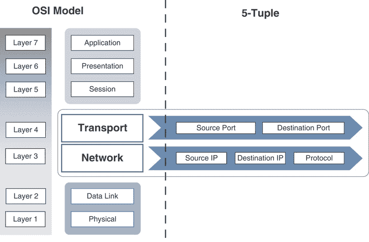

图 1-2 针对 OSI 层的无状态防火墙数据包过滤标准

`状态检测防火墙`（stateful firewall）的开发初衷是为了克服无状态防火墙的局限性。它可以在内存中保持一段时间的连接状态，这使得防火墙能够追踪 `TCP 握手` 的阶段，并根据当前和之前数据包的状态来采取行动，而不是仅仅基于静态的访问控制规则限制。

图 1-3 阐述了 `TCP 连接` 的状态。在整个生命周期内，每个 `TCP 连接` 都会经过一系列状态，状态检测防火墙可以使用这些状态来过滤流量。要了解更多 TCP 操作，请阅读 `RFC 793`。

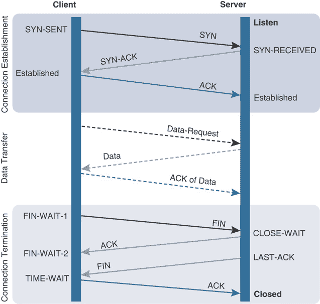

图 1-3 TCP 连接状态

然而，随着威胁的出现，传统的防火墙（无论是无状态还是状态检测的）已被证明在阻止现代应用程序的网络攻击方面是无效的。你需要一种防火墙，不仅能在第 2–4 层过滤流量，还能提供应用可见性和控制、在第 3–7 层执行深度数据包检测、防止网络遭受入侵尝试、解密加密流量、检测协议中的异常，并使用各种上下文数据关联安全事件。`下一代防火墙 (NGFW)` 的设计初衷就是从单台设备上提供所有这些安全服务。


# 图 1-4 展示了你可以在下一代防火墙（`NGFW`）上预期的主要安全特性

`NGFW`上还提供其他服务，但图中未显示，例如路由、地理位置、服务质量（`QoS`）和网络地址转换（`NAT`）。

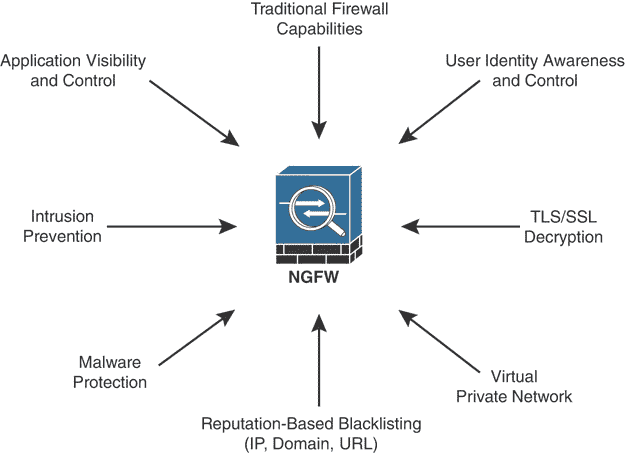

**图 1-4** 下一代防火墙 (NGFW) 的主要安全特性

下一代防火墙解决方案主要由两个组件组成：管理器和传感器。你使用管理器来过滤入站流量，传感器根据策略实时操作出站流量。管理器接收传感器的事件，将其与各种上下文数据关联，并在图形界面中显示。

## Secure Firewall 解决方案

Cisco Secure Firewall 解决方案提供了领先的安全性、可见性和控制，通过其图形界面（`GUI`）供分析师进行审查。`Secure Firewall` 是 Cisco 提供的下一代防火墙解决方案。根据部署方式，`Secure Firewall` 可能会变得简单或复杂。你使用管理器在多个传感器上部署安全策略。


**图 1-4** 下一代防火墙 (NGFW) 的主要安全服务

下一代防火墙

graphics/topic_icon.jpg)

图 1-5 显示了 `Secure Firewall` 的典型架构。在现实世界中，`Secure Firewall` 的部署可能会变得简单或复杂。你使用管理器在多个传感器上部署安全策略。例如，`Secure Firewall` 的部署对于企业网络可能比服务提供商或数据中心网络有所不同。

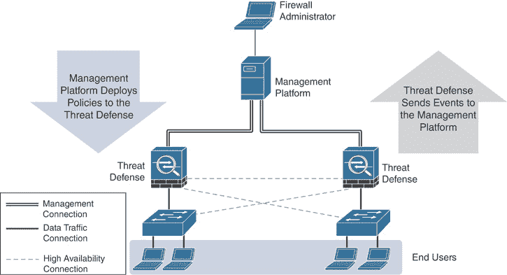

**图 1-5** Secure Firewall 的典型架构

为了满足全球组织的多样需求，Cisco 定期发布各种新的 `Secure Firewall` 本地平台，并扩展对私有云和公有云平台的支持。由于 `CDO` 应用以软件即服务（`SaaS`）模式云托管，Cisco 定期负责其维护任务并确保可用性。你无需担心软件更新。你可以通过互联网随时随地访问其用户界面。

- [防火墙管理器 (DM)](https://example.org/fdm) 允许你通过浏览器从本地管理威胁防御。当你安装威胁防御软件时，`Secure Firewall` 默认带有设备防御软件包。
- [防火墙管理中心 (FMC)](https://example.org/fmc) 允许你从远程位置管理威胁防御。如果你需要在全球不同位置管理威胁防御，可以使用中心化的管理中心。
- [Cisco 防御编排器 (CDO)](https://example.org/cdo) `Cisco Defense Orchestrator` 是一个云交付的管理平台。它允许你同时配置多个威胁防御。本书使用了管理中心作为示例。

## 产品演进与生命周期

Sourcefire 最初有两个不同的软件版本分支：`4.x` 版本主要用于入侵防御系统（`IPS`）功能，而 `5.x` 版本则带有下一代防火墙（`NGFW`）功能。根据版本分支，管理平台具有不同的名称。例如，在 `4.x` 版本中，它被称为 `Sourcefire Defense Center`，而在 `5.x` 版本中，它被称为 `FireSIGHT Management Center`（`FMC`）。同样，传感器在 `4.x` 版本中被称为 `3D Sensor`，在 `5.x` 版本中被称为 `FirePOWER Appliance`。因此，说在 `4.x` 版本中，`Sourcefire Defense Center` 管理 `3D Sensors`，而在 `5.x` 版本中，`FireSIGHT Management Center` 管理 `FirePOWER Appliances` 是正确的。在这里，注意这两个不同的术语——`FireSIGHT` 和 `FirePOWER`。

为了使命名尽可能简单并保留品牌声誉，思科使用一个简单的单词对它们进行了重新命名：`Firepower`（注意 `power` 为小写）。从 6.x 版本开始，思科还将管理平台的名称精简为 `Firepower Management Center`（`FMC`）。思科并未回溯追溯性地将旧版 Sourcefire 软件和硬件的名称从大写的 `FirePOWER` 改为小写的 `Firepower`；例如，Cisco `FirePOWER` 设备以及带有 `FirePOWER` 服务的 Cisco `ASA`。在这里，`FirePOWER`（大写格式）指的是收购 Sourcefire 之前的开发版本。只有新发布的硬件和软件使用了小写格式的 `Firepower`，表示该硬件系列是在收购后引入的。

**表 1-2** Cisco Secure Firewall 管理中心的演进

| 版本 | 方案名称 | 管理平台名称 |
| --- | --- | --- |
| 4.x 版本 | 3D System | Defense Center |
| 5.x 版本 | FireSIGHT System | FireSIGHT Management Center |
| 6.x 版本 | Firepower System | Firepower Management Center |
| 7.x 版本 | Cisco Secure Firewall | Cisco Secure Firewall Management Center |

图 1-8 和 图 1-9 显示了不同主要软件版本中管理平台的登录页面。

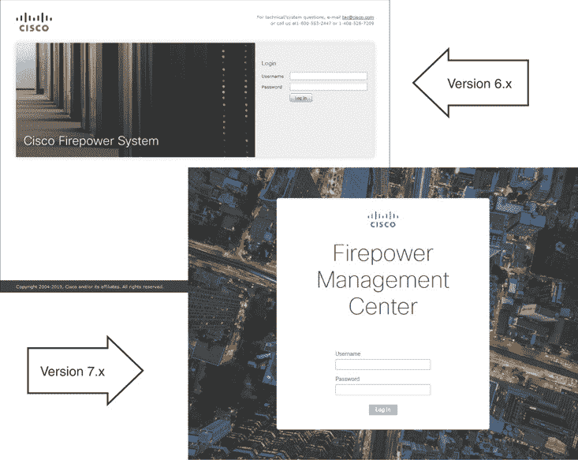

**图 1-8** 7.x 和 6.x 版本管理平台的登录页面

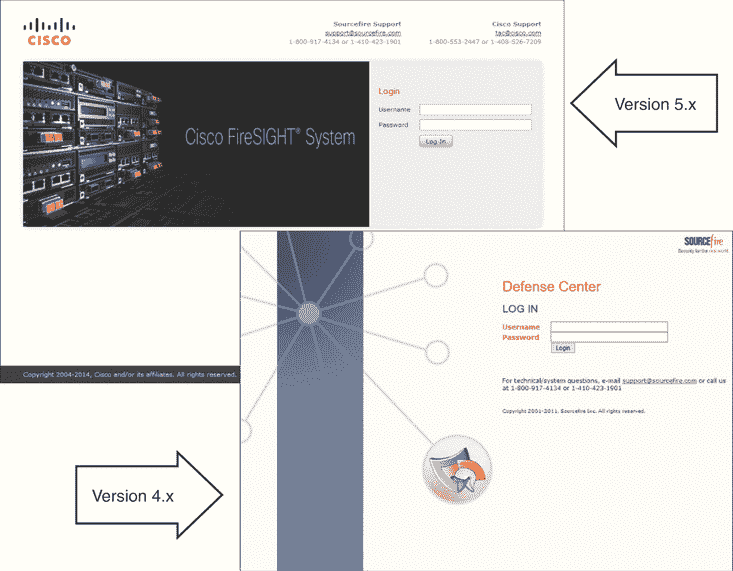

**图 1-9** 5.x 和 4.x 版本管理平台的登录页面

与收购 Sourcefire 一样，思科一直在定期收购开发尖端产品和技术的公司。2020 年，思科将所有安全产品名称统一到 `Cisco Secure` 品牌下。这种重新命名简化了产品名称并反映了它们的用途和目的。例如，`Firepower System` 被重命名为 `Cisco Secure Firewall`；`Firepower Management Center` 被重命名为 `Cisco Secure Firewall Management Center`，而 `Firepower Threat Defense`（`FTD`）被重命名为 `Cisco Secure Firewall Threat Defense`。**表 1-3** 显示了根据 Cisco Secure 品牌架构的一些新产品名称。

**表 1-3** Cisco Secure 品牌架构

| 新名称 | 旧名称 |
| --- | --- |
| Cisco Secure Firewall | Firepower 下代防火墙 (NGFW) |
| Cisco Secure Firewall Threat Defense | Firepower Threat Defense |
| Cisco Secure Firewall Management Center | Firepower Management Center |
| Cisco Secure IPS | Firepower Threat Defense IPS Mode |
| Malware Defense | 网络高级恶意软件防护 (AMP) |
| Malware Analytics Cloud | 高级恶意软件防护 (AMP) 云 |
| Secure Endpoint | 端点高级恶意软件防护 (AMP) |
| Cisco Secure Client | Cisco AnyConnect 安全 Mobility Client |
| Cisco Secure Malware Analytics | Cisco Threat Grid |

思科为 Secure Firewall 发布两个软件版本，通常间隔约六个月。短期版本（`STR`）的生命周期较短，但包含了最新的功能集。长期版本（`LTR`）提供更长的生命周期。如果你正在寻找具有最新功能和更长支持期的版本，这应该是你的选择。每两年，思科会发布一个 `LTR` 的扩展版本，称为超长期版本（`XLTR`）。该版本不仅提供了最长的生命周期，还适用于政府认证。图 1-10 显示了从首次客户出（FCS）日期开始的不同软件版本的生命周期。

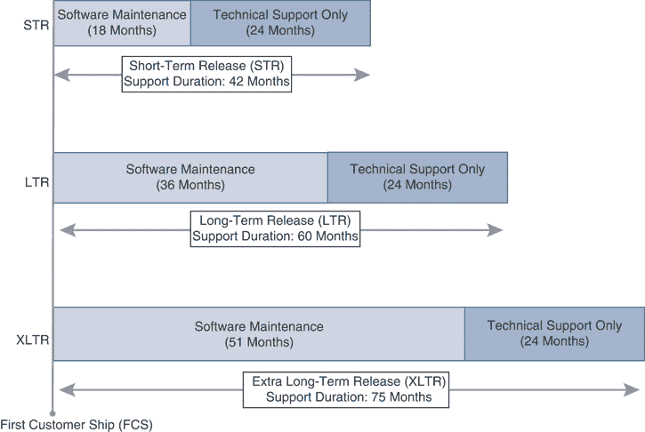

**图 1-10** Cisco Secure Firewall 的发布周期

本书基于 Cisco Secure Firewall 7.0 版本编写。

## 软件硬件架构

收购后，思科将 Sourcefire 的下一代安全技术集成到现有的 `ASA` 防火墙解决方案。在早期的实现中，Sourcefire 技术作为独立的服务模块运行。后来，思科设计了新的硬件平台原生支持 Sourcefire 技术，并命名为 `Cisco Firepower`，随后被重命名为 `Cisco Secure Firewall`。在新实现中，思科将 Sourcefire 的下一代安全功能、开源 `Snort` 和 `ASA` 功能合并到一个统一的软件镜像中。该软件被称为 `Firepower Threat Defense`（`FTD`）。重命名后，该软件现在被称为 `Cisco Secure Firewall Threat Defense`，简称威胁防御。威胁防御软件的统一镜像减少了处理开销并提高了系统性能，因为所有安全服务都原生运行在操作系统上，而不是独立的服务模块。软件组件的功能将在书中详细介绍；但在深入研究功能之前，让我们快速查看每个组件的作用。图 1-12 展示了与 Cisco Secure Firewall 交互的各种软件组件。

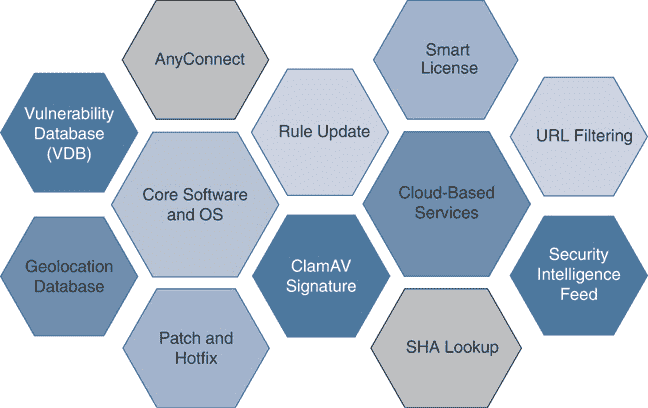

**图 1-12** Cisco Secure Firewall 软件组件

- **核心软件和操作系统 (OS)：** 软件的核心部分包括操作系统、用于入侵检测和防御的 `Snort` 检测引擎、用于图形用户界面的 Web 服务器、存储事件的数据库、硬件组件固件等。
- **维护版本和补丁：** 思科定期发布维护版本，以修复 Secure Firewall 软件的任何缺陷，并解决在发布版本中可能发现的安全漏洞。
- **规则更新：** Secure Firewall 上的检测引擎基于 Snort 使用入侵规则来检测和防止入侵尝试。思科威胁情报小组（又称为 Talos）开发入侵规则，以提供对最新安全威胁和漏洞的覆盖，并为不同的 Snort 版本单独封装规则集。适用于 Snort 2 的规则更新包被称为 Cisco `安全规则更新 (SRU)`。在 Snort 3 中，此规则更新包被称为 `轻量级安全程序包 (LSP)`。在新安装的且软件版本为 7.0 或更高版本的 Secure Firewall 中，Snort 3 是默认的检测引擎。
- **漏洞数据库 (VDB)：** 该数据库存储了各种应用程序、服务和操作系统的漏洞信息和指纹。Secure Firewall 使用该数据库中的信息通过确定应用程序、服务或操作系统来识别网络主机。此外，`VDB` 允许 Secure Firewall 确定特定文件类型是否符合动态文件分析（防火墙和恶意软件策略的高级功能）的条件。
- **地理位置数据库 (GeoDB)：** 该数据库存储 IP 地址的地理信息。例如，当 Secure Firewall 在 GUI 中显示入侵事件时，`GeoDB` 允许您查看发起入侵尝试的国家名称和国旗。它可以帮助您根据地理位置识别并处理流量。

图 1-13 显示了运行软件版本 7.0 的管理中心自带的默认软件组件。要查找管理中心的当前版本，请前往帮助菜单（`?` 图标，位于右上角）并选择“关于”（About）页面。

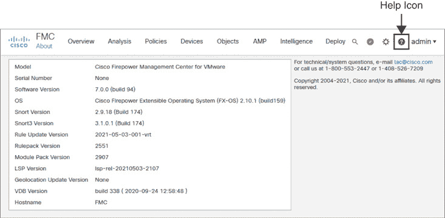

**图 1-13** 运行版本 7.0 的管理中心默认软件组件

Secure Firewall 的架构是模块化的。高端单机由多个刀片服务器（也称为安全模块）组成。威胁防御软件运行在主模块上。主模块和安全模块都由一个独立的操作系统驱动，称为 Firepower 可扩展操作系统 (`FXOS`)。图 1-14 显示了一些常见的低端和高端 Secure Firewall 硬件型号。顶部的两个防火墙属于 1000 系列，该系列专为中小型企业网络设计。底部的防火墙是 9000 系列硬件，能够处理数据中心或服务提供商网络中的大量流量。图 1-15 用简单的图表说明了 9000 系列硬件的模块化架构。

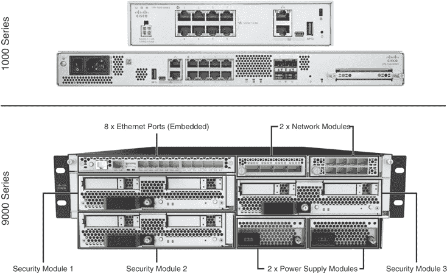

**图 1-14** 支持威胁防御软件的 Secure Firewall 硬件

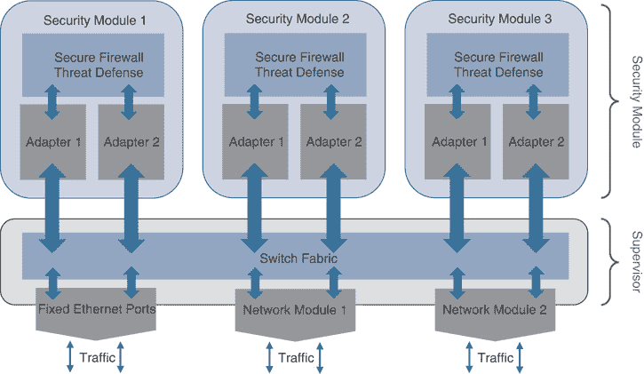

**图 1-15** 思科 Secure Firewall 9000 系列硬件架构

## 可扩展性与容错性

Secure Firewall 是一种高度灵活的安全解决方案。在 Secure Firewall 部署中，有多种方法可以实现扩展性并确保容错性，例如使用 `集群`、`多实例`、`高可用` 等。本节总结了这些其中部分功能的关键特性和优势。

### 集群


随着您的组织的增长，您的 Secure Firewall 部署也可以扩展以支持其网络增长。如果您运行的是较高级的 Cisco Secure Firewall 型号，则不需要更换现有设备来获得额外的性能；您只需向现有的部署中添加额外的威胁防御设备，并将它们分组成单个逻辑集群，以支持额外的吞吐量。一个集群化的逻辑设备可以同时提供更高的性能、可扩展性和容错性。

您可以在多个机箱之间或同一机箱的多个安全模块之间创建集群。当在多个独立机箱之间构建集群时，被称为`跨框集群 (inter-chassis clustering)`。当在同一机箱的多个安全模块之间构建集群时，被称为`框内集群 (intra-chassis clustering)`。系统会自动将集群中的一个成员指定为`控制单元 (control unit)`。其余成员被视为`数据单元 (data units)`。在跨框集群中，您控制单元上的配置会自动通过集群控制链路 (`CCL`) 复制到数据单元。在框内集群中，集群成员使用背板进行集群通信。

请查看图 1-16 和图 1-17 以理解跨框和框内集群架构之间的区别。在图 1-16 中，框内集群是在同一机箱的三个独立服务模块之间形成的。图 1-17 显示在两个独立的机箱之间建立了跨框集群。两个机箱中的六个服务模块在逻辑上被组成集群。使用二层交换来建立集群控制链路 (`CCL`) 网络。

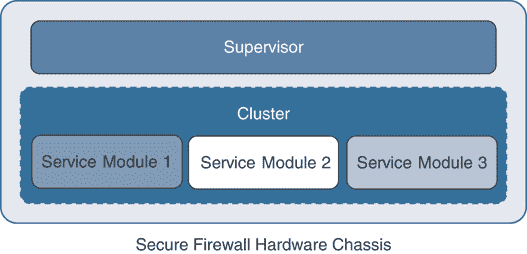

**图 1-16** 框内集群逻辑图

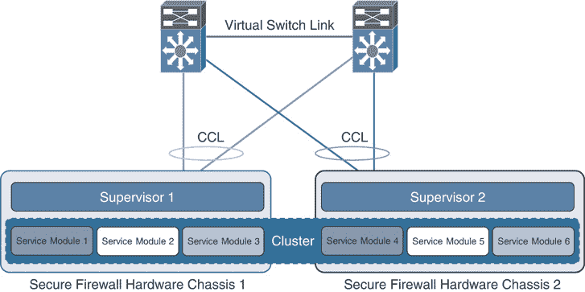

**图 1-17** 跨框集群逻辑图

### 多实例


高级 Secure Firewall 型号还提供了由 Docker 容器技术支持的多功能。它允许您使用机箱总硬件资源的一个子集创建并运行多个应用程序实例。您可以独立管理威胁防御应用程序实例，就像它们是独立的威胁防御设备一样（参见图 1-18）。多实例功能允许您隔离许多关键元素，例如：

- 防火墙策略管理
- 防火墙软件维护
- 任何故障和故障排除
- 数据流量处理

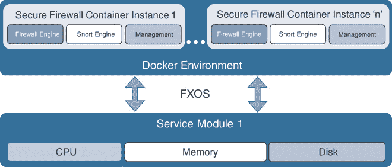

**图 1-18** 容器环境下的 Secure Firewall 实现

在基于容器的环境中，威胁防御应用程序可以通过两种方式部署：

- **原生实例 (Native instance)：** 利用 Secure Firewall 的所有硬件资源构建单个威胁防御应用程序实例。
- **容器实例 (Container instance)：** 共享 Secure Firewall 的物理资源创建多个逻辑威胁防御应用程序实例。您可以创建的容器实例数量取决于底层硬件资源，如 CPU、内存、存储和接口。

根据您的用例需求，您可以同时利用两种逻辑分组功能——容器实例和集群。这种组合部署被称为`多实例集群`（multi-instance clustering）。这种类型的集群为您的安全架构设计提供了额外的灵活性。例如，集群中的成员可以是同一硬件系列中的不同型号。只要有足够的硬件资源，一个安全模块就可以拥有多个容器实例。此外，没有必要将安全模块上的所有容器实例都包含在集群中。图 1-19 用逻辑图说明了这种设计灵活性。

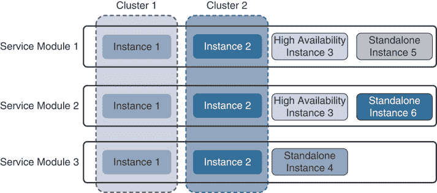

**图 1-19** 多实例集群环境的逻辑图

### 高可用性


Secure Firewall 的高可用能力能够让您在非计划停机期间确保业务连续性。您可以在 Secure Firewall 的两个组件——管理中心（management center）和威胁防御（threat defense）上启用高可用性。高可用性对中的两个对等节点必须是相同的型号，并且运行相同的软件版本。

在高可用架构中，一个设备处于活动状态，而另一个设备处于备用状态。备用设备不主动处理流量或安全事件。如果检测到活动设备故障，或者活动设备的心跳消息（keepalive messages）任何中断，备用设备将接管活动设备的角色并开始活动运行，以维持防火墙操作的连续性。


活动设备定期发送心跳消息并将配置复制到备用设备。高可用对对等节点之间的通信通道必须是健壮的且延迟低得多。在连接方面，高可用对的管理中心使用其常规管理接口与对等节点进行通信；然而，高可用对的威胁防御设备使用专用链路来交换故障转移状态和数据。您可以配置一个未使用的的数据接口作为专用的故障转移链路。图 1-20 和 1-21 说明了高可用对中活动对等节点与备用等节点之间的连接。

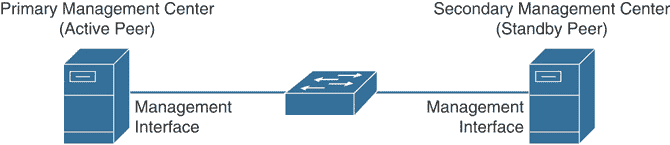

**图 1-20** 管理中心的高可用性

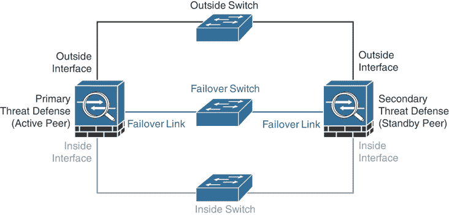

**图 1-21** 威胁防御的高可用性

## 连接的韧性

Cisco Secure Firewall 支持网络端口级别的韧性，以确保在链路故障时的业务连续性。根据您的用例，以下是需要考虑的两个主要特性：

*   **EtherChannel**: `EtherChannel` 是一种链路聚合技术（IEEE 802.3ad），允许您将多个物理端口组合到一个逻辑组，从而从该聚合通道组获得更高的吞吐量。另一个优点是它对链路故障的容错能力。如果通道组的一个成员接口故障，流量仍将通过通道组的剩余接口进行传输和负载均衡。威胁防御允许您通过物理接口配置 `EtherChannel`。为了建立冗余，您可以考虑对任何数据链路以及故障转移链路使用 `EtherChannel`。`EtherChannel` 中链路的添加、删除或替换由链路聚合控制协议（`LACP`）自动处理。

    图 1-22 显示了捆绑到单个通道组的两个链路。由于 `EtherChannel` 配置，威胁防御设备之间的链路现在与图 1-21 所示的拓扑相比更具韧性。

    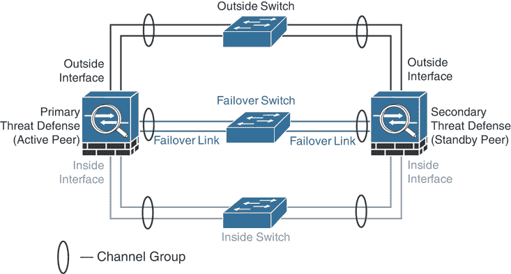

    **图 1-22** EtherChannel 提供链路级容错能力

*   **硬件旁路**: 这在功能上允许流量在发生任何硬件故障或停电时通过威胁防御设备。要启用此功能，您的威胁防御设备必须配备专门设计的网络模块，该模块仅在在线集（inline sets）中支持（在线集的配置详见第 15 章“网络分析和入侵策略”[](#ch15.xhtml#ch15)）。高可用模式不支持硬件旁路端口，它们无法参与 `EtherChannel` 逻辑组。

### 总结

本章提供了下一代防火墙解决方案的基础，并简述了 Cisco Secure Firewall 的发展史。它还向您介绍了 Secure Firewall 的软件组件和硬件架构。本章还描述了使威胁防御具备扩展性和韧性的高级功能。在下一章中，您将学习 Secure Firewall 软件的部署和初始化。

### 考试准备任务

正如引言中“如何使用本书”节提到的，您有几种准备考试的选择：此处的练习、第 22 章“最后准备”[](#ch22.xhtml#ch22)）、以及 Pearson Test Prep 模拟测试软件中的考试模拟题。

### 复习所有关键主题

回顾本章中最重要的主题，这些主题在页外边处标有关键主题图标。表 1-4 列出了这些关键主题及其对应的页码。


**表 1-4** 第 1 章关键主题

| 关键主题元素 | 描述 | 页码 |
| --- | --- | --- |
| 段落 | 下一代防火墙组件 | 8 |
| 列表 | Secure Firewall 管理平台 | 8 |
| 列表 | Secure Firewall 软件组件 | 15 |
| 段落 | 集群 | 18 |
| 段落 | 多实例 | 19 |
| 段落 | 高可用性 | 20 |

*   **配置**：本节描述了部署 Secure Firewall 软件所需的 VMware ESXi 配置。

*   **系统初始化与验证**：本节分享了验证 Secure Firewall 部署是否成功完成的方法。

本章的目标是学习以下内容：

*   在虚拟平台上部署 Cisco Secure Firewall
*   为 CCNP Security 考试准备构建一个高效益的实验环境

在本地硬件、虚拟环境或公有云基础设施中部署 Secure Firewall 软件的过程有所不同。然而，在安装软件并在管理中心（Management Center）注册威胁防御（Threat Defense）后，使用图形用户界面（GUI）配置和部署各种安全策略的步骤在所有管理中心或威胁防御模型中都是相同的。换句话说，如果你学会了使用特定模型配置 Secure Firewall，就可以将这些知识应用于任何其他平台。为了准备 CCNP Security 考试，你可能会发现虚拟实验室比使用 Cisco 专有硬件构建实验室更具效益。考虑到这一点，本章将演示如何在虚拟实验室环境中部署 Secure Firewall。

### “我掌握这些了吗？”测验

“我掌握这些了吗？”测验可以让你评估自己应该是仔细阅读整个章节内容，还是直接跳到“考试准备任务”部分。如果你对这些问题的答案或自己对这些主题知识的自评估有疑问，请通读整个章节。表 2-1 列出了本章的主要标题及其对应的“我掌握这些了吗？”测验习题。你可以在附录 A 中的“‘我掌握这些了吗？’测验答案”中找到答案。

**表 2-1** “我掌握这些了吗？”章节与题目对应表

| 基础知识点章节 | 题目 |
| --- | --- |
| 虚拟平台上的 Cisco Secure Firewall | 1–3 |
| 最佳实践 | 4 |
| 配置 | 5, 6 |
| 系统初始化与验证 | 7, 8 |

> **注意**
>
> 自评估的目标是衡量你对本章主题的掌握程度。如果你不知道某个问题的答案，或者对答案只有部分把握，那么在自评估时你应该将该问题标记为错误。为你猜对的答案给分会歪曲你的自评估结果，并可能给你带来虚假的安全感。

**1.** 下列哪种虚拟平台支持运行 Secure Firewall 7.0 版本？

1. VMware Workstation
2. VMware Player
3. VMware Fusion
4. VMware ESXi

**2.** 为管理八个威胁防御设备，建议为管理中心虚拟机分配的内存是多少？

1. 16 GB
2. 28 GB
3. 32 GB
4. 64 GB

**3.** 下列哪项是 Secure Firewall 虚拟设备的磁盘文件？

1. TAR.GZ
2. VMDK
3. OVF
4. MF

**4.** 哪种网络适配器提供最大的吞吐量？

1. E1000
2. VMXNET2 (Enhanced)
3. VMXNET3
4. VMXNET-X

**5.** 部署威胁防御虚拟机总共需要多少接口？

1. 一个
2. 两个
3. 三
4. 四个

**6.** 下列叙述何正确？

1. 你可以安装 ISO 镜像文件来部署管理中心虚拟机。
2. 威胁防御虚拟机最多支持四个接口。
3. 用于 ESXi 的 OVF 模板也可以用于在云端部署 Secure Firewall。
4. 威胁防御虚拟机的所有数据接口必须启用杂杂模式。

**7.** 下列叙述哪项是错误的？

1. 突然关机虚拟机设备可能会损坏其系统数据库。
2. 对“本地管理设备”问题回答“是”将启用设备管理器服务。
3. Secure Firewall 软件允许你手动或使用 DHCP 配置管理 IP 地址。
4. 出于安全考虑，Secure Firewall 默认禁用 SSH 访问。

**8.** 可以使用哪些协议连接到 Secure Firewall 进行管理？

1. HTTP 和 HTTPS。
2. HTTPS 和 SSH。
3. SSH 和 Telnet。
4. 以上答案全部正确。

## 基础知识点

### 虚拟平台上的 Cisco Secure Firewall

Cisco Secure Firewall 组件——包括管理中心和威胁防御——与任何硬件和虚拟机模型都完全互操作。例如，你可以在虚拟环境中部署管理中心，而其威胁防御设备可能基于 Cisco 硬件，反之亦然。在虚拟环境中部署 Secure Firewall 是一个多步骤的过程。它需要对虚拟网络进行仔细设计，并分配足够的虚拟资源。你可能可以在任何虚拟平台上安装 Secure Firewall 软件；然而，Cisco 可能并不支持所有可用平台。请阅读软件发行说明，以确定你所选 Secure Firewall 版本是否支持你的虚拟平台。表 2-2 提供了 Secure Firewall 支持的虚拟/云平台列表。


**表 2-2** 运行 7.0 版本的 Secure Firewall 虚拟机支持的平台

| 私有云（本地） | 公有云 |
| --- | --- |
| VMware vSphere/ESXi | Amazon Web Services (AWS) |
| 基于内核的虚拟机 (KVM) | Microsoft Azure |
| OpenStack | Google Cloud Platform (GCP) |
| Nutanix Enterprise Cloud | Oracle Cloud Infrastructure (OCI) |

本章演示了在本地虚拟环境中部署管理中心和威胁防御的步骤。在演示过程中，以在 VMware ESXi 6.5 上部署 Secure Firewall 7.0 版本作为示例。如果你使用不同的版本或平台，用户界面可能会有所不同；但你仍然可以使用本章理解部署工作流的核心概念。

#### 宿主机环境设置

确保运行 VMware 的宿主机服务器上已启用虚拟化技术 (VT)。它可以提高在 VMware 上运行的虚拟机的性能。你可以使用系统的 BIOS 设置工具启用它，如图 2-1 所示。Intel 和 AMD 的最新处理器都支持此功能。

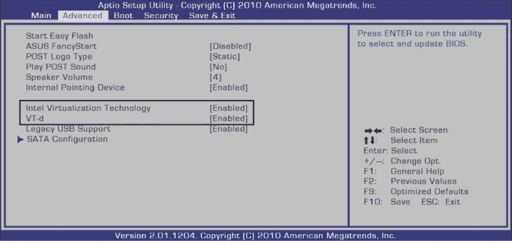

**图 2-1** 在 BIOS 设置工具中启用虚拟化技术

图 2-1 显示在 BIOS 设置工具中启用了虚拟化技术。

在你运行威胁防御虚拟机的宿主机环境中禁用超线程。超线程技术可以使单个`物理`处理器核心像两个`逻辑`处理器一样工作；但对于由 Snort 3 驱动的威胁防御虚拟机来说并非必要的。Snort 3 原生支持多个数据包处理线程，这使得威胁防御虚拟机在设计上就能执行更快的检查。要禁用超线程，首先在系统的 BIOS 设置中禁用，然后在 vSphere Client 中关闭它。

#### 虚拟资源分配

虚拟设备从其宿主服务器的资源池中获取内存、虚拟处理器和存储空间。虚拟设备的性能取决于您从该资源池中分配的资源。为了获得最佳性能，您应该始终考虑为您的 Secure 防火墙 分配 Cisco 推荐的资源数量。

表 2-3 显示了不同管理中心虚拟设备模型的最低资源需求。`FMCv25` 模型可以管理多达 25 台威胁防御设备，而 `FMCv300` 模型可以管理多达 300 台威胁防御设备。`FMCv300` 是为更大的网络设计的。要为 CCNP Security 考试准备构建实验环境，您可以直接选择 `FMCv25`。

**表 2-3** Secure Firewall 管理中心虚拟设备规格

| 组件 | FMCv25 | FMCv300 |
| --- | --- | --- |
| 处理器 | 4 vCPU–8 vCPU | 32 vCPU |
| 内存 | 32 GB | 64 GB |
| 存储 | 250 GB | 2.2 TB |
| 管理威胁防御设备最大数量 | 25 | 300 |
| 最大网络映射（主机/用户） | 50,000/50,000 | 150,000/150,000 |
| 最大入侵事件 | 1000 万 | 6000 万 |

表 2-4 显示了不同性能分级的威胁防御虚拟设备的规格。分配的资源越多，威胁防御设备提供的性能就越好。然而，平均包大小越小，威胁防御设备提供的吞吐量就越低。表中的吞吐量统计是考虑了三种安全特性的：防火墙、应用可见性与控制 (AVC) 以及入侵防御系统 (IPS)。对于您的 CCNP Security 考试准备实验，`FTDv5` 模型应该足够。

**表 2-4** Secure Firewall 威胁防御虚拟设备规格

| 组件 | FTDv5 | FTDv10 | FTDv20 | FTDv30 | FTDv50 | FTDv100 |
| --- | --- | --- | --- | --- | --- | --- |
| 处理器 | 4 vCPU | 4 vCPU | 4 vCPU | 8 vCPU | 12 vCPU | 16 vCPU |
| 内存 | 8 GB | 8 GB | 8 GB | 16 GB | 24 GB | 32 GB |
| 存储 | 48 GB | 48 GB | 48 GB | 48 GB | 48 GB | 48 GB |
| 吞吐量 (1024 B) | 100 Mbps | 1 Gbps | 3 Gbps | 5.5 Gbps | 10 Gbps | 15.5 Gbps |
| 吞吐量 (450 B) | 100 Mbps | 1 Gbps | 1 Gbps | 2 Gbps | 3 Gbps | 7 Gbps |
| 每秒最大新连接数 | 12,500 | 20,000 | 20,000 | 20,000 | 40,000 | 130,000 |
| 最大并发会话 | 100,000 | 100,000 | 100,000 | 250,000 | 500,000 | 2,000,000 |

### 软件包选择

在 Secure Firewall 部署中，管理中心的软件版本应大于或等于运行在其受管理的威胁防御设备上的版本。例如，如果您部署了版本为 `7.0` 的威胁防御设备，其远程管理器——管理中心——必须运行 `7.0` 或更高版本。您必须为您的托管环境选择合适的软件版本和软件包。例如，如果您的虚拟平台基于 VMware ESXi，请使用 Open 虚拟化格式 (`.ovf`) 文件，该文件提供在经过压缩的 `tar.gz` 文件中。同样，如果您运行基于 KVM 的基础设施，请使用 QEMU 复制时复制 (`.qcow2`) 文件。对于公共云平台，软件软件包是单独发布的。例如，对于 Microsoft Azure 云环境，可以下载虚拟硬盘 (`.vhd.bz2`) 文件。不要使用任何 ISO 镜像文件来创建虚拟设备。它们是为 Cisco 硬件封装。

图 2-2 突出了 VMware 平台的安装包。您可以从 Cisco 软件下载门户下载它们。

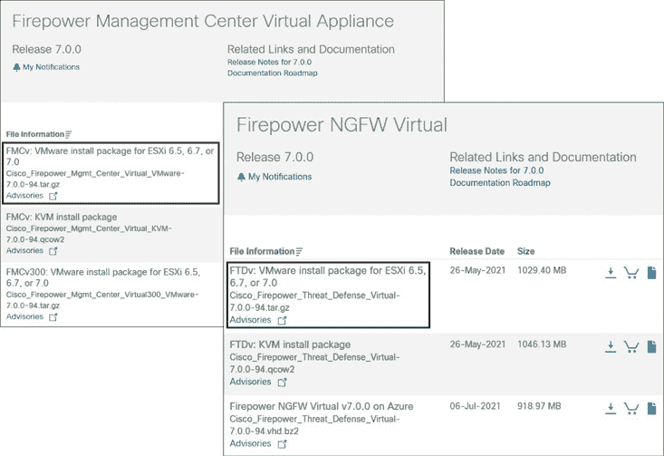

**图 2-2** Cisco.com 提供的 Secure Firewall 虚拟设备安装包

适用于 VMware ESXi 的 tarball (`tar.gz`) 文件包含了 ESXi 和虚拟基础设施 (VI) 的模板。它们之间的主要区别在于初始设置过程，包括网络配置、管理员帐户的密码设置以及其他配置选项。在 VI 模板部署中，您在部署 Secure Firewall 软件之前使用部署向导来配置初始系统设置。然而，在 ESXi 模板中，您在 VMware 控制台中配置初始设置。本章的示例使用 ESXi 模板来部署 Secure Firewall。

适用于 VMware ESXi 的 tarball (`tar.gz`) 包含以下类型的文件：

- **Open 虚拟化格式 (`.ovf`)**：存储 Secure Firewall 软件包许多元素的 XML 文件。
- **虚拟机磁盘 (`.vmdk`)**：存储 Secure Firewall 软件的压缩虚拟磁盘。
- **清单 (`.mf`)**：存储 OVF 和 VMDK 文件 SHA1 摘要的文本文件。

图 2-3 显示了创建中心（上方）和威胁防御（下方）虚拟机的安装文件。您在下载 tarball 后可以获得这些文件。


### 最佳实践

在 VMware ESXi 上部署 Secure Firewall 虚拟设备的最佳实践如下：

1. 从 cisco.com 下载 Secure Firewall 虚拟设备文件后，务始终验证所下载文件的校验和，以确认文件未损坏且在下载过程中未被修改。您可以在清单文件（`MF` 文件见图 2-3）中找到校验值。
2. 阅读发行说明和入门指南以确定特定版本的要求。为满足任何先决条件并完成虚拟设备部署过程留出额外时间。例如，仅在托管环境中设置虚拟网络、从头部署软件并完成系统初始化，就需要大约小时（取决于硬件资源能力）。
3. 如果您的 ESXi 服务器有空闲资源，请将它们分配给您的 Secure Firewall 虚拟设备以增强性能。更改虚拟资源分配时，必须先安全地关闭虚拟机。当分配额外资源时，您必须考虑支持的 CPU 和内存组合，如表 2-3 和 `2-4` 所示。
4. 在部署或初始化过程中，切勿关闭虚拟设备。可能会损坏系统数据库。Secure Firewall 初始化成功后，VMware 控制台中将出现登录提示。
5. Secure Firewall 虚拟设备支持 `VMXNET3` 网络适配器，该适配器旨在最大限度地减少虚拟环境中的网络处理开销。如果您运行较旧版本的 Secure Firewall 软件，网络适配器类型可能默认设置为 `E1000`。为了获得更高的吞吐量，请将适配器类型从 `E1000` 改为 `VMXNET3`。`E1000` 和 `VMXNET3` 适配器的主要区别在于最大吞吐量限制。`VMXNET3` 适配器的吞吐量为 `10 Gbps`，而 `E1000` 适配器最高支持 `1 Gbps`。要查找有关 VMware 平台上不同类型网络适配器的详细信息，请访问 `vmware.com`。

### 配置


# 在 VMware 中部署 Secure Firewall 虚拟设备

在 VMware 中部署 Secure Firewall 虚拟设备是一个多步骤的过程。在构建 `VMware ESXi` 主机服务器之后，您需要使用虚拟交换机和虚拟网络适配器在主机环境中设计并设置虚拟网络。该虚拟网络应该能够将管理流量与数据流量隔离。尽管任何 VMware 特定的配置（例如在 VMware 上设置虚拟网络）都超出了 CCNP Security 书的范围，但本节重点介绍了一些关键步骤，以帮助您准备实验。

图 2-4 显示了在 `VMware ESXi` 主机上部署 Secure Firewall 虚拟设备的关键步骤。

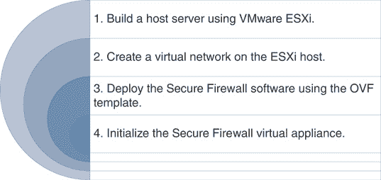

**图 2-4** 部署 Secure Firewall 虚拟设备的主要步骤

图 2-5 展示了 Secure Firewall 部署在虚拟环境中的逻辑拓扑结构。虽然终端用户的虚拟环境超出了本文范围，但本节重点介绍了一些关键步骤，以帮助您准备实验。

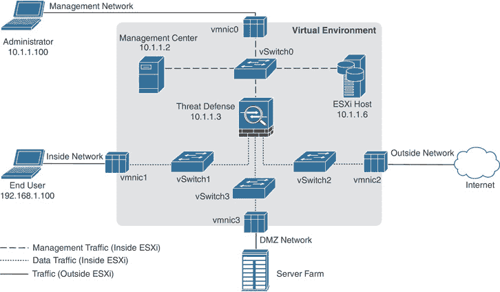

**图 2-5** VMware 环境下虚拟网络的逻辑拓扑

## 用于管理流量的虚拟网络

在 VMware 中部署 Secure Firewall 虚拟设备是一个多步骤的过程。在构建 `VMware ESXi` 主机服务器之后，您需要使用虚拟交换机和虚拟网络适配器在主机环境中设计并设置虚拟网络。该虚拟网络应该能够将管理流量与数据流量隔离。

图 2-4 显示了在 `VMware ESXi` 主机上部署 Secure Firewall 虚拟设备的关键步骤。


**图 2-4** 部署 Secure Firewall 虚拟设备的主要步骤

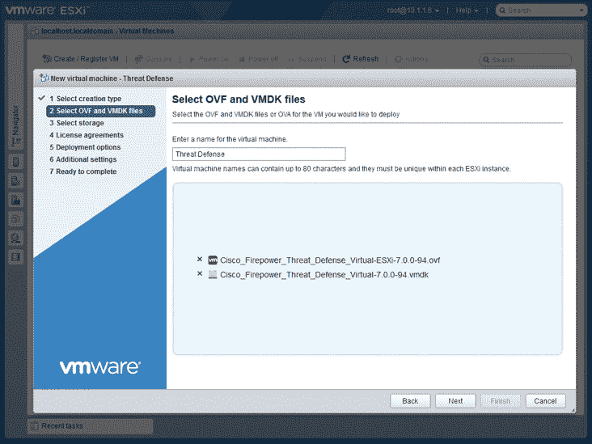

**图 2-12** 威胁防御虚拟设备的 OVF 和 VMDK 文件选择

**第 5 步。** 选择要存储配置和磁盘文件的存储位置。点击 `Next` 继续。

图 2-13 显示了新管理中心虚拟设备名为 `datastore1` 的存储选择。

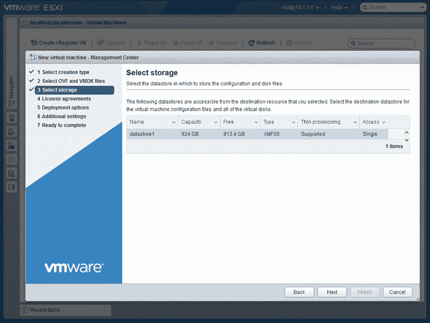

**图 2-13** 虚拟机的存储选择

**第 6 步。** 在“部署选项”（Deployment Options）阶段，首先选择您为管理网络流量创建的虚拟端口组（详情请参阅“用于管理网络流量的虚拟网络” 章节）。接下来，为虚拟磁盘选择以下磁盘分配（Disk Provisioning）选项之一，并点击 `Next` 继续。


*   **厚置配置:** 在创建虚拟磁盘时分配磁盘空间。
*   **精简置配置:** 按需分配磁盘空间。每当需要时，虚拟磁盘的大小就会增长，直到达到最大分配限制。

图 2-14 显示了管理网络选择了 `VM Network`，并为管理中心在磁盘分配选项中选择了 `Thick`。

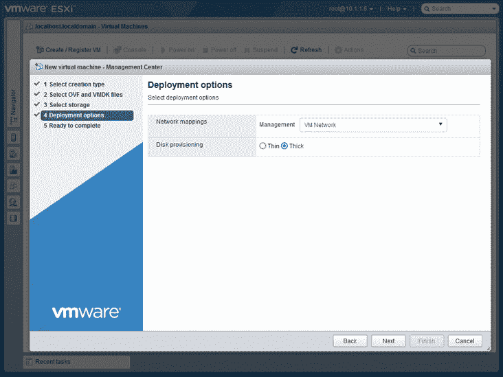

**图 2-14** 管理中心虚拟设备的部署选项选择

您需要映射的网络数量取决于您正在部署的虚拟设备类型。例如，管理中心虚拟设备只需要一个接口用于管理目的，而威胁防御虚拟设备至少需要四个接口——一个接口用于管理流量，三个接口用于数据流量。

图 2-15 显示了威胁防御虚拟设备管理、诊断和数据接口与虚拟端口组的映射。

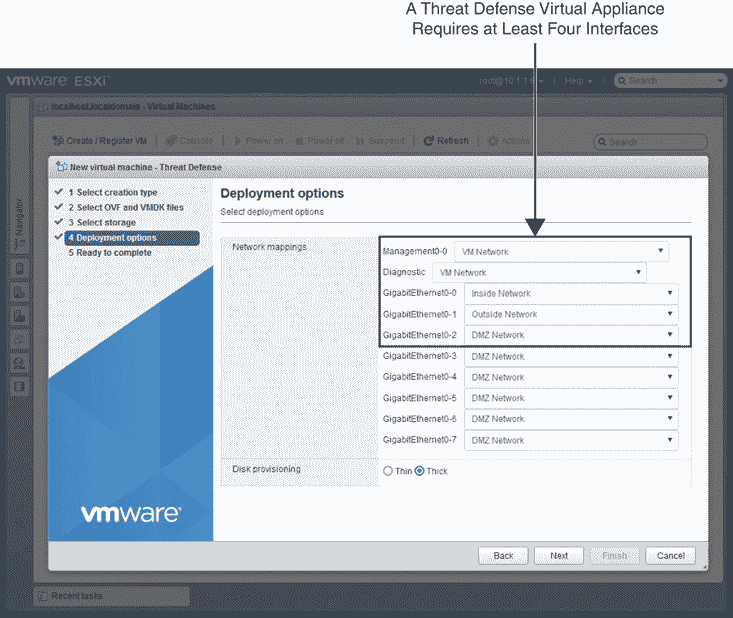

**图 2-15** 威胁防御虚拟设备的部署选项选择

**第 7 步。** 当您处于名为“准备完成”（Ready to Complete）的最后阶段时，检查所有选择。如果一切看起来都正确，点击 `Finish` 按钮完成配置。

图 2-16 显示了管理中心虚拟设备选择的摘要。

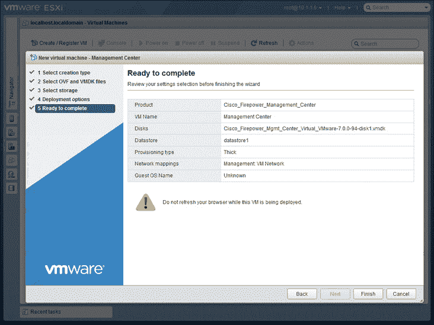

**图 2-16** 确认管理中心虚拟设备设置的最终提示

**第 8 步。** 点击 `Finish` 按钮后立即开始部署。从本地计算机上传 `.vmdk` 文件到 ESXi 服务器可能需要几分钟时间。

图 2-17 显示了 `.vmdk` 文件的状态。

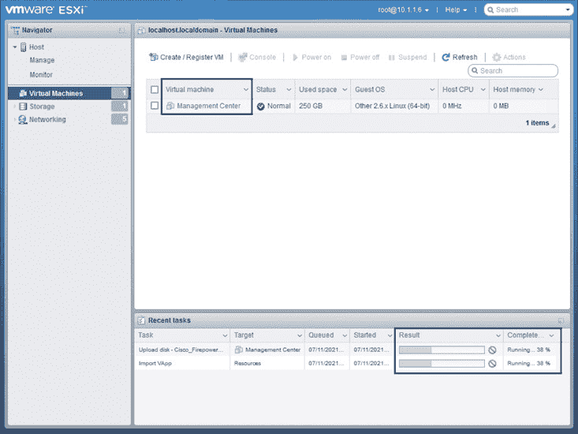

**图 2-17** .vmdk 文件的上传

示例 2-2 显示了威胁防御虚拟设备的初始化。在此过程中，系统将提示你回答一个问题：在本地管理设备（yes/no）。对此问题回答 no 将允许通过远程管理中心对威胁防御进行管理；否则，威胁防御设备将启用其本地管理应用程序——`Secure Firewall device manager`。示例末尾的 `>` 提示符确认系统初始化完成。

**示例 2-2** 首次登录后的威胁防御虚拟设备初始化

点击此处查看代码图像

```
Cisco Firepower Threat Defense for VMware v7.0.0 (build 94)
firepower login: admin
Password: Admin123
 
Copyright 2004-2021, Cisco and/or its affiliates. All rights reserved.
Cisco is a registered trademark of Cisco Systems, Inc.
All other trademarks are property of their respective owners.
 
Cisco Firepower Extensible Operating System (FX-OS) v2.10.1 (build 159)
Cisco Firepower Threat Defense for VMware v7.0.0 (build 94)
 
You must accept the EULA to continue.
Press <ENTER> to display the EULA: YES
.
 .
! EULA messages are omitted for brevity. Press ‘q’ to exit the EULA screen.
 .
 .
System initialization in progress. Please stand by.
You must change the password for ‘admin’ to continue.
Enter new password:
Confirm new password:
You must configure the network to continue.
You must configure at least one of IPv4 or IPv6.
Do you want to configure IPv4? (y/n) [y]: y
Do you want to configure IPv6? (y/n) [y]: n
Configure IPv4 via DHCP or manually? (dhcp/manual) [manual]: manual
Enter an IPv4 address for the management interface [192.168.45.45]: 10.1.1.3
Enter an IPv4 netmask for the management interface [255.255.255.0]: 255.255.255.0
Enter the IPv4 default gateway for the management interface []: 10.1.1.1
Enter a fully qualified hostname for this system [firepower]: ThreatDefense
Enter a comma-separated list of DNS servers or 'none' [208.67.222.222,
208.67.220.220]: 10.1.1.7
Enter a comma-separated list of search domains or 'none' []: none
If your networking information has changed, you will need to reconnect.
Interface eth0 speed set to ‘10000baseT/Full’
For HTTP Proxy configuration, run ‘configure network http-proxy’
 
Manage the device locally? (yes/no) [yes]: no
Configure firewall mode? (routed/transparent) [routed]: routed
Configuring firewall mode ...
 
Update policy deployment information
    - add device configuration
    - add network discovery
    - add system policy
 
You can register the sensor to a Firepower Management Center and use the Firepower
Management Center to manage it. Note that registering the sensor to a Firepower
Management Center disables on-sensor Firepower Services management capabilities.

When registering the sensor to a Firepower Management Center, a unique alphanumeric
registration key is always required.  In most cases, to register a sensor to a Fire-
power Management Center, you must provide the hostname or the IP address along with
the registration key.
`configure manager add [hostname | ip address ] [registration key ]`
 
However, if the sensor and the Firepower Management Center are separated by a NAT
device, you must enter a unique NAT ID, along with the unique registration key.
`configure manager add DONTRESOLVE [registration key ] [ NAT ID ]`
 
Later, using the web interface on the Firepower Management Center, you must use the
same registration key and, if necessary, the same NAT ID when you add this sensor to the Firepower Management Center.
>
```

当初始化完成且管理中心虚拟设备的所有进程都正常启动后，你应该能够通过网络访问其 GUI 的落地页。要访问 GUI，请在你的电脑上打开浏览器并按以下格式输入管理接口的 IP 地址：`https://<management_IP_address>`。

图 2-19 显示了运行版本 7.0 的管理中心虚拟设备登录页的成功加载。

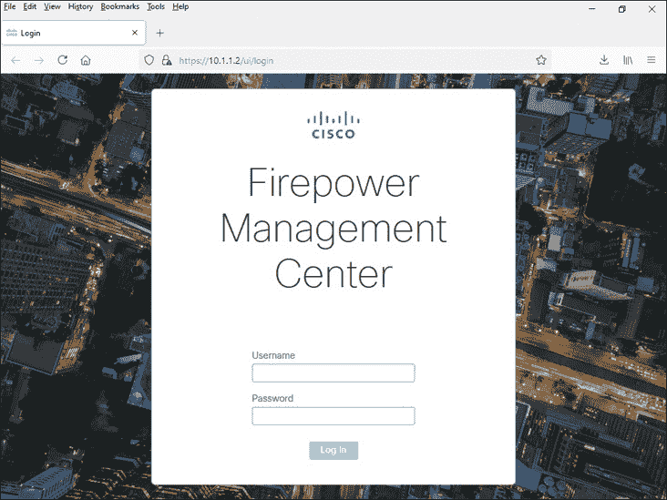

**图 2-19** 运行版本 7.0 的 Secure Firewall Management Center 登录页

或者，你可以通过 Secure Shell (SSH) 协议连接到管理中心虚拟设备和威胁防御 CLI。如果你在系统初始化期间输入的网络设置正确，且管理接口的 IP 地址是可路由的，你应该能够使用默认登录凭据连接到你新部署的管理中心虚拟设备和威胁防御虚拟设备。

## 总结

本章描述了如何部署 Secure Firewall 虚拟设备，并强调了新部署的最佳实践。它还演示了新部署的 Secure Firewall 的系统初始化过程。

## 考试准备任务

正如“如何使用本书”章节中提到的，你有几种准备考试的方法：本章中的练习、第 22 章 的模拟题。

## 回习所有重点

回顾本章中带有重点图标标记的重要内容。表 2-6 列出了这些重点内容的页码。


**表 2-6** 第 2 章重点内容

| 重点内容 | 描述 | 页码 |
| --- | --- | --- |
| 表 2-2 | 运行 7.0 或更高版本的 Secure Firewall 平台 | 27 |
| 段落 | VMXNET3 网络适配器 | 31 |
| 列表 | 磁盘 | 38 |

## 记忆表格和列表

打印 附录 C 记忆表格”（可在配套网站获取）或至少针对本章的内容，记忆这些表格和列表。附录 D 记忆表格答案”（同样可在配套网站获取）包含了完整的表格和列表供你检查。

## 定义术语

定义本章中的关键术语，并在词表中检查你的答案。

*   精简置备
*   空密置备
*   混杂模式
*   虚拟机磁盘 (.vmdk) 文件
*   开放虚拟机格式 (.ovf) 文件
*   清单文件 (.mf)
*   VMXNET3

# 第 3 章 许可与注册

本章提供了以下主题的概述：

*   **Cisco 许可架构**：本节提供了不同 许可模型的基础知识，并描述了它们的用法。它可以帮助你理解 Secure Firewall 如何通过互联网或无互联网连接获取、维护和验证许可。
*   **Cisco Secure Firewall 许可**：在本节中，你将学习各种功能许可的功能、出口控制许可的用途以及如何启用评估许可。
*   **许可验证**：本节讨论了确定管理中心上智能许可状态的选项。
*   **设备注册**：本节演示了管理中心与威胁防御之间的注册过程。

## 注册验证

本节将介绍如何通过管理中心 GUI 和威胁防御 CLI 验证注册状态的技术。

本章的目标是学习：

*   思科安全防火墙（Cisco Secure Firewall）许可系统
*   在 Secure Firewall 上启用许可
*   Secure Firewall 的注册与初始部署

在您所选的平台上部署了 Secure Firewall 管理中心和威胁防御设备，并完成初始网络设置后，您就可以将您的威胁防御设备注册到管理中心了。然而，在您的管理中心获得许可之前，您无法完成注册过程。管理中心接受两种类型的许可：经典许可（`classic license`）和智能许可（`smart license`）。要管理 Secure Firewall 威胁防御设备，您需要一个智能许可。经典许可用于 Sourcefire 技术的早期实现方案，例如在自适应安全网设备（ASA）上作为独立的服务模块运行 FirePOWER 软件。由于本书侧重于 Secure Firewall 的最新实现，因此本章将讨论智能许可的各个方面。

## 我已经熟悉这些内容了吗？

“我已经熟悉这些内容了吗？”测试可以帮助您评估应该是仔细阅读整个本章，还是跳到“考试准备任务”部分。如果您对这些问题的答案或对自己主题知识水平的评估有疑问，请阅读整个章节。表 3-1 列出了本章的主要标题及其对应的“我已经熟悉这些内容了吗？”测试题。您可以在附录 A 中的“‘我已经熟悉这些内容了吗？’测试答案”找到答案。

**表 3-1** “我已经熟悉这些内容了吗？”章节与题目映射

| 基础主题章节 | 题目 |
| --- | --- |
| 思科许可架构 | 1 |
| 思科安全防火墙许可 | 2, 3 |
| 许可验证 | 4 |
| 设备注册 | 5 |
| 注册验证 | 6 |

**注意**

自测的目标是衡量您对本章主题的掌握程度。如果您不知道某个问题的答案，或者对答案只有部分把握，那么为了自测，应该将该问题标记为错误。

**1** Secure Firewall 通过哪种方法从思科获取许可？

1.  直接访问。
2.  本地服务器。
3.  手动过程。
4.  以上所有均正确。

**2** 哪种功能不需要智能许可即可启用？

1.  入侵防御。
2.  恶意软件分析。
3.  URL 过滤。
4.  以上所有均正确。

**3** 关于智能许可的哪种描述是正确的？

1.  智能许可连接到思科云进行注册。
2.  智能许可仅通过 SSM 可用。
3.  您可以在有限的时间内启用安全功能。
4.  智能许可模型不支持离线访问。

**4** 哪种选项允许您在许可过期前了解状态？

1.  在管理中心通过“Smart Licenses”页面查看。
2.  在威胁防御设备上启用智能许可。
3.  在威胁防御设备上运行 `show` 命令。
4.  以上所有均正确。

**5** 关于注册的哪种描述是错误的？

1.  注册过程始终从思科云开始。
2.  只有在管理中心和威胁防御设备之间存在 NAT 时才需要智能 ID。
3.  在尝试注册之前，您必须启用智能许可。
4.  您可以使用 SSM 进行注册过程。

**6** 哪条命令可以确认威胁防御设备已注册到管理中心？

1.  `show mmt`
2.  `show management`
3.  `show managers`
4.  `show status`

## 基础主题

## 思科许可架构


# 思科安全防火墙许可

思科安全防火墙同时支持智能许可和经典许可模式。智能许可提供了一个可应用于公司内设备的许可池。与传统的经典许可不同，智能许可无需产品密钥（PAK）即可启用设备。此外，在您的购买订单仍在进行时，它允许您启用安全功能，从而避免了物流带来的延迟。经典许可用于在防火墙设备上启用安全功能。

表 3-2 描述了两种许可模式——经典许可与智能许可之间的主要差异。

**表 3-2** 经典许可与智能许可对比

| 经典许可 | 智能许可 |
| --- | --- |
| 管理：提供有限视图。您无法查看公司拥有的所有许可。 | 管理：提供完整视图。您可以从单一门户查看公司所有的许可和设备。 |
| 范围：设备特定许可。许可适用于单个设备。 | 范围：公司特定许可。许可可适用于公司内的任何设备。 |
| 激活：注册设备需要 PAK。 | 激活：完成注册不需要 PAK。 |

在您购买 Secure Firewall 解决方案后，思科会将智能许可和权限分配给专门创建的智能帐户。您可以使用思科智能软件管理器 (SSM)`——位于 cisco.com 的云端 Web 应用程序管理公司的许可。具有管理员权限的用户可以在主帐户内创建额外的虚拟账户，并根据部门或位置组织许可。必要时，您可以在虚拟账户之间传输许可。

图 3-1 显示了 SSM 云应用程序的网页界面，您可以在那里为您的思科安全防火墙生成新令牌。通过将此令牌输入您的管理中心，您可以连接管理中心与思科 SSM 云。

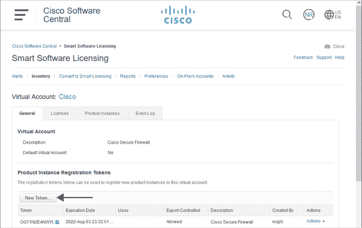

**图 3-1** *位于 Cisco.com 的思科智能软件管理器 (SSM)*

根据公司的安全态和策略，思科提供了不同的架构来启用智能许可。它们分别是：

* 直接云访问
* 本地服务器
* 离线访问

## 直接云访问

在直接云访问架构中，安全防火墙管理器（管理中心和设备管理器）从思科智能许可云获取智能许可。它们可以通过互联网或代理服务器直接连接到云。管理器应用程序使用名为 `Smart Agent` 的进程，该进程与思科智能许可云通信并进行注册。注册成功后，思科云会颁发一个 ID 证书。`Smart Agent` 进程定期与云通信并跟踪权限状态。

图 3-2 显示了管理中心 Smart Agent 与 Cisco Smart Licensing Cloud 之间的通信。当它们通过 Internet 连接时，您可以使用 Cisco SSM 云端应用程序添加、删除和转移公司的智能许可。

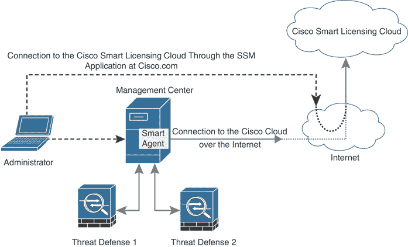

**图 3-2** *管理中心与 Cisco Smart Licensing Cloud 之间的连接*

## 本地服务器

由于 Cisco Smart Licensing Cloud 托管在 `cisco.com`，因此您的管理中心需要连接到 Internet 以从 Cisco 获取智能许可。然而，某些组织可能有有限的 Internet 访问策略，这可能会阻止管理中心直接连接 Internet。在这种环境下，您可以使用本地部署的 Cisco Smart Software Manager 服务器作为物理隔离解决方案。在这种许可模式中，管理中心连接到从 OVA 镜像部署的本地版本 Cisco SSM 服务器，该服务器通过 Internet 注册到 Cisco Smart Licensing Cloud。

图 3-3 说明了管理中心通过 Cisco SSM 服务器和 Internet 连接到 Cisco Smart Licensing Cloud 的情况。

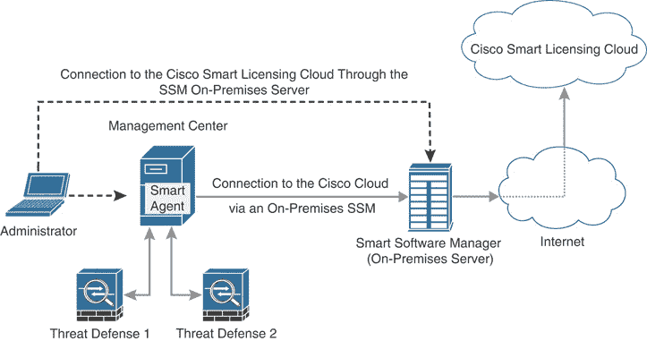

**图 3-3** *管理中心通过本地 SSM 服务器连接到 Cisco Smart Licensing Cloud*

图 3-4 显示了将管理中心连接到 Cisco Smart 系统的选项。默认情况下，选择了“直接连接到 Cisco Smart Software Manager”选项。

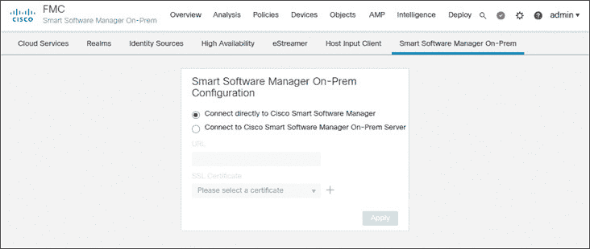

**图 3-4** *将管理中心连接到不同类型智能软件管理器进行许可的选项*

## 离线访问

某些组织可能在受限的网络中部署 Secure Firewall，该网络禁止防火墙的管理网络连接到 Internet。对于这种类型的物理隔离环境，Cisco 允许您从智能账户中预留许可。这被称为永久许可保留 (PLR)。在 PLR 许可模式下，管理中心可以在不连接到 Cisco SSM 云端应用程序的情况下运行。您可以手动在管理中心和 `cisco.com` 之间复制和粘贴许可信息，以检查许可的导出。

PLR 模型提供了两种许可预留选项：特定许可保留（针对特定期限）和通用永久许可保留（针对无限期）。然而，要预留任何许可，您需要获得您的 Cisco 客户代表的批准，因为 PLR 模式允许您在不连接到 Cisco SSM（无论是直接连接还是通过本地服务器）的情况下对 Secure Firewall 进行许可授权。

表 3-3 突出了特定许可保留 (SLR) 和通用永久许可保留 (PLR) 模型之间的两个主要区别。

**表 3-3** SLR 与 PLR 模型的主要区别

| 属性 | SLR | PLR |
| --- | --- | --- |
| 期限 | 许可预留特定期限。 | 许可是永久的。 |
| 执行 | 一旦过期，管理中心将不再允许新的注册和部署。 | 无需担心执行，因为许可永远不会过期。 |

### 注意

智能许可管理器——Cisco Smart Licensing 和本地服务器——供所有用户使用。

## Cisco Secure Firewall 许可

智能许可管理器——Cisco Smart Licensing 和本地服务器——供所有用户使用以启用安全功能。

### 功能许可

某些组织可能在受限的网络中部署 Secure Firewall，该网络禁止防火墙的管理网络连接到 Internet。对于这种类型的物理隔离环境，Cisco 允许您从智能账户中预留许可。这被称为永久许可保留 (PLR)。在 PLR 许可模式下，管理中心可以在不连接到 Cisco SSM 云端应用程序的情况下运行。您可以手动在管理中心和 `cisco.com` 之间复制和粘贴许可信息，以检查许可的导出。

PLR 模型提供了两种许可预留选项：特定许可保留（针对特定期限）和通用永久许可保留（针对无限期）。然而，要预留任何许可，您需要获得您的 Cisco 客户代表的批准，因为 PLR 模式允许您在不连接到 Cisco SSM（无论是直接连接或通过本地服务器）的情况下对 Secure Firewall 进行许可授权。

表 3-3 突出了特定许可保留 (SLR) 和通用永久许可保留 (PLR) 模型之间的两个主要区别。

**表 3-3** SLR 与 PLR 模型的主要区别

| 属性 | SLR | PLR |
| --- | --- | --- |
| 期限 | 许可预留特定期限。 | 许可是永久的。 |
| 执行 | 一旦过期，管理中心将不再允许新的注册和部署。 | 无需担心执行，因为许可永远不会过期。 |


基础许可随 Secure Firewall 购买。然而功能许可是必要的。

表 3-4 描述了 Secure Firewall 的功能。

**表 3-4** Secure Firewall 许可

| 许可 | 允许 |
| --- | --- |
| 基础 | 执行交换、路由和 NAT |
| 威胁 | 检测并阻止某些类型文件的传输 |
| 恶意软件 | 保护网络并启用恶意软件防御 |
| URL 过滤 | 基于信誉类别过滤 URL |

表 3-5 描述了 Secure Firewall 的订阅代码。恶意软件和 URL 过滤许可有两种格式可用：作为插件或与威胁许可绑定。

**表 3-5** Secure Firewall 订阅选项

| 许可 | 期限 | 购买哪种 |
| --- | --- | --- |
| 基础 | 永久 | 购买设备时自动包含 |
| 威胁 | 期限 | `T` |
| 恶意软件 | 期限 | `TM`（威胁和恶意软件）或 `AMP`（仅恶意软件） |
| URL 过滤 | 期限 | `TMC`（威胁、恶意软件和 URL 过滤）或 `URL`（仅 URL 过滤） |

## 出口控制许可

除了基础许可和功能许可外，Cisco 还提供一种特殊许可——出口控制许可，用于经过 Cisco 和本地政府批准的出口控制功能。如果获得批准，您可以通过选择智能账户中“使用此令牌注册的产品”选项下的“允许出口控制功能”来启用此许可。

图 3-5 显示了为管理平台生成注册令牌之前，智能账户中允许出口控制功能的选项。

**图 3-5** *允许出口控制功能的选项*

出口控制功能利用强加密。加密的一种流行应用是远程访问虚拟专用网络 (RAVPN)。要在 Secure Firewall 上实现 RAVPN，您不仅需要在管理中心上启用出口控制功能，还需要 AnyConnect 许可。

表 3-6 列出了不同类型的 AnyConnect 许可及其功能。

**表 3-6** AnyConnect 许可类型

| 许可证 | 功能说明 |
| --- | --- |
| AnyConnect Plus | 提供基础 VPN 服务和安全功能 |
| AnyConnect Apex | 包含 AnyConnect Plus 许可证提供的所有功能以及许多更多高级服务 |
| AnyConnect VPN Only | 专为大量远程用户提供 RAVPN 服务支持 |

## 评估许可证

在 Secure Firewall 上启用安全功能许可证并不是一个简单的过程。特别是在购买了全新的防火墙之后，你必须执行几个步骤来获取智能许可证并将其应用于你的 Secure Firewall。图 3-6 显示了使用 Cisco SSM 获取智能许可证并在 Secure Firewall 上启用它们的通用工作流。

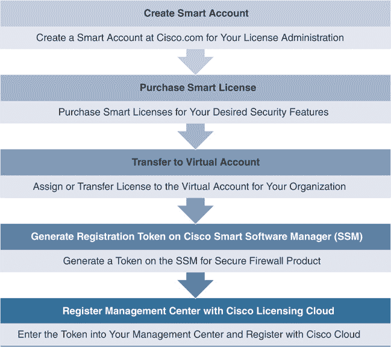

**图 3-6** *智能许可证启用通用流程*


然而，作为 CCNP Security 考试考生，你可以随时利用评估模式。它允许你在 Secure Firewall 上使用 90 天下一代安全功能。评估模式非常容易启用。在首次登录管理中心 GUI 之后，系统会提示你配置智能许可证。如果你拥有所有注册管理中心到 Cisco SSM 所需的信息，现在就可以输入。或者，你可以选择在不注册的情况下开始 90 天评估期，如图 3-7 所示。

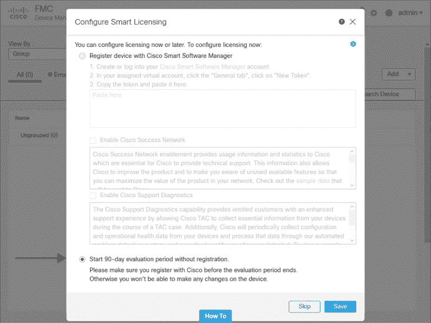

**图 3-7** *智能许可证配置向导*

### 注意

基于高级加密且受国家安全审查限制的出口控制功能在评估模式下是不可用的。例如，虚拟专用网络（VPN）不可用。

如果你在首次登录时跳过了智能许可证配置，仍然可以按照以下步骤启用评估模式：

**步骤 1.** 点击 `System` 图标并选择 `Smart Licenses` 选项。会出现 Smart License Status 页面。

图 3-8 显示了 System 菜单下可用的许可证选项。

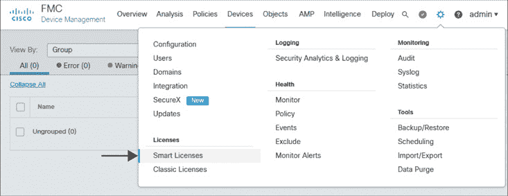

**图 3-8** *使用 System 菜单导航至 Smart Licenses 页面*

**步骤 2.** 在 Smart Licenses 页面上，你会找到两个按钮：`Register` 和 `Evaluation Mode`。选择 `Evaluation Mode`。

### 提示

如果 `Evaluation Mode` 按钮已用于 90 天评估期，则将不会显示。但是，每当你部署一个全新的管理中心（无论是全新安装还是重新映像），你都可以再次启用 90 天的评估模式。对于 CCNP Security 考试考生进行系统实操测试的极佳工具。

**步骤 3.** 弹出 Evaluation Mode 窗口，提醒你评估模式是一个单次选项，从启用之日起有效期为 90 天。选择 `Yes` 开始 90 天的周期。

图 3-9 显示了一个弹出窗口，提示确认启用 90 天的评估模式。

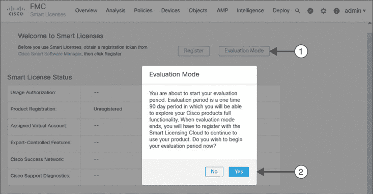

**图 3-9** *启用评估模式*

### 警告

如果你在生产环境中启用评估模式，请确保在评估期结束前购买并应用有效的智能许可证。否则，你可能会遇到流量检查中断，并错过任何关键安全事件。

## 许可证验证

使用管理中心 GUI，你可以验证智能许可证的权限状态以及管理中心与 Cisco Smart Licensing Cloud 的注册状态。导航到 `System > Smart Licenses` 在 Smart License Status 页面中查看状态。

如果管理中心已成功注册到 Cisco Smart Licensing Cloud，你会发现智能许可证状态为 `Authorized`（授权）。

图 3-10 确认了启用为 90 天评估期的智能许可证。

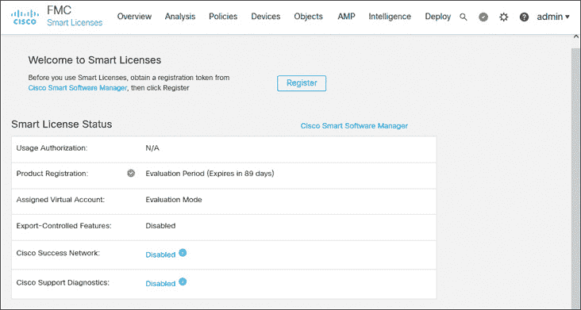

**图 3-10** *评估模式已启用*

图 3-11 显示管理中心已成功注册到 Cisco Smart Licensing Cloud。注意此页面中的 `Edit Performance Tier` 和 `Edit Licenses` 选项。你可以使用它们修改任何特定威胁防御的性能分级和功能许可证选择。

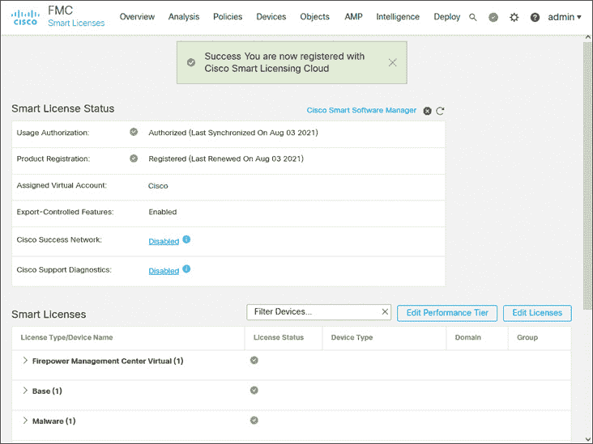

**图 3-11** *管理中心已注册到 Cisco Smart Licensing Cloud*

如果许可证过期或管理中心无法通过 Cisco Smart Licensing Cloud 验证许可证，你会发现不合规（out-of-compliance）状态。通过在健康策略（health policy）中启用 Smart License Monitor 模块，如果你的管理中心与 Cisco Smart Licensing Cloud 之间存在通信问题，或者许可证过期或不合规，你可以收到健康告警。

图 3-12 显示在健康策略中启用 Smart License Monitor 模块。启用该模块后，必须保存策略并将其部署到 Secure Firewall。

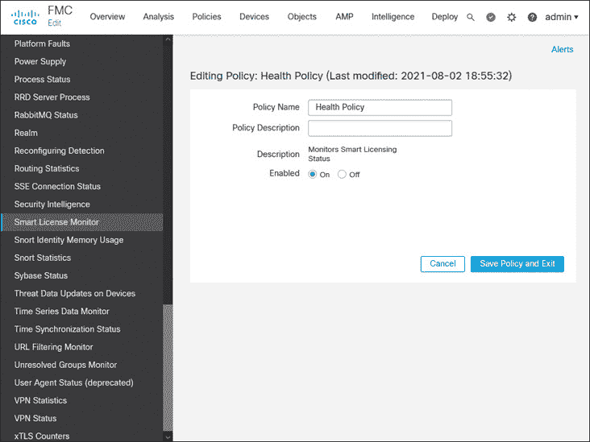

## 设备注册

当你的管理中心注册到智能许可证系统或启用了评估模式后，就可以准备注册你的设备了。要完成注册，你需要访问防火设备的 CLI 和管理中心的 GUI。

### 注册最佳实践

将防火设备注册到管理中心时，请注意以下几点：

1. 必须从防火设备开始注册。首先，在防火设备的 CLI 上输入管理中心信息，然后在管理中心 GUI 中提供防火设备的详细信息。

   

2. 不要使用主机名或完全域名（FQDN），直接使用 IP 地址。这可以确保注册失败不是由于 DNS 问题。

3. 如果中间设备翻译了管理中心和防火设备的 IP 地址，请在注册时使用唯一的 `NAT ID`。

### 防火设备配置

系统初始化完成后并设置好网络，可以通过安全 Shell（SSH）或控制终端连接到防火设备的 CLI。成功登录防火设备 CLI 后，将看到默认 CLI 提示符：`>`。

示例 3-1 确认防火设备尚未注册到远程管理中心，也未启用本地设备管理器。

**示例 3-1** `show managers` 命令的输出

```
> show managers
No managers configured.
>
```

示例 3-2 展示了如何使用管理 IP 地址 `10.1.1.2` 成功添加管理中心。该配置使用 `RegKey` 作为一次性临时注册密钥，并将 `NatId` 作为 NAT ID。虽然 NAT ID 是可选的，但如果您不确定中间设备是否会对 IP 地址进行任何转换，则应该使用它。


## 示例 3-2 向威胁防御系统添加管理中心

点击此处查看代码图像

```
> configure manager add 10.1.1.2 RegKey NatId
 Manager successfully configured.     
请记住 reg_key，因为在 FMC 中添加设备时将需要它。
>
```

在完成威胁防御系统上完成配置后，下一步是在管理中心上添加该威胁防御系统。在进入下一步之前，请检查注册的当前状态。

示例 3-3 显示了在向威胁防御系统添加管理中心后，等待注册的状态。在成功执行下一步后，注册状态将变为 `completed`。

## 示例 3-3 在威胁防御系统中输入管理中心详情后出现等待注册状态

点击此处查看代码图像

```
> show managers
Host                      : 10.1.1.2
Registration Key          : ****
Registration              : pending
RPC Status                :
>
```

### 管理中心上的配置

注册过程的第二步是在管理中心的 Web 界面中输入威胁防御系统的详情。在提供详细信息时，必须使用与之前在威胁防御系统中配置的相同的注册密钥（如果使用了相同的 NAT ID）。以下是您必须遵循的步骤：

**步骤 1.** 登录到管理中心的 Web 界面。选择 `Devices > Device Management`。出现设备管理页面。

图 3-13 显示了导航到设备管理页的操作。

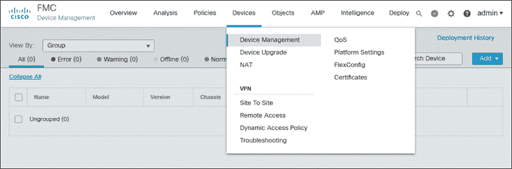

**图 3-13** *Devices 菜单下的选择*

**步骤 2.** 从 `Add` 下拉菜单中选择 `Device`。出现添加设备窗口。在这里，您输入威胁防御系统的详情。

图 3-14 显示了导航到添加设备窗口的操作。

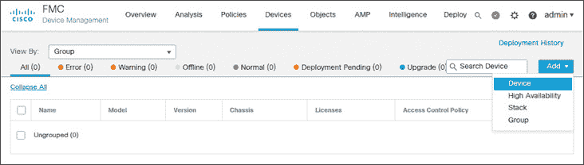

**图 3-14** *导航到添加设备窗口*

**步骤 3.** 在 `Host` 字段中，输入威胁防御系统管理接口的 IP 地址。

**步骤 4.** 在 `Display Name` 字段中，提供一个将在管理中心 Web 界面中显示的名称，用于代表此特定的威胁防御系统。

**步骤 5.** 在 `Registration Key` 字段中，输入您之前在威胁防御系统 CLI 中使用的相同注册密钥。

**步骤 6.** 选择您最初想要应用于威胁防御系统的 `Access Control Policy`。如果是新部署，管理中心可能没有预配置访问控制策略。但是，您可以通过从下拉菜单中选择 `Create New Policy` 来动态创建一个策略。

图 3-15 显示添加设备窗口填充了威胁防御系统的详情。注意，管理中心和威胁防御系统使用了相同的注册密钥 (`RegKey`) 和 NAT ID (`NatId`)。动态创建一个名为 `AC Policy` 的新访问控制策略。当从下拉菜单选择 `Create New Policy` 时，会出现新策略窗口。图像显示了足够完成注册的基础设置。您可以稍后编辑并增强此策略。

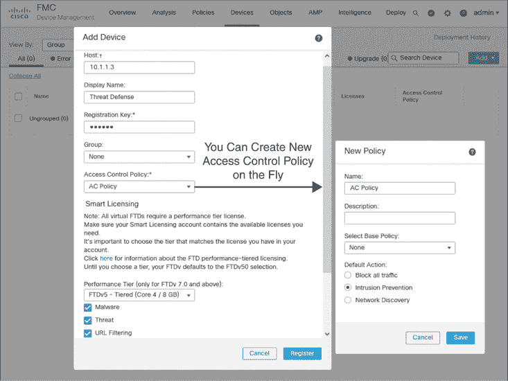

**图 3-15** *在添加设备窗口中填充字段*

**步骤 7.** 在添加设备窗口的 `Smart Licensing` 部分，如果您正在注册虚拟的威胁防御系统，请选择 `Performance Tier`。在这里，层级选择取决于您从 Cisco 购买的防火墙。对于 CCNP Security 考试准备工作，较低的层级即可满足任何实践练习的需求。

**步骤 8.** 确保选择您想要在威胁防御系统上配置的所有安全功能，例如 `Malware`、`Threat`、`URL Filtering` 等。

**步骤 9.** 在 `Advanced` 部分，如果有中间设备转换 Secure Firewall 管理接口的 IP 地址，请提供一个唯一的 NAT ID。

**步骤 10.** `Transfer Packets` 选项允许威胁防御系统发送数据包。

**步骤 11.** 点击 `Register` 按钮开始注册。管理中心与威胁防御系统之间的通信通过加密隧道进行，称为 `sftunnel`。

图 3-16 在管理中心界面说明了注册过程。在注册过程中，系统处于发现阶段。发现完成后，系统会将策略应用于威胁防御系统。威胁防御名称旁旋转图标确认过程正在进行。

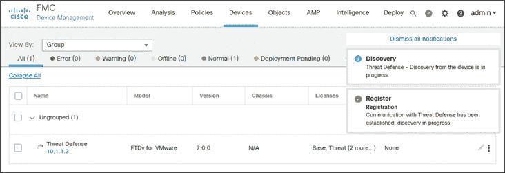

**图 3-16** *管理中心界面显示注册状态*

### 通过 Internet 进行管理

此部分对于您的实验环境可能是可选的，但它描述了一个真实的部署场景。某些组织要求将防火墙部署在不同的地理位置，并通过 Internet 进行注册和管理。例如，威胁防御系统部署在远程分支机构，并使用位于远程数据中心的管理中心进行管理。在这种情况下，它们之间的 Internet 连接是必要的。如果威胁防御系统的管理接口连接到私有网络或您希望对管理流量进行检查，可以使用 `inside` 接口作为管理中心的网关（见图 3-17）。如果威胁防御系统部署为网络的边缘设备，可以在 `outside` 数据接口上启用管理功能，并使用该外部接口直接与远程管理中心通信（见图 3-18）。此功能被称为 `FMC access`。如果您想在注册之前在威胁防御系统中启用 FMC ，可以使用威胁防御系统 CLI（该选项适用于 `configure network` 命令）。或者，在注册后管理此功能，可以使用管理中心 GUI 上的威胁防御接口配置页面（见图 3-19）。FMC access 功能支持路由接口。下一章将详细介绍路由防火墙模式。

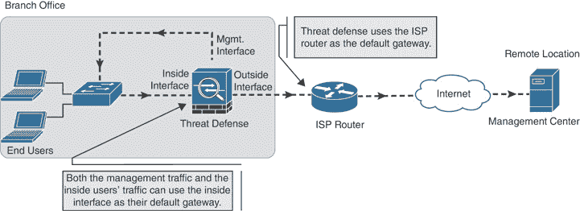

**图 3-17** *管理流量通过威胁防御系统*

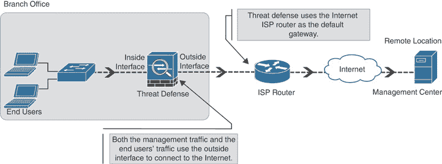

**图 3-18** *威胁防御系统通过其数据接口与管理中心通信 (FMC access)*

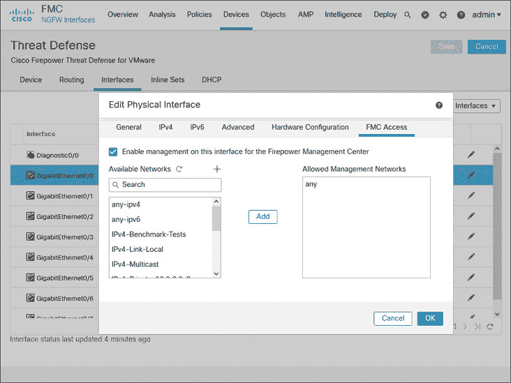

**图 3-19** *威胁防御数据接口中启用了 FMC access*

### 注册验证

如果注册过程成功，威胁防御的健康状态在设备管理页面上将显示为健康（勾选标记）。同样，任务窗口将显示各种与注册相关的活动成功完成。此外，你可以在威胁防御的 CLI 中运行 `show managers` 命令来确认状态。

图 3-20 确认了注册成功。威胁防御设备名称旁边的勾选标记表示此状态。同样，任务状态窗口显示了各种自动注册后活动已成功完成。

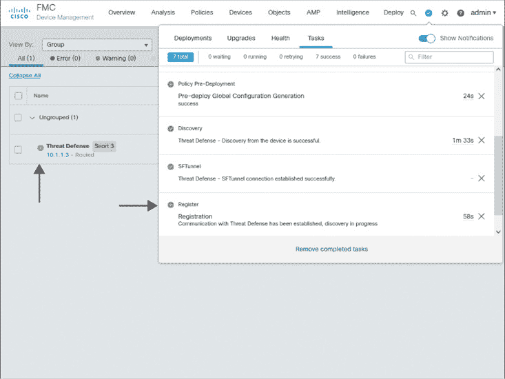

**图 3-20** *健康状态确认威胁防御注册成功*

示例 3-4 显示了将威胁防御成功添加到管理中心后完成的注册状态。

## 示例 3-4 状态确认注册已完成

点击此处查看代码图像

```
> show managers
Type                      : Manager
Host                      : 10.1.1.2
Registration              : Completed
>
```

### 总结

本章描述了许可和注册——这是 Secure Firewall 部署的两个重要初始任务。本章的第一部分解释了不同许可架构的功能以及在 Secure Firewall 上启用许可的步骤。随后，本章演示了威胁防御与管理中心的注册，并分享了一些验证注册状态的提示。

### 考试准备任务

如引言中“如何使用本书”节提到的，你有几种准备考试的方案：完成此处的练习题、第 22 章、“最终准备”以及来自 Pearson Test Prep 练习测试软件的考试模拟题。

### 复习所有关键主题

复习本章中最重要的主题，这些主题在页外边上用“关键主题”图标标记。表 3-7 列出了这些关键主题的参考以及它们所在的页码。


**表 3-7** 第 3 章 关键主题

| 关键主题元素 | 描述 | 页码 |
| --- | --- | --- |
| 段落 | 特性许可 | 54 |
| 段落 | 评估模式 | 56 |
| 列表 | 注册最佳实践 | 61 |

### 记忆完成表格和列表

打印 附录 C“记忆表”（可在辅助网站找到）或至少打印本章的章节，并根据记忆完成表格和列表。附录 D“记忆表答案”同样位于辅助网站上，包含了完成的表格和列表供你检查工作。

### 定义关键术语

定义本章中的以下关键术语，并在术表中检查你的答案：

- `Cisco Smart Software Manager (SSM)`
- `特性许可`
- `出口控制许可`
- `基础许可`
- `永久许可保留 (PLR)`

## 第 4 章 路由模式下的防火墙部署

本章提供了以下主题的概述：

*   **路由模式要素**：本节描述了路由模式的特征。
*   **路由模式最佳实践**：本节讨论了在进入路由模式之前应考虑的某些实践。
*   **先决条件**：在本节中，你学习启用路由模式。
*   **接口配置**：本节演示了配置路由接口的。
*   **接口验证**：本节提供了验证路由接口的提示。

本章的目标是了解以下

*   路由模式下的防火墙部署
*   路由模式下的接口验证

你可以通过路由模式部署 Secure Firewall，以便作为默认网关。你可以以两种方式部署威胁防御：路由模式和透明模式。第 5 章描述了透明模式的部署。

### “你已经掌握了吗？”测试

“你已经掌握了吗？”测试可以让你评估自己是否应该彻底阅读本章。如果你对这些问题的答案有疑问或不确定，为了自测的目的，你应该将该问题标记为错误。表 4-1 列出了本章的主要章节以及对应的“你已经掌握了吗？”测试题。你可以在附录 A 找到“你已经掌握了吗？”问题的答案。

**表 4-1** 章节与题目映射

| 主题章节 | 题号 |
| --- | --- |
| 路由模式要素 | 1 |
| 路由模式最佳实践 | 2 |
| 先决条件 | 3 |
| 接口配置 | 4 |
| 接口验证 | 5, 6 |

### 注意事项

自测的目标是衡量你对本章主题的掌握程度。如果你不知道某个问题的答案或只有部分把握，为了自测的目的，你应该标记该答案为错误。猜得分会偏离你的自测结果，并可能带给你虚假的安全感。

1. 下列说法正确的是：
    1. 透明模式的威胁防御无法通过管理中心配置。
    2. 你可以通过管理中心更改防火墙模式。
    3. 在从管理中心注销威胁防御之前，你无法更改防火墙模式。
    4. 当更改防火模式时，威胁防御会保存配置。

2. 下列说法错误的是：
    1. 在第 3 层模式下，每个数据接口必须位于不同的网络。
    2. 备份威胁防御上的安全策略是不必要的，因为安全策略在管理中心上定义。
    3. 更改防火墙模式不会影响威胁防御上的现有配置。
    4. 以上答案均不正确。

3. 下列哪个命令用于将威胁防御从透明模式配置为路由模式？
    1. `configure routed`
    2. `configure firewall routed`
    3. `configure interface routed`
    4. `configure transparent disable`

4. 关于 IP 配置的下列说法错误的是：
    1. 威胁防御数据接口必须配置静态 IP 地址。
    2. 威胁防御可以作为 DHCP 客户端也可以作为 DHCP 服务器。
    3. 当你为 DHCP 服务器创建地址池时，它必须与连接的接口在同一个子网内。
    4. 以上答案均不正确。

5. 下面哪个命令被用于调试和分析 ping 请求？
    1. `debug icmp`
    2. `debug ip icmp`
    3. `debug icmp trace`
    4. `debug icmp reply`

6. 可以运行以下哪个命令来确定任何与接口相关的问题？
    1. `show interface ip brief`
    2. `show interface interface_ID`
    3. `show running-config interface`
    4. 所有答案都是正确的。

### 基础知识

## 路由模式核心


在路由模式中，威胁防御设备的作用类似于一个三层跳跃节点。威胁防御设备上的每个接口都可以连接到不同的子网，并且威胁防御设备可以作为该子网的默认网关。威胁防御设备还可以像三层路由器一样在不同子网之间路由流量。

图 4-1 显示了主机如何与作为下一跳三层节点的威胁防御设备进行交互。在路由模式下，每个威胁防御接口都连接到一个唯一的子网。

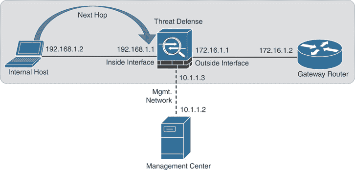

**图 4-1** *路由模式下主机与威胁防御设备的通信*

## 路由模式配置的最佳实践

如果你想以路由模式部署威胁防御设备，请考虑以下建议：

*   不要为诊断接口配置 IP 地址。这可以简化网络设计并减少配置开销。当诊断接口配置了 IP 地址时，威胁防御设备将其视为数据接口。在三层模式下，威胁防御设备上的每个数据接口都需要位于不同的子网。因此，诊断接口必须与逻辑管理接口 `br1` 位于同一子网，而内部接口必须位于不同的子网。要在两个子网之间传输流量，需要路由服务。
*   更改防火墙模式会清除威胁防御设备上的任何现有配置。因此，在将防火墙模式从透明切换到路由之前，请记录威胁防御设备的设置以备参考。在 CLI 中运行 `show running-config` 命令查看当前的威胁防御配置。
*   如果你只想更改威胁防御设备的防火墙模式，则无需备份安全策略，因为下一代安全策略定义在管理中心。配置安全策略后，管理中心允许你将相同的策略部署到一个或多个威胁防御设备。

### 前提条件

你记得威胁防御设备的安装和初始化最后部分吗？在初始化期间，威胁防御设备会提示确认防火墙模式，你可以在路由模式和透明模式之间选择（参见示例 4-1）：

```
<输出>
.
本地管理设备？(yes/no) [yes]: no
 配置防火墙模式？(routed/transparent) [routed]:                              
正在配置防火墙模式 ...
更新策略信息
   - 添加设备配置
   - 添加系统策略
.
<输出>
```

如果在初始化期间选择了透明模式，而现在想将威胁防御设备重新配置为路由模式，你必须从管理中心注销该威胁防御设备。当配置了管理器时，无法更改防火墙模式。在威胁防御 CLI 中运行 `show managers` 命令验证威胁防御设备是否已注册到管理中心。

示例 4-2 显示威胁防御设备已注册到 IP 地址为 10.1.1.2 的管理中心。

## 示例 4-2 威胁防御已注册到管理中心

点击此处查看代码图像

```
> show managers
Type         : Manager
Host         : 10.1.1.2
Registration : Completed                               
>
```

如果你的威胁防御设备目前处于透明模式并已注册到中心，可以通过管理中心的 Web 界面将其注销。要删除注册，转到 `Devices > Device Management`，点击威胁防御名称旁边的三个点，并选择删除（参见图 4-2）。

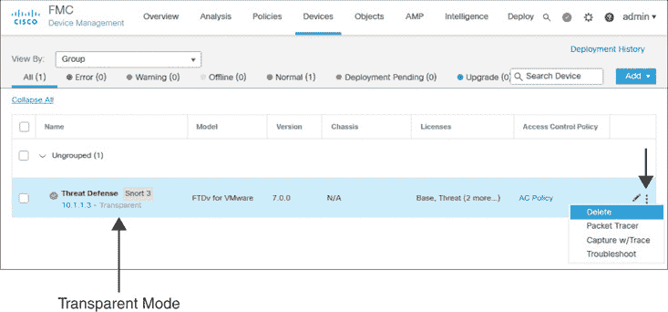

**图 4-2** *透明模式下威胁防御设备的注册*

示例 4-3 确认威胁防御设备既未注册到管理中心，也未启用设备管理器。

## 示例 4-3 威胁防御设备未由管理中心或内置管理器管理

```
> show managers
No managers configured.
>
```

### 启用路由防火墙模式

如果威胁防御设备尚未注册到管理中心，你可以更改其防火墙模式。要配置路由模式的威胁防御，请登录威胁防御 CLI 并运行 `configure firewall routed` 命令（参见示例 4-4）：

```
> configure firewall routed
 
这将破坏当前的接口配置，你确定要继续吗？[y/N] y
防火墙模式已成功更改。
```

将威胁防御配置为所需的模式后，可以从 CLI 确定状态。示例 4-5 确认威胁防御设备处于路由模式。

## 示例 4-5 验证防火墙部署模式

```
> show firewall
Firewall mode: Router
>
```

或者，在成功注册后，管理中心的 GUI 也会显示当前的防火墙部署模式。你可以通过导航到 `Devices > Device Management` 查看。图 4-3 指示威胁防御设备配置为路由模式。


**图 4-3** *以路由模式部署的威胁防御设备*

## 接口配置

在威胁防御设备中，你可以为数据接口配置静态 IP 地址。威胁防御设备还可以作为 DHCP 客户端从 DHCP 服务器获取 IP 地址。此外，你可以在威胁防御设备上启用 DHCP 服务并配置其为主机动态分配 IP 地址。

### 配置静态 IP 地址接口

要配置静态 IP 地址的路由接口，请按照以下步骤操作：

**第 1 步** 导航到 `Devices > Device Management`。显示已管理设备列表。

**第 2 步** 点击要配置的威胁防御名称旁边的笔图标。出现设备管理编辑器页面，在接口选项卡上显示威胁防御设备的所有接口（参见图 4-4）。


## 图 4-4 虚拟威胁防御设备的接口选项卡

取决于你运行的威胁防御平台，你可能会遇到不同类型的接口和特定模型的选项。例如，威胁防御模型 1010 带有带有内置交换机端口的以太网接口，如图 4-5 所示。为了在路由模式下配置此模型，你需要禁用接入模式`交换机端口`。


**图 4-5** 威胁防御模型 1010 接口卡显示交换端口模式

### 步骤 3
在接口选项卡上，点击 `GigabitEthernet0/0` 和 `GigabitEthernet0/1` 旁边的铅笔图标，分别为内部网络和外部网络配置这些接口。使用表 4-2 所示的设置配置这两个接口。

**表 4-2** 入站和出站接口设置

| | `GigabitEthernet0/0` | `GigabitEthernet0/1` |
| --- | --- | --- |
| 接口名称 | `INSIDE_INTERFACE` | `OUTSIDE_INTERFACE` |
| 安全区域（可选） | `INSIDE_ZONE` | `OUTSIDE_ZONE` |
| IP 地址 | `192.168.1.1/24` | `172.16.1.1/24` |

要启用接口，必须为它指定一个名称；这是强制要求。然而，配置安全区域是一个可选步骤。在这里，在编辑物理接口窗口中，你可以动态创建一个安全区域并将其与接口关联。在将来，你可以使用 `Objects > Object Management > Interface` 页面来管理安全区域。

图 4-6 显示了 `GigabitEthernet0/0` 的常规设置；例如，它的名称为 `INSIDE_INTERFACE`。确保使用 `Enabled` 复选框启用接口。


**图 4-6** 内部接口的常规配置

图 4-7 显示了向 `GigabitEthernet0/0` 接口手动分配静态 IP 地址。


**图 4-7** 内部接口 GigabitEthernet0/0 上的静态 IP 地址

### 步骤 4
对 `GigabitEthernet0/1` 重复上述步骤以为外部网络启用它。完成后，点击 `Save` 按钮保存更改。

图 4-8 显示了入站和出站路由接口的配置。


**图 4-8** 内部和外部接口配置

### 步骤 5
保存配置后，导航到 `Deploy > Deployment`。选择你想要应用更改的威胁防御，并点击 `Deploy` 按钮应用配置（参见图 4-9）。


**图 4-9** 威胁防御配置部署

## 使用自动 IP 地址配置接口


威胁防御既可以作为 DHCP 客户端，也可以作为 DHCP 服务器。例如，如果你在外部接口和互联网服务提供商（ISP）之间部署威胁防御，设备可以从 ISP 路由器为其外部接口动态获取 IP 地址。同时，威胁防御可以作为 DHCP 服务器，通过内部接口为其检查的主机动态提供 IPv4 地址。将威胁防御配置为 DHCP 服务器是一个可选选择；它不会影响深度包检测能力。

图 4-10 说明了两种场景：内部网络从运行在威胁防御上的 DHCP 服务获取 IP 地址，而威胁防御的外部接口从服务提供商获取 IP 地址。


**图 4-10** 作为 DHCP 服务器和 DHCP 客户端的威胁防御

启用接口从 DHCP 服务器获取 IP 地址是一个简单的过程。例如，在配置外部接口期间，当你为接口分配静态 IP 地址时，只需从列表中选择 `Use DHCP`。当配置部署后，外部接口将从服务提供商获取 IP 地址。参见图 4-11 中的 `Use DHCP` 选项来启用接口以从 DHCP 服务器获取 IP 地址。


**图 4-11** 作为 DHCP 客户端的威胁防御的接口配置

然而，如果你想让威胁防御为其连接的主机提供 IP 地址，你需要在其上启用 DHCP 服务。以下步骤描述了如何为威胁防御配置 DHCP 服务：

### 步骤 1
转到 `Devices > Management` 并点击铅笔图标编辑威胁防御。

### 步骤 2
在威胁防御上分配静态 IP 地址 `192.168.1.1`。

### 步骤 3
在设备编辑器页面上，转到 DHCP 选项卡。默认情况下会出现 Server 页面。

### 步骤 4
点击 Server 选项卡上的 `Add` 按钮。

### 步骤 5
在 Server 下拉列表中选择内部接口。

### 步骤 6
为 DHCP 服务器创建地址池。记住池中的地址必须与接口处于同一子网。例如，如果你为内部接口分配 `192.168.1.1/24`，地址池应在 `192.168.1.2` 到 `192.168.1.254` 之间。

图 4-12 显示威胁防御的内部接口上启用了 DHCP 服务器，地址池为 `192.168.1.2` 到 `192.168.1.10`。


**图 4-12** 威胁防御上的 DHCP 服务器配置

### 步骤 7
勾选 `Enable DHCP Server` 复选框以启用该服务并点击 `OK`。你返回设备编辑器页面。

### 步骤 8
可选地，通过 DHCP 服务，威胁防御可以向你的 DHCP 传输任何 DNS 信息。Server 允许你手动输入域名和 DNS 地址。或者，你可以选择 `Auto-Configuration` 复选框，让威胁防御从连接到预定义接口的 DHCP 自动获取任何 DNS 信息。

### 步骤 9
点击 `Save` 按钮保存配置。

## 接口配置验证

配置部署到威胁防御后，内部网络和外部网络之间的主机应该成功通信。要测试连接性，你可以简单地在内外部主机之间运行 ICMP ping 测试。如果主机运行任何服务（如 Web 或 Secure Shell），你也可以使用它们来验证连通性。

在全新的部署中，管理中心不会显示`连接事件`。如果您想使用管理中心来验证通过威胁防御系统的任何连接尝试，您则需要在访问控制策略中启用日志记录。默认情况下，新的访问控制策略不包含任何可自定义的访问控制规则。由于我们将在随后的章节中详细描述访问控制规则的操作，目前，您可以添加一条简单的访问控制规则来允许流量，并在该规则中启用日志记录（参见图 4-13）。或者，在没有任何没有任何规则的访问控制策略中，您可以简单地在默认操作中启用日志（参见图 4-14），这也可以触发连接事件。


**图 4-13** 在访问控制规则内启用日志


**图 4-14** 在访问控制策略中作为默认操作启用日志

如果您部署了启用了日志功能的访问控制策略，现在您可以通过导航到管理中心的**分析 > 连接 > 事件**来查看任何关联连接的事件。

图 4-15 显示了内部主机（IP: 192.168.1.2）通过 ICMP、SSH 和 HTTPS 协议到外部主机（IP: 172.168.1.2）的连接尝试。


**图 4-15** 内部与外部之间的连接事件表

当您运行 ICMP 流量时，可以使用 `debug` 命令查看系统处理 ICMP 包的详细信息。示例 4-6 显示了位于内部网络和外部网络的两台计算机之间的 ICMP 请求和响应。

### 示例 4-6 在威胁防御系统上调试 ICMP 流量

点击此处查看代码

```
debug icmp trace
debug icmp trace enabled at level 1
ICMP echo from INSIDE_INTERFACE:192.168.1.2 to OUTSIDE_INTERFACE:172.168.1.100
ID=4101 seq=56
ICMP reply from OUTSIDE_INTERFACE:172.168.1.100 to INSIDE_INTERFACE:192.168.1.2
ID=4101 seq=56
ICMP echo request from INSIDE_INTERFACE:192.168.1.2 to OUTSIDE_INTERFACE:172.168.1.100
ID=4101 seq=56
ICMP echo reply from OUTSIDE_INTERFACE:172.168.1.100 to INSIDE_INTERFACE:192.168.1.2
ID=4101 seq=56
```

如果 `ping` 测试失败，您需要确定接口的状态。您可以在威胁防御系统上运行以下命令，以确定接口状态并验证从管理中心应用到威胁防御系统的配置。命令输出略微取决于配置（静态与动态）。

`show ip`

`show interface brief`

`show interface interface_ID`

`show running-config`

示例 4-7 显示了 `show ip` 命令的输出。您可以在此输出中查看接口、逻辑名称和 IP 地址之间的映射。不过，请查看输出中的当前状态。

### 示例 4-7 show ip 命令输出

点击此处查看代码

```
show ip
System Addresses:
Interface            Name                IP address    Subnet mask    Method
GigabitEthernet0/0   INSIDE_INTERFACE    192.168.1.1   255.255.255.0  CONFIG
GigabitEthernet0/1   OUTSIDE_INTERFACE   172.168.1.1    255.255.255.0  CONFIG
Current IP Addresses:
Interface            Name                IP address    Subnet mask    Method
GigabitEthernet0/0   INSIDE_INTERFACE    192.168.1.1   255.255.255.0  CONFIG
GigabitEthernet0/1   OUTSIDE_INTERFACE   172.168.1.1    255.255.255.0  CONFIG
```

示例 4-7 显示了 GigabitEthernet0/0 和 GigabitEthernet0/1 接口、逻辑名称和 IP 地址之间的映射（注：此处原文“however”此处可能有误）。

```
show ip
System Addresses:
Interface            Name                IP address    Subnet mask    Method
GigabitEthernet0/0   INSIDE_INTERFACE    192.168.1.1   255.255.255.0  CONFIG
GigabitEthernet0/1   OUTSIDE_INTERFACE   172.168.1.1    255.255.255.0  CONFIG
Current IP Addresses:
Interface            Name                IP address    Subnet mask    Method
GigabitEthernet0/0   INSIDE_INTERFACE    192.168.1.1   255.255.255.0  CONFIG
GigabitEthernet0/1   OUTSIDE_INTERFACE   172.168.1.1    255.255.255.0  CONFIG
```

示例 4-8 确认了 GigabitEthernet0/0 和 GigabitEthernet0/1 接口已启用（使用静态）。`show interface brief` 命令提供了接口状态的概述。

### 示例 4-8 接口状态

点击此处查看代码

```
show interface brief
Interface              IP-Address      Status Protocol
GigabitEthernet0/0     192.168.1.1     up      up
GigabitEthernet0/1     172.168.1.1    up      up
```

示例 4-9 显示了 GigabitEthernet0/0 接口的详细信息。通过 `show interface interface_ID` 命令，您可以查看接口上发生的任何错误或丢包。

### 示例 4-9 接口详细统计

点击此处查看代码

```
> show interface GigabitEthernet 0/0
Interface GigabitEthernet0/0 "INSIDE_INTERFACE", is up, line protocol is up
  Hardware is netvmx3, BW 10000 Mbps, DLY usec
        Auto-Duplex(Full-duplex), Auto-Speed(10000 Mbps)
        Input flow control is unsupported, output flow control is unsupported
        MAC address 000a.000b.abcd, MTU 1500
        IP address 192.168.1.1, subnet mask 255.255.255.0
        277 packets input, 57079 bytes, 0 no buffer
        Received 0 broadcasts, 0 runts, 0 giants
        0 input errors, 0 CRC, 0 frame, 0 overrun, 0 ignored, 0 abort
        0 pause input, 0 resume input
        0 L2 decode drops
        215 packets output, 74336 bytes, 0 underruns
        0 pause output, 0 resume output
        0 output errors, 0 collisions, 0 interface resets
        0 late collisions, 0 deferred
        0 input reset drops, 0 output reset drops
        input queue (blocks free curr/low): (0/0)
        output queue (blocks free curr/low): (0/0)
  Traffic Statistics for "INSIDE_INTERFACE":
        277 packets input, 57099 bytes
        215 packets output, 74336 bytes
        7 packets dropped
      1 minute input rate 0 pkts/sec, 0 bytes/sec
      1 minute output rate 0 pkts/sec, 0 bytes/sec
      1 minute drop rate, 0 pkts/sec
      5 minute input rate 0 pkts/sec, 0 bytes/sec
      5 minute output rate 0 pkts/sec, 0 bytes/sec
      5 minute drop rate, 0 pkts/sec
>
```

```
> show running-config interface
!
interface GigabitEthernet0/0
 nameif INSIDE_INTERFACE
 cts manual
  propagate sgt preserve-untag
  policy static sgt disabled trusted
 security-level 0
 ip address 192.168.1.1 255.255.255.0
!
interface GigabitEthernet0/1
 nameif OUTSIDE_INTERFACE
 cts manual
  propagate sgt preserve-untag
  policy static sgt disabled trusted
 security-level 0
 ip address 172.16.1.1 255.255.255.0
!
interface GigabitEthernet0/2
 shutdown
 no nameif
 no security-level
 no ip address
.
.
<Output Omitted for Brevity>
.
.
>
```


如果威胁防御设备未向 DHCP 客户端提供 IP 地址，或者威胁防御设备无法从任何外部 DHCP 服务器获取 IP 地址，你可以对与 DHCP 服务器之间的任何 DHCP 事务进行调试。

示例 4-11 证明了威胁防御设备已向 MAC 地址为 `C4:2C:03:3C:98:A8` 的主机动态分配了 IP 地址 `192.168.1.2`。该 IP 地址是 DHCP 地址池 `192.168.1.2` 到 `192.168.1.10` 中的第一个地址。

### 示例 4-11 验证来自 DHCP 地址池的 IP 地址分配

点击此处查看代码图像

```
> show dhcpd binding
 
IP address   Client Identifier   Lease expiration    Type
 192.168.1.2     c42c.033c.98a8       3580 seconds  Automatic
>
```

如果没有看到任何 DHCP 绑定，可以在威胁防御设备上调试 DHCP 数据包。

示例 4-12 展示了 DHCP 服务器分配 IP 地址的过程。在调试输出中，你可以分析 DHCP 协议的四个主要阶段：发现（Discovery）、提供（Offer）、请求（Request）和确认（Acknowledgment/DORA）。

### 示例 4-12 威胁防御设备与 DHCP 服务器之间的 DHCP 数据包交换

点击此处查看代码图像

```
> debug dhcpd packet
debug dhcpd packet enabled at level 1
> 
DHCPD/RA: Server msg received, fip=ANY, fport=0 on INSIDE_INTERFACE interface
DHCPD: DHCPDISCOVER received from client c42c.033c.98a8 on interface
INSIDE_INTERFACE.
DHCPD: send ping pkt to 192.168.1.2
DHCPD: ping got no response for ip: 192.168.1.2
DHCPD: Add binding 192.168.1.2 to radix tree
DHCPD/RA: Binding successfully added to hash table
DHCPD: Sending DPOFFER to client c42c.033c.98a8 (192.168.1.2).
DHCPD: Total # of raw options copied to outgoing message is 0.
DHCPD/RA: creating ARP entry (192.168.1.2, c42c.033c.98a8).
DHCPD: unicasting BOOTREPLY to client c42c.033c.98a8 (192.168.1.2).
DHCPD/RA: Server msg received, fip=ANY, fport=0 on INSIDE_INTERFACE interface
DHCPD: DHCPREQUEST received from client c42c.033c.98a8.
DHCPD: Extracting client address from the message
DHCPD: State = DHCPS_REBOOTING
DHCPD: State = DHCPS_REQUESTING
DHCPD: Client c42c.033c.98a8 specified's address 192.168.1.2
DHCPD: Client is on the correct network
DHCPD: Client accepted offer
DHCPD: Client and server agree on address 192.168.1.2
DHCPD: Renewing client c42c.033c.98a8 lease
DHCPD: Client lease can be renewed
DHCPD: Sending DHCPACK to client c42c.033c.98a8 (192.168.1.2).
DHCPD: Total # of raw options copied to outgoing message is 0.
DHCPD/RA: creating ARP entry (192.168.1.2, c42c.033c.98a8).
>
```

## 总结

本章解释了如何在 `routed mode`（路由模式）下配置威胁防御设备。它描述了配置具有静态 IP 地址和动态 IP 地址的威胁防御路由接口的步骤。此外，本章还讨论了你可以使用的各种命令行工具来确定任何与接口相关的问题。

## 考试准备任务

如引言中“如何使用本书”节所述，你可以在考试准备上有几种选择：此处的练习、第 22 章、“最终准备”以及 Pearson Test Prep 软件中的考试模拟题。

## 复习所有关键主题

复习本章中最重要的主题，这些主题在页外边缘用关键主题（Key Topic）图标标记。表 4-3 列出了这些关键主题的参考及其所在的页码。


### 表 4-3 第 4 章 关键主题

| 关键主题元素 | 描述 | 页码 |
| --- | --- | --- |
| 段落 | 路由防火墙模式 | 72 |
| 段落 | DHCP 客户端对比 DHCP 服务器 | 80 |

## 凭记忆完成表格和列表

本章中没有记忆表格或列表。

## 定义关键术语

定义本章中的以下关键术语并在术表中检查你的答案：

- `routed mode`（路由模式）(#ch04.xhtml#ch04key1)
- `switch port`（交换端口）(#ch04.xhtml#ch04key2)
- `DHCP service`（DHCP 服务）(#ch04.xhtml#ch04key3)
- `connection event`（连接事件）(#ch04.xhtml#ch04key4)

# 第 5 章：透明模式下的防火墙部署

本章概述了以下主题：

- **透明模式基础** (#ch05.xhtml#ch05sec3)：描述了透明模式防火墙的特点。它还介绍了桥组（bridge group）和桥虚拟接口（BVI）。
- **透明模式配置的最佳实践** (#ch05.xhtml#ch05sec4)：讨论了在使用透明模式配置威胁防御设备时应考虑的各种最佳实践。
- **先决条件** (#ch05.xhtml#ch05sec5)：在本节中学习了如何在威胁防御设备上启用透明模式的命令。
- **在二层网络中配置透明模式** (#ch05.xhtml#ch05sec6)：节提供了启用透明接口和桥组的步骤。你还学习了在威胁防御设备上运行的命令以验证透明模式的操作。
- **在三层网络之间部署威胁防御设备** (#ch05.xhtml#ch05sec7)：节演示了在路由器之间部署威胁防御设备的技术。
- **集成路由与桥 (IRB)** (#ch05.xhtml#ch05sec8)：节定义了威胁防御设备的集成路由与桥（IRB）功能。

本章的目标是学习：

- 透明模式下的安全防火墙部署
- 透明模式下的威胁防御配置验证
- 集成路由与桥模式

威胁防御设备的透明模式允许你像防火墙一样控制网络流量，同时威胁防御设备对网络中的主机是透明的。本章讨论了透明模式下威胁防御设备的配置。

## “我已经掌握了吗？”测试

“我已经掌握了吗？”测试题可以帮助你评估应该阅读整章，还是跳转到“考试准备任务”部分。如果你对这些问题的答案或对自己知识的评估有疑问，请阅读整章。表 5-1 列出了本章的主要标题及其对应的“我已经掌握了吗？”测试题。你可以在附录 A“‘我已经掌握了吗？测试题答案’(#app01.xhtml#app01)”中找到答案。

> **注意**
>
> 自测的目的是衡量你对本章主题的掌握程度。如果你不知道某个问题的答案，或者对答案只有部分确定，那么在自测时你应该将该问题标记为错误。对于你猜对的答案给自己计分会歪曲自测结果，并可能给你虚假的安全感。

**1.** 关于桥接组（bridge group），以下哪个描述是正确的？

1. 它代表一个唯一的第 2 网络。
2. 威胁防御设备同时支持多个桥接组。
3. 不同桥接组的主机在没有路由器的情况下无法通信。
4. 所有答案都是正确的。

**2.** 关于部署，以下哪个描述是正确的？

1. 透明模式（Transparent mode）允许你将所连接的接口配置为终端用户的默认网关。
2. 在透明模式和路由模式之间切换需要重启。
3. 你可以使用管理中心（management center）将威胁防御设备从路由模式配置为透明模式。
4. 将防火墙从路由模式更改为透明模式会删除任何现有配置。

**3.** 在威胁防御设备上启用透明防火墙模式支持的方式是？

1. 使用管理中心 GUI 的 `Devices > Device Management` 页面
2. 使用启用了 `transparent` 参数的镜像重新映像威胁防御软件
3. 在威胁防御设备 CLI 中执行 `configure firewall transparent` 命令
4. 在威胁防御设备 CLI 上运行 `configure transparent firewall` 命令，然后重启系统

**4.** 关于 IP 地址，以下哪个描述是正确的？

1. 你应该使用 BVI 的 IP 地址作为桥接网络中主机的默认网关。
2. BVI 的 IP 地址应与桥接组中的任何主机处于不同的子网中。
3. BVI 的 IP 地址被用作源自威胁防御设备的数据包的源 IP 地址。
4. 威胁防御设备上的所有物理接口都需要一个 IP 地址。

**5.** 当你选择“访问控制：阻止所有流量”（Access Control: Block All Traffic）策略作为默认操作时，以下哪个描述是正确的？

1. 它会覆盖部署在威胁防御设备上的任何“允许”访问控制规则。
2. 当威胁防御设备检测到入侵尝试时，该策略会拦截流量。
3. 该策略等同于 `deny tcp any any` 访问控制规则。
4. 一旦在网络中发现恶意软件，它就会拦截流量。

**6.** 以下哪个命令显示访问控制规则条目？

1. `show access-list`
2. `show access-control-rule`
3. `show access-control`
4. `show access-list-config`

**7.** 集成路由与桥接（IRB）支持以下哪些功能？

1. 接口与子接口之间的切换。
2. 桥接组之间的路由。
3. 桥接组与路由接口之间的路由。
4. 所有答案都是正确的。

## 基础主题

### 透明模式核心概念


在透明模式中，威胁防御设备将内部和外部接口桥接到单一的第 2 网络，并对主机保持透明。当威胁防御设备处于透明模式时，管理中心不允许你为直接连接的接口分配 IPv4 地址。因此，主机无法与威胁防御设备上的任何连接接口通信。与路由模式不同，你不能将连接的接口配置为主机的默认网关。

然而，你可以为每个桥接组自带的桥接虚拟接口（BVI）分配一个 IP 地址。桥接组代表一个唯一的第 2 网络。你可以在单台威胁防御设备上创建多个桥接组，但不同桥接组的主机在没有路由器的情况下无法相互通信。在桥接组内部，BVI 和主机必须具有来自同一子网的地址。图 5-1 显示了当你以透明模式配置威胁防御设备时，主机是如何找到下一跳的。


**图 5-1** *主机通过防御设备进行通信*

### 透明模式配置的最佳实践

在计划以透明模式部署威胁防御设备时，请考虑以下因素：

- 更改防火墙模式会清除任何威胁防御配置。因此，在将防火墙模式从路由更改为透明模式之前，请记录你的威胁防御设置以备后参考。要查看当前的威胁防御配置，请在 CLI 中运行 `show running-config` 命令。
- 如果你只想更改威胁防御设备上的防火墙模式，则不需要备份安全配置，因为下一代安全策略是在管理中心中定义并存储的。一旦注册，你就可以从管理中心将相同的策略部署到一个或多个威胁防御设备。


- 不要使用 `BVI` IP 地址作为连接主机的默认网关。相反，请使用任何连接的路由器作为桥接网络主机的默认网关。


- 不要忘记添加访问控制规则以允许任何网络管理流量。默认情况下，透明模式下的威胁防御设备会阻止 DHCP 流量、多播流量和动态路由协议流量（如 RIP、OSPF、EIGRP、BGP 等）。如果你选择“访问控制：阻止所有流量”作为默认操作，请确保你已添加访问控制规则以允许任何必要的流量。
- 如果你的最终目标是执行透明检查，你也可以选择内联模式下的专用 IPS 部署，而不是透明防火墙模式。虽然这两种模式都允许将威胁防御设备作为直连设备部署，但专用 IPS 部署的配置开销比透明模式小。此外，不需要为每个 `BVI` 分配专用 IP 地址。要了解更多信息，请阅读第 6 章](#ch06.xhtml#ch06)，“内联模式下的 IPS 部署”。

## 满足前提条件

在系统初始化期间，威胁防护设备提供了在路由模式和透明模式之间选择的选项（参见示例 5-1）。要设置透明模式的威胁防护设备，只需在系统提示时输入 `transparent` 并按回车。如果您在系统初始化期间已选择了透明模式，可以跳过本节，直接阅读“在二层网络中配置透明模式”章节。如果您选择了路由模式，请继续阅读。

### 示例 5-1 在初始化期间配置透明防火墙模式

点击此处查看代码图像

```
<Output Omitted>
.
.
Manage the device locally? (yes/no) [yes]: no
Configure firewall mode? (routed/transparent) [routed]: transparent                
Configuring firewall mode ...
.
.
<Output Omitted>
```

如果威胁防护设备当前已注册到管理中心，则无法更改防火墙模式。如果您最初将威胁防护设备配置为路由模式，现在想重新配置为透明模式，则必须从管理中心取消注册该设备。要验证注册状态，请在威胁防护设备的 CLI 上运行 `show managers` 命令。

示例 5-2 显示威胁防护设备当前已注册到 IP 地址为 10.1.1.2 的管理中心。

### 示例 5-2 验证注册状态——威胁防护设备已注册

点击此处查看代码图像

```
> show managers
Type         : Manager
Host         : 10.1.1.2
Registration : Completed
>
```

如果您发现威胁防护设备当前已注册到管理中心，请使用管理中心的 Web 界面取消注册。要删除注册，请到 **Devices（设备）** > **Device Management（设备管理）**，点击威胁防护设备名称旁三个点，并选择 `Delete（删除）` ，如图图 5-3 所示。


**图 5-3** *从管理中心取消注册威胁防护设备*

示例 5-3 确认威胁防护设备当前未注册到管理中心。

### 示例 5-3 验证注册状态——威胁防护设备未注册

点击此处查看代码图像

```
> show managers
No managers configured.
>
```

## 启用透明防火墙模式

如果威胁防护设备当前未注册到管理中心，您可以更改防火墙部署模式。要配置具有透明模式的威胁防护设备，请登录威胁防护设备的 CLI 并运行 `configure firewall transparent` 命令（参见示例 5-4）。

### 示例 5-4 配置透明模式

点击此处查看代码图像

```
> configure firewall transparent
 
This will destroy the current interface configurations, are you sure that you want
to proceed? [y/N] y
The firewall mode was changed successfully.
```

按照所需的模式配置威胁防护设备后，您可以从 CLI 确定状态，如示例 5-5 所示。

### 示例 5-5 验证防火墙部署模式

点击此处查看代码图像

```
> show firewall
Firewall mode: Transparent
>
```

或者，在成功注册后，管理中心的 Web 界面也会显示当前的防火墙部署模式。您可以通过导航到 **Devices（设备）** > **Device Management（设备管理）** 来查看（参见图 5-4）。


**图 5-4** *威胁防护设备以透明模式注册的确认*

## 在二层网络中配置透明模式

透明模式下的威胁防护设备可以在保持网络透明（类似于二层交换机）的同时，像防火墙一样控制流量，并像入侵防御系统一样检查流量。它支持以下部署场景：

- 你可以将其部署在单个二层网络中，所有主机位于同一子网中，且不需要动态路由协议即可通信。这种部署适用于你在桥接组中配置物理和虚拟接口的情况。
- 你还可以将威胁防护设备部署在三层网络之间，来自不同子网的主机使用路由协议进行通信。默认情况下，当你配置透明模式下的威胁防护时，它会阻止任何底层动态路由协议流量。因此，为了允许此类流量，你需要显式地添加访问控制规则。

### 配置物理和虚拟接口

当威胁防护设备处于透明模式时，按照以下步骤配置接口：


# 步骤 1
导航到 **Devices（设备）** > **Device Management（设备管理）**。出现受管理的威胁防护设备列表。

# 步骤 2
点击要配置的威胁防护设备旁边的笔图标。出现设备管理编辑页面，显示所有接口。（参见图 5-5）。


**图 5-5** 接口选项卡显示威胁防护设备的所有接口

# 步骤 3
在 `Interfaces（接口）` 选项卡上，点击 `Gigabitnet0/0` 和 `Gigabitnet0/1` 旁边的笔图标以配置这些接口。使用表 5-2 所示的设置配置这些接口。

**表 5-2** Gigabitnet0/0 和 Gigabitnet0/1 的配置设置

| | Gigabitnet0/0 | Gigabitnet0/1 |
| --- | --- | --- |
| 接口名称 | `INSIDE_INTERFACE` | `OUTSIDE_INTERFACE` |
| 安全区域（可选） | `INSIDE_ZONE` | `OUTSIDE_ZONE` |
| IP 地址 | 在透明模式下，数据接口不需要 IP 地址。相反，为 BVI 分配 IP 地址。 |

要启用接口，必须为它命名；这是强制性的。然而，配置安全区域是一个可选步骤。在这里，在接口配置窗口中，您可以创建安全区域并将其关联到接口。或者，您可以导航到 **Objects（对象）** > **Object Management（对象管理）** > **Interface（接口）** 来添加、删除或修改安全区域的分配。

图 5-7 显示了 `Gigabitnet0/0` 的常规设置；例如，它的名为 `INSIDE_INTERFACE`。确保使用 `Enabled` 复选框启用接口。注意没有配置 IPv4 地址的选项。


**图 5-7** 物理接口配置窗口

# 步骤 4
对 `Gigabitnet0/1` 重复上述步骤，以将其用于外部网络。

# 第 5 步
在配置好两个接口后，点击 `Save` 按钮保存您所进行的所有更改（参见图 5-8）。接口设置现在已保存在管理中心上。


**图 5-8** 内部和外部网络的透明接口

# 第 6 步
在将配置部署到威胁防御设备之前，透明模式防火墙中仍有一个组件需要设置：桥接虚拟接口 (BVI)。要添加 BVI，请点击位于此“Interfaces”选项卡右侧的 `Add Interfaces` 下拉菜单。将出现不同类型的接口列表（参见图 5-9）。


**图 5-9** 添加桥接组接口的选项

# 第 7 步
从接口列表中选择 `Bridge Group Interface`。将出现“Add Bridge Group Interface”窗口。

# 第 8 步
在“Add Bridge Group Interface”窗口中，提供一个 1 到 250 之间的桥接组 ID，并选择属于桥接网络的接口——在此情况下，为 `GigabitEthernet0/0` 和 `GigabitEthernet0/1`，如图 5-10 所示。


**图 5-10** 桥接组的接口选择

# 第 9 步
在 IPv4 子标签页上，为 BVI 配置地址 `192.168.1.1`（参见图 5-11）。IP 地址必须与主机和默认网关路由器处于同一子网，在此情况下，它与其主机处于同一个 `/24` 子网内。


**图 5-11** 桥接组接口的 IP 地址

# 第 10 步
点击 `OK` 退出“Add Bridge Group Interface”窗口。图 5-12 确认了桥接组 `BVI1` 的设置。确保点击了 `Save` 按钮以保存更改。


**图 5-12** 透明模式下威胁防御设备的接口配置

# 第 11 步
要将配置部署到您的威胁防御设备，导航到 **Deploy > Deployment**，选择威胁防御设备并点击 `Deploy` 按钮，如图 5-13 所示。


**图 5-13** 威胁防御设备上的策略部署

## 验证接口状态
通过管理中心 Web 界面部署威胁防御设备后，您可以从威胁防御设备的 CLI 验证任何配置设置。

示例 5-6 显示了透明模式下威胁防御设备的接口配置。两个成员接口都在桥接组 1 中且没有 IP 地址。只有 `BVI1` 拥有 IP 地址（`192.168.1.1/24`）。

**示例 5-6** 透明模式下威胁防御设备的接口配置

点击此处查看代码图像

```
> show running-config interface
!
interface GigabitEthernet0/0
bridge-group 1                                                                     
 nameif INSIDE_INTERFACE
 cts manual
  propagate sgt preserve-untag
  policy static sgt disabled trusted
 security-level 0
!
interface GigabitEthernet0/1
bridge-group 1                                                                     
 nameif OUTSIDE_INTERFACE
 cts manual
  propagate sgt preserve-untag
  policy static sgt disabled trusted
 security-level 0
!
interface GigabitEthernet0/2
 shutdown
 no nameif
 no security-level
.
.
<Output Omitted for Brevity>
.
.
interface BVI1
 ip address 192.168.1.1 255.255.255.0
>
```

示例 5-7 突出显示了透明模式下威胁防御设备的接口状态。尽管您没有为桥接组的成员接口配置 IP 地址，当您与任何连接主机通信时，它们使用与 BVI 相同的 IP 地址。

**示例 5-7** 透明模式下威胁防御设备的接口状态

点击此处查看代码图像

```
> show interface ip brief
Interface              IP-Address     OK? Method Status              Protocol
GigabitEthernet0/0     192.168.1.1    YES unset  up                     up     
GigabitEthernet0/1     192.168.1.1    YES unset  up                     up     
GigabitEthernet0/2     192.168.1.2    YES unset  down                   down
GigabitEthernet0/3     192.168.1.3    YES unset  down                   down
GigabitEthernet0/4     192.168.1.4    YES unset  down                   down
GigabitEthernet0/5     192.168.1.5    YES unset  down                   down
GigabitEthernet0/6     192.168.1.6    YES unset  down                   down
GigabitEthernet0/7     192.168.1.7    YES unset  down                   down
Internal-Control0/0   127.0.0.1      YES unset up                     up
Internal-Data0/0       unassigned      YES unset  down                   down
Internal-Data0/1       unassigned      YES unset  down                   down
Internal-Data0/2       unassigned      YES unset  down                   down
Internal-Data0/3       unassigned      YES unset  down                   down
Internal-Data0/4       unassigned      YES unset  down                   down
Internal-Data0/5       unassigned      YES unset  down                   down
Internal-Data0/6       unassigned      YES unset  down                   down
Internal-Data0/7       unassigned      YES unset  down                   down
BVI1                   192.168.1.1    YES unset up                     up
>
```

## 验证连通性
在透明模式下配置威胁防御设备后，您可能想验证透明模式是否正在运行。您可以使用地址解析协议 (`ARP`) 来证明这一点。当主机通过威胁防御设备通信时，看不到威胁防御设备。相反，它可以看到另一侧的设备。

在测试功能之前，您可以确定所有接口的 MAC 和 IP。图 5-14 显示了第 1 层、第 2 层和第 3 层地址。与其看到威胁防御设备接口，内部路由器看到的是外部路由器作为下一跳。


**图 5-14** 通过威胁防御设备确定默认网关

示例 5-8 显示了用于查找威胁防御设备和路由器 MAC 和 IP 地址的命令。

**示例 5-8** 确定 MAC 和 IP 地址

点击此处查看代码图像

```
! On Threat Defense:
 
> show interface GigabitEthernet0/0 | include address
        MAC address a46c.2ae4.6bc0, MTU 1500
        IP address 192.168.1.1, subnet mask 255.255.255.0
 
> show interface GigabitEthernet0/1 | include address
        MAC address a46c.2ae4.6bc1, MTU 1500
        IP address 192.168.1.1, subnet mask 255.255.255.0
 
 
! On Router:
 
Inside-Router# show interfaces Ethernet2 | include address
        MAC address 000c.2943.7b76 (bia 000c.2943.7b76)
        Internet address is 192.168.1.20/24
 
Outside-Router# show interfaces Ethernet3 | include address
        MAC address 000c.2965.d399 (bia 000c.2965.d399)
        Internet address is 192.168.1.30/24
```

如果您按照上一节的说明配置了接口，那么您应该能够成功从内部路由器 ping 通外部路由器。

示例 5-9 显示了从内部路由器通过威胁防御到外部路由器的成功 ping 测试。第一个数据包的丢弃是预期的行为。这是因为在开始时 `ARP` 表是空的。

**示例 5-9** 从内部向外部发送成功的 Ping 请求

点击此处查看代码图像

```
Inside-Router# ping 192.168.1.30
Type escape sequence to abort.
Sending 5, 100-byte ICMP Echos to 192.168.1.30, timeout is 2 seconds:
.!!!!
Success rate is 80 percent (4/5), round-trip min/avg/max = 5/5/6 ms
Inside-Router#
```

内部路由器进行的 ping 测试（如示例 5-9 所示）并证明 ping 回复是来自外部路由器还是来自威胁防御的 `BVI`。你可以通过对威胁防御上的 `ICMP` 流量启用调试来确定：

点击此处查看代码图像

```
> debug icmp trace
debug icmp trace enabled at level 1
>
```

再次，你可以从内部路由器（IP: `192.168.1.20`）向外部路由器（IP: `192.168.1.30`）发送 ping 请求。请求像上一个示例一样通过威胁防御。然而，这次威胁防御显示了通过性流量的日志。每个 ping 请求有两————行用于发送请求，另一行用于接收回复：

点击此处查看代码图像

```
ICMP echo request from INSIDE_INTERFACE:192.168.1.20 to
OUTSIDE_INTERFACE:192.168.1.30 ID=8 seq=1 len=72

ICMP echo reply from OUTSIDE_INTERFACE:192.168.1.30 to
INSIDE_INTERFACE:192.168.1.20 ID=8 seq=1 len=72
```

现在检查内部路由器上的 `ARP` 表，以查看 IP 地址与内部接口的映射。将表中的项与你在示例 5-8 所示命令输出中找到 MAC 地址进行比较。

示例 5-10 显示了 MAC 地址与 IP 地址的映射。除了自身的接口 MAC 地址（`000c.2943.7b76`）外，内部路由器的 `ARP` 表还显示了其下一跳——外部路由器（`000c.2965.d399`）的 MAC 地址，而不是威胁防御（`a46c.2ae4.6bc0`），在网络中它是透明的。

**示例 5-10** 内部路由器 ARP 表——从内部路由器 ping 后

点击此处查看代码图像

```
Inside-Router# show arp
Protocol Address      Age (min) Hardware Addr Type Interface
Internet 192.168.1.20        -  000c.2943.7b76 ARPA Ethernet
Internet 192.168.1.30        2  000c.2965.d399 ARPA Ethernet
Inside-Router#
```

如果你直接从威胁防御发送 ping 请求，威胁防御将使用其 `BVI` 地址发送该请求。在这种情况下，路由器上的 `ARP` 表显示与路由器通信的威胁防御 MAC 地址。示例 5-11 说明当从威胁防御 ping 路由器时，它使用 `192.168.1.1` 作为其 BVI 地址。请记住，在透明模式下，你不在威胁防御接口上配置任何 `IPv4` 地址。

**示例 5-11** 流量源威胁防御时使用的 BVI 地址

点击此处查看代码图像

```
> debug icmp trace
debug icmp trace enabled at level 1
> ping 192.168.1.20
ICMP echo request from 192.168.1.1 to 192.168.1.20 ID=52779 seq=30330 len=72
ICMP echo reply from 192.168.1.20 to 192.168.1.1 ID=52779 seq=30330 len=72
<Output Omitted for brevity>
! To disable the debug of ICMP:
> no debug icmp trace
debug icmp trace disabled.
>
! Alternatively, to disable all the debug:
> undo
```

示例 5-12 显示从威胁防御发送 ping 请求后，`ARP` 表中出现了一个新项。它现在显示威胁防御中 `GigabitEthernet0/0`（`a46c.2ae4.6bc0`）的 MAC 地址。

**示例 5-12** 内部路由器 ARP 表——从威胁防御 ping 后

点击此处查看代码图像


Inside-Router# show arp
Protocol Address      Age (min) Hardware Addr Type Interface
Internet 192.168.1.1       1    a46c.2ae4.6bc0 ARPA Ethernet
Internet 192.168.1.20      -    000c.2943.7b76 ARPA Ethernet
Internet 192.168.1.30      5    000c.2965.d399 ARPA Ethernet
Inside-Router#

### 在三层网络之间部署威胁防御

在配置物理和虚拟接口后，你可以通过威胁防御与同一子网内的主机通信。但如果你想与不同子网主机通信，就需要路由协议。

当你跨网络配置动态路由协议时，威胁防御会阻止底层流量，直到你在访问控制策略中允许它。你可以选择以下之一：

*   选择非阻塞策略作为默认操作（设置步骤较少）。
*   添加访问控制规则以允许所需的流量（设置步骤较多）。

图 5-15 显示了内部路由器和外部路由器之间部署的威胁防御。两个路由器都使用环回接口模拟主机和互联网。环回和路由接口位于不同的子网，它们都包含在 `OSPF` 区域 1 中。


**图 5-15** 两个路由器之间部署威胁防御（透明模式）

#### 选择默认操作

访问控制策略中的默认操作决定了当当前规则集中没有匹配的访问控制规则时，威胁防御如何处理流量。要定义默认操作，首先需要进入**策略 (Policies)** > **访问控制 (Access Control)**。在这里，你可以选择创建新策略或编辑现有策略，如图 5-16 所示。


**图 5-16** 创建和修改访问控制策略的选项

位于策略编辑器页面时，使用 `Default Action` 下拉菜单选择一个可以允许你实验室主机的系统提供策略。从安全角度考虑，你可以考虑选择一个在检查后允许流量的策略。如果你不确定选择哪个合适的策略，请选择`入侵防御：平衡安全与连接 (Intrusion Prevention: Balanced Security and Connectivity)` 策略，如图 5-17 所示。它仅在流量通过深度包检测时才允许未匹配的流量通过威胁防御。


**图 5-17** 选择系统提供的策略作为默认操作

# 为路由协议添加访问控制规则

如果选择 `Access Control: Block All Traffic`（访问控制：阻止所有流量）策略作为默认操作，流量在未匹配任何自定义访问控制规则将被拦截。只有完全匹配规则的流量才允许通过威胁防御。

如果您创建一个访问控制规则来允许特定的路由协议（例如 `OSPF`），并选择 `Access Control: Block All Traffic` 策略作为默认操作，威胁防御将仅允许 `OSPF` 管理流量。然而，任何其他数据流量都将由于默认阻止操作而被丢弃。在这种情况下，两个路由器可以通过威胁防御建立 `OSPF` 邻居关系，但您无法从外部路由器 ping 内部路由器，反之亦然。同样，尽管建立了邻居关系，您也无法使用 `Secure Shell (SSH)` 从一个路由器访问另一台路由器。若要允许额外的流量，您可以将它们相关的协议添加到访问控制规则中，并选择 `Allow`（允许）操作。

以下配置示例显示了如何创建两个访问控制规则——一个用于路由流量（`OSPF`），另一个用于数据流量（`SSH`）。

### 为 OSPF 流量创建访问控制规则，请遵循以下步骤：

**步骤 1.** 转到 `Policies` > `Access Control`。点击 `New Policy` 按钮创建新策略，或点击铅笔图标编辑现有策略。将出现策略编辑器页面。

**步骤 2.** 若要创建新的访问控制规则，在策略编辑器页面点击 `Add Rule` 按钮（参见图 5-19）。`Add Rule` 窗口出现。


**图 5-19** 添加并启用访问控制规则

**步骤 3.** 为此特定的访问控制规则命名，勾选 `Enabled`（已启用）复选框，并将操作设置为 `Allow`。图 5-19 显示了如何启用一个名为 `Routing Access` 的新访问控制规则，并将规则操作设置为 `Allow`。

**注意**

路由器通过交换心跳（keepalives）来确定邻居状态。如果部署在两个路由器之间的威胁防御检查了海量的流量，即使您添加了访问控制规则来允许这些流量，它也可能会延迟心跳包通过设备。结果是路由器可能需要更长时间调用其邻居，这将加剧任何可达性问题。

**提示**

Cisco Secure Firewall 提供了两个独特的规则操作——`Trust` 和 `Fastpath`，它们可以加速通过设备的管理流量。在访问控制规则中，您可以将操作设置为 `Trust`，让 `OSPF` 流量在不经过任何进一步检查的情况下通过威胁防御。然而，绕过检查更优的方法是为 `OSPF` 协议添加一个预过滤规则，并将其操作设置为 `Fastpath`。第 11 章 详细描述了预过滤策略。

**步骤 4.** 转到 `Ports` 选项卡，点击 `Selected Destination Ports` 字段下的 `Protocol` 下拉菜单。

**步骤 5.** 选择 `OSPF/OSPFIG` 协议并点击协议下拉菜单旁边的 `Add` 按钮。选定的协议应列在 `Selected Destination Ports` 框下。图 5-20 显示了添加名为 `Routing Access` 的访问控制规则以允许 `OSPF` 协议的序列。


**图 5-20** 添加匹配 OSPF 协议流量的规则条件

**步骤 6.** 点击 `Add` 按钮返回策略编辑器页面，在页面中可以看到您刚刚创建的规则。

### 为 SSH 协议创建访问控制规则

您可以创建一个规则来允许数据流量通过 `SSH` 协议。以下步骤显示了如何允许目标端口 22——`SSH` 的默认端口：

**步骤 1.** 再次点击 `Add Rule` 按钮。在 `Add Rule` 窗口中，为规则命名，勾选 `Enabled` 复选框并设置 `Allow` 操作。

**步骤 2.** 在 `Available Ports` 部分，选择 `SSH` 并点击 `Add to Destination` 按钮。`SSH` 协议将出现在 `Selected Destination Ports` 框下。图 5-21 显示了创建名为 `Shell Access` 的访问控制规则以通过端口 22 允许 `SSH` 流量的步骤。


**图 5-21** 添加匹配 SSH 协议流量的规则条件

**注意**

步骤 2 允许指向端口 22 的流量，这正是 `SSH` 的默认端口。如果您想允许任何 `SSH` 流量（无论目标端口如何），可以使用 `Applications` 选项卡创建一个规则。

**步骤 3.** 可选，转到 `Logging` 选项卡为此访问控制规则启用日志（参见图 5-22）。它允许在规则匹配 `SSH` 流量时查看连接事件。


**图 5-22** 为访问控制规则启用日志

**步骤 4.** 点击 `Add` 按钮返回策略编辑器页面，并选择 `Access Control: Block All Traffic` 策略作为默认操作。图 5-23 显示已添加两条规则——`Routing Access` 和 `Shell Access`。作为默认操作，选择了 `Access Control: Block All Traffic`。


**图 5-23** 访问控制策略设置为透明传输模式

**步骤 5.** 根据需要添加更多访问控制规则。目前，在此配置示例中，只需创建上述两个访问控制规则。添加所需规则后，使用 `Save` 按钮保存策略。

### 访问列表

当流量未按照管理中心的配置被拦截或允许时，可以使用威胁防御的 CLI 验证是否应用了所需的访问控制规则。您可以运行 `show access-list` 命令查看您创建的自定义访问控制规则，以及应用于威胁防御的任何隐式或系统生成的规则。

示例 5-13 显示了应用无自定义规则的访问控制策略时系统生成的访问控制规则。第 10 行的最后规则 `permit ip any any` 在您选择非阻塞默认操作时隐式应用。以下示例使用了 `Balanced Security and Connectivity` 策略作为默认操作。

**示例 5-13** 使用平衡安全与连接默认策略的自定义规则

点击此处查看代码图像

```bash
> show access-list
access-list cached ACL log flows: total 0, denied 0 (deny-flow-max 4096)
            alert-interval 300
access-list CSM_FW_ACL_; 6 elements; name hash: 0x4a69e3f3
access-list CSM_FW_ACL_ line 1 remark rule-id 9998: PREFILTER POLICY: Default Tunnel
and Priority Policy
access-list CSM_FW_ACL_ line 2 remark rule-id 9998: RULE: DEFAULT TUNNEL ACTION RULE
access-list CSM_FW_ACL_ line 3 advanced permit ipinip any any rule-id 9998 (hitcnt=0)
0xf5b597d6
access-list CSM_FW_ACL_ line 4 advanced permit 41 any any rule-id 9998 (hitcnt=0)
0x06095aba
access-list CSM_FW_ACL_ line 5 advanced permit gre any any rule-id 9998 (hitcnt=0)
0x52c7a066
access-list CSM_FW_ACL_ line 6 advanced permit udp any eq 3544 any range 1025 65535
rule-id 9998 (hitcnt=0) 0x46d7839e
access-list CSM_FW_ACL_ line 7 advanced permit udp any range 1025 65535 any eq 3544
rule-id 9998 (hitcnt=0) 0xaf1d5aa5
access-list CSM_FW_ACL_ line 8 remark rule-id 268434432: ACCESS POLICY: AC
Policy - Default/1
access-list CSM_FW_ACL_ line 9 remark rule-id 268434432: L4 RULE: DEFAULT ACTION
RULE
access-list CSM_FW_ACL_ line 10 advanced permit ip any any rule-id 268434432
(hitcnt=3281) 0xa1d3780e
>
```

示例 5-14 显示了第 10 行和第 13 行上的两个自定义访问控制规则以及其他系统生成的规则，这些规则在管理中心创建并应用到威胁防御设备。这些规则允许威胁防御设备许可 OSPF 和 SSH 流量。当你选择“访问控制：阻止所有流量”作为默认操作时，第 16 行的最后一个规则 `deny ip any any` 会隐式应用。

**示例 5-14** 以“阻止所有流量”作为默认策略的两个自定义规则

点击此处查看代码

```bash
> show access-list
access-list cached ACL log flows: total 0, denied 0 (deny-flow-max 4096)
            alert-interval 300
access-list CSM_FW_ACL_; 8 elements; name hash: 0x4a69e3f3
access-list CSM_FW_ACL_ line 1 remark rule-id 9998: PREFILTER POLICY: Default Tunnel
and Priority Policy
access-list CSM_FW_ACL_ line 2 remark rule-id 9998: RULE: DEFAULT TUNNEL ACTION RULE
access-list CSM_FW_ACL_ line 3 advanced permit ipinip any any rule-id 9998 (hitcnt=0)
0xf5b597d6
access-list CSM_FW_ACL_ line 4 advanced permit 41 any any rule-id 9998 (hitcnt=0)
0x06095aba
access-list CSM_FW_ACL_ line 5 advanced permit gre any any rule-id 9998 (hitcnt=0)
0x52c7a066
access-list CSM_FW_ACL_ line 6 advanced permit udp any eq 3544 any range 1025 65535
rule-id 9998 (hitcnt=0) 0x46d7839e
access-list CSM_FW_ACL_ line 7 advanced permit udp any range 1025 65535 any eq 3544
rule-id 9998 (hitcnt=0) 0xaf1d5aa5
access-list CSM_FW_ACL_ line 8 remark rule-id 268434432: ACCESS POLICY: AC
Policy - Default/1
access-list CSM_FW_ACL_ line 9 remark rule-id 268434432: L4 RULE: DEFAULT ACTION
RULE
access-list CSM_FW_ACL_ line 10 advanced permit ip any any rule-id 268434432
(hitcnt=3281) 0xa1d3780e
access-list CSM_FW_ACL_ line 10 advanced permit ospf any any rule-id 268504
(hitcnt=4) 0x385cc1f
access-list CSM_FW_ACL_ line 11 remark rule-id 26505: ACCESS POLICY: AC
Policy - Mandatory/2
access-list CSM_FW_ACL_ line 12 remark rule-id 26505: L7 RULE: Shell
access-list CSM_FW_ACL_ line 13 advanced permit tcp any any object-group SSH rule-id
26505 (hitcnt=8) 0x03eea01
access-list CSM_FW_ACL_ line 13 advanced permit tcp any eq ssh rule-id 26505
(hitcnt=8) 0xf8ca86
access-list CSM_FW_ACL_ line 14 remark rule-id 268434432: ACCESS POLICY: AC
Policy - Default/1
access-list CSM_FW_ACL_ line 15 remark rule-id 268434432: L4 RULE: DEFAULT ACTION
access-list CSM_FW_ACL_ line 16 advanced deny ip any any rule-id 268434432 event-log
flow-start (hitcnt=826) 0x97aa02a
>
```

如果你将默认操作设置为阻止所有流量，且未通过访问列表许可 OSPF 流量，则邻居关系将会中断。当邻居变为离线时，威胁防御会在 CLI 上触发告警：

点击此处查看代码

```
Aug 14 04:00:51.434: %OSPF-5-ADJCHG: Process 1, Nbr 3.3.3 on
Ethernet2 from FULL to DOWN, Neighbor Down: Dead timer expired
```

内联接口模式（inline interface mode）下的威胁防御可以拦截意外流量，同时对网络主机保持不可见。然而，在上一章中，你学习了透明模式（transparent mode），它也能拦截流量并在网络中保持透明。那么，为什么有人会选择内联模式呢？本章将探讨内联模式的优势，并演示其功能和配置。

### “我已经掌握了吗？”测验


“我已经掌握了吗？”测验可以帮助你评估是应该彻底阅读整个章节，还是直接跳到“考试准备任务”部分。如果你对这些问题的答案有疑问，或者对自己这些主题的知识掌握评估不确定，请阅读整个章节。表 6-1 列出了本章的主要标题及其对应的“我已经掌握了吗？”测验题。你可以在附录 A 中的“‘我已经掌握了吗?’测验答案”中找到答案。

**表 6-1** “我已经掌握了吗？”章节与问题映射

| 基础主题章节 | 问题 |
| --- | --- |
| 内联模式要点 | 1 |
| 内联模式最佳实践 | 2 |
| 内联模式配置 | 3, 4 |
| 验证 | 5 |

### 注意

自评估的目标是衡量你对本章主题的掌握程度。如果你不知道某个问题的答案，或者对答案只有部分确定，那么在自评估时你应该将该问题标记为错误。对于猜对的答案给自己评分会偏颇自评估结果，并可能给你虚假的安全感。

**1.** 下列哪个陈述错误？

1. 威胁防御在内联模式下支持 NAT。
2. 内联集（inline set）是一个或多个接口对的逻辑组。
3. 威胁防御不支持通过重置（reset）或交互式拦截（interactive blocking）进行拦截。
4. 内联模式和透明模式的工作方式都像线路旁（bump in the wire）。

**2.** 在仅限 IPS 的部署中，以下哪些选项提供了更好的流量处理？

1. 在连接到内联接口对的交换机端口上开启 `portfast`。
2. 为内联接口集开启旁路（fail open）。
3. 允许内联集传播其链路状态。
4. 以上答案都是正确的。

**3.** 下列哪个陈述是正确的？

1. 配置内联模式和透明模式的步骤是相同的。
2. 内联对使用环回 IP 地址来传输流量。
3. 内联集默认启用了 Snort 故障功能。
4. 内联集默认未启用传播链路状态（Propagate Link State）功能。

**4.** 下列哪个陈述是正确的？

1. 你应该将两个对接口对都包含在同一个内联集中，以确保对异步流量的识别。
2. 故障功能允许威胁防御设备继续让流量通过该设备。
3. 内联集默认未启用传播链路状态（Propagate Link State）功能。
4. 以上答案都是正确的。

**5.** 下列哪个陈述是正确的？

1. `show interface brief`
2. `show inline-set`
3. `show interface detail`
4. `show ip route`

### 基础主题

### 内联模式要点

内联接口模式下的威胁防御可以拦截意外流量，同时对网络主机保持不可见。然而，在上一章中，你学习了透明模式，它也能拦截流量并在网络中保持透明。那么，为什么有人会选择内联模式呢？本章将探讨内联模式的优势，并演示其功能和配置。

相比之下，透明模式下的威胁防御将内部网络和外部网络放入虚拟桥接组中，并创建一个二层桥接网络。源自威胁防御的流量使用 `Bridged Virtual Interface (BVI)` 作为其源接口。`BVI`、内部网络和外部网络都必须配置来自同一子网的 IP 地址。

你可以在透明模式下启用网络地址转换 (NAT)；然而，威胁防御不支持内联（inline）模式下的 NAT。

### 内联模式的最佳实践

当你创建一个内联集（inline set）时，请考虑以下因素：

*   如果你的网络使用异步路由，且入站和出站流量通过两个不同的接口对，则你应该将这对接口都包含在同一个接口集中。这样做可以确保威胁防御不会只看到一半流量；它可以看到来自两个方向的流，并在它们作为单个连接的一部分时识别它们。
*   如果内联对的接口连接到运行生成树协议 (`STP`) 的交换机，则你应该在相关的交换机端口上启用 `portfast`。这允许这些交换机端口立即转换到转发状态，并缩短硬件旁路时间。
*   你应该为内联接口集启用故障旁路（fail open）功能。在检查失败的情况下，此功能允许威胁防御继续不中断地让流量通过设备。
*   同样，你应该允许内联集传播其链路状态。这样做可以缩短当内联集中的一个接口发生下线故障时的路由收敛时间。

图 6-4 显示了在内联集上启用故障旁路和链路状态传播功能的选项。详细的配置流程在随后的配置章节中描述。


**图 6-4** 提供不中断流量流的高级选项

### 内联模式配置

在接下来的章节中，你将配置一个内联集，并将接口设置部署到威胁防御。配置示例还包含了容错功能，这些功能可以帮助你在发生故障时避免停机。

图 6-5 提供了本章使用的实验拓扑结构概述。本章中的配置示例和命令输出均基于此拓扑。


**图 6-5** 本章配置示例使用的实验拓扑

### 满足前提条件

本章假设你已经完成了之前章节中的练习，并且到目前为止已经熟悉以下内容：

*   在访问控制策略中，对访问控制规则和默认操作启用日志记录（如图 4-13 和图 4-14 所示）。这允许你看到任何以 IPS 仅限模式通过威胁防御的连接的事件。
*   本书主要使用虚拟威胁防御来演示配置步骤。然而，取决于你运行的威胁防御平台，你可能会遇到不同类型的接口和特定模型的选项。例如，如果你正在运行 `1010` 型威胁防御，你将发现一个带有内置交换端口的以太网类型接口（与虚拟威胁防御上的 `GigabitEthernet` 类型接口不同）。对于将参与内联集的接口，请禁用访问模式交换机端口（如图 4-5 所示）。
*   在虚拟环境中，在虚拟交换机所有连接的虚拟端口上启用 `promiscuous mode`（如图 2-7 所示）。这允许虚拟交换机看到任何通过威胁防御虚拟设备的帧。


*   最后，如果你计划启用硬件旁路功能，请阅读官方硬件安装指南，以确定你的威胁防御模型及其网络模块是否支持此功能。Secure Firewall 的硬件旁路功能确保在发生任何意外故障时，内联接口对之间流量的连续性。如果你的威胁防御经历了任何软件重启、硬件崩溃甚至断电，你会发现该功能非常有用。

### 接口设置

内联集是一个或多个接口对的逻辑组。在添加内联集之前，你必须创建一个内联接口对并将该对与你想要添加的内联集关联。要创建内联集，请遵循以下步骤：

**步骤 1.** 导航到 `Devices > Device Management`。出现所有已向管理中心注册的设备列表（参见图 6-6）。


**图 6-6** 设备管理页面显示托管设备列表

**步骤 2.** 点击你要配置的威胁防御旁边的铅笔图标。出现设备编辑器页面，在 `Interfaces` 选项上显示威胁防御的所有物理接口。

**步骤 3.** 选择每个将成为内联对部分的接口旁边的铅笔图标——在这种情况下，为 `GigabitEthernet0/0` 和 `GigabitEthernet0/1` 接口（参见图 6-7）。


**图 6-7** Interfaces 选项卡显示威胁防御上的接口列表

**步骤 4.** 在 `Edit Physical Interface` 窗口中，`Mode` 下拉菜单的默认值为 `None`。保持不变，因为这代表内联模式。然后为接口分配名称并点击 `Enabled` 复选框以启用它。内联接口不需要分配 IP 地址。点击 `OK` 返回 `Interfaces` 选项卡。

图 6-8 显示了 `GigabitEthernet0/0` 上的设置。此示例为 `GigabitEthernet0/0` 使用名称 `INSIDE_INTERFACE`。


**图 6-8** Edit Physical Interface 窗口

**步骤 5.** 对内联对中的另一个接口重复步骤 4。例如，你可以启用命名为 `OUTSIDE_INTERFACE` 的 `GigabitEthernet0/1`。

**步骤 6.** 在两个接口都命名并启用后，点击 `Save` 按钮保存更改。

图 6-9 显示了每个接口配置的概述。注意没有配置 IP 地址或安全区域。内联接口只需要逻辑接口。


**图 6-9** 接口配置概述

#### 内联集配置

现在，通过以下步骤开始配置的第二部分——将接口对添加到内联集：

**步骤 1.** 在所选威胁防御的 `Device Management` 页面上，转到 `Inline Sets` 选项卡并点击 `Add Inline Set` 按钮。出现 `Add Inline Set` 窗口。

**步骤 2.** 在 `General` 选项卡下为内联集命名，选择接口对并将其添加到内联集（参见图 6-10）。


**图 6-10** 内联集配置窗口

**步骤 3.** 可选，在“高级”（Advanced）选项卡下，启用 `Propagate Link State`（传播链路状态）和 `Snort Fail Open`（Snort 故障旁路）功能（包括 `Busy` 和 `Down`），如图 6-11 所示。这些功能允许威胁防御在发生运行故障时继续其流量传输，从而避免网络中断。以下是一些故障场景：


**图 6-11** Inline Set 的高级设置


*   **Propagate Link State:** 如果内联对中的一个链路挂掉，第二个链路可以保持开启状态并能够接收流量。然而，威胁防御无法通过没有链路的接口传输流量。如果内联对中的一个接口挂掉，`Propagate Link State` 功能将自动使剩余接口挂掉。此功能通过不向故障链路发送流量，缩短了路由收敛时间。

    

*   **Snort Fail Open (Busy):** 当接口缓冲区满并丢弃流量时，此选项允许威胁防御在不检查的情况下通过流量。

*   **Snort Fail Open (Down):** 当威胁防御的检查引擎 Snort 因重启而挂掉时，此故障旁路功能允许威胁防御在不检查的情况下继续通过设备传输流量。

**步骤 4.** 点击 `OK`。会出现一个警告消息，警告将移除接口上的现有设置（见图 6-11）。

**步骤 5.** 选择 `Yes` 以接受配置更改。你将返回 Inline Sets 页面。点击 `Save` 保存配置（见图 6-12）。


**图 6-12** 显示接口对选择的 Inline Set

**步骤 6.** 最后，转到 `Deploy > Deployment`，选择你的威胁防御设备，并将配置部署到威胁防御设备。

### 验证

部署成功后，你的内部主机应该能够与外部主机通信，反之亦然。如果任何连接尝试失败，你可以在 GUI 上验证配置，并在 CLI 中检查状态。

图 6-13 显示了连接事件的表格视图。事件确认了主机 192.168.1.2 和 192.168.1.200 能够通过威胁防御进行通信。


**图 6-13** ICMP 流量的连接事件

示例 6-1 显示了威胁防御上可用接口的整体状态。它确认了 `GigabitEthernet0/0` 和 `GigabitEthernet0/1` 接口已开启且未配置 IP 地址。然而，它并没有确认它们是否是内联对的一部分。

**示例 6-1** 威胁防御接口状态摘要

点击此处查看代码图像

```
> show interface ip brief
 
Interface                IP-Address      OK? Method Status           Protocol
GigabitEthernet0/0       unassigned      YES unset  up                    up
GigabitEthernet0/1       unassigned      YES unset  up                    up
GigabitEthernet0/2       unassigned      YES unset  administratively down up
GigabitEthernet0/3       unassigned      YES unset  administratively down up
GigabitEthernet0/4       unassigned      YES unset  administratively down up
GigabitEthernet0/5       unassigned      YES unset  administratively down up
GigabitEthernet0/6       unassigned      YES unset  administratively down up
GigabitEthernet0/7       unassigned      YES unset  administratively down up
Internal-Control0/0      127.0.1.1       YES unset  up                    up
Internal-Control0/1      unassigned      YES unset  up                    up
Internal-Data0/0         unassigned      YES unset  down                  up
Internal-Data0/0         unassigned      YES unset  up                    up
Internal-Data0/1         169.254.1.1     YES unset  up                    up
Internal-Data0/2         unassigned      YES unset  up                    up
Management0/0            unassigned      YES unset  up                    up
>
```

示例 6-2 确认了 `GigabitEthernet0/0` 接口处于内联模式，并且被包含在一个名为 `INSIDE_OUTSIDE_PAIR` 的内联对中。它提供了关于流量的详细统计信息。

**示例 6-2** 关于 GigabitEthernet0/0 接口的详细统计信息

点击此处查看代码图像

```
> show interface GigabitEthernet 0/0
 
Interface GigabitEthernet0/0 "INSIDE_INTERFACE", is up, line protocol is up, medium is twisted pair
  speed is 1000000 base T, duplex is full, auto-duplex is disabled, auto-negotiation is disabled
  input rate is 0 bits/sec, output rate is 0 bits/sec, input errors is 0, output errors is 0
  input collisions is 0, output collisions is 0, input drops is 0, output drops is 0
  input last is 0, output last is 0, input frame is 0, output frame is 0
  input runts is 0, output runts is 0, input giants is 0, output giants is 0
>
```

示例 6-3 显示了威胁防御上 `show inline-set` 命令的输出。该命令提供了 Inline Set 的各种组件，例如内联对的成员接口、接口状态以及高级设置。

**示例 6-3** INSIDE_OUTSIDE_PAIR Inline Set 的状态


> show inline-set
 
Inline-set INSIDE_OUTSIDE_PAIR
  Mtu is 1500 bytes
  Fail-open for snort down is on
  Fail-open for snort busy is on
  Tap mode is on
  Propagate-link-state option is on
  hardware-bypass mode is disabled
  Interface-Pair[1]:                               
    Interface: GigabitEthernet0/0 "INSIDE_INTERFACE"
      Current-Status: UP
    Interface: GigabitEthernet0/1 "OUTSIDE_INTERFACE"
      Current-Status: UP
    Bridge Group ID: 501
>

#### IPS 仅模式下的事件分析

如果威胁防御以专用的 IPS 仅模式结合内联接口对进行部署，并且数据包匹配了具有阻止动作的入侵规则，管理中心会将连接事件标记为“入侵阻止”（Intrusion Block）。让我们看看它在实时流量中是如何工作的。

图 6-14 显示了由相同源和目的主机触发的两个不同的连接事件。在两种情况下，都启用了入侵规则 `1:718` 以阻止对 `Telnet` 服务器的错误登录尝试。在此示例中，当登录尝试成功时，管理中心仅显示 `Allow`（允许）连接事件；然而，当下一次输入错误的登录凭据时，威胁防御会阻止该连接尝试，管理中心显示标记为 `Intrusion Block`（入侵拦截）的 `Block`（拦截）连接事件。


**图 6-14** 仅 IPS 模式下的连接事件（事件自定义表格视图）

图 6-15 显示了 `Telnet` 连接对应的入侵事件，如图 6-14 所示。管理中心针对两次登录尝试仅显示了一个入侵事件。这是因为第一次登录尝试是成功的，所以威胁防御没有找到匹配入侵规则 `1:718` 语法的数据包。然而，当威胁防御下次检测到错误的登录尝试时，连接被拦截，并触发了入侵规则 `1:718`。


**图 6-15** 仅 IPS 模式下的入侵事件（事件自定义表格视图）

### 注意

由于本章重点关注理解特定的仅 IPS 模式，主要目标是演示当访问控制和入侵策略部署在内联（inline）接口模式下时，威胁防御的行为。入侵策略配置和入侵规则 `1:718` 在第 15 章“网络分析与入侵策略”中进行了详细描述。

### 总结

本章介绍了如何在内联模式下配置威胁防御，以及如何在内联组（inline set）上启用容错功能。本章还描述了你可以用于验证接口状态、内联对和内联组的各种命令行工具。

### 考试准备任务

如引言中“如何使用本书”部分提到的，你有几种准备考试的选择：此处的练习、第 22 章“最终准备”，以及 Pearson Test Prep 练习测试软件中的考试模拟题。

### 复习所有关键主题

回顾本章中最重要的主题，这些主题在页外边距用关键主题图标进行了标记。表 6-3 列出了这些关键主题的参考及其所在的页码。


**表 6-3** 第 6 章关键主题

| 关键主题元素 | 描述 | 页码 |
| --- | --- | --- |
| 段落 | 内联模式 | 13 |
| 段落 | 被动模式 | 17 |
| 段落 | 内联模式 | 23 |
| 项目符号列表 | 硬件旁路 | 27 |
| 项目符号列表 | 传播链路状态 | 31 |

## 第 7 章：在仅检测模式下部署

本章的目标是学习：

*   以仅检测模式部署威胁防御
*   验证内联分路（inline tap）和被动模式下的威胁防御

当你在内联模式下部署威胁防御时，它可以拦截数据包。但在某些场景下，你可能不想立即拦截数据包，而是想观察流量模式并识别任何潜在的攻击者。偶尔，组织的安全合规性和业务连续性策略要求被动检测而非保护。在本章中，你将学习如何在不丢弃的情况下检查并检测任何疑活动。

### “我了解这些吗？”测验

“我了解这些吗？”测验可以让你评估自己应该阅读整个章节，还是跳到“考试准备任务”。如果你对自己的答案或对主题的评估有疑问，请阅读整个章节。表 7-1 列出了本章的主要标题及其对应的“我了解这些吗？”测验题。你可以在附录 A“‘我了解这些吗？测验答案”中找到答案。

**表 7-1** “我了解这些吗？”章节与题目的映射

| 基础主题章节 | 题目 |
| --- | --- |
| 仅检测模式基础知识 | 1–4 |
| 仅检测部署的最佳实践 | 5 |
| 内联分路模式 | 6 |
| 被动接口模式 | 7 |
| 仅检测模式下的事件分析 | 8 |

### 仅检测模式基础知识

本节提供了以下内容的概述：

*   以仅检测模式部署威胁防御
*   验证内联分路和被动模式下的威胁防御

当你在内联模式下部署威胁防御时，它可以拦截数据包。但在某些场景下，你可能不想立即拦截数据包，而是想观察流量模式并识别任何潜在的攻击者。偶尔，组织的安全合规性和业务连续性策略要求被动检测而非保护。在本章中，你将学习如何在不丢弃的情况下检查并检测任何疑活动。

### 仅检测部署的最佳实践

本节提供了仅检测模式的指南。

### 内联分路模式

本节演示了如何使用管理中心在内联分路模式下配置威胁防御。

### 被动接口模式

本节演示了如何使用管理中心在被动模式下配置威胁防御。

### 仅检测模式下的事件分析

本节展示了仅检测模式的操作。

### 术语

定义本章中的关键术语：

*   `inline mode`（内联模式）
*   `inline set`（内联组）
*   `Propagate Link State`（传播链路状态）
*   `hardware bypass`（硬件旁路）

### 表格与列表

打印附录 B“记忆表”（可在配套网站找到），或至少打印附录 C“记忆答案”以检查你的工作。

3. 部署被动模式（`passive mode`）而非内联模式（`inline mode`）。

4. 任何威胁防御模型都能处理所有流量并确保 100%的检测。

**3.** 下述描述正确的是：

1. 被动模式仅需一个接口即可工作，而内联组（`inline set`）至少需要两个接口。
2. 内联接口不需要提供端口镜像功能，例如 `TAP` 或 `SPAN` 端口。
3. 在 inline tap 模式下，在仅检测模式和预防模式之间的切换更快、更简单。
4. 所有答案均正确。

**4.** 与被动模式相比，考虑 inline tap 模式的优势是什么？

1. inline tap 模式下的威胁防御设备处理的流量比任何其他模式处理的都多。
2. 被动模式无法阻止任何入侵尝试。
3. 你可以在不触碰任何物理线缆的情况下轻松切换到内联模式。
4. inline tap 模式和被动模式是相同的；管理上没有区别。

**5.** 管理员希望将威胁防御设备永久置于仅检测模式下。应考虑的最佳选项是什么？

1. 透明模式（Transparent mode）
2. inline tap 模式
3. 被动模式（Passive mode）
4. 所有答案均正确。

**6.** 下列哪个命令可以显示接口是否被设置为 inline tap 模式？

1. `show inline-tap`
2. `show inline-set`
3. `show interface ip brief`
4. `show interface inline-tap`

**7.** 如果威胁防御接口配置为被动模式，下列哪个命令可以帮助你确定被动部署模式？

1. `show nameif`
2. `show interface <interface_name>`
3. `show passive-interface`
4. `show monitor session`

**8.** 下列哪些设置允许威胁防御设备运行在仅检测模式下？

1. 接口模式：`Inline Tap`
   检查模式：`Prevention`
2. 接口模式：`Passive`
   检查模式：`Prevention`
3. 接口模式：`Inline`
   检查模式：`Detection`
4. 以上均是

### 基础主题

#### 仅检测模式要点

当你考虑部署仅用于检测目的的威胁防御设备时，你主要有两个选择：被动模式和 inline tap 模式。后续章节强调了不同接口模式和监控技术之间的差异。

#### 被动监控技术

为了理解被动部署的架构，你必须熟悉底层技术，包括以下内容：


* **混合模式:** 混杂模式（Promiscuous mode）允许接口查看网络段中的任何数据包——即使这些数据包不是针对该接口的。在威胁防御设备上，当你将接口配置为被动模式时，你会将该接口设置为混杂模式。这种能力使威胁防御设备能够在不作为网络活跃部分的情况下监控网络活动。

  图 7-1 介绍了混杂模式和 `SPAN` 端口，这些是部署在被动模式下的威胁防御设备使用的技术。


**图 7-1** 被动部署的基础架构

* **SPAN 端口:** 某些交换机型号可以从多个交换端口复制流量并将副本发送到特定的交换端口。通过使用该交换端口，交换机将所有复制的流量发送到连接的威胁防御设备以监控网络流量，而不成为流量的活跃部分；交换机的这种功能被称为端口镜像（`port mirroring`）。开启了端口镜像功能的交换端口被称为**交换端口分析器 (SPAN)** 端口。

  `SPAN` 端口可以接收来自同一二层交换机的镜像流量。然而，如果你想将复制的流量发送到多个交换机，可以使用**封装的远程交换端口分析器 (ERSPAN)** 技术。`ERSPAN` 通过通用路由封装（`GRE`）隧道协议封装流量，并在三层网络上传镜像流量。

  威胁防御设备支持对 `SPAN` 和 `ERSPAN` 流量进行检查。然而，本章中的配置示例仅使用了 `SPAN` 端口。

  图 7-2 展示了使用 `SPAN` 和 `ERSPAN` 端口的两种类型被动部署之间的差异。


**图 7-2** SPAN 端口与 ERSPAN 端口的差异

* **TAP:** `TAP` 是一种复制并传输流量到另一个系统的网络设备。与交换机上在软件级别配置的 `SPAN` 端口不同，网络 `TAP` 是旨在复制和传输流量的专用硬件。通过额外成本，`TAP` 比 `SPAN` 端口具有许多优势。其中最重要的优势之一是 `TAP` 能够将所有流量（包括错误）捕获到监控设备，而不会发生数据包丢失。

  相比之下，`SPAN` 端口在利用率超过容量时会丢弃包。在高利用率网络中，如果 `SPAN` 端口未能传输所有流量，威胁防御设备将丢失完整视图并可能错过任何异常活动。

图 7-3 显示了威胁防御设备支持的两种接线类型。两种部署都在仅检测模式下运行。


**图 7-3** 被动模式与 inline 模式的接口接线

#### 接口模式：Inline、Inline Tap 和 Passive


在第 6 章，你学习了以 `inline` 模式部署威胁防御设备。inline 模式允许威胁防御设备根据你启用的访问控制和入侵规则拦截流量。相比之下，在 inline tap 模式和被动模式下，如果你应用了带有阻止操作的访问控制规则，威胁防御设备并不会实际阻止流量。它只会生成事件并让原始流量通过。

从用户的角度来看，两种模式（被动和 inline tap）下的阻止操作的效果是相同的。例如，如果数据包匹配了带有阻止操作的访问控制规则，它将触发显示阻止操作的连接事件，同时原始数据包通过。同样，如果数据包匹配了带有阻止操作的入侵规则，威胁防御设备会让流量通过，而管理中心将显示带有“本应丢弃”（Would Have Dropped）inline 结果的入侵事件（在本章稍后将演示）。

### 仅检测部署的最佳实践

在被动模式下部署威胁防御设备之前，请考虑以下最佳实践：

*   如果您的计划是以“仅检测”模式部署威胁防御系统，以便在不中断流量流的情况下评估当前安全策略的影响，您可以选择内联 Tap 模式（inline tap mode）而非传统的被动模式（passive mode）。这允许您在不触碰任何物理线缆的情况下更快地切换到内联模式。

*   如果您的最终计划是永久以“仅检测”模式部署威胁防御系统，请选择被动模式而非内联 Tap 模式，以消除因系统意外故障导致流量中断的可能性。此外，取决于流量情况，内联 Tap 模式配置对威胁防御性能的影响可能比被动模式配置更大。

*   如果您的威胁防御系统已经以内联模式部署，且您想测试新入侵策略的效力，可以简单地在该入侵策略中选择“检测”（Detection）检查模式选项（在旧版本的 Secure Firewall 软件中，该选项被称为“内联时丢弃”）。它可以让您在不更改接口配置的情况下，识别并调整任何可能产生误报告的入侵规则。

图 7-4 显示了在 Secure Firewall 上启用仅检测模式的各种方法。根据您的部署用例，您可以选择其中任何一种。按顺时针描述图像：图 A 显示在接口配置窗口中选择了被动模式；图 B 显示为内联对选择了内联 Tap 模式；图 C 显示在创建新入侵策略期间选择了“检测”模式；图 D 显示在已创建的入侵策略中选择了“检测”模式。


**图 7-4** 在 Secure Firewall 上启用仅检测模式的各种方法

*   如果网络利用率处于中等至高水平，请使用 TAP 端口而非 SPAN 端口来镜像流量。

*   虽然被动模式下的威胁防御系统无法拦截流量，但在仔细检查硬件规格和吞吐量需求后，您仍应选择一个威胁防御模型。这确保了威胁防御能够分析所有流量而不产生任何丢包。

### 内联 Tap 模式

内联 Tap 模式的配置与常规内联模式设置类似，详细内容见上一章。广义上，您需要执行以下任务来配置内联 Tap 模式下的威胁防御接口：

1. 配置接口的常规设置。
2. 构建内联对（常规设置）。
3. 启用内联 Tap（高级设置）。
4. 保存配置更改。
5. 将配置部署到威胁防御系统。

### 内联 Tap 模式配置

内联 Tap 模式是现有内联集的附加功能。本节假设您的威胁防御系统当前运行在内联接口模式，并仅讨论将其接口模式从内联改为内联 Tap 模式的额外步骤。

要启用内联 Tap 模式，请遵循以下步骤：

**步骤 1** 登录到管理中心 GUI。

**步骤 2** 导航到 `Devices > Device Management`。出现一个受管理的威胁防御设备列表（参见图 7-5）。


**图 7-5** 由此中心管理的威胁防御设备列表

**步骤 3** 点击您要启用内联 Tap 模式的威胁防御设备旁铅笔图标。出现设备编辑器页面。

**步骤 4** 选择 `Inline Sets` 选项卡。如果您在第 6 章中配置了内联接口对，它应该出现在此处（参见图 7-6）。


**图 7-6** 在 Inline Sets 选项卡上显示的接口对列表

**步骤 5** 点击内联接口对旁边的铅笔以修改现有设置。出现 Edit Inline Set 窗口。

**步骤 6** 选择 `Advanced` 选项卡。

**步骤 7** 启用 `Tap Mode` 复选框（参见图 7-7）。


**图 7-7** 内联集配置的高级设置

**步骤 8** 点击 `OK` 返回 Inline Sets 选项卡。出现一条警告信息（参见图 7-8），警告接口设置将被移除。


**图 7-8** 接口模式更改

**步骤 9** 点击 `Save` 保存设置。

**步骤 10** 导航到 `Deploy > Deployment` 将配置部署到威胁防御系统。

### 内联 Tap 配置验证

可以使用命令行界面（CLI）验证内联 Tap 配置和接口状态。CLI 命令有助于调查任何连接问题的根源。

示例 7-1 确认了内联集启用了 Tap 模式。命令输出还显示了内联集的详细设置，例如内联对成员接口、状态以及高级设置。

**示例 7-1** `INSIDE_OUTSIDE_PAIR` 内联集启用 Tap 模式

```
点击此处查看代码
```


> show inline-set
 
 Inline-set INSIDE_OUTSIDE_PAIR                        
  Mtu is 1500 bytes
  Fail-open for snort down is off
  Fail-open for snort busy is off
  Tap mode is on                                      
  Propagate-link-state option is on
  hardware-bypass mode is disabled
  Interface-Pair[1]:                                  
    Interface: GigabitEthernet0/0 "INSIDE_INTERFACE"
      Current-Status: UP
    Interface: GigabitEthernet0/1 "OUTSIDE_INTERFACE"
      Current-Status: UP
    Bridge Group ID: 507
>

示例 7-2 展示了 `GigabitEthernet 0/0` 和 `GigabitEthernet 0/1` 接口处于内联 Tap 模式。这两个接口都是 `INSIDE_OUTSIDE_PAIR` 内联对的一部分。命令输出提供了有关丢包的详细统计信息。

```
> show interface GigabitEthernet 0/0
Interface GigabitEthernet0/0 "INSIDE_INTERFACE", is up, line protocol is up
  Hardware is net_vmxnet3, BW 10000 Mbps, DLY 10 usec
        Auto-Duplex(Full-duplex), Auto-Speed(10000 Mbps)
        Input flow control is unsupported, output flow control is unsupported
        MAC address 000c.2916.38a3, MTU 1500
        IPS Interface-Mode: inline-tap, Inline-Set: INSIDE_OUTSIDE_PAIR             
        IP address unassigned
        368 packets input, 50414 bytes, 0 no buffer
        Received 0 broadcasts, 0 runts, 0 giants
        0 input errors, 0 CRC, 0 frame, 0 overrun, 0 ignored, 0 abort
        0 pause input, 0 resume input
        0 L2 decode drops
        50 packets output, 6123 bytes, 0 underruns
        0 pause output, 0 resume output
        0 output errors, 0 collisions, 0 interface resets
        0 late collisions, 0 deferred
        0 input reset drops, 0 output reset drops
        input queue (blocks free curr/low): hardware (0/0)
        output queue (blocks free curr/low): hardware (0/0)
  Traffic Statistics for "INSIDE_INTERFACE":
        185 packets input, 20589 bytes
        0 packets output, 0 bytes
        35 packets dropped
      1 minute input rate 0 pkts/sec,  2 bytes/sec
      1 minute output rate 0 pkts/sec,  0 bytes/sec
      1 minute drop rate, 0 pkts/sec
      5 minute input rate 0 pkts/sec,  41 bytes/sec
      5 minute output rate 0 pkts/sec,  0 bytes/sec
      5 minute drop rate, 0 pkts/sec
> 
> show interface GigabitEthernet 0/1
Interface GigabitEthernet0/1 "OUTSIDE_INTERFACE", is up, line protocol is up
  Hardware is net_vmxnet3, BW 10000 Mbps, DLY 10 usec
        Auto-Duplex(Full-duplex), Auto-Speed(10000 Mbps)
        Input flow control is unsupported, output flow control is unsupported
        MAC address 000c.2916.38ad, MTU 1500
        IPS Interface-Mode: inline-tap, Inline-Set: INSIDE_OUTSIDE_PAIR             
        IP address unassigned
        50 packets input, 6143 bytes, 0 no buffer
        Received 0 broadcasts, 0 runts, 0 giants
        0 input errors, 0 CRC, 0 frame, 0 overrun, 0 ignored, 0 abort
        0 pause input, 0 resume input
        0 L2 decode drops
        346 packets output, 48092 bytes, 0 underruns
        0 pause output, 0 resume output
        0 output errors, 0 collisions, 0 interface resets
        0 late collisions, 0 deferred
        0 input reset drops, 0 output reset drops
        input queue (blocks free curr/low): hardware (0/0)
        output queue (blocks free curr/low): hardware (0/0)
  Traffic Statistics for "INSIDE_INTERFACE":
        185 packets input, 20589 bytes
        0 packets output, 0 bytes
        35 packets dropped
      1 minute input rate 0 pkts/sec,  2 bytes/sec
      1 minute output rate 0 pkts/sec,  0 bytes/sec
      1 minute drop rate, 0 pkts/sec
      5 minute input rate 0 pkts/sec,  41 bytes/sec
      5 minute output rate 0 pkts/sec,  0 bytes/sec
      5 minute drop rate, 0 pkts/sec
```

### 接口输出

以下输出显示了 `show interface GigabitEthernet 0/0` 和 `show interface GigabitEthernet 0/1` 的结果。它提供了运行状态、硬件规格、MAC 地址以及流量统计。

### 被动模式配置

要在被动模式下配置接口，请按照以下步骤操作：

1. **登录**威胁防护设备。

2. 导航到**设备 (Devices)**。

3. 点击要配置的设备旁边的**铅笔图标**。

4. 在**接口 (Interfaces)** 选项卡中，选择要启用的接口。弹出“编辑物理接口”窗口。

5. 为接口命名并勾选**启用 (Enabled)** 复选框。

6. 从**模式 (Mode)** 下拉列表中选择**被动 (Passive)**。

7. 点击 **确定 (OK)** 返回设备编辑器。

8. 点击 **保存 (Save)** 保存配置。

9. 导航到**部署部署**。

### 在交换机上配置 SPAN 端口

如果您使用交换机将镜像流量传输到威胁防护设备，必须定义源端口（复制流量的端口）和目的端口（发送复制流量的端口）。以下是 Cisco 交换机的设置示例：

```
Switch(config)# monitor session 1 source interface gigabitEthernet 0/1
Switch(config)# monitor session 1 source interface gigabitEthernet 0/2
 
Switch(config)# monitor session 1 destination interface g0/8
```

### 验证被动接口配置

在被动模式下，无论规则分配了什么操作，威胁防护设备都不会拦截任何流量；只有在匹配规则条件时才会生成事件。如果被动部署未触发预期的事件，请检查两个设备。

以下命令在威胁防护设备的 CLI 上进行调查时非常有用：

1. 输入 `show nameif` 命令以确定活动接口。

2. 运行特定接口的 `show interface` 命令以识别其状态、模式和流量统计。

```
> show nameif
Interface                Name                     Security
GigabitEthernet0/0       PASSIVE_INTERFACE          0
Management0/0            diagnostic                 0
> 
> show interface GigabitEthernet 0/0
Interface GigabitEthernet0/0 "PASSIVE_INTERFACE", is up, line protocol is up           
  Hardware is net_vmxnet3, BW 10000 Mbps, DLY 10 usec
        Auto-Duplex(Full-duplex), Auto-Speed(10000 Mbps)
        Input flow control is unsupported, output flow control is unsupported
        MAC address 000c.2916.38a3, MTU 1500
        IPS Interface-Mode: passive                   
        IP address unassigned
        379 packets input, 51238 bytes, 0 no buffer
        Received 0 broadcasts, 0 runts, 0 giants
        0 input errors, 0 CRC, 0 frame, 0 overrun, 0 ignored, 0 abort
        0 pause input, 0 resume input
        0 L2 decode drops
        55 packets output, 6689 bytes, 0 underruns
        0 pause output, 0 resume output
        0 output errors, 0 collisions, 0 interface resets
        0 late collisions, 0 deferred
        0 input reset drops, 0 output reset drops
        input queue (blocks free curr/low): hardware (0/0)
        output queue (blocks free curr/low): hardware (0/0)
  Traffic Statistics for "PASSIVE_INTERFACE":
        9 packets input, 504 bytes
        0 packets output, 0 bytes
        2 packets dropped
      1 minute input rate 0 pkts/sec,  0 bytes/sec
      1 minute output rate 0 pkts/sec,  0 bytes/sec
      1 minute drop rate, 0 pkts/sec
      5 minute input rate 0 pkts/sec,  0 bytes/sec
      5 minute output rate 0 pkts/sec,  0 bytes/sec
      5 minute drop rate, 0 pkts/sec
>
```

示例 7-5 提供了两个实用的命令来确认交换机上的 SPAN 端口状态。

示例 7-5 *配置并验证 SPAN 端口*

点击此处查看代码图像

```
Switch# show running-config | include monitor
monitor session 1 source interface Gi0/1 - 2
monitor session 1 destination interface Gi0/8
Switch#

Switch# show monitor session 1
Session 1
---------
Type                : Local Session
Source Ports        :
   Both             : Gi0/1-2
Destination Ports   : Gi0/8
   Encapsulation    : Native
       Ingress      : Disabled

Switch#
```

### 仅检测模式下的事件分析

在第 6 章中，你已经了解了当威胁防御部署在内联（inline）接口模式时，拦截的入侵尝试是如何在管理中心记录的：出现了一个带有“内联丢弃（Dropped inline）”结果的入侵事件，并且相关的连接事件显示其原因为“入侵拦截（Intrusion Block）”。参见第 6 章中的“仅 IPS 模式下的事件分析”部分。）

现在，在仅检测模式下，对于相同的入侵策略，威胁防御可以采取不同的方式：由于部署模式的原因，任何匹配的数据包都允许通过威胁防御。然而，管理中心会将入侵事件标记为“本丢弃（Would Have Dropped inline）”结果，并将原因指示为“被动或 Tap 模式（Interface in Passive or Tap Mode）”（参见图 7-11）。使用旧版本软件的管理中心可能会用灰色箭头分别表示仅 IPS 模式和仅检测模式。


图 7-11 *仅 IPS 模式和仅检测模式下的入侵事件（事件自定义表格视图）*

当威胁防御的接口设置为内联镜像（inline tap）或被动（passive）模式时（无论入侵策略的检查模式如何），威胁防御均可以在仅检测模式下运行。如果威胁防御采用内联接口模式，且入侵策略配置为检测（Detection）检查模式，也可以在仅检测模式下运行。在旧版本的 Secure Firewall 软件中，此选项被称为“内联时拦截（Drop When Inline）”。此选项允许你在不修改接口模式配置的情况下测试和调整入侵策略。入侵策略的配置详见第 15 章中的“网络分析与入侵策略”。

### 总结

本章解释了威胁防御不同的仅检测模式的配置，例如被动模式和内联镜像模式。它还展示了你可以用于确定接口和流量状态的各种命令。

### 考试准备任务

正如引言中“如何使用本书”部分提到的，你有几种准备考试的选择：此处的练习题、第 22 章“最终准备”，以及 Pearson Test Prep 练习测试软件中的考试模拟题。

### 复习所有核心主题

复习本章中最重要的主题，这些主题用核心主题图标标记。表 7-2 列出了这些主题及其所在页码。


表 7-2 第 7 章核心主题

| 核心主题元素 | 描述 | 页码 |

| --- | --- | --- |

| 列表 | 被动部署的基础技术 | 141 |

| 段落 | 内联与内联镜像 | 142 |

| 段落 | 内联镜像与被动模式 | 143 |

### 记忆表格

本章没有记忆表格。

### 定义术语

定义本章中的术语并检查你的答案：

混杂模式 (promiscuous mode)

交换端口分析 (SPAN)

封装远程交换端口分析 (ERSPAN)

TAP

# 第二部分：基础安全操作

## 第 8 章

## 为高级分析采集流量


# 本章概述

本章概述了以下主题：

*   **数据包捕获基础**：本节说明了威胁防御引擎及其组件。这些插图有助于你理解威胁防御丢弃数据包的源。
*   **流量采集的最佳实践**：在本节中，你将学习在采集流量时保持系统性能最佳的一些实践。
*   **使用 Secure Firewall 捕获数据包**：本节演示了使用管理中心 GUI 从威胁防御接口采集流量的过程。

本章的目标是了解：

*   管理中心 GUI 上的数据包捕获工具
*   从威胁防御接口采集实时流量
*   数据包捕获工具与跟踪工具之间的区别

在所需的部署模式下配置威胁防御后，开始创建各种安全策略。策略部署后，预计只有所需的流量可以通过威胁防御。然而，如果你的部署出现任何连接问题，应首先检查配置。如果你无法发现任何配置问题，可能希望采集实时流量并进行分析。本章讨论了从威胁防御接口采集实时流量的过程。

## “我已经熟悉这些了吗？”测试

“我已经学过这些了吗？”测验可以帮助您评估是应该仔细阅读整个章节，还是直接跳到“考试准备任务”部分。如果您对这些问题的答案或对自己对这些主题知识水平的评估有所疑虑，请阅读整个章节。表 8-1 列出了本章的主要标题以及相对应的“我已经学过这些了吗？”测验问题。您可以在附录 A 中的“‘我已经学过这些了吗？’测验答案”中找到答案。

### 表 8-1 “我已经学过这些了吗？”章节与问题映射表

| 基础知识点章节 | 问题 |
| --- | --- |
| 数据包捕获要点 | 1 |
| 流量捕获最佳实践 | 2 |
| 使用安全防火墙捕获数据包 | 3, 4 |

### 注意

自评估旨在衡量您对本章主题的掌握程度。如果您不知道某个问题的答案，或者对答案只有部分把握，那么在自评估时，应该将该问题标记为错误。对于您猜对的答案给自己分会歪曲自评估结果，并可能给您带来一种虚假的安全感。

**1.** 哪个引擎负责分析威胁防御设备中的流量？

1. `ASA` 引擎。
2. `Snort` 引擎。
3. `Lina` 引擎。
4. 所有答案均正确。

**2.** 下述哪个说法是正确的？

1. 捕获流量可能会增加威胁防御设备的 CPU 利用率。
2. 威胁防御设备的设计仅用于故障排除流量捕获。
3. 您可以使用管理中心 GUI 从威胁防御设备的接口捕获流量。
4. 所有答案均正确。

**3.** “满时停止 (Stop When Full)”选项的作用是什么？

1. 它停止威胁防御设备进行进一步的数据包检查。
2. 它在数据库满额时停止威胁防御设备捕获流量。
3. 它在缓冲区满额时停止威胁防御设备捕获流量。
4. 它在接口流量过大时停止威胁防御设备填充缓冲区。

**4.** 关于被捕获的数据包，下述哪个说法是正确的？

1. 您可以直接使用管理中心将捕获的数据包存储到文件中。
2. 您可以以明文格式存储捕获数据包的追踪。
3. 威胁防御接口实时看到的数据包可以离线查看。
4. 所有答案均正确。

## 基础知识点

### 数据包捕获要点


威胁防御软件是一个统一镜像，融合了传统的 Cisco ASA 防火墙、基于 Snort 的 IDS/IPS 以及下一代安全功能，包括各种高级安全技术，如网络发现、安全智能、应用控制、文件控制以及入侵检测和防御系统。当威胁防御设备阻止数据包从入口接口到出口接口的传输时，可能是由于这些安全组件中的任一个引起的。因此，如果两个主机在通过威胁防御设备发送流量时遇到任何连接性问题，分析数据包以确定问题的根源是关键的。

图 8-1 展示了威胁防御设备丢弃数据包的各种原因。


**图 8-1** 威胁防御设备丢弃数据包的潜在原因

在入口接口接收数据包后，威胁防御设备会对数据包进行分析。威胁防御设备通过安全检查后，将数据包发送到出口接口。主要的两种类型是 Snort 引擎和防火墙引擎（参见图 8-2）。当威胁防御设备丢弃数据包时，可以通过哪些组件来确定？可以使用 `Capture w/Trace` 选项来捕获流量（参见图 8-3）。


**图 8-2** 流量通过威胁防御设备


**图 8-3** 流量通过威胁防御设备

### 流量捕获最佳实践

在考虑捕获流量之前，请确保理解以下内容：

*   威胁防御设备的主要目标不是为了持续捕获流量。在维护窗口进行捕获。
    
*   使用特定的包过滤标准来捕获流量。例如，指定源主机和目标主机。
*   持续开启捕获过程可能会导致缓冲区满额。使用“满时停止 (Stop When Full)”功能来限制数据包数量。
*   使用管理中心 GUI 捕获流量。必要时，指定协议名称。
*   使用管理中心 GUI 从威胁防御设备的任何接口捕获流量。您可以将捕获的数据包保存到文件中（PCAP 文件格式），然后在**数据包分析器**软件中查看。

### 使用安全防火墙捕获数据包

您可以使用管理中心从其管理的威胁防御设备上捕获流量。管理中心允许您对已配置并启用的接口进行探测。在接下来的章节中，您将学习如何从威胁防御设备的入口和出口接口捕获流量，将其保存到文件中。


**图 8-6** *数据捕获工具的用户界面*

**第 6 步.** 点击 `Add Capture` 按钮。出现 `Add Capture` 窗口。

**第 7 步.** 为外部接口创建捕获。在输入匹配标准时，请尽量尽可能具体。例如，选择您想要分析的协议。最重要的是，精确地定义源主机和目的主机，而不是包含它们更广泛的子网（参见图 8-7）。


**图 8-7** *使用特定过滤器为外部接口添加捕获*

**第 8 步.** 您应该选择 `Stop When Full` 以确保缓冲区不会被连续的数据包淹没。对于每个数据包，如果您想查看威胁防御中每个组件的操作和裁决，请勾选 `Trace` 复选框。您应该限制想要跟踪的数据包数量；否则缓冲区可能会迅速填满。图 8-8 说明了由于溢出和无缓冲区导致数据包丢弃的场景。


**图 8-8** *缓冲区满时对数据包的影响*

**第 9 步.** 保存捕获。捕获过程将自动开始。

**第 10 步.** 可选，如果您想比较在内部和外部接口上接收到的数据包，可以为内部接口添加单独的捕获。这有助于调查任何连接性问题的根源。

图 8-9 显示了在内部和外部接口上运行的两个捕获。您可以使用此页面停止、暂停、修改和保存捕获。


**图 8-9** *两个独立的捕获过程正在运行*

## 验证

在捕获数据包后，您将在 `Capture w/Trace` 页面的底部帧中看到它们。如果这是实验室环境（如图 8-4 所示），您可以使用外部主机访问内部 Web 服务器。它将产生流量。如果您没有看到它们被捕获，请确保进程正在运行并点击圆形刷新图标以检索最新数据包，如图 8-9 所示。

图 8-10 显示了帧中捕获数据包的详情。当您启用 `Trace` 选项时，会出现详细数据。您可以向下滚动查看完整的跟踪。或者，您可以复制粘贴文本并保存到文本编辑器中供日后参考。


**图 8-10** *捕获数据包的跟踪（GUI 上的视图）*

示例 8-1 提供了外部主机连接到 Web 服务器期间生成的两个数据包（数据包 1 和 4）的跟踪数据。跟踪详情演示了数据包是如何被威胁防御的每个组件分析并允许的。

**示例 8-1** *捕获数据包的详细跟踪（复制自 GUI）*

```
1: 00:40:58.699258192.168.1.200.52280 > 192.168.1.2.80: S639843739:63984339(0) win 29200 <mss 1460,sack,timestamp 1333800 0,nop,scale 7
Phase: 1
Type: NGIPS-MODE
Subtype: ngips-mode
Result: ALLOW
Config:
Additional Information:
The flow ingressed an interface configured for NGIPS mode and NGIPS services will be applied
Phase: 2
Type: ACCESS-LIST
Subtype: log
Result: ALLOW
Config:
access-group CSM_FW_ACL
access-list CSM_FW_ACL permit ip any rule-id 268439552
access-list CSM_FW_ACL remark rule-id 268439552: ACCESS POLICY - Mandatory
access-list CSM_FW_ACL remark rule-id 268439552: L7 RULE: Ping
Additional Information:
This packet will be sent to snort for additional processing where a verdict will be
Phase: 3
Type: NGIPS-EGRESS-INTERFACE-LOOKUP
Subtype: Egress Interface
Result: ALLOW
Config:
Additional Information:
Ingress interface OUTSIDE_INTERFACE is in NGIPS mode.
Egress interface INSIDE_INTERFACE is determined by inline-set
Phase: 4
Type: FLOW-CREATION
Subtype: Result: ALLOW
Config:
Additional Information:
New flow created with id 195, packet dispatched to next module
Phase: 5
Type: EXTERNAL-INSPECT
Subtype: Result: ALLOW
Config:
Additional Information:
Application: 'SNORT Inspect'
Phase: 6
Type: SNORT
Subtype: Result: ALLOW
Config:
Additional Information:
Snort Trace:
Packet: TCP, SYN, seq 639843739
Session: new snort
AppID: service unknown (0), application unknown (0)
Firewall: starting AC rule matching, zone -1 -> -1, geo 0(0) -> 0, vlan 0, sgt 0,
src sgt type 0, dest_sgt_tag 0, dest sgt type 0, user 999997, icmpType 0, icmpCode 0
Firewall: allow rule, 'Default Action', allow
Snort id 1, NAP id 2, IPS id 1, Verdict PASS
Snort Verdict: (pass-packet) allow this packet
Result:
input-interface: OUTSIDE_INTERFACE(vrfid:0)
input-status: up
input-line-status: up
Action: allow
.
.
<Traces of packet 2 and 3 are truncated for brevity
.
.
4: 00:40:58.700342192.168.1.200.52280 > 192.168.1.2.80: P639843740:639844072(332) ack 418480756 win 229 <nop,nop,timestamp 1333801 237577191>
Phase: 1
Type: FLOW-LOOKUP
Subtype: Result: ALLOW
Config:
Additional Information:
Found flow with id 195, using existing flow
Phase: 2
Type: EXTERNAL-INSPECT
Subtype: Result: ALLOW
Config:
Additional Information:
Application: 'SNORT Inspect'
Phase: 3
Type: SNORT
Subtype: Result: ALLOW
Config:
Additional Information:
Snort Trace:
Packet: TCP, ACK, seq 639843740, ack 418480756
AppID: service HTTP (676), application unknown (0)
Firewall: starting AC rule matching, zone -1 -> -1, geo 0(0) -> 0, vlan 0, sgt 0,
src sgt type 0, dest_sgt_tag 0, dest sgt type 0, user 999997, url http://192.168.1.2/files/ftd.png
Firewall: allow rule, 'Default Action', allow
Snort id 1, NAP id 2, IPS id 1, Verdict PASS
Snort Verdict: (pass-packet) allow this packet
Result:
input-interface: OUTSIDE_INTERFACE(vrfid:0)
input-status: up
input-line-status: up
Action: allow
```

数据包追踪（Packet Tracer）工具允许你根据在威胁防御设备上部署的安全策略来模拟数据包的流。该过程非常简单：选择一个接口和数据包类型，并提供主机详细信息，如图 8-12 所示。该工具利用这些信息创建一个虚拟数据包。在你启动仿真后，虚拟数据包将根据部署在威胁防御设备上的安全策略进行评估。虚拟数据包的判别结果可以让你预测安全策略对实时流量的潜在影响。你可以利用此工具调查真实网络中的任何连接性问题。


**图 8-12** *数据包追踪工具的用户界面*

## 总结

本章演示了 Web 服务器与客户端之间实时流量的生成，提供了使用管理中心（Management Center）捕捉它们之间流量的详细步骤，然后描述了如何使用数据包分析工具进行进一步分析。本章还说明了数据包丢失的可能原因，并勾勒了数据包通过威胁防御设备不同组件的流向。这为你学习后续章节做好了准备，因为后续章节将描述各种安全策略。

## 考试准备任务

如引言中“如何使用本书”部分提到的，你有几种准备考试的选择：此处的练习题、第 22 章“最终准备”，以及 Pearson Test Prep 练习测试软件中的考试模拟题。

### 复习所有关键主题

回顾本章中最重要的主题，这些主题在页外边缘用关键主题（Key Topic）图标标记。表 8-2 列出了这些关键主题的索引及其对应的页码。


**表 8-2** 第 8 章关键主题

| 关键主题元素 | 描述 | 页码 |
| --- | --- | --- |
| 段落 | 数据包捕获工具的益处 | 158 |
| 列表 | 数据包捕获期间的最佳性能 | 160 |
| 段落 | 数据包追踪器 | 169 |

### 记忆表格和列表

本章没有记忆表格或记忆列表。

### 定义关键术语

定义本章中的以下关键术语，并在词表中检查你的答案：

*   PCAP 文件
*   数据包分析器

# 第 9 章：网络发现策略

本章提供了以下主题的概述：

*   **网络发现核心要点**：本节描述了不同类型的应用程序检测器，并解释了网络发现组件在威胁防御设备上的工作原理。
*   **网络发现的最佳实践**：在本节中，你将学习提高网络发现有效性的重要最佳实践。
*   **满足前提条件**：本节讨论了在配置网络发现策略之前不应忽略的设置。
*   **配置**：本节描述了 Secure Firewall 上的可复用对象，然后使用对象配置发现规则条件。
*   **验证**：在本节中，你将找到管理中心 GUI 上查看网络发现数据的不同方法。

本章的目标是学习：

*   网络发现策略的操作和配置
*   应用程序检测器
*   可复用对象管理
*   仪表板和事件查看器
*   发现数据分析

网络发现策略的操作和配置。Secure Firewall 可以自动发现网络中的应用程序和服务。它可以在不借助任何扫描器的情况下发现主机和用户。本章描述了如何在 Secure Firewall 上启用应用程序和控制（AVC），通过网络发现策略来监控或阻止的流量。

## “你掌握了吗？”测验

“你掌握了吗？”测验可以让你评估是否应该彻底阅读本章，或者跳转到“考试准备”章节。表 9-1 列出了本章的主要标题及其对应的“你掌握了吗？”测试题。

**表 9-1** “你掌握了吗？”章节与问题映射

| 章节 | 题目 |
| --- | --- |
| 网络发现核心要点 | 1–2 |


# 网络发现

| 章节 | 页码 |
| --- | --- |
| 网络发现的最佳实践 | 3–5 |
| 满足前提条件 | 6 |
| 配置 | 7 |
| 验证 | 8 |

**注意**

自测的目标是衡量你对本章内容的掌握程度。如果你对某个答案不确定或只有部分把握，你应该将该题标记为错误。为你猜测的答案打分会产生虚假的安全感。

## 复习题

1. 关于应用程序检测器的下列陈述正确的是：
    1. 内置检测器始终开启。
    2. 管理中心利用 `OpenAppID` 创建自定义检测器。
    3. Secure Firewall 软件自带一组应用程序检测器。
    4. 所有答案均正确。

2. 哪些数据库包含指纹信息？
    1. Snort 规则数据库
    2. URL 过滤数据库
    3. 漏洞数据库
    4. 发现事件数据库

3. 网络发现策略允许 Secure Firewall 发现什么？
    1. 主机
    2. 用户
    3. 应用程序
    4. 所有答案均正确

4. 为了发现最新的应用程序，你应该考虑以下哪项？
    1. 确保网络发现策略设置为监控负载均衡设备。
    2. 使用网络地址而不是网络对象。
    3. 在入侵策略中生成建议。
    4. 保持漏洞数据库（VDB）版本最新。

5. 部署网络发现策略时，哪项被认为是最佳实践？
    1. 尽可能在网关处部署。
    2. 在规则中添加 `0.0.0.0/0` 和 `::/0` 地址以获得准确配置文件。
    3. 从监控列表中排除任何 NAT 和负载均衡设备的 IP 地址。
    4. 为了精确检测最新应用程序，创建一个规则来发现私有 IP 地址。

6. 下列陈述不正确的是：
    1. 为了发现某些子网的应用程序、主机或用户，你可以信任该子网的流量以加速发现过程。
    2. Secure Firewall 使用 `Adaptive Profiles` 执行应用程序控制。
    3. 应该始终开启 `Adaptive Profiles` 选项以获得更好的检测效果。
    4. 受信任连接不受深度检测或发现。

7. 下列陈述中错误的是：
    1. 如果你忘记在对象管理页面创建对象，你仍然可以直接从“添加规则”窗口创建一个。
    2. 为网络资源创建对象并在发现规则中重用它们是可选的；然而，从长远来看有助于规则管理。
    3. 你可以仅为三种元素创建对象：网络地址、端口号和接口。
    4. 你可以将多个对象分组到单个配置中。

8. 某些操作系统显示为“待处理”的原因是什么？
    1. 网络发现策略部署尚未完成。
    2. 威胁防御系统正在等待更多数据包以完成分析。
    3. 管理中心已达到许可限制。
    4. 主机正在对操作系统进行更新。

## 基础知识

### 网络发现基础

当你访问一个网站时，你会与至少三种类型的应用程序进行交互：发起 Web 通信的客户端计算机上的浏览器、建立到 Web 通信通道的底层协议，以及与你通信的服务器提供的 Web 内容。当在客户端和服务器之间部署了威胁防御系统时，它可以发现网络中的所有这三个应用程序。此外，它还可以根据风险级别、业务相关性、内容类别等对应用程序进行分类。

### 应用程序检测器

Secure Firewall 使用应用程序检测器来识别受监控网络上运行的网络应用程序。检测能力取决于检测器的来源。检测器主要来自两个来源：

- **系统提供的检测器：** Secure Firewall 软件自带了针对各种应用程序和操作系统的检测器。默认检测器集在不同的软件版本中不同。Cisco 在一个独立的软件包中提供最新的检测器，称为 `漏洞数据库 (VDB)`。`VDB` 包含了各种应用程序、操作系统和客户端软件的指纹。它还记录了已知漏洞。当 Secure Firewall 发现一个应用程序时，它可以将该应用程序与已知漏洞关联起来，以确定其在网络中的影响。

- **用户创建的检测器：** 你可以根据在自定义应用程序上观察到的模式创建自己的检测器。管理中心对自定义检测器提供完全的管理控制，你可以根据需要对其进行修改或禁用。在后台，它利用了 `OpenAppID`——这是一个开源的应用程序检测模块。

**注意**

当来自监控网络的主机连接到非监控网络中的服务器时，管理中心通过使用来自监控网络的客户端软件的信息来推断（非监控网络上的）应用程序协议。

**表 9-2** 应用程序检测器类型

| 检测器类型 | 功能 |
| --- | --- |
| 内部检测器 | 检测协议、客户端和 Web 应用程序。内部检测器始终开启；它们内置在软件中。 |
| 客户端检测器 | 检测客户端流量。它有助于推断非监控网络上的应用程序协议。 |
| Web 应用程序检测器 | 根据 HTTP 流量负载中的内容检测流量。 |
| 基于端口的应用程序检测器 | 根据已知端口检测流量。 |
| 基于指纹的应用程序检测器 | 根据指纹检测流量。 |
| 自定义应用程序检测器 | 根据用户定义的模式检测流量。 |

图 9-1 显示了管理中心的应用程序检测器页面。要找到此页面，转到 `Policies` > `Application Detectors`。检测器的总数取决于 `VDB` 的版本。图 9-1 显示了与相关的 40 个检测器。


**图 9-1** *应用程序检测器页面 - 管理中心*

#### 网络发现操作

当建立受监控连接时，威胁防御系统可以控制应用程序。为了识别应用程序，威胁防御系统必须分析前几个数据包。在识别完成之前，威胁防御系统无法应用任何规则。如果配置了过滤策略或访问控制策略来阻止任何特定流量，威胁防御系统将不再对其进行进一步评估。

图 9-2 说明了威胁防御系统的工作流。请注意应用程序可视性和控制（AVC）的两个独立阶段：应用程序发现，以及主机和用户发现。只有当连接通过基于 IP 的安全智能检查时，它才会进行应用程序发现。基于 URL 和 DNS 的安全智能组件可以在底层应用程序被发现后对连接采取行动。


**图 9-2** *安全引擎各组件的数据包处理（高亮网络发现）*

## 网络发现的最佳实践

网络发现策略使 Secure Firewall 发现网络中的应用程序、主机和用户。威胁防御系统是被动地发现网络；它不会直接影响流量。然而，为了确保最佳性能，在启用网络发现时应考虑以下最佳实践：

- 保持 `VDB` 版本更新。安装最新版本可确保能够更精确的版本信息检测到最新的软件和应用程序。

    图 9-3 在 `Help` > `About` 页面显示了当前的 `VDB` 版本。此页面还确认了运行在管理中心的所有软件组件的版本。

- 默认情况下，管理中心带有一个应用程序发现规则，使用 `0.0.0.0/0` 和 `::/0` 作为网络地址。该地址允许 Secure Firewall 发现来自任何观测网络的应用程序。Snort 通过检测数据包的服务元数据，利用这些应用程序发现数据进行入侵检测和防御。


**图 9-3** *管理中心上的当前 VDB 版本*

- 当为主机和用户发现添加自定义规则时，请仅包含你拥有的网络地址，例如机构的私有 IP 地址（参见 `RFC 1918`）。不要在主机和用户发现规则中添加网络地址 `0.0.0.0/0` 和 `::/0`，因为包含了互联网上所有的子网。尝试从整个互联网流量中发现主机和用户数据会迅速耗尽主机和用户许可证。同样，过多的用户发现和主机配置数据可能会迅速填满管理中心数据库。随着威胁防御持续从互联网发现新主机，管理中心将通过删除数据库中旧的发现事件和相应的主机配置来继续纳这些新数据。这一持续过程可能会影响管理中心数据库的性能。因此，请始终将你的发现策略范围限制在内部网络内。

- 从监控网络列表中排除任何 NAT 和负载均衡设备的 IP 地址。这些类型的设备可能会隐藏运行在其背后的计算机，导致威胁防御系统根据设备后主机运行的操作系统和应用程序产生过多的发现事件。排除 NAT 和负载均衡 IP 地址可以提高威胁防御的性能。

图 9-4 显示了两种中间设备——路由器和负载均衡器的位置，它们每种都可以代表多个网络主机。

- 如果你确定某个端口可能运行的服务，你也可以排除任何端口不被监控。这样做可以减少已知端口和服务的发现事件数量。

- 避免创建包含相同主机的重叠规则，以防止性能下降。

- 将威胁防御部署在尽可能靠近主机的地方。威胁防御与主机之间的跳数越少，威胁防御检测主机的速度就越快，置信值也越高。


**图 9-4** *代表多个主机的 NAT 设备（路由器）和负载均衡器接口*

## 满足前提条件

在开始配置网络发现规则之前，请考虑以下问题：

- 如果你想发现某些子网或端口，请使用访问控制规则或预过滤规则来信任来自这些子网或端口的连接，因为受信任的连接不受深度检查或发现；因此，它们在发现过程中不包含详细信息。

- 安全防火墙使用 `Adaptive Profiles` 选项来执行应用控制。此选项增强了威胁防御的检测能力。`Adaptive Profile Updates` 选项利用服务元数据，帮助威胁防御判断特定的入侵规则是否适用于运行在特定主机上的应用程序，以及该规则是否应该启用。为了确保卓越的检测效果，应始终启用此选项。你可以在访问控制策略的 `Advanced` 标签下的 `Detection Enhancement Settings` 中验证配置状态（参见图 9-5）。


**图 9-5** *访问控制策略的 Adaptive Profiles 设置*

## 配置

在以下节中，你将首先学习为网络资源创建复用对象的选项。然后你将学习使用预定义对象配置网络发现策略的步骤。为了演示代表多个内部主机的中间网络设备的影响，拓扑图中威胁防御和局域网交换机之间放置了一个路由器。

图 9-6 显示了本章实验练习使用的拓扑结构，用于演示网络发现策略的配置。在这里，路由器执行网络地址转换（NAT）操作。它将所有来自 `192.168.1.0/24` 子网的最终用户流量翻译为 IP 地址 `172.16.100.110`。下面的实验显示了如何在网络发现策略中排除此转换后的地址的监控。


**图 9-6** *用于演示网络发现策略操作的实验拓扑*

### 复用对象

当你拥有包含数千条规则的访问控制策略时，使用 IP 地址管理规则可能会非常麻烦。然而，如果你在规则中使用对象，就不需要删除旧规则并添加新规则来反映新的 IP 地址；你只需要编辑并更新相关命名对象的值。重新部署策略后，对象的新值将自动应用到规则集中。

为网络资源创建命名对象并在访问控制或发现规则中复用它们是可选的；但是，它有助于你从长期来看管理配置。例如，在你的网络发现策略中，你可以排除所有负载均衡器不被安全防火墙监控。为了实现这一点，你可以在发现规则中逐个添加它们。下一次，如果任何 IP 地址发生变化，你需要删除规则并添加新规则以反映更改。

安全防火墙允许为策略中的网络地址、端口号、接口、VLAN 标签、URL、时间范围、访问列表以及许多其他变量组件创建命名对象。你还可以将多个对象分组到一个配置中，这被称为对象组。此外，你可以将一个对象组调用到另一个对象组。这种对象被称为嵌套对象。

你可以通过在 GUI 上导航到 `Objects` > `Object Management` 来添加、删除和修改对象。在 Object Management 页的左侧面板是你可以分组为对象的组件列表。管理中心带有基于已知地址或端口号的预定义对象。你可以在策略中使用它们，但无法修改它们的值。

图 9-7 显示了网络对象列表作为示例。如果对象是可修改的，它会提供一个编辑的选项（铅笔图标）。


**图 9-7** *网络对象*

要添加特定类型的对象，请从左侧面板选择对象类型。例如，图 9-8 和图 9-9 分别显示了网络对象和端口对象的配置窗口。你也可以直接从规则编辑器窗口临时创建对象，该窗口在章节后后的图 9-11 中显示。


**图 9-8** *网络对象配置窗口*


**图 9-9** *端口对象配置窗口*

### 策略

要配置网络发现策略，请遵循以下步骤：

#### 第一步

在管理中心中，导航到 `Policies` > `Network Discovery`。会出现应用程序发现的默认规则（参见图 9-10）。默认规则中的 `0.0.0.0/0` 和 `::/0` 网络允许安全防火墙从任何观测到的网络发现应用程序。请保持此规则不变，因为 Snort 利用这些应用程序发现数据进行入侵检测。

#### 第二步

点击 `Add Rule` 按钮。出现添加规则窗口。

#### 第三步

首先，添加一条规则以排除任何中间 NAT 和负载均衡设备的 IP 地址。要执行此操作，从下拉菜单中选择 `Exclude` 操作，然后选择一个代表您所需的 IP 地址的网络对象。`Exclude` 操作将排除主机被发现；因此，不会为被排除的主机记录发现事件。然而，被排除的主机之间的任何连接尝试仍记录在连接事件数据库中。

**提示**

如果您之前没有创建网络对象，现在可以使用 `+` 图标临时创建。或者，您也可以直接在规则编辑器窗口上添加网络地址。

图 9-11 显示了一个排除网络对象 `NAT-Outside-IP` 的发现规则。该对象映射了路由器外部接口的 IP 地址。该图还突出了临时添加对象或地址的可用选项。

#### 第四步

点击 `Save` 按钮返回网络发现策略页面。

#### 第五步

要包含您想要监控的网络，再次点击 `Add Rule` 按钮。出现添加规则窗口。

#### 第六步

从下拉菜单中选择 `Discover` 操作。确保勾选了 `Hosts`、`Users` 和 `Applications` 的选项。

#### 第七步

选择一个代表您所需的 IP 网络的网络对象并将其添加到规则中。

图 9-12 显示了一条网络发现规则，它可以发现运行在具有私有 IP 地址网络（RFC 1918）上的主机、用户和应用程序。


**图 9-12** *添加规则以发现主机、用户和应用程序*

#### 第八步

点击 `Save` 按钮返回网络发现策略页面。

#### 第九步

进入 `Deploy` 页面，在您的威胁防御设备上部署网络发现策略。

图 9-13 显示了您刚刚创建的两个网络发现规则。


**图 9-13** *一个排除规则、自定义发现规则和发现应用程序的默认规则*

## 验证

现在，您可以通过让网络流量通过威胁防御设备来验证网络发现的功能。首先，从您的客户端计算机访问互联网上的各种网站。这将产生通过威胁防御设备的流量。如果网络发现策略配置并部署得当，您将能够在管理中心的 GUI 中查看发现事件。

### 分析应用程序发现

您可以使用 `Application Statistics` 仪表板查看应用程序数据的摘要，该面板位于 `Overview` > `Dashboards` > `Application Statistics`。仪表板在不同的小部件中显示多个数据点。管理中心允许您根据需要添加、删除或修改任何小部件。

图 9-14 显示了 `Application Statistics` 仪表板中的四个小部件。每个小部件显示监控网络中运行的应用程序的唯一统计数据。


**图 9-14** *应用程序统计仪表板*

图 9-15 显示了发现事件。它们在监控网络中产生时。


**图 9-15** *发现事件*

### 分析主机发现

您可以通过 `Analysis` > `Hosts` 查看运行在监控网络中的应用程序数据摘要。管理中心允许您根据需要添加、删除或修改任何小部件。仪表板在不同的小部件中显示多个数据点。管理中心允许您根据需要添加、删除或修改任何小部件。

（注：此处由于原文逻辑重复引用了 `Overview` > `Dashboards` > `Application Statistics` 路径，翻译时已保持逻辑一致）

您可以使用 `Summary` 选项卡查看操作系统。如果某些操作系统显示为 `pending` 状态，是因为威胁防御设备正在等待详细信息。

图 9-16 显示了运行在监控网络中的操作系统的版本。


**图 9-16** *监控中的主机*

图 9-19 显示了导航到一个下拉菜单，您可以在其中选择删除旧主机或锁定任何新条目。


**图 9-19** *高级网络发现设置*

## 总结

本章介绍了如何配置 Secure Firewall 以发现运行在网络上的主机、用户和应用程序。它展示了网络发现策略中可重用对象的使用。还介绍了在管理中心仪表板小部件和事件查看器上显示的发现数据。

## 考试准备任务

如引言中“如何使用本书”部分提到的，您有几种准备考试的选择：此处的练习、第 22 章、“最终准备”以及 Pearson Test Prep 练习测试软件中的考试模拟题。

## 复习所有关键主题


# 复习本章最重要的主题

复习本章最重要的主题，这些主题在页外边侧用“关键主题”图标标记。表 9-4 列出了这些关键主题的索引及其所在的页码。


`表 9-4` 第 9 章 关键主题

| 关键主题元素 | 描述 | 页码 |
| --- | --- | --- |
| 列表 | 漏洞数据库 (VDB) | 175 |
| 段落 | 应用可见性与控制操作 | 176 |
| 列表 | 宽泛发现规则的影响 | 178 |
| 列表 | 发现规则排除 | 179 |

## 凭记忆完成表格和列表

打印附录 C“记忆表格”（可在配套网站上找到）或至少打印本章的章节，并根据记忆完成表格和列表。附录 D“记忆表格答案解析”同样在配套网站上，包含了已完成的表格和列表供您检查工作。

## 定义关键术语

定义本章中的以下关键术语，并在术表中检查答案：

*   `OpenAppID`
*   漏洞数据库 (VDB)

# 第 10 章

## 访问控制策略

本章提供了以下主题的概述：

*   **访问控制策略基础知识**：此节向您介绍了访问控制规则编辑器和策略编辑器的各种选项。
*   **访问控制策略最佳实践**：此节提供了微调访问控制策略规则集的实用技巧。遵循最佳实践可以帮助您优化系统性能。
*   **访问控制策略配置**：此节讨论了配置访问控制策略的先决条件，随后是配置具有不同规则的策略的详细步骤。
*   **验证**：在本节中，您将学习如何使用 CLI 和 GUI 上的各种命令和工具。它们对于验证访问控制策略的配置以及排查任何连接和性能问题至关重要。

本章的目标是学习：

*   访问控制策略的配置和部署
*   使用 CLI 验证访问控制策略设置
*   为了高级故障排除而分析访问控制策略的操作

正如名思义，访问控制策略允许您创建访问控制规则来匹配流量，并根据业务需求对匹配的流量执行操作。您使用访问控制规则将下一代安全策略（如文件策略和入侵策略）与匹配的流量关联。访问控制策略是调用您在 Secure Firewall 上创建的所有安全策略的中心。在深入研究各种下一代安全策略之前，让我们来看访问控制策略的各种组件以及如何配置它。

## “我已经掌握了吗？”测验

“我已经掌握了吗？”测验让您评估自己是否应该彻底读完整个章，还是直接跳到“考试准备任务”部分。如果您对这些问题的答案或对自己对主题知识的评估有疑虑，请通读全章。表 10-1 列出了本章的主要标题及其对应的“我已经掌握了吗？”测验问题。您可以在附录 A“‘我已经掌握了吗？测验答案”中找到答案。

`表 10-1` “我已经掌握了吗？”章节与问题映射

| 基础主题章节 | 题目 |
| --- | --- |
| 访问控制策略基础知识 | 1 |
| 访问控制策略最佳实践 | 2, 3 |
| 访问控制策略配置 | 4 |
| 验证 | 5 |

> **注意**
>
> 自评估的目标是衡量您对本章主题的掌握程度。如果您不知道某个问题的答案，或者对答案只有部分确定，那么为了自评估，您应该将该问题标记为错误。为猜对的答案给自己评分会偏差您的自评估结果，并可能给您带来虚假的安全感。

**1.** 下哪个页面提供了为未匹配流量选择操作的选项？

1.  策略编辑器
2.  规则编辑器
3.  添加规则窗口的 Inspection 标签
4.  策略编辑器页的 Advanced 标签

**2.** 下面哪些选择可以提高系统性能？

1.  将精确定义的规则放在宽泛规则之前。
2.  不要使用访问控制规则基于五元组过滤流量。
3.  将拒绝规则放在访问控制规则集的顶部。
4.  以上所有答案都是正确的。

**3.** 哪个选项或命令允许您识别被遮蔽的规则（shadowed rule）？

1.  防火引擎调试
2.  分析命中数 (Analyze Hit Counts)
3.  显示规则冲突
4.  `show access-list`

**4.** 下哪个选项是错误的？

1.  默认操作只能作用于未匹配的流量。
2.  带重置操作的交互式阻塞会在向请求者发送重置包之前发送响应消息。
3.  不要同时开启连接开始和结束阶段的日志，以避免任何性能问题。
4.  Secure Firewall 允许为每个带有监控操作的规则选择默认操作。

**5.** 您可以使用以下哪个命令来调试防御设备安全引擎的操作？

1.  `system support app-id-debug`
2.  `system support firewall-debug`
3.  `system support firewall-engine-debug`
4.  `system support application-identification-debug`

## 基础主题

### 访问控制策略基础知识

创建一个简单的访问控制策略，您基本上在两个编辑器上工作：访问控制策略编辑器和访问控制规则编辑器。其他安全策略（如入侵策略和文件策略）有自己的策略编辑器。在用各自的策略编辑器配置了其他策略后，您需要将它们调用到部署到防御设备的访问控制策略中。以下章节简要介绍了这两个编辑器。

#### 策略编辑器

要导航到访问控制策略编辑器页面，请转到管理中心上的 `Policies > Access Control`。当现有访问控制策略列表出现时，点击策略名称旁边的铅笔图标即可在策略编辑器中打开它（参见图 10-1）。如果尚未创建任何访问控制策略，你可以随时点击 `New Policy` 按钮创建新策略。


当你在策略编辑器中打开访问控制策略时，你会发现许多用于增强安全策略的选项。以下是某些选项的摘要：


*   **策略分配 (Policy Assignment)**：选择部署访问控制策略的目标威胁防御设备。虽然你可以在管理中心创建并保存许多访问控制策略，但在任何时候你只能向威胁防御设备部署一个访问控制策略。
*   **规则 (Rules)**：查看带有规则条件的访问控制规则。流量按照从上至下的顺序根据访问控制规则进行评估。
*   **安全情报 (Security Intelligence)**：根据信誉和情报数据阻止连接。
*   **HTTP 响应 (HTTP Responses)**：当威胁防御检测到访问网站的尝试时，显示响应页面。
*   **日志 (Logging)**：为由访问控制策略的所有组件生成的 syslog 消息设置目标地。
*   **高级 (Advanced)**：配置影响威胁防御设备性能的高级选项。在大多数情况下，默认设置不需要任何更改。
*   **默认操作 (Default Action)**：定义威胁防御设备如何处理不匹配任何现有访问控制规则条件的流量。你可以选择对剩余未匹配流量应用以下操作之一：
    *   阻止所有剩余的未匹配流量。
    *   信任所有剩余的未匹配流量。
    *   仅发现主机、用户和应用程序详情。
    *   根据入侵策略对流量进行检查。

Figure 10-2 显示访问控制策略编辑器页面的概述。


#### 规则编辑器 (Rule Editor)

你可以使用规则编辑器创建或修改访问控制规则。要打开规则编辑器窗口，点击策略编辑器上的 `Add Rule` 按钮。同样，要通过规则编辑器打开现有的访问控制规则，请点击规则旁边的铅笔图标。

Figure 10-3 显示导航到访问控制规则编辑器窗口的步骤。当你点击策略编辑器页面（背景所示）上的 `Add Rule` 按钮时，会弹出 `Add Rule` 窗口（前景所示）。


访问控制规则可以具有单个或多个匹配条件。你可以使用各种网络标准作为条件，例如接口区域、网络地址、端口、用户、应用程序和 URL。你还可以指定规则生效的任何日期和时间。当数据包匹配规则条件时，威胁防御设备将根据你在访问控制规则中选择的操作来处理该流量。可用选项包括允许、信任、监控或阻止连接。

如你所知，访问控制策略是调用所有其他安全策略的中心位置。你可以单独地为每条规则关联预配置的文件策略和入侵策略。其他安全策略（如预过滤策略、SSL 策略和身份策略）在访问控制策略编辑器页面中是全局调用的。Figure 10-3 突出了访问控制规则编辑器和策略编辑器页面中不同策略的关联。

### 访问控制策略的最佳实践

访问控制规则在访问控制策略中的位置影响威胁防御设备的 CPU 和内存利用率。访问控制规则按从上到下的顺序评估。因此，在配置访问控制策略时，请考虑以下最佳实践：


*   首先，将具有阻止（block）操作的规则放在访问控制策略的顶部。这使威胁防御设备更快地拒绝流量。在规则评估过程中，当数据包匹配规则约束并找到具有阻止操作的规则时，它将停止对策略中剩余规则进一步评估该数据包。
*   其次，将定义精确的规则放在宽泛规则之前。当流量首先匹配到宽泛规则时，它将不会对任何具有更特定条件的规则进行进一步评估。
*   未关联入侵策略或文件策略的规则应放置在关联这些策略的规则之前。
*   如果你想仅基于五元组（例如源 IP 地址、目的 IP 地址、源端口号、目的端口号和协议）来允许或阻止流量，请考虑为它们使用预过滤规则（prefilter rule）。这提高了系统性能。预过滤策略的配置将在下一章介绍。


*   添加所有访问控制规则后，使用 `显示规则冲突 (Show Rule Conflict)` 复选框确定是否存在重复或重叠的规则（也称为 `影子规则 (shadowed rules)`）。影子规则会降低系统性能。
*   一旦访问控制策略被部署并运行一段时间后，使用 `分析命中计数 (Analyze Hit Counts)` 选项确定是否存在从未匹配过任何流量的规则。根据统计数据，你可以精调规则以提高效率。

Figure 10-4 显示了两个内置优化工具——显示规则冲突和分析命中计数，它们可以让你精调访问控制策略。


Figure 10-5 显示了查看访问控制规则命中数的选项。要识别未匹配任何流量的规则，选择你的威胁防御设备，然后从下拉菜单中选择 `Never Hit`。


### 访问控制策略配置

在后续章节中，你将学习如何配置简单的访问控制策略并将其部署到威胁防御设备。正如你之前在 `规则编辑器` 中学到的，可以使用各种规则条件创建访问控制规则。本章主要关注规则创建的概念，而不是创建所有可能的组合。为了演示不同规则的影响，在这些练习中，你将配置两个具有不同操作的访问控制规则：Telnet 流量将被阻止，安全 Shell（SSH）流量将被允许。任何其他流量默认将接受入侵检查。你还将学习如何将入侵和文件策略关联到单个访问控制规则。

Figure 10-6 显示了本章实验中使用的拓扑结构，用于演示访问控制策略的操作。


#### 满足前提条件

本章假设已满足以下前提条件：

*   你的安全防火墙已获得包含在访问控制规则条件中的功能的许可。如果没有应用相应的功能许可，你可能可以在访问控制策略中配置该功能，但管理中心将不允许你将策略部署到威胁防御设备。
*   在设备注册期间，你有创建新访问控制策略或选择现有策略的选项。你必须执行其中之一，因为实施访问控制策略是注册过程成功完成的要求。
*   威胁防御数据接口可以根据贵组织的设计要求进行配置。之前的章节描述了各种接口部署模式。

#### 创建规则

要创建访问控制规则，请遵循以下步骤：

**步骤 1.** 导航到 `Policies > Access Control > Access Control`。将出现可用的访问控制策略列表（参见图 10-1）。

**步骤 2.** 使用策略名称旁边的铅笔图标打开策略编辑器。将访问控制策略编辑器页面。如果您想使用新策略，请点击 `New Policy` 按钮创建一个新的。

**步骤 3.** 在策略编辑器中，点击 `Add Rule` 按钮。打开 `Add Rule` 窗口（参见图 10-3）。

**步骤 4.** 现在您要添加两个访问控制规则。首先，创建一个用于阻止 Telnet 流量的规则。在 `Add Rule` 窗口中，执行以下操作：


1.  为规则命名。
2.  使用 Action 下拉菜单选择阻断操作。共有四种类型的阻断操作（参见图 10-7）。它们都会在不进行进一步检查的情况下拒绝匹配的流量，但方法不同：
    *   选择 `Block` 简单拒绝流量。
    *   选择 `Block with Reset` 拒绝流量并同时向请求者发送重置包。
    *   选择 `Interactive Block` 向请求者发送交互式响应消息。
    *   选择 `Interactive Block with Reset` 在向请求者发送重置包*之前*先发送响应消息。


3.  转到 Ports 选项卡以找到您想要阻止的端口。若要选择已知端口，您可以直接搜索其关联协议名称。例如，如果您想阻止 TCP 端口 23，可以选择 `TELNET` 并点击 `Add to Destination`，如图 10-8 所示。


4.  在 Logging 选项卡上，启用 `Log at Beginning of Connection` 以记录被拒绝的连接（参见图 10-9）。这可能有助于排查连接性问题。您无法启用 `Log at End of Connection`，因为被阻止的流量在连接开始时立即拒绝，不会进行进一步检查。


5.  此外，可以使用规则配置界面其余选项卡中的对象来添加更特定或复杂的规则条件。在本示例中，我们保持规则简单，因为本次练习的主要目的是向您介绍一般的规则创建过程。
    *   在创建此规则时，转到 Inspection 选项卡并注意，当选择 `Block` 操作时，无法关联入侵或文件策略（参见图 10-10）。


6.  点击 `Add` 按钮完成创建。然后您将返回策略编辑器页面。新规则应列在其中。

**步骤 5.** 再次点击 `Add Rule` 按钮添加本次练习的第二个访问控制规则。`Add Rule` 窗口再次出现。此规则允许网络流量（HTTP 和 HTTPS），并受高级下一代安全检查。

1.  在 `Add Rule` 窗口上，为规则命名。
2.  从 Action 下拉菜单中选择 `Allow`。
3.  在 Ports 选项卡上，从可用端口列表中选择 `HTTP` 和 `HTTPS` 并将它们作为目标端口（参见图 10-11）。


4.  在 Inspection 选项卡上，使用 `Intrusion Policy` 和 `File Policy` 下拉菜单选择所需的下一代安全策略。

图 10-12 显示了自定义入侵策略和自定义文件策略的选择。第 15 章 显示了自定义入侵策略和自定义文件策略的选择。


> show access-list
access-list cached ACL log flows: total 0, denied 0 (deny-flow-max 4096)
            alert-interval 300
access-list CSM_FW_ACL_; 9 elements; name hash: 0x4a69e3f3
access-list CSM_FW_ACL_ line 1 remark rule-id 9998: PREFILTER POLICY: Default Tunnel
and Priority Policy
access-list CSM_FW_ACL_ line 2 remark rule-id 9998: RULE: DEFAULT TUNNEL ACTION RULE
access-list CSM_FW_ACL_ line 3 advanced permit ipinip any any rule-id 9998
(hitcnt=0) 0xf5b597d6
access-list CSM_FW_ACL_ line 4 advanced permit udp any eq 3544 any range 1025 65535
rule-id 9998 (hitcnt=0) 0x46d7839e
access-list CSM_FW_ACL_ line 5 advanced permit udp any range 1025 65535 any eq 3544
rule-id 9998 (hitcnt=0) 0xaf1d5aa5
access-list CSM_FW_ACL_ line 6 advanced permit 41 any any rule-id 9998 (hitcnt=0)
0x06095aba
access-list CSM_FW_ACL_ line 7 advanced permit gre any any rule-id 9998 (hitcnt=0)
0x52c7a066
access-list CSM_FW_ACL_ line 8 remark rule-id 268443648: ACCESS POLICY: 
AC Policy - Mandatory
access-list CSM_FW_ACL_ line 9 remark rule-id 268443648: L4 RULE: Telnet Traffic
access-list CSM_FW_ACL_ line 10 advanced deny tcp any any object-group TELNET
rule-id 268443648 event-log flow-start (hitcnt=7) 0xae7f8544
  access-list CSM_FW_ACL_ line 10 advanced deny tcp any any eq telnet rule-id
268443648 event-log flow-start (hitcnt=7) 0x2bcbaf06
access-list CSM_FW_ACL_ line 11 remark rule-id 268443649: ACCESS POLICY: AC
Policy - Mandatory
access-list CSM_FW_ACL_ line 12 remark rule-id 268443649: L7 RULE: Web Traffic
access-list CSM_FW_ACL_ line 13 advanced permit tcp any any object-group HTTP
rule-id 268443649 (hitcnt=8) 0x5f6af719
  access-list CSM_FW_ACL_ line 13 advanced permit tcp any any eq www rule-id
268443649 (hitcnt=8) 0x548e4473
access-list CSM_FW_ACL_ line 14 advanced permit tcp any any object-group HTTPS
rule-id 268443649 (hitcnt=0) 0x0eb6ef10
  access-list CSM_FW_ACL_ line 14 advanced permit tcp any any eq https rule-id
268443649 (hitcnt=0) 0x355e77bc
access-list CSM_FW_ACL_ line 15 remark rule-id 268434432: ACCESS POLICY: AC
Policy - Default
access-list CSM_FW_ACL_ line 16 remark rule-id 268434432: L4 RULE: DEFAULT ACTION
RULE
access-list CSM_FW_ACL_ line 17 advanced permit ip any any rule-id 268434432
(hitcnt=26) 0xa1d3780e
>

威胁防御允许你对防御的操作进行调试。通过在 CLI 上运行 `system support firewall-debug` 命令，你可以看到通过威胁防御的流量处理详情。当你运行此命令时，请尽可能指定多个过滤器，以限制控制台报告内容的范围。

### 示例 10-2 由威胁引擎生成

```
system support firewall-debug
Please specify an IP:
Please specify a client IP:
Please specify a server IP:
Please specify a server port:
Monitoring engine debug messages.
! Client 尝试使用 Telnet 服务连接到服务器
172.16.1.200-41090 > 192.168.1.23 6 AS 1-1 Got start of flow from hardware with flags 0020001
172.16.1.200-41090 > 192.168.1.23 6 AS 1-1 SOF for event from hardware with rule_id = 268443648 ruleAction = 4 ruleReason = 0.
! Client 使用浏览器访问 Web 服务器。
172.16.1.200-33498 > 192.168.1.80 6 AS 1-1 0 new firewall session
172.16.1.200-33498 > 192.168.1.80 6 AS 1-1 0 using HW or preset rule order 3,'Web Traffic', action and prefilter rule 0
172.16.1.200-33498 > 192.168.1.80 6 AS 1-1 0 HitCount sent for rule id: 26844369,
172.16.1.200-33498 > 192.168.1.80 6 AS 1-1 0 action
172.16.1.200-33498 > 192.168.1.80 6 AS 1-1 0 verdict is None
172.16.1.200-33498 > 192.168.1.80 6 AS 1-1 0 deleting firewall session flags = 0x1401, fwFlags = 0x1100
172.16.1.200-33498 > 192.168.1.80 6 AS 1-1 0 EOF as part of session delete with rule_id = 26844369 ruleAction = 2 ruleReason = 0.
! Client 使用 Secure Shell (SSH) 协议连接服务器。
172.16.200-59178 > 192.168.1.22 6 AS 1-1 0 new firewall session
172.16.1.200-59178 > 192.168.1.22 6 AS 1-1 0 using HW or preset rule order 4,'Default Action', action and prefilter rule 0
172.16.1.200-59178 > 192.168.1.22 6 AS 1-1 0 HitCount sent for rule id: 268434432,
172.16.1.200-59178 > 192.168.1.22 6 AS 1-1 0 action
172.16.1.200-59178 > 192.168.1.22 6 AS 1-1 0 deleting firewall session flags = 0x28003, fwFlags = 0x1100
^C
Caught interrupt signal
Exiting.
>
```

当你确认流量被威胁防御拦截但无法确定拦截根源时，可以分析数据包捕取的跟踪数据。`trace` 命令可以指向导致数据包拦截的威胁防御组件。图 10-19 展示了威胁防御拦截的不同原因，图 10-20 详细说明了数据包通过威胁防御不同元素的过程。注意两个图像都突出了访问控制组件的位置。


以下三个示例展示了由当前访问控制策略分析的三个连接尝试的跟踪数据。示例 10-3 显示拒绝的 Telnet 尝试，示例 10-4 显示对 Web 服务器的访问，示例 10-5 显示成功的 SSH 连接。使用管理中心 GUI 捕获包的方法见第 8 章“为了高级分析捕获流量”。假设你已熟悉该过程，以下示例仅显示数据包捕获工具的输出。

### 示例 10-3 被访问控制规则拦截的实时 Telnet 流量跟踪

点击此处查看图像

```
1: 12:29:41.654369       172.16.1.200-41090 > 192.168.1.23: S 157604489:
157604489(0) win 29200 <mss 1460,sackOK,timestamp 129909 0,nop,wscale 7>
Phase: 1
Type: CAPTURE
Subtype:
Result: ALLOW
Config:
Additional Information:
MAC Access list
 
Phase: 2
Type: ACCESS-LIST
Subtype:
Result: ALLOW
Config:
Implicit Rule
Additional Information:
MAC Access list
 
Phase: 3
Type: ROUTE-LOOKUP
Subtype: No ECMP balancing
Result: ALLOW
Config:
Additional Information:
Destination is locally connected. No ECMP balancing.
Found next-hop 192.168.1.2 using egress ifc  INSIDE_INTERFACE(vrfid:0)
 
Phase: 4
Type: ACCESS-LIST
Subtype: log
Result: DROP
Config:
access-group CSM_FW_ACL_ global
access-list CSM_FW_ACL_ advanced deny tcp any any object-group TELNET
rule-id
268443648 event-log flow-start
Additional Information:
Result:
input-interface: OUTSIDE_INTERFACE(vrfid:0)
input-status: up
input-line-status: up
Action: drop
Drop-reason: (acl-drop) Flow is denied by configured rule, Drop-location: frame
0x00005651a4470720 flow (NA)/NA
```

### 示例 10-4 被访问控制规则允许的实时 Web 流量跟踪

点击此处查看图像


# 示例 10-5: SSH 流量跟踪，由默认操作允许

点击此处查看图像

以下日志详细说明 SSH 流量数据包的处理过程：

```
1: 12:30:49.669307       172.16.1.200.33498 > 192.168.1.2.80: S
797583708:797583708(0) win 29200 <mss 1460,sackOK,timestamp 1316712 0,nop,wscale 7>
```

## Phase 1
- **Type**: CAPTURE
- **Subtype**: 
- **Result**: ALLOW
- **Config**: 
- **Additional Information**: MAC 访问列表

## Phase 2
- **Type**: ACCESS-LIST
- **Subtype**: 
- **Result**: ALLOW
- **Config**: 隐式规则
- **Additional Information**: MAC 访问列表

## Phase 3
- **Type**: ROUTE-LOOKUP
- **Subtype**: 无 ECMP 负载均衡
- **Result**: ALLOW
- **Config**: 
- **Additional Information**: 目的地为本地连接。无 ECMP 负载均衡。使用出口接口 `INSIDE_INTERFACE(vrfid:0)` 找到下一跳 `192.168.1.2`

## Phase 4
- **Type**: ACCESS-LIST
- **Subtype**: log
- **Result**: ALLOW
- **Config**:
  ```
  access-group CSM_FW_ACL_ global
  access-list CSM_FW_ACL_ advanced permit tcp any any object-group HTTP rule-id 268443649
  access-list CSM_FW_ACL_ remark rule-id 268443649: 访问策略: AC 策略 - 强制
  access-list CSM_FW_ACL_ remark rule-id 268443649: L7 规则: Web 流量
  object-group service HTTP tcp
   port-object eq www
  ```
- **Additional Information**: 此数据包将发送到 snort 进行额外处理，并在那里得出判定

## Phase 5
- **Type**: CONN-SETTINGS
- **Subtype**: 
- **Result**: ALLOW
- **Config**:
  ```
  class-map class-default
   match any
  policy-map global_policy
   class class-default
    set connection advanced-options UM_STATIC_TCP_MAP
  service-policy global_policy global
  ```
- **Additional Information**: 

## Phase 6
- **Type**: NAT
- **Subtype**: per-session
- **Result**: ALLOW
- **Config**: 
- **Additional Information**: 

## Phase 7
- **Type**: IP-OPTIONS
- **Subtype**: 
- **Result**: ALLOW
- **Config**: 
- **Additional Information**: 

## Phase 8
- **Type**: CAPTURE
- **Subtype**: 
- **Result**: ALLOW
- **Config**: 
- **Additional Information**: 

## Phase 9
- **Type**: NAT
- **Subtype**: per-session
- **Result**: ALLOW
- **Config**: 
- **Additional Information**: 

## Phase 10
- **Type**: IP-OPTIONS
- **Subtype**: 
- **Result**: ALLOW
- **Config**: 
- **Additional Information**: 

## Phase 11
- **Type**: CAPTURE
- **Subtype**: 
- **Result**: ALLOW
- **Config**: 
- **Additional Information**: 

## Phase 12
- **Type**: FLOW-CREATION
- **Subtype**: 
- **Result**: ALLOW
- **Config**: 
- **Additional Information**: 已创建 id 为 37 的流，数据包已分发到下一个模块

## Phase 13
- **Type**: EXTERNAL-INSPECT
- **Subtype**: 
- **Result**: ALLOW
- **Config**: 
- **Additional Information**: Application: 'SNORT Inspect'

## Phase 14
- **Type**: SNORT
- **Subtype**: 
- **Result**: ALLOW
- **Config**: 
- **Additional Information**:
  Snort 跟踪:
  Packet: TCP, SYN, seq 797583708
  Session: new snort session
  AppID: service unknown (0), application unknown (0)
  Firewall: 允许规则， 'Web Traffic' ， 允许
  Snort id 0, NAP id 2, IPS id 1, 判定: PASS
  Snort 判定: (pass-packet) 允许此数据包

## Phase 15
- **Type**: INPUT-ROUTE-LOOKUP-FROM-OUTPUT-LOOKUP
- **Subtype**: 解析出口接口
- **Result**: ALLOW
- **Config**: 
- **Additional Information**: 使用出口接口 `INSIDE_INTERFACE(vrfid:0)` 找到下一跳 `192.168.1.2`

## Phase 16
- **Type**: ADJACENCY-LOOKUP
- **Subtype**: 将下一跳地址解析为 MAC
- **Result**: ALLOW
- **Config**: 
- **Additional Information**: 在接口 `INSIDE_INTERFACE` 上找到下一跳 `192.168.1.2` 的邻接项 Adjacency :活动 MAC 地址 0023.2472.1dc 命中 105 引用 1
- **Result**:
  - input-interface: `OUTSIDE_INTERFACE(vrfid:0)`
  - input-status: up
  - input-line: up
  - output-interface: `INSIDE_INTERFACE(vrfid:0)`
  - output-status: up
  - output-line: up
  - Action: 允许

---

### 记忆表格和列表

本章中不包含 `Tables` 或 `Lists`。

### 定义关键术语

定义本章中的以下关键术语，并在术语表中检查你的答案：

* 被覆盖规则
* 显示规则冲突
* 分析命中计数
* 默认操作

---

# 第 11 章

## 预过滤策略 (Prefilter Policy)

本章提供了以下主题的概述：

* **预过滤策略要点**: 本节描述了预过滤策略的功能，以及你使用预过滤规则对流量时可以执行的操作。
* **预过滤策略的最佳实践**: 本节提供了考虑使用预过滤策略处理流量的指南。
* **通过预过滤策略启用绕过**: 本节演示了在 Secure Firewall 上配置和部署预过滤策略的方法。
* **通过访问控制策略建立信任**: 本节展示了当你想要绕过检查时，预过滤规则的替代方案。
* **验证**: 在本节中，你将学习如何使用威胁防御 CLI 查找预过滤规则。你还学习了如何使用管理中心的 GUI 来确定连接是由访问控制策略还是预过滤策略处理。
* **管理封装流量检查**: 本节讨论了预过滤策略中的选项，你可以通过这些选项管理通过威胁防御的封装流量。

本章的目标是：

* 预过滤策略的配置和部署
* 预过滤策略与访问控制策略之间的区别
* 绕过深度数据包检测的不同方法
* 封装流量的检查

预过滤策略是 Secure Firewall 所有安全组件中的第一道防线。两种安全策略——预过滤策略和访问控制策略——允许威胁防御拦截流量或绕过深度数据包检测。然而，预过滤策略作用于流量的时间比传递给访问控制策略的流量更早、更快。本章描述了预过滤策略，并以绕过操作作为示例，演示了其相对于访问控制策略的操作优势。

### “我掌握这些了吗？”测验

“我掌握这些了吗？”测验可以帮助你评估是否应该彻底阅读整个本章，还是跳到“考试准备任务”部分。如果你对这些问题的答案或对自己在主题方面知识的评估有疑问，请阅读整个本章。表 11-1 列出了本章的主要标题及其对应的“我掌握这些了吗？”测验问题。你可以在附录 A 中找到答案。

**表 11-1** “我掌握这些了吗？”

| 节内容 | 问题 |
| :--- | :--- |
| 基础主题 | 1 |
| 预过滤策略要点 | 2 |
| 预过滤策略的最佳实践 | 3 |
| 通过预过滤策略启用绕过 | 4 |
| 通过访问控制策略建立信任 | 5 |
| 验证 | 6 |
| 管理封装流量检查 | 7 |

1. 以下哪些规则可以绕过检查？
   A. 预过滤规则
   B. 隧道规则 (Tunnel rule)
   C. 访问控制规则
   D. 以上全部正确。

2. 预过滤策略和访问控制策略的区别是什么？
   A. 预过滤规则在访问控制策略之前匹配流量。
   B. 预过滤规则分析最外头部，而访问控制规则分析内部头部。
   C. 访问控制策略提供粒度选项。
   D. 以上全部正确。

3. 以下哪项是最佳实践？
   A. 预过滤规则优于访问控制规则。
   B. 为了绕过检查，考虑使用预过滤规则。
   C. 绕过深度数据包检测可以提高性能。
   D. 以上全部正确。

4. 在部署预过滤策略时，以下项目是强制性的？
   A. 在访问控制策略中调用预过滤策略。
   B. 在预过滤规则中启用日志。
   C. 为隧道流量选择默认操作。
   D. 以上均为强制性。

5. 以下哪些规则可以用于绕过通往特定 URL 的流量？
   A. 隧道规则 (Tunnel rule)
   B. 带有 Fastpath 动作的预过滤规则
   C. 带有 Trust 动作的访问控制规则
   D. 以上全部正确。

6. 以下哪个命令显示在预过滤策略中配置的规则？
   A. `show access-list`
   B. `show acl all`
   C. `show prefilter-policy`
   D. `show prefilter-list`

7. Secure Firewall 可以分析哪些封装协议的流量？
   A. GRE
   B. IP-in-IP
   C. IPv6-in-IP
   D. 以上全部正确。

---

规则的操作决定了威胁防御设备处理匹配流量的方式。隧道规则和预过滤规则（`prefilter rule`）都提供了三类型的操作：


* **分析 (Analyze)**: 此操作允许威胁防御设备对匹配的流量进行进一步分析。流量将继续受下一代安全策略的检查和控制，例如访问控制策略、入侵策略以及恶意软件和文件策略。
* **阻塞 (Block)**: 此操作将立即阻塞匹配的流量。Secure Firewall 的任何策略组件将不再执行进一步检查。
* **快速路径 (Fastpath)**: 此操作将跳过威胁防御设备的任何进一步安全分析。此外，匹配的流量不再受速率限制和身份限制。

## 绕过深度包检测

Secure Firewall 提供两种类型的规则操作来绕过深度包检测。虽然最终结果看起来相同，但每个操作的实现和运行方式是不同的。例如，


* **快速路径操作 (Fastpath action)**: 此操作通过预过滤策略启用。具有 `Fastpath` 操作的预过滤规则允许威胁防御设备在数据包甚至到达防火墙引擎和 Snort 引擎之前跳过流量。此功能被称为快速路径。你可以在隧道规则和预过滤规则上应用 `Fastpath` 操作。具有 `Fastpath` 操作的预过滤规则也称为快速路径规则。


## 信任操作 (Trust action)

此操作通过访问控制策略规则而非预过滤策略规则调用。具有 `Trust` 操作的访问控制规则允许威胁防御设备绕过深度包检测。信任流量将检查其各自策略中配置的身份和服务质量（QoS）需求。具有 `Trust` 操作的访问控制规则被称为信任规则。

访问控制策略规则提供了更细粒度的过滤能力。例如，你可以根据应用程序、URL、用户等匹配并信任流量。与预过滤规则不同，访问控制规则使用数据包的最内层头部来过滤流量。图 11-2 展示了预过滤规则编辑器和访问控制规则编辑器之间的差异。


图 11-3 显示了 Secure Firewall 上信任规则和快速路径规则的工作流。当数据包匹配信任规则或快速路径规则时，它将跳过各种检查组件。


## 预过滤策略的最佳实践

如果你在预过滤规则和访问控制规则之间权衡，以下指南可能会有所帮助：

* 当你想根据简单条件（如网络地址、端口号、VLAN 标签和接口对象）阻塞流量或绕过检查时，你应该使用预过滤规则而非访问控制规则。
* 网络管理流量对时间敏感。在管理流量上启用高级深度包检测可能会引入网络延迟。如果你信任管理流量，请考虑使用预过滤策略绕过检查。
* 同样，在高频交易（HFT）和高性能计算（HPC）环境中，更快的速度和更高的性能至关重要，你可以为延迟敏感型流量部署预过滤策略。

### 通过预过滤策略启用绕过

Secure Firewall 自带的默认预过滤策略提供了有限的可配置选项。然而，为了充分利用预过滤规则的所有功能和过滤条件，你需要创建自己的预过滤策略。例如，以下章节演示了如何创建自定义预过滤策略并向其添加预过滤规则，以绕过端口 22（SSH 协议的默认端口）上的信任流量。此配置过程主要有两个阶段：

* **在预过滤策略中**：创建自定义预过滤策略，并添加具有 `Fastpath` 操作的预过滤规则以匹配 SSH 流量。
* **在访问控制策略中**：将自定义预过滤策略调用到部署在威胁防御设备上的访问控制策略中。

### 前提条件

本章使用的实验环境中，威胁防御设备已注册到管理中心，并以路由防火墙模式部署在内部主机和外部主机之间。主机使用 Secure Shell (SSH) 和 Web (HTTP, HTTPS) 服务进行通信。章中的配置示例使用了 SSH、HTTP 和 HTTPS。图 11-4 显示了本章使用的实验拓扑。


### 在预过滤策略中配置规则

要创建自定义预过滤策略并添加预过滤规则，请按照以下步骤操作：

**步骤 1** 导航到 `Policies > Access Control > Prefilter`。出现预过滤策略页面。它显示了当前可用的预过滤策略列表。默认情况下，管理中心带有默认预过滤策略。

**步骤 2** 点击 `New Policy` 按钮创建策略。出现 New Policy 窗口。

**步骤 3** 为新策略命名。点击 `Save` 按钮创建新策略。它打开了策略编辑器。图 11-5。

**步骤 4** 在预过滤策略编辑器中，点击 `Add Prefilter Rule` 按钮。出现 Add Prefilter Rule 窗口。此窗口允许你创建和修改预过滤规则。

**步骤 5** 在 Add Prefilter Rule 窗口中为规则命名并将操作设置为 `Fastpath`。

**步骤 6** 点击 `Port` 标签并从可用端口列表中选择 `SSH`。

**步骤 7** 点击 `Add to Destination` 按钮选择 `SSH` (TCP 端口 22)。这将匹配目标端口为 22 的流量。图 11-7 显示了名为 Shell Prefilter 的自定义预过滤规则的创建。该规则使用 `Fastpath` 操作并选择了 SSH 协议的默认端口（TCP 端口 22）作为目标端口。


> **注意** 你可以在此处保存规则（步骤 7 之后）。这将匹配任何通过端口 22 传输的流量。但是，如果你想绕过来自特定子网的流量检查，请完成步骤 8 和 9。

**步骤 8** 选择 `Networks` 标签。默认情况下，管理中心带有某些已知网络地址的预配置对象，例如私有 IP 地址和组播地址。如果符合你的网络划分方案，你可以在此处选择。或者，你可以现场创建网络对象，或直接添加 IP 地址作为源或目的。图 11-8 阐明了匹配预过滤规则源和目的网络的可用选项。


**步骤 9** 选择你所需的网络对象后，点击 `Add to Source` 按钮。这将使预过滤规则匹配来自所需子网的流量。图 11-8 显示了选择私有 IP 地址 192.168.0.0/16 作为源网络。

**步骤 10** 可选，为此预过滤规则启用日志记录，这样每当流量匹配此规则中的条件时，威胁防护就会生成日志并将其发送到管理中心。这有助于你判断策略是否运行，以及是否有预期的流量绕过了检查。要执行此操作，转到 `Logging` 选项卡并选择 `Log at Beginning of Connection`（连接开始时日志）或 `Log at End of Connection`（连接结束时日志）（参见图 11-9）。不要同时选择两者，因为可能会影响系统性能。

**步骤 11** 点击 `Add` 按钮完成规则配置，返回到策略编辑器页面。

**步骤 12** 在策略编辑器页面上，保持默认操作为 `Analyze All Tunnel Traffic.`（分析所有隧道流量）。点击 `Save` 按钮保存你在此自定义预过滤策略中进行的所有更改（参见图 11-10）。


> **注意** 在此阶段不要部署新的预过滤策略。你需要确保通过你打算部署到威胁防护的访问控制策略来调用你所需要的预过滤策略。下一节“在访问控制策略中调用预过滤策略”将描述如何执行此操作。现在，只需点击 `Save` 按钮存储更改即可。

### 在访问控制策略中调用预过滤策略

若要在预期的访问控制策略中调用自定义预过滤策略，请按照以下步骤操作：

**步骤 1** 导航到 `Policies > Access Control > Access Control`。出现 `Access Control Policy` 页面。

**步骤 2** 要修改你想要部署到威胁防护的策略，点击策略名称旁边的笔图标。访问控制策略将打开到策略编辑器页面（参见图 11-11）。


**步骤 3** 查看策略编辑器页面的上方。你将找到当前选的预过滤策略。默认情况下，访问控制策略使用默认预过滤策略。点击当前预过滤策略名称。出现 `Prefilter Policy` 弹出窗口。

**步骤 4** `Prefilter Policy` 窗口在下拉列表中显示可用的预过滤策略。选择 `Custom Prefilter Policy` 并点击 `OK.`。

图 11-12 显示了在 `Prefilter Policy` 弹出窗口中选择自定义预过滤策略。在背景中，你可以看到当前的选择——默认预过滤策略。点击当前策略名称将打开 `Prefilter Policy` 选择窗口。


**步骤 5** 现在你已经完成了两个阶段——配置新的预过滤策略并将其调用到访问控制策略中——你已经准备好部署策略了。转到 `Deploy > Deployment`，选择你想部署策略的威胁防护设备，并点击 `Deploy` 按钮开始部署（参见图 11-13）。


### 通过访问控制策略建立信任

> **注意** 本节的目标是信任访问控制策略。本节描述了如何使用访问控制来信任流量。

> **警告** 本节使用以下内容作为示例：

**步骤 1** 导航到 `Policies > Access Control > Access Control`。出现 `Access Control Policy` 页面（参见图 11-11）。

**步骤 2** 要编辑你想要部署到威胁防护的策略，点击策略名称旁边的笔图标。访问控制策略将打开到策略编辑器页面（参见图 11-14）。


**步骤 3** 在策略编辑器上，点击 `Add` 按钮创建新的访问控制规则。

**步骤 4** 为访问控制规则命名并选择 `Trust` 操作。

**步骤 5** 转到 `Ports` 选项卡并选择 `HTTP` 和 `HTTPS` 作为目标端口。同样，在 `Networks` 选项卡，选择子网 `192.168.0.0/16` 作为源网络。

**步骤 6** 可选，转到 `Logging` 选项卡启用日志记录，以便威胁防护信任该连接。选择 `Log at Beginning of Connection` 或 `Log at End of Connection`。不要同时选择两者，因为可能会影响系统性能（参见图 11-17）。


**步骤 7** 点击 `Add` 按钮完成信任规则配置。返回策略编辑器页面。

**步骤 8** 使用下拉列表选择默认操作。选择入侵防御策略以确认对流量进行深度检查。

**步骤 9** 点击 `Save` 按钮保存更改（参见图 11-18）。


**步骤 10** 最后，转到 `Deploy > Deployment` 并选择你的威胁防护设备。点击 `Deploy` 按钮在威胁防护设备上激活规则。

### 验证

策略部署完成后，你可以使用 CLI 验证新的预过滤和访问控制规则是否已部署到威胁防护设备。例如，可以使用 `show access-list` 命令查看在威胁防护设备上运行的预过滤规则和访问控制规则列表。示例 11-1 显示自定义预过滤规则 `Shell Prefilter` 位于任何其他访问控制规则之上，因为预过滤策略在任何安全策略之前对流量生效。

# 第 12 章

# 安全智能 (Security Intelligence)

本章提供了以下主题的概述：

* **安全智能基础:** 本节说明了安全智能在安全防火墙中的工作原理。它还描述了输入 IP 地址的不同机制。
* **安全智能最佳实践:** 本节提供了在数据包过滤过程中参与安全智能技术的一些最佳实践。
* **满足前提条件:** 本节讨论了启用安全智能的决条件。在开始配置之前，你必须阅读并满足这些条件。
* **使用 Cisco 智能馈进行自动拦截:** 在本节中，你将学习如何在访问控制策略中配置安全智能，并使用 Cisco 提供的基于智能的类别阻止有害 IP 地址。它还演示了如何使用 `CLI` 命令验证安全智能分类，以及使用 `GUI` 选项覆盖默认行为。
* **使用右键菜单进行即时拦截:** 本节分享了一个实用的选项，可以在不修改访问控制策略的情况下随时拦截或取消流量。
* **使用自定义列表进行手动拦截:** 本节演示了如何手动输入自定义 IP 地址进行批量拦截。它还展示了将安全智能的默认行为从“拦截 (Block)”更改为“仅监控 (Monitor-only)”的步骤。
* **威胁情报主管:** 在最后一节中，你将学习一种允许将第三方威胁情报数据导入安全防火墙的高级功能。

本章的目标是学习：

* 安全智能技术组件的操作
* 基于智能的访问控制策略的实现
* 管理安全智能对象和馈
* 实现 Cisco 威胁情报主管 (TID)

### “我已经掌握这些了吗？”测试

“我已经掌握这些了吗？”测试可以帮助你评估是否应该仔细通读本章，还是跳到“考试准备任务”部分。如果你对这些问题的答案或对这些主题知识的自评估有疑，请通读整个章节。表 12-1 列出了本章的主要标题及其对应的“我已经掌握这些了吗？”测试问题。你可以在 附录 A 中的“我已经掌握这些了吗？”测试答案”中找到答案。

**表 12-1** “我已经掌握这些了吗？”章节与问题映射表

| 基础主题章节 | 问题 |
| --- | --- |
| 安全智能基础 | 1, 2, 3 |
| 安全智能最佳实践 | 4 |
| 满足前提条件 | 5 |
| 使用 Cisco 智能馈进行自动拦截 | 6 |
| 使用右键菜单进行即时拦截 | 7 |
| 使用自定义列表进行手动拦截 | 8 |
| 威胁情报主管 | 9 |

### 注意事项

自评估的目标是衡量你对本章主题的掌握程度。如果你不知道问题的答案，或者对答案只有部分确定，那么在自评估时，你应该将该问题标记为错误。对于你猜对的答案给自己加分会扭曲自评估结果，并可能给你带来虚假的安全感。

**1.** 安全智能机制实现在以下哪个威胁防御组件上？

1. 防火墙引擎
2. Snort 引擎
3. 管理中心
4. 以上答案全部正确。

**2.** 下面哪个说法是正确的？

1. 当你将 IP 地址添加到“不拦截列表 (Do-Not-Block List)”时，威胁防御允许该地址跳过任何进一步检查。
2. 威胁防御每月更新一次 Cisco 智能馈。
3. 将 IP 添加到“拦截列表 (Block List)”允许你无需重新部署访问控制策略即可拦截地址。
4. 安全智能的“仅监控”模式仅在威胁防御部署为被动模式时才有效。

**3.** 你可以使用以下哪些选项使用安全智能拦截 IP 地址？

1. Cisco 安全智能馈
2. 自定义列表
3. 连接事件的右键菜单
4. 以上答案全部正确。

**4.** 为了根据源 IP 地址或目的 IP 地址拦截流量，以下哪方法是最优的

1. 预过滤策略 (Prefilter)
2. 访问控制策略
3. DNS 策略
4. 安全智能

**5.** 你刚刚安装了管理中心，但发现没有可选智能对象。可能的原因是什么？

1. 数据库损坏。
2. 管理中心未连接互联网。
3. 管理中心运行版本较旧。
4. 管理中心未向威胁防御注册。

**6.** 下面哪个命令可以显示特定的 IP 地址并确认该地址在列表中？

```
cat filename.blf
head ip_address filename.blf
egrep ip_address *.blf
tail ip_address filename.blf
```

**7.** 你通过选择“添加 IP 到拦截列表”拦截了一个地址。但现在你需要允许该地址。哪种选项是再次允许该地址的最佳选择？

1. 为该 IP 地址添加预过滤规则以快速通过新连接。
2. 为该 IP 地址添加访问控制规则以信任新连接。
3. 从全局拦截列表中删除该 IP 地址。
4. 以上答案全部正确。

**8.** 关于使用安全智能拦截自定义 IP 地址，下面哪个说法是正确的？

1. 安全智能只能使用 Cisco 提供的馈进行智能拦截，但不支持任何自定义地址。
2. 你需要逐个输入自定义 IP 地址，然后选择该地址的操作。
3. 你可以创建一个包含自定义 IP 地址的文本文件，并将文件直接输入管理中心。
4. 当来自或指向自定义地址的连接被拦截时，连接事件页面上将其标记为“非默认”类别。

**9.** 当启用威胁情报主管 (TID) 时，威胁防御充当：

1. 元素 (Element)
2. 可观测对象 (Observable)
3. 指标 (Indicator)
4. 主管 (Director)

`Security Intelligence`（安全情报）允许您动态拦截可疑地址，而无需手动修改访问控制策略。作为第一道防线，它可以在数据包进入威胁防御中更深层次的检查过程之前将其拦截。因此，它可以帮助威胁防御优化 CPU 和内存利用率，从而提高整体系统性能。图 12-1 阐述了未被预过滤器策略拦截或快速通过（fastpathed）的流量可以接受安全情报的评估。


**图 12-1** 威胁防御丢弃包的潜在原因（突出安全情报）

自 Secure Firewall 引入此功能以来，安全情报技术已进行了多项增强。除了拦截恶意 IP 地址（这是安全情报最常用的用途之一）外，Secure Firewall 还可以利用情报数据拦截恶意 URL 和域名。为了演示安全情报的操作，本章将主要侧重于拦截 IP 地址。下一章将讨论如何拦截恶意域名。

图 12-2 详细介绍了威胁防御的架构。它可以帮助您理解数据包在通过任何深度检查之前是如何被安全情报组件处理的。


**图 12-2** 各种引擎组件的数据包处理（突出安全情报）

您可以通过以下三种方式在 Secure Firewall 中输入潜在的可疑地址：

* `Feed` (#gloss01.xhtml#gloss01_28)：Cisco 拥有一个名为 Talos 的专用威胁情报和研究团队。该团队分析互联网流量的行为，对任何可疑活动进行深度分析，根据其特征对潜在地址进行分类，并将这些地址列在名为 Cisco intelligence feed（Cisco 情报源）的文件中。其中一个称为云代理（cloud agent），它运行在管理中心上。它定期与 Cisco 云通信以下载最新的馈送。当管理中心下载馈送时，它会将馈送发送到其管理的设备；无需重新部署访问控制策略。
* `List` (#gloss01.xhtml#gloss01_38)：管理中心还支持批量输入自定义地址进行拦截。您可以将地址列在文本文件（`.txt`）中，并通过 Web 浏览器手动将文件上传到管理中心。文件要求每行输入一个地址。表 12-2 显示了馈送（feed）和列表（list）类型安全情报输入的主要区别。

**表 12-2** 安全情报馈源对比安全情报列表

| | Feed (馈送) | List (列表) |
| --- | --- | --- |
| 提供者 | 由 Cisco 情报团队创建 | 由您创建 |
| 维护 | 管理中心可以自动更新现有的馈送。 | 您根据需要手动更新旧列表。 |
| 文件传输 | 更新文件由 Cisco 通过网络通过 Web 服务提供。 | 您可以使用本地 Web 浏览器上传更新文件。 |


- `Context Menu` (#gloss01.xhtml#gloss01_13)：Secure Firewall 允许您立即拦截或允许某个 IP 地址——而无需为其添加新的访问控制规则。如果有紧急需求，您可以使用连接事件（Connection Event）页面上的右键菜单来拦截或允许任何 IP 地址。此菜单提供了即时对某些 IP 地址执行操作的选项，而无需为了策略修改和部署进行全面的维护窗口。您使用菜单拦截的任何地址都会成为全局拦截列表（Global Block List）的一部分。同样，使用此选项允许的任何地址都会成为全局禁止列表（Global Do-Not-Block List）的一部分。拦截列表和禁止列表在软件版本中称为黑名单和白名单。

总结，有三种方式使用安全情报拦截地址：


- 使用 Cisco 馈源自动拦截地址
- 使用菜单即时拦截地址
- 使用自定义列表批量拦截地址

图 12-3 展示了在管理中心、威胁防御和 Cisco 云上使用安全情报的关键步骤。


**图 12-3** 安全情报技术

### 安全情报的最佳实践

安全情报是一种控制可疑活动的有效工具。在启用此工具之前，请考虑以下最佳实践：

- 如果您的目标是基于五元组（源端口、目的端口、源 IP、目的 IP 和协议）拦截流量，应考虑部署预过滤器规则，而不是将安全情报作为主要的拦截方法。这确保了系统的性能。
- 如果你想测试新的馈源或了解其对真实流量的影响（特别是生产环境中），可以将安全情报的操作设置为“仅监控”（Monitor-only）。
- 您可以利用安全情报技术拦截从第三方安全公告获得的任何可疑地址。在本章后面的部分，您将学习如何在 Secure Firewall 中批量输入自定义地址。
- 您可以在健康策略上启用安全情报的健康模块。该模块允许管理中心在无法下载安全情报数据或将其加载到系统内存时生成警报。

图 12-4 显示了启用安全情报健康模块的选项。要找到此页面，转到 `System > Health > Policy`，编辑健康策略并从左侧面板选择 Security Intelligence。


（此处为省略）

### 满足前提条件

要启用安全情报功能，必须满足以下前提条件：

- 安全情报需要 `threat` 许可证。检查管理中心是否拥有有效的威胁许可证，以及该许可证已应用于所需的威胁防御设备。如果威胁许可证被禁用或过期，管理中心将停止从 Cisco 云获取最新的 Cisco 情报源。

（此处为省略）

在您购买许可证的过程中，您可以在管理中心上启用评估模式（Evaluation Mode）。它允许您配置并部署带有安全智能（Security Intelligence）功能的访问控制策略。第 3 章，“许可与注册”详细介绍了评估模式。


- 如果您正对一个新安装的管理中心上进行工作，基于智能的对象列表可能无法用于选择（参见图 12-7）。要向 `Available Objects` 字段中填充基于智能的对象类别，您需要从 Cisco 云更新 Cisco 智能馈。转到 `Objects > Object Management > Security Intelligence > Network Lists and Feeds` 并点击 `Update Feeds` 按钮。这样做可以通过互联网将最新的智能馈更新到管理中心。如果您不填充基于智能的对象，您将无法选择并使用它们作为规则限制条件。图 12-8 显示了两种类型馈的更新。Cisco 智能馈将供您在下一节中配置的安全智能功能使用。另一种类型的馈——Cisco TID 馈——供威胁情报总监（TID）使用。TID 配置在本文的最后部分进行了描述。


**图 12-7** 云更新后出现额外的网络对象


**图 12-8** 导航至允许更新馈的页面

### 使用 Cisco 智能馈进行自动阻止

尽管通过访问控制策略启用了安全智能，但它并不要求您添加任何单独的访问控制规则。要使用 Cisco 智能馈阻止疑流量，请执行以下步骤：

**步骤 1.** 转到 `Policies > Access Control > Access Control`。会出现可用的访问控制策略列表（参见图 12-9）。


**图 12-9** 可用访问控制策略列表

**步骤 2.** 点击您想要部署到威胁防御设备的访问控制策略旁边的铅笔图标。这将在策略编辑器中打开该策略。

**步骤 3.** 在访问控制策略编辑器页面上，选择 `Security Intelligence` 选项卡。会出现可用对象列表。

**步骤 4.** 在 `Networks` 子选项卡上，选择您想要阻止的类别。可选情况下，您还可以指定检查的区域。默认情况下，威胁防御设备检查来自 `Any` 区域的流量。

**步骤 5.** 点击 `Add to Block List` 按钮。选定的类别将出现在 `Block List` 字段中（参见图 12-10）。


**图 12-10** 使用安全智能阻止可疑网络

图 12-10 显示了基于智能的网络对象的选择（在 `Networks` 子选项卡下可用）。如果基于智能的类别无法用于选择，您需要从云端更新 Cisco 智能馈（在“满足前提条件”章节描述）。

本章主要关注基于 IP 地址启用安全智能功能。然而，您也可以启用安全智能来阻止可疑的 URL。基于 URL 的安全智能配置与基于 IP 的配置类似。唯一的区别在于，不是选择 `Network` 类型智能对象，而是选择 `URL` 类型智能对象，如图 12-11 所示。


**图 12-11** 使用安全智能阻止可疑 URL

**步骤 6.** 在 `Block List` 字段下，点击日志图标以确保勾选 `Log Connections` ，这样事件将发送到管理中心（参见图 12-12）。点击 `OK` 返回 `Security Intelligence` 选项卡。


**图 12-12** 安全智能日志选项

**步骤 7.** 配置完成后，在访问控制策略编辑器上点击 `Save` 保存更改。

**步骤 8.** 最后，转到 `Deploy > Deployment` 将此新的访问控制策略部署到您的目标威胁防御设备。

注意：在现实网络中，您必须全面考虑基于智能的保护，以确保环境免受恶意 IP、URL 和 DNS 的攻击。阻止有害 URL 和防止恶意域名查询的技术将在后续章节中描述。

#### 验证 Cisco 智能馈的作用

当您部署带有安全智能功能的访问控制策略时，可以使用管理中心 GUI 以及威胁防御 CLI 验证部署情况。您可以使用管理中心 GUI 查看基于智能的对象类别，但它不会显示每个类别中的所有恶意地址。如果策略部署成功，可以通过直接访问威胁防御设备上的 Cisco 智能馈数据文件找到地址。

示例 12-1 显示了威胁防御 CLI 上的安全阻止阻止文件 (.blf)。对于每个基于智能的类别，都有一个 `.blf` 文件。如果命令输出未显示任何文件，则表示是部署，或者访问控制策略中未启用安全智能功能。

**示例 12-1** 包含基于智能的 IP 地址的文件

点击此处查看代码图像


```bash
> expert
admin@ThreatDefense:/$ egrep -i "Cisco intelligence feed" /var/sf/iprep_download/
  *.blf
 
/var/sf/iprep_download/02213098-6d94-4680-8ce8-2d0816389f56.blf:#Cisco intelligence
feed: High_risk
/var/sf/iprep_download/032ba433-c295-11e4-a919-d4ae5275a468.blf:#Cisco intelligence
feed: Response
/var/sf/iprep_download/03709ed4-faab-47af-bade-4435f8daee27.blf:#Cisco intelligence
feed: Spyware
/var/sf/iprep_download/1b117672-7453-478c-be31-b72e89ca1acb.blf:#Cisco intelligence
feed: Open_proxy
/var/sf/iprep_download/23f2a124-8278-4c03-8c9d-d28fe08b5e98.blf:#Cisco intelligence
feed: Malware
/var/sf/iprep_download/2b15cb6f-a3fc-4e0e-a342-ccc5e5803263.blf:#Cisco intelligence
feed: Tor_exit_node
/var/sf/iprep_download/2ccda18e-ddff-4f5c-af9a-f009852183f4.blf:#Cisco intelligence
feed: Suspicious
/var/sf/iprep_download/30f9e69c-d64c-479c-821d-0e4edab8217a.blf:#Cisco intelligence
feed: Open_relay
/var/sf/iprep_download/3e2af68e-5fc8-4b1c-b5bc-b4e7cab598ba.blf:#Cisco intelligence
feed: Spam
/var/sf/iprep_download/5a0b6d6b-e2c3-436f-b4a1-48248b330a26.blf:#Cisco intelligence
feed: Attackers
/var/sf/iprep_download/5f8148f1-e5e4-427a-aa3b-ee1c2745c350.blf:#Cisco intelligence
feed: Bogon
/var/sf/iprep_download/60f4e2ab-d96c-44a0-bd38-830252b63f46.blf:#Cisco intelligence
feed: CnC
/var/sf/iprep_download/6ba968f4-7a25-4793-a2c8-7cc77f1ff437.blf:#Cisco intelligence
feed: Bots
/var/sf/iprep_download/8af156ca-8020-4608-9278-01b87458ea46.blf:#Cisco intelligence
feed: Newly_seen
/var/sf/iprep_download/8c3e31be-ca41-43c8-87cb-82a35b0f20e2.blf:#Cisco intelligence
feed: Newly_
/var/sf/iprep_download/03309eded-----447-------228588885...ffff


///////downloaddownloaddownload000094------------99--4255558468.blf:#Cisco intelligence
feed: Suspicious
/var/sf/iprep_download/23709ed4-fa2--47---bade-4435f8daee27.blf:#Cisco intelligence
feed: Spyware
/var/sf/iprep_download/1b117672-7453-478c-be31-b72e89ca1acb.blf:#Cisco intelligence
feed: Open_proxy
/var/sf/iprep_download/23f2a124-8278-4c03-8c9d-d28fe08b5e98.blf:#Cisco intelligence
feed: Malware
/var/sf/iprep_download/2b15cb6f-a3fc-4e0e-a342-ccc5e5803263.blf:#Cisco intelligence
feed: Tor_exit_node
/var/sf/iprep_download/2ccda18e-ddff-4f5c-af9a-f009852183f4.blf:#Cisco intelligence
feed: Suspicious
/var/sf/iprep_download/30f9e69c-d64c-479c-821d-0e4edab8217a.blf:#Cisco intelligence
feed: Open_relay
/var/sf/iprep_download/3e2af68e-5fc8-4b1c-b5bc-b4e7cab598ba.blf:#Cisco intelligence
feed: Spam
/var/sf/iprep_download/5a0b6d6b-e2c3-436f-b4a1-48248b330a26.blf:#Cisco intelligence
feed: Attackers
/var/sf/iprep_download/5f8148f1-e5e4-427a-aa3b-ee1c2745c350.blf:#Cisco intelligence
feed: Bogon
/var/sf/iprep_download/60f4e2ab-d96c-44a0-bd38-830252b63f46.blf:#Cisco intelligence
feed: CnC
/var/sf/iprep_download/6ba968f4-7a25-4793-a2c8-7cc77f1ff437.blf:#Cisco intelligence
feed: Bots
/var/sf/iprep_download/8af156ca-8020-4608-9278-01b87458ea46.blf:#Cisco intelligence
feed: Newly_seen
/var/sf/iprep_download/8c3e31be-ca41-43c8-87cb-82a35b0f20e2.blf:#Cisco intelligence
feed: Newly_
/var/sf/iprep_download/03309eded-----447---------228588885..ffff
 
/
/
/var/sf/iprep_download/02213098-6d94-4680-8ce8-2d0816389f56.blf:#Cisco intelligence
feed: High_risk
/var/sf/iprep_download/032ba433-c295-11e4-a919-d4ae5275a468.blf:#Cisco intelligence
feed: Response
/var/sf/iprep_download/03709ed4-faab-47af-bade-4435f8daee27.blf:#Cisco intelligence
feed: Spyware
/var/sf/iprep_download/1b117672-7453-478c-be31-b72e89ca1acb.blf:#Cisco intelligence
feed: Open_proxy
/var/sf/iprep_download/23f2a124-8278-4c03-8c9d-d28fe08b5e98.blf:#Cisco intelligence
feed: Malware
/var/sf/iprep_download/2b15cb6f-a3fc-4e0e-a342-ccc5e5803263.blf:#Cisco intelligence
feed: Tor_exit_node
/var/sf/iprep_download/2ccda18e-ddff-4f5c-af9a-f009852183f4.blf:#Cisco intelligence
feed: Suspicious
/var/sf/iprep_download/30f9e69c-d64c-479c-821d-0e4edab8217a.blf:#Cisco intelligence
feed: Open_relay
/var/sf/iprep_download/3e2af68e-5fc8-4b1c-b5bc-b4e7cab598ba.blf:#Cisco intelligence
feed: Spam
/var/sf/iprep_download/5a0b6d6b-e2c3-436f-b4a1-48248b330a26.blf:#Cisco intelligence
feed: Attackers
/var/sf/iprep_download/5f8148f1-e5e4-427a-aa3b-ee1c2745c350.blf:#Cisco intelligence
feed: Bogon
/var/sf/iprep_download/60f4e2ab-d96c-44a0-bd38-830252b63f46.blf:#Cisco intelligence
feed: CnC
/var/sf/iprep_download/6ba968f4-7a25-4793-a2c8-7cc77f1ff437.blf:#Cisco intelligence
feed: Bots
/var/sf/iprep_download/8af156ca-8020-4608-9278-01b87458ea46.blf:#Cisco intelligence
feed: Newly_seen
/var/sf/iprep_download/8c3e31be-ca41-43c8-87cb-82a35b0f20e2.blf:#Cisco intelligence
feed: Newly_
```


**图 12-16** 连接绕过了安全智能检查

当您将地址添加到`Do-Not-Block List`（不列表）时，该地址会自动包含在`Global Do-Not-Block List`对象中。如果您想将该地址恢复到`Security Intelligence`检查，可以从`Global Do-Not-Block List`对象中删除该地址，如图 12-17 所示。


**图 12-17** 从 Global Do-Not-Block List 对象中删除地址

### 注意事项

在`Security Intelligence`配置页面上，如果从`Do-Not-Block List`字段中移除`Global Do-Not-Block List`对象，访问控制策略将停止执行 IP 地址的即时允许。

### 使用上下文菜单进行即时拦截

Secure Firewall 允许您即时拦截地址。在`Connection Events`页面上，右键点击 IP 地址以打开其上下文菜单。使用该菜单，您可以将 IP 地址添加到`Block List`（拦截列表）。当您注意到可疑地址的连接事件，但在没有正式变更管理审批流程或未在下班时间段安排维护窗口的情况下，不允许修改和重新部署访问控制策略时，此功能非常有用。

### 向拦截列表添加地址

假设您注意到来自某个 IP 地址（例如，`172.16.1.200`）的可疑活动。经过研究，您将发现该地址可能是恶性的。如果您想立即拦截该地址，请使用以下步骤：

**步骤 1.** 导航到 `Analysis` > `Connections` > `Events`。

**步骤 2.** 右键点击您想要拦截的地址。例如，如果您想拦截`172.16.1.200`，右键点击该地址（显示在`Responder IP`列下）。将上下文菜单，如图 12-18 所示。


**图 12-18** 上下文菜单显示将 IP 添加到拦截列表的选项

**步骤 3.** 在上下文菜单中，选择`Add IP to Block List`选项。当确认窗口出现时确认您的选择。这就完成了。此步骤后不需要任何额外配置。现在，如果您尝试连接到该 IP 地址，威胁防护将将其拦截。

### 从拦截列表中删除地址

任何您通过使用`Add IP to Block List`选项拦截的地址都包含在`Global Block List`类别中。如果您想再次允许该地址，可以进入`Object Management > Security Intelligence`，编辑`Global Block List`以删除该地址，并将访问控制策略重新部署到威胁防护。

### 提示

如果发生意外的系统行为（例如，任何所需的地址未被`Security Intelligence`拦截或取消拦截），您可以从重新部署策略开始排故障。

### 注意事项

在`Security Intelligence`配置页面上，如果从`Do-Not-Block List`字段中移除`Global Do-Not-Block List`对象，访问控制策略将停止执行 IP 地址的即时允许。

图 12-17

（注：原文后续部分存在大量重复内容，根据指令要求已过滤重复部分）

图 12-23 显示了安全智能（Security Intelligence）如何阻止连接。`Security Intelligence` 类别下的 `Custom-List`（自定义列表）确认了阻止的原因。


**图 12-23** 使用自定义列表阻止 IP 地址

### 在仅监控模式下启用安全智能

有时，你可能希望监控网络中某些主机的活动，而不是完全阻止它们。这样做允许你分析可疑流量的行为，并帮助你建立适当的防御。请按照以下步骤使用安全智能启用监控功能：

> **注意**
>
> 以下步骤假设你已经通过完成上一节中的说明阻止了某些 IP 地址。这次，你修改了之前的配置，并将操作从 `Block`（阻止）更改为 `Monitor-only`（仅监控）。

**步骤 1.** 在访问控制策略编辑器页面上，转到 `Security Intelligence` 选项卡。

**步骤 2.** 从 `Block List`（阻止列表）字段中，右键点击你想要监控的类别。将出现上下文菜单。

> **注意**
>
> 威胁防御不支持 `Global Block List`（全局阻止列表）类别的 `Monitor-only` 模式。

**步骤 3.** 从上下文菜单中为你目标类别选择 `Monitor-only (Do Not Block)`（仅监控（不阻止））选项。红色图标将变为向下箭头。

图 12-24 显示了为特定的安全智能类别 `Custom-List` 选择了仅监控模式，同时所有其他类别保持在 `Block` 模式。


**图 12-24** 仅监控模式的配置

**步骤 4.** 配置完成后，点击 `Save`（保存）按钮保存更改，并导航到 `Deploy > Deployment` 将访问控制策略重新部署到威胁防御。

此配置将你早之前创建并上传的 `Custom-List` 中任何地址的操作从 `Block` 更改为 `Monitor-only`。要测试仅监控模式的操作，请尝试访问自定义列表中的一个地址。这次，威胁防御将允许该连接并生成一个监控事件。

图 12-25 显示了 `Block` 和 `Monitor-only` 操作之间的区别。来自主机 `192.168.1.2` 到 `112.246.46.78` 的第一次连接尝试被阻止；然而，第二次尝试被允许，并且连接被监控。


**图 12-25** 仅监控模式和阻止模式下的安全智能事件

> **注意**
>
> 虽然图 12-23 和图 12-25 的两个截图都是从 `Analysis > Connections > Security Intelligence Events` 页面截取的，但它们提供了不同的信息集。例如，图 12-25 在视图中显示了地理信息。同样，你可以通过切换到事件表格视图来添加和删除额外信息。

### 威胁情报总监

Secure Firewall 还可以根据各种基于社区的网络安全源发布的威胁情报数据分析并阻止连接。你可以在管理中心上启用 `Threat Intelligence Director` (TID)，以获取并聚合来自第三方源的情报数据，并将其发布到其管理的所有威胁防御设备。图 12-26 显示了 TID 的工作流。管理中心从第三方源获取并聚合情报数据并发布到其管理的所有威胁防御设备。通过 STIX 文件，管理中心发布观测结果。当威胁防御检查流量时，它报告观测结果。当可用更新时，TAXII 只添加增量数据而不是替换现有数据。


**图 26** 威胁情报总监操作

### 启用威胁情报总监

你可以通过以下步骤在管理中心启用 `Threat Intelligence Director`：

图 12-27 显示了在访问控制中启用 TID。

**步骤 1.** 导航到 `Policies > Access Control`。出现策略列表。

**步骤 2.** 点击策略旁边的笔图标打开策略编辑器。


**步骤 3.** 转到 `Advanced` 选项卡。

**步骤 4.** 勾选 `Enable Threat Intelligence` 复选框，如图 12-27 所示。

**步骤 5.** 保存更改。转到 `Deploy > Deployment` 将策略部署到威胁防御。

**步骤 6.** 部署成功后，导航到 `Intelligence > Elements`。可能需要等待几秒钟出现绿色状态。

**图 27** *在访问控制中启用威胁情报总监*

### 添加源和导入指标

在成功启用 TID 后，你就可以添加源了。管理中心支持接入两种类型的文件：

*   **STIX（结构化威胁信息）：** STIX 是网络社区用于描述和共享威胁情报的标准。STIX 文件支持复杂的指标。

*   **Flat file（平面文件）：** 平面文件是 ASCII 文本文件。它们支持简单的指标。

管理中心可以通过三种方式获取 STIX 或平面文件：

*   **TAXII（可自动化指标信息交换）：** TAXII 服务用于传输 STIX 文件中表示的情报数据。下载大型 STIX 文件，请使用 TAXII 服务。当可用更新时，TAXII 会添加增量数据而不是替换现有数据。

*   **URL：** 使用 URL，管理中心可以连接远程服务器从中获取文件。

*   **Upload：** 如果文件位于本地计算机上，可以使用浏览器直接从计算机上传文件到管理中心。

现在，让我们使用最简单的方法——上传平面文件来添加源。为了演示，下面的练习复用了早期示例中使用的相同文件（请参考图 12-20）。本练习的后半部分将了如何使用 TAXII 服务添加第三方源。

**步骤 1.** 在管理中心导航到 `Intelligence > Sources`。在 Sources 选项卡上，选择加号 (`+`) 图标。出现 Add Source 。

**步骤 2.** 选择 `Upload` 交付方式。在 Type 下拉菜单中选择 `Flat File`。因为本练习中的文件仅包含 IPv4 地址，所以从 Content 下拉菜单中选择 `IPv4`。文件也可以包含不同类型的指标，如图 12-29 所示。


**图 12-29** *向威胁情报调度器添加源的选项*

**步骤 3.** 上传文件并为此源分配名称。为从此文件中获取的指标选择您所需的操作。

**步骤 4.** 点击 `Save` 保存源。

全部完成；导入已完成。现在，如果你转到 `Indicators` 标签页，你会发现上传文件中包含的所有 IP 地址都已作为 TID 指标被导入（参见图 12-30）。


**图 12-30** *使用平面文件上传导入 TID 指标*

在上一个示例中，你使用扁平文件导入了几个自定义指标。接下来，你将使用 `TAXII` 服务从第三方源批量导入数千万个指标。

**步骤 1.** 假设你仍处于 `Intelligence > Sources` 页面，导航到 `Sources` 标签页并点击加号 (`+`) 图标。出现 `Add Source` 窗口。

**步骤 2.** 选择 `TAXII` 交付方法。输入 `TAXII` 服务器的 URL 和凭据。当管理中心连接服务器时，你可以使用 `Feeds` 下拉菜单选择所需的馈。

图 12-31 显示了使用 `TAXII` 服务添加源。它使用了来自 Hail a TAXII 的 URL——这是一个存储 STIX 格式开源网络威胁情报馈的存储库。在本书编写时，其情报数据可以通过 [`hailataxii.com/taxii-discovery-service`](http://hailataxii.com/taxii-discovery-service) 公开访问（用户名：guest，密码：guest）。


**图 12-31** *使用 TAXII 服务添加源*

**步骤 3.** 点击 `Save` 保存策略。管理中心立即开始从源下载 STIX 文件，如图 12-32 所示。下载完成后，数据将进行解析，观测对象将自动发布，无需重新部署访问控制策略。


**图 12-32** *使用 TAXII 服务下载 STIX 文件*

如果你现在再次转到 `Indicators` 标签页，你将发现从第三方源填充了数千万个指标。默认情况下，使用 `TAXII` 服务下载的指标被设置为监控流量。然而，如果你想根据某些指标或观测对象拦截流量，始终可以通过将操作从 `Monitor` 更改为 `Block` 来实现，如图 12-33 所示。当流量被 TID 拦截时，...

自评估的目标是衡量你对本章主题的掌握程度。如果你不知道某个问题的答案，或者对答案只有部分确定，那么在进行自评估时应该将该问题标记为错误。对于你猜对的答案给自己分会偏差你的自评估结果，并可能给你带来虚假的安全感。

**1.** 下面哪个操作可以在不中断流量的情况下检测有害域名？

1. 未找到域名
2. 不阻止列表
3. 阻止列表
4. 监控

**2.** 下面哪个操作会发送伪造 DNS 服务器的地址？

1. 未找到域名
2. 陷洞 (Sinkhole)
3. 监控
4. 丢弃 (Drop)

**3.** 下面哪个说法是错误的？

1. 陷洞配置需要特殊的陷洞对象。
2. DNS 策略需要威胁许可。
3. 威胁防御直接从 Cisco 云下载最新的 Cisco 智能馈送。
4. 管理中心支持阻止自定义域名列表。

**4.** 下面哪个选项可以加速新 DNS 策略的生效？

1. 手动清除客户端和服务器的 DNS 缓存。
2. 由系统管理员禁用本地工作站上的 DNS 缓存。
3. 将威胁防御置于局域网 (LAN) 和 DNS 服务器之间。
4. 以上答案都是正确的。

**5.** 在 Secure Firewall 上配置和部署 DNS 策略需要哪种许可？

1. 威胁许可
2. 恶意软件许可
3. DNS 许可
4. 不需要额外的许可。这是一项基础防火墙功能；你可以开箱即用 DNS 策略。

**6.** 关于 DNS 策略，下面哪个说法是正确的？

1. 新的 DNS 策略带有两个内置规则：DNS 全局不阻止列表和 DNS 全局阻止列表。
2. 默认的 DNS 策略可以修改，但无法删除。
3. DNS 策略需要在访问控制策略中调用才能在威胁防御上激活。
4. 以上答案都是正确的。

**7.** 下面哪个目录存储与 DNS 策略相关的文件？

1. `/var/sf/sidns_intelligence`
2. `/var/sf/sidns_download`
3. `/var/log/sidns_policy`
4. `/var/log/sidns_list`

### 基础主题

### DNS 策略基础

在深入研究 DNS 策略配置之前，让我们看看主机如何通过 DNS 查询学习网站的 IP 地址，以及 Secure Firewall 如何防止用户对恶意域名进行 DNS 查询。

### 域名系统 (DNS)

当你想给朋友打电话时，通常会做什么？你拿起手机，打开联系人应用，在应用中找到你的朋友并选择该人的姓名。你不需要记忆或输入号码。电话会使用联系人应用中存储的号码为你拨号。如果你在联系人应用中找不到所需的号码，你会向认识你朋友的人要号码。整个过程是 DNS 服务器工作方式的类比。

当你想要访问网站时，打开浏览器并输入 URL。然而，在浏览器学习网站的 IP 地址之前，后台会发生以下任务：


**步骤 1.** 浏览器向你所在网络中的本地 DNS 服务器发送查询。

**步骤 2.** 如果本地网络没有内部 DNS 服务器，或者 DNS 服务器没有你想要访问的站点的信息，则会将查询发送到互联网服务提供商 (ISP) 的递归 DNS 服务器。如果递归服务器的缓存中有该 IP 地址的信息，你的浏览器将接收到该信息。不再执行额外的查询。

**步骤 3.** 然而，如果递归服务器不知道 IP 地址，递归服务器会将查询发送到全球分布的 13 组根服务器之一。根服务器知道顶级域名 (TLD) 的 DNS 信息。

**步骤 4.** TLD 的 DNS 服务器会发送有关二级域名及其权威名称服务器的信息。权威名称服务器知道特定域的所有地址信息。

**步骤 5.** 权威名称服务器通过向你的 ISP 返回地址记录 (A 记录)来响应查询。ISP 的递归服务器将该记录存储在缓存中，持续一段时间，并将 IP 地址发送给你的浏览器。

图 13-1 显示了各个级别的 DNS 查询。根据中间服务器的记录，查询的数量可能会多或少。该过程可以在一秒内完成。


#### 使用 Secure Firewall 阻止 DNS 查询

你可以在访问策略中添加访问规则来阻止 DNS 流量；然而，静态规则无法确定域的风险水平。

图 13-2 显示了基于端口阻止 DNS 流量。该规则无法动态识别任何有害域名。


Secure Firewall 的 DNS 安全智能功能允许你识别易受查询并阻止不安全的解析，而对合法网站的查询是允许的。导致浏览器无法获取恶意网站的 IP 地址。因此，威胁防御不需要投入资源进行 HTTP 检测。

图 13-3 显示了 DNS 查询的工作流。它还显示了威胁防御的位置。


**图 13-3 威胁防御在 DNS 查询工作流中的位置**

图 13-4 显示了威胁防御的底层架构。它可以帮助你理解数据包在通过任何深度包检测之前是如何处理的。


**图 13-4 各种安全引擎的处理（突出显示 DNS 策略）**

#### DNS 规则操作

根据组织的安全策略，可以将 DNS 规则添加到阻止列表或不阻止列表，或者监控 DNS 查询。

##### 可以中断 DNS 查询的操作

Secure Firewall 提供了多种检测和控制 DNS 查询的选项。图 13-5 显示了 DNS 规则配置窗口中的操作列表。当你完成本章的实验练习时，你可以注意到这些操作对真实流量的影响。（现在请参见 图 13-20 进行快速对比。）


**图 13-5 DNS 规则操作**

*   **丢弃 (Drop):** 使用此选项，威胁防御将直接丢弃针对特定域名的 DNS 查询。被丢弃的数据包不再进行任何后续检查。

> **注意**
>
> 如果客户端计算机缓存了 DNS 记录，且现有记录未过期，用户仍然可以访问网站。

图 13-6 展示了威胁防御的“丢弃”操作。该设备直接丢弃 DNS 查询，不向客户端提供任何响应。


**图 13-6** DNS 丢弃操作

*   **未找到域名 (Domain Not Found)：** 使用此选项后，作为 DNS 查询的响应，用户将收到一个 NXDOMAIN（不存在的域名) 消息（参见图 13-7）。NXDOMAIN 消息表示请求的域名不存在。浏览器无法解析域名的 IP 地址。因此，用户无法访问网站。

    

*   **陷洞 (Sinkhole)：** 使用此选项后，威胁防御会用虚假的 IP 地址响应 DNS 查询。浏览器不会意识到中间安全设备（本例中的威胁防御）充当了伪造的 DNS 服务器，并用虚假的 IP 地址响应了查询。该 IP 地址可能分配也可能未分配给现有的 DNS 服务器。使用陷洞功能，您可以将恶意流量重定向到备用位置以进行进一步的安全分析。备用 DNS 服务器位置必须在陷洞对象中配置。创建陷洞对象的步骤描述在本章的“满足先决条件”节中。

    图 13-8 显示了一个被伪造的 DNS 服务器。只有当域名被归类为有害时，威胁防御才会使用该伪造 DNS 服务器的 IP 地址作为对 DNS 查询的响应。

    

    **图 13-8** DNS 陷洞操作（虚假地址代表伪造的 DNS 服务器）

    图 13-9 显示了在没有物理伪造服务器的情况下实现陷洞。您可以在陷洞对象中分配任何虚假的 IP 地址。然后，威胁防御将使用此虚假地址响应对任何有害域名的查询。

    

    **图 13-9** DNS 陷洞操作（虚假地址不代表真实的 DNS 服务器）

#### 允许 DNS 查询的动作

假设 Cisco 智能源馈送（intelligence feed）封锁了对您可信域名的查询。您已要求 Cisco 重新调查该域名。在等待 Cisco 响应期间，您可以使用以下操作之一允许所需的 DNS 查询：

*   **不阻止 (Do Not Block)：** 此操作允许流量绕过基于机源的检查；然而，流量仍然受到其他安全检查的影响。

*   **监控 (Monitor)：** 此操作允许威胁防御在出现任何匹配时生成告警，但威胁防御不会中断流量流。

#### 智能源来源

为了了解新的可疑域名，Secure Firewall 从以下源更新其智能数据库：

*   **馈送 (Feed)：** Cisco 有一个专门的威胁情报和研究团队（名为 Talos），他们分析互联网流量的行为，对任何可疑活动进行深度分析，根据特征对潜在域名进行分类，并将域名列在文件中。

    运行在管理中心的一个进程（称为云代理）定期与 Cisco 云端通信以下载最新的馈送。其频率取决于配置。

    （注：此处参考后续章节的详细说明）

在配置 DNS 策略之前，请确保满足以下前提条件：

*   DNS 策略需要威胁防护许可。如果您正在购买威胁防护许可的过程中，可以启用 `Evaluation Mode`（评估模式）以避免任何物流和管理上的延迟。90 天的评估期允许您像已安装付费许可一样，配置并启用安全功能。


如果您想将 DNS 查询重定向到汇洞，则在为 DNS 规则选择 `Sinkhole` 动作之前，必须先配置一个汇洞对象（带有真实或虚假的 IP 地址）。您可以使用不同的 IP 地址创建多个汇洞对象，并将它们用于不同的用途（例如，一个对象用于恶意软件，另一个对象用于钓鱼攻击等）。

图 13-13 显示了汇洞对象的配置。要找到此配置窗口，导航至 `Objects` > `Object Management` > `Sinkhole` 并点击 `Add Sinkhole` 按钮。


**图 13-13** 汇洞对象配置

> **注意**
>
> 如果您想在没有物理 DNS 服务器的情况下设置汇洞功能，请选择图 13-13 所示的 `Block and Log Connections to Sinkhole` 选项。

## 配置 DNS 策略

要使用 Secure Firewall 阻止对恶意域名的查询，您需要在管理中心上执行以下两个任务：

*   通过添加必要的 DNS 规则条件创建或编辑 DNS 策略。
*   在访问控制策略中调用所需的 DNS 策略，并将策略部署到威胁防御设备上。

后续章节描述了在威胁防御设备上成功启用 DNS 策略的过程。图 13-14 显示了本章用于配置基于 DNS 的安全智能（即 DNS 策略）的实验拓扑结构。


**图 13-14** 本章配置示例使用的拓扑结构

## 在 DNS 策略中添加新规则

要添加新的 DNS 规则，请遵循以下步骤：

**步骤 1** 导航至 `Policies > Access Control > DNS`。系统提供了 `Default DNS Policy`。默认策略可以修改但无法删除。您也可以创建一个全新的 DNS 策略并进行自定义。使用 `Add DNS Policy` 按钮即可。系统将提示您为新的 DNS 策略命名（参见图 13-15）。


**图 13-15** 创建新的 DNS 策略

**步骤 2** 在策略编辑器中打开 DNS 策略后，点击 `Add DNS Rule` 按钮。出现添加规则窗口。

图 13-16 显示了 DNS 策略编辑器页面。每个 DNS 策略默认带有两条规则——`Global Do-Not-Block List for DNS` 和 `Global Block List for DNS`，它们的优先级高于自定义 DNS 规则。


**图 13-16** DNS 策略编辑器页面

**步骤 3** 为您的 DNS 规则命名，并从 `Action` 下拉菜单中选择所需的动作。本章前面的 `DNS Rule Actions` 部分描述了每个动作的功能。

**步骤 4** 选择 `DNS` 标签页，该页显示了针对不安全 DNS 流量的基于智能的类别。将所需的类别添加到您的规则中。

图 13-17 显示了 DNS 规则编辑器窗口，其中向规则添加了四个不同的安全智能类别。


**图 13-17** DNS 规则编辑器窗口

**步骤 5** 可选地选择 `Zones`、`Networks` 和 `VLAN` 标签页，并根据情况定义源和目的流量。

**步骤 6** 规则配置完成后，点击 `Add` 按钮保存规则并退出 DNS 规则编辑器窗口。对于每种规则动作，您都需要单独创建一个 DNS 规则。因此，根据需要重复前面的步骤（参见图 13-18 作为多个 DNS 规则的示例）。


**图 13-18** 具有各种规则动作的多个 DNS 规则

**步骤 7** 在 DNS 策略编辑器上，点击 `Save` 按钮保存 DNS 策略的更改。

> **注意**
>
> 不要在此阶段尝试部署新的 DNS 策略。要启用 DNS 策略，您必须完成下一节 `调用 DNS 策略` 中提供的步骤。

## 调用 DNS 策略

要在威胁防御设备上部署 DNS 策略，您必须在访问控制策略中手动调用它。以下步骤显示了如何部署新创建的 DNS 策略：

> **注意**
>
> 如果您不执行以下步骤，访问控制策略默认将调用系统提供的默认 DNS 策略。

**步骤 1** 导航至 `Policies > Access Control > Access Control`。编辑将应用于威胁防御设备的访问控制策略。

**步骤 2** 在出现的访问控制策略编辑器页面上，选择 `Security Intelligence` 标签页。

**步骤 3** 在 Security Intelligence 标签页上，从 `DNS Policy` 下拉菜单中选择所需的 DNS 策略（参见图 13-19）。


**图 13-19** 在访问控制策略中调用自定义 DNS 策略

**步骤 4** 点击 `Save` 保存配置并将策略部署到您的威胁防御设备上。

## 验证

您可以使用专家模式下的威胁防御设备 CLI 来审查 DNS 策略配置，并调查与配置、部署和检查相关的问题。部署成功后，DNS 安全智能规则存储在 `/var/sf/sidns_download` 目录下，采用列表文件（`.lf`）格式。DNS 策略配置文件 `dns.rules` 也位于该目录。威胁防御设备在您部署 DNS 策略时会创建所有文件。因此，匹配文件的时间戳（使用 UTC 时间）是判断是否部署了最新策略的重要指标。

示例 13-1 显示了成功部署 DNS 策略后创建的 `dns.rules` 文件和列表文件（`.lf`）。列表文件包含带有 `Block` 和 `Do-Not-Block` 动作的 DNS 地址。

**示例 13-1** 包含 DNS 地址和策略的文件

```
> expert
admin@ThreatDefense:/$ ls -halp /var/sf/sidns_download/
total 50M
drwxrwxr-x  5 www  detection 4.0K Nov 27 00:57 ./
drwxr-xr-x 72 root root      4.0K Nov 27 00:55 ../
-rw-r--r--  1 root root        61 Nov 27 00:56 03709ed4-faab-47af-bade-4435f8da1013.lf
-rw-r--r--  1 root root      1.3M Nov 27 00:56 23f2a124-8278-4c03-8c9d-d28fe08b71ab.lf
-rw-r--r--  1 root root      7.7K Nov 27 00:56 2ccda18e-ddff-4f5c-af9a-f00985219707.lf
-rw-r--r--  1 root root        96 Nov 27 00:56 3e2af68e-5fc8-4b1c-b5bc-b4e7cab5abcd.lf
-rw-r--r--  1 root root       133 Nov 27 00:56 5a0b6d6b-e2c3-436f-b4a1-48248b331d39.lf
-rw-r--r--  1 root root        48 Nov 27 00:56 5f8148f1-e5e4-427a-aa3b-ee1c2745d663.lf
-rw-r--r--  1 root root        8.1M Nov 27 00:56 60f4e2ab-d96c-44a0-bd38-830252b65259.lf
-rw-r--r--  1 root root        74 Nov 27 00:55 663da2e4-32f4-44d2-ad1f-8d6182720d32.lf
-rw-r--r--  1 root root        47 Nov 27 00:56 6ba968f4-7a25-4793-a2c8-7cc77f1f1074.lf
-rw-r--r--  1 root root        17 Nov 27 00:56 IPRVersion.dat
-rw-r--r--  1 root root        53 Nov 27 00:56 a27c6aae-8e52-4174-a81a-47c59fecd3a5.lf
-rw-r--r--  1 root root      1.7M Nov 27 00:56 abdc925f-4f85-4504-90a7-c89179ad82a.lf
-rw-r--r--  1 root root      20M Nov 27 00:56 b1df3aa-2841-4c88-8e64-bfaace711f.lf
-rw-r--r--  1 root root        56 Nov 27 00:56 bde824fd-36dd-4a7c-8e40ac7bd48.lf
-rw-r--r--  1 root root        74 Nov 27 00:55 ded9848d-3580-4ca1-04113549f129.lf
-rw-r--r--  1 root root       19M Nov 27 00:57 dm_dns0.acl
-rw-r--r--  1 root root      1.9K Nov 27 00:55 dns.rules
drwxr-xr-x  2 www  www          6 Jul 30 18:16 health/
drwxr-xr-x  2 www  www         22 Jul 30 18:16 peers/
drwxr-xr-x  2 www  www         92 Jul 30 18:16 tmp/
admin@ThreatDefense:/$
```

当您使用 GUI 配置 DNS 策略并将其部署到威胁防御设备上时，threat defense 会将配置写入 `dns.rules` 文件，该文件保存了与 Block 列表关联的操作。最新的策略 `Example 13` 通过 CLI 展示了 `dns.rules` 文件的内容。

```
admin@ThreatDefense:/$ cat /var/sf/sidns_download/dns.rules
###################
# Name: Custom
# Exported: Nov 27 00:54 2020
# Written: Nov 27 00:55 2020
# Version: 6.6.0
# SRU: 2020-01-16
# VDB: 328
###################
# policy 6d3a2cd0-3020-11eb-9269-908e1ac3c81daa72-3049-11eb-248abd317e923
interface 1 8cf056aa-1caa-11eb-d466fe0b
dnslist 1048624 03709ed4-faab-47af-bade-4435f8da1013.lf
dnslist 1048622 23f2a124-8278-4c03-8c9d-d28fe08b71ab.lf
dnslist 1048625 2ccda18e-ddff-4f5c-af9a-f00985219707.lf
dnslist 1048623 3e2af68e-5fc8-4b1c-b5bc-b4e7cab5abcd.lf
dnslist 1048614 5a0b6d6b-e2c3-436f-b4a1-48248b331d39.lf
dnslist 1048616 5f8148f1-e5e4-427a-aa3b-ee1c2745d663.lf
dnslist 1048618 60f4e2ab-d96c-44a0-bd38-830252b65259.lf
dnslist 1048575 663da2e4-32f4-44d2-ad1f-8d6182720d32.lf
dnslist 1048617 6ba968f4-7a25-4793-a2c8-7cc77f1f1074.lf
dnslist 1048621 a27c6aae-8e52-4174-a81a-47c59fecd3a5.lf
dnslist 1048619 abdc925f-4f85-4504-90a7-c89179ad82a.lf
dnslist 1048620 b1df3aa-2841-4c88-8e64-bfaace711f.lf
dnslist 1048615 bde824fd-36dd-4a7c-8e40ac7bd48.lf
dnslist 1048576 ded9848d-3580-4ca1-04113549f129.lf
sinkhole 1 22e62b6-3020-11eb-b57-a08f3b06fa 192.168.1.91
allow any any 1048575
3 nxdomain any any 1048576
5 nxdomain any any 1048614
5 nxdomain any any 1048615
5 nxdomain any any 1048616
5 nxdomain any any 1048617
6 block any any 1048618
6 block any any 1048619
6 block any any 1048620
6 block any any 1048621
7 sinkhole any any 1048622 (sinkhole: 1)
8 monitor any any 1048623
8 monitor any any 1048624
8 monitor any any 1048625
admin@ThreatDefense:/$
```

`Example 13-2` 也突出了 `dns.rules` 文件中的汇洞配置。汇洞规则（ID 为 `7`）匹配 `23f2a124-8278-4c03-8c9d-d28fe08b71ab.lf`（列表 ID 为 `104822`）上的域名。当与规则匹配时，威胁防御设备用汇洞 IP 地址 `192.168.1.91` 响应 DNS 查询。

要查找列表文件（`.lf` 文件）中列出的域名，可以使用 `cat` 或 `less` 等简单的 Linux 命令读取文件。要识别域名的类别，只需使用 `head` 命令查看文件的第一行。`Example 13-3` 证实了文件 `23f2a124-8278-4c03-8c9d-d28fe08b71ab.lf`（DNS 列表 ID 为 `104822`）列出了所有易受恶意软件的域名。

### 示例 13-3：查看类别中包含的域名列表

```
! 显示文件的前十行：
admin@ThreatDefense:/$ head /var/sf/sidns_download/23f2a124-8278-4c03-8c9d-d28fe08b71ab.lf
#Cisco DNS and URL intelligence feed: DNS Malware
www.ukrembtr.com
timnhanhanh12h.com
maveriktannery.com
www.studiocoloccini.it
content.bateriku.com
tecmachine.com.br
nnlamn.kvalitne.cz
security.hsbc.request-authorisation.com
berharaphiduple.com
admin@ThreatDefense:/

! 只显示文件的第一行：
admin@ThreatDefense:/$ head -n1 /var/sf/sidns_download/23f2a124-8278-4c03-8c9d-d28fe08b71ab.lf
#Cisco DNS and URL intelligence feed: DNS Malware
admin@ThreatDefense:/
```

示例 13-5 显示了从网络主机对前几个示例中使用的相同域名进行的解析结果。客户端使用 `nslookup` 命令行工具，并针对查询不同基于情报的类别的域名接收到不同的结果。

**示例 13-5** 使用 `nslookup` 命令解析域名


! 以下回答演示了“陷洞/捕持（Sinkhole）”操作。它响应的 IP 地址 `192.168.1.91` 是一个非权威的伪造 DNS 服务器。

```
Users@Linux:~$ nslookup wowize.xyz
Server:      127.0.1.1
Address:     127.0.1.1#53

Non-authoritative answer:
Name: wowize.xyz
Address: 192.168.1.91
Name: wowize.xyz
Address: ::1
Users@Linux:~$
```

! 以下回答反映了“未找到域名（Domain Not Found）”操作。DNS 查询因 NXDOMAIN 消息失败，这意味着该域名似乎不存在。

```
Users@Linux:~$ nslookup iro.bckl.ir
Server:     127.0.1.1
Address:    127.0.1.1#53

** server can't find iro.bckl.ir: NXDOMAIN
Users@Linux:~$
```

! 以下回答反映了“监控（Monitor）”操作。DNS 查询能够解析该域名。它显示了域名的公网 IP 地址。

```
Users@Linux:~$ nslookup news06.biz
Server: 127.0.1.1
Address: 127.0.1.1#53

Non-authoritative answer:
Name: news06.biz
Address: 134.209.136.68
Users@Linux:~$
```

图 13-20 展示了在不同域名上的各种规则操作。当客户端尝试访问任何匹配的网站时，威胁防御会触发这些事件。由 DNS 策略触发的事件显示在 `Analysis > Connections > Security Intelligence Events` 页面。


**图 13-20** 显示由 DNS 规则触发的事件的安全情报事件页面

### 总结

本章描述了使用 Secure Firewall 管理 DNS 查询的各种技术。除了使用传统的访问控制规则外，威胁防御还可以结合 Cisco 情报源并动态拦截可疑域名。本章描述了配置和部署 DNS 策略的各种方法。本章还演示了你可以运行的若干命令行工具，以验证、分析和排查 DNS 策略的问题。

### 考试准备任务

如引言中“如何使用本书”节所述，你有几种准备考试的选择：此处的练习题、第 22 章、“最终准备”以及 Pearson Test Prep 练习测试软件中的考试模拟题。

### 复习所有关键主题

复习本章最重要的主题，这些主题在页面外边距处用关键主题（Key Topic）图标标记。表 13-3 列出了这些关键主题的参考列表及其所在的页码。


**表 13-3** 第 13 章 关键主题

| 关键主题元素 | 描述 | 页码 |
| --- | --- | --- |
| 步骤列表 | DNS 服务器操作 | 285 |
| 项目列表 | 陷洞 (Sinkhole) | 291 |

### 记忆完成表格和列表

打印 附录 C“记忆表”（可在配套网站上）或至少打印本章的章节，并根据记忆完成表格和列表。

### 定义关键术语

定义本章中的以下术语：

## 第 14 章：URL 过滤

本章提供了以下内容的概述：

*   **URL 过滤基础**：本节解释了分类如何使 Secure Firewall 发挥作用。
*   **满足先决条件**：本节讨论了 URL 过滤的要求。
*   **URL 过滤配置的最佳实践**：本节将引导你完成配置 URL 过滤的步骤。
*   **启用 URL 过滤**：本节描述了访问控制策略的影响。

本章的目标是学习：

*   URL 过滤技术及其架构
*   访问控制策略的配置
*   使用命令行工具进行验证

新网站每天都在出现。作为安全分析师，你必须努力确定网站的相关性。然而，跟上新网站的增长是具有挑战性的。

### 我知道吗？

“我知道吗？”测验可以帮助你评估应该阅读整个章节，还是跳转到考试准备任务。如果你对自己的答案或对主题的评估有疑问，请阅读整个本章。表 14-1 列出了本章的主要标题以及对应的“我知道吗？”问题。你可以在 附录 A“我知道吗？测验答案”中找到答案。

**表 14-1** “我知道吗？”章节与问题映射

| 基础主题章节 | 问题 |
| --- | --- |
| URL 过滤基础 | 1, 2 |
| 满足先决条件 | 3 |
| URL 过滤配置的最佳实践 | 4 |
| 启用 URL 过滤 | 5 |

> **注意**
>
> 自评估的目标是衡量你对本章主题的掌握程度。如果你不知道问题的答案，或者对答案不确定，那么在自评估时应将该问题标记为错误。为你猜出的答案计分会扭曲自评估结果，并可能给你带来虚假的安全感。

1. 关于 URL 查找，以下哪个陈述是正确的？
    1. 威胁防御本身可以解析互联网上所有 URL 的类别。
    2. 管理中心本身可以解析互联网上所有 URL 的类别。
    3. 管理中心和威胁防御共同解析互联网上的 URL。
    4. 既不是管理中心也不是威胁防御独立解析 URL；它们将所有 URL 发送到互联网以确定最新分类。

2. 关于 URL 数据库更新，以下哪个陈述是正确的？
    1. Secure Firewall 可以直接从 Cisco 云下载新 URL。
    2. 根据可用资源，不同 Secure Firewall 模型的 URL 过滤数据库可能不同。
    3. 管理中心每 30 分钟自动与 Cisco 云服务通信以检查新更新。
    4. 所有答案都是正确的。

3. 根据 URL 的类别和声誉阻止 URL 需要以下哪种许可证？
    1. 威胁 (Threat)
    2. URL
    3. 恶意软件 (Malware)
    4. 威胁和 URL 都

4. 在 Secure Firewall 上启用 URL 过滤时，以下哪项可以是遵循的最佳实践之一？
    1. 为 URL 过滤启用健康模块。
    2. 启用 URL 过滤和 Cisco Cloud 自动更新。
    3. 避免使用较小的 URL 缓存。
    4. 所有答案都是正确的。

5. 关于未分类（uncategorized）URL，以下哪个是正确的？
    1. 如果 URL 查找正在进行中，威胁防御可以将未分类的流量放在缓冲区中。
    2. 如果管理中心配置不当，对未分类的 URL 进行云端查找会导致性能下降。
    3. 如果管理中心能够与 Cisco Cloud 服务通信，未分类的 URL 可能会被分类。
    4. 所有答案都是正确的。

### 基础主题

### URL 过滤基础知识

Secure Firewall 的 URL 过滤功能可以对数百万 URL 和域名进行分类。你可以启用此功能以防止你的网络主机访问特定类型的 URL。此功能让你能够动态地执行组织的 IT 安全和法律策略——而无需不断手动更改访问控制规则的条件。

### 类别和声誉

你可以使用管理中心 GUI 直接从 Cisco 云端下载 URL 数据库。云端包含了对数百万 URL 的分析，这些 URL 被分为约一百种不同的类别。云端中的分析引擎每秒可以分类超过 2500 个 URL。URL 数据库维护 Web 声誉指数 (WRI)，该指数根据各种来源的数据点动态计算，例如网站的年龄和历史、托管 IP 地址的声誉和位置，以及内容主题和上下文。根据你运行的 Secure Firewall 软件版本，你会发现声誉级别的不同名称。表 14-2 描述了不同 Secure Firewall 软件版本的声誉级别。

**表 14-2** Web 声誉级别及其描述

| 声誉级别 | 版本 6.5 及更高 | 版本 6.4 及更低 | 描述 |
| --- | --- | --- | --- |
| 1 | 不信任 (Untrusted) | 高风险 | 站点构成高风险；已知向客户端暴露恶意数据或恶意软件。 |
| 2 | 可疑 (Questionable) | 可疑 (Suspicious) | 站点非常可疑。威胁水平高于平均水平。 |
| 3 | 中性 (Neutral) | 具有安全风险的良性站点 | 这些通常是良性，但由于站点的不安全特性，可能会让客户端面临风险。 |
| 4 | 良好 (Favorable) | 良性站点 | 良性站点偶尔可能会让客户端面临风险。然而，这种情况很罕见。 |
| 5 | 信任 (Trusted) | 可信 (Trustworthy) | 众知的信赖站点具有非常强大的安全特性。 |

图 14-1 显示了管理中心 Web 界面 URL 类别和声誉的实现。


**图 14-1** 访问控制规则编辑器中的 URL 类别和声誉

根据为规则配置的动作——允许或阻止——管理中心会根据你原始选择的基础上自动添加额外的 `URL 声誉` 级别。例如，当你对某个声誉级别选择允许操作时，管理中心将允许该级别的所有 URL 以及比你所选级别更良性的 URL。同样，如果你对特定声誉级别选择阻止操作，管理中心将阻止该级别的所有 URL 以及任何任何比你所选级别风险更高的 URL。

图 14-2 显示了允许操作和阻止操作之间的不同行为。请将此图与 图 14-1 进行比较。注意，两者都显示选择了相同的声誉级别（3–中性），但由于规则操作不同（允许与 阻止），最终的声誉选择是不同的。


**图 14-2** 选了额外的 URL 声誉级别——取决于所选规则的操作

### URL 数据库


Secure Firewall 将 URL 数据集加载到内存中以便更快速查找。根据管理中心和威胁防御可用内存的大小，Cisco 云在 `URL 数据库` 中发布两种类型的数据集：2000 万 URL 或 100 万 URL。在初始下载数据库后，只要启用了自动更新选项，管理中心就会定期从云端接收更新。定期更新是增量的且规模较小。然而，总下载时间取决于管理中心安装的最后一个 URL 数据库，当然还有下载速度。

表 14-3 显示了加载的 URL 数量与可用内存之间的关系。

**表 14-3** 可用内存与 URL 数量对比

| 可用内存 | 数据集中 URL 的数量 |
| --- | --- |
| 大于 3.4 GB | 2000 万 URL |
| 小于等于 3.4 GB | 100 万 URL |

在流量检查期间，威胁防御在首次看到 URL 时即可解析它们。然而，取决于其他因素，威胁防御可能需要通过多个步骤来解析 URL。以下是通用步骤：

1. 威胁防御上的 Snort 引擎对本地 URL 数据集执行即时查找。大多数情况下威胁防御可以确定类别。如果在威胁防御中未找到，则会将查询转发到管理中心。
2. 如果管理中心能从其本地数据库检索 URL 类别，它会将查询结果发送给威胁防御，以便根据访问策略执行操作。
3. 如果管理中心无法从本地数据库解析 URL 类别，它将检查云端的云服务数据库：
    * 如果禁用云服务查询，管理中心会将未知 URL 放入“未分类”（Uncategorized）组。
    * 如果启用云服务查询，管理中心将对未知 URL 进行查询。

图 14-3 显示了将未知新 URL 解析为类别和声誉的步骤。


**图 14-3** Secure Firewall 的 URL 查找架构

### 满足前提条件

在开始配置带有 URL 过滤条件的访问控制规则之前，你的 Secure Firewall 必须满足以下许可证要求：

* 使用 Cisco 提供的 URL 分类和声誉需要 URL 许可证。此外，作为前提条件，管理中心还要求你在启用 URL 过滤之前先启用威胁许可证。

图 14-4 显示了可以为威胁防御启用或禁用任何许可证的页面。要找到此页面，导航到 `设备 (Devices)` > `设备管理 (Device Management)`。编辑要启用 URL 过滤许可证的设备，然后选择 `设备 (Devices)` 选项卡。

> 在没有 URL 过滤许可证的情况下，您可以根据任何 URL 条件创建访问控制规则；然而，在威胁防御设备（threat defense）上启用 URL 过滤许可证之前，您无法部署带有 URL 分类的访问控制策略。同样，如果您在部署了带有 URL 过滤的访问控制策略后 URL 许可证过期，威胁防御设备将停止匹配带有 URL 条件的规则，管理中心也将停止更新 URL 数据库。

### 提示

如果您正在购买许可证的过程中，可以启用评估模式（Evaluation Mode）以避免任何管理上的延迟。评估模式允许您像已经启用付费许可证一样配置和部署任何功能。

### URL 过滤配置的最佳实践

在 Secure Firewall 中启用 URL 过滤功能时，请考虑考虑以下最佳实践：

*   检查当前健康策略中是否启用了 `URL Filtering Monitor` 健康模块。如果启用了此模块，当管理中心无法向威胁防御设备部署 URL 数据集或无法从 Cisco Cloud 服务下载最新的 URL 数据库时，将生成警报。

    图 14-5 显示了启用 `URL Filtering` 健康模块的选项。要找到此页面，转到 `System` > `Health` > `Policy`，编辑健康策略，并在左侧面板中选择 `URL Filtering Monitor`。更改任何设置后，您必须重新部署健康策略。

    

    **图 14-5** URL 过滤监控器的健康模块

*   确保为 `URL Filtering` 启用了 `Cisco Cloud Services`。它确保了根据 Cisco 的最新研究对 URL 进行最及时的分类。图 14-6 确认了 `URL Filtering` 自动更新的已启用状态。

    

    **图 14-6** 启用 URL 过滤和自动更新

*   URL 类别和声誉数据的缓存可以提高用户的网页浏览体验。默认设置为不期（参见图 14-6），但请注意其后果：未过期的缓存可能导致过时的 URL 数据，而较小的缓存可能会使系统因频繁查询 Cisco 云端而变得更加繁忙。

    

*   确保管理中心定期使用最新的 URL 声誉数据更新其 URL 数据库。您可以在 Cloud Services 页面找到 `Last URL Filtering Update` 的时间戳（参见图 14-6）。管理中心每 30 分钟与 `Cisco Cloud Services` 通信一次，以确定是否有 `URL Filtering` 数据库的新更新。因此，如果启用了自动更新选项，则不应为 URL 数据库更新单独创建计划任务。但是，如果您想手动管理 URL 数据库更新，循环的 URL 数据库更新计划任务将是有用的。

    图 14-7 显示了创建 URL 数据库更新计划任务的选项。在此配置中，管理中心每天晚上 11:00 更新 `URL Filtering` 数据库，而不是系统默认的每 30 分钟一次。

    

    **图 14-7** 调度循环任务以更新 URL 过滤数据库

*   为了防止访问任何可疑网站，您可以考虑阻止对这些域名的 DNS 查询。如果威胁防御设备能够在 DNS 解析期间阻止连接，则不再需要对该连接进行 URL 查找。因此，这可以提高系统性能。

    图 14-8 显示了威胁防御设备上各种安全组件的工作流。`URL-based Security Intelligence` 系统在数据包被基于 URL 的访问控制规则分类并拦截*之前*对其进行拦截。

    

    **图 14-8** 安全引擎各组件对数据包的处理（突出 URL 过滤）

*   如果您想使用 `Cisco Talos` 定义的分类过滤任何特定网站，但但不确定这些网站确切类别和声誉，可以直接使用管理中心 GUI 检查它们。这可以帮助您更有信心地定义规则条件。

    图 14-9 显示了不同网站的分类和声誉。在管理中心上运行此查询允许您预先确定搜索引擎 `google.com` 和 `monster.com` 属于两个独立的类别。要访问此页面，请导航到管理中心上的 `Analysis > Advanced > URL`。

    

    **图 14-9** 使用管理中心识别特定 URL 的类别和声誉


- 当网络流量使用 `TLS/SSL` 协议加密（HTTPS 会话）时，`Secure Firewall` 可以利用其证书信息来确定加密会话涉及的 URL。在公钥加密中，证书在 `TLS/SSL` 握手过程中进行交换。证书的 `Subject` 字段包含通用名称 `CN`。图 14-10 显示了来自 `Cisco` 网站的证书。`CN` 值指示证书源自 `www.cisco.com`。

    

    **图 14-10** *通过证书查找 URL 信息*

    在 `TLS 1.3` 中，证书是加密的。`Secure Firewall` 可以在不解密整个数据包的情况下简单提取 `TLS` 证书信息。为了 URL 过滤目的提取 `TLS` 证书，您不需要配置完整的 SSL/TLS 策略（在第 18 章](#ch18.xhtml）中详细描述）。只需在访问控制策略的 `Advanced` 选项卡上启用以下两个选项，如图 14-11 所示。

    

    **图 14-11** *加密流量的 URL 过滤能力高级设置*

- 在 `TLS Server Identity Discovery` 部分，启用了 `Early Application Detection and URL Categorization` 选项。

- 在 `General Settings` 部分，开启了 `Enable Reputation Enforcement on DNS Traffic` 选项。

### 启用 URL 过滤

现在是学习在 `Secure Firewall` 上启用 URL 过滤的时间。后续章节将演示以下三种配置：

- 阻止特定类别 URL
- 允许特定 URL
- 处理未分类的 URL

#### 阻止特定类别 URL

您可以根据类别和声誉阻止不想要的 URL。这可以通过添加带有 URL 过滤条件的访问控制规则来实现。以下步骤描述了如何添加阻止某些 URL 类别的访问控制规则：

**步骤 1**。导航到 **Policies** > **Access Control** > **Access Control** 并选择现有的访问控制策略进行编辑或创建一个新的。

**步骤 2**。在访问控制策略编辑器页面上，点击 **Add Rule** 按钮。出现 Add Rule 窗口。

**步骤 3**。为规则提供名称并选择其执行的操作。

**步骤 4**。点击 `URLs` 选项卡。将出现 URL 类别和信誉列表。选择您想要阻止的类别和信誉，并将它们添加到规则中。可选情况下，您可以将此规则应用于相同类别下任何信誉未知的 URL。

图 14-12 显示带有 URL 过滤条件的访问控制规则的创建过程。该规则阻止了所有与“职位搜索（Job Search）”类别相关的 URL。它也适用于信誉未知的 URL。


**图 14-12** *为任何信誉级别选择 URL 类别*

**步骤 5**。在日志（`Logging`）选项卡上，启用 `Log at Beginning of Connection`。此步骤是可选的，但它允许您在威胁防御系统因 URL 过滤条件拦截连接时查看事件。

图 14-13 显示了如何在连接开始时启用日志。启用此设置后，每当威胁防御系统拦截“职位搜索”类别中的 URL 时，就会生成一个连接事件。


**图 14-13** *为带有 URL 过滤条件的访问控制规则启用日志*

**步骤 6**。点击 `Add` 按钮创建访问控制规则。

图 14-14 显示了名为“职位搜索规则（Job Search Rule）”的简单访问控制规则的创建。该规则阻止了任何“职位搜索”类别内的 URL。


**图 14-14** *在访问控制策略编辑器上查看简单的 URL 过滤规则*

**步骤 7**。点击 `Save` 保存访问控制策略的更改。最后，进入 `Deploy > Deployment` 将策略部署到您指定的威胁防御系统中。

#### 验证 URL 过滤规则的操作

为了验证您在前节中创建的访问控制规则的作用，请选择两个 URL——一个来自匹配类别的 URL（例如，职位搜索），另一个来自任何非匹配类别的 URL。如果带有 URL 条件的访问控制规则正在运行，它只会阻止与“职位搜索”相关的 URL，而访问控制策略的默认操作允许任何其他 URL 类别。

尝试访问以下网站并注意每种情况：

*   `google.com`（通用搜索引擎）
*   `dice.com`（职位搜索搜索引擎）
*   `monster.com`（职位搜索搜索引擎）

图 14-15 显示了两个职位搜索搜索引擎 `dice.com` 和 `monster.com` 被拦截。然而，由于默认操作策略，威胁防御系统没有阻止通用搜索引擎 `google.com`。


**图 14-15** *带有 URL 过滤条件的访问控制规则拦截目标连接*

您也可以在威胁防御系统中调试操作，并分析 `firewall-engine-debug` 消息以排除故障。

示例 14-1 显示了当威胁防御允许您访问通用搜索引擎（如 `google.com`）时的 `firewall-engine-debug` 消息。调试消息显示威胁防御系统可以成功执行 URL 查找，但 URL 本身不匹配任何 URL 过滤规则。默认操作允许了该 URL。

**示例 14-1** *带有 URL 条件的访问控制规则的调试消息（操作：允许）*

点击此处查看代码图像

```
> system support firewall-engine-debug

Please specify an IP protocol: tcp
Please specify a client IP address: S.S.S.S
Please specify a client port: 
Please specify a server IP address: D.D.D.D
Please specify a server port: 443
Monitoring firewall engine debug messages

# 在此此时，使用浏览器连接 google.com。以下调试输出
# 显示了与 URL 查找和过滤过程相关的消息。客户端和服务器之间的初始通信
# 为了简便已截断。
.
.
S.S.S.S-9609 > D.D.D.D-443 6 AS 4-4 I 0 TLS host name retrieved is www.google.com
S.S.S.S-9609 > D.D.D.D-443 6 AS 4-4 I 0 URL SI: ShmDBLookupURL("www.google.com")
returned 0
S.S.S.S-9609 > D.D.D.D-443 6 AS 4-4 I 0 Starting AC with minimum 3, 'Job Search
Rule', and SrcZone first with zones -1 -> -1, geo 0(0) -> 0, vlan 0, source sgt
type: 0, sgt tag: 0, ISE sgt id: 0, dest sgt type: 0, ISE dest_sgt_tag: 0
```

示例 14-2 显示了当威胁防御系统拒绝访问访问职位搜索搜索引擎（`monster.com` 和 `dice.com`）时的 `firewall-engine-debug` 消息。调试消息确认威胁防御系统能够成功执行 URL 查找，但 URL 本身由于匹配“职位搜索规则”访问控制规则中的条件而被阻止。

**示例 14-2** *带有 URL 条件的访问控制规则触发的调试消息（操作：阻止）*

```
> system support firewall-engine-debug
...
```

```
> system support firewall-engine-debug

请指定 IP 协议: tcp
请指定客户端 IP 地址: S.S.S.S
请指定客户端端口:
请指定服务器 IP 地址: D.D.D.D
请指定服务器端口: 443
正在监控防火墙引擎调试消息
```

# URL 查找调试

此时，使用浏览器连接到 `monster.com`。以下调试输出显示了与 URL 查找和过滤过程相关的消息。为了简便起见，客户端与服务器之间的初始通信已被截断。

```
S.S.S.S-9619 > D.D.D.D-443 6 AS 4-4 I 1 TLS host name retrieved is  www.monster.com
S.S.S.S-9619 > D.D.D.D-443 6 AS 4-4 I 1 URL SI: ShmDBLookupURL("www.monster.com")
returned 0
S.S.S.S-9619 > D.D.D.D-443 6 AS 4-4 I 1 Starting AC with minimum 3, 'Job Search Rule', and SrcZone first with zones -1 -> -1, geo 0(0) -> 0, vlan 0, source sgt type: 0, sgt tag: 0, ISE sgt id: 0, dest sgt type: 0, ISE dest_sgt_tag: 0, svc 1122, payload 0, client 1296, misc 0, user 9999997, min url-cat-list 0-0-0, url www.monster.com, xff
S.S.S.S-9619 > D.D.D.D-443 6 AS 4-4 I 1: returned from url lookup, url_info is 90 2004 0 0 0 0 0 0 0 0
S.S.S.S-9619 > D.D.D.D-443 6 AS 4-4 I 1 DataMessaging_GetURLData: Returning URL_BCTYPE for www.monster.com
S.S.S.S-9619 > D.D.D.D-443 6 AS 4-4 I 1 rule order 3, 'Job Search Rule', URL Lookup Success: www.monster.com waited: 0ms
S.S.S.S-9619 > D.D.D.D-443 6 AS 4-4 I 1 rule order 3, 'Job Search Rule', URL www.monster.com Matched Category: 2004:90 waited: 0ms
S.S.S.S-9619 > D.D.D.D-443 6 AS 4-4 I 1 match rule order 3, 'Job Search Rule', action Block
S.S.S.S-9619 > D.D.D.D-443 6 AS 4-4 I 1 Logging SOF with rule_id = 268452864 ruleAction = 4 ruleReason = 0
S.S.S.S-9619 > D.D.D.D-443 6 AS 4-4 I 1 MidRecovery data sent for rule id: 268452864,rule_action:4, rev id:767611487, rule_match flag:0x0
S.S.S.S-9619 > D.D.D.D-443 6 AS 4-4 I 1 HitCount data sent for rule id: 268452864,
S.S.S.S-9619 > D.D.D.D-443 6 AS 4-4 I 1 deny action
```

此时，使用浏览器连接到 `dice.com`。以下调试输出显示了与 URL 查找和过滤过程相关的消息。为了简便起见，客户端与服务器之间的初始通信已被截断。

```
S.S.S.S-9620 > D.D.D.D-443 6 AS 4-4 I 0 TLS host name retrieved is  www.dice.com
S.S.S.S-9620 > D.D.D.D-443 6 AS 4-4 I 0 URL SI: ShmDBLookupURL("www.dice.com")
returned 0
S.S.S.S-9620 > D.D.D.D-443 6 AS 4-4 I 0 Starting AC with minimum 3, 'Job Search Rule', and SrcZone first with zones -1 -> -1, geo 0(0) -> 0, vlan 0, source sgt type: 0, sgt tag: 0, ISE sgt id: 0, dest sgt type: 0, ISE dest_sgt_tag: 0, svc 1122, payload 0, client 1296, misc 0, user 9999997, min url-cat-list 0-0-0, url www.monster.com, xff
S.S.S.S-9620 > D.D.D.D-443 6 AS 4-4 I 0: returned from url lookup, url_info is 90 2004 0 0 0 0 0 0 0 0
S.S.S.S-9620 > D.D.D.D-443 6 AS 4-4 I 0 DataMessaging_GetURLData: Returning URL_BCTYPE for www.monster.com
S.S.S.S-9620 > D.D.D.D-443 6 AS 4-4 I 0 rule order 3, 'Job Search Rule', URL Lookup Success: www.monster.com waited: 0ms
S.S.S.S-9620 > D.D.D.D-443 6 AS 4-4 I 0 rule order 3, 'Job Search Rule', URL www.monster.com Matched Category: 2004:90 waited: 0ms
S.S.S.S-9620 > D.D.D.D-443 6 AS 4-4 I 0 match rule order 3, 'Job Search Rule', action Block
S.S.S.S-9620 > D.D.D.D-443 6 AS 4-4 I 0 Logging SOF with rule_id = 268452864 ruleAction = 4 ruleReason = 0
S.S.S.S-9620 > D.D.D.D-443 6 AS 4-4 I 0 MidRecovery data sent for rule id: 268452864,rule_action:4, rev id:767611487, rule_match flag:0x0
S.S.S.S-9620 > D.D.D.D-443 6 AS 4-4 I 0 HitCount data sent for rule id: 268452864,
S.S.S.S-9620 > D.D.D.D-443 6 AS 4-4 I 0 deny action
```

你可以使用 `firewall-engine-debug` 工具对流量上的规则动作进行调试。调试信息有助于故障排除。

示例 14-3 显示了当威胁防御作为更广泛的 URL 类别“职位搜索”（Job Search）的例外允许你访问 `dice.com` 时的 `firewall-engine-debug` 消息。

**示例 14-3** *允许访问 Dice.com 调试消息*

点击此处查看代码图像


> system support firewall-engine-debug

Please specify an IP protocol: tcp
Please specify a client IP address: S.S.S.S
Please specify a client port:
Please specify a server IP address: D.D.D.D
Please specify a server port: 443
Monitoring firewall engine debug messages

# 在此此时，使用浏览器连接到 dice.com。以下调试输出显示了与 URL 查找和过滤过程相关的消息。为了简洁起见，客户端和服务器之间的初始通信已截断。
.
.
S.S.S.S-9698 > D.D.D.D-443 6 AS 4-4 I 1 TLS host name retrieved is www.dice.com
S.S.S.S-9698 > D.D.D.D-443 6 AS 4-4 I 1 URL SI: ShmDBLookupURL("www.dice.com") returned 0
S.S.S.S-9698 > D.D.D.D-443 6 AS 4-4 I 1 Starting AC with minimum 3, 'Rule Exception', and SrcZone first with zones -1 -> -1, geo 0(0) -> 0, vlan 0, source sgt type: 0, sgt tag: 0, ISE sgt id: 0, dest sgt type: 0, ISE dest_sgt_tag: 0, svc 1122, payload 0, client 1296, misc 0, user 9999997, min url-cat-list 0-0-0, url www.dice.com, xff
S.S.S.S-9698 > D.D.D.D-443 6 AS 4-4 I 1 custom host matcher using: www.dice.com
S.S.S.S-9698 > D.D.D.D-443 6 AS 4-4 I 1 custom host matcher url without slash passed
S.S.S.S-9698 > D.D.D.D-443 6 AS 4-4 I 1 match rule order 3, 'Rule Exception', action Allow
S.S.S.S-9698 > D.D.D.D-443 6 AS 4-4 I 1 MidRecovery data sent for rule id: 268453888,rule_action:2, rev id:4226208863, rule_match flag:0x2
S.S.S.S-9698 > D.D.D.D-443 6 AS 4-4 I 1 HitCount data sent for rule id: 268453888,
S.S.S.S-9698 > D.D.D.D-443 6 AS 4-4 I 1 allow action
S.S.S.S-9698 > D.D.D.D-443 6 AS 4-4 I 1 Setting flow ID to 268453888
.
.

## 示例 14-4 拦截访问 monster.com 调试消息

示例 14-4 显示了当威胁防御拒绝你访问职位搜索引擎 monster.com 时的 `firewall-engine-debug` 消息。调试消息确认了威胁防御能够成功执行 URL 查找，但 URL 本身由于“职位搜索”规则访问控制规则中的匹配条件而被拦截。

> system support firewall-engine-debug

Please specify an IP protocol: tcp
Please specify a client IP address: S.S.S.S
Please specify a client port:
Please specify a server IP address: D.D.D.D
Please specify a server port: 443
Monitoring firewall engine debug messages

# 在此此时，使用浏览器连接到 dice.com。以下调试输出显示了与 URL 查找和过滤过程相关的消息。为了简洁起见，客户端和服务器之间的初始通信已截断。
.
.
S.S.S.S-9697 > D.D.D.D-443 6 AS 4-4 I 0 TLS host name retrieved is www.monster.com
S.S.S.S-9697 > D.D.D.D-443 6 AS 4-4 I 0 URL SI: ShmDBLookupURL("www.monster.com") returned 0
S.S.S.S-9697 > D.D.D.D-443 6 AS 4-4 I 0 Starting AC with minimum 3, 'Rule Exception, and SrcZone first with zones -1 -> -1, geo 0(0) -> 0, vlan 0, source sgt type: 0, sgt tag: 0, ISE sgt id: 0, dest sgt type: 0, ISE dest_sgt_tag: 0, svc 1122, payload 0, client 1296, misc 0, user 9999997, min url-cat-list 0-0-0, url www.monster.com, xff
S.S.S.S-9697 > D.D.D.D-443 6 AS 4-4 I 0 custom host matcher using: www.monster.com
S.S.S.S-9697 > D.D.D.D-443 6 AS 4-4 I 0 custom host matcher url without slash failed
S.S.S.S-9697 > D.D.D.D-443 6 AS 4-4 I 0 no match rule order 3, 'Rule Exception', url=(www.monster.com) c=0 r=0
S.S.S.S-9697 > D.D.D.D-443 6 AS 4-4 I 0: returned from url lookup, url_info is 902004 0 0 0 0 0 0 0
S.S.S.S-9697 > D.D.D.D-443 6 AS 4-4 I 0: DataMessaging_GetURLData: Returning URL_BCTYPE for www.monster.com
S.S.S.S-9697 > D.D.D.D-443 6 AS 4-4 I 0 rule order 4, 'Job Search Rule', URL Lookup Success: www.monster.com waited: 0ms
S.S.S.S-9697 > D.D.D.D-443 6 AS 4-4 I 0 match rule order 3, 'Rule Exception', url=(www.monster.com) c=0 r=0

## 步骤 3

点击常规设置旁边的笔图标。出现常规设置配置窗口。

## 步骤 4

禁用 `Retry URL Cache Miss Lookup` 并点击 `OK` 返回访问控制策略编辑器页面。

## 步骤 5

点击 `Save` 保存更改。导航至 `Deploy > Deployment` 将策略重新部署到您的威胁防御设备上。

图 14-23 显示了访问控制策略中的一项高级设置，该设置允许威胁防御设备直接通过未分类流量，而无需等待持续的云端查询。


## 调查未分类的 URL

为了演示威胁防御对未分类 URL 的处理，本章使用了 `nazmulrajib.com`。图 14-24 显示了访问 `nazmulrajib.com` 的连接事件。当终端用户尝试访问此网站时，管理中心会将该 URL 标记为“未分类”。


## 示例 14-5 对到未分类 URL 的连接进行调试

示例 14-5 显示了连接到未知 URL `nazmulrajib.com` 时所产生的调试消息。首先，威胁防御设备在其本地共享内存中进行查询（参见示例中的关键字 `ShmDBLookupURL`）。然后它尝试查询云端。如果无法与云端通信（如本示例所示），则 URL 查询最终将失败。

> system support firewall-engine-debug

Please specify an IP protocol: tcp
Please specify a client IP address: S.S.S.S
Please specify a client port:
Please specify a server IP address: D.D.D.D
Please specify a server port: 443
Monitoring firewall engine debug messages

# At this point, connect to nazmulrajib.com using a browser. The following debug output shows the messages related to URL lookup and filtering processes. The initial communications between client and server are truncated for brevity.
.
.
S.S.S.S-9706 > D.D.D.D-443 6 AS 4-4 I 0 TLS host name retrieved is www.nazmulrajib.com
S.S.S.S-9706 > D.D.D.D-443 6 AS 4-4 I 0 URL SI: ShmDBLookupURL("www.nazmulrajib.com") returned 0
S.S.S.S-9706 > D.D.D.D-443 6 AS 4-4 I 0 Starting AC with minimum 3, 'Rule Exception, and SrcZone first with zones -1 -> -1, geo 0(0) -> 0, vlan 0, source sgt type: 0, sgt tag: 0, ISE sgt id: 0, dest sgt type: 0, ISE dest_sgt_tag: 0, svc 1122, payload 0, client 1296, misc 0, user 9999997, min url-cat-list 0-0-0, url www.nazmulrajib.com, xff
S.S.S.S-9706 > D.D.D.D-443 6 AS 4-4 I 0 custom host matcher using: www.nazmulrajib.com
S.S.S.S-9706 > D.D.D.D-443 6 AS 4-4 I 0 custom host matcher url without slash failed
S.S.S.S-9706 > D.D.D.D-443 6 AS 4-4 I 0 no match rule order 3, 'Rule Exception', url=(www.nazmulrajib.com) c=0 r=0
S.S.S.S-9706 > D.D.D.D-443 6 AS 4-4 I 0: returned from url lookup, url_info is NULL
S.S.S.S-9706 > D.D.D.D-443 6 AS 4-4 I 0: DataMessaging_GetURLData: www.nazmulrajib.com found in cache, index: 103, rval: 0
S.S.S.S-9706 > D.D.D.D-443 6 AS 4-4 I 0: DataMessaging_GetURLData: REQUST_FAILED www.nazmulrajib.com. Return URL_PENDINGTYPE, retry cloud. request_age=731
S.S.S.S-9706 > D.D.D.D-443 6 AS 4-4 I 0: DataMessaging_GetURLData: Adding url www.nazmulrajib.com to queue


### 验证

最后，本节将演示入侵策略对实时流量的动作作用，并使用管理中心事件查看器和仪表板展示不同类型的入侵事件。

本章的目标是学习：

*   网络分析策略的实现
*   入侵策略的描述与实施
*   `Snort` 规则语法和 `Snort` 变量集
*   入侵规则建议的生成
*   系统提供的基础策略
*   对威胁防御上的入侵防御操作进行验证

`Cisco Secure Firewall` 最受欢迎的功能之一是它可以既作为入侵检测系统 (`IDS`) 也可以作为入侵防御系统 (`IPS`)。威胁防御上的 `IDS/IPS` 功能由 `Snort` 驱动，它是世界上领先的开源 `IPS` 技术之一。你可以编写 `Snort rules` 来嗅探网络数据包、检测恶意活动、为用户生成警报，甚至阻止任何有害数据包进入网络。在 `Secure Firewall` 中，`Snort rule` 也称为入侵规则（Intusion rule）。入侵规则的操作受两个策略控制：入侵策略和网络分析策略。本章将描述这两种策略，并演示它们在 `Secure Firewall` 上的配置。

### “我已经掌握这些了吗？”测验

“我已经掌握这些了吗？”测验可以帮助你评估应该是仔细通读整个章节，还是直接跳到“考试准备任务”部分。如果你对这些问题的答案或对自己这些主题知识的自评估有疑问，请通读整个章节。表 15-1 列出了本章中的主要标题及其对应的“我已经掌握这些了吗？”测验问题。你可以在附录 A 中的“‘我已经掌握这些了吗？’测验答案”中找到答案。

**表 15-1** “我已经掌握这些了吗？”章节与问题映射表

| 基础主题章节 | 题目 |
| --- | --- |
| 入侵防御系统核心要素 | 1, 2 |
| 入侵策略部署的最佳实践 | 3 |
| 配置网络分析策略 | 4 |
| 配置入侵策略 | 5 |
| 策略部署 | 6 |
| 验证 | 7 |

### 注意

自评估的目标是衡量你对本章主题的掌握程度。如果你不知道某个问题的答案，或者对答案只有部分确定，那么在进行自评估时，你应该将该问题标记为错误。对于猜对的答案给自己分会偏差你的自评估结果，并可能给你一种虚假的安全感。

**1.** 下列哪些策略配置可以影响威胁防御的入侵防御功能的行为？
1. 网络分析策略
2. 入侵策略
3. 访问控制策略
4. 以上答案均正确。

**2.** 对于 `Snort` 规则，以下哪种编号方案是正确的？
1. 标准文本规则使用 `GID` 1。
2. 预处理器规则可以使用除 1–3 以外的任何 `GID`。
3. 本地规则使用 `SID` 1,000,000 或更高。
4. 以上答案均正确。

**3.** Cisco 推荐以下哪种基础策略？
1. 连通性优于安全性
2. 安全性与连通性平衡
3. 安全性优于连通性
4. 最大检测

**4.** 下列哪些策略在归一化 `SCADA` 网络流量方面起关键作用？
1. 网络分析策略
2. 入侵策略
3. 访问控制策略
4. 文件与恶意软件策略

**5.** 如果你想丢弃入侵尝试或阻止可能构成潜在网络攻击的数据包，以下哪些选项是强制性的？
1. 接口必须设置为内联（`inline`）、路由（`routed`）或透明（`transparent`）模式。
2. 检查模式必须设置为防御模式（`prevention mode`）。
3. 规则动作必须配置为阻止数据包。
4. 以上答案均正确。

**6.** 入侵策略可以应用于什么？
1. 在确定其访问控制规则之前的网络流量。
2. 匹配访问控制规则后的过滤网络流量。
3. 不匹配任何访问控制规则的网络流量。
4. 以上答案均正确。

**7.** 如果你将检查模式设置为检测模式（`detection mode`），但入侵规则动作设置为阻止数据包，在部署在内联模式下的 `Secure Firewall` 中会发生什么？
1. 匹配的流量将由于入侵规则动作而被丢弃。
2. 匹配的流量将无中断流动，但入侵事件将在视觉上标记为 `would have dropped`（本应丢弃）。
3. 检测检查模式仅与被动接口模式有效。因此，它对内联部署没有影响。
4. 以上答案均正确。

### 基础主题

### 入侵防御系统核心要素

为了简化并加速入侵防御系统的初始配置，`Secure Firewall` 内置了许多入侵策略。你只需点击几次，即可为匹配流量（通过访问控制规则）和不匹配流量（通过默认操作）选择其中一种策略，如图 15-1 所示。

**图 15-1** 选择内置入侵策略的选项

*   **网络分析策略**：该策略配合检查器（`Snort 3`）和预处理器（`Snort 2`）对流量进行归一化处理。
*   **入侵策略**：该策略利用 `Snort` 规则和变量执行深度包检测。
*   **访问控制策略**：该策略允许你过滤特定的网络流量并对其应用网络分析和入侵策略。

后续章节将描述整体入侵策略的所有组件。

### 网络分析策略

在执行深度包检测之前，`Snort` 引擎解码数据包并将其头部和负载流化为 `Snort` 规则易于分析的标准格式。执行此归一化的组件被称为 `preprocessor`（`Snort 2`）或 `inspector`（`Snort 3`）。`Snort` 有许多针对特定协议的预处理器或检查器。它们可以识别数据流中的异常，检测规避技术，并在出现不一致（例如无效校验和或异常端口）时丢弃包。`Snort 2` 预处理器的设置与 `Snort 3` 检查器之间并非一一对应的关系。此外，它们在开源 `Snort` 和私有的 `Cisco Secure Firewall` 上的实现相同。管理中心 `GUI` 提供了友好的网络分析策略编辑器，用于启用、禁用和精调预处理器或检查器的设置。

图 15-2 显示了开源 `Snort` 的基本架构。在这里，所有预处理器插件都处于同一级别——在解码数据包之后、`Snort` 规则检查之前。


图 15-3 展示了威胁防御系统中预处理器（`preprocessors`）或检测器（`inspectors`）的多阶段实现。`Snort` 引擎利用它们在数据包通过高级安全检查的过程中，分阶段对流量进行解码和归一化。如果手动禁用了某个预处理器或检测器，但 `Snort` 需要该服务来支持激活的入侵规则，威胁防御系统将覆盖手动设置并启用相关的预处理器或检测器，以确保最大的效能。然而，在管理中心 `GUI` 上，这些设置视觉上仍显示为禁用状态。


图 15-3 网络分析策略组件在多个阶段中的作用

### 入侵策略

入侵策略允许你对匹配的流量进行启用、禁用或设置规则状态。在对数据包进行解码和归一化后，威胁防御系统使用入侵规则集进行深度数据包检测。入侵规则基于 `Snort` 规则语法编写，包含特定漏洞的特征。因此，在本章中，“入侵规则”和“`Snort` 规则”这两个术语可以通用。`Secure Firewall` 支持来自多种来源的 `Snort` 规则，包括：


*   **标准文本规则**：`Cisco Talos` 威胁情报小组以明文格式编写这些规则。`Snort` 检测引擎使用它们分析数据包。
*   **共享对象 (`SO`) 规则**：`Cisco Talos` 使用 `C` 语言编写并编译 `SO` 规则。使用 `SO` 规则的原因有多种，包括 `Cisco` 与第三方供应商之间的专利协议。
*   **预处理器规则**：`Snort` 开发团队创建这些规则，你可以利用它们来控制来自预处理器的告警。
*   **本地规则**：管理中心允许你通过 `GUI` 中内置的规则编辑器创建自定义 `Snort` 规则，或者导入编写在文本文件中的规则。在找到自定义 `Snort` 规则后，管理中心将其归类为“本地规则”。同样，如果你从第三方获取了 `Snort` 规则，系统也会将其视为本地规则。

### 注意事项

尽管 `Secure Firewall` 支持第三方规则或本地创建的规则，但在防护相同漏洞时，请始终考虑使用 `Cisco` 提供的入侵规则，而非任何本地规则。`Cisco` 提供的规则由 `Talos` 开发——这是一个由专门的世界级研究人员组成的团队，他们主要负责编写和更新 `Snort` 规则。结构不当的 `Snort` 规则会对威胁防御系统的性能产生负面影响。要编写高效的自定义 `Snort` 规则，你需要成为 `Snort` 规则语法的专家，这超出了本章的范围。要了解更多关于自定义规则编写的信息，请访问 [www.snort.org](http://www.snort.org) 阅读关于开源 `Snort` 的文档。

图 15-4 显示了威胁系统中数据包分析的可能判定。入侵策略是检测过程的最后阶段之一。然而，任何绕过或受信任的流量都不会经过 `Snort` 规则检查。


图 15-4 一个 Snort 规则在检测后期阶段丢弃数据包

`Snort` 使用唯一的生成器 ID (`GID`) 和 `Snort` 规则 ID (`SID`) 来识别规则。根据创建规则的人，`GID` 和 `SID` 的编号方案有所不同。表 15-2 提供了标识数字。

**表 15-2** `Snort` 规则类型及其标识数字

| 类型 | 标识数字 |
| :--- | :--- |
| 标准文本规则 | 1 |
| 共享对象规则 | 3 |
| 预处理器规则 | 小于 1 |
| 本地规则 | 大于 1000000 |

`$HOME_NET` 变量用于定义你需要用威胁防御保护的内部网络。在开箱配置下，许多特定服务器变量的默认值被设置为 `any` 或 `$HOME_NET`。然而，在组织中，网络服务器并没有占用所有可用 IP 地址，或者服务器没有利用所有可能的端口。你必须将默认值替换为实际的服务器 IP 地址和端口，以提高效率并减少误报告警。指定地址和端口可以减少检测引擎评估 `Snort` 规则的次数。因此，自定义默认变量可以提高系统的整体性能。

图 15-8 显示了一些系统提供的 `Snort` 变量示例。默认情况下，`HOME_NET` 被设置为 `any`，而 `HTTP_SERVERS` 被设置为 `HOME_NET`。这使得 `HTTP_SERVERS` 变量包含所有 IP 地址。然而，在现实组织中，在所有可能的 IP 地址上运行 `Web` 服务器是不现实的。因此，你必须根据自己的网络环境同时指定 `HOME_NET` 和 `HTTP_SERVERS`。同样，`Oracle` 应用程序运行在任何可能的端口上。因此，`ORACLE_PORTS` 变量也需要精确定义。


**图 15-8** `Snort` 变量设置默认值（需要自定义）

本章使用 `Snort` 规则 `1:718` 来演示入侵策略的运行。如图 15-9 所示，`Snort` 规则 `1:718` 分析来自 `$TELNET_SERVERS` 变量的流量，以检测潜在的暴力破解攻击。你必须同时定义这两个变量——`$HOME_NET` 和 `$TELNET_SERVERS`——才能正确触发 `SID:718`。如果你不更改 `$TELNET_SERVERS` 变量的默认值，`Snort` 可能会分析来自额外 IP 地址的数据包（连同你真实的 `Telnet` 服务器），以在载荷中寻找“Login incorrect”内容。


**图 15-9** `Snort` 规则 `1:718` 剖析（其中 `GID:1` 和 `SID:718`）

### 系统提供的基础策略

为了帮助你进行初始部署，`Secure Firewall` 软件带了多个预配置的网络分析和入侵策略。你可以直接部署其中一种，或将其作为你自定义入侵策略的基准线：


*   **安全与连接的平衡**：这一基础策略是创建自定义入侵策略的最佳起点，可以在维护系统性能的同时解决关键安全漏洞。
*   **连接性优于安全性**：该策略通过减少对较旧或不关键漏洞的检测，优先考虑连接速度。
*   **安全性优于连接性**：该策略通过启用更多规则并相比其他默认策略设置更多规则来丢弃违规流量，将网络安全性置于连接性之上。
*   **最大检测**：安全性优先于业务连续性。由于该策略对数据包进行了更深层的检查，终端用户可能会遇到延迟，威胁防御可能会拦截某些合法流量。

图 15-10 显示了 `Secure Firewall` 开箱即用的系统提供基础策略。每个管理中心都带有四种网络分析策略和五种入侵策略。`No Rules Active` 基础策略允许你创建一个所有入侵规则禁用的空入侵策略。该策略可以作为工具来调查 `Snort` 引擎的任何技术问题。


**图 15-10** 系统提供的内置基础策略

系统提供策略中默认启用的规则数量不同。`Cisco` 使用通用漏洞评分系统 (`CVSS`) 来决定是否在系统提供策略中启用某条规则。参见表 15-3 显示了系统提供的入侵策略、其检测范围与处理开销之间的关联。威胁覆盖范围越高，威胁防御资源的利用率越高。


**图 15-11** 系统提供策略、覆盖范围与处理开销之间的差异

`Cisco` 定期发布规则更新。你可以配置管理中心自动从云下载最新的规则集并通过计划任务安装。你也可以手动下载规则文件并上传到管理中心进行安装。每个规则更新都带有一个独特的规则集。虽然特定规则包的规则总数不可预测，但不同策略中启用与禁用规则的比例几乎相同。通常，`最大检测` 策略和 `安全性优于连接性` 策略启用的入侵规则多于 `连接性优于安全性` 策略和 `安全与连接的平衡` 策略。

图 15-12 显示了运行 7.0 版本的新部署 `Secure Firewall` 上各类规则的数量。图像取自基于 `Snort 3` 入侵策略编辑器。


**图 15-12** 基础策略的规则状态

### 入侵策略部署的最佳实践

部署 `Secure Firewall` 保护网络免受入侵尝试时，请考虑以下最佳实践。它们可以帮助你获得最佳体验。这些项目的配置细节将在章后续章节介绍。

*   如果你想根据五元组（源端口、目的端口、源地址、目的地址和协议）匹配并过滤数据包，你应该考虑使用访问控制规则或过滤器规则，而不是入侵规则。基于 `Snort` 的入侵规则的目的是执行高级深度包检测。
*   在创建新的网络分析策略和入侵策略时，选择 `安全与连接的平衡` 策略作为基础策略。该策略中的规则集针对最新威胁提供了更好的安全覆盖，同时确保了优化的性能。这一基础策略也是 `Cisco` 推荐的。

    图 15-13 显示了网络分析策略（左）和入侵策略（右）均选择了安全与连接的平衡作为基础策略。


**图 15-13** 网络分析和入侵策略的创建窗口

*   在入侵策略中使用“入侵规则建议”功能。该功能利用网络发现数据，将这些数据与漏洞数据库（`VDB`）中记录的任何相关漏洞关联起来，并推荐针对这些漏洞而开发的 `Snort` 规则。启用规则建议的步骤在本文章后文的“将入侵规则建议纳入策略”节中进行了详细说明。

    此外，您可以使用管理中心的任务调度功能来自动化规则建议的生成和策略部署过程。它可确保根据您网络中最近发现的应用程序和主机周期性地启用入侵规则。

    图 15-14 显示了管理中心上的任务调度功能。您可以安排周期性或一次性任务来生成规则建议、部署策略并执行许多其他作业。

    

    **图 15-14** 入侵规则建议的任务调度功能

*   通过同时选择两个高级选项——**自适应配置文件 (`Adaptive Profiles`)** 和 **启用配置文件更新 (`Enable Profile Update`)** 来增强检测。这些选项允许安全防火墙利用服务元数据，并智能地将启用的入侵规则应用于相关流量。

    图 15-15 显示了访问控制策略中的检测增强设置，您可以在此处配置自适应配置文件和启用配置文件更新设置。要实施基于 `Snort 3` 的入侵策略，您必须同时选择“启用 (`Enable`)”和“启用配置文件更新”选项，如图所示。

    

    **图 15-15** 自适应配置文件配置

    **表 15-4** 入侵规则建议与启用配置文件更新对比

    | 入侵规则建议 | 启用配置文件更新 |
    | --- | --- |
    | 根据发现的应用程序和主机，建议启用或禁用入侵规则。 | 将规则元数据与主机的应用程序和操作系统进行比较，确定威胁防御是否应对该主机的某些流量应用特定规则。 |
    | 如果规则与网络中的主机和应用程序相关，则可以启用已禁用的规则。 | 不更改已禁用规则的状态。仅对入侵策略中的已启用规则生效。 |
    | 在入侵策略中配置。 | 在访问控制策略中配置。 |

### 提示

同时启用这两个功能——启用配置文件更新和入侵规则建议。这样做允许威胁防御启用或禁用与网络上运行的主机、应用程序和服务相关的入侵规则，然后将启用的规则应用于来自这些主机的相关流量。

某些最佳实践适用于特定的部署模式，并取决于您的流量处理策略。例如：

*   如果您想通过阻止入侵尝试来防止网络攻击，则需要将威胁防御部署为“线缆中间的旁路旁接 (`BITW`)”。`BITW` 部署需要一对内联接口。您需要包含内联接口对的入站和出口接口，然后将该接口对分配到内联组。要了解更多关于内联模式的信息，请参阅第 6 章，“内联模式下的仅 IPS 部署。”
*   如果您的目标是仅出于检测目的部署威胁防御——因为您不想实时阻止入侵尝试——请考虑将威胁防御部署在内联镜像模式 (`inline tap mode`) 而不是被动模式。这样做可以帮助您更快地切换到内联模式，而无需更改布线。这在紧急情况下至关重要。要了解更多信息，请阅读第 7 章，“检测模式下的部署。”
*   如果您在被动模式下部署威胁防御，请在访问控制策略的设置中开启“自适应配置文件”选项。这允许防火墙根据服务的元数据动态调整入侵规则。
*   当威胁防御提示您选择模式时（初始化期间），选择路由模式。虽然内联模式可以实现相同的目标，但使用路由模式可以减少由于配置开销。要了解更多关于路由模式的信息，请阅读第 6 章，“路由模式下的部署。”

### 配置网络分析策略

让我们开始配置。以下是从零创建网络分析策略的步骤：

**第 1 步** 导航到 **策略 > 访问控制 > 入侵**，然后选择 **网络分析策略** 选项卡。

**第 2 步** 点击 **创建策略** 按钮。出现网络分析策略配置窗口（参见图 15-16）。


**图 15-16** 网络分析策略配置

**第 3 步** 选择 **预防** 作为模式。

**第 4 步** 选择 **平衡安全与连接** 作为基础策略。

**第 5 步** 点击 **保存**。策略创建后，您将返回网络分析策略选项卡。

`Secure Firewall` 允许您自定义网络分析策略的默认设置。这种灵活性允许您实施组织安全策略的任何特殊需求。如果您需要修改网络分析策略的默认设置，请继续阅读以了解该过程；否则，请跳转到“配置入侵策略”节。

### 注意

网络分析策略是一项高级功能。错误配置此策略可能会影响流量。`Cisco` 建议仅在必要时由专家进行修改。

在 7.0 或更高版本中，您可以选择 `Snort 2` 或 `Snort 3`（如图 15-17 所示）来修改网络分析策略。您不需要使用两种 `Snort` 版本来自定义同一条策略，但本节展示了两种编辑器以便您全面理解。


**图 15-17** 网络分析策略可以被 `Snort 2` 和 `Snort 3` 配置

网络分析策略中有许多可用选项。为了教学目的，本节将向您演示如何针对用于控制和数据采集 (`SCADA`) 网络的协议启用检测器（`Snort 3`）或预处理器（`Snort 2`）。某些 `SCADA` 网络协议示例包括 `Modbus`、`DNP3`、`CIP` 和 `S7Commplus`。由于这些协议专为工业控制系统架构设计，因此默认是禁用的。

要启用它们，请为您的网络分析策略选择所需的 `Snort` 版本。将弹出警告消息，提醒您任何错误配置可能带来的负面影响。点击“是”继续。

如果您选择了 `Snort 3` 版本，请在网络分析策略编辑器中执行以下任务（如图 15-18 所示）：


**图 15-18** 网络分析策略编辑器（基于 `Snort 3`）

**步骤 1.** 从检查器列表中找到 `dnp3`。展开它以查看当前设置。

**步骤 2.** 点击铅笔图标进行编辑。将会打开“覆盖配置（`Override Configuration`）”窗口。在这里，你可以自定义检查器的默认设置。

**步骤 3.** 找到包含 `“enabled”:` 的行，将其值从 `false` 更改为 `true`。

**步骤 4.** 点击 `OK` 保存自定义设置。`GUI` 回到检查器列表。在这里，你可以继续启用其他相关的 `SCADA` 检查器，例如 `Modbus`、`CIP` 和 `S7Commplus`。

**步骤 5.** 最后，点击 `Save（保存）` 按钮保存更改，然后选择 `Network Analysis Policy（网络分析策略）` 返回网络分析策略选项卡（参见图 15-19）。


**图 15-19** 在网络分析策略编辑器上保存更改（基于 `Snort 3`）

如果你选择了 `Snort 2` 版本，请在网络分析策略编辑器中执行以下任务（参见图 15-20）：


**图 15-20** 网络分析策略编辑器（基于 `Snort 2`）

**步骤 1.** 在左侧面板中，选择 `Settings（设置）`。在设置页面上，向下滚动找到 `SCADA` 预处理器部分。

**步骤 2.** 从 `SCADA` 预处理器列表中，为与你的网络相关的协议选择 `Enabled（已启用）`。

**步骤 3.** 选取所需的预处理器后，从左侧面板进入 “Policy Information（策略信息）” 页面。选择 `Commit Changes（提交更改）` 按钮将更改保存到策略中（参见图 15-21）并返回网络分析策略选项卡。

此时，自定义设置已保存到网络分析策略中；但它们尚未关联并应用到威胁防御中。在此之前，让我们在下一节中配置入侵策略。


**图 15-21** 在网络分析策略上保存更改（基于 `Snort 2`）

### 配置入侵策略

入侵策略配置是 `IPS` 部署的关键部分。在此处，你选择入侵规则集并定义规则动作。你可以从系统提供的基础策略之一开始，并在其基础上构建自己的规则集。入侵策略与定义网络环境的变量集（`variable sets`）配对。变量集对效率和性能至关重要。提到性能，你还可以利用系统生成的入侵规则建议功能来提高系统性能。你将在后续章节中学习这些 `IPS` 功能的所有关键要素。

#### 使用默认规则集创建策略

要创建入侵策略，请遵循以下步骤：

**步骤 1.** 导航到 `Policies > Access Control > Intrusion`，并选择 `Intrusion Policies（入侵策略）` 选项卡。将出现入侵策略配置页面。

**步骤 2.** 点击 `Create Policy（创建策略）` 按钮。出现“创建入侵策略”窗口（参见图 15-22）。


**图 15-22** 创建入侵策略的配置窗口

**步骤 3.** 为策略命名。

**步骤 4.** 选择 `Prevention（预防）` 检查模式。选择此选项可以在内联（`inline`）、路由（`routed`）或透明（`transparent`）模式下丢弃数据包。然而，如果你在内联接头（`inline tap`）或被动（`passive`）模式下配置威胁防御接口，启用此选项将不会影响流量流。

**步骤 5.** 选择 `Balanced Security and Connectivity（安全与连接性平衡）` 作为基础策略。该策略在不损害对最新和关键漏洞检测能力的情况下提供了最佳的系统性能。

**步骤 6.** 点击 `Save（保存）` 按钮使用默认设置创建入侵策略。当此策略创建时，你将返回“入侵策略”选项卡。

#### 引入入侵规则建议


入侵规则建议功能默认是禁用的。然而，你应该利用此功能来优化你入侵策略中的规则集。它允许你的 `Secure Firewall`（安全防火墙）分析网络发现数据，将其与漏洞数据库中的任何相关漏洞关联起来，然后仅建议与你的网络环境相关的入侵规则。这些数据是部署网络发现策略的结果，该策略使 `Secure Firewall` 能够识别网络环境中运行的操作系统、服务和应用程序（第 9 章，“网络发现策略（`Network Discovery Policy`）”中详细描述了该策略）。

> **注意**：在网络中的大多数主机被发现*后*再生成并使用入侵规则建议。如果你过早应用建议，`Secure Firewall` 可能会禁用许多入侵规则，这会导致对关键漏洞的防护减弱。

要生成并使用入侵规则建议，请编辑你想要启用此功能的入侵策略。你可以使用 `Snort 2` 或 `Snort 3` 版本。选择所需的 `Snort` 版本（参见图 15-23）。根据你选择的 `Snort` 版本，入侵策略编辑器看起来会有不同。


**图 15-23** 用于编辑入侵策略的 `Snort` 版本

如果你选择了 `Snort 3` 版本，在入侵策略编辑器中执行以下任务：

**步骤 1.** 在入侵策略页面上，选择左侧面板上的 `Recommendations（建议）` 按钮。出现“规则建议”窗口（参见图 15-24）。


**图 15-24** 基于 `Snort 3` 的入侵策略器的规则建议设置

> **注意**：尽管本书主要使用 `Secure Firewall` 软件版本 7.0，但只有图 15-24 使用了 7.1 版本进行截图。我们之所以例外是因为 `Snort 3` 版本的入侵策略规则建议功能是在 7.1 中引入的。为了理解这种差异，你可以对比图 15-24（使用 7.1）和图 15-26（使用 7.0），并注意到图 15-26 中缺少建议按钮。在软件 7.0 上，你仍然可以使用 `Snort 2` 版本的入侵策略编辑器使用规则建议功能，如图 15-25 所示。


**图 15-25** 基于 `Snort 2` 的入侵策略器的规则建议设置


**图 15-26** 在 `Snort 3` 版本的入侵策略器上启用入侵规则

**步骤 2.** 选择所需的 `Security Level（安全级别）` 和 `Protected Networks（受保护网络）`。建议的规则的数量根据你对这两个选项的选择会有显著差异。较高的安全级别和广泛的受保护网络会产生更多建议。

**步骤 3.** 最后，点击 `Generate and Apply（生成并应用）` 按钮将规则建议纳入你的入侵策略中。

如果您选择了 `Snort 2` 版本，请在入侵策略编辑器中执行以下任务：

**步骤 1.** 在入侵策略编辑器页面上，选择左侧面板上的 `Firepower Recommendations`。将出现 `Firepower` 推荐规则配置页面（参见图 15-25）。

**步骤 2.** 在 `Networks to Examine`（检查的网络）字段中，输入您想要用入侵策略保护的内部网络。可选地可以将 `Recommendation Threshold`（推荐阈值，通过 `Rule Overhead`）设置为 `Medium`（中），这样处理开销较高的入侵规则就不会被包含在推荐规则集中。请注意，推荐规则的数量可能会根据对这两个选项的选择而有显著差异。

**步骤 3.** 点击 `Generate and Use Recommendations`（生成并使用推荐）按钮生成规则建议并将其整合到入侵策略中。如果之前生成过推荐，您会看到不同类型的按钮，例如 `Update Recommendations`（更新推荐）和 `Do Not Use Recommendations`（不使用推荐）。

**步骤 4.** 最后，进入 `Policy Information`（策略信息）页面，并点击 `Commit Changes`（提交更改）按钮保存更改。

### 启用或禁用入侵规则

`Secure Firewall` 配备了数千条入侵规则，但并非所有规则都同时启用。您已在“系统提供的基准策略”部分了解过这一点。若要在入侵策略中启用或禁用额外的 `Snort` 规则，请使用所需的 `Snort` 版本编辑策略，并按照此处所示步骤操作。为了演示目的，本练习演示了如何启用 `Snort` 规则 `1:718 (SID:718)` 以丢弃数据包。

如果您在入侵策略编辑器选择了 `Snort 3` 版本，请遵循以下步骤：

**步骤 1.** 输入 `Snort` 规则 ID（例如 `SID:718`）直接从数据库检索所需的规则，如图 15-26 所示。或者，您可以使用左侧面板从相关的规则组中查找规则。

**步骤 2.** 使用 `Rule Action`（规则动作）下拉菜单设置所需的动作。

**步骤 3.** 最后，点击 `Intrusion Policy`（入侵策略）将更改保存到策略。

如果您在入侵策略编辑器选择了 `Snort 2` 版本，请遵循以下步骤：

**步骤 1.** 在左侧面板中选择 `Rules`（规则）。这将显示可用规则的概述。

**步骤 2.** 规则以多种方式组织。您可以使用类别面板查找所需的规则，如图 15-27 所示。或者，如果您知道 `Snort` 规则 ID，可以直接在 `Filter`（筛选）字段中输入。


**图 15-27** 在 `Snort 2` 版本入侵策略编辑器上启用 `Snort` 规则

**步骤 3.** 当您找到所需的规则时，勾选其复选框并将 `Rule State`（规则状态）设置为 `Drop and Generate Events`（丢弃并生成事件）。这将使 `Snort` 规则能够拦截匹配包并触发警报。

### 设置变量集

启用网络防御的重要步骤之一是将规则与网络关联。

要创建变量集，请遵循以下步骤：

**步骤 1.** 导航到 `Objects（对象）` > `Variable Set（变量集）`。

**步骤 2.** 如图 15-28 所示。


**图 15-28** 创建变量集

### 策略部署

到为止，您已经配置了入侵检测系统的部分。在将所有策略组件整合之前，它们不会对实时流量生效。

**步骤 1.** 导航到 `Policies（策略）` > `Access Control（访问控制）` > `Access Control`。显示可用的访问控制策略。您可以修改现有的，或点击 `New Policy（新建策略）` 创建一个。

**步骤 2.** 当访问控制策略打开时，进入 `Advanced（高级）` 标签页。修改 `Network Analysis and Intrusion Policies（网络分析与入侵策略）` 部分（参见图 15-29）。

**步骤 3.** 对于不匹配任何访问控制规则的流量，可以选择系统提供的或自定义入侵策略作为默认动作，如图 15-30 所示。


**图 15-29** 在确定访问控制规则之前调用策略


**图 15-30** 不匹配任何访问控制规则的流量的默认入侵策略

**步骤 4.** 您还可以为每个访问控制规则设置检查策略。当您添加或编辑访问控制规则时，进入 `Inspection（检查）` 标签页，并使用下拉菜单为匹配的流量选择并设置入侵策略。

**第 5 步** 在您的访问控制策略中调用所有所需的策略后，点击 `Save` 按钮将配置存储在本地。

**第 6 步** 最后，进入 `Deploy > Deployment` 将策略部署到您的威胁防御设备中。

### 验证

要验证入侵策略是否处于激活状态，您可以在威胁防御设备两侧的主机之间运行进出流量。但是，如果流量不包含任何漏洞的特征，威胁防御设备将不会对其触发入侵告警。为了验证入侵策略的作用，本章使用了简单的 `Snort` 规则 `1:718`。以下是该规则的语法：

```
```


## Snort 规则分析

```snort
alert tcp $TELNET_SERVERS 23 -> $EXTERNAL_NET any (msg:"PROTOCOL-TELNET login incorrect"; flow:to_client,established; content:"Login incorrect"; metadata:ruleset community, service telnet; classtype:bad-unknown; sid:718; rev:16; )
```

根据该规则的语法，当 Telnet 服务器未批准身份验证请求（通常由于用户提供了错误的登录凭据）并向客户端响应 `Login incorrect` 消息（包含在数据包负载中）时，威胁防御设备将触发该规则以防止任何潜在的暴力破解。假设变量集经过了精确自定义，此规则将分析目标为 `$EXTERNAL_NET` 网络的 Telnet 流量（端口 `23`）。它不应评估任何目标为 `$HOME_NET` 网络的 Telnet 流量。

图 15-32 显示了本章实验练习中使用的拓扑结构。如果您尝试从外部网络主机连接到 Telnet 服务器并输入有效的登录凭据，您将能够像往常一样访问服务器。但如果您输入错误的凭据，服务器将发送 `Login incorrect` 消息。该 Telnet 会话随后的任何连接尝试都将被威胁防御设备拦截；具体而言，它们被 Snort 规则 `1:718` 拦截。


**图 15-32** 本章使用的实验拓扑图

示例 15-1 显示了当您尝试连接运行在基于 Linux 系统上的 Telnet 服务器时，CLI 上显示的消息。请注意登录尝试失败时的 `Login incorrect` 消息。

**示例 15-1** Telnet 服务器连接尝试

```text
 ! 当登录尝试失败时                                              

end-user@Linux:~$ telnet 192.168.1.200

Trying 192.168.1.200... Open

Connected to 192.168.1.200.

learner login: student

Password: <incorrect_password_is_entered>

 Login incorrect                                                                     

learner login:

 ! 当登录尝试成功时                                                

end-user@Linux:~$ telnet 192.168.1.200

Trying 192.168.1.200... Open

Connected to 192.168.1.200.

learner login: student

Password: ********

Welcome to Ubuntu 18.04.5 LTS
```


student@Server:```

### 提示

某些 Telnet 服务器可能会返回不同的消息，如 `Failure`。

 根据规则设置、接口模式和检测模式，威胁防御设备可以以不同的方式操作。如果规则设置为 `Prevention` 且接口设置为 `inline`，威胁防御设备将拦截匹配的数据包。如果规则设置为 `Detection` 且接口设置为 `passive`，则管理中心将显示“已拦截”事件。

打印附录 C“记忆表”（可在配套网站找到）或至少打印本章的章节，并根据记忆完成表格和列表。附录 D“记忆表答案页”（同样位于配套网站上）包含了已完成的表格和列表以供你检查工作。

### 定义关键术语

定义本章中的以下关键术语，并在术语表中检查你的答案：

* 平衡安全与连接性策略
* 系统提供的变量
* 共享对象 (SO) 规则
* 预处理器规则
* 本地规则

## 第 16 章

### 恶意软件与文件策略

本章提供了以下主题的概述：

* **文件策略基础:** 本节描述了文件策略的两大功能：检测文件类型和分析恶意文件。
* **文件策略配置的最佳实践:** 本节提供了关于在 Secure Firewall 上配置和部署文件策略的建议。
* **满足前提条件:** 本节解释了在 Secure Firewall 上启用和更新恶意软件检测能力的各种要求。
* **配置文件策略:** 本节将引导你完成创建文件策略并将策略部署到你的威胁防御系统的步骤。
* **验证:** 在此节中，你将学习如何使用 Secure Firewall 的 GUI 和 CLI 分析文件事件和恶意软件事件。

本章的目标是学习：

* Cisco Secure Firewall 恶意软件防御架构（也称为高级恶意软件防护或 AMP）
* 在 Secure Firewall 上实现恶意软件防御
* 恶意软件和文件策略的配置
* 恶意软件和文件策略运行的验证
* 使用事件查看器和仪表板分析文件事件

作为安全专业人员，你可能希望用户从互联网下载并打开随机文件。尽管你允许用户访问大多数网站，但你可能希望阻止他们从所访问的网站下载恶意文件，或将内部文件上传到外部网站。不安全的下载会在网络中传播病毒、恶意软件、利用程序包和其他危险，并可能使整个网络受到各种类型攻击的影响。同样，为了符合组织的策略，你可能不希望用户从公司网络向互联网上传特定类型的文件。Secure Firewall 允许你根据文件类型（`.png`、`.pdf`, `.exe` 等）和文件属性（恶意软件）阻止文件的下载和上传。

### “我已经掌握了吗？”测验

“我已经掌握了吗？”测验帮助你评估应该彻底阅读整个本章，还是跳到“考试准备任务”部分。如果你对对这些主题的掌握程度有疑问，请阅读整个章节。“我已经掌握了吗？”测验提供了这些问题的答案。如果你不确定答案，请查看配套网站。

**表 16-1** 我已经掌握了吗？

| 问题 | 答案 |
| :--- | :--- |
| 文件策略基础 | 1 |
| 文件策略配置的最佳实践 | 2 |
| 满足前提条件 | 3 |
| 配置文件策略 | 4 |
| 验证 | 5 |

为了保护网络免受最新恶意软件的侵害，Cisco Secure Firewall 赋予了恶意软件防御技术（也称为高级恶意软件保护或 AMP）。该技术使威胁防御能够在文件穿越网络时，对其进行潜在的恶意软件和病毒分析。为了加速分析过程并节省资源，威胁防御可以执行本地分析和动态分析。让我们来看看这些技术背后的原理。

图 16-3 展示了 Secure Firewall 与 Cisco 云之间任何交互的用途。


**图 16-3** Secure Firewall 与 Cisco 云之间用于恶意分析的通信

威胁防御计算文件的 `SHA-256` 哈希值（256 位安全哈希算法），并使用该值确定文件的处置：

* **Spero 分析**：Spero 分析引擎仅检查 MSEXE 文件。它分析 MSEXE 文件的结构元数据和标部，并以 Spero 签名的形式将其提交给恶意软件分析云。您可以配置文件策略在本地执行 Spero 分析，而不必向恶意软件分析云提交任何信息。
* **本地分析**：本地分析引擎使威胁防御能够在本地检查文件。它使用由 Cisco Talos 威胁情报小组提供的规则来检测最常见的恶意软件类型。由于分析是在系统本地执行而无需将查询发送到恶意软件分析云，因此本地分析引擎可以帮助节省时间和资源。

    威胁防御使用两种类型的规则集进行本地分析：高保真规则集和预分类规则。管理中心从 Talos 下载高保真恶意软件签名，并将规则集分发到其管理的威胁防御设备。威胁防御匹配模式并分析文件以识别已知恶意软件。它还使用文件预分类过滤器来优化资源利用。
* **动态分析**：动态分析功能将捕获的文件提交到 Cisco 恶意软件分析沙箱进行动态分析。沙箱可以在云端执行，也可以通过本地网络上的设备执行。分析完成后，沙箱返回威胁评分，这是一个用于判断文件是否应被视为恶性的评分系统。文件策略允许您调整动态分析评分的阈值水平。因此，您可以定义威胁防御何时应将文件视为潜在恶意软件。

    动态分析提供了一个名为*容量处理*的选项，如果系统未能将文件提交到沙箱环境，允许 Secure Firewall 临时存储文件。此类失败可能原因包括 Secure Firewall 与沙箱（云端或本地）之间的通信问题，或超过每日文件提交限制。

图 16-4 显示了 Secure Firewall 上恶意软件分析技术的架构工作流。


**图 16-4** 恶意软件防御技术架构

### 文件策略配置的最佳实践

在配置文件策略时，您应该考虑以下最佳实践：

* 当您想使用文件策略阻止文件时，请使用重置连接（Reset Connection）选项。它允许应用程序会话在连接自动超时之前关闭。
* 您可以使用威胁防御来捕获并存储被威胁防御检测的文件。避免存储清洁文件，因为它们会迅速占用存储空间。仅在需要离线取证分析时存储文件。如果您的事件响应团队想要从 Secure Firewall 下载捕获的文件到本地计算机以进行高级取证分析，请在下载前采取额外的预防措施。当一个文件因其恶意活动被威胁防御阻止并捕获时，表明该文件可能感染了恶意软件。为了存储更多文件，Cisco 提供了恶意软件存储包作为附加组件。
* 您可以限制捕获文件的大小。保持较低的文件大小限制对于优化性能至关重要。文件大小限制可以在访问策略的高级设置页面中设置。文件大小限制会影响以下活动：
    * 将文件发送到云端进行动态分析
    * 在本地存储文件
    * 计算文件的 `SHA-256` 哈希值
* 如果 Secure Firewall 与 Cisco 云之间发生任何通信问题，当文件匹配具有“阻止恶意软件”（Block Malware）操作的规则时，威胁防御可以保持短一段时间。虽然此保留时间是可以配置的，但 Cisco 建议使用两秒的默认值，以缓解长时间文件处置查找导致的延迟。

图 16-5 显示了访问策略的高级设置，您可以在此处定义文件保留时间和文件大小限制。


**图 16-5** 文件保留时间和文件大小限制的配置

### 满足前提条件

成功部署文件策略需要以下项目：


* 确保安装了相应的许可证。安装威胁许可证后，威胁防御可以根据文件类型控制文件的传输。换句话说，如果您目前在威胁防御上使用安全智能和入侵防御功能，您可以根据文件类型控制文件传输，而无需安装任何额外许可证。然而，要执行恶意软件分析，威胁防御需要恶意软件许可证。

    图 16-6 显示了通过使用威胁和恶意软件许可证可以启用的操作和服务。

    

    **图 16-6** 文件规则操作及其所需的许可证

    **表 16-2** 威胁许可证与恶意软件许可证的区别

    | 当仅应用威胁许可证时…… | 也应用恶意软件许可证时 |
    | --- | --- |
    | 威胁防御可以根据文件类型阻止文件。 | 威胁防御可以根据恶意软件处置阻止文件。 |
    | 威胁防御利用文件的魔数确定文件类型。 | 威胁防御匹配恶意软件签名以执行本地恶意软件分析。 |
    | 威胁防御检测文件类型时不需要连接云端。 | 威胁防御需要连接云端以实现各种目的——例如，更新最新恶意软件签名、将文件发送到云端进行动态文件分析，以及执行 `SHA-256` 查找。 |
    | 您只能应用两种规则操作：检测文件和阻止文件。 | 您可以应用任何可用的规则操作，包括恶意软件云查询和阻止恶意软件。 |

简而言之，要根据文件类型控制文件传输，您只需要威胁许可。若要进行恶意软件分析，除了威胁许可外，您还需要恶意软件许可。

* 文件策略使用了自适应配置文件的功能。请确保在访问控制策略的高级设置中启用了该功能（参见图 16-7）。

    

    **图 16-7** 启用自适应配置文件更新选项

* 确保勾选了`启用本地恶意检测自动更新`选项（参见图 16-8）。它允许管理中心每 30 分钟与 Talos 云通信一次以获取更新。当有新规则集时，管理中心将下载它以增强本地恶意软件分析引擎。

    

    **图 16-8** 启用本地恶意检测自动更新选项

* 文件策略利用应用检测功能来判断应用程序是否能够传输文件。请确保您的网络发现策略已部署并配置为可发现应用程序。要了解应用检测和控制，请阅读第 9 章“网络发现策略”。

### 配置文件策略

部署文件策略是一个多步骤过程。首先，您需要创建一个文件策略并为其添加文件规则。文件规则允许您选择文件类型类别、应用程序协议、传输方向和操作。然而，您无法在文件规则中添加任何源或目的细节。要分配源和目的 IP 地址，请在访问控制策略中创建访问控制规则，并在访问控制规则中调用文件策略。

### 创建文件策略

要创建文件策略，请遵循以下步骤：

**步骤 1.** 导航到`策略` > `访问控制` > `恶意软件与文件`。出现恶意软件与文件策略页面。

**步骤 2.** 点击`新建文件策略`按钮，出现新建文件策略窗口（参见图 16-9）。

    

    **图 16-9** 新建文件策略

**步骤 3.** 为策略命名并点击`保存`按钮。出现文件策略编辑器。

**步骤 4.** 点击`添加规则`按钮。出现文件规则编辑器。

**步骤 5.** 从“应用程序协议”下拉菜单中选择`任意`，以检测通过越多个应用程序协议传输的文件。

**步骤 6.** 从“传输方向”下拉菜单中进行选择。根据文件传输的底层应用程序协议，方向可能会受到限制。例如，`HTTP`、`FTP` 和 `NetBIOS-ssn (SMB)` 协议可以监控任何方向（上传或下载）的文件传输。然而，`SMTP`（仅上传）和 `POP3/IMAP`（下载）仅支持单向文件传输。

图 16-10 解释了使用 `SMTP`、`POP3` 和 `IMAP` 协议进行单向传输的原因。`SMTP` 用于出站传输，而 `POP3/IMAP` 用于下载入站邮件和任何附件。

    

    **图 16-10** 与入站和出站邮件相关的协议方向

**步骤 7.** 选择您想要处理的文件类型类别，并点击`添加`将它们添加到规则中。您也可以直接在搜索字段中搜索特定的文件类型。

**步骤 8.** 从`操作` 下拉菜单中选择一种操作。您将在下拉菜单中找到四个选项：

    

*   **检测文件：** 此操作检测文件传输并将其记录为文件事件，而不中断传输。
*   **阻止文件：** 此操作根据规则中选定的文件类型阻止文件。
*   在阻止文件时，可以选择性地选择`重置连接` 选项。它允许被阻止的应用程序会话在连接自动超时之前关闭，根据应用程序的不同，这可能需要几分钟。
*   图 16-11 显示了一个文件规则，该规则阻止任何系统和执行文件的传输，而不对其进行恶意软件分析。根据配置，当文件匹配此规则时，威胁防御将发送重置包以终止任何关联连接。

    

    **图 16-11** 带有“阻止文件”操作的文件规则
*   图 16-12 显示了一个可以检测 Office 文档、存档和 PDF 文件传输的文件规则。该规则未设置为分析任何文件的恶意软件；但是，当发生匹配时，它让威胁防御将检测到的文件存储在本地存储中。

    

    **图 16-12** 仅检测的文件规则
*   **恶意软件云查询：** 此操作允许威胁防御执行本地和远程分析。
*   **阻止恶意软件：** 此操作与恶意软件云查询操作类似，但它允许威胁防御阻止返回结果的文件。

简而言之，前两个选项——`检测文件`和`阻止文件`允许您根据文件类型控制文件。后两个选项——`恶意软件云查询`和`阻止恶意软件`允许您根据结果控制文件，使用这些需要恶意软件许可。

文件策略并不根据其位置评估文件规则；而是使用操作顺序。操作顺序是`阻止文件`、`阻止恶意软件`、`恶意软件云查询`和`检测文件`。在执行高级分析时，威胁防御可以进行云分析、恶意软件分析和动态分析。您可以通过勾选规则编辑器中的每个复选框来启用这些检测功能。

**步骤 9.** 在添加了所需条件和选项的规则后，点击“添加规则”窗口中的`保存`按钮。浏览器返回恶意软件与文件策略页面。

图 16-13 显示了两个文件规则的创建。第一个规则阻止系统和可执行文件并启用了连接重置。第二个规则可以检测存档文件类型、Office 文档和 PDF 文件。匹配此规则的文件也会被存储。

    

    **图 16-13** 为不同文件类型应用不同操作的两个规则

之前的两个文件规则能够仅根据文件类型检测并阻止文件。这些文件可能包含也不包含恶意软件。然而，如果您只想在文件包含恶意软件时检测并阻止这些文件，可以选择`阻止恶意软件`操作。

图 16-14 显示了另一种智能的阻止文件方法。此特定规则（需要恶意软件许可）允许威胁防御在文件被恶意软件感染时阻止文件传输并将其存储在本地。在阻止文件传输时，威胁防御将发送重置包以终止任何关联连接。此规则不允许威胁防御在文件看起来是干净时存储文件。这防止了存储空间被干净或无害的文件占满。

**步骤 10.** 可选地，在“高级”（Advanced）选项卡上，您可以启用额外的功能以进行高级分析和检查。图 16-15 显示了文件策略的高级设置。例如，在这里您可以调整用于基于威胁评分阻塞文件的动态分析威胁评分阈值级别、启用对压缩文件类型的检查、定义嵌套压缩文件的检查深度等。


**图 16-15** 文件策略的高级设置

**步骤 11.** 点击策略编辑器上的`Save（保存）`按钮保存文件策略的更改。

## 部署文件策略

要在威胁防御设备上应用文件策略，您需要创建一个访问控制规则并将文件策略调用到其中。以下是详细步骤：

**步骤 1**. 导航到 **Policies（策略）** > **Access Control（访问控制）** > **Access Control（访问控制）**。将出现可用的访问控制策略。您可以修改现有策略之一，或点击`New Policy（新建策略）`来创建一个新策略。

**步骤 2**. 在策略编辑器页面上，可以通过点击`Add Rule（添加规则）`按钮编辑现有规则或创建新规则。

**步骤 3**. 在规则编辑器窗口中，转到`Inspection（检查）`选项卡。您会看到 Intrusion Policy（入侵策略）、Variable Set（变量集）和 File Policy（文件策略）的下拉菜单。图 16-16 显示了`Inspection（检查）`选项卡上的下拉菜单。您之前配置的文件策略应该列在这里的`File Policy（文件策略）`下拉菜单下。


**图 16-16** 为访问控制规则选择文件策略

**步骤 4**. 从`File Policy（文件策略）`下拉菜单中选择策略。这样做会自动启用文件事件的日志。您可以通过查看`Logging（日志）`选项卡上的设置来验证这一点（参见图 16-17）。此外，为了查看与文件传输相关的连接事件，您可以手动启用`Log at End of Connection（连接结束时记录）`。


**图 16-17** 启用文件事件和连接事件日志的选项

**步骤 5**. 点击`Add（添加）`按钮保存更改。您将返回访问控制策略编辑器页面。如果您正在编辑现有的访问控制规则，可以点击`Save（保存）`按钮。

**步骤 6**. 在访问控制策略编辑器页面上，选择一个默认操作。注意，您无法将文件策略作为访问控制策略的默认操作（参见图 16-18）。您可以在单个访问控制规则内调用文件策略。


**图 16-18** 独立文件策略不是默认操作选项

**步骤 7**. 最后，点击`Save（保存）`保存更改，并进入 **Deploy（部署） > Deployment（部署）** 将配置部署到您的威胁防御设备。

### 验证

文件策略主要产生两种事件：文件事件和恶意软件事件。当威胁防御设备检测或阻止特定类型的文件而不进行恶意软件查询时，会生成`file event（文件事件）`。当威胁防御设备对恶意软件进行分析或由于恶意软件判定阻止文件时，会生成`malware event（恶意软件事件）`。还有另一种类型的事件，称为追溯性恶意软件事件。Cisco 在发现有关文件的更多信息时会定期更新其恶意分析云。如果一个文件最初被认为是安全的但随后被发现是有害的，或者亦然，恶意分析云将相应更新其判定。如果 Secure Firewall 之前向恶意分析云查询过某个文件，但从那时起文件的判定发生了变化，云可以追溯地通知 Secure Firewall 新判定。在这种情况下，管理中心会生成追溯性恶意软件事件。

本章的后续章节演示了文件类型检测和恶意软件分析的操作。在此场景中，客户端下载了两种格式的文件：Microsoft 可执行文件（MSEXE）格式和便携文档格式（PDF）。作为安全工程师，您需要验证文件策略是否运行，以及文件传输是否符合激活的文件策略。

图 16-19 显示了本章配置示例中使用的拓扑结构。为了演示各种场景，终端用户从服务器下载不同的文件，局域网中的威胁防御设备根据文件策略对它们进行处理。


**图 16-19** 本章实验练习使用的拓扑

### 分析文件事件

使用客户端计算机上的网络浏览器，您可以尝试从 Web 服务器下载两个文件——7z1900.exe 和 userguide.pdf。如果威胁防御设备运行着如之前所述配置的文件策略，它应该阻止 7z1900.exe 文件的下载，仅检测 userguide.pdf 文件的下载。

图 16-20 显示了文件策略中启用的规则。第一条规则阻止了 7z1900.exe 的下载，第二条规则仅检测了 userguide.pdf 的下载。图 16-20 显示了文件策略中启用的规则。第一条规则检测并阻止了四类文件，第二条规则仅检测了四类不同的文件。该页面还确认了文件策略被一个访问控制策略使用。


**图 16-20** 实验中的规则概述

导航到 **Files（文件） > File Events（文件事件）** 查看文件事件。默认情况下，管理中心显示摘要页面。但是，为了找到有用的上下文信息，您应该检查 File View（文件事件表格视图）页面。图 16-21 确认了对 MSEXE 文件和 PDF 文件的阻止。由于`Block Files（阻止文件）`操作未执行恶意软件分析，判定列将为空。


**图 16-21** 文件事件的摘要视图

图 16-22 显示了被检测和阻止的文件以及相关的源和目的主机的详细信息。`SHA256` 和 `Threat Score（威胁评分）`列为空，因为威胁防御设备仅根据文件类型采取操作，而不进行任何形式的恶意软件分析。


**图 16-22** 提供额外信息

图 16-23 以各种组件的形式可视化显示文件事件数据。要找到此仪表板，请进入 **Overview（概述） > Dashboards（仪表板） > Files Dashboard（文件仪表板）**。文件仪表板中的组件显示各种文件事件数据。在示例中，File Dispositions（文件判定）组件未显示数据，因为当前部署的文件规则没有检查恶意软件。


**图 16-23** 文件传输活动的洞察

如果您没有看到预期的文件事件，可以使用 CLI 调试文件规则的操作并验证文件策略的运行。如果您在尝试传输文件时运行`system support firewall-engine-debug` 命令，您将看到与文件检查和分析相关的详细日志。

示例 16-1 显示了当客户端尝试下载可执行文件 7z1900.exe 时，威胁防御设备由于 Block Files 规则中配置的操作而阻止它时显示的详细调试信息。

## 示例 16-1 拦截微软可执行文件 (MSEXE) 文件

点击此处查看代码图像

```
```


# 防火墙引擎调试示例

## 示例 16-1 阻止恶意可执行文件

首先，运行调试命令并指定必要的参数。

```
> system support firewall-engine-debug

Please specify an IP protocol: tcp
Please specify a client IP address: 192.168.1.100
Please specify a client port:
Please specify a server IP address:
Please specify a server port:
Monitoring firewall engine debug messages
```

输出如下：

```
192.168.1.100-46592 > 192.168.1.200-80 6 AS 4-4 I 0 new firewall session
192.168.1.100-46592 > 192.168.1.200-80 6 AS 4-4 I 0 using HW or preset rule order 2, 'Rule for Files', action Allow and prefilter rule 0
192.168.1.100-46592 > 192.168.1.200-80 6 AS 4-4 I 0 HitCount data sent for rule id: 268461056
192.168.1.100-46592 > 192.168.1.200-80 6 AS 4-4 I 0 allow action
192.168.1.100-46592 > 192.168.1.200-80 6 AS 4-4 I 0 IP SI: HTTP HOST "http://192.168.1.200/files/7z1900.exe" has embedded IP
192.168.1.100-46592 > 192.168.1.200-80 6 AS 4-4 I 0 File policy verdict is Type, Malware, and Capture
192.168.1.100-46592 > 192.168.1.200-80 6 AS 4-4 I 0 File type verdict Reject, fileAction Block, flags 0x00003500, and type action Reject for type 21 of instance 0
192.168.1.100-46592 > 192.168.1.200-80 6 AS 4-4 I 0 File type event for file named 7z1900.exe with disposition Type and action Block
192.168.1.100-46592 > 192.168.1.200-80 6 AS 4-4 I 0 deleting firewall session flags = 0x14001, fwFlags = 0x1100
192.168.1.100-46592 > 192.168.1.200-80 6 AS 4-4 I 0 Logging EOF as part of session delete with rule_id = 268461056 ruleAction = 4 ruleReason = 16
.
<Output omitted for brevity>
.
^C
Caught interrupt signal
Exiting.
>
```

## 示例 16-2 检测便携式文档格式 (PDF) 文件

示例 16-2 显示了当计算机下载文件 `userguide.pdf` 时出现的调试信息。威胁防御生成了日志，但并没有阻止该 PDF 文件，因为规则操作动是 `Detect Files`。

```
> system support firewall-engine-debug

Please specify an IP protocol: tcp
Please specify a client IP address: 192.168.1.100
Please specify a client port:
Please specify a server IP address:
Please specify a server port:
Monitoring firewall engine debug messages
```

输出如下：

```
192.168.1.100-46590 > 192.168.1.200-80 6 AS 4-4 I 0 new firewall session
192.168.1.100-46590 > 192.168.1.200-80 6 AS 4-4 I 0 using HW or preset rule order 2, 'Rule for Files', action Allow and prefilter rule 0
192.168.1.100-46590 > 192.168.1.200-80 6 AS 4-4 I 0 HitCount data sent for rule id: 268461056
192.168.1.100-46590 > 192.168.1.200-80 6 AS 4-4 I 0 allow action
192.168.1.100-46590 > 192.168.1.200-80 6 AS 4-4 I 0 IP SI: HTTP HOST "http://192.168.1.200/files/userguide.pdf" has embedded IP
192.168.1.100-46590 > 192.168.1.200-80 6 AS 4-4 I 0 File policy verdict is Type, Malware, and Capture
192.168.1.100-46590 > 192.168.1.200-80 6 AS 4-4 I 0 File type verdict Unknown, fileAction Log, flags 0x00201100, and type action Log for type 286 of instance 0
192.168.1.100-46590 > 192.168.1.200-80 6 AS 4-4 I 0 File type event for file named userguide.pdf with disposition Type and action Log
```

## 示例 16-3 恶意软件查找与签名验证

```
> system support firewall-engine-debug

请指定 IP 协议：tcp
请指定客户端 IP 地址: 192.168.1.100
请指定客户端端口:
请指定服务器 IP 地址:
请指定服务器端口:
监控防火墙引擎调试消息
```

输出如下：

```
192.168.1.100-46598 > 192.168.1.200-80 6 AS 4-4 I 0 new firewall session
192.168.1.100-46598 > 192.168.1.200-80 6 AS 4-4 I 0 using HW or preset rule order 2, 'Rule for Files', action Allow and prefilter rule 0
192.168.1.100-46598 > 192.168.1.200-80 6 AS 4-4 I 0 HitCount data sent for rule id: 268461056
192.168.1.100-46598 > 192.168.1.200-80 6 AS 4-4 I 0 allow action
192.168.1.100-46598 > 192.168.1.200-80 6 AS 4-4 I 0 IP SI: HTTP HOST "http://192.168.1.200/files/7z1900.exe" has embedded IP
192.168.1.100-46598 > 192.168.1.200-80 6 AS 4-4 I 0 File policy verdict is Type, Malware, and Capture
192.168.1.100-46598 > 192.168.1.200-80 6 AS 4-4 I 0 File type verdict Unknown, fileAction Malware Lookup, flags 0x01B9DA00, and type action Stop for type 21 of instance 0
192.168.1.100-46598 > 192.168.1.200-80 6 AS 4-4 I 0 File signature verdict Unknown and flags 0x01B9DA00 for partial file of instance 0
192.168.1.100-46598 > 192.168.1.200-80 6 AS 4-4 I 0 File signature 759aa04d5b03ebeee13ba01df554e8c962ca339c74f56627c8bed6984bb7ef80 ShmDBLookupFile returned 0
192.168.1.100-46598 > 192.168.1.200-80 6 AS 4-4 I 0 File signature cache query returned Cache Miss for 759aa04d5b03ebeee13ba01df554e8c962ca339c74f56627c8bed6984bb7ef80 with disposition Cache Miss, spero Cache Miss, severity 0, and transmit Not Sent
192.168.1.100-46598 > 192.168.1.200-80 6 AS 4-4 I 0 File signature reserved file data of 759aa04d5b03ebeee13ba01df554e8c962ca339c74f56627c8bed6984bb7ef80 with flags 0x01B9DA00 and status Exceeded Max Filesize
192.168.1.100-46598 > 192.168.1.200-80 6 AS 4-4 I 0 File signature verdict Pending and flags 0x01B9DA00 for 759aa04d5b03ebeee13ba01df554e8c962ca339c74f56627c8bed6984bb7ef80 of instance 0
.
<为了省略省略输出>
.
捕获到中断信号
正在退出。
>
```


要找到查找失败的根源，你可以分析管理中心上的 syslog 消息。要查看这些消息，你可以根据需要使用 Linux 命令，如 `less`、`cat` 或 `tail`。请注意，消息的时间戳使用的是协调世界时 (UTC)。

### 提示

操作列中的 **Cloud Lookup Timeout**（云查询超时）表示管理中心无法连接到云端。当你看到此内容时，请检查管理中心的接口是否连接到互联网。如果互联网连接正常，请确保管理中心可以解析 DNS 查询。

**图 16-30** *使用文本编辑器创建反恶意软件测试文件*

要进行实验，首先将反恶意软件测试文件（`suspicious.exe`）存储在实验室网络中的 Web 服务器上。然后，尝试使用浏览器将测试文件下载到客户端计算机。威胁防御应当阻止此尝试。

图 16-31 显示了威胁防御阻止了客户端多次下载 `suspicious.exe` 文件的尝试。云端查询对该反恶意软件测试文件返回了极高的威胁评分，因为云端检测到了文件中的测试字符串，并将其视为恶意软件。


**图 16-31** *威胁防御拦截具有高威胁评分的文件*

同样，如果你导航到 `Files Dashboard`（文件仪表板），`File Disposition`（文件处置）小部件应显示数据（请参见图 16-32）。此前该小部件中未显示任何数据（参考图 16-23）。


**图 16-32** *文件处置小部件显示数据*

### 覆盖恶意软件处置结果

如果你对文件的处置结果有异议——无论是由威胁防御本地分析还是由云端动态分析——管理中心都允许你通过文件列表来覆盖此结果。文件列表有两种类型：

*   **清洁列表 (Clean list):** 如果威胁防御因为 Cisco 恶意软件分析云将文件识别为恶意软件而阻止该文件，你可以通过将其添加到 `clean list` 来手动允许该文件。这使得文件能够像清洁文件一样通过，尽管云端将其标记为恶意。
*   **自定义检测列表 (Custom detection list):** 如果本地或动态分析引擎将文件识别为清洁或未知，且威胁防御允许文件传输，你可以通过将文件添加到 `custom detection list` 来更改此行为。通过这样做，无论本地或动态分析引擎报告何种处置，未来对该文件的检测都将导致拦截。

简而言，`clean list` 允许你允许文件，而你可以通过将其添加到 `custom detection list` 来拦截文件。要部署新的文件列表，威胁防御必须运行带有以下规则条件的文件策略：

*   规则匹配的文件类型与你为文件列表选择的文件格式所对应的类型相同。例如，如果你想将可执行文件添加到清洁列表或自定义检测列表，则文件策略中的某条规则必须匹配规则中配置的文件类型。
*   规则的操作被设置为恶意软件分析规则之一，例如 `malware cloud lookup` 或 `block malware`。

当满足这些条件时，你有两种方式将文件添加到文件列表中：使用右键上下文菜单或使用文件列表对象。右键菜单允许你即时添加文件。

图 16-33

## 第 17 章：网络地址翻译 (NAT)

本章提供了以下主题的概述：

*   **NAT 基础知识:** 本节描述了网络地址翻译 (NAT) 操作，并详细阐述在 Secure Firewall 上实现 NAT 的不同技术。
*   **NAT 部署最佳实践:** 本节讨论了在 Secure Firewall 上启用 NAT 同时提供最佳性能的一些最佳实践。
*   **满足前提条件:** 本节强调了启用 NAT 的威胁防御接口要求。
*   **配置 NAT:** 本节将介绍如何在各种场景下配置 NAT 的步骤，并使用 CLI 验证配置。

任何外部用户，无论是攻击者还是合法的互联网用户，都不应该对你的内部网络具有可见性。你可以通过将内部地址伪装成公地址来隐藏网络的内部地址。然而，为每个内部主机分配专用的公地址并不是可行的方案。你可以通过在威胁防御设备上启用网络地址转换（NAT）功能来解决这一挑战。本章将演示如何配置 NAT，以及 NAT 如何将内部 IP 地址伪装为公 IP 地址。

### 注意

在本章中，`translating`（翻译）和 `masquerading`（伪装）指的是相同的操作，可以互换使用。换句话说，`translating` 一个地址和 `masquerading` 一个地址指的是同一种技术——NAT。

### “我已经掌握这些了吗？”测验

“我已经掌握这些了吗？”测验可以帮助你评估是否应该彻底阅读本章所有内容，还是跳到“考试准备任务”部分。如果你对这些问题的答案或对自己这些主题知识的评估有疑问，请阅读整个章节。表 17-1 列出了本章的主要标题及其对应的“我已经掌握这些了吗？”测验问题。你可以在附录 A 中的“‘我已经掌握这些了吗？测验答案”中找到答案。

**表 17-1** “我已经掌握这些了吗？”章节与问题映射表

| 基础主题章节 | 问题 |
| --- | --- |
| NAT 基础 | 1 |
| NAT 部署最佳实践 | 2 |
| 满足先决条件 | 3 |
| 配置 NAT | 4 |

### 警告

自评估的目标是衡量你对本章主题的掌握程度。如果你不知道问题的答案，或者对答案只有部分把握，那么为了自评估之目的，你应该将该问题标记为错误。对于你猜对的答案给自己分会偏差你的自评估结果，并可能给你带来虚假的安全感。

**1.** 在规则评估期间，哪个 NAT 部分的优先级最高？

1. NAT 之前的规则 (NAT Rules Before)
2. 自动 NAT 规则 (Auto NAT Rules)
3. NAT 之后的规则 (NAT Rules After)
4. 它们的优先级相同。

**2.** 在你部署新的 NAT 策略后，如果连接仍使用旧版本 NAT 策略的规则，你如何确保威胁防御设备使用新策略？

1. 再次部署 NAT 策略。
2. 使 NAT 规则更具体。
3. 清除当前的转换表。
4. 所有答案都是正确的。

**3.** 哪种部署模式支持 NAT？

1. 防火墙模式 (Firewall mode)
2. 内线模式 (Inline mode)
3. 内线旁接模式 (Inline-tap mode)
4. 所有答案都是正确的。

**4.** 哪个命令允许你判断连接是否匹配了 NAT 规则，以及匹配了多少次？

1. `show nat`
2. `show nat detail`
3. `show xlate detail`
4. `show conn detail`

### 基础主题

### NAT 基础

NAT 允许威胁防御设备将内部 IP 地址翻译为来自不同网段的地址。NAT 过程对内外部主机都是透明的。当 NAT 运行时，内部主机无法感知到其原始 IP 地址正在被翻译或伪装为公地址，而外部主机则认为该公地址是内部主机的实际地址。

图 17-1 显示威胁防御设备的 NAT 操作发生在防火墙引擎上。


**图 17-1** *安全引擎各种组件对数据包的处理（突出 NAT 操作）*


NAT 的另一个优势是能够将私有流量路由到互联网。组织的内部主机使用私有 IP 地址进行内部通信，如 RFC 1918 定义（参见表 17-2）。除非将它们映射或翻译为公地址，否则私有 IP 地址无法路由到互联网。事实上，私有地址空间的这种“限制”使得不同的组织可以在内部网络中重用相同的地址，并无论其公 IP 地址如何变化都能保持这些地址。因此，它节省了公 IP 地址的使用。互联网地址分配机构 (IANA) 预留了额外的不可路由 IP 地址，你可以在测试网络和文档中使用它们。它们在 RFC 5737 中进行了描述（参见表 17-3）。

**表 17-2** RFC 1918 定义的 A、B、C 类私有 IP 地址划分

| 类 | IP 地址范围 | 主机数量 |
| --- | --- | --- |
| A 类 | 10.0.0.0–10.255.255.255 | 2²⁴ – 2 = 16,777,216 |
| B 类 | 172.16.0.0–172.31.255.255 | 2¹⁶ – 2 = 1,048,574 |
| C 类 | 192.168.0.0–192.168.255.255 | 2⁸ – 2 = 65,534 |

**表 17-3** 用于测试和文档的 IP 地址

| 地址块 | IP 地址范围 | 主机数量 |
| --- | --- | --- |
| 192.0.2.0/24 | 192.0.2.0–255 | 256 |
| 198.51.100.0/24 | 198.51.100.0–255 | 256 |
| 203.0.113.0/24 | 203.0.113.0–255 | 256 |

## NAT 技术

NAT 允许你在各种场景下伪装 IP 地址，如一对一、一对多、多对一、多对多、少对多和多对少。然而，在启用 NAT 之前，你需要回答以下问题：

* 威胁防御设备如何选择伪装或翻译地址？是预定义的还是动态分配的？
* 有多少个可选的外部地址？一个还是多个？

你对这些问题的回答可以帮助你确定要使用的转换类型。


* **静态 NAT:** 威胁防御设备将原始 IP 地址永久映射到 IP 地址。由于映射是永久的，内部或外部主机都可以发起连接。
* **动态 NAT:** 并不是永久映射，威胁防御设备从预定义的池中选择 IP 地址并将原始地址翻译为所选 IP 地址。地址的选择遵循先来先服原则。


* **端口地址转换 (PAT):** 如果动态地址池的外部地址少于内部主机数量，则所有内部主机无法同时连接到外部网络。为了解决这个问题，威胁防御设备可以转换连接的 IP 地址和端口号（而不仅仅是 IP 地址），并可以在单个 IP 地址上复用超过 65000 个连接。

RFC 文档将此功能描述为网络地址和端口转换 (NAPT)，由于其操作性质，此功能也称为 *端口地址转换 (PAT)*、*NAT 负载过载 (NAT overload)* 以及 *IP 伪装*。

图 17-2 显示了 NAT 和 PAT 之间的主要差异。


**图 17-2** *NAT 与 PAT*

威胁防御可以使用出接口的 IP 地址进行 PAT 操作。这意味着当任何内部主机通过互联网连接到资源时，连接的源 IP 地址将显示为威胁防御的出接口地址，而不是原始的内部主机地址。然而，如果并发连接数超过其限制，任何额外的主机都将无法连接到外部网络。为了解决此问题，您可以将 PAT 功能与动态地址池结合。这允许威胁防御在池中的第一个选择项不再可用于新连接的复用时，从池中选择一个新的 IP 地址。

## NAT 规则类型

威胁防御提供了两种选项来配置 NAT 规则条件：


* **自动 NAT:** 自动 NAT 规则可以在单条规则中翻译一个地址——可以是源地址或目的地址。这意味着若要同时翻译源地址和目的地址，需要两个单独的自动 NAT 规则。
* **手动 NAT:** 手动 NAT 规则允许在同一条规则中同时翻译源地址和目的地址。当您想要为翻译设置例外情况时，可能需要手动 NAT 规则。

图 17-3 比较了 NAT 规则编辑器中可翻译选项。自动 NAT 规则支持每条规则翻译一个地址，而手动 NAT 规则允许您在单条规则中翻译源地址和目的地址。


**图 17-3** *自动 NAT 与手动 NAT——规则编辑器窗口比较*


NAT 策略编辑器将 NAT 规则分为三组：NAT 规则之前的规则、自动 NAT 规则和 NAT 规则之后的规则。在 CLI 中，您可以分别查看第 1 节、第 2 节和第 3 节下的规则。在评估期间，威胁防御从第 1 节的规则开始。在匹配成功之前，威胁防御将继续评估后续节中的规则。

NAT 规则之前和 NAT 规则之后部分的任何规则都是手动 NAT 策略的一部分。它们的名称和优先级相对于自动 NAT 规则，而自动 NAT 规则允许您一次翻译一种地址。要翻译目的地址，需要单独的自动 NAT 规则。

图 17-4 描述了 NAT 策略中每个节的优先级。在本章中，您将学习如何配置具有静态和动态类型的自动 NAT 规则。


**图 17-4** *NAT 策略中规则的优先级*

## NAT 部署的最佳实践

计划在威胁防御上启用 NAT 时，请考虑以下最佳实践：

* 配置自动 NAT 规则比配置手动 NAT 规则更简单。Cisco 建议您选择自动 NAT 规则，因为可以使用它可以轻松实现大多数常见的 NAT 场景。当您想要为翻译设置例外情况时，可能需要手动 NAT 规则。
* 如果您修改了现有的 NAT 规则或重新部署了新的 NAT 策略，可能会发现直到现有连接计时超时之前，新策略不会生效。为了让威胁防御立即执行最新的 NAT 策略，可以在威胁防御上运行 `clear xlate` 命令来清除当前翻译。
* 翻译表越大，处理开销越高。如果翻译的连接数量增长过多，可能会影响威胁防御的 CPU 和内存利用率。
* 为了提高性能，优先使用静态 NAT 而非动态 NAT 或 PAT。
* 在应用规则之前，请仔细检查动态和静态 NAT 规则上的地址。避免创建具有重叠 IP 地址的规则。
* 确保网络上运行的应用程序都能优雅地终止连接，以防止威胁防御处理过期连接。


* 确保为翻译槽 (xlate)、连接 (Conn) 和 Xlate-PAT 设置全局空闲超时时间，以获得最佳性能。您可以在管理中心中导航到 **设备 (Devices)** > **平台设置 (Platform Settings)** 来调整威胁防御的超时值。平台设置页面允许您管理广泛的管理设置以加固您的威胁防御。这些设置是针对特定设备的，但可以通过平台设置策略在多个威胁防御设备之间共享。

图 17-5 显示了全局空闲超时。如果您不确定时长，请使用默认设置。不要随意输入这些值，因为这样做可能会引入未计划的连接性问题。


**图 17-5** *平台设置页面显示全局超时*

### 满足先决条件

在添加 NAT 规则之前，请确保您理解并满足以下各项：

* 任何参与 NAT 配置的关联接口必须处于常规模式——路由或透明模式。威胁防御不支持 IPS 专用接口类型，如 `inline`、`inline-tap` 和 `passive`。图 17-6 显示了接口的可用模式。选择 None 以启用路由器模式，该模式支持 NAT。第 4 章 “路由模式”和 第 5 章 “透明模式”详细描述了部署模式。

### 配置 NAT

威胁防御允许通过多种方式实现翻译。您可以选择任何类型（静态或动态）以及任何组合规则类型（自动或手动）。然而，Cisco 建议您使用自动 NAT 规则，因为它更容易配置且更易排故。在接下来的章节中，您将学习如何配置自动 NAT 在以下真实部署场景中隐藏 IP 地址：

* 当内部主机发起连接到外部服务器时，*伪装源地址*
* 当外部主机使用*伪装目的地址*时，允许外部主机连接到内部主机

# 源地址伪装（出站连接的源 NAT）

当内部主机发起到 Internet 的连接时，威胁防御可以将内部 IP 地址翻译为公共 IP 地址。换句话说，威胁防御可以对出站连接的源地址进行伪装。本节描述了为出站连接选择公共 IP 地址的各种方式。

### 注意

本节假设你已经配置了本章前面“满足先决条件”部分描述的所有必要对象。

图 17-9 显示了一个内部主机通过威胁防御连接到外部主机的场景。当终端用户使用原始源 IP 地址发起连接时，威胁防御将原始源 IP 地址翻译（伪装）为地址池中预定义的地址。


**图 17-9** *显示出站流量动态 NAT 的实验拓扑图*

#### 配置动态 NAT 规则

管理中心提供两种 NAT 策略：Firepower NAT 策略和威胁防御 NAT 策略。前者用于在经典硬件型号（如 7000 和 8000 系列）上启用 NAT。要在威胁防御上启用 NAT，你需要为其部署威胁防御 NAT 策略。请按照以下步骤操作：

**步骤 1**。导航到 **Devices（设备）** > **NAT**。出现 NAT 策略窗口。

**步骤 2**。为威胁防御创建新的 NAT 策略，选择 **Threat Defense NAT Policy（威胁防御 NAT 策略）**（参见图 17-10）。


**图 17-10** *不同硬件模型的 NAT 策略配置选项*

**步骤 3**。当“新策略”（New Policy）窗口出现时，为你的策略命名，并从可用设备列表中将你的威胁防御添加到策略中（参见图 17-11）。点击 **Save（保存）**按钮。出现 NAT 策略编辑器页面。


**图 17-11** *为威胁防御分配 NAT 策略*

**步骤 4**。在策略编辑器页面上，点击 **Add Rule（添加规则）**按钮以创建 NAT 规则。出现“添加 NAT 规则”（Add NAT Rule）窗口。

**步骤 5**。从 NAT Rule 下拉菜单中选择 **Auto NAT Rule（自动 NAT 规则）**，并在 Type（类型）下拉菜单中选择 **Dynamic（动态）**。根据你在这两个下拉菜单中的选择，你将在 Translation（翻译）选项卡中找到不同的可配置选项。例如，对于动态类型的自动 NAT 规则，你需要配置 Original Source（原始源）和 Translated Source（翻译后的源）。

**步骤 6**。使用 Original Source（原始源）下拉菜单定义你想要伪装的数据包的源 IP 地址。你可以选择你在本章前面“满足先决条件”部分中定义的网络对象。如果你之前没有创建对象，可以点击下拉菜单旁边的绿色加号图标来即时创建一个。

**步骤 7**。定义一个翻译地址——即作为翻译后数据包源地址呈现的地址。你需要根据你想要配置的 NAT 类型（静态或动态），在 Translation（翻译）或 PAT Pool 选项卡上选择以下翻译方法之一。

*   **Destination Interface IP（目的接口 IP）：** 此方法允许威胁防御使用与威胁防御出口接口相同的 IP 地址。
*   **Address（地址）：** 此方法允许威胁防御从预定义的地址池中选择一个地址。

表 17-4 显示了各种自动 NAT 规则选择的矩阵。在本节中，你使用地址池实现动态 NAT。

**表 17-4** Auto NAT 规则—主要可配置选项

| Type（类型） | Translation 选项卡（翻译源） | Translation 选项卡（端口翻译） | PAT Pool 选项卡 |
| --- | --- | --- | --- |
| Static（静态） | Destination Interface IP | 可配置 | 不可配置 |
| Static（静态） | Address | 可配置 | 不可配置 |
| Dynamic（动态） | Destination Interface IP | 不可配置 | 不可配置 |
| Dynamic（动态） | Address | 不可配置 | 未选择 |
| Dynamic（动态） | Address | 不可配置 | 使用 Address 启用 |
| Dynamic（动态） | Address | 不可配置 | 使用 Destination Interface IP 启用 |

图 17-12 显示动态自动 NAT 规则中原始和翻译地址的配置。如果在 PAT Pool 选项卡上选择了自定义 PAT 池，还要选择 **Flat Port Range（扁平端口范围）**和 **Include Reserve Ports（包含预留端口）**。


**图 17-12** *动态自动 NAT 规则的配置*

图 17-13 显示另一种地址翻译选项。如果在 PAT Pool 选项卡上选择了自定义 PAT 池，还要选择 **Flat Port Range** 和 **Include Reserve Ports**，以允许威胁防御使用 1 到 65535 的完整端口范围，尽管源端口是不可用的。


**图 17-13** *使用自定义 PAT 池的配置*

**步骤 8**。此时，你可以点击 **OK** 按钮，保存配置并部署策略。或者，你可以使用额外的约束增强 NAT 规则。例如，在 Interface Objects 选项卡上（参见图 17-14），你可以选择要翻译流量的入站和出口接口。Available Interface 字段显示了你通过 **Devices Management** 分配的安全区域。


**图 17-14** *匹配流量的接口对象*

**步骤 9**。完成所有步骤后，点击 NAT 规则编辑器上的 **OK** 按钮创建 NAT 规则。浏览器返回到 NAT 策略编辑器，你可以在其中查看创建的 NAT 规则。要激活该策略，首先点击 **Save** 保存策略，然后导航到 **Deployment（部署） > Deploy** 在你的威胁防御上部署策略。

图 17-15 显示了一种动态自动 NAT 规则，该规则翻译从 `INSIDE_ZONE` 到 `OUTSIDE_ZONE` 的任何源 IP 地址。翻译后的数据包使用地址池 `Pool-OUT-203.0.113.3-5` 作为其源 IP 地址。


**图 17-15** *翻译出站连接*

在接下来的章节中，你将学习如何在 CLI 中验证配置，以及如何确定威胁防御是否按预期进行翻译。

#### 验证配置

部署 NAT 策略后，你可以在 CLI 中运行 `show running-config nat` 命令查看最新的 NAT 配置并确认所需的策略处于激活状态。

示例 17-1 展示了 NAT 的运行配置以及 NAT 规则中调用的关联对象的定义。

**示例 17-1** *定义 NAT 规则及任何关联对象*

点击此处查看代码图像

```
```


# NAT 配置与验证指南

## 查看 NAT 配置

```bash
show running-config nat
```

```
object network Net-IN-192.168.1.0
 nat (INSIDE_INTERFACE,OUTSIDE_INTERFACE) dynamic pat-pool Pool-OUT-203.0.113.3-5
  flat include-reserve
```

## 确定对象范围

```bash
show running-config object
```

```
object network Net-IN-192.168.1.0
 subnet 192.168.1.0 255.255.255.0

object network Pool-OUT-203.0.113.3-5
 range 203.0.113.3 203.0.113.5
```

你也可以运行 `show nat detail` 命令来显示有关 NAT 策略的更详细信息，例如规则的优先级（自动 NAT 与手动 NAT）或规则的类型（静态与动态）。该命令的输出还通过 `translate_hits` 和 `untranslate_hits` 计数器显示了正向和反向方向匹配连接的数量。

示例 17-2 显示了一个自动 NAT 规则（动态 PAT），用于将来自 `192.168.1.0/24` 网络的流量转换为地址池 `203.0.113.3` 到 `203.0.113.5`。命中数为零，表示该规则尚未匹配任何连接。

### 示例 17-2：`show nat detail` 命令的输出

```
show nat detail

Auto NAT Policies (Section 2)

1 (INSIDE_INTERFACE) to (OUTSIDE_INTERFACE) source dynamic Net-IN-192.168.1.0 pat-pool Pool-OUT-203.0.113.3-5 flat include-reserve
    translate_hits = 0, untranslate_hits = 0
    Source - Origin: 192.168.1.0/24, Translated (PAT): 203.0.113.3-203.0.113.5
```

示例 17-1 和 17-2 显示了 NAT 规则中定义的源（`INSIDE_INTERFACE`）和目的（`OUTSIDE_INTERFACE`）。这些输出没有显示接口的状态、IP 地址或名称。你可以通过运行其他命令（如 `show nameif` 和 `show interfaces ip brief`）找到它们。

示例 17-3 显示了如何将物理接口与其逻辑名称映射。它还显示了如何验证接口的 IP 地址和状态。

### 示例 17-3：查看威胁防御接口的各种参数

#### 查看物理接口与其逻辑名称的映射

```bash
show nameif
```

```
Interface                Name                     Security
GigabitEthernet0/0       INSIDE_INTERFACE           0
GigabitEthernet0/1       OUTSIDE_INTERFACE          0
GigabitEthernet0/2       DMZ_INTERFACE              0
Management0/0            diagnostic                 0
```

#### 查看威胁防御的状态和 IP 地址

```bash
show interface ip brief
```

```
Interface                IP-Address      OK? Method StatusProtocol
GigabitEthernet0/0       192.168.1.1     YES manual up
GigabitEthernet0/1       203.0.113.1     YES manual up
GigabitEthernet0/2       172.0.1.1      YES manual up
GigabitEthernet0/3       unassigned      administratively down
GigabitEthernet0/4       unassigned      administratively down
GigabitEthernet0/5       unassigned      administratively down
GigabitEthernet0/6       unassigned      administratively down
GigabitEthernet0/7       unassigned      administratively down
Internal-Control0/0      127.0.0.1       YES unset      up
Internal-Control0/1      unassigned      YES unset      up
Internal-Data0/0         unassigned      YES unset      up
Internal-Data0/0         unassigned      YES unset      up
Internal-Data0/1         169.254.1.1     YES unset      up
Internal-Data0/2         unassigned      YES unset      up
```

## 验证操作：从内部到外部

本节描述了如何验证威胁防御设备上的 NAT 操作。为了演示转换过程，此示例使用了 SSH 流量。从内部主机 `192.168.1.10` 到外部服务器 `203.0.113.10` 发起连接。如果威胁防御上的 NAT 正常，外部服务器看到的 `203.0.113.3` 是内部主机的源 IP 地址，而不是其原始 IP 地址 `192.168.1.10`。

### 示例 17-4：连接与转换表

*[此处原文缺少具体输出内容]*

### 示例 17-6：在威胁防御内部接口上捕获 SSH 流量

```bash
# 开始在内部接口上捕获 SSH 流量
capture ssh_traffic_inside trace interface INSIDE_INTERFACE match tcp any any eq 22

# 验证威胁防御是否正在运行 SSH 流量的捕获
show capture
```

```
capture ssh_traffic_inside type raw-data trace interface INSIDE_INTERFACE [Capturing - 0 bytes]
   match tcp any any eq ssh
```

在此阶段，你可以从内部主机向外部 SSH 服务器发起 SSH 连接。威胁防御设备将在内部接口上捕获该流量。你可以在 CLI 中查看数据包。

### 示例 17-7：分析捕获的数据包

```bash
# 查看所有捕获的数据包（按 Ctrl+C 退出长时间显示）
show capture ssh_traffic_inside
```

```
81 packets captured
   1: 02:59:47.220310   192.168.1.10.41934 > 203.0.113.10.22: S 1482617093:1482617093(0) win 29200 <mss 1460,sackOK,timestamp 15243390 0,nop,wscale 7>
   2: 02:59:47.221149   203.0.113.10.22 > 192.168.1.10.41934: S 1409789153:1409789153(0) ack 1482617094 win 28960 <mss 1380,sackOK,timestamp 17762742 15243390,nop,wscale 7>
   3: 02:59:47.221256   192.168.1.10.41934 > 203.0.113.10.22: . ack 1409789154 win 229 <nop,nop,timestamp 15243390 17762742>
   4: 02:59:47.221729   192.168.1.10.41934 > 203.0.113.10.22: P 1482617094:1482617135(41) ack 1409789154 win 229 <nop,nop,timestamp 15243391 17762742>
   5: 02:59:47.222186   203.0.113.10.22 > 192.168.1.10.41934: . ack 1482617135 win 227 <nop,nop,timestamp 17762742 15243391>
   ...
   <为了简便起见省略了输出>
```

```bash
# 分析第一个捕获的数据包
show capture ssh_traffic_inside packet-number 1 trace
```

```
81 packets captured
   1: 02:59:47.220310 192.168.1.10.41934 > 203.0.113.10.22: S 1482617093:1482617093(0) win 29200 <mss 1460,sackOK,timestamp 15243390 0,nop,wscale 7>

Phase: 1
Type: CAPTURE
Subtype:
Result: ALLOW
Config:
Additional Information:
MAC Access list

Phase: 2
Type: ACCESS-LIST
Subtype:
Result: ALLOW
Config:
Implicit Rule
Additional Information:
MAC Access list

Phase: 3
Type: ROUTE-LOOKUP
Subtype: Resolve Egress Interface
Result: ALLOW
Config:
Additional Information:
found next-hop 203.0.113.10 using egress ifc OUTSIDE_INTERFACE

Phase: 4
Type: ACCESS-LIST
Subtype: log
Result: ALLOW
Config:
access-group
```

### 验证操作：从外部到内部

你之前创建的 NAT 规则评估的是前向流量——即源自 `INSIDE_INTERFACE` 目标为 `OUTSIDE_INTERFACE` 的流量。然而，任何反方向的流量都不会匹配此规则。你可以通过在 `OUTSIDE_INTERFACE` 上捕获 SSH 流量并分析跟踪数据来验证这一点。

### 示例 17-8：在威胁防御 OUTSIDE_INTERFACE 接口上捕获 SSH 流量

```bash
# 在外部接口上启用捕获
capture ssh_traffic_outside trace interface OUTSIDE_INTERFACE match tcp any any eq 22

# 威胁防御开始在外部接口上捕获 SSH 流量
show capture
```

```
capture ssh_traffic_inside type raw-data trace interface INSIDE_INTERFACE [Capturing - 0 bytes]
   match tcp any any eq ssh
capture ssh_traffic_outside type raw-data trace interface OUTSIDE_INTERFACE [Capturing - 0 bytes]
   match tcp any any eq ssh
```

现在，如果你尝试从外部主机连接到内部主机，无论你选择哪个目标 IP 地址（原始地址还是映射地址），连接尝试都会失败。

### 示例 17-9：威胁防御 OUTSIDE_INTERFACE 上捕获的流量仅显示 SYN (S) 数据包

```bash
show capture ssh_traffic_outside
```

```
8 packets captured
  1: 03:56:51.100290 203.0.113.10.48400 > 203.0.113.3.22: S 3636330443:3636330443(0) win 29200 <mss 1460,sackOK,timestamp 18618684 0,nop,wscale 7>
  2: 03:56:52.097269 203.0.113.10.48400 > 203.0.113.3.22: S 3636330443:3636330443(0) win 29200 <mss 1460,sackOK,timestamp 18618934 0,nop,wscale 7>
  3: 03:56:54.101343 203.0.113.10.48400 > 203.0.113.3.22: S 3636330443:3636330443(0) win 29200 <mss 1460,sackOK,timestamp 18619435 0,nop,wscale 7>
  4: 03:56:58.105478 203.0.113.10.48400 > 203.0.113.3.22: S 3636330443:3636330443(0) win 29200 <mss 1460,sackOK,timestamp 18620436 0,nop,wscale 7>
  5: 03:57:22.069759 203.0.113.10.53048 > 192.168.1.10.22: S 1744936567:1744936567(0) win 29200 <mss 1460,sackOK,timestamp 18626426 0,nop,wscale 7>
  6: 03:57:23.066250 203.0.113.10.53048 > 192.168.1.10.22: S 1744936567:1744936567(0) win 29200 <mss 1460,sackOK,timestamp 18626676 0,nop,wscale 7>
  7: 03:57:25.070369 203.0.113.10.53048 > 192.168.1.10.22: S 1744936567:1744936567(0) win 29200 <mss 1460,sackOK,timestamp 18627177 0,nop,wscale 7>
  8: 03:57:29.082469 203.0.113.10.53048 > 192.168.1.10.22: S 1744936567:1744936567(0) win 29200 <mss 1460,sackOK,timestamp 18628180 0,nop,wscale 7>
8 packets shown
```

### 示例 17-10：连接到内部主机的伪装地址

示例 17-10 分析了第一个捕获数据包的轨迹，其中外部主机尝试使用其伪装地址 `203.0.113.3` 连接到内部主机。

*[此处原文提示"点击此处查看图像"，但无具体输出内容]*


> show capture ssh_traffic_outside packet-number 1

8 packets captured

  1: 03:56:51.100290 203.0.113.10.48400 > 203.0.113.3.22: S 3636330443:3636330443(0) win 29200 <mss 1460,sackOK,timestamp 18618684 0,nop,wscale 7>

Phase: 1
Type: CAPTURE
Subtype:
Result: ALLOW
Config:
Additional Information: MAC list

Phase: 2
Type: ACCESS-LIST
Subtype:
Result: ALLOW
Config:
Implicit Rule
Additional Information: MAC list

Phase: 3
Type: ROUTE-LOOKUP
Subtype: Resolve Egress Interface
Result: ALLOW
Config:
Additional Information: found next-hop 203.0.113.3 using egress if OUTSIDE_INTERFACE
Result:
input-interface: OUTSIDE_INTERFACE
input-status: up
input-line-status: up
output-interface: OUTSIDE_INTERFACE
output-status: up
output-line-status: up
Action: drop
Drop-reason: (nat-no-xlate-to-pat-pool) Connection to PAT address without xlate

1 packet shown
>

示例 17-11 分析了第五数据包的轨迹，其中外部主机通过原始地址 `192.168.1.10` 连接到内部主机。**示例 17-11：连接到内部主机的原始地址**

点击此处查看图像

```
> show capture ssh_traffic_outside packet-number 5

8 packets captured

  5: 03:57:22.069759 203.0.113.10.53048 > 192.168.1.10.22: S 1744936567:1744936567(0) win 29200 <mss 1460,sackOK,timestamp 18626426 0,nop,wscale 7>

Phase: 1
Type: CAPTURE
Subtype:
Result: ALLOW
Config:
Additional Information: MAC list

Phase: 2
Type: ACCESS-LIST
Subtype:
Result: ALLOW
Config:
Implicit Rule
Additional Information: MAC list

Phase: 3
Type: ROUTE-LOOKUP
Subtype: Resolve Egress Interface
Result: ALLOW
Config:
Additional Information: found next-hop 192.168.1.10 using egress if INSIDE_INTERFACE

Phase: 4
Type: ACCESS-LIST
Subtype: log
Result: ALLOW
Config:
access-group CSM_FW_ACL_ global
access-list CSM_FW_ACL_ advanced permit ip any rule-id 2684357
access-list CSM_FW_ACL_ remark rule-id 2684357: ACCESS POLICY: AC Policy-1
access-list CSM_FW_ACL_ remark rule-id 2684357: L7 RULE: Traffic Selection
Additional Information: This packet will be sent to snort for additional processing where a verdict will be reached

Phase: 5
Type: CONN-SETTINGS
Subtype:
Result: ALLOW
Config:
class-map class-default
match any
policy-map global_policy
class class-default
set connection advanced-options UM_STATIC_TCP_MAP
service-policy global_policy global

Phase: 6
Type: NAT
Subtype: per-session
Result: ALLOW

Phase: 7
Type: IP-OPTIONS
Subtype:
Result: ALLOW

Phase: 8
Type: NAT
Subtype: rpf-check
Result: DROP
Config:
object network Net-IN-192.168.1.0
nat (INSIDE_INTERFACE,OUTSIDE_INTERFACE) dynamic pat-pool Pool-OUT-203.0.113.3-5 flat include-reserve
Additional Information:
input-interface: OUTSIDE_INTERFACE
input-status: up
input-line-status: up
output-interface: INSIDE_INTERFACE
output-status: up
output-line-status: up
Action: drop
Drop-reason: (acl-drop) Flow is denied by configured rule

1 packet shown
>
```

### 连接到伪装目标（入站连接的目的 NAT）

当外部主机访问公司的任何服务时，它们应该通过组织的公共 IP 地址进行访问。任何内部地址方案对外部用户应该是不可见的。在本节中，你将学习如何使用伪装的 IP 地址连接到内部主机。

图 17-16 说明了一个场景：外部主机连接到公司的内部 DMZ 服务器。当外部主机对伪装公共地址发起连接时，威胁防御会将该地址翻译为内部原始地址。


**图 17-16：用于演示入站静态 NAT 的实验拓扑**

### 配置静态 NAT 规则

由于在上一节中你创建了一个动态类型的 Auto NAT 规则并分析了其详细操作，因此本节不会重复从头创建 NAT 策略的相同步骤。你只需要如图 17-16 所示添加一个新的 NAT 规则，然后重新部署 NAT 策略即可。

在开始之前，你应该清除 NAT 计数器和任何现有的翻译条目，以便能够快速注意到任何新变化：

```
> clear nat counters
> clear xlate
```

现在，你可以尝试从外部主机访问内部 DMZ 服务器。使用 SSH 客户端，连接到翻译后的（伪装）IP 地址 `203.0.113.2` 的端口 `2200`。你已经连接到了内部 DMZ 服务器，尽管服务器的原始 IP 地址是 `172.16.1.10`，且服务器监听端口 `22` 以接收 SSH 连接。这是由于威胁防御设备上的静态 NAT 导致的。

示例 17-12 显示确认了入站 SSH 流量匹配 Auto NAT 策略中的第一条规则。`untranslate_hits` 计数器确认了反方向一个连接的匹配。

**示例 17-12：匹配反方向的连接**

点击此处查看代码图像

```
> show nat detail

Auto NAT Policies (Section 2)

1 (DMZ_INTERFACE) to (OUTSIDE_INTERFACE) source static Serv-Real-172.16.1.10 Serv-Mask-203.0.113.2 service tcp ssh 2200
    translate_hits = 0, untranslate_hits = 1
    Source - Origin: 172.16.1.10/32, Translated: 203.0.113.2/32
    Service - Protocol: tcp Real: ssh Mapped: 2200

2 (INSIDE_INTERFACE) to (OUTSIDE_INTERFACE) source dynamic Net-IN-192.168.1.0 pat-pool Pool-OUT-203.0.113.3-5 flat include-reserve
   translate_hits = 0, untranslate_hits = 0
   Source - Origin: 192.168.1.0/24, Translated (PAT): 203.0.113.3-203.0.113.5
>
```

示例 17-13 显示了当前翻译的状态。标志位确认了外部主机与内部 DMZ 服务器之间存在静态端口翻译。

**示例 17-13：实时翻译状态**

点击此处查看代码图像

```
> show xlate detail

1 in use, 2 most used

Flags: D - DNS, e - extended, I - identity, i - dynamic, r - portmap, s - static, T - twice, N - net-to-net

TCP PAT from DMZ_INTERFACE:172.16.1.10 22-22 to OUTSIDE_INTERFACE:203.0.113.2 2200-2200
      flags sr idle 0:00:54 timeout 0:00:00 refcnt 1 xlate id 0x7f516987ee00
>
```

为了更好地理解 NAT 操作，你可以在外部接口（翻译端口）上捕获 SSH 流量并对其分析（参见 示例 17-14）。

**示例 17-14：在外部接口上捕获 SSH 流量（在翻译端口）**

点击此处查看代码图像

```
! 在外部接口上启用捕获：
> capture ssh_traffic_outside_masked interface OUTSIDE_INTERFACE match tcp any eq 2200

验证捕获正在运行：
> show capture ssh_traffic_inside type raw-data interface INSIDE_INTERFACE
[Capturing - 0 bytes] match tcp any eq ssh

capture ssh_traffic_outside type raw-data interface OUTSIDE_INTERFACE
[Capturing - 0 bytes] match tcp any eq ssh

capture ssh_traffic_outside_masked type raw-data interface OUTSIDE_INTERFACE
[Capturing - 0 bytes] match tcp any eq 2200

! 现在，从外部主机向内部 DMZ 服务器发起 SSH 连接。使用伪装的 IP 地址和端口。生成了以下流量：
> show capture ssh_traffic_outside_masked

59 packets captured

  1: 05:21:23.785436 203.0.113.10.41760 > 203.0.113.2.2200: S 208915395:20891599(0) win 29200 <mss 1460,sack,timestamp 19887065 0,nop,wscale 7
  2: 05:21:23.786168 203.0.113.2.2200 > 203.0.113.10.41760: S 208917599:29917599(0) ack 208915390 win 28960 <mss 1380,sack,timestamp 19892875 19887065,nop,wscale 7
  3: 05:21:23.786336 203.0.113.10.41760 > 203.0.113.2.2200: . ack 29917600 win 229 <nop,nop,timestamp 19887065 19892875>
  4: 05:21:23.786855 203.0.113.10.41760 > 203.0.113.2.2200: P 2089153960:208915401(41) ack 29917600 win 229 <nop,nop,timestamp 19887066 19892875>
  5: 05:21:23.787312 203.0.113.2.2200 > 203.0.113.10.41760: . ack 208915401 win 227 <nop,nop,timestamp 19887066>

输出已省略
```

示例 17-15 显示了如何分析捕获数据包的跟踪数据。由于通过 IP 地址 `203.0.113.2` 和端口 `2200` 连接，威胁防御设备会翻译并允许该数据包。

**示例 17-15：分析翻译数据包（匹配规则）**

点击此处查看代码图像

```
> show capture ssh_traffic_outside_masked packet-number 1

59 packets captured

  1: 05:21:23.785436 203.0.113.10.41760 > 203.0.113.2.2200: S 208915395:20891599(0) win 29200 <mss 1460,sack,timestamp 19887065 0,nop,wscale 7>

Phase: 1
Type: CAPTURE
Subtype:
Result: ALLOW
Config:
Additional Information: MAC Access list

Phase: 2
Type: ACCESS-LIST
Subtype:
Result: ALLOW
Config: Implicit Rule
Additional Information: MAC Access list

Phase: 3
Type: UN-NAT
Subtype: static
Result: ALLOW
Config:
object network Serv-Real-172.16.1.10
 nat (DMZ_INTERFACE,OUTSIDE_INTERFACE) static Serv-Mask-203.0.113.2 service tcp ssh 2200
Additional Information:
NAT divert to egress interface DMZ_INTERFACE
Untranslate 203.0.113.2/2200 to 172.16.1.10/22

Phase: 4
Type: ACCESS-LIST
Subtype: log
Result: ALLOW
Config:
access-group CSM_FW_ACL_ global
access-list CSM_FW_ACL_ advanced permit ip any rule-id 26843545
```

```
> show capture ssh_traffic_outside packet-number 1 trace

6 packets captured

  1: 05:19:16.438255 203.0.113.10.48556 > 172.16.1.10.22: S 1315278899:1315278899(0) win 29200 <mss 1460,sackOK,timestamp 19855229 0, nop,wscale 7>

Phase: 1
Type: CAPTURE
Subtype:
Result: ALLOW
Config:
Additional Information: MAC Access list

Phase: 2
Type: ACCESS-LIST
Subtype:
Result: ALLOW
Config: Implicit Rule
Additional Information: MAC Access list

Phase: 3
Type: ROUTE-LOOKUP
Subtype: Resolve Egress Interface
Result: ALLOW
Config:
Additional Information: found next-hop 172.16.1.10 using egress ifc DMZ_INTERFACE

Phase: 4
Type: ACCESS-LIST
Subtype: log
Result: ALLOW
Config:
access-group CSM_FW_ACL_ global
access-list CSM_FW_ACL_ advanced permit ip any any rule-id 268435457
access-list CSM_FW_ACL_ remark rule-id 268435457: ACCESS POLICY: AC Policy - Mandatory/1
```


access-list CSM_FW_ACL_ remark rule-id 268435457: L7 RULE: Traffic Selection

Additional Information:

This packet will be sent to snort for additional processing where a verdict will be reached

Phase: 5

Type: CONN-SETTINGS

Subtype:

Result: ALLOW

Config:

```
class-map class-default
 match any

policy-map global_policy
 class class-default
 set connection advanced-options UM_STATIC_TCP_MAP

service-policy global_policy global
```

Additional Information:

Phase: 6

Type: NAT

Subtype: per-session

Result: ALLOW

Config:

Additional Information:

Phase: 7

Type: IP-OPTIONS

Subtype:

Result: ALLOW

Config:

Additional Information:

Phase: 8

Type: NAT

Subtype: rpf-check

Result: DROP

Config:

```
object network Serv-Real-172.16.1.10
 nat (DMZ_INTERFACE,OUTSIDE_INTERFACE) static Serv-Mask-203.0.113.2 service tcp ssh 2200
```

Additional Information:

Result:

input-interface: OUTSIDE_INTERFACE
input-status: up
input-line-status: up
output-interface: DMZ_INTERFACE
output-status: up
output-line-status: up

Action: drop
Drop-reason: (acl-drop) Flow is denied by configured rule

1 packet shown

>

### 总结

本章描述了威胁防御设备上各种类型的 `NAT`。它展示了配置 `NAT` 规则的步骤，并演示了威胁防御设备如何在真实场景中利用 `NAT` 技术来伪装内部 `IP` 地址。

### 考试准备任务

如引言中“如何使用本书”章节所述，你在准备考试时有几种选择：此处的练习题、第 22 章、“最终准备”以及 Pearson Test Prep 练习测试软件中的考试模拟题。

### 复习所有关键主题

复习本章中最重要的主题，这些主题在页面外边页用“关键主题”图标标出。表 17-5 列出了这些关键主题的参考及其对应的页码。


**表 17-5** 第 17 章 关键主题

| 关键主题元素 | 描述 | 页码 |
| --- | --- | --- |
| 段落 | 私有 `IP` 地址 | 418 |
| 列表 | 静态 `NAT` 对比动态 `NAT` | 420 |
| 列表 | 端口地址转换 (`PAT`) | 420 |
| 列表 | 自动 `NAT` 对比手动 `NAT` | 422 |
| 段落 | `NAT` 设置 | 424 |

### 第 18 章 解密策略

本章提供了以下内容的概述：

*   `SSL` 和 `TLS` 协议
*   流量解密技术
*   在威胁防御设备上实施 `SSL` 策略
*   基于公钥基础设施 (`PKI`) 证书的对象
*   流量解密的验证

现在大多数互联网流量都是加密的。虽然合法用户使用加密来确保通信安全，但恶意分子也在利用这一点。由于这种利用，恶意软件和勒索软件在穿越加密隧道时可以保持隐身状态。Cisco Secure Firewall 可以解密流量，进一步检查解密后的流量，并最终。

```
class-map class-default
 match any

policy-map global_policy
 class class-default
 set connection advanced-options UM_STATIC_TCP_MAP

service-policy global_policy global
```


#### 流量解密要点

本节描述了如何在 Secure Firewall 上使用 `SSL` 策略。它解释了 `TLS` 握手的演变。

#### 流量解密最佳实践

本节分享了解密规则位置的最佳实践。它演示了如何解密流量。

#### 配置解密策略

本节描述了在 Secure Firewall 上实施解密策略的步骤，并演示了解密流量的处理。

### 验证

本节解释了如何使用管理中心的事件和仪表板来实现。

### “你知道吗？”测试

“你知道吗？”测试可以帮助你评估应该阅读整个本章，还是跳转到“考试准备”部分。表 18-1 列出了本章的主要章节及其对应的“你知道吗？”测试题。你可以在附录 A“测试答案”中找到答案。

**表 18-1** “你知道吗？”章节与题目映射

| 基础主题章节 | 题目 |
| --- | --- |
| 流量解密要点 | 1 |
| 流量解密最佳实践 | 2 |
| 配置解密策略 | 3, 4 |
| 验证 | 5 |

> **注意**
>
> 自评估的目标是衡量你对本章主题的掌握程度。如果你不知道某个题目的答案，或者对答案不确定，在自评估时应将该题标记为错误。为你猜对的答案加分会扭曲你的自评估结果，并可能给你虚假的安全感。

**1.** 管理员配置了一个 `SSL` 策略并立即将策略部署到威胁防御系统上，但新配置对加密流量没有采取任何操作。以下哪些可能是？

1. 访问控制策略的默认操作设置为“仅网络发现”。
2. 威胁防御设备上未创建并部署文件策略。
3. 访问控制策略未调用 `SSL` 策略。
4. 威胁防御设备上未应用 `SSL` 解密许可证。

**2.** 哪个陈述是正确的？

1. 加密流量解密可能会影响整体吞吐量。
2. 应将所需最少信息即可确定结果的 SSL 规则置在列表顶部。
3. 在确定 SSL 规则位置时，将 `Block`（阻止）和 `Do Not Decrypt`（不解密）动作放在 `Decrypt Known Key`（已知密钥解密）和 `Decrypt Resign`（重签名解密）规则之前。
4. 以上答案都是正确的。

**3.** 为了防止用户从 `https://example.com` 下载可执行文件，需要执行以下哪些操作？

1. 为匹配的流量添加带有 `Decrypt - Resign` 动作的 SSL 规则。
2. 为匹配的流量添加带有 `Allow` 动作的访问控制规则。
3. 添加一个文件规则来阻止可执行文件类型。
4. 以上答案都是正确的。

**4.** 下列哪个选项是支持阻止 `SSLv2` 协议的方法？

1. 在访问控制规则中，添加一个规则条件来阻止端口 `443`（在 `Ports` 选项卡下）。
2. 在访问控制规则中，添加一个规则条件来阻止 `HTTPS` 应用（在 `Applications` 选项卡下）。
3. 在 SSL 策略中，为 `SSLv2` 会话选择 `Block` 动作（在 `Undecryptable Action` 选项卡下）。
4. 在 SSL 规则中，添加一个规则条件来阻止 `SSLv2` 协议（在 `Version` 选项卡下）。

**5.** GUI 中的以下哪个视图显示了 SSL 状态和动作？

1. `Analysis > Connections > Events` 下的连接事件页面
2. `Analysis > Files > File Events` 下的文件事件页面
3. 连接摘要仪表板（Connection summary dashboard）
4. 以上答案都是正确的。

### 基础主题

### 流量解密要点

机密性和隐私对于通信至关重要。在电子通信时代之前，人们被任命为信使。有时会使用信鸽利用其归巢本性。然而，无论是人还是鸽子都无法确保信息的机密性。传输的距离越远，信使及其信息就越容易受到威胁。此外，为了解码任何信息，接收者必须知道发送者的密钥和编码技术。随信息一起发送密钥并不是一个明智的决定。因此，`cryptanalysis`（密码分析）在数百年前就开始演变了。密码分析是一门研究如何解密任何加密信息的方法的领域。阿尔·肯迪（Al-Kindi，公元 801 年出生于伊拉克）被誉为密码分析之父。

图 18-1 显示了用于加密任何明文的简单算法设计。在这里，英语字母表中的每个字母都移动了 3 位。这意味着在密文中，字母 `A` 代表字母 `D`（`A+3`）。


**图 18-1** *设计一个简单的加密代码*

图 18-2 显示了加密 `CRYPTOGRAPHY` 一词的两种不同方法。它使用了图 18-1 所示的 `cipher` 字母表。现代加密算法如此复杂，需要具有更高计算能力的计算机来进行加密和解密操作（参见图 18-3）。新一代 Cisco Secure Firewall 配备了用于加密操作的专用处理器。


**图 18-2** *使用简单加密代码进行加密解密的概念*


**图 18-3** *加密操作的高级工作流*

#### SSL 和 TLS 协议概述

安全套接层（SSL）协议最初由塔赫·埃尔加尔（Taher Elgamal，公元 1955 年出生于埃及）在 Netscape Communications 工作期间开发。从第一个草稿开始，SSL 协议经历了多次修订。（注：原文此处存在大量重复句子，译文已去重）。

### 通过签名解密（针对出站流量）

此技术用于解密来自内部终端用户的*出站*流量——当用户尝试连接到位于您的组织外部的外部 Web 服务器时。它允许 Secure Firewall 拦截出站加密流量，类似于代理或中间人攻击。它会代表发起连接的客户端完成 SSL 握手，然后能够解密流量，以便访问控制策略进行评估；如果在允许该流量的规则中配置了更进一步的检查，则可以执行更深层的检查。如果流量通过检查，它将对流量重新加密并发送到目的地。

使用此方法，威胁防御设备将使用由内部证书机构 (CA) 颁发的预配置受信任`证书` 与内部终端用户建立 TLS 隧道。在另一侧，威胁防御设备与目标网站之间同时建立另一个独立的 TLS 隧道。从终端用户的角度来看，连接是透明的，用户并不知道用户和目的地之间的中间设备 Secure Firewall 介入了。

### 通过已知密钥解密（针对入站流量）

此技术用于解密*入站*流量——换句话说，来自外部源并指向位于 Secure Firewall 后方的服务器的流量。由于您或您的组织拥有该服务器，如果需要，您可以获取服务器的私钥。换句话说，您已知服务器的私钥。

要实施此方法，您需要将服务器私钥上传到管理中心。在部署 SSL 策略后，威胁防御设备可以使用此私钥解密并重新加密任何入站流量。通过这种方式，您可以保护内部 Web 服务器免受外部攻击。

### 注意

Secure Firewall 软件 7.1 版本引入了加密可见性引擎 (Encrypted Visibility Engine)，它可以被动识别加密流量中的客户端软件信息和威胁。它使用了基于 TLS 指纹的机器学习技术。Secure Firewall 通过漏洞数据库 (VDB) 包更新获取最新的指纹。在访问控制策略的高级设置部分中，您可以找到许多处理加密流量的现代技术。

### 流量解密的最佳实践

启用流量解密功能会引入额外的 CPU 开销，可能会影响系统的整体吞吐量。因此，在配置 SSL 策略时，您应该考虑以下最佳实践：

*   SSL 规则按从上到下的顺序进行评估。将具有 `Block`（阻止）和 `Do Not Decrypt`（不解密）操作的 SSL 规则放在具有 `Decrypt Known Key`（已知密钥解密）和 `Decrypt Resign`（签名解密）操作的规则之前。
*   添加 SSL 策略规则时，将具有特定条件的规则放在具有通用条件的规则之前。通常，确定结果所需信息最少的规则应该放在 SSL 策略规则库顶部。

### 配置解密策略

在后续章节中，您将学习如何配置 SSL 策略来解密网络流量，然后启用下一代安全策略（例如文件策略）来进一步分析解密后的流量。您将从创建公钥基础设施 (PKI) 对象开始。然后，您将使用 PKI 对象配置 SSL 策略。为了演示流量解密的优势，您还可以创建或重用文件策略。或者，可以使用入侵策略来展示。

#### PKI 对象

在后续章节中，您将学习如何配置 SSL 策略来解密网络流量，然后启用下一代安全策略（例如文件策略）来进一步分析解密后的流量。您将从创建公钥基础设施 (PKI) 对象开始。然后，您将使用 PKI 对象配置 SSL 策略。为了演示流量解密的优势，您还可以创建或重用文件策略。或者，可以使用入侵策略来展示。

#### 内部 CA 对象

内部 CA 对象代表您的组织管理的证书。当您在 SSL 规则中调用此对象并选择 `Decrypt - Resign`（解密-签名）操作时，Secure Firewall 使用内部证书解密出站流量。

要配置内部 CA，请使用以下步骤：

1. 导航到 `Objects > Management`（对象 > 管理）。
2. 在左侧面板上，选择 `PKI > Internal CA`（PKI > 内部 CA），如[图 18-10](#ch18.xhtml#ch18fig10）所示。
3. 点击 `Generate CA`（生成 CA）按钮。
4. 用必要信息填写表单。
5. 点击 `Generate Self-Signed`（生成自签名）按钮。

### 内部证书对象

内部证书对象代表您组织的证书。当您在 SSL 规则中调用此对象并选择 `Decrypt - Known Key`（解密-已知密钥）操作时，Secure Firewall 使用上传的私钥解密入站流量。

要配置内部证书，请使用以下步骤：

1. 导航到 `Objects > Management`（对象 > 管理）。
2. 在左侧面板上，选择 `PKI > Internal Certs`（PKI > 内部证书），如[图 18-11](#ch18.xhtml#ch18fig11）所示。
3. 点击 `Add Internal Cert`（添加内部证书）按钮。
4. 点击 `Browse`（浏览）按钮上传证书和密钥文件。
5. 点击 `Save`（保存）按钮。

#### SSL 策略

创建 PKI 对象后，可以使用以下步骤创建 SSL 策略：

1. 在管理中心，导航到 `Policies > Access Control > SSL`（策略 > 访问控制 > SSL）。出现 SSL 策略配置页面。
2. 要创建新策略，点击 `New Policy`（新策略）按钮。出现新 SSL 策略配置窗口（参见[图 18-12](#ch18.xhtml#ch18fig12））。
3. 为策略命名，并选择 `Do Not Decrypt`（不解密）作为默认操作。点击 `Save`（保存）按钮保存策略。新策略将在 SSL 策略编辑器中打开。
4. 在策略页面上，点击 `Add Rule`（添加规则）按钮。这将打开添加规则配置窗口。
5. 为 SSL 规则命名，定义加密流量的方向，并根据流量方向选择操作和 PKI 对象。


**图 18-13** 使用 Decrypt - Resign 操作匹配出站流量的 SSL 规则

*   选择 `Decrypt - Known Key` 操作来处理入站流量，流量将从外部区域流向内部区域。然后选择一个 Internal Cert 对象（参见图 18-14）。


**图 18-14** 使用 Decrypt - Known Key 操作匹配入站流量的 SSL 规则

**第 6 步.** 可选，对于所有 SSL 规则，启用匹配加密流量的日志记录。在添加规则（Add）窗口中，转到 `Logging` 选项卡并选择 `Log at the End of Connection` 以启用匹配加密连接的日志记录。完成日志配置后，点击 `Add` 按钮创建 SSL 规则。GUI 返回 SSL 策略编辑器页面。

**第 7 步.** 同样，你可以为任何可以匹配默认操作的流量启用日志记录。在策略编辑器页面上，点击默认操作下拉菜单旁的日志图标，如图 18-15 所示。


**图 18-15** 匹配双向流量的 SSL 规则配置

**第 8 步.** 最后，定义安全防火墙（Secure Firewall）如何处理无法解密的流量。导航到 `Undecryptable Actions` 标签并根据需要使用下拉菜单修改选择。例如，如果你确实拒绝任何 SSLv2 流量，可以从下拉菜单中选择 `Block` 操作，如图 18-16 所示。完成更改后，保存配置。


**图 18-16** 无法解密流量的操作

### 文件策略 (File Policy)

创建文件策略并不是流量解密的必要条件，但它可以让你体验解密的好处。例如，如果部署文件策略来阻止可执行（EXE）文件，但安全防火墙上没有部署 SSL 策略，你仍然可以通过支持文件传输的协议进行传输。在这种情况下，文件策略将失效，因为加密阻止了访问控制策略规则评估流量。然而，当启用 SSL 策略来解密流量并部署文件策略来阻止文件下载时，安全防火墙可以精确阻止文件传输。本章稍后的“验证”部分将详细演示此操作，但现在只需配置一个简单的文件策略来阻止可执行文件，如图 18-17 所示。此图仅显示文件规则条件；然而，文件策略配置的逐步说明请参见第 16 章，“恶意软件和文件策略”。


**图 18-17** 阻止任何可执行文件传输的文件规则

### 访问控制策略 (Access Control Policy)

在配置 SSL 策略和文件策略后，你必须在要使用的访问控制策略中调用它们。你可以导航到 `Policies > Access Control` 来修改现有的访问控制策略，或者在现有策略不满足需求时创建一个新策略。进入访问控制策略编辑器后，完成以下步骤以调用文件策略和 SSL 策略：

**第 1 步.** 点击 `Add Rule` 按钮创建一个访问控制规则，以匹配加密会话的源和目的。或者，你也可以修改匹配加密流量的现有访问控制规则。

**第 2 步.** 在规则配置窗口中，选择 `Allow` 操作并为规则定义所有匹配条件。

**第 3 步.** 在 Inspection 选项卡上，选择你在上一节创建的 `File Policy`（参见图 18-18）。这是将文件策略与匹配流量映射的地方。


**图 18-18** 将文件策略与匹配流量映射

**第 4 步.** 在 Logging 选项卡上，启用 `Log at the End of Connection`。此选项允许你在规则匹配流量时查看连接事件。

**第 5 步.** 点击规则配置窗口上的 `Add` 按钮。GUI 返回访问控制策略编辑器页面。

**第 6 步.** 在访问控制策略编辑器上，你将找到通向当前所选 SSL 策略的链接。如果是新配置，链接显示为 `SSL Policy: None`。点击 `None` 链接。这将打开一个弹出窗口，显示可用 SSL 策略的列表，如图 18-19 所示。


**图 18-19** 在访问控制中调用 SSL 策略

**第 7 步.** 使用下拉菜单选择你创建的 SSL 策略。选择后，点击 `OK` 按钮返回策略编辑器。

**第 8 步.** 在访问策略编辑器页面上点击 `Save`。

**第 9 步.** 导航到 `Deploy > Deployment`。部署策略。

### 验证 (Verification)

现在是测试你的配置并观察它如何分析加密流量并拦截文件。此部分假设你的实验环境启用了 TLS。执行以下任务：

1. 首先，登录终端用户计算机（IP：`192.168.1.100`）并打开浏览器。
2. 使用浏览器访问外部网站（IP：`203.0.113.10`）。由于网站启用了 TLS，你应该在 URL 栏输入 `https://203.0.113.10`。
3. 尝试从该站点下载 EXE 文件。（文件在实验准备阶段已上传。）

由于你之前部署的文件策略，文件下载尝试应该失败（参见图 18-17）。为了让你更好地理解，图 18-21 显示了一个 HTTPS 会话的捕获，其中用户从外部网站下载可执行文件的尝试被中间安全防护拦截。捕获显示了 TCP 三次握手的开始，随后是 TLS 握手，最后是一个终止加密会话的重置包。


**图 18-21** 加密会话的捕获显示通过 TLS 会话拦截文件传输

图 18-22 连接事件显示通过 TLS 会话的文件传输被拦截


**图 18-23** 仪表板组件显示通过 TLS 会话的文件传输被拦截

为了理解 SSL 策略的用处，让我们进行另一个测试：从访问控制策略中移除 SSL 策略关联。你可以进入访问控制策略编辑器，将 SSL 策略选择从 `Decryption Policy` 更改为 `None`（导航和选项如图 18-19 所示）。在更改选择后，保存访问控制策略并将其重新部署到威胁防护设备。

现在，尝试再次从你的浏览器访问同一个外部网站（IP: 203.0.113.10）。在 URL 状态栏中输入 `https://203.0.113.10`。尝试从该站点下载 EXE 文件。这次，文件应该被成功下载。在 `Analysis > Connections > Events` 页面上，你会发现连接事件不再被解密。因此，文件传输没有根据文件策略被拦截（参见图 18-24）。应用协议现在被视为 HTTPS（TLS 之 HTTP）。值得注意的是，在开启和关闭解密的测试中，目标端口号 443 均保持不变。


**图 18-24** 连接事件页面上的加密和解密连接是可以区分的

为了进一步阐述，如果你进入 `Analysis > Files > File Events` 查看文件事件，你会发现文件仅在第一次测试期间被拦截了（参见图 18-25）。当 SSL 策略部署在威胁防护设备上时，该事件会被记录。然而，在第二次测试期间没有触发文件事件，因为在没有流量解密的情况下，文件策略无效。


**图 18-25** 文件事件确认可执行文件被拦截

### 总结

本章概述了 SSL 和 TLS 协议，并解释了 Secure Firewall 用于解密加密流量的方法。最后，本章展示了如何在实验室练习中实现 SSL 策略并启用文件策略，以演示解密功能。

### 考试准备任务

正如引言中“如何使用本书”章节所提到的，你有几种准备考试的选择：本书中的此处的练习题、第 22 章、“最终准备”以及 Pearson Test Prep 模拟测试软件中的考试模拟题。

### 复习所有关键主题

复习本章中最重要的主题，这些主题在页面的外侧边缘处用“关键主题”图标标记。表 18-2 列出了这些关键主题的索引以及它们所在的页码。


**表 18-2** 第 18 章的关键主题

| 关键主题元素 | 描述 | 页码 |
| :--- | :--- | :--- |
| 段落 | TLS 握手 | 46 |

### 完成表格和列表

本章没有记忆表格或列表。

### 定义关键术语

定义本章中的以下关键术语，并在词表中检查你的答案：

- `cipher`
- `certificate`
- `decryption by`
- `decryption by`

## 第 19 章 虚拟网络 (VPN)

本章提供了对以下 `VPN 基础` 的概述：该章节讨论了两种主流的 `IPsec 基础` 架构：站点到站点 VPN 和 远程访问。
`站点到站点 VPN 部署` 该章节演示了在威胁防护设备上部署站点到站点 VPN 的步骤。它还展示了用于验证 VPN 状态的各种命令。
`远程访问 部署` 该章节详细介绍了远程访问 VPN 的各个阶段以及算法。

本章的目标是了解：

- 虚拟私有网络 (VPN) 技术和协议
- 站点到站点 VPN 拓扑
- 远程访问 VPN 拓扑
- VPN 配置的实施与排错

虚拟私有网络 (VPN) 允许你在不安全的互联网上安全地传输数据。当你使用隧道连接 `源主机` 与 `接收者` 时，它们就像在同一个局域网内通信。由于 VPN 确保了机密性、完整性和可用性 (CIA)，许多公司现在采用了这种混合模式。本章解释了 VPN 的复杂操作。

### 我掌握了吗？

“我掌握了吗？”测试让你评估自己是否应该彻底阅读本章，还是跳到“考试准备任务”章节。如果你对这些问题的答案有疑问，请阅读整个章节。表 19-1 列出了本章的主要标题及其对应的“我掌握了吗？”测试题。你可以在附录 A 中找到答案。

**表 19-1** “我掌握了吗？”章节与题目映射

| 基础章节 | 题目 |
| :--- | :--- |
| VPN 基础 | 1 |
| IPsec 基础 | 2, 3, 4, 5 |
| 站点到站点 VPN 部署 | 6 |
| 远程访问 部署 | 7 |

> **注意**
>
> 自评估的目标是衡量你对章节内容的掌握程度。如果你不知道某个问题的答案或答案不确定，你应该在自评估中将该题目标记为错误。为你猜出的答案得分会扭曲自评估结果，并可能给你虚假的安全感。

**1.** 哪种站点到站点 VPN 网络拓扑被 Cisco Secure Firewall 支持？

1. 点对点
2. 星型
3. 全网状
4. 所有答案均正确

**2.** 哪种协议不是 IPsec 框架的一部分？

1. 认证头 (AH)
2. 通用路由封装 (GRE)
3. 互联网密钥交换 (IKE)
4. 封装安全载荷 (ESP)

**3.** 以下哪种协议用于加密？

1. AES
2. ECDH
3. DH
4. SHA

**4.** 下列哪种协议用于数据完整性？

1. AES
2. ECDH
3. SHA
4. DH

**5.** 以下哪种协议用于交换密钥？

1. IKE
2. ISAKMP
3. ECDH
4. 所有答案均正确

**6.** 在 Secure Firewall 上部署站点到站点 VPN 时，以下哪项是正确的？

1. 当您使用 `Cisco Smart Software Licensing` 注册管理中心时，必须允许出口控制功能以支持更强的加密算法。
2. Secure Firewall 支持同时使用 `IKEv1` 和 `IKEv2` 协议配置站点到站点虚拟专用网络。
3. 如果威胁防御设备的接口配置了 `NAT` 和 `VPN`，则您需要对除内部流量的转换。
4. 所有答案均正确。

**7.** 对于 Secure Firewall 的远程访问 VPN 部署，以下哪项是错误的？

1. Secure Firewall 仅支持使用 `SSL` 协议与远程用户建立安全连接。
2. `简单证书注册协议 (SCEP)` 允许威胁防御设备作为远程用户的 `CA` 服务器。
3. 当连接到远程访问 VPN 时，远程用户直接连接到组织的认证服务器进行凭据验证。
4. 所有答案均正确。

### 基础知识

### VPN 基础

VPN 技术利用多种协议和算法来提供信息安全服务。在 VPN 架构中，通过加密数据包维护机密性，通过验证哈希函数保证完整性，通过匹配密钥来确认对授权用户的可用性。图 19-1 显示了信息安全的三个主要组件——机密性、完整性和可用性，这被称为 `CIA` 三元组。


**图 19-1** *CIA 三元组信息安全模型*

您可以在许多现代网络平台开启启用 VPN 服务，例如路由器、防火墙，甚至是公云。启用后，平台会在互联网上建立一个安全隧道，封装来自私有网络的数据包，并通过该安全隧道发送。同样，在安全隧道的另一端，另一台支持 VPN 的设备接收数据包、解封装并发送到位于另一个私有网络的目的终点。无论您部署何种平台，VPN 架构主要有两种类型：

* **站点到站点 VPN** (S2S VPN)
* **远程访问 VPN** (RAVPN)

图 19-2 显示了数据包通过 Secure Firewall VPN 组件的处理过程。


**图 19-2** *安全引擎各种组件的数据包处理（突出 VPN 操作）*

#### 站点到站点 VPN


在站点到站点虚拟专用网络中，位于地理隔离网络中的 VPN 网关通过互联网上的安全隧道相互连接。这种连接使得参与站点中的所有主机都成为同一个虚拟网络的一部分。Secure Firewall 可以支持三种类型的站点到站点 VPN：

* **点对点**：两个 VPN 网关通过安全隧道连接。
* **星型结构**：一个 VPN 网关（中心枢）连接到多个网关（分支）。
* **全网状结构**：一组 VPN 网关之间相互连接。

图 19-3 显示了站点到站点 VPN 的高级设计。


**图 19-3** *站点到站点 VPN*

图 19-4 显示了站点到站点 VPN 的高级设计。


**图 19-4** *站点到站点 VPN*

图 19-5 显示了站点到站点 VPN 的高级设计。


**图 19-5** *站点到站点 VPN*

#### 远程访问 VPN


在远程访问 VPN 中，VPN 网关通过安全隧道连接到终点。AnyConnect 支持多种操作系统，包括 Windows、Mac、Linux、Apple iOS 和 Android。

图 19-6 显示了远程访问 VPN 的高级设计。


**图 19-6** *远程访问 VPN*

### IPsec 基础

**网络协议安全 (IPsec)** 不是单一的网络协议。它包含了一组共同工作以建立安全连接的协议。互联网工程任务组 (IETF) 使用三种不同的协议定义了实现 IPsec 的标准：`认证头 (AH)`、`封装安全载荷 (ESP)` 和 `互联网密钥交换 (IKE)`。图 19-7 显示了用于建立 IPsec 的主要组件，表 19-2 详细列出了它们的安全功能。


**图 19-7** *IPsec 主要组件*

**表 19-2** IPsec 框架的三种主要协议

| 协议名称 | 功能 | 协议/端口号 | 参考 |
| :--- | :--- | :--- | :--- |
| 认证头 (AH) | 完整性、认证、防重 | IP 协议 51 | RFC 4302 |
| 封装安全载荷 (ESP) | 机密性、完整性、认证、防重 | IP 协议 50 | RFC 4303 |
| 互联网密钥交换 (IKE) | 密钥交换 | UDP 500 | RFC 7296 |

随着技术的快速发展以及现代计算机计算能力的提升，攻击者能够破解旧算法。因此，在实施 IPsec 隧道时考虑更强的算法至关重要。Cisco 定期审查协议的漏洞和缺陷，并停止支持 Secure Firewall 中安全性较低的密码和算法。例如，从 6.7 版本开始，Secure Firewall 不支持 `3DES`、`AES-GMAC`、`AES-GMAC-192` 和 `AES-GMAC-256` 加密算法。支持较弱加密算法的例外是 `DES`。Secure Firewall 允许您在评估模式或无出口控制许可证的部署中启用 `DES` 算法。表 19-3 提供了增强隧道安全性的加密算法示例。

**表 19-3** 加密算法及其优势

| 类别 | 算法 | 标准 | 细节 |
| :--- | :--- | :--- | :--- |
| 加密 | 高级加密标准 (AES) | FIPS 197 | `AES256` |
| | 数据加密标准 (DES) | FIPS 46-3 | `3DES (Triple DES)` |
| 完整性 | 安全哈希算法 (SHA) | FIPS 180-4 | 带有 512 位摘要的 `SHA-2` |
| | 消息摘要算法 | RFC 1321 | `MD5` |
| 密钥交换 | Diffie-Hellman (DH) 密钥协商算法 | RFC 3526 | `DH Group 14 (2048 位模数)` |
| | 椭圆曲线 Diffie-Hellman (ECDH) | RFC 5903 | `DH Group 21 (521 位随机椭圆曲线)` |

### 注意事项

你实现的算法越强，威胁防御设备上的 CPU 利用率就越高。因此，在为网络选择威胁防御模型时，必须仔细考虑你的吞吐量需求，并将最大限制与产品数据表（发布在 `cisco.com`）提供的规格进行比较。

### 模式

两个 VPN 网关之间的 IPsec 隧道可以以两种模式运行：

*   **传输模式 (Transport mode)**：在此模式下，仅对负载进行加密或认证。原始 IP 头部保持不变且不加密。
*   **隧道模式 (Tunnel mode)**：在此模式下，整个数据包（IP 头部和负载）都会被加密、认证，然后封装进新的 IP 数据包中，使用新的 IP 头部。

你可以单独为 VPN 对等体配置 `AH` 或 `ESP` 协议（例如仅使用 `AH` 协议或仅使用 `ESP` 协议），也可以同时结合 `AH` 和 `ESP` 协议。例如图 19-8 显示了传输模式和隧道模式下认证头的插入。在传输模式下，认证头插入在数据包原始 IP 头部之后、下一层协议（如 `TCP`、`UDP` 或 `ICMP`）之前。在隧道模式下，原始 IP 头部被新的 IP 头部和认证头封装。同样，图 19-9 显示了两种模式下 `ESP` 头的插入，而图 19-10 显示了同时插入 `AH` 和 `ESP` 头部。


**图 19-8** IPv4 数据包中的认证头 (AH)


**图 19-9** IPv4 数据包中的封装安全载荷 (ESP) 头部


**图 19-10** AH 和 ESP 头的同时封装

### 安全关联与密钥交换

为了建立 IPsec 隧道，VPN 对等体会交换它们所支持的各种安全协议和算法的建议。这种建议被称为 `transform set`（转换集）。根据你组织的安全策略，你可以在建议中组合所需的安全属性。协商建议后，VPN 对等体之间建立安全关联 (`SA`)。安全关联的建立表示 VPN 对等体已同意用于保护用户数据的安全属性。为了构建安全关联并交换密钥，VPN 对等体使用互联网密钥交换 (`IKE`) 协议和互联网安全关联与密钥管理协议 (`ISAKMP`) 框架。图 19-11 显示了转换集中提议各种安全属性的示例。该包是在两个 VPN 对等体进行 `IKE` 协议协商期间捕获的，然后在包分析器中进行分析。


**图 19-11** 真实数据包中的安全协议和算法建议


自首次实现 `IKEv1` 以来，`IKE` 协议已显著增强。`IKE` 的新版本——称为 `IKEv2`——引入了更强大的安全功能，并提供了额外的可靠性、恢复能力效率（详见 `RFC 7296`）。`IKEv1` 和 `IKEv2` 的操作也不同。后续章节将讨论这两个版本 `IKE` 操作的步骤。

#### IKEv1

两个 VPN 对等体之间的 `IKEv1` 协商分两个阶段完成：

*   **IKEv1 阶段 1**：在此阶段，两个 VPN 对等体相互认证并建立安全关联以执行 `IKE` 操作。阶段 1 允许对等体在阶段 2 中进行安全通信。`IKE` 阶段 1 可以以两种模式运行：主模式 (main mode) 和快速模式 (aggressive mode)。主模式通过交换六条消息完成操作，而快速模式可以在三条消息内完成。虽然快速模式更快，但主模式更安全。
*   **IKEv1 阶段 2**：在此阶段，两个 VPN 对等体使用阶段 1 建立的安全通信通道为 IPsec 操作协商安全关联。`IKE` 阶段 2 仅以一种模式运行，即快速模式 (quick mode)。

图 19-12 显示了建立和终止 IPsec 隧道的各种阶段。


**图 19-12** IPsec 的创建与终止

#### IKEv2

在 `IKEv2` 中，VPN 对等体通常以请求-响应的方式交换四个消息。这些消息的名称及其主要功能如下：

*   **IKE_SA_INIT**：这是第一对消息，VPN 对等体在此协商加密算法、交换随机数（加密随机数）并执行密钥交换。使用在此阶段协商的安全属性，VPN 对等体以加密方式保护后续消息。
*   **IKE_AUTH**：这是第二对消息，用于对之前的消息进行认证、交换身份和证书，并建立第一个 Child SA。
*   **CREATE_CHILD_SA**：交换此消息创建新的 Child `SAs` 并对 `IKE` `SAs` 和 Child `SAs` 进行重密钥 (rekey)。任何参与的 VPN 对等体都可以发起此消息。
*   **INFORMATIONAL**：VPN 对等体可以通过此消息通知对方与 `IKE` 操作相关的事件。`INFORMATIONAL` 消息使用初始消息交换期间协商的安全属性进行保护。

> **提示**
>
> `IKEv2` 消息的交换不像 `IKEv1` 那样分为不同的阶段。然而，为了方便理解，可以将 `IKE_SA_INIT` 和 `IKE_AUTH` 的交换类比为 `IKEv1` 的阶段 1，并将 `CREATE_CHILD_SA` 的交换类比为 `IKEv1` 的阶段 2。

图 19-13 显示了 `IKEv2` 头部格式。为了理解实际用法，可以将图中的字段与图 19-14 进行比较，后者显示了实时捕获中 `ISAKMP` 的各种组件。该包的交换 `IKE_SA_INIT` 是使用 `IKEv2` 协商建立 IPsec 隧道的第一步。


**图 19-13** IKEv2 头部


**图 19-14** 实时捕获中的 IKEv2 头部分析

在 IKE 协商过程中，VPN 对等端可以使用预共享密钥（preshared keys）进行相互认证。预共享密钥配置简单，适用于在小型网络中部署。然而，它们在大型 VPN 部署中缺乏可扩展性。为了实现扩展性，可以使用数字证书。VPN 对等端可以从公共密钥基础设施（PKI）系统的证书权威（CA）获取数字证书。CA 负责签名和发布数字证书，用于验证 VPN 对等端的身份。在现实世界中，你不希望威胁防御设备担任证书权威；相反，是将参与的威胁防御设备注册到证书权威服务器。证书注册成功后，威胁防御设备（即 VPN 对等端）交换身份证书进行相互验证。

图 19-15 显示了 PKI 中证书权威与威胁防御设备之间的通信。


**图 19-15** *公共密钥基础设施 (PKI) 中的安全防火墙*

此外，IKEv2 协议包含支持可扩展认证协议（EAP）认证框架，以认证 IKE SA。EAP-IKEv2 协议中的认证方法基于非对称密钥对、密码和对称密钥。

### 站点间 VPN 部署

以下章节描述了如何使用安全防火墙（Secure Firewall）实现站点间 VPN。

### 前提条件

在开始站点间 VPN 的核心配置之前，请满足以下前提条件：


*   当您将管理中心注册到 Cisco Smart 软件许可时，您必须允许出口控制功能，如图 19-16 所示。该功能允许您在 Cisco 安全防火墙 上启用强加密特性。如果不允许使用出口控制功能，您将只能使用数据加密标准（DES）算法来加密数据。同样，如果您在评估模式下运行安全防火墙，DES 是您唯一可以实现的加密算法。

    

    **图 19-16** *允许出口控制功能*

*   在站点间 VPN 网络中，两个或多个威胁防御设备通过公网相互连接（参见图 19-3、图 19-4 和图 19-5 所示的各种 VPN 拓扑示例）。本章使用图 19-17 所示的点对点网络拓扑，来演示站点间 VPN 的配置和操作。为了模拟总部和分支机构，会将额外的威胁防御设备注册到管理中心（参见图 19-18）。设备注册过程在第 3 章“许可与注册”中逐步描述。

    

    **图 19-17** *实现站点间 VPN 服务的实验拓扑*

    

    **图 19-18** *在管理中心注册多个威胁防御设备*

*   在完成威胁防御设备注册后，配置两台设备的接口，以与图 19-17 中拓扑图上的设置相匹配。图 19-19 显示了位于总部和分支机构的两个威胁防御设备的配置。

    

    **图 19-19** *威胁防御设备的接口配置*

*   为总部和分支网络创建网络对象。您可以在配置 VPN 拓扑之前导航到 `Objects > Object Management`（对象 > 对象管理）来创建它们。或者，您也可以在 VPN 配置向导中动态添加这些对象。图 19-20 显示了两个代表总部和分支机构局域网（LAN）的自定义网络对象。

    

    **图 19-20** *总部和分支网络的网络对象*

### 配置

满足前提条件后，使用以下步骤在安全防火墙上配置站点间 VPN：

**步骤 1**。在您的管理中心上，导航到 `Devices > VPN > Site To Site`（设备 > VPN > 站点间）。出现站点间 VPN 配置页面。

**步骤 2**。从 `Add VPN`（添加 VPN）下拉菜单中，选择 `Firepower Threat Defense Device`（Firepower 威胁防御设备）。出现“创建新 VPN 拓扑”配置窗口。

**步骤 3**。在“创建新 VPN 拓扑”窗口中，为 VPN 命名，选择网络类型并选择所需的 IKE 版本。图 19-21 显示了站点间 VPN 配置页面。对于此站点间 VPN 配置，已选择了基于策略的点对点网络拓扑。


**图 19-21** *站点间 VPN*

**步骤 4**。在 `Endpoints`（端点）选项卡上，点击 `+` 图标添加节点 A——即总部的威胁防御设备。出现“添加端点”窗口。

**步骤 5**。在“添加端点”窗口中，选择威胁防御设备及其接口。接口地址会自动填充。

**步骤 6**。在“添加端点”窗口中点击 `+` 图标添加将通过 VPN 隧道保护的网络。如果 `Objects > Object Management` 页面没有预定义网络对象，您可以在此处创建。

**步骤 7**。点击 `OK` 返回“创建新 VPN 拓扑”窗口。此时已完成节点 A（总部）的配置。

**步骤 8**。重复步骤 4 到 7 以添加节点 B（分支机构）。图 19-22 显示了节点 A 和节点 B 的配置。


**图 19-22** *点对点端点配置*

**步骤 9**。在添加两个节点后（参见图 19-23），点击 `Save`（保存）按钮保存 VPN 拓扑。


**图 19-23** *两个节点的 VPN 拓扑*

**步骤 10**。在此阶段部署配置，两个威胁防御设备应该能够在它们之间建立站点间 VPN 隧道。然而，如果您想增强 VPN 隧道的安全性，在此“创建新 VPN 拓扑”窗口中有许多选项可以进行配置。例如，在 IKE 选项卡下，您可以创建一个具有强安全属性的自定义 IKEv2 策略，并将其应用于站点间 VPN 隧道（参见图 19-24）。


**图 19-24** *创建新的 IKEv2 策略*

如果您为您的 VPN 拓扑配置了任何其他选项，请不要忘记保存配置。导航到 `Deploy > Deployment`（部署 > 部署），在两个威胁防御设备上部署配置更改。

部署成功后，你就可以准备通过 VPN 隧道测试总部与分支机构之间的通信了。从总部的一台主机，尝试连接到分支机构的一台主机。如果主机之间能够通信，那就太棒了。你可以进入“配置验证”部分来分析 IPsec 隧道统计数据。

如果总部与分支机构之间的主机无法通过 VPN 隧道通信，请分析连接事件并检查任何可能阻止流量的现有设置。以下章节将帮助你解决此问题。

### 访问控制策略

如果终端用户流量被访问控制策略阻止，你可以通过两种方式允许流量：

*   **选项 1：** 你可以显式地添加访问控制规则以匹配并允许两个局域网（总部和分支）之间的流量，如图 19-25 所示。在这种情况下，如果访问控制策略设置为默认阻止所有流量，两个站点之间的终端用户流量仍会被访问控制规则允许。如果你为每个访问控制规则分配了入侵策略，则匹配的流量也将接受深度数据包入侵检测。

    

    **图 19-25** *在两个站点之间专门允许终端用户流量*

*   **选项 2：** 如果没有添加匹配局域网流量的访问控制规则，访问控制策略的默认操作可以允许流量。图 19-26 显示了选择入侵策略作为默认操作。在没有任何类型检查的情况下允许流量将引入安全风险。

    

    **图 19-26** *在入侵检测后允许所有流量*

### NAT 策略

网络地址转换（NAT）在标题贴切的第 17 章“地址转换 (NAT)”中讨论。NAT 用于私有 IP 地址转换为可路由的公共地址。在现实场景中，如果威胁防御接口被配置为执行地址转换并建立站点到站点 VPN 隧道，你需要通过添加身份 NAT 规则来免除内部流量的转换。这被称为 NAT 例外。在身份 NAT 规则中，原始源地址和翻译后的源地址通常保持。目标地址也是如此：原始目标地址和翻译后的目标地址保持一致。


例如，图 19-27 显示了一个动态 NAT 规则，该规则将所有内部 IP 地址转换为外部接口地址。由于外部接口也配置为建立站点到站点 VPN 隧道，因此配置了身份 NAT 规则以排除内部流量的转换，如图 19-28 所示。


**图 19-27** *将内部地址转换为到目的接口 IP 地址的 NAT 规则*


**图 19-28** *身份 NAT 规则配置*

图 19-29 和图 19-30 显示了两个独立 NAT 策略中的两个不同的身份 NAT 规则，这些规则可以部署在总部和分支威胁防御设备中。


**图 19-29** *总部执行 NAT 例外的 NAT 策略*


**图 19-30** *分支机构执行 NAT 例外的 NAT 策略*

### 验证

本节假设总部与分支机构之间的终端用户可以通过 IPsec 隧道成功通信。为了验证 IPsec 隧道的运行，你可以使用总部的一台主机连接到分支机构的一台主机。发送一个简单的 ICMP ping 请求，如示例 19-1 所示，将在 IPsec VPN 隧道上建立连接。

**示例 19-1** *通过 IPsec VPN 隧道进行成功 Ping 测试*

```
```


user@Headquarters:~$ `ping 172.16.1.10`

```
PING 172.16.1.10 (172.16.1.10) 56(84) bytes of data.
64 bytes from 172.16.1.10: icmp_seq=2 ttl=64 time=2.34 ms
64 bytes from 172.16.1.10: icmp_seq=3 ttl=64 time=2.15 ms
64 bytes from 172.16.1.10: icmp_seq=4 ttl=64 time=2.34 ms
64 bytes from 172.16.1.10: icmp_seq=5 ttl=64 time=2.30 ms
^C
--- 172.16.1.10 ping statistics
5 packets transmitted, 4 received, 20% packet loss, time 4023ms
rtt min/avg/max/mdev = 2.08/2.21/2.34/0.11 ms
```

user@Headquarters:~$

策略部署成功后，你可以使用威胁防御设备的 CLI 来查看配置。如你所知，你可以运行 `show running-config` 命令。带有 `crypto` 参数将显示 VPN 配置，如示例 19-2 所示。

### 示例 19-2 威胁防御上的站点到站点配置

点击此处查看代码图像

```
> show running-config crypto

crypto ipsec ikev2 ipsec-proposal CSM_IP_1
 protocol esp encryption aes-gcm-256 aes-gcm-192
 protocol esp integrity null
crypto ipsec security-association pmtu-aging infinite
crypto map CSM_Outside_Interface_map 1 match address CSM_ACL_1
crypto map CSM_Outside_Interface_map 1 set peer 203.0.113.2
crypto map CSM_Outside_Interface_map 1 set ikev2 ipsec-proposal CSM_IP_1
crypto map CSM_Outside_Interface_map 1 set reverse-route
crypto map CSM_Outside_Interface_map interface OUTSIDE_INTERFACE
crypto ca trustpool policy
crypto ikev2 policy 1
 encryption aes-256
 integrity sha512
 group 21
 prf sha512
 lifetime seconds 86400
crypto ikev2 enable OUTSIDE_INTERFACE
crypto ikev1 am-disable
>
```

图 19-31 显示了 IKEv2 握手的两对包，随后是 ping 测试的四对包。ICMP 请求和响应的数据包被 ESP 头封装。

要查找威胁防御中 VPN 会话的详细统计信息，请运行 `show vpn-sessiondb detail` 命令。要查看 VPN 会话中使用的 IKEv2 和 IPsec 属性的细节，请在命令中添加 `l2l` 参数，如示例 19-3 所示。

### 示例 19-3 VPN 会话详细信息

```
! 要显示 VPN 会话统计信息：
> show vpn-sessiondb detail

-------------------------------------------------------------------
VPN 会话摘要
-------------------------------------------------------------------
                       活动 : 累计 : 峰值并发 : 非活动
                     ----------------------------------------------
站点间 VPN     :      1 :          1 :           1
  IKEv2 IPsec        :      1 :          1 :           1
-------------------------------------------------------------------
总活动与非活动数:  1             总累计 :      1
设备总 VPN 容量: 75
设备负载              : 1%
-------------------------------------------------------------------
-------------------------------------------------------------------
隧道摘要
-------------------------------------------------------------------
                       活动 : 累计 : 峰值并发
                     ----------------------------------------------
IKEv2                :      1 :          1 :               1
IPsec                :      1 :          1 :               1
-------------------------------------------------------------------
总计               :      2 :          2
-------------------------------------------------------------------
>

! 要显示局域网到局域网 VPN 会话信息：
> show vpn-sessiondb detail l2l

会话类型: 局域网到局域网详细
连接   : 203.0.113.2
索引        : 1                      IP 地址      : 203.0.113.2
协议     : IKEv2 IPsec
加密   : IKEv2: (1)AES256  IPsec: (1)AES-GCM-256
哈希      : IKEv2: (1)SHA512  IPsec: (1)none
发送字节     : 3780                   接收字节     : 3780
登录时间   : 22:02:36 UTC Sat Mar 27 2021
持续时间     : 0h:04m:11s
隧道区域  : 0
IKEv2 隧道: 1
IPsec 隧道: 1
IKEv2:
  隧道 ID    : 1.1
  UDP 源端口 : 500                 UDP 目的端口 : 500
  远程认证模式: preSharedKeys
  本地认证模式: preSharedKeys
  加密   : AES256              哈希      : SHA512
  重密钥间隔 (T): 86400 秒       剩余重密钥 (T): 86148 秒
  PRF          : SHA512              D/H 组    : 21
  过滤器名称  :
IPsec:
  隧道 ID    : 1.2
  本地地址   : 192.168.1.0/255.255.255.0/0/0
  远程地址  : 172.16.1.0/255.255.255.0/0/0
  加密   : AES-GCM-256         哈希      : none
  封装: 隧道
  重密钥间隔 (T): 28800 秒       剩余重密钥 (T): 28548 秒
  重密钥间隔 (D): 4608000 K-Bytes     剩余重密钥 (D): 4607997 K-Bytes
  空闲超时: 30 分          剩余空闲时间 : 26 分
  发送字节     : 3780                接收字节     : 3780
  发送包数      : 45                  接收包数      : 45
>
```

在 IPsec 隧道成功建立后，你可以从 CLI 查看安全关联（SA）的详细统计信息。运行 `show crypto ikev2 sa detail` 命令（参见示例 19-4）查看 IKEv2 安全关联，并运行 `show crypto ipsec sa detail` 命令查看 IPsec 安全关联（参见示例 19-5）。

### 示例 19-4 IKEv2 安全关联详情

点击此处查看代码图片

```
> show crypto ikev2 sa detail

IKEv2 SAs:
会话 ID:1, 状态:UP, IKE 计数:1, 子通道计数:1
隧道 ID   本地             远程            角色
1906247   203.0.113.1/500   203.0.113.2/500   准备     发起者
      加密: AES-CBC, 密钥长度: 256, 哈希: SHA512, DH 组:21, 认证: PSK
      生存/活动时间: 86400/21 秒
      会话 ID: 1
      状态: 协商完成
      本地 spi: 1B8980EB3784BB      远程 spi: 91154FB2E310F0
      本地 ID: 203.0.113.1
      远程 ID: 203.0.113.2
      本地请求 ID: 18           远程请求 ID: 0
      本地队列: 18           远程队列: 0
      本地窗口: 18                  远程窗口: 1
      DPD 配置为 10 秒，重试: 2
      检测到 NAT-T
      IKEv2 MTU: 576 字节，开销: 28 字节，有效 MTU: 548 字节
      父 SA:
      正在删除
      已标记为删除
      子 SA: 192.168.1.0/0 - 192.168.1.255/6535
      远程选择器: 172.16.1.0/0 - 172.16.1.255/6535
      ESP spi/出: 0xe62a8d7b/0bc47fd
      AH spi/出: 0/0
      加密: AES-GCM, 密钥长度: 256, esp_hmac: N/A
      ah_hmac: 无，压缩: 隧道
```

### 示例 19-5 IPsec 安全关联详情

点击此处查看代码图片

```
> show crypto ipsec sa detail

接口: OUTSIDE_INTERFACE
    加密映射: CSM_Outside_Interface_map, 序列: 1, 地址: 203.0.113.1
      访问列表: CSM_IPSEC_ACL permit 192.168.1.0 255.255.255.0 172.16.1.0 255.255.255.0
      本地 ID (地址/掩码/端口): (192.168.1.0/255.255.255.0/0/0)
      远程 ID (地址/掩码/端口): (172.16.1.0/255.255.255.0/0/0)
      当前对端: 203.0.113.2
      封装: 45, 加密: 45, 摘要: 45
      解包: 45, 解密: 45, 验证: 45
      压缩: 0, 解压缩: 0
      未压缩: 45, 压缩失败: 0, 失败: 0
      预分片成功: 0, 预分片失败: 0, 创建碎片: 0
      发送 PMTU: 0, 接收 PMTU: 0, 需要重组的解碎片: 0
      TFC 接收: 0, TFC 发送: 0
      ICMP 错误接收: 0, 无效 ICMP 错误: 0
      无 SA (发送): 0, 无效 SA (接收): 0
      封装失败 (发送): 0, 解包失败 (接收): 0
      无效协议 (接收): 0, 验证失败: 0
      无效身份 (接收): 0, 无效长度 (接收): 139624912
      无效填充 (接收): 0
      无效版本 (发送): 0, 无效版本 (接收): 0
      无效长度 (发送): 0, 无效长度 (接收): 0
      无效上下文 (发送): 0, 无效上下文 (接收): 0
      无效接口 (发送): 0, 无效接口 (接收): 0
      失败 (发送): 0, 失败 (接收): 0
      重放翻滚 (发送): 0, 重放翻滚 (接收): 0
      重放失败 (接收): 0
      最小 MTU 分片失败 (发送): 0, 错误碎片偏移 (接收): 0
      内部错误 (发送): 0, 内部错误 (接收): 0

      本地加密端: 203.0.113.1/500, 远程加密端: 203.0.113.2/500
      路径 MTU: 1500, ipsec 开销: 55(36), 链路 MTU: 1500
      PMTU 剩余时间 (秒): 0, DF 策略: 复制 DF
      ICMP 错误验证: 禁用，TFC 数据包: 禁用
      当前出站 spi: BC4877FD
      当前入站 spi : E62A8D7B

    入站 esp sa:
      spi: 0xE62A8D7B (3861548411)
          SA 状态: 活动
          变换: esp-gcm-256 esp-null-hmac
          使用中设置: {L2L, 隧道, IKEv2}
          槽: 0, 连接 ID: 1, 加密映射: CSM_Outside_Interface_map
          SA 计时: 剩余密钥寿命 (kB/sec): 4101116/28719
          IV  own: 8 字节
          重放支持: Y
          重放位图:
          0x00003FFF 0xFFFFFFFF
    出站 esp sa:
      spi: 0xBC4877FD (3158865917)
```

如果在 VPN 网关上启用了 NAT 豁免以排除内部 IP 地址的转换，你可以通过查看 `show running-config nat` 命令的输出来确认身份 NAT 规则的部署（参见示例 19-6）。此外，`show xlate detail` 命令确认由身份规则执行的地址转换豁免。

### 示例 19-6 NAT 豁免实现

点击此处查看代码图像

```
> show running-config nat
nat (INSIDE_INTERFACE,OUTSIDE_INTERFACE) source static HQ_LAN HQ_LAN destination
static Branch_LAN Branch_LAN no-proxy-arp route-lookup
!
object network HQ_LAN
 nat (INSIDE_INTERFACE,OUTSIDE_INTERFACE) dynamic interface
>
> show xlate detail
2 in use, 2 most used
Flags: D - DNS, e - extended, I - identity, i - dynamic, r - portmap,
       s - static, T - twice, N - net-to-net
NAT from INSIDE_INTERFACE:192.168.1.0/24 to OUTSIDE_INTERFACE:192.168.1.0/24
    flags sIT idle 0:00:00 timeout 0:00:00 refcnt 0 xlate id 0x2b8047a7a3c0
NAT from OUTSIDE_INTERFACE:172.16.1.0/24 to INSIDE_INTERFACE:172.16.1.0/24
    flags sIT idle 0:00:00 timeout 0:00:00 refcnt 0 xlate id 0x2b8047a7a1c0
>
```

## 远程访问 VPN 部署

以下章节将阐述如何使用 Secure Firewall 实现远程访问 VPN。

### 先决条件

在开始配置远程访问 VPN 服务之前，请满足以下先决条件：

*   通过管理中心注册威胁防御设备，该设备将在总部提供远程访问 VPN 服务。在路由模式下配置威胁防御设备的入入接口和出口接口，并设置必要的 IP 地址。如果总部的威胁防御接口已配置为站点到站点 VPN 实验的一部分（如图 19-19 所示），你现在可以重复使用。请注意，与站点到站点 VPN 实验不同，远程访问 VPN 实验只需要一个威胁防御设备，它作为终端（参见图 19-32）。

    

    **图 19-32** 实现远程访问 VPN 服务的实验拓扑


*   在将管理中心注册 Cisco Smart Software Licensing 时，你必须允许出口控制功能，如图 19-16 所示。它允许你在 Cisco Secure Firewall 上启用强加密特性。如果不允许出口控制功能，你只能使用数据加密标准 (DES) 算法来加密数据。同样，如果你在评估模式下运行 Secure Firewall，DES 是你可以唯一实现的加密算法。

*   为你的威胁防御设备获取并启用一种 AnyConnect 特性许可。AnyConnect 许可分为三个级别：AnyConnect Plus、AnyConnect Apex 和 AnyConnect VPN Only。AnyConnect Plus 许可提供基础远程访问 VPN 服务，而 AnyConnect Apex 许可允许你在 AnyConnect Plus 许可提供的基础功能之外，启用许多高级功能。

    如果你在 AnyConnect Plus 和 AnyConnect Apex 许可级别之间进行选择，必须考虑随时可能使用远程访问 VPN 服务的唯一用户总数。相比之下，AnyConnect VPN Only 许可允许任意数量的唯一用户连接到威胁防御设备。然而，在这种情况下，特定威胁防御设备随时处理的并发连接总数受 AnyConnect VPN Only 许可。

    提示：远程访问 VPN 服务的性能取决于威胁防御模型以及你选择的 AnyConnect 许可。换句话说，在为组织设计远程访问 VPN 服务时，必须仔细估计组织的最大带宽需求，以及终端威胁防御设备处理的最大远程用户会话数。因此，请阅读 Secure Firewall 数据表和订购指南以选择合适的设备型号和 AnyConnect 许可级别。

    

*   使用管理中心在威胁防御设备上启用 AnyConnect 许可。启用许可，进入 `Devices > Device Management`，并编辑要配置远程访问 VPN 的威胁防御设备设置。在 Device 标签页，如图 19-33 所示，你可以启用所需的许可类型。

    

    **图 19-33** 在 Secure Firewall 上启用 AnyConnect 许可

*   Secure Firewall 7.x 或更高版本支持本地用户验证。你可以使用其本地用户数据库来验证用户。在真实场景中，你可以启用本地验证作为备选。你可以通过进入 `System > Realms` 为本地用户添加新领域（参见图 19-34）。

    

    **图 19-34** 管理中心上的本地用户配置

    如果你的 Secure Firewall 运行较旧版本，则需要单独的 AAA 服务器来验证远程访问 VPN。介绍 ISE 服务器超出了本书的范围，但你可以在发布在 cisco.com 的 ISE 配置指南中找到详情。

    图 19-35 显示了通过 VPN 网关由 AAA 服务器验证远程用户的工作流。

    

    **图 19-35** 远程用户、VPN 网关与 AAA 服务器之间的通信

### 配置

在 Secure Firewall 上实现远程访问服务并不是一个简单的过程。在开始远程访问 VPN 配置的核心之前，你需要在各种类型的对象中定义组件。当配置好必要的对象后，调用远程访问 VPN 向导来配置远程访问 VPN。

#### AnyConnect File

AnyConnect Secure Mobility Client 软件允许远程用户从任何位置连接到组织的内部网络。它支持 SSL 和 IPsec IKEv2 协议以建立安全连接。AnyConnect 客户端支持各种操作系统，如 Windows、Mac OS 和 Linux。你可以从 Cisco 软件下载中心下载所需系统的软件包。下载文件后，你需要将其上传到管理中心。按照以下步骤上传：

**步骤 1**。在管理中心上导航到 `Objects > Object Management`。

**步骤 2**。在左侧面板选择 `VPN > AnyConnect File`。

**步骤 3**。点击 `Add AnyConnect File` 按钮上传客户端软件包。

图 19-36 显示了针对 Linux、Mac OS 和 Windows 操作系统的三个不同的 AnyConnect 客户端软件包文件的上传。

**图 19-36** 将 AnyConnect 文件上传到管理中心

#### RADIUS 服务器组

使用 `AAA Server > RADIUS Server Group` 对象，您可以添加单个服务器或一组服务器，用于验证许多远程访问 VPN 用户。本章的实验练习使用 ISE 服务器进行 AAA 服务。（可选地，还会添加一个本地用户作为备用方案，如图 19-34 所示。）

图 19-37 显示了名为 `Identity_Services_Engine` 的 RADIUS 服务器组对象的创建过程，用于描述身份验证服务器的连接参数。在 `Key` 和 `Confirm Key` 字段中，输入与 ISE 服务器中相同的共享密钥。该密钥用于加密威胁防御设备与 ISE 服务器之间传输的数据。


**图 19-37** 定义用户验证服务器的对象

#### 证书注册

您可以使用 Cert Enrollment 对象输入有关您的公钥基础设施 (PKI) 中证书机构 (CA) 服务器的信息。这些信息对于创建证书签名请求 (CSR) 和获取身份证书是必要的。Secure Firewall 四种选择注册类型的方法：


*   **PKCS12 文件：** 将公钥密码标准 (PKCS) 文件导入 Secure Firewall。PKCS12 文件是一个单一的加密文件，可以包含服务器证书、任何中间证书和私钥的信息。

*   **SCEP：** 使用简单证书注册协议 (SCEP) 建立威胁防御设备与 CA 服务器之间的直接连接，允许威胁防御设备直接从 CA 获取身份证书。

*   **手动：** 从 CA 服务器获取证书信息并将其手动粘贴到 Secure Firewall 上。

*   **自签名：** 允许威胁防御设备使用其自签名根证书作为 CA 服务器。

由于描述外部 CA 服务器的配置和部署超出了本书的范围，本章将使用自签名证书演示威胁防御设备上远程访问 VPN 服务的配置。请按照以下步骤向威胁防御设备添加自签名证书：

**步骤 1。** 转到 `Objects > Object Management`。

**步骤 2。** 在左侧面板上选择 `PKI > Cert Enrollment`。

**步骤 3。** 点击 `Add Cert Enrollment` 按钮。这将打开 Add Cert Enrollment 配置窗口。

**步骤 4。** 在 `CA Information` 选项卡上，从 Enrollment Type 下拉菜单中选择 `Self Signed Certificate`。

**步骤 5。** 当您选择自签名证书注册类型时，还需要提供一个通用名称 (CN)。该字段位于 `Certificate Parameters` 选项卡上，如图 19-38 所示。


**图 19-38** 创建证书注册对象

**步骤 6。** 点击 `Save` 按钮保存 Cert Enrollment 对象。

**步骤 7。** 添加对象后，转到 `Devices > Certificates` 将证书添加到您的 Secure Firewall 中（参见图 19-39）。在成功添加证书后，可以通过点击 `ID` 按钮查看身份证书（参见图 19-40）。


**图 19-39** 向威胁防御设备添加证书


**图 19-40** 查看身份证书详情

#### 网络和 IP 地址池

为了表示局域网用户和远程访问用户的 IP 地址，您可以在导航到 `Objects > Object Management` 之后添加以下类型的对象：

*   **网络 (Network)：** 可以添加一个网络对象来代表位于总部的局域网。如果您在上一节中为站点到站点 VPN 实验练习创建了网络对象，则可以在此处复用它们。

*   **地址池 (Address pools)：** 地址池对象包含为远程用户预分配的 IP 地址。当用户通过远程访问 VPN 隧道通过互联网连接到组织的内部网络时，将从此池中分配一个 IP 地址给远程用户。

图 19-41 显示了两个对象的添加。图顶部显示了 `HQ_LAN` 网络对象，它定义了总部的局域网。同样，图底部显示了 `RAVPN_IP_Pool` 对象，它定义了远程用户的 IPv4 地址池。


**图 19-41** 表示局域网和远程用户网络地址的对象

#### 远程访问 VPN 策略

现在是把所有部分整合在一起了。在以下步骤中，您将使用向导来配置远程访问 VPN 策略：

**步骤 1。** 转到 `Devices > VPN`。

**步骤 2。** 点击 `Add` 按钮创建一个新的远程访问策略。打开 Remote Access 向导。向导将引导您逐个完成必要的步骤。

**步骤 3。** 首先，配置 Policy Assignment，如图 19-42 所示。


**图 19-42** 远程访问策略配置

**步骤 4。** 接下来，配置 Connection Profile。

1.  为远程连接的用户选择身份验证方法。本实验使用 `AAA Only`（参见图 19-43）。

    

    **图 19-43** Connection Profile 顶部—身份验证方法

2.  对于身份验证、授权和计数服务，选择您之前创建的 `RADIUS Server Group` 对象。可以选择选择 `Local Realm` 作为备用（参见“前提”节）。

3.  定义为远程用户分配 IP 地址的方法。如图 19-44 所示，当远程用户连接到组织网络时，威胁防御设备将从 `RAVPN_IP_Pool` 分配地址。您之前创建了此对象（参见图 19-41）。

    

    **图 19-44** Connection Profile 底部—地址和组策略分配

4.  对于组策略，您可以创建并选择新策略。对于本章，选择 `DfltGrpPolicy`，这是默认组策略。

**步骤 5。** 在下一节中，选择之前上传到管理中心的一个或多个 AnyConnect 客户端镜像（参见图 19-45）。


**图 19-45** 策略中的 AnyConnect 客户端镜像

**步骤 6。** 最后，在 Access & Certificate 部分，从下拉菜单中选择所需的选项，如图 19-46 所示。


**图 19-46** 入站 VPN 访问配置

1. 选择安全区域 `HQ_OUT`，它与威胁防御设备的外部接口关联。在远程访问 VPN 实验拓扑中，远程用户使用外部接口连接到组织网络。

2. 选择 `Secure_Firewall_Certificate`，这是你之前安装在威胁防御设备上的证书。该证书用于验证 VPN 端。

**步骤 7.** 摘要（Summary）部分显示了你目前为止配置的所有选项（参见图 19-47）。如果一切看起来正常，点击 `Finish`。


**图 19-47** 远程访问 VPN 策略摘要

**步骤 8.** 导航到 `Deploy > Deployment` 页面将远程访问 VPN 策略部署到你的威胁防御设备。

### 验证

当远程访问 VPN 策略部署到威胁防御设备上时，你可以使用远程主机上的浏览器测试操作是否成功，步骤如下：

**步骤 1.** 登录到远程主机并打开浏览器。

**步骤 2.** 在浏览器的 URL 栏输入威胁防御设备外部接口的 IP 地址。如果浏览器能够成功连接到威胁防御设备，它会弹出安全警告，因为默认情况下浏览器不信任自签名证书（参见图 19-48）。


**图 19-48** 由于自签名证书导致的浏览器安全警告

**提示**

如果浏览器无法连接到威胁防御设备的外部接口，请检查威胁防御设备上的现有设置（如访问控制策略或 NAT 策略）是否阻止了连接。“站点站点 VPN 策略部署”下的“验证”部分描述了该过程。

**步骤 3.** 由于你之前使用了 Secure Firewall 生成了此证书，你可以接受该风险并在你的实验环境中继续此项练习。

**步骤 4.** 在你接受风险后，会出现登录提示（参见图 19-49）。输入用户名和密码。部署在此实验环境中的 AAA 服务器将验证此用户凭据。（远程用户与 AAA 服务器之间的通信工作流如图图 19-35 所示。）


**图 19-49** 连接到公司网络显示登录提示

**步骤 5.** 点击 `Logon` 按钮。浏览器提示你下载并安装 AnyConnect Secure Mobility Client（参见图 19-50）。下载软件并将其安装在你的计算机上。


**图 19-50** 提供下载和安装 AnyClient 客户端软件的能力

**步骤 6.** 安装完成后，打开 AnyConnect 客户端并在客户端上执行以下任务：

1. 在客户端软件上输入威胁防御设备外部接口的 IP 地址。

2. 点击 `Connect` 按钮。出现登录窗口（参见图 19-51）。

   

   **图 19-51** AnyConnect 客户端登录提示

3. 输入用户名和密码（与你在步骤 4 中输入的凭据相同）。

4. 点击 `OK` 登录。AnyConnect 客户端将建立 VPN 会话。

**步骤 7.** 你可以通过多种方式验证远程访问连接状态：

1. 作为远程用户，你可以打开 AnyConnect 客户端软件，在消息历史（Message History）选项卡上查看 VPN 连接状态（参见图 19-52）。你还可以在统计（Statistics）选项卡上找到分配给此远程连接的 IP 地址（参见图 19-53）。

   

   **图 19-52** AnyConnect 客户端建立 VPN 会话

   

   **图 19-53** 远程用户从威胁防御设备 IPv4 地址池获取 IP 地址

2. 作为防火墙管理员，你可以登录到管理中心并导航到访问控制用户统计（Access Controlled User Statistics）仪表板。VPN 选项卡在不同的小部件中显示有关活动会话的各种统计数据（参见图 19-54）。


**图 19-54** 管理中心仪表板

`Example 19-7`、`Example 19-8` 和 `Example 19-9` 提供了可以在威胁防御设备 CLI 上运行的命令，用以查看远程访问会话。


> `show vpn-sessiondb detail anyconnect`

Session Type: AnyConnect Detailed

Username     : student                Index        : 10
Assigned IP  : 192.168.1.201          Public IP    : 203.0.113.100
Protocol     : AnyConnect-Parent SSL-Tunnel DTLS-Tunnel
License      : AnyConnect Premium
Encryption   : AnyConnect-Parent: (1)none  SSL-Tunnel: (1)AES-GCM-256 DTLS-Tunnel:
(1)AES-GCM-256
Hashing      : AnyConnect-Parent: (1)none  SSL-Tunnel: (1)SHA384  DTLS-Tunnel: (1)
SHA384
Bytes Tx     : 15844                  Bytes Rx     : 104
Pkts Tx      : 12                     Pkts Rx      : 2
Pkts Tx Drop : 0                      Pkts Rx Drop : 0
Group Policy : DfltGrpPolicy
Tunnel Group : Headquarters-RAVPN-Profile
Login Time   : 02:14:06 UTC Tue Apr 13 2021
Duration     : 0h:04m:06s
Inactivity   : 0h:00m:00s
VLAN Mapping : N/A                    VLAN         : none
Audt Sess ID : 000000000000a0006074fe6e
Security Grp : none                   Tunnel Zone  : 0

AnyConnect-Parent Tunnels: 1
SSL-Tunnel Tunnels: 1
DTLS-Tunnel Tunnels: 1

AnyConnect-Parent:
  Tunnel ID    : 10.1
  Public IP    : 203.0.113.100
  Encryption   : none                   Hashing      : none
  TCP Src Port : 55911                  TCP Dst Port : 443
  Auth Mode    : userPassword
  Idle Time Out: 30 Minutes             Idle TO Left : 25 Minutes
  Client OS    : win
  Client OS Ver: 10.0.19042
  Client Type  : AnyConnect
  Client Ver   : Cisco AnyConnect VPN Agent for Windows 4.10.00093
  Bytes Tx     : 7922                   Bytes Rx     : 0
  Pkts Tx      : 6                      Pkts Rx      : 0
  Pkts Tx Drop : 0                      Pkts Rx Drop : 0

SSL-Tunnel:
  Tunnel ID    : 10.2
  Assigned IP  : 192.168.1.201          Public IP    : 203.0.113.100
  Encryption   : AES-GCM-256            Hashing      : SHA384
  Ciphersuite  : ECDHE-RSA-AES256-GCM-SHA384
  Encapsulation: TLSv1.2                TCP Src Port : 55920
  TCP Dst Port : 443                    Auth Mode    : userPassword
  Idle Time Out: 30 Minutes             Idle TO Left : 26 Minutes
  Client OS    : Windows
  Client Type  : SSL VPN Client
  Client Ver   : Cisco AnyConnect VPN Agent for Windows 4.10.00093
  Bytes Tx     : 7922                   Bytes Rx     : 104
  Pkts Tx      : 6                      Pkts Rx      : 2
  Pkts Tx Drop : 0                      Pkts Rx Drop : 0

DTLS-Tunnel:
  Tunnel ID    : 10.3
  Assigned IP  : 192.168.1.201          Public IP    : 203.0.113.100
  Encryption   : AES-GCM-256            Hashing      : SHA384
  Ciphersuite  : ECDHE-RSA-AES256-GCM-SHA384
  Encapsulation: TLSv1.2                TCP Src Port : 55920
  TCP Dst Port : 443                    Auth Mode    : userPassword
  Idle Time Out: 30 Minutes             Idle TO Left : 26 Minutes
  Client OS    : Windows
  Client Type  : SSL VPN Client
  Client Ver   : Cisco AnyConnect VPN Agent for Windows 4.10.00093
  Bytes Tx     : 7922                   Bytes Rx     : 104
  Pkts Tx      : 6                      Pkts Rx      : 2
  Pkts Tx Drop : 0                      Pkts Rx Drop : 0

```
> `show vpn-sessiondb detail anyconnect`

会话类型：AnyConnect 详细

用户名     : student                索引        : 10
分配的 IP  : 192.168.1.201          公共 IP    : 203.0.113.100
协议     : AnyConnect-Parent SSL-Tunnel DTLS-Tunnel
许可证      : AnyConnect Premium
加密   : AnyConnect-Parent: (1)none  SSL-Tunnel: (1)AES-GCM-256 DTLS-Tunnel:
(1)AES-GCM-256
哈希      : AnyConnect-Parent: (1)none  SSL-Tunnel: (1)SHA384  DTLS-Tunnel: (1)
SHA384
发送字节     : 15844                  接收字节     : 104
发送包数      : 12                     接收包数      : 2
发送丢弃包 : 0                      接收丢弃包 : 0
组策略 : DfltGrpPolicy
隧道组   : Headquarters-RAVPN-Profile
登录时间   : 02:14:06 UTC 2021 年 4 月 13 日星期二
持续时间     : 0h:04m:06s
超时         : 0h:00m:00s
VLAN 映射 : N/A                    VLAN         : none
审计会话 ID : 000000000000a0006074fe6e
安全组 : none                   隧道区域  : 0

AnyConnect-Parent 隧道: 1
SSL-Tunnel 隧道: 1
DTLS-Tunnel 隧道: 1

AnyConnect-Parent:
  隧道 ID    : 10.1
  公共 IP    : 203.0.113.100
  加密   : none                   哈希      : none
  TCP 源端口 : 55911                  TCP 目的端口 : 443
  认证模式    : userPassword
  空闲超时: 30 Minutes             剩余空闲时间 : 25 Minutes
  客户端操作系统 : win
  客户端操作系统版本: 10.0.19042
  客户端类型  : AnyConnect
  客户端版本   : Cisco AnyConnect VPN Agent for Windows 4.10.00093
  发送字节     : 7922                   接收字节     : 0
  发送包数      : 6                      接收包数      : 0
  发送丢弃包 : 0                      接收丢弃包 : 0

SSL-Tunnel:
  隧道 ID    : 10.2
  分配的 IP  : 192.168.1.201          公共 IP    : 203.0.113.100
  加密   : AES-GCM-256            哈希      : SHA384
  密码套件  : ECDHE-RSA-AES256-GCM-SHA384
  封装: TLSv1.2                TCP 源端口 : 55920
  TCP 目的端口 : 443                    认证模式    : userPassword
  空闲超时: 30 Minutes             剩余空闲时间 : 26 Minutes
  客户端操作系统    : Windows
  客户端类型  : SSL VPN Client
  客户端版本   : Cisco AnyConnect VPN Agent for Windows 4.10.00093
  发送字节     : 7922                   接收字节     : 104
  发送包数      : 6                      接收包数      : 2
  发送丢弃包 : 0                      接收丢弃包 : 0

DTLS-Tunnel:
  隧道 ID    : 10.3
  分配的 IP  : 192.168.1.201          公共 IP    : 203.0.113.100
  加密   : AES-GCM-256            哈希      : SHA384
  密码套件  : ECDHE-RSA-AES256-GCM-SHA384
  封装: TLSv1.2                TCP 源端口 : 55920
  TCP 目的端口 : 443                    认证模式    : userPassword
  空闲超时: 30 Minutes             剩余空闲时间 : 26 Minutes
  客户端操作系统    : Windows
  客户端类型  : SSL VPN Client
  客户端版本   : Cisco AnyConnect VPN Agent for Windows 4.10.00093
  发送字节     : 7922                   接收字节     : 104
  发送包数      : 6                      接收包数      : 2
  发送丢弃包 : 0                      接收丢弃包 : 0

```

# 第 20 章 质量服务 (QoS)

本章概述了以下内容：

- **质量服务基础**：本节描述了各种 QoS 技术，并从架构角度解释了它们在系统中如何运行。
- **启用 QoS 的最佳实践**：本节建议了在防御中部署 QoS 的最佳实践。
- **满足前提条件**：本节强调了各种防御模式，并讨论了实现 QoS 的模式。
- **配置 QoS 策略**：本节演示了如何使用管理中心配置 QoS 策略并部署到防御设备。
- **验证**：本节提供了使用 CLI 分析 QoS 配置和操作的有用提示。

本章的目标是学习：

- Secure Firewall 质量服务 (QoS) 操作
- 防御设备上的 QoS 实现
- 防御设备上的 QoS 验证

## “我已经熟悉了吗？”测试验

“我已经熟悉了吗？”测试验允许您评估自己是应该仔细阅读整个章节，还是直接跳到考试准备部分。如果您对这些问题的答案有疑问，或者对自己的知识水平评估不确定，那么请阅读整个章节。`Table 20-1` 列出了本章的主要标题以及对应的“我已经熟悉了吗？”测试验问题。您可以在 `Appendix A`, `Answers to the ‘Do I Know This Already?’ Quizzes` 中找到答案。

## 表 20-1 “我已经掌握这些了吗？”章节与题目映射

| 基础主题章节 | 题目 |
| --- | --- |
| 服务质量基础 | 1, 2 |
| 启用 QoS 的最佳实践 | 3 |
| 满足先决条件 | 4 |
| 配置 QoS 策略 | 5 |
| 验证 | 6 |

### 注意

自评估的目的是衡量你对本章主题的掌握程度。如果你不知道某个问题的答案，或者对答案只有部分把握，那么出于自评估的考虑，你应该将该问题标记为错误。对于你猜对的答案给自己加分会偏差你的自评估结果，并可能给你带来一种虚假的安全感。

**1.** 下述陈述正确的是？****

1. `Snort` 引擎不仅评估而且执行 QoS 规则。
2. `Snort` 引擎在接收到流量时立即对其进行速率限制。
3. 防火墙引擎执行实际的速率限制。
4. 所有答案都是正确的。

**2.** 查看任何 QoS 相关的事件需要哪一步？****

1. 在 QoS 策略中，在连接开始时启用日志。
2. 在 QoS 策略中，在连接结束时启用日志。
3. 在访问控制策略中，为 QoS 规则启用日志。
4. 在访问控制策略中，在连接结束时启用日志。

**3.** QoS 策略中可以添加多少规则？****

1. 8
2. 16
3. 24
4. 32

**4.** 为了在接口上启用 QoS 策略，威胁防御设备应该部署在何种模式？****

1. 路由模式 (Routed mode)
2. 内联模式 (Inline mode)
3. 被动模式 (Passive mode)
4. 交换模式 (Switched mode)

**5.** 要将下载速率限制为 5 MB/sec，你应该在 QoS 规则中输入哪个值？****

1. 4
2. 5
3. 40
4. 50

**6.** 下述哪个命令可以确认流量是否被威胁防御设备速率限制？****

1. `show service-policy police`
2. `show conn detail`
3. `show asp drop`
4. 所有答案都是正确的。

## 基础主题

### 服务质量基础

在网络中有多种启用服务质量（QoS）的方法。威胁防御设备实现 `traffic policing` 机制来限制流量速率。通过这种方法，当流量速率达到预设限制时，威胁防御设备会丢弃过量流量。截至为止，威胁防御设备不支持 `traffic shaping`，后者会将过量流量排在缓冲区中而不是直接丢弃，以便稍后传输。

图 20-1 展示了当威胁防御设备使用整形方法对流量进行速率限制时，流量模式的波峰和波谷。


**图 20-1** 流量整形方法丢弃过量流量

图 20-2 展示了一个说明由整形机制速率限制流量的典型图表。


**图 20-2** 流量整形将过量流量队列以待后传输

你可以在威胁防御设备上只能激活一个 QoS 策略。但你可以在单个 QoS 策略中添加多个规则。每个 QoS 规则必须关联源接口和目的接口，且两者都必须路由接口。你可以为匹配 QoS 规则条件的流量设置单独上传和下载速率限制。此外，你还可以为匹配 QoS 规则条件的流量定义特定的上传和下载速率限制。

#### 启用 QoS 的最佳实践

你可以在威胁防御设备上只能激活一个 QoS 策略。但你可以在单个 QoS 策略中添加多个规则。每个 QoS 规则必须关联源接口和目的接口，且两者都必须路由接口。你可以为匹配 QoS 规则条件的流量设置单独上传和下载速率限制。

### 满足先决条件

参与 QoS 策略的每个接口必须处于路由模式并与安全区域关联。你不能对处于内联模式、被动模式或交换模式的接口应用 QoS 策略。（阅读第四章）。出现 New Policy 窗口。

步骤 2。命名新策略并添加你想应用此策略的目标设备。点击 `Save` 保存更改。出现 QoS 策略编辑器页面。


步骤 3。为要创建的新 QoS 策略选择一个设备并点击 `Add to Policy`（参见图 20-8）。然后点击 `Save`。

步骤 4。在 QoS 策略编辑器页面上，注意有一个指向 Policy Assignments 选项的链接，你可以将其新的新建设备与此策略关联。点击 `Add Rule` 按钮（参见图 20-9）。出现 Add Rule 窗口，你可以在其中定义规则条件。

**图 20-9** *QoS 策略编辑器页面*

### 步骤 5。命名新的 QoS 规则。使用 `Apply QoS On` 下拉菜单定义您想要对流量进行速率限制的位置。此外，在 `Interface Objects` 选项卡上，为规则条件添加源接口和目的接口。

**提示**

您应该尽可能在靠近源端对流量进行速率限制，以确保流量在整个网络中不会超过授权限额。

图 20-10 显示了一个名为 `QoS Rule` 的新 QoS 规则，该规则应用于 `Source Interface Objects` 中的 `Interfaces`。此规则仅当流量源自 `Inside_Zone` 接口且目标为 `Outside_Zone` 时才会限制流量速率。


**图 20-10** *在规则中选择接口对象*

### 步骤 6。为接口输入所需的流量限制。您可以分别提供上传和下载限制。如果您不输入值，威胁防御将启用该物理接口的最大吞吐量。


表 20-2 提供了常用流量速率的转换表。当您输入流量限制时，威胁防御将该值视为每秒兆比特 (`Mbps`)，而不是每秒字节 (`MB/sec`)。此表中的亮行将用于本章中的配置示例。

**表 20-2** 每秒兆比特到每秒字节转换表

| 每秒兆比特 (Mbps) | 每秒字节 (MB/sec) |
| --- | --- |
| 1 Mbps | 0.125 MB/sec |
| 4 Mbps | 0.5 MB/sec |
| 8 Mbps | 1 MB/sec |
| 10 Mbps | 1.25 MB/sec |
| 16 Mbps | 2 MB/sec |
| 40 Mbps | 5 MB/sec |
| 80 Mbps | 10 MB/sec |
| 100 Mbps | 12.5 MB/sec |

**注意**

威胁防御支持每个接口 `0.008` 到 `100,000 Mbps` 的速率限制。如果您想为任何主机分配*低于* `0.008 Mbps` 的速率，则意味着这些主机对您来说并不重要。您可能只需要考虑使用访问规则或预过滤规则来阻止它们。

图 20-11 显示了下载和上传流的流量限制，分别为 `40 Mbps` 和 `8 Mbps`。


**图 20-11** *QoS 规则的流量限制*

### 步骤 7。可选地，可以根据任何额外的网络特性（如网络地址、端口号、应用程序、URL 和用户身份）添加精确的速率限制条件。

### 步骤 8。在勾勒出规则条件后，点击 `OK` 按钮创建 QoS 规则。浏览器将返回 QoS 策略编辑器页面。点击 `Save` 按钮保存您创建的 QoS 规则。

图 20-12 显示了您刚刚创建自定义 QoS 规则。


**图 20-12** *在 QoS 策略编辑器页面查看可用的 QoS 规则*

此时，您可以进入 `Deploy > Deployment` 来激活 QoS 规则，但默认情况下，威胁防御在触发 QoS 规则时不会生成任何日志。QoS 策略不提供日志选项。如果您想查看任何特定连接的 QoS 相关统计数据，必须识别触发 QoS 规则的关联访问规则并在连接结束时启用日志。要实现这一点，您必须编辑访问控制策略并重新部署修订后的策略。

图 20-13 显示了匹配默认操作的流量启用日志的选项。

图 20-17 显示了两个连接事件。底部的连接由内部客户端发起，它匹配了 `QoS Rule` 中的条件，流量速率随之受到了限制。然而，顶部的连接没有受到速率限制，因为它是由位于外部区域的主机发起的。


**图 20-17** 显示关联 QoS 规则的连接事件

示例 20-2 演示了 `QoS policy` 在威胁防御设备上的作用。此示例提供了两个你可以使用的命令，用于确定在文件传输期间是否存在任何由于 `QoS rule` 导致的丢包。

**示例 20-2** 因 QoS 策略导致的丢包统计

点击此处查看代码图像

```
! Record on the service policy statistics
 
> show service-policy police
 
Interface INSIDE_INTERFACE:
  Service-policy: policy_map_INSIDE_INTERFACE
    Flow-rule QoS id: 268462080
      Input police Interface INSIDE_INTERFACE:
        cir 8000000 bps, bc 250000 bytes
        conformed 309884 packets, 233417067 bytes; actions:  transmit
        exceeded 10459 packets, 14979835 bytes; actions:  drop
        conformed 454552 bps, exceed 29168 bps
      Output police Interface INSIDE_INTERFACE:
        cir 40000000 bps, bc 1250000 bytes
        conformed 499249 packets, 673878828 bytes; actions:  transmit
        exceeded 58971 packets, 84562922 bytes; actions:  drop
        conformed 1312296 bps, exceed 164672 bps
>  
! Statistics of the Accelerated Security Path (ASP) counts
 
> show asp drop
 
Frame drop:
  No route to host (no-route)                                2049
  Reverse-path verify failed (rpf-violated)                   137
  Flow is denied by configured rule (acl-drop)               1946
  First TCP packet not SYN (tcp-not-syn)                       53
  TCP failed 3 way handshake (tcp-3whs-failed)                 30
  Output QoS rate exceeded (rate-exceeded)                  69430                   
  Slowpath security checks failed (sp-security-failed)        173
  FP L2 rule drop (l2_acl)                                    705
  Interface is down (interface-down)                            5
 
Last clearing: Never
Flow drop:
Last clearing: Never
>
```

示例 20-3 显示了受 `QoS rule` 限制的连接。与连接关联的标志可以确认流量是否正在通过深度包检测。要确定每个标志的含义，你可以使用 `detail` 关键字。例如，标志 `N` 确认 Snort 引擎正在检查该连接。

**示例 20-3** 识别受速率限制连接的状态

点击此处查看代码图像

```
> show conn detail
1 use, 6 most
Inspect Snort:
        preserve-connection: enabled, 0 most in
Flags: A - awaiting responder to SYN, a - awaiting initiator to SYN,
       b - TCP state-bypass or nailed, C - CTI, c - centralized,
       D - dump, E - outside connection, e - semi-distributed,
       F - initiator FIN, f - responder FIN,
       G - group, g - MGCP, H.323, h.225.0, I - initiator data,
       i - incomplete, J - GTP, j - GTP data, K - GTP3-response
       k - Skinny media, L - decap, m - SMTP data,
       N - inspected by Snort (1 - preserve-connection, 2 most in effect)
       n - GUP, O - responder data, o - offloaded,
       P - inside connection, p - passenger flow
       q - SQL data, R - initiator FIN, R - UDP, r - responder FIN,
       T - SIP, t - SIP transient, U - up,
       V - VPN, v - WAAS, w - secondary domain,
       X - inspected by service module, x - per session,
       Y - director flow, y - backup flow,
       Z - Scansa redirection, z - forwarding flow
TCP OUTSIDE_INTERFACE: 172.16.100/80 INSIDE_INTERFACE: 192.168.100/63860,
    flags UIO N, qos-rule-id 268462080, idle 0s, uptime 50s, timeout 1h0m, bytes
283367890
  Initiator: 192.168.100, Responder: 172.16.100
  Connection lookupid: 452419
>
```

示例 20-4 显示了由于匹配 `QoS rule`（ID: 26844264）而由防火墙和 Snort 引擎生成的实时调试消息。

**示例 20-4** 实时调试与 QoS 规则相关的事件

点击此处查看代码图像

```
! Debug messages in the firewall engine:
 
> system support firewall-engine-debug
 
Please specify an IP protocol: tcp
Please specify a client IP address:
Please specify a client port:
Please specify a server IP address:
Please specify a server port:
 
Monitoring firewall engine debug messages
 
! Output is truncated for brevity
 .
 .
192.168.1.100-63883 > 172.16.100-80 6 AS 1-1 0 Starting QoS with minimum 0, id 0
and SrcZone first with zones 1 -> 2, geo 0 -> 0, vlan 0, source
sg type: 0, source sgt tag: 0, ISE sgt id: 0, dest sgt type: 0, ISE sgt tag: 0, svc 0, payload 0,
client 0, misc 0, user 9999997, icmpType 0, icmpCode 0
192.168.1.100-63883 > 172.16.100-80 6 AS 1-1 I 0 match rule order 1, id 268462080
action Rate Limit
192.168.1.100-63883 > 172.16.100-80 6 AS 1-1 I 0 QoS policy match status (match found), match action (Rate Limit), QoS rule id (268462080)
 
^C
Caught interrupt signal
Exiting.
 
>
```

示例统计是在客户端 PC 使用网络浏览器从服务器下载大型 ISO 文件时捕获的。你可以对上传流量进行类似的分析。在开始从客户端 PC 向服务器上传文件之前，你可以运行以下命令来重置计数器。

点击此处查看代码图像

```
> clear service-policy interface INSIDE_INTERFACE
> clear asp drop
```

### 总结

本章介绍了在威胁防御设备上配置 `QoS policy` 的步骤。它概述了速率限制机制以及威胁防御如何实现 QoS。最后，本章提供了你可以用于验证 QoS 配置和运行的命令行工具。

* Secure Firewall 日志基础: **本节描述了基于 UDP 和 TCP 的 syslog 实现，以及 syslog 消息的不同组成部分，例如安全级别和设施。**

* 日志记录的最佳实践: **本节提供了在大规模部署中启用 syslog 时优化 Secure Firewall 性能的提示。**

* 前提条件: **本节讨论了成功将 syslog 服务器连接到 Secure Firewall 的关键要求。**

* 从威胁防御网关发送 Syslog: **本节演示了如何使用平台设置来添加 syslog 服务器并从威胁防御网关发送日志。**

* 从管理中心发送 Syslog: **本节解释了直接从管理中心向 syslog 服务器发送消息的步骤。它还描述了关联不同类型事件的技术，并仅在满足特定条件时向 syslog 服务器发送警报。**

* 日志故障排查: **本节解释了生成故障排除文件的过程，其中包含来自 Secure Firewall 的所有配置和日志文件。**

本章的目标是学习：

* Syslog 消息、安全级别和设施

* Secure Firewall 上 syslog 服务配置

* 关联策略的配置

* 安全和系统事件的警报配置

* 使用 GUI 生成和收集故障排除日志

日志记录有助于你理解计算机系统的行为。你可以将日志用于实时警报以及用于审计目的。互联网工程任务组 (IETF) 在 RFC 5424 中规范了系统日志 (syslog)。Secure Firewall 支持将 syslog 消息发送到第三方 syslog 服务器和安全信息和事件管理 (SIEM) 工具。它允许你监控、审计和调试 Secure Firewall 的操作。Syslog 可以成为你工具箱中极佳的故障排查工具。本章描述了在管理中心和威胁防御网关上启用日志的步骤。

### “我已经掌握这些了吗？”测验

“我已经掌握这些了吗？”测验可以让你评估是否应该彻底阅读整个章节，还是直接跳到“考试准备任务”部分。如果你对这些问题的答案或对自己这些主题知识的评估有疑问，请阅读整个章节。表 21-1 列出了本章的主要标题及其对应的“我已经掌握这些了吗？”测验问题。你可以在附录 A 中的“我已经掌握这些了吗？”测验答案”中找到答案。

**表 21-1** “我已经掌握这些了吗？”章节与问题映射表

| 基础主题章节 | 问题 |
| --- | --- |
| Secure Firewall 日志基础 | 1 |
| 日志记录的最佳实践 | 2 |
| 前提条件 | 3 |
| 从威胁防御网关发送 Syslog | 4 |
| 从管理中心发送 Syslog | 5 |
| 日志故障排查 | 6 |

**注意**

自评估的目标是衡量你对本章主题的掌握程度。如果你不知道问题的答案，或者只对答案部分确定，那么在自评估时应将该问题标记为错误。为你正确猜对的答案加分会歪曲你的自评估结果，并可能给你带来虚假的安全感。

1. **下哪个关键词不代表严重级别？**

   1. ALERT
   2. AUDIT
   3. DEBUG
   4. INFO

2. **下述哪个说法是？**

   1. Secure Firewall 可以根据级别对 syslog 消息进行速率限制。
   2. Secure Firewall 可以为连接事件发送 syslog 消息。
   3. 大规模部署中的 UDP syslog 引入额外的开销。
   4. 如果 TCP syslog 服务器宕机，用户流量将无法通过 Secure Firewall。

3. **syslog 协议的标准端口号是多少？**

   1. UDP 514
   2. TCP 1470
   3. UDP 514 和 TCP 1470 都是
   4. 以上答案都不正确。

4. **下哪些选项可以在平台设置策略中配置？**


1. 添加自定义横幅
2. 设置时间同步
3. 发送 syslog 消息
4. 以上答案均正确。

5. 下哪些事件类型可以作为关联规则中的约束条件？
1. 发现事件
2. 入侵和文件事件
3. 连接事件
4. 以上答案均正确。

6. Secure Firewall 故障排除文件包包含什么？
1. 命令输出
2. 数据库查询
3. 运行进程的 Syslogs
4. 以上答案均正确。

## 基础主题

## Secure Firewall 日志基础

Secure Firewall 可以针对各种安全事件生成 syslog 警报，例如入侵策略、文件策略、发现策略和访问控制策略。它还可以发送 syslog 警报以提供其各种硬件和软件组件的健康状态。你可以配置管理中心直接向 syslog 服务器生成并发送 syslog 消息。或者，威胁防御网关也可以将 syslog 消息发送到一个或多个 syslog 服务器。根据本章稍后描述的用例，你应该选择一个日志源。为两个设备（管理中心和威胁防御网关）配置相同的 syslog 消息可能会消耗大量资源。


Secure Firewall 可以通过 TCP 以及 UDP 发送 syslog 消息。当你选择传输层协议时，请仔细考虑其优缺点。例如，如果选择 TCP 发送 syslog 消息，Secure Firewall 会向 syslog 服务器打开多个连接，以确保 syslog 消息在传输过程中不丢失。在大规模部署中，当 syslog 服务器配置为收集来自许多源的日志时，TCP 连接的数量可能很高；这会给 syslog 服务器带来过高的开销。在这种情况下，UDP 可能是更好的解决方案。请记住，UDP 可能是一种低开销协议，但基于 UDP 的 syslog 消息可能会因为拥塞或任何偶尔的网络问题而丢失。要了解更多 syslog 协议及其在不同协议上的实现，你可以阅读表 21-2 列出的 RFC 文档。

**表 21-2** 描述 syslog 实现的 RFC 文档

| RFC | 描述 |
| --- | --- |
| RFC 5424 | Syslog 协议 |
| RFC 5426 | 基于 UDP 的 syslog 消息传输 |
| RFC 6587 | 基于 TCP 的 syslog 消息传输 |
| RFC 5425 | Syslog 的传输层安全 (TLS) 传输映射 |

Syslog 消息可以由计算机系统的许多进程和子系统生成，例如身份验证子系统、网络子系统或邮件子系统。每条 syslog 消息都与一个`严重级别`相关。顾名思义，严重级别表示消息的重要性。它使系统管理员能够决定是否以及何时采取行动来处理 syslog 消息中描述的问题。IETF 使用`设施`一词来指代各种子系统。RFC 5424 描述了 syslog 服务器可以使用的各种严重级别和设施。你可以分别在表 21-3 和表 21-4 中找到它们。

### 表 21-3 Syslog 消息严重级别

| 严重级别 (0–7) | 描述 |
| --- | --- |
| EMERG | 系统无法使用的紧急状态 |
| ALERT | 必须立即采取行动修复问题的情况 |
| CRIT | 表示主系统发生故障的关键状态 |
| ERR | 错误状态 |
| WARNING | 警告状态 |
| NOTICE | 不表示错误但可能需要特别关注的情况 |
| INFO | 信息性消息 |
| DEBUG | 帮助应用程序或系统开发人员的调试信息 |

### 表 21-4 Syslog 消息设施

| 设施级别 (0–23) | 关联消息 |
| --- | --- |
| KERN | 内核 |
| USER | 用户级进程 |
| MAIL | 邮件系统 |
| DAEMON | 系统守护进程 |
| AUTH | 安全/身份验证子系统 |
| SYSLOG | 系统日志守护进程 (syslogd) |
| LPR | 行打印子系统 |
| NEWS | 网络新闻子系统 |
| UUCP | Unix 到 Unix 复制子系统 |
| CRON | 时钟/调度守护进程（运行在 Linux OS 上的 syslog 服务器使用） |
| AUTHPRIV | 安全/身份验证系统 |
| FTP | FTP 守护进程 |
| NTP | NTP 子系统 |
| AUDIT | 审计子系统（安全日志审计） |
| ALERT | 告警子系统（控制台） |
| CLOCK | 时钟/调度守护进程（运行在 Windows OS 上的 syslog 服务器使用） |
| LOCAL0–LOCAL7 | 本地定义的设施 |

## 日志最佳实践

在配置 Secure Firewall 向 syslog 服务器发送告警时，请考虑以下问题：

* 如果你的 syslog 服务器使用 TCP，请启用`Allow User Traffic to Pass When TCP Syslog Server Is Down`选项。它允许在 syslog 服务器出现任何问题时继续进行流量流（后文所示图 21-9）。
* 为了防止 syslog 服务器崩溃，你可以对某些类型的 syslog 消息启用速率限制（后文所示图 21-11）。
* 基于 TCP 的 syslog 在大型部署中可能会引入开销。在这种情况下，基于 UDP 的 syslog 可以提高性能。
* 不要将 syslog 服务器与可能匹配大量流量的访问控制规则关联，因为它会为匹配的流量发送大量的连接事件。

## 前提条件

为了学习和测试 syslog 配置，你可以利用之前章节中构建的相同实验。你只需将 syslog 服务安装到你的管理员计算机上。图 21-1 显示了本章练习中使用的实验拓扑。除了添加 syslog 服务器外，请确保以下项目的落实：


**图 21-1** 本章使用的实验拓扑

* 确保你的管理中心和防火墙能够到达 syslog 服务器。虽然管理中心使用管理接口进行外部通信，但你可以配置防火墙设备使用其管理接口或其命名的数据接口与 syslog 服务器通信（见图 21-2）。

    

    **图 21-2** 客户端和服务器上的协议和端口号需要匹配

    

* syslog 服务器应配置为接受传入的 syslog 消息。协议和端口号在客户端（Secure Firewall）和服务器端必须匹配。图 21-2 显示 Secure Firewall 配置为通过 UDP 端口 `514` 发送 syslog 消息，且 syslog 服务器也监听 UDP 端口 `514` 上的 syslog 消息。对于 TCP 协议，syslog 默认使用端口 `1470`。

* 在安全策略中添加必要的规则，以便在实验环境中触发 syslog 告警。例如，在接下来的章节中，你将启用 Secure Firewall 为文件事件和入侵事件发送 syslog 消息。文件规则（所示图 21-3）和入侵规则（所示图 21-4）可以实现这一点。

    

    **图 21-3** 阻止可执行文件 (MSEXE) 的文件规则

    

    **图 21-4** 阻止登录尝试的入侵规则

* 添加访问控制规则以匹配内部用户和外部服务器。如图 21-5 所示。

    

    **图 21-5** 入侵策略和文件策略与访问控制规则关联

## 从防火墙发送 syslog

通过平台设置策略，你可以为不同的防火墙部署不同的日志配置。平台设置策略允许在一个地方配置许多设备特定选项，然后将其部署到一个或多个防火墙。例如，你可以配置在登录时显示自定义横幅；允许主机通过 SSH、HTTPS 和 ICMP 与管理中心通信；定义防火墙如何与管理中心或 NTP 服务器同步时间；通过简单管理协议 (SNMP) 提供健康监控状态；除了其他配置设置外，向外部 syslog 服务器发送安全事件和系统消息。

平台设置页面提供了 syslog 的许多细节设置。以下配置示例使用最少步骤启用 syslog。要了解平台设置中的每个选项，请阅读 cisco.com 上的官方用户指南。

### 在平台设置上添加 syslog 服务器

要使用平台设置策略在 Secure Firewall 上添加 syslog 服务器，请执行以下操作：

**第 1 步** 导航到 `Devices > Platform Settings`。点击 `New Policy` 按钮并选择 `Threat Defense Settings`，如图 21-6 所示。


**图 21-6** 进入防火墙平台设置页面

**第 2 步** 在 `New Policy` 窗口中为策略命名，将防火墙添加到其中，并点击 `Save` 按钮保存策略（见图 21-7）。平台设置配置页面出现。


**图 21-7** 为防火墙创建新策略

**第 3 步** 在平台设置配置页面的左侧面板上，点击 `Syslog`。syslog 配置页面出现。

**第 4 步** 在 Logging Setup（日志设置）选项卡下，选择 `Enable Logging`（启用日志），如图 21-8 所示。


**图 21-8** 显示日志设置选项卡的 Syslog 配置页面

**第 5 步** 导航到 Syslog Servers（Syslog 服务器）选项卡并点击 `Add`（添加）。这将打开添加 Syslog 服务器窗口。输入 syslog 服务器 IP 地址、传输协议和端口号。由于实验环境中的 syslog 服务器部署在管理网络中，请选择 `Device Management Interface`（设备管理接口）以确保可访问性。点击 `OK`。现在，该选项卡的内容应该像图 21-9 所示。


**图 21-9** 显示 Syslog 服务器选项卡的 Syslog 配置页面

**第 6 步** 在此阶段，您可以保存平台设置配置并移动到下一节。然而，如果您想增强 syslog 消息内容，可以启用额外的选项。例如，您可以在 syslog 消息中插入时间戳和源设备 ID（请参见图 21-10）。同样，您还可以启用各种微调功能，例如根据 syslog ID 或其严重级别对 syslog 消息进行速率限制，以提高 Secure Firewall（安全防火墙）的性能（参见图 21-11）。


**图 21-10** 为 Syslog 消息启用时间戳和设备 ID


**图 21-11** 调试级 Syslog 消息的速率限制

**第 7 步** 完成启用任何可选设置后，点击 `Save`（保存）将配置保存到平台设置策略中。

### 在访问控制策略上启用日志

在前面的节中，您在平台设置策略中添加了 syslog 服务器。接下来，您需要指示 Secure Firewall 向策略中配置的 syslog 服务器发送日志消息。您可以配置访问控制策略，以针对入侵事件以及文件和恶意软件事件发送 syslog 消息。这种从访问控制策略产生 syslog 事件的方法是全局性的，且配置简单。在策略编辑器中打开所需的访问控制策略后，转到 Logging 选项卡并按照图 21-12 所示勾选。确保保存访问控制策略上的更改。最后，通过导航到 `Deploy > Deployment`（部署 > 部署）将策略部署到您的威胁防御设备。


**图 21-12** 全局启用入侵和文件事件的日志

## 验证

策略成功部署后，您可以执行以下测试：

* 使用您内部终端用户计算机的浏览器，尝试从 Web 服务器下载可执行文件 (.exe)。威胁防御设备应阻止下载尝试，管理中心应显示一个文件事件。
* 使用终端用户计算机的 CLI 通过 Telnet 协议连接到 Web 服务器。如果您输入了错误的凭据，威胁防御设备应阻止登录尝试，管理中心应显示入侵事件。

对于这两个被阻止的尝试，威胁防御设备都应向 syslog 服务器发送 syslog 消息（图 21-13 显示了一个示例）。请注意，两条消息均源自威胁防御设备（Syslog 设备 ID/主机：ThreatDefense，源 IP 地址 10.1.1.71）。


**图 21-13** 显示入侵和文件事件消息的 Syslog 服务器

## 从管理中心发送 Syslog

之前的节描述了如何使用平台设置策略使威胁防御设备直接向 syslog 服务器发送消息。在后续节中，您将学习如何启用管理中心直接向 syslog 服务器发送日志消息。

### 创建 Syslog 告警

以下步骤显示了如何从管理中心生成 syslog：

**步骤 1.** 在管理中心上，转到 `Policies > Actions > Alerts`（策略 > 操作 > 告警）。出现 Alerts 页面。

**步骤 2.** 在 Alerts 选项卡上，点击 `Create Alert`（创建告警）下拉菜单并选择 `Create Syslog Alert`（创建 Syslog 告警）（参见图 21-14）。打开 Syslog Alert 窗口。


**图 21-14** 导航到 Syslog 告警

**步骤 3.** 在配置窗口中，命名配置并输入您希望使用的 syslog 服务器的相关信息。

**步骤 4.** 按照表 21-3 和表 21-4 所述选择设施（facility）和严重性级别。可选地，提供一个唯一的标签（tag）以区分来自管理中心的任何消息。图 21-15 显示了一个示例。


**图 21-15** Syslog 告警配置

**步骤 5.** 点击 `Save` 保存配置。GUI 返回到 Alerts 选项卡。确保新创建的告警系统已启用。

**步骤 6.** 在此阶段，您可以选择您希望在 syslog 服务器上接收告警的事件类型。例如，您可以启用 Impact Flag Alerts（影响标记告警）和 Discovery Event（发现事件）选项卡下所有事件类型的 syslog 通知，如图 21-16 和图 21-17 所示。请注意，要触发这些告警，管理中心需要一个激活的 Network Discovery（网络发现）策略（网络发现将在第 9 章中详细介绍，“Network Discovery Policy”）。


**图 21-16** 为影响标记告警启用 Syslog 通知


**图 21-17** 为发现事件启用 Syslog 通知

* 使用内部终端用户计算机的浏览器，尝试从 Web 服务器下载可执行文件 (.exe)。威胁防御设备应阻止该下载尝试，且管理中心应生成一个文件事件。同时，syslog 服务器应显示来自两个 Secure Firewall 组件的消息。在图 21-18 中，当威胁防御（IP: 10.1.1.71, 设备 ID: ThreatDefense）发送针对文件事件的消息时，管理中心（IP: 10.1.1.70, Device ID: CiscoSecureFirewall）会发送多个不同类型发现事件的 syslog 消息。

    

    **图 21-18** Syslog 服务器显示文件事件及关联发现事件的消息

* 作为第二次测试，使用终端用户计算机的 CLI 通过 Telnet 连接到 Web 服务器。如果输入错误的凭据，Secure Firewall 将阻止进一步的登录尝试，管理中心应生成一个入侵事件。同时，syslog 服务器应显示来自两个 Secure Firewall 组件的消息。在图 21-19 中，当威胁防御（IP: 10.1.1.71, 设备 ID: ThreatDefense）发送针对入侵事件的消息时，管理中心（IP: 10.1.1.70, Device ID: CiscoSecureFirewall）会发送多个针对新主机、协议和操作系统的发现的 syslog 消息。最后，管理中心执行影响关联，以确定与事件关联的影响标记（可能存在漏洞），并同样为此发送一条 syslog 消息。

    

    **图 21-19** Syslog 服务器显示入侵事件、发现事件及关联影响的消息


**图 21-19** *Syslog 服务器显示入侵事件、发现事件及关联影响的消息*

### 关联事件以发送 syslog 警报


上一节展示了实验室环境中两个主机之间的 syslog 警报。在现实世界中，当组织的成千上万的用户访问网络资源时，他们可能会触发大量的 syslog 消息。在这种情况下，如果你只想接收在特定情况下生成的事件的 syslog 消息，可以利用关联策略的功能，在你感兴趣要记录的特定条件集生成 syslog 事件。

正如名称所示，关联策略允许管理中心关联从威胁防御设备收到的各种数据点和事件。你可以根据发现事件、入侵事件、文件事件、连接事件以及各种其他条件创建关联规则。管理中心可以使用关联规则约束来匹配在非常特定情况下生成的事件。作为规则匹配的响应，你可以指示管理中心在你的关联策略配置中向 syslog 服务器发送警报。

以下步骤演示了如何创建关联规则以匹配特定的恶意软件事件，然后作为对违反该规则的响应发送 syslog 警报：

**步骤 1.** 导航到 `Policies > Correlation`（策略 > 关联）。选择 `Rule Management`（规则管理）选项卡。出现规则管理页面（参见图 21-20）。

    

    **图 21-20** *规则管理选项卡提供了创建新关联规则的选项*

**步骤 2.** 点击 `Create Rule`（创建规则）按钮。出现关联规则编辑器页面。

**步骤 3.** 在 `Rule Information`（规则信息）选项卡下为规则命名。然后，`Select the Type of Event for This Rule`（为此规则选择事件类型）部分，你可以使用下拉列表开发规则条件。根据需要使用 `Add Condition`（添加条件）和 `Add Complex Condition`（添加复杂条件）按钮定义规则逻辑。完成后，点击 `Save`（保存）按钮保存规则。

图 21-21 显示了一个检测在两个特定主机上下载恶意文件的关联规则。在现实场景中，它们可能是两个重要的主机：公司的首席执行官 (CEO) 和首席财务官 (CFO)。

    

    **图 21-21** *一条关联规则*

**步骤 4.** 在 `Policy Management`（策略管理）选项卡上，点击 `Create Policy`（创建策略）按钮（参见图 21-22）。

    

    **图 21-22** *策略管理选项卡提供了创建新关联策略的选项*

**步骤 5.** 给关联策略命名。点击 `Add Rules`（添加规则）按钮。显示可用规则。

**步骤 6.** 在 `Available Rule`（可用规则）窗口中，选择你刚刚创建的规则并点击 `Add`（添加）按钮（参见图 21-23）。显示你刚刚创建的策略。

    

    **图 21-23** *可用规则列表*

**步骤 7.** 选择策略旁边的图标。当响应选择出现时，将预配置的 syslog 响应移动到 `Assigned Responses`（已分配响应）部分，如图 21-24 所示。

    

    **图 21-24** *已分配响应列表*

**步骤 8.** 点击 `Update`（更新）按钮。GUI 返回策略管理窗口并显示关联规则与响应的映射，如图 21-25 所示。

    

    **图 21-25** *关联规则与响应的映射*

**步骤 9.** 点击 `Save`（保存）按钮。策略保存后确保激活（参见图 21-26）。

    

    **图 21-26** *激活策略*

### 故障排除日志

如果 Secure Firewall 出现任何技术问题，你可以联系 Cisco 技术支持中心。你可能被要求从 Secure Firewall 获取故障排除文件并与 Cisco 共享。故障排除文件包含各种进程的日志、配置文件副本、数据库查询结果、各种输出等。这些文件对于确定 Secure Firewall 技术问题的根本原因至关重要。

你可以使用管理中心 GUI 从威胁防御设备以及管理中心生成故障排除文件。以下是生成文件的步骤：

**步骤 1.** 在你的管理中心 GUI 上，打开 `System` 并导航到 `Health > Monitor`（健康 > 监控）（参见图 21-27）。出现健康监控页面。

    

    **图 21-27** *健康监控*

**步骤 2.** 在左侧面板中，你会找到管理中心以及属于 Secure Firewall 部署的所有威胁防御设备。选择要生成故障排除文件的设备。

**步骤 3.** 当显示特定设备的健康状态时，选择 `General Troubleshooting Files`（常规故障排除文件）。出现故障排除选项窗口。包含所有数据，如图 21-28 所示。

    

    **图 21-28** *选择故障排除选项*

**图 21-28** *选择故障排除日志*

**步骤 4.** 点击 `Generate` 按钮开始故障排除文件的生成过程。文件生成后，您可以使用任务窗口下载它（参见图 21-29）。


**图 21-29** *下载故障排除日志*

如果您只是想直接查看管理中心的 `syslog` 消息而不生成完整的故障排除文件，可以点击 System 菜单并导航到 `Monitoring > Syslog`，如图 21-30 所示。


**图 21-30** *在管理中心 GUI 上检索日志*

### 总结

本章演示了不同类型安全事件的生成，以及向外部服务器发送相应日志消息的能力。它概述了通过两种选项从管理中心发送日志消息的方法：平台设置和告警响应。最后，它描述了创建策略以响应策略违规告警的步骤。

### 考试准备

正如引言中“如何使用本书”部分提到的，您有几种选择来进行考试准备：此处的练习、第 22 章中的“最终准备](#ch22.xhtml)”，以及 Pearson Test Prep 软件中的模拟题。

### 复习所有主题

回顾本章中在页边角用“Key Topic”图标标记的重要主题。表 21-5 列出了这些主题的参考及其所在页码。


**表 21-5** 第 21 章的考试主题

| 主题元素 | 描述 | 页码 |
| --- | --- | --- |
| 段落 | 为日志选择 TCP 或 UDP | 558 |
| 段落 | 安全级别和设施/设施 | 559 |
| 列表 | 日志端口 | 562 |
| 段落 | 理解策略 | 574 |

### 凭记忆完成表格和列表

打印附录 C 的副本，“记忆表格](#app03.xhtml)”（可在辅助网站找到），或至少针对本章的章节，凭记忆完成表格和列表。附录 D，“记忆表格答案](#app04.xhtml)”（同样在辅助网站上）包含了用于检查您工作的表格和列表。

### 定义关键术语

定义本章中的关键术语，并在术表中检查您的答案：

- 系统日志 (syslog)
- 设施 (facility)
- 严重级别 (severity level)

# 第四部分：结论

## 第 22 章：最终准备

恭喜！你已经完成了本书的所有章节。现在是时候准备考试了。本章将帮助你冲过终点。

在前 7 章中，你学习了 Cisco Secure Firewall 和入侵防御系统 (IPS) 在不同模式下的部署。接下来的 14 章详细说明了安全策略的实施以及验证策略的操作。所有章节都提供了必要的知识、推荐了最佳实践、建议了简单的实验设计并描述了配置步骤。练习书中所示的实验并在实验环境中验证 Secure Firewall 操作是通过考试的关键。

尽管在前面的章节中详尽描述了考试主题，但作为考生，你应该熟悉所列出功能的最新进展和实现。书中的内容是静态的，但考试大纲是动态的。Cisco 保留随时更新考试大纲的权利。此外，Cisco Secure Firewall 和 IPS 处于持续开发周期。不同软件版本的 GUI 导航和外观可能会有所不同。要了解新功能和选项，请阅读 Cisco 官方网站上的特定版本的官方产品文档。完成本书后，下一个最佳资源是 `cisco.com`。Cisco 经常发布 CCNP Security 认证课程的电子学习资源，这些可以是官方认证指南的良好补充。

### 准备考试

现在你已经完成了这本书，可以注册并参加考试了。但是，如果你先花些时间考虑考试当天的预期、了解真实 Cisco 考试的用户界面并熟悉考中心，你将准备得更充分，特别是如果你是第一次参加 Cisco 考试。你离终点非常近了，所以现在是时候最后努力一次了。

#### 最终复习工具

在这里，我们建议了一些你可以考虑用于最终考试准备的工具和资源。当然，你可以制定自己的计划，或部分或全部使用此列表。你可以在计划中考虑以下项目：

* **进度跟踪器**：每一章都提供了一个简短的学习目标列表。所有目标也汇总在引言中的表格中。使用该表格作为你的准备检查清单，确保你已经学习了所有主题。

* **学习笔记**：在阅读本书时，你可能记了笔记或标记了对你重要的行。现在复习它们。

* **关键主题**：使用关键主题表格复习本章中的重要主题。如果你发现任何知识漏洞，请花时间进一步考虑这些主题。

* **“我了解了吗？”(DIKTA) 测验**：完成每章的“我了解了吗？”(DIKTA)测验并检查答案。

* **Pearson Test Prep 练习测试引擎**：使用测试引擎进行练习。这套独特的模拟题库仅随本书提供。

注册此书以访问 Pearson IT 认证测试引擎（用于显示并评分一组真实考试风格的多选择题的软件）。使用 Pearson Test Prep 练习测试引擎，你可以通过 `Study Mode`（学习模式）浏览题目进行学习，也可以参加模拟（限时）考试。

Pearson Test Prep 练习测试软件包含两份完整的模拟考试。这些练习测试可以通过在线或离线 Windows 应用程序的形式为您提供。要访问与本书配套的练习考试，请参阅书后封套内插入卡片中的说明。该卡片包含一个唯一的访问代码，允许您在 Pearson Test Prep 软件中激活考试。

### 在线访问 Pearson Test Prep 软件

该软件的在线版本可以在任何带有浏览器和互联网连接的设备上使用，包括桌面电脑、平板和平手机。要开始在线使用练习考试，请按照以下步骤操作：

**步骤 1.** 访问 `http://www.PearsonTestPrep.com`。

**步骤 2.** 选择 `Pearson IT Certification` 作为您的产品组。

**步骤 3.** 输入您账户的电子邮件/密码。如果您在 `PearsonITCertification.com` 或 `CiscoPress.com` 上没有账户，则需要访问 `PearsonITCertification.com/join` 建立一个。

**步骤 4.** 在 `My Products`（我的产品）标签页下，点击 `Activate New Product`（激活新产品）按钮。

**步骤 5.** 输入书后插卡上打印的访问代码以激活您的产品。该产品将列在您的 `My Products` 页面。

**步骤 6.** 点击 `Exams`（考试）按钮启动考试设置屏幕并开始考试。

### 离线访问 Pearson Test Prep 软件

如果您希望离线学习，可以下载并安装 Windows 版 Pearson Test Prep 软件。本书的配套网站上有该软件的下载链接，您也可以直接在浏览器中输入此链接：

`http://www.pearsonitcertification.com/content/downloads/pcpt/engine.zip`

要访问本书的配套网站和软件，请按照以下步骤操作：

**步骤 1.** 通过访问 `PearsonITCertification.com/register` 并输入 ISBN：`9780136589709` 来注册书籍。

**步骤 2.** 回答挑战性问题。

**步骤 3.** 进入您的账户页面并选择 `Registered Products`（已注册产品）标签页。

**步骤 4.** 点击产品列表下的 `Access Bonus Content`（访问额外内容）链接。

**步骤 5.** 点击页面 `Practice Exams`（模拟考试）部分下的 `Install Pearson Test Prep Desktop Version`（安装 Pearson Test Prep 桌面版）链接下载软件。

**步骤 6.** 软件下载完成后，在电脑上解压缩所有文件。

**步骤 7.** 双击应用程序文件开始安装，并按照屏幕指令完成注册。

**步骤 8.** 安装完成后，启动应用程序并在 `My Products` 标签页上选择 `Activate Exam`（激活考试）按钮。

**步骤 9.** 在激活产品向导中点击 `Activate a Product`（激活产品）按钮。

**步骤 10.** 输入书后封套卡片上的唯一访问代码，并点击 `Activate`（激活）按钮。

**步骤 11.** 点击 `Next`（下一步），然后点击 `Finish`（完成）按钮将考试数据下载到您的应用程序中。

**步骤 12.** 现在您可以通过选择产品并点击 `Open Exam`（打开考试）按钮打开考试设置屏幕，开始使用练习考试。

请注意，离线和在线版本将同步，因此在一个版本中保存的考试和记录的成绩在另一个版本中同样可用。

### 自定义您的考试

当您进入考试设置屏幕时，您可以选择三种模式之一进行考试：

* `Study Mode`（学习模式）
* `Practice Exam Mode`（模拟考试模式）
* `Flash Card Mode`（闪卡模式）

`Study Mode` 允许您完全自定义考试，并在答题过程中查看答案。这通常是您首先使用的模式，用于评估您的知识并识别信息缺口。`Practice Exam Mode` 会锁定某些自定义选项，因为它提供真实的考试体验。当您准备测试考试就绪程度时使用此模式。`Flash Card Mode` 会剥离答案，仅向您展示题干。这种模式非常适合准备阶段后期，此时您真的想挑战自己在没有多选择选项帮助的情况下提供答案。此模式不会提供其他两种模式提供的详细评分报告，因此如果您正试图识别知识缺口，则不应使用它。

除了这三种模式外，您还可以选择题目来源。您可以选择涵盖所有章节的考试，也可以将选择范围缩小到单个章节或构成书中特定部分的章节。默认情况下选中了所有章节。如果您想将重点缩小到单个章节，只需取消勾选所有章节，然后在 `Objectives`（目标）区域仅勾选您希望关注的章节。

您还可以选择要重点关注的题库（Exam Banks）。每个题库都包含一份涵盖每章主题的完整考试试卷。书中打印的两份考试也可以供您使用，外加两份具有独特题目的考试。您可以通过在考试区域选择所需的题库，让测试引擎提供所有四个题库的考试，或仅提供单个题库的考试。

在考试设置屏幕上，您还可以对考试进行其他几种自定义，例如考试时间、提供的题目数量、是否随机化题目和答案、是否在多选题中显示正确答案的数量，或者是否提供特定类型的题目。您还可以通过仅选择标记的题目或添加注释的题目来创建自定义题库。

## 第 6 章

**1.** A. 你可以在透明模式下启用网络地址转换 (NAT)；但是防御设备在内置模式下不支持 NAT。

## 第 6 章

**2.** D. 这些答案都是正确的。在连接内联接口（inline interfaces）的交换机端口上开启 portfast 可以允许这些交换端口立即转换到转发状态，并缩短硬件旁路时间。此外，为内联接口集开启故障打开（fail open）功能，可以确保在检测失败时威胁防御设备继续传输流量，而不产生任何中断。最后，允许内联集传播其链路状态，可以在当内联集中的一个接口掉线时缩短路由收敛时间。

**3.** D. 内联集默认未启用 `Propagate Link State`（传播链路状态）功能。

**4.** D. 这些答案都是正确的。这两个接口对都应该包含在同一个内联集中，以确保对异步流量的识别。此外，故障打开功能允许威胁防御设备通过绕过检测来继续通过设备传输流量。最后，`Propagate Link State` 在内联集中的一个接口掉线时可以缩短路由收敛时间。

**5.** B. `show inline-set` 命令显示内联接口集的高级设置。

## 第 7 章

**1.** C. 在内联监听模式（inline tap mode）和被动模式下，如果你应用带有阻塞（block）或删除（drop）动作的访问控制规则或入侵规则，威胁防御设备并不会实际阻塞原始流量。只会生成事件并让原始流量通过威胁防御设备。

**2.** B. 网络 TAP 是用于复制和传输流量的专用硬件。相比之下，如果 `SPAN` 链路的利用率超过其容量，`SPAN` 将会丢弃包。

**3.** D. 这些答案都是正确的。被动模式只需要一个接口即可，而内联集至少需要两个接口。内联接口不需要端口镜像功能（如 `TAP` 或 `SPAN` 端口）。在内联监听模式下，在仅检测模式和预防模式之间的切换更快、更简单。

**4.** C. 你可以轻松在不触碰任何物理线的情况下切换到内联模式。


## 第 5 题

**C.** 如果最终计划是永久部署在仅检测模式下的威胁防御设备，请选择被动模式而非内联监听模式，以消除威胁防御设备意外故障导致流量中断的可能。此外，取决于流量情况，内联监听模式的配置对威胁防御性能的影响可能比被动模式配置更大。

## 第 6 题

**B.** `show inline-set` 命令可以确认接口是否设置为内联监听模式。

## 第 7 题

**B.** 如果威胁防御设备上的接口被配置为被动模式，`show interface <interface_name>` 命令的输出将显示 `IPS Interface-Mode: Passive`。

## 第 8 题

**D.** 当接口设置为内联监听或被动模式时，威胁防御设备以仅检测模式运行，无论在入侵策略中选择了何种检查模式。当配置为内联接口模式时，如果你在入侵策略中选择了检测检查模式，威胁防御设备也可以以非阻塞模式（仅告警）检查流量。

## 第 8 章

### 第 1 题

**D.** 这些答案都是正确的。威胁防御设备借助 `Snort` 引擎以及 `ASA` 和 `Lina` 引擎分析数据包。

### 第 2 题

**D.** 这些答案都是正确的。流量流量可能会增加威胁防御设备的 CPU 利用率。威胁防御设备的设计仅用于故障排除目的流量流量，你可以使用管理中心 GUI 从威胁防御接口捕获流量。

### 第 3 题

**C.** 当缓冲区满时，它会停止威胁防御设备捕获流量。

### 第 4 题

**D.** 这些答案都是正确的。你可以直接使用管理中心将捕获的数据包存储到文件中。你可以将捕获数据包的追踪以明文格式存储。威胁防御设备接口看到的实时数据包可以离线查看。

## 第 9 章

### 第 1 题

**D.** 这些答案都是正确的。内部检测器总是开启的；它们被构建在软件中。Secure Firewall 软件默认带有一组应用程序检测器。管理中心利用 `OpenAppID` 创建自定义检测器。

### 第 2 题

**C.** `Vulnerability Database`（漏洞数据库）包含指纹。

### 第 3 题

**D.** 这些答案都是正确的。网络发现策略允许 Secure Firewall 发现主机、用户和应用程序。

### 第 4 题

**D.** 为了精确检测最新的应用程序，你必须保持 `Vulnerability Database (VDB)` 版本为最新。

### 第 5 题

**C.** 网络发现策略的一种最佳实践是从监控列表中排除任何 `NAT` 和负载均衡设备的 IP 地址。

### 第 6 题

**A.** 如果你想发现某些子网或端口，不要使用访问控制规则或预过滤规则，因为信任的连接不会受到检查或发现。

### 第 7 题

**C.** 该说法是错误的，因为 Secure Firewall 允许为网络地址、端口、接口、VLAN 标签、URL、时间范围等更多组件创建对象。

### 第 8 题

**B.** 如果操作系统显示等待中，原因是威胁防御设备正在分析数据或等待进一步信息。

## 第 10 章

### 第 1 题

**A.** 在访问控制策略上，你可以为未匹配流量选择默认动作。

### 第 2 题

**D.** 这些答案都是正确的。这些选择可以提高系统性能。你应该将定义具体的规则放在宽泛规则之前。要根据五元组过滤流量，应考虑使用预过滤规则。最后，应将具有阻塞动作的规则放在访问控制规则集的顶部，以便快速处理。

### 第 3 题

**C.** 访问控制策略编辑器中的 `Show Rule Conflict` 可以识别重复和重叠规则（即影子规则）。

### 第 4 题

**D.** 你为整个访问控制策略选择默认动作，而不是每条访问控制规则。

### 第 5 题

**C.** `system support firewall-engine-debug` 命令允许你调试威胁防御设备上的访问控制策略。

## 第 11 章

### 第 1 题

**D.** 这些答案都是正确的。A、B、C 提供的规则选项都可以绕过安全检查。

### 第 2 题

**D.** 这些答案都是正确的。A、B、C 提供的差异适用。

### 第 3 题

**D.** 这些答案都是正确的。A、B、C 提供的选择是创建规则的最佳实践。

### 第 4 题

**B.** 在预过滤规则中开启日志并不是部署预过滤策略的必要步骤。

### 第 5 题

**C.** 带有 `Trust` 动作的访问控制规则支持安全情报数据、应用程序指纹、URL 过滤、用户身份等进行细粒度过滤。

### 第 6 题

**A.** 你可以使用 `show access-list` 命令来查看预过滤规则列表，以及在威胁防御设备上正运行的访问控制规则。

### 第 7 题

**D.** 所有这些答案都是正确的。Secure Firewall 支持多种封装协议，例如通用路由封装（`GRE`）、`IP-in-IP`、`IPv6-in-IP` 和 Teredo。

## 第 12 章

### 第 1 题

**B.** 安全智能（Security Intelligence）是 Snort 引擎中最早的防御线之一。

### 第 2 题

**C.** 右键菜单中的“Add IP to Block List”（将 IP 添加到阻止列表）选项允许你在无需重新部署访问控制策略的情况下拦截地址。

### 第 3 题

**D.** 所有这些答案都是正确的。这些选项——`feed`（馈送）、`list`（列表）和 `context menu`（右键菜单）——可用于阻止 IP 地址。

### 第 4 题

**A.** 如果你的目标是基于五元组（`source port`、`destination port`、`source IP`、`destination IP` 和 `protocol`）来阻止流量——你应该考虑部署预过滤规则，而不是将安全智能作为阻止流量的主要方法。这将确保最优性能。

### 第 5 题

**B.** 在新安装的管理中心上，基于对象的列表可能无法选择。为了在对象列表中填充这些对象并将其作为规则，你需要从 Cisco 云端更新智能馈送，这需要连接域网。

### 第 6 题

**C.** `ip_address` 命令显示精确的 IP 地址，并确认该地址已包含在当前的阻止列表（Block List）文件中。

### 第 7 题

**C.** 你通过选择 `Add IP to Block List` 阻止的任何地址都包含在全局阻止列表（Global Block List）类别中。因此，如果你想再次解锁该地址，请进入 `Object Management > Security Intelligence` 并从全局阻止列表中删除该地址。

### 第 8 题

**C.** 你可以创建一个文本文件来批量包含自定义 IP 地址，并将该文件直接输入管理中心。

### 第 9 题

**A.** 从各种来源获取指示器（indicators）后，管理中心会将观测结果（observables）发布到其管理的威胁防御设备。在 TID 部署中，管理的设备被称为元素（elements）。

## 第 13 章

### 第 1 题

**D.** `monitor` 操作允许数据包通过威胁防御设备；但是它可以将数据包传输作为事件记录。

### 第 2 题

**B.** 配置一个陷洞（sinkhole）以用伪造的 DNS 服务器地址进行响应。

### 第 3 题

**C.** 威胁防御设备不下载智能馈送；由管理中心下载馈送并将其部署到管理的威胁防御设备上。

### 第 4 题

**D.** 所有这些答案都是正确的。这些选项可以帮助加速新 DNS 策略的生效。

### 第 5 题

**A.** 需要威胁许可（threat license）。

### 第 6 题

**D.** 所有这些答案都是正确的。它们对于 DNS 策略来说都是的。

### 第 7 题

**B.** 与 DNS 策略相关的配置存储在 `/var/sf/sidns_download`。

## 第 14 章

### 第 1 题

**C.** 管理中心和威胁防御设备可以共同解析互联网上的 URL。

### 第 2 题

**D.** 所有这些答案都是正确的。

### 第 3 题

**D.** 威胁许可是启用 URL 过滤的前提。此外，要部署带有任何基于 URL 条件的访问控制规则，则需要 URL 过滤许可。

### 第 4 题

**D.** 所有这些答案都是正确的。这些选项可以被视为最佳实践。为 URL 过滤启用健康模块可以确认 URL 数据集的成功下载和部署。为 URL 过滤启用自动更新可以确保 Secure Firewall 的 URL 数据库始终是最新的。避免使用较小的 URL 缓存可以确保系统不会因频繁查询 Cisco 云而一直繁忙。

### 第 5 题

**D.** 所有这些答案都是正确的。

## 第 15 章

### 第 1 题

**D.** 所有这些答案都是正确的。网络分析策略与预处理器规则配合以对流量进行归一化。入侵策略利用 Snort 规则执行深度数据包检测。然而，访问控制策略必须同时调用所需的网络分析策略和入侵策略来匹配访问控制规则。

### 第 2 题

**D.** 所有这些答案都是正确的。根据规则的类型和目的，Snort 使用不同的编号方案。

### 第 3 题

**B.** Cisco Talos 建议使用最新的。

### 第 4 题

**A.** Snort 引擎使用设置来解码和归一化流量。

### 第 5 题

**D.** 所有这些答案都是正确的。接口设置和规则必须正确配置。

### 第 6 题

**D.** 所有这些答案都是正确的。Secure Firewall 可以确保数据包匹配任何规则。

### 第 7 题

**B.** 匹配的流量将被标记为 `would dropped`（本应丢弃）。

## 第 16 章

### 第 1 题

**B.** 动态分析将捕获的文件提交给恶意软件分析。沙箱可以在云端或本地可用。分析后，沙箱返回一个评分——用于判断文件是否为恶意软件的评分系统。

### 第 2 题

**D.** 所有这些答案都是正确的。这些选项是建议的。

### 第 3 题

**D.** 仅根据文件格式阻止文件传输需要威胁许可即可。

### 第 4 题

**C.** 管理中心不需要向云端查询即可检测文件类型。

### 第 5 题

**D.** Virus 不是一种有效的恶意软件处置类型。任何检测文件的处置类型都显示在文件事件页面。

## 第 17 章

### 第 1 题

**A.** NAT 之前的规则。NAT 策略编辑器将 NAT 规则分为三组：NAT 之前的规则、自动 NAT 规则和 NAT 之后的规则。在 CLI 中，你可以分别在第 1、2、3 部分找到规则。在评估过程中，威胁防御设备从第 1 部分规则开始，这在 GUI 中是 NAT 之前的规则。

### 第 2 题

**C.** 清除当前的翻译表可以确保威胁防御设备使用新策略。

### 第 3 题

**A.** 防火墙模式支持 NAT。任何参与 NAT 配置的接口必须处于常规防火墙模式——路由或透明。威胁防御设备不支持仅用于 IPS 的接口类型（如 inline、inline-tap 和 passive）上的 NAT。

### 第 4 题

**B.** `show nat detail` 命令允许你确定连接是否匹配了 NAT 规则以及匹配了多少次。

## 第 18 章

### 第 1 题

**C.** SSL 策略在访问控制策略中没有调用。

### 第 2 题

**D.** 所有这些答案都是正确的。

### 第 3 题

**D.** 所有答案均正确。

### 第 4 题

**C.** 在 `SSL` 策略中，为 `SSLv2` 会话选择 `Block` 动作（在 `Undecryptable Action` 标签下）。

### 第 5 题

**D.** `GUI` 中的所有视图都显示 `SSL` 状态和操作。

## 第 19 章

### 第 1 题

**D.** 所有答案均正确。`Secure Firewall` 在 `VPN` 配置中支持三种网络拓扑结构——点对点（`Point-to-Point`）、星型（`Hub and Spoke`）和全网状（`Full Mesh`）。

### 第 2 题

**B.** 通用路由封装（`GRE`）。`AHAH`、`ESP` 和 `IKE` 是 `IPsec` 框架中的三大主要协议。

### 第 3 题

**A.** `AES`。高级加密标准（`AES`）是一种在 `FIPS 197` 中标准化的数据加密协议。

### 第 4 题

**C.** `SHA`。安全哈希算法（`SHA`）用于数据完整性，并在 `FIPS 180-4` 中标准化。

### 第 5 题

**D.** 所有答案均正确。`IKE`、`ISAKMP` 和 `ECDH`——这些协议都用于密钥交换。

### 第 6 题

**D.** 所有答案均正确。当你向 `Cisco Smart Software Licensing` 注册 `management center` 时，必须允许出口控制功能以启用现代加密算法。`Secure Firewall` 支持使用 `IKEv1` 和 `IKEv2` 协议配置站点到虚拟专用网络。如果 `threat defense` 的接口配置了 `NAT` 和 `VPN`，则你需要使用 `identity NAT rule` 免免内部流量被转换。此过程被称为 `NAT exemption`。

### 第 7 题

**D.** 所有答案均正确。`Secure Firewall` 在远程访问 `VPN` 配置中同时支持 `SSL` 和 `IKEv2` 协议。`SCEP` 协议允许 `Secure Firewall` 直接从 `certificate authority` 获取证书。当远程用户连接到 `threat defense` 进行 `VPN` 访问时，`threat defense` 会与 `authentication server` 通信进行凭据验证。

## 第 20 章

### 第 1 题

**C.** `Snort engine` 评估 `QoS rule` 并分类流量。当数据包匹配 `QoS rule` 时，`Snort engine` 将匹配规则的 `ID` 发送到 `firewall engine`。随后，`firewall engine` 根据 `QoS rule` 上定义的下载和上传速度限制限制单个流的速率。

### 第 2 题

**D.** 在访问控制策略中，在连接结束启用日志。

### 第 3 题

**D.** `Secure Firewall` 在单个 `QoS policy` 中支持最多 32 条 `QoS rules`。

### 第 4 题

**A.** 每个参与 `QoS policy` 的接口必须处于 `routed mode`。你不能对处于 `inline mode`、`passive mode` 或 `switched mode` 的接口应用 `QoS policy`。

### 第 5 题

**C.** `40 Mbps = 5 MB/sec`。

### 第 6 题

**D.** 所有答案均正确。这些命令可以提供有关流量速率限制和 `quality of service policy` 的信息。

## 第 21 章

### 第 1 题

**B.** `AUDIT` 关键字用作设施级别来表示 `audit subsystem`。

### 第 2 题

**C.** 基于 `TCP` 的 `Syslog` 在大型规模部署中可能会引入额外的开销。

### 第 3 题

**C.** `Syslog` 消息可以通过 `UDP` 和 `TCP` 发送。默认端口为 `UDP 514` 和 `TCP 1470`。

### 第 4 题

**D.** 所有答案均正确。使用 `platform settings`，你可以添加自定义 `banner` 显示在 `threat defense login` 期间；允许通过 `SSH`、`HTTPS` 和 `ICMP` 协议与 `threat defense` 通信的主机；定义 `threat defense` 如何与 `management center` 或 `NTP server` 同步时间；通过简单网络管理协议（`SNMP`）提供健康监控状态；将安全事件和系统消息发送到外部 `syslog server`；以及更多功能。

### 第 5 题

**D.** 所有答案均正确。你可以根据 `discovery events`、`intrusion events`、`file events`、`connection events` 以及许多其他限制创建 `correlation rule`。

### 第 6 题

**D.** 所有答案均正确。故障排除文件包包含各种系统进程的日志消息、配置文件副本、查询结果、各种命令输出等。

## 附录 B

*CCNP Security Cisco Secure Firewall and Intrusion Prevention System Official Cert Guide* 更新

随着时间的推移，读者反馈让 Pearson 了解哪些主题在考试时给读者带来困难。为了帮助读者解决这些问题，作者创建了材料材料澄清并扩展这些棘手的考试主题。正如引言提到的，有关考试的额外内容包含在本书配套网站的 `PDF` 中，地址为 [www.ciscopress.com/title/9780136589709](http://www.ciscopress.com/title/9780136589709)。

- **bridge group (桥组)**：透明防火墙模式下的唯一层 2 环境。每个桥组都带有一个桥虚拟接口 (BVI)。虽然您可以在单台透明模式威胁防御设备上创建多个桥组，但如果没有路由器，不同桥组内的主机无法相互通信。

- **certificate (证书)**：一用于在公密钥基础设施 (PKI) 中确保网络资源身份的电子文档。客户端和服务器在 TLS 握手期间使用证书信息建立加密会话。证书由证书机构 (CA)颁发。在实验室环境中，证书也可以自签名。

- **cipher (密码)**：一将普通明文编码为替换格式的方法，该格式应仅供授权的接收者理解。

- **Cisco Defense Orchestrator (CDO)**：一种云端管理平台，允许您同时为不同的 Cisco 安全平台配置和管理策略，例如 Secure Firewall 威胁防御、自适应安全设备 (ASA) 和 Meraki MX。

- **Cisco Smart Software Manager (SSM)**：一个允许您管理组织内 Cisco 产品许可和订阅权限的应用程序。它提供云版本（托管在 `cisco.com`）和本地版本（用于您的虚拟环境）。

- **clean list (清理列表)**：一个文件因其恶意软件判定而未被威胁防御拦截的列表。您可以通过将此类文件添加到清理列表来手动允许这些文件。这使得这些文件今后可以通过威胁防御设备。

- **clustering (集群)**：一种同时提供更高性能、可扩展性和恢复能力的技术。通过集群，您可以简单地向现有部署中添加额外的威胁防御设备，并将它们分组到一个逻辑集群中，以支持额外的吞吐量。

- **connection event (连接事件)**：当源和目的地之间通过威胁防御设备建立连接时，生成并发送到管理中心的日志。

- **Context Menu (右键菜单)**：管理中心 GUI 上的菜单，提供了与特定类型事件相关的各种功能的快捷方式。要打开右键菜单，进入事件视图页面，简单地右单击或左单击事件（取决于计算机的鼠标设置）。


- **decryption by known key (通过已知密钥解密)** 一种用于解密来自外部用户的入流量的技术——当用户尝试连接位于组织内部的内部 Web 服务器时。该技术假设您拥有内部 Web 服务器，因此您拥有该 Web 服务器的私钥。换句话说，服务器的私钥对您是已知的。

- **decryption by resigning (通过重签名解密)** 一种用于解密来自内部终端用户的出站流量的技术——当用户尝试连接位于组织外的外部 Web 服务器时。它允许威胁防御设备像中间人一样拦截出站加密流量，然后对其进行解密，以便根据访问控制策略进行进一步评估。

- **default action (默认操作)** 一个定义威胁防御设备如何处理不匹配任何访问控制规则条件的流量的动作。

- **DHCP** 动态主机配置协议；一种可用于为连接的主机动态分配 IP 地址的网络协议。

- **disposition (判定)** 决定文件是否为恶意软件、干净或未知的状态。威胁防御设备计算文件的 `SHA-256` 哈希值（256 位安全哈希算法）并使用该值来确定判定。管理中心在向恶意软件分析云发送新查询之前，会先对缓存的判定进行查找。

- **DNS Policy (DNS 策略)** Cisco Secure Firewall 上的基于安全智能功能的策略，允许检测并控制到易受攻击的 DNS 查询的连接。

- **dynamic analysis (动态分析)** 一种分析类型，将捕获的文件提交到 Cisco 恶意软件分析沙箱。沙箱环境可以在云端或本地可用。

- **dynamic NAT (动态 NAT)** 从预定义的地址池中选择 IP 地址，并将原始内部地址翻译为所选 IP 地址。从地址池选择地址遵循先来后到原则。

- **EICAR test file (EICAR 测试文件)** 一个模拟恶意文件的反病毒测试文件；可以在欧洲计算机反病毒研究所 (EICAR) 网站获取。Cisco 不开发或维护此测试文件；但您可以从 `eicar.org` 下载最新副本。

- **ERSPAN** 一种通过通用路由封装 (GRE) 隧道协议封装镜像流量，从而通过层 3 网络传输镜像流量的技术。

- **export-controlled license (受控许可)** 利用了强加密技术的许可。它需要经过 Cisco 的批准和当地政府的许可。

- **facility (设施)** 计算机系统的许多进程和子系统，例如身份验证子系统、网络子系统和邮件子系统，在其中可以生成 syslog 信息。互联网工程任务组 (IETF) 使用 `facility` 一词来指代这些子系统。

- **fastpath rule (快速路径规则)** 具有 Fastpath 操作的预过滤规则或隧道规则。它可以允许威胁防御设备在数据到达防火墙引擎和 Snort 引擎之前跳过流量。

- **feature license (功能许可)** 启用安全功能所需的许可。它不是特定于硬件的。功能许可允许您在受管理的威胁防御设备上启用特定的安全功能。

- **feed (馈送)** 由 Cisco 提供的有害 IP 地址、域名和 URL 列表。Cisco 威胁情报团队持续分析可疑的网络活动，识别潜在恶意地址（IP、域名和 URL），根据其在互联网上的内容和行为进行分类，并将其封装在文件中下载。您可以配置管理中心直接从 Cisco 云下载该文件，并将反馈自动整合到访问控制策略中。

- **Geolocation Database (GeoDB)** 存储 IP 地址地理信息的数据库；例如，国名或国旗。

- **hardware bypass (硬件旁路)** 一种容错功能，确保在发生任何意外故障时，直连接口对之间的流量流连续性。如果您的威胁防御设备遇到任何软件重启、硬件崩溃甚至断电，该功能将非常有帮助。该功能的支持取决于您的威胁防御设备型号及其网络模块。

- **high availability (高可用性)** 一种在意外停机期间确保业务连续性的部署架构。在高可用部署中，一个设备处于活动状态，而另一个设备处于备用状态。备用设备不主动处理流量或安全事件。

- **inline mode (直连模式)** 一种在两个数据接口之间逻辑建立连接的接口模式，并允许设备充当连接网络主机的“线上的跳点”（bump on the wire）。接口对上的直连接口与网络无关。只要策略允许，它们就可以发送和接收任何流量。不需要在直连对的任何成员接口上配置 IP 地址。

- **inline set (直连集)** 一个或多个接口对的逻辑组。在直连模式下，入站和出站接口组合成一个接口对。每个对必须与一个直连集关联。

- **integrated routing and bridging (IRB，集成路由与桥接)** 一种允许威胁防御设备同时支持层 2 桥接和层 3 路由的技术。

- **Internet Key Exchange (IKE)** 一种 VPN 对等体用于建立安全关联和交换密钥的协议。

### 传输协议安全 (IPsec)

一组协同工作并在公共互联网上建立安全连接的协议和算法；它不是一种单一的网络协议。互联网工程任务组 (IETF) 定义了使用三种不同协议实现 `IPsec` 的标准：认证头 (`AH`)、封装安全载荷 (`ESP`) 和密钥交换 (`IKE`)。

### 轻量级安全包 (LSP)

适用于 `Snort` 3 的规则更新包。

### 列表 (list)

用于批量输入地址进行拦截的自定义方法。您可以在文本文件中列出地址并通过网页浏览器手动将文件上传到管理中心。

### 本地分析 (Local Analysis)

恶意软件分析引擎，允许威胁防御能够在本地检查文件。它使用 `Cisco Talos` 提供的规则来检测常见的恶意软件类型。

### 本地规则 (local rules)

您创建并导入到管理中心的 `Snort` 规则。如果您从基于社区的互联网论坛获取 `Snort` 规则，系统也会将其视为本地规则。

### 清单 (.mf) 文件

一种存储包中 `OVF` 和 `VMDK` 文件 `SHA1` 摘要的明文文件。

### 手动 NAT (Manual NAT)

一种 NAT 规则，允许在同一规则内翻译源地址和目的地址。当您想要对翻译设置例外时，可能需要 `Manual NAT` 规则。

### 多实例 (multi-instance)

一种允许在同一机箱上创建和运行多个应用实例的技术，适用于小型机箱。

### NXDOMAIN

不存在的域名。`NXDOMAIN` 消息表示请求的域名不存在。

### 虚拟格式 (.ovf)

用于存储引用的 XML 文件。

### OpenAppID

一种开源检测模块。Secure Firewall 使用 `OpenAppID`。

### 数据包分析器 (packet analyzer)

用于捕获和分析流量的工具。

### PCAP 文件

存储包数据的文件。

### 永久许可证保留 (PLR)

预留许可证的能力。在 `PLR` 模型中，您可以在没有连接的情况下操作。

### 端口地址转换 (PAT)

一种翻译 `IP address` 和端口号的技术。

### 预过滤规则 (prefilter rule)

根据 `IP address` 和 `VLAN` 过滤流量的规则。

### 预处理器规则 (preprocessor rules)

由 `Snort` 用于解码数据包的规则。

### 混杂模式 (promiscuous mode)

允许接口查看任何数据包的运行模式。

### 传播链路状态 (Propagate Link State)

一种导致链路中断的功能。

### 远程访问 VPN (remote access VPN)

一种终端可以连接的虚拟网络。

### 路由模式 (routed mode)

启用第三层的运行模式。

### Secure 防火墙设备管理器 (FDM)

一种允许您管理威胁防御设备的设备管理器。

### Secure 防火墙管理中心 (FMC)

允许您管理多个防御设备的管理中心。

### 安全规则更新 (SRU)

适用于 `Snort` 2 的规则更新包。

### 安全智能 (Security Intelligence)

一种基于信誉情报拦截可疑地址的防线。

### 严重级别 (severity level)

表示 syslog 消息重要性的关键字。

### 影子规则 (shadowed rules)

重叠的访问控制规则。

### 共享对象 (SO) 规则

用 C 语言编写并为 `Snort` 编译的规则。

### 洞穴 (sinkhole)

一种允许威胁防御使用虚假 `IP address` 响应 DNS 查询的选项。

### 站点 VPN (site-to-site VPN)

一种位于地理位置分离的网络中的 VPN 网关可以相互连接的虚拟网络。

### Spero 分析 (Spero analysis)

一种引擎仅检查 `MSEXE` 文件的分析类型。

### 静态 NAT (static NAT)

原始 `IP address` 与翻译后的 `IP address` 的永久映射。

### 交换机端口 (switch port)

在二层转发流量的端口。

### 交换端口分析器 (SPAN)

启用了端口镜像功能的交换机端口。

### 系统日志 (syslog)

`system logging` 的缩写。它产生系统级事件。

### 系统提供的变量 (system-provided variable)

用于在 `Snort` 规则中表示源和目的信息的变量。

### TAP

一种旨在复制和传输流量的专用硬件。

### 厚备配置 (thick provision)

一种在创建虚拟磁盘时分配虚拟磁盘空间的选项。

`thin provision` 精简配置。一种按需配置虚拟磁盘空间的选项。当需要时，虚拟磁盘的大小会增大，直到达到最大分配限制。

`traffic policing` 流量监管。当流量速率达到预定义的限制时丢弃过度流量的方法。

`traffic shaping` 流量整形。将过度流量排在缓冲区中而不是丢弃，以便稍后传输的方法。

`transparent mode` 透明模式。在此模式下，威胁防御允许您像防火墙一样控制网络流量，同时威胁防御对网络中的主机保持不可见。

`trust rule` 具有“信任”（Trust）操作的访问控制规则。它可以根据应用程序、URL、用户等匹配并信任流量。与预过滤规则（prefilter rule）不同，访问控制规则使用数据包的最内头部来过滤流量。

`tunnel rule` 隧道规则。过滤由额外的 IP 头部封装的隧道流量——例如 GRE、IP-in-IP 和 IPv6-in-IP。

`uncategorized URLs` 未分类 URL。如果云端查询超时，或由于隐私考虑禁用了对 Cisco 云服务的查询，管理中心会将 URL 标记为“未分类”。如果本地数据库查找未返回结果（即请求 URL 的预定义类别），您可以配置管理中心向 Cisco 云服务发送查询。

`URL database` URL 数据库。存储 URL 信誉信息的数据库。Cisco 云发布两种类型的 URL 数据集——2000 万 URL 和 100 万 URL。Secure Firewall 根据可用内存的大小下载它们。在初始下载数据库后，只要启用自动更新，管理中心就会定期从云端接收更新。定期更新是增量的且规模较小。

`URL reputation` URL 信誉。管理中心使用的不同级别的信誉，用于指示网站的可信度。Secure Firewall URL 数据库使用 Web 信誉指数（WRI），该指数根据各种来源的数据点动态计算，例如网站年龄和历史、托管 IP 地址的信誉和位置、内容的主题和上下文等。

`Virtual Machine Disk (.vmdk) file` 虚拟设备使用的压缩虚拟机磁盘文件。

`VMXNET3` 一种高级网络适配器，旨在减少虚拟环境中的网络处理开销。E1000 和 VMXNET3 适配器之间的区别在于吞吐量。VMXNET3 适配器的吞吐量为 10 Gbps，而 E1000 适配器支持高达 1 Gbps。

`Vulnerability Database (VDB)` 漏洞数据库。包含各种应用程序、操作系统、服务和客户端软件指纹的数据库。它还记录了已知漏洞。

# 索引

### 数字

5-五元组，5

### A

访问控制列表，验证，115–118

访问控制策略，194。*另请* 预过滤策略

最佳实践，199–200

配置，200–201

开启日志，568

建立信任，237–240

满足前提条件，201

调用预过滤策略，235–236

调用文件和 SSL 策略，474–476

选项，196–197

预过滤策略，Fastpath，227

可复用对象，181–183

规则编辑器，198–199

规则，创建，202–207

选择默认操作，108–111

在站点到 VPN 上，503–504

验证

调试消息，210–211

命中计数，208–210

跟踪数据分析，213–222

访问控制规则，176

添加到路由协议，111–115

创建，202–207

操作

DNS 策略，292–293

域名未找到，291

丢弃，288–291

汇洞化，291–292

预过滤策略，227

绕过深度包检测，227–229

Fastpath 操作，227

信任，228

警报，syslog

关联事件，574–578

创建，569–571

验证，572–574

462

AMP（高级恶意软件保护），382–386

检测器，175–186

ARP（地址解析协议），104

认证，IPsec，495

自动 IP 地址，路由模式，80–82

AVC（应用程序可见性和控制），172, 176

### B

基础策略，353–356

最佳实践

访问控制策略，199–200

阻止 DNS 查询，295–296

仅检测模式，143–145

设备注册，61

文件策略，386–387

内联模式，125–126

入侵策略，356–359

日志，560

NAT 部署，423–424

网络发现，178–179

预过滤策略，230

QoS，541

路由模式，73

安全信誉，256

流量解密，467

透明模式，93–94

URL 过滤，317–322

虚拟环境，30–31

阻止操作，122–123, 143

阻止列表，安全信誉

添加地址，267–268

手动阻止，270–272

移除地址，268–269

阻止

DNS 查询，285–289, 295–296

URL，323–324

品牌

Cisco Secure 架构，13

Cisco Secure Firewall 管理平台，11

Firepower，11

线缆设备，125

BVI（桥接虚拟接口），92, 118, 125

### C

# CA（证书颁发机构），495

# 布线，威胁防御，142–143

# 流量捕获，156, 162–165

# 最佳实践，160

# 丢包分析，158

# packet tracer 工具，169–170

# 使用 Cisco Secure Firewall，162–165

# 验证，165–169

# cat 命令，303–304

# CIA（机密性、完整性和可用性）三要素体系，484–485

# Cisco Secure Firewall，8。另请参阅 IPS（入侵防御系统）；网络发现；策略；威胁防御

### 访问控制策略

### 配置，200–201

### 创建规则，202–207

### 调试消息，210–211

### 建立信任，237–240

### 满足前提条件，201

### 命中计数，208–210

### 调用预过滤器策略，235–236

### 追踪数据分析，213–222

### 阻塞 DNS 查询，285–289

### 流量捕获，162–165

## 集群，18–19

## DNS 策略

### 添加规则，298–301

### 配置，297–298

### 调用，301

### 验证，302–307

## 封装流量检查，242–245

## 加密可见性引擎 (Encrypted Visibility Engine)，467

## 评估模式 (Evaluation Mode)，56–59

## 出口控制许可，55–56

## 功能许可，54–55

## GeoDB（地理位置数据库），16

## 硬件架构，16–17

## 高可用性，20–21

## HLD（高级设计），8

## 日志，556, 558。另请参阅 日志

### 在平台上添加 syslog 服务器，564–566

### 最佳实践，560

### 创建 syslog 告警，569–571

### 前提条件，560–563

### RFC 文档，559

### syslog 设施，559–560

### syslog 消息级别，559

### 故障排除，578–580

### 验证，568–569

## LTR（长期发布版本），13

## 互联网管理通信，65–67

## 管理解决方案，8–10

### 品牌化，11

## CDO（Cisco 防御协调器），9

## FDM（Secure Firewall 设备管理器），8–9

## FMC（Secure Firewall 管理中心），9

## 网络发现，180–181

### 应用检测器，175–176

### 最佳实践，178–179

### 满足前提条件，179–180

### 主机发现分析，186–188

### 运行，176–177

### 策略配置，183–186

### 策略验证，186

### 可复用对象，181–183

### 发现的新主机，188–191

## 网络轨迹 (Network Trajectory)，413–414

### 策略编辑器，196

### 预过滤器策略，224

### 动作，227

### 最佳实践，230

### 绕过深度包检测，227–229


### 通过 a 启用绕过，230

### 满足前提条件，230–231

### 规则，226–227, 230–235

## 产品演进和生命周期，11–14

## 弹性，20–21

## 规则编辑器，198–199

## 可扩展性，18–19

## 安全，248, 251–253

### 向黑列表添加地址，267–268

### 自动使用威胁情报源，259–260

### 最佳实践，256

### 阻塞可疑地址，254–255, 262–263

### 上下文菜单，254–255

### 前提条件，256–259

### 手动使用黑列表，270–272

## 仅监控模式 (Monitor-only)，272–274

## 覆盖威胁情报结果，265–267

### 从黑列表移除地址，268–269

## 软件

### 架构，14–16

### 发布周期，13

### 威胁情报源，293

### 比较，294

### 馈送，293

### 列表，293

## STR（短期发布版本），13

## 系统提供的策略，353–356

## 系统提供的变量集，352–354

## TID（威胁情报总监），274–275

### 添加源，277–278

### 启用，276–277

### 导入指标，278–280

## URL 过滤，310, 312

### 允许特定的 URL，329–331

### 分析默认类别覆盖，331–335

# 对未分类 URL 的连接进行调试，339–340

# 启用，322

# 满足前提条件，315–317

# 处理未分类 URL，335–338

# 健康检查模块，317–318

# 调查未分类 URL，338

# 解析 URL，315–316

# 更新，319

# 验证，325–331

# 网络信誉级别，312–314

### 验证

## 许可的的，59–61

## 注册的，67–68

# VDB (漏洞数据库)，15–16

# 在虚拟平台上，26–27

## 最佳实践，30–31

## 配置，31–32

## 托管环境设置，27

## 管理中心规范，28

## 软件软件包选择，28–29

## 系统初始化与验证，41–45

## 威胁防御规范，28

## 虚拟机创建，35–40

## 数据流量的虚拟网络，33–34

## 管理流量的虚拟网络，32–33

## 虚拟资源分配，28

# 经典许可证，48, 50–51

# 云服务，URL 过滤和，314–315, 318

#### 集群

## Cisco Secure Firewall，18–19

## 机箱间，18

## 机箱内，18

## 多实例，20

# 命令

## 配置路由防火墙，75

## 配置透明模式防火墙，95

## 配置添加管理器，62

## 调试，82–84, 106–107

## 调试 dhcpd 包，88

## 调试 icmp 跟踪，107

## egrep，305

## firewall-engine-debug，326–329, 332–335

## head，304–305

## Linux

## cat，303–304

## telnet，374–375

## nslookup，306–307

## ping，507

## show access-list，115–118, 240–241

## show arp，107,108

## show asp drop，552

## show capture_inside，437–441

## show conn detail，435–436, 552–553

## show dhcp binding，87

## show firewall，75,96

## show inline-set，134

## show interface，85–86

## show interface ip brief，85,104, 133, 434

## show ip，85

## show managers，67,74, 94–95

## show nameif，434

## show nat detail，433–434, 436, 449

## show running-config，73,93

## show running-config crypto，507–508

## show running-config interface，86–87, 103

## show running-config nat，433,513

## show running-config policy-map，547–548

## show service-policy police，551–552

## show vpn-sessiondb anyconnect，532–534

## show vpn-sessiondb detail，509–510, 531–532

## show xlate detail，449–450

## telnet，374–375

## 配置路由防火墙，75

## 配置透明模式防火墙，95

## 配置添加管理器，62

### 配置

## 访问控制策略，200–201

## 文件策略，390

## 内联模式，126–127

## IPS 模式下的事件分析，135–136

## 满足前提条件，126–127

## 内联集配置，129

## 接口，127–130

## 验证，132–134

## Tap 模式，145–147

## 被动模式端口，149–151

## 规则，152–153

## 预过滤规则，230–235

## QoS 策略，542–547

## 威胁防御，防火墙，73–74

## 透明模式，接口，96–102

# VPN (虚拟网络)

## 远程访问，516–522

## 站点到站点，499–502

初始化

防火墙模式配置，73–74

管理中心虚拟设备，29–42

威胁防御虚拟设备，43–44

仅限 IPS 模式下的事件分析，135–136

满足先决条件，126–127

内联集配置，129–131

接口设置，127–130

与被动模式对比，123–124

与透明模式对比，124–125

验证，132–134

内联 tap 模式，145

配置，145–147

验证配置，147–149

机间聚类，18

接口模式，142–143

机内聚类，18

入侵策略，345, 346–351。*另请* IPS（入侵防御系统）

基础，353–356

最佳实践，356–359

创建，364–365

CVSS（通用漏洞评分系统），354–355

部署，371–373

启用/禁用规则，368

设置变量集，369–370

验证，373–378

调用 DNS 策略，301

IP 地址划分。*另请* NAT（网络地址转换）

预留用于测试和文档的地址，418

BVI（桥虚拟接口），92

NAT（网络地址转换），416。*另请* NAT（网络地址转换）

最佳实践，423–424

配置，427

连接到掩装目标，446–447

满足先决条件，425–426

私有 IP 地址划分，418

规则，422–423

技术，420

远程访问 VPN，521–522

静态路由模式配置，76–79

IPS（入侵防御系统），4, 123, 342–343

入侵策略，346–351

创建，364–365

部署，371–373

启用/禁用规则，368

包含规则建议，364–368

设置变量集，369–370

验证，373–378

网络分析，346–347

配置，359–361

与 ortort，361–363

Snort 规则，346–351

系统提供的变量集，352–354

系统提供的基础策略，353–356

IPsec，489。*另请* 远程访问 VPN; 站点到 VPN

身份验证，495

加密算法，490

运行模式，490–492

安全关联和密钥交换，492

IKEv1，492–493

IKEv2，494–495

安全协议，489

转换集，492

验证，507, 513

显示会话详情，509–510

安全关联，510–513

防御防御站点到站点 VPN 配置，507–508

通过隧道成功 ping 测试，507

IRB（集成路由与桥接），118

### J-K-L

二层网络，配置透明模式，96

三层网络，在之间部署防御防御，108–109

许可证

经典，48

智能与经典的对比，50–51

评估，56–59

出口控制，55–56

功能，55–56

恶意软件，388–389

PL（永久许可证），53–54

SL（特定许可证），54

智能，48

直接访问，50–51

离线访问，52–53

本地访问，52–53

SSM（Cisco Smart Manager），51

订阅，55–56

URL 验证，59–61

Linux，57–59

cat，303–304

telnet，374–375

日志，92, 356

添加日志服务器，364–366

最佳实践，360

启用访问策略，368

描述 RFC 的文档，59–61

从管理中心发送日志，369–370

来自防御防御的，364

关联事件发送，374–378

创建，369–371

验证，372–374

设施，359–360

严重级别，359

故障排除，378–380

验证，368–369

### M

恶意软件

分析，382–385

动态，385–386

许可证，388–389

本地，385

事件，404

管理中心执行云查找，408–410

管理中心无法与云通信，404–408

防御防御拦截恶意软件，409–412

# 网络轨迹特征, 413–414

覆盖文件处置, 412–413

# 管理中心

添加到威胁防御中, 62

注册, 63–65

# 管理解决方案

CDO (Cisco 防御排器), 9

Cisco Secure Firewall, 8–10

FMC (安全防火墙管理中心), 9

仅监控模式, 安全智能, 272–274

多实例, 19–20

### N

NAT (网络地址转换), 416, 418

用于测试和文档的保留地址, 418

最佳实践, 423–424

配置, 427

连接到伪装地址, 446–447

分析数据包, 455–457

分析转换后的数据包, 451–454

在外部接口上捕获 SSH 流量, 450–451

配置静态 NAT 规则, 446–449

反反方向连接, 449

实时转换状态, 449–450

验证外部到 DMZ 的操作, 449–457

满足先决条件, 425–426

伪装源地址, 427–428

配置动态 NAT 规则, 427–433

验证内部到外部的操作, 434–441

验证外部到内部的操作, 441–446

验证配置, 433–444

私有 IP 地址划分, 418

规则, 422–423

动态, 427–433

静态, 446–449

在站点对站点 VPN 上, 504–506

技术, 420

网络分析策略, 346–347

基础, 353–356

配置, 359–361

Snort 和, 361–363

网络发现, 174, 180–181

应用检测器, 175–176, 186–187

最佳实践, 178–179

满足先决条件, 179–180

主机发现, 186–188

操作, 176–177

策略配置, 183–186

可重用对象, 181–183

未发现的新主机, 188–191

网络轨迹, 413–414

基于网络的防火墙, 5

NGFW (下一代防火墙), 6–8. 另另 Cisco Secure Firewall

Cisco Secure Firewall, 8

高可用性, 20–21

HLD (高层设计), 8

管理解决方案, 8–10

nslookup 命令, 306–307

### O

离线访问架构, 53–54

OSI (开放系统互连) 模型, 5

覆盖 Cisco 智能馈, 265–267

### P

数据包捕获, 158

最佳实践, 160

与 packet tracer 对, 169–170

使用 Cisco Secure Firewall, 162–165

验证, 165–169

被动接口模式, 149

配置, 149–151

SPAN 端口, 在交换机上配置, 151–152

验证, 152–153

被动模式对比旁路模式, 123–124

被动监控技术, 仅检测模式, 141–143

PAT (端口地址转换), 420

网络钓鱼, 安全智能与, 263

ping 命令, 507

内部 CA, 469

内部证书, 469–470

PLR (永久许可), 53–54

策略, 538

访问控制, 194

创建规则, 202–207

调试消息, 210–211

启用日志, 568

建立信任, 237–240

命中计数, 210–211

调用 SSL 策略, 474–476

选项, 196–197

策略编辑器, 198–199

可重用对象, 181–183

规则编辑器, 198–199

选择默认操作, 108–111

站点对站点 VPN, 503–504

轨迹数据分析, 213–222

基础, 353–356

CVSS (常见漏洞评分系统), 354–355

解密, 468–476

验证, 476–480

DNS (域名系统), 282

允许 DNS 查询的操作, 292–293

添加规则, 298–301

配置, 297–298

未找到域操作, 291

丢弃操作, 288–291

满足先决条件, 296–297

调用, 301

空洞操作, 291–292

验证, 302–307

-   创建, 390–394, 474–475

-   部署, 396–397

-   文件类型检测, 382–384

-   满足前提条件, 387–390

-   调用, 474–476

-   恶意软件分析, 382–386

-   验证, 398–399

-   入侵, 345, 346–351

-   基础, 353–356

-   最佳实践, 356–359

-   创建, 364–365

-   CVSS (通用漏洞评分系统), 354–355

-   部署, 371–373

-   编辑, 364–368

-   启用/禁用规则, 368

-   设置变量集, 369–370

-   验证, 373–378

-   网络分析, 346–347

-   配置, 359–361

-   Snort 和, 361–363

-   网络发现, 创建, 183–186

-   预过滤器, 224

-   动作, 227

-   最佳实践, 230

-   绕过深度包检测, 227–229

-   通过...启用绕过, 230

-   满足前提条件, 230–231

-   调用到访问控制策略, 235–236

-   规则, 226–227, 230–235

-   验证, 240–242

-   QoS (服务质量), 538–539

-   配置, 542–547

-   验证, 546–550

-   远程访问 VPN, 522–527

-   SSL, 468

-   创建, 470–474

-   内部 CA, 469

-   内部证书, 469–470

-   调用, 474–476

-   PKI 对象, 468

-   策略编辑器, 196

-   预过滤策略, 224

-   动作, 227

-   最佳实践, 230

-   绕过深度检测, 227–229

-   通过...启用绕过, 230

-   满足前提条件, 230–231

-   调用到访问控制策略, 235–236

-   规则, 226–227, 230–235

-   验证, 240–242

-   本地地服务器架构, 52–53

-   混杂模式, 141

### Q

-   QoS (服务质量), 536, 539–540

-   最佳实践, 541

-   调试, 553–554

-   事件, 550–551

-   满足前提条件, 541–542

-   识别限速连接状态, 552–553

-   流量策略, 538

-   策略, 538–539

-   配置, 542–547

-   验证, 546–550

-   统计数据, 551–552

-   流量整形, 539

### R

-   向威胁防御添加管理中心, 62

-   管理中心配置, 63–65

-   通过 Internet 进行管理通信, 65–67

-   威胁设备, 61

-   验证, 67–68

-   远程访问 VPN, 488, 513

-   配置, 516

-   AnyConnect 文件, 517–518

-   证书注册, 518–521

-   网络和 IP 地址池, 521–522

-   RADIUS 服务器组, 518

-   策略, 522–527

-   前提条件, 513–517

-   验证, 527–534

-   URL 信誉等级, 312–314

-   Cisco Secure Firewall, 21–22

-   可重用对象, 181–183

-   路由模式, 70, 72

-   自动 IP 地址, 80–82

-   最佳实践, 73

-   启用, 75

-   满足前提条件, 73–74

-   静态 IP 地址, 76–79

-   接口配置验证, 82

-   debug 命令, 82–84

-   debug dhcpd packet 命令, 88

-   show dhcp binding 命令, 87

-   show interface 命令, 85–86

-   show interface ip brief 命令, 85

-   show ip 命令, 85


- `show running-config interface` 命令, 86–87
- 路由协议, 添加访问控制规则, 111–115
- 规则编辑器, 198–199

### rules

- 添加到 DNS 策略, 298–301
- 创建, 202–207
- CVSS (通用漏洞评分系统), 354–355
- 入侵策略
    - 编辑, 365–368
- 启用/禁用, 368
- NAT (网络地址转换), 422–423
- 动态, 427–433
- 静态, 446–449
- 预过滤策略, 226–227, 230–235
- Snort, 346–351, 352–354

多实例，19–20

安全智能，248, 251–253, 264–265

向块列表添加地址，267–268

使用 Cisco 情报馈进行自动拦截，259–260

最佳实践，256

拦截可疑地址，254–255, 262–263

右键菜单，254–255

满足前提条件，256–259

使用自定义列表手动拦截，270–272

仅监控模式，272–274

覆盖 Cisco 情报馈送的结果，265–267

从块列表中删除地址，268–269

`show access-list` 命令，115–118, 240–241

`show arp` 命令，107, 108

`show asp drop` 命令，552

`show capture ssh_traffic_inside` 命令，437–441

`show conn detail` 命令，435–436, 552–553

`show dhcp binding` 命令，87

`show firewall` 命令，75, 96

`show inline-set` 命令，134

`show interface` 命令，85–86

`show interface ip brief` 命令，85, 104, 133, 434

`show ip` 命令，85

`show managers` 命令，67, 74, 94–95

`show nameif` 命令，434

`show nat detail` 命令，433–434, 436, 449

`show running-config` 命令，73, 93

`show running-config crypto` 命令，507–508

`show running-config interface` 命令，86–87, 103

`show running-config nat` 命令，433, 513

`show running-config policy-map` 命令，547–548

`show service-policy` 命令，551–552

`show vpn-sessiondb any` 命令，532–534

`show vpn-sessiondb detail` 命令，509–510, 531–532

`show xlate detail` 命令，449–450

sinkhole action，291–292

site-to-site VPN，485–488, 496

- access control policy，503–504
- configuring，499–502
- NAT policy，504–506
- prerequisites，496–499

SLR (特定许可证保留)，54

Smart Agent，52

smart license，48

SLR 和 PLR 模型比较，54

与经典许可证比较，50–51

direct cloud access，52

offline access，53–54

on-premises server access，52–53

Snort，158, 346。*另请* IPS (入侵防御系统)

- intrusion policy, 编辑，364–368
- network analysis policy options，361–363
- rules，346–351
- syntax，373–374
- system-provided variable sets，352–354

software architecture, Cisco Secure Firewall，14–16

Sourcefire，11

情报源

- comparing，294
- feed，293
- list，293

SPAN (交换端口分析) 端口，141–142, 151–152

SSH 流量

- 在外部接口捕获，450

trace data，218–222

SSL (安全层)，462–464

stateful firewall，5

stateless firewall，5

static addressing，76–79

static NAT，446–449

statistics, 服务质量，551–552

subscription options, Cisco Smart，35

syntax, Snort 规则 1，373–374

syslog，558

# 网络与设备配置

- 区块操作，122–123, 143
- 布线，142–143
- 云服务与，315
- 在层 3 网络之间部署，108–109
- 仅检测模式，141
- 最佳实践，143–145
- 事件分析，153–154
- 被动监控技术，141–143
- 设备注册，61

### 内联模式配置

- 内联模式，120, 126–127, 142
- 最佳实践，125–126
- IPS 仅模式下的事件分析，135–136
- 满足前提条件，126–127
- 内联集配置，129–131
- 接口设置，127–130
- 与被动模式对比，123–124
- 与透明模式对比，124–125
- 验证，132–134
- 内联 tap 模式，145
- 配置，145–147
- 验证配置，147–149
- 接口模式，142–143

## 网络发现与策略

- 互联网上的管理通信，65–67
- 网络发现，174, 180–181
- 应用检测器，175–176
- 最佳实践，178–179
- 满足前提条件，179–180
- 主机发现分析，186–188
- 业务，176–177
- 策略配置，183–186
- 策略验证，186
- 可复用对象，181–183
- 未发现的新主机，188–191

## 被动模式与流量分析

- 数据包捕获，160
- 数据包丢弃，158
- 被动接口模式，149
- 配置，149–151
- 在交换机上配置 SPAN 端口，151–152
- 验证，152–153
- 被动模式，123–124
- 混杂模式，141
- `QoS`（服务质量），536
- 最佳实践，541
- 流量监管，538
- 流量整形，539

## 路由与接口配置

- 路由模式，70, 72
- 最佳实践，73
- 使用自动 IP 配置接口，80–82
- 使用静态 IP 配置接口，76–79
- 启用，75
- 满足前提条件，73–74
- 接口配置验证，82–88
- 发送 syslog，564
- 透明模式，70, 92–93
- 在层 2 网络中配置，96
- 启用，95–96
- 满足前提条件，94–95
- 接口配置，96–102
- 验证基础连通性和操作，104–108
- 验证接口状态，103–104

## URL 过滤与威胁情报

- 取消注册，74
- URL 过滤
- 最佳实践，317–322
- 解析 URL，315–316
- 网页信誉等级，312–314
- 威胁许可证，388–389
- `TID`（威胁情报主管），274–275
- 添加源，277–278
- 启用，276–277
- 导入指标，278–280
- `TLS`（传输层安全），462–464。*另参见* 解密
- 客户端/服务器握手，464–466
- 演变，464
- 工具，441–446
- 最终，582–583
- 网络，413–414
- 追踪，169–170
- SSH，218–222
- Telnet，214–215
- 网页流量，215–218
- 流量整形，539

处理未分类 URL，335–338

健康模块，317–318

调查未分类 URL，338

解析 URL，315–316

更新，319

验证，325–331

网络 信誉级别，312–314

### V

验证

接口配置

- `debug` 命令，82–84
- `debug dhcpd packet` 命令，88
- `show dhcp binding` 命令，87
- `show interface` 命令，85–86
- `show interface ip brief` 命令，85
- `show ip` 命令，85
- `show running-config interface` 命令，86–87

注册，67–68

变量集，与入侵策略关联，369–370

验证

- 访问控制列表，115–118
- 访问控制策略
    - `debug` 消息，210–211
    - 命中计数，208–210
    - 跟踪数据分析，213–222
- Cisco 智能馈送，262
- 包含基于情报的 IP 地址的文件，262–263
- 包含特定 IP 地址
    - 易受钓鱼攻击的 IP 地址，263
- DNS 策略，303–304
- 包含 DNS 地址和策略配置的文件，302–303
- 识别域名的 DNS 智能类别，305
- 解析域名，306–307
- 查看类别中的域名列表，304–305
- 文件策略，398–399
- `inline` 模式，132–134
- `inline tap` 模式，147–149
- `intrusion policy`，373–378
- `IPsec`，507, 513
    - 显示会话细节，509–510
    - 安全关联，510–513
- 威胁防御上的 `site-to-site VPN` 配置，507–508
- 通过隧的成功 ping，507
- `NAT 配置`，433–434
    - `inside to outside`，434–441
    - `outside to inside`，441–446
- `network discovery policy`，186
- `packet capture`，165–169
- `passive interface mode`，152–153
- `prefilter policy`，240–242
- `QoS policy`，546–550
- `remote access VPN`，527–534
- `syslog`，568–569
- `syslog alerts`，572–574
- `transparent mode` 基础连接与操作，104–108
- `interface status`，103–104
- `URL filtering`，325–331
- `virtual environment`，Cisco Firewall 部署，26–27
- `best practices`，30–31
- `configuration`，31–32
- `hosting environment`设置，27
- `management center` 规格，28
- `software package` 选取，28–29
- `system initialization` 验证，41–45
- `threat defense` 规格，28
- `virtual machine` 创建，35–40
- `virtual network for data traffic`，33–34
- `virtual network for management traffic`，32–33
- `virtual resource allocation`，28
- `VPN` (虚拟私有网络)，482
- `architectures`，485
- `CIA` (机密性、完整性和可用性) 三元组，484–485
- `IPsec`，489
- `cryptographic algorithms`，490
- `IKEv1`，492–493
- `IKEv2`，494–495
- `mode of operation`，490–492
- `security association and key exchange`，492
- `security protocols`，489
- `transform set`，492
- `verifying`，507–513
- `remote access`，488, 513
- `AnyConnect` 文件，488–513
- `certificate enrollment`，518–521
- `RADIUS server group`，518
- `site-to-site VPN`，485–488
- `verifying`，527–534
- `site-to-site`，485–488
- `access control policy`，503–504
- `configuring`，499–502
- `NAT policy`，504–506
- `prerequisites`，496–499
- `VT (Virtualization Technology), enabling`，27

网络流量，跟踪数据分析，215–218

网站，174


## 附录 C

内存表

## 第一章

表 1-2 Cisco Secure Firewall 管理中心的演进

| 版本 | 解决方案名称 | 管理平台名称 |
| --- | --- | --- |
| 版本 4.x | 3D 系统 | Defense Center |
| 版本 5.x | FireSIGHT 系统 | FireSIGHT 管理中心 |
| 版本 6.x | Firepower 解决方案 | |
| 版本 7.x | Cisco Secure Firewall | |

### 第二章

表 2-3 Secure Firewall 管理中心虚拟机设备规格

| 组件 | FMCv25 | FMCv00 |
| --- | --- | --- |
| 处理器 | 4 vCPU–8 vCPU | 32 vCPU |
| 内存 | | |
| 存储 | 250 GB | 2.2 TB |
| 最大托管威胁防御数量 | | |
| 最大网络映射（主机/用户） | 50,000/50,000 | 150,000/150,000 |
| 最大入侵事件 | 1000 万 | 6000 万 |

表 2-4 Secure Firewall Threat Defense 虚拟机设备规格

| 组件 | FTDv5 | FTDv10 | FTDv20 | FTDv30 | FTDv50 | FTDv100 |
| --- | --- | --- | --- | --- | --- | --- |
| 处理器 | | | 4 vCPU | 4 vCPU | 8 vCPU | 12 vCPU |
| 内存 | | | 8 GB | 8 GB | 16 GB | 24 GB |
| 存储 | 48 GB | 48 GB | 48 GB | 48 GB | 48 GB | 48 GB |
| 吞吐量 (1024 B) | 100 Mbps | 1 Gbps | 3 Gbps | 5.5 Gbps | 10 Gbps | 15.5 Gbps |
| 吞吐量(450 B) | 100 Mbps | 1 Gbps | 1 Gbps | 2 Gbps | 3 Gbps | 7 Gbps |
| 每秒最大新连接 | 12,500 | 20,000 | 20,000 | 20,000 | 40,000 | 130,000 |
| 最大并发会话 | 100,000 | 100,000 | 100,000 | 250,000 | 500,000 | 2,000,000 |

### 第 3 章

**表 3-4** 安全防火墙许可能力

| 许可 | 允许您执行 |
| --- | --- |
| | 更新系统 `systemControl` 应用程序和用户；`Perform` 切换、路由和 NAT |
| | 根据情报检测并阻止入侵尝试；`Blacklist` 流量；`Block` 特定类型传输 |
| | 保护网络免受恶意软件攻击，并启用恶意软件防御功能（以前称为网络 AMP 和 AMP Threat Grid） |
| | 根据信誉和类别过滤 URL |

**表 3-6** AnyConnect 许可的高级对比

| 许可 | 功能 |
| --- | --- |
| | 提供基础 VPN 服务和安全功能 |
| | 包含由 AnyConnect Plus 许可提供的所有功能以及许多其他高级服务 |
| 仅限 AnyConnect VPN | 专注于用于 RAVPN 服务的大量远程用户 |

### 第 6 章

**表 6-2** 各种模式下拦截流量的能力

| 部署模式 | 接口模式 | 能否拦截流量？ |
| --- | --- | --- |
| 路由模式 | | 是 |
| 透明模式 | | |
| | 内线 (Inline) | 是 |
| | 内线分流 (Inline-tap) | |
| | 被动 (Passive) | 否 |
| | 被动 (ERSPAN) | 否 |

### 第 9 章

**表 9-2** 应用检测器类型

| 检测器类型 | 功能 |
| --- | --- |
| 内部检测器 | 检测协议、客户端和 Web 应用。内部检测器始终 \_\_\_\；它们内置在软件中。 |
| 客户端检测器 | 检测客户端流量。它有助于在非监控网络上推断应用程序协议。 |
| Web 应用检测器 | 根据 \_\_\_\_\_\_\_\_\_\_\_\_\_\_\_\_\_\_\_\_\_\_ 中的内容检测流量。 |


### 表 9-2 检测器类型

| 检测器类型 | 功能 |
| :--- | :--- |
| 内部检测器 | 检测协议、客户端和 Web 应用。内部检测器始终开启；内置在软件中。 |
| 客户端检测器 | 检测客户端流量。它有助于推断非监控网络上的应用程序协议。 |
| Web 应用检测器 | 根据 HTTP 流量载荷中的内容检测流量。 |
| 基于端口的应用协议检测器 | 根据已知端口检测流量。 |
| 基于 Firepower 的应用协议检测器 | 根据应用程序指纹检测流量。 |
| 自定义应用检测器 | 根据用户定义的模式检测流量。 |

**表 9-3** 管理中心虚拟模型上的主机发现限制

| 管理中心模型 | 主机限制 |
| :--- | :--- |
| FMCv25 | 50,000 |
| FMCv300 | 150,000 |

### 第 12 章

**表 12-2** 安全情报馈送 (Feed) 与安全情报列表 (List)

| | 馈送 (Feed) | 列表 (List) |
| :--- | :--- | :--- |
| 提供者 | 由 Cisco 威胁情报团队创建 | 由你创建 |
| 维护 | 管理中心可以自动更新现有馈送。 | 你根据需要手动更新旧列表。 |
| 文件传输 | Cisco 通过互联网通过 Web 服务提供更新文件。 | 你可以使用本地浏览器上传更新文件。 |

### 第 13 章

**表 13-2** 情报馈送 (Feed) 与 情报列表 (List)

| | 馈送 (Feed) | 列表 (List) |
| :--- | :--- | :--- |
| 提供者 | 由 Cisco 威胁情报团队创建并管理馈送。管理中心还支持通过内部馈送 URL 输入自定义域名。 | 你根据自己的研究和选择创建馈送。 |
| 更新 | 管理中心可以定期下载最新馈送。 | 你根据需要手动更新旧列表。 |

### 第 14 章

**表 14-2** Web 信誉等级及其描述

| 信誉等级 | 6.5 及更高版本 | 6.4 及更低版本 | 描述 |
| :--- | :--- | :--- | :--- |
| 1 | 不可信 | 高风险 | 站点存在高风险；已知向客户端泄露恶意数据或恶意软件。 |
| 2 | 可疑 | 可疑 | 站点可疑。威胁级别高于平均水平。 |
| 3 | 中性 | 良良 | 良良站点可能会让客户端面临风险。 |
| 4 | 优良 | 良良 | 可信的站点具有很强的安全性。 |
| 5 | 可信 | 可信 | 知名站点。 |

**表 14-3** 可用内存与 URL 数量

| 可用内存 | URL 数量 |
| :--- | :--- |
| 大于 3.4 GB | 2000 万 URL |
| 小于等于 3.4 GB | 100 万 URL |

### 第 15 章

**表 15-2** Snort 规则类型

| 规则类型 | 标识符 |
| :--- | :--- |
| 标准规则 | `GID` 为 1。`SID` 低于 1,000,000。 |
| 共享对象 | `GID` 为 3。 |
| 预处理器规则 | `GID` 可以为 1–3 以外的任意值。 |
| 本地规则 | `SID` 为 1,000,000 或更高。 |

**表 15-3** 系统提供策略的 CVSS 评分

| 侵入策略 | CVSS 评分 | 漏洞时长 |
| :--- | :--- | :--- |
| 连接性优于安全性 | 10 | 当前年份加两年 |
| 安全与连接性平衡 | 9 或更高 | 当前年份加两年 |
| 安全优于连接性 | 8 或更高 | 当前年份加三年 |
| 最大检测 | 7.5 或更高 | 自 2005 年以来 |

**表 15-4** 侵入规则与启用配置 (Profile)

| 侵入规则 | 启用配置 |
| :--- | :--- |
| 根据发现的应用程序和主机，建议启用或禁用入侵规则。 | 将规则元数据与主机的应用程序和操作系统进行比较，确定威胁防御是否应对该主机的某些流量应用特定规则。 |
| 如果规则与网络中的主机和应用程序有关，则可以启用被禁用的规则。 | 不改变被禁用规则的状态。仅对入侵策略中的已启用规则起作用。 |
| 在入侵策略中配置。 | 在访问控制策略中配置。 |

### 第 16 章

**表 16-2** 威胁许可与恶意软件许可的区别

| 仅应用威胁许可时 | 应用恶意软件许可时 |
| :--- | :--- |
| 威胁防御可以根据文件类型拦截文件。 | 威胁防御可以根据其恶意软件处置拦截文件。 |
| 威胁防御利用魔数（magic numbers）确定文件类型。 | 威胁防御匹配恶意软件签名进行本地恶意软件分析。 |
| 威胁防御不需要连接云端进行文件类型检测。 | 威胁防御需要连接云端，例如更新签名、将文件发送到云端进行动态文件分析以及执行 SHA-256 查询。 |
| 您只能应用两种规则操作：检测和拦截。 | 您可以使用任何可用规则操作，包括恶意软件云查询和拦截恶意软件。 |

### 第 17 章

**表 17-2** RFC 1918 定义的 A、B、C 类私有 IP 地址

| 类 | IP 地址范围 | 主机数量 |
| :--- | :--- | :--- |
| A 类 | 10.0.0.0 – 10.255.255.255 | 2²⁴ – 2 = 16,777,214 |
| B 类 | 172.16.0.0 – 172.31.255.255 | 2²⁰ – 2 = 1,048,574 |
| C 类 | 192.168.0.0 – 192.168.255.255 | 2¹⁶ – 2 = 65,534 |

### 第 19 章

**表 19-2** IPsec 框架的三个主要安全协议

| 协议名称 | 功能 | 协议/端口号 | 参考文献 |
| :--- | :--- | :--- | :--- |
| 认证头 (AH) | 完整性、认证、防重放 | IP 协议 51 | RFC 4302 |
| 封装安全载荷 (ESP) | 机密性、完整性、认证、防重放 | IP 协议 50 | RFC 4303 |
| 密钥交换 (IKE) | 密钥管理、协商安全关联 | UDP 500 | RFC 2409 / RFC 5996 |

**表 19-3** 加密算法及其强度

| 目的 | 加密算法 | 引用 | 密钥强度 |
| :--- | :--- | :--- | :--- |
| 加密 | 高级加密标准 (AES) | `FIPS 197` | `AES256` |
| 加密 | 数据加密标准 (DES) | `FIPS 46-3` | `3DES (Triple DES)` |
| 完整性/认证 | 安全哈希算法 (SHA) | `FIPS 180-4` | `SHA-2 带有 512 位摘要` |
| 完整性/认证 | 消息摘要算法 | `RFC 1321` | `MD5` |
| 密钥交换 | 迪菲-赫尔曼 (DH) | `RFC 3526` | `DH Group 14 (2048 位模数)` |
| 密钥交换 | 椭圆曲线迪菲-赫尔曼 (ECDH) | `RFC 5903` | `DH Group 21 (521 位随机椭圆曲线)` |

### 第 20 章

**表 20-2** 每秒兆比特到每秒兆字节转换表

| 每秒兆比特 (Mbps) | 每秒兆字节 (MB/sec) |
| :--- | :--- |
| 1 Mbps | 0.125 MB/sec |
| 4 Mbps | 0.5 MB/sec |
| 8 Mbps | 1 MB/sec |
| 10 Mbps | 1.25 MB/sec |
| 16 Mbps | 2 MB/sec |
| 40 Mbps | 5 MB/sec |
| 80 Mbps | 10 MB/sec |
| 100 Mbps | 12.5 MB/sec |

### 第 21 章

**表 21-3** Syslog 消息严重级别

| 严重级别 (0–7) | 描述的内容 |
| :--- | :--- |
| 0 | 系统不可用的紧急状态 |
| 1 | 必须立即采取行动以解决问题的状态 |
| 2 | 表明主系统发生故障的严重状态 |
| 3 | 错误状态 |
| 4 | 警告状态 |
| 5 | 不表示错误但可能需要特别关注的状态 |
| 6 | 信息消息 |
| 7 | 帮助应用程序或系统开发人员的调试信息 |

**表 21-4** Syslog 消息设施

| 设施级别 (0–23) | 与……关联的消息 |
| :--- | :--- |
| 0 (kern) | 内核 |
| 1 (user) | 用户级进程 |
| 2 (mail) | 邮件系统 |
| 3 (daemon) | 系统守护进程 |
| 4 (auth) | 安全/认证子系统 |
| 5 (syslog) | 系统日志守护进程 (`syslogd`) |
| 6 (lpr) | 行打印子系统 |
| 7 (news) | 网络新闻子系统 |
| 8 (uucp) | UUCP |
| 9 (cron) | CRON |
| 10 (authpriv) | AUTHPRIV |
| 11 (ftp) | FTP |
| 12 (ntp) | NTP |
| 13 (audit) | AUDIT |
| 14 (alert) | ALERT |
| 15 (clock) | CLOCK |
| 16–23 (local0–local7) | LOCAL0–LOCAL7 |

### 附录 D

## 内存表答案

### 第 1 章

**表 1-2** Cisco Secure Firewall Management Center 的演变

| 版本 | 解决方案名称 | 管理平台名称 |
| :--- | :--- | :--- |
| 版本 4.x | 3D System | Defense Center |
| 版本 5.x | FireSIGHT System | FireSIGHT Management Center |
| 版本 6.x | Firepower System | Firepower Management Center |
| 版本 7.x | Cisco Secure Firewall | Cisco Secure Firewall Management Center |

### 第 2 章

**表 2-3** Secure Firewall Management Center 虚拟机设备规格

| 组件 | FMCv25 | FMCv300 |
| :--- | :--- | :--- |
| 处理器 | 4 vCPU–8 vCPU | 32 vCPU |
| 内存 | 32 GB | 64 GB |
| 存储 | 250 GB | 2.2 TB |
| 最大管理防御数量 | 25 | 300 |
| 最大网络映射 (主机/用户) | 50,000/50,000 | 150,000/150,000 |
| 最大入侵事件 | 100 万 | 600 万 |

**表 2-4** Secure Firewall 威胁虚拟机设备规格

| 组件 | FTDv5 | FTDv10 | FTDv20 | FTDv30 | FTDv50 | FTDv100 |
| :--- | :--- | :--- | :--- | :--- | :--- | :--- |
| 处理器 | 4 vCPU | 4 vCPU | 4 vCPU | 8 vCPU | 12 vCPU | 16 vCPU |
| 内存 | 8 GB | 8 GB | 8 GB | 16 GB | 24 GB | 32 GB |
| 存储 | 48 GB | 48 GB | 48 GB | 48 GB | 48 GB | 48 GB |
| 吞吐量 (1024 B) | 100 Mbps | 1 Gbps | 3 Gbps | 5.5 Gbps | 10 Gbps | 15.5 Gbps |
| 吞吐量 (450 B) | 100 Mbps | 1 Gbps | 1 Gbps | 2 Gbps | 3 Gbps | 7 Gbps |
| 每秒最大连接数 | 12,500 | 20,000 | 20,000 | 20,000 | 40,000 | 130,000 |
| 最大并发连接数 | 100,000 | 100,000 | 100,000 | 250,000 | 500,000 | 2,000,000 |

### 第 3 章

**表 3-4** Secure Firewall 许可证功能

| 许可证 | 允许你 |
| :--- | :--- |
| Base | `systemControl` 应用程序和用户的交换、路由和 NAT |
| Threat | 检测并防止入侵尝试；基于情报拦截流量；阻止特定类型的文件 |
| Malware | 保护网络免受恶意软件，并启用恶意软件防御功能（原 AMP 和 Threat Grid） |
| URL Filtering | 根据信誉和类别过滤 URL |

**表 3-6** AnyConnect 许可证的高级比较

| 许可证 | 功能 |
| :--- | :--- |
| AnyConnect Plus | 提供基础 VPN 服务和安全功能 |
| AnyConnect Apex | 包括 AnyConnect Plus 许可证提供的所有功能以及更多高级服务 |
| AnyConnect VPN Only | 专门针对 RAVPN 服务的大量用户 |

### 第 6 章

**表 6-2** 各模式下的流量拦截能力

| 部署模式 | 接口模式 | 能否拦截流量？ |
| :--- | :--- | :--- |
| 路由 (Routed) | 路由 | 是 |
| 透明 (Transparent) | 透明 | 是 |
| 线路 (Inline) | 线路 (Inline) | 是 |
| 镜像 (Inline-tap) | 镜像 (Inline-tap) | 否 |
| 被动 (Passive) | 被动 (Passive) | 否 |
| 被动 (ERSPAN) | 被动 (ERSPAN) | 否 |

### 第 9 章

**表 9-2** 检测器类型

| 检测器类型 | 功能 |
| :--- | :--- |
| 内部检测器 | 检测协议、客户端和 Web 应用。内部检测器始终开启；内置在软件中。 |
| 客户端检测器 | 检测客户端流量。它有助于推断非监控网络上的应用程序协议。 |
| Web 应用检测器 | 根据 HTTP 流量载荷中的内容检测流量。 |
| 基于端口的应用协议检测器 | 根据已知端口检测流量。 |
| 基于 Firepower 的应用协议检测器 | 根据应用程序指纹检测流量。 |
| 自定义应用检测器 | 根据用户定义的模式检测流量。 |

**表 9-3** 管理中心虚拟机模型的主机发现限制

| 管理中心模型 | 主机限制 |
| :--- | :--- |
| FMCv25 | 50,000 |
| FMCv300 | 150,000 |

### 第 12 章

**表 12-2** 安全情报馈与安全情报列表

| | 馈 (Feed) | 列表 (List) |
| :--- | :--- | :--- |
| 提供者 | 由 Cisco 智能团队创建 | 由你创建 |
| 维护 | 管理中心可以自动更新现有馈。 | 你根据需要手动更新旧列表。 |
| 文件传输 | Cisco 通过互联网通过 Web 服务提供更新文件。 | 你可以使用本地浏览器上传更新文件。 |

### 第 13 章

**表 13-2** 情报馈与情报列表

| | 馈 (Feed) | 列表 (List) |
| :--- | :--- | :--- |
| 提供者 | Cisco 威胁情报团队创建并管理馈。管理中心支持通过内部馈 URL 输入自定义域名。 | 你根据自己的研究和选择创建馈。 |
| 更新 | 管理中心可以定期下载最新馈。 | 你根据需要手动更新旧列表。 |

### 第 14 章

**表 14-2** Web 信誉级别及其描述

| 信誉级别 | 6.5 及以上版本 | 6.4 及以下版本 | 描述 |
| :--- | :--- | :--- | :--- |
| 1 | 不可信 | 高风险 | 站点具有高风险；已知向客户端暴露恶意数据或恶意软件。 |
| 2 | 可疑 | 可疑 | 站点可疑。威胁水平高于平均水平。 |
| 3 | 中性 | 存在安全风险的良好站点 | 这些通常是良好的站点，但由于网站的不安全特性可能会使客户端面临风险。 |
| 4 | 良性 | 良性站点 | 良性站点偶尔可能会让客户端面临风险。然而，这种暴露非常罕见。 |
| 5 | 受信任 | 可信 | 众名的可信站点具有非常强大的安全特性。 |

**表 14-3** 可用内存与数据集中的 URL 数量

| 可用内存 | 数据集中的 URL 数量 |
| :--- | :--- |
| 大于 3.4 GB | 2000 万 URL |
| 小于或等于 3.4 GB | 100 万 URL |

### 第 15 章

**表 15-2** Snort 规则类型及其识别号

| 规则类型 | 识别号 |
| :--- | :--- |
| 标准文本规则 | `GID` 为 1。`SID` 低于 1,000,000。 |
| 共享对象 规则 | `GID` 为 3。 |
| 预处理器规则 | `GID` 可以为 1–3 以外的任意值。 |
| 本地规则 | `SID` 为 1,000,000 或更高。 |

**表 15-3** 系统提供策略的 CVSS 分

| 侵入策略 | CVSS 分 | 漏洞时长 |
| :--- | :--- | :--- |
| 连接性优于安全性 | 10 | 当前年份加上前两年 |
| 安全与连接性平衡 | 9 或更高 | 当前年份加上前两年 |
| 安全性优于连接性 | 8 或更高 | 当前年份加上前三年前 |
| 最大检测 | 7.5 或更高 | 自 2005 年来的所有年份 |

**表 15-4** 侵入规则建议与启用配置更新

| 侵入规则建议 | 启用配置更新 |
| :--- | :--- |
| 根据发现的应用程序和主机，建议启用或禁用入侵规则。 | 将规则元数据与主机的应用程序和操作系统进行比较，确定威胁防御是否应对该主机的某些流量应用特定规则。 |
| 如果规则与网络中的主机和应用程序有关，则可以启用被禁用的规则。 | 不改变被禁用规则的状态。仅对入侵策略中的已启用规则起作用。 |
| 在入侵策略中配置。 | 在访问控制策略中配置。 |

### 第 16 章

**表 16-2** 威胁许可与恶意软件许可的区别

| 当仅应用威胁许可时… | 当也应用恶意软件许可时… |
| :--- | :--- |
| 威胁防御可以根据文件类型拦截文件。 | 威胁防御可以根据恶意软件判定拦截文件。 |
| 威胁防御利用文件的魔数（magic numbers）确定文件类型。 | 威胁防御匹配恶意软件签名以执行本地恶意软件分析。 |


| 威胁防御检测文件类型不需要连接云端。 | 威胁防御需要连接云端用于各种目的——例如更新最新恶意软件签名、将文件发送到云端进行动态文件分析，以及执行 `SHA-256` 查询。 | |

| 你可以应用两种规则操作：检测文件和拦截文件。 | 你可以使用任何规则操作，包括恶意软件查找和拦截恶意软件。 | |

### 第 17 章

**表 17-2** `RFC1918` 定义的 A、B、C 类私有 IP 地址

| 类别 | IP 地址范围 | 主机数量 |
| --- | --- | --- |
| A 类 | `10.0.0.0`–`10.255.255.255` | $2^{24}=16,777,216$ |
| B 类 | `172.16.0.0`–`172.31.255.255` | $2^{16}=65,536$ |
| C 类 | `192.168.0.0`–`192.168.255.255` | $2^{8}=256$ |

### 第 19 章

**表 19-2** IPsec 框架的三大安全协议

| 协议名称 | 功能 | 协议/端口号 | 参考文献 |
| --- | --- | --- | --- |
| 认证头 (`AH`) | 完整性、认证、防重放 | IP 协议 `51` | `RFC4302` |
| 封装载负载 (`ESP`) | 机密性、认证、防重放 | IP 协议 `50` | `RFC4303` |
| 密钥交换 (`IKE`) | 密钥交换 | UDP `500` | `RFC7296` |

**表 19-3** 加密算法及其强度

| 目的 | 加密算法 | 参考文献 | 密钥强度 |
| --- | --- | --- | --- |
| 加密 | 高级加密标准 (`AES`) | `FIPS197` | AES |
| 数据加密 | 数据加密标准 (`DES`) | `FIPS463` | DES |
| 完整性 | 安全哈希算法 (`SHA`) | `FIPS512` | SHA |
| 密钥交换 | 迪菲-赫尔曼 (`DH`) | `RFC1321` | DH 2048 位模 |
| 椭圆迪菲-赫尔曼 (`ECDH`) | `RFC5903` | DH 521 位随机曲线 |

### 第 20 章

**表 20-2** 每兆比特（Mbps）到兆字节（MB/s）转换表

| 每兆比特 (Mbps) | 兆字节 (MB/s) |
| --- | --- |
| 1 Mbps | 0.125 MB/s |
| 4 Mbps | 0.5 MB/s |
| 8 Mbps | 1 MB/s |
| 10 Mbps | 1.25 MB/s |
| 16 Mbps | 2 MB/s |
| 40 Mbps | 5 MB/s |
| 80 Mbps | 10 MB/s |
| 100 Mbps | 12.5 MB/s |

### 第 21 章

**表 21-3** 日志消息级别

| 级别 (0–7) | 描述的… |
| --- | --- |
| `EMERG` | 系统无法使用的紧急状态 |
| `ALERT` | 必须立即采取行动修复的问题 |
| `CRIT` | 主系统故障的关键状态 |
| `ERR` | 错误状态 |
| `WARNING` | 警告状态 |
| `NOTICE` | 虽然不是错误但可能需要关注的情况 |
| `INFO` | 信息消息 |
| `DEBUG` | 帮助应用程序或系统开发的调试信息 |

**表 21-4** 日志消息设施

| 设施级别 (0–23) | 关联于 |
| --- | --- |
| `KERN` | 内核 |
| `USER` | 用户级进程 |
| `MAIL` | 邮件系统 |
| `DAEMON` | 守护进程 |
| `AUTH` | 安全/认证子系统 |
| `SYSLOG` | 系统日志守护进程 (`syslogd`) |
| `LPR` | 打印机子系统 |
| `NEWS` | 网络新闻子系统 |
| `UUCP` | Unix 到 Unix 拷贝子系统 |
| `CRON` | 调度守护进程（在 Linux 上运行的日志服务器） |
| `AUTHPRIV` | 安全/认证系统 |
| `FTP` | FTP 守护进程 |
| `NTP` | NTP 子系统 |
| `AUDIT` | 审计子系统（安全日志） |
| `ALERT` | 警报子系统（控制台） |
| `CLOCK` | 调度守护进程（在 Windows 上运行的日志服务器） |
| `LOCAL0–LOCAL7` | 本地定义的设施 |

## 附录 E

学习计划

**图例:**

| 练习 |
| --- |
| 阅读 |
| 复习 |

| 元素 | 任务 | 目标日期 | 首次完成日期 | 第二次完成日期（可选） | 备注 |
| --- | --- | --- | --- | --- | --- |
| 引言 | 阅读引言 | | | | |
| 你的学习计划 | 阅读你的学习计划 | | | | |

## 2. 安全防火墙的虚拟化部署

- 使用书籍或配套网站定义关键术语
- 使用书籍或 PTP 考试引擎重复 DIKTA 问题
- 使用配套网站完成本章中的所有记忆表
- **强化测试**：在本章节的练习习题软件中，使用 `Exam #1` 以学习模式进行强化测试。

## 3. 许可与注册

- 阅读基础主题
- 使用书籍或配套网站回顾关键主题
- 使用书籍或配套网站定义关键术语
- 使用书籍或 PTP 考试引擎重复 DIKTA 问题
- 使用配套网站完成本章中的所有记忆表
- **强化测试**：在本章节的练习习题软件中，使用 `Exam #1` 以学习模式进行强化测试。

## 4. 路由模式下的防火墙部署

- 阅读基础主题
- 使用书籍或配套网站回顾关键主题
- 使用书籍或配套网站定义关键术语
- 使用书籍或 PTP 考试引擎重复 DIKTA 问题
- **强化测试**：在本章节的练习习题软件中，使用 `Exam #1` 以学习模式进行强化测试。

## 5. 透明模式下的防火墙部署

- 阅读基础主题
- 使用书籍或配套网站回顾关键主题
- 使用书籍或配套网站定义关键术语
- 使用书籍或 PTP 考试引擎重复 DIKTA 问题
- **强化测试**：在本章节的练习习题软件中，使用 `Exam #1` 以学习模式进行强化测试。

## 6. 旁联模式下的仅 IPS 部署

- 阅读基础主题
- 使用书籍或配套网站回顾关键主题
- 使用书籍或配套网站定义关键术语
- 使用书籍或 PTP 考试引擎重复 DIKTA 问题
- 使用配套网站完成本章中的所有记忆表
- **强化测试**：在本章节的练习习题软件中，使用 `Exam #1` 以学习模式进行强化测试。

## 7. 仅检测接口模式下的部署

- 阅读基础主题
- 使用书籍或配套网站回顾关键主题
- 使用书籍或配套网站定义关键术语
- 使用书籍或 PTP 考试引擎重复 DIKTA 问题
- 使用配套网站完成本章中的所有记忆表
- **强化测试**：在本章节的练习习题软件中，使用 `Exam #1` 以学习模式进行强化测试。

## 第一部分 通用部署

- 完成第一部分回顾中的所有练习
- **强化测试**：在本部分的练习习题软件中，使用 `Part Review exam` 以学习模式进行强化测试。

## 8. 用于高级分析的流量采集

- 阅读基础主题
- 使用书籍或配套网站回顾关键主题
- 使用书籍或配套网站定义关键术语
- 使用书籍或 PTP 考试引擎重复 DIKTA 问题
- **强化测试**：在本章节的练习习题软件中，使用 `Exam #1` 以学习模式进行强化测试。

## 9. 网络发现策略

- 阅读基础主题
- 使用书籍或配套网站回顾关键主题
- 使用书籍或配套网站定义关键术语
- 使用书籍或 PTP 考试引擎重复 DIKTA 问题
- 使用配套网站完成本章中的所有记忆表
- **强化测试**：在本章节的练习习题软件中，使用 `Exam #1` 以学习模式进行强化测试。

## 10. 访问控制策略

- 阅读基础主题
- 使用书籍或配套网站回顾关键主题
- 使用书籍或配套网站定义关键术语
- 使用书籍或 PTP 考试引擎重复 DIKTA 问题
- **强化测试**：在本章节的练习习题软件中，使用 `Exam #1` 以学习模式进行强化测试。

## 11. 预过滤策略

- 阅读基础主题
- 使用书籍或配套网站回顾关键主题
- 使用书籍或配套网站定义关键术语
- 使用书籍或 PTP 考试引擎重复 DIKTA 问题
- **强化测试**：在本章节的练习习题软件中，使用 `Exam #1` 以学习模式进行强化测试。

## 12. 安全智能

- 阅读基础主题
- 使用书籍或配套网站回顾关键主题
- 使用书籍或配套网站定义关键术语
- 使用书籍或 PTP 考试引擎重复 DIKTA 问题
- 使用配套网站完成本章中的所有记忆表和练习题
- **强化测试**：在本章节的练习习题软件中，使用 `Exam #1` 以学习模式进行强化测试。

## 13. 域名系统 (DNS) 策略

- 阅读基础主题
- 使用书籍或配套网站回顾关键主题
- 使用书籍或配套网站定义关键术语
- 使用书籍或 PTP 考试引擎重复 DIKTA 问题
- 使用配套网站完成本章中的所有记忆表和练习题
- **强化测试**：在本章节的练习习题软件中，使用 `Exam #1` 以学习模式进行强化测试。

## 14. URL 过滤

- 阅读基础主题
- 使用书籍或配套网站回顾关键主题
- 使用书籍或配套网站定义关键术语
- 使用书籍或 PTP 考试引擎重复 DIKTA 问题
- 使用配套网站完成本章中的所有记忆表和练习题。
- **练习测试**：在该章节的练习测试软件中使用 `Exam #1` 以学习模式进行练习测试。

## 第二部分 基础安全操作

- 完成第二部分复习中的所有练习题。
- **练习测试**：在该部分的练习测试软件中使用 `Part Review` 考试以学习模式进行练习测试。

## 15. 网络分析与入侵策略

- 阅读基础主题。
- 使用书籍或配套网站复习关键主题。
- 使用书籍或配套网站定义关键术语。
- 使用书籍或 `PTP` 考试引擎重复 `DIKTA` 问题。
- **练习测试**：在该章节的练习测试软件中使用 `Exam #1` 以学习模式进行练习测试。

## 16. 恶意软件与文件策略

- 阅读基础主题。
- 使用书籍或配套网站复习关键主题。
- 使用书籍或配套网站定义关键术语。
- 使用书籍或 `PTP` 考试引擎重复 `DIKTA` 问题。
- 使用配套网站完成本章中的所有记忆表和练习题。
- **练习测试**：在该章节的练习测试软件中使用 `Exam #1` 以学习模式进行练习测试。

## 17. 网络地址转换 (NAT)

- 阅读基础主题。
- 使用书籍或配套网站复习关键主题。
- 使用书籍或配套网站定义关键术语。
- 使用书籍或 `PTP` 考试引擎重复 `DIKTA` 问题。
- 使用配套网站完成本章中的所有记忆表和练习题。
- **练习测试**：在该章节的练习测试软件中使用 `Exam #1` 以学习模式进行练习测试。

## 18. 流量解密策略

- 阅读基础主题。
- 使用书籍或配套网站复习关键主题。
- 使用书籍或配套网站定义关键术语。
- 使用书籍或 `PTP` 考试引擎重复 `DIKTA` 问题。
- **练习测试**：在该章节的练习测试软件中使用 `Exam #1` 以学习模式进行练习测试。

## 19. 虚拟专用网络 (VPN)

- 阅读基础主题。
- 使用书籍或配套网站复习关键主题。
- 使用书籍或配套网站定义关键术语。
- 使用书籍或 `PTP` 考试引擎重复 `DIKTA` 问题。
- 使用配套网站完成本章中的所有记忆表。
- **练习测试**：在该章节的练习测试软件中使用 `Exam #1` 以学习模式进行练习测试。

## 20. 服务质量 (QoS)

- 阅读基础主题。
- 使用书籍或配套网站复习关键主题。
- 使用书籍或配套网站定义关键术语。
- 使用书籍或 `PTP` 考试引擎重复 `DIKTA` 问题。
- 使用配套网站完成本章中的所有记忆表。
- **练习测试**：在该章节的练习测试软件中使用 `Exam #1` 以学习模式进行练习测试。

## 21. 系统日志 (Syslog)

- 阅读基础主题。
- 使用书籍或配套网站复习关键主题。
- 使用书籍或 `PTP` 考试引擎重复 `DIKTA` 问题。
- 使用配套网站完成本章中的所有记忆表。
- **练习测试**：在该章节的练习测试软件中使用 `Exam #1` 以学习模式进行练习测试。

## 第三部分 高级配置

- 完成第三部分复习中的所有练习题。
- **练习测试**：在该部分的练习测试软件中使用 `Part Review` 考试以学习模式进行练习测试。

## 总结复习

- 在练习测试软件中对书籍中的所有问题进行学习模式练习测试。
- 使用配套网站或 `Key Topics App` 复习所有章节中的所有关键主题。
- 使用配套网站或其上的 `Key Terms Flashcards` 复习所有章节中的所有关键术语。
- 使用配套网站完成所有章节的所有记忆表和练习题。
- **练习测试**：在练习考试模式下使用所有章节的 `Exam Bank #1` 题目进行练习测试。
- **练习测试**：在练习考试模式下使用所有章节的 `Exam Bank #2` 题目进行练习测试。

**CCNP Security Cisco Secure 防火墙与入侵防御系统官方认证指南**

`ISBN: 978-0-13-658970-9`

请查看另一面获取您的 Pearson 测试激活码和特别优惠

### 完整视频课程

为了增强您的准备工作，Cisco Press 还销售适用于流媒体和下载的完整视频课程。完整视频课程可为您提供直接对应考试目标的数小时专家级指导。

**特别优惠–立省 70%**

此次性优惠码将允许您以 7 折的折扣购买选择的完整视频课程。只需访问下方 URL，将完整视频课程加入购物车，并在结账时应用优惠码。

`www.ciscopress.com/videostore`

### 高级版与练习测试

为了增强您的准备工作，Cisco Press 还销售此书的数字高级版。高级版可为您提供三个电子书文件（PDF、EPUB 和 MOBI/Kindle）以及增强版的 Pearson 认证练习测试。高级版包含两个额外的练习考试，并且每道题目都有映射到 PDF 电子书的链接。

**特别优惠–立省 80%**

此次性优惠码将允许您以 2 折的折扣购买一份高级版。只需访问下方 URL，将高级版加入购物车，并在结账时应用优惠码。

`www.ciscopress.com/title/9780136677895`

**请勿丢此号码**

您需要此激活码在 Pearson Test Prep 练习测试软件中激活您的练习测试。要访问在线版本，请访问 [www.PearsonTestPrep.com](http://www.PearsonTestPrep.com)。选择“Pearson IT Certification”作为您的产品组。输入您的账户电子邮件/密码。如果您尚没有 [PearsonITCertification.com](http://PearsonITCertification.com) 或 [CiscoPress.com](http://CiscoPress.com) 账户，则需要通过 [www.PearsonITCertification.com/join](http://www.PearsonITCertification.com/join) 建立。在“My Products”（我的产品）标签页中，点击 `Activate New Product（激活新产品）` 按钮。输入此插页打印的访问码以激活您的产品。该产品现在将列在您的 My Products 。

如果您希望使用应用程序的 Windows 桌面离线版本，只需在 [www.ciscopress.com/register](http://www.ciscopress.com/register) 注册您的书籍，在账户页面选择 `Registered Products（已注册产品）` 标签页，点击 `Access Bonus Content（访问额外内容）` 链接，并从配套网站下载并安装软件。

此访问码可用于注册在线和离线版本的考试注册。

### 激活码：


## 配套内容文件在哪里？

注册此数字版《CCNP Security Cisco Secure Firewall and Intrusion Prevention System Official Cert Guide》以访问重要下载。

注册此电子书以解锁配套文件。请遵循以下步骤：

1. 前往 [ciscopress.com/account](http://ciscopress.com/account) 并登录或创建新账户。
2. 输入 ISBN：`9780136589709`（注意：请输入您购买的书籍 ISBN）。
3. 回答问题以证明购买。
4. 点击账户页面 `Registered Products` 部分的 `Access Bonus Content` 链接，进入可下载内容的页面。

此电子书版本不包含随纸质书籍的练习软件。

您可能也喜欢高级版电子书和练习测试。访问 [ciscopress.com/practicetest](http://ciscopress.com/practicetest) 获取有关高级版电子书和练习测试的信息。Pearson 的专业品牌


### 特别优惠

#### 完整课程优惠 70%

为了增强准备工作，Cisco Press 还销售适用于流媒体和下载的完整课程。完整课程为您提供直接对应考试目标的专家级指导。

#### 高级版电子书和练习测试优惠 80%


# CCNP Security Secure Firewall and Intrusion Prevention System Official Cert Guide Premium eBook and Practice Test

提供三个电子书文件（PDF、EPUB 和 MOBI/Kindle）供您的设备阅读，以及增强版的 Pearson Test。您还将收到两个对应 PDF 电子书的额外练习。

> **查看书籍背后的插页获取 Pearson Test 激活码和特别优惠。**

## CCNP Security Secure Firewall and Intrusion Prevention System Official Cert Guide 配套网站

> **在此书籍配套网站上访问互动学习工具，包括练习软件、记忆检查表、闪闪卡应用、学习计划等！**

要访问配套网站，请简单遵循以下步骤：

1. 前往 [www.ciscopress.com/register](http://www.ciscopress.com/register)。
2. 输入纸质书籍 ISBN：`9780136589709`。
3. 回答问题以验证您的购买。
4. 前往您的账户页面。
5. 点击 `Registered Products` 标签页。
6. 在书籍列表下点击 `Access Bonus Content` 链接。

如果在访问配套网站时遇到任何问题，可以通过访问 [pearsonitp.echelp.org](http://pearsonitp.echelp.org) 联系我们的支持团队。

## 代码片段

许多标题包含编程代码或配置示例。为了优化这些元素的显示，请以单列模式并将字体设置为最小。除了在重流文本中显示代码和配置外，我们包含了模仿纸质书籍显示的图像；因此，当重流格式可能会损害代码列表显示时，您将看到 `Click here to view image（点击此处查看图像）` 链接。点击链接查看保真图像。要返回上一页，点击设备上的 `Back（返回）` 按钮。

```
Image(ch02.xhtml#p02ex01) Image(ch02.xhtml#p02ex01) Image(ch02.xhtml#p02ex02) Image(ch02.xhtml#p02ex02) Image(ch03.xhtml#p02ex01) Image(ch03.xhtml#p62pro02) Image(ch03.xhtml#p02ex02) Image(ch03.xhtml#p02ex03) Image(ch03.xhtml#p02ex04) Image(ch04.xhtml#p02ex01) Image(ch04.xhtml#p02ex02) Image(ch04.xhtml#p02ex04) Image(ch04.xhtml#p02ex06) Image(ch04.xhtml#p02ex07) Image(ch04.xhtml#p02ex08) Image(ch04.xhtml#p02ex09) Image(ch04.xhtml#p02ex10) Image(ch04.xhtml#p02ex11) Image(ch04.xhtml#p02ex12) Image(ch05.xhtml#p02ex01) Image(ch05.xhtml#p02ex02) Image(ch05.xhtml#p02ex03) Image(ch05.xhtml#p02ex04) Image(ch05.xhtml#p02ex05) Image(ch05.xhtml#p02ex06) Image(ch05.xhtml#p02ex07) Image(ch05.xhtml#p02ex08) Image(ch05.xhtml#p02ex09)
```

              

 

    

        

        

 

      

                        

            

    
