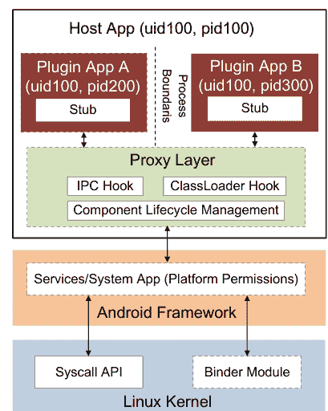
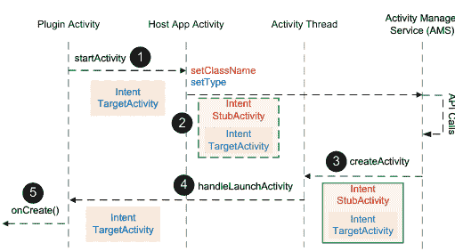
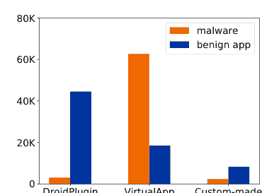
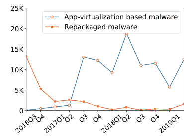
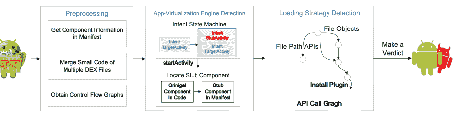
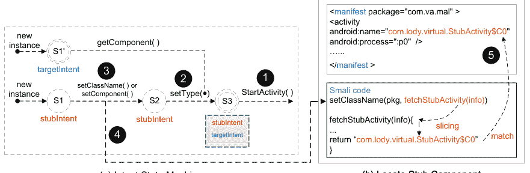
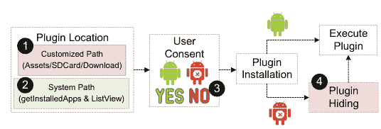
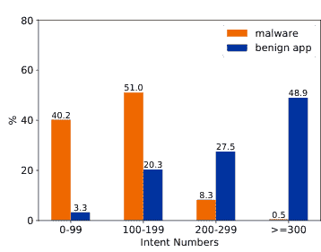
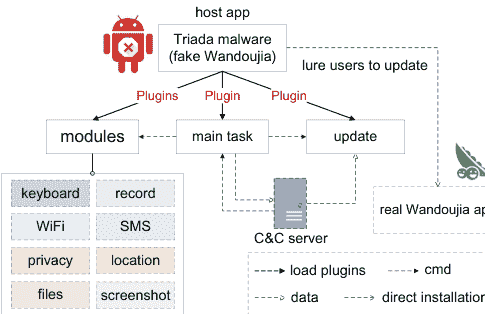

# [CCS '20：2020年ACM SIGSAC计算机与通信安全会议（美国虚拟活动 ..-..）] 2020年ACM SIGSAC计算机与通信安全会议论文集｜｜VAHunt：


## 摘要

将流行良性应用与恶意载荷重新打包，曾经是传播Android恶意软件最常见的方式。然而，自2016年以来，我们观察到Android生态系统中出现了一种令人担忧的新趋势：越来越多的Android恶意软件样本利用最新的应用虚拟化创新作为一种新的分发渠道。应用虚拟化使用户能够在单个设备上运行同一应用的多个副本，数千万用户正在享受这一便利。然而，网络犯罪分子将各种恶意APK文件重新打包为插件，嵌入应用虚拟化平台，该平台能够灵活地启动任意插件，无需安装的麻烦。这种新的重新打包风格通过将植入的恶意载荷隐藏在插件中，获得了绕过反恶意软件扫描器的能力，它也违背了现有重新打包应用检测解决方案所体现的基本前提。

由于基于应用虚拟化的应用不一定都是恶意软件，本文旨在在运行前对它们做出判定。我们的深入研究得出两个关键观察：1）插件应用与Android框架之间的代理层是应用虚拟化机制的核心，它揭示了有限状态转换的特征；2）恶意软件通常会隐蔽地加载插件并隐藏恶意行为。这些洞察促使我们开发一种名为VAHunt的两层检测方法。首先，我们设计一种有状态检测模型，以识别APK文件中应用虚拟化引擎的存在。其次，我们执行数据流分析以提取指纹特征，以区分恶意和良性加载策略。自2019年10月以来，我们在安恒AVL移动安全（一家领先的移动安全公司）中测试了VAHunt，用于检测超过139K个基于应用虚拟化的样本。与真实情况相比，VAHunt实现了0.7%的假阴性率和零假阳性率。我们的自动化检测使安全分析人员免于逆向工程的负担。

## CCS 概念

- 安全与隐私 → 软件逆向工程。

ACM 参考格式：
Luman Shi, Jiang Ming, Jianming Fu, Guojun Peng, Dongpeng Xu, Kun Gao, 和 Xuanchen Pan. 2020. VAHunt: Warding Off New Repackaged Android Malware in App-Virtualization’s Clothing. 在《2020年ACM计算机与通信安全会议论文集》（CCS ’20）中，2020年11月9–13日，虚拟举办，美国。ACM，纽约，纽约，美国，15页。https://doi.org/10.1145/3372297.3423341

## 1 引言

为了诱骗移动用户在其设备上下载恶意应用，恶意软件开发者始终在寻求规避安全措施并潜入移动应用市场的方法。分发Android恶意软件的常见方式曾经是重新打包合法应用 [1–3]。通常，攻击者通过反编译原始APK并在分发前添加恶意载荷来劫持良性应用的逻辑；用户被欺骗安装重新打包的恶意软件，因为他们相信自己正在运行原始应用。然而，自2016年以来，我们观察到一种令人不安的新趋势，即恶意软件利用最新的应用虚拟化进展作为一种新的重新打包实践，这使得恶意软件分发比其他传统方法更容易、更隐蔽。

在应用虚拟化解决方案中，宿主应用通过创建系统服务代理，在Android框架之上提供一个虚拟环境。因此，宿主应用可以直接启动其他


图 1：流行的应用虚拟化应用和引擎。

APK 文件，称为客户应用或插件，无需安装即可启动。类似于重新打包，应用虚拟化也以插件的形式添加额外代码，这会影响宿主应用的执行逻辑。这种新技术已应用于各种应用，并获得了数千万用户 [4]。图 1 列出了一些基于应用虚拟化的流行应用以及两个开源虚拟化引擎（VirtualApp [5] 和 DroidPlugin [6]）。应用虚拟化的一个突出优势是允许单个设备同时运行同一应用的多个实例 [7]，例如在一部手机上运行两个WhatsApp账户。凭借这一创新，所谓的“双实例”应用 [8] 在各个应用市场中非常流行；下载量最大的一个，Parallel Space [4]，在 Google Play 上拥有超过1亿次下载。此外，使用应用虚拟化的开发者还可以偏爱模块化编程 [9]，减小APK文件大小 [10]，并绕过单个DEX字节码文件的65,535 方法限制 [11]。例如，图 1 中的360安全应用包含多个功能模块（例如，内存清理器、智能性能增强器和防病毒扫描器），它们都以插件形式存在以供加载和使用，降低了各模块之间的耦合。

然而，正如预期的那样，网络犯罪分子从未花费太长时间就跟上最新技术趋势；他们已利用应用虚拟化来悄悄地重新打包和加载恶意插件。例如，安全专家发现，木马 PluginPhantom 的新版本已从使用传统重新打包风格演变为使用应用虚拟化 [12]：它将每个恶意功能实现为一个插件（例如，拦截来电和上传被盗数据），并利用应用虚拟化平台来调度和控制其插件。这样一来，PluginPhantom 实现了在不重新安装应用的情况下更新其模块的更大灵活性。此外，其所有恶意载荷插件都进一步加密，以阻碍静态分析。结果，只有虚拟化框架的可执行代码是静态可见的，这给行业当前的反病毒引擎带来了巨大挑战。另一个例子是恶意软件 HummingBad，它曾在2016年全球感染了超过1000万台Android设备。HummingBad 的新变体已卷土重来，使用 DroidPlugin [6] 进行比其前身更高效的广告欺诈。在 Google 安全团队将其从 Play Store 中移除之前，已有20个被 HummingBad 感染的 Android 应用被下载超过1200万次 [13]。我们的恶意软件追踪研究还证实，自2017年第二季度以来，基于应用虚拟化的恶意软件的增量已超过重新打包的恶意软件，且差距持续扩大（见图 4(b)）。这种新重新打包风格的快速传播表明，应用虚拟化将成为下一代Android恶意软件分发渠道。

不幸的是，在面对新的基于应用虚拟化的重新打包恶意软件时，现有防御技术不足以应对。要理解并击败这一新兴威胁，仍需付出巨大努力。近期工作专注于应用虚拟化造成的安全威胁 [14–18]。它们揭示了应用虚拟化的底层机制，并强调应用虚拟化环境并不安全。由于共享UID，攻击者可以轻松注入恶意代码并悄悄地实施各种攻击，例如特权升级、隐私泄露和钓鱼。PluginKiller [14] 和 DiPrint [17] 均提出了在运行时检测应用虚拟化环境的可行方案。然而，这些动态检测启发式方法主要用于保护当良性应用被宿主应用作为插件加载时的安全。基于应用虚拟化的重新打包恶意软件，如 PluginPhantom 或 HummingBad，是一个自包含的系统，不会加载任何第三方插件。此外，所有恶意载荷插件要么被加密（例如，PluginPhantom），要么在程序开始运行后从互联网下载（例如，HummingBad）。因此，试图检查恶意载荷插件的静态分析也变得徒劳。Zhang 等人的研究 [16] 表明，基于应用虚拟化的重新打包恶意软件可以有效地逃避反病毒扫描器以及依赖于测量代码/接口布局相似性的现有重新打包应用检测 [19–23]。

为了帮助安全分析人员和应用市场维护人员击败披着应用虚拟化外衣的恶意软件威胁，本文探讨了其内部机制，以便在运行前对基于应用虚拟化的应用做出判定。我们的深入研究得出两个关键观察。首先，插件应用与Android框架之间的代理层（即虚拟化引擎）是应用虚拟化机制的核心；它创建系统服务代理，并使用预定义的桩组件包装插件组件以维护插件生命周期。尽管实现各异，代理层通过插件与系统服务之间的进程间通信（IPC）中的 Intent 包装/解包传输数据，这种常见行为揭示了有限状态转换的特征。其次，为了隐藏恶意活动，恶意应用通常会在没有任何用户交互的情况下隐蔽地加载和执行插件，这被称为“自我隐藏行为” [24]。

这些洞察促使我们开发一种两层检测方法。首先，我们设计一种有状态检测模型，以识别APK文件中应用虚拟化引擎的存在。具体来说，我们将使用预定义桩组件包装插件应用Intent的行为抽象为有限状态机（FSM）模型。然后，我们提取所有可达的Intent相关FSM及其关联的桩组件，以检查它们是否与参考模式匹配。其次，我们执行数据流分析以提取隐蔽加载和应用隐藏策略，以区分恶意软件和良性软件。基于FlowDroid [25]，我们分析与路径API和文件对象相关的数据流和调用图。我们总结了四个加载策略特征，以区分恶意基于应用虚拟化的应用和良性应用。如果一个应用既揭示了应用虚拟化引擎，又揭示了隐蔽加载特征，我们将其视为基于应用虚拟化的恶意软件样本。


我们设计的新颖之处在于从全新角度检测基于应用虚拟化的恶意应用：虚拟化引擎加载插件的方式是一种突出的恶意软件特征，即使插件的APK文件已加密或将在运行时从Internet下载。我们将两层检测模型作为名为VAHunt的开源工具开发。自2019年10月以来，VAHunt已部署到Antiy AVL Mobile Security [26]中，以评估其恶意软件检测准确性。我们使用139K个基于应用虚拟化的应用测试了VAHunt，VAHunt显示出非常高的准确性，漏报率为0.7%，零误报。少量漏报来自几个游戏欺诈应用，这些应用具有允许游戏欺诈者修改游戏属性的接口。简而言之，我们作出以下三项主要贡献：

- 虽然基于应用虚拟化的重新打包Android恶意软件已经上升一段时间了，但研究其特定对策的工作有限。我们希望我们的深入研究能为安全社区敲响警钟，提醒这种迫在眉睫的威胁。
- 我们深入探讨了这种新威胁的内部机制，并揭示了一个两层检测模型，该模型检测应用虚拟化引擎的存在以及恶意软件的自我隐藏加载策略。我们的工作为避免基于应用虚拟化重新打包的恶意软件潜入Android应用商店提供了可行的解决方案。
- 我们在反恶意软件生产环境中评估了原型VAHunt的有效性。为了激励其他研究人员探索更全面的防御策略，我们在https://github.com/whucs303/VAHunt发布VAHunt的源代码。

## 2 背景与相关工作

在本节中，我们首先介绍理解Android应用虚拟化技术所需的背景信息。然后，我们总结了关于应用虚拟化安全威胁研究的现有工作及其局限性。最后，我们介绍与我们的检测方法最相关的工作。

### 2.1 应用虚拟化的技术基础

在计算中，虚拟化通常指在多功能平台上运行虚拟机的技术[27]。除了VMWare [28]和QEMU [29]等常见的基于监控程序的虚拟化外，应用虚拟化用于将单个应用与底层Android操作系统和其他应用隔离[30–33]。自2015年以来，应用虚拟化作为一种新技术出现，可以无需安装和修改即可加载任意第三方APK。主机应用通过动态代理为插件应用创建虚拟环境，并依赖API挂钩和Binder代理来绕过系统服务限制。主机应用挂钩插件应用的API调用，使Android系统认为所有API请求和组件都来自主机应用。同时，主机应用为插件应用预定义桩组件和权限，并在运行时将插件组件封装在桩组件中。这样，同一应用的多个实例就能够绕过UID限制并同时运行。

请注意，动态代码加载（DCL）[34, 35]听起来与应用虚拟化技术相似，因为它们都



图2：应用虚拟化架构。主机应用和插件应用运行在不同进程中，但共享相同的唯一用户ID（UID）。

可以加载额外代码。然而，DCL主要调用APK文件中的方法，无法支持组件生命周期，而应用虚拟化代表了一种更高级的技术，用于加载整个APK文件。本文重点介绍由VirtualApp [5]和DroidPlugin [6]代表的应用虚拟化技术。Boxify [30]和NJAS [31]这两个相关研究工具在Android 6.0及更高版本中已过时。Shi等人[17]将它们与VirtualApp/DroidPlugin进行了比较，并总结了Boxify和NJAS的局限性，例如缺乏兼容性和鲁棒性。我们将基于应用虚拟化的恶意软件兴起归因于VirtualApp/DroidPlugin所代表的新技术的强大和普及。

VirtualApp和DroidPlugin是两种最流行的应用虚拟化引擎。它们都支持在单个设备上运行同一应用的多个副本。虽然实现细节几乎没有差异^1，但其关键设计理念非常相似。图2概述了典型的应用虚拟化架构。主机应用为每个插件应用提供独立的执行空间；它使用不同的进程ID加载多个插件，但它们与主机应用共享相同的UID。应用虚拟化的核心是代理层（又称虚拟化引擎），它位于插件应用和Android框架之间。代理层在很大程度上依赖挂钩机制来欺骗Android系统服务和插件。例如，它挂钩ClassLoader来加载插件的DEX文件，并挂钩IPC来维护插件应用组件的生命周期。特别是，应用虚拟化框架揭示了以下常见机制。

1 DroidPlugin使用Service实现主机应用与插件之间的IPC，而VirtualApp采用ContentProvider，它更适合同步IPC且更简洁。



图3：通过用“StubActivity”包装/解包“TargetActivity”来启动插件的Activity。

**共享UID。** 通常，Android系统上安装的每个应用都根据其包名分配一个唯一的UID。由于UID限制，用户无法在单个设备上安装同一APK文件的两个副本。如图2所示的应用虚拟化环境，虽然主机应用和插件应用运行在不同进程中（pid 100~300），但它们共享相同的UID（uid 100）。因此，不同插件也拥有与主机应用相同的权限列表。

**过度权限。** 主机应用必须申请大量权限，以尽可能满足插件的权限需求。例如，VirtualApp默认允许最多186个权限，而基于应用虚拟化的应用中平均数为129个[17]，而良性应用平均申请5个权限[36]。显然，过度权限违反了最小权限原则。插件可以自由使用主机应用申请的所有权限，即使它声明零个权限。

**预定义桩组件。** 插件应用的组件不会预先注册在主机应用的清单文件中，因为主机应用无法预知插件应用的具体组件名称。主机应用通过在其清单文件中预定义一组桩组件来解决此问题。例如，VirtualApp默认针对四个组件各创建100个桩。

**组件生命周期管理。** 主机应用必须与Android系统交互以维护插件应用组件的生命周期。以Activity组件为例，我们展示了主机应用如何在图3中通过使用预定义桩组件和挂钩Android系统服务API来管理组件生命周期。例如，应用虚拟化通过反射挂钩ActivityManagerProxy来重写其他函数，如“handleLaunchActivity”。Intent是一种运行时绑定机制，可以连接两个不同的组件并在IPC过程中传输数据。当插件启动图3中的一个Activity（1）时，主机应用首先拦截“startActivity”方法，将插件应用的“TargetActivity”意图封装到“StubActivity”的意图中（2）。“StubActivity”已在主机应用的清单文件中预定义。这样一来，主机应用可以欺骗Activity Manager Service（AMS）服务器为“StubActivity”创建新活动（3）。然后，主机应用通过挂钩ApplicationThread类的“handleLaunchActivity”API和ActivityThread类的回调（4），恢复“TargetActivity”的真实Intent。最后，插件应用的Activity组件将成功启动（5）。处理插件应用的Service、Content Provider和Broadcast Receiver的过程类似。在VAHunt的检测方法中，我们将代理层的意图封装行为（如图3所示）表示为有限状态机模型。

### 2.2 应用虚拟化的安全威胁研究

尽管基于应用虚拟化的应用在Android市场很受欢迎，但研究人员已意识到这种新技术进步带来的安全问题。近期工作已彻底研究了其安全威胁[14–18]。Shi等人[17]表明，当前的应用虚拟化设计给用户带来了严重的“共享一切”威胁，这使得权限提升和隐私泄露等严重攻击变得容易得多。张等人[16]的同步工作对32个流行的应用虚拟化框架进行了系统研究。作者发现，新的应用虚拟化技术引入了七种常见的安全风险。此外，他们强调，恶意软件已将应用虚拟化滥用为一种“替代且易于使用的重新打包机制”。

为了通知用户某个应用正在不受信任的应用虚拟化环境中运行，Plugin-Killer [14]和DiPrint [17]独立开发了一个Android SDK，其中包含一组动态检测功能。希望避免其服务被托管到应用虚拟化环境中的应用开发者可以在自己的代码中嵌入Plugin-Killer或DiPrint。然而，基于应用虚拟化的应用不一定是恶意软件；这些动态检测启发式方法无法区分恶意应用和良性应用，并且在检测不加载任何第三方插件的恶意软件时，它们的用途受到严格限制。

张等人[16]提出了一种简单的启发式方法来检测由应用虚拟化加固的重新打包恶意软件。他们假设主机应用在运行时加载恶意插件和至少一个良性插件；他们观察到主机应用的证书与良性插件的证书不同。然而，这种证书比较方法受张等人分析的极少数恶意软件样本的偏见影响。在我们的大规模评估中，只有0.3%的恶意软件样本符合张等人的观察。因此，对基于应用虚拟化的重新打包恶意软件进行全面研究是必要的，并具有重大的实际意义。

### 2.3 应用的隐秘行为检测

与我们的工作相关的另一条研究线是应用的隐秘行为检测[24, 37, 38]。Android恶意软件通过隐藏恶意行为来最小化怀疑并延长其生命周期，从而执行隐秘操作。AsDroid [37]利用已实现的应用行为与用户预期行为之间的矛盾来检测隐秘行为。AsDroid依赖于基于API的六个动作检测，例如启动电话呼叫、发送短信和向敏感数据库插入数据。然后它分析用户界面组件（用于识别用户预期）来检测隐秘的应用行为。与AsDroid的不一致行为检测相比，StateDroid [38]发现隐秘攻击是通过一定顺序的一系列动作进行的，可以抽象为有限状态转换。StateDroid通过Horn-子句验证构建FSM模型来分析隐秘攻击动作。最近的工作提出了“自我隐藏行为”（SHB）[24]的名称，以


代表隐藏应用活动的恶意行为，例如删除可疑操作的痕迹并隐藏应用的存在。SHB 检测方法 [24] 通过执行控制流和静态污点分析来追踪隐蔽操作；这项工作也启发了 VAHunt 对恶意插件加载策略的检测。

## 3 披着应用虚拟化外衣的新型重新打包 Android 恶意软件

在本节中，我们展示了对应用虚拟化恶意软件发展进行为期三年跟踪的深入研究。我们的发现揭示了这一新一代恶意软件的特征，并强调安全社区亟需设计特定的对策。

应用虚拟化技术的局限性，例如缺乏权限分离和数据隔离，对恶意软件开发影响甚微。相反，网络犯罪分子将应用虚拟化作为一种新的恶意软件重新打包方式，从中获益匪浅。因此，恶意软件的开发和分发变得比以往任何时候都更容易、更隐蔽。特别是，应用虚拟化重新打包的恶意软件具有以下优势：

- (1) 绕过杀毒软件检测。应用虚拟化使恶意功能（作为不同的插件）与宿主应用解耦，每个插件要么以加密形式存储在“Assets”目录下，要么动态下载。只要宿主应用不涉及任何恶意操作，杀毒扫描器就难以检测出它。
- (2) 开发成本低。传统的重新打包仍然需要大量的逆向工程工作：攻击者必须修改原始应用的代码，使用 Apktool 或 DEXlib 更改包名，并将应用重新打包为新的 APK 文件。相比之下，应用虚拟化使重新打包变得容易得多：原始 APK 可以直接作为插件加载，无需任何修改。
- (3) 模块更新灵活。借助应用虚拟化，恶意软件开发者可以无需重新安装应用即可自由更新其模块。除了更新恶意代码外，许多恶意软件样本开始添加更有利可图的功能，例如广告推广和色情传播。
- (4) 易于传播。由于移动开发者和用户对应用虚拟化应用有巨大的需求，这一事实为传播基于应用虚拟化的恶意软件提供了天然掩护。例如，它们可以伪装成双开应用；在用户安装后，宿主应用会动态下载恶意插件并在用户不知情的情况下执行它们。

自 2016 年应用虚拟化重新打包恶意软件出现以来，我们一直持续跟踪其演变。图 4(a) 显示了 Antiy AVL 在三年内（2016 - 2019）每个季度收集的基于应用虚拟化的良性应用和恶意软件样本的总数。Antiy AVL 的威胁检测引擎提供丰富的元数据，用于识别良性应用、恶意重新打包应用和基于应用虚拟化的应用。由于 DroidPlugin 和 VirtualApp 是两款领先的应用虚拟化引擎，我们添加了额外的静态特征来识别它们。对于其他不匹配此类指纹特征的应用虚拟化应用，我们将其归入“自定义”类别。



(a) 基于应用虚拟化的应用和引擎的数量。



(b) 每个季度的新恶意软件样本数量。

图 4：基于应用虚拟化的应用统计信息。

两款最流行的应用虚拟化引擎 VirtualApp 和 DroidPlugin 因其开源特性占据了 92.4% 的份额。其余应用拥有自定义虚拟化引擎。这些自定义引擎的核心原理与 VirtualApp/DroidPlugin 相似，但实现细节不同，例如使用 AIDL 或 Content Provider 实现 IPC。自定义类别包含 10,621 款应用，涵盖六种不同的应用虚拟化框架。例如，Parallel Space 的底层虚拟化引擎称为 MultiDroid，我们将其视为自定义引擎。

有趣的是，由 VirtualApp 加固的恶意软件数量约为基于 VirtualApp 的良性应用数量的三倍。此外，我们还调查了从 2016 年 9 月到 2019 年 12 月重新打包恶意软件的活跃度。图 4(b) 显示了每个季度具有不同哈希值的新恶意软件样本数量。自 2016 年以来，传统重新打包恶意软件的增量放缓，而基于应用虚拟化的恶意软件从 2017 年 Q3 开始呈现快速增长。特别是，我们观察到许多新的恶意软件变体已从之前的重新打包风格转向应用虚拟化。图 4(b) 显示的日益扩大的差距表明，应用虚拟化很可能主导下一代 Android 恶意软件重新打包方式。

我们在附录中详细阐述了应用虚拟化重新打包恶意软件的一些详细特征，并将 Triada 作为典型的基于应用虚拟化的恶意软件进行介绍。

## 4 VAHUNT 概览

§2 和 §3 中介绍的深入研究得出两个关键观察。首先，插件应用与 Android 框架之间的代理层是应用虚拟化机制的核心，代理层的意图封装行为（如图 3 所示）揭示了有限状态转换的特征。其次，为了隐藏恶意活动，恶意软件应用通常在没有任何用户交互的情况下隐蔽地加载插件。这些洞察促使我们捕获一个突出的恶意软件特征：虚拟化引擎加载插件的方式。即使插件的 APK 文件在静态上不可见，此检测特征仍然有效。

我们开发了一种名为 VAHunt 的两层检测方法。首先，我们设计了一种有状态检测模型来识别 APK 文件中是否存在应用虚拟化引擎（即代理层）。其次，我们执行数据流分析以提取自隐藏加载策略，以区分恶意和良性的基于应用虚拟化的应用。图 5 展示了 VAHunt 的工作流。从字节码和清单中提取必要信息后，VAHunt 识别意图包装行为并搜索存根组件以检测应用虚拟化引擎。之后，VAHunt 追踪文件对象和路径 API 以发现隐蔽插件安装的特征。我们将在接下来的两个节中讨论 VAHunt 的详细内容。

## 5 应用虚拟化引擎检测

Activity Manager Service (AMS) 管理每个应用程序中的组件调度。如果应用启动 Activity 或 Service，它首先向 AMS 报告，AMS 将决定是否启动 Activity 或 Service。由于应用和 AMS 运行在不同的进程中，它们的进程间通信依赖于 Intent [39]。应用虚拟化的一个技术挑战是维护插件应用组件的生命周期，因为所有插件都未安装在 Android 系统上，而是在虚拟环境中运行。图 3 展示了代理层如何克服这一障碍：它使用宿主应用预定义的存根组件包装插件意图，以欺骗 AMS 创建新活动；然后它钩住 Android 系统服务 API，从存根组件中解包插件意图并最终启动插件组件。

尽管当前使用的应用虚拟化引擎种类繁多，例如 VirtualApp、DroidPlugin 和自定义引擎，但如图 3 所示，使用预定义的存根组件包装插件应用的 Intent 是通用的 [18]。VAHunt 将这一内部机制作为应用虚拟化引擎存在的依据进行检测。

### 5.1 预处理

给定 APK 文件，我们首先提取后续分析所需的信息。我们使用 AAPT [40] 工具提取 Manifest 并从 APK 文件中获取组件信息。我们使用 dexdump [41] 工具从 DEX 文件中获取 Smali 代码。由于 DEX 文件中的方法数量不能超过 65536 [11]，某些应用被拆分为多个 DEX 文件。因此，我们将所有 DEX 文件的 Smali 代码合并到一个文件中，以方便后续分析。此外，我们使用 FlowDroid [25] 为每个 APK 文件构建控制流图。

### 5.2 意图状态机

我们将插件意图包装行为（涉及通过意图进行数据传输）视为有限状态机（FSM）模型。FSM 状态表示意图的状态，状态转换由相关 API 引起（例如 "setClassName" 和 "setType"）。我们检查从每个应用中提取的意图状态机是否与参考 FSM 模式匹配。

```
private Intent startActivityProcess(Intent targetIntent) {
    intent = new Intent(targetIntent);
    Intent stubIntent = new Intent();
    stubIntent.setClassName(PackageName, StubActivity);
    ComponentName component = intent.getComponent();
    stubIntent.setType(component);
    startActivity(stubIntent);
}
```

列表 1：包装插件 Intent 的 JAVA 代码。

```
<activity
    android:name="com.lody.virtual.StubActivity$C0"
    android:configChanges="mcc|locale|touchscreen|..."
    android:process=":p6"
    android:taskAffinity="com.lody.virtual.vt"
    android:theme="@style/VATheme"
/>
```

列表 2：清单文件中预定义的存根 Activity。

#### 5.2.1 意图操作提取

为了生成 Intent 状态机，我们需要提取所有意图对象和操作。我们分析 Android 应用的 Smali 代码以定位类型为“android/content/Intent”的对象，并提取针对这些意图的所有 API。具体而言，意图操作包括创建、属性设置和传输。意图由“new-instance”创建后，我们可以在意图对象上找到操作，例如添加标志或设置操作（例如，“addFlags”和“addAction”）。我们还记录与意图对象相关的组件和其他意图。例如，“setComponent”操作显式设置组件名称来处理意图。如果意图的组件设置为来自另一个意图的组件名称，则这两个意图具有相关性关系。

#### 5.2.2 包装插件的 Intent

如图 3 所示，宿主应用通过将 Target-Activity 意图包装在预定义的 StubActivity 意图中，将修改后的意图传输给 AMS。当 AMS 创建 Activity 时，宿主应用会恢复插件的真实意图。列表 1 显示了包装意图的核心代码。第 3 行中的意图是通过创建新实例从 startActivityProcess() 参数中获取的 targetIntent。stubIntent 在第 4 行新建，并在第 5 行具有新类 StubActivity。第 6 行和第 7 行实现了包装 targetIntent 的目标：将 targetIntent 的组件添加到 stubIntent 的类型中。之后，封装后的 stubIntent 通过“startActivity”传递给 AMS。这样一来，AMS 会认为启动 Activity 的请求来自宿主应用。

#### 5.2.3 意图状态转换

默认情况下，意图在初始状态下创建。添加属性时，其状态会发生变化，例如“setClass”和“addFlags”。对于与包装 Intent 相关的转换，targetIntent 和 stubIntent 的状态随其实例、类名、组件名称和类型属性的变化而转换。生成意图有限状态机（FSM）的步骤




图 5: VAHunt 系统概览。VAHunt 在运行前对基于应用虚拟化的应用做出判定。两个关键组件是应用虚拟化引擎检测和插件加载策略检测。



图 6: 检测应用虚拟化引擎的步骤：1) 匹配 Intent 状态机；2) 定位存根组件。

如下所示。如果一条语句创建一个新的 Intent，FSM 的入口是新的 Intent 对象，在 Smali 代码中该对象表示为一个寄存器。新 Intent 对象的状态初始化为其对应 Intent 状态机的初始状态。如果一条语句通过调用相关 API 修改了 Intent 的属性，则 Intent 状态发生变化。否则，读取 Intent 的属性不会改变其状态。此外，VAHunt 记录相关信息，例如类名、函数名和 Intent 操作。当 Intent 对象通过调用“startActivity”或“startService”发送给 AMS 时，Intent 状态机结束。

而 targetIntent 的“getComponent”操作必须在“setType”操作之前。“startActivity”是达到最终状态的先决条件。由于组件信息可以以不同方式存储，“setType”可以被其他类似函数替换，例如“setData”、“setDataAndType”、“putExtra”和“putExtras”。此外，“setClassName”具有与“setComponent”相同的功能——两者都可以为 Intent 设置组件名。因此，在状态转移 ③ 中，“setComponent”是“setClassName”的替代方案。

#### 5.2.4 参考 FSM 模式匹配

### 5.3 定位存根组件

为每个 Intent 生成状态机后，我们检查它们是否与代表应用虚拟化的参考 FSM 模式匹配。如图 6(a) 所示，该参考 FSM 模式以以下三种方式抽象了封装插件 Intent 的行为：1) 它从两个源 Intent 创建开始（例如 targetIntent 和 stubIntent），且 stubIntent 的最终状态启动图 6 中的 Activity ①；2) stubIntent 的类型来自 targetIntent ②；3) stubIntent 使用新的类名设置其 Class 属性 ③。一旦找到参考 FSM 模式，我们将从 stubIntent 的新类名 ④ 开始进行向后切片，以确认 stubIntent 来自存根文件 ⑤。这样一来，在成功匹配 Intent 状态机模型并定位预定义存根组件后，我们报告检测到应用虚拟化引擎。

5.2 检测 APK 文件中“封装插件 Intent”行为的存在。接下来，我们进一步确认，是否是宿主预定义的存根组件来封装插件的 Intent。

需要注意的是，在典型的应用虚拟化状态机（图 6(a)）中，“setClassName”和“setType”的顺序是可以互换的。

#### 5.3.1 组件切片

获取最终 Intent 状态机信息后，我们对 stubIntent 的操作进行回溯，以找到真实的组件名。通常，组件名以 ComponentName 类型、ClassName 类型或 String 类型存在。特定的 API 可以转换类型，例如使用“flattenToString”将 ComponentName 类型转换为 String 类型。开发者可以以硬编码字符串的形式或通过调用 API 来设置 Intent 的组件属性；“setComponent”和“setClassName”是用于设置组件名或组件类名的两种最常用 API。

因此，我们通过以下步骤追踪最终组件名。首先，我们从 Intent 状态机信息中定位“setComponent”或“setClassName”的参数。如果参数值不是直接的硬编码字符串（或 ComponentName），而是来自其他函数，我们执行数据流分析以找到真实的组件名。例如，“setClassName”的参数可能来自其他函数的返回值。具体来说，我们从“setComponent”或“setClassName”的参数开始，在调用图上进行向后切片，以收集用于构造组件名的所有 API（图 6 中的 4）。由于存在通过 StringBuilder 或 StringBuffer 进行的字符串初始化和拼接，我们计算并记录每次转换中生成的所有组件名值。

#### 5.3.2 存根组件匹配

最后，我们将切片提取的组件名与预定义存根组件的组件名进行匹配。因为应用虚拟化引擎必须获取存根组件来分配存根 Intent，所以它必须管理当前可用的存根组件。清单文件中典型的存根组件名由统一字符串和不同数字组成。如 Listing 2 所示，存根 Activity 名由 "com.lody.virtual.StubActivity$C" 和数字 0 组成。由于组件在不同进程中运行，"android:process" 属性中的数字也不同。其他属性如 configChanges、taskAffinity 和 theme 都具有相同的统一格式。所有应用虚拟化平台都以这种相似的风格定义其存根组件名，这一点也得到了 Zhang 等人研究 [16] 的证实。因此，如果收集到的某个组件名与清单文件中的组件名匹配，VAHunt 将判定检测到应用虚拟化引擎。

## 6 加载策略检测

鉴于对基于应用虚拟化的应用的识别，另一个问题浮出水面。我们需要进一步区分恶意软件和良性应用。与传统的可通过测量代码/界面布局相似性来检测的重新打包恶意软件 [19–23] 不同，大多数基于应用虚拟化的恶意软件样本会加密其恶意插件以阻碍静态分析。为克服这一挑战，我们研究恶意软件宿主应用如何静默加载插件并在安装后隐藏它们。这就是所谓的“自隐藏行为”，研究人员已将其视为恶意指标 [24, 37, 38]。我们旨在寻找运行恶意插件而不引起怀疑所需的自隐藏特征。

### 6.1 隐蔽加载策略

图 7 显示了应用虚拟化的插件加载流程。对于良性应用，在定位插件 APK 路径后，插件在获得用户同意的情况下安装，并带有正常的用户界面执行。然而，大多数基于应用虚拟化的恶意软件会静默加载插件，没有任何提示框或用户点击。一些恶意软件变体甚至在安装后立即隐藏插件。基于这些洞察，我们在表 1 中总结了四种隐蔽加载特征。前两个特征描述了加载插件 APK 的位置；接下来两个特征总结了静默加载和执行插件的行为。我们通过对调用图执行数据流分析来搜索这四个特征：我们将特定对象从起始点（表 1 的第二列）传播到终点（表 1 的第三列）；我们检查对象是否按预期行为处理或调用是否被调用



图 7: 与良性应用相比，基于应用虚拟化的恶意软件通常在未获得用户同意的情况下加载插件；它们甚至在安装后隐藏插件。

带有特定参数。最后，我们制定决策规则以检测基于应用虚拟化的恶意软件的加载策略。

#### 6.1.1 从自定义路径加载插件

在虚拟环境中加载插件的前提是知道插件 APK 的位置。大多数基于应用虚拟化的恶意软件样本，例如自包含系统，提前知道其插件并直接从自定义位置加载它们，这些位置包括所有应用都可访问的公共存储（例如 SDCard）和宿主应用的私有数据区域，例如 Assets 子目录。即使插件在运行时从互联网下载，它们仍然存储在这些位置。宿主应用通过调用常见的 Android 路径 API 或从硬编码的 APK 路径获取插件 APK 路径。最近的工作已总结了 22 个 Android 路径 API [42]，我们在表 2 中按不同存储位置将其分为五类。我们分析与这些路径 API 相关的调用图以搜索相应的文件对象。获取文件对象后，我们进一步确定它们是否由应用虚拟化安装。通常，应用虚拟化为宿主应用提供安装接口以安装插件。开发者只需调用典型函数（例如 installApp()/installPackage()）或应用虚拟化的重写 startActivity() 方法。然而，安装接口的函数名可以自定义为各种名称，因此我们无法通过安装接口的固定字符串确保插件由应用虚拟化加载。相反，我们对文件对象执行数据流和调用图分析，直到回溯到 Intent 封装函数（参见图 6），这表明插件文件由应用虚拟化安装。

#### 6.1.2 从系统路径加载插件

另一类攻击良性插件的恶意软件应用会诱使用户加载系统上已安装的良性应用。与自定义路径相比，系统路径是宿主应用没有写权限的隔离存储。在请求软件包列表后，宿主应用显示用户界面元素供用户选择要加载的应用。然后，宿主应用将插件 APK 从原始应用的数据空间复制到其自身空间并安装插件。通常，开发者使用 PackageManager 的 getInstalledPackages() 获取已安装的应用。因此，我们将调用图中的 getInstalledPackages() 定位为起始点，并向前跟踪以查找已安装软件包的信息是否显示在 ListView 中。ListView 常用于列表显示，由多个展示文字或图像的项目组成。Android 系统通过根据 XML 文件创建适配器来显示项目分布，从而显示图形布局。当宿主应用创建 ListView 并填充


**表 1：用于检测基于应用虚拟化的恶意软件的四种加载策略特征。特征 1 和 2 描述加载插件 APK 的位置。特征 3 和 4 描述隐藏恶意软件行为以防止受害者察觉的操作。**

| 特征 | 起点 | 终点 |
|---|---|---|
| 1. 从自定义路径加载插件 | 敏感路径 API（参见表 2） | Intent 包装函数 |
| 2. 从系统路径加载插件 | getInstalledPackages()<br>Runtime().exec("pm list packages") | onCreateView()/onViewCreated()/inflate()/onCreateViewHolder()/setContentView()<br>OnClick()/setOnItemClickListener() |
| 3. 用户同意 | installApp()/installPackage() | 清单文件中的启动器 ("android.intent.category.LAUNCHER")<br>应用生命周期 (onCreate(), onStart(), onReceive()) |
| 4. 隐藏应用 | setComponentEnabled(cmp, 2, 1)<br>Window.addFlag(FLAG_NOT_TOUCH_MODAL)<br>Window.setFlag(FLAG_NOT_TOUCH_MODAL)<br>Window.requestFeature(FLAG_NOT_TOUCH_MODAL) | 宿主应用的组件 |

**表 2：获取自定义文件路径的 Android API。**

| 目录 | API |
|---|---|
| /data/data | getDataDirectory(), getCacheDir(), getFilesDir(), getDir(), openFileOutput(), getFileStreamPath(), getDatabaseDir() |
| /sdcard/ | getExternalStorageDirectory(), getObbDir(), getExternalStoragePublicDirectory(), getExternalCacheDir(), getExternalFilesDir() |
| SQLiteDatabase | openOrCreateDatabase(), openDatabase(), openOrCreateDatabase() |
| SharedPreferences | getSharedPreferences(), getPreferences(), getDefaultSharedPreferences() |
| 其他 | getAssets(), getCanonicalPath(), getPath(), getAbsolutePath() |

setComponentEnabledSetting() 在运行期间用于禁用图标 [24]。要隐藏 Activity，恶意软件有两种选择：
- 恶意软件在后台以 Service 形式运行；
- 恶意软件使 Activity 的主布局透明，并通过使用 "FLAG_NOT_TOUCH_MODAL" 标志移除操作栏和窗口标题。

宿主应用以同样的方式隐藏其自身组件，以更加隐蔽。我们执行向后的数据流分析来调查这些特殊 API 的参数，并确保宿主应用配置涉及这些 API 的组件来隐藏插件和自身。例如，如表 1 最后一行所示，当“setComponentEnabledSetting”的三个参数分别设置为宿主应用的启动组件、2 和 1 时，该 API 的结果是隐藏应用图标。

通过 setAdapter() 获取列表中的软件包信息，我们搜索相关的 XML 文件以找到 GUI 的真实项目。如果项目包含任何文字或图片，这意味着获取插件软件包的行为对用户可见。

#### 6.1.3 用户同意

通常，良性的应用虚拟化应用要求用户在插件安装时点击安装按钮或弹出对话框以获取用户同意。然而，大多数基于应用虚拟化的恶意软件样本从一开始就在没有任何用户交互的情况下加载其恶意插件。为了检测用户点击的不存在，我们首先定位插件安装界面，然后从该界面向后追溯到应用的启动。应用启动通常是清单文件中带有 "android.intent.category.LAUNCHER" 标签的组件。如果我们发现插件安装的开始位于组件生命周期中（例如 Activity 的 onCreate()），我们就停止追踪 API 调用链。当用户同意加载插件时，他们通常会点击屏幕上的按钮或项目。因此，我们收集从插件安装开始的调用链，并查看其是否包含 onClick() 或 onItemClick()。如果调用链到达应用入口但未显示任何用户交互，这意味着宿主应用正在静默加载插件。我们还在附录 §B 中处理了调用链分析中的线程中断问题。

#### 6.1.4 隐藏应用

安装后，良性应用会将其图标添加到主屏幕，以便用户下次使用。然而，恶意软件实例倾向于隐藏自身并在后台运行，不显示任何图标或 Activity。因此，用户在屏幕上看不到任何 GUI。恶意软件要么修改清单文件以将应用从默认启动器中移除，要么调用

### 6.2 决策规则

我们将隐蔽的插件加载和应用隐藏行为视为恶意行为，因为它们违反了 Google 开发者内容政策 [43]。如图 7 所示，恶意软件宿主应用可以从自定义路径加载插件 (1)，或从系统路径加载良性应用来攻击它 (2)。考虑到一个应用可能包含应用虚拟化引擎但从不使用它，特征 (1) 和 (2) 用于确认宿主确实使用应用虚拟化引擎加载插件。在此基础上，大多数恶意软件宿主应用会在未经用户同意的情况下静默安装其恶意插件 (3)，在用户界面中不留任何可见痕迹。我们定义一个决策规则 silentinstall 来检测恶意加载策略。silentinstall 的公式为：(1) OR (2) AND (3)。只要一个应用揭示了应用虚拟化引擎和 silentinstall，VAHunt 就会将其标记为基于应用虚拟化的恶意软件。此外，我们还关注图 7 中在安装后通过隐藏图标或 Activity 采取更隐蔽行为的恶意软件 (4)，我们将其表示为 silentinstall+，其公式为：silentinstall AND (4)。在评估中，我们还测量表现出 silentinstall+ 行为的恶意软件。如果一个应用隐藏了应用但没有静默安装插件，我们将其报告为可疑案例。

## 7 评估

我们在 §5.1 中介绍了对 APK 文件的预处理。我们使用 AAPT [40] 和 dexdump [41] 来提取 VAHunt 所需的必要信息。VAHunt 的原型包括两个组件：应用虚拟化引擎检测器和恶意加载策略检测器。VAHunt 的整条链路共有 7,052 行 Python 代码。我们的所有实验都在一台配备 Intel Core i9-8950HK 处理器和 32GB 内存、运行 Windows 10 Pro 的笔记本电脑上进行。我们的评估旨在回答三个研究问题：

- **RQ1**: VAHunt 对基于各种虚拟化引擎（例如 VirtualApp、DroidPlugin 和自定义引擎）构建的基于应用虚拟化的应用检测准确率如何？
- **RQ2**: VAHunt 进一步区分恶意和良性基于应用虚拟化的应用的准确率如何？
- **RQ3**: VAHunt 与现有动态和静态解决方案相比表现如何？

### 7.1 数据集

我们的测试用例包括三个数据集来评估 VAHunt 的检测准确率。就我们所知，我们的评估是迄今为止测试基于应用虚拟化应用的最大规模评估。

#### 官方标记的基于应用虚拟化的样本

自 2019 年 10 月以来，我们已将 VAHunt 部署到安恒 AVL 移动安全 [26]（一家领先的移动安全公司）以评估其检测准确率。截至撰写本文时，我们已测试了 139,358 个基于应用虚拟化的样本，这些样本由安恒 AVL 在三年内通过动态/静态方法和手动逆向工程收集。基准真实数据集中大多数良性应用来自主要应用市场，例如 Google Play、1Mobile Market、腾讯应用宝和 360 手机助手。许多基于应用虚拟化的恶意软件样本已被从 Google Play 下架 [44–46]。起初，基于应用虚拟化的恶意软件样本是受害者报告的，因为它们绕过了恶意软件检测引擎。安全分析人员手动逆向工程这些样本以提取动态和静态检测特征。给定一个可疑样本，AVL 的威胁检测引擎首先使用机器学习模型来匹配相似的语法特征向量。如果它没有相似的静态特征，AVL 引擎将运行每个样本 5 到 10 分钟以检测恶意或可疑行为，例如插件进程活动和网络流量。然而，44.4% 的基于应用虚拟化的应用没有本地插件，51.8% 的插件具有触发条件。对于在运行时未显示可疑行为的未知恶意软件，安全分析人员必须手动逆向工程样本。通常，经验丰富的安全分析人员需要 25 到 50 分钟来剖析一个基于应用虚拟化的应用。AVL 数据集准确但成本高昂。

将这 139,358 个标记样本作为基准真实数据集，VAHunt 关注应用虚拟化的内部机制，并在运行前提供一个可行的检测引擎。根据底层虚拟化引擎，我们将这些样本分为三类：VirtualApp [5]、DroidPlugin [6] 和自定义引擎。我们在每个类别中检测良性和恶意应用，具体数量显示在表 3 的第 2~4 行。由于 VirtualApp 和 DroidPlugin 在 GitHub 上开源，开发者和攻击者可以以低成本重用其源代码；其中一些人甚至修改源代码来生成自定义引擎。请注意，在总共 81,225 个基于 VirtualApp 的应用中，多达 77.2% 是恶意软件样本，这表明 VirtualApp 受到恶意软件作者的更好接受。另一个有趣的观察是，总共有 4,320 个样本被加壳，但其中 4,276 个来自良性应用。我们将恶意软件的低加壳比率归因于应用虚拟化机制已经提供了一层

**表 3：VAHunt 两层检测模型的准确性评估结果。最后一列是唯一用于检测基于应用虚拟化的重新打包恶意软件的先前工作。第 4~6 列显示检测准确性数据。**

| 虚拟化引擎 | 类别 | 数量 | VAHunt1¹ | VAHunt2² | Certificate [16] |
|---|---|---|---|---|---|
| VirtualApp | 良性 | 18,508 | 100% | 100% | 11.7% |
| | 恶意 | 62,717 | | 99.3% | 0.3% |
| DroidPlugin | 良性 | 44,498 | 100% | 100% | 17.1% |
| | 恶意 | 3,014 | | 98.7% | 0.5% |
| 自定义 | 良性 | 8,261 | 100% | 100% | 13.7% |
| | 恶意 | 2,360 | | 99.2% | 0.3% |
| 双实例 | 良性 | 147 | 100% | 100% | 0% |
| 无应用虚拟化 | 良性 | 1,638 | 100% | -³ | -³ |
| | 恶意 | 3,212 | | | | |
| 总计 | 良性 | 73,052 | 100% | 100% | 14.9% |
| | 恶意 | 71,303 | | 99.3% | 0.3% |
| 平均耗时 | | | 6.9s | 12.1s | 0.6s |

¹ VAHunt1 是 VAHunt 的应用虚拟化引擎检测器。
² VAHunt2 是 VAHunt 的加载策略检测器。
³ VAHunt2 和 [16] 不检测未使用应用虚拟化的应用。

有效保护。对于加壳样本，我们应用安恒 AVL 的商业脱壳工具来获取其原始 DEX 文件。

#### 双实例应用

由于双实例应用允许用户加载任意 APK，它们是评估应用虚拟化环境检测工具（例如 Plugin-Killer [14] 和 DiPrint [17]）的理想案例。这些工具仅在嵌入到插件代码时才生效。我们从 Google Play 中搜索“dual instance”和“multiple accounts”等相关关键词，并下载了 147 个双实例应用。

#### 无应用虚拟化的应用

为了测试 VAHunt 在检测无应用虚拟化的应用时是否会产生误报，我们还从 Google Play 下载了 1,638 个良性应用，并在 2020 年 4 月收集了 3,212 个恶意应用。此外，所有这些非虚拟化应用均由 AVL 安全专家手动验证，以确认它们不包含应用虚拟化引擎。由于此过程成本很高，我们只获得了 4,850 个非虚拟化应用。即便如此，这个数量已经远大于 [16] 中的误报测试应用，后者仅评估了 180 个应用。

### 7.2 应用虚拟化引擎检测

表 3 显示了我们实验的总体结果。我们按应用虚拟化引擎类型和恶意性对样本进行分类。我们根据以下公式 [47] 计算检测准确率：

\( Accuracy = \frac{TP+TN}{TN+TP+FN+FP} \)

TP 表示真阳性，TN 表示真阴性。表 3 的第 4~6 列显示检测准确性数据。第 4 列的数据表明，VAHunt 在所有情况下对应用虚拟化引擎检测的结果都是完美的：没有误报，也没有漏报。在此步骤中，VAHunt 提取对 Intents 的所有操作以生成 Intent 状态机，因此 VAHunt 在这里的性能取决于可用 Intents 的数量。应用虚拟化引擎检测带来的运行时间平均约为 6.9 秒（预处理 1.2 秒，Intent 状态机 3.3 秒，定位存根组件 2.4 秒）。

为了了解从 APK 文件构建 Intent 状态机的复杂性，我们调查了 APK 中的 Intent 分布




图 8：基于应用虚拟化的良性应用创建的 Intent 比恶意软件更多。

基于应用虚拟化的良性应用和恶意软件。图 8 显示，基于应用虚拟化的良性应用的 Intent 数量多于恶意软件（平均数量：331 vs. 113）。产生这种差异的原因是，良性应用通常具有更多功能，并嵌入了比恶意软件更多的第三方包。

我们创建的参考 FSM 模式涉及两个相关的 Intent（参见图 6(a)），其中一个 Intent 的字段信息来自另一个。此外，我们还调查了应用虚拟化代码内外此类多 Intent 相关案例的出现情况。除了类似于图 6(a) 的 Intent 封装之外，只有 4% 的测试用例存在以下两种场景的多 Intent 相关案例：Intent 深拷贝和快捷方式创建/删除。深拷贝是对象的完全独立副本，对副本对象所做的更改不会影响原始对象 [48]。清单 1 的第 3 行展示了通过使用现有 Intent 创建新 Intent 实例的深拷贝示例。“intent”从“targetIntent”复制所有属性（例如，类名和操作），但这两个 Intent 是独立的。对于快捷方式创建，附录中的清单 4 显示，“shortcut” Intent 通过在“intent”中发送跳转目标来通知 Android 系统为应用创建快捷方式。在接收到“shortcut” Intent 后，Android 系统会在屏幕上创建快捷方式。当用户点击快捷方式图标时，应用将使用来自“shortcut” Intent 的额外属性中的“intent”信息启动。应用虚拟化代码内外多 Intent 相关案例的区别在于它们传输的数据不同：仅 Intent 封装行为传输插件的组件信息，而 VAHunt 的存根组件定位可以排除其他类似的多 Intent 相关案例。因此，我们选择参考 FSM 模式降低了 VAHunt 的检测开销。

### 7.3 加载策略检测

一旦检测到样本具有应用虚拟化引擎，VAHunt 将继续检测其加载策略。表 3 的第 5 列显示了 VAHunt 第二步的检测准确率，平均运行时间为 12.1 秒。对于所有基于应用虚拟化的良性应用，VAHunt 未引入任何假阳性和假阴性。请注意，对于使用应用虚拟化进行热补丁的良性应用，它们都会提前通知用户，例如提示“正在下载补丁文件”。我们发现，1,021 个良性应用会更新

Table 4: 加载行为特征的百分比。

| Virtualization Engine | Category | customizedPath | systemPath | silentInstall | silentInstall+¹ |
| :--- | :--- | :--- | :--- | :--- | :--- |
| Dual-Instance | Benign | 0 | 100% | 0 | 0 |
| VirtualApp | Benign | 93.5% | 6.5% | 0 | 0 |
| VirtualApp | Malware | 99.6% | 0.4% | 99.3% | 7.6% |
| DroidPlugin | Benign | 90.2% | 9.8% | 0 | 0 |
| DroidPlugin | Malware | 99.9% | 0.1% | 98.7% | 11.7% |
| Custom-made | Benign | 86.3% | 13.7% | 0 | 0 |
| Custom-made | Malware | 99.7% | 0.3% | 99.2% | 9.8% |

¹silentInstall+ 表示宿主应用静默加载插件并隐藏应用。

Table 5: 大多数基于应用虚拟化的应用要么不在本地存储插件，要么对插件进行加密。

| Category | No Plugin | Encrypted Plugin | Plain-text Plugin¹ |
| :--- | :--- | :--- | :--- |
| benign | 76.8% | 3.7% | 19.5% |
| malicious | 10.5% | 89.2% | 0.3% |

¹明文插件是未加密的 APK 文件。

已安装的插件，但它们都会显示用户交互。然而，对于基于应用虚拟化的恶意软件，VAHunt 会引入大约 0.7% 的假阴性。经过进一步调查，所有这些假阴性都来自游戏欺诈应用。游戏欺诈应用在应用虚拟化环境中加载游戏修改器和游戏应用，并提供一个界面，允许游戏欺诈者自定义和修改不同的游戏属性以实现快速升级。因此，游戏欺诈应用表现出用户交互，违反了隐蔽加载策略。由于游戏欺诈应用的客户群非常有限，我们认为遗漏对游戏欺诈应用的检测并非 VAHunt 的硬性限制。

接下来，我们深入探讨加载策略特征和决策规则，以区分恶意应用和良性应用。表 4 显示了测试用例中不同加载行为的百分比。大多数宿主应用从自定义路径加载插件，但良性应用虚拟化应用使用的系统路径比恶意软件更多。特别是对于流行的双实例应用，它们都加载了系统上已安装的第三方应用（例如，社交媒体应用和游戏应用）。“silentInstall”列表明，没有任何良性应用会静默安装其插件。请注意，“silentInstall+”列表明，大约 10% 的恶意软件变体采取更激进的措施来隐藏插件和自身：除了插件静默安装之外，它们还隐藏应用图标和 Activities，给用户感知异常带来巨大挑战。表 5 显示了基于应用虚拟化的应用中的插件状态。显然，基于应用虚拟化的恶意软件和良性应用在插件存储方式上形成鲜明对比。大多数良性应用选择动态下载插件以减小 APK 文件大小。相反，大多数恶意软件应用将加密插件存储在 Assets 目录中，以便于分发。

### 7.4 与现有解决方案的比较

我们将 VAHunt 与 SafetyNet Attestation API [49]、Plugin-Killer [14]、DiPrint [17] 以及 Zhang 等人的研究 [16] 进行了比较。前三种工具用于动态检测应用虚拟化环境；由于它们要求开发者在应用代码中添加检测方法，我们使用 147 个双实例应用分别加载三个嵌入了这三种工具的自制插件。

**SafetyNet Attestation API [49]。** Google SafetyNet 是一个高级反滥用 API。它允许开发者确定其应用是否在真实的 Android 设备上运行。SafetyNet 的“basicintegrity”测试可以识别已 root 设备、模拟器和 API 钩子的迹象。我们的结果表明，SafetyNet 的“basicintegrity”可以动态检测所有 147 个双实例应用的环境，但它不适用于检测不加载任何第三方插件的基于应用虚拟化的恶意软件。

**Plugin-Killer [14] & DiPrint [17]。** Plugin-Killer 和 DiPrint 专门开发用于通过一组启发式方法（例如，未声明的权限和具有相同 UID 的多个进程）来检测应用虚拟化环境。这两种工具也成功识别了所有 147 个双实例应用的环境，但它们比 SafetyNet 快得多——SafetyNet 从服务器下载检测代码需要多几秒钟。Plugin-Killer 和 DiPrint 与 Google SafetyNet 有相同的局限性：它们无法区分基于应用虚拟化的恶意应用和良性应用。相比之下，VAHunt 弥补了这一差距。

**App in the Middle [16]。** 撰写本文时，检测基于应用虚拟化的恶意软件的唯一相关研究工作是 Zhang 等人的研究 [16]。他们检测宿主应用和良性插件之间的不同证书。我们还在大规模评估中测试了 Zhang 等人研究的准确性。尽管其简单的检测启发式方法很快（平均 0.6 秒），但表 3 的最后一列显示，其检测准确率不可接受。只有 0.3% 的恶意软件样本符合 Zhang 等人的观察：宿主应用加载恶意插件和至少一个良性插件，且宿主应用的证书与良性插件的证书不同。宿主应用附属组件中的加密插件阻止了证书的提取。此外，这种证书比较方法将所有测试的双实例应用都标记为恶意软件。双实例应用加载第三方应用程序（例如，WhatsApp）以丰富用户体验，且宿主应用的证书当然与插件的证书不同。

**开销。** VAHunt 两层检测所产生的运行时间平均约为 6.9 秒和 12.1 秒。包括预处理时间，VAHunt 在我们的评估中在 30 秒内完成每个 APK 文件的分析。性能瓶颈在于用于检测隐蔽加载策略的多轮数据流分析。考虑到 VAHunt 是一种自动化检测，旨在让安全专业人员摆脱逆向工程工作的负担，VAHunt 的开销是可以接受的。

## 8 讨论与未来工作

我们的工作解决了在运行时之前检测基于应用虚拟化的重新打包恶意软件的挑战，但我们认为我们的结果表明这一挑战并非不可逾越。在生产环境中的大规模评估表明，VAHunt 是一种吸引人的技术，可用于补充现有的恶意软件防御。然而，VAHunt 与 Android 静态分析方法 [50–52] 有相同的局限性。攻击者可以加密代码中的字符串（例如，日志和常用字符串）来复杂化静态分析。在 VAHunt 的设计中，我们需要将从 Intent 状态机提取的组件名称与预定义的存根组件匹配。我们认为，清单文件中的组件名称难以被加密，因为 Android 系统需要正确识别它们来管理组件的生命周期；否则，可能导致应用崩溃。但是，如果代码中的存根组件字符串被加密，我们就无法将其与清单文件中的匹配。如果恶意软件的安装隐藏在 onClick() 回调下方，则需要语义分析来分析按钮的上下文 [53]。使用反射或在本地代码中实现函数也可能中断 VAHunt 的调用图生成。加壳应用是任何静态检测方法面临的另一个长期挑战。如果宿主应用被加壳，它将从一开始就阻碍 VAHunt 的分析。就像我们在评估中所做的那样，最佳实践是将 VAHunt 与通用脱壳工具一起使用。

在运行时检测恶意软件特征对代码混淆具有更好的抵抗力。我们还探索了使用与 VAHunt 类似的特征动态检测基于应用虚拟化的重新打包恶意软件的方向。首先，我们可以通过 API 钩子捕获插件 Intent 包装行为。我们使用 Xposed [54] 钩取用于包装插件 Intent 的相关 API（例如，loadDex），setClassName()、getComponent() 和 setType()，并搜索实时程序变量的值，以查找类似于图 6(a) 的参考 Intent 状态机模式。其次，为了在运行时检测隐蔽加载策略，我们在实验环境中运行样本并观察其是否具有 silentInstall 行为。然而，动态检测也面临路径覆盖有限和动态分析环境逃避的问题。图 9 所示的 Triada 变体就是针对动态检测的一个反例，因为它是一个用于控制 Triada 活动的远程 C&C 服务器。如果不满足触发条件，我们就无法动态观察 Triada 加载插件的行为。

## 9 结论

最近，网络犯罪分子将应用虚拟化滥用为一种新的重新打包方式，恶意软件分发变得比以往任何时候都更容易且更隐蔽。在本文中，我们关注这种新威胁的内部机制，并研究基于应用虚拟化的恶意软件引起的独特特征。我们开发了 VAHunt，一种两层检测方法：1）我们首先使用有状态模型检测 APK 文件中的应用虚拟化引擎；2）我们进行数据流分析以进一步确定隐蔽的插件加载策略。我们已将 VAHunt 部署到一家顶尖的反病毒公司，测试了超过 139K 个基于应用虚拟化的样本。我们的大规模评估表明，VAHunt 的假阴性非常低，且假阳性为零。VAHunt 大大减轻了安全分析人员的工作量。我们希望开源的 VAHunt 能激发更多针对这一新一代重新打包的 Android 恶意软件的对策。

## 致谢

我们谨感谢 CCS 2020 匿名评审人提出的富有洞察力和有帮助的意见。这项研究部分得到中国国家自然科学基金（61972297, U1636107）和美国国家科学基金会（NSF）在 CNS-1850434 资助下的支持。


## REFERENCES

- [1] Li Li, Daoyuan Li, Tegawendé F. Bissyandé, Jacques Klein, Yves Le Traon, David Lo, and Lorenzo Cavallaro. 理解Android应用粘附：恶意代码移植的系统性研究. IEEE信息取证与安全期刊, 12(6), 2017年6月.

- [2] Kobra Khannamohammadi, Neda Ebrahimi, Abdelwahab Hamou-Lhadj, and Raphaël Khoury. Android重新打包应用的实证研究. 实证软件工程, 24(6), 2019年12月.

- [3] Li Li, Tegawendé F. Bissyandé, and Jacques Klein. 检测重新打包的Android应用的Redboot研究：文献综述与基准. IEEE软件工程期刊, 2019年2月.

- [4] LBE Tech. 并行空间如何帮助你在Android上运行多个账户. http://blog.parallelspace-app.com/how-parallel-space-helps-you-run-multiple-accounts-on-android/, 2016年7月.

- [5] asLody. VirtualApp. https://github.com/asLody/VirtualApp, 2019.

- [6] Qhao360. DroidPlugin. https://github.com/DroidPluginTeam/DroidPlugin, 2019.

- [7] John C. 移动应用虚拟化：为什么最佳架构（应该）始终胜出. https://sierrawire.com/blog/tp-75, 2015年5月.

- [8] Dan Price. 如何在Android上运行同一应用的多个副本. https://www.makeuseof.com/tag/run-multiple-app-copies-android/, 2019年12月.

- [9] Joe Birch. Android应用模块化. https://medium.com/google-developer-experts/modularizing-android-applications-92d18244aa0, 2018年8月.

- [10] Jiangqing Bao. Android应用钩子与插件技术. CRC出版社, 第1版, 2019年9月.

- [11] Google. 为超过64K方法的应用启用多dex. https://developer.android.com/studio/build/multidex, 2019.

- [12] Cong Zheng and Tongbo Luo. 插件幻影：新型Android木马利用“DroidPlugin”框架. https://dwz.cn/tsm8SKf4, 2016.

- [13] Tom Spring. 携带HummingBad变体的应用已从Google Play移除. https://threatpost.com/hummingbad-variant-booted-from-google-play/123280/, 2017年1月.

- [14] Tongbo Luo, Cong Zheng, Zhi Xu, and Xin Ouyang. 反插件：不要让你的应用充当Android插件. BlackHat Asia, 2017.

- [15] Cong Zheng, Wenjun Hu, and Zhi Xu. Android插件成为Android生态系统的灾难. 载于第1届极端与体验式安全研讨会(RESEC’18)论文集, 2018.

- [16] Lei Zhang, Zhemin Yang, Yuyu He, Mingqi Li, Sen Yang, Min Yang, Yuan Zhang, and Zhiyun Qian. 中间人应用：揭示Android中的应用虚拟化及其安全威胁. 载于第45届计算机系统测量与建模国际会议(SIGMETRICS’19)论文集, 2019.

- [17] Luman Shi, Jianming Fu, Zhengwei Guo, and Jiang Ming. “Jekyll and Hyde”有风险：双实例应用中共享一切威胁的缓解. 载于第17届ACM移动系统、应用与服务国际会议(MobiSys’19)论文集, 2019.

- [18] Deshun Dai, Ruixuan Li, Junwei Tang, Ali Davanian, and Heng Yin. 并行空间旅行：Android中应用级虚拟化的安全分析. 载于第25届ACM访问控制模型与技术研讨会(SACMAT’20)论文集, 2020.

- [19] Wu Zhou, Yajin Zhou, Xuxian Jiang, and Peng Ning. 第三方Android市场中重新打包智能手机应用的检测. 载于第2届ACM数据与应用安全和隐私会议(CODASPY’12)论文集, 2012.

- [20] Wu Zhou, Yajin Zhou, Michael Grace, Xuxian Jiang, and Shihong Zou. 移动应用粘附的快速、可扩展检测. 载于第3届ACM数据与应用安全和隐私会议(CODASPY’13)论文集, 2013.

- [21] Jonathan Crussell, Clint Gibler, and Hao Chen. AnDarwin：语义相似Android应用的可扩展检测. 载于Jason Crampton, Sushil Jajodia, and Keith Mayes编, 第18届欧洲计算机安全研究研讨会(ESORICS’13)论文集, 2013.

- [22] Kai Chen, Peng Liu, and Yingqi Zhang. Android市场中应用克隆检测中同时实现准确性和可扩展性. 载于第36届国际软件工程会议(ICSE’14)论文集, 2014.

- [23] Fangfang Zhang, Heqing Huang, Sencun Zhu, Dinghao Wu, and Peng Liu. ViewDroid：面向抗混淆移动应用重新打包检测. 载于2014年ACM无线与移动网络安全与隐私会议(WiSec’14)论文集, 2014.

- [24] Zhiyong Shan, Julian Neamtu, and Raina Samuel. Android应用中的自我隐藏行为：检测与表征. 载于第40届国际软件工程会议(ICSE’18)论文集, 2018.

- [25] Steven Arzt, Siegfried Rasthofer, Christian Fritz, Eric Bodden, Alexandre Bartel, Jacques Klein, Yves Le Traon, Damien Octeau, and Patrick McDaniel. FlowDroid：面向Android应用的精确上下文、流、字段、对象敏感和生命周期感知污点分析. 载于第35届ACM SIGPLAN编程语言设计与实现会议(PLDI’14)论文集, 2014.

- [26] Antiy AVL移动安全. 移动智能时代的安全守护. https://www.avlsec.com/en/home, [在线].

- [27] Jim Smith and Ravi Nair. 虚拟机：面向系统与进程的多功能平台（计算机体系结构与设计丛书）. Morgan Kaufmann出版社, 旧金山, 加利福尼亚州, 美国, 2005.

- [28] VMware. VMware工作站. https://www.vmware.com/, [在线].

- [29] Fabrice Bellard. QEMU：快速便携动态翻译器. 载于2005年USENIX年度技术会议(ATC’05)论文集, 2005.

- [30] Michael Backes, Sven Bugiel, Christian Hammer, Oliver Schranz, and Philipp von Styp-Rekowsky. Boxify：面向原生Android的完整应用沙箱. 载于第24届USENIX安全研讨会(USENIX Security’15)论文集, 2015.

- [31] Antonio Bianchi, Yanick Fratantonio, Christopher Kruegel, and Giovanni Vigna. NJAS：在运行原生Android的非root设备上对未修改应用进行沙箱化. 载于第5届ACM CCS智能手机与移动设备安全与隐私研讨会(SPSM’15)论文集, 2015.

- [32] Chaoting Xuan, Gong Chen, and Erich Stuntebeck. DroidPill：攻破你的日常使用应用. 载于第12届ACM亚洲计算机与通信安全会议(ASIACCS’17)论文集, 2017.

- [33] Thi Van Anh Pham, Ioan Ivan DiasCastro Petrocelli, Eleonora Losiouk, John Stephan, Kevin Huguenin, and Jean-Pierre Hubaux. HideMyApp：隐藏Android上敏感应用的存在. 载于第28届USENIX安全研讨会(USENIX Security’19)论文集, 2019.

- [34] Sebastian Poeplau, Yanick Fratantonio, Antonio Bianchi, Christopher Kruegel, and Giovanni Vigna. 执行这个！分析Android应用中不安全和恶意的动态代码加载. 载于第21届网络与分布式系统安全研讨会(NDSS’14)论文集, 2014.

- [35] Zhengyang Qu, Shahid Alam, Yan Chen, Xiaoying Zhou, Wangjun Hong, and Ryan Riley. DyDroid：测量Android应用中的动态代码加载及其安全影响. 载于第47届IEEE/IFIP可靠系统与网络国际会议(DSN’17)论文集, 2017.

- [36] Pew研究中心. Android应用权限分析. http://www.pewresearch.org/2015/11/10/an-analysis-of-android-app-permissions/, 2015.

- [37] Jianjun Huang, Xiangyu Zhang, Lin Tan, Peng Wang, and Bin Liang. AsDroid：通过用户界面与程序行为矛盾检测Android应用中的隐蔽行为. 载于第36届国际软件工程会议(ICSE’14)论文集, 2014.

- [38] Mohsin Junaid, Jing Ming, and David Kung. StateDroid：通过Horn子句验证对Android应用中隐蔽攻击的有状态检测. 载于第34届年度计算机安全应用会议(ACSAC’18)论文集, 2018.

- [39] Google. Intent与Intent过滤器. https://developer.android.com/guide/components/intents-filters, 2019.

- [40] Android AAPT. https://androidapt.com/, 2019.

- [41] Android. dexdump. http://manpages.ubuntu.com/manpages/xenial/man1/dexdump.1p.html, 2019.

- [42] Chris Chao-Chun Cheng, Chen Shi, Neil Zhenqiang Gong, and Yong Guan. EviviHunter：通过静态分析在Android设备永久存储中识别数字证据. 载于第25届ACM计算机与通信安全会议(CCS’18)论文集, 2018.

- [43] Google. Google开发者内容政策. https://play.google.com/about/developer-content-policy.html, 2020.

- [44] Swati Khandelwal. 感染数百万设备的Android恶意软件重返Google Play商店. https://thehackernews.com/2017/01/hummingbad-android-malware.html, 2017.

- [45] Rafia Shaikh. 原本是网络犯罪集团的中国广告公司带着“大鱼故事”回归. https://wccftech.com/hummingwhale-android-malware/, 2017.

- [46] Cong Zheng, Wenjun Hu, and Zhi Xu. Android广告软件的新趋势：滥用Android插件框架. https://researchcenter.paloaltonetworks.com/2017/03/unit42-new-trend-android-adware-abusing-android-plugin-frameworks/, 2017.

- [47] Aswathi B.L. 灵敏度、特异度、准确度及其相互关系. http://www.lifescience.com/bioinformatics/sensitivity-specificity-accuracy-and-, 2009.

- [48] Joe. Java克隆、浅拷贝与深拷贝. https://javapapers.com/core-java/java-clone-shallow-copy-and-deep-copy/, 2014.

- [49] Google. SafetyNet证明API. https://developer.android.com/training/safetynet/attestation, 2019.

- [50] Lei Xue, Xiaopu Lu, Le Yu, Shuai Wang, and Dinghao Wu. Android应用的自适应脱壳. 载于第39届国际软件工程会议(ICSE’17)论文集, 2017.

- [51] Yue Du, Mu Zhang, Abhishek Vasisht Bhaskar, Heng Yin, Xiaorui Pan, Tongxin Li, Xueqiang Wang, and XiaoFeng Wang. 你可能不知道的Android（脱）壳工具：基于整体仿真的系统性研究. 载于第25届网络与分布式系统安全研讨会(NDSS’18)论文集, 2018.


- [52] Yueqian Zhang, Xiapu Luo, and Haoyang Yin. DexHunter：从打包的Android应用中提取隐藏代码. In 第20届欧洲计算机安全研究研讨会(ESORICS ’15)论文集, 2015.
- [53] Shenggu Xi, Shao Yang, Xusheng Xiao, Yuan Yao, Yauong Xiong, Fengyuan Xu, Haoyu Wang, Peng Gao, Zhuotao Liu, Feng Xu, and Jian Lu. DeepIntent：用于检测移动应用中意图-行为差异的深度意图-行为学习. In 第26届ACM计算机与通信安全会议(CCS ’19)论文集, 2019.
- [54] rov89. Xposed模块仓库. https://repo.xposed.info/, 2019.
- [55] Avast威胁情报团队. 伪装成双实例应用窃取用户Twitter凭据的恶意软件. https://blog.avast.com/malware-posing-as-dual-instance-app-steals-users-twitter-credentials, 2016.

## 附录

### 关于第3.1节研究的详细信息

### A.1 特性

我们总结了应用虚拟化重打包恶意软件的常见特性。前两个特性涵盖恶意软件如何利用应用虚拟化执行恶意行为；接下来的两个特性涉及恶意软件宿主应用如何存储和加载插件。

**自包含系统。** 在这一类别中，恶意软件作者将应用虚拟化引擎和恶意插件模块封装为一个自包含系统。这些恶意软件实例通过社交工程手段传播，诱骗用户下载它们。一旦进入受害者的设备，恶意软件可以从其自身子目录（如PluginPhantom [12]）加载恶意插件，或从互联网下载插件（如Hummingbad [44]）。这些插件可以执行各种恶意功能，例如拦截来电和短信、广告/色情推广以及勒索软件行为。由于此类恶意软件不加载任何第三方插件，现有的应用虚拟化环境检测启发式方法 [14, 17] 在这里不适用。

**攻击良性插件。** 第二类恶意软件利用应用虚拟化的漏洞攻击良性应用。它们伪装成吸引人的应用虚拟化应用程序，例如双实例应用，引诱用户安装。然后，当良性插件运行时，恶意插件在后台发起攻击。由于“共享一切”威胁 [17]，即使没有任何权限，恶意插件仍然可以访问其他插件的敏感数据，并将恶意代码动态注入到其他运行中的插件中。

**加密/下载插件。** 为了阻碍试图检查恶意负载插件的静态分析，大多数恶意插件的APK文件在静态上不可见。我们的研究表明，高达89.2%的基于应用虚拟化的恶意软件样本加密其插件，10.5%的恶意软件样本选择在运行时从互联网下载插件。对于加密插件的恶意软件样本，我们还对其使用的加密算法进行逆向工程。其中84.5%采用标准AES算法，其余的则采用自定义加密算法，例如与特定字节流执行XOR操作。

**隐蔽加载恶意插件。** 基于应用虚拟化的恶意软件与良性应用在插件加载策略上存在显著差异。通常，当良性应用加载插件时，会出现一个用户界面。由用户选择加载哪个插件，然后宿主应用从用户确定的特定路径复制并加载插件APK文件。此外，良性应用不会从手机桌面隐藏其图标。相反，恶意软件隐蔽地加载恶意插件以隐藏其恶意行为。其插件加载过程通常不涉及用户交互（例如，按钮单击或弹出窗口）。恶意软件宿主应用通过调用路径API搜索插件APK，因为它已经知道恶意插件的位置。安装后，恶意软件倾向于在后台运行而不显示任何图标或Activity，从而隐藏自身。

### A.2 案例研究

新版Triada²恶意软件基于DroidPlugin开发，旨在窃取受害者的个人信息而不引起怀疑。Triada伪装成豌豆荚应用，这是中国最知名的Android应用商店之一。如图9所示，安装后，Triada提示用户“程序不完整，需要重新安装”，以引诱用户安装真正的豌豆荚应用，但Triada通过隐藏其图标在后台运行。如果用户不同意，Triada会取消真正豌豆荚的安装，但仍会作为内存清理服务在后台运行。Triada将所有APK插件隐藏在其“Assets”目录中，每个插件都有专用操作。其中一个插件与远程C&C服务器通信，该服务器指示Triada加载特定插件以执行某项活动，例如连接WiFi信号、录制通话、获取实时位置、发送消息、上传私人数据或自行更新。此外，所有这些插件都在后台运行而不显示任何界面。



图9：Triada恶意软件伪装成豌豆荚应用，并通过DroidPlugin加载恶意插件。

### B 第6节中的线程中断分析

检测用户同意特性是指分析从插件安装到应用启动的API调用链。然而，我们的研究表明，许多宿主应用会启动新线程来加载插件，这使得API调用链的追踪变得复杂。例如，一个基于VirtualApp的恶意软件样本使用Thread类在新线程中窃取用户的Twitter凭据，然后在另一个类中启动该线程 [55]。与线程相关的调用是间接的——Thread.start()的实际调用目标是对应类的run()方法，这会中断调用链。清单3展示了使用Thread类的典型线程创建。通过创建MyThread的实例（第3行）并调用第4行的start()函数来启动新线程。这会导致对MyThread类run()方法中第8行的实际任务代码的间接调用。除了Thread类，使用Runnable接口和异步任务（AsyncTask类）也可以创建线程。这三种线程创建的实现相似，因此我们以Thread为例，说明如何通过间接调用解决方案 [37] 重新连接中断的调用链。

```java
public class Installation {
public void goThread() {
MyThread thread1 = new MyThread();
thread1.start(); //trigger the run() method at Line 8
}
}
public class MyThread extends Thread {
public void run() {
loadPlugins() //a time-consuming process
}
}
```

清单3：启动线程的JAVA代码。

当我们向后生成调用链时，首先会遇到Thread类或Runnable接口中的run()方法。找到run()的类名后，我们遍历代码以找到调用start()方法的真正调用者并连接中断。AsyncTask类是基于线程池的线程封装；由AsyncTask类创建的异步任务与UI线程异步。一旦AsyncTask线程中的工作完成，UI线程将通过调用onPreExecute()、doInBackground()、onPostExecute()或onProgressUpdate()继续工作。我们处理此类情况与Thread类类似，以找到真正的调用者。

```java
public void createShortcut() {
Intent intent = new Intent(Intent.ACTION_MAIN);
intent.addCategory(Intent.CATEGORY_LAUNCHER);
intent.setClass(context, clazz);
Intent shortcut = new Intent(Intent.ACTION_CREATE_SHORTCUT);
shortcut.putExtra(Intent.EXTRA_SHORTCUT_INTENT, intent);
shortcut.setAction("com.android.launcher.action.INSTALL_SHORTCUT");
context.sendBroadcast(shortcut);
}
```

清单4：创建快捷方式涉及两个相关的Intent。

2 SHA-1值: e2b05c8fdf8b2e606ab378e14b8f4be8411f70

