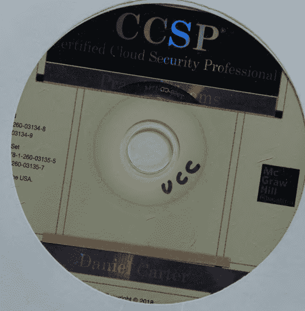

# CCSP 认证云安全专业人员实践指南

## 关于作者

Daniel Carter，CCSP, CISSP, CISM, CISA，目前担任约翰斯·霍普金大学与医学中心的高级系统工程师。作为拥有近 20 年经验的 IT 安全和系统专业人士，Daniel 专注于 Web 应用程序和基础设施，以及 LDAP 和联邦身份系统、PKI、SIEM 和 Linux/Unix 系统。他目前致力于企业身份验证和单点登录系统，包括云端部署。Daniel 拥有马里兰大学的犯罪学和刑事司法学学位，以及来自马里兰大学大学学院的技术管理硕士学位，重点方向为国土安全管理。

## 关于技术编辑

Gerry Sneeringer 拥有 CISSP 认证，在过去的 30 年里一直是马里兰大学的 IT 专业人士。他曾参与过客户支持、系统编程、系统管理（包括互联网根域名服务器之一的运行）以及网络工程。在过去的 16 年里，Gerry 担任大学中央 IT 部门的安全负责人。他目前担任大学的首席信息安全官，负责监督托管在本地和云端的大学计算服务。Gerry 拥有马里兰大学的计算机科学学士学位。

此书献给我的孩子们——Zachariah, Malachi, Alannah 和 Ezra。我非常爱你们，并期待看到你们这四个独特的灵魂如何让世界变得更好！

数据技术的快速演变导致全球产生的数据量和多样性大幅增加。这为确保数据安全和敏感信息保护带来了许多挑战。许多组织正努力实施稳健的安全措施以保护数据免受未经授权的访问和恶意攻击。在这种情况下，数据安全指的是用于保护数字数据免受损坏、丢失、未经授权访问的实践和技术，同时确保其完整性和可用性。数据安全的重要性不言而喻。组织必须积极识别潜在的漏洞并制定有效的策略。本书提供了概念、技术和最佳实践的全面概述。通过本书，读者将掌握在组织内设计和实施计划所需的知识。

# 致谢

Daniel Carter，CCSP, CISSP, CISM, CISA，目前担任约翰斯·霍普金大学与医学中心的高级系统工程师。作为拥有近 20 年经验的 IT 安全和系统专业人士，Daniel 专注于 Web 应用程序和基础设施，以及 LDAP 和联邦身份系统、PKI、SIEM 和 Linux/Unix 系统。他目前致力于企业身份验证和单点登录系统，包括云端部署。Daniel 拥有马里兰大学的犯罪学和刑事司法学学位，以及来自马里兰大学大学学院的技术管理硕士学位，重点方向为国土安全管理。

Gerry Sneeringer 拥有 CISSP 认证，在过去的 30 年里一直是马里兰大学的 IT 专业人士。他曾参与过客户支持、系统编程、系统管理（包括互联网根域名服务器之一的运行）以及网络工程。在过去的 16 年里，Gerry 担任大学中央 IT 部门的安全负责人。他目前担任大学的首席信息安全官，负责监督托管在本地和云端的大学计算服务。Gerry 拥有马里兰大学的计算机科学学士学位。

此书献给我的孩子们——Zachariah, Malachi, Alannah 和 Ezra。我非常爱你们，并期待看到你们这四个独特的灵魂如何让世界变得更好！

数据技术的快速演变导致全球产生的数据量和多样性大幅增加。这为确保数据安全和敏感信息保护带来了许多挑战。许多组织正努力实施稳健的安全措施以保护数据免受未经授权的访问和恶意攻击。在这种情况下，数据安全指的是用于保护数字数据免受损坏、丢失、未经授权访问的实践和技术，同时确保其完整性和可用性。数据安全的重要性不言而喻。组织必须积极识别潜在的漏洞并制定有效的策略。本书提供了概念、技术和最佳实践的全面概述。通过本书，读者将掌握在组织内设计和实施计划所需的知识。

Daniel Carter，CCSP, CISSP, CISM, CISA，目前担任约翰斯·霍普金大学与医学中心的高级系统工程师。作为拥有近 20 年经验的 IT 安全和系统专业人士，Daniel 专注于 Web 应用程序和基础设施，以及 LDAP 和联邦身份系统、PKI、SIEM 和 Linux/Unix 系统。他目前致力于企业身份验证和单点登录系统，包括云端部署。Daniel 拥有马里兰大学的犯罪学和刑事司法学学位，以及来自马里兰大学大学学院的技术管理硕士学位，重点方向为国土安全管理。

Gerry Sneeringer 拥有 CISSP 认证，在过去的 30 年里一直是马里兰大学的 IT 专业人士。他曾参与过客户支持、系统编程、系统管理（包括互联网根域名服务器之一的运行）以及网络工程。在过去的 16 年里，Gerry 担任大学中央 IT 部门的安全负责人。他目前担任大学的首席信息安全官，负责监督托管在本地和云端的大学计算服务。Gerry 拥有马里兰大学的计算机科学学士学位。

我想感谢 Matt Walker 提供了一个如此优秀的团队，并为我展示了许多不同的视角和解决挑战的新方法！还要感谢多年来与我密切合作的其他公司的同事，他们所有的支持和鼓励——特别是 Anna Tant, Jason Ashbaugh 和 Richie Frieman。

感谢 I Baldwin，我在约翰斯·霍普金大学的新任主管，给了我一个回归学术界的机会。特别感谢我在约翰里兰大学的新团队和同事，我从他们那里已经学到了非常多：Patrick Le, E Weintraub, Kevin Buckley, Robert Kurky, Steven Molczky, Anthony Reid, Michael Goldberg, Phil Bearman 和 Phil Gianuzzi。

最后，当然，我想感谢我出色的妻子 Robyn，她一直支持我职业和生活中所做的一切。家里有四个年孩子，如果没有她的所有帮助、协助和理解，我根本无法考虑这个项目——感谢她没有对所有的孩子和宠物产生干扰！

# 引言

几年前开始，“云”这一术语进入了现代词汇体系，并在日常对话中变得常用，即使是那些与 IT 行业没有联系、受过培训或具备专业知识的门外汉也是。它在面向大众的广告中随处可见，并经常用作服务和产品的核心卖点。那些不理解什么是云计算、更不用说其工作原理的人，在很大程度上将其视为一种积极的特性，认为它意味着更高的可靠性、更快的速度以及整体更有益的消费者体验。此外，许多公司正以极快的速度涌向云计算的优势和特性。

随着行业发生这种巨大的范式转移，对理解云计算的熟练人才的需求也以同样的速度在增长。这种需求适用于计算各个领域的专业人士，但云计算的独特方面和特征使得对熟练的安全人员的需求对于任何组织都至关重要，以便妥善地维护和保护他们的系统及数据。

云计算代表了 IT 专家——以及 IT 安全专家——在保护数据以及他们所能使用的各种技术和方法方面的一种新动态。在座的你们一些人是经验丰富的安全专业人士，已经拥有了 CISSP 等其他认证。对于其他人来说，这门认证可能是你们作为安全专业人士的第一个认证。你们中一些人从云诞生之初就开始接触云计算，而另一些人将首次学习云的基础知识。本练习题旨在辅助《CCSP 认证云安全专业人员全本指南》，旨在帮助任何面对这一挑战性考试的人，无论其背景或在安全或通用计算方面的特定经验如何。

这些练习题结合《CCSP 认证云安全专业人员全本指南》，将为你通过 CCSP 考试所需的信息，并有望扩展你的理解和知识，而不仅仅是回答考试题。我希望你能在练习题中找到乐趣，并将其作为云计算和云安全核心概念及方法的桌面参考资料。

《全本指南》的结构与 (ISC)² 官方考试指南的主题紧密对应，练习题的设计也遵循相同模式。

无论你的背景、经验或其他认证如何，我希望你发现云计算的世界及其独特的需求是具有启发性的、挑战性的，且在智力上具有刺激性的。云代表了计算领域一个非常动态且令人兴奋的新方向，而且在可预见的未来很可能成为主要的范式。

# 为什么要获得认证？

获得一种受广泛尊重和认可的行业标准认证将服务于任何 IT 专业人士的职业。随着云计算的快速增长和越来越多的组织声称利用其潜力，CCSP 将作为你的技能以及对这些概念理解对任何雇主或监管机构的独立验证。CCSP 可以让任何级别从事 IT 安全工作的人受益，从初级安全分析师到组织的首席信息安全官 (CISO)。尽管在许多情况下 CCSP 会补充诸如 CISSP 等安全认证，但它也可以作为第一个认证或标准认证。

# 如何获得认证

以下 CCSP 的步骤和要求在撰写时有效，但正如 IT 行业及其快速变化的格局中的任何事情一样，你应该直接向 (ISC)² 核实最新的要求。CCSP 网站可以在：`https://www.isc2.org/ccsp`。

以下是获得 CCSP 认证的条件：

- **经验**：候选人必须具有五年的全职 IT 经验。在这五年中，你必须至少有三年的 IT 安全经验，并且在至少一个 CCSP 领域中至少有一年的经验。如果候选人拥有 CSA 的 CCSK 证书和 (ISC)² 的 CISSP 证书，则可以仅用于满足 CCSP 的全部经验要求。
- **考试**：候选人必须注册并通过 CCSP 认证考试。有关注册和所需费用的信息可以在上述列出的 CCSP 网上找到。考试时长四小时，有 125 道题。候选人必须以 1000 分中 700 分的比例分成功通过考试。
- **背书**：在满足经验要求并成功通过考试后，候选人必须获得现任 (ISC)² 认证持有者的申请背书。此背书必须由认识候选人并能够证明其经验和专业资历有效性的人完成。
- **维护**：在授予 CCSP 之后，认证持有者必须完成持续专业教育 (CPE) 要求并支付年度维护费 (AMFs)。有关这两项要求的当前信息，请参阅官方 (ISC)² 网站。

# CCSP 领域

虽然假设你已经使用如《CCSP 认证云安全专业人员全本指南》等资源学习并准备了这次考试，但以下是对 CCSP 考试涵盖的每个领域的简要介绍（它也可以作为复习）。

## 领域 I：架构概念与设计要求

架构概念和设计要求领域为深入理解云计算的基础知识奠定了基础。这些构建模块和基础基于 ISO/IEC 17788 标准。该领域定义了个人和其他实体在云实施中将扮演的不同且关重要的角色。它从云服务提供者和云客户的角度，定义了在云实施中扮演的不同关键角色。它概述了云计算的关键特性，包括按需服务、广泛网络访问、多租户、快速弹性和扩展性、资源池化和按量付费。它还介绍了云环境的关键区块，如虚拟化、存储、网络。

## 领域 II：云数据安全

云数据安全领域深入探讨了系统和应用程序的设计、原则和最佳实践。该领域概述了云数据生命周期，展示了数据从创建到处置流程，以及在系统或应用程序内部如何处理。

## 领域 III：云平台与基础设施安全

云环境由物理和虚拟基础设施组成，两者都带有独特的安全关注点和需求。虽然云系统构建在虚拟化组件之上，但在虚拟化层之下是物理硬件和安全需求，这与传统数据中心相同。这包括物理系统（如 BIOS 和硬件层），以及托管和维护上方虚拟化环境的软件。物理层的任何安全或控制漏洞都可能导致其管理的虚拟主机面临风险。云环境内的安全控制适用于标准资源：网络和通信、存储和计算。然而，虚拟化的使用还需要考虑用于控制和管理虚拟机的管理面的安全性。领域 III 探讨了云特定的风险、与虚拟化相关的风险以及用于消除这些风险的特定策略。

## 领域 IV：云应用安全

云环境和云技术因其成本和灵活性正日益流行。云环境为开发者快速上线环境和虚拟机提供了极大的效率和便利，且成本仅在它们运行期间产生；在传统数据中心采购环境或测试所需的时间和成本在云环境中得到了很大程度的缓解。为了利用优化云开发（特别是在考虑安全的情况下），云安全专家和开发者需要对云环境的现实情况、安全它们的需求以及面临的常见威胁和漏洞有坚固的理解。

## 领域 6：法律与合规

领域 6 重点关注 IT 系统的法律和监管合规要求，包括这些要求如何与云计算及其许多独特方面具体相关。云计算呈现出许多不同的风险和挑战，因为它跨越了不同的监管区域或国家边界，因此受到许多不同要求的约束，而这些要求有时会相互冲突。该领域涵盖了从多个司法管辖区的角度出发的法律强制控制，以及针对云计算的特定法律风险。它包含了与司法管辖控制相关的个人信息和隐私的特定定义及法律要求，以及合同性与监管性个人数据保护之间的差异。

## 架构概念与设计需求领域

领域 1 重点关注以下主题：

- 云计算参与者和术语
- 云计算的基本特征
- 云服务分类
- 云部署模型
- 与云计算相关的安全概念
- 认证
- 云成本效益分析
- 云架构模型

领域 1 涵盖了架构概念和设计需求，它构成了云计算技术的基础，并定义了它们的关键组件和特征。云计算是一种模型，能够实现对共享的可配置计算机资源池（例如网络、服务器、存储、应用程序和服务）的泛在、便捷、按需的网络访问，这些资源可以在最少管理努力或与服务提供商交互的情况下快速配置和释放。这种云模型由五个基本特征、三个服务模型和四种部署模型组成。

与传统的服务器硬件、网络应用、布线、电源单元和环境控制的经典数据中心模型不同，云计算是基于购买“服务”的概念，根据客户在任何时间点的需求，提供各种程度的自动化和支持。将其与经典数据中心模型相比，后者要求客户无论业务周期和需求变化如何，都必须始终按照最大容量购买并配置系统。

# 问题

1. 云计算的哪种概念涉及到云客户和用户通过各种不同的设备和位置访问其服务的能力？
   - A. 互操作性
   - B. 开源
   - C. 广域网络访问
   - D. 单点登录

2. 你与客户签的新合同要求对你系统和应用程序中使用的加密模块进行认证。利用哪种认证框架最适合以满足合同要求？
   - A. FIPS 140-2
   - B. NIST SP 800-533
   - C. SOC 2
   - D. ISO/IEC 27001

3. 应用程序的以下哪个方面最可能是所有 SaaS 实现中“可衡量服务”的组件？
   - A. CPU
   - B. 存储
   - C. 用户数量
   - D. 内存

4. 在传统数据中心中，资源由单一实体拥有、控制和维护，供其和服务系统专门使用。在云环境中，这种基础设施在许多不同的客户之间共享。这种概念被称为什么？
   - A. 共同托管
   - B. 弹性
   - C. 系统共享
   - D. 资源池

5. 关于云计算的以下哪个概念允许云客户在云提供商最少协助或参与的情况下配置服务？
   - A. 按需自服务
   - B. 自动伸缩
   - C. 弹性
   - D. 客户自配置

6. 云计算的哪种概念涉及到为了其他目的重用应用程序的组件和服务的能力？
   - A. 可迁移性
   - B. 互操作性
   - C. 资源池
   - D. 弹性

7. 组织从传统数据中心迁移到云环境时，以下哪种威胁类型最可能发生？
   - A. 职调查不足
   - B. 数据泄露
   - C. 不安全的 API
   - D. 系统漏洞

8. 以下哪种软件类型是 2 型虚拟机程序所依赖的，而 1 型虚拟机程序不依赖？
   - A. VPN
   - B. 防火墙
   - C. 操作系统
   - D. IDS

9. 哪种云服务分类带来的启动成本最高，但后续支持和维护人员的持续成本最低？
   - A. IaaS
   - B. SaaS
   - C. PaaS
   - D. DaaS

10. 对于哪种类型的云服务分类，为静态数据（DAR）拥有一个厂商中性的加密方案最为重要？
    - A. 公有
    - B. 混合
    - C. 私有
    - D. 社区

11. 虽然加密可以帮助组织有效减少数据泄露的可能性，但它会增加哪种其他类型威胁的概率？
    - A. 不安全的接口
    - B. 数据丢失
    - C. 系统漏洞
    - D. 账户劫持

12. 以下哪种审计或报告类型仅涉及财务报表和报告？
    - A. SOC 1
    - B. NIST SP 800-53
    - C. SOC 2
    - D. FIPS 140-2

13. 以下哪种角色负责获取新客户并确保合同？
    - A. 云服务经理
    - B. 云服务经纪
    - C. 云服务部署人员
    - D. 云服务运营

14. 以下以下哪项是**不是** 2 型虚拟机程序的考虑量？
    - A. 操作系统
    - B. 防火墙
    - C. VLAN
    - D. 访问控制

15. 以下哪项被认为是缓解漏洞的有效方法？
    - A. 补丁
    - B. 监控
    - C. 扫描
    - D. 虚拟化

16. 大多数网络应用程序（尤其是托管在云环境中的）依赖哪种安全协议来保护这些技术？
    - A. IPSec
    - B. VPN
    - C. HTTPS
    - D. SSH

17. 你的公司专注于软件，你的主要目标是尽可能降低成本。哪种云服务分类最适合这一目标？
    - A. 基础设施
    - B. 软件
    - C. 平台
    - D. 桌面

18. 云计算的以下哪种方面在传统数据中心中更具风险性？
    - A. 多租户
    - B. 可迁移性
    - C. 互操作性
    - D. 广域网络访问

19. 数据被应用程序或用户从原始形式修改。这属于云数据生命周期的哪个阶段？
    - A. 使用
    - B. 分享
    - C. 归档
    - D. 修改

20. 在云环境中，许多不同的用户和组织访问相同的资源。以下哪项信息对于将数据隔离到仅授权范围？
    - A. 加密
    - B. 沙箱化
    - C. VLAN
    - D. 可逆性

21. 如果需要在云环境中快速删除数据，以下哪种数据清理方法最有效？
    - A. 清零
    - B. 加密擦除
    - C. 覆盖
    - D. 消磁

22. 关于 1 型虚拟机程序的以下描述最正确？
    - A. 它运行在操作系统上的应用程序上，用于托管虚拟机。
    - B. 它运行在独立的管理服务器上，并与虚拟化设备交互。
    - C. 它直接运行在硬件上，作为硬件与虚拟机之间唯一的层。
    - D. 它直接运行在硬件上，并运行一个额外的软件层来托管虚拟机。

23. 当用户访问系统时，什么过程决定了该用户在应用程序中的角色和权限？
    - A. 授权
    - B. 身份验证
    - C. 配置
    - D. 权限

24. 以下哪种技术已被废弃并被认为不安全用于加密通信？
    - A. TLS
    - B. AES
    - C. DNS
    - D. SSL

25. 哪种概念是指客户仅为其使用的资源付费，并按使用时长付费？
    - A. 可衡量服务
    - B. 自动伸缩
    - C. 可迁移性
    - D. 弹性

## 26. 云计算的以下哪个方面是 PaaS 相比 IaaS 更显著的特征？

- A. 可用性
- B. 自动伸缩
- C. 可迁移性
- D. 广域网络访问

## 27. 哪个角色代表云客户负责对云服务进行测试？

- A. 云服务用户
- B. 云服务管理员
- C. 云服务业务经理
- D. 云服务集成商

## 28. 贵公司已经开展了将服务迁移到云环境的全面研究，但由于预算限制，项目被推迟了。您现在收到了预算资金，并要求尽快建立云服务。在这种情况下，哪种云服务类别是最佳选择？

- A. 私有云
- B. 社区云
- C. 混合云
- D. 公有云

## 29. 与本地管理服务相比，在生产环境中使用远程密钥管理服务的主要缺点是什么？

- A. 云提供商将对密钥拥有完全控制权。
- B. 软件可能不安全。
- C. 可用性至关重要。
- D. 兼容性问题。

## 30. 哪种云服务类别**最可能**使用客户端密钥管理系统？

- A. IaaS
- B. SaaS
- C. PaaS
- D. DaaS

## 31. 下列哪项**不是**账户配置过程（account provisioning process）确定的一部分？

- A. 法规
- B. 合同
- C. 组织政策
- D. 隐私通知

## 32. 在不考虑云服务类别时，针对系统的威胁中哪一种是**最难**缓解的？

- A. 尽职调查不足
- B. 恶意内部人员
- C. 账户劫持
- D. 数据丢失

## 33. 在 SaaS 环境中使用的下列哪攻击方法对不同客户之间数据泄露的威胁最大？

- A. DDoS
- B. XPS
- C. JSON
- D. XSLT

## 34. 哪个概念侧重于确保用户获得应用程序内的适当权限和功能？

- A. 身份验证 (Authentication)
- B. 授权 (Authorization)
- C. 权限 (Privilege)
- D. 配置 (Provisioning)

## 35. 下列哪个概念**最可能**专门适用于私有云部署模型？

- A. 可移植性 (Portability)
- B. 可逆性 (Reversibility)
- C. 所有权 (Ownership)
- D. 资源池 (Resource pooling)

## 36. 下列哪个概念与验证系统或应用程序上已实施适当控制和策略的能力有关？

- A. 可审计性 (Auditability)
- B. 治理 (Governance)
- C. 法规 (Regulation)
- D. 弹性 (Elasticity)

## 37. 哪种安全认证作为适用于任何类型系统或应用程序的通用框架？

- A. ISO/IEC 27001
- B. PCI DSS
- C. FIPS 140-2
- D. NIST SP 800-53

## 38. 哪个组织开发、维护并控制 PCI DSS 标准和控制措施？

- A. NIST
- B. ISO/IEC
- C. EU
- D. 信用卡公司

## 39. 哪种云服务类别为云客户提供了最多的定制选项和控制权？

- A. PaaS
- B. IaaS
- C. SaaS
- D. DaaS

## 40. NIST 云技术路线图（Cloud Cloud Technology Roadmap）包含一个侧重于满足云提供商与云客户之间满意合同义务的最低要求的组件。下列哪项概括了这一概念？

- A. 责任追溯 (Accountability)
- B. 治理 (Governance)
- C. SLA（服务水平协议）
- D. 审计 (Auditing)

## 41. 为了获得安全性，用户访问和权限的授权过程应该在哪里执行？

- A. 账户配置 (Account provisioning)
- B. 应用程序的使用过程中
- C. 身份验证后立即
- D. 作为变更管理过程的一部分

## 42. 下列哪项**不是**客户可能被“锁定”在特定云提供商的原因？

- A. 软件版本
- B. 开发者
- C. 应用程序环境
- D. 法规

## 43. 在云环境中，哪种网络位置对于云客户期望实施安全控制来说，效果**最差**？

- A. 边界区域 (Border perimeter)
- B. DMZ
- C. VLAN 之间
- D. 数据区与应用区之间

## 44. 您的 IT 安全总监要求您评估一个云提供商，以确定其安全实践是否与有关数据清理流程的当前组织政策相匹配。与您传统的数据中心相比，下列哪种选项**不太可能**在云提供商处可用？

- A. 消磁 (Degaussing)
- B. 密码擦除 (Cryptographic erasure)
- C. 覆盖 (Overwriting)
- D. 归零 (Zeroing)

## 45. 下列哪种类型的威胁通常是通过社会工程学手段实现的？

- A. 数据丢失
- B. 系统漏洞
- C. 高级持续威胁 (APT)
- D. 尽职调查不足

## 46. 如果您正在与美国政府竞标，您需要了解或熟悉哪种安全框架？

- A. PCI DSS
- B. NIST SP 800-53
- C. SOC 2
- D. ISO/IEC 27001

## 47. 下列哪个云概念概括了与自带设备（BYOD）相关的安全问题，云安全专业人员必须时刻意识到这些问题？

- A. 可移植性 (Portability)
- B. 广网络访问 (Broad network access)
- C. 按需自服务服务 (On-demand self-service)
- D. 互操作性 (Interoperability)

## 48. 下列哪项**不被认为是**云计算的构建基石技术？

- A. CPU
- B. 内存
- C. 存储
- D. 服务器

### 快速答案对照

+ 1. C 17. C 33. B
+ 2. A 18. A 34. B
+ 3. C 19. A 35. C
+ 4. D 20. A 36. A
+ 5. A 21. B 37. A
+ 6. B 22. C 38. D
+ 7. A 23. A 39. B
+ 8. C 24. D 40. C
+ 9. B 25. A 41. B
+ 10. B 26. B 42. B
+ 11. B 27. B 43. A
+ 12. A 28. D 44. A
+ 13. A 29. C 45. A
+ 14. C 30. B 46. B
+ 15. D 31. D 47. C
+ 16. C 32. B 48. D

### 答案与解析

1. **C**。混合云（Hybrid Cloud）结合了私有云和公有云的特点。在预算有限但需要快速部署时，它可以提供灵活的扩展性。

2. **A**。使用远程密钥管理服务时，云提供商在技术上拥有对密钥的完全控制权，这可能被视为安全风险。

3. **A**。IaaS 模式下，客户通常拥有最高级别的控制权，因此最可能使用客户端密钥管理系统来管理加密密钥。

4. **D**。法规（Regulations）通常是强制性的标准，不会导致客户被锁定在某个提供商上。软件版本、开发者技能和特定的应用程序环境更容易导致锁定。

5. **A**。在云环境中，客户通常无法接触物理硬件，因此无法执行物理消磁（Degaussing）操作。

6. **A**。社会工程学通过操纵人类行为获取敏感信息，是导致数据丢失的重要手段。

7. **B**。NIST SP 800-53 是美国联邦政府信息安全和隐私控制措施的框架，是与政府合作的标准。

8. **D**。PCI DSS（支付行业数据安全标准）是由信用卡公司（如 Visa, Mastercard, American Express 等）开发并维护的的。

9. **B**。IaaS（基础设施即服务）为客户提供了最多的定制选项和控制权，包括操作系统、存储和网络配置。

10. **C**。SLA（服务水平协议）定义了云提供商与客户之间服务质量的合同义务和最低标准。

11. **C**。为了确保安全性，授权过程应在身份验证后立即执行，以确保用户仅执行其权限允许的操作。

12. **B**。虽然开发者熟悉某种技术会增加迁移成本，但它通常不是导致技术“锁定”的直接原因，软件版本、环境和法规限制是主要因素。

13. **A**。在云模型中，边界区域（Border perimeter）通常由云提供商负责，客户在这一层实施安全控制的效果最有限。

14. **A**。消磁需要物理接触磁介质，云客户在云环境中无法实现。

15. **B**。由于自带设备（BYOD）增加了攻击面，广网络访问是 BYOD 的核心概念之一。

16. **D**。CPU、内存和存储是服务器的硬件构建基石，而服务器本身是实现这些硬件的载体，在云计算架构讨论中，通常是虚拟化后的基础资源被视为基石。

B 的错误原因与 CPU 相同。然而，在某些情况下，取决于实际软件应用和客户需求，可能会产生增量存储成本，但这些是根据具体情况进行处理的，并不是所有 SaaS 实现中普遍存在的现象。主要的例外是公共 SaaS 实现，例如 iCloud、Dropbox 和 OneDrive，这些服务的基础层是免费的，但额外的存储容量会收取增量费用。

D 是错误的，因为从这个意义上说，内存和 CPU 是相似的，因为云提供商有责任确保为应用程序和用户分配并提供适当的计算资源。

+ 4. 在传统数据中心，资源由单一实体拥有、控制和维护，供其服务和系统专门使用。在云环境中，这种基础设施在许多不同的客户之间共享。这个概念是什么？

- A. 托管 (Co-location)
- B. 弹性 (Elasticity)
- C. 系统共享 (System sharing)
- + D. 资源池化 (Resource pooling)

D. 资源池化在计算资源方面很大程度上是传统数据中心与云之间的区别。在传统数据中心中，资源被分配给特定的系统或应用程序，并且大多数情况下是不共享的。在云中，整个硬件基础设施被视为一个整体，然后根据托管在其中的各种云客户和应用程序进行分配。这通常是一个巨大的资源池，不仅可以处理托管应用程序的典型运行负载，还可以通过自动弹性或某些应用程序的周期性进行扩展。

A 是错误的，因为托管是指在相同的物理硬件内托管多个应用程序或系统，但并不一定通过使用池化和分配的资源。这也可以传统数据中心内实现，可以共享任何层级的硬件，包括网络、物理地面空间、冷却和电源。托管设置中资源通常具有详细的特性，这将其与云环境中的资源池化区分开来。

B 是错误的，因为弹性是指系统、服务和应用程序自动扩展或收缩以满足实际需求的能力。如果应用程序在编写时支持弹性，那么当检测到环境中负载变化并达到预定义的阈值时，云环境可以动态、快速地调整分配的资源大小，以精确满足所需，而不是让资源处于备用状态以处理需求的激增。

C 是错误的，因为系统共享提供了一个错误答案。虽然它与资源池化是类似的答案类型，但它不是任何与云计算或此特定问题相关的常用或官方术语。

+ 5. 下列哪个云计算相关的概念允许云客户在云提供商最少协助或参与的情况下配置服务？

- A. 按需自助服务 (On-demand self-service)
+ B. 自动伸缩 (Auto-scaling)
- C. 弹性 (Elasticity)
- D. 客户自备配置 (Customer self-provisioning)

+ A. 客户可以通过自动化手段请求、配置并使用云服务，而无需云提供商的支持人员参与。这通常通过 Web 门户提供给云客户，但也可以通过 API 调用或其他编程手段暴露。随着服务的发生变化，计费将根据当前分配资源的不断变化进行调整。

+ B 是错误的，因为自动伸缩是指云环境动态适应当前需求的自动化和程序化调整能力。虽然这在某些方面与按需自助服务相似，但区别在于过程的自动性。按需自助服务是由云客户在当时发起并请求的，而不是通过阈值和规则集进行编程以自动执行的。

+ C 是错误的，因为弹性是指云或应用程序环境随需求变化而改变资源的能力。应用程序或服务的设计必须允许资源的轻松扩展，并在实现时可以使用程序化手段来实现这一点。

+ D 是错误的，因为客户自备配置是一个错误答案，与实际答案“按需自助服务”相似。虽然这两个术语听起来非常相似，但它不是此类能力的官方或常用术语。

+ 6. 云计算的哪个概念涉及将应用程序的组件和服务重用于其他用途的能力？

- A. 可迁移性 (Portability)
+ + B. 互操作性 (Interoperability)
- C. 资源池化 (Resource pooling)
- D. 弹性 (Elasticity)

+ B. 互操作性是指移动或重用应用程序或服务组件的易易程度。核心概念是不对底层操作系统、托管环境、库或 API 产生依赖，从而将服务锁定在特定的主机或解决方案上。具有高度互操作性的服务可以很容易在云提供商、托管配置和云服务类别之间移动，为组织提供了巨大的灵活性。这允许不同的服务为了不同目的利用应用程序和 API，并实现组件模块化以便重用。

A 是错误的，因为可迁移性虽然互操作性相似，但它仅关注在云提供商之间移动的能力，而不是将特定服务的组件或模块用于其他或其他扩展用途的能力。对于可迁移性，主要重点不是重用或改变用途，而是自由、快捷地移动的能力。

C 是错误的，因为资源池化是指云环境内的资源共享，整个硬件基础设施被视为一个整体，然后分配给其中的各种云客户和应用程序。这通常是一个巨大的资源池，不仅可以处理托管应用程序的典型运行负载，还可以通过自动弹性或此类应用程序的周期负载进行扩展。

D 是错误的，因为弹性是指云或应用程序环境随需求变化而改变资源的能力。应用程序或服务的设计必须允许资源的轻松扩展，并在实现时可以使用程序化手段来实现这一点。

+ 7. 组织从传统数据中心迁移到云环境时，最可能发生的威胁是哪一个？

- A. 尽职调查不足 (Insufficient diligence)
- B. 数据泄露 (Data breach)
- C. 不安全的 API (Insecure APIs)
- D. 系统漏洞 (System vulnerabilities)

+ A. 当组织考虑将其系统和应用程序从传统数据中心模型迁移到云环境时，它必须评估许多变量，并确定迁移到云系统是否合适或可行。如果不对其系统、设计和控制进行适当且彻底的评估，组织可能会在迁移到云环境时无意中让自己暴露在安全风险之中。

+ B 是错误的，数据泄露发生在敏感或私有数据未经授权地暴露给无权访问的方。这可能由于意外暴露，也可能由于黑客或其他恶意活动。在云环境中，由于多租户机制，其暴露和风险比隔离系统的传统数据中心更高。

+ C 是错误的，不安全的 API 发生在利用和访问这些服务的没有经过适当控制或验证时。云环境大量使用 API 处理从消费者云服务到云骨干管理、自动化和编排的所有事务，其安全性至关重要。

+ D 是错误的，因为系统漏洞与所有 IT 系统的补丁、配置和监控有关，无论是在云环境中还是否。任何系统漏洞都可以通过获取权限扩展到其他服务。

资源的未经授权暴露，需要强有力的策略和实践来确保系统配置和补丁的合规性，并且对不合规情况进行监控始终极其重要。

8. 下列哪些软件是第 2 型虚拟机程序所依赖的，而第 1 型虚拟机程序不依赖的？

- A. VPN
- B. 防火墙
- C. 操作系统
- D. IDS

+ C. 正确。第 2 型虚拟机程序作为软件应用程序运行在主操作系统之上，并并在其中部署虚拟机。而对于第 1 型虚拟机程序，软件直接与底层硬件绑定，不依赖于主操作系统即可运行。

- A 是错误的，因为虚拟专用网络（VPN）是一种用于保护网络流量和通信的方法，对虚拟机监控程序或所使用的类型没有影响。

- B 是错误的，因为防火墙用于网络安全和限制跨网络的流量，但与虚拟机监控程序或所使用的虚拟机程序类型没有特定关系。

- D 是错误的，因为入侵检测系统（IDS）是一种网络安全设备，用于监控特定类型的流量或模式，并根据针对已知攻击和漏洞的特征集进行匹配。它与虚拟机监控程序或所使用的特定类型不相关，也不依赖于它。

9. 哪种云服务类别的启动成本最高，但持续支持和维护人员的成本最低？

- A. IaaS
- B. SaaS
- C. PaaS
- D. DaaS

+ B. 正确。软件即服务（SaaS）解决方案通常具有最高的启动和许可成本，因为客户购买的是一个完全开发、集成、安全且生产就绪的软件应用程序。这意味着前期成本是直接的财务成本（而不是像其他类型那样需要大量人员），但在整个生命周期内，SaaS 解决方案的支持人员和维护成本最低的，因为云提供商将负责这些活动。

- A 是错误的，因为基础设施即服务（IaaS）的初期财务成本最低，因为与系统启动和运行的大多数活动都涉及人员。配置和部署虚拟机及其所有组件（以及应用程序及其安全性）是云客户的责任。在托管安排的整个生命周期内，IaaS 实施的人员成本最高，而从纯财务角度来看，实际的许可和托管成本最低。

- C 是错误的，因为平台即服务（PaaS）代表了前期成本、许可成本以及代表云客户的人员成本之间的平衡。在 PaaS 中，云提供者交付带有准备就用的应用程序框架和依赖的虚拟机，但由云客户来部署、安全保护和测试其软件应用程序和服务。

- D 是错误的，因为桌面即服务（DaaS）与 PaaS 非常相似，云提供者交付框架和平台，但由云客户来部署和配置其在框架内运行的特定应用程序和业务。

### 10. 对于哪种类型的云服务类别，对静态数据（DAR）采用厂商中立的加密方案是最重要的？

- A. 公有
- B. 混合
- C. 私有
- D. 社区

+ B. 正确。对于混合云类别，厂商中立的加密解决方案是最重要的，因为应用程序和数据将跨越多个云提供商。利用单一云提供商的加密方案成功的几率或扩展性很小，而且它可能无法迁移到另一个平台或其他良好运行。通过使用厂商中立的解决方案，云客户可以在未来的混合云解决方案中保持最大的灵活性。

- A 是错误的，因为公有云解决方案是由单一云提供商提供的，它可能提供在其环境中运行欠佳的内置或专有加密方案。需要确保应用程序和系统不会被有效地锁定在该提供商处，因为这会导致可移植性和互操作性的丢失。

- C 是错误的，因为许多私有云解决方案提供自己的加密方案，这些方案设计用于在其环境中运行。需要确保应用程序和系统不会被有效地锁定在一个提供商处，因为可能会发生可移植性和互操作性的丢失。

- D 是错误的，因为社区云可以使用在其内部运行最佳的工具集构建，这些工具集可能针对类似的组织和需求。需要确保应用程序和系统不会被有效地锁定在一个提供商处，因为可能会发生可移植性和互操作性的丢失。

### 11. 虽然加密可以帮助组织有效减少数据泄露的可能性，但它会增加哪种其他威胁的概率？

- A. 不安全的接口
- B. 数据丢失
- C. 系统漏洞
- D. 账户劫持

- B. 正确。当组织丢失数据或对数据的访问权限时，就会发生数据丢失。这与数据泄露（即数据暴露给未经授权的第三方）不同。虽然加密的使用作为防止数据泄露的强有力缓解措施，但对密钥及其访问权限的依赖增加了数据丢失的可能性。如果密钥丢失或销毁，组织将失去对数据的访问。
- A 是错误的，因为“不安全的接口”指的是 API 或其他服务未经过妥善保护，容易受到破坏或滥用。不安全的接口指的是任何应用程序及其数据安全性更低且更容易受到攻击，因此不符合本题所寻找的内容。
- C 是错误的，因为系统漏洞始终会导致应用程序和数据的安全性降低，而且它们在任何情况下都不会减少数据泄露的可能性。
- D 是错误的，因为账户劫持指的是攻击者能够通过有效账户访问系统或云环境的情况。这与虚拟机监控程序无关，且由于多户机制，风险更高且不受云客户控制。

### 12. 下列种审计或报告类型仅适用于财务报表和报告？

- A. SOC 1
- B. NIST 800-53
- C. SOC 2
- D. FIPS 140-2

- A. 正确。组织控制（SOC）类型 1 报告关注组织内部的控制措施并适用于财务报告。SOC 1 关注组织结构、目标客户群体以及审计所遵循和受约束的法规。
- B 是错误的，因为 NIST 800-53 是关于美国政府 IT系统的安全控制（国家安全系统外），它是联邦机构和承包商遵守相关法律法规的指南。它专门针对政府系统，尽管非政府系统可能难以合规。
- C 是错误的，因为 SOC 2 报告的结构与 SOC 1 相同。它们不仅涉及对财务报告相关信息的审查，还包含了五个额外的领域：安全性、可用性、处理完整性、机密性和隐私。
- D 是错误的，因为 FIPS 140-2 是美国联邦政府出版物，专注于加密模块的认证和验证，与财务报表或报告没有任何关系。

### 13. 下列哪个角色负责获取新客户并签署合同？

- A. 云服务经理
- B. 云服务经纪
- C. 云服务部署经理
- D. 云服务业务经理

B. 正确。云服务经纪负责获取新客户、分析市场并为云服务签署合同和协议。

A 是错误的，因为云服务经理负责云服务的交付、供应和服务。

C 是错误的，因为云服务部署经理收集云服务的指标、管理部署步骤和流程，并定义环境和流程。

D 是错误的，因为云服务业务经理负责业务计划和客户关系，以及处理财务交易。

### 14. 下列哪个是第 2 型虚拟机程序的安全考量，而不是第 1 型虚拟机程序的安全关注点？

- A. 操作系统
- B. 防火墙
- C. VLAN
- D. 访问控制

与第 1 型虚拟机程序直接与底层硬件交互不同，第 2 型虚拟机程序运行在操作系统之上。这增加了额外的安全考量，因为主操作系统的安全性将同样影响虚拟机监控程序，而虚拟机监控程序容易受到操作系统任何安全漏洞或威胁的影响。对于 1 型虚拟机监控程序，没有额外的层，安全性可以由供应商进行紧密控制。

- B 是错误的，因为防火墙及其对网络安全的影响和重要性，不会受到用于托管虚拟机的虚拟机监控程序类型的影响。
- C 是错误的，因为 VLAN 是用于组织、隔离和辅助网络安全的逻辑网络分段，不会受到所用虚拟机监控程序类型的影响。
- D 是错误的，因为访问控制是所有虚拟机监控程序以及运行在其内部的主机共同的问题，不会受到使用任何一种类型的虚拟机监控程序的影响。

### 15. 下列哪项不被被认为是缓解系统漏洞威胁的有效方法？

- A. 补丁 `Patching`
- B. 监控 `Monitoring`
- C. 扫描 `Scanning`
- D. 虚拟化 `Virtualization`

- D. 虚拟化并不是缓解系统漏洞的方法或有效工具。在运行时，虚拟机所面临着与物理服务器和操作系统相同的安全关切和漏洞。此外，由于虚拟机仅仅是存储在存储器中的镜像，在安全保护镜像方面存在额外的漏洞，事实情况是镜像即使在未运行时也可能受到攻击或破坏。
- A 是错误的，因为打补丁是缓解系统漏洞的关键组件和有效方法之一。当发现安全漏洞时，供应商会发布并分补丁来修复或缓解软件中的漏洞。通过尽快安装这些补丁，管理员可以降低系统被破坏的概率。
- B 是错误的，因为系统监控是缓解和限制系统漏洞及威胁的有效方法。监控可以让你深入了解针对你的系统使用的威胁和攻击类型，你可以发现潜在的利用程序何时可能成功，以及可以采取哪些步骤来控制或限制任何损害。
- C 是错误的，因为扫描是发现需要缓解的系统中任何漏洞的非常常用的工具。扫描通常用于验证补丁是否已应用，并验证哪些设置和配置已正确实施，以限制威胁并禁用不必要的服务和访问。

### 16. 大多数现代 Web 应用程序（尤其是托管在云环境中的应用程序）高度依赖 Web 服务和可消耗资源。以下哪种是保护此类类型技术最广泛使用的安全协议？

- A. IPSec
- B. VPN
- C. HTTPS
- D. SSH

- ☑ 超级文本传输安全协议 `HTTPS` 是云环境中保护通信和应用程序最常用的协议，尤其是由于大多数系统都是基于 Web 的。HTTPS 通过添加安全协议和加密，扩展了用于 Web 通信的传统 HTTP 协议。
- A 是错误的，虽然 IPSec 是用于保护通信的常用方法，但其使用规模远不及 HTTPS。它还用于服务器与服务器之间的通信，会给系统增加实质性的负载，而且完全不是一种用于客户通信的方法。
- ☒ B 是错误的，因为 VPN 通常用于管理和支持通信；它们并不常用于安全 Web 服务。在某些 VPN 保护通信的情况下，HTTPS 仍然始终与 VPN 配合使用。
- ☒ D 是错误的，因为 SSH 用于获取对服务器的安全外壳 访问权限，以进行管理和应用支持。在 PaaS 和 SaaS 服务类别中，云客户将无法获得服务器访问。SSH 不常用于保护 Web 服务。

### 17. 你的公司专注于软件开发，而你的主要重点是尽可能降低开发成本以实现利润最大化。哪种云服务类别最适合实现这一目标？

- A. 基础设施 `Infrastructure`
- B. 软件 `Software`
- C. 平台 `Platform`
- D. 桌面 `Desktop`

- ☑. 通过平台即服务 `PaaS` 服务类别，开发公司可以完全专注于软件的开发和部署，而无需维护、安装或配置托管系统。它还能够让开发团队快速尝试不同的平台或云提供商，以找到最适合其应用程序的方案。
- A 是错误的，虽然基础设施 `IaaS` 的云提供商启动成本会比 PaaS 低，但用于构建、安装、配置和保护虚拟机的人员成本和时间成本将是巨大的。必须构建和维护基础设施将使开发人员偏离他们的核心关注点。
- B 是错误的，因为软件即服务 `SaaS` 为云客户提供完整的应用程序，而不是可以进行开发（甚至可能可以进行开发）的地方。
- D 是错误的，因为桌面即服务 `DaaS` 不适合开发和部署，因为它意目的是在云环境中托管桌面应用程序。

### 18. 云计算的以下哪一个方面使得内部服务器之间的传输数据 `DIT` 比在传统数据中心更具风险？

- A. 多租户性 `Multitenancy`
- B. 可移植性 `Portability`
- C. 互操作性 `Interoperability`
- D. 广网络访问 `Broad network access`

- A. 云环境中的多租户性意味着不同的客户、系统和应用程序都在相同的物理系统和网络中。即使使用了安全的通信和加密，这仍然带来了比传统数据中心更高的额外风险，因为任何一个系统的破坏或恶意意都可能影响其他系统。窃听和内部攻击等威胁是云计算和多租户环境的主要关注问题。
- B 是错误的，因为可移植性是指在不同提供商和托管安排之间轻松移动的能力。它对于传输数据（无论是在任何生产运行时系统中）都不会构成任何安全关切。
- C 是错误的，因为互操作性是指重用和重新利用组件及服务的能力。它使组织能够快速部署不同的应用程序并制作模块化组件以帮助快速开发。作为一种能力，它不会对传输数据或运行时环境产生任何安全关切。
- D 是错误的，因为广网络访问指的是从任何地方、通过各种设备访问云服务的能力。这类似于在传统数据中心内访问服务，但其本身并不一定像多租户性那样会暴露来自其他受损系统的潜在内部攻击。

### 19. 数据被应用程序或用户从原始形式修改。此操作应归类为云安全数据生命周期的哪一阶段？

- A. 使用 `Use`
- B. 分享 `Share`
- C. 归档 `Archive`
- D. 修改 `Modify`

- A. 在云安全数据生命周期的“使用”阶段，数据被应用程序消耗，并可能通过程序或用户的直接操作从原始形式被修改。
- B 是错误的，因为云安全数据生命周期的“共享”阶段意味着数据可供用户、管理员或其他服务查看。
- C 是错误的，因为云安全数据生命周期的“归档”阶段涉及数据从活动访问中移除并进入静态状态，保留预定义的时间。
- D 是错误的，因为“修改”并不是云安全数据生命周期的阶段。最可能归此类标题下的概念已在“使用”阶段中。

### 20. 在云环境中，许多不同的用户和组织访问资源，且云提供商的员工访问托管镜像的存储系统。根据信息，以下哪项对于授权保护和隔离数据是必要的？

- A. 加密 `Encryption`
- B. 沙箱 `Sandboxing`
- C. VLAN
- D. 可逆性 `Reversibility`

- A. 考虑到资源池化和多租户性，以及云提供商的支持人员对整个环境拥有特权访问，加密对于保护数据至关重要。密钥由云客户控制，即使系统被破坏，数据也将受到保护，这也适用于通过存储系统访问的镜像。
- B 是错误的，因为沙箱是一种出于测试或安全原因隔离系统或应用程序的方法，但不会为系统上的数据提供额外保护。它主要用于防止 Web 服务相互干扰，以及防止生产和非生产系统混合。
- C 是错误的，因为 VLAN 用于逻辑网络隔离，虽然它们可以从网络层面提供额外的安全，但它们不会为数据和存储方法提供任何额外安全。
- D 是错误的，因为可逆性是指云客户从云环境中移除所有应用程序和数据的能力，并由云提供商保证所有内容已从系统中安全删除。这不涉及托管安排期间的数据安全。

### 21. 如果你需要在云环境中尽可能快地安全删除数据，以下哪种数据清理方法最有效？

- A. 置零 `Zeroing`
- B. 加密擦除 `Cryptographic erasure`
- C. 覆盖 `Overwriting`
- D. 消磁 `Degaussing`

B. 密码擦除通过破坏用于加密数据的密钥来工作。虽然它没有从传统意义上删除数据，但由于密钥被破坏，数据变得无法访问也无法恢复，达到了相同的效果。由于重点在于密钥的销毁，这也可以非常快速地完成且只需极少的精力，而删除大量数据并验证其已删除则是一个非常耗时的过程。

A 是错误的，因为“零”指的是用空值覆盖所有数据扇区。在具有物理硬件的传统数据中心中，这通常是可能的，但在云环境中由于数据分散的方式，或者在托管外部的对象存储中，可能无法实现。即使可行，该过程也非常漫长、耗时且耗费资源。

C 是错误的，因为“覆盖”是指用垃圾值或随机值替换有效数据，以验证数据已完全销毁。取决于访问权限和云配置，在云环境中可能无法进行覆盖——即使可用，该过程也将极其耗费资源且耗时。

D 是错误的，因为“消磁”是指对物理存储介质去磁化。虽然这在组织拥有介质并可以操作的传统数据中心内是可能的，但在云环境中完全无法实现。

### 22. 关于类型 1 虚拟机 `Type 1 Hypervisor` 的描述，以下最正确的是？

- A. 它作为应用程序运行在操作系统之上托管虚拟机。
- B. 它运行在独立的管理服务器上，并与虚拟化设备进行交互。
- C. 它直接运行在硬件之上，作为硬件和虚拟机之间的唯一层。
- D. 它直接运行在硬件之上，并运行一个额外的软件层来托管虚拟机。

C. 类型 1 虚拟机直接运行在底层硬件之上，并与之紧密结合，硬件和软件均来自同一家供应商。

A 是错误的，因为答案描述的是运行在操作系统之上的类型 2 虚拟机，而不是直接与底层硬件绑定的虚拟机。

B 是错误的，因为它描述的既不是类型 1 也类型 2 虚拟机。

D 是错误的，虽然类型 1 虚拟机确实直接运行在硬件之上，但它不需要额外的软件层来托管虚拟机。

### 23. 当用户访问系统时，哪种过程决定了授予该用户在应用程序内的角色和权限？

- A. 授权 `Authorization`
- B. 身份验证 `Authentication`
- C. 配置供应 `Provisioning`
- D. 权限 `Privilege`

- A. 授权是指用户在成功完成身份验证过程后，被授予应用程序的角色和访问权限的过程。它通常基于组和角色成员身份。
- B 是错误的，因为身份验证是用户证明并验证身份的过程，但它不赋予访问权限或角色。
- C 是错误的，因为配置供应是在系统中识别用户并证明其身份，以获取身份验证凭据和访问权限的过程。
- D 是错误的，因为权限指的是用户在系统内的访问级别，但它是授权过程的结果。

### 24. 下列技术中，哪已被废弃并被认为不安全用于安全通信和数据？

- A. TLS
- B. AES
- C. DNS
- D. SSL

- D. 安全套接层 `SSL` 3.0 版本于 2015 年 6 月被 RFC 7568 废弃，因为被认为是不安全的，管理员被指示将系统迁移到 TLS。
- A 是错误的，因为传输层安全协议 `TLS` 已取代 SSL，现在是网络和 Web 通信的安全标准。
- B 是错误的，因为高级加密标准 `AES` 是一种现代加密类型，许多密码与 TLS 一起用于保护通信。
- C 是错误的，因为域名系统 `DNS` 是一种用于将常用名称映射到网络通信的 IP 地址的协议；它不是安全协议，也不用于保护所有通信。

### 25. 哪个概念涉及云客户仅为他们使用的资源付费且仅按使用时长付费？

- A. 量取服务 `Measured service`
- B. 自动伸缩 `Auto-scaling`
- C. 可移植性 `Portability`
- D. 弹性 `Elasticity`

- A. 量取服务是指云客户仅为其消耗的资源以及其消耗的时间付费。这通常指的是云计算的构建块：CPU、内存、存储以及可能还有网络。这与传统数据中心不同，在传统数据中心，组织需要随时可用所有资源。
- B 是错误的，因为自动伸缩是指云提供程序根据当前需求和负载，自动以编程方式更改分配给特定应用程序资源的能力。尽管在量取服务中起着至关重要的作用，但它是一个不同的过程，并且并不是所有云应用程序都需要或启用它。
- C 是错误的，因为可移植性是指云系统或应用程序在不同云提供商之间轻松移动的能力，与服务计费或支付的任何方面都没有直接关系。
- D 是错误的，因为弹性是指云应用程序以简单的方式（通常是编程方式）增长以满足当前需求的能力。它与服务计费无关，尽管负载下触发弹性会导致服务计费的变化。

### 26. 云计算的以下哪个方面是 PaaS 相比于 SaaS 更为显著的特征？

- A. 可用性 `Availability`
- B. 自动伸缩 `Auto-scaling`
- C. 可移植性 `Portability`
- D. 广网络访问 `Broad network access`

- B. 由于 PaaS 提供了完整的平台和框架，只需要应用程序代码即可运行，自动伸缩是该服务类别的显著特征，而且通常是与该主题一起讨论的服务类别。
- A 是错误的，因为可用性属于所有云服务类别，不会是某一优于另一类的显著特征。
- C 是错误的，因为可移植性是指能够从一个云环境轻松移动到另一个云环境，它适用于所有云服务类别。
- D 是错误的，因为广网络访问是云计算的核心概念之一，同样适用于所有云服务类别。

### 27. 代表云客户的哪个角色负责云服务的测试？

- A. 云服务用户
- B. 云服务管理员
- C. 云服务业务经理
- D. 云服务集成器

- B. 云服务管理员的主要任务之一是测试云服务，以及监控服务、管理服务安全性、使用使用报告并处理问题报告。
- A 是错误的，因为云服务用户是云客户或提供者提供的云服务的消费者。
- C 是错误的，因为云服务业务经理负责业务和计费管理，并在需要购买云服务并请求审计报告。
- D 是错误的，因为云服务集成器负责连接和集成云环境内的系统和服务。

### 28. 你的公司已对将服务迁移到云环境进行了全面研究，但由于预算限制，项目被推迟。你现在收到了预算资金，并要求尽快建立云服务。在这种情况下，哪种云服务类别是你的最佳选择？

- A. 私有 `Private`
- B. 社区 `Community`
- C. 混合 `Hybrid`
- D. 公有 `Public`

D. 公有云服务的建立和启动最快、最简单。大多数公有云系统通过自服务门户完全自动化，仅需要信用卡即可建立账户并开始分配资源。

A 是错误的，因为私有云是由组织为其自己的内部服务提供的，或者是通过与供应商签订合同采购的。它不是像公有云那样可以快速简单建立的。

B 是错误的，因为社区云是由类似的组织为了满足其共同目标而建立的。它不是一个组织可以轻松或快速加入公有云的东西。

C 是错误的，因为混合云跨越多个托管提供商并增加了额外的复杂性，不是组织可以快速建立并启动的。

### 29. 生产环境中远程密钥管理服务与本地服务相比，主要缺点是什么？

- A. 云提供商将对密钥拥有完全控制。
- B. 软件可能是不安全的。
- C. 可用性至关重要。
- D. 兼容性问题。

C. 远程密钥服务是指在应用程序和系统之外托管的服务。这让组织对其密钥和实践有更大的控制权，同时也具有很大程度的可移植性。然而，将密钥与托管提供商和应用程序分离意味着可用性至关重要。如果密钥系统变得不可用或无法访问，对于用户来说，依赖这些密钥的系统和应用程序实际上处于停机状态，因为它们无法运行。

+   X A 是错误的，因为拥有远程密钥管理系统的整个前提是为了让云客户对密钥、使用和签名实践保持控制权。

+   X B 是错误的，无论密钥管理系统是本地还是远程的，都适用于相同的安全考量。

+   X D 是错误的，因为兼容性问题是任何服务面临的问题，无论是本地托管还是远程托管，而且考虑到兼容性，这两种解决方案都不会提供一个比另一个更具内在的优势。

### 30. 哪种云服务类别**最有可能**使用客户端密钥管理系统？

+   A. IaaS

+   B. SaaS

+   C. PaaS

+   D. DaaS

+   X B. 客户端密钥管理系统是指密钥管理系统的软件由云提供者提供，但托管并运行在云客户选择的地点上。这在 SaaS 实现中最为常见，因为云提供者需要提供软件以确保与应用程序的兼容性。

+   X A 是错误的，因为在 IaaS 实现中，客户端密钥管理可能性最低，因为选择和实施其工具集和实践是云客户的责任。

+   X C 是错误的，因为客户端密钥管理系统通常与应用程序紧密相关，而在 PaaS 实现中，虽然云提供者提供了框架和托管环境，但实际的应用程序和代码是由云客户提供的并由其负责。

+   X D 是错误的，因为 DaaS 通常看起来和运行与 PaaS 实现类似，云提供者负责提供平台和框架，但不负责实际的应用程序或工具集。

### 31. 下列哪**不属于**账户配置过程的确定因素？

+   A. 法规

+   B. 合同

+   C. 组织政策

+   D. 隐私声明

+   X D. 隐私声明是公开发的（通常在网站上），并向网站用户披露其信息是如何被收集和使用的。它们完全不属于账户配置过程，也不会对其产生任何影响。

+   X A 是错误的，因为法规在账户配置中可以发挥核心作用。许多监管框架对用户在配置凭据之前必须如何进行验证有特定要求，包括他们必须提供的信息或必须完成何种背景检查。

+   - B 是错误的，因为合同通常在账户配置中起着关键作用。除了法规要求之外，合同通常会阐述并记录谁被授予访问权限、他们将如何被验证，以及他们被提供什么级别和类型的访问权限。

+   - C 是错误的，因为组织政策在账户配置中也起着关键作用。政策可能规定向谁配置凭据，以及流程是什么、必须验证什么以及凭据的有效期是多久。

### 32.当考虑因素中剔除云服务类别时，针对系统的下列威胁中，哪一种**最难**缓解？

+   - A. 尽职调查不足

+   - B. 恶意内部人员

+   - C. 账户劫持

+   - D. 数据丢失

恶意内部人员通常是指那些对系统、应用程序或数据具有有效访问权限和授权的个人，然后出于意图之外的原因使用这些有效访问。缓解恶意内部人员特别为困难，因为他们对所访问的内容拥有有效的凭据和授权，并且正将其用于不当目的。

A 是错误的，尽职调查不足发生在组织没有妥善地计划或评估 IT 系统的配置、漏洞、安全、监控等时候。这可能导致控制不足或配置错误，导致漏洞或性能问题。

C 是错误的，账户劫持是指攻击者通过有效凭据获取系统访问权限，然后使用这些凭据发动攻击，或尝试以同一基础设施内的其他系统为跳板进行攻击。其他防御措施（如多因素身份验证）可以很大程度上减轻账户劫持发生的概率。

D 是错误的，数据丢失是指组织丢失了实际数据或对数据的访问权限的情况。这通常发生在数据被删除或硬件故障且未进行备份时，但如果加密密钥在没有备份的情况下丢失或损坏，也可能发生这种情况。

### 33. 在 SaaS 环境使用的下列种攻击方法对不同客户之间的数据暴露构成了最大的威胁？

+   - A. DDoS

+   - B. XSS

+   - C. JSON

+   - D. XSLT

CCSP 认证云安全专业人士练习题

30

+   B. 跨站脚本 (`XSS`) 在任何环境中都带有巨大风险，特别是在 SaaS 实现中，在 SaaS 中，来自多个客户的数据极有可能在同一个软件应用程序中被托管并可被访问。

+   A 是错误的，因为分布式拒绝服务 (`DDoS`) 攻击针对的是系统或应用程序的可用性，而不是其数据的机密性。

+   C 是错误的，因为 JavaScript 对象表示 (`JSON`) 是一种经常用于 Web 服务的数据交换格式。它既不是安全措施，也不侧重于数据机密性。

+   D 是错误的，因为扩展样式表语言转换 (`XSLT`) 用于将 XML 格式的文档转换为其他格式，不用于安全或数据机密性过程。

### 34. 哪个概念侧重于确保用户获得应用程序内对数据和功能的适当权限？

+   A. 身份验证 (`Authentication`)

+   B. 授权 (`Authorization`)

+   C. 特权 (`Privilege`)

+   D. 配置 (`Provisioning`)

+   B. 授权是在成功身份验证后执行的，是向用户或服务账户授予适当角色和权限的过程。这是基于账户持有者的属性（如组成员身份、就业状态、位置或其他任何类型的变量），然后与访问角色进行匹配。

+   A 是错误的，因为身份验证是用户或服务根据其特定要求向系统或应用程序证明其身份身份的过程。

+   C 是错误的，因为特权指的是系统或应用程序内提升的（通常是管理员的）访问权限。

+   D 是错误的，因为配置是验证并证明凭据的过程，然后授予访问身份验证对象或令牌。

### 35. 下列概念中**最有可能**专门适用于私有云部署模型？

+   A. 可迁移性 (`Portability`)

+   B. 可逆性 (`Reversibility`)

+   C. 所有权 (`Ownership`)

+   D. 资源池 (`Resource pooling`)

+   C. 在私有云服务类别中，在许多情况下，云由组织所有，或通过合同进行，对硬件、系统或过程维持某种程度的所有权，而这在其他云服务类别中是不可能的。

+   A 是错误的，因为可迁移性是一个关键云概念，涉及从不同云提供者移动服务和应用程序的能力，它适用于任何服务类别。

+   B 是错误的，因为可逆性是一个关键云概念，涉及容易且全面地从云删除应用程序数据的数据，它适用于任何部署模型。

+   D 是错误的，因为资源池是云计算的关键特征之一，涉及聚合系统资源在不同客户之间的分配；它不属于特定的模型。

### 36. 下列概念中哪一个涉及验证系统或应用程序上实施了适当控制和策略的能力？

+   A. 可审计性 (`Auditability`)

+   B. 治理 (`Governance`)

+   C. 法规 (`Regulation`)

+   D. 弹性 (`Elasticity`)

A. 审计是测试和验证系统或应用程序上实施的安全控制的过程，并将其与定义要求的法规或配置基准进行比较。这种测试和验证的难易程度决定了该系统的可审计性。

B 是错误的，因为治理指的是 IT 管理与业务之间的联系，并确保资源和配置与业务需求对齐。治理与可审计性的区别在于，后者侧重于基于法规或基准的安全控制，而不是定义它们的特定业务需求。

C 是错误的，因为法规涉及组织根据其特定数据的使用和使用必须遵循的要求，并由组织所在地相关的司法管辖区监管。法规通常被用作审计以及实施安全控制和系统配置指南。

D 是错误的，因为弹性指的是云系统根据当前需求动态更改提供给系统或应用程序的资源的能力；它不涉及控制的审计或评估。

### 37. 哪种安全认证可以作为任何类型系统或应用程序的通用框架？

+   A. ISO/IEC 27001

+   B. PCI DSS

C. FIPS 140-2

D. NIST SP 800-53

-   A. ISO/IEC 27001 标准及其最新迭代版本 ISO/IEC 27001:2013，为任何类型的系统或应用程序提供通用框架，无论其目的和特定数据类型如何。它被广泛认为是国际安全认证的“金标准”，即使它并不专门针对云计算。

-   B 选项是错误的，因为支付卡行业数据安全标准（PCI DSS）是一个由主要信用卡公司开发并实施的标准，适用于与其网络交互并在其赞助下处理交易的系统。它专门针对这些类型的系统，而不是一个通用的 IT 安全框架。

-   C 选项是项是错误的，因为 FIPS 140-2 是美国联邦政府针对加密模块的认证标准。它专门针对该用途和目的，而不是一个系统的系统框架。

-   D 选项是错误的，因为 NIST SP 800-53 是一份关于美国政府所有 IT 系统（国家安全系统除外）安全要求的出版物。它并非用于提供通用的安全框架，仅适用于美国境内的政府系统。

### 38. 哪个团体开发、维护并控制 PCI DSS 标准和控制措施？

-   A. NIST

-   B. ISO/IEC

-   C. EU（欧盟）

-   D. 信用卡公司

-   D. PCI DSS 标准由主要信用卡公司开发并实施，适用于与其网络交互并代表其处理交易的系统。

-   A 选项是错误的，虽然作为美国联邦政府一部分的 NIST 发布了许多相关的安全标准和法规，但它并不发布 PCI DSS 标准，或任何其他涉及私有金融交易的标准。

-   B 选项是错误的，虽然国际标准化组织（ISO）与国际电工技术委员会（IEC）之间的联合委员会发布了许多相关的安全标准和法规，但它并不发布 PCI DSS 标准，或任何其他涉及私有金融交易的标准。

-   C 选项是错误的，虽然欧盟（EU）确实发布了许多相关的安全标准和法规，但它并不发布 PCI DSS 标准，或任何其他涉及私有金融交易的标准。

### 39. 哪种云服务类别为云客户提供了最多的定制化选项和控制权？

-   A. PaaS

-   B. IaaS

-   C. SaaS

-   D. DaaS

-   B. 基础设施即服务（IaaS）类别允许云客户进行最充分的定制和控制；云提供商仅提供虚拟化环境，以便在其中部署虚拟机和虚拟网络设备，但将部署和配置这些特定项目的任务留给了云客户。

-   A 选项是错误的，因为平台即服务（PaaS）类别为云客户提供操作系统和应用程序框架，云客户仅需在其中部署和配置应用程序。PaaS 不具备与 IaaS 相同水平的定制化能力。

-   C 选项是错误的，因为软件即服务（SaaS）类别为云客户提供完整的应用程序，通常可提供的定制化级别仅为用户提供某些品牌标识或默认设置。

-   D 选项是错误的，因为桌面即服务（DaaS）与 PaaS 服务类别非常相似，它提供了一个用于部署应用程序的框架。DaaS 不具备与 IaaS 相同水平的定制化能力。

### 40. NIST 云技术路线图包含一个组件，专注于满足云提供商与云客户之间满意合同义务的最低要求。以下哪项概括了这一概念？

-   A. 责任制（Accountability）

-   B. 治理（Governance）

-   C. SLA（服务水平协议）

-   D. 审计（Auditing）

-   C. 服务水平协议（SLA）构成了评估云客户与云提供商之间控制合规的基础。文档说明了对可用性、流程、客户服务、支持、安全控制、审计、报告以及公司政策或法规认为重要的任何其他领域的特定要求。

-   A 选项是错误的，虽然责任制指的是与 SLA 涵盖的情况类似的情况（特别是是履行义务和响应时间），但它不是 NIST 云技术路线图的一个维度。

-   B 选项是错误的，因为治理指的是 IT 管理与公司业务重点之间的联系，并确保资源和配置的执行考虑到业务需求。治理与可审计性的区别在于，后者侧重于安全控制和配置，而不是定义这些配置的特定业务需求。

-   D. 是错误的，因为审计是指根据监管要求或策略对系统控制和配置进行测试和评估的过程，但不包含 SLA 中包含性能指标或响应时间。

### 41. 为了获得最佳安全性，用户访问和权限的授权过程应该在何时执行？

-   A. 账户置备（Account provisioning）

-   B. 应用程序的使用过程中

-   C. 身份验证后立即

-   D. 作为变更管理过程的一部分

-   B. 虽然初始授权决策是在用户身份验证访问应用程序时做出的，但理想情况下，应该在用户访问应用程序内的不同功能或数据时重新进行评估。这可以防止用户可能在身份验证后找到提升权限方法的攻击，并捕获用户访问权限自初始身份验证以来可能发生变化的情况。

-   A. 是错误的，因为账户置备过程是在发放凭据之前提供和验证用户身份的过程。它在用户访问应用程序或数据时的授权中不起任何作用。

-   C 选项是错误的，因为授权通常在身份验证成功后执行，但仅在该一点执行会使数据面临权限提升的风险。

-   D 选项是错误的，因为变更管理过程可能用于授予访问权限，但并不是最佳解决方案。

### 42. 以下哪项不是导致客户可能被“锁定”在特定提供商的原因？

-   A. 软件版本

-   B. 开发者

-   C. 应用环境

-   D. 法规

-   B. 客户可能由于各种原因被“锁定”在特定提供商，负责代码和应用程序的开发者并不是这种原因。

-   A 选项是错误的，如果需要特定的软件版本，这将客户限制在提供该版本的云提供商。

-   C 选项是错误的，因为应用环境是运行代码和运行时所需的，依赖特定环境会将组织锁定特定的提供商。

-   D 选项是错误的，因为法规（特别是针对某些数据的法规）可能规定必须使用特定的云提供商甚至是单一提供商以维持合规性。

### 43. 在云环境中，对于云客户预期实施安全控制，哪个位置的有效性最低？

-   A. 边界边界（Border perimeter）

-   B. DMZ（非军事区）

-   C. 数据区与应用区之间

-   A. 在传统数据中心中，网络边界是实施安全设备和控制的常用区域，阻止某些类型或来源的流量进入内部 IT 系统。然而，在云环境中，特别是多租户环境下，在边界处放置任何东西可能完全不可行，即使可行，也会受到极大限制。

-   B 选项是错误的，因为 DMZ 可以在云环境的逻辑网络分段和虚拟网络设备中实施。

-   C 选项是错误的，因为 VLAN 分段可用并被广泛用于逻辑上隔离云网络。VLAN 之间是实施安全控制或设备的有效位置。

### 44. 你的 IT 安全总监让你评估一个云提供商，以确定其安全实践是否与当前组织的数据清理流程相匹配。与你的传统数据中心相比，以下哪个选项可能无法在云提供商可用？

-   A. 消磁（Degaussing）

-   B. 加密擦除（Cryptographic erasure）

### C. 覆盖

### D. 归零

A. 消磁是指从物理上改变或移除存储硬件的磁性，而这在云环境中是不可行的。这是由于资源池和多租户机制以及云的动态特性，数据会不断地移动和存储在不同的地方。

B 是错误的，因为加密擦除涉及销毁用于加密数据的密钥，它适用于任何类型的系统。它是云环境中安全删除数据的一种非常常用的方法。

C 是错误的，因为覆盖涉及在写入和存储数据的扇区上进行重写。尽管由于数据的动态性，在云环境中执行此操作更具挑战，但在无法对介质进行物理破坏的情况下，覆盖操作可能是可行的。

D 是错误的，原因与覆盖相同，因为归零是相同的过程，但涉及向数据扇区写入空值。

### 45. 下列哪种类型的威胁通常是通过社会工程学手段实现的？

- A. 数据丢失

- B. 系统漏洞

- C. 高级持续性威胁

- D. 尽职调查不足

C 高级持续性威胁发生在攻击者能够获取系统访问并在长时间停留而不被发现的情况下。这通常是为了长期监听或收集信息。它通常通过社会工程学手段获取有效的真实账户，以便在不被检测的情况下执行访问。

A 是错误的，因为数据丢失是指组织失去了对数据的访问权限，或者数据在没有适当备份或访问手段的情况下损坏。这通常是由于硬件或系统故障，或者加密密钥的破坏或损坏引起的。

B 是错误的，因为系统漏洞可能由于配置错误或补丁实践不当引起；它们不涉及恶意行为者的行为。

D 是错误的，因为尽职调查不足发生在组织未能正确规划系统部署或迁移，导致其容易受到安全威胁的侵害。

### 46. 如果你正在竞标美国联邦政府的合同，你需要了解或熟悉哪种安全框架？

- A. PCI DSS

- B. NIST SP 800-53

- C. SOC 2

- D. ISO/IEC 27001

☑ NIST SP 800-53 规范了美国政府系统的安全要求，国家安全系统除外。任何竞争此类合同的人都需要非常熟悉其要求，因为这些要求在硬件配置方式上非常具体，并且对于任何合同提案都至关重要。

X 是错误的，因为 DSS 仅适用于信用卡支付系统以及跨越主要信用卡公司网络和系统的交互。它不适用于政府系统。

X 是错误的，因为 SOC Type 2 报告涉及财务报告和其中使用的安全控制措施。它们不适用于美国政府系统。

D 是错误的，因为 ISO/IEC 27001 安全认证和框架是一个通用的安全计划，不适用于美国政府系统。

### 47. 下列哪个概念概括了云安全专业人员必须时刻关注的与自带设备（BYOD）相关的安全疑虑？

- A. 可迁移性

- B. 广域网络访问

- C. 按需自服务服务

- D. 互操作性

☑ 广域网络访问是云计算的核心概念，服务和应用程序可以通过公共互联网以及各种客户端和设备进行访问。这特别适用于 BYOD 情况，以及可能与云服务和数据交互的大量客户端和配置。

X 是错误的，因为可迁移性是指能够在不同的云提供之间之间移动服务或应用程序，与 BYOD 问题无关。

X 是错误的，因为按需自服务服务是指云客户能够从端口配置和分配资源，无需与云提供商工作人员交互。它与 BYOD 无关。

D 是错误的，因为互操作性是指为了其他目的重用组件或服务，与 BYOD 无关。

### 48. 下列哪项不被视为云计算的构建块技术？

- A. CPU

- B. 内存

- C. 存储

- D. 服务器

☑ D. 服务器不是云环境的关键构建块技术，因为其重点在于计算资源，而不是实际使用的服务器数量。

A 是错误的，因为 CPU 是云计算的主要构建块技术，是主要的计费项目之一。

B 是错误的，因为内存是云计算的主要构建块技术，是主要的计费项目之一。

C 是错误的，因为存储是云计算的主要构建块技术，是主要的计费项目之一。

## 云数据安全领域

领域 2 侧于以下主题：

- 云数据生命周期

- 云托管模型之间存储系统的差异

- 如何为云环境内的数据保护设计安全策略

- 数据发现过程以及其与数据分类的关系

- 隐私法案及其与云环境的关系

- 数据权限管理和信息权限管理概念

- 云环境中数据的识别与收集，以及如何利用和分析其业务价值和监管合规性

与任何应用程序或系统一样，其中的数据对于公司或组织而言是最重要且最有价值的。尽管云环境中的许多数据安全和保护原则与传统数据中心是相同的，但云环境带来了一些独特的区别和挑战。

# 问题

1. 关于个人的以下数据中，哪项会被视为直接标识符？
   - A. 职位
   - B. 教育背景
   - C. 收入
   - D. 电话号码

2. 当使用 DLP 保护使用中的数据时，DLP 解决方案和软件部署在哪里？
   - A. 客户端上
   - B. 应用程序服务器上
   - C. 网络边界
   - D. 数据层

3. 哪种云存储类型使用透明值或描述符对数据进行分类和组织？
   - A. 卷
   - B. 对象
   - C. 结构化
   - D. 非结构化

4. 虽然内容分析是可用数据发现方法效率最低且速度最慢的，但数据的哪个方面使发现变得最具挑战性？
   - A. 大小
   - B. 吞吐量
   - C. 质量
   - D. 来源

5. 下列哪些操作不属于云数据生命期的“创建”阶段？
   - A. 新创建的数据
   - B. 导入的数据
   - C. 归档的数据
   - D. 修改的数据

6. 你正在担任法医调查员，并收集有关恶意内部人员可能导致系统入侵的信息。为了确保证据被保留并具有法效力，以下哪项对你至关重要
   - A. 机密性
   - B. 隐私
   - C. 监管链
   - D. 聚合

7. 云提供商通常使用哪种存储类型来存放虚拟机镜像？
   - A. 卷
   - B. 结构化
   - C. 非结构化
   - D. 对象

8. 当使用 DLP 解决方案保护传输中的数据时，部署 DLP 组件的最佳位置在哪里？
   - A. 产生流量的服务器上
   - B. 网络边界
   - C. VLAN 之间
   - D. 接收数据的服务器上

9. 下列哪种类型的解决方案通常用于合规性报告？
   - A. SIEM
   - B. DLP
   - C. IRM
   - D. IDS

10. 加密解决方案可以嵌入到数据库操作中，以一种用户察觉不到的方式保护数据。这是哪种加密策略？
    - A. 透明
    - B. 被动
    - C. RSA
    - D. 同态

11. 云数据生命周期中的哪一阶段通常也包含数据分类的过程？
    - A. 使用 (Use)
    - B. 存储 (Store)
    - C. 创建 (Create)
    - D. 归档 (Archive)

12. 应用程序根据客户输入生成大量数据。面对大量的入站数据，你需要能够快速、高效地确定数据发现和分类。以下哪种数据发现方法是你的最佳选择？
    - A. 内容分析 (Content analysis)
    - B. 标签 (Labels)
    - C. 元数据 (Metadata)
    - D. 授权 (Authorization)

13. 使用电子商务网站时，你看到的信用卡信息除最后四位数字外都被替换为星号。该应用采用了哪种数据掩码？
    - A. 动态 (Dynamic)
    - B. 同态 (Homomorphic)
    - C. 静态 (Static)
    - D. 复制 (Replication)

14. 在云数据生命周期的哪个阶段，最恰当使用 DRM 和 DLP 等技术？
    - A. 使用 (Use)
    - B. 存储 (Store)
    - C. 存储 (Store)
    - D. 归档 (Archive)

15. 为了快速从传统数据中心迁移到云环境，你希望你的存储与你目前的目录结构相同。哪种云存储类型将是你的最佳选择？
    - A. 对象 (Object)
    - B. 结构化 (Structured)
    - C. 卷 (Volume)
    - D. 非结构化 (Unstructured)

16. 以下哪个概念指的是在单一源内拥有来自整个系统或应用程序的日志？
    - A. 合并 (Consolidation)
    - B. 关联 (Correlation)
    - C. 聚合 (Aggregation)
    - D. 归档 (Archiving)

17. 在可用性可能是特别关注的问题的情况下，哪种密钥存储解决方案是最佳选择？
    - A. 内部 (Internal)
    - B. 外部 (External)
    - C. 托管 (Hosted)
    - D. 嵌入 (Embedded)

18. 数字版权管理（DRM）是信息权利管理（IRM）的扩展，但它专注于哪种特定类型的数据？
    - A. 健康记录 (Health records)
    - B. 学术记录 (Academic records)
    - C. 消费者记录 (Consumer records)
    - D. 金融数据 (Financial data)

19. 以下哪项是美国保护医疗保健信息和隐私的法律？
    - A. HIPAA
    - B. PII
    - C. PHI
    - D. ACA

20. 以下哪种技术或概念可以用于完整性保护？
    - A. DNSSEC
    - B. 加密 (Encryption)
    - C. 令牌化 (Tokenization)
    - D. 匿名化 (Anonymization)

21. 虽然间接标识符无法指向个人，但已知的越多就可能导致特定的身份。可以使用哪种策略来避免建立这种连接？
    - A. 掩码 (Masking)
    - B. 匿名化 (Anonymization)
    - C. 混淆 (Obfuscation)
    - D. 加密 (Encryption)

22. IRM 通常与哪种类型的云存储相关？
    - A. 卷 (Volume)
    - B. 非结构化 (Unstructured)
    - C. 自己的 (own)
    - D. 对象 (Object)

23. 在 IaaS 服务类别中，以下哪项是云客户的唯一责任？
    - A. 物理安全 (Physical security)
    - B. 网络安全 (Network security)
    - C. 虚拟机监控安全 (Hypervisor security)
    - D. 数据安全 (Data security)

24. 你的项目及其数据具有规定必须维护什么类型的记录以及保留多久。哪一个术语指的是这个概念？
    - A. 数据保留 (Data retention)
    - B. 数据归档 (Data archiving)
    - C. 数据保护 (Data preservation)
    - D. 数据仓库 (Data warehousing)

25. 哪种新型加密技术允许在不先解密的情况下对数据进行操作和访问？
    - A. 动态 (Dynamic)
    - B. 同态 (Homomorphic)
    - C. 并行 (Parallel)
    - D. 异构 (Heterogeneous)

26. 哪个概念指的是确认和验证数据或操作原始来源的能力，以充分满足所需的保证电级？
    - A. 不否认性 (Nonrepudiation)
    - B. 完整性 (Integrity)
    - C. 身份验证 (Authentication)
    - D. 可用性 (Availability)

27. 在 PaaS 实现中，以下哪项*不是*云提供者的责任？
    - A. 物理环境 (Physical environment)
    - B. 基础设施 (Infrastructure)
    - C. 应用框架 (Application framework)
    - D. 数据 (Data)

28. 以下哪项是 ISM 解决方案提供的功能和工具，但传统的权限和安全设置不可用？
    - A. 机密性 (Confidentiality)
    - B. 过期 (Expiration)
    - C. 完整性 (Integrity)
    - D. 复制 (Copying)

29. 当组织实施 SIEM 解决方案并开始聚合事件数据时，配置的事件源仅在配置时有效。应用程序的修改、补丁和其他升级将改变生成的事件及其随时间推移的表示方式。什么过程是确保在考虑这一点的情况下收集和处理事件的？
    - A. 持续审查 (Continuous review)
    - B. 持续优化 (Continuous optimization)
    - C. 聚合更新 (Aggregation updates)
    - D. 事件弹性 (Event elasticity)

30. 对某些活动实施限制需要使用信息权利管理（IRM）。以下哪项*不需要* IRM 解决方案？
    - A. 复制 (Copy)
    - B. 重命名 (Rename)
    - C. 读取 (Read)
    - D. 打印 (Print)

31. 对象存储与哪种云服务类别相关？
    - A. 软件 (Software)
    - B. 基础设施 (Infrastructure)
    - C. 桌面级 (Desktop)
    - D. 平台 (Platform)

32. 以下哪项*不是* DLP 实现过程的常见组件？
    - A. 发现 (Discovery)
    - B. 监控 (Monitoring)
    - C. 修订 (Revision)
    - D. 强制 (Enforcement)

33. 以下哪些操作可以通过 IRM 控制和防止，但传统机制无法实现？
    - A. 读取 (Read)
    - B. 删除 (Delete)
    - C. 修改 (Modify)
    - D. 分发 (Distribution)

34. 以下哪项是归档程序的关键组成部分之一？
    - A. 格式 (Format)
    - B. 大小 (Size)
    - C. 规定 (Regulations)
    - D. 测试 (Testing)

35. 在收集和处理事件时，以下哪些活动*不是*由 SIEM 执行的？
    - A. 删除 (Deletion)
    - B. 告警 (Alerting)
    - C. 关联 (Correlation)
    - D. 聚合 (Aggregation)

36. 以下哪项可以被视为间接标识符？
    - A. 姓名 (Name)
    - B. 邮政编码 (ZIP Code)
    - C. 学术记录 (Educational history)
    - D. 地址 (Address)

37. 以下哪项*不是*保护传输中数据的方法？
    - A. HTTPS
    - B. IPSec
    - C. DRM
    - D. TLS

38. 你正在审查云提供商的文献，其中一个领域涉及其功能类型？
    - A. 卷和对象 (Volume and object)
    - B. 结构化和非结构化 (Structured and unstructured)
    - C. 容器对象 (Container and object)
    - D. 卷和结构化 (Volume and structured)

39. 以下哪种方法或策略*不是*保护敏感数据的方法？
    - A. 零化 (Zeroing)
    - B. 匿名化 (Anonymization)
    - C. 令牌化 (Tokenization)
    - D. 混淆 (Obfuscation)

40. 以下哪项不是 CCM 框架的一部分？
    - A. 移动安全 (Mobile security)
    - B. 人力资源 (Human resources)
    - C. 治理 (Governance)
    - D. 金融审计 (Financial audit)

41. 云数据生命周期的最后一个阶段是销毁阶段，以安全的方式删除数据以确保其无法恢复或重建。哪种云服务类别面临挑战最大？
    - A. 平台 (Platform)
    - B. 软件 (Software)
    - C. 基础设施 (Infrastructure)
    - D. 桌面级 (Desktop)

42. 在数据发现和分类期间，使用元数据是一种主要手段。以下不是数据？
    - A. 列名 (Column names)
    - B. 内容 (Content)
    - C. 文件名 (Filenames)
    - D. 表头 (Headers)

43. 不同的云部署模型使用不同于传统数据中心的存储类型，以及许多用于应用程序的软件平台。以下不是云环境中使用的存储类型？
    - A. Docker
    - B. 对象 (Object)
    - C. 结构化 (Structured)
    - D. 卷 (Volume)

44. 当数据需要归档并保留长时间时，以下哪项随时间推移成为最紧迫的问题？
    - A. 加密 (Encryption)
    - B. 大小 (Size)
    - C. 恢复 (Restoration)
    - D. 可用性 (Availability)

45. 以下哪种数据保护方法保持将值连接回原始值的能力？
    - A. 令牌化 (Tokenization)
    - B. 匿名化 (Anonymization)
    - C. 混淆 (Obfuscation)
    - D. 动态映射 (Dynamic mapping)

46. 以下哪项不是数据发现的常用接受策略？
    - A. 标签 (Labels)
    - B. 元数据 (Metadata)
    - C. 签名哈希 (Signature hashing)
    - D. 内容分析 (Content analysis)

47. 虽然数据的保护和保留是考虑归档时通常想到的最重要的概念，但在要求的保留期内，定期测试哪个过程同样重要？
    - A. 可恢复性 (Recoverability)
    - B. 可移植性 (Portability)
    - C. 加密 (Encryption)
    - D. 可用性 (Availability)

48. 你正在审查一家潜在云提供商的标准提议，其中一个日志领域承诺提供对所有配置系统的操作系统日志的完整访问。这最可能指的是哪种云服务类别？
    - A. 平台
    - B. 桌面
    - C. 软件
    - D. 基础设施

49. 以下哪项将始终作为数据保留最短期限的起始点？
    - A. 合同
    - B. 法规
    - C. 系统资源
    - D. 公司政策

50. 在为测试目的创建数据集时，如果相同的结构和大小很重要，哪种类型的掩码最为合适？
    - A. 动态
    - B. 结构化
    - C. 令牌化
    - D. 静态

# 快速答案对照

1. D
2. A
3. B
4. C
5. C
6. C
7. D
8. B
9. A
10. A
11. C
12. C
13. A
14. B
15. C
16. C
17. A
18. C
19. A
20. A
21. B
22. D
23. D
24. A
25. B
26. A
27. D
28. B
29. B
30. C
31. B
32. C
33. D
34. B
35. A
36. C
37. C
38. B
39. A
40. D
41. B
42. B
43. A
44. C
45. A
46. C
47. A
48. D
49. B
50. D

# 详细答案与解析

- 1. 关于个人的人的数据中，以下哪项会被视为直接标识符？
  - A. 职位名称
  - B. 教育背景
  - C. 收入
  - D. 电话号码
  - D. 电话号码被认为是直接标识符，因为它对某个特定的住处或个人来说是唯一的。仅凭电话号码这一项信息，就可以很容易且快速地识别出特定个人，符合直接标识符的精确定义。
  - A 是错误的，因为在几乎所有情况下，职位名称都不具体到足以识别一个个人。对于大多数职位名称，除非附加特定的组织，否则该描述可以很容易地适用于大量个人，因此无法关联到特定的人身上。
  - B 是错误的，因为教育背景（包括就读学校和授予的学位）并不具体到足以关联到某个个人，并且可能适用于大量的人员。因此，它不会被视为直接标识符。
  - C 是错误的，因为收入看起来是一个任意的数字，可以适用于大量的职位和个人，因此它本身不会是特定个的直接标识符。

- 2. 当使用 DLP（数据泄露防护）保护“使用中数据”时，DLP 解决方案和软件应该部署在哪里？
  - A. 客户端上
  - B. 应用程序服务器上
  - C. 网络边界
  - D. 数据层
  - A. 为了让 DLP 解决方案对使用中的数据生效，它需要安装在正在处理数据的实际客户端上。这可以是移动设备、桌面电脑、笔记本电脑或软件客户端等任何设备。通过安装在客户端级别，DLP 解决方案能够密切监控数据的使用情况并适当应用策略。
  - B 是错误的，因为应用程序服务器处于组织和数据所有者的控制之下。在客户端上时，用户对数据可以进行很广泛的操作，但应用程序服务器将限于其程序设定执行的操作，并由应用程序所有者控制。
  - C 是错误的，因为在网络边界安装 DLP 是为了控制和监控“传输中数据”，而不是“使用中数据”，因为在网络边界层面没有对数据的处理或使用。
  - D 是错误的，因为数据层是适用于“静态数据”的地方，而不是数据像在客户端上那样被实际使用或消耗的地方。

### 3. 哪种云存储使用不透明值或描述符来分类和组织数据？

- A. 卷（Volume）
- B. 对象（Object）
- C. 结构化（Structured）
- D. 非结构化（Unstructured）
- B. 对象存储通过利用扁平文件系统工作，每个项目都与不透明的处理器或描述符存在一起。当访问文件时，使用描述符或不透明值调用对象存储，然后将其呈现给应用程序或客户端。
- A 是错误的，因为卷存储为虚拟机提供了一个逻辑存储容器，其使用方式类似于传统的文件系统，其目录结构和文件命名规范由应用程序开发者或管理员选择，而不是使用不透明值。
- C 是错误的，因为用于 PaaS 的结构化存储实现了数据库存储，其中项目以逻辑且一致的方式进行分类。
- D 是错误的，因为非结构化存储与 PaaS 使用，并被用于存储不符合结构化存储类型的文件和对象——通常是支持文件或网络文件，如图像、样式表等。

## 第 2 章：云数据安全领域

### 4. 在所有可用的数据发现方法中，内容分析的效率最低且速度最慢，数据的哪个方面使得发现最具有挑战性？

- A. 尺寸
- B. 吞吐量
- C. 质量
- D. 来源
- C. 对于任何内容分析，数据的质量对数据发现构成了最大的挑战。内容可以是自由格式的并可能来自各种来源。
- A 是错误的，虽然大小会影响时间，但主要挑战是内容的质量和多样性。
- B 是错误的，因为吞吐量涉及数据传输的速度，而不是分析内容本身的难度。
- D 是错误的，因为数据来源通常是已知的，而内部内容是变量因素。

### 5. 以下哪些操作**不属于**“创建”？

- A. 机密性
- B. 隐私
- C. 监管链维持（`Chain of custody`）
- D. 聚合（`Aggregation`）
- C. `监管链维持`指的是证据在整个生命周期内的文档记录和处理，而不是数据本身的创建。
- A 是错误的，因为机密性是从数据创建的那一刻起首要考虑的问题。
- B 是错误的，因为隐私考量是在数据收集或生成时应用的。
- D 是错误的，因为聚合是收集数据的过程，它发生在创建之后或创建期间。

### 6. 你正作为法医调查员处理一起潜在的泄露事件。以下哪项对于确保保全至关重要？

- A. 机密性
- B. 隐私
- C. 监管链维持（`Chain of custody`）
- D. 聚合（`Aggregation`）
- C. 监管链对于确保证据在调查过程中保持完好且未被篡改至关重要。
- A 是错误的，因为机密性关于访问控制，而不是证据处理的程序完整性。
- B 是错误的，因为隐私侧重于数据保护权利，而不是法医证据的保全。
- D 是错误的，因为聚合是一种收集数据的方法，它本身并不保证特定证据的保全。

代表了离开应用程序进入外部之前的最后一跳，是实施 `DLP`（数据泄露防护）的场所。

- A 是错误的，因为产生流量的服务器代表了网络传输的第一跳，且数据在离开外部使用之前可能会通过其他系统和网络设备。它不是实施 `DLP` 的最佳位置。
- C 是错误的，因为防火墙和其他网络监控解决方案位于 VLAN 之间，VLAN 本质上是网络内部的，并不代表数据离开并进行外部使用的时机。
- D 是错误的，因为接收数据的服务器将是客户端，此时“使用中数据”（`data in use`）成为合适的阶段；一旦到达目的地，它就不再是“传输中数据”（`data in transit`）了。

### 9. 下面哪种类型的解决方案通常用于合规性报告？

- A. `SIEM`
- B. `DLP`
- C. `IRM`
- D. `IDS`
- A. 安全信息和事件管理（`SIEM`）解决方案用于在整个应用程序甚至整个基础架构中收集、聚合和处理数据。它通常用于根据收集和聚合的数据生成审计和合规报告，大多数 `SIEM` 解决方案都具有非常强大的报告、告警和仪表板功能。
- B 是错误的，因为数据泄露防护（`DLP`）解决方案用于保护敏感信息及其处理、处理和分发方式。它不用于报告。
- C 是错误的，因为权限管理（`IRM`）解决方案用于控制信息的访问和使用方式，它不是报告工具或解决方案。
- D 是错误的，因为入侵检测系统（`IDS`）用于根据已知签名和模式监控数据传输，并向应用程序所有者或开发者报警异常或可疑情况。它不用于监管或合规报告。

### 10. 加密解决方案可以嵌入到数据库操作中，以一种用户察觉不到的方式保护数据。这是哪种加密策略？

- A. 透明加密（`Transparent`）
- B. 被动加密（`Passive`）
- C. `RSA`
- D. 同态加密（`Homomorphic`）
- A. 透明加密用于数据库内部，在数据存储和处理时对其进行保护，但它是作为集成数据库功能执行的，不需要应用程序的输入。应用程序甚至感知不到正在进行加密。透明加密是一种有效的工具，因为应用程序不需要重写或修改来处理加密活动。
- B 是错误的，因为被动加密不是将加密嵌入数据库系统及其操作中的方法。
- C 是错误的，因为 `RSA` 指的是一种特定的加密算法，而不是加密的特定实现方式。透明加密系统可以使用 `RSA` 作为其加密算法，但 `RSA` 本身并不是问题所指。
- D 是错误的，因为同态加密是一种前沿技术，允许在不先进行传统解密步骤的情况下访问和处理加密数据。它是一种加密类型而不是特定的实现方式，这正是问题所问的。

### 11. 云数据生命周期中的哪一阶段通常也涉及数据分类过程？

- A. 使用（`Use`）
- B. 存储（`Store`）
- C. 创建（`Create`）
- D. 归档（`Archive`）
- C. 数据分类理想情况下应作为“创建”阶段的一部分立即完成。数据一旦被创建，就会受到监管和其他保护要求，因此必须立即应用分类。
- A 是错误的，因为“使用”阶段是数据首次被消费和处理的地方；然而。
- B 是错误的，因为数据在进入“存储”阶段之前需要附带分类，因为许多安全控制是根据数据存储和保护的方式来实现的。数据的存储方式也可能高度依赖于其分类。
- D 是错误的，因为“归档”阶段是整个过程中较晚的部分部分，数据在到达归档之前已经经过了存储、使用和共享，因此分类需要更早地进行。

### 12. 你的应用程序根据客户输入产生大量数据。面对海量输入数据，你需要尽可能快速、高效地确定数据发现和分类。在以下数据发现方法中，哪种将是你的最佳选择？

- A. 内容分析（`Content analysis`）
- B. 标签（`Labels`）
- C. 元数据（`Metadata`）
- D. 授权（`Authorization`）
- C. 元数据使用数据本身的属性，例如创建者、应用程序、类型、数据或任何其他类型的信息来确定分类。元数据通常被称为“关于数据的数据”。通过尽可能地使用元数据，你可以对分类做出非常快速且高效的判断。
- A 是错误的，因为内容分析是一个分析数据以确定分类的非常密集且缓慢的过程。它还具有高度的主观性，因为数据可能不够归一化和一致，无法以任何效率的类型准确确定分类。
- B 是错误的，因为应用标签虽然比内容分析快，但具有高度的主观性，且执行往往不一致。标签依赖于流程或用户以一致的方式正确应用它们，而元数据是使用数据本身的属性。
- D 是错误的，因为授权是授予应用程序内数据或功能的权限和访问权限的过程；它与分类过程完全没有关系。

### 13. 使用电子商务网站时，你看到你的信用卡信息除最后四位外，都被替换为星号。应用程序采用了哪种数据掩码技术？

- A. 动态（`Dynamic`）
- B. 同态（`Homomorphic`）
- C. 静态（`Static`）
- D. 复制/复制（`Replication`）
- A. 动态掩码实现在数据层和应用程序层之间，并在数据请求和处理时实时应用。这允许显示信用卡号的部分（例如），而不是存储的整个号码。
- B 是错误的，因为同态加密是指在不需要先解密的情况下即可访问和处理加密数据的前沿技术。尽管系统在任何类型中使用同态加密，但它并不涉及掩码。
- C 是错误的，因为静态掩码创建一组数据，通常用于非生产环境。它是作为一个独立过程进行的，并输出带有掩码值的数据，而不是在题目中的系统上进行。
- D 是错误的，因为复制是为了冗余、高可用性或任何需要副本的使用。它与掩码没有关系，因为复制涉及创建数据的相同副本，而不是以掩码的形式输出。

### 14. 在云数据生命周期的哪一阶段，最适合利用 `DRM` 和 `DLP` 等技术？

- A. 使用（`Use`）
- B. 分享（`Share`）
- C. 存储（`Store`）
- D. 归档（`Archive`）
- B. 在“共享”阶段，数据被离开原始系统并被外部用户或服务消费。数据离开系统并被他人使用的这一点是引入 `DRM` 和 `DLP` 技术的理想选择，以控制数据如何分发和最终使用，并控制其传播范围。
- A 是错误的，因为“使用”阶段仍然位于控的应用程序和环境中，可以在那里实施更严格的控制，而无需依赖 `DRM` 和 `DLP` 服务。
- C 是错误的，因为“存储”阶段依赖于不同的安全技术，例如服务器控制、网络控制和加密。`DRM` 和 `DLP` 关注于数据传输和消费的地方，因此在“共享”阶段更为合适。
- D 是错误的，因为归档涉及用于保存的静态副本，在那里加密等技术是合适的。`DRM` 或 `DLP` 使用是不需要也不合适的，因为数据在该阶段没有被传输、共享或消费。

### 15. 为了从你的传统数据中心快速迁移到云环境，你希望存储器类似于你目前的目录结构。哪种云存储类型将是你的最佳选择？

- A. 对象存储（`Object`）
- B. 结构化存储（`Structured`）
- C. 卷存储（`Volume`）
- D. 非结构化存储（`Unstructured`）
- C. 块存储（与基础设施即服务 (`IaaS`) 使用）是一个逻辑存储卷，其在虚拟机上的挂载和使用方式非常类似于传统的文件系统。它允许使用与遗留系统相同的描述符结构和命名约定，以及相同类型的文件权限和控制。它将为系统或应用程序迁移到云环境提供最简单、最快速的转换。
- A 是错误的，因为对象存储是一种外部存储系统，它使用不透明的文件句柄或描述符来对项目进行分类和访问。它看起来不像传统的目录结构，并且不适用于此类情况。
- B 是错误的，因为结构化存储（与平台即服务 (`PaaS`) 使用）通常是数据库类型的系统，该系统在传统的服务器端不使用文件系统的组织或结构。
- D 是错误的，因为非结构化数据是一种数据类型，用于不符合结构化存储系统的对象（通常是，支持文件、图像、Web 对象等）。在例例中，它并不是在传统文件系统的结构和配置的意义上被使用的。

### 16. 下列哪些内容指的是在单一源内整个系统或应用程序中可用日志？

- A. 整合 (`Consolidation`)
- B. 关联 (`Correlation`)
- C. 聚合 (`Aggregation`)
- D. 归档 (`Archiving`)
- C. 聚合指的是从整个环境收集事件数据和日志，并将其索引到单一源中。它允许快速方便地搜索事件，以分析所有系统中特定事件的趋势，而无需进入每个单独的系统。
- A 是错误的，因为整合在本质上与聚合是同一个概念，但官方术语是聚合。
- B 是错误的，因为关联是获取不同数据源并发现它们之间共同点或趋势的功能。虽然这通常在聚合之后进行，但它们是两个独立且不同的概念。
- D 是错误的，因为归档是对事件数据的长期保存。这通常在进行聚合的系统上完成，以简化起见；这些概念之间并不一定相互关联或依赖。

### 17. 在可用性可能是特别关注点的情况下，哪种密钥存储解决方案是最好的？

- A. 内部 (`Internal`)
- B. 外部 (`External`)
- C. 托管 (`Hosted`)
- D. 嵌入 (`Embedded`)
- A. 内部密钥存储将密钥保留在实际使用的实际服务器或系统上。虽然这可以防止外部密钥存储可能遇到的可用性问题，但它使得安全性更具挑战性。如果服务器或系统本身被破坏，导致恶意攻击者获得了系统访问权限，他也可以访问用于加密和保护系统上数据的密钥。
- B 是错误的，因为外部密钥系统虽然在系统被破解时更安全，但也带有潜在的可用性问题。如果访问外部密钥存储的的网络变得不可用，或者外部系统发生故障，则在访问和可用性恢复之前，数据将无法访问。
- C 是错误的，因为“托管”并不是通常应用于密钥存储解决方案的术语。从本质上说，所有的密钥系统都是托管的；重要的是内部和外部之间的划分。
- D 是错误的，因为“嵌入”指的是一种加密类型，而不是密钥存储系统的类型。该术语通常应用于构建在系统中并作为其不可缺部分的加密，而不是外部服务或操作。

### 18. 数字权利管理是信息权利管理的扩展，但侧重于哪种特定类型的数据？

- A. 健康记录
- B. 学术记录
- C. 消费者媒体
- D. 金融数据
- C. 数字权利管理 (`DRM`) 系统与 `IRM` 解决方案相似，主要区别在于它们侧重于消费者媒体。它们旨在保护数字媒体在分发后的版权和使用。`DRM` 系统可以用于防止复制、强制订阅过期、控制可以使用哪些设备访问媒体，以及许多其他类型的操作。
- A 是错误的，因为健康记录不是 `DRM` 的关注点，尽管 `IRM` 解决方案可能会根据特定的法规或要求保护这些数据。
- B 是错误的，因为学术记录不是 `DRM` 的关注点，尽管 `IRM` 解决方案可能会根据需要保护这些数据。
- D 是错误的，因为 `DRM` 侧重于消费者媒体而非金融记录，尽管在适用情况下，`IRM` 解决方案可能被用于保护金融记录。

### 19. 下列哪项是美国一项保护医疗保健信息和隐私的法律？

- A. `HIPAA`
- B. `PII`
- C. `PHI`
- D. `ACA`
- A. 《健康保险流通性与责任法案》(`HIPAA`) 是美国的一法律，侧重于健康记录、其保护、披露要求以及健康记录如何被使用或共享。
- B 是错误的，因为 `PII` 指的是作为一个广泛概念的个人身份信息，而不是特定的法律或法规。`PII` 的概念确实涉及健康记录和其保护。
- C 是错误的，因为 `PHI` 指的是受保护的健康信息。它是 `HIPAA` 法律的一个子集和部分，定义了哪些类型的信息必须受到保护。换句话说，它只是适用法律的一部分，而不是法律本身。
- D 是错误的，因为《平价医疗法案》(`ACA`) 是美国关于健康保险覆盖和获取的法律，但它并不涉及处理和保护医疗保健数据的特定特定规定。

### 20. 下列哪些技术或概念可以用于维护完整性的保护？

- A. `DNSSEC`
- B. 加密 (`Encryption`)
- C. 令牌化 (`Tokenization`)
- D. 匿名化 (`Anonymization`)
- A. `DNSSEC` 是传统 `DNS` 的扩展，允许签名和验证。当发布查询时，它们签名证明自己来自权威源。
- B 是错误的，因为加密用于保护数据的机密性，而不是。
- C 是错误的，因为令牌化是将敏感数据替换为不透明的值，这些值最终可以映射回原始值。它用于保护数据的机密性，而不是。
- D 是错误的，因为匿名化是从数据集中移除标识符以确定身份。它是保护隐私和机密性的方法和策略，而不是。

### 21. 虽然间接标识符不能指向个人，但更多的标识符可能会导致特定的身份。哪种策略可以避免这种连接的形成？

- A. 掩码 (`Masking`)
- B. 匿名化 (`Anonymization`)
- C. 模糊 (`Obfuscation`)
- D. 加密 (`Encryption`)
- B. 匿名化是移除可能用于识别特定个人的标识符的过程。此过程可以移除直接标识符或足够数量的间接标识符，以确保无法识别。
- A 是错误的，因为掩码是替换数据字段中的值，或者添加额外的字符来更改原始值。这种过程也可以通过预定义的算法移动值或完全删除特定的数据字段或数据集来实现。
- C 是错误的，因为模糊是替换数据集中的值，通常用于生成在非生产和开发环境中测试应用程序的数据。这通常是为了满足测试数据的合规性。
- D 是错误的，因为加密用于保护数据的机密性，而不是为了更改值或确保数据可以通过间接标识符关联到特定的个人。

### 22. 哪种类型的云存储通常与 `IRM` 关联？

- A. 卷存储 (`Volume`)
- B. 非结构化 (`Unstructured`)
- C. 结构化 (`Structured`)
- D. 对象 (`Object`)
- D. 对象存储通常用于数据对象和下载，`IRM` 技术和策略经常应用于这些地方。其他类型的数据通常太分散、分布在许多文件中，或者在应用程序内部使用，无法真正应用。对象存储非常适合 `IRM` 实现，因为每个对象代表一个单一的数据包。
- A 是错误的，因为卷存储看起来像传统的文件系统，通常不是被提取或下载的数据类型，尽管可能是。大多数实现 `IRM` 并提供此类服务的云应用程序都倾向于使用对象存储，这是这里更合适且正确的答案。
- B 是错误的，因为 `PaaS` 实现使用了非结构化数据，这些数据通常用于应用程序所需的支持文件或媒体文件。它通常不会用于那些会被实体提取并消费、且应用信息权限管理（`IRM`）有用或必要的数据类型。
- C 是错误的，因为 `PaaS` 中使用的结构化数据代表了通常存储在数据库系统中的数据类型。它用于应用程序的处理和支持，而不是由用户或其他实体提取并保存的数据类型。因此，应用 `IRM` 既不适用也没有用处。

### 23. 在 `IaaS` 服务类别中，以下哪项是云客户的唯一责任？

- A. 物理安全
- B. 网络安全
- C. 虚拟机管理程序（`Hypervisor`）安全
- D. 数据安全
- D. 在 `IaaS` 实现中——事实上，在几乎所有的云托管服务中——数据安全都是云客户的责任。云客户负责确保采取适当的控制和监督，无论是通过自行实施控制，还是通过使用合同和服务水平协议（`SLA`）来满足任何策略或法规要求。
- A 是错误的，因为所有云服务类别的物理安全始终是云提供商的责任。云提供商是唯一对设施拥有物理访问权限的实体——云客户或用户没有理由知道或关心提供商所在的位置。虽然云提供商可能会向当前和潜在客户提供某些用于监管合规或建立信任的物理安全报告、规范或审计结果，但云客户极不可能获得任何深入见解，他们也不会允许提供太多的建议。
- B 是错误的，因为 `IaaS` 级别的网络安全由云客户和云提供商共同承担。在 `IaaS` 中，云客户通过部署和配置虚拟化网络设备以及设计诸如 `VLAN` 实现等策略来处理大部分网络安全。边界安全和物理网络安全的责任最终由云提供商共同承担。
- C 是错误的，在所有云服务类别中，虚拟机管理程序安全完全是云提供商的责任。在虚拟机管理程序层级，云客户绝不被获得通过云提供商授权的自动化和安全工具向虚拟机管理程序进行的有限 API 和服务调用之外的访问权限或洞察。

### 24. 你的新项目及其数据受法规规定必须维护什么类型的记录以及保留多久。哪个术语指的是这一概念？

- A. 数据保留（`Data retention`）
- B. 数据归档（`Data archiving`）
- C. 数据保护（`Data preservation`）
- D. 数据仓库（`Data warehousing`）

- A. 数据保留是指在规定的时间内收集、保护和存储记录的过程。确切的持续时间将由法规或组织政策确定，但法规的要求将始终构成最短持续时间的基础。

- B 是错误的，尽管“数据归档”这一术语与“数据保留”非常相似，但它不是正式术语。归档是数据保留过程的一个部分，但它侧重于技术方面，而不是结合管理、策略和法规的整个方法。

- C 是错误的，因为数据保护只是整个数据保留计划的一部分。保护包括对事件和数据的识别和收集。它最终止于对数据的实际保护，但不包括数据保留所涵盖的法规和政策考量。

- D 是错误的，因为数据仓库指的是在集中式系统中合并数据和存储数据的过程，然后可以将其用于商业智能和其他分析。它不是指数据的长期保留，也不涉及涉及其中的政策和法规。

### 25. 哪种新型加密类型允许在不先解密的情况下对数据进行操作和访问？

- A. 动态（Dynamic）

- B. 同态（Homomorphic）

- C. 异构（Heterogeneous）

- B. `同态加密`是一种全新的尖端方法，允许在不先解密的情况下访问和处理数据。它允许在加密密文上执行操作，结果直接以加密形式生成。解密输出将显示出与数据在处理时解密相同的结果。

A 是错误的，因为动态加密涉及使用加密代理。这是在许多进行加密的系统中完成的，例如在个人电脑上，这些系统不被认为是加密模块和过程保证安全的受信环境，因此，使用外部加密代理是为了缓解这一问题。

C 是错误的，因为并行指的是多个过程同时发生。这可能涉及加密、解密，或者诸如上传和加密等操作可以配对同时发生。它不是指在不需要解密的情况下访问或操作数据。

D 是错误的，因为异构加密不是一种真实的技术或概念。提供此选项仅仅是作为一个与同态加密类似的备选方案。

### 26. 哪个概念指的是确认和验证数据原始源或操作的能力，以充分满足所需的保证水平？

- A. 非否认性（Nonrepudiation）

- B. 完整性（Integrity）

- C. 身份认证（Authentication）

- D. 可用性（Availability）

A. `非否认性`本质上是对某事无法被否定的保证和担保。这一概念应用于安全和数据，源系统或用户无法否认数据或交易的有效性或真实性，从而提供了高水平的保证。这在数字取证和证据保护中特别受到关注。

B 是错误的，因为`完整性`指的是确保数据在整个生命周期内没有被未经授权的方式修改或损坏。这对于许多类型的交易（特别是财务交易）特别重要，因为正确的数据和处理是至关重要的。

C 是错误的，因为`身份认证`是指建立用户或服务身份的过程。

D 是错误的，因为`可用性`指的是数据、系统在需要时是可以被访问和运行的。它不涉及机密性或完整性。

### 27. 在 `PaaS` 实现中，以下哪项**不是**云提供商的责任？

- A. 物理环境

- B. 基础设施

- C. 应用框架

- D. 数据

D. 在所有服务类别下，数据的安全和保护都是云客户的责任。虽然云提供商将通过在其整个基础设施中实施的控制，在数据安全方面提供辅助作用，但合规和验证的最终责任在于云客户。

A 是错误的，因为物理环境始终是云提供商的责任。这适用于所有云服务类别，并且在所有情况下，云客户都不会对物理安全措施或资产水平有任何洞察，也实际上不需要知道。

B 是错误的，因为 `PaaS` 服务类别中的基础设施是云提供商的责任。在 `PaaS` 中，云提供商提供了一个功能完全的框架和环境，供其中部署应用程序代码和数据，云客户不负责任何操作系统或基础设施的设计、配置或维护。

C 是错误的，因为 `PaaS` 服务类别的主要重点是为云客户提供一个用于部署代码和数据的应用框架。云客户对应用框架会有大量的投入和合同要求，但满足这些需求以符合 SLA 要求是云提供商的责任。

### 28. 以下哪项是 `IRM` 解决方案提供的功能和工具，但传统权限和安全设置中无法提供的？

- A. 机密性（Confidentiality）

- B. 过期（Expiration）

- C. 完整性（Integrity）

- D. 复制（Copying）

- B. `IRM` 允许许多传统权限和设置中无法提供的扩展安全操作和功能。在传统权限下，可以限制谁可以读取或修改文件，但有了读取权限后，文件可以很容易且无限制地被复制，一旦完成，就可以永久使用。即使用户的权限在某时间点被撤销了，如果用户已经复制或下载了数据，他们仍然可以访问它。在上方层叠 `IRM` 后，文件可以在带有过期限制的情况下被复制或下载。在过期时间通过后，该文件将无法再次访问。

C 是错误的，因为可以通过传统权限通过拒绝写入或删除数据的能力来确保完整性。如果授予了修改或删除数据的权限，通过传统权限，没有任何机制可以限制修改多少数据或哪些部分可以被修改，或者修改多久，而 `IRM`（信息权限管理）可以做到这一点。

D 是错误的，因为复制能力是读取数据能力的固有属性。如果用户可以访问文件进行读取，他也可以复制它，可以直接将整个文件作为一个单元进行复制，也可以将其数据复制出来并到另一个源。`IRM` 能够在用户可以读取数据的情况下防止数据不被复制。

### 29. 当组织实施 `SIEM` 系统并开始聚合事件数据时，配置的事件源仅在配置时有效。应用程序的修改、补丁和其他升级将改变生成的事件以及它们随时间推变的表示方式。需要哪种过程来确保以这种意图收集并处理事件？

- A. 持续审查

- B. 持续优化

- C. 聚合更新

- D. 事件弹性

- B. `持续优化`是一个对事件数据进行持续评估，以捕获格式变化或额外数据源的过程。应用程序在不断变化，如果没有持续优化，事件数据可能很快就会过时或不完整。

- A 是错误的，虽然“持续审查”这个术语听起来与持续优化相似，但并不是题目所问内容的对应术语。

- C 是错误的，虽然“聚合更新”这个术语听起来相似并捕捉了持续优化的本质，但它不是一个真实的术语，也不是常用的术语。

- D 是错误的，因为“事件弹性”是一个为了题目而虚构的术语，尽管捕捉了事件数据与云环境弹性本质相结合的概念，但它与问题无关。

### 30. 对某些活动实施限制需要使用信息权限管理（`IRM`）。以下哪项**不需要** `IRM` 解决方案？

- A. 复制

- B. 重命名

- C. 读取

- D. 打印

C. 限制限制谁可以读取数据或文件的能力不需要使用 `IRM` 解决方案，可以通过传统的安全控制或权限设置来实现。这可以通过直接文件权限或使用 `ACL`（访问控制列表）完成，也可以通过防止用户或进程完全获取文件来完成。

A 是错误的，因为可以读取的文件也可以被复制。如果文件权限限制了将文件插入文件系统的能力，可以通过多种方法复制文件内容。

B 是错误的，因为如果文件可以在系统中被读取，通常就可以被重命名。虽然某些文件系统可以防止文件插入，这在大多数情况下也会防止它们被重命名，但这不是一种通用能力，并且通常需要使用 `IRM` 解决方案。

D 是错误的，如果文件可以被读取，就可以进行打印。一旦数据可访问，即使无法直接从主机系统进行打印，也有多种方法可以复制或移动数据，从而使其暴露于打印。`IRM` 技术可以以多种方式防止打印。

### 31. 对象存储与哪种云服务分类相关联？

- A. 软件

- B. 基础设施

- C. 桌面

- D. 平台

- B. `基础设施即服务`（`IaaS`）使用对象和卷存储。对象存储是通过使用不透明的描述符或句柄在系统中存储数据并随后对其进行访问，而不是通过具有命名约定、文件夹等的传统文件系统。

- A 是错误的，因为软件即服务（`SaaS`）使用特定特定应用程序的存储机制，云用户无法通过应用程序接口以外的任何手段访问。在允许存储文件对象的情况下，它们是通过应用程序接口存储的，并且仅通过这些手段访问。

- C 是错误的，因为桌面即服务（`DaaS`）使用存储的方式与 `SaaS` 。存储由云提供商进行，并特定于其系统的实现方式。`DaaS` 通常作为 `SaaS` 的实现，其中在云平台上托管的应用程序通过客户端访问和使用。

- D 是错误的，因为平台即服务（`PaaS`）使用结构化和非结构化的存储类型。结构化存储通常类似于数据库类型系统，其中的组织和标签被良好定义并供应用程序使用，而无结构化存储用于托管支持文件，如图像、Web 对象、配置文件等。

### 32. 下列哪项**不是** `DLP` 实施过程的常见组件？

- A. 发现

- B. 监控

- C. 修订

- D. 强制

- C. 修订不是数据泄露防护（`DLP`）过程的核心组件，尽管它可能是组织更广泛的变化管理或技术咨询过程的一部分。为了任何 `DLP` 策略的成功，组织必须在工作流中包含其他过程，以便随着系统变化和数据演变随时间进行修订，但修订不是实际 `DLP` 过程的核心组件。

- A 是错误的，因为数据发现是 `DLP` 实施的关键组件。`DLP` 系统首先需要发现它们旨在保护和监控的数据，这是通过对数据源和存储系统的特定配置，或者通过预定义的签名或其他发现方法，在数据进入系统或被访问时寻找新数据。

- B 是错误的，因为 `DLP` 系统在数据被访问或移动时会不断进行监控。`DLP` 系统在执行策略和控制之前，需要不断监控数据和网络操作以匹配规则集或签名。

- D 是错误的，因为强制是 `DLP` 过程的核心组件。

### 33. 下列哪些操作可以通过 `IRM` 解决方案进行控制和防止，但通过授权无法实现？

- A. 读取

- B. 删除

- C. 修改

- D. 分发

- D. `IRM` 解决方案可以控制对数据所做的操作。通过传统授权，无法阻止复制、打印或以其他方式分发。

- A 是错误的，因为读取操作可以通过授权进行控制，不需要 `IRM` 解决方案。然而，`IRM` 解决方案可以提供更强大且细粒度的控制。

- B 是错误的，因为删除可以通过特定的权限来防止。

- C 是错误的，因为修改是所有文件系统的核心能力，不需要 `IRM` 来控制，尽管 `IRM` 无疑可以提供更强大的控制。

### 34. 下列哪种概念**不是**数据归档计划的关键组件之一？

- A. 格式

- B. 大小

- C. 法规

- D. 测试

- B. 开发数据归档计划并建立其管理政策需要许多考虑，但存档的大小是一个技术考虑，而不是驱动政策的因素。法规特别关注需要保留的内容以及保留多久，存档的大小从不是考虑因素。

- A 是错误的，因为存档的格式是一个要考虑。它直接关系到必须保留内容的法规要求，以及确保其在要求的保留期内可以恢复和访问的考虑。

- C 是错误的，因为法规是数据归档计划最核心、最重要的组件。它们定义了需要保留的内容以及保留期限。公司政策或其他考虑可能会扩展法规要求，但法规始终形成保留的依据。

- D 是错误的，因为测试对于确保归档计划的成功和合规至关重要。虽然识别必须保留的数据并建立相应的流程至关重要，但恢复能力的测试同样重要。收集并归档数据，如果组织日后需要时无法恢复或访问，将无法满足法规要求。

### 35. 下列活动**不是** `SIEM` 解决方案通常执行的操作？

- A. 删除

- B. 告警

- C. 关联

- D. 聚合

A. `SIEM` 解决方案会聚合事件数据并允许对其进行分析和报告。然而，它是作为事件数据的消费者；并不维护源端的数据。数据是从代理复制到 `SIEM` 解决方案的。

在设备或服务器上，或者通常通过 `syslog` 技术发送，然后进行索引以供使用。`SIEM` 解决方案并不维护或修剪所有发送的数据；这些工作留给了解决方案外部的进程来处理。正因如此，`SIEM` 解决方案不会删除数据。

- B 是错误的，因为告报是 `SIEM` 解决方案的核心功能。一旦数据被 `SIEM` 解决方案消耗并索引，就可以根据其中发现的任何关联或取值执行告报。

- C 是错误的，因为跨企业级的数据关联分析是 `SIEM` 解决方案的核心功能，也是其主要优势之一。通过跨整个企业的数据，可以很容易地在不同的设备或系统之间搜索共同模式以及流程和流的流向，而这在孤立的服务器上是不可能实现的。

- D 是错误的，因为聚合可能是 `SIEM` 解决方案最广为人知的功能，它从许多不同的设备、服务器和数据源收集数据，并对其进行索引，以便在单一存储库和搜索机制中使用。

### 36. 下列哪项会被认为是间接标识符？

- A. 姓名

- B. 邮政编码

- C. 教育背景

- D. 地址

- C. 教育背景不被视为直接标识符。它不够具体，无法关联到某个特定个人。

- A 是错误的，因为人的姓名是可用的最直接的标识符之一。尽管一些常见名字被许多人共享，这种标识符可以非常快速地识别个人，尤其是在小规模群体中。

- B 是错误的，因为邮政编码通常被认为足够具体，可以作为直接标识符，特别是通常使用的 `ZIP+4` 代码，因为它表示了更广泛的地理术语（如城市）；不被视为直接标识符的是，邮政编码之所以是直接标识符，是因为它可以快速缩小范围并指向特定的个人。

- D 是错误的，因为地址对于个人或住宅来说具有很针对性。仅凭地址就可以非常快速地定位到某个个人。

### 37. 下列哪项不是保护传输中数据的方法？

- A. `HTTPS`

- B. `IPSec`

- C. `DRM`

- D. `TLS`

第 2 章：云数据安全领域

73

- C. 数字版权管理 (`DRM`) 通过保护数据访问方式来工作，专门涉及数字和消费级媒体的使用，如电影、音频文件和图像。它不关注传输中的数据，只关注实际的使用和访问。

- A 是错误的，因为 `HTTPS` 是安全 Web 和 Web 服务通信的主要方法。它被个人和系统广泛用于在网络（尤其是公共互联网）上以安全的方式进行通信。

- B 是错误的，因为 `IPSec` 用于通过加密通道直接保护两个服务器之间的通信。它专门关注传输中的数据及其安全性。

- D 是错误的，因为 `TLS` 并不是大多数网络通信（特别是 Web 和 Web 服务）的默认加密和安全模型。它有多种方法来同时保护和确保传输中数据通信的身份验证。

### 38. 你正在审阅来自某云云服务提供商的文献，其向你的主要推销涉及其提供的“完全安装并实现的应用程序托管和部署框架”。根据你对云特性的理解，你预计会看到提供哪些存储类型？

- A. 卷（Volume）和对象（Object）

- B. 结构化和非结构化

- C. 容器（Container）和对象（Object）

- D. 卷（Volume）和结构化

- A 是错误的，因为卷和对象适用于基础设施即服务 (`IaaS`)。它们不是 `PaaS` 使用的存储类型，而问题问的是 `PaaS`。

- C 是错误的，因为容器和对象不是被认为与云服务相关的存储类型。虽然对象适用于 `IaaS` 实现，但容器通常与 `Docker` 等部署技术一起使用，而不是在特定的存储语境下。

- D 是错误的，虽然卷和结构化都是云环境中使用的存储类型，但它们跨越了两个不同的云服务类别。卷存储与 `IaaS` 相关，结构化存储与 `PaaS` 相关；两者都不适用于问题中代表代表的 `PaaS` 示例。

### 39. 下列哪种方法或策略不是保护数据集中的敏感数据的方法？

- A. 零填充（Zeroing）

- B. 匿名化（Anonymization）

- C. 令牌化（Tokenization）

- D. 混淆（Obfuscation）

- A. 零填充涉及用零或空值替换并覆盖数据。虽然这是保证安全删除数据的成功策略，但它不会被视为保护敏感数据的方法，因为它实际上会销毁数据。

- B 是错误的，因为匿名化涉及移除或掩盖数据集中的间接标识符，以防止识别特定个人。它用于保护敏感数据免受个人识别，并且通常与其他策略结合使用。

- C 是错误的，因为令牌化涉及将敏感数据替换为透明的值或键值，使得原始敏感数据不呈现。尽管令牌化允许回溯到原始值，但它确实是保护敏感信息的方法。

- D 是错误的，因为混淆通常用作一种方法，通过移除敏感数据或将其替换为其他值，使数据集适用于开发或非生产系统的测试。

### 40. 下列哪一个区域不是 `CCM` 框架的一部分且未以领域的形式表示？

- A. 移动安全

- B. 人力资源

- C. 治理

- D. 财务审计

- D. 云控制矩阵 (`CCM`) 作为一个云安全的的安全框架，涵盖了与之相关的领域。尽管该矩阵包含主要领域和区域，但并不包含财务审计。

- A 是错误的，因为移动安全是 `CCM` 的领域之一。

- B 是错误的，因为人力资源不是 `CCM` 的一部分。

- C 是错误的，因为 IT 数据和资源的治理是 `CCM` 的一个核心领域。

### 41. 云数据生命周期的最后一个阶段是销毁阶段，在该阶段数据最终被删除，并以安全的方式进行以确保无法恢复。哪种云服务类别对数据销毁挑战最大？

- A. 平台（Platform）

- B. 软件（Software）

- C. 基础设施（Infrastructure）

- D. 桌面（Desktop）

- B 是错误的，对于软件即服务 (`SaaS`)，数据销毁的挑战最大，因为它完全由云供应商负责，而且平台通常是许多客户使用的大型实现。

- A 是错误的，因为平台即服务 (`PaaS`) 针对特定的云客户，数据销毁技术可以在不影响他人的情况下使用。

- C 是错误的，因为基础设施即服务 (`IaaS`) 同样针对特定客户，销毁阶段可以通过删除虚拟机或零填充数据完成。

- D 是错误的，因为桌面即服务 (`DaaS`) 的运行方式类似于 `SaaS`，并存在相同的问题，但按单个云客户进行了更加隔离。

### 42. 在数据发现和分类期间，使用元数据是分析的主要手段。下列哪项不应被视为元数据？

- A. 列名

- B. 内容

- C. 文件名

- D. 表头

- B. 元数据的定义是“关于数据的数据”，因此数据的实际内容不符合这个定义。

- A 是错误的，因为列名是关于数据的描述性和结构性信息，因此它们符合元数据的定义。

- C 是错误的，因为无论命名约定如何，文件名都是关于数据的信息，因此被视为元数据。

D 是错误的，因为表头与列名非常相似，代表了关于数据本身以及数据如何组织或分类的信息。它们也被视为元数据，并且具有描述性。

### 43. 不同的云部署模型使用与传统数据中心不同的类型存储，并结合了许多用于部署应用程序和配置的新型类型软件平台。以下哪项不是云环境中使用的存储类型？

- A. `Docker`

- B. 对象（Object）

- C. 结构化（Structured）

- D. 卷（Volume）

A. `Docker` 是一种跨不同平台和客户端构建、传输和运行应用程序的容器方法。它运行在自己的代理和容器中，而不是云部署模型下的存储类型，并且可以与任何类型的平台配合。

B 是错误的，因为对象存储将数据作为不透明的文件句柄或描述符存储在平面文件系统中，是基础设施即服务（`IaaS`）使用的官方云存储类型。

C 是错误的，因为结构化存储将数据存储在数据库类型的应用程序中，是平台即服务（`PaaS`）使用的官方云存储类型。

D 是错误的，因为卷存储将数据存储在类似于传统文件系统层次结构的逻辑分区上，是基础设施即服务（`IaaS`）使用的官方云存储类型。

## 44. 当需要获取并长期保留数据时，以下哪项随着时间的推移成为最紧迫的问题？

- A. 加密
- B. 大小
- C. 恢复
- D. 可用性

C. 随着时间的增长和机构更换软件和其他技术，维护恢复档案的能力是非常重要的。考虑到监管要求通常为几年或更久，加上技术的快速发展和升级，如果没有适当计划，组织可能会在档案达到最低保留时间之前就丧失恢复档案的能力。当这种情况发生时，组织可能需要与第三方签订恢复服务合同，且成本可能非常昂。

A 是错误的，因为加密的问题在于随着时间推移对密钥的保护，但底层技术和能力未来仍然存在。这与用于创建和存储档案的软件和其他技术不同，后者的被弃用可能性大得多。

B 是错误的，虽然档案的大小可能是一个问题（特别是对于较长的保留期），但它不是那种会随时间变化或导致技术过时问题的类型疑虑。档案本质上不会改变，大小不会随着已归档的数据而增加，并且始终根据需要添加额外的存储来处理更长的保留要求，这与软件版本和访问方面的长期问题不同。

D 是错误的，因为档案通常存放在访问性较低的存储区域，许多时候保存在外部设施的磁带上。当需要恢复时，可能需要一些时间来检索和恢复档案。档案不需要立即可用，与服务提供商的合同或 `SLA`（服务等级协议）应该记录所需的或预期的恢复时间，确保它们也能满足任何监管要求。

## 45. 以下哪种数据保护方法保持连接回原始值的能力？

- A. 令牌化（Tokenization）
- B. 匿名化（Anonymization）
- C. 模糊（Obfuscation）
- D. 动态映射（Dynamic mapping）

A. 令牌化将数据字段替换为不透明的句柄或描述符。在此过程中，从数据中移除敏感信息，如果需要，可以将令牌值映射回原始值。

B 是错误的，因为匿名化从数据集中移除直接标识符以保护敏感信息，并防止数据与身份匹配。然而，匿名化的目标不是像令牌化那样能够映射回原始数据。

C 是错误的，因为模糊通常将值替换为垃圾或随机数据，因此无法映射回原始值。模糊通常用于为开发或非生产系统的测试创建数据集，这些数据集遵循生产数据的格式，但不包含实际值。

D 是错误的，因为动态映射可以指系统或应用程序中的许多内容，但在本例中它被作为一个错误选项提供的。

## 46. 以下哪项不是常用的被接受的数据发现策略？

- A. 标签（Labels）
- B. 元数据（Metadata）
- C. 签名哈希（Signature hashing）
- D. 内容分析（Content analysis）

C. 数据发现关注三个主要领域：标签、元数据和内容分析。签名哈希可能用于这些方法中的某些部分为了比较和效率，但它是作为工具或过程使用的，而不是关键策略之一。

A 是错误的，因为应用于数据以进行分组或整理的标签通常用于数据发现过程。使用标签的主要缺点是该过程依赖于在处理数据之前准确且完整地应用标签。

B 是错误的，因为元数据（即关于数据的数据）通常用作发现和分类的策略。元数据使用类型、创建者以及关于数据本身的其他识别信息等属性来做出发现决策。

D 是错误的，因为内容分析是针对数据本身进行的，即使它是最慢且最准确的方法。然而，随着工具变得越来越成熟和高效，内容分析的使用正在迅速增长，并变得更加准确和有用。

## 47. 虽然数据的保护和保留是在考虑归档时通常会想到的最重要的概念，但哪个过程在要求的保留期限内同样需要定期进行测试？

- A. 可可性性（Recoverability）
- B. 可迁移性（Portability）
- C. 加密（Encryption）
- D. 可用性（Availability）

A. 随着时间的推移，如果组织失去了用于归档的技术，数据可能会变得无法访问。定期测试应确保数据可以恢复。

B 是错误的，因为可迁移性是在云提供商之间移动的特性。对于静态存储，可迁移不是主要关注的问题，也不应该是障碍。

C 是错误的，只要密钥得到适当维护和保护，加密方法仍然可用。这与云提供商或系统无关。

第2章：云数据安全

D 是错误的，因为可用性不是归档的主要关注点。通常，归档使用离线存储或存储服务，在这种情况下无法实现（可用），且法规允许产生一段时间记录。

## 48. 你正在审查某潜在云提供商的标准产品，其中一个日志收集区域承诺对配置系统的操作系统日志提供完全访问。这可能指的是哪种服务类别？

- A. 平台（Platform）
- B. 桌面（Desktop）
- C. 软件（Software）
- D. 基础设施（Infrastructure）

D. 在基础设施即服务（`IaaS`）中，云客户负责操作系统和虚拟机的配置、配置和支持。因此，客户对所有系统和操作系统具有完全访问权限，而在其他服务类别中不会提供。

A 是错误的，因为在平台即服务（`PaaS`）中，操作系统由云提供商维护并由其负责，因此可能无法提供对操作系统日志的完全访问。可以通过某些工具集或 `SIEM` 解决方案提供子集，但通常不提供直接完全的访问。

B 是错误的，因为桌面即服务（`DaaS`）的工作方式类似于 `SaaS`，云提供商负责整个系统、平台和软件，不会向云客户提供完整的操作系统日志，云提供商也不一定提供高价值。

C 是错误的，因为软件即服务（`SaaS`）中的操作系统完全由云提供商负责，提供商本身保留了对操作系统日志的完全访问权限。由于云提供商完全负责日志，云客户几乎不需要访问。

## 49. 以下哪项将始终作为数据最小保留期限的起点？

- A. 合同（Contract）
- B. 法规（Regulation）
- C. 系统资源（System resources）
- D. 公司政策（Company policy）

B. 法规将根据数据类型和内容规定最小保留期限，以及哪些事件必须捕获并保留。法规取决于数据类型及其所在地或消费地的司法管辖区。

A 是错误的，因为合同将阐述并记录云客户与云提供商之间的数据留存要求；它不会作为规定这些要求的实际策略策略的基础。

C 是错误的，因为系统资源永远不会是决定数据留存要求的因素，因为法规始终优于一切，而且云客户有责任确保分配了足够的系统资源来满足留存要求。

D 是错误的，因为公司政策形成了数据留存的最终依据，但起点始终是法规。公司政策可以随时扩展并基于法规进行构建，但法规始终将形成留存要求的最小起点依据。

## 50. 为了创建测试目的的数据集，如果结构和大小很重要，哪种类型的掩码是合适的？

- A. 动态 (Dynamic)
- B. 结构化 (Structured)
- C. 令牌化 (Tokenized)
- D. 静态 (Static)

D 静态掩码用于生成删除了敏感数据的完整数据集，通常用于测试或开发目的，在这种情况下结构和大小需要与生产数据相似，只是去掉了实际的敏感值。

A 是错误的，因为动态掩码是在数据层和应用层之间进行的，用于交易目的，而不是为了生成数据集。

B 是错误的，因为“结构化”指的是平台即服务 (`PaaS`) 下的一种存储类型。它不是一种掩码技术。

C 是错误的，因为“令牌化”可能指令牌化，即敏感数据被不透明的处理程序或描述符替换，但具有映射回原始值的能力。然而，这一过程不会用于生成测试数据集，因为在这种情况下这种能力是不恰且没有必要的。

# 云平台与基础设施安全领域

领域 3 重点关注以下主题：

- 云环境的物理方面
- 构成云环境的关键组件
- 与云计算相关的风险
- 云端安全控制的设计与规划
- 云环境中的审计
- 云环境中的灾难恢复和业务连续性

云平台为组织带来了独特的优势，并在性能和可扩展性方面具有许多吸引人的能力。它们还将将重点从硬件转移，转而关注业务需求和计量服务——这一切都是为了降低运行自有数据中心的总成本。然而，由于这些因素，云平台也带来了独特的挑战和风险。本章将概述这些风险和挑战，以及如何处理和缓解它们，并涵盖了云环境中的灾难恢复和业务连续性需求及优势。

# 问题

### 1. 数据中心具有内部或外部冗余组件。以下哪项被认为是内部冗余？

- A. 发电机
- B. 电源
- C. 电源分配单元
- D. 建筑访问点

### 2. 云环境中的限制可以是硬限制，也可以是根据当前需求和情况进行调整的限制。以下哪个概念概括了适应当前情况、而不改变实际限制值的限制？

- A. 贷款 (Loaning)
- B. 借用 (Borrowing)
- C. 适应 (Adapting)
- D. 扩展 (Scaling)

### 3. 在处理具有资源池和多租户的云环境时，云客户可能会获得合同保证，确保始终有足够的资源启动和运行的服务。这种保证被称为什么？

- A. 限制 (Limit)
- B. 预留 (Reservation)
- C. 份额 (Share)
- D. 保证 (Guarantee)

### 4. BCDR（灾难恢复与业务连续性）计划包含几种不同类型的操作和主要组件。在测试和规划中，以下哪项是整个过程中最被忽视的部分？

- A. 服务恢复 (Recovery of services)
- B. 变更管理流程
- C. 人员可用性与需求
- D. 服务复原 (Restoration of services)

### 5. 哪种概念允许用户或支持人员在无法访问实际网络硬件和管理接口的情况下更改某些网络配置？

- A. 逻辑网络 (Logical networks)
- B. VLAN
- C. 广网络访问 (Broad network access)
- D. 软件定义网络 (Software-defined networking)

### 6. 在联邦身份系统中，哪个实体接收来自身份提供者的响应并对其处理，以确定用户的身份验证和授权属性？

- A. 服务提供商 (Service provider)
- B. 服务方 (Service party)
- C. 信赖方 (Relying party)
- D. 应用提供商 (Application provider)

### 7. 哪种云存储方法利用键值从应用程序或客户端访问数据？

- A. 对象 (Object)
- B. 卷 (Volume)
- C. 结构 (Structured)
- D. 非结构 (Unstructured)

### 8. 对于高数据读写依赖的系统，对象存储最突出的潜在问题点是以下哪个？

- A. 对象的完整性 (Integrity of objects)
- B. 对象的复制 (Replication of objects)
- C. 对象的大小 (Size of objects)
- D. 对象的数量 (Number of objects)

### 9. 当系统资源面临巨大需求，可能接近云环境的总容量时，以下哪个概念将设定哪些虚拟主机接收请求资源的优先级？

- A. 预留 (Reservations)
- B. 份额 (Shares)
- C. 限制 (Limits)
- D. 托管 (Escrows)

### 10. 哪个概念确保云环境内的许多租户有足够的资源，并确保单个系统、服务或客户不会消耗过多资源？

- A. 份额 (Share)
- B. 预留 (Reservation)
- C. 限制 (Limit)
- D. 上限 (Cap)

### 11. BCDR 计划的关键指标之一是服务恢复到管理层满意点所需。哪个指标代表了这个点和值？

- A. RTO
- B. RPO
- C. RSL
- D. SRE

### 12. 当资源限制超过云提供商确定的阈值且需要调用份额时，以下哪项是确定份额分配的驱动因素？

- A. 优先级权重 (Prioritization weighting)
- B. 客户规模
- C. 用户数量
- D. 成本

### 13. 哪个指标用于判断是否已实现 BCDR 目标，并衡量为了成功所需的生产级复原的百分比？

- A. RTO
- B. RPO
- C. RSL
- D. SRE

### 14. 云环境完全基于虚拟机和虚拟设备，而那些镜像（images）也需要在环境内存储。通常使用哪种类型的存储用于虚拟镜像？

- A. 卷 (Volume)
- B. 非结构化 (Unstructured)
- C. 对象 (Object)

### 15. 组织可能有许多行业通用的原因来启动 BCDR 情况。以下哪项不是启动 BCDR 计划的典型原因？

- A. 自然灾害
- B. 公用事业中断
- C. 人员流失
- D. 恐怖攻击

### 16. 哪种类型的系统暴露在公共互联网上，但为了维持安全，设计仅执行特定功能，并设有专门针对该能力的安全控制措施和监控？

- A. 蜜罐 (Honeypot)
- B. 堡垒机 (Bastion)
- C. WAF
- D. VPN

### 17. 哪个概念为个人或实体确实是其声称的身份提供了接受的保证？

- A. 识别 (Identification)
- B. 身份验证 (Authentication)
- C. 授权 (Authorization)
- D. 完整性 (Integrity)

### 18. 联邦身份系统由三个主要组件组成。以下哪项不是这三个主要组件之一？

- A. 身份提供者 (Identity provider)
- B. 用户 (User)
- C. 信赖方 (Relying party)
- D. API

### 19. 计量服务对于寻找 BCDR 解决方案的组织来说是云计算的一个非常有吸引力的方面，因为它可以降低成本。以下哪项也是云计算的一个关键方面，使得云环境中的 BCDR 情况比传统数据中心更容易处理？

- A. 广网络访问 (Broad network access)
- B. 资源池 (Resource pooling)
- C. 多租户 (Multitenancy)
- D. 可逆性 (Reversibility)

### 20. 在 PaaS 中，最常用的用于操作系统补丁部署的策略是？

- A. 脚本 (Scripts)
- B. 重新映像 (Reimaging)
- C. 客户管理 (Customer administration)
- D. APIs

### 21. 在系统或应用程序审计期间，以下哪类群体将是审计和测试的最重要驱动因素？

- A. 监管机构
- B. 管理层
- C. 股东
- D. 用户

### 22. BCDR（业务连续性与灾恢复）期间的主要重点是让系统和应用程序达到可接受的操作水平。哪种值代表这种状态？

- A. RTO
- B. RPO
- C. RSL
- D. SRE

### 23. 云环境中可以设置各种限制。以下哪项**不是**可以设置限制的单位？

- A. 客户
- B. 应用程序
- C. 虚拟机
- D. 虚拟机管理器 (Hypervisor)

### 24. 云环境中的预留（reservation）功能不会涵盖以下哪些功能？

- A. 运行应用程序
- B. 启动虚拟机
- C. 自动伸缩
- D. 执行正常业务操作

### 25. 在云环境中无法物理上隔离网络的情况下，哪种概念被广泛用于网络隔离和分段？

- A. WAN
- B. VLAN
- C. LAN
- D. 防火墙

### 26. 在行业认可的最佳实践指导下，BCDR计划测试的正确频率是？

- A. 每年一次
- B. 每月
- C. 每季度
- D. 每半年

### 27. 软件定义网络 (SDN) 旨在分离不同的网络能力，允许向非网络人员或客户授予粒度的配置、权限和功能。哪种网络能力与流量转发是分离的？

- A. 路由
- B. 防火墙
- C. 过滤
- D. IPS

### 28. 云环境中的不同的存储范式处理格式、分配和安全控制的方式不同。什么处理了卷存储（volume storage）的这些方面？

- A. 主机操作系统
- B. 虚拟机管理器 (Hypervisor)
- C. 管理平面
- D. 存储主机

### 29. 与云服务提供商发生供应商锁定，对云计算的哪个方面受到的负面影响最大？

- A. 互操作性
- B. 可逆性
- C. 可移植性
- D. 可扩展性

### 30. 拒绝服务 (DoS) 攻击通过持续分配额外资源，可能会影响云环境内的所有客户。以下哪项有助于客户保护自己免受针对其他客户的 DoS攻击？

- A. 限制 (Limits)
- B. 预留 (Reservations)
- C. 份额 (Shares)
- D. 借用 (Borrows)

### 31. 类型 2 虚拟机的哪个方面涉及类型 1 虚拟机不涉及的额外安全性？

- A. 对主机操作系统的依赖
- B. 私有软件
- C. 编程语言
- D. 审计

### 32. 使用云服务执行 BCDR 策略时的一种常用策略是仅在云提供商处维护离线镜像，或仅在需要时运行一组最小系统。根据仅在需要时运行最小级别系统的策略，云计算的哪个方面在实际 BCDR 期间最有利？

- A. 资源池化
- B. 可计量服务
- C. 快速弹性
- D. 广泛网络访问

### 33. 使用卷存储时，一部分存储空间被分配给系统，并按该系统及其需求所需的任何方式使用。这部分存储空间称为什么？

- A. LAN
- B. LUN
- C. 分区 (Partition)
- D. 分配 (Allocation)

### 34. 虽然云存储系统最终从逻辑配置被云用户消耗，但云计算中最常用的两种底层物理存储系统是哪两种？

- A. RAID 和 SAN
- B. SAN 和 iSCSI
- C. SCSI 和 RAID
- D. iSCSI 和 RAID

### 35. 尽管定期进行 BCDR 测试是确保流程和文档仍然有效且高效的最佳实践，但以下哪项是**定期间隔之外进行 BCDR 审查的理由？

- A. 人员变动
- B. 应用程序变更
- C. 监管变更
- D. 管理层变更

### 36. 当组织考虑将云提供商作为其 BCDR 策略的一部分时，从安全角度考虑，以下哪项最重要？

- A. 审计
- B. 网络访问
- C. 管辖权 (Jurisdiction)
- D. 资源池化

## 37. 为什么使用类型 2 虚拟机通常比类型 1 虚拟机引起更多的安全疑虑？

- A. 类型 2 虚拟机始终暴露在公共互联网上以进行联邦身份访问。
- B. 类型 2 虚拟机允许用户使用自己的权限直接执行某些功能。
- C. 类型 2 虚拟机运行在操作系统之上，其自身的安全性取决于该操作系统的安全性。
- D. 类型 2 虚拟机是开源的，因此攻击者可以更容易找到可利用的漏洞。

## 38. 托管在虚拟化环境中的系统在什么时候比物理服务器更**不**脆弱？

- A. 打补丁期间
- B. 维护期间
- C. 变更窗口期间
- D. 当镜像离线时

# 答案 Key

1. C
2. B
3. A
4. D
5. B
6. C
7. A
8. D
9. C
10. B
11. A
12. C
13. B
14. D
15. C
16. B
17. A
18. D
19. A
20. B
21. A
22. B
23. D
24. C
25. B
26. A
27. C
28. A
29. C
30. B
31. A
32. C
33. B
34. D
35. B
36. C

# 答案解析

### 1. 为什么使用类型 2 虚拟机通常比类型 1 虚拟机引起更多的安全疑虑？

类型 2 虚拟机运行在操作系统之上，其安全性取决于操作系统的安全性。因为主机操作系统是一个巨大的攻击面，一旦被破坏将产生重大风险。

### 2. 云环境中可以设置各种限制。以下哪项不是可以设置限制的单位？

限制可以在客户、应用程序或虚拟机级别进行设置。然而，虚拟机管理器 `hypervisor` 是管理这些资源的软件，而不是定义限制的地方。

### 3. 使用卷存储时，一部分存储空间被分配给系统，并按该系统及其需求所需的任何方式使用。这部分存储空间称为什么？

`LUN` 逻辑单元号 是指向一组存储设备的唯一标识符。

### 4. 云环境中的预留 `reservation` 功能不会涵盖以下哪些功能？

预留确保资源对客户可用。在云计算中，如自动伸缩等功能是按需的，限制可以是硬性的，固定的，也可以是动态变化的。通常通过“借用”额外资源来实现限制。

### 5. 在云环境中无法物理上隔离网络的情况下，哪种概念被广泛用于网络隔离和分段？

`VLAN` 虚拟局域网 用于在同一物理基础设施上创建逻辑上分离的网络，从而实现隔离和分段。

### 6. 在行业认可的最佳实践指导下，`BCDR` 计划测试的正确频率是？

`BCDR` 计划应该每年测试一次，以确保它们有效且人员了解流程。

### 7. 软件定义网络 `SDN` 旨在分离不同的网络能力，允许向非网络人员或客户授予粒度的配置、权限和功能。哪种网络能力与流量转发是分离的？

控制平面 做出路由决策 与数据平面 转发实际流量 分离。

### 8. 云环境中的不同的存储范式处理格式、分配和安全控制的方式不同。什么处理了卷存储的这些方面？

存储主机通常负责基于卷的存储格式、分配和安全性。

### 9. 与云服务提供商发生供应商锁定，对云计算的哪个方面受到的负面影响最大？

可移植性是将数据或应用程序从一个提供商移动到另一个的易用性；锁定阻此。

### 10. 拒绝服务 `DoS` 攻击通过持续分配额外资源，可能会影响云环境内的所有客户。以下哪项有助于客户保护自己免受针对其他客户的 `DoS` 攻击？

限制用于限制单个客户可以消耗的资源，防止其耗尽共享池。

### 11. 类型 2 虚拟机的哪个方面涉及类型 1 虚拟机不涉及的额外安全性？

类型 2 虚拟机依赖操作系统，意味着受到底层操作系统存在的任何漏洞的影响。

### 12. 在系统或应用程序审计期间，以下哪类群体将是审计和测试的最重要驱动因素？

监管机构通常设定驱动合规审计范围和重点的要求与标准。

### 13. 使用云服务执行 `BCDR` 策略的一种常用策略是仅在云提供商处维护离线镜像，或仅在需要时运行一组最小系统。根据仅在需要时运行最小级别系统的策略，云计算的哪个方面在实际 `BCDR` 期间最有利？

快速弹性允许环境在最小系统需要完全运行时快速扩展资源。

### 14. 虽然云存储系统最终从逻辑配置被云用户消耗，但云计算中最常用的两种物理存储系统是哪两种？

`RAID` 和 `SAN` 存储区域网络 是提供高性能和冗余存储的常用物理架构。

### 15. 尽管定期进行 `BCDR` 测试是确保流程和文档仍然有效且高效的最佳实践，但以下哪项是定期间隔之外进行 `BCDR` 审查的理由？

重大变更 如监管变更 可能需要立即审查 `BCDR` 计划。

### 16. 当组织考虑将云提供商作为其 `BCDR` 策略的一部分时，从安全角度考虑，以下哪项最重要？

管辖权是指存储数据的法律位置，影响安全合规性和数据保护法。

### 17. `BCDR` 期间的主要重点是让系统和应用程序达到可接受的操作水平。哪种值代表这种状态？

`RSL` 恢复服务水平 定义了灾难期间可接受的最小性能水平。

### 18. 云环境中的不同的存储范式处理格式、分配和安全控制的方式不同。什么处理了卷存储的这些方面？

存储主机通常负责基于卷的存储格式、分配和安全性。

### 19. 与云服务提供商发生供应商锁定，对云计算的哪个方面受到的负面影响最大？

互操作性是不同提供商之间协同工作的易用性；锁定阻碍了此。

### 20. 拒绝服务 `DoS` 攻击通过持续分配额外资源，可能会影响云环境内的所有客户。以下哪项有助于客户保护自己免受针对其他客户的 `DoS` 攻击？

预留确保资源对客户可用。

### 21. 托管在虚拟化环境中的系统在什么时候比物理服务器更**不**脆弱？

当镜像离线时，它无法被攻击。

### 4. `BCDR` 计划包含几种不同类型的操作和主要组件。在测试和规划中，以下哪一个部分是整个过程中最容易被忽略的？

- A. 服务恢复
- B. 变更管理流程
- C. 人员可用性与需求
- D. 服务恢复

一旦 `BCDR` 事件结束，且常规数据中心和托管资源再次可用时，进行有序的正常运行返回是至关重要的。虽然 `BCDR` 计划在将生产业务迁移到恢复站点时通常非常详尽并经过了彻底的测试，但在将服务恢复到正常运行时，往往无法达到同等的详细程度和测试水平。由于这一疏忽，组织在将其数据和服务恢复到正常运行状态的过程中，可能会产生大量的延迟、成本，甚至潜在的停机。

- A 是错误的，因为灾难期间的服务恢复通常是任何 `BCDR` 计划和测试的关注重点，绝不是容易被忽略的内容。
- B 是错误的，因为大多数 `BCDR` 规划在确保执行变更管理流程方面做得很好。
- C 是错误的，因为大多数 `BCDR` 规划都很好地确保了人员可用性和需求，这些流程在规划和测试期间通常不会被忽略。

### 5. 哪个概念允许用户或人员在不访问实际网络接口的情况下更改网络配置？

- A. 逻辑网络
- B. `VLAN`
- C. 广域网访问
- D. 软件定义网络 `SDN`

`SDN` 软件定义网络 是云计算的一个重要方面。在 `SDN` 中，关于流量的过滤和实际的转发是分离的。在云计算中，这种分离允许云提供商根据当前需求和需求快速地调整网络流，而无需访问实际网络组件。云提供商可以使用管理工具或云管理接口进行此类更改。在 `SDN` 实现中，访问级别是受控制的。

- A 是错误的，因为逻辑网络涉及在较大的物理网络内划分，但不涉及网络管理或访问授权。
- B 是错误的，因为虚拟局域网 `VLANs` 与逻辑网络相同，将一个较大的物理网络划分为不同的段，但不涉及网络管理。
- C 是错误的，因为广域网访问指的是云计算在公共互联网上可用，而不是与传统数据中心相关的私有网络。

### 6. 在联邦系统中，哪个实体接收身份提供者的响应并处理它以确定用户的授权属性？

- A. 服务提供者
- B. 服务方
- C. 依赖方
- D. 应用提供者

在身份过程中，身份提供者向依赖方发送关于用户的特定属性 名称、位置等。依赖方使用这些信息来确定哪些主机可以获得有限资源的级别和类型，以及是否授予。在联邦系统中，这种判断是根据策略或云需求做的。

- A 是错误的，因为预留是云环境中保证给客户的最小资源水平。预留涉及计算的两个主要方面：内存和处理。有了预留，提供商保证云客户至少拥有启动和运行任何服务的必要资源。
- B 是错误的，因为服务方听起来与依赖方相似，但在这种情况下不是正确的术语。
- D 是错误的，因为应用提供者听起来与依赖方相似，但在这种情况下不是正确的术语。

### 7. 哪种云存储方法利用值来访问应用程序或客户端的数据？

- A. 对象
- B. 卷
- C. 结构化
- D. 非结构化

对象存储在系统和应用程序外部，并通过值对每个对象访问。它不是组织在文件系统的分层结构中，而是一个每个对象通过值分类的扁平结构。

- B 是错误的，因为卷存储在常规计算机或服务器上使用传统的文件夹、文件名和文件系统结构。尽管它可以使用类似于值的文件，但不是以对象存储的方式进行存储或访问。
- C 是错误的，因为结构化存储类似于数据库，具有定义的结构、标签和字段。它不是用于通用类型，不使用对象存储相同的值。
- D 是错误的，因为非结构化存储与结构化存储配合用于辅助文件，但它不像对象存储那样使用值。

### 8. 对于具有高数据读写依赖的系统，对象存储面临以下哪项最突出的问题？

- A. 对象的完整性
- B. 对象的复制
- C. 对象的大小
- D. 对象的数量

对象存储系统是自包含的且位于客户外部。当系统对其他主机有高数据读写依赖时，可能会出现一致性问题。

- A 是错误的，因为这里的关注点不是对象的完整性。
- C 是错误的，因为这里的关注点不是对象的大小。
- D 是错误的，因为这里的关注点不是对象的数量。

### 9. 当系统资源利用率面临巨大需求，可能接近云环境的总体容量时，以下哪种概念将设定哪些主机接收资源的优先级？

- A. 预留 `Reservations`
- B. 份额 `Shares`
- C. 限制 `Limits`
- D. 托管 `Escrows`

云环境中的份额概念用于缓解和控制客户请求。当达到高利用率时，系统会自动根据每个主机的份额评分来确定哪些主机可以访问有限资源。特定主机的值越高，获得的资源就越多。

- A 是错误的，因为预留是云环境中保证给客户的最小资源水平。预留涉及计算的两个主要方面：内存和处理。有了预留，提供商保证云客户至少拥有启动和运行任何服务的必要资源。
- C 是错误的，因为限制的实施是为了强制云客户对内存或处理的最大利用。这些限制可以在虚拟机级别执行，也可以针对客户进行全面限制。
- D 是错误的，因为托管听起来与份额相似，但在这种情况下不是正确的术语。

### 10. 哪个概念确保云环境中的许多租户有足够的资源，并确保单个系统、服务或客户不会消耗过多资源？

- A. 份额 `Share`
- B. 预留 `Reservation`
- C. 设置限制 `Limits`
- D. 额 `Cap`

设置限制 `Limits` 的目的是强制执行云客户对内存或处理能力的最大利用率。这些限制可以在虚拟机级别实施，也可以针对客户在整体上实施。

- A 是错误的，因为云环境中的“份额” `shares` 概念用于在环境当前没有能力提供这些资源的能力时，缓解并控制客户对资源分配的。
- B 是错误的，因为预留 `reservation` 是云环境中向客户保证的最低资源水平。
- D 是错误的，虽然 `cap` 额度/上限 听起来与 `limits` 限制 一词相似，但在这种情况下它不是一个正确的术语。

### 11. `BCDR` 计划的关键指标之一是服务恢复到管理层满意点所需多长时间。哪个指标代表了这一点和该值？

- A. `RTO` 恢复时间目标
- B. `RPO` 恢复点目标
- C. `RSL` 恢复服务水平
- D. `SRE` 站点可靠性

`RTO` 恢复时间目标 是衡量在发生故障后，恢复操作到满足管理层 `BCDR` 目标这一点所需的时间量。

- B 是错误的，因为恢复点目标 `RPO` 定义为公司为了在管理层接受的水平上运行需要维护和恢复的数据量。
- C 是错误的，因为恢复服务水平 `RSL` 衡量了在发生故障时需要恢复的以满足 `BCDR` 目标的总生产服务水平的百分比。
- D 是错误的，因为 `SRE` 是一个与问题无关的额外选项。

### 12. 当资源限制超过云提供商确定的阈值且需要调用份额 `shares` 时，以下哪项决定份额分配的驱动因素？

- A. 优先级权重
- B. 客户规模
- C. 用户数量
- D. 资源成本

云环境内的系统和服务根据合同要求、购买的服务级别或其他可能的值被分配一个优先级值。当达到限制并需要分配资源时，这种优先级权重决定了系统或服务接收请求资源的顺序。

- B 是错误的，因为客户规模与优先级权重值无关，因为它是由客户的合同和/或购买的服务级别决定的。
- C 是错误的，因为用户数量与优先级权重值无关，因为它是由客户的合同和/或购买的服务级别决定的。
- D 是错误的，因为资源成本与优先级权重值无关，因为它是由客户的合同和/或购买的服务级别决定的。

### 13. 使用哪个指标来确定是否满足了 `BCDR` 目标，并衡量为了成功所需的生产级恢复百分比？

- A. `RTO`
- B. `RPO`
- C. `RSL`
- D. `SRE`

恢复服务水平 `RSL` 衡量了在发生故障时需要恢复的以满足 `BCDR` 目标的总生产服务水平的百分比。

- A 是错误的，因为恢复时间目标 `RTO` 是衡量在发生故障后，恢复操作到满足管理层 `BCDR` 目标这一点所需的时间量。
- B 是错误的，因为恢复点目标 `RPO` 定义为公司为了在管理层接受的水平上运行需要维护和恢复的数据量。
- D 是错误的，因为 `SRE` 是一个与问题无关的额外选项。

### 14. 云环境完全基于虚拟机和虚拟设备，这些镜像也需要在环境中进行存储。通常使用什么类型的存储用于虚拟镜像？

- A. 卷 `Volume`
- B. 结构化 `Structured`
- C. 非结构化 `Unstructured`
- D. 对象 `Object`

对象存储托管在系统和应用程序外部，通过每个对象的键值对进行访问。它不是组织在目录或文件系统的层级结构中，而是具有平坦化结构，每个对象都被分类。

- A 是错误的，因为卷存储托管在系统和应用程序外部，通过每个对象的键值对进行访问。
- B 是错误的，因为结构化存储托管在系统和应用程序外部，通过每个对象的键值对进行访问。
- C 是错误的，因为非结构化存储托管在系统和应用程序外部，通过每个对象的键值对进行访问。

### 15. 组织可能有许多在行业内通用的原因触发 `BCDR` 情况。以下哪项不是激活 `BCDR` 计划的典型原因？

- A. 自然灾害
- B. 公用事业停电
- C. 人员流失
- D. 恐怖攻击

`BCDR` 情况涉及通常影响整个数据中心的广泛问题或灾难。人员流失不是利用 `BCDR` 情况的合适时间，因为不会直接影响系统和托管，而且 `BCDR` 情况的触发高度依赖于适当人员的可用和可访问。

- A 是错误的，因为自然灾害是 `BCDR` 策略的主要考虑因素。
- B 是错误的，因为公用事业停电是 `BCDR` 策略的主要考虑因素。
- D 是错误的，因为恐怖攻击是 `BCDR` 策略的主要考虑因素。

### 16. 哪种类型的系统暴露在公共网上，但为了维护安全，仅执行特定功能，并针对该功能设有安全控制和监控？

- A. 蜜罐 `Honeypot`
- B. 堡机 `Bastion`
- C. `WAF` Web 应用防火墙
- D. `VPN` 虚拟专用网络

堡机 `Bastion host` 是完全暴露在公共网上服务器；它经过极端加固以防止攻击，并且通常只针对一个应用程序或用途。这种单一的关注允许进行更严格的安全加固和监控。

- A 是错误的，因为蜜罐被设计成类似于带有生产数据的生产系统，以诱捕攻击者并监控他们尝试破解的方法。
- C 是错误的，因为 Web 应用防火墙 `WAF` 设计用于根据内容过滤入站 Web 流量。
- D 是错误的，因为虚拟专用网络 `VPN` 的设计目的是从外部为受保护的网络提供一个安全的网络隧道。

### 17. 哪种概念提供了一种可以接受的保证，证明某个个人或实体确实是其声称的身份？

## A. 识别 (Identification)

## B. 身份验证 (Authentication)

## C. 授权 (Authorization)

## D. 完整性 (Integrity)

`B.` 身份验证（`Authentication`）是一个能够确定所提供的身份是真实的过程。根据策略，这种验证的程度使得系统能够妥善地信任访问请求。

`A` 是错误的，因为身份识别（`Identification`）是识别某个实体（无论是人还是系统/应用程序）的过程，使该实体与任何其他身份区别开来。然而，它并没有提供一种验证该身份的机制。

`C` 是错误的，因为授权（`Authorization`）授予了用户或系统进程相应的实际角色和权限，以访问数据和应用程序。

`D` 是错误的，因为完整性（`Integrity`）防止了确保数据未被篡改的安全概念。

## 18. 联合身份系统（Federated identity system）由三个部分组成。以下哪项不是？

- A. 身份提供者 (`Identity provider`)
- B. 用户 (`User`)
- C. 赖方 (`Relying party`)
- D. API

`D.` 联合身份系统由身份提供者、用户和赖方组成。

`A` 是错误的，身份提供者（`Identity provider`）是联合身份系统的组成部分之一。

`B` 是错误的，用户（`User`）是联合身份系统的组成部分之一。

`C` 是错误的，赖方（`Relying party`）是联合身份系统的组成部分之一。

`D` 是正确的，`API` 不是联合身份系统的组成部分。

## 19. 衡量服务（Measured service）是云计算的哪一个方面，它在灾难发生时提供了一个可以接受的水平？

- A. 网络访问 (`Network access`)
- B. 资源池 (`Resource pooling`)
- C. 多租户 (`Multitenancy`)
- D. 可恢复性 (`Reversibility`)

`D.` 可恢复性（`Reversibility`）是指在发生灾难时，将操作恢复到初始状态的能力，这在云计算中是一个重要的方面。

`A` 是错误的，网络访问（`Network access`）并不代表在灾难发生时提供可接受的操作水平。

`B` 是错误的，资源池（`Resource pooling`）是指共享计算资源，不代表衡量灾难恢复的水平。

`C` 是错误的，多租户（`Multitenancy`）是指多个客户共享相同的基础设施，不代表衡量灾难恢复的水平。

## 20. 在 PaaS 中，以下哪项不是联合身份系统的组成部分？

- A. 脚本 (`Scripts`)
- B. 赖方 (`Relying party`)
- C. 用户 (`User`)
- D. 身份提供者 (`Identity provider`)

`A.` 脚本（`Scripts`）在 `PaaS` 中可能使用，但它不是联合身份系统的核心组成部分。

`B` 是错误的，赖方（`Relying party`）是联合身份系统的组成部分之一。

`C` 是错误的，用户（`User`）是联合身份系统的组成部分之一。

`D` 是错误的，身份提供者（`Identity provider`）是联合身份系统的组成部分之一。

## 21. 在云计算环境中，以下哪项是灾难恢复的一个关键因素？

- A. 网络访问 (`Network access`)
- B. 资源池 (`Resource pooling`)
- C. 多租户 (`Multitenancy`)
- D. 可恢复性 (`Reversibility`)

`D.` 可恢复性（`Reversibility`）是在灾难发生时确保系统能够恢复的关键因素。

`A` 是错误的，网络访问（`Network access`）并不是确保灾难恢复的关键因素。

`B` 是错误的，资源池（`Resource pooling`）是关于资源共享，不是确保灾难恢复的关键因素。

`C` 是错误的，多租户（`Multitenancy`）是关于架构模式，不是确保灾难恢复的关键因素。

## 22. 在灾难发生时，以下哪个值代表了系统为了达到可接受的操作水平？

- A. 恢复时间 (`RTO`)
- B. 恢复点 (`RPO`)
- C. 恢复服务水平 (`RSL`)
- D. 站点性工程 (`SRE`)

`B.` 恢复点（`RPO`）定义为为了维持功能而需要维护和恢复的数据量，这取决于管理层的需求。

`A` 是错误的，恢复时间（`RTO`）是衡量在发生灾难时恢复操作所需的时间。

`C` 是错误的，恢复服务水平（`RSL`）衡量的是在故障情况下需要恢复的服务水平的百分比。

`D` 是错误的，站点性工程（`SRE`）是一个干扰项，不符合题意。

## 23. 在云环境中，可以设置各种限制。以下哪项不是设置限制的单元？

- A. 客户 (`Customer`)
- B. 应用程序 (`Application`)
- C. 虚拟机 (`Virtual machine`)
- D. 虚拟机监视器 (`Hypervisor`)

`D.` 限制可以在客户、应用程序或虚拟机的粒度上设置，但无法在虚拟机监视器级别上设置。在云环境中，由于编排，资源不断移动，因此无法预测哪个虚拟机监视器将使用哪些硬件，或者它们将使用多久。

`A` 是错误的，可以在客户级别设置限制。

`B` 是错误的，可以在应用程序级别设置限制。

`C` 是错误的，可以在虚拟机级别设置限制。

## 24. 在云环境中，以下哪种功能不会被预留功能所覆盖？

- A. 运行应用程序 (`Running applications`)
- B. 启动虚拟机 (`Starting virtual machines`)
- C. 自动伸缩 (`Auto-scaling`)
- D. 执行正常的业务操作 (`Performing normal business operations`)

`C.` 通过预留（`Reservations`），云客户可以获得最少资源以启动其虚拟设备并执行正常的业务操作。自动伸缩（`Auto-scaling`）涉及分配资源的变化，通常是在高负载时增加资源，因此不属于预留范围内。

`A` 是错误的，因为运行在云环境中部署的应用程序是预留机制以及授予特定云客户、系统或应用程序的级别的核心组成部分。

`B` 是错误的，因为启动在云环境中已经建立的虚拟机是预留机制以及授予特定云客户、系统或应用程序的级别的核心组成部分。

`D` 是错误的，因为在云环境中执行正常的业务操作是预留机制以及授予特定云客户、系统或应用程序的级别的核心组成部分。

## 25. 在无法在云环境中进行物理网络隔离的情况下，哪种概念被广泛用于网络隔离和分段？

- A. WAN
- B. VLAN
- C. LAN
- D. Firewalls

`B.` `VLAN` 允许同一类别或属于同一应用程序或客户的服务器使用专用的 `IP` 地址空间，从而在网络层面增强了安全性，并实现了与其它系统的隔离。`VLAN` 不依赖于物理网络设备，并且可以跨越数据中心，无论硬件物理位于何处：服务器不需要位于同一个机架上，甚至不需要连接到同一个交换机或路由器。

`A` 是错误的，因为广域网（`WAN`）是跨越广阔地理区域的网络，但与网络隔离和分段无关。

`C` 是错误的，因为局域网（`LAN`）用于连接建筑物内或局部区域内的计算机，但与网络分段或隔离无关。

`D` 是错误的，因为防火墙用于根据源或目的地（`IP` 地址、协议和端口）拒绝或允许网络流量，但不是用于网络隔离和分段的。

## 26. 在行业公认的最佳实践指导下，以下 BCDR 计划测试的正确频率是？

- A. 每年 (`Annually`)
- B. 每月 (`Monthly`)
- C. 每季度 (`Quarterly`)
- D. 每半年 (`Bi-annually`)

`A.` 行业公认的最佳实践以及许多认证要求都规定对 `BCDR` 计划进行年度测试。

`B` 是错误的，因为行业公认的最佳实践以及许多认证要求都规定对 `BCDR` 计划进行年度测试。

`C` 是错误的，因为行业公认的最佳实践以及许多认证要求都规定对 `BCDR` 计划进行年度测试。

`D` 是错误的，因为行业公认的最佳实践以及许多认证要求都规定对 `BCDR` 计划进行年度测试。

## 27. 软件定义网络 (SDN) 旨在分离不同的网络能力，并向非网络人员或客户授予细粒度的配置、权限和功能。哪种网络能力与流量转发分离？

- A. 路由 (`Routing`)
- B. 防火墙 (`Firewalling`)
- C. 过滤 (`Filtering`)
- D. IPS

`C.` `SDN` 将网络流量过滤与实际的数据包路由分离，允许细粒度的权限，并允许非网络管理员更新某些配置，而无需授予网络硬件的实际访问权限或完全访问权限。

`A` 是错误的，因为路由与转发是等同的，在这种情况下它并没有被委托给非网络人员。

`B` 是错误的，因为防火墙是针对网络流量执行特定安全功能的独立设备，但不是 `SDN` 的一部分。

`D` 是错误的，因为入侵防御系统 (`IPS`) 是一种允许过滤和拦截特定流量及内容的独立设备。

## 28. 云环境中不同的存储范式处理格式、分配和安全控制的方式不同。什么处理了卷存储（volume storage）的这些方面？

- A. 主机操作系统 (`Operating system of host`)
- B. 虚拟机监控器 (`Hypervisor`)
- C. 管理平面 (`Management plane`)
- D. 存储主机 (`Storage host`)

`A.` 卷存储分配给特定的主机，其挂载方式与传统服务器上的物理驱动器相同。此时，操作系统负责存储的格式化、配置和安全控制，这与物理服务器的情况相同。

`B` 是错误的，因为主机操作系统负责卷存储的格式化、分配和安全控制。

`C` 是错误的，因为主机操作系统负责卷存储的格式化、分配和安全控制。

`D` 是错误的，因为主机操作系统负责卷存储的格式化、分配和安全控制。

## 29. 云计算的哪个方面会因产生云供应商锁定（vendor lock-in）受负影响最大？

- A. 互操作性 (`Interoperability`)
- B. 可逆性 (`Reversibility`)
- C. 可迁移性 (`Portability`)
- D. 可扩展性 (`Scalability`)

`C.` 可迁移性（`Portability`）是指服务和应用程序在不同云供应商之间轻松移动的能力。客户对特定云供应商的专有 `API` 或提供的依赖越多，迁移到其他云供应商就越困难，导致客户产生供应商锁定。

`A` 是错误的，因为互操作性是为其他目的重用应用程序功能和组件的能力。虽然由于依赖专有 `API` 可能受到供应商锁定的影响，但可迁移性是更好的答案。

`B` 是错误的，因为可逆性（`Reversibility`）是指快速方便地从云供应商处移除所有系统、服务和数据，并确保这些项目被及时移除的能力。对专有 `API` 或提供的依赖不会对可逆性产生重大影响。

`D` 是错误的，因为可扩展性（`Scalability`）是向系统或服务添加或删除资源的能力（通常是自动和程序化的），以满足当前需求。虽然迁移到工作方式不同的新云环境可能会受到影响，但真正的问题是可迁移性，在这种情况下它是更好的答案。

## 30. 拒绝服务 (DoS) 攻击可能会通过持续分配额外资源影响云环境内的所有客户。以下哪项有助于客户保护自己免受针对其他客户的 DoS 攻击？

- A. 限制 (`Limits`)
- B. 预留 (`Reservations`)
- C. 份额 (`Shares`)
- D. 借用 (`Borrows`)

`B.` 预留（`Reservations`）是云环境内的一种机制，通过持续分配额外资源可能影响所有客户。通过使用预留，客户可以防止由于 `DoS` 攻击耗尽可用资源。

`A` 是错误的，限制（`Limits`）是为了确保单个客户不会对内存或处理产生过度消耗而损害其他云客户。这些限制是在虚拟机级别实施的，以确保所有云客户。在具有自动伸缩和按需服务的云功能的情况下，限制可以是固定的，也可以是灵活的并动态变化的，它是通过“借用”额外资源来实现，而不是通过限制本身。

`C` 是错误的，因为份额（`Shares`）在云环境中通过由云供应商定义的权重系统来缓解和控制资源请求。当达到高利用率和分配限额时，系统会自动根据每个主机的份额值确定谁可以访问有限资源。特定主机的值越高，允许使用的资源就越多。

`D` 是错误的，因为借用（`Borrows`）是一个与份额听起来相似的术语，但它不是正确的术语，且与问题无关。

## 32. 在使用云服务执行 BCDR（业务连续与灾恢复）策略时，一种常用的策略是仅在云提供商处离线维护镜像，或在需要时才运行一组最小的系统。对于这种仅在需要时运行最小级别系统的策略，云计算的哪一个方面在实际的 BCDR 情况下最有利？

- A. 资源池化 (`Resource pooling`)
- B. 可计量化服务 (`Measured service`)
- C. 快速弹性 (`Rapid elasticity`)
- D. 广域网络访问 (`Broad network access`)

`C.` 当云环境中仅运行最小级别的资源时，快速弹性可能非常重要，因为在 `BCDR` 发生期间，系统和流量会被上线，以便系统能够根据需要自动增长和调整。

`A` 是错误的，因为资源池对 `BCDR` 解决方案不会产生直接或显著的影响，而且与仅在需要时在线运行有限资源的策略不相关。

`B` 是错误的，因为可计量化服务允许在仅维护最小级别服务时保持低成本。一旦组织处于实际的 `BCDR` 情况下且其资源需求开始增加，可计量服务的优势就会减小。

`D` 是错误的，虽然广域网络访问对 `BCDR` 有益，因为它允许管理人员从任何地方访问系统，但它与问题中关于“在需要时维持最小级别服务”的问题并不直接相关。

## 33. 使用卷存储时，一部分存储空间会被分配给系统，并按照该特定系统及其需求所需的任何方式进行使用。这部分存储空间被称为什么？

- A. LAN（局域网）
- B. LUN（逻辑单元号）
- C. 分区（Partition）
- D. 分配（Allocation）

`B.` `LUN` 是分配给 `SAN`（存储区域网络）环境中存储的逻辑单元号，供控制器硬件或软件访问。它代表了存储如何映射并分配给特定系统。

`A` 是错误的，因为局域网（`LAN`）与存储系统完全没有关系。

`C` 是错误的，因为分区与存储及其分配有关，但与本题不相关。

`D` 是错误的，虽然分配指的是将存储提供给特定主机的过程，但它不是该问题的最佳答案。

## 34. 虽然从逻辑配置上看，云存储系统最终会被云客户用户消耗，但与云计算结合最常用的两种底层物理存储系统是哪两种？

- A. RAID 和 SAN
- B. SAN 和 iSCSI
- C. SCSI 和 RAID
- D. iSCSI 和 RAID

`A.` 独立磁盘冗余阵列（`RAID`）和存储区域网络（`SAN`）是云系统使用的两种主要物理存储系统，然后它们与虚拟机管理器（`hypervisors`）共享并配置，由虚拟机管理器将这些物理存储系统分配给其托管的系统。

`B` 是错误的，因为 `iSCSI` 是一种允许通过 `TCP` 发送 `SCSI` 命令的通信协议，它本身并不是存储系统。

`C` 是错误的，因为 `iSCSI` 是一种与物理硬件配合控制和访问存储的通信协议。

`D` 是错误的，因为 `iSCSI` 是一种允许通过 `TCP` 发送 `SCSI` 命令的通信协议，但它本身并不是存储系统。

## 35. 虽然定期进行 BCDR 测试是确保流程和文档仍然有效且高效的最佳实践，但以下列哪项代表了在定期间隔之外进行 BCDR 审查的原因？

- A. 人员变动
- B. 应用变动
- C. 监管变动
- D. 管理层变动

`B.` 任何重大的应用变化都有从根本上改变系统和配置的能力，导致 `BCDR` 计划变得无效或不足。因此，每当发生重大应用变更时，都应该在审查后进行新的 `BCDR` 测试，以证明其仍然适用且正确。

`A` 是错误的，因为人员变动不会直接影响系统或其配置，因此没有必要对 `BCDR` 计划进行新的测试或验证。

`C` 是错误的，因为监管变动可能导致系统或应用变动，因此它们对 `BCDR` 计划只有间接影响。如果需要重大的系统变更，则最佳答案适用于这些变更，而不是底层的监管变化。

`D` 是错误的，因为管理层变动不会直接影响系统或其配置，因此没有必要对 `BCDR` 计划进行新的测试或验证。

## 36. 当组织考虑将云提供商作为其 BCDR 策略的一部分时，从安全的角度考虑，以下哪项最重要？

- A. 审计 (`Auditing`)
- B. 网络访问 (`Network access`)
- C. 管辖权 (`Jurisdiction`)
- D. 资源池化 (`Resource pooling`)

`C.` 当组织为 `BCDR` 解决方案选择云提供商时，管辖权成为一个重要的安全考虑因素，因为 `BCDR` 站点几乎肯定将落在主数据托管设施的管辖范围之外。因此，确保在实施任何云解决方案时了解其对应用程序的管辖和监管影响至关重要。

`A` 是正确的，因为无论 `BCDR` 地位于何处，审计将保持相同具有相同的要求。

`B` 是错误的，因为网络访问不是不同云提供商的主要安全问题，因为所有云提供商都使用广域网络访问。虽然访问方法或程序可能会影响，但网络访问不是该问题的最佳答案。

`D` 是错误的，因为资源池化从安全的角度来看不会对组织的 `BCDR` 策略产生影响。

## 37. 为什么使用第 2 型虚拟机通常比第 1 型虚拟机引起更多的安全关注？

- A. 第 2 型虚拟机为了联邦身份验证始终暴露在公共互联网上。
- B. 第 2 型虚拟机允许用户直接执行某些功能。
- C. 第 2 型虚拟机运行在操作系统之上，其安全性依赖于该操作系统。
- D. 第 2 型虚拟机是开源的，因此攻击者可以轻松找到漏洞。

`C.` 第 2 型虚拟机运行在操作系统之上，与直接运行在硬件上的第 1 型虚拟机不同。这使得第 2 型虚拟机在安全性上依赖操作系统。

`A` 是错误的，无论使用哪种类型，虚拟机都不会直接暴露在公共互联网上。

`B` 是错误的，无论使用哪种类型，用户都不会直接与虚拟机交互。

`D` 是错误的，因为虚拟机是否开源与所使用的类型无关。

## 38. 托管在虚拟化环境中的系统在什么时候容易受到攻击，但在物理服务器上**不会**受到攻击？

A. 在补丁期间
B. 在维护期间
C. 在变更窗口期间
D. 当镜像离线时

- ☑D. 当物理服务器关闭时，攻击者无法访问。然而，在虚拟化环境中，即使在关机时，虚拟镜像也存在于存储中，如果存储系统被破坏，虚拟镜像也会受到威胁。
- A 是错误的，因为补丁在虚拟环境和物理环境之间的脆弱性没有显著差异。
- B 是错误的，因为维护补丁在虚拟环境和物理环境之间的脆弱性没有显著差异。
- C 是错误的，因为变更窗口在虚拟环境和物理环境之间的脆弱性没有显著差异。

# 第 4 章

## 云应用安全领域

领域 4 关注以下主题：

- 考虑在云环境中部署应用时所需的知识
- 云环境中的常见陷阱
- 云应用的安全和功能测试
- 软件开发生命周期 `SDLC` 及其与云项目的关系
- 云特定的风险和威胁模型
- 辅助安全设备
- 联邦身份系统
- 单点登录和多因素身份认证

云应用开发日益流行。为了让组织能够根据其对云计算的具体需求和要求做出明智选择，需要培养良好的云安全专业人员，他们理解云开发中常见的挑战和问题。虽然云和传统数据中心在安全扫描和测试的方法上有许多相似之处，但由于云提供商的访问权限和控制限制，这些方法可能无法按照云客户所需或预期的水平实现。

1. 你有一个新的应用程序即将投入生产供客户使用。管理层希望通过评估已知的控制措施和配置，并审查源代码和组件，对系统进行详尽测试。这代表哪种类型的测试？
   - A. `SAST`
   - B. `DAST`
   - C. `Pen`测试
   - D. `RASP`

2. 你公司的一名员工提交了一个安全工单，声称他通过某些他不应能够访问访问了应用程序的区域。这最能说明哪种安全漏洞？
   - A. 缺少功能级访问控制
   - B. 安全配置错误
   - C. 敏感数据泄露
   - D. 未验证的重定向和转发

3. `XML` 防火墙在系统架构中最合适的位置是在哪里？
   - A. 表示层和应用层之间
   - B. 应用层和数据层之间
   - C. 防火墙和应用服务器之间
   - D. 防火墙之前

4. 在灾难恢复场景切换到不同的数据中心时，以下哪一项可能对跨地域的认证系统带来挑战？
   - A. 法规
   - B. 延迟
   - C. 冗余
   - D. 可操作性

5. 哪种测试类型涉及外部攻击系统的安全性，但并不实际尝试更改系统或完全执行恶意操作？
   - A. `DAST`
   - B. `SAST`
   - C. `Pen`测试
   - D. `RASP`

6. 使用云解决方案进行灾难恢复以降低成本的常用策略是将镜像离线保留在 `DR` 提供商处，并仅在需要时开启。以下哪项是这种方法最不需要关注的问题？
   - A. 完整性
   - B. 补丁
   - C. 机密性
   - D. 可逆性

7. `BCDR` 过程的哪个阶段考虑了管理层和利益相关者提出的 `RPO` 和 `RTO` 要求？
   - A. 收集需求
   - B. 定义范围
   - C. 分析
   - D. 实现

8. `OWASP` 前十威胁中，以下哪种对组织最难防御？
   - A. 高级持续性威胁
   - B. 账户劫持
   - C. 恶意内部人员
   - D. 拒绝服务

9. 你被管理层派遣使用合法攻击者将相同的工具set和方法论对应用程序进行安全测试，包括实际尝试利用成功的漏洞。这涉及哪种类型的测试？
   - A. 动态应用程序安全测试
   - B. 渗透测试
   - C. 模拟测试
   - D. 静态应用程序安全测试

10. 以下哪种类型的威胁侧重于破坏客户端而非服务器或应用程序本身？
    - A. 跨站点脚本
    - B. 不安全的直接对象引用
    - C. 注入
    - D. 跨站请求伪造

11. 哪个概念指的是验证并证明特定实体未在系统上执行过操作的能力？
    - A. 否认性
    - B. 验证
    - C. 完整性
    - D. 认证

12. 以下哪种软件应用程序不是管理代码或系统配置的工具？
    - A. `Puppet`
    - B. `Chef`
    - C. `Shibboleth`
    - D. `GitHub`

13. 在对疑似泄露的事件调查期间，发现某些应用程序代码包含了底层数据库和系统的名称，攻击者可以读取这些内容。这最能代表哪种漏洞？
    - A. 注入
    - B. 敏感数据泄露
    - C. 安全配置错误
    - D. 不安全的直接对象引用

14. 联邦系统中不同实体之间用于交换认证和用户属性信息的标准是什么？
    - A. `SAML`
    - B. `XML`
    - C. `HTML`
    - D. `TLS`

15. 哪个概念通常用于出于安全考虑或监管要求而隔离并分离环境内的信息或进程？
    - A. 虚拟化
    - B. 隔离
    - C. 沙箱
    - D. 蜜罐

16. 哪种类型的威胁通常与钓鱼尝试结合使用，并被认为会大大增加成功概率？
    - A. 未验证的重定向和转发
    - B. 跨站请求伪造
    - C. 跨站点脚本
    - D. 不安全的直接对象引用

17. 用于保护 `SOAP` 和 `REST` `API` 的主要安全机制是什么？
    - A. 防火墙
    - B. `XML` 防火墙
    - C. 加密
    - D. `WAF`

18. 哪种类型的测试在发现系统漏洞方面往往产生最好且最全面的结果？
    - A. 静态
    - B. 动态
    - C. `Pen`测试
    - D. 漏洞

19. 以下哪项代表 `DREAD` 威胁建模系统中的 `R` 组件？
    - A. 可复性
    - B. 否认性
    - C. 冗余
    - D. 可逆性

20. 在对 `BCDR` 计划进行定期或特定测试期间，以下哪对目标是评估计划的主要指标？
    - A. `RPO` 和 `SLE`
    - B. `RSL` 和 `RTO`
    - C. `RTO` 和 `RPO`
    - D. `ARO` 和 `RSL`

21. 结合 `USB` 闪盘，以下哪个选项可能满足应用程序的多因素认证需求？
    - A. `RFID` 芯片
    - B. 密码
    - C. `RSA` 令牌
    - D. 访问卡

22. 以下哪类组织最可能使用开源技术？
    - A. 政府机构
    - B. 集团
    - C. 大学
    - D. 军事

23. 联邦身份系统中哪个组件接收身份提供者的断言并做出访问判定？
    - A. 服务方
    - B. 应用提供者
    - C. 服务代理
    - D. 依赖方

24. 以下哪项代表 `STRIDE` 威胁模型中的 `D` 组件？
    - A. 数据丢失
    - B. 数据泄露
    - C. 拒绝服务
    - D. 信息披露

25. 许多组织开发和生产环境会有不同的系统，即使使用相同的云提供商。将两者托管在云中的最佳原因是？
    - A. 操作系统
    - B. `VPN` 访问
    - C. 存储系统
    - D. `API`

26. 发现攻击者可以通过你的应用程序发送格式正确的 `SQL` 代码以获取底层数据库的架构。这最能代表哪种攻击？
    - A. 注入
    - B. 敏感数据泄露
    - C. 安全配置错误
    - D. 不安全的直接对象引用

27. 你的应用程序一直是 `SQL` 注入尝试的目标。为了防止成功的 `SQL` 注入漏洞发生，最好使用以下哪种技术？
    - A. `XML` 加速器
    - B. `WAF`
    - C. 沙箱
    - D. 防火墙

28. 联邦身份系统由两个主要组件组成。以下哪对代表正确的两个组件？
    - A. 身份提供者和依赖方
    - B. 认证提供者和服务提供者
    - C. 身份提供者和依赖提供者
    - D. 单点登录和应用程序

29. 哪个概念涉及系统对针对它的攻击方法做出响应，并自动更改安全配置和防御措施进行补偿？
    - A. `DAST`
    - B. `Pen`测试
    - C. `RASP`
    - D. `SAST`

30. 哪种类型的测试通过对系统运行已知攻击和签名，根据发现的缺陷确定风险评分？
    - A. 漏洞扫描
    - B. 渗透测试
    - C. 基准扫描
    - D. 合规性扫描

31. 随着云系统专门使用广泛的网络访问，哪种技术通常用于支持人员访问系统进行维护和管理？
    - A. `IPsec`
    - B. `TLS`
    - C. `SSH`
    - D. `VPN`

32. 哪种设备通常被用于协助那些可能不具备程序化处理现代 `Web` 服务断言能力的遗留应用程序？
    - A. `Web` 应用防火墙
    - B. `XML` 加速器
    - C. 赖赖
    - D. `XML` 防火墙

33. 安全在软件开发生命周期 `SDLC` 的哪个阶段开始参与？
    - A. 需求收集
    - B. 需求分析
    - C. 设计
    - D. 测试

34. 下列哪项不属于 `OWASP` 十大 `Web` 应用安全风险列表？
    - A. 注入
    - B. 敏感数据泄露
    - C. 不安全的直接对象引用
    - D. 用户 `ID` 和密码身份验证方案

35. 哪种身份系统允许多个组织之间的身份验证系统之间进行信任和验证？
    - A. 联邦
    - B. 协作
    - C. 集成
    - D. 双向

36. 在新项目或应用程序的初始需求收集阶段，包含所有相关的利益相关者至关重要，他们将驱动需求并决定是否实现了关键成功因素。在这些初始阶段，以下哪项不是应该包含的关键利益相关者？
    - A. 开发人员
    - B. 管理层
    - C. 安全人员
    - D. 用户

37. 简单对象访问协议 `SOAP` 允许来自不同环境或平台的程序通过 `HTTP` 进行之间的无缝通信。如果你正在使用 `SOAP`，你使用的是哪种数据格式进行信息交换？
    - A. `SAML`
    - B. `XML`
    - C. `JSON`
    - D. `HTML`

38. 单点登录系统通过从中心位置验证用户或使用中心化方法来工作，然后允许信任系统的应用程序授予用户访问。在身份验证系统和应用程序之间传递的是什么？
    - A. 票据
    - B. 证书
    - C. 凭据
    - D. 令牌

# 快速答案

1. A
2. A
3. C
4. B
5. A
6. D
7. A
8. C
9. B
10. A
11. A
12. C
13. D
14. A
15. C
16. A
17. C
18. A
19. A
20. C
21. B
22. C
23. D
24. C
25. D
26. A
27. B
28. A
29. C
30. A
31. D
32. B
33. A
34. D
35. A
36. A
37. B

# 详细答案与解析

1. 你有一个即将投入生产的新应用程序，管理层希望通过对源代码和组件进行详尽测试来检测并补偿和缓解这些攻击和威胁。这代表了哪种类型的测试？
   - A. `SAST`
   - B. `DAST`
   - C. `Pen`
   - D. `RASP`

   A. 静态应用安全测试 `SAST` 作为“白盒”测试运行，执行测试的人对系统没有内部或特定的知识，必须通过使用工具发现关于它的所有信息。它评估应用程序的源代码和组件。
   B. 是错误的，因为动态应用安全测试 `DAST` 作为“黑盒”测试运行，执行测试的人对系统没有内部或特定的知识，必须通过使用工具发现关于它的所有信息。
   C. 是错误的，因为渗透测试 `pen testing` 也作为“黑盒”测试进行，但使用相同的工具和方法论来评估应用程序的安全性。
   D. 是错误的，因为运行时应用自保护 `RASP` 用于在实时对实时系统进行测试，它具有检测攻击和威胁的能力，然后自动调整其安全设置或其他配置。

2. 你公司的一名员工提交了一个安全票据，声称他通过某些功能访问他不应该访问的应用程序区域。这最好说明了哪种漏洞？
   - A. 缺失的功能级访问控制
   - B. 安全配置错误
   - C. 敏感数据泄露
   - D. 未验证的重定向和转发

   A. 许多应用程序会在用户访问应用程序和不同功能时进行授权检查，如果应用程序不对每个功能进行授权验证，用户可能会故意或无意地提升权限。应用程序应该验证访问的每个新功能或数据。
   B. 是错误的，因为安全配置错误是指系统基准未正确应用、进行了未经授权的更改，或未应用供应商的安全补丁和更新。
   C. 是错误的，因为敏感数据泄露发生在受保护的数据（如 `PII` 或信用卡信息）未被正确加密或掩码处理，从而容易受到攻击。这种泄露指的是应用程序内的特定数据，与应用程序的具体功能没有直接关系。
   D 是错误的，因为未验证的重定向和转发发生在应用程序允许链接或重定向但未对其正确验证或保护时。这使得攻击者能够重定向或保护它们。

3. 身份检查的位置在哪里最？
   - A. 表示层和数据层之间
   - B. 层之间
   - C. 防火墙之间
   - D. 应用程序之间

   C. 身份系统作为一种安全检查，对身份令牌和任何检查实施时间限制。如果超过了允许的时间，请求将被视为过期和无效，并可能会返回重新尝试过程。如果存在巨大的地理距离并发生网络延迟，如果系统的有效期较短，可能会导致验证失败并拒绝访问系统。
   A. 是错误的，因为法规始终是一个问题，特别是在大地理距离的情况下，某些差异几乎是肯定的。然而，这不是最佳答案，因为它不是特定于身份系统及其操作用途。
   B. 是错误的，因为冗余不是受数据中心之间地理距离的影响。无论系统实际托管在何处或它们之间的距离如何，系统都可以以多种方式实现冗余。
   D. 是错误的，因为互操作性是整个企业的全球性问题，而不是专门影响身份系统的问题。对于大多数现代身份系统，互操作性也不是主要考虑的问题，因为这些系统被专门设计为多平台且灵活。

4. 当你在灾难恢复场景切换到不同的数据中心时，以下哪项可能对跨距离的身份系统带来挑战？
   - A. 法规
   - B. 延迟
   - C. 冗余
   - D. 互操作性

   B. 身份系统作为一种安全检查，对身份令牌实施时间限制。如果超过了允许的时间，请求将被视为过期和无效。

5. 哪种类型的测试涉及完全攻击系统的安全性，而不实际尝试更改系统或完全执行恶意操作？
   - A. `DAST`
   - B. `SAST`
   - C. `Pen`
   - D. `RASP`

   A. 动态应用安全测试 `DAST` 作为“黑盒”测试运行，执行测试的人对系统没有内部或特定的知识，必须通过使用工具发现关于它的所有信息。`DAST` 不会像渗透测试那样尝试完全执行恶意操作。
   C 是错误的，因为渗透测试 `pen testing` 也是作为“黑盒”测试进行的，但它使用的是攻击者为了评估应用程序安全性而使用的工具和方法论。它设计用于测试各种真实场景下的漏洞，并实际执行漏洞利用。
   D 是错误的，因为运行时应用程序自保护 `RASP` 涉及对能够检测攻击和威胁的系统进行测试，并自动调整其安全设置或配置以补偿和缓解这些威胁。`RASP` 设计用于在系统中实时进行。

6. 使用云解决方案进行灾难恢复时，降低成本的常用策略是将镜像离线留存在灾难恢复提供商处，仅在需要时才开启。对于这种方法，以下哪项是最不应该关注的问题？
   - A. 完整性
   - B. 补丁
   - C. 机密性
   - D. 可逆性

   D. 在灾难恢复 `DR` 站点拥有镜像，可逆性仍然是一个关注点，但在大多数情况下，如果需要，快速删除它们并从系统中移除是轻而易举的。尽管在任何云部署中仍然是一个问题，但在可能的选项中，可逆性对于关注灾难恢复而言是最不严重的问题。
   A 是错误的，因为镜像的完整性在云环境中始终是一个首要问题。与物理服务器不同，镜像在离线时仍可以通过被受攻击的系统访问，并可能被更改或破坏。
   B 是错误的，因为当镜像保持离线时，补丁将是一个很大的关注问题。需要增强补丁过程，以确保镜像被上线并修补到与当前生产系统相同的水平，以保持一致性。
   C 是错误的，因为机密性是离线镜像的主要关注问题。在离线状态下，镜像仍然作为文件存储在云提供商的存储中，因此受破坏的管理平面、虚拟机或存储系统本身都可能导致这些文件被访问和复制。

7. `BCDR` 过程的哪个阶段考虑了管理层和利益相关者设定的 `RPO` 和 `RTO` 要求？
   - A. 收集需求
   - B. 定义范围
   - C. 分析
   - D. 实现

   A. 当你为业务连续性和灾难恢复 `BCDR` 过程收集初始需求时，恢复点目标 `RPO` 和恢复时间目标 `RTO` 将是驱动所有决策和规划的两个主要因素。实现连续性和灾难恢复的方法有很多，但对点和时间的要求是决定哪些解决方案将满足管理目标的最终驱动因素。
   B 是错误的，因为定义范围阶段是获取需求并确定项目或应用程序的范围。到这一步，`RPO` 和 `RTO` 已经需要定义，并作为建立整体需求的指南。
   C 是错误的，因为分析阶段是获取项目需求并将其转化为可操作的项目计划，并包含时间表以及特定的顺序和目标。这将在 `RPO` 和 `RTO` 被记录并整合后很久才会发生。
   D 是错误的，因为实现阶段涉及项目的实际执行。这是在所有规划都完成并记录之后。

8. 在 `OWASP` 前十的威胁中，以下哪种威胁对组织来说最难防范？
   - A. 高级持续性威胁
   - B. 账户劫持
   - C. 恶意内部人员
   - D. 拒绝服务

   C. 恶意内部人员是指那些对系统或应用程序拥有信任且有效访问权限的个人，他们随后滥用这些访问权限来实现恶意目的。这包括窃取数据、将其用于自己的目的、出售或授予他人未经授权的访问。
   A 是错误的，因为高级持续性威胁涉及用户在应用程序或系统中建立存在，然后在一段时间一段时间内通过访问数据或过程来窃取信息。攻击者首先需要建立系统，通过钓鱼或其他社交工程手段，或者通过传统的系统破坏和漏洞。在这些情况下，安全人员和管理员利用防御措施来最小化被破坏的概率。
   B 是错误的，因为账户劫持涉及滥用共享账户或某人获得他人账户的访问。可以通过防止或禁止账户共享的策略，以及多因素身份验证等技术措施来最小化账户劫持。
   D 是错误的，因为拒绝服务 `DoS` 实际上并不涉及系统或应用程序的破坏，而是关注于可用性。有许多不同的方法可以防止或减少 `DoS` 攻击对系统的影响。

9. 你被管理层委托使用合法攻击者使用的相同工具集和方法论对应用程序运行安全测试，包括实际尝试利用成功的漏洞。这涉及哪种测试？
   - A. 动态应用程序安全测试
   - B. 渗透测试
   - C. 模拟测试
   - D. 静态应用程序安全测试

+   B. 渗透（或 pen）测试是作为“黑盒”测试进行的，但使用的是攻击者为了评估应用程序安全性而使用的相同工具和方法。它设计用于测试各种真实场景下的漏洞，并实际执行漏洞利用。

+   A 是错误的，因为动态应用程序安全测试（`DAST`）作为“黑盒”测试运行，运行测试的人对系统没有内部或特定的知识，并可能通过使用工具发现关于它的一切信息。`DAST` 不像渗透测试那样尝试履行恶意行为。

+   C 是错误的，因为模拟测试不是 `CCSP` 部分的安全测试类型，也不是通用的标准类型。它仅仅是作为一个错误选项提供的。

+   D 是错误的，因为静态应用程序安全测试（`SAST`）同时评估应用程序的源代码和组件。

## 10. 以下哪种类型的威胁关注的是客户端而不是服务器？

+   A. 跨站脚本
+   B. 不安全的对象引用
+   C. 注入
+   D. 跨站请求伪造

+   A. 跨站脚本（`XSS`）是一种攻击攻击，恶意行为者可以在不通过任何验证或清理的情况下，将不可信的数据发送到用户的浏览器，允许代码在浏览器上执行。

+   B 是错误的，因为不安全的直接对象引用发生在开发人员的代码中包含对应用程序端某些内容的引用时，例如数据库密钥、不打算暴露的信息。

+   C 是错误的，因为注入攻击是恶意行为者通过输入字段发送命令或其他任意数据，意在让应用程序执行这些代码。这可能允许攻击者获取对配置或安全控制的洞察。

+   D 是错误的，因为跨站请求伪造（`CSRF`）强制已打开用户的已身份验证的客户端使用该用户的凭据发送伪造请求，而应用程序认为这些请求来自受信任的客户端。

## 11. 哪个概念是指能够验证并证明特定实体没有在系统上执行操作的能力？

+   A. 否认
+   B. 验证
+   C. 完整性
+   D. 身份验证

+   A. 否认涉及证明特定用户或实体没有在系统中执行特定功能或访问特定数据的能力。通过全面的日志，系统上的任何交易都可以被用户质疑或挑战，用户可以声称从未执行过系统所说的交易。

+   B 是错误的，因为验证指的是确保数据输入格式正确且在接受范围内。它不涉及验证特定来源或维护日后用于证明的文档。

+   C 是错误的，因为完整性涉及确保数据没有被未经授权的方或过程更改、创建或删除。它与证明特定实体执行了操作无关。

+   D 是错误的，因为身份验证涉及向系统或服务证明身份以满足该证明责任的特定要求。它不涉及证明特定实体在服务上执行了操作。

## 12. 以下哪种软件应用程序不是管理代码或系统配置的工具？

+   A. Puppet
+   B. Chef
+   C. Shibboleth
+   D. GitHub

第4章：云应用程序安全领域

131

+   ☑ C. `Shibboleth` 是一个开源的联邦身份系统，广泛用于大学、非营利组织、政府机构和其他资源或技术相关的组织。

+   ☑ A 是错误的，因为 `puppet` 是一个开源软件包，用于维护不同类型系统上的配置，并通过安装在每个系统上的代理进行操作。

+   ☑ B 是错误的，因为 `Chef` 是一个用于部署和配置服务器的软件软件包，其配置方式将配置视为代码，并将其部署到服务器上执行。

+   ☑ D 是错误的，因为 `GitHub` 是一个广泛使用的软件平台，为协作开发提供代码存储库，包括分支和版本控制功能。

## 13. 在对疑似泄露的事件进行事件调查期间，发现某些应用程序代码包含了底层数据库和系统的名称，攻击者能够读取到这些内容。这最能代表哪种类型的漏洞？

+   A. 注入
+   B. 敏感数据泄露
+   C. 安全配置错误
+   D. 不安全的直接对象引用

+   ☑ 不安全的直接对象引用（`IDOR`）发生在当开发者在代码中包含了对应用程序侧某些内容的引用，例如数据库密钥、应用程序的目录结构、托管系统的配置信息，或任何与应用程序运行有关且不应向用户或网络泄露的信息时。

+   ☑ A 是错误的，因为注入攻击是恶意攻击者通过输入数据字段发送命令或任意数据，意在让应用程序或系统在正常处理和查询过程中执行这些代码。这可以欺骗应用程序暴露非预期或未授权暴露的数据，或者可能允许攻击者获取有关配置或安全控制的洞察。

+   ☑ B 是错误的，因为敏感数据泄露涉及 Web应用程序经常使用用户数据，例如信用卡、身份凭据、个人身份信息 (`PII`) 和财务信息。如果这些信息没有通过加密和安全传输机制得到妥善保护，它们就会迅速成为攻击者的易目标。Web 应用程序必须在应用侧执行强加密和安全控制，但还需要与访问信息的浏览器和其他客户端建立安全的通信方法。

C 是错误的，因为安全配置错误发生在应用程序和系统没有以安全的方式进行适当配置或维护时。这可能是由于安全基准或配置的缺陷、未经授权的系统配置，或者在供应商发布安全补丁时未能对系统进行补丁和升级。安全配置错误还包括在应用程序使用和部署之前，未更改随附的默认配置或凭据。

## 14. 联邦系统内部的不同实体之间使用什么标准来交换身份验证和用户属性信息？

+   A. `SAML`
+   B. `XML`
+   C. `HTML`
+   D. `TLS`

A. 安全断言标记语言 (`SAML`) 是一种用于在身份提供者和信赖方之间交换身份验证和授权信息的开放标准。`SAML` 提供了确保身份验证已成功的信息。它还提供了身份提供者和机构的标识，以及提供给信赖方的一系列用户属性。

B 是错误的，因为 `XML` 在结构和格式上与 `SAML` 相似，但不用于与联邦系统交换信息。`XML` 是一种编码和交换信息的标准格式，但它并非专门用于身份验证和授权。

C 是错误的，因为 `HTML` 用于编码供客户端（如 浏览器）消耗的网页。它不是一种以 `XML` 或 `SAML` 相同方式交换信息的协议或规范。

D 是错误的，因为 `TLS` 用于促进双方之间的安全通信，包括协商连接，然后对在双方之间传输的数据包进行实际的加密和保护。它在联邦系统中被广泛使用，但它不是用于在双方之间实际传递信息的协议。它保护的是信息。

## 15. 哪个概念通常用于出于安全考虑或监管要求，隔离并分离环境内的信息或进程？

+   A. 虚拟化
+   B. 隔离
+   C. 沙箱
+   D. 蜜罐

+   C. 沙箱（`Sandboxing`）涉及将同一系统或应用程序内的信息或进程与其他进行隔离，通常是为了安全考虑。沙箱通常用于数据隔离，例如将具有相似数据的不同社区和用户群体相互隔离。沙箱的需求可能源于内部原因（如策略），也可能来自外部来源（如监管或法律要求）。

+   A 错误。虚拟化是在在相同的物理硬件下托管多个不同的系统。主机在虚拟机管理程序的监督和控制下运行，而不是直接访问底层硬件。虚拟化并非专门用于出于安全或监管要求而分离系统或信息。

+   B 是错误的，因为隔离（`Segregation`）是一个与问题主题相关的通用概念，但不是计算领域使用的官方术语或概念。它被作为一个错误答案提供。

+   D 是错误的，因为蜜罐（`Honeypots`）是特殊的系统，设计在配置和数据中看起来像生产系统，但它们被保持隔离并使用虚假数据，旨在诱导攻击者进入。这允许组织了解针对其系统采用的攻击类型，并为其实际系统确定其他不同的安全方案。

# 16. 哪种威胁通常与钓鱼尝试结合使用，并被认为能大大增加成功的概率？

A. 未验证的重定向
B. 跨站请求伪造
C. 跨站脚本
D. 不安全的直接对象引用

+   A. 未验证的重定向和转发发生在当应用程序允许外部链接或重定向，但未对其进行适当的验证或安全安全保护时。这允许攻击者可能通过合法且安全的应用程序将用户重定向到用于钓鱼尝试或其他恶意软件攻击的站点。该网站看起来是安全的

+   B 是错误的，因为跨站请求伪造（`CSRF`）强制经过身份验证的客户端发送来自受信任客户端的伪造请求。

+   C 是错误的，因为跨站脚本（`XSS`）是一种恶意攻击者向浏览器发送意外数据的攻击，而无需对其进行任何验证或清洗处理。

+   D 是错误的，因为不安全的直接对象引用发生在开发者在代码中包含了对应用程序侧某些内容的引用，例如数据库密钥、应用程序的目录结构、托管系统的配置信息，或任何与应用程序运行有关且不应向用户或网络泄露的信息时。

# 17. 保护 SOAP 和 REST API 的主要安全机制是什么？

+   A. 防火墙
+   B. `XML` 防火墙
+   C. 加密
+   D. `WAFs`

C. `SOAP` 和 `REST` `API` 没有内置的安全机制，必须依赖外部机制。保护两种 `API` 的主要手段是通过使用加密，通常通过使用 `TLS` 来保护客户端和服务之间跨网络的数据传输。

A A 是错误的，因为防火墙可以与某些 `API` 一起使用以限制和控制访问，它并不像加密那样提供彻底的安全，而且完全不保护来自 `API` 的数据传输。

B 是错误的，因为 `XML` 防火墙用于验证和控制流入系统的 `XML`。它们可以与 `API` 用于额外的安全和 `XML` 验证卸载，但它们不会保护跨网络来自 `API` 的传输。

D 是错误的，因为 Web 应用防火墙（`WAF`）会对 `API` 服务之间数据包的内容进行广泛的过滤和安全检查，但它们不会保护实际数据

# 18. 哪种测试类型在发现系统漏洞方面产生最好且最全面的结果？

+   A. 静态
+   B. 动态
+   C. 渗透
+   D. 漏洞

A. 静态应用程序安全测试 (`SAST`) 测试应用程序的源代码和组件。它是作为“白盒”测试进行的，因为运行测试的人员完全访问应用程序的实际源代码和配置文档。此外，测试是在线系统上进行的。由于测试人员对系统的了解并可以访问源代码，`SAST` 被认为是最全面的测试类型。

B 是错误的，因为动态应用程序安全测试 (`DAST`) 是作为“黑盒”测试运行的，运行测试的人没有内部或特定的

第 4 章：云应用安全领域

135

对系统的了解，并且必须发现他们关于该系统了解的一切知识，以及工具的使用。`DAST` 不会尝试像渗透测试那样完全地执行恶意操作。

-   C 正确，因为渗透测试是作为“黑盒”测试进行的，但它使用了与攻击者在评估应用程序安全性时使用的相同的工具和方法论。渗透测试旨在通过各种真实世界的场景来评估漏洞，并实际执行利用程序。

-   D 错误，因为漏洞扫描是使用预定义的签名和参数集来评估系统，并根据结果给出风险评分。漏洞扫描不涉及对系统的广泛了解，也不会超出为了合规性而进行的预配置测试。

## 19. 下列哪项代表了 DREAD 威胁风险建模系统中的 R 组件？

-   A. 可复现性 (`Reproducibility`)
-   B. 否认性 (`Repudiation`)
-   C. 冗余 (`Redundancy`)
-   D. 可逆性 (`Reversibility`)

-   A. 可复现性衡量的是重现利用的难易程度。在低端，值 0 表示几乎无法进行利用，即使具有管理员权限也是如此。这可能发生在其他防御措施阻止了访问或利用的情况下。在高端，值 10 表示容易利用，例如只需使用客户端访问应用程序，无需身份验证或其他方法。中间的任何值都是主观的，根据应用程序的细节以及来自其他防御机制的任何缓解因素来决定。

-   B 正确，因为 `DREAD` 威胁风险模型的 `R` 组件是可复现性，而不是否认性。

-   C 错误，因为 `DREAD` 威胁风险模型的 `R` 组件是可复现性，而不是冗余。

-   D 错误，因为 `DREAD` 威胁风险模型的 `R` 组件是可复现性，而不是可逆性。

## 20. 在对 BCDR 计划进行定期或特定测试期间，下列哪对目标是用于评估整个计划的主要指标？

-   A. `RPO` 和 `SLE`
-   B. `RSL` 和 `RTO`
-   C. `RTO` 和 `RPO`
-   D. `ARO` 和 `RSL`

-   C. 正确，在 `BCDR` 测试期间，恢复时间目标 (`RTO`) 和恢复点目标 (`RPO`) 是被测试和评估的两个主要目标。`RPO` 由管理层定义为成功恢复环境点，而 `RTO` 代表完成该操作所需的允许接受的时间。

-   A 错误，因为 `RPO` 和 `RTO` 是 `BCDR` 测试的关键指标和考虑因素。

-   B 错误，因为 `RPO` 和 `RTO` 是 `BCDR` 测试的关键指标和考虑因素。

-   D 错误，因为 `RPO` 和 `RTO` 是 `BCDR` 测试的关键指标和考虑因素。

## 21. 与 USB 闪盘结合使用，以下哪种选项可能满足应用程序的多因素身份验证要求？

-   A. `RFID` 芯片卡
-   B. 密码
-   C. `RSA` 令牌
-   D. 访问卡

-   B. 正确，`USB` 闪盘代表用户拥有的东西。因为密码是用户所知的，，所以它是与 `USB` 闪盘配合多因素身份验证的适当因素。

-   A 错误，因为 `USB` 闪盘代表用户拥有或拥有的东西，这与 `RFID` 芯片卡属于同一类别。因此，`RFID` 芯片卡不适用于满足多因素身份验证要求，因为它们来自类凭据。

-   C 错误，因为 `USB` 闪盘代表用户拥有或拥有的东西，这与 `RSA` 令牌属于同一类别。因此，`RSA` 令牌不适用于满足多因素身份验证要求，因为它们来自类凭据。

-   D 错误，因为 `USB` 闪盘代表用户拥有或拥有的东西，这与访问卡属于同一类别。因此，访问卡不适用于满足多因素身份验证要求，因为它们来自类凭据。

## 22. 下列哪种类型的组织最可能使用开源技术？

-   A. 政府机构
-   B. 集团
-   C. 大学
-   D. 军队

-   C. 正确，大学广泛地使用开源技术，特别是与其他类型的组织相比。有多个原因导致了这种情况。其中一个原因是，大学的开放和以研究为导向的性质使其对开源技术的接受度更高。另一个原因是许多大学面临的更严格的预算现实情况。

A 错误，因为政府机构在很大程度上并不广泛使用开源技术，在许多情况下是为了根据法律或法规进行审计和支持需求。

B 错误，因为公司通常不广泛使用开源技术，并且倾向于使用带有支持的专有软件。

D 错误，因为军队倾向于使用带有支持的专有软件——特别是专门为其独特需求和要求编写的软件。

## 23. 哪个组件从身份提供者获取断言，并决定是否授予用户访问（如果适用）以及在什么级别？

-   A. 服务提供者 (`Service provider`)
-   B. 应用提供者 (`Application provider`)
-   C. 服务代理 (`Service broker`)
-   D. 依赖方 (`Relying party`)

-   D. 正确，依赖方从身份提供者处获取安全断言，然后决定是否授予访问，并基于身份提供者属性中提供的关于用户的任何信息，例如状态、组织和位置。

A 错误，因为 service party 与 relying party 听起来相似，但它不是正确的术语。

B 错误，因为 application provider 不是与联邦身份系统相关的术语。

C 错误，因为 service broker 是一个不同的概念，与联邦身份系统无关。

## 24. 下列哪种选择代表了 OWASP STRIDE 威胁模型中的 D 组件？

-   A. 数据丢失 (`Data loss`)
-   B. 数据泄露 (`Data breach`)
-   C. 拒绝服务 (`Denial of service`)
-   D. 信息披露 (`Disclosure`)

-   C. 正确，`STRIDE` 威胁模型中的 `D` 组件指的是拒绝服务。任何应用程序都是拒绝服务攻击的目标。从应用程序的角度来看，开发者应该减少为未验证用户执行的操作。这将使应用程序尽可能运行，并使用最少的系统资源来减少攻击的影响。由于使用前端缓存技术也可以减少攻击的影响，因为它们从实际服务器中移除了许多查询。

A 错误，因为 `STRIDE` 威胁模型的 `D` 组件指的是拒绝服务，而不是数据丢失。

B 错误，因为 `STRIDE` 威胁模型的 `D` 组件指的是拒绝服务，而不是数据泄露。

D 错误，因为 `STRIDE` 威胁模型的 `D` 组件指的是拒绝服务，而不是信息披露。

## 25. 许多组织的开发和生产环境使用不同的环境，即使使用不同的云提供商或两个不同的系统。下列哪项是让生产系统和开发系统托管在同一云环境中的最佳理由？

-   A. 操作系统
-   B. `VPN` 访问
-   C. 存储系统
-   D. `APIs`

A 错误，因为操作系统通常在各种云环境中可用，并不特别依赖于环境。

B 错误，因为 `VPN` 在云环境中被广泛使用，无论环境如何都可以实现相同的功能。此外，`VPN` 通常不对应用程序的可用性或功能产生直接影响。

C 错误，因为各种云提供商之间的存储系统可能存在差异，但总体对于托管在其的应用程序和系统来说，它们的操作看起来是一致的。除非使用了提供商特有的专有存储系统，否则供应商之间的迁移不会带来重大负担。

## 26. 发现攻击者能够通过你的 Web 应用程序发送格式正确的 SQL 代码，以获取底层数据库的整个架构（schema）。这最好代表哪种类型的攻击？

-   A. 注入 (`Injection`)
-   B. 敏感数据泄露 (`Sensitive data exposure`)
-   C. 安全配置错误 (`Security misconfiguration`)
-   D. 不安全直接对象引用 (`Insecure direct object references`)

-   A. 注入攻击是指恶意者通过输入数据字段发送命令或其他任意数据，目的是让应用程序或系统作为正常处理和查询的一部分执行代码。这可以欺骗应用程序暴露非预期或未授权的数据，或者可能允许攻击者深入了解配置或安全控制。

-   B 是错误的，因为敏感数据泄露指的是许多 Web 应用程序经常使用用户数据，例如信用卡、身份验证据、个人身份信息 (`PII`) 和财务信息。如果信息没有通过加密和安全传输机制得到妥善保护，就会迅速成为攻击者的容易目标。Web 应用程序必须在应用端执行强加密和安全控制，但还需要确保与访问信息的浏览器和其他客户端使用安全的通信方法。对于敏感信息，应用程序理想情况下应该对浏览器进行检查，以确保它们根据支持的版本和协议符合安全标准。

-   C 是错误的，因为安全配置错误发生在应用程序和系统没有以安全的方式进行适当配置或维护时。这可能是由于安全基准或配置的缺陷、对系统配置的未经授权的更改，或者在供应商发布安全补丁时未能对系统进行修复和更新。安全配置错误还包括在使用和部署应用程序之前未更改自带的默认配置或凭据。

-   D 是错误的，因为不安全直接对象引用发生在开发者在代码中引用了应用程序端的某些内容，例如数据库键、应用程序的目录结构、托管系统的配置信息，或任何与应用程序运行相关且不应暴露给用户或网络的其他信息。

## 27. 你的应用程序一直是 SQL 注入尝试的持续目标。以下哪些技术最适合用于防止成功的 SQL 注入利用发生的概率？

# 云应用安全领域

## 28. 联邦身份系统由两个主要组件组成。以下哪些组合代表了正确的两个组件？

- A. `Identity provider` 和 `Relying party`
- B. `Authentication provider` 和 `Service provider`
- C. `Identity provider` 和 `Relying provider`
- D. `Single sign-on` 和 `Application`

**A.** 构成联邦身份系统的两个组件是 `Identity provider`（处理用户的身份验证和属性发布）和 `Relying party`（接受身份验证并消耗用户属性，通常将其提供给应用程序或服务）。

**B** 是错误的，虽然 `Authentication provider` 和 `Service provider` 听起来与正确术语相似，且在某些情况下用法与官方术语相同，但在这种情况下是不正确的。

**C** 是错误的，因为只有 `Identity provider` 是一个组件的正确术语。另一个组件是 `Relying party`；它消耗身份令牌和属性，而不作为这些内容的提供者。

**D** 是错误的，虽然 `Single sign-on` 和 `Application` 在某种程度上描述了联邦身份系统的广泛使用，这些术语并不是通用的，且在这种情况下是不正确的。

## 29. 哪种概念涉及系统响应针对其攻击方法的能力，并自动更改安全配置和防御措施以补偿这些攻击？

- A. `DAST` 动态应用安全测试
- B. `Pen` 渗透测试
- C. `RASP` 运行时应用自保护
- D. `SAST` 静态应用安全测试

**C.** `RASP` 运行时应用自保护涉及对具有检测攻击和威胁能力的系统进行测试，自动调整其安全设置或其他配置以补偿并缓解这些攻击和威胁。`RASP` 设计在真实的实时系统上执行。

**A** 是错误的，因为 `DAST` 动态应用安全测试是作为“黑盒”测试运行的，测试人员对系统没有或没有特定的了解，必须通过使用工具来发现他们关于系统的一切信息。`DAST` 不会像渗透测试那样尝试执行恶意行为。

**B** 是错误的，因为渗透测试是作为“黑盒”测试进行的，但使用的是攻击者在评估系统时会使用的相同的工具和方法。

**D** 是错误的，因为 `SAST` 静态应用安全测试是一种“白盒”测试，在不执行代码的情况下进行分析。

## 30. 哪种测试类型对系统运行已知攻击以发现弱点？

- A. 漏洞扫描 `Vulnerability scanning`
- B. 渗透测试 `Pen testing`
- C. 基准扫描 `Baseline scanning`
- D. 合规性扫描 `Compliance scanning`

**A.** 漏洞扫描使用预定义的签名对系统进行扫描以给出风险评分。

**B** 是错误的，因为渗透测试是作为“黑盒”测试进行的。

**C** 是错误的，因为基准扫描用于确认服务器已应用适当的配置。基准扫描并不测试漏洞；相反，它专注于标记任何偏差。

**D** 是错误的，因为合规性扫描可以指基准扫描或满足监管要求的扫描。

## 31. 考虑到云系统专门使用广泛的网络访问，哪种技术通常用于支持人员访问系统进行维护和管理？

- A. `IPS` 入侵防护
- B. `TLS` 传输层安全
- C. `SSH` 安全外壳
- D. `VPN` 虚拟专用网络

**D.** `VPN` 虚拟专用网络用于从云环境外部到内部网络创建一个安全的网络隧道，在许多情况下它用于访问无法访问的信任区域。`VPN` 对于系统支持人员和管理员维护系统至关重要。

**A** 是错误的，因为网协议安全 `IPSec` 用于在两个主机之间的网络层加密数据包。它不会提供问题中所描述的访问类型。

**B** 是错误的，因为 `TLS` 是可能与 `VPN` 结合使用的加密方法，但它本身不提供管理员从外部连接到安全内部网络所需的相同功能或特性。

## 32. 哪种类型的设备通常用于协助可能没有编程能力处理现代 Web 服务断言的遗留应用程序？

- A. `Web application firewall`
- B. `XML accelerator`
- C. `Relying party`
- D. `XML firewall`

**B.** `XML accelerator` 是旨在将 `XML` 处理从实际应用程序和系统中卸载的设备，转而利用专门为该目的设计的优化和专用设备。在大多数情况下，特别是对于高频运行的应用程序，`XML accelerator` 可以大幅提高系统性能，并提供可能的安全收益，因为 `XML` 处理是在专用的资源上完成的，远离了实际应用程序。这允许在进入实际应用程序代码之前对输入值进行解析和验证，这与 `XML firewall` 非常相似。这对于企业应用程序可能没有设计或配备好处理云应用程序所使用的典型 `XML` 断言和 Web 服务流量的情况尤为有用，并且可以在不需要对整个应用程序进行完全更改或重新排序的情况下提供集成。

**A** 是错误的，因为 `Web application firewall` `WAF` 设计用于出于安全考虑解析传入的 Web 请求，或根据请求的许多不同方面进行过滤。虽然 `WAF` 可用于 `XML` 代码的某些验证，但它在处理 `XML` 或协助应用程序进行处理的方面没有帮助。

**C** 是错误的，因为 `Relying party` 是联邦身份系统的一部分，它从 `Identity provider` 消耗安全断言并处理其中包含的属性。`Relying party` 不用于为应用程序处理 `XML` 或对其进行验证。

**D** 是错误的，因为 `XML firewall` 通常用于在传入的 `XML` 代码到达实际应用程序之前进行验证。它们通常部署在防火墙和应用程序服务器之间，因此流量在进入应用程序之前会通过它们。`XML firewall` 可以验证其传入的数据，并对哪些系统和用户可以访问 `XML` 接口提供细粒度的控制。

### 第四章 云应用安全领域

**143**

## 33. 安全应该在 SDLC 过程的哪个阶段开始参与？

- A. 需求收集
- B. 需求分析
- C. 设计
- D. 测试

**A.** 因为需求收集阶段是最早的阶段，此时将做出驱动并决定后续每个阶段的关键决策，因此从这个最早的开始就包含安全至关重要。通过从开始就引入安全，组织可以确保实施适当的安全控制和设计，减少后期可能需要重做项目部分内容或在解决安全问题上导致大量时间或资金损失的机会。

**B** 是错误的，因为需求分析发生在重要的早期决策做出之后，而这些决策应该已经包含了安全。

**C** 是错误的，因为设计阶段发生在需求定义和许多关键决策做出之后；此时已经进展太远了，无法包含安全。

**D** 是错误的，因为测试阶段发生在项目定义和实现之后。虽然在测试中包含安全无疑至关重要，但对于安全参与来说，过程已经太晚了，这大大增加了出现安全漏洞的可能性，并需要额外的时间和资金来解决这些漏洞。

## 34. 下列哪项不是 OWASP 十大 Web 应用安全风险列表的一部分？

- A. 注入 `Injection`
- B. 敏感数据泄露
- C. 不安全的直接对象引用 `Insecure direct object references`
- D. 用户 ID 和密码认证方案

**D.** 用户 ID 和密码认证方案不是 `OWASP` 十大关键安全风险列表的特定组件。许多其他组件包含了对认证方案和系统的威胁，但该列表并未将它们视为独立的实体。

**A** 是错误的，因为注入是列表中的一个特定组件。注入攻击发生在恶意攻击者通过输入和字段发送命令或任意数据，意图让应用程序或系统作为正常处理和查询的一部分执行这些代码。

**B** 是错误的，因为敏感数据泄露是列表中的一个特定组件。敏感数据泄露发生在受保护的信息（如 `PII` 或信用卡信息）未被正确加密或掩码，从而易受到攻击者攻击。

**C** 是错误的，因为不安全的直接对象引用是列表中的一个特定组件。不安全的直接对象引用发生在开发者在代码中引用了应用程序端的某些内容，例如数据库键、应用程序的目录结构、托管系统的配置信息，或任何与应用程序运行相关且不应暴露给用户或网络的信息。

## 35. 哪种类型的身份系统允许多个组织认证系统之间进行信任和验证？

- A. 联邦的 `Federated`
- B. 协作的 `Collaborative`
- C. 集成的 `Integrated`
- D. 双向的 `Bidirectional`

**A.** 联邦身份系统的工作是允许用户所在组织的 `Identity provider` 被连接到应用程序和服务的 `Relying party` 信任以进行身份验证，然后根据 `Identity provider` 发布的属性提供适当的授权。

**B** 是错误的，因为该问题的正确术语是“联邦 `federated`”，而不是“协作 `collaborative`”。

**C** 是错误的，因为该问题的正确术语是“联邦 `federated`”，而不是“集成 `integrated`”。

**D** 是错误的，因为该问题的正确术语是“联邦 `federated`”，而不是“双向 `bidirectional`”。

## 36. 在新项目或应用程序的初始需求收集期间，包含所有相关的利益相关者至关重要，他们既会驱动需求，又决定是否实现了关键成功因素。以下哪项不是这些初始阶段应包含的关键利益相关者？

- A. 开发者 `Developers`
- B. 管理层 `Management`
- C. 安全 `Security`
- D. 用户

**A.** 在需求收集阶段，通常不包含开发者。在项目到达开发者之前，必须制定详细计划来定义项目、什么构成成功以及开发者具体的需求是什么，此时才会咨询开发者。

**B** 是错误的，因为管理层将是任何项目的核心驱动力，并将贯穿所有阶段。

**C** 是错误的，因为安全应该从最开始就被包含在内。

**D** 是错误的，因为最终用户（或系统的用户）的参与可以为项目提供宝贵的见解，并决定项目的成败。

## 37. 简单对象访问协议 `SOAP` 允许来自不同环境或平台的程序通过 `HTTP` 进行无缝通信。如果你在使用 `SOAP`，你使用哪种数据格式进行信息交换？

- A. `SAML`
- B. `XML`
- C. `JSON`
- D. `HTML`

**B.** `SOAP` 协议专门使用可扩展标记语言 `XML` 进行数据编码和信息交换。

**A** 是错误的，因为安全断言语言 `SAML` 用于联邦身份系统交换用户的认证/授权信息和属性，但未用于 `SOAP`。

**C** 是错误的，虽然 JavaScript 对象表示 `JSON` 是一种广泛人类的可读数据格式，但它未用于 `SOAP`。

**D** 是错误的，虽然超文本标记语言 `HTML` 用于网站和 Web 应用程序为浏览器编码数据，但它未用于 `SOAP`。

## 38. 单点登录系统通过从集中位置或使用集中方法对用户进行验证，然后允许信任系统的应用程序授予这些用户访问权限。在认证系统和应用程序之间传递什么可以授予用户访问权限？

- A. 票据 `Ticket`
- B. 证书 `Certificate`
- C. 凭证 `Credential`
- D. 令牌 `Token`

**D.** 单点登录系统使用令牌在信任系统之间传递认证信息，以授予用户访问并确认其身份。

**A** 是错误的，虽然票据用于许多类型的系统，但这不是该问题的正确答案。

**B** 是错误的，虽然证书可能用于某些系统进行身份验证，但在认证后不会传递给其他系统。

**C** 是错误的，因为凭证用于在认证系统中验证用户，但不会在系统之间传递。

# 运营领域

第 5 域关注以下主题：

- 云数据中心的规划和设计流程
- 如何实施、运行和管理数据中心的物理和逻辑方面
- 如何对服务器、网络和存储系统进行安全和加固
- 如何开发和实施基线 `Baseline`
- 如何对云系统进行风险评估
- 用于管理和符合法规的 `ITIL` 服务组件
- 如何从云环境中安全地收集数字证据

运营领域聚焦于如何规划、设计、运行、管理和操作云数据中心的逻辑组件和物理组件。

1. 哪种 `TLS` 协议负责执行双方之间的验证并确定加密算法？
   - A. `Record` 记录
   - B. `Negotiation` 协商
   - C. `Handshake` 握手
   - D. `Transmission` 传输

2. 你正在设计一个新的数据中心，管理层认为在布线布局和设计上遵循最佳实践是强制性的，特别是考虑到现代数据中心的复杂性。你会参考哪种标准来实现这一要求？
   - A. `BISCI`
   - B. `IDCA`
   - C. `NFPA`
   - D. `Uptime Institute`

3. `IPS` 协议运行在哪一层，以加密和保护双方之间的通信？
   - A. `Network` 网络层
   - B. `Application` 应用层
   - C. `Transport` 传输层
   - D. `Data link` 链路层

4. 哪一组标准包含了名为《国家电气规范》的出版物，并作为复杂高容量电气系统的指导，包括安全和紧急切断程序及要求？
   - A. `IDCA`
   - B. `NFPA`
   - C. `BISCI`
   - D. `Uptime Institute`

5. 为了优化云部署的自动扩展能力，将基线应用于系统的最佳时间是何时？
   - A. 启用虚拟机后立即
   - B. 完成渗透测试之前
   - C. 在系统投入生产之前立即
   - D. 在创建镜像之前

6. `TLS` 协议使用什么进行双方之间的验证？
   - A. `Certificates` 证书
   - B. `Tickets` 票据
   - C. `Tokens` 令牌
   - D. `SAML`

7. 数据中心设计的传统方法是使用分层拓扑结构来实现冗余层。哪个组织发布了这一广泛使用的标准和最佳实践集？
   - A. `Uptime Institute`
   - B. `IDCA`
   - C. `NPFA`
   - D. `BISCI`

8. `DHCP` 在云环境中被广泛使用，以集中的方式维护网络配置。以下哪项不是涉及 `DHCP` 网络配置？
   - A. `IP address` IP 地址
   - B. `Hostname` 主机名
   - C. `MAC address` MAC 地址
   - D. `Gateway` 网关

9. `ITIL` 框架的哪个组件包含依赖检查？
   - A. `Change management` 变更管理
   - B. `Continuity management` 连续性管理
   - C. `Release management` 发布管理
   - D. `Availability management` 可用性管理

10. 使用哪种过程来适当维护云环境中平衡资源，并响应由于自动扩展引起的需求变化？
    - A. `DCOM`
    - B. `Distributed optimization` 分布式优化
    - C. `Dynamic optimization` 动态优化
    - D. `Elasticity` 弹性

11. 哪种 `TLS` 协议处理双方之间的安全通信，特别是发送/接收操作？
    - A. `Handshake` 握手
    - B. `Transmission` 传输
    - C. `Negotiation` 协商
    - D. `Record` 记录

12. `DNSSEC` 依赖数字签名，并允许客户端查找验证 `DNS` 解析回到其权威源。这个过程称为什么什么？
    - A. `Zone signing` 区域签名
    - B. `Authentication` 验证
    - C. `Realm signing` 域签名
    - D. `Domain signing` 域名签名

13. 如果主机本身被破坏，基于主机的 `IDS` `HIDS` 可能会受到安全漏洞的影响。以下概念能最好缓解 `HIDS` 的风险？
    - A. `Administrative privileges` 管理员权限
    - B. `Read-only storage` 只读存储
    - C. `Baselines` 基线
    - D. `Encryption` 加密

14. 集群可以为计算环境管理员和用户带来许多利益。以下哪项不是通过使用集群增加的？
    - A. `Availability` 可用性
    - B. `Redundancy` 冗余性
    - C. `Integrity` 完整性
    - D. `Failover` 故障转移

15. 以下哪项通常被云供应商使用，以确保客户的安全实践或吸引新客户使用其服务？
    - A. `Audits` 审计
    - B. `Baselines` 基线
    - C. `Vulnerability assessments` 漏洞评估
    - D. `Certifications` 认证

16. 在云环境中，最常用于存储设备通信的协议是什么？
    - A. `SATA`
    - B. `SCSI`
    - C. `WAN` 广域网
    - D. `iSCSI`

17. 以下哪项不是连续性管理处理的意外事件类型之一？

## 题目

- A. Incidents（事件）
- B. Changes（变更）
- C. Outages（停机）
- D. Disaster（灾难）

18. 哪种评估是基于数据和数字而非基于文档和观察？

- A. Qualitative（定性的）
- B. Numeric（数值的）
- C. Quantitative（定量的）
- D. Metric（指标的）

19. 风险相关的缩写 SLE 代表什么？

- A. Single loss expectancy（单次损失预期）
- B. Service emergency（服务紧急）
- C. Service expectancy（服务预期）
- D. Service loss（服务损失）

20. 云的核心概念中，哪些不是编排（orchestration）发挥作用的？

- A. Auto-scaling（自动扩展）
- B. Portability（可迁移性）
- C. Elasticity（弹性）
- D. Provisioning（配置）

21. 监控在云环境中至关重要，以确保满足 SLA 要求。以下哪项代表了四个基本指标？

- A. CPU, network, users
- B. Memory, network
- C. Storage, network, users
- D. Bandwidth, disk

22. 以下哪种项是运维管理的核心组件？

- A. Scheduling（调度）
- B. Maintenance（维护）
- C. Orchestration（编排）
- D. Integration（集成）

23. 以下哪项不是 iSCSI 通的主要关注点？

- A. Confidentiality（机密性）
- B. Integrity（完整性）
- C. Availability（可用性）
- D. Provisioning（配置）

24. 哪种风险应对策略涉及使用保险？

- A. Acceptance（接受）
- B. Avoidance（规避）
- C. Transference（转移）
- D. Mitigation（缓解）

25. 在风险评估阶段，进行哪两种类型？

- A. Internal and external（内部和外部）
- B. Technical and managerial（技术和管理）
- C. Physical and logical（物理和逻辑）
- D. Qualitative and quantitative（定性和定量）

26. 单次损失预期（SLE）考虑了资产价值和暴露因子（exposure factor）。暴露因子是什么？

- A. 百比表示的损失
- B. 威胁成功的次数
- C. 以金额表示的损失
- D. 去年被攻击的次数

27. 以下哪种技术通常用于学习攻击者使用的方法以寻找更好的配置或安全策略？

- A. Firewall（防火墙）
- B. WAF（Web防火墙）
- C. Honeypot（蜜罐）
- D. IDS（入侵检测系统）

28. SIEM 解决方案的什么特性允许管理员在只查看单个主机时发现可能被忽略的广泛攻击？

- A. Correlation（相关性）
- B. Aggregation（聚合）
- C. Monitoring（监控）
- D. Consolidation（合并）

29. 基线镜像的使用（特别是结合云环境自动扩展能力）对于安全运营至关重要。创建新基线镜像的第一步是什么？

- A. 清理操作系统。
- B. 更新安装中的所有软件。
- C. 禁用或移除所有必要的服务。
- D. 将补丁更新到最新水平。

30. 为了在云环境中维持资源的适当利用平衡，分布式资源调度（DRS）被广泛使用。DRS 不使用哪些资源？

- A. Virtual machines（虚拟机）
- B. Physical servers（物理服务器）
- C. Storage solutions（存储解决方案）
- D. Clusters（集群）

34. 下列关于使用 IDS 的常见投诉是哪个？

nA. 误报
B. 延迟
C. 错误拦截
D. 丢弃数据

35. ITIL 中的哪种组件涉及对已配置资源水平的正确性进行持续评估？

A. 可用性管理
B. 容量管理
C. 连续性管理
D. 配置管理

36. 下列哪在成功利用漏洞后会为组织增加巨大成本？

A. 法法规
B. 互操作性
C. 测量服务
D. 可用性

37. 哪种云部署类型需要云提供者最少的参与，即可向云客户提供日志？

A. PaaS
B. IaaS
C. SaaS
D. DaaS

38. 虽然传统上数据中心依赖分层拓扑结构来实现层级冗余，但哪个组织发布了《无限范式》（Infinity Paradigm），该范式放弃了分层拓扑转而采用宏观方法？

A. Uptime Institute
B. BISCI
C. IDCA
D. NFPA

## 快速答案对照

1. C | 14. C | 27. C
2. A | 15. D | 28. B
3. A | 16. D | 29. A
4. B | 17. B | 30. B
5. D | 18. C | 31. C
6. A | 19. A | 32. C
7. A | 20. B | 33. B
8. B | 21. A | 34. A
9. A | 22. D | 35. B
10. C | 23. A | 36. A
11. D | 24. C | 37. B
12. A | 25. D | 38. C
13. B | 26. A

## 详细答案与解析

### 1. 哪种 TLS 协议负责执行双方之间的身份验证并确定加密算法？

- A. 记录协议（Record）
- B. 协商（Negotiation）
- C. 握手协议（Handshake）
- D. 传输（Transmission）

- C. TLS 握手协议在双方之间协商并建立连接，开启安全的通信通道，该通道将处理安全数据传输。该协议交换身份验证和协商所用加密算法所需的所有信息，以创建交易创建会话 ID。

- A 是错误的，因为 TLS 记录协议涉及用于通过安全通道传输数据的实际数据包的加密和身份验证，但它仅负责实际传输，不参与连接的建立或协商。

- B 是错误的，因为协商是握手协议的一个组件，但它仅仅是其中一部分，其本身并不是一种协议。

- D 是错误的，因为数据传输是记录协议的一个组件，但它本身并不是 TLS 的一种协议。

### 2. 你正在设计一个新的数据中心，管理层认为在布线布局和设计方面遵循最佳实践是至关重要的，特别是考虑到现代数据中心的复杂性。为了满足这一要求，你会参考哪种标准？

- A. BISCI
- B. IDCA
- C. NFPA
- D. Uptime Institute

- A. 建筑行业咨询服务国际 way（BISCI）在数据系统的复杂布线领域发布认证并开发标准。他们的标准侧重于布线设计和设置，包括电源、能量、效率以及热/冷通道设置的规范。

- B 是错误的，因为国际数据中心协会（IDCA）建立了《无限范式》，该范式旨在成为一个全面的数据中心设计和运营框架。《无限范式》与其他标准的不同之处在于它放弃了分层架构，转而采用宏观方法，将整个数据中心视为整体。

- C 是错误的，因为美国国家消防防火协会（NFPA）发布了关于几乎任何类型设施的消防保护的大量标准，尽管它也提供了专门针对数据中心的标准。

- D 是错误的，因为 Uptime Institute 发布了基于分层拓扑方法的最广泛的数据中心设计标准。该标准分为四个层，每一层都逐渐增加了对冗余和容错的层次和要求。

### 3. IPSec 协议运行在哪一层，用以加密和保护双方之间的通信？

- A. 网络层（Network）
- B. 应用层（Application）
- C. 传输层（Transport）
- D. 数据链路层（Data link）

- A. IPSec 运行在 OSI 模型的网络层。网络层为节点之间数据包的数据传输提供实际的路由和交换。

- B 是错误的，因为应用层提供应用程序和终端进程，例如文件传输、网页浏览和电子邮件。

- C 是错误的，因为传输层提供与 IPSec 用途类似的数据传输，但它运行在更高层次，具有比 IPSec 更多的功能。

- D 是错误的，因为数据链路层提供数据包编解码以及处理来自物理层的错误，但它不包含 IPSec 所需的路由和转发能力。

### 4. 哪组标准包含了名为《国家电气规范》（National Electric Code）的出版物，作为复杂高容量电气系统的指南，包括安全和紧急切断程序及要求？

- A. IDCA
- B. NFPA
- C. BISCI
- D. Uptime Institute

- B. 国家消防防火协会（NFPA）发布了关于几乎任何类型设施的消防保护的大量标准，并提供了专门针对数据中心的标准。这些标准涵盖了数据中心内部的电气系统，包括紧急程序以及紧急情况下立即切断电源的要求。

- A 是错误的，因为国际数据中心协会（IDCA）建立了《无限范式》，该范式旨在成为一个全面的数据中心设计和运营框架。《无限范式》与其他标准的不同之处在于它放弃了分层架构，转而采用宏观方法，将整个数据中心视为整体。

- C 是错误的，因为建筑行业咨询服务（BISCI）在数据系统的复杂布线领域发布认证并开发标准。标准侧重于布线设计和设置，包括电源、能量、效率以及热/冷通道设置的规范。

- D 是错误的，因为 Uptime Institute 发布了基于分层拓扑方法的最广泛的数据中心设计标准。该标准分为四个层，每一层都逐渐增加了对冗余和容错的层次和要求。

### 5. 为了优化云部署的自动扩缩能力，应用基准（baselines）的最佳时间是什么？

- A. 启用虚拟机后
- B. 在完成渗透测试之前
- C. 在系统投入生产之前
- D. 在创建镜像之前

- D. 在创建用于生产的镜像之前是应用基准的最佳时机。对于自动扩缩，你希望系统在云中启用后，能以最少的额外配置准备就绪。应用基准并在创建要使用的镜像之前对其验证，将减少新虚拟机启动时需要的操作并提高其即时可用性。

- A 是错误的，因为在虚拟机上线后应用基准会严重推后新系统的可用性，并在在使用之前产生额外工作和处理。这违背了自动扩缩的预期意图和目的。

- B 是错误的，因为渗透测试不会在自动扩缩启用新系统后立即进行。当然，在镜像创建并确定用于自动扩缩之前对其进行渗透测试是理想的，但正确的时间不是系统启用后立即。

- C 是错误的，因为在新虚拟机启用后执行基准应用会抵消自动扩缩的优势和速度，而且对所有新系统使用镜像，这将与镜像定型前应用基准相比产生冗余工作。

### 6. TLS 协议使用什么进行双方之间的身份验证？

- A. 证书（Certificates）
- B. 票据（Tickets）
## C. Tokens (令牌)
## D. SAML

- A. TLS 协议在协商安全通道的双方之间使用 X.509 证书进行身份验证。用于认证的相同证书也用于通信通道的加密。

- B 是错误的，因为令牌（tokens）不用于 TLS 协议，而是通常用于 Kerberos 等其他系统。

- C 是错误的，因为令牌不用于 TLS，而是通常用于多因素身份验证方案等其他系统。

- D 是错误的，因为安全断言标记语言（SAML）通常用于在双方之间交换身份验证和授权信息，但它不用于 TLS。

### 7. 数据中心设计的传统方法方法是使用分层拓扑结构来实现分层冗余。哪个组织发布了这一广泛使用的标准和最佳实践集合？

- A. Uptime Institute (Uptime 研究所)
- B. IDCA
- C. NPFA
- D. BISCI

- A. Uptime Institute 发布了最广泛使用的基于分层拓扑的数据中心设计标准。该标准分为四个等级（tiers），每一级都逐渐增加了冗余和容错的层次和要求。

- B 是错误的，因为国际数据中心协会（IDCA）建立了“无限范式”（Infinity Paradigm），旨在作为一个全面的数据中心设计和运营框架。无限范式与其他标准的区别在于，它放弃了分层架构，转而采用将整个数据中心视为一个整体的宏观方法。

- C 是错误的，因为国家消防防护协会（NFPA）发布了关于几乎任何类型设施消防保护的大量标准，确实提供了针对数据中心的标准。这些标准涵盖了数据中心内部的整体电气系统，包括应急程序以及紧急情况下立即切断电源的要求。

- D 是错误的，因为建筑行业咨询服务国际（BISCI）在数据系统复杂布线领域发布认证并开发标准。这些标准侧重于布线设计和设置，包括电源、能量、效率以及热/冷通道设置的规范。

### 8. DHCP 在云环境中被大量使用，以集中的方式维护网络配置。以下哪项不是与 DHCP 起作用的网络配置？

- A. IP 地址
- B. 主机名 (Hostname)
- C. MAC 地址
- D. 网关

- B. 主机名解析是通过域名系统（DNS）提供的，而不是作为特定服务器网络配置的一部分提供的。

- A 是错误的，因为 IP 地址是 DHCP 提供给服务器的核心网络配置项之一。

- C 是错误的，因为 MAC 地址是 DHCP 服务器用来跟踪和维护主机网络配置设置的依据。

- D 是错误的，因为网关地址将由 DHCP 服务器作为分配给主机的网络配置的一部分。

### 9. ITIL 框架中的哪个组件包含依赖关系检查？

- A. 变更管理
- B. 连续性管理
- C. 发布管理
- D. 可用性管理

- A. 变更管理过程监督对生产环境变更的整个实施和发布，包括管理审批、通知以及测试/验证。作为审批过程的一部分，会进行依赖关系检查以验证潜在影响的范围，并确保已制定充分的验证计划。

- B 是错误的，因为连续性管理侧重于计划在意外停机、事件或灾难后系统或服务的成功复备。

- C 是错误的，因为发布管理侧重于生产发布的实际执行，包括验证。其主要重点是正确映射发布的所有步骤，然后对其进行配置和部署。虽然依赖关系验证将是发布管理过程的一部分，但它们是在变更管理过程中的检查之后执行的。

- D 是错误的，因为可用性管理侧重于确保系统资源、流程、人员和工具集得到适当分配和保护，以满足性能的 SLA 要求。

### 10. 哪个过程用于妥善维护云环境中平衡资源，并响应由于自动缩放条件引起的需求变化？

- A. DCOM
- B. 分布式优化
- C. 动态优化
- D. 弹性 (Elasticity)

- C. 动态优化是一个不断维护云环境的过程，确保资源在需要时可用，并防止物理节点过载或接近容量限制，而其他节点处于利用不足状态。

- A 是错误的，因为 DCOM 指的是分布式组件对象模型，这是一组可以被网络中系统请求的 Microsoft 接口和服务。

- B 是错误的，因为分布式优化是一个干扰术语，听起来与正确答案相似。

- D 是错误的，因为弹性是指云环境通过增加或减少资源来调整其大小以满足当前需求的能力；在这种情况下，动态优化是更准确的答案，因为它指的是分析和确定，而是调整资源水平的能力。

### 11. 哪种 TLS 协议处理双方之间的安全通信，特别是发送/接收操作？

- A. 握手 (Handshake)
- B. 传输 (Transmission)
- C. 协商 (Negotiation)
- D. 记录 (Record)

- D. TLS 记录协议处理加密通道上安全信息的实际传输。它只处理安全数据的发送和接收，并依赖握手协议来处理所有传输信息。

- A 是错误的，因为 TLS 握手协议协商并建立双方之间的连接，并启用将处理安全数据传输的安全通道。该协议交换身份验证和协商将使用的加密算法所需的所有信息，以及为交易创建会话 ID。

- B 是错误的，尽管传输无疑是 TLS 和记录协议的关键功能，但它本身不是协议的名称。

- C 是错误的，因为协商是握手协议的一个组件；它不是协议本身的名称。

### 12. DNSSEC 依赖数字签名，并允许客户端通过查找验证 DNS 解析返回到其权威源。这个过程称为什么？

- A. 区域签名 (Zone signing)
- B. 身份验证 (Authentication)
- C. 域签名 (Realm signing)
- D. 域名签名 (Domain signing)

- A. 区域签名是客户端使用数字签名将 DNS 解析验证返回到权威源的过程。

- B 是错误的，因为身份验证不是 DNS 或 DNSSEC 的组件。

- C 是错误的，因为 realm signing 是一个与 zone signing 类似的术语，但此处不是适用术语，也与 DNSSEC无关。

- D 是错误的，因为 domain signing 是一个与 zone signing 类似的术语，但此处不是适用术语，也与 DNSSEC 无。

### 13. 如果主机本身被入侵，基于主机的入侵检测系统（IDS）可能会受到安全漏洞的影响。以下哪个概念最适用于降低 HIDS 的风险？

- A. 管理权限
- B. 只读存储器
- C. 基线 (Baselines)
- D. 加密

- B. 缓解由于主机本身被入侵导致基于主机的 IDS（HIDS）损坏的一种常见策略是将 HIDS 的签名和配置存储在只读存储器中。在这种情况下，即使主机被入侵，配置和签名仍然受到保护，攻击者无法对其修改。

- A 是错误的，尽管管理权限对于任何系统的保护都非常重要，但如果恶意攻击者能够入侵主机并获得访问权限，他很可能提升权限并克服管理控制。

- C 是错误的，尽管基线对于确保系统符合预期配置并执行策略至关重要，但如果系统被入侵，在建立基线时采用的设置可能会受到攻击者的篡改或覆盖。

- D 是错误的，因为加密并不用于保护 HIDS。事实上，加密实际上构了 HIDS 分析流量的一个大障碍，因为它无法读取加密数据包。

### 14. 集群可以为计算环境带来许多好处，对管理员和用户都是如此。以下哪项不是通过使用集群而增加的？

- A. 可用性 (Availability)
- B. 冗余 (Redundancy)
- C. 完整性 (Integrity)
- D. 故障转移 (Failover)

- C. 完整性是指确保文件没有通过未经授权的被修改或更改，这并不是使用集群会增加的内容。相反，集群侧重于可用性和冗余。

## 15. 云服务提供商通常使用以下哪项来确保客户的安全实践，或为了吸引新客户使用其服务？

- A. 审计 (`Audits`)
- B. 基线 (`Baselines`)
- C. 漏洞评估 (`Vulnerability assessments`)
- D. 认证 (`Certifications`)

- D. 由于云环境是私有的且为许多不同的客户提供服务，因此需要一种方法向客户或潜在客户保证环境的安全性。提供这种保证的主要方法是使用在整个行业认可并具有良好标准的声誉认证。

- A 错误，尽管审计在评估云服务提供商的安全实践方面起着重要作用，但由于审计内容包含有关漏洞和实践的详细信息，云客户不太可能看到这些内容。

- B 错误，尽管基线构成了系统安全的基础，但它们对于特定主机及其预期意图也具有高度的主观性。在 `IaaS` 实现中，基线是云客户的责任。

此外，在 `PaaS` 和 `SaaS` 实现中，基线是安全的起点，但最终需要审计或认证才能使其具有意义并获得客户的信任。

- C 错误，因为漏洞评估只是整体安全保障拼图的一部分，并不适合与客户或潜在客户共享。尽管如此，它们在审计和认证中可以发挥作用。

## 16. 在云环境中，与存储设备通信最广泛使用的协议是哪个？

- A. `SATA`
- B. `SCSI`
- C. `WAN`
- D. `iSCSI`

- D. `iSCSI` 广泛用于云环境内与存储设备的通信。它提供了在 `TCP` 协议上使用 `SCSI` 命令的能力。它允许系统使用块级存储，其行为与连接到物理服务器的存储区域网络（`SAN`）相同，但可以适用于云环境的逻辑化和网络化特性。

- A 错误，因为 `SATA` 是一种连接到硬盘等物理存储设备的总线接口。在云环境中，这是不可能的，因为所有系统都是虚拟化的。

- B 错误，因为 `SCSI` 是将硬盘等外围设备连接到计算机的标准。由于云计算的虚拟化特性，这与此并不相关，甚至可能是不可行的。

- C 错误，因为广域网（`WAN`）是跨越大地理区域的私有网络。它与存储设备或与其进行通信没有特定关系，也与云计算和存储没有特定关系。

## 17. 以下哪项不是连续性管理（Continuity management）处理的意外事件类型之一？

- A. 事件 (`Incidents`)
- B. 变更 (`Changes`)
- C. 故障 (`Outages`)
- D. 灾难 (`Disaster`)

- B. 连续性管理处理意外事件并尽快恢复服务。变更不是意外的，因为它们是经过计划和批准的，因此由变更管理涵盖，而不是连续性管理涵盖。

- A 错误，因为事件被定义为中断服务交付的事件，是连续性管理的关键关注和考虑因素。

- C 错误，因为停机和及时恢复服务是连续性管理的关键组件。停机是指系统、服务或通信任何意外或未计划的丢失。

- D 错误，因为灾难是由于物理资产和设施丢失导致的停机，例如火灾、自然灾害和其他类似类型事件引起的停机，而不是简单的硬件故障或停机。

## 18. 哪种评估类型基于数据和数字，而不是基于文档和观察？

- A. 定性的 (`Qualitative`)
- B. 数值的 (`Numeric`)
- C. 定量的 (`Quantitative`)
- D. 指标 (`Metric`)

- C. 定量评估是数据驱动的，并为各种指标分配数值以进行比较。在定量评估中使用的主要计算是单次损失预期（`SLE`）、年度发生率（`ARO`）和年度损失预期（`ALE`）。

- A 错误，因为定性评估是用非数值数据进行的，并且具有描述性。它们通常涉及对文档的审查以及对系统维护人员、开发人员和安全人员的采访。很多时候，当组织缺乏时间、金钱或技术水平来进行定量评估时，就会进行定性评估。

- B 错误，尽管 `numeric` 听起来与 `quantitative` 相似并涵盖了评估类型的几个关键方面，但它并不是一种作为评估类型的官方正式术语。

- D 错误，尽管 `metric` 是定量评估中使用的一种取值和度量标准，但它本身不是一种评估类型。

## 19. 风险评估相关的缩写 `SLE` 代表什么？

- A. 单次损失预期 (`Single loss expectancy`)
- B. 系统损失紧急情况 (`System loss emergency`)
- C. 服务损失预期 (`Service loss expectancy`)
- D. 服务损失预期 (`Service loss expectancy`)

- A. 缩写 `SLE` 代表单次损失预期（`single loss expectancy`）。`SLE` 定义为资产的原始价值与单次成功攻击后资产剩余价值之间的差。它是通过资产价值（美元）乘以暴露因素（由于成功攻击导致的损失）计算得的。

- B 错误，因为缩写 `SLE` 代表单次损失预期而不是系统损失紧急情况。

- C 错误，因为缩写 `SLE` 代表单次损失预期而不是服务损失预期。

- D 错误，因为缩写 `SLE` 代表单次损失预期而不是服务损失预期。

## 20. 云计算的核心概念中，以下哪一项不是编排可以发挥作用的？

- A. 自动伸缩 (`Auto-scaling`)
- B. 可迁移性 (`Portability`)
- C. 客户计费 (`Customer billing`)
- D. 配置 (`Provisioning`)

- B. 可迁移性是在云供应商之间轻松移动数据和服务的能力。它允许组织避免供应商锁定，并在云供应商之间寻找更具竞争力的价格或更好的功能提供。云环境中的编排对迁移性不起作用。

- A 错误，因为自动伸缩是云环境中编排的主要利用工具，可以根据服务需求通过程序更改资源，而无需人工干预。

- C 错误，因为编排处理了云环境中许多客户计费操作。由于自动过程处理环境内服务和资源的配置，编排会作为衡量服务提供的一部分自动更新云客户的账单。

- D 错误，因为整个云环境的资源配置几乎完全通过编排以及自动和程序化的来实现。

## 21. 监控对于云环境至关重要，以确保充分满足所有租户的 SLA 要求。以下哪个分组代表了常见的四个指标？

- A. `CPU`、`磁盘`、`内存`、`网络`
- B. 磁盘、网络、`CPU`、带宽
- C. 内存、网络、用户、磁盘
- D. 用户、网络、内存、`CPU`

- A. `CPU`、磁盘、内存和网络资源是云客户从云提供商购买的关键组件。它们也是云客户与云提供商之间 `SLA` 要求的主要焦点。因此，这四个指标在云环境中被非常密切地监控，具有许多重要的用途。

- B 是错误的，因为带宽与网络类似，并不是一个关键指标。在这种情况下，用磁盘替换带宽即可得到正确答案。

- C 是错误的，因为在 `SLA` 要求下，用户不会是一项指标，也不会作为唯一指标影响计费。在这种情况下，用 `CPU` 替换用户即可得到正确答案。

- D 是错误的，因为在 `SLA` 要求下，用户不会是一项指标，也不会作为唯一指标影响计费。在这种情况下，用磁盘替换用户即可得到正确答案。

## 22. 下列哪项**不是**云环境运营管理计划的核心组件？

- A. 调度 (`Scheduling`)
- B. 维护 (`Maintenance`)
- C. 排编 (`Orchestration`)
- D. 集成 (`Integration`)

- D. 集成是一个包含在管理计划中的概念，用于满足客户需求，但它本身并不是云提供商所实施和维护的云管理计划的核心组件。

- A 是错误的，因为调度是云提供商管理计划的核心组件。在一个托管了许多租户和服务的云环境中，极不可能出现所有系统都能容忍系统维护而中断的情况。云提供商必须考虑到租户对任何涉及停机或服务降级的维护的需求和要求，并且进行全面的沟通是至关重要的。

- B 是错误的，由于多租户环境和现代服务的可用性要求，维护是云环境中的一个主要关注点。由于云服务是虚拟化的，通常的做法是移动虚拟机，以便在不对客户产生影响的情况下对底层物理系统进行工作。云中的一个主要关注点是自服务资源配置和自动伸缩。云提供商需要确保在物理服务器离线维护的任何时候，云提供商都有足够的资源来处理突发情况。

- C 是错误的，因为排编是云管理计划的主要组件。它涉及到用于配置、自动伸缩、计费和报告的自动化过程。排编是云环境中的首要关注点，因为几乎所有客户和用户服务都取决于它的可用性，客户可以随时进行更改。

## 23. 下列哪项是云存储通信 `iSCSI` 的一个必须通过额外技术解决的主要关注问题？

- A. 机密性 (`Confidentiality`)
- B. 完整性 (`Integrity`)
- C. 可用性 (`Availability`)
- D. 配置 (`Provisioning`)

- A. `iSCSI` 允许在 `TCP` 网络上使用 `SCSI` 命令，对于像云这样完全虚拟化环境的存储通信至关重要。然而，`iSCSI` 本身不具备执行加密或安全通信的能力，必须依赖外部技术或配置来保护实际的传输和通信，并确保维护机密性。

- B 是错误的，因为完整性（至少在确保存储操作完成并经过验证方面）是 `iSCSI` 提供的一种功能，就像存储设备是物理连接的一样。该协议确保读写操作成功完成，并且呈现的数据从源头开始是正确的。

- C 是错误的，因为可用性是整体环境的一个因素，而不是专门与 `iSCSI` 相关的因素。此外，`iSCSI` 在可用性方面没有独特的关注点。

- D 是错误的，因为资源配置（`Provisioning`）与 `iSCSI` 完全没有关系上的关注问题，它仅与云环境中的其他运营关注问题有关。

## 24. 哪种风险响应涉及将保险作为组织的一种种可能策略？

- A. 接受 (`Acceptance`)
- B. 规避 (`Avoidance`)
- C. 转移 (`Transference`)
- D. 缓解 (`Mitigation`)

- C. 风险转移涉及让另一个实体代表组织承担风险。虽然并非所有的风险和责任都可以转移给另一方，但一种常见的策略是使用保险来缓解漏洞带来的财务风险。然而，这可能有助于缓解组织面临某些财务风险（如罚款和直接支付），但它无法缓解由于声誉损失或公众审查带来的财务风险。

- A 是错误的，因为接受是指组织决定不缓解风险，而是接受它并在发生任何后果时进行处理。这通常只针对低级风险，以及组织已对其进行全面分析，并确定风险被利用的成本低于防止其发生的成本的风险。

- B 是错误的，因为风险规避通常涉及禁用服务或功能，以使脆弱部分不会暴露或被访问。这通常是处理风险最不理想的备选项，因为在大多数情况下，这意味着服务降级或业务损失。

- D 是错误的，因为缓解涉及修复漏洞或实施防御措施以防止漏洞发生。这是处理风险和漏洞的最常见方法。

## 25. 在风险评估的评估阶段，执行哪两种类型的测试？

- A. 内部和外部 (`Internal and external`)
- B. 技术和管理 (`Technical and managerial`)
- C. 物理和逻辑 (`Physical and logical`)
- D. 定性和定量 (`Qualitative and quantitative`)

- D. 风险评估期间执行的两种测试是定性和定量的。定性测试涉及对系统和流程文档的审查，以及对开发人员、系统人员和安全人员的访谈。定量评估是数据驱动的，可以使用进行数学比较的可衡量因素。

- A 是错误的，因为内部和外部是执行的定性审计类型，但不是风险评估测试类型。

- B 是错误的，因为技术和管理虽然是操作和评估的类型，但不是风险评估测试。

- C 是错误的，因为物理和逻辑是系统和控制的逻辑类型，但不是风险评估测试类型。

## 26. 单损失期望（`SLE`）考虑了资产价值和暴露因子（`Exposure Factor`）。暴露因子是什么？

- A. 成功利用导致的损失，以百分比表示
- B. 威胁将成功的估计次数
- C. 成功利用导致的损失，以金额表示
- D. 资产去年被成功利用的次数

- A. 为了计算单损失期望（`SLE`），您将资产价值乘以暴露因子。暴露因子定义为成功利用导致的损失的百分比。

- B 是错误的，因为威胁将成功的估计次数（针对年度一期的估计）实际上是年度发生率（`ARO`）的定义。

- C 是错误的，因为成功利用导致的损失金额本质上等同于单损失期望值。

- D 是错误的，因为资产去年被成功利用的次数不是任何风险计算中使用的值。

第 5 章：运营领域 (`Operations Domain`)

## 27. 下列哪种技术通常用于学习攻击者针对系统使用的方法或来源，以便找到更好的配置或安全策略？

- A. 防火墙 (`Firewall`)
- B. Web 应用防火墙 (`WAF`)
- C. 蜜罐 (`Honeypot`)
- D. 入侵检测系统 (`IDS`)

- C. 蜜罐是一个与生产系统隔离的系统，设计成在攻击者看来是生产系统的一部分，并因此包含生产数据。它的目的是诱导攻击者入侵它，而不是入侵生产系统。通过广泛的监控和数据收集，管理员可以了解针对其系统的攻击类型，并利用这些信息改进自身的安全和防御措施。

- A 是错误的，因为防火墙可以根据 IP 地址、端口或协议允许或拒绝两个系统之间的网络通信。它是基于预定义的变量，不像蜜罐那样用于学习攻击方法。

- B 是错误的，因为 Web 应用防火墙（`WAF`）是一种应用程序防火墙，可用于阻止 Web 应用程序存在的更广泛条件（例如 `XSS` 和 `SQL` 注入攻击）。它设计在应用层进行拦截，而传统防火墙在网络层拦截。与蜜罐不同，它的目的不是诱导攻击者以学习其方法。

- D 是错误的，因为 `IDS` 监控网络中现有系统和应用程序的流量，并在发现可疑流量时报警。虽然 `IDS` 可用于获取面临应用程序的方法和威胁的信息，在这种情况下，蜜罐是最佳答案，因为那是它的预期目的。

## 28. `SIEM` 解决方案的哪种特性允许管理员发现如果只看单个主机可能会被忽略的针对基础设施的广泛攻击？

- A. 关联 (`Correlation`)
- B. 聚合 (`Aggregation`)
- C. 监控
- D. 整合

- B. `SIEM` 解决方案拉取并聚合来自企业中任何或所有设备的日志，包括服务器、安全系统、存储系统和网络设备。通过聚合，可以在单个界面对整个企业进行搜索，这可能会揭示正在攻击多个设备的攻击。某些攻击对单个设备的尝试次数或技术可能不足，不足以触发安全系统的警报。然而，查看聚合数据可能会显示出完全不同的局面，并允许安全管理员检测到其他可能被忽略的攻击。

- A 是错误的，因为相关性（`correlation`）是指查看来自不同类型设备日志的能力，并在攻击穿过企业时将攻击或尝试关联起来。虽然相关性与聚合相似，之处在于它查看了多一种类型的设备，但在这种情况下它不是最佳答案。

- C 是错误的，因为监控（`monitoring`）指的是 `SIEM` 解决方案具有根据预定义参数检测事件签名并向管理员告警的能力。这的工作原理类似于 `IDS` 在网络流量上的作用，但它可以涵盖远为广泛且异构的设备范围。

- D 是错误的，因为整合（`consolidation`）是一个与聚合（`aggregation`）类似的术语，但它不是使用的官方术语。

## 29. 使用基准镜像（特别是结合云环境的自动扩展功能）对于安全运行至关重要。创建新基准镜像时采取的第一步是什么？

- A. 清洁操作系统安装。
- B. 更新安装中的所有软件。
- C. 禁用或删除所有无意义的服务。
- D. 将补丁更新到最新水平。

- A. 为了创建新的基准镜像，至关重要的是必须从一个具有已知配置设置和默认值的基础镜像开始。从一个已在使用或修改过的镜像开始，会增加配置或策略更改被引入的概率，这些更改最终会出现在你正尝试创建的镜像中（可能你甚至没有意识到它们被继承了），从而影响安全性，或者至少导致产生意料之外的配置。

- B 是错误的，因为在执行清洁安装并对每个软件包进行评估以确定要包含在镜像中的正确版本和功能集之前，你不会在基准镜像上更新所有软件。在没有进行清洁安装的情况下更新软件，或在没有分析哪些版本和功能是必要且要求的的情况下，可能会导致最终镜像中出现无意的配置或服务。

- C 是错误的，因为禁用或删除所有无意义的服务至关重要。这应该在执行清洁默认安装并在系统中实现已知状态后进行。

- D 是错误的，因为将补丁更新到最新水平是至关重要的，但仅适用于清洁安装，且在该情况下补丁可以被妥善跟踪和验证。

第 5 章：运营领域

## 30. 为了维护云环境内资源的合理利用和平衡，分布式资源调度（`DRS`）被广泛使用。`DRS` 不与哪种资源配合？

- A. 虚拟机
- B. 物理服务器
- C. 存储解决方案
- D. 集群

- B. 分布式资源调度（`DRS`）平衡环境中的虚拟计算负载，以确保所有负载在底层物理服务器上都得到良好平衡。`DRS` 查看物理服务器以确定负载和平衡，但它没有更改配置或修改物理服务器的能力。由于它们的物理属性，它们无法像虚拟资源那样被迁移。

- A 是错误的，因为虚拟机是云环境中的关键组件之一，`DRS` 通过监控并移动这些虚拟机来维持平衡和可用资源。随着物理服务器负载和需求的变化，可以在它们之间移动虚拟机，以保持进程和资源的合理平衡和分布。

- C 是错误的，因为云环境内的存储解决方案作为 `DRS` 的一部分被不断监控，以确保物理主机之间有足够的存储可用。随着存储需求的变化，`DRS` 将在物理位置之间平衡并迁移存储，以保持资源的合理利用。

- D 是错误的，因为集群以及构成其系统和存储的虚拟组件被 `DRS` 不断监控，以确保资源的合理平衡和可用性。尽管集群在冗余方面具有特殊性，但底层的存储和虚拟机仍然必须由云环境维护，并与其他系统进行平衡。

## 31. 云环境内用于网络划分和隔离的概念是什么？

- A. `VPN`
- B. `LAN`
- C. `VLAN`
- D. 布线

- C. `VLAN`（虚拟局域网）用于云环境内的网络划分和隔离。它允许无论物理位置如何都对设备进行分组，通过隔离流量提供安全性和管理。

- A 是错误的，因为 `VPN` 用于网络上的安全连接，而不是用于云环境内部的划分。

☒ B 是错误的，因为 LAN 是局域网，虽然它提供了连接性，但它不是用于云架构内逻辑划分的特定概念。

☒ D 是错误的，因为布线指的是物理介质，而不是用于划分和隔离的逻辑概念。

### 32. 下哪项不是 IDS 的功能？

- A. 发送数据
- B. 保持通信通道
- C. 验证连接
- D. 接收数据

C. `IDS`（入侵检测系统）旨在监控流量并对可疑活动发出告警。它没有发送数据、保持通道打开或验证用户的功能。

☒ A 是对的，因为发送数据不是 `IDS` 的功能。
☒ B 是错误的，因为保持通信通道是状态防火墙或代理的功能，而不是 `IDS` 的。
☒ D 是错误的，因为接收数据是 `IDS` 监控流量的要求。

### 33. 防火墙用于根据源、目的和所使用的协议控制对网络的访问。以下哪项不是使用的源或目的标记？

- A. `VLAN`
- B. 物理网络
- C. `IP` 地址
- D. `IP` 范围

☒ A. `VLAN` 是用于划分的逻辑网络段，而不是像 `IP` 地址那样的源/目的标记。
☒ B 是错误的，因为物理网络接口是流量的源或目的。
☒ C 是错误的，因为 `IP` 地址是防火墙规则中主要的源或目的标记。
☒ D 是错误的，因为 `IP` 范围经常用于定义允许或拒绝的流量集。

### 34. 关于使用 IDS，以下哪项是一个非常常见的投诉？

- A. 误报
- B. 延迟
- C. 错误拦截
- D. 丢弃数据

A. 当 `IDS` 监控网络流量时，产生误报（在某些情况下是产生大量的误报）是非常可能的。`IDS` 需要调优来消除误报。然而，如果误报被完全消除，你极可能会错过对真实威胁和攻击的实际告警。

☒ B 是错误的，因为 `IDS` 通常是被动设备，与内联 `IPS` 相比不会引入显著延迟。
☒ C 是错误的，因为 `IDS` 仅用于检查和告警疑活动；它不阻塞流量。
☒ D 是错误的，因为 `IDS` 不丢弃数据；它只监控和告警。

### 35. ITIL 中的哪个组件涉及对已配置资源水平的正确性的持续评估？

- A. 可用性管理 (`Availability management`)
- B. 容量管理 (`Capacity management`)
- C. 连续性管理 (`Continuity management`)
- D. 配置管理 (`Configuration management`)

- B. 容量管理涉及对云环境中配置和可用资源进行评估，以确保维持适当水平，并确保系统不会为了满足需求而过度建设或建设不足。
- A 是错误的，因为可用性管理侧重于资源在用户和服务需要时必须是可用的；它主要关注正确位置的运行时间和可访问性。
- C 是错误的，因为连续性管理侧重于意外停机或灾难后服务的恢复和业务的连续性。
- D 是错误的，因为配置管理侧重于跟踪企业内的所有设备和服务，并维护有关其配置和资源水平的相关信息。

### 36. 在成功利用漏洞进行攻击后，以下哪项可能会为组织增加大量成本？

- A. 法法规 (`Regulations`)
- B. 互操作性 (`Interoperability`)
- C. 度量服务 (`Measured service`)
- D. 可用性 (`Availability`)

- A. 法法规通常会对任何违规行为或因漏洞导致的暴露产生特定的罚款或制裁。这些成本是超出组织恢复运营成本的。在涉及敏感和受保护数据的情况下，法规本身产生的成本可能是巨大的，此外还面临法规之外的任何民事责任暴露所带来的成本。
- B 是错误的，因为互操作性是指将一个应用程序的组件或服务用于另一个应用程序的能力。在成功利用后，它不会产生直接影响或增加额外成本。
- C 是错误的，度量服务指的是云客户仅对其消耗的服务以及使用的持续时间产生费用并进行计费。系统的成功利用对度量服务不会产生任何持久影响。
- D 是错误的，虽然可用性在成功利用漏洞及其修复过程中可能会受到影响，但在服务恢复之后，它不会产生长期的影响。

### 37. 哪种类型的云部署模式需要的云服务提供商参与最少，即可向云客户提供日志？

- A. `PaaS`
- B. `IaaS`
- C. `SaaS`
- D. `DaaS`

- B. 在基础设施即服务 (`IaaS`) 中，云客户负责管理自己的系统和虚拟设备。因此，由于完全的管理访问权限，客户默认可以访问其系统中所有的事件数据和日志。云服务提供者唯一需要的参与是当需要来自云客户控制之外的设施层级日志时。
- A 是错误的，因为平台即服务 (`PaaS`) 由云服务提供者维护下层应用，且通常云客户不具备任何类型的管理访问权限。在 `PaaS` 中，事件数据通常需要由云服务提供者暴露，云客户才能访问。
- C 是错误的，因为软件即服务 (`SaaS`) 是完全封闭的，应用程序完全由云服务提供者维护。对事件或日志数据的任何访问都需要由云服务提供者的协助。
- D 是错误的，因为桌面即服务 (`DaaS`) 是完全封闭的，应用程序完全由云服务提供者维护。对事件或日志数据的任何访问都需要由云服务提供者的协助。

### 38. 尽管数据中心传统上依赖分层拓扑结构来实现冗余层，但哪个组织发布了“无限范式”（Infinity Paradigm）？该范式放弃了分层拓扑结构，转而采用宏观方法。

- A. `Uptime Institute`
- B. `BISCI`
- C. `IDCA`
- D. `NFPA`

- C. 国际数据中心协会 (`IDCA`) 建立了无限范式，旨在成为一个全面的数据中心设计和运营框架。无限范式与其他标准的不同之处在于它放弃了分层架构，转而采用了一种宏观方法，将整个数据中心视为一个整体。
A 是错误的，因为 `Uptime Institute` 发布了基于分层拓扑方法的应用最广泛的数据中心设计标准。该标准分为四个层级，每一层都逐渐增加了对冗余和容错的层级和要求。
B 是错误的，因为建筑行业咨询服务国际组织 (`BISCI`) 在数据系统复杂布线领域发布认证并制定其制定标准。该标准侧重于布线设计和设置，还包括关于电源、能量、效率以及冷/热走道设置的规范。
D 是错误的，因为美国国家消防消防协会 (`NFPA`) 发布了关于几乎任何类型设施（包括数据中心）防火保护的大量标准集。

# 法律与合规领域 (Legal and Compliance Domain)

领域 6 关注以下主题：

- 与云计算相关的法律风险和控制
- 电子数据取证 (`eDiscovery`) 和取证要求
- 与个人身份信息 (`PII`) 相关的法律
- 审计类型
- 云环境中的审计流程
- 与云相关的风险管理
- 外包到云端以及合同监管

云计算在法律和政策方面面临许多独特挑战，因为它经常跨越司法管辖范围，而这些范围在数据隐私和保护方面有不同的规则和法规。虽然审计所有 IT 系统是一个非常关键且敏感的过程，但云环境为审计云客户带来了独特的挑战和要求，因为他们无法像在传统数据中心中那样完全访问系统或流程。风险管理在云中也面临独特挑战，因为它扩展了组织的运营和系统范围，而且云环境的现实引入了额外的风险和复杂性，特别是在多租户环境下。

1. 云计算的性质及其运行方式使得遵守数据发现和披露命令变得更加困难。根据法律命令，以下哪个概念在数据收集方面面临最大的挑战？
- A. 可移植性 (`Portability`)
- B. 多租户性 (`Multitenancy`)
- C. 可逆性 (`Reversibility`)
- D. 自动伸缩 (`Auto-scaling`)

2. 哪种安全概念涉及保护敏感信息免于泄露，同时确保相关方可以访问？
- A. 机密性 (`Confidentiality`)
- B. 完整性 (`Integrity`)
- C. 可用性 (`Availability`)
- D. 隐私性 (`Privacy`)

3. 由于云计算跨越了许多司法边界，不同法规之间产生冲突是必然的。解决多个司法管辖区之间冲突的主要障碍是什么？
- A. 语言差异
- B. 使用的技术
- C. 许可问题
- D. 缺乏国际权威

4. 以下哪种法规源于专业或行业组织，而非法律或政府机构？
- A. `PCI DSS`
- B. `FISMA`
- C. `HIPAA`
- D. `SOX`

5. 验证从网站或供应商下载的文件性的常用方法是什么，以确保其在传输过程中没有被修改？
- A. 文件大小
- B. 校验和 (`Checksum`)
- C. 文件名
- D. 元数据

6. 安全港计划 (`Safe Harbor`) 是为了弥补两个司法管辖区之间隐私法规差异而开发的。参与该计划的两个司法管辖区是哪两个？
- A. 美国和日本
- B. 俄罗斯和欧盟
- C. 美国和欧盟
- D. 欧盟和日本

7. 监管框架可以来自各种司法管辖区，涵盖法律和专业。以下哪个监管框架涉及信用卡交易？
- A. `PCI DSS`
- B. `FISMA`
- C. `HIPAA`
- D. `FIPS 140-2`

8. 组织定期以内部和外部形式进行审计，以确保符合法规或公司政策，还包括许多其他潜在因素。以下哪项不是内部审计评估的内容？
- A. 效率 (`Efficiency`)
- B. 法规 (`Regulations`)
- C. 设计方案
- D. 成本

9. 哪个原则必须包含在 `SOC 2` 报告中？
- A. 机密性
- B. 安全性
- C. 隐私性
- D. 处理完整性 (`Processing integrity`)

10. 在发生影响系统或服务的诉讼时，什么将决定云服务提供商和云客户的责任？
- A. 合同 (`Contract`)
- B. 服务水平协议 (`SLA`)
- C. 法规 (`Regulation`)
- D. 工作任务书 (`SOW`)

11. 建立内部信息安全管理体系（`ISMS`）的第一步涉及定义组织的安全策略。在定义了安全策略之后，流程的下一步是什么？
- A. 风险评估
- B. 范围定义
- C. 实施控制措施
- D. 持续改进

12. 既然客户无法直接访问云环境的底层基础设施，加上他们对许多操作和配置的了解有限，可以使用什么来让客户获得对控制措施和实施的保证？
- A. `SLAs`（服务水平协议）
- B. 合同
- C. 法规
- D. 认证

13. 云环境为数据保管者恰当地遵守策略和数据使用带来了许多独特挑战。对于采用 `PaaS` 实施的数据保管者，除了与 `IaaS` 相同的顾虑之外，什么构成了最大的挑战？
- A. 系统的访问权限
- B. 对系统的了解
- C. 数据分类规则
- D. 合同要求

14. 在审计的教训总结阶段，减少重复是降低人员和审计人员投入成本和时间的关键。以下哪项在许多情况下会防止消除重复？
- A. 公司政策
- B. 供应商建议
- C. 法规
- D. 利益相关者

15. `ISO/IEC 27001:2013` 安全标准包含 14 个不同的领域，涵盖了几乎所有的 IT 操作和程序。以下哪项不是标准中列出的领域之一？
- A. 法律
- B. 管理
- C. 资产
- D. 供应商关系

16. 哪种过程需要搜索、识别、收集和保护电子数据或记录，以便用于刑事或民事法律事务？
- A. 披露（`Disclosure`）
- B. 传票（`Subpoena`）
- C. 保留（`Retention`）
- D. 电子证据（`eDiscovery`）

17. 哪种工具将规定合规和数据收集的责任？
- A. `SLA`
- B. 合同
- C. 法规
- D. `SOW`（工作说明书）

18. 哪种报告被认为供“通用”使用且不包含任何敏感信息？
- A. `SOC 1`
- B. `SAS-70`
- C. `SOC 3`
- D. `SOC 2`

19. 以下哪项不会被作为审计中差距分析部分的输入？
- A. 客户反馈
- B. 利益相关者访谈
- C. 文档审查
- D. 审计测试

20. 数据被组织内的许多不同角色使用。虽然所有角色都有责任保护数据并遵守任何规范其使用或访问的策略，但哪种角色专门负责确定应用适当控制措施以及适当的使用方式？
- A. 数据保管者（`Data custodian`）
- B. 数据所有者（`Data owner`）
- C. 数据源者（`Data originator`）
- D. 数据库管理员（`Database administrator`）

21. 在云环境中履行电子证据请求与在传统数据中心履行相比，许多流程有很大不同。以下哪个概念是云环境中的主要因素？
- A. 广域网络访问
- B. 可计量服务
- C. 弹性
- D. 需需自服务

22. 哪种类型的 `PII`（个人身份信息）在个人数据发生任何泄露时通常具有公开披露要求？
- A. 合同性的
- B. 司法管辖的
- C. 受监管的
- D. 敏感的

23. 以下哪项法律与电子记录的保存和保留高度相关？
- A. `HIPAA`
- B. 安全港协议（`Safe Harbor`）
- C. `SOX`
- D. `GLBA`

24. 在 `SOC 2` 审计期间，会对组织的变更管理策略和程序进行评估。`SOC 2` 审计的哪项原则包含了这一评估？
- A. 安全（`Security`）
- B. 隐私（`Privacy`）
- C. 处理完整性（`Processing integrity`）
- D. 可用性（`Availability`）

25. 以下哪项不是审计计划步骤之一？
- A. 定义目标
- B. 修复（`Remediation`）
- C. 定义范围
- D. 教训总结

26. 开发 `ISO/IEC 27018` 是为了建立涉及云计算的隐私标准。其关键组成部分之一规定了审计的类型和频率。以下哪项代表了该标准建立的审计类型和频率？
- A. 独立的，年度
- B. 内部的，每六个月一次
- C. 独立的，每六个月一次
- D. 内部的，年度

27. 审计计划的哪一步决定了需要代表组织和 way分配多少人员来成功审计？
- A. 定义范围
- B. 教训总结
- C. 定义目标
- D. 执行审计

28. 全球许多司法管辖区对隐私和数据保护有全面的法规。哪个司法管辖区缺乏涵盖其整个司法管辖区域的整体全面政策？
- A. 美国
- B. 欧盟
- C. 俄罗斯
- D. 日本

29. 审计范围声明定义了在执行审计时使用的整个过程和程序。以下哪些项不是审计范围声明中包含的内容？
- A. 排除项（`Exclusions`）
- B. 成本
- C. 认证
- D. 报告

30. 以下哪项法律涉及 `PII` 的保护和机密性，特别是针对金融机构？
- A. `HIPAA`
- B. `SOX`
- C. 安全港协议（`Safe Harbor`）
- D. `GLBA`

# 快速答案对照

- 1. B
- 2. A
- 3. D
- 4. A
- 5. A
- 6. D
- 7. D
- 8. C
- 9. D
- 10. B
- 11. B
- 12. D
- 13. C
- 14. A
- 15. B（注：此处原文对应可能是B，但根据ISO27001标准，Management通常是领域之一，需核实具体14个领域内容，此处按翻译逻辑保留）
- 22. D
- 23. C
- 24. A
- 25. B
- 26. A
- 27. D
- 28. A
- 29. B
- 30. D

# 答案与解析

### 1. 建立内部信息安全管理体系（ISMS）的第一步涉及定义组织的安全策略。在定义了安全策略之后，流程的下一步是什么？

- A. 风险评估
- B. 范围定义
- C. 实施控制措施
- D. 持续改进

*解析：在定义策略后，下一步通常是定义范围，以确定策略适用的边界。*

### 12. 既然客户无法直接访问云环境的底层基础设施，加上他们对许多操作和配置的了解有限，可以使用什么来让客户获得对控制措施和实施的保证？

- A. `SLAs`（服务水平协议）
- B. 合同
- C. 法规
- D. 认证

*解析：由于客户无法直接检查基础设施，他们依赖于第三方认证（如 `ISO 27001`）来验证安全控制措施的有效性。*

### 13. 云环境为数据保管者恰当地遵守策略和数据使用带来了许多独特挑战。对于采用 `PaaS` 实施的数据保管者，除了与 `IaaS` 相同的顾虑之外，什么构成了最大的挑战？

- A. 系统的访问权限
- B. 对系统的了解
- C. 数据分类规则
- D. 合同要求

*解析：在 `PaaS` 中，用户对操作系统和中间层的配置了解比 `IaaS` 少，这使得了解系统内部运作更具挑战性。*

B 是错误的，因为所使用的技术不会在任何多司法管辖区特有的方面对合规性构成阻碍。技术始终需要匹配合规要求以达到可接受的标准，因此在多个司法管辖区进行托管在这方面的特殊情况。

C 是错误的，因为许可问题在不同司法管辖区也并不独特，而且并不直接影响监管合规问题。它们更多地涉及合同问题。

## 4. 下列哪个法规源自专业或行业组织，而非法律或政府机构？

- A. `PCI DSS`
- B. `FISMA`
- C. `HIPAA`
- D. `SOX`

- A. 支付卡行业数据安全标准 (`PCI DSS`) 于 2004 年首次实施，由主要信用卡品牌设计，旨在确保商户在处理信用卡支付和利用其网络时，使用最低水平的安全标准。它是由行业团体和公司实施的，而不是由法律或政府机构。
- B 是错误的，因为《联邦信息安全管理法》(`FISMA`) 于 2002 年在美国被签署成法律，涉及联邦政府 IT 系统的安全，并概述了机构安全计划的要求。
- C 是错误的，因为《健康保险流通性与责任法》(`HIPAA`) 由美国于 1996 年实施，为个人医疗记录的隐私和保护提供安全。
- D 是错误的，因为《萨班斯-奥克斯法案》(`SOX`) 于 2002 年在美国成为法律，对上市公司和公共会计师在披露和记录保存方面提出了要求。

## 5. 验证从网站或供应商分发处下载的文件完整性的常用方法是什么，以确保其在传输过程中未被修改？

- A. 文件大小
- B. 校验和 (`Checksum`)
- C. 文件名
- D. 元数据

- B. 校验和是算法对数据或文件进行加密哈希函数处理的输出。可以在另一个时间再次运行相同的算法，并与原始真实值进行比较，以确定文件是否处于其原始正确的状态被更改。使用校验和是判断文件是否被以任何方式更改或篡改的简单快速的方法。

A 是错误的，因为文件大小并不是判断文件是否被修改的可靠方法，因为修改可以在不改变文件大小的情况下进行，但可能会大幅数据内容。

C 是错误的，因为文件名可以随时轻易更改，无法得知呈现的文件名是否为正确或原始值。

D 是错误的，因为元数据代表数据本身的属性，可以很容易被操纵、更改或伪造。

## 6. 安全港计划（Safe Harbor program）是为了是为了弥补不同司法管辖区之间隐私法规的差距而开发的。该计划涉及哪司法管辖区？

- A. 美国和日本
- B. 俄罗斯和欧盟
- C. 美国和欧盟
- D. 欧盟和日本

C. 安全港计划由美国商务部设计，是一套自愿法规，公司可以使用它来满足欧盟更严格的隐私和数据保护要求，从而允许美国公司遵守在欧盟境内开展业务所需的合同和监管要求。

A 是错误的，因为安全港计划涉及美国和欧盟，而不是美国和日本。

B 是错误的，因为安全港计划涉及美国和欧盟，而不是俄罗斯和欧盟。

D 是错误的，因为安全港计划涉及美国和欧盟，而不是欧盟和日本。

## 7. 监管框架可以来自各种司法管辖区，包括法律和专业管辖区。下述哪个监管框架涉及信用卡交易的处理？

- A. PCI DSS
- B. FISMA
- C. HIPAA
- D. FIPS 140-2

A. 支付卡行业数据安全标准 (`PCI DSS`) 是由主要信用卡品牌开发的监管框架，旨在为商户在跨网络处理和传输数据以及与其支付系统交互时遵循设定最低标准。

B 是错误的，因为《联邦信息安全管理法》(`FISMA`) 是美国联邦法律，涉及政府机构及其承包商使用的系统的保护和安全。

C 是错误的，因为《健康保险流通性与责任法》(`HIPAA`) 是美国联邦法律，涉及医疗记录及相关个人隐私的保护。

D 是错误的，因为 `FIPS 140-2` 标准由美国政府开发，涉及系统内部使用的加密模块的认证。

## 8. 组织定期进行内部和外部形式的审计，以确保符合监管或公司政策合规性，还包括许多其他潜在因素。下述哪项**不是**作为内部审计评估的一部分？

- A. 效率
- B. 法规
- C. 设计计划
- D. 成本

B. 法规合规被视为外部审计。它由独立的第三方执行，该第三方对接受审计的组织没有利益关系或财务利益。大多数法规对审计类型有具体要求，在某些情况下还规定了应从哪里选择合适的审计员。

A 是错误的，因为效率——特别是运营效率——是内部审计的关键部分，用于改进业务流程和简化操作。

C 是错误的，因为设计计划是作为内部审计评估的一部分，其目标是协助提高效率并确定适当的资源。

D 是错误的，因为成本完全不是监管合规审计的因素，而是内部审计的组成部分，通常关注任何变化。

## 9. 哪个原则必须包含在 SOC 2 报告中？

- A. 机密性
- B. 安全
- C. 隐私
- D. 处理完整性

B. `SOC 2` 报告由五个原则组成：机密性、处理完整性、可用性、隐私安全性。如果需要安全以外的原则，也必须包含安全原则，因为它是所有报告的。

A 是错误的，因为机密性是 `SOC 2` 报告的一个原则，涉及敏感信息的保护以及对适用法规的遵守，但它不是所有报告必须包含的原则。

C 是错误的，因为隐私是 `SOC 2` 报告的一个原则，涉及为了满足组织隐私政策以及任何适用法规个人个人保护，但它不是所有报告的强制原则。

D 是错误的，因为处理完整性是 `SOC 2` 报告的一个原则，涉及确保只有授权方可以操纵数据，且仅以适当的方式进行，但它不是所有报告的强制原则。

## 10. 在影响系统或服务的诉讼发生时，什么将决定云提供商和云客户的责任？

- A. 合同
- B. SLA (服务等级协议)
- C. 法规
- D. SOW (工作说明书)

A. 在发生针对云客户系统或针对云提供商服务的任何诉讼时，合同应明确记录双方在通信和合规方面的责任职责。

B 是错误的，因为服务等级协议 (`SLA`) 将指定特定的运行阈值和性能指标，但不是诉讼责任的适当文档。

C 是错误的，因为法规将规定安全和配置的最低标准，但不会代表云提供商或云客户确定合规方面的责任或职责。

D 是错误的，因为工作说明书 (`SOW`) 将记录合同转化为实际实施所需的特定工作项和任务，但不会记录或规定诉讼合规方面的责任职责。

## 11. 建立内部信息安全管理体系（ISMS）的第一步涉及定义组织的安全策略。在定义安全策略之后，流程中的下一个步骤是什么？

- A. 风险评估
- B. 范围定义
- C. 实施控制
- D. 持续改进

B. 在制定安全策略后，下一步是定义 `ISMS` 工作的范围，这将定义并驱动所有未来的活动，并确定包含哪些内容以及到何种程度。

A 是错误的，因为风险评估发生在定义安全策略和确定范围之后。随后，风险评估将用于确定如何根据监管合规要求或管理层预期来应对已知风险。

C 是错误的，因为控制措施是在风险评估完成、并适当确定了控制范围和需求之后才开始实施的。在风险评估完成之前实施控制会增加控制措施不符合目标、或产生额外成本或合规性漏洞的概率。

D 是错误的，因为持续改进是最后一个组成部分，是在 `ISMS` 被正确确定并实施之后，其重点是持续运营以及对新旧既有法规的合规性遵守。

## 12. 由于客户无法直接访问云环境的基础设施，加之他们对许多操作和配置的了解有限，可以使用什么来让客户获得对安全控制和实施的保证？

- A. SLAs（服务水平协议）
- B. 合同
- C. 法规章
- D. 认证

D. 考虑到云客户对云提供者的配置和操作实践的了解非常有限，认证通常用于提供符合标准的保证，以及关于最小设置和保护标准的具体说明。随着认证计划发布公开可获得的标准和框架，拥有一个独立验证的审计来显示合规性，可以使云客户对云提供者的实践充满信心；这也可以作为遵守其自身法规的手段。

A 是错误的，因为服务水平协议（`SLAs`）旨在概述性能指标以及对支持和实施的预期；它不会被用作获得有关安全实施和配置之保证的手段。

B 是错误的，因为合同记录了业务关系的宽泛参数和高层要点。它们正式了云客户与云提供者之间的法规和预期，但不能用于为特定配置提供保证或验证，仅提供执行这些配置的要求。

C 是错误的，因为法规将规定配置和最低标准的具体要求，但不会像认证那样提供对其实施的保证。事实上，在许多情况下，认证专门专门为遵守法规而设计的。

## 13. 云环境为数据保管者妥善遵守策略和使用数据带来了许多独特挑战。与 IaaS 的相同关注点相比，对于采用 PaaS 实现的数据保管者来说，什么构成了最大的挑战？

- A. 系统的访问权限
- B. 对系统的了解
- C. 数据分类规则
- D. 合同要求

B. 为了让数据保管者能够以高度的信心完成工作，他需要对系统和配置有深入的了解，包括已实施的安全控制及其是如何实施的。在云实施中，知识的深度将比在可能完全控制的传统数据中心浅得多。当使用 `PaaS` 且云提供者负责大部分系统配置和管理时，在云环境中这种挣扎会变得更加困难。

A 是错误的，虽然系统访问权限确实是一个挑战，特别是在 `PaaS` 实现中可用权限有限得多，但它带来的挑战程度与对系统和底层基础设施的了解并非同级。

C 是错误的，因为无论使用何种特定的托管模型，数据分类规则都是通用的。数据托管在 `IaaS` 还是 `PaaS` 下都不会影响分类规则。

D 是错误的，因为合同要求不会对数据保管者面临的挑战产生任何影响，`IaaS` 和 `PaaS` 托管部署之间也没有区别。

## 14. 在审计的教训阶段（lessons learned phase），减少重复对于降低员工参与审计的成本和时间都是关键。以下哪项在许多情况下会防止消除的消除？

- A. 公司政策
- B. 供应商建议
- C. 法规章
- D. 利益相关者

C. 尽管在审计完成后通过彻底评估可以消除许多重复领域，但来自法规的要求将防止消除的完全消除。法规有必须满足的特定审计要求，并且通常不允许使用其他审计结果进行替代，也不允许接受等效性。法规通常要求由特定的审计员（有时甚至由特定的审计员执行），且这些必须圆满完成。

A 是错误的，因为公司政策可以随时调整以允许消除审计中的重复。由于公司控制自己的政策，因此也对政策的修改拥有控制权，或者可以接受类似的审计来满足要求。

B 是错误的，因为供应商建议不会直接影响审计。审计员可能会将供应商的最佳实践建议作为其测试计划和方法的输入，但该决定是主观的，并且随时可以修改。

D 是错误的，因为利益相关者通常对审计及其如何进行没有直接影响，除非他们强制规定了应遵循的特定认证或标准。然而，利益相关者始终可以允许修改，而法规在大多数情况下对单个组织来说没有灵活性。

## 15. ISO/IEC 27001:2013 安全标准包含 14 个不同的领域，涵盖了 IT 操作和程序的所有领域。以下哪项**不是**标准中列出的领域之一？

- A. 法律
- B. 管理
- C. 资产
- D. 供应商关系

A. `ISO/IEC 27001:2013` 安全标准包含 14 个不同的领域，但法律不是被特别提到的领域之一。然而，尽管法律没有被特别提到，像许多其他概念一样，它可以在许多领域中以不同程度存在。

B 是错误的，管理是 `ISO/IEC 27001:2013` 标准中的 14 个领域之一。

C 是错误的，资产是 `ISO/IEC 27001:2013` 标准中的 14 个领域之一。

D 是错误的，供应商关系是 `ISO/IEC 27001:2013` 标准中的 14 个领域之一。

## 16. 在刑事或民事法律事务中，需要搜索、识别、收集和保护电子数据或记录的过程是什么？

- A.披露
- B. 传唤
- C. 留存
- D. 电子取证

D. 电子取证是指需要搜索、识别、收集和保护电子数据或记录的过程，通常用于刑事或民事法律事务。它类似于诉讼过程中通常用于证据收集或文件提交的程序，只是专门针对电子记录及其特定的需求和流程。

A 是错误的，虽然披露可能涉及根据发现命令向要求方提交证据，但它不是这里使用的正式术语。

B 是错误的，因为传唤是强制提交和移交记录的法律机制，但它是一个更通用的术语，并非针对电子证据。然而，它可以作为强制电子取证过程的正式法律手段。

C 是错误的，留存是指为了满足法规或政策而对数据进行一段时间的存储和归档。

## 17. 哪种工具将界定根据电子取证请求履行合规和数据收集的责任？

- A. SLA
- B. 合同
- C. 法规
- D. SOW（工作说明书）

B. 在云环境中处理可能的电子取证时，责任在云客户和云提供者之间共享，合同概述责任以及完成任务的要求（包括时间要求）是至关重要的。

A 是错误的，因为服务水平协议（`SLA`）被用于根据约定的指标和要求来确定是否履行了合同义务。

C 是错误的，因为法规在电子取证（`eDiscovery`）命令的范围和要求中起着关键作用；它们不是信息收集方式或其收集特定责任的因素。

D 是错误的，因为工作说明书（`SOW`）定义了实施合同要求的实际工作以及范围，但它与电子取证命令的合规无关。

## 18. 哪种类型的报告被认为供“通用”使用且不包含任何敏感信息？

- A. SOC 1
- B. SAS-70
- C. SOC 3
- D. SOC 2

C. `SOC 3` 报告在方法和内容上与 `SOC 2` 报告非常相似，但它们是为通用用途设计的，不包含任何敏感信息。

A 是错误的，因为 `SOC 1` 报告是为受限使用设计的，仅供内部人员、当前客户或代表监管机构的审计师使用。

B 是错误的，因为 `SAS-70` 报告目前实际上已经过时，即使在广泛使用期间，它们也被认为是受限使用报告，与 `SOC 1` 报告相似。

D 是错误的，因为 `SOC 2` 报告虽然在内容和时长上比 `SOC 1` 报告更广泛，但仍被认为是“受限使用”，不供公开。

## 19. 下列哪项不会作为审计中差异分析部分的输入？

- A. 客户反馈
- B. 利益相关者访谈
- C. 文档审查
- D. 审计测试

A. 客户反馈虽然对组织非常重要，但不是差异分析的因素，因为它对安全配置或其与策略或基准的偏差没有任何影响。

B 是错误的，因为利益相关者访谈是审计审查的重要部分，也是收集有关流程、决策和实施政策信息的一部分。

C 是错误的，因为文档审查是审计和差异分析的关键组成部分，因为它们构成了政策、法规以及组织认为审慎且应该实施的特定方案的基础。

D 是错误的，因为实际的审计测试可能是审计中最重要的部分，因为它决定了现有的配置和控制是否实际上与政策或法规中记录的应当实施的配置相匹配。

## 20. 数据被组织内的许多不同角色使用。虽然所有角色都有责任保护数据并遵守任何规范其使用或访问的策略，但哪种角色专门负责确定应用的适当控制以及适当的使用？

- A. 数据保管员 (Data custodian)
- B. 数据所有者 (Data owner)
- C. 数据产生者 (Data originator)
- D. 数据库管理员 (Database administrator)

B. 数据所有者负责确定数据的适当控制措施，并确保其被执行。数据所有者根据任何法规和政策制定数据使用策略，并监督数据在规则内被适当使用。

A 是错误的，因为数据保管员与数据所有者合作处理数据和适当使用。这是一个技术角色，而不是管理角色。

C 是错误的，因为数据产生者是通过各种手段或过程创建数据的角色，但不负责监督或执行关于其保护或适当使用的策略。

D 是错误的，因为数据库管理员是一个纯技术角色，有义务遵循和执行策略，但不决定控制措施或适当使用。

## 21. 在云环境中与传统数据中心相比履行电子取证请求的许多流程有很大不同。以下哪个概念是云环境中的主要因素？

- A. 广网络访问 (Broad network access)
- B. 计费服务 (Measured service)
- C. 弹性 (Elasticity)
- D. 按需自服务服务 (On-demand self-service)

B. 计费服务是一种云概念，云客户仅为其活动使用并分配的资源付费。在处理电子取证命令时，这是一个重要的概念，因为根据命令，可能需要大量的磁盘空间来复制数据或保存数据。在磁盘使用期间，除非通过合同做做出安排，否则组织可能会从云提供商处产生巨额额外费用。

A 是错误的，因为广网络访问涉及通过各种设备或客户端访问公共互联网云资源的能力。它对电子取证命令的履行没有显著影响。

C 是错误的，因为弹性是指云环境根据服务或系统的当前需求按需调整资源的能力，以增加或减少容量的形式进行。这通常通过自动化措施完成，不会是成功履行电子取证命令的重大因素。

D 是错误的，因为按需自服务服务涉及云客户自动请求并配置云环境中资源的能力，而无需涉及云提供商的人员。虽然这可能影响云客户分配额外资源以配合电子取证命令履的能力，但它不是主要因素。

## 22. 哪种类型的个人身份信息（PII）对于任何个人数据泄露通常具有公开披露要求？

- A. 合同的 (Contractual)
- B. 管辖的 (Jurisdictional)
- C. 受监管的 (Regulated)
- D. 敏感的 (Sensitive)

受监管 `PII` 是法律或法规保护的数据，并带有管理其使用和保护的管辖权的执行力。大多数法规还规定了组织在 `PII` 信息未经授权或不当发布或泄露时必须向影响个人遵守的披露要求。

A 是错误的，因为合同 `PII` 是仅根据云客户与云提供商之间的合同规定的强制保护要求的数据。它可能包含披露要求，但其力度或要求不如受监管的 `PII`。

B 是错误的，因为管辖的不是 `PII` 的保护类型。受监管 `PII` 适用于管辖层面，是正确的答案。

D 是错误的，因为“敏感”通常指的是具有特殊保护要求或获取价值很高的数据。它不是特定的 `PII` 类型，对其使用也没有特定的直接要求。

## 23. 下列哪种法律与电子记录的保存和保留高度相关？

- A. HIPAA
- B. 安全港 (Safe Harbor)
- C. SOX
- D. GLBA

C. 2002 年的《萨班斯-奥莱法案》(`SOX`) 涉及上市公司、会计师以及许多其他类型的组织必须保留的记录。它不仅规定了必须保留的记录类型，还规定了保留期限。

A 是错误的，因为1996 年的《健康保险流通与责任法案》(`HIPAA`) 涉及患者隐私和医疗记录。它不是侧重于电子记录的保存或保留。

B 是错误的，因为安全港计划是由美国商务部为美国公司开发的，旨在弥合美国与欧盟之间的隐私法律差异，并符合更严格的要求。

D 是错误的，因为1999 年的《格姆-莱奇-布莱法案》(`GLBA`) 侧重于金融机构如何处理个人的私密信息。它没有专门关注记录的保留或保存。

## 24. 在 SOC 2 审计中，会评估组织的变更管理策略和程序。SOC 2 审计中的哪项原则包含此评估？

- A. 安全 (Security)
- B. 隐私 (Privacy)
- C. 处理完整性 (Processing integrity)
- D. 可用性 (Availability)

A. 组织的变更管理策略和实践是 `SOC 2` 报告安全原则的一部分。变更管理原则涉及组织如何确定所需的变更，以及如何批准、实施、测试和验证这些变更。目标是确保所有更改都以有条理和控制的方式进行，并有适当的批准和保护措施以防止未经的更改。

C 是错误的，因为处理完整性原则没有子组件。它侧重于组织系统如何处理信息，并且其处理方式是准确、经过验证的且仅由授权方执行的。

D 是错误的，因为可用性原则侧重于系统对运行时间和可访问性的需求和预期，并且它能够在合同或预期的参数范围内满足这些需求。

## 25. 下列哪项不属于审计计划中涉及的步骤之一？

- A. 定义目标
- B. 补救 (Remediation)
- C. 定义范围
- D. 经验总结 (Lessons learned)

B. 任何发现或缺陷的补救是在审计完成后处理的，但它不是实际审计的一部分。虽然通常会与审计师讨论补救策略，以确保所采取的步骤能够满足缺陷，但实际的补救本身并不是审计的内容。

A 是错误的，因为经验总结分析是制定审计计划的第一步。目标考虑了政策和法规，以及预期的风险接受水平，以形成整体审计的大纲，包括审计的目的。

C 是错误的，因为定义审计范围发生在定义目标之后。范围包括审计中具体将包含哪些内容，以及将如何进行测试。它是审计的官方地图，以及作为审计组成部分必须完成的所有步骤和流程。

D 是错误的，因为经验总结分析是在审计完成后进行的。它代表了审查审计以及完成审计所采取的步骤（包括范围）的机会，用于完善审计和流程。

## 26. ISO/IEC 27018 的开发是为了建立涉及云计算隐私保护的标准。其关键组成部分之一规定了审计的类型和频率。下列哪项代表了该标准建立的审计类型和频率？

- A. 独立，每年
- B. 内部，每六个月一次
- C. 独立，每六个月一次
- D. 内部，每年

A. 根据 `ISO/IEC 27018` 标准，审计应由对该组织或应用程序没有财务或管理利益的独立实体完成，并且应至少每年一次。

B 是错误的，因为审计必须由独立实体执行，至少每年一次，而不是在内部每六个月一次。

C 是错误的，因为审计必须由独立实体执行，至少每年一次，而不是每六个月一次。

D 是错误的，因为审计必须由独立实体执行，至少每年一次，而不是内部执行。

## 27. 审计计划的哪一步决定了需要代表组织和审计师分配多少员工来进行一次成功的审计？

- A. 定义范围
- B. 经验总结
- C. 定义目标
- D. 执行审计

C. 在审计的定义目标阶段，将确定要审计的政策和法规，以及组织对这些政策的风险接受程度。作为该过程的一部分，将确定完成审计所需的人员，包括审计师和被审计组织双方。

A 是错误的，因为定义审计范围发生在定义目标之后。范围包括审计中具体将包含哪些内容，以及将如何进行测试。它是审计的官方地图，以及作为审计组成部分必须完成的所有步骤和流程。

B 是错误的，因为经验总结分析是在审计完成后进行的。它代表了审查审计以及完成审计所采取的所有步骤（包括范围）的机会，用于完善审计和流程。

D 是错误的，因为实际执行审计涉及根据策略和预期配置对控制措施，以确定任何差距或“发现”。

## 28. 世界许多司法管辖区对隐私和数据保护有全面的法规。哪个司法管辖区缺乏涵盖其管辖范围的整体全面政策？

- A. 美国
- B. 欧洲联盟
- C. 俄罗斯
- D. 日本

A. 美国缺乏针对数据保护的整体全面隐私法规。虽然各种法规涉及特定类型的数据或机构，但没有一项针对个人信息或隐私保护的单项、全面的法规。

B 是错误的，因为欧盟长期以来一直是数据隐私和个人保护的主要驱动力之一。它在 1995 年发布了第 95/45 EC 号指令，将数据隐私确立为人权。

C 是错误的，俄罗斯在 2015 年实施了俄罗斯法律 526-FZ，该法律要求对俄罗斯公民个人信息的所有数据和处理必须由物理位于并托管在俄罗斯联邦边境内的系统和应用程序进行。

D 是错误的，因为德国是欧盟的一部分，因此它受欧盟已发布的隐私政策和法规的涵盖。

## 29. 审计范围声明定义了执行审计时将使用的整个过程和程序。下列哪项内容不会出现在审计范围声明中？

- A. 排除项 (Exclusions)
- B. 成本 (Costs)
- C. 认证 (Certifications)
- D. 报告 (Reports)

B. 审计成本不是审计范围声明包含的内容。它们将通过合同单独确定。虽然审计的预期范围可能会影响成本，但它们不包含在审计范围声明中。

A 是错误的，因为审计的任何排除项——无论是系统、应用程序还是服务，以及任何不包含的特定功能——都是审计范围声明的核心组成部分。

C 是错误的，因为审计师或组织任何所需的认证都是审计范围声明的核心组成部分。

D 是错误的，因为最终报告（包括格式）是审计范围声明的一部分。

## 30. 下列哪个法律涉及金融机构 PII 的保护和机密性？

- A. HIPAA
- B. SOX
- C. 安全港 (Safe Harbor)
- D. GLBA

D. 1999 年的《格姆-莱希法案》(GLBA) 侧重于金融机构如何处理个人信息。

A 是错误的，《健康保险流动性与责任法案》(HIPAA) 1996 关注的是患者隐私，而不是金融机构。

B 是错误的，2002 年的《萨班斯-奥克斯法案》(SOX) 涉及上市公司、会计师以及许多其他类型的必须保留的记录。

C 是错误的，安全港计划是由美国商务部开发的，旨在让美国公司弥合与欧盟之间的隐私法律差异并符合更严格的要求。

## 预测试

预测试包含 48 道题，其风格和格式与考试题目相似。在准备参加此测试时，请尽可能模拟真实的考试环境。找一个安静的地方，并确保在完成测试期间不会被打扰。你应该为自己留出一小时 30 分钟。在参加预测试期间，不要使用任何参考资料或其他辅助——记住，其目的是帮助你确定在准备实际考试期间需要关注的领域。

预测试的题目按照 `CCSP` 考试的比例划分。以下是考试内容的细分：

| 领域 | 考试权重 | 预测试题目数量 |
| --- | --- | --- |
| 1: 架构概念与设计需求 | 19% | 9 |
| 2: 云数据安全 | 20% | 10 |
| 3: 云平台与基础设施安全 | 19% | 9 |
| 4: 云应用安全 | 15% | 7 |
| 5: 运维 | 15% | 7 |
| 6: 法律与合规 | 12% | 6 |

在查看结果之前，请完成整个预测试。完成后，同时使用“快速答案密钥”和“详细答案与解释”部分为你的测试打分。使用“分析结果”部分中的表格来评估你的表现。附录末尾的目标地图将帮助你识别在准备考试期间最需要关注的领域。

准备好了吗？设置你的闹钟为一小时 30 分钟并开始吧！

# 问题

1. 对于云客户而言，哪种云服务类别与自动伸缩服务最相关？
+   A. `IaaS`
+   B. `PaaS`
+   C. `SaaS`
+   D. `DaaS`

2. 下列哪项**不**被认为是云计算以及云提供商提供的核心构建块技术之一？
+   A. CPU
+   B. 内存
+   C. 操作系统
+   D. 存储

3. 如果组织希望利用多个云提供商来实现冗余和灾难恢复策略，哪种云部署模型最合适？
+   A. 混合 (Hybrid)
+   B. 私有 (Private)
+   C. 公有 (Public)
+   D. 社区 (Community)

4. 下列哪种确保数据删除且不可追回的策略最可能在云环境中可用？
+   A. 消磁 (Degaussing)
+   B. 加密擦除 (Cryptographic erasure)
+   C. 覆盖 (Overwriting)
+   D. 碎碎 (Shredding)

5. 云计算的哪个关键方面允许云客户管理配置或已配置的服务，无需与云提供商及其员工交互或参与？
+   A. 资源池 (Resource pooling)
+   B. 可计量服务 (Measured service)
+   C. 多租户 (Multitenancy)
+   D. 按需自助服务 (On-demand self-service)

6. 程序的哪个属性将迁移到云环境中带来最大的成本节省？
+   A. 高利用率 (Heavy utilization)
+   B. 低利用率 (Light utilization)
+   C. 周期性利用 (Cyclical utilization)
+   D. 内部利用 (Internal utilization)

7. 下列哪种标准与加密模块的认证有关？
+   A. `FIPS 140-2`
+   B. `PCI DSS`
+   C. `NIST 800-53`
+   D. `ISO/IEC 27001`

8. 哪个模型为 IT 服务管理制定了愿景，涵盖了涵盖 IT 服务和服务操作的最佳实践建议？
+   A. `SABSA`
+   B. `ITIL`
+   C. `TOGAF`
+   D. `NIST SP 500-293`

9. 云安全数据生命周期的哪个阶段数据对客户或用户可见？
+   A. 使用 (Use)
+   B. 分享 (Share)
+   C. 存储 (Store)
+   D. 查看 (View)

10. 哪种云存储类型通常通过 API 或 Web 服务访问？
+   A. 卷 (Volume)
+   B. 结构化 (Structured)
+   C. 非结构化 (Unstructured)
+   D. 对象 (Object)

11. 哪种数据安全和隐私实践对敏感数据字段使用透明值，如果需要可以映射回原始值？
+   A. 匿名化 (Anonymization)
+   B. 令牌化 (Tokenization)
+   C. 混淆 (Obfuscation)
+   D. 掩码 (Masking)

12. 云数据生命周期的哪个阶段代表了应用安全控制保护数据的第一个机会？
+   A. 创建 (Create)
+   B. 使用 (Use)
+   C. 分享 (Share)
+   D. 存储 (Store)

13. 下列哪项**不是**数据发现过程的主要方法之一？
+   A. 校验和 (Checksums)
+   B. 元数据 (Metadata)
+   C. 标签 (Labels)
+   D. 内容分析 (Content analysis)

14. 哪个司法管辖区实施了“被遗忘权”保护的政策法规？
+   A. 美国
+   B. 俄罗斯
+   C. 欧盟
+   D. `APEC`

15. 下列哪些功能可以由 `IRM` 技术控制，而典型的操作系统控制是不够的？
+   A. 读取 (Read)
+   B. 复制 (Copy)
+   C. 删除 (Delete)
+   D. 写入 (Write)

16. 下列哪项将始终决定数据保留和存档期限的最低要求？
+   A. 公司政策
+   B. 应用需求
+   C. 法规条例 (Regulations)
+   D. 管理员请求

17. `SaaS` 实现最可能向云客户提供哪种类型的事件数据？
+   A. 防火墙 (Firewall)
+   B. 身份验证 (Authentication)
+   C. 补丁 (Patching)
+   D. 单 (Billing)

18. 使用外部密钥管理系统时，哪个安全概念是最重要的考虑？
+   A. 机密性 (Confidentiality)
+   B. 可用性 (Availability)
+   C. 完整性 (Integrity)
+   D. 隐私 (Privacy)

19. 下列哪项**不是**云安全联盟发布的云控制矩阵（CCM）中定义的安全控制域范围之一？
+   A. 财务 (Financial)
+   B. 人力资源 (Human resources)
+   C. 移动安全 (Mobile security)
+   D. 身份和访问管理 (Identity and access management)

20. 当云基础设施没有足够的资源满足所有请求时，云提供商利用哪个概念确定如何分配云客户请求的资源？
+   A. 限制 (Limits)
+   B. 预留 (Reservations)
+   C. 锁定 (Holds)
+   D. 份额 (Shares)

21. 哪种虚拟机监控器运行在主机操作系统内部，而不是直接绑定到底层的硬件上？
+   A. Type 1
+   B. Type 3
+   C. Type 2
+   D. 托管型 (Hosted)

22. 什么决定了云客户对其托管应用程序和数据的云提供商的访问和洞察水平？
+   A. SLAs
+   B. 法规 (Regulation)
+   C. 司法管辖区 (Jurisdiction)
+   D. 分类 (Classification)

23. 系统在云云环境中何时是脆弱的，但在传统数据中心内不是？
+   A. 关机时
+   B. 开发期间
+   C. 打补丁期间
+   D. 启动期间

24. 下列哪个组件**不是**联邦身份系统中的关键参与者？
+   A. 用户 (User)
+   B. 应用 (Application)
+   C. 信赖方 (Relying party)
+   D. 身份提供者 (Identity provider)

25. 下列哪项通常被云提供商用于向云客户提供安全保证，并减轻客户审计底层基础设施的需求？
+   A. 合同 (Contracts)
+   B. SLA
+   C. 认证 (Certification)
+   D. 基线 (Baselines)

26. 哪种指标旨在衡量在灾难发生后运营恢复到预定时间点的持续时间？
+   A. RPO
+   B. RSL
+   C. SRE
+   D. RTO

27. 许多不同的原因可能导致系统被声明为灾难。下列哪项**不**被视为声明为灾难并触发 BCDR 计划的原因？
+   A. 地震
+   B. 洪水
+   C. 关键人员流失
+   D. 公用事业中断 (Utility outage)

28. 在 BCDR 演练期间测试以下哪些指标以确保管理目标的实现？
+   A. RPO 和 RTO
+   B. RPO 和 成本
+   C. RPO 和停机时间
+   D. 成本和停机时间

C. IPS

D. 防火墙

40. 哪种网络协议允许对网络托管系统的网络设置进行集中管理和配置？
A. DNS
B. IPSec
C. DHCP
D. VLAN

41. 哪种管理涉及尽量减少对服务或操作中断的影响？
A. 事故管理 (Incident management)
B. 问题管理 (Problem management)
C. 连续性管理 (Continuity management)
D. 可用性管理 (Availability management)

42. 处理风险的一种方法通常被比为针对风险发生购买保险。这指的是哪种风险缓解策略？
A. 接受 (Accept)
B. 避免 (Avoid)
C. 缓解 (Mitigate)
D. 转移 (Transfer)

43. 电子发现（eDiscovery）订单通常涵盖符合组织流程以下所有类别的数据，除了哪一个？
A. 占有 (Possession)
B. 监管 (Custody)
C. 控制 (Control)
D. 创建 (Creation)

44. 哪个美国计划旨在弥合美国和欧洲商业目的隐私隐私要求的差异？
A. GLBA
B. 安全港 (Safe harbor)
C. HIPAA
D. SOX

45. 哪种类型的报告被认为是限制性的并通常用于详细说明组织的财务报告控制？
- A. SAS-70
- B. SOC 2
- C. SOC 1
- D. SOC 3

46. 以下哪项代表了风险分类中常用的常用的指标？
- A. 极低、低、中、高、关键
- B. 低、中、高
- C. 低、中、高
- D. 低、中、高、关键

47. 与云提供商签订合同时，以下哪项不是实际合同的直接组成部分？
- A. 定义 (Definitions)
- B. 事故响应 (Incident response)
- C. 指标 (Metrics)
- D. 运行要求 (Uptime requirements)

48. 现代系统和应用程序连接了许多不同的和服务系统。整个系统的整体管理通常被称为？
- A. 整体管理 (Holistic management)
- B. 供应链管理 (Supply-chain management)
- C. 综合管理 (Comprehensive management)
- D. 配置管理 (Configuration management)

# 快速答案键

- 1. B | 17. D | 33. B
- 2. C | 18. B | 34. A
- 3. A | 19. A | 35. C
- 4. B | 20. D | 36. A
- 5. D | 21. C | 37. D
- 6. C | 22. A | 38. B
- 7. A | 23. A | 39. B
- 8. B | 24. B | 40. C
- 9. B | 25. C | 41. A
- 10. D | 26. D | 42. D
- 11. B | 27. C | 43. D
- 12. D | 28. D | 44. B
- 13. A | 29. D | 45. C
- 14. C | 30. B | 46. A
- 15. B | 31. C | 47. D
- 16. C | 32. D | 48. B

总分：

# 详细答案与解析

1. 哪种云服务类别与云客户的自动伸缩功能最相关？
- A. IaaS
- B. PaaS
- C. SaaS
- D. DaS

B. 平台服务 (`PaaS`) 与自动伸缩最相关，因为 `PaaS` 提供了一个完全配置和可部署的托管环境，在该环境中，云客户的应用程序代码和数据是使一切运行所需的额外组件。它允许以程序和自动的方式扩展环境以满足当前需求，且对云客户所需的额外配置最少，与 `IaaS` 不同。

A、C 和 D 是错误的。虽然基础设施即服务 (`IaaS`) 也允许自动伸缩，但 `PaaS` 对云客户来说的开销最小，并且在自动扩展方面具有最大的便利性。软件服务 (`SaaS`) 和桌面即服务 (`DaaS`) 是云提供商维护的环境，尽管它们在许多情况下提供自动伸缩，但它们不是专门为云客户部署的应用程序。

2. 以下哪项不被视为云计算和云提供商提供的服务的核心构建技术之一？
- A. CPU
- B. 内存
- C. 操作系统
- D. 存储

操作系统不是云提供商提供的云计算资源和服务的关键组件之一。根据云服务的类别，操作系统可能根本不是一个因素，例如在 `IaaS` 中，它们是云客户的唯一责任，而且它们绝不是跨所有云服务类别的通用因素。

A、B 和 D 是错误的。CPU、内存和存储是云计算的核心构建模块，在所有云服务类别中都是通用的。它们构成了按量付费服务和资源池化的基础。

3. 如果组织为了冗余和灾备恢复策略利用多个云提供商，哪种云部署模型最合适？
- A. 混合 (Hybrid)
- B. 私有 (Private)
- C. 公有 (Public)
- D. 社区 (Community)

- A. 混合云解决方案利用多个不同的云部署模型来满足组织的需求。它允许组织使用不同的提供商和服务类型，但这种方式使得系统是兼容且可互换的。

- B、C 和 D 是错误的。公有、私有和社区[模型]。

### 4. 以下哪种确保数据删除的策略最可能位于云环境中？

- A. 消磁 (Degaussing)
- B. 加密擦除 (Cryptographic erasure)
- C. 覆盖 (Overwriting)
- D. 碎碎 (Shredding)

- B. 加密擦除涉及故意破坏密钥以确保数据无法被恢复。这是基于软件的，可以在云环境中可用。

- A、C 和 D 是错误的。消磁和粉碎是物理方法，不适用于云环境。

### 5. 云计算的哪个关键方面允许云客户在无需与工作人员交互的情况下管理配置？

- A. 资源池化 (Resource pooling)
- B. 按量服务 (Measured service)
- C. 多租户 (Multitenancy)
- D. 按需自服务 (On-demand self-service)

按需自服务允许云客户自己配置资源或更改配置，而无需与工作人员交互。这通常通过提供商提供的网络门户和工具实现。

A、B 和 C 是错误的。资源池化和多租户都涉及在不同客户之间共享大型资源和服务池，哪一个概念都不专门涉及管理。按量服务仅针对云客户实际使用的服务收取费用。

### 6. 应用程序的以下哪种属性迁移到云环境后具有最大的成本节省潜力？

- A. 高负载使用
- B. 轻负载使用
- C. 周期性使用
- D. 内部使用

C. 经历周期性使用的应用程序（某些时期使用率高，某些时期低）由于按量服务，在云环境中具有巨大的成本节省潜力。在传统数据中心中，应用程序需要为处理最高使用率而构建，在其他时间会有大量空闲。在云环境中，系统可以在高使用期间进行扩展，并在低期间缩减，从而节省费用。

A、B 和 D 都是错误的。高、低负载的稳定状态在云环境与传统数据中心之间产生节省。内部与公共使用的不会产生成本差异。

### 7. 以下哪项标准涉及加密模块的认证？

- A. FIPS 140-2
- B. PCI DSS
- C. NIST 800-53
- D. ISO/IEC 27001

A. `FIPS 140-2` 标准由美国联邦政府发布，涉及加密模块的认证。尽管它在 2002 年发布，远早于云计算的出现，但云计算中对加密的大量使用和依赖使得它对云安全专业人员具有重要意义。

B、C 和 D 都是错误的。支付行业数据安全标准 (`PCI DSS`) 是一项由主要信用卡品牌发布的行业法规，要求利用主要卡品牌处理和网络服务的供应商遵守。`NIST 800-53` 监管美国联邦政府所有非国家安全系统的系统和数据。`ISO/IEC 27001` 是一项广泛认可的国际安全认证和指南计划。

### 8. 哪种云模型为 IT 服务管理制定愿景，涵盖了各种 IT 服务和运营的最佳实践建议？

- A. SABSA
- B. ITIL
- C. TOGAF
- D. NIST SP 500-293

- B. IT 基础库 (`ITIL`) 是一系列论文和概念，用于为 IT 服务管理 (`ITSM`) 制定愿景。它本质上是最佳实践的集合，为各种规模的公司（但更针对大公司）提供了一个提供 IT 服务和用户支持的框架。

- A、C 和 D 都是错误的。谢尔德应用业务安全架构 (`SSA`) 提供了一组组件，可以部分或全部作为任何系统安全架构的方法。开放体系架构框架 (`TOGAF`) 旨在作为一个开放的企业架构模型，旨在作为一种高层设计方法。由美国联邦政府 NIST 在特别出版“`SP 500-293`”中发布的 NIST 云技术路线图，是美国政府机构使用和迁移到云计算平台的综合指南。

### 9. 云安全数据生命周期中的哪个阶段是数据对客户或用户可见的？

- A. 使用 (Use)
- B. 分享 (Share)
- C. 存储 (Store)
- D. 查看 (View)

- B. 云安全数据生命周期的“共享”阶段数据面向应用程序或系统的用户或客户。

- A、C 和 D 都是错误的。“使用”阶段是数据可供应用程序访问以处理或修改。“存储”阶段是数据提交到任何类型的存储器中。“查看”阶段不属于云安全数据生命周期的一部分。

### 10. 哪种云存储类型通常通过 API 或 Web 服务调用访问？

- A. 卷 (Volume)
- B. 结构化 (Structured)
- C. 非结构化 (Unstructured)
- D. 对象 (Object)

- D. 对象存储是作为 API 或 Web 服务调用的数据存储。它不是存储在文件树结构中并像传统硬盘一样访问，而是以对象的形式存储在独立系统中，并赋予一个键值对（key value）用于引用和检索。

- A、B 和 C 都是错误的。卷存储分配给使用 IaaS 的服务器，其功能与由操作系统管理的传统文件系统相同。结构化存储用于 PaaS，类似于具有预定义结构的数据库存储，而非结构化存储也用于 PaaS，用于托管图像和样式表等支持文件。

### 11. 哪种数据安全和隐私实践对敏感数据字段使用不透明值，如果需要，可以将该值映射回原始值？

- A. 匿名化 (Anonymization)
- B. 令牌化 (Tokenization)
- C. 混淆 (Obfuscation)

- B. 令牌化是在数据中使用随机且不透明的“令牌”（token）值来替换本应为敏感或受保护的数据对象。令牌值通常由应用程序生成，并带有某种可以将其映射回真实值的方法。

- A、C 和 D 都是错误的。掩码和混淆涉及将数据集中的敏感值替换为随机值或垃圾值。它们通常用于在非生产环境中创建测试数据集，在这些环境中，数据的格式很重要但具体数值并不重要。匿名化涉及从数据中删除间接标识符，使其无法追溯到特定的个人。

### 12. 云数据生命周期的哪个阶段代表了应用安全控制保护数据的首次机会？

- A. 创建 (Create)
- B. 使用 (Use)
- C. 分享 (Share)
- D. 存储 (Store)

- D. 在“创建”阶段完成之后，数据必须提交到某种存储系统，例如数据库或文件系统。这代表了根据所使用的存储系统类型和数据的分类，第一次可以将安全控制应用到数据上。

A、B 和 C 都是错误的。“创建”阶段仅仅是数据的创建或生成阶段，但只有在数据被存储或写入后，才能应用安全控制。“使用”和“共享”阶段发生在“存储”阶段之后，因此它们都不是应用安全控制的首次实例。

### 13. 下列哪项不是数据发现过程的主要方法之一？

- A. 校验和 (Checksums)
- B. 元数据 (Metadata)
- C. 标签 (Labels)
- D. 内容分析 (Content analysis)

- A. 校验和是根据整个数据对象得出的值，通常用于确保数据的完整性。如果文件相对于原始文件发生了任何更改，该文件的校验和将计算出不同的值。校验和不会用于数据发现。

- B、C 和 D 都是错误的。元数据、标签和内容分析是数据发现的三大类型。元数据涉及使用关于数据的信息（文件名、创建者、日期等）来确定分类。标签使用数据类别及其标题（如数据库），内容分析则对数据进行关键词扫描运行。

### 14. 哪个司法管辖区实施了“被遗忘权”（right to forgotten）？

- A. 美国
- B. 俄罗斯
- C. 欧盟
- D. 亚太合作组织 (APEC)

- C. 欧盟被广泛认为实施了最严格或最强大的“被遗忘权”条款，保护用户从搜索引擎索引和结果中删除信息的权利。

- A、B 和 D 都是错误的。美国缺乏国家级的隐私法规，俄罗斯和亚太合作组织（APEC）仅实施了不同程度的隐私保护。

### 15. 下列哪种功能可以通过 IRM 控制，而操作系统控制是不够的？

- A. 读取 (Read)
- B. 复制 (Copy)
- C. 删除 (Delete)
- D. 写入 (Write)

- B. 信息权限管理（IRM）技术扩展了操作系统提供的保护数据安全控制范围。控制文件复制的能力是这些控制之一。在操作系统控制下，如果用户可以读取文件，他们也可以复制文件，这是 IRM 可以控制的。

- A、C 和 D 都是错误的。读取、删除和写入都是可以通过操作系统权限控制的操作。

### 16. 下列哪项将决定数据保留和存档的最低要求？

- A. 公司政策
- B. 需求
- C. 法规
- D. 管理员请求

- C. 法规要求（法律或行业）将决定任何日志数据的最小保留期限，以维持合规性。

- A、B 和 D 都是错误的。公司政策、管理员请求和任何应用程序可能会扩展法规规定的最低要求，但不能在不违反法规要求的情况下更加严格。

### 17. 哪种事件数据类型是 SaaS 实现客户最可能提供的？

- A. 防火墙 (Firewall)
- B. 身份验证 (Authentication)
- C. 补丁 (Patching)
- D. 账单 (Billing)

- D. 在 SaaS 实现中，整个系统和应用程序的责任都在云供应商手中，客户可能只收到有限的事件数据。在 SaaS 收到的通用事件数据类型中，是其使用的账单数据。

- A、B 和 C 都是错误的。防火墙、身份验证和补丁数据在 SaaS 实现中几乎不会提供给云客户，而且由于责任在于云提供商，对客户来说也没有太大价值。

### 18. 使用外部密钥管理系统时，最重要的安全考虑因素是？

- A. 机密性 (Confidentiality)
- B. 可用性 (Availability)
- C. 完整性
- D. 隐私

- B. 使用外部密钥管理系统时，密钥托管并托管在一个与使用和依赖于它的系统隔离的系统中，因此**可用性**成为生产环境运营中最迫切的安全关注点。如果不能维护可用性，特别是在云实现中广泛使用的存储和静态数据加密的情况下，整个系统或应用程序可能会变得毫无用且无法访问。

- A、C 和 D 是错误的。私有密钥的机密性及其完整性都是外部密钥管理系统的重要考虑因素，但根据提供的示例，可用性是最佳选择。隐私涉及用户数据，与问题中所使用的示例不相关。

### 19. 下列哪项不是云安全联盟（Cloud Security Alliance）发布的云控制矩阵（Cloud Controls Matrix）中定义的安全控制领域之一？

- A. 财务
- B. 人力资源
- C. 移动安全
- D. 身份与访问管理

- A. 财务不是云控制矩阵（CCM）的安全控制领域之一。

- B、C 和 D 都是错误的。人力资源、移动安全和身份与访问管理都是 CCM 的特定领域。

### 20. 当云基础设施没有足够的资源满足所有请求时，云提供商利用什么概念来决定如何分配云客户请求的资源？

- A. 限制 (Limits)
- B. 预留 (Reservations)
- C. 锁定 (Holds)
- D. 共享 (Shares)

- D. 云环境中的共享概念用于缓解和控制客户对资源的请求，而环境当前可能没有足够的能力允许这些请求。共享通过云提供商定义的权重系统对云环境中的主机进行优先级排序来工作。

- A、B 和 C 都是错误的。限制（Limits）用于强制云客户对内存或处理的最大利用。预留（Reservation）是云环境内保证给客户的最小资源。锁定（Hold）不是云计算中的一个概念，与问题的细节无关。

### 21. 哪种类型的虚拟机程序运行在主机操作系统内部，而不是直接绑定到底层的虚拟机硬件上？

- A. 类型 1
- B. 类型 3
- C. 类型 2
- D. 托管型 (Hosted)

> C. 类型 2 虚拟机程序运行在主机操作系统内部，而不是像类型 1 虚拟机程序那样直接绑定到底层硬件上。

> A、B 和 D 都是错误的。类型 1 虚拟机程序直接绑定到虚拟机程序的硬件，不运行在任何其他软件中。类型 3 和“托管型”虚拟机程序都不是真实的类型。

### 22. 什么决定了云客户对其托管应用程序和数据的云提供商拥有的访问和洞察水平？

- A. SLAs
- B. 法规 (Regulation)
- C. 管管辖权 (Jurisdiction)
- D. 分类 (Classification)

> A. 云客户与云提供商之间的服务水平协议（SLA）将决定并治理底层基础设施和运营中可用访问和洞察的类型、级别和及时性。

> B、C 和 D 都是错误的。法规和管辖权可能对云提供商到云客户的访问和信息提供某些要求，但在情况下都不是最佳答案。分类（Classification）指的是数据的敏感性，但不属于云客户在云提供商处获得的访问或洞察。

### 23. 系统何时在云环境中是脆弱的，但在传统数据中心内不是？

- A. 关机时
- B. 开发期间
- C. 补丁期间
- D. 启动期间

> A. 在云环境或任何虚拟化环境中，虚拟镜像是存在文件系统上的文件（通常位于云环境中的对象存储中）。由于这一因素，即使虚拟机处于关机状态，镜像仍然是攻击者可以尝试利用的潜在漏洞。

- B、C 和 D 都是错误的。尽管云环境和虚拟化具有独特性，但在系统启动、打补丁或开发期间，它们与传统数据中心相比没有显著差异。

### 24. 下列哪个组件不是联邦身份系统的关键参与者？

- A. 用户 (User)
- B. 应用程序 (Application)
- C. 信赖方 (Relying party)
- D. 身份提供商 (Identity provider)

B. 虽然访问应用程序通常是经过联邦身份系统的最终结果，但它本身并不是实际联邦系统的核心组件之一。

A、C 和 D 都是错误的。启动联邦身份过程的用户、验证用户身份验证并释放其属性的身份提供商，以及消耗身份验证和属性断言的信赖方都是联邦身份系统的关键组件。

### 25. 下列哪项通常会被云提供商用于向云客户提供安全保证，并减少客户审核底层基础设施的需求？

- A. 合同 (Contracts)
- B. SLA
- C. 认证 (Certification)
- D. 基线 (Baselines)

C. 向云客户提供安全保证的标准策略是让云提供商从知名且信誉良好的认证源处获得其安全控制和策略的认证。这将允许云客户承担涵盖认证范围内的安全控制，然后从该点开始执行自己的审计。

- A、B 和 D 都是错误的。合同和 SLA 将用于要求和验证云提供商实施并验证了认证和其他合规策略，但它们本身不是保证的来源。基线（Baselines）用于确保系统配置的水平，通常会形成认证不可或缺的一部分，但在情况下这不是最佳答案。

### 26. 哪种指标旨在衡量灾难发生后，运营恢复到预定时间点的持续时间？

- A. RPO
- B. RSL
- C. SRE
- D. RTO

- D. 恢复时间目标（RTO）是指发生灾难时，恢复运营到满足管理目标点所需的时间。

- A、B 和 C 都是错误的。恢复点目标（RPO）定义为公司为了维持运行需要维护和恢复的数据量。恢复服务水平（RSL）是衡量故障情况下需要恢复的典型生产服务水平的百分比测量。SRE 被作为一个答案给出，但与问题无关。

### 27. 许多不同的原因可能导致系统被宣布为灾难。下列哪项不被视为灾难发生和触发 BCDR 计划的理由？

- A. 地震
- B. 洪水
- C. 关键人员流失
- D. 公用事业停电

C. 关键人员的流失虽然对系统或运营不利，但不会触发灾难宣告或 BCDR 计划的启动，因为它不会直接影响系统或用户，也不会成为将服务或数据移动到备用托管位置的原因。

- A、B 和 D 都是错误的。地震、洪水和公用事业停电是可能影响整个数据中心的范围事件，因此可以作为宣告灾难和启动 BCDR 计划的理由。

### 28. 在 BCDR 演练期间，测试以下哪些指标以确保管理目标的实现？

- A. RPO 和 RTO
- B. RPO 和成本
- C. 成本和 RTO
- D. 成本和停机时间

A. 在任何 BCDR 测试中，主要目标是确保 BCDR 计划的设计满足管理层规定的恢复点目标（RPO）和恢复时间目标（RTO）。

- B、C 和 D 都是错误的。在 BCDR 测试期间，整体成本不是测试或计划的一部分。停机时间（Downtime）被作为一个与 RTO 类似的概念，但不是最佳或正确的回答。

### 29. 通过应用程序中的输入字段发送命令以试图绕过应用安全，利用的是哪种常见漏洞？

- A. 跨站脚本 (XSS)
- B. 跨站请求伪造 (CSRF)
- C. 不安全的直接对象引用 (IDOR)
- D. 注入 (Injection)

- D. 注入攻击是指恶意者通过输入和数据字段发送命令或其他任意数据，意在应用程序或系统作为正常处理和查询的一部分执行这些代码。

A、B 和 C 错误。跨站脚本是一种攻击者能够在不经过任何验证或清理处理的情况下，向用户的浏览器发送不可信数据的攻击，或者代码未从浏览器处理中进行适当的转义。不安全的直接对象引用发生在开发者在代码中引用了应用程序端的某些内容，例如数据库密钥、应用程序的目录结构、托管系统的配置信息，或任何与应用程序运行相关且不应暴露给用户或网络的信息。跨站请求伪造迫使必须对应用程序进行身份验证的客户端使用用户的凭据发送伪造请求，以执行应用程序认为来自受信客户端和用户的命令和请求。

### 30. 哪种安全测试是由了解系统（在大多数情况下还可以访问源代码）的测试人员对离线系统进行的？

- A. DAST (动态应用安全测试)
- B. SAST (静态应用安全测试)
- C. Pen (渗透测试)
- D. RASP (运行时应用自保护)

- B. 静态应用安全测试 (`SAST`) 是一种测试和分析应用程序组件的方法。它被认为是“白盒”测试，因为执行测试的人对相关的源代码和系统了解并拥有权限。

A、C 和 D 错误。动态应用安全测试 (`DAST`) 被认为是对应用程序的“黑盒”测试，并在活动系统中运行。执行测试的人对系统没有任何特殊知识。渗透测试通常是“黑盒”测试，并以攻击者尝试用于应用程序的相同方式和使用相同的工具集运行。运行时应用自保护 (`RASP`) 通常运行在能够根据实际环境变量和针对它们的特定攻击方法来调整和侧重安全措施的系统上。

### 31. 哪种软件通常被认为通过社区知识得到了安全保障和验证？

- A. 专有软件 (Proprietary)
- B. 面向对象 (Object-oriented)
- C. 开源 (Open source)
- D. 脚本 (Scripting)

- C. 最流行和广泛使用的开源软件包包经过了广泛的代码审查、测试、协作开发和监督，而这对于闭源且受保护的专有软件包是不可能的。凭借这种程度的审查以及任何组织评估和分析这些包代码的能力，许多人认为它们是行业可用的最安全、稳定的软件包之一。

A、B 和 D 错误。专有软件是闭源的，无法在创建它的公司之外进行审查或验证，因此不被认为是通过社区知识获得安全性的。面向对象和脚本编写都是编码和软件开发的类型，其安全性不依赖于社区知识。

### 32. 在 SDLC（软件开发生命周期）过程的哪一个阶段应该咨询安全建议并开始其初始介入？

- A. 测试 (`Testing`)
- B. 设计 (`Design`)
- C. 开发 (`Development`)
- D. 需求收集 (`Requirement gathering`)

- D. 需求收集和可行性分析是第一阶段，将安全作为该阶段的一部分是合适的。安全应该从项目启动之初或至少从最早的阶段就开始，以确保使用了适当的控制和技术，并确保在做出每个决策时始终考虑安全。

A、B 和 C 错误。`SDLC` 的测试、设计和开发阶段都处于初始需求收集阶段之后，因此此时让安全介入以确保项目成功和目标达成已经太晚了。

### 33. 在 DREAD 威胁风险模型中，字母 R 代表什么种安全概念？

- A. 可逆性 (`Reversibility`)
- B. 可重现性 (`Reproducibility`)
- C. 冗余性 (`Redundancy`)
- D. 弹性 (`Resiliency`)

- B. `DREAD` 威胁风险模型中的 R 指可重现性，在这种情况下，意味着对重现漏洞所需的难易程度程度进行定量衡量。

A、C 和 D 错误。可逆性是指云客户能够完全从云环境中删除所有数据和服务的能力，并确保数据已安全且完全地删除。弹性和冗余都涉及应用程序或服务调整问题或负载问题以维持可接受的性能水平，但它们与 `DREAD` 威胁风险模型无关。

### 34. 出于安全考虑，大学在系统内部将学生和教师数据分离。这种策略说明了哪种安全概念？

- A. 沙箱化 (`Sandboxing`)
- B. 隔离 (`Isolation`)
- C. 划分 (`Segregation`)
- D. 模块化 (`Compartmentalization`)

- A. 沙箱化涉及将同一系统或应用程序内的信息或进程与其他进行划分和隔离，通常是为了安全考虑。这通常用于数据隔离，将不同的用户社区和群体与具有相似数据的其他用户隔离开。

B、C 和 D 错误。划分、隔离和模块化都是相似的概念，但在本例中没有哪个正确的术语。

### 35. 下列哪项适合与多因素认证系统中的 RSA 令牌配合使用？

- A. U 盘 (`Thumb drive`)
- B. 访问卡 (`Access card`)
- C. 密码 (`Password`)
- D. 移动设备代码生成器 (`Mobile device code generator`)

- C. 密码适用于与多因素认证系统的 RSA 令牌配合使用，因为密码是用户“所知”的，而 RSA 令牌代表用户“所拥有”的。因此，它们属于不同类别的因素。

A、B 和 D 错误。访问卡、U 盘或带有代码生成器的移动设备不适合与多因素认证系统的 RSA 令牌配合使用，因为每一个都是用户所拥有的东西。因此，它们都是同一种类型的因素。

### 36. 根据 ASHRAE 的建议，数据中心的推荐相对湿度是多少？

- A. 40–60%
- B. 20–30%
- C. 50–70%
- D. 24–36%

- A. 美国暖暖、制冷和空调工程师学会 (`ASHRAE`) 建议的数据中心相对湿度比为 40–60%。

B、C 和 D 错误。提供的其他选项中没有一个是 `ASHRAE` 推荐的湿度。

### 37. 哪种协议允许在 TCP 网络而非物理连接上使用存储命令？

- A. `IPSec`
- B. `SCSI`
- C. `VPN`
- D. `iSCSI`

D. 最流行的网络存储通信协议是 `iSCSI`，它是一种允许在基于 `TCP` 的网络上传输和使用 `SCSI` 命令的协议。

A、B 和 C 错误。`SCSI` 用于物理连接而非网络上的存储命令和功能。`IPSec` 用于两个设备之间的安全通信和加密，而虚拟网络 (`VPN`) 用于允许从公共网络到信任区域的安全连接和隧道。

### 38. DRS 用于管理系统的各个方面。以下哪项代表 DRS 的含义？

- A. 动态资源状态 (`Dynamic resource state`)
- B. 分布式资源调度 (`Distributed resource scheduling`)
- C. 分布式资源选择 (`Distributed resource selection`)
- D. 动态资源调度 (`Dynamic resource scheduling`)

- B. 分布式资源调度 (`DRS`) 用于所有集群系统，作为集群提供高可用性、扩展性、管理以及作业和进程负载分配和平衡的方法。

A、C 和 D 错误。提供的其他选项都不是 `DRS` 的含义。

### 39. 哪种策略涉及虚假的生产系统来诱捕攻击者以学习他们的战术？

- A. `IDS` (入侵检测系统)
- B. 蜜罐 (`Honeypot`)
- C. `IPS` (入侵防御系统)
- D. `Firewall` (防火墙)

+ A. 蜜罐系统是一个与生产系统隔离的系统，但设计上让攻击者认为它是生产系统的一部分，并包含价值数据。然而，蜜罐上的数据是虚假数据，而且它被建立在隔离的网络上，因此对其进行的任何破坏都不会影响环境中的任何其他系统。

+ A、C 和 D 是错误的。入侵检测系统 (`IDS`) 监控特定类型的网络签名并向人员警报此类实例，而入侵预防系统 (`IPS`) 可以主动阻止此类事件，而不仅仅是对此发出警报。防火墙用于根据源 IP 和目的 IP 地址、端口和协议来拦截网络流量。

### 40. 哪种网络协议允许对网络内托管系统的网络设置进行集中化管理和配置？

+ A. `DNS`
+ B. `IPSec`
+ C. `DHCP`
+ D. `VLAN`

+ C. 动态主机配置协议 (`DHCP`) 用于向位于集中化管理系统内的系统分配 IP 地址和相关的网络配置设置，而不是由主机本身配置这些设置。

+ A、B 和 D 是错误的。域名系统 (`DNS`) 将服务器、系统或服务的通用名称解析为关联的 IP 地址以实现网络连接。`IPSec` 用于两个主机之间的安全通信和网络传输。`VLAN` 用于将物理网络划分为逻辑网络。

### 41. 哪种类型的管理涉及减少对服务或运营中断的影响？

+ A. 事件管理 (`Incident management`)
+ B. 问题管理 (`Problem management`)
+ C. 连续性管理 (`Continuity management`)
+ D. 可用性管理 (`Availability management`)

+ A. 事件管理侧重于限制破坏性事件对组织及其服务的影响，尽快将其状态恢复到完全运行状态。

+ B、C 和 D 是错误的。连续性管理（或业务连续性）侧重于在意外停机、事件或灾难发生后，计划成功恢复系统和服务。问题管理的重点是分析和识别潜在问题，并建立流程和缓解措施以防止可预测的问题从根本发生。可用性管理侧重于确保系统资源、流程、人员和工具集得到适当分配和保护，以满足性能的 SLA 要求。

### 42. 处理风险的一种方法通常被比作针对风险可能变为事实购买保险。这指的是哪种风险缓解策略？

+ A. 接受 (`Accept`)
+ B. 规避 (`Avoid`)
+ C. 缓解 (`Mitigate`)
+ D. 转移 (`Transfer`)

D. 风险转移是由另一个实体承担组织风险风险的过程。然而，需要注意的是，风险并不总是可以转移给另一个实体。转移的一个典型例子是使用保险单来涵盖成功的风险利用的财务成本；然而，这不能涵盖所有与风险转移相关的问题，因为组织可能会面临非财务惩罚，例如声誉、业务或信任的损失。

A、B 和 C 是错误的。通过风险缓解，组织会采取措施（如购买新系统或技术）来防止任何利用行为发生。在缓解风险的成本高于接受风险并处理任何可能后果的成本的情况下，组织可能会选择在利用发生时简单地处理它。风险规避是指组织选择限制或移除脆弱的服务或系统，而不是采取另一种风险策略。

### 43. 电子数据取证（eDiscovery）命令通常包含组织流程中符合以下类别的数据，但不包括哪一类？

+ A. 拥有 (`Possession`)
+ B. 监管 (`Custody`)
+ C. 控制 (`Control`)
+ D. 创建 (`Creation`)

D. 组织是否是特定数据的创建者通常不是电子数据取证命令包含的核心组成部分之一。

A、B 和 C 是错误的。电子数据取证命令通常包含组织控制、监管或拥有的数据。

### 44. 哪一个美国计划旨在为了商业目的尝试弥合美国与欧洲隐私要求之间的差异？

+ A. `GLBA`
+ B. 安全港协议 (`Safe harbor`)
+ C. `HIPAA`
+ D. `SOX`

+ B. 安全港条例是由商务部制定的，旨在弥合欧盟隐私条例与美国隐私条例之间的鸿沟。由于美国在联邦层面缺乏充分的隐私法或保护，欧洲的隐私条例通常禁止从欧洲向美国出口（或共享）个人身份信息 (`PII`)。

+ A、C 和 D 是错误的。《格拉姆-里奇-布莱法案》(`GLBA`) 侧重于与金融机构相关的个人身份信息 (`PII`)。健康保险可携带性与责任法案 (`HIPAA`) 侧重于医疗记录的安全控制和机密性。《萨班斯-奥克斯利法案》(`SOX`) 监管组织使用的会计和财务实践。

### 45. 哪种类型的报告被认为是受限的并通常用于详细说明组织的财务报告控制？

+ A. `SAS-70`
+ B. `SOC 2`
+ C. `SOC 1`
+ D. `SOC 3`

+ C. `SOC 1` 报告是 `SAS-70` 报告的有效直接替代品。它们专门关注财务报告的控制。`SOC 1` 报告被认为是受限使用的报告，因为它们旨在用于小范围和有限的控制审计，而不打算扩展到更广泛的使用中。它们专门关注与财务报告相关的内部控制。

+ A、B 和 D 是错误的。虽然 `SAS-70` 报告与 `SOC 1` 报告非常相似，但它们已经过时并在很大程度上被 `SOC 1` 报告取代，因此这不是最佳答案。`SOC 2` 报告在 `SOC 1` 报告的基础上进行了大量扩展，适用于广泛的组织类型，而 `SOC 1` 仅适用于财务组织。`SOC 3` 报告在范围、设计和结构上与 `SOC 2` 报告相似，主要区别在于受众：`SOC 3` 报告面向公众。46. 以下哪种指标代表了风险分类中最常用的指标？

+ A. 极、低、中、高、关键
+ B. 低、中、高
+ C. 低、中、高
+ D. 低、中、高、关键

+ A. 风险分类中最常用的指标是极、低、中、高和关键。其他选项代表了部分但不是全部

+ B、C 和 D 是错误的。用于风险分类。

### 47. 在与云提供商建立合同时，以下哪项不会是实际合同的直接组件？

A. 定义 (`Definitions`)
B. 事件响应 (`Incident response`)
C. 指标 (`Metrics`)
D. 运行时间要求 (`Uptime requirements`)

+ ☑ 运行时间（或可用性）要求通常不是合同的直接组件。运行时间和可用性要求是服务水平协议 (`SLA`) 的关键组件。

+ ☑ A、B 和 C 是错误的。合同应包含任何术的定义。云提供商如何处理任何安全或运营事件的响应，以及如何向云客户提供通信，都是合同的关键组件。合同将明确定义系统性能和可用性方面应衡量的标准，以及云客户与云提供商之间关于如何收集、衡量、量化和处理这些标准的约定。

### 48. 现代系统和应用程序连接了许多不同的服务。整个系统的整体被称为？

+ A. 整体管理 (`Holistic management`)
+ B. 供应链管理 (`Supply-chain management`)
+ C. 综合管理 (`Comprehensive management`)
+ D. 配置管理 (`Configuration management`)

+ ☑ B. 考虑到现代应用程序构建在许多不同的组件和服务之上，任何系统或应用程序的供应链都可以迅速扩大到远大于单个组织的规模。

+ ☑ A、C 和 D 是错误的。提供的其他选项是相似的术语，但都不是此问题的正确答案。

## 分析您的结果

恭喜完成 CCSP 预评估。您现在应该花时间根据这两个目标分析您的结果：

+ • 识别您在准备考试时应该使用的资源
+ • 识别您在准备过程中应该重点关注的特定主题

使用此表可以帮助你评估 CCSP 考试的整体就绪程度：

| 正确答案数量 | 建议的学习课程 |
|---|---|
| 1-25 | 我建议在使用这些练习题之前，花大量时间复习《CCSP 认证云安全专家全方位指南》（CCSP Certified Cloud Security Professional All-in-One Exam Guide）中的材料。 |
| 26-37 | 我建议你遵循目标映射来识别需要关注的特定领域，并使用《CCSP 认证云安全专家全方位指南》复习相关材料。完成后，你应该开始完成书中的问题。 |
| 38-48 | 我建议你使用这本书来温习知识，并为考试做好心理准备。 |

一旦你确定了自己考试的就绪程度，请使用下表在继续准备的过程中识别出需要关注的特定目标：

| 章节 | 考试权重 | 目标要求 | 安全领域 | 预测试中的题号 |
|---|---|---|---|---|
| 1 章节: 架构概念 | 设计 | 19% | 云计算概念 | 2, 5 |
| | | | 云参考架构 | 1, 3 |
| | | | 与云计算相关的安全概念 | 4 |
| | | | 安全云计算的设计原则 | 6, 9 |
| | | | 识别受信任的云服务 | 7 |
| | | | 云架构模型 | 8 |
| 2 章节: 云数据安全领域 | 20% | | | |
| | | 理解云数据生命周期 | 12 | | |
| | | 设计并实施云数据存储架构 | 10, 18 | | |
| | | 设计并应用数据安全策略 | 11 | | |
| | | 数据发现和分类技术 | 13 | | |
| | | 个人身份信息 (PII) 的相关管辖区数据保护 | 14, 19 | | |
| | | 数据权利管理 | 15 | | |
| | | 数据留存、删除和存档策略 | 16 | | |
| | | 数据事件的可审计性、可追溯性和问责制 | 17 | | |
| 3 章节: 云平台与基础设施 | 19% | | | |
| | | 云基础设施组件 | 20, 21 | | |
| | | 与云基础设施相关的风险 | 22, 23 | | |
| | | 设计并规划安全控制 | 24, 25 | | |
| | | 灾难恢复和业务连续性管理规划 | 26, 27, 28 | | |
| 4 章节: 云应用安全领域 | 15% | | | |
| | | 应用安全培训与意识 | 29 | | |
| | | 云软件保障与验证 | 30 | | |
| | | 经过验证的安全软件 | 31 | | |
| | | 理解软件开发生命周期 (SDLC) 流程 | 32 | | |
| | | 应用安全软件开发生命周期 | 33 | | |
| | | 云应用架构 | 34 | | |
| | | 身份与访问管理 | 35 | | |
| 5 章节: 运营领域 | 15% | | | |
| | | 支持数据中心设计的规划过程 | 36 | | |
| | | 为云环境实施并构建物理基础设施 | 37 | | |
| | | 运行云环境的物理基础设施 | 38 | | |
| | | 管理云环境的物理基础设施 | 39 | | |
| | | 运行云环境的逻辑基础设施 | 40 | | |
| | | 确保符合法规和控制措施 | 41 | | |
| | | 对逻辑和物理基础设施进行风险评估 | 42 | | |
| 6 章节: 法律与合规领域 | 12% | | | |
| | | 云环境内的法律要求和独特风险 | 43 | | |
| | | 隐私问题和管辖区差异 | 44 | | |
| | | 云环境的审计流程、方法论及所需的适配 | 45 | | |
| | | 云对企业风险管理的影响 | 46 | | |
| | | 外包和云合同设计 | 47 | | |
| | | 高级供应商管理 | 48 | | |

# 关于 CD-ROM

书中附的 CD-ROM 包含完整的 Total Tester 可自定义考试软件（内有 250 道练习题）以及一份受保护的电子版书籍 PDF。

> 注意：如果你没有 CD-ROM 驱动器，只需访问此 URL 下载 Total Tester：
>
> `www.totalsem.com/126003165d/`
>
> 此外，要访问加密书籍 PDF，请通过此 URL 访问 McGraw-Hill 专业媒体中心：
>
> `https://www.mhprofessionalresources.com/mediacenter/`
>
> 输入您的电子邮件地址和此 13 位的 ISBN：`978-1-260-03136-2`。
>
> 您将收到一封带有书籍 PDF 下载链接的电子邮件。

# 系统要求

软件需要 Windows Vista 或更高版本，并需要 30MB 硬盘空间进行完整安装，此外还需要当前或先前的主要版本的 Chrome、Firefox、Internet Explorer 或 Safari。运行时，屏幕分辨率必须设置为 1024x768 或更高。查看加密书籍 PDF 需要 Adobe Acrobat、Adobe Reader 或 Adobe Digital Editions。

# Total Tester 高级练习考试软件

Total Tester 为你提供 CCSP 考试的模拟。考试可以在练习模式、考试模式或自定义模式下进行。练习模式提供带有书籍参考的辅助窗口、正确和错误的答案解释，以及测试时检查答案的选项。考试模式提供真实考试的模拟，包括数量、类型和允许的时间。自定义模式允许你从指定的领域或章节创建考试，并进一步自定义题目数量和允许的时间。要进行测试，启动程序并选择 CCSP。你可以选择练习模式、考试模式或自定义模式。所有考试都按领域划分。

# 安装与运行 Total Tester

从主界面，点击 Premium Software 按钮安装 Total Tester。这将开始安装过程并在桌面和开始菜单中放置图标。运行 Total Tester，导航到开始 | 程序，或双击桌面图标。要卸载 Total Tester，进入开始 | 控制面板 | 程序和功能，然后选择 Total Tester。Windows 将完全卸载软件。

# 加密书籍 PDF

书的全部内容以受保护格式提供在 CD-ROM 上。此文件可以在计算机和许多移动设备上查看。要在计算机上查看 PDF，需要 Adobe Acrobat、Adobe Reader 或 Adobe Digital Editions。包含指向 Adobe 网站的链接，你可以在那里下载并安装 Adobe Reader。Adobe Digital Editions 移动应用支持 iOS 和 Android。使用 Adobe Digital Editions 的客户可能设备上安装单独的读者。

# 技术支持

关于 Total Tester 软件或 CD-ROM 操作的问题，请访问 www.totalsem.com 或发送邮件至 support@totalsem.com。关于加密书籍 PDF 问题，请访问 http://softwareassist.com 或发送邮件 techsolutions@mhe.com。关于书籍内容的问题，请发送邮件 customer-service@mhe.com。对于在美国外的客户，请发送邮件 international@mhe.com。

# 许可协议

本产品（“产品”）包含由 MCG-HILL EDUCATION 及其许可者拥有的专利软件、数据和信息（包括文档）。你使用产品的权利受本协议条款和条件的约束。根据本许可协议，“你”是指接收此软件包的个人或实体。你被授予使用本产品的非独性且不可转让的许可，条款如下：

(1) 如果你使用了产品的一个版本，该产品只能在单台计算机（即 CPU）上使用。如果你支付了访问局域网或网络设备的费用，产品受以下子条款约束：

(2) 如果你有局域网，你可以在该局域网服务的无限位置使用该产品。如果你有网络设备，你可以在该网络设备服务的同一区域内的无限位置使用该产品；然而，任何建筑物距离该网络设备所在的区域不能超过 (5) 英里。此外，你只能在一台服务器上使用局域网或产品版本。如果你希望在多台服务器上使用产品，必须获得 McGraw-Hill Education 的书面授权并支付费用。

(3) 你可以出于备份目的制作一份产品副本，并始终对备份位置进行准确记录。

使用和转让的版权限制：产品及其内部的所有权利（版权）均由 McGraw-Hill Education 及其许可者拥有。本产品包含其的作品。你不得使用、复制、分解、反向工程、修改、复制、创建衍生作品、传输、分发、分许可、存储在数据库或以任何形式或方式（包括电子或其他）检索产品或其任何部分，除非本许可协议另有规定。你必须尊重允许制作的产品副本上 McGraw-Hill Education 及其许可者的版权、商标、图例和标志。McGraw-Hill Education 及其许可者未授予产品中的所有权利。

条款：本许可协议持续有效直到终止。如果你未能遵守本许可协议的任何条款，你有义务向 McGraw-Hill 退还产品，并清除所有服务器和计算机设施中的所有产品副本。

免责声明：产品和备份副本按“原样”提供。MCG-HILL EDUCATION、其许可者和作者对任何个人或实体因使用产品而产生的结果不作任何明示或暗示保证；对下文提供的任何技术支持服务中包含的任何信息或数据、任何“技术服务”不作任何保证；MCG-HILL EDUCATION、其许可者和作者对产品的适销性或针对特定用途的适用性不作任何明示保证；作者不保证你使用本产品通过任何认证。MCG-HILL EDUCATION、其任何许可者或作者都不保证产品中所包含的功能将满足你的要求或没有错误。你对产品的质量和性能承担全部风险。

有限保修：对于原始副本，McGraw-Hill Education 保证随附的产品在正常使用下自购买之日起 (90) 天内无材料和工艺缺陷。如果由于上述保修出现缺陷，McGraw-Hill Education 将更换该缺陷副本。

# 不要让实战成为你的第一次考试！

这本高效的自学指南涵盖了具有挑战性的认证云安全专业人士（CCSP）考试的所有六个领域，以及由国际信息系统认证联盟（ISC)²开发的 CCSP 知识体系（CBOK）。为了强化重要技能并有助于记忆，每道题都对正确答案和错误答案提供了深度解析。本书旨在帮助你轻松通过考试，也是畅销书《CCSP 认证云安全专业人士全方位考试指南》的理想伴侣。

## 涵盖所有六个领域

- 架构概念与设计需求
- 云数据安全
- 云平台与基础设施安全
- 云应用安全
- 运营
- 法律与合规

## 电子内容包括

- 250 道练习题
- 加密版电子书 PDF

**关于作者：**

Daniel Carter 拥有 CISSP、CCSP、CISM、CISA 认证，在 IT 和安全领域（涵盖高等教育和医疗行业）拥有超过20 年的经验。他曾工作于州和联邦政府部门，目前担任约翰霍普金斯大学医学中心的高系统工程师。

了解更多。成就更多。

MHPROFAL.COM

在 Twitter 上关注我们 @MHCComputing

同样提供电子书版

$40.00 USD

ISBN 978-1-260-03135-5

MHDID 1-260-03135-7

5400

9781260031355

书籍部件号：9781260031331 | 126003133100
