# CEH V12 模块03


## 模块 03

## 网络扫描


## 学习目标


- LO#01: 解释网络扫描概念
- LO#02: 使用各种网络扫描工具
- LO#03: 演示各种主机发现扫描技术
- LO#04: 演示各种端口和服务发现扫描技术
- LO#05: 演示各种操作系统发现扫描技术
- LO#06: 演示绕过入侵检测系统和防火墙的各种扫描技术
- LO#07: 解释网络扫描对策

## 学习目标

在识别目标并进行初步侦察后，如 Footprinting and Reconnaissance 模块所述，攻击者开始在目标系统中寻找入口点。攻击者应确定目标系统是否处于活动或非活动状态，以减少扫描所花费的时间。值得注意的是，扫描本身并不是真正的入侵，而是一种扩展的侦察形式，在此过程中攻击者会了解更多关于其目标的信息，包括有关操作系统、服务以及任何配置疏漏的信息。从此类侦察中获得的信息有助于攻击者选择攻击目标系统或网络的策略。

本模块首先概述网络扫描，并提供可用于检查实时和活动系统的各种主机发现技术的见解。此外，它还讨论了各种端口和服务发现技术、操作系统发现技术以及绕过 IDS 和防火墙的扫描技术。最后，它以绘制网络图的概述结束。

在本模块结束时，你将能够：

- 描述网络扫描概念
- 使用各种扫描工具
- 执行主机发现以检查实时系统
- 使用各种扫描技术执行端口和服务发现
- 执行操作系统（OS）发现
- 扫描超出入侵检测系统（IDS）和防火墙的范围
- 解释各种网络扫描对策

## LO#01：解释网络扫描概念

### 网络扫描概念

如前所述，Footprinting 是黑客攻击的第一阶段，在此阶段攻击者获取有关潜在目标的主要信息。然后他/她在扫描阶段使用这些信息收集有关目标的更多详细信息。

## 网络扫描概述


- 网络扫描是指用于识别网络中主机、端口和服务的程序集
- 网络扫描是情报收集的组成部分之一，可由攻击者用来创建目标组织的档案

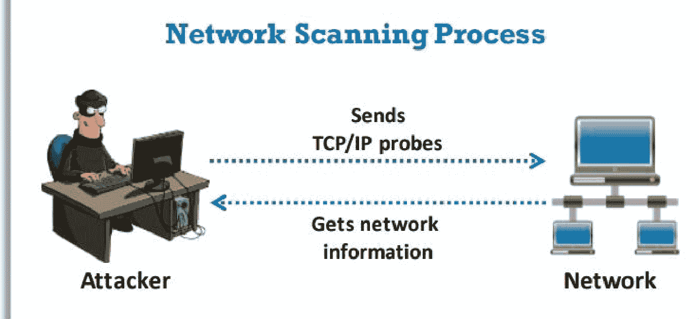

### 网络扫描目标

- 发现实时主机、IP地址以及实时主机的开放端口
- 发现操作系统和系统架构
- 发现主机上运行的服务
- 发现实时主机中的漏洞


### 网络扫描概述

扫描是使用高度复杂和积极的侦察技术收集有关目标的额外详细信息的过程。网络扫描是指用于识别网络中主机、端口和服务的程序集。网络扫描还用于发现网络中的活动机器并识别目标机器上运行的操作系统。它是攻击者进行情报收集的最重要阶段之一，使其能够创建目标组织的档案。在扫描过程中，攻击者试图收集信息，包括可以通过网络访问的具体 IP 地址、目标的操作系统和系统架构，以及每台计算机上运行的端口及其各自的服务。

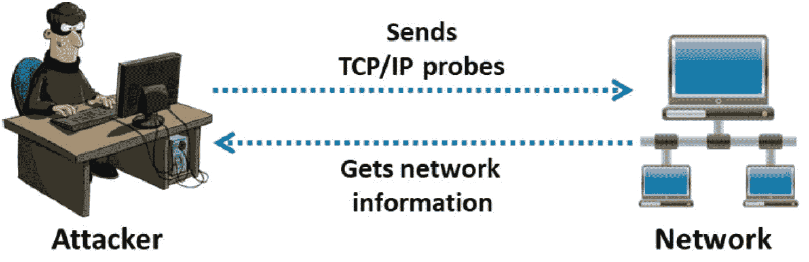

图 3.1：网络扫描过程

扫描的目的是发现可利用的通信通道，探测尽可能多的监听器，并跟踪对攻击者特定需求有响应或有用的监听器。在攻击的扫描阶段，攻击者试图找到各种入侵目标系统的方法。攻击者还试图发现有关目标系统的更多信息，以确定是否存在任何配置疏漏。然后攻击者使用获得的信息制定攻击策略。

## 扫描类型

- **端口扫描** – 列出开放端口和服务。端口扫描是通过发送一系列消息以尝试入侵来检查目标计算机上运行的服务的过程。端口扫描涉及连接到或探测目标系统的 TCP 和 UDP 端口，以确定服务是否正在运行或处于监听状态。监听状态提供了有关当前使用的操作系统和应用程序的信息。有时，正在监听的活动服务可能会允许未经授权的用户错误配置系统或运行存在漏洞的软件。
- **网络扫描** – 列出活动主机和 IP 地址。网络扫描是识别网络上活动主机的程序，以便攻击它们或评估网络的安全性。
- **漏洞扫描** – 显示已知弱点的存在。漏洞扫描是通过识别其漏洞来检查系统是否可被利用的方法。漏洞扫描器由扫描引擎和目录组成。目录包括具有已知漏洞的常见文件列表以及一系列服务器的常见漏洞利用。漏洞扫描器例如可能会寻找备份文件或目录遍历漏洞。扫描引擎维护读取漏洞利用列表、将请求传输到 Web 服务器并分析请求以确保服务器安全的逻辑。这些工具通常针对的是可以通过更新的安全补丁和干净的 Web 文档轻松修复的安全主机配置的漏洞。

一个想要闯入房屋的小偷会寻找诸如门窗之类的入口点。这些通常是房屋的脆弱点，因为它们很容易进入。谈到计算机系统和网络时，端口是入侵者用来获得访问权限的系统的门窗。计算机系统的一般规则是，系统上开放的端口越多，系统就越脆弱。然而，有时端口比另一台机器更少的系统会表现出更高的脆弱性。

## 网络扫描目标

关于目标组织的信息越多，就越有可能了解网络的安全漏洞，从而获得未经授权的访问。

扫描网络的一些目标如下：

- 发现网络的实时主机、IP地址以及实时主机的开放端口。使用开放端口，攻击者将确定进入系统的最佳方式。
- 发现目标的操作系统和系统架构。这也称为指纹识别。攻击者可以根据操作系统的漏洞制定攻击策略。
- 发现目标系统上运行/监听的服务。这样做可以让攻击者了解可被利用以获得对目标系统访问权限的漏洞（基于服务）。
- 识别特定应用程序或特定服务的版本。

## TCP 通信标志

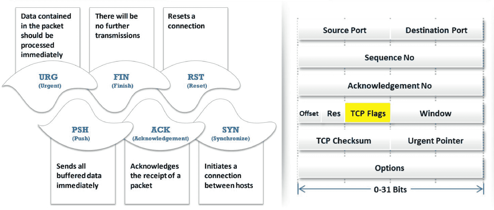

标准 TCP 通信由 TCP 数据包头中的标志控制

### TCP 通信标志

TCP 头包含控制 TCP 连接中数据传输的各种标志。六个 TCP 控制标志管理主机之间的连接并向系统发出指令。其中四个标志（SYN、ACK、FIN 和 RST）管理连接的建立、维护和终止。其他两个标志（PSH 和 URG）向系统提供指令。每个标志的大小为 1 位。由于 TCP 标志部分中有六个标志，因此该部分的大小为 6 位。当标志值设置为“1”时，该标志会自动打开。

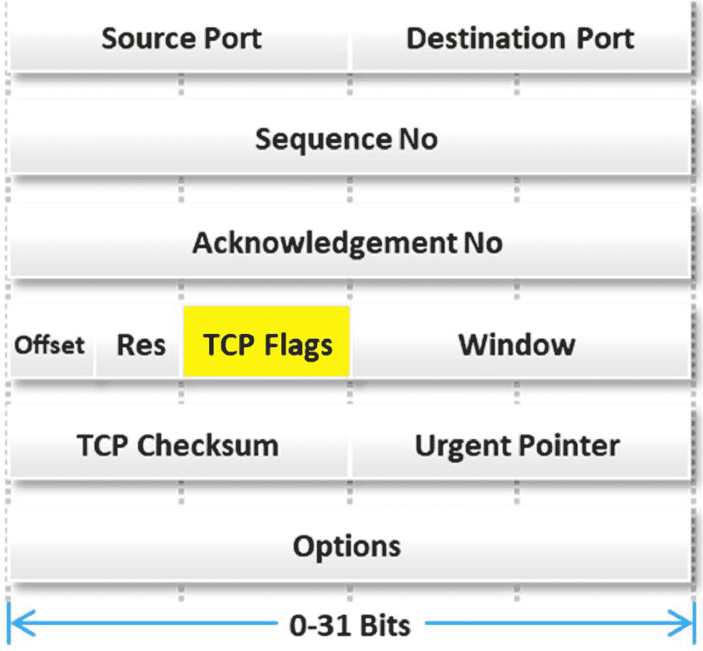

图 3.2：TCP 头部格式


图 3.3：TCP 通信标志

## 以下是 TCP 通信标志：

- **同步或“SYN”**：它通知新序列号的传输。该标志通常表示两个主机之间连接的建立（三向握手）。
- **确认或“ACK”**：它确认传输的接收并标识下一个期望的序列号。当系统成功接收到数据包时，它将标志值设置为“1”，从而意味着接收方应注意它。
- **推送或“PSH”**：当其设置为“1”时，表示发送方已向接收方发出推送操作；这意味着远程系统应通知接收应用程序有关来自发送方的缓冲数据。系统在数据传输的开始和结束时触发 PSH 标志，并在文件的最后一个段上设置它以防止缓冲区死锁。
- **紧急或“URG”**：它指示系统尽快处理数据包中包含的数据。当系统将标志设置为“1”时，会优先处理紧急数据并停止所有其他数据处理。
- **结束或“FIN”**：将其设置为“1”以宣布将不再向远程系统发送传输，并且由 SYN 标志建立的连接将被终止。
- **重置或“RST”**：当当前连接出现错误时，此标志设置为“1”，并且连接会因错误而被中止。攻击者使用此标志扫描主机并识别开放端口。

SYN 扫描主要涉及三个标志：SYN、ACK 和 RST。你可以在枚举期间使用这三个标志从服务器收集非法信息。

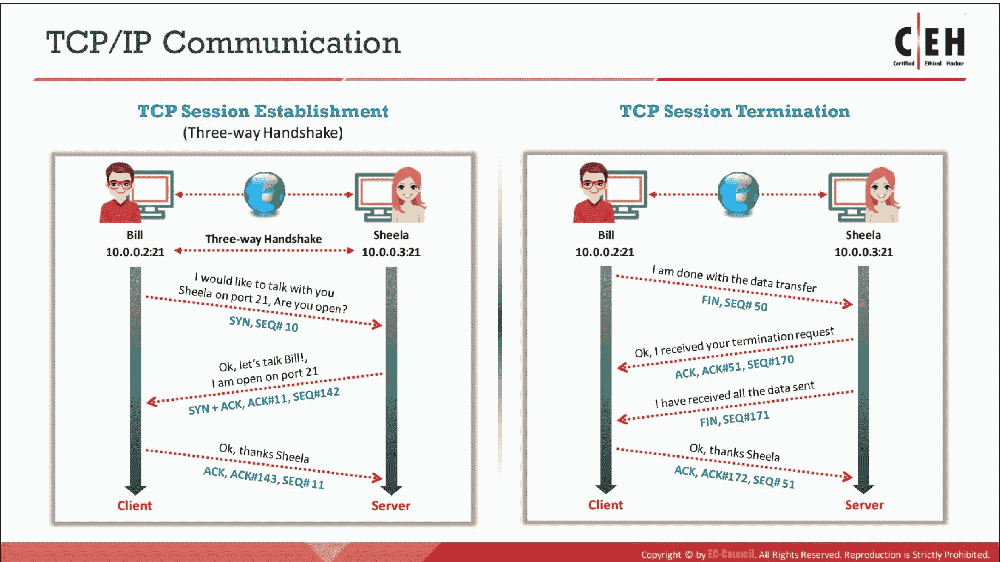

## TCP/IP 通信

TCP 是面向连接的，即它在应用程序之间进行数据传输之前优先建立连接。这种协议之间的连接可通过三次握手实现。

## TCP 会话通过三次握手机制启动：

- 启动 TCP 连接时，源主机 (10.0.0.2:21) 向目标主机 (10.0.0.3:21) 发送 SYN 数据包。
- 接收到 SYN 数据包后，目标主机通过向源主机发送 SYN/ACK 数据包进行响应。
- ACK 数据包确认第一个 SYN 数据包已到达源主机。
- 最后，源主机针对目标主机传输的 ACK/SYN 数据包发送 ACK 数据包。
- 这会触发一个“打开”连接，从而允许源主机和目标主机之间进行通信，直到其中一方发出“FIN”或“RST”数据包关闭连接。

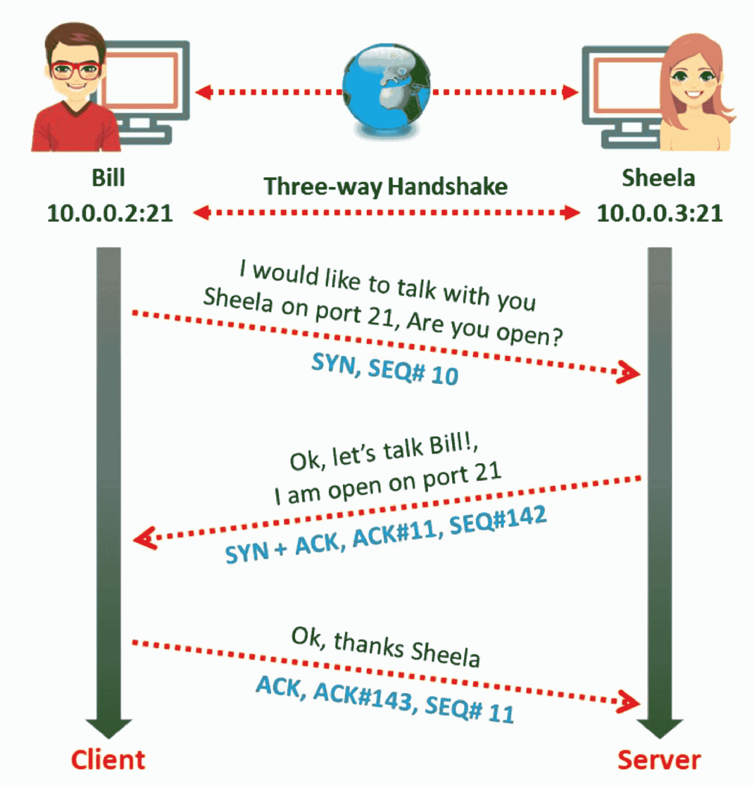

图 3.4：TCP 会话建立

TCP 协议在整个互联网上为所有面向连接的协议维护有状态连接，其工作原理类似于普通电话通信，即拿起电话听筒，听到拨号音，拨打一个号码，触发另一端的铃声，直到有人拿起听筒并说，“你好。”

## 系统按如下方式终止已建立的 TCP 会话：

在通过已建立的 TCP 连接完成所有数据传输后，发送方通过 FIN 或 RST 数据包向接收方发送连接终止请求。接收到连接终止请求后，接收方通过向发送方发送 ACK 数据包确认终止请求，最后发送自己的 FIN 数据包。然后，系统终止已建立的连接。

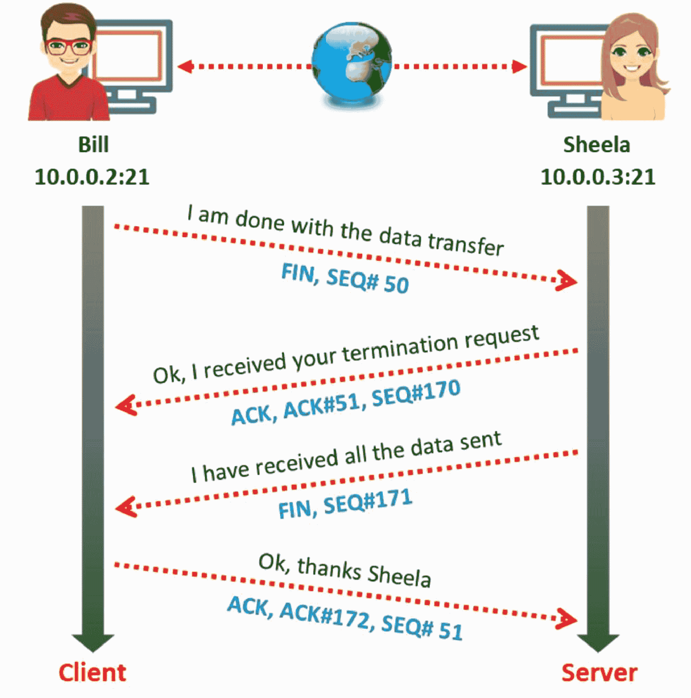

图 3.5：TCP 会话终止

## LO#02：使用各种网络扫描工具

## 扫描工具：Nmap

- 网络管理员可以使用 Nmap 进行网络盘点、管理服务升级计划以及监控主机或服务正常运行时间
- 攻击者使用 Nmap 提取网络上活动主机、开放端口、服务（应用程序名称和版本）、数据包过滤器/防火墙类型以及使用的操作系统和版本等信息


```
nmap -p 1-65535 -T4 -A -v 10.10.1.11
```

攻击者添加目标 IP 地址以执行扫描

获取开放端口列表、操作系统详细信息、MAC 详细信息以及服务及其版本

```
nmap -p 1-65535 -T4 -A -v 10.10.1.11
```

https://nmap.org

## 扫描工具：Hping3

- 用于 TCP/IP 协议的命令行网络扫描和数据包制作工具
- 它可用于网络安全审计、防火墙测试、手动路径 MTU 发现、先进的 traceroute、远程操作系统指纹识别、远程正常运行时间猜测、TCP/IP 堆栈审计等。

## ICMP 扫描

## 端口 80 上的 ACK 扫描

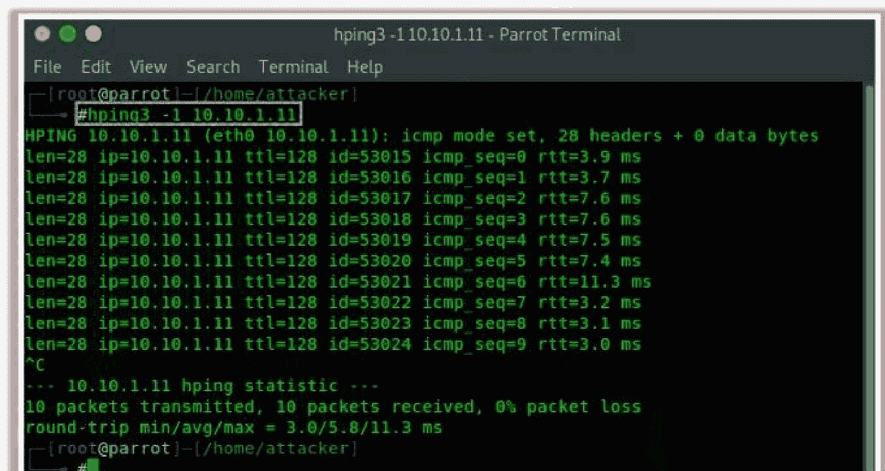

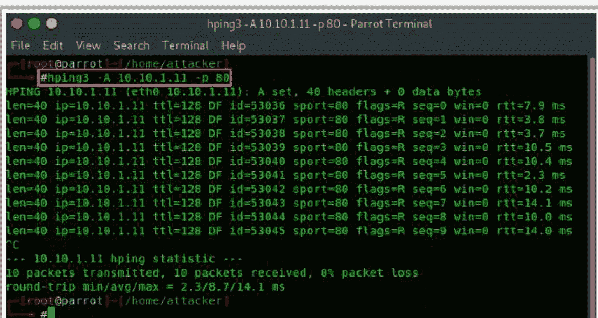

http://www.hping.org

## Hping 命令

ICMP 探测

```
hping3 -1 10.0.0.25
```

端口 80 上的 ACK 扫描

```
hping3 -A 10.0.0.25 -p 80
```

端口 80 上的 UDP 扫描

```
hping3 -2 10.0.0.25 -p 80
```

收集初始序列号

```
hping3 192.168.1.103 -Q -p 139
```

防火墙和时间戳

```
hping3 -S 72.14.207.99 -p 80 --tcp-timestamp
```

端口 50-60 上的 SYN 扫描

```
hping3 -8 50-60 -s 10.0.0.25 -V
```

端口 80 上的 FIN、PUSH 和 URG 扫描

```
hping3 -F -P -U 10.0.0.25 -p 80
```

扫描整个子网以查找活动主机

```
hping3 -1 10.0.1.x --rand-dest -I eth0
```

拦截包含 HTTP 签名的所有流量

```
hping3 -9 HTTP -I eth0
```

对受害者进行 SYN 泛洪

```
hping3 -S 192.168.1.1 -a 192.168.1.254 -p 22 --flood
```

## 扫描工具

## Metasploit

Metasploit 是一个开源项目，提供基础设施、内容和工具以进行 **渗透测试** 和 **广泛的安全审计**

## NetScanTools Pro

NetScanTools Pro 协助攻击者自动或手动列出 **IPv4/IPv6 地址**、**主机名**、**域名** 和 **URL**

其他扫描工具：
SX https://github.com
Unicornscan https://sourceforge.net
SolarWinds 端口扫描器 https://www.solarwinds.com
PRTG 网络监控 https://www.paessler.com

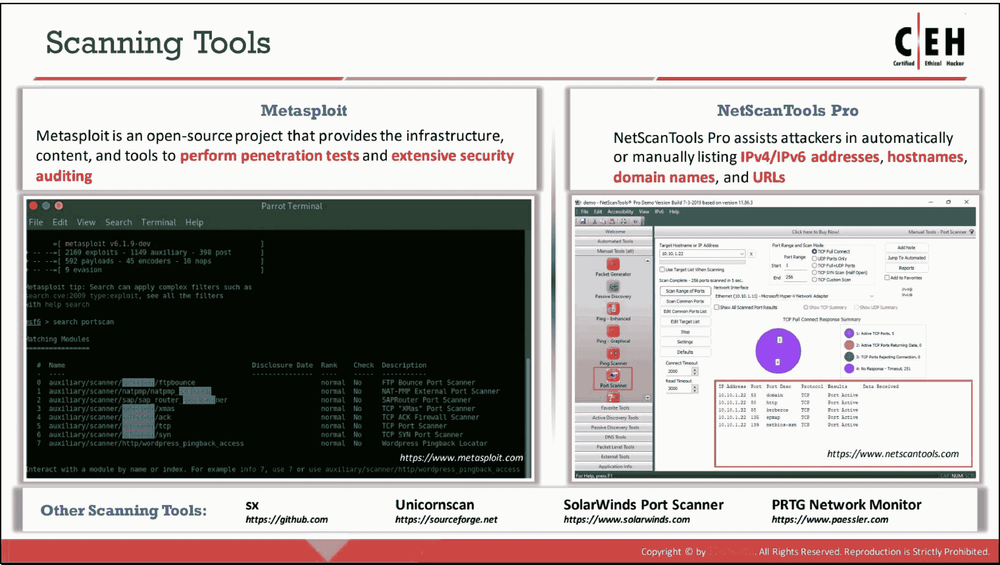

## 扫描工具

扫描工具用于扫描和识别目标网络上的活动主机、开放端口、正在运行的服务、位置信息、NetBIOS 信息以及所有 TCP/IP 和 UDP 开放端口的信息。这些工具获得的信息将帮助道德黑客创建目标组织的概况并扫描网络中连接设备的开放端口。

- **Nmap**

来源：https://nmap.org

Nmap（“Network Mapper”）是用于网络探索和黑客攻击的安全扫描器。它允许您发现计算机网络上的主机、端口和服务，从而创建网络的“地图”。它向目标主机发送特制的包，然后分析响应以实现其目标。它可以扫描数以十万计的机器的庞大网络。Nmap 包含许多用于端口扫描（TCP 和 UDP）、操作系统检测、版本检测、ping 扫描等的机制。

网络管理员或攻击者都可以根据自己的特定需求使用此工具。网络管理员可以使用 Nmap 进行网络盘点、管理服务升级计划以及监控主机或服务正常运行时间。攻击者使用 Nmap 提取网络上活动主机、开放端口、服务（应用程序名称和版本）、数据包过滤器/防火墙类型、MAC 详细信息以及操作系统及其版本等信息。

```
Syntax: # nmap <options> <Target IP address>
```

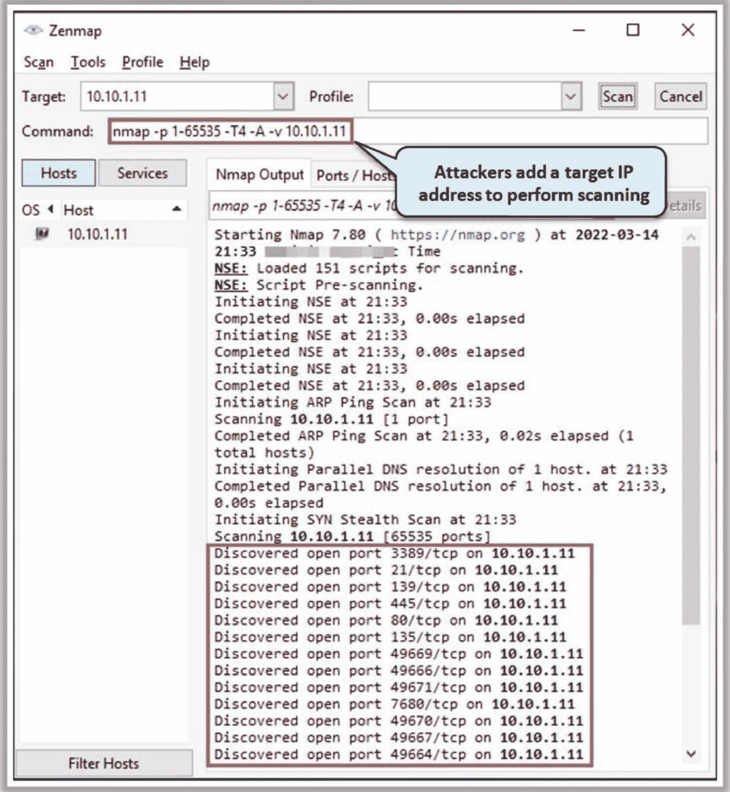

图 3.6：显示 Nmap 扫描的屏幕截图

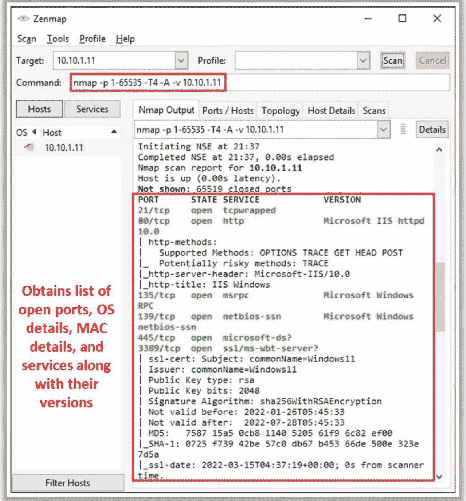

图 3.7：显示 Nmap 扫描结果的屏幕截图

## Hping3

来源：http://www.hping.org

Hping3 是一款面向命令行的网络扫描和数据包制作工具，用于 TCP/IP 协议，可发送 ICMP 回显请求并支持 TCP、UDP、ICMP 和原始 IP 协议。它执行网络安全审计、防火墙测试、手动路径 MTU 发现、先进的 traceroute、远程操作系统指纹识别、远程正常运行时间猜测、TCP/IP 堆栈审计等功能。它可以发送自定义 TCP/IP 数据包并以类似 ping 程序的方式显示目标回复，带有 ICMP 回复。它处理分片以及任意数据包体和大小，并且可以在受支持的协议下用于传输封装文件。它还支持空闲主机扫描。IP 欺骗和网络/主机扫描可用于对服务进行匿名探测。Hping3 还具有 Traceroute 模式，使攻击者能够在隐蔽通道之间发送文件。它还能在主机阻止 ICMP 数据包时确定主机是否处于活动状态。其类似防火墙的使用方式允许发现防火墙后面的开放端口。

获取开放端口列表、操作系统详细信息、MAC 详细信息以及服务及其版本

```
nmap -p 1-65535 -T4 -A -v 10.10.1.11
```


执行手动路径 MTU 发现并使攻击者能够执行远程操作系统指纹识别。

使用 Hping，攻击者可以研究空闲主机的行为并获取有关目标的信息，例如主机提供的服务、支持服务的端口以及目标的操作系统。这种类型的扫描是更重的探测或直接攻击的前身。

语法：# hping3 <options> <Target IP address>

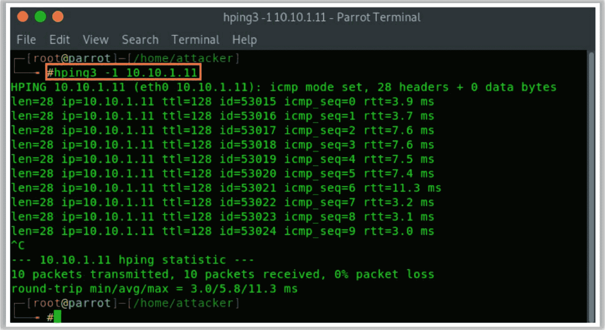

图 3.8：ICMP 扫描

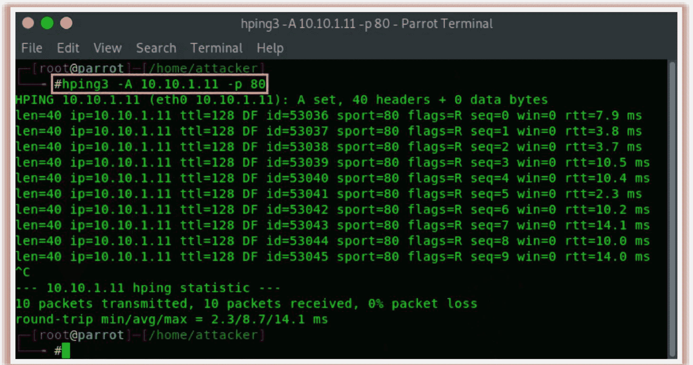

图 3.9：端口 80 上的 ACK 扫描

## Hping 命令

各种 Hping 命令如下：

### ICMP ping

```
Ex. hping3 -1 10.0.0.25
```

ping 扫描或 Internet Control Message Protocol (ICMP) 扫描是向网络上的所有主机发送 ICMP 请求或 ping 以确定哪些主机处于活动状态的过程。

操作系统、路由器、交换机和基于 IP 的设备通过 ping 命令使用此协议进行回显请求和回显响应，作为不同主机之间连接测试。

Hping 通过在命令行中指定参数 -1 来执行 ICMP ping 扫描。您可以使用 --ICMP 或 -1 作为命令行中的参数。通过发出上述命令，hping 向 10.0.0.25 发送 ICMP 回显请求并接收 ICMP 回复，类似于 ping 实用程序。

### 端口 80 上的 ACK 扫描

```
Ex. hping3 -A 10.0.0.25 -p 80
```

这种扫描技术可用于探测防火墙及其规则集的存在。简单的包过滤允许建立连接（ACK 位被设置的包），而复杂的 stateful 防火墙不允许建立连接。

Hping 可以通过在命令行中指定参数 -A 来配置为执行 ACK 扫描。在这里，您在探测包中设置 ACK 标志并执行扫描。当主机不响应 ping 请求时，您执行此扫描。通过发出此命令，Hping 检查网络上主机是否存活。如果发现存活主机和开放端口，它会返回 RST 响应。

### 端口 80 上的 UDP 扫描

```
Ex. hping3 -2 10.0.0.25 -p 80
```

Hping 默认使用 TCP 作为其协议。使用命令行中的参数 -2 指定 Hping 在 UDP 模式下运行。您可以使用 --udp 或 -2 作为命令行中的参数。

通过发出上述命令，Hping 向主机（10.0.0.25）端口 80 发送 UDP 数据包。如果发现端口关闭，它会返回 ICMP 端口不可达消息，如果端口打开则不返回消息。

### 收集初始序列号

```
Ex. hping3 192.168.1.103 -Q -p 139
```

使用命令行中的参数 -Q，Hping 收集目标主机（192.168.1.103）生成的所有 TCP 序列号。

### 防火墙和时间戳

```
hping3 -S 72.14.207.99 -p 80 --tcp-timestamp
```

许多防火墙会丢弃未设置 TCP 时间戳选项的 TCP 数据包。通过在命令行中添加 --tcp-timestamp 参数，您可以在 Hping 中启用 TCP 时间戳选项并尝试猜测目标主机（72.14.207.99）的时间戳更新频率和正常运行时间。

### 端口 50-60 上的 SYN 扫描

```
hping3 -8 50-60 -S 10.0.0.25 -v
```

使用命令行中的参数 -8 或 --scan，您将 Hping 操作在扫描模式下以扫描目标主机上的端口范围。添加参数 -S 允许您执行 SYN 扫描。

因此，上述命令对目标主机上的端口 50–60 执行 SYN 扫描。

### 端口 80 上的 FIN、PUSH 和 URG 扫描

```
hping3 -F -P -U 10.0.0.25 -p 80
```

通过在命令行中添加参数 -F、-P 和 -U，您在探测包中设置 FIN、PUSH 和 URG 数据包。通过发出此命令，您正在对目标主机（10.0.0.25）端口 80 执行 FIN、PUSH 和 URG 扫描。如果端口 80 打开，您将不会收到响应。如果端口关闭，Hping 将返回 RST 响应。

### 扫描整个子网以查找存活主机

```
hping3 -1 10.0.1.x --rand-dest -I eth0
```

通过发出此命令，Hping 对整个子网 10.0.1.x 执行 ICMP ping 扫描；换句话说，它随机（--rand-dest）向连接到接口 eth0 的 10.0.1.0 到 10.0.1.255 的所有主机发送 ICMP 回显请求。端口开放的主机将使用 ICMP 回复进行响应。在这种情况下，您未设置端口；因此，Hping 默认情况下向所有 IP 地址发送数据包到端口 0。

### 拦截包含 HTTP 签名的所有流量

```
hping3 -9 HTTP -I eth0
```

参数 -9 将 Hping 设置为侦听模式。因此，通过发出命令 -9 HTTP，Hping 开始在端口 0（连接到网络接口 eth0 的所有设备）上侦听，拦截包含 HTTP 签名的所有数据包，并从签名末尾转储到数据包末尾。

### SYN 洪泛攻击受害者

```
hping3 -S 192.168.1.1 -a 192.168.1.254 -p 22 --flood
```

攻击者使用伪造的 IP 地址使用 TCP SYN 洪泛技术执行 DoS 攻击。

## Metasploit

来源：https://www.metasploit.com

Metasploit 是一个开源项目，提供执行渗透测试和广泛安全审计的基础设施、内容和工具。它提供有关安全漏洞的信息并帮助渗透测试和 IDS 签名开发。它促进攻击者、漏洞编写者和有效载荷编写者的任务。框架的一个主要优势是模块化方法，即允许将任何漏洞与任何有效载荷组合。

它使您能够自动化发现和利用过程，并为您提供执行渗透测试手动测试阶段所需的工具。您可以使用 Metasploit Pro 扫描开放端口和服务，利用漏洞，进一步渗透网络，收集证据并创建测试结果报告。

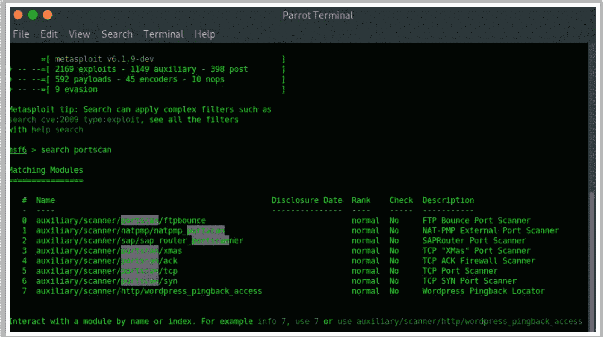

图 3.10：显示各种 Metasploit 端口扫描模块的屏幕截图

## NetScanTools Pro

来源：https://www.netscantools.com

NetScanTools Pro 是一款调查工具，允许您排除故障、监控、发现和检测网络上的设备。使用此工具，您可以轻松收集有关本地局域网以及互联网用户、IP地址、端口等的信息。攻击者可以找到目标系统中的漏洞和暴露的端口。它帮助攻击者自动或手动（使用手动工具）列出 IPv4/IPv6 地址、主机名、域名、电子邮件地址和 URL。NetScanTools Pro 结合了许多按其功能分类的网络工具和实用程序，例如主动、被动、DNS 和本地计算机。

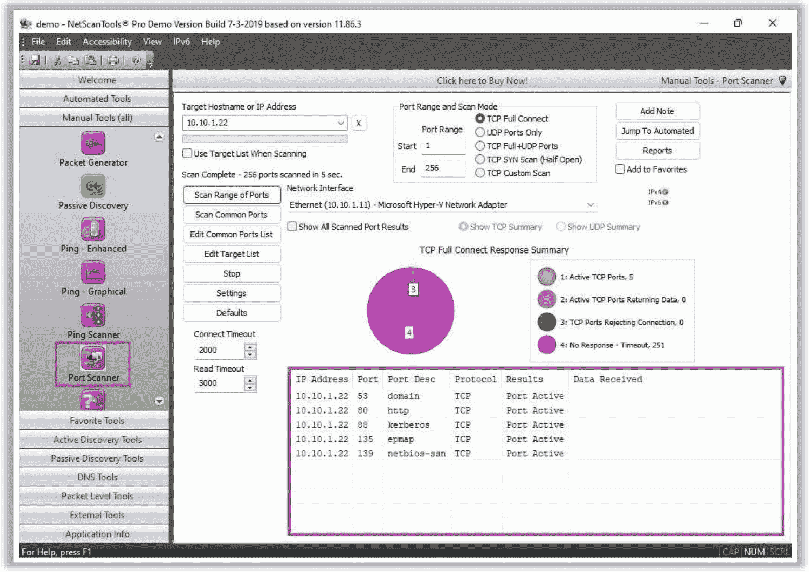

图 3.11：NetScanTools Pro 屏幕截图

以下是一些额外的扫描工具列表：

- sx (https://github.com)
- Unicornscan (https://sourceforge.net)
- SolarWinds Port Scanner (https://www.solarwinds.com)
- PRTG Network Monitor (https://www.paessler.com)
- OmniPeek Network Protocol Analyzer (https://www.savvius.com)

## 移动扫描工具

### IP Scanner

来源：https://10base-t.com

适用于 iOS 的 IP Scanner 扫描您的局域网以确定其所有活动机器和互联网设备的身份。它允许攻击者执行网络扫描活动以及 ping 和端口扫描。

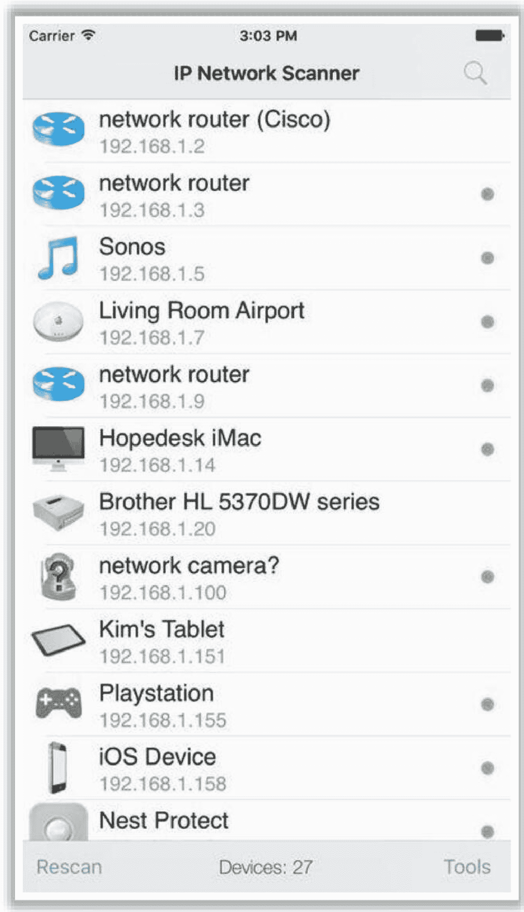

图 3.12：IP Scanner 屏幕截图

### Fing

来源：https://www.fing.io

Fing 是一款适用于 Android 和 iOS 的移动应用程序，用于扫描并提供完整的网络信息，例如 IP 地址、MAC 地址、设备供应商和 ISP 位置。它允许攻击者发现连接到 Wi-Fi 网络的所有设备以及其 IP 和 MAC 地址以及供应商/设备制造商的名称。它还允许攻击者通过特定端口（如 SSH、FTP、NetBIOS 等）执行网络 ping 和 traceroute 活动。

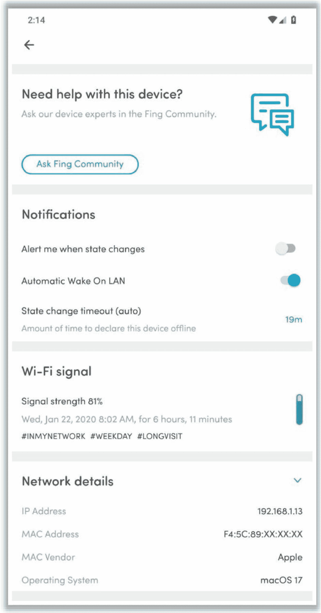

图 3.13：Fing 屏幕截图


- 网络扫描器

来源: https://play.google.com

网络扫描器是一款 Android 移动应用程序，允许攻击者识别网络中可能地址范围内活动的目标主机。它还显示网络中所有可用设备的 IP 地址、MAC 地址、主机名和厂商详细信息。此工具还允许攻击者对目标进行特定端口号的端口扫描。

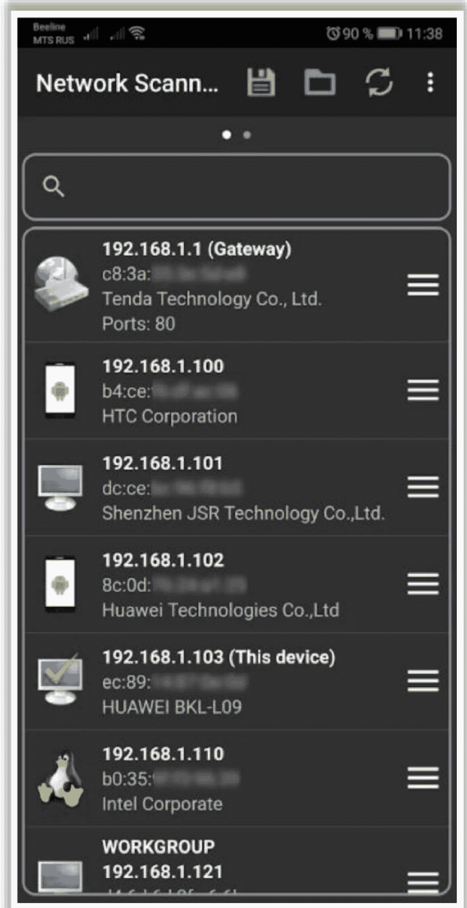

图 3.14：网络扫描器的屏幕截图

## LO#03：演示主机发现的各种扫描技术


## 主机发现

扫描是收集网络上“存活”并响应的系统信息的过程。主机发现被认为是网络扫描过程中的主要任务。为了执行完整扫描并识别开放端口和服务，有必要检查活动系统。主机发现提供了网络中系统的准确状态，这使攻击者能够避免扫描 IP 地址列表中每个系统的每个端口以确定目标主机是否处于活动状态。

主机发现是网络扫描的第一步。本节重点介绍如何使用各种 ping 扫描技术检查网络中的活动系统。它还讨论了如何 ping sweep 网络以检测活动主机/系统以及各种 ping sweep 工具。

## 主机发现技术

主机发现技术用于识别网络中活动/在线的系统

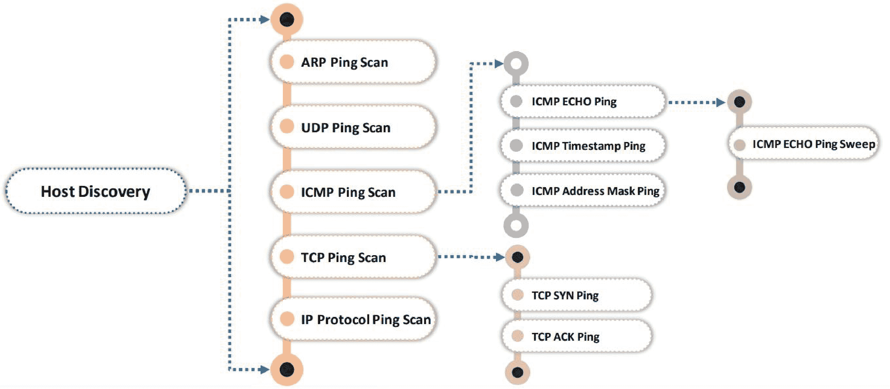

## 主机发现技术（续）


| 扫描技术 | Nmap 命令 | 请求 | 响应 | 优点 |
|---|---|---|---|---|
| ARP Ping 扫描 | nmap -sn -PR <Target IP Address> | ARP 请求探测 | ✓ ARP 响应 - 主机处于活动状态
✓ 无响应 - 主机处于非活动状态 | ✓ 比其他主机发现技术更高效、更准确
✓ 有利于系统发现，在需要扫描大地址空间时很有用 |
| UDP Ping 扫描 | nmap -sn -PU <Target IP Address> | UDP 请求 | ✓ UDP 响应 - 主机处于活动状态
✓ 错误消息（主机/网络不可达或 TTL 超时）- 主机处于非活动状态 | ✓ 检测到防火墙后具有严格 TCP 过滤的系统 |
| ICMP ECHO Ping 扫描 | nmap -sn -PE <Target IP Address> | ICMP ECHO 请求 | ✓ ICMP ECHO 回复 - 主机处于活动状态
✓ 无响应 - 主机处于非活动状态 | ✓ 用于定位活动设备或确定 ICMP 消息是否通过防火墙
**缺点：**
✓ 在基于 Windows 的网络上不起作用 |

## 主机发现技术（续）

| 扫描技术 | Nmap 命令 | 请求 | 响应 | 优点 |
|---|---|---|---|---|
| ICMP ECHO Ping Sweep | nmap -sn -PE <Target IP Address Range> | 向多个主机发送 ICMP ECHO 请求 | ✓ ICMP ECHO 回复 - 主机处于活动状态
✓ 无响应 - 主机处于非活动状态 | ✓ 从 IP 地址范围确定活动主机
✓ 有助于创建子网中活动系统的清单
**缺点：**
✓ 用于扫描网络的最旧、最慢的方法 |
| ICMP 时间戳 Ping 扫描 | nmap -sn -PP <Target IP Address> | ICMP 时间戳请求 | ✓ 对每个时间戳请求的时间戳回复
✓ 目标主机的响应是条件性的，具体取决于目标端管理员的配置，它可能回复时间值，也可能不回复 | ✓ 常规 ICMP ECHO ping 扫描的替代方案
✓ 确定目标主机是否存活，特别是在管理员阻止 ICMP ECHO ping 时 |
| ICMP 地址掩码 Ping 扫描 | nmap -sn -PM <Target IP Address> | ICMP 地址掩码请求 | ✓ 目标主机的地址掩码响应是条件性的，具体取决于目标端管理员的配置，它可能回复适当的子网值，也可能不回复 | ✓ 常规 ICMP ECHO ping 扫描的替代方案
✓ 确定目标主机是否存活，特别是在管理员阻止 ICMP ECHO ping 时 |
| TCP SYN Ping 扫描 | nmap -sn -PS <Target IP Address> | 空 TCP SYN 请求 | ✓ ACK 响应 - 主机处于活动状态
✓ 无响应 - 主机处于非活动状态 | ✓ 用于在不建立任何连接的情况下确定主机是否活动
✓ 在系统或网络级别不会记录日志，使攻击者能够不留下被检测的痕迹 |

## 主机发现技术（续）

| 扫描技术 | Nmap 命令 | 请求 | 响应 | 优点 |
|---|---|---|---|---|
| TCP ACK Ping 扫描 | nmap -sn -PA <Target IP Address> | 空 TCP ACK 请求 | ✓ RST 响应 - 主机处于活动状态
✓ 无响应 - 主机处于非活动状态 | ✓ 最大化绕过防火墙的机会 |
| IP 协议 Ping 扫描 | nmap -sn -PO <Target IP Address> | 使用不同的 IP 协议（ICMP、IGMP、TCP 和 UDP）进行 IP ping 请求 | ✓ 任何响应 - 主机处于活动状态
✓ 无响应 - 主机处于非活动状态 | ✓ 发送使用不同 IP 协议的不同数据包，希望收到表明主机在线的响应 |

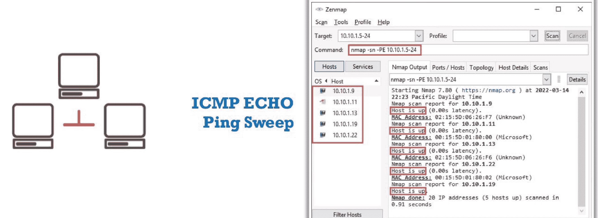

## 主机发现技术

主机发现技术可用于发现网络中活动/在线的主机。作为一名道德黑客，您必须了解各种主机发现技术。以下是一些主机发现技术：

- ARP Ping 扫描
- UDP Ping 扫描

- ICMP Ping 扫描
  - ICMP ECHO Ping
    - ICMP ECHO Ping Sweep
  - ICMP 时间戳 Ping
  - ICMP 地址掩码 Ping
- TCP Ping 扫描
  - TCP SYN Ping
  - TCP ACK Ping
- IP 协议扫描

## ARP Ping 扫描

在 ARP ping 扫描中，ARP 数据包用于发现 IPv4 范围内所有活动设备，即使这些设备的存在被限制性防火墙隐藏。在大多数网络中，许多 IP 地址在任何给定时间都是未使用的，特别是在 LAN 的私有地址范围内。因此，当攻击者尝试向目标主机发送 ICMP echo 请求等 IP 数据包时，操作系统必须确定与目标 IP 对应的硬件目标地址（ARP），以便正确寻址以太网帧。为此，会发出一系列 ARP 请求。ARP 扫描用于显示设备上网络接口的 MAC 地址，并且还可以显示与 LAN 上同一 IPv4 地址共享的所有设备的 MAC 地址。如果具有相应硬件目标地址的主机 IP 处于活动状态，则主机将生成 ARP 响应；否则，在一定次数的 ping 尝试后，原操作系统将放弃该主机。换句话说，当攻击者向目标主机发送 ARP 请求探测时，如果收到任何 ARP 响应，则主机处于活动状态。如果发现目标主机无响应，则源主机将在其内核 ARP 表中为目标 IP 添加不完整条目。

攻击者使用 Nmap 工具执行 ARP ping 扫描以发现网络中的活动主机。在 Zenmap 中，使用 -PR 选项执行 ARP ping 扫描。

注意：-sn 是 Nmap 命令，用于禁用端口扫描。由于 Nmap 使用 ARP ping 扫描作为默认 ping 扫描，要禁用它并执行其他所需的 ping 扫描，可以使用 --disable-arp-ping。

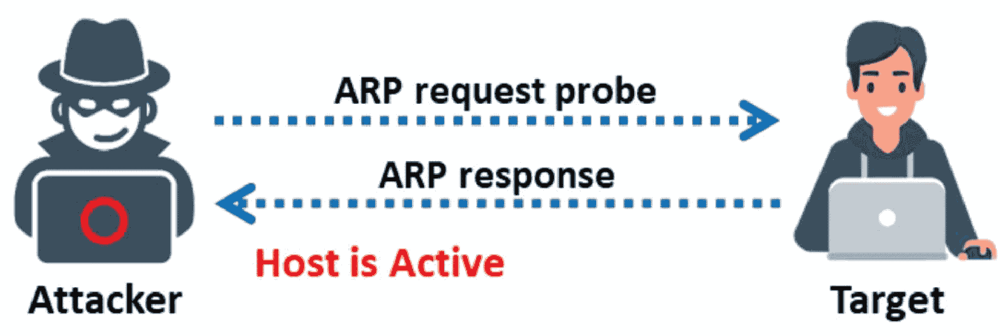

图 3.15：ARP ping 扫描

## 优点：

- ARP ping 扫描被认为比其他主机发现技术更高效、更准确
- ARP ping 扫描会自行决定自动处理 ARP 请求、重传和超时
- ARP ping 扫描对于系统发现很有用，在这种情况下，您可能需要扫描大地址空间
- ARP ping 扫描可以显示设备对 ARP 数据包的响应时间或延迟

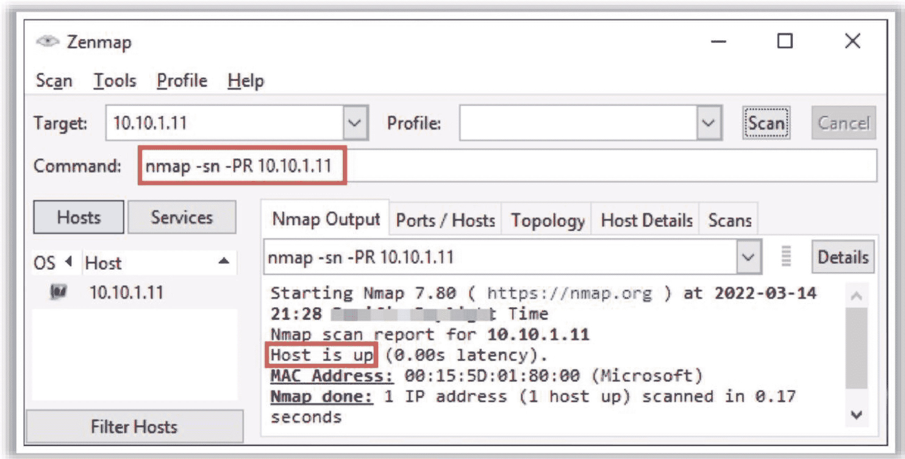

图 3.16：Zenmap 中的 ARP 扫描

## UDP Ping 扫描

UDP ping 扫描类似于 TCP ping 扫描；然而，在 UDP ping 扫描中，Nmap 向目标主机发送 UDP 数据包。Nmap 用于 UDP ping 扫描的默认端口号是 40,125。此非常不常见的端口用作向目标发送 UDP 数据包的默认值。此默认端口号可以在 Nmap 编译期间使用 DEFAULT_UDP_PROBE_PORT_SPEC 进行配置。

攻击者向目标主机发送 UDP 数据包，UDP 响应意味着目标主机处于活动状态。如果目标主机离线或无法到达，则可能会返回各种错误消息，例如主机/网络不可达或 TTL 超时。在 Zenmap 中，使用 -PU 选项执行 UDP ping 扫描。

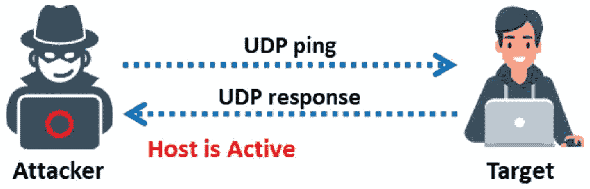

图 3.17：UDP ping 扫描以确定主机是否处于活动状态

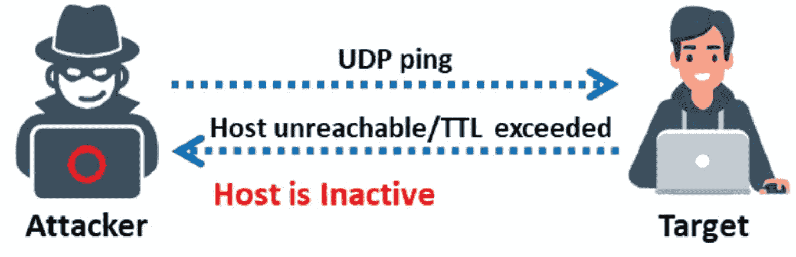

图 3.18：UDP ping 扫描以确定主机是否离线

### 优点：
- UDP ping 扫描的优势在于能够检测到防火墙后具有严格 TCP 过滤的系统，而 UDP 流量则被忽略。

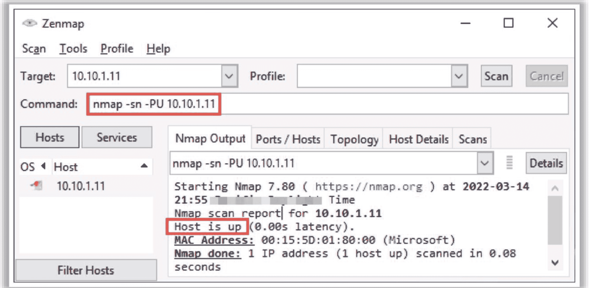

图 3.19：Zenmap 中的 UDP ping 扫描

## ICMP ECHO Ping 扫描

攻击者使用 ICMP ping 扫描向目标系统发送 ICMP 数据包以收集其所有必要信息。这是因为 ICMP 不包含端口抽象，与端口扫描不同。然而，通过 ping 所有主机，它有助于确定网络中哪些主机正在运行。

ICMP ECHO ping 扫描涉及向主机发送 ICMP ECHO 请求。如果主机处于活动状态，它将返回 ICMP ECHO 回复。此扫描有助于定位活动设备或确定 ICMP 是否通过防火墙。

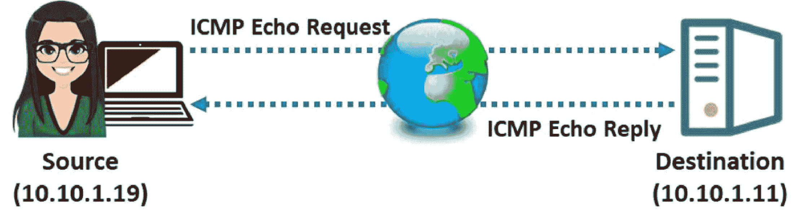

图 3.20：ICMP echo 请求和回复

UNIX/Linux 和基于 BSD 的机器使用 ICMP echo 扫描；这些操作系统中的 TCP/IP 栈实现会响应发往广播地址的 ICMP echo 请求。此技术在基于 Windows 的网络上不起作用，因为其 TCP/IP 栈实现不会回复发往广播地址的 ICMP 探测。

Nmap 使用 -P 选项对目标进行 ICMP 扫描。用户还可以使用 -L 选项增加并行 ping 的数量。使用 -T 选项调整 ping 超时值也可能很有用。

在 Zenmap 中，使用 -PE 选项执行 ICMP ECHO ping 扫描。活动主机显示为“Host is up”，如屏幕截图所示。

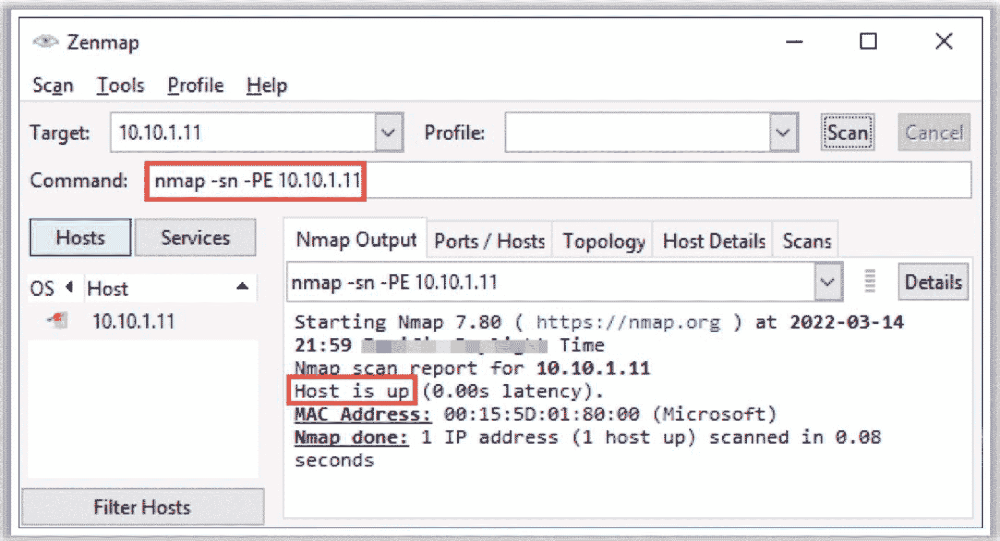

图 3.21：使用 Zenmap 的 ICMP Echo ping 扫描输出

## ICMP ECHO Ping Sweep

ping sweep（也称为 ICMP sweep）是一种基本网络扫描技术，用于确定映射到活动主机（计算机）的 IP 地址范围。虽然单个 ping 会告诉用户指定的主机计算机是否存在于网络上，但 ping sweep 包括向多个主机发送 ICMP ECHO 请求。如果指定的主机处于活动状态，它将返回 ICMP ECHO 回复。

ping sweep 是用于扫描网络的最古老和最慢的方法之一。此实用程序分布在几乎所有平台上，并充当系统的点名；网络上处于活动状态的系统会回答另一系统发出的 ping 查询。

ICMP echo 扫描 ping 目标网络中的所有机器以发现活动机器。攻击者向广播或网络地址发送 ICMP 探测，该地址会中继到子网中的所有主机地址。活动系统将向 ICMP echo 探测的来源发送 ICMP echo 回复消息。

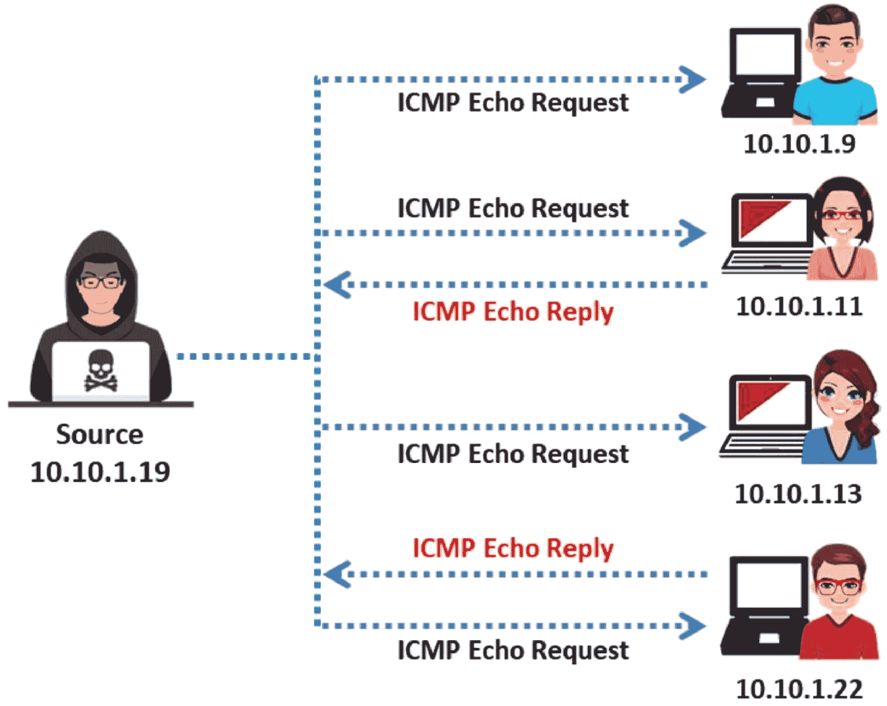

图 3.22：ICMP ECHO Ping Sweep

为了更好地理解 ping，应该能够理解 TCP/IP 数据包。当系统执行 ping 时，它会向特定 IP 地址发送一个数据包到网络上。此数据包包含 64 字节（56 字节数据和 8 字节协议头信息）。发送方随后等待或监听来自目标系统的返回数据包。如果连接良好且目标计算机“存活”，则预期会收到良好的返回数据包。然而，如果通信中断，则不会如此。Ping 还会详细说明数据包完成一次往返所需的时间，称为“往返时间”。它们还有助于解析主机名。在这种情况下，如果数据包发送到 IP 地址时被弹回，但发送到名称时没有，则系统无法将名称与特定 IP 地址对应。

攻击者使用子网掩码计算器计算子网掩码以识别子网中存在的数量主机。随后他们使用 ping sweep 创建子网中活动系统的清单。

### 使用 Nmap 的 ICMP ECHO Ping Sweep

来源：https://nmap.org

Nmap 帮助攻击者执行 ping sweep，从一系列 IP 地址中确定活动主机。在 Zenmap 中，使用 -PE 选项配合 IP 地址列表执行 ICMP ECHO ping sweep。

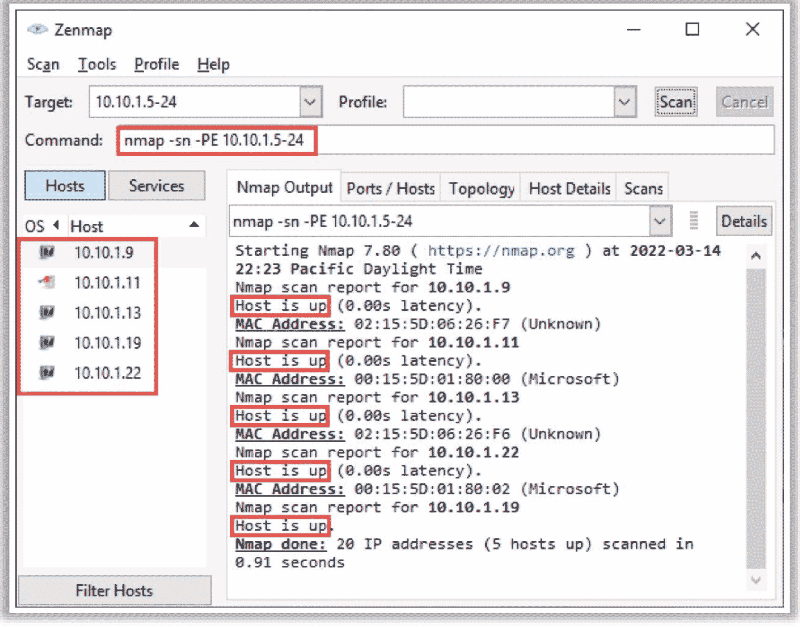

图 3.23：使用 Zenmap 的 Ping Sweep 输出

## ICMP 时间戳 Ping 扫描

除了传统的 ICMP ECHO ping 之外，还有一些其他类型的 ICMP ping 技术，例如 ICMP 时间戳 ping 扫描和 ICMP 地址掩码 ping 扫描，攻击者可在特定条件下采用。

ICMP 时间戳 ping 是一种可选的附加 ICMP ping 类型，其中攻击者查询时间戳消息以获取与目标主机当前时间相关的信息。目标机器会对收到的每个时间戳查询作出时间戳回复。然而，目标主机的响应是条件性的，具体取决于目标端管理员的配置，它可能回复时间值也可能不回复。此 ICMP 时间戳 ping 通常用于时间同步。这种 ping 方法在确定目标主机是否处于活动状态方面很有效，特别是当管理员阻止传统的 ICMP ECHO ping 请求时。在 Zenmap 中，使用 -PP 选项执行 ICMP 时间戳 ping 扫描。

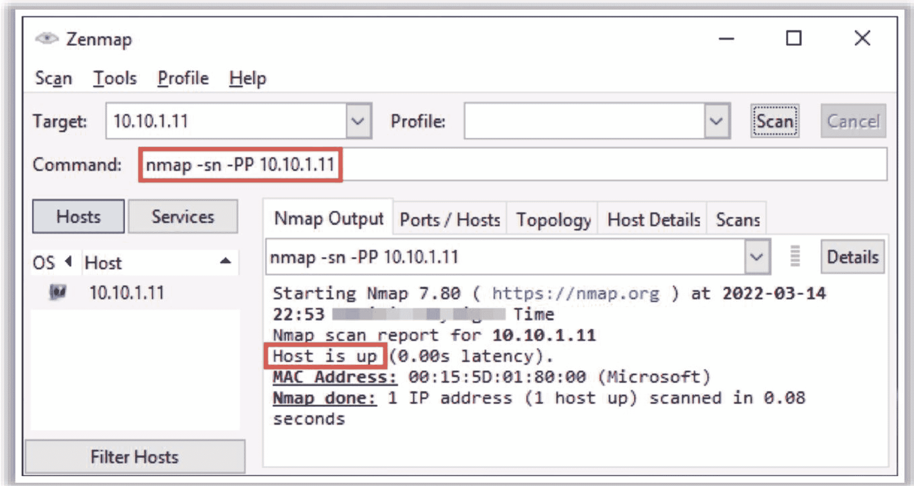

图 3.24：Zenmap 中的 ICMP 时间戳 ping

## ICMP 地址掩码 Ping 扫描

ICMP 地址掩码 ping 是传统 ICMP ECHO ping 的另一种替代方案，其中攻击者向目标主机发送 ICMP 地址掩码查询以获取与子网掩码相关的信息。然而，目标主机的地址掩码响应是条件性的，具体取决于目标端管理员的配置，它可能回复适当的子网值也可能不回复。这种 ping 方法在识别活动主机方面也同样有效，类似于 ICMP 时间戳 ping，特别是当管理员阻止传统的 ICMP Echo ping 时。在 Zenmap 中，使用 -PM 选项执行 ICMP 地址掩码 ping 扫描。

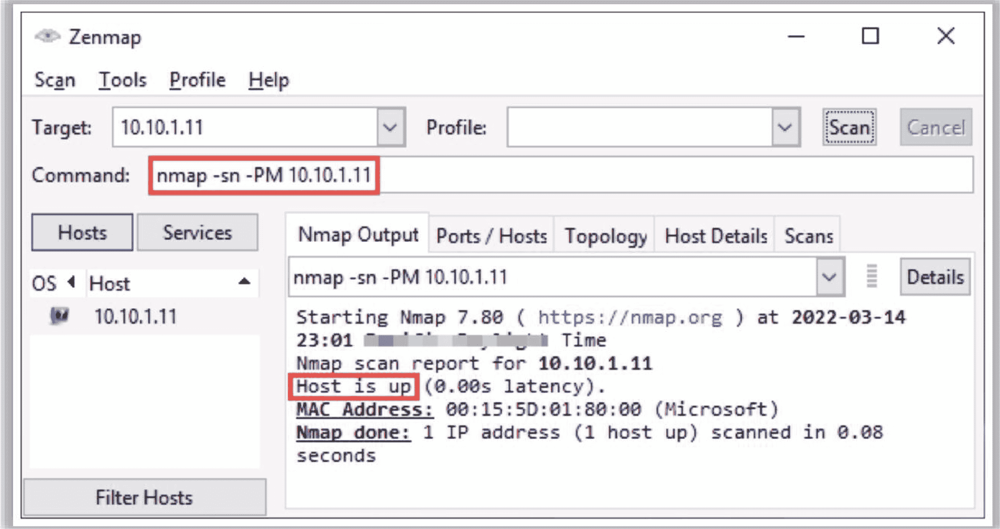

图 3.25：Zenmap 中的 ICMP 地址掩码 ping

## TCP SYN Ping 扫描

TCP SYN ping 是一种主机发现技术，用于探测不同端口以确定端口是否在线并检查是否遇到任何防火墙规则集。在这种主机发现技术中，攻击者使用 Nmap 工具通过向目标主机发送空的 TCP SYN 标志来发起三次握手。接收到 SYN 后，目标主机使用 ACK 标志确认接收。接收到 ACK 标志后，攻击者确认目标主机处于活动状态，并通过向目标主机发送 RST 标志来终止连接（因为其主机发现目标已完成）。端口 80 用作默认目标端口。此类 ping 格式中也可以指定一系列端口，且 -PS 与端口号之间不插入空格（例如 PS22-25,80,113,1050,35000），其中探测将并行针对每个端口执行。在 Zenmap 中，使用 -PS 选项执行 TCP SYN ping 扫描。

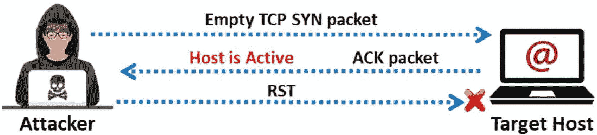

图 3.26：用于主机发现的 TCP SYN ping 扫描

### 优点：
- 由于机器可以并行扫描，扫描在等待响应时永远不会出现超时错误。
- TCP SYN ping 可用于在不建立任何连接的情况下确定主机是否处于活动状态。因此，日志不会在系统或网络级别记录，使攻击者能够不留下检测痕迹。

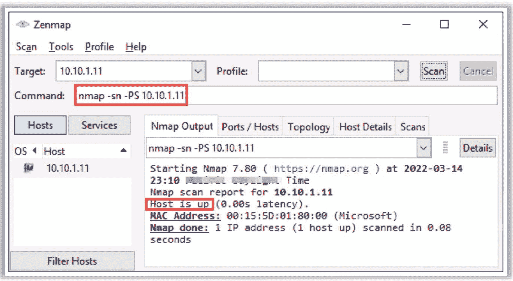

图 3.27：Zenmap 中的 TCP SYN ping 扫描

## TCP ACK Ping 扫描

TCP ACK ping 与 TCP SYN ping 类似，但略有差异。TCP ACK ping 也使用默认端口 80。在 TCP ACK ping 技术中，攻击者直接向目标主机发送空的 TCP ACK 数据包。由于攻击者与目标主机之间没有先前的连接，接收到 ACK 数据包后，目标主机将使用 RST 标志响应以终止请求。攻击者端接收到此 RST 数据包表明主机处于活动状态。在 Zenmap 中，使用 -PA 选项执行 TCP ACK ping 扫描。

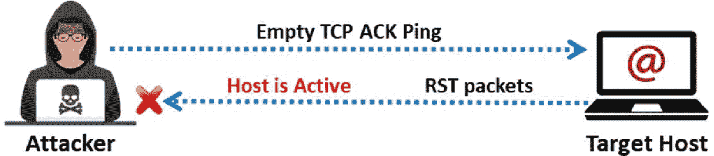

图 3.28：用于主机发现的 TCP ACK ping 扫描

### 优点：
- SYN 和 ACK 数据包都可用于最大化绕过防火墙的机会。然而，防火墙大多配置为阻止 SYN ping 数据包，因为它们是最常见的 ping 技术。在这种情况下，ACK 探测可以有效地轻松绕过这些防火墙规则集。

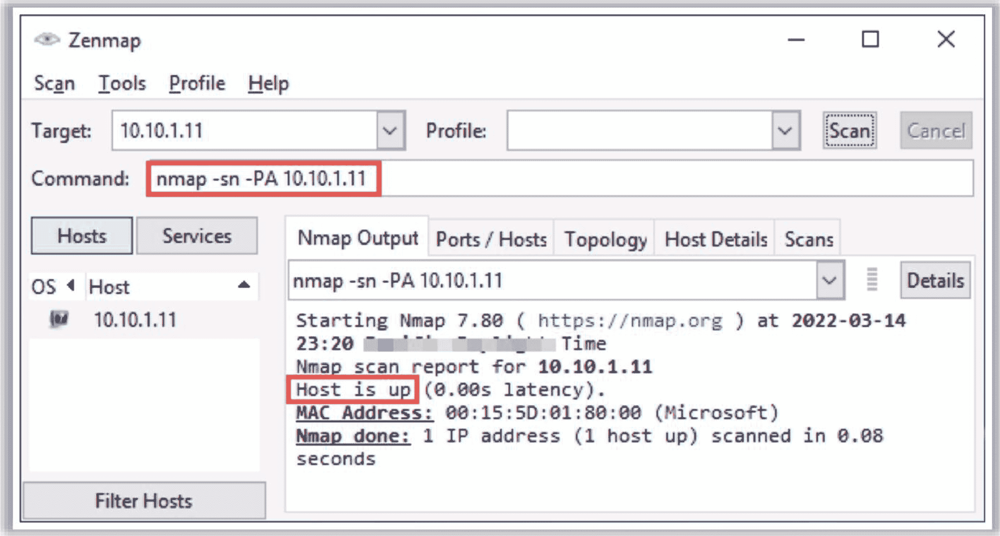

图 3.29：Zenmap 中的 TCP ACK ping 扫描

## IP 协议 Ping 扫描

IP 协议 ping 是最新的主机发现选项，它发送带有任何指定协议号的 IP 头的 IP ping 数据包。其格式与 TCP 和 UDP ping 相同。此技术尝试使用不同的 IP 协议发送不同的数据包，希望获得表明主机在线的响应。


默认情况下，当未指定协议时，会发送用于 ICMP（协议 1）、IGMP（协议 2）和 IP-in-IP（协议 4）的多个 IP 数据包。要配置默认协议，请在编译时修改 nmap.h 中的 DEFAULT_PROTO_PROBE_PORT_SPEC。对于 ICMP、IGMP、TCP（协议 6）和 UDP（协议 17）等特定协议，数据包需随正确的协议头一起发送，而对于剩余协议，仅随数据包发送 IP 头数据。

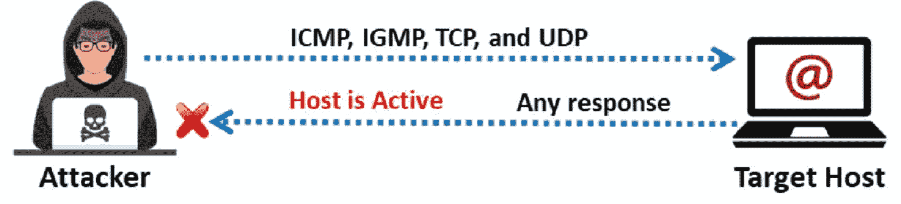

图 3.30：用于主机发现的 IP 协议 ping 扫描

简而言之，攻击者向目标主机发送不同 IP 协议的不同探测数据包；任何探测的响应都表明主机在线。在 Zenmap 中，使用 -PO 选项执行 IP 协议 ping 扫描。

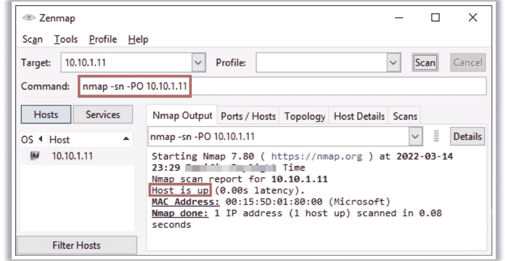

图 3.31：Zenmap 中的 IP 协议 ping 扫描

## Ping Sweep 工具

Angry IP Scanner 会 ping 每个 IP 地址以检查这些地址中是否有活跃地址。然后，它可选择解析主机名、确定 MAC 地址、扫描端口等。

## Ping Sweep 工具

- SolarWinds 工程师工具集 (https://www.solarwinds.com)
- NetScanTools Pro (https://www.netscantools.com)
- Colasoft Ping 工具 (https://www.colasoft.com)
- Visual Ping 测试器 (http://www.pingtester.net)
- OpUtils (https://www.manageengine.com)

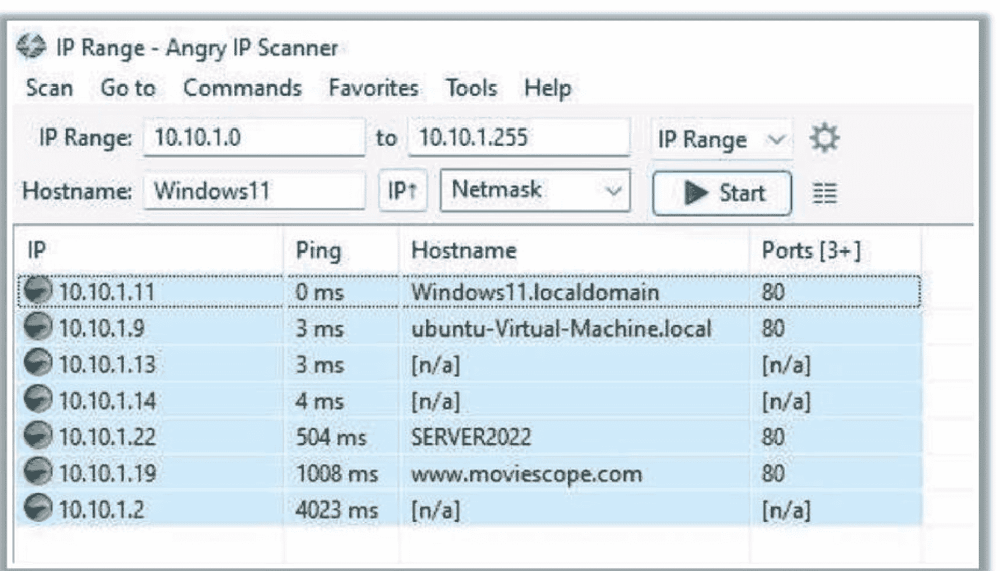

## Ping Sweep 工具

Ping sweep 工具会 ping 整个网络 IP 地址范围以识别活跃系统。以下 ping sweep 工具可通过同时向网络上的各种主机发送多个 ICMP ECHO 请求来确定目标网络上的活跃主机。

- Angry IP Scanner

来源: https://www.angryip.org

Angry IP Scanner 是一款 IP 地址和端口扫描器。它可以扫描任何范围内的 IP 地址以及它们的任意端口。它会 ping 每个 IP 地址以检查其是否存活；然后，可选择解析其主机名、确定 MAC 地址、扫描端口等。随着插件的使用，收集到的每个主机的信息量会增加。Angry IP Scanner 具有其他功能，例如 NetBIOS 信息（计算机名、工作组名和当前登录的 Windows 用户）、收藏的 IP 地址范围、Web 服务器检测和可自定义的打开器。该工具允许用户将扫描结果保存为 CSV、TXT、XML 或 IP-Port 列表文件。为提高扫描速度，它采用多线程方法：为每个被扫描的 IP 地址创建一个单独的扫描线程。

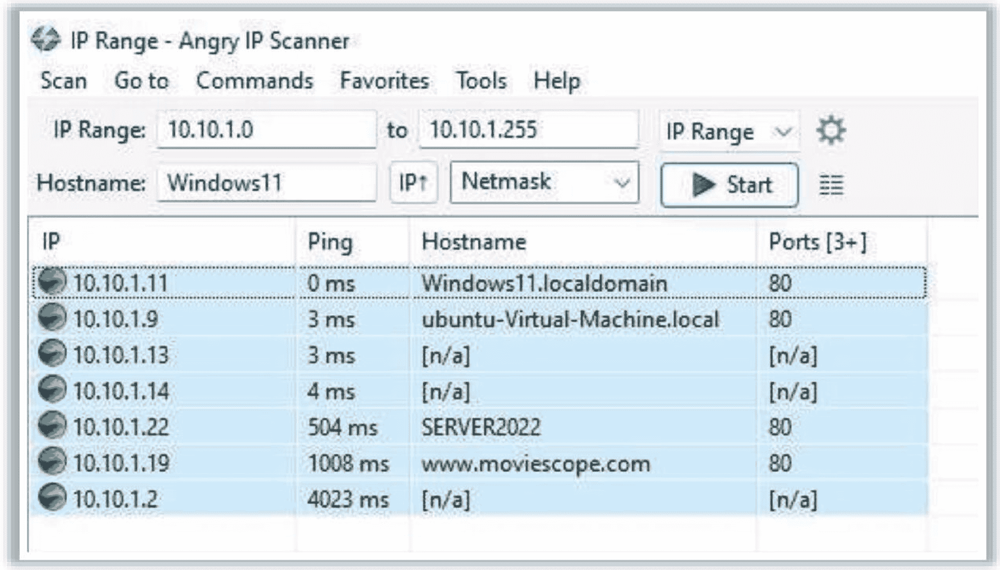

图 3.32：显示活跃主机的 Angry IP Scanner 屏幕截图

攻击者用于确定目标网络上活跃主机的一些额外 ping sweep 工具列在下面：

- SolarWinds 工程师工具集 (https://www.solarwinds.com)
- NetScanTools Pro (https://www.netscantools.com)
- Colasoft Ping 工具 (https://www.colasoft.com)
- Visual Ping 测试器 (http://www.pingtester.net)
- OpUtils (https://www.manageengine.com)

## LO#04：演示端口和服务发现的各种扫描技术


## 端口和服务发现

网络扫描过程中的下一步涉及检查活跃系统中的开放端口和服务。开放端口和服务的发现可通过各种端口扫描技术进行。管理员经常使用端口扫描技术来验证其网络的安全策略，而攻击者则使用它们来识别主机上的开放端口和正在运行的服务，意图入侵网络。此外，有时用户会在系统上不知情地保留不必要的开放端口。攻击者利用此类开放端口发起攻击。

本节描述了常见的端口和相应服务，以及攻击者用于执行端口扫描的各种端口扫描技术和工具。

## 常见端口和服务列表

下面列出了重要的保留端口：

| 名称 | 端口/协议 | 描述 |
|---|---|---|
| echo | 7/tcp, udp |  |
| discard | 9/tcp, udp | 空接收器 |
| systat | 11/tcp | 用户 |
| daytime | 13/tcp, udp |  |
| netstat | 15/tcp, udp |  |
| qotd | 17/tcp, udp | 引用 |
| chargen | 19/tcp, udp | tty 测试源 |
| ftp-data | 20/tcp | ftp 数据传输 |
| ftp | 21/tcp | ftp 命令 |
| ssh | 22/tcp | 安全 Shell |
| telnet | 23/tcp |  |
| SMTP | 25/tcp | 电子邮件服务器 |
| time | 37/tcp, udp | 时间服务器 |
| rlp | 39/tcp, udp | 资源定位 |
| domain | 53/tcp, udp | 域名服务器 |
| sql*net | 66/tcp, udp | Oracle SQL*net |
| bootps | 67/udp | bootp 服务器 |
| bootpc | 68/udp | bootp 客户端 |
| tftp | 69/udp | 简单文件传输 |
| gopher | 70/tcp | gopher 服务器 |
| finger | 79/tcp | Finger |
| www-http | 80/tcp, udp | WWW |
| www-https | 80/tcp | WWW |
| kerberos | 88/tcp, udp | Kerberos |
| pop2 | 109/tcp | 邮局 V.2 |
| Pop3 | 110/tcp | 邮局 V.3 |
| sunrpc | 111/tcp, udp | RPC 4.0 端口映射器 |
| auth/ident | 113/tcp, udp | 身份验证服务 |
| audionews | 114/tcp, udp | 音频新闻多播 |
| nntp | 119/tcp | Usenet 网络新闻传输 |
| ntp | 123/udp | 网络时间协议 |
| netbios-ns | 137/tcp, udp | NETBIOS 名称服务 |
| netbios-dgm | 138/tcp, udp | NETBIOS 数据报服务 |
| netbios-ssn | 139/tcp, udp | NETBIOS 会话服务 |
| imap | 143/tcp, udp | 互联网消息访问协议 |
| sql-net | 150/tcp, udp | SQL-NET |
| sqlsrv | 156/tcp, udp | SQL 服务 |
| snmp | 161/tcp, udp | SNMP |
| snmp-trap | 162/tcp, udp |  |
| cmip-man | 163/tcp, udp | CMIP/TCP 管理器 |
| cmip-agent | 164/tcp, udp | CMIP/TCP 代理 |
| irc | 194/tcp, udp | 互联网中继聊天 |
| at-rtmp | 201/tcp, udp | AppleTalk 路由维护 |
| at-nbp | 202/tcp, udp | AppleTalk 名称绑定 |
| at-3 | 203/tcp, udp | AppleTalk |
| at-echo | 204/tcp, udp | AppleTalk 回显 |
| at-5 | 205/tcp, udp | AppleTalk |
| at-zis | 206/tcp, udp | AppleTalk 区域信息 |
| at-7 | 207/tcp, udp | AppleTalk |
| at-8 | 208/tcp, udp | AppleTalk |
| ipx | 213/tcp, udp | Novell |
| imap3 | 220/tcp, udp | 交互式邮件访问协议 v3 |
| aurp | 387/tcp, udp | AppleTalk 基于更新的路由 |
| netware-ip | 396/tcp, udp | Novell Netware over IP |
| rmt | 411/tcp, udp | 远程 mt |
| kerberos-ds | 445/tcp, udp | Microsoft DS |
| isakmp | 500/udp | ISAKMP/IKE |
| fcp | 510/tcp | First Class 服务器 |
| exec | 512/tcp | BSD rexecd(8) |
| comsat/biff | 512/udp | 由邮件系统用于通知用户 |
| login | 513/tcp | BSD rlogind(8) |
| who | 513/udp | whod BSD rwhod(8) |
| shell | 514/tcp | cmd BSD rshd(8) |
| syslog | 514/udp | BSD syslogd(8) |
| printer | 515/tcp, udp | spooler BSD lpd(8) |
| talk | 517/tcp, udp | BSD talkd(8) |
| ntalk | 518/udp | SunOS talkd(8) |
| netnews | 532/tcp, udp | Readnews |
| uucp | 540/tcp, udp | uucpd BSD uucpd(8) |
| klogin | 543/tcp, udp | Kerberos 登录 |
| kshell | 544/tcp, udp | Kerberos Shell |
| ekshell | 545/tcp | krcmd Kerberos 加密远程 shell -kfall |
| pcserver | 600/tcp | ECD 集成 PC 板服务器 |
| mount | 635/udp | NFS 挂载服务 |
| pcnfs | 640/udp | PC-NFS DOS 身份验证 |
| bwnfs | 650/udp | BW-NFS DOS 身份验证 |
| flexlm | 744/tcp, udp | Flexible License Manager |
| kerberos-adm | 749/tcp, udp | Kerberos 管理 |
| kerberos | 750/tcp, udp | kdc Kerberos 身份验证 |
| kerberos_master | 751/tcp, udp | Kerberos 身份验证 |
| krb_prop | 754/tcp | Kerberos 从属传播 |
| applix | 999/udp | Applixware |
| socks | 1080/tcp, udp | Socks 代理 |
| kpop | 1109/tcp | 带 Kerberos 的 Pop |
| ms-sql-s | 1433/tcp, udp | Microsoft SQL Server |
| ms-sql-m | 1434/tcp, udp | Microsoft SQL Monitor |
| pptp | 1723/tcp, udp | Pptp |
| nfs | 2049/tcp, udp | 网络文件系统 |
| eklogin | 2105/tcp | Kerberos 加密 rlogin |
| rkinit | 2108/tcp | Kerberos 远程 kinit |
| kx | 2111/tcp | X over Kerberos |
| kauth | 2120/tcp | 远程 kauth |
| lyskom | 4894/tcp | LysKOM（会议系统） |
| sip | 5060/tcp | 会话发起协议 |
| sip | 5060/udp | 会话发起协议 |
| x11 | 6000-6063/tcp, udp | X Window 系统 |
| irc | 6667/tcp | 互联网中继聊天 |

表 3.1：保留端口表


## 端口扫描技术

端口扫描技术根据用于通信的协议类型进行分类

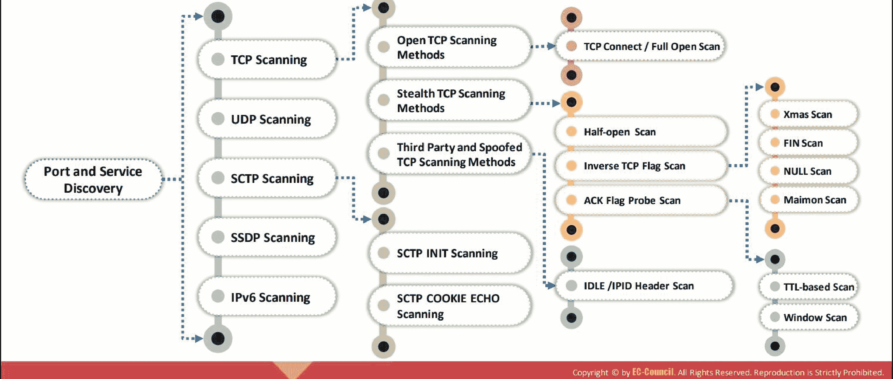

## 端口扫描技术（续）

| 扫描技术 | Nmap 命令 | 请求 | 响应 | 优点 | 缺点 |
|---|---|---|---|---|---|
| TCP Connect/全开扫描 | nmap -sT -v <Target IP Address> | SYN 数据包 | ✓ SYN+ACK 数据包响应 - 端口开放<br>✓ RST 数据包响应 - 端口关闭 | ✓ 不需要超级用户权限 | ✓ 易于检测和过滤<br>✓ 目标系统中的日志会泄露连接 |
| 隐蔽扫描（半开扫描） | nmap -sS -v <Target IP Address> | 单个 SYN 数据包 | ✓ SYN+ACK 数据包响应 - 端口开放<br>✓ RST 数据包响应 - 端口关闭 | ✓ 绕过防火墙规则和日志机制 |  |
| 反向 TCP 标志扫描 | nmap -sF -sN -sX -v <Target IP Address> | 探测数据包 (FIN/URG/PSH/NULL) | ✓ 无响应 - 端口开放<br>✓ RST 数据包响应 - 端口关闭 | ✓ 避免许多 IDS 和日志系统；高度隐蔽 | ✓ 需要对网络套接字进行原始访问和超级用户权限<br>✓ 特别是对 Microsoft Windows 主机无效 |
| Xmas 扫描 | nmap -sX -v <Target IP Address> | 探测数据包 (FIN + URG + PSH) | ✓ 无响应 - 端口开放<br>✓ RST 数据包响应 - 端口关闭 | ✓ 避免 IDS 和 TCP 三次握手 | ✓ 仅在系统符合基于 RFC 793 的 TCP/IP 实现时才有效<br>✓ 仅在 Unix 平台上有效<br>✓ 对任何当前版本的 Microsoft Windows 都无效 |
| FIN 扫描 | nmap -sF -v <Target IP Address> | 探测数据包 (FIN) | ✓ 无响应 - 端口开放<br>✓ RST 数据包响应 - 端口关闭 |  |  |
| NULL 扫描 | nmap -sN -v <Target IP Address> | 探测数据包 (NULL) | ✓ 无响应 - 端口开放<br>✓ RST 数据包响应 - 端口关闭 | ✓ 启用 TCP 标志的探测数据包可根据安装的安全机制未被检测地通过过滤器<br>✓ 仅在系统符合基于 RFC 793 的 TCP/IP 实现时才有效 | ✓ 仅在使用 Unix 基于的操作系统时有效<br>✓ 对任何当前版本的 Microsoft Windows 都无效 |
| TCP Maimon 扫描 | nmap -sM -v <Target IP Address> | 探测数据包 (FIN/ACK) | ✓ 无响应 - 端口开放<br>✓ ICMP 不可达错误响应 - 端口被过滤<br>✓ RST 数据包响应 - 端口关闭 |  |  |
| ACK 标志探测扫描 | nmap -sA -v <Target IP Address> | ACK 探测数据包 | ✓ 无响应 - 端口被过滤（存在状态防火墙）<br>✓ RST 数据包响应 - 端口未被过滤（无防火墙） |  |  |
| 基于 TTL 的 ACK 标志探测扫描 | nmap -sA --ttl 100 -v <target IP address> | 发送到不同 TCP 端口的 ACK 探测数据包（数千个） | ✓ RST 数据包响应 - 端口开放（端口的 TTL 值 < 64）<br>✓ RST 数据包响应 - 端口关闭（端口的 TTL 值 > 64） | ✓ 在大多数情况下可规避 IDS<br>✓ 有助于检查目标网络的过滤系统 | ✓ 极其缓慢，只能利用具有易受攻击的 BSD 派生 TCP/IP 堆栈的老旧操作系统 |
| 基于窗口的 ACK 标志探测扫描 | nmap -sA -sW -v <target IP address> | 发送到不同 TCP 端口的 ACK 探测数据包（数千个） | ✓ RST 数据包响应 - 端口开放（端口的 WINDOW 值非零）<br>✓ ICMP 不可达错误响应 - 端口被过滤<br>✓ RST 数据包响应 - 端口关闭（端口的 WINDOW 值为零） |  |  |
| IDLE/IPID 头部扫描 | nmap -sI <Zombie Hostname> <Target Hostname> | SYN 数据包 | ✓ SYN+ACK 数据包响应 - 端口开放<br>✓ RST 数据包响应 - 端口关闭 | ✓ 提供对远程主机的完全盲扫描 | ✓ 需要识别僵尸主机的序列号 |
| UDP 扫描 | nmap -sU -v <Target IP Address> | UDP 数据包 | ✓ 无响应 - 端口开放<br>✓ ICMP 不可达错误响应 - 端口关闭 | ✓ 对于开放端口开销更小，因为没有 TCP 握手的开销<br>✓ 基于 Microsoft 的操作系统通常不实现任何 ICMP 速率限制；因此，此扫描在基于 Windows 的设备上运行非常高效 | ✓ 缓慢，因为它限制了 ICMP 错误消息速率，作为对应用 RFC 1812 第 4.3.2.8 节的机器的补偿形式<br>✓ 远程主机需要访问原始 ICMP 套接字以区分关闭端口和不可达端口<br>✓ 需要特权访问 |
| SCTP INIT 扫描 | nmap -sY -v <Target IP Address> | INIT 分块 | ✓ INIT+ACK 分块 - 端口开放<br>✓ ICMP 不可达异常 - 端口被过滤<br>✓ ABORT 分块 - 端口关闭 | ✓ INIT 扫描通过在未受防火墙阻碍的快速网络上每秒扫描数千个端口而快速进行，提供强烈的<|message|><br>✓ 可以清楚地区分开放、关闭和过滤等各种端口状态 |  |
| SCTP COOKIE ECHO 扫描 | nmap -sZ -v <Target IP Address> | COOKIE ECHO 分块 | ✓ 无响应 - 端口开放<br>✓ ABORT 分块 - 端口关闭 | ✓ COOKIE ECHO 分块不会被非状态防火墙规则集阻止。<br>✓ 只有高级 IDS 才能检测到 SCTP COOKIE ECHO 扫描 | ✓ 无法清楚地区分开放和过滤端口，在两种情况下输出均显示为 open|filtered |

## 端口扫描技术

端口扫描技术进一步按如下所述进行分类。此分类基于网络中用于通信的协议类型。

### TCP 扫描：
- 开放 TCP 扫描方法
  - TCP Connect/全开扫描
- 隐蔽 TCP 扫描方法
  - 半开扫描
  - 反向 TCP 标志扫描
    - Xmas 扫描
    - FIN 扫描
    - NULL 扫描
    - Maimon 扫描
  - ACK 标志探测扫描
    - 基于 TTL 的扫描
    - 基于窗口的扫描
- 第三方和伪造 TCP 扫描方法
  - IDLE/IP ID 头部扫描

### UDP 扫描：
- UDP 扫描

### SCTP 扫描：
- SCTP INIT 扫描
- SCTP COOKIE/ECHO 扫描

### SSDP 扫描：
- SSDP 和列表扫描

### IPv6 扫描：
- IPv6 扫描

### TCP Connect/全开扫描

Source: https://insecure.org

TCP Connect/全开扫描是 TCP 扫描中最可靠的形式之一。在 TCP Connect 扫描中，操作系统的 TCP connect() 系统调用尝试打开目标机器上每个感兴趣端口的连接。如果端口正在监听，connect() 调用将与该特定端口上的主机成功建立连接；否则，它将返回错误消息，说明端口无法访问。

TCP Connect 扫描与目标机器完成三次握手。在 TCP 三次握手中，客户端发送 SYN 数据包，接收方用 SYN+ACK 数据包进行确认。然后，客户端用 ACK 数据包确认 SYN+ACK 数据包以完成连接。一旦握手完成，扫描器发送 RST 数据包以结束连接。

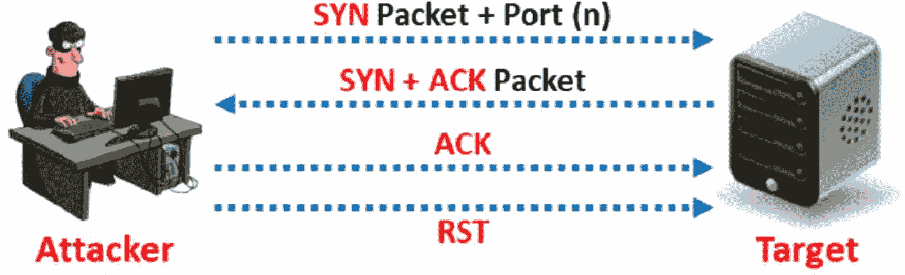

图 3.33：端口开放时的扫描结果

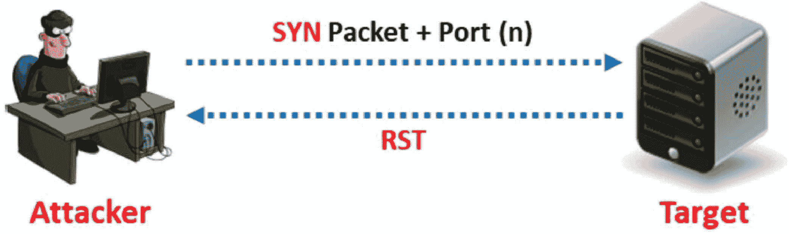

图 3.34：端口关闭时的扫描结果

以线性方式为每个目标端口单独进行 connect() 调用在慢速连接上需要很长时间。攻击者可以使用多个套接字并行加速扫描。使用非阻塞 I/O 允许攻击者设置较短的超时时间并同时监视所有套接字。在 Zenmap 中，使用 -sT 选项执行 TCP Connect/全开扫描。

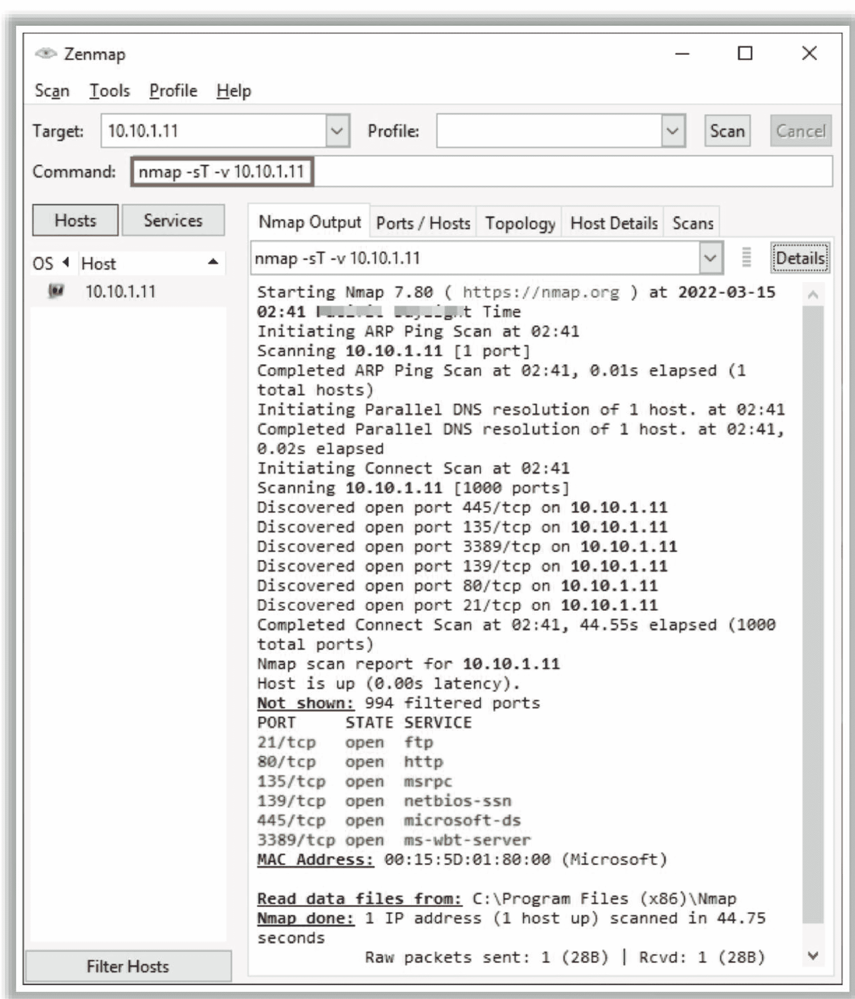

图 3.35：使用 Zenmap 进行 TCP Connect/全开扫描

这种扫描的缺点是易于检测和过滤。目标系统中的日志会泄露连接。这种扫描不需要超级用户权限。


## 隐蔽扫描（半开扫描）

隐蔽扫描会在三次握手信号完成之前突然重置客户端与服务器之间的 TCP 连接，从而使连接处于半开状态。隐蔽扫描向 TCP 端口发送单个帧，而不进行任何 TCP 握手或额外的数据包传输。这种类型的扫描发送单个帧，并期望得到单个响应。半开扫描部分打开连接但在中途停止。隐蔽扫描也称为“SYN 扫描”，因为它只发送 SYN 数据包。这可以防止服务通知传入连接。TCP SYN 或半开扫描是一种隐蔽的端口扫描方法。

隐蔽扫描也实现了三次握手方法。在最后阶段，它检查进入接口的数据包，并在触发新的初始化之前终止连接以识别远程端口。隐蔽扫描过程如下所述。

- 客户端向服务器的适当端口发送单个 SYN 数据包。
- 如果端口是开放的，服务器随后会响应 SYN/ACK 数据包。
- 如果服务器响应 RST 数据包，则远程端口处于“关闭”状态。
- 客户端发送 RST 数据包以在建立连接之前关闭初始化。


图 3.36：端口是开放的


图 3.37：端口是关闭的

攻击者使用隐蔽扫描技术来绕过防火墙规则和日志记录机制，并在网络流量中像往常一样隐藏自己。在 Zenmap 中，使用 -sS 选项执行隐蔽扫描/TCP 半开扫描。

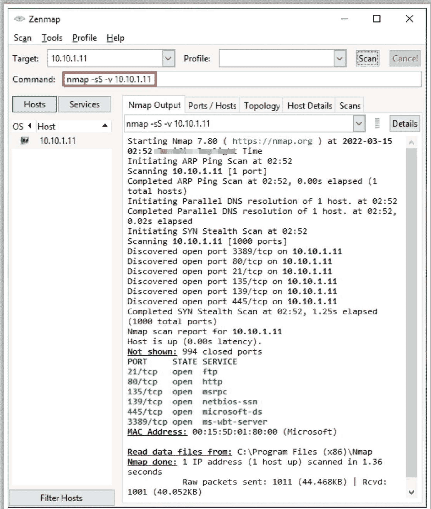

图 3.38：使用 Zenmap 进行 TCP 隐蔽/半开扫描

## 反向 TCP 标志扫描

攻击者发送带有 TCP 标志（FIN、URG、PSH）设置或不带任何标志的 TCP 探测数据包。当端口打开时，攻击者不会从主机收到任何响应，而当端口关闭时，他或她会收到来自目标主机的 RST。

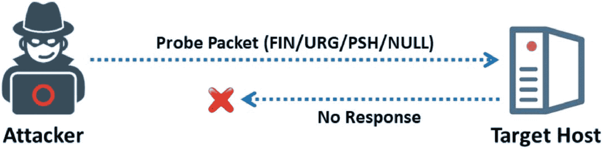

图 3.39：端口开放时的反向 TCP 标志扫描

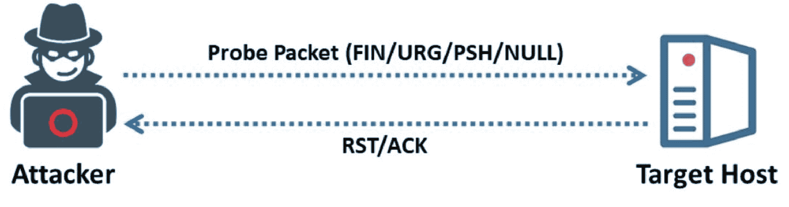

图 3.40：端口关闭时的反向 TCP 标志扫描

诸如防火墙和 IDS 之类的安全机制会检测发送到目标主机敏感端口的 SYN 数据包。Syslog 等程序可用于记录半开 SYN 标志扫描尝试。有时，根据安装的安全机制，启用 TCP 标志的探测数据包可以未被检测地通过过滤器。

一种反向技术涉及使用半开 SYN 标志探测目标，因为关闭的端口只能发送回响应。根据 RFC 793，当主机关闭端口时，会发送 RST/ACK 数据包进行连接重置。攻击者利用此功能向目标主机的每个端口发送带有各种 TCP 标志设置的 TCP 探测数据包。

用于探测数据包的常见标志配置包括：

- 带有 FIN TCP 标志设置的 FIN 探测
- 带有 FIN、URG 和 PSH TCP 标志设置的 Xmas 探测
- 不带任何 TCP 标志设置的 NULL 探测
- SYN/ACK 探测

目标主机上的所有关闭端口都会发送 RST/ACK 响应。由于 Windows 等操作系统完全忽略 RFC 793 标准，因此在连接到目标主机上的关闭端口时，您看不到 RST/ACK 响应。但是，当与基于 UNIX 的操作系统一起使用时，此技术是有效的。

## 优点

- 避免许多 IDS 和日志系统；高度隐蔽

## 缺点

- 需要对网络套接字进行原始访问以及超级用户权限
- 对使用基于 BSD 的 TCP/IP 堆栈的主机大多有效（尤其是对 Microsoft Windows 主机无效）。

注意：反向 TCP 标志扫描根据探测数据包中设置的标志称为 FIN、URG 和 PSH 扫描。如果没有设置标志，则称为 NULL 扫描。如果仅设置 FIN 标志，则称为 FIN 扫描，如果设置了 FIN、URG 和 PSH 全部，则称为 Xmas 扫描。

## Xmas 扫描

Xmas 扫描是一种反向 TCP 扫描技术，设置 FIN、URG 和 PSH 标志以向远程设备发送 TCP 帧。如果目标已打开端口，则您将不会从远程系统收到任何响应。如果目标已关闭端口，则您将收到远程系统回复的 RST。您可以使用此端口扫描技术扫描大型网络并查找哪些主机处于活动状态以及它提供的服务。此技术描述了所有 TCP 标志设置。当所有标志都设置时，一些系统会挂起；因此，标志通常以无意义的模式 URG-PSH-FIN 设置。攻击者使用 TCP Xmas 扫描通过 RST 数据包确定目标机器上的端口是否关闭。此扫描仅在系统符合基于 RFC 793 的 TCP/IP 实现时才有效。它不会对任何当前版本的 Microsoft Windows 起作用。

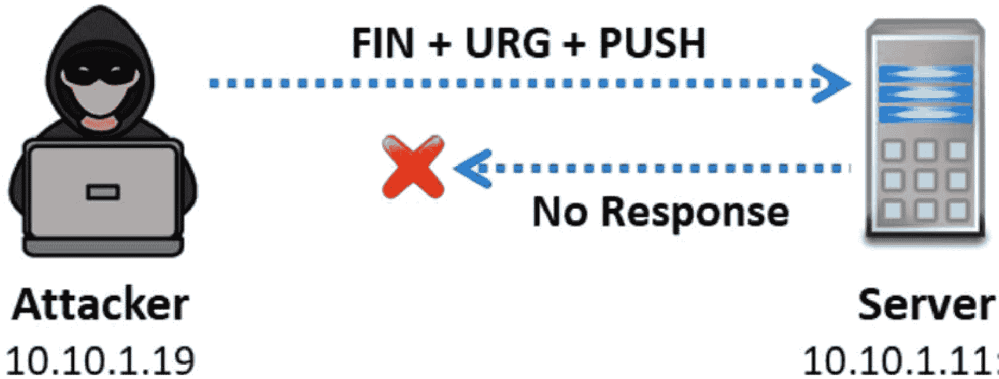

图 3.41：端口开放时的 Xmas 扫描

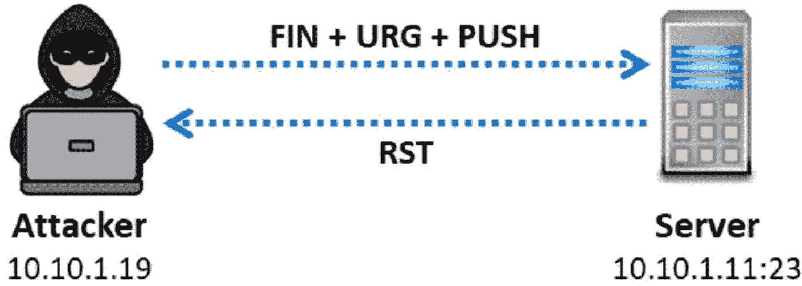

图 3.42：端口关闭时的 Xmas 扫描

## BSD 网络代码

此方法依赖于 BSD 网络代码。因此，您只能将其用于 UNIX 主机；它不支持 Windows NT。如果用户扫描任何 Microsoft 系统，它将显示主机上的所有端口都是开放的。

## 传输数据包

您可以初始化传输到远程主机的数据包时设置的所有标志。如果目标系统接受数据包且未发送任何响应，则意味着端口是开放的。如果目标系统发送 RST 标志，则意味着端口是关闭的。

## 优点

- 它避免了 IDS 和 TCP 三次握手。

## 缺点

- 它仅在 UNIX 平台上工作。

在 Zenmap 中，使用 -sX 选项执行 Xmas 扫描，而 -sF 和 -sN 选项分别用于执行 FIN 扫描和 NULL 扫描。

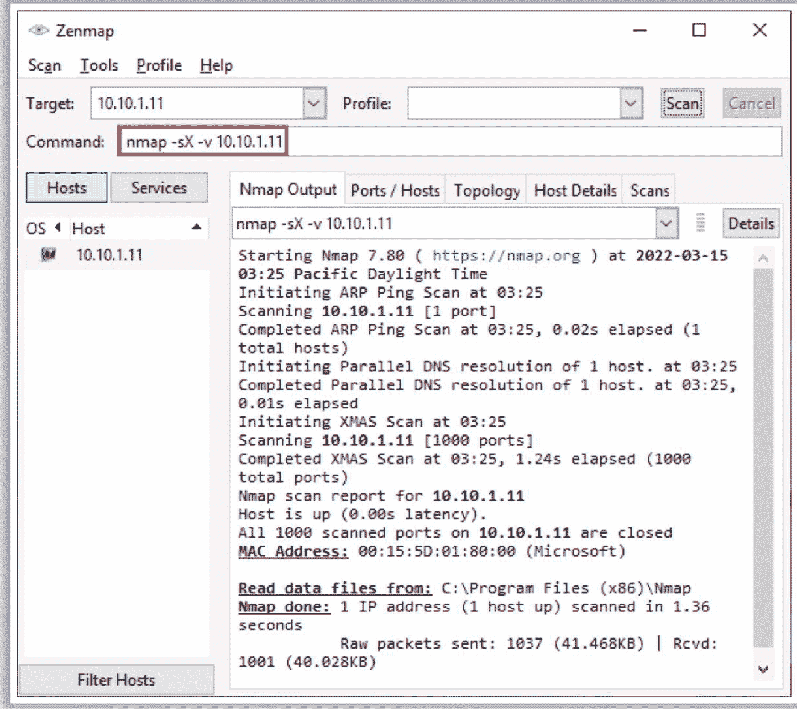

图 3.43：使用 Zenmap 的 Xmas 扫描输出

## TCP Maimon 扫描

此扫描技术与 NULL、FIN 和 Xmas 扫描非常相似，但此处使用的探测是 FIN/ACK。在大多数情况下，为了确定端口是开放还是关闭，应生成 RST 数据包作为对探测请求的响应。但是，在许多 BSD 系统中，如果探测响应中数据包被丢弃，则端口是开放的。

如果 Maimon 扫描探测即使在多次重传后仍无响应，Nmap 会将端口解释为 open|filtered。如果探测得到 RST 数据包作为响应，则端口已关闭。当目标主机返回 ICMP 不可达错误（类型 3，代码 1、2、3、9、10 或 13）时，端口被过滤。在 Zenmap 中，使用 -sM 选项执行 TCP Maimon 扫描。


图 3.44：开放端口的 TCP Maimon 扫描结果


图 3.45：关闭端口的 TCP Maimon 扫描结果


图 3.46：过滤端口的 TCP Maimon 扫描结果


图 3.47：Zenmap 中显示端口状态的 TCP Maimon 扫描

## ACK 标志探测扫描

攻击者向远程设备发送带有 ACK 标志设置的 TCP 探测数据包，然后分析收到的 RST 数据包的头部信息（TTL 和 WINDOW 字段）以确定端口是开放还是关闭。ACK 标志探测扫描利用了基于 BSD 的 TCP/IP 堆栈中的漏洞。因此，这种扫描仅对使用 BSD 派生 TCP/IP 堆栈的操作系统和平台有效。

ACK 标志探测扫描的类别包括：

## 基于 TTL 的 ACK 标志探测扫描

在此扫描技术中，您首先需要向不同的 TCP 端口发送 ACK 探测数据包（数千个），然后分析收到的 RST 数据包的 TTL 字段值。在 Zenmap 中，使用语法 nmap -ttl [time] [target] 执行基于 TTL 的扫描。


图 3.48：基于 TTL 的 ACK 标志探测扫描

如果特定端口上 RST 数据包的 TTL 值小于边界值 64，则该端口是开放的。下面给出了收到的前四个 RST 数据包的日志示例：

```
1: host 10.2.2.11 port 20: F:RST -> ttl: 80 win: 0
2: host 10.2.2.11 port 21: F:RST -> ttl: 80 win: 0
3: host 10.2.2.11 port 22: F:RST -> ttl: 50 win: 0
4: host 10.2.2.11 port 23: F:RST -> ttl: 80 win: 0
```

图 3.49：基于 RST 数据包 TTL 值的开放端口截图

在此示例中，端口 22 返回的 TTL 值为 50，小于 64；所有其他端口返回的 TTL 值为 80，大于 64。因此，端口 22 是开放的。

## 基于窗口的 ACK 标志探测扫描

在此扫描技术中，您首先需要向不同的 TCP 端口发送 ACK 探测数据包（数千个），然后分析收到的 RST 数据包的窗口字段值。当所有端口返回相同的 TTL 值时，用户可以使用此扫描技术。在 Zenmap 中，使用 -sW 选项执行窗口扫描。


图 3.50：基于窗口的 ACK 标志探测扫描

如果特定端口上 RST 数据包的窗口值非零，则该端口是开放的。下面给出了收到的前四个 RST 数据包的日志示例：

1: host 10.2.2.12 port 20: F:RST -> ttl: 64 win: 0
2: host 10.2.2.12 port 21: F:RST -> ttl: 64 win: 0
3: host 10.2.2.12 port 22: F:RST -> ttl: 64 win: 512
4: host 10.2.2.12 port 23: F:RST -> ttl: 64 win: 0

Figure 3.51: 根据 RST 分包的窗口值显示开放端口的屏幕截图

上图显示每个数据包返回的 TTL 值相同；因此，不能使用基于 TTL 的 ACK 标志探测扫描来查找开放端口。因此，当观察窗口值时，第三个数据包具有非零窗口值，这意味着端口是开放的。当返回的窗口值为零时，则端口已关闭。如果在多次重传后仍无响应，并且返回了 ICMP 不可达错误（类型 3，代码 1、2、3、9、10 或 13），则推断该端口为被过滤的端口。


Figure 3.52: 开放端口的 TCP 窗口扫描结果


Figure 3.53: 关闭端口的 TCP 窗口扫描结果


Figure 3.54: 被过滤端口的 TCP 窗口扫描结果

## 优点：
- 这种类型的扫描在大多数情况下可以规避 IDS。

## 缺点：
- 它速度极慢，只能利用具有易受攻击的 BSD 派生 TCP/IP 栈的老旧操作系统。

## 检查目标网络的过滤系统
ACK 标志探测扫描技术也有助于检查目标网络的过滤系统。攻击者发送 ACK 探测数据包以检查目标网络采用的数据包过滤机制（防火墙）。

发送带有随机序列号的 ACK 探测数据包且目标无响应，意味着端口被过滤（存在状态防火墙）；目标返回 RST 响应则意味着端口未被过滤（不存在防火墙）。


Figure 3.55: 存在状态防火墙


Figure 3.56: 无防火墙

## 使用 Nmap 进行 ACK 标志探测扫描
在 Zenmap 中，使用 -sA 选项执行 ACK 标志探测扫描。


Figure 3.57: 使用 Zenmap 进行 ACK 标志探测扫描

## IDLE/IPID 头部扫描
IDLE/IPID 头部扫描是一种 TCP 端口扫描方法，可用于向计算机发送伪造的源地址以确定可用的服务。它提供了对远程主机的完全盲扫。大多数网络服务器监听 TCP 端口；例如，Web 服务器监听 80 端口，邮件服务器监听 25 端口。如果应用程序在端口上监听，则端口被视为“开放”。确定端口是否开放的一种方法是向该端口发送“SYN”（会话建立）数据包。如果端口开放，目标机器会返回“SYN|ACK”（会话请求确认）数据包，如果端口关闭则返回“RST”（重置）数据包。接收到非请求 SYN|ACK 数据包的机器会以 RST 响应。非请求的 RST 被忽略。互联网上的每个 IP 数据包都有一个“IP 标识符”（IPID），它唯一标识原始 IP 数据报的片段。操作系统为每个发送的数据包增加 IPID。因此，探测 IPID 会向攻击者揭示自上次探测以来发送的数据包数量。在 Zenmap 中，使用 -sI 选项执行 IDLE 扫描。


Figure 3.58: 使用 Nmap 进行 IDLE/IPID 头部扫描

攻击者通过伪造冒充另一台计算机来执行此扫描。攻击者不会从其 IP 地址发送数据包；相反，他们使用另一台主机，通常称为“僵尸”，来扫描远程主机并识别开放端口。在此攻击中，攻击者期望僵尸主机的序列号，如果远程主机检查扫描方的 IP，则会显示僵尸机器的 IP。

## IDLE 扫描
- 第 1 步

空闲扫描的第一步是确定合适的僵尸。按全局方式递增分配 IPID 数据包的僵尸是执行空闲扫描的合适或空闲僵尸。攻击者-僵尸与僵尸-目标之间请求/响应时间间隔越短，扫描速度越快。

## 选择“僵尸”并探测其当前 IP 标识（IPID）号
在第一步中，SYN+ACK 数据包被发送到僵尸机器以探测其 IPID 号。这里，SYN+ACK 数据包是为探测 IPID 号而发送的，而不是为了建立 TCP 连接（三向握手）。


Figure 3.59: IDLE 扫描：第 1 步

由于僵尸不期望 SYN+ACK 数据包，它通过返回 RST 数据包来拒绝连接。僵尸机器发送的 RST 数据包被分析以提取 IPID。如图所示，我们假设僵尸以 IPID=31337 响应。此外，我们假设 IPID 为 X。

- 第 2 步

攻击者向目标机器的 80 端口发送 SYN 数据包，伪造僵尸的 IP 地址。

## 空闲扫描：第 2.1 步（开放端口）
如果端口开放，目标会向僵尸发送 SYN+ACK 数据包（因为 IP 地址被伪造）以继续三向握手。由于僵尸不期望来自目标机器的 SYN+ACK 数据包，它会以 RST 数据包响应。


Figure 3.60: 端口开放

由于每个 IP 数据包都有 IPID，且每次传输都会增加一，僵尸现在使用下一个可用的 IPID，即 31338（X + 1）。

## 空闲扫描：第 2.2 步（关闭端口）
假设目标上的端口已关闭。随后，在收到攻击者的 SYN 数据包后，目标以 RST 数据包响应，此后僵尸保持空闲。


Figure 3.61: 端口关闭

- 第 3 步

现在，重复执行步骤 1 以探测 IPID 号。


Figure 3.62: 空闲扫描：第 3 步

向僵尸发送 SYN+ACK 数据包，它会返回包含 IPID 的 RST 数据包。假设目标上的端口是开放的，并且僵尸已经向目标发送了 RST 数据包，则 IPID 号会增加 1。现在，僵尸使用下一个 IPID，即 31339（X + 2）以 RST 数据包响应攻击者。因此，IPID 增加 2，这意味着目标机器上的端口是开放的。因此，使用空闲扫描，攻击者可以通过将自己的 IP 地址伪造成僵尸的 IP 地址来识别目标机器上的开放端口和服务。

## UDP 扫描

## UDP 原始 ICMP 端口不可达扫描
UDP 端口扫描器使用 UDP 协议而不是 TCP。UDP 扫描没有三向握手。与 TCP 扫描相比，使用 UDP 协议可能更具挑战性，因为你可以发送数据包但无法确定主机是否存活、死亡或被过滤。然而，你可以使用一种 ICMP 来检查端口是否开放或关闭。如果你向未绑定应用程序的端口发送 UDP 数据包，IP 栈将返回 ICMP 端口不可达数据包。如果任何端口返回 ICMP 错误，则该端口已关闭，留下未响应的端口，如果它们是开放的或通过防火墙被过滤。


Figure 3.63: UDP 扫描

这是因为开放端口不必对探测做出确认响应，而关闭端口甚至不需要发送错误数据包。

## UDP 数据包
Source: https://nmap.org

当你向关闭的 UDP 端口发送数据包时，大多数主机都会发送 ICMP_PORT_UNREACH 错误。因此，如果 UDP 数据包或 ICMP 错误不能保证到达，你可以确定端口是否开放。因此，此类 UDP 扫描器必须实现对似乎丢失的数据包的重传。UDP 扫描器将丢失的流量解释为开放端口。在 Zenmap 中，使用 -sU 选项执行 UDP 扫描。


Figure 3.64: 使用 Zenmap 进行 UDP 扫描


In addition, this scanning technique is slow because it limits the ICMP error message rate as a form of compensation to machines that apply RFC 1812 section 4.3.2.8. A remote host will require access to the raw ICMP socket to distinguish closed ports from unreachable ports.

此外，这种扫描技术很慢，因为它限制了 ICMP 错误消息速率，作为对应用 RFC 1812 第 4.3.2.8 节的机器的补偿形式。远程主机需要访问原始 ICMP 套接字来区分关闭的端口和不可达的端口。

## UDP RECVFROM() and WRITE() Scanning
## UDP RECVFROM() 和 WRITE() 扫描

Although non-root users cannot read unreachable port errors directly, Linux informs you indirectly when it receives messages.

虽然非 root 用户无法直接读取不可达端口错误，但 Linux 在接收到消息时会间接通知你。

### Example:
### 示例：
For example, a second write() call to a closed port will usually fail. Various scanners, such as Netcat and Pluvial pscan.c, perform recvfrom() on non-blocking UDP sockets, and they usually return EAGAIN ("Try Again," errno 11) if the ICMP error has not been received or ECONNREFUSED ("Connection refused," errno 111) otherwise. This technique is used for determining open ports when non-root users use -u (UDP). Root users can also use the -1 (lame UDP scan) option to force this process.

例如，对关闭端口的第二次 write() 调用通常会失败。各种扫描器，例如 Netcat 和 Pluvial pscan.c，在非阻塞 UDP 套接字上执行 recvfrom()，如果未收到 ICMP 错误，它们通常返回 EAGAIN（“Try Again”，errno 11），否则返回 ECONNREFUSED（“Connection refused”，errno 111）。当非 root 用户使用 -u（UDP）时，使用此技术来确定开放端口。root 用户还可以使用 -1（lame UDP scan）选项来强制此过程。

### Advantage:
### 优点：
The UDP scan is less intrusive with regard to an open port because there is no overhead of a TCP handshake. However, if ICMP is responding to each unavailable port, the total number of frames can exceed that from a TCP scan. Microsoft-based OSs do not usually implement any ICMP rate limiting; hence, this scan operates very efficiently on Windows-based devices.

UDP 扫描对开放端口的侵入性较小，因为没有 TCP 握手的开销。然而，如果 ICMP 对每个不可用的端口都作出响应，总帧数可能超过 TCP 扫描。基于 Microsoft 的操作系统通常不实现任何 ICMP 速率限制；因此，此扫描在基于 Windows 的设备上运行效率非常高。

### Disadvantage:
### 缺点：
The UDP scan provides port information only. If additional information of the version is needed, the scan must be supplemented with a version detection scan (-sV) or the OS fingerprinting option (-o).

UDP 扫描仅提供端口信息。如果需要版本等额外信息，则扫描必须辅以版本检测扫描（-sV）或操作系统指纹识别选项（-o）。

The UDP scan requires privileged access; hence, this scan option is only available on systems with the appropriate user permissions.

UDP 扫描需要特权访问；因此，此扫描选项仅在具有适当用户权限的系统上可用。

Most networks have massive amounts of TCP traffic; as a result, the efficiency of the UDP scan is low. The UDP scan will locate open ports and provide the security manager with valuable information for identifying successful attacker invasions on open UDP ports owing to spyware applications, Trojan horses, and other malicious software.

大多数网络都有大量的 TCP 流量；因此，UDP 扫描的效率较低。UDP 扫描将定位开放端口，并为安全管理员提供有价值的信息，以识别由于间谍软件应用程序、特洛伊木马和其他恶意软件对开放 UDP 端口的成功攻击者入侵。

## SCTP INIT Scan
## SCTP INIT 扫描

Stream Control Transport Protocol (SCTP) is a reliable message-oriented transport layer protocol. It is used as an alternative to the TCP and UDP protocols, as its characteristics are similar to those of TCP and UDP. SCTP is specifically used to perform multi-homing and multi-streaming activities. Some SCTP applications include discovering VoIP, IP telephony, and Signaling System 7/Signaling Transport (SS7/SIGTRAN)-related services. SCTP association comprises a four-way handshake method, as shown in the screenshot below.

流控制传输协议（SCTP）是一种可靠的消息导向传输层协议。它用作 TCP 和 UDP 协议的替代方案，因为其特性与 TCP 和 UDP 相似。SCTP 专门用于执行多宿主和多流活动。一些 SCTP 应用包括发现 VoIP、IP 电话和信令系统 7/信令传输（SS7/SIGTRAN）相关服务。SCTP 关联包括四次握手方法，如下图所示。


Figure 3.65: SCTP Association four-way handshake
图 3.65：SCTP 关联四次握手

In SCTP, the INIT scan is performed quickly by scanning thousands of ports per second on a fast network not obstructed by a firewall offering a stronger sense of security. The SCTP INIT scan is very similar to the TCP SYN scan; comparatively, it is also stealthy and unobtrusive, as it cannot complete SCTP associations, hence making the connection half-open.

在 SCTP 中，INIT 扫描通过在未受防火墙阻碍的快速网络上每秒扫描数千个端口来快速执行，提供更强的安全感。SCTP INIT 扫描与 TCP SYN 扫描非常相似；相比之下，它也具有隐蔽性和不显眼性，因为它无法完成 SCTP 关联，因此使连接处于半开状态。

Attackers send INIT chunk to the target host. If the port is listening or open, it sends an acknowledgement as an INIT+ACK chunk.

攻击者向目标主机发送 INIT 分块。如果端口正在监听或开放，则会作为 INIT+ACK 分块发送确认。


Figure 3.66: SCTP INIT scan result when a port is listening (Open)
图 3.66：端口正在监听（开放）时 SCTP INIT 扫描结果

If the target is inactive and it is not listening, then it sends an acknowledgement as an ABORT chunk.

如果目标处于非活动状态且未监听，则会作为 ABORT 分块发送确认。


Figure 3.67: SCTP INIT scan result when a port is not listening (Closed)
图 3.67：端口未监听（关闭）时 SCTP INIT 扫描结果

After several retransmissions, if there is no response, then the port is indicated as a filtered port. The port is also indicated as a filtered port if the target server responds with an ICMP unreachable exception (type 3, code 0, 1, 2, 3, 9, 10, or 13). In Zenmap, the -sY option is used to perform the SCTP INIT scan.

经过多次重传后，如果没有响应，则端口被指示为已过滤端口。如果目标服务器以 ICMP 不可达异常（类型 3，代码 0、1、2、3、9、10 或 13）响应，则端口也将被指示为已过滤端口。在 Zenmap 中，使用 -sY 选项执行 SCTP INIT 扫描。

### Advantages:
### 优点：
- INIT scan can clearly differentiate between various ports such as open, closed, and filtered states
- INIT 扫描可以清楚地区分各种端口，例如开放、关闭和过滤状态


Figure 3.68: SCTP INIT scan in Zenmap
图 3.68：Zenmap 中的 SCTP INIT 扫描

## SCTP COOKIE ECHO Scan
## SCTP COOKIE ECHO 扫描

SCTP COOKIE ECHO scan is a more advanced type of scan. In this type of scan, attackers send the COOKIE ECHO chunk to the target, and if the target port is open, it will silently drop the packets onto the port and you will not receive any response from the target. If the target sends back the ABORT chunk response, then the port is considered as a closed port. The COOKIE ECHO chunk is not blocked by non-stateful firewall rule sets as in the INIT scan. Only an advanced IDS can detect the SCTP COOKIE ECHO scan. In Zenmap, the -sZ option is used to perform the SCTP COOKIE ECHO scan.

SCTP COOKIE ECHO 扫描是一种更高级的扫描类型。在这种扫描中，攻击者向目标发送 COOKIE ECHO 分块，如果目标端口开放，它会静默丢弃发送到该端口的数据包，你将不会收到目标的任何响应。如果目标返回 ABORT 分块响应，则端口被视为关闭端口。与 INIT 扫描不同，COOKIE ECHO 分块不会被非状态防火墙规则集阻止。只有高级 IDS 才能检测到 SCTP COOKIE ECHO 扫描。在 Zenmap 中，使用 -sZ 选项执行 SCTP COOKIE ECHO 扫描。


Figure 3.69: SCTP COOKIE ECHO scan result when port is open
图 3.69：端口开放时 SCTP COOKIE ECHO 扫描结果


Figure 3.70: SCTP COOKIE ECHO scan result when port is closed
图 3.70：端口关闭时 SCTP COOKIE ECHO 扫描结果

### Advantages:
### 优点：
- The port scan is not as conspicuous as the INIT scan.
- 端口扫描不如 INIT 扫描那么显眼。

### Disadvantages:
### 缺点：
- SCTP COOKIE ECHO scan cannot differentiate clearly between open and filtered ports, and it shows the output as open|filtered in both cases.
- SCTP COOKIE ECHO 扫描无法清楚地区分开放和过滤端口，在两种情况下都显示输出为 open|filtered。


Figure 3.71: SCTP COOKIE-ECHO scan in Zenmap
图 3.71：Zenmap 中的 SCTP COOKIE-ECHO 扫描

## SSDP and List Scan
## SSDP 和列表扫描

### SSDP Scan
### SSDP 扫描
- The Simple Service Discovery Protocol (SSDP) is a network protocol that works in conjunction with the UPnP to detect plug and play devices
- Simple Service Discovery Protocol (SSDP) 是一种网络协议，与 UPnP 协同工作以检测即插即用设备
- Vulnerabilities in UPnP may allow attackers to launch Buffer overflow or DoS attacks
- UPnP 中的漏洞可能允许攻击者发起缓冲区溢出或 DoS 攻击
- Attacker may use the UPnP SSDP M-SEARCH information discovery tool to check if the machine is vulnerable to UPnP exploits or not
- 攻击者可能会使用 UPnP SSDP M-SEARCH 信息发现工具来检查机器是否容易受到 UPnP 利用

### List Scan
### 列表扫描
- This type of scan simply generates and prints a list of IPs/Names without actually pinging them
- 这种扫描类型只是生成并打印 IP/名称列表，而不实际 ping 它们
- A reverse DNS resolution is performed to identify the host names
- 会执行反向 DNS 解析以识别主机名


## SSDP and List Scan
## SSDP 和列表扫描

### SSDP Scan
### SSDP 扫描
Simple Service Discovery Protocol (SSDP) is a network protocol that generally communicates with machines when querying them with routable IPv4 or IPv6 multicast addresses. The SSDP service controls communication for the Universal Plug and Play (UPnP) feature. It generally works when the machine is not firewalled; however, it can sometimes work through a firewall. The SSDP service will respond to a query sent over IPv4 or IPv6 broadcast addresses. This response includes information about the UPnP feature associated with it. The attacker uses SSDP scanning to detect UPnP vulnerabilities that may allow him/her to launch buffer overflow or DoS attacks.

Simple Service Discovery Protocol (SSDP) 是一种网络协议，通常在用可路由的 IPv4 或 IPv6 组播地址查询机器时与机器通信。SSDP 服务控制通用即插即用（UPnP）功能的通信。它通常在机器未被防火墙保护时工作；然而，有时它也可以通过防火墙工作。SSDP 服务会响应通过 IPv4 或 IPv6 广播地址发送的查询。此响应包括与其关联的 UPnP 功能的信息。攻击者使用 SSDP 扫描来检测 UPnP 漏洞，这些漏洞可能允许他/她发起缓冲区溢出或 DoS 攻击。


Figure 3.72: UPnP SSDP M-SEARCH in Parrot Security
图 3.72：Parrot Security 中的 UPnP SSDP M-SEARCH

The attacker may use the UPnP SSDP M-SEARCH information discovery tool to check whether the machine is vulnerable to UPnP exploits. The UPnP SSDP M-SEARCH information discovery tool gleans information from UPnP-enabled systems, as shown in the figure.

攻击者可能会使用 UPnP SSDP M-SEARCH 信息发现工具来检查机器是否容易受到 UPnP 利用。UPnP SSDP M-SEARCH 信息发现工具从启用 UPnP 的系统收集信息，如图所示。

### List Scan
### 列表扫描
In a list scan, the discovery of the active network host is indirect. A list scan simply generates and prints a list of IPs/Names without actually pinging or scanning the hosts. As a result, the list scan shows all IP addresses as “not scanned” (0 hosts up). By default, a reverse DNS resolution is still carried out on each host by Nmap to learn their names. In Zenmap, the -sL option is used to perform a list scan.

在列表扫描中，活动网络主机的发现是间接的。列表扫描只是生成并打印 IP/名称列表，而不实际 ping 或扫描主机。因此，列表扫描将所有 IP 地址显示为“未扫描”（0 个主机启动）。默认情况下，Nmap 仍会对每个主机执行反向 DNS 解析以了解其名称。在 Zenmap 中，使用 -sL 选项执行列表扫描。


Figure 3.73: List scan using Zenmap
图 3.73：使用 Zenmap 进行列表扫描

### Advantages:
### 优点：
- A list scan can perform a good sanity check.
- 列表扫描可以进行良好的合理性检查。
- The list scan detects incorrectly defined IP addresses in the command line or in an option file. It primarily repairs the detected errors to run any “active” scan.
- 列表扫描检测命令行或选项文件中定义不正确的 IP 地址。它主要修复检测到的错误以运行任何“主动”扫描。

## IPv6 Scan
## IPv6 扫描
- IPv6 increases the IP address size from 32 bits to 128 bits to support more levels of address hierarchy
- IPv6 将 IP 地址大小从 32 位增加到 128 位，以支持更多级别的地址层次结构
- Attackers need to harvest IPv6 addresses from network traffic, recorded logs, or Received from: header lines in archived emails
- 攻击者需要从网络流量、记录日志或归档电子邮件中的 Received from: 标头行中收集 IPv6 地址
- Attackers can use the -6 option in Zenmap to perform IPv6 scanning
- 攻击者可以在 Zenmap 中使用 -6 选项执行 IPv6 扫描


```
root@ :~# nmap -6 scanme.nmap.org
Starting Nmap ( http://nmap.org ) at 04:25 UTC
Nmap scan report for scanme.nmap.org (2600:3c01::f03c:91ff:fe18:bb2f)
Host is up (0.062s latency).
Not shown: 997 closed ports
PORT      STATE SERVICE
22/tcp    open  ssh
80/tcp    open  http
31337/tcp open  Elite

Nmap done: 1 IP address (1 host up) scanned in 3.94 seconds
```


## IPv6 Scan
## IPv6 扫描

IPv6 increases the size of the IP address space from 32 bits to 128 bits to support higher levels of the addressing hierarchy. Traditional network scanning techniques are computationally less feasible because of the larger search space (64 bits of host address space, or 2^64 addresses) provided by IPv6 in a subnet. Scanning the IPv6 network is more difficult and complex compared to IPv4. Additionally, a number of scanning tools do not support ping sweeps on IPv6 networks. Attackers need to harvest IPv6 addresses from network traffic, recorded logs, or "Received from" and other header lines in archived email or Usenet news messages to identify IPv6 addresses for subsequent port scanning. However, scanning an IPv6 network provides a large number of hosts in a subnet; if an attacker can compromise one subnet host, he/she can probe the "all hosts" link local multicast address if the hosts numbers are sequential or use any regular scheme. An attacker needs to analyze 2^64 addresses to verify if a particular open service is running on a host in that subnet. At a conservative rate of one probe per second, such a scan would take about 5 billion years to complete. Attackers can use Nmap to perform IPv6 scanning. In Zenmap, the -6 option is used to perform the IPv6 scan.

IPv6 将 IP 地址空间的大小从 32 位增加到 128 位，以支持更高级别的寻址层次结构。由于 IPv6 在子网中提供的更大搜索空间（64 位主机地址空间，或 2^64 个地址），传统网络扫描技术在计算上不太可行。与 IPv4 相比，扫描 IPv6 网络更困难、更复杂。此外，许多扫描工具不支持 IPv6 网络上的 ping 扫描。攻击者需要从网络流量、记录日志或归档电子邮件或 Usenet 新闻消息中的“Received from”和其他标头行中收集 IPv6 地址，以便进行后续端口扫描。然而，扫描 IPv6 网络会在子网中提供大量主机；如果攻击者能够入侵一个子网主机，他/她可以探测“所有主机”链路本地组播地址，如果主机号是顺序的或使用任何常规方案。攻击者需要分析 2^64 个地址来验证子网中主机上是否运行特定开放服务。以每秒一次探测的保守速率计算，此类扫描大约需要 50 亿年才能完成。攻击者可以使用 Nmap 执行 IPv6 扫描。在 Zenmap 中，使用 -6 选项执行 IPv6 扫描。

```
root@ :~# nmap -6 scanme.nmap.org
Starting Nmap ( http://nmap.org ) at 04:25 UTC
Nmap scan report for scanme.nmap.org (2600:3c01::f03c:91ff:fe18:bb2f)
Host is up (0.062s latency).
Not shown: 997 closed ports
PORT      STATE SERVICE
22/tcp    open  ssh
80/tcp    open  http
31337/tcp open  Elite

Nmap done: 1 IP address (1 host up) scanned in 3.94 seconds
```

Figure 3.74: IPv6 Scan using nmap
图 3.74：使用 nmap 进行 IPv6 扫描


## 服务版本发现

- 服务版本检测帮助攻击者获取目标系统上运行的服务及其版本信息
- 获取准确的服务版本号可使攻击者确定目标系统对特定漏洞利用的易受攻击性
- 在 Zenmap 中，-sV 选项用于检测服务版本


## 服务版本发现

每个端口都被分配了特定的服务，而每个服务都有自己的版本。某些协议版本不安全，攻击者可以通过利用此漏洞入侵机器。服务版本检测帮助攻击者获取目标系统上运行的服务及其版本信息。通过获取准确的服务版本号，攻击者可以确定目标系统容易受到哪些漏洞利用。

版本检测技术无非是对 TCP 和 UDP 端口的检查。Nmap service-probes 数据库中的探针用于查询各种服务并匹配用于识别和解析响应的表达式。在 Zenmap 中，-sV 选项用于检测服务版本。


图 3.75：Zenmap 中的服务版本发现

## Nmap 扫描时间减少技术

在 Nmap 中，**性能**和**准确性**可以通过减少扫描时间来实现

### 扫描时间减少技术

- 1. 省略非关键测试
- 2. 优化定时参数
- 3. 分离并优化 UDP 扫描
- 4. 升级 Nmap
- 5. 执行并发 Nmap 实例
- 6. 从有利的网络位置扫描
- 7. 增加可用带宽和 CPU 时间

## Nmap 扫描时间减少技术

在 Nmap 中，性能和准确性具有高度优先级，这只能通过减少长时间的扫描时间来实现。减少扫描时间的重要技术如下：

### 省略非关键测试

执行 Nmap 扫描时，可通过以下方法降低时间复杂度：

- 如果只需要最少量的信息，则避免进行深入扫描。
- 使用特定命令可以限制扫描的端口数量。
- 仅当需要检查主机是否在线时，才可以跳过端口扫描（`-sn`）。
- 可以避免高级扫描类型（`-sC`、`-sV`、`-O`、`--traceroute` 和 `-A`）。
- 仅在必要时才应打开 DNS 解析。

### 优化定时参数

为了控制扫描活动，Nmap 提供了 `-T` 选项，用于从高级别到低级别的扫描时序攻击性。这对于扫描高度过滤的网络非常有用。

### 分离并优化 UDP 扫描

由于许多易受攻击的服务使用 UDP 协议，因此扫描 UDP 协议至关重要，并且应单独扫描，因为 TCP 扫描具有不同的性能要求和时序特性。此外，与 TCP 扫描相比，UDP 扫描受 ICMP 错误速率限制的影响更大。

- **升级 Nmap**
  始终建议使用升级版的 Nmap，因为它包含许多错误修复、重要的算法增强以及高性能功能，例如本地网络 ARP 扫描。
- **执行并发 Nmap 实例**
  对整个网络运行 Nmap 通常会使系统变慢且效率降低。Nmap 支持并行化，并且可以根据特定需求进行自定义。在扫描较大组时，通过了解网络可靠性，它变得非常高效。通过将其分为多个组并同时运行，可以提高扫描的整体速度。
- **从有利的网络位置扫描**
  在内部网络中，始终建议从主机本地网络向目标运行 Nmap，因为它提供纵深防御安全。执行防火墙测试或需要从外部攻击者视角监控网络时，必须进行外部扫描。
- **增加可用带宽和 CPU 时间**
  通过增加可用带宽或 CPU 功率，可以减少 Nmap 扫描时间。这可以通过安装新的数据线路或停止任何正在运行的应用程序来实现。Nmap 由其自身的拥塞控制算法控制，从而可以防止网络泛滥。这提高了其准确性。Nmap 的带宽使用情况可以通过以详细模式 `-v` 运行来测试。

## LO#05：演示操作系统发现的各种扫描技术


### 操作系统发现（横幅抓取/操作系统指纹识别）

攻击者使用操作系统发现或横幅抓取技术来识别运行已知漏洞利用的应用程序和操作系统版本的网络主机。本节向您介绍横幅抓取、其类型和横幅抓取工具。

## 操作系统发现/横幅抓取

横幅抓取或操作系统指纹识别是用于确定远程目标系统上运行的操作系统的方法。横幅抓取有两种类型：主动和被动。

识别目标主机使用的操作系统使攻击者能够了解系统所具有的漏洞以及可能在系统上工作的漏洞利用，以便进一步进行额外攻击

### 主动横幅抓取

- 专门定制的包发送到远程操作系统并记录响应
- 然后将响应与数据库进行比较以确定操作系统
- 由于 TCP/IP 堆栈实现存在差异，不同操作系统的响应各不相同


### 被动横幅抓取

- **来自错误消息的横幅抓取**
  错误消息提供有关目标远程系统使用的服务器类型、操作系统类型和 SSL 工具等信息。
- **嗅探网络流量**
  捕获和分析来自目标的包使攻击者能够确定远程系统使用的操作系统。
- **来自页面扩展的横幅抓取**
  在 URL 中查找扩展可能有助于确定应用程序的版本。
  示例：.aspx => IIS 服务器和 Windows 平台

注意：我们将在后面的模块中讨论被动横幅抓取。

## 操作系统发现/横幅抓取

横幅抓取，或 "OS fingerprinting," 是用于确定远程目标系统上运行的操作系统的方法。这是一种重要的扫描方法，因为如果已知目标系统的操作系统，攻击者成功的概率会更高（许多漏洞是特定于操作系统的）。攻击者然后可以根据目标系统的操作系统制定攻击策略。

横幅抓取有两种方法：在尝试连接到服务（如 FTP 站点）时发现横幅，以及下载二进制文件/bin/ls 以检查系统架构。

更先进的指纹识别技术依赖于堆栈查询，该技术将数据包传输到网络主机并根据回复进行评估。第一个关于 TCP 通信模式设计的堆栈查询方法评估对连接请求的响应。

下一个方法称为初始序列号（ISN）分析，识别 TCP 堆栈中随机数生成器的差异。ICMP 响应分析是用于指纹识别操作系统的另一种方法。它包括向远程主机发送 ICMP 消息并评估回复。

下面描述了两种横幅抓取技术：

### 主动横幅抓取

主动横幅抓取应用了操作系统的 IP 堆栈对专门定制的 TCP 数据包有独特响应方式的原理。这是因为供应商在特定操作系统上实现 TCP/IP 堆栈时应用了不同的解释。在主动横幅抓取中，攻击者发送各种畸形数据包到

远程主机，并将响应与数据库进行比较。不同操作系统的响应因 TCP/IP 栈实现存在差异而有所不同。

例如，扫描工具 Nmap 使用一系列九项测试来确定操作系统指纹或横幅抓取。以下列出的测试提供了有关主动横幅抓取攻击的一些见解，如 www.packetwatch.net 所描述的：

- **测试 1：** 发送一个启用了 SYN 和 ECN-Echo 标志的 TCP 数据包到一个开放的 TCP 端口。
- **测试 2：** 发送一个未启用任何标志的 TCP 数据包到一个开放的 TCP 端口。这种类型的数据包是 NULL 数据包。
- **测试 3：** 发送一个启用了 URG、PSH、SYN 和 FIN 标志的 TCP 数据包到一个开放的 TCP 端口。
- **测试 4：** 发送一个启用了 ACK 标志的 TCP 数据包到一个开放的 TCP 端口。
- **测试 5：** 发送一个启用了 SYN 标志的 TCP 数据包到一个关闭的 TCP 端口。
- **测试 6：** 发送一个启用了 ACK 标志的 TCP 数据包到一个关闭的 TCP 端口。
- **测试 7：** 发送一个启用了 URG、PSH 和 FIN 标志的 TCP 数据包到一个关闭的 TCP 端口。
- **测试 8 PU（端口不可达）：** 发送一个 UDP 数据包到一个关闭的 UDP 端口。目标是从目标机器提取“ICMP 端口不可达”消息。
- **测试 9 TSeq（TCP 序列能力测试）：** 此测试试图确定 TCP 初始序列号（也称为 TCP ISN 采样）、IP 标识号（也称为 IPID 采样）和 TCP 时间戳号的序列生成模式。它向一个开放的 TCP 端口发送六个启用了 SYN 标志的 TCP 数据包。

这些测试的目标是找到 TCP 实现在响应连接请求时选择的初始数字序列的模式。它们可以归类为组，例如传统 64K（许多旧的 UNIX 机器）、随机递增（Solaris、IRIX、FreeBSD、Digital UNIX、Cray 等更新版本）或真正随机（Linux 2.0.*、OpenVMS、更新的 AIX 等）。Windows 机器使用“时间相关”模型，其中 ISN 会随着每次出现而增加固定数量。

## 被动横幅抓取

来源：https://www.broadcom.com

与主动横幅抓取类似，被动横幅抓取也依赖于栈的不同实现以及操作系统对数据包响应的各种方式。然而，与扫描目标主机不同，被动指纹识别通过嗅探从目标主机捕获数据包，以研究可以揭示操作系统的迹象。

被动横幅抓取包括：

- **来自错误消息的横幅抓取**：错误消息提供信息，例如服务器类型、操作系统类型以及目标远程系统使用的 SSL 工具。
- **嗅探网络流量**：捕获并分析来自目标的数据包使攻击者能够确定远程系统使用的操作系统。
- **来自页面扩展的横幅抓取**：查看 URL 中的扩展可能有助于确定应用程序版本。例如，.aspx => IIS 服务器和 Windows 平台。

通常用于确定操作系统的四个区域如下：

- 数据包的 TTL（生存时间）：操作系统对传出数据包设置了什么生存时间？
- 窗口大小：操作系统设置了什么窗口大小？
- 是否设置了 DF（禁止分片）位：操作系统是否设置了 DF 位？
- TOS（服务类型）：操作系统是否设置了 TOS，如果设置了，是什么设置？

被动指纹识别既不完全准确，也不局限于这四个签名。然而，通过查看多个签名并结合信息，可以提高其准确性。

以下是由 Lance Spitzner 在其关于被动指纹识别的论文中描述的嗅探数据包的分析：

```
04/20-21:41:48.129662 129.142.224.3:659 -> 172.16.1.107:604
TCP TTL:45 TOS:0x0 ID:56257
***F**A* Seq: 0x9DD90553
Ack: 0xE3C65D7 Win: 0x7D78
```

根据这四个标准，识别出以下内容：

- TTL: 45
- 窗口大小：0x7D78（或十进制 32120）
- DF：已设置 DF 位
- TOS：0x0

将此信息与签名数据库进行比较。

**TTL：** 分析中的 TTL 为 45。原始数据包经过 19 跳到达目标，因此它将原始 TTL 设置为 64。基于此 TTL，看起来用户是从 Linux 或 FreeBSD 机器发送数据包的（然而，需要向数据库添加更多系统签名）。通过对远程主机实施 traceroute 来确认此 TTL。如果需要隐秘地执行跟踪，可以将 traceroute TTL（默认 30 跳）设置为比远程主机少一到两跳（-m 选项）。以这种方式设置 traceroute 会揭示路径信息（包括上游提供商），而无需实际联系远程主机。

**窗口大小：** 在此步骤中，比较窗口大小。窗口大小是确定使用什么窗口大小以及更改频率的有效工具。在之前的签名中，窗口大小设置为 0x7D78，这是 Linux 使用的默认窗口大小。此外，FreeBSD 和 Solaris 在整个会话中倾向于保持相同的窗口大小。然而，Cisco 路由器和 Microsoft Windows NT 的窗口大小 constantly change。窗口大小在初始三次握手之后测量时更准确（由于 TCP 慢启动）。

**DF 位：** 大多数系统使用已设置的 DF 位；因此，其价值有限。然而，这使得更容易识别少数不使用 DF 标志的系统（例如 SCO 或 OpenBSD）。

**TOS：** TOS 的价值也有限，因为它似乎更多基于会话而不是操作系统。换句话说，确定 TOS 的很大程度上不是操作系统，而是所使用的协议。

使用从数据包获得的信息，特别是 TTL 和窗口大小，可以将结果与签名数据库进行比较，并以一定的置信度确定操作系统（在本例中为 Linux 内核 2.2.x）。

被动指纹识别与主动指纹识别一样存在一些局限性。首先，构建自己的数据包的应用程序（例如 Nmap、Hunt、Nemesis 等）不会使用与操作系统相同的签名。其次，远程主机相对容易调整数据包上的 TTL、窗口大小、DF 或 TOS 设置。

被动指纹识别还有其他用途。例如，攻击者可以使用隐秘的指纹识别来确定潜在目标（如 Web 服务器）的操作系统。用户只需从服务器请求网页，然后分析嗅探器跟踪即可。这避免了使用各种入侵检测系统可以检测到的主动工具的需要。被动指纹识别还有助于识别远程代理防火墙。可能可以从上述讨论的签名中识别代理防火墙，原因很简单，代理防火墙会为客户端重建连接。同样，被动指纹识别可用于识别非法系统。

**注意：** 我们将在后面的模块中讨论被动横幅抓取。

## 为什么进行横幅抓取？

攻击者使用横幅抓取来识别目标主机使用的操作系统，从而确定可能在该系统上工作的系统漏洞和利用，以进行进一步攻击。

## 如何识别目标系统操作系统

- 攻击者可以通过查看 TCP 会话中第一个数据包的 IP 头中的生存时间（TTL）和 TCP 窗口大小来识别目标机器上运行的操作系统
- 使用 Wireshark 等数据包嗅探工具嗅探/捕获目标机器生成的响应，并观察 TTL 和 TCP 窗口大小字段


## 操作系统的窗口大小值

| 操作系统 | 生存时间 | TCP 窗口大小 |
|---|---|---|
| Linux | 64 | 5840 |
| FreeBSD | 64 | 65535 |
| OpenBSD | 255 | 16384 |
| Windows | 128 | 65,535 bytes to 1 Gigabyte |
| Cisco Routers | 255 | 4128 |
| Solaris | 255 | 8760 |
| AIX | 255 | 16384 |

## 如何识别目标系统操作系统

识别目标操作系统是攻击者入侵目标网络/机器的重要任务之一。在网络中，实现了各种标准以允许不同操作系统相互通信。这些标准管理 IP、TCP、UDP 等各种协议的运行。通过分析这些协议中的某些参数/字段，可以揭示操作系统的详细信息。TCP 会话中第一个数据包的 IP 头中的生存时间（TTL）和 TCP 窗口大小等参数有助于识别目标机器上运行的操作系统。TTL 字段决定数据包在网络中可以保留的最长时间，而 TCP 窗口大小决定报告的数据包长度。这些值在操作系统之间有所不同，如下表所述：

| 操作系统 | 生存时间 | TCP 窗口大小 |
|---|---|---|
| Linux | 64 | 5840 |
| FreeBSD | 64 | 65535 |
| OpenBSD | 255 | 16384 |
| Windows | 128 | 65,535 bytes to 1 Gigabyte |
| Cisco Routers | 255 | 4128 |
| Solaris | 255 | 8760 |
| AIX | 255 | 16384 |

表 3.2：操作系统的 TTL 和 TCP 窗口大小值


攻击者可以使用各种工具对目标机器执行操作系统发现，包括 Wireshark、Nmap、Unicornscan 和 Nmap 脚本引擎。攻击者还可采用 IPv6 指纹识别方法获取目标操作系统的详细信息。

## 使用 Wireshark 进行操作系统发现

来源: https://www.wireshark.org

为了识别目标操作系统，使用 Wireshark 等数据包嗅探工具嗅探/捕获目标机器发往请求源机器的响应，并观察第一个捕获到的 TCP 数据包中的 TTL 和 TCP 窗口大小字段。通过将这些值与上表中值进行比较，可以确定生成响应的目标操作系统。


图 3.76：Wireshark 屏幕截图显示 TTL 值（可能的系统为 Windows）


## 可能的操作系统为 Linux

图 3.77：Wireshark 屏幕截图显示 TTL 值（可能的系统为 Linux）


## 使用 Nmap 和 Unicornscan 进行操作系统发现

## 使用 Nmap 进行操作系统发现

来源: https://nmap.org

为了利用目标，识别目标机器上运行的操作系统至关重要。攻击者可以使用各种工具获取目标的操作系统详细信息。Nmap 是执行操作系统发现活动的有效工具之一。在 Zenmap 中，使用 -O 选项执行操作系统发现，可显示目标机器的操作系统详细信息。


```
nmap -O 10.10.1.11
```

MAC 地址: 00:15:5D:01:80:00 (Microsoft)
设备类型: general purpose
运行中: Microsoft Windows 10
OS CPE: cpe:/o:microsoft:windows_10:1703
操作系统详细信息: Microsoft Windows 10 1703

图 3.78：使用 Zenmap 进行操作系统发现

## 使用 Unicornscan 进行操作系统发现

来源: https://sourceforge.net

在 Unicornscan 中，可以通过观察获取的扫描结果中的 TTL 值来识别目标机器的操作系统。执行 Unicornscan 时使用的语法为 `#unicornscan <目标 IP 地址>`。如屏幕截图所示，扫描后获取的 `ttl` 值为 128；因此操作系统可能是 Microsoft Windows。


图 3.79：使用 Unicornscan 进行操作系统发现

## 使用 Nmap 脚本引擎进行操作系统发现

- Nmap 脚本引擎 (NSE) 可通过允许用户编写和共享脚本来自动化各种网络任务
- 攻击者使用 Nmap 脚本引擎中的各种脚本对目标机器执行操作系统发现
- 例如，在 Nmap 中，smb-os-discovery 是一个内置脚本，可通过 SMB 协议收集目标机器的操作系统信息
- 在 Zenmap 中，使用 -sC 选项或 --script 选项激活 NSE 脚本


## 使用 Nmap 脚本引擎进行操作系统发现

来源: https://nmap.org

Nmap 中的 Nmap 脚本引擎 (NSE) 可通过允许用户编写和共享脚本来自动化各种网络任务。这些脚本可以与 Nmap 相同效率和速度并行执行。攻击者还可使用 Nmap 脚本引擎中的各种脚本执行目标机器的操作系统发现。例如，在 Nmap 中，smb-os-discovery 是一个内置脚本，用于通过 SMB 协议收集目标机器的操作系统信息。

在 Zenmap 中，通常使用 -sC 选项激活 NSE。如果要指定自定义脚本，则攻击者可以使用 --script 选项。NSE 结果将与 Nmap 的常规和 XML 输出一起显示。

```
[root@parrot] /home/attacker
### nmap --script smb-os-discovery.nse 10.10.1.22
Starting Nmap 7.92 ( https://nmap.org ) at 2022-03-25 00:36 EDT
Nmap scan report for 10.10.1.22
Host is up (0.0094s latency).
Not shown: 983 filtered tcp ports (no-response)
PORT      STATE SERVICE
53/tcp    open  domain
80/tcp    open  http
88/tcp    open  kerberos-sec
135/tcp   open  msrpc
139/tcp   open  netbios-ssn
389/tcp   open  ldap
445/tcp   open  microsoft-ds
464/tcp   open  kpasswd5
593/tcp   open  http-rpc-epmap
636/tcp   open  ldaps
1801/tcp  open  msmq
2103/tcp  open  zephyr-clt
2105/tcp  open  eklogin
2107/tcp  open  msmq-mgmt
3268/tcp  open  globalcatLDAP
3269/tcp  open  globalcatLDAPssl
3389/tcp  open  ms-wbt-server
MAC Address: 00:15:5D:01:80:02 (Microsoft)

Host script results:
| smb-os-discovery:
|   OS: Windows Server 2022 Standard 20348 (Windows Server 2022 Standard 6.3)
|   Computer name: Server2022
```

图 3.80：使用 Nmap 脚本引擎进行操作系统发现

## 使用 IPv6 指纹识别进行操作系统发现

IPv6 指纹识别可用于识别目标机器上运行的操作系统

IPv6 指纹识别的功能与 IPv4 相同

IPv6 与 IPv4 指纹识别之间的区别在于，IPv6 使用多个针对 IPv6 的额外高级探测，以及专门用于 IPv6 的独立操作系统检测引擎

在 Zenmap 中，使用 -6 选项和 -O 选项通过 IPv6 指纹识别方法执行操作系统发现

```
Syntax: # nmap -6 -O <target>
```

## 使用 IPv6 指纹识别进行操作系统发现

来源: https://nmap.org

IPv6 指纹识别是识别目标机器上运行的操作系统的另一种技术。它具有与 IPv4 相同的功能，例如发送探测、等待并收集响应，并将其与指纹数据库进行匹配。IPv6 与 IPv4 指纹识别之间的区别在于，IPv6 使用多个针对 IPv6 的额外高级探测，以及专门用于 IPv6 的独立操作系统检测引擎。Nmap 发送近 18 个探测，按以下顺序使用 IPv6 指纹识别方法识别目标操作系统。

- 序列生成 (S1–S6)
- ICMPv6 回显 (IE1)
- ICMPv6 回显 (IE2)
- 节点信息查询 (NI)
- 邻居请求 (NS)
- UDP (U1)
- TCP 显式拥塞通知 (TECN)
- TCP (T2–T7)

在 Zenmap 中，使用 -6 选项和 -O 选项通过 IPv6 指纹识别方法执行操作系统发现。

```
Syntax: # nmap -6 -O <target>
```

## LO#06：演示绕过 IDS 和防火墙的各种扫描技术


## 绕过 IDS 和防火墙的扫描

入侵检测系统 (IDS) 和防火墙是旨在防止攻击者访问网络的安全机制。然而，即使是 IDS 和防火墙也存在一些安全限制。攻击者试图发动攻击来利用这些限制。本节介绍各种 IDS/防火墙规避技术，例如数据包分片、源路由、IP地址欺骗等。

## IDS/防火墙规避技术

尽管防火墙和 IDS 可以防止恶意流量（数据包）进入网络，但攻击者可以通过以下技术规避 IDS 或防火墙，从而将预期数据包发送到目标：

- 1. 数据包分片
- 2. 源路由
- 3. 源端口操作
- 4. IP 地址诱饵
- 5. IP 地址欺骗
- 6. MAC 地址欺骗
- 7. 创建自定义数据包
- 8. 随机化主机顺序并发送错误校验和
- 9. 代理服务器
- 10. 匿名器

## IDS/防火墙规避技术

尽管防火墙和 IDS 可以防止恶意流量（数据包）进入网络，但攻击者可以通过实施以下技术发送能够规避 IDS/防火墙的预期数据包到目标：

- 数据包分片
- 源路由
- 源端口操作
- IP 地址诱饵
- IP 地址欺骗
- MAC 地址欺骗
- 创建自定义数据包
- 随机化主机顺序
- 发送错误校验和
- 代理服务器
- 匿名器

## 数据包分片

- 数据包分片是指在向网络发送时将探测数据包 **拆分为多个较小的包**（片段）
- 它不是一种新的扫描方法，而是之前技术的 **修改**
- **TCP 头部** 被拆分为多个数据包，以便数据包过滤器无法检测数据包的意图

## 使用 IP 片段进行 SYN/FIN 扫描


## 数据包分片

数据包分片是指在向网络发送时将探测数据包拆分为多个较小的包（片段）。当这些数据包到达主机时，主机后面的 IDS 和防火墙通常会将它们全部排队并逐一处理。然而，由于这种处理方法涉及更大的 CPU 和网络资源消耗，大多数 IDS 的配置会导致它们在端口扫描期间跳过分片数据包。

因此，攻击者使用 Nmap 和 fragroute 等数据包分片工具将探测数据包拆分为较小的包，以规避 IDS 采用的端口扫描技术。一旦这些片段到达目标主机，它们将被重新组装成单个数据包。

## 使用 IP 片段进行 SYN/FIN 扫描

使用 IP 片段进行 SYN/FIN 扫描不是一种新的扫描方法，而是之前技术的修改。这种扫描过程是为了避免由于目标系统上的数据包过滤设备而产生的其他扫描产生的误报。TCP 头部被拆分为多个数据包以规避数据包过滤器。对于任何传输，每个 TCP 头部必须具有初始数据包的源端口和目标端口（8 字节，64 位）。下一数据包中初始化的标志允许远程主机通过 Internet 协议模块在接收时重新组装数据包，该模块使用源、目标、协议和标识的字段等值检测分片数据包。


图 3.81：SYN/FIN 扫描

在此扫描中，系统将 TCP 头拆分为多个片段并通过网络传输。然而，服务器端的 IP 重组可能会导致不可预测和异常的结果，例如 IP 头数据的分片。某些主机可能无法解析和重组这些分片数据包，这可能导致崩溃、重启，甚至网络设备内存转储。

一些防火墙可能具有阻止内核中 IP 分片队列的规则集（例如 Linux 内核中的 CONFIG_IP_ALWAYS_DEFRAG 选项），尽管由于其对性能的不利影响，这种做法并未得到广泛实施。由于许多 IDS 使用基于签名的<|message|> 方法来指示 IP 和/或 TCP 头上的扫描尝试，使用分片通常会规避这种类型的报文过滤和检测，从而导致在目标网络上造成问题的可能性很高。攻击者使用带有 IP 分片的 SYN/FIN 扫描方法来规避这种类型的过滤和检测。

下图显示了使用 Zenmap 工具进行的 SYN/FIN 扫描。


图 3.82：使用 Zenmap 的 SYN/FIN 扫描

## 源路由
- 数据包在网络节点中传输时，每个路由器都会检查目标 IP 地址并选择下一跳以将数据包导向目的地
- 源路由是指通过部分或完全指定的路由（不经过防火墙/IDS 配置的路由器）将数据包发送到预期目的地以规避 IDS 或防火墙
- 在源路由中，攻击者会在路由器上做出这些决策的部分或全部


本图显示了源路由，其中发起者决定流量的最终路由

## 源路由
IP 数据报包含多个字段，包括 IP 选项字段，该字段存储源路由信息并包含数据包到达目的地所经过的 IP 地址列表。当数据包在网络节点中传输时，每个路由器都会检查目标 IP 地址并选择下一跳以将数据包导向目的地。

当攻击者向目标发送畸形数据包时，这些数据包会经过各种路由器和网关跳到目的地。在某些情况下，路径中的路由器可能包含配置了防火墙和 IDS 来阻止此类数据包。为了避免它们，攻击者强制执行松散或严格的源路由机制，在该机制中，他们操纵 IP 选项字段中的 IP 地址路径，以便数据包沿攻击者定义的路径（不经过防火墙/IDS 配置的路由器）到达目的地，从而规避防火墙和 IDS。

下图显示了源路由，其中发起者决定流量的最终路由。


图 3.83：源路由

## 源端口操纵
- 源端口操纵是指使用常用端口号操纵实际端口号以规避 IDS 或防火墙
- 当防火墙配置为允许来自知名端口（如 HTTP、DNS、FTP 等）的报文时就会发生这种情况
- Nmap 使用 -g 或 --source-port 选项执行源端口操纵


## 源端口操纵
源端口操纵是一种用于绕过 IDS/防火墙的技术，其中实际端口号被操纵为常用端口号以规避某些 IDS 和防火墙规则。主要的安全配置错误是由于盲目信任源端口号。管理员通常通过允许来自知名端口（如 HTTP、DNS、FTP 等）的入站流量来配置防火墙。防火墙可以简单地允许攻击者使用此类常用端口发送的数据包的入站流量。


图 3.84：防火墙允许攻击者对受害者进行操纵的端口 80

尽管防火墙可以使用应用级代理或协议解析防火墙元素变得安全，但该技术有助于攻击者轻松绕过防火墙规则。攻击者试图将原始端口号操纵为常用端口号，这可以轻松绕过 IDS/防火墙。在 Zenmap 中，使用 -g 或 --source-port 选项执行源端口操纵。


```
nmap -g 80 10.10.1.11
```

开始 Nmap 7.80 ( https://nmap.org ) 于 2022-03-16 00:41
Nmap 扫描报告 for 10.10.1.11
主机已启动 (0.00s 延迟)。
未显示：994 个关闭端口

| 端口 | 状态 | 服务 |
|------|-------|---------|
| 21/tcp | open | ftp |
| 80/tcp | open | http |
| 135/tcp | open | msrpc |
| 139/tcp | open | netbios-ssn |
| 445/tcp | open | microsoft-ds |
| 3389/tcp | open | ms-wbt-server |

MAC 地址：00:15:5D:01:80:00 (Microsoft)

Nmap 完成：1 个 IP 地址 (1 台主机已启动) 扫描耗时 1.38 秒

图 3.85：使用 Zenmap 越过防火墙扫描

## IP 地址诱饵
- IP 地址诱饵技术是指生成或手动指定诱饵的 IP 地址以规避 IDS 或防火墙
- 对目标而言，诱饵以及主机似乎都在扫描网络
- 这种技术使得 IDS 或防火墙难以确定哪个 IP 地址实际在扫描网络，哪些 IP 地址是诱饵

### 使用 Nmap 进行诱饵扫描
Nmap 具有两种诱饵扫描选项：
- `nmap -D RND:10 [target]`（生成随机数量的诱饵）
- `nmap -D decoy1,decoy2,decoy3,.. etc.`（手动指定诱饵的 IP 地址）


## IP 地址诱饵
IP 地址诱饵技术是指生成或手动指定诱饵的 IP 地址以规避 IDS/防火墙。对目标而言，诱饵以及主机似乎都在扫描网络。这种技术使得 IDS/防火墙难以确定哪个 IP 地址实际在扫描网络，哪些 IP 地址是诱饵。

Nmap 扫描工具附带一个内置的扫描功能，称为诱饵扫描，可用诱饵隐藏扫描。该技术生成多个 IP 地址来执行扫描，从而使目标安全机制如 IDS、防火墙等难以从注册日志中识别原始来源。目标 IDS 可能报告来自 5–10 个 IP 地址的扫描；然而，它无法区分实际扫描 IP 地址和无害的诱饵 IP。

您可以使用 Nmap 执行两种类型的诱饵扫描：

**nmap -D RND:10 [target]**

使用此命令，Nmap 会自动为扫描生成随机数量的诱饵，并将真实 IP 地址随机放置在诱饵 IP 之间。

例如，假设 10.10.10.10 是要扫描的目标 IP 地址。因此，Nmap 诱饵扫描命令将为：

```
### nmap -D RND: 10 10.10.10.10
```


图 3.86：使用 Nmap RND 选项的诱饵

- nmap -D decoy1,decoy2,decoy3,...,ME,... [target]

使用此命令，您可以手动指定诱饵的 IP 地址来扫描受害者网络。在这里，您必须用逗号（,）分隔每个诱饵 IP，并且您可以选择使用 ME 命令将真实 IP 放置在诱饵列表中。如果您将 ME 放在命令的第 4 个位置，则您的真实 IP 将相应地放置在第 4 个位置。这是可选命令，如果您在扫描命令中未提及 ME，则 Nmap 将自动将您的真实 IP 放置在任意随机位置。

例如，假设 10.10.1.19 是真实源 IP，10.10.1.11 是要扫描的目标 IP 地址。那么，Nmap 诱饵命令将为：

语法：

```
### nmap -D 192.168.0.1,172.120.2.8,192.168.2.8,10.10.1.19,10.10.1.5 10.10.1.11
```


## 图 3.87：使用手动诱饵列表的 Nmap 诱饵

这些诱饵可以在初始 ping 扫描（如 ICMP、SYN、ACK 等）以及实际端口扫描阶段生成。

IP地址诱饵是一种隐藏 IP 地址的有用技术。然而，如果目标采用路由路径追踪、响应丢弃等主动机制，则不会成功。此外，使用大量诱饵会减慢扫描过程并影响扫描的准确性。

## IP 地址欺骗

- IP 欺骗是指 **更改源 IP 地址**，使攻击 **看起来来自其他人**
- 当受害者回复该地址时，回复会返回到 **被欺骗的地址**，而不是 **攻击者的真实地址**
- 攻击者修改 IP 数据包头中的 **地址信息** 和源地址位字段，以便绕过 IDS 或防火墙

使用 Hping3 进行 IP 欺骗：

```
Hping3 www.certifiedhacker.com -a 7.7.7.7
```


注意：使用欺骗的 IP 地址无法完成三次握手并建立成功的 TCP 连接

## IP 地址欺骗

大多数防火墙基于源 IP 地址过滤数据包。这些防火墙检查源 IP 地址并确定数据包是否来自合法来源或非法来源。IDS 过滤来自非法来源的数据包。攻击者使用 IP 欺骗技术来绕过此类 IDS/防火墙。

IP地址欺骗是一种劫持技术，其中攻击者获取计算机的 IP 地址，修改数据包头，并向目标机器发送请求数据包，假装是合法主机。数据包看起来是从合法机器发送的，但实际上是从攻击者机器发送的，而他/她的机器 IP 地址被隐藏。当受害者回复该地址时，回复会返回到被欺骗的地址，而不是攻击者的真实地址。攻击者主要使用 IP 地址欺骗来执行 DoS 攻击。

当攻击者向目标主机发送连接请求时，目标主机回复到被欺骗的 IP 地址。当欺骗不存在的地址时，目标会回复到不存在的系统，然后在会话超时前挂起，从而消耗其自身的大量资源。


图 3.88：使用 Hping3 进行 IP 欺骗

## 使用 Hping3 进行 IP 欺骗：

```
Hping3 www.certifiedhacker.com -a 7.7.7.7
```

你可以使用 Hping3 进行 IP 欺骗。上述命令可帮助你向网络主机发送任意 TCP/IP 数据包。

注意：使用欺骗的 IP 地址无法完成三次握手并建立成功的 TCP 连接。

## MAC 地址欺骗

- MAC 地址欺骗技术涉及使用网络上合法用户的 MAC 地址来欺骗 MAC 地址。
- 攻击者使用 --spoof-mac Nmap 选项为数据包设置特定的 MAC 地址以规避防火墙。


## MAC 地址欺骗

网络防火墙基于源媒体访问控制（MAC）地址过滤数据包。它们检查数据包头中的 MAC 地址并确定数据包是否源自合法来源。防火墙使用 MAC 过滤规则允许来自特定来源的流量并限制不符合过滤规则的数据包。为了避免这些限制，攻击者使用 MAC 欺骗技术，其中他们使用虚假 MAC 地址并伪装成合法用户以扫描防火墙后面的主机。

MAC 地址欺骗技术允许攻击者向目标机器/网络发送请求数据包，假装是合法主机。攻击者使用 Nmap 工具通过 MAC 地址欺骗来规避防火墙。

## 使用 Nmap 进行 MAC 地址欺骗以扫描 IDS 和防火墙之外：

攻击者使用 --spoof-mac Nmap 选项为数据包选择或设置特定的 MAC 地址并将其发送到目标系统/网络。

```
nmap -sT -Pn --spoof-mac 0 [Target IP]
```

上述命令在执行主机扫描时自动生成随机 MAC 地址并将其附加到数据包中以替换原始 MAC 地址。这里，--spoof-mac 0 表示 MAC 地址的随机化。


图 3.89：使用 Nmap –spoof-mac 0 选项扫描的屏幕截图

- `nmap -sT -Pn --spoof-mac [Vendor] [Target IP]`

上述命令允许攻击者在扫描期间选择厂商的 MAC 地址并通过将其附加到数据包中以替换原始 MAC 地址来进行欺骗。此类扫描允许攻击者在隐藏模式下扫描，因为原始 MAC 地址不会记录在防火墙日志中。--spoof-mac [vendor] 表示基于指定厂商的 MAC 地址随机化。


图 3.90：使用 Nmap –spoof-mac [Vendor] 选项进行扫描

- nmap -sT -Pn --spoof-mac [new MAC] [Target IP]

上述命令允许攻击者在扫描过程中手动选择或设置数据包的新 MAC 地址。--spoof-mac [new MAC] 表示手动设置 MAC 地址。


图 3.91：使用 Nmap –spoof-mac [new MAC] 选项进行扫描

## 创建自定义数据包


## 使用数据包制作工具创建自定义数据包

攻击者使用各种数据包制作工具（如 Colasoft Packet Builder、NetScanTools Pro 等）创建自定义 TCP 数据包以扫描防火墙之外的目标


## 创建自定义数据包

攻击者创建并发送自定义数据包以扫描 IDS/防火墙之外的目标。创建自定义数据包使用各种技术。下面提到了其中一些：

- 使用数据包制作工具创建自定义数据包

攻击者创建自定义 TCP 数据包以通过绕过防火墙来扫描目标。攻击者使用各种数据包制作工具，例如 Colasoft packet builder (https://www.colasoft.com)、NetScanTools Pro (https://www.netscantools.com) 等，来扫描防火墙之外的目标。数据包制作工具使用不同协议以不同的传输速率制作和发送数据包流（自定义数据包）。

## Colasoft Packet Builder

来源：https://www.colasoft.com

Colasoft Packet Builder 是一种允许攻击者创建自定义网络数据包并帮助安全专业人员评估网络的工具。攻击者可以从提供的模板中选择 TCP 数据包，并在解码器、十六进制或 ASCII 编辑器中更改参数以创建数据包。除了构建数据包之外，Colasoft Packet Builder 还支持将数据包保存到数据包文件并将数据包发送到网络。


图 3.92：Colasoft Packet Builder 的屏幕截图

Packet Builder 中有三个视图：Packet List、Decode Editor 和 Hex Editor。

- Packet List 显示所有构建的数据包。当你在 Packet List 中选择一个或多个数据包时，第一个突出显示的数据包将在 Decode Editor 和 Hex Editor 中同时显示以进行编辑。
- 在 Hex Editor 中，数据包的数据以十六进制值和 ASCII 字符表示；不可打印字符在 ASCII 部分用点 (".") 表示。你可以编辑十六进制值或 ASCII 字符。
- Decode Editor 允许攻击者在不记住值长度、字节顺序和偏移量的情况下编辑数据包。你可以选择一个字段并在编辑框中更改值。

要创建数据包，可以在 Edit 菜单或工具栏中使用添加或插入数据包命令来创建新数据包。

攻击者可以直接将构建的数据包发送到线路并控制 Colasoft Packet Builder 发送数据包的方式，例如指定数据包之间的间隔、循环次数和循环之间的延迟。

此数据包构建器审计网络并检查网络保护是否抵御攻击和入侵者。攻击者可能会使用此数据包构建器创建分片数据包以绕过网络防火墙和 IDS 系统。他们还可以创建数据包并用大量数据包淹没受害者，这可能导致 DoS 攻击。


## 随机化主机顺序并发送错误校验和
## 随机化主机顺序
## 发送错误校验和
攻击者以随机顺序扫描目标网络中的主机数量，以便扫描位于防火墙后面的目标

攻击者向目标发送带有错误或虚假 TCP/UDP 校验和的数据包，以规避某些防火墙规则集


## 随机化主机顺序并发送错误校验和
## 随机化主机顺序
攻击者以随机顺序扫描目标网络中的主机数量，以便扫描位于防火墙之外的目标。Nmap 用于以随机主机顺序扫描的选项是 `--randomize-hosts`。

该技术指示 Nmap 在使用慢速定时选项扫描之前先对每组 16384 个主机进行洗牌，从而使扫描对网络监控系统和防火墙来说不那么明显。如果随机化的组更大，则应在 `nmap.h` 中增加 `PING_GROUP_SZ` 并重新编译。另一种方法可以先使用列表扫描命令 `-sL -n -oN <filename>` 生成目标 IP 列表，然后用 Perl 脚本对其进行随机化，并使用 `-iL` 命令将整个列表提供给 Nmap。


图 3.93：Zenmap 中随机化主机的屏幕截图
## 发送错误校验和
攻击者向目标发送带有错误或虚假 TCP/UDP 校验和的数据包，以规避某些防火墙规则集。TCP/UDP 校验和用于确保数据完整性。发送校验和不正确的数据包可以帮助攻击者通过检查是否有任何响应，从配置不当的系统获取信息。如果有响应，则来自未验证所获校验和的 IDS 或防火墙。如果没有响应或数据包被丢弃，则可以推断系统已配置好。该技术指示 Nmap 向目标主机发送无效的 TCP、UDP 或 SCTP 校验和数据包。Nmap 使用的选项是 --badsum。


图 3.94：Zenmap 中通过发送错误校验和进行扫描的屏幕截图
## 代理服务器
代理服务器是一种可作为连接其他计算机的中介的应用程序
## 为什么攻击者使用代理服务器？
- 1. 隐藏扫描的实际来源并规避某些 IDS/防火墙限制
- 2. 通过冒充代理的虚假源地址来掩盖攻击的实际来源
- 3. 远程访问通常受限的内联网和其他网站资源
- 4. 拦截用户发送的所有请求并将其传输到第三个目的地，使得受害者只能识别代理服务器地址
- 5. 串联多个代理服务器以避免检测

注意：在 Google 中搜索将列出数千个免费代理服务器
## 代理服务器
代理服务器是一种可作为连接其他计算机的中介的应用程序。

代理服务器用于：
- 作为防火墙并保护本地网络免受外部攻击。
- 作为 IP 地址多路复用器，允许多台计算机在只有一个 IP 地址时连接到互联网（NAT/PAT）。
- 匿名浏览网页（在一定程度上）。
- 过滤不需要的内容，例如广告或“不合适”的材料（使用专用代理服务器）。
- 提供一定程度的抵御黑客攻击的保护。
- 节省带宽。
## 代理服务器如何工作？
最初，当您使用代理请求实际服务器上的特定网页时，代理服务器会接收它。然后代理服务器代表您将请求发送到实际服务器。它在您和实际服务器之间中介以传输和响应请求，如下图所示。


图 3.95：攻击者使用代理服务器连接到目标

在此过程中，代理接收客户端与目标应用程序之间的通信。为了利用代理服务器，攻击者必须配置客户端程序，使其可以将请求发送到代理服务器而不是最终目的地。
## 为什么攻击者使用代理服务器？
对于攻击者来说，攻击或入侵特定系统比隐藏攻击来源更容易。因此，攻击者面临的主要挑战是隐藏其身份以免被追踪。因此，攻击者使用代理服务器通过屏蔽其 IP 地址来避免攻击被检测。当攻击者使用代理连接到目标系统时，服务器日志将记录代理的源地址而不是攻击者的源地址。

代理站点帮助攻击者匿名浏览互联网并访问被阻止的站点（即规避防火墙限制）。因此，攻击者可以在不使用源 IP 地址的情况下匿名浏览受限站点。

攻击者使用代理服务器：
- 隐藏扫描的实际来源并规避某些 IDS/防火墙限制。
- 隐藏源 IP 地址，以便他们可以在没有法律后果的情况下进行黑客攻击。
- 通过使用代理的虚假源地址来掩盖攻击的实际来源。
- 远程访问通常禁止的内联网和其他网站资源。
- 拦截用户发送的所有请求并将其传输到第三个目的地；因此，受害者只能识别代理服务器地址。
- 串联多个代理服务器以避免检测。
## 免费代理服务器
互联网上提供一些免费代理服务器，可帮助您在不泄露 IP 地址的情况下访问受限站点。在 Google 搜索引擎中，输入“Free Proxy Servers”，即可查看此类服务器的列表。从该列表中选择一个并下载安装，即可在不泄露合法 IP 地址的情况下匿名浏览。


图 3.96：免费代理服务器
## 代理链
- 1. 用户从目标请求资源
- 2. 用户系统中的代理客户端连接到代理服务器并将请求传递给代理服务器
- 3. 代理服务器剥离用户的识别信息并将请求传递给下一个代理服务器
- 4. 链中所有代理服务器都重复此过程
- 5. 最后，未加密的请求被传递给 Web 服务器


## 代理链
代理链有助于攻击者提高其互联网匿名性。互联网匿名性取决于获取目标应用程序所使用的代理数量；使用的代理服务器越多，攻击者的匿名性越大。

代理链过程如下所述：
- 用户从目标请求资源。
- 用户系统中的代理客户端连接到代理服务器并将请求传递给代理服务器。
- 代理服务器剥离用户的识别信息并将请求传递给下一个代理服务器。
- 链中所有代理服务器都重复此过程。
- 最后，未加密的请求被传递给 Web 服务器。


图 3.97：代理链
## 代理工具
Proxy Switcher 允许您在不泄露 IP 地址的情况下匿名在互联网上冲浪

https://www.proxyswitcher.com

CyberGhost VPN 隐藏您的 IP 并将其替换为您选择的 IP，从而允许您匿名冲浪

https://www.cyberghostvpn.com

其他代理工具：
- Burp Suite https://www.portswigger.net
- Tor https://www.torproject.org
- CCProxy https://www.youngzsoft.net
- Hotspot Shield https://www.hotspotshield.com
## 代理工具
代理工具旨在通过 SOCKS 或 HTTP 代理链隐藏用户的 IP，使用户能够匿名冲浪互联网。这些工具还可以充当 HTTP、邮件、FTP、SOCKS、新闻、telnet 和 HTTPS 代理服务器。


## Proxy Switcher

来源: https://www.proxyswitcher.com

Proxy Switcher allows attackers to surf the Internet anonymously without disclosing their IP address. It also helps attackers to access various blocked sites in the organization. In addition, it avoids all sorts of limitations imposed by target sites.


图 3.98: Proxy Switcher 的屏幕截图

## CyberGhost VPN

来源: https://www.cyberghostvpn.com

CyberGhost VPN hides the attacker's IP and replaces it with a selected IP, allowing him or her to surf anonymously and access blocked or censored content. It encrypts the connection and does not keep logs, thus securing data.


图 3.99: CyberGhost 的屏幕截图

In addition to the proxy tools mentioned above, there are many other proxy tools intended to allow users to surf the Internet anonymously. Some additional proxy tools are listed below:

- Burp Suite (https://www.portswigger.net)
- Tor (https://www.torproject.org)
- CCProxy (https://www.youngzsoft.net)
- Hotspot Shield (https://www.hotspotshield.com)

## Proxy Tools for Mobile

### Shadowsocks

来源: https://shadowsocks.org

Shadowsocks is a high-performance, cross-platform secured socks5 proxy. It adopts bleeding-edge techniques with asynchronous I/O and event-driven programming. This tool is available on multiple platforms, including PC, MAC, mobile devices (Android and iOS), and routers (OpenWRT). It is a low-resource-consumption tool that is suitable for low-end boxes and embedded devices. It supports open-source implementations in python, node.js, golang, C#, and pure C.

Shadowsocks helps attackers to surf the Internet privately and securely.


图 3.100: Shadowsocks 的屏幕截图

Some additional proxy tools for mobile are listed below:

- ProxyDroid (https://github.com)
- Proxy Manager (https://play.google.com)
- CyberGhost VPN (https://www.cyberghostvpn.com)
- Servers Ultimate (https://icecoldapps.com)

## Anonymizers

- An anonymizer **removes** all identity information from the user's computer while the user surfs the Internet
- Anonymizers make activity on the Internet **untraceable**
- Anonymizers allow you to **bypass Internet** censors

### Whonix

Whonix is a **desktop operating system** designed for advanced security and privacy

## Why Use an Anonymizer?

- 1. Privacy and anonymity
- 2. Protection against online attacks
- 3. Access restricted content
- 4. Bypass IDS and Firewall rules


https://www.whonix.org

## Anonymizers

An anonymizer is an intermediate server placed between an end user and a website that accesses the website on their behalf and makes web surfing activities untraceable. Anonymizers allow users to bypass Internet censorship. An anonymizer eliminates all identifying information (IP address) from the system while surfing the Internet, thereby ensuring privacy. It encrypts the data transferred from a computer to the Internet service provider (ISP). Most anonymizers can anonymize web (HTTP:), File Transfer Protocol (FTP:), and gopher (gopher:) Internet services.

To visit a page anonymously, you can visit your preferred anonymizer site and enter the name of the target website in the anonymization field. Alternatively, you can set your browser home page to point to an anonymizer to anonymize subsequent web access. In addition, you can choose to anonymously provide passwords and other information to sites without revealing any additional information, such as your IP address. Attackers may configure an anonymizer as a permanent proxy server by making the site name the setting for the HTTP, FTP, Gopher, and other proxy options in their application configuration menu, thereby cloaking their malicious activities.

## Why Use an Anonymizer?

The reasons for using anonymizers include:

- **Ensuring privacy:** Protect your identity by making your web navigation activities untraceable. Your privacy is maintained until and unless you disclose your personal information on the web, for example, by filling out forms.
- **Accessing government-restricted content:** Most governments prevent their citizens from accessing certain websites or content deemed inappropriate or sensitive. However, these sites can still be accessed using an anonymizer located outside the target country.
- **Protection against online attacks**: An anonymizer can protect you from all instances of online pharming attacks by routing all customer Internet traffic via its protected DNS server.
- **Bypassing IDS and firewall rules**: Firewalls are typically bypassed by employees or students accessing websites that they are not supposed to access. An anonymizer service gets around your organization’s firewall by setting up a connection between your computer and the anonymizer service. Thus, firewalls see only the connection from your computer to the anonymizer’s web address. The anonymizer will subsequently connect to any website (e.g., Twitter) with the help of an Internet connection and then direct the content back to you. To your organization, your system appears to be simply connected to the anonymizer’s web address but not to the actual site that you are browsing.

In addition to protecting users' identities, anonymizers can also be used to attack a website without being traced.

## Types of Anonymizers

Anonymizers are of two basic types: networked anonymizers and single-point anonymizers.

## Networked Anonymizers

A networked anonymizer first transfers your information through a network of Internet-connected computers before passing it on to the website. Because the information passes through several Internet computers, it becomes cumbersome for anyone trying to track your information to establish the connection between you and the anonymizer.

**Example**: If you want to visit any web page, you have to make a request. The request will first pass through A, B, and C Internet computers before going to the website.

**Advantage**: Complication of the communications makes traffic analysis complex.

**Disadvantage**: Any multi-node network communication incurs some degree of risk of compromising confidentiality at each node.

## Single-Point Anonymizers

Single-point anonymizers first transfer your information through a website before sending it to the target website and then pass back the information gathered from the target website to you via the website to protect your identity.

**Advantage**: Arms-length communication hides the IP address and related identifying information.

**Disadvantage**: It offers less resistance to sophisticated traffic analysis.

Anonymizer tools use various techniques such as SSH, VPN, and HTTP proxies, which allow access to blocked or censored content on the Internet with advertisements omitted.

## Whonix

来源: https://www.whonix.org

Whonix is a desktop OS designed for advanced security and privacy. It mitigates the threat of common attack vectors while maintaining usability. Online anonymity is realized via fail-safe, automatic, and desktop-wide use of the Tor network. It consists of a heavily reconfigured Debian base that is run inside multiple virtual machines, providing a substantial layer of protection from malware and IP address leaks.


图 3.101: Whonix 的屏幕截图

Some additional anonymizers are listed below:

- Psiphon (https://psiphon.ca)
- TunnelBear (https://www.tunnelbear.com)
- Invisible Internet Project (I2P) (https://geti2p.net)
- JonDo (https://anonymous-proxy-servers.net)

Discussed below are various anonymizers for mobile devices:

### Orbot

来源: https://guardianproject.info

Orbot is a proxy app that allows other apps to use the Internet more securely. It uses Tor to encrypt Internet traffic and then hides it by bouncing through a series of computers around the world. Tor is a free software that provides an open network to help defend your system against any form of network surveillance that may compromise personal freedom and privacy as well as confidential business activities and relationships through a type of state security monitoring known as “traffic analysis.” Orbot creates a truly private Internet connection.


图 3.102: Orbot 的屏幕截图


## Psiphon Pro
来源: https://psiphon.ca

Psiphon Pro 是由 Psiphon, Inc. 开发的规避工具，它使用 VPN、SSH 和 HTTP 代理技术为你提供开放且不受审查的互联网内容访问。然而，Psiphon Pro 并不会提高在线隐私，也不是在线安全工具。

### 功能：
- **浏览器或 VPN（整机）模式**：用户可以选择是否对所有流量进行隧道传输或仅对网页浏览器进行隧道传输。
- **应用内统计**：这让你知道你使用了多少流量。


图 3.103：Psiphon Pro 屏幕截图

## 审查规避工具：Alkasir 和 Tails
Alkasir 是一个跨平台、开源且强大的网站审查规避工具，同时也绘制全球审查模式

Tails 是一个实时操作系统，用户可以从 DVD、U盘或 SD 卡在任何计算机上启动它


## 审查规避工具
- Alkasir

来源: https://github.com

Alkasir 是一个跨平台、开源且强大的网站审查规避工具，同时也绘制全球审查模式。Alkasir 使攻击者能够识别被审查的链接。它让他们了解哪些链接仍被阻止，哪些链接未被阻止。


图 3.104：Alkasir 屏幕截图

### Tails
来源: https://tails.boum.org

Tails 是一个实时操作系统，用户可以从 DVD 驱动器、U盘或 SD 卡在任何计算机上运行。它使用最先进的加密工具来加密文件、电子邮件和即时消息。它允许攻击者匿名使用互联网并规避审查。它不会在计算机上留下任何痕迹。


图 3.105：Tails 屏幕截图

## LO#07：解释网络扫描对策


## 网络扫描对策
在道德黑客行为中，道德黑客，也称为“渗透测试员”，必须执行普通黑客不会遵循的额外任务（即针对通过黑客行为确定的相应漏洞采取对策）。这是必要的，因为如果不采取措施保护网络免受真正的黑客攻击，了解网络中的安全漏洞是没有价值的。本节讨论了防御网络扫描攻击的各种对策。

## 端口扫描对策
- 1. 配置 **防火墙** 和 **入侵检测系统规则** 以检测和阻止探测
- 2. 在网络上的主机上运行 **端口扫描工具** 以确定防火墙是否正确 **检测端口扫描活动**
- 3. 确保路由器和防火墙分别使用的 **路由** 和 **过滤** 机制 **无法被绕过**，使用特定源端口或源路由方法
- 4. 确保 **路由器**、**入侵检测系统** 和 **防火墙固件** 已更新至最新版本/发行版
- 5. 使用 **自定义规则集** 锁定网络并在防火墙上阻止 **不需要的端口**
- 6. 在 **防火墙和路由器** 上过滤所有 **ICMP 消息**（即入站 ICMP 消息类型和出站 ICMP 类型 3 不可达消息）
- 7. 对贵组织的 IP 地址空间执行 **TCP 和 UDP 扫描** 以及 ICMP 探测，以 **检查网络配置及其可用端口**
- 8. 确保 **反扫描** 和 **反欺骗** 规则已正确配置

如前所述，端口扫描为攻击者提供了大量有用的信息，例如 IP 地址、主机名、开放端口以及端口上运行的服务。开放端口特别为攻击者入侵网络提供了便捷途径。然而，只要通过采用以下对策对系统或网络进行端口扫描保护，就无需担心：

- 配置防火墙和入侵检测系统（IDS）规则以检测和阻止探测。
- 防火墙应能够检测攻击者使用端口扫描工具发送的探测。它不应仅在检查 TCP 头部后就允许流量通过。防火墙应在允许流量通过之前能够检查每个数据包中包含的数据。
- 在网络上的主机上运行端口扫描工具，以确定防火墙是否准确检测到端口扫描活动。
- 在检测隐蔽扫描方面，有些防火墙比其他防火墙做得更好。例如，许多防火墙具有检测 SYN 扫描的特定选项，而其他防火墙则忽略 FIN 扫描。
- 确保路由器、入侵检测系统和防火墙固件已更新至最新版本/发行版。
- 配置商业防火墙以保护网络免受快速端口扫描和 SYN 洪泛攻击。
- 黑客使用诸如 Nmap 之类的工具并执行操作系统检测以嗅探远程操作系统的详细信息。因此，在这种情况下使用入侵检测系统非常重要。Snort (https://www.snort.org) 是一种非常有用的入侵检测和预防技术，主要是因为签名经常由公众作者提供。
- 尽可能保持最少的端口开放并过滤其余端口，因为入侵者可能尝试通过任何开放端口进入。使用自定义规则集锁定网络，在防火墙上阻止不需要的端口，并过滤以下端口：135–159、256–258、389、445、1080、1745 和 3268。
- 阻止端口上运行的不需要的服务并更新服务版本。
- 确保端口上运行的服务版本没有漏洞。
- 在公司主防火墙前布置的边界路由器上阻止入站 ICMP 消息类型和所有出站 ICMP 类型 3 不可达消息。
- 攻击者尝试执行源路由并使用可以与目标交互的中间主机向可能无法通过互联网到达的目标发送数据包。因此，有必要确保防火墙和路由器能够阻止此类源路由技术。
- 确保路由器和防火墙分别使用的路由和过滤机制无法使用特定源端口或源路由方法绕过。
- 使用 TCP 和 UDP 端口扫描以及 ICMP 探测测试 IP 地址空间，以确定网络配置和可访问端口。
- 确保已配置反扫描和反欺骗规则。
- 如果使用商业防火墙，则确保以下事项：
  - 已使用最新更新进行修补。
  - 已正确定义反欺骗规则。
  - 其快速模式服务无法使用。
- 确保 TCP wrappers 根据域名或 IP 地址限制对网络的访问。
- 使用 fragtest 和 fragroute 测试网络防火墙和入侵检测系统如何处理分片数据包。
- 使用代理服务器阻止分片或畸形数据包。
- 确保防火墙将开放端口扫描转发到空主机或蜜罐，以使端口扫描任务变得困难且耗时。
- 部署入侵防御系统（IPS）以识别端口扫描尝试并将 IP 地址列入黑名单。

## 横幅抓取对策
### 禁用或更改横幅
### 隐藏网页中的文件扩展名
- 显示 **虚假横幅** 以误导或欺骗攻击者
- 在网络主机上 **关闭不必要的服务** 以限制信息泄露
- 使用服务器伪装工具禁用或更改横幅信息
- 对于带有 `mod_headers` 模块的 Apache 2.x，在 `httpd.conf` 文件中使用指令更改横幅信息头并将服务器设置为 `New Server Name`
- 或者，在 `httpd.conf` 文件中将 `ServerSignature` 行更改为 `ServerSignature Off`

- 文件扩展名揭示了攻击者可用于发起攻击的 **底层服务器技术** 的信息
- 隐藏文件扩展名以 **掩盖网页技术**
- 替换 **应用程序映射**，例如将 .asp 替换为 .htm 或 .foo 等，以伪装服务器身份
- Apache 用户可以使用 `mod_negotiation` 指令
- IIS 用户可以使用诸如 **PageXchanger** 之类的工具来管理文件扩展名
- 最好完全不使用文件扩展名


### 禁用或更改横幅
开放端口表示其上运行着服务/横幅。当攻击者使用横幅抓取技术连接到开放端口时，系统会显示包含操作系统、服务器类型和版本等敏感信息的横幅。利用收集到的信息，攻击者识别出特定的漏洞进行利用，然后发起攻击。针对横幅抓取攻击的对策如下：

- 显示虚假横幅以误导或欺骗攻击者。
- 关闭网络主机上的不必要服务以限制信息泄露。
- 使用服务器伪装工具禁用或更改横幅信息。
- 删除不必要的 HTTP 头和响应数据，并通过提供虚假签名来伪装服务器。这也提供了消除文件扩展名（如 .asp 和 .aspx）的选项，这些扩展名明确表明该站点运行在 Microsoft 服务器上。
- 对于带有 `mod_headers` 模块的 Apache 2.x，在 `httpd.conf` 文件中使用指令更改横幅信息头并将服务器设置为 `New Server Name`。
- 或者，在 `httpd.conf` 文件中将 `ServerSignature` 行更改为 `ServerSignature Off`。
- 禁用横幅中的厂商和版本详细信息。
- 在 Apache 的 `httpd.conf` 文件中将 `Server Tokens` 的值从 `Full` 修改为 `Prod`，以防止服务器版本泄露。


-   在位于 **C:\Windows\System32\inetsrv\UrlScan** 的 **UrlScan.ini** 配置文件中将 **RemoveServerHeader** 的值从 0 修改为 1。此方法可防止服务器版本泄露。
-   通过将 **AlternateServerName** 的值修改为 **xyz** 或 **myserver** 等值来迷惑攻击者。
-   禁用 Web 应用服务器上的 Connect、Put、Delete 和 Options 等 HTTP 方法。
-   仅在 **web.config** 文件的 **<system.webServer>** 部分使用 **customHeaders** 选项移除 **X-Powered-By** 头。

## 从网页中隐藏文件扩展名

文件扩展名会泄露有关底层服务器技术的信息，攻击者可利用这些信息发起攻击。针对此类横幅抓取攻击的对策如下：

-   隐藏文件扩展名以掩盖 Web 技术。
-   将应用程序映射（如 .asp）替换为 .htm、.foo 等，以伪装服务器身份。
-   Apache 用户可以使用 **mod_negotiation** 指令。
-   IIS 用户可以使用 PageXchanger 等工具来管理文件扩展名。

**注意：** 最好完全不使用文件扩展名。

### IP 欺骗检测技术：直接 TTL 探测

-   向疑似欺骗数据包的主机发送一个触发回复的数据包，并将其 TTL 与疑似数据包的 TTL 进行比较；如果回复中的 **TTL 与正在检查的数据包不同**，则说明该数据包是欺骗数据包
-   当攻击者位于与受害者 **不同的子网** 中时，此技术会成功


**注意：** 来自同一主机的正常流量可能会根据流量模式而对比 TTL

### IP 欺骗检测技术：IP 标识号

-   向疑似欺骗流量的主机发送探测以触发回复，并 **比较 IPID** 与疑似流量
-   如果 IPIDs 与正在检查的数据包 **数值不接近**，则疑似流量为欺骗流量
-   即使攻击者在 **同一子网** 中，此技术也被认为可靠


### IP 欺骗检测技术：TCP 流量控制方法

-   发送欺骗 TCP 数据包的攻击者将收不到 **目标的 SYN-ACK 数据包**
-   因此，攻击者无法响应拥塞窗口大小的变化
-   当窗口大小耗尽后接收到的流量仍继续时，**数据包很可能是欺骗的**


## IP 欺骗检测技术

### 直接 TTL 探测

在此技术中，您最初向合法主机发送一个数据包（ping 请求）并等待回复。检查回复中的 TTL 值是否与您正在检查的数据包匹配。如果使用相同的协议，两者将具有相同的 TTL。尽管初始 TTL 值会根据所用协议而变化，但有几个初始 TTL 值被常用。对于 TCP/UDP，值为 64 和 128；对于 ICMP，值为 128 和 255。


Figure 3.106: IP 欺骗检测技术：直接 TTL 探测

如果回复来自不同的协议，则应检查实际跳数以检测欺骗数据包。从初始 TTL 值中减去回复中的 TTL 值以确定跳数。如果回复 TTL 与数据包的 TTL 不匹配，则该数据包为欺骗数据包。如果攻击者知道源与主机之间的跳数，则发起攻击将非常容易。在这种情况下，测试结果为假阴性。

此技术在攻击者位于与受害者不同的子网中时成功。

Note: Normal traffic from one host can contrast TTLs depending on traffic patterns.

注意：来自同一主机的正常流量可能会根据流量模式而对比 TTL。

### IP 标识号

用户可以通过监控 IP 数据包头中的 IP 标识（IPID）号来识别欺骗数据包。每次系统发送数据包时 IPID 都会递增。网络上的每个 IP 数据包都有唯一的“IP 标识”号，每次数据包传输时都会增加一。要识别数据包是否被欺骗，请向该数据包的源 IP 地址发送探测数据包并观察回复中的 IPID 号。响应数据包中的 IPID 值必须接近但略大于探测数据包的 IPID 值。如果响应数据包的 IPID 与探测数据包的 IPID 不接近，则 IP 数据包的源地址为欺骗地址。

此方法即使攻击者和目标位于同一子网中也有效。


Figure 3.107: IP 欺骗检测技术：IP 标识号

### TCP 流量控制方法

TCP 借助其算法可在发送方和接收方两端优化流量控制。该算法使用滑动窗口原理实现流量控制。用户可以通过 TCP 头中的窗口大小字段控制 IP 数据包的流。该字段表示接收方可以接收的最大数据量以及发送方无需确认即可传输的最大数据量。因此，该字段有助于控制数据流。当窗口大小设置为零时，发送方应停止发送数据。

在一般流量控制中，一旦初始窗口大小耗尽，发送方应停止发送数据。攻击者不知道包含窗口大小信息的 ACK 数据包，可能会继续向受害者发送数据。如果受害者接收到超出窗口大小的数据包，则它们为欺骗数据包。为了实现有效的流量控制和早期检测欺骗，初始窗口大小必须非常小。

大多数欺骗攻击发生在握手期间，因为使用正确的序列号构建多个欺骗回复具有挑战性。因此，将流量控制欺骗数据包检测方法应用于握手。在 TCP 握手中，发送

初始 SYN 数据包的主机在发送 ACK 数据包之前等待 SYN-ACK。要检查您是否收到来自真实客户端或欺骗客户端的 SYN 请求，请将 SYN-ACK 设置为零。如果发送方发送带有任何数据的 ACK，则表示发送方为欺骗方。这是因为当 SYN-ACK 设置为零时，发送方必须仅使用 ACK 数据包对其做出响应，而不带额外数据。


Figure 3.108: IP 欺骗检测技术：TCP 流量控制方法

发送欺骗 TCP 数据包的攻击者将收不到目标的 SYN-ACK 数据包。攻击者无法响应拥塞窗口大小的变化。当窗口大小耗尽后接收到的流量仍继续时，数据包很可能是欺骗的。

## IP 欺骗对策

-   使用 IPsec、TLS、SSH 和 HTTPS 等加密网络协议 **加密所有网络流量**
-   **使用多个防火墙** 提供多层深度保护
-   不要依赖 **基于 IP 的身份验证**
-   **使用随机初始序列号** 防止基于序列号欺骗的 IP 欺骗攻击
-   **入站过滤**：在网络边界使用路由器和防火墙过滤似乎来自内部 IP 地址的入站数据包
-   **出站过滤**：过滤所有源地址为无效本地 IP 地址的出站数据包

## IP 欺骗对策

如前所述，IP 欺骗是黑客入侵目标网络所采用的技术。因此，为了保护网络免受外部黑客攻击，应在网络安全设置中应用 IP 欺骗对策。可应用的一些 IP 欺骗对策如下：

### 避免信任关系

不要依赖基于 IP 的身份验证。攻击者可能伪装成受信任的主机并发送恶意数据包。如果这些数据包因来自受信任主机而被认为是“干净”的而被接受，恶意代码将感染系统。因此，即使数据包源自受信任主机，也建议测试所有数据包。通过实施密码身份验证以及基于信任关系的身份验证可以避免此问题。

### 使用防火墙和过滤机制

如上所述，所有入站和出站数据包都应被过滤以避免攻击和敏感信息丢失。防火墙可以限制恶意数据包进入私有网络并防止严重数据丢失。访问控制列表（ACL）可用于阻止未经授权的访问。然而，内部攻击的可能性也存在。内部攻击者可以将有关业务的敏感信息发送给竞争对手，这可能导致财务损失和其他问题。出站数据包的另一个风险是攻击者可能成功在网络上安装一个以隐藏模式运行的恶意嗅探程序。这些程序在过滤出站数据包后，会收集并向攻击者发送所有网络信息而不会发出任何通知。因此，对出站数据包的扫描必须与对入站数据包的扫描同等重要。


## 使用随机初始序列号

大多数设备基于定时计数器选择其初始序列号（ISNs）。这使得 ISNs 可预测，因为攻击者很容易确定生成 ISN 的原理。攻击者可以通过分析当前会话或连接的 ISN 来确定下一个 TCP 连接的 ISN。如果攻击者能够预测 ISN，那么他们就可以建立恶意连接至服务器并嗅探网络流量。为避免此风险，请使用随机 ISNs。

## 入站过滤

入站过滤可防止伪造流量进入互联网。它应用于路由器，因为它增强了路由器的功能并阻止伪造流量。配置并使用丢弃源地址超出定义范围的数据包的 ACL 是实施入站过滤的一种方法。

## 出站过滤

出站过滤是一种旨在通过阻止源地址来自外部的传出数据包来防止 IP 欺骗的做法。

## 使用加密

为了最大化网络安全，请对放置在传输介质上的所有流量使用强加密，而不考虑其类型和位置。这是防止 IP 欺骗攻击的最佳方法。IPSec 可用于大幅降低 IP 欺骗风险，因为它提供数据认证、完整性和保密性。应在路由器上启用加密会话，以便受信任主机能够与本地主机安全通信。攻击者倾向于关注易受攻击的目标。如果攻击者希望侵入加密网络，他们必须解密整个加密数据包序列，这是一项困难的任务。因此，攻击者很可能会转移目标并尝试寻找另一个易受攻击的目标，或直接放弃尝试。此外，使用提供强大安全性的最新加密算法。

## SYN 洪泛对策

针对 SYN 洪泛攻击的对策也有助于避免 IP 欺骗攻击。

## 其他 IP 欺骗对策

- 在开发过程中通过从 IPv4 迁移到 IPv6 来增强网站的完整性和保密性。
- 实施数字证书身份验证机制，例如域和双向身份验证证书验证。
- 在访问任何类型的公共互联网服务（如免费 Wi-Fi 和热点）时使用安全的 VPN。
- 使用专用缓解设备（如 Behemoth 清洗器）以接近每秒 1 亿个数据包的高速度进行深度数据包调查。
- 使用随机地址生成器实现动态 IPv6 地址变化，以减少主动漏洞的时间。
- 配置路由器发送有关进入网络的碎片数据包的编码信息。
- 配置路由器通过存储到达的数据包摘要来使用其签名验证数据包。
- 通过对网络地址转换（NAT）进行修改，配置路由器将内网主机隐藏在外部网络之外。
- 配置内部交换机对 DHCP 静态地址进行表项处理以过滤恶意伪造流量。


## 扫描检测和预防工具

安全专业人员使用各种复杂的工具，例如 ExtraHop 和 Splunk Enterprise Security，来检测攻击者发起的活动网络和端口扫描尝试。

## ExtraHop

来源: https://www.extrahop.com

ExtraHop 提供对恶意网络扫描的完整可见性、实时检测和智能响应。此工具允许安全专业人员自动发现和识别网络中的每个设备及其漏洞，包括未管理的物联网（IoT）设备。此外，此工具允许安全专业人员实时分析所有网络交互，包括所有云交易和 SSL/TLS 加密流量，以提供网络边界内部的完整可见性。

ExtraHop 还协助自动发现和分类网络中的每个设备，安全团队可利用此功能分析所有通信。


图 3.109：ExtraHop 屏幕截图

以下是一些额外的扫描检测和预防工具列表：

- Splunk Enterprise Security (https://www.splunk.com)
- Scanlogd (https://github.com)
- Vectra Cognito Detect (https://www.vectra.ai)
- IBM Security QRadar XDR (https://www.ibm.com)
- Cynet 360 (https://www.cynet.com)

## 模块摘要


- 在本模块中，我们讨论了以下内容：
- 攻击者如何通过向多个主机发送各种 ping 扫描请求来从一系列 IP 地址中发现活动主机
- 攻击者如何执行不同的扫描技术以确定目标系统上的开放端口、服务、服务版本等
- 攻击者如何执行横幅抓取或操作系统指纹识别以确定远程目标系统上运行的操作系统
- 攻击者可采用的各种扫描技术，以绕过 IDS/防火墙规则和日志机制，并将自己伪装成常规网络流量
- 用于防御网络扫描攻击的网络扫描对策

下一模块中，我们将详细讨论攻击者以及道德黑客和渗透测试人员如何在攻击或审计前执行枚举以收集有关目标的信息

## 模块摘要

本模块讨论了攻击者如何通过向多个主机发送各种 ping 扫描请求来从一系列 IP 地址中确定活动主机。它还描述了攻击者如何执行不同的扫描技术以确定目标系统上的开放端口、服务、服务版本等。此外，它解释了攻击者如何执行横幅抓取或操作系统指纹识别以确定远程目标系统上运行的操作系统。它还说明了攻击者可以采用的各种扫描技术，以绕过 IDS/防火墙规则和日志机制并在网络流量下隐藏自己。最后，它以关于防御网络扫描攻击的网络扫描对策的详细讨论结束。

在下一模块中，我们将详细讨论攻击者以及道德黑客和渗透测试人员如何在攻击或审计前执行枚举以收集有关目标的信息。
