# DataCamp 的数据科学 ChatGPT 速查表


在 `www.DataCamp.com` 在学习数据科学


## 如何使用此速表？

### 1 什么是 ChatGPT？
ChatGPT 是由 OpenAI 开发的一种语言模型，由于其能够对给定的提示生成类似于人类的响应，引起了广泛关注。ChatGPT 适用于各种基于语言的任务，包括语言翻译、问答、文本补全等。它对于数据科学工作流也非常有用。

### 2 如何开始？
要开始，只需访问 OpenAI 网站并开始输入提示词（prompts）。免费注册或升级到付费版本以获得优先访问。

`https://chat.openai.com/chat`

### 3 在此速表中可以期待什么？
在此速表中，你将找到使用 ChatGPT 完成常见数据科学任务的特定示例，包括数据可视化、数据分析、机器学习等。


## 我们的优秀提示词指南

### 1 提示词以对 AI 角色的描述开头。
例如，“你是一个 {x}”或“我希望你充当 {x}”。如果你不确定，尝试“你是一个乐于帮助助手”。例如：你是 OpenAI 的一名数据科学家，正在研究大型语言模型。请向我解释 GPT-3 是如何工作的。

### 2 将其用于常见任务。
任务越常见，ChatGPT 成功的概率就越高。

### 3 提供上下文。
在向 ChatGPT 提问时提供上下文，可以让它提供具体的答案。提供上下文允许模型理解问题的细微差别，并生成更具见解的响应。例如：你是 OpenAI 的一名数据科学家，正在研究大型语言模型。请向一位没有技术背景的业务主管解释 GPT-3 的工作原理。

### 4 保持精确。
精确是另一个最佳实践，可以减少调整输出结果的需求。在提问时，请明确输入内容（如果有）和预期的结果。

### 5 持续尝试。
不要害怕尝试多个提示词。使用不同的提示词可以为问题提供不同的视角，并使模型生成多种响应。


## ChatGPT 的局限性
然而，ChatGPT 并非完美——它可能会生成错误信息或产生“幻觉”。ChatGPT 会以权威的语气提供错误的答案。因此，对它的所有答案进行事实检查非常重要。

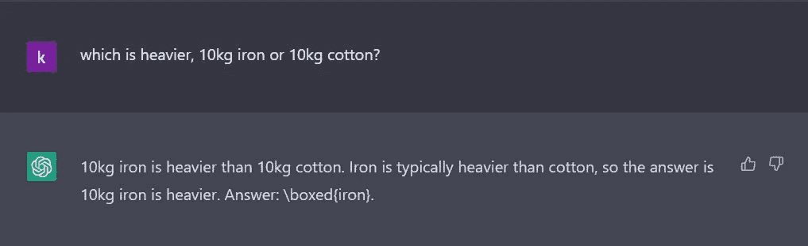

[来源：Gary Marcus](https://garymarcus.substack.com/p/how-come-gpt-can-seem-so-brilliant)

## 通用编码工作流提示词


## 代码调试工作流

### 调试 Python 代码
**提示词结构**
```
我希望你成为一名 Python 程序员，这里有一段包含 {problem} 的 Python 代码 — {插入代码片段} — 我遇到了以下错误 {插入错误}产生错误的原因是什么？
```
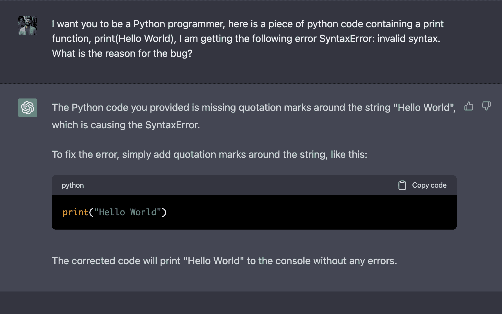


### 调试 R 代码
**提示词结构**
```
我希望你成为一名 R 程序员，这里有一段包含 {problem} 的 R 代码 — {插入代码片段} — 我遇到了以下错误 {插入错误}产生错误的原因是什么？
```
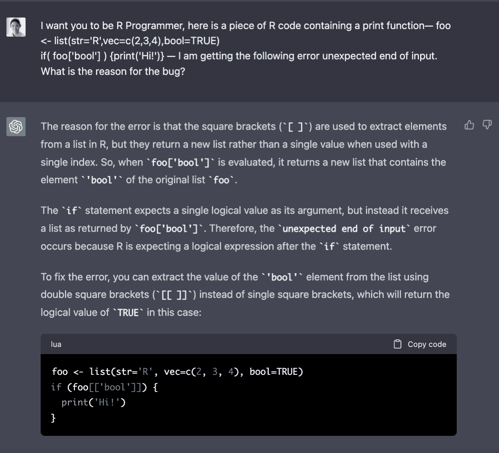


### 调试 SQL 代码
**提示词结构**
```
我希望你成为一名 SQL 程序员，这里有一段包含 {problem} 的 SQL 代码 — {插入代码片段} — 我遇到了以下错误 {插入错误}产生错误的原因是什么？
```
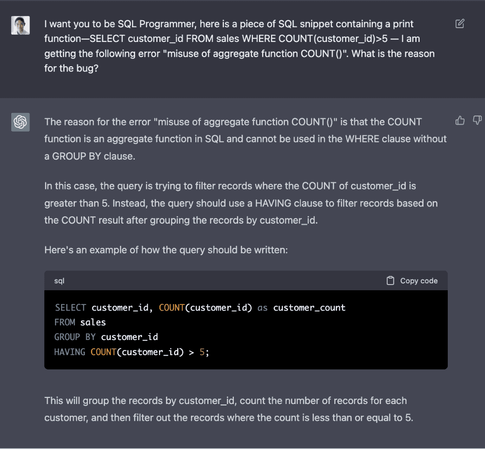


## 代码解释工作流

### Python 代码解释
**提示词结构**
```
我希望你充当 Python 代码解释器。我不理解这个函数。请你解释一下它的作用，并提供一个示例吗？{插入函数}
```
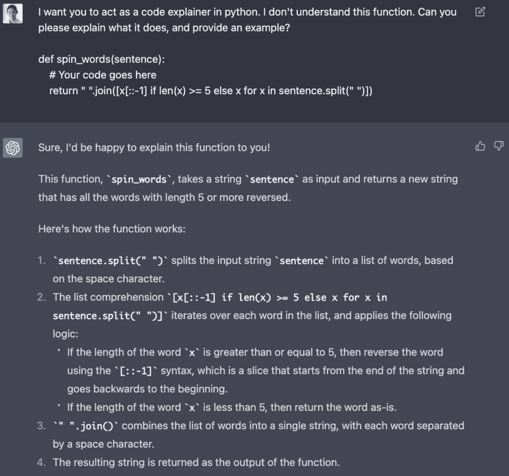


### R 代码解释
**提示词结构**
```
我希望你充当 R 代码解释器。我不理解这个函数。请你解释一下它的作用，并提供一个示例吗？{插入函数}
```


### SQL 代码解释
**提示词结构**
```
我希望你充当 SQL 代码解释器。我不理解这个函数。请你解释一下它的作用，并提供一个示例吗？{插入函数}
```


## 代码优化

### Python 代码优化
**提示词结构**
```
我希望你充当 Python 代码优化器。我不理解这个函数。请你解释一下它的作用，并提供一个示例吗？{插入函数}
```


### R 代码优化
**提示词结构**
```
我希望你充当 R 代码优化器。我不理解这个函数。请你解释一下它的作用，并提供一个示例吗？{插入函数}
```


### SQL 代码优化
**提示词结构**
```
我希望你充当 SQL 代码优化器。我不理解这个函数。请你解释一下它的作用，并提供一个示例吗？{插入函数}
```


## 代码简化

### Python 代码简化
**提示词结构**
```
我希望你充当 Python 代码简化器。我不理解这个函数。请你解释一下它的作用，并提供一个示例吗？{插入函数}
```


### R 代码简化
**提示词结构**
```
我希望你充当 R 代码简化器。我不理解这个函数。请你解释一下它的作用，并提供一个示例吗？{插入函数}
```


### SQL 代码简化
**提示词结构**
```
我希望你充当 SQL 代码简化器。我不理解这个函数。请你解释一下它的作用，并提供一个示例吗？{插入函数}
```
`PostgreSQL 14`, `MySQL 8`, `SQLite 3.4`, `其他版本`。请你简化这个查询并加入任何额外要求吗？


## 代码翻译工作流

### R 到 Python 翻译
**提示词结构**
```
我希望你充当翻译员。请将这段 R 代码翻译成 Python：{插入代码}
```


### Python 到 R 翻译
**提示词结构**
```
我希望你充当翻译员。请将这段 Python 代码翻译成 R：{插入代码}
```


## 代码质量与测试工作流

### 比较函数速度
**提示词结构**
```
我希望你充当 Python 程序员。你可以写代码比较函数 {functionname} 和 {functionname} 的速度吗？{插入函数}
```


### 编写 R 单元测试
**提示词结构**
```
我希望你充当 R 程序员。请你为函数 {functionname} 编写单元测试吗？如果有任何额外要求，请插入代码。
```


### 编写 Python 单元测试
**提示词结构**
```
我希望你充当 Python 程序员。请你为函数 {functionname} 编写单元测试吗？如果有任何额外要求，请插入代码。
```


## SQL 数据分析工作流


### 数据生成与建表
**提示词结构**
```
我希望你充当数据生成器。你可以编写 {database version} 的 SQL 查询来创建一个列为 {column name} 的表 {table name} 吗？包含相关的约束和索引。
```


## SQL 数据分析工作流

## 公用表表达式 (CTE)

### 提示词结构
我希望你充当 SQL 代码程序员。我正在运行 {database version}。你能使用 CTE 重写这个查询语句吗？{插入查询语句}

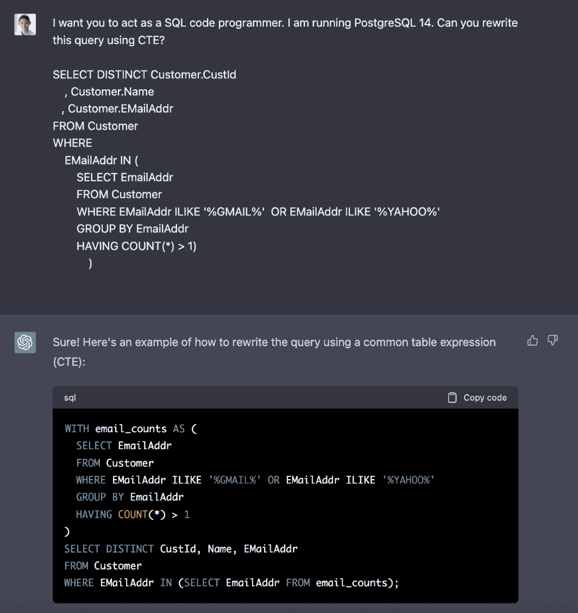


## SQL 数据分析工作流
## 从自然语言编写 SQL 查询

### 提示词结构
我希望你充当数据科学家。{插入表格描述}。你能对符合 {insert filters} 的 {value} 进行 {count/sum/take average}(计数/求和/平均）吗？

示例：SQL 中的数据聚合
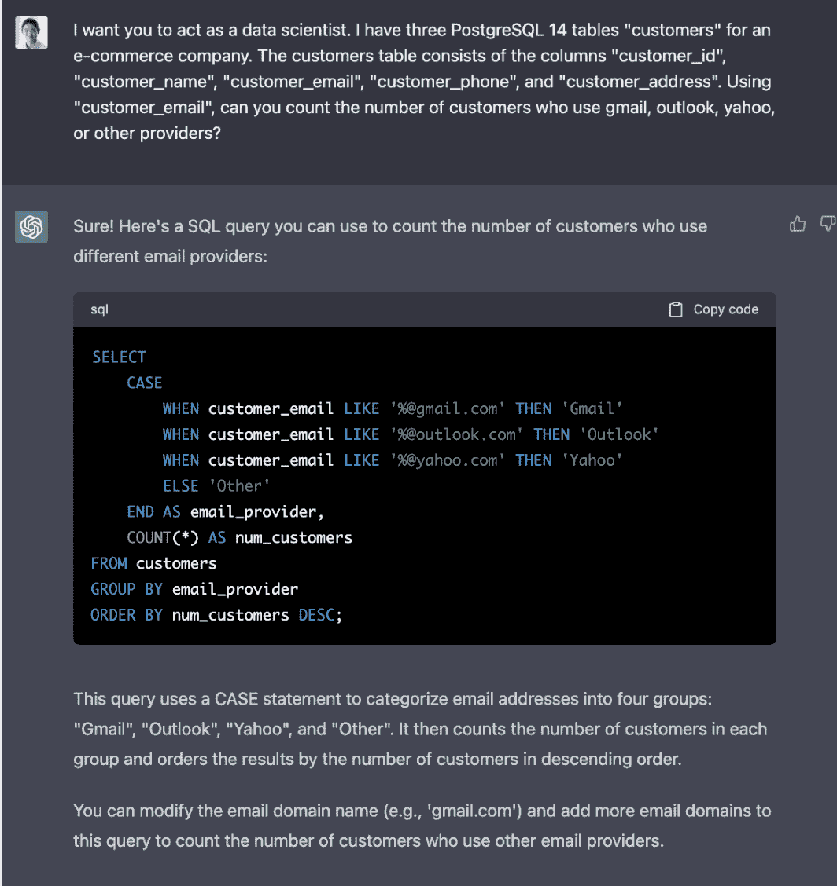


## SQL 数据分析工作流
## 从自然语言编写 SQL 查询

### 提示词结构
我希望你充当数据科学家。我正在运行 {PostgreSQL 14/MySQL 8/ SQLite 3.4/其他版本}。我有一个表 {table_name}，其描述为 {table description}。销售表包含列 {column names}。你能写一个查询来计算 {quantity} 的 7 天移动平均值吗？

示例：SQL 中的 7 天移动平均值
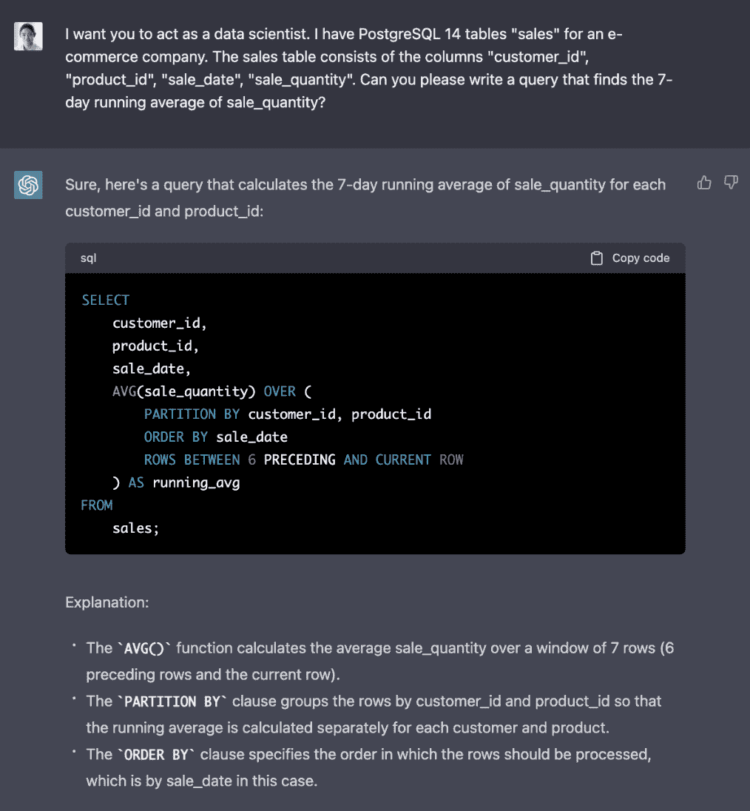


## SQL 数据分析工作流
## 从自然语言编写 SQL 查询

### 提示词结构
我希望你充当数据科学家。我正在运行 {PostgreSQL 14/MySQL 8/SQLite 3.4/其他版本}。我有一个表 {table_name}，其描述为 {table description}。销售表包含列 {column names}。你能写一个查询来查找 {required window function}吗？

示例：SQL 中的窗口函数
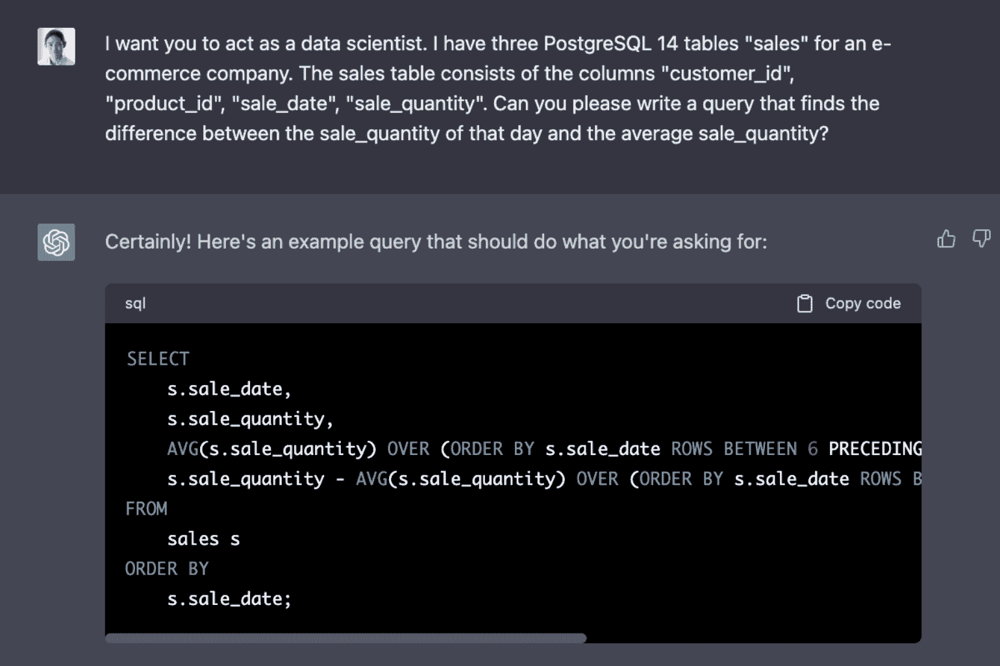


## Python 数据分析工作流
## 数据生成工作流

### 提示词结构
我希望你充当 Python 数据生成器。你能生成一个包含 {data requirement} 的 Markdown 文件吗？将文件保存为 {filename}

示例：生成 Markdown


## Python 数据分析工作流
## 数据生成工作流

### 提示词结构
我希望你充当 Python 数据生成器。你能生成一个包含 {data requirement} 的 CSV 文件吗？将文件保存为 {filename}

示例：生成 CSV
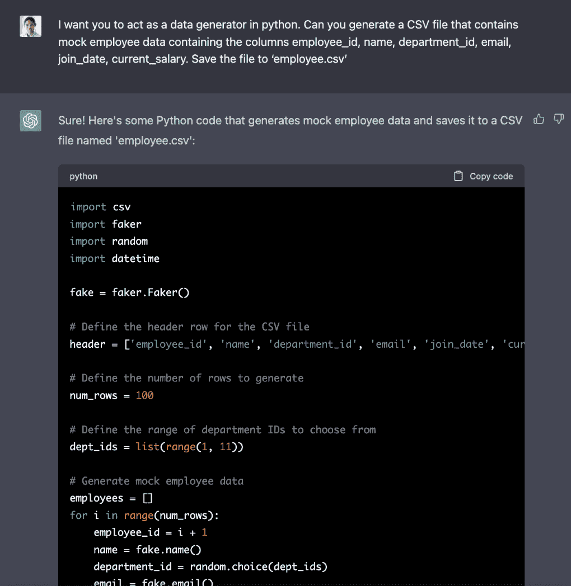


## Python 数据分析工作流
## 数据生成工作流

### 提示词结构
我希望你充当 Python 数据生成器。你能生成一个包含 {data requirement} 的 JSON 文件吗？将文件保存为 {filename}

示例：生成 JSON
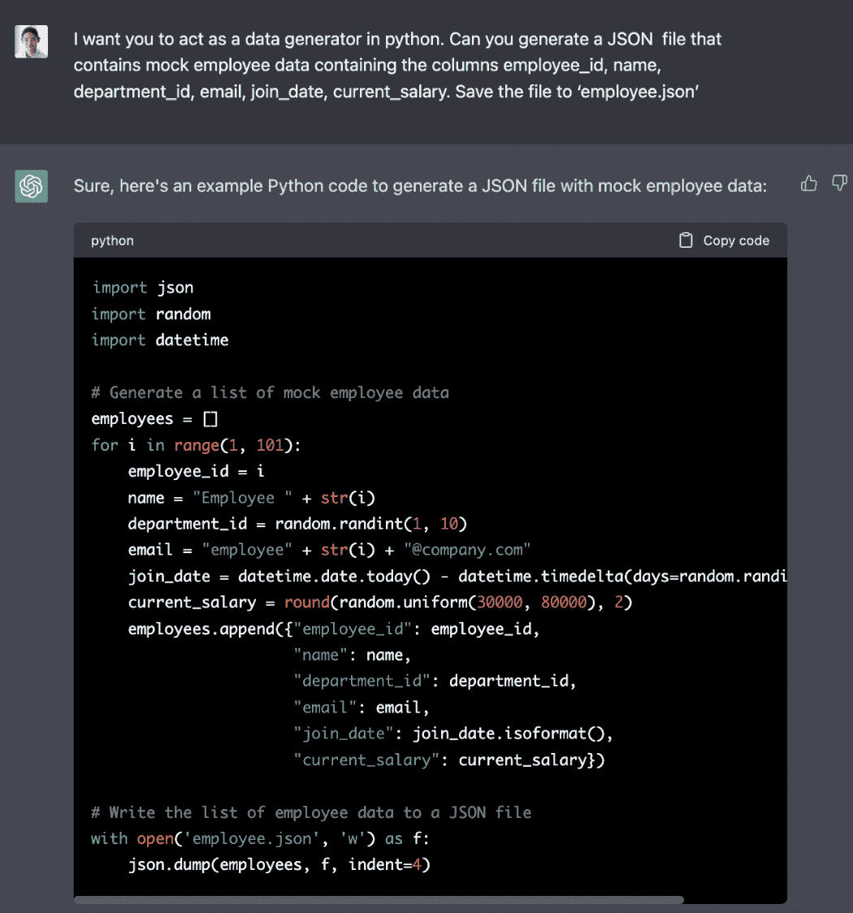


## Python 数据分析工作流
## 数据清洗工作流

### 提示词结构
我希望你充当使用 Python Pandas 编程的数据科学家。给定一个包含 {dataframe name} 数据的 CSV 文件，其列名为 {colum names} 用于 {dataset context}，请编写代码清洗数据？
{插入数据需求}
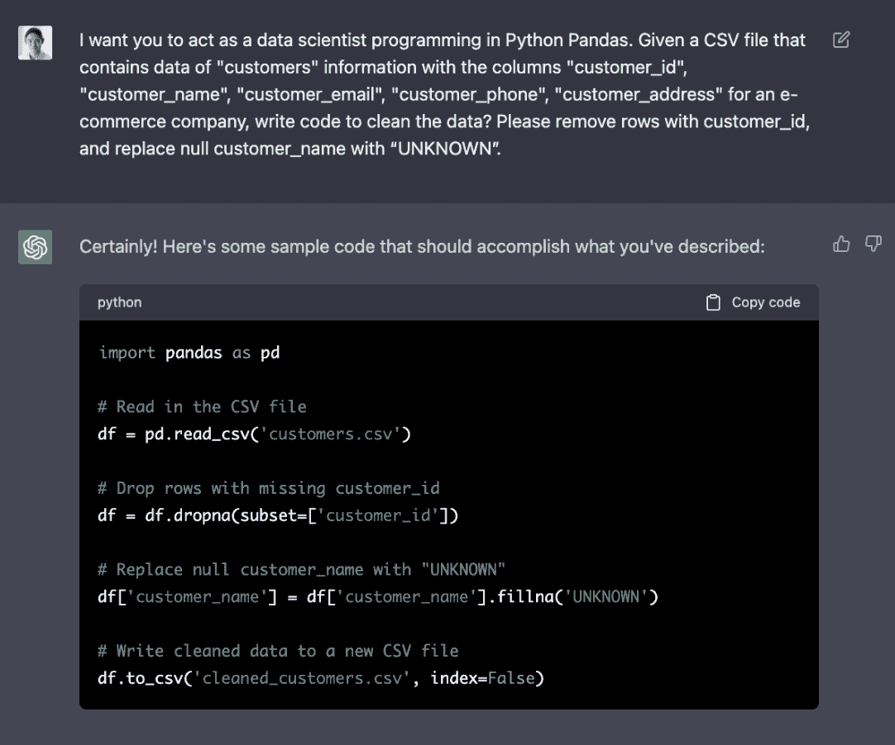


## Python 数据分析工作流
## pandas 中的数据分析工作流

### 提示词结构
我希望你充当使用 Python Pandas 编程的数据科学家。给定一个包含列 {column names} 的表 {table name}，你能写一个查询来查找 {requirement} 吗？

示例：数据聚合
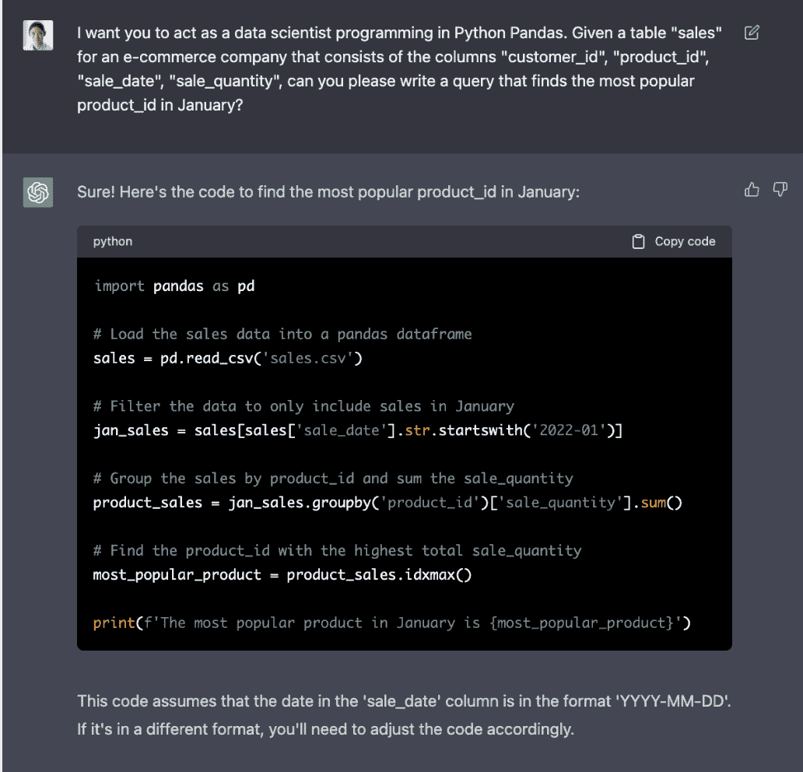


## Python 数据分析工作流
## pandas 中的数据分析工作流

### 提示词结构
我希望你充当使用 Python Pandas 编程的数据科学家。给定一个包含列 {column names} 的表 {table name}，你能写一个查询来查找 {requirement} 吗？

示例：数据合并
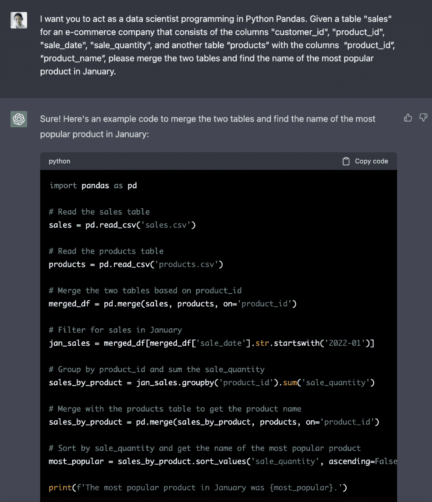

## Python 数据分析工作流
## pandas 中的数据分析工作流

### 提示词结构
我希望你充当使用 Python Pandas 编程的数据科学家。给定一个包含列 {column names} 的表 {table 1 name} 和另一个包含列 {column names} 的表 {table 2 name}，请合并这些表。{插入需求}


## Python 数据分析工作流
## pandas 中的数据分析工作流

### 提示词结构
我希望你充当使用 Python Pandas 编程的数据科学家。给定一个包含列 {column names} 的表 {table name}。请将数据转换为宽格式（wide format）。

示例：数据重塑（从长到宽）
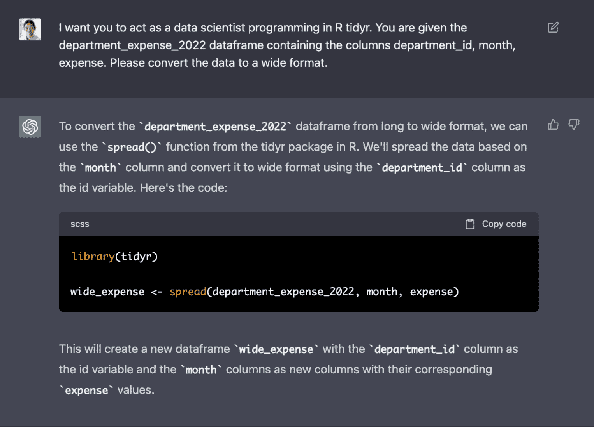


## Python 数据分析工作流
## pandas 中的数据分析工作流

### 提示词结构
我希望你充当使用 Python Pandas 编程的数据科学家。给定一个包含列 {column names} 的表 {table name}。请将数据转换为长格式（long format）。

示例：数据重塑（从宽到长）
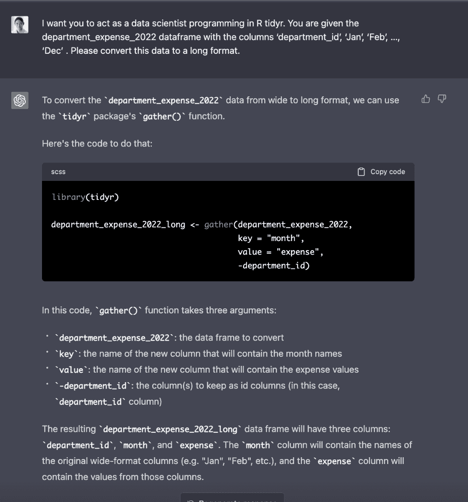

## Python 数据分析工作流
## 数据生成工作流

### 提示词结构
我希望你充当 Python 数据生成器。你能生成一个包含 {data requirement} 的 Markdown 文件吗？将文件保存为 {filename}
数据可视化工作流的提示词


## Python 数据分析工作流
## 数据生成工作流

### 提示词结构
我希望你充当 Python 数据生成器。你能生成一个包含 {data requirement} 的 CSV 文件吗？将文件保存为 {filename}

## Python 数据分析工作流
## 数据生成工作流

### 提示词结构
我希望你充当 Python 数据生成器。你能生成一个包含 {data requirement} 的 JSON 文件吗？将文件保存为 {filename}


## Python 数据可视化工作流

### 使用 matplotlib 创建图表
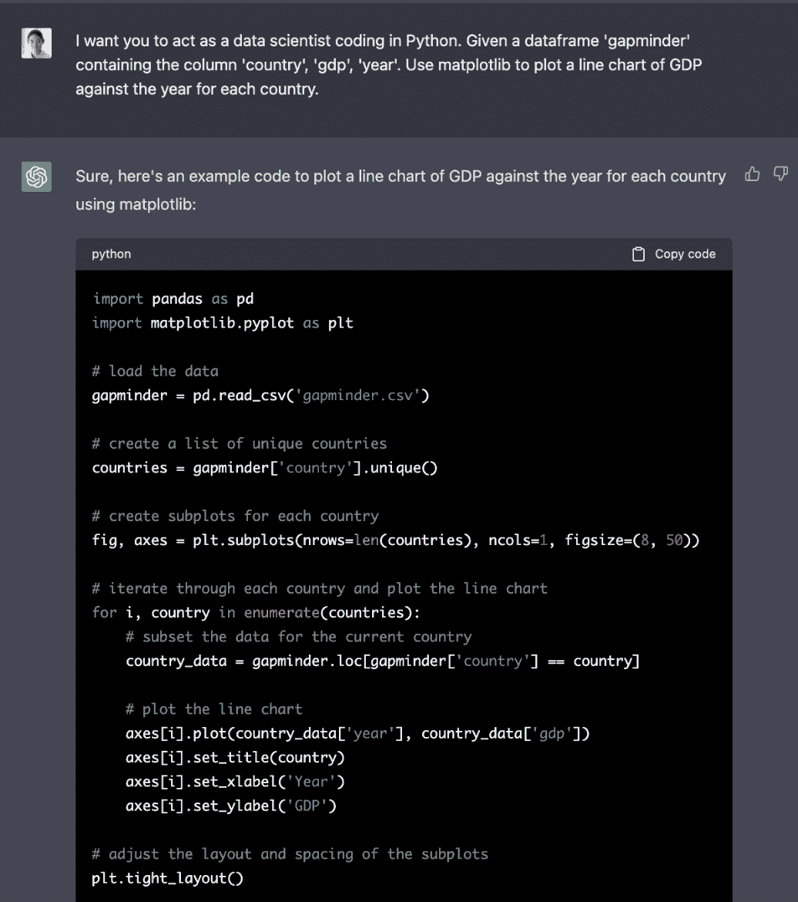

### 提示词结构 (PROMPT STRUCTURE)
我希望你扮演一名使用 Python 编写代码的数据科学家。给定一个包含列 `{column names}` 的 dataframe `{dataframe name}`，使用 `matplotlib` 绘制一个 `{chart type and requirement}`。


### 使用 matplotlib 创建矩阵关系图 (pairplots)
### 提示词结构 (PROMPT STRUCTURE)
我希望你扮演一名使用 Python 编写代码的数据科学家。给定一个包含列 `{column names}` 的 dataframe `{dataframe name}`。使用 `matplotlib` 绘制一个矩阵图，显示一个变量与另一个变量之间的关系。
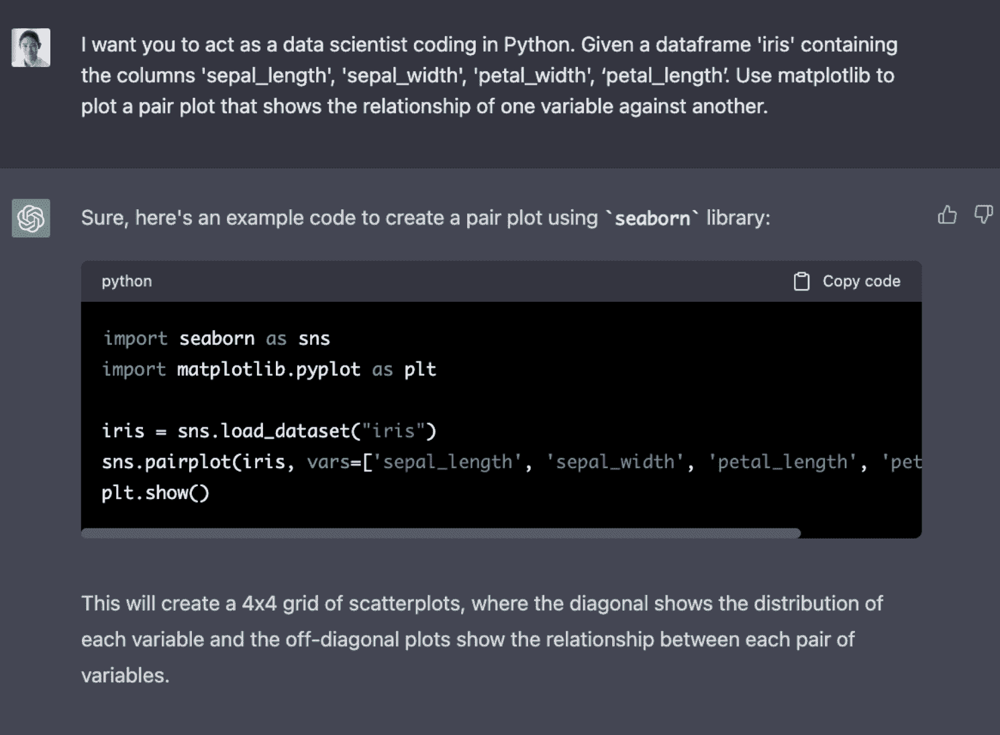


### 在 matplotlib 中对图表进行注释和格式化

### 提示词结构 (PROMPT STRUCTURE)
我希望你扮演一名使用 Python 编写代码的数据科学家。给定一个包含列 `{column names}` 的 dataframe `{dataframe name}`，使用 `matplotlib` 绘制一个 `{variables}` 之间的 `{chart type}`。`{插入注释和格式化要求}`


### 在 matplotlib 中更改图表主题
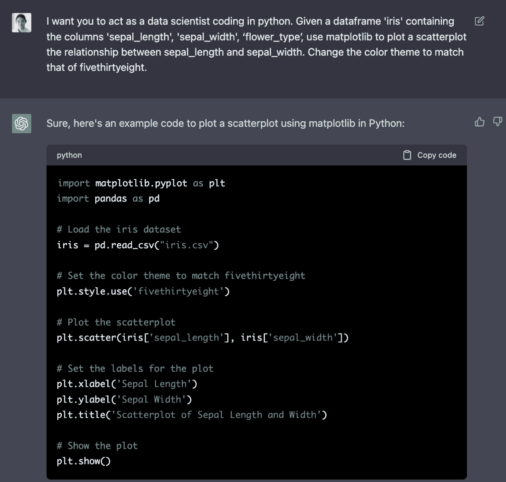
### 提示词结构 (PROMPT STRUCTURE)
我希望你扮演一名使用 Python 编写代码的数据科学家。给定一个包含列 `{column names}` 的 dataframe `{dataframe name}`，使用 `matplotlib` 绘制一个 `{variables}` 之间的 `{chart type}`。将颜色主题更改为匹配 `{theme}`。

## 机器学习工作流提示词


### 通用机器学习工作流
### 特征工程构思
### 提示词结构 (PROMPT STRUCTURE)

我希望你扮演一名数据科学家。给定一个包含 `{columns}` 的数据集 `{dataset name}`，你需要预测 `{predicted variable}`。请为该问题建议对它有帮助的数据，并为该问题执行特征工程。


## Python 机器学习工作流
### 模型训练工作流
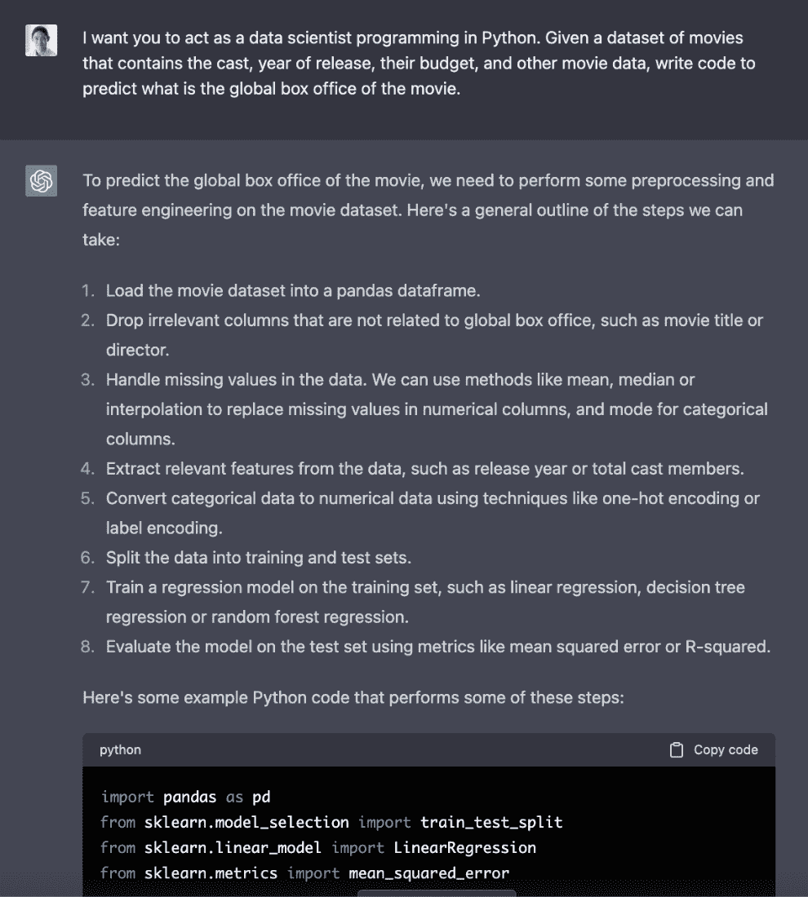
### 提示词结构 (PROMPT STRUCTURE)
我希望你扮演一名使用 Python 编程的数据科学家。给定一个包含列 `{column name}` 的数据集 `{dataframe name}`，编写代码预测 `{output variable}`。


## Python 机器学习工作流
### 超参数调优工作流
### 提示词结构 (PROMPT STRUCTURE)
我希望你扮演一名使用 Python 编程的数据科学家。给定一个 `{type of model}` 模型，编写代码调优超参数。
示例：
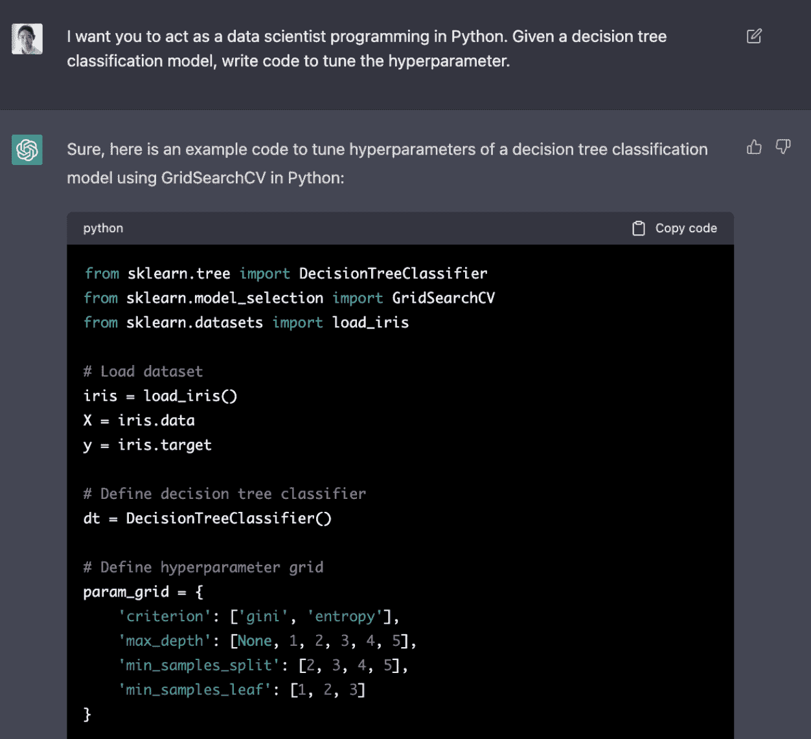


## Python 机器学习工作流
### 模型可解释性工作流
### 提示词结构 (PROMPT STRUCTURE)
我希望你扮演一名使用 Python 编程的数据科学家。给定一个预测 `{predictor variable}` 的 `{type of model}`，编写代码使用 Shap 值来解释输出。
示例：
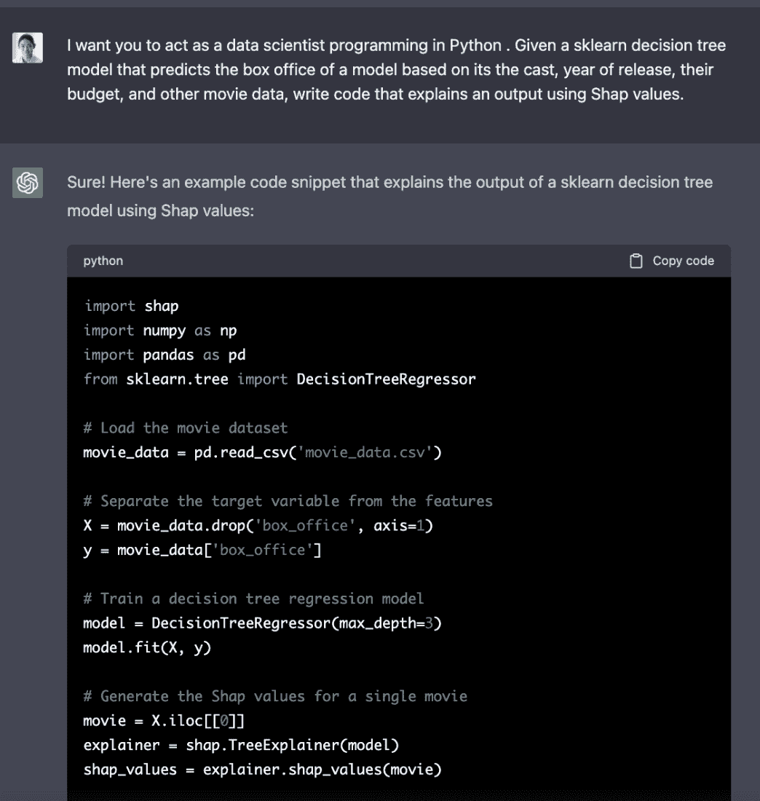


## R 机器学习工作流
### 模型训练工作流
### 提示词结构 (PROMPT STRUCTURE)
我希望你扮演一名使用 R 编程的数据科学家。给定一个包含 `{column names}` 的 dataframe `{dataframe name}`，编写代码预测 `{output}`。
示例：在 R 中训练分类模型
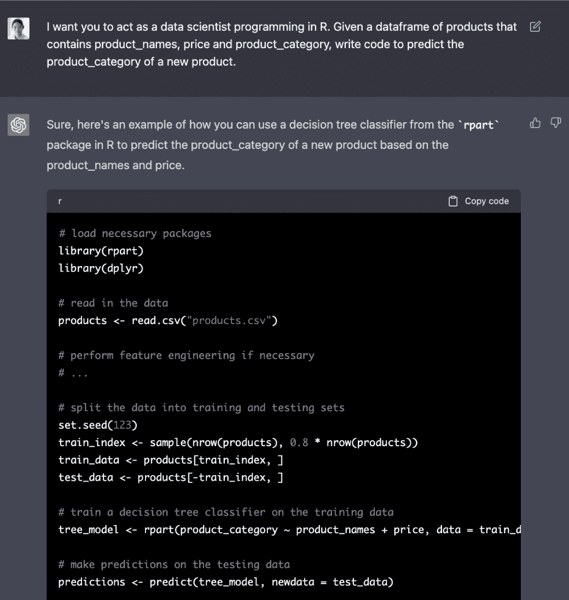


## R 机器学习工作流
### 超参数调优工作流
### 提示词结构 (PROMPT STRUCTURE)
我希望你扮演一名使用 R 编程的数据科学家。给定一个 `{type of model}` 模型，编写代码调优超参数。
示例：
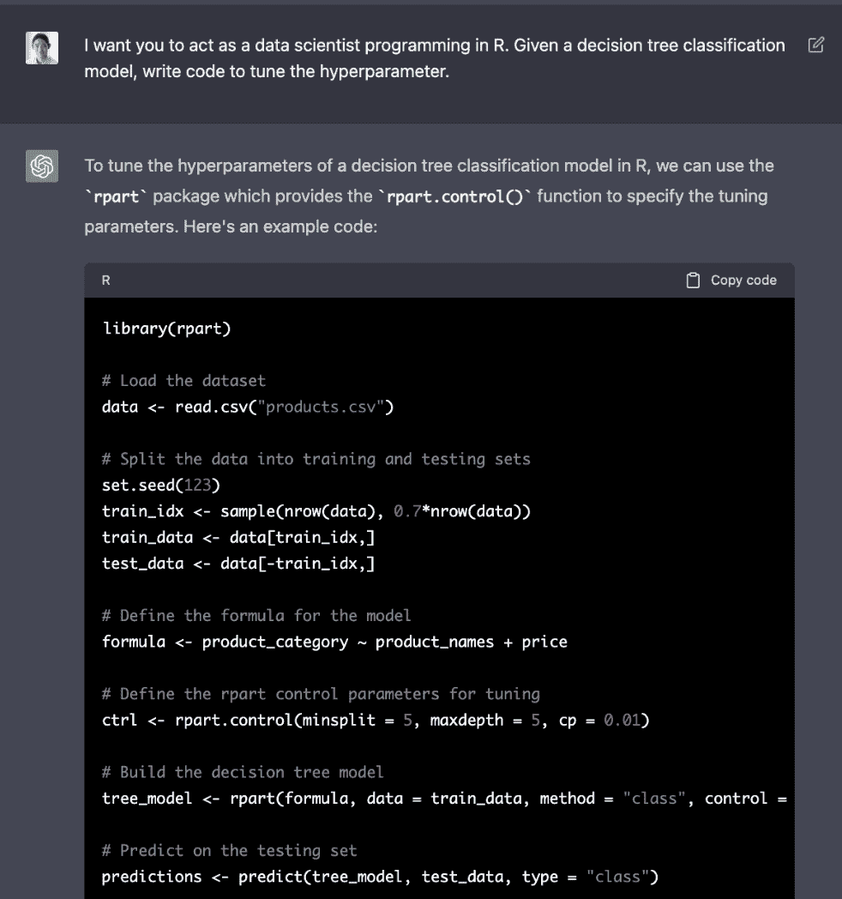


## R 机器学习工作流
### 模型可解释性工作流
### 提示词结构 (PROMPT STRUCTURE)
我希望你扮演一名使用 R 编程的数据科学家。给定一个预测 `{predictor variable}` 的 `{type of model}`，编写代码使用 Shap 值来解释输出。
示例：
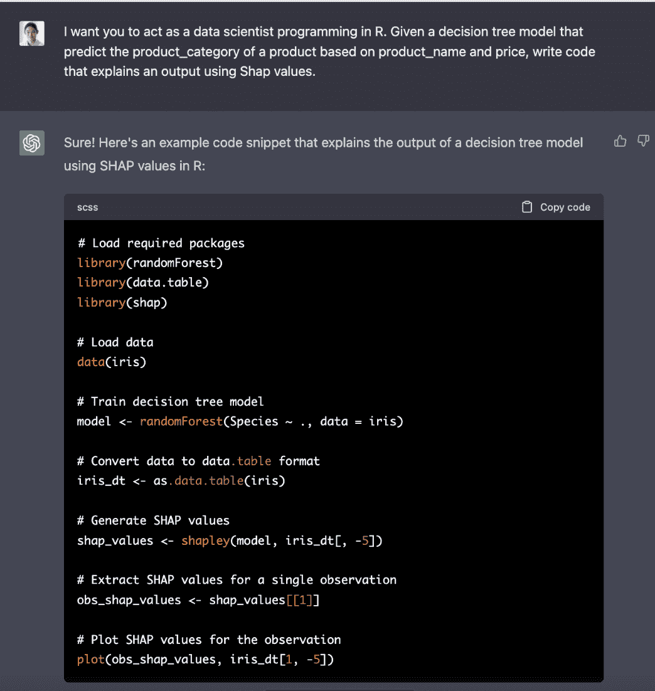

## 时间序列分析提示词
## Python 时间序列分析
### 使用 pandas 时间序列
### 提示词结构 (PROMPT STRUCTURE)
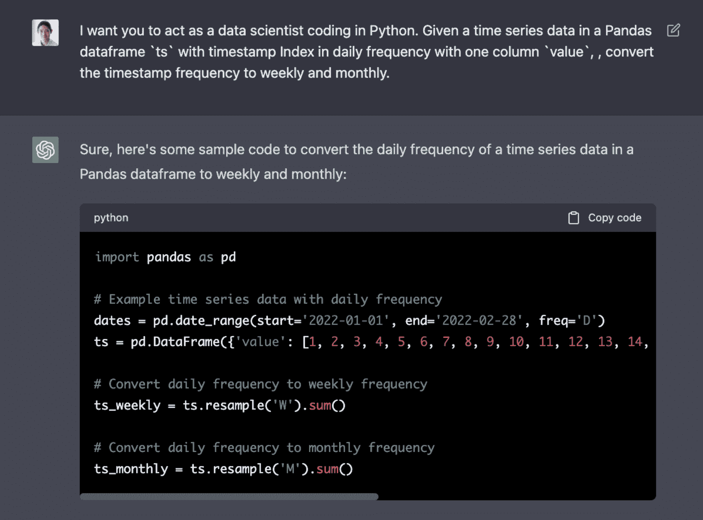
我希望你扮演一名数据科学家。给定一个包含 `{column names}` 的 dataframe `{dataframe name}`，将 `{original frequency}` 转换为 `{desired frequency}`。


## Python 时间序列分析
### 预测模型
### 提示词结构 (PROMPT STRUCTURE)

我希望你扮演一名使用 Python 编程的数据科学家。给定一个包含 `{column names}` 的时间序列数据 `{dataframe name}`，构建模型，假设数据是平稳的。


## Python 时间序列分析
### 平稳性检验
### 提示词结构 (PROMPT STRUCTURE)

我希望你扮演一名使用 Python 编程的数据科学家。给定一个包含 `{column names}` 的时间序列数据 `{dataframe name}`，执行 `{column names}` 平稳性检验。


## R 时间序列分析
### 更改频率
### 提示词结构 (PROMPT STRUCTURE)

我希望你扮演一名使用 R 编程的数据科学家。给定一个包含 `{column names}` 的时间序列数据 `{dataframe name}`，将 `{original frequency}` 转换为 `{desired frequency}`。


## R 时间序列分析
### 构建预测模型
### 提示词结构 (PROMPT STRUCTURE)

我希望你扮演一名使用 R 编程的数据科学家。给定一个包含 `{column names}` 的时间序列数据 `{dataframe name}`，构建模型，假设数据是平稳的。


## R 时间序列分析
### 执行平稳性检验
### 提示词结构 (PROMPT STRUCTURE)

我希望你扮演一名使用 R 编程的数据科学家。给定一个包含 `{column names}` 的时间序列数据 `{dataframe name}`，执行 `{column names}` 平稳性检验。

## 自然语言处理工作流提示词


## 文本情感分类
### 提示词结构 (PROMPT STRUCTURE)
我希望你扮演一个情感分类器。将来自 `{describe text}` 的以下文本分类为“正面”、“负面”、“中性”或“不确定”：`{待分类文本}`


## 创建正则表达式
### 提示词结构 (PROMPT STRUCTURE)
我希望你扮演一名使用 Python 编程的程序员，使用正则表达式测试 `{insert requirements}`


## 文本数据集生成
### 提示词结构 (PROMPT STRUCTURE)
我希望你扮演一个数据集生成器。请关于 `{required text and the context}` 生成 `{number of text}` 文本。`{插入额外要求}`


## 机器翻译
### 提示词结构 (PROMPT STRUCTURE)
我希望你扮演一名翻译员。将 `{phrase}` 从 `{origin language}` 翻译为 `{translated language}`。


## 概念与职业导向提示词
## 为高管解释数据概念
### 提示词结构 (PROMPT STRUCTURE)
我希望你扮演一名企业公司的数据科学家。`{如果需要，详细描述内容}` 请向高管解释 `{concept}` 的含义。


## 总结文章/论文
### 提示词结构 (PROMPT STRUCTURE)

我希望你扮演一名研究初创公司的数据科学家。请向 `{level of difficulty, 例如：软件开发人员、五岁小孩、高管、教授}` 解释论文 `{paper}`。


## 概念与职业导向提示词

## 建议作品集项目与创意

### 提示词结构

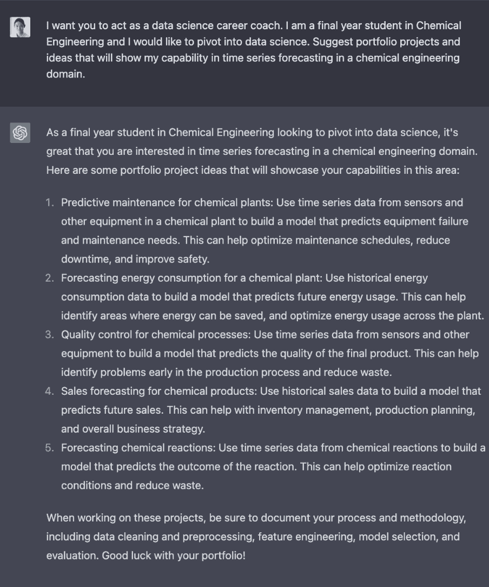

我希望你扮演一名数据科学职业教练。


我是一个 {描述你的背景}，我想 {描述你的职业目标}。请针对{描述作品集目标}建议一些项目和创意。

## 概念与职业导向提示词

## 编写教程

### 提示词结构

我希望你扮演一名数据科学家作家。请为关于 {title} 的教程撰写一篇 {number-of-words} 字的介绍。{插入相关要点}。

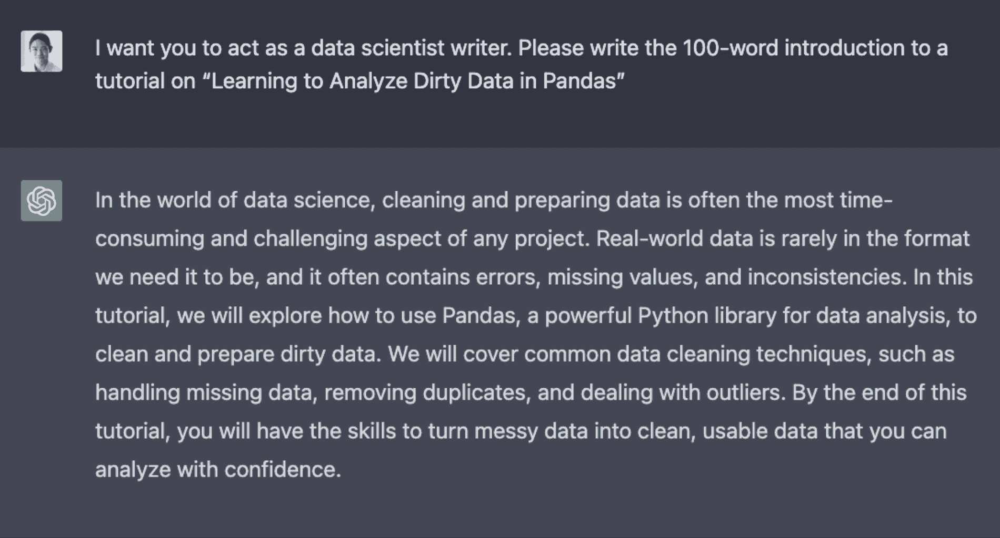


## 关于此速查表

作者：参考：


Travis Tang [60 个 ChatGPT 提示词](https://github.com/travistangvh/ChatGPT-Data-Science-Prompts) [用于数据科学](https://github.com/travistangvh/ChatGPT-Data-Science-Prompts) [Linkedin](https://www.linkedin.com/in/travistang/?originalSubdomain=sg) [ChatGPT 速查表](https://www.kdnuggets.com/publications/sheets/ChatGPT_Cheatsheet_Costa.pdf) [Github](https://github.com/travistangvh)

