# 用于实时运动解码的高分辨率长期稳定微电极皮脑机接口

脑机接口通过解码脑活动、重建神经系统疾病患者的语音和运动功能实现个体与计算机或其他设备的通信。本研究介绍了一种基于柔性高密度 µECG 电极列的高分辨率微电极图（µECG），能够实现长期稳定的实时运动解码。利用微制造技术，µECG 的电极密度比传统电极列提高了 64 倍，在具有扩展性的同时提高了空间分辨率。在为期 23 天的实验中，高分辨率 µECG 的精细空间特异性证明在减少植入设备的同时提高了解码性能。这些进展为克服传统 BCI 的局限性提供了途径。在清醒期间，µECG 在经过 7 min 模型训练后实现了稳定控制。此外，在 19.8 小时内，参与者在完全自主控制下实现了 1.1 位/秒的稳健控制，在增强用户界面后，该速率达到了 4.5 bps。这些结果表明，µECG 在没有此类侵入性的情况下实现了与皮层内电图 BCI 相当性能，在 BCI 的临床灵活性方面取得了突破。

中风、脊髓损伤和肌萎侧索硬化症等神经系统疾病导致的运动障碍限制了患者的独立性和活动能力，严重影响了他们的生活质量和寿命。虽然一些计算机辅助技术具有潜力，但它们通常效率低下且难以使用，提供的体验并不理想 [1]。BCI 允许患者通过其脑活动直接与设备交互，为重建运动功能和在日常生活中恢复安全独立提供了更有效的方法 [2–5]。BCI 的整体性能取决于用于信号采集的方法，如脑电图（EEG）、皮层内电图和皮层电，这些信号在跨皮层表面、硬膜、颅骨和头皮时会发生衰减 [6,7]。由于信号质量（信噪比，SNR）和空间分辨率欠佳，EEG BCI 通常局限于简单的解码任务，并存在高延迟问题 [8–10]。相比之下，通过微电极列采集的 iEEG 表现出优的（信号和神经）多分辨率，但受限于侵入性技术和有限的脑覆盖范围 [11–13]。通过在大脑皮层的电极列记录的 CoEEG 平衡了信号质量和柔性性，这在运动和想象解码方面显示出巨大潜力（表 S1，补充信息）。

我们提出的高分辨率 µBCG 工作流程如图 1 所示。在每个会话中，通过植入式接口采集高空间 µBCG 信号（图 1b；S2，补充信息）。随后，神经数据经过预处理，提取每个电极通道的高伽马频谱功率密度（PSD）作为特征向量。设计了带有注意力机制的长短期记忆（LSTM）网络（图 2；S3，补充信息），用于从特征矩阵中预测实际运动或感官意图。此外，交互式界面通过云边协同架构提供视觉反馈，将原始数据调度到边缘设备，从而为模型训练和神经计算任务保留高分辨率特征。

然而，由于制造限制，传统 BCI 的密度和吞吐量受到限制，阻碍了解码。最近的高吞吐量高密度 µBCG 代表在该领域仍具前景的技术 [23–24]。然而，临床验证需要大型开颅术。

电极列作为 BCI 的核心组件，其电极密度为 850 µm，电极间距为 1250 µm。性能特征为低阻抗（1 kHz 下 < 1 MΩ）和磷酸盐缓冲溶液中的方根（RMS）噪声 < 2 µV（S4，补充信息）。在数据采集期间记录 µG 信号。

在本研究中，我们开发了一个具有 64 通道的柔性 µBCG 电极列。该阵列的柔性和网格结构设计覆盖了大量的皮层区域（S1，补充信息），而加厚的迹线提供了足够的机械稳健性，以稳定采集高保真神经信号。单个会话通过柔性打印电路（FPC）进行采集。

实验结果显示了令人印象深刻的稳定性，在实验室中 20 天的解码效率仅下降了 5.49%（S5，补充信息）。对于每个会话，我们评估 PSD 以衡量信号质量。每个通道的信号频率特性在不同会话之间保持一致（S6，补充信息），并比较 >20 Hz 处的 SNR（图 1d）了 µBCG 的稳定性。通过比较两种方法，我们证明了 µBCG 准确捕捉并跟踪了其能力的趋势，且这种稳定性在整个实验过程中得到了维持。

使用实时运动和基于想象的解码评估了性能。我们进行了为期 20 天的体内实验，在实验室狗中实现了准确率为 0.84 的实时运动解码。在经过 7 天的数据收集和解码器训练后，参与者执行了如诱发乒乓球和某些游戏任务，显示了清醒状态下的脑活动。在 12 天的体内范式中，范式通过累积进行测试，并在缩短时长的情况下评估了 iEEG-BCG 级指标 [14]。这些结果为利用具有神经可塑性的高分辨率 µBCG 实现长期稳定的运动重建的可行性提供了证据。

对于想象解码，使用了渐进式校准方法以确保所有参与者在 30 天内达到完全控制。

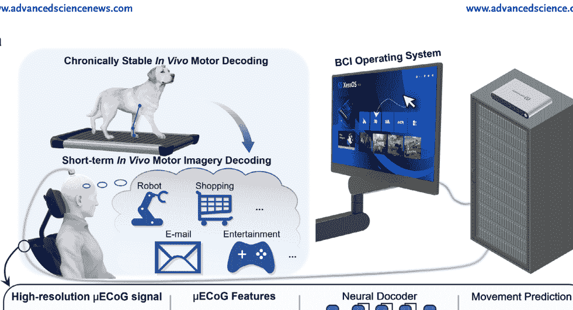

a

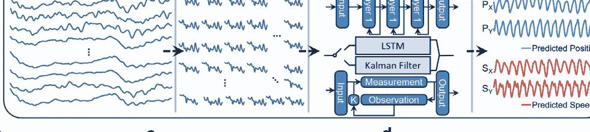

b

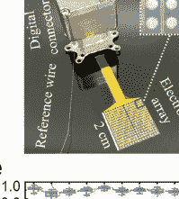

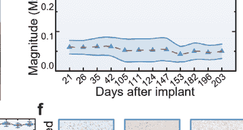

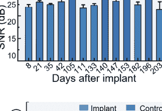

c

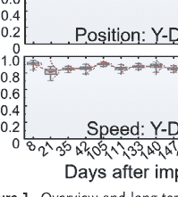

d

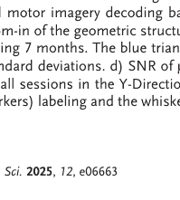

e

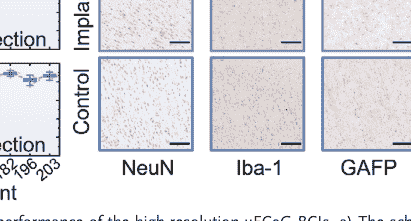

f

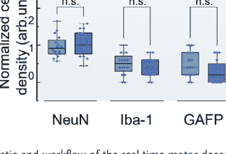

图 1. 高分辨率 µECoG BCI 的概述和长期性能。b) 示意图和工作流（µECoG BCI 的比例尺为 1 cm）。图像显示了 µECoG 电极阵列内部结构的放大图（比例尺为 500 µm）。c) 持续 7 周的长期实验中的电极植入。蓝色标记和红线表示每个会话的平均值，蓝色阴影区域表示标准差。d) 长期实验期间每个会话 µECoG 信号的信噪比（SNR）。所有会话的准确率（相关系数，CC）。对于每个会话，箱线图表示带有位数（蓝色线）和平均值（红色方形标记）的分位数，须线表示最小值和最大值。显示了运动内准确率的拟合正态分布。203 天的纵向分析证明了一致的准确率：X 方向 0.87，Y 方向 0.82，Z 方向 0.83；速度方面 Y 方向为 0.86，Z 方向为 0.78。此外，性能表现出高可靠性，X 方向的标准差为 0.03，Y 方向 0.02，Z 方向 0.04；速度方面 Y 方向为 0.03，Z 方向为 0.06（图 1e，补充信息）。值得注意的是，Y 电极表现出足够的稳定性来应对更大的运动幅度。实验后，进行了免疫组织化学分析。病理组织学分析（图 11，补充信息）定量地证实了与对照组（中矢状面基准）相比，没有神经丢失或炎症的证据。定量分析证实没有明显的萎缩/小胶质细胞增殖炎症标记（图 1g）。这些发现证实了 µECG 电极的稳定性。

在吞吐量。为了消除由植入区域引起的影响，具有不同网格的电极子集逐渐向 µECG 电极阵列中心收缩，以探索这一问题（图 2）。为了评估密度对运动性能的影响，在皮层区域内固定了不同密度的均匀分布子集。宏观上，随着密度的增加，解码准确率和变异性增加，表明更高的密度可以提高解码性能。所有通道的解码准确率在密度 64 cells/cm² 时达到最大值。为了确定电极密度的饱和点，解码进一步降低。准确率随采样量的减少而逐渐下降，并在网格大小为 60 cells 时出现下降（图 2d）。这些发现表明高密度 µECG 在自然运动期间记录提供了最佳性能。

之前的研究表明 ECoG 具有稳定的空间配置，特别是在 70-350 Hz 范围内，受益于子采样和空间分辨率。然而，为了提高解码性能，少数研究对运动解码进行了研究 [27]。因此为了阐明电极密度在解码性能中的关键作用，我们增加了电极密度并在 2 x 2 cm 区域获得了每个电极更高的功率。随着电极密度的增加，神经活动以更高的分辨率表示，能够更精确地识别皮层区域（图 2a）。功能区域也通过相邻电极密度更容易定位。解码性能在三维空间中的投影轨迹与报告的真实轨迹一致（图 2f, 图 13 和补充信息）。解码性能的增强提高了预测运动与真实运动之间的一致性。在合成应用中，这可能会提高用户的反馈、易用性和整体性能。此外，发现增加电极密度和减少伪影可以提高机器学习性能。在体内实验后，对植入电极和对照位（与植入位相邻的中矢状面）的组织进行了免疫组织化学染色（比例尺为 100 μm）。细胞计数（数据归一化到对照位）和统计分析（对于遵循正态分布的数据，使用了双侧配对检验，否则使用 Wilcoxon 符号检验进行显著性分析，`p < 0.05`，`n = 16`）显示了神经元、小胶质细胞和其他（GAP）。目前基于 ECoG 的运动解码侧重于收集运动皮层（M1）的神经活动，以解码多关节和多方向运动。由于分辨率不足，神经活动的采样一致性仍然有限。Adv. Sci. 2023, 12, e0663 © 2023 作者。由 Wiley-VCH Germany 出版。

- 选定的电极
- 未选定的电极
- 选定的电极
- 未选定的电极

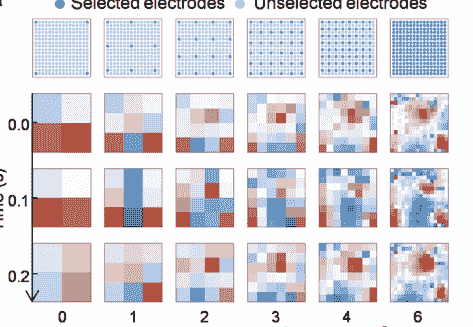

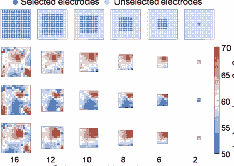

时间

高 gamma 功率

密度 `Log(Channels/cm²)`

采样网格大小 (`n×n`)

- 位置：X 方向 Y 方向 Z 方向
- 位置：X 方向 Y 方向 Z 方向

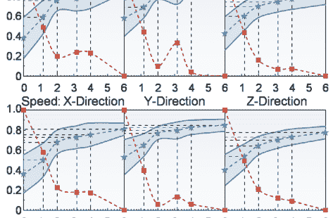

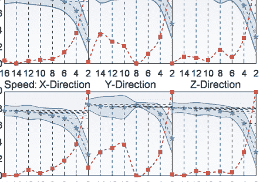

速度：X 方向 Y 方向 Z 方向

速度：X 方向 Y 方向 Z 方向

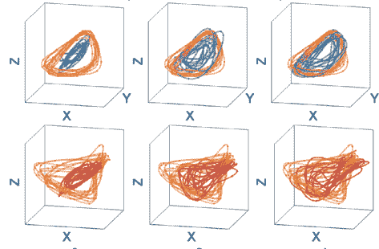

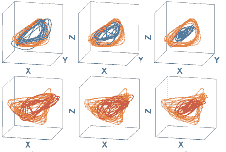

密度 `Log(Channels/cm²)`

采样网格大小 (`n×n`)

- 预测位置 预测速度 真实
- 预测位置 预测速度 真实


图 2. 通过增加电极功率（由增加密度密度的子集记录的 µCoG 在 100 ms 内 70–150 Hz 带段的平均值）提高运动解码性能。空间分辨率明显提高。(a) 保持电极密度，同时将采样网格大小大幅缩小到 µCoG 阵列中心，以模拟大脑覆盖范围的减少。gamma 功率的覆盖所示。增加电极密度和减少采样大小的影响提高了准确率和变异性。蓝色五形标记表示解码顺序的平均值，显示标准差，红色方形表示变量的归一化系数。(e) 使用不同密度子集和采样网格大小解码的运动特征（位置和速度）的真实和预测轨迹示例。

Adv. Sci. 2025, 12, e02661 2025 作者。Advanced Science 由 Wiley/VCH GmbH 出版

www.advancedsciencenames.com

www.advancedscience.com

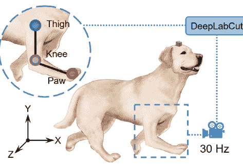

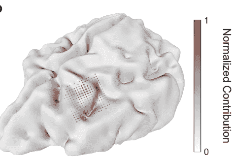

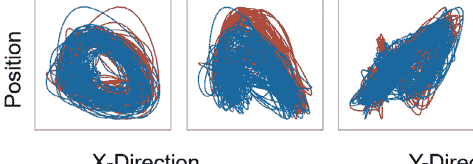

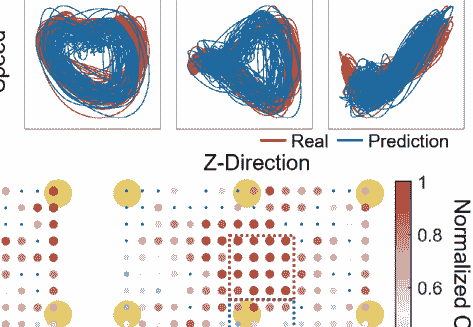

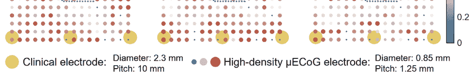

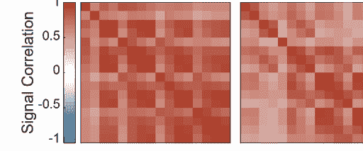

图 3. 多关节运动解码与运动编码的精细空间结构，a) 坐标定义与关节真实运动轨迹的获取。b) 使用 3D Slicer 在脑 MRI 重构上电极通道对运动解码的归一化贡献的空间分布 [13] c) 多关节运动解码中真实轨迹与预测轨迹的示例。d) 分别在三个方向上运动解码的归一化贡献的空间分布。M1 中的运动编码表现出毫米级的空间特异性，精细空间结构通过 µECoG 电极进行解码。e) 传统簇与具有高、低计数的电极子集高频之间的信号相关性 f) 高计数子集电极的 µECoG 信号在瞬时位置和速度解码方面的准确性显著提高（位置解码，`p = 7.17e-2`, `n = 39`；速度解码，`p = 1.37e-6`；`***=0.0001`, `n = 39`）。

www.advancedsciencews.com

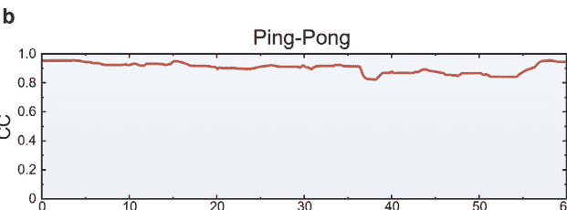


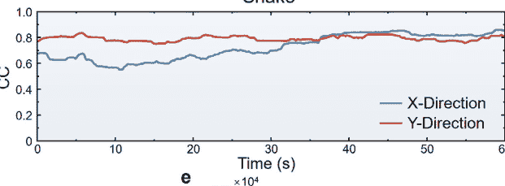

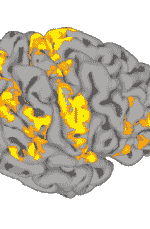

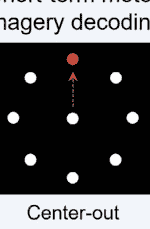

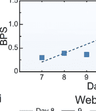

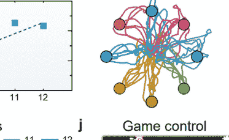

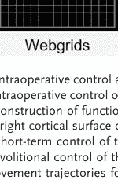

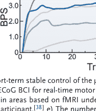

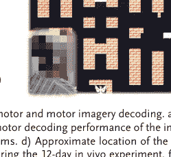


图 4. 用于实时运动想象解码的 µECoG BCI 的临床术中控制和短期稳定性。(a) 用于实时运动解码的 µECoG BCI 术中控制的机理/范式示意图。(b) 实时运动解码性能。(c) 运动想象期间功能区的重建。(d) µECoG 电极在右侧皮层表面的的大略位置。(e) 用于实时运动想象解码的 µECoG BCI 短期控制的稳定性。(f) 实验期间的累积试验次数。(g) 经过适应训练后，参与者展示了自愿控制 µECoG BCI 执行中心向外范式的能力，比特率在整个过程中不断提高。(h) 比特率

用于实时运动想象解码的 µECoG BCI 的临床术中控制和短期稳定性。Advanced Science 2023, Wiley

用于运动解码的 µECG 块。高级科学

在观察结束后，收集了脑样本。切片经过脱水并最终包埋。使用胶质纤维酸性蛋白进行染色以识别星胶质细胞，钙结合神经蛋白 1 (calII) 标记神经元，以及 NeuN (Abcam #1787)。通过显微镜拍摄这些切片以分析电极-组织界面。

高密度 µECG 电极采用柔性聚酰胺 明治结构制备，方法与之前描述电生理活动相似。沉积了 7 µm PI 层，随后溅射粘附层（AS5214, USA），对每个电极进行刻蚀以定义记录位点。然后进行旋覆并覆盖一层 13 µm PI 层以封装阵列。

研究参与者仅在治疗 M1 区域出现临床需要时参与。每个参与者确认自愿参与研究并被告知风险。他们收到了详细信息并签署了同意书。该研究获得武汉医院伦理委员会的批准（申请号：YY-2022-09118），并遵循赫尔辛基宣言。

我们设计了两个任务：乒球游戏和贪蛇游戏。在乒球游戏中，参与者利用屏幕左右两侧捕捉以恒定速度移动的乒球。球拍只能上下移动。球掉出屏幕时游戏结束。在贪蛇游戏中，球随机移动，参与者必须向四个方向移动球拍来捕捉球。ECG信号被转换为两个特征，游戏得分不断增加。

植入设备由四个部分：µECG阵列、电极、封装系统和连接器单元。使用的连接器是 µECG 块，它连接到电极阵列。然后将电极阵列接到封装上，以便传输信号并同时采集所有通道。最后，定制外壳作为封装的封装并固定在颅骨上。

为了评估 µECG 块的长期稳定性和功能，我们在实验动物中进行了体内实验。使用了一只雄性实验犬。动物由上海费格诊断有限公司（上海）提供，该机构是经中国国家认可委员会认证的实验室。实验方案获得该机构动物护理和使用委员会的批准，申请号为 PJC-22-0184-1。术后记录收集了六个月，被认为能够监测长期生理变化。

www.advancedscience.com

特征提取与运动解码器。在分解 muECG 信号后，排除了通道大于 1 m 的通道，并使用频率为 50 Hz 及其谐波的巴特沃滤波器进行处理。所有通道均使用共同参考以减少伪迹和共同噪声。muECG 信号经过带通滤波和混叠，以将分析所需的时间缩短至 100 ms 一个桶。提取了 muECG 信号（S22 和 S23，补充信息）。使用滑动窗口混叠计算 HAEG 特征的平均值，以提供运动事件连续表示（S24 和 S23，补充信息）[34]。通过将训练数据输入解码器，提取并分类了真实特征和运动特征（事件）。

它采用了一个具有三个 LSTM 层的循环神经网络（RNN）用于运动解码。解码器的输入是每个时间步的运动特征。每个 LSTM 层分别具有 300、100 和 50 个全连接单元作为层。解码器的输出是预测的运动参数。它使用 L2 惩罚作为函数，初始学习率为 0.1。数据集按 2:3 的比例用于训练和测试。使用衰减时间和准确率评估性能，以展示解码器的鲁健性（S26, S27，补充信息）。短期，它用于解释运动想象和运动想象解码（S25, S27，补充信息）。


## 运动与运动想象解码的性能指标

基于 100 ms 内从 muECG 提取的运动特征进行评估。为了量化运动解码的准确性，我们计算了预测运动与实际运动之间的相关系数。为了更详细地查看准确性，我们评估了不同间隔下子集的性能。使用滑动窗口得到了不准确曲线，以分析运动解码的短期稳定性。

对于运动想象解码，根据以下公式计算每次试验的命中率（`BR`）：

```
BR = \frac{\max(S,0)}{T}
```

其中，`S` 分别代表可选目标数、成功试验数、失败试验数，`T` 是范式时间，排除了被视为失败的且符合解码内容要求的时间。

## 运动解码的解码器选择

通过评估 muECG 解码器的贡献来评价电极解码器特征的空间组织。我们实现了两阶段电极解码器选择方法。在第一阶段，我们仅使用运动特征和链接特征构建解码器。根据 Gini 指数的减少量计算每个电极通道的重要性。在第二阶段，我们选择了一个具有五个高性通道的解码器。用于运动解码，并添加额外的电极通道。随着子集中电极通道数量的增加，重复此运动解码过程。根据每个通道的响应认为其对阶段性解码做出了贡献。

## 统计学

为了评估 muECG 电极的显著性，我们计算了分为两个部分的交叉信号的互相关函数[36]，并将互相关峰值与随机分布进行比较。

为了进行测试，我们评估了样本的正态性和方差。对符合正态分布且方差相同的样本组应用配对检验；使用 Wilcoxon 秩和检验。所有数据分析均使用 MATLAB (R2024, MathWorks) 完成。

补充信息可从 Wiley 库或作者处获得。

# 致谢

作者声明没有利益冲突

# 作者贡献

E. Z. 和 Z. W. 对本工作贡献相同。Z. T., H. T., Z. W., 和 L.C. 构思了想法。Z. T., H. T., L.C., E. P., 和 Y. M 设计了实验。X. W. 和 Z. W. 执行了 muECG 提取。Z. W., L. C. 整合了数据。Y. L., J. Y., K. R., L. X., Z. W. 执行了实验。E. Z., Q. R., K. X., L. C. 分析了数据。E. Z., Z. T., 和 H. T. 撰写了论文。所有作者讨论了结果并提供了意见。

支持本研究的数据可联系作者获取。由于隐私或道德限制不公开。

脑机接口，多通道机电，高分辨率心电，实时运动解码

`www.advancedsciencews.com`

（注：参考文献列表未根据要求翻译内容，保留原始英文格式及链接信息）
