# CISM 信息安全管理师认证考试全指南

## 关于作者

`Peter H. Gregory`，CISM, CISA, CRISC, CISSP, CCISO, CCSK, PCI-QSA，是一位拥有 30 年经验的技术专家，现任 Optiv Security 的执行董事，该公司是美洲最大的纯网络安全解决方案供应商。自 2002 年以来，他一直在开发和管理信息安全管理计划，并从 1990 年起一直领导安全 IT 环境的开发与测试。此外，他还曾担任软件工程师、架构师、系统工程师、网络工程师、安全工程师和系统运营。在职业生涯中，他编写了许多文章、白皮书、用户手册、流程和程序，并进行了多次讲座、培训课程、研讨会和大学课程。

Peter 编写了 40 多本关于信息安全和技术的书籍，包括 `Solaris Security, CISSP Guide to Security Essentials` 以及 `CISA Certified Information Systems Auditor All-In-One Study Guide`。他曾在多个行业会议上演讲，包括 RSA、Interop、SecureWorld Expo、West Coast Security Forum、IP3、信息管理协会、华盛顿技术行业协会以及 InfraGard。

Peter 是华盛顿大学信息安全与风险管理证书项目的顾问委员会成员、华盛顿大学网络安全证书项目的首席讲师（退休）兼顾问委员会成员、InfraGard 华盛顿州分会前董事成员以及太平洋 CISO 论坛的创始成员。他是 2008 年 FBI 公民学院的毕业生，FBI 公民学院校友协会成员。

Peter 与家人居住在华盛顿州西雅图地区，可以通过 [www.peterhgregory.com](http://www.peterhgregory.com) 找到他。

### 关于技术编辑

`Jay Burke`，CISSP, CISM，是一位极有造诣的信息安全专业人士，在多个行业拥有超过 20 年的运营和执行经验。

Burke 先生曾与不同规模和类型的客户合作，构建、增强和管理顶级的网络安全计划。作为一名执行级安全专业人士，他领导了详细的成熟度评估，并主持了高管工作坊，协助 CISO 完善其网络安全计划。他的实战经验涵盖战略咨询、项目管理、监管合规（萨班斯-奥克斯利法案、支付卡行业标准、NERC CIP、HIPAA、SOC 1 和 2），以及利用 `ISO 27001/2`、`NIST 800-53`、`Cloud Security Alliance CCM`、`Shared Assessments SIG` 和 `Unified Compliance Framework` 进行网络安全计划开发。

Jay 目前担任 Kudelski Security 的战略与治理总监，这是一家独立的网络安全解决方案供应商，支持欧洲和美国的大型企业及公共部门客户。

致希望通过专业成长和实践良好的安全及风险管理技术来正确工作的当前及未来安全经理。

致谢

引言

经验要求

## 致谢

我特别感谢 Wendy Rinaldi，她确认了在紧迫时间内出版这本书的必要性。我的读者，包括当前和未来的安全经理，值得最好的。

衷心感谢 Claire Yee 高效地管理此项目，促进了快速周转，并为我提供了编写手稿所需的信息。

感谢我以前的咨询同事 Jay Burke，他承担了手稿的技术审查任务。Jay 仔细且周全地审视了整个草稿稿，并提出了许多实用的建议，提高了书籍的质量和对读者的价值。

非常感谢 Jody McKenzie 和 Vivek Khandelwal，他们负责了项目的编辑和制作工作，以及

业务连续性与灾难恢复规划是确保组织在灾难后能够继续或快速恢复关键功能的过程。业务连续性计划（BCP）侧重于在中断期间维持业务运营，而灾难恢复（DR）则侧重于 IT 系统和数据的恢复。

BC/DR 计划的关键组成部分包括：

- 业务影响分析 (BIA)：识别关键功能及其中断产生的影响。

- 风险评估：识别潜在威胁及其发生的可能性。

- 恢复策略：确定如何恢复运营和 IT 系统。

- 恢复时间目标 (RTO)：事件发生后可忍的最持续时间。

- 恢复点目标 (RPO)：以时间衡量的最大数据丢失量。

- 测试与维护：定期测试计划以确保其有效性并及时更新。

对于任何组织来说，稳健的 BC/DR 计划对于最大限度减少停机时间、保护声誉以及在面对意外时确保长期生存至关重要。常见的威胁包括网络攻击、自然灾害、停电和人为错误。

```
Business Continuity and Disaster Recovery Planning is the process of ensuring that an organization can continue or quickly resume critical functions after a disaster. Business Continuity Planning (BCP) focuses on maintaining business operations during a disruption, while Disaster Recovery (DR) focuses on the restoration of IT systems and data.

Key components of a BC/DR plan include:
- Business Impact Analysis (BIA): Identifying critical functions and the impact of their disruption.
- Risk Assessment: Identifying potential threats and their likelihood.
- Recovery Strategies: Determining how to restore operations and IT systems.
- Recovery Time Objective (RTO): The maximum tolerable duration of time after an incident occurs.
- Recovery Point Objective (RPO): The maximum tolerable amount of data loss measured in time.
- Testing and Maintenance: Regularly testing the plan to ensure it is effective and updated.

A robust BC/DR plan is essential for any organization to minimize downtime, protect reputation, and ensure long-term survival in the face of unforeseen events. Common threats can include cyberattacks, natural disasters, power outages, and human error.
```

机构还可能发布数字版本的钱包卡，供人员存储在移动设备上。

### 电子联系录

可以说，大多数 IT 人员和业务领导者都拥有智能手机和其他带有内置存储的设备，即使在运营商出现故障时，这些设备仍然可用。联系录副本甚至灾难响应程序可以存储在手机中，作为在灾难期间获取这些信息的额外手段。

### 交通

某些类型的灾难可能导致某些交通模式不可用或不安全。广泛的自然灾害（如地震、火山爆发、飓风和洪水）可能会瘫几乎所有的交通形式，包括公路、铁路、船舶和飞机。其他类型的灾难可能会阻碍一种或多种交通方式，导致对可用模式的需求过载。在灾难期间和之后可能需要大量的应急物资，但损坏的交通基础设施往往使这些物资的交付变得困难。

### 业务连续计划的组成部分

完整的业务连续计划文件包含以下内容：

- **支持项目文档**：这些包括在业务连续性项目初期创建的文件，包括项目章程、项目计划、范围说明以及执行人员的支持声明。

- **分析文档**：包括以下内容：

    - 业务影响分析

    - 威胁评估和风险评估

    - 关键性分析

    - 定义恢复目标的文档，例如恢复时间目标 (RTO)、恢复点目标 (RPO)、恢复能力目标和恢复一致性目标。

- **响应文档**：这些是所有描述在灾难发生时人员所需采取行动的文档，外还包含这些人员所需信息的文件。这些文档的示例包括：

    - **业务恢复（或重启）计划**：描述了恢复和重启关键业务流程及活动所需的活动。

    - **人员应急计划 (OEP)**：描述了在灾难期间安全照料业务场所人员的所需的活动。这将包括疏散程序和避难程序，根据发生的灾难类型，可能都需要其中一种。

    - **应急通信计划**：描述了传达给多方的通信类型，包括应急响应人员、普通员工、客户、供应商、监管机构、公共安全组织、股东和公众。

    - **联系录**：包含了应急响应人员以及关键供应商、客户和其他方的的名字和联系方式。

    - **灾难恢复计划**：描述了恢复关键 IT 系统和其他关键资产所需的活动，无论是在备用位置还是主位置。

    - **业务连续计划 (COOP)**：描述了在备用地点继续关键和战略性业务功能所需的活动。

    - **安全事件响应计划 (SIRP)**：描述了处理可能达到灾难级规模的安全事件所需的步骤。

    - **测试和评审文档**：这是与所有不同类型的业务连续计划测试相关的完整文档集，以及对文档的评审和修订。

#### 人员培训

如果负责执行程序的人员不熟悉这些程序，那么高质量的灾难响应和连续性计划及程序的价值和实用性将大大降低。

一个人无法无法通过阅读关于该主题的最详细的说明书来学会骑自行车，因此，如果人员对这些程序缺乏经验，期望他们能够正确地执行灾难响应程序同样是不切实际的。

可以为预计在灾难发生时待命的人员提供几种形式的培训，包括：

- **文档审阅**：人员可以仔细阅读程序文档，以熟悉恢复程序的性质。但正如前面提到的，仅凭这些可能是不够的。

- **参与演练（walk-throughs）**：熟悉作为演练对象的特定流程和系统的人员应该参与其中。让人员接触演练过程不仅有助于改进演练和恢复程序，也将为参与者提供学习经验。

- **参与模拟训练**：参加模拟同样会使参与者受益，让他们获得执行计划的经验，模拟同时也为人员提供了培训机会。灾难相关计划和程序的开发与测试为所有相关的人员提供了持续的学习体验。

#### 在需要时为人员提供计划

当灾难发生时，通常的影响之一是无法访问甚至是最关键的 IT 系统。考虑到每周 40 小时的工作制，当灾难发生时，关键人员位于业务场所的概率大约有 25%（至少是那种在无预警情况下发生的剧烈灾难，如地震——其他类型的灾难，如飓风，可能会为组织留出一点时间来预判灾难的影响）。重点在于，除非采取了特殊措施，否则能够待命响应的人员可能无法访问他们所需的程序和其他信息。

**警告** 完整的 BCP（业务连续计划）文档通常包含关键系统的细节、操作程序、恢复策略，甚至现场设备的供应商和型号识别。如果这些信息被未经授权的人员获取，可能会被误用，因此所选确保可用性的机制必须包含排除意外泄露的计划。

灾难期间可以通过多种方式向人员提供响应和恢复程序，包括：

- **纸质副本**：虽然许多人已习惯无纸化办公室，但灾难恢复和响应文档是应该以纸质形式提供的信息之一。每位响应人员都应该有副本（即使是多份），工作场所一份，家里一份，可能在响应人员的车辆中也有一套。

- **软拷贝（Soft copy）**：传统上，软拷贝文档保存在文件服务器上，但正如你所预期的，这些文件服务器在灾难中可能无法使用。软拷贝应在响应者的便携式设备（笔记本电脑、平板电脑和智能手机）上可用。组织还可以考虑在内存棒和和存储卡上分发文档。根据灾难的类型，很难知道哪些资源可以用于访问文档，因此通过多种形式提供文档，可以确保需要访问文档的人员至少能获得一份副本。

- **备用工作/处理地（Alternate work/processing site）**：利用热地/温地/冷地进行关键业务恢复的组织可以在那里维护恢复文档的纸质版和/或软拷贝。这是完全合理的；在备用处理地或工作地工作的人员需要知道做什么，在现场拥有这些程序将方便他们的工作。

- **在线（Online）**：恢复文档的软拷贝可以归档在具有数据存储功能的互联网站点上。几乎任何包含身份验证和文档上传功能的在线服务都适用于此目的。

- **钱包卡（Wallet cards）**：期望将恢复文档发布在塑封钱包卡上是不现实的，但这些卡可以存储核心响应团队成员的联系信息以及其他一些信息，例如会议桥接代码、在线文档库的密码等。钱包卡的示例出现在在本章的前面的部分，参见图 5-11。

### 维护恢复与连续性计划

在大多数组织中，业务流程和技术经历着几乎持续的变化。经过开发和测试的业务连续性计划可能在几个月内变得过时，一年内变得废弃。如果超过了一多一年，某些组织的灾难恢复（DR）计划可能会变得毫无用处。本节讨论了组织需要如何保持其 DR 计划的更新和相关性。

典型的组织需要建立一个时间表，对主要的 DR 文档进行审查。根据变化速度，频率可能每季度一次，也少至每两年一次。

此外，业务流程和信息系统的每种变化无论多么微小，都应该包含一个步骤，来审查并可能更新相关的 DR 文档。也就是说，对相关 DR 文档的审查和可能进行的更改应该是每个业务流程工程或信息系统变更过程的必要步骤，也是组织信息系统开发生命周期（`SDLC`）的关键组成部分。如果忠实执行，你可以预计 DR 文档的年度审查将得出不需要极少（如果没有）更改的结论，尽管为了保险起见，进行定期审查仍然是一个良好的做法。

前节详细讨论的 DR 文档和计划的定期测试是另一项重要活动。测试验证了 DR 文档的准确性和相关性，测试过程中的任何问题或异常都应促使相应文档的更新。

### 最佳实践来源

在开始业务连续性规划和灾难恢复规划时，没有必要首先发明一种实践或方法。业务连续性规划和灾难恢复规划是高级专业领域，拥有多个专业协会、专业认证、国际标准和出版物。其中任何或全部都是，或可以成为实践、流程和方法论的来源：

- **美国国家标准与技术研究院（NIST）**：这是美国商务部的一个分支，负责为联邦政府制定业务和技术标准。NIST 开发的标准非常高，因此，全球许多私营组织都在采用这些标准。NIST 网站地址为 [www.nist.gov](http://www.nist.gov)。

- **业务连续性协会（BCI）**：这是一个致力于推进业务连续性管理的会员制组织。BCI 在几乎 100 个国家拥有 8000 多名成员。其网站地址为 [www.thebci.org](http://www.thebci.org)。BCI 在全球举办多次活动，出版专业期刊，并开发了多项认证（注：此处原文似乎有重复或逻辑误），并开发了业务连续性认证（`BCI`）。

- **美国消防防火协会（NFPA）**：NFPA 针对应对火灾和其他紧急情况的应急响应人员，开发了业务连续性认证（`BCI`）。NFPA 开发了应急预案标准 `NFPA 1620`，涉及建筑和其他其他结构的保护。它还开发了应急响应人员可以使用的预案计划，以应对火灾和其他紧急情况。NFPA 网站地址为 [www.nistpa.org](http://www.nistpa.org)。

- **美国联邦紧急事务管理局（FEMA）**：FEMA 是国土安全部（`DHS`）的一部分，负责紧急灾难救援规划和信息。FEMA 最直观的活动是在飓风和洪水后的救援行动。FEMA 网站地址为 [www.fema.gov](http://www.fema.gov)。

- **国际灾难恢复协会（DRI International）**：这是一个为灾难恢复规划人员提供教育和专业认证的会员组织。其网站地址为 [www.dri.org](http://www.dri.org)。其认证包括：

    - 助理业务连续性专业人士（ABCP）

    - 认证业务连续性供应商（CBCV）

    - 认证功能连续性专家（CFCP）

    - 认证业务连续性专业人士（CBCP）

    - 业务业务连续性大师（MBCP）

- **业务连续性管理协会（BCM Institute）**：这是一个专注于教育和专业认证的专业协会。BCM Institute 是世界连续大会（World Continuity Congress）的联合组织者，这是一个致力于业务连续性和灾难恢复规划的年度会议。其网站地址为 [www.bcm-institute.org](http://www.bcm-institute.org)。BCM Institute 提供的认证包括：

    - 业务连续性认证专家（BCCE）

    - 业务连续性认证专家（BCCS）

    - 业务连续性认证规划师（BCCP）

    - 灾难恢复认证专家（DRCE）

    - 灾难恢复认证专家（DRCS）

#### 灾难恢复规划

灾难恢复规划是为了减少与灾难和其他事件发生相关的风险。`DRP` 主要是一个 IT 功能，用于确保关键 IT 系统可用以支持关键业务流程。

灾难恢复规划与业务连续性规划密切相关。`DRP` 的基础是 `BCP` 活动，例如业务影响分析、关键性分析、恢复目标的建立和测试。这些活动的输出是 `DRP` 的关键输入：

- 业务影响分析和关键性分析有助于确定哪些业务流程（因此是哪些 IT 系统）是最重要的。

- 恢复目标规定了特定 IT 应用程序恢复的速度。这指导 `DRP` 人员开发符合这些目标的新 IT 架构。

- `DRP` 计划的测试可以与 `BCP` 计划的测试协调进行，以更准确地模拟真实的灾难和应急响应。

业务连续性规划与灾难恢复规划之间的关系在本章前面的部分进行了详细讨论，并在图 5-2 中所示。

### 灾难响应团队的角色与职责

灾难恢复计划需要规定用于灾难响应的团队，以及每个团队的角色和职责。`表 5-5` 描述了几个团队及其角色。由于不同组织灾难响应计划的差异，这些团队在某些组织中可能并不需要。

**表 5-5** 灾难响应团队的角色与职责

* * *


**注意**：`表 5-5` 中的某些角色可能与组织业务连续性计划中定义的职责重叠。灾难恢复（DR）和业务连续性（BC）规划人员需要合作，以确保组织对灾难的整体响应是恰当的，不会遗漏关键功能。

### 恢复目标

`表 5-5` 中的某些角色可能与组织业务连续性计划中定义的职责重叠。DR 和 BC 规划人员需要合作，以确保组织对灾难的整体响应是恰当的，不会遗漏关键功能。

### 恢复时间目标

恢复时间目标（RTO）是指从灾难发生到系统恢复所需的时间。

### 恢复点目标

恢复点目标是指在灾难发生期间允许丢失的数据量。

### 恢复能力目标

恢复能力目标是指恢复站点与主站点相比的容量能力。

BCP 项目团队需要理解恢复应用程序所需的时间与在该时间内恢复应用程序所需要的成本之间的关系。恢复时间越短，成本越高，而且这种关系是非线性的。这意味着，将`RPO`从三天缩短到六小时可能意味着设备和软件投资可能会增加一倍，甚至可能增加八倍。由于特定应用程序的支持性基础设施涉及许多因素，BCP 项目团队必须埋头苦干，为几个不同的`RTO`和`RPO`数值制定成本。

应用程序本身的业务价值是决定高级管理层为达到任何任意`RTO`和`RPO`数值而愿意投入资金的首要因素。如果应用程序产生收入，则这种业务价值可以用当地货币衡量。然而，在灾难期间丢失应用程序可能会损害组织的声誉。同样，管理层必须决定为灾难恢复（DR）能力投入多少资金，以将`RTO`和`RPO`数值降低到特定水平。`图 5-12`展示了这些关系。

**图 5-12** 追求平衡点，平衡停机和恢复的成本。

## 开发恢复策略

当管理层为特定系统或过程选择了特定的`RPO`和`RTO`目标时，BCP 项目团队现在可以大起袖子，制定实现这些目标的方法。本节讨论了与各种恢复策略相关的技术和物流。这将帮助项目团队决定哪种策略最适合他们的组织。

**注意**：开发满足特定恢复目标的恢复策略是一个迭代过程。项目团队将制定一种策略，以特定成本实现特定目标；高级管理层可能会认为成本太高，并愿意相应地增加`RPO`和/或`RTO`目标。同样，项目团队也可能发现实现特定的`RPO`和`RTO`目标的成本较低，管理层可能会通过降低这些目标作为回应。这在`图 5-13`中有所说明。

**图 5-13** 恢复目标开发流程图

## 预案的预案

在制定应急预案时，DR 规划者需要记住，应急预案并不总是奏效。这在更具区域性的灾难情况下尤为如此。例如，在受到范围自然灾害影响的地区，通过快递召回备份磁带可能会出现问题，因为交通基础设施可能受到影响。在 2001 年 9 月 11 日袭击之后，通过空运运输任何东西都是可能的，因为北美领空关闭了几天。

## 站点恢复选项

在最坏的灾难场景下，信息系统所在的站点被部分或完全破坏。在大多数情况下，组织无法等待受损或损坏的设施恢复，因为这可能需要几周或几个月。如果一个组织恢复应用程序需要那么长时间，你将不得不怀疑它是否有必要。假设必须是，在灾难场景下，关键应用程序将在另一个位置恢复。这个位置被称为`恢复站点`（recovery site）。选择恢复站点有两个维度：第一是应用程序在恢复站点恢复的速度；第二是恢复站点本身的位置。这里将讨论这两者。

正如你预期的，速度意味着成本：开发更快恢复的能力需要更多的资金和资源。如果系统要在几分钟或几小时内恢复，其成本将远高于系统可以在五天内恢复的成本。

有各种类型的设施用于快速或中快速恢复。这些设施被称为`热站点`（hot sites）、`温站点`（warm sites）和`冷站点`（cold sites）。正如名称所示，热站点允许快速恢复，而冷站点提供的恢复速度则要慢得多。与这些相关的成本也成正比例，正如`表 5-7`所示。

**表 5-7** 恢复站点的相对成本

本节的剩余部分将讨论每种站点的细节。

### 热站点

`热站点`是一个备用处理中心，备份系统已经在运行，并处于随时可以承担生产工作负载的就绪状态。热站点的系统可能已经加载并运行了应用程序软件和数据库管理软件，其补丁级别甚至与主处理中心的系统相同。

对于`RTO`目标从零到几小时（甚至可能长达 24 小时）的系统，热站点是最佳选择。

热站点可能由托管中心的租赁机架空间（甚至对于大型安装，是一个机笼）组成。如果组织有自己的处理中心，那么给定系统的热站点将由容纳恢复系统所需的机架空间组成。恢复服务器将安装并运行，操作系统、数据库管理系统（如果使用）和应用程序软件具有相同的版本和补丁级别。

热站点的系统需要与主系统相同级别的管理和维护。当对主系统进行补丁或配置更改时，应在同一时间或稍后对热站点系统进行同样的更改。

由于热站点的系统需要处于或非常接近就绪状态，因此需要制定一种关于在热备用系统上保持数据方法的策略。这在随后的“恢复与韧性技术”章节中将进行详细讨论。

热站点的系统应该具有全网络连接。需要提前制定出快速将网络流量导向恢复服务器的方法，以便完成切换。这在“恢复与韧性技术”章节中也有讨论。

在建立热站点时，组织需要派遣一名或多名技术人员到站点设置系统。但一旦系统运行，大部分或所有的系统-数据库级管理都可以远程进行。然而，在灾难场景下，组织可能需要派遣管理人员到站点对系统进行日常管理。这意味着需要为这些人员确定工作空间，以便他们在恢复操作期间履行职责。

**注意**：热站点规划需要考虑现场人员的工作（办公桌）空间。某些托管中心提供有限的工作区域，但这些区域通常是共享的，且对于电话讨论来说几乎没有私密性。此外，如果热站点与主站点不在同一个城市，则可能需要提前安排交通、酒店和餐饮住宿。

### 温站点

`温站点`是一个备用处理中心，那里备有恢复系统，但其就绪状态低于热站点的恢复系统。例如，虽然温站点系统上可能运行着相同版本的操作系统，但它可能比主系统落后几个补丁版本。数据库管理系统（如果使用）和应用程序软件的版本和补丁级别也可以如此：它们可能存在，但没有那么新。

温站点适用于恢复时间目标（RTO）在大约一天到七天的组织。在发生灾难时，恢复团队将前往温站点，并努力使恢复系统达到生产就绪状态，同时对补丁和配置更改更新系统，以使系统处于完全就绪状态。

当组织愿意花费必要的时间从磁带或其他备份介质中恢复数据时，也会使用温站点。根据数据库的大小，这项恢复任务可能需要几小时到几天不等。

温站点的主要优势是其成本低于热站点，特别是在维护恢复系统更新方面投入的精力。该站点可能不需要昂贵的数据复制技术，而是可以从备份介质恢复数据。

### 冷站点

`冷站点`是一个替代处理中心，其恢复系统的就绪程度较低。至少，`冷站点`只是一个空机架或计算机机房地板上分配的一块空间。它只是某人数据中心或托管场所的一个地址，可以在未来的某个日期在那里设置并使用计算机。

通常情况下，冷站点几乎或完全没有设备。当发生灾难或其他高度中断的事件，且预计停机超过 7 到 14 天时，组织将向制造商订购计算机，或者可能从其他业务地点运输计算机，以便它们在灾难事件发生后不久就能到达冷站点。然后，人员将前往该站点并安装计算机、操作系统、数据库、网络设备等，并在几天内让应用程序运行。

冷站点的优势是成本低。主要的缺点是在短时间内将其恢复到运行就绪状态所需的时间和精力很大，这可能会是高昂的。但对于某些组织来说，`冷站点`正好是他们需要的。

`表 5-8`显示了热站点、温站点、冷站点和云恢复站的对比以及它们的若干特征。

**表 5-8** 冷站点、温站点、热站点和云点的详细对比

### 移动站点

`移动站点`是一个便携式恢复中心，可以递送到世界上的任何位置。作为固定位置恢复站的可行替代方案，移动站点可以由半挂车运输，甚至可能拥有自己的发电机、通信和冷却能力。

APC 和 SunGuard 在半挂车拖车中安装了移动站点。Oracle 的移动站点可以包括可配置选择的服务器和工作站，所有设备都安置在集装箱中，可以通过卡车、铁路、船只或飞机运送到世界上的任何位置。

### 云站点

组织正越来越多地使用云托管服务作为它们的恢复站点。此类站点根据虚拟环境中使用服务器和设备的情况收费。因此，恢复站的资本成本几乎为零，运营成本则在恢复站点投入使用时产生。

随着组织逐渐习惯在云端构建恢复站点，他们正以越来越高的频率将其主处理站点也迁移到云端。

### 互惠站点

`互惠恢复站点`是由另一公司运营的数据中心。两个或多个具有相似处理需求的组织将起草法律合同，规定在发生灾难时，其中一个或多个组织将临时托管另一方的系统。

通常，互惠协议不仅承诺数据中心的地面空间，还承诺使用互惠伙伴的计算机系统。

**注意**：随着数据中心的广泛使用，互惠站点已不再流行。尽管如此，对于某些使用计算机系统的组织，这种安排可能是理想的。

### 地理位置选择

恢复站点选择的一个重要因素是距离。恢复站点与主站点之间的距离对于恢复业务的可行性至关重要。恢复站点不应位于与主站点相同的地理区域。

我们所说的“地理区域”是指可能遭受影响主站相同灾害的区域。任意选择的距离（例如 100 英里）可能是足够的；在某些地方，300 英里又太近了——这取决于灾难的性质。有关区域灾害的信息可以从当地灾难准备部门或恢复专家处获得。

### 使用第三方恢复站点的注意事项

由于大多数组织无法负担建立自己恢复站点的费用，另一种选择是使用第三方拥有的恢复站点，包括云站点。考虑此类站点的组织需要确保其服务合同涵盖以下内容：

- **灾难定义**：对灾难的定义必须广泛，以满足组织的需求。
- **设备配置**：IT 设备必须配置为能够在灾难期间支持关键应用程序。
- **灾难期间设备的可用性**：IT 设备在灾难期间必须实际上可用。组织需要知道如果许多客户同时遭受灾难，灾难服务供应商将如何分配设备。
- **客户优先级**：组织需要知道灾难服务供应商是否有任何优先级高于自身的客户（例如政府或军事）。
- **数据通信**：必须为组织以及可能在同一时间运行的其他客户提供足够的带宽和容量。
- **数据主权**：组织需要考虑存储数据的地理位置，特别是当这些数据涉及私人公民时。
- **测试**：组织需要知道其允许对服务商的系统进行哪些测试，以便提前测试从灾难中恢复的能力。
- **审计权**：组织应在合同中包含“审计权”条款，以便验证恢复设施处所有关键控制的存在及其有效性。
- **安全和环境控制**：组织需要知道恢复设施采取了哪些安全和环境控制。

### 获取额外硬件

许多组织选择获取自己的服务器、存储和网络硬件以用于灾难恢复。组织获取硬件的方式将取决于其层级恢复策略：

- **冷站点**：组织需要在灾难发生后立即能够购买硬件。

## 恢复策略

- **温站点**：组织可能需要在灾难发生前购买硬件，也可以在灾难发生时购买硬件。具体选择将取决于恢复时间目标（RTO）。
- **热站点**：组织需要在灾难发生前购买好其恢复硬件。
- **云端**：组织不需要购买硬件，因为这些由云基础设施提供商提供。

`表 5-9`列出了这些策略的优缺点。未列出温站点策略，因为组织可以在灾难发生前或发生时购买硬件。但由于冷站点、热站点和云站点是确定性的，因此它们被包含在表中。

**表 5-9** 冷、热、云灾难恢复备址的硬件获取优缺点

选择云托管提供商的主要原因是消除了资本成本。云托管提供商提供所有硬件并在使用硬件时向组织收取费用。

不选择热站点的主要业务原因是，购买可能永远不会使用的灾难恢复设备需要高昂的资本成本。规避这一障碍的方法是让这些恢复系统每天投入。例如，恢复系统可以用于生产环境中相同应用程序的开发或测试。这样，为了恢复目的而购买的系统得到了其他用途充分利用，并且在灾难发生时已准备就绪。

当灾难发生时，组织将不再关注开发和测试，而更关注保持关键生产应用程序的运行。在灾难期间放弃开发或测试（或任何使用 DR 硬件的低关键功能）将是一个微小的牺牲。

## 恢复与韧性技术

一旦确定了恢复目标，下一个主要任务是调查和选择能够满足恢复时间目标和恢复点目标的技术。在考虑每种技术时，以下是重要的因素：

- 该技术是否有助于信息系统实现`RTO`、`RPO`和`RCapO`目标？
- 技术的成本是否符合或超过预算限制？
- 该技术是否可以用于其他信息系统（从而降低每个系统的成本）？
- 该技术是否符合组织当前的 IT 运维？
- 运维人员是否需要对用于恢复的技术进行专门培训？
- 该技术是有助于整体 IT 架构的简单化，还是会不必要地增加复杂性？

这些问题旨在帮助从技术角度以及流程和运维角度来确定特定技术是否适用。

### RAID

独立磁盘冗余阵列（`RAID`）是一系列技术，用于提高基于磁盘存储系统的可靠性、性能或容量。从灾难恢复或系统韧性的角度来看，`RAID`特别受关注的特性是可靠性。`RAID`用于在磁盘存储设备阵列上创建虚拟磁盘卷，并可以配置为：阵列中任何单个硬盘驱动器的故障都不会影响磁盘阵列上数据的可用性。

`RAID`通常在一个称为`disk array`（磁盘阵列）的硬件设备上实现，这是一种可以在其中安装多个硬盘并连接到服务器的机箱。在阵列运行时，通常可以在机箱对单个磁盘驱动器进行“热插拔”。当阵列配置为`RAID`时，单个磁盘驱动器的故障不会影响阵列对与其连接的服务器的可用性。系统操作人员可以收到磁盘故障的报警，并在阵列完全运行的情况下移除并更换故障磁盘驱动器。

`RAID`配置有多种选项，称为“级别”：

- **RAID 0**：这被称为条带卷，其中磁盘卷将数据均匀分布在两个或多个磁盘上以提高性能。
- **RAID 1**：这创建了一个镜像，写入一个磁盘的数据也会写入另一个磁盘。
- **RAID 4**：这种方法在阵列中使用专用磁盘进行块级条带，并在磁盘故障时允许重建数据。
- **RAID 5**：这种方法在所有磁盘上均匀分布校验数据，类似于`RAID 4`。
- **RAID 6**：这是`RAID 5`的扩展，使用两个校验块而不是单个校验块，其优势是能够承受阵列中两个磁盘驱动器的故障。

**注意**：各种硬件公司开发了多种非标准的`RAID`级别。其中一些是`RAID`标准的扩展，另一些完全不同。

存储系统是完全独立服务器的硬件设备——其目的是存储大量数据并通过冗余组件和`RAID`级别来实现高可靠性。存储系统通常有两种形式：

- **存储网络 (SAN)**：这是一种独立的存储系统，可以配置为包含多个虚拟卷并通过光纤线连接到多个服务器。服务器操作系统通常认为这种存储是“本地的”，就像位于服务器内部的多个硬盘一样。
- **网络附属存储 (NAS)**：这是一种包含一个或多个虚拟卷的独立存储系统。服务器通过网络文件系统 (`NFS`) 或服务器消息块/通用文件系统 (`SMB/CIFS`) 协议访问这些卷，分别用于 Unix 和 Windows 操作系统。

### 复制

是将写入存储系统的数据同时通过网络复制到另一个存储系统的活动。结果是数据存在两个或多个存储系统中，每个系统都可能位于不同的地理区域。

复制可以通过多种方式在技术栈的不同层次进行处理：

- **磁盘存储系统**：在磁盘存储系统（如`SAN`或`NAS`）中的数据写入操作可以通过网络传输到另一个磁盘存储系统，相同的数据将写入另一个磁盘存储系统。
- **操作系统**：操作系统可以控制复制，将对特定文件系统的更新传输到另一台服务器，这些更新将在另一台服务器上本地应用。
- **数据库管理系统**：数据库管理系统 (`DBMS`) 可以通过将事务发送另一台服务器上的`DBMS`来管理复制。
- **事务管理系统**：事务管理系统 (`TMS`) 可以通过将事务发送到位于其他处的对应`TMS`来管理复制。
- **应用程序**：应用程序可以将其事务写入两个不同的存储系统。这种方法并不常用。
- **虚拟化**：虚拟机镜像可以复制到恢复备场，以加快应用程序的恢复。

复制可以从一个系统到另一个系统进行，这被称为`primary-backup`主备复制。当应用程序服务器上的数据发送到远程存储系统以用于数据恢复或灾难恢复时，这是典型的设置。

复制也可以是双向的，在两个活动服务器之间进行，被称为`multiprimary`多主节点或`multimaster`多主架构。这种方法更为复杂，因为不同服务器上同时进行的事务可能会相互冲突（例如，两个代理试图预订同一航班的同一个座位）。需要某种形式的并发事务控制，例如`distributed lock manager`分布式锁管理器。

在复制信息的速度和完整性方面，有两种复制：

- **同步复制**：在这里，向本地和远程存储系统写入数据被视为单个操作，确保了远程存储系统上的数据与本地存储系统上的数据相同。同步复制会带来性能开销，因为整个事务的速度会被减慢到远程事务的速度。
- **异步复制**：向远程存储系统写入数据不会与本地存储系统的更新保持同步。相反，可能会存在延迟，您无法保证远程系统上的数据与本地存储系统上的数据相同。然而，性能得到了提高，因为事务在仅写入本地存储系统后就被认为完成了。本地数据的突发更新需要有限的时间复制到远程服务器，这取决于本地和远程存储系统之间网络连接的带宽。

**注意**：复制通常用于 RTO（恢复时间目标）小于从备份介质恢复数据所需的时间的应用。例如，如果关键应用程序的 RTO 确定为两小时，那么从备份磁带恢复可能不是一个可行方案，除非每两小时执行一次备份。虽然比从备份介质恢复昂贵，但复制确保了远程存储系统中存在最新的信息，并且这些信息可以在短时间内上线。

### 服务器集群

`cluster`集群是两个或多个服务器的集合，表现为一个单一服务器资源。对于需要高可用性和极短 RTO（以分钟计）的应用程序，集群通常是首选技术。

当应用程序在集群上实现时，即使集群中的某一个服务器发生故障，集群中的其他服务器（或服务器）也将继续运行该应用程序，通常用户不会感知此类故障的发生。


集群有两种典型的配置：`active/active`主主模式和`active/passive`主备模式。在`active/active`模式下，集群中的所有服务器都在运行并处理应用程序请求。这通常用于需要许多服务器来处理应用程序工作负载的高并发应用程序。

在`active/passive`模式下，集群中的一个或多个服务器处于活动状态并处理应用程序请求，而集群中的一个或多个服务器处于“待机”模式；它们可以处理应用程序请求，但除非某个活动服务器故障或由于任何原因离线，否则它们不会操作。当活动服务器离线且备用服务器接管时，此事件被称为`failover`故障转移。

`Figure 5-14`显示了典型的服务器集群架构。

**图 5-14** 应用程序和数据库服务器集群

服务器集群位于单一物理位置。然而，可以在服务器之间距离巨大的实现集群。`Figure 5-15`显示了典型的集群架构。

**图 5-15** 带有数据复制的地理集群

## 网络连接与服务

具有弹性的环境必须在网络内部具备这些特性。需要高可用性和弹性的应用程序可能需要以下一项一项：

- **冗余网络连接**：这些可能包括多个网络适配器和来自不同方向的网络提供商线路。

- **冗余网络服务**：某些网络服务对应用程序的持续运行至关重要，例如`DNS`、`NTP`、`SMTP`、`SNMP`、认证和服务。这些服务通常在可能需要集群和复制的服务器上运行。

### 开发恢复计划

灾难恢复规划始于业务连续性项目的初始阶段：业务影响分析和关键性分析得出恢复目标，目标决定了关键业务流程需要多快运行。

根据这些信息，DR（灾难恢复）团队可以确定需要哪些额外的数据处理设备（如果有），并为获取这些设备制定路线图。

DR 项目的另一个主要部分是开发恢复计划。这些是在宣布灾难后触发的流程程序文档。这些流程和程序将指示响应人员在灾难发生后如何建立和运行业务流程及 IT 系统。

大多数 DR 计划包含共同组件：

- **灾难宣布程序**：需要包括如何确定灾难的标准，以及谁有权宣布灾难。

- **角色与职责**：DR 计划需要指定需要执行哪些活动，并指定哪些人员或团队最适合执行这些活动。

- **紧急联系列表**：响应人员需要其他人员的联系信息，以便在灾难发生和恢复操作开始时建立并维持通信。

- **系统恢复程序**：这些是让恢复系统运行起来的详细步骤。这些程序将包含大量细节，描述获取数据、配置服务器和网络设备、确认应用程序和业务信息健康以及启动业务应用程序。

## 系统操作程序

- **系统操作程序**：这些是在关键 IT 系统处于恢复模式时进行操作的详细步骤。之所以需要这些详细程序，是因为处于恢复模式的系统操作方式可能与生产环境中的对应系统不同；此外，它们可能需要由未执行过此类操作的人员来完成。

- **系统恢复程序**：这些是将 IT 运行恢复到原始生产系统的详细步骤。

***

**注意**：业务连续性（BC）和灾难恢复（DR）计划共同工作，以便在灾难发生后让关键业务功能重新运行。因此，BC 和 DR 团队在制定各自的响应程序时需要紧密合作，以确保涵盖所有活动，同时又避免不必要的重叠。

DR 计划需要考虑组织可能发生的灾难情景。理解这些情景可以帮助 DR 团队在创建响应程序时采取更务实的方法。额外的益处是，并非所有灾难都会导致整个计算设施的丢失。大多数灾难的影响范围较小，尽管它们仍可能导致完全无法继续运营。以下是某些情景：

- 网络连接完全丢失

- 持续停电

- 关键系统丢失（这可能是服务器、存储系统或网络设备）

- 大规模数据损坏或数据丢失

这些情景发生的概率可能比大地震或飓风等灾难性事件更高（取决于你的数据中心所在地）。

## 数据备份与恢复

灾难和其他破坏性事件会损坏信息和信息系统。至关重要的是，这些信息的最新副本必须存在其他地方，并且格式要让 IT 人员能够将这些信息加载到备用系统中，以便尽快恢复处理。

***

**警告**：测试备份是重要的；测试可恢复性是关键的。换句话说，执行备份的价值仅取决于备份数据未来何时可以被恢复。

### 备份到磁带和其他介质

在仍使用自己 IT 基础设施的组织中，磁带备份就像电源线一样无处不在。然而，从灾难恢复的角度来看，问题可能不在于组织*拥有*磁带备份，而是其当前的备份能力在灾难恢复的背景下是否足够。如果出现以下情况，组织的备份能力可能需要升级：

- 当前的备份系统难以管理。

- 全系统恢复耗时太长。

- 系统对于灾难恢复缺乏灵活性（例如，将信息恢复到不同类型的系统有多困难）。

- 技术老旧或过时了。

- 对备份技术的信心较低。

许多组织可能将磁带备份视为发生错误时恢复文件或数据库的手段，并可能对该目的的备份系统充满信心。然而，组织对于其备份系统以及准确、及时恢复*所有*关键系统的能力可能信心较低。

虽然磁带自 20 世纪 60 年代一直是默认介质，但使用硬盘作为备份介质正越来越流行：硬盘传输速率快得多，且磁盘是随机访问介质，而磁带是顺序访问介质。虚拟磁带库（`VTL`）是一种数据存储技术，创建一个具有磁带存储外观的磁盘存储系统，允许现有的备份软件继续将数据备份到“磁带”，而实际上只是更多的磁盘存储。

云库（E-vaulting）是系统备份的另一种可行方案。云库备份允许组织将系统和数据备份到异地地点，这可以是另一个数据中心的存储系统或第三方服务提供商。这实现了两个重要目标：可靠备份和备份数据的异地存储。

### 备份方案

数据备份主要有三种方案：全备、增量备份和差异备份：

- **全备**：这是数据集的完整副本。

- **增量备份**：这是自上一次全备或增量备份以来所有变化数据的副本。

- **差异备份**：这是自上一次全备以来所有变化数据的副本。

要备份数据的精确性质将决定哪种备份方案的组合最适用于该组织。以下是选择整体方案的某些考虑因素：

- 数据集的关键性

- 数据集的大小

- 数据集的变化频率

- 性能要求和备份作业的影响

- 恢复要求

创建备份方案的组织通常从最常见的方案开始，即每周一次全备，每天一次增量备份或差异备份。然而，如前所述，各种因素将影响最终备份方案的设计。以下是一些示例：

- 小数据集可以每周备份多于一次，而特别大的数据集备份频率可能更低。

- 更快的恢复需求可能会促使组织执行差异备份而非增量备份。

- 如果全备完成需要很长时间，可能应该在需求较低或系统利用率较低的时间进行。

### 备份介质轮换

组织通常希望尽可能长时间保留备份介质，以便为数据恢复提供更多选择。然而，维护大型备份介质库的愿望会被介质的高成本和存储所需的空间所抵消。虽然法律或法定要求可能规定备份介质必须保留至少一段时间，但组织可以创造性地找到遵循此类要求的方法，而无需保留几代此类介质。

这里讨论了一些示例备份介质轮换方案。

#### 先进先出（FIFO）

在先进先出（`FIFO`）方案中，没有特定要求要求长时间保留任何备份介质（例如，一年或更久）。`FIFO`轮换方法规定最旧的可用备份磁带是下一个要使用的。

该方案的优点是简单。然而，它有一个显著的缺点：备份数据的任何损坏都需要尽早发现（在介质轮换周期内），否则无法恢复任何有效的数据集。因此，只有没有长期保留要求的低关键数据才应以此方案进行备份。

#### 祖父子（Grandfather-Father-Son）

最常用的备份介质轮换方案——祖父子创建了一个层次化的备份介质集，在经济可行的范围内为备份数据提供了更长的保留时间。

在该方案最常见的形式中，每周执行一次全备，每天执行一次增量或差异备份。

周一每日备份磁带在下周一之前不会再次使用。周二、三、四、五、六每日备份磁带也以同样的方式处理。

周日创建的全备磁带保留时间更长。每月第一个周日使用的磁带在下个月第一个周日之前不会重用。同样，第二个周日使用的磁带在下个月第二个周日之前不会重用，以此类推，每个周日的磁带也是如此。

为了获得更长的保留时间，例如，在每个日历季度第一个月的第一个星期日创建的磁带，可以保留到下个季度第一个月的第一个星期日。如果需要，备份介质可以保存更久。

## 汉诺亚塔

汉诺亚塔备份介质保留方案较为复杂，但它为某些备份的更长期保留提供了一种更有效的方案。该方案参考了汉诺亚塔游戏，最容易通过视觉方式来理解，例如五级方案中的`图 5-16`所示。

图 5-16：汉诺亚塔备份介质轮方案

## 备份介质存储

与备份系统相同位置的备份介质对于数据恢复目的是足够的，但对于灾难恢复目的来说是完全不的：任何物理损坏信息系统的事件（如火灾、烟雾、洪水、危险化学品溢漏等）都可能损坏备份介质。为了提供灾难恢复保护，备份介质必须存储在外部的安全地点。选择此存储位置的重要性与选择主业务场所同样重要：在发生灾难时，组织的生存可能取决于外部存储地所采取的保护措施。

选择外部介质存储设施的标准与本章之前讨论的热/温/冷恢复站点的选择标准相似。如果介质存储位置距离主处理场所太近，那么它更有可能卷入同一种区域性灾难，这可能导致备份介质损坏。然而，如果介质存储位置太远，那么交付备份介质可能花费长时间，导致恢复操作运行时间长到无法接受。

另一个位置考量因素是介质存储位置与热/温/冷恢复站点之间的接近性。如果使用热备地，那么很可能通过其他近实时的手段（如复制）让数据到达热备地。但温备地或冷备地可能依赖从外部介质存储设施到达备份介质，因此外部设施靠近恢复站点是有意义的。

在考虑外部介质存储时，一个重要因素是往返存储地点的交付方法。备份介质很可能是通过快递或运输公司运输的。确保备份介质安全、完好地到达，并尽可能减少被拦截或丢失的机会至关重要。丢失备份磁带不仅会增加恢复的难度，如果丢失信息被公开，还可能导致尴尬的安全事件。从机密性/完整性的角度来看，对备份磁带进行加密是一个好主意，尽管这在程度上偏离了灾难恢复（主要关注可用性）。备份介质加密将在本节的稍后部分讨论。


**注意**：外部存储的要求比热/温/冷恢复站的要求稍微低一些。你只需要能够从该设施取出你的备份介质即可。例如，即使在发生区域性停电的情况下也可以做到。

必须保留现场的备份介质应存储在锁定的柜子或储藏室内，并与执行备份的房间隔离开。如果备份计算机的房间发生较小火灾，这将有助于保护备份介质。

## 使用加密保护敏感备份介质

信息安全和数据隐私法通过要求许多情况下对备份介质进行加密来扩大数据保护要求。这是一个合理的保护，特别是对于利用外部备份介质存储的组织。当备份介质在组织主数据中心与外部存储设施之间往运输时，存在丢失的风险。

## 备份介质记录与销毁

为了确保从备份介质恢复数据的能力，组织需要拥有详细的记录，列出所有现有的备份卷、它们所在地以及在卷上备份了哪些数据元素。没有这些记录，组织可能无法从其备份介质库中恢复数据。

法律和法规可能规定特定信息可以保留的最长期。组织需要良好的记录管理，帮助他们跟踪哪些业务记录在哪些备份介质卷上。当组织需要停止保留某特定数据集时，负责备份介质库的人员需要识别可以回收的备份卷。如果备份介质上的数据是敏感的，则可能需要在使用前擦除备份卷。任何被丢弃的备份介质都需要被销毁，以确保其他方无可能从卷中恢复数据。这种销毁的记录需要被保存。

### 测试 BC 和 DR 计划

*当没有人关心谁会获得荣誉时，你所能实现的成就是令人惊讶的*。

—— 罗纳德·里根

业务连续性和灾难恢复计划在纸面上可能看起来很优雅甚至精妙，但在通过测试证明其价值之前，其真实的业务价值是未知的。

测试 DR 和 BC 计划的过程不仅会发现计划中的缺陷，还会发现这些计划旨在保护的系统和流程中的缺陷。例如，测试系统恢复程序可能会指出缺少关键的硬件组件，或者恢复程序可能包含语法或格式错误，从而误导恢复团队成员并导致恢复延迟。测试的设计就是为了发现这类问题。

#### 测试恢复和连续性计划

恢复和连续性计划需要经过测试以证明其可行性。没有测试，组织没有办法真正知道其计划是否有效。如果计划无效，组织在灾难中生存的几率将小得多。

恢复和连续性计划具有内置过时性——并非设计如此，而是由于大多数组织的技术和业务流程正在不断发生变化和改进。因此，尽快对新开发或更新的计划进行测试，以确保其有效性。

测试类型从轻量且无干扰到强化且具破坏性不等：

- 演练 (Walk-through)

- 模拟 (Simulation)

- 并行测试 (Parallel test)

- 切换测试 (Cutover test)

这些测试在本节中详细介绍。


**提示**：通常，组织会先进行强度较小的测试以发现最明显的缺陷，然后进行需要更多努力的测试。

#### 测试准备

每种类型的测试都需要提前准备和记录。准备工作将由几个活动组成：

- **参与者**：组织需要识别参加即将测试的人员。识别所有相关的技能组和部门利益相关者是重要的，以确保测试包含完整的贡献者。这还包括支持其系统的关键供应商/合作伙伴。

- **日程**：需要确认每个参与者的可用性，以确保测试包含所有利益相关者的参与。

- **设施**：除了文档审查测试外，都需要识别并设置适当设施。这可能包括一个大型会议室或培训室。如果测试持续几个小时，可能还需要一或多顿餐和点心。

## 准备工作

- **脚本（Scripting）**：模拟测试需要一些脚本，通常以一个或多个描述开发场景及相关情况的文档形式存在。场景编写可以使并行测试和切换测试更有趣且更有价值，但这可以被认为是可选的。

- **记录工作（Recordkeeping）**：除了文档审查之外，所有测试都需要一名或多人做好详细记录，以便在测试完成后进行收集和整理。

- **应急预案（Contingency plan）**：切换测试涉及停止主系统的处理并恢复恢复系统的处理。这是风险最高的计划，可能会出现问题。因此，需要制定一份应急预案，以便在测试过程中发生故障时，能够让主系统重新运行。

`Table 5-10`显示了这些准备活动。

**表 5-10** 每种 DR/BC 测试所需的准备活动

接下来将讨论不同类型的测试。

### 文档审查（Document Review）

`document review`测试是对部分或全部灾难恢复和业务连续性计划、程序及其他文档的审查。个人通常按照自己的节奏独立审查这些文档，但须符合可能建立的任何时间限制或截止日期。

文档审查测试的目的是审查文档内容的准确性和完整性。审查人员应以批判性的眼光阅读每份文档，指出任何错误，并在文档上注明问题或意见，这些注释可以发回文档作者（或多个作者），由他们进行必要的修改。

如果一个或多个文档需要重大更改，项目团队可能希望在进行更资源密集型的测试之前，增加第二轮文档审查。

组织业务连续性与灾难恢复规划项目的所有者或文档经理应该记录哪些人员审查了哪些文档，甚至可以包含审查的副本或注释。这种做法将为与重要 BCP 计划和响应文档的开发与测试相关的活动创建一个更完整的记录。它也有助于记录组织内 BCP 能力开发和测试的真实成本和工作量。

### 演练（Walk-Through）

`walk-through`与文档审查相似：它只是对 BCP 文档进行审查。然而，文档审查是由个人独立工作完成的，而演练是由整组人员通过现场讨论进行的。

演练通常由一名领导引导，由其引导参与者逐页审阅每份文档。领导可能会大声朗读文档章节，描述该章节中的信息可能相关的各种场景，并收集参与者的意见和问题。

演练花费的时间可能比文档审查多得多。一个参与者对文档中某个微小要点的提可能会引发一场有价值且活跃的讨论，可能持续几分钟到一小时不等。小组小组或其他人需要做好详细记录，以防在任何文档中发现任何缺陷，以及在演练后需要处理的问题。领导还需要能够控制审查节奏，以确保小组不会无必要地纠结于微小要点。某些讨论可能需要切断，或者推到稍后进行，或者留给相关方进行离线讨论。

即使恢复文档需要重大修订，使用更新后的文档进行另一次演练也可能也是不可行的。然而，后续的文档审查可能是必要的，以确保它们已得到恰当的更新，至少在演练参与者看来是如此。

**注意**：演练的参与者应仔细考虑，恢复程序的潜在受众可能是那些对系统和流程不像他们那样熟悉的人。他们需要记住，在真正的灾难期间，理想的人员可能不在现场。参与者还需要意识到，恢复人员的技能水平可能低于正常情况下操作系统和流程的专家。最后，演练参与者需要记住，系统和流程几乎在不断变化，这可能导致恢复文档的某些部分很快过时或错误。

### 模拟（Simulation）

`simulation`是对灾难恢复和业务连续性程序的测试，参与者参加一个“模拟灾难”，以为文档处理过程增加一些真实性。

模拟可以是一个详尽且经过安排的演练测试，由协调员根据脚本朗读并描述灾难（如飓风或地震）中发生的一系列事件。这种类型的模拟几乎可以被视为“角色扮演”，其中脚本就是应急响应文档集。通过激发模拟参与者的想象力，参与者可能真的想象出灾难正在发生，这可能帮助他们更好地理解真实的灾难状况可能是什么样的。如果协调员实际经历过一个或多个灾难场景，那么他在描述事件时增加更多真实感，将非常有帮助。

为了使模拟更具公信力和价值，所选择的场景应该在当地有合理的实际发生概率。良好的选择包括旧金山或洛杉矶的地震、西雅图的火山爆发或瑞士的雪崩。糟糕的选择是中亚的飓风或海啸，因为这些事件在那里永远不会发生。

模拟还可以更进一步。例如，模拟可以在已建立的应急指挥中心进行，该地与在真实灾难中进行应急指挥和控制的地点相同。此外，协调员可以更改部分参与者的角色，模拟某些关键人员的真实缺席，以观察剩余人员在真实紧急情况下将如何表现。

**提示**：模拟协调员在组织模拟时，仅受限于他自己的想象力。然而，需要记住的一个重要事实是，模拟并不会影响任何实时系统或 DR 系统——这一切就像家具店里看到的虚拟纸板电视机和电脑一样。

### 并行测试（Parallel Test）

`parallel test`是对灾难恢复和/业务连续性响应计划及其支持 IT 系统的实际测试。并行测试的目的是评估人员遵循应急响应计划指令的能力——即实际建立 DR 业务处理或数据处理能力。在并行测试中，人员实际上设置了灾难中将使用的 IT 系统，并使用真实的业务交易运行这些 IT 系统，以检查 IT 系统执行处理是否正确。

并行测试的结果体现在三个方面：

- 评估响应程序的准确性。

- 评估人员正确遵循应急响应程序的能力。

- 评估 IT 系统及其他支持设备处理真实业务交易的能力。

并行测试之所以被称为并行测试，是因为实时生产系统继续运行，而备份 IT 系统则与之并行处理业务交易，以观察其处理方式是否与实时生产系统一致。


在许多情况下，建立一个有效的并行测试是复杂的。事实上，你需要在业务流程中插入一个逻辑上的“Y 型电缆”，使信息流能够分流并同时流向生产系统（不干扰其运行）和备份系统。交易结果需要进行比较。人员需要能够在不实际让备份系统执行操作的情况下，确定备份系统是否能够输出正确的数据。在许多复杂环境中，你不会希望灾难恢复（DR）系统真的将信息回传到实时环境，因为这可能会导致组织内其他地方（或客户、供应商或其他方）发生重复事件。例如，在旅游预订系统中，你不会希望 DR 系统真的预订行程，因为这会产生真实的费用并消耗航空公司或其他交通工具的可用空间。但了解 DR 系统是否`able`（能够）执行这些功能是非常关重要的。在流程的某个环节，有必要将 DR 系统从其他环境中“拔掉”，并手动检查结果以查看它们看起来是否正确。

那些希望其备份/DR 系统能够处理真实工作负载的组织可以进行切换测试，接下来将进行讨论。

## 切换测试

切换测试是侵入性最强的灾难恢复测试。在回答“备份系统是否有足够的容量和正确的功能来适当承担真实工作负载”这个问题上，它也将提供最可靠的结果。

然而，切换测试失败的后果可能类似于真实的灾难：如果切换测试的任何部分失败，那么真实的实时业务流程将失去 IT 应用程序的支持，就像正在发生真实的停机或灾难一样。但即使是这样的失败也会告诉你：“不，如果今天晚些时候发生真实的灾难，备份系统将无法工作。”

在某些方面，切换测试的执行比并行测试更容易。并行测试要稍微复杂一些，因为业务信息需要流向生产系统和备份系统，这意味着环境中以某种方式被插入了某些人工组件。然而，通过切换测试，业务处理仅在备份系统上进行，这通常可以通过网络或环境系统层某处的简单配置来实现。

***

**TIP** 并非所有组织都进行切换测试，因为这类测试需要大量资源且具有风险。许多组织发现，并行测试足以判断备份系统的准确性，而且并行测试发生尴尬事件的风险几乎为零。

## 记录测试结果

DR 计划测试的每个类型和每次迭代都需要记录。仅仅说“我们在 2015 年 9 月 10 日进行了测试，并且它运行良好”是不够的。首先，没有一次测试是完美的——总能识别出改进的机会。但测试最重要的部分是发现测试中哪些部分仍需改进，以便在下一次测试（或真实灾难）发生之前修复计划中的这些部分。

与任何组织良好的良好的项目一样，成功在于细节。通往成功的道路布满了各种大小的错误，在各种类型的 DR 测试中识别出的所有内容都必须详细说明，以便下一次测试迭代能够获得更好的结果。以下是可以报告的一些关键指标：

- 执行关键任务所需的时间
- 所执行任务的准确性（或所需的重试次数）
- 恢复的数据量
- 针对恢复目标的性能，包括`RTO`、`RPO`、`RCO`和`RCapO`

记录并比较从一次测试到下一次测试的详细结果有助于组织衡量进度。我的意思是应急响应计划的质量应该逐年稳步提高。过去的简单错误不应重演，未来测试中的唯一失败应该是环境中那些起初就没有被充分考虑的新颖部分。即使是这些也应该随着时间的推移而减少。

## 改进恢复和连续性计划

每次恢复和响应计划测试都应该包含一次回顾或评审，以便参与者能够讨论测试结果：哪些做得好，哪里出了问题，以及下次应该如何不同的做法。所有这些信息都应由负责修改相关文档的人收集。更新后的文档应在测试参与者之间传，他们可以确认自己的讨论和想法是否已正确反映在文档中

## 章节回顾

安全事件管理、灾难恢复规划业务连续性规划共同支持一个核心目标：在破坏性事件发生时实现韧性和快速恢复。

安全事件是指信息或信息系统的机密性、完整性或可用性受到或面临损害危险的事件。连接设备的激增使得生命安全成为许多机构的额外考虑因素。

事件响应的阶段包括规划、检测、启动、分析、遏制、根除、恢复、补救、关闭和事后审查。规划包括制定事件响应策略、角色和职责、程序以及测试和培训。

开发安全事件响应计划的组织需要确定高级目标。这是必要的，以确保响应计划符合目标。

安全事件响应需要事件检测能力，使组织能够在事件发生时感知到事件。如果没有事件检测能力，组织可能几个月后都不知道被入侵，甚至永远不知道。事件响应中的一项主要能力是事件可见性，通常通过安全信息和事件管理系统提供。

许多组织选择安全事件监控外包给第三方托管安全服务提供商。组织通常还通过购买事件响应留存（一种预付费安排）将事件响应外包给安全专业服务公司。记住，外包活动并不意味着公司转移了计划及其对业务影响的风险或责任。

随着向云服务提供商外包的增加，许多安全事件发生在第三方组织。这需要额外的规划和协调，以确保涉及第三方的事件响应是有效的。

业务连续性规划和灾难恢复规划共同确保组织在自然灾或人为灾难期间及之后生存。

业务影响分析是一种用于识别各种灾难情景的影响并确定组织中最关键流程和系统的活动。`BIA`帮助组织将其`BCP`和`DRP`规划重点放在对组织最关键的业务职能上。

恢复目标的发展（包括恢复时间目标 RTO、恢复点目标 RPO 和恢复能力目标 RCO）有助于组织理解在灾难发生后，业务流程应以多快的速度恢复。恢复速度是一个重要因素，因为恢复成本差异巨大。

业务连续计划（BCP）定义了组织在灾难发生后继续关键业务运营将使用的方法。灾难恢复计划（DRP）定义了组织用于挽救和恢复受灾难损坏系统的步骤。`BCP`和`DRP`活动均以恢复其在原始（或替代）设施中的能力为目标。

**人员安全是任何灾难恢复计划中最重要的考虑因素。**

灾难恢复规划关注系统韧性问题，包括数据备份和复制、备用处理站点的建立（热备、温备、冷备、云端、移动端或互备）以及应用程序和数据的恢复。`DR`计划的复杂性要求进行审查和测试，以确保`DR`计划是有效的，并在实际灾难期间能够正常工作。

## Notes

* 理解计算机入侵链（kill chain）可以帮助组织提高系统对入侵者的韧性。
* 开发针对特定安全事件的剧本（playbooks）将确保对安全事件做出更快速、有效的响应。数据擦器和勒索软件等高频率事件需要快速、自动化的响应。
* 组织需要仔细理解网络保险政策中的条款和免责声明，以确保事件后不会出现漏洞。
* 由于许多组织使用云服务，详细了解自身的角色和职责以及云服务提供商的情况非常重要。这样在事件发生时组织可以建立有效的响应。
* 威胁狩猎（Threat hunting）和威胁情报可以帮助组织更有效地预测和检测事件。这有助于减少潜在的损害。
* 许多组织选择外包安全响应中的检查和分析部分，因为具备这些技能的人才很难找到，且工具昂贵。
* 在响应安全事件时，组织应尽早考虑建立监管链，以应对可能发生的法律诉讼。

## Questions

**1.** `SIEM`的目的是：

**A.** 集中记录事件数据

**B.** 关联事件并生成告警

**C.** 跟踪已知漏洞

**D.** 扫描系统和设备的新漏洞

**2.** 组织缺乏进行取证的人员和工具。组织获取这种能力的最佳方式是：

**A.** 购买高级恶意软件工具。

**B.** 购买安全信息管理系统 (`SIEM`)。

**C.** 购买响应服务。

**D.** 聘请计算机取证专家。

**3.** 大型组织运行数百个业务应用程序。安全经理应如何确定应用程序保护的优先级？

**A.** 进行业务影响分析。

**B.** 进行风险评估。

**C.** 进行业务流程分析。

**D.** 按关键性对应用程序排序。

**4.** 组织缺乏进行取证的人员和工具。组织获取这种能力的最佳方式是：

**A.** 购买高级恶意软件工具。

**B.** 购买安全信息管理系统 (`SIEM`)。

**C.** 购买响应服务。

**D.** 聘请计算机取证专家。

**5.** 大型组织运行数百个业务应用程序。安全经理应如何确定应用程序保护的优先级？

**A.** 进行业务影响分析。

**B.** 进行风险评估。

**C.** 进行业务流程分析。

**D.** 按关键性对应用程序排序。

**6.** 组织想要保护免受勒索软件的影响。最佳方法是：

**A.** 定期扫描数据。

**B.** 将数据复制到备站点。

**C.** 备份数据。

**D.** 备份数据。

**7.** 响应测试的类型有：

**A.** 文档审查、演练和模拟

**B.** 文档审查和模拟

**C.** 文档审查、演练、并行测试和切换测试

**D.** 文档审查、演练

**8.** 事件发生与检测之间的时间被称为：

**A.** 滞留时间 (Dwell time)

**B.** 延迟时间 (Lag time)

**C.** 提前时间 (Lead time)

**D.** 传播 (Propagation)

**9.** 调查期间律师客户特权的目的是：

**A.** 提高调查结果

**B.** 获取取证服务

**C.** 防止诉讼程序被发现

**D.** 改进调查

**10.** 监管链（chain of custody）的目的是：

**A.** 证明数据所有权

**B.** 确定事件原因

**C.** 证明数据完整性

**D.** 确定谁对事件负责

**11.** 组织开发了第一份业务连续计划。业务应该执行的第一项测试是什么？

**A.** 演练 (Walk-through)

**B.** 模拟 (Simulation)

**C.** 并行测试 (Parallel test)

**D.** 切换测试 (Cutover test)

**12.** 组织正遭受正在损坏数据的勒索软件攻击。最佳行动方案是什么？

**A.** 安全事件响应

**B.** 安全事件响应后是业务连续计划

**C.** 同时进行安全事件响应和业务连续计划

**D.** 业务连续计划

**13.** 选择热备站点（hot site）时最重要的考虑因素是什么？

**A.** 时区

**B.** 相对于主站的地理位置

**C.** 离主要交通的距离

**D.** 自然灾害

**14.** 组织为其最关键的建立了 14 天的恢复点目标。哪种恢复策略是最佳选择？

**A.** 移动站点

**B.** 温备站点

**C.** 热备站点

**D.** 冷备站点

**15.** 组织应该对应用程序服务器使用什么技术来为用户提供连续服务？

**A.** 双电源

**B.** 服务器集群

**C.** 双网络馈路

**D.** 事务监控

**16.** 组织目前将其备份媒介存储在被备份计算机旁边的柜子里。顾问建议组织将备份媒介存储在外部存储设施。顾问提出此建议时最可能考虑到什么风险？

**A.** 损坏计算机系统的灾难也会损坏备份媒介。

**B.** 备份介质循环会导致丢失几周前的备份。

**C.** 在线数据损坏需要从外部存储快速恢复数据。

**D.** 数据处理地点的物理控制不足。

**17.** 某组织的运营中心刚刚发生了强烈地震。该组织的首要任务是什么？

**A.** 确保自动切换到恢复站点，因为人员响应可能较慢

**B.** 确保访客知道如何疏散现场以及避难所的位置

**C.** 确保到恢复站点的的数据复制一直正常工作

**D.** 确保备份媒介在恢复站点可用

## Questions

- **1. B.** 安全信息和事件管理（SIEM）系统被用中心事件日志处理系统，用于关联各种设备之间的事件，并产生可能代表入侵和其他类型安全事件的警报。
- **2. C.** 缺乏进行计算机取证的人员和工具的组织应购买应急响应留存服务。通过留存，取证专家可以随时待命以响应事件。虽然组织可以考虑聘用一名或多名具有这些技能的人员，但寻找工作可能需要几个月的时间，而且拥有这些技能的人士薪资很高。
- **3. A.** 业务影响分析（BIA）用于识别对组织持续运营最关键的业务流程，以及相应的信息系统。
- **4. D.** 保护数据免受勒索软件等高速度攻击的最佳方法是将数据备份到用户无法访问的离线介质上。将数据复制到另一个存储系统可能只是将受损的数据复制到辅助存储系统，导致恢复变得更加困难或昂贵。
- **5. A.** 安全事件响应计划测试类型包括文档审查、演练和模拟。并行测试和切换测试不是安全事件响应规划或测试的一部分，而是用于灾难恢复规划的测试。
- **6. A.** 潜伏时间（Dwell time）用于定义安全事件发生与组织意识到该事件之间的时间段。
- **7. C.** 律师-客户特权的目的是保护通信往来和证物，包括调查中的证据。如果发生过安全事件的组织认为自己可能在诉讼中进行辩护，该组织可以选择保护其调查（包括第三方公司执行的操作）和程序，使该组织在诉讼期间无需交出这些信息。
- **8. C.** 监管链程序的目的是证明调查的完整性，即没有信息被更改过，包括任何计算机内存和硬盘的内容。
- **9. A.** 首次业务连续性计划的最佳测试选择是文档审查或演练。由于这是第一次计划，其他测试不是最佳的首选。
- **10. C.** 如果组织的关键数据受到勒索软件事件的损坏，该组织应在启动安全事件响应计划的同时启动其业务连续性计划。这可能帮助组织更快地为客户恢复服务。
- **11. B.** 热备场的一个重要选择标准是其相对于主站的地理位置。如果它们离得太近，单次灾难事件可能会涉及两个地点。
- **12. D.** 恢复时间目标（RTO）为 14 天的组织可以使用冷备场作为其恢复策略。十四天对于大多数组织来说有足够获取硬件和恢复应用程序。
- **13. B.** 希望其应用程序服务器对用户持续的组织需要采用服务器集群。这使得至少有一台服务器始终可用以处理用户请求。
- **14. A.** 采用离线备份介质存储的主要原因是缓解灾难的影响，这种灾难可能会破坏计算机系统及其备份介质。
- **15. B.** 在任何灾难事件发生时，人员安全始终是首要任务。虽然信息系统的状况很重要，但它是次要考虑。

## 引言

信息系统创新的惊人速度让组织和公众获得了海量信息。设计缺陷和技术漏洞往往会导致意想不到的后果，通常以信息盗窃和泄露的形式出现。结果是：出现了一系列法律、法规和标准，如`Sarbanes–Oxley`、`GDPR`、`Gramm-Leach-Bliley`、`HIPAA`、`PCI-DSS`、`PIPEDA`、`NERC CIP`以及许多要求公开涉及隐私信息的安全违规的美国州法律。通过这些规定，组织被要求或被激励去建立或改进其信息安全计划，以避免安全违规、罚款、制裁和尴尬的新闻头条。

这些发展不断推动着对信息安全专业人士和信息安全领导者的需求。这些备受青爱的人士在开发更好的信息安全计划方面发挥着关键作用，从而降低风险并增强信心。

`注册信息安全经理 (CISM)`认证建立于 2002 年，是信息安全管理领域的领先认证。对`CISM`认证的需求增长非常快，原本每年一次的认证考试在 2005 年改为每年两次，现在每年提供多次。2005 年，`CISM`认证获得了美国国家标准协会 (`ANSI`) 根据国际标准`ISO/IEC 17024`的认可。`CISM`也是美国国防部信息保障技术类别（`DoD 8570.01-M`）正式批准的少数认证之一。2017 年，`CISM`曾是《SC 杂志》最佳专业计划奖的入围者。目前已有超过 34,000 名人士持有该认证。

### 本书目的

让我们开显而见的问题：这是一本为安全管理专业人士提供的全面学习指南，旨在为个人或小组学习`注册信息安全经理 (CISM)`认证提供严肃参考。书中的内容包含了`CISM`候选人必须掌握的技术信息。本书是帮助你准备`CISM`考试的信息来源之一，但不应被视为`ISACA`要求合格的`CISM`候选人具备的所有信息和经验的终极集合。没有任何出版物能涵盖所有的信息。

对于对于职业和现行的 IT 安全经理以及首席安全官 (`CISOs`) 也是一份参考。通过`CISM`考试的内容与执业安全经理在日常工作中需要熟悉的内容相同。这本书既是理想的`CISM`考试学习指南，也是已获得`CISM`认证的人士的案头参考书。这本书对于目前尚未担任领导的信息安全专业人士来说也是无价的。你将对当今的信息安全管理挑战获得深刻的见解。这本书对于与信息安全领导者合作的 IT 和业务管理人员也很有帮助，他们需要更好地理解对方在做什么以及为什么要这样做。

这本书对于任何探索安全管理职业的人来说都是一份极的指南。学习章节解释了管理现代信息安全计划所需的所有相关技术、方法和流程。如果你好奇安全管理专业到底是什么，这本书非常有帮助。

### 本书的结构

本书逻辑清晰地划分为四个主要部分：

- **引言** 本书的“前言”和`第一章！无论你是在信息安全领域工作了多年，还是刚刚接触安全、治理、风险管理和灾难恢复规划的世界，都不要低估获得和维护 CISM 认证所需的辛水和奉献。尽管这需要雄心和动力，但回报将远超付出。

你可能没有想过自己会活跃于信息安全领域（或常说的`infosec`），或寻求获得一项信息安全管理认证。也许是信息系统安全方面的法律或监管要求的增加使你进入了这一领域。又可能你注意到与 CISM 相关的职业选择正在呈指数级增长，你决定领先一步。你并不孤单：在过去的 15 年里，全球有超过 34,000 名专业人士得出的结论，并获得了备受推目的 CISM 认证。Global Knowledge 在 2016 年的薪资调查中将 CISM 位为 2016 年收入最高的三个认证之一。CISM 曾获得 2014 年 SC 杂志奖“最佳专业认证计划”入围奖。Foote Partners 的 IT 技能与认证薪酬指数始终将 CISM 排在最受青的 IT 认证之列。2017 年，CISM 成为 SC 杂志“最佳专业认证计划”的入围者，并获得欧洲 SC 奖“最佳专业培训或认证计划”入围奖。很难找到获得如此荣誉的专业认证。欢迎来到这段旅程以及等待着你的巨大机会。

我整理这些信息是为了帮助你进一步理解所需的投入、准备考试并维护你的认证。我不仅希望你以优异的成绩通过考试，还为你提供了维护认证所需的信息和资源，让你能以你的新证书自豪地代表你所在以及信息安全管理的专业世界。


`ISACA`（原名为信息系统审计与控制协会）是控制、保证和 IT 治理领域的公认领导者。该非营利组织成立于 1967 年，代表了全球 180 多个国家的 14 万多专业人士。`ISACA` 管理着多项考试认证，包括 `CISM`、注册信息系统审计师 (`CISA`)、注册风险和信息系统控制 (`CRISC`) 和企业 IT 治理认证 (`CGEIT`)。`CISM` 认证计划已通过美国国家标准协会 (`ANSI`) 根据国际标准化组织和国际电工委员会标准 `ISO/IEC 17024:2003` 认证，这意味着 `ISACA` 的认证程序符合国际对质量、持续改进和问责的要求。如果你是 `ISACA` 的新成员，我建议你浏览网站并熟悉可用的指南和资源。此外，如果你靠近任何一个 `ISACA` 分会，可以考虑参加其活动。`CISM` 提供了信息安全管理专业人士。`CISM` 认证于 2002 年建立，主要关注安全管理、安全治理、风险管理和业务连续规划。它认证了个人在建立安全战略、构建和管理安全计划、应对事件以及业务连续规划方面的知识。机构正在寻求合格的人员来协助开发安全计划。

## CISM 认证的益处

获得 `CISM` 认证有以下几个显著的好处：

- **扩展知识和技能；建立信心**：在安全战略、构建和管理安全计划以及应对事件方面培养知识和技能，可以为晋升做准备。个人和职业成就可以增强信心，鼓励你前进并寻求新的职业机会。

- **增加竞争力和职业选择**：出于各种法律和监管要求，如《健康保险与责任法案 (`HIPAA`)、支付卡行业数据安全标准 (`PCI-DSS`)、萨班斯-奥克斯利法案、格林姆-莱希法案 (`GLBA`)、美国食品药品管理局 (`FDA`)、联邦联邦监管委员会/北美电力可靠性组织 (`FERC/NERC`) 以及欧盟《通用数据保护条例 (`GDPR`)》，对具有开发和运行安全计划经验的人员的需求日益增长。此外，获得 `CISM` 认证向当前和潜在雇主展示了你改进信息系统管理方面知识和技能的意愿。拥有 `CISM` 认证可以提供竞争优势，并在各个行业和国家开启许多机会。

- **满足就业要求**：许多政府机构和组织要求信息安全管理和信息保证职位拥有 `CISM` 认证。一个例子是美国国防部 (`DoD`)。国防部第 8570 号指令规定，机构执行信息保证活动的人员必须获得国防部批准的商业认证。国防部已批准经 `ANSI` 认证的 `CISM` 认证计划，因为它符合 `ISO/IEC 17024:2003` 要求。所有信息保证管理 (`IAM`) 三级的人员都强制获得 `CISM` 认证，承包执行类似活动的人员也是如此。

- **建立客户信心和国际信誉**：需要安全管理工作的潜在客户将相信策略和执行的质量符合国际公认的实践和标准。

无论你目前的职位如何，在安全战略和安全管理领域展示知识和经验都可以扩大你的职业选择。该认证并不局限于安全管理；它能为处于或寻求以下职位的人士提供额外的价值和洞察：

- 高管人员，如首席执行官 (`CEO`)、首席财务官 (`CFO`) 和首席信息官 (`CIO`)

- IT 管理高管，如首席信息官 (`CIO`)、首席技术官 (`CTO`)、总监、经理和员工

- 首席审计官、审计合伙人和审计总监

- 首席隐私官 (`CPO`)、数据保护官 (`DPO`) 和其他隐私专业人士

- 合规高管和管理人员

- 安全和审计顾问

## 成为 CISM 专业人士

要成为 `CISM` 专业人士，你需要支付考试费用、通过考试、证明你具备所需的经验和教育背景，并同意遵守伦理标准。为了维持你的 `CISM` 认证，你每年需要参加至少 20 小时的继续教育（三年 120 小时）并支付年度维护费。这在`图 1-1`中所示。

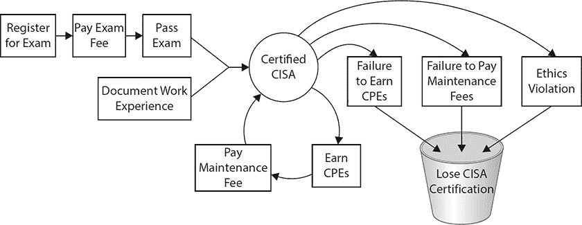

**图 1-1** `CISM` 认证生命周期

列表列出了获得认证的主要要求：

- **经验**：`CISM` 候选人必须能够提交至少五年经验的可核实证据，且在三个或多个 `CISM` 岗位实践领域中至少拥有三年的专业工作经验。经验必须经过验证，且必须在申请认证之之前的十年内，或在通过考试之后的五年内获得。提供长达三年经验的替代和豁免选项。

- **伦理**：候选人必须承诺遵守 `ISACA` 的《职业伦理守则》，该准则指导了受认证人员的个人和职业行为。

- **考试**：候选人必须在 `CISM` 考试中获得及格分。格分有效期最多为五年，之后失效。这意味着通过考试的 `CISM` 候选人最多有五年的时间申请 `CISM` 认证；通过考试但在五年后未采取行动的候选人，如果想获得 `CISM` 认证，将必须重新考试。

- **教育**：获得认证的人必须遵守 `CISM` 继续专业教育政策，该政策要求每年至少参加 20 小时的继续专业教育 (`CPE`)，在整个认证期（三年）内总要求为 120 个 `CPE`。

- **申请**：在成功通过考试、满足经验要求并阅读完《职业伦理与标准》后，候选人即可申请认证。申请必须在通过考试后的五年内提交。

## 经验要求

要获得 `CISM` 认证资格，你必须完成等同于五年的总工作经验。这五年经验可以采取多种形式，并有多种替代方案。接下来将讨论最低认证要求、替代选项和各种示例的更多细节。

***


**注意**：尽管不建议，但 `CISM` 候选人可以在完成任何与信息安全管理直接相关的工作经验之前参加考试。只要候选人通过考试，并在考试日期后五年内、申请认证之日起十年内满足经验要求，该候选人即具备获得认证资格。

### 直接工作经验

你需要在安全策略和管理领域至少拥有三年的工作经验。这等同于 6000 个实际工作小时，必须与以下三个或多个 `CISM` 岗位实践领域相关：

- **信息安全治理**：建立和/或维护信息安全治理框架及支持流程，以确保信息安全战略与组织的目标和目的保持一致。

- **信息风险管理**：根据风险偏好将信息风险管理在可接受的水平，以满足组织的目标和目的。

- **安全计划开发与管理**：开发和维护信息安全计划，在识别、管理和保护组织资产的同时，与信息安全战略和业务目标保持一致，从而支持有效的安全态势。

- **信息安全事件管理**：计划、建立和管理检测、调查、响应和恢复信息安全事件的能力，以最大限度地减少对业务的影响。

所有工作经验必须在完成认证申请之前的十年内完成，或在首次通过 `CISM` 考试之日起五年内完成。你需要为每段经验填写一份单独的《工作经验核实表》(`Verification of Work Experience`)。

这一最低三年直接工作经验要求仅有一个例外：如果你是全职教师。该选项将在下一节中讨论。

### 经验替代

可以使用以下内容替代最多三年的直接工作经验，以满足五年的经验要求。

#### 二年

- 状态良好的注册信息系统审计师 (`CISA`)。

- 状态良好的注册信息安全专业人员 (`CISSP`)。

- 信息安全或相关领域的研究生学位可以替代两年的直接工作经验。必须从就读大学发送成绩单或确认学位状态的信函以获得经验豁免。

#### 一年

- 一整年的信息系统管理经验

- 一整年的通用安全管理经验

- 基于技能的安全认证（例如 `GIAC`、`MCSE`、`Security+`、`CBCP`、`ESL IT Security Manager`）

- 在与模型课程（`Model Curriculum`）一致的机构完成信息安全管理计划

如前所述，经验要求只有一个例外。如果你拥有作为全职大学教师教授信息安全管理的经验，那么你的每两年经验都可以替代一年的要求的直接工作经验，且不受限制。

这里有一个 `CISM` 候选人的示例，其经验和教育被考虑用于 `CISM` 认证：`Jane Doe` 于 2000 年毕业，获得计算机科学学士学位。她在一家软件公司工作了五年管理 IT，从 2005 年 1 月开始管理信息安全。2007 年 1 月，她由于个人原因停止了工作。2012 年，她获得了 `Security+` 认证，并于 2013 年 12 月重返，在一家上市公司的企业风险管理部门担任风险经理。`Jane` 在 2014 年 6 月通过了 `CISM` 考试，并于 2015 年 1 月申请了 `CISM` 认证。`Jane` 拥有所有要求的经验吗？她需要提交什么证据？

- **技能认证**：`Jane` 获得了 `Security+` 认证，这相当于一年的经验替代。

- **两年直接经验**：她可以计算 2005 年和 2006 年的两年完整信息安全管理经验。

- **一年替代**：她不能考虑 2000 年 1 月到 2005 年 1 月期间完成的一年 IT 管理经验，因为这未在申请之前的十年内完成。

- **一年直接经验**：`Jane` 希望利用她新的风险经理经验作为工作经验。

`Jane` 需要在申请时提交以下内容以证明满足了经验要求：

- 由其软件公司和公共公司的主管（或任何上级）填写并签署的工作经验证明表，以证实其所开展的安全管理和非安全管理工作。

- 从大学发送的成绩单或确认学位状态的信。

***


**注意**：我建议你也阅读一下 `ISACA` 网站上的 `CISM` 认证资格要求。`ISACA` 有时会更改资格规则，我希望你能够获取最新的信息。

## ISACA 职业道德准则

成为一名 `CISM` 专业人士意味着你同意遵守 `ISACA 职业道德准则`。该道德准则是一份正式文件，概述了你将采取的行为，以确保最大的诚信，并最好地支持和代表组织及认证。

具体而言，`ISACA` 道德准则要求 `ISACA` 成员和认证持有者执行以下操作：

- 支持并鼓励遵守适当的标准和程序，以实现企业信息系统和技术的有效治理和管理，包括审计、控制、安全和风险管理。

- 根据专业标准，以客观、尽职和专业的态度履行职责。

- 以合法的方式维护利益相关者的利益，同时保持高标准的行为和品格，且不损害其专业或协会的声誉。

- 维护活动过程中获得的信息的隐私和机密性，除非法律授权要求披露。此类信息不得用于个人利益，或向不适当的方发布。

- 保持其各自领域的专业能力，并同意仅承担他们可以合理预期通过必要的技能、知识和能力完成的活动。

- 向相关方告知工作结果，包括披露他们所知的所有重大事实，这些事实如果不披露，可能会扭曲结果的报告。

- 支持利益相关者的职业教育，以增强他们对企业信息系统和技术治理与管理的理解，包括审计、控制、安全和风险管理。

未能遵守本 `职业道德准则` 可能会导致对成员或认证持有者的行为进行调查，并最终导致纪律措施。

你可以在`[www.isaca.org/ethics](http://www.isaca.org/ethics)`找到 `ISACA 道德准则` 的全文和执行条款。

## 认证考试

该认证全年通过多个考试窗口提供。你有几种注册方式；然而，无论你选择哪种方法，我都强烈建议你提前计划并尽早注册。

2018 年以美元计算的考试费用表如下：

- `CISM` 申请费：$50

- 普通注册：会员 $575 / 非会员 $760

考试由 `ISACA` 赞助的地点进行。有关距离你最近的场地的更多详情，请参阅 `ISACA` 网站。

注册完成后，你将立即收到一封确认你注册的电子邮件。接下来，你需要安排你的认证考试。`ISACA` 网站将引导你进入认证注册页面，你可以在那里选择参加考试的日期、时间和地点。当你确认考试的日期、时间和地点后，你将通过电子邮件收到确认信息。你需要该确认信息来进入考场——请确保在考试之前不要对其进行折痕并存放在安全的地方。

当你到达考场时，你将被要求签到，并可能被要求签署一份协议。此外，你将被要求交出智能手机、钱包或包和其他个人物品以妥善保管。监考将宣读你在考试期间必须遵守的规则。这些规则将涉及休息、饮水和零食等事项。

在你考试期间，将有监考人员监督，你还可能接受视频监控，以确保无人作弊。

每位注册者有四小时时间完成选择题考试。考试共有 150 个问题，代表五个工作实践领域。考试是计算机化的。每个问题有四个答案选项；考生只能选择一个最佳答案。你可以跳过问题并在稍后返回，如果时间允许，你还可以标记想要稍后查看的问题。在你考试期间，剩余时间将显示在屏幕上。

当你完成考试后，会被指示关闭考试。此时，考试将显示你的通过或不通过状态，并提醒你的分数和通过状态需审核。

你将对每个工作实践领域进行评分，然后获得一个最终分数。所有分数都经过比例计算。分数范围从 200 到 800 分；然而，需要达到 450 分才能通过。

考试题目源于 `ISACA` 进行的一项工作实践分析研究。所选领域代表了 `CISM` 日常活动执行的任务，并代表了开发和管理信息安全计划所需的背景知识。你可以在`[www.isaca.org/CISMjobpractice](http://www.isaca.org/CISMjobpractice)`找到任务和知识陈述的更详细描述。

`CISM` 考试范围相当广泛。考试涵盖四个工作实践领域，如`Table 1-1`所示。

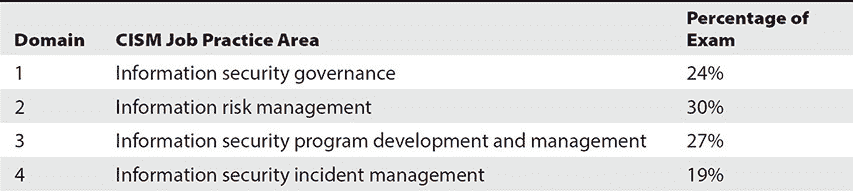

**表 1-1** `CISM` 考试实践领域

已建立独立委员会以确定最佳题目、审查考试结果并对结果进行统计分析以持续改进。如果你遇到极其困难或奇怪的问题，不要惊慌。该问题可能是为了其他目的而编写的。考试中包含的问题用于研究目的，不计入分数。

## 考试准备

`CISM` 认证需要 `CISM` 考生具备大量的知识和经验。你需要制定一个长期学习计划。以下章节提供了一些建议，旨在帮助你进入、完成并通过考试。

### 考前

考虑以下关于考试准备的任务和资源列表。它们按顺序排列。

1. **阅读考生指南**：有关当年的认证考试和要求，请参阅`[www.isaca.org/Certification/Pages/Candidates-Guide-for-Exams.aspx](http://www.isaca.org/Certification/Pages/Candidates-Guide-for-Exams.aspx)`。

2. **注册**：如果可能，尽早注册以节省费用并巩固你对这一专业成就的承诺。

3. **安排考试**：找到地点、日期和并做出承诺。

4. **熟悉 `ISM 工作实践领域`**：工作实践领域是考试和要求的基础。从 2017 年考试开始，工作实践领域发生了变化。确保你的学习材料与当前的列表一致。

5. **了解你的最佳学习方法**：每个人都有偏好的学习方式，无论是自学、学习小组、导师主导的课程还是训练营。尝试建立一个利用你优势的学习计划。

6. **自我评估**：练习可下载的练习题（更多信息请参见附录）。

### 迭代学习

根据你已有的信息安全管理工作经验多少，我建议你将学习计划至少安排两个月，最长为六个月。在此期间，定期进行模拟考试，并记录你的优势和劣势。一旦了薄弱领域，每周通过重读本书中的相关章节并重新参加模拟考试来重点关注这些领域，并记录你的进展。

### 避免突击学习

我们都见过书架上那些标题涉及临阵突击的书。只需在互联网上搜索一下，就能发现各种教个人如何最有效地突击考试的网站。还有一些研究网站声称，突击考试会导致容易感冒和流感、睡眠中断、过食和消化问题。有一点是肯定的：许多人发现，良好的稳定学习习惯会让考试期间压力更小，思路更清晰、更专注。由于这项考试非常复杂，我强烈建议选择长期、稳定的学习方案。彻底学习工作实务领域。有很多学习选择。如果时间允许，请调查你可以使用的许多资源。

### 寻找学习小组

许多 `ISACA` 分会和其他组织已经组成了特定的学习小组，或提供价格低廉的考试复习课程。联系你当地的分会，看看这些选项是否适用于你。此外，务必关注 `ISACA` 网站。并利用你的本地网络查询是否有其他本地学习小组和其他有用的资源。

### 确认信

再次检查你的确认信。不要在上面写字或将其遗失。将其放在安全的地方，并记录你需要到达考场的时间。在你的日历上记下此时间。确认地点是你选择的且位于你较近的地方。

### 后勤检查

查看考生指南和你的确认信，确认你要求报到考场的准确时间。在考试前几天检查考场——熟悉该位置以及到达那里的技巧。如果你乘坐公共交通工具，务必查看考试当天的时刻表：如果你的 `CISM` 考试安排在周六，公共交通时刻表可能与工作日的时刻表不同。如果你开车，请熟悉路线和停放车辆的地方。

### 准备行李

将你的确认信和带照片的身份证件放在安全的地方，准备出发。你的身份件必须是有效的、政府颁发的照片身份证，且必须与确认信上的姓名一致，且不能是手写的。接受的身份件示例包括护照、驾驶执照、州身份证、绿卡和国家身份证。确保你留下食物、饮料、笔记本电脑、手机和其他电子设备，因为考场不允许携带这些物品。有关可以和不能带入考场的信息，请参阅`www.isaca.org/CISMbelongings`。

### 通知决策

决定你是否希望通过电子邮件接收考试结果。你将有机会同意通过电子邮件通知考试结果。如果你已全额缴费（考试费用余额为零）并同意了电子邮件通知，你应该在考试后大约八周收到一封包含结果的电子邮件。

### 睡眠

确保在考试前获得充足的睡眠。研究建议你在睡睡前至少四小时避免咖啡因，在床头放一个笔记本和一支笔，以记录下可能让你失眠的深夜思绪，尽可能消除噪音和光线，并保持房间适合睡眠的温度。早晨要早起，以免匆忙而让自己承受额外的压力。

### 考试当天

你为 `CISM` 认证的所有准备将在你安排考试的当天达到顶点。考试当天，请遵循以下提示：

- **尽早到达**：检查信息公告和你的确认信，确认你要求报到考场的准确时间。确认信或考生指南说明，你最晚必须在考试前约 30 分钟到达考场。监官将在此时开始宣读考试说明，任何迟到者将失去考试资格，且不退还费用。

- **遵守考场规则**：可能会有关于休息的规定。监官将同考试说明一起讨论这些规定。如果在考试期间的任何时候你需要某物且不确定规则，请务必先询问。有关考试期间行为的信息，请参阅`www.isaca.org/CISMbelongings`。

- **回答所有考试题**：仔细阅读题目，但不要试图过度分析。记住选择最佳解决方案。可能会有几个合理的答案，但其中一个比其他的要好。如果你不确定某个答案，可以标记该题目并在稍后回来。在过完所有题目后，你可以返回查看标记的题目（以及任何其他题目）进行阅读并进行更仔细的考虑。最重要的是，不要试图过度分析题目，要相信你的直觉。不要试图赶时间考试，因为有充足的时间让每道题花费几分钟。但同时，要留心时间，以免发现自己进展太慢，导致无法深思熟虑地回答问题。


**记录你的考试结果**：当你完成考试后，你应该能看到通过/不及格的结果。你的结果可能不是以大号闪烁字体显示；你可能需要阅读小字。

要申请认证，你必须能够提交及格分数证明以及相关的工作经验。请记住，一旦你获得及格分数，你有五年的时间在 CISM 认证申请中使用该分数。超过此时间，你将需要重新参加考试。此外，提交的所有经验必须是在你申请新认证的过去十年内的。

要完成申请流程，你需要提交以下信息：

- **CISM 申请**：记录考试结果信中的考试 ID 编号，列出信息安全管理经验及任何经验替代方案，并确定你的经验属于哪些 CISM 职业实践领域（或多个领域）。
- **工作经验验证表**：这些表格必须由你的直属主管或组织中职位更高的人员填写并签字，以验证你在申请表中注记的工作经验。你必须为每一位独立的雇主填写一套完整的《工作经验验证表》。
- **成绩单或信函**：如果你使用教育经验免免，你必须提交学院或大学出具的原始成绩单或信函以确认学位状态。

与考试一样，在你成功邮寄申请表后，你需要等待大约八周的处理。如果你的申请获得批准，你将收到一封电子邮件通知，随后会收到一封包含认证信、证书和《持续专业教育政策》副本的邮件。然后你就可以自豪地展示你的证书，并在简历、电子邮件、社交媒体个人资料和名片上使用“CISM”头衔。


**注意** 你只有在收到 ISACA 发出的认证信后，才允许`仅`使用 CISM 头衔。

## 留存你的 CISM 认证

成为一名 CISM 专业人士不仅仅是通过考试、提交申请并获得一张纸质证书。成为一名 CISM 专业人士是一个不断且持续的旅程。持有 CISM 认证的人员不仅同意遵守伦理守则，还必须满足持续教育要求并支付年度认证维护费用。让我们仔细查看一下教育要求，并解释留存认证所需的费用。

### 持续教育

持续专业教育要求的目标是确保个人保持与 CISM 相关的知识，以便他们能够更好地开发和管理安全管理计划。为了维持 CISM 认证，个人必须在三年内获得 120 小时的持续教育学，每年最少要求 20 小时。每个 CPE 小时应对应 50 分钟的教育活动参与。

#### 什么属于有效的 CPE 学分？

为了使培训和活动可用于 CPE，它们必须涉及直接应用于信息安全和信息安全管理的技术或管理培训。以下活动已通过 CISM 认证委员会批准，可以计入你的 CPE 要求：

- ISACA 专业教育活动和会议。
- 如果你是 ISACA 会员，可以在线参加《信息系统控制期刊》的 CPE 测验或参加每月网络会议。对于每场网络会议，在你通过测验后将获得 CPE。
- 非 ISACA 专业教育活动和会议。
- 自学课程。
- 供应商的销售或营销演示（每年限制 10 小时）。
- 就职业实践领域相关的主题进行教学、讲座或演示。
- 发表与职业相关的文章和书籍。
- CISM 考试题开发和评审。
- 通过相关的专业考试。
- ISACA 董事或委员会（每项 ISACA 认证每年限制 20 小时）。
- 对信息安全管理职业的贡献（每年限制 10 小时）。
- 导师指导（每年限制 10 小时）。

关于哪些被接受为有效的 CPE 学分的更多信息，请参阅《持续专业教育政策》（[www.isaca.org/cpe](http://www.isaca.org/cpe)）。

#### 跟踪和提交 CPE

你不仅需要在年度续期过程中提交 CPE 跟踪表，还应该为每个活动保留详细记录。与每个活动相关的记录应包含以下内容：

- 者姓名
- 赞助机构名称
- 活动标题
- 活动描述
- 活动日期
- 授予的 CPE 小时

在一个单一文件或工作表中跟踪所有的 CPE 信息对你最有利。ISACA 开发了一份供你使用的跟踪表，你可以在《持续专业教育政策》中找到。为了方便起见，考虑将所有相关记录（如收据、小册和证书）放在同一个地方。文档应在三年的认证期内保留，并在之后至少额外保留一年。这尤尤为重要，因为你某日可能会面临审计。如果发生这种情况，你将被要求提交所有文件。所以，为什么不做好准备呢？

对于新的 CISM 持有者，年度和三年认证期从认证次年的 1 月 1 日开始。你不需要报告认证后第一个部分年度的 CPE 小时；然而，从认证时间到 12 月 31 日获得的小时可用于第二年的第一个报告期。因此，如果你在 1 月获得认证，你将有到次年 1 月的时间积累 CPE，并在报告下一年总额（即 10 月或 11 月）之前报告。这被称为`续期期`。在此期间，你将收到一封电子邮件，指导你访问网站输入当年获得的 CPE。或者，续期表单将邮寄给你，然后可以将 CPE 记录在纸质发票上，并随维护费用一同发送。CPE 和维护费用必须在 1 月 15 日前收到以保留认证。

在收到并处理所有信息后，认证部门将发送合规通知。如果 ISACA 对你提交的信息有任何疑问，将直接与你联系。

### CPE 提交示例

`Table 1-2`Text/ch1.xhtml#ch1tab2 包含 CPE 提交示例。

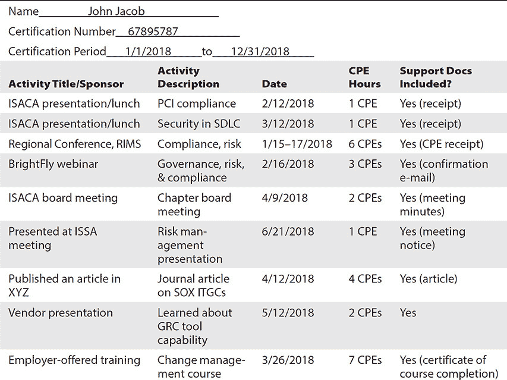

**Table 1-2** CPE 提交

#### CPE 维护费用

为了保持 CISM 认证，你每年必须支付 CPE 维护费用。这些费用（截至 2018 年）会员每年 45 美元，非会员每年 85 美元。这些费用是 ISACA 会员费和地方分会费（两者都不是维持 CISM 认证的必要条件）。

### 撤销认证

CISM 认证人员可能因以下原因被撤销认证：

- 在期内未能完成最低数量的 CPE。
- 在审计中未能记录并提供 CPE 证据。
- 未提交维护费用。
- 违反职业伦理守则可能导致调查并最终导致认证撤销。

如果你收到撤销通知，你需要联系 ISACA 认证部门 `certification@isaca.org` 获取更多信息。

### 总结

成为并作为一名 CISM 专业人士是一种生活方式，而不仅仅是一次性。在信息安全管理世界中成为强大且有效的领导者，需要动力、技能、良好的判断、坚持和专业知识。CISM 的设计旨在帮助你更轻松、更有信心地应对安全管理世界。

在接下来的章节中，将详细讨论每个 CISM 业务实践领域，并提供额外的参考材料。这些信息不仅对于考前的学习有用，还将作为你作为信息安全管理专业人员职业生涯中的持续资源。

# 第 2 章：信息安全治理

在本章中，你将学习到：

- 业务对齐
- 安全策略制定
- 安全治理活动
- 信息安全战略的制定
- 制定和执行安全策略所需的资源
- 策略制定和执行的障碍
- 信息安全度量

本章的主题占了注册信息安全管理师（CISM）考试内容的 24%。本章主要讨论了 CISM 业务实践领域 1，“信息安全治理”。

ISACA 对该领域的定义如下：“建立和/或维护信息安全治理框架及支持流程，以确保信息安全战略与组织目标和目的保持一致。”

安全治理应该是所有安全相关战略决策及其他安全活动的源泉。

如果实施得当，`governance is a process`，即高层通过策略、目标、授权和监控对业务职能实施战略控制。治理是管理层对所有其他业务流程的监督，以确保业务流程继续有效满足组织的业务愿景和目标。

组织通常通过指导委员会建立治理，该委员会负责制定长期业务战略，并通过做出更改以确保业务流程继续支持业务战略和组织的整体需求。这是通过制定和执行记录在的策略、标准、要求和各种报告指标来实现的。

## 信息安全治理简介

信息安全治理通常关注于几个关键流程。这些流程包括人员管理、采购、风险管理、配置管理、变更管理、访问管理、漏洞管理、事件管理和业务连续性计划。另一个关键组成部分是建立有效的组织结构以及明确的角色和职责声明。有效的治理计划将使用平衡计分卡、度量或其他手段来监控这些及其他关键流程。通过持续改进的过程，安全流程将不断调整以保持有效并支持持续的业务需求。

信息安全是一个业务问题，那些尚未充分保护其信息的组织正面临着业务问题。其原因几乎总是董事会和高管层缺乏理解和投入。对于许多人来说，信息安全仅仅是战术层面的技术问题。近期事件已将信息安全问题推向了许多组织的前沿。挑战在于，由于缺乏意识或网络安全素养，组织仍在苦苦于如何在董事会层面成功地组织、管理和沟通这一问题。

要取得成功，信息安全也是一个人的问题。当组织每个层的人员——从董事会到个人贡献者——都理解信息安全的重要性以及自身的角色和职责时，组织将处于风险降低的状态。这种风险的降低或对潜在安全事件的识别将导致事件减少，且当这些事件发生时，对组织持续声誉和运营的影响也会更小。

信息安全治理是一系列活动，旨在让管理层对组织安全计划的状态、当前风险及其直接活动有清晰的。安全计划的目标是继续为实现安全战略做出贡献，而战略本身将继续与业务和业务目标保持一致。无论组织拥有董事会、委员会成员、专员或其他高层治理机构，治理都始于建立高层战略目标，这些目标被转化为行动、策略、流程、程序和其他活动，向下传递到组织的每一个层级。

为了使信息安全治理取得成功，组织还必须有一个有效的 IT 治理计划。IT 是赋能者和力量倍增器，促进实现组织目标的业务流程。没有有效的 IT 治理，信息安全治理将无法发挥全部潜力。结果可能是，俗说的“IT 公交车”行驶安全但去向了错误的目的地。这在`图 2-1`中所示。

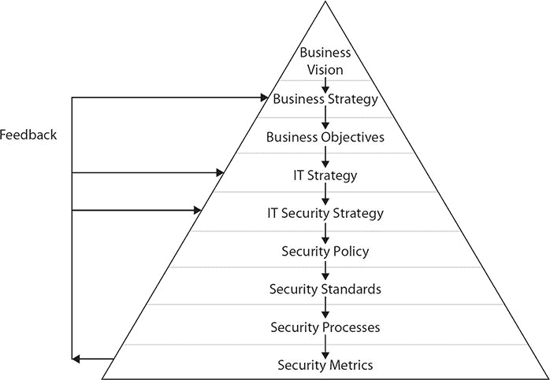

图 2-1 愿景在组织中向下传递。

- **控制**：这些是对关键活动的正式描述，以确保实现预期结果。
- **计划与项目管理**：组织的 IT 和安全计划及项目应以一致的方式组织和执行，这种方式应反映业务优先级并支持业务。
- **指标/报告**：这包括对流程和控制进行正式衡量，以便管理层能够理解并对其进行衡量。

在最大范围内，组织的安全治理实践方式应与其组织执行 IT 治理和公司治理的方式一致。安全治理应当模拟公司和或 IT 治理流程，或者将安全治理集成到公司或 IT 治理流程中。

虽然安全治理包含了上述元素，但战略规划也是治理的关键组成部分。策略制定将在下一节中讨论。

## 安全治理的原因

大多数行业部门和各级政府的组织对信息系统的依赖日益增加。这种依赖已经发展到这种程度：组织——包括那些产品或服务与信息无关的组织——完全依赖其信息系统的完整性和可用性来维持业务运营。作为一名信息安全专业人员，必须理解业务在机密性、完整性和可用性（`CIA`）方面的优先级。在构建安全治理结构时，应当考虑这三者，但业务所使用的信息类型将决定赋予机密性、完整性和可用性的优先级。因此，需要信息安全治理来确保安全相关事件不会威胁到关键系统以及它们对组织持续生存的支持。

在信息安全专业人员中，有一个众周知的事实：如果没有适当的保护措施，可以通过互联网访问的信息技术资产在上线后的几分钟内就会被破坏。此外，许多被认为受到防火墙和其他控制点保护的信息技术资产也可能被轻易访问和破坏。保护这些资产所需的工具、流程和控制措施，其复杂度与它们旨在保护的信息系统一样复杂。如果没有对保护 IT 资产的安全控制和流程进行有效的自上而下管理，管理层将无法获知或控制这些保护措施。失败的后果可能会损害、瘫痪和/或使组织的核心业务陷入尴尬。

## 安全治理活动与结果

在一个有效的安全治理计划中，组织的高级管理团队将确保支持业务运营的信息系统得到充分保护。以下是保护组织所需的某些活动：

- **风险管理**：管理层将确保进行风险评估，以识别信息系统和所支持流程中的风险。将采取后续行动以降低系统故障和泄露的风险。
- **流程改进**：管理层将确保对业务流程进行关键更改，从而实现安全改进。
- **事件识别**：管理层将确保建立技术和流程，以确保尽可能快地识别安全事件和事故。
- **应急响应**：管理层将建立应急响应程序，有助于避免事件发生、减少事件的影响和概率，并改进对事件的响应，从而将对组织的影响降至最低。
- **提高合规性**：管理层将确保识别所有相关的法律、法规标准，并开展活动确认组织能够获得并维持合规性。
- **业务连续性和灾难恢复计划**：管理层将定义目标并为开发业务连续性和灾难恢复计划分配资源。
- **指标**：管理层将建立衡量关键安全事件流程，例如事故、策略变更和违规、审计以及培训。
- **资源管理**：管理层将监控为满足安全目标的人力、预算和其他资源的分配。
- **改进 IT 治理**：有效的安全治理计划将使 IT 组织做出更好的战略决策，将风险保持在可接受的低水平。

这些和其他治理活动通过关键业务和 IT 高管之间定期的脚本化交互来完成。会议将包括讨论监管变化的影响、与业务目标的一致性、衡量有效性、近期事故、近期审计以及风险评估。其他讨论可能包括业务变化、近期业务结果以及任何预期的业务事件（如合并或收购）。

这些是有效的安全治理计划的两个关键结果：

- **增加信任**：当客户、供应商和合作伙伴看到安全管理有效时，他们会对组织产生更大的信任。
- **提升声誉**：业务社区（包括客户、投资者和监管机构）将对组织评价更高。

## 业务对齐

组织的信息安全计划需要与组织的其余部分融合。这意味着计划需要理解并与组织的最高层指导原则对齐，包括以下内容：

- **使命**：组织为什么存在？它为谁服务？通过什么产品和服务提供服务？
- **目标和目的**：组织想要实现什么成就，希望在什么时候实现？
- **策略**：需要进行哪些活动以实现组织的目标和目的？

为了实现业务对齐，安全计划的人员应该了解组织的若干特征，包括以下：

- **文化**：文化包括组织内人员工作、思考和人与人互动的方式。
- **资产价值**：包括组织运营所需的信息。这通常由知识产权（如设计、源代码、生产成本和定价）以及与其人员、客户、信息处理基础设施及其服务功能相关的敏感信息组成。
- **风险容度**：组织信息安全计划的风险容度需要与组织的整体风险容度对齐。
- **法律义务**：哪些外部法律法规规管了组织的行为和运营方式？这些法律法规包括《格雷姆莱奇-布莱尔法案》（`GLBA`）、《支付行业数据安全标准》（`PCI-DSS`）、《欧盟通用数据保护条例》（`GDPR`）、《健康保险流通与责任法案》（`HIPAA`）以及北美电力可靠性协会（`NERC`）标准。此外，与其他方的合同义务也塑造了组织的行为和实践。
- **市场状况**：组织运营的市场竞争激烈如何？与竞争对手相比，组织有哪些优势和劣势？组织希望其安全与竞争对手相比有何差异化？

信息安全专业领域仍然受到“不行部门”或“业务阻碍部门”这一声誉的困扰。这源于那些过度管理的安全经理，他们比业务本身更规避风险，并且不理解组织增长、扩张以及建立新产品和服务的需求。这种声誉导致 IT 以及企业其他部门仍然倾向于避免与安全专业人员接触，因为担心他们的参与会阻碍自己的工作。

这可能导致“影子 IT”的产生，在许多情况下，这会让组织面临更大的数据泄露风险。企业中的大多数人都希望做正确的事并以成功的方式完成工作活动。他们并非刻意暴露敏感数据；许多员工只是在尝试完成分配的职责。例如，新账户部门的人员收到一封来自外部营销团队的电子邮件，邮件中列出了所有新注册的账户。该人员未能意识到的是该文件包含敏感的持卡人数据，并且正在通过公共连接进行共享。

## 目标与目的

组织的目标和目的规定了为支持组织整体战略而进行的活动。目标和目的通常是以命令形式表示的陈述，描述业务能力的开发或改进。例如，目标和目的可能与能力的增加、质量的提高或完全新能力的开发有关。目标和目的进一步促进组织的使命，帮助其继续吸引新客户或成员、增加市场份额并增加收入和/或利润。

## 风险偏好

每个组织对风险都有特定的偏好，尽管很少有组织记录了这种偏好。ISACA 将风险偏好定义为组织在追求使命、战略和目标时，在采取措施处理风险之前所愿意接受的风险水平。

风险能力与风险偏好有关。ISACA 将`risk capacity`定义为组织在持续存在不受到质疑的情况下可以承受的损失损失。

通常，只有银行、保险公司和公用事业公司等高度规避风险的组织才会记录并定义风险偏好。其他组织对风险的容忍度较高，根据直觉做出个人风险决策。然而，由于客户影响力和指令的增加，许多组织发现有必要记录并明确组织的风险态势和偏好。这是市场上的新兴趋势，但对许多组织来说仍然相当新颖。

规避型组织通常拥有一正式的问责和追溯系统，可以将风险决策追溯到部门负责人和业务高管。这种活动通常出现在风险管理和风险处理过程中，在这些过程中会做出个人风险处理决策，并让一个或多个业务高管对其风险处理决策负责。

在一个运行良好的风险管理计划中，首席信息安全官（`CISO`）很少是做出风险处理决策并对决策负责的人。相反，`CISO`是风险讨论的促进者，这些讨论最终导致风险处理决策。`CISO`成为责任方的唯一情况是风险处理决策直接影响风险管理计划本身时，例如选择用于管理和报告风险的治理、风险和合规（`GRC`）工具。

组织很少在整个业务范围内具有单一的风险容忍度；相反，不同的业务职能和安全的不同方面具有不同的风险水平。例如，一家移动游戏软件公司在产品引入方面可能有中等的风险容忍度。

### 角色与职责

当每个人都清楚自己的预期时，信息安全治理最为有效。在职场和行为背景下，`role`是对一个人有义务执行的预期活动的描述。角色通常与职位名称相关，这些指定了在组织中的位置。典型的角色包括：

- `IT 审计员`
- `系统工程师`
- `应收账经理`
- `个人贡献者`

职位名称通常还包括`rank`，表示个人的资历。典型的职级如下，按资历增加的顺序排列：

- `主管`
- `经理`
- `高级经理`
- `总监`
- `高级总监`
- `执行董事`
- `副总裁`
- `高级副总裁`
- `执行级副总裁`
- `总裁`
- `首席执行官`
- `董事会成员`
- `董事会主席`

这不应被视为职级的完整列表。较大的组织还包括`assistant`（助理）、`general`（总）和`first`（第一）等修饰语。

`responsibility`是预期一个人执行活动的声明。与角色一样，职责通常记录在职位说明和工作中。典型的职责包括：

- `执行每月费用对账`
- `排除网络故障并制定解决方案`
- `审计用户账户注销并开发异常报告`

与个人职位名称相关的特定职责外，组织通常还在所有职位名称中包含通用职责。示例包括：

- `理解并符合信息安全策略、骚扰政策和其他政策`
- `理解并符合职业道德和行为规范`

## RACI 格


组织利用负责者-责任者-咨询者-通知者（`RACI`）图表来表示业务流程、项目、任务和其他活动中的关键职责。`RACI` 图表为个人和小组分配了责任级别。开发 `RACI` 图表有助于人员确定各种业务活动的角色。典型的 `RACI` 图表所示：

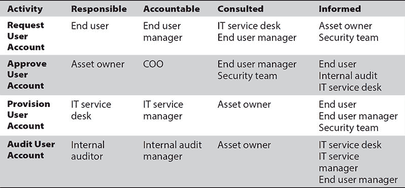

同一个 `RACI` 图表也可以像第二个示例那样进行描绘：

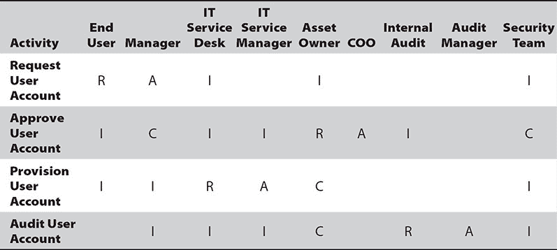

此 `RACI` 图表规定了多方在用户账户访问请求过程中所承担的角色。`RACI` 图表中四个角色的含义如下：

- **负责者（Responsible）**：执行实际工作或任务的人或小组。
- **负责（Accountable）**：对工作的完整、准确和及时执行负最终责任的人员。这通常是管理那些承担“执行（Responsible）”角色的人员。
- **咨询（Consulted）**：就其意见、经验或洞察接受咨询的一个或多个个人或群体。“咨询”角色的人员可能是该工作或任务的领域专家，也可能是与工作或任务相关的资产的所有者、管理者或保管人。与“咨询”角色的沟通是双向的。
- **知会（Informed）**：由其他角色的人告知的一个或多个个人或群体。根据流程或任务，“知会”可能会活动之前、期间或结束后被通知。与“知会”者的沟通是单向的。

在 `RACI` 图表中为个人和群体分配角色时，必须考虑若干因素，包括：

- **技能（Skills）**：团队分配中的部分或全部个人，以及特定的指定个人，需要具备执行要求任务所需的技能、培训和能力。
- **职责分离（Segregation of duties）**：关键任务（如前述的用户帐户配置 `RACI` 图表）不能存在职责分离冲突。这意味着执行关键任务需要两个或多个个人或群体。在示例中，请求者、审批者和配置者不能是同一个人或同一个群体。
- **利益冲突（Conflict of interest）**：当分配会产生利益冲突时，不能将关键任务分配给特定的个人或群体。例如，作为审批者的用户不能批准其自身的访问请求。在这种情况下，必须由另人批准请求——同时还要避免职责分离冲突。

`RACI` 模型有几种变体，包括参与者（Participant）、负责者（Accountable）、需要评审（Review Required）、需要输入（Input Required）、需要签字（Sign-off Required, PARIS）以及执行者（Perform）、负责者（Accountable）、控制（Control）、建议（Suggest）、知会（Informed, PACSI）。

## 董事会（Board of Directors）

组织的董事会是一个监督组织活动的机构。根据组织的类型，董事成员可能由股东或选民选举，也可以由任命。这一角色性质可以是有偿的也可以是志愿者。

董事会执行的活动以及董事权限通常由章程、旁程或外部法规规定。董事会通常对组织的所有者负责；如果是政府机构，则对选民负责。

在许多情况下，董事成员负有`fiduciary duty`。这意味着他们对股东或选民负责，要根据组织的利益采取行动，且其行为不会产生不当迹象、利益冲突或非法所得。

在非营利组织中，董事会负责任命首席执行官（`CEO`）以及可能的其他高管。随后，`CEO` 对董事会负责并执行其指令。董事成员还可能出于以下原因被选出：

- **投资者代表（Investor representation）**：一个或多个董事成员可能由大投资者任命，以使其对组织的战略和方向拥有控制权。
- **业务经验（Business experience）**：董事成员带来了外部业务管理经验，这有助于他们为组织制定成功的业务战略。
- **资源获取（Access to resources）**：董事成员带来了业务联系，包括额外的投资者、业务合作伙伴、供应商或客户。

通常，一个或多个董事成员将具有业务财务经验，以便为组织带来财务管理监督。在美国上市公司，美国《萨班斯-奥克斯法案》（Sarbanes-Oxley Act）要求董事会成立审计委员会；且要求一个或多个审计委员会成员具备财务管理经验。外部财务审计和内部审计活动通常直接向审计委员会负责，以便对组织的财务管理活动进行直接监督。随着信息安全问题在执行层讨论中变得日益普遍，一些组织增加了精通技术的董事成员，或者建立了一个额外的委员会，通常被称为技术风险委员会。

董事会通常被要求要求`CEO` 和其他高管实施企业`governance`（治理）功能，以确保执行管理层对组织的运营具有适当的可见性和控制力。高管对董事会负责，证明他们正在有效地执行董事会的战略。

许多（如果不是大多数）组织的日常运营高度依赖信息技术。因此，信息安全是董事会的一个重要课题。今天企业董事会的尽职调查标准要求它们在制定的战略和对组织的监督中包含信息安全考量。美国董事会协会在其出版的《网络风险监督》（Cyber-Risk Oversight）中制定了关于信息安全性的五项原则：

- **原则 1**：董事需要理解并将网络安全视为企业级的风险管理问题，而不仅仅是一个 IT 问题。
- **原则 2**：董事应该理解网络风险与其公司特定情况相对应的法律影响。
- **原则 3**：董事会应获得充分的网络安全专业知识，并在董事会议程中为网络风险管理讨论提供定期且充分的时间。
- **原则 4**：董事会应设定预期，要求管理层建立具有足够人员和预算的企业级网络风险管理框架。
- **原则 5**：董事会关于网络风险的管理讨论应包括识别哪些风险应规避、哪些应接受、哪些应通过保险进行缓解或转嫁，以及与每种方法相关的特定计划。

## 执行管理层（Executive Management）

执行层负责执行董事会发布的指令。在信息安全管理的背景下，这包括确保组织有足够的资源来实施安全计划，并开发维护安全控制以保护关键资产。

执行层必须确保平衡优先级。在 IT 和信息安全的情况下，这些功能通常紧密结合但有时会冲突。IT 的主要任务是通过信息系统开发和运营支持业务的能力，而信息安全的任务包括安全和合规。执行层必须确保这两个有时冲突的任务都能取得成功。

典型的 IT 和安全相关高管职位包括：

- **首席信息官（CIO）**：这是大型 IT 组织最高领导者的职称。
- **首席技术官（CTO）**：该职位通常负责组织的整体技术战略。根据组织的目的，该职位可能与 IT 独立。
- **首席信息安全官（CISO）**：该职位负责数据相关安全的所有方面。这通常包括应急管理、灾难恢复、漏洞管理和合规性。该角色通常与 IT 独立。

为了确保组织信息安全计划的成功，执行管理层应参与三个关键领域：

- **批准公司安全策略**：由信息安全职能开发的安全策略应由执行管理层进行可见的批准或背书。这可以采取不同的形式，例如在治理会议上通过正式记录批准、在安全策略文档正文中包含合规性需求的声明并签字、签发给全体人员的独立备忘录，或通过向组织基层员工的其他可见沟通方式，强调组织信息安全策略的重要性及合规必要性。
- **以身作则**：对于信息安全策略，执行管理层应以身作则，而不应表现出暗示他们“高于”安全策略或其他策略的行为。高管人员不应被认为享有某些特权，这些权利暗示一项或多项安全策略不适用于他们。相反，他们的行为应可见地支持所有人员都应遵守的安全策略。
- **最终责任**：执行管理层对其下属人员执行的所有行动负最终责任。执行管理层对与其外包业务相关的组织的所有结果也负最终责任。

## 安全指导委员会

许多组织会成立安全指导委员会，由来自组织许多（如果不是所有）业务部门、部门、职能部门和主要地点的利益相关者组成。指导委员会可能承担多种职责，包括以下：

- **风险处理审议与建议**：安全指导委员会可以讨论相关风险，讨论风险处理的潜在途径，并就上述风险处理制定建议提交执行管理层批准。
- **IT 与安全项目的讨论与协调**：安全指导委员会成员可以讨论各种 IT 和安全项目，以解决任何资源或进度冲突。他们还可以讨论不同项目和计划之间的潜在冲突并制定解决方案。
- **审查近期风险评估**：安全指导委员会可以讨论的风险评估，以便对其结果达成共识，并讨论发现问题的修复措施。
- **讨论新法律、法规和要求**：委员会可以讨论可能影响组织运营的新法律、法规和要求。委员会成员可以制定高层战略，供各自的业务部门或部门进一步完善。
- **审查近期安全事件**：指导委员会成员可以讨论近期发生的安全事件及其根源。这通常可以导致流程、程序或技术的的变更，以减少未来事件的风险和影响。

言外之意，安全指导委员会的主要使命是识别并解决冲突，并在与其他业务倡议和优先事项之间取得平衡，使安全计划的效能最大化。

## 业务流程和资产所有者

业务流程和资产所有者通常是组织中担任管理的非技术人员。虽然他们可能不是技术专家，但在许多组织中，他们的业务流程通过业务应用和其他能力得到了信息技术的增强。

记住 IT 和信息安全是为组织服务的，而不是相反，业务流程和资产所有者负责做出业务决策，这些决策有时会影响信息技术的使用、组织的安全态势或两者。一个简单的例子是决定某个员工是否应该拥有访问特定信息的权限。虽然 IT 或安全部门可能直接控制哪些人员访问哪些资产，但最佳决策是由负责该流程或业务资产的经理做出的业务决策。

业务流程和资产所有者的职责包括：

- **权限授予**：资产所有者决定个人或小组是否应获得访问资产的权限，以及权限的级别和类型。权限示例包括只读、读写、创建和删除。
- **权限撤销**：资产所有者还应决定个人或小组何时不再需要访问资产，从而指示需要撤销该权限。
- **权限审查**：资产所有者应定期审查访问列表，查看每个人和每个小组是否应该继续拥有该权限。权限审查还可以包括访问活动审查，以确定未访问过资产的人是否仍然需要访问。
- **配置**：资产所有者确定资产和应用程序所需的配置，确保其功能正常并对应用程序和业务流程的支持。
- **功能定义**：在业务应用和服务的情况下，资产所有者决定将提供哪些功能、它们将如何工作以及它们将如何支持业务流程。通常，这种定义受到应用程序、服务或产品内部的功能限制。
- **流程定义**：流程所有者确定其业务流程中执行的顺序、步骤、角色和操作。
- **物理位置**：资产所有者确定其资产的物理位置。影响位置选择的因素包括物理安全、与其他资产的距离、与相关人员的距离以及数据保护和隐私法。

通常，业务和资产所有者是非技术人员，因此可能需要将业务需求转化为技术规范。

## 托管职责

在许多组织中，资产所有者并不参与与其资产管理相关的日常活动，特别是当这些资产是信息系统以及存储在其中的数据时。相反，IT 组织中的某人（或 IT 中的几个人）充当资产所有者的代理，代表他们做出权限授予和其他决策。虽然这是一种常见做法，但往往过度，导致资产所有者实际上没有参与且不知情情。相反，资产所有者应该知晓并定期审查代表他们做出决策的人员、小组和部门所执行的活动。

最典型的安排是让 IT 人员代表资产所有者做出访问决策。除非这些 IT 人员与资产所有者之间存在紧密的伙伴关系，否则这些 IT 人员通常无法充分理解资产的业务性质或在授予某些人员访问权限时的影响。通常情况下，过多的人员拥有访问权限，且权限通常高于所需。

## 首席信息安全官

`CISO` 是组织中级别最高的安全人员。`CISO` 将制定支持现在和未来业务计划的业务安全战略，并负责组织信息风险计划的开发与运行、安全策略的制定与实施、安全事件响应以及可能的某些运营安全功能。

在某些组织中，`CISO` 向首席运营官（COO）或首席执行官（CEO）汇报，但在某些组织中，`CISO` 可能向首席信息官（CIO）、首席法律顾问或组织中的其他人汇报。

具有相似职责的其他类似职位包括：

- **首席安全官（CSO）**：该职位通常负责`CISO` 的职责，外加对业务设备和工作中心等非信息资产的职责。`CSO` 往往负责工作场所安全。
- **首席信息风险官（CIRO）**：通常这代表了对`CISO` 职位处理方法的转变，从基于保护的模式转变为基于风险的模式。
- **首席风险官（CRO）**：该职位负责所有方面的风险，包括信息风险、业务风险、合规风险和市场风险。该角色与 IT 部门分离。

许多组织并没有设立`CISO`，而是设有信息安全总监或经理，其在组织架构图中的汇报级别较低。组织没有设立`CISO` 的原因可能有几个，但通常可以说，该组织没有将信息安全视为战略性职能。这将阻碍信息安全的可见性和重要性，并往往导致信息安全成为一种关注`防火墙`、`防病毒软件`和其他工具等基础防御的战术性功能。在这种情况下，战略级信息安全的责任隐含地落在其他某些高管（例如`CIO`）身上。这种情况通常会导致安全计划的缺失，以及组织对相关风险、威胁和漏洞的普遍意识缺乏。

`CISO` 可能不需要的一个领域是中小型组织，在这些组织中，全职的战略领导者可能不符合成本效益。在这种情况下，建议签约虚拟首席安全官（`vCISO`）来协助战略和规划。对于可能不需要或无法负担全职人员的组织来说，采取这种方法的益处在于，它让组织能够从经验丰富的安全专业人士受益，协助推动信息安全计划的发展。

### 职级决定基调并赋予权力

一眼组织中最高级信息安全职位的名称，就能看出高管管理层对大型组织信息安全的看法。高管对安全的态度反映在安全经理的头中，可能类似于以下：

- **安全经理**：信息安全仅是战术性的，通常被认为只由`防病毒软件`和`防火墙`组成。安全经理无法看到业务目标的制定。高管认为安全不重要，且仅基于技术。
- **安全总监**：信息安全很重要，并具有中等的决策能力，但对业务的影响很小。大型组织中的总监级人员对整体业务战略的可见性有限，且很少或无法接触高管管理层或董事会。
- **副总裁**：信息安全是战略性的，但不影响业务战略和目标。副总裁可以接触高管管理层，并可能接触董事会。
- **CISO/CIRO/CSO/vCISO**：信息安全是战略性的，业务目标的制定充分考虑了风险。C 级安全人员可以不受限制地接触高管管理层和董事会。

### 首席隐私官

某些组织（通常是那些管理大量客户数据的组织）会聘佣首席隐私官（`CPO`）。某些组织拥有`CPO` 是因为相关法规（如`HIPAA`、`公平信用报告法 (FCRA)` 和`GLBA`）有此，而另一些组织拥有`CPO` 是因为它们存储了大量的个人身份信息（`PII`）。

`CPO` 的角色通常包括保护`PII`，并确保组织不滥用拥有的`PII`。由于许多拥有`CPO` 的组织也拥有`CISO`，因此`CPO` 的职责主要涉及对`PII` 数据使用的监督。`CPO` 有时被视为客户的倡导者，在法规要求时，这通常是其角色。

### 软件开发

软件开发职位涉及软件的设计、开发和测试。

- **系统架构师**：该职位通常负责整体系统架构。这可能包含也可能不数据架构。
- **系统分析师**：该职位负责开发技术需求、程序设计和软件测试计划。在组织许可应用程序软件的情况下，`系统分析师`负责设计接口。
- **软件工程师/开发者**：该职位负责开发应用程序。根据经验水平，该职位的人员可能会设计程序。在购买的应用程序中，开发者经常创建自定义接口和自定义报表。
- **软件测试员**：该职位测试由`软件工程师/开发者`编写的程序。

虽然外包应用程序的趋势导致组织很少从零开始开发自己的应用程序，但软件开发角色在组织中依然存在。需要开发者在软件平台内创建自定义模块，以及用于连接应用程序相互通信的集成工具。尽管如此，大多数组织的开发者人数比十年前或二十年前要少得多。

### 数据管理

与数据管理相关的职位负责开发和实施数据库设计以及维护数据库。这些职位关注应用程序内部的数据，因为数据在应用程序之间流转。

- **数据经理**：该职位在大型组织中负责数据架构和数据管理。
- **数据库架构师**：该职位负责开发应用程序数据模型的逻辑和物理设计。具有丰富经验的此类人还可以设计组织的整体数据架构。
- **大数据架构师**：该职位为大型、复杂的数据集开发数据模型和数据分析。
- **数据库管理员（DBA）**：该职位负责构建和维护由`数据库架构师`设计的数据库，以及作为购买应用程序部分的数据库。`DBA` 监控数据库，对其性能和效率进行调优，并解决问题。
- **数据库分析师**：该职位执行的任务低于数据库管理员。
- **数据科学家**：该职位应用科学方法、构建流程并实施系统，以从数据中提取知识或洞察。

* * *

**考试提示**：`数据经理`、`大数据架构师`、`数据库架构师`、`数据库管理员`、`数据库分析师`和`数据科学家`的角色与`数据所有者`（data owners）是不同的。前者是 IT 部门负责管理数据模型和数据技术的角色，而后者角色负责规范信息系统中数据的业务使用和访问。

- **网络工程师**：该职位负责实施、配置和维护路由器、交换机、防火墙和网关等网络设备。
- **网络管理员**：该职位执行网络日常任务，如更改配置和监控事件日志。
- **电信工程师**：该职位负责处理电信技术，如电信服务、数据电路、电话系统、会议系统和语音邮件系统。

## 系统管理

系统管理职位负责服务器和操作系统的架构、设计、构建和维护。这可能包括桌面操作系统。这些职位的人员还设计和管理虚拟环境以及微隔离。

- **系统架构师**：该职位负责系统（通常是服务器）的整体架构，涵盖系统的内部架构以及系统之间的关系。该职位通常负责身份验证、电子邮件和时间同步等的设计。
- **系统工程师**：该职位负责设计、构建和维护服务器及服务器操作系统。
- **存储工程师**：该职位负责设计、构建和维护存储子系统。
- **系统管理员**：该职位负责对系统进行维护和配置操作。

## 运营

运营职位负责日常运营任务，可能包括网络、服务器、数据库和应用程序。

- **运营经理**：该职位负责他人执行的整体运营。职责包括制定运营和轮班计划。
- **运营分析师**：该职位可能负责开发运营程序；检查网络、系统和数据库的健康状况；设定和监控运营进度；维护运营记录。
- **控制分析师**：该职位负责监控批作业、数据输入工作和其他任务，确保其运行正常。
- **系统操作员**：该职位负责监控系统和网络、执行备份任务、运行批作业、打印报告以及其他运营任务。
- **数据录入**：该职位负责从纸质或其他源录入批量数据。
- **媒体经理**：该职位负责维护和跟踪备份带和其他介质的使用及去向。

## 安全运营


安全运营职位负责设计、构建和监控安全系统及安全控制，以确保信息系统的机密性、完整性和可用性。

- **安全架构师**：该职位负责安全控制和系统设计，如身份验证、审计日志、入侵检测系统、入侵预防系统和防火墙。
- **安全工程师**：该职位负责设计、构建和维护由安全架构师设计的安全服务和系统。
- **安全分析师**：该职位负责检查防火墙和入侵检测系统的日志，以及系统和应用程序的审计日志。该职位可能还负责向 IT 部门的其他人员发布安全建议。
- **访问管理员**：该职位负责接受已批准的用户访问管理变更请求，并在网络、系统、数据库或应用程序级别执行必要的更改。通常，此职位由网络和系统管理职能的人员承担；只有在大型组织中，用户账户管理才会在安全部门甚至专门的用户访问部门执行。

## 安全审计

安全审计职位负责检查流程设计并验证安全控制的有效性。

- **安全审计经理**：该职位负责审计工作，以及审计的调度和管理。
- **安全审计员**：该职位负责对控制进行内部审计，以确保其运行正常。


## 服务台

服务台职位负责为 IT 部门提供一线支持服务。

- **服务台经理**：该职位充当终端用户与 IT 部门之间的联系人。
- **服务台分析师**：该职位负责为人员提供一线支持服务。这有时被称为帮助热台分析师。
- **技术支持分析师**：该职位负责为 IT 甚至可能为客户提供技术支持服务。

## 质量保证

质量保证职位负责评估 IT 系统和流程，以确认其准确性和有效性。

- **QA 经理**：该职位负责促进整个 IT 组织内部的质量改进。
- **QC 经理**：该职位负责测试 IT 系统和应用程序，以确认其没有缺陷。

## 其他角色

IT 中的其他角色包括：

- **供应商经理**：该职位负责维护与外部供应商的业务关系，衡量其性能并处理业务问题。
- **项目经理**：该职位负责创建项目计划和管理 IT 项目。

## 普通员工

组织中的普通员工可能没有明确的信息安全责任，这在一定程度上取决于高层对信息系统及其使用人员广泛能力的理解，也取决于高层对人类在信息安全中作用的理解。

通常，普通员工的安全相关职责包括：

- 理解并遵守组织安全策略
- 接受使用组织资产（包括信息）
- 妥当判断，包括对请求信息或要求员工执行特定功能的人员做出正确响应（其主要动力是社会工程学现象及其作为攻击向量的使用）
- 向管理层报告安全相关事项和事件。
- **360 度反馈**：向同事、下属和管理层寻求结构化反馈，有助于受访者和管理层更好地理解与特定职责相关的特征。
- **职位标杆**：这种技术被希望将自己的职位及相应人员与其他组织进行比较的组织使用。它不是对职责进行直接监控，而是帮助组织确定其是否设置了正确的职位，以及人员是否由胜任且合格的人员担任。这对于那些正在解决员工绩效问题的组织可能非常有用。

## 信息安全治理指标

指标是管理层衡量关键流程并了解其策略是否有效的手段。指标被用于许多运营过程中，但在本节中，重点是与安全治理相关的指标。换句话说，战术性的 IT 安全指标与那些揭示整体安全计划状态的指标之间存在区别。然而，这两者通常是相关的，正如侧边栏“安全投资回报率”中所讨论的。

安全指标通常用于观察技术 IT 安全控制和过程，并了解它们是否运行得当。这有助于管理层更好地理解过去决策的影响，并有助于推动未来的决策。技术指标示例包括：

- **防火墙指标**：触发的规则数量和类型
- **入侵检测/防御系统 (IDPS) 指标**：检测或拦截的事件数量和类型，以及目标系统
- **反恶意软件指标**：拦截的恶意软件数量和类型，以及目标系统
- **其他安全系统指标**：来自数据泄露防护（DLP）系统、网络内容过滤系统、云访问安全代理（CASB）系统的测量

虽然这些指标有用，但它们并没有解决组织整体安全计划有效性或对齐性的大局问题。它们没有回答董事会和执行管理层经常问的问题，例如：

- 多少安全才算足够？
- 应该如何投入和应用安全资源？
- 威胁事件的潜在影响是什么？

这些和其他与业务相关的问题可以通过正确的指标来解决，将在本节的剩余部分进行讨论。

安全策略师会对指标进行简单的分类，包括以下内容：

- **关键风险指标 (KRIs)**：这些是与风险衡量相关的指标。
- **关键目标指标 (KGIs)**：这些指标描绘了战略目标的达成情况。
- **关键绩效指标 (KPIs)**：这些指标用于显示安全相关活动的效率或有效性。

## 安全投资回报率

多年来，关于信息安全防护投资回报率（ROI）一直存在激烈争论，被称为`安全投资回报率`（ROSI——读作“rosy”）。信息安全投资的问题在于，具有高影响的安全攻击等重大事件发生频率较低（对于许多组织来说，每年发生远少于一次）。因此，对信息安全控制的投资可能不会产生明显的效果。

组织可能会自问，如果在实施新的安全系统之前没有被入侵，实施之后也没有被入侵，那么对新安全系统的投资是否值得？花费在安全系统上的资源是否可以有其他更好的方式来增加服务交付能力或提高生产效率，从而增加收入或利润？此外，如果进行了投资，它很可能会揭示组织以前未知的新风险。因此，投资回报率降低了，但益处是识别出了以前未知的风险。这可以在安全监控等领域发现。

对安全控制的投资可能不会产生明显的效果。组织可能会自问，如果在实施新的安全系统之前没有被入侵，实施之后也没有被入侵，那么对新安全系统的投资是否值得？花费在安全系统上的资源是否可以有其他更好的方式来增加服务交付能力或提高生产效率，从而增加收入或利润？

对安全控制的投资可能不会产生明显的效果。组织可能会自问，如果在实施新的安全系统之前没有被入侵，实施之后也没有被入侵，那么对新安全系统的投资是否值得？

- **诚信责任**：许多类型的安全控制是适用法规（如`HIPAA`）的要求。
- **监管**：许多类型的安全控制是《加拿大信息保护和文件法》（`PIPEDA`）以及`PCI-DSS`的要求。
- **竞争化**：在许多行业中，竞争性组织包含了安全控制。

## 有效指标

为了使指标有效，它们必须是可衡量的。确保指标质量和有效性的常用方法是使用 SMART 方法。一个`SMART`指标应该是：

- 特定的 (Specific)
- 可衡量的 (Measurable)
- 可实现的 (Attainable)
- 相关的 (Relevant)
- 及时的 (Timely)

根据 Paul Proctor 所著《影响业务决策的风险指标》（Gartner, Inc., 2016），对良好指标的额外考虑包括：

- **先领先指标**：该指标有助于管理层预测未来风险吗？
- **因果关系**：该指标与业务影响之间是否存在可以辩护的因果关系，即指标的变化会迫使某人采取行动？
- **影响**：该指标是否影响了决策（或将会影响）？

你可以在 NIST 特别出版物 800-55 第一版《信息安全测量指南》中找到更多关于指标开发的信息，地址为`www.nist.gov`。

## 战略对齐

为了使安全计划成功，它必须与组织的使命、战略、目标和目的保持一致。安全计划战略和目标应该包含可以转化为关键衡量的声明——即该计划的关键绩效和风险指标。

这里有一个示例：组织`CareerSearchCo`从事职业搜索和招聘业务，其使命陈述如下：

*成为求职者和招聘者的最佳市场*

以下是其最近的战略目标：

- 与领先的业务社交网络`LinkedIn`集成
- 开发 API 以促进向领先的职业和招聘平台的长期转型

为了实现这些目标，`CareerSearchCo`开发了包含以下内容的策略：

*通过开发者培训和应用程序漏洞测试，确保面向 Internet 的应用程序是安全的*

安全和指标将包括这些：

- 尚未接受培训的软件开发人员百分比
- 识别的关键漏洞数量
- 修复关键和高危漏洞的时间

## 风险管理

有效的风险管理是信息安全计划中最高层活动的结晶；这些活动包括风险分析、风险清单的使用、正式的风险处理以及对安全控制套件的调整。

虽然很难有效且客观地衡量风险管理计划的成功与否，但可以进行间接测量——就像通过测量树的阴影来判断其高度一样。因此，一个成功的风险管理计划的最佳指标应该是涉及以下内容的指标改进趋势：

- 安全事件数量的减少
- 安全事件影响的减少
- 修复安全事件时间的缩短
- 修复漏洞时间的缩短
- 新的未缓解风险数量的减少

关于前面提到的减少安全事件，一个成熟度从低水平提升的安全计划，首先应该预期会看到事件数量的增加。这并不是因为安全控制措施的失效，而是因为用于检测和报告安全事件的机制得到了开发和改进。

同样，随着安全计划随时间的推移而不断改进和成熟，新风险的数量起初会增加，随后会减少。

## 性能衡量

信息安全的性能指标提供了对及时性和有效性的衡量。通常来说，性能衡量指标提供了战术性安全流程和活动的视角。正如本节早些时候讨论的，性能衡量通常是运营指标，需要为那些受众群体转换为执行层级的指标。

性能衡量指标可以包括任何以下内容：

- 检测安全事件的时间
- 修复安全事件的时间
- 配置用户账户的时间
- 撤销用户账户的时间
- 发现漏洞的时间
- 修复漏洞的时间

几乎每一个与安全相关的可衡量的运营活动都可以成为性能指标的候选对象。

## 收敛

拥有多个业务部门、地理位置或安全职能的大型组织（通常由于并购导致）可能会遇到与覆盖范围或活动重叠或覆盖不足的问题。例如，一个最近收购了另一家公司的组织在资产管理和风险管理功能方面可能存在某些重复工作。另一个例子是，大型分布式组织中的本地安全人员可能正在执行安全职能，而这些职能正由总部的其他人员代表他们执行。

收敛类别的指标将具有高度的个性化，取决于组织的具体情况。某些指标类别可能包括以下：

- 资产覆盖的缺失
- 资产覆盖的重叠
- 安全工具许可的整合
- 技能、职责或覆盖的缺失或重叠

## 价值交付

价值交付指标侧重于长期成本的降低，并与其他措施成比例。价值交付指标的示例包括：

- 已使用的控制措施（很少使用的控制措施可能是移除的候选对象）
- 有效控制措施的百分比（无效控制会在审计、分析和修复活动中消耗额外资源）
- 每个资产群体或资产价值的计划成本
- 每个员工的计划成本
- 每个收入的计划成本

警告组织不要`only`使用价值交付指标——这样做将面临安全计划陷入虚无的风险，因为一个不产生成本的计划将产生最好的指标。

## 资源管理

资源管理指标与价值交付指标类似；两者都传达了组织信息安全计划中资源的有效利用。但由于这里的重点是计划效率，这些是可能开发资源管理指标的领域：

- 安全相关流程的标准化——因为一致性会驱动成本降低
- 在每个采购和收购项目中参与安全工作
- 受安全控制保护的资产百分比

## 为了受众相关性分层开发指标

在开启安全指标开发任务时，常见的陷阱是开发一个单一维度的指标框架，向所有受众发布一套指标。例如，一个指标计划可能会发布关于发现的漏洞、修复的漏洞、安全事件以及内部审计及其异常的数字。向各种利益相关者发布这组或类似的指标，对某些受众的价值很小，而对其他受众则没有价值。

更好的方法是开发运营指标，这些指标通常易于发现和衡量。下一步是将这些运营指标转换为业务术语，以面向业务受众。在给定的组织中，安全计划可能会采用两、三或更多层的指标，这些指标通常相互相关，并根据相应的受众以技术或业务术语表述。

虽然询问业务领导他们想看到什么样的指标可能是很好的起点，但在许多情况下，安全从业人员会被要求他们想看到什么样的指标。这有时是一项挑战，但通过理解业务、文化、合规环境和相关人员，安全从业人员可以从一组指标开始，或将其作为行动的号召。

### 计分卡

BSC 是一种用于衡量组织性能和有效性的管理工具。平衡计分卡用于确定组织履行其使命和战略目标的程度，以及与整体目标的对齐情况。

在平衡计分卡中，管理层在四个维度上定义关键衡量：

- **财务**：衡量战略计划的成本、关键应用的支持成本以及资本投资。
- **客户**：关键衡量包括对组织面向客户方面的满意度。
- **内部流程**：关键活动的衡量包括项目数量和组织内部运作的有效性。
- **创新与学习**：以人为导向的衡量包括流失率、病假、内部晋升和培训。

每个组织的平衡计分卡将代表反映其业务类型、业务模式和管理风格的独特指标集。

平衡计分卡应用于衡量整体有效性和进展。类似的计分卡——安全平衡计分卡，可以专门衡量安全组织的性能和结果。

与平衡计分卡一样，安全平衡计分卡（`security-BSC`）有相同的四个维度，并如表 2-1 所示映射到关键活动。

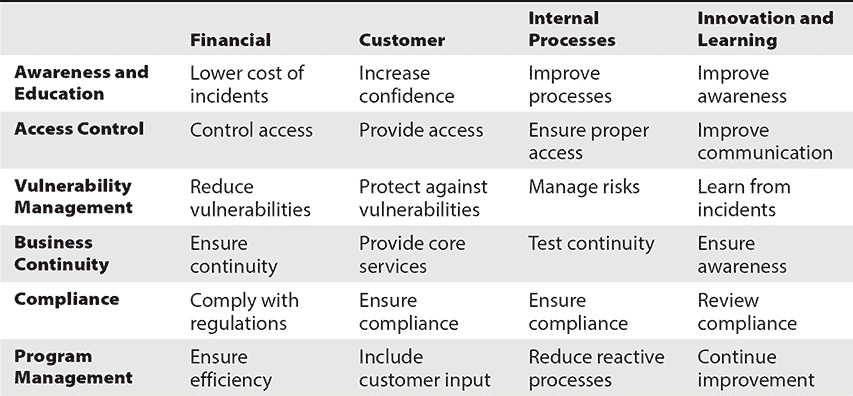

**表 2-1** 安全平衡计分卡领域

安全平衡计分卡应直接来源于组织的整体平衡计分卡及其 IT 平衡计分卡（`IT-BSC`）。这将确保安全能够与目标对齐。虽然整体`BSC`和安全`BSC`之间的维度有所不同，但每个者的方法是相似的，`security-BSC`的结果可以“汇总”到组织的整体`BSC`中。

# 信息安全业务模型

信息安全业务模型（`BMIS`）由 ISACA 于 2009 年开发，是一份用于业务对齐、基于风险的安全治理指南。使用`BMIS`有助于安全领导层确保组织的安全计划能够应对新兴威胁、不断发展的法规以及不断变化的业务需求。

`BMIS`是一个三维、三面的金字塔，如图 2-2 所示。金字塔的三个基础元素是人员、过程和技术，而金字塔的顶点元素是组织。

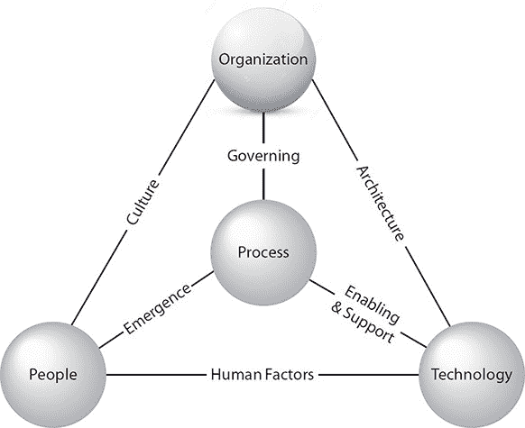

图 2-2 BMIS 模型（改编自 *The Business Model for Information Security*, ISACA）

`BMIS`模型包含了 IT 中常见的三个传统元素，即人员、过程和技术，并增加了第四个元素：组织。这些元素通过动态关联（`DIs`）连接起来，这些文化、治理、架构、涌现、赋能与支持以及人为因素。后续章节将更详细描述这些元素和动态关联。

`BMIS`在 ISACA 的文档《The Business Model for Information Security》中有完整描述，该文档可在 [`www.isaca.org/bmis`](https://www.isaca.org/bmis) 获取。

`BMIS`源自系统安全管理框架，由南加州大学（`USC`）马歇尔学院于 2006 年开发。

## BMIS 元素与动态关联

元素和动态关联是`BMIS`模型的主要部分，本节将对其进行详细描述。

### 组织

`BMIS`模型中的组织元素使该模型具有独一性。大多数其他模型都关注人员、过程和技术——或者关注组织的其他方面，而不考虑组织本身。

`BMIS`将组织定义为“一个相互作用的人员网络，利用过程来引导这种互动”。这与执行管理层的视角相似，该视角将组织视为一组共同行动以实现战略目标的元素。组织不仅包括永久性员工，还包括临时工、承包商和顾问，以及在帮助组织实现目标方面发挥作用的第三方组织。

组织通过组织图、指挥体系、策略、过程和程序进行正式结构化。

但组织也有其非正式的、未记录的组织，这可以被视为额外的突触，以意料之外的方式连接跨组织的人员或群体，尽管如此，它们仍然有助于组织实现目标。这在分布式组织中很常见，在那里效率和务实主义通常优于策略和过程，特别是在距离公司总部较远的地方。

### 人员

`BMIS`模型中的人员元素代表组织中的所有人员，无论是全职员工还是临时工、承包商或顾问。此外，当组织将其业务外包给其他组织时，那些组织中的人员也是`BMIS`中“人员”元素中人员的一部分。

与`BMIS`模型中的其他元素一样，人员不能孤立地研究，而是必须与过程、技术和组织的其他元素结合考虑。

### 过程

`BMIS`模型中的过程元素代表组织中所有定义活动的正式结构，这些活动共同帮助组织实现其战略目标。过程定义了描述如何执行活动的实践和程序。

ISACA 的`Risk IT`框架将有效过程定义为一组可靠且重复的活动和控制集合，用于执行特定任务。过程从一个或多个源（包括其他过程）获取输入，处理输入，根据策略利用资源，并产生输出（包括指向其他过程的输出）。过程应该具有清晰的业务理由、负责的所有者、围绕每个关键活动执行清晰的角色和职责，以及开展和衡量性能的手段。

单个过程具有`maturity`（成熟度）属性，定性地描述了过程设计的优劣以及随着时间的推移如何对其衡量和改进。

### 技术

`BMIS`模型中的技术元素代表组织中从业人员使用的所有系统、应用程序和工具。技术是组织过程及其战略目标的强大赋能者，尽管除非通过过程和人员进行约束，否则技术本身对组织几乎起不了什么作用。

正如`BMIS`模型所示，组织中的技术并非自动运行。相反，人员和过程对于任何技术的成功使用至关重要。技术可以被视为过程的赋能者和力量倍增器，帮助组织以更短的时间、更低的成本和更高的精度完成更多工作。

## 文化

文化 DI 连接了组织和人员元素。作为治理模型的一部分，文化使`BMIS`具有独特性，因为大多数其他模型没有考虑具有战略重要性的文化。`BMIS`将文化定义为“行为、信仰、假设、态度和做事方式的模式”。

文化是驱动行为的催化剂，其影响与策略等正式指令相当甚至更大。文化决定了人员努力遵守安全策略并为保护关键资产做出贡献的程度，或者他们是否会违背策略并使关键资产处于危险。

组织的文化被认为是信息安全计划成功或失败的最关键因素之一。就其本质而言，文化无法立法或直接控制，但它反映了组织内部人员所采用的态度、习惯和习俗。

组织所在地社区的公民文化在塑造组织文化方面起着巨大作用。由于这个原因，在具有许多区域或全球地点的组织中建立单一文化是不可行的。

对于安全战略家而言，开发富有成效的安全文化至关重要。与组织文化的其他方面一样，理想的安全文化不能简单地通过策略制定，而必须经过精心策划和培养。创建良好安全文化的步骤包括：

- 让人员参与有关保护关键资产的讨论。
- 执行领导层必须事事以身作则，并遵循所有策略。
- 在所有职位描述中包含安全职责。
- 在员工的薪酬中包含安全因素——例如，绩效加薪和奖金。
- 将关键资产的保护与组织的长期成功联系起来。
- 将与资产保护及信息安全计划其他方面相关的信息整合到现有的沟通（如新闻通讯）中。
- 将“设计安全”纳入关键业务流程，使安全成为组织日常例行活动的一部分。
- 奖励和认可理想行为；同样地，在私下告诫不理想的行为。


改变组织的安全文化不能一夜之间完成，也不能强迫实现。相反，每个人都需要理解一致的信息，这些信息反复强调良好安全实践的重要性。

对于那些“不理解”的个人和团队，组织必须采取补救措施，这与目睹其他非预期行为时采取的措施相似。具有可教性的个人需要对其预期的行为进行指导。而被证明不可教的人则可以通过其他方式处理。

## 治理 (Governing)

治理集成（DI）连接了组织和流程元素。根据 ISACA 的定义，“治理是董事会和执行管理层实施的一系列责任和实践，其目标是提供战略方向、确保目标的实现、确保风险得到妥善管理，并验证企业的资源被负责任地使用。”

这意味着流程受到组织使命、战略目标和其他因素的影响，甚至是受到控制。换句话之，组织的流程必须支持组织的使命和战略目标。当流程不符合要求时，就通过治理来对其进行更改，直到符合要求为止。

治理中使用的工具包括：

- 策略
- 标准
- 指南
- 流程文档
- 资源分配
- 合规性

层利用这些工具对业务流程的开发和运行实施控制，以确保预期的结果。

通信在治理 DI 中至关重要。信息以指令的形式从管理层向下流动，以影响业务流程的改变。

当治理 DI 失败时，流程将不再符合组织目标，并产生其自身的规律。

## 架构 (Architecture)

架构 DI 连接了组织和技术元素。组织与技术之间的 DI 目的意味着技术的使用必须是有计划的、有序的且有目的的。

根据 ISO/IEC 42010 对架构定义，“系统和软件工程——架构描述”是指系统在其环境中的基本概念或属性，体现在其元素、关系以及设计和演变的原则中。架构的实践确保了以下目标：

- **对齐**：应用程序和基础设施将支持组织的使命和目标。
- **一致性**：整个 IT 环境将采用相似甚至完全相同的实践和解决方案。
- **效率**：IT 组织及其环境可以通过一致的设计和实践进行更高效的构建和运行。
- **低成本**：通过更一致的方法，利用规模经济和减少浪费，可以降低采购和支持成本。
- **韧性**：可以实现具有更韧性的目的架构和设计。
- **灵活性**：架构必须具备所需的灵活性，以适应不断变化的业务需求以及法规和市场状况等外部因素。
- **可扩展性**：健全的架构在规模上不是固定的，可以变大变小以适应各种业务需求，例如收入增长、不同规模的分机构以及更大的数据集。
- **安全性**：随着安全策略、标准和指南的发展，“设计安全”原则在未来的应用和系统中将更具确定性。

### Zachman 框架

建立于 20 世纪 80 年代末的 Zachman 企业架构框架直到今天仍是占据主导地位的企业架构标准。Zachman 将 IT 企业架构类比为办公大楼的建设和维护：在高层（抽象层，而非楼层数）上，办公大楼执行包含办公空间等的功能。当你查看建筑不断增加的细节时，你会遇到各种工种（钢结构、混凝土、干墙板、电气、水暖、电话、火控、电梯等），每种工种都有自己的规格、标准、法规、建设和维护方法等。

在 Zachman 架构模型中，IT 系统和环境在高级、功能层面进行描述，然后以不断增加的细节涵盖系统、数据库、应用程序、网络等。Zachman 框架见`Table 2-2`。

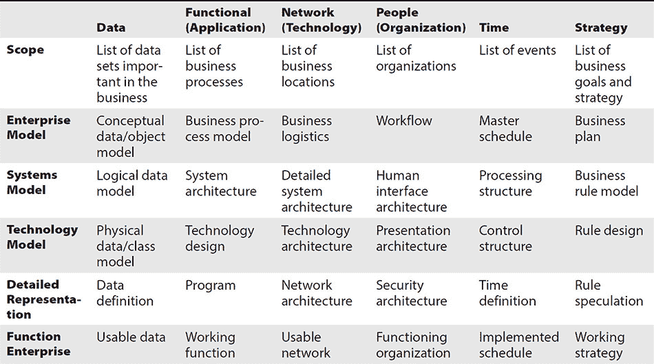

**表 2-2** Zachman 框架展示了细节不断增加的 IT 系统

虽然 Zachman 模型允许组织查看支持业务流程的 IT 环境横面，但该模型并没有传达 IT 系统之间的关系。相反，使用数据流图来描述信息流。

数据流图（`DFDs`）经常用于说明 IT 应用程序之间信息流。与 Zachman 模型一样，`DFD`可以从高层图开始，其中信息流的标签用业务术语表示。关于每个流的书面规范可以随`DFD`；这些规范将以不断增加的细节描述流，一直到字段长度和通信协议设置。

与 Zachman 类似，`DFDs`允许非技术业务管理人员轻松理解各种 IT 应用程序及其之间的关系。`Figure 2-3`显示了一个典型的`DFD`。

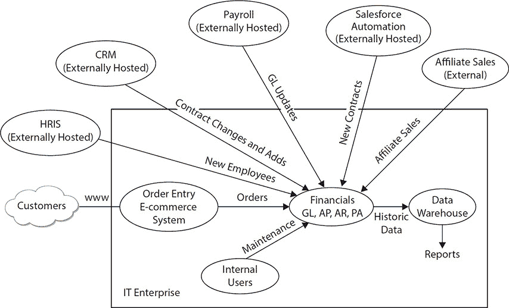

**图 2-3** 典型的`DFD`显示了 IT 应用程序之间的关系。

## 涌现 (Emergence)

涌现 DI 连接了人和流程元素。涌现 DI 的目的是关注人们执行工作的方式。涌现被视为组织新机会、新流程、新实践和新做事方式的出现。涌现可能是人们学习如何做得更好、更快、更准确或更省力的结果。

（注：此处翻译应根据上下文逻辑补全为：**增加流程成熟度**：组织可以通过改变业务流程来提高这些流程的成熟度。例如添加关键衡量或产生更丰富的日志数据，以便随着时间的推移更好地理解和改进流程。）

涌现可以被视为双刃剑。人们的创造力和智慧可以导致更好的工作方法，但另一方面，这可能导致不一致的结果，包括产品或服务质量的错误或波动。

想要减少由涌现引起的工作输出偏差的组织有几种可能的补救措施。

- **增加自动化**：通过自动化消除流程中的某些人为因素可以获得更一致的结果。
- **实施控制**：建立关键控制可以帮助管理层关注导致结果偏差的因素。这在以后可以导致流程改进。
- **增加流程成熟度**：组织可以通过改变业务流程来提高这些流程的成熟度。例如添加关键衡量或产生更丰富的日志数据，以便随着时间的推移更好地理解和改进流程。

组织需要了解哪些活动可以从自动化中受益，哪些活动需要无法编程到计算机中的人类判断。这有时涉及人为因素，因为有时人们可能倾向于与人互动而非机器，即使机器更快或更准确。自动化并不意味着对所有相关方都是改进。

## 赋能与支持 (Enabling and Support)

赋能支持 DI 连接了流程和技术元素。赋能支持 DI 的目的是通过技术对业务流程进行赋能和支持。换句话说，信息技术使得业务流程比手动执行更快、更准确。

在业务流程与技术之间的合理关系中，业务流程的结构决定了技术如何支持它们。遗憾的是，许多组织通过让选择不当或设计不佳的技术能力决定业务流程的运行，从而损害了自身的业务流程。虽然技术并不总是能够支持流程中的每一种奇想和细节，但许多组织采取了另一个极端：选择与其业务流程或组织使命和目标不匹配的技术，并改变其流程以适应技术提供的能力。这种程度的妥协对组织是有害的。

业务流程与未能充分支持其的技术之间存在脱节，部分原因是由于技术专家往往不充分理解他们支持的业务流程，而业务所有者和用户也不充分理解支持他们的技术。泛泛之，技术人员和业务人员在技术和业务方面的思考方式不同，往往发现难以充分理解彼此，从而导致技术对业务流程的支持无法达到理想水平。

用于填补这一差距的工具是需求文档。需求文档通常在大型项目（通常也包括小型项目）启动时开发，业务人员努力编制图表，列出新技术所需和期望的功能，以增加选择和实施能够支持其业务流程的技术的机会。

用于实现和支持的 BMIS 模型是一个生命周期，而不是“一次性”的方法，如`Figure 2-4`所示。

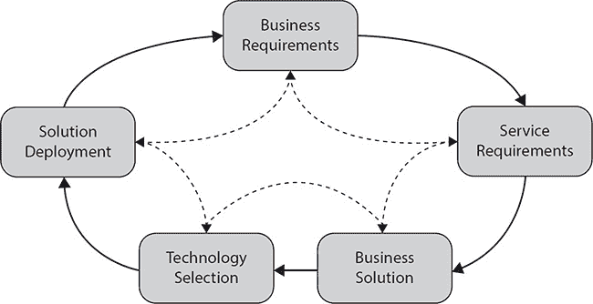

**图 2-4** BMIS 实现与支持生命周期（改编自美国南加州大学马歇尔商学院关键信息基础设施保护研究所）

## 人性因素

人性因素 DI 连接了人与技术元素。人性因素 DI 的目的是人与信息系统之间的交互。这是一个被广泛研究的话题，有时被称为`人机交互 (HCI)`。人们与之交互的信息系统元素通常被称为`用户界面 (UIs)`；大量的研究工作致力于改进`UIs`，以使软件和系统更易用、更直观。

从信息安全的角度来看，信息系统需要实现安全需求，并尽可能地不阻碍用户交互。当用户在与系统交互时有可选择的情况下，安全特性和功能需要易于使用且直观。此外，用户不应能够轻易绕过为保护系统和数据而建立的安全控制。最后，设计应使其无法被滥用，或者其使用不会导致其他资产被滥用。

在信息系统设计（包括硬件和软件）中，需要考虑的许多因素，包括：

- **一致性**：操作信息系统应与其他常用系统相似。例如，键盘布局应与正在使用的其他产品保持一致。
- **打字和数据输入**：输入文本应该是直接且简单的。数据输入的方法应与界面相称。例如，小型触摸屏键盘不是输入大量数据（如句子和段落）的良好选择。此外，指针指向方法应该易于使用且直观。
- **显示和可读性**：用户应该能够轻松阅读文本和图像。
- **错误恢复**：当用户意识到自己犯了错误时，应该能够重复某个步骤。
- **声音**：作为交互一部分的声音应该是可调节的并且音大到足以听见。如果预计用户在没有听力保护的情况下工作，系统不应发出持续的巨大噪音（例如成排的冷却扇）。
- **语音和生物识别**：用于识别语音命令和各种类型生物识别的技术也应该是易于使用且准确的。
- **人体工程**：无论是便携式还是固定式，设备都应该是易于使用的，而不会导致劳损或需要扭曲身体才能使用。
- **环境**：信息系统的设计应能够在其通常使用的各种环境中运行。例如，用于建筑现场的加固笔记本电脑应该防灰尘、污垢、防水和防水，而小型便携设备应该防水且在跌落时不损坏。

### 使用 BMIS

组织利用 BMIS 更好地理解其人员、流程和技术如何帮助保护整个组织。BMIS 帮助策略者更好地理解组织内各个方面（`元素`）与影响这些因素的因素（`动态互连`）之间的整体关系。

BMIS 本身的结构是其成功的关键因素。同样重要的是，具备整体思维而非细节思维的能力。理解 BMIS 显示了万物是如何相互关联的是至关重要的。在任何元素或 DI 上引入的更改都会影响其他元素和 DI，并且最可能影响相邻的元素和 DI。

再次考虑到 BMIS 的结构，请参阅`Figure 2-2`。

当安全分析师或策略师思考某个事件、问题或情况时，他们会识别 BMIS 中对应于该主题的元素或 DI。接下来，他们识别相邻的元素或 DI 并思考它们的关系：这些代表了组织中将相关或受影响的方面。检查一个元素并注意连接其与另一个元素的 DI，有助于识别连接因素的性质。

接下来将介绍示例，这些将使这些概念更加清晰。

**示例 1：政策变更的负面影响** 安全经理想要制定一项关于关于使用个人所有移动设备进行公司业务（包括电子邮件）的新政策。政策是治理 DI 的一部分，相邻元素是组织和流程。

这里的组织元素意味着新政策通过改变其运作方式以某种方式影响了组织。流程元素意味着一个或多个流程或程序可能会受到影响。

但如果新的移动设备政策负面影响了其他流程怎么办？那么就要沿着流程的 DI 看看它们引导哪里以及如何引导。首先，涌现 DI 连接到人员。在该政策的情况下，涌现包含了人们遵循（或不遵循）流程的方式。接下来，遵循实现支持 DI 到技术，这可能表明其他技术如何受到政策变更的影响。

**示例 2：检查流程薄弱的原因** 一个组织请了安全咨询公司对其内部网络进行安全扫描。咨询公司发现许多服务器的安全补丁落后了几个月。该组织使用漏洞扫描工具，并想知道为什么补丁落后了这么多。

在认为技术是问题时，调查人员检查扫描工具以查看其是否运行正常。这将是技术元素。发现该工具运行正常，并且运行着最新的软件。调查人员接下来检查 BMIS 模型，以查看哪些 DI 连接到技术。

首先，检查了架构调查项（DI）。这促使调查人员思考扫描工具是否能够到达网络中的所有系统。调查人员确认了它可以。

接下来，检查了人为因素调查项（DI）。调查人员联系了运行扫描工具的工程师，并要求观察其使用工具的过程。调查人员在思考该工程师是否理解如何正确使用该工具（由于扫描工具不易于使用，过去曾出现过问题）。工程师正在正确地使用扫描工具，因此调查人员需要继续观察。

最后，检查了启用与支持调查项（DI）。这促使调查人员思考是否存在与使用扫描工具相关的业务流程，这些流程可能是影响因素。在采访工程师时，调查人员发现组织中有几个新网络未被包含在扫描器的配置中。

通过使用`BMIS`工具来理解各项要素之间的关系，调查人员得以确定了问题的原因：网络变更流程未能通知安全人员，导致这些安全人员*没有*配置扫描工具以将它们包含在内。因此，在一段时间内，安全扫描未能识别出新网络网段系统中存在的漏洞。安全咨询公司的扫描涵盖了该组织的所有网络，包括该组织未自行扫描的网络。

# 安全策略制定

在业务、技术和安全专业人员中，对于策略究竟包含什么以及使用何种技术来制定策略存在许多不同的观点，并且在该主题上存在普遍的困惑。虽然特定策略本身可能复杂，但策略的概念非常简单。它可以被定义为：

*实现目标的计划*。

制定策略的努力不仅仅是说这六个字。然而，这个想法并不复杂。其概念是：了解你现在所处的位置，以及你想去哪里。策略就是你从目前所在地（当前状态）到达你想去的地方（战略目标）必须遵循的路径。

本节的剩余部分将详细探讨策略制定。

## 策略目标

正如本节前面所述，策略是实现目标的计划。目标（或多个目标）是组织安全态势和风险水平的预期未来状态。

此外，策略还具有`的`目标。这些目标如下：

- **战略对齐**：预期的未来状态以及到达那里的策略，必须与组织及其`的策略和目标保持一致。
- **有效的风险管理**：安全计划必须包含风险管理策略、流程和程序。没有风险管理，决策将是盲目做出，而不考虑其后果或风险水平。
- **价值交付**：安全计划的预期未来状态应该专注于持续改进和提高效率。没有任何组织拥有无限的安全资金；相反，组织需要以最低的合理成本降低风险。
- **资源优化**：与价值交付类似，战略目标应该高效地利用可用资源。在其他方面，这意味着仅拥有满足战略目标所需的必要员工和工具。
- **性能衡量**：虽然战略目标具备 SMART（具体的、可衡量的等）是重要的，但持续的安全与安全相关的业务运营本身应该是可衡量的，为管理层提供持续改进的机会。
- **保证过程集成**：组织通常在不集成的孤岛环境中运行一个或多个独立的保证过程。有效的策略将致力于打破这些孤岛并整合保证过程，以减少隐藏风险。

所有这些内容都应该以一种使其可衡量的方式进行制定。这就是为什么在之前讨论治理指标时讨论了这六个话题。这些组件的设计初衷就是为了这种方式相互配合。

## 控制框架

虽然每个组织都可能有其独特的使命、目标、业务模式、风险承受能力等，但组织不需要从零开始发明治理框架来管理其 IT 目标。

在策略制定的背景下，某些组织可能已经有了合适的控制框架，而另一些组织可能还没有。虽然组织并不总是需要选择一个行业控制框架，但这样做是有益的。行业标准的控制框架已在成千上万家公司中使用，并且它们会定期更新，以反映不断变化的业务实践、新兴威胁和新技术。

由于存在或不存在少数特定的控制措施而选择控制框架通常被认为是错误的。通常这种选择是基于控制框架是僵化且不灵活的假设。相反，策略制定者应该采取不同的方法：根据行业对齐选择控制框架，然后根据风险评估的结果建立一个开发额外控制的流程。事实上，这正是`ISO/IEC 27001`以及`NIST 网络安全框架`中描述的方法。从一个著名的控制框架开始，如果需要，再创建额外的控制措施以应对组织特定的风险。在评估特定框架的使用时，可能会出现特定控制区域不适用的情况。在这种情况下，不要仅仅忽略该章节。记录组织选择不使用该控制区域的业务和技术原因。当未来有人提出为何做出不实施该控制区域的决策的问题时，这将提供帮助。还应该记录日期和参与决策的人员。

本节的剩余部分将讨论几个标准框架：

- `COBIT`
- `ISO/IEC 27001`
- `ISO/IEC 38500`
- `ITIL / ISO/IEC 20000`
- `HIPAA`
- `NIST SP 800-53`
- `NIST CSF`
- `CIS 20`
- `PCI-DSS`

### COBIT

`COBIT`开发于 1996 年，即信息和相关技术控制目标，是由 IT 治理协会和`ISACA`开发的 IT 管理框架。`COBIT`的四个领域是计划与组织、获取与实施、交付与支持以及监控与评估。

`COBIT`主要不是安全控制框架，而是一个贯穿框架的安全流程的 IT 流程框架。`COBIT`包含 37 个流程；安全和风险相关的流程如下：

- 确保风险优化
- 管理风险
- 管理安全
- 管理安全资源
- 监控、评估和检查外部要求

`COBIT`可`https://www.isaca.org/COBIT/Pages/Product-Family.aspx`获取（需要注册和付费）。

### ISO/IEC 27001

ISO/IEC 27001，“信息技术——安全技术——信息安全管理系统——要求”-不对，不-“信息技术——安全技术——信息安全管理系统——要求，”是信息安全和风险管理的国际标准。该标准包含一个概述运行良好的信息安全管理系统（ISMS）的要求的部分，以及一个全面的控制框架。

ISO/IEC 27001 分两部分：要求和控制。要求部分描述了有效 ISMS 中包含的活动。控制部分包含一组作为组织起点的基准控制措施。该标准定期更新；最新版本发布于 2015 年，被称为`ISO/IEC 27001:2015`。

`ISO/IEC 27001`中的要求在以下七部分中描述：

- 组织背景
- 领导力
- 规划
- 支持
- 运行
- 性能评价
- 改进

`ISO/IEC 27001`标准中的 14 个控制类别如下：

- 信息安全策略
- 信息安全组织
- 人力资源安全
- 资产管理
- 访问控制
- 密码学
- 物理和环境安全
- 运行安全
- 通信安全
- 系统获取、开发和维护
- 供应商关系
- 信息安全事件管理
- 业务连续性管理中的信息安全方面
- 合规性

虽然`ISO/IEC 27001`是一个备受尊敬的控制框架，但其采用程度并不高，部分原因是该标准的成本约为 117 美元。与免费的`NIST`标准不同，学生或专业人士不太可能支付这么多费用来学习一个标准以了解更多信息。尽管如此，`ISO/IEC 27001`在全球范围内的组织日益受欢迎。

可以通过[`www.iso.org/standard/54534.html`](https://www.iso.org/standard/54534.html)（需要注册并付费）获取`ISO/IEC 27001`。

### ISO/IEC 38500

`ISO/IEC 38500`，“组织 IT 治理”是一个关于企业信息技术治理的国际标准，适用于公共或私营部门的小型组织。


可以通过 [`www.iso.org/standard/62816.html`](https://www.iso.org/standard/62816.html)（需要注册并付费）获取 `ISO/IEC 38500`。

### ITIL / ISO/IEC 20000

`ITIL` 被称为 IT 基础架构库，是一套用于 IT 服务交付和 IT 服务管理的流程框架。`ITIL` 最初由英国政府商业办公室开发，旨在改进其 IT 管理流程。国际标准 `ISO/IEC 20000` 是根据 `ITIL` 适配转化而成的。

`ITIL` 不是一个安全框架，而是一个用于 IT 服务管理的流程框架。然而，人们常说，如果没有像 `ITIL` 这样的服务管理框架，组织很难建立一个具有有效控制的安全信息安全计划。

`ITIL` 可以从 [`www.axelos.com/best-practice-solutions/itil`](https://www.axelos.com/best-practice-solutions/itil)（需要注册并付费）获取。

### HIPAA

美国《医疗保险与健康健康可携带性与责任法》（HIPAA）为保护电子受保护健康信息（`EPHI`）建立了要求。这些要求适用于几乎每个存储或处理 `EPHI` 的企业或政府实体（称为`受保护实体`）。`HIPAA` 要求分为三大类：

- 行政防护
- 物理防护
- 技术防护

这三个类别中的每一类都包含多个控制措施。每个控制措施被标记为 `Required`（强制）或 `Addressable`（可采）。被标记为 `Required` 的控制必须由每个`受保护实体`实施。被标记为 `Addressable` 的控制在每个`受保护实体`中被视为可选，这意味着如果该控制不适用，或者如果不实施该控制带来的风险微乎其微，则组织无需实施该 `Addressable` 控制。

`HIPAA` 可以从 [`www.hhs.gov/hipaa/for-professionals/index.html`](https://www.hhs.gov/hipaa/for-professionals/index.html) 获取。

### NIST SP 800-53

由国家标准与技术研究院（NIST）开发的 `NIST 特别出版 (SP) 800-53`，“信息系统和组织的安全与隐私控制”是著名的控制框架之一。`NIST SP 800-53` 分为 18 个类别：

- 访问控制
- 意识与培训
- 审计与问责
- 安全评估与授权
- 配置管理
- 应急计划
- 身份识别与认证
- 事件响应
- 维护
- 介质保护
- 规划
- 人员安全
- 风险评估
- 系统获取与服务
- 系统与通信保护
- 系统完整性
- 程序管理

`NIST SP 800-53` 可以从 [`csrc.nist.gov/publications/detail/sp/800-53/rev/5`](https://csrc.nist.gov/publications/detail/sp/800-53/rev/5) 获取。

### NIST 网络安全框架

NIST 网络安全框架（`NIST CSF`）是一种基于风险的方法，用于评估风险、实施控制和衡量效果，与 `ISO/27001` 不同。`NIST CSF` 的组件包括：

- **框架核心（Framework Core）**：这是一组函数——识别、保护、检测、响应、恢复——构成了信息安全的生命周期。
- **实施层（Implementation Tiers）**：这些是成熟度级别，从不成熟到最成熟：部分、风险感知、可重复、自适应。
- **框架概（Framework Profile）**：这是 `Framework Core` 元素（函数、类别、子类别）与组织的业务需求、风险承受能力及可用资源的对齐。

实施 `NIST CSF` 的组织首先会通过衡量 `Framework Core` 中每项活动的成熟度（`Implementation Tiers`）来进行评估。接下来，组织将确定 `Framework Core` 中每项活动所需的成熟度水平。发现的差异将是需要通过多种手段填补的，包括：

- 增加资源
- 培训资源
- 添加或更改业务流程或程序
- 更改系统或设备配置
- 获取新系统或设备

`NIST CSF` 可以从 [`www.nist.gov/cyberframework`](https://www.nist.gov/cyberframework) 获取。

### 网络安全中心关键控制

来自网络安全中心（CIS）的关键控制（`CSC`）框架被称为 `CIS CSC 20`，是一个著名的控制框架，其起源可追溯到 `SANS` 组织。该框架仍被称为 `SANS 20` 或 `SANS 20 关键安全控制`。

`CIS CSC` 控制类别如下：

- 授权和未授权设备清单
- 授权和未授权软件清单
- 移动设备、笔记本电脑、工作站和服务器硬件软件的安全配置
- 持续漏洞评估与修复
- 管理权限的受控使用
- 审计日志的维护、监控与分析
- 电子邮件和网页浏览器保护
- 恶意软件防御
- 网络端口、协议与服务的限制与控制
- 数据恢复能力
- 防火墙、路由器和交换机等网络设备的安全配置
- 边界防御
- 数据保护
- 基于所需的访问控制
- 无线访问控制
- 账户监控与控制
- 安全技能评估及针对性培训
- 应用程序软件安全
- 事件响应与管理
- 渗透测试与红队演练

CIS CSC 控制措施可通过 [`www.cisecurity.org/critical-controls/`](https://www.cisecurity.org/critical-controls/) 获取（需要注册）。

## PCI-DSS

支付卡行业数据安全标准是一项控制框架，专门用于保护在组织网络上存储、处理和传输的信用卡号及相关信息。PCI-DSS 由 PCI 标准委员会制定，该委员会是由全球领先的信用卡品牌组成的，即 Visa、MasterCard（万事达）、American Express（美国运）、Discover 和 JCB。

PCI-DSS 有 12 个控制目标：

- 安装并维护防火墙配置以保护持卡持有者数据。
- 不要使用供应商提供的默认系统密码和其他安全参数。
- 保护存储的持卡持有者数据。
- 对跨开放公共网络的持卡人数据传输进行加密。
- 保护所有系统免受恶意软件侵害，并定期更新防病毒软件或程序。
- 开发并维护安全的系统和应用程序。
- 根据业务需要限制对持卡数据的数据的访问。
- 识别并验证对系统组件的访问。
- 限制对持卡持有者数据的物理访问。
- 跟踪和监控对网络资源和持卡人数据的所有访问。
- 定期测试安全系统和流程。
- 维护一份针对所有人员的信息安全政策。

PCI-DSS 对于所有存储、处理或传输信用卡数据的组织来说都是强制性的。拥有大量卡片数据的组织需要接受年度现场审计。

许多组织使用 PCI-DSS 中的控制措施和原则来保护其他类型的财务和个人数据，如账号、社会安全号码和出生日期。

PCI-DSS 可通过 [`www.pcisecuritystandards.org/`](https://www.pcisecuritystandards.org/) 获取（需要注册和许可协议）。

### 风险目标

策略制定的一个至关重要的部分是确定期望的风险水平。策略制定的输入因素是对当前风险水平的理解，而期望的未来状态可能带有相关的风险水平。

要量化风险是非常的，即使对于最成熟的组织也是如此。将风险降低到合理的“高/中/低”要简单得多，但在组织内部一致地做到这一点并不直观且困难。在特定情况下，单个控制措施的成本是可知的，理论损失的成本是可以估计的，但在整个风险控制框架中执行此操作是枯燥且不定的，因为威胁事件发生的概率几乎不于猜测。

尽管如此，从一般意义上，安全策略的一个关键部分可能是降低风险（它也可能是降低成本或改进合规性）。在这种情况下，策略者需要采用一种方法来确定合理且可信的实施前后风险水平。为了保持一致性，更好的方法是使用一种方法论——无论该方法是具体的还是通用的都要与涉及风险的其他策略和讨论相匹配。

### 策略资源

在制定策略之前，首先必须了解目前的所有状况。策略描述了如何实现目标和目的。如果不知道旅程的起点，就不可能规划通往目的地的路线。有必要了解组织安全态的现状，包括其政策和实践。

策略者需要采用一种方法来确定合理且可信的实施前后风险水平。为了保持一致性，更好的方法是使用一种方法论——无论该方法是具体的还是通用的都要与涉及风险的其他策略和讨论相匹配。

必须考虑两种类型的输入：影响战略目标发展的因素和定义安全计划的因素。以下是有帮助的输入：

- `Risk assessments`（风险评估）
- `Threat assessments`（威胁评估）
- `Policy`（政策）
- `Standards`（标准）
- `Guidelines`（指南）
- `Architecture`（架构）
- `Controls`（控制措施）
- `Skills`（技能）
- `Metrics`（指标）
- `Assets`（资产）
- `Risk ledger`（风险清单）
- `Vulnerability assessments`（漏洞评估）
- `Insurance`（保险）
- `Critical data`（关键数据）
- `Business impact analysis`（业务影响分析）
- `Security incident log`（安全事件日志）
- `Outsourced services`（外包服务）
- `Audits`（审计）
- `Culture`（文化）
- `Risk appetite`（风险承受能力）

此处出的的所有关注领域在本节中都有描述。

### 风险评估

策略者应该选择进行风险评估，以揭示组织存在的风险。这有助于策略者理解威胁场景及其估计的影响和频率。风险评估的结果为策略者提供了关于将风险降低到接受水平所需资源的价值信息。这对于制定战略目标至关重要。

任何风险评估的历史记录都可能让策略者更好地了解安全计划的成熟程度，并表明过去的风险是否已经得到缓解。如果旧的风险评估表明重大风险在新的风险评估中仍然存在，或者如果风险评估仅为了合规目的而进行，而不是为了做出实际改进，你可能会怀疑该组织对这些评估是否有多大的信任。

### 威胁评估

策略者应该进行威胁评估，以便更好地理解相关威胁。这为策略者提供了关于最可能影响组织的威胁类型的信息，而不论控制措施的有效性如何。

执行威胁评估为风险提供了额外的视角。这是因为威胁评估关注的是外部威胁和威胁场景，无论预防性或检测性控制措施是否存在或是否有效。虽然漏洞可能会频繁变化，但威胁被认为是更恒定的。因此，安全策略需要反映已识别的威胁。

威胁评估是策略制定不可或缺的要素。如果没有威胁评估，战略目标可能无法应对重要的威胁。这将导致安全策略无法充分保护组织。

### 政策

组织的安全政策，以及与其政策相关的实践，可能在很大程度上反映了组织期望的现状。

安全策略可以被视为组织内部关于重要资产（以及人员安全）保护的法律和法规。审查现有的安全策略可以揭示许多关于该组织要求的行为信息。以下是安全策略的几个方面：

- **覆盖范围**：该策略涵盖了哪些主题领域？它是否包含了预期的计算机和移动设备使用行为？安全策略中是否包含了漏洞管理、第三方风险或软件开发等其他主题？
- **相关性**：策略是否包含有关新技术和新实践的内容？
- **策略严格性**：策略是否宽泛禁止了某些行为，例如偶尔将公司邮箱个人化，或限制或禁止使用外部 USB 数据存储设备？
- **问责制与后果**：策略是否规定了对遵守策略的预期，或故意违反策略的后果？例如，违反策略的后果是否包括停职或终止劳动关系的可能？
- **合规性**：了解组织对其策略的合规程度（包括合规边缘）至关重要。组织的安全策略是否反映了良好实践，组织是否满足了大部分或全部要求？还是其策略似乎更像是一份关于未来可能情况的愿景声明？
- **最近管理评审**：了解组织的安全策略上次何时更新、评审并由管理层批准至关重要。这不仅涉及组织的策略，还反映了其安全计划在最近的活跃程度。

## 标准

组织的安全标准详细描述了在整个组织范围内使用的方法、技术、方案、规格、品牌和配置。

与前节的安全策略类似，对于组织的标准而言，了解其覆盖范围、严格性、合规性以及最近的评审和更新至关重要。这些都能告诉安全经理组织安全标准的使用程度——如果确实在用的话话。

除了上述特征外，了解组织的标准是如何开发的以及它们的优劣也至关重要。例如，是否存在设备加固标准，这些标准是否对齐或源自行业公认的标准，如`互联网安全中心 (Center for Internet Security)`、`国家标准与技术研究院 (NIST)`、`欧盟网络和信息安全局 (ENISA)`、`国防信息系统局安全技术实施指南 (DISA STIG)` 或其他？

同样重要的是，知道标准是高度详细的（逐项配置项细化），还是基于原则的。如果是后者，那么工程师在实施这些标准时可能会行使可能广泛的裁量权。你应该理解，高度详细的标准并不一定比基于原则的标准好；这取决于组织的性质、风险承受能力和成熟度。

## 指南

虽然组织的指南本身并非“法律”，但指南的存在可能标志着高于平均水平的成熟度。许多组织在创建策略和标准后就没有进一步进展了，因此适当指南的存在意味着组织可能（或过去拥有）足够的资源或优先级，使得编写策略指南变得足够重要值得去完成。

根据其本质，指南通常是为那些需要关于如何遵守策略的额外指导的人员编写的。

与其他类型的安全程序文档一样，指南应该定期评审和更新。由于指南连接了很少改变的策略与经常变化的技术和实践，审查指南的战略家应该发现它们频繁变动——或者发现它们是脱无关的。

### 流程与程序

组织的流程和程序可以充分说明其纪律性、一致性、风险承受能力和成熟度。与信息安全和信息技术的许多其他方面一样，流程程序文档的相关性和详尽程度是指标。仅依赖流程文档是不够的。战略家需要检查程序文档之外的内容；他们必须采访人员、检查业务记录并观察运行中的流程，以确保它们按设计执行。有关流程和程序有效性的进一步证据可以在本节后面讨论的风险评估和审计中找到。

## 架构

组织的架构——即其系统、网络、数据流及环境其他方面的文档——为安全战略家提供了大量关于组织如何实现系统的有用信息。

虽然寻找和检查网络图、系统图、数据流图等是好的，但即使这些设计没有记录在任何地方，找到良好且一致的设计也具有等价值价值。我宁愿看到组织的基础设施是现代、有效且一致的，而不是一系列过时图纸的集合。架构图是否存在是一个与策略、标准、指南和其他产物类似的关注问题。

在这里同样重要的是技术架构是否有效地支持了该组织。组织的技术以及技术的实现方式是否充分支持了组织的目标、愿景和运营？像信息安全的许多其他方面一样，与业务及其目标的对齐至关重要，不容忽视。

架构的另一个方面被称为`技术债`。这个术语代表了组织基础设施的两个特征：

- **设计不佳**：缺乏整体设计，或由于设计不佳，导致对环境的后续添加和更改是以一种不理想的方式完成，从而从性能、韧性或简单性方面进一步恶化了环境。
- **过时且不受支持的组件**：在这种情况下，环境的主要硬件或软件组件已超过其使用寿命，不再受制造商支持，或其子组件无法轻易更换。

当组织缺乏能够良好架构设计的人员，以及组织未能升级寿命终止的组件时，就会产生技术债。

控制措施——以及控制框架的存在——充分说明了组织的安全计划水平。然而，控制措施可能仅存在于纸面上而未付诸实践。了解组织的控制措施是有用的，但仅凭这些我们了解的信息非常少。策略人员需要了解这些控制措施是否已实际实施。更重要的是，了解这些措施是否有效至关重要。

在检查控制文档时，策略人员应该寻找细节，例如控制所有者、控制的目的和范围、相关的流程和程序文档，以及其他帮助策略人员理解其目的的元数据。

接下来，策略人员应该寻找工作成果或采访人员，以查看特定的控制措施是否到位。同样，仅有文档存在并不意味着它们实际上正在被执行，或者这些文档仅仅是摆在架子上的摆设。采访人员和观察控制的运行是查看控制措施是否落位的更好方法。

本节稍后将讨论的内部和外部审计是理解控制有效性的另一种方法。请参见“审计”章节。

策略人员会想要了解现有的控制措施是否是控制框架的一部分，如 `ISO27001`、`NIST 800-53`、`HIPAA` 或 `PCI`。但更重要的是，框架中的所有控制措施是否已实施，还是说有些被遗漏了？遗漏的原因可能各异，从无关到不负责的规避不等。

最后，策略人员应该寻找已实施的其他控制措施。这可能是监管要求的信号，也是有效的风险管理计划的结果，即识别出的风险迫使管理层采取额外的控制措施来降低风险。

### 技能

技能清单为策略人员提供了员工成员能够完成任务的思路。这在几个方面都是很有用的：

- **资历**：包括员工可能拥有的不同类型经验的年限。
- **行为**：包括领导力、管理、协调和后勤。
- **学科**：包括系统工程、网络工程、控制开发、审计、风险管理和风险分析等领域。
- **技术**：包括涉及特定技术的技能，如 `Palo Alto Networks` 防火墙、`CentOS` 操作系统、`Logrhythm` 和 `AppScan`。

了解所有这些层面的技能有助于策略人员理解当前员工能够执行的工作类型、细微技能缺口在哪里，以及策略人员可能可能建议通过招聘、外包或专业服务增加额外人员。

策略人员需要记住的一个关键考虑因素是技术发生重大转变的可能性。一个很好的例子是，如果组织多年一直使用特定供应商的产品，但由于领导层的变动和另一家供应商的一项优厚交易，决定迁移到另一个供应商的产品。在不完全了解团队技能和能力的情况下，组织可能会因为无法有效管理新产品而产生重大风险。这可能导致服务中断、关键资源流失、相关咨询成本增加以及终端社区信任的丧失。

### 指标

指标反映了信息安全计划随时间推移的状态。有效的指标有助于人员看到安全计划保护组织的高效程度；对于负责制定长期策略的人员来说，这是一个关键考虑因素。

如果指标建立得当，它们将作为安全措施长期有效性的指南。这有助于策略人员理解哪些方面运行良好，哪些地方有改进机会。这样，策略人员就可以比没有指标时更有确定性和信心地设计终极状态。


在检查指标时，策略人员需要了解受众。例如，安全指标是仅供内部安全运营使用的，还是为了供其他受众（如内部用户、高层管理人员或董事会）而开发的。接下来，策略人员将想要寻找证据，证明指标已交付给这些其他受众，以及指标是否曾被用作安全计划进行战术或战略调整的理由。

### 资产

信息安全专业人员常说：“你无法保护你找不到的东西。”这句话指的是组织中的资产，即服务器、网络设备、终端工作站和移动设备——还包括应用程序和软件工具。由于许多安全事件涉及漏洞利用（通常是利用恶意软件），这要求组织必须建立有效的漏洞管理计划。漏洞管理计划中的生命周期过程如下：

- 识别要扫描的环境。
- 扫描资产的漏洞。
- 识别并分类漏洞。
- 修复漏洞（通常通过应用安全补丁，但有时通过配置更改或增加监控和告警）。

取决于组织的工具和方法，通常只扫描已识别的资产。未知或未识别的资产可能扫描也可能不扫描，但即使扫描了，它们也可能在过程中丢失。入侵者熟悉这一点并利用其优势：通过进行自己的扫描，他们可以识别未打补丁的系统并将其作为渗透组织的桥头。

### 风险账本

风险账本可以为策略人员深入组织内的风险管理和风险分析活动提供大量见解。根据风险账本中提供的细节，策略人员可能识别出以下内容：

- 风险评估的范围、频率、质量和成熟度
- 风险处理的存在与否
- 安全事件

风险账本是反映风险评估、威胁评估、漏洞评估、安全事件和其他活动历史和发现的业务记录。其内容反映了信息安全计划中活动的类型以及这些活动的重大结果。

缺乏风险账本将表明组织的安全管理计划没有采取基于风险的方法。相反，组织可能是基于合规的，或者更糟，是基于资产或临时的。这些方法是成熟度较低的迹象，意味着组织的安全人员主要是被动反应，很少做计划。

### 漏洞评估

策略人员可能会选择进行漏洞评估，以便更好地了解组织基础设施当前的安全态势。漏洞评估可能针对网络设备、设备、操作系统、子系统（如 Web 服务器和数据库管理系统）以及应用程序——或任何合适的组合。

漏洞评估的结果将告诉策略人员关于组织的若干信息，包括以下内容：

- **运营成熟度**：目标之间漏洞的一致性将揭示组织是否具有跨目标配置的标准或自动化工具来管理配置。当漏洞评估发现相似系统之间的漏洞存在差异时，你可以假设该组织没有使用自动化工具向系统分发补丁，而是似乎在以随性的方式安装补丁。另一方面，当漏洞评估显示相似系统之间的漏洞具有一致性时，这表明运营成熟度较高，并且可能存在且使用了用于系统管理的自动化工具。

- **安全成熟度**：目标之间漏洞的范围将揭示组织漏洞管理计划的成熟度。如果安全补丁的存在与否不一致，或者发现了许多旧的漏洞，这可能表明漏洞管理的优先级较低或资源不足。当漏洞评估识别出大量漏洞——特别是追溯到几个月甚至更久的“高危”和“严重”漏洞时——这表明该组织没有重视基础的安全卫生。

## 保险

安全策略师可能想要了解组织是否拥有网络安全保险，或任何涵盖某些类型网络事件和事故的通用保险单。

拥有网络安全保险固然重要，但组织购买它的原因同样重要。策略师想要探索可能的理由。

- **合规性**：组织可能购买网络保险单是为了符合某法律、法规或标准。
- **客户需求**：组织可能拥有网络保险单是因为关键客户有此要求。
- **过往事件**：也许组织拥有网络保险单是因为过去发生过代价高昂的事故。同样，组织管理层所知的某公司可能遭受过事故，这促使该组织购买网络保险，以防类似事件发生在自己身上。
- **风险处理**：组织可能购买网络保险单是因为识别出了风险，且组织选择将这些风险转移给另一个机构。

理解任何网络保险单的条款至关重要。虽然赔付金额很重要，但网络保险单最重要的方面是其条款和条件。众所周知，许多组织购买网络保险单后却发现由于一项或多项免责条款而几乎没有获得任何救济。网络保险单的差异很大，许多保险单要求保单组织建立许多策略和控制措施。有趣的是，在安全计划中具备必要组件的组织发生重大安全事故的概率要小得多——但这正是制定信息安全战略和使用网络保险的意义：降低风险。这与汽车保险、房屋主保险和租客保险类似：详细阅读并充分理解保险单至关重要。

## 关键数据

大多数组织对于其关键数据的位置和使用并没有准确的认识。组织拥有存储和处理其关键数据的内部关键业务应用程序，但在大多数组织中，关键数据的部分副本也存在于许多其他地方，包括内部文件服务器、经许可的数据存储服务（如`Box`和`Dropbox`）以及未经许可的数据存储服务和未经许可的云应用程序。

虽然这一节不是关于云和云服务的，但正是由于云服务的存在和易用性，使得组织中的个人和小组很容易将关键数据上传到这些服务中。许多云服务提供低成本甚至免费服务的做法进一步助长了这种现象。这催生了“自带设备”（bring your own device）这一口语，用来标记这种日益增长的趋势。无论是否许可，大多数组织都忽视了这一切。关键数据的另一个组成部分是“自带设备”（`BYOD`）现象，这导致敏感信息存储在组织直接控制之外的个人设备上。IT 服务的普及性和开放性使得这几乎变得不可能。

## 业务影响分析

业务影响分析（`BIA`）用于识别组织的业务流程、流程之间的相互依赖关系、流程运行所需的资源，以及如果任何业务流程暂时瘫痪对组织产生的影响。

`BIA`是业务连续性和灾难恢复（`BCDR`）计划的基石，因为`BIA`指明哪些业务流程和底层资源对组织最关键。最关键的流程是在制定灾难恢复和业务连续计划期间获得最多关注的流程。

除了业务连续性目的，`BIA`对信息安全专业人员也有用。同样，`BIA`指明了最关键的流程（以及底层资源，如信息系统和其他 IT 基础设施），让策略师更好地了解哪些业务流程和系统应该获得最大的保护。

`BIA`的存在有力地证明了组织的成熟度，因为它意图保护其最关键的流程免受灾难场景的影响。相应地，`BIA`的缺失表明组织并不认为`BCDR`具有战略重要性。

## 安全事故日志

安全事故日志为策略师提供了组织内部安全事故的历史。根据事故日志中记录的信息，策略师可能识别出组织信息安全计划的成熟度，特别是其应急响应计划。例如，高度成熟的组织会对重大事故进行事后分析，并指导在人员、流程和技术方面进行变更，以减少未来类似事故的概率、影响或范围。

与其他业务记录和活动一样，策略师需要理解存在安全事故日志的意义。它仅仅是为了合规（在这种情况下，事故日志可能很少，且可能缺乏纠正措施），还是组织真的想从安全事故中学习甚至预测安全事故？这些是策略师需要发现并了解的深层问题。

事故日志记录稀少的组织可能是几种情况的迹象，包括以下方面：

### 缺乏/不完善的 SIEM

安全信息和事件管理（`SIEM`）系统是一种从服务器、终端、防火墙等网络设备以及杀毒软件控制台等来源收集日志数据，对这些日志数据进行关联分析，并在发生可操作的安全相关活动时产生安全警的系统。没有`SIEM`的组织可能无法获知是否发生了如入侵之类的安全事件。同样，一个拥有`SIEM`但维护不当的组织可能存在许多盲点，并且无法察觉其环境中发生的事件。

### 培训

人员可能没有接受过识别安全事件的培训。安全事件可能正在发生但未被识别，导致事件影响扩大并丧失学习机会。

### 外包服务

大多数组织将其很大一部分 IT 系统和业务外包。与过去拥有拥有数据中心且大多数或所有应用程序均在内部运行（通常称为本地化）的时代不同，如今的模式几乎完全反转了：组织正在将大部分业务应用程序迁移到云的基础设施即服务（`IaaS`）、平台即服务（`PaaS`）和软件即服务（`SaaS`）环境。

任何特定组织将其业务应用程序外包到云端的程度并不是令人关注的问题。相反，重要的是外包过程中所付出的尽职调查程度。

确定和管理与外包相关的风险被称为`第三方风险`。在法律术语中，这些外部组织被称为`第三方`（而他们外包到的组织被称为`第四方`）。

战略家寻求的第三方风险管理实践包括以下内容：

- **前期尽职调查**：这是在组织选择使用某服务之前，对服务提供商进行的风险评估。这种初始风险评估使组织有机会在法律协议中对服务提供商执行与安全相关的条款和条件。前期风险评估可能包括以下一项或多项：
  - **关系风险评估**：在这里，组织根据合同价值和服务关键性分析服务提供商的战略重要性。
  - **固有风险评估**：这是对服务提供商的财务状况和地缘政治风险的分析。
  - **控制风险评估**：这是对组织希望服务提供商用于保护组织数据的控制措施进行的分析。
  - **实地访问**：组织可能会选择访问服务提供商的一个或多个处理场所以及公司办公室。
  - **风险分级**：这是建立服务提供商风险分级的做法。每个服务提供商根据其向组织提供的服务性质被分配一个风险等级，即`tier`。针对每个分级执行的尽职调查活动与风险水平相适应。例如，最高风险等级的服务提供商每年可能会收到一份详尽的问卷，被要求进行年度渗透测试，以及实地访问以确认关键控制措施的存在。风险等级较低的服务提供商每年可能会收到一份较短的问卷，而最低等级的服务提供商每年可能会收到一份简短的问卷。对问卷中否定性问题的答复也将根据风险等级而异。对于顶层服务提供商，这可能涉及详细的缓解计划；而在较低等级中，关注度则较低。

- **持续尽职调查**：在服务提供商关系的整个期间，组织将定期评估每个服务提供商，以确保所发现的风险没有发生变化。

### 审计

内部和外部审计可以向战略家提供关于组织状况的大量信息。仔细检查审计可能会对控制的有效性和漏洞提供见解。在检查审计结果时，安全战略家需要理解以下几点：

- **目标**：审计的目标或目的告诉读者为什么要进行审计。例如，是因为法规要求而进行的审计，还是自愿进行的？
- **范围**：审计范围告诉读者检查了哪些技术、流程或地点。
- **审计员资质**：审计的有效性取决于审计员的技能和经验。缺乏运营经验的审计员不会像具有运营背景的审计员那样有效或具有洞察力。
- **审计方法**：让读者理解任何特定审计中使用的方法至关重要。例如，审计员是对人员进行了访谈、检查了系统和记录、观察了人员执行任务，还是亲自执行了任务？同样重要的是抽样方法，包括如何选择样本。

安全战略家需要考虑大局。主要是，组织是否正在利用审计结果推动组织内部的改进，还是说审计报告仅仅是用来给监管机构看的“架上陈设”？

### 文化

组织的文化可以告诉战略家许多关于安全状况的信息。许多人错误地认为信息安全完全关乎技术。虽然技术是安全的一部分，但信息安全最重要的方面是人。任何技术都无法充分弥补对保护组织信息资产的错误态度和理解。人是绝对的关键。

战略家将想要探索组织文化的几个方面，包括以下内容：

- **领导力**：理解执行管理层的行动很重要，主要是为了看他们是否遵守公司政策并以身作则。一个经典的例子是关于“公司业务不使用个人设备”政策的主题，但 CEO 想要将他的个人 iPad 连接到公司邮箱。
- **问责制**：战略家将寻找组织执行公司政策并要求员工对违规行为负责的证据。同样重要的是对糟糕决策结果的观察——决策者是否被追究责任？
- **赋权**：组织的衡量标准有时是员工赋权，以及员工是否被含蓄地给予许可行动并在发生问题时“请求原谅”，而与之相对的是那些不赋权员工、要求他们在行动前“请求许可”的组织。
- **安全意识**：直到现在，人们似乎仍然缺乏安全常识和对计算机的使用。虽然这可能看起来令人沮丧，但许多组织在告知员工与安全相关的各种风险方面做得不足。战略人员将希望调查安全意识计划，以查看计划的参与程度、培训的严谨程度以及对良好行为是否有奖励、不良行为是否有惩罚。本节中的其他方面——领导力、问责和授权——都与安全有关，因为它们帮助战略人员了解高管是否以身作则、是否做了影响安全的决策，以及人员是否对行为负责。这些方面有助于战略人员更好地理解组织的现状。

### 成熟度

本节讨论的安全管理计划的特征均有助于组织的整体成熟度。成熟度本身并不能告诉战略人员关于计划细节的任何信息，但战略人员对整体计划的观察将为整体成熟度提供“感觉依据”。战略人员可能会发现，安全计划各个方面的成熟度差异很大。例如，组织可能有成熟资产管理和漏洞管理计划，但在内部审计和安全意识等领域有所缺失。成熟度水平将在下一节“策略开发”中详细讨论。成熟度在差距评估期间也扮演着角色。

### 策略开发

在战略人员执行了风险和威胁评估，并通过对文件仔细审查了安全计划的状态后，就可以开发战略目标。通常来说，战略目标将属于以下类别之一：

- 控制措施的改进
- 可视性的改进
- 响应的改进
- 风险降低（包括合规性风险）
- 成本降低
- 关键系统的弹性增强

这些类别都有助于安全计划的战略改进。根据安全的当前和预期未来状态，目标可能代表多年来实施的大型项目，也可能是改进现有能力的小型项目。开发新安全能力的广泛目标示例包括：

- 定义并实施`SIEM`以提供安全和运营事件的可视性。
- 定义并实施安全响应计划。
- 定义并实施安全意识学习计划。

改进现有能力的目标示例包括：

- 集成漏洞管理和`GRC`系统。
- 安全意识和访问管理计划，以便员工必须成功完成安全意识培训以保留访问权限。

一旦确定了一个或多个目标，战略人员将采取若干活动来满足这些目标。这些活动在本节的剩余部分中解释。战略人员在开发目标和策略之前必须考虑许多输入。这些输入具有关键作用：帮助战略人员理解组织的现状。如果不了解计划的起点，开发和实现策略是不可能的。这些将在上一节“策略资源”中讨论。

### 差距评估

为了实施安全策略并完成目标，安全专业人员往往花费太多时间关注最终目标，而不是起点。如果对起点缺乏足够的知识，完成目标将变得更加困难，成功的确定性也较低。差距评估需要关注安全计划的几个方面，包括以下一个或多个：

- **现有/之前的策略**：理解之前的策略可以揭示过去安全计划的很多信息。需要考虑之前的几个方面包括：
  - 之前的策略实际上是策略，还是目标、路线图或其他什么？
  - 策略是否可行？
  - 策略是否实现，或者是否取得了合理的进展？
  - 策略是否与业务一致？
  - 策略是否可衡量？
  - 是否提供了足够的资源来实现策略？

- **安全章程**：组织可能有一份章程，定义了策略、角色和职责、目标或其他事项。
- **安全政策**：需要仔细研究现有安全政策，以理解安全政策与策略之间的对齐情况。安全经理应该审查安全政策的执行情况以及例外情况和相关事件。
- **安全标准**：应该检查现有安全标准，以理解在加固系统方面经过且一致的方法放在了什么重点。安全经理将希望查看这种方法。安全标准仅仅是一组原则，还是包含了配置细节？
- **安全程序**：这包括安全操作程序，以及具有安全主题或影响的 IT 和其他业务程序。
- **安全指南**：虽然安全指南被认为是可选的，但理解它们关于实施安全政策和程序的说明至关重要。安全指南的内容可能提供关于组织文化及其对政策看法的重要线索。
- **安全控制**：虽然审查控制目标和控制叙述是必要的，但理解控制的有效性以及控制如何良好支持现有目标同样重要。
- **风险评估**：可用的风险评估可以为组织观察到的风险提供见解。这将为组织近期（或不近期）的状态提供宝贵的基于风险的视角。
- **内部和外部审计结果**：审计报告通常被视为组织内部控制有效性的深度视图。安全经理需要了解如何阅读审计报告——并要能够读言外之意——以理解用于检查控制并报告控制的特定审计方法。注意，对于某些审计，审计人员正在检查特定的控制，无论这些控制在组织中实际是否存在。理解审计的范围也很重要，因为在某些情况下它可能非常窄，无法提供控制风险的视图。
- **风险处置决策记录**：在可用情况下，风险处置记录显示了哪些问题需要关注、讨论和决策。结合风险总账，此处的信息可以提供组织风险管理过程所解决的问题记录。
- **安全事件计划**：这包括计划目标、流程、规程、记录、工具和实践。此外，执行剧本（playbooks）的存在表明组织希望在事件发生时能够做出快速且有效的响应。
- **安全事件记录**：安全事件的记录可以揭示许多关于安全计划的能力和态度的信息。稀疏的记录可能表明能力或技能上存在差距。丰富的记录可能表明该计划更加成熟，且人员倾向于识别问题以便进行改进。
- **第三方风险**：鉴于业务应用外包的趋势以及云服务的使用，供应商风险（也称为第三方风险）对于组织而言是一个几乎无处不在的问题。在这里，安全经理需要了解组织对第三方风险的关注程度，包括业务记录的完整性、风险和控制评估的频率、实地访问的历史，以及组织对关键第三方中发现的风险问题的跟进做法。
- **业务连续性与灾难恢复计划**：存在业务连续性计划（`BCP`）和/或灾难恢复计划（`DRP`）活动是一个良好的信号（尽管不是绝对），表明组织足够关注其长期生存，希望尽可能减少自然和人为灾害的影响。安全经理需要了解`BCP/DRP`记录和程序是否为最新，以及组织培训人员和进行计划测试的程度。
- **安全意识培训计划**：安全意识培训和沟通计划反映了组织的很多，即组织在多大程度上认可人员是计划成功的关键方面，及其保护自身免受伤害的能力。所使用的信息技术多样性及其频率是安全意识计划的各个方面，但它们没有计划与组织的对齐程度那么重要。
- **IT 和安全项目**：近期项目的业务记录充分说明了组织对安全的价值取向重视。安全经理将希望查看项目参与者列表，看看是否包含了安全人员。同样重要的是安全需求的存在（或缺失）——如果这些需求是大型项目的一部分。

在检查有关组织安全计划的所有这些及其他信息时，安全战略家应该保持恰当的怀疑。对于发现的信息，有很多需要了解的，但信息的缺失可能同样说明很多问题。以下是一些考虑因素：

- **没有证据并不等于事实不存在**：这句广久流行的格言适用于任何安全计划中的产物。例如，稀疏或不存在的安全事件日志可能表明几种情况：组织可能没有具备所需的可见性来获知何时发生了事件，组织的员工可能没有接受过识别事件的培训，或者组织可能只关注“黑天鹅”事件，而忽略了常规事件。
- **新颖性、实用性和面子工程**：在涉及策略、流程和规程文档时，找出文档是仅为了门面创建的（在这种情况下，除了所有者外，它们可能是保存完好的秘密），还是被广泛为人知并利用。查看这些文档的修订历史可以说明部分情况，而对合适的人员进行采访则可以完善蓝图，揭示人们对其存在的了解程度，以及它们是否真的被使用。
- **范围、地盘与政治**：在较大的组织中，安全经理需要了解有关安全及安全相关活动的角色和职责的当前和历史做法。例如，全球安全计划的记录可能仅反映美洲地区发生的情况，尽管可能没有发现任何相反的书面记录。


### 读言外之音

取决于组织的文化以及现任或前任安全人员的伦理，记录可能无法准确反映安全计划中的运作。可能存在过度强调、强调不足、扭曲，或简单的“视而不见”的情况，这些可能导致记录不完整。

### 账外活动

由于各种原因，安全计划中的某些活动和程序可能没有记录。例如，某些事件可能方便地*没有*出现在事件日志中——否则，外部审计师可能会嗅到味儿并进行“搜捕”，引发各种不愉快的情况。

### 监管要求

在检查安全计划的每个方面时，安全经理需要理解一点：该活动的存在是因为法律法规的（如果缺失将受到监管机构的严厉惩罚），还是因为组织正在管理风险并试图减少潜在威胁的概率和/或影响？

在进行差距评估时，战略家正在检查流程、技术和人员的现状。但根据定义，差距评估是研究某事的现状与预期未来状态之间差异的研究。确定未来状态的常用方法是确定流程或技术的当前成熟度，并将其与预期的成熟水平进行比较。请继续阅读下一节关于成熟水平的讨论。

## 优势、劣势、机会、威胁分析

优势、劣势、机会和威胁（`SWOT`）分析是一种用于支持战略规划的工具。`SWOT`涉及内省性分析，战略家对研究对象提出四个问题：

- **优势**：业务的哪些特征使其比其他者具有优势？
- **劣势**：业务的哪些特征使其处于劣势？
- **机会**：环境中的哪些元素可以被业务利用于优势？
- **威胁**：环境中的哪些元素威胁到业务？

`SWOT`分析使用矩阵，如`图 2-5`所示。

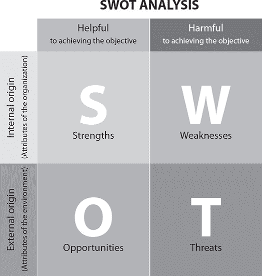

**图 2-5** `SWOT`矩阵（由 Xhienne 提供）

## 能力成熟模型

卡内基隆大学的软件工程学院（`SEI`）在开发能力成熟模型集成（`CMMi-DEV`）方面取得了巨大成就。能力成熟模型是理解过程成熟水平的有用工具。其他技术领域也开发了成熟模型，例如系统安全工程能力成熟模型（`SSE-CMM`）。

`CMMi-DEV`使用五个成熟水平来描述过程的正式程度。

- **1 级：初始级**：代表过程是随机的、不一致的、不可测的不可重复的。
- **2 级：可重复级**：代表过程执行一致且结果相同。它可能具有或没有良好的文档。
- **3 级：已定义级**：代表过程定义良好且文档齐全。
- **4 级：已管理级**：代表通过一个或多个指标进行量化管理的过程。
- **第 5 层：优化**：这代表了一个处于持续改进中的受控过程。

并非所有的安全策略师都熟悉成熟度模型。不习惯能力成熟度模型的策略师需要理解成熟度模型的两个重要特征以及它们的使用方式：

- `第 5 级并非最终目标`。大多数组织的平均成熟度目标范围在 2.5 到 3.5 之间。很少有组织的使命证明了第 5 级成熟度的必要性。开发第 5 级流程或控制的成本通常高得令人望，且与风险不匹配。
- `每个控制或过程可能有其自身的成熟度级`。为所有控制和过程分配单一的成熟度目标既不常见也不够明智。相反，拥有熟练策略师的组织可以为每个控制和过程确定适当的成熟度水平。这些水平并不全都是相同的。相反，使用基于威胁或基于风险的模型来确定每个控制和过程的适当成熟度水平更为合适。有些可能是 2 级，有些是 3 级，有些是 4 级，甚至少数可能是 5 级。

能力成熟度模型的常用用途是确定流程的当前成熟度，并结合分析，逐个流程、逐项技术地确定所需的成熟度水平。

## 路线图开发

一旦完成了战略目标、风险和威胁评估以及差距分析，安全策略师就可以开始制定路线图以实现每个目标。

路线图是实现战略目标所需的步骤列表。`road map`一词是一个恰当的比喻，因为它代表了一段旅程，在细节上，它并不总是看起来对目标有所贡献。但在良好的路线图中，每个任务和每个项目都会让组织更接近目标。

路线图仅仅是一个计划，但`road map`一词通常用于描述组织为了实现长期、复杂且具有战略性的目标需要采取的步骤。路线图通常被视为一系列项目——有些顺序执行，有些并行——组织利用这些项目转换流程和技术以实现目标。

`图 2-6`展示了一个为期 18 个月的身份和访问管理项目的路线图。

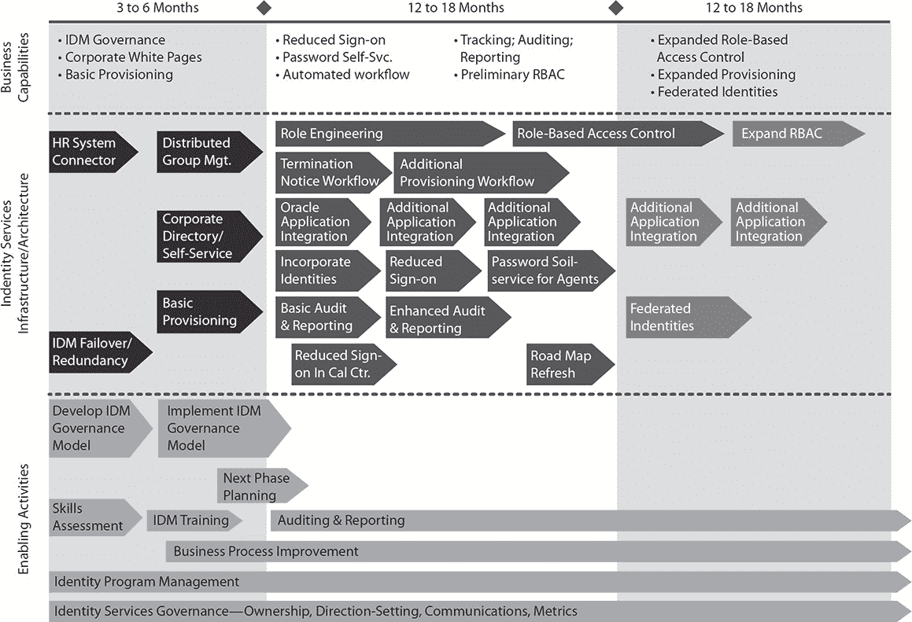

**图 2-6** 身份访问管理计划的示例路线图（由 High Tech Security Solutions Magazine 提供）

## 策略开发

安全策略的执行可能会导致其安全相关能力的增加或改进。这些增加或改进可能要求更新一个或多个安全策略，以反映这些新或改进的能力。

虽然安全策略的设计是持久的且不与特定技术绑定，但技术的重大变化可能会使安全策略与技术发生冲突。这是一个例子：

Fast Car 公司最近实施了其第一个安全事件和事件监控系统，当发生可操作的安全事件时产生告警。在实施 `SIEM`之前，IT 和安全人员每天检查安全日志，以查看过去 24 小时内发生了任何安全事件。

`在实施 SIEM 之前，Fast Car 公司的安全策略规定相关人员每天检查安全日志并记录所采取的行动。现在 Fast Car 公司拥有了 SIEM，IT 和安全人员不再需要检查日志。公司的政策需要更改，以便 1) 要求人员响应安全告警，并且 2) 要求人员定期检查 SIEM 的配置，使其对相关事件产生告警`。

安全策略应该与当前能力保持一致，而不是描述未来能力的愿景声明。无论策略是针对技术使用还是业务流程，情况都是如此。通常认为，开发一个组织无法执行的活动的安全策略是不明智的。

行业通常认为，如果安全策略不每年进行检查和更新，它们就是过时的。这并不是说安全策略必须每年更新，而是说要在需要时每年检查并更新。

虽然在大多数行业并非强制要求，但使用相关的标准或框架来构建组织的安全策略仍然是一种常见的做法。这些常用的标准和框架包括：

- `NIST SP 800-53`
- `ISO 27001`
- `HIPAA/HITECH`
- `PCI-DSS`
- `CIS CSC 20`

由于安全框架是中等到高度技术性的，一些组织会制定简短的、针对所有员工的信息卫生和数据保护策略（通常称为`接受使用策略`），以及针对设计、实施和管理信息系统及应用程序的技术人员的技术安全策略。这种务实的方法有助于避免例如，让非技术员工试图理解并遵守加密和访问管理策略；由于这些难以理解的内容，他们更有可能忽略整个安全策略，无法从识别钓鱼诈骗等真正相关的部分中获益。

良好的安全策略的目标是为组织的员工定义“规则”。策略应该是清晰、简洁且适用的。策略应以协作的方式制定，以减少上述示例的情况发生。此外，如果策略在没有不同利益相关者参与或支持的情况下编写，组织将面临部署其无法遵守或遵守将需要巨额投资的策略风险。

## 控制开发

当组织执行安全策略时，通常意味着组织对其安全相关能力进行了更改。这反过来可能需要对现有控制的一个或多个方面进行更改，并开发新控制以及终止不再需要的控制。

控制的更改通常是风险评估的结果，在评估中识别出了不可接受的风险，并决定实施控制以获得更好的结果。很有可能，风险评估可能迫使组织以战略项目的形式做出某些更改。当这些项目执行并完成时，相关流程或技术的控制需要相应地更改。以下是可能可能的结果：

- **控制叙述变更**：流程、程序或技术的更改无疑会影响控制叙述（后者通常详细描述控制）。项目交付物将包含这些更改。
- **范围变更**：流程、程序或技术的更改可能需要更改一个或多个控制的范围。例如，如果组织作为业务连续策略的一部分将敏感数据复制到另一个数据中心，则保护敏感数据的控制范围可能需要扩展到额外的数据中心。

### 控制测试的变更

新的或不同的流程、程序或技术通常意味着控制测试的程序将会发生变化。项目交付物之一将是控制测试程序的更新。例如，实施新的单点登录（`SSO`）工具将需要新的控制测试说明，以便内部审计人员和其他人员知道他们需要执行哪些步骤来查看与访问控制相关的信息。

### 全新的控制措施

有时，新的或更改的安全能力提供了一个创建新控制措施的机会（或可能是强制要求）。例如，获取一种新的身份和访问管理审计工具带来了一项全新的能力，即对用户账户、角色和访问的各个方面进行审计的能力。在引入工具之前，手动执行这些工作是不可行的，因此没有控制措施。这种缺失可能被记录在风险评估中，而这促成了实现该能力的项目的产生。当新能力最终实施时，将开发一种新的控制措施以确保定期进行用户审计。

## 选择控制框架

希望提高安全成熟度的组织通常从选择控制框架开始。组织往往在选择控制框架上花费过过的时间，通常纠结于`CIS CSC`、`ISO/IEC 27002`和`NIST 800-53`之间如何抉择。缺乏控制框架的组织通常在这个点上花费太多时间，争论每个控制框架的细微差别，却没有意识到它们之间并没有多大区别。这就像一个习惯于走路去处买汽车的人，纠结于双门还是四门、或者是汽油还是柴油或混合动力，而却忽略了其中任何一种选择都会导致旅行时间的显著变化这一事实。

## 标准开发

执行安全策略的组织可能会发现其一个或多个标准受到影响，或者需要开发新的标准。

策略定义了*要做什么*，而标准定义了*如何执行*策略。例如，策略可能规定在终端用户身份验证时应使用强密码。那么，密码标准将更加具体，定义强密码的长度、复杂性和其他特征。

策略的设计目标是耐用且持久的，但这是以在某种程度上缺乏具体性为代价的。标准则承担了更具具体性的负担，但它们的更改也更频繁，因为它们更接近技术，并关注策略实施的细节。

标准需要谨慎地开发，原因有几个：

- 它们必须能够很好地反映一个或多个相应策略的意图。
- 它们必须能够成功实施。
- 它们需要是不歧义的。
- 在涉及大量系统、端点、设备或人员时，它们的指令需要能够实现自动化，从而实现一致性和统一。

目前使用的标准有几种类型，包括以下：

- **协议标准**：例如用于 Web 服务器会话加密的`TLS 1.2`、用于静态加密的`AES-256`、用于无线网络的`802.11ac`以及用于身份验证的`SAML 2.0`。
- **供应商标准**：例如，平板电脑应为`Apple iPad`和`iPad Pro`，可能带有特定的型号。
- **配置标准**：例如，服务器加固标准将为所使用的每种服务器操作系统指定所有相关的安全设置。
- **编程语言标准**：示例包括`C++`、`Java`和`Python`。不建立和坚持编程语言标准的组织可能会发现自己拥有用几十种不同语言编写的程序，这可能会增加维护它们的成本。
- **方法论标准**：例如使用信息风险因素分析（`FAIR`）风险分析技术；用于安全评估的操作极其关键威胁、资产和漏洞评估（`OCTAVE`）；以及用于制定战略目标的`SMART`。
- **控制框架**：包括`NIST SP800-53`、`PCI-DSS`、`HIPAA`、`COBIT`和`ISO 27002`。

由于技术变化极快，标准的审查和更新通常比策略更频繁。新的安全策略并不是标准审查和更新的唯一原因；其他原因包括硬件软件新版本的发布、数据保护的新技术以及新网络设备和应用程序的。

## 流程与程序

流程和程序描述了执行功能和任务时遵循的步骤。它们的存在是为了这些活动能够以更一致、正确的顺序和正确的方式进行。

实施安全策略意味着将要做新事情，某些事情将以不同的方式进行，其他事情将不再进行。所有这些对流程和程序都有直接影响。

通常，新安全策略的目的是提高组织安全相关技术和活动的成熟度。由于许多组织的安全成熟度水平较低，这通常意味着许多重要任务记录不全或未记录。对成熟度的预期增长可能会强制组织识别未记录的流程和程序，并指派人员进行记录。处于这种状态的组织可能还会考虑开发文档管理程序和标准，以便所有流程、程序及其书面文档之间保持一致，并进行一致的开发和审查。

## 角色与职责

新安全策略的实施往往影响人们工作的方式。当策略涉及技术或流程的变更时（通常如此），这反过来可能会影响安全人员、IT 工作人员以及可能的其他员工的角色和职责。当业务流程增加或更改时，这通常意味着需要对人员的角色和职责进行更改。

在没有记录角色和职责的组织中，这是一个记录它们的机会。这可以通过多种不同的方式实现，包括：

- 职位描述
- 部门章程文件
- 部门策略文件
- 文档中的角色与职责部分

## 培训与意识

安全策略的执行通常范围广泛，不仅影响技术，还影响策略、标准、流程和程序。带来了带来了信息，形式多样且面向多个受众，包括：

- 通用安全意识
- 新和更新的流程和程序
- 新和更新的技术

这些每一个都可能使培训内容产生增加或更新。

最近的研究表明，超过 90% 的漏洞事件始于网络钓鱼攻击。鉴于即使有最好的垃圾邮件过滤器，一些网络钓鱼攻击确实成功渗透了最优秀组织的防御，安全意识培训无疑是组织拥最重要的防御手段之一。下一道防线是每个拥有电子邮件账户员工的明智判断。实施新安全策略的组织通常是为了改进防御；那么，对所有人员的安全意识培训进行审查并可能进行升级是合理的。安全意识培训中可用的一些新功能包括：

- **引人入胜的多媒体内容**：不仅仅是屏幕上的文字，音频和视频内容（包括计算机会话的回放）能更好地吸引观众的注意力，确保他们记住内容。
- **学习和实践技能的机会**：更好的培训计划（即使是在线版本）提供了练习创建强密码、识别钓鱼信息以及理解如何识别其他威胁等技能的机会。
- **每个主题结束后的测试**：贯穿培训课程的简短测试可以保持观众的兴趣并让他们他们的参与感。良好的培训计划不会在参与者证明已掌握之前的学习之前允许其继续。
- **内置对组织安全策略的确认**：在线和面对面的安全意识培训可以包含对安全策略的确认。这有助于提高员工对公司安全策略及其内容的认识，并传达所有员工都应遵守该策略的观点。
- **测试分数和完成情况的永久记录**：现代学习管理系统（`LMSs`）保留测试和测验得分的永久记录。这有助于强化一种观念，即雇主要求员工负责遵守政策。

当新技术引入组织时，通常会有个人甚至整个团队需要接受培训，以便他们更好地理解如何操作和维护新的程序和产品。遗憾的是，许多组织在培训上缩减开，这往往导致组织未能充分利用新产品，或未能正确使用它们。

## 开发业务案例

许多组织在批准重大安全倡议的支出之前，需要开发一份业务案例。业务案例是一份书面声明，描述了该倡议及其业务效益。业务案例中包含的典型元素包括：

- **问题描述**：这是对该倡议旨在解决的业务状况或情况的描述。该情况可能是合规性问题、风险评估中的发现，或者是客户、合作伙伴、供应商或监管机构要求的能力。
- **现状**：对与倡议相关的现有状况的描述。
- **目标状态**：对相关系统、流程或人员未来状态的描述。
- **成功标准**：用于衡量计划执行标准 的定义的项目。
- **需求**：解决方案所需的特性和组件列表，用于弥补现状并实现目标未来状态。
- **方法**：对实现目标未来状态的拟议步骤的描述。此部分可能包括考虑过的替代方案以及未选择这些方案的原因。如果倡议需要购买产品或专业服务，业务案例可能包含供应商的提案。或者，业务案例可能包含发送给选定供应商以获取额外信息的征求书（`RFP`）或信息请求（`RFI`）。
- **计划**：这将包括与倡议相关的成本、时间表、里程碑、供应商和人员。

成熟的组织利用执行指导委员会来评估拟议倡议的业务案例，并对倡议做出通过或否定的决策。业务案例通常以互动讨论的形式提交给指导委员会，为业务领导者提供提问和建议替代方案的机会。

业务案例的特征应包括以下内容：

- **与组织保持一致**：业务案例应与组织的目标、目的、风险偏好和文化保持一致。
- **用业务术语表述**：问题描述、现状和未来状态描述均应用业务术语表达。

## 建立沟通与报告

有效的沟通和报告是成功安全计划的关键要素。由于成功主要取决于人员，在缺乏有效沟通的情况下，他们将无法获得做出良好安全决策所需的信息。如果不考虑信息安全，决策的结果可能导致损害性事件。

以下是与信息安全相关的常见沟通和报告形式：

- **董事会会议**：对策略、目标、风险、事件和行业发展的讨论，让董事会成员了解组织内部及其他地方的安全状况。
- **治理和指导委员会会议**：对安全策略、目标、评估、风险、事件和进展的讨论，为决策者在讨论策略、目标、项目和运营时提供指导。
- **安全意识**：向所有人员定期发布沟通信息，帮助他们了解安全策略和标准的变更、良好的安全实践以及他们可能遇到的风险（例如钓鱼攻击和社交工程攻击）。新入职员工通常会获得大量的与安全相关的信息，包括当前的安全策略和实践、可接受使用政策、安全工具以及应该去哪里寻求帮助。
- **安全告警**：关于潜在威胁的沟通有助于让受影响的人员了解可能进展，这些进展可能要求他们采取措施保护组织免受伤害。
- **安全事件**：事件发生期间，内部以及与外部各方的沟通可以保持事件响应人员和其他方了解情况。组织通常会预先制定安全事件计划和剧本，其中包含了内部沟通以及与外部实体（包括客户、监管机构和执法部门）沟通的业务规则。
- **指标**：关键指标在组织内部向上报告，让管理层、高管和董事会了解组织安全计划的有效性和进展。

在构建或扩展安全计划时，最好利用现有的沟通渠道并在这些渠道中添加相关的安全内容，而不是建立新的并行的渠道。有效的安全计划会充分利用组织现有的流程、渠道和方法。

## 获取管理承诺

执行安全策略需要管理的承诺。如果没有这种承诺，安全策略师将无法获得资金和其他资源来实施该策略。

获得管理承诺并不总是易行的。通常，高管和董事会成员并没有意识到自己的信托责任以及现代威胁的威力。许多组织错误地认为自己不是黑客和网络犯罪组织的目标，因为它们规模较小或毫无趣味。此外，高管和高级经理的普遍观念是，信息安全是一个用“防火墙和防病毒软件”解决的战术问题，而且信息安全与业务问题和业务策略完全没有关系。

在高层管理人员对安全缺乏战略性理解的情况下，安全策略师需要努力向高层管理通报现代信息安全管理的一个或多个方面。当成功难以捉摸时，可能需要引入外部专家来说服高管，让他们相信安全经理并非试图建立自己的“王国”，而是只是试图建立一个基础性计划，以防止组织陷入陷扰。作为制定有效沟通方法的一部分，安全策略师不应利用恐惧、不确定性和怀疑（`FUD`）来促使领导团队采取策略。正如本节所述，更好的方法是用业务术语与领导团队建立联系，并将其视为改进业务功能的机会。

## 常态偏差


各个阶段的人都可能受到`normalcy bias`（常态偏差）的影响，这是一种思维模式，人们认为因为从未发生过灾难或入侵，所以它们永远不会发生。常态偏差体现在许多情况中，其共同主题是对灾难性事件普遍缺乏准备。这可能是组织不重视信息安全的原因之一——因为他们以前从未发生过泄露。经验的信息安全专业人员理解，一个声称过去未遭受过安全攻击的组织，可能只是因为对环境中的事件缺乏可见性而没有意识到这些攻击。信息安全领域有一句俗语：“组织分为两类：被入侵过的组织和尚未意识到自己已被入侵的组织。”

## 策略约束

虽然开发新的安全策略可能会为安全团队带来希望和乐观，但无法保证组织的变革可以在没有摩擦、甚至没有反对的情况下实施。相反，安全经理应该预见到并准备好绕过、跨越或穿过许多约束和障碍。

没有哪个安全经理会计划失败。然而，未能对障碍和约束进行预判可能会导致即使是最好的策略也无法执行。即使有卓越的策略，即使有高层的支持，也不意味着障碍和约束会自动让路。相反，障碍和约束代表了人类行为的现实，以及可能给安全经理和整个组织带来挑战的结构性和运营现实。“魔鬼隐藏在细节中”这句话用得非常贴切。

本节讨论了典型的约束、障碍和其他问题。

### 对变化的基本抵触

人类的基本本性就是对变化持怀疑态度，特别是当我们作为个人对变化没有控制权，也没有发言权时。变化是坏的，我们往往是这样想的。

出于因此，组织需要考虑让管理层和员工参与预期变化的方法，例如全体会议、问卷调查和跨部门委员会。组织被提醒要确保这些努力不仅仅仅是装点门面，而是为了更好地理解员工观点的严肃努力。

## 文化

根据《商业字典》（`[www.businessdictionary.com](http://www.businessdictionary.com)`），组织文化是“对组织的独特社会和心理环境贡献的价值和行为集合”。换句话说，它是人们在组织中思考和行动的方式，以及作为员工的感受。

安全策略师需要理解的组织文化方面包括：

- **强势文化**：文化反映并契合既定的组织价值观。人员理解并支持组织的目标和任务，几乎不需要促就能发现如何提高效率并为组织提供价值。

- **弱势文化**：文化与组织不契合。因此，管理层必须花费更多时间管理员工。

- **恐惧文化**：员工不信任像暴君一样行的管理层，导致无处不在的恐惧和怀疑。

- **健康文化**：员工和管理层相互重视，具有强烈的责任感，并合作取得成功。

人们可以将组织文化视为所有员工（无论职位如何）的集体意识。安全策略师不应期望显著改变文化，而应在开发和执行策略时与文化合作。

### 组织结构

安全策略师必须理解指挥与控制结构，这通常体现在组织架构图中。然而，架构图中可能存在一个未记录的方面，这实际上更为重要：谁负责哪些活动、功能和资产。如果策略师希望策略成功，必须与这些个人和群体建立协作关系。与其他策略与其他考虑因素一样，与书面和非正式结构一致是关键。

### 员工能力

安全策略通常代表了新能力的引入，以及现有能力的变更或升级。如果新或改变的能力与员工能够做到的不符，那么策略就无法期待成功。了解组织安全计划现状的差距分析（在本章前面的部分讨论过）需要包含员工的知识、技能和能力。在发现差距的地方，策略需要包含培训或其他活动，以向员工传必要的技能。

这不仅限于设计、构建和管理信息系统及应用程序的技术人员。在所有员工都受到策略所引入的某些变化的影响范围内，这些员工也需要告知或接受培训，以便他们也能获得成功。

例如，一个需要更好地保护其敏感数据的组织，在其策略中包含了开发数据保护计划。数据保护策略包括开发数据分类方案，并针对每个分类级别和每个用例场景的数据制定数据处理政策和程序。这是一项高影响的工作，将要求组织中的许多（甚至所有）员工接受数据分类和处理程序的培训。

### 预算与成本

安全策略是关于为了更好地保护关键或敏感信息及系统而采取变革的声明。这些变革将产生相关的硬成本和软成本，代表了硬件、软件和云服务的支出，以及顾问、承包商和现有员工的时间价值。

安全策略师必须以高精度的确定与策略中每个元素相关的所有硬成本和软成本。执行管理层通常希望看到替代方案；例如，如果需要额外的劳动力，安全策略师可能希望确定聘佣额外人员与保留顾问或承包商的成本对比。

每个组织都有需要运行的核心业务，并对所有相关活动有预算成本。安全策略几乎总是意味着额外的成本，必须获得资金支持。虽然可以为预算外活动获得额外资金，但通常需要采取安全策略倡议，并尝试将这些活动纳入未来财政周期的预算。对于未来预算周期的倡议，安全策略师需要确定可能影响策略的价格涨。一个今年花费 100,000 美元的关键项目，一年后可能花费 105,000 到 110,000 美元，在未来几年可能会更贵。

### 时间

随着安全策略的形成，每项倡议都将有自己的项目计划，以及执行各项任务的相关时间表。需要现实的项目规划，以便每个人都知道项目和策略里程碑何时完成。项目和策略时间表需要考虑所有业务情况，包括高峰期和假期生产冻结（此时 IT 系统维护在更稳定的状态）、监管审计等外部事件，以及可能影响计划的其他重大事件。

时间限制还可能涉及法律和监管义务，将在将讨论。

## 法律和监管义务

组织可能在其策略中包含某些项目，这些项目可能代表了法律或监管原因而必须存在的业务能力。例如，一家上市公司可能被迫要求在下一个公开审计周期开始之前完成关键的身份和访问管理项目，以确保获得良好的审计结果。另一个例子是，组织可能正在实施入侵防御系统（`IPS`），以满足与客户具有硬性期限的合同义务。最后一个例子是，组织可能正在实施 Web 应用防火墙（`WAF`）以维护其 PCI-DSS 合规性。

如这些示例所示，法律和监管义务通常包含时间因素。新法律和合同要求组织在规定的截止日期具备特定的能力。对于未能期限期限的组织，义务仍然存在，且其完成具有更强的紧迫感。

法律和监管要求通常具有国际化考量。在一个国家合法且要求的做法，在另一个国家可能是被禁止的。例如，一个国际组织可能在其策略中，对入职前和离职背景检查进行关键改进。组织需要理解，某些国家如美国对背景检查非常宽松，而法国等其他国家不允许对大多数职位进行背景检查。另一个例子是，一个通过云端 Web 代理过滤器改进端点保护能力的安全项目会发现，在某些国家用户的互联网访问活动可能无法被观察或记录。

### 可接受风险

制定信息安全策略的安全策略师需要熟悉组织当前的风险偏好或可接受风险的阈值。

风险从本质上来说是难以量化的。因此，大多数组织对风险偏好有一种文化上的“感觉”，这种感觉可能记录在案，也可能没有记录。安全策略师必须熟悉组织的风险偏好（无论是以何种正式或非正式的形式），并敏锐地理解策略的两个重要方面：

- **与风险偏好的对齐性**：安全策略中的倡议需要与执行管理层的风险偏好保持一致。例如，实施数据泄露防护（`DLP`）系统并限制使用 USB 外部存储设备可能有助于更好地地保护数据，但在某些组织中可能被视为过头。安全策略师常犯的一个错误是在策略中引入了可能并不需要的新能力。

- **对风险偏好的影响**：安全策略中的特定倡议在设计上可能会“推向极限”。典型组织的安全策略可能包含改进能力以对齐风险偏好的倡议。但由于许多组织的安全实践存在不足，人们认为是风险容忍度降低了，而实际上只是在试图让实践与风险偏好对齐。降低风险的象更多是“追赶”。

## 组织惯性的障碍

每个组织接受变革的能力都是有限的。这是一个被野心勃勃、想在短时间内完成大量工作的安全策略师忽视的事实。我使用了“组织惯性”这一术语来类牛顿定律：物体要么静止，要么保持匀速运动，除非受到外力作用。在组织中，这意味着除非受到作用，否则事情将以原来的方式进行。

组织惯性，即对变革的抵抗包含三个方面：

- **执行变革的人员**：组织要做出重大变革，负责变革的人正是工作的这些人。由于正在变革的业务流程必须继续运行，变革必须缓慢地实施，以免对运营水平产生不利影响。

- **学习曲线**：每当系统或流程发生重大变化时，受影响的人员需要学习新的系统、流程或程序。这涉及到学习曲线，并可能让他们脱线数小时甚至几天。

- **人类对变革的抵抗**：在不受干预的情况下，人们倾向于按原方式做事，即使开发了新方法。

### 本章总结

信息安全治理是对组织内安全和风险管理的自上而下的管理和控制。治理通常通过由组织各部门高管组成的指导委员会进行。指导委员会负责设定战略方向和政策，确保安全策略与组织的 IT 和业务战略及目标保持一致。指导委员会的意愿通过项目和任务来实现，引导安全组织向战略目标迈进。指导委员会可以通过指标和平衡分卡来监控进度。

信息安全计划若要成功，它必须与业务及其整体使命、目标和战略对齐。安全计划必须考虑到组织的资产价值、文化、风险容忍度/偏好、法律义务和市场状况。成功且对齐的安全计划并不是领导组织，而是在组织执行使命和追求目标时提供支持和助力。

风险偏好是指组织在追求其使命、战略和目标时愿意接受的风险水平。风险处理和风险接受决策应分配给相关的业务所有者和高管人员并做出，并由他们对这些决策负责。首席信息安全官（CISO）的作用是促进和传递信息，仅在特定情况下才会拥有某个风险项。

# 安全治理

安全治理的实现手段与 IT 治理相同：它始于董事会的参与，这为风险偏好奠定了基调，并由首席信息安全官执行。首席信息安全官负责制定安全和隐私策略，以及战略性安全计划，包括软件保证、变更管理、供应商管理、配置管理、事件管理、漏洞管理、安全意识培训以及身份和访问管理。

安全治理用于在整个组织的所有层级（从董事会到个人员工）为安全相关活动确立角色和职责。角色和职责在职位说明、策略和流程文档以及`RACI`图中定义。

### 角色与职责

定义团队中的董事会负责监督组织中的所有活动。董事会选拔并管理首席执行官，由其负责开发治理职能，以管理资产、预算、人员、流程和风险。

安全指导委员会负责安全战略规划。安全指导委员会将制定并批准安全策略，并任命经理来开发和维护流程、程序和标准，所有这些都应相互一致，并与组织的整体使命、战略、目标和目的保持一致。

首席信息安全官开发与业务对的安全策略，以支持组织的整体使命和目标，并负责组织的整体安全计划，包括策略制定、风险管理以及可能的某些运营活动，如漏洞管理、事件管理、访问管理和安全意识培训。在某些组织中，最高安全主管的头衔为首席安全官或首席信息风险官。

首席隐私官（CPO）负责敏感个人信息（通常称为个人身份识别信息）的保护和和妥善使用。`CPO`的信息保护责任有时由负责整体信息保护责任的`CISO`分享。

IT 中的几乎所有其他角色都具有安全职责，包括软件开发与集成、数据管理、网络管理、系统管理、运营、服务台、内部审计以及所有员工。

## 指标与衡量

正式的指标计划为组织安全计划和运营中许多要素的有效性提供了定性和定量数据。指标可以通过`SMART`方法开发：具体的（specific）、可衡量的（measurable）、可实现的（at）、相关的（relevant）和及时的（timely）。指标必须符合组织的使命、战略和目标。某些指标可以用于报告过去的结果，但应该有一些指标作为领先指标，或驱动领导团队采取行动。

指标计划的一个共同缺点是未能为不同的受众提供相关的指标。例如，向董事会报告防火墙丢弃的数据包数量或防病毒软件检测到的病毒数量，对该受众来说没有价值。随着组织计划的完善，它必须注意开发对每种受众都关重要的指标。安全平衡计分卡也可用于描绘组织安全计划的高级有效性。

由`ISACA`开发的信息安全业务模型是业务对齐、基于风险的安全治理的指南。`BMIS`由四个要素组成：组织、人员、流程和技术。它由六个动态相互连接组成：文化（连接组织和人员要素）、治理（连接组织和流程要素）、架构（连接组织和技术要素）、涌现（连接人员和流程要素）、赋能与支持（连接流程和技术要素）、人类因素（连接人员和技术要素）。`BMIS`帮助战略者理解这四个要素之间的动态关系以及它们可能如何体现。`BMIS`的核心结论是，万物都是相互相连的。

### 策略开发

策略是实现一组定义目标的计划，以确保组织的愿景得以成功实现。目标是组织中期望的未来状态，在信息安全背景下，是指组织信息安全计划中的期望未来状态。策略应该是业务对齐的、交付价值的、优化资源的并且可衡量的。

整体安全策略的开发包括采用控制框架或与框架对齐。大多数组织选择行业标准的控制框架，如`COBIT`、`NIST 800-53`、`ISO/IEC 27001`、`HIPAA`或`PCI-DSS`。然后，作为组织风险管理流程的一部分，根据识别出的风险添加额外的控制。

策略开发可能包括建立期望的风险水平。这可以用定性或定量的术表示，取决于组织的成熟度。

策略开发需要许多资源。这些资源包括几类揭示组织现状的信息，包括风险评估、漏洞评估、业务影响分析、指标、风险账本和事件日志。还需要其他几个输入项来定义安全计划的结构，包括策略、标准、指南、流程和程序、保险和外包服务。

为了制定策略，安全战略者首先必须理解组织的现状，然后定义一个或多个期望的未来状态。差距分析帮助战略者理解缺失的能力。路线图的制定定义了开发缺失能力和增强现有能力的步骤，以确保策略得以实现。

安全战略者可以选择优势、劣势、机会、威胁（`SWOT`）分析模型来支持策略规划。战略者还可以采用能力成熟模型来帮助确定关键安全流程的适当未来状态。

通常需要建立业务案例，以便执行管理层同意并资助策略。业务案例通常包括问题陈述，随后是现状、期望的未来状态、需求、方法和实现策略的计划。业务案例通常由业务利益相关者组成的业务或 IT 指导委员会进行审查。

安全战略者必须意识到战略目标的潜在障碍，包括文化、组织结构、现有员工能力、预算、时间以及法律和法规义务。业务对齐的策略应该考虑这些障碍，并在策略获得批准和实现时尽可能减少这些障碍。

#### 注意

- 董事会成员和高管将信息安全作为信托责任的一部分，是当今业务界的一个重要且日益增长的趋势。

- 安全高管和董事会负责实施涵盖信息安全战略和指令的安全治理模型。因此，在处理网络安全问题时，行业正经历着从被动向更主动的董事会的转变。

- 安全计划应与组织的整体使命、目标和宗旨一致。这意味着首席信息安全官（CISO）及其他人员应该意识到并参与战略倡议以及组织战略目标的执行。

- 风险偏好通常以定性术语表示，例如“对风险的容忍度极低”和“零容忍风险”。组织中的不同活动会有不同的风险偏好。

- 组织对角色和职责的定义可能与其问责文化并不同步。例如，一个组织可能在政策和流程文件中记录了明确的职责定义，但在发生可预防的安全事件时，却很少追究个人的责任。

- 理想情况下，组织的董事会应该知晓信息安全风险，并可能指示组织采取保护措施来保护自身。然而，在许多组织中，董事会仍然不信息安全事务；在这些情况下，只要有高级管理人员的支持，仍然可以拥有成功的基于风险的信息安全计划。

- 虽然不要求使用安全指导委员会，但组织发现实施单级或多级安全指导小组是有益的，可以作为发现安全风险和传播安全组织的跨职能平台。

- 信息安全是组织中每个人的责任；然而，为个人和小组分配及监控安全责任的方法存在很大。

- 目前，还没有广为人知的信息安全指标框架。相反，每个组织都要自己开发对感兴趣接收指标的各种受众有意义且适用的指标。

- 计算安全投资回报率（ROSI）的方法论被广泛讨论，但并未广泛实践，这主要是因为很难计算那些旨在检测或防止低频率发生事件的安全措施所带来的收益。

- 在没有安全计划的组织中制定信息安全战略的安全经理，将需要依靠过去的经验、对实践的轶事描述以及组织内部政策。

- 安全战略师应该注意每个组织在给定时期内对变更的容忍度。虽然可能需要取得很大进展，但在一年内能够合理实施的范围内是有限的。

- 信息安全的业务模型是理解组织不同方面之间定性关系，以及与这些方面相关的活动类型的一种有用模型。

- 许多组织在控制框架的选择上反复纠结。相反，组织应该选择一个框架，然后对其控制进行调整以适应业务。控制框架通常应被视为起点，而不是一个僵化且不变的控制列表——除非法规规定不能更改控制措施除外。

- 虽然安全战略师在制定战略路线图时了解组织的现状是重要的，但战略师必须继续进行，并知道理解水平永远不会足够。此外，即使拍摄了最详尽的快照，组织本身也在缓慢（或可能很快）发生变化。战略计划的执行是为了加速一个已经在缓慢变化的组织某些方面的变革。

- 能力成熟度模型是理解过程成熟水平以及开发理想未来状态的有用工具。组织中过程的成熟度会有不同，因为某些过程具有高成熟度是合适的，而其他过程较低成熟度是可以接受的。对于每个独立过程正确的问题是：该过程适当的成熟水平是多少？

- 每个组织在开发用于战略战略倡议的业务案例方面都有自己的实践。

- **战略师必须预测影响战略目标实现的障碍和限制，并考虑完善这些目标以便其能够实现。

## Questions

**1.** 安全治理最关注的是：

**A.** 安全策略

**B.** IT 策略

**C.** 安全战略

**D.** 安全高管薪酬

**2.** 一家游戏软件初创公司不对其软件进行渗透测试。这是一个：

**A.** 高风险容忍度

**B.** 不合规

**C.** 不负责任

**D.** 外包

**3.** 组织的董事会想看到关于风险降低的季度指标。为此目的，最好的指标是什么？

**A.** 触发的防火墙规则数量

**B.** 杀毒软件拦截的病毒数量

**C.** 防火墙丢弃的数据包

**D.** 关键服务器修补漏洞的时间

**4.** 下列指标中哪个是领先指标的最佳例子？

**A.** 缓解安全事件的平均时间

**B.** 入侵防御系统 (IPS)拦截的攻击数量增加

**C.** 防火墙拦截的攻击数量增加

**D.** 在服务水平协议 (SLAs) 内完成修补的关键服务器百分比

**5.** 信息安全业务模型 (BMIS) 的元素是：

**A.** 文化、治理、架构、涌现、赋能与支持、人为因素

**B.** 人员、流程、技术

**C.** 组织、人员、流程、技术

**D.** 财务、客户、内部流程、创新和学习

**6.** 战略的最优定义是：

**A.** 实现计划的目标

**B.** 实现目标的计划

**C.** 实现业务对齐的计划

**D.** 降低风险的计划

**7.** 与控制框架选择相关的因素是：

**A.** 行业领域

**B.** 当前过程成熟度水平

**C.** 组织规模

**D.** 合规水平

**8.** 作为了解组织现状的一部分，安全战略师正在审查组织的安全策略。该策略告诉了战略师什么？

**A.** 管理层对安全的承诺程度


**B.** 组织的合规水平

**C.** 组织的成熟度水平

**D.** 以上均非

**9.** 在收集和检查各种安全业务记录时，安全经理确定组织没有安全事件日志。安全经理从这可以得出什么结论？

**A.** 组织没有安全事件检测能力。

**B.** 组织尚未发生过安全事件。

**C.** 组织将安全事件记录在风险注册中。

**D.** 组织拥有有效的预防和检测控制措施。

**10.** 平衡计卡的目的是：

**A.** 衡量安全组织的效率

**B.** 评估个人员工的表现

**C.** 将组织内的流程与同行机构进行基准比较

**D.** 针对战略目标衡量组织的绩效和效能

**11.** 一位安全策略师检查了一个业务流程，发现人员执行该流程时是一致的，但没有书面流程文档。该流程的成熟度级别是：

**A.** 初始级（Initial）

**B.** 可重复（Repeatable）

**C.** 已定义（Defined）

**D.** 受管理（Managed）

**12.** 一位安全策略师检查了几个业务流程，发现它们的个体成熟度级别从“可重复”到“优化”不等。这些业务流程最好的未来状态是什么？

**A.** 所有流程都应改为“可重复”。

**B.** 所有流程都应改为“优化”。

**C.** 信息不足，无法确定这些流程的预期最终状态。

**D.** “可重复”的流程应改为“已定义”。

**13.** 在一个使用`PCI-DSS`作为控制框架的组织中，最近的风险评估结论规定，应当实施`PCI-DSS`中不存在但在`ISO 27001`中存在的额外控制。在这种情况下，最佳行动方案是什么？

**A.** 采纳`ISO 27001`作为新的控制框架。

**B.** 保留`PCI-DSS`作为控制框架并更新流程文档。

**C.** 将所需的控制添加到现有的控制框架中。

**D.** 采纳`NIST 800-53`作为新的控制框架。

**14.** 一位安全策略师试图改进一个具有强大但随性文化组织的安全计划。这里的最佳方法是什么？

**A.** 开展焦点小组以讨论可能的实施途径。

**B.** 实施新的检测性控制措施，以识别违反政策的人员。

**C.** 实施安全意识培训，强调新的强制行为。

**D.** 在用户同意合规之前锁定其账户。

**15.** 一位安全策略师最近加入了一个利润率薄的零售组织，发现该组织缺乏几项重要的安全能力。这里的最佳策略是什么？

**A.** 坚持要求层支持一项激进的计划以快速改进该计划。

**B.** 开发一个风险账本，突出所有已识别的风险。

**C.** 建议规避最大的风险。

**D.** 开发一种基于风险的策略，在较长时间内缓慢实施变更。

## 答案

**1. C.** 安全治理是建立、控制和监控安全策略的机制。长期和其他战略性决策是在安全治理的背景下做出的。

**2. A.** 游戏等行业的软件初创公司对风险将具有很高的容忍度：上市时间和获取新客户将是其首要目标。当组织实现生存能力后，将引入如安全等其他优先事项。

**3. D.** 关键服务器补丁时间指标将是董事会最有意义的指标。其他指标是。

**4. D.** 关键服务器在 SLA 内完成补丁的指标是一个先领先指标，而其他指标是落后指标，因为它们报告的是过去发生的事件。

**5. C.** 元素的要素是组织、流程和技术。

**6. B.** 策略是执行某某事的计划。目标是组织想要实现的“什么”，而策略是实现该目标的“如何”。

**7. A.** 影响控制框架决策的最重要因素是行业。例如，医疗保健组织可能会选择`HIPAA`。

**8. D.** 单独的安全政策并不能说明安全实践。在不检查业务流程和采访人员的情况下，安全专业人员无法对事件得出任何结论。

**9. A.** 声称组织拥有有效的控制是不合理的，因为即使有有效的控制措施，事件也会发生。

**10. D.** 平衡计分卡是一个用于衡量组织目标达成情况的工具。平衡计分卡的重点是财务、客户、内部流程以及创新/学习。

**11. B.** 执行一致但没有文档的流程通常被认为是“可重复”的。

**12. C.** 并没有规则规定成熟度级别。

**13. C.** 需要实施新控制措施的组织应在其现有的控制框架内实施。当只需要添加几个控制措施时，没有采用采用全新的控制框架。

**14. A.** 组织文化是强大的，因为它反映了人们思考和工作的方式。在这个例子中，没有提到这种强大的文化是坏的，只是它是随性的。

**15. D.** 安全策略师需要了解组织通过资金投入来降低风险的能力。在一个有利润的组织中，该组织不太同意一项激进的改进计划。

本章涵盖了 CISM 领域 2，“信息风险管理”。本章的主题占了注册信息安全经理 (CISM) 考试内容的 30%。

信息风险管理是在业务机会与潜在信息安全相关损失之间取得平衡的实践活动。信息风险管理在很大程度上是一项定性工作，因为很难确定重大损失事件的概率和成本。尽管如此，目前已经建立了几种衡量风险的方法，帮助组织更好地理解风险以及如何处理这些风险。这些方法包括定性和定量技术，被用于为业务决策提供支持。

## 风险管理概念

对于任何希望合理感知风险的组织来说，风险管理都是一项极其基础性的工作，如果这些风险不被识别或监控，可能会导致意外损失，甚至威胁到组织的生存。风险管理的目的是识别可靠的威胁，并决定如何应对这些威胁的手段。使用有效风险管理流程的组织发生的安全事件较少；即使发生了事件，其影响也较低，且组织能更好地应对这些事件。

## 风险管理的重要性

风险管理是任何信息安全计划的基石。风险管理代表了经过时间验证的方法和技术，用于识别风险、理解其发生的概率和对组织的潜在影响、根据既定的决策标准对这些风险做出决策，并衡量安全和风险的关键属性以便进行长期趋势和向执行管理层报告。

风险管理提供了关键信息，使安全经理能够优先考虑稀缺资源，从而实现最大程度的风险降低。如果没有风险管理技术，安全经理将根据直觉或其他任意手段做出优先排序决策。

风险管理计划的有效性在很大程度上取决于两个因素：执行管理层的支持，以及组织在安全意识和问责方面的文化。此外，有效的风险管理计划可以作为催化剂，对组织的文化产生微妙但具有战略性的改变。

没有两个风险管理计划是完全相同的；相反，每个计划都根据几个因素具有独特性：

- 文化

- 使命、业务目标和愿景

- 管理结构

- 管理支持

- 行业领域

- 市场状况

- 适用的法律、法规和其他法律义务

- 明示或未说明的风险承受能力

- 财务状况

### 风险管理的成果

实施了有效风险管理计划的组织将对技术的业务用途有更高的认识，并了解技术如何影响业务。组织获得的最大益处是降低安全事件的概率，并且对于已经发生的事件，组织将准备得更充分，事件的影响也会减少。

拥有风险管理计划的组织将形成一种风险意识型的规划、思考和决策文化。组织中的高层将对信息风险更加关注，从而对使用信息技术和互联网相关的风险产生更现实的看法。高层和其他决策者将开始对不同类型业务活动的风险水平产生直觉。

## 风险管理技术

在整个风险管理过程中，组织将识别特定的风险，并通常选择特定的流程和技术解决方案来缓解这些风险。解决方案的类别和类型包括：

- 访问治理系统

- 访问管理系统

- 高级反恶意软件（通常被宣传为杀病毒软件的替代品）

- 杀病毒软件

- 云访问安全代理器 (CASBs)

- 动态应用安全测试工具 (DASTs)

- 文件活动监控系统 (FAMs)

- 文件完整性监控系统 (FIMs)

- 防火墙（包括所谓的下一代防火墙）

- 取证工具

- 治理、风险与合规性 (GRC) 系统

- 入侵检测系统 (IDSs)

- 入侵预防系统 (IPSs)

- 网络访问控制

- 钓鱼评估

- 特权访问管理系统 (PAMs)

- 公共密钥基础设施 (PKI)

- 安全信息和事件管理系统 (SIEM)

- 单点登录 (SSO) 系统

- 静态应用安全测试工具 (SASTs)

- 垃圾过滤器

- 第三方风险管理系统 (TPRMs)

- 用户行为分析系统 (UBAs)

- 统一威胁管理系统 (UTMs)

- 虚拟专用网络 (VPN) 系统

- 漏洞扫描工具

- Web 应用扫描工具

- Web 过滤

- 无线访问控制

- 外部监控和情报服务

没有有效风险管理计划的组织通常会获得这些能力的许多，但在没有首先识别与其相关的特定风险的情况下进行的。相反，他们出于其他原因购买这些解决方案，包括：

- 声称其解决方案将解决组织安全风险的销售（而实际上并不知道那些特定风险是什么）

- 其他组织的安全经理购买相同或类似的解决方案（同样，是在存在是否存在健全风险管理的情况下）

- 行业刊物中解释安全解决方案优点的文章


**注意** 安全解决方案组合应基于支持业务目标，并在购买特定技术之前定义明确的成功标准、业务需求和技术需求。

## 实施风险管理计划

实施风险管理策略并不是一项简单的任务。有几个风险管理框架可供选择，它们共享共同原则，包括将风险管理视为生命周期过程、定期评估和持续改进。

内部和外部因素都会影响应该采用什么样的风险管理框架以及如何实施它。在组织中应用风险管理框架需要对组织的使命、目标、战略、文化、实践、结构、财务状况、风险偏好以及执行管理层的支持水平有的理解。

影响风险管理框架选择和实施的外部因素包括市场和经济状况、适用的法规、地理运营、客户群体/类型以及社会和政治气候。本节稍后部分将讨论具体的框架。

一旦选定了框架，安全经理就可以开始制定稳健的风险管理策略。安全经理需要进行一次或多次差异分析，以更好地了解现状，从而制定适当的计划来定义、记录并突出理想的未来状态。由于没有安全经理拥有完整的知识和技能库，因此许多外部资源可以补充他们的知识，并提供直接帮助。

### 风险管理策略

风险管理策略的目标是识别所有可靠的风险，并将它们降低到组织可以接受的水平。可接受的风险水平通常与这些因素有关：

- 执行管理层的风险偏好

- 吸收损失的能力以及其构建防御的能力

## 监管与法律要求

当组织建立其可接受风险水平（也称为`risk tolerance`）时，这将驱动控制措施的实施和完善。随后，随着时间的推移，风险评估和风险处理将驱动控制措施的调整。因为控制措施是通过确保预期结果（无论结果如何）来降低风险的主要手段。

对于具有其他风险管理实例或局部的组织，考虑合并这些功能，或者至少使它们保持一致以增强彼此的协调性是非常重要的。对于具有企业风险管理（`ERM`）功能的组织，这可能代表了一个将信息风险馈入`ERM`系统的机会，使其对所有业务风险的整体描述包含信息风险。

需要注意的是，在许多中小型组织中，风险管理计划源于 IT 部门。这为 IT 团队和安全经理提供了一个增加可能对组织产生负面影响的问题意识和可见性的机会。额外的益处是促进与业务领导者建立关系，并摆脱 IT 和安全被视为“说不的人”的观点，转而被视为业务推动者。

若干内部和外部因素将决定风险管理目标的实施，包括以下：

- 文化

- 组织成熟度

- 管理结构

- 管理层支持

- 市场状况

- 监管与法律要求

安全经理在制定风险管理策略时，最可能启用或限制其能力的因素是在整个组织范围内建立关键关系。当安全经理制定并实施风险管理策略时，他们正充当组织中的变革代理人。安全经理通过人员、流程和技术的改变，微妙但有意识地驱动组织内的关键变化。这种作为安全催化剂的角色是一个持续的历程，随着组织形成风险意识文化，这将成为一种生活方式。

## 风险沟通

风险管理不能作为一个保持秘密的业务功能；相反，它必须向组织的关键利益相关者介绍，以帮助他们理解风险管理在组织中的作用。利益相关者需要理解风险管理计划将如何运作，以及他们在该计划成为实现业务目标的有效计划方面扮演什么角色。该过程中的一个重要因素是帮助利益相关者理解风险管理计划对他们相互关系的影响、对他们自主权的影响，以及计划将如何改进组织（包括他们自己的工作）。

成功的信息风险管理要求通信渠道始终开放并在所有方向上运行。成功的信息风险计划通过透明化运行，使所有利益相关者都理解计划正在发生什么以及为什么。无疑，信息安全领域有某些事项需要保密，但通常，风险信息应让所有董事成员、高管、利益相关者和风险所有者随时获取。

## 风险意识

风险意识是指其目的是让业务领导者、利益相关者和其他人员意识到信息风险管理计划的活动。与安全意识计划类似，风险意识的目标是确保业务领导者和决策者意识到：所有业务决策都包含风险因素，且许多决策对信息风险有影响。此外，他们需要意识到正式信息风险管理计划的存在，这包括了做出风险意识型决策的过程和技术。

安全意识计划与风险意识计划的内容和受众存在某些重叠。主要是，安全意识适用于整个组织，而风险意识涵盖了参与风险管理过程的高级人员。此外，这两个计划中传达此类信息的方法是相同的。理想情况下，安全意识计划和风险意识计划应并行开发，确保所有受众在需要时都能收到有用且可操作的信息。

## 风险咨询

安全经理在他们的组织中经常担任安全和风险顾问的角色。随着他们在整个业务部门中建立信任关系，安全经理被视为技术风险专家，可以就各种问题提供咨询。虽然这看起来可能是一项临时活动，但安全经理应该将这些小型咨询任务视为正式的服务请求，即使在没有服务请求系统或正式能力的情况下也是如此。这包括关注响应能力和服务水平。以下是成为优秀信息风险顾问的一些关键属性：

- 倾听业务领导者的能力

- 评估信息以及其如何影响流程或业务单元的能力，以及识别业务中问题可能级联到的其他领域的能力

- 对业务有良好的理解，而不只是支持业务的技术

## 风险管理框架

在构建信息风险计划时，安全经理需要制定流程和程序、角色和职责以及业务记录模板。这可能是一项漫长且辛苦的任务，且缺乏成功的保证。与其从零开始构建计划，建议安全经理参考大量的高质量风险管理框架，包括以下：

- `ISO/IEC 27001`，“信息技术 — 安全技术 — 信息安全管理体系 — 要求。”该标准中的第 4 至第 10 节描述了整个信息安全管理系统（`ISMS`）的结构，包括风险管理。

- `ISO/IEC 27005`，“信息技术 — 安全技术 — 信息安全风险管理。”

- `ISO/IEC 31010`，“风险管理 — 风险评估技术。”

- `NIST Special Publication 800-37`，“风险管理框架应用于联邦信息系统的指南：安全生命周期方法。”

- `NIST Special Publication 800-39`，“管理信息安全风险。”

- `COBIT 5`。

- `RIMS 风险成熟度模型`。

- `Facilitated Risk Assessment Process`（引导式风险评估过程）。

风险经理在考虑现有框架时有两种主要方法可以选择。首先，他们可以选择与组织实践契合程度最好的单一框架。其次，安全经理可以从一个或多个框架中选择元素来构建组织的风险管理计划。正如本章前面提到的，有几个因素会影响这一决策。

### 框架组件

风险管理框架具有共同的核心组件，包括以下：

- 计划范围

- 信息风险目标

- 信息风险政策

- 风险偏好/容忍度

- 角色和职责

- 风险管理生命周期过程

- 风险管理文档

- 管理评审

### 集成到环境中

为了确保高效和有效，组织的风险管理计划需要严密且容易地融入到组织现有的策略、流程和系统之中。风险管理计划应该是补充出现有结构，而不是构建独立的结构。例如，安全经理应该考虑在现有的用于管理策略和外部供应商的`GRC`平台上获取风险管理模块，而不是购买一个独立的用于管理风险的`GRC`平台——即使一个新的独立平台可能效果更好。另一个例子是，安全经理应该考虑为现有的安全意识计划平台补充有关信息风险的额外信息，而不是构建或一个完全独立的学习系统。

这里所体现的原则是利用现有结构并最大限度地减少对组织的影响。对于一个需要此类计划的组织来说，一个新的或改进的风险管理计划本身就会产生扰动了——没必要再让计划的组成部分也具有扰动性。

风险管理计划需要整合到组织的文化中。在可能范围内，新的或改进的风险管理计划应该利用当前的思维、词汇、习俗和实践，以无缝地融入组织。但正如之前提到的，组织的文化在信息风险和信息安全方面可能需要进行微调。如果是如此，新的风险管理计划应当“平稳地引入”文化，而不是草率地强加于组织。

将信息风险计划整合到现有环境中，最重要的部分与组织现有的系统甚至其流程关系并不大。相反，整合到组织的文化是最重要的考虑因素。从本质上说，人们反对变化，因为不受控制的变化在直觉上被视为坏的，并可能在潜意识甚至意识上被反对。更好的方法是以后一种让组织感到不那么侵入和扰动的方式引入计划，而是感觉像是一个受欢迎且必要的补充，将改善组织的运势。

## 风险管理背景

在设计和建立风险管理计划时，安全经理需要理解风险管理计划所存在的业务背景。这包括计划的范围，以及计划运行的整个业务环境，包括组织的策略、流程、实践和文化。

背景并不简单的整个组织，尽管在某些情况下可能是如此。相反，安全经理需要与高层管理共同定义风险管理计划的边界。这些定义可能包括以下内容：

- 业务部门、业务线、地点/地区

- 信息风险计划的参与者和利益相关者

- 参与者和利益相关者的角色和职责

- 风险偏好/容忍度

### 内部环境

在设计信息风险计划时，安全经理必须理解组织内部环境的许多关键方面。如果安全经理未能考虑这些因素，计划可能会效果不或完全失败。关键方面包括：

- 组织使命、目标和愿景

- 现有的业务策略，包括正在进行中的重大倡议和项目

- 财务状况和资本获取

- 现有的风险实践

- 组织成熟度

- 正式和非正式的通信协议/关系

- 文化

### 外部环境

安全经理和执行层理解组织的外部环境至关重要。虽然外部环境不能纳入风险管理计划范围，但如果组织及其风险管理计划要成功，必须充分理解外部环境的许多方面。这些方面包括：

- 市场状况

- 经济状况

- 适用法律法规

- 社会和政治环境

- 外部利益相关者，包括监管机构、业务伙伴和客户

- 外部威胁和威胁者

- 地缘政治因素

了解这些将有助于组织更好地理解外部影响，反过来可能会影响风险管理计划的各个方面，包括整体风险容忍度。

### 差距分析

当安全经理设计组织的风险管理计划时，他们对所需的最终状态有一个愿景，通常基于一个或多个风险框架。但在涉及制定计划的实际方案时，安全经理必须理解计划的现状，即使没有正式的计划。为了做到，安全经理应该进行差距分析。


`gap analysis`定义为对流程或系统进行检查，以确定其现有状态与预期未来状态之间的差异。这有助于安全经理更好地理解现状以及它与未来状态何不同。详细来说，差距分析将揭示现状的哪些特征可以保留，哪些应该被丢弃，哪些应该被替换，哪些应该被添加。

例如，安全经理检查组织现有的变更控制流程。能找到的只是变更日志和包含管理层变更的邮件附件。差距分析揭示了缺乏请求程序、变更咨询委员会（`CAB`）会议以及角色和职责。现有的业务记录尚可用，但需要额外的字段和注释。有了这些信息，安全经理现在可以开展（或指导）实施变更控制流程所需的工作。

第二个例子是，安全经理发现当前的风险计划是每年进行一次，且没有业务和流程负责者的参与。信息由内部审计团队保留并由首席执行官（`CEO`）更新。在这种情况下，差距分析将通过高级领导的参与识别若干改进计划的机会。

## 外部支持

建立一个新的信息风险管理计划涉及大量的知识和细节。即使是最经验丰富的安全经理也经常发现自己在某些领域有所欠缺。例如，一个新的安全经理以前可能在一个没有现有风险管理计划的组织中工作，或者该安全经理过去可能在不同的行业领域工作过。或者，组织可能拥有安全经理可能不完全熟悉的工具、技术或流程。

幸运的是，安全经理有丰富的信息可用，这些信息将帮助补充他们已有的知识和技能，以便他们能够更有信心、对积极结果有更好的保证地继续构建和运行他们信息风险管理计划。

以下是这些信息来源的一些：

- **安全圆桌会议**：许多城市都有非正式的安全圆桌会议，成员包括首席信息安全官（`CISOs`）和安全经理。这些当地的信息风险专业人士网络对于建立人脉和从其他专业人士处获得建议是无价的。

# Resources

## 组织章节

有几个设有地方分会的专业组织，安全专业人员可以在那里聚集，相互学习，并向活动演讲者学习。这些组织包括：

- 信息系统安全协会 (ISSA)
- 国际信息系统安全认证联盟会，被称为 `(ISC)²`
- ISACA（原名为信息系统审计与控制协会）
- 信息管理协会 (SIM)
- 信息风险分析师协会 (SIRA)
- 云安全联盟 (CSA)
- InfraGard
- 国际隐私专业人员协会 (IAPP)

## 已发布的风险管理实践

多个组织发布了标准和/或文章，描述风险管理的实践、技术和案例研究。以下是发布这些内容的组织：

- `(ISC)²`
- ISACA
- SANS 学院（原名为系统管理、网络与安全学院）

## 安全行业新闻来源

许多组织发布关于各种信息安全和风险管理主题的文章和白皮书。这些来源包括：

- 信息安全杂志 (Information Security Magazine)
- SC 杂志
- CSO 杂志
- CIO 杂志
- Dark Reading
- TechTarget
- `(ISC)²`
- ISACA
- SANS

## 研究机构报告

多个组织对许多安全相关主题进行研究并发布报告。这些组织包括：

- Ponemon 研究所 (Ponemon Institute)
- 威信业务 (Verizon Business)
- 赛信石 (Symantec)
- 华信道琼 (PWC)
- 安永 (EY)

## 咨询服务

多家咨询公司为安全和风险经理发布文章、研究和建议，包括：

- Gartner (盖特)
- Forrester
- IDC
- Ovum
- Frost Sullivan

## 咨询公司

许多大型和大量较小的安全专业服务公司都能够提供关于建立安全战略的专业建议，并执行设计和实施风险管理计划实际工作。

## 培训

许多大学、社区学院、职业学校以及 ISACA 和 SANS 都为资深安全和风险专业人员提供定制的教育和培训课程。

## 书籍

《网络安全经典》(Cybersecurity Canon) 列出的某些书籍专注于风险管理，并且对该主题的探讨比 CISM 认证所需的更深入。可以通过 `https://cybercanon.paloaltonetworks.com` 获取《网络安全经典》。

## 会议

地区、国家和国际安全与风险管理会议吸引了大量安全和风险专业人员，并包括演讲、工作坊会和培训。与此处列出的其他活动一样，这些会议提供了大量的专业社交机会。其中一些会议包括：

- RSA
- BlackHat (黑帽)
- Defcon
- Gartner Risk
- ISSA
- SecureWorld Expo
- Evanta
- Security Advisor Alliance

## 情报服务

多个组织发布关于威胁者、威胁和漏洞的公告。某些公告旨在供人类阅读，而另一些则设计为机器可读，旨在输入组织的`SIEM`中。提醒的是：如今有许多组织在推广和销售威胁情报服务。安全经理应充分审查这些服务以及它们为组织带来的特定价值。

# 风险管理生命周期

与其他生命周期过程一样，风险管理是一个循环、迭代的活动，用于获取、分析和处理风险。本书关注信息风险，但总体来说，信息风险的生命周期在功能上与其他形式风险相似：向流程中引入新风险，对风险进行研究，并对其结果做出决策。

与其他生命周期过程一样，风险管理正式定义在政策和流程文件中，这些文件定义了范围、角色和职责、工作流、业务规则和业务记录。

来自美国和国际来源的多个框架和标准定义了完整的生命周期过程。安全经理通常可以采用这些任何标准、使用不同标准的混合，或开发自定义框架。

信息风险管理依赖于风险评估，评估考虑针对组织资产的有效威胁，以及任何存在的漏洞。有多种用于风险评估的标准和模型。风险评估的结果被放入`风险登记`中，这是包含当前和历史信息风险威胁的正式业务记录。

风险处理是在权衡各种风险处理方案后做出风险决策的活动。风险处理决策通常由受影响业务活动的业务所有做出。

## 风险管理过程

风险管理过程由一组结构化活动组成，使组织能够系统地管理风险。与其他流程一样，风险管理过程在组织之间有所不同，但通常包含以下活动：

- **范围定义**：组织定义风险管理过程范围。范围定义通常包括地理或业务部门参数。范围定义不是风险管理过程迭代部分的一部分，尽管范围可能会重新定义。
- **资产识别与估值**：组织利用各种手段发现并跟踪其信息和信息系统资产。可以使用分类方案来识别风险和关键水平。资产估值是资产管理过程的关键部分，资产价值被拟用于风险管理过程。
- **风险偏好**：风险偏好是在风险管理生命周期过程之外开发的，是组织愿意接受的风险水平的表达。与信息风险相关的风险偏好通常以定性方式表示；然而，金融服务行业的组织通常以定量方式表示风险。
- **风险识别**：这是迭代风险管理过程的第一步。在这里，组织识别来自几个来源之一的风险，包括：
    - **风险评估**：包括整体风险评估或针对性的风险评估。
    - **漏洞评估**：这可能是若干活动之一，包括安全扫描、渗透测试或源代码扫描。
    - **威胁公告**：这是来自产品供应商、威胁情报馈送或新闻报道的公告。
    - **风险分析**：针对某些其他事项的风险分析可能会发现额外需要关注的风险。
- **风险分析**：这是典型风险管理过程的第二步。在识别风险后，将对其进行分析以确定若干特征，包括：
    - **事件发生的概率**：在这里，风险分析师研究事件场景并计算与风险相关的事件发生的概率。这通常以每年可能发生的事件次数表示。
    - **事件发生的影响**：风险分析师研究不同的事件场景并确定每个场景的影响。这可以用定量术（美元或其他货币）或定性术语（高/中/低或 1 到 5 或 1 到 10 的数字量表）表示。
- **缓解 (Mitigation)**：风险分析师研究缓解风险的不同可用方法。根据风险类型，有很多技术，包括更改流程或程序、培训员工、更改架构或配置或应用安全补丁。
- **建议 (Recommendation)**：在研究风险后，风险分析师可能会制定出建议的行动方案以应对该风险。这反映了一个事实：执行风险分析的人员往往不是风险决策者。
- **风险处理 (Risk treatment)**：这是典型风险管理过程的最后一步。在这里，个人决策者或委员会对特定风险做出决策。风险处理的基本选项如下：
    - **接受 (Accept)**：在此，组织选择不采取与风险有关的任何行动。
    - **缓解 (Mitigate)**：组织选择缓解风险。这表现为某些行动，旨在降低风险事件发生的概率或减少风险事件的影响。采取的实际步骤可能包括业务流程变更、配置更改、实施新的控制措施或员工培训。
    - **转移 (Transfer)**：风险转移的做法通常通过保险单来实现，尽管也有其他形式，包括合同转让。
    - **规避 (Avoid)**：在此，组织选择停止与风险相关的活动。这种选择通常用于不再盈利的过时业务活动，或最初未经过正式批准的业务活动。
- **风险沟通 (Risk communication)**：这有许多形式，包括风险管理流程内部的正式沟通，以及风险经理与决策者之间的信息通信。

除了业务流程外，风险管理过程还有与之相关的业务记录。`风险清单 (risk register)`有时称为`风险分类账 (risk ledger)`是大多数风险管理计划中主要的业务记录。风险清单是已识别风险的列表。通常，风险清单包含许多项目，包括风险描述、风险级别和类型以及有关风险处理决策的信息。

`Figure 3-1`显示了典型风险管理周期的要素。

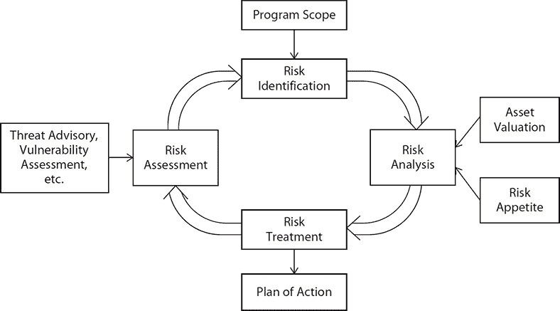

**图 3-1** 风险管理周期

## 风险管理方法论

对于想要使用正式标准管理风险的组织，有几种成熟的方法论可用。组织出于各种原因选择这些标准中的一种；它们可能被要求使用特定标准来满足法规或合同条款，或者它们认为某个特定标准更符合其整体信息风险计划或业务整体。

### NIST 标准

美国国家标准与技术研究院 (NIST) 为信息安全和其他主题制定标准。NIST 特别出版物 800-30《风险评估指南》是一份详细、高质量的标准，描述了用于风险评估的步骤。NIST 特别出版物 800-39《管理信息安全风险：组织、任务和信息、系统视角》描述了整体风险管理过程。

**NIST SP 800-39** NIST 特别出版物 800-39 中的方法由多级风险管理组成，涵盖信息系统层、任务/业务流程层和整个组织层。这些层级之间的上下通信确保了风险向上传递以实现整体意识，而风险意识和风险决策向下传递以实现整体意识。`Figure 3-1`描绘了这一点。


**图 3-2** NIST 中的多级风险管理（来源：美国标准与技术研究院）

NIST 800-39 描述了风险管理的层级：

- **第 1 层：组织视角 (Tier 1: Organization view)**：该层关注于治理和企业执行的活动。
- **第 2 层：任务/业务流程视角 (Tier 2: Mission/business process view)**：该层完全关于企业架构、企业安全和确保流程。
- **第 3 层：信息系统视角 (Tier 3: Information systems view)**：该层集中于战术性事务，如系统配置、漏洞管理。

NIST 800-39 中讨论的其他概念包括系统的可信任性。

NIST 800-39 定义的整体风险管理过程包括几个步骤：

- **第 1 步：风险框架 (Step 1: Risk framing)**：这包括考虑后续步骤的假设、范围、容忍度、约束和优先级。
- **第 2 步：风险评估 (Step 2: Risk assessment)**：这是识别威胁和漏洞以确定风险水平。
- **第 3 步：风险响应 (Step 3: Risk response)**：这是通过对识别出的风险采取适当处理来开发策略的过程。`接受`、`缓解`、`规避`和`转移`。该步骤在 NIST 特别出版物 800-30 中有详细定义。
- **第 4 步：风险监控 (Step 4: Risk monitoring)**：这是对识别出的风险进行定期和持续评估以查看条件是否发生的过程。

**NIST SP 800-30** NIST 特别出版物 800-30 更详细地描述了进行风险评估的标准方法。本文中的技术非常有结构化，本质上涉及建立许多工作表，记录威胁和漏洞以及发生时的影响。

在该标准中，进行风险评估的步骤如下：

- **第 1 步：准备评估 (Step 1: Prepare for assessment)**：组织确定风险评估的目的。首先，了解风险评估结果以及根据结果将做出的决策是重要的。接下来，必须确定并明确范围。这可以有许多形式，包括地理和业务部门边界，以及要包含的场景范围。还要识别与评估相关的假设和约束。此外，必须识别威胁、漏洞和影响的信息源（NIST 800-30 录中有示例列表）。
- **第 2 步：执行评估 (Step 2: Conduct assessment)**：组织执行实际的风险评估。这包括几个任务。

**A. 识别威胁源和事件**：组织识别一份将在评估中考虑的威胁源和事件列表。以下威胁来源可以在标准中找到并可以使用。建议组织根据需要用其他信息补充这些来源。

- 表 D-1: 威胁源输入
- 表 D-2: 威胁源
- 表 D-3: 攻击者能力
- 表 D-4: 攻击者意图
- 表 D-5: 攻击者目标
- 表 D-6: 非攻击威胁影响
- 表 E-1: 威胁事件
- 表 E-2: 攻击性威胁事件
- 表 E-3: 非攻击性威胁事件
- 表 E-4: 威胁事件的相关性

**B. 识别漏洞和易感条件**

在此，组织检查其环境（人员、流程和技术），以确定存在哪些漏洞，这些漏洞可能导致威胁事件发生的可能性增大。标准提供了漏洞和易感条件信息的来源，可用于风险评估。与威胁目录类似，建议组织根据需要对这些列表补充额外的漏洞。

- 表 F-1：输入—漏洞和易感条件
- 表 F-2：漏洞严重程度评估量表
- 表 F-4：易感条件
- 表 F-5：易感条件的普遍性

**C. 确定发生概率**

组织确定早先识别的每个威胁场景发生的概率。以下表格将指导风险管理人员对每种威胁进行评分：

- 表 G-1：输入—发生概率的确定
- 表 G-2：评估量表—威胁事件发起的概率
- 表 G-3：评估量表—威胁事件发生的概率
- 表 G-4：评估量表—威胁事件导致不利影响的概率
- 表 G-5：评估量表—总体概率

**D. 确定影响幅度**

在此阶段，风险管理人员确定每种类型的威胁事件对组织的影响。这些表格将指导风险管理人员完成此工作：

- 表 H-1：输入—影响的确定
- 表 H-2：不利影响的示例
- 表 H-3：评估量表—威胁事件的影响
- 表 H-4：不利影响的识别

**E. 确定风险**

在此，组织确定每个威胁事件的风险水平。这些表格协助风险管理人员完成此工作：

- 表 I-1：输入—风险
- 表 I-2：评估量表—风险水平（概率和影响的结合）
- 表 I-3：评估量表—风险水平
- 表 I-4：对抗性风险表的列说明
- 表 I-5：供风险管理人员的对抗性风险表模板
- 表 I-6：非对抗性风险表的列说明
- 表 I-7：供风险管理人员的非对抗性风险表模板

### 步骤 3：沟通结果

风险评估完成后，将把结果告知组织内的决策者和利益相关者。沟通风险评估结果的目的是确保组织的决策者在做决策时考虑到已知风险。风险评估结果可以通过多种方式进行沟通，包括：

- 发布到中心位置
- 简报
- 通过电子邮件发送
- 分发纸质版

### 步骤 4：维护评估

在风险评估完成后，组织将通过监控风险评估中识别的风险因素来维护评估。这使组织能够维持相关风险的视图，并纳入自风险评估完成以来业务环境的变化。NIST 特别出版物 800-137《联邦系统和组织信息安全持续监控 (ISCM)》对信息系统、操作和风险的持续提供了指导。

NIST `800-30` 可在 `http://csrc.nist.gov/publications/PubsSPs.html` 获取。

## ISO/IEC 27005

ISO/IEC `27005` 是一项定义风险评估和风险管理结构化方法的国际标准。本标准中概述的方法总结如下：

### 步骤 1：建立背景

在进行风险评估之前，需要建立若干参数，包括：

- **风险评估范围**：包括涵盖组织的哪些部分。
- **风险评估目的**：原因包括业务部门、服务、地理位置或其他手段。
- **风险评价标准**：指定组织用于确定风险的方法。
- **影响标准**：确定如何描述识别出的风险的影响。
- **风险接受标准**：确定风险的接受程度。
- **勤务计划**：包括哪些人员执行风险评估，以及需要哪些设施。

### 步骤 2：风险评估

执行风险评估。

- **资产识别**：风险分析人员识别资产及其价值和重要性。
- **威胁识别**：风险分析人员识别具有损害资产潜力的相关且可靠的威胁，以及其发生概率。威胁有许多类型，包括自然发生的和人为造成的，可能是事故性的也可能是故意的。ISO/IEC `27005` 包含了威胁类型列表，前述的 NIST 特别出版物 `800-30`（表 `D-2` 中）也是如此。注意，某些威胁可能会影响多个资产。
- **控制识别**：风险分析人员识别现有和计划中的控制措施。应检查已存在的控制措施以查看其是否有效。检查控制的标准包括其是否降低了威胁发生的概率或影响。检查结果将得出该控制是有效的、无效的还是不必要的。最后，在识别威胁时，风险分析人员可能认为有必要采取新的控制。
- **漏洞识别**：识别可能被威胁事件利用并导致资产损害的漏洞。记住，漏洞本身不会导致损害，但它的存在允许威胁事件损害资产。ISO/IEC `27005` 包含了漏洞列表。注意，风险分析人员可能需要识别额外的漏洞。
- **后果识别**：风险分析人员将针对每个资产的识别出的威胁识别可能发生的后果。后果可能是特定威胁实现的直接或次生结果。例如，敏感财务信息的泄露在短期内对运营可能影响较或没有影响，但长期法律诉讼可能会导致罚款、意外成本和业务损失。

### 步骤 3：风险评价

根据步骤 1 中建立的风险评价和风险接受标准确定风险水平。风险评价的输出是风险列表，以及相关的威胁、漏洞和后果。

### 步骤 4：风险处理

组织的决策者将为步骤 3 中识别的每个风险选择四种处理选项之一。这些选项如下：


### 风险降低（有时称为风险缓解）

在这种选项中，组织将调整信息技术（例如安全配置、应用程序源代码或数据）、业务流程和程序或人员（例如培训）。

在许多情况下，组织会选择更新现有控制或实施新的控制措施，以便随着时间的推移更有效地监控风险的降低情况。更新或创建控制措施的成本——以及对控制持续运营成本的影响——需要与受保护资产的价值以及与所处理风险相关的后果进行权衡。风险经理记得，一项控制措施可以减少许多风险，并且可能针对多个资产，因此风险经理需要从更复杂的术语角度来考虑风险降低的益处。

`Chapter 4` 包含了对控制类型的全面讨论。

### 风险保留（有时称为风险接受）

在此，组织选择接受风险并决定不改变任何内容。

### 风险规避

组织决定停止与风险相关的活动。例如，一个组织评估了与接受信用卡数据进行支付相关的风险。他们决定更改系统，使信用卡数据直接发送到支付处理程序，这样该组织将不再接受信用卡数据。

### 风险转移

组织将风险转移给另一方。风险转移的常见形式包括保险和将安全监控外包给第三方。

当组织将风险转移给另一方时，通常会有更难处理的剩余风险。例如，虽然组织可能因为网络保险而减少了泄露带来的成本，但该组织仍可能以商誉下降的形式遭受声誉损害。

决策者权衡这四个选项中相关的成本和收益，并为组织决定最佳行动方案。

这四种风险处理选项并不是互斥的；有时，风险处理选项的组合对组织来说是最佳选择。例如，发现某个业务应用程序接受弱密码；选定的风险处理方案是安全意识培训（缓解）和接受的结合（组织选择不修改该应用程序，因为那样太贵了）。

此外，某些处理方法可以解决多个风险。例如，安全意识培训可能会减少与终端用户计算和行为相关的多种风险。

通常，在风险处理之后，还会剩余一些风险——即`剩余风险`。在分析剩余风险时，组织可能会选择进行额外的风险处理以进一步降低风险，或者按原样接受剩余风险。注意，剩余风险无法降为零——始终存在某种程度的风险。

由于某些形式的风险处理（主要是风险降低和风险转移）可能需要较长时间才能完成，风险经理通常会跟踪持续的风险处理活动直到完成。

## 步骤 5：风险沟通

所有涉及信息风险的方——`CISO`（或其他高级别信息安全官员）、风险经理、业务决策者和其他利益相关者——在整个风险管理和风险处理生命周期中都需要沟通渠道。风险沟通的示例包括：

- 对即将进行的风险评估进行公告和讨论
- 在风险评估期间（以及其他时间）收集风险信息
- 已完成的风险评估的过程和结果
- 关于风险容度的讨论
- 风险处理讨论的进展以及风险处理决策和计划
- 关于安全和风险的教育信息
- 组织使命和战略目标的更新
- 向受影响方和利益相关者通报安全事件

## 步骤 6：风险监控与审查

组织不是静态的，风险也是如此。应该定期对资产价值、影响、威胁、漏洞和发生概率进行监控和审查，以确保组织的风险观点持续保持相关和准确。监控应包括：

- 发现新的、变更的和退役的资产
- 业务流程和实践的变化
- 技术架构的变化
- 尚未评估的新威胁
- 此前未发现的新漏洞
- 威胁事件概率和后果的变化
- 可能改变组织对威胁、漏洞和风险理解的安全事件
- 市场和其他业务状况的变化
- 适用法律法规的变化

`ISO/IEC 27005` 可于`[www.iso.org](http://www.iso.org)`获取。

### 信息风险因素分析

信息风险因素分析（`FAIR`）是一种分析方法，有助于风险经理理解导致风险的因素、威胁发生的概率以及损失估算。

`FAIR` 用于帮助风险经理理解给定威胁事件的概率以及可能发生的损失。在`FAIR`方法中，有六种类型的损失：

- **生产力**：事故导致生产力损失
- **响应**：在事件响应中花费的成本
- **替换**：重建或替换资产所需的费用
- **罚款和判决**：事故导致的所有形式的法律成本
- **竞争优势**：业务流向其他组织
- **声誉**：商誉和未来业务的损失

`FAIR` 还关注资产价值和负债的概念。例如，客户列表是一项资产，因为组织可以联系客户以推销新业务；然而，如果客户列表被未经授权的人获取，由于对组织的影响，该列表也是一项负债。

`FAIR` 引导风险经理对威胁主体以及威胁主体作用于资产的不同方式进行分析。

- **访问**：未经授权地读取数据
- **滥用**：以非预期用途使用资产
- **泄露**：威胁主体与其他未经授权的方共享数据
- **修改**：威胁主体修改资产
- **拒绝使用**：威胁主体阻止合法主体访问资产

`FAIR` 被认为与`NIST SP 800-30`和`ISO/IEC 27005`等风险管理方法互为补充。

你可以在`[www.fairinstitute.org](http://www.fairinstitute.org)`获取`FAIR`。

### 资产识别与评估

在确定风险评估范围后，风险评估的第一步是识别资产并确定每个资产的价值。在典型的信息风险评估中，资产将由信息以及支持和保护这些信息的资产系统组成。

#### 硬件资产

硬件资产可能包括服务器和网络硬件、用户工作站、打印机和扫描机等办公设备以及 WiFi 接入点。根据风险评估范围，存储的资产和替换组件也可能被包含在内。

识别硬件资产存在一些挑战。许多组织在建立和维护清单信息方面做得并不理想。会计部门在其系统中可能有资产清单，但这无法反映未使用的资产或返回存储的退役资产。此外，会计资产清单没有说明它们所支持的业务应用程序。IT 用于安全扫描或补丁管理的工具是另一个清单信息来源，但由于许多原因，这些信息通常是不完整的。即使是专门的资产清单系统也受到准确性问题的困扰，因为维护其中的数据往往不是首要任务。

负责信息和信息管理的组织必须具备某种手段来了解所有这些资产。不仅如此，IT 还需要获取并跟踪每个资产的若干特征，包括以下内容：

- **标识**：包括品牌、型号、序列号、资产标签编号、逻辑名称以及任何其他识别资产的手段。
- **价值**：最初，这代表购买价值，但如果 IT 资产管理计划与组织的财务资产管理计划相关，它也可能包括其折值。
- **位置**：需要指定资产的位置，以便在定期盘点中验证其存在性。
- **安全分级**：安全管理计划几乎总是包含一个对信息和/信息系统敏感性进行分类的计划。分类示例包括机密、限制、秘密和公开。
- **资产组**：IT 资产可以被分类为分级的资产组。例如，数据中心中心支持大型应用程序的任何服务器都可以被分配到一个名为“Application X Servers”的资产组。
- **所有者**：这通常是负责资产运行的人或小组。
- **保管员**：偶尔，资产的所有权和操作将分为两个主体，即所有者拥有资产，而保管员负责操作或维护资产。

由于硬件资产会被安装、移动并最终退役，因此通过物理验证物理资产的存在来定期验证资产清单中的信息非常重要。根据系统和数据的价值及敏感性，这种清单“核对”频率可能每月一次，或最低每年一次。必须对实际盘点中的差异进行调查，以验证资产未经过授权而移动或被盗。

### 子系统和软件资产

软件应用程序（如软件开发工具、绘图工具、安全扫描工具）以及应用服务器和数据库管理系统子系统都被视为资产。与物理资产一样，这些通常具有实体价值。

#### 信息资产

信息资产比硬件不具实体，因为它们有多种形式：

- **客户**：大多数组织都有联系信息、支付信息和交易记录。
- **知识产权**：此类信息包括商业秘密、源代码和设计。
- **业务运营**：包括流程、策略和记录。
- **虚拟资产**：当组织使用`IaaS`时，它们会创建虚拟操作系统。

### 云信息资产

与信息资产相关的一个重大挑战在于云服务的性质。一个典型的例子是`elasticity`（弹性），即在负载负载期间可以创建并启动额外的虚拟机。

#### 虚拟资产

虚拟化技术允许组织在一台服务器上运行多个操作系统，这是一项流行的做法。然而，它可能导致`virtual sprawl`（虚拟机扩张）或`virtualization sprawl`（虚拟化泛滥）。

#### 资产分类

资产分类组织将资产分配给代表用途或风险类别的活动。资产分类的目的是确定每个资产的关键性水平。

关键性可能与信息的敏感性有关。例如，包含联系方式和支付信息的客户信息数据库被视为高度敏感，一旦发生泄露，可能会对当前和未来的业务运营产生重大影响。

关键性也与操作依赖性有关。例如，虚拟服务器镜像数据库可能被认为是高度关键的。如果组织的服务器镜像遭到破坏或丢失，可能会对组织继续运营的能力产生不利影响。

信息分类是指对组织内不同的数据集和集合进行分析，以确定其各种价值、关键性、完整性和敏感性的过程。有多种方法来理解这些特征。以下是一些示例：

- **货币价值**：此类信息可能更容易被窃取信息的入侵者变现。信息类型包括信用卡号、银行账户号、礼品券或卡片，以及折扣或促销代码。此类信息的丢失可能会导致直接的财务损失。
- **运营关键性**：在此类别中，信息必须随时可用，或者这些信息可能与业务韧性的某些因素有关。此类别的信息示例包括虚拟服务器镜像、事件响应程序和业务连续性程序。此类信息的损坏或丢失可能会对正在进行的业务运营产生重大影响。
- **准确性或完整性**：此类类别的信息需要具有高度的准确性。如果被篡改，组织可能会遭受重大的财务或声誉损害。此类信息的示例包括汇率表、产品或服务库存数据、机器校准数据和价格表。此类信息的损坏或丢失将导致交易不完整或错误，从而影响业务运营。
- **敏感性**：这类信息通常与个人公民有关。敏感信息的示例包括个人联系信息、个人财务数据（包括信用卡和银行账户号）以及医疗记录。

大多数组织都拥有属于所有这些类别的信息，并在其内部具有不同的重要程度。虽然这可能会导致信息类型和重要性或价值的复杂矩阵，但最成功的组织将是那些建立相当简单的信息分类方案的组织。例如，组织可以开发以下四个级别的信息分类：

- 秘密 (Secret)
- 限制 (Restricted)
- 机密 (Confidential)
- 公开 (Public)

这些信息级别，结合每个类别对应的类型示例以及每个级别的信息处理说明，构成了典型信息分类计划的核心。

大多数组织依靠人员理解信息分类计划，包括正确分类信息以及妥善处理这些信息。这就是为什么信息分类计划只有三个或四个分类级别的主要原因。虽然拥有更多分类级别可能更理想，但这样做往往会导致混乱、分类错误或对敏感和关键数据的处理不当。

进一步详细来看，这些分类的每一级信息示例包括：

- **秘密**：合并收购计划、用户和系统账户密码以及加密密钥
- **限制**：信用卡号、银行账户号、社会安全码、详细的财务记录、详细的系统配置和漏洞扫描报告
- **机密**：系统文档、用户文档、内部备忘录和网络拓扑图
- **公开**：营销资料、发布的财务报告和新闻稿

信息分类的下一步是开发处理程序。这些程序指导用户在每个分类级别正确获取、存储、传输和销毁信息。`Table 3-1` 显示了一个信息处理程序矩阵。

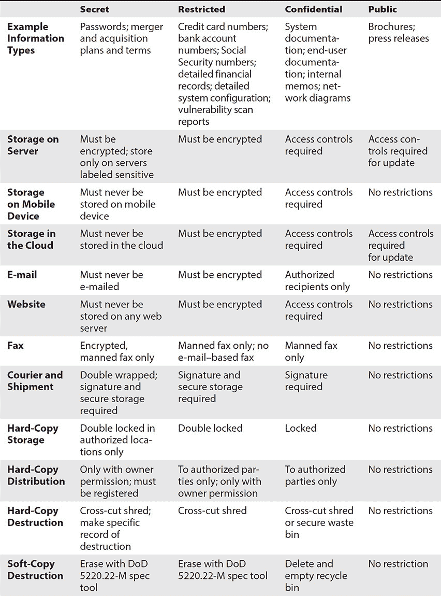

**表 3-1** 信息处理要求示例

之前的分类和处理指南旨在示例，说明不同分类级别下各种形式信息处理的差异。然而，`Table 3-1` 的内容可以作为实际数据分类和处理程序的起点。

开发和实施信息分类计划的组织发现，人员经常会误分类，要么是因为他们不理解特定数据集的敏感性本质，要么是因为他们知道在较高的分类级别下，他们可能无法以认为需要的方式存储或传输信息。这是人们为了权便利而走捷径的典型案例，特别是当他们没有意识到结果可能给组织带来的潜在危害时。

### 理想的分类级别数量

简单地按照组织内最敏感信息的方式处理所有信息会更容易吗？虽然记忆如何处理和处置所有信息会变得更容易，但可能非常繁琐，特别是如果所有信息都按照组织最敏感或最关键信息应有的级别进行处理的话。加密所有内容并粉碎所有内容将是对资源的浪费。尽管如此，组织有责任建立一个易于理解和遵循的简单信息分类计划。分类级别过多会和单级别一样成为负担。

如果分类级别过多，信息被误分类的概率就会增加，从而在以过低水平进行处理时面临风险。如果级别太少，组织要么需要过多的资源在较高水平保护所有信息，要么会因为资源不足而导致信息保护不当。

#### 系统分类

一旦组织对其信息分类表示满意，就可以开始系统分类。与各种类型的信息资产一样，信息系统也需要根据各种安全和运行标准进行分类。

系统分类的目的与信息标准相似：根据其存储、处理或传输的信息分类，对系统资产进行识别和分类，以便确定并实施适当的保护级别。

对于任何给定的系统，一旦根据其存储、处理或传输信息的最高分类级别进行分类，用于保护信息系统的措施可能对保护信息发挥作用，或者在某些情况下它将只保护系统。这两种手段都被利用，且都至关重要。

系统分类和保护的典型方法是：对于每个分类级别和每种系统，将开发一种系统加固标准，规定应用于系统的特性和配置设置。这些设置将有助于系统抵御攻击，在某些情况下，这些设置还将帮助保护系统存储、处理或传输的信息。

一些示例将说明这些点。

- **数据库管理服务器**：在这个示例中，使用数据库管理服务器存储限制级分类的信息，可能是信用卡数据。系统本身将被分类为“限制”，组织将为操作系统和数据库管理系统开发系统加固标准。
- **去军事化区 (DMZ) 防火墙**：在此示例中，防火墙保护位于 DMZ 的服务器免受互联网威胁的侵害，同时在 DMZ 中的资产被攻击者破解时，保护组织的内部资产免受 DMZ 的影响。虽然防火墙不存储信息，但它通过限制从互联网流向存储信息系统允许的流量类型来保护信息。该组织将为防火墙制定并实施加固标准。
- **网络时间服务器**：在此，服务器为组织内的其他服务器、网络设备和终端用户工作站提供精确的时间时钟数据。虽然时间服务器本身不存储、处理或传输敏感信息，但它仍被分类为“受限”（Restricted），因为该服务器通过时间协议以及可能的其他协议，可以直接访问被分类为“受限”的资产。该服务器将根据组织开发的加固标准进行加固。

最后一个示例引入了保护区域的概念。在典型信息处理环境的架构中，存在直接存储、处理和传输不同级别信息的各种系统，这些系统本身也相应地进行了分类。同一环境中访问这些服务器或被这些服务器访问的其他服务器和资产通常需要分类为相同级别。如果这些支持服务器中的一个被攻击者破解，攻击者将能够直接且可能不受限制地访问存储、处理或传输敏感或价值数据的资产之一。

在大型的扁平网络中，这种逻辑可能导致组织必须将其许多或所有系统分类为与最高分类系统相同的级别。这可能要求组织对大量系统实施昂贵且复杂的保护和管理措施。由于这些及其他原因，组织通常采用`网络分段`，即将大型扁平网络划分为多个区域，并在这些区域边界实施防火墙和其他保护措施。

`Figure 3-3` 展示了一个典型的网络分段方案。

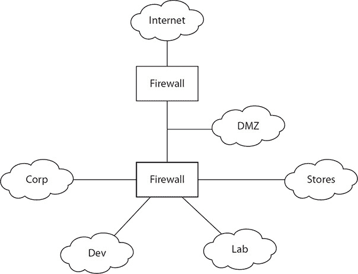

**图 3-3** 网络分段示例

#### 设施分类

在较大的组织中，数据、资产和系统分类通常可以扩展到设施分类。`设施分类`是一种根据其运行关键性或其他风险因素，为工作中心和处理中心分配分类或风险等级的方法。设施分类目的是为具有相似风险水平的设施开发更一致的安全控制。

### 资产估值

风险评估的关键部分是识别价值。

### 风险估值

由于风险评估是定性的（如本章所示），许多资产是定性的。

### 定量估值

由于风险评估是定性的（如本章所示），许多资产是定性的。

在风险评估中，关键步骤是识别威胁。`威胁`被定义为一种事件，如果发生，就会给资产带来损害。

在评估资产的损失时，其估值可能取决于以下内容之一：

- **重置成本 (Replacement cost)**：如果资产是硬件，其估值可能取决于购买它的成本。
- **账面价值 (Book value)**：这代表资产的价值，通常是价格减去折旧。
- **净现值 (Net present value, NPV)**：如果资产直接或间接产生收入，可能会使用这种评估方法。
- **重新部署成本 (Redeployment cost)**：如果资产是虚拟机，其估值可能取决于重新设置它的成本。
- **创建或重新获取成本 (Creation or reacquisition cost)**：如果资产是知识产权，例如软件。如果资产是源代码，其估值可能取决于重新创建它的努力。
- **后果成本 (Consequential financial cost)**：如果资产是包含敏感数据的数据库，其估值可能取决于由于被窃或泄露导致的财务成本。虽然恢复该数据库的成本可能较低，但泄露的后果每条记录可能花费数百美元。这是衡量破坏影响时的典型成本。

安全经理需要仔细确定每个资产价值的合适方法。虽然某些情况是直观的，但其他情况并非如此。

### 威胁识别

在安全行业中，与风险评估的关键术语经常被误解和误用。这些术语之间的区别如下：`威胁`是导致损害的实际行为，而不是相关的个人或小组（泛称为“攻击者”或“威胁攻击者”）。威胁也*不是*允许威胁发生的弱点；那被称为`漏洞`（vulnerability）。威胁通常被分类为外部或内部、故意或无意，以及人为或自然。许多威胁的起源在组织的控制范围之外，但并不意味着他们无法察觉。一个优秀的安全经理可以开发出一份可能发生在任何给定资产上的威胁列表。

执行风险评估时，安全经理需要制定一份完整的威胁列表以供评估使用。由于安全经理并不总是能够记住所有可能的威胁，因此他们可能会转向一或多个广知的威胁来源，包括以下内容：

- ISO/IEC 27005 的附录 C，“典型威胁示例”
- NIST 特别出版 800-30 的附录 E，“威胁事件”

从这一个或两个来源中捕获威胁事件后，安全经理很可能识别出一些这些列表中未包含的额外威胁。这些额外威胁可能特定存在于该组织的地理位置、业务模式或其他因素。

安全经理通常会从列表中移除一些不适用于该组织的威胁。例如，位于内陆偏远地区的组织不会受到海啸的影响，因此可以剔除这一威胁源。同样，如果一个组织位于不受龙卷风、火山爆发或地震影响的地区，这些威胁也可以被移除。

### 内部威胁


内部威胁是指源于组织内部的威胁。内部威胁通常与组织的员工有关，内部员工极有可能这些威胁背后的蓄意行为者。

安全经理需要理解内部威胁的本质以及人员与信息系统之间的交互。可能会发生各种构成威胁的事件，包括：

- 具有善意的人员在判断上出现错误
- 善意的人员在匆忙中犯错
- 善意的人员因知识或培训不足而犯错
- 善意的人员被诱导做出有害行为
- 不满的人员故意疏职
- 不满的人员故意对资产造成损害
- 受信任的第三方组织中的受信个人实施了上述任何一种行为

在了解了所有可能出错的方式后，安全经理有时会想，事情怎么可能按计划进行呢！

安全经理需要理解的一个重要概念是：虽然员工处于潜在威胁行为者名单的前列，但这些员工也是那些需要获得敏感数据广泛访问权限的人，以便他们能够完成工作并确保组织正常运行。尽管数据泄露防护（`DLP`）等技术有了些许改进，但雇主仍处于通过授予几乎所有组织信息的权限来信任员工的境，希望他们不会无意或蓄意滥用这些可能给组织带来巨大伤害的权限。员工失控的示例包括：

- 旧金山的一位网络经理声称没有其他人员有胜任管理网络的能力，将所有其他网络人员锁在网络之外
- 英国一家经纪公司的一名证券交易员通过一系列未经授权的大额交易导致公司破产
- 某情报机构的一名系统管理员获取并向媒体泄露了数千份机密文件

员工异常的一个重要因素是访问控制策略，导致个人员工访问的信息超过了审慎范围。尽管如此，增加访问控制的粒度被认为既耗时又昂贵，并且增加了业务运营的摩擦；尽管已识别风险，但很少有组织能够这些。

`Table 3-2` 包含了可能纳入组织风险评估的人为威胁。

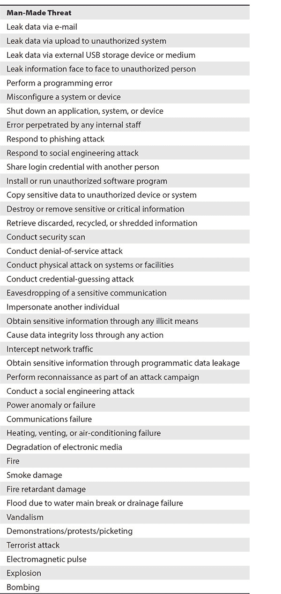

**表 3-2** 内部和外部人为威胁

建立一个简的威胁行为者列表（发起威胁事件的人员或团体）可能有用，但请记住这些并不是威胁本身。然而，建立这样的列表可能帮助安全经理识别出可能不在列表上的额外威胁事件。

`Table 3-3` 包含了内部和外部自然威胁列表。

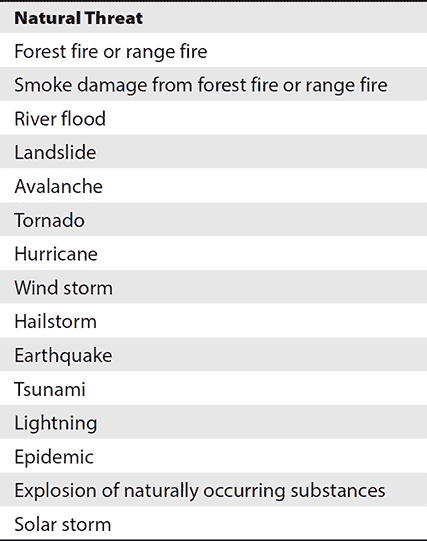

**表 3-3** 内部和外部自然威胁

## 外部威胁

源于组织外的威胁通常被称为`外部威胁`。与内部威胁一样，这些可以包括故意和意外行为；此外，它还包含了人为的和与自然发生事件相关的。

执行风险评估的安全经理需要理解威胁行为者的完整范围及其动机。这对于特定类型的威胁行为者或动机更常见的组织来说特别重要。例如，航空航天和武器制造商等某些行业会吸引工业间谍和情报机构，而某些行业则吸引黑客行动者。

`Table 3-4` 包含了外部威胁行为者列表，`Table 3-5` 列出了这些行为者背后的动机。

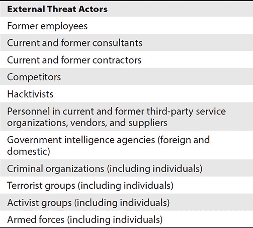

**表 3-4** 外部威胁行为者

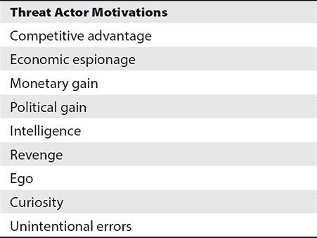

**表 3-5** 威胁行为者动机

在风险评估中，识别所有具有合理发生概率的威胁至关重要。那些由于地理和其他条件不太可能发生的威胁通常会被排除。例如，对于远离海洋的地点可以排除飓风，对于已知不发生地震和火山爆发的地点可以排除这些威胁。陨石和空间碎片等威胁由于发生概率极低，很少被包含在风险评估中。

## 高级持续性威胁

`Advanced persistent threats (APTs)` 是一个用于描述特定类型威胁行为者的术语。`APT`（无论是个人还是网络犯罪组织）以其表现出资源丰富、耐心和坚定的技术而闻名。`APT` 并不是采用“击完逃跑”或“强行抢夺”的行动，而是会耐地对目标进行侦察，并使用工具渗透目标并在那里建立长期存在。

`NIST SP800-39` 对 `APT` 的定义如下：

“`APT` 是一种拥有高水平专业知识和大量资源的对手，这使其能够利用多种攻击向量（例如网络、物理和欺骗）创造机会以实现其目标。这些目标通常包括在目标组织的 `IT` 基础设施中建立并扩展立足点，用于外泄信息、破坏或阻碍任务、计划或组织关键方面；或为未来执行这些目标而进行定位。高级持续性威胁：(i) 在较长时间内反复追求其目标；(ii) 适应防御者抵抗它的努力；(iii) 决心维持执行其目标所需的交互水平。”

`APT` 术语出现在 21 世纪 20 年初，用于描述一种新型攻击者，他们行动缓慢但有效，旨在渗透目标组织。在 `APTs` 出现之前，威胁行为者并不复杂，其执行的操作持续时间很短，最多只有几天。但随着越来越多的组织将更有价值的信息资产置到网上，威胁行为者变得更加狡猾且资源更丰富；他们转而采用长期的行动计划，在攻击之前对目标进行长时间的研究，而一旦攻击开始，就会持续几个月甚至更久。`APTs` 会渗透目标组织内部的多个系统，并使用各种隐蔽技术利用尽可能多的被攻陷目标来建立并维持存在。一旦 `APT` 被发现（如果它真的被发现过的话），安全经理就会清理被攻陷的目标，但往往不知道该 `APT` 已经渗透了许多其他目标，而且并非所有目标都使用了同一种技术。

这场猫鼠游戏可能会持续几个月甚至几年，攻击者继续攻破目标并研究组织的系统——在此期间寻找特定目标——而安全经理和其他人则会像嘉年华游戏中的“打地鼠”一样不断地追逐攻击者。

***


**注意** 如今 `APT` 术语的使用频率有所降低，尽管其定义在很大程度上没有改变。当其技术还新颖时，对 `APTs` 的讨论频率更高。但今天，存在大量的网络犯罪组织，以及成百上千有才华的个人威胁行为者，他们的技术与十几年前的 `APTs` 相似。今天 `APTs` 不再是新奇，而是常态。

### 新兴威胁

如今网络战发生的场所不断变化和演变。正如表 3-6 所示，有多种力量正在运作，在攻击技术和防御技术领域不断“突破边界”。

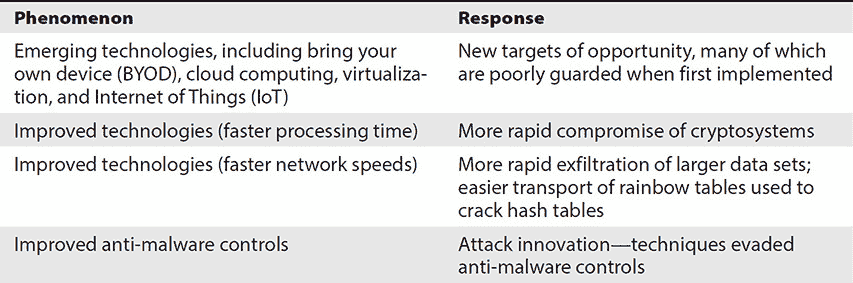

**表 3-6** 新兴威胁的级联

新兴威胁的主题应该被视为新技术的现象，而不是一组固定的技术。通常，最新的技术很难被检测，因为它们超出了人们预期定期观察到的攻击技术范围。

如果将其视为前者，新兴威胁将始终代表攻击技术的前沿，在被发现时难以检测和/或修复。

如果将其视为后者，那些新兴威胁很快就会变成常态，并且会存在更新的威胁技术。

安全经理需要理解，即使防御技术不断改进以帮助防止和/或检测日益复杂的攻击，攻击技术在规避检测的能力也会不断提高，甚至能规避最复杂的防御技术。

### 漏洞识别

漏洞识别是任何风险评估的重要组成部分。`vulnerability`（漏洞）是系统中任何允许攻击成功渗透目标系统的弱点。

在安全行业中，涉及风险评估的关键术语经常被误解和误用。这些术语之间的区别如下：`vulnerability`（漏洞）是系统中可能允许攻击发生的弱点。`vulnerability` 并不是攻击向量或技术——这被称为 `threat`（威胁）。

漏洞通常采取以下形式之一：

- **配置缺陷**：具有配置设置的系统、程序或组件存在一个或多个设置错误的设置，这可能为攻击者提供了渗透系统的额外机会。例如，系统上的身份验证设置可能允许攻击者采用暴力破解密码攻击，而这种攻击不会因为目标用户账户被自动锁定而终止。
- **设计缺陷**：系统组件之间的关系安排可能使得攻击者更容易渗透目标系统。例如，一个组织可能将数据库服务器放置在 `DMZ` 网络中而不是内部网络，这使得攻击者更容易识别和攻击。
- **已知的未修补漏洞**：系统可能存在一个或多个已有安全补丁但尚未安装的漏洞。例如，某种安全通信协议在建立加密会话的方式存在缺陷，这可能允许攻击者轻松接管已建立的通信会话。该安全漏洞可能有可用的安全补丁，但在安装补丁之前，该缺陷仍然存在，并可能被任何了解该漏洞及可用技术的个人所利用。

有时，已知的缺陷会通过系统制造商或负责第三方的披露而公开。虽然可能没有可用的补丁，但可能有其他途径来缓解漏洞，例如目标系统中的配置更改。

- **未公开的未修补漏洞**：系统可能存在只有系统制造商已知且未公开的漏洞。在这些这些系统的组织通过安全公告或新闻文章获知漏洞之前，该组织在自卫方面所能做的非常有限，除非采用系统加固、网络加固和安全编码等基本的安全技术。
- **未发现的缺陷**：安全经理早已接受这样一个事实：所有类型的信息系统都存在尚未被发现、披露和缓解的安全漏洞。其原因是攻击系统的新技术正在开发中，其中某些技术可以利用人们从未想过要寻找的弱点。随着一些涉及检查活动内存以获取取敏感信息片段的新技术被发现，系统和工具设计者可以设计防御技术来检测甚至阻挡攻击。例如，曾开发出某些技术，允许攻击者从符合 `PCI` 标准的销售点（`POS`）软件程序中获取信用卡号。很快，有效的攻击被开发出来，使网络犯罪组织能够从全球零售公司盗取数千万信用卡号。

漏洞无处不在——在软件程序、数据库管理系统、操作系统、虚拟化平台、业务流程、加密算法和人员中。根据原则，安全经理应该考虑到，每个系统中每种每个组件都存在已知和未知的漏洞，其中某些漏洞一旦被利用，可能会给组织带来痛苦且昂贵的后果。表 3-7 包含了漏洞可能存在的地方，以及用于发现其中至少某些漏洞的技术。

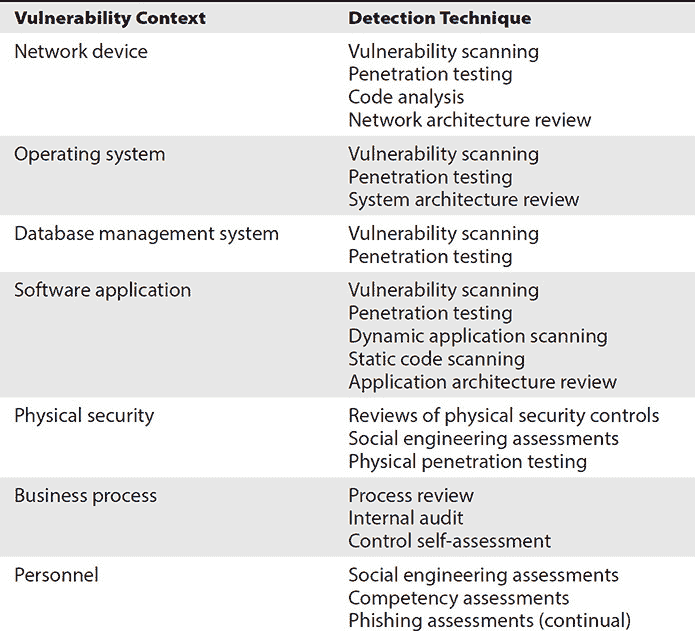

**表 3-7** 漏洞与检测技术

### 第三方漏洞识别

大多数组织会将至少部分软件开发和 `IT` 运营外包给第三方。这主要通过使用云应用程序和服务来实现，如 `SaaS` 应用、`PaaS` 和 `IaaS` 环境。许多组织存在一种误区，认为第三方负责其服务中的所有安全问题。相反，组织需要彻底理解每个外包服务的安全责任模型，以便组织了解哪些安全部分是其责任，哪些部分是由外包服务管理的。

无论运营的任何特定方面的安全责任是由本组织承担，还是由外包组织承担，都需要识别并管理漏洞。对于由组织负责的安全方面，该组织需要采用正常手段对其进行识别和管理。对于由外包组织负责的安全方面，该组织需要识别并管理漏洞，在许多情况下，外包组织会根据要求向其客户提供这些活动。

关于第三方识别出的风险的进一步讨论将在本章后后出现。

### 风险识别

风险识别是风险评估过程中的一项活动，对每种资产研究各种场景。在分析每个风险时，会应用几项考虑因素，包括：

- **威胁**：对每种资产检查所有真实的威胁场景，以查看哪些场景可能发生。
- **威胁行为者**：了解各种威胁行为者的多样性，并知道哪些者更有动机针对该组织以及原因是什么，至关重要。这进一步阐明了特定威胁场景发生的可能性。
- **漏洞**：对于正在检查的每个资产、业务流程和人员，都需要识别漏洞。然后，检查各种威胁场景，查看哪些场景因为相应的漏洞而变得更有可能。
- **资产价值**：每种资产的价值是纳入风险分析的一个重要因素。正如早些关于资产价值的节中所描述，资产有多种估值方法。例如，如果客户数据库损坏或销毁，其恢复成本可能较低；然而，如果同一个客户数据库被盗取并在黑市出售，数据对网络犯罪分子来说的价值可能高得多，而组织为减轻对客户造成的损害而必须付出的成本可能更高。检查资产价值的其他方法是通过由于其存在或使用而产生的收入。
- **影响**：风险经理检查漏洞、威胁（带有威胁行为者）、资产价值，并估计不同威胁场景的影响。影响是与资产价值分开考虑的，因为某些威胁场景与资产价值的关联性极小，而是与声誉损害有关。隐私数据泄露可能导致高昂的缓解成本和业务减少。医院的泄露可能威胁到患者护理。几乎任何 `IoT` 环境下的泄露都可能导致广泛的服务中断和生命安全问题。

定性和定量的风险分析技术有助于区分高风险和低风险。这些技术将在本节稍后的部分进行讨论。

超过特定水平的风险通常会被转移到风险登记表中，在那里它们将通过风险处理进行处理。

### 风险、可能性和影响

在风险评估的风险分析期间，风险经理将执行一些简单的计算，对所有识别出的风险进行分层。这些计算通常类似于以下一个或：

`Risk` = `threats` × `vulnerabilities`

`Risk` = `threats` × `vulnerabilities` × `asset value`

`Risk` = `threats` × `vulnerabilities` × `probabilities`

`ISO/IEC` 指南 73《风险管理 – 术语》将风险定义为“事件发生的概率及其后果的结合”。这是一种用简单、非数值的术语理解风险的极佳方式。

### 可能性（概率/Likelihood）

在风险评估中，可能性是一个重要的维度，帮助风险经理理解与威胁事件发生相关的几个方面。严重安全事故发生的可能性与技术细节较小，而与攻击者的思维过程更有关系。与可能性相关的考虑因素包括：

- **卫生**：这与组织的安全运营实践有关，包括漏洞管理、补丁管理和系统加固。在这些方面工作较差的组织更有可能遭受事故，仅仅是因为它们让攻击者更容易进入系统。
- **可见性**：这与组织的地位有关：组织的规模有多大、可见性如何，以及当攻击者成功攻破目标时其声望将增加多少。
- **速度**：该因素与各种威胁场景的时机以及是否有任何警告或预知有关。
- **动机**：在这里，考虑各种类型的攻击者以更好地理解促使他们攻击组织的因素至关重要。这可能涉及金钱、声誉或竞争。
- **技能**：对于各种威胁场景，成功攻击该组织需要什么技能水平？较高的技能水平并不意味着攻击发生的可能性较低；动机等其他考虑因素也会发挥作用。

#### 影响（Impact）

在风险评估期间，“影响`是任何威胁场景的一个关键属性，风险经理需要充分理解。在信息安全的背景下，影响的定义是某些操作（如威胁或灾难）产生的实际或预期结果。

影响可能是理解威胁场景时最重要的一个属性。风险评估可以描述所有类型的威胁场景、其背后的原因以及如何将其降至最低，但如果不理解威胁场景的影响，风险经理就无法从缓解风险的紧迫性角度判断一个威胁相对于另一个有多重要。

广泛的可能影响场景包括：

- 直接现金损失
- 声誉损害
- 业务损失——销售额下降
- 股价下跌——获取资金的机会减少
- 市场份额减少
- 运营效率降低（内部成本增加）
- 民事责任
- 法律责任
- 合规责任（罚款、警告等）
- 业务运营中断

这些影响场景中，某些在定性描述上比其他场景更容易分析，而且除非在特定的威胁场景下，否则大多数此类影响场景的规模很难量化。

业务连续性和灾难规划领域的主要工具之一——业务影响分析（`BIA`）对信息安全经理非常有用。`BIA` 可以作为风险评估的一部分进行，也可以独立于风险评估进行。

`BIA` 与风险评估的区别在于：虽然风险评估用于识别风险以及可能的补救措施，而 `BIA` 用于识别最关键的业务流程，以及支持它们的 `IT` 系统和对其他流程或系统的依赖。在其他考虑因素相等的情况下，`BIA` 为风险评估带来的价值是理解哪些业务流程和 `IT` 系统对组织最重要。对于信息安全经理，`BIA` 帮助安全经理更好地理解哪些流程最关键，因此哪些流程最需要保护。

在风险评估中，安全经理会检查资产以及相关的漏洞和可能的威胁场景。在这里进行的详细检查被称为`风险分析`。

风险分析考虑了资产的许多维度，包括：

- 资产价值

## 威胁场景

- 威胁场景
- 威胁概率
- 相关漏洞
- 现有控制措施及其有效性
- 影响

如果可用业务影响分析（`BIA`），风险分析还可以考虑业务的关键性。

在本节的剩余部分，将讨论各种风险分析技术。

## 获取信息

安全经理需要收集大量信息，以确保风险分析和风险评估具有价值且完整。目前有多种来源可用，包括：

- 与流程所有者访谈
- 与应用程序开发人员访谈
- 与安全人员访谈
- 与外部安全专家访谈
- 安全事件记录
- 对其他组织中发生的事件进行分析
- 先前的风险评估（然而，需要注意防止错误从一次评估传播到下一次评估）

## 定性风险分析

大多数风险分析都始于定性风险分析。这种技术并不寻求确定精确（甚至于近似）的资产价值、影响或发生的精确概率。相反，这些项目被表示为高、中、低。

定性风险分析的目的是快速理解风险之间的相对关系，从而将高风险与低风险区分开来。这是一个非常有价值的追求，因为它使组织能够根据定性术语的影响，关注更关键的风险。

## 半定量风险分析

在定性风险分析中，发生的概率可以用数值表示，例如在 1 到 5 的范围内（其中 `5` 为概率最高），影响也可以用数值表示，同样在 1 到 5 的范围内。然后，对于每种资产和每种威胁，风险的计算方法为概率乘以影响。

例如，一个组织识别了两个风险场景。第一个是客户数据库数据泄露的风险；影响评分为 `5`（最高），概率评分为 `4`（极有可能）。该风险的得分为 `5 × 4 = 20`。第二个是源代码被盗的风险；影响评分为 `2`（低），概率评分为 `2`（可能较小）。该风险的得分为 `2 × 2 = 4`。

安全经理理解，与源代码被盗的风险（得分为 `4`）相比，数据泄露风险是一个更大的风险（得分为 `20`）。这些风险评分并不意味着较大的风险发生的概率是后者的五倍，也不意味着成本是后者的五倍。它只是确定了一个风险高于另一个。

注意某些安全经理认为这是一种定性风险分析，因为在成本和概率方面的结果并不比之前描述的定性技术更准确。

## 定量风险分析

在定量风险分析中，风险经理试图确定事件的实际成本和概率。这种技术为执行管理人员提供了更具体的信息，关于他们可以在各种安全事件场景中预计承担的实际成本。

定量风险分析有两个方面被证明是持续的挑战：

- **事件概率**：很难对几乎每个事件场景的概率给出一个数量级的估算。即使从行业来源获取了更好的信息，高影响事件的概率也取决于许多因素，其中某些因素难以量化。
- **事件成本**：很难为任何给定的安全事件场景设定精确的成本。安全事件是涉及许多方并具有不可预测的短期和长期的复杂事件。尽管研究信息不断改进，但很难为任何给定的安全事件场景设定精确的成本。

标准的定量风险分析涉及开发以下几项：

- **资产价值 (AV)**：这是资产的价值。
- **暴露因子 (EF)**：这是由威胁造成的财务损失，以资产的百分比表示。
- **单次损失预期 (SLE)**：该值代表威胁发生一次时的损失。`SLE` 定义为 `AV × EF`。
- **年度发生率 (ARO)**：这是对威胁每年发生次数的估算。如果威胁发生的概率是 1 分 50（每 50 年发生一次），`ARO` 为 `0.02`。如果估计威胁每年发生四次，`ARO` 为 `4.0`。
- **年度损失预期 (ALE)**：这是由于威胁导致的资产价值预期年度损失。`ALE` 定义为 `SLE × ARO`。

在对特定资产进行定量风险分析时，可以将所有威胁的 `ALE` 相加。所有 `ALE` 的总和为整个威胁列表的年度损失预期。

## OCTAVE


# 业务关键型威胁资产和漏洞评估（OCTAVE）

业务关键型威胁资产和漏洞评估（OCTAVE）是由卡内基梅隆大学开发的一种风险分析方法。最新版本被称为 OCTAVE Allegro，用于评估信息安全风险，以便组织能够从风险评估中获得有意义的结果。

## OCTAVE Allegro 方法论

OCTAVE Allegro 方法论使用八个步骤：

- **步骤 1：建立风险衡量标准**：在此，组织识别出最重要的影响领域。模型中的影响领域包括*声誉/客户信任、财务、生产力、安全与健康、罚款/法律处罚*以及*其他*。

- **步骤 2：制定信息资产概要**：组织识别其范围内的信息资产，并为这些资产开发一个描述其特征、性质、特性和价值的概要。

- **步骤 3：识别信息资产容器**：组织识别所有存储、处理和传输范围内的资产的内部和外部信息系统。请注意，许多系统可能由第三方机构运营。

- **步骤 4：识别关注领域**：这是识别威胁的开始，这些威胁一旦实现，可能会对信息资产造成损害。通常在头脑风暴活动中识别。

- **步骤 5：识别威胁场景**：这是步骤 4 的延续，对威胁场景进行扩展（并消除不太可能的场景）。可能会开发一个威胁树，首先识别执行者和基本场景，然后扩展到包含更多细节。

- **步骤 6：识别风险**：这是步骤 5 的延续，识别每个威胁场景的后果。

- **步骤 7：分析风险**：这是一种简单的定量衡量方法，根据第 1 步中开发的风险标准对每个威胁场景进行评分。输出是风险排序列表。

- **步骤 8：选择缓解措施**：这是步骤 7 的延续，对得分较高的风险进行分析，以确定降低风险的方法。

OCTAVE Allegro 方法论包含了此处每个步骤的工作表，使个人或团队能够根据此技术执行风险分析。

关于 OCTAVE Allegro 的更多信息可以访问 [www.cert.org/resilience/products-services/octave/](http://www.cert.org/resilience/products-services/octave/)。

## 其他风险分析方法

额外的风险分析方法提供了更复杂的方法，这些方法对某些组织或选定的风险情况可能有用：

- **德尔菲法**：在这里，向专家小组发放两轮或多轮问卷。协调员会对回答进行匿名处理并分发给专家。目标是让专家在最重要的风险和缓解策略上达成共识。

- **事件树分析 (ETA)**：源自故障树分析法（下文描述），ETA 是一种用于分析特定事件场景（在本例中威胁场景）成功和失败结果的逻辑建模技术。

- **故障树分析 (FTA)**：这种逻辑建模技术，用于绘制给定事件场景的所有后果。FTA 从特定场景开始，随着时间的推移考虑所有可能的后果。可能会产生一个巨大的“树”状，描绘许多不同的事件链。

- **蒙特卡洛分析**：源自蒙特卡洛计算算法，该分析从一个具有输入的给定系统开始，其中输入限制为最小值、可能值最大值。运行模拟可以对实际可能的场景提供洞察。

## 风险评估与排序

在风险评估完成后，当所有风险都已识别并评分后，安全经理将组织内的其他人一起开始分析结果，并开始制定未来的战略。

风险可以单独进行评估，但组织对所有风险进行统一分析将获益更多。这是因为许多风险是相互关联的，缓解策略的正确组合可以使许多风险得到充分处理。

风险评估的结果应从几种不同的方式进行分析，包括：

- 按业务部门或服务产品线查看所有风险

- 按资产类型查看所有风险

- 按活动类型查看所有风险

- 按后果类型查看所有风险

由于没有两个组织（或其风险评估结果）是相同的，这种类型的分析可能会识别出风险处理主题，这些主题可能对许多风险产生广泛影响。例如，组织可能有多个与访问管理和漏洞管理相关的战术级风险。与其处理单个战术级风险，更好的方法可能是自上而下地改进或重组访问或漏洞管理计划，使许多识别出的风险以程序化的方式得到缓解。组织不仅需要考虑风险评估中的细节，还需要考虑大局。

另一种要寻找的风险类型是发生概率低但影响大的风险。这通常是风险转移处理的风险类型。风险转移通常以网络风险保险的形式出现，但也出现在包含赔偿的安全性监控中。

## 风险所有权

在考虑风险评估结果时，组织需要将单个风险分配给个人，通常是中高层管理人员。这些领导还应该拥有其控制范围内运行的控制措施的所有权，并拥有日常业务运营所需的预算、人员和其他资源。这些人是风险所有者，在存在关于风险容忍度或风险偏好的正式政策或声明的情况下，他们应该是为其领域内的风险做出风险处理决策的人。在这些个人对其组织部分的运营负责范围内，他们还应该负责其运营区域的风险决策，包括风险处理。处理风险所有权的简单概念是：如果没有人拥有风险，就没有人负责管理风险，这将导致风险极有可能变成一个活跃问题并对业务产生负面影响，并可能在事件发生时确定一个被指责的替罪羊。

## 风险处理

完成风险评估后，管理层可以查看列出已识别和解释风险的报告和其他信息。这是组织完成风险识别并开始确定应对这些风险采取什么措施的阶段。随后的决策和活动被称为`risk treatment`。决定适当风险处理的关键要素是确保组织中正确层级的正确的人积极参与风险处理的决策。这是通过建立正式的风险管理计划实现的，该计划包含了本章概述的良好计划的所有关键要素。

从通俗来说，风险处理代表了组织采取的将风险降低到可接受水平的行动。更具体地说，对于风险评估中识别的每个风险，组织可以采取四种行动：

- 风险接受

- 风险缓解

- 风险回避

- 风险转移

这四种行动在后续章节中有更详细的解释。

还有第五种可能的行动——或者说，*不作为*——与风险处理有关，被称为`忽略风险`。这是一项具有潜在危险的行为，忽略风险等同于组织假装风险不存在。在这种情况下，组织非正式地接受了该风险，如果风险变成问题，则由其负责。通过非正式地接受风险且不分配风险所有者，组织可能会增加风险演变为事件的影响和可能性。

前述忽视已知风险的情况与组织的`ignoring an unknown risk`（忽略未知风险）不同。这通常由于风险评估或风险分析不够彻底，未能识别出所有相关风险。对于这些“未知的未知”，最佳解决方案是聘请外部专业的机构每隔几年对该组织进行一次风险评估，或者由该组织彻底审查其风险评估，以发现改进机会，包括扩大威胁范围、威胁行为者和漏洞的覆盖面，从而尽可能减少或消除未知风险。

### 风险接受

风险接受是组织对任何已识别风险可能采取的四个选择之一。`Risk acceptance`（风险接受）定义为一种决策，即组织认为风险的存在是可以接受的，并且不需要减少或缓解。

如果风险接受仅如此简单。对风险接受的进一步分析表明，在某些情况下，组织会选择接受风险：

- 风险缓解的成本大于受保护资产的价值。

- 遭到破坏的影响较低，或者资产的价值或分类较低。

组织可能会选择建立一个风险接受框架，如表 3-8 所示。

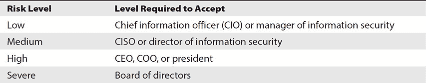

**表 3-8** 风险接受框架

当组织接受某种风险时，不应永久关闭此事，而应至少每年审查一次该风险。以下是重新考虑已接受风险的理由：

- 资产的价值在一年内可能发生了变化。

- 与资产相关的业务活动价值在一年内可能发生了变化。

- 威胁的效力在一年内可能发生了变化，可能导致风险等级升高。

- 缓解成本在一年内可能发生了变化，可能导致风险缓解或转移的可性更高。

与其他风险处置活动一样，详细的记录有助于安全经理更好地追踪风险评估审查等事项。

### 风险缓解

风险缓解是组织在面临风险时可以采取的四个选择之一。`Risk mitigation`（风险缓解）定义为通过某些手段降低风险的决策，例如通过更改流程或程序、更改安全控制的功能，或添加安全控制。

当管理层理解执行风险缓解的成本低于受保护资产的价值时，通常会选择风险缓解。然而，有时资产的价值很难衡量，或者该资产可能与高声誉相关联。例如，包含银行账户或信用卡信息等敏感数据的客户数据库，其本身的价值可能很低；但是，由于可能导致业务损失或负面声誉，该数据库泄露的影响可能高于其账面价值。

风险缓解有时会导致一项可以在较短时间内完成的任务。然而，风险缓解也可能涉及未来启动的一个或多个重大项目，可能是在下一个预算年度，或者未来的几个月或几个季度。此外，此类项目可能会被延迟、其范围可能会发生变化，或者被完全取消。因此，安全经理需要仔细监控风险缓解活动，以确保它们按原约完成，以免遗忘风险缓解工作。

### 风险规避

风险规避是组织应对风险时采取的四个选择之一。`Risk avoidance`（风险规避）定义为停止产生该风险的活动决策。

通常，风险规避是为了应对最初未经过正式批准的活动。例如，风险评估可能识别出某个部门使用外部服务提供商，而这对组织构成了可衡量的风险。该服务提供商最初可能经过未经过正式审查。无论如何，在风险评估（或其他手段）中识别出风险后，如果选择了风险规避，组织将选择停止与该提供商合作。

### 风险转移

风险转移是组织应对风险的可用选择之一。`Risk transfer`（风险转移）定义为雇用外部组织来接受风险的决策。

当组织没有运营或财务能力来接受风险，且风险缓解不是最佳选择时，会选择风险转移。

在风险转移中，组织可能识别出与与其最敏感数据泄露相关的重大财务风险。在这种情况下，风险转移决策可能涉及购买网络风险保险，以抵消此类泄露相关的成本。风险转移决策还可能涉及购买事件响应留存（incident response retainer），这本质上是在发生泄露时预购的事件响应服务。

风险评估可能会发现关键系统缺乏安全监控。风险转移的另一种形式是使用外部安全服务提供商对关键系统进行监控。

## 剩余风险

当组织对其识别出的风险进行风险处置时，大多数情况下，风险处置并不会完全消除风险，而是将风险降低到某种程度。`Residual risk`（剩余风险）定义为应用风险处置后仍然存在的风险。

某些组织处理风险处置和剩余风险的方法不当。他们识别出一个风险，采取了一些风险处置措施，但未能理解剩余风险，而是关闭了该风险事项。处理风险的方法是将剩余风险视为新风险进行分析，并对剩余风险应用风险处置。这种迭代过程为组织提供了重新审视剩余风险并对其做出新风险处置决策的机会。最终，经过一次或多次迭代后，剩余风险将被接受，最后可以关闭此事。

例如，安全经理在访问管理系统中发现了一个风险，即未使用多因素身份认证。这被认为是高风险，IT 部门实施了多因素认证解决方案。当安全经理重新评估访问管理系统时，他们发现多因素认证在某些情况下是需要的，而在另一些情况下不需要。识别出了新风险，其风险水平可能低于原始风险。但组织再次有机会检查该风险并对其做出决策。它可以通过在比以前更多的情况下要求多因素认证来进一步改进访问管理系统，从而进一步降低风险，并再次检查是否有进一步处置的机会。最后，当组织认为风险已得到充分降低时，将按现状接受。

除了风险处置生命周期外，后续的风险评估和其他活动将识别出代表早期风险处置活动的剩余风险。随着时间的推移，由于威胁、漏洞或业务实践的变化，剩余风险的性质可能会发生变化，导致原本接受的剩余风险不再可接受。

## 控制

当选择缓解时，风险处置的一个常见结果是实施控制。换句话说，当组织在风险评估中识别出风险时，组织可能会决定开发（或改进）一种缓解所发现风险的控制措施。

例如，某机构发现其针对离职员工的访问终止程序导致许多用户账户未被禁用。现有的控制措施是一个简单的开环程序，分析师被指示禁用用户账户。通常，他们禁用账户的时间很晚，或者根本没有禁用。为了降低这种风险，该机构修改了程序（更新了控制措施），引入了一个步骤，即由第二个人每天对所有账户注销进行验证。

控制措施是为了确保预期结果而采取的措施。控制措施可以以程序的形式存在，也可以直接实现在系统中。控制有许多类别和类型，以及标准的控制框架。所有这些在第 4 章中都进行了详细讨论。

### 法律与监管考量

许多行业的机构都受到监管和法律法规的约束。许多机构还通过公司之间的法律协议承担着义务。其中许多法律义务涉及数据保护、数据隐私和数据使用主题。

这个关于数据保护、隐私和使用的主题表现形式多样，以至于可以写满几卷著作，而且对于信息安全专业人员来说，阅读这些并不并不有趣。但针对这些法规有一些共同的方法：

- **强制性保护措施**：许多法律、法规和私人法律义务要求机构采取各种特定措施来保护信息。通常，这些措施是必须到位位的，无论任何特定机构的实际风险降低了多少，仅仅因为法律或法规是这样规定的。一个很好的例子是《支付卡行业数据安全标准》（`PCI-DSS`），它要求任何存储、处理或传输信用卡数据的机构都要实施大量的控制措施。PCI-DSS 并没有规定任何特定控制措施是否真的能降低某个特定机构的风险。相反，在此类机构中，所有控制措施在任何时候都是必须执行的。

- **可选性保护措施**：某些法律、法规和其他法律义务包含一些特定的保护措施，机构`could`选择不实施。例如，美国的《健康保险流通性与责任法案》（`HIPAA`）列出了强制性控制措施和“说明性”（addressable）控制措施。在大多数情况下，机构需要提供一个正式且有效的业务理由，解释为什么没有实施某些可选措施。

- **强制性风险评估**：某些法律、法规和法律义务要求机构进行风险评估，但许多法律并不要求根据这些评估结果采取特定行动。例如，支付卡行业数据安全标准（`PCI-DSS`）要求机构进行年度风险评估（在要求 `12.2`），但 PCI-DSS 在任何地方都没有允许机构因为不存在风险而免除任何 PCI-DSS 控制。

与法律、法规和其他法律义务相关的另一个关注方面是合规风险的概念。`合规风险`被定义为任何与不遵守法律、法规或私人法律义务的任何一般或特定后果相关的风险。合规风险以两种形式存在：

- 机构可能因为缺乏保护措施而不符合某特定法律、法规或义务，这种措施的缺失可能导致安全事件，从而带来监管机构或其他机构的罚款和其他制裁，或来自受害方的民事诉讼。

- 不符合某特定法律、法规或义务的机构可能仅仅因为不合规状态而产生罚款和其他制裁，无论实际风险水平如何。这种方法的另一种描述是，机构可能仅仅因为不符合特定的法律要求而与监管机构或其他机构产生麻烦，无论是否存在任何实际风险。

安全经理有时无法理解一种业务策略，即高层管理人员选择支付罚款，而不是使其机构符合法律或法规。罚款或其他制裁对机构的影响可能比合规的成本和努力要小。有时，安全经理和其他安全专业人员可能会觉得，如果他们的职业行为准则要求他们遵守法律，他们就处于伦理困境中。

### 成本与收益

当机构权衡风险处理（特别是风险缓解）方案时，它们通常会考虑缓解步骤的成本以及可能获得的预期收益。在权衡时，机构需要理解几个与成本和收益相关的考虑因素，包括：

- **威胁概率的变化**：机构需要理解缓解控制如何改变威胁概率，以及这在降低成本和规避成本方面意味着什么。

- **威胁影响的变化**：机构需要理解被缓解威胁的影响在事件成本的减少和规避方面的变化。

- **运营效率的变化**：除了缓解控制的直接成本外，机构还需要理解对其他操作的影响。例如，在软件开发过程中增加代码审查步骤，可能意味着开发机构在给定期间内完成的修复和增强较少。

- **总拥有成本 (TCO)**：当机构考虑缓解计划时，最好的方法是理解其总拥有成本，这可能包括以下成本：

  - 采购

  - 部署与实施

  - 周期性维护

  - 测试与评估

  - 合规监控与执行

  - 受控过程吞吐量的降低

  - 培训

  - 寿命结束报废

在权衡成本和收益时，机构需要记住几点：

- 估计任何特定威胁的概率是困难的，特别是低频率、高影响的事件。

- 估计任何特定威胁的影响是困难的，特别是那些低频率、高影响的事件。

换句话说，成本效益分析的精确性并不高于事件概率和影响的估算。

运营风险管理关注组织的财务损失和生存问题。`Operational risk` 被定义为由于控制、流程和系统故障；内部和外部事件；以及影响业务运营并威胁组织生存的其他事件而导致的损失风险。

组织通常会建立恢复目标，这些目标与业务韧性以及从安全和灾难事件中恢复相关的时间间隔。组织特别关注与第三方相关的风险，这主要是因为获取可用的风险信息更为困难。

风险管理中的关键业务记录是`risk register`（风险登记表），它是一个记录历史风险和新识别风险的日志。风险登记也被称为`risk ledger`（风险分类账），它包含了有关每个风险的风险元数据，有助于安全管理人员和高层了解组织的所有风险，包括帮助他们理解哪些风险比其他风险更严重、哪些与各种业务活动相关，以及对组织有用的分类方法。

风险管理过程不是孤立的，而是整合到整个组织的其他几个业务流程中的。

## 风险管理目标

风险经理通常使用各种风险管理目标，这些目标帮助他们确定在可能发生的许多不同类型事件面前继续业务运营所需的资源。这些目标主要代表了在某些安全事件或灾难发生后，业务服务的可用性和恢复相关的时间间隔。

高层管理参与或最终批准风险管理目标的建立，因为这些目标的价值直接转化为与事件就绪相关的一次性成本和运营成本。高层人员通常寻求在与重大安全和灾难事件相关的潜在成本与建立特定水平业务韧性所需的成本之间取得平衡。

### 恢复时间目标

`Recovery time objective (RTO)`（恢复时间目标）被定义为从中断开始到服务恢复的时间段。`RTO`的目的是建立一个可衡量的时间间隔，在此期间，必须执行恢复或恢复业务运营的必要活动。

组织中的各种业务流程将有不同的`RTO`目标。此外，某些业务流程的`RTOs`会根据业务周期按日、每周、每月或每年发生变化。例如，销售点终端在业务高峰段可能有一个较短的`RTO`，在空闲时段有较长的`RTO`，而在业务关闭时有更长的`RTO`。同样，财务和薪资系统在关键处理期间（如薪资周期和财务月末）的`RTOs`会更短。

`RTOs`、数据分类和资产分类都是相互关联的。具有较短`RTOs`的业务流程可能具有被分类为运营上关键的数据和资产。

在建立`RTOs`时，安全管理人员通常会对中层管理以及高级和执行管理人员进行采访。安全管理人员会发现，不同责任级别的人员对业务功能关键性会有不同的观点。最终，由高层管理人员对整个组织的业务功能进行优先级排序。因此，中层经理在某一级别优先考虑的任何特定业务可能会被高层人员分类为更高或更低。最终，高层人员的优先级排序将决定一切。例如，会计部门的中层经理可能声称应付账款是最关键的业务活动，因为如果不付款，外部服务提供商将停止提供服务。但控制整个组织的高层人员规定，客户服务是最关键的业务功能，因为组织的未来收入取决于他们每天收到的服务质量。

`RTOs`是通过进行业务影响分析建立的。`RTOs`是业务连续性计划（`BCP`）的基石。虽然较短的`RTOs`与较高成本相关，但组织通常寻求一个平衡点，使恢复成本与中断成本相同。


### 恢复点目标

`Recovery point objective (RPO)`（恢复点目标）被定义为由于事故导致的最大接受数据丢失。在灾难发生，这等同于备份或数据复制间隔之间的最大时间。通常，`RPO`以分钟或小时为单位，与`RTO`一样，较短的`RPO`与较高成本相关。`RPOs`代表重做的工作量。例如，如果组织接收发票并录入系统，四小时的`RPO`意味着在灾难发生时需要四小时的重新输入。`RPOs`是连续性规划中的关键目标。建立`RPOs`后，可以制定帮助组织实现目标的计划。

### 恢复能力目标

`Recovery capacity objective (RCapO)`（恢复能力目标）被定义为临时或恢复流程相对于正常流程的能力。在发生任何导致组织切换到临时或恢复流程的事件时，该临时或恢复流程的能力可能低于正常业务。

例如，在通信中断，零售点的收银员将手写收据，这比使用销售点终端需要更多时间。手动流程可能意味着收银员只能处理 80%的工作。组织通常不需要其临时流程或系统达到正常运营流程 100%的容量。拥有 100%的备份容量成本更高，且很少使用。

### 服务交付目标

`Service delivery objective (SDO)`（服务交付目标）被定义为事件发生后所需的服务水平或质量，与正常运营相比。取决于所涉及业务流程的性质，`SDO`可以通过事务吞吐量、服务质量、响应时间、可用功能和其他指标来衡量。

`SDO`、`RTO`、`RPO`和`RCapO`相互相关。组织可以以适合自己的方式构建恢复目标模型。一个组织可能从`SDOs`开始并导出相应的`RTO`、`RPO`和`RCapO`目标，但另一些组织可能从`RTO`和`RPO`开始并确定它们的`SDOs`。

### 最大可承受时间

`Maximum tolerable downtime (MTD)`（最大可承受机时间）被定义为一个理论时间段，从灾难开始测量，之后组织的持续生存将面临风险。进行风险分析的组织有时从此指标开始，然后导出如`RTO`、`RPO`和`RCapO`等恢复目标。

最大可承受时间也被称为`acceptable interruption window (AIW)`（可接受中断窗口）。

将`MTD`称为目标（target）是错误的，但有时它被视为一个目标。将`MTD`视为一个任意的“不不回头点”时间值会更好。

高管人员最终应确定其组织内各种关键业务职的`MTD`目标；通常整个组织并没有一个单一的`MTD`目标，而是每个主要职能都有一个相应的`MTD`。例如，一家在线零售商可能对其在线订单功能设定 7 天的`MTD`，并对其工资发放功能设定 28 天的`MTD`。如果组织的获利能力连续七天中断，根据其高管的观点，其业务将遭受严重影响，以至于组织本身可能会失败。然而，组织可以容忍工资系统出现四周的`MTD`，因为可能有足够的员工能够忍受长时间的工资停机，组织能够生存下来。四周后，可能会有足够的员工离职，导致组织将无法继续运营。

`MTD`通常用于业务连续性计划。然而，由于某些运营和安全事件在程度足够严重时可能会演变成灾难，因此`MTD`也被纳入信息风险管理规划的考虑。

### 最大可忍中断时间

`最大可忍中断时间 (MTO)`，有时称为`最大可接受中断时间 (MAO)`，定义为组织可以容忍在恢复模式（或替代处理模式）下运行的最长时间。当组织的恢复模式与其正常业务运营不同，且不宜于长期业务运营时，该指标就会发挥作用。

例如，一家机构生产在线广告，根据对这些用户的已知特征对个人用户进行特定的投放。这种投放是使该机构在在线广告市场具有竞争力的特征。在恢复模式下，组织的系统缺乏若干关键的投放能力；从长远来看，组织在这种状态下将失去竞争力，并且无法长期维持业务运营。该机构将其`MTO`设置为 48 小时。以替代处理模式运行超过 48 小时将导致收入损失和市场份额损失。

与`MTD`一样，`MTO`不是目标，但一旦设定了`MTO`，就可以建立如`RTO`、`RPO`和`RCapO`等恢复目标。

### 服务水平协议

`服务水平协议 (SLA)`是一份书面协议，规定了工作量、质量、及时性以及对质量或数量不足的补救措施。服务水平协议通常建立在运营流程和系统中。在风险管理的背景下，`SLAs`可能建立在风险管理和风险处理过程中的活动上，例如，关于新风险通知的最长持续时间，或关于近期风险处理决定的沟通的及时性。

### 风险管理与业务连续性计划

风险管理和业务连续性计划这两个学科都关注识别可能对组织运营产生不利影响的风险。风险管理和业务连续性计划有几个共同特征和目标：

- 风险管理和业务连续性计划寻求发现风险，并对威胁业务运营和组织持续生存能力的事件制定补偿措施。
- 风险管理和业务连续性计划依赖风险评估来识别需要缓解的风险。
- 风险管理和业务连续性计划可以依赖业务影响分析的结果，以更好地理解业务流程的关键性以及流程与资产之间的相互依赖关系。
- 风险管理识别如果不加控制，可能会演变成灾难情景的威胁。
- 风险评估中的许多威胁场景都是业务连续性计划中使用的灾难情况。

## 第三方风险管理

`第三方风险管理 (TPRM)`指用于发现和管理与外部组织为组织执行运营职能相关的风险的活动。出于经济考虑，许多组织将部分信息处理外包给第三方组织，通常以云端软件即服务 (`SaaS`) 和平台即服务 (`PaaS`) 的形式：与租赁安排支付软件费用相比，这种方式更便宜。

与第三方业务关系的管理是一个全生命周期过程。该生命周期始于组织考虑使用第三方以某种程度上增强或支持组织的运营。该生命周期在与第三方的持续合作关系中不断进行，并在组织不再需要第三方的服务时结束。

### 初始评估

在建立业务关系之前，组织将对第三方的适用性进行评估和评价。这种评估通常是具有竞争性的，即两个或多个第三方正在竞争正式合作关系。在评估期间，组织将要求每个第三方提供描述其服务的信息，通常通过信息征询（`RFI`）或建议书（`RFP`）以结构化的方式提供。

在`RFI`和`RFP`中，组织通常会包含有关安全和隐私的章节，以便组织更好地了解每个第三方如何保护组织的信息。这与服务本身的信息、定价以及其他信息相结合，揭示了组织用于选择提供服务的第三方的细节。

### 法律协议

在服务开始之前，组织和第三方将协商一份法律协议，该协议将描述所提供的服务，以及服务水平、质量、定价以及典型法律协议中的其他条款。根据评估阶段发现的细节，组织可以在法律协议中制定专门解决安全和隐私的章节。法律协议的这部分通常涵盖以下主题：

- **安全和/或隐私计划**：要求第三方拥有正式的安全和/或隐私计划，包括限于治理、策略、风险管理、年度风险评估、内部审计、漏洞管理、事件管理、安全开发、安全意识培训、数据保护和第三方风险。
- **安全和/或隐私控制**：要求第三方拥有一套控制框架，包括与风险管理和内部审计的关联。
- **漏洞评估**：要求第三方对其服务基础设施和应用程序进行渗透测试或漏洞评估，测试应由组织选择的资安全专业服务公司（或组织与第三方共同指定的公司）执行，并在要求向组织提供报告。
- **外部审计和认证**：要求第三方接受年度`SOC1`和/或`SOC 2` Type 2 审计、`ISO 27001`认证、`HITRUST`认证、`PCI ROCs`或行业认可且适用的外部审计，并根据要求向组织提供报告。
- **安全事件响应**：要求第三方具备正式的安全事件处理能力，包括测试和培训。
- **安全事件通知**：要求第三方在发生怀疑和确认的泄露事件时，在特定时间范围内（通常为 24 小时）通知组织。关于“怀疑”和“确认”的表述需要仔细制定，以确保第三方无法规避这一责任。
- **审计权**：要求第三方允许组织在无须理由的情况下对第三方组织进行审计。如果第三方不愿允许，一种备选方案是坚持在怀疑或确认发生泄露或其他情况下行使审计权。此外，还包括代表组织聘请资安全专业服务公司对第三方安全环境进行审计的权利（这有几个原因，包括地理位置因素以及外部审计公司将更具客观性）。费用通常由组织支付，在某些情况下，组织将为第三方团队花费的时间提供信用额度或补偿。
- **定期审查**：要求第三方允许每年对其运营和安全进行实地审查。这可以增强组织对第三方安全和运营的信心。
- **年度尽职调查**：要求第三方作为组织第三方风险管理计划的一部分，响应年度问卷和证据请求。
- **网络保险**：要求第三方购买具有最低保障额度的网络保险单。要求第三方持有网络保险单，以确保在发生事件时有赔付。

许多拥有第三方的组织可能会考虑制定一份包含上述所有条款的标准条款。然后，当考虑新的第三方时，组织的安全团队可以对第三方环境进行预审，并根据需要进行调整。

这种分类的目的在后续关于使用问卷和评估第三方的章节中进行了解释。

组织筛选第三方时经常会发现第三方安全计划中存在一个或多个不愿或无法立即修复的缺陷。仍然有方案：组织可以要求在业务关系开始后的合理时间内采取改进。例如，某个第三方提供商可能尚未通过`SOC1`或`SOC2`审计，但同意在未来一年内接受此类审计。或者，从未进行过外部渗透测试的第三方提供商可能被要求定期进行渗透测试。另一种方案是在组织开始使用第三方的服务之前，要求第三方进行渗透测试并修复所有关键（Critical）和高（High）级问题。

通常，组织并不希望仅仅依赖第三方提供的答案。组织还可以要求第三方提供特定的产物（artifacts），作为支持问卷中回答的证据。组织通常要求第三方提供的典型产物包括：

- 安全策略
- 安全控制
- 安全意识培训记录
- 新入职检查清单
- 员工背景检查详情（不一定需要实际记录，而是对所执行检查的描述）
- 员工签署的保密协议及其他协议（不一定是已签署的副本，而是空白副本）
- 漏洞管理流程
- 安全开发流程
- 通用保险和网络安全保险保单副本
- 应急响应计划及测试证明

拥有许多第三方的组织可能会发现，他们利用各种类型的第三方，包括一些存储或处理大量关键或敏感数据的第三方，另一些对运营至关但不访问数据的第三方，以及其他类别。通常情况下，针对不同类第三方使用不同版本的问卷是合理的，为每类第三方准备一个或多个问卷，这样对每个第三方提问的大部分问题都是相关的。不这样做的组织面临着问卷大部分内容无关的风险，这可能会让理应抱怨浪费时间和精力的第三方感到沮丧。

正如前文关于第三方分类的，组织通常针对不同风险水平的第三方使用不同的问卷。例如，最高风险的第三方将获得非常详尽的问卷，其中包含对许多证据的请求；而中风险第三方会收到较短的问卷，低风险第三方则会收到非常短的问卷。虽然向各种第三方发送适当长度的问卷是礼貌的（主要是为了避免用巨大的问卷给低风险第三方带来过度负担），但请记住，这种做法也减轻了组织的负担，因为有人必须审查问卷和附件证据。一个拥有数百个第三方的组织不希望分析数百份问卷（每份问卷都有数百个问题）的任务会让自己负担过重，因为大多数第三方风险较低，值得使用更短的问卷。

### 评估第三方

为了发现业务风险，组织需要对第三方进行评估，不仅是在业务关系开始时（如前文所述，在签署法律协议之前），此后还要定期进行。业务状况和运营通常会随着时间发生变化，这要求在整个关系期间对第三方进行评估。

正如前文关于第三方分类和在使用问卷的描述，可以根据风险和所提供服务的类型对第三方进行评估。通常，高风险的第三方会被评估得更频繁、更严谨，包括更长的问卷、更多产物和证据的请求，并且可能还有其他形式的评估，例如漏洞评估或现场审查和审计。低风险的第三方其评估频率可以更低，使用较短的问卷和更少的证据请求。最低风险的第三方评估频率可以更低，使用最短的问卷，且可能不需要提供证据。

评估第三方的组织通常意识到，IT 和安全控制并非唯一需要检查的风险形式。相反，组织通常会寻求有关更重要的第三方的其他形式的信息，包括：

- 财务风险
- 地缘政治风险
- 固有风险
- 近期安全泄露事件
- 诉讼
- 运营有效性/能力

这些和其他因素可能会影响组织的整体风险，并以各种方式表现出来，包括整体安全性的下降、未能达到生产或质量目标。

### 风险缓解

在评估第三方时，组织往往会发现一些其认为不可接受的问题。为了解决这个问题，组织需要分析该问题并决定行动方案。例如，一个非常关键的第三方表示其没有对员工进行年度安全培训，组织认为这是不可接受的。随后，组织会联系该第三方。

有时，第三方的缺陷并不那么容易解决。例如，一个提供多年服务的第三方在年度问卷中表示，它们在存储最敏感数据时未采用加密。在业务关系开始时，这并不是常见做法，但随着时间的推移，这已成为该组织行业内的常见做法。服务提供商在面对这种情况时解释说，在运营上以组织可接受的方式实施存储数据加密是不可行的，主要是出于财务考虑：由于成本对其运营的影响巨大，第三方必须提高价格来涵盖这些成本。在这个例子中，组织和第三方需要务实地找到最佳行动方案，以便组织能够对风险水平和自身成本感到满意。

- **风险评估**：风险登记条目的的主要来源，风险评估可以识别组织员工（例如：工作量过大、能力和培训问题）、业务流程和技术中的风险。
- **漏洞评估**：漏洞评估（或渗透测试、代码审查、社会工程评估等）的高级结果可能表明在战略层面员工、业务流程或技术方面存在全局性问题。
- **内部审计**：内部审计和其他内部控制自评估可以识别员工、业务流程或技术中存在的问题。
- **安全事件**：安全事件的发生可能揭示存在一个或多个需要关注的风险。请注意，其他组织的安全事件可能会凸显自身组织的风险。
- **威胁情报**：关于威胁情报的正式或非正式订阅或数据馈可能会揭示值得关注的风险。
- **行业发展**：组织所属行业的变化（如新的业务活动和技术）可能会揭示或放大需要关注的风险。
- **新法律法规**：新法律、法规、适用标准以及私人法律义务的通过可能会揭示存在需要关注的风险。还要注意，如果组织已识别出此类风险，则合规风险（即监管机构或其他机构对组织实施罚款或制裁的可能性）可能包含在一个或多个风险登记条目中。
- **顾问**：专家安全顾问的访问或会谈可能会揭示此前未知的风险。顾问可能是审计员或评估员，也可能在组织内负责某个项目，他们可能或可能预期发现组织安全经理希望了解的风险。

## 战略性风险与战术性风险

在管理风险表的内容时，组织可以就可能包含在风险表中的类型建立业务规则。一个重要的区别是战略性与战术性：战略性风险确实属于风险表，但战术性风险通常不属于。

例如，执行漏洞或应用程序扫描的组织不会将漏洞扫描的所有内容都放入风险表中。即使在中等规模的组织中，漏洞扫描中也可能有成百或数千条需要关注（有时需要立即采取行动）的条目。但由于这些与单个资产相关，它们被认为是战术性的。然而，如果在进行漏洞扫描的过程中，安全经理发现反复出现的漏洞存在系统性问题，这种现象可能值得在风险表中增加一个条目。例如，可能会反复出现服务器未打补丁的实例，或者出现导致补丁被移除的问题。这可能是导致组织面临重大风险的更大问题的一部分，值得在风险表中创建一个条目。

在组织的第三方风险管理计划中识别出的第三方风险应包含在风险表中。

## 风险分析的贡献

请注意，在`Table 3-11`中，对缓解后的概率、影响和风险进行了评分，并包含了带有相关成本和工作量的的风险处理说明。这些字段中的信息应该代表对风险表中每个条目进行更详尽的风险分析的结果。

例如，安全经理可能发现组织的软件开发团队继续产生包含许多安全缺陷的代码。安全经理将分析这种情况，并考虑许多不同的潜在补救方案，每种方案都有其自己的成本和工作量。安全经理可能会考虑以下方案：

- 安全开发培训
- 奖励产生最少安全缺陷开发者的激励计划
- 每个开发人员集成开发环境`IDE`中存在的代码扫描工具
- 组织软件构建系统中的代码扫描工具
- 由合格第三方定期进行的应用程序测试
- Web 应用程序防火墙设备
- 组织内容分发网络`CDN`服务中的 Web 应用程序防火墙

在分析这种情况的过程中，安全经理可能会与组织不同部门的人会谈，讨论这些及其他潜在解决方案。根据现有的实践和流程，安全经理可能会单方面选择一个决定，或将一系列选择提交给安全委员会。最终，风险表中的评分以及缓解说明将反映所选的缓解技术。还要注意，在这个示例中，安全经理可能会选择两种或更多方法来缓解风险。在这种情况下，安全经理可能会决定让开发者接受安全开发培训，并实施 Web 应用程序防火墙。

## 剩余风险

风险处理很少消除所有风险；相反，风险处理将减少特定威胁的概率和/或影响。剩余的风险被称为`residual risk`，应录入风险表以进行新一轮的风险处理。根据原始风险的性质，单个风险可能会经历两次或多次风险处理循环，直到剩余风险被接受且风险关闭。

### 将风险管理整合到其他过程中

风险管理生命周期过程并不是组织中执行风险分析和风险管理的地方。相反，风险的概念应该整合到几个其他 IT 和业务流程中。本节描述了将安全和风险整合到以下几个过程中：

- 软件开发
- 变更管理
- 配置管理
- 事件与问题管理
- 物理安全
- 企业风险管理
- 人力资源管理
- 项目管理

# 安全软件开发

开发者在创建和维护软件程序时，有时会在程序中引入软件缺陷（通常称为`bugs`），导致意之外的行为。这种意之外的行为可能包括计算错误，或者在显示、从存储中读取或写入存储的方式上的错误。有时，这些缺陷可以被用户或攻击者利用，欺骗软件程序执行意之外或不希望的活动。

除非软件开发者专门意识到使用特定函数和计算的安全影响，否则他们可能会在无意中在程序中引入轻微到严重的安全缺陷。这些缺陷中的某些可以通过扫描程序或其他技术轻松发现，而另一些则可能被隐藏多年。

在没有特定的软件开发经验的情况下，小型组织的安全经理可能对于该组织所使用的编程语言及其相关的陷阱并不了解特定知识。通常情况下，需要一位具有软件开发和不安全编码经验的外部安全专家来协助此类组织发现其编码实践中的任何漏洞。在大型组织中，可能会有一位或多位精通其所用语言的安全开发专家，他们可以在内部提供此类协助。

除了安全编码之外，组织还需要在其软件开发过程中引入几个与安全相关的步骤，包括：

- **威胁建模**：在设计阶段实施，以预测潜在威胁并并相关的设计特性来阻断这些威胁。
- **编码规范**：规定允许和不允许的编码技术的标准，包括那些更有可能引入安全缺陷和其他缺陷的技术。
- **代码审查**：由同行执行的审查，是程序开发和维护过程的一部分。由于，与编写代码的开发者相比，同行更容易发现安全问题中的缺陷。


**代码扫描**：在开发者的 IDE 中执行，或在开发者的中央软件构建环境中单独执行。

**应用扫描**：对 Web 应用进行扫描，以发现可利用的缺陷。

**应用渗透测试**：由内部人员或合格的安全咨询公司定期执行。

`security by design`（设计安全）的概念是将安全和风险整合到产品开发的每一个层中，从启动、开发、测试、实施、维护到运行。将设计安全整合到其开发和业务流程中的组织，比没有整合该理念的组织更可能遭受安全事件。它们也不太可能经历由意外安全事件引起的频繁安全变更。

安全经理需要理解软件开发人员在软件中引入安全缺陷的现象背后的根本原因。大多数大学的计算机科学课程（许多乃至大多数软件开发者都在那里接受了正式教育）在其课程中并未包含安全编程的概念。许多大学甚至不提供安全开发作为选修课程。相反，开发者在工作中遇到这一主题，由于安全开发不是其正式教育的一部分，安全开发背后的概念和原则往往被忽视。我们持续从大学培养对安全几乎没有接触或完全没有接触的新开发者。

## 变更管理

`change management`（变更管理）是用于控制 IT 环境所更改的 IT 功能。变更管理的目的是减少拟议更改引入意外风险的概率，这些风险会导致计划外的停机和安全事件。

基本的变更管理流程始于正式的`request for change`（变更请求），它包含几个特定信息：

- 更改描述
- 更改原因
- 谁将执行更改
- 何时将执行更改
- 执行更改的程序
- 验证更改的程序
- 以防无法验证更改时的回滚程序
- 更改对安全的影响，以及不实施更改的影响
- 隐私影响
- 依赖关系
- 定义的变更窗口

由来自 IT 和跨业务部门的个人小组（统称为`change review board`变更评审委员会或 `change control board` 变更控制委员会）可以定期会议讨论新的变更请求。请求者将描述更改（包括上述列出的元素），变更评审委员会的其他成员将有机会提问或表达与变更相关的担忧。

在许多组织中，一名或多名安全人员是变更评审委员会的永久成员，并在有关每个更改的讨论中拥有发言权，确保安全和隐私问题得到适当的识别、讨论和管理。

总体而言，安全专业人员被少数由于可能引入风险而试图频繁阻止拟议更改和其他活动的人所攻击。通常，这带来了一个挑战，即变更评审委员会需要纳入安全考量，并确保安全经理参与所有讨论中。此外，安全经理需要务实，并理解没有风险就没有业务的进展。

## 配置管理

`configuration management`（配置管理）是独立记录 IT 环境中组件配置的 IT 功能。配置管理通常由使用自动化工具来清点和控制系统配置，但有时也会使用手动方法。配置管理数据库（`CMDB`）是这些信息的存储库。

配置管理可以被视为创建设备和系统配置的历史记录。这种历史记录有时可以在故障排除期间使用，用于支持调查，即人员需要详细了解系统中可能发生的任何配置更改，这些更改可能解释某个事件或问题。

配置管理中的安全和风险考量如下：

- 防止配置管理数据受到未经授权的访问
- 在配置管理数据中包含安全相关信息

深入配置管理的内容本身，这让人考虑到组织需要开发服务器、终端和网络设备的加固标准，以增强它们对攻击的韧性。一旦组织开发了加固标准，就会以某种方式实施，例如黄金服务器或端点镜像，这些镜像无论是否包含在 `CMDB` 中，都应该受到管理和保护。

## 事件与问题管理

IT 服务管理（`ITSM`）的伴随活动——事件管理和问题管理——是 IT 组织的重要活动。`incident management`（事件管理）是用于分析服务中断、服务减慢、服务错误、安全事件和软件漏洞的 IT 功能，并尽快恢复约定的服务。`problem management`（问题管理）是用于分析经常和反复发生的事件以发现其根本原因并防止其再次发生的 IT 功能。

事件管理和问题管理需要包含安全和风险的学科。事件管理中四个主要的与安全和风险相关的考量如下：

**与事件相关的安全或风险组件**：分析事件或问题的 IT 人员需要理解该事件或问题的安全性质，包括该事件或问题是否对安全产生影响。例如，功能故障的防火墙可能允许流量通过本应被禁止的控制点。此外，许多安全事件最初被识别为简单的功能故障或停机，随后才被识别为攻击的症状。例如，用户抱怨服务器缓慢或无响应，可能正经历针对组织服务器的分布式拒绝服务（`DDoS`）攻击的影响，而巧合的是，这可能是对组织其他地方正在发生的实际攻击的掩护战术。在问题管理的背景下，遭受可用性或性能问题的服务器可能已被攻击者入侵并篡改。

## 与恢复服务的操作相关的安全或风险影响

分析事件并努力恢复服务的 IT 人人员需要了解他们的分析和纠正措施对 IT 系统及相关信息所产生的安全和风险影响。例如，为了试图弥救某种状况而重启安全服务器，可能会导致可视性的丢失和/或无法对事件进行保护。

## 与根因分析 (RCA) 相关的安全或风险影响

`根因分析`定义为对问题进行分析以识别其根本起源，而不仅仅是其症状和因素。分析问题的 IT 人人员在执行根因分析时，必须意识到安全和风险方面的考量。IT 人人员需要识别症状和起源的安全性及风险影响的技能。例如，一个服务器可用性问题被追溯到某些设置不当的文件系统权限；这些文件系统权限的更改影响了用户直接访问敏感数据的能力，而这些数据本应由应用程序访问。

## 与纠正措施相关的安全或风险影响

分析问题的 IT 人人员必须意识到在业务流程和技术中所考虑的变更带来的安全和风险影响。例如，通过将应用程序的服务账户提升到特权（管理）级别来修复应用程序故障，可能会解决底层的访问权限错误，但也会产生重大的风险。

## 物理安全

物理安全主要涉及开发和管理保护物理资产、工作场所和人员的控制。信息安全与物理安全之间存在显著的交集：信息安全依赖物理安全控制来保护信息处理设备和通信设备。虽然其中一些设备位于数据中心，但另一些也位于组织人员工作的办公场所。这些共同控制措施使得工作场所安全与信息安全成了紧密的亲属。

信息安全和物理安全通常由组织的不同部门分别管理。物理安全技术（如视频监控和建筑访问控制系统）的变更正在使信息安全和物理安全变得比以往任何时候都更加接近。然而，在大多数组织中，它们仍然是分开管理的。在这些情况下，信息安全和物理安全可以伙伴关系，因为它们共享许多技术、资产以及保护组织免受伤害的总体目标。

信息安全和物理安全经常由组织的不同部门管理。物理安全技术（如视频监控和建筑访问控制系统）的变化正在将信息和物理安全带到以前所未有的接近距离。信息和物理安全可以以多种方式整合，包括：

- 确保组织范围内的风险评估
- 确保业务连续性和风险恢复
- 确保高可用性系统和风险
- 确保信息安全和资产保护实践
- 确保组织架构中的风险
- 确保身份访问管理平台中的风险
- 确保数据采集和监控控制系统 (SCADA) 和工业控制系统 (ICS) 的风险管理
- 确保诸如加热、通风和空调系统 (HVAC) 的风险管理

## 信息风险与 ERM

大型组织、更成熟的组织以及金融服务行业的组织通常拥有企业风险管理 (ERM) 功能。典型的 ERM 程序用于识别和管理业务风险，并且经常与书中的信息风险过程相似。

具有 ERM 和信息风险功能的组织有机会整合或利用这些功能。例如，信息风险注册表中的问题也可以进入 ERM 注册表。此外，具有这些功能的组织可以决定对所有风险使用共同注册表。通常是合理的，因为信息风险只是业务风险的一种。将所有风险展示在一起的组织对业务风险有更全面的视角，无论背景如何。对于没有统一风险注册表的组织，仍有协同空间，包括让人员参与两种风险过程，以便组织对所有风险有一个完整的图景。

## 人资源管理

人力资源管理 (HRM 或 HR) 的整个生命周期涉及组织内永久性、临时和应急员工的获取、入职、维护和离职。人力管理的许多方面与风险有关，与信息安全有关。

组织的员工负责获取和管理关键信息。因此，HR 的几项实践有助于支持信息保护：

- **背景检查**：在聘用个人之前，组织通过各种手段验证候选人的背景，并确保其没有犯罪记录或其他不良情况。
- **法律协议**：组织通常会要求新员工同意并签署法律文件，包括保密协议、竞业协议以及遵守安全和其他政策。
- **培训**：HR 部门通常负责为员工提供各种培训，包括限于安全意识培训。这有助于组织的员工更好地理解组织的安全策略、信息和资产保护的重要性以及信息保护的实践。
- **角色的开发与管理**：HR 部门通常创建并维护职位描述，其中应包含安全职责和组织的职位层级。
- **人力资源信息系统 (HRIS) 的管理**：大多数组织现在使用 HRIS 有关员工的所有记录。许多 HRIS 系统现在与组织的身份访问管理系统集成：当员工入职、转岗或离职时，从 HRIS 到身份访问管理平台的数据传输确保了访问管理信息和系统保持更新。这使得 HRIS 系统中的信息准确性尤为重要。

无论是采用集中的项目管理办公室（PMO），还是项目经理分散在整个组织中，安全和风险都是计划管理和项目规划中不可或缺的元素。有多种方法可以将安全和风险纳入项目，包括以下：

- 应该在项目启动时进行风险分析，以便识别拟议的完成项目或计划中的潜在风险。这为组织提供了提炼项目/计划目标、架构和需求的机会。
- 在进行任何采购、开发或实施之前，必须确定项目或计划对组织安全、合规和隐私的影响。
- 在任何开发需求的活动中，都需要包含安全需求。与其他需求一样，安全需求必须是可验证的。

### 风险监控与报告

`Risk monitoring` 被定义为持续的活动，包括控制有效性评估和风险评估，以观察风险的变化。安全经理通过执行风险监控向执行管理层报告风险水平，并识别风险水平的意外变化。

有助于风险监控的典型活动包括内部审计、控制自评、漏洞评估和风险评估。由于风险监控的主要受众是执行管理层，风险监控的报告通常使用仪表板完成，这可能是 GRC 系统风险管理功能的一部分，并允许需要时进行钻取。

信息安全经理应定期与高级经理和执行人员会面，向他们提供信息安全计划关键变化以及关键风险指标变化的最新情况。此外，应通知执行人员人员关键的安全相关和风险相关的事件，例如安全事件以及合规风险的变化。

### 关键风险指标

`key risk indicator (KRI)` 是信息风险的衡量标准，用于揭示与组织内安全事件风险水平相关的趋势。`KRIs` 是安全指标，旨在作为风险上升或下降的早期指标，以及各种类型安全事件和事件概率上升或下降的早期指标。

目前没有一套在所有组织通用的 `KRIs` 标准集；相反，每个组织都会根据监管机构、董事会成员、高级执行人员和其他方的特定需求，开发自己的一套关键风险指标。

`KRIs` 通常源于 IT 和业务环境中的整个运营活动。这些活动本身对执行管理层等人来说往往没有意义，但当开发得当时，它们可以作为宝贵的风险风向标，帮助执行管理层和其他人随着时间的推移更好地理解业务中的信息风险。

例如，组织漏洞管理计划中的基本运营指标提供了有关组织业务应用程序中漏洞的信息。这些指标本身对执行管理层没有用。但当结合业务背景时，战术和交易性的活动也可以被描绘为战略性的用业务术语描述。

添加修复信息可以将此指标从识别出的漏洞数量（对执行管理层无用）转换为更好的指标，例如修复关键漏洞的时间。然而，这可以进一步转换为 `KRI`，例如在支持收入运营的系统中，在 30 天内修复的漏洞的百分比。对于执行管理层来说，这是一个非常有价值的风险指标，因为他们将更容易地理解 IT 多快地修复了关键系统中的关键漏洞。

在各种运营领域还可以开发其他几个 `KRIs`，包括以下：

- 导致外部通知的安全事件数量
- IT 员工和关键业务员工流失率的变化
- 组织漏洞赏金计划每季度支付的金额
- 未完成强制安全培训的员工百分比
- 风险评估中识别出的关键和高风险数量

最有用的关键风险指标是那些作为领先指标的指标，它们传达了未来事件概率的增加或减少。

### 培训与意识

大多数安全事件是由于人为错误造成的。对安全事件的进一步分析表明，有几个因素导致了安全事件：

- 缺乏对通用计算和互联网使用相关风险的意识
- 缺乏系统配置和操作的培训和经验
- 缺乏关键业务流程和程序的培训和意识
- 缺乏报告问题和事件责任的信息

安全意识计划是每个组织不可或缺的组成部分；有关安全计算、安全策略、安全程序和员工责任可以通过培训计划、信息和其他手段传递给所有员工。第 4 章。

### 风险文档

任何值得投入时间和精力执行的业务过程都应该被记录，以便能够一致且正确地执行。组织的风险管理计划应该有完整的文档，包括：

- 政策和目标，例如在组织中如何运行风险管理
- 角色和职责，例如谁负责各项活动
- 方法和技术，例如如何评估和评分风险概率及影响
- 数据存储和存档的位置，例如风险登记表和风险处理记录存放的位置
- 风险容度，例如如何定义可接受和不可接受的风险
- 为什么某些内容被纳入风险登记表的业务规则
- 风险处理程序和记录
- 开发指标和关键风险指标的程序和方法
- 定义的沟通和升级协议
- 定义的评审周期，以确保计划与业务保持一致

### 章回顾

风险管理是组织信息安全计划的核心。通过识别风险以及理解其发生概率和对组织的影响等技术，风险管理帮助组织优先考虑稀缺资源，以最有效地降低风险。风险管理的适当应用有助于组织通过提高韧性和准备工作来减少安全事件的频率和影响。

在实施风险管理计划时，有必要考虑组织的若干特征，包括风险容度、法律义务、管理结构、执行管理的支持和文化。风险管理计划应包含若干沟通渠道，以便业务领导和利益相关者了解该计划及其如何整合到组织中。该计划在程序和实践方面应该是透明的。

在构建或改进风险管理计划时，安全经理可能会选择多个行业框架之一，例如 `ISO/IEC 27001`、`ISO/IEC 27005`、`ISO/IEC 31010`、`NIST SP 800-37`、`NIST SP 800-39`、`COBIT 5` 或 `RIMS Risk Maturity Model`。这些和其他框架具有类似的组件，包括范围、目标、策略、风险容度、角色和职责、风险管理周期流程以及管理评审。在最大范围内，风险管理计划应整合到业务中，以尽可能减少计划活动的影响。

在规划风险管理计划时，安全经理和执行领导层需要理解——并在某种程度上定义计划的背景。这包括计划的范围、参与者和利益相关者以及风险容度。安全经理需要考虑组织内部环境的许多方面，以及外部环境，如市场和经济状况、外部利益相关者、客户和外部威胁。安全经理可能需要进行差距分析，以更好地理解当前状态与计划预期未来状态之间的对比。安全经理可以通过与其他安全和风险专业人员建立联系、培训、定期期刊和会议来弥补知识和经验方面的差距。

## 风险管理周期

风险管理周期由一组能够发现和管理风险的活动组成。流程中的步骤包括范围定义、资产识别和估值、风险识别、风险分析、风险处理和风险沟通。定期的风险评估和其他手段有助于持续识别风险。

可以使用多种风险管理标准，包括 `NIST SP 800-39`、`NISTSP 800-30`、`ISO/IEC 27001` 和 `FAIR`。

## 资产识别与估值

风险管理计划需要对资产进行识别和估值。需要识别的资产类型包括硬件、子系统和软件、信息、云端信息和虚拟资产。资产需要根据基于风险方案进行分类，类似于通常用于数据分类的方案。这有助于安全经理更容易识别比其他资产更关键的资产。资产评估的方法包括定性（高、中、低）和定量（重置成本、账面价值、净现值、重新部署成本或其他方法）。

## 风险分析

风险分析的关键步骤是对内部和外部威胁进行识别和分析。如 `NIST SP 800-37` 等风险管理标准包含了可信威胁的列表。安全经理需要意识到，在风险评估中通常存在需要考虑的新兴威胁，且某些威胁可能尚未包含在当前标准中。此外，有时存在特定于某个行业的威胁。

风险分析的另一个关键步骤是识别人员、业务流程或技术中的漏洞（或弱点）。

风险分析的下一步是识别风险。风险是根据威胁、威胁者、漏洞、资产价值和影响的输入计算的。在大多数情况下，风险是以定性的方式计算的，主要因为很难知道威胁发生的精确（即使是近似的）概率，且要了解威胁的财务影响也具有一定难度。

在定量风险分析中，关键值是资产价值、暴露因子、单次损失预期、年发生率和年化损失预期。

有行业标准的技术可用于风险分析，包括 `OCTAVE Allegro`、`Delphi`、事件树分析、故障树分析和蒙特卡洛分析。

## 风险处理

风险处理是风险管理中组织选择如何处理已识别风险的活动。四种风险处理选择是`接受`、`缓解`、`转移`和`规避`。风险处理决策应由受影响的业务所有者、执行管理层或受执行管理授权的安全指导委员会做出。风险处理后，剩余的风险被称为剩余风险。剩余风险应像处理新风险一样通过风险管理流程进行处理。

在风险处理期间，组织需要考虑法律和法规问题，以确保风险处理决策和风险缓解方法本身不会产生合规风险。

还应该考虑风险处理的成本和收益。虽然俗语说，花费 20,000 美元保护价值 10,000 美元的资产没有意义，但需要考虑资产的价值和作用。正如俗语继续说的，可能是一个价值 10,000 美元的资产，但它可能是每月产生 100 万收入的关键组件。

在考虑风险处理方案时，还必须考虑既定的风险管理恢复目标。这些目标可能包括恢复时间目标、恢复点目标、恢复能力目标和业务交付目标。通常，这些目标源于两个额外的数字：最大可忍机时间和最大可忍中断时间。

## 关系

风险管理和业务连续性计划有几个共同组件和关联。两者都关注业务韧性和生存，并且都利用业务影响分析来更好地理解组织最关键的流程。

第三方风险管理正成为风险管理的一个独立子学科，这是由于组织有将关键系统外包给 `SaaS` 和其他云提供商的趋势。风险管理和风险分析的原则存在于 `TPRM` 中；然而，由于收集第三方风险信息需要额外的努力，`TPRM` 往往是单独进行的。

第三方主要通过发送给第三方的调查问卷和证据请求进行评估。大多数组织都有大量的第三方，因此许多组织采用风险分级方案来识别最关键的第三方。风险等级较高的第三方将接受更频繁、更严谨的风险评估，而低等级的第三方则接受频率较低、不那么严谨的评估。

`风险登记` 是风险管理计划中的核心业务记录。风险登记是所有当前和历史风险的目录，以及描述风险细节的许多元数据。风险登记可能存储在电子表格、数据库或治理、风险与合规（GRC）工具的风险管理模块中。

安全和风险管理融入许多其他业务活动中，包括但不限于软件开发、变更管理、配置管理、事件和问题管理、物理安全、企业风险管理和人力资源管理。


# 风险监控与风险管理计划

风险监控是用于检测风险变化的持续活动。典型的风险监控活动包括风险评估、漏洞扫描、内部审计和控制自评。

关键风险指标是风险管理计划中用于向执行管理层传递风险趋势的指标。`KRIs` 帮助组织用战略业务术语理解关键风险。最有用的 `KRIs` 是领先指标，有助于组织更好地理解安全事件发生概率的上升和下降。

与安全意识计划一样，对影响人员的培训和其他形式的信息传播对于风险管理计划的成功至关重要。风险意识计划有助于组织更好地理解风险管理计划的目的及其在其中的作用。

与任何正式业务流程一样，风险管理计划也需要编写记录。所需的文档包括政策和流程、角色和职责、风险容度/风险偏好，以及风险清单等记录。

## 注意事项

- 与信息安全领域的其他活动一样，衡量信息风险管理计划的收益可能是困难的，主要因为很难识别那些因为该计划而没有发生的安全事件。

- 理解并改变组织文化的某些方面是组织内最重要的成功因素之一，也是最困难的因素之一。文化是组织内人员思考和工作的集体方式。它无处不在，却又无处可见。

- 选择风险管理和风险评估框架是风险管理计划开发过程中不重要的决策之一。然而，组织对这一点的纠结程度就像对控制框架主题的纠结一样。

- 最小化风险管理业务流程影响的需求再如何强调也不过。在可能的情况下，利用组织中已有的治理、管理、控制和通信结构。对风险管理计划中所做决策的影响可能是重大的；但过程本身不必。

- 外部因素（如市场状况、竞争以及客户或顾客的情绪）与资本获取和文化等内部因素同样重要。某些行业的组织可能有机会将安全作为竞争差异化优势，在这种情况下，建立有效的安全管理和风险管理计划将更加重要。客户和竞争对手会注意到。

- 安全经理在任何主题的知识或技能不足时，会低估建立人脉和从行业同行处寻求建议的价值。有很多愿意帮助的安全专业人士，也有许多提供社交机会的活动可以接触他们。

## 问题

1. 风险经理正在计划首次风险评估。成功的最佳方法是什么？

   - 分别访谈人员以便对他们的回答进行比较。

   - 选择与组织匹配的框架。

   - 与管理层合作以确定正确的。

   - 在风险评估完成之前不通知管理层。

2. 安全经理完成了漏洞扫描，并在生产服务器中发现了许多漏洞。最佳行动方案是什么？

   - 通知生产服务器的所有者。

   - 进行正式调查。

   - 在风险清单中放入单个条目。

   - 将单个漏洞条目放入风险清单。

3. 在 `SaaS` 或 `IaaS` 背景下，安全任务的概念在哪个模型中描述：

   - 自由支配控制模型。

   - 强制控制模型。

   - 蒙特卡洛风险模型。

   - 责任共享模型。

4. 风险处理的类别是：

   - 风险规避、风险转移、风险缓解和风险接受。

   - 风险规避、风险转移和风险缓解。

   - 风险规避、风险减少、风险转移、风险缓解和风险接受。

   - 风险规避、风险处理、风险缓解和风险接受。

5. 以下哪个恢复目标与最允许的服务中断时间相关？

   - 恢复目标 (`RTO`)。

   - 恢复点目标 (`RPO`)。

   - 恢复能力目标 (`RCapO`)。

   - 恢复时间目标 (`RTO`)。

6. 什么情况下花费 50,000 美元来保护价值 10,000 美元的资产是合理的？

**A.** 如果保护措施将威胁影响降低了 90% 以上。

**B.** 花 50,000 美元来保护价值 10,000 美元的资产是没有任何意义的。

**C.** 如果该资产是实现每月 500,000 美元收入所需的。

**D.** 如果保护措施将威胁概率降低了 90% 以上。

### 7. 关于合规风险，以下哪个说法是正确的？

**A.** 当罚款成本低于控制措施成本时，合规风险是可以容忍的。

**B.** 合规风险只是另一种需要被衡量的风险。

**C.** 合规风险永远是不可容忍的。

**D.** 当合规性是可选的时，合规风险是可以容忍的。

### 8. 一个授权做出风险处理决策的安全委员会已选择接受某项特定风险。的行动方案是什么？

**A.** 将该风险交给合格的外部安全审计公司。

**B.** 执行额外的风险分析以识别剩余风险。

**C.** 一年后重新开启该风险项进行重新考虑。

**D.** 将该风险项标记为永久关闭。

### 9. 一个安全委员会已投票缓解某项特定风险。目前仍存在剩余风险。关于剩余风险的行动方案是什么？

**A.** 接受剩余风险并关闭风险清单条目。

**B.** 继续循环风险处理，直到剩余风险达到可接受的水平。

**C.** 继续循环风险处理，直到剩余风险降零。

**D.** 接受剩余风险并保留风险清单条目。

### 10. 安全经理受执行管理层的指示，*不要*在风险注册表中记录某项特定风险。这种做法被称为：

**A.** 掩埋风险 (Burying the risk)

**B.** 转移风险 (Transferring the risk)

**C.** 接受风险 (Accepting the risk)

**D.** 忽略风险 (Ignoring the risk)

### 11. 安全经理正在对某个业务应用程序进行风险评估。安全经理确定安全补丁已超过一年未安装。这一发现被称为：

**A.** 概率 (Probability)

**B.** 威胁 (Threat)

**C.** 漏洞 (Vulnerability)

**D.** 风险 (Risk)

### 12. 安全经理正在对数据中心进行风险评估。安全经理确定，未经授权的人可能通过装货平台门进入数据中心并关闭建筑的公用。这一发现被称为：

**A.** 概率 (Probability)

**B.** 威胁 (Threat)

**C.** 漏洞 (Vulnerability)

**D.** 风险 (Risk)

### 13. 安全经理制定了一项方案，规定使用特定方法来保护静态、移动中和传输中的信息。这被称为：

**A.** 数据分类策略 (Data classification policy)

**B.** 资产分类策略 (Asset classification policy)

**C.** 数据泄露防护计划 (Data loss prevention plan)

**D.** 资产丢失防护计划 (Asset loss prevention plan)

### 14. 安全经理正在制定一项方案，规定使用特定方法来保护静态、移动中和传输中的信息。这被称为：

**A.** 数据分类策略 (Data classification policy)

**B.** 资产分类策略 (Asset classification policy)

**C.** 数据泄露防护计划 (Data loss prevention plan)

**D.** 资产丢失防护计划 (Asset loss prevention plan)

### 15. 风险管理的首要目标是什么？

**A.** 更少的安全事件

**B.** 无安全事件

**C.** 提高合规性

**D.** 差异分析 (Gap analysis)

## 答案

### 1. 恢复时间目标（`RTO`）是指从服务开始到恢复服务之间的最长时间。

### 2. 通常情况下，花 50,000 美元来保护价值 10,000 美元的资产是没有任何意义的。

### 3. 责任共模型定义了哪些风险是提供者的责任。

### 4. 风险处理的四类方法是风险缓解、风险转移、风险回避和风险接受。

### 5. 风险注册表用于记录和跟踪识别出的风险。

### 6. 在大多数情况下，合规风险只是另一种需要被衡量的风险。

### 7. 不合合规可能会导致声誉损害，以及更大的制裁。

### 8. 被接受的风险清单条目在一段时间后应该被重新考虑。

### 9. 在通过缓解降低风险后，剩余风险应该像任何新风险一样被处理。

### 10. 组织拒绝正式考虑某项风险被称为忽略风险。

### 11. 系统缺少安全补丁被视为一种漏洞。

### 12. 任何可能损害资产的非意愿行为被称为威胁。

### 13. 数据分类策略定义了数据的分类级别和保护标准。

### 14. 在确定流程或系统的预期结束状态后，必须执行差异分析。

### 15. A. 风险管理计划常见的目标是减少安全事件的数量和严重程度。

# 第 4 章

## 信息安全计划开发与管理

在本章中，你将学习到：

- 安全计划框架、范围和章程

- 安全计划与业务流程及目标的对齐

- 信息安全框架

- 安全计划管理的行政活动

- 安全运营

- 内部和外部审计与评估

- 说明安全管理状况的指标

- 控制措施

本章涵盖了认证信息安全经理 (`CISM`) 领域 3，"信息安全计划的开发与管理"，占 `CISM` 考试总分数的 27%。

安全计划的开发代表了组织中各种活动。这些活动中的大多数对人员、业务流程或信息技术有直接影响。通常，安全计划侧重于将组织中许多不相关的活动联系起来，这些活动以某种方式与保护有价值的信息资产相关相关联。安全计划管理的另一种思考方式是，安全经理（及团队，如果有的话）充当催化剂，确保整个组织中的活动执行方式不会产生不可接受的风险。

开发信息安全计划的典型顺序包括以下主要步骤：

- 开发安全策略（在`第 2 章`的"安全策略开发"部分中涵盖）

- 进行差距分析（在`第 2 章`的"缺口评估"部分中涵盖）

- 开发路线图（在`第 2 章`的"路线图开发"部分中涵盖）

- 开发安全计划（在本章中涵盖）

### 信息安全计划

信息安全计划用于识别、沟通和应对风险的活动集合。安全计划由控制、流程和实践组成，旨在增强计算环境的韧性，并确保风险得到有效识别和处理。在较小的组织中，这些活动可能由个人处理，而较大的组织将有一位安全负责人领导内部团队，并在需要时获得合作伙伴的支持。

目前已经开发了多种安全计划模型，包含了任何组织安全计划所需的首要活动。然而，由于每个组织都是不同的，安全经理需要了解组织的内部运作情况，以便其安全计划能够与组织的运营、实践和文化有效对齐。

信息安全计划中的活动是将安全经理对组织进行有效安全和风险管理的愿景付化。通常，安全经理的愿景侧重于安全计划`如何`对齐并支持业务。

#### 成果

安全计划的主要成果是实现其策略、目标和事程，正如`第 2 章`中讨论的那样。当策略与业务及其风险承受能力和运营对齐时，组织的安全计划将成为业务的推动者，允许其在充分意识到可以缓解的相关风险的同时，考虑新的业务投资。就像赛车上的刹车允许其更快速地移动一样，有效的安全计划允许组织开启新业务，因为知道安全计划充当了组织的刹车，并允许其有效调整以保持在道路上。

任何信息安全计划应包含的成果包括：

- **战略对齐** 计划需要与组织的其他部分对齐并和谐工作。这包括关注正在考虑的所有新业务倡议，制定业务领导者认可的风险承受能力标准，并与业务领导者日复一日合作以建立相互信任。更好的安全计划利用由跨业务利益相关者组成的安全委员会或治理委员会；这有助于确保信息安全活动与业务协同工作而非违背业务。

- **风险管理** 有效的安全计划包含一个有效的风险管理计划，通过识别风险和适当的风险处理促进预期的成果。

- **价值交付** 有效的信息安全计划为组织交付价值。这通常通过将指向组织最关键活动风险降低的安全活动对齐来实现。有效且高效地将风险降低至可接受水平是价值交付的另一个关键部分。

- **资源管理** 信息安全计划的首要目标是风险管理和风险减少。这需要永久和临时员工、外部服务提供商和工具形式的资源。必须管理这些资源，以便其根据风险管理计划有效地降低风险。此外，高效利用资源将有助于安全经理对信息安全预算和支出进行"合理定价"。这将使业务在面对安全经理的"资源请求"时更有信心。

- **性能管理** 随着安全计划的开发和实施，需要对关键活动进行衡量，以确保它们按计划运行。安全指标用于向管理层衡量和报告关键活动。

- **保证过程集成** 有效的信息安全计划与组织内的其他保证过程和计划对齐，包括人力资源、财务、法律、审计、企业风险管理、信息技术运营。此外，安全计划应该影响这些活动，使这些活动本身受到充分保护免受损害。

#### 章程

`计划章程`（program charter）是对计划目标、主要时间表、资金来源、主要领导者和经理姓名以及赞助该计划的业务高管的正式书面定义。在许多组织中，计划章程是赋予运行计划的人员或小组权限的文档。章程还证明了执行领导团队的支持。

信息安全计划章程赋予安全经理执行若干项功能的权限，包括：

- 开发并执行安全策略。

- 开发并实施风险管理流程。

- 开发和管理安全治理。

- 开发并指导跨部门或业务单元边界的控制措施的实施和运行。

- 开发并指导关键安全流程的实施，包括漏洞管理、事件管理、第三方风险、安全架构、业务连续性计划和安全意识培训。

任何规模的组织安全都是一项团队运动。安全经理（无论是否有员工）并不单独执行这些功能；相反，所有这些活动涉及组织中几乎每一个其他部门、业务单元和关联公司。因此，安全章程获得执行管理层的批准至关重要。

一份将安全经理指定为计划实施负责人的安全章程（Security charter），并并不赋予安全经理向他人施加该计划的权利。正如书中多次提到的，一个有效且成功的安全计划可以由安全经理进行领导和指导，但必须通过利益相关者之间的协作和共识来实现。出于这个原因，可以认为安全章程赋予了安全经理成为组织内安全促进者的角色。另一个需要理解的关键要素是，虽然安全经理是计划的促进者，但保护信息的最终责任或所有权属于高管层和董事会。思考此问题的另一种方式是：安全章程赋予了安全经理设计和运行计划的权限，但问责制由高管层和董事会共同承担。

### 范围

创建信息安全计划的早期步骤是定义其范围。管理层需要定义纳入组织信息安全计划的部门、业务单元、关联公司和地点。范围定义了边界，以及组织中哪些部分包含并受信息安全治理和策略的影响。

关于范围的讨论在具有自治业务单元或关联公司的大型组织中通常更为相关。在大型组织中，业务单元或关联公司可能有自己的计划，这些计划可能被或不被定义为更大安全计划的一部分，也可能是完全自治的。如果在一个具有自治业务单元的组织中，安全计划的范围被定义为"仅总部"，这并不意味着总部安全计划与业务单元安全计划之间没有互动。例如，所有实体可能有一套相同的策略，但在每个单元中有独立的流程和标准。在组织中定义两个或多个安全计划之间的关系没有正确与错误之分。相反，管理层需要意识到大型组织各部分之间的相似之处和差异，这将有助于管理层定义范围，从而实现整个组织范围内有效的安全管理。

### 信息安全管理框架

信息安全管理框架是业务流程模型，包含了大多数组织所需的关键流程和活动。这些框架是以风险为中心的，因为识别风险是框架中其他部分活动的关键驱动力，旨在将风险降低到可接受的水平。以下是三个流行的安全管理框架：

- `ISO/IEC 27001:2013`：广为人知的国际标准 `ISO/IEC 27001`"信息技术 安全技术——信息安全管理系统——要求"，定义了运行信息安全管理系统（`ISMS`）的要求和步骤，`ISMS` 是一套用于评估风险、制定策略和控制、以及管理所有典型流程（如漏洞管理和事件管理）的流程。

- `COBIT 5`：由 `ISACA` 开发的 `COBIT 5` 是用于管理 `IT` 组织的控制和治理框架。`COBIT 5 for Information Security` 是一项附加标准，扩展了 `COBIT 5` 的视角，并从信息安全的角度解释了 `COBIT 5` 的每一个组件。

- `NIST CSF`：美国国家标准与技术研究院（`NIST`）于 2014 年开发了网络安全框架（`CSF`），以应对频发的安全泄露和身份盗窃问题。`NIST CSF` 是一个基于结果的安全管理和控制框架，引导组织理解其现有的成熟水平、评估风险、识别差距并为战略性改进制定行动计划。

这些框架将在本章稍后进行更详细的描述。

注意：安全管理框架与控制框架不同。安全管理框架描述了信息安全计划中的整体活动，而控制框架是安全控制措施的集合。

### 定义路线图

`road map`（路线图）被定义为支持业务愿景和使命以实现策略或战略目标所需的步骤。在开发或对信息安全计划进行关键改进的背景下，`road map` 将由各种任务和项目组成，这些任务将产生并实施有助于降低信息风险的能力。

策略和 `road map` 的开发将在 `../Text/ch2.xhtml#ch2` 中的"安全策略开发"部分进行详细讨论。

### 信息安全架构

企业架构（`EA`）既是一种业务功能，也是一种技术模型。从业务功能的角度来看，企业架构的建立包含了确保 `IT` 系统满足重要业务需求的活动。`EA` 可能还涉及构建一种模型，以不断增加细节的方式将业务功能映射到 `IT` 环境和 `IT` 系统中，以便 `IT` 专业人员更容易理解组织任何层级的技术架构。

信息安全架构可以被视为企业架构中的子集或特殊主题，它关注两个方面：整个企业架构中许多组件的保护特性，以及企业架构中提供预防或检测安全功能的特定组件。

企业架构和企业安全架构的目的是确保以下点：


所有硬件和软件组件都实现特定的业务目的。

所有组件能够良好工作。

整个组织的基础设施具有整体结构和一致性。

基础设施资源被高效利用。

基础设施具有可扩展的灵活性。

可以根据需要升级现有元素。

可以根据需要添加额外元素。

信息安全架构在组织中主要存在两个层级：

- **策略**：在这一级，安全策略定义了整体环境的必要特性以及单个组件的某些特性。例如，策略将规定集中认证和基于端点的网络过滤的存在。

- **标准**：在这一级，会有多种类型的标准，包括供应商标准（规定将使用的硬件软件品牌型号）、协议标准（规定将使用的网络协议）以及配置或加固标准（定义了不同类型系统、设备和程序的详细配置）。

现代信息安全架构广泛利用集中式功能和服务，这些功能比孤立的本地实例运行更高效、更有效。集中式功能和服务有助于增强劳动力，使相对少的人员能够有效管理成百上千台设备。这些功能和服务包括：

- **身份认证**：组织利用中心化的身份和访问管理服务（例如 Microsoft Active Directory（`AD`）这种轻量级目录访问协议（`LDAP`）），使得用户的身份、身份验证、访问控制和授权存在于单一的中央服务中，而不是存在于各个系统和设备中。

- **监控**：组织可以出于运营和安全目的实施集中化监控，以便在中央管理控制台上观察位于所有位置系统和设备上发生的事件。

- **设备管理**：组织可以实施工具来管理大量的相似设备，如服务器、工作站、移动设备和网络设备。中央设备管理有助于使系统和设备的配置更具一致性。

本书讨论了两种企业架构框架：开放组架构框架（`TOGAF`）和扎克曼框架（Zachman Framework）。请注意，这些是企业架构模型，而不是企业安全架构模型。

## 开放组架构框架

开放组架构框架（`TOGAF`）是一种全生命周期企业架构框架，用于设计、规划、实施和治理企业技术架构。`TOGAF` 可以被视为一种设计企业基础设施的高级方法。

`TOGAF` 框架中使用的阶段如下：

- 准备阶段
- 架构愿景
- 业务架构
- 信息系统架构
- 技术架构
- 机会与解决方案
- 迁移规划
- 实施治理
- 架构变更管理
- 需求管理

`TOGAF` 是一个整体的业务驱动、全生命周期管理的企业架构框架，它显然也可以用于信息安全架构。图 4-1 可视化地展示了 `TOGAF`。

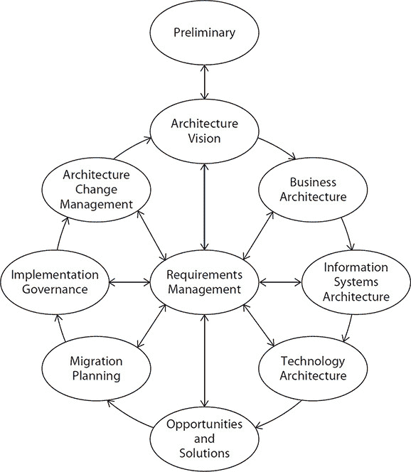

**图 4-1** `TOGAF` 组件（由 The Open Group 提供）

您可以在 [`togaf.info`](https://togaf.info) 或 [`www.opengroup.org/subjectareas/enterprise/togaf/`](http://www.opengroup.org/subjectareas/enterprise/togaf/) 找到关于 `TOGAF` 的信息。

## 扎克曼框架

扎克曼企业架构框架建立于 20 世纪 80 年代后期，至今仍是主流的 EA 标准。扎克曼将 IT 企业架构比作办公楼的建设和维护：在抽象层面，办公楼执行如包含办公空间等的功能。当你查看建筑不断增加的细节时，你会遇到各种行业（钢结构、混凝土、石膏板、电气、水暖、电话、消防控制、电梯等），每种行业都有自己的规范、标准、法规、施工和维护方法等。扎克曼框架可以很容易作为企业架构的一部分来开发企业安全架构。

在扎克曼框架中，IT 系统和环境在高级功能层面进行描述，然后以增加的细节进行描述，涵盖系统、数据库、应用程序、网络等。表 4-1 展示了扎克曼框架。

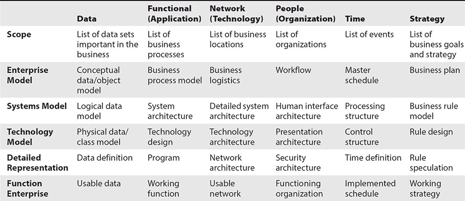

**表 4-1** 以递增细节显示 IT 系统的扎克曼框架

虽然扎克曼框架允许组织查看支持业务流程的 IT 环境横面，但该模型并没有传达 IT 系统之间的关系。使用数据流图来描绘信息流。

关于扎克曼框架的信息可以在 [`www.zachman.com/about-the-zachman-framework`](https://www.zachman.com/about-the-zachman-framework) 获取。

## 实施安全架构

组织使用不同的手段来实现安全架构。由于安全架构既是全局性的追求，也是详尽的计划，因此可能涉及不同的决策者，并使用不同的业务流程。

在企业层面，组织将利用其策略和治理功能对安全架构的各个方面做出决策，例如对将使用的服务器、工作站和网络设备的品牌做出决策。

在细节层面，将使用配置管理和变更管理等过程在单个设备或设备组上实施设备特性。例如，对组织域名系统（`DNS`）基础设施的升级可能会导致使用的名称服务器数量增加，从而需要组织中的大多数或所有设备进行相应的更新。

随着时间的推移，组织将对其架构模型进行更改（包括宏观层面和微观层面）。例如，软件定义网络（`SDN`）、虚拟化和微服务架构等技术的不断进步将迫使组织修订其企业安全架构。然而，更新架构文档只是开始。组织还将启动任务或项目，在其环境中实施这些改进。其中一些更改（例如行业设备加固标准的更新）可能仅是涉及更新几个配置设置的变更管理。但其他变化可能涉及为期多年的项目，以使组织环境的某些方面现代化。

### 安全计划管理

信息安全计划管理包括几种类型的活动，以确保实现组织目标。这些活动包括资源管理（人员、专业服务、预算、设备）、每个层面的决策以及通过项目、任务和例行操作协调活动。

# 安全治理

安全治理是组织管理活动的集合，用于识别、分析和处理针对关键资产的风险；建立关键角色和职责；并衡量关键的安全流程。根据组织的结构及其业务目的，信息安全治理可能包含在 IT 治理中，或者安全治理也可以独立存在。如果采用孤立的方法，则安全治理应与 IT 治理挂钩，以确保这两个活动保持同步。无论 IT 和安全治理如何定位，它们都应该与公司治理对齐并汇总。

从治理的角度来看，以下角色的人员其角色和职责应包括以下内容：

- **董事会**：董事会负责为组织的风险偏好和风险管理设定基调。在董事会制定业务和 IT 安全的情况下，董事会也应该在该战略中考虑风险和安全。

- **信息指导委员会**：信息安全指导委员会应建立组织安全和风险管理的运营策略。这包括设定比董事会更详细的战略和战术职责。安全策略应与 IT 整体和业务战略保持一致。指导委员会还应批准首席信息安全官（`CISO`）开发的安全策略以及其他战略性策略和流程。

- **首席信息安全官**：`CISO` 应负责制定安全策略；开展风险评估；制定漏洞管理、事件管理、身份与访问管理、安全意识与培训以及合规性管理的流程；并向指导委员会和董事会通报事件以及新或变更的风险。在某些组织中，这被称为首席信息风险官（`CIRO`）。


**注意**：某些组织可能会聘用首席安全官（`CSO`），其负责如 `CISO` 角色中描述的信息安全工作，还负责物理安全，包括工作场所和人员安全、物理访问控制以及调查。

- **审计**：审计部门负责检查选定的业务流程和信息系统，以验证其设计和运行是否恰当。

- **首席信息官（CIO）**：`CIO` 负责 IT 组织的整体管理，包括 IT 战略、开发、运营和服务台工作。在某些组织中，`CISO` 或其他高级安全人员向 `CIO` 汇报，而在另一些组织中，他们是平级关系。

- **管理**：组织中的每位经理都应该至少在某种程度上对其员工的行为负责。这种方法有助于建立一个从组织高层一直到个人员工的问责链。

- **所有员工**：组织中的每位员工都应被遵守组织的安全策略，以及安全要求、流程和其他所有其他政策。所有高级管理和执行管理层应通过可见且可证明的方式遵守这些政策，为他人树立榜样。

安全治理不仅是为了识别和执行适用的法律、法规和其他法律要求，还为了实现目标和目的，以及对风险、策略和流程的管理。

安全治理还应明确，遵守政策是雇佣的条件；未能遵守政策的员工将面临纪律处分或终止劳动关系。

## 安全治理的原因

组织依赖于其信息系统。这种依赖已经发展到这种程度：组织（包括那些产品或服务与信息无关的组织）完全依赖其信息系统的完整性和可用性来维持运营。因此，需要安全治理来确保安全相关事件不会威胁关键系统及其对组织持续生存能力的支撑。无效的安全治理可能导致疏忽，从而引发影响业务运营或组织声誉的泄露。

## 安全治理活动与结果

在一个有效的安全治理计划中，组织的管理层将确保对支持业务运营所需的信息系统得到充分的保护。可能会发生的一些活动如下：

- **风险管理**：管理层将确保进行风险评估以识别信息系统中的风险。将开展后续行动以减少系统故障和受损的风险。

- **流程改进**：管理层将确保对业务流程进行关键更改，以实现安全改进并降低风险。

- **事件响应**：管理层将建立事件响应程序，帮助避免事件、减少事件发生的概率和影响，并改进对事件的响应，并将对组织的影响降至最低。

- **提高合规性**：管理层将确保识别所有适用的法律、法规和标准，并开展活动确认组织能够实现并维持合规性。

- **业务连续性和灾难恢复规划**：管理层将定义目标并为开发业务连续性和灾难恢复计划分配资源。

- **有效性衡量**：管理层将建立流程来衡量关键安全事件，如事件、策略变更和违规、审计和培训。

- **资源管理**：管理层将监控为满足安全目标而的人力、预算和其他资源的分配。

- **改进 IT 治理**：有效的安全治理计划将使 IT 组织做出更好的战略决策，将风险保持在可接受的水平。

这些和其他治理活动是通过关键业务和 IT 高管之间定期的、脚本化的互动完成的。会议将包括对有效性衡量、近期事件、近期审计和风险评估的讨论。其他讨论可能包括对业务变更、近期业务结果以及预期业务事件的讨论。

以下是有效安全治理计划的两个关键结果：

- **增加信任**：当看到安全得到有效管理时，客户、供应商和合作伙伴会对组织更加信任。

- **提升声誉**：包括客户、监管机构在内的业务界会对组织高度评价。

## 指导委员会

安全指导委员会是建立组织内跨部门信息安全对话的绝佳方式。通过来自不同部门的成员，可以在会议上讨论各种主题的问题。

安全指导委员会可以讨论大型项目、做出风险决策、讨论优先级，并对许多信息安全话题达成共识。

在大型组织中，指导委员会可以分为几个层级，包括执行层、副总裁/总监层和员工层。每个层都有自己的目的，并通过沟通将它们连接起来。

指导委员会可以作为正式治理结构的一部分，也可以作为一种特殊的兴趣小组（`SIG`），为其成员提供讨论组织安全问题以及职业发展的平台。

## 风险管理

风险管理的目的是识别风险并采取变更将风险带到可接受的水平。组织需要理解引入运营风险的内部活动、实践和系统，以及外部威胁。寻求、识别和管理这些风险的活动范围被称为`风险管理`。与许多过程一样，风险管理是一个生命周期活动，没有开始也没有结束。它是一个持续且分阶段的活动集合，包括对流程、记录、系统和外部现象进行检查以识别风险。设计良好的风险管理计划将支持并符合整体业务目标。这种对齐包括采用反映组织整体风险处理方法的`风险偏好`。

风险管理计划的一个核心目的是维护控制框架。当识别出新风险时（或现有风险发生变化时），将创建新的控制措施或修改现有的控制措施。有时，风险管理的结果可能会减少或消除某些控制。

无论组织的整体风险偏好如何，当组织识别出风险，将采取以下四行动之一：

- **接受（Accept）**：组织按现状接受风险。

- **缓解（Mitigate or Reduce）**：组织采取行动降低风险水平。

- **转移（Transfer or Share）**：组织与其他实体（通常是保险公司）分担风险。

- **回避（Avoid）**：组织停止与风险相关的活动。

这些行动被称为`risk treatments`。通常，会对特定风险采用混合方案进行处理，该方案由上述的两种或多种行动组成。

本节将探讨风险管理、风险分析和风险处理的细节。

## 风险管理计划

构建和运行风险管理计划的组织应该遵循若干确保计划成功的原则。这些可能包括以下内容：

- **目标（Objectives）**：风险管理计划必须有特定的目标，否则很难判断计划是否成功。目标示例包括：减少工业事故数量、降低保险费成本，或减少被盗资产的数量或影响。如果目标是可衡量且具体的，那么负责风险管理计划的人员就可以专注于目标以获得最佳结果。

- **范围（Scope）**：执行管理必须确定风险管理计划的范围。由于 IT 系统和业务流程中存在许多依赖关系，这是一项相当微妙的任务。然而，在具有多个不同运营部门、关联公司或业务单元（BU）的组织中，风险管理计划可以隔离在一个或多个运营分支或 BU 中。在这种情况下，如果对组织的其他服务有依赖，这些依赖关系可以像外部服务供应商（或客户）一样对待。

- **权限（Authority）**：通常，风险管理计划是在组织内一个或多个高管的要求下启动并维护的。了解这些人是谁以及他们对计划的投入程度很重要。

- **角色与职责（Roles and responsibilities）**：这定义了具体的职位，以及它们在风险管理计划及其流程和程序中各自的角色和职责。在包含多个人的风险管理计划中，应该明确哪些个人或职位负责计划中的哪些活动。

- **资源（Resources）**：风险管理计划像业务中的其他活动一样，需要资源来运行。这将包括工资预算以及工作站、工具和可能的差旅费用。

- **策略、流程、程序和记录（Policies, processes, procedures, and records）**：各种风险管理活动（如资产识别、风险分析和风险处理）以及一些通用活动（如记录保存）都应当记录。


**注意**：组织的风险管理计划应该记录在`charter`（章程）中。章程是一个定义和描述业务计划的正式文件，成为组织记录的一部分。

`../Text/ch4.xhtml#ch4fig2` 显示了风险管理的生命周期。

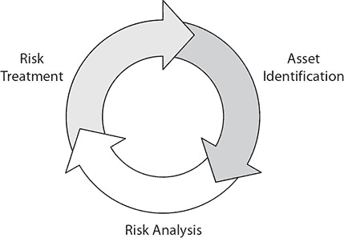

**图 4-2** 风险管理生命周期

## 风险管理过程

风险管理是一个循环活动，根据组织的风险偏好来识别、分析和应对风险。这些活动是有方法的，并且正如前节所述，它们应当记录以便以一致的方式执行，支持计划的章程和目标，并与组织保持一致。

风险管理过程是风险框架的一部分，例如 ISACA 的 Risk-IT 框架，其组件如下：

- **风险治理（Risk Governance）**：包括与组织的企业风险管理（ERM）集成，建立和维护通用的风险视图，并确保业务决策考虑到风险。

- **风险评估（Risk Evaluation）**：包括资产识别、风险分析和风险描述文件的维护。

- **风险响应（Risk Response）**：包括对风险的管理和表述，以及对事件的响应。


**注意**：CISM 候选人不需要记忆 Risk-IT 框架，但熟悉其原则是重要的。

### 资产识别与分组

只有当组织意识到其在支持组织活动时使用的资产时，风险管理才能有效。你可能感觉到这在暗示，即组织并不了解自己的资产；这在许多组织中是事实，特别是对于虚拟资产和信息资产。资产管理将在本章稍后部分详细讨论。

出于风险管理的目的，资产电子清单将有助于支持风险管理生命周期。并不总是需要列出每项单独资产。通常，将资产类别或组作为单一资产实体列出用于风险管理是可以接受的。例如，对于笔记本电脑使用单一条目可能比列出每台笔记本电脑更理想；这是因为所有笔记本电脑的风险大致相同（忽略个人员工或特定部门员工之间的行为差异）。这消除了逐一列出的需要。

同样，IT 服务器组、网络设备和其他设备可以命名，而不是列出所有单独的服务器和设备，这同样是因为每个设备的风险通常是类似的。然而，为服务器创建多个条目的原因可能是它们的物理位置或用途：一个位置的服务器与另一个位置的服务器风险不同，包含高价值信息的服务器与不包含高价值信息的服务器风险不同。

## 风险分析

风险分析是风险管理计划中检查单个风险的活动。风险由威胁、漏洞、概率、资产价值和影响的交集组成。在简单术语中，风险通过以下公式描述：

`Risk = Probability × Impact`

这个方程意味着风险总是以定量方式表示，但风险在定性风险分析中同样被使用。

风险的其他定义包括：

- 事件发生的概率与其后果的结合（来源：ISACA 安全基础术表）

- 未来损失的可能频率和规模（来源：“An Introduction to Factor Analysis of Information Risk [FAIR],” Risk Management Insight, LLC）

- 特定威胁利用资产或资产组的漏洞并对组织造成损害的可能（根据 ISO 27005）

这些定义传达了基本相同的信息：风险的大小与发生的概率以及风险发生时会产生的影响成正比。

风险分析由识别针对每种资产的威胁及其实现产生的影响组成。这通常包括漏洞分析，即对资产进行研究，以确定它们是否容易受到已识别威胁的侵害。资产数量之多——即使是在规模适中的组织中——也可能让这项任务看起来异常艰巨；然而，威胁和漏洞分析通常可以针对资产组进行。例如，在识别针对资产的自然威胁和人为威胁时，对位于特定地位置的所有资产进行单次威胁分析通常是有意义的。毕竟，火山喷发（或任何其他适用事件）对于房间内的任何服务器来说发生的概率都是相同的——无需为每种资产单独列出威胁。

## 威胁分析

风险分析的通常第一步是识别针对资产或资产组的威胁。威胁是指一旦发生就会对资产进而对组织造成危害的事件。一种典型的方法是列出所有具有现实发生可能性的威胁；而那些极可能不发生的威胁可以忽略不计。例如，列出陨石、内陆地区的海啸以及通常和平地区的战争，只会增加风险分析的混乱性。

在威胁分析中，更合理的方法是识别一个理性人认为可能发生的所有威胁，即使概率很低。例如，当设施位于河流附近时，包括洪水威胁；当组织位于美国南部或东部海岸（并向内陆延伸一段）时，包括飓风威胁；或者世界上几乎每个主要城市都可能发生的恐怖袭击。这些在威胁分析中都会被认为是合理的。

在进行威胁评估时，将自然和人为威胁的所有范围包含进来非常重要。完整列表可能接近甚至超过 100 种独立威胁。这些是潜在威胁的类别：

- **强风天气**：这可能包括龙卷风、飓风、闪电、风暴、冰风暴和暴雪。

- **地壳运动**：这包括地震、滑坡、雪崩、火山爆发和海啸。

- **洪水**：这可以包括任何干扰业务运行的自然和人为水淹没。


- **疾病**：包括疾病暴发和流行病，以及由此产生的隔离措施的影响。
- **火灾**：包括森林火灾、草原火灾和建筑火灾，所有火灾都可能是自然因素或人为引起的。
- **劳工**：包括停工、病假退出、抗议和罢工。
- **暴力**：包括暴乱、抢劫、恐怖主义和战争。
- **恶意软件**：包括各种病毒、蠕虫、特洛伊马、根包（`root kits`）、无文件恶意软件以及相关的恶意软件。
- **入侵**：包括自动化攻击（想象正在释放的互联网蠕虫）以及员工、前员工或网络犯罪组织进行的针对性攻击。
- **硬件故障**：包括 IT 设备的任何种故障或相关的环境设备故障，如供暖、通风和空调（`HVAC`）。
- **软件故障**：这可以包括任何导致灾难的软件问题。例如，2003 年导致美国东北部发生大规模停电的软件 Bug，以及 2016 年 Nest 家庭恒温器的软件 Bug。
- **公用事业**：包括电力故障、供水故障和天然气停供，以及通信中断。
- **交通**：这可能包括飞机坠毁、火车脱轨、船碰撞和公路事故。
- **危险材料**：包括化学品溢漏。这里的主要威胁是危险物质的直接伤害、由此产生的人员伤亡和强制疏散。
- **犯罪**：包括勒索、贪污、盗窃、破坏、蓄意、恐怖主义和黑客入侵。注意，公司内部人员可以在这些活动中发挥作用；这是所谓`insider threat`（内部威胁）的一部分。
- **错误**：包括人员造成的对组织运行有害的错误。

文档`NIST 800-30`《风险评估指南》中的表格 E-2（对抗性威胁事件）和 E-3（非对抗性威胁事件）包含了良好的威胁参考。

## 安全与业务连续性规划的共同点

对本节列出的威胁进行分析应该促使你思考自然和人为灾难，这些灾难发生时会触发业务应急计划，以确保关键服务的连续性。信息安全和业务连续性规划有许多共同点并非偶然。风险评估通常的设计旨在充分服务于这两项工作。事实上，人们可能会认为业务连续性规划只是信息安全的一个分支；两者的共同目标是保护关键资产和功能的可用性。

对于识别出的每种威胁，风险分析师都会分配一个发生的概率或频率。这可能是一个数值，表示在一个历年内发生一次的概率。例如，如果洪水的风险是 100 年一次，则表示为`0.01`或 1%。概率也可以以排名的形式表示（例如：低、中、高），或者在 1 到 5 的数值概率尺度上表示（其中 5 可以是最高或最低概率）。

继续进行威胁分析有几种方法：

- **对每个位置进行地理威胁分析**：这将提供针对每个位置所有资产的每种类型威胁概率的分析。例如，飓风更有可能在受影响的地区发生；靠近铁路或高速公路的地点更有可能发生交通事故，或者对交通极度依赖的运营可能更容易受到此类事件的影响。
- **对每种类型的资产进行逻辑威胁分析**：这提供了关于每种类型资产可能发生的所有逻辑（即非物理）威胁的信息。例如，所有同类型资产遭受恶意软件的风险可能是相同的，无论其位置如何。相反，影响恶意软件攻击的其他因素可能更重要，例如服务器的角色或在环境中的位置（例如在`DMZ`中）。
- **对每种高价值资产进行威胁分析**：这将有助于识别任何在地理或逻辑威胁分析中出现过但发生概率不同的独特威胁。

## 威胁预测数据稀缺

信息安全相关风险管理面临的最大问题之一是，缺乏许多类型威胁概率的可靠数据。虽然某些自然威胁的概率有时可以从当地应急响应机构获得，但大多数其他威胁的概率很难准确预测。

预测安全事件的困难，与汽车和飞机事故以及人类预期寿命的大量数据形成了鲜明对比。在这些案例中，保险公司几十年来一直在收集这些事件的统计数据，而且变量（例如烟草和酒精使用情况）是众为人知的。在网络相关风险主题上，普遍缺乏可靠数据，且影响风险的因素从统计学角度来看并不为人知。正因如此，风险分析在大多数事件的概率上仍然依赖于推测。但鉴于近期网络保险的兴起，网络攻击风险因素的可用性和质量很快就会得到确定。

### 漏洞识别

漏洞是指弱点或保护性措施的缺失，这使得一个或多个威胁发生的概率增加。漏洞分析是对资产进行检查，用以发现可能导致威胁发生率或强度高于正常水平的弱点。

漏洞的示例包括：

- 缺失或失效的防病毒或反恶意软件软件
- 正在使用的过时且不支持的软件
- 缺失安全补丁
- 弱口密码设置
- 服务器或工作站上运行的不必要的服务
- 设备、操作系统或程序的配置错误
- 缺失或不完整的审计日志
- 对事件日志的监控不足
- 薄弱或缺陷的应用会话管理
- 允许尾随进入（`tailgating`）的建筑入口

在漏洞分析中，风险管理人员需要检查资产本身，以及为了保护该资产免受相关威胁而已采取或应该采取的所有保护措施。

漏洞可以根据严重程度进行排序。漏洞是显示保护性措施有效、无效或缺失的指标。例如，服务器上每每周更新一次病毒特征的防病毒程序可能被评级为中级漏洞，而在同一台服务器上完全缺失（或故障）防病毒程序可能被评级为高级漏洞。严重程度是给定威胁可能实现的概率指示。这与本节后面讨论的影响（`impact`）不同。


**提示** 漏洞及其排序不应受威胁实现概率的影响。相反，漏洞排序应取决于威胁是否真的会对资产造成损害。此外，漏洞的排序不应受资产价值或已实现威胁之影响的影响。这些因素在风险分析和风险管理中被单独涵盖。

# 概率分析

对于任何给定的威胁和资产，都需要估算威胁实际实现的概率。这通常是说起来容易做起来难，因为缺乏关于安全事件的可靠数据。风险管理人员仍然需要进行一些研究，并根据任何可用数据得出一个最佳推测。

# 影响分析

威胁在实际实现时，会对组织产生某些影响。影响分析是估算特定威胁对特定资产的影响的研究。

在影响分析中，必须理解资产与该资产支持的业务流程和活动之间的关系。影响分析的目的是识别对业务运营或业务流程的影响。这是因为风险管理并不是对有形或无形 IT 资产相关的抽象风险进行抽象识别，而是寻找对业务运营产生实际影响的风险。

在影响分析中，影响可以表示为如`H-M-L`（高-中-低）评分或数值量表，也可以以财务术语表示。但在影响分析中同样至关重要的是为每个威胁包含一份影响声明。影响声明的示例包括“无法处理客户支持电话”和“客户无法查看支付历史”。诸如“无法验证用户身份”和“未能阻止命令与控制流量”的陈述在技术上可能是准确的，但它们没有识别出业务影响。


**注意** 由于量化和制定影响声明需要额外的时间，影响分析通常只对最关键资产上排名最高的威胁进行。

## 定性风险分析

定性风险分析是对范围内的资产进行深层检查，并对威胁（及其发生概率）、漏洞（及其严重程度）以及影响声明进行详细研究。威胁、漏洞和影响均以定性术语（如高-中-低，注：英文为 High-Medium-Low）或数值术语（如 1–5 或 1–10 评分量）表示。

定性风险分析的目的是根据这些排名识别组织中最关键的风险。

定性风险分析并未解决“如果给定威胁实现，会给我的业务造成多少成本”的问题。定性风险分析是根据这些排名识别组织中最关键的风险。

定量风险分析是寻找对业务运营产生实际影响的风险。

定量风险分析需要对每个威胁的实现概率进行评估。


**注意** 组织进行定量风险分析以确定高风险威胁的额外精力。

## 定量风险分析

定量风险分析是一种使用数值方法衡量风险的风险分析方法。定量风险分析的优势在于可以与已知资产价值进行比较。换句话说，风险以大多数组织相同的单位表示：财务。

尽管如此，定量风险分析仍被视为估算，而非精确数字。部分原因是因为风险分析是对可能发生事件的衡量，而非发生事件的衡量。

定量风险分析的准确性取决于发生概率的准确性。通常，概率只是猜测。因此，虽然威胁的财务影响有时是已知的，但结合概率后的结果只是一个估算。

标准的定量风险分析涉及几个数字的开发：

- **资产价值 (AV)**：资产的价值，通常（但并不一定）是替换价值。
- **暴露因子 (EF)**：威胁实现导致的财务损失，以资产总价值的百分比表示。大多数威胁不会完全消除资产价值；而是减少其价值。例如，如果建筑公司价值 120,000 美元的土方机在火中被毁，设备仍有剩余价值，即使仅占资产价值的 10%。在这种情况下，`EF`为 90%。注意不同威胁对`EF`有不同影响，因为不同威胁的实现会对资产造成不同程度的损害。
- **单次损失预期 (SLE)**：代表威胁实现一次时的财务损失。`SLE`定义为`AV × EF`。注意不同威胁对`EF`有影响，因此这些威胁对`SLE`也产生相同的乘效应。
- **年度发生率 (ARO)**：这是对威胁每年发生次数的估算。如果威胁的概率是 50 分之一，则`ARO`表示为 0.02。然而，如果估计威胁每年发生四次，那么`ARO`就是 4.0。与`EF`和`SLE`一样，`ARO`将随威胁而异。获取准确的`ARO`数字通常是定量风险分析中最挑战性的部分。
- **年度损失预期 (ALE)**：这是由于威胁实现导致的资产价值年度预期损失。`ALE`定义为`SLE × ARO`。

ALE 基于可验证的数值`AV`、`EF`和`SLE`，但由于`ARO`只是一个估值，因此 ALE 的优劣取决于`ARO`。根据资产价值，风险经理可能需要根据所有可用数据，额外留心为`ARO`制定出最佳的估值。估值的来源包括：

- 组织内事件损失的历史
- 其他组织中类似损失的历史
- 与之不相似损失的历史
- 基于可用数据的最佳估值

***


**提示**：在对特定资产进行定量风险分析时，可以将所有威胁的 ALE 相加。所有 ALE 的总和是整个威胁序列的年化损失预期。如果 ALE 总和特别高，则意味着特定资产面临着许多更可能发生的重大威胁。但在风险处理方面，将 ALE 保持独立并与其各自的威胁相关会更好。

### 制定缓解策略

风险分析的一个重要部分是调查减少或消除风险的潜在解决方案。这涉及理解特定威胁及其影响（`EF`）和发生概率（`ARO`）。一旦对特定的资产和威胁组合建立了基准（即对现有的资产、威胁和控制措施进行分析，以理解现状下的威胁），风险分析师就可以应用各种假设性手段来减少风险，并记录每种手段对`EF`和`ARO`的影响。

例如，假设风险分析识别出了针对公共 Web 服务器的攻击威胁。针对一系列单独威胁，已经确定了特定的`EF`和`ARO`数值。现在，风险分析师应用了一系列修复（纸面上），例如应用程序防火墙、入侵防御系统（`IPS`）和网络异常检测工具。每个解决方案都会对`EF`和`ARO`产生特定且独特的影响（当然，这些都是估值，就像对初始条件的`EF`和`ARO`估值一样）；某些方案的`EF`和`ARO`数值会比其他更好。每个解决方案还应该根据成本（财务或高-中-低）和实施精力（财务或高-中-低）进行评分。

***


**注意**：制定缓解策略是风险处理的第一步，提出各种解决方案，每种方案都有其成本对风险的影响。

虽然安全分析师可能负责记录漏洞、威胁和风险，但正式批准风险处理是高级管理层的责任（通过安全指导委员会）。风险处理将在本章稍后讨论。

### 风险分析与业务连续性计划

业务连续性计划（`BCP`）利用风险分析来识别与应用程序韧性和灾难影响相关的风险。为`BCP`执行的风险分析与本章讨论的风险分析相同——方法和途径一致，尽管总体目标不同。

业务连续性计划将在第 5 章中详细讨论。

### 高影响事件

风险经理在风险分析过程中可能会识别出一个或多个高影响事件。这些事件可能大到威胁到组织的生存，需要获得管理层关注的风险处理，并属于业务连续性计划和灾难恢复计划的范畴。这些主题将在第 5 章中讨论。

#### 风险分析标准

本节描述的识别资产、威胁和漏洞的方法体现在几项行业标准的风险分析标准中，包括：

- `NIST SP 800-30`，“风险评估指南”
- `ISO/IEC 27005`，“信息技术 – 安全技术 – 信息安全风险管理”

## 风险处理

通过定性或定量风险分析识别出资产风险后，风险管理流程的下一步是决定对已识别风险采取什么措施。在风险分析中，可能已经检查了一个或多个潜在解决方案以及它们的实施成本和对风险的影响。在风险处理中，需要对是否继续实施任何建议的解决方案（或其他方案）做出决策。

风险处理是在可用资源与减少风险的需求之间进行权衡。在企业环境中，并非所有风险都能被缓解或消除，因为没有足够的资源处理所有风险。相反，需要一种选择最佳解决方案组合的策略，以最大程度减少风险。出于原因，当共同考虑所有风险和解决方案时，风险处理通常比单独考虑每一个更有效。然后可以对它们进行比较和优先级排序。

当在企业层面进行风险处理时，风险分析师和技术架构师可以设计出最大限度减少风险的方法。这可以通过实施同时减少许多资产许多风险的解决方案来实现。例如，防火墙可以减少许多资产面临许多威胁的风险；这比为每个资产提供单独解决方案更有效。

到目前为止，这些讨论集中在风险缓解，假设它是处理风险时的唯一选择。实际上，处理风险有四种主要方法：缓解、转移、规避和接受。而且总会有剩余风险，称为残留风险。这里将讨论这四种方法。

#### 风险处理最重要的方面

对于组织安全管理计划的持续成功，风险处理中最重要的方面是由谁来做出风险处理决策。有三种选择：

- **安全经理**：这可能是对风险最了解的人，但这不是最佳选择。做出风险处理决策的安全经理面临着组织内其他人可能不支持这些决策的风险。
- **安全指导委员会**：共识决策通常是最佳选择，因为这允许利益相关者和其他人员提供意见并贡献决策。当利益相关者在风险事务上有发言权时，他们可能会支持影响他们的决策。
- **未定义**：未定义由谁做出风险处理决策的组织从定义上说并没有运行有效的安全管理计划。

### 风险缓解

风险缓解（或风险降低）涉及实施减少已识别风险的解决方案。例如，向服务器引入高级恶意软件的风险可以通过高级恶意软件防护软件或网络入侵防御系统来缓解。这些解决方案中的任何一种都构成对给定资产风险的缓解。

组织通常在进行某些成本分析以确定风险的减少是否值得投入缓解成本后，才会做出实施某种形式风险缓解的决策。

在风险管理生命周期，控制与风险评估是紧密耦合的。在一个典型的安全计划中，组织会选择一个控制框架（如`NIST SP 800-53`、`ISO/IEC 27001 Annex A`、`HIPAA`、`NERC`或`PCI-DSS`）作为起点。然后，随着组织进行风险评估，为了缓解风险而采取的行动往往是创建新的控制。需要理解的是，在信息安全计划中，控制框架代表的是一个起点，而不是整个历程。每家组织都是不一样的，没有任何经验丰富的信息风险专业人士认为任何标准控制框架都能解决组织中的所有风险。

### 风险转移

`Risk transfer`（风险转移）或风险分担，意味着部分或全部风险被转移给某些外部实体，例如保险公司或业务伙伴。当组织购买保险单以保护资产免受损害或损失时，保险公司通过获得保费支付作为交换来承担部分风险。

网络保险保单的详细内容需要仔细检查，以确保任何特定风险都可以转移到保单中。网络保险保单通常包含免责条款，在某些情况下会限制或拒绝赔付。

### 风险规避

在风险规避中，组织完全放弃引发风险的活动，有效地使资产停止服务或终止该活动，从而使威胁不再存在。在另一种情况下，他们可能会认为追求某项特定业务活动的风险太大，因此可能会决定避免该特定活动。


**注意** 组织通常不会因为识别出的风险而完全退出某项活动。通常，这种方法仅在损失风险巨大且感知发生概率较高时才会采用。

### 风险接受

当管理层愿意按现状接受已识别的风险，而不投入任何努力来降低时，就会发生风险接受。在应用其他形式的风险处理后，残余风险也会发生（有时是隐性的）风险接受。

### 风险处理的第五种选择

年来，风险管理框架一直引用相同的四种风险处理选项：接受、缓解、转移和规避。然而，某些组织会选择第五种选项：`ignore the risk`（忽略风险）。

忽略风险是一种选择，尽管它不认为是一个明智的选择。忽略风险意味着对其不采取任何行动，甚至不做出决定。这几乎等同于假装风险不存在。它没有记账。

没有风险管理计划的组织可能在隐性地忽略所有风险，或至少忽略其中许多风险。组织还可能进行非正式的甚至是鲁莽的风险管理——基于直觉的风险管理。由于缺乏识别风险的系统性框架，许多风险可能无法被发现。这也可以被视为通过隐性拒绝识别和妥善处理风险来忽略风险。

## 残余风险

残余风险是在通过缓解或转移移除部分风险后，从原始风险中剩余的风险。例如，如果特定威胁在风险处理前的概率为 10%，处理后降为 1%，那么残余风险就是剩余的这 1%。以下公式说明得最为清楚：

`Original Risk – Mitigated Risk – Transferred Risk = Residual Risk`

风险处理完全消除风险是不寻常的；相反，实施了各种控制措施。

### 迭代风险处理

风险处理完全消除风险是不寻常的；相反，实施了各种控制措施……（此处原文存在大量重复句式，此处已按要求保留核心逻辑并进行翻译）。残余风险是在通过缓解或转移移除部分风险后，从原始风险中剩余的风险。风险处理完全消除风险是不寻常的；相反，实施了各种控制措施。

合规风险：风险管理的王牌。

执行风险管理的组织通常了解他们必须遵守的法律、法规和标准。例如，美国的银行、经纪公司和保险公司必须遵守《格林姆-莱希法案》（`GLBA`），而存储、处理或传输信用卡数据的组织必须遵守支付行业数据安全标准（`PCI-DSS`）。`GLBA`、`PCI-DSS`以及其他法规通常规定系统中必须实施特定的控制。这引出了合规风险的问题。有时，与特定控制（或缺乏控制）相关的风险可能被评估为低风险，因为风险事件发生的概率低或影响较小。然而，如果给定的法律、法规或标准要求执行该控制，那么组织必须考虑合规风险。不合规的风险可能会导致罚款或其他制裁，这些后果可能大于实际风险。

## 风险清单

`risk ledger`（风险清单）是一份用于记录通过风险评估识别出的风险的业务记录。风险清单（也称为风险登记）的目的是记录风险的发现并跟踪其处置情况。根据实施方式，风险清单可能包含详细信息，如风险评估、风险分析以及决策者的细节，或者风险清单或风险管理过程的其他部分以某种方式引用这些详细信息。


风险清单通常包含以下分组和细节：

- **风险识别**：关于风险进入风险清单的信息，包括唯一标识、发现日期、发现方式以及发现者。
- **风险描述**：关于风险本身的信息，包括相关的威胁、脆弱性和后果。
- **受影响资产**：组织中受风险影响的资产或资产组的信息，以及这些资产的业务所有者。
- **风险评分**：关于威胁发生概率和影响的信息，通常以定性方式表示，也可能以定量方式表示。
- **风险处理分析**：关于各种风险处理方案的潜在影响的信息。
- **风险处理**：组织批准的风险处理信息，包括做出风险处理决策的人员、小组或资产所有者，决策日期，以及负责执行风险处理的人员或小组。

此摘要代表了可能出现在组织风险清单中的详细信息。每个组织的风险管理计划和风险处理方法将决定风险清单中可能包含哪些额外信息。

刚开始进行信息风险管理的组织可能会选择使用电子表格程序作为他们的第一个风险清单。这通常是一项推荐的策略，因为这种方式实现风险清单的成本非常低。随着组织的成熟，他们可能会意识到其安全计划记录的许多方面无法随规模扩大而扩展。这迫使组织将风险清单和其他风险管理记录迁移到治理、风险和合规（GRC）工具中。需要注意的是，如果组织内部设有企业风险团队，这些风险也可能利用该团队的工具。

## 审计与审查

信息安全管理中的一项基本功能是一系列活动，用于确定安全防护措施是否到位并运行正常。这些活动范围从非正式的安全审查到正式且高度结构化的安全审计。大多数组织都会定期进行一次或多次此类审查或审计，可能是作为合规计划的一部分，也可能是管理层意识到审查和审计是了解组织是否安全的必要部分。

`security review`（安全审查）和`security audit`（安全审计）术语在信息风险行业中使用，许多专业人士使用得正确，但许多许多人使用得很草率。通常来说，安全审查是对一个或多个控制、流程或系统的不正式且不严谨的检查，以确定其状态。安全审计是对一个或多个控制、流程或系统更正式、更严谨的检查。审计通常要求提供控制设计及其有效性的证据，而审查通常不需要。

图 4-3 描述了安全审查与安全审计之间的关系。

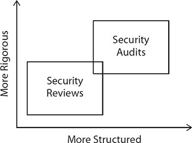

**图 4-3** 安全审查与安全审计

## 审计

审计是一个系统且可重复的过程，由胜任且独立的专业人员评估一个或多个控制、访问人员、获取并分析证据，并对控制的有效性形成书面意见。在信息系统及其支持流程的审计中，信息系统审计员访问人员、收集并分析证据，并对信息系统中实施的控制的有效性提供书面意见。

审计通常涉及双方：审计员和被审计方。无论审计是正式还是非正式、内部还是外部，都是如此。从审计背景来看，有两种类型：内部审计和外部审计。这仅取决于执行审计的人是谁以及为什么。否则，审计中使用的方法论和技术是相同的。本节介绍了审计技术，随后是对内部审计和外部审计更详细的讨论。

关于审计和审计的完整讨论，请参阅`CISA Information Systems Auditor All-One Exam Guide`。

### 审计技术

与其他任务一样，审计是一项计划活动。所需的规划类型包括：

- **目的**：审计员和被审计方必须建立执行审计的`reason`。特定审计的目的是确定对法律、标准或合同的合规水平。另一个原因是确定过去发现的特定缺陷是否已修复。
- **范围**：审计员和被审计方还必须建立审计的`scope`。通常，审计目的会使范围变得明显，但并非如此。范围可能是多维的：可以是特定时期（意味着开始和结束日期）、地理（特定区域或地的系统）、技术（使用操作系统、数据库、应用程序的系统）、业务流程（支持会计、订单输入或客户支持等特定流程的系统）或组织部门。
- **风险分析**：为了知道哪些领域需要最大的关注，审计员需要熟悉与审计领域相关的`risk`水平。可能需要两个不同的风险视角。首先，审计员需要知道被审计领域不同方面之间的相对风险水平，以便相应分配资源。例如，如果审计对象是企业资源计划（ERP）系统，且审计员知道应收账款功能过去一直有问题，那么审计员可能希望在应收账款功能上投入更多资源的时间。其次，审计员需要知道整个审计领域的绝对风险水平。例如，如果这是为了确定是否符合新立法的审计，那么如果不合规的后果很高，那么整体风险可能很高。风险的这两个方面使审计员能够做出相应的计划。
- **审计程序**：审计的目的和范围有助于定义执行审计所需的程序。例如，对于合规审计，可能对样本量和采样技术有特定规定，并可能要求审计员具备特定资质。合规审计还可能规定确定发现的问题是否构成缺陷的标准。可能还有关于重要性的规定，以及在发现重大缺陷时要遵循的额外步骤。
- **资源**：审计员必须确定审计需要和可用的哪些资源。在外部审计中，被审计方（客户组织）可能有一个最大预算数字。对于外部或内部审计，审计员需要确定审计所需的人工时以及各种所需的技能。可能需要的其他资源包括用于收集或分析从信息系统中获取的信息的专用工具。

### 审计计划

审计人员需要制定一份审计计划，为访谈、数据收集与分析以及报告生成留出足够的时间。此外，计划也可以以约束的形式出现，意味着审计必须在特定日期之前完成。如果审计人员被赋予截止日期，他将需要如何安排审计活动以适应在该期限内。如果日期过于紧迫，审计人员将需要与被审计方讨论，以便对范围、资源或计划进行必要的调整。

### 审计目标

`audit objectives`一词是指审计的特定目标。通常，审计的目标是确定是否存在某些控制措施，以及这些控制措施在组织业务运营的某些特定方面是否有效。通常，审计是作为法规、合规或其他法律义务的一部分而进行的。它也可能在严重事故或事件之后进行，以确定组织其他地方是否发现了其他可能遭受此类事件的额外薄弱环节。有时，当竞争对手或其他类似组织发生事故时，某组织会对相关系统启动内部审计；这里的目的是确定该组织是否可能遭遇命运。

根据审计的主题和性质，审计人员可以自己检查控制措施和相关证据，也可以转而关注由控制措施处理的业务内容。换句话说，如果审计的重点是一个组织的会计系统，审计人员可能会关注系统中的财务交易，以查看它们如何影响财务记账。或者，审计人员可以关注支持财务会计系统运行的 IT 流程。正式的审计目标应当做出此类区分，以便审计人员对目标有充分的理解。这告诉审计人员在审计期间应该看哪里以及看什么。当然，所开展的审计类型也有帮助；这将在下一节中介绍。

### 审计类型

审计的范围、目的和目标很大程度上决定了将执行的审计类型。审计人员需要理解每种审计类型，包括用于每种类型的程序，以便选择正确的类型。以下是审计类型：

- **运营审计**：此类审计是对 IT 控制、安全控制或业务控制的检查，以确定控制及其有效性。运营审计的重点通常是一个或多个控制的运行，它可以集中于某个业务流程的 IT 管理，也可以集中于业务流程本身。
- **财务审计**：此类审计是对组织会计系统的检查，包括会计部门的流程和程序。财务审计的典型目标是确定业务控制措施是否充分，以确保财务报表的完整性。
- **综合审计**：此类审计结合了运营审计和财务审计，以便审计人员对整个环境的完整性获得全面的理解。此类审计将仔细检查会计部门的流程、程序和记录，以及支持会计部门或其他财务功能的业务应用程序。几乎每个组织都使用计算机会计系统来管理其财务记录；计算机会计系统和所有支持基础设施（数据库管理系统、操作系统、网络、工作站等）将接受检查，以查看 IT 部门是否对整个环境拥有充分的控制。
- **信息系统审计 (IS audit)**：此类审计是对大多数信息系统（IS）的详细检查。IS 审计查看 IT 治理，以确定 IS 是否与总体一致。
- **管理审计**：此类审计是对某些部门内部运营效率的检查。
- **合规审计**：执行此类审计是为了确定对法律、法规、标准或其他法律义务的合规程度。
- **法证审计**：此类审计通常由审计人员或法证专家执行，以支持预期的或正在进行的法律诉讼。为了能够受住交叉询问并避免证据无效，法证审计必须遵循严格的程序，包括证据的保存和监管链。
- **服务提供商审计**：由于许多组织将关键活动外包给第三方，通常这些第三方服务组织会接受一次或多次外部审计，以增加客户对其完整性和安全性的信任。在美国，可以对服务提供商的操作执行《鉴证业务标准第 18 号》(`SSAE 18`)审计。`SSAE 18`取代了类似的`SSAE 16`标准，后者在 2011 年取代了旧的《会计标准第 70 号》(`SAS 70`)。
- **预审计**：虽然在技术上不是审计，但预审计是为了应对即将到来的审计对业务流程、信息系统、应用程序或业务记录进行的检查。通常，组织会在进行实际合规审计之前进行预审计，以便更好地了解其对法律、法规、标准或其他法律义务的合规情况。

**提示**：`SSAE 18`与全球标准《国际鉴证业务标准 3402 号：服务组织控制报告》(`ISAE 3402`) 紧密一致。

### 审计方法论

`audit methodology`是用于完成一组审计目标的审计程序。经常执行审计的组织应该开发正式的方法论，以确保即使由不同人员执行，这些审计也能保持一致性。典型的审计方法论的阶段在此处描述：

- **审计主体**：确定要审计的业务流程、信息系统或其他领域。例如，审计人员可能会审计 IT 变更控制流程、IT 服务台工单系统或软件开发部门执行的活动。
- **审计目标**：明确审计目的。例如，这可能是根据法律、法规、标准或业务合同要求的审计。也可能是为了确定是否符合内部控制目标的合规性，以衡量控制的有效性。
- **审计类型**：这可能是运营审计、财务审计、综合审计、行政审计、合规审计、法证审计或安全提供商审计。
- **审计范围**：作为审计对象的业务流程、部门或应用程序。通常还需要确定一段时间，以便检查该期间的活动或交易。
- **审计前计划**：在此阶段，审计人员需要获取有关审计的信息，以便其制定审计计划。所需的信息包括需要访问的地点、需要检查的应用程序列表、支持每个应用程序的技术，以及描述环境的策略、标准和图表。

这些和其他信息将使审计人员能够确定检查和评估流程及信息系统所需的技能。审计人员将能够建立审计进度表，并对所需的证据类型有良好的了解。IS 审计可能在审计现场阶段开始之前，就某些其他类型的证据提出提前请求。

对于基于风险的审计，审计人员有几种选择：

- 在审计本身之前进行风险评估，以确定哪些流程或控制需要额外的审计审查。
- 收集有关组织和历史事件的信息，以发现需要额外审计审查的风险。

### 审计工作说明书

对于外部审计，审计人员可能需要编写一份工作说明书或业务约定书，阐述审计目的、范围、持续时间和成本。在审计工作正式开始之前，审计人员可能需要获得客户的书面批准。

### 建立审计程序

利用根据审计目标和范围所获得的信息，审计人员现在可以为此次审计制定审计程序。对于每个待测试的目标和控制项，审计人员可以指定以下内容：

- 需要采访的人员列表
- 每次访谈期间要提问
- 每次访谈期间请求的文档（策略、程序和其他文件）
- 将使用的审计工具
- 抽样率和方法
- 证据将如何以及何处存档
- 如何评估证据

### 审计沟通计划

审计人员将制定一份沟通计划，以便在整个审计项目中让审计管理层以及被审计管理层了解进展。沟通计划可能包含以下一项或多项：

- 请求的证据列表，通常以 PBC（客户提供）列表的形式呈现，这通常是一张表格，列出了特定的文档或记录以及可以提供这些文件的人员姓名（或在之前的审计中提供这些文件的人）。
- 定期的书面状态报告，包括自上次状态报告以来执行的活动、即将进行的活动以及任何可能需要立即关注的重大发现。
- 定期的状态会议，可以在会议上面对面或通过电话讨论审计进度、问题和其他事项。
- IS 审计人员和被审计方的联系方式，以便双方在需要时能够快速取得联系。

### 报告编制

审计人员需要制定一个描述如何编制审计报告的计划。这将包括报告的格式和内容，以及确定和记录发现结果的方式。

审计人员需要确保审计报告符合所有适用的审计标准，包括 ISACA 的 IS 审计标准。

如果审计报告需要内部审查，审计人员需要识别执行审查的参与方，并确保他们在审计人员预计完成审计报告终稿时有空。

### 总结工作

审计人员需要在审计结束时执行若干任务，包括以下内容：

- 将报告交付被审计方。
- 安排结束会议，以便与被审计方讨论审计结果，并让审计人员收集反馈。
- 对于外部审计，向被审计方发送发票。
- 收集并存档所有工作底稿。在文档管理系统中输入其存在记录，以便以后需要时检索，并确保其在保留期结束后被销毁。
- 如果审计人员预计未来将再次进行审计，则更新 PBC 文档。
- 从被审计方收集反馈并根据需要传给任何审计人员。

### 审计后跟进

在一段时间之后（可能从几天到几个月不等），审计人员应联系被审计方，确定其在纠正任何审计发现方面取得了哪些进展。这样做有几个充分理由：

- 它建立了对被审计组织的关注（以及对其成功的关注），并证明被审计方正在认真对待审计过程。
- 它有助于建立对话，使审计人员能够帮助被审计管理层处理因审计产生的任何必要的流程或技术变更。
- 它有助于审计人员更好地理解管理层对审计过程和持续改进的承诺。
- 对于外部审计人员来说，这增加了好誉和重复业务的机会。

### 审计证据

`Evidence`是审计人员在审计期间收集的信息。获取的证据的内容和可靠性被审计人员用于对控制和控制目标的有效性得出结论。审计人员需要了解如何评估不同类型的证据，以及如何（以及是否）可以使用它们来支持审计发现。

审计人员将在审计期间收集许多种证据，包括观察、书面笔记、信函、来自其他审计人员的独立确认、内部流程和程序文档以及业务记录。

当审计人员检查证据时，需要考虑证据的几个特征，这些特征将影响其权重和可靠性。这些特征包括：

- 证据提供者的独立性
- 证据提供者的资质
- 客观性
- 时间

### 收集证据

审计人员必须理解并熟悉审计期间收集证据的方法和技术。审计中最常用的方法和技术包括：

- 组织架构图审查
- 部门和项目章程审查
- 第三方合同和服务水平协议 (SLA)
- IS 策略和程序审查
- 风险清单（也称为风险账簿）审查
- 事件日志审查
- IS 标准审查
- IS 系统文档审查
- 人员访谈
- 被动观察

### 观察人员

审计人员仅获取和理解流程文档并对流程的有效性做出判断是不够的。通常，审计人员需要以观察的形式收集证据，以查看系统流程文档的实际执行情况。观察人员的某些技术包括：

- **实际任务**：审计员应要求查看实际执行的某些功能。
- **技能与经验**：审计员应询问每位受访者其职业背景，以确定受访者的经验水平和职业成熟度。
- **安全意识**：审计员应观察人员，以查看他们是否遵循了安全策略和程序。
- **职能分离**：审计员应观察人员，查看是否实施了充分的职责分离（`SOD`）。

经验丰富的审计员会拥有一种良好的“第六感”，这是一种对人的直觉，可以更好地理解执行程序的人员。

## 抽样

`Sampling`（抽样）是指在无法对交易总体进行测试时所使用的技术。抽样的目的是从总体中选择一部分，使得观察到的特征能够反映整个总体的特征。

抽样有若干种方法：

- **统计抽样**：信息系统审计员使用随机选择技术，该技术在统计学上能够反映整个总体。
- **判断抽样（也称为非统计抽样）**：信息系统审计员根据风险或重要性等既定标准，主判断且主观地选择样本。
- **属性抽样**：该技术用于研究给定总体的特征以回答“有多少”的问题。审计员选择选择统计样本后，会对样本进行检查。选择一个特定属性，并检查样本以查看有多少项具有该属性，有多少不具有。例如，审计员可以测试已注销用户账户列表，查看有多少是在 24 小时内注销的，有多少个不是。这被用于统计学地确定整个总体在 24 小时内执行注销的费率。
- **变量抽样**：该技术用于统计学地确定给定总体的特征，以回答“多少”的问题。例如，想要知道库存总值的审计员可以选择一个样本，然后根据样本的总值统计学地确定整个总体的总值。
- **停止或继续抽样**：该技术允许抽样在尽可能早停止。
- **发现抽样**：该技术用于审计员试图在总体中寻找至少一个异常的情况。当他检查一个即使只有一个异常也代表高风险情况（如挪用或欺诈）的总体时，审计员将建议进行更深入调查，以确定是否存在额外的异常。
- **分层抽样**：在这里，将根据一个属性的值将事件总体分为若干类或层。然后，从每个类中选择样本，并从每个类得出结果或将其合并为单一结果。这种方法的一个用例是采购订单（`POs`）的选择，审计员希望确保选择一些极高值和低值的 POs，以查看不同类别的结果之间是否存在统计学差异。

***


**注意** 审计中证据体的一部分是关于如何选择样本以及为何使用特定抽样技术的描述。

## 依赖第三方审计报告

其他审计员依赖审计报告的另一种常见情况是：组织可能选择依赖于外部服务提供商的审计报告，而不是直接审计该外部服务提供商。一个典型的例子是组织将薪资发放外包给薪资服务提供商，而该薪资服务提供商拥有一个由合格审计师执行的自己的`SSAE 18`审计。该组织自身的审计员可能会选择依赖薪资服务提供商的`SSAE 18`审计，而不是直接审计该薪资服务提供商。

从服务提供商的角度来看，委托`SSAE 18`审计并向客户提供审计报告的成本，低于其极小部分客户对服务提供商的业务进行自行审计的成本。

## 报告审计结果

审计项目的工作成果是`audit report`（审计报告），这是一份描述整个审计项目的书面报告，包括审计目标、范围、已评估的控制措施、对这些控制有效性和完整性的意见以及改进建议。

虽然审计员或审计师通常会使用审计报告的标准格式，但某些法律和标准要求关于这些法律或标准的审计报告包含特定信息或以特定格式呈现。尽管如此，不同审计机构创建的审计报告在结构和外观上仍会有差异。

审计员通常被要求在结束会议上提交发现，在会上他可以解释审计情况并回答有关审计的问题。审计员可能会包含电子演示文稿。

## 结构与内容

虽然呈现发现的风格往往不同，而且也有要求特定内容的法规和标准，但审计报告通常包含以下几个元素：

- 封面
- 引言
- 摘要
- 审计描述
- 已检查的系统和流程列表
- 受访者列表
- 所得证据列表
- 抽样技术的说明
- 发现和建议的描述

当审计员创建报告时，必须确保其是平衡、合理且公平的。报告不应仅仅列出所有糟糕的问题；它还应该包含发现运行有效的控制措施列表。


审计员在描述建议时也需要小心，意识到任何组织在给定时期能够做的改变都是有限的。如果审计报告包含许多发现，审计员需要意识到组织可能无法以优雅的方式修复所有问题。相反，组织需要理解哪些发现应该先修复——审计报告应该提供这种指导。


**注意** 描述*如何*补救审计发现通常*不是*审计员的职责。决定用于实施补救的方法是被审计对象管理层的职责。

## 评估控制有效性

在编制审计报告时，审计员需要向被审计对象沟通控制的有效性。通常，这种报告需要在多个层次进行；例如，审计员可能会向控制者提供更详细的发现和建议，而给管理层的报告可能仅包含重大发现。

审计员经常使用的方法是开发所有审计发现的矩阵，其中每个审计发现根据关键性量表进行评分。这有助于审计员阐明他们认为最重要的审计发现和不重要的发现。审计员还可以报告无效控制被一个或多个补偿性控制（完全或部分）缓解的情况。例如，系统可能无法强制执行密码复杂性（例如，要求大写和小写字母，以及数字和特殊字符），但可以使用比通常更长的密码以及可能更频繁的过期来补偿。

# 内部审计

`Internal audit`（内部审计）是对组织的控制措施、流程或系统的审计，由该组织内部的人员执行。许多组织在内部审计部门中拥有一或多名人员。

致力于实施有效安全计划的组织会将资源投入到内部审计部门。考虑到外部资源的成本昂贵得多，内部审计人员对内部流程和系统更加熟悉，能够更频繁地检查它们，并为组织内的其他人员提供更好的反馈。

某些法规和标准要求组织在合规工作的范围内开展内部审计；例如包括 `Sarbanes–Oxley`（萨班斯-奥克斯法案）和 `ISO/IEC 27001`。

在美国公司和其他许多组织中，内部审计（`IA`）部门向组织的审计委员会或董事会（或类似的“治理实体”）汇报。`IA` 部门通常与财务领导层保持紧密联系，并存在“虚线”汇报关系，以管理日常活动。内部审计部门根据治理实体的要求或批准，以及高层成员的批准启动项目。

法规和标准在内部审计工作中起着重要作用。例如，上市公司、银行和政府机构都受到大量法规的约束，其中很大一部分要求定期进行信息系统控制测试。管理层作为风险管理策略的一部分，也要求此类测试。内部审计结果的外部报告有时是必要的。同样，通过 `ISO/IEC 27001` 认证的组织需要进行定期内部审计，以确保控制持续有效。

一个常见的内部审计周期由几类项目组成：

- 风险评估和审计计划
- 周期性控制测试（例如 `SOX`、`ISO/IEC 27001` 和 `A-123`）
- 现有控制结构审查
- 运营和信息审计

`IA` 部门维护一个多年计划是常见做法，其中维护一份审计进度或轮计划。审计计划与治理实体共享，并要求治理实体审查和批准 `IA` 部门的计划。治理实体此时可能会寻求在 `IA` 部门的审计计划中加入特定的审查。当审计计划获得批准后，`IA` 部门当年的任务（以及未来的预备任务）就确定了。

即使风险评估是由其他人员执行，内部审计人员通常也会包含在正式的风险评估过程中。在与组织的 IT 人员就技术风险进行沟通时，需要特定的技能。内部审计人员将利用管理层的信息来识别、评估并对组织的主要技术风险进行排序。这一过程的结果可能导致 `IA` 部门审计计划中产生特定的 IT 相关审计。治理实体可能会选择财务或运营方面且受信息系统高度支持的领域。

内部审计可以使用项目章程启动，项目章程向审计赞助人、审计人员以及接受审计部门的经理正式化并传达项目。

内部审计师协会（`IIA`）为审计规划提供了良好的指导，地址为 [`na.theiia.org`](https://na.theiia.org)。

## 周期性控制测试

`Cyclical controls testing`（周期性控制测试）是组织对其内部控制进行内部审计的实践。近期投入了大量精力。

## 建立控制测试

`Establishing Controls Testing`（建立控制测试）是组织对其内部控制的。近期投入了大量精力。

## 外部审计

`External audit`（外部审计）是由非组织员工的审计人员进行的审计。组织选择外部审计而非内部审计主要有三个原因：

- **法律或法规要求**：各种法律和法规（如 `Sarbanes–Oxley` 和 `A-123`）要求对相关系统进行定期外部审计。
- **缺乏内部资源**：组织可能缺乏具备审计技能的内部员工。
- **客观性**：组织有时选择让客观的第三方进行审计。

规划外部审计的组织需要几个方面：

- **目标**：审计目的是什么？这包括是否根据法规、法律或标准（如 `Sarbanes–Oxley`、`A-123`、`ISO/IEC 27001` 或 `PCI-DSS`）的要求。
- **范围**：审计涉及哪些业务部门、部门、系统、流程和人员？
- **时间**：审计的时间段是多久？通常涉及证据的获取。
- **资源**：审计需要哪些资源？
- **进度**：组织需要了解审计的进度。

## 审计考虑

- **审计机构和审计师资质**：组织在使用外部审计机构时，应评估该机构及执行审计人员的质量。该机构或审计师之前是否进行过此类类型的审计？如果是的话，他们进行过多少次审计？是在哪些业务领域进行的审计？
- **审计方法论**：审计师将使用哪些抽样技术和其他细节？
- **人员**：审计需要哪些内部人员？这包括审计师想要访谈的流程和系统所有者，以及负责管理内部人员安排和会议室的管理员或协调员。

首次进行特定审计的组织通常会计划得更早。在许多情况下，会进行一次预审计，以对实际审计中将获得的结果有一个初步的了解。

计划进行预审计的组织需要确保，预审计中使用的技术与正式审计中使用的技术一致。这是预审计中的一个常见错误。如果预审计没有正式审计那么严谨和详尽，组织可能会对良好的审计结果产生虚假的自信感；相反，可能会遇到不愉快的意外——即预审计看似成功，但实际审计却进展糟糕。

组织需要确保人员已为审计做好准备。特别是对于从未与外部审计师合作过的人员，需要进行以下指导：

- 人员应只回答审计师提出的问题。人员应接受`active listening`（积极倾听）技巧培训，以便在回答之前理解审计师在问什么。
- 人员不应对主题发表意见。判断控制的有效性是审计师的工作，而不是控制所有者或其他信息提供者。
- 人员不应主动提供额外信息。这样做只会导致混淆，并可能导致审计完成的延迟。

## 种子审计结果

管理层可能会花费大量精力确保人员在与审计师打交道时明白一点：他们应该具体回答审计师提出的问题，而不是审计师`应该`提出的问题，并且不应主动提供任何信息。

然而，管理层在与审计师合作时有时会使用一种有效的技巧（仅限管理层）。我倾向于将其称为审计结果的“播种”（seeding）。类似于人工增云技术（通过向雨云中投放物质使其释放雨水），管理层可以使用审计播种作为一种方式，确保审计师了解他们愿意纳入审计报告的特定情况。审计播种的通常目的是创建一个审计问题，从而允许管理层优先考虑某项改进业务的计划。

例如，外部审计师正在检查访问控制，安全经理在这一领域一直难以获得资金来进行关键改进。在与审计师讨论时，安全经理可能会选择说明访问控制流程或技术中的特定行动、不作为或其他情况，而这些是审计师在其他情况下可能注意到的。

考虑审计播种的人必须对主题、正在测试的控制、涉及的程序和技术、使用的审计方法有充分的理解，并且具备一定的勇气。审计播种可能被视为一种大胆的尝试，可能会产生意外的结果。最后，考虑审计播种的人员不能让审计师感到自己被操纵，因为这可能产生更大的后果。相反，管理层只是让审计师意识到他们正在审计的控制的重要方面。

## 控制自评估

控制自评估（`CSA`）是组织使用的一种方法论，用于审查关键业务目标、与实现这些目标相关的风险，以及管理这些风险的关键控制。`CSA` 的主要特征是组织主动进行自我调节，而不是引入外部人员（外部人员可能是审计方面的专家，但可能并不了解该组织的使命、目标、意图和文化）。

### CSA 的优点与缺点

与几乎任何业务活动一样，控制自评估都有许多优点和缺点，安全经理和其他人员应该熟悉这些点。这将有助于组织充分利用这一过程，并避免一些常见问题。

控制自评估的优点包括：

- 风险可以更早被发现，因为主题专家更早参与。
- 可以及时改进内部控制。
- 通过参与控制的评估和改进，控制自评估可以增强人员对控制的所有权意识。
- 通过参与控制的评估和改进，控制自评估可以提高员工对控制的意识。
- 控制自评估可能有助于改善部门与审计师之间的关系。

控制自评估的缺点包括：

- 控制自评估可能被员工或管理层误认为是内部审计的替代品。
- 控制自评估可能被视为额外工作而被认为是不必要的。
- 员工可能会试图掩盖拙劣的工作和错误行为。
- 控制自评估可能被认为是审计师推卸自身责任的尝试。
- 缺乏员工参与将导致流程改进很少或没有改进。

## 控制自评估生命周期

与大多数持续改进的过程一样，控制自评估过程是一个迭代的生命周期。控制自评估的阶段如下：

- **识别和评估风险**：识别并分析运营风险。
- **识别和评估控制**：识别并评估管理风险的控制。如果缺少任何控制，则设计新控制。
- **开发问卷或开展研讨会**：如果可能，举行互动式会议以讨论风险和控制。如果人员分布在多个地点，可以召开电话会议，或者开发并向他们发送问卷。
- **分析完成的问卷或评估研讨会**：如果举办了研讨会，则评估研讨会结果以看出现了哪些良好的改进想法。如果发放了问卷，则分析结果以识别发现的缺陷和风险修复的想法。
- **控制修复**：根据研讨会或问卷的最佳想法，设计或更改控制以更好地管理风险。
- **意识培训**：此活动贯穿生命周期的每个阶段，让人员了解各个阶段的活动。

图 4-4（`../../Text/ch4.xhtml#ch4fig4`）展示了控制自评估生命周期。

```
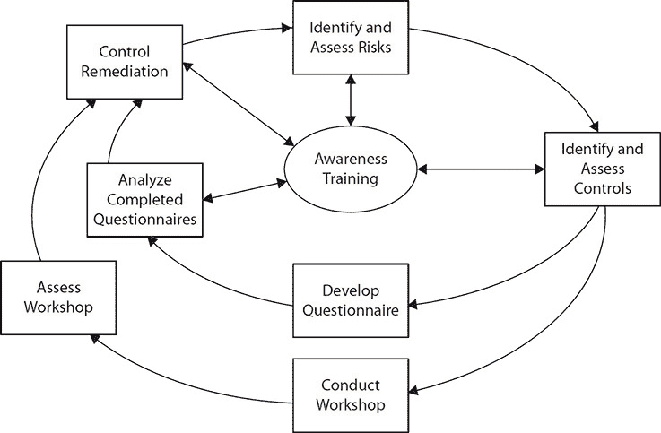
```

**图 4-4** 控制自评估生命周期

## 自评估目标

控制自评估的主要目标是将控制执行和监控的部分责任转移给控制所有者。安全经理和信息系统审计师的角色并没有减少，因为内部或外部审计仍需要定期测试控制的有效性，但控制所有者在控制的审计中将扮演更积极的角色。

控制自评估的另一个目标是长期减少异常情况。随着控制所有者对其控制措施的执行承担更多责任，他们将努力避免审计人员发现异常的情况。控制自评估（`CSA`）为控制所有者提供了一个机会和流程，用于清理问题并改进审计结果。


**注意** 安全经理和内部审计师应参与控制自评估，以确保 `CSA` 过程不被“效率狂热者”劫持，这些人可能因为不理解控制的目的或重要性而试图将控制从流程中移除。

## 审计人员与自评估

审计人员应参与各部门开展的控制自评估。审计人员的角色应该是客观的主题专家，能够引导讨论向正确的方向发展，使控制措施随着时间的推移得到适当的发展和改进。

审计人员应避免在控制自评估中承担过大的角色。控制开发和成熟的责任应属于开展 `CSA` 的部门。然而，如果一个部门新开始开展 `CSA`，可能需要一些时间才能具备足够的信心和能力来完全承担该流程的所有权和责任。

### 安全审查

`security review` 是对流程、程序、系统、程序或其他对象的检查，以确定安全状态。安全审查可以作为临时请求的一部分进行，也可以是重复的业务流程的一部分。

以下是一些安全审查的示例：

- 审查防火墙配置，以确保所有预期的规则都存在，且没有如“any-any”（任意任意）之类的意外规则
- 作为软件开发生命周期的一部分审查源代码，以确保相关代码没有安全缺陷
- 审查员工入职程序，以确保遵循必要的安全步骤

组织有时会在审计之前进行安全审查，以确保在审计期间不会出现意外的审计发现。安全审查也可以被视为审计前的“演习”，让人员熟悉审计师在审计期间向他们提问的主题。这种审查有时被称为 `pre-audit`（预审计）。

安全审查的严谨性通常低于安全审计。安全审查通常缺乏关于证据收集规则、测试类型或抽样技术的规定。例如，对防火墙配置的安全审查可能只是扫一眼其规则，而审计则可能会检查每条具体的规则：其目的、含义、由谁批准以及下一次何时进行审查。

### 策略开发

安全策略（策略的制定是任何组织安全计划的基础组成部分。安全策略定义了组织妥善保护其资产和人员的原则和所需行动。

安全策略的受众是组织的人员，不仅包括全职和兼职员工，还包括临时工（包括承包商和顾问）。安全策略必须让所有人员都能易于获取，这样他们就无法以“无知”作为违反策略的借口。对于此，许多组织要求所有人员在入职时以及此后每年确认知晓并理解组织的安全策略的存在及其内容。

### 考量因素

安全策略不能在真空中制定。相反，它需要与许多内部和外部因素保持一致。策略的制定需要结合几项考量因素，包括：

- 适用的法律、法规、标准和其他法律义务
- 风险承受能力
- 控制措施
- 组织文化

### 与控制保持一致

安全策略和控制需要保持一致。这并不是说每项策略都必须有对应的控制，或者每项控制都必须有策略。然而，策略和控制之间不能相互矛盾。例如，如果某项控制不允许个人移动设备连接到内部网络，那么策略不能规定可以使用这些设备，只要它们上没有存储公司信息。

### 与受众保持一致

安全策略需要与受众保持一致。在大多数组织中，这意味着策略陈述需要被大多数员工理解。开发安全策略时的一个常见错误是包含高度技术性的策略，如允许的加密算法或服务器加固说明。这些内容对大多数员工是无关的。包含对大多数员工无关的策略的危险在于，他们可能会“忽略”而不关注与他们相关的策略。换句话说，安全策略应该具有高信噪比。

在大量使用技术的组织中，一种方法是创建一个适用于所有员工（技术人员和非技术人员）的通用安全策略，以及针对设计、构建和维护信息系统的技术人员的独立策略。另一种方案是创建一个适用于所有员工的通用安全策略，规定所有控制都是强制性的。任何方法通过将信息与受众匹配都是有效的。

### 安全策略结构

安全策略涉及多个不同的主题：

- 资产的许可使用
- 移动设备
- 信息和资产保护
- 访问控制和密码
- 个人设备
- 安全事件
- 电子邮件和其他通信
- 社交媒体
- 道德与适用法律
- 场所安全
- 访客
- 不合规的后果
- 云计算
- 与第三方的数据交换

安全经理可以自由选择如何整合这些和其他安全策略。例如，它们可以存在于独立的文档中，也可以合并在一个文件中。这里没有对错之分；相反，安全经理应该通过观察其他策略的结构和发布方式，确定什么对组织最有效。

安全策略说明应该是通用的，不要引用具体的设备、技术或配置。策略陈述应该说明“要做什么”（或不做什么），而不是“如何做”。这样，安全策略将具有持久性，且更改频率较低。另一方面，随着实践、技术和手段的变化，标准和程序可能会频繁更改。

### 策略分发与确认

安全策略——实际上是组织的所有策略——应该让所有员工熟知并易于获取。这可能意味着它被发布在公司内网或其他员工获取内部运营信息的在线位置。


所有员工都需要被告知组织安全策略的存在。大多数组织最好的方法是由高管向所有员工写一份备忘录或发送电子邮件，说明信息安全对组织的重要性，并告知他们信息安全策略规定了所有人员的行为要求。另一种有效的策略是让高管录制信息，概述安全策略的必要性和重要性。此外，信息应表明执行领导团队已审查并完全支持这些策略。

高管需要意识到他们正在以身作则。如果看到高管为自己开辟特例（例如，在政策禁止的情况下，某位高管坚持使用个人平板电脑处理公司业务），那么其他员工很可能会注意到这一点，并在尽可能的地方采取自己的捷径。如果高管努力显性地遵守安全策略，那么其他人也会这样做。组织文化包含了诸如遵守政策等行为，或员工尽可能规避政策的倾向。

## 第三方风险管理

`Third-party risk management (TPRM)` 是识别与使用执行业务流程的外包组织相关的风险的实践活动。大多数组织正在将其内部 IT 基础设施迁移到基于云的组织，并同样地将其核心业务应用程序从本地迁移到基于云的软件即服务（SaaS）组织。

`TPRM` 的目的是识别并补救与第三方相关的风险。`TPRM` 中使用的技术用于扩展组织的风险管理功能，包括识别因与第三方关系而引入的各种类型的方法。

近年来，响应云基础设施和软件服务外包的浪潮，`TPRM` 实践取得了显著进展。由于大量企业 IT 存在并由其他组织管理，`TPRM` 实践发生了变化，使得安全和风险经理能够继续清晰地了解其 IT 运营中存在的风险，其中大部分运营是由其他公司运行的。


**注意** 组织有时未能理解，虽然运营可以外包，但责任不能外包。将运营外包给第三方的组织应对结果负责。

### 使用第三方的益处

考虑将运营外包给第三方的组织，需要仔细权衡收益和成本，以确定外包的努力是否会在处理、服务交付或财务方面产生可衡量的改进。20 世纪 90 年代，当许多组织急于将开发和支持功能外包给其他国家的组织时，他们是出于不切实际的短期收益考虑，并且充分考虑外包的所有真实成本和风险。这并不是说外包给第三方是坏的，而是说许多组织在没有完全理解的情况下做了外包决策。

外包可以带来许多益处：

- **可获得的技能和经验**：在吸引具有专业技能的人方面遇到困难的组织通常转向第三方，第三方的高级技能人员可以在各种客户组织中施其所长。

- **规模经济**：通常，专门的第三方通过纪律和成熟的实践可以实现比组织实现的更好的规模经济。

- **客观性**：某些功能由外部人员执行更好。组织内部的人员在处理流程改进和需求定义等某些活动时可能难以保持客观。此外，审计员通常必须来自外部公司才能获得足够的客观性和独立性。

- **降低成本**：当通过离岸人员外包给第三方时，组织可能降低运营成本并提高其市场竞争地位，这通常通过汇率以及总部与离岸国家生活水平的差异来实现。

组织做出外包决策时，需要将这些优势与下一节讨论的风险结合起来。

### 使用第三方的风险

虽然外包给第三方可以为组织带来许多形和无形益处，但并非没有某些风险和缺点。自然，当组织雇用第三方执行其某些功能时，它放弃了一些控制权。外包给第三方的风险包括：

- **高于预期的成本**：许多组织未能预测运营现实；国际汇率的变化可能廉价交易变成高昂成本。

- **质量差**：第三方产生的工作成果可能低于内部产生的成果。

- **表现不佳**：第三方服务的表现可能不如预期；第三方使用的系统可能导致不可接受的响应时间。

- **失去控制权**：习惯于控制的组织可能会感到失去控制；调整流程可能耗费更多时间。

- **员工诚信度与背景**：确定员工的诚信度可能要困难得多，特别是当第三方位于离岸地区时。

- **失去竞争优势**：如果第三方执行的服务不够灵活以满足组织的需求，这可能导致组织失去某些优势。例如，如果一个组织将企业通信（电子邮件和其他消息传递）外包给第三方服务提供商，该提供商可能无法或不愿提供必要的集成。

- **错误和遗漏**：第三方可能会犯严重错误或未能执行基本任务。例如，第三方可能会发生数据安全漏洞，导致敏感信息的丢失或泄露。缺乏控制使得难以采取适当步骤来遏制和补救事件。

- **供应商失败**：第三方的失败可能导致成本增加以及服务或产品交付的延迟。

- **使命和目标差异**：组织的员工对其使命忠诚；然而，第三方的员工通常对雇佣组织的利益很少或完全不感兴趣。

- **维权困难**：如果组织对第三方的表现或质量不满意，合同条款可能无法充分提供补救措施。如果第三方运营在外国，在法院系统中应用补救也可能是徒劳的。

- **员工士气低**：如果组织的一部分选择将运营外包给第三方，那些留下的员工可能会感到不安，因为他们的一些同事可能由于外包而失去了工作。此外，留任员工可能会觉得自己的工作很快就会被外包或取消。他们还可能觉得组织更关注节省资金，而不是关心员工。失去工作的人员可能会通过各种有害行为向组织发泄愤怒，这些行为可能会威胁到资产或其他员工。

- **审计与合规**：将属于适用法律法规范围的部分运营外包的组织，可能会发现执行审计和实现合规更具挑战性。由于审计人员需要访问第三方的工作中心，审计成本可能会增加。要求第三方进行更改以实现合规可能是困难或昂贵的。

- **适用法律**：总部和海外国家的法律、法规和标准对信息保护提出了要求，这可能会使业务运营或企业架构复杂化。

- **跨境数据传输**：全球政府都在关注数据流动，特别是公民的敏感数据。许多国家已经通过法律，试图在公民数据传输出其管辖范围时对其施加控制。

- **时差**：当组织将部分运营外包给相隔几个时区的离岸第三方时，通信将受到影响。由于每个时区员工之间的重叠时间非常少，安排电话会议将变得困难。沟通重要问题和做出更改需要更多时间。

- **语言和文化差异**：当外包跨越语言和文化障碍时，可能会导致沟通和结果不尽理想。外包客户将通过自己的语言和文化表达需求，但第三方将通过他们自己的语言和文化来理解这些需求。双方可能都在想或说：“他们不理解我们想要什么”以及“我们不理解他们想要什么”。这会导致外包公司生产的工作产品出现意想不到的差异。这可能导致项目完成或货物和服务交付的延迟。


**警告** 与向第三方外包相关的一些风险是无形的，或者可能处于法律救济的范围之外。例如，语言和时差可能会引入通信延迟，以一种可能难以衡量的方式为业务关系增加摩擦。

### 第三方风险的开端并不顺利

几年前，当组织开始迁移到云基础设施和云应用程序时，组织错误地认为那些第三方组织会负责安全工作。这导致了大量的泄露事件，既是因为组织相信其第三方正在负责安全，也是因为那些知道自己必须负责安全的组织没有妥善地这样做。

结果，第三方风险管理这一学科受到了不小的冲击，因为许多没有进行过 `TPRM` 的组织突然想要立即把这件事做好。

### 识别第三方

由于第三方风险这一主题相对较新，许多现有组织仍然刚刚开始在组织内部建立第三方风险管理计划。因此，“比喻中的第三方马已经跑出了马圈”。换句话说，如今的许多组织并没有牢牢掌握其所有第三方的身份。事实上，组织各处的利益相关者可能各自都了解他们所的几个关键第三方，但往往对整个组织的所有第三方缺乏总体的集中化管理。组织第三方风险计划的第一步可能涉及对其第三方供应商进行初步清点。

目前没有一个单一的地方可以找到所有第三方的信息。这在部分是因为第三方的性质不同，以及它们为组织提供的商品或服务类型不同。因此，建议安全经理与组织内的几位利益相关者协商，以便识别出部分第三方。这些利益相关者可能包括：

- **法务部门**：安全经理最重要的盟友之一，法务部门与第三方谈判采购和服务合同。因此，法务部门将拥有一系列可以识别的合同。然而，安全经理需要理解，法务部门并不处理每个第三方的合同。一些供应商和供应商不使用合同。许多在线服务提供者有一个简单的“点击即通过”协议，法务部门往往并不知晓。

- **采购部门**：采购职能是组织第三方风险计划中的关键方。较大的采购通常由采购职能或团队谈判。与法务团队一样，采购部门可能也拥有一份与其进行过业务交易的第三方集合（甚至可能有一份清单）。

- **应付账款**：有时了解某些第三方的唯一方法是找出哪些第三方为产品或服务支付了款项。通常，应付账款职能只会向在组织财务会计系统中注册为供应商的组织汇款。安全经理可能会发现，某些第三方只能在此处找到。

- **信息技术部门 (IT)**：IT 部门是另一个获取第三方的良好来源。IT 可能与某些第三方建立了数据连接；IT 可能与某些第三方访问内部系统关联了特定的防火墙规则；IT 可能在内部内部身份和访问管理 (`IAM`) 系统与某些第三方之间建立了逻辑连接。最后，包括防火墙、入侵检测系统和入侵防御系统 (`IDSs` 和 `IPSs`) 以及云访问安全代理 (`CASB`) 系统在内的信息系统可以提供丰富的信息，特别是关于免费提供的第三方服务。免费在线服务如此之，导致许多组织在利用 `CASB` 系统之前，在识别它们方面面临挑战（即使如此，可能仍会有一些被忽视）。

- **设施部门**：设施部门可能了解通过其他手段无法发现的第三方。这是因为设施部门的职能：维护和供应处理中心所在地和工作地点。设施部门可能与不访问 IT 系统的组织拥有多个第三方关系。这就是为什么需要参与初步搜索的原因之一。

- **部门主管和业务单元负责人**：组织的部门主管和业务单元负责人无疑了解关键的第三方关系，包括关键供应商、服务提供商和临时工来源。

- **特定地区领导者**：俗话说，“离公司总部越远，业务开展就越是出于便利性而非政策。”换句话说，分支机构的员工更倾向于与当地第三方开展业务，而这些第三方可能通过其他方式无法识别。安全经理可能需要谨慎行事，以免对第三方信息的探求会对现有的关系构成威胁。

在进行初始清单编制时，安全经理会在过程中发现其他第三方来源或识别它们的其他方法。安全经理应该意识到，识别第三方的初始工作可能无法识别出每一个活跃的第三方，但只要识别出大多数大多数就足够了，而且人员应该时刻警惕那些尚未被识别的第三方，以便将他们纳入第三方风险管理计划。

在建立第三方初始清单时，安全经理可能会选择使用电子表格程序来跟踪它们。可以添加列来帮助安全经理记住每个第三方是如何被识别的，其他列可以包含用于对第三方进行分类的标准（即使用前一节中讨论的标准）。然而，安全经理很快就会发现，通过电子表格管理第三方可能会迅速变得负担沉。有几家供应商和服务提供商拥有用于管理第三方的专用应用程序，包括以下这些（按字母顺序排序）：

* `Allgress`

* `CyberGRX`

* `KY3P`

* `Lockpath`

* `Optiv`

* `Prevelant`

* `RSA Archer`

* `RSAM`

* `Service Now`

由于第三方风险是一个快速增长且不断变化的领域，帮助管理第三方的服务供应商的数量和类型本身也会频繁变化。

### 风险分级与供应商分类

大多数公司都有大量的第三方供应商——多到他们不可能对每家供应商都进行详尽的尽职调查。因此，采用基于风险的方法进行第三方风险管理，并根据风险水平对供应商实施相应级别的尽职调查是有意义的。这种方法是根据风险水平对供应商进行分类，然后根据其分类执行相应比例的尽职调查。

为了实现这一点，组织需要建立几个简单的标准，以便将供应商分类到正确的风险水平。以下是组织用于对其供应商进行分类的一些标准：

* **敏感客户数据量**：供应商在其系统中存储的敏感客户数据的数据量。敏感客户数据可以包括他们的联系信息、财务信息、医疗信息、交易历史和位置。数据量越大，或者这些数据在供应商信息系统中存放的时间越长，风险越高。通常，组织使用反映其业务情况的简单数字量表。例如，标准可能是少于 10,000 条记录、10,000 到 1,000,000 条记录，或大于 1,000,000 条记录。

* **敏感内部数据量**：供应商在其系统中存储的敏感内部数据的数据量。内部数据可以指员工信息、知识产权、客户列表、营销计划和其他数据。数据量越大，或者供应商在其信息系统中存储这些数据的时间越长，风险越高。

* **运营关键性**：组织在多大程度上取决于供应商在组织产品或服务输出上按日、按小时、按分钟、甚至按秒的就绪状态和运行情况。例如，某点播电影服务可能通过第三方基础设施即服务（`IaaS`）供应商存储其内容并向客户提供电影。该点播电影服务依赖于该 `IaaS` 供应商的持续可用性；即使是几秒钟的机也会中断向所有客户播放电影。顺便提一下，在这个示例中，由于系统中存储了电影内容，该 `IaaS` 供应商将被评级为高风险。

* **物理访问**：供应商访问组织信息处理中心或工作中心的程度。这两者甚至可以单独评分。例如，可能存在具有物理访问数据中心信息系统权限的技术支持供应商。此外，还可能具有物理访问工作中心权限的服务供应商，例如货运交付、保洁、植物维护、办公用品补充，或维护复印机、扫描仪和其他办公设备的 IT 服务供应商。

* **系统访问权限**：供应商是否有能力访问组织所访问的信息系统。例如，可能某些技术支持组织可以偶尔或 24/7 访问特定的信息系统，以便他们执行例行维护或帮助排除故障排除。此外，评级可能会取决于这些第三方访问的系统类型（那些包含大量关键或敏感数据的系统，或如前述标准中描述的在运营上至关关键的系统）。

* **合同义务**：供应商是否被要求建立和维护安全计划、安全控制、漏洞管理、事件响应或其他活动。

无论标准是什么，组织通常都使用这些标准来识别最关键的供应商和其他第三方。通常，组织会将第三方分为三个关键性级别。`表 4-2` 描述了一个典型的第三方分类方案。根据每个组织认为重要的因素，每个组织将以不同的方式构建此分级方案。

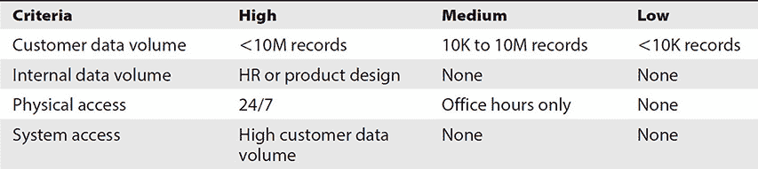

**表 4-2 第三方风险分级**

组织可以用多种方式使用`表 4-2`。首先，可以根据满足多少个低、中、高类别对每个第三方进行评分。或者，如果满足任何单项标准，就可以为每个第三方分配一个风险级别。告诫组织不要让任何分级或评分变得过于复杂，因为最终目标是为每个供应商得出最多三个、也许是四个分级分类。其原因与接将讨论的第三方评估有关。

在大多数组织中，少数第三方将被分配到最高风险级别，可能占 0.5% 到 2%。少数更多将被分配到第二个风险级别，可能占 5% 到 10%。剩余的第三方将被分配到第三个级别。将第三方分配到风险级别的目的将在下一节解释。

组织需要意识到，有时某些第三方需要从一个风险级别重新分类。例如，最初聘请第三方服务供应商执行低风险服务，其初始风险分类为低。然而，该第三方可能会获得高风险业务；除非有触发机制（例如签署额外的法律合同），组织需要每年（或更频繁地）分析与其每个第三方的关系，以确认其风险评估。同样，如果一个第三方最初被归类为高风险但后来停止了执行高风险服务，则该第三方应重新分类为较低的风险等级；否则，组织在评估该第三方上花费了过多的精力。

对第三方进行评估用于识别这些第三方组织中的特定风险。评估第三方的过程应被视为对内部流程和应用程序进行内部风险评估的另一种方式；然而，需要联系的人员不是内部人员，而是其他公司的员工，他们的合作程度和响应意愿各不相同。与对内部流程和系统进行风险评估不同，这里存在一层面纱，遮挡了对这些第三方流程和系统信息的观察。需要投入额外的关注和精力，以充分了解第三方组织的实践情况，从而得出关于风险的结论。本节将描述所使用的这些技术。

一旦组织建立了其第三方风险分类，并开始识别第三方及其各自的风险分级，就可以对第三方进行评估。然而，在执行评估之前，需要制定一套进行评估的方案。在前节中，第三方被分为三个或四种风险等级。评估的执行方式取决于特定第三方被分配到哪种风险等级。评估第三方用了多种技术，包括以下几种：

- **问卷**：组织可以开发并发送给第三方的问卷。这些问卷通常包含有关第三方 IT 控制和其他业务活动的问题，以便组织确定其信息受保护的有效性。

- **问卷确认**：在收到第三方提供的完成的问卷后，组织可以采取额外步骤来确认或验证问卷中的答案。例如，组织可以要求以流程文档或业务记录样本的形式提供证据。这增加了（或减少了）组织对返回问卷答案的信心，从而更准确地描述了控制风险。

- **实地访问**：有时组织对仅使用问卷和确认并不满意。在这种情况下，组织可以派遣其安全人员之一（讽刺的是，可以将此活动外包给第三方）对第三方的工作地点和信息处理中心进行实地访问。虽然这是成本最高的确认类型，但组织意识到，有时无法用“亲眼为实”来替代对第三方控制信心的建立。

- **外部证明**：组织可以强制第三方接受外部审计或证明。既有的标准如 `SOC1`、`SOC2`、`SSAE16`、`ISAE3402`、`HITRUST` 和 `ISO/IEC 27001` 是控制和审计标准的示例，可以更好地理解第三方 IT 控制的有效性。

- **外部商业智能**：组织经常转向外部商业智能服务，如 `Dunn & Bradstreet` 或 `Lexis Nexus`。此类服务收集公司财务健康状况的信息。这可以帮助组织更好地理解与第三方健康和持续生存能力相关的风险因素。例如，如果组织获知特定第三方面临财务压力（可能是因为其产品或服务问题不利地影响了销售），这将引发担忧，即可能导致产品或服务质量的下降，以及信息保护努力和有效性的下降。

- **外部网络情报**：组织开始利用越来越多的公司提供的，这些公司收集有关第三方各种类型的情报。这些服务以订阅的形式出售此类信息。这些服务执行多种功能，包括安全扫描和对暗网扫描以寻找未报告的泄露迹象。这些网络情报服务执行此类服务的成本通常低于尝试用自己的安全人员执行这些活动的组织。

- **安全扫描和渗透测试**：组织可以对其第三方的基础设施和/或应用程序进行安全扫描或渗透测试。或者，组织可以要求第三方自行从合格的安全咨询公司委托这些活动，并将结果提供给组织。这些活动有助于增强（或削弱）对第三方管理其基础设施和应用程序能力（包括运行有效的漏洞管理计划）的信心。

- **侵入式监控**：组织有时可以强制第三方允许组织实时查看或接收内部控制数据。例如，组织可以向第三方提供一套安全系统，由第三方安装在其网络中；该系统将向组织提供某种形式的实时安全情报，使其相信第三方环境没有活动威胁。或者，第三方可以从其自身的内部安全系统向组织提供某些内部信息。可以提供的信息类型包括操作系统、防火墙、入侵检测/防御系统的安全和事件日志数据；内部漏洞扫描数据；网络包头捕获；或网络全包捕获。这些活动被称为 `intrusive monitoring`，因为它们代表了组织对第三方环境可见性的一种“侵入”。


这些和其他技术被用于评估第三方。但正如之前提到的，并不是所有第三方都以相同的方式进行评估。相反，第三方是根据其风险等级进行评估的，风险等级在前面的节中讨论过。组织根据其的风险等级建立了评估供应商的方案。表 4-3 描述了这样一个方案。

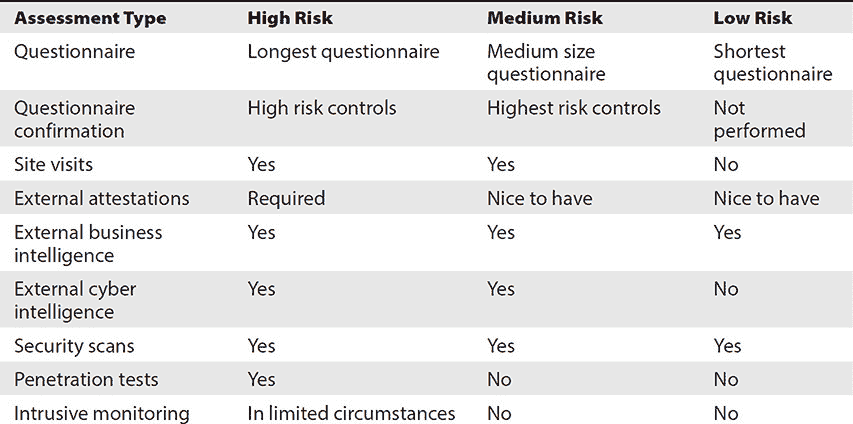

**表 4-3** 不同风险等级下的评估活动

组织还需要确定对第三方进行评估的频率。表 4-4 显示了评估频率的示例方案。

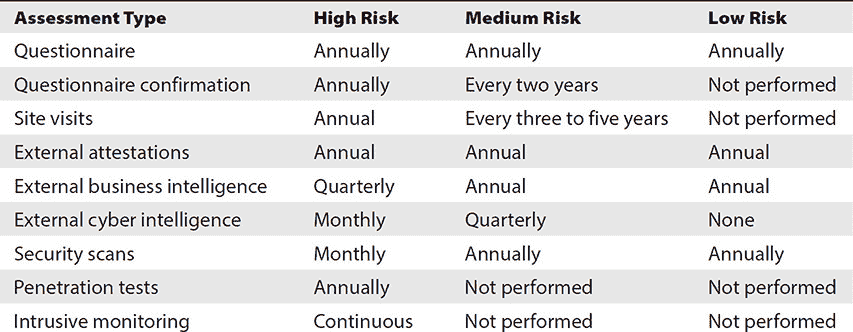

**表 4-4** 评估频率

组织可能有数百到数千个需要评估的第三方。最大的组织可能有数万个第三方。有这么多第三方事实是进行风险分级的主要原因，因为各种类型的评估执行非常耗时且昂贵。这就是为什么最彻底的评估仅针对风险最高的第三方进行。

通常情况下，评估会发现第三方控制中组织认为不可接受的问题。修复主题将在下一节中讨论。

### 主动问题修复

客户组织与第三方之间的交换手段只有金钱和声誉。换句话说，组织对其第三方拥有的杠杆就是拒绝付款以及向其他组织传播第三方的质量（或缺乏质量）。如果外包跨越国界，情况更是如此。因此，考虑外包的组织必须仔细考虑如何执行合同条款，以获得其预期的数量和质量商品和服务。

向第三方外包的许多风险可以通过合同条款来修复。以下是一些修复措施：

- **服务水平协议 (SLA)**：合同应提供工作性能和沟通各个方面的细节，包括升级机制和问题管理。

- **质量**：根据产品或服务的不同，这可能转化为错误率或缺陷率、客户满意度率或系统性能。

- **安全策略与控制**：无论外包公司是在保护组织的知识产权、维护商业秘密，还是保护其员工或客户的信息，合同都应明确规定其期望外包公司执行的安全控制细节。组织还应要求进行定期的第三方审计并获取这些审计结果。合同应包含“审计权”条款，允许外包组织根据要求检查工作场所、记录和工作底稿。

- **业务连续性**：合同应要求外包公司采取合理的措施和保障措施，以确保运营的韧性，并在发生灾难时能够以最小的干扰继续运营。

- **员工诚信**：合同应定义外包公司如何审查员工背景，以确保其不会无意中雇用有犯罪记录的人员，并确保员工声称的教育和工作经验是真实的。

- **知识产权所有权**：如果外包公司正在生产软件或其他设计，合同必须定义这些工作成果的所有权，以及外包公司是否可以将任何此类工作成果用于其他项目。

- **角色与职责**：合同应详细说明各方的角色和职责，使每方都清楚对其自身的期望。

- **进度安排**：合同必须规定何时以及生产多少项工作成果。

- **合规性**：合同应要求双方遵守所有适用的法律法规，包括但不限于知识产权、数据保护和工作场所安全。

- **保修**：合同应规定所有工作成果的工艺和质量的保修条款，以免对所执行商品或服务的质量产生歧义。

- **争议与解决**：合同应包含定义处理和解决争议程序的条款。

- **付款**：合同应规定如何以及何时向外包提供商付款。报酬不仅应取决于工作的数量，还应取决于工作的质量。对于超过特定进度、数量或质量目标的情况，合同应包括额外付款的激励条款。合同还应包含在未达到`SLA`、`quality`、`security`、`audit`或`schedule`目标时的财务罚款。

外包合同的条款应当对外包公司的良好工作提供充分的回报，这应包括获得额外合同的前景以及帮助其从其他客户处获得外包合同的推荐。

### 响应性问题修复

在第三方的问卷或其他信息反馈中，组织对其完全没有任何担心的情况是非常罕见的。通常，在问卷中或问卷确认期间，会发现一些组织认为不理想的情况。例如，第三方可能在问卷中规定其要求人员每年更改一次密码。组织更倾向于让第三方更频繁地更改密码。但在本例中，如果第三方规定其*从不*要求人员更改密码呢？这可能是组织认为不可接受的。此时组织将启动与第三方的讨论，以了解为什么其人员从不需要更改密码，希望组织能够认为第三方的解释是可以接受的（例如，有补偿控制措施，如有效的多因素身份验证系统），或者双方达成一致，让第三方更改其系统，要求人员以可接受的频率（例如每季度）更新密码。

修复工作是耗时的，因此组织需要仔细考虑何时以及何种情况下进行该过程。

### 入职 (Onboarding)

入职是组织开始与第三方建立业务关系的过程。当组织考虑利用第三方的产品或服务时，组织应对第三方进行前期尽职调查，以更好地了解风险水平。通常，组织将使用本节之前讨论的标准建立风险水平，然后根据`Table 4-4`所示的方案，利用问卷和其他方法进行评估。这些活动将发现问题，其中一些需要修复，另一些需要在组织与第三方之间的初始法律协议中进行说明。

***


**注意：在完成评估和其他尽职调查之前，绝不能与新的第三方签署法律协议。**

### 合同语言

当组织最初通过评估过程和其他手段审查新第三方时，安全经理能够从信息安全的角度确定要求第三方做什么。这些要求应提交给法律部门，以便以合同条款的形式出现在合同中。

与第三方签署的协议中通常会出现几类与信息安全相关的条款，包括：

- 安全计划

- 安全控制

- 合规性

- 证明 (Attestations)

- 漏洞管理

- 渗透测试

- 审计权

- 事件通知

- 网络保险

- 对外包的限制

### 安全事件

如果第三方组织发生安全事件，响应该事件会更加复杂，这主要是由于涉及两个或多个组织及其各自的安全团队。该主题在`Chapter 5`的“涉及第三方的事件”章节中进行了详细探讨。

### 行政活动

与组织中的几乎所有其他部门一样，安全经理和安全团队的其他成员必须执行定量的行政工作。与人力资源和财务等公司部门一样，信息安全只有在与组织内的许多其他部门建立良好的关系时才能有效。这是因为信息安全经理经常充当催化剂，确保其他部门和业务单元做出良好的判断，以确保他们的行动和决策不会给组织带来不必要的风险。

安全经理还需要与许多外部实体建立关系，例如执法部门、安全产品供应商、安全专业服务供应商、专业组织以及开发安全人员使用的标准和框架的组织。

考虑到合格安全人员严重短缺，安全员工的发展尤为重要。感到被忽视或未被充分利用的员工可以很快找到其他工作。

#### 内部伙伴

如果安全经理仅靠自己奋战，很难取得巨大成就。有效的信息安全和信息风险管理是一项团队运动，团队中的每位成员都可以以不同的方式帮助安全经理。此外，与公司其他部门和业务部门建立伙伴关系有助于让安全经理了解重要事项。在提高计划有效性的同时，建立这些伙伴关系的一种有效方法是从其他小组中“委任”团队成员。一个例子是与行政助理合作，让他们领导数据留存计划。另一个例子是指定另一个业务部门（BU）的一名人员作为信息安全联络员，既向该业务部门提供指导，又报告该业务部门可能存在影响组织数据或信息安全的潜在风险或问题。除非对其他团队成员提供适当的培训，并为他们分配时间来履行这些额外职责，否则这一切都是不可能。

## 法务

在大多数组织中，法务部门通过与服务提供商、客户和其他方谈判合同条款，充当组织事实上的业务风险官。法务部门通常总是试图让风险向有利于组织倾斜。

法务和信息安全可以就与客户、供应商、服务提供商和其他方签订几乎任何合同中的安全条款进行合作。当其他方发送包含安全条款的合同时，安全经理应审视这些条款，以确保组织能够满足所有要求。同样，当组织考虑与另一方开展业务时，安全经理可以与法务部门合作，通过要求其他方采取某些措施来保护组织的信息，以确保组织获得充分保护。

有时，组织会在不通知安全经理的情况下建立业务关系，而安全经理通常希望进行风险评估，以识别任何应该知晓的重要风险。这里的最佳安排是让法务部门将收到的每份新合同通知安全经理，以便安全经理能够投入精力在这一较晚的阶段识别风险。

## 人力资源

作为信息以及许多涉及员工和其他劳动者的活动的管家，人力资源部门（HR）是信息安全的另一个重要盟友。人力资源部门有许多方式可以增强组织的安全，包括以下方面：

- **招聘**：人力资源部门致力于为组织寻找新员工。通过这一搜索过程，人力资源部门确保新人员具备正确的资质，并倾向于遵守安全策略和其他策略。在候选人筛选过程中，他们将进行背景调查以确认其声称的教育背景、之前的工作经历和专业认证，并确保他们没有犯罪记录。

- **入职**：对于被选录用的候选人，人力资源部门将确保所有新员工签署包括保密协议在内的重要文件，并接受初始培训，包括安全意识培训。在入职期间，新员工还将正式确认收到并承诺遵守安全策略和其他策略。人力资源部门将配置人力资源信息系统（HRIS），在许多组织中，这些系统被集成到组织的身份和访问管理系统中。

- **内部转岗**：人力资源部门负责协调内部转岗，即员工从一个职位变更为另一个。通知安全和 IT 部门内部转岗很重要，这样就可以及时撤销对信息系统和应用程序的权限。

- **离职**：人力资源部门负责处理任何原因离开员工的终止关系或离职手续。人力资源部门负责通知安全、IT 和其他部门终止关系，以便在适当终止所有权限。人力资源部门还负责收集发放给离职员工的资产，如笔记本电脑、移动设备和相关外设；人力资源部门还可能要求离职员工签署保密或竞业协议。

- **培训**：在许多组织中，人力资源部门是向员工提供的大多数或全部培训的中心焦点，也是培训记录的保存地。组织的培训应包括安全意识培训，这可能由人力资源部门实施。在许多组织中，人力资源部门也是协调海报、传单和向员工发布培训及安全提醒等多个主题焦点。

- **调查**：人力资源部门对员工违行为等事项进行调查。如果此类违行为涉及不当使用信息系统或计算机，人力资源部门将与信息安全部门合作，进行取证调查以建立可靠的事件历史，并在事项发展为法律诉讼时建立监管链。

- **纪分**：人力资源部门是对员工采取正式纪律处分的焦点。从信息安全的角度来看，这包括违反安全策略和其他策略的问题。通常，安全经理将就此类事项提交事实，并在要求时提供意见，但人力资源部门负责选择纪律采取的形式和程度。

## 设施

设施职能是组织使用工作场所的管家，确保所有办公地点都有足够的空间和支持工作人员。设施部门与信息安全的伙伴关系包括：

- **工作场所访问控制**：设施部门通常管理工作场所访问控制系统，如门禁器和门锁执行器，这些系统控制哪些人员允许进入工作中心及其内部区域。信息安全中一个广为人知的原则是：获得计算资产物理访问权限的攻击者能够完全接管它们；这强调了有效访问控制的必要性，以防止未经授权的人员访问这些资产。

- **场所监控**：视频监控是一种伴随性的刑事控制，它与门禁系统等预防性控制配合工作。大楼入口处的摄像头有助于核实进出人员的身份。可见的监控器可以增加监控的威慑作用。

- **设备签入/签出**：数据中心和其他拥有价值资产的场所可以实施设备签入和签出功能，人员需要在类似于访客日志的日志中记录资产的进出。

- **访客处理**：设施通常协助访客和其他访问人员的识别与处理。保安人员、接待员或其他人员可以检查访客的政府身份证件、发放访客证、联系被访员工，并在其他方面提供帮助。

- **保安人员**：保安人员代表了人的因素，负责提供或补充访问控制和视频监控。保安人员还可以协助设备签入/签出和访客处理。

- **资产安全**：通过视频监控、访问控制等手段，设施确保资产受到保护，包括数据中心信息处理系统和打印机、复印机等办公资产。

- **人员安全**：虽然人员安全并不直接处于信息安全的焦点，但许多安全经理都参与了人员安全，因为这与资产安全密切相关，并且使用了许多相同的保护措施。


**注意**：虽然人员安全列在此列表的最后，但在任何组织中，人员安全都应该是首要任务。

## 信息技术

信息技术与信息安全可能是安全经理将建立和开发的最策略性的伙伴关系。信息技术执行的许多关键功能对安全产生影响，这需要这两个团队之间的紧密配合。这些活动包括：

- **访问控制**：IT 通常管理日常访问控制，包括为新员工发放凭证、注销离职员工的凭证、处理访问请求以及重置凭证。在某些组织中，IT 还可能执行访问审查和重新认证。

- **架构**：IT 负责组织内使用的信息系统的整体架构。这包括数据架构、网络架构和系统架构。在许多组织中，还有`security architecture`的实践，它触及架构的所有其他方面。开放安全架构（Open Security Architecture）组织将 IT 安全架构定义为“描述安全控制（安全防御措施）如何定位，以及它们如何与整体信息技术架构相关的设计产物。这些控制的目的是维护系统的质量属性：机密性、完整性、可用性、可追溯性和保证服务”。换句话说，安全架构是一项宏观任务，旨在理解所有安全控制和配置之间的相互作用，共同保护信息系统和信息资产。

- **加固**：IT 负责所有服务器和终端用户计算操作系统的配置；这包括`hardening standards`的开发和实施。通常，加固标准是由 IT 根据信息安全制定的策略和原则而开发的。

- **扫描与补丁**：在安全经理的指导下，IT 经常运行漏洞扫描工具和补丁管理平台，以确保 IT 资产没有可利用的漏洞。人们已经意识到，这是防止外部对手入侵的最关键活动之一。

- **安全工具**：在大多数组织中，IT 运行组织的防火墙、入侵检测/防御系统、垃圾过滤、网页过滤等。通常，安全经理建立使用这些工具的策略和原则。

- **系统监控**：IT 通常会对其资产进行监控，以确保所有资产运行正常。

- **安全监控**：IT 可能会执行安全监控，以便在发生安全问题时保持警惕。

- **第三方连接**：IT 可能参与到与第三方组织数据连接的建立。作为组织第三方风险计划的一部分，安全经理需要意识到这些连接。

## 产品开发

产品开发是此处使用的通用术语，代表软件开发、编程、集成、软件工程以及其他与开发内部使用或客户使用的软件相关的活动。在安全经理的指导下，产品开发将管理整个开发生命周期，并将安全作为每个阶段不可或缺的一部分。产品开发为支持信息安全的活动包括：

- **设计安全**：这代表了多项活动，以确保所有新产品、组件、功能和改进都将安全作为设计过程的一部分。这可以帮助组织避免在开发后期出现可能修复成本更高的问题。

- **安全开发**：这包括安全编码，以确保所有新开发和更改的软件都没有可能导致安全事件的可利用缺陷。

- **安全测试**：有几项活动属于安全测试功能，包括每个开发人员集成开发环境（`IDE`）使用的代码扫描工具、确认所有安全需求正确实现的单元测试和系统测试、作为每日构建过程运行的静态应用安全测试（`SAST`）扫描工具，以及识别运行应用程序中安全缺陷的动态应用安全测试（`DAST`）扫描工具。

- **代码审查**：这包括对软件源代码的安全相关更改进行同行评审，包括安全敏感功能，如身份验证、会话管理、数据验证和多租环境的数据隔离。某些组织对所有软件模块的更改进行代码审查。

- **开源软件安全审查**：某些组织会对各种部分或全部开源模块进行审查，以确保它们不会向软件应用程序引入意外的安全缺陷。

- **开发者培训**：对开发人员的定期培训包括安全开发技术，这有助于开发人员避免导致后期必须修复安全缺陷的常见错误。

- **开发过程保护**：这包括确保只有授权的开发人员才能访问源代码的控制措施（这可能包括对开发人员任何时候签出源代码数量的限制）、签入源代码的安全扫描以及对所有源代码的保护。

## 采购

`Procurement` 是进行购买行为的实践，在较大的组织中，设有同名的部门。采购部门通常负责为新购买的硬件、软件和服务，以及订阅和服务的续约谈判价格和业务条款。

当组织考虑采购时，`Procurement` 是其与安全经理之间建立的一项关键关系。采购经理可以确保在考虑任何新采购项目时，都会通知安全经理。这样，安全经理就可以开始对正在考虑的产品或服务进行任何必要的尽职调查，并就风险以及任何必要的控制措施或补偿性控制提供建议，以将风险控制在可接受的容忍范围内。

## 财务

信息安全与财务之间的主要联系点是在应付账款（`AP`）过程中发现新供应商。一个有效的第三方风险计划需要在业务的多个部分（包括 `AP`）设置触发机制，以便安全经理能够了解组织所建立的所有第三方供应商关系。在这一方面，`AP` 通常被认为是最后的合作伙伴关系，因为在 `AP` 获知某个供应商关系时，该关系可能已经完全建立并投入运行了。

## 业务部门经理

有人说，安全经理只能在了解组织运作方式的范围内对其提供保护。自然，这要求安全经理与整个组织各业务部门和部门的经理及领导建立关系。

这些伙伴关系的目的是提供一种手段，让安全经理更好地理解每个业务部门和部门是如何运作的，以及他们的关键人员、流程、系统和外部伙伴是谁。这些关系的目的（至少不是`sole`目的）并不是让安全经理向业务部门经理和领导告知安全是如何工作的。在某些时候，业务部门经理和领导会询问安全经理他是如何做某些事情的；安全经理应该尽可能透明地回答。

随着这些战略性关系的发展，业务部门经理和领导将开始信任安全经理，与安全经理分享信息，并将安全经理纳入关键对话和流程中。当存在足够的信任时，良好的事情就会开始发生：关于更敏感话题的对话将会进行，从而对业务产生微小有时是重大的改进。

## 机构和关键业务伙伴

随着安全经理在整个组织范围内建立战略关系，安全经理应该关注深度参与组织发展以及商品和服务交付的附属机构、业务伙伴和其他外部实体。由于组织之间建立了广泛的信息系统集成，组织的安全性取决于该组织信息系统生态系统的安全性——即信息系统、网络和业务流程的互联。根据最近的研究，约一半的安全漏洞源于第三方，这使得与这些第三方建立战略关系成为一项至关重要的追求。

## 外部伙伴关系

只有当安全经理与关键外部机构建立关系时，成功的信息安全才可能。这些机构是谁取决于组织的所属行业领域、相关法规、使用的信息系统、地理位置和其他因素。

## 执法部门

俗话说“雨未修补”。同样，在没有紧急事务处理时，安全经理应该与关键执法机构及其相关人员建立关系。当组织和执法部门相互了解时，他们就可以建立一种可以进行信任共享的关系。

组织考虑联系的机构：

- **美国**：`FBI`、`Secret Service`（处理大量信用卡交易的组织）以及市和州级警察犯罪部门。`InfraGard` 组织 ([`www.infragard.org/`](https://www.infragard.org/)) 也值得关注，它是 `FBI` 与私营组织之间的公私合作伙伴关系。

- **加拿大**：`RCMP` 和市、省级犯罪部门。

- **英国**：`MI5` 和市、县犯罪部门。


# 全球

许多执法部门联系定期的`citizens’ academy`（公民学院），提供这些机构及其使命的内部视角。他们开展公共外活动，向企业介绍当地的趋势和资产保护方法。

## 监管机构和审计师

应尽可能地将监管机构和审计师视为合作伙伴而非对手。与监管机构和审计师建立关系有助于改善组织与其监管机构互动时的业务关系氛围。安全经理应该理解监管者的伦理边界。在某些情况下，你不能仅仅通过给监管人员买杯咖啡来活跃气氛并讨论工作或无关事项。

## 标准组织

信息安全行业有许多标准组织，在所有其他行业领域也有许多其他。在信息安全行业本身，参与标准组织可以为安全经理提供“内部”信息，例如新兴和更新标准的“抢先预览”，以及学习机会甚至行业会议。这些包括：

- `PCI Security Standards Council`（[`www.pcisecuritystandards.org/`](https://www.pcisecuritystandards.org/)），涉及银行、发行商、处理商和商户的信用卡数据保护。

- `Cloud Security Alliance`（[`cloudsecurityalliance.org/`](https://cloudsecurityalliance.org/)），为云服务提供商创建安全标准框架。

- `Information Security Forum (ISF)`，其出版《良好实践标准》。

- `国际标准化组织 (ISO)` 和 `国际电工委员会 (IEC)`，它们开发包括安全管理和 IT 服务管理在内的众多主题的国际标准。

## 专业组织

信息安全专业领域是一项挑战，不仅是因为安全计划失效所导致的后果，还因为其极高的创新率。专业组织通过培训、专业认证、地方分会组织和会议帮助满足对有价值信息的需求。这些包括：

- **ISACA**：`注册信息安全经理 (CISM)`（本书的主题）、`注册信息系统审计师 (CISA)` 以及其他认证的开发者。它在全球范围内举办会议和培训活动。全球组织了许多分会。请访问 [`www.isaca/org`](https://www.isaca/org)。

- **信息系统安全协会 (ISSA)** 在全球范围内举办会议并支持众多分会。请访问 [`www.issa.org`](https://www.issa.org)。

- **国际信息系统安全认证联盟，或 (ISC)²** `注册信息系统安全专业人员 (CISSP)` 及其他认证的开发者。他们每年举办会议。请访问 [`www.isc2.org`](https://www.isc2.org)。

- **云安全联盟 (CSA)** `云控制矩阵 (CCM)` 和 `CSA Star` 计划的开发者。它们在全球范围内举办会议。请访问 [`cloudsecurityalliance.org/`](https://cloudsecurityalliance.org/)。

- **电子电子商务顾问协会 (EC-Council)** 著名的`认证道德黑客 (CEH)` 和`认证首席信息安全官 (CCISO)` 认证的开发者。它们在全球范围内举办会议。请访问 [`www.eccouncil.org/`](https://www.eccouncil.org/)。

- **SANS** `GIAC` 系列认证的开发者。他们在全球范围内举办大量的培训活动和会议。请访问 [`www.sans.org`](https://www.sans.org)。

## 安全专业服务供应商

安全经理需要与一个或多个安全专业服务供应商建立信任关系。因为信息安全领域需要了解的知识非常多，而且威胁、实践和框架变化非常频繁，拥有一个或多个信赖的顾问可以帮助安全经理持续关注这些发展。

优秀的安全专业服务供应商在员工队伍中拥有高级顾问，他们可以随时提供简短咨询。虽然这些顾问可能承担销售职责，但熟练的安全经理可以偶尔利用他们的专业知识来确认想法、计划和策略。

一些安全专业服务供应商在员工中设有虚拟 CISO 或 CISO 顾问（通常是前任 CISO），帮助客户制定长期安全策略。通常情况下，这些顾问是可计费的资源，他们协助客户组织更好地了解其风险，并帮助制定一种基于风险的安全策略，以最大限度地利用稀缺资源来降低风险。此类服务对于无法吸引和聘佣此类水平全职安全经理的小型组织来说特别有用。

安全专业服务供应商还可以就安全工具的采购、实施和运行策略提供协助。熟悉安全工具的信赖顾问通常可以帮助安全经理识别出更可能在其环境中运行的更好工具。

## 安全产品供应商

安全经理需要与每一家在使用安全产品和服务的供应商建立良好的业务关系。通过这些关系，安全经理将从多个方面获得更多信息，包括产品或服务更新、工作坊和研讨会、培训和支持。

产品供应商与其客户之间的关系并非总是一风风顺。建立战略关系至关重要，这样在困难时期，双方已经对彼此熟悉，从而实现更快速、更高效的互动和解决。

信赖顾问可以帮助安全经理识别额外的供应商以建立关系。新供应商的产品可能与安全经理组织中已使用的产品存在竞争关系，或者供应商可能拥有组织目前尚未使用的产品或服务。这些关系有助于安全经理理解她未来可能利用的能力。

## 合规性管理

`Compliance`（合规）是指符合适用策略、标准、法规和其他要求的状态。`Compliance` 是安全经理确定组织的信息系统、流程和人员是否符合这些要求的过程。

当安全经理开发或采用控制框架并确定适用的法规和法律要求时，他会确保控制和其他措施得到实施。然后，作为风险管理生命周期的一部分，安全经理需要检查这些控制、流程和系统，以查看它们是否符合所有内部和外部要求。正如本书贯讨论的，这些活动包括外部审计、内部审计和控制自评估。

### 合规还是安全

与众多客户组织工作的安全顾问经常观察到一个现象，即组织思考资产保护的方式。组织似乎分为两类：

- **基于合规的组织**：这些组织满足于对 `PCI` 和 `HIPAA` 等适用标准或法规进行“打钩”。他们的兴趣是尽可能做最少的工作来通过审计。

- **基于安全和风险的组织**：这些组织理解 `PCI` 和 `HIPAA` 等外部标准只是“起点”，需要定期的风险评估和其他活动（换句话说，即本书中讨论的所有活动）来帮助他们确定必须开发哪些其他活动和控制以确保安全。

安全专业人员经常在许多话题上产生分歧，但他们通常认同这一点：`compliant`（合规）并不同于 `secure`（安全）。

### 适用性

安全经理经常发现，合规性由于可能存在多个重叠的标准、法规和其他法律要求而变得复杂，每项要求都可能适用于组织的不同部分。为了更好地理解这些要求的覆盖范围，安全经理可能会开发一个合规矩阵，如 `../Text/ch4a.xhtml#ch4tab5` 所示。

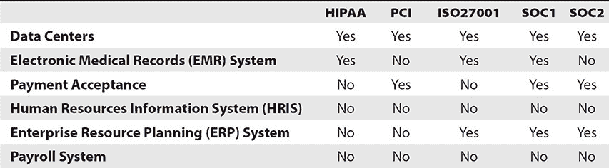

**表 4-5** 显示法规和标准对系统适用性的合规矩阵示例

正确确定适用性有助于安全经理更好地理解各个信息系统及其支持的流程所需的要求。如果任何组织简单地将所有法规和其他法律义务的要求应用于所有信息系统，其支出将过高。结果可能是控制的应用更加一致，但无疑也更加昂贵。对于大多数组织而言，开发符合适用法规的合规手段所需的资源，少于将所有法规的所有控制应用于所有系统所需的资源。这将是在不一定降低风险的情况下过度支出的范例。

### 合规风险

当安全经理执行风险评估并在风险账簿中填写需要讨论和处理的风险事项时，安全经理不应忽视的一种风险形式是合规风险。`Compliance risk`（合规风险）是指与遵守适用法律或其他法律义务而导致任何一般或特定后果相关的风险。

例如，在风险评估期间，安全经理观察到组织在内部文件服务器的明文电子表格中存储信用卡信息。在这种情况下，安全经理可以识别出至少两个风险：

- **敏感数据泄露**：风险账簿指出了敏感数据可能被内部人员滥用的事实，并可能被恶意外部人员发现。如果此类信息被泄露，与取证调查相关的成本以及潜在的缓解成本（如为受害者支付信用卡监控的费用）将包含在组织遭受的总成本中。

## 罚款与制裁

风险清单指出，如果组织的 PCI 监管机构获知此情况，该组织可能面临罚款和其他制裁。罚款和其他制裁是监管机构发现这些问题后，组织可能产生的潜在非计划成本。

## 合规执行

当安全经理审查内外部审计结果、控制自评估以及对系统和流程的其他检查时，安全经理不仅需要权衡与任何负面结果相关的直接风险，还需要权衡合规风险。在组织内其他人考虑对这些合规事项做出反应的任何讨论和程序中，安全经理都可以应用这两项考虑因素。

作为指标计划的一部分，安全经理将向高级管理层报告合规状况。合规事项将作为高风险领域反映在指标中，无论这些风险仅是违规风险，还是包括对具有潜在公众影响的外部法规合规风险。

## 合规：双刃剑

我的安全职业生涯始于信息安全领域还没有很多法律的时候。我们有时会感叹，在我们努力让组织的安全状况变得更好时所付出的努力，背后并没有法律支持。

随后，法律和标准开始制定并颁布，这为我们提供了额外的筹码。像 `Sarbanes—Oxley`、`联邦信息系统管理法 (FISMA)` 和 `PCI-DSS` 这样的法律和标准，为我们在执行安全控制和标准时提供了更有力的“球棒”。

但这并非全是积极的。许多法律过度扩张或概括过宽，要求组织实施某些控制措施，这些措施增加了成本和复杂性，却没有降低风险。有些法律则做得不够，例如 `PCI-DSS` 仍然未要求信用卡数据在通过内部网络传输时进行加密。

我们大多数人都同意，我们现在的处境更好了。我们感谢优秀的法律，并且（到目前）可以忍受糟糕的法律。

## 人员管理

在除了安全经理独立行动的极少数组织外，人员管理都是信息安全管理的一个重要方面。在许多组织中，信息安全部门由两人到几十人的等的团队组成。安全经理负责安全团队的所有方面，从识别和招聘候选人、分配和监督工作、开发新技能到开发安全团队的“文化中的文化”。

### 寻找与留住人才

安全人员的需求量很大。因此，该专业的人士薪水优厚。然而，由于很难找到合格的安全专业人士，大多数组织在试图从现有雇主处吸引熟练、合格的人才方面面临困难。薪酬增长得比通胀还快，导致一些组织无法负担所需的人才。

由于安全专业人士知道自己需求很大，他们可以选择他们想工作的公司类型，并且可以住在任何他们想的地方。在今天，情况非常如此，想成为远程办公人员的安全专业人士可以轻松地实现这一目标。

留住人才是许多组织面临的挑战。优秀的技术人员似乎会对常规和重复感到无味，因此，让他们对新挑战保持投入可能本身就是一种挑战。安全经理需要在安全员工想要做“酷炫、新事物”与将这些愿望与实际业务需求之间找到正确的平衡。

寻求扩大安全团队或填补空缺职位的安全经理不需要看其他地方：IT 部门可能有一人或多个人渴望加入安全团队。许多——如果不是大多数——IT 安全专业人士都是从企业 IT “转岗”到信息安全的，这仍然是招募新员工的常见来源。从 IT 转入的人员已经熟悉业务以及 IT 的操作和实践。如果他们希望向安全职业发展发展，那么他们可能愿意非常努力以获得成功。

### 角色与职责

当安全经理制定并开始执行长期安全策略时，经理将识别团队成员需要执行的所有持续性和偶然性任务。在规划开始之前，理解角色（role）与职责（responsibility）之间的区别是有关重要的。

`role`（角色）是指表示一组相关的职责、知识、技能和态度的称谓。示例角色包括`安全经理`、`安全工程师` 和`安全分析师`。

`responsibility`（职责）是对活动和表现的陈述预期。示例职责包括运行每周安全扫描、执行供应商风险评估以及批准访问请求。

当安全经理分析安全团队中要求的所有活动时，她可能会采取列出所有活动的方法，并对执行这些活动每周或每月所需的小数进行估算。接下来，安全经理将根据主题、技能水平和其他考虑对这些活动进行分组。随着相关工作量的统计，所需的人数将变得显而易见。然后，可以给这些职责组分配角色，然后是职位名称。

然而，大多数安全经理并没有机会从零开始构建并配置一个计划；相反，他们是在继承前任经理留下的现有计划。尽管如此，这些活动可以用来界定所有所需的活动，计算或观察工作量，并确保角色和职责被分配给具有所需技能和经验、能够正确执行任务的人员。

### 职位描述

`job description`（职位描述）是对组织中职位的正式描述，通常包含职位名称、工作经验要求、知识要求和职责。在大多数组织中，人力资源部门是职位描述的管理者。然而，当职位空缺或开放新职位时，人力资源通常会咨询招聘经理，以确保职位描述的内容仍然准确且最新。

当组织寻求填补新职位或空缺时会使用职位描述。职位描述将包含在在线广告中以吸引潜在候选人。

职位描述也是用于职业发展的工具。管理人员和领导层可以制定职业路径，通过晋升或调往其他职位的过程来代表个人的专业成长。职位描述是员工了解另一个职位情况的主要手段；访谈已经在理想职位上的人是洞察某人向往的职位的另一种方法。推动安全文化的一种小而有效的方法是在职位描述中加入特定的语言，说明每个角色在保护组织用于存储、处理和传输数据的数据和系统方面所扮演的职责。

## 文化

文化是组织中态度、实践、沟通、沟通风格、伦理和其他行为的集合。文化可以被认为是组织内员工的集体意识。描述一个组织的文化是很的，因为它必须通过经历才能被理解。

安全经理寻求理解组织的文化，以便成为一个更优秀、更有效的变革者。许多组织并不将信息安全视为一项重要活动；这迫使安全经理必须理解这种文化，并努力对文化进行细微的改变，以便以大多数员工都能理解的形式建立起信息安全意识。安全意识培训配合高管传达的信息，通常被认为是产生这些文化细微改变的催化剂。

安全经理及其团队偶尔会发现他们需要发展一种“文化中的文化”。组织的其他部分对安全持有放任态度，可能还需要一些追赶，但安全团队已经“领会了这一点”——即时刻关注日常活动，以及他们是否正在正确地处理和保护数据及系统。根据来自 ISACA 以及其他安全专业组织的道德准则，我们有义务按照更高的标准行事，这也是产生“文化中的文化”的原因之一。

## 职业发展

专注且敬业的技术人员生生对知识和扩展边界的渴求。正如俗所说，信息安全专业人士应该对这种渴望产生“加强版”的追求，因为其变化速度高于信息技术的大多数其他领域。网络犯罪组织正在创新他们的恶意软件和其他攻击技术，体现在通过日益新颖的方法进行的违入中；安全工具供应商正在创新他们的检测和保护产品；安全组织不断改进安全管理的许多方面，包括控制框架、审计技术和安全意识信息的传递。有人说，信息安全专业人士每周必须花四个阅读这些及其他新进展，以防落后。

安全经理需要了解目前每个安全团队成员拥有的知识和技能、未来团队所需的技能，以及驱动每个团队成员的职业成的愿景。这里讨论了职业发展的几种途径。

### 职业路径

`career path`（职业路径）是员工随时间推移所获得的职位职责和职称的演进。通常情况下，意识到组织内部潜在职业路径的员工更有可能留在组织内。而感到受困且无法晋升的员工更有可能考虑其他组织的职位。鉴于安全就业市场如此紧张，任何忽视职业发展和职业路径主题的组织都面临流失人才的风险。

安全经理应该关注组织发布的任何职业路径；然而，由于许多组织没有制定正式的职业路径，安全经理将希望与每位安全人员一对一交流，确定他们个人的职业路径将是什么样。

信息安全领域有很多专业方向，包括：

* 风险管理

* 风险分析

* 信息系统审计

* 渗透测试

* 恶意软件分析

* 安全工程

* 安全开发

* 移动设备安全

* 电信与网络安全

* 社会工程学

* 安全意识培训

* 取证学

* 密码学

* 业务连续性计划与灾难恢复计划

* 身份与访问管理

* 威胁情报

* 第三方风险

* 隐私

### 认证

专业认证代表了安全专业人员的技能、知识和经验。认证是荣誉的标志，代表了数千小时的专业经验以及不断自我的动力。在团队成员重视认证价值的范围内，安全经理应该鼓励团队成员获得额外的认证。优秀的组织不会犹豫于报销安全团队成员获得和维护其认证的费用，尽管从务实角度来说，这方面的年度支出可能会有合理的限制。

安全经理应该在每位安全工作人员身上投入时间，以更好地了解他们的职业路径以及他们可能在此程中想要获得的认证。

最流行的非厂商相关安全认证按资历从低到高大致排列如下：

* `Security+`：由 `CompTIA` 提供。这被认为是一种热门的入门级安全认证。你可以在 `www.comptia.org` 找到信息。

* `Systems Security Certified Practitioner (SSCP)`：由 `(ISC)²` 提供。许多人认为 `SSCP` 是“初级 CISSP”，但事实并非如此。“SSCP` 比 `CISSP` 更具技术性，非常适合实战安全专业人士。

* `Global Information Assurance Certification (GIAC)`：由 `SANS` 提供。这是一个涵盖几个不同主题的认证家族。可以在 `www.giac.org` 找到信息。

* `Certified Ethical Hacker (CEH)`：由 `EC-Council` 提供。该认证对于渗透测试人员以及想要更多了解漏洞和利用世界的人来说非常理想。你可以在 `www.eccouncil.org` 找到信息。

* `Certified Cloud Security Professional (CCSP)`：由 `(ISC)²` 和云安全联盟（CSA）联合提供。这是一项相对新的认证，但肯定会变得流行。你可以在 `www.isc2.org` 找到信息。

* `Certified Information Systems Security Professional (CISSP)`：可能是最知名且最受推崇的信息安全认证。资深且成熟的安全专业人员拥有此认证。这对于职业增长非常重要，因为许多组织要求安全职位具备这项特定的认证。你可以在 `www.isc2.org` 找到信息。

* `Certified Secure Software Lifecycle Professional (CSSLP)`：由 `(ISC)²` 提供。该认证的主题是安全软件开发。你可以在 `www.isc2.org` 找到信息。

* `Certified Information Security Manager (CISM)`：由 `ISACA` 提供，也是本书的主题。你可以在全书中以及 `www.isaca.org` 找到信息。


# 安全认证

* `Certified Information Systems Auditor (CISA)`：同样由`ISACA`提供。这被认为是 IT 审计师的金标准认证。你可以在`www.isaca.org`找到信息。

* `Certified in Risk and Information Systems Control (CRISC)`：由`ISACA`提供。对于从事风险评估、风险管理以及控制和控制框架开发的安全人员来说，这是一项必不可少的认证。你可以在`www.isaca.org`找到信息。

还有许多非厂商相关的安全认证——书中无法列全。你可以在维基百科上找到广泛的列表：`https://en.wikipedia.org/wiki/List_of_computer_security_certifications`。

许多 IT 设备厂商和 IT 安全工具供应商提供安全认证，代表了信息安全各个类别中的专业知识。几乎每个主要的安全工具制造商都有一个或多个可以获得的认证。以下是一个小样采样：

* `Check Point Certified Security Administrator (CCSA)`

* `Certified Forensic Security Responder (CFSR)` 由`Guidance Software`提供

* `Radware Certified Security Specialist (RCSS)`

* `Metasploit Certified Specialist` 由`Rapid7`提供

# 白帽认证安全开发人员

## 培训

留住人才另一个重要部分是为安全人员提供培训。同样，由于安全专业人员可能会感到无聊，他们他们在学习新事物时感到最快乐。安全经理可能担心，如果提供太多培训，他们的员工可能会去更广阔的天地；但不提供足够的培训，会发生什么呢？他们的员工几乎会感到被困住，并被迫以更大的热情离开。

通常组织会为其安全专业人员提供为期一周的安全培训。理想情况下，这意味着安全专业人员能够参加一个由他们选择的为期一周的会议。其他公司将支付网络培训或若干单日培训课程的费用。

一周的培训被认为是安全专业人员在其所选领域保持与时同步的最低要求。对于想要进入专业领域的安全专业人员，将需要额外的培训。

许多雇主会报销大学和学院的学费，通常有年度上限。尽管如此，这可以为希望追求信息安全及相关领域本科或研究生学位的安全人员提供手段。

## 远程办公

随着电信能力的进步，远程办公（也称为`telework`）越来越常见。在信息技术和信息安全等多个专业领域，工作可以在任何地点进行。由于合格信息安全人员的短缺，安全专业人员会发现许多组织愿意聘佣合格的专业并安排兼职或全职远程办公。

虽然远程办公的细节不在本书的涵盖范围内，但考虑远程办公的管理层需要理解与成功远程办公相关的因素。

## 项目与计划管理

信息安全领域正经历不断的变化。具有成熟风险管理计划的组织正在发现新的可用风险，网络攻击分子使用的攻击技术正在不断创新，安全供应商对其工具频繁改进，而安全管理的实践也在演变。信息技术同样发生了巨大的变化，组织正在通过流程开发和组织架构的调整来重塑自我。许多行业的并购对受影响的组织造成了许多广泛的变化。

这种持续变化现象的结果是，大多数组织每年承担多个信息安全项目。在许多组织中，信息安全人员花在项目上的时间比在日常操作上的多。对于许多安全经理来说，`持续变化是唯一的永恒`。

除了对信息技术、风险管理以及安全管理中的大部分或所有学科有深入理解外，安全经理还必须精通`项目管理`和`计划管理`（多个并发项目的管理）——以协调为了使组织远离麻烦而正在进行的系列变革。

安全经理需要关注大局：安全计划的战略和目标，以及与业务的结合。信息安全中的每个计划和项目都应该与这些保持一致。

项目管理和计划管理的学科不在本书的范围内。以下是一些推荐阅读材料：

- Shina, Sammy. *Engineering Project Management for the Global High Technology Industry*. McGraw-Hill Education, 2014.

- Brown, James. *The Handbook of Program Management: How to Facilitate Project Success with Optimal Program Management, Second Edition*. McGraw-Hill Education, 2014.

## 预算

预算是信息安全长期规划的重要组成部分，可以说是比许多其他部门更具挑战性的任务。虽然制定信息安全战略（从所需能力来看）较为直接，但要获得管理层对实现该策略所需资金的支持可能困难。

当执行管理层不理解信息安全的战略价值时，资助产生现有业务能力或容量活动的前景，与资助不会导致业务能力或容量变化的信息安全相比就大不相同。

安全经理需要在预算中包含的活动包括：

- 员工薪资和福利

- 特别项目和倡议的临时人员

- 培训

- 设备成本

- 软件工具

- 设备和软件的支持

- 数据中心所需的空间

- 差旅

- 文档和记录的维护

- 应急费用

通常，安全经理会对信息安全中每个功能所需的工作进行详细分析。例如，安全经理可能会跟踪在常规流程上花费的时间，以及预期的但未计划的活动（如事件响应和调查）。

## 安全投资回报

`安全投资回报率 (ROSI)` 是一个许多安全经理熟悉但饱争议的概念。这个概念很简单：在业务的其他部分，管理层做的会导致收入增加或成本降低的投资决策。但衡量安全投资回报率 (`ROI`) 的传统方法并不十分清晰。当组织投资于安全时，组织通常不会增加收入或降低成本——事实上，成本增加了。成功的衡量标准通常是没有发生可能导致高昂损失的安全事件或事故。

相反，投资应被视为降低风险的手段。遗憾的是，除非发生事件，否则风险不会出现在组织的损益表或资产负债表上。

## 业务案例开发

ISACA 将`业务案例`定义为“对进行业务投资的理由的说明，既用于支持关于是否继续投资的业务决策，又作为支持在整个经济生命周期内管理投资的运营工具”。

在许多组织中，在任何信息安全项目开始之前，必须为该项目开发业务案例。业务案例的目的是用业务术语解释项目将给业务带来的益处。

业务案例的开发通常紧随可行性研究之后。`可行性研究`定义了业务问题并描述了若干可能的解决方案。然而，可能没有任何解决方案能为业务带来利益。例如，每个潜在解决方案的成本可能太高或产生过高风险。然而，业务案例在业务收益方面应该超出可行性研究，并包含成本和收益的实际数字。

业务案例是一份书面文档，通常包含以下内容：

- **业务问题**：对业务问题的定性和定量描述。

- **可行性研究结果**：如果进行了可行性研究，业务案例应包含其结果。

- **收入或效率分析**：在适用情况下，业务案例应根据变化提供收入增加的估计。如果业务案例无法与收入挂钩，那么另一种方法是确定业务效率、风险降低或成本节省的变化。

- **高级项目计划**：这应该包括时间表和所需的人数。

- **预算**：这应该包括执行项目的成本以及与解决方案相关的成本。

- **指标**：业务计划书应包含有关如何衡量业务效益的信息，以及预期的实施前和后的衡量结果。估算应由组织内部或其他机构中类似项目的效益案例提供支持。

- **风险**：业务计划书应包含可能发生的风险，以及如何缓解这些风险的方法。这些风险可能是市场风险或财务风险。

***


**注意**：某些组织将制定业务计划书作为实际项目的第一阶段；然而，这种安排可能是自私自利的，因为项目团队可能会从证明项目继续下去具有合理性的角度出发，而不是关注项目是否真的能为业务带来利益。业务计划书的制定应由不从结果中获益的人以客观的方式进行。

项目的启动并不是评估项目业务计划书并决定是否开展项目的唯一时机。在整个项目过程中的关键里程碑处，都应该重新评估业务计划书。随着项目的开展，往往会产生之前无法预料到的情况，这些情况有时会导致成本增加、风险变化或其他偏差。因此，在整个项目期间应不断重新考虑业务计划书，以便管理层决定项目是否应该继续。

***


**注意**：关于是否继续项目的决策不仅应由从项目中获益的人做出，还应由其他更客观的利益相关者做出。否则，存在为了项目本身而继续项目而不是为了业务利益的风险。

## 供应商管理

安全经理负责管理与组织内使用的安全工具和服务供应商之间的业务协议和关系。虽然标准 IT 供应商管理的许多原则适用于信息安全，但安全经理有一个关键考虑需要记住：优质的信息安全服务提供商非常忙，当安全经理发现自己需要立即获得安全服务提供者的帮助时，最好已经与两或两以上此类公司建立了战略关系。这样，安全经理更有机会找到一家不仅愿意帮助而且在需要帮助时能够提供帮助的安全服务公司。

安全经理需要与安全服务供应商建立深层、受信赖的关系，该供应商应具备安全经理有时会需要的各种能力。信任的关系至关重要，因为安全经理需要向可以信赖的供应商透露他的一些挑战。供应商应该以客户为中心，将客户需求放在首位，而不是总是考虑下一笔订单来自哪里。

供应商管理的另一个重要方面是识别和管理由于与每个供应商建立业务关系而引入的风险。这一主题在本章前面的“第三方风险管理”部分中得到了充分讨论。

## 安全计划运营

组织网络和系统上的业务活动，以及敌者的侦察和攻击活动都是高度动态且不断变化的。信息技术和互联网上一切都以极快的速度运行。因此，有大量的运营活动每天 24 小时、每周 7 天、每年 365 天发生，这需要高度组织的安全运营职能。本节描述了现代组织中典型的安全运营活动。

较大的组织将其安全运营位于安全运营中心（`SOC`，读作“sock”）。`SOC` 通常是 24/7/365 运行的，尽管某些组织不会全天候或周末配备人员。

以下是本节讨论的话题：

- 事件监控

- 漏洞管理

- 安全工程与开发

- 网络保护

- 端点保护与管理

- 身份与访问管理

- 安全事件管理

- 安全意识培训

- 托管安全服务提供商 (`MSSPs`)

- 数据安全

- 业务连续性计划

### 事件监控

`Event monitoring` 是检查信息系统（包括应用程序、操作系统、数据库管理系统、终端设备以及每种类型的网络设备）上发生的事件的实践，并感知整个运行环境中正在发生的情况。

在互联网出现之前，每天查看日志就足够了。这主要是对前一天的事件（或周一对周末的事件）进行审查，以确保没有发生需要进一步调查的安全事件。那些日子大多已过去了。

今天，大多数组织都要求`real-time`（实时）事件监控。这意味着组织需要建立系统，当环境中的任何地方发生需要关注的事件时，系统会立即通知他们。

### 日志审查

`log review` 是对信息系统中的事件日志进行检查，以查看系统是否发生了任何安全或运营事件。通常，`log review` 是对系统中“昨天”的活动的检查。虽然在有限的情况下仍有必要，但大多数组织通过将日志数据发送到安全事件和事件管理系统（本节稍后将讨论）来执行`continuous log review`。

### 集中式日志管理

集中式日志管理是一种将各种系统上的事件日志通过网络发送到中央收集和存储点（称为`log server`）的实践。日志服务器有两个主要用途：第一个是对可能在日后调查中使用的事件进行存档存储；第二个是每天或实时对事件进行审查。通常，实时分析是由下一个将讨论的安全事件和事件管理系统执行的。

### 安全事件和事件管理

安全信息和事件管理系统（`SIEM`，通常读作“sim”，但有时读作“seem”）是一种收集和分析组织内许多或所有系统日志数据的系统。

`SIEM` 具有关联一个或多个设备事件的能力，从而为事件提供额外的细节。例如，攻击者对 Web 服务器进行暴力破解密码攻击可能会在 Web 服务器上产生警报，还会在防火墙和入侵检测系统上产生警报。`SIEM` 将通过这些以及可能的其他设备来描绘事件，为人员提供更丰富的描述。

### 威胁情报

现代`SIEMs`具有从各种外部源摄取威胁情报的能力。这使得`SIEM`能够将组织系统中的事件与其他组织经历的各种威胁进行更好地关联。

例如，另一个组织受到来自外国特定 IP 地址的敌者的攻击。该信息包含在进入组织`SIEM`的威胁情报馈中。这有助于`SIEM`意识到相同类型或来自相同 IP 地址的活动。这可以帮助组织对在其他地方发生但可能发生在组织网络中的事件获得更好的警报。

### 编排

在安全事件和事件管理的语境下，`orchestration`（编排）指的是当特定事件发生时，通过自动或手动触发的脚本化、自动化响应。编排系统可以是独立的系统，也可以作为 SIEM 的一部分存在。

例如，某组织为管理 SIEM 的人员开发了“运行操守手册（run books）”或简短程序，以便在发生特定类型的事件时执行相应操作。该组织希望实现部分响应的自动化，因此实施了一种编排工具，该工具包含可以在特定事件发生时自动运行的脚本。编排系统可以配置为立即运行某些脚本，而其他脚本则可以设置为在分析师“批准”后运行。

编排的优势在于两个方面：首先，重复性和机械性的任务实现了自动化，减轻了人员的枯燥感并提高了准确性；其次，对某些类型事件的响应可以执行得快得多，从而减轻某些事件的影响。

## 漏洞管理

`漏洞管理`是指定期检查信息系统（包括但不限于操作系统、数据库管理系统等子系统、应用程序和网络设备）的实践，目的是发现可利用的漏洞、进行相关分析并做出修复决策。组织将漏洞管理作为主要活动，以降低其 IT 环境遭受成功攻击的可能性。

通常，会使用一个或多个`扫描工具`来扫描目标系统以寻找漏洞。扫描工具有多种：

- 网络设备识别

- 开放端口识别

- 软件版本识别

- 可利用漏洞识别

- Web 应用程序漏洞识别

- 源代码缺陷识别

安全经理通常使用这些工具中的几种来执行常规和非常例规的漏洞管理任务。常规任务包括对特定 IT 资产进行计划扫描，而非例规的任务包括故障排除和各种类型的调查。

一个典型的漏洞管理流程包括以下活动：

- **定期扫描**：将使用一个或多个工具扫描组织内的资产以寻找漏洞。

- **扫描结果分析**：安全经理将检查漏洞扫描结果，验证结果以确保没有误报结果。这种分析通常包含风险分析，以便在资产的背景、其角色和重要性的背景下，更好地理解识别出的漏洞。扫描工具通常会为识别出的漏洞提供严重性级别或严重性评分，以便人员开始理解漏洞的严重程度。大多数工具利用通用漏洞评分系统（`CVSS`）方法对漏洞进行评分。

在记录了特定漏洞的`CVSS`评分后，安全经理将分析该漏洞，目的是建立漏洞的上下文严重性。例如，Microsoft Windows 服务器上服务消息块（`SMB`）服务中的漏洞可能被评为危急。如果`SMB`服务无法通过互联网访问，安全经理可能会降低组织中的风险。

在另一个示例中，如果组织缺乏检测性控制（即无法提醒组织漏洞组件已受攻击并攻破的控制措施），则安全经理可能会提高漏洞的严重性。

- **将扫描结果交付给资产所有者**：安全经理将报告交付给受影响资产的所有者或保管员，以便这些人人员开始规划修复活动。

- **修复**：资产所有者将对受影响的资产进行更改，通常通过安装一个或多个安全补丁或通过实施一个或多个安全配置更改。通常，会进行风险分析以确定与建议修复计划相关的风险。

组织通常会识别出的漏洞修复所需时间制定服务水平协议（SLA）。表 4-6 显示了一个典型的 SLA。

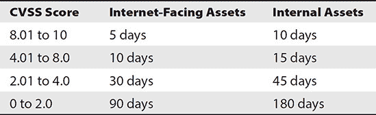

**表 4-6** 典型的漏洞管理修复 SLA

### 通用漏洞评分系统

`通用漏洞评分系统`（`CVSS`）是一个开放框架，用于为漏洞评分提供通用方法。`CVSS` 采用标准方法，根据漏洞的可利用性、利用产生的影响以及漏洞的复杂性对漏洞进行检查和评分。

`CVSS` 使组织能够采用一致的方法进行漏洞分析和修复。具体而言，组织可以制定服务水平协议来修复漏洞的速度。

### 漏洞识别技术

有多种技术用于识别目标系统中的漏洞：

- **安全扫描**：安全扫描是使用一个或多个漏洞扫描工具来帮助识别目标系统中易发现的漏洞。安全扫描通过两种方式识别漏洞：首先，确认已知漏洞的系统或程序版本；其次，通过测试系统的响应来证明漏洞的存在。

- **渗透测试**：渗透测试涉及使用安全扫描以及安全扫描工具未采用的人工测试。渗透测试被认为是对进入目标系统的真实模拟。

对组织的生产环境进行渗透测试可能与实际攻击者的技术略有差距。在渗透测试中，测试人员会小心避免导致目标系统发生故障。通常，如果实际攻击者不想在不被发现的情况下进行攻击，他们将不会采取这种预防措施。由于由于原因，有时最好对非生产环境进行渗透测试；然而，非生产环境通常与其生产环境并不相同。

- **社会工程评估**：对组织人员的判断力进行评估，查看他们如何识别攻击者欺骗用户执行任务或提供信息的各种骗术。使用了多种手段，包括电子邮件、电话和面对面交流。社会工程评估有助于组织识别培训和改进机会。

### 补丁管理

与漏洞管理密切相关的是`补丁管理`实践，它确保 IT 系统、工具和应用程序具有一致的版本和补丁水平。除了规模极少数的组织外，补丁管理只有通过使用用于向目标系统自动部署补丁的工具才能取得成功。如果没有自动化工具，补丁管理将是耗费大量的人力，并且容易产生往往被人察觉的错误，导致系统在 IT 和安全人员认为其已受到保护时，仍然面临被利用的漏洞风险。

补丁管理与其他 IT 流程有关，包括变更管理和配置管理，这些将在本章稍后的部分进行讨论。

## 安全工程与开发

虽然工程和软件开发并非组织安全管理计划中执行的活动，但它们是安全经理通常会观察并偶尔产生影响的业务流程。其首要原因是，大多数组织没有在它们的 IT 工程和开发过程中充分包含安全实践，导致安全缺陷数量高于必要的水平、安全防护措施不足，并且偶尔会发生安全泄露。


几十年来，IT 组织没有配备安全人员，也没有在设计、工程或开发过程中包含安全，因为当时的安全仅仅是指确保没有人能进入存放非网络主机的房间。当网络和全球 Internet 出现时，许多组织继续在设计、工程和开发中排除安全。此外，在互联网连接的早期，安全经理因那些往往可以解决的安全问题，而赢得了“试图将创新产品扼杀在摇篮里”的声誉。今天，仍有许多人认为安全是一项战术性活动，由防火墙和防病毒软件等简单、不显眼的“叠加层”功能组成。这些历史现象在很大程度上解释了为什么组织仍然未能于设计、工程和开发阶段恰当地包含安全。

今天，安全经理理解了在组织的业务和软件开发生命周期中尽早参与安全具有业务价值。当安全经理理解业务流程并理解如何以展示价值的方式进行参与时，安全就会增加价值。安全可以在开发周期的每个阶段增加价值：

- **概念阶段**：当业务高管讨论新的业务能力、业务线甚至合并收购时，安全经理可以就数据保护、法规、合规性和风险等多个主题对这些活动提供指导。

- **需求阶段**：在为开发或获取新业务能力制定需求时，安全经理可以确保添加安全、合规和隐私需求，以提高系统、应用程序和其他能力更安全的概率。

- **设计阶段**：通过在需求阶段提供适当的输入，设计更有可能是安全的。参与设计评审将确保某项计划朝着正确的方向进行。

- **工程与开发阶段**：通过在需求和设计中引入安全，工程和开发更有可能产生安全的结果。尽管如此，当工程师和开发者意识到安全工程和开发技术时，从安全角度来看结果将得到改进。

- **测试阶段**：当需求以一种可衡量和可验证的方式制定时，那么测试就可以包含对需求是否满足的验证。这将确保安全在工程和开发阶段被恰当地包含。

未能在其开发周期中包含安全的组织更有可能导致额外的重工作，因为安全是事后补救到系统和应用程序中的，而不是通过设计实现安全。风险评估和漏洞评估等事件可以暴露设计安全性的缺失，从而导致重工作。不了解“设计即安全”原则的组织通常不知道它们本可以避免这种情况。

## 计算机科学专业忽略了安全

在我的职业生涯的大部分时间里，我都在疑惑为什么很少有开发者愿意讨论安全问题。当我读到题为《顶级本科科学专业跳过网络安全》的文章时（Dark Reading, 2016 年 4 月 7 日. http://www.darkreading.com/vulnerabilities---threats/top-us-undergraduate-computer-science-programs-skip-cybersecurity/d/132524），答案变得明朗了。文章引用了一项研究，该研究对美国前 121 个要求网络安全课程的大学课程进行了分析。此外，前十名中有三个完全没有网络安全课程。

安全经理需要记住这一点。大学正在培养可能从未接触过安全的新开发者。因此，难怪他们可能会认为这是一个陌生的概念。安全经理的一种建议方法是与执行管理层而非直接与开发者接触，用业务术语重新表述这一点，例如泄露和合规违规的风险增加，或重工作的额外支出。

## 网络保护

网络保护是 IT 和信息安全领域较为成熟的学科之一。Usenet 是互联网出现之前的传输电子邮件和其他信息的拨号协议，它早在 1980 年就包含了用户 ID 和密码验证。第一台防火墙于 1988 年开发，用作保护系统和数据免受来自组织外部攻击的主要手段。防火墙仍然被认为是至关重要的，其他类型的设备和设计考虑也常用于保护组织的内部网络。

组织中的网络往往是机机增长的，由连续的网络工程师或架构师随时间进行增量式设计。除了最成熟的组织外，网络架构的细节以及各种架构特征的原因都没有记录在案，并消失在历史长河中。这导致今天许多组织的网络由几个了解甚少的特征和功能组成，除了知道它们对网络的持续功能至关重要之外。

### 防火墙

防火墙是网络设备，用于控制网络流量从一个网络到一个或多个其他网络的通过。防火墙通常放置在组织网络与其他外部网络的边界。组织还使用防火墙在逻辑上将内部网络相互隔离；示例包括：

- 数据中心网络通常通过防火墙免受其他内部网络的影响。

- 开发网络和测试网络通常由防火墙保护。

- 一个被称为非军事化区（DMZ）的特殊网络由一个或多个防火墙保护，如图 4-5 所示](../Text/ch4a.xhtml#ch4fig5)。

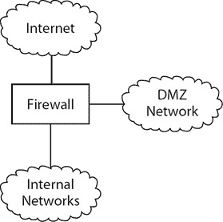

**图 4-5** 防火墙保护 DMZ 网络

防火墙通过某种用户界面进行管理。防火墙配置的核心是其规则，规则是一系列定义了允许或阻止特定网络流量的语句。表 4-7 包含了一组示例防火墙规则。

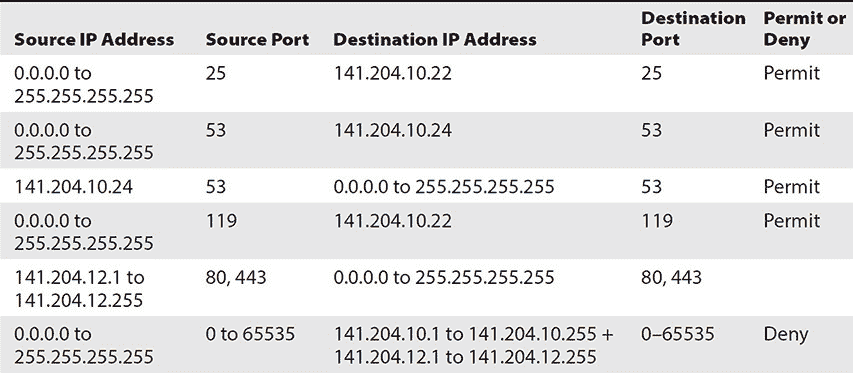

**表 4-7** 示例防火墙规则

表 4-7 中的规则在此处解释，按出现顺序排序：

- 仅允许来自整个互联网的电子邮件到达 `141.204.10.22` 邮件服务器。

- 仅允许来自整个互联网的 DNS 到达 `141.204.10.24` DNS 服务器。

- 仅允许来自整个互联网的 NNTP 流量到达 `141.204.10.22` 时间服务器。

- 仅允许所有用户通过 `80` 和 `443` 端口（HTTP 和 HTTPS 协议）访问整个互联网。

- 拒绝来自互联网的所有端口的其他流量到达任何内部系统。

### 应用防火墙

`Application firewalls`（应用防火墙）是用于检查和控制发送到应用程序服务器的消息的设备，主要用于阻止意外或恶意内容。应用防火墙通常用于保护 Web 服务器，拦截可能代表攻击者试图非法控制应用程序或窃取应用程序服务器访问数据的攻击。

### 分段

`Network segmentation`（网络分段）是将组织的网络划分为多个区域的做法，并使用防火墙等保护设备控制区域之间的网络流量。

网络分区的目的是通过网络级访问控制保护业务功能或资产组。网络分段是一种常用技术，通过允许特定主机、用户或应用程序的网络流量访问其他网络，同时拒绝所有其他访问来保护高价值资产。图 4-6

**图 4-6** 网络分段创建信任区域

网络分的常见用途包括：

- 防止数据中心受到包含终端设备网络的攻击

- 隔离具有敏感数据的系统，以减少审计范围

- 保护非军事化区（DMZ）网络上的系统免受互联网攻击，同时保护内部网络免受 DMZ 上系统的攻击

- 保护内部网络不受开发或测试环境中活动的影响

### 入侵防御系统

`Intrusion prevention systems (IPSs)`（入侵防御系统）是能够检测并阻止可能与入侵相关的恶意网络流量的系统。

IPS 与防火墙有一点重要不同：IPS 会检查网络数据包的内容，以确定每个数据包应该是允许通过网络还是被阻止。防火墙对是否阻止或允许数据包的决策完全基于其源、目的和端口。

许多 IPS 还会根据定期发送到 IPS 的网络“信誉”数据，阻止来自“已知恶意”IP 地址和域名的流量。多个 IPS 产品的制造商包含了信誉数据馈送，有时每天更新多次。攻击者经常频繁更换攻击源，因为他们知道大多数网络工程师无法跟上这种变化速度；然而，具有入站信誉馈的 IPS 有助于自动化这一过程，通过更有效地阻止来自已知恶意站点的流量，从而提高安全性。

某些 IPS 可以从 `threat intel feed`（威胁情报馈）导入信息，这是一种关于已知威胁的订阅服务。威胁情报馈通常包含与已知恶意网站相关的 IP 地址；IPS 将自动阻止传输到或来自这些 IP 地址的流量。

除了阻止恶意流量，IPS 还可以允许可疑流量、记录事件并可选地创建报警。这属于可能可疑也可能不可疑的网络流量范畴。这将警报人员，以便他们调查事件并采取必要行动。

IPS 需要持续的警惕。有时，IPS 会阻止异常但实际上无害的流量。这种对流量的阻止可能代表了对预期业务活动的拦截。在这种情况下，监控和操作 IPS 的安全分析师需要对这些流量进行“白名单”处理，以便 IPS 将后不再阻止它。此外，当 IPS 在允许可疑流量时发出报警时，安全分析师需要调查此事并采取所需的行动。

与许多安全系统一样，IPS 最初以硬件设备的形式存在。现在大多数 IPS 都以虚拟机的形式提供，可以安装在组织的公有云或私有云中。

### 网络异常检测

网络异常检测是一种用于识别可能属于入侵或其他意外事件的网络流量的常用技术。网络异常检测是一种纯粹的检测工具，并不阻止意外流量。在所有情况下，当网络异常检测系统识别出潜在的意外流量时，必须有人采取行动识别流量的业务性质，并在需要时采取步骤将其阻止。

网络异常检测系统通过“学习”系统之间发生的所有网络“对话”来工作。随着时间的推移，网络异常系统将能够识别异常流量，即与其所知的所有流量相比具有新颖或独特的网络流量。网络异常系统有多种方式将流量识别为异常：

- 两个系统之间从未（或很少）直接通信过的流量

- 两个系统之间在很少（或从未）使用的网络端口上的流量

- 两个系统之间的流量量高于之前观察到的

- 两个系统之间流量发生的时间与之前观察到的不同

网络异常系统通常不检查流量内容，只检查系统标识、使用的端口和流量大小。

为了确保有效，网络异常检测系统需要部署在网络流量流量的位置，例如骨干路由器。但更常见的是，网络异常检测系统利用各种路由器上的代理并集中收集流量进行分析。图 4-7

**图 4-7** 网络异常检测系统从多个源收集数据进行分析

网络异常检测系统主要有两种类型。第一种是专用系统（设备或虚拟机），它从网络中的各个点收集网络流量数据，如图 4-7](../Text/ch4a.xhtml#ch4fig7) 所示。第二种方法是使用核心路由器和防火墙的详细事件日志，并发送到 SIEM，在 SIEM 中建立网络异常检测规则。这两种方法可以实现相同的目标：检测可能是入侵或其他意外迹迹的异常网络流量。

有三种标准用于网络异常检测：

- `Netflow` 这是由思科系统开发的网络异常检测协议，适用于思科系统路由器。

- `sFlow` 这是一种用于监控网络的行业标准协议。

- `Remote Monitoring (RMON)` 这是一种允许监控网络流量的早期协议。

**网络分接器，又称镜像端口**

几种基于网络的检测型安全系统旨在观察通过组织网络中一个或多个控制点的所有流量。这些系统通过分析组织的所有内部和/或外部网络流量来工作，并在看到特定条件时触发警报——通常是入侵迹象或其他非预期事件（例如员工行为不当）。

让这些检测型系统能够获取所有网络流量的一种简单方法是在网络中部署串联式（inline）设备，以接收所有网络流量。然而，网络管理员往往不愿意在网络中部署串联式安全工具，因为它们会影响网络性能，并成为额外的`single point of failure`（单点故障）。

`network tap`通常被称为`span port`，是某些网络路由器和交换机上的特殊连接。通过路由器或交换机的所有流量副本都将被发送到网络分用器。网络分用器可以连接到入侵预防系统（在这种情况下，由于不是串联的，它将以监听模式运行）或网络异常检测系统。网络分用器的优点是，其活动不会干扰网络本身。

### 数据包嗅探器

`packet sniffer`（数据包嗅探器）是安全工程师或网络工程师用于分析网络流量的检测工具。数据包嗅探器最初以外部设备的形式存在，现在以软件工具的形式存在，可以安装在服务器和桌面操作系统以及网络设备上。

数据包嗅探器通常在网络工程师排查网络问题时使用，以便更好地理解网络设备之间流动流量的精确性质。由于即使是小的网络也可能有大量的流量，数据包嗅探器会使用规则指示其仅显示工程师感兴趣的特定包。

数据包嗅探器可以保留特定类型的数据包以备日后分析。例如，如果网络工程师正在排查 DNS 问题，工程师可以只捕获 DNS 数据包，以便检查这些数据包的内容，希望这能带来问题的解决方案。

由于工程师可能排查的问题类型各不相同，数据包嗅探器以不同的方式显示数据包，从以太网帧到 TCP/IP 包再到应用消息。

图 4-8 显示了在 macOS Sierra 上运行的流行的 Wireshark 包嗅探工具。

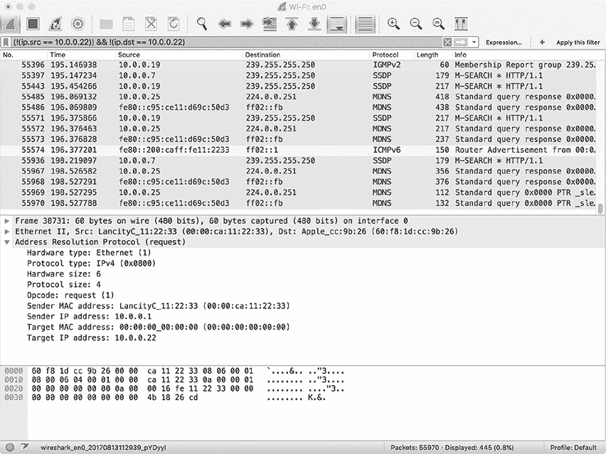

**图 4-8** 数据包嗅探工具 Wireshark 在无线网络上捕获数据包

### 恐惧之缆

我曾认识过一个网络工程师，他加入了一个组织，在其中担任网络工程师和网络架构师的角色。为了理解网络，他利用工具和物理观察开发了该组织企业网络的第一份综合图。他自豪地将用绘图仪打印的图表挂在办公室附近的墙壁上。

我研究了这张图表，网络通常像一个基于逻辑设计的网络，由防火墙隔开不同的区域。但我注意到一个网络连接从一个网络区域开始，绕过了所有防火墙，并于另一个区域。该连接是数据中心的一根物理电缆，直接连接了两个本不应该直接连接的网络。

我询问网络工程师关于这根电缆及其目的。他回答道：“这恐惧之缆。”我问那是什么意思，他回答说这根电缆上有活跃的网络流量，但他还不知道为什么。他找不到任何描述这根电缆或其目的的文档。他害怕这根电缆的存在本身，并担心如果拔掉它会发生什么。

他最终理解了电缆上传输的是什么流量，但从未理解过为什么它会在那里。最后，他成功地移除了它，据他所知，网络继续正常运行。

### 无线网络保护

当管理不当时，无线网络可能成为攻击途径。旧的加密协议如有线等效隐私（WEP）极易受到窃听和入侵。员工和入侵者可能会尝试建立自己的无线接入点。薄弱的身份验证协议可能允许入侵者成功验证到无线网络。这些和其他类型的攻击迫使组织采取许多保护措施，包括扫描未经授权的接入点、对无线网络进行渗透测试，以及监控无线接入点和控制器的疑活动。

### Web 内容过滤器

`web content filter`（Web 内容过滤器）是一种基于网络的中央系统，负责监控并可选地过滤 Web 通信。Web 内容过滤的主要目的是保护组织免受用户可能访问的网站上恶意内容的影响。图 4-9 显示了用户尝试访问 `http://whitehouse.com/` 时的“拒绝访问”窗口，该网站多年来一直是色情网站。

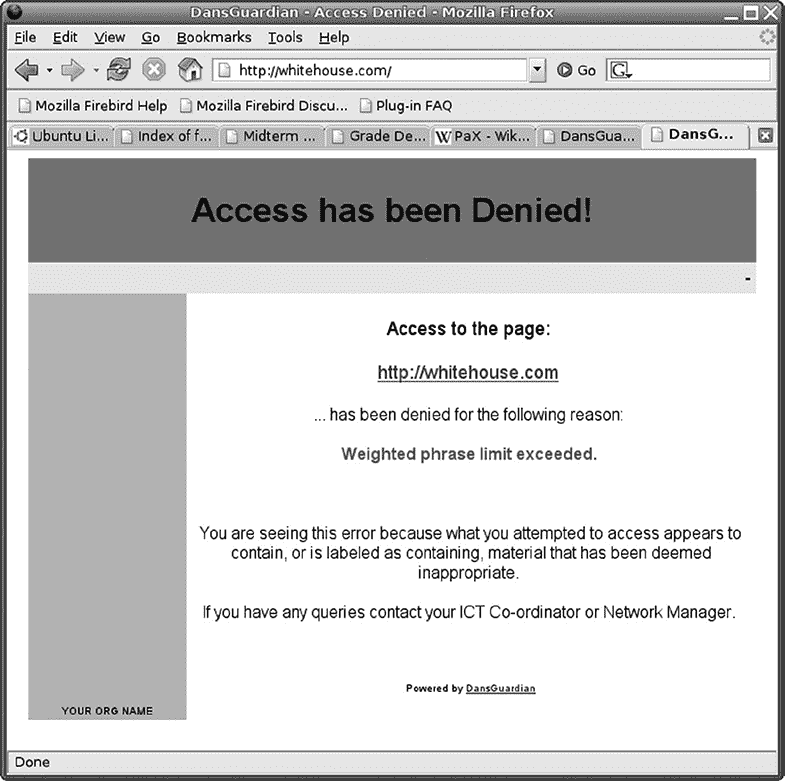

**图 4-9** 来自 Web 内容过滤器的终端用户“拒绝访问”屏幕（感谢 [en.wikipidia.org](http://en.wikipidia.org) 的 Bluefoxicy）

Web 内容过滤器密切监控进出用户浏览器的网络流量，并拦截包含恶意内容的流量，作为保护组织免受恶意软件攻击的手段。Web 内容过滤器由网络工程师或安全工程师集中管理，通常用于拦截特定类别的内容，使得与这些类别相关的网站用户无法访问。例如，组织有时选择不仅拦截与恶意软件相关的网站流量，还拦截特定内容类别的流量，如赌博、色情、武器或仇恨犯罪。有时，组织会面临 Web 审查的困境，因为员工指责雇主阻止他们访问想要访问的网站，即使这些网站与业务无关。

最初的 Web 内容过滤产品以位于组织数据中心的串联设备的形式存在，从而保护所有连接到内部网络的用户。但随着更多组织雇佣远程员工，较新的 Web 内容过滤产品采用安装在每个端点的软件代理的形式，因此无论用户位于何处，都能进行 Web 内容保护。

### 云访问安全网关

云访问安全网关（CASB）是一种安全系统，负责监控并可选地控制用户对 Internet 网站的访问。CASB 的目的是通过观察用户可以访问哪些服务提供商，并根据需要控制或拦截访问来保护敏感信息。

例如，一个组织购买了名为 Box 的云文件存储公司的企业账户。为了防止用户在其他云文件存储公司处存储敏感公司数据，CASB 将配置为拦截所有用户访问其他云文件存储供应商的操作。

偶尔，员工需要从另一个使用不同云文件存储服务的组织检索文件；大多数 CASB 系统允许例外，即允许个人用户访问其他服务。在许多情况下，CASB 系统能够感知并可以控制个人操作（例如文件存储与文件检索），并可以设置例外，允许个人用户在未经授权的服务中存储或检索文件。

CASB 的功能类似于 Web 内容过滤器。我相信 CASB 的功能将完全集成到 Web 内容过滤器产品中，导致独立 CASB 解决方案的近乎消失。

### DNS 过滤器

`DNS filter` 是一种通过操纵 DNS 查询和响应工作的内容过滤工具。与 Web 内容过滤器一样，`DNS filter` 的目的是保护组织免受恶意软件和其他不良内容的侵害。

实际上，`DNS filter` 的功能与 Web 内容过滤器非常相似，但其功能可以扩展到网络浏览之外的其他应用程序和系统。对于使用网络浏览器的用户，当用户尝试访问一个 `DNS filter` 已知为恶意的（或属于被阻止类别）的网站时，用户工作站对 DNS 查询的响应会将用户浏览器重向到一个页面，告知用户访问该网站已被阻止。

### 电子邮件保护：垃圾邮件和网络钓鱼过滤器

几十年来，电子邮件一直是传播恶意软件的首选方法。超过 90% 的成功网络入侵始于发送给数十名用户的网络钓鱼邮件，希望这些目标用户中的一个或多个用户会打开恶意文档或访问受损的网站。“流行的”欺诈方案包括 CEO 欺诈（诈骗者向公司高管发送电子邮件，要求他们为了秘密合并或收购汇出大额资金）和勒索软件（加密用户文件并索要赎金以恢复文件的恶意软件）。正由于这些原因，许多组织采用垃圾邮件和网络钓鱼过滤器的形式进行电子邮件保护，防止这些不良信息到达最终用户手中。

垃圾邮件和网络钓鱼邮件过滤器通常具有以下特征：

- 内置 `rules`，用于判断任何单封电子邮件是否应该被拦截。

- `quarantine`（隔离区），被拦截的邮件所在地。终端用户通常可以访问其隔离区查看消息并 `release`（释放到其电子邮件收件箱）不应被拦截的消息。

- `White lists`（白名单）和黑 lists（黑名单），可以集中配置且通常由终端用户配置，指定哪些邮件以及来自域名内任何人的邮件应始终被阻止或允许。

在不赋予用户垃圾邮件和网络钓鱼拦截可见性或控制权的组织中，终端用户对可能到达但被拦截的消息没有可见性或控制。在某些组织中，用户可以联系 IT 服务台，请求将特定电子邮件地址的任何消息释放给他们。

在赋予用户对垃圾邮件和网络钓鱼邮件处理具有完全可见性和控制权的组织中，终端用户可以自行查看其隔离区、释放单封消息并管理自己的黑名单和白名单。

在不良邮件主题中使用了多个术语，包括以下内容：

- `Clone phishing`（克隆钓鱼）：获取合法的电子邮件并对其进行细微操纵以用于欺诈的做法。合法邮件中的附件或链接被替换为恶性内容。

- `Phishing`（网络钓鱼）：通用使用不良邮件试图对收件者进行某种欺诈。

- `Smishing`（短信钓鱼）：通过 SMS 短信消息发送给用户移动设备和智能手机的钓鱼信息。


`Spear phishing`（鱼叉式钓鱼）：针对目标群体或组织专门制作的钓鱼信息。

`Spim`：通过即时消息发送给用户的钓鱼信息。

`Whaling`（大鲸鱼钓鱼）：发送给关键高管的钓鱼信息；也称为鲸鱼。

在不赋予用户垃圾邮件和网络钓鱼拦截可见性或控制权的组织中，终端用户对可能到达但被拦截的消息没有可见性或控制。在某些组织中，用户可以联系 IT 服务台，请求将特定电子邮件地址的任何消息释放给他们。

在赋予用户对垃圾邮件和网络钓鱼邮件处理具有完全可见性和控制权的组织中，终端用户可以自行查看其隔离区、释放单封消息并管理自己的黑名单和白名单。

## 网络访问控制

`Network access control (NAC)`（网络访问控制）是一种网络安全方法，用于确定设备允许访问网络的条件。组织使用 NAC 来执行特定策略，包括：

- 仅限公司发布的设备
- 仅限补丁更新的设备
- 仅限恶意病毒软件更新的设备
- 仅限特定安全设置的设备
- 仅限授权用户的设备

对于想要防止未经授权的设备（如个人笔记本电脑、平板电脑或智能手机）连接到网络的组织，NAC 是一种有效的方法。NAC 还可以防止缺乏最新补丁或恶意病毒防护系统的系统连接网络，作为重要的防线。具有这些属性的设备通常连接到“隔离网络”，用户会被引导在那里安装安全补丁。

### 终端保护与管理

`endpoint`（终端）一词已泛指智能手机、平板电脑、笔记本电脑和台式电脑。终端用于在组织内部创建、处理、分发和存储敏感信息。

由于以下原因，终端是网络犯罪组织青睐的目标：

- 它们经常包含犯罪分子针对的敏感信息。
- 它们更容易丢失或被盗。
- 组织难以确保 100% 的已发终端都存在反恶意软件防御配置；因此，一小部分终端更容易受到恶意软件攻击。
- 它们通常被允许访问存在更敏感信息的公司内部网络。
- 某些用户更容易打开钓鱼邮件中的恶意附件，这为针对大量用户及其终端的熟练攻击者提供了成功的机会。
- 许多组织在向所有终端部署安全补丁方面做得平平，这意味着许多终端在长时间内容易受到可利用漏洞的影响。
- 某些用户拥有管理员权限，使其成为更具吸引力的目标。
- 终端非常强大且通常连接到高速宽带网络，使其成为攻击其他系统的极佳中间系统，包括中继钓鱼邮件和 DDoS 攻击。

由于终端数量相对很大，网络犯罪分子意识到由于上述列出的一个或多个因素，总会有一些终端保护得很差。

## 配置管理

大多数组织使用自动化工具管理其终端群体。这使得终端管理更具成本效益，且终端配置更加一致。组织通常采用四种主要技术进行有效的终端管理：

### 镜像管理

`image` 是计算机上完全安装并配置好的操作系统和应用程序的二进制表示。一个典型的计算机支持部门会维护一个镜像集合，针对不同类别的用户以及各种硬件品牌、型号和配置维护一个或多个镜像。

### 配置管理

典型的计算机支持部门会利用一或多个工具，通过自动化来管理大量的终端系统。这些工具通常用于部署补丁、更改配置设置、安装软件程序以及删除软件程序。

### 远程控制

典型的计算机支持团队会使用允许他们远程访问运行中的终端系统的工具。其中某些工具允许在用户不知情的情况下对用户的终端系统进行隐蔽远程访问。大多数此类工具要求终端用户发起会话，从而授予计算机支持人员对终端的远程访问和控制权，以便进行协助和故障排除。

### 远程销毁

在终端丢失或被盗的情况下，具有远程销毁能力的组织可以指令丢失或被盗的终端立即销毁任何本地存储的数据，防止其落入可能窃取终端的犯罪分子手中。这种能力通常用于笔记本电脑、平板电脑和智能手机。

### 数据加密

许多组织考虑使用`全盘加密`等技术来保护移动设备上存储的信息。这通过让窃窃更难以访问被盗设备上的存储数据，有助于保护存储在移动设备上的敏感数据。

组织通常会维护终端`配置标准`，这些文档详细说明了其终端的操作配置和安全配置。有时，终端的安全配置会存在于一份独立的`加固标准`文档中。

## 恶意软件防护

终端计算的本质以及现代操作系统的设计意味着，恶意软件是一个在短期内不会消失的问题。相反，随着`勒索软件`和`破坏性软件`的出现，恶意软件正变得越来越强大且更具破坏性。这并没有削弱旧版恶意软件的影响，这些软件使攻击者能够远程访问受害者系统（使用远程访问木马，或称 `RAT` 软件）、搜索并外泄敏感数据、使用键盘记录器盗取登录凭据、转发垃圾邮件和钓鱼信息，并参与针对其他组织的 DDoS 攻击。

恶意软件有许多类型。任何种类的恶意软件都可能具有以下一个或多个特征：

- **病毒**：一种可执行文件的片段，能够将自己附加到其他可执行文件中。这种恶意软件几乎只存在于 Windows 操作系统，但随着新版本 Windows 的改进，病毒已变得不那么常见。
- **木马**：一个独立的程序，必须由终端用户执行才能激活。木马通常声称是某样东西（例如，一个游戏），但实际上它在执行某些恶意操作。
- **宏**：嵌入在另一个文件（如文档或电子表格文件）中的可执行文件。
- **间谍软件**：记录目标系统上一个或多个监控活动的恶意软件，包括访问的网站和击键，并向间谍软件所有者报告。
- **蠕虫**：一种能够从一台计算机自动传播到另一台计算机的独立程序，通常使用网络通信。
- **根基程序 (Rootkit)**：设计用于逃避反病毒软件甚至操作系统本身检测的恶意软件。
- **无文件**：仅存在于计算机内存中的恶意软件，而不是文件系统中。这种恶意软件传统的反病毒软件更难以检测，因为没有文件可以供其检查匹配签名。
- **勒索软件**：执行某些破坏性但可逆操作的恶意软件，如加密文件，并要求在恢复破坏之前支付赎金。
- **破坏性软件**：在目标系统上执行某些永久性破坏（如不可逆的文件加密）的恶意软件。也称为 `wiper`（擦除器）。
- **远程访问木马**：通常称为 `RAT`，这是一种通过攻击者对目标系统提供隐蔽远程访问可视性和控制的恶意软件。
- **键盘记录器**：记录目标系统上终端用户击键的恶意软件，然后将这些击键发送给攻击者进行后续分析。

以前被称为`反病毒软件`，`反恶意软件`是旨在检测恶意软件的存在并在执行前将其中和的软件。反恶意软件利用多种技术来检测恶意软件的存在：

- **签名**：一种悠久但正迅速过时的技术，签名检测涉及将已恶意软件与引入系统的新文件进行匹配。匹配成功意味着检测到了恶意软件。
- **进程观察**：反恶意软件观察操作系统中运行的进程的行为，并通常知道每个进程将采取的操作类型。当反恶意软件看到某个进程执行不符合该进程特征的操作时，它将终止该进程。
- **沙箱**：反恶意软件会先在沙箱中安装新文件，沙箱是一个允许文件执行的虚拟容器。如果文件在沙箱中的表现像恶意软件，它们将不允许在系统中执行。在某些产品中，沙箱位于终端，而在另一些产品中，沙箱位于云端。
- **欺骗**：反恶意软件会使用某些技术扰乱操作系统的内存映射，使恶意软件无法攻击进程的内存映像。

### 反病毒软件的死亡

反病毒软件通过识别传入感染的“签名”来工作。当病毒传播到另一台计算机时，反病毒软件会计算传入文件的签名，如果发现匹配，则反病毒软件检测到了病毒并采取手段将其移除。

在这方面，反病毒软件已经尽到了使命。反病毒软件最初开发于 20 世纪 80 年代中期，由于计算机病毒出现缓慢，反病毒软件最初每年更新几次签名。但多年来，越来越多的计算机病毒被发现，导致每天都要更新多次签名。

恶意软件的创建者已经赢得了这场战斗。创建恶意软件使用的技术包括一种被称为`打包`的过程，即将恶意软件程序封装到可执行的 `EXE` 文件中。如今，许多种类的恶意软件在攻击每个终端之前都会重新封装，并在过程中引入一些随机性。结果是：每个被感染的终端的病毒“签名”都是唯一的，且在世界上不会再次出现。基于签名的反病毒软件无法处理这种问题。

### 虚拟桌面基础设施

对恶意软件和其他与终端计算相关的风险高度担忧的组织可以实施虚拟桌面基础设施 (VDI)。在 VDI 中，终端用户计算在高度控制的中心化服务器上进行，终端用户的计算机实际上是作为终端运行。VDI 减少了终端上的恶意软件风险，因为终端被简化为以前版本的形态，与典型的终端操作系统相比，其`攻击面`要得多。此外，业务数据没有存储或处理在终端上，而是保留在中心化服务器上。

组织通常在其终端上使用企业级反恶意软件。与作为独立应用程序运行的消费级反恶意软件不同，企业版利用集中控制台，允许工程师观察并管理运行在数千个终端上的反恶意软件。企业控制台可以在需要时重新安装恶意软件，根据需要对文件系统进行扫描，并更改任何或所有终端的配置。当检测到恶意软件时，控制台可以向安全事件和事件管理系统发送详细信息，提醒安全运营中心 (SOC) 的人员注意该事件，以便根据需要采取行动。

### 终端用户与本地管理员权限

几十年来，终端和终端用户管理中的一个棘手问题在于终端用户的能力。在微软 Windows 的早期版本中，终端用户会被自动授予“本地管理员”角色。这产生了两个主要影响：

- 终端用户可以随意安装程序、安装驱动程序并更改系统配置，从而减轻了 IT 服务台亲自执行这些操作负担。虽然减轻了服务台的繁琐工作，但如果终端用户误操作安装或破坏了系统注册表，服务台就承担了恢复用户系统的任务，这有时需要花费几个小时的工作。
- 恶意软件通常以与终端用户相同的权限级别执行以激活自身。当终端用户是本地管理员时，恶意软件就可以在机器上横行，不受限制地执行任何需要的操作。这使得恶意软件攻击变得更加强大，因为恶意软件可以更改操作系统的任何部分。

IT 组织逐渐从终端用户那里收回了管理权限，但过程并非一帆风顺。在许多情况下，终端用户会抱怨甚至发生反抗：他们想要安装自己的 iTunes、个人所得税软件以及任何他们想要的其他东西。在拥有本地管理员权限多年后，终端用户觉得有权做任何他们心所欲的事。有些人甚至说，“个人电脑”这个词意味着他们可以做任何他们想做的任何事。

幸运的是，较新版本的 Windows 通过允许没有管理员权限的终端用户执行一些“类管理员”任务改进了状况。他们仍然并不完全满意，但冲突已经减少了。

## 身份与访问管理

身份和访问管理 (IAM) 代表用于管理员工和系统身份，以及他们对系统和访问访问业务流程和技术。身份管理是管理每个员工、承包商、临时工、供应商人员以及（可选）客户的身份和访问历史的活动。这些记录随后被用作控制每个人被允许使用的工作场所、应用程序、IT 系统和业务功能的依据。

当组织的业务应用程序较少时，组织为每个单独的应用程序配置用户访问。随着组织开始实施更多的应用程序，用户拥有的凭据越来越多。随着向云端应用程序的大迁移，用户需要记住的凭据数量呈失控增长，导致了不安全的习惯，包括在许多应用程序中使用相同的凭据，以及在易于发现的地方记录凭据。IT 服务台被无法有效管理其日益增加的凭据组合的用户重置密码请求所淹没。

由于这些发展，组织开始集中其身份和访问管理系统，以便用户管理更少的凭据集。组织实施了`减少登录` (reduced sign-on) 和`单点登录` (single sign-on) 来简化用户的访问，这也减少了 IT 管理用户访问所需的精力。另一个优势是管理用户凭据所需的精力更少。例如，当一名员工离开组织时，只需锁定或删除该用户所有应用程序的单一访问凭据，即可有效地将离职用户排除在组织的所有业务应用程序之外。

组织意识到，减少登录和单点登录的致命伤在于：如果用户的唯一一组凭据被破解，攻击者将获得对该用户可以访问的所有应用程序的权限。因此，组织通过实施`多因素认证` (multifactor authentication) 来做出应对，这种机制要求用户提供用户 ID、密码和一个通常位于智能卡、移动手机或智能手机中的额外标识符。组织还可以实施`生物识别` (biometrics)，这是多因素认证的一种形式。多因素认证的优势在于，用户 ID 和密码被破解的情况下，除非攻击者还持有用户的移动设备，否则他们将无法访问信息。

通常，访问操作由 IT 部门执行，而访问审查和重新认证由信息安全部门执行，作为一种制衡机制的形式。让 IT 执行访问审查是没有意义的，因为他们将检查自己的工作，而执行这些审查的员工可能会试图掩盖自己的错误。

### 访问操作

身份和访问管理是一门充满活动的学科。身份和访问管理中的日常活动包括以下内容：

- 为新员工配置访问权限
- 调整转岗员工的访问权限
- 协助员工解决访问问题，如忘记密码
- 协助账户因各种原因被锁定的员工
- 移除离职员工的访问权限

身份和访问管理中不那么常规的事件包括这些与项目相关的活动：

- 将新的业务应用程序与集中身份验证服务集成
- 在响应笔记本电脑或移动设备丢失时重置用户凭据

### 访问治理

`访问治理` (Access governance) 是代表一系列用于确保用户访问符合策略的术语。这些活动通常由与执行常规访问操作不同的小组执行。

#### 访问审查

访问审查是管理层审查用户对信息和信息系统访问的活动。访问审查的目的是确认所有需要访问信息系统的员工都拥有该权限，且没有其他人拥有该权限。访问审查有不同的形式，包括：

- 对单个用户对所有信息和信息系统的访问进行分析
- 对所有用户对某一信息系统的访问进行分析
- 对拥有多个信息系统特定访问权限的用户进行分析

各种法规都要求访问审查。这要求执行访问审查的人员生成一份审查记录，包括接受审查的所有用户以及根据审查采取的特定行动。

#### 权限积累

在组织中工作多年的用户在他们的任期内可能担任一个或多个部门的多个职位。当此类用户从一个部门移动到另一个部门时，用户将需要访问新的角色或信息系统。多年来，用户拥有的信息系统和角色访问权限可能远其当前角色所需的权限。这种现象被称为`权限积累` (accumulation of privileges)。

这不是一个容易解决的问题。当用户转调到另一个部门时，终止其先前的工作相关的访问权限是合乎逻辑的。然而，有几个因素使得这变得不可行：

- 用户在原岗位上可能仍承担职责。
- 用户可能正在培训接替其原岗位的人员。
- 用户可能处于某个项目的过程中，并将完成它。

结果是，用户的凭据通常无法在转调时移除。在几周或几个月后提醒访问管理员处理这些问题容易出错。结果就是访问权限的累积。访问审查和访问重新认证代表了针对这种现象的纠正控制措施。

### 职责分离

在管理用户访问方案的过程中，安全管理人员会发现，业务流程在信息系统和应用程序中实现了一些高价值和高风险的角色。`职责分离 (Segregation of duties, SOD)` 是一个概念，确保没有单个个人拥有可能导致未经授权活动或对敏感数据进行操纵或暴露的权限。

例如，会计部门将角色分配给个人，使得没有任何一个个人同时具备创建供应商、向供应商申请付款以及批准供应商付款的能力。这种访问权限的组合会诱使员工建立虚假供应商，然后让付款发送给该供应商。另一个例子是用户账户的请求和账户的配置。职责分离的目的是要求两个或更多人员执行高价值和高风险的活动。两个或多个个人欺诈组织的概率比单个个人要低得多。

在职责分离访问审查中，安全管理人员检查用户对各种高风险和高价值角色的访问权限，以确定是否任何个人访问了这些功能中的多个一个角色。任何此类发现都会被识别，并采取纠正措施。

在某些情况下，特别是在较小的组织中，没有足够的人员将高价值和高风险活动分配给两个或更多人员。在这种情况下，安全管理人员应建议定期执行详细的活动审查，以确保没有发生欺诈活动。在风险和高价值活动中，活动审查通常都会进行，但在无法实现职责分离的情况下，这些审查可能会发生得更频繁。

### 特权和高风险角色

信息系统和应用程序通常具有普通用户的角色，还具有具有管理性质的角色。这些管理角色具有许多高风险能力，包括创建用户账户、系统配置和更改记录。这些特权角色通常需要更频繁、更彻底的审查，以确保拥有这些角色的员工尽可能少。

### 活动审查

活动审查是一种检查信息系统的活动，以查看哪些用户是活跃的，哪些用户未活跃。访问审查的主要目的是识别长时间内没有活动（通常为 90 天）的用户账户。其理由是，如果一个用户超过 90 天没有使用某个应用程序，那么该用户可能不再需要该系统。移除或锁定此类用户的访问权限有助于降低被破解的风险：如果此类用户的凭据被破解，它们将无法用于访问系统。

活动审查是一种有助于减少权限累积的纠正控制措施。

### 访问重新认证

访问重新认证是一种周期性审查，信息系统所有者审查用户列表及其角色，并为每个用户和角色确定其访问权限是否仍需要。与其他审查一样，人员通常会创建一份业务记录，显示检查了哪些用户和角色，以及采取了哪些纠正措施。

访问重新认证是一种有助于减少权限累积的纠正控制措施。

#### 用户行为分析

用户行为分析 (UBA) 代表了一种新兴技术，它对单个用户的行为建立基准，异常活动会触发事件或警报。UBA 是异常检测的几种形式之一，帮助组织检测员工执行的未经授权活动，或找到成功破解其用户账户的攻击者。

#### 安全事件管理

`Security incident management` 是组织采取的一系列活动，以确保能够快速识别安全事件，并快速有效地做出响应和遏制事件。

安全事件管理通常分为两个部分：

- **主动性**：这是策略、程序、剧本和相关培训的制定。
- **响应性**：这是对事件的实际响应，以及事后活动。

安全事件管理在 `../Text/ch5.xhtml#ch5` 中完整介绍。

#### 安全意识培训

人员是信息安全中的主要弱点。这主要是因为判断失误、疏忽、疲劳、工作压力或技能短缺。人员通常被认为是组织攻击面中最大且最脆弱的部分。

人们有时会被社会工程攻击欺骗，例如钓鱼邮件，为攻击者提供了进入组织网络的切入点。在较大的组织中，向数百或数千名人员发送钓鱼消息的攻击者几乎可以肯定，这些人中至少有一个会点击链接或打开附件，导致用户工作站面临潜在的风险。

许多组织开展安全意识培训，使人员意识到这些常见的攻击，以及其他几个主要归类为 `网络卫生 (Internet hygiene)` 的主题，即在访问互联网时安全地使用计算机和移动设备。

##### 目标

安全意识计划的主要目标是让所有人员对他们可能面临的不同类型攻击的现实保持敏锐认识，并了解他们在各种情况下预期应做什么。此外，人员必须理解并遵守组织的可接受使用策略、安全策略、隐私策略和其他适用策略。

更好的安全意识培训计划包括练习技能的机会，并在培训结束时测试。在基于计算机的培训中，应要求用户通过测试并达到最低分数——70% 是完成课程的典型最低分数。


应创建业务记录，记录每人何时接受了培训。许多组织受信息安全法规限制，要求人员完成安全意识培训；业务记录为用户完成培训提供了充分证据。

## 创建或选择内容

安全经理需要为组织内的人员开发或获取安全意识培训内容。所选择或开发的内容应具有以下特征：

- `易于理解`：内容应能让所有人员都听懂。安全经理经常犯的一个常见错误是创建了过于技术化的内容，导致许多非技术人员难以理解。

- `具有相关性`：内容应适用于该组织及其用户。例如，关于密码学主题的培训对于大多数组织中的绝大多数人员来说是无关的。无关的内容会导致人员对后续培训产生产生疏离情绪。

- `可操作性`：内容应确保人员在常见场景下知道该做什么（以及不该做什么）。

- `易于记忆`：最好的内容将为人员提供在对信息安全至关重要的基础任务中练习技能的机会，包括选择和使用密码、阅读和回复电子邮件，以及与组织内外的人员互动。

## 受众群体

在规划安全意识计划时，安全经理需要了解全体员工群体及其在组织中的角色。这有助于经理理解哪些培训主题与哪些员工组相关。安全经理需要确保员工获得他们所需的所有培训，同时避免让与其工作无关的培训给员工增加负担。

例如，一家大型零售机构的员工分为四类：

- `公司员工`：这些人员都使用电脑，且大多数人使用移动设备。

- `零售一线经理`：这些人员在零售门店工作，并在工作中每天使用电脑。

- `零售一线收银员`：这些人员在零售门店工作。他们不使用电脑，但会通过现金、支票和信用卡收取付款。

- `零售一线员工`：这些人员在零售店和仓库地点工作，不使用电脑。

此示例中的安全经理应该对安全意识进行封装，使每个受众都能接受相关的培训。零售一线员工可能完全不需要互联网或计算机相关的安全意识培训，而是接受与物理安全和工作场所安全相关的主题培训。收银员需要接受欺诈技术（假币、数钱欺诈以及与信用卡支付相关的刷卡等）的培训。公司员工和零售一线经理可能应该接受全方位培训，因为他们都使用电脑。零售一线经理还应该接受提供给一线员工和收银员的所有培训，因为他们同样在门店工作并监督这些人员。

### 技术人员

组织中的技术人员（通常是 IT 人员）应接受与其职位相关的安全技术培训。技术人员负责架构、系统和网络的设计、实施和管理。如果没有安全培训，这些人员可能会在无意中产生判断失误，导致严重的漏洞，从而引发安全风险。

### 软件开发人员

软件开发人员在学院、大学和技术学校通常很少或没有接受安全软件开发的教育。因此，`secure coding`的艺术对许多软件开发人员来说是全新的。针对软件开发人员的培训有助于他们意识到开发人员常犯的错误，包括：

- 允许注入攻击的漏洞

- 损坏的身份验证和会话管理，导致攻击者访问其他用户的会话

- 跨站脚本 (XSS)

- 访问控制失效

- 安全配置错误

- 敏感数据泄露

- 攻击防护不足

- 跨站请求伪造 (CSRF)

- 使用已知漏洞的组件

- 保护不足的 API

上述列表由 Open Web Application Project（`http://www.owasp.org`）发布，这是一个致力于帮助开发者更好地理解安全应用和部署所需技术的组织。软件开发人员的安全通常应包括以下内容：

- 源代码保护

- 源代码审查

- 使用源代码时的谨慎

- 对源代码进行漏洞和缺陷测试

- 源代码归档

### 第三方

安全意识培训需要对所有通过任何手段访问组织数据的人员进行。这通常包括其他机构的员工的人员，这意味着课程的某些部分可能需要修改，因为某些部分不适用于外部人员。

### 新入职员工

新员工以及顾问和承包商应被要求尽快参加安全意识培训。存在一种风险，即新员工在入职早期及培训之前可能会犯错，因为他们还不熟悉组织中的所有操作规范。

优秀的组织会将访问控制与安全意识培训挂钩：在员工成功完成安全意识培训之前，不会授予其系统访问权限。这为新员工完成培训提供了额外的动力。

### 年度培训

大多数安全意识计划都包含每年一次针对所有员工的年度复习培训。根据某些法规的要求，这种培训是强烈建议的，因为这有助于使安全和网络安全成为每位员工日常思考过程的一部分，并帮助他们避免常见错误。此外，由于防护技术和攻击技术变化非常快，年度复习培训有助于员工意识到这些进展。

组织通常对年度培训在两个方案中选择其一：

- `整个组织`：组织将向整个组织发布信息，并同时为所有员工进行年度培训。这种做法的优点是可以利用全员信息进行全方位攻势，让人们思考这项培训。缺点是所有员工的效率会在同一时间内稍微降低。

## 入职周年纪念日

组织安排员工在其原始入职日期当月的月份参加年度培训。例如，如果某员工的入职日是 2017 年 3 月 4 日，那么该员工（以及所有在 3 月入职的人）将在 3 月份完成年度安全意识培训。这样做的好处是，干扰（尽管影响很微）被分散在全年中。一个主要的缺点是，可能没有机会面向全体人员发布培训通知。

## 通信技术

安全意识培训计划通常利用多种手段向员工传达网络卫生和安全计算信息。通信技术通常包括以下内容：

- **电子邮件**：安全经理可能会偶尔向受影响的人员发送告警，告知他们最新进展，例如新的钓鱼攻击。偶尔，高级执行人员会向全体人员发送信息，以强调安全是每位员工的责任，并且必须认真对待安全。

- **内部网站**：拥有内部网站或网络门户的组织可能会不时发布包含信息安全的消息。

- **视频显示器、海报和公告栏**：有时，显示器、海报或公告栏上关于各种主题的安全信息可以吸引人们参加活动。

## 数据安全

ISACA 将数据安全定义为`维护信息的机密性、完整性和可用性的控制措施`。数据安全是所有涉及信息安全法律、标准和实践的核心。这里讨论了关于数据安全的几个议题，包括：

- 访问管理

- 密码学

- 备份与恢复

- 数据防泄露

- 云访问安全代理

- 用户行为分析

### 访问管理

访问管理是被称为 `身份和访问管理` 的更广泛学科的一部分。该主题在在本章早之前的“身份和访问管理”节中进行了详细描述。

### 密码学

`密码学` 是在众目睽睽之下隐藏信息的实践。换句话说，加密防止不希望的人员获取信息的实践。加密的目的是让某些访问信息变得困难（这里应避免使用“不可能”一词）。加密通过使用只有发送者和接收者知道的方法来扰乱消息中的字符来工作，使得消息对任何拦截消息的第三方都变得毫无用。

加密在保护敏感和高价值信息方面起着关键作用。在某些情况下，防止第三方对数据进行逻辑访问是不现实或不可行的——例如通过公共网络进行的数据传输。加密也被用作最后的防线——例如，当备份介质丢失或被盗时，对介质上的数据进行加密。

加密还可以用于`认证`从一方发送另一方的信息。这意味着接收方可以验证特定方确实发送了消息，并且消息是真实且未更改的。这允许接收者知道消息是真实的，并且在传输过程中没有被任何第三方伪造或更改。

通过加密，最佳实践要求系统设计人员使用已知且稳健的加密算法。因此，当第三方拦截加密数据时，第三方可以知道正在使用哪种算法，但仍然无法读取数据。第三方不知道的是用于加密和解密数据的`密钥`。其工作原理将在本节中进一步解释。


**提示**：加密可以被认为是另一层访问保护。就像用户 ID 和密码控制限制了除登录凭据以外的人员对数据的访问一样，加密也限制了除拥有加密密钥以外的人员对（明文）数据的访问。

## 密码学中使用的术语和概念

密码学中使用的几个术语和概念领域之外并不使用。安全经理必须熟悉这些内容，以便有效地理解、管理和审计使用密码学的 IT 系统。密码学中使用的术语包括：

- **明文**：原始消息、文件或数据流，任何具有访问权限的人都可以读取它。

- **密文**：经过加密算法转换并变得不可读的消息、文件或数据流。

- **加密**：将明文转换为密文的过程。如图 4-10 所示。

```
(Image representation here)
```

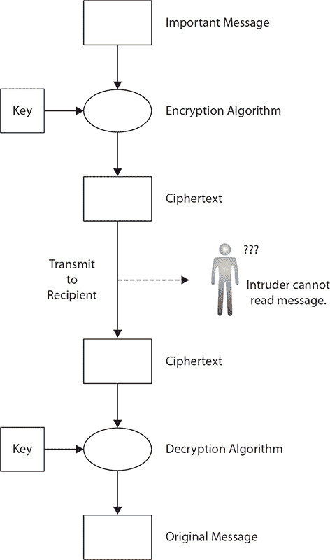

**图 4-10** 加密和解密利用加密算法和密钥

- **哈希函数**：对数据块进行加密操作并返回固定长度的字符串，用于验证消息的完整性。

- **消息摘要**：哈希函数的输出。

- **数字签名**：使用发送者的私钥对消息哈希值进行加密的结果，用于证明消息的真实性和完整性。如图 4-11 所示。

```
(Image representation here)
```

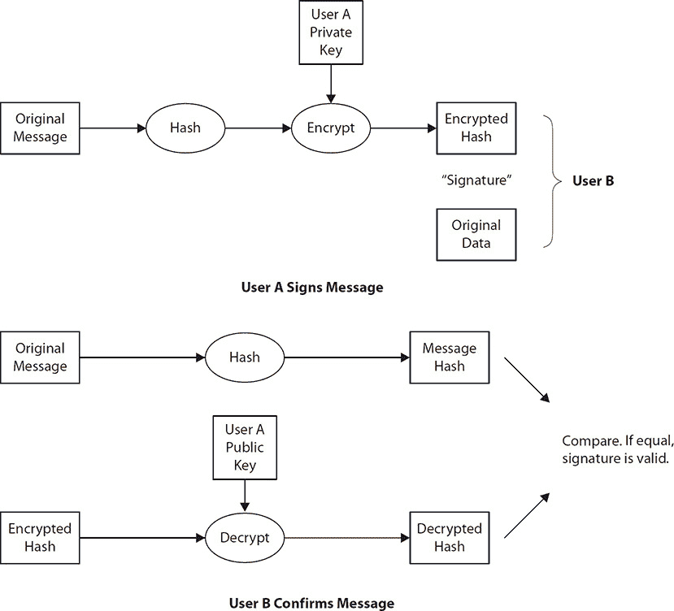

**图 4-11** 用于验证消息完整性的数字签名

- **算法 (Algorithm)**：用于执行加密、解密、消息摘要生成和数字签名的特定数学公式。

- **解密 (Decryption)**：将密文转换为明文的过程，以便接收者能够读取。

- **密码分析 (Cryptanalysis)**：对密码系统进行的攻击，攻击者试图推确定用于加密消息的加密密钥。

- **加密密钥 (Encryption key)**：一组字符，与加密算法结合使用，用于加密或解密数据流或数据块。加密密钥还用于创建和验证数字签名。

- **密钥加密密钥 (Key encrypting key)**：用于加密另一个加密密钥的加密密钥。

- **密钥长度 (Key length)**：加密密钥的大小（以位为单位）。加密密钥越长，成功攻击密码系统所需的精力越大。

- **分组加密算法 (Block cipher)**：在数据块上运行的加密算法。

- **流加密算法 (Stream cipher)**：一种在连续数据流（如视频或音频流）上运行的加密算法。

- **初始化向量 (IV)**：某些加密算法在开始加密过程时所需的随机数。

- **对称加密 (Symmetric encryption)**：一种加密和解密方法，双方必须拥有相同的加密密钥。

- **非对称加密 (Asymmetric encryption)**，或公钥加密：一种加密、解密和数字签名方法，使用由`public key`（公钥）和`private key`（私钥）组成的密钥对。

- **密钥交换 (Key exchange)**：在没有安全通道的情况下，双方用于建立对称加密密钥的技术。

- **不可否认性 (Nonrepudiation)**：加密和数字签名的属性，使得某方以后难以或无法否认发送过数字签名消息，除非他们承认失去了对私有加密密钥的控制。

## 私钥密码系统 (Private Key Cryptosystems)

私钥系统基于对称加密算法。私钥系统的主要特征是双方必须拥有一个用于加密和解密消息的共同加密密钥。

以下是私钥加密面临的两个主要挑战：

- **密钥交换 (Key exchange)**：在传输任何加密消息之前，需要一种“带外”`out-of-band`方法来交换加密密钥。这种密钥交换必须在独立的安全通道上进行；如果加密密钥通过主通信通道传输，那么任何截获加密密钥的人都可以读取任何被截获的消息，只要他们能确定所使用的加密算法。例如，如果双方想要交换加密电子邮件，他们需要先通过电话或传真等其他方式交换加密密钥，前提是他们确认电话和传真传输没有被截获。

- **扩展性 (Scalability)**：私钥系统要求每个发送者-接收者对都要交换加密密钥。对于一个 4 人的小组，需要交换 6 个加密密钥；对于一个 10 人的小组，需要交换 45 个密钥。对于 1000 人的大型群体，需要交换数千个密钥。

一些常用的私钥算法包括`AES`、`Blowfish`、`DES`、`Triple DES`、`Serpent` 和 `Twofish`。

## 安全密钥交换 (Secure Key Exchange)

安全密钥交换是指双方用于安全建立对称加密密钥的方法，而无需实际通过通道传输密钥。当两个互不未知的双方在没有带外通道的情况下建立加密通信时，就需要安全密钥交换。

即使第三方截获了双方的整个对话，双方也可以执行安全密钥交换。这是因为用于安全密钥交换的算法利用了双方已知但未在之间传输的信息。

最流行的算法是`Diffie–Hellman 密钥交换协议`。

### 交换初始加密密钥 (Exchanging Initial Encryption Keys)

想象一个私钥系统。在一个已建立的密码系统中，两个用户交换消息并使用加密密钥对其进行加密/解密。

在开始交换加密消息之前，其中一个用户必须首先从另一个用户处获得密钥副本。他们必须在建立密码系统之前完成此操作，因此不能使用密码系统来传输密钥。

安全密钥交换（如`Diffie—Hellman`）用于将密钥从一方安全地传输到另一方。一旦双方都拥有密钥，他们就可以开始互相发送加密消息。

如果没有安全密钥交换，双方必须使用其他安全的、带外的手段将加密密钥传给另一个用户。

## 公钥密码系统 (Public Key Cryptosystems)

公钥系统基于非对称（或称公钥）加密算法。这些算法使用两部分组成的加密密钥，其处理方式与对称密钥系统中的加密密钥不同。

### 密钥对 (Key Pair)

公钥加密中使用的加密密钥被称为`public key`（公钥）和`private key`（私钥）。公钥系统的每个用户都拥有这两个这两个密钥。公钥和私钥合称为`key pair`（密钥对）。这两个密钥需要不同的处理方式，并共同使用，但用于本节中解释的不同目的。

当用户生成密钥对（`public key`和`private key`）时，密钥对将物理上作为两个独立的文件存在。用户可以自由发布公钥，甚至发布在公共网站上。这与`private key`相反，后者必须受到保护且不能发送给任何方。大多数公钥系统将利用密码机制进一步保护私钥；如果没有密码，私钥将无法访问且无法使用。

### 消息安全 (Message Security)

公钥加密是消息安全的理想应用，特别是电子邮件。这是因为用户不需要建立通信对称密钥。通过公钥加密，从未联系过的用户可以立即向对方发送安全消息。图 4-12 展示了公钥加密。

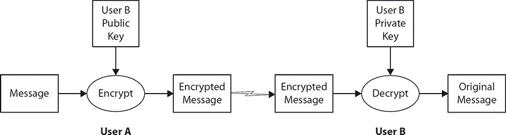

**图 4-12** 用于传输秘密消息的公钥加密

每个用户都可以自由发布其公钥，以便于获取。互联网上有服务器可以发布公钥并供世界上任何人使用。公钥加密的设计确保了公开用户的公钥不会破坏其相应私钥的机密性：无法从公钥推导出私钥。

当用户 A 想向用户 B 发送加密消息时，步骤如下：

1. 用户 B 在互联网方便的位置发布其`public key`。

2. 用户 A 获取 B 的`public key`。

3. 用户 A 创建消息并使用 B 的`public key`对其进行加密，并将加密消息发送给 B。

4. 用户 B 使用其`private key` 解密并读取消息。

注意，在本示例中仅使用了 B 的加密密钥。此方法仅用于保护消息免受窃听。此方法不验证消息的真实性。

公钥加密还可以用于验证消息的真实性和完整性。这用于验证特定某方确实创建了消息。步骤如下：

1. `User A` 在互联网上一个方便的位置发布了其公钥。

2. `User B` 获取 `User A` 的公钥并将其保存以备后用。

3. `User A` 创建了一条消息，并用其私钥对其进行数字签名，然后将签名后的消息发送给 `User B`。

4. `User B` 使用 `User A` 的公钥验证数字签名。如果消息验证通过，`User B` 就知道该消息源自 `User A` 且在传输过程中未被篡改。

在例例中，仅保证了消息的真实性和完整性。消息没有被加密，这意味着拦截消息的任何一方都可以读取其内容。

公钥加密既可以用于对消息进行加密，也可以用于对其进行数字签名，这将保证其机密性和真实性。步骤如下：

1. `User A` 和 `User B` 将他们的公钥加密密钥发布在方便的地方。

2. `User A` 获取 `User B` 的公钥，`User B` 获取 `User A` 的公钥。

3. `User A` 创建了一条消息，用其私钥对其签名，并用 `User B` 的公钥对其加密，然后将消息发送给 `User B`。

4. `User B` 使用其私钥解密消息，并用 `User A` 的公钥验证数字签名。

## 椭圆曲线加密

一种名为`椭圆曲线加密`（`ECC`）的加密方法因用于公钥加密应用而受到关注。与其他加密算法相比，`ECC` 需要的计算资源和带宽更少，并且认为更安全。由于功耗要求低，它被广泛应用于移动设备。

公钥加密还支持使用多个用户的公钥对消息进行加密。这允许用户向多个接收者发送一条单一加密消息，该消息是使用每个接收者的公钥分别进行加密的。这种方法不会破坏任何用户私钥的机密性，因为私钥无法从公钥中推导出。

### 验证公钥

欺诈者可能会声称他人的身份，甚至发布一个声称是他人身份的公钥。有四种方法可以验证用户的公钥是否真实：

- **证书颁发机构 (CA)**：从信任且誉良好的证书颁发机构获取的公钥可以认为是真实的。

- **电子邮件地址**：用于电子邮件的公钥将包含用户的电子邮件地址。如果该电子邮件地址属于公司或政府域名（例如，`apple.com` 或 `seattle.gov`），那么与该电子邮件地址成功交换的消息可以具有某种程度的可信度。然而，由于电子邮件地址可以被伪造，这在最好的情况下也被视为一种弱方法。

- **目录基础设施**：可以使用如 `Microsoft Active Directory`、`LDAP` 或商业产品等目录服务基础设施来验证用户的公钥。

- **密钥指纹**：许多公钥加密系统采用一种验证密钥身份的方法，称为密钥的`指纹`。如果用户想要验证一个公钥，用户会获取该公钥并计算该密钥的`指纹`。然后用户联系该公钥的声称所有者，后者对其私钥运行一个函数，返回一个数字字符串。用户也对所有者的公钥运行一个函数，同样返回一个数字字符串。如果两个数字匹配，则该公钥是真实的。


**注意**：在发布公钥时，必须对新公钥的请求者进行身份验证，例如通过查看政府颁发的身份证，或通过公开列出的电话号码联系所有者。

## 哈希与消息摘要

`哈希`是指对信息块应用加密算法的过程，结果产生一个紧凑的固定长度的`摘要`。哈希的目的是为消息或文件提供一个唯一且紧凑的“指纹”，即使文件很大也是如此。消息摘要可用于验证大文件的完整性，从而确保文件未被篡改。

消息摘要的某些使其非常适合验证完整性的属性包括：

- 对文件进行的任何更改——即使只是一个位或一个字符——都会导致哈希值的显著变化。

- 在不改变哈希值的情况下对文件进行更改在计算上是不可行的。


- 创建一个具有相同哈希值的消息或文件在计算上是不可行的。
- 消息摘要的一个常见用途是软件下载网站，那里会提供计算出的哈希值。

## 数字签名

`数字签名`是一种加密操作，发送者使用其身份对消息进行“封印”。数字签名的目的是验证消息的真实性并保证其完整性。然而，数字签名并不保护消息的机密性。数字签名通过加密哈希值来工作；接收者验证消息的完整性和真实性。详细而言，数字签名的工作原理如下：

1. 发送者在互联网上方便的位置发布其公钥。
2. 接收者获取发送者的公钥并将其保存以备后用。
3. 发送者创建消息或文件，计算其消息摘要（哈希），然后用其私钥对其进行加密。
4. 发送者将原始文件和加密后的哈希发送给接收者。
5. 接收者接收原始文件和加密后的哈希。接收者计算原始文件的消息摘要（哈希），并将结果放在一边。她使用发送者的公钥解密哈希。接收者比较原始文件的哈希和解密哈希。
6. 如果两个哈希值相同，接收者就知道 (a) 所拥的消息与发送者发送的消息相同，b) 发送者是起源，c) 消息未被篡改。

数字签名的用法在本章之前的图 4-11 中所示](../Text/ch4a.xhtml#ch4fig11)。

## 数字信封

对称（私钥）和非对称（公钥）加密的一个尚未讨论的方面是这两类加密系统的计算需求和性能影响。可以粗略地说，公钥加密所需的计算能力远大于私钥加密。这在实践中的影响是，对大型数据集进行公钥加密可能非常耗资源，导致在某些情况下无法实现。

这种解决方案是使用所谓的`数字信封`，它利用了公钥加密的方便性和钥加密的低开销。这种做法被称为`混合加密`。数字信封的工作原理如下：

1. 发送者和接收者约定发送者将向接收者传输大消息。
2. 发送者选择或创建一个对称加密密钥，称为`会话密钥`，并用接收者的公钥对其加密。
3. 发送者用会话密钥对消息进行加密。
4. 发送者将加密消息（使用会话密钥加密）和加密会话密钥（使用接收者的公钥加密）发送给接收者。
5. 接收者用其私钥解密会话密钥。
6. 接收者用会话密钥解密消息。

已弃用的 `SET` (*安全电子交易*，`SSL/TLS` 的前身）协议使用数字信封。数字信封的计算开销小于 `Diffie-Hellman` 交换，这就是为什么在某些情况下可能偏数字信封。

### 公钥基础设施

与公钥加密相关的问题之一是公钥的安全存储。虽然个人可以自由地在网上发布公钥，但要以安全且控制的方式进行需要某些中央组织和管理。`公钥基础设施 (PKI)` 设计用于实现此及其他功能。

`PKI` 是一个用于存储和发布公钥和其他信息的中心化功能。`PKI` 提供的一些服务包括以下内容：

- **数字证书**：数字证书是一种数字凭据，由公钥和一段标识证书所有者的信息块组成。数字证书的标识部分将遵循标准的结构化格式，并包括所有者姓名、组织名称和其他识别信息（如电子邮件地址）。公钥和识别信息将存储在一个由受信任方（称为`证书颁发机构`）进行数字签名的文档中。
- **证书颁发机构 (CA)**：`CA` 是一个发行数字证书并在 `PKI` 中发布它们的业务实体。`CA` 为 `PKI` 中每个数字证书的身份背书；`CA` 经过某些保护措施以确保每个数字证书都是真实的，并且确实属于其合法所有者。
- **注册机构 (RA)**：`RA` 在 `CA` 内部或并行运行，负责接收新数字证书的请求。`RA` 对请求进行审核、仔细检查，并经过若干步骤来验证请求人的真实性。这种验证可能包括查看政府颁发的身份证或护照，或根据需要采取其他步骤，以确保请求来自真实本人而非冒充者。当 `RA` 确认请求者确实是发起请求的人员时，`RA` 将颁发数字证书。证书颁发的一部分将是向请求方交付私钥密钥。这可以通过面对面进行，也可以通过安全的电子连接进行。
- **证书吊销列表 (CRL)**：某些情况下，可能需要取消或吊销用户的数字证书。这些情况包括终止雇（如果人的证书是专门为工作相关目的颁发的）或用户私钥的丢失或泄露。`CRL` 是一个在到期前被吊销的数字证书电子列表。为了确保有效，任何数字证书消费者都需要查询 `CRL` 以双重确保证书有效。
- **证书实践声明 (CPS)**：这是一份公布的声明，描述了 `CA` 用于发行和管理数字证书的实践。这有助于确定由 `CA` 颁发的数字证书的相对强度和有效性。

### 密钥管理

`密钥管理` 一术是指组织在密钥生命周期内生成、保护、使用和处置加密密钥的各种过程和程序。本节描述了几个主要实践。

#### 密钥生成

加密密钥生命周期的起点是它的生成。虽然乍一看这个过程似乎不需要太多审查，但进一步的研究表明并非如此。

# 密钥处置

密钥处置（Key disposal）是指销毁加密密钥的过程。这可能在收到销毁使用特定加密密钥的数据集的指令后进行——销毁加密密钥与销毁加密数据本身同样有效（而且要简单得多）。

然而，密钥处置可能会面临一些挑战。例如，如果加密密钥被备份到磁带上，那么处置该密钥将要求同时销毁这些备份磁带。

## 加密应用

多个应用程序使用了加密算法。其中许多是广为人知且广泛使用的。

### 安全套接层/传输层安全

安全套接层（`SSL`/传输层安全（`TLS`）是用于加密通过超文本传输协议安全版（`HTTPS`）协议请求的网页的加密协议。由 Netscape Communications 引入并用于自身的浏览器，`SSL` 及其继任者 `TLS` 已成为网页加密的实事实标准。

`SSL` 和 `TLS` 提供了多种加密功能，包括公钥加密、私钥加密和哈希函数。这些功能用于服务器和客户端身份验证（尽管在实践中很少使用客户端验证）以及会话加密。`SSL` 和 `TLS` 支持多种加密算法，包括 `AES`、`RC4`、`IDEA`、`DES` 和 `Triple DES`，以及从 40 位到 256 位及以上的密钥长度。

所有 `SSL` 版本以及 `TLS` 的第一个版本都被发现了漏洞。不应使用任何版本的 `SSL`，以及 `TLS` 1.0。


**考试提示** 所有的 `SSL` 版本和早期版本的 `TLS` 现在均被认为过时，不应再次使用。

### 安全超文本传输协议

不要与 `HTTPS` 混淆，安全超文本传输协议（`S-HTTP`）也提供网络服务器和网络浏览器之间网页的加密。由于 Netscape 和微软更青睐 `HTTPS`，`S-HTTP` 从未流行且未得到广泛支持。

`HTTPS` 和 `S-HTTP` 的主要区别在于，`HTTPS` 保护整个通道，无论其中传输的数据是什么。`S-HTTP` 仅保护单个数据单元或消息。

### 安全多用途互联网邮件扩展协议

安全多用途互联网邮件扩展（`S/MIME`）是一种电子邮件安全协议，提供发送者和接收者的身份验证以及消息内容和附件的加密。`S/MIME` 通常用于电子邮件的加密。

### 安全外壳

安全外壳（`SSH`）是一种用于在两个系统之间创建安全通道的多用途协议。`SSH` 最流行的用途是替代 `Telnet` 和 `r-series`get（`rsh`、`rlogin` 等），但它也支持 `X-Windows` 和文件传输协议（`FTP`）等协议隧道。

## 互联网协议安全

互联网协议安全（`IPsec`）是一种用于在两个系统之间创建安全、认证通道的协议。`IPsec` 运行在 `TCP/IP` 协议族的网络层；因此，受 `IPsec` 保护的两个系统之间的所有 `IP` 流量会自动加密。

`IPsec` 以两种模式之一运行：`ESP` 和 `AH`。如果使用 `ESP`，则所有封装流量都被加密。如果使用 `AH`，则仅使用 `IPsec` 的身份验证功能。

## 安全电子交易

安全电子交易（`SET`）是一种已过时的协议，旨在保护基于互联网的金融交易。`SET` 从未流行，因为它需要安装一个独立的客户端程序。`HTTPS` 成为网页加密的标准，并随后成为首选的加密方法。

`SET` 通过令牌（tokens）替代真实的信用卡号，为信用卡交易提供了更好的保护。但 `SET` 从未流行，现在已不再使用。

## 备份与恢复

许多类型的事件可能会损坏信息，其他情况有时也会迫使组织采取措施。

对于备份，测试以以恢复至关重要。


**注意** 恢复测试至关重要。

- 如果全备完成需要很长时间，可能应该在需求较低或系统利用率较低的时间进行。

## 备份介质轮转

组织通常希望尽可能地保留备份介质，以便为数据恢复提供更多选择。然而，维护大型备份介质库的愿望会被高昂的介质成本和存储所需的空间所抵消。虽然法律或法定要求可能规定备份介质必须至少保留一段时间，但组织可能可以创造性地寻找方法来满足这些要求，而无需保留多代此类介质。

这里讨论了一些备份介质轮转方案示例。

### 先进先出 (FIFO)

在这种方案中，没有特定要求对任何备份介质进行长期保留（例如一年或更久）。先进先出（`FIFO`）轮转方案的方法规定，最旧的可用备份带是下一个要使用的带。

该方案的优点是简单。然而，它也有一个明显的缺点：备份数据的任何损坏都必须被迅速发现（在介质轮转周期内），否则将无法恢复任何有效的数据集。因此，只有对于任何长期保留要求的低关键性数据才应该使用此方案进行备份。

### 祖父-父亲-子 (Grandfather-Father-Son)

最常见的备份介质轮转方案“祖父-父亲-子”创建了一个分层的备份介质集，在经济上可行的情况下为备份数据提供了更长时间的保留。

在该方案最常见的形式中，每周执行一次全备，每天执行一次增量或差异备份。

周一使用的每日备份带在下周一之前不再再次使用。周二、三、四、五和周六使用的备份带也以相同的方式处理。

周日创建的全备带保留时间更长。本月第一个周日使用的磁带在下个月第一个周日之前不再再次使用。同样，第二个周日使用的磁带在下个月第二个周日之前不再重复使用，每周的周日磁带以此此类推。

为了更长的保留时间，例如，每个日历季度第一个月第一个周日创建的磁带可以保留到下一个季度第一个月第一个周日。如果需要，备份介质可以保留得更久。

### 汉诺河塔

汉诺河塔备份介质保留方案虽然复杂，但它产生了一种更高效的方案，用于某些备份的更长时间的保留。该方案模仿汉诺河塔游戏，最容易通过视觉方式理解，如`图 4-13`所示，它展示了一个五级方案。


**图 4-13** 汉诺河塔备份介质轮转方案

## 备份介质存储

与备份系统位于相同位置的备份介质对于数据恢复足够，但对于灾难恢复而言则完全不足：任何物理损坏信息系统的事件（如火灾、烟雾、洪水、危险化学品溢出等）都可能损坏存储在附近的备份介质。为了提供灾难恢复保护，备份介质必须存储在异地的安全位置。存储位置的选择与主业务地址的选择同样重要：在发生灾难时，组织的生存可能取决于异地存储位置所采取的保护措施。


**考试提示** CISM 考试中涉及异地备份的题目可能包括在传输和存储期间保护数据的细节、恢复过程中的访问机制、介质老化和保留，或其他可能在考试期间对你有帮助的细节。请关注涉及介质类型、地理位置（距离、共享灾害频谱，如共享海岸线等）异地存储区域与主场的位置，以及传输和存储期间的访问控制（包括环境控制和安全保障）的题目细节。

选择异地介质存储设施的标准与`第 5 章`中讨论的热/温/冷恢复站点选择标准相似。如果介质存储位置离主处理站点太近，它更有可能卷入同一区域性灾难，从而导致备份介质受损。然而，如果介质存储位置太远，那么备份介质的交付可能需要太长时间，导致恢复操作运行时间得无法接受。

另一个位置考虑因素是介质存储位置与热/温/冷恢复站点之间的接近性。如果正在使用热备地，那么可能存在其他近乎实时的手段（如复制）让数据到达热备地。但温备地或冷备地可能依赖于从异地介质存储设施送到的备份介质，因此异地设施靠近恢复站点是有意义的。

考虑异地介质存储的一个重要因素是往返存储位置的交付方法。备份介质很可能是通过快递或运输公司运输的。备份介质安全、完好地到达，并尽可能减少被拦截或丢失的机会至关重要。丢失备份带不仅会让恢复变得更加困难，如果丢失信息被公开，还可能导致引起尴尬的安全事件。从机密性/完整性的角度来看，对备份带进行加密是一个好主意，尽管这在某种程度上偏离了灾难恢复（灾难恢复主要关注可用性）。

必须在现场保留的备份介质应存储在锁柜或储室内，这些房间要与执行备份的房间分开。如果存放备份计算机的房间发生轻微洪水、较小火灾或其他事件，这将保护备份介质。

## 使用加密保护敏感备份介质

信息安全和数据隐私法正在扩大数据保护要求，许多情况下要求对备份介质加密。这是一种合理的保护措施，特别是对于使用异地备份介质存储的组织。备份介质在组织的主数据中心与异地备份介质存储设施往返运输时存在丢失风险。

## 备份介质记录与销毁

为了确保能够从备份介质恢复数据，组织需要详尽的记录，列出所有现有的备份卷、其所在位置以及在卷中备份了哪些数据元素。如果没有这些记录，组织可能无法从其备份介质库中恢复数据。

法律和法规可能会规定特定信息保留的最短和/或最长期。组织需要良好的记录管理，以帮助其跟踪哪些业务记录位于哪些备份介质卷上。当组织需要停止保留特定数据集时，负责备份介质库的人员需要识别出可以回收的备份卷。如果备份介质上的数据是敏感的，则在重用之前可能需要擦除卷。任何丢弃的备份介质都需要被销毁，以确保其他方无法恢复卷中的数据。此类销毁的记录需要被保留。

### 复制

复制是指将写入存储系统的数据同时通过网络复制到另一个存储系统的活动。其结果是在两个或多个存储系统中存在最新的数据，每个系统都可能位于同一个房间内，也可能位于不同的地理区域。

复制可以通过多种方式在技术栈的不同层上进行处理：

- **磁盘存储系统**：在在磁盘存储系统（如 `SAN` 或 `NAS`）中发生的数据写入操作可以通过网络传输到另一个磁盘存储系统，其中相同的数据将被写入到另一个磁盘存储系统。
- **操作系统**： 操作系统可以控制复制，使得对特定文件系统的更新可以传输到另一台服务器，并在该远程服务器上本地应用这些更新。
- **数据库管理系统**：数据库管理系统 (`DBMS`）可以通过将事务发送到另一台服务器上的 `DBMS` 来管理复制。
- **事务管理系统**：事务管理系统 (`TMS`)可以通过将事务发送到位于别处的相应 `TMS` 来管理复制。
- **应用程序**：应用程序可以将其事务写入两个不同的存储系统。这种方法并不常用。
- **虚拟化**：虚拟机镜像可以复制到恢复备地，以加速应用程序的恢复。

复制可以从一个系统发生另一个系统，称为主备（`primary-backup`）复制。当将应用程序服务器上的数据发送到远端存储系统用于数据恢复或灾难恢复时，这是典型的设置。

复制也可以是双向的，在两个活动服务器之间，称为多主（`multiprimary` 或多主架构 `multimaster`）。这种方法更为复杂，因为不同服务器上的并发事务可能会相互冲突（例如两个代理代理试图预订同一架航班的同一个座位）。这需要某种形式的并发事务控制，例如分布式锁管理器（`distributed lock manager`）。

在复制信息的速度和完整性方面，有两种类型的复制：

- **同步复制**：将数据写入本地和远程存储系统是作为一个操作执行的，确保远程存储系统上的数据与本地存储系统的数据相同。同步复制会产生性能影响，因为整个事务的速度会被减慢到远程事务的速率。
- **异步复制**：写入远程存储系统的数据不会与本地存储系统上的更新保持同步。相反，可能会存在延迟，你无法保证远程系统上的数据与本地存储系统的数据相同。然而，性能得到了提高，因为事务仅在写入本地存储系统后即被认为完成。本地数据的突发更新需要有限的时间复制到远程服务器，这取决于本地和远程存储系统之间网络连接的带宽。

***


**注意**：组织在选择数据备份和复制方法时，需要考虑各种威胁场景。仅使用复制的组织可能会发现，软件漏洞和勒索软件等威胁可能会导致损坏的数据自动复制到其他存储系统。

### 数据泄露防护

数据泄露防护 (`DLP`) 代表了多种能力，可以检测并可选控制敏感数据的移动和/或存储。DLP 技术被视为内容感知控制，某些组织用它来检测甚至控制敏感数据的存储、传输和使用。

DLP 系统主要有两种：

- **静态 DLP**：这些工具主要用于扫描非结构化数据存储系统以查找敏感信息。静态 DLP 工具能够有效发现人员复制到文件服务器的敏感数据。通常，用户会将敏感数据从业务应用程序导出到电子表格中，并将数据存储在文件服务器或云文件存储服务上。有时，这些敏感数据可以被组织的大部分或全部人员甚至组织外的人员读取。
- **动态 DLP**：这些工具存在于文件存储系统、USB 连接的可拆卸存储设备和电子邮件系统中，或与这些系统通信，并用于检测甚至阻止敏感数据的移动。根据所移动数据性质，用户可能会收到关于其正在进行的操作的警告，或者他们的操作可能会被阻止。

实施 DLP 系统是一项挑战性任务，主要因为组织需要彻底理解敏感和关键数据是如何被存储和使用的。DLP 系统可能会在无意中阻止数据的合法使用，同时允许不合规的操作。

### 云访问安全网关

如前所述，云访问安全网关 (`CASB`) 产品监控并可选地限制用户对云端资源的访问和使用。CASB 工具通常用于帮助组织理解其人员正在使用哪些基于互联网的服务。这种可见性通常被视为第一步，随后是限制用户访问除特定授权服务之外的所有服务。

CASB 系统帮助组织更好地了解其员工如何使用云端服务。通常，CASB 系统的目标是防止敏感数据被上传到未经授权的第三方服务提供者。如果没有 CASB 系统，许多组织中的用户会注册低成本或免费的在线服务，用于存储、处理或分析业务信息，导致组织失去对其敏感信息的控制，并在许多情况下不知道那些敏感数据储储在何处。

CASB 系统在功能上与网络过滤器密切相关。人们认为 CASB 功能很快将包含在网络过滤器系统中，独立的 CASB 系统将在大多数组织中停止使用。

在初次使用 CASB 工具之前，大多数组织都低估了其组织内部正在使用的云服务数量。

### 数字权利管理


数字权利管理（`DRM`）代表用于控制电子内容分发和使用的访问控制技术。`DRM` 仍然被视为一种新兴技术和实践。今天，`DRM` 以相当窄的使用模型存在，尚未被广泛采用。目前的能力包括：

- 软件许可证密钥
- 音乐 CD 和电影 DVD 的复制限制
- Adobe Acrobat PDF 文档限制
- Microsoft Office 文档限制

这些用途是专有的，并以控制孤岛的形式存在，因为没有跨越多种技术或用途的标准。

## 用户行为分析

用户行为分析（UBA）代表了一种新兴能力，使组织能够检测人员的异常或不正常行为。UBA 系统通过观察用户随时间的变化来工作，并在用户行为偏离常态时创建事件或告警。

UBA 能力可以存在于许多不同的场景中。例如，云端文件存储服务可以为每个用户建立基准，并在个人用户正在上传或下载大量信息时报告事件。或者，应用程序可以为每个用户的行为建立基准，并报告诸如大额交易和其他异常活动等异常情况。

UBA 能力用于应对内部威胁，这是一个广义的威胁类别，涵盖了从错误和判断不当到恶意行为范围（包括信息窃取和欺诈，以及用户计算机上执行用户不知情操作的恶意软件）。

## 业务连续性计划

业务连续性计划代表了组织能够预测各种灾难场景的广泛活动。为了应对这些场景的概率和影响，组织可以提高其韧性并制定应急计划，在灾难发生时执行。

业务连续性计划在`第五章`中有详细讨论。

## IT 服务管理

IT 服务管理（ITSM）是一系列通过主动管理和流程的持续改进，确保 IT 服务的交付高效且有效的活动。

ITSM 由几个不同的活动组成：

- 服务台
- 事件管理
- 问题管理
- 变更管理
- 配置管理
- 发布管理
- 服务水准管理
- 财务管理
- 容量管理
- 服务连续性管理
- 可用性管理

本节详细描述了这些活动中的每一个。

ITSM 定义在 IT 基础库（ITIL）流程框架中，这是一项广受认可的标准。ITIL 的内容由 AXELOS 管理。IT 服务管理流程可以审核并注册到`ISO/IEC 20000:2011`标准，这是 ITSM 的国际标准。

### 为什么 ITSM 对安全至关重要

乍看之下，IT 服务管理和信息风险可能并没有联系。

以下是信息风险和信息安全高度依赖有效 IT 服务管理的原因：

- 在缺乏有效的变更管理和配置管理的情况下，IT 系统的配置将不一致，在许多情况下会导致可被利用的漏洞，从而引发安全事件。
- 在缺乏有效的发布管理的情况下，安全缺陷可能会持续存在生产环境中，可能导致漏洞和事件。
- 在缺乏有效的容量管理的情况下，可能会发生系统和应用程序故障，导致非计划的停机和数据损坏。
- 没有有效的财务管理，IT 组织可能没有足够的资金用于重要的安全倡议。

## 服务台

服务台通常被称为帮助台（help desk），IT 服务台功能通过作为单一接触点，代表客户处理事件和服务请求。服务台负责对事件和服务请求进行端到端管理（至少从客户的角度来看），并负责向客户传达状态报告。

服务台还可以作为其他 ITSM 流程的收集点，例如变更管理、配置管理、服务水准管理、可用性管理和其他 ITSM 功能。一个典型的服务台功能由接收用户电话的一线分析师组成。这些一线分析师执行基础分诊，他们通常接受过培训，可以执行常规任务，如重置密码、排除硬件和软件问题。

### 事件管理

ITIL 对事件的定义如下：“服务的意外中断或服务质量的降低。”`ISO/IEC 20000-1:2011`将事件定义为“服务的意外中断，尚未影响客户的服务质量的降低。”因此，事件可以是以下任何情况：

- 服务中断
- 服务减慢
- 软件漏洞

#### IT 基础库，并不仅限于英国

虽然 ITIL 可能根源于英国，但它在很大程度上已成为了一项国际标准。部分原因是因为 ITIL 被标准组织（ISO）/国际电工委员会（IEC）采纳并纳入`ISO/20000`标准，部分原因是因为 IT 管理实践正变得标准化和成熟。

无论原因如何，事件都是任何组件或层出现故障或错误的结果。在 ITIL 术语中，如果事件以前出现过且其根原因已知，则被称为已知错误。如果服务台能够访问已知错误目录，这可能会更快速地解决事件。变更管理和配置管理流程用于对系统进行修改以实现临时或永久修复。

### 问题管理

当发生多个看似具有相同或相似根原因事件时，就发生了问题。ITIL 将问题定义为“一个或多个事件的因”。`ISO/IEC 20000-1:2011`将问题定义为“一个或多个事件的根原因”，并继续写道：“在创建问题记录时，根原因通常未知，问题管理流程负责进一步调查。”

问题管理的总体目标是减少事件的数量和严重性。问题管理还可以包括一些主动措施，包括衡量系统状况的系统监控以及有助于管理层预防容量事件的容量管理。问题的示例包括：

- 服务器耗尽可用资源导致类似的、多次错误（在 ITSM 术语中称为事件）
- 服务中被许多用户注意到并影响的软件漏洞
- 长期拥塞的网络导致许多 IT 组件之间的通信失败

与事件类似，当确定问题的根原因后，将实施变更管理和配置管理流程以进行临时和永久修复。如果事件的根原因未知，则可以将事件升级为问题。

## 变更管理

变更管理是一套确保 IT 环境中执行的所有变更都受到控制且一致执行的流程。ITIL 对变更管理的定义如下：“变更流程的目标是确保使用标准方法和程序高效及时地处理所有变更，以最大限度地减少变更相关事件对服务质量的影响，从而提高组织的日常运营。”

变更管理的主要目的是确保对 IT 环境的所有拟议变更都经过适用性和风险评估，并确保变更不会相互干扰，或与其他已计划或未计划的活动冲突。为了确保有效，每位利益相关者都应该审查所有变更，以确保每个变更的视角都得到适当审查。

典型的变更管理流程是一个正式的“瀑布式”流程，包括以下步骤：

- **提案或请求**：执行变更的人员或小组宣布拟议的变更。通常，变更提案包含变更说明、变更步骤、预计受变更影响的 IT 组件、确保变更正确实施的验证程序、在变更无法实施（或验证失败）时的回滚程序，以及在测试环境中执行的测试结果。变更提案应在评审前数天分发给所有利益相关者。
- **评审**：这通常是一个关于拟议变更的会议或讨论，负责执行变更的人员可以在此讨论变更并回答任何利益相关者的任何问题。由于变更提案已提前发送，每位利益相关者都应该在评审之前有机会预先阅读拟议的变更。利益相关者可以在评审期间讨论变更的任何方面。利益相关者可能会同意批准变更，也可能要求推迟或更改拟议变更的某些方面。
- **批准**：当变更在评审步骤中获得正式批准后，负责变更管理记录的人员或小组将记录批准情况，包括同意变更的姓名。然而，如果变更被推迟或拒绝，提议变更的人员或小组需要对拟议变更进行修改使其可以接受，或者完全撤销该变更。
- **实施**：根据变更提案中描述的程序实施实际变更。在这里，确定为变更实施者的人员对已批准变更程序中指定的 IT 系统执行实际变更。
- **验证**：实施者完成变更后，将执行验证程序以确保变更实施正确并产生了所需的结果。通常，验证程序将包括一个或多个步骤，包括收集证据（以及确认正确与错误变更的指示），以证明变更执行正确。这些证据将与变更相关的其他记录归档，如果未来怀疑该变更是系统问题根源的一部分，则这些记录可能会有用。
- **变更后评审**：IT 组织中的某些或所有变更将在实施后进行评审。在此活动中，执行变更的人员将与其他利益相关者讨论变更，以更多地了解变更，以及是否需要对未来的变更进行更新。

这些活动应成为`变更控制委员会 (CCB)`或`变更顾问委员会 (CAB)`的一部分，该小组由来自 IT 以及所有受 IT 应用和支持基础设施变更影响的小组的利益相关者组成。


**注意**：变更管理流程与软件开发生命周期 (SDLC) 类似，它们由系统地实施对 IT 环境变更的活动组成。

### 变更记录

与变更相关的大多数或所有活动应包括对业务记录的更新，以便捕捉每个变更相关的所有事实以供未来参考。即使在最小的 IT 组织中，随着时间的推移，发生的变更也多到无法指望任何人能在事后想起关于每个变更的事实。与每个变更相关的记录作为永久记录存在。

### 紧急变更

虽然大多数变更可以使用此处描述的变更管理流程提前计划，但有时 IT 系统需要立即进行变更。大多数变更管理流程都包含一个紧急变更流程，详细说明了非紧急变更管理过程的大部分步骤，但它们是按非顺序执行的。紧急变更的步骤如下：

- **紧急批准**：当出现紧急情况时，处理紧急情况的工作人员仍应对拟议的变更寻求管理层的批准。这种批准可以通过电话、面对面或书面（通常是电子邮件）进行。如果是通过电话或面对面批准的，通常会进行电子邮件或其他后续跟进。应预指定某些管理人员，由他们批准这些紧急变更。
- **实施**：工作人员执行变更。
- **验证**：工作人员验证变更是否产生了预期结果。这可能涉及来自其他部门的其他工作人员或最终用户。
- **评审**：对紧急变更进行正式评审。此评审可能与变更控制委员会的非紧急变更一起进行。

与非紧急变更一样，紧急变更也应该有一套完整的记录可供未来参考。

### 与问题和事件管理的关联

通常，变更是由于事件或问题的产生而进行的。紧急变更和非紧急变更都应引用特定的事件或问题，以便在完成解决方案的验证后，这些事件和问题可以被正确关闭。

## 配置管理

配置管理（CM）是记录和维护 IT 系统配置的过程。在 ITSM 术语中，每个配置设置被称为配置项（CI）。CI 通常包含以下内容：

- **硬件组件**：包括每个系统的硬件规格（例如 CPU 速度、内存容量、固件版本、适配器和外围设备）。
- **硬件配置**：硬件层面的设置可能包括启动设置、适配器配置和固件设置。
- **操作系统版本和配置**：包括版本、补丁以及许多影响系统性能和功能的操作系统配置项。
- **软件版本和配置**：软件组件（如数据库管理系统、应用程序服务器和集成接口）通常有很多自己的配置设置。

拥有许多 IT 系统的组织可以使用自动记录和更改配置设置的工具使 CM 功能自动化。这些工具有助于简化 IT 运营，并使 IT 系统之间更容易保持一致性。系统配置数据库被称为配置管理数据库（CMDB）。

### 与问题和事件管理的关联

智能的问题和事件管理系统能够访问`CMDB`，帮助 IT 人员判断事件和问题是否与特定配置有关。对于寻求确定问题根源的人来说，这可能是无价的帮助。

### 与变更管理的关联

许多配置管理工具能够自动检测对系统进行的配置更改。通过一些变更和配置管理系统，可以将配置管理系统检测到的更改与变更管理过程中已批准的更改关联起来。此外，许多经变更管理过程批准的更改可以由配置管理工具执行，这些工具可将更改推送到受管理的系统中。

## 发布管理

发布管理（Release management）是 ITIL 术语，用于描述软件开发生命周期（SDLC）中将应用程序更改交付终端用户的部分。发布管理用于控制对软件程序、应用程序和环境所做的更改。

发布过程用于系统的多种类型更改，包括以下：

- **事件和问题解决**：俗称为修复漏洞（bug fixes），这类更改是为了响应事件或问题而进行的，在此时，已确定对应用程序软件进行更改是适当的补救措施。
- **增强**：创建并实现应用程序中的新功能。这些增强可能是客户请求的，也可能是软件程序设计者长期愿景的一部分。
- **子系统补丁和更改**：应用程序环境中较低层的更改可能需要与对应用程序本身进行更改时类似的测试水平。更改的示例包括补丁、服务包以及对操作系统、数据库管理系统、应用服务器和中间件的版本升级。

发布过程是一个顺序过程。也就是说，提供给软件程序的每个更改都将经过发布管理过程中的每一个步骤。在许多应用程序中，为了流程效率，更改通常会被汇成一个“包”：讨论和管理一组更改比管理单个更改更有效。

在典型的发布过程步骤之前，通常是典型的 SDLC 过程步骤，如下：

- **可行性研究**：旨在确定程序、项目或系统更改的预期收益的活动。
- **需求定义**：每项软件更改都根据功能描述和需求进行描述。功能描述是对软件更改的高层级描述，可以用业务术语来解释该更改。需求是详细的陈述，对更改进行了足够详细的描述，以便开发人员能够对应用程序代码进行更改和添加，以提供所需的功能。通常，终端用户会参与需求开发，以便他们可以验证所提的软件更改确实是他们所需要的。
- **设计**：在开发需求之后，程序员/分析师或应用程序设计人员将创建一个正式的设计。对于现有的软件应用程序，这通常涉及对现有设计文档和图表的更改；但对于新应用程序，这些需要从零开始创建或从类似的设计中复制并修改。无论如何，设计将具有足够详细的程度，允许程序员或软件工程师完成开发，而无需识别需求或设计的含义。
- **开发**：当需求和设计完成、评审并批准后，程序员或软件工程师开始开发。这涉及使用选定的计算机语言和已批准的开发工具进行实际编码，以及创建或更新辅助组件，例如数据库设计或应用程序编程接口（`API`）。开发人员通常会执行自己的单元测试（unit testing），他们测试应用程序代码的单个模块和部分以确保其运行正常。
- **测试**：当开发人员完成编码和单元测试后，将进行更正式、更全面的测试阶段。在这里，分析师、专门的软件测试人员或可能的终端用户将测试所有新功能和更改的功能，以确认其是否符合需求。根据更改的性质，还会进行某种程度的回归测试（regression testing）；这意味着对在之前的版本中已确认运行良好的函数进行再次测试，以确保它们继续按预期方式工作。测试是根据正式的书面测试计划进行的，这些计划旨在确认每个需求都得到满足。将使用正式的测试脚本，并记录和存档所有测试结果。用户进行的测试通常称为用户验收测试（user acceptance testing，UAT）。通常会使用自动化测试工具，这可以使测试更准确、更高效。在测试完成后，在流程继续之前，需要进行正式的评审和批准。
- **实施**：测试完成后，软件将实现在生产系统上。在这里，将人员将完成的软件交付给运维人员，由他们根据开发人员创建的说明进行安装。这可能涉及使用工具对数据和数据库设计进行更改，以适应软件的更改。当更改完成并测试后，将通过最后两个步骤执行发布：
- **发布准备**：当`UAT`和回归测试完成、评审并批准后，发布管理团队将开始准备发布新的或已更改的软件。根据应用程序以及更改本身的复杂性，发布准备可能不仅涉及软件安装，还涉及数据库设计的安装或更改，甚至可能涉及客户数据的更改。因此，软件发布可能涉及数据转换工具和其他所需程序的开发和测试，以确保新或更改的软件能够正常运行。与测试和其他阶段一样，需要捕获并存档发布准备细节的测试和实施完整记录。
- **发布部署**：当发布准备完成（可能经过评审和批准）后，将发布安装到目标系统中。部署发布的人员将遵循发布程序，这可能涉及使用工具对操作系统、数据库或其他层面的目标系统进行更改；任何数据处理或迁移；以及实际软件的安装。发布程序还将包含验证步骤，用于确认所有组件的正确安装。
- **实施后**：在软件实施后，将进行实施后评审，检查系统可用性、安全性、`ROI`（投资回报率）以及实施期间遇到的任何问题。

### 使用关门过程

## 服务级别管理

服务级管理由一组活动组成，用于确认信息系统（IS）运营是否为其客户提供了充分的服务。这通过对 IT 服务交付进行持续监控和定期审查来实现。

IS 部门在服务级管理中通常扮演两个不同的角色。作为自身客户的服务提供者，IS 部门将衡量并管理其直接提供的服务。此外，许多 IT 部门直接或间接地管理由外部服务提供商提供的服务。因此，许多 IT 部门既是服务提供者又是客户，且两者往往相互关联，如图 4-14 所示。

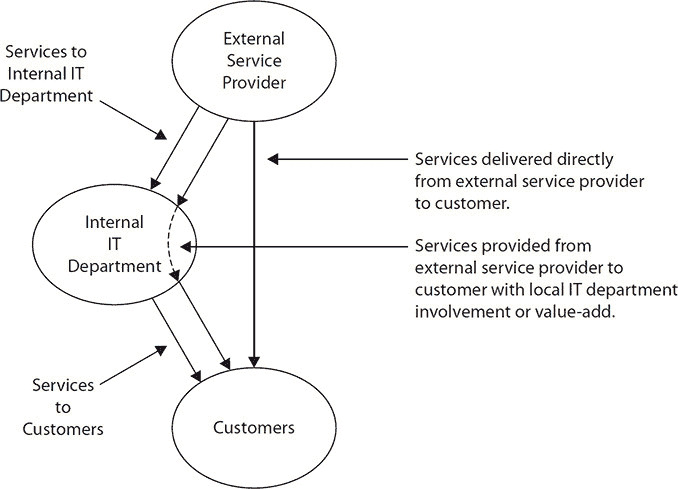

**图 4-14** IT 服务交付的不同视角

## 财务管理

IT 服务的财务管理包含若干活动，包括：

- 预算编制
- 资本投资
- 费用管理
- 项目会计和项目投资回报率（`ROI`）

IT 财务管理是 IT 管理的一部分，它考虑了支持组织目标的 IT 服务的财务价值。

## 容量管理

容量管理是一组活动，用于确认 IT 系统和 IT 流程有足够的容量来满足服务需求。主要，如果一个 IT 系统或流程的性能处于服务水平协议中指定的接受范围内，则认为其具有足够的容量。

容量管理不仅关注当前需求；容量管理还必须考虑满足未来需求。这通过几项活动实现，包括：

- **定期测量**：需要对系统和流程进行定期测量，以便利用使用趋势来预测未来的容量需求。
- **考虑计划内变更**：对流程和 IT 系统的计划内变更可能会对预测的工作负载产生影响。
- **理解长期策略**：组织的变化（包括 IT 系统、业务流程和组织目标）可能会对工作负载产生影响，需要比通过简单趋势分析得出的更多（或更少）容量。
- **技术变革**：若干因素可能影响容量计划，包括预计计算和网络技术未来将提供更佳性能，以及技术的使用趋势可能会影响用户使用技术的方式。

### 与财务管理的关联

容量管理的工作产物之一是对获取额外的计算机或网络硬件的预测，以满足未来的容量需求。这些信息需要作为预算编制和支出管理流程的一部分。

### 与服务级管理的关联

如果资源不足以处理工作负载，容量问题可能导致违反`SLAs`。负载过重的系统和流程将需要更长时间的响应。在某些情况下，系统可能会停止响应。

### 与事件和问题管理的关联

存在严重容量问题的系统可能花费过多的时间来响应用户请求。在某些情况下，系统可能会故障，或者用户可能会放弃。通常，用户会致电服务台，导致事件和问题的记录。

## 服务连续性管理

服务连续性管理是一组关注组织继续提供服务的活动，主要是在发生自然灾害或人为灾害的情况下。服务连续性管理是 ITIL 术语，对应更常用的术语业务连续性规划和灾难恢复规划。

业务连续性在第 5 章中讨论。

## 可用性管理

可用性管理的目标是维持支持组织目标和流程的 IT 服务可用性。IT 系统的可用取决于：

- **有效的变更管理**：当系统和基础设施的变更通过变更管理过程经过适当审查时，变更导致意外停机的概率就会降低。
- **有效的应用程序测试**：当根据一系列正式需求、评审和测试对应用程序进行更改时，应用程序失败并变得不可用的概率就会降低。


# 韧性架构与可维护性

- **韧性架构**：当应用程序环境的整体架构从一开始就被设计为高度可靠时，它将更具韧性，对单个故障和组件故障更有容忍度。

- **可维护的组件**：当应用程序的各个组件可以由第三方组织有效维护时，这些组件意外故障的概率较低。

***


**注意** 组织通常以应用程序或服务的运行时间百分比衡量可用性。

## 资产管理

资产管理是用于资产清单、分类、使用和处置的活动集合。没有资产管理，许多其他活动无法有效开展，包括漏洞管理、事件管理、数据安全以及财务管理的某些方面。

在信息安全中，资产管理是漏洞管理成功的关键。如果资产未知，它们可能会被排除在识别漏洞的过程之外。同样，如果资产不存在，很难对其进行加固。如果未知资产受到攻击，组织可能无法及时获此；这种时间差对事件的影响至关重要。

### 资产识别

安全计划的主要目标（无论是否正式说明）是保护组织的资产。这些资产可以是有形的或无形的、物理的、逻辑的或虚拟的。以下是一些资产的示例：

- **建筑和物业**：这些资产包括房地产、结构和其他改进。

- **设备**：这包括机械、车辆以及办公复印机、打印机和扫描仪。

- **IT 设备**：包括计算机、打印机、扫描仪、带库（创建备份带的设备，而非磁带本身）、存储系统、网络设备和电话系统。

- **虚拟资产**：除了上述实体 IT 设备外，虚拟资产还包括虚拟机及其运行在上面的软件。

- **用品和材料**：这些可以包括办公用品以及生产过程中使用的材料。

- **记录**：包括业务记录，如合同、视频监控录带、访客日志等。

- **信息**：包括软件应用程序中的数据、文档、电子邮件以及工作站和服务器上的各类文件。

- **人员**：从现实意义上说，组织的人员*就是*组织。没有了员工，组织无法执行或维持其流程。

- **声誉**：作为组织的一种无形特征，声誉是客户、竞争对手、股东和社区对组织的个人和集体评价。

- **品牌资产**：类似于声誉，它是由组织生产的单个产品或服务的感知价值或实际市场价值。

## 资产数据来源

正在构建或改进其安全管理计划的组织可能需要从零开始构建其资产清单。管理层需要确定这些初始资产数据从何而来。某些来源包括以下方面：

- **财务系统资产清单**：在账目上记录了所有资产的组织将拥有丰富的资产清单信息。然而，这些信息可能并不完全有用：资产列表通常不包含资产的位置、用途以及该资产是否仍在在使用。将财务资产清单与实际使用的资产进行关联，其消耗的精力可能比创建初始资产清单的其他方法更费力。但是，对于拥有数量少量高价值资产的组织（例如金矿中的矿石破碎机或大型机计算机）而言，了解资产的精确财务价值是非常有用的，因为资产的实际折旧值将用于风险管理中的风险分析阶段。了解其他资产的折旧值也是有用的，因为这将纳入稍后确定的风险处理选择中。

***


**提示**：标明资产价值的财务记录不包括存储在资产上（或由资产处理）的信息价值。

- **访谈**：与关键人员讨论以识别资产通常是最好的方法。然而，为了确保有效，通常需要访谈几个人以确保包含所有相关资产。

- **IT 系统组合**：管理良好的 IT 组织对其主要应用程序有正式的文档和记录。虽然这些信息可能没有涵盖组织中的每一个 IT 资产，但它可以提供有关支持单个应用程序或地理位置资产的信息。

- **在线数据**：拥有大量 IT 资产（系统、网络设备等）的组织有时可以利用在线数据的能力来识别这些资产。拥有云资产的组织可以使用云服务仪表板中的资产管理部分来确定正在使用的资产数量和类型。此外，系统或网络管理系统通常包含一份受管资产列表，这可以创建初始资产清单的良好起点。

- **安全扫描**：拥有安全扫描工具的组织可以使用它们来识别网络资产。这种技术将识别授权和未经授权的资产。

- **资产管理系统**：较大的组织可能会发现，使用专门用于此目的资产管理应用程序比依赖其他来源的资产列表更具成本效益。

所有这些来源都不应被认为是准确或完整的。相反，在编制正式资产清单的过程中，安全经理应该继续探索其他资产来源。

## 收集和组织资产数据

很少可能从单一来源获取（或创建）资产列表。相反，通常需要多个信息来源，以确保风险管理计划至少识别了它需要关注的重要的、范围内的资产。

***


**注意**：很少可能从单一来源获取（或创建）资产列表。相反，通常需要多个信息来源，以确保风险管理计划至少识别了它需要关注的重要的、范围内的资产。

分类资产没有一种单一的方法，但这里有一些想法：

- **地理位置**：按位置对资产进行分组是有用的。

- **服务提供商**：许多利用基础设施即服务（IaaS）的组织按服务提供商分组资产。

- **业务流程**：了解哪些资产支持特定流程是有帮助。

- **组织单元**：按组织单元对资产分类是有用的。

- **敏感性**：敏感性通常有两种应用：针对个人，即信息被视为个人信息；针对组织，即信息可能是商业机密。

- **法规**：对于需要遵守法律法规的组织来说，了解哪些资产在范围之内是有用的。

### 控制的类型

控制分为三种类型：物理、技术和管理：

- **物理控制 (Physical)**：这类控制存在于有形的物理世界中。物理控制的示例包括视频监控、锁门、护柱和围栏。

- **技术控制 (Technical)**：这些控制以信息系统和信息系统组件的形式实施，通常是无形的。技术控制的示例包括加密、计算机访问控制和审计日志。这些有时称为`logical`（逻辑）控制。

- **管理控制 (Administrative)**：这些控制是要求或禁止某些活动、协议和配置的策略、程序和标准。管理控制的一个示例是禁止个人使用公司拥有的信息系统的策略。这些有时称为`managerial`（管理）控制。

***


**考试提示** ISACA 并没有明确使用`type`（类型）、`class`（类别）或`category`（分类）术语来描述和区分各种控制及其基本特征。相反，这些术语在本书中用于强调控制的多维度性质，以及如何对其进行理解和分类。与其他概念一样，这些是模型，能够让你更好地想象控制是如何运作和使用的。

### 控制的类别

控制分为六类：

- **预防性控制 (Preventive)**：这类控制用于防止意外事件的发生。预防性控制的示例包括计算机登录屏幕（`prevent` 未经授权的人访问信息）、钥匙卡系统（`prevent` 未授权的人进入建筑或工作空间）以及加密（`prevent` 缺乏加密密钥的人读取加密数据）。

- **检测性控制 (Detective)**：这类控制用于记录预期和非预期的事件。检测性控制无法强制执行某活动（无论该活动是期望还是不期望），而是只能确保知道事件是否以及如何发生。检测性控制的示例包括视频监控和事件日志。

- **威慑性控制 (Deterrent)**：这类控制的存在是为了说服某人不要执行某些意外活动。威慑性控制的示例包括警犬、警告标志以及可见的视频摄像头和显示器。

***


**注意** 安全专业人员通常倾向于预防性控制而非检测性控制，因为预防性控制实际上会`block`（阻止）意外事件。同样，安全专业人员倾向于检测性控制而非威慑性控制，因为检测性控制会记录事件，而威慑性控制不会。然而，在许多情况下，成本、资源或技术限制迫使组织在倾向于预防性控制时接受检测性控制，或在倾向于检测性控制时接受威慑性控制。例如，没有实际可行的方法可以建立一种能够阻止犯罪分子进入银行的控制，但检测性控制（监控摄像头）会记录他们到达后所做。

***


**注意** 安全经理需要理解预防性控制和威慑性控制之间的一个关键区别。威慑性控制要求潜在违规者了解该控制——只有当他们知道该控制存在时，才能威慑他们的意图。预防性和检测性控制无论违规者是否意识到它们都能发挥。

- **纠正性控制 (Corrective)**：这类控制在某些意外事件发生后被（手动或自动）激活。纠正性控制的一个示例是在发现流程缺陷时改进该流程。

- **补偿性控制 (Compensating)**：实施这类控制是因为无法使用其他直接控制。例如，当实施访客登记簿以补偿缺乏更强的检测性控制（如视频监控系统）时，该登记簿就可以作为补偿性控制。补偿性控制解决与原始控制相关的风险。

- **恢复性控制 (Recovery)**：这类控制用于将系统或资产的状态恢复到事件发生之前的状态。恢复控制的示例是使用工具从计算机中删除恶意软件。另一个示例是使用备份软件恢复丢失或损坏的文件。

***


**注意** 许多控制可以归分为多一类。例如，视频摄像头可以被认为是检测性控制（因为它是记录事件的系统的一部分），也可以被认为是威慑性控制（因为其可见性旨在阻止人们实施意外行为）。此外，审计日志可以被看作是检测性控制和补偿性控制——检测是因为它记录了事件，而补偿是因为它可能补偿缺乏更强的预防性控制（如用户 ID 和密码访问控制）的缺陷。本节描述的控制组织并不基于任何已发表的标准。

### 控制的分类

控制分为两个类别：

- **自动控制 (Automatic)**：这类控制在几乎或完全没有人类判断或决策的情况下执行其功能。自动控制的示例包括无法绕过的应用程序登录页面，以及在有人走过门道后自动锁定的安全门。

- **手动控制 (Manual)**：这类控制需要人类操作。手动控制的错误率可能比自动控制高。手动控制的示例是每月对计算机用户进行审查。

***


**注意** 信息安全专业人员通常倾向于自动控制而非手动控制，因为后者通常更容易出错。然而，在许多情况下，组织由于成本或其他因素必须接受手动控制，例如在紧急情况下可能需要人类决策和干预时。

#### 内部控制目标

内部控制目标是对业务运营预期状态或结果的描述。在构建安全计划时，最好在选择控制框架之前，建立高级控制目标是重要的。

控制目标的示例包括：

- IT 资产保护

- 交易准确性

- 敏感信息的机密性和隐私

- IT 系统可用性

- IT 系统的受控变更

- 符合公司政策

- 符合适用法规和其他法律义务

控制目标是控制的基础。对于每个控制目标，都会存在一个或多个控制以确保控制目标的实现。例如，`IT 系统可用性`控制目标将通过以下控制实施：

```
- IT 系统将持续监控，任何可用性中断都将向相关人员发送警报。
- IT 系统将具有资源测量能力。
- IT 管理层每月审查容量报告并相应调整资源。
- IT 系统将具有反恶意软件控制，并由相关人员进行监控。
```

这四个（或更多）控制共同促进了 IT 系统可用性的整体控制目标。在建立控制目标后，下一步是设计控制。这可能是一项巨大的工程。更好的方法是选择本节后讨论的几种高质量控制框架之一。

如果一个组织选择采用某种标准控制框架，下一步是进行风险评估，以确定控制框架中的控制措施是否充分满足每个控制目标。如果控制范围存在缺口，则必须开发并实施额外的控制措施。

## 信息系统控制目标

信息系统控制目标与普通控制目标相似，但它们是在信息系统的背景下设定的。信息系统控制目标的示例包括：

- 防止信息免受未经授权人员的侵害

- 防止信息免受未经授权的修改

- 操作系统的完整性

- 对信息系统进行受控和管理的变更

- 对应用程序软件进行受控和管理的开发

一个组织可能在恶意软件、可用性和资源管理等其他基础主题上还有几个额外的信息系统控制目标。

与普通控制目标一样，信息系统控制目标将由一个或多个控制措施的支持。

## 通用计算控制

支持许多应用程序和服务的 IT 组织通常会有一些针对特定应用程序的控制措施。然而，IT 部门还会有一套适用于其所有应用程序和服务的控制措施。这些通常被称为其`通用计算控制 (GCCs)`。

组织的`GCCs`具有通用性，并且通常根据不同信息系统的个体能力、局限性以及适用性，以不同的方式实施。`GCCs`的示例包括：

- 应用程序需要唯一的用户 ID 和强密码。

- 密码在存储和传输过程中经过加密处理，且不显示。

- 高敏感信息（如银行账户号码）在存储和传输时进行加密。

- 所有管理操作均记录在日志，且日志受防篡保护。

如果你熟悉信息系统技术，你很快就会发现这些`GCCs`在不同类型的信息系统中的实现方式有所不同。例如，特定的能力和局限性会导致密码复杂度和数据加密能力略有不同。除非组织正在使用非常旧的信息系统，否则这里显示的四个`GCCs`可能可以在信息系统（IS）环境的任何地方实施。它们*如何*实施是下一节的主题。

### 控制框架

`控制框架`是一组组织成逻辑类别的控制措施。众为人知的控制框架如`ISO/IEC 27001`、`NIST SP 800-53`和`CIS 20 Controls`旨在解决大多数组织共同面临的广泛信息风险。

标准控制框架的开发是为了简化组织内部控制措施的开发和采用过程。如果没有标准控制框架，组织将不得不使用其他较差的方法来组装其控制措施，包括：

- 直觉

- 在另一个组织的先验经验

- 来自另一个组织的安全从业人员的建议

- 搜索互联网

- 缺陷或不完整的风险评估

安全经理可以进行全面的风险评估，并根据识别出的风险开发一套控制框架，事实上，这并不会被认为是不可接受的。然而，由于有许多免费的高质量控制框架（例外是`ISO/IEC 27001`必须购买），组织可以花费更少的精力从标准控制框架开始。

### 选择控制框架

对于想要从标准控制框架开始而非从零开始或其他手段开始的组织，有几个高质量的控制框架可供选择。表 4-8 列出了常用的控制框架。本节的剩余部分将对每个框架进行更详细的讨论。

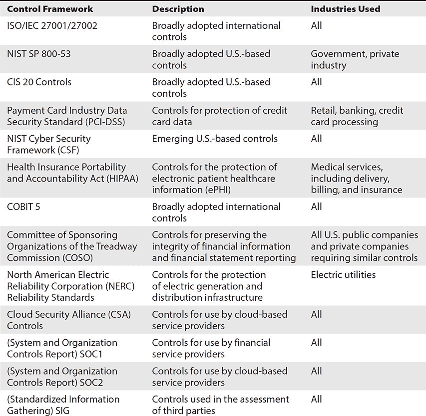

**表 4-8**常用控制框架

关于哪种控制框架对组织最好，目前仍存在争议。在我看来，该主题存在争议这一事实说明，许多人并不理解控制框架的目的或风险管理生命周期。普遍观点认为，一旦组织选择了一个控制框架，组织就“固定”了一组控制措施，并且对组织中使用的控制措施不会进行任何更改。相反，正如本书贯讨论的那样，选择控制框架代表一个起点，而不是永久的承诺。一旦选择了控制框架，将使用风险管理生命周期来理解组织中的风险，从而导致组织所用控制措施发生变化。事实上，可以认为，在一个实践有效风险管理的组织中，无论起点如何，组织最终都会得到或或少相同的控制措施。

选择控制框架的另一种有效方法更多地与控制措施的结构而非控制措施本身有关。每个控制框架由基于控制类的逻辑分组组成。例如，大多数控制框架都有关于身份和访问管理、漏洞管理、事件管理和访问管理的章节。根据某些组织的运营或行业领域，某些控制框架的分组在某些组织中更为合理。

安全经理根据其对特定框架的熟悉程度和经验来选择控制框架也没有问题。然而，这在某种程度上是有效的：在医疗保健提供服务组织中选择`PCI-DSS`控制框架可能不是最佳选择。

***


**考试提示** CISM 候选人不需要记忆`COBIT`或其他框架，但熟悉它们将帮助 CISM 候选人更好地理解它们如何贡献于有效的安全治理和控制。

### 控制框架映射

组织经常发现自己处于需要选择和采用多个控制框架的境地。驱动这些局点的主要因素如下：

- 多个适用的监管框架

- 多个运营背景

例如，一家医疗诊所提供医疗保健服务并接受信用卡支付。`HIPAA`和`PCI-DSS`框架都适用于该组织，因为`HIPAA`和`PCI-DSS`都没有完全满足业务的安全和合规需求。在另一个例子中，一家位于美国的上市电力公用公司需要同时采用`COSO`和`NERC`控制措施。

在这两个示例中，相应的组织可能决定将每个控制框架仅应用于组织的相关部分。例如，在前面提到的医疗诊所，`HIPAA`适用于处理电子保护健康信息 (`ePHI`) 的系统和流程，而`PCI-DSS`适用于处理信用卡数据和支付的系统和流程。在电力公用公司，`NERC`控制适用于发电和配电基础设施，而`COSO`适用于财务系统。这种方法的挑战在于，某些系统和基础设施处于两个（或更多）框架的范围之内。这可能会使 IT 和安全操作比其他时候更加复杂。然而，在整个基础设施中应用所有使用的框架可能会负担过重。

拥有多个控制框架的组织通常渴望一种更简单的控制组织方式。通常，组织会将它们的控制框架进行“映射”，从而产生一个包含来自每个框架控制项的单一控制框架。映射控制框架是一项耗时且枯燥的工作，尽管在某些情况下这些工作已经完成。例如，`NIST SP 800-53`中的`Appendix H`包含了`NIST SP 800-53`与`ISO/IEC 27001`之间的正向和反向映射。网上还可以找到其他的控制映射引用。

将多个框架的控制项映射在一起的问题在于，在控制项层面，许多控制项无法整齐地对应。例如，在`NIST SP 800-53`的`Appendix H`中，`ISO/IEC 27001`控制项`A.15.1.2`被映射到`NIST SP 800-53 CM-10`。这些控制项的内容如下：

* **`NIST SP 800-53 CM-10`** “组织：a. 按照合同协议和版权法使用软件及相关文档；b. 跟踪受数量许可保护的软件及相关文档的使用，以控制复制和分发；以及 c. 控制并记录点点文件共享技术的使用，以确保该功能不用于未经授权的分发、显示、表演或复制版权作品。”

* **`ISO/IEC 27001:2013 A.18.1.2`** “应实施适当的程序，以确保与知识产权和使用专有软件产品相关的法律、法规和合同要求。”

`NIST SP 800-53`中的控制项比`ISO/IEC 27001:2013`中的控制项要具体得多。这是一个映射不完美的良好例子。

另一个例子是，在`NIST SP 800-53`的`Appendix H`中，`ISO/IEC 27001:2005`控制项`A.15.3.2`被映射到`NIST SP 800-53 AU-9`。每个控制项的文本如下：

* **`ISO/IEC 27001:2005 A.15.3.2`** “对信息系统审计工具的访问应受到保护，以防止任何可能的误用或破坏。”


**`NIST SP 800-53 AU-9`** “信息系统保护审计信息和审计工具免受未经的访问、修改和删除。”

在这里，这些控制项的映射相当整齐。遗憾的是，这更多是一个例外。

你可能在这些例子中发现的另一个问题是，最新版本的`NIST SP 800-53`（修订版 4）映射到了较旧版本的`ISO/IEC 27001`——2005 年版。当`ISO/IEC 27001`从 2005 版本更新到 2013 版本时，某些控制项重新编制了编号，许多控制项重新编写了措辞。新版本的`NIST SP 800-53`（修订版 5）确实映射到了最新的`ISO/IEC 27001:2013`标准。然而，由于不同的控制框架更新时间不同，依赖控制框架映射的组织经常会发现它们的映射已经过时。

## 控制框架的运作

一旦组织选择了一个框架，它就需要确定需要哪些活动。

### 风险评估

在设计控制之前，组织需要识别存在哪些风险。在缺乏风险评估的情况下，组织可能无法进行适当的设计实施。以下是一些例子：

* 某项控制可能不足以所有
* 某项控制的实施成本可能过高
* 某项控制可能无法防御所有威胁

在缺乏风险评估的情况下，出现不良结果的可能性很大。

### 控制设计

控制的早期步骤是设计。换句话说，他们需要弄清楚如何落地。例如，一个组织希望符合`NIST SP 800-53 CM-7` (“组织：a. 配置信息系统仅提供必要的功能；b. 禁止或限制某些功能、端口和或服务的使用。”）。这可能需要一个或多个强化标准。接下来，需要指定一个或多个人员负责控制的设计、实施和评估。此外，控制需要设计一种可验证的方式。良好的控制设计可能需要以下内容：

* 新的或变更的政策
* 新的或变更的过程文档
* 新的或变更的信息系统
* 新的或变更的业务记录

### 控制实施

控制设计完成后后，需要将其投入使用。取决于控制的性质，这可能涉及业务流程和或信息系统形式的运营影响。影响更大的变更需要更大的谨慎。在先前的例子中开发强化标准后，需要对它们进行测试和实施。如果影响到生产环境，可能需要大量时间来确保强化标准项不会影响系统的性能、完整性或可用性。

### 控制监控

组织实施控制后，需要对该控制进行监控。为了实现这一目标，控制在设计时就需要考虑到监控。在缺乏监控的情况下，组织将缺乏系统的方法来观察控制并判断其是否有效。

例如，一个组织在风险评估期间识别出一个风险，表明其用户账户容易受到暴力破解攻击。该组织决定更改影响系统的登录过程，使得错误的密码会导致用户在重新尝试登录之前出现短暂延迟，并且在五分钟内失败五次后用户账户将被临时锁定。为了便于监控，组织还更改了登录过程，在用户每次尝试登录时创建审计日志记录。这为组织提供了事件数据，可以定期检查，以查看控制是否按预期执行。某些控制并不那么容易监控。例如，针对滥用知识产权的控制包括颁布新的接受使用政策（AUP），禁止员工违反版权法等法律。

## 控制评估

任何实施控制措施以应对风险的组织都应该定期检查这些控制，以确定它们是否按照预期和设计运行。控制评估有几种可用方法：

* **安全审查**：由一名或多名信息安全人员结合任何相关的业务记录对控制进行检查。
* **控制自评**：由控制所有者回答问题并提供任何相关的证据。
* **内部审计**：组织的内部审计人员（或信息安全人员）对控制进行正式检查。
* **外部审计**：由外部审计师对控制进行正式检查。

组织将在相关法律、法规、法律义务以及风险评估结果的指导下，选择这些方法中的一种或多种方法。

此处列出的四种方法在本章的其他部分有更详细的描述。

# 应对不断变化的技术

技术的变化快于标准的控制框架。因此，安全经理需要密切关注新兴技术，并与组织中的各种业务流程保持“同步”，以便每当有新技术或实践引入组织时，他们能够参与其中。

技术的变革在设计上往往是颠覆性的。这种颠覆始于开发新产品、服务和实践的市场，并持续到采用这些技术的组织内部。颠覆是创新的结果——即实现让组织在某些方面变得更好的新想法。以下是一些颠覆性技术的例子：

* **个人电脑**：从 20 世纪 80 年代初开始，IBM 等公司向组织部门销售 PC，这些部门对那些反应缓慢、无法满足其业务需求的集中式 IT 组织感到不耐烦。
* **云计算**：从 21 世纪 00 年代开始，许多公司开发了用于数据存储和信息处理的云服务。仍在等待企业 IT 提供帮助的组织部门转而使用云，因为更便宜、更快。企业 IT 也随之行动，因为`IaaS`提供商以比以前低得成本提供了服务器操作系统。云计算领域的颠覆性技术包括`虚拟化`、`容器`、`微隔离`、`软件定义网络 (SDNs)`、`软件定义安全 (SDS)`、`身份定义安全 (IDS)`、`勒索软件`和`无文件恶意软件`。
* **智能手机**：BlackBerry 是第一个广泛采用的企业手机，它的颠覆性有限但对工人来说是极大的解放，因为他们可以随时随地访问电子邮件和其他功能。苹果的 iPhone 主要面向消费者，被证明具有高度的颠覆性，因为它为工人完成工作提供了替代手段。
* **自带设备 (BYOD)**：越来越多的公司员工携带个人智能手机、平板电脑、笔记本电脑和其他个人拥有的设备并将其用于业务运营。
* **影子 IT**：这是一种现象，个人、小组、部门和业务单元绕过企业 IT，采购自己的计算服务，通常通过`SaaS`和`IaaS`服务，但也通过`BYOD`实现。

安全经理明白，他们无法无处不在，也无法感知组织中的所有相关活动。个人员工、团队、部门和业务单元将在不通知或咨询信息安全部门的情况下采用新服务并实施新技术。这强调了进行年度风险评估的必要性，以揭示新兴的技术和实践，以便对其进行风险评估。虽然回溯技术采用并非理想（因为风险可能在使用的之初就引入了），但由于安全经理并不总是参与组织的变革，因此风险评估有时是发现业务中已存在风险的最后手段。

## ISO/IEC 27001

`ISO/IEC 27001`《信息技术 – 安全技术 – 信息安全管理体系 – 要求》是一套用于构建和管理信息安全管理体系的世界性需求和控制。`ISO/IEC 27001`在其附录中还包含一个控制框架，该框架在`ISO/IEC 27002`中有更详细的解释。

`ISO/IEC 27001`附录涵盖了一个由 14 个控制类别和 35 个控制目标组成的控制框架。表 4-9 描述了这些控制类别和目标。


**表 4-9** ISO/IEC 27001 控制目标

`ISO/IEC 27001`附录涵盖的控制框架包含了配套标准`ISO/IEC 27002`。表 4-10 描述了这些控制。

除了控制措施，`ISO/IEC 27001`的要求章节还提供了关于实施的必要信息。


**表 4-10** ISO/IEC 27001 ISMS 要求

`ISO/IEC 27001`的要求语言编写方式可能具有模糊性和歧义。然而，`ISO/IEC 27001`的要求设计适用于任何规模的组织和任何行业，如政府、军事、教育和非营利机构。这些要求规定了必须执行的操作。

例如，`ISO/IEC 27001`的 7.4 要求规定，“组织应确定与信息安全体系相关的沟通需求。”该要求没有指定：

* 说什么
* 对谁说
* 使用什么媒介

这些和其他考虑因素取决于安全经理以及构建组织安全计划的人员。只要组织以有效的方式遵循`ISO/IEC 27001`，这就足够。

`ISO/IEC 27001`和`27002`可以通过 www.iso.org 获得。这些以及大多数 ISO 标准是付费的，这意味着必须购买并遵守其在组织中的许可限制。通常，这些标准是单份购买的，本质上是“单用户”，不允许存储在文件服务器供多用户使用。

## NIST SP 800-53

`NIST SP 800-53`《联邦信息系统和组织的安全与隐私控制》由美国标准技术研究院的计算机安全部门出版。`NIST SP 800-53`的控制摘要出现在附录 D“安全控制基准”中，所有控制详细描述可以在附录 F“安全控制目录”中。

`NIST SP 800-53`包含了`低`、`中`和`高`基准的概念。这些基准代表根据影响水平要实施的控制集合。换句话说，对于被分类为高影响的信息系统，选择的控制将来自附录 D 中的`高`基准。然后在每个控制内部，组织将根据影响水平实施任何说明的控制增强。

表 4-11 列出了`NIST SP 800-53`中的控制类别。`NIST SP 800-53`可以通过[`csrc.nist.gov/publications/PubsSPs.html`](http://csrc.nist.gov/publications/PubsSPs.html)获取。该标准无需费用或注册即可获取。

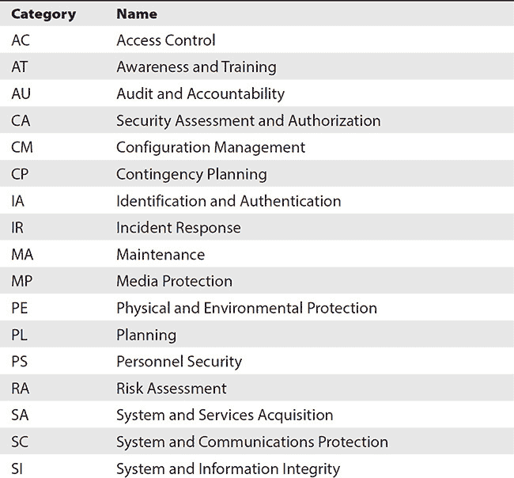

**表 4-11** NIST SP 800-53 控制类别

## 网络安全中心 20 项控制措施

网络安全中心（CIS）维护着一个广受欢迎且受尊敬的控制框架，被称为`CIS Controls`，通称为`CIS 20`。该控制框架仍被称为`SANS 20 Critical Security Controls`，最初由 SANS 学院开发。

`CIS Controls`框架被视为一组更简单的安全措施，被寻求控制框架的组织广泛采用，同时避免了更负担重的框架，例如必须购买的`NIST SP 800-53`或`ISO/IEC 27001`控制。

`表 4-12`显示了 CIS 控制框架的结构。

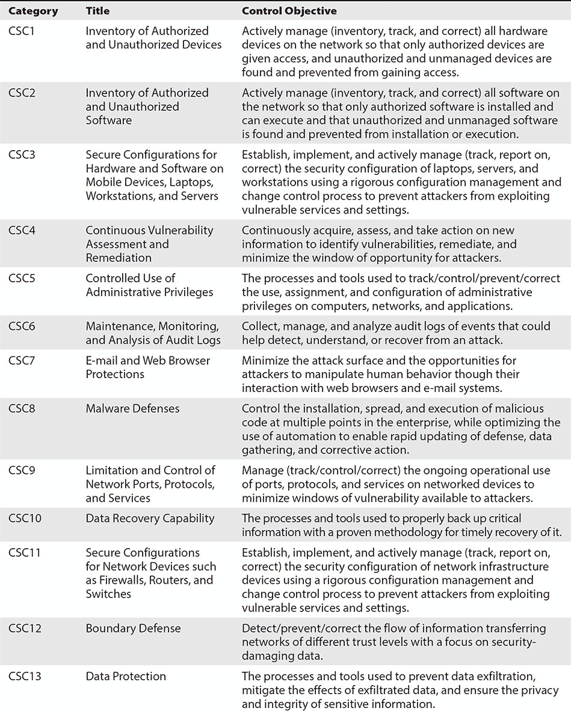

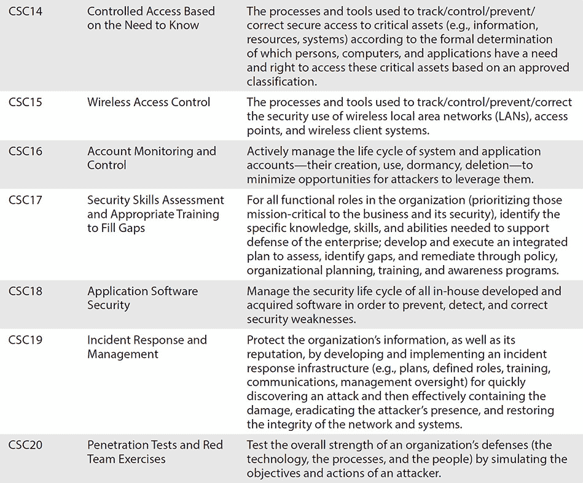

**表 4-12** CIS 控制框架（来源：网络安全中心 (CIS) [`www.cisecurity.org](http://www.cisecurity.org)）

CIS 控制框架的结构使得安全从业人员更容易于理解和使用。在每个控制类别中，都有一个名为“为什么这项控制至关重要？”的部分，随后是具体的控制措施。接着是一个名为“程序和工具”的部分，该部分提供了额外的指导。最后，每个控制类别都包含一个系统实体关系图，描述了控制在环境中的实现。许多人认为`CIS Controls`比`NIST SP 800-53`或`PCI-DSS`更务实，学术化。

CIS 控制框架在每个控制类别中包含一个或多个控制措施。某些措施被标记为“基础性”（foundational），意味着它们对于任何组织都是必不可少的。未标记为“基础性”的措施可以被认为是可选的。

某些控制措施包含了高级实施指南。例如，控制`8.3`（“限制外部设备的使用，仅限于经过批准且记录了业务需求的设备。监控外部设备的使用和尝试使用。配置笔记本电脑、工作站和服务器，使其不会运行来自可移动介质的内容，如 USB 令牌[即“优盘”]、USB 硬盘、CD/DVD、FireWire 设备、外部串行高级技术附件设备，以及挂载的网络共享。配置系统，以便在插入可移动介质时自动对其进行反恶意软件扫描。”）在其高级指导中包含了：“积极监控外部设备的使用（除日志之外外）。”

CIS 控制框架可以从`[www.cisecurity.org/critical-controls.cfm](http://www.cisecurity.org/critical-controls.cfm)`免费获取，尽管可能需要注册。

## 网络安全框架

NIST 网络安全框架（`CSF`）是一种风险管理方法和控制框架，旨在那些希望通过单一标准来识别风险并实施控制以保护信息资产的组织。`CSF`由美国国家标准与技术研究院（`NIST`）开发，并最初于 2014 年发布，它在缺乏特定控制框架法规要求的组织中（例如医疗保健行业的`HIPAA`）似乎正获得越来越多的认可。

`CSF`由一个框架核心组成，包含安全管理计划中的五项关键活动。这些活动如下：

- **识别（Identify）** 建立组织的理解，以管理针对系统、资产、数据和能力的网络安全风险。
- **保护（Protect）** 开发并实施适当的保护措施，以确保关键基础设施服务的交付。
- **检测（Detect）** 开发并实施适当的活动以识别网络安全事件的发生。
- **响应（Respond）** 开发并实施适当的活动对检测到的网络安全事件采取行动。
- **恢复（Recover）** 开发并实施适当的活动以维护弹性计划，并恢复任何因网络安全事件而损害的能力或服务。

`CSF`包含一种组织可以用于评估其整体信息安全计划整体能力的方法。能力评估类似于成熟度评估，该计划被确定为以下层级之一：

- **部分（Partial）** 风险管理未正式化，而是响应性的，且仅限于组织内的少数人。与外部实体没有正式关系，且供应链风险管理（`SCRM`）流程未正式化。
- **风险感知（Risk Informed）** 风险管理已正式化，但未在全范围内运作。建立了外部关系但未正式化。供应链风险管理流程虽然存在，但未正式化。
- **可重复（Repeatable）** 风险管理实践是正式并经过批准的。风险管理计划已集成到业务中。更多地参与外部实体，以便组织应对事件。供应链风险管理流程受监管。
- **适应（Adaptive）** 风险管理实践得到监控并调整，以满足不断变化的威胁和业务需求。风险管理计划完全集成到组织的业务和过程中。组织有规律地与外部实体共享并接收信息以防止事件发生。供应链风险管理流程为管理层提供了高水平的风险意识。

这些成熟度评分与软件工程学院能力成熟度模型（`SEI-CMM`）等使用的类似。

`CSF`包含一种用于建立或改进信息安全计划的方法。该方法中的步骤与本书中的结构相似：

- **第 1 步：确定优先级和范围（Prioritize and Scope）** 组织确定哪些业务部门或业务流程属于新计划或改进计划的范围。
- **第 2 步：定位（Orient）** 组织识别计划范围内的资产；风险方法；以及相关的法律、法规和其他法律义务。
- **第 3 步：创建当前状况（Create a Current Profile）** 组织识别已实施框架核心（`CSF`控制措施）的类别和子类别成果。
- **第 4 步：进行风险评估（Conduct a Risk Assessment）** 组织对整个计划范围进行风险评估。这类似于书中描述的常规风险评估，识别每个资产或组的威胁（连同其发生概率影响）。
- **第 5 步：创建目标状况（Create a Target Profile）** 组织确定框架每个类别和子类别的预期未来状态。这包括每个类别和子类的目标层级。
- **第 6 步：确定、分析并排序差距（Determine, Analyze, and Prioritize Gaps）** 组织对比当前状况（第 3 步创建）和目标状况（第 5 步），列出差距。对这些差距进行分析和优先级排序，并识别关闭差距所需的资源。进行成本效益分析有助于排序。
- **第 7 步：实施行动计划（Implement Action Plan）** 组织制定计划关闭第 6 步识别和分析的差距。行动计划完成后，对控制进行合规性监控。

## 支付行业数据安全标准

支付行业数据安全标准（`PCI-DSS`）是一种控制框架，其主要目标是保护*持卡人数据*。`PCI-DSS`由 PCI 安全标准委员会开发，该委员会是非营利组织，由全球主要的信用卡品牌创立，包括 Visa、MasterCard、American Express、Discover 和 JCB。

`表 4-13`显示了`PCI-DSS`的双层结构。

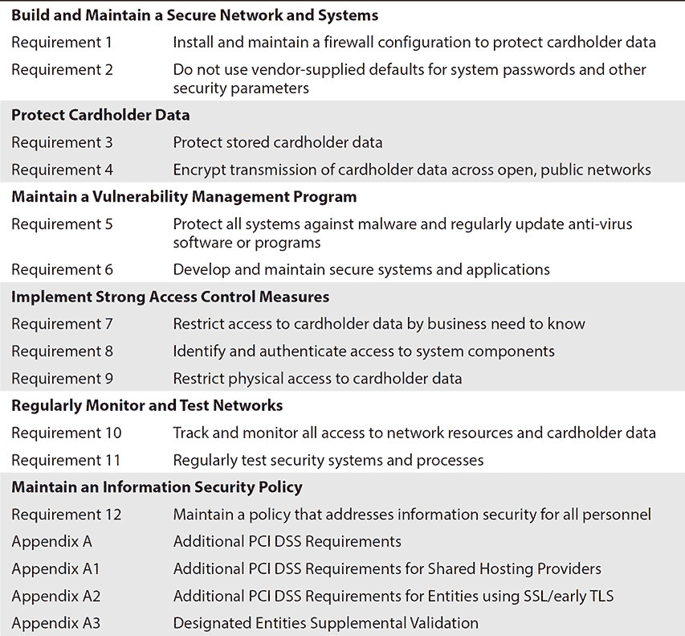

**表 4-13** PCI-DSS 控制框架（来源：PCI 安全标准委员会，[www.pcisecuritystandards.org](http://www.pcisecuritystandards.org)。）

PCI 安全标准委员会还围绕 PCI-DSS 标准定义了相关业务规则。该标准存在一种根据信用卡交易数量划分的分级结构；交易量超过设定限制的组织必须接受年度现场审计，而交易量较低的组织则允许完成年度自评估。此外，商户（接受信用卡作为支付形式的零售和批发经营机构）与服务提供商（所有存储、处理或传输信用卡数据的其他组织）之间存在区别；服务提供商需要遵守额外的控制措施。

PCI 安全标准委员会还为执行 PCI 审计的人员以及雇用这些人员的组织建立了年度培训和考试计划。相关认证如下：

- **支付卡行业合格安全评估师 (PCI-QSA)** 这些是外部审计员，负责对需要进行年度审计的商户和服务提供商进行审计（以及自愿进行此类审计的组织）。
- **支付卡行业内部安全师 (PCI-ISA)** 这些是需要符合 PCI-DSS 标准的商户和服务提供商的员工。PCI 安全标准委员会并不要求商户或服务提供商的任何员工获得 PCI-ISA 认证；然而，该认证有助于通过认证的人员更好地理解 PCI-DSS 标准，从而实现更好的合规性。
- **支付卡行业专业人员 (PCIP)** 这是一个针对 IT 专业人员的入门级认证，他们希望了解更多 PCI-DSS 标准，并获得一项将其指定为 PCI 领域专家的认证。

PCI 安全标准委员会还发布了额外的要求和标准，包括：

- **支付应用数据安全标准 (PA-DSS)** 这是一种针对商业信用卡支付应用程序的安全标准。
- **PCI 取证调查员 (PFI)** 对对信用卡泄露事件进行取证调查的组织和个人的要求。
- **认可的扫描供应商 (ASV)** 对对商户和服务提供商进行安全扫描的组织的要求。
- **合格集成商和转销商 (QIR)** 对对销售和集成 PCI 认证支付应用程序的组织的要求。
- **端点加密 (P2PE)** 这是一种针对利用卡数据端点加密支付应用程序的安全标准。
- **令牌服务提供商 (TSP)** 对生成和发行 EMV 支付令牌的令牌服务提供商物理和逻辑安全要求以及评估程序。
- **PIN 交易安全 (PTS)** 对在 ATM 和 POS 终端在线和离线交易期间个人识别码 (PIN) 数据安全管理、处理和传输的要求。

## 健康保险可移植性与责任法


美国《健康保险可移植性与责任法》(HIPAA) 于 2008 年颁布，旨在解决医疗信息处理方面的许多问题，包括对电子形式健康信息的保护，通常称为电子受保护健康信息 (ePHI)。提供医疗服务的组织以及访问此类信息的组织（包括医疗保险公司和大多数雇主）必须遵守 HIPAA 安全规则的要求。表 4-14 显示了 HIPAA 安全规则的结构。

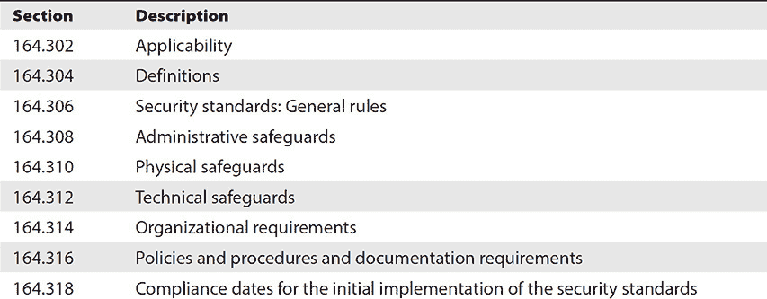

**表 4-14** HIPAA 安全规则中的要求章节

HIPAA 安全规则中的每项要求都被标记为“强制的 (Required)”或“可选的 (Addressable)”。“强制的”的要求必须实施。对于那些“可选的”要求，组织需要进行分析以确定是否必须实施。

### COBIT 5

为了确保安全计划与业务目标一致，包含 5 个原则和 37 个过程的 COBIT 5 控制框架是一个行业标准。这五项原则如下：

- 满足利益相关者需求
- 覆盖企业端到端
- 应用单一集成框架
- 采用整体性方法
- 将治理与管理分离

COBIT 5 包含 1100 多项控制活动以支持这些原则。

COBIT 由 ISACA 和 IT 治理协会于 1996 年建立，是经理、审计师和 IT 用户行业内共识的结果。如今，COBIT 5 被接受为一种最佳实践 IT 流程和控制框架。从第 5 版本开始，COBIT 吸收了 ISACA 的风险 IT (Risk IT) 框架和 Val 框架。

### COSO

Treadway 委员会赞助组织 (COSO) 是一家私营组织，通过开发有关企业风险管理、内部控制和防欺诈的框架和指南提供思想领导力。其控制框架被美国上市公司用于管理其财务会计和报告系统。

COSO 是以下私营部门协会的联合倡议：

- 美国会计学会 (AAA)
- 美国注册公会计师协会 (AICPA)
- 国际财务高管协会 (FEI)
- 管理会计师与财务专业人员 (IMA)
- 内部审计师协会 (IIA)

COSO 框架通过 5 个框架组件内的 17 个原则构建，如表 4-15 所示。COSO 框架本身是专有的，可以从 [www.coso.org](http://www.coso.org) 购买。

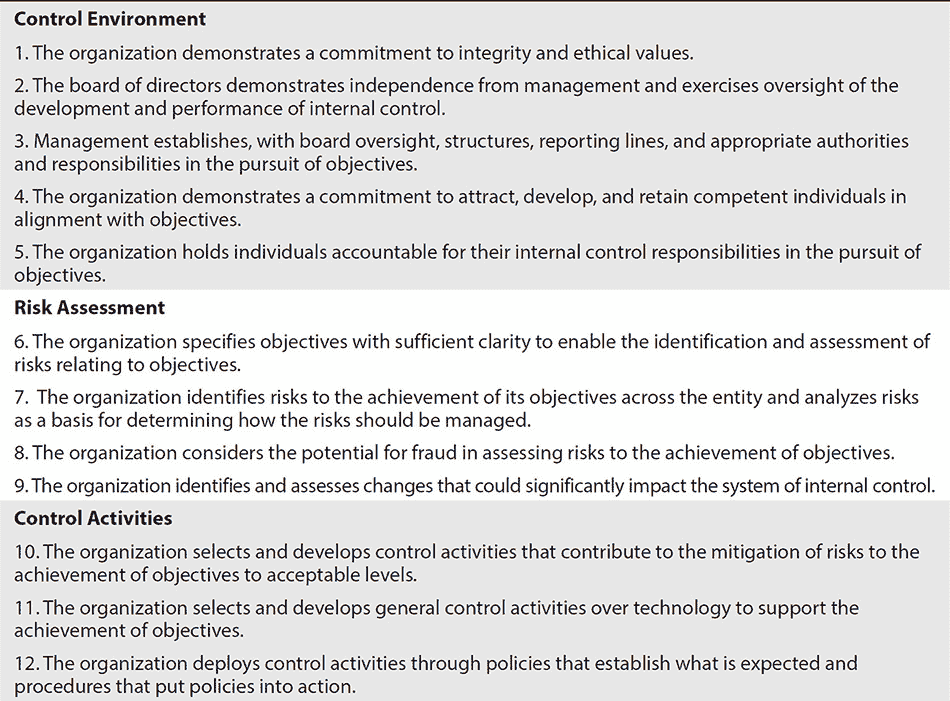

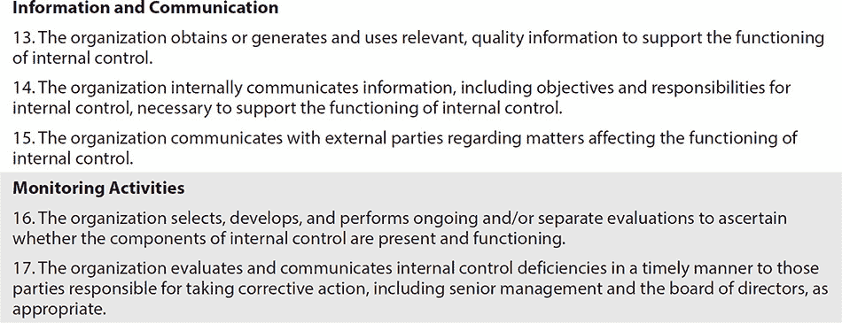

**表 4-15** COSO 框架与原则

图 4-16 描述了 COSO 框架的多维度结构。

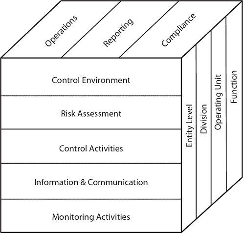

**图 4-16** COSO 框架组件

### NERC 可靠性标准

北美可靠性协会 (NERC) 为北美大部分地区的电力公公司开发标准。这些标准涵盖了发电和配电的所有方面，包括安全性。表 4-16 显示了 NERC 标准的安全部分。


**表 4-16** NERC 关键基础设施保护框架

在 2003 年东北部大停之前，NERC 标准是自愿的。2005 年的能源政策法授权联邦能源监管委员会 (FERC) 将 NERC 标准指定为强制性。NERC 有权执行其标准，并通过审计和对不合规的公共公用事业公司收以罚款来实现这一点。

### CSA 控制框架

云安全联盟 (CSA) 开发了一种名为“云控制矩阵 (CCM)”的控制框架，该框架旨在为云供应商提供安全原则，并帮助客户对云提供商进行评估。

表 4-17 显示了 CSA CCM 的结构。


**表 4-17** 云安全联盟云控制矩阵领域

云安全联盟开发了一个名为 CSA STAR 的保证框架，包括三个保证级别：

- 自评估
- 基于第三方评估的认证
- 基于持续监控的认证

### 服务组织控制

IT 外包的趋势持续加剧，并且随着许多组织转向云应用程序和基础设施，这一趋势甚至在加速。要确保这些第三方组织中存在且有效的 IT 控制，其成本可能高得难以接受：大多数组织的内部 `IT` 审计部门没有足够的资源来审计即使是顶级的关键服务提供商。而且，大多数服务提供商不允许其客户审计其控制措施，因为这对服务提供商来说也是一种成本。

20 世纪 90 年代初，美国注册会计师协会（`AICPA`）制定了审计标准第 70 号（`SAS-70`），该标准为公共会计师对服务提供商进行审计敞开了大门，并将审计报告提供给服务提供商的客户。在《萨班斯-奥克斯利法》（`SOX`）于 2003 年生效后，对服务提供商进行的 `SAS70` 审计满足了美国上市公司获取其外包 IT 服务提供商控制有效性保证的要求，特别是那些支持财务应用的提供商。

接下来将讨论 `SOC1`、`SOC2` 和 `SOC3` 审计标准。

### 服务组织控制 1

2010 年，`SAS-70` 标准在美国被鉴证业务标准第 16 号（`SSAE16`）取代，在美国境外被国际鉴证标准第 3402 号（`ISAE3402`）取代。2017 年，`SSAE16` 被 `SSAE18` 取代。`SSAE16`、`SSAE18` 和 `ISAE3402` 通称为服务组织控制 1（`SOC1`）。

在 `SOC1` 审计中，服务组织指定了要审计的控制措施。虽然服务组织对 `SOC1` 审计的范围具有完全的自主权，但服务组织必须考虑客户及其内部外部审计师希望在 `SOC1` 审计报告中看到的哪些控制措施。

`SOC1` 审计有两种基本类型：

- **类型 I (Type I)**：这是对服务组织控制措施及其设计的点检查。
- **类型 II (Type II)**：这是在在一段时间内（通常为六个月到一年）进行的审计，审计师不仅检查范围内控制措施的设计（如类型 I 所示），还会检查揭示控制是否有效的业务记录。

`SOC1` 审计必须由表现良好的注册会计师事务所执行。

### 服务组织控制 2

服务组织控制 2（`SOC2`）审计标准是为所有类型的 IT 服务提供商开发的，它们希望向客户证明其控制措施的可靠性。

对服务提供商进行的 `SOC2` 审计是对以下五个信任原则之一或多个的审计：

- **安全性 (Security)**：系统受到防止未经访问的保护。
- **可用性 (Availability)**：系统按照承诺或协议提供运行和使用。
- **处理完整性 (Processing integrity)**：系统处理是完整、有效、准确、及时且经过授权的。
- **机密性 (Confidentiality)**：指定的机密信息按照承诺或协议得到保护。
- **隐私性 (Privacy)**：根据隐私声明承诺收集、使用、保留、披露和销毁个人信息。

每个信任原则内都有多个控制措施。所选信任原则内的所有控制措施都包含在 `SOC2` 审计中。

`SOC2` 审计有两种基本类型：

- **类型 I (Type I)**：这是对服务组织控制措施及其设计的点检查。
- **类型 II (Type II)**：这是在在一段时间内（通常为六个月到一年）进行的审计，审计师不仅检查范围内控制措施的设计（如类型 I 所示），还会检查揭示控制是否有效的业务记录。

`SOC1` 审计必须由表现良好的注册会计师事务所执行。（注：此处原文误为 SOC1，译文保留原文逻辑或标注）

### 服务组织控制 3

服务组织控制 3（`SOC3`）审计与 `SOC2` 审计相似，但 `SOC3` 报告缺乏对控制有效性的描述。它包含了五个信任原则：安全性、可用性、处理完整性、机密性和隐私性。

#### 控制措施开发

控制措施的开发是任何安全计划的基础部分。为了开发控制措施，安全经理必须对组织的使命、目标以及风险承受能力有深入了解。图 17 展示了组织与安全计划之间的关系。


正如本书的其他部分所述，开发控制的最常用方法是采用已有的控制框架。然而，组织也可以从零开发控制框架。表 18 显示了这种方法的优缺点。


##### 从零开发控制

对于选择从零开发控制的组织，第一步是开发高层控制目标。控制目标通常在组织之间是相似的。但由于每个组织不同，某些组织会有针对特定活动或目标的独特控制目标。

表 19 显示了控制目标的示例。


##### 控制细节

无论组织采用现有框架还是从零开发控制，安全经理都必须为每个控制开发多个要素。这些元素包括：

- **控制编号**：根据组织采用的编号方案分配给该控制的索引数字。可以是简单的数字（例如 `1`、`2`、`3`），也可以是层次数字（例如 `10.5.4`）。
- **映射**：该控制与其他控制框架中一个或多个控制的关系，无论其他框架是组织特定的还是行业标准的。
- **标题**：控制的标题或名称。
- **控制目标**：在具有高层控制目标的控制框架中，这是对预期活动的陈述。
- **叙述**：对控制的详细描述。通常不应包含实施细节（这些可能随系统或地而异），而是让业务所有者、审计师或 IT 工作人员理解控制意图的细节。细节应让 IT 和其他人员能够正确实施控制。
- **范围**：受该控制影响的地点、单元、部门或系统。
- **风险**：该控制旨在解决的风险描述。
- **所有者**：控制的业务所有者（或所有者）。
- **影响及相关的业务流程**：与控制相关的业务流程，以及受控制影响的业务流程。
- **控制频率**：执行、运行或使用控制的频率。
- **分类**：包括是自动还是手动、预防还是检测，以及其他分类细节。
- **测试程序**：评估控制措施有效性所需的步骤。与控制叙述一样，这应该是一个通用的描述，而不是针对任何特定技术。
- **开发人员**：开发该控制措施的人员。
- **批准人**：批准该控制措施的人员。
- **批准日期**：控制措施最近一次批准的日期。
- **版本**：根据组织使用的任何版本命名系统的控制措施版本。
- **交叉引用**：与其他控制措施、控制框架、系统、文档、部门、流程、风险评估或风险处理的交叉引用。交叉引用有助于人员更好地理解控制措施如何与组织的其它活动或事件相关。
- **修改历史**：对控制措施进行的更改列表，包括描述、每项更改的执行人、每项更改的批准人以及日期。

虽然组织可能倾向在工作表中记录控制措施，但更好的方法是为每个控制措施开发独立的文档。这将带来更好的结果，因为更容易控制单个控制文档的版本。

## 控制评估

控制评估由旨在确定单个控制措施或组控制措施是否有效运行的活动组成。可以通过多种方式对控制进行评估，包括：

- 内部审计
- 外部审计
- 控制自评估

这些技术在本文章前面的“审计”部分中进行了详细讨论。

## 指标与监控

`metric`是对周期性或持续性活动的测量，目的是在整体业务运营的背景下理解该活动。指标是指收集这些测量值并向各种业务受众展示或发布。

在整个信息安全计划的背景下，`monitoring`是对系统或控制的持续或定期评估，以确定其运行或有效性。监控通常包括两个活动：

- 管理对信息安全计划或整个计划某些定性方面的审查。这可以以安全经理提供的执行简报的形式进行。
- 管理对信息安全计划中关键指标的审查，以理解其有效性、效率和性能。

### 指标类型

信息安全计划及其控制中有许多衡量的活动和事件，也有不同的描述和解释这些测量的方法。在构建和改进信息安全计划时，安全经理需要理解没有单一的指标框架。相反，安全经理需要确定哪些指标对于各种受众和目的是重要的，并着开发这些指标。

指标最重要的方面之一是背景信息。产生诸如互联网防火墙丢弃的数据包数量等原始数字，对任何受众来说几乎没有意义。安全经理需要根据其目标受众开发具有适当背景的指标。

除了保留供后检查的记录的自动化系统外，开发没有受众的指标通常没有意义。这种追求只会浪费本可以用于更有价值活动的时间。

### 合规

合规指标是与法规、法律合同或内部目标要求相关的关键控制措施的衡量。合规指标描述了对这些要求的遵循程度。

组织需要理解合规指标的业务背景，包括不合规的后果。安全经理需要考虑对每个指标不合规的忍度，包括组织在发生不合规活动时启动纠正措施意愿和能力。

### 组织意识

组织意识指标有助于管理层理解安全策略和要求的人数，以及他们对这些熟悉程度。组织意识中的典型指标包括：

- 完成安全培训的员工百分比
- 确认并遵守安全策略的员工百分比
- 测验和测试的平均分

### 运营生产力

运营生产力指标显示了人员执行核心功能的效率。生产力指标可以为常规任务的自动化建立业务案例。示例生产力指标包括：

- 执行职责分离所需的小时
- 执行漏洞评估所需的小时
- 执行风险评估所需的小时

### 组织支持

运营支持指标显示了组织目标的支持程度。可以认为这是一个主观指标，因为产生有意义的测量可能困难。虽然可以显示目标的达成情况，但衡量导致这些目标的支持程度可能是困难的——成就是少数人坚定的结果，还是整个组织的结果？

通常，组织支持指标以支持目标达成的项目和计划的仪表板形式出现。然而，未能时完成项目并不一定意味着支持或缺乏支持，而可能反映了预料之外的障碍或项目范围的变化。

### 技术安全架构

技术安全架构指标通常是对发生在自动化系统中的事件的测量，例如防火墙、入侵检测和防御系统、数据泄露防护系统、垃圾邮件过滤器和反病毒系统。这通常是安全经理可以获得的最丰富的指标数据，但也是类经常在没有适当业务背景的情况下呈现的指标类别。例如，防火墙拦截的攻击次数或反病毒软件拦截的恶意感染次数可能具有运营意义，但这些对管理层来说毫无意义。高管询问被拦截攻击数量的增加是好是坏还是没有意义是正确的。

然而，也有一些对业务高管具有意义的指标。示例包括：

- 响应电子邮件攻击（点击链接或打开附件）的员工百分比
- 绕过防火墙、入侵检测和防御系统以及网络过滤器等网络控制并导致非计划停机的攻击次数
- 绕过反病毒控制并导致非计划停机的恶意攻击次数
- 被拦截的暴力破解密码攻击次数
- 需要披露的受影响记录数

### 运营性能

运营性能指标通常显示人员执行关键安全功能的情况。通过这些指标衡量的流程需要有足够详细的业务记录，以便指标可以被客观衡量。以下是运营性能指标的一些示例：

- 从安全事件发生到宣布事件经过的时间
- 从宣布事件到将其遏制经过的时间
- 从关键漏洞发布到在组织系统中发现该漏洞经过的时间
- 在 SLA 范围内未安装关键补丁的关键系统百分比
- 未经变更委员会批准而进行的更改次数
- 因安全原因导致关键系统的非计划停机时间

## 安全成本效益

与安全成本效益相关的指标用于衡量关键控制措施所需的资源。安全经理需要谨慎对待成本效益指标，因为随着时间推移对改进的需求（例如降低成本）可能会导致风险增加。这一点更为复杂，因为成本相对容易衡量，而风险的衡量则更具主观性和定性。

成本效益指标包括以下示例：

- 每位用户的反恶意软件控制成本
- 每位用户的防钓鱼和防垃圾邮件控制成本
- 每位用户的集中化网络防御（如防火墙）成本

安全经理应考虑在工具成本之外加入人员成本，以提供控制措施总成本的更完整、更准确的视图。

## 受众

在构建或改进指标计划时，安全经理需要考虑任何特定指标 own 以及接收该指标的受众。安全经理常犯的一个常见错误是在先不了解任何单个指标对特定个人是否有意义的情况下，就向各种受众发布指标。例如，显示防火墙丢弃数据包数量的指标对董事会来说完全没有意义——该指标随时间变化的趋势也没有任何意义。

某些指标仅具有运营价值，而其他运营指标在处于特定语境时，可以成功转变为管理或战略指标。例如，关于恶意软件攻击次数的指标没有业务背景；然而，导致业务中断的成功恶意软件攻击具有意义意义。或者，补丁管理 SLA 本身没有业务背景，但将其转化为显示未在 SLA 内补丁的关键系统的指标，则描述了高于预期的业务风险，并且对执行层受众有用。

## 持续改进

持续改进代表了随着时间推移增加流程和控制效率及有效性的愿望。可以说，持续改进是组织文化的特征。对持续改进的追求是追求质量的一种迂径。

`ISO/IEC 27001` 要求管理层促进持续改进，并且安全策略应包含持续改进信息安全管理体系（ISMS）的承诺。`ISO/IEC 27001` 还要求管理层对 ISMS 的审查要识别持续改进的机会。标准还明确要求组织“持续改进其信息安全管理系统的适用性、充分性和有效性”。

`NIST SP800-53《联邦信息系统和组织安全与隐私控制》同样要求组织的风险管理计划包含一个用于持续改进的反馈循环。控制 `SA-15 (6)` 规定：“组织要求信息系统、系统组件或信息系统服务的开发人员实施显式过程以持续改进开发过程。”

`NIST 网络安全框架`在整个标准中引用了对持续改进的要求。例如，在创建信息安全计划的七步骤中，`NIST CSF` 在第 3.2 节断，“这些步骤应根据需要重复以持续改进网络安全。”

## 章节回顾

信息安全计划由识别和处理风险的活动组成。在战术和战略层面，计划中的所有活动都实现了这一目的。安全计划也是基于结果的；当制定策略时，策略的目标是期望的终状态或结果。在计划中执行的任务和项目使组织更接近这些预期的结果。

章程文件定义了安全计划的主要、长期目标，并定义了角色和职责。章程通常会定义计划的范围——即受计划影响的部门、业务单元和地点。路线图是一份战略性文件，描述了实现关键目标所采取的步骤。

安全管理框架是安全计划整体运行的模型。通常，这些框架是高层次的，包含了风险管理和治理等关键活动。

安全架构代表了整体愿景以及定义技术和资产保护角色的细节。`Open Group Architecture Framework (TOGAF)` 和 `Zachman framework` 是可以用于构建安全架构的两种框架。

安全治理是使管理层能够洞察安全计划并对其实施控制的活动 set。成功的治理关键是建立一个由跨业务部门利益相关者组成的安全指导委员会或安全委员会。

风险管理是一个用于识别、分析和处理风险的生命周期过程。风险处理的四种选择是接受、缓解、转移和回避。这些风险处理决策应由高级管理层或执行级指导委员会做出。包括风险决策在内的程序应记录并维护作为安全计划业务记录的一部分。

风险管理生命周期由定期和临时风险评估组成。在典型的风险评估中，会识别并评估资产及其面临的威胁。风险分析是一项详细活动，用于更好地理解单个风险并探索各种风险缓解和风险处理方案。

风险评估包括资产识别、威胁分析、漏洞识别、概率和影响分析。风险评估随后进行定性、半定量或定量的风险分析。


组织开展内部和外部审计及审查是其确定控制措施有效性整体努力的一部分。与风险评估类似，组织需要合理界定范围并授权审计项目，以便有足够的资源成功执行并完成审计。控制自评估是内部审计的形式，由控制所有者执行，作为加强对控制有效性问责的手段。

在制定安全策略时，安全经理需要仔细权衡许多考虑，包括适用法律、风险容忍、控制措施和组织文化。安全策略需要与业务保持一致，并与其控制措施保持一致。

第三方风险管理是一项关键活动，其目的是识别访问关键或敏感数据或执行关键业务功能的第三方组织中的风险。由于许多第三方对其内部运营和风险透明度不高，因此需要各种技术来识别和管理风险。

安全计划包括多种对其成功至关重要的行政活动。一个重要的成功因素是与组织内部的许多部门以及外部组织和机构建立战略伙伴关系。这些伙伴关系使安全经理能够更好地影响内部事件，了解更多外部事件，并在需要时从外部实体获得帮助。

安全经理需要了解如何制定业务案例为安全项目争取资金。安全经理不需要关注投资回报率（`ROI`），而需要关注风险降低以及每个项目如何对战略目标的实现做出贡献。

事件监控是指使信息系统中发生的安全事件能够告知安全人员的活动，安全人员可以采取行动纠正局面并避免事故发生。

漏洞管理是执行旨在识别信息系统漏洞的任务的活动，随后进行修复措施，例如安装安全补丁或更改安全配置。

安全工程与开发侧重于应用程序和系统的安全开发，确保其在设计上没有可利用的安全缺陷，并保护与工程和开发相关的系统和信息（如源代码）。

采用多种手段保护网络（以及运行其上的系统和应用程序），包括防火墙、网络分、入侵防御系统、网络异常检测、数据包嗅器、网络内容过滤器、云访问安全代理、`DNS` 过滤器、垃圾邮件和钓鱼过滤器以及网络控制。

终端系统包括桌面电脑、笔记本电脑、平板电脑和智能手机，需要特殊的保护措施来防止其免受攻击。

身份和访问管理由技术和活动组成，确保只有授权人员才能访问系统和信息。

由于许多安全事件是由人为错误导致的，因此安全意识培训是一项本质活动，有助于所有人员更好地理解判断失误和注意力疏忽带来的危害。

数据安全控制有助于确保只有授权人员能够访问、添加、删除和更新业务信息。通常结合多种控制措施来保护信息，包括访问控制、加密、备份与恢复、数据防泄、云访问安全代理和用户行为分析。

`IT` 服务管理代表了一系列旨在确保 `IT` 服务质量的运营活动。这些活动包括多个业务流程，如服务台、事件管理、问题管理、变更管理、配置管理、发布管理、服务水平管理、财务管理、容量管理、服务连续性管理可用性管理。

控制措施和控制框架用于实施预期结果。需要仔细考虑控制措施，因为每项都会消耗资源。安全经理需要了解各种类型的控制措施（例如预防、检测、威慑、手动、自动等），以便实施正确的控制类型。

指标用于衡量关键活动，并用于确定是否实现了关键目标。安全经理需要仔细选择指标，并考虑每个指标的受众。

## 注意事项

- 涉及跨业务的利益相关者有助于确保安全计划的成功。这是因为利益相关者会觉得他们在组织安全管理中有发言权。

- 在典型的安全计划中，安全经理将选择一个控制框架作为起点，并随着风险管理过程的推移增加、更改或删除控制措施。初始控制框架应仅被视为起点，而不是组织必须永久管理的控制措施集。

- 执行风险评估时，安全经理通常会选择待评估的资产，并使用通用典型威胁列表，例如 `NIST SP 800-33`《风险评估指南》包含的列表。安全经理将向此列表添加其他相关威胁。

- 风险评估的结果可能导致组织风险注册表增加一个或多个条目。

- 虽然安全策略应涵盖广泛的主题，但安全经理可以自由将其包含在综合文档或单独的文档中。

- 第三方风险管理最好被视为组织风险管理计划的延伸，对于对存储、处理或传输数据的第三方组织进行风险评估有特殊程序。

## 问题

**1. 安全治理的目的是：**

A. 风险处理决策。

B. 执行违反信息安全策略的行为。

C. 为管理层提供对安全计划的可见性和控制。

D. 确保符合适用法律法规。

**2. 风险管理的目的是：**

A. 识别风险并对其做出决策。

B. 控制风险缓解活动。

C. 促进风险评估和风险分析。

D. 促进战略性计划目标的实现。

**3. 风险的定义是：**

A. 威胁乘以 影响

B. 威胁加上 漏洞

C. 威胁乘以 漏洞

D. 概率乘以 影响

**4. 对意外事件及其发生概率的识别被称为：**

A. 风险分析

B. 漏洞分析

C. 威胁分析

D. 概率分析

**5. 系统中使攻击者能够成功破解的缺陷被称为：**

A. 威胁

B. 漏洞

C. 风险

D. 补丁

**6. 定化风险分析的目的是：**

A. 用风险场景更新财务报表。

B. 理解破解的潜在成本。

C. 理解破解的概率。

D. 确定最可能的破解方法。

**7. 风险处理的四种选项是：**

A. 缓解、转移、避免、接受

B. 接受、共享、转移、忽略

C. 忽略、接受、共享、缓解

D. 缓解、忽略、共享、接受

**8.** 记录新风险的最佳地点是：

A. 资产分类账

B. 风险分类账

C. 事件日志

D. `GRC` 系统

**9.** 控制自评估的目的是：

A. 将风险转移给控制所有者。

B. 减少审计成本。

C. 减少内部审计的工作量。

D. 强化对控制有效性的问责制。

**10.** 安全策略的目的是：

A. 遵守要求策略的法规。

B. 强化所有员工的问责制。

C. 用日常语言重述安全控制措施。

D. 定义可接受和不可接受的行为。

**11.** 识别第三方服务组织的最佳方法是：

A. 清点所有法律协议。

B. 检查防火墙访问日志。

C. 与法律、采购和 `IT` 部门咨询。

D. 与会会计和法律部门咨询。

**12.** 事件监控的目的是：

A. 识别员工的异常行为。

B. 确认所有系统和设备运行正常。

C. 确认所有系统和设备均符合策略。

D. 识别可能作为安全泄露迹象的意外事件。

**13.** 漏洞管理的目的是：

A. 识别并修复所有系统的漏洞。

B. 将漏洞转移到低风险系统。

C. 识别所有系统中可被利用的漏洞。

D. 将漏洞转移给第三方。

**14.** 入侵防御系统与防火墙的不同在于：

A. 它们的规则可以自动更改。

B. 它们检查头部内容而非整个有效负载。

C. 它们检查数据包内容而不仅仅是头部信息。

D. 它们会向人员告警威胁但不阻止它们。

**15.** 网络内容过滤的目的是：

A. 允许管理层跟踪访问了哪些网站。

B. 阻止用户访问构成威胁的网站。

C. 阻止用户访问浪费时间的网站。

D. 扫描内容中的病毒。

#### 答案

**1. C.** 安全治理的目的是建立一种机制，使高层管理了解安全计划的进展，并使他们能够计划的结果。

**2. A.** 记录新风险的最佳地点是风险分类账。

**3. D.** 控制自评估的目的是强化对控制有效性的问责制。

**4. C.** 漏洞是系统中可被利用的弱点。

**5. B.** 安全策略的目的是定义可接受和不可接受的行为。

**6. B.** 识别第三方服务组织的最佳方法是与法律、采购和 `IT` 部门咨询。

**7. A.** 风险处理的四个选项是缓解、转移、避免和接受。

**8. B.** 记录新风险的最佳地点是风险分类账。

**9. D.** 控制自评估的目的是强化对控制有效性的问责制。

**10. D.** 安全策略的目的是定义可接受和不可接受的行为。

**11. C.** 识别第三方服务组织的最佳方法是与法律、采购和 `IT` 部门咨询。

**12. D.** 事件监控的目的是识别可能作为安全泄露迹象的意外事件。

**13. A.** 漏洞管理的目的是识别并修复所有系统的漏洞。

**14. C.** 入侵防御系统与防火墙的不同在于它们检查数据包内容而不仅仅是头部信息。

**15. B.** 网络内容过滤的目的是阻止用户访问构成威胁的网站。

安全事件是指信息（或信息系统）的机密性、完整性或可用性遭受或正面临损害的风险的事件。安全事件也可以被认为任何违反组织安全策略的事件。例如，如果一个组织的安全策略规定不允许个人使用他人的计算机账户，那么这种导致信息泄露的此类就会被视为一次安全事件。安全事件有几种类型：

- **计算机账户滥用**：示例包括故意滥用账户，例如与其他内部人员或外部人员共享用户账户凭据，或某人盗取他人的登录凭据。

- **计算机或网络侵入**：未经授权的人访问计算机网络。侵入方法包括使用恶意软件、使用盗取的凭据、绕过访问控制，或获得计算机或网络的物理访问并直接连接。

- **信息泄露或盗取**：受一个或多个控制措施保护的信息可能由于控制措施的缺陷，通过故意或疏忽的行为或遗漏泄露给未经授权的人。例如，入侵者可能拦截电子邮件、客户端-服务器通信、文件传输、登录凭据和网络诊断信息。或者，系统中的漏洞可能允许入侵者破坏系统并获取存储在其中或在该处处理的信息。

- **恶意软件**：蠕虫或病毒爆发可能发生在组织网络中。爆发可能仅仅通过恶意软件的传播中断正常业务运行，恶意软件还可以通过其他方式损坏受感染系统，包括破坏或更改信息。恶意软件还可以监听通信并将截获的敏感信息发送回其源。

- **拒绝服务 (`DoS`) 攻击**：攻击者可以使用大量流量淹没目标计算机或网络，使目标过载而无法执行其常规功能。例如，攻击者可以向网上银行网站发送大量流量，导致银行存款人无法使用。发送导致目标发生故障或停止运行的流量是另一种 `DoS` 攻击形式。

- **分布式拒绝服务 (`DDoS`) 攻击**：与 `DoS` 攻击类似，`DDoS` 攻击同时从组成 `botnet` 的数百到数千计算机发出。由于入站流量巨大以及攻击系统的数量众多，`DDoS` 攻击很难抵御。

- **关键信息的加密或破坏**：勒索软件攻击或擦除攻击可能导致信息被加密或破坏。

- **敏感信息泄露**：包括泄露给任何未经授权方的任何敏感信息。

- **信息系统盗窃**：笔记本电脑、移动设备和其他信息处理和存储设备可能被盗，这可能直接或间接地导致进一步的损害。如果被盗设备包含可检索的敏感信息或访问存储在别处敏感信息的手段，那么最初对实物资产的盗窃可能会扩大变为对敏感信息的破坏。

- **信息系统损坏**：人类入侵者或自动化恶意软件可能对信息或信息系统造成临时或不可逆的损害。这可能导致信息可用性的中断，以及信息的永久丢失。

- **信息损坏**：人类入侵者或自动化恶意软件（如蠕虫或病毒）可能会损坏存储在系统上的信息。这种损害可能也可能被立即察觉。

- **破坏**：人类入侵者或自动化恶意软件攻击可能会中断或破坏单个组织的信息、信息系统或设施、某一个市场部门的多个组织或整个国家。

这里的示例应该让你对安全事件的性质有一个大致的了解。并非所有事件都是灾难性的事件。其他类型的事件在某些组织中也可以被视为安全事件。

### 人身安全也包含在信息风险中

许多行业中连接设备的泛滥将传统的机密性、完整性和可用性 (`CIA`) 扩展为机密性、完整性、可用性和安全性 (`CIAS`)。这是因为许多连接设备直接或间接地与人身安全有关。当考虑到配备蓝牙的起搏器、网络上的注射泵、自动驾驶汽车、自动飞行员等技术时，很明显，计算机入侵可能会产生超出数据威胁的深远影响。例如，信息技术正在实现自动飞行员、自动驾驶汽车、`GPS` 导航和机器人手术。

***


**注意** 在组织中发现的漏洞并不是事件。然而，漏洞的严重性可能会引发与实际事件类似的响应。应尽快修复关键漏洞以防止事件的发生。

### 入侵杀伤链 (The Intrusion Kill Chain)

2011 年，洛克希德·马丁（`Lockheed-Martin`）的科学家们开发了一个描述典型计算机入侵的模型。虽然该模型并不完美，没有描绘每种类型的计算机入侵，但信息安全专业人员认为“杀伤链”是理解攻击阶段的一种有效方式。这些阶段如下：

- **侦察 (Reconnaissance)**：入侵者研究并识别目标，并进一步了解所选目标的信息，以便选择攻击方法。

- **武器化 (Weaponization)**：入侵者创建或获取用于破坏目标系统的恶意软件。

- **交付 (Delivery)**：入侵者创建将攻击投送到目标系统的手段。方法包括电子邮件（钓鱼、钓鱼网站攻击、针对性网络钓鱼等）、`USB` 优盘投放或水池攻击。

- **利用 (Exploitation)**：恶意软件利用在侦察期间在目标系统中发现的漏洞。

- **安装 (Installation)**：恶意软件在目标系统上安装自己。

- **命令与控制 (Command and control)**：恶意软件与由入侵者拥有或控制的外部服务器进行通信，以便入侵者可以对攻击目标开始其行动。

- **实施攻击目标 (Actions on objective)**：入侵者继续执行计划，该计划可能包括盗取数据、损坏或破坏数据，或中断一个或多个系统的运行。

该模型帮助你轻松地想象入侵者如何遵循每个步骤尝试破解系统。该模型的主要点是帮助安全专业人员更好地理解典型的入侵，并开发防御措施阻止入侵的每个阶段。

以下是杀伤链的使用方法：对于每个阶段，分析师都会检查与入侵者可能执行的活动类型相关的检测和预防能力。这有助于组织更好地理解其在每个阶段检测或防止攻击的方法。

#### 事件响应的阶段

对安全事件的有效响应是经过组织、文档记录和演练的。本节将解释正式事件响应计划的阶段。

为了使事件响应有效，组织应预见到事件将会发生，并相应地制定事件响应计划、测试这些计划并培训人员，以便事件响应有效且及时。

简而言之，以下是事件响应的阶段：

- 计划 (Planning)

- 检测 (Detection)

- 启动 (Initiation)

- 分析 (Analysis)

- 遏制 (Containment)

- 根除 (Eradication)

- 恢复 (Recovery)

- 修复 (Remediation)

- 关闭 (Closure)

- 事后审查 (Post-Incident review)

- 证据保留 (Retention of evidence)

本节将详细阐述这些阶段。

### 规划

此步骤涉及制定书面的响应计划、指南和程序，以便在事件发生时遵循这些程序。这些程序是在组织充分了解其实践、流程和技术后创建的。这有助于确保事件响应程序与安全策略、业务运营、所使用的技术，以及关于其架构、开发、管理和运营的实践保持一致。计划、指南和程序应识别并包含关键外部合作伙伴。规划不能在孤立状态进行，因为许多组织依赖合作伙伴来执行关键业务功能。

### 检测

检测代表组织最初意识到安全事件正在发生或已经发生的时刻。由于由于安全事件具有多样化的特征，组织可以通过多种方式发现事件，包括以下方面：

- 应用程序或网络运行缓慢或故障

- 来自入侵检测系统 (`IDS`)、入侵防御系统 (`IPS`)、数据泄露防护 (`DLP`) 系统、Web 过滤器、云访问安全代理 (`CASB`) 以及其他检测和防御安全系统的警报

- 来自安全信息和事件管理系统 (`SIEM`) 的警报

- 媒体机构及其调查人员和报告

- 来自员工或业务伙伴的通知

- 匿名举报

- 来自监管机构的通知

- 来自媒体机构的通知

### 启动

这是响应事件开始的阶段。通常，这包括宣布事件，随后向响应团队成员发送通知，以便开始响应操作。通知通常也会发送给业务高管，以便让他们知情。

### 分析

在这一阶段，响应团队成员分析可用数据，以理解事件的起因、范围和影响。这可能涉及使用取证分析工具来理解单个系统上的活动。

### 遏制

在这里，事件响应人员执行或指导行动，以停止事件的进展或扩大。遏制事件所需的步骤取决于攻击者所使用的手段。

### 清除

在事件响应的这一阶段，响应人员采取步骤消除事件源头。这可能涉及移除恶意软件、阻止传入的攻击信息或移除入侵者。

### 恢复

当事件经过评估并清除后，通常需要将系统或组件恢复到事件发生前的状态。这可能包括恢复数据或配置，或更换损坏或被盗的设备。

### 修复

此活动涉及任何必要的更改，以减少或消除未来发生类似事件的可能性。这可能表现为流程或技术的变化。

### 关闭

当清除、恢复和修复完成后，即进入阶段。事件响应操作正式结束。

### 事件后回顾

在事件关闭后不久，事件响应人员和其他人员会面讨论该事件：其起因、影响以及组织的响应情况。讨论范围可以从经验教训到技术和流程的可能改进，以进一步提高防御和响应能力。

### 证据留存

事件响应人员和其他人员指导留存事件期间使用或收集的证据和其他材料。这可能包括用于法律诉讼的信息，包括起诉、民事诉讼和内部调查。可能需要监管链，以确保证据的完整性。

目前有多种标准可以指导组织进行结构化和组织化的事件响应，包括 `NIST SP 800-61`，“计算机安全事件处理指南”。

### 事件响应计划制定

*修补屋顶的最佳时机是阳光明媚之时*。

—约翰·F·肯尼迪

与任何紧急情况一样，为安全事件响应计划的最佳时机是在任何实际事件发生之前。在缺乏或没有预先规划的事件期间，情绪可能会非常激动，紧迫感可能会增强；此时并不是深思熟虑地分析情况、进行研究并制定应当发生的事件序列的良机。

有效的事件响应计划需要时间来制定。负责制定事件响应计划的安全经理必须首先充分了解业务流程和底层信息系统，然后发现资源需求、依赖关系和故障点。安全经理可能会先制定一个高层事件响应计划，随后通常会制定几个事件响应剧本（`playbooks`），这些剧本是在发生特定类型安全事件时需要遵循的分步操作说明。

#### 目标

与任何有意的活动一样，组织在着手制定安全事件响应计划之前，需要建立其目标。否则，可能不清楚是否满足了业务需求。可能适用于许多组织的某些目标包括：

- 面向客户的业务运营中断最小或无中断

- 关键信息无丢失

- 在灾难恢复和业务连续性计划的恢复目标内恢复丢失或损坏的信息，主要是恢复点目标 (`RPO`)

- 对受影响方进行尽可能少的披露

- 对监管机构进行尽可能少的披露

- 对股东进行尽可能少的披露

- 事件费用由网络安全保险和其他保单完全覆盖

组织可能会制定与其业务模型、监管程度和类型以及风险承受能力相关的额外目标。

### 成熟度


在开展任何开发或改进业务流程的努力时，组织的水平应处于“初始”(Initial)，而长期预期水平是“受控”(Managed)，为了有效达到“受控”的成熟度，可能需要一年或以上的多次改进。

## 资源

安全事件响应需要资源；安全经理在制定事件响应计划时会考虑到这一点。从检测到关闭的事件响应每个阶段都需要具有不同技能组合的人员，以及使人员能够检测、分析、遏制和清除事件的各种工具。不同类型的事件需要各种工具和技能。

### 人员

人员是安全事件响应的核心。有效的安全事件响应需要具备多种技能的人员，包括以下：

- **事件检测与分析**：安全运营中心（SOC）分析师和其他人员使用多种监控工具，在发生可操作的事件时向他们发出警报。这些人员接收警报，并通过深入研究细节来分析事件。这些人员可能还会进行名为`threat hunting`（威胁猎）的活动，即主动在系统和网络中搜索侦察迹、恶意命令与控制（C&C）流量以及入侵的迹象。此功能通常外包给托管安全服务提供商（MSSPs），他们运行着大型 24/7/365 运营，监控数百甚至数千个客户组织的网络。

- **网络、系统和应用专家**：这些人员拥有与告警相关的网络设备、系统和应用程序的专业知识，了解它们的工作原理，并帮助 SOC 分析师及其他人更好地理解事件背后的含义及其后果。

- **恶意软件分析与逆向工程**：这些人员使用工具识别并分析恶意软件，以更好地了解其在系统上的行为以及如何与其他系统进行通信。这有助于组织理解如何控制事件，并在未来防御类似的攻击。

- **事件指挥与控制**：这些人员在整体安全事件响应方面拥有专业知识，并在事件发生期间负责。通常情况下，这种协调仅适用于涉及组织内多方的高影响事件，以及涉及客户、监管机构和执法部门等外部实体的事件。

- **危机公关**：这些人员擅长内部通信以及与外部人员（包括监管机构、股东、客户和公众）的通信。

- **法律 / 隐私**：组织法务部门的一名或多名将阅读并解释适用法律，并就与客户、监管机构、执法部门、股东和其他人员的外部通信做出决策。

- **业务部门负责人**：也被称为部门主管或高管，这些业务人士在事件期间将被要求做出关键的业务决策。例如将系统下线或将工作转移到其他处理中心的决策。

这些职责中的大部分都需要培训，将在本节后后部分讨论。

## 外包事件响应

事件响应有时涉及使用经过培训且经验丰富的事件响应人员所使用的取证工具和技术。虽然大型组织会有一个或多名此类人员，但大多数组织无法证明聘佣这些人员作为全职员工的成本是合理的。许多组织选择按需或合同的基础上利用取证专家。这些通常以事件监控和事件响应留存的形式出现。

## 工具

大多数类型的安全事件（包括恶意软件和入侵）都需要工具来检测事件。没有这些工具，组织将无法察觉正在发生的事件，并且可能在几个月或几年后才获知事件（如果真的能获知的话）。

工具还被用于检查和分析已识别的事件。这些工具帮助安全人员理解在一个或多个系统和/或网络中发生的事件。接下来，有时会使用工具来消除并从事件中恢复。最后，工具通常被用于记录事件的所有事件，以便在事后审查及之后进行后续分析。

这些工具包括以下内容：

- **日志记录 (Logging)**：单个系统和网络设备上的事件经常提供入侵和其他类型事件的直接或间接迹象。存储在中央服务器上的日志使得这种能力更强大，因为来自不同系统和设备的事件可以出现在一起，提供提供更全面的事件视图。

- **日志关联 (Log correlation)**：通过安全信息和事件管理，`log correlation` 帮助安全人员意识到不期望的事件何时发生。

- **告警 (Alerting)**：可以配置 `SIEM` 或或其他处理系统在特定事件发生时产生 `alerts`。

- **威胁猎 (Threat hunting)**：有专用的工具可以促进 `threat hunting`。

- **威胁情报 (Threat intelligence)**：许多组织订阅 `threat intelligence feeds`。这有助于人员意识到威胁，使他们能够将威胁与漏洞相关起来。其他的 `intelligence feeds` 则是为了人类可读的。

- **恶意软件防护 (Malware prevention)**：移动设备、笔记本电脑和服务器上的防病毒和高级恶意软件解决方案可以检测恶意软件的存在，并通常能阻止其活动。恶意软件检测和防御功能也可以防火墙、入侵防御系统中。

- **网络入侵防御 (Network intrusion prevention)**：入侵防御系统 (`IPS`) 分析通过它们的流量细节和内容。`IPS` 可以检测并通常阻止初始入侵。典型的 `IPS` 将配置为阻止某些流量但允许某些流量。

- **Web 过滤 (Web filter)**：许多组织采用系统来防止浏览恶意和欺诈网站。Web filters 提供了阻止访问已知恶意网站以及与各种内容相关网站的能力。例如，组织可以阻止用户访问色情网站或有关武器、仇恨犯罪或在线赌的网站。某些 `web filters` 具有检查流量内容的能力并阻止恶意软件到达终端设备。

- **文件完整性监控 (FIM)**：`FIM` 系统定期扫描服务器和工作站的文件系统并报告任何变化。虽然变化可能是定期维护的结果，但也可能是入侵的迹象。典型的 `FIM` 系统会将告警发送到 `SIEM`，以便 SOC 分析师感知潜在入侵。

- **文件活动监控 (FAM)**：`FAM` 系统监控服务器或工作站上的目录和文件，以检测可能的入侵的异常活动。典型的 `FAM` 系统会将告警发送到 `SIEM`，SOC 分析师会在那里告警。

- **取证分析 (Forensic analysis)**：这些工具用于研究系统上发生的事件，检查文件系统和内存的内容，并分析恶意软件以了解其结构和行为。这些工具需要技能和经验，因为取证工具通常不会显示“发生了什么”，而是向取证人员显示详细信息，由他们判断需要检查哪些元素以确定相关的事件链。取证分析用于检查恶意软件攻击，以及记录被指控行为不当员工的事件。

- **视频监控 (Video surveillance)**：这对于涉及人类活动的事件是需要的，通常是人员和入侵者的活动以及他们可能携带的物品。

### 记录维护

**记录维护**：决策、采取的步骤和通信内容需要记录在日志中，以便事件响应人员了解在事件响应期间发生了哪些活动，并为事后审查期间提供追溯支持。

### 由 MSSP 进行事件监控

许多组织可能会选择将安全监控外包给托管安全服务提供商 (MSSP)。由于许多类型的安全事件可能以快速速度进行，组织更倾向于让外部专家机构对其关键系统进行 24 小时的安全监控，以对可疑和已确认的事件提供专家级检测检测和快速通知。某些 MSSP 可能具有代表客户执行事件响应的其他步骤的能力，包括事件的分析和封锁。

组织选择外包安全监控有多个原因，包括以下：

- **领域专业知识**：MSSP 的的人员在安全监控和事件检测方面具有专业知识。

- **专职人员**：MSSP 的员工只有一项工作：监控客户系统以识别并响应安全事件。与组织的内部安全人员不同，MSSP 的人员不会受到其他活动或项目的干扰。

- **人员短缺**：许多组织难以识别、招聘和留住合格的信息安全人员。通过外包安全监控，组织减轻了安全监控功能的人员负担。

- **成本控制**：在许多情况下，MSSP 收取的费用低于内部人员所需的薪资、福利、工具、工作空间和其他成本。这主要是因为规模效应：MSSP 人员通常为众多组织执行安全监控。

### 威胁狩猎

`threat hunting`（威胁狩猎）实践被用于主动寻找入侵迹象。威胁狩猎者不是被动地监控系统是否存在入侵迹象，而是使用工具寻找入侵指标 (IOC)。

威胁狩猎的目标是更早地发现入侵。入侵越早被发现，其对组织的影响可能越小，特别是在入侵者实现其攻击目标之前被发现。

威胁狩猎被认为是由已经建立了成熟事件监控程序的组织开展的活动。换句话说，考虑威胁狩猎的组织应在其监控工具和实践达到中等到高成熟度后才进行。

### 事件响应留存

`incident response retainer (IRR)` 是组织与安全专业服务公司之间的一份法律协议，安排安全公司在发生安全事件时为组织提供协助。该协议可能包含服务水平协议 (SLA)，承诺安全公司快速响应组织的协助请求。留存协议可能包括预付费服务、事件响应的小时费率以及定义角色和责任的其他条款。

根据安全事件的性质，安全专业服务公司可能需要派遣法证专家到客户的业务地点进行现场法证调查。然而，事件的性质可能不需要现场工作；相反，客户组织可能可以将恶意软件样本、事件日志或其他数字信息发送到安全专业机构，在这些地方可以进行远程分析。

在某些情况下，发生事件的组织可能需要安全专业服务公司担任事件指挥官。在该职位上，来自安全服务公司的顾问可能履行管理组织响应事件活动的职责。

#### 外部法律顾问

某些组织可能会聘请在事件响应法律方面具有专业知识的外部法律顾问。外部顾问可以就网络安全和隐私为组织提供建议。外部顾问的协助可以通过 `retainer agreement`（留存协议）获得。

### 角色与职责

安全事件响应计划将包含有关特定角色和职责的信息，以确保安全事件得到妥善和及的处理。典型的定义角色和职责包括：

- **报告安全问题**：许多组织制定了政策，要求所有人员报告可疑问题。

- **事件检测**：这些人员将是专职安全监控人员（SOC 的情况），或者是具有其他职责的人员。此外，帮助台或服务台人员需要接受培训，以便在日常活动中识别事件。

- **事件宣布**：某些人员将被指定为可以正式宣布安全事件的人员。这些人通常经过培训，以便能够识别各种类型的事件并按照程序通知他人。

- **事件指挥官**：某些人员将被指定在事件发生发展和管理期间协调各项活动。组织通常选择领域专家以及其他具有技术技能和背景的人员，他们可以在事件接受检查、封锁和解决时指导其他人员。

- **内部通信**：这些人员被指定负责向组织内部人员传达有关事件的信息。这有助于让其他内部方了解事件的进展及其响应情况。

- **外部通信**：这些人员被授权与外部方进行通信，包括执法部门、监管机构、客户、合作伙伴、供应商、股东和公众。通常，外部通信的事宜会与一或多个人共享，其中他们必须批准任何外部通信的人员以及执行通信的人员。

- **法律顾问**：内部或外部法律顾问通常负责解释相关的法律、法规和法律协议，并向其他事件响应人员提供应采取（或不应采取）的步骤。在许多情况下，事件调查受 `attorney–client privilege`（律师客户特权）保护，这要求法律顾问参与事件的主程序。

- **记录员**：由于安全事件期间发生了所有活动，一个或多个人负责维护所有过程的记录。这包括但不限于所有事件响应人员采取的行动、决策、通信，以及记录的位置（如保留的日志和法证分析的产物）。

- **法证分析**：许多安全事件需要一个或多个具有计算机和/或网络法证专业知识的人员来确定事件的原因以及用于封锁和消除事件的方法。由于某些安全事件可能导致后续的法律诉讼，法证分析师采用证据保护技术并建立 `chain of custody`（监管链），以确保证据不被篡改。

- **遏制、消除、修复和恢复**：这些人员负责采取措施阻止事件的进展，并采取进一步步骤将受影响的系统恢复到事件发生前的状态。虽然遏制、消除、修复和恢复是事件响应中的四个不同步骤，但通常这些步骤由同一组人员执执行。

- **业务连续性与应急运营**：重大事件可能导致严重的停机或其他业务中断，因为一个或多个关键系统可能受到事件影响并被停止服务。组织可能需要启动业务连续性和/或应急运营，以继续关键业务的运行。

组织需要记住，尽管严重事件造成了噪音和干扰，但正常的业务运营需要保持不受中断地进行。

## 缺口分析

在制定安全事件响应计划之前，安全经理必须确定组织目前事件响应能力的当前状态，以及预期的目标状态（例如，一个具有特定能力和特征的完整安全事件响应计划）。缺口分析是安全经理了解缺乏哪些能力和资源的最佳方法。一旦明确缺口，开发安全事件响应计划的策略将包括创建或获取所有必要的资源和人员。

在安全事件响应计划开发的背景下，缺口分析与 `第 2 章` 中详细描述的缺口分析活动是相同的。

## 计划开发

安全事件响应计划是一份定义了在发生安全事件时应采取的策略、角色、职责和行动的文档。

通常，响应计划还会定义和描述与检测安全事件相关的角色、职责和行动。考虑到某些类型安全事件具有极高的发生速度和影响范围，事件响应计划的这部分至关重要。

安全事件响应计划通常包含以下章节：

- 策略

- 角色与职责

- 事件检测能力

- 通信

- 记录保存

### 剧本（Playbooks）

考虑到存在许多类型的安全事件，每种类型都有其特定的影响和问题，许多组织会开发一套事件响应剧本集，为可能发生的事件提供分步骤的指导说明。一套剧本可能包括针对以下情况的程序：

- 笔记本电脑丢失或被盗

- 移动设备丢失或被盗

- 勒索和电信诈骗

- 敏感数据泄露

- 信用卡数据泄露

- 勒索软件

- 恶意软件

- 用户凭据被盗

- 严重漏洞

- 外部报告的漏洞

- 拒绝服务攻击

- 未经授权的访问

- 违反信息安全的法律、法规或合同

- 业务电子邮件劫持

剧本的目的是引导有经验和经过培训的人员执行检查、遏制和从事件中恢复所需的步骤。在重大事件发生期间，情绪可能会变得紧张，处于压力下的人员可能无法记住妥善处理事件所需的所有步骤。剧本在其他行业中也很常见：飞行员和宇航员使用剧本来处理各种紧急情况，并且他们进行演练，以便在需要时能够有效响应。

### 涉及第三方的事件

组织将其许多关键应用程序和基础设施外包给第三方组织。支持关键流程的应用程序和基础设施由其他方所有并管理的事实，并不能免组织检测和响应安全事件的责任。然而，这通常会让事件检测和响应变得更加复杂。因此，组织需要针对每个第三方的各种事件类型开发特定的事件响应剧本，以确保组织能够有效地检测和响应事件。

与第三方应用程序或基础设施相关的事件响应通常要求组织和每个第三方都了解各自在事件检测和响应中的角色和职责。例如，软件即服务（SaaS）应用程序通常不向客户提供事件和日志数据。相反，组织必须依靠这些第三方来妥善开发和管理其事件检测和响应能力，包括通知受影响客户正在进行的事件。根据 SaaS 解决方案的架构，SaaS 提供者和客户可能都有自己的事件响应步骤，其中某些步骤可能需要对方的配合。公司与关键 SaaS 提供商之间的联合演练有助于建立对响应计划的信心。

### 定期更新

所有安全事件管理文档都需要由相关方、领域专家和管理层定期审查，以确保对检测、遏制和恢复事件所需的策略、角色、职责达成共识。

通常，组织应至少每年审查一次，并在组织或其支持系统发生重大变化时进行更新。

在表 5-2 中，根据描述的影响，事件被分配 1 到 5 之间的单一数值。在表 5-3 中，根据对运营的影响和对信息的影响，事件被分配了一个数值和一个字母值。例如，涉及加密笔记本电脑丢失的事件将被分类为 1A，而涉及某些生产信息丢失的勒索软件事件将被分类为 4E 或 5E。

## 升级

有序的内部通信对于有效的事件响应至关重要。安全事件期间的通信能让事件响应人员和其他影响方了解事件响应的进展。

事件响应计划应包含的内部通信另一个方面是`escalations`（升级）。许多事件响应计划使用两种形式的升级：

- 在检测到事件时通知相应层级的高层。良好的做法是建立触发机制或阈值，根据事件类型及其对组织的影响，确定何时以及通知组织的哪一层级。某些组织通过对不同类型和程度的事件进行分类，并为每种事件制定特定的升级方案来实现此。

- 当未满足事件响应 SLA（服务水平协议）时通知相应层级的管理人员。例如，已知事件响应期间的各项任务需要特定的时间。当任何任务耗时过长时，就应该进行升级，以便适当的管理人员调查此事。在这种情况下，升级可能会触发使用协助事件响应的外部资源。

升级不应是一种临时活动，而应是事件响应过程中记录在案的的一部分。一来，当事件响应未按预期进展时，事件响应人员知道如何进行。

## 事件响应指标

只有建立了用于衡量计划性能的关键指标，组织的安全事件响应计划才能得到有效的管理和改进。可以开发和报告的指标包括：

- 每种严重程度和类型的事件数量

- 滞留时间（从事件开始到组织意识到事件发生的时间）

- 遏制事件所需的时间

- 解决和关闭事件所需的时间

- 未满足事件响应 SLA 的次数

- 根据桌面演练和实际事件的教训所识别并实施的改进

- 接受安全意识培训的人员人数或比例，以及这与事件数量之间的任何相关性

- 泄露的记录数量

- 受影响并收到通知的外部人员

- 解决每个事件所需的总成本

## 测试计划

安全事件响应计划不仅应该经过记录和审查，还需要定期进行测试。安全事件响应测试有助于提高这些计划的质量，从而帮助组织在事件发生时做出更好的响应。安全计划测试的副作用是人员对安全事件响应程序的日益熟悉。

与灾难恢复和业务连续计划类似，应该进行各种类型的测试：

- **文档审查**：在此类审查中，个人领域专家（SME）仔细阅读安全事件响应文档，以更好地理解程序并识别任何改进机会。

- **演练**：这与文档审查相似，不同之处是由一组领域专家执行，他们讨论安全事件响应计划。讨论每一步有助于激发新想法，从而导致计划的进一步改进。

- **模拟**：在这里，协调员描述一个真实的安全事件场景，参与者讨论他们将如何实际响应。模拟通常需要半天或更长时间。建议对模拟进行“脚本化”，在整个场景引入新信息和更新。模拟可以仅限于安全事件的技术方面，也可以涉及企业传播、公共关系、法律以及组织中面向外部的其他部门，这些部门在公众已知的安全事件中可能发挥作用。

- **实战**：在年度渗透测试期间，监控系统和网络的人员会对渗透测试人员进行的扫描和探测做出反应并采取。

这些测试应每年执行一次，甚至更频繁。在演练和模拟测试中，应指定一人作为记录员，以便记录任何改进并更新计划。测试应包含每个剧本和每个分类级别处理的事件，以确保所有程序都得到测试。

如果事件响应计划包含响应人员名称和联系信息，则应更频繁地审查计划，以确保所有联系信息都是最新的。

## 培训人员

与任何程序一样，如果事件响应人员在实际发生之前经过培训，事件响应的效果会好得多。但与安全领域的许多程序不同，安全事件期间情绪可能会波动，不熟悉事件响应程序和原则的人可能会失措并出错。这与与其他类型的应急响应人员可能经历的情绪和压力相似。


事件响应培训应涵盖组织可能面临的所有场景，从手机设备和笔记本电脑被盗等不那么严重的事件，到真正的灾难性事件，如长时间 DDoS 攻击、破坏性勒索软件或大量敏感数据的外泄。

事件响应人员应接受用于检测、检查和修复事件的工具的使用培训。包括使用`SIEM`以及其他检测调查工具的 SOC 人员、使用专业取证分析工具的取证专家，以及对每种 IT 设备、应用程序和工具具有管理责任的所有人员。

## 专业认证

专事事件响应的安全专业人员应考虑事件响应中的一个或多个专业认证，包括以下内容（按字母顺序）：

- **认证计算机专家 (CCE)** 信息：[`www.isfce.com/certification.htm`](https://www.isfce.com/certification.htm)

- **认证计算机取证专家 (CCFE)** 信息：[`www.iacertification.org/ccfe_certified_computer_forensics_examiner.html`](http://www.iacertification.org/ccfe_certified_computer_forensics_examiner.html)

- **认证网络取证专家 (CCFP)** 信息：[`www.isc2.org/Certifications/CCFP`](https://www.isc2.org/Certifications/CCFP)

- **EC-Council 认证事件处理员 (ECIH)** 信息：[`www.eccouncil.org/programs/ec-council-certified-incident-handler-ecih/`](https://www.eccouncil.org/programs/ec-council-certified-incident-handler-ecih/)

- **GIAC 认证取证分析师 (GCFA)** 信息：[`digital-forensics.sans.org/certification/gcfa`](https://digital-forensics.sans.org/certification/gcfa)

- **GIAC 认证事件处理员 (GCIH)** 信息：[`www.giac.org/certification/certified-incident-handler-gcih`](https://www.giac.org/certification/certified-incident-handler-gcih)

- `G Network Forensic Analyst (GNFA)` 信息请访问 [`digital-forensics.sans.org/certification/gnfa`](https://digital-forensics.sans.org/certification/gnfa)

- `GIAC Reverse Engineering Malware (GREM)` 信息请访问 [`digital-forensics.sans.org/certification/grem`](https://digital-forensics.sans.org/certification/grem)

- `Professional Certified Investigator (PCI)` 信息请访问 [`www.asisonline.org/Certification/Board-Certifications/PCI/Pages/default.aspx`](https://www.asisonline.org/Certification/Board-Certifications/PCI/Pages/default.aspx)

此外还有许多特定厂商的认证，包括针对使用 EnCase 取证工具专业人士的 `EnCase Certified Examiner (EnCe)`，以及针对使用取证工具 `(FTK)` 专业人士的 `AccessData Certified Examiner (ACE)`。

## 响应安全事件

对安全事件的响应包含多个阶段，从检测到结束以及事后回顾。本节将详细讨论这些阶段。

安全事件响应的阶段是一个模型的一部分。因此，安全经理意识到，某些类型的事件并不包含模型中的所有阶段。例如，一台被盗的笔记本电脑可能几乎没有任何消除活动。

此外，某些事件可能包含额外的阶段。例如，涉及大量信息被盗的安全事件将有一系列事后程序，这些程序所投入的精力和成本可能比最初的事件响应更大。

成功的事件响应需要大量的计划。本章的前几个章节节讨论了安全事件响应计划的制定、测试和培训。

### 检测

检测阶段标志着组织对安全事件意识的开始。在许多情况下，从实际事件发生到组织意识到该事件发生之间，会经历一段时间。这段时间被称为 `dwell time`（滞留时间）。

检测入侵或事件的能力需要名为 `event visibility`（事件可见性）的能力。通常，事件可见性通过使用事件日志收集和分析工具（通常是安全信息和事件管理系统），以及其他用于网络、服务器和端点检测检测的工具来实现。

除了监控之外，组织还可以通过其他几种方式获知事件。这些包括以下内容：

- `员工报告`：组织人员可以感知某些类型的事件，特别是其他员工的不当行为。

- `托管安全服务 (MSS) 或安全运营中心分析师报告`：监控组织网络和系统的人员可能检测到活动，并将启动调查和响应。

- `客户或用户报告`：组织的客户或用户可能注意到了可能与数据泄露相关的现象，并向组织报告。

- `社交媒体`：客户、用户和其他方可能会通过社交媒体报告与安全事件相关的观察结果，特别是当他们没有其他途径通知组织时。

- `来自执法部门或监管机构的通知`：在信息被盗窃的情况下，外部组织和机构可能通过更高的欺诈率获知此情。执法部门的调查会揭示入侵的来源。

- `安全研究人员通知`：在研究过程中，安全研究人员有时会发现其他组织网络中的漏洞或入侵迹象。

- `陌生人`：偶尔，与组织无关的人会联系组织并通知他们安全问题。例如，路人可能会注意到被其他偷窃者丢丢弃的资产。

- `IT 人员或终端用户`：有时，安全事件最初表现为系统或应用程序的故障或错误。只有通过分析，才能确定故障是由入侵者造成的。因此，IT 服务台人员需要接受培训，学习在用户寻求帮助时检测安全问题的技巧。

组织需要记住，这些只是检测来源示例，可能还有其他未列出的来源。

#### 缩短滞留时间

根据著名研究机构的数据，许多组织中计算机入侵的滞留时间往往超过 200 天。意识到这是不可接受的，组织正在实施更好的工具来提供对异常活动的早期预警。这些工具包括安全信息和事件管理系统（所有服务器、端点的事件日志均发送至此）、文件完整性监控 (FIM) 工具、网络和系统异常检测工具。

### 启动

当组织意识到安全事件已经发生或正在发生时，事件响应人员将做出事件宣告。组织的安全响应计划应包含宣告事件的程序。这通常包括通知关键人员，如安全经理、IT 经理以及 `IRT`。

`IRT` 成员同 IT 经理、安全经理需要选择事件指挥官。事件指挥官将协调资源的使用和通信，以便 `IRT` 成员能够有效地管理事件。

当宣布事件后，可能会促使事件响应人员启动并加入应急通信桥或集会室。

#### 误报

某些人担心在没有事件发生的情况下宣布事件——换句话说，就是误报。组织需要理解，偶尔出现误报是可以接受的，特别是考虑到不识别和不宣告事件的反面问题可能会对组织造成更大的危害。

### 评估

安全事件响应的评估阶段关注对可用信息的检查，以揭示事件的性质。这可能包括使用取证检查技术，允许检查员确定事件是如何发生的。

#### 事件排名与评分

可能发生的安全事件类型和严重程度差异很大。一个较小的事件，如丢失包含加密内容的笔记本电脑，其处理方式与敏感客户信息数据库被盗取和利用完全不同。因此，组织的事件响应计划应包含确定事件范围和严重程度的步骤。这将帮助组织确定所需的资源数量和类型，以及是否需要参与和通知高层管理。同样的例子，高层应被通知敏感数据的重大泄露，而加密笔记本的丢失仅仅是安全指标中的一个小波动。

## 监管链 (Chain of Custody)

有效且成功的取证调查的关键在于建立健全的监管链。决定取证调查有效性的主要因素如下：

- **识别 (Identification)**：对获取的证据进行描述，以及用于获取这些证据的工具和技术。证据可能包括从计算机、网络设备和移动设备获取的数字信息，以及对相关人员的访谈。

- **保护 (Preservation)**：对用于保留证据的工具和技术的描述。这将包括建立监管链的详细记录，这些记录可能在法律诉讼中被提交和测试。

- **分析 (Analysis)**：对收集到的证据进行检查的描述，可能包括对调查主题的事件进行重建。

- **陈述 (Presentation)**：一份正式文档，描述整个调查过程、收集的证据、使用的工具，以及表达取证人员对发生（或未发生）的事件意见的发现。

整个监管链必须以精确的细节进行记录，并包括证据在调查的每一步中是如何防止被篡改的。信息获取和分析过程中的任何“漏洞”都可能导致法律诉讼中失败，可能导致组织无法说服司法机关事件确实如描述的那样发生。

## 取证技术与注意事项 (Forensic Techniques and Considerations)

计算机和网络取证需要若干专门的技术，以确保整个取证调查的完整性和健全的证据链。其中一些技术如下：

- **数据获取 (Data acquisition)**：这是为取证分析获取数据的过程。目标数据可能存在于计算机硬盘、移动设备内存或应用程序的审计日志中。使用多种工具进行取证数据获取，包括介质拷贝器，它是用于获取计算机硬盘、USB 内存盘或可移动介质（如外部硬盘或 CD/DVD-ROM）副本的工具。

- **数据提取 (Data extraction)**：如果从运行中的系统或第三方获取数据，取证分析师必须使用安全方法获取数据，并能够证明获取数据过程的完整性。这必须以证明数据来源且在提取过程中数据未被更改的方式进行。

- **数据保护 (Data protection)**：一旦获取了数据，取证人员必须采取每一个步骤来确保其完整性。用于取证分析的计算机必须物理锁定，以确保没有其他人访问。它们不能连接到任何允许引入恶意软件或其他代理程序的网络，因为这些可能会更改已获取的数据并影响调查结果。

- **分析与转换 (Analysis and transformation)**：通常需要工具来分析获取的数据并寻找特定线索。此外，数据经常需要从其原始状态转换为人类或工具可读的状态；在许多情况下，计算机以二进制格式存储信息，人类无法易于读取和解释。例如，Windows 中使用的 `NTUSER.DAT` 文件是系统注册表中 `HKEY_LOCAL_USER` 分支的二进制表示。该文件无法直接读取，而是需要工具将其转换为人类可读的格式。

***


**注意**：关于是否使用取证程序的决策需要在事件发生后早期做出。采用取证程序可能会消耗大量资源，甚至可能减慢事件响应。高级高管应决定是否使用取证程序，并在事件发生期间尽早执行。

## 触发业务连续性与灾难恢复计划 (Triggering Business Continuity and Disaster Recovery Plans)

某些事件会对信息系统和/敏感信息产生重大影响。这可能需要启动业务连续性和灾难恢复计划以保持关键业务流程的运行。可能需要业务连续和/灾难恢复操作的事件示例包括：

- 导致关键生产数据不可用的勒索软件

- 破坏关键生产数据的擦除器恶意软件

- 导致生产系统瘫痪的拒绝服务攻击

处理从安全事件响应向业务连续和/或灾难恢复转换的最佳方法是在事件响应计划中明确指出这一点。否则，可能会导致事件响应人员和其他 IT 人员可能可能关注事件响应，而没有意识到关键服务已经瘫痪。

## 律师-客户特权 (Attorney–Client Privilege)

某些组织在安全事件期间将其法律顾问作为通信中心点。如果操作得当，这可能允许组织在发生诉讼时免受通信和其他程序的取证（discovery）。这种做法被称为 `律师–客户特权` (attorney–client privilege)。

虽然这里讨论了一种法律策略，但不应被解释为法律建议。相反，请咨询法律顾问以更好地了解该方法的适用性和程序。

## 消除 (Eradication)

安全事件响应的消除阶段关注于移除导致或协助事件的代理或因素。根据事件的性质，这可能涉及从工作中心或信息处理中心移除物理实体，或从一个或多个受影响的系统中移除恶意软件。

现代恶意软件和入侵技术可能难以识别，更难以移除。恶意软件可能具有或采用使其更具韧性的特性，包括：

- 隐藏在合法进程中

- 无文件恶意软件

- 反取证技术，如加密、隐写术、文件擦除和轨迹混淆

- 将数据隐藏在内存、空隙（slack space）、坏块、隐藏分区或注册表中

- 隐藏在操作系统“之下”，位于主引导记录、虚拟机管理程序或系统的基本输入/输出系统 (`BIOS`) 或统一可扩展固件接口 (`UEFI`) 中

检查感染系统的人员必须具备最新的技能和经验，以便识别并移除恶意软件。

## 恢复 (Recovery)

安全事件响应的恢复阶段重点是将受影响的系统和资产恢复到之前的状态。恢复在消除完成后进行；这意味着入侵者使用的任何恶意软件或其他工具已被移除。进入恢复阶段的系统状态描述为没有任何入侵者使用的所有工具、文件和代理。恢复有两种基本方法：

- **受损文件恢复**：在这种方法中，事件响应人员有较高的把握确定入侵者使用的所有迹象已从系统中移除。虽然这是一种有效的方法，但确实存在某些风险，因为可能无法确定确定入侵者使用的所有组件实际上已被移除。

- **裸机恢复 (Bare-metal restore)**：在这种方法中，所有信息从系统中移除，并从备份中恢复。通常，这涉及格式化主存储。事件响应人员需要意识到攻击者使用的高级技术，包括在计算机 `BIOS`、`UEFI` 或隐藏主存储分区中的持久化。此外，如果恢复的系统是虚拟机，人员需要确定新的虚拟机镜像本身没有感染。

**隐私泄露 (Privacy Breaches)**

隐私泄露是一种独特的安全事件类型。在隐私泄露中，可能发生了针对客户敏感或私有数据的盗取或破坏。在事件响应期间采取的步骤在很大程度上与其他类型信息泄露的步骤相同。然而，有两点需要注意：

- 事件处理人员必须根据组织的安全和隐私策略处理隐私数据。

- 组织可能要求在事件期间或事件发生后不久通知受影响的人员。

存储或处理隐私法律范围内信息的组织应包含涵盖隐私事件的安全事件分类，并且安全事件计划或剧本（playbooks）应包含特定信息，指导事件响应人员执行所有必要步骤，包括所需的通知和披露。

## 修复

事件响应中的一个重要步骤是修复在事件期间被利用的任何漏洞。这包括但不限于可能允许恶意软件利用的技术漏洞；它还包括任何支持技术、业务流程或人员培训，如果这些措施在事件发生前已经到位，它们本可以帮助防止事件的发生。

事件响应人员需要理解，入侵者可能并不认为自己已经从目标系统中被清除。如果仍然存在相同的漏洞，入侵者可能会尝试重新立足点，以继续入侵并实现其目标。

关于从事件中学习的更广泛的问题，将在稍后的“事件后回顾”章节中讨论。

## 结案

在识别事件、消除其原因并恢复任何受影响的系统后，就可以关闭事件。这主要是一项“恢复正常业务”的声明。然而，仍有一些活动需要执行。

- `取证证据归档` 所有通过取证分析获得的所有信息和记录都需要归档。但是，如果未来发生任何法律诉讼，必须继续维持监管链。

- `通信记录归档` 需要保留内部通信的副本以及发送给外部人员的通知副本。

- `对内部人员和外部机构的通知` 所有被通知该事件的人员和外部机构都需要被告知该事件已关闭。

## 事件后回顾

当所有事件响应程序结束后，组织应该考虑对已发生的事件进行回顾。事件后回顾应包含一次坦诚、开放的讨论，以识别事件期间哪些方面做得好，以及哪些方面可以处理得或执行得更好。一个典型的事件后回顾应涵盖以下内容：

- `事件意识` 组织是否足够快地意识到事件正在发生。

- `内部通信` 内部通信是否组织良好，相关人员是否参与其中，以及是否向正确的双方共享了正确的信息。

- `外部通信` 外部通信是否组织良好，包括与监管机构、执法部门、客户、保险公司和公众的通信。

- `响应程序` 事件响应人员的行动是否敏捷、果断且正确。

- `韧性` 在此，组织检查其环境（包括技术和业务流程），以发现提高组织韧性的机会。这可以帮助组织在未来通过降低事件发生概率和降低影响来更好地防御自己。

安全组织应该以持续改进的文化进行运营。在这方面，对近期安全事件的每个方面进行回顾，应寻求识别改进措施，使组织在下一次事件发生时做好充分准备。

## 业务连续性和灾难恢复规划

业务连续性规划（`BCP`）和灾难恢复规划（`DRP`）是两个相互相关的学科，共同目标是：在整个难期间保持关键流程运行，同时恢复受损资产以恢复运营。

`图 5-2` 显示了 `BCP` 与 `DRP` 之间的关系。


**图 5-2** `BCP` 与 `DRP` 之间的关系

在制定业务连续性和灾难恢复计划之前，首先需要深入组织的业务流程、支持这些流程的信息系统以及相互依赖关系。这是通过业务影响分析（`BIA`）和关键性分析（`CA`）实现的，这些分析识别了哪些业务流程最重要，以及在任何灾难场景下需要多快恢复。

有效的 `BCP` 和 `DRP` 的主要副作用是提高韧性，不仅在灾难情况下，而且在日常。这适用于任何规模的组织。

### 业务连续性规划

`业务连续性规划`是为了减少与灾难发生和其他中断性事件相关的风险。`BCP` 活动识别风险并通过技术或业务流程的变更或增强来缓解这些风险，从而减少灾难的影响并缩短恢复时间。`BCP` 的主要目标是提高组织在灾难生存的机会，避免对其最关键活动造成昂贵或致命的损害。


**注意** `CISM` 考生不需要理解业务连续性和灾难恢复规划的细节，但要求理解事件响应与业务连续性/灾难恢复规划之间的关系。这两个学科之间的原则、方法论、恢复程序和测试技术如此相似，因此信息安全经理理解所有这些学科及其相互关系是非常关重要的。


**考试贴士**：业务连续性计划（`BCP`）与灾难恢复计划密切相关——两者都关注灾难发生后业务的恢复。

## 灾难

在业务语境下，灾难是指导致业务运营中断的意外且无计划的事件。灾难可能是一个跨越广泛地理区域的区域性事件，也可能发生在一个房间内。灾难的影响也各不相同，从所有公司业务的完全中断到仅仅是减速。（这个问题不可避免地会出现：什么时候算作灾难？这在某种程度上是主观的，就像问“人什么时候算生病？”是当她病重到无法上班时，还是当她只是流鼻涕和嗓子干痒时？我将在本章后面讨论灾难宣告。）

### 灾难类型

`BCP` 专业人士将灾难大致分为自然灾害或人为灾害，尽管灾难的起源对我们应对它的方式影响并不大。让我们来看一下灾难的类型。

#### 自然灾害

自然灾害是指在自然界中发生、几乎或没有人类帮助的现象。它们是地球内部、表面及上方发生的自然过程的结果。

以下是自然灾害的示例：

- **地震**：地球的突然运动，具有破坏建筑物、房屋、道路、桥梁和水坝的能力，引发滑坡和雪崩，并诱发洪水或其他次生事件。

- **火山**：岩浆、火山碎屑流、蒸汽、灰烬和飞行岩石的喷发，可能对广泛的地理区域造成重大破坏。某些火山（例如夏威夷的基拉拉火山）会在有限范围内产生几乎持续且可预测的岩浆流，而 1980 年的圣海伦斯火山喷发导致数千平方英里的降灰，使许多大都会停滞数日，还阻塞了河流并损坏了道路。

- **滑坡**：这些是地球突然向下的运动，通常发生在陡坡上，会掩埋建筑物、房屋、道路和公共公用设施，并可能引起次生（尽管仍是灾难性的）影响，例如河流改道。

- **雪崩**：这些是山坡上雪、岩石和碎片的突然向下流动。板层雪崩是由大片坚实的压实雪层移动组成的。松散雪崩发生在积雪层超过其剪切强度时。粉状雪崩是最大的类型，速度可超过每小时 200 英里（`mph`），携带物质超过 1000 万吨。所有类型都会损坏建筑物、房屋、道路和公用设施，导致影响业务的直接或间接损害。

- **野火**：森林、灌木丛和草原的火灾是自然秩序的一部分。然而，火灾也会破坏建筑物和设备，并导致人员伤亡，例如 2017 年加州的野火灾。插图 5-3 显示了从 NASA Aqua 卫星看到的索诺马县附近的野火灾。


**图 5-3** 加州的野火灾（来源：NASA）

- **热带气旋**：世界各地对最大、最猛烈的风暴被称为飓风、台风、热带气旋、热带风暴和气旋。热带气旋（如哈维飓风）由风速达每小时 190 英里的强风、大雨和可能使海平面升高 20 英尺的风暴潮组成，所有这一切都会导致广泛的沿岸洪水以及对建筑物、房屋、道路和公用设施的破坏，并造成重大人员损失。

- **龙卷风**：这些剧烈旋转的气柱在接触地面时会对建筑物、房屋、道路和公用设施造成灾难性的破坏。大多数龙卷风的风速在每小时 40 到 110 英里之间，沿地面移动几英里。某些龙卷风的速度超过每小时 300 英里，移动数十英里。

- **风暴**：虽然强度通常低于飓风和龙卷风，但风暴仍会造成广泛破坏，包括对建筑物、道路和公用设施的损坏。大范围停电很常见，因为风暴会拔起树木，导致其掉落在空中输线上。

- **闪电**：闪电是雷暴期间的大气放电，但也发生在尘暴和火山喷发期间。闪电会引发火灾还会损坏建筑物和输电系统，导致停电。

- **冰暴**：当雨水经过冷空气层时，会导致雨滴冻结在撞击的任何表面上，从而发生冰暴。当电线上结冰，由此产生的重量导致电线坍塌时，会引起范围停电。一个著名的例子是 1998 年加拿大东部的大冰暴，导致数百万人停电长达两周，并使蒙特利尔和渥太华市几乎陷入瘫痪。

- **冰雹**：这种降水形式由直径 5 毫米（`mm`）到 150 毫米的冰块组成。具有破坏性的冰雹风暴示例是 1999 年 4 月悉的风暴，当时直径达 9.5 厘米（`cm`）的冰雹损坏了 40,000 辆汽车、20,000 处财产和 25 架飞机，并导致一人直接死亡。风暴造成了 15 亿美元的损失。

- **洪水**：静止或流动的水溢出河岸，流入并穿过建筑物，对道路、建筑物和公用设施造成重大损害。洪水可能是局部强降雨、大雪融化、水坝或堤坝溃、热带气旋风暴潮，或是位移湖泊或水的滑坡或雪崩造成的。

- **海啸**：通常由湖床或海底的突然垂直位移引起的一系列波，也由滑坡、小行星或爆炸引起。海啸在深海中几乎无法察觉，但当它靠近海岸时，波高可以增加到 50 英尺以上。最近的例子是 2004 年印度洋海啸和 2011 年日本海啸。插图 5-4 显示了日本海啸对海岸的影响。


**图 5-4** 海啸对结构的破坏

- **流行病**：传染病在广泛地理范围内的扩散。尽管卫生和免疫学取得了进步，流行病历史上一直发生，并且可能继续发生。流行病是任何疾病的快速传播，包括结核、鼠疫或流感。20 世纪的流行病包括 1918–1920 年的大流感、1956–1958 年亚洲流感、1968–1969 年香港“猪流感”以及 2009–2010 年的猪流感流行。插图 5-5 显示了在 1918–1920 年流行病期间转换为医院的礼堂。


**图 5-5** 礼堂在流感大流行期间曾被用作临时医院

- **地外影响**：这一类包括从极高处掉落的陨石和其他物体。当然，这些事件极其罕见，大多数机构甚至不会在风险分析中考虑这些事件，但为了完善自然灾害的分类，我在这里包含了它。

#### 人为灾难

人为灾难是指那些通过人类活动（作为或不作为）直接或间接引起的事件。人为灾难的结果与自然灾害相似：对业务造成局部或广泛的损害，导致可能长时间的业务中断。

- **民事骚乱**：这些可能以多种形式出现，包括抗议；游行；暴乱；罢工；工作减慢和停工；抢劫；以及由此产生的行动，如宵禁、疏散或封锁。

- **公用事业中断**：这些是指电力、天然气、区域供热、水务、通信和其他公用事业的故障。这些可能是由设备故障、蓄意破坏或滑坡、洪水等自然事件引起的。

- **服务中断**：这些是指 IT 设备、软件程序和在线服务的故障。这些可能是由硬件故障、软件漏洞或配置不当引起的。

- **物资短缺**：食品、燃料、用品和材料供应的中断会对企业及其支持的服务产生连锁反应。年龄足够大并记得石油短缺的读者可以理解这一点。

- **火灾**：火灾可能导致建筑和设施受损，影响业务。

- **危险物质**：危险物质泄漏可能导致严重的安全问题，影响环境和人员。

- **交通事故**：交通事故（如车祸、桥梁坍塌）会中断人员流动。

- **恐怖主义与战争**：恐怖袭击或战争可能导致基础设施瘫痪和严重的物资短缺。

- **安全事件**：网络攻击或黑客行为可能导致系统崩溃，影响品牌声誉。

- 通过定期审查和更新维护策略、计划和流程。

图 5-7 展示了业务连续性计划（`BCP`）生命周期。本章将详细描述该生命周期的细节。


**图 5-7** BCP 流程生命周期

### BCP 策略

任何正式的 `BCP` 工作必须像任何战略活动一样，源于正式策略的存在，并包含在本章主题的整体治理模型中。`BCP` 应当是 IT 控制框架的不可或缺的一部分，而不是处于其之外。因此，`BCP` 策略应该包含或引用特定的控制措施，以确保 `BCP` 生命周期中的关键活动得到恰当执行。

`BCP` 策略还应该定义 `BCP` 策略的范围。这意味着必须定义纳入 `BCP` 工作的特定业务流程（或组织内的部门或分部）。有时，范围会包含一个地理边界。在较大的组织中，可能会“贪大不失”，并为 `BCP` 项目定义过大的范围，因此将范围限制在组织中较小、更易于管理的部分是一个很好的方法。

### BCP 与 COBIT 5 控制

涉及 `BCP` 的特定 COBIT 5 控制措施包含在 `DSS04—确保连续服务` 中。`DSS04` 具有八项特定的控制措施，构成了整个 `BCP` 生命周期：

- 定义业务连续性策略、目标和范围。

- 维护连续性策略。

- 开发并实施业务连续性响应方案。

- 演练、测试和审查 `BCP`。

- 审查、维护和改进连续性计划。

- 进行连续性计划培训。

- 管理备份安排。

- 进行恢复后审查。

这些控制措施在本章中进行了讨论，也出现在 COBIT 5 中。

## 业务影响分析

业务影响分析的目标是识别不同场景对正在进行的业务运营的影响。`BIA` 是在开发连续性或恢复计划及程序之前必须进行的若干项关键详细分析步骤之一。

#### 关键流程和系统的清单

`BIA` 的第一步是收集关键业务流程和 IT 系统。在 `BCP` 项目的整体范围内，这里的目标是建立一份所有可识别流程和系统的详细列表。通常的方法是开发一份调查卷或接收表，并分发给终端用户部门的关键人员以及 IT 部门的内部人员。图 5-8 显示了一个示例接收表。


**图 5-8** 用于收集关键流程数据的 BIA 示例接收表

通常情况下，在接收表上收集的信息会被传输到多列电子表格中，在那里可以同时查看组织所有范围范围内流程的信息。这在 `BCP` 项目的后续阶段（如关键性分析）将变得更加有用。

***


**提示** 在收集有关关键流程和系统的信息时，使用接收表并不是唯一被接受的方法。与关键用户和 IT 人员进行一对一访谈或小组访谈以识别关键流程和系统也是可以的。我建议使用接收表（无论是纸质还是电子），即使访谈者自己仅将其作为笔记的框架。

#### 计划应先于行动

IT 人员通常急于进入项目有趣且核心的部分。开发者急于在设计之前开始编码，系统管理员急于在确定范围和设计之前构建系统，而 `BCP` 人员则热切希望在关键事实已知之前开始设计更健壮的系统架构，并摆弄复制和备份功能。在业务连续性和灾难恢复规划中，完成 `BIA` 以及其他分析至关重要，因为这些分析有助于定义系统和流程。

#### 影响声明

在进入核心部分之前，完成 `BIA` 和其他分析是关键的。

对流程和系统进行清单和分类时，获取影响声明至关重要。影响声明是对流程或系统失效时对业务影响的定性或定量描述。

对于 IT 系统，可能会记录受影响的用户数量和功能名称。如果适用，包括受影响的地理区域。以下是 IT 系统的影响声明示例：

- 法国和意大利的三千用户无法访问客户记录，导致服务下降。

- 北美的所有用户无法读取或发送电子邮件，导致生产效率下降。

业务流程的影响声明可能会引用受影响的业务功能。以下是影响声明示例：

- 应付账款和应收账款功能无法处理，影响可用。

- 法律部门无法访问合同和附件，导致收入损失。

对于产生收入和支持收入的业务功能，影响声明可以按时间单位量化影响（请确保所有功能使用相同的时间单位，以便相互比较）。以下是一些示例：

- 无法下单设备每小时损失 12,000 美元。

- 支付延迟每天产生 45,000 美元的利息费用。

在收集影响声明时，在主表中创建几列可能是合理的，以便以后进行排序。

当 `BIA` 完成时，你将获得有关每个流程和系统的信息：

- 流程或系统的名称

- 谁负责运营

- 功能描述

- 对系统的依赖

- 对供应商的依赖

- 对关键员工的依赖

- 关于收入、受影响的用户和或功能的量化影响声明

你快完成了。

### 关键性分析

当收集并编制了所有的 `BIA` 信息后，就可以进行关键性分析（`CA`）。

关键性分析是对每个系统和流程的研究，考虑其失效时对组织的影响、失效的可能性以及缓解风险或影响的估算成本。换句话说，它是一种特殊的风险分析，重点关注关键流程和系统。

关键性分析需要包含或引用威胁分析。威胁分析是识别每个具有合理发生概率的威胁的分析，加上一个或多个缓解或补偿控制措施，以及在这些缓解/补偿措施实施的新发生概率。如果你很难想象这看起来像什么（我在写书时也有这种困难），请查看表 5-4，这是我所说内容的轻量级示例。


**表 5-4** 识别关键系统和流程威胁及控制措施的分析示例

在前面的威胁分析中，请注意以下内容：

- 单个资产可能列出多个威胁。在前面的示例中，我只提到了八个威胁。对于除一个威胁外的所有威胁，我只列出了一种缓解控制措施。对于长时间停电威胁，我列出了两个缓解控制措施。

- 未列出停机成本。对于具有单位时间停机成本的系统或流程，你需要在在此包含该成本，并附上一些计算以显示每项控制措施的回报率。


某些缓解控制措施可以使多个系统受益。这在示例中可能并不显而易见，但在不间断电源（`UPS`）和发电机的情况下，许多系统都能受益，因此这些缓解控制措施的成本可以分配到许多系统中，从而降低每个系统的成本。另一个例子是位于两个不同地理区域的高可用存储区域网络（`SAN`）；虽然初始成本很昂贵，但许多应用程序可以使用`SAN`进行存储，且所有应用都将从对等存储系统的复制中获益。

威胁概率是任意的。在`表 5-4`中，概率是指整年内发生一次的概率，例如，5% 意味着威胁每 20 年会实现一次。

未包含停机时长。你可能也需要包含这一点，特别是当你按小时或其他时间单位量化停机时间时。

可能已经变得显而易见，威胁分析和相应的关键性分析可能会变得复杂。这里的规则应该是：威胁分析和关键性分析的复杂性应与资产价值（或收入，或两者都有）成正比。例如，在一家应用程序停机每分钟损失数千美元的公司中，花几周甚至几个月的时间研究所有可能发生的场景以及各种缓解控制措施，并确定哪些措施最具成本效益，可能是值得的。另一方面，对于停机影响成本远低于上述的系统或业务流程，在支持性的威胁和关键性分析上花费的时间可能会少得多。

***


**考试技巧** 考场考生应确保任何涉及`BIA`和`CA`的问题都将业务影响分析放在首位。没有这项分析，就无法从可能性或缓解策略的成本效益角度来评估关键性分析。`BIA`识别战略性资源并为它们的恢复和运行提供价值，而这些价值反过来会在关键性分析阶段被消耗。如果遇到在特定阶段识别`BCP`的问题，请确保你选择的任何答案在转向目标和策略之前，都能促进`BIA`然后是`CA`。

### 确定最大可忍停机时间

每个关键流程的下一步是建立一个名为`最大可忍停机时间 (MTD)`的指标。这是一个理论时间段，从灾难发生开始测量，在此之后组织的生存将面临风险。为每个关键流程建立`MTD`是一个重要步骤，有助于建立关键恢复目标，这些目标将在下一节中讨论。

### 确定最大可忍中断时间

接下来，需要确定`最大可忍停机时间 (MTO)`指标。`MTO`是衡量组织可以忍受恢复（或备用处理）模式运行的最长时间。当系统和流程在恢复模式下运行的吞吐量、一致性或完整性水平较低时，该指标就会发挥作用。`MTO`驱动了重新建立正常生产的需求。

### 建立关键恢复目标

在确定了关键性目标并考虑了缓解措施的成本后，可以为每个流程建立一些关键目标。在灾难发生时，这些目标决定了系统和流程的可用性。关键目标如下：

- **恢复时间目标 (RTO)** 指从灾难发生到恢复服务之间经过的时间。
- **恢复点目标 (RPO)** 指灾难发生时允许的数据丢失量。
- **恢复能力目标 (RCap)** 指与主系统相比，恢复期间的处理能力。
- **恢复一致性目标 (RCO)** 指与主系统相比，恢复期间的一致性。

一旦确定了这些目标，灾难恢复（`DR`）团队就可以开始建立实现这些目标所需的程序。这将在本章后面详细讨论。

#### 开发连续性计划

在上一节中，我们讨论了建立恢复目标以及架构、流程和程序的概念。当这些流程和程序完成后，就可以开发应对灾难的计划。例如，一个组织为其应用程序建立了`RPO`和`RTO`目标。这些目标促成了服务器集群和存储区域网络的发展。作为独立活动，组织随后开发在灾难袭击应用程序的主要运营中心时执行的程序；这些程序将包含为了让应用程序能够在备用位置运行而必须采取的所有步骤。

在灾难期间运行关键应用程序的程序只是必须开发的全部程序的一小部分。还需要开发其他几套程序，包括：

- 人员安全程序
- 灾难宣布程序
- 职责
- 联系信息
- 恢复程序
- 持续运营
- 修复程序

所有这些都是为了确保在发生灾难时做好充分准备。

- 确保访客知道如何疏散大楼以及避难区域的位置
- 在建筑外张贴标明紧急疏散路线和集合地点的指示牌和告示牌
- 帮助疏散或在原地避难的应急照明
- 灭火设备（便携式灭火器等）
- 能够与公共安全和执法部门通信的能力，包括在通信和电力中断以及所有人员均在大楼外时的情况
- 对受伤人员的护理
- CPR（心肺复苏）和紧急急救培训
- 能够提供协助工作的安全人员
- 确保受伤人员的
- 应急饮水（食物）
- 极端天气条件下的应急（避难所）
- 任何导致员工缺勤或短缺的事件
- 任何导致通信故障的事件
- 定期进行灾难测试以确保

## 响应程序

在灾难发生时，启动一个或多个响应程序。

为什么需要灾难程序？

通常，宣布灾难是因为不确定是否发生了真实的灾难。

由于不确定是否是真实的灾难。

宣布灾难将触发一个或多个响应程序，但不是所有的程序。

在灾难发生时，哪些人员有权宣布灾难？

在灾难发生时，哪些其他人有权宣布灾难？

最后，宣布灾难后会发生什么？

在宣布灾难后，哪些措施可以采取？

### 组核心团队

为了有效，必须建立一个能够应对灾难的团队，其成员熟悉业务。

在灾难发生时，哪些人员可以宣布灾难？

在灾难发生时，核心团队成员应该熟悉响应程序。

在灾难发生时，核心团队的成员在规模上是充足的。

### 灾难标准

宣布灾难的程序必须包含一些具体的标准。

宣布灾难的考虑通常与业务运营有关。

这些标准包括以下任何情况：

- 导致系统无法运行超过四小时的情况
- 硬件、软件或网络故障导致系统瘫痪
- 任何导致系统瘫痪的安全事件（可能涉及恶意软件、入侵、破坏等）
- 导致员工缺勤或短缺的任何事件
- 导致通信故障的任何事件

上述示例并不完整。

### 触发

当满足灾难标准时，应该宣布灾难。

是使用单人宣布还是小组宣布，取决于每个组织的决定。

所有有权宣布灾难的团队成员应随身携带程序。在采用共识法宣布灾难的组织中，团队名单应包含其他成员的姓名和联系电话。

***

**提示：** 在灾难发生的最初几分钟和几小时内，取决于付出的努力程度，在没有灾难的情况下宣布灾难，其后果可能是严重的，也可能不是。

## 职责

在灾难期间，必须执行许多重要任务，包括疏散或避难人员、评估损失、恢复关键流程和系统，以及其他许多对企业生存至关重要的功能。

这里描述了大约 20 种不同的职责。在大型组织中，每项职责可能由两、三个人或多人组成的团队负责。在小型组织中，一个人可能承担许多职责，并根据情况切换角色。

所有这些职责都将由可用的人员担任。

- **受伤、生病或死亡** 某些区域性灾害会造成大规模的人员伤亡，其中包括一定比例的响应人员。那些在灾害发生时受伤、生病（例如在流行病期间，或正处于疾病或手术后的恢复期）或因灾害而遇难的人员，显然无法现场提供帮助。
- **照顾家庭成员** 某些类型的灾害可能导致大面积受伤或需要大规模疏散。在某些情况下，许多人员将负责照顾家庭成员，其家人对安全的紧迫需求将优先于工作场所的需求。
- **交通不可用** 某些类型的灾害包括对交通基础设施的局部或大范围破坏，这可能导致许多愿意前往现场协助应急行动的人无法到达工作地点。
- **不在区域内** 某些灾害响应人员可能正在出差或休假而无法做出响应。然而，某些人的不在场实际上是伪装成的机会；由于他们未受灾害物理影响的影响，他们可能通过其他方式提供帮助，例如与供应商、客户或其他人员进行沟通。
- **通信** 某些类型的灾害（特别是局部性的灾害，而非观察者易于发现的大范围灾害）需要联系灾害响应人员并请求其帮助。如果灾害发生在非工作时间，如果人员正在从事任何没有随身手机的活动或处于信号范围之外，则可能无法联系到。
- **恐惧** 某些类型的灾害（如流行病、恐怖袭击、洪水等）可能会引发响应人员对安全的恐惧，导致他们忽视救援的呼救并疏远工作现场。

***


## 注意事项

所有学科和职责的响应人员都需要能够利用任何可用的资源，拼凑出被召召执行的任何功能——这既是一门艺术，也部分是一门科学。虽然响应和应急预案可能做出某些假设，但人员可能会发现自己拥有的资源比计划的少，这要求他们利用可用资源尽力而为。

每个职能将与许多其他职能的人员合作，而且通常与不熟悉的人共事。整个响应和恢复操作可能几乎就像一个新组织，在不熟悉的环境中按照一套完全全新的规则运行。在典型的组织中，当团队成员彼此熟悉并信任时，团队就能良好运作。在响应和恢复操作中，压力水平要高得多，因为赌码（公司的生存）更高，而且团队通常由对彼此及这些新角色缺乏经验的人员组成。这将导致额外的压力，激发出人性中最好和最坏的一面，如图图 5-9 所示。


**图 5-9** 灾害恢复的压力以及混乱时期新团队的形成加了压力。

### 应急响应

这些是灾害期间的“第一响应者”。首要任务包括人员的疏散或避难、急救、受伤人员的分检以及可能的灭火。

### 指挥与控制（应急管理）

在灾害响应操作期间，必须有人负责。在灾害中，资源可能是稀缺的，许多事务都在竞争关注。必须有人来负责。

***

### 记录员

让一个或多个个人在灾害响应期间持续记录重要事件至关重要。从决策到状态，这些事件必须记录下来，以便还原灾害响应的过程。这将帮助组织更好地理解灾害响应是如何展开的、决策是如何做出的，以及谁执行了哪些行动。

**提示** 典型的法律事务需要在灾害发生前解决，这些信息应包含在灾害响应程序中，因为法律工作人员成员在灾害期间可能无法可用。

***


**提示** 灾害带来了需要法律援助的独特情况。

### 内部通信

许多组织建立了应急通信手段，包括以下内容：

- **广播告警**：通过文本或语音发送，这有助于通知大量用户事件。
- **应急无线电通信**：当无线和线路通信失效时，无线电通信有助于不同地点的人员传递信息。

在许多灾害情景下，人员可能会失去大部分或全部通信手段，如办公电话、电子邮件、智能手机和即时消息。然而，在没有任何按计划进行的灾害期间，通信从未如此重要。需要内部通信来向指挥和控制发送状态。

### 外部通信

当灾害发生时，组织外部的人需要知道发生了什么。在灾害期间和之后，想要或需要了解运营状态的方名单可能很长：

- 客户
- 供应商
- 合作伙伴
- 保险公司
- 股东
- 邻居
- 监管机构
- 媒体
- 执法和公共安全部门（第一响应者）

这些不同的受众需要不同的信息，以及不同形式的信息。例如，对公众通知可以通过媒体发布，而对客户的通知可以通过电子邮件或平信进行。

### 法律与合规

灾害期间，可能会出现若干需要内部或外部法律顾问关注的需求。灾害带来了需要法律援助的独特情况，例如：

- 法规解释
- 与供应商和客户合同的解释
- 对第三方责任事项的管理

***

### 损害评估

无论灾害是物理暴力事件（如地震或火山爆发），还是没有物理表现（如严重的安全事件），都需要一个或多个专家检查受影响的资产并准确评估损害。由于大多数组织拥有许多不同类型的资产（从建筑到设备到信息），需要合格的专家来评估涉及的每种资产类型。不需要要求所有可用专家，只需要那些与事件类型匹配的专家即可。

某些专业知识可能远超组织内部现有的技能，例如能够评估潜在地震损坏的建筑结构工程师。在这种情况下，聘请外部工程师的服务可能是明智的，他们将负责响应并对灾害后建筑是否可以安全供使用提供评估。事实上，聘请多位工程师也可能是有意义的，以防他们自己也受到灾害的影响。

### 抢救

灾害会摧毁组织用于生产产品或提供服务的资产。当灾害发生时，需要有人员（无论是合格的员工还是外部专家）检查资产，以确定哪些是可以抢救的；然后，抢救团队需要按照组织要求的速度执行实际的抢救操作。

在某些情况下，抢救可能是一项关键路径活动，在对急需设备进行抢救和修复之前，关键流程将处于瘫痪状态。在其他情况下，抢救工作针对成品库存、原材料和其他物品进行，以便业务运营能够恢复。偶尔，当很明显损坏的设备或材料已完全损毁时，抢救工作是将这些受损的物品或材料卖给某些需要它们的组织。

当组织将申请保险理赔时，资产损害评估可能是首要任务。保险可能是组织恢复工作的主要资金来源。


**注意** 抢救操作可能是一项关键路径活动，也可能是灾害发生很久后才能进行的。在可能范围内，这应该提前决定。否则，指挥控制功能将需要决定抢救操作的优先级。

## 物理安全

灾害发生后，组织的常规物理安全控制可能会遭到。例如，围栏、墙壁和路障可能会损坏，或者视频监控系统可能失效或没有电力。这些和其他故障可能会导致在这些控制措施修复之前，资产和人员的损失或损坏风险增加。此外，临时居住地（如热/温/冷备用站点和临时工作中心）的安全控制可能低于主场所。

### 物资

在应急和恢复行动期间，人员需要各种类型的物资，从饮用水、书写板、笔到智能手机、便携式发电机和延长线。该功能可能还负责为冷备站点订购服务器和网络设备等替换资产。

### 运输

当员工在临时地点工作时，如果区域或当地交通系统受到破坏，可能需要为各种运输进行许多安排以支持应急行动。这些可能包括通过卡车、汽车、铁路、海运或航空运输替换人员、设备或物资。该功能可能还负责为人员安排临时住宿。

### 工作中心

当灾害事件导致业务地点无法使用时，员工可能需要在临时地点工作。这些工作中心需要备有各种设施，以允许员工在主要工作地点再次可用之前保持生产力。

### 网络

这项技术功能负责对组织的语音网络和数据网络进行损害评估，或为应急行动构建/配置网络，或二者兼顾。此功能可能需要与外部电信服务提供商进行广泛协调，顺便提一下，这些提供商可能也遭受当地或区域灾害的影响。

### 网络服务

此功能负责以网络为中心的服务，如域名系统（`DNS`）、简单网络管理协议（`SNMP`）、网络路由和身份验证。

### 系统

此功能负责构建、加载和配置支持关键服务、应用程序、数据库和其他功能的服务器和系统。人员可能拥有其他资源（如虚拟化技术）以增加额外的灵活性。

### 数据库管理系统

对于依赖数据库管理系统的关键应用程序，此功能负责在恢复系统上构建数据库，并从备份介质、复制卷或电子保险箱将数据还原或恢复到恢复系统上。数据库人员需要与系统、网络和应用程序人员协作，以确保数据库运行正常并在需要时可用。

### 数据和记录

此功能负责访问和重建电子及纸质业务记录。这是一项支持关键业务流程的业务功能，并与数据库管理人员协作，并在必要时与数据录入人员协作重新录入丢失的数据。

### 应用程序

此功能负责在应用程序服务器上恢复应用程序功能。这可能包括重新加载应用程序软件；执行配置；配置角色和用户账户；以及将应用程序连接到数据库、网络服务和其他应用程序集成问题。

### 访问管理

此功能负责为网络、系统和应用程序访问创建并管理用户账户。承担此职责的人员可能特别受到社会工程的影响，并可能诱诱在没有适当授权或批准的情况下创建用户账户。

### 信息安全与隐私

担任此职位的人员负责确保在恢复和应急行动期间执行适当的安全控制措施。他们被要求识别与应急行动相关的风险，并要求采取补救措施降低风险。

安全人员还负责执行隐私控制，确保即使业务运营受到灾害影响，员工和客户的个人数据也不会被泄露。

### 地存储

此功能负责管理从异地存储设施检索备份介质的工作，并保护这些介质在运输到恢复行动现场期间的安全。如果恢复行动持续长时间（超过几天），恢复站点的数据需要备份并发送到异地媒体存储设施，以防热/温/冷备用站点发生灾害（那可太糟糕了！）。

### 用户硬件

在许多组织中，当员工没有工作站、打印机、扫描仪、复印机和其他办公设备时，很难开展有效工作。因此，需要一个功能来提供、配置和支持临时或替代地点的用户所需的办公设备。该功能与其他功能一样，必须与许多人员协作，以确保工作站和其他设备能够连接关键流程所需的应用程序和服务。

## 培训

在应急行动期间，当响应人员和用户在新地点工作（且通常使用新的或不同的设备和软件）时，部分人员可能需要培训以便快速恢复生产力。培训人员需要熟悉许多灾害响应和恢复程序，以便帮助这些角色的人员理解他们的要求。此功能还需要能够向人员分发应急行动程序。

## 恢复

当 IT 准备好将运行在热/温/冷站点系统上的应用程序迁移回原始（或替换）处理中心时，此函数发挥作用。

## 合同信息

此功能负责理解和解释法律合同。大多数机构都是一个或多个法律合同的一方，合同要求它们执行特定的活动、提供特定的服务，并在服务水平发生变化时沟通状态。这些合同可能包含也不包含灾难期间活动服务的条款，包括有关服务水平任何变化的通信。

此功能不仅在灾难规划阶段至关重要，在实际的灾难响应期间也是如此。客户、供应商、监管机构和其他方需要根据特定的合同条款获得通知。

## 恢复程序


恢复程序是关键人员用于启动服务（如 IT 系统和其他支持业务的技术）的指令，这些服务支持在`BIA`和`CA`中识别的关键业务功能。恢复程序应与可能添加到 IT 系统中以增强韧性的技术紧密配合。

在这里使用一个示例将很有帮助。一家虚拟公司 Acme Rocket Boots 确定其订单输入业务功能对业务的持续生存至关重要，并设定了恢复目标，以确保订单输入在灾难发生后不超过 48 小时内继续。

Acme 确定其需要投资存储、备份和复制技术，以使 48 小时的恢复成为可能。如果没有这些投资，支持订单输入的 IT 系统将停机至少十天，才能从头开始重建。Acme 无法证明购买系统和软件来实现订单输入应用程序自动故障转移到热备灾难备（DR）服务器是合理的；相反，恢复程序将从云服务器上的复制数据重建。其他任务（例如安装最新的补丁）对于使恢复服务器准备好投入生产使用也是必要的。所有使系统就绪所需的任务共同构成了支持业务订单输入功能所需的恢复程序正文。

当然，这个示例是极度简化的。实际的恢复程序可能需要几十页的文档，而且网络组件、终端用户工作站、网络服务以及订单输入应用程序所需的其他 IT 服务也需要相应的程序。而这些仅仅是让应用程序重新运行所需要的程序。若要让应用程序在恢复环境中正常运行，还需要更多的程序。

## 持续运营

持续运营的程序更多地与业务流程有关，而不是 IT 系统。然而，两者之间是相关的，因为持续关键业务流程的程序必须与运行支持 IT 系统的程序紧密配合，而这些系统可能也（但不一定）正以恢复或紧急模式运行。

让我澄清一下最后那个陈述。完全可以想象，灾难可能会袭击一个机构，其关键业务流程在一个城市运行，但由另一个城市的 IT 系统支持。灾难可能袭击拥有关键业务功能的城市，这意味着人员可能必须在另一个地点使用原始的、功能全 IT 应用程序继续运行该业务功能。也可能灾难袭击了 IT 应用程序所在的城市，迫使其在另一个地点进入紧急/恢复模式，而应用程序的用户则以惯常模式进行业务。当然，灾难可能同时袭击两个地点（或者灾难可能发生在一个关键业务功能及其支持的 IT 应用程序均所在的地点），导致关键业务功能和其支持的 IT 应用程序都进入紧急模式。任何机构的现实情况可能比这还要复杂：只需加上对外部应用程序服务提供商的依赖、具有自定义接口的应用程序，或在多个城市运行的关键业务功能。如果你曾奇怪过为什么灾难恢复和业务连续性计划如此复杂，也许你现在已经有了更深的体会。

## 恢复程序

当灾难发生后，IT 运营需要临时驻在备用处理站点，同时对原始处理站点进行维修。一旦维修完成，IT 运营将需要迁回主（或替换）处理设施。你应该预计这种转换程序也会被记录在案（并进行测试——测试将在本章稍后讨论）。

***


**注意**

将应用程序迁回原始处理站点并不一定是初始移动到热/温/冷站点的第二次迭代。远非如此。恢复站点可能是其原始形态（在容量、功能或两者方面）的“骨架”。目标并不一定是将恢复站点的功能迁回原始站点，而是恢复原始功能。

让我们来看一个例子。继续之前的 Acme Boots 例子，灾备备地点的订单输入应用程序只有基本功能而非扩展功能。例如，客户无法查看订单历史，也无法下定制订单；他们只能订购现产品。但当应用程序搬回主设施时，在灾备备应用程序上积累的订单历史需要合并到主订单历史数据库中。

## 连续性和恢复计划的考虑因素

如果要让连续性和恢复计划有效，就必须投入大量的详细规划和后勤。

### 关键人员的可用性

机构不能依赖其专家队伍的每位成员在灾难期间都能可用。正如本章前面更详细讨论的那样，人员可能因为许多原因而无法可用，包括：

- 受伤、疾病或
- 照顾家庭成员
- 交通工具不可
- 交通基础设施受损
- 不在区域内
- 缺乏通信
- 对灾难及其影响的恐惧

***


**提示**

机构必须制定详尽准确的恢复和连续性文档，并进行交叉培训和计划测试。当灾难发生时，机构只有一次生存机会，这取决于可用人员遵循恢复和连续性程序以及保持关键流程正常运行的能力。

### 应急物资

灾难的发生可能导致人员被困在工作地点，可能持续数几天（由于恶劣天气或自然或人为事件可能导致交通变得危险或无法通行）。

灾难也可能促使员工前往工作地点（主地点或备用地点），他们可能在那里停留数日，必要时甚至 24 小时轮守。这种情况可能会降低对应急物资的紧迫性，但为支持恢复人员提供物资对恢复工作来说可能仍然是有益的。

在工作地点储备应急物资的组织应考虑包含以下物品：

* 饮用水
* 食物配给
* 急救包
* 毯子
* 手电筒
* 电池或手摇发电收音机
* 与内外部双方的带外通信（例如：寻呼器、对讲机、视距传输系统等）

当地应急响应机构可能还会建议在工作地点配备其他物资。

## 通信

在正常业务状况下，组织内部以及与客户、供应商、合作伙伴、股东、监管机构等其他人的通信至关重要。在灾难及随后的恢复和还原操作期间，此类通信比以往任何时候都重要，而许多通常的通信手段可能会受到影响。

## 识别关键人员

成功的灾难恢复行动需要位于公司运营中心附近的可用人员。虽然主要响应人员可能由负责日常公司运营的个人和团队组成，但还需要识别其他人员。在灾难中，某些人员会因为许多原因无法可用（在本章前面已讨论）。

需要识别关键人员以及多名备用人员。备份人员可以由对特定技术（如操作系统、数据库和网络管理）熟悉的其他员工组成，并在需要时可以替代主要人员。当然，如果这些备用人员也接受过特定恢复操作的培训将是理想的，但至少，如果这些人员拥有特定详细恢复程序的权限，将他们列入通话名单可能比在灾难期间没有可用人员要好得多。

## 识别关键供应商、客户和其他方

除了员工外，发生灾难时还需要通知许多其他方。外部人员需要获知灾难情况，以及业务状况的基本变化。

在如飓风或地震等区域性灾难中，附近的双方肯定会知道灾难，并知道您的组织以某种方式参与其中。然而，这些双方可能无法立即获灾难发生后业务运营的状况：区域性事件的影响范围从建筑物和设备的完全损毁到完全无损且恢复正常运行不等。除非通知关键方状况，否则他们可能没有其他方式可以确定。

需要联系的双方可能包括：

* **关键供应商**：这可能包括电力和燃气事业、燃料交付和材料交付。在灾难中，组织通常需要向一个或多个供应商传达特殊指令，要求交付额外物资或临时停止交付。
* **关键客户**：许多组织拥有关键客户，其关系价值高于其他大多数客户。这些客户可能依赖对其自身运营至关产品服务的稳定交付；在灾难中，这些客户可能急需知道此类交付能否继续以及在什么情况下继续。

## 附录

关于下载

本电子书附带 Total Tester 自定义模拟考试软件，包含 400 道模拟考试题。Total Tester 软件可以下载并安装在任何 Windows Vista/7/8/10 计算机上，并且必须安装才能访问 Total Tester 模拟考试。

要下载 Total Tester，请点击下链接并按照指示进行免费在线注册。

`http://www.totalsem.com/126002704Xd`

### 系统要求

该软件需要 Windows Vista 或更高版本，完整安装需要 30MB 硬盘空间，此外还需要当前或之前的主要版本的 Chrome、Firefox、Internet Explorer 或 Safari。要运行，屏幕分辨率必须设置为 1024 × 768 或更高。

### 安装和运行 Total Tester

一旦您下载了 Total Tester 软件，双击`Setup.exe`图标。这将开始安装过程，并在您的桌面和开始菜单中放置图标。要运行 Total Tester，请导航到 开始 | (所有)程序 | Total Seminars，或双击桌面上的图标。

要卸载 Total Tester 软件，请转到 开始 | 控制面板 | 程序和功能，然后选择 Total Tester 程序。选择“删除”，Windows 将完全卸载该软件。

### 关于 Total Tester

Total Tester 为您提供 CISM 考试的模拟。可以在练习模式、考试模式或自定义模式下进行考试。练习模式提供了一个辅助窗口，带有提示、书籍参考、正确和错误答案的解释，以及在测试时检查答案的选项。考试模式提供了实际考试的模拟。问题的数量、题目类型和允许的时间旨在准确代表考试环境。自定义模式允许您从选定的领域或章节创建自定义考试，并且您可以进一步自定义问题的数量和允许的时间。

要参加考试，启动程序并从“已安装题库”列表中选择`CISM`。然后您可以选择练习模式、考试模式或自定义模式。所有考试都提供总分和按领域划分的评分。

### 技术支持

有关 Total Tester 软件下载或操作的问题，请访问`www.totalsem.com`或发送电子邮件至`support@totalsem.com`。

* *

## 术表

**802.1X**：网络认证和访问控制标准，用于确定设备是否允许连接到局域网或无线局域网。*参见*网络访问控制 (NAC)。

**A-123**：美国管理和预算局 (OMB) 政府通告，定义了美国联邦机构内部控制的管理责任。

**可接受中断窗口 (AIW)**：*参见*最大可忍机时间 (MTD)。

**可接受使用政策**：定义可接受和不接受活动类型的安全策略。可接受使用政策通常为普通受众编写，适用于组织中的所有人员。

**访问绕过**：入侵者试图绕过访问控制以进入系统的任何尝试。

**访问控制**：检测或防止未经授权的访问并允许授权访问的任何手段。

**访问控制策略**：定义授予、审查和撤销系统及工作区域访问策略的声明。

**访问治理**：执行访问策略和管理控制的策略、程序和活动。

**访问管理**：用于控制网络和信息系统的正式业务流程。

**访问重认证**：重新确认主体对组织内对象访问的过程。

`access review` 访问审查。对允许访问受保护对象的用户、系统或其他主体进行的审查。审查的目的是确保所有主体仍有权获得访问。

`account lockout` 账户锁定。当发生预定事件（如达到过期日期或多次尝试访问用户账户失败）时，对用户账户实施的行政锁定。

`accumulation of privileges` 权限累积。由于内部转岗或其他权限变更，且旧访问权限未被移除，导致员工在长时间内累积了计算机系统访问权限的现象。

`administrative audit` 行政审计。对运营效率的审计。

`administrative control` 行政控制。以策略、流程、程序和标准形式存在的控制措施。

`advanced persistent threat (APT)` 高级持续威胁。一种威胁者类型，利用一系列侦察和攻击技术在目标组织内部建立长期存在。

`algorithm` 算法。在密码学中，用于执行加密、解密、消息摘要和数字签名的特定数学公式。

`allowable interruption window (AIW)` 允许中断窗口。*参见*最大可忍机时间 (MTD)。

`annualized loss expectancy (ALE)` 年度预期损失。由于威胁实现导致的资产价值预期损失。ALE 定义为`SLE × ARO`。

`annualized rate of occurrence (ARO)` 年度发生率。威胁每年发生次数的估算值。

`antiforensics` 反取证。多种技术中的一种，其目标是增加法医检查人员识别和理解计算机入侵的难度。

`anti-malware` 反恶意软件软件。利用各种手段检测并阻止或防止恶意软件实现其目的的软件。*另见*防病毒软件。

`antivirus software` 防病毒软件。旨在检测和删除计算机病毒的软件。

`appliance` 设备。一种预装了软件且极少或无需维护的计算机。

`application firewall` 应用防火墙。用于控制发送到应用程序服务器的数据包的设备，主要用于阻止不需要或恶意的内容。

`APT` *参见*高级持续威胁。

`architecture standard` 架构标准。定义数据库、系统或网络层面技术架构的标准。

`assessment` 评估。对业务流程或信息系统进行检查，以确定其状态和有效性。

`asset inventory` 资产清单。确认资产存在性、位置和状况的过程；也是此类过程的结果。

`asset management` 资产管理。用于管理资产清单、分类、使用和处置的过程。

`asset value (AV)` 资产价值。IT 资产的价值，通常（但不一定）是资产的替换价值。

`assets` 资产。组织拥有的财产集合。

`asymmetric encryption` 非对称加密。一种使用加密对（由公钥和密钥组成）进行加密、解密数字签名的方法。

`asynchronous replication` 异步复制。一种复制类型，向远程存储系统写入数据的操作与本地存储系统的更新不同步。相反，可能会存在延迟，且无法保证远程系统上的数据与本地存储系统上的数据相同。*另见*复制。

`attack surface` 攻击面。一种常用于比喻，用于描述组织中可攻击的系统、服务和人员的范围或程度，或运行的操作系统中可攻击的程序、服务和功能。

`attestation of compliance` 合规性证明。一份作为对要求、标准或法律合规性声明的书面陈。合规性证明通常由高级官员或执行人员签署。

`attorney–client privilege` 律师-客户特权。根据《布莱克法律词典》的定义，“客户拒绝披露并防止任何其他人披露客户与律师之间机密通信的权利特权。”在信息安全背景下，某些业务程序可以通过律师-客户特权进行保护，以作为防止这些程序在法律取证期间公开的手段。

`audit` 审计。对一个或多个过程、控制或系统进行正式审查，以确定其相对于标准的状况。

`audit logging` 审计日志。应用程序、操作系统或数据库管理系统中的一种功能，将事件记录在单独的日志中。

`audit methodology` 审计方法论。用于完成审计目标的一套程序。

`audit objective` 审计目标。审计的目的或目标。通常，审计的目的是确定控制在某些业务运营方面是否存在有效。

`audit plan` 审计计划。一份指导审计执行的正式文件。审计计划应与审计目标一致，并指定审计程序。

`audit procedures` 审计程序。执行特定审计活动所需的步骤说明和检查清单。程序可能包括要采访的人员、请求的证据、使用的审计工具、采样率、证据如何归档以及如何评估证据。

`audit program` 审计方案。长期开展审计的计划。

`audit report` 审计报告。审计的最终书面产品。审计报告将包含审计的目的、范围和类型；接受采访的人员；收集的证据；采样率和方法；关于控制存在有效性的发现。

`audit scope` 审计范围。审计涉及的过程、系统和应用程序。

`authentication` 身份验证。断言身份并提供身份证明的过程。身份验证通常需要用户 ID（断言）。不，认证通常需要用户 ID（断言）和密码（证明）。然而，认证也可以需要更强的证明手段，如数字证书、令牌、智能卡或生物识别。

`automatic control` 自动控制。通过自动机制实施的很少或无需人工干预的控制。

`availability management` 可用性管理。涉及 IT 应用和服务可用性的 IT 功能。*另见*IT 服务管理 (ITSM)。

`background check` 背景检查。验证候选人工作历史、教育记录、专业执照和认证、犯罪背景和财务背景的过程。

`background verification` *参见*背景检查。

`back-out plan` 回滚计划。用于撤销未成功更改的影响的程序。

`backup` 备份。在硬件故障、错误或软件漏洞损坏数据时，将重要数据复制到另一个介质的过程。

`backup media rotation` 备份介质轮。任何决定如何循环使用备份介质的方案。

`basic input/output system (BIOS)` 基本输入输出系统。计算机上的固件，用于测试计算机硬件并启动引导。由统一扩展固件接口 (UEFI) 取。*另见*统一扩展固件接口 (UEFI)。

`bare metal restore` 裸机恢复。通过格式化主存储、重新安装操作系统和恢复文件来恢复系统的过程。

`biometrics` 生物识别。任何唯一识别用户的机器读特征。生物识别可用于多因素身份验证。生物识别类型包括语音识别、指纹、手部扫描、掌脉扫描、虹膜扫描、视网膜扫描、脸部扫描和手写。*另见*身份验证、多因素身份验证。

`block cipher` 块密码。对数据块进行操作的加密算法。

- **董事会 (board of directors)** 一组经选举或任命的人员，负责监督组织的活动。
- **机器人 (bot)** 一种恶意软件，其代理由其他形式的恶意软件植入，并被程序执行远程发布的指令。*参见*僵尸网络 (botnet)。
- **僵尸网络 (botnet)** 受个人控制的机器人集合。*参见* 机器人 (bot)。
- **自带应用 (bring your own app)** 员工使用个人拥有的应用程序将其用于公司业务的实践。
- **自带设备 (BYOD bring your own device)** 员工使用个人拥有的设备（通常是笔记本电脑和移动设备）处理公司业务的实践。
- **预算 (budget)** 在特定时期内分配资源的计划。
- **缺陷 (bug)** *参见* 软件缺陷 (software defect)。
- **业务案例 (business case)** 对某计划或项目将为业务带来的预期收益的阐释。
- **业务连续性计划 (BCP)** 为确保关键业务流程持续进行而需要执行的活动。
- **业务电子邮件欺骗 (business e-mail compromise)** *参见* CEO 欺诈 (CEO fraud)。
- **业务功能需求 (business functional requirements)** 描述系统必须支持的所需业务职的正式陈述。
- **业务影响分析 (BIA)** 一项用于识别不同灾难场景对进行中的业务运营产生影响的研究。


- **业务恢复计划（business recovery plan）**：为恢复和恢复关键业务流程及活动而需要的活动。*参见*响应文档（response document）。

- **呼叫树（call tree）**：一种确保关键人员获得及时通知的方法，例如在灾难发生后。

- **能力成熟度模型（capability maturity model）**：一种用于衡量组织或流程相对成熟度的模型。

- **用于开发的能力成熟度模型集成（CMMi-DEV）**：一种用于衡量软件开发过程成熟度的成熟度模型。

- **容量管理（capacity management）**：一项 IT 功能，由确认 IT 系统和 IT 流程具有足够的容量以满足服务需求的活动组成。主要，如果 IT 系统或流程的性能处于服务水平协议（SLAs）规定的接受范围内，则认为其具有足够的容量。*参见*IT 服务管理（ITSM）、服务水平协议（SLA）。

- **持卡人数据（cardholder data）**：根据 PCI 安全标准委员会定义：“至少，持卡人数据包含完整的 PAN（主账户号码，也称为信用卡号）。持卡人数据也可能以完整 PAN 加上以下任何内容的形式出现：持卡人姓名、过期日期和/或服务代码。”*参见*支付卡行业数据安全标准（PCI-DSS）。

- **职业路径（career path）**：员工随着时间推移将获得的职责和职位的演进。

- **CEO 欺诈（CEO fraud）**：一种欺诈类型，犯罪者冒充组织 CEO，向其他公司高管发送钓鱼邮件，并指示他们向银行账户汇大大资金，通常是为了支持秘密合并或收购。*参见*网络钓鱼（phishing）、鱼叉式网络钓鱼（spear phishing）*以及*捕鲸者钓鱼（whaling）。

- **证书机构（CA）**：颁发和管理数字证书的信任方。

- **证书吊销列表（CRL）**：一份已吊销的数字证书的电子列表。

- **证书实践声明（CPS）**：描述 CA 颁发数字证书时所用实践的陈述。

- **证据链（chain of custody）**：显示证据的获取、存储、控制和分析的文档。

- **变更咨询委员会（CAB）**：一组来自 IT 的利益相关者，他们负责提议、讨论和批准变更。

- **变更控制（change control）**：管理环境变更的过程。

- **变更控制委员会（CCB）**：批准变更的 IT 利益相关者小组。

- **变更管理（change management）**：管理系统变更的过程。*参见*变更控制（change control）。

- **变更请求（change request）**：对变更的正式请求。

- **变更评审（change review）**：对所请求变更的正式评审。

- **章程（charter）**：定义项目目的的文档。

- **首席信息风险官（CIRO）**：信息风险领域的典型职位名称。

- **首席信息安全官（CISO）**：信息安全领域的典型职位名称。

- **首席风险官（CRO）**：风险管理的典型职位名称。

- **首席安全官（CSO）**：安全管理的典型职位名称。

- **密文（ciphertext）**：经过加密算法转换并变得不可读的消息、文件或数据流。

- **CIS 控制措施（CIS Controls）**：由互联网安全中心维护的控制框架。

- **克隆钓鱼（clone phishing）**：通过获取合法的电子邮件，交换附件或 URL，利用其真实的外表来欺骗用户的做法。

- **云（cloud）**：基于互联网的资源。

- **云访问安全代理（CASB）**：一种监控并（可选地）控制用户访问或使用云端资源的系统。

- **云计算（cloud computing）**：一种将动态可扩展且通常是虚拟化的计算资源作为服务的技术。

- **集群（cluster）**：一组紧密耦合的计算机，用于解决共同任务。在集群中，一个或多个服务器积极执行任务，而零个或多个计算机可能处于“待机”状态，准备在需要时随时承担活动职责。

- **COBIT**：一种用于管理信息系统和安全的控制框架。COBIT 由 ISACA 发布。

- **伦理准则（code of ethics）**：定义可接受和不可接受的职业行为的陈述。

- **特雷德威委员会赞助组织委员会（COSO）**：一个私营组织，提供企业风险管理方面的思想领导、控制框架和指导。

- **冷机房（cold site）**：一个备用处理中心，系统的就绪程度较低。至少，冷机房只是一个空机架或计算机机房地板上分配的一块空间。

- **命令与控制（C&C）**：与被恶意软件入侵的系统相关的网络流量。命令与控制流量代表恶意软件与中央控制实体之间的通信。

- **通用漏洞评分系统（CVSS）**：一种用于通信 IT 漏洞量化特征和影响的开放框架。

- **补偿控制（compensating control）**：因为另一项控制无法实施或无效而实施的控制。

- **合规性（compliance）**：与检查系统和过程以确保其符合适用的政策、标准、控制、要求和法规相关的活动；也指符合适用政策、标准、控制、要求和法规的状态。

- **合规审计（compliance audit）**：一种用于确定对法律、法规、标准、合同条款或内部控制的合规水平和程度的审计。*参见*审计（audit）。

- **合规风险（compliance risk）**：与未遵守法律、法规或私人法律义务产生的任何一般或特定后果相关的风险。

- **配置项（configuration item）**：IT 资产中的配置设置。*参见*配置管理（configuration management）。

### `configuration management`

IT 功能中对 IT 环境中组件的配置进行独立记录的操作。配置管理通常由自动化工具支持，这些工具用于清点和控制系统配置。*另参见*IT 服务管理（ITSM）。

### `configuration management database (CMDB)`

一个环境中每个组件的存储库，其中包含了对这些组件所做的每项配置更改的信息。

### `configuration standard`

一种定义了服务器、工作站、操作系统、数据库管理系统、应用程序、网络设备和其他系统所使用的详细配置的标准。

### `contact list`

关键人员列表以及与他们联系的各种方法。*另参见*响应文档。

### `containerization`

一种虚拟化形式，允许操作系统存在多个隔离的用户空间，这些空间被称为“容器”（containers）。*另参见*虚拟化。

### `continuity of operations plan (COOP)`

在异地维持关键和战略性业务功能所需的活动。*另参见*响应文档。

### `continuous log review`

一种过程，对一个或多个系统的事件日志进行持续的实时审查，以确定是否发生了需要关注的安全或运营事件。*另参见*安全信息和事件管理系统（SIEM）。

### `continuous improvement`

一种随时间推移增加流程和控制效率及有效性的文化愿求。

### `content delivery network (CDN)`

也称为内容分发网络，是一种分布在多个数据中心的全球性服务器网络，旨在优化从中心化服务器向终端用户传送内容的速度和成本。

### `content distribution network (CDN)`

*参见*内容分发网络（CDN）。

### `contract`

两个或多个双方之间具有法律约束力的协议，可能在法庭上是可强制执行的。

### `control`

为了确保预期结果或避免意外结果而创建的策略、流程或程序。

### `control existence`

审计过程中发生的一种活动，审计员试图确定预期的控制措施是否到位。

### `control framework`

一组被组织成逻辑类别的控制措施。

### `control objective`

一种描述业务运营预期状态或结果的基础性陈述。

### `control risk`

存在重大或实质性错误的风险，且该错误无法通过控制措施防止或检测。

### `control self-assessment (CSA)`

组织用于审查关键业务目标、风险和控制的方法。控制自评估是一种自我调节活动，可能要求也可能取决于适用法律法规的要求。

### `corrective action`

为纠正不符合要求的状况而启动的行动。

### `corrective control`

在意外事件发生后使用的控制措施。

### `countermeasure`

任何旨在降低风险的活动或机制。

### `covered entity`

任何存储或处理电子受保护健康信息（ePHI）的组织。*另参见*健康保险可携带性与责任法（HIPAA）。

### `critical path methodology (CPM)`

一种用于识别项目中最关键路径的技术，以理解哪些任务最可能影响项目进度。

### `criticality analysis (CA)`

对每个系统和过程的研究，考虑了如果其发生瘫痪对组织的影响、瘫痪的可能性，以及缓解瘫痪可能带来的风险或影响的估算成本。

### `cryptanalysis`

对密码系统的攻击，攻击者试图确定用于加密消息的加密密钥。

### `cryptography`

向不希望接触的人员隐藏信息的实践。

### `culture`

组织中集体的态度、实践、沟通、沟通风格、伦理和其他行为。

### `custodian`

被委托操作或维护资产的人或组。

### `cutover`

软件开发生命周期中的一步，即关闭被替换的旧系统并启动新的替换系统。

### `cutover test`

对灾难恢复和/或业务连续性响应计划的实际测试。

### `cyber risk insurance`

一种旨在补偿组织意外损失的保险。

### `cybersecurity framework (CSF)`

*参见*NIST CSF。

### `cyclical controls testing`

对选定控制措施进行有效性的周期性测试。

### `damage assessment`

灾难后检查资产以确定损害程度的过程。

### `data acquisition`

为了后续取证调查而获取数据的行为。

### `data classification policy`

定义信息敏感分级和处理程序的策略。

### `data loss prevention (DLP) system`

用于检测并（可选）阻止敏感数据移动或存储的硬件或软件系统。

### `data restore`

从备份介质复制数据到目标系统的过程，旨在恢复丢失或损坏的数据。

### `data security`

维护信息的机密性、完整性和可用性的控制。

### `decryption`

将密文转换为明文以便接收者可以读取的过程。

### `denial of service (DoS)`

对计算机或网络的攻击，旨在导致目标中断或故障。

### `desktop computer`

由终端用户使用并位于其工作区的非便携式计算机。

### `desktop virtualization`

将物理计算环境与运行软件分离的技术，有效地将终端转换为显示终端。*另参见*虚拟化。

### `destructware`

*参见*`wiper`。

### `detective control`

用于检测事件的控制措施。

### `deterrent control`

旨在威慑人们执行意外行为的控制措施。

### `Diffie–Hellman`

一种流行的密钥交换算法。*另参见*密钥交换。

### `digital certificate`

由证书机构（CA）公钥签名的身份电子文档。

### `digital envelope`

一种使用双层加密的方法。使用对称密钥加密消息；使用公钥或私钥加密对称密钥。

### `digital rights management (DRM)`

任何用于控制电子内容分发和使用的技术。

### `digital signature`

使用发送者的私钥加密消息哈希值的结果，用于证明消息的真实性和完整性。

### `directory`

提供特定功能信息的中心化服务。

### `disaster`

导致业务运营中断的意外且计划外的事件。

### `disaster declaration criteria`

宣布灾难并触发响应和恢复操作所需的条件。

### `disaster declaration procedure`

决定是否宣布灾难并触发响应和恢复操作的指令。*另参见*灾难宣布标准。

## 灾难恢复与业务连续性

描述系统必须支持的恢复性和连续性特性的正式陈述。

### 灾难恢复计划

恢复关键 IT 系统和其他关键资产所需的活动，无论是在备用位置还是主位置。*另需参见*响应文档（response document）。

### 灾难恢复计划（DRP）

与设施和资产的评估、抢救、修复和恢复相关的活动。

### 灾难恢复服务（DRaaS）

一种基于云的工具和服务集，用于简化用于灾难恢复目的的数据备份和数据复制的规划与执行。

### 发现性抽样

一种抽样技术，在总体中寻找至少一个异常。*另需参见*抽样（sampling）。

### 磁盘阵列

一种可以安装多个硬盘并将其连接到服务器的机箱。在阵列仍在运行时，可以在机箱内对单个磁盘驱动器进行“热插拔”。

### 分布式拒绝服务（DDoS）

源自许多计算机的拒绝服务（DoS）攻击。*另需参见*拒绝服务（DoS）。

### DNS 过滤器

一种网络系统或设备，通过操纵 DNS 查询结果来保护系统免受恶意内容的影响。*另需参见*网络内容过滤器（web content filter）。

### 文档审查

对部分或全部灾难恢复和业务连续性计划、程序和其他进行审查。个人通常按照自己的节奏独立审查这些文档，但须符合既定的任何时间限制或截止日期。

### 文档编制

一个描述章程、流程、程序、标准、需求和其他书面文档的通用术语。

### 域名系统（DNS）

一种 TCP/IP 应用层协议，用于将域名（如 [www.isecbooks.com](http://www.isecbooks.com)）转换为 IP 地址。

### 滞留时间

从安全事件开始到组织意识到该事件所经过的时间。

### 动态应用程序安全测试（DAST）

用于识别正在运行的软件应用程序中安全缺陷的工具。

### 窃听

秘密截获并可选地录制语音或数据传输的行为。

### 弹性

基础设施即服务（IaaS）的一种属性，可以根据负载的升降创建或撤回额外的虚拟资产。

### 发电机

一个由由汽油、柴油或天然气驱动的内燃机组成的系统，该引擎带动发电机。根据燃料供应量和是否可以加油，发电机可以提供持续几天的电力。

### 电子受保护健康信息（ePHI）

任何以电子形式存在的、关于人类患者健康、健康状况和医疗治疗的内。

### 椭圆曲线

一种公钥加密算法。

### 电子邮件

一种用于在个人和小组之间传输消息的网络服务。

### 应急通信计划

灾难发生期间所需的通信。*另需参见*响应文档（response document）。

### 应急响应

灾难发生后立即进行的紧急活动，包括人员疏散、急救、伤员分诊以及可能存在的灭火。

### 员工手册

*参见*员工政策手册（employee policy manual）。

### 员工政策手册

关于雇佣条款、组织事实、福利、薪酬、行为和政策的正式陈述。

### 雇佣协议

组织与员工之间的法律合同，可能包括职责、角色和责任、保密、合规性和终止的描述。

### 加密

在众目睽睽下隐藏敏感信息的行为。加密通过使用只有发送者和接收者已知的方法打乱消息中的字符来工作，使消息对任何截获消息的人变得无效。

### 加密密钥

一组字符，与加密算法结合使用，用于加密或解密数据流或数据。

### 端点

用于描述用户使用的任何类型设备的通用术语。

### 企业架构

将业务功能映射到 IT 系统的模型。

### 企业风险管理（ERM）

识别和管理业务风险的方法和流程。

### 疏散程序

在发生时安全疏散设施的指令。

### 电子库存储

将信息备份到异地点的实践。

### 事件

与业务或系统相关的发生的情况。

### 事件监控

对信息系统（包括数据库管理系统、应用程序、网络设备）上发生的事件进行检查的实践。

### 事件可见性

使组织能够感知可能是安全事件的能力。

### 证据

审计人员收集的、用于证明控制存在的的信息。

### 利用

利用目标系统中的漏洞以获取控制的过程。

### 暴露因子（EF）

由于威胁实现而导致的财务损失，以资产价值的百分比表示。

### 设施分类

一种根据运行关键性或其他因素为工作中心分配分类或风险等级的方法。

### 可行性研究

一种旨在确定计划或项目预期的活动。

### 受托人

对他人具有法律信任关系的人。

### 受托责任

受托人对受益人履行的最高标准义务。

### 文件

在文件系统中整体存储的零或多个字符的序列。文件可以是文档、表格、图像、声音文件、计算机程序或程序使用的数据。

### 文件活动监控（FAM）

一种监控服务器或端点文件使用的程序，用于检测入侵指标。

### 文件完整性监控（FIM）

一种定期扫描服务器和工作站文件系统的程序，作为检测文件内容或权限变化的可能的入侵指标的手段。

### 文件服务器

用于在中心位置存储文件的服务器，通常供许多用户使用。

### 无文件恶意软件

驻留在计算机内存而非文件系统中的恶意软件。

### 财务审计

对会计系统、会计部门流程和程序进行审计，以确定业务控制是否足以确保财务报表的完整性。

### 财务管理

针对 IT 服务的管理，包含若干活动，包括预算、资本投资、费用管理、项目会计和项目投资回报率（ROI）。*另需参见*IT 服务管理（ITSM）、投资回报率（ROI）。


## 指纹

参见生物识别（biometrics）、密钥指纹（key fingerprint）。

## 防火墙

一种控制网络之间网络消息流量的设备。部署在互联网与组织内部网络边界，防火墙通过禁止所有入站流量，仅允许允许少数系统特定的少数类型流量来执行安全策略。

## 先进先出 (FIFO)

一种备份介质轮方案，其中最旧的备份卷将在下次使用。另参见备份介质轮。

## 法证审计 (forensic audit)

为了支持预期中或正在进行的法律诉讼而进行的审计。另参见审计。

## 取证调查 (forensics)

在对计算机或网络相关事件进行调查期间对程序和工具的应用。

## 欺诈 (fraud)

为了个人利益或损害另一方利益而进行的故意欺骗。

## 差距分析 (gap analysis)

对流程或系统进行检查，以确定其现有状态与期望的未来状态之间的差异。

## 通用计算控制 (GCCs)

性质上通用的、实施在大多数或所有信息系统和应用程序中的控制。

## 通用数据保护条例 (GDPR)

一项于 2018 年生效的欧洲法律，旨在保护欧洲居民的隐私。

## 治理 (governance)

管理层对策略和流程的控制。

## 治理、风险与合规 (GRC) 工具

一种用于跟踪组织信息风险计划关键方面的软件程序。

## 祖父-父-子 (grandfather-father-son)

一种分级备份介质轮方案，为某些备份提供更长的保留。另参见备份介质轮。

## 黑客 (hacker)

未经授权干扰或访问他人计算机的人。

## 硬盘驱动器 (HDD)

使用在快速旋转磁盘上使用磁存储的存储设备。

## 加固 (hardening)

配置系统的技术，使其仅核心服务和服务功能激活状态，而所有其他功能均禁用。这有助于将系统的“攻击面”缩小到仅包含核心组件。

## 加固标准 (hardening standard)

描述系统或类系统安全配置细节的文档。另参见配置标准，加固。

## 硬件监控 (hardware monitoring)

用于持续观察一个或多个计算机的健康状况、性能和能力的工具及流程。

## 哈希函数 (hash function)

对数据块进行加密操作，返回固定长度的字符字符串，用于验证消息的完整性。

## 健康保险流通性与责任法案 (HIPAA)

一项美国法律，要求实施控制措施以保护电子保护健康信息 (EPHI)。

## HITRUST

一种医疗保健控制框架和认证，作为组织 IT 控制的外部证明。

## 基于主机的入侵检测系统 (HIDS)

安装在系统中并监控可能作为入侵迹象的异常情况的检测系统 (IDS)。另参见入侵检测系统 (IDS)。

## 热备地 (hot site)

备用处理中心，其备份系统已运行并处于某种可以承担生产负载的近就绪状态。热备地的系统可能已经加载并运行了应用程序软件和数据库管理软件，甚至其补丁级别可能与主处理中心的系统相同。

## 人力资源 (HR)

大多数组织中负责员工入职、离职、内部转岗、培训以及签署安全策略等重要文件签署的部门。

## 人力资源信息系统 (HRIS)

一种用于管理组织员工信息的计算系统。

## 人力资源管理 (HRM 或 HR)

关于组织内员工的招聘、入职、支持和终止的活动。

## 混合加密 (hybrid cryptography)

一种采用两种或更多迭代或加密类型的密码系统。

## 超文本传输协议 (HTTP)

一种 TCP/IP 应用层协议，用于从 Web 服务器向使用浏览器的用户传输网页内容。

## 安全超文本传输协议 (HTTPS)

一种 TCP/IP 应用层协议，在使用在 Web 服务器和浏览器之间传输数据方面与 HTTP 类似。HTTPS 不是一个独立的协议，而是 HTTP 使用 SSL 或 TLS 进行加密的实例。另参见超文本传输协议 (HTTP)、安全套接层 (SSL)、传输层安全 (TLS)。

## 虚拟机管理器 (hypervisor)

促进一个或多个虚拟机运行的虚拟化软件。

## 身份与访问管理 (IAM)

用于管理员工身份及其对信息系统和数据访问活动及辅助系统。

## 身份管理 (identity management)

管理每位员工、承包商、临时工以及可选的客户身份的活动，以供单一环境或多个环境使用。

## 镜像 (image)

服务器或终端用户计算机上完全安装并配置的操作系统及应用程序的二进制表示。

## 影响 (impact)

某些操作（如威胁或灾难）产生的实际或预期结果。

## 影响分析 (impact analysis)

对威胁以及该威胁发生时将产生的影响进行分析。

## 事件 (incident)

任何不是服务标准运行部分、且导致或可能导致该服务中断或质量下降的事件。

## 事件通报 (incident declaration)

确定安全事件正在发生的过程，以便事件响应人员开始管理该事件的任务。

## 事件管理 (ITSM)

分析服务中断、服务减慢、安全事件并寻求恢复正常服务的 IT 功能。另参见服务管理，安全事件管理。

## 事件预防 (incident prevention)

为减少安全事件发生的概率或影响而采取的积极步骤措施。

## 事件响应人员 (incident responder)

组织中负责响应安全事件的员工。

## 事件响应保留服务 (incident response retainer)

组织与安全专业公司之间的法律协议，安排安全公司在发生安全事件时为组织提供援助。

## 事件响应小组 (IRT)

经过事件响应培训的人员。

## 入侵指示 (IoC)

网络或操作系统中的某种观察结果，用以指示网络入侵的证据。

## 工业控制系统 (ICS)

用于监控和管理工业环境中物理机械设备的控制系统。另参见监视控制与数据采集 (SCADA)。

## 信息分类 (information classification)

为信息资产分配敏感性分类的过程。

## 信息风险 (information risk)

转译自 ISACA Risk IT 框架：与企业内部信息的使用、所有、操作、参与、影响和采用相关的业务风险。

## 信息安全管理 (information security management)

策略、流程、程序和活动的聚合，以确保组织安全策略的有效性。

## 信息安全管理体系 (ISMS)

根据 ISO/IEC 27001 定义的管理组织信息安全的活动集合。

## 信息安全策略 (information security policy)

定义组织将如何分类和保护其重要资产的陈述。

## 基础设施 (infrastructure)

网络、网络服务、设备、设施和系统软件的集合，有助于对业务应用程序的访问、通信和保护。

## 基础设施即服务 (IaaS)

一种云计算模型，服务提供商为订阅者提供计算机和其他基础设施组件。另参见云计算。

## 固有风险 (inherent risk)

现有业务流程中存在重大缺陷，且没有补偿控制措施来检测或防止这些缺陷的风险。

## 初始化向量 (IV)

某些加密算法在开始加密过程时所需的随机数。

## `insider threat`

员工或承包商有意或无意地实施导致安全事件或泄露行为的任何场景。

## `integrated audit`

一种结合了业务审计和财务审计的审计。另参见业务审计，财务审计。

## `integrated development environment (IDE)`

一种有助于应用程序源代码的编写、更新、测试和调试的软件应用程序。

## `intellectual property`

组织拥的一类资产；包括组织的设计、架构、软件源代码、流程和程序。

## `internal audit`

由组织内部人员对对的控制措施、流程或系统进行的正式审计。另参见审计。

## `internal audit (IA)`

组织内执行审计工作的内部部门的名称。

## `Internet`

全球 `TCP/IP` 网络的互连。

## `Internet hygiene`

在使用计算机或移动设备访问互联网时保持安全意识的习惯，以减少攻击的可能性。

## `intrusion detection system (IDS)`

一种检测可能作为入侵迹象的异常情况的硬件或软件系统。

## `intrusion kill chain`

由洛希德·马丁公司（Lockheed-Martin）开发的计算机入侵模型，描述了典型的计算机入侵过程。杀链的阶段包括：侦察、武器化、交付、利用、安装、命令与控制以及目标行动。

## `intrusion prevention system (IPS)`

一种检测并阻止可能作为入侵迹象的恶意网络流量的硬件或软件系统。

## `intrusive monitoring`

组织用于主动监控第三方 IT 环境内活动的任何技术。

## `IS audit`

对信息系统（IS）部门运营和系统的审计。另参见审计。

## `ISACA`

前身为信息系统审计与控制协会，现简称为 `ISACA`。这是一个开发和管理众多认证的全球性组织，包括注册信息安全经理 (`CISM`)、注册信息系统审计师 (`CISA`)、注册风险、信息安全与控制认证师 (`CRISC`) 以及注册企业 IT 治理认证师 (`CGEIT`)。

## `ISACA audit standards`

与安全、审计以及由审计产生的结果相关的相关的最低性能标准。这些标准由 `ISACA` 发布并定期更新。`ISACA` 审计标准被认为是强制性的。

## `ISAE 3402 (International Standard on Assurance Engagement)`

对服务提供商进行的外部审计。`ISAE 3402` 审计是根据国际审计与标准委员会 (`IAASB`) 建立的规则进行的。

## `ISO/IEC 20000`

针对 IT 服务管理 (`ITSM`) 的 `ISO/IEC` 标准。

## `ISO/IEC 27001`

针对 IT 安全管理的 `ISO/IEC` 标准。

## `ISO/IEC 27002`

针对 IT 安全控制的 `ISO/IEC` 标准。

## `IT Infrastructure Library (ITIL)`

参见 IT 服务管理 (`ITSM`)。

## `IT service management (ITSM)`

通过积极管理和流程的持续改进，确保 IT 服务交付既高效且有效的活动 set。

## `job description`

组织内某项工作的书面描述。职位描述通常包含职位名称、工作经验要求、知识要求和职责。

## `job title`

参见 *position title*（职位名称）。

## `judgmental sampling`

一种根据审计人员的判断选择项目的抽样技术，通常基于风险或重要性。另参见抽样。

## `key`

参见密钥 (encryption key)。

## `key compromise`

对加密密钥的任何未经授权的泄露或损坏。另参见密钥管理。

## `key custody`

关于密钥管理的策略、流程和程序。另参见密钥管理。

## `key disposal`

报废加密密钥的过程。另参见密钥管理。

## `key encrypting key`

用于加密另一个加密密钥的加密密钥。

## `key exchange`

两个双方在没有安全通道可用时用于建立对称加密密钥的技术。

## `key fingerprint`

用于身份验证公钥的短字符序列。

## `key generation`

加密密钥的初始生成。另参见密钥管理。

## `key goal indicator (KGI)`

衡量组织实现战略目标进展的指标。

## `key length`

加密密钥的大小（以位为单位）。加密密钥越长意味着成功攻击加密系统需要更大的努力。

## `key logger`

一种记录用户击键记录以及可选的鼠标移动和点击的硬件设备或恶意软件类型，并将这些数据发送给键盘记录器的所有者。

## `key management`

组织在密钥的整个生命周期内用于生成、保护、使用和处理加密密钥的各种流程和程序。

## `key performance indicator (KPI)`

衡量业务流程性能和质量的指标，用于揭示与组织关键流程效率和有效性相关的趋势。

## `key protection`

用于保护加密密钥免受未经授权的泄露和伤害的所有手段。另参见密钥管理。

## `key risk indicator (KRI)`

衡量信息风险，用于揭示与组织安全事件风险水平相关的趋势。

## `key rotation`

发布新加密密钥并对新密钥保护的数据进行重新加密的过程。另参见密钥管理。

## `kill chain`

参见 intrusion kill chain。

## `laptop computer`

个人用户使用的便携式计算机。

## `last in, first out (LIFO)`

一种备份介质轮换方案，下次使用最新的备份卷。另参见备份介质轮换。

## `learning management system (LMS)`

一种本地或云端系统，为组织人员提供在线培训和测试设施。某些 `LMS` 会自动维护培训注册记录、分数和完成情况记录。

## `least privilege`

个人用户应仅拥有执行其任务所需的最低权限的理念。

## `Lightweight Directory Access Protocol (LDAP)`

一种作为人员计算资源目录服务的 `TCP/IP` 应用层协议。

## `log correlation`

整合许多设备日志数据以识别可能作为操作问题或入侵迹象模式的过程。

## `log review`

对信息系统中事件日志的检查，通常用于查看发生了任何安全事件或事故。另参见持续日志检查。

## `log server`

接收来自其他系统的日志进行处理和存储的系统或设备。另参见安全信息事件管理 (`SIEM`)。

## `macro virus`

嵌入在文档或电子表格等文件中的恶意软件。

## `malware`

旨在对计算机、网络或信息造成危害的程序类。类型包括病毒、蠕虫、木马、间谍软件和根程序。

## `man-made disaster`

直接或间接由人类活动（通过或不作为）导致的灾难。另参见灾难。

## `managed security service provider (MSSP)`

为客户提供安全监控和管理服务的组织。

## `manual control`

需要人工操作的控制。

## `maximum acceptable outage (MAO)`

参见最大可接受中断 (`MTO`)。

## `maximum tolerable downtime (MTD)`

从灾难开始计算的理论时期，在此之后组织的持续生存将面临风险。

## 最大可容中断时间 (MTO)

组织可以容忍在恢复（或替代处理）模式下运行的最长时间。

## 消息摘要

密码学哈希函数的结果。

## 方法论标准

规定 IT 组织所采用实践的标准。

## 指标

对周期性或持续性活动的衡量，旨在在整体业务运营的语境下理解该活动。

## 微隔离

网络的一种的设计特征，其中每个网络节点都位于自己的独立分段中，从而提高网络安全性和效率。

## 缓解控制

参见补偿控制 (compensating control)。

## 移动设备

以智能手机、平板电脑或可穿戴设备形式存在的便携式计算机。

## 移动站点

一种可以运送到世界上几乎任何地方的便携恢复中心。

## 监控

对系统或控制进行持续或定期评估，以确定其运行情况或有效性。

## 多因素身份验证

用于验证用户身份任何比使用用户 ID 和密码更强的方法。多因素身份验证的示例包括数字证书、令牌、智能卡或生物识别。

## 自然灾害

在自然界中发生且几乎或完全没有人类帮助的灾难。另参见灾难 (disaster)。

## `netflow`

一种网络诊断工具，收集所有网络元数据，可用于网络诊断或安全目的。

## 网络访问控制 (NAC)

一种网络身份验证和访问控制方法，决定是否允许设备连接到局域网 (LAN) 或无线局域网。

## 网络异常检测

用于识别可能属于入侵或其他意外事件的网络流量的技术。

## 网络附属存储 (NAS)

包含一个或多个逻辑卷的独立存储系统。服务器通过网络文件系统 (`NFS`) 或服务器消息块/通用互联网文件系统 (`SMB/CIFS`) 协议访问这些卷，这些协议分别在 Unix 和 Windows 操作系统中。

## 网络分段

将网络分为两个或多个区域的做法，并在区域之间设置防火墙等保护措施。

## 网络分端

网络路由器或网络交换机上的连接。通过路由器或交换机的所有网络流量副本也会发送到网络分端。也称为*镜像端口 (span port)*。

## NIST CSF

由美国标准与技术研究院 (`NIST`) 开发的风险管理方法论和控制框架。

## NIST 800 系列

由美国标准与技术研究院 (`NIST`) 发布的一系列文档。

## 不可否认性

加密和数字签名的属性，使得某方以后难以或无法否认发送过数字签名消息——除非他们承认失去了对私有加密密钥的控制。

## 北美可靠性协会 (NERC)

为公用事业事业部门维护韧性和安全控制措施的组织。

## 北美可靠性协会关键基础设施保护 (NERC CIP)

由北美可靠性协会定义的、用于保护电能发电和配电网的标准和要求。

## 人员应急计划 (OEP)

灾难发生期间为安全照料业务地点人员而所需的活动。另参见响应文档 (response document)。

## 异地介质存储

将备份带等介质存储在远离主计算设施的异地设施的做法。

## 入职 (onboarding)

组织聘用新员工或与第三方建立业务关系时采取的过程。

## 运营审计

对信息系统控制、安全控制或业务控制进行审计，以确定控制的存在性和有效性。另参见审计 (audit)。

## 运营风险

由控制、流程和系统故障；内部和外部事件；以及影响业务运营并威胁组织生存的其他事件导致的损失风险。

## 运营关键威胁资产和脆弱性评估 (OCTAVE)

卡内基梅隆大学开发的一种定性风险分析方法论。

## 编排

在安全信息和事件管理 (`SIEM`) 场景下，指在特定事件发生时自动或手动触发的脚本化自动化响应。另参见安全信息和事件管理 (`SIEM`)。


## 组织结构图

描述组织或组织部分内部经理与下属关系的图。

## 带外 (out of band)

与主通信方法分开进行的通信。

## 外包

一种采购形式，雇主将使用合同员工执行某项功能。合同员工可能位于现场或异地。

## 所有者

负责资产管理和或操作的个人或小组。

## 包嗅探器

设备或可安装在网络连接系统上的程序，用于捕获网络流量。

## 并行测试

对灾难恢复 (DR) 或业务连续性响应计划的实际测试。并行测试的目的是评估人员遵循应急响应计划指令的能力——即实际建立 DR 业务处理或数据处理的能力。在并行测试中，人员与生产系统并行运行恢复系统，通过比较两者的结果来确定恢复系统的实际能力。

## 密码

由系统管理员或用户创建的标识符；由字母、数字和其他符号组成的秘密组合，仅对使用它的用户已知。

## 密码复杂度

用户账户密码具备的特征。例如，密码可能不能包含字典单词，且必须包含大写字母、小写字母、数字和符号。

## 密码长度

与计算机账户关联的密码允许的最小和最大字符数。

## 密码重置

更改用户账户密码并解锁账户的过程，以便用户继续使用该账户。

## 密码重复

为用户账户重复使用之前的密码的行为。某些信息系统可以防止使用之前的密码，以防这些密码在用户知情或不知情的情况下被泄露。

## 补丁管理

识别、分析和应用系统补丁（包括安全补丁）的过程。

## 信用卡行业数据安全标准 (PCI-DSS)

一种保护存储、处理和传输过程中信用卡号的安全标准。该标准由 PCI 安全标准委员会开发，委员会是由 Visa、MasterCard、American Express、Discover 和 JCB 等信用卡公司组成的联盟。

## 个人身份信息 (PII)

可以单独使用或与其他信息结合来识别特定个人的信息。

## 钓鱼攻击 (phishing)

一种针对无辜个体的社会工程攻击，通过模仿正式通信的电子邮件诱导受害者访问伪造网站，这些网站包含恶意软件或索取敏感及价值资产的凭据。*另* CEO 欺骗 (CEO fraud)、鱼叉式钓鱼 (spear phishing)、鲸 (whaling)。

## 物理控制

采用物理手段的控制。

## 明文

任何人都可以的原始消息、文件或数据流。

## 平台即服务 (PaaS)

一种云计算交付模型，服务供应商提供组织可以构建和运行软件的平台。

## playbook

为实现某些目的而执行的程序。

## policy

规定组织内必须执行（或不执行）内容的陈述。`policy` 通常定义了谁负责监控和执行该 `policy`。

## population

作为审计对象的实体、交易或事件的完整集合。

## position title

指示个人在组织中位置或角色的标签。

## pre-audit

在即将进行的审计之前，对业务流程、控制和记录进行的检查。*另参阅* audit。

## preventive control

用于防止意外事件发生的控制措施。

## privacy

保护个人信息免受未经授权的披露、使用和分发。

## privacy policy

定义组织将如何保护、管理和处理私有信息的政策陈述。

## private cloud

专供单一组织使用的云基础设施。

## private key cryptosystem

基于对称加密算法的密码系统。

## procurement

购买硬件、软件和服务的流程；同时也指执行项项活动的部门名称。

## probability

事件发生的可能性。

## probability analysis

对威胁及其实现概率的分析。

## problem

一种表现出共同症状且根源未知的事件（通常是多个事件）。

## problem management

分析经常性事件并寻求解决它们，同时采取主动措施以努力避免问题发生的 IT 功能。*另参阅* IT 服务管理 (ITSM)。

## procedure

用于完成任务的书面指令序列。

## process

用于执行业务功能的一个或多个过程的集合。*另参阅* procedure。

## process

操作系统中程序执行的逻辑容器。

## program

许多大型复杂活动的组织；可以被视为一组为实现一个或多个关键业务目标或任务工作的项目。

## program charter

对计划目标、主要时间表、资金来源、主要领导和管理人员名称以及赞助计划业务高管的正式定义。

## program management

对一组旨在实现业务目标或任务的项目管理。

## project

一系列协调和管理的任务序列，旨在实现某个目标或任务。

## project management

用于控制、衡量和管理项目活动的活动。

## project plan

项目中的任务图表，还包括开始和完成日期、所需的资源以及任务之间的依赖关系和关系。

## project planning

与项目开发和管理相关的活动。

## protocol analyzer

用于查看和分析网络流量的工具。

## public cloud

任何人都可以使用的云基础设施。

## public key cryptography

*另参阅* 非对称加密。

## public key infrastructure (PKI)

管理数字证书的中心化功能。

## questionnaire

用于在事件后评估风险的问题列表。

## qualitative risk analysis

从高到低量级进行的风险分析。

## quantitative risk analysis

一种以成本估算风险的风险方法。

## quarantine

被拦截消息的存放地。

## Responsible, Accountable, Consulted, Informed (RACI) Chart

用于分配职责的矩阵。

## rank

资历的衡量标准。

## ransomware

需要支付费用才能访问数据的恶意软件。

## reciprocal site

事件发生后使用的备用站点。

## reconnaissance

入侵者探索目标系统的任何活动。

## records

如会议记录、合同和报告等文档。

## recovery capacity objective (RCapO)

备用站点的处理能力。

## recovery consistency objective (RCO)

系统之间一致性和完整性的衡量标准。

## recovery control

用于恢复系统或过程的控制。

## recovery point objective (RPO)

因事件导致的可接受数据丢失时间范围。

## recovery procedure

人员用于启动业务影响评估 (BIA) 中识别的服务的指令。

## recovery strategy

恢复业务运营的高级计划。

## recovery time objective (RTO)

从故障开始到服务恢复的时间段。

## Redundant Array of Independent Disks (RAID)

一类用于提高磁盘存储系统可靠性、性能或容量的技术家族。

## registration authority (RA)

在证书颁发机构 (CA) 内部或并列工作，接受新证书请求的实体。

## release management

控制软件程序、应用程序和环境发布的 IT 功能。

## release process

通过请求、审查、批准和实施对软件程序、应用程序和环境更改的 IT 流程。

## remote access

允许远程访问网络资源的服务。

## remote access Trojan (RAT)

允许攻击者远程控制目标系统的恶意软件。

## remote destruct

命令设备销毁存储的数据。

## remote work

员工在组织办公场所以外地点工作的做法。

## reperformance

信息系统审计重复执行被审计人员执行的实际任务的审计技术。

## replication

将写入存储系统的数据同时通过网络复制到另一个存储系统的活动。

## request for change (RFC)

*参见* 变更请求 (change request)。

## request for information (RFI)

组织向一个或多个供应商征集解决方案建议信息的正式流程。这通常用于收集未来可能考虑的产品或服务的官方信息。

## request for proposal (RFP)

组织向一个或多个供应商征集解决方案提案的正式流程。该过程通常包括正式需求以及期望的条款和条件。它用于正式评估供应商提案以做出选择。

## requirements

正式陈述，描述了待更改、开发或获取的系统所需的（以及期望的）特征。

## residual risk

剩余风险。通过其他风险处理方案降低后剩余的风险。

## response document

响应文档。灾难发生后人员必须采取的行动。它包括业务恢复计划、人员应急预案、应急通信计划、联系列表、灾难恢复计划、业务连续性计划 (COOP) 和安全事件响应计划 (SIRP)。

## responsibility

责任。对活动和表现的明确预期。

## retainer agreement

聘用协议。组织预付专业服务的合同。示例包括外部法律顾问和安全事件响应。

## return on investment (ROI)

投资回报率。与原始投资相比获得的或损失的资金比例。

## return on security investment (ROSI)

安全投资回报率。基于相关控制成本相比，减少安全相关损失所带来的投资回报率 (ROI)。

## right to audit

审计权。合同中的一项条款，一方有权对另一方的运营进行审计。

## risk

风险。通常指可能导致财产损失或业务中断的不良事件发生；特指可能导致财产损失或中断的事件场景。

## risk acceptance

风险接受。管理层选择按现状接受风险的风险处理方案。

## risk analysis

风险分析。识别和研究组织内风险的过程。

## risk appetite

风险胃口。组织在追求其使命、战略和目标时，在需要采取行动处理风险之前愿意接受的风险水平。

## risk assessment

风险评估。以威胁和漏洞的形式识别每项资产的风险的过程。

## risk avoidance

风险规避。涉及停止引入已识别风险活动的风险处理方案。

## risk awareness

风险意识。其目标是让业务领导者、利益相关者和其他人员意识到组织的信息风险管理计划。*另见* 安全意识 (security awareness)。

## risk capacity

风险承受能力。组织在持续存在受到质疑之前可以容忍的目标损失量。

## risk ledger

*参见* 风险登记表 (risk register)。

## risk management

风险管理。用于识别、分析和处理风险的管理活动。

## risk mitigation

风险缓解。涉及实施减少已识别风险的解决方案的风险处理方案。

## risk monitoring

风险监控。包括控制有效性评估和风险评估的持续活动，用于观察风险的变化。

## risk register

风险登记表。包含业务风险及其来源、潜在影响、受影响资产、发生概率和处理方案信息的业务记录。

## risk tolerance

*参见* 风险胃口 (risk appetite)。

## risk transfer

风险转移。涉及将风险转移给另一方（如保险公司）的风险处理方案。

## risk treatment

风险处理。管理已识别风险的决策。可选择包括缓解风险、规避风险、转移风险或接受风险。

## roadmap

路线图。实现战略目标所需的步骤列表。

## role

角色。应用程序中的一组用户权限；也指根据工作职称或其他标签分配给个人的正式名称。

## rollback

回滚。软件开发生命周期中的一步，需要撤销系统更改，使系统恢复到之前的状态。

## root cause analysis (RCA)

根因分析。对问题进行分析以识别其根本起源。*另见* 问题管理 (problem management)。

## sabotage

破坏。对组织资产的故意破坏。

## salvage

救援。在灾难后恢复组件或资产的过程。

## sample

样本。选中的记录部分。

## sample mean

样本平均值。所有总和除以数量。

## sample standard deviation

样本标准差。样本离度的计算。

## sampling

抽样。用于选择样本的技术。

## sampling risk

抽样风险。样本未能代表总体的概率。

## sandbox

沙箱。一种常用于恶意软件程序的安全机制。*另见* 恶意软件 (antimalware)。

## SANS 20 Critical Controls

*参见* CIS 控制 (CIS Controls)。

## Sarbanes–Oxley

萨班斯-奥克斯利法。一项要求上市公司实施业务和技术控制、进行内部审计并接受外部审计的美国法律。

## SAS 70 (Statement of Accounting No. 70)

根据美国注册会计师协会 (AICPA) 制定的规则对服务提供商进行的外部审计。已被 SSAE 18 取代。*另见* 鉴证标准第 18 号 (SSAE 18)。

## scanning tool

扫描工具。用于扫描文件、进程、网络地址、系统或其他对象以识别资产或漏洞的安全工具。

## screening router

过滤路由器。根据源目的 IP 地址和端口过滤网络流量的网络设备。*另见* 防火墙 (firewall)。

## secure coding

安全编码。编写无缺陷源代码的实践。*另见* 安全开发培训 (secure development training)。

## secure development training

安全开发培训。针对开发人员编写安全代码和避免可能被攻击者利用漏洞的技术培训。

## secure electronic transaction (SET)

安全电子交易。一种使用数字信封保护信用卡交易的协议。已被安全套接层 (SSL) 和传输层安全 (TLS) 取代。*另见* 数字信封 (digital envelope)、安全套接层 (SSL)、传输层安全 (TLS)。

## Secure Multipurpose Internet Mail Extensions (S/MIME)

安全多用途邮件扩展。一种提供发送者和接收者身份验证以及内容和附件加密的电子邮件协议。

## Secure Shell (SSH)

安全 Shell。一种 TCP/IP 应用层协议，在两台计算机之间提供安全通道，其间所有通信均加密。SSH 也可用作隧道封装并保护其他协议。

## Secure Sockets Layer (SSL)

安全套接层。用于加密 HTTPS URL 请求的网页的加密协议。已被传输层安全 (TLS) 取代。*另见* 传输层安全 (TLS)、超文本传输协议 (HTTPS)。

## security architecture

安全架构。理解旨在保护信息系统和信息资产的所有安全控制和配置之间相互作用的任务。

## security audit

安全审计。对安全控制、流程或系统的正式审查，以确定其状态。*另见* 审计 (audit)。

## 安全意识

一项正式计划，用于教育员工、用户、客户或利益相关者必要的、可接受的不可接受的安全相关行为。*另需参*风险意识。

## 设计即安全

一种产品和软件开发概念，将安全性整合到软件设计中，而不是作为事后考虑。

## 安全治理

管理层对组织安全计划的控制。

## 安全事件

信息（或信息系统）的机密性、完整性或可用性受到破坏的事件。

## 安全信息和事件管理 (SIEM)

一种收集系统日志、关联日志数据并产生需要关注的警报的系统。

## 安全事件日志

一种包含已发生安全事件的业务记录。

## 安全事件管理

确保组织能够快速检测、响应和遏制安全事件的整体计划和活动。

## 安全事件响应

在安全事件发生时实施的正式、计划的响应。*另需参*安全事件。

## 安全运营中心 (SOC)

一种 IT 职能，人员在其中集中监控和管理安全功能和设备，监控安全异常和事件，并根据需要采取行动。

## 安全策略

*见*信息安全策略。

## 安全审查

对过程、程序、系统、计划或其他对象进行检查，以确定安全状态。

## 半定量风险分析

一种风险分析方法，将风险按简单的数字刻度（如 1 到 5）进行分类。

## 职责分离 (SOD)

确保单个个人不拥有过量权限的概念可能导致未经授权的活动（如欺诈或对敏感数据的操纵或泄露）。

## 工作分工

*见*职责分离 (SOD)。

## 服务器

用于执行特定任务的集中计算机。

## 服务连续性管理

一项 IT 职能，由涉及组织继续提供服务能力的活动组成，主要是在发生自然或人为灾难的情况下。*另需参*IT 服务管理 (ITSM)、业务连续性计划 (BCP)、灾难恢复计划 (DRP)。

## 服务交付目标 (SDO)

事件发生后与业务正常运行相比所需的服务水平或质量。

## 服务台

一项 IT 职能，通过作为单一接触点，代表客户处理事件和服务请求。*另需参*IT 服务管理 (ITSM)。

## 服务水平协议 (SLA)

一种规定了工作数量、质量、及时性以及对质量或数量不足的补救措施的服务协议。

## 服务水平管理

一项确认 IT 是否为其客户提供足够服务的 IT 职能。这是通过对 IT 服务交付进行持续监控和定期审查来实现的。*另需参*IT 服务管理 (ITSM)。

## 影子 IT

个人、小组、部门和业务单元绕过公司 IT 自行采购自己的计算服务的现象，通常通过 SaaS 和 IaaS 服务。*另需参*云、基础设施即服务 (IaaS)、软件即服务 (IaaS)。

## 共担责任模型

一种描述服务提供商和客户之间责任关系的模型，通常位于云环境中。

## 模拟

一种对灾难恢复、业务连续性或安全事件响应程序进行的测试，参与者参加“模拟灾难”或事件，以增加文档演练过程的真实性。


**单次损失预期 (SLE)**：威胁发生一次时的财务损失。`SLE` 定义为 `AV × EF`。另需参见资产价值 (AV)、暴露因子 (EF)。

**单点故障**：系统或网络中缺乏冗余的元素或设备，当由于任何原因故障时，整个网络或系统将发生停机。

**智能卡**：一种信用卡大小的小设备，包含电子存储器，通过智能卡读卡器访问并用于双因子身份验证。

**智能手机**：配备操作系统和软件应用程序的移动电话。

**短信钓鱼 (smishing)**：短信消息背景下的钓鱼。另需参见钓鱼。

**快照**：一种持续审计技术，涉及嵌入在线应用程序的特殊模块，对稍后进行检查的数据库记录。

**嗅探器**：参见数据包嗅探器。

**社会工程学**：使用欺骗手段诱使个人暴露秘密或执行操作的行为。

**软件缺陷**：引入程序中导致意外行为的缺陷。通常称为 bug。

**软件工程协会能力度模型 (SEI-CMM)**：一种用于确定安全成熟度的模型。另需参见开发能力模型集成 (CMM-DEV)。

**软件即服务 (SaaS)**：一种软件交付模型，组织获取使用的软件应用程序，且应用程序由提供者托管。

**软件定义网络 (SDN)**：一类能力，其中路由器、交换机和防火墙等网络基础设施在虚拟化环境中创建、配置和管理。

**固态硬盘 (SSD)**：一种用于持久数据存储的固态设备，通常是硬盘的替代品。另需参见硬盘 (HDD)。

**SOX**：参见萨班斯-奥克斯莱法。

**垃圾邮件**：不受欢迎的电子邮件。

**垃圾邮件过滤器**：一种检查传入邮件并移除所有识别为垃圾邮件的中心程序或设备。

**镜像端口**：参见网络 TAP。

**鱼叉式钓鱼**：针对目标组织或小组专门设计的钓鱼。另需参见 CEO 欺诈、钓鱼、鲸叉钓鱼。

**即时消息垃圾信息 (spim)**：即时消息背景下的垃圾邮件或钓鱼。另需参见钓鱼、短信钓鱼、垃圾邮件。

**间谍软件**：一种恶意软件，软件在计算机上执行一个或多个监控类操作并向软件所有者报告。另需参见恶意软件。

**标准**：定义 IT 组织使用的技术、协议、供应商和方法的陈述。

**影响声明**：灾难场景对业务或业务流程产生的影响。

**鉴证业务标准第 16 号 (SSAE 16)**：一种被鉴证业务标准第 18 号取代的审计标准。另需参见鉴证业务标准第 18 号 (SSAE 18)。

**鉴证业务标准第 18 号 (SSAE 18)**：对金融服务提供商进行审计的标准。`SSAE 18` 审计根据美国注册会计师协会 (AICPA) 制定的规则进行。另需参见组织和社会控制 1 (SOC1)。

**静态应用安全测试 (SAST)**：用于扫描软件源代码以识别安全缺陷的工具。

**统计抽样**：一种随机选择项目的抽样技术；每个项目被选中的概率在统计学上相等。另需参见抽样。

**隐术**：将数据隐藏在另一个数据文件中的任何技术。

### 系统和组织控制 1 (SOC1)

对服务提供商进行的外部审计。`SOC1` 审计根据美国注册会计师协会（AICPA）建立的 `SSAE18` 标准进行。另参阅鉴证业务标准第 18 号 (`SSAE 18`)。

### 系统和组织控制 2 (SOC2)

对服务提供商基于以下一项或多项信任原则进行的外部审计：安全性、可用性、处理完整性、机密性和隐私性。`SOC2` 审计根据美国注册会计师协会（AICPA）建立的审计标准进行。

### 系统和组织控制 3 (SOC3)

对服务提供商基于以下一项或多项信任原则进行的外部审计：安全性、可用性、处理完整性、机密性和隐私性。

### 停止或继续抽样 (stop-or-go sampling)

一种允许尽早停止抽样的抽样技术。当审计人员认为总体风险较低或异常率较低时，使用此技术。另参阅抽样。

### 存储区域网络 (SAN)

一种独立的存储系统，可以配置包含多个虚拟卷，并通过光纤电连接到许多服务器。

### 战略目标 (strategic objective)

高层战略的一部分的企业目标。

### 战略规划 (strategic planning)

用于开发和完善长期计划及目标的活动。

### 策略 (strategy)

实现目标所需的计划。

### 分层抽样 (stratified sampling)

一种抽样技术，根据某个属性的值将总体划分为若干类或阶层。然后从每个类中选择样本。另参阅抽样。

### 流加密 (stream cipher)

一种运行在连续数据流（如视频或音频流）上的加密算法。

### 强身份认证 (strong authentication)

参见多因素身份认证。

### 数据采集与监控系统 (SCADA)

一种用于监控和管理工业环境中物理设备的控制系统。另参阅工业控制系统 (ICS)。

### 对称加密 (symmetric encryption)

一种加密解密方法，双方都需要拥有相同的加密密钥。

### 同步复制 (synchronous replication)

一种复制类型，将向本地和远程存储系统写入数据的操作作为一个单一操作，确保远程存储系统上的数据与本地存储系统上的数据相同。另参阅复制。

### 平板电脑 (tablet)

带有触摸屏界面的移动设备。另参阅移动设备。

### 技术控制 (technical control)

在 IT 系统和应用程序中实现的控制措施。

### 技术标准 (technology standard)

规定 IT 组织所使用的软件和硬件技术的标准。

### 远程办公 (telework)

参见远程工作。

### 终止 (termination)

终止员工或承包商雇用关系的过程。

### 恐怖分子 (terrorist)

出于政治或宗教原因实施暴力的个人或团体。

### 开放组体系架构框架 (TOGAF)

一种用于企业安全架构的设计、计划、实施和治理的生命周期企业架构框架。

### 第三方 (third party)

为组织提供商品或服务的外部组织。

### 第三方风险管理 (TPRM)

识别与使用外包组织执行业务流程时相关的风险的实践。

### 威胁 (threat)

一旦发生就会给资产造成损害的事件。

### 威胁评估 (threat assessment)

对威胁及其发生的概率和影响进行检查。

### 威胁狩猎 (threat hunting)

主动搜索入侵行为、入侵者和损害指示标的行为。

### 威胁情报馈送 (threat intel feed)

一种包含已知威胁信息的订阅服务。`threat intel feed` 可以以人类可读或机器可读的形式存在。

### 威胁情报 (threat intelligence)

关于安全工具、战术和入侵趋势的信息，可以帮助组织了解如何更好地保护自己免受入侵。

### 威胁管理 (threat management)

组织为了解相关安全威胁而进行的活动，以便组织采取适当行动应对威胁。

### 威胁建模 (threat modeling)

在业务流程、信息系统或软件应用程序中寻找潜在威胁的活动。

### 汉诺塔 (Towers of Hanoi)

一种复杂的备份介质轮换方案，为某些备份介质提供更长时间的保留。它基于汉诺塔游戏。另参阅备份介质轮换。

### 魔君之塔 (Towers of Sauron)

一系列塔的集合，包括杜尔古德、奥森南、米瑞斯安戈、米拉斯提瑞斯、米拉斯摩戈尔和巴拉杜尔，均位于中土。

### 总拥有成本 (TCO)

与过程或系统相关的所有成本的财务估算。

### 培训 (training)

教育人员的过程；传达信息或提供一个让他们练习新技能的环境。

### 传输层安全 (TLS)

一种用于加密通过 HTTPS URL 请求网页的加密协议。它是安全套接层 (SSL) 的替代方案。另参阅安全套接层 (SSL)、超文本传输协议安全 (HTTPS)。

### 统一扩展固件接口 (UEFI)

计算机上的固件，用于测试计算机硬件并启动引导序列。`UEFI` 被认为是 BIOS 的继任者。另参阅基本输入输出系统 (BIOS)。

### 不间断电源 (UPS)

一种过滤输入电源中的尖峰和其他噪声，并通过电池组提供短期供电的系统。

### 用户 (user)

使用信息系统的业务或客户。

### 用户行为分析 (UBA)

一种对用户行为建立基准的能力，异常活动会触发事件或警报。

### 用户标识符 (user ID)

由系统管理员创建并发布给用户用于识别或身份验证的标识符。

### 变量抽样 (variable sampling)

一种用于研究总体特征以确定整个总体中特定属性的数值总数的抽样技术。另参阅抽样。

### 供应商标准 (vendor standard)

规定在不同类型产品和服务时使用的供应商和厂商的标准。

### 虚拟机 (virtual machine)

计算机的软件实现，通常是运行在虚拟机程序中的操作系统或其他程序。另参阅虚拟机程序。

### 虚拟化 (virtualization)

将物理计算环境与运行在系统上的软件分离的技术，允许多个操作系统实例在单个系统上并发独立地运行。

### 病毒 (virus)

一种恶意软件，其代码片段附加到可执行程序中，并在所属的程序运行时被激活。

### 漏洞 (vulnerability)

系统中可能存在的可以被威胁利用的弱点。

### 漏洞评估 (vulnerability assessment)

一种旨在识别目标资产漏洞的评估。

### 漏洞管理 (vulnerability management)

用于识别和缓解 IT 环境中漏洞的正式业务流程。

### 演练 (walk-through)

对灾难恢复和业务连续计划、程序和其他文档的审查。`walk-through` 由一组人员通过现场讨论完成。

### 战指挥室 (war room)

应急响应人员聚集以协调应急响应活动的会议室或其他场所。

### 温备地 (warm site)

一种备用处理中心，其中存在恢复系统，但其准备程度低于热备地的恢复系统。例如，虽然温备系统可能运行相同版本的操作系统，但其补丁版本可能比主系统落后几个版本。

`watering hole attack`（水坑攻击）：一种通过在目标组织人员认为经常访问的网站上引入恶意代码，对其中一个组织进行的攻击。

`weaponization`（武器化）：创建或获取恶意软件的过程，该软件将作为计算机入侵的一部分传递给目标。

`web application firewall (WAF)`（Web 应用防火墙）：一种检查 Web 服务器与其用户之间传输信息内容的防火墙，用于识别并阻止可能对 Web 服务器构成攻击的恶意内容。

`web content filter`（网络内容过滤器）：监控并（可选）过滤网络通信的中央程序或设备。网络内容过滤器通常用于控制用户在工作场所允许访问的网站（或网站类别）。某些网络内容过滤器还可以保护组织免受恶意软件侵害。

`web proxy filter`（网络代理过滤器）：参见 `web content filter`。

`web server`（Web 服务器）：运行专用软件的服务器，为用户提供静态和动态 HTML 页面。

`web-based application`（基于 Web 的应用程序）：一种设计，数据库和所有业务逻辑都存储在中央服务器上，用户工作站仅使用浏览器访问应用程序。

`whaling`（鲸叉钓鱼攻击）：针对组织内高管和其他高价值、高权限人员的鱼叉式钓鱼。另见 CEO 诈骗、钓鱼、鱼叉式钓鱼。

`white list`（白名单）：安全系统中，无论其他特征如何，都始终被允许的标识符列表。

`whole-disk encryption`（全盘加密）：对服务器、工作站或移动设备的主存储进行加密的做法。

`wiper`（擦除器）：设计用于清除系统硬盘的恶意软件。

`wired equivalent privacy (WEP)`（有线等效隐私）：一种已过时的 WiFi 网络使用的加密协议。

`worm`（蠕虫）：一种恶意软件，包含能够人工辅助和自动传播的独立程序。

`Zachman framework`（扎克曼框架）：一种企业架构框架，用于以不断增加细节级别描述 IT 架构。

## 索引

*请注意，索引链接指向印刷版的页码起始。在电子阅读器中，位置是估计的，在点击链接后，您可能需要向下滚动一次或多次才能到达索引内容。*

### 数字

360 度反馈，监控，38

### A

A-123，内部审计周期，229

可接受中断窗口 (AIW), MTD，160

可接受风险。参见风险接受 (risk acceptance)

可接受使用政策，83

访问绕过，安全事件，380

访问控制 (access control)

平衡得分卡，45

计算机，337

IT 管理，255

工作场所管理，254

网络访问控制，288

网络分段与，279–280

与安全意识相关的，300

访问控制策略，136

访问治理，IAM，294–296

访问授权，30

访问管理，连续性计划，429

访问操作，IAM，294

访问所有者，30

访问重新认证，295

访问审查，31, 294

访问撤销，31

AccessData Certified (ACE)，398

责任制，组织文化，74

应付账款，第三方，242

权限累积，295

准确性，信息分类，129

ACE (AccessData Certified)，398

活动/主动模式，服务器集群，455–456

活动/被动模式，服务器集群，455–456

活动，安全治理，21–22, 200

活动审查，IAM，296

主体。参见威胁主体 (threat actors)

可实施的控制，HIPAA，59

行政活动

预算制定，268–269

业务案例开发，270–271

合规管理，260–262

外部合作伙伴，258–260

内部合作伙伴。参见内部合作伙伴

概述，251–252

人员管理，263–268

项目和计划管理，268

供应商管理，271

行政审计，221

行政控制，337

高级持续威胁 (APTs)，138–140

咨询服务，风险管理，114

关联公司，内部合作伙伴，257–258

AH 模式，IPSec，314

AIW (可接受中断窗口), MTD，160

ALE (年度预期损失)，148–149, 212

警报

事件响应检测阶段，384

应急通信计划，426

针对事件响应人员，387

事件响应工具，388

算法，加密，303, 313–314

可接受中断窗口 (AIW), MTD，160

分析阶段，事件响应，384

年度培训，安全，300

年度预期损失 (ALE)，148–149, 212

年度发生率 (ARO)，148–149, 212–213

ANSI (美国国家标准)，2–3

反恶意软件

规避攻击创新，140, 290

检测恶意软件，290

端点防护，209

指标，38

风险管理中的，105

反取证，事件响应，403

反病毒软件，死亡，290, 291。另见反恶意软件

设备

作为网络异常检测系统的设备，282

漏洞评估，69

### APT（高级持续性威胁），138–140

### 架构

- 可用性管理/韧性，333
- BMIS, 48–50
- 信息安全，195–199
- IT 的责任，254
- 网络异常检测，281–282
- 策略制定与，66–67
- 技术安全指标，369
- 架构标准，Zachman 框架，49

### ARO（年发生率），148–149, 212–213

### 产物

- 制定战略目标，75
- 健康安全治理的，19–20
- 作为策略制定的资源，67
- 第三方评估，166–167, 246–248

### 资产分类

- 设施分类，133
- 理想的分类层级，130–132
- 信息分类，129–130
- 概述，128–129
- 系统分类，132–133

### 资产清单，126–127, 334–336

### 资产管理

- 资产分类。参见资产分类
- 资产识别，333–334
- 收集/组织资产数据，335–336
- 作为第一道控制，336
- 概述，333
- 资产数据来源，334–335

### 资产所有者

- 业务流程和业务，30–31
- 托管人作为代理，31
- 漏洞管理，274–275

### 资产-威胁配对，风险分析，211

### 资产价值。参见 AV

### 资产

- 损害评估，428
- 在风险登记中记录，219
- 负责安全的设施，254
- 识别，126–128
- 逻辑威胁分析，208–209
- 作为策略制定的资源，68–69
- 针对风险分析识别，206
- 风险管理过程，115, 205–206
- 威胁分析，207–209

### 保证过程，55, 193

### ASV（批准供应商），PCI，358

### 非对称加密。参见公钥

### 异步复制，320, 455

### 攻击面，292, 297

### 律师-客户特权，391, 403

### 属性采样，226–227

### 受众

- 与策略对齐，236
- 在分层中开发指标，43
- 提供相关指标，68, 95, 368, 370–371
- 风险意识计划，108
- 风险监控，179
- 安全意识规划，298–300

### 审计委员会，28

### 审计日志，36

### 审计方法论，223

### 审计目标，223

### 审计计划，223, 229–230

### 审计程序，223

### 审计报告，224

### 审计范围，223

### 外部审计种子，231

### 审计标准，2, 362–364

### 审计工作说明书，223

### 审计

- 控制自评估，233–235
- 证据，225–227
- 外部。参见外部审计
- 差距评估，77
- 内部。参见 IA（内部审计）
- 方法论，223–225
- 通过...进行监控责任，38
- 目标，220–221
- 概述，219–220
- 对第三方报告的依赖，227
- 报告结果，227–229
- 责任，36
- 安全治理，200
- 提前安全审查，235

### 审计种子，232


# 索引与术语

## A

- SOC 标准，362–64
- 策略制定中的，68, 73–9
- 技术，219
- 第三方风险，240
- 类型，221
- 用于加密的，303

## 安全架构

- 196

## 风险管理计划

- 204

## 自动控制

- 339

## AV（资产价值）

- FAIR 风险方法论，125
- 概述，134–35
- 定量风险分析，148, 211
- 风险识别，148
- 风险发生率/影响，144

## 对齐安全计划

- 22

## 可用性管理

- 服务，332–3

## 灾难性雪崩

- 408

## 意识

- 78

## B

- 回滚计划，变更管理，174, 325

## 背景检查

- HR 风险管理，178, 253
- 法律/监管义务，92–93
- 第三方风险和，240, 249

## 备份媒体

- 加密敏感，462
- 记录销毁，319, 462
- 复制，319–20
- 轮换，316–37, 459–60
- 方案，315–36, 459
- 存储，317–18, 460–62
- 磁带及其他，315, 458–59

## 平衡计分卡 (BSC)

- 44–45

## 裸备

- 恢复阶段，403

## 基线

- NIST SP 800-53 控制，351–52

# B

- BCDR (业务连续性与灾难恢复), 71, 441
- BCI (业务连续性协会), 440
- BCM Institute (业务连续性管理学院), 440–441

## BCP (业务连续性计划)

- 业务影响分析, 415–418
- 业务影响分析，145–146
- `COBIT` 5 控制与，415
- 组件, 436–437
- 持续运营, 431
- 关键性分析, 418–419
- 灾难对组织的影响, 412–414
- 差距评估, 78
- 应急管理, 405
- 事件响应、DRP 和，379–380
- 事件响应角色, 392, 402–403
- 信息安全与，208
- 关键恢复目标, 420
- 生命周期, 414–415
- 维护, 439
- 最大可忍机时间, 160, 420
- 最大可忍中断时间, 420
- 运营风险管理与，161
- 概述，407
- 策略, 414
- 恢复时间目标, 159
- 风险分析, 213
- 风险管理, 161
- 作为安全治理活动，202
- 作为 ITIL 中的服务连续性管理，332
- 最佳实践来源，439–441
- 测试。*参见*测试，BCP/DRP
- 人员培训, 437–439
- 灾难类型, 407–412

## BCP (业务连续性计划), 连续性计划

- 关键人员可用性, 432
- 通信, 433–435
- 持续运营, 431
- ，420–421
- 灾难宣布程序, 422–423
- 应急物资, 432–433
- 人员安全程序, 421–422
- 恢复程序, 430
- 职责, 424–430
- 恢复程序, 431
- 最佳实践来源，439–441
- 运输, 435–436

## BIA (业务影响分析)

- 在业务连续性计划中，415–418
- 建立恢复目标, 159
- 业务关键性风险分析, 146
- 风险评估对比，145–146
- 通过 BCP 进行风险管理，161
- 用于策略开发，71

## 生物识别

- 53

## `BIOS` (基本输入/输出)

- 403, 404

## 黑名单/垃圾邮件过滤器

- 287

## 块状密码

- 304

## BMIS (信息安全模型)

- 架构, 48–50
- 文化, 47–48
- 出现，50–51
- 启用与支持，51–52
- 治理，48
- 人为因素, 52–53
- 组织元素, 46
- 概述，44–46
- 人员元素, 46
- 流程元素, 46–47
- 技术元素, 47
- 使用，54–55

## 董事会

- 27–28, 88

## 书籍价值

- 定量评估，134

## 僵尸网络 DDoS 攻击

- 381

## 自己的应用

- 71

## 自带设备 (BYOD)

- 71–348

## 广播警报

- 应急通信计划，426

## BSC (平衡计分卡)

- 44–45

## 预算

- 268–269, 270

## 漏洞 (软件缺陷)

- 173

## business

- 将安全治理对齐，21–23
- 业务流程所有者负责 30–31
- 识别信息资产, 127
- 风险管理与，110–111
- 安全作为……预防，23
- 基于目标的安全解决方案，106

## 业务案例

- 87–88, 270–271

## 业务连续性与灾难恢复 (BCDR)

- 71, 441

## 业务连续性协会 (BCI)

- 440

## 业务连续性管理学院 (BCM Institute)

- 440–441

## 业务连续性计划

- *参见* BCP (业务连续性计划)

## 业务影响分析

- *参见* BIA (业务影响分析)

## 商业智能服务

- 第三方，246–248

## 信息安全模型

- *参见* BMIS (信息安全模型)

## 业务恢复（或重启）计划

- 437

## 部门经理

- 内部伙伴关系，257

## 自带设备 (BYOD)

- 71–348

# C

## C&C (命令与控制)

- 开发连续性计划，426
- 通过事件响应，387
- 网络入侵防御，388

## CA (证书机构)

- 309

## CA (关键性分析)

- 418–419

## CAB (变更咨询委员会)

- 112

## 电话树

- 灾难响应，434–435

## CISM 考生指南

- 9

## 开发能力成熟度集成 (CMMi-DEV)

- 80–81, 386

## 能力成熟度模型

- 80–81

## 容量管理

- IT 服务管理，331–332

## 职业路径

- 信息安全，2–3, 265–266

## CASB (云访问安全网关)

- 286

## 分类

- NIST SP 800-53 控制，352

## CCB (变更控制委员会)

- 326–327, 370

## CCE (认证计算机取证员)

- 398

## CCFE (认证计算机取证分析师)

- 398

## CCFP (认证网络取证专家)

- 398

## `CCM` (云控制矩阵), `CSA` (云安全联盟)

- 362–363

## `CCSP` (认证云安全专业人员)

- 266

## `CDN` (内容分发网络)

- 172

## `CEH` (认证伦理黑客)

- 259, 266

## 集中化日志管理

- 272–273

## `CEO fraud` (CEO 诈骗)

- 276

## `CEOs` (首席执行官)

- 3, 27–28

## 证书颁发机构 (`CA`)

- 309, 311

## 证书吊销列表 (`CRL`)

- 311

## 实践声明 (`CPS`)

- 311

## 风险和信息系统控制认证 (`CRISC`)

- 2, 267

## 认证安全软件生命周期专业人员 (`CSSLP`)

- 267

## `CFOs` (首席财务官)

- 3

## `CGEIT` (企业 IT 治理认证)

- 2, 18–19

## 监管链

- 取证调查, 401–402

## 变更咨询委员会 (`CAB`)

- 112, 326

## 变更控制

- 112, 353

## 变更控制委员会 (`CCB`)

- 326–327, 370

## 变更管理

- 配置管理的关联, 328
- 可用性管理治理, 332
- 实施安全架构, 199
- IT 服务管理, 325–327
- 风险考虑, 174

## 变更，组织的阻力

- 90, 93–94

## 变更请求

- 112

## 变更评审委员会

- 174

## 定义风险管理的章程

- 204

## 安全缺口评估

- 76

## 变更技术

## `CI` (配置项)

- 信息安全计划, 193–194

## 首席隐私官 (`CPOs`)

- 33

## 首席风险官 (`CROs`)

- 32

## 首席安全官 (`CSOs`)

- 32, 33

## 首席技术官 (`CTOs`)

- 3, 29

## 配置管理

- 327

## 应急响应管理

- 223

## 以及标准

- 65

## `CIA` (机密性、完整性和可用性)

- 200, 382

## `CIAS` (机密性、完整性、可用性和安全性)

- 382

## `CIOs` (首席信息官)

- 3, 29, 200

## 密文

- 303

## `CIROs` (首席风险官)

- 32, 33, 200

## `CIS` (互联网安全中心)控制

- 60, 352, 2, 267

## `CISM` (注册信息安全经理) 认证

- 12
- 申请该认证, 12
- 持续教育, 13
- 考试准备, 7
- 经验, 13
- ISACA 职业道德 概述, 267
- 维持认证, 13
- 吊销认证, 15

## `CISOs` (首席安全官)

- 促进讨论, 24
- 赋予权力, 33
- 风险管理计划建立, 112
- 安全治理角色,

## `CISSP` (注册信息安全专业人员)

- 5, 266

## 民乱

- 人为造成的灾害, 411

## 控制类别

- 338–339

## 分类，安全

- 资产, 336–339 的硬件资产, 126

## 应急严重等级计划

- 395

## 第三方管理

- 165

## 第三方供应商

- 243

## `clone phishing` (克隆钓鱼攻击) 邮件

- 287

## 响应结束阶段

- 385

## 云计算

- 改变技术和,
- 识别信息资产, 127
- 缺乏对关键数据的控制, 70–71
- 风险管理。参见 `TPRM` (第三方风险管理)

# 索引与术语

## `通用漏洞评分系统 (CVSS)`

- 274, 275

## 通信

- 在审计方法论中，224, 396
- `ISO/IEC 27005` 风险，124, 201，175，172，4，[437](../../Text/ch5a.xhtml#page_437)

## 连续性计划

- *参见* `BCP`（业务连续性计划）

## 持续改进

- [371](../../Text/ch4b.xhtml#page_371)

## 持续日志审查

- [272](../../Text/ch4a.xhtml#page_272)

## 合同

- [251](../../Text/ch4.xhtml#page_251], [430](../../Text/ch5.xhtml#page_430)

## 控制

- `CIS 20` 关键控制，[352](../../Text/ch4b.xhtml#page_352–355)
- `CIS CSC`，[60](../../Text/ch2.xhtml#page_60–61)
- `COBIT`，[56](../../Text/ch2.xhtml#page_56–57)
- `COBIT`，[2](../../Text/ch1.xhtml#page_5], [359](../../Text/ch4b.xhtml#page_359)
- 常用，[343](../../Text/ch4b.xhtml#page_343)
- `COSO`，[360](../../Text/ch4b.xhtml#page_360–361)
- `CSA CCM`，[362](../../Text/ch4b.xhtml#page_362–363)
- `HIPAA`，[58](../../Text/ch2.xhtml#page_58–59, [358](../../Text/ch4b.xhtml#page_358–359)
- `ISO/IEC 20000`，[58](../../Text/ch2.xhtml#page_58)
- `ISO/IEC 27001`，[57](../../Text/ch2.xhtml#page_57–58, [348](../../Text/ch4b.xhtml#page_348–351)
- `ISO/IEC 27002`，[351](../../Text/ch4b.xhtml#page_351)
- `ISO/IEC 38500`，[58](../../Text/ch2.xhtml#page_58)
- 映射，[343](../../Text/ch4b.xhtml#page_343–345)
- `NERC` 可性性标准，[361](../../Text/ch4b.xhtml#page_361–362)
- `NIST CSF`，[60](../../Text/ch2.xhtml#page_60], [195](../../Text/ch4.xhtml#page_195], [355](../../Text/ch4b.xhtml#page_355–356)
- `NIST SP 800-53`，[59](../../Text/ch2.xhtml#page_59], [351](../../Text/ch4b.xhtml#page_351–352)
- 概述，[341](../../Text/ch4b.xhtml#page_341–342)
- `PCI-DSS`，[61](../../Text/ch2.xhtml#page_61–62, [156](../../Text/ch3.xhtml#page_156], [217](../../Text/ch4.xhtml#page_217], [356](../../Text/ch4b.xhtml#page_356)
- 风险缓解，[215](../../Text/ch4.xhtml#page_215)
- 安全管理，[195](../../Text/ch4.xhtml#page_195)
- 选取，[84](../../Text/ch2.xhtml#page_84], [342](../../Text/ch4b.xhtml#page_342)
- `SOC`，[362](../../Text/ch4b.xhtml#page_362–364)
- 策略开发，[56](../../Text/ch2.xhtml#page_56], [68](../../Text/ch2.xhtml#page_68)
- 协作，[345](../../Text/ch4b.xhtml#page_345–348)
- 控制风险，[72](../../Text/ch2.xhtml#page_72], [77](../../Text/ch2.xhtml#page_77], [246](../../Text/ch4.xhtml#page_246)

## 控制自评估

- *参见* `CSA`（控制自评估）

## 控制措施

- 评估的，[346](../../Text/ch4b.xhtml#page_346–347, [367](../../Text/ch4b.xhtml#page_367)
- 审计报告评估，[228](../../Text/ch4.xhtml#page_228–229)
- 分类，[336](../../Text/ch4b.xhtml#page_336–339)
- `COBIT`，[2](../../Text/ch1.xhtml#page_5], [359](../../Text/ch4.xhtml#page_359)
- 持续改进，[371](../../Text/ch4b.xhtml#page_371)
- 控制目标，[340](../../Text/ch4b.xhtml#page_340)
- 周期测试，[230](../../Text/ch4.xhtml#page_230)
- 定义，[336](../../Text/ch4b.xhtml#page_336)
- 确定审计目标，[220](../../Text/ch4.xhtml#page_220–231)
- 制定，[83](../../Text/ch2.xhtml#page_83], [365](../../Text/ch4b.xhtml#page_365–367)
- 差距评估，[77](../../Text/ch2.xhtml#page_77)
- 通用计算，[341](../../Text/ch4b.xhtml#page_341)
- 指标/监控，[367](../../Text/ch4b.xhtml#page_367–371)
- 监控职责，[38](../../Text/ch2.xhtml#page_38)
- 多维度性，[337](../../Text/ch4b.xhtml#page_337)
- 风险容忍实施，[107](../../Text/ch3.xhtml#page_107)
- 风险处理与，[154](../../Text/ch3.xhtml#page_154–155)
- 作为安全治理活动，[20](../../Text/ch2.xhtml#page_20)
- 安全策略对齐，[236](../../Text/ch4.xhtml#page_236)
- `SOC`，[362](../../Text/ch4b.xhtml#page_362–364)
- 策略开发，[56](../../Text/ch2.xhtml#page_56], [68](../../Text/ch2.xhtml#page_68)
- 协作，[345](../../Text/ch4b.xhtml#page_345–348)
- 控制风险，[72](../../Text/ch2.xhtml#page_72], [77](../../Text/ch2.xhtml#page_77], [246](../../Text/ch4.xhtml#page_246)

## 第三方风险和

- 239

## 覆盖实体

- 58–59

## `CPE`（持续专业教育）

- 4, 13–16

## `CPOs`（首席隐私官）

- 33

## `CPS`（认证实践声明）

- PKI, 311

## 产生成本（或重新获取成本）

- 量化资产估值，134

## `CRISC`（风险与信息系统控制认证）

- 2, 267

## 关键数据

- 70–71, 459

## `关键性分析` (`CA`）

- 418–419

## 关键性，资产分类

- *参见*资产分类

## `CRL`（证书撤销列表）

- PKI, 311

## `CROs`（首席风险官）

- 32

## 跨跨境数据传输

- 第三方风险，241

## 密码分析

- 303

## 密码学

- 数据安全和，302–303
- 定义，302
- 数字信封，310–311
- 数字签名，310
- 加密应用，313–314
- 哈希算法与消息摘要，309–310
- 密钥管理，312–313
- 私钥密码体系，306
- 公钥密码体系，307–309
- 公钥基础设施，311–312
- 安全密钥交换，306–307
- 术语/概念，303–305

## `CSA CCM`（云安全联盟云控制矩阵）

- 362–363

## `CSA`（云安全联盟）

- 259


# 索引

## C

- `CSA`（控制自评价）
  - 评估控制框架，346
  - 审计师和，235
  - 通过控制评估，367
  - 生命周期，233–234
  - 目标，234–235
  - 优与缺点，233
- `CSF`（网络安全框架）
  - 持续改进，371
  - 控制框架，60
  - 安全管理框架，195
  - 安全管理计划，355–356
- `CSOs`（首席安全官），32, 33
- `CSSLP`（安全软件生命周期认证），267
- `CTOs`（首席技术官），3, 29
- 文化 `DI`，`BMIS` 模型，47–48
- 组织文化
  - 安全与业务对齐，22
  - 整合风险管理计划，110
  - 人员管理，264
  - 策略限制，90–91
  - 策略制定，74–75
  - 第三方风险和，241
  - 托管人，31, 126
- `CISM`（信息安全管理师）认证建立，2
  - 灾难的影响，413
  - 识别信息资产，127
  - 灾难发生时，433
  - 第三方灾难恢复站点和，451
  - 切换测试，438, 464, 467
- `CVSS`（漏洞评分系统），274, 275
- 网络保险政策，70
- 网络情报，评估第三方，246–248
- 网络保险，151, 154
- `网络风险监督`（企业董事会协会），28
- 网络安全准则，114
- 网络安全框架。*参见*`CSF`
- 网络安全基础，ISACA，206
- 周期性控制测试，230

## D

- 损害评估，连续性计划，427
- `DAST`（动态应用安全测试），256
- 数据在`DRP` 中的备份与恢复，458–462
  - 第三方灾难恢复站点，451
- 数据获取，取证分析，402
- 数据分类策略，190
- 数据加密，290
- 数据提取，取证分析，402
- 数据流图 (`DFDs`)，IT
- 数据丢失 (`DLP`），320
- 数据丢失，`RPOs`，159
- 数据管理，34
- 数据所有者，34
- 数据保护，取证分析，402
  - 备份与恢复，315
  - 云访问安全，321
  - 数据泄露防护，320
  - 定义，302
  - 制定连续性计划，429
  - 身份管理，321
  - 身份访问管理，293, 302
- 数据库管理服务器，32
- 数据库系统分类，132–133
- 数据库管理 (`DBMS`)，319, 429, 454
- `DBMS`（数据库管理），319, 429, 454
- `DDoS`（分布式拒绝服务）攻击，176, 398
- 欺骗技术，反恶意软件，291
- 灾难声明标准，422–423
- 解密，303–304
- 德尔菲法，风险分析，150
- 非军事化区 (`DMZ`)。*参见*`DMZ`网络
- 拒绝服务 (`DoS`) 攻击，381
- 设计控制框架，345–346
- 发布管理，329
- 漏洞作为缺陷，141
- 桌面计算机，288, 373, 442
- 桌面虚拟化，`VDI`，299
- 备份介质破坏，319, 462
- 破坏性软件，290

## Diffie-Hellman 密钥交换协议，306

- 数字证书，`PKI`, 311
- 数字信封，310–311
- 数字权限管理 (`DRM`), 321
- 数字签名，303, 305, 310
- 目录结构，公钥，309
- DI（动态互连）
  - BMIS, 45
  - BMIS 元素和，46–53
  - 使用 BMIS，53–55

## 灾难管理

- 灾难宣布标准，423–424, 436
- 灾难宣布程序，422–424, 457
- 国际灾难恢复协会 (`DRI International`), 440
- 灾难恢复计划
  - 定义，437
  - 人员安全，469
- 灾难恢复规划。*参阅* `DRP` (灾难恢复规划)
- 灾难
  - 对组织的影响，412–414
  - 人为造成的，411–412
  - 自然发生的，407–411
- 人员纪律，254
- 发现抽样，227
- 磁盘存储系统，复制管理，319, 454
- 分布式拒绝服务 (`DDoS`) 攻击，176, 398
- 分布式锁管理器，319, 454
- `DLP` (数据泄露防护)，320
- `DMZ` (非军事化区) 网络分段保护，280
  - 使用防火墙保护，278
  - 系统分类，132–133
- `DNS` (域名系统)，连续性计划，428
- `DNS` 过滤器，网络保护，286
- 文档审查，437, 464
  - `BCP/DRP` 文档测试，467–468
  - `BCP`，授权人员，438–439
  - 业务案例开发，270–271
  - 应急响应计划开发，392–398
  - 风险。*参阅* `risk register` (风险注册表)
  - 风险管理计划，180–181
  - 策略开发，66–68
  - 应急响应测试，397
- 领域专家，由 `MSSPs` 监控，389
- `Domain Name System` (`DNS`)，连续性计划，428
- `DoS` (拒绝服务) 攻击，381
- `DRI` (灾难恢复协会)，440
- `DRM` (数字权限管理)，321
- `DRP` (灾难恢复规划)
  - 人员可用性，432
  - 通信，433–435
  - 持续运营，431
  - 数据备份与恢复，458–462
  - 应急物资，432–433
  - 差距评估，78
  - 应急响应，`BCP` 和，379–380
  - 维护计划，439
  - 概述，441
  - 计划开发，457–458
  - 恢复目标，441–445
  - 恢复程序，430
  - 修复程序，431
  - 作为安全治理活动，21
  - 安全治理活动，201
  - 安全事件管理和，405
  - 安全事件响应需要，402–403
  - 作为 `ITIL` 中的业务连续性管理，332
  - 最佳实践来源，439–441
  - 团队角色与职责，441–442
  - 测试计划。*参阅* 测试，`BCP/DRP`
  - 运输，435–436

## `DRP` (灾难恢复规划)，恢复策略

- 获取额外硬件，451–452
- 应急预措施，447
- 流程图，446
- 恢复/韧性技术，452–457
- 站点恢复选项，447–450
- 第三方灾难恢复中心，450–451
- 尽职调查，72–73, 243
- 停留时间，399
  - 事件指标，396
  - 缩短，400
- 动态 `DLP`，320
- 动态互连，307–308
- 邮件加密，314
- 电子保险库备份，

## E

- `EA` (企业架构) 信息安全，195
  - NIST SP 800-39，2, 118
  - Zachman 框架，49
- 地震，自然发生的，408
- 窃听，284, 381
- EC-Council (电子贸易委员会)，259
- `ECC` (椭圆曲线)，308
- `ECIH` (EC-Council 认证事件处理员)，398
- 规模经济和外包，239
- 教育，CISM 认证和，4, 13–15
- `EF` (暴露因子)，148, 211, 212–213
- 有效性测量，201
- 弹性，虚拟机，128
- 电发电机，关键性分析，418
- 电子联系列表，灾难响应程序，435
- 电子保护健康信息。*参阅* `ePHI` (电子保护健康信息), HIPAA
- `椭圆曲线加密 (`ECC`)，308
- DI 的出现，BMIS 模型，50–51

## 应急

- 变更，管理，326–327
- 通信计划，426–427
- 管理，426
- 运营，392, 421–422
- 无线电通信，426
- 响应，426
- 物资，修复程序，432–433

## 启用与支持生命周期，BMIS 模型，51–52

- EnCe (EnCase 认证审查), 398

## 加密。*另见*密码学

- 算法, 313–314
- 应用, 313–314
- 定义， 303–304
- 保护敏感备份媒体， 462
- 敏感备份媒体的， 318
- 加密密钥， 304
- 终端用户，本地管理员权限以及， 292–293

### 终端保护与管理

- 配置管理， 289–290
- 杀病毒软件的死亡， 291
- 终端用户与本地管理员权限， 292–293
- 恶意软件防护， 290–292
- 概述， 288–289
- 虚拟桌面基础， 292

## 强制，合规， 262–277

- 企业架构。*见* EA (企业架构)

## 环境，风险管理， 109–111

- ePHI (电子受保护健康信息), HIPAA
  - 合规， 359
  - 定义的， 58–59
  - 灾难响应程序， 435–436
  - 映射控制框架， 344
  - 设备， 254, 450–451
  - 清除阶段，安全事件响应， 403
  - 清除角色，事件响应， 392
- ERM (企业风险管理), 107, 177
- 错误，第三方风险， 240
- 升级，事件响应计划， 396
- ESP 模式，IPSec， 314
- ETA (事件树分析)，风险， 150
- 伦理，CISM 认证， 4, 7
- 疏散程序， 422, 437
- 评估阶段，事件响应， 401
- 事件树分析 (ETA)，风险， 150
- 事件可见性，检测， 399
- 事件
  - 定量风险分析的挑战， 148
  - 监控， 272
  - 安全治理， 21

## 证据

- 审计， 225
- 事件响应中的保留， 385
- 第三方风险管理， 165–166
- 考试。*见* CISM (认证信息安全经理)
- 执行管理， 29, 104, 387
- 经验，CISM 需求， 4–6

## 漏洞

- CVSS 影响衡量， 275
- 入侵杀死阶段， 382
- 易于漏洞管理的， 276
- 漏洞的， 68

### 外部审计

- 方面的， 231–232
- 评估控制框架， 347
- 评估第三方， 246–248
- 审计种子， 232
- 通过控制评估， 367
- 缺口评估， 77
- 原因， 231
- 工作说明书， 223
- 用于策略开发， 68, 73–74
- 外部法律顾问， 390–391
- 外部合作伙伴关系， 258–260
- 外部支持， 112–114
- 外部威胁，风险管理， 138–139
- 外星影响，作为自然灾害， 410

## F

- 引导式风险评估 (FAIR) 方法论， 125, 206

### 设施

- 分类， 133
- 通过部门识别第三方， 242
- 信息安全与之间的合作伙伴关系， 254–255
- BC/DR 计划的测试准备， 463
- FAIR (引导式风险评估) 方法论， 125, 206
- 误报， 400, 423–424
- FAM (文件活动监控), 389
- 故障树分析 (FTA)，风险， 150
- 恐惧，文化， 91
- 可行性研究， 270–271, 328
- EMA (联邦应急管理局), 440
- 信托义务， 27, 96
- 信托责任， 40, 89
- FIFO (先进先出)， 316–317, 460
- FAM (文件活动监控), 389
- FIM (文件完整性监控), 389
  - 服务器， 320, 438
- 无文件恶意软件， 290
- 财务，合作伙伴关系， 257
- 财务审计， 221
- 财务管理， 331, 332
- 指纹，公钥， 309
- 火灾，人为引发的灾害， 411
- 防火墙， 278–280
- FIFO (先进先出)， 316–317, 460
- 洪水，作为灾害， 409
- 预测数据，威胁的稀疏性， 209
- 取证分析， 389, 392
- 取证审计， 222
- 由所有者定义，31
- 信息安全架构，196–197

## G

- GAISPs（通用接受的信息安全原则），157
- 间隙分析
  - 定义的，112
  - 制定战略目标，76–79
  - 应急响应计划制定，390–391
  - 风险管理计划，111–112
  - 员工能力，91
- GASSPs（通用接受的安全系统原则），157
- 门控过程方法，发布管理，330
- GCFA（GIAC 认证取证分析师），398
- GCIH（GIAC 认证事件处理员），398
- GDPR（通用数据保护条例），2, 22
- 普通员工职责，37
- 地理集群，带有数据复制，455–456
- 地理恢复站点选址，450
- 地理威胁分析，208
- GIAC 认证事件处理员 (GCIH)，398
- GIAC（全球信息保证认证），266
- GIAC 逆向工程恶意软件 (GREM)，398
- GLBA（格雷姆-莱奇-布莱利法），22, 217
- GNFA（GIAC 网络取证分析师），398
- 治理。*另另*安全治理，17
- 治理、风险与合规 (GRC) 工具，24, 219, 230
- 治理 DI，BMIS 模型，48
- 祖-父-子，备份轮，317, 460
- GRC (治理、风险与合规) 工具，24, 219, 230
- GREM (GIAC 逆向工程)，398
- 安全间隙评估指南，77
- 策略制定，65

## H

- 黑客，89, 208, 412
- 冰雹，作为自然灾害，409
- 硬盘备份，315, 459
- 加固，254
  - 配置管理，175
  - 控制实施，346
  - 端点安全配置，290
  - 服务器，85
  - 系统分类，132
  - 灾难恢复获取，451
  - 配置管理，327
  - 用户连续性计划，429
  - 资产识别，126
- 硬件监控，489
- 哈希函数，303
- 哈希处理，309–310
- 危险物质泄漏，人为灾害，411
- HCI (人机交互)，BMIS，52–53
- 高影响事件，风险分析，213
- HIPAA（健康保险流通性与责任法案）
  - 业务对齐，22
  - 控制框架，58–59
  - 风险管理的法律/法规，156
  - 要求，358–359
- HITRUST，164, 246
- 热备站点
  - 额外的硬件，451–452
  - 场外存储要求，461–462
  - 作为站点恢复选项，447–448
- HRIS (人力资源信息系统)，178
- HRM 或 HR (人力资源管理)
  - 内部合作伙伴关系，252–254
  - 职位描述职责，264
  - 风险考量，177
- HTTP (超文本协议)，278
- HTTPS (安全超文本协议)，278, 313, 314
- 人为灾害，411–412
- 人机交互 (HCI)，BMIS，52–53
- 人为因素 DI，BMIS 模型，52–53
- 混合加密，数字封，309–310
- 虚拟机，清除隐藏在其中的恶意软件，403

## I

- IA (内部审计)
  - 控制评估，367
  - 控制框架，347
  - 周期测试，230
  - 外部审计，231
  - 安全间隙评估，77
  - 风险概览，168
  - 监控职责，38
  - 策略制定，229
- IaaS (基础设施即服务)，72, 127, 449
- IAM (身份识别)，293
- 冰雹，作为自然灾害，409
- ICS (工业控制系统)，177
- IDE (集成开发环境)，172, 173, 256
- IAM (身份与访问管理)，293
- IDS (入侵检测系统)，105, 242, 384
- 忽略风险，152, 215
- IIA (内部审计师协会)，230
- 镜像管理，端点保护，289

## 事件响应

- 变更管理链接至 327
- 配置管理链接至 327
- 灾难恢复计划。*参见* `DRP`（灾难恢复计划）
- 事件响应计划。*参见* 事件响应计划的制定
- 入侵杀伤链，382–383
- IT 服务管理，323–324
- 生命安全，382
- 概述，379–380
- 事件响应阶段，383–385
- 复习笔记，469–470
- 复习问答，470–474
- 复习总结，468–469
- 安全与风险考量，175–176
- 安全事件类型，380–381

### 事件管理，响应事件

- 律师与客户特权，403
- 结束，405
- 检测，399–400
- 根除，403
- 评估，401
- 虚假报警，400
- 取证调查，401–402
- 启动，400
- 概述，398–399
- 事后复习，405–406
- 隐私泄露，404
- 排名与评分，401
- 恢复，404
- 修复，404–405
- 触发 BCP 和 DRP，402–403
- 事件预防。*参见* `IPS`（入侵防御系统）

### 事件响应人员

- 通信，89
- 升级与，396
- 事件响应阶段，384–385, 400–405
- 培训，397–398

### 事件响应

- 阶段，383–385
- 计划制定。*参见* 事件响应计划的制定
- BCP、DRP 与之间的关系，379–380
- 作为安全治理活动，21, 201
- 安全事件类型，380–381

### 事件响应计划的制定

- 升级，396
- 缺隙分析，392
- 事件分类，395
- 事件响应指标，396
- 涉及第三方的事件，393–394
- 成熟度，386
- 目标，385–386
- 概述，385, 392–393
- 定期更新，394
- 剧本手册，393
- 资源，386
- 角色与职责，391–392
- 测试，397
- 人员培训，397–398
- 事件响应留守服务 (IRRs)，388–391
- 事件响应团队 (IRT)，400

### 事件

- 通信/报告，89
- 开发关键指标，180
- 缺隙评估，77
- 作为风险库的，168
- 与问题管理，175
- 风险降低，104
- 安全治理，200
- 委员会职责，30
- 第三方管理，251
- 用于策略的，71
- 增量备份，316
- 入侵指标 (IOC)，威胁，390
- 用于风险库的，168

### 信息

- CISM 认证，5
- 分类，129
- 连续计划，429
- 识别，127
- 风险分析，147

### 风险管理

- 安全治理。

### 信息处理

- 信息处理，130
- 信息处理要求，130

### 信息管理

- 信息安全管理系统 (IS)
  - 持续改进，371
  - 框架，194
  - 获得承诺，89
  - 人员管理，263
- 信息安全系统 (ISMS)
- 信息系统审计，221
- 信息安全协会 (ISSA)，259

### 信息技术

### 基础设施

- 架构，49
- IT 的业务影响分析 (BIA)，71
- 企业架构的一致性，196
- 保护关键服务，355
- 使用 TOGAF 设计企业，197
- 灾难影响，424
- 服务路线图，82
- 将 IT 迁移至云端，238
- 漏洞评估，69
- 基础设施即服务 (IaaS)，72
- 固有风险，72
- 初始评估，第三方风险管理，163
- 初始化向量 (IV)，305
- 启动阶段，事件响应，384

### 设施部门, 254–255

### 财务部门, 257

### 人力资源, 252–254

### 信息技术, 255–256


### 法律部门, 252

### 采购, 257

### 产品开发, 256–257

### 内部威胁，风险管理, 135–138

### 内部调动，HR, 253

### 国际电子商务顾问委员会协会 (EC-Council), 259

### 国际信息系统安全认证协会 (ISC)², 259

### 国际保障业务国际标准 (ISAE) 3402, 222

## 互联网

### CSC 控制, 60–61

### 用于威胁的 DMZ 防火墙, 132

### 网络管理岗位与, 34–35

### 风险管理的结果, 104

### 安全治理的原因, 20–21

### 安全意识和, 74

### 互联网卫生, 83, 297, 301

### 互联网时间服务器, 132–133

### 入侵检测系统 (IDS), 105, 242

### 入侵杀链, 382–383

### 侵入式监控, 247–248

### 人力资源调查, 253–254

### IOCs (失陷指标)，威胁狩猎, 390

### IPS (入侵预防系统), 92

### IPSec (互联网协议安全), 314

### IRRs (事件响应), 388

### IRT (事件响应小组), 400

### IS (信息系统)审计, 221. 另见 `ISACA` `审计标准`, 2

### 信息安全, 259

### 风险-IT 框架, 205

### ISAE (国际保障业务标准) 3402, 222 (ISC², 信息安全认证协会, 259

### ISMS (信息安全管理系统)

### ISO/IEC 27001 持续改进, 371

### ISO/IEC 27001 概述, 57

### ISO/IEC 27001 适用, 195

### ISO/IEC 27001 风险管理, 109

### ISO/IEC 27005 评估, 122

### ISO/IEC 17024:2003, 2

### ISO/IEC 20000, 58

### ISO/IEC 27001 持续改进, 371 控制框架, 57

### 周期性控制测试, 229

### ISMS 要求, 195

### 风险管理框架, 108–109

### ISO/IEC 27002, 84

### ISO/IEC 27005, 109–125, 213

### ISO/IEC 31010, 109

### ISO/IEC 38500, 58

### ISSA (信息系统安全协会), 259

### 补救, 249–250

### IT (信息技术)

### BCP 中的业务影响分析, 415–419

### 部门，识别第三方, 242

### 治理, 18–19, 21

### 内部合作伙伴关系, 255–256

### 技术人员作为读者, 298

### 迭代式风险处理, 216–217

### 迭代学习，CISM 认证考试, 9

### ITIL (IT 基础库)

作为国际标准, 324

### ISO/IEC 20000, 58

### ITSM 定义在, 322

### ITSM (IT 服务管理)

### 可用性管理, 332–333

### 容量管理, 331–332

### 变更管理, 325–327

### 配置管理, 327–328

### 财务管理, 331

### 事件管理, 175

### 问题, 109

### 服务连续性, 332 服务级别, 330

### 服务目标, 322

### 服务需求, 195

### 服务设计, 324

### 恢复目标, 420 RTO 和 RPO 能力, 445

### J 岗位描述, 263

### 职业路径, 265

### 职责分配, 253

### 岗位描述, 264

### 岗位标准, 38

### 职责定义的, 24

### 职责范围, 204

### 抽样, 226

## K

### 密钥, 312

### 密钥托管, 313

### 密钥销, 313

### 密钥密钥, 304

### 密钥交换, 305

### 密钥指纹, 309

### 密钥生成, 312

### 密钥长度, 313

### 密钥记录器, 291

### 密钥管理, 312–313

### 密钥对, 307

### 密钥保护, 312–313

### 密钥恢复目标在 BCP 过程中, 420 RTO 和 RPO 能力, 445

### 密钥发布, 444–445

### 密钥类型, 443–444

### 密钥轮换, 313

## 密钥，密码学中的术语, 304–305

# 自备设备（BYOD）, 347

# 身份与访问管理, 294

# 执法, 258

# 法律

## 安全计划与业务的结合, 22

## 备份媒体记录的销毁, 462

## 外部审计原因, 231

## 应急响应的外部法律顾问, 390–391

## 应急响应人员的解读, 387

## 作为风险注册册的信息, 171

## 法律顾问在应急响应中的角色, 391

## 风险管理问题, 155–156, 217

## 在内部审计中的角色, 229

## 领导小组的职责, 30

## 策略限制, 92–93

## 第三方风险与, 240

# LDAP (轻量级目录访问协议), 196, 309

# 领导力

## 以身作则, 29

## 组织文化, 74

## 学习管理系统 (LMS), 87

## 学习方法，CISM 考试, 9

# 法律

## 识别第三方, 242

## 与内部伙伴的合作, 252

## 法律协议, 163–165, 178

## 法律顾问, 390–391, 427

## 级别，RAID 配置, 453

## 责任，FAIR 风险方法论, 125

# 生命周期

## 业务连续性计划（BCP）流程, 414–415

## CISM 认证, 2

## 控制自评估, 233–234

## 风险管理, 115–117, 204–205

## 第三方风险管理, 163–168

## 安全与计算机入侵, 382

## 雷电，作为自然灾害, 409

## 概率，风险, 144–146

## 实战演，应急响应计划, 397

## LMS (学习管理系统), 87

## 终端用户的本地管理员权限, 292–293

# 位置

## 资产所有确定, 31

## 备份媒体存储, 317–318

## 各项的逻辑威胁分析, 208–209

## 恢复地, 450

## 服务器集群实现, 455

## 特定位置的领导者，识别第三方, 243

## 日志关联, 388

## 集中化日志管理, 272

## 日志审查, 71–72, 272

## 日志服务器, 272

## 应急响应日志工具, 388

## 逻辑威胁分析, 208–209

## 物流检查，CISM 考试, 10

## 损失，FAIR 方法论, 125

# M

## 宏观，恶意软件, 290

## 维护费用，CPE, 15, 16

# 恶意软件

## 终端用户的本地管理员权限, 292–293

## 根除, 403

## 应急响应人员识别, 387

## 预防, 290–292, 388

# 人为灾害

## 业务连续性计划, 208

## 外部威胁, 138

## 最小化, 78

## 类型, 411–412

# 管理

## 承诺, 89

## 安全治理的职责, 200

## 强制性措施，风险管理, 155

## 手动控制, 339

## MAO (最大可停机时间), 160, 220

## 控制框架映射, 343–345

## 市场状况与安全计划的结合, 22

## 市场价值，CISM 职业, 2–3

## 人为灾害导致的材料短缺, 411–412

## 矩阵，SWOT, 79–80

### 成熟度

## 确定当前流程, 80–81

## 个体流程, 47

## 策略开发与组织, 75

## 组织漏洞评估, 69

## 最大可停机时间 (MTD), 160, 220

## 最大可停机时间 (MTO), 160, 220

# 媒体

## 备份. 参见备份

## 灾害发生时的通知, 434

## 消息摘要, 307–308

## 消息安全，电子邮件, 309–310

# 方法论

## 审计, 223–225

## 开发关键风险指标, 179

## 差距评估, 77

## 应急响应计划, 396

# 衡量

## 标准, 85

## 业务发展中, 270–371

## 报告, 89

## 作为安全治理活动, 20, 21

# 安全治理

## 使用. 参见策略开发中的安全治理, 68

## 微隔离, 35, 347

## 任务, 22, 240

# 缓解

## 威胁概率, 156

## 建立恢复目标, 220

## 对其他操作的影响, 156

## 威胁分析, 418–419

## 缓解. 参见风险缓解

# 移动设备

## 从离职员工处收集, 253

## 椭曲线加密用于, 308

# 身份与访问管理, 294

# 应急响应培训, 398

# 信息系统盗窃, 381

# 恶意软件预防, 388

# 管理, 197

# 安全意识培训, 297–298

# 钓鱼短信上的, 287

# 全盘加密, 290

# 移动站点，恢复地选项, 449

# 金钱价值，信息分类依据, 129

# 监控

## 侵入方式评估第三方, 246–248

由 MSSPs 的事件，389–390

信息安全架构，196

系统/安全的 IT 责任，254–255

以及指标，367–371

组织责任，38

……的职责，38

风险管理。*参见*风险监控

安全，255

系统，254

与控制框架协同工作，346

风险，蒙特卡洛分析，150

MSSPs 或 MSSs（托管安全服务提供商）

……的事件监控，389–390

……的事件响应维护，390

……的概述，301–302

外包给的安全运营，302, 387

MTD（最大可忍停机时间），160, 420

MTO（最大可忍中断时间），160, 420

多因子认证，293–294

多主或多主主复制，319, 454

## N

NAC（网络访问控制），288

NAS（网络附属存储），454

美国国家防火协会（NFPA），440

美国标准与技术研究院。*参见* NIST (National Institute for Standards and Technology)

自然灾害，407–411

NERC CIP（北美电力可靠性协会关键基础设施保护），362

NERC（北美电力可靠性协会）标准，22, 361–362

净现值（NPV），定量资产评估，134

Netflow 异常检测协议，282

网络访问控制（NAC），288

网络异常检测，281–282

网络附属存储（NAS），454

## 网络防护

### 应用

应用防火墙，279

云访问安全备器，286

DNS 过滤器，286

邮件保护（垃圾邮件/钓鱼过滤器），287–288

防火墙，278–279

入侵防御系统，280–281

网络访问控制，288

网络异常检测，281–282

网络分接器，282–283

……的概述，278

数据包嗅探器，283–284

分段，279–280

网络内容过滤器，285–286

无线网络防护，284–285

### 网络

网络分段，133

网络分接器（span），282–283

恢复的连接性服务，456–457

入侵防御，388

管理，34

冗余连接/服务，456

服务连续性计划，428

新员工安全意识培训，299–300

NFPA（美国国家防火协会），440

NIST（美国标准与技术研究院）最佳实践，440

CSF。*参见* CSF（网络安全框架）

……的概述，118

SP 800-30，119–121, 208, 213

SP 800-37，109

SP 800-39，109, 118

SP 800-53，59, 85, 351–352, 371

SP 800-61，385

不可否认性，305

正常性偏差，战略目标，89–90

北美电力可靠性协会（NERC）标准，22, 361–362

北美电力可靠性协会关键基础设施保护（NERC CIP），362

NPV（净现值），定量资产评估，134

## O

目标

审计，220–221

控制自评估，234–235

开发控制，365–366

外部审计，231

信息系统控制，340–341

内部控制，340

ISO/IEC 27001 控制，349–350

……的组织支持指标，369

风险管理，158–161, 203–204

安全意识培训，297

作为安全治理活动，19

战略。*参见*战略开发，目标

人员疏散计划（OEP），437

OCTAVE（业务关键威胁资产和漏洞评估），85, 149–150

OEP（人员疏散计划），437

### 离线媒体存储

备份，317–318

开发连续性计划，429

用于灾难恢复保护，460–461

离职，253

现场备份媒体存储，318

入职，250–251, 253

### 操作系统

配置管理，327

控制复制，454

管理复制，319

运营审计，221

按……分类运营重要性，129

运营性能指标，370

运营生产力指标，369

运营风险管理，157–161

云服务提供商的运营共享责任模型，162–163

业务关键威胁资产和漏洞评估（OCTAVE），85, 149–150

## 运营

……的连续性计划，431

风险缓解的成本/效益，156–157

灾难恢复计划程序，457

灾害对……的影响，412–413

# 组织架构图

32, 46, 268

组织要素，`BMIS model`， 46

组织意识度指标， 368

组织惯性，策略约束， 93–94

组织结构，策略约束， 91

组织支持指标， 369

带外方法，密钥交换， 306

# outcomes 结果

信息安全计划， 192–193

风险管理， 104–391

作为策略开发的资源， 72–73

安全监控和 `MSSPs`， 301–302, 389–390

向第三方。*参见*第三方

所有者。*参见* 资产所有者

所有权，风险， 151

# P

P2PE（点对点加密），`PCI`， 358

PA-DSS（支付应用数据安全标准），`PCI`， 358

PaaS（平台即服务）， 72–168

数据嗅探器， 283–284

大流行，作为自然灾害时， 410–411

并行测试， 438, 466–467

分区，作为网络分段， 279–280

# partnerships 合作伙伴关系

外部， 258–260

内部。*参见* 内部合作伙伴关系

# password(s) 密码

避免使用供应商提供的默认， 61

复杂度， 229

创建强密码， 84

加密密钥， 307

作为通用计算， 341

识别弱密码漏洞， 141

身份和访问管理， 293

监控， 346

重置， 293

系统的秘密分类， 130–131

安全意识培训， 298

安全策略， 237

标准开发， 84

第三方风险修复， 250

补丁管理， 254

PA-DSS，PCI, 358

PCI-DSS（支付行业数据标准）

业务对齐， 22

认证/附加标准， 358

合规风险， 217

信息安全治理， 61

风险管理/法规， 156

结构， 356–357

PCI 取证调查员（PFI），PCI, 358

PCI-ISA（支付行业内部安全审计员）认证， 358

PCI（专业取证员）， 398

PCI-QSA（支付行业合格安全审计员）认证， 358

PCI 安全标准，PCI-DSS， 356–358

PCIP（支付行业专业取证员）认证， 358

PC（个人电脑），技术变更， 347–348

# penetration testing 渗透测试

评估第三方， 246–248

在安全软件开发中， 173

通过...识别漏洞， 275

# performance 性能

管理， 193

运营度指标， 370

第三方风险和， 239

# performance measurement 性能衡量

监控职责， 38

安全治理指标， 42

作为策略目标， 55

NIST 信息安全性能衡量指南， 39

定期扫描，漏洞管理， 273–274

定期更新，事件响应计划， 394

PC（个人电脑），技术变更， 347–348

个人身份信息（PII），保护， 33

# personnel 人员

授权的 BCP 文档， 438–339

能力作为策略约束， 91

通过观察收集审计证据， 226–430

制定连续性计划。*参见* BCP（业务连续性计划），连续性计划

灾难宣布程序， 422–424

灾难对组织的影响， 413

灾难响应/连续性计划培训， 437–439

外部审计和， 231–232

设施职责， 254

作为人力资源（HR）， 252–254

识别用于灾难恢复， 433

MSSPs 的事件监控， 390

事件响应， 387

事件响应培训， 398

在灾难期间可能不可用， 432

运营性能指标， 370

运营生产力指标， 369

组织支持指标， 368

安全意识培训和， 297–301

安全治理的角色， 200

测试 BC/DR 计划， 463–468

第三方风险和， 239–240

# planning 计划

灾难恢复， 457–458

事件响应， 383

平台即服务（PaaS）， 72–168

### 剧本 (Playbooks)

- 应急响应计划制定，393

### 点对点加密 (P2PE)

- PCI，358

### 政策、安全

- 针对变更不利影响的 BMIS，44

- 业务连续性规划，414

- 开发，236–238

- 执行管理层批准，29

- 差距评估，76

- 风险管理计划，204

- 安全架构，196

- 安全治理活动，19

- 标准定义，69


# 指导委员会责任，30

# 战略目标和，81–83

# 策略开发，64

## 人群 (Populations)

- 终端管理，289–290
- 安全意识计划，298
- 抽采样，226–227
- 价值交付，43
- 职位基准监控职责，38
- 职位名称。*查看*
- 审计后总结，225
- 实施后发布管理，330
- 事件后回顾安全响应，385–406
- CISM 考试实践领域，9
- 审计前，222
- 预防性控制，338
- 主备份复制，319
- 企业安全原则，28
- 安全治理优先级，19

## 隐私 (Privacy)

- 泄露，404
- 连续性计划，429
- 事件响应人员和，387
- 政策，297
- 私有云，281

## 私钥体系 (Private key cryptosystems)

- 数字封，309–310
- 密钥管理，312–313
- 概述，306
- 安全密钥交换，306
- 第三方主动问题修复，249–250
- 主动安全事件管理，296

## 概率 (Probability)

- 风险缓解的成本/收益，156–157
- 风险分析公式，206
- 概率分析，210

## 问题管理 (Problem management)

- 与容量管理关联，332
- 与变更管理关联，327
- 与配置管理关联，327
- IT 服务管理和，324–325
- 安全/风险考虑，175–176
- 问题升级到，324

## 流程 (Procedures)

- 审计，220
- 审计方法论，224
- 恢复连续性计划，430
- 还原连续性计划，431
- 灾难恢复计划，457
- 安全差距评估，77
- 风险管理计划，204
- 战略目标，85–86
- 策略开发，66
- 反恶意软件流程技术，291
- 流程所有者责任，30–31
- BMIS 模型和，44–47
- BCP 中的业务影响分析，415–419
- 业务连续性计划，431
- 持续改进，371
- 确定成熟度，80
- 安全治理和，18
- 风险管理，115, 204
- 集成风险管理，172
- 治理改进，20
- 战略目标，85
- 策略开发，66

## 采购 (Procurement)

- 第三方，242
- 与内部关联，257
- 与内部产品开发，256–257
- 专业认证 (PCI)，398
- 专业开发，265–257
- 专业组织关联，259

## 计划 (Program)

- *查看*计划开发，268
- 风险管理，106
- 计划章程，193
- 标准语言，85

## 项目管理 (Project management)

- 性治理活动，268
- 风险考虑，178
- 安全治理和，20
- 项目负责人，37

## 项目计划 (Project planning)

- 策略开发，270
- 业务连续性计划，436
- 项目负责人和，37
- 风险考虑，178–179
- 时间，92
- 差距评估，78
- 标准，85
- PTS (点传输安全)，PCI，358
- 公共分类，130
- 公共加密，305–311

## 公钥体系 (Public key cryptosystems)

- 数字封，309–310
- 密钥管理，312–313
- 概述，306
- 公共密钥基础设施，311–312
- 公共密钥基础设施 (PKI)，311–312
- 公共密钥验证，309
- 公共安全当局，灾难，434
- 目的，定义审计，219

## Q

- 问答回顾
  - 信息风险管理，186–190
  - 信息安全治理，98–102
  - 安全事件管理，470–474
  - 安全计划开发/管理，375–378
- QIR (合格集成商与销商)，PCI，358
- 定性资产估值，134
- 定性风险分析，147

# 风险分析与管理索引

- `定量风险分析`，`147–148`，`211–212`
- `隔离`，`垃圾邮件/钓鱼邮件过滤器`，`287–248`
- `控制自评估`，`233–234`
- `第三方风险管理`，`165–166`
- `问题，CISM 认证考试`，`8, PKI`，`311 矩阵`，`25–27`
- `RAID (独立磁盘冗余阵列)`，`452–453`

## rank

- `安全事件的`，`401–33`
- `理解`，`24–25`
- `勒索软件`，`290`，`291`，`176`，`159–160`，`420–445`
- `RCO (恢复一致性目标)`，`420–444`
- `实时事件监控，安全计划`，`272–320`，`462`
- `策略`。见 `DRP (灾难恢复)`
- `技术`。见 `recovery/resilience`
- `恢复能力目标 (RCapO)`，`159–160`，`420–445`
- `恢复一致性目标 (RCO)`，`420–444`
- `恢复响应阶段`，`404–405`
- `恢复点目标`。见 `RPO (恢复点目标)`
- `恢复响应角色`，`392`
- `招聘`，`252–253`
- `重新部署成本，资产估值`，`134–457`
- `独立磁盘冗余阵列 (RAID)`，`452–453`
- `注册权威 (RA), PKI`，`311–221`，`229–156`，`217–93`
- `第三方风险与`，`240–330`
- `释放被隔离的邮件消息`，`287–275`，`392–405`
- `远程访问`，`289，作为恶意软件`，`291，异常检测`，`282`，`268–320`
- `恢复技术`，`454–455`

## reports

- `审计方法论`，`224–229`
- `事件响应`，`391`，`174`，`163`，`163`，`231`
- `作为策略目标优化`，`55–114`，`204`，`438`，`464–465`
- `灾难恢复计划`，`457–392`
- `人员管理`，`263–264`
- `风险管理计划`，`204–430`

## responsibilities

- `定义`，`263–26`
- `董事会`，`27–28`
- `业务流程/资产所有者`，`30–31`
- `首席信息安全官`，`31–32`
- `首席隐私官`，`33–163`
- `托管`，`[31](../Text/ch2.xhtml#page_31)`

# 索引与术语

- 数据管理，34
- 制定战略目标，86
- 执行管理，29
- 治理，199–200
- 监控，38
- 网络管理，34–35
- 运营，35
- 项目经理，37
- 质量保证，37
- 设定基调/赋予权力，32–33
- 安全运营，36
- 安全指导委员会，29–30
- 服务热台，36–37
- 软件开发，33–34
- 系统管理，35
- 理解，25
- 供应商经理，37

## 风险管理与响应

- 责任、可责、咨询、通知 (RACI) 图格，25–27
- 响应式问题修复，第三方，250
- 响应式安全事件管理，296
- 受损文件的恢复，403
- 恢复程序
  - 为...制定连续性计划，431
  - 灾难恢复计划，457
  - 应急物资，432
  - 事件与问题管理，176
  - 灾难中无法可用的人员，432
- 限制分类，信息，130, 131
- 留任协议，390, 391
- 证据留存，事件响应，385
- 投资回报率 (ROI)，安全治理指标，39–40
- 安全投资回报率 (ROSI)，39–40, 269
- 反向工程，由事件人员执行，387
- 吊销 CISM 认证，15
- `RFC` (变更请求)，174
- `RIs` (信息请求)，163
- `RFPs` (建议书请求)，163
- 审计条款，164, 249, 451

## 风险分析方法论

- `RIMS` 风险成熟模型，109
- 业务案例开发，270
- 合规性，262
- 安全治理管理，21
- 安全指导委员会职责，30
- 第三方，239–240
- 对...的威胁评估，64
- `ISO/IEC 27005`，123
- 风险管理与，106–107, 116, 203
- 作为风险处理，152–153, 215
- ...的策略约束，93
- 风险分析审计，219–220
- 控制措施的，154–155
- ...的成本与效益，156–157
- 灾难对组织的影响，412–413
- 信息收集，147
- 法律/监管问题，155–156
- `OCTAVE`，149–150
- 其他方法论，150
- ...的概述，146
- 项目管理，178
- 定性风险分析，147
- 定量风险分析，147
- 剩余风险，154
- 风险接受，152–153
- 风险规避，153–154
- 风险评估与，150–151
- 风险缓解，151–152
- 风险所有权，152–153
- 风险转移，153–154
- 风险处理，154
- 半定量风险，147

## 连续性计划

- 风险分析，213
- 高影响事件，213
- 风险分析过程中的，210
- 缓解策略，212
- 风险的概述，206
- 风险分析中的，210
- 定性风险分析，211
- 定量风险分析，211
- 标准，213
- 风险步骤，207, 209–210
- 对齐业务，23
- 风险管理与，206, 203
- 策略约束，93
- 风险分析审计，219
- 控制措施的，145
- 成本与效益，83
- 风险缺口，77
- 关键风险指标，168
- 法律/监管，155
- NIST 800-30 指南，208
- 外包服务，72
- 风险开发策略，63
- 风险管理生命周期，115, 116
- 风险管理过程，116
- 风险意识，23
- 风险沟通，124
- 风险咨询，108
- 风险评估，123, 150, 205
- 风险治理，205
- 风险识别，116, 143, 218
- Risk-IT 框架，205
- 风险账本，69, 77
- 风险可能性/影响，144
- 资产分类，128
- 资产识别，126
- 资产估值，134

## 重要性, 104

- 关键风险指标, 179–180
- 生命周期, 115
- 运营, 157–161
- 结果, 104
- 外包, 72–73
- 概述, 103
- 过程, 115–117
- 复习笔记, 184–185
- 复习问答, 186–190
- 复习总结, 181–184
- 风险分析. *参见* 风险分析
- 风险识别, 143–144
- 风险可能性/影响, 144–146
- 风险监控与报告, 179
- 风险注册表, 69, 168–172
- 作为安全治理活动, 201
- 安全治理指标对于, 41–42
- 安全计划开发, 203
- 安全计划结果, 192
- 策略, 55, 106–108
- 技术, 105–106
- 第三方. *参见* TPRM (第三方风险管理)
- 威胁识别, 135–140
- 培训与意识, 180
- 漏洞识别, 141–143

## 风险管理, 成

- 变更管理, 174–175
- 配置管理, 175
- 人力资源管理, 178
- 事件与问题管理, 175–176
- 信息风险与 ERM, 177
- 概述, 172
- 物理安全, 176–177
- 项目管理, 178–179
- 安全软件开发, 173–174

## 风险管理, 方法论

- FAIR, 125
- ISO/IEC 27005, 121–125
- NIST SP 800-30, 119–121
- NIST SP 800-39, 118–119
- 概述, 117

## 风险管理过程

- 审计. *参见* 审计
- 识别/分组资产, 205–206
- 概述, 204–205
- 策略开发, 236–238
- 风险分析. *参见* 风险分析, 风险管理过程
- 风险处置. *参见* 风险处置
- 第三方. *参见* TPRM (第三方风险管理)
- 影响业务决策的风险指标 (Proctor), 39

### 风险缓解

- 以及控制框架, 215
- 成本/效益, 156–157
- ISO/IEC 27005, 123
- 通过...风险管理, 116, 203
- 作为风险处置, 153, 214
- 对于...策略, 212–213
- 第三方, 167–168

## 风险监控

- 活动中的, 179, 183
- ISO/IEC 27005, 124–125
- 风险目标,策略, 61–62
- 风险所有权, 151

## 风险注册表 (或账本)

- ERM, 177
- 作为风险管理中的主要记录, 117–172, 217
- 风险保留. *参见* 风险接受
- 风险得分, 219
- 风险分级, 73, 243–245
- 风险容忍度. *参见* 风险偏好

### 风险转移

- ISO/IEC 27005, 123
- 通过...风险管理, 116, 203
- 作为风险处置, 153–154, 215

## 风险处置

- 风险评估后, 151–154
- 成本/效益, 156–157
- 在风险注册表中记录, 218
- 实施控制后, 154–155
- 差距评估, 77
- ISO/IEC 27005, 123
- 法律/监管考虑, 155–156, 217
- 通过...风险管理, 116, 203
- 类型, 213–217
- RMON (远程监控), 异常检测协议, 282
- 战略目标开发, 81–82
- ROI (投资回报率), 安全治理指标, 39–40. *参见* ROSI

## 角色. *参见* 职责

- 通过 RACI 表格分配, 26–27
- 定义的, 263
- 制定战略目标, 81–82
- 灾难恢复, 457
- HR 管理, 178
- 身份与访问管理, 296
- 事件响应, 391
- IT 级管理, 330
- 人员管理, 263
- 风险计划, 204
- 理解, 24
- 根本因分析 (RCA), 176
- Rootkit, 恶意软件, 290
- ROSI (安全回报率), 39, 269
- RPO (恢复点目标), 459
- RTO (恢复时间目标), 443, 314
- S/MIME (安全多用途邮件扩展), 314
- SaaS (软件即服务), 72, 161–168

## 破坏

- 刑事威胁分析和, 208
- 离职与, 253
- 由安全事件引起的, 381
- 由公用停电引起的, 411
- 抢救，制定连续性计划，427–428
- 采样，收集审计证据，226–227
- SAN（存储区域网络），453
- 沙箱，反恶意软件，291
- SANS
  - 20 项关键安全控制，CIS，352–353
  - 信息安全伙伴关系，259
- 萨班斯-奥克斯利法。*参见* SOX (萨班斯-奥克斯利法)
- SAS 70（会计准则第 70, 363
- SAST（静态应用安全测试），256
- SCADA（监视控制与数据采集），177
- 可扩展性，私钥加密体系和，306
- 扫描
  - 评估第三方，246–248
  - IT 责任，254
  - 漏洞管理工具，273–275
- 计划
  - CISM 考试，8, 9
  - 开发审计，220
  - 外部审计，231
  - 测试 BC/DR 计划，463
- 范围
  - 需要更改的控制，84
  - 定义审计，219
  - 外部审计，231
  - 信息安全计划，194
  - ISO/IEC 27005 风险评估，122
  - 风险管理，115, 204
- 评分
  - 平衡计分卡，44–45
  - CISM 认证考试，8, 12
  - 通用漏洞评分系统，274–275
- 记录员，392, 426
- 脚本，测试 BC/DR 计划，463–464
- SDN（软件定义网络），128
- SDO（服务交付目标），159–160
- 秘密分类，信息，130, 131
- 安全编码。*参见* 安全的编码
- 安全开发培训，171–172
- 安全电子交易 (SET)，310, 314
- 安全超文本协议 (S-HTTP)，314
- 安全密钥交换，密码学，306–307
- 安全多用途互联网邮件扩展 (S/MIME)，314
- 安全外壳 (SSH)，314
- 安全套接层 (SSL)，313–314
- 安全告告，89
- 安全架构。*参见* 架构
- 安全审计。*参见* 审计
- 安全意识
  - 差距评估，78
  - 组织文化的，74
  - 向人员报告，88
  - 具有风险意识，108
  - 培训方面的，86, 180, 297
- 设计安全，173–174, 256
- 安全认证，266
- 安全分类。*参见* 分类
- 安全主管，33
- 安全事件，人为灾难，412
- 安全治理
  - 活动及结果，21–22
  - 产物及活动，19–20
  - BMIS。*参见* BMIS (信息模型)
  - 业务对齐，22–24
  - 通信/报告，88
  - 身份和访问管理，294–296
  - 实施安全架构，198
  - 改进 IT，201
  - 介绍，18–20
  - 概述，17
  - 原因，20–21
  - 复习笔记，96–98
  - 复习问答 (Q& A)，98–102
  - 复习总结，94–96
  - 通过安全计划管理，199–202
- 安全策略开发。*参见* 策略
- 安全治理，指标
  - 平衡计分卡，44–45
  - 收敛，42
  - 针对受众的开发，43–44
  - 有效的，40
  - 概述，38–39
  - 性能测量，42
  - 资源管理，43
  - 风险管理，41–42
  - ROI 或 ROSI，39–40
  - 战略对齐，41
  - 价值交付，43
- 安全治理，角色/职责
  - 董事会，27–28
  - 业务流程和资产所有，30–31
  - 首席信息安全官，31–32
  - 首席隐私官，33
  - 托管责任，31
  - 数据管理，34
  - 执行层管理，29
  - 普通员工，37
  - 监控，38
  - 网络管理，34–35
  - 运营，35–36
  - 概述，24–25
  - 项目经理，37
  - 质量保证，37
  - RACI 图，25–27
  - 定下基调/赋予权力，32–33
  - 安全审计，36
  - 安全运营，36
  - 安全指导委员会，29–30
  - 服务台台，36–37
  - 软件开发，33–34
  - 系统管理，35
  - 供应商经理，37
- 安全信息和事件管理。*参见* SIEM (安全信息和事件管理)
- 安全日志。*参见* 日志


安全事件管理。*参见* 事件管理

安全响应。*参见* 响应

安全响应计划开发。*参见* 响应计划开发

安全响应计划 (SIRP)，437

安全事件。*参见* 事件

安全经理

行政活动。*参见* 行政活动

定下基调/赋予权力，32

风险意识的，108

安全监控，IT 责任为，255

安全运营中心 (SOC) 分析师，387

安全策略。*参见* 安全的策略

安全产品供应商，伙伴关系，260

安全专业服务供应商，伙伴关系，260

安全计划开发/管理

行政活动。*参见* 行政活动

资产管理，333–336

审计。*参见* 审计

持续改进，371

控制。*参见* 控制

数据安全。*参见*数据安全

定义路线图，195

终端保护与管理，288–293

工程与开发，276–277

身份与访问管理，293–296

应急管理，296

信息安全架构，195–199

信息安全管理框架，194–195

ITSM。*参见*ITM（IT 服务管理）

托管安全服务提供商，301–302

指标与监控，367–371

网络保护。*参见*网络保护

运营，271–274

成果，192–193

概述，192

策略制定，236–238

计划章程，193–194

评审笔记，373–374

评审问答，375–378

评审总结，371–373

风险管理过程。*参见*风险管理过程

风险管理计划，203–204

范围，194

安全意识培训，297–301

安全治理，199–202

执行序列，191–192

TPRM。*参见*TPRM（第三方风险管理）

漏洞管理，274–276

### 安全评审

控制评估，346

定义，218–219

开源软件，256

概述，235

安全圆桌会议，112–113

安全扫描。*参见*扫描

安全共担模型，云服务提供商，162–163

安全指导委员会。*参见*安全指导委员会

审计结果，232

网络分段，279–280

职责分离。*参见*SOD（职责分离）

SEI-CMM（软件工程研究所能力成熟度模型），356

自评，CISM 备考，9

半定量风险分析，147

半挂式卡车拖车，移动站中的，449

敏感信息，备份加密，462

敏感性分类，129, 395, 401

服务器集群，455

业务连续性管理，332

服务**目标 (SDO)，159–160

服务服务台，36

服务水平协议 (SLAs)，161, 274–275, 302

服务级别管理，ITSM，322, 330

服务（或帮助台），IT 服务管理，323

服务组织控制，362

服务中断，人为灾害，411

服务提供商审计，222

灾害对组织的影响，413

信息安全架构，196–197

网络恢复/韧性网络，456–457

冗余网络，456–457

SET（安全交易），310, 314

严重性分类，安全事件，395, 401

流量协议，监控网络，282

影子 IT，23, 347

共享责任模型，云服务提供商，162–163

利益相关者，灾害发生时，434

SIEM（安全信息和事件管理）

集中式日志管理，272–273

持续日志评审，272

网络异常系统，282

编排，273

安全计划运营，273

稀疏事件日志，72

威胁情报，273

签名技术，反恶意软件，291

简单网络管理协议 (SNMP)，428

### 模拟

测试 BC/DR 计划，465–466

测试**应急计划**，397

灾害响应人员培训，437

单预期损失 (SLE)，148, 212–213

单点故障，283

SIRP（安全应急计划），437

## 站点恢复选项

额外的硬件，451–452

云站点，449–450

冷备/移动站点，449

地理位置选择，450

热站点，447–448

离地媒体存储位置，461

概述，447

互惠站点，450

恢复/韧性技术，452–457

使用第三方选项，450–451

热备站点，448–449

站点访问，用于第三方评估，246–248

### 技能

CISM 认证，2

基于 CISM 认证，6

应急响应人员，387

作为策略开发的资源，67–68

SLAs（服务水平协议），161, 274–275, 302

SLE（单预期损失），148, 212–213

智能卡，293

SMART 方法，39, 85

智能手机，347–348

短信钓鱼，垃圾短信信息，287

快照，发布恢复目标，444

数据包嗅探器，283–284

SNMP（简单网络管理协议），428

SOC（安全运营中心）分析师，387

SOC1（组织和服务控制 1), 363–364

SOC2（组织和服务控制 2), 364

SOC3（组织和服务控制 3), 364

社会工程学，漏洞识别，275–276

SOD（职责分离）

访问评审，295–296

在 RACI 图格中分配角色，27

用于审计证据的人员观察，226

运营生产力指标，369

# 软件

配置管理，327

缺陷，173

开发，33

开发人员的安全意识培训，299

软件即服务 (SaaS),72, 161

软件定义网络 (SDN),128

软件工程能力成熟模型 (SEI-CMM),356

固态硬盘 (SSD) 备份，315，399

董事会审计委员会，28

合规性，262

外部审计，231

内部审计，229

SAS70 审计与，363

# 垃圾邮件

邮件保护，287

镜像端口（网络分路），282

垃圾邮件实施策略 (SPIM)，287

间谍软件，290

SSAE 16 (鉴证业务标准第 16 号)，222, 227

SSAE 18 (鉴证业务标准第 18 号)，222

SSCP (系统安全认证从业人员)，266

固态硬盘 (SSD) 备份，315 加密算法，314，313

风险管理策略与，107

信息安全架构，196

网络异常检测，282

组织，259

PCI 安全标准委员会，358

作为策略开发的资源，65

风险分析，213

在内部审计中的角色，229

作为安全治理活动，19

安全策略结构化，83

第三方风险与，240

会计准则第 70 号 (SAS 70)，70, 222, 363

影响声明，210, 417，222, 227

鉴证业务标准第 18 号 (SSAE 18)，222 256

静态应用安全测试 (SAST)，256

静态数据泄露防护 (DLP)，320

统计抽样，226

# 指导委员会

效益，201

治理角色，200

组织治理，17

职责，29

隐写术，403

停止/继续抽样，227

存储区域网络 (SAN)，453

备份介质，317

安全计划成果，192

作为策略目标，55

战略性与战术性风险，风险注册，171

使安全计划与业务一致，22

定义，55

作为安全治理活动，19

风险目标，62

策略开发，业务案例开发，87

控制开发，83

正常化偏差，89

角色与职责，86

标准开发，84

审计，73

控制措施，67

关键数据，70

成熟度，75

外包服务，72

风险注册表，69

安全事件日志，[71](../Text/ch2.xhtml#page_71–72

威胁评估，[67](../Text/ch2.xhtml#page_67–68

标准，[65](../Text/ch2.xhtml#page_65

漏洞评估，[69](../Text/ch2.xhtml#page_69–70

- 供应商、以及灾难，413, 433

- 供应，制定连续性计划，428

- SWOT（优势、劣势、机会和威胁）分析，79–80

- 对称加密，305

- 同步复制，320, 454–455

## system

- 分类，132–133

- 信息控制目标，340–341

- 制定连续性计划，429

- 管理，35

- 监控，254

- 系统与组织控制 1 (SOC1)，363–364

- 系统与组织控制 2 (SOC2)，364

- 系统与组织控制 3 (SOC3)，364

- 系统安全认证从业人员 (SSCP)，266

## T

- 平板电脑

- 人力资源部从离职员工处收集，253

- ……的策略确认，238

- ……的保护控制，373

- ……的远程销毁，289

- ……的供应商标准，85

- 战术性与战略性风险，以及风险登记，171

- 磁带备份，315, 458–459

- TCO（总拥有成本），风险缓解，157

- 技术控制，337

- 技术债，架构设计以及，67–68

- 技术安全架构指标，369

- 审计技术，219–220

## technologies, recovery/resilience

- NAS，454

- 网络连接与服务，456–457

- 概述，452

- RAID，452–453

- 复制，454–455

- SAN，453

- 服务器集群，455–456

## technology

- 处理变化的，347–348

- 风险管理，105–106

- 技术要素，BMIS 模型，47

- 技术标准。另见标准，508

- 远程办公，268

## termination

- 证书吊销列表和，311–312

- 人力资源部负责，253

- ……的政策，64

- ……的安全治理与，201

## terrorism

- 人为导致的灾难，412

- ……的威胁分析，207

- 因恐惧导致的人员缺失，425

- CISM 中心，11

## testing

- 备份与恢复性，315

- 要求……的控制，84

- 事件响应计划，397

- 产品开发与安全，256

- 发布管理，329

- 第三方恢复地，451

- 灾难响应中的人员培训，438

- BCP/DRP，467

- 切换测试，467

- 文档审查，464

- 记录结果，467

- 改进计划，467

- 概述，462–463

- 并行测试，466–467

- ……的准备，463–464

- 模拟，465–466

- 测试类型，463

- 演练，465

- The Group 架构框架 (TOGAF)，197–198

- 第三方。另见 TPRM（第三方风险管理）

- 审计报告，227

- ……的风险差距评估，78

- 识别脆弱性，142–143

- 事件响应计划制定，393–394

- ……的 IT 责任，255

- 使用带来的风险，72–73, 239–241

- ……的安全意识培训，299–300

- 拥有的灾难恢复地，450–451

- 第三方风险管理。另见 TPRM（第三方风险管理）

## threat actors (or actors)

- 高持续性威胁，138–140

- 定义，135

- 外部威胁，138–139

- 内部威胁，135–138

- 风险识别，143

- 威胁告，风险管理，116

- 威胁分析，207, 419

- 威胁评估，64

- 威胁，定义，508

- 威胁狩猎，387–388, 390

## threat identification

- 高持续性威胁，138–140

- 新兴威胁，140–141

- 外部威胁，138

- FAIR 风险方法论，125

- 内部威胁，135–138

- ISO/IEC 27005，122

- 概述，135

## threat intelligence

- 事件响应工具，388

- 作为风险登记的信息，168

- 安全计划运行，273

- 威胁建模，173

- 威胁-脆弱性，211

## threats

- 风险缓解的成本/收益，156–157

- 定义，135

- 风险分析。另见风险分析

- 风险识别，143

- 风险可能性/影响，144–146

- 风险管理，161

- 预测数据的稀缺性，209

## time

- 外部审计，231

- 策略约束，92

- 时区差异，第三方风险，241

- TLS（传输层安全），313–314

- TMS（事务管理系统），复制，319, 454

- 云服务提供商，162–163

- 合同语言，251

- 识别第三方，241–243

- 生命周期流程，163–168

- 入职引导，250–251

- 概述，161, 238

- 主动问题修复，249–250

- 响应性问题修复，250

- 风险分级与供应商分类，243–245

- 风险，239–241

- 安全事件，251

## 培训

- 与意识，180

- 开发人员，256

- 灾难响应与恢复，430, 437–439

- 由人力资源部门进行的安全意识培训，178, 253

- 应急响应，397–398

- PCI 安全标准委员会，358

- 通过...保留人才，267

- 安全意识，86–87, 180, 297–301

- 安全/风险专业人员，114

- 稀疏的事件日志及需求，72

- 交易管理系统 (TMS)，复制，319, 454

- 转移。*参见*风险转移

- 转型，取证分析技术，402

- 传输层安全协议 (TLS)，313–314

### 运输

- 制定连续性计划，428

- 灾难对组织的影响，413

- 灾难响应程序，435–436

- 恢复程序，435–436

- 交通事故，人为灾难，412

- 特木马，290, 291

- 热带旋旋，作为自然灾害，408–409

### 信任

- 网络分创建的区域，280

- 安全治理加强，22, 201

- TSP (令牌服务提供商)，PCI，358

- 海啸，作为自然灾害，409–410

### U

- UBA (用户行为分析)，296, 321–322

- UEFI (统一扩展固件接口)，403, 404

- UIs (用户界面)，BMIS 模型，52–53

- UPS (不间电源)，418–419

- Usenet，278

- 用户，定义，509

### 用户 ID

- 加密，303

- 作为通用计算，341

- 身份与访问管理，293–294

- 网络保护，278

- 公用事业中断，灾难，413

- 公用事业停电，人为灾难，411

## 价值交付

- 安全治理指标，43

- 安全计划结果，193

- 作为目标，55

- 变量采样，227

- VDI (虚拟桌面基础设施)，292

- 供应商标准，85

- 供应商管理，37

- 作为管理活动，270–271

- 与安全产品的合作伙伴，260

- 风险分级/分类，243–245

- 第三方风险，240

- 工作表验证，CISM 认证，5, 6

- 验证，公钥，309

- 副总裁权力，33

- 视频监控，应急响应，389

- 虚拟资产，识别，127, 128

- 虚拟桌面基础设施 (VDI)，292

- 虚拟机，281, 282

- 虚拟蔓延，128

- 虚拟化，复制，319, 454

- 病毒，恶意软件，290

- 火山，作为自然灾害，408

- VTL (虚拟磁带库)，备份到，315, 459

### 漏洞

- 计算概率/影响，144–146

- 定义，141

- 识别，141–143

- 识别/排名，209–210

- 在风险识别中，143–144

- 与安全事件，382

- 与威胁，135

### 漏洞评估

- ISO/IEC 27005 风险评估，122

- 风险管理流程，116

- 在风险注册中，168

- 用于策略开发，69–70

- 漏洞管理，274–276

### W

- WAF (Web 应用防火墙)，92

### 演练

- 测试 BC/DR 计划，465

- 测试应急响应计划，397

- 培训人员进行灾难响应，437

- 钱包卡，439

- 战争室，400

### 热备站点

- 额外的硬件，451

- 离地存储要求，461–462

- 作为站点恢复选项，448–449

- 战争，人为灾难，412

- 瀑布流程，325–326

- 钓鱼攻击，216

### 弱点

- SWOT 分析，79–80

- 漏洞，141–142

- 武器化，入侵杀链，382

- Web 应用防火墙 (WAF)，92

- Web 内容过滤，285–286

- Web 过滤器，389

- Web 代理过滤器，93

### Web 服务器

- 应用防火墙保护，279

- S-HTTP 在网页之间加密，314

- 与 SIEM 相关，273

- 漏洞评估，69–70

- WEP (无线等效隐私) 漏洞，284–285

- 捕鲸鱼攻击，电子邮件，287

- 白名单，287

- 全盘加密，290

- 火山爆发，作为自然灾害，408

- 风暴，作为自然灾害，409

- 擦除器，291, 381

- 电汇诈诈，276

有线等效隐私（WEP）漏洞，284–285

无线网络保护，284–285

Wireshark 数据包嗅探工具，283–284

工作中心，连续性计划，428

工作经验，CISM，5–6

工作测量，38

工作场所，设施，254

蠕虫，恶意软件，290

总结，审计方法论，224–225

# Z

Zachman 框架，48–49, 197–199
